# 计算机基础与 C 语言编程

## 第二版前言

思想的演进是一个永无止境的过程。新技术和不断变化的需求对计算需求产生深远影响，这反过来又促使计算机以及编程语言的能力和范围不断增强。

即将推出的最新技术之一是英特尔和AMD的32核CPU。英特尔将这款32核处理器命名为“Kelif er”，它由32个可同时为用户工作的大脑组合而成。这些CPU将围绕一个平台构建，使其具备插件和附加能力。此外还有其他可能性，例如基于手势的遥控器和用于打开车门的智能手机应用。

另一个对我们生活方方面面产生深远影响的计算应用是互联网。根据Internet World统计，如今有超过24亿人使用互联网，而且这一数字仍在增长。一些行业，如音乐和报纸，几乎被摧毁，尽管互联网创造了全新的业务领域，如搜索引擎和社交媒体。波士顿咨询集团最近估计，如果互联网是一个国家，它将成为世界第五大经济体。

自然，编程语言也在不断更新，以跟上这些技术飞跃。C语言是有史以来使用最广泛的编程语言之一。其现代标准C99（ISO/IEC 9899:1999的非正式名称）通过新的语言和库特性扩展了前一版本（C90），并帮助程序员更好地利用可用的计算机硬件和编译器技术。新特性包括内联函数、若干新数据类型和新头文件。因此，借助C99委员会建议的新特性，C语言扩展了其适用范围和应用领域。随着嵌入式系统的发展，C语言的前沿进一步拓展，演变为一种用于嵌入式系统编程非常有效的编程语言。

本第二版《计算机基础与C语言程序设计》是面向工程（BE/BTech）、计算机应用（BCA/MCA）和计算机科学（BSc）专业学生的教材，对计算与编程基本概念的覆盖有所改进。它提供了若干新主题和新章节、基于C99委员会在相关章节中提出的建议而更新的编程内容，以及许多其他有用的教学特色。

我们特别努力简化现有论述，并借助改进的插图和包含适当注释的示例更好地解释概念。此外，大多数章节现在包括注释、学习进度检查部分、附有简要定义的关键术语、附答案的常见问题以及项目问题。这些内容将帮助读者理解概念及其实际实现。

### 本书简介

计算机基础与C语言程序设计是大多数提供工程和科学学位的大学的入门课程，旨在向学生介绍基本的计算和编程概念。该课程的总体目标是使学生了解计算机系统的主要组成部分，掌握正确且高效的问题解决方法，并学会用C语言编程。

### 第二版新增内容

- 在文中相关处突出显示C99特性
- 2个新章节：软件导论；互联网与万维网
- 对计算机基础章节和函数章节进行了大幅重组
- 大多数章节包含注释、学习进度检查部分、关键术语、常见问题解答和项目问题
- 改进算法和代码的解释，并新增正文示例
- 新增小节，如复数运算、变长数组、搜索和排序算法、指针与const限定符，以及链表应用

### 各章扩充内容

**第1章** 大幅改写了计算机分类、计算机结构剖析、重新审视存储器、操作系统简介以及CPU运行概述等部分。

### 第8章 新增小节

- C程序的编译模型
- main()函数的设计理念
- 类型限定符的概念
- 整数在内存中的存储方式

### 第10章 新增小节：循环的不同形式以及跳出嵌套循环

### 第12章 新增小节

- 作用域、存储类别和链接
- 内联函数
- 不同的排序和搜索方法，以及时间与空间复杂度分析

### 第13章 新增小节

- 指针与const限定符
- 常量参数
- 从函数返回指针

### 内容覆盖

各章内容覆盖详情如下：

第1章追溯计算机发展的历史。本章还介绍计算机的不同世代和各类别。它简要描述计算机中的基本硬件单元和软件模块，特别以个人计算机为例。还包括对个人计算机启动过程的简要描述。

第2章介绍数制概念。解释数制转换中应用的规则和方法，并用适当示例演示。然后通过示例讨论二进制数的加、减、乘、除算术运算。还描述计算机中使用的各种二进制编码。

第3章介绍布尔代数。定义布尔变量以及布尔代数的各种定律和定理。还演示布尔表达式、布尔函数和真值表的构成，以及化简布尔表达式的方法。介绍布尔表达式可以表达和表示的不同形式。最后，本章讨论逻辑门，并解释如何使用电子器件实现这些逻辑门。还演示如何使用逻辑门实现布尔表达式。

第4章介绍不同类型的软件以及可用的各类编程语言。突出强调编译器、链接器和加载器在程序开发中的作用。

第5章解释程序和编程的概念。本章还定义并解释算法的关键特征。还解释算法在开发解决问题的程序中的重要性。然后讨论一些用于构建和表示算法的便捷工具和技术。还讨论问题求解策略。

第6章从互联网和万维网的演进历史开始。它简要讨论所传输信息的性质以及互联网内部使用的协议。介绍网页、Web浏览器、Web服务器、IP地址和搜索引擎的概念。本章最后描述不同类型的互联网连接，然后介绍互联网的各种应用。

第7章介绍操作系统。它简要追溯操作系统的发展历史。解释操作系统的功能，并概述操作系统的组成部分。本章讨论现存的不同类型操作系统。讨论一些流行的操作系统，如UNIX和MS-DOS。

第8章介绍C语言的基本组成部分。讨论C语言中可用的关键字和标准数据类型以及类型转换规则。解释C语言中基本运算符的使用以及涉及变量和运算符的表达式。还解释标准C程序的基本结构。本章讨论MS-DOS和UNIX中用于编译和运行C程序的一些常用命令。

第9章讨论C语言中常用于控制台的输入和输出语句。介绍单字符非格式化输入/输出函数以及格式化输入/输出函数scanf()和printf()。

第10章介绍C语言中可用的判定与循环结构，以及通常与它们一起使用的特殊结构。阐明在问题求解中选择控制结构的原因。给出若干示例说明这些结构的使用。

第11章讨论数组和字符串。解释不同维数的数组如何初始化、引用、使用和打印。详细讨论可用的字符串数组和字符串库函数，并提供足够数量的图示。本章还说明C语言中可用的输入和输出函数如何接收和打印字符串和数组。

第12章讨论C语言中的函数。解释程序中需要函数的原因。解释函数的不同组成部分以及传递和返回变量的方法。


在函数中。已通过示例讨论了作用域规则和不同的存储类。

第13章讨论指针的概念。已通过示例解释了指针的各种特性，包括在函数中传递指针变量的方法以及其他高级特性。还讨论了使用指针处理多维数组。

第14章介绍用户自定义数据类型：结构体、联合体、枚举器和位字段。已借助示例对这些内容进行了详细解释。

第15章讨论C语言使用的文件系统。已通过图示讨论了涉及文件输入和输出的各种函数。已详细解释在写入文件和从文件读取时采用的顺序访问方法以及随机访问方法。

第16章重点介绍C语言的一些高级特性，如命令行参数、按位运算符、不同的内存模型和类型限定符。已通过若干图示讨论了这些特性。还解释了内存模型和特殊指针。

附录包含案例研究，其中首先定义问题，然后开发算法，并基于该算法编写C程序。还提供了一些示例运行结果，供读者验证程序。附录还包含ASCII码、数制转换、转义序列、运算符、数据类型与数据转换规则、常用转换字符以及格式标记的表格。此外，还提供了C语言库函数的详尽列表以及展示其用法的程序。还有一节介绍在编写C程序时遇到的常见问题。

## 致谢

我们感谢众多读者，他们不时提出有益建议，鼓励我们改进本书。对于牛津大学出版社在准备本版期间给予的持续支持、建议和帮助，我们感激之情难以言表。

尽管我们尽最大努力使本版没有错误，但可能仍有一些错误无意中混入。欢迎提出改进本书的意见和建议。请登录出版社网站 www.oup.com 将意见发送给出版社，或发送给作者 pdey.mghosh@gmail.com。

马纳斯·戈什  
普拉迪普·戴伊

## 本书特色

每章开头设有学习目标，以集中关注本章的主要学习成果

- 学习本章后，读者将能够：
  - 分析C程序的基本结构
  - 讨论在UNIX/Linux和MS-DOS中用于编译和运行C程序的命令
  - 列举C语言中的各种关键字

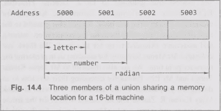

文中穿插插图丰富且带有标注的图，以便于轻松理解概念

根据C99，注释也可以以 // 开头，并延伸到下一个换行符。因此，上面的注释行可以写成如下形式：

```c
// A Simple C Program
// comments were added for C99 due to their utility and widespread existing practice, especially in dual C and C++ translators.
#include <stdio.h>
```

相关章节中重点标出了C99委员会推荐的更新后的编程概念

**注意**

- C语言使用分号作为语句终止符；分号是必需的，作为向编译器指示语句已完成的信号。
- 所有程序指令（也称为语句）都必须用小写字符书写。

在若干节之后提供“注意”，以帮助更好地理解所讨论的关键要点

## 第1章

## 计算机基础

### 学习目标


学习本章后，读者将能够

- 追溯计算机的演进——计算机的代际与分类
- 解释计算机系统的基本单元
- 解释个人计算机的硬件和软件
- 在个人计算机中加载操作系统（OS）

### 1.1 引言——什么是计算机？

*牛津词典*将计算机定义为“一种自动电子装置，用于进行计算或控制可用数值或逻辑术语表达的操作”。

该定义明确将计算机归类为电子装置，尽管最初的计算机是机械和机电装置。该定义还指出了计算机应用的两个主要领域：数据处理和计算机辅助控制或操作。该定义的另一个重要结论是：计算机只能执行那些可用逻辑或数值术语表达的操作或计算。

计算机是一种数据处理器。它可以接受输入，输入可以是数据或指令，或两者兼有。计算机通过将输入存储在存储单元中来记住输入。然后，它通过执行计算或进行逻辑比较，或两者兼有，来处理所存储的输入。它输出算术或逻辑计算的结果作为输出信息。计算机以字母数字形式接受输入并输出数据。在内部，它将输入数据转换为有意义的二进制数字，对二进制数据执行指令规定的操作，并将数据从二进制数字形式转换为可理解的字母数字形式。

### 1.2 计算机的演进——简史

**机械时代的计算**

计算机器的概念早在电气和电子设备发明之前就已发展。第一台机械计算装置是**算盘**，它于公元前500年在巴比伦发明。它被广泛使用且没有任何改进，直到1642年布莱兹·帕斯卡设计了一台使用齿轮和轮子的计算器。但直到19世纪初，实用的齿轮驱动机械计算器才问世。这台机器能够计算事实，但不能使用程序来计算数值事实。

1823年，查尔斯·巴贝奇在奥古斯塔·艾达·拜伦（洛夫莱斯伯爵夫人）的协助下，启动了一个雄心勃勃的项目：为英国皇家海军制造一台可编程计算机器。这台名为“分析机”的机械机器的输入通过穿孔卡片提供。该引擎存储1,000个20位十进制数和可修改程序，该程序可以改变机器的操作，使其能够执行不同的计算任务。但即使经过数年的努力，这台拥有超过50,000个机械部件的机器仍无法可靠运行，因为这些部件无法加工到所需精度。

**电气时代的计算**

随着1800年电动机的出现，大量基于帕斯卡计算器的电动计算器被开发出来。1889年，赫尔曼·何乐礼开发了一种由单台电动机驱动的机械机器，用于计数、排序和整理存储在穿孔卡片上的数据。何乐礼于1896年成立了制表机公司。该公司很快并入国际商业机器公司（IBM），机械计算机业务蓬勃发展。

1941年，康拉德·楚泽开发了第一台电子计算计算机Z3。它被德国人在第二次世界大战中使用。然而，艾伦·图灵被认为在1943年开发了第一台电子计算机。这个名为“巨人”的计算机系统是一台固定程序计算机；它不可编程。

宾夕法尼亚大学的J.W.莫奇利和S.P.埃克特于1946年完成了第一台通用电子数字计算机。它被称为ENIAC，即电子数值积分器和计算器。它使用了17,000个真空管、超过500英里的导线，重30吨，每秒执行约100,000次操作。由约翰·冯·诺依曼和普林斯顿研究所的其他人开发至1952年的IAS计算机系统，为后续通用计算机的总体结构奠定了基础。20世纪50年代初，斯佩里·兰德公司推出了UNIVAC I、UNIVAC II、UNIVAC 1103系列，而IBM推出了Mark I和701系列。所有这些机器都使用真空管。

晶体管于1948年在贝尔实验室发明。1958年，IBM、国际计算机有限公司（ICL）、数字设备公司（DEC）等推出了使用晶体管的通用计算机，这些计算机速度更快、体积更小、重量更轻、功耗更低且更可靠。

与此同时，在德州仪器公司，杰克·基尔比于1958年发明了集成电路，这促成了20世纪60年代数字集成电路的发展。这促成了1966年IBM 360/370、PDP 8/1和HP 9810的开发。这些计算机使用中规模和小规模集成电路（MSI和SSI）。

此后，英特尔公司于1971年宣布开发出单芯片微处理器4004，这是一种超大规模集成电路。1972年，推出了8008 8位微处理器。随后，8080和MC6800于1973年问世，它们是改进的8位微处理器。英特尔8位微处理器系列中的最后一款8085于1974年作为通用处理器推出。1978年发布了8086微处理器，1979年发布了8088微处理器。

尽管台式计算机从1975年起就已面世，但没有一款能像IBM PC那样广受欢迎。1981年，IBM在个人计算机中使用了8088微处理器。80286 16位微处理器于1983年作为8086的更新版本问世。32位微处理器80386于1986年推出，80486于1989年推出。随着1993年Pentium的推出，高度改进的个人计算机以可负担的价格上市。

随着以个人计算机形式出现的台式计算机和网络的发展，整个计算领域发生了巨大变化。如今，笔记本电脑和掌上电脑等便携式计算机已经可用，它们能够以高于所有早期计算机的速度执行程序、存储数据和输出信息。目前正在努力将掌上电脑与移动电话单元集成。

随着计算机硬件的发展，编程语言被设计并不断完善。20世纪50年代，为UNIVAC计算机制定了汇编语言。1957年，IBM开发了FORTRAN语言。随后几年，出现了ALGOL、COBOL、BASIC、Pascal、C/C++、Ada和Java等编程语言。

此外，随着操作系统（OS）的创建——这是一种用于管理计算机资源并控制CPU执行各种作业的监督程序——计算机的操作能力达到了新的高度。如今有各种各样的操作系统。其中一些流行起来的是用于大型机和小型机的UNIX，以及用于个人计算机的MS-DOS和MS-Windows。然而，随着Linux的推出，转向使用该操作系统的趋势正在兴起。

### 1.3 计算机的代际

计算机属于哪一代由其使用的技术决定。表1.1显示了不同代计算机所使用的技术。随着代际的进步，计算机性能的提升不仅归因于更好的硬件技术的实现，也归因于更优的操作系统和其他软件工具。


表1.1 不同代计算机所使用的技术

| 代次 | 技术 | 操作系统 | 推出年份 | 具体计算机 |
|---|---|---|---|---|
| 1 | 真空管 | 无 | 1945 | Mark 1 |
| 2 | 晶体管 | 无 | 1956 | IBM 1401、ICL 1901、B5000、MINSK-2 |
| 3 | SSI和MSI | 有 | 1964 | IBM S/360/370、UNIVAC 1100、HP 2100A、HP 9810 |
| 4 | LSI和VLSI | 有 | 1971 | ICL 2900、HP 9845A、VAX 11/780、ALTAIR 8800、IBM PC |
| 5 | HAL | 有 | 现在及以后 | - |

### 1.4 计算机的分类

当今大多数计算机设计都基于约翰·冯·诺依曼提出的概念，被称为冯·诺依曼体系结构。计算机可以依据用途、成本、大小、处理能力等各种参数以多种方式分类。下面根据计算机的能力和用途对其进行分类。

#### 超级计算机

超级计算机是最昂贵、速度最快的计算机类型，其运行速度达到或接近当前计算机的最高运算速度。克雷（Cray）超级计算机是一个典型例子。它们用于需要大量数学计算的专门应用，例如天气预报、核能研究、石油勘探等。

#### 大型计算机

大型计算机支持大量用户同时远程工作。除了提供多用户功能外，它还能以极高速率处理大量数据，并支持许多输入、输出和辅助存储设备。这类计算机体积非常大，而且价格昂贵。超级计算机与大型计算机的主要区别在于：超级计算机执行单个程序的速度比大型计算机更快，而大型计算机则利用其能力并发执行许多程序。IBM 370和IBM 3090是大型计算机的例子。

#### 小型计算机

小型计算机的能力足以供多个用户（10到100个）使用，但体积更小、内存容量更小，并且比大型计算机便宜。两个经典例子是数字设备公司（Digital Equipment Corporation）的VAX和IBM AS/400。

#### 微型计算机

微型计算机旨在满足个人的个人计算需求。它通常由微处理器芯片、内存系统、接口单元和各种I/O端口组成，通常位于主板上。微型计算机有多种类型可供使用。

- **台式计算机** 一种足以放在桌面上的微型计算机。
- **笔记本电脑** 一种带有集成屏幕和键盘的便携式微型计算机。
- **掌上电脑/数字日记/笔记本/PDA** 一种手掌大小、没有键盘的微型计算机。屏幕同时用作输入和输出设备。

### 1.5 计算机的构成

计算机可以根据输入其中的一组指令接受输入、处理或存储数据，并产生输出。计算机系统可分为两个组成部分，它们负责提供输入和输出数据、操作和处理数据，以及以电子方式控制各种输入、输出及其存储的机制。这两个部分称为硬件和软件。*硬件*是计算机的有形部件。而*软件*是控制硬件并使其执行特定任务的无形指令集合。没有软件，计算机实际上毫无用处。

#### 1.5.1 硬件

硬件是计算机的物理组件，包括连接在其上的所有机械、电气、电子和磁性部件。计算机由以下主要硬件组件组成：

- 输入和输出设备
- 中央处理器（CPU）
- 存储单元和存储设备
- 接口单元

以下几节简要介绍个人计算机中最常见的硬件。

#### 输入设备

数据和指令通过输入设备键入、提交或传输到计算机。输入设备是电子或机电设备，它们提供与计算机系统通信的手段，用于馈送输入数据和指令。下面简要介绍最常见的输入设备。

**键盘** 键盘类似于打字机。键盘通常由104个按键组成。这些按键分为不同类别，下面简要介绍。

**字符键** 这些键包括字母、数字和标点符号。按下任何字符键时，屏幕上会显示相应字符。

**功能键** 键盘上方有12个功能键，用于根据当前执行的操作系统或软件执行某些功能。这些键位于键盘顶部，很容易通过字母F后跟1到12的数字来识别。

**控制键** Alt、Ctrl、Shift、Insert、Delete、Home、End、PgUp、PgDn、Esc和方向键是控制键。

**导航键** 这些键包括四个方向键、Page Up和Page Down、Home和End。这些键通常用于在文档或屏幕中导航。

**切换键** Scroll Lock、Num Lock、Caps Lock是三个切换键。切换状态由键盘右上侧的三个LED指示。例如，按下Caps Lock后，用户键入的字母将显示为大写。再次按下后，屏幕上键入的字母为小写。

**其他键** 这些键包括Insert、Delete、Escape、Print Screen等。

键盘上的按键排列成一系列行和列，称为*键矩阵*。每个按键相对于行和列都有一个位置。按下某个键时，该位置的按键开关闭合电路，向键盘内部的电路板发送信号。键盘控制器利用矩阵位置的x和y坐标确定按下的是哪个键，从而确定键盘向计算机发送什么代码。


**鼠标** 鼠标是连接到计算机的定点设备。它用于在屏幕上移动光标，并指向计算机视频屏幕上的对象（例如图标、菜单、命令按钮等），以便在操作系统或当前执行软件提供的图形界面上选择或激活对象并执行各种任务。它有两个或三个按键用于点击。鼠标跟踪鼠标指针的移动，感测点击并将其发送到计算机，以便计算机做出适当响应。


鼠标可以通过USB连接器连接到系统，也可以通过红外辐射无线连接。无线鼠标需要通过电池供电。

**扫描仪** 扫描仪是一种捕获图片或文档的设备，使它们可以存储在存储设备中、在视频屏幕上查看、进行适当修改、传输到其他计算机或在打印机上打印。配有扫描仪和打印机的个人计算机可以充当复印机。


#### 输出设备

输出设备反映输入数据，或显示对输入数据进行操作后的输出结果，或打印数据。最常见的输出设备是显示器或可视显示单元。打印机用于打印结果。硬拷贝是指显示信息的打印输出。另一方面，软拷贝是指存储在存储设备上的信息。

#### 显示器

计算机显示设备通常称为可视显示单元（VDU）或显示器。它的工作原理与普通电视机类似。计算机显示器已使用多种技术。它们也有不同尺寸。CRT（阴极射线管）和LCD（液晶显示器）显示器是广泛使用的两种常见类型。


CRT由一端较窄的真空玻璃管组成。一个电子枪放置在这一端，用于发射电子。电子枪由阴极（带负电）和一个阳极（带正电）组成。另一端有一块宽屏幕，涂有荧光粉。电子束打在屏幕表面，并通过光致发光过程产生图像。有一些垂直和水平线圈，用于使电子束偏转到屏幕的任何位置。通过持续扫描屏幕形成图像。为了将图像发送到屏幕，计算机首先将其组装在称为视频缓冲区的内存区域中。图形存储为表示各个屏幕点（像素）颜色的内存位置数组。然后，视频卡通过数模转换器（DAC）发送这些数据，DAC将数据转换为一系列电压电平，并馈送到显示器。


CRT显示器过于笨重且功耗高。除此之外，用户非常担心CRT显示器可能造成损害的非电离辐射。

如今，液晶显示器正在取代CRT显示器，并因其尺寸、显示清晰度、低辐射发射和功耗而成为用户事实上的选择。

LCD显示器通过一层液晶单元对来自一系列冷阴极荧光灯（CCFL）的光进行过滤，从而生成图像。逐渐地，CCFL背光技术正被低功耗发光二极管（LED）取代。使用这种技术的计算机屏幕有时称为LED显示器。


#### 打印机

打印机是一种打印任何数据、报告、文档、图片、图表等的设备。打印机根据打印头在生成文本或图像时是否与纸张发生物理接触来分类。*击打式打印机*的打印头会与纸张发生物理接触。另一方面，在*非击打式打印机*中，打印头不会与纸张发生物理接触。点阵打印机被视为击打式打印机，激光打印机被视为非击打式打印机。


宽幅点阵打印机。图片来源：Dale Mahalko（本文件依据知识共享署名-相同方式共享 3.0 未移植版许可证授权；http://creativecommons.org/licenses/by-sa/3.0/deed.en）

在*点阵打印机*中，打印头通过色带物理“击打”纸张，这使得打印机的速度相对较慢。打印头由一些称为“点阵”的二维点阵列组成。每次它通过色带击打纸张时，其点都会按照要打印的字符进行排列。色带中的墨水落到纸张表面，从而打印出字符。在*喷墨打印机*中，墨盒代替色带容纳墨水。墨盒位于喷墨头之上。打印头从墨盒中取一些墨水，并通过喷头将其散布到纸张表面。这种墨水带电。在纸张表面附近会产生电场。

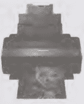

因此，小墨滴会根据要打印的字符排列在表面上。这些打印机速度快，能够打印高质量图形。*激光打印机*使用激光束来生成图像。

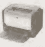

#### 中央处理器（CPU）

中央处理器（CPU）可以看作是计算机的大脑。大部分处理在CPU中进行。在处理过程中，它定位并执行程序指令。它还从存储器和输入/输出设备中取数据，并将数据发送回去。

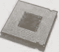

在物理上，它是一个集成电路（IC）硅芯片，安装在一个小方形塑料板上，周围有金属引脚。在个人计算机领域，微处理器和CPU这两个术语可互换使用。更准确地说，应将其描述为片上CPU，因为它包含执行处理的电路。

CPU本身可分为不同的功能单元，如下所述——

##### 寄存器

这些是高速存储设备。在大多数CPU中，一些寄存器保留用于特殊目的。例如，指令寄存器（IR）保存当前正在执行的指令。程序计数器（PC）是一个寄存器，保存下一条要执行指令的地址。除了这类和其他专用寄存器外，它还包含一组通用寄存器，用于在处理过程中按需临时存储数据值。

##### 算术逻辑单元（ALU）

它是CPU的一部分，执行算术运算（如加法和减法）以及逻辑运算（如比较两个数是否相等、大于或小于）。

##### 控制单元（CU）

控制单元通过控制主存储器与CPU中的寄存器之间的数据和指令传输来协调处理。它还协调算术逻辑单元（ALU）的执行，以对存储在特定寄存器中的数据进行操作。它由以下部分组成：

- 一个*指令译码电路*，用于解释应执行什么操作。
- 一个*控制与定时电路*，通过产生相应的控制信号来指挥计算机的所有其他部分。

如今，一种称为*高速缓存*的高速存储器与CPU芯片集成在一起。这通过最大限度减少处理器从较慢的主存储器读取数据的需要来提高计算机性能。

CPU的处理能力以每单位时间可执行的指令数来衡量。每台计算机都包含一个内部时钟，它以恒定速率发出电子脉冲。这些脉冲用于控制和同步操作节奏。每个脉冲称为一个时钟周期，它类似于具有信号上升半周期和下降半周期的矩形波。换句话说，一个完整时钟周期是振荡信号脉冲之间经过的时间。每条指令的执行需要一个或多个时钟周期。时钟速度越高，在给定时间段内执行的指令就越多。赫兹（Hz）是计算机时钟频率的基本单位，等于每秒一个周期。CPU速度不断提高。它通常以兆赫兹（MHz）或吉赫兹（GHz）来衡量。一兆赫兹等于每秒一百万周期，而一吉赫兹等于每秒十亿周期。

如今，多个处理器一起集成在单个集成电路芯片上，称为多核处理器，例如双核处理器有两个CPU，四核处理器有四个CPU。

- 集成电路（IC）是嵌入在一小片硅中的晶体管和其他电子元件的矩阵。
- 微处理器是一种数字电子元件，在单个半导体集成电路（IC）上集成了小型化晶体管。一个或多个微处理器通常充当计算机系统或手持设备中的中央处理器（CPU），分配空间来保存数据对象。

#### 存储单元

仅靠输入设备、输出设备和CPU等组件不足以使计算机工作。计算机中需要一个存储区域来临时或永久存储指令和数据，以便随后可按需检索这些指令和数据。数据以二进制数字（称为位）的形式存储在存储器中。各种类型的数据（如数字、字符）被编码为一系列位，并存储在连续的存储单元中。每个存储单元由一个字节（等于八位）组成，并具有唯一地址，因此可以通过引用其地址独立访问所需存储单元的内容。单个数据项存储在一个或多个连续的内存字节中。第一个字节的地址用作整个存储单元的地址。

在处理过程中，CPU专门使用寄存器来存储和操作数据与指令。除寄存器外，计算机系统中主要使用两类存储器。一种称为主存储器，另一种称为二级存储器。

##### 主存储器

主存储器是在程序执行期间连同数据一起存储数据和程序的区域。这个存储空间也称为主存，构成程序的工作区。该存储器由处理器直接访问。

内存模块由一大组触发器以及数据流量控制电路组成，其排列方式使得数据可以存入一组触发器或从一组触发器中读出。一个触发器可以存储一个二进制位。这些触发器分组形成固定长度的单元存储器，每个单元由称为内存地址的序号标识。这类存储器称为随机存取存储器（RAM），其中任何位置都可以直接访问，并且一旦该模块断电，其存储内容就会被破坏。因此，它们本质上是易失性的。主存储器设备价格昂贵。它们尺寸有限、功耗很低，并且与二级存储器设备相比速度更快。

现代计算机中越来越多地使用另一种主存储器。它称为高速缓存存储器（发音同“cash”）。它是一种高速存储器，使处理器能够比从系统其他位置的存储器更迅速地访问数据。它存储或缓存处理器当前正在使用的主存中的部分内容。与主存储器相比，访问高速缓存存储器只需花费一小部分时间。对高速缓存存储器中存储的数据进行管理，可确保在搜索高速缓存的全部时间中，有20%的时间能在缓存中找到所需数据。因此，计算机在处理速度方面的性能得到提高。

##### 二级存储器

二级存储器为程序和数据提供大容量、非易失且廉价的存储。然而，二级存储器的访问时间比主存储器长得多。二级存储允许长期存储计算机指令和数据。此外，二级存储器（也称为辅助存储器）以低于主存储器设备的成本存储大量字节。

- 存储单元由有序的存储单元序列组成，每个存储单元能够存储一个字节的数据。每个存储单元都有一个不同地址，在向其存储数据或从中检索数据时用于引用。
- RAM和高速缓存都称为主存储器。主存储器相对昂贵，并且在断电时会丢失所有数据。二级存储器提供较廉价的存储，用于永久存储数据和指令。


##### 存储器操作

对于主存储器和辅助存储器设备，有一些共同的操作，如下所述。

*读*：在此操作中，数据从存储器中检索出来。

*写*：在此操作中，数据被存储到存储器中。

利用读和写操作，还可以执行许多其他与存储器相关的功能，如复制和删除。

##### 存储器的单位

存储器的接口电路被设计为在每次访问时从存储器中逻辑地访问一个字节或字节的倍数。存储器的最小块被视为一个字节，它由八个位组成。整个存储空间以字节为单位来衡量。因此，存储器的单位是字节。存储器的容量是它能够存储的最大信息量。由于存储器的单位是字节，存储器的容量以字节数表示。用于表示存储器容量的一些单位如下：

- 千字节（KB）= 1024 字节
- 兆字节（MB）= 1024 千字节
- 吉字节（GB）= 1024 兆字节
- 太字节（TB）= 1024 吉字节
- 拍字节（PB）= 1024 太字节
- 艾字节（EB）= 1024 拍字节
- 泽字节（ZB）= 1024 艾字节
- 尧字节（YB）= 1024 泽字节

寄存器的大小是决定 CPU 处理能力的重要因素之一。字长是指 CPU 一次能够处理的位数。字长基于 ALU 中寄存器的大小以及通向这些寄存器的电路容量。例如，32 位字长的处理器具有 32 位寄存器，一次处理 32 位，被称为 32 位处理器。处理器的字长是提高计算机性能的一个因素。如今的个人计算机通常配备 32 位或 64 位处理器。

##### 存储器层次结构

计算机系统中使用的各种类型的存储器在速度、成本、大小和易失性（存储的持久性）方面有所不同。它们可以按层次结构组织。计算机系统中的存储器层次结构如图 1.1 所示。

图 1.1 显示，沿层次结构向下移动，每位的存储成本降低，但访问时间增加（即设备变慢）。换句话说，从上到下，速度降低，而容量增加，价格变得低得多。

在层次结构中指定的各种存储器中，高于辅助存储器的存储器是易失性的，其余是非易失性的。在设计计算机系统时，必须在层次结构的每个级别上平衡上述所有因素，即速度、成本、易失性等。

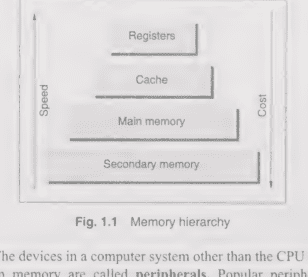

计算机系统中除 CPU 和主存储器之外的设备称为*外设*。常见的外围设备包括打印机、数码相机、扫描仪、操纵杆和扬声器。

#### 接口单元

接口单元将 CPU 与存储器以及各种输入/输出（I/O）设备互连。指令和数据通过接口单元在 CPU 和其他硬件组件之间移动。

它是一组并行线或线路，将所有的内部计算机组件连接到 CPU 和主存储器。根据传输的数据类型，总线可分为以下三种类型：

*数据总线* 用于承载实际数据的总线。

*地址总线* 地址通过地址总线传输。

*控制总线* 该总线在 CPU 和计算机内的其他设备之间传输控制信息。控制信息包括报告各种设备状态或请求设备采取特定操作的信号。

基于总线的计算机组织模型如图 1.2 所示。

大多数计算机设备并不直接连接到计算机的内部总线。由于每个设备都有自己特定的数据格式化和通信方式，一种称为*控制器*的设备协调特定外设的活动。处理器借助设备控制器从输入设备读取数据或向输出设备写入数据。每个输入设备或输出设备都有一个特定的地址。处理器使用这些地址，通过相关的设备控制器选择特定的 I/O 设备，以传输数据或发送控制命令。

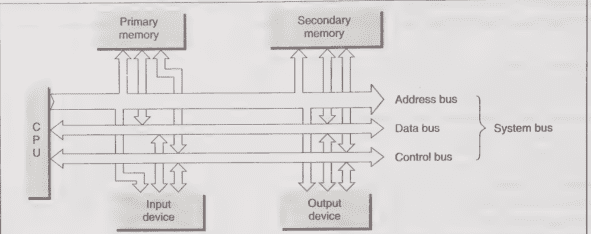

图 1.2 基于总线的计算机组织

##### 主板

计算机系统中的所有组件都安装在一块称为主板或母板的电子电路板上，并相互连接在一起。

为了使所有这些部件协同工作，主板提供了它们之间的某种物理连接。（见图 1.3）。

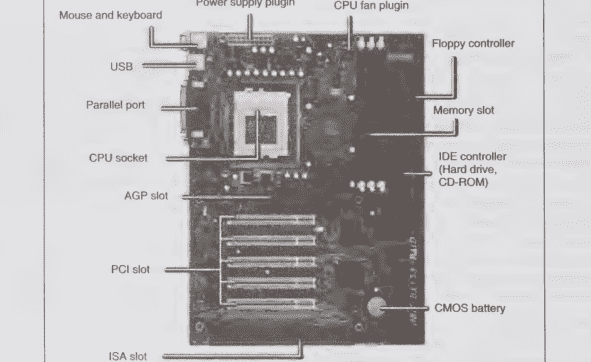

图 1.3 主板

一般来说，主板由以下部分组成。

- **CPU 插槽** 容纳中央处理器，这是一个集成芯片，连同系统时钟、缓存、冷却风扇等。
- **内存插槽** 这些插槽容纳包含 RAM 的 RAM 卡。
- **接口模块** 用于硬盘、软盘和 CD-ROM 驱动器。
- **ROM 集成芯片** 内嵌基本输入/输出系统软件。
- **端口和扩展槽** 端口用于将设备连接到总线。物理端口包括串行端口和并行端口，可以连接打印机、扫描仪和外部存储设备等外围设备。插槽用于连接图形（视频）卡、磁盘控制器和网卡等附件。扩展槽有两种不同的标准：ISA（工业标准体系结构）和 PCI（外围组件互连）。

下面简要介绍最常见的端口和插槽类型。

**ISA 插槽** 用于连接 ISA 兼容卡。

**PCI 插槽** 用于连接 I/O 设备。

**高级图形端口（AGP）** 显卡插入此插槽。

**并行端口** 并行端口也称为打印机端口或 LPT1。它能够一次发送八位信息。

**串行端口** 这些有时被称为通信端口或 COM 端口。有两个 COM 端口，COM1 和 COM2。COM1 的大小大于 COM2。COM1 有 25 个针脚，用于连接调制解调器。COM2 是一个 9 针端口，用于连接串行鼠标。这些端口使用 D 型连接器。

**USB（通用串行总线）** 这也是一个串行端口，但其数据传输速率高于串行端口。USB 在个人计算机中用作通用通信通道。许多不同的设备，如鼠标、键盘、硬盘驱动器、便携式 CD-ROM/DVD 驱动器、U盘、扫描仪、相机、调制解调器，甚至打印机，通常都连接到这些端口。

**CMOS** 个人计算机中的 CMOS 代表互补金属氧化物半导体存储器。它是一种 RAM，存储系统组件的必要属性，如硬盘的大小、RAM 的数量，以及串行和并行端口使用的资源等。由于 RAM 在断电时会丢失其内容，因此主板上的一个小电池为 CMOS RAM 供电，即使计算机断电也能保留其存储的数据。

##### 系统单元

系统单元容纳所有系统组件。它有时被称为机箱。主要组件如主板、处理器、存储器单元、电源单元以及所有用于连接计算机外设的端口。在单元内部，所有组件协同工作，为用户提供所需的服务。根据用途，机箱有两种类型：

- (i) AT 机箱（或迷你塔式）
- (ii) ATX 机箱

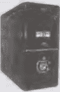

AT 机箱比 ATX 机箱更小更便宜，通常被称为迷你塔式机箱。它们用于较旧的处理器和较小尺寸的主板。另一方面，ATX 机箱比 AT 机箱稍大，并且更昂贵，因为它们具有更多功能，例如电动滑动前面板和额外的磁盘存储舱。

- 主板是一种印刷电路板，包含允许计算机系统各个组件相互通信的电路和连接。在大多数计算机系统中，CPU、内存和其他主要组件都安装在主板的布线上。
- 可以添加到计算机系统以增强其功能的输入、输出和存储设备称为*外设*。常见的外围设备包括打印机、数码相机、扫描仪、操纵杆和扬声器。

#### 1.5.2 软件

软件提供指令，告诉硬件要执行什么以及按什么顺序执行。这组指令在计算机程序中进行排序和组织。因此，程序是一系列指令，旨在指导计算机执行特定功能并由处理器执行。从更广泛的意义上说，软件可以描述为一组相关的程序。但软件不仅仅是程序的集合。它指的是一组计算机程序，这些程序提供所需的功能和性能、程序使用的数据、有助于程序高效操作数据的数据结构，以及描述程序操作和使用的文档。

计算机程序和软件之间的比较如下表所示（表 1.2）。

表 1.2 计算机程序与软件的比较

| 计算机程序 | 软件 |
|---|---|
| 程序由个人开发。涉及单个开发人员。 | 涉及大量开发人员。 |
| 规模小且功能有限。 | 规模极大且功能强大。 |
| 用户界面可能不是很重要，因为程序员是唯一的用户。 | 对于软件产品，用户界面必须仔细设计和实现，因为该产品的开发者和用户完全不同。 |

如今，大多数软件在使用前必须先安装。安装涉及将多个文件复制到计算机内存中，或者需要一系列步骤和


配置取决于操作系统和软件本身，以便在需要时能够运行或执行。软件通常被分类为系统软件、应用软件或实用软件。

##### 系统软件

系统软件旨在通过使硬件可操作来促进和协调计算机的使用。它在低层次上与计算机系统交互。此类软件的示例包括语言翻译器、操作系统、加载程序、链接程序等。然而，最重要的系统软件是*操作系统*，它是一组程序，旨在控制计算机的输入和输出操作，为用户提供通信接口，管理计算机系统的资源（如内存、处理器、输入/输出设备等），并以最少的人工干预来调度其操作。其他程序（系统和应用程序）依赖操作系统提供的设施来访问计算机系统资源。*加载程序*是一种系统软件，它将可执行程序从辅助存储设备复制到主内存中，为程序的执行做好准备，并初始化执行。

除CPU和主内存外，硬件设备必须通过提供称为*设备驱动程序*的软件向操作系统注册，以实现设备与计算机其他部分之间的通信。这类系统软件被打印机、显示器、显卡、声卡、网卡、调制解调器、存储设备、鼠标、扫描仪等使用。一旦安装，设备驱动程序会在需要时自动响应，或在后台运行。现代操作系统几乎能识别所有连接的硬件设备，并立即开始安装过程。这种由操作系统自动启动安装过程的设备称为*即插即用*设备。然而，少数硬件设备需要用户手动启动安装过程。

##### 应用软件

应用软件旨在执行用户的特定用途。Microsoft Word、Microsoft Excel、Microsoft PowerPoint、Microsoft Access、PageMaker、Corel Draw、Photoshop、Tally、AutoCAD、Acrobat、Winamp、Macromedia Flash、iLeap、Xing MP3 Player等是应用软件的一些示例。

应用软件有两类：*定制软件*和*预编写软件包*。根据用户需求为特定用户或组织开发的软件称为*定制软件*。*预编写软件包*是现成购买的，具有预定义的通用规范，可能满足也可能不满足任何特定用户的要求。可用的最重要软件包类别如下：

- 数据库管理软件，如Oracle、DB2、Microsoft SQL Server等。
- 电子表格软件，如Microsoft Excel。
- 文字处理软件，如Microsoft Word、Corel WordPerfect，以及桌面出版（DTP）软件，如PageMaker。
- 图形软件，如Corel Draw。
- 统计软件，如SPSS，以及运筹学软件，如Tora。

> **注意：** 没有任何软件的计算机被称为裸机，它具备执行许多功能的潜力，但自身无法执行任何功能。

### 1.6 存储器再探讨

计算机可用的不同类型的内存如图1.4所示。

#### 1.6.1 主存储器

所有现代计算机都使用半导体存储器作为主存储器。台式计算机中使用的一种重要半导体存储器是*随机存取存储器（RAM）*。这里的“随机存取”是指可以直接访问（读和写）任何存储位置。这种存储器更快、更便宜，并且在更小的物理面积内提供更多的存储空间。这些超大规模集成半导体存储芯片安装在可插拔的印刷电路板（PCB）上。使用此类PCB存储模块进行内存扩展或更换很容易。这些特性使半导体存储器更受欢迎和更具吸引力。半导体存储器唯一的缺点是易失性，即当电源关闭时，它会丢失其内容。RAM保存等待处理器处理的数据和指令。除了数据和程序指令外，RAM还保存控制计算机系统基本功能的操作系统指令。这些指令在每次计算机开机时被加载到RAM中，并一直保留到计算机关机。计算机系统中使用两种类型的RAM——*动态*和*静态*。

*动态RAM（DRAM）*是一种使用刷新电路在其逻辑电路中保持内容的RAM。DRAM中的每个存储单元由一个晶体管组成。晶体管的结电容负责保持电荷，该电荷将单个位指定为逻辑1。没有电荷则表示该位为逻辑0。电容会随时间丢失电荷，因此需要通过刷新电路按预定时间间隔进行再充电或刷新。

一种更昂贵且更快的RAM类型——静态RAM（SRAM）则不需要这种刷新电路。它在一种特殊的“触发器”电路中使用四到六个晶体管，在计算机系统运行期间保持1或0。计算机系统中的SRAM通常用作处理器缓存和I/O缓冲区。打印机和液晶显示器（LCD）通常使用SRAM来缓冲图像。

SRAM也广泛用于网络设备，如路由器、交换机和电缆调制解调器，以缓冲传输信息。

动态和静态RAM本质上都是易失性的，并且可以被读取或写入。表1.3列出了SRAM和DRAM之间的基本差异。

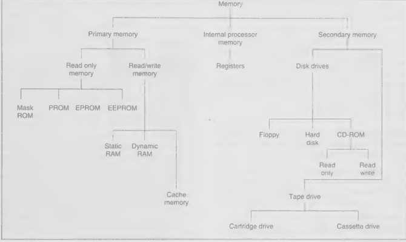

**表1.3 静态RAM与动态RAM对比**

| 静态RAM | 动态RAM |
| --- | --- |
| • 不需要刷新。 | • 需要额外的电子电路定期“刷新”内存；否则其内容将丢失。 |
| • 比动态RAM更昂贵。<br>• 位密度较低。 | • 比静态RAM更便宜。<br>• 单个集成电路中可容纳更多存储位。 |
| • 比动态RAM更快。 | • 由于刷新，比SRAM更慢。 |

计算机中使用的动态RAM有几种流行的类型。它们是SDRAM（同步动态RAM）、RDRAM（Rambus动态RAM）和DDR RAM（双倍数据速率RAM）。

SDRAM曾经是个人计算机中最常见的RAM类型。它速度相当快且价格低廉。如今个人计算机已不再使用它，因为现在有了改进得多的RAM。

RDRAM由Rambus公司开发，是其专有技术。它也是最昂贵的RAM，主要用于需要快速计算速度和数据传输的视频接口卡和高端计算机。RDRAM是高性能个人计算机的首选。

DDR RAM是SDRAM的改进版本。DDR代表双倍数据速率。它通过在每个时钟脉冲的上升沿和下降沿都传输数据来实现更快的性能。DDR2、DDR3是DDR RAM的其他更高速度版本。

另一种称为视频RAM（VRAM）的RAM用于存储供显示监视器使用的图像数据。所有类型的视频RAM都是动态RAM（DRAM）的特殊安排。其目的是充当处理器和显示单元之间的数据存储缓冲区。

处理器和主内存速度之间一直存在不匹配。处理器执行指令的速度快于从内存读取或写入内存所需的时间。为了提高平均内存访问速度，或者更确切地说是优化指令或数据的获取，以便CPU需要时能更快地访问它们，缓存内存在逻辑上位于处理器内部存储器（寄存器）和主内存之间。缓存内存保存CPU最近访问的一部分指令和数据值。每当处理器试图访问某个内存位置时，它首先检查缓存以确定该位置是否已在缓存中。如果是，则将字节或字传送给处理器。在这种情况下，处理器不需要访问主内存。如果数据不在缓存中，则处理器必须访问主内存。包含数据或指令的主内存块被读入缓存，然后将字节或字传送给处理器。

缓存有两个级别。

**一级（主）缓存：** 这种缓存内存嵌入处理器本身。该缓存速度非常快，其大小通常在8 KB到64 KB之间。

**二级（次）缓存：** 二级缓存比一级缓存稍慢。其大小通常为64 KB到2 MB。二级缓存有时也称为外部缓存，因为它在首次出现时位于处理器芯片外部。

##### 只读存储器（ROM）

它是另一种存储器，即使在电源关闭时也能保留存储在其中的数据和指令。ROM在个人计算机中用于存储制造商提供的启动指令，这些指令用于执行基本操作，例如PC中的引导，并在制造过程中针对特定目的编程。ROM只能在制造时写入。另一种类似的存储器——可编程ROM（PROM），也是非易失性的，并且只能由特殊设备编程一次。但有些情况下，读操作要执行多次，写操作也要执行不止一次（尽管少于读操作次数），并且存储的数据必须在断电时也能保留。这导致了EPROM（可擦除可编程只读存储器）的发展。在EPROM（可擦除可编程只读存储器）中，可以通过电信号写入数据。然而，写操作并不简单。它要求通过将芯片暴露在紫外线下擦除存储单元，从而使每个单元回到相同的初始状态。这种擦除过程非常耗时。一旦所有单元都回到相同的初始状态，就可以对EPROM进行电写入操作。

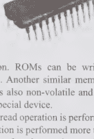

还有一种可擦除PROM，称为电可擦除可编程只读存储器（EEPROM）。与EPROM一样，可以通过电信号将数据写入EEPROM，并在断电时保留。存储的数据可以通过电信号擦除。然而，在EEPROM中，写入时间明显高于读取时间。EEPROM最大的优点是它是非易失性存储器，并且易于更新，而缺点是成本高且写操作耗时相当长。

**注意**
- RAM保存等待处理的原始数据以及处理这些数据的程序指令。它还存储处理结果，直到这些结果可以更永久地存储在辅助存储介质上。需要重点注意的是，RAM保存操作系统指令，这些指令在启动时以及需要时随时加载。
- 动态RAM更便宜、消耗更少的电能、产生更少的热量，并且可以做得更小，在单个集成电路中容纳更多存储位。静态RAM提供更快的访问，但位密度较低，且比动态RAM更昂贵。
- ROM包含一小组指令，告诉计算机如何访问硬盘、找到操作系统并将其加载到RAM中。操作系统加载后，计算机就可以接受输入、显示输出、运行软件和访问数据。
- 可编程只读存储器（PROM）是非易失性的，制造后只能由特殊的写入设备编程一次。可擦除可编程ROM（EPROM）可以通过紫外线（UV）或高压脉冲擦除。

#### 1.6.2 辅助存储器

计算机系统中可用的辅助存储设备主要有四种类型：

- 磁盘驱动器
- CD驱动器（CD-R、CD-RW和DVD）
- 磁带驱动器
- USB闪存驱动器

硬盘、软盘、光盘（CD）、数字多功能光盘（DVD）和磁带是最常见的辅助存储介质。硬盘提供快得多的性能和更大的容量，但通常不可移动；也就是说，单个硬盘永久固定在磁盘驱动器上。另一方面，软盘是可移动的，但它们的性能要慢得多，而且它们的

其容量远小于硬盘。CD-ROM 或 DVD-ROM 是另一种便携式辅助存储设备。CD 代表光盘（Compact Disc）。之所以称为 ROM，是因为信息在光盘制作时被永久存储。操作存储介质的设备称为驱动器。用于辅助存储的大多数驱动器基于机电技术。机械部件的移动速度远比电信号慢得多。这就是访问辅助存储比访问主存储慢得多的原因。

**软盘**是一块薄而圆的塑料材料，表面涂有磁性介质，信息以磁性方式记录在上面，就像音乐记录在塑料盒式磁带表面一样。柔软的软盘被封装在坚固的塑料外壳中以防止损坏。个人计算机中使用的磁盘直径通常为 3.5 英寸，可存储 1.44 MB 数据。早期的 PC 有时使用 5.25 英寸磁盘。这些磁盘存储信息，并可用于在计算机之间交换信息。软盘驱动器以磁盘形式的磁性材料上存储数据并从中检索数据。它有两个电机：一个用于旋转磁盘介质，另一个用于移动两个读写头（磁盘的每个表面各一个）前后移动。

软盘驱动器

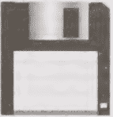

**硬盘**是安装在系统单元内部的永久性存储设备。物理上，硬盘由一个或多个金属（有时是铝）盘片组成，盘片表面涂有可磁化的金属氧化物。所有盘片安装在一个主轴上，使它们能够以恒定速度旋转。读写头连接在金属臂上，并定位在每个盘片表面上方。这些臂可以将读写头径向向内和向外移动到盘片表面上方（见图 1.5）。数据和程序通过让写头在盘片表面产生磁性标记而存储在硬盘上。读头通过感应盘片上的磁性标记来检索数据。每个盘片的表面被划分为称为磁道的同心环。磁道在盘片表面形成同心圆。每个磁道被划分为一定数量的扇区。一个扇区通常可存储 512 字节，有时为 1,024 字节的数据。磁头安装在臂上，该臂可以在磁道之间移动或寻道。每个盘片每个表面上相同位置的垂直磁道组称为柱面。柱面很重要，因为所有磁头同时移动。一旦磁头到达特定磁道位置，构成柱面的所有磁道上的所有扇区都可以在不进一步移动磁臂的情况下读取。硬盘的存储容量非常大，以 GB（千兆字节）为单位表示。存储在硬盘上的数据会一直保留在那里，直到用户将其擦除或删除。


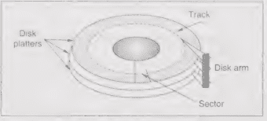

图 1.5  硬盘组织结构

硬盘驱动器提供了更好的性能，并且由于以下原因成为计算机系统的必备组件：

- 更高的数据存储容量
- 更快的数据访问时间
- 更高的数据传输速率
- 更好的运行可靠性
- 更少的数据错误或数据丢失

CD 是一种便携式辅助存储介质。可用的 CD 类型有多种：CD-R 和 CD-RW。CD-R 驱动器用于创建和读取 CD-R 和 CD-RW 光盘。一旦创建（即“刻录”），存储在 CD-R（可记录光盘）上的数据就不能更改。另一方面，CD-RW（可重写光盘）可以被擦除并重复使用。这种光盘由合成树脂制成，表面涂有反射材料，通常是铝。当 CD 刻录驱动器写入信息时，CD 表面会形成一些微小的凹坑。CD-ROM 表面上的信息位以凹凸不平（称为凹坑和凸起）的形式编码，由红外热产生。读取头上有激光二极管。通过将低强度激光束照射到旋转的光盘上来读取这些位。激光束从光盘的光滑区域强烈反射，但从凹陷区域反射较弱。接收反射的传感器据此确定每个位是 1 还是 0。

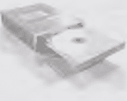

CD 最初是流行的音乐存储介质；后来被用作通用计算机存储介质。大多数个人计算机都配备了 CD-R（可记录）驱动器。CD-RW（可重写）光盘可以重复使用，因为在 CD-RW 上，通过用某种材料涂覆光盘表面来模拟普通 CD 的凹坑和平坦表面，当加热到某一温度时，该材料变为非晶态（因此不反射），当加热到另一温度时，变为晶态（因此反射）。

### 1.7 操作系统简介

计算机系统拥有许多资源，如处理器（CPU）、主存储器、输入/输出设备和文件。操作系统充当这些资源的管理者，并将它们分配给特定的程序，在任务需要时使用它们。

操作系统可以定义为一种系统软件，它充当用户和硬件之间的中介，是一种将用户与硬件实现细节隔离开来的接口。它由一组专门的软件模块组成，使计算资源（硬件和软件）可供用户使用。因此，有了操作系统，计算机系统比没有它时更容易使用。当今使用的一些操作系统有 Mac、MS Windows、Linux、Solaris 等。

操作系统的常见功能包括：

- **处理器管理** 进程抽象是操作系统为实现程序执行管理而实现的基本机制。进程基本上是正在执行的程序。操作系统决定哪个进程运行、运行多长时间，以及可能以什么优先级或重要程度运行。
- **内存管理** 操作系统负责跟踪当前哪些内存部分正在被使用以及被谁使用。它组织和寻址内存；处理分配内存的请求，释放不再使用的内存，并重新安排内存以最大化可用量。通常多个程序可能同时存在于内存中。操作系统选择要放入内存的进程、它们在内存中的位置，以及每个进程应获得多少内存。
- **设备管理** 操作系统将各种设备分配给进程并启动输入/输出操作。它还控制并调度各进程对输入/输出设备的访问。
- **文件管理** 文件只是字节序列。文件是程序、源代码、数据、文档等的存储区域。操作系统跟踪系统中的每个文件，包括数据文件、程序文件、编译器和应用程序。文件系统是操作系统的一个模块，允许用户和程序对各种类型的文件执行创建、删除、修改、打开、关闭以及其他操作。它还允许用户为文件命名，将文件按层次组织到目录中，保护文件，并使用各种文件操作访问这些文件。

除了这些功能，操作系统还必须提供控制程序、进程、内存段和其他资源访问的设施。

**内核**是操作系统中直接与硬件交互的部分。内核仅代表整个操作系统代码的一小部分，但它被密集使用，因此保留在主存储器中，而其他部分可以根据需要换入和换出辅助存储器。当计算机启动时，它会执行一些初始化功能，例如检查内存。然后它加载内核并将控制权移交给它。内核随后启动与用户和其余环境通信所需的所有进程。

用户界面是操作系统中用户直接与之交互的部分。像 MS-DOS 和早期版本的 UNIX 这样的操作系统只接受键入的文本命令。现在大多数操作系统为用户提供图形用户界面来与系统交互。诸如 Microsoft Windows、Solaris 和 Linux 等操作系统允许用户通过图标、菜单、键盘和鼠标移动与操作系统交互。用户界面和交互方式因操作系统而异。

#### 1.7.1 加载操作系统

在某些数字设备中，如小型家电控制器、手持设备和视频游戏机，操作系统相对简单且规模较小，存储在 ROM（只读存储器）中。对于工业控制器和加油设备等系统，操作系统也存在于 ROM 中。在这样的系统中，一旦打开电源，操作系统立即获得处理器的控制权。

在个人计算机中，操作系统通常存储在硬盘上。由于操作系统的规模足够大，不能完全放在 RAM 中。内核是操作系统的核心部分，在启动时被加载到 RAM 中，并且始终驻留在内存中。操作系统的其他部分根据需要加载到 RAM 中。需要注意的是，新计算机中没有任何操作系统驻留。操作系统通常以 CD 或 DVD 介质出售，必须通过解压缩压缩文件并初始化整个系统以供使用，将其从 CD 或 DVD 介质永久传输到硬盘上。


*启动*是计算机或其他数字设备从开启瞬间到操作系统最终加载并准备就绪这一过程的总称。

基本输入输出系统（BIOS）是存储在 PROM 上的一小组指令，在计算机开启时执行。

当计算机开启时，ROM 电路通电并开始启动过程。首先，一个地址会自动加载到程序计数器（PC）寄存器中。这由硬件电路完成。所给出的地址是 BIOS 第一条可执行指令的位置。BIOS 中的代码运行一系列称为 POST（加电自检）的测试，以确保主存储器、显示器、键盘、输入/输出设备等系统设备已连接且功能正常。在 POST 期间，BIOS 将从 POST 获得的系统配置数据与存储在主板上互补金属氧化物半导体（CMOS）存储芯片中的系统信息进行比较。BIOS 还使用存储在 CMOS 芯片中的信息设置各种参数，例如磁盘驱动器的组织方式。每当添加新的系统组件时，该 CMOS 芯片都会更新，并包含有关系统组件的最新信息。

BIOS 随后从可启动设备的特定固定位置（0 柱面、0 磁头、1 扇区的第一个扇区）只加载一块称为*主引导记录*的数据，并将其放置到主存的特定固定位置。主引导记录大小为 512 字节，包含称为*引导加载程序*的机器代码指令。然后，引导加载程序开始加载操作系统的过程，并将控制权转交给操作系统本身，由操作系统完成该过程。

下面描述执行程序时指令周期所涉及的步骤。

程序计数器（PC）是跟踪下一条必须执行的指令的寄存器。第一步，指令从主存中被*取出*，并加载到指令寄存器（IR）中，该指令的地址由 PC 寄存器指定。随后 PC 立即递增，使其指向程序中的下一条指令。指令进入 IR 后会被*解码*，以确定执行该指令所需的操作。然后，控制单元发出一系列控制信号，使该指令能够*执行*。指令需要处理的数据要么从寄存器中取出，要么通过*地址寄存器*从 RAM 中取出。指令的结果被*存储*（写入）到寄存器或内存位置。程序的下一条指令将遵循相同的步骤。此过程将持续到程序中没有更多指令、计算机关闭或发生某种不可恢复错误为止。

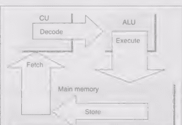

**图 1.6** 指令周期的简化视图

**注意**

- *冷启动*描述通过打开电源来启动计算机并加载其操作系统的过程。如果计算机正在运行，可以先将其关闭，然后再打开，以执行冷启动。
- *热启动*描述在计算机已经运行后，不关闭电源而重新启动计算机并再次加载其操作系统的过程。

### 1.8 CPU 的运行概述

中央处理器执行的任何处理都由指令指导。单条指令所需的处理称为*指令周期*。CPU 对每条机器语言指令执行的四个步骤是*取指*、*解码*、*执行*和*存储*（图 1.6）。

**注意**

寄存器是 CPU 内用于特定明确目的的单个永久存储位置。CPU 包含若干重要寄存器，例如

- *程序计数器（PC）*寄存器保存当前正在执行的指令的地址。
- *指令寄存器（IR）*保存计算机当前正在执行的实际指令。

为了访问内存中的数据，CPU 使用两个内部寄存器：

- 存储器地址寄存器（MAR）保存内存位置的地址。
- 存储器数据寄存器（MDR），有时也称为存储器缓冲寄存器，保存要存储到由存储器地址寄存器当前寻址的内存位置或从该位置取回的数据值。

### 小结

计算机被定义为“一种自动电子装置，用于进行计算或控制能够用数值或逻辑术语表达的操作”。

从算盘时代开始，开发计算机器的概念促成了现代电子计算机的发展。计算机共有五代。如今，计算机有多种形式，例如个人计算机、笔记本电脑、掌上电脑和大型机。各种尺寸的电子计算机经过多年发展而臻于完善，已成为一种能够用于各种应用的强大机器。计算机具有 CPU、快速访问的主存储器（RAM）、非易失性高存储容量的辅助存储器（HDD）、易于使用的键盘、带有鼠标等图形指针设备的视频彩色监视器控制台，以及非击打式打印机。

因此，广义上讲，基本计算机系统由 CPU、存储器以及输入和输出设备组成。存储器可分为主存储器、辅助存储器和处理器内部存储器。高速缓存是主存储器的一部分，通常位于 CPU 附近。主存储器的其余部分由各种类型的 ROM 和 RAM 组成。

PC 由硬件和软件组成。软件可分为系统软件和应用软件。最重要的系统软件是操作系统，它管理计算机系统的所有资源，并充当硬件和软件之间的接口。当个人计算机开启时，会执行加电自检（POST），并加载操作系统。

### 关键术语

- **ALU** 算术逻辑单元（ALU）对数据执行算术和逻辑运算。
- **BIOS** 基本输入输出系统（BIOS）是存储在 ROM 中的一小组指令，每次计算机开启时都会运行。BIOS 负责加电自检，以确保每个立即需要的设备已连接且功能正常，并负责最终将操作系统的核心部分加载到 RAM 中。
- **Cache memory** 它是一种特殊的高速存储器，使微处理器能够比访问系统板上其他位置的存储器更快地访问数据。
- **CMOS** 计算机中的互补金属氧化物半导体（CMOS）芯片存储有关连接到计算机的设备的各种属性的信息。
- **Control unit** 它解释每条指令并确定适当的操作过程。
- **Computer** 它是一种可编程设备，能够存储、检索和处理数据。
- **CPU** 它是一种集成电路芯片，是计算机的最终控制器，也是执行所有计算的地方。
- **Hardware** 它指计算机的物理组件。
- **RAM** 随机存取存储器（RAM）是一种易失性存储器，用于临时存储数据和指令。它保存等待处理的原始数据以及处理该数据的程序指令。它还保存控制计算机系统基本功能的操作系统指令。
- **ROM** 只读存储器（ROM）是永久性非易失性存储器。它是存储计算机“硬连线”启动指令的地方。这些指令是电路的永久组成部分，即使计算机关闭电源也仍然存在。
- **Software** 它指一组计算机程序以及这些程序使用的数据。

### 常见问题解答

- 1. **什么是微处理器？** 微处理器是一种集成电路芯片，包含微型计算机系统中央处理器（CPU）的所有基本组件。
- 2. **什么是芯片？** 芯片是一小块薄硅片，其上印有构成集成电路（例如微处理器）的晶体管。
- 3. **什么是芯片组？** 在个人计算机中，芯片组是一组共同执行特定功能的集成电路。
- 4. **什么是启动？** 从计算机开启到准备好使用之间发生的事件序列称为启动。
- 5. **操作系统存储在哪里？** 在某些数字设备中——通常是手持设备和视频游戏控制台——整个操作系统小到足以存储在 ROM（只读存储器）中。对于大多数其他计算机，操作系统程序相当大，因此大部分存储在硬盘上。在启动过程中，操作系统内核被加载到 RAM 中。内核提供基本的操作系统服务。操作系统的其他部分在需要时被加载到 RAM 中。
- 6. **什么是即插即用设备？** 一种由操作系统自动开始安装过程且通常不需要任何人工干预的设备，称为即插即用设备。


7. **如果计算机包含 RAM，为什么还需要 ROM？**

通常，指令和数据会永久存储在辅助存储设备中。除了当前正在处理的数据和程序指令之外，RAM 还保存着控制计算机系统基本功能的操作系统指令。每次启动计算机时，这些指令都会被加载到 RAM 中，并常驻其中，直到计算机关闭。但是 RAM 是一种易失性存储器，也就是说，断电时其内容会丢失。这时 ROM 就发挥了重要作用：ROM 包含一小组称为 BIOS（基本输入/输出系统）的指令。这些指令访问硬盘、查找操作系统并将其加载到 RAM 中。操作系统加载完成后，系统即可使用。

### 练习

- 1. 写出下列缩写的全称：
  - ENIAC, ALU, CU, RAM, ROM, EPROM, EEPROM, BIOS, POST, MIPS, CMOS
- 2. 借助合适的框图，简要描述传统数字计算机各组成部分的功能。
- 3. 什么是 CPU？它的功能是什么？列出它的几个组成部分。
- 4. 解释不同的存储单元。
- 5. 讨论计算机系统中的存储层次结构。
- 6. 什么是高速缓存存储器？为什么需要它？
- 7. 举出三个系统软件的例子。
- 8. 简要说明操作系统在计算机系统中的作用。
- 9. 什么是 BIOS？描述其功能。
- 10. POST 是什么意思？
- 11. 什么是引导扇区？
- 12. 描述引导过程。
- 13. 区分下列概念：
  - (a) 编译器和解释器
  - (b) 系统软件和应用软件
  - (c) RAM 和 ROM
  - (d) 主存储器和辅助存储器
  - (e) 位和字节
  - (f) 硬件和软件

### 2.2 数制的基数

任何数制的基数（或底数）由该数制中数字符号的数量决定。例如，二进制是基数为 2 的数制，因为它使用两个符号；十进制是基数为 10 的数制，因为它使用十个符号。一般来说，在任何数制中，数 \(N\) 可以用以下任意一种形式表示：

- (a) 位置记数形式：\(N = d_n d_{n-1} d_{n-2} \ldots d_1 d_0 d_{-1} d_{-2} \ldots d_{-m}\)
- (b) 多项式形式：\(N = d_n \times r^n + d_{n-1} \times r^{n-1} + \cdots + d_1 \times r^1 + d_0 \times r^0 + d_{-1} \times r^{-1} + d_{-2} \times r^{-2} + \cdots + d_{-m} \times r^{-m}\)
- (c) 紧凑形式：\(N = \sum_{i=-m}^{n-1} d_i r^i\)

其中  
\(d\) = 数字符号的值，  
\(r\) = 基数或底数，  
\(n\) = 小数点左侧整数位的位数，  
\(m\) = 小数点右侧小数位或数字的位数。

### 2.3 权重因子

一个数的数值等于将每一位数字乘以其所在位置的权重后所得乘积之和。十进制数通过按各种顺序排列符号 0、1、2、3、4、5、6、7、8、9 来表示。这些符号称为十进制数字。序列中每个数字的位置都有一定的数值权重，每个数字都是其位置权重的乘数。因此，十进制数制是加权位置数制的一个例子。每个位置的权重都是数字基数 10 的幂。

因此，权重因子是数的每一列（数字）位置的乘数的数值。例如，十进制数制的权重因子是 10 的幂，其指数等于数字符号的位置值。对于向左的每一列，乘数的值比右侧前一列增加 10 倍。

让我们考虑十进制数制中的数 754。

\(7 \cdot 10^2 + 5 \cdot 10^1 + 4 \cdot 10^0 = 700 + 50 + 4 = 754\)  
注释：基数；数字位置。

> **重要说明**  任何数的零次幂都是 1，甚至零的零次幂也是 1；例如，\(10^0 = 1,\ 0^0 = 1,\ n^0 = 1\)。

### 2.4 数制的类型

数制有几种类型。表 2.1 列出了各种数制及其基数和有效数字符号集。

#### 2.4.1 十进制数制 [基数 10]

如今大多数人使用十进制表示法来计数。这种数制使用十个不同的符号来表示数值。十进制中有 10 个数字符号 0、1、2、3、4、5、6、7、8、9，其中 0 的值最小，9 的值最大。对于用十进制表示的某个数，最左边的数字值最大，而最右边的数字值最小。

- 向左的每个位置权重增加 10 倍。

**示例**

- (i) \(9 + 1 = 10\)（九加一等于零，进位一，即 10）
- (ii) 十进制数 1275，数字位置为 3、2、1、0：\(1 \times 10^3 = 1000\)，\(2 \times 10^2 = 200\)，\(7 \times 10^1 = 70\)，\(5 \times 10^0 = 5\)；总计 = 1275。标注：数字位置；十进制数；乘数（十进制）；权重（十进制）。

表 2.1 数制、基数和符号

| 数制 | 基数 | 数字符号 |
|---|---:|---|
| 二进制 | 2 | 0, 1 |
| 三进制 | 3 | 0, 1, 2 |
| 四进制 | 4 | 0, 1, 2, 3 |
| 五进制 | 5 | 0, 1, 2, 3, 4 |
| 八进制 | 8 | 0, 1, 2, 3, 4, 5, 6, 7 |
| 十进制 | 10 | 0, 1, 2, 3, 4, 5, 6, 7, 8, 9 |
| 十二进制 | 12 | 0, 1, 2, 3, 4, 5, 6, 7, 8, 9, A, B |
| 十六进制 | 16 | 0, 1, 2, 3, 4, 5, 6, 7, 8, 9, A, B, C, D, E, F |
| 二十进制 | 20 | 0, 1, 2, 3, 4, 5, 6, 7, 8, 9, A, B, C, D, E, F, G, H, I, J |

#### 2.4.2 二进制数制 [基数 2]

二进制数制使用两个符号来表示数值。这两个符号是 0 和 1，其中 0 的值最小，1 的值最大。二进制中的数字表示方式与十进制类似：最左边的数字表示最大值，称为最高有效位（MSD），而最右边的数字称为最低有效位（LSD）。

- 向左的每个位置权重增加 2 倍。

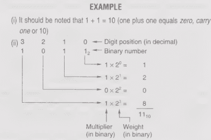

在计算机中，表示二进制值（0 或 1）的二进制数字称为位（BIT）。也就是说，二进制数中的每个数字称为一个位，4 位组成一个半字节（NIBBLE），8 位组成一个字节（BYTE），两个字节组成一个字（WORD），两个字组成一个双字（DOUBLE WORD，很少使用）。

一个 n 位数可以表示 2ⁿ 个不同的数值，例如，对于 8 位数，可以表示 2⁸ = 256 个不同的值。

#### 2.4.3 八进制数制 [基数 8]

八进制数制使用八个数字符号来表示数。这些符号是 0、1、2、3、4、5、6、7，其中 0 的值最小，7 的值最大。八进制中的数字表示方式与十进制相同，其中最左边的数字表示最高有效位。

- 向左的每个位置权重增加 8 倍。因此，
  - (i) 7 + 1 = 10（七加一等于零，进位一，即 10）
  - (ii) 位值示例：数字位置 3、2、1、0；八进制数 1、2、6、5。

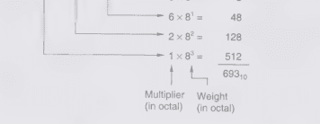

#### 2.4.4 十六进制数制 [基数 16]

十六进制数制使用十六个符号来表示数。这些符号是 0、1、2、3、4、5、6、7、8、9、A、B、C、D、E、F，其中 0 的值最小，F 的值最大。十六进制中的数字表示方式与十进制相同，其中最左边的符号表示最高有效位。

- 向左的每个位置权重增加 16 倍。因此，
  - (i) F + 1 = 10（F（即 15）加一等于零，进位一，即 10）
  - (ii) 位值示例：十六进制数 2A₁₆。

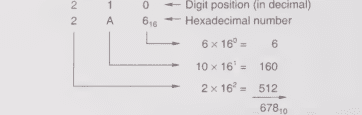

十六进制系统常用于表示计算机系统中的值（数据和内存地址）。表 2.2 显示了十进制数 0 到 15 在二进制、八进制和十六进制数制中的表示。

表 2.2 数制等价表

| 十进制（基数 10） | 二进制（基数 2） | 八进制（基数 8） | 十六进制（基数 16） |
|---:|---:|---:|---:|
| 0 | 0000 | 0 | 0 |
| 1 | 0001 | 1 | 1 |
| 2 | 0010 | 2 | 2 |
| 3 | 0011 | 3 | 3 |
| 4 | 0100 | 4 | 4 |
| 5 | 0101 | 5 | 5 |
| 6 | 0110 | 6 | 6 |
| 7 | 0111 | 7 | 7 |
| 8 | 1000 | 10 | 8 |
| 9 | 1001 | 11 | 9 |
| 10 | 1010 | 12 | A |
| 11 | 1011 | 13 | B |
| 12 | 1100 | 14 | C |
| 13 | 1101 | 15 | D |
| 14 | 1110 | 16 | E |
| 15 | 1111 | 17 | F |

#### 2.4.5 数制的通用规则

所有数制都遵循以下规则集：

**规则 1** 一个数制中可用的数字符号数量等于其基数。

示例：

- 对于基数为 10 的十进制系统，有 10 个数字符号，从 0 到 9。
- 对于基数为 2 的二进制系统，有 2 个数字符号 0 和 1。


**规则2** 最大数字符号的值比基数小1。

**示例：**

十进制系统——最大数字 = 10 − 1 = 9

二进制系统——最大数字 = 2 − 1 = 1

**规则3** 每一位都将数字符号的值乘以基数的幂，该幂等于该数字符号所在的位置。

**示例：**

十进制系统——考虑数字

125 = 1 × 10² + 2 × 10¹ + 5 × 10⁰

**规则4** 从一个位置到下一个位置的进位会使其权重增加为原来的基数倍。

**示例：**

十进制系统——考虑数字

5 = 5 × 10⁰ 或5个1。

将该数字向左移动一位，它变成——

5 × 10¹ 或5个十或50。

二进制系统——考虑数字

1 = 1 × 2⁰ 或1个1。

将该数字向左移动一位，它变成——

1 × 2¹ 或两个1或10

为避免混淆，通常给数字加下标来表示数制的基数。例如，

- 162ₕ ‘h’表示十六进制
- 162₁₆ 16表示基16
- 162_d ‘d’表示十进制
- 162₁₀ 10表示基10
- 162ₒ ‘o’表示八进制
- 162₈ 8表示基8
- 101_b ‘b’表示二进制
- 101₂ 2表示基2

**注意**

- 在所有数制表示中，最左边的数字表示最大值，称为最高有效位（MSD），而最右边的数字称为最低有效位（LSD）。
- 最大数字符号的值比基数小1。
- 从一个位置到下一个位置的进位会使其权重增加为原来的基数倍。

### 2.5 数制转换

到目前为止，已经讨论了不同的数制。但是，当一种数制表示中的数字需要以另一种形式表示时，会发生什么？因此，有必要理解如何将一种形式的数字表示为其他形式。以下各节讨论从一个数制转换到其他数制的方式。

#### 2.5.1 处理整数

**十进制数转换为等值二进制数**

**方法1** 重复除以2法

- 1. 将被除数（即十进制数）除以2，得到商和余数。
- 2. 将商除以2，得到新的商和余数。
- 3. 重复步骤2，直到商等于0。
- 4. 产生的第一个余数是二进制数中的最低有效位（LSB），最后一个余数是最高有效位（MSB）。因此，随后（从左到右）写出二进制数，其中 MSB 最先出现（按相反顺序列出余数值）。这就是二进制等值。

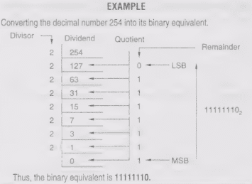

因此，二进制等值为 11111110。

**方法2** 2的幂减法

- 1. 设 *D* 为需要从十进制转换为二进制的数。
- 2.
  - (a) 找到小于或等于 *D* 的最大2的幂。令其等于 *P*。
  - (b) 如果 |*D*| ≥ *P*，从 *D* 中减去 *P*，得到一个十进制数结果。在权重因子为 *P* 的数字位上置1。
  - (c) 否则，如果 |*D*| < |*P*|，在相应的权重因子列中置0。
- 3. 令 *D* = 余数（十进制数），重复步骤2，直到 *D* = 0，或 |*D*| < |*P*|。

**示例**

将十进制数247转换为其等值二进制数。

小于247的最大2的幂是2⁷ = 128。按所示顺序在列中列出权重因子构成表格，其中128是最高权重。在权重因子为128的数字位上置1。

| 权重因子 | 128 | 64 | 32 | 16 | 8 | 4 | 2 | 1 |
|---|---:|---:|---:|---:|---:|---:|---:|---:|
| 二进制数 | 1 |  |  |  |  |  |  |  |

剩余 (247 − 128) = 119。对于119，其最大2的幂是64，在权重因子为64的数字位上置1。

| 128 | 64 | 32 | 16 | 8 | 4 | 2 | 1 |
|---:|---:|---:|---:|---:|---:|---:|---:|
| 1 | 1 |  |  |  |  |  |  |

剩余 (119 − 64) = 55。权重32适用；因此，在相应的数字位上置1，如下所示：

| 128 | 64 | 32 | 16 | 8 | 4 | 2 | 1 |
|---:|---:|---:|---:|---:|---:|---:|---:|
| 1 | 1 | 1 |  |  |  |  |  |

剩余 (55 − 32) = 23。权重16适用；因此在权重为16的数字位上置1。

| 128 | 64 | 32 | 16 | 8 | 4 | 2 | 1 |
|---:|---:|---:|---:|---:|---:|---:|---:|
| 1 | 1 | 1 | 1 |  |  |  |  |

剩余 (23 − 16) = 7 作为余数。它小于下一个数字位权重值8。因此在8下置0。接下来，找到适用的权重；因此在权重为4的数字位上置1。于是剩余 (7 − 4) = 3。

| 128 | 64 | 32 | 16 | 8 | 4 | 2 | 1 |
|---:|---:|---:|---:|---:|---:|---:|---:|
| 1 | 1 | 1 | 1 | 0 | 1 |  |  |

权重2适用；因此在权重为2的数字位下置1。于是剩余 (3 − 2) = 1，将其置于权重为1即2⁰的数字位中。

| 128 | 64 | 32 | 16 | 8 | 4 | 2 | 1 |
|---:|---:|---:|---:|---:|---:|---:|---:|
| 1 | 1 | 1 | 1 | 0 | 1 | 1 | 1 |

因此，十进制（基10）中的247与二进制（基2）中的11110111相同。

**从二进制转换为十进制**

要将给定二进制数的值表示为其十进制等值，在将每个二进制数字乘以其对应权重后，再求和。

**示例**

将 (110101)₂ 转换为其十进制等值。

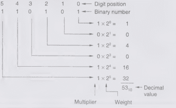

**十进制数转换为等值八进制数**

要将十进制整数转换为八进制，使用称为重复除以8法的系统方法。以下示例说明了该方法。

**示例**

将 (359)₁₀ 转换为八进制。

- (a) 将十进制数除以8，得到商和余数。
- (b) 将商除以8，得到新的商和余数。
- (c) 重复步骤(b)，直到商等于0。
- (d) 产生的第一个余数是八进制数中的最低有效位（LSB），最后一个余数（R）是最高有效位（MSB）。因此，随后（从左到右）写出八进制数，其中 MSB 最先出现。

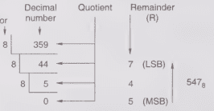

因此，(359)₁₀ = (547)₈

**八进制数转换为等值十进制数**

要将给定八进制数的值表示为其十进制等值，在将每个八进制数字乘以其对应权重后，再求和。

**示例**

将 (237)₈ 转换为十进制形式。

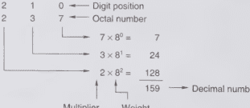

**八进制数转换为等值二进制数**

由于每个八进制数字可以用三位二进制数表示（见表2.3），从八进制转换为二进制非常容易。只需按照以下示例所示，将每个八进制数字替换为相应的三位二进制数。

**表2.3** 八进制数字的等值二进制数

| 八进制数字 | 等值二进制数 |
|---|---|
| 0 | 000 |
| 1 | 001 |
| 2 | 010 |
| 3 | 011 |
| 4 | 100 |
| 5 | 101 |
| 6 | 110 |
| 7 | 111 |

**示例**

将八进制数236700321转换为其等值二进制数。

| 八进制数 | 等值二进制数 |
|---|---|
| 2 | 010 |
| 3 | 011 |
| 6 | 110 |
| 7 | 111 |
| 0 | 000 |
| 0 | 000 |
| 3 | 011 |
| 2 | 010 |
| 1 | 001 |

**二进制数转换为等值八进制数**

将二进制数转换为八进制数是一个简单的过程。从二进制小数点开始，将二进制数字分成三位一组，并将每组转换为相应的八进制数字。对于整数，可能需要将零作为 MSB 添加，以完成三位一组的分组。注意，这不会改变二进制数的值。

**示例**

将 (010111)₂ 转换为其等值八进制数。

二进制数 → 010 111  
等值八进制数 → 2 7

**十进制数转换为等值十六进制数**

将待转换的十进制数除以16，直到商为0。十六进制数由余数构成。

**示例**

| 除数 | 被除数/商 | 余数 |
|---:|---:|---|
| 16 | 89066 |  |
| 16 | 5566 | 10 = A |
| 16 | 347 | 14 = E |
| 16 | 21 | 11 = B |
| 16 | 1 | 5 |
|  | 0 | 1 |

余数的十六进制形式。等值十六进制数：15BEA

从最后一个余数开始，将余数转换为十六进制数：1 5 11 14 10 = 15BEA = 该十六进制数。

**十六进制数转换为等值十进制数**

要将十六进制转换为十进制，首先将每个十六进制数字乘以其以十进制表示的位置权重值。然后将所得值相加，得到该十进制数的值。

**示例**

将十六进制数A4D31转换为其等值十进制数。首先计算每个数字相对于其位置权重值的十进制值：

| 数字位置 | 4 | 3 | 2 | 1 | 0 |
|---|---:|---:|---:|---:|---:|
| 十六进制数 | A | 4 | D | 3 | 1₁₆ |

| 十六进制数字 | 位置值 | 乘数 | 计算 | 结果 |
|---|---:|---:|---|---:|
| A | 4 | 16⁴ | 10 × 65536 | 655360 |
| 4 | 3 | 16³ | 4 × 4096 | 16384 |
| D | 2 | 16² | 13 × 256 | 3328 |
| 3 | 1 | 16¹ | 3 × 16 | 48 |
| 1 | 0 | 16⁰ | 1 × 1 | 1 |
|  |  |  |  | **675121₁₀** |

**十六进制数转换为等值二进制数**

由于每个十六进制数字可以用四位二进制数表示（见表2.4），从十六进制转换为二进制非常容易。只需按照以下示例所示，将每个十六进制数字替换为相应的四位二进制数。


**表2.4 数制等价关系**

| 十进制（基-10） | 二进制（基-2） | 十六进制（基-16） |
|---|---|---|
| 0 | 0000 | 0 |
| 1 | 0001 | 1 |
| 2 | 0010 | 2 |
| 3 | 0011 | 3 |
| 4 | 0100 | 4 |
| 5 | 0101 | 5 |
| 6 | 0110 | 6 |
| 7 | 0111 | 7 |
| 8 | 1000 | 8 |
| 9 | 1001 | 9 |
| 10 | 1010 | A |
| 11 | 1011 | B |
| 12 | 1100 | C |
| 13 | 1101 | D |
| 14 | 1110 | E |
| 15 | 1111 | F |

### 示例

将 1234₁₆ 转换为二进制数。

```
Hexadecimal number ----> 1 2 3 4
Equivalent binary number ----> 0001 0010 0011 0100
```

### 示例

将 37B₁₆ 转换为二进制数。

```
Hexadecimal number ----> 3 7 B
Equivalent binary number ----> 0011 0111 1011
```

### 示例

将十六进制数 AF376 转换为等价的二进制数。

```
Hexadecimal number ----> A F 3 7 6
Equivalent binary number ----> 1010 1111 0011 0111 0110
```

### 二进制数转换为等价的十六进制数

十六进制系统的运作方式与八进制系统非常相似，只是每一位恰好需要四位来表示。这意味着必须将二进制数分成四位一组，同样从最右边的数字开始。然后写出每组四位数字对应的十六进制数。对于整数，可能需要添加零作为最高有效位（MSB），以凑成四位一组。注意，这种添加不会改变二进制数的值。

### 示例

将二进制数 11110111011011011 转换为等价的十六进制数。

转换过程如下：

必须添加一个前导零，使最高有效组具有四位。

```
Binary Number ----> 0111 1011 1011 0101 1011
Equivalent hexadecimal number ----> 7 B B 5 B
```

### 十六进制转换为八进制，以及八进制转换为十六进制

要将十六进制转换为八进制，需将十六进制数的每一位写成其等价的四位二进制数。然后将得到的二进制数分成三位一组。接着写出每组对应的八进制数。

### 示例

将十六进制数 AF35D02 转换为等价的八进制数。

通过用等价的四位二进制数替换十六进制数字，可重写给定数字。

|  | 按四位一组 |
|---|---|
| A | 1010 |
| F | 1111 |
| 3 | 0011 |
| 5 | 0101 |
| D | 1101 |
| 0 | 0000 |
| 2 | 0010 |

将二进制数重新分组为三位二进制数，并用八进制符号替换。

| 按三位一组 | 八进制数 |
|---|---|
| 001 | 1 |
| 010 | 2 |
| 111 | 7 |
| 100 | 4 |
| 110 | 6 |
| 101 | 5 |
| 110 | 6 |
| 100 | 4 |
| 000 | 0 |
| 010 | 2 |

因此，我们可以看到 AF35D02₁₆ = 1274656402₈。

### 示例

将八进制数 12773244 转换为等价的十六进制数。

通过用等价的 three-bit 二进制数替换八进制数字，可写出给定数字。

|  | 按 3 位一组 |
|---|---|
| 1 | 001 |
| 2 | 010 |
| 7 | 111 |
| 7 | 111 |
| 3 | 011 |
| 2 | 010 |
| 4 | 100 |
| 4 | 100 |

将二进制数重新分组为四位二进制数，并用十六进制符号替换。

| 按 4 位一组 | 等价的十六进制数 |
|---|---|
| 0010 | 2 |
| 1011 | B |
| 1111 | F |
| 0110 | 6 |
| 1010 | A |
| 0100 | 4 |

因此，我们可以看到 12773244₈ = 2BF6A4₁₆。

不过，还有更简单的转换方法。执行各进制之间转换的一些方法如下。

- **任意进制转十进制**——使用展开式表示法。将每一位数字写成基数的幂的乘积，然后将它们全部相加。
- **十进制转任意进制**——使用除法。用基数反复除十进制数，并在每一步写下余数。当商变为零时，余数串就是新进制下的数。
- **八进制转十六进制或反之**——使用二进制作为中间形式。

#### 2.5.2 处理小数

人们熟悉十进制（基-10）数制。任意给定十进制数中的每一位都与一个权重相关联。此外，该数的值是每一位数字乘以其权重后的总和。为说明这一点，让我们考虑表2.5，并假设正在表示数 654.52，写作 (654.52)₁₀ 以指明基-10。注意，数字范围为 0 到 9。

**表2.5 十进制数制**

|  | 百位 | 十位 | 个位 | 十分位 | 百分位 |  |
|---|---:|---:|---:|---:|---:|---:|
| 权重 | 10² | 10¹ | 10⁰ | 10⁻¹ | 10⁻² |  |
| 符号 | 6 | 5 | 4 | 5 | 2 |  |
| 加权值 | 600 | 50 | 4 | 0.5 | 0.02 | 总计 654.52 |

正如具有十个数字的十进制系统是基-10 系统一样，具有两个数字 0 和 1 的二进制数制是基-2 系统。表2.6 显示了二进制数制在二进制点（.）后两位和前三位以内的权重。注意其与十进制系统的相似性。

**表2.6 二进制权重**

| 权重 | 2² | 2¹ | 2⁰ | 2⁻¹ | 2⁻² |
|---|---|---|---|---|---|

最低有效位（LSB）是最右边的二进制数字，它具有给定数的最低二进制权重。最高有效位（MSB）是最左边的二进制数字，它具有给定数的最高二进制权重。

二进制计数与十进制数制类似。LSB 从零（0）开始，并递增直到达到最大数字值。然后，随着迭代计数过程的继续，相邻的位位置被适当地填充。

### 注意

- 要将任意数制系统转换为十进制，请使用展开式表示法。
- 要将十进制数制转换为任意进制，请使用除法。
- 将八进制数转换为十六进制数或反之亦然时，请使用二进制作为中间形式。
- 需要注意的是，许多十进制小数在二进制中没有精确表示。

### 十进制小数转换为二进制

将小数十进制值转换为二进制时，需要稍微不同的方法。不是除以 2，而是将十进制小数乘以 2。如果结果大于或等于 1，则将 1 作为商。如果结果小于 1，则将 0 作为商。

### 示例

将 (0.375)₁₀ 转换为二进制。

```
0.375 × 2 = 0.750  0
0.750 × 2 = 1.500  1
0.500 × 2 = 1.000  1
done.
```

注意，当小数部分等于零时，最后一次运算完成。二进制很少能精确表示小数值。此问题的答案是：.011

需要注意的是，许多十进制小数在二进制中没有精确表示。下面的示例说明了这一点。

### 示例

```
Converting (0.29)₁₀ to binary.
0.29 × 2 = 0.58  0
0.58 × 2 = 1.16  1
0.16 × 2 = 0.32  0
0.32 × 2 = 0.64  0
0.64 × 2 = 1.28  1
0.28 × 2 = 0.56  0
0.56 × 2 = 1.12  1
0.12 × 2 = 0.24  0
0.24 × 2 = 0.48  0
0.48 × 2 = 0.96  0
0.96 × 2 = 1.92  1
0.92 × 2 = 1.84  1
0.84 × 2 = 1.68  1
0.68 × 2 = 1.36  1
0.36 × 2 = 0.72  0
0.72 × 2 = 1.44  1
```

小数点位于顶部，因此 .29 转换为二进制、精确到 16 位近似值为：

.0100101000111101

在下一位再次相乘之前，忽略整数部分。使用计算器时，只需输入十进制小数值并乘以 2。使用这种技术编写计算机程序来执行这些运算很容易。

### 二进制小数转换为十进制

要将给定二进制小数的值表示为等价的十进制值，将每一位乘以其关联权重，这些乘积的总和即为所需的十进制数。

### 示例

将 (0.1011)₂ 转换为十进制数。

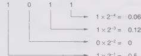

### 八进制小数转换为十进制

正如具有十个数字符号的十进制系统是以 10 为基数的数制一样，具有 8 个数字符号‘0’、‘1’、‘2’、‘3’、‘4’、‘5’、‘6’和‘7’的八进制系统以 8 为基数。表2.7 给出了一个八进制数的权重，该数在八进制点（.）前有三位、后有两位。

**表2.7 八进制权重**

| 权重 | 8² | 8¹ | 8⁰ | 8⁻¹ | 8⁻² |
|---|---|---|---|---|---|

要将给定八进制数表示为等价的十进制数，将每一位乘以其关联权重，这些乘积的总和即为十进制数。

### 示例

将 (237.04)₈ 转换为十进制数。

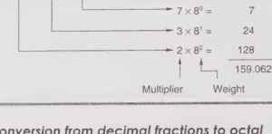

### 十进制小数转换为八进制

将十进制小数转换为八进制所用的技术与前面演示的将十进制小数转换为二进制数的方法类似。使用重复乘以 8 的方法。在乘以 8 的方法中，将小数反复乘以 8，并记录整数部分，直到小数部分为零。产生的第一个整数是最高有效位（MSD），最后一个整数是最低有效位（LSD）。记住，八进制点位于 MSD 之前。为说明这一点，请考虑以下转换。

### 示例

将 (0.3125)₁₀ 转换为八进制数。

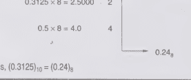

因此，(0.3125)₁₀ = (0.24)₈

### 八进制小数转换为二进制

八进制数的主要应用是表示二进制数，因为以八进制形式处理大数比二进制形式更容易。因为每个八进制数字都可以用三位二进制数表示（见表2.8），所以从八进制转换为二进制非常容易。只需按下述示例所示，将每个八进制数字替换为相应的三位二进制数即可。


### 表2.8 八进制和二进制数

| 八进制数字 | 二进制数字 |
|---|---|
| 0 | 000 |
| 1 | 001 |
| 2 | 010 |
| 3 | 011 |
| 4 | 100 |
| 5 | 101 |
| 6 | 110 |
| 7 | 111 |

### 示例

**(a) 将13₈转换为等价的二进制数。**

| 八进制数 | 1 | 3 |
|---|---|---|
| 二进制数 | 001 | 011 |

**(b) 将37.12₈转换为等价的二进制数。**

| 八进制数 | 3 | 7 | . | 1 | 2 |
|---|---|---|---|---|---|
| 二进制数 | 011 | 111 | . | 001 | 010 |

## 从二进制小数转换为八进制

将二进制转换为八进制也是一个简单的过程。从二进制小数点开始，将二进制数每三位分为一组，并将每组转换为相应的八进制数字符号。对于整数部分，可能需要在最高有效位（MSD）处添加一个零，以便形成三位一组。注意，这不会改变二进制数的值。类似地，在表示小数部分时，可能需要在最低有效位（LSD）处添加一个尾随零，以便形成完整的三位一组。

### 示例

(a) 将 (010.111)₂ 转换为八进制

二进制数 → 010 . 111

八进制数 → 2 . 7

因此，(010.111)₂ = (2.7)₈

(b) 将 (0.110101)₂ 转换为八进制

二进制数 → 0 . 110 101

八进制数 → 0 . 6 5

因此，(0.110101)₂ = (0.65)₈

## 十六进制数转换

与八进制数系统一样，十六进制数系统提供了一种表示二进制数的便捷方式。

表2.9显示了十六进制数系统的权值，最多到十六进制小数点前三位和小数点后两位。根据前面数制中的趋势，用于十六进制与十进制相互转换的方法应当类似。

### 表2.9 十六进制权值

| 权值 | 16² | 16¹ | 16⁰ | 16⁻¹ | 16⁻² |
|---|---|---|---|---|---|
|  |  |  |  |  |  |

表2.10列出了十进制数0到15对应的十进制、二进制和十六进制表示。每个十六进制数都可以表示为一个四位二进制数。

### 表2.10 数制等价表

| 十进制 | 二进制 | 十六进制 |
|---|---|---|
| 0 | 0000 | 0 |
| 1 | 0001 | 1 |
| 2 | 0010 | 2 |
| 3 | 0011 | 3 |
| 4 | 0100 | 4 |
| 5 | 0101 | 5 |
| 6 | 0110 | 6 |
| 7 | 0111 | 7 |
| 8 | 1000 | 8 |
| 9 | 1001 | 9 |
| 10 | 1010 | A |
| 11 | 1011 | B |

## 从十六进制小数转换为二进制

因为每个十六进制数字都可以用一个四位二进制数表示，所以从十六进制转换为二进制非常容易。只需按照下面的示例，将每个十六进制数字替换为相应的四位二进制数即可。

### 示例

将 (37.12)₁₆ 转换为二进制数。

| 十六进制数 | 3 | 7 | . | 1 | 2 |
|---|---|---|---|---|---|
| 二进制数 | 0011 | 0111 | . | 0001 | 0010 |

## 从二进制小数转换为十六进制

从二进制转换为十六进制也是一个简单的过程。从二进制小数点开始，将二进制数字每四位分为一组，并将每组转换为相应的十六进制数字符号。对于整数部分，可能需要在最高有效位（MSD）处添加一个零，以便形成四位一组。注意，这种添加不会改变二进制数的值。类似地，在表示小数部分时，可能需要在最低有效位（LSD）处添加一个尾随零，以便形成四位一组。

### 示例

将 (0.00111111)₂ 转换为十六进制

```
Binary number       0   . 0011   1111
Hexadecimal number  → 0   . 3      F
```

因此，(0.00111111)₂ = (0.3F)₁₆

## 检查你的进度

- 1. 十进制数368的二进制等价值是什么？  
  (a) 101110000 (b) 110110000  
  (c) 111010000 (d) 111100000  
  **答案：** (a)

- 2. 十六进制数1A53的十进制等价值是  
  (a) 6793 (b) 6739  
  (c) 6973 (d) 6379  
  **答案：** (b)

- 3. (734)₈ = ( ? )₁₆  
  (a) C1D (b) DC1  
  (c) 1CD (d) 1DC  
  **答案：** (d)

- 4. (95.5)₁₀ 的十六进制数是  
  (a) (5F.8)₁₆ (b) (9A.B)₁₆  
  (c) (2E.F)₁₆ (d) (5A.4)₁₆  
  **答案：** (a)

- 5. 确定0.6875所表示的二进制数  
  **答案：** 0.1011₂

- 6. (247)₁₀ 的八进制等价值是  
  (a) (252)₈ (b) (350)₈  
  (c) (367)₈ (d) (400)₈  
  **答案：** (c)

### 2.6 二进制算术

在计算机中，数字以二进制形式表示。因此，计算机执行的算术运算涉及二进制数。接下来几节将描述二进制加法、减法、乘法和除法等二进制算术运算如何执行。在此背景下，可以提到，此类算术运算主要由计算机系统内的ALU执行。

#### 2.6.1 加法

执行二进制加法需要四条基本规则。表2.11列出了这些规则。前三条规则非常简单，这些二进制规则与相应的十进制规则没有区别。然而，第四条规则与十进制规则不同。在二进制中，当两个1相加时，会产生一个进位，该进位被放入下一列。在十进制系统中，由于存在10个数字符号，直到两个数字之和大于或等于10时才会产生进位（例如，5 + 7 = 12）。

### 表2.11 二进制加法规则

| 规则1 | 规则2 | 规则3 | 规则4 |
|---|---|---|---|
| 0 | 0 | 1 | 1 |
| + 0 | + 1 | + 0 | + 1 |
| 0 | 1 | 1 | 10 |

这些规则可用于推导二进制算术的另一条重要规则。考虑三个1在二进制中相加时会发生什么。将问题拆分为两个加法问题；通过应用二进制加法规则可得到答案。

- 1. 应用规则4求前两个1的和。
  
  ```
    1
  + 1
  ---
   10
  ```

- 2. 接下来，取前面的结果10₂，并将最后的1加到它上面。注意，规则2（0 + 1 = 1）用于求第一列的结果，规则3（1 + 0 = 1）用于求第二列的结果。
  
  ```
    10
  +  1
  ---
    11
  ```

- 3. 因此，推导出了二进制算术的另一条规则。三个1在二进制中的和为11₂。

重要的是要记住，在二进制加法中，两个1总是向下一列产生进位。这在前面的示例中已经发生。将前两个1相加会向下一列产生进位，而剩余的1成为当前列的值。

### 示例

将1111₂ (15₁₀) 和0110₂ (6₁₀) 相加。

**解：** 二进制数1111₂和0110₂可以按照十进制数15₁₀和6₁₀相加的相同方式相加。

- 1. 最右列的数字相加。1加0等于1。
  
  ```
          0        Carry
    0 1 1 1 1
  + 0 0 1 1 0
  -----------
            1  Result
  ```

- 2. 下一列相加。1加1等于10₂，因此向下一列进位1，并将0写在该列下方。
  
  ```
        1 0        Carry
    0 1 1 1 1
  + 0 0 1 1 0
  -----------
          0 1  Result
  ```

- 4. 现在，进行下一列的减法。由于已从该列借了一个1，减法为0减1，必须再次借位。然而，下一列没有可借的。因此，首先必须从最高有效列借位。
  
  ```
     1 1  Borrow
     10101
  - 01110  Subtrahend
  -------
  00111  Result
  ```

- 5. 然后从第四列向当前列借一个1。
  
  ```
       1
     111  Borrow
     10101  Minuend
  - 01110  Subtrahend
  -------
  00111  Result
  ```

- 6. 现在可以减去当前列。从两个1组成的组中取走一个1。剩下一个1，写在列下方。
  
  ```
       1
     111  Borrow
     10101  Minuend
  - 01110  Subtrahend
  -------
  00111  Result
  ```

- 7. 在第四列中，1减去1，结果为0。
  
  ```
       1
     111  Borrow
     10101  Minuend
  - 01110  Subtrahend
  -------
  00111  Result
  ```

- 8. 最高有效列全为零，因此在它下面写0。因此，结果为00111₂。
  
  ```
       1
     111  Borrow
     10101  Minuend
  - 01110  Subtrahend
  -------
  00111  Result
  ```

#### 2.6.3 二进制减法

到目前为止，在二进制算术的学习中，只考虑了正数。现在，需要一种方法来表示诸如 −32₁₀ 这样的数。当用十进制进行计算时，负号会放在数字前面以使其为负数。由于计算机只能处理1和0，因此有必要稍微修改这种方法。

一种解决方案是在二进制数的左侧增加一个额外的二进制数字，以指示该数是正数还是负数。在计算机术语中，这个数字称为符号位。记住，“位”只是二进制数字的另一个名称。当数字为正数时，符号位为零；当数字为负数时，符号位为一。这种方法称为符号-数值表示法。注意，这与在十进制中添加负号非常相似。

这种表示法仍然存在一个小问题。必须指定一个数有多少位，才能知道哪一位表示符号。让我们使用符号-数值表示法将十进制数 −5₁₀ 和 −1₁₀ 转换为二进制。对于这些数，四位就足以表示两者。

- 1. 将5和1转换为二进制。
  
  ```
    101  (5)
      1  (1)
  ```

- 2. 现在为每个数添加一个正符号位。注意，“1”用零填充，使其具有四位。
  
  ```
    0101  (5)
    0001  (1)
       ↑
    sign bit
  ```

- 3. 要使二进制数为负数，只需将符号位从0改为1。
  
  ```
    1101  (−5)
    1001  (−1)
  ```

必须确保不要将数字1101₂误认为13₁₀。由于使用的是四位符号-数值表示法，第一位是符号位，其余三位用于表示该数的数值（绝对值）。

因此，整数的符号和数值是分别表示的。例如，负整数由最左位的1和其余位中的绝对值表示。用符号-数值表示法可以存储的整数范围是 −2^{n−1} + 1 到 +2^{n−1} − 1，其中 n 是符号-数值表示法数的位数。

虽然用符号-数值表示法表示负数很简单，但用符号-数值表示法执行算术运算却很困难。考虑减法问题 30₁₀ − 6₁₀。通过将 6₁₀ 改为 −6₁₀，可以将其转换为等价的加法问题。现在，该问题可以重新表述为 30₁₀ + (−6₁₀) = 24₁₀。在二进制中，可以通过将负数表示为补码来做类似的事情。下一节将讨论使用补码表示带符号数的两种方式：1的补码和2的补码。

### 注意

- 当单个位数字1与另一个单个位数字1相加时，和位为0，进位位为1。
- 当从单个位数字0中减去单个位数字1时，差位为1，借位位为1。
- 在二进制数的符号-数值表示法中，整数由最高有效位位置上的符号位表示，后面是数值的二进制表示。对于负整数，最高有效位（msb）为1；而对于正整数，最高有效位（msb）为0。
- 在带符号2的补码表示法中对整数进行减法运算，会以真正的符号-数值形式产生结果。


### 反码

采用反码表示的有符号数，是通过将所有为 1 的位变为 0、所有为 0 的位变为 1 来表示的。这种按位翻转数字的方式也称为对数字取反，如下例所示。

**示例**

求 (i) 10001 和 (ii) 101001 的反码。

**解：**

| 数 | 反码 |
| --- | --- |
| 10001 | 01110 |
| 101001 | 010110 |

> **注意**
>
> - 尽管 -0 和 +0 在代数上相同，但它们的表示方式不同。
> - 这会在对算术结果进行测试时引发问题。
> - 因此，反码并不是整数表示中受欢迎的选择。
> - 现在大多数计算机使用反码的一种变体（称为补码），它消除了这个问题。

### 补码

二进制数的补码是通过在反码表示上加 1 得到的，如下例所示。

**示例**

求 (i) 10001 和 (ii) 101001 的补码。

**解：**

| 数 | 反码 | 补码 |
| --- | --- | --- |
| 10001 | 01110 | 01111 |
| 101001 | 010110 | 010111 |

### 使用有符号反码表示进行减法

在这种表示方式中，减法是通过加上负数的反码来实现的。在减法方法中，符号位被当作数值位处理。当符号位为 0，即为正时，结果的数值部分就是真值。当符号位为 1，即为负时，结果的数值部分为反码形式。对于从较大数中减去较小数的情况，反码方法的执行如下。

- 1. 求较小数的反码。
- 2. 将反码加到较大数上。
- 3. 去掉最后的进位（溢出位）并将其加到结果中，即如果和超过 n 位，则将多出的位加到结果中。该位称为循环进位（端回进位）。

**示例**

使用反码从 7₁₀ 中减去 1₁₀。

**解：**

这里，1₁₀ = 0001₂，7₁₀ = 0111₂。

- 1. 用二进制数表述该问题。

  ```
  0111  (7)  Minuend
  - 0001  (1)  Subtrahend
  ------
  sign bit
  ```

- 2. 将 0001₂ 转换为它在反码中的负数等价形式。为此，在 0001₂ 形式中将所有的 1 变为 0、0 变为 1。注意，由于该数为负数，最高有效位现在为 1。

  ```
  0001  →  1110
  sign bit's complement / Subtrahend in 1's complement form
  ```

- 3. 将负值 1110₂ 加到 0111₂。得到和 10101₂。

  ```
  0101
  +   1
  -----
  0110  (6) Sum
  Overflow bit / sign bit
  ```

- 4. 注意，该加法产生了一个溢出位。在此类方法中，每当出现溢出位时，就将该位加到和上以得到正确答案。如果没有溢出位，则保持和不变。

  ```
  0101
  +   1
  -----
  0110  (6) Sum
  Overflow bit / sign bit
  ```

- 5. 这得到最终答案 0110₂（或 6₁₀）。

  ```
  0111  (7)
  - 0001  (1)  True magnitude
  ------
  0110  (6)
  sign bit
  ```

**示例**

使用反码从 1101₂（13₁₀）中减去 1001₂（9₁₀）。

**解：**

二进制数 1101₂（13₁₀）与 1001₂（9₁₀）之间的减法，可以通过将 1001₂ 转换为它在反码中的负数等价形式，并将该值加到 1101₂ 上来完成。

- 1. 用二进制数表述该问题。

  ```
  1101  (13)
  - 1001   (9)
  ------
  sign bit
  ```

- 2. 将 01001₂ 转换为它在反码中的负数等价形式 10110₂。为此，将所有 1 变为 0、0 变为 1。注意，由于该数为负数，最高有效位现在为 1。

- 3. 将负值 10110₂ 加到 01101₂。得到和 100011₂。

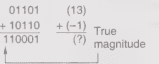

- 4. 注意，该加法产生了一个溢出位。在此类方法中，每当出现溢出位时，就将该位加到和上以得到正确答案。因此，结果为 00100₂（或 4₁₀）。

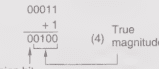

对于从较小数中减去较大数的情况，反码方法如下：

- 1. 求较大数的反码。
- 2. 将反码加到较小数上。
- 3. 没有进位（溢出）。结果具有正确的符号位，但答案是真值的反码。
- 4. 对结果取反码以得到最终结果。结果的符号由结果的符号位得到。

**示例**

使用反码从 1₁₀ 中减去 7₁₀。

**解：**

- 1. 用二进制数表述该问题。

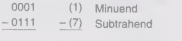

- 2. 将负的 0111₂ 转换为反码，并将其加到 0001₂ 上。

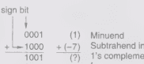

- 3. 结果没有产生溢出，因此无需调整和。注意，由于符号位为 1，最终结果是负数。因此，结果采用反码记法；该结果的正确十进制值是 −6₁₀，而不是 9₁₀。这是通过对结果取反码得到的。

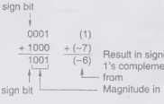

**示例**

使用反码从 1001₂（9₁₀）中减去 1101₂（13₁₀）。

**解：**

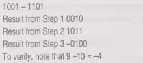

- 1. 表述该问题。

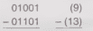

- 2. 将 01101₂ 转换为它在反码中的负数等价形式，并加到 01001₂。

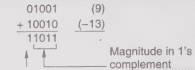

- 3. 和的符号位为 1，因此所得数为负数，且该值采用反码形式。

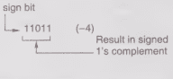

### 使用有符号补码表示进行减法

这种表示方式下的减法，是通过加上负数的补码来实现的。在减法过程中，符号位被当作数值位处理。因此，所得结果带有符号位。当符号位为 0，即为正时，结果的数值部分就是真值。但当符号位为 1，即为负时，结果的数值部分为补码形式。因此，对结果的数值部分取补码可得到真值。在补码方法中，随和产生的进位位被忽略。

对于从较大数中减去较小数的情况，补码方法的执行如下：

- 1. 求较小数的补码。
- 2. 将补码加到较大数上。
- 3. 丢弃最后的进位（在这种情况下总会有一个进位）。

**示例**

使用补码从 7₁₀ 中减去 1₁₀。

**解：**

这里，1₁₀ = 0001₂，7₁₀ = 0111₂。


- 1. 用二进制数表述该问题。

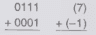

- 2. 将 0001₂ 转换为它在补码中的负数等价形式。为此，将所有 1 变为 0、0 变为 1，然后给该数加一。注意，由于该数为负数，最高有效位现在为 1。

  ```
  0001 → 1110
         + 1
  2's complement form → 1111
  ```

- 3. 将负值 1111₂ 加到 0111₂。得到和 10110₂。

  ```
  sign bit
      0111   (7)
   + 1111  (-1)
   -------
    10110   (?)
  overflow bit
  ```

- 4. 注意，该加法产生了一个溢出位。在补码中，每当出现溢出位时，就将其丢弃。因此，最终结果为 0110₂（或 6₁₀）。

  ```
      0111   (7)
   + 1111  (-1)
   -------
     0110   (6)
  Result in true magnitude
  sign bit
  ```

**示例**

通过将 1001₂ 转换为它在补码中的负数等价形式，并将该值加到 1101₂ 上，从 1101₂（13₁₀）中减去二进制数 1001₂（9₁₀）。

**解：**

- 1. 表述该问题。

  ```
         Magnitude part
   01101   (13)  Minuend
 - 01001   (9)   Subtrahend
  ```

- 2. 将 1001₂ 转换为它在补码中的负数等价形式。为此，将所有 1 变为 0，反之亦然。

  ```
  1's complement form
   01001 → 10110
   ↑
  sign bit
  ```

- 3. 给该数加 1 以得到负数等价形式。注意，由于该数为负数，最高有效位现在为 1。

  ```
   10110
 +     1
 -------
   10111   (-9) Subtrahend in 2's complement
  ```

- 4. 将负值 10111₂ 加到 01101₂。得到和 100100₂。然而，最左边的位即溢出位被丢弃。

  ```
   01101   (13)
 + 10111  (-9)
 ---------
  100100   (?)
 Overflow bit
  ```

- 5. 因此，最终结果为 00100₂（或 4）。

  ```
   01101   (13)
 + 10111  (-9)
 ---------
   00100   (4)
 sign bit   True magnitude
  ```

对于从较小数中减去较大数的情况，补码方法的执行如下。

- 1. 求较大数的补码。
- 2. 将补码加到较小数上。
- 3. 最左列没有进位。结果采用补码形式，且为负数。
- 4. 对结果取补码以得到最终答案。

**示例**

使用补码从 1001₂（9₁₀）中减去 1101₂（13₁₀）。

**解：**

- 1. 表述该问题。

  ```
   01001   (9)
 - 01101  (13)
  ```

- 2. 将 1101₂ 转换为它在补码中的负数等价形式。

  ```
   01101 → 10011
           ↑
       2's complement
  ```

- 3. 接下来，将 10011₂ 加到 01001₂。由于符号位为 1，结果为负数，且数值部分采用补码。

  ```
   01001
 + 10011
 -------
   11100
   ↑ sign bit
   2's complement
  ```

- 4. 对和取补码以得到 -0100₂ = -4₁₀。

### 要点

在 n 位反码表示下，从 x 中减去 y 的步骤如下。

- 1. 使用反码对 y 取负，即翻转 y 中的所有位以形成 -y。
- 2. 将反码形式的 -y 与 x 相加。
- 3. 如果和超过 n 位，则将多出的位加到结果中。
- 4. 如果和不超过 n 位，则保持结果不变。

在 n 位补码表示下，从 x 中减去 y 的步骤如下。

- 1. 使用补码对 y 取负，即翻转 y 中的所有位并加 1 以形成 -y。
- 2. 将补码形式的 -y 与 x 相加。
- 3. 如果和超过 n 位，则丢弃多出的位。

注意，使用反码时，每次执行减法都必须检查溢出位。如果结果有溢出位，则将多出的位加到结果中以获得正确结果。然而，使用补码时，这个多出的位会被忽略。无需其他计算即可找到正确结果。

#### 2.6.4 乘法

二进制乘法使用与十进制乘法相同的技术。事实上，二进制乘法要容易得多，因为每个相乘的数字要么是零，要么是一。考虑将 110₂ 乘以 10₂ 的简单例子。这个例子用于回顾一些术语并说明二进制乘法的规则。

**示例**

将 110₂ 乘以 10₂。


解：

- 1. 注意，110₂ 是被乘数，10₂ 是乘数。
  
  ```
    110  Multiplicand
  × 10  Multiplier
  ```

- 2. 首先用乘数的最右位数字 0 乘以 110₂。任何数乘以零都为零，因此下面只需写零。
  
  ```
    110
  × 10
    000
  ```

- 3. 用乘数的下一位数字 1 乘以被乘数。执行此乘法时，只需复制被乘数，并像十进制乘法那样将其左移一列。
  
  ```
    110
  × 10
    000
    110  Partial product
  ```

- 4. 将部分积相加。因此，乘法的积为 1100₂。
  
  ```
    110
  × 10
    000
    110
   1100  Result
  ```

进行二进制乘法时，请记住以下规则。

- 1. 当乘数位为 1 时，复制被乘数。否则，写一行零。
- 2. 对于新的乘数位，将结果左移一列。
- 3. 使用二进制加法将结果相加以求出积。

### 例题

将 1111₂ 乘以 1011₂。

解：

- 1. 用乘数的最右位数字乘以被乘数。
  
  ```
    1111  Multiplicand
  × 1011  Multiplier
  ```

- 2. 由于该数字为 1，且任何数乘以 1 都等于其本身，因此只需在下方记录被乘数。
  
  ```
    1111
  × 1011
    1111  First partial product
  ```

- 3. 现在用乘数中的下一位数字乘以被乘数。由于这是第二次乘法，得到的第二个部分积应放在第一个部分积下方，并左移一列。
  
  ```
    1111
  × 1011
    1111
    1111
  ```

- 4. 乘数中的第二位数字是 1，因此第二个部分积与被乘数相同，按所示放置。
  
  ```
    1111
  × 1011
    1111
    1111  Second partial product
  ```

- 5. 接下来，用乘数的第三位数字相乘。由于这是第三次乘法，第三个部分积放在第二个部分积下方，并相对于后者左移一列。
  
  ```
    1111
  × 1011
    1111
    1111
  ```

- 6. 注意乘数中的第三位数字是 0。由于任何数乘以零都为零，因此按所示放置一行零作为第三个部分积。
  
  ```
    1111
  × 1011
    1111
    1111
    0000  ← Third partial product
  ```

- 7. 现在，用乘数的最高有效位相乘。由于这是第四次乘法，第四个部分积放在第三个部分积下方，并相对于后者左移一列。
  
  ```
    1111
  × 1011
    1111
    1111
    0000
    1111
  ```

- 8. 乘数的最高有效位是 1，因此第四个部分积与被乘数相同。该部分积按所示放置。
  
  ```
    1111
  × 1011
    1111
    1111
    0000
    1111  Fourth partial product
  ```

- 9. 现在，将所有部分积相加，得到乘法乘积的最终值为 10100101₂。
  
  ```
    1111
  × 1011
    1111
    1111
    0000
    1111
   10100101
  ```

#### 2.6.5 除法

二进制数的除法使用与十进制除法相同的技术。回顾除法的一些基本术语会有所帮助。考虑下面给出的示例。

### 例题

将 33₁₀ 除以 6₁₀。

解：

- 1. 在此问题中，6 是除数，33 是被除数，5 是商，3 是余数。相同的术语描述二进制除法。
  
  ```
      5
  6 ) 33
      30
       3
  ```

### 例题

11₂/10₂ 或 3₁₀/2₁₀。

解：

这里，10₂ 是除数，11₂ 是被除数。后续步骤展示如何求商——1₂。

- 1. 找出被除数中大于或等于除数的最小部分。由于除数有两位数字，因此从检查被除数的前两位数字开始。
  
  ```
  10 ) 11
  ```

- 2. 11 大于 10。因此将 1 写为商，将除数写在被除数下方，并执行减法。
  
  ```
        1
  10 ) 11
       10
        1
  ```

- 3. 由于被除数中没有更多数字，但仍然有余数，因此答案必须包含小数。为完成计算，需要标记小数点并在被除数后追加一个零。
- 4. 将额外的零移下并写在余数旁边。然后检查这个新数是否大于或等于除数。注意在比较中忽略小数点。
- 5. 10₂ 等于除数 10₂，因此在商中写 1，将被除数下方的除数复制，并相减。由于被除数中没有更多数字且没有余数，除法完成。

进行二进制除法时，需要记住一些重要规则。

- (a) 当余数大于或等于除数时，在商中写 1 并相减。
- (b) 当余数小于除数时，在商中写 0，并从被除数中再取一位数字。
- (c) 如果已考虑被除数的所有数字且仍有余数，则在被除数中标记小数点并追加一个零。请记住，有些分数在二进制中没有精确表示，因此并非所有除法问题都会终止。

### 例题

使用十进制长除法中使用的相同技术，将 100001₂ 除以 110₂。

解：

- 1. 找出被除数中大于除数 110₂ 的最小部分。由于除数有三位数字，因此从检查被除数的前三位数字开始。100₂ 小于 110₂，因此必须再从被除数中取一位数字。
- 2. 尝试被除数的前四位数字。由于 1000₂ 大于 110₂，因此可以进行除法。
- 3. 110₂ 除 1000₂ 一次，因此将 1 写为商的第一位数字，将被除数下方的除数复制，并使用借位法相减。
- 4. 现在将被除数的下一位数字移下并写在余数旁边。然后检查这个新数是否大于或等于除数。
- 5. 100₂ 小于 110₂，因此在商中写 0，并从被除数中再取一位数字加到余数上。
- 6. 1001₂ 大于 110₂，因此在商中写 1，并从 1001₂ 中减去 110₂。
- 7. 注意，在考虑被除数的所有数字后，仍存在余数。这意味着结果将包含小数。要继续除法，需要标记小数点并在被除数后追加一个零。
- 8. 现在将额外的零移下，并将余数与除数进行比较。注意在比较中忽略小数点。110₂ 等于 110₂，因此在商中再写一个 1 并相减。由于被除数中没有更多数字且没有余数，除法完成。

### 注意

- 二进制数的乘法和除法使用与十进制数相同的规则。
- 有些分数在二进制中没有精确表示，因此并非所有除法计算都会终止。

### 检查你的进度

- 1. 数 11101101₂ 的 2 的补码是
  - (a) 01011110
  - (b) 01111110
  - (c) 01100110
  - (d) 00100011
  
  答案：(d)

- 2. −8 等于带符号二进制数
  - (a) 10001000
  - (b) 00001000
  - (c) 10000000
  - (d) 11000000
  
  答案：(a)

- 3. 当在二进制算术中使用带符号数时，以下哪种表示法对零具有唯一表示。
  - (a) 符号-数值。
  - (b) 1 的补码。
  - (c) 2 的补码。
  - (d) 9 的补码。
  
  答案：(c)

- 4. 将十六进制数 A6 与 3A 相加的结果是
  - (a) DD
  - (b) E0
  - (c) F0
  - (d) EF
  
  答案：(b)

- 5. 执行 (7)₁₀ − (11)₁₀ 的 2 的补码减法
  
  答案：(−4)₁₀ 或带符号 2 的补码形式 (11111100)₂。

- 6. 使用 2 的补码方法执行以下减法：0011.1001 − 0001.1110
  
  答案：0001.1011 或 +1.6875

- 7. 将 (101110)₂ 除以 (101)₂
  
  答案：商 = (1001)₂，余数 = 001₂。


### 2.7 二进制码

出于实际原因，在数字系统或计算机中使用二进制数制非常方便。数据由十进制数字、字母和特殊字符形式的符号表示。为便于人与数字机器之间进行广泛通信，二进制数字1和0按照某些既定规则排列，并被指定用于表示符号。形成二进制表示的方法称为**编码**，而与符号相对应的完整二进制表示集合称为**二进制码**。

二进制码大致可分为四类。

- (a) 数值码
- (b) 字母数字码
- (c) 检错码
- (d) 纠错码

数值码又可进一步分为加权码、非加权码、自补码、顺序码和循环码，如图2.1所示。

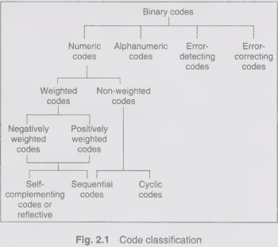

#### 2.7.1 数值码

数值码用一串0和1表示数值数据。十进制数字0到9可以用四位二进制数字表示。四位二进制数字的16种可能组合中，只有10种组合用于表示十进制数字0到9。这些表示特定十进制数字的每种位组合称为**码字**。

为表示十进制数字而设计的数值码称为**二进制编码十进制（BCD）**码。BCD码有多种，分为两类：**加权**和**非加权**。

**加权码**

加权码遵循位置加权原则，即每个位位置被赋予一个十进制权值。对于这种码，值为“1”的那些位的十进制权值之和等于它所表示的十进制数字。例如，在四位加权码中，如果 \(w_1、w_2、w_3\) 和 \(w_4\) 是各二进制位的十进制权值，\(b_1、b_2、b_3\) 和 \(b_4\) 是相应的位值，则十进制数字“\(N\)”由下式给出：

\[N = w_4.b_4 + w_3.b_3 + w_2.b_2 + w_1.b_1\]

其BCD码表示为 \(b_4b_3b_2b_1\)。该二进制序列码是十进制数 \(N\) 的码字。

加权码分为两类：

- (a) 正权码
- (b) 负权码

**正权码**是分配给各位的权值均为正的BCD码。在四位BCD码中，有17种正权码。应注意，在每种正权码中，第一个权值应为1，第二个权值应为1或2，并且所有位权之和应大于或等于十进制数9。

**负权码**是分配给各位的权值中有一部分为负的BCD码。表2.13列出了一些加权码。

表2.13 一些加权二进制编码十进制码

| 十进制数字 | 正权 (w₄, w₃, w₂, w₁)：8421 | 正权 (w₄, w₃, w₂, w₁)：5421 | 正权 (w₄, w₃, w₂, w₁)：5211 | 正权 (w₄, w₃, w₂, w₁)：2421 | 负权 (w₄, w₃, w₂, w₁)：8, 4, −2, −1 | 负权 (w₄, w₃, w₂, w₁)：6, 4, 2, −3 |
|---:|:---:|:---:|:---:|:---:|:---:|:---:|
| 0 | 0000 | 0000 | 0000 | 0000 | 0000 | 0000 |
| 1 | 0001 | 0001 | 0001 | 0001 | 0111 | 0101 |
| 2 | 0010 | 0010 | 0011 | 0010 | 0110 | 0010 |
| 3 | 0011 | 0011 | 0101 | 0011 | 0101 | 1001 |
| 4 | 0100 | 0100 | 0111 | 0100 | 0100 | 0100 |
| 5 | 0101 | 1000 | 1000 | 1011 | 1011 | 1011 |
| 6 | 0110 | 1001 | 1001 | 1100 | 1010 | 0110 |
| 7 | 0111 | 1010 | 1011 | 1101 | 1001 | 1101 |
| 8 | 1000 | 1011 | 1101 | 1110 | 1000 | 1010 |
| 9 | 1001 | 1100 | 1111 | 1111 | 1111 | 1111 |

**自补码**

如果通过互换 \(N\) 的码字中所有的1和0，能够得到 \(N\) 的9的补码（即 \(9-N\)）的码字，则称该码为自补码。数字1的9的补码是8。在(6,4,2,-3)码中，十进制1表示为0101，而十进制8表示为1010，后者是0101的1的补码。(2,4,2,1)、(5,2,1,1)、(4,3,1,1)和(3,2,2,1)码是四种正权自补码。存在13种负权和正权自补码，如(8,4,-2,-1)和(6,4,2,-3)。加权码成为自补码的必要条件是权值之和应等于9。

表2.14 余3码

| 十进制数 | 8421码 | 余3码 |
|---|---|---|
| 0 | 0000 | 0011 |
| 1 | 0001 | 0100 |
| 2 | 0010 | 0101 |
| 3 | 0011 | 0110 |
| 4 | 0100 | 0111 |
| 5 | 0101 | 1000 |
| 6 | 0110 | 1001 |
| 7 | 0111 | 1010 |
| 8 | 1000 | 1011 |
| 9 | 1001 | 1100 |

**顺序码**

**顺序码**是指其中每个后续码字都比前一个码字大一个二进制数的码。(8,4,2,1) BCD码是一种顺序码。在大多数情况下，BCD码是指表2.13所示的(8,4,2,1)码。

**非加权码**

不遵循位置加权原则的码称为非加权码。非加权二进制码有很多。其中两种是余3码（XS-3）和格雷码。表2.14和表2.15分别列出了它们。

表2.15 格雷码

| 十进制数 | 二进制码 b3 b2 b1 b0 | 格雷码 g3 g2 g1 g0 |
|---|---|---|
| 0 | 0000 | 0000 |
| 1 | 0001 | 0001 |
| 2 | 0010 | 0011 |
| 3 | 0011 | 0010 |
| 4 | 0100 | 0110 |
| 5 | 0101 | 0111 |
| 6 | 0110 | 0101 |
| 7 | 0111 | 0100 |
| 8 | 1000 | 1100 |
| 9 | 1001 | 1101 |
| 10 | 1010 | 1111 |
| 11 | 1011 | 1110 |
| 12 | 1100 | 1010 |
| 13 | 1101 | 1011 |
| 14 | 1110 | 1001 |
| 15 | 1111 | 1000 |

余3码是通过将0011加到(8,4,2,1)码或BCD码的每个码字上形成的。它是一种自补码。

格雷码是一种循环码。循环码是指相邻码字仅有一位不同的码。这类码也称为单位距离码。

#### 2.7.2 字母数字码

数字计算机能够处理位。例如，键盘和打印机分别是向计算机传输数据和从计算机接收数据的设备。用户以表示字母、数字和特殊字符的符号形式输入数据。这些符号必须用某种由二进制数字序列构成的码来表示，以便数字计算机处理。类似地，计算机将位码发送到输出设备（如打印机），该设备必须使用符号表示字母、数字或特殊字符信息。

字母数字码有多种，但通常使用ASCII和EBCDIC这两种。ASCII码称为美国信息交换标准代码，应用广泛。它是一种七位码，因此可形成 \(2^7\)（128）种位模式，从而能够编码128个符号。表2.16给出了表示大写字母/小写字母、十进制数字和特殊字符的ASCII码。由于字符按二进制数递增顺序分配，数字计算机在字母数字符号与对应编码之间进行转换很方便。

标准ASCII码定义了128个字符码（0到127），其中前32个是控制码（不可打印），其余96个是可表示的字符。上表经过组织，便于以十六进制形式读取ASCII码：行号表示较低有效数字，列号表示最高有效数字。例如，字符A位于第四行第一列。因此，字符A的ASCII码用十六进制表示为0x41，十进制为65。

除128个标准ASCII码外，还有另外128个称为扩展ASCII码的码，它们与平台相关。因此，扩展ASCII字符集不止一种。

最常用的两种扩展ASCII字符集是OEM和ANSI扩展ASCII：OEM来自IBM PC中并入的默认字符集，ANSI扩展ASCII则被当前操作系统使用。


### 表2.16 ASCII码

| 十六进制 LSD | 0 | 1 | 2 | 3 | 4 | 5 | 6 | 7 | 8 | 9 | A | B | C | D | E | F |
|---|---|---|---|---|---|---|---|---|---|---|---|---|---|---|---|---|
| 0 | NUL | SOH | STX | ETX | EOT | ENQ | ACK | BEL | BS | HT | LF | VT | FF | CR | SO | SI |
| 1 | DLE | DC1 | DC2 | DC3 | DC4 | NAK | SYN | ETB | CAN | EM | SUB | ESC | FS | GS | RS | US |
| 2 | SP | ! | " | # | $ | % | & | ' | ( | ) | * | + | , | - | . | / |
| 3 | 0 | 1 | 2 | 3 | 4 | 5 | 6 | 7 | 8 | 9 | : | ; | < | = | > | ? |
| 4 | @ | A | B | C | D | E | F | G | H | I | J | K | L | M | N | O |
| 5 | P | Q | R | S | T | U | V | W | X | Y | Z | [ | \ | ] | ^ | _ |
| 6 | ` | a | b | c | d | e | f | g | h | i | j | k | l | m | n | o |
| 7 | p | q | r | s | t | u | v | w | x | y | z | { | \| | } | ~ | DEL |

OEM字符集包含在大多数PC兼容机中，这些机器装有任意操作系统或MS-DOS系统。它包含各种符号、一些带标记的字符以及用于表示面板的图形块。然而，在许多国家，通常会根据地区配置重新定义它，以纳入特定符号。

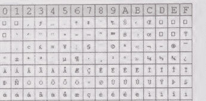

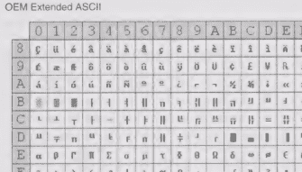

### 注意

- 数字代码用一系列0和1表示数字数据。在各种可用代码中，二进制、十六进制和BCD码使用最多。
- 符号表示大写字母/小写字母、十进制数字和特殊字符，这些统称为字母数字字符，也由1和0组合形成的字母数字代码表示。ASCII码是用于表示字母数字符号的最广泛使用的代码。

ANSI字符集是一种标准，已集成到Windows、某些UNIX平台和许多应用程序等系统中。它包含许多本地符号和带标记的字母，因此无需为其他语言重新定义即可使用。

### 小结

用量值符号表示数量的系统称为数制。数制的基数等于该系统所具有的表示符号的数量。数制中的数通常可以用以下任意一种形式表示：(a) 位置记数形式，(b) 多项式形式，(c) 紧凑形式。计算机中使用的数制是二进制、八进制和十六进制，而人类使用十进制。二进制数到十进制数的转换以及反之，利用数字所在二进制数位的基数。二进制到八进制及反之、二进制到十六进制及反之，以及不同数制之间的所有其他转换都是可能的。

无符号二进制数的加法和减法类似于十进制数所遵循的算术规则，不同之处在于这里的基数为2。二进制数的符号-数值表示法是在该数的最高有效位用0表示正数或用1表示负数。使用1的补码和2的补码表示，可以对有符号二进制数进行减法以获得正确结果。

计算机中使用的二进制代码有不同的分类。这些是数字代码、字母数字代码、检错码和纠错码。

### 关键术语

- **符号** — 它是任何图形字符。
- **数制** — 它是一组表示一组数量值的符号。
- **基数** — 它表示数制中数字符号的数量。
- **基数（Radix）** — 它表示数制中数字符号的数量。
- **十进制数制** — 它是一种具有十个符号0、1、…、9来表示数值的数制。
- **二进制数制** — 它是一种使用两个符号0和1分别表示零和一的数制。
- **八进制数制** — 它是一种具有八个符号0、1、…、7分别表示数值零到七的数制。
- **十六进制数制** — 它是一种具有八个符号0、1、…、F分别表示数值零到十六的数制。
- **位** — 它是一个二进制数字。
- **进位** — 在数制中，当两个一位数相加的结果大于可表示的最大数字符号时，称为产生进位。该进位放在下一个左侧列中。
- **借位** — 在数制中，当从较小的一个位数中减去较大的一个位数时，会产生借位。

- **有符号数** — 一种二进制数，其中最高有效位表示该数的符号，其余位表示该数的大小。
- **1的补码** — 一种曾在某些计算机中用于表示负数的数制。要形成一个数的1的补码，将该数的每一位取反，即用1替换0，用0替换1。
- **2的补码** — 将一个数的1的补码加1所形成的数。2的补码表示已成为存储有符号二进制整数的标准方法。它允许表示范围为−2^(n−1)到2^(n−1)−1的n位数，并且具有0只有一种编码的显著优点。
- **BCD数** — 二进制编码十进制（BCD）数是一种数，其中无符号十进制数的每一位都由相应的4位二进制等值表示。
- **ASCII码** — 美国信息交换标准代码是一种7位二进制代码，用于表示十进制数字0到9、字母字符a到z（也包括A到Z）以及特殊字符如:、;、NUL等，以便在数字计算机中处理这些字符，并也使用该二进制代码在联网环境中的数字计算机之间交换数据。

### 常见问题

- **1. 什么是二进制数？**

**答：**

二进制数由0和1组成。在二进制数制中，仅使用两个符号0和1来表示数值。符号“0”表示值“零”，而符号“1”表示值“一”。由于二进制数制中只有两个符号，值“二”通过在符号“0”的左侧放置符号“1”来表示，得到二进制等值“10”。接下来，值“三”在二进制数制中表示为“11”，即通过将“10”中的“0”替换为下一个更高值的符号“1”。下表展示了不同十进制数（最多九）的二进制等值表示示例。

| 十进制数（数值） | 二进制等值表示 |
|---:|---:|
| 0 | 0 |
| 1 | 1 |
| 2 | 10 |
| 3 | 11 |
| 4 | 100 |
| 5 | 101 |
| 6 | 110 |
| 7 | 111 |
| 8 | 1000 |
| 9 | 1001 |

在此，可以注意到，随着数值增大，二进制等值数左侧的数字位数增加。每向左增加一个数字位，意味着二进制数制中所表示数的值增加2。由于二进制数制中的符号数量为二，因此该数制以十进制表示的基数为2。

- **2. “位”是什么意思？**

**答：**

“二进制数字”（binary digit）的缩写形式称为位（bit）。当提到“位”时，指的是单个二进制数字，它可以是“0”或“1”。

- **3. 为什么数字计算机使用二进制数进行运算？**

**答：**

回顾计算机发展史可以发现，计算机设计者的主要目标是构建一台能够执行所有类型算术计算的计算机。最初通过采用机械装置实现这一目标，然后通过增加电气装置加以改进。但这些计算机器是没有可编程功能的计算器。可编程性的需求也通过机械和电气装置得到满足。与此同时，模拟计算机不仅用于解决算术问题，而且

此外，还有包括积分微分方程等在内的数学问题。但是，随着电子设备的出现以及布尔逻辑概念的应用，数字计算机被开发出来，它们执行任务的速度快得多、功耗更低、占用空间小得多、重量轻很多倍、维护工作量很少也能可靠工作，并且易于操作。因此，采用电子设备并应用布尔逻辑概念的数字计算机优于所有早期型号的计算机。而且由于数字计算机使用布尔逻辑概念，二进制数显然被用于数字计算机中。

#### 4. 八进制数表示法用于何处？

**答：**
八进制数表示法用于以更短的形式表示大型二进制数。这简化了使用数字计算机时对二进制数的人工处理。例如，二进制数“1011001110011010”用八进制数表示法表示为“131632”，它包含6位数字，而不是二进制形式中的16位。

#### 5. 十六进制数表示法用于何处？

**答：**
十六进制数表示法像八进制数表示法一样，是表示大型二进制数的一种简写方式。因此，二进制数“1011001110011010”在十六进制数表示法中变为B39A。从上述例子可以明显看出，对于人类计算机用户来说，处理十六进制数比处理所示的大二进制数更容易。

#### 6. BCD表示法有何用处？

**答：**
人类习惯于使用十进制数系统。因此，来自计算机或基于计算机的系统的输出，以十进制数形式比以二进制、十六进制或八进制数形式更易被接受。为实现这一点，人们制定了二进制编码的十进制数表示法。

#### 7. 格雷码用于何处？

**答：**
格雷码最初是为了防止机电开关产生虚假输出而开发的。它广泛用于数字通信中以便于纠错。在位置编码器中，格雷码优先于直接二进制编码使用。

#### 8. 二进制数的符号-数值表示法在数字计算机中有多重要？

**答：**
通常，在数字前放置“−”符号来表示该数的负性质。另一方面，通过在数字前放置“+”符号或仅留一个空白来表示正数。但在数字计算机中，这些图形符号“−”和“+”不能直接使用。所有数字和符号都由“0”和“1”的组合表示。因此，正符号“+”由“0”表示，而负符号“−”由“1”表示。符号位（“0”或“1”）占据用二进制表示的数的最高有效位位置。因此，在八位二进制数中，最高有效位是符号位，其余七位表示数值或大小。这种表示法对于数字计算机内的逻辑电路适当地执行算术运算至关重要。

#### 9. 为什么在二进制算术中2的补码表示优于1的补码表示？

**答：**
在1的补码表示中，将带符号数相加时产生的进位加到结果的最低有效位，以获得正确结果。这通过提供额外逻辑电路来形成最终结果，给计算机增加了额外负担。在2的补码表示中，将带符号数相加时产生的进位被丢弃，从而以真实数值形式获得结果。因此，在2的补码表示中避免了为获得最终结果而加回进位位的额外负担。所以优先采用2的补码表示。

### 练习题

- 1. 转换下列各数。
    - (i) 0110₂ = __________₁₀
    - (ii) 0110₂ = __________₈
    - (iii) 1101₂ = __________₁₀
    - (iv) 11₁₀ = __________₂
    - (v) 11₁₀ = __________₁₆
    - (vi) 20₁₆ = __________₂
    - (vii) 20₁₆ = __________₁₀
    - (viii) 259₁₀ = __________₂
    - (ix) 259₁₀ = __________₁₆
    - (x) 100000000₂ = __________₁₀
    - (xi) 10001010₂ = __________₁₆
    - (xii) 1024₁₀ = __________₁₆

- 2. 将下列十进制数转换为等价的二进制数。
    - (i) 702
    - (ii) 134
    - (iii) 128
    - (iv) 1024
    - (v) 563
    - (vi) 2047
    - (vii) 17.75
    - (viii) 356.16
    - (ix) 127.375
    - (x) 100.336
    - (xi) 61.0625
    - (xii) 49.0125
    - (xiii) 23.6125
    - (xiv) 36.625
    - (xv) 0.0525

- 3. 将下列二进制数转换为等价的十进制数。
    - (i) 10110.101
    - (ii) 111001010.1011
    - (iii) 110110.1101
    - (iv) 1011001.101
    - (v) 110101.001
    - (vi) 0.011011

- 4. 求下列十进制数对应的八进制数。
    - (i) 4
    - (ii) 25
    - (iii) 261
    - (iv) 73
    - (v) 385
    - (vi) 621
    - (vii) 10.25
    - (viii) 25.15
    - (ix) 0.44
    - (x) 131.3
    - (xi) 0.046
    - (xii) 0.5

- 5. 执行以下从八进制数到十进制数的转换。
    - (i) 11
    - (ii) 42
    - (iii) 507
    - (iv) 127
    - (v) 100
    - (vi) 63.4
    - (vii) 5.6
    - (viii) 0.1
    - (ix) 13.5
    - (x) 36.05

- 6. 将下列二进制数转换为八进制数。
    - (i) 1101
    - (ii) 101101
    - (iii) 1101111
    - (iv) 111111
    - (v) 10100
    - (vi) 0.11
    - (vii) 0.101
    - (viii) 1001.01101
    - (ix) 11.110011
    - (x) 1100.1101

- 7. 求下列八进制数对应的二进制数。
    - (i) 36
    - (ii) 14
    - (iii) 127
    - (iv) 251
    - (v) 1723
    - (vi) 4.6
    - (vii) 17.5
    - (viii) 64.05
    - (ix) 231.44
    - (x) 1025.625

- 8. 将下列十进制数转换为等价的十六进制数。
    - (i) 4181
    - (ii) 130
    - (iii) 171
    - (iv) 4095
    - (v) 30.10
    - (vi) 64.5
    - (vii) 10.04
    - (viii) 15.64

- 9. 将下列十六进制数转换为等价的十进制数。
    - (i) 4C
    - (ii) 512
    - (iii) 100
    - (iv) BA2
    - (v) B.2
    - (vi) 5.5
    - (vii) 4A.25
    - (viii) F.2

- 10. 将下列十六进制数转换为二进制数。
    - (i) A2
    - (ii) B35
    - (iii) 54E
    - (iv) DAE
    - (v) FE
    - (vi) 4A.6
    - (vii) 74.5
    - (viii) C7.9D
    - (ix) EF.2C
    - (x) ABC.F

- 11. 将下列二进制数转换为十六进制数。
    - (i) 101011
    - (ii) 11001011
    - (iii) 111110110101
    - (iv) 10111111001010
    - (v) 1101.01
    - (vi) 1011110.1010
    - (vii) 10110.0011
    - (viii) 1001011.01101001

- 12. 执行以下转换。
    - (i) 567₁₀ = _______________₁₆
      = _______________₈
    - (ii) A6C2₁₆ = _______________₈
      = _______________₂
    - (iii) B.2C₁₆ = _______________₈
      = _______________₁₀
    - (iv) 1011110011111.011₂ = _______________₁₆
      = _______________₈
    - (v) 101110000011₂ = _______________₁₆
      = _______________₈

- 13. 给出−7₁₀的1的补码表示。

- 14. 给出一个数的2的补码表示，该数的1的补码表示为10011₂。该数的二进制表示是什么？

- 15. 求下列各数的1的补码：
    - (i) 111001100₂
    - (ii) 11010111₂
    - (iii) 10011111₂
    - (iv) 10000000₂
    - (v) −1010₂
    - (vi) −1101₂

- 16. 求下列各数的2的补码：
    - (i) 10110₂
    - (ii) 110011₂
    - (iii) 01101₂
    - (iv) 01000₂
    - (v) −1110₂
    - (vi) −1001₂

- 17. 将下列数相加。
    - (i) 1011₂ + 0101₂
    - (ii) 1111₂ + 0101₂
    - (iii) 11₂ + 111₂
    - (iv) 10011111₂ + 01101011₂

- 18. 使用2的补码方法执行以下运算：
    - (i) 31₁₀ − 17₁₀
    - (ii) 51₁₀ − 27₁₀
    - (iii) 12₁₀ − 19₁₀
    - (iv) 25₁₀ − 49₁₀
    - (v) −19₁₀ − 12₁₀
    - (vi) −10₁₀ − 8₁₀
    - (vii) −13₁₀ + 10₁₀
    - (viii) −23₁₀ + 45₁₀
    - (ix) 1001₂ + 0100₂
    - (x) 1010₂ − 1101₂


## 布尔代数与逻辑门

## 第3章

### 学习目标


学完本章后，读者将能够：

- 识别二进制逻辑变量
- 解释布尔代数的三种基本运算
- 解释布尔代数的一些公理和定理
- 分析布尔表达式和函数及其化简方法
- 解释表示布尔函数的不同形式
- 通过高、低电平识别逻辑“真”和“假”
- 解释与门、或门、非门、与非门、或非门、异或门和同或门等逻辑门的性质
- 解释如何使用二极管和晶体管等电子器件构建逻辑门
- 使用布尔代数描述逻辑门的功能
- 解释如何用逻辑门构建由布尔表达式描述的复杂逻辑电路
- 使用与非门和或非门构建与门、或门和非门

### 3.1 布尔代数简介

布尔代数研究逻辑变量，这些变量要么是1（即真），要么是0（即假）。它使用逻辑变量和逻辑运算，按照既定规则来建立、处理并化简逻辑表达式。布尔代数由乔治·布尔（George Boole）于1854年提出，与常规代数有显著不同。布尔代数的规则简单直接，可应用于任何逻辑表达式。

定义三种基本逻辑运算及其某些组合的布尔代数规则（有时称为公理）如下：

**布尔乘法（·）**

- 0 · 0 = 0
- 1 · 0 = 0
- 0 · 1 = 0
- 1 · 1 = 1

**布尔加法（+）**

- 0 + 0 = 0
- 1 + 0 = 1
- 0 + 1 = 1
- 1 + 1 = 1

**布尔取反**

- 0̄ = 1
- 1̄ = 0

基于上述公理，衍生出以下定律：

**与定律**

- A · 0 = 0（零律）
- A · 1 = A（同一律）
- A · A = A（幂等律）
- A · A̅ = 0（互补律）

**或定律**

- A + 0 = A（零律）
- A + 1 = 1（同一律）
- A + A = A（幂等律）
- A + A̅ = 1（互补律）

**互补定律**

- 如果 A = 0，则 A̅ = 1
- 如果 A = 1，则 A̅ = 0
- A̅̅ = A（双重否定律）

**结合律**

- (A · B) · C = A · (B · C) = A · B · C
- (A + B) + C = A + (B + C) = A + B + C

**分配律**

- A · (B + C) = (A · B) + (A · C)
- A + (B · C) = (A + B) · (A + C)

**交换律**

- A · B = B · A
- A + B = B + A

从上述内容可以明显看出，布尔代数中有三种基本逻辑运算，即与（AND）、或（OR）和非（NOT）。每种运算常用的符号如表3.1所示。

**表3.1 布尔运算及其符号**

| 运算 | 符号 |
|---|---|
| 与（AND） | · |
| 或（OR） | + |
| 非（NOT） | - 或 ' |

### 3.2 定理

由上述公理，我们可以推导出以下定理。

| 定理1：幂等律 | 证明 |
|---|---|
| (a) x + x = x | (a) x + x = (x + x) · 1（同一律）<br>(x + x) · (x + x̅)（互补律）<br>x + x·x̅（分配律）<br>x + 0（互补律）<br>x（零律） |
| (b) x · x = x [（a）的对偶] | (b) 根据对偶原理，无需为（b）单独提供证明，因为它是（a）的对偶形式。 |

**对偶性**

如果将布尔代数公理推导出的任何代数等式中的或（OR）与与（AND）运算符互换，并将单位元0和1互换，该等式仍然成立。这一性质称为对偶性。例如：

- x + 1 = 1
- x · 0 = 0（对偶）

由于对偶原理，对于任何给定定理，都可以很容易地得到其对偶形式。

| 定理2：0和1的运算 | 证明 |
|---|---|
| (a) x + 1 = 1<br>(b) x · 0 = 0 [（a）的对偶] | (a) x + 1<br>x + x + x̅（互补律）<br>x + x̅（幂等定理）<br>1（互补律） |

| 定理3：吸收律 | 证明 |
|---|---|
| (a) y · x + x = x<br>(b) (y + x) · x = x [（a）的对偶] | (a) y·x + x<br>y·x + x·1（同一律）<br>y·x + 1·x（交换律）<br>(y + 1)·x（分配律）<br>1·x（0和1的运算）<br>x（同一律） |

| 定理4：德摩根定律 | 证明 |
|---|---|
| (a) (x + y)̄ = x̅ · y̅<br>(b) (x · y)̄ = x̅ + y̅<br>[（a）的对偶] | 使用布尔代数公理证明德摩根定律的过程较长。另一种方法（也适用于刚才讨论的其他定理）是完全归纳法，它使用以下真值表： |

| x | y | x+y | (x+y)̄ | x̅ | y̅ | x̅·y̅ |
|---|---|---|---|---|---|---|
| 0 | 0 | 0 | 1 | 1 | 1 | 1 |
| 0 | 1 | 1 | 0 | 1 | 0 | 0 |
| 1 | 0 | 1 | 0 | 0 | 1 | 0 |
| 1 | 1 | 1 | 0 | 0 | 0 | 0 |

#### 3.2.1 布尔定律和定理的一些应用

**示例**

证明以下等式：

- 1. \(A + BC = (A + B) (A + C)\)
  - **解答**
  - 右边 = (A + B) (A + C)
  - = A \cdot A + A \cdot C + A \cdot B + B \cdot C
  - = A + AC + AB + BC
  - = A \cdot 1 + A \cdot C + AB + BC
  - = A (1 + C) + AB + BC
  - = A \cdot 1 + A \cdot B + BC
  - = A (1 + B) + BC
  - = A \cdot 1 + BC
  - = A + BC
  - 或者
  - 左边 = A + BC
  - = A \cdot (1 + B) + BC
  - = A \cdot 1 + AB + BC
  - = A (1 + C) + AB + BC
  - = A \cdot 1 + AC + AB + BC
  - = A + AC + AB + BC
  - = A \cdot A + AC + AB + BC
  - = A (A + C) + B (A + C)
  - = (A + B) (A + C)

- 2. 证明 \(A + \bar{A}B = A\)
  - 左边 = A \cdot 1 + A \cdot \bar{B} \cdot B = A \cdot (1 + B) = A \cdot 1 = A

- 3. 证明 \(A + \bar{A}\bar{B} = 1\)
  - 左边 = A + \bar{A} + \bar{B} = 1 + \bar{B} = 1

- 4. 证明 \(A + AB = A\)
  - 左边 = A \cdot 1 + A \cdot B = A \cdot (1 + B) = A

- 5. 证明 \(A (\bar{A} + B) = AB\)
  - 左边 = A \times \bar{A} + AB = 0 + AB = AB

- 6. 证明 \(A (A + B) = A\)
  - 左边 = A \cdot A + A \cdot B = A + A \cdot B
  - = A \cdot 1 + A \cdot B = A \cdot (1 + B)
  - = A

> **注意**
> - 布尔代数处理逻辑变量，这些变量要么是1（即真），要么是0（即假）。它使用逻辑变量和逻辑运算，按照既定规则来建立、处理并化简逻辑表达式。
> - 对偶性是指：当或（OR）和与（AND）运算符互换，且单位元（二进制值）0和1互换时，由布尔代数公理推导出的任何代数等式仍然成立。
> - 德摩根的两个定理互为对偶。

### 3.3 布尔表达式

布尔表达式或逻辑表达式是一个逻辑变量，或通过逻辑运算符“·”、“+”和“-”相互关联的若干逻辑变量。对于逻辑变量A和B，以下是一些布尔表达式的示例：

- (a) A
- (b) \(\bar{A}\)
- (c) B
- (d) \(A \cdot B\)
- (e) \(A + B\)
- (f) \(A + \bar{A}B\)

### 3.4 布尔表达式的化简

下面讨论使用布尔代数的定理和公理对以下函数进行化简。

**示例**

化简以下布尔表达式：

- 1. \(XY + X\bar{Y}\)
  - **解答：**
  - 本例中很容易看出规律，因为布尔代数中的与（AND）运算符与常规代数中的乘法运算符相似。由于两者都满足分配律，因此这个规律很容易发现。
  - \(XY + X\bar{Y}\)
  - \(= (Y + \bar{Y})X\)（分配律）
  - \(= (1)X\)（互补律）
  - \(= X\)（同一律）

- 2. \((X + Y) \cdot (X + \bar{Y})\)
  - **解答：**
  - 这个例子中不太容易看出规律，因为人们不习惯“+”具有分配性。在布尔代数中，或（OR）运算符是可分配的。
  - \((X + Y) (X + \bar{Y})\)
  - \(= X + (Y \cdot \bar{Y})\)（分配律）
  - \(= X + (0)\)（互补律）
  - \(= X\)（零律）

- 3. \(Y\bar{Z} + X\bar{Y}Z + XYZ\)
  - **解答：**
  - \(Y\bar{Z} + X\bar{Y}Z + XYZ\)
  - \(= Y\bar{Z} + (X + \bar{X})YZ\)（分配律）
  - \(= Y\bar{Z} + (1)YZ\)（互补律）
  - \(= Y\bar{Z} + YZ\)（同一律）
  - \(= Y(\bar{Z} + Z)\)（分配律）
  - \(= Y(1)\)（互补律）
  - \(= Y\)（同一律）

- 19. 执行以下运算。最高有效位表示符号位，负数采用2的补码形式。
  - (i) 00011011 + 00001101
  - (ii) 00011111 − 11001111
- 20. 如果某个四位数的2的补码是1011₂，请给出其在八位中的2的补码表示。
- 21. 假设一台计算机使用六位表示二进制无符号整数和2的补码有符号整数。
  - (i) 作为无符号整数可以表示的范围是多少？
  - (ii) 作为有符号整数可以表示的范围是多少？
- 22. 将下列十进制数转换为BCD表示：
  - (i) 8₁₀  (ii) 26₁₀
  - (iii) 37₁₀  (iv) 145₁₀
- 23. 对于下列8421码中的数字，其对应的余三码表示是什么？
  - (i) 0011  (ii) 0101
  - (iii) 1001  (iv) 1000
- 24. 找出下列格雷码所表示的十进制数：
  - (i) 0011  (ii) 1011
  - (iii) 0111  (iv) 1111


4. \((X+Y)(\overline{X}+Y+Z)(\overline{X}+Y+\overline{Z})\)

**解：**

\((X+Y)(\overline{X}+Y+Z)(\overline{X}+Y+\overline{Z})\)
\(=(X+Y)((\overline{X}+Y)+Z)((\overline{X}+Y)+\overline{Z})\)（结合律）
\(=(X+Y)((\overline{X}+Y)+(Z\cdot\overline{Z}))\)（分配律）
\(=(X+Y)(\overline{X}+Y+0)\)（互补律）
\(=(X+Y)(\overline{X}+Y)\)（零律）
\(=(X\cdot\overline{X})+Y\)（分配律）
\(=0+Y\)（互补律）
\(=Y\)（零律）

本题中有两处需要使用“+”的分配性质来化简问题。解决此问题的另一种方法是使用对偶原理：

\((X+Y)(\overline{X}+Y+Z)(\overline{X}+Y+\overline{Z})\)

上述表达式的对偶式为：

\(XY+\overline{X}YZ+\overline{X}Y\overline{Z}\)

在化简此表达式并得到答案后，必须对该答案取对偶，从而得到原表达式的化简形式。

\(XY+\overline{X}YZ+\overline{X}Y\overline{Z}\) 化简为 \(Y\)

所以，

对偶 \((X+Y)(\overline{X}+Y+Z)(\overline{X}+Y+\overline{Z})\) = 对偶 \((Y)\)

\(Y\) 的对偶仍然是 \(Y\)，因此，

\((X+Y)(\overline{X}+Y+Z)(\overline{X}+Y+\overline{Z})=Y\)

5. \(X+XYZ+\overline{X}YZ+\overline{X}Y+W+XW+X\)

**解：**

这个例子较长，并使用了前面讨论的许多公理和定理。其中一项也被重复了（见第9行）。

\(X+XYZ+\overline{X}YZ+\overline{X}Y+W+XW\)
\(=X+(X+\overline{X})YZ+\overline{X}Y+(W+W)X\)（分配律）
\(=X+(1)YZ+\overline{X}Y+(1)X\)（互补律）
\(=X+YZ+\overline{X}Y+X\)（同一律）
\(=(X+X)+YZ+\overline{X}Y\)（结合律）
\(=X+YZ+\overline{X}Y\)（幂等律）
\(=X(1)+YZ+\overline{X}Y\)（同一律）
\(=X(Y+\overline{Y})+YZ+\overline{X}Y\)（互补律）
\(=XY+X\overline{Y}+YZ+\overline{X}Y\)（分配律）
\(=XY+\overline{X}Y+YZ+\overline{X}Y\)（幂等律）
\(=XY+\overline{X}Y+YZ+\overline{X}Y\)（结合律）
\(=X(Y+\overline{Y})+YZ+(X+\overline{X})Y\)（分配律）
\(=X(1)+YZ+(1)Y\)（互补律）
\(=X+YZ+Y\)（同一律）
\(=X+Y(Z+1)\)（分配律）
\(=X+Y(1)\)（同一律）
\(=X+Y\)（同一律）

6. \((X\cdot(\overline{X}Y))+(Y\cdot(\overline{X}Y))\)

**解：**

\((X\cdot(\overline{X}Y))+(Y\cdot(\overline{X}Y))\)

\(=(X\cdot(\overline{X}+Y))+(Y\cdot(\overline{X}+Y))\)（德摩根定律）
\(=(XX+X\overline{Y})+(YX+Y\overline{Y})\)（分配律）
\(=(0+X\overline{Y})+(YX+0)\)（互补律）
\(=(XY)+(YX)\)（零律）

7. \(XY+\overline{X}Z+YZ\)

**解：**

这里需要展开表达式以获得更简单的解。

\(XY+\overline{X}Z+YZ\cdot1\)
\(=XY+\overline{X}Z+YZ\cdot(X+\overline{X})\)（同一律）
\(=XY+\overline{X}Z+XYZ+\overline{X}YZ\)（互补律）
\(=XY+\overline{X}Z+XYZ+\overline{X}YZ\)（分配律）
\(=XY+XYZ+\overline{X}Z+\overline{X}YZ\)（交换律）
\(=XY+XYZ+\overline{X}Z+\overline{X}YZ\)（交换律）
\(=XY(1+Z)+\overline{X}Z(1+Y)\)（分配律）
\(=XY(1)+\overline{X}Z(1)\)（同一律）
\(=XY+\overline{X}Z\)（同一律）

8. \(X\cdot X\)

**解：**

这是已证明的幂等定理的对偶；由于对偶原理，该等式成立。

\(X\cdot X\)
\(=X\cdot X+0\)（零律）
\(=X\cdot X+(X\cdot\overline{X})\)（互补律）
\(=X\cdot(X+\overline{X})\)（分配律）
\(=X\cdot(1)\)（互补律）
\(=X\)（同一律）

### 检查你的学习进展

- 1. 布尔表达式 \((\overline{A}\cdot B\cdot C)+(A\cdot\overline{B}\cdot C)\) 的化简结果为
  - (a) 0
  - (b) 1
  - (c) A
  - (d) \(BC\)
  
  **答案：(b)**

- 2. 布尔表达式 \(\overline{A}\cdot B+A\cdot\overline{B}+A\cdot B\) 等价于
  - (a) \(A+B\)
  - (b) \(\overline{A}\cdot B\)
  - (c) \(\overline{A}+B\)
  - (d) \(A\cdot B\)
  
  **答案：(a)**

- 3. 用布尔代数化简时，\((x+y)(x+z)\) 化简为
  - (a) \(x\)
  - (b) \(x+x(y+z)\)
  - (c) \(x(1+yz)\)
  - (d) \(x+yz\)
  
  **答案：(d)**

- 4. \(\overline{(\overline{AB}+\overline{A}+AB)}\) 的化简结果为
  - (a) 1
  - (b) 0
  - (c) A
  - (d) AB
  
  **答案：(b)**

### 3.5 布尔函数与真值表

一个或多个逻辑变量的布尔函数（逻辑变量也称为布尔变量）是一个二值变量，其值取决于这些逻辑变量的值。例如，独立布尔变量 $A$ 和 $B$ 可以取任意选定的值，而布尔函数 $f(A,B)$ 的值取决于 $A$ 和 $B$ 的值，因此：$F_1 = AB\overline{C}$ 在 $A = 1$（真）、$B = 1$（真）、$C = 0$（假）时使 $F_1 = 1$（真）。

描述给定布尔函数在其独立变量所有可能取值组合下的值的表格，称为真值表。考虑由两个逻辑变量 $A$ 和 $B$ 构成的布尔函数 $f(A,B)$，其定义为：

$f(A,B) = A \cdot B + \bar{A} \cdot \bar{B}$ (3.1)

该函数的真值表如表 3.2 所示。

**表 3.2** 对于 $f(A, B)$

| $A$ | $B$ | $f(A,B)$ |
|---|---|---|
| 0 | 0 | 1 |
| 0 | 1 | 0 |
| 1 | 0 | 0 |
| 1 | 1 | 1 |

表中前两列给出了 $A$ 和 $B$ 的四种可能取值组合。可以验证该真值表是否确实表示式 (3.1) 所表达的函数。对于真值表的第 1 行，$A = 0$，$B = 0$；因此，将这些值代入式 (3.1)，得 $f(A,B) = 0 \cdot 0 + \bar{0} \cdot \bar{0} = 0 + 1 = 1$。对于真值表的第 2 行，$A = 0$，$B = 1$，因此 $f(A,B) = 0 \cdot 1 + \bar{0} \cdot \bar{1} = 0 + 0 = 0$。同样，对于真值表的第 3 行，$A = 1$，$B = 0$，因此 $f(A,B) = 1 \cdot 0 + \bar{1} \cdot \bar{0} = 0 + 0 = 0$。类似地，对于真值表的第 4 行，$A = 1$，$B = 1$，$f(A,B) = 1 \cdot 1 + \bar{1} \cdot \bar{1} = 1 + 0 = 1$。

$f(A,B)$ 的所有计算值都与真值表相应行中所示的值一致。因此，给定布尔函数的真值表确实表示该函数。

### 3.6 由真值表构造布尔函数

布尔函数可以由给定真值表的值构建。考虑表 3.2，当以下情况时，$f(A,B)$ 的值为 1：

$A = 0$ 且 $B = 0$

或 $A = 1$ 且 $B = 1$

上述条件也可写为

$\bar{A} = 1$ 且 $\bar{B} = 1$

或 $A = 1$ 且 $B = 1$

这些条件还可以进一步改写为以下逻辑积：

$\bar{A} \cdot \bar{B} = 1$ 或 $A \cdot B = 1$

因此可以得出结论：当 $\bar{A} \cdot \bar{B} = 1$ 或 $A \cdot B = 1$ 时，$f(A,B)$ 为 1，因此：

$f(A,B) = A \cdot B + \bar{A} \cdot \bar{B}$ (3.2)

该函数与式 (3.1) 中的函数相同。因此，给定一个真值表，就可以构造出相应的布尔函数。

式 (3.2) 中的布尔函数是通过考虑使 $f(A,B)$ 为 1 的变量 $A$ 和 $B$ 的取值组合，从真值表（表 3.2）构造出来的。现在，从同一真值表出发，也可以针对使该函数为 0 的 $A$ 和 $B$ 的取值组合，构建另一个布尔函数 $f(A,B)$。由表 3.2，当以下情况时，$f(A,B)$ 的值为 0：

$A = 0$ 且 $B = 1$

或 $A = 1$ 且 $B = 0$

上述条件可写为

$A = 0$ 且 $B = 1$

或 $\bar{A} = 0$ 且 $B = 0$

这些条件还可以进一步改写为以下逻辑和：

$A + \bar{B} = 0$ 或 $\bar{A} + B = 0$

因此可以得出结论：只要这两种组合中的任一种为 0，$f(A,B)$ 就为 0。因此，

$f(A,B) = (A + \bar{B}) \cdot (\bar{A} + B)$ (3.3)

现在，

$f(A,B) = (A + \bar{B}) \cdot (\bar{A} + B)$

$= A \cdot \bar{A} + A \cdot B + \bar{B} \cdot \bar{A} + \bar{B} \cdot B$

$= 0 + A \cdot B + \bar{A} \cdot \bar{B} + 0$

$= A \cdot B + \bar{A} \cdot \bar{B}$,

这与式 (3.2) 相同。

式 (3.2) 中的函数是逻辑积的逻辑和，而式 (3.3) 中的函数是逻辑和的逻辑积。这些函数彼此相等，但形式不同。因此，一个真值表至少可以用两个相等的布尔函数来表示。

**项** 在布尔函数中，形成一组的逻辑变量组合称为项。

**文字** 项中每个取补或不取补的变量称为一个文字。

### 3.7 规范形式与标准形式

在布尔函数中，如果所有项都写成布尔变量的 AND 组合，则对于 $n$ 个变量，有 $2^n$ 个这样的 AND“项”。这些 AND 项称为

最小项记为 $m_0, m_1, \ldots, m_n$ 等，其中下标表示由组合变量的等效二进制值所得到的十进制值。

最小项也称为标准乘积项。类似地，对变量进行或运算形成最大项。对于三个变量，最小项和最大项如表3.3所示确定。

**表3.3** 规范形式和标准形式汇总

| A | B | C | 最小项表达式 | 最小项编号 | 最大项表达式 | 最大项编号 |
|---|---|---|---|---|---|---|
| 0 | 0 | 0 | $\overline{A}\,\overline{B}\,\overline{C}$ | $m_0$ | $A+B+C$ | $M_0$ |
| 0 | 0 | 1 | $\overline{A}\,\overline{B}C$ | $m_1$ | $A+B+\overline{C}$ | $M_1$ |
| 0 | 1 | 0 | $\overline{A}B\,\overline{C}$ | $m_2$ | $A+\overline{B}+C$ | $M_2$ |
| 0 | 1 | 1 | $\overline{A}BC$ | $m_3$ | $A+\overline{B}+\overline{C}$ | $M_3$ |
| 1 | 0 | 0 | $A\overline{B}\,\overline{C}$ | $m_4$ | $\overline{A}+B+C$ | $M_4$ |
| 1 | 0 | 1 | $A\overline{B}C$ | $m_5$ | $\overline{A}+B+\overline{C}$ | $M_5$ |
| 1 | 1 | 0 | $AB\overline{C}$ | $m_6$ | $\overline{A}+\overline{B}+C$ | $M_6$ |
| 1 | 1 | 1 | $ABC$ | $m_7$ | $\overline{A}+\overline{B}+\overline{C}$ | $M_7$ |

由于每个最小项或最大项都是由全部 n 个带反变量或不带反变量的变量组合而成，因此它们中的每一个都称为规范项。每个最小项通过对变量进行与运算得到：若某变量对应的二进制值为0，则该变量带上划线；若其二进制值为1，则不带。类似地，每个最大项通过对变量进行或运算得到：若某变量对应的二进制值为1，则该变量带上划线；若为0，则不带。应注意，每个最大项都是其对应最小项的补，反之亦然。

任何布尔函数都可以表示为使其值为1的那些最小项的或组合。该函数形式是最小项的“和”或标准“乘积项”。布尔函数也可以表示为使其值为0的那些最大项的与组合。因此，该函数是最大项的“积”。写成最小项之和或最大项之积的布尔函数称为处于**规范形式**。德摩根定理允许在两种规范形式之间进行转换。布尔代数的两种规范形式是基本形式。

表示布尔函数的另一种方法是**标准形式**。标准形式有两种：乘积项之和与和项之积。

**乘积项之和**是包含与项的布尔表达式，这些与项称为乘积项，由一个或多个逻辑变量构成。和表示对这些项进行或运算。示例：$f_1(A,B,C) = \overline{B} + AB + A\overline{B}C$

**和项之积**是包含或项的布尔表达式，这些或项称为和项，由一个或多个逻辑变量组成。积表示对这些项进行与运算。示例：$f_2 = A \cdot (B+C) \cdot (A+B+C+D)$

布尔函数也可以表示为非标准形式。例如：$F_3 = (AB + CD)(\overline{A}\,\overline{B} + \overline{C}\,\overline{D})$ 既不是乘积项之和形式，也不是和项之积形式。然而，可以利用分配律将其转换为标准形式，即 $F_3 = AB\overline{C}\,\overline{D} + \overline{A}\,\overline{B}CD$。

### 3.8 规范形式布尔函数的数值表示

对于具有规范乘积项之和的布尔函数，可以通过列出函数值为1的最小项所对应的十进制值，将其表示为紧凑形式。

例如，一个三变量函数的真值表如下所示。三个变量中的每一个都可取0或1，从而产生该函数可能为真的八种可能取值组合。这八种组合按二进制升序列出，其等效十进制值也见表3.4。

**表3.4** 布尔项的等效十进制值

| 十进制值 | A | B | C | F |
|---|---|---|---|---|
| 0 | 0 | 0 | 0 | 1 |
| 1 | 0 | 0 | 1 | 0 |
| 2 | 0 | 1 | 0 | 1 |
| 3 | 0 | 1 | 1 | 1 |
| 4 | 1 | 0 | 0 | 0 |
| 5 | 1 | 0 | 1 | 0 |
| 6 | 1 | 1 | 0 | 0 |
| 7 | 1 | 1 | 1 | 1 |

对于所示的变量组合，函数 f 的值为1，因此

$f(A, B, C) = \overline{A}\cdot\overline{B}\cdot\overline{C} + \overline{A}B\overline{C} + \overline{A}BC + ABC \quad (3.4)$

这也可以写成

$f(A, B, C) = (000) + (010) + (011) + (111)$

求和符号表示这些项通过或运算组合在一起。该函数可以表示为如下紧凑形式：

$f(A, B, C) = \sum m(0, 2, 3, 7) = m_0 + m_2 + m_3 + m_7$

**注**
- (a) 数字的位置不得改变。
- (b) 表达式必须为标准乘积项之和形式。

类似地，可以通过列出函数值为0的最大项所对应的十进制值，将布尔函数表示为紧凑形式。由表3.4，考虑函数值为0的项，则

$f(A, B, C) = (A + B + \overline{C})\cdot(\overline{A} + B + C)\cdot(\overline{A} + B + \overline{C})\cdot(\overline{A} + \overline{B} + C)$

用紧凑形式表示为

$f(A, B, C) = \Pi M(1, 4, 5, 6) = M_1M_4M_5M_6$

**注**
- 布尔表达式或逻辑表达式是一个布尔变量，或若干这样的变量通过逻辑运算符“·”、“+”和“–”相互关联而成的表达式。
- 含一个或多个逻辑变量的布尔函数（也称为布尔变量）是一个二值变量，其值取决于这些逻辑变量的值。
- 布尔函数可以用真值表表示，也可以表示为乘积项之和，或表示为和项之积。
- 对于具有规范乘积项之和的布尔函数，可以通过列出函数值为1的最小项所对应的十进制值，将其表示为紧凑形式。同样，也可以通过列出函数值为0的最大项所对应的十进制值，将布尔函数表示为紧凑形式。

### 3.9 逻辑门

布尔函数或表达式可以利用电子门来实现。必须理解，作为输入馈送到门的逻辑“1”和逻辑“0”由两个不同的电压电平表示。即使是逻辑“1”或“0”的输出，也由不同的电压电平表示。有三种基本逻辑运算，所有其他布尔函数无论多么复杂，都可以由它们导出。这些运算分别称为*与*、*或*和*非*。每种运算都有特定的符号和明确定义的行为。这些运算由三种基本门实现：与门、或门和非门。另外四种派生门——与非门、或非门、异或门和同或门——也用于构造逻辑函数。与非门和或非门称为通用门。

#### 3.9.1 与门

与门是一种具有两个或更多输入且只有一个输出的电子电路。仅当其所有输入均为高电平时，才给出高电平输出（1）。如果 A 和 B 是二输入与门的逻辑输入，则输出 Y 等于 A · B。点（·）表示与运算。该点通常省略，如图3.1中的输出所示。与门也称为全有或全无门。与门的真值表见表3.5。

**表3.5** 二输入与门的真值表

| 输入 |  | 输出 |
|---|---|---|
| A | B | Y = A · B |
| 0 | 0 | 0 |
| 0 | 1 | 0 |
| 1 | 0 | 0 |
| 1 | 1 | 1 |

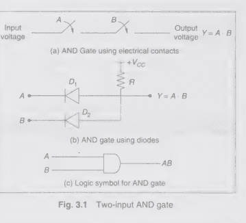

在图3.1(b)中由二极管构成的与门中，当 A 处电压为 +V_CC 伏且 B 处电压为 +V_CC 伏时，二极管 D1 和 D2 均不导通，这意味着二极管截止。因此，没有电流流过 R。结果，R 两端不产生电压。这使得 Y 处的电压几乎等于 +V_CC 伏。但是，如果 A 处电压为零伏，或 B 处电压为零伏，或 A 和 B 都等于零伏，则相应的二极管 D1 或 D2 导通，或两个二极管都导通。这使得电压


**表 3.9 非门的真值表**

| 输入 (A) | 输出 (\(Y = \bar{A}\)) |
| --- | --- |
| 0 | 1 |
| 1 | 0 |

图 3.3(b) 中的非门使用一个晶体管。当施加到输入端 A 的电压为零伏时，晶体管处于反向偏置，因此截止。因此 Y 端的电压为 +Vcc，即高电平。但当 A 为 +Vcc 时，晶体管处于正向偏置，从而使晶体管进入导通状态或饱和状态。Y 端的电压为 Vcc（饱和），实际上为零伏，即 Y 为低电平。该电路的真值表如表 3.10 所示。

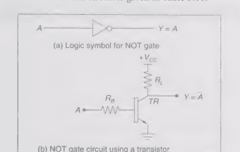

**表 3.10 非门的真值表（Vcc = 5 V）**

| 输入 (A) | 输出 (\(Y = \bar{A}\)) |
| --- | --- |
| 0 V | 5 V |
| 5 V | 0 V |

#### 3.9.4 与非门

与非门实现与非功能，即 NOT-AND。对输入进行与运算，然后再取非，得到单个输出。如果任一或所有输入为低电平，则与非门的输出为高电平。当所有输入均为高电平时，输出为低电平。表 3.11 给出了二输入与非门的真值表。

**表 3.11 二输入与非门的真值表**

| 输入 A | 输入 B | 输出 (\(Y = \overline{AB}\)) |
| --- | --- | --- |
| 0 | 0 | 1 |
| 0 | 1 | 1 |
| 1 | 0 | 1 |
| 1 | 1 | 0 |

在图 3.4 中，与非门输出端的圆圈表示逻辑反转，就像反相器输出端的圆圈一样。注意，输出是与运算后输入值的上划线。如图所示，与非功能也可以由带反相圆圈的或门（气泡或门）来实现。

与与门一样，可施加到与非功能的输入数量没有限制，因此与非门可具有的输入数量也没有功能上的限制。然而，出于实际原因，商用与非门最常制造成二输入、三输入或四输入，以适配 14 引脚或 16 引脚 IC 封装。

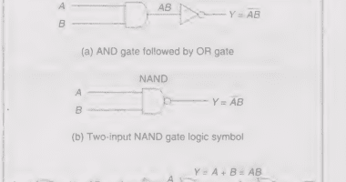

#### 3.9.5 或非门

或非门是输出反相的或门。或门在其任一或多个输入为高电平时允许输出为高电平（逻辑 1），而或非门则将其反相，并在任一输入为高电平时强制输出为逻辑 0，即如果或非门的任一输入为高电平，则输出为低电平。当所有输入均为低电平时，输出为高电平。二输入或非门的真值表如表 3.12 所示。

或非功能使用加号（+）运算符，输出用带有上划线的表达式表示，以指示或运算的反相。在图 3.5(b) 所示的逻辑图中，该符号表示或非门。这是一个带有表示反相的圆圈的或门。或非功能也可以由带反相圆圈的与门（气泡与门）来实现，如图 3.5(c) 所示。

或非功能可以有任意数量的输入，但只有一个输出。与其他门一样，实际商用或非门大多限于二输入、三输入和四输入，以适配标准 IC 封装。

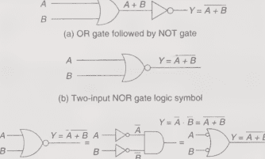

**表 3.12 二输入或非门的真值表**

| A | B | 输出 (\(Y = \overline{A + B}\)) |
|---|---|---|
| 0 | 0 | 1 |
| 0 | 1 | 0 |
| 1 | 0 | 0 |
| 1 | 1 | 0 |

#### 3.9.6 异或门（XOR 门）

异或门（XOR 门）是一种二输入电路，如果其输入之一为高电平（但不是两者同时为高电平），则输出高电平。异或门的真值表如表 3.13 所示。

异或功能是基本或功能的一种有趣且有用的变体。其功能可以表述为“A 或 B，但不同时为真”。仅当两个输入不同时，异或门才产生逻辑 1 输出。如果输入相同，则输出为逻辑 0。异或门也称为反符合门或不等检测器。

异或符号是标准或符号的变体，如图 3.6(a) 所示。带圈的加号 ⊕ 用于表示异或运算。

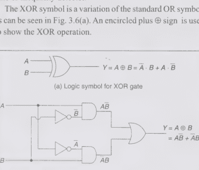

关于异或，有几个有趣的事实。其一是，一个位与自身进行异或运算时，无论原始位是 0 还是 1，结果均为零。与标准或/或非和与/与非功能不同，异或功能始终恰好有两个输入，商用制造的异或门也是如此。

通常，如果输入变量中有奇数个为逻辑 1，则 n 输入变量的异或运算将产生逻辑 1 输出。也就是说，当输入中 1 的个数为奇数时，异或门的输出为高电平。这在生成奇偶校验位时很有用。

**表 3.13 异或门的真值表**

| A | B | 输出 (\(Y = A \oplus B\)) |
|---|---|---|
| 0 | 0 | 0 |
| 0 | 1 | 1 |
| 1 | 0 | 1 |
| 1 | 1 | 0 |

#### 3.9.7 同或门（XNOR 门）

同或门是异或门后接一个非门。同或门是一种二输入一输出的逻辑门电路。在该门中，如果两个输入均为低电平或均为高电平，则输出为高电平。同或门的逻辑符号如图 3.7 所示。表 3.14 给出了二输入同或门的真值表。

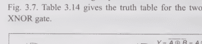

**表 3.14 二输入同或门的真值表**

| A | B | 输出 (\(Y = A \odot B\)) |
|---|---|---|
| 0 | 0 | 1 |
| 0 | 1 | 0 |
| 1 | 0 | 0 |
| 1 | 1 | 1 |

二输入同或门的输出 Y（其中 A 和 B 为输入）由下式给出

```
Y = A ⊕ B = A̅ ⋅ B + A ⋅ B̅
= A̅B̅ ⋅ AB = (A̅ + B̅) ⋅ (A + B)  De Morgan's Theorem
= \overline{(A + B) \cdot (\overline{A} + B)}
= \overline{A} \cdot \overline{A} + \overline{A} \cdot B + \overline{B} \cdot \overline{A} + \overline{B} \cdot B = A + B + \overline{A} \cdot \overline{B} = A \oplus B
```

图 3.7 中的同或门输出在输入相同时（即两个输入均为 1 或均为 0 时）为高电平，否则输出为低电平。因此，它被称为符合门。它可以用作一位比较器或相等检测器。

同或运算 \(\odot\) 的符号如图 3.7 所示。如果同或门输入中 1 的个数为偶数，则输出为 1；否则，如果 1 的个数为奇数，则输出为 0。同或门的这一特性用于构成偶校验检查器。

**注意**

- 与门、或门和非门这三种门可以一起用于实现布尔函数。
- 如果一个位与自身进行异或运算，无论原始位是 0 还是 1，结果均为零。
- 如果输入变量中有奇数个为逻辑 1，则 n 输入变量的异或运算将产生逻辑 1 输出。
- 在同或运算中，如果输入中 1 的个数为偶数，则输出为 1。

### 3.10 用代数方法描述逻辑电路

任何逻辑电路，无论多么复杂，都可以使用布尔运算来完整描述，因为或门、与门和非门是数字系统的基本构建模块。将逻辑电路的逻辑输出与逻辑电路的二进制输入联系起来的代数表达式称为布尔表达式。图 3.8 显示了一个使用布尔表达式的电路图。

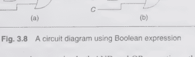

如果表达式中同时包含与运算和或运算，则先执行与运算。例如，在 \(Y = AB + C\) 中，先执行 \(AB\)，除非表达式中存在括号，此时先执行括号内的运算。也就是说，在 \(Y = (A + B) + C\) 中，先执行 \(A + B\)。

每当逻辑电路图中存在反相器时，其输出表达式就等于输入表达式上方加上划线（\(\overline{\quad}\)）。图 3.9 显示了一个包含反相器的电路。

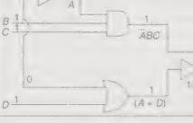

### 3.11 由布尔表达式实现逻辑电路

如果电路的操作由布尔表达式定义，则可以直接根据该表达式绘制逻辑电路图。

假设要构造一个输出为 \(Y = AC + B\overline{C} + \overline{A}BC\) 的电路。该布尔表达式包含三项（\(AC\)、\(B\overline{C}\)、\(\overline{A}BC\)），它们进行或运算。这意味着需要一个三输入或门，其输入分别等于 \(AC\)、\(B\overline{C}\) 和 \(\overline{A}BC\)。每个或门输入都是一个与乘积项，这意味着可以使用具有适当输入的与门来生成这些项中的每一项。注意，表达式中需要使用反相器来产生 \(\overline{A}\) 和 \(\overline{C}\) 项。逻辑电路的构建分步骤完成。对于上述布尔表达式，这些步骤如图 3.10 和 3.11 所示。

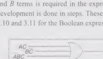

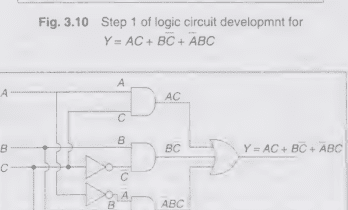


### 3.12 NAND 门与 NOR 门的通用性

NAND 和 NOR 被称为通用门，因为 AND、OR 和 NOT 门均可用其中任意一种来构造。

仅使用 NAND 门就可以实现*任何*逻辑表达式。这是因为 NAND 门经过适当组合，可用于执行 OR、AND 和 NOT 中的每一种布尔运算。图 3.12 展示了如何使用 NAND 门实现 AND、OR 和 NOT 运算。类似地，图 3.13 展示了如何使用 NOR 门实现 AND、OR 和 NOT 运算。

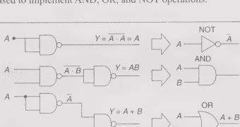

图 3.12 NAND 门执行 OR、AND 和 NOT 运算

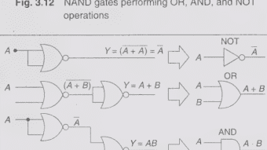

图 3.13 NOR 门执行 NOT、OR 和 AND 运算

### 注意

- NAND 门和 NOR 门不仅可用于实现 AND、OR 和 NOT 门功能，还可实现任何复杂的布尔函数。

### 检查你的进度

- 1. 当两个输入为以下哪项时，NAND 门输出为低电平
  (a) 00 (b) 01
  (c) 10 (d) 11
  答案：(d)

- 2. 当输入信号 A = 11001 串行施加到 NOT 门时，其输出信号为
  (a) 00111 (b) 00110
  (c) 10101 (d) 11001
  答案：(b)

- 3. 写出布尔函数：
  F (A, B, C) = Σm(1, 4, 5, 6, 7) 的标准 POS 形式表达式。
  答案：F = (A + B + C)(A + \bar{B} + C)(A + \bar{B} + \bar{C})

- 4. 通用逻辑门是可用于生成任何逻辑函数的门。以下哪一项是通用逻辑门？
  (a) OR (b) AND
  (c) XOR (d) NAND
  答案：(d)

- 5. 布尔函数的“最大项形式”为
  F(A,B,C,D) = ΣM(1, 2, 3, 4, 5, 6, 7, 8, 9, 10, 11, 12, 13, 14, 15)。该函数的等价“最小项形式”为
  (a) Σm(0) (b) ABCD
  (c) ABC (d) \bar{A}\bar{B}\bar{C}\bar{D}
  答案：(a)

### 小结

可取值为“真”或“假”的变量是逻辑变量。布尔代数的基本运算为 AND、OR 和 NOT。AND、OR、求补、结合律、分配律和交换律等运算均由此发展而来。对偶性质和德摩根定理也由基本布尔运算推导而来。借助上述定律和定理，可以对布尔表达式进行化简。布尔表达式或函数可用真值表、最小项或最大项表示。

逻辑门的输入和输出具有两个离散电压值。AND 门是由电子器件构成的电路，仅当所有输入均为“真”时才输出“真”。OR 门由电子器件构成，只要任一输入为“真”，就输出“真”。在 NOT 门中，无论施加何种输入，输出端都会出现相反的逻辑状态，例如输入为“真”时输出为“假”，反之亦然。NAND 门等效于 NOT-AND，NOR 门等效于 NOT-OR。XOR 门与 OR 门类似，不同之处在于当两个输入均为 1 时，输出为 0。XNOR 门也称为同或门，仅当两个输入均为 0 或均为 1 时输出 1。任何布尔表达式都可以用逻辑门作为构建模块来实现。NAND 和 NOR 是通用门，因为它们可用于构造基本逻辑门。

### 关键术语

- **真（TRUE）** 在布尔代数中，真表示“1”。
- **假（FALSE）** 在布尔代数中，假表示“0”。
- **布尔代数** 布尔代数是命题代数。它处理 0 和 1 或真和假两个值。
- **布尔变量或逻辑变量** 它是一种可被赋予 0 或 1 这两个值中任意一个的变量。
- **公理** 它是已确立的陈述或命题。
- **与（AND）** 它是一种运算，仅当所有输入均为真时输出才为“真”。
- **或（OR）** 它是一种运算，只要至少一个输入为真，输出就为真。
- **非（NOT）** 它是一种产生输入补码输出的运算。
- **与非（NAND）** 它是一种运算，其输出由所有输入进行 AND 运算后再取补得到。
- **或非（NOR）** 它是一种运算，其输出由所有输入进行 OR 运算后再取补得到。
- **对偶性** 它是一种性质：由布尔代数公理推导出的任何代数等式，在交换运算符 OR 和 AND 并交换单位元素 0 和 1 后仍然成立。
- **文字** 文字是变量或其补变量。例如：X、X̄、Y、Ȳ。
- **布尔函数** 布尔函数是一种取值为 0 或 1 的布尔变量，其值由涉及布尔变量和诸如“·”、“+”和“—”等逻辑运算符的逻辑计算求出。
- **真值表** 它是一种表格，描述输出布尔函数在布尔输入的不同取值集合下的布尔值 0 或 1。
- **项** 项是由 AND 运算或 OR 运算形成的布尔变量集合，例如 ABC 或 (a + c + d)。
- **乘积项** 它是由两个或更多布尔变量进行 AND 运算形成的项。
- **和项** 它是由两个或更多布尔变量进行 OR 运算形成的项。
- **最小项** 它是一种特殊的文字乘积，其中每个输入变量恰好出现一次。具有 n 个输入变量的函数有 2^n 个最小项，因为每个变量可以以补变量或非补变量形式出现。
- **最大项** 它是一种文字之和，其中每个输入变量恰好出现一次。具有 n 个变量的函数有 2^n 个最大项，因为每个变量可以以补变量或非补变量形式出现。
- **乘积项之和** 它是由乘积项的“和”构成的函数。
- **和项之积** 它是由和项的“积”构成的函数。
- **规范形式** 它是由最小项或最大项构成的函数。

### 常见问题

- **1. 什么是布尔变量？**
  **答案：** 布尔变量是一种量，在任意时刻，它在布尔代数系统中可持有值“1”或“0”。布尔变量用字母符号表示。

- **2. 什么是布尔代数？**
  **答案：** 布尔代数是命题代数。它处理三个基本二进制逻辑运算符以及取值为 0 或 1 的布尔变量。基于此，该代数具有若干定律和定理。对于任何在一组输入变量的不同二进制值组合下输出为“真”的系统，布尔代数有助于通过布尔函数建立输出变量与输入变量之间的关系。

- **3. 什么是逻辑门？**
  **答案：** 它是一种对一个或多个布尔变量输入执行 AND、OR 或 NOT 等布尔运算，以产生单个布尔输出变量的电路。

- **4. 什么是“包含或”门？**
  **答案：** 它是一种门，只要所有输入中有一个输入为“真”，输出就为“真”，否则输出为“假”。

- **5. 什么是“同或”门？**
  **答案：** XNOR 门称为“同或”门。只要门的输入相同，即所有输入均为“1”或均为“0”，输出就为“1”。这强调了该门被称为“同或”门的原因。

- **6. 如何根据真值表构造布尔函数？**
  **答案：** 真值表描述函数在所有可能输入变量二进制取值下的二进制值。该函数的 SOP 形式布尔表达式，可以通过仅对函数值为“1”的那些输入变量组合所形成的乘积项进行 OR 运算来得到。构造该函数 POS 形式布尔表达式的另一种方法，是对函数值为“0”的那些组合的和项取乘积。无论函数采用 SOP 形式还是 POS 形式，使用任一方法得到的表达式都是等价的。下面给出了一个说明示例。

  **示例：** 下面给出了一个真值表。求该函数的 SOP 和 POS 形式，并说明布尔函数 Y 的这两种表达形式是等价的。


#### 真值表

| A | B | C | Y |
|---|---|---|---|
| 0 | 0 | 0 | 0 |
| 0 | 0 | 1 | 1 |
| 0 | 1 | 0 | 0 |
| 0 | 1 | 1 | 1 |
| 1 | 0 | 0 | 1 |
| 1 | 0 | 1 | 0 |
| 1 | 1 | 0 | 1 |
| 1 | 1 | 1 | 0 |

SOP（最小项之和）形式的函数 Y 如下所示：

`Y = A̅B̅C + A̅BC̅ + AB̅C̅ + ABC̅ = C̅ + A̅C`  ...(i)

POS（最大项之积）形式的函数 Y 如下所示：

`Y = (A̅ + B + C)(A + B̅ + C)(A + B + C̅)(A̅ + B̅ + C̅) = (A̅ + C)(A + C)`  ...(ii)

对 (ii) 取补，得到

`Y = (A + B + C̅) · (A̅ + B̅ + C) · (A̅ + B + C̅) · (A̅ + B̅ + C̅)`

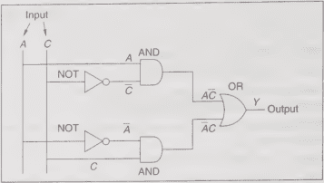

`Y = (A + C) · (A̅ + C̅) = A̅C + AC̅`

可以发现，Y 的表达式在 SOP 和 POS 两种形式下是相同的。

#### 7. 如何使用逻辑门实现布尔函数？

**答案：**

布尔函数可以借助逻辑门来实现。下面的例子可以很好地说明这一点。

考虑函数 `Y = A · C̅ + A̅ · C`。这里，第一个乘积项需要先对 C 取非（NOT），再与 A 进行与运算（AND）。第二个乘积项则先对 A 取非，再与 C 进行与运算。然后将这两项进行或运算（OR），即可得到函数 Y。下图展示了使用与门、或门和非门，由输入 A 和 C 实现该函数 Y 的电路。

#### 8. 为什么需要化简布尔函数？

**答案：**

表示布尔函数的表达式需要进行化简或简化，主要原因是为了减少表达式中的项数。这反过来又会减少实现该函数所需的逻辑门数量。因此，可以实现该函数的逻辑电路的复杂度、硬件和成本都可以得到降低。

#### 9. 如何使用紧凑形式表示布尔函数？

**答案：**

对于采用规范最小项之和形式的布尔函数，可以通过列出使函数值为 1 的最小项所对应的十进制数值，用紧凑形式来表示。例如，以下以 SOP 形式表示的布尔函数可以用紧凑形式表示如下：

`Y = A̅B̅C + A̅BC̅ + AB̅C̅ + ABC̅`

`Y = Σm (1, 3, 4, 6, 7) = m₁ + m₃ + m₄ + m₆ + m₇`

类似地，可以通过列出使函数值为 0 的最大项所对应的十进制数值，用紧凑形式来表示布尔函数。因此，以下以 POS 形式表示的布尔函数可以用紧凑形式表示如下：

`Y = (A + B + C) · (A + B̅ + C) · (A̅ + B + C̅)`

`Y = ΠM (0, 2, 5) = M₀M₂M₅`

#### 10. 用 SOP 形式和 POS 形式表示布尔函数有什么区别？

**答案：**

区别在于表示布尔函数的表达式的构成方式。在 SOP 形式中，表达式通过对最小项进行或运算（OR）构成；而在 POS 形式中，表达式通过对最大项进行与运算（AND）构成。这一点在上一题的答案所给出的例子中得到了很好的说明。

### 练习

- 1. 求解下列各式。
  - (i) `A + 1 = ______`
  - (ii) `A + 0 = ______`
  - (iii) `A · 1 = ______`
  - (iv) `A + A̅ = ______`
  - (v) `A + A̅ = ______`
  - (vi) `A · 0 = ______`
  - (vii) `A · A̅ = ______`
  - (viii) `A · A = ______`

- 2. 陈述德摩根定理。

- 3. 为下列布尔函数构造真值表。
  - (i) Q = AB + \bar{A}B
  - (ii) Q = A · B
  - (iii) Q = A + B
  - (iv) Q = A
  - (v) Q = \bar{A} + B
  - (vi) Q = \bar{A} · B
  - (vii) Q = A + \bar{B} · C
  - (viii) Q = (A + B) · C
  - (ix) Q = A · \bar{B} + C · \bar{D}
  - (x) Q = X(\bar{X} + Y)(\bar{X} + Z)
  - (xi) f = ABC + \bar{A}BC + AB\bar{C}
  - (xii) f = (\bar{A} + B + C)(A + B + \bar{C})(A + B + C)

- 4. 化简下列布尔表达式。
  - (i) AA + AB + AC + BC
  - (ii) (A + B + C)(D + E) + (A + B + C)(D + E)
  - (iii) XZ + Z(\bar{X} + XY)
  - (iv) (A + B)(C + D + E) + (A + B)
  - (v) AB + ABC + ABCD + ABCDE + ABCDEF
  - (vi) (A + B + C)(D + E) + (A + B + C)(D + E)
  - (vii) A · (\bar{A} + C) + C
  - (viii) (A + B) · (B + \bar{A})
  - (ix) \bar{a}\bar{b}c + \bar{a}b\bar{c} + ab\bar{c} + abc
  - (x) (a + \bar{a})(ab + abc)
  - (xi) (a + b)(\bar{c} + d)
  - (xii) ab + \overline{ac}(b + \bar{c})
  - (xiii) ab + \bar{a}c + bc
  - (xiv) \overline{(a + b + c)}(\bar{a} + b + \bar{c})

- 5. 求下列各式的对偶式：
  - (i) A + 1 = 1
  - (ii) X + \bar{X}Y = X + Y
  - (iii) A · B = B · A
  - (iv) A(A + B) = A
  - (v) A · (B + C) = AB + AC
  - (vi) \overline{AB} = \bar{A} + \bar{B}
  - (vii) A + (C + B) = (A + B) + C
  - (viii) A + B = AB + \bar{A}B + A\bar{B}
  - (ix) A + B · (C + DE) = A + BCDE
  - (x) A + BC(\bar{A} + \bar{B}C) = A + BC

- 6. 证明下列各式。
  - (i) (X + Y) · (\bar{X} + Z) = X · Z + \bar{X} · Y + YZ
  - (ii) (A + D)(A + C)(B + C + D) = AB + CD
  - (iii) ABC(AB + \bar{C})(BC + AC) = ABC
  - (iv) \bar{A}BC + BC + AC = C
  - (v) AB + ABC + B\bar{C} = AC + BC
  - (vi) \overline{AB} + \bar{A} + AB = 0
  - (vii) (A + \bar{A})(AB + ABC) = AB
  - (viii) \overline{ABC}(A + B + C) = ABC
  - (ix) (ABC + \overline{AB}) + BC = \overline{AB}
  - (x) 如果 XY + \bar{X}Y = Z，则 XZ + \bar{X}\bar{Z} = Y

- 7.
  - (i) 用代数方法将 Q = ABCD + ABC 转换为最小项之和形式。
  - (ii) 用代数方法将 Q = ABC + \bar{B}CD 转换为最大项之积形式。

- 8.
  - (i) 要进入大学的物理专业，Jagan 需要修读物理，并且还需要修读代数或微积分。为这些条件指定布尔变量，并写出该专业录取要求的布尔表达式。
  - (ii) Aman 想去 Kart World 玩卡丁车。他们对谁能驾驶卡丁车有条件要求：你必须年满十六岁，或者年满十二岁且得到父母许可。使用布尔变量为卡丁车驾驶要求创建一个表达式。

- 9. 在 (a) A = 1 和 (b) A = 0 两种情况下，分别求出下列各电路中的输出 Y。


- 10. 为下列各电路构造真值表，求出每个电路中输出 Y 的布尔表达式。可以得出什么结论？


- 11. 为给定的电路构造真值表，并推导出每个电路的输出布尔表达式。


- 12. (a) 在不化简表达式的前提下，使用与门、或门和非门为下列布尔表达式构造电路。
  - (i) Q = A\overline{B} + \overline{A}B
  - (ii) Q = AA + AB + AC + BC
  - (iii) Q = AC + ABC
  - (iv) Q = (B + \overline{B})(B + \overline{A})
  - (v) Q = A(\overline{A} + C) + C
  - (vi) Q = (\overline{A} + B) \cdot (C + D)
  - (vii) Q = (A + B + C)(\overline{A} + \overline{B} + \overline{C}) + A \cdot \overline{B} \cdot C
  - (viii) Q = A \cdot B \cdot \overline{C}(\overline{A} + B + C)

  (b) 对于上述每个表达式，在化简后使用与门、或门和非门创建一个电路。

- 13. 对于第 12a 题中的每个表达式 (i) 至 (viii)，在化简后使用与非门（NAND）或或非门（NOR）创建一个电路。

- 14. 结合第 4 题和第 5 题，解释为什么在设计电路时化简布尔表达式是有用的。


## 第4章 软件简介

### 学习目标


学习本章后，读者将能够

- 识别系统程序与应用程序
- 讨论高级语言和低级语言的基本概念
- 简要讨论编译器、解释器、链接器和加载器的功能
- 解释软件开发步骤

### 4.1 引言

软件的基本概念已在第1章中介绍。如前所述，软件有不同的类别。其中，*系统软件*控制计算机资源（如输入/输出设备、内存、处理器）的活动，调度多个任务的执行；而*应用软件*是为特定或通用类型的用途设计和开发的，可在市场上销售，或供用户或组织使用。“应用”一词指的是特定用途，如创建文档、绘制图像、玩视频游戏等，这些都由计算机系统完成。

如今，软件通常由若干文件组成，其中至少有一个必须是*可执行文件*，供用户执行或由操作系统自动启动。除了这个主可执行文件之外，还有与主可执行文件配合使用的程序文件，以及附加的数据文件和配置文件。因此，软件的安装不仅仅是把文件复制到硬盘中。它通常取决于软件将在其上执行的操作系统，以及软件是本地应用、Web应用还是便携式应用。对于*本地应用软件*，其文件被放置在计算机硬盘上的适当位置，并且可能需要与底层操作系统进行额外配置，以便在需要时运行。*便携式软件*基本上设计为从可移动存储设备（如CD或USB闪存驱动器）运行，而无需将其程序文件或配置数据安装到硬盘上。最有趣的是，当包含便携式软件的可移动存储介质从计算机上移除时，不会留下任何痕迹。另一方面，*Web应用软件*通过Web浏览器访问，其大部分程序

| 指令 | 描述 |
| --- | --- |
| MOV (100), A | 将结果从寄存器A保存到主存位置100。 |
| HALT | 暂停进程 |

汇编语言程序不能由机器直接执行，因为它不是二进制机器语言形式。汇编器是一种翻译器，从汇编语言代码生成机器语言代码。它从单条汇编语言语句生成单条机器语言指令。因此，用汇编语言解决问题时，编码必须在单条指令级别上进行。这就是为什么汇编语言与机器语言一起也被称为低级语言。

用汇编语言编写程序比用机器语言编写更方便。汇编语言程序不是像机器语言那样使用二进制序列，而是以符号指令的形式编写。这提高了汇编语言程序的可读性。它也有几个缺点。

- 汇编语言最突出的缺点是它*依赖于机器*。汇编语言特定于某一处理器型号的内部体系结构，程序员应了解该处理器内部体系结构的全部内容。为某一处理器编写的汇编语言程序，如果体系结构不同，将无法在另一处理器上运行。
- 尽管助记码比二进制码更容易记忆，但用汇编语言编程仍然困难且耗时。

#### 第三代语言（3GL）——高级语言

高级语言被称为第三代语言（3GL）。开发高级编程语言是为了使编程更容易、更少出错。C、C++、COBOL、FORTRAN、BASIC、PASCAL等语言具有类似英语的指令，使程序员易于编写程序并识别和纠正其中的错误。下面显示的程序用BASIC编写，用于求两个数之和。

```
10  LET X = 7
20  LET Y = 10
30  SUM = X + Y
40  PRINT SUM
50  END
```

大多数第三代语言本质上是过程性的。也就是说，程序员必须指定计算机在程序中要遵循的顺序逻辑相关步骤。由于计算机只理解机器语言，用高级语言编写的程序在执行前必须翻译成基本机器语言指令集。这可以由编译器或解释器完成。高级编程语言中的一条语句将被翻译成若干条机器语言指令。

高级编程语言的优点很多，如下所示：

**可读性**  用这些语言编写的程序比用汇编语言和机器语言编写的程序更具可读性。

**可移植性**  高级编程语言可以在不同机器上运行，只需很少更改或无需更改。因此，可以交换软件，从而创建程序库。

**易于调试**  错误可以很容易地检测和排除。

**软件开发简便**  由于这些编程语言的指令或语句更接近英语，因此可以轻松开发软件。创建机器语言和汇编语言程序的时间和成本相当高。这促使了高级语言的发展。

#### 第四代语言（4GL）

第四代语言（4GL）是一种非过程性语言，允许用户只需指定想要什么，而不必描述计算机为产生结果必须遵循的步骤。与第三代语言相比，这类语言完成特定任务所需的指令要少得多。因此，程序员用4GL编写程序应比用第三代语言更快。

4GL的主要领域和范围是：数据库查询、报表生成器、数据操作、分析和报告、屏幕绘制器等。4GL的一个例子是查询语言，它允许用户用措辞精确的类英语句子从数据库请求信息。查询语言用作数据库用户界面，并向用户隐藏数据库的具体细节。以下示例显示了常见查询语言SQL中的查询。

```
SELECT address FROM EMP WHERE empname = “PRADIP DEY”
```

使用报表生成器，程序员指定标题、详细数据和其他细节，以使用文件中的数据生成所需报表。4GL具有若干优点，包括以下内容。

- 与第三代语言一样，第四代语言大多*独立于机器*。它们主要用于开发业务应用。
- 大多数第四代语言易于被最终用户学习和使用。
- 所有4GL都旨在减少编程工作量、开发软件所需的时间和软件开发成本。在编码中使用4GL时，*编程生产率*会提高。

#### 第五代语言（5GL）

自然语言代表了属于第五代语言（5GL）的编程语言发展的下一步。自然语言类似于查询语言，但有一个区别：它消除了用户或程序员学习特定词汇、语法或句法的需要。

实际上，5GL是一种编程语言，其基础是使用提供给程序的约束来解决问题，而不是使用程序员编写的算法。第五代语言主要用于人工智能研究。OPS5和Mercury是第五代语言的例子。

### 注意

- 低级计算机编程语言是更接近计算机原生语言的语言。机器语言和汇编语言被称为低级语言，因为问题的编码是在单条指令级别上进行的。
- 用机器语言以外的语言编写的程序需要翻译成机器代码。

#### 4.2.2 编程语言的分类

编程语言可以以多种方式分类。根据从程序生成机器指令所需的翻译程度，编程语言可分为*低级*或*高级语言*。

汇编语言和机器语言都被视为*低级语言*。低级语言更接近计算机的原生语言，因为用机器语言编写的程序不需要翻译即可由处理器执行。汇编语言也被视为低级语言，因为每条汇编语言指令只完成单一操作，而且问题的编码是在单条指令级别上进行的。另一方面，高级编程语言提供了对实际机器硬件的高层次抽象。

高级语言还可以通过编程范式来表征（图4.2）。编程范式指解决问题的方式，包括一组方法、理论、实践和标准。高级编程语言还可分为三类——*过程性、非过程性和面向问题*。

##### 过程性编程语言

在过程性编程中，程序被视为一组按顺序执行的逻辑相关指令。在过程性编程中，每个程序都可以划分为小的自包含程序段，每个程序段执行特定任务，并可在需要时在程序中重复使用，而无需对该程序段进行重复的显式编码。这些代码段称为过程、子例程或函数。这也使程序员更容易理解和维护程序结构。过程性编程语言主要有三类。

**算法型** 使用这类编程语言，程序员必须指定计算机在执行程序时必须遵循的步骤。在这些语言中，复杂问题采用自顶向下方法解决


图4.2 编程语言分类


问题求解的一种方式，其中问题被划分为一组小问题，每个小问题通过子程序实现。每个子程序使用过程或函数实现。C、COBOL、PASCAL 和 FORTRAN 等语言属于这一类。

##### 面向对象语言

面向对象编程的基本思想是处理对象，而不是像严格算法语言那样处理函数或子程序。面向对象编程不采用过程，而是依赖软件对象作为模块化单元。数据及相关操作被统一分组为具有共同属性、操作和语义的对象。使用面向对象编程语言，提倡不仅重用代码，而且重用整个设计，从而创建应用框架。因此，程序变成一组协同工作的对象，而不是一串指令。对象是自包含的模块，既包含数据，也包含在同一模块内操作这些数据所需的函数。最重要的面向对象编程特性是：

- **抽象** 抽象是一种从复杂问题中聚焦于应用所关心的本质和相关细节的技术。它有助于简化对任何系统的理解和使用。借助数据抽象，使用数据结构时无需关心实现的确切细节。面向对象编程语言使用类和对象来表示抽象。类定义给定抽象的具体结构。它具有传达该抽象含义的唯一名称。类定义提供了一种软件设计，描述软件所建模对象的通用属性。对象是类的实例。对象的属性正是其类所描述的属性。
- **封装与数据隐藏** 将数据和用于操作数据的函数或方法组合成一个单元的过程或机制，通常称为封装。
- **继承** 继承允许扩展现有代码并重用现有代码，而无需从头重复或重写代码。继承涉及从现有类（*基类*）创建新类（也称为*派生类*）。面向对象语言通常配有大型且全面的类库。这些类的成员既可以直接使用，也可以在设 计新类时通过继承来重用。
- **多态** 多态的目的是让一个名称可用于指定一类一般性的动作。一个操作在不同实例中可能表现出不同的行为。行为取决于该操作中使用的数据类型。多态是一个术语，用于描述一个名称可以指代不同方法的情形。这意味着，即使与每个操作相关的具体动作可能不同，一般类型的操作也可以以相同方式访问。
- **可重用代码** 面向对象编程语言使程序员能够通过将程序分解为可重用对象，使程序各部分可重用和可扩展。然后，这些对象可以以不同方式组合在一起，形成新程序。通过重用代码，通过组装现有部件来编写新程序要容易得多。

利用上述特性，面向对象编程语言有助于以更低的成本和时间生产可靠且可重用的软件。C++、Java、Smalltalk 等是面向对象语言的例子。

##### 脚本语言

几年前，脚本语言不被视为语言，而被认为是辅助工具。脚本语言可以被视为一种粘合语言，它把用其他语言编写的各种组件粘合在一起。这些语言通常是解释型的。最早的脚本语言之一是 UNIX shell。现在有几种脚本语言，如 VBScript、Python、Tcl 和 Perl 等。JavaScript 语言也属于这一类，并且是客户端 Web 应用实现的*事实上的*标准。

##### 非过程式语言

这些*函数式语言*通过以特定方式将一组函数应用于初始变量来解决问题并获得结果。用函数式语言编写的程序由一系列内置函数求值以及这些函数的参数组成。LISP、ML、Scheme 等是函数式语言的例子。

另一类非过程式语言称为*基于规则的语言*或*逻辑编程语言*。逻辑程序表示为原子句（称为*事实*）和*Horn 子句*（例如 if-then 规则）的集合。然后提出查询。随后程序开始执行，系统试图根据给定的事实和规则判断查询的答案是真是假。此类语言包括 PROLOG。

##### 面向问题的语言

这些语言提供预先编程的现成过程或函数。用户必须根据这些预先编写的函数来编写语句。MATLAB 是科学家和工程师中非常流行的语言，用于解决数字信号处理、控制系统、由微分方程描述的系统建模、矩阵计算等广泛类别的问题。

另一类面向问题的语言用于*符号语言处理*。例如，化简复杂的代数表达式或求复杂表达式的不定积分。MATHEMATICA 是此类语言中的一种流行语言。

在互联网时代，出现了一类新的语言，即*标记语言*。标记语言不是编程语言。例如，HTML 是最广泛使用的标记语言，用于指定 Web 文档中信息的布局。然而，一些编程能力已经悄然进入 HTML 和 XML 的一些扩展中。其中包括 Java Server Pages、标准标签库（JSTL）和可扩展样式表语言转换（XSLT）。

### 4.3 程序的编译、链接和加载

用源语言编写的程序由编译器翻译，生成*目标语言*的程序。源语言通常是高级语言。目标语言可能不一定是机器语言。在大多数情况下，目标语言是汇编语言，此时目标程序必须由*汇编器*翻译成目标代码程序。然后，目标程序与其他目标程序*链接*，以构建可执行程序，该程序通常保存在辅助存储器的指定位置。当需要执行时，可执行文件在执行前被*加载*到主存中。整个过程由操作系统管理、协调和控制。有时目标语言可能是机器语言或汇编语言之外的语言，此时必须使用该语言的翻译器来获得可执行的目标程序。

从概念上讲，编译过程可以分为若干阶段，每个阶段由编译器的不同模块处理，如图 4.3 所示。

#### 词法分析

在此阶段，扫描源程序中的词法单元（称为*记号*），即标识符、运算符、分隔符等，并根据其类型对它们进行分类。构造一个称为*符号表*的表，用于记录程序中使用的每个用户定义名称的类型和属性信息。该表在编译的其他阶段被访问。

#### 语法分析

在此阶段，记号被组合成语法单元，例如表达式、语句等，这些单元必须符合编程语言的语法规则。

此过程称为解析。语法类似于语言的文法。语法规则规定有效语法元素组合成语言语句的方式。语法规则通常使用一种称为 BNF（巴科斯-诺尔范式）文法的记法来描述。


语法分析的结果是产生一种称为*语法树*的数据结构。

#### 语义分析

编程语言中语句的*语义*定义了该语句执行时会发生什么。语义规则为语言中的有效语句赋予含义。在语义分析阶段，对已解析的语句进行进一步分析，以确保运算符和操作数不违反源语言规范。

#### 中间代码生成与优化

为了使目标程序更小或更快，或两者兼有，许多编译器会生成一种中间形式的代码以进行优化。在大多数情况下，中间代码以汇编语言或介于汇编语言和机器语言之间的另一种语言生成。

#### 代码生成

这是标准编译的最后阶段，它使用预定义的目标语言模板将优化后的中间代码的每条语句转换为目标代码。目标语言模板取决于处理器的机器指令、寻址方式和寄存器数量等。

如果程序中使用了包含预先编写的子程序或函数和/或单独编译的用户定义子程序的系统库，则需要最后的链接和加载步骤，以可执行形式生成完整的机器语言程序。


#### 注意

从概念上讲，编译过程可分为若干阶段。

- 在编译的第一阶段，称为词法分析，对程序的每条语句进行分析，将其分解为称为记号的各个词法单元，并为每个标识符构造符号表。
- 翻译的第二阶段称为语法分析；根据源语言的语法或文法，将记号组合成语法单元。
- 在编译的第三阶段，对已解析的语句进行进一步分析，以确保运算符和操作数不违反源语言规范。
- 接下来，生成最终机器语言代码的中间表示。可选地，对中间代码进行优化以生成优化后的代码。
- 翻译的最后阶段是代码生成，由此将优化后的中间代码转换为目标代码。

### 4.4 再论翻译器、装入器和链接器

#### 4.4.1 翻译器

有三类翻译器，即*汇编器*、*编译器*和*解释器*。*汇编器*将一条汇编语言语句转换为一条机器语言指令。根据其实现方式，高级语言采用*编译器*或*解释器*或两者来进行翻译。高级编程语言中的一条语句将被翻译为若干条机器语言指令。编译器和解释器都将用高级语言编写的程序翻译成机器语言，但方式不同。*编译器*将整个源程序一次性翻译为目标程序，然后链接目标文件以生成单个可执行文件。与编译器不同，*解释器*每次翻译一行源代码，然后执行它，再翻译下一行，并且每次执行程序时都这样做。BASIC 是一种通常用解释器实现的语言。使用解释器进行翻译比使用编译器慢。*解释器*在每次执行程序时把每行源代码翻译成机器代码。就调试而言，解释型语言优于编译型语言。在*解释器*中，语法错误会立即引起程序员注意，以便程序员在程序开发期间进行必要的修正。Java 语言同时使用*编译器*和*解释器*。

#### 4.4.2 链接器

大多数高级语言提供子例程或函数库，以便某些常见操作可由系统提供的例程重用，而无需显式编码。因此，翻译器生成的机器语言程序通常必须与库中驻留的其他机器语言程序组合，以形成有用的执行单元。这种程序组合过程称为链接，执行该操作的软件通常称为*链接器*。编程语言的特性会影响程序的链接需求。在 FORTRAN、COBOL、C 等语言中，所有程序单元都分别翻译。因此，所有子程序调用和公共变量引用都需要链接。链接使各程序的地址彼此可知，以便在执行期间实现从一个子程序到另一个子程序或主程序的控制转移。

#### 4.4.3 装入器

装入是将程序从辅助存储器带入主存以便运行的过程。负责此操作的系统软件称为*装入器*。最简单的装入器类型是*绝对装入器*，它将程序放入汇编器指定的内存位置。*引导装入器*是一种绝对装入器，在计算机开启或重新启动时执行，以装入操作系统。

在大多数情况下，当编译器将源代码程序翻译为目标代码时，它不知道代码在执行时将被放在主存的何处。事实上，每次执行时，它可能根据装入时主存储区的可用性被分配到主存的不同区域。这就是编译器创建一种特殊类型目标代码的原因，这种代码可装入主存的任意位置。当程序被装入内存以运行时，所有地址和引用都会被调整，以反映程序在内存中的实际位置。这种地址调整称为*重定位*。重定位在程序装入主存之前或装入期间执行。

在现代语言中，预编写的子程序直到被调用时才装入。所有子程序都以可重定位的装入格式保存在磁盘上。主程序被装入内存并执行。当一个例程需要调用另一个例程时，调用例程首先检查另一个例程是否已装入。如果未装入，则调用*链接装入器*将所需例程装入内存，并更新程序的地址表以反映这一变化。然后，控制权被传递给新装入的例程。

#### 注意

- 高级源程序必须首先翻译成机器可执行的形式。这由称为翻译器的系统软件完成。
- 翻译器生成的机器语言程序通常必须与库中驻留的其他机器语言程序组合，以形成有用的执行单元。链接解析目标程序之间的符号引用。它使目标程序彼此可知。负责此功能的系统软件称为链接器。
- 重定位是为程序各部分分配地址，并调整程序中的代码和数据以反映所分配地址的过程。
- 装入器是一种系统软件，它将可执行程序的指令和数据从辅助存储器放入主存储器，为执行做好准备并启动执行。

### 4.5 开发程序

我们首先逐步列出创建计算机程序所涉及的步骤。这里解释创建有效程序的七个重要步骤：定义、设计、编码、测试、文档编制、实施和维护。

1. 开发程序的第一步是**定义问题**。该定义必须包括所需输出、可用输入，以及如何将可用输入转换为所需输出的简要定义。
2. 第二步是**设计问题解决方案**。这个详细定义是一个算法，即解决问题的逐步过程。
3. 开发程序的第三步是**编写程序代码**；即，用所使用的语言陈述程序的步骤。指令应遵循语言的语法或规则，正如好的英语必须遵循英语语法规则一样。
4. 第四步是**测试程序**，以确保无论发生什么情况它都能正确运行。如果算法错误或程序与算法不匹配，这些错误被视为逻辑错误。程序中的错误称为缺陷；查找并纠正这些缺陷的过程称为调试程序。要测试或调试程序，必须创建表示所有可能输入方式的样本输入数据。
5. 开发程序的第五步是完成**程序文档编制**。文档应包含：用户说明、程序逻辑解释，以及有关输入和输出的信息。

文档编制贯穿整个程序开发过程。文档编制极其重要，但却是程序开发中最常被忽视或轻视的方面。

6. 开发程序的最后一步是**实施**。程序完成后，需要将其安装到计算机上并使其正常工作。如果程序是为特定公司开发的，编程团队可能参与实施。如果程序设计为商业销售，文档必须包含用户安装程序并开始使用程序的说明。
7. 即使完成后，程序也需要关注。它需要被**维护**，并评估是否可能更改。

### 4.6 软件开发

编程是个人的努力，不需要正式的系统化方法。软件开发不仅仅是编程。大量人员参与软件开发，并且它强调开发过程的计划性。编程是软件开发中的活动之一。其他活动包括需求分析、设计、测试、部署、维护等。软件根据客户需求构建。它受成本、进度和质量驱动。也就是说，软件应以合理成本开发，并在合理时间内交付。下面探讨软件开发中最基本的步骤。

#### 4.6.1 软件开发中的步骤：

软件开发和实施的整个过程涉及一系列步骤。每个后续步骤都依赖于前一步骤的结果。因此，软件设计人员、开发人员和用户团队需要在软件开发的每个阶段相互交流，以确保最终产品符合客户要求。

软件开发步骤描述如下。

##### 可行性研究

确定从资源和成本角度开发软件的可行性。为了确定软件开发的可行性，需要适当分析用户现有系统。此步骤中所做的分析记录在称为可行性报告的标准文档中，该文档包含与软件开发任务相关的观察结果和建议。此步骤涉及的活动包括以下内容。

**确定开发备选方案** 此活动涉及寻找可用于软件开发的不同备选方案。


##### 分析经济可行性

本活动涉及确定新软件的开发是否具有财务收益。此类可行性分析旨在确定通过开发和实施软件可获得的总体利润。该可行性分析活动包括评估可用于开发的所有备选方案，并选择其中最经济的方案。

##### 评估技术可行性

它涉及分析多种因素，例如技术性能、安装难易程度、扩展或缩减规模的难易程度、与其他技术的互操作性等。技术可行性包括研究技术的性质，即该技术有多容易学习以及理解该技术所需的培训水平。此类可行性评估非常有助于选择用于开发软件的适当技术。应在评估软件需求规格说明书之后进行选择。

##### 分析操作可行性

它涉及从操作和维护方面研究软件。任何软件的操作可行性都基于若干因素，如下所示。

- (a) 操作软件所需的工具类型
- (b) 操作软件所需的技能组合
- (c) 操作软件所需的文档和其他支持

##### 需求分析

在这一步中，要理解与待开发软件相关的需求。分析需求分析是软件开发过程中的重要一步。如果没有正确理解用户的需求，那么软件必然无法达到最终用户的期望。因此，需求分析始终是软件开发的第一步。

在需求分析阶段，用户可能无法提供有关所需软件的完整需求集。软件开发团队与最终用户之间应持续互动。软件开发团队还需要考虑这样一个事实：用户的需求在开发过程中可能会不断变化。因此，对用户需求进行适当分析对于在给定时间范围内开发软件至关重要。

在需求收集和分析活动中识别的客户需求被组织到系统需求规格说明书中。该文档的重要组成部分是功能需求、非功能需求以及实施目标。

##### 设计

在可行性分析阶段之后，下一步是创建新软件的体系结构和设计。这涉及开发新软件的逻辑模型或基本结构。软件设计分为两个阶段——系统设计和详细软件设计。

系统设计将需求划分为硬件或软件系统。它建立整体系统体系结构。软件系统的体系结构是指该系统的抽象表示。体系结构关注确保软件系统满足产品需求，并确保能够应对未来需求。体系结构步骤还处理软件系统与其他软件产品之间，以及底层硬件或宿主操作系统之间的接口。详细设计以可转换为一个或多个可执行程序的形式表示软件系统功能。规格说明是精确描述要编写的软件的任务，可能以严格的方式进行。

##### 实现

在这一步中，开发新软件不同模块的代码。不同模块的代码根据每个模块的设计规格进行开发。软件开发团队中的程序员为此使用开发工具。一项重要但常被忽视的任务是记录软件的内部设计，以便未来维护和增强。

##### 测试

测试基本上是为了检测新软件中是否存在任何错误并纠正这些错误。新软件中出现错误或缺陷的原因之一是未正确理解客户的需求。出现错误的另一个原因是程序员在开发代码时犯的常见错误。测试期间执行的两项重要活动是验证和确认。验证是根据一些预定义规格检查软件的过程，而确认则涉及测试产品以确定其是否满足用户需求。在确认期间，测试人员输入不同的值，以确定软件是否根据原始需求生成正确的输出。

##### 部署

新开发并经过全面测试的软件安装在其目标环境中。软件文档移交给用户，并在软件中输入一些初始数据以使其可运行。用户还会接受有关软件界面及其他功能的培训。

##### 维护

在这一阶段，已开发的软件投入运行。用户会有许多问题和软件问题，这导致软件开发的下一阶段。软件成功部署后，会为其提供持续支持，以确保其全天候可用。如果环境发生变化，软件可能需要修改。维护和增强软件以应对新发现的问题或新需求，可能比软件的初始开发花费更多时间。

### 摘要

编程语言是一种人工形式化体系，用于表达要按指定顺序执行的指令。编程语言可分为低级语言和高级语言。低级编程语言包括机器语言和汇编语言。事实上，汇编语言具有如此革命性的意义，以至于它们被称为第二代语言，第一代语言则是机器语言本身。汇编语言是符号化编程语言，使用符号表示法来表示机器语言指令。

大多数第三代语言是过程性语言。编译器将程序指令从人类可理解的形式转换为机器可理解的形式。解释器也将源程序转换为机器语言指令，但会逐行执行输入的每一行。源程序的翻译在每次运行时都会进行，并且比编译后的代码慢。系统软件控制计算机的活动、应用程序、数据进出内存和磁盘存储的流动。将源代码编译为目标代码要经过连续的阶段。在词法分析阶段，从语句中产生词法单元或标记。还构建符号表，以记录程序中每个用户定义名称的类型和属性信息。接下来进行语法分析。在这一阶段，标记被分组为语法单元，例如表达式和语句。它们必须符合源语言的语法规则，以形成称为解析树的数据结构。在语义分析中，进一步分析解析树，以确保运算符和操作数不违反源语言的类型规范。然后，为了生成更高效的目标程序，生成中间代码，然后对其进行优化。在最后阶段，生成目标语言的目标代码。链接解析目标程序之间的符号引用。加载器是一种系统程序，它接受目标程序，为执行做好准备并启动执行。编程是个人的工作，不需要正式的系统化方法。软件开发不仅仅是编程。它涉及一系列步骤——可行性研究、需求分析、设计、编码、测试、部署和维护。

### 关键术语

- **加载器** 它是一种系统程序，接受目标程序并为计算机执行这些程序做好准备，并初始化执行。
- **链接器** 它接受一个或多个目标文件或库作为输入，并将它们组合起来生成单个（通常是可执行的）文件。
- **编译器** 它是一种系统软件，将整个源程序转换为机器语言。
- **解释器** 解释器是一种系统软件，将源程序逐行转换为机器语言。
- **语法** 它指管理计算机操作系统、语言和应用程序的规则。
- **汇编器** 它是一种程序，将汇编语言程序转换为机器代码。
- **缺陷** 它是编程错误。
- **调试** 它是从程序中消除错误的过程。
- **语义** 它是那些表达式、语句和程序单元的含义。

### 常见问题

1. 区分3GL和4GL。

| 3GL | 4GL |
| :--- | :--- |
| 供专业程序员使用。 | 可由非专业程序员以及专业程序员使用。 |
| 需要说明如何执行任务。 | 需要说明要执行什么任务。系统决定如何执行任务。 |
| 需要大量过程性指令。 | 需要较少的指令。 |
| 代码可能难以由用户阅读、理解和维护。 | 代码易于理解和维护。 |
| 通常面向文件。 | 通常面向数据库。 |

2. 加载器的功能是什么？
加载器的功能如下：
- 为程序分配加载时存储区
- 将程序加载到分配的存储区
- 重定位程序，使其从加载时存储区正确执行
- 将一个程序与另一个程序链接

3. 什么是调试器？
调试器是一种程序，允许程序员跟踪执行流程或检查程序各个执行点上变量的值。例如，GNU调试器GDB与GNU一起使用


## 第5章 操作系统的基本概念

### 学习目标


学习本章后，读者将能够

-   解释操作系统在现代计算机中的基本作用
-   解释操作系统的一般功能和组成部分
-   讨论操作系统与应用程序或用户之间的接口
-   追溯操作系统的发展历史
-   解释不同类型的操作系统
-   概览 UNIX 和 MSDOS 等操作系统

### 5.1 引言

没有软件，计算机基本上就是一台无用的设备。有了软件，计算机可以存储、处理和检索信息，并从事许多其他有价值的工作。计算机软件大致可分为两部分：管理系统自身运行的系统程序，以及执行用户实际所需工作的应用程序。最重要的系统程序是操作系统（OS），它控制所有计算机资源，并提供编写应用程序的基础。

现代计算机系统由一个或多个处理器、主存、磁盘驱动器、打印机、键盘、网络接口和其他输入/输出设备组成。它是一个复杂的系统。正确编写程序是一项极其困难的工作。如果每个程序员都必须关心磁盘驱动器如何工作，以及读取磁盘时可能出现的所有问题，那么能写出的程序恐怕寥寥无几。

必须找到某种方法，使程序员不必面对硬件的复杂性。逐步演化出来的方法是在裸硬件之上放置一层软件，以管理系统的所有部分。这层软件就是操作系统。

如图5.1所示。最底层是硬件。它由两个或更多层组成。最低层包含由集成电路芯片、导线、电源、阴极射线管（CRT）或LCD屏幕等类似物理装置构成的物理设备。


**图5.1** 计算机中的软件—硬件层次

接下来是直接控制这些设备的原始软件。这种软件称为微程序，通常位于只读存储器中。微程序解释的指令集定义了机器语言。在这一层，通过将值加载到特殊设备寄存器来控制输入/输出设备。上一层是操作系统。操作系统的主要功能之一是隐藏所有这些复杂性，并为程序员提供一组更方便使用的指令。操作系统之上是其余系统软件，包括命令解释器（shell）、窗口系统、编译器、编辑器以及类似的与应用程序无关的程序。

最后，系统程序之上是应用程序。这些程序由用户购买或编写，用于解决其特定问题或用于特定目的，例如文字处理、电子表格、工程计算、游戏等。

### 5.2 操作系统简介

操作系统是一组程序，充当计算机用户与计算机硬件之间的接口。实际上，它提供了一个环境，用户可以在其中执行程序。

操作系统是几乎每个计算机系统的重要组成部分，这些系统由以下三个主要部分组成：

-   硬件（内存、CPU、算术逻辑单元、各种存储设备、I/O、外围设备等）
-   系统程序（操作系统、编译器、编辑器、加载程序、实用程序等）
-   应用程序（数据库系统、业务程序等）

计算机系统的基本资源由其硬件、软件和数据提供。硬件提供基本的计算资源，而应用程序定义利用这些资源配合数据解决计算问题的方式。操作系统控制并协调各种系统程序和应用程序为不同用户使用所有硬件的过程。因此，它提供了一个环境，使其他程序能够在此环境中完成有用的工作。

操作系统可以看作是一个资源分配器。计算机系统拥有许多解决问题可能需要的资源（硬件和软件）：CPU时间、内存空间、文件存储空间、输入/输出设备等。

将操作系统视为资源管理器时，每个管理器都必须执行以下操作：

-   跟踪资源
-   执行策略，确定谁在何时获得什么以及获得多少
-   分配资源
-   回收资源

作为这些资源的管理者，操作系统根据特定程序和用户任务的需要，将资源分配给他们。由于可能存在许多对资源的请求，而且这些请求可能相互冲突，操作系统必须决定将资源分配给哪些请求，以便公平而高效地运行计算机系统。

操作系统还是一个控制程序。它控制用户程序的执行，以防止错误和不当使用计算机。因此，可以将其定义如下：操作系统（OS）是指计算机上的一种软件，它使计算机能够运行应用程序、控制外围设备并与其他计算机通信。

> **注意**
>
> -   没有软件，现代计算机就无法使用。包含操作系统、编程语言编译器等在内的软件对于向用户提供“用户友好”的界面至关重要。
> -   操作系统是一种运行应用程序、管理内存和外围设备等所有资源并与其他计算机通信的软件。

### 5.3 操作系统的功能

操作系统具有以下功能。

#### 进程管理

CPU执行大量程序。进程是正在执行的程序。一般来说，进程需要某些资源（如CPU时间、内存、文件和I/O设备）来完成其任务。这些资源在进程创建时分配给它。必须注意，程序本身不是进程；程序是被动实体，而进程是主动实体。两个进程可能与同一个程序相关联；尽管如此，它们仍被视为两个独立的执行序列。

因此，进程是系统中的工作单元。这样的系统由一组进程组成，其中一些是执行系统代码的操作系统进程，其余是执行用户代码的用户进程。所有这些进程都可能并发执行。

在进程管理方面，操作系统负责以下活动：

-   用户进程和系统进程的创建与删除
-   进程的挂起与恢复
-   跟踪资源（处理器和进程状态）。通过设置必要的硬件将资源分配给进程
-   当进程放弃处理器使用、终止或超过允许的使用量时回收资源
-   提供进程同步机制——决定哪个进程获得处理器、何时获得以及获得多长时间
-   提供死锁处理机制

#### 内存管理

**主存管理** 内存是现代计算机系统运行的核心。内存是一个由字或字节组成的大型数组，每个字或字节都有自己的地址。交互通过一系列对特定内存地址的读或写来实现。CPU从内存中取数据并将数据存入内存。

为了使程序得以执行，必须将其加载到内存中。程序执行时，通过访问内存位置来从内存中访问程序指令和数据。

为了提高CPU的利用率和计算机对用户的响应速度，必须在内存中保留多个进程。有许多算法可将内存空间分配给并发活动的不同进程，选择任何特定算法都取决于具体情况。为特定系统选择内存管理方案取决于许多因素，尤其是系统的硬件设计。每种算法都需要自己的硬件支持。

为履行内存管理功能，操作系统负责以下活动。

-   跟踪各种进程当前正在使用的内存的不同部分
-   决定当内存空间可用时哪些进程应加载到内存中
-   根据需要分配和释放内存空间

**辅存管理** 计算机系统的主要目的是执行程序。这些程序及其访问的数据在执行期间必须位于主存中。由于主存太小，无法永久容纳所有数据和程序，计算机系统必须提供辅助存储器，能够提供大容量存储空间来支持主存。大多数现代计算机系统使用磁盘作为在线存储信息（包括程序和数据）的主要设备。大多数程序（如编译器、汇编器、排序例程和编辑器）都存储在磁盘上，其中任何程序的副本都会加载到内存中。因此，磁盘在处理过程中既作为源又作为目标。所以，对磁盘存储进行适当管理对计算机系统至关重要。

可替代方案很少。磁带系统通常太慢。此外，它们仅限于顺序访问。这些磁带更适合存储不常使用的文件，因为在这种情况下速度不是首要考虑因素。

为实现磁盘管理功能，操作系统负责以下活动：

-   空闲空间管理
-   存储分配
-   磁盘调度

#### 设备（I/O）管理

操作系统的目的之一是向用户隐藏特定硬件设备的特性。例如，在UNIX中，I/O系统向用户隐藏I/O设备的特性。I/O系统由以下部分组成：

-   缓冲存储系统
-   通用设备驱动程序
-   特定硬件设备的驱动程序

只有设备驱动程序才能处理特定设备的特性。

#### 文件管理

文件管理是操作系统最显而易见的服务之一。为方便使用计算机系统，操作系统提供信息存储的统一逻辑视图。操作系统提取其存储设备的物理属性，以定义逻辑存储单元——文件。文件由操作系统映射到物理设备上。

文件是由其创建者定义的一组相关信息。通常，文件包含程序（源程序和目标程序形式）和数据。数据可以是数字、字母或字母数字形式。文件可以是自由格式（如文本文件），也可以是严格格式化的。一般来说，文件是比特、字节、行或记录的序列，其含义由创建者和用户定义。

操作系统通过管理大容量存储设备（如磁带和磁盘）来实现文件这一抽象概念。此外，文件通常组织到目录中以便于使用。最后，当多个用户访问文件时，


有时可能需要控制用户访问、创建和修改文件的权限。

操作系统负责执行以下活动以完成文件管理功能：

-   创建和删除文件
-   创建和删除目录
-   支持用于操作文件和目录的原语
-   将文件映射到磁盘存储
-   在稳定（非易失性）存储上备份文件

#### 保护

保护是指一种机制，用于控制程序、进程或用户对计算机所定义资源的访问，以及需要施加的控制，并附有某种强制执行手段。例如，操作系统中的各种进程必须彼此隔离，防止相互干扰。内存地址管理系统确保一个进程只能在其自身的地址空间内执行。控制机制确保任何进程都不能在未被其他进程释放CPU的情况下获得CPU的控制权。最后，任何进程都不允许直接与任何I/O设备通信，以保护来自或发往各种外围设备的数据的完整性。

保护可以通过在组件子系统的接口处检测潜在错误来提高可靠性。及早检测接口错误通常可以防止发生故障的子系统污染健康的子系统。不受保护的资源无法防御未经授权或不称职的用户对其的滥用或误用。

### 5.4 操作系统的组成

一般来说，操作系统有两个主要组成部分：命令解释器和内核。

#### 命令解释器

命令解释器是操作系统最重要的组成部分之一。它是用户与系统其余部分之间的主要接口。

许多命令通过控制语句传递给操作系统。读取并解释控制语句的程序会被自动执行。这个程序有不同的名称：（a）控制卡解释器，（b）命令行解释器，（c）shell（在UNIX中）等等。它的功能非常简单：获取命令语句并执行它。

命令语句涉及进程管理、I/O处理、辅助存储管理、主存管理、文件系统访问、保护和网络。

#### 内核

内核是操作系统的核心部分，在系统启动时被加载到主内存中。它是操作系统“知晓”的核心函数库。在内核中，包含与系统硬件资源通信的函数的流。

内核提供机器与操作系统其余部分之间最基本的接口。内核负责中央处理器的管理。它包含调度程序，该调度程序将中央处理器分配给某个进程，确定中断的原因并启动其处理，并为当前系统中活跃的各种系统和用户任务之间的通信做出安排。

内核的主要功能如下：

-   提供创建和删除进程的机制
-   为这些进程提供CPU调度、内存管理和设备管理
-   提供同步工具，使进程能够同步其操作
-   提供通信工具，使进程能够相互通信


基于内核的设计常用于操作系统设计。内核（更恰当地称为核心）是一组原语设施的集合，操作系统的其余部分构建在其上，并使用内核提供的功能（参见图5.2）。因此，内核提供了一个构建操作系统的环境，设计者在其中拥有相当大的灵活性，因为策略和优化决策不在内核层面做出。操作系统是在内核之上有序增长的软件，所有关于进程调度、资源分配、执行环境、文件系统、资源保护等决策都在该层做出。

因此，内核是一组基本的原语，允许动态创建和控制进程以及它们之间的通信。因此，内核只支持进程的概念，不包含资源的概念。然而，随着操作系统在功能和复杂性上的成熟，越来越多的功能与内核相关。内核应包含一组最小的功能，足以构建一个满足给定目标集的操作系统。

设计内核有两种不同的方法论：单体内核和微内核。

单体内核是Windows和Linux等操作系统所使用的设计。在这种情况下，内核是一组紧密集成的软件包，它们理解并处理机器的全部硬件。

单体内核中的错误会导致整个系统崩溃。由于内核各组件之间的集成度非常高，因此可能难以分别区分和管理较小的部分。

另一方面，微内核采用了不同的方法。微内核通常只提供最小的服务，例如定义内存地址空间、进程间通信方法以及进程和线程管理。所有其他功能，如硬件管理或I/O锁定和共享，都被实现为独立于微内核运行的进程。

微内核不会遭受与单体内核相同的困扰。如果内核的某个子进程崩溃，仍然可以通过重启导致错误的服务来避免整个系统崩溃。

有人声称微内核将彻底改变操作系统设计的方式。但这种情况并未发生。显然，改进程度不足以迫使大多数操作系统采用这种方法。如今只有少数操作系统使用微内核方法，例如Mach微内核（用于OS X）、BeOS和AIX。

### 5.5 与操作系统的交互

从广义上讲，与操作系统交互有两种方式。

-   通过程序中的*操作系统调用*
-   直接通过*操作系统命令*

#### 系统调用

系统调用提供正在运行的程序与操作系统之间的接口。这些调用通常以汇编语言指令的形式提供，并且通常列在汇编语言程序员使用的手册中。某些系统可能允许直接从高级语言程序进行系统调用，在这种情况下，调用通常类似于预定义的函数或子程序调用。它们可能生成对特殊运行时例程的调用以执行系统调用，或者系统调用可能直接内联生成。C语言允许直接进行系统调用。某些PASCAL系统也提供了直接从PASCAL程序向操作系统进行系统调用的能力。系统调用大致可以分为五大类：*进程控制、文件操作、设备操作、信息维护和通信*。

用户程序充分利用操作系统。程序与其环境之间的所有交互都必须作为程序向操作系统发出请求的结果而发生。

#### 操作系统命令

除了系统调用之外，用户还可以通过命令直接与操作系统交互。例如，如果用户想在MS-DOS中列出文件或子目录，则调用*DIR*命令。无论哪种情况，操作系统都充当用户与计算机系统硬件之间的接口。计算机系统的基本目标是解决用户的问题。计算机硬件就是为此目标而设计的。由于裸硬件本身不太容易使用，因此开发了程序（软件）。这些程序需要某些常见操作，例如控制外围设备。控制和分配资源的常见功能随后被整合到一个软件中，即操作系统。

**注意**

-   操作系统主要管理进程、内存、输入/输出设备和文件，并确保对所有资源进行适当控制，以防止它们相互干扰。
-   *命令解释器*和*内核*是操作系统的两个主要组成部分。
-   *系统调用*和*操作系统命令*是与操作系统交互的两种方式。

### 5.6 操作系统的历史

要理解操作系统是什么以及它们做什么，需要回顾它们在过去30年中的发展过程。通过追溯这一演变过程，可以识别操作系统的共同要素，以及它们如何发展以及为何发展到现在的状态。

操作系统和计算机体系结构对彼此有很大影响。操作系统是为了方便使用硬件而开发的。随着操作系统的设计和应用，很明显硬件设计的变化可以简化操作系统。这段简短的历史回顾讨论了


新的硬件特性成为许多操作系统问题的自然解决方案。

由于计算机操作系统的历史与计算机硬件的历史并行发展，它通常可以划分为五个不同的时期，称为五代，其特征分别是硬件组件技术、软件开发和计算机服务的交付方式。

数字计算机由英国数学家查尔斯·巴贝奇（1792–1871）设计。它纯粹是一种机械设计。在巴贝奇的努力之后，数字计算机的建造几乎没有取得进展。采用真空管和插线板的第一代计算机在1945年至1955年间发展起来。在此期间，由单独一组人员设计、建造、编程、操作和维护每台机器。编程使用机器语言完成。

#### 5.6.1 第一代（1945—55）

第一代标志着商业计算的开始，包括1951年初埃克特和莫奇利推出UNIVAC I，以及稍后IBM 701（也称为国防计算器）的推出。第一代计算机的特征是以真空管作为有源组件技术。

在一段时期内，计算机的运行仍然没有操作系统的支持。这种计算机运行模式被称为“封闭机房”，其标志是出现了受雇的操作员，他们会选择要运行的作业，然后将程序装入系统、运行程序、选择另一个作业，如此反复。程序开始用高级的、面向过程的语言编写，因此操作员的工作范围扩大了。操作员现在要选择一个作业，运行翻译程序来汇编或编译源程序，将翻译后的目标程序与程序可能需要的任何现有库程序一起合并，作为链接程序的输入，然后装入并运行完整的链接后程序。下一个作业以类似方式处理。

应用程序一次运行一个。程序被翻译为使用绝对计算机地址，这使它们被绑定为从翻译程序预先指定的主存地址装入并运行，并从特定的物理I/O设备获取数据。没有任何机制支持因任何原因将程序移动到主存中的不同位置。同样，如果一个绑定到特定设备的程序所需的任何设备忙碌或损坏，该程序就根本无法运行。

上述运行方法固有的低效率促成了单道程序操作系统的开发，它消除了运行作业时的一些人工干预，并为程序员提供了许多有用的功能。该操作系统由常驻主存的内核、作业调度程序以及保存在二级存储中的若干实用程序组成。用户应用程序之前带有控制卡或说明卡（当时，计算机程序以穿孔卡提交），这些卡告知操作系统运行特定应用程序所需的系统资源（软件资源如编译程序和装入程序；硬件资源如磁带机和打印机）。这些系统被设计为以批处理系统方式运行。

这些系统继续在人工操作员的控制下运行；操作员通过将包含操作系统可执行代码的磁带装到“引导设备”上，然后按下IPL（初始程序装入）或“引导”按钮来启动操作系统的引导装入，从而开始运行。系统装入后，操作员输入日期和时间，并启动作业调度程序的运行；该程序读取并解释控制语句、获取所需资源、执行第一个用户程序，并记录计时和计费信息。此后，操作员开始处理另一个用户程序，只要输入队列中还有等待执行的程序，就继续这一过程。

第一代经历了从“手工操作”到“封闭机房操作”再到单道程序操作系统发展的演变。与此同时，程序设计语言的发展逐渐远离基本机器语言，先转向汇编语言，后来又转向面向过程的语言，其中最重要的是约翰·W·巴克斯于1956年开发FORTRAN。然而，仍存在若干问题。最明显的是系统资源利用效率低下。当CPU等待相对较慢的机械I/O设备读写程序数据时，这一点最为明显。此外，系统保护也是一个问题，因为操作系统内核没有受到保护，可能被错误应用程序覆盖。而且，队列中的其他用户程序也没有受到保护，可能被正在执行的程序破坏。

#### 5.6.2 第二代（1956—63）——晶体管与批处理系统

在第二代计算机硬件中，晶体管取代真空管成为硬件组件技术。此外，这一时期硬件和软件体系结构发生了一些非常重要的变化。在很大程度上，计算机系统仍然是面向卡片和磁带的系统。随机存取设备（即磁盘）的大规模使用直到第二代末期才出现。程序处理主要由在单道程序批处理操作系统下运行的大型集中式计算机提供。

最重要的创新解决了因等待输入/输出操作而造成的中央处理器过度延迟问题。程序由计算机用户执行，该用户认为输入直接来自卡片，输出直接送往打印机。

更充分利用计算机数据通道I/O能力的思想继续发展。也就是说，设计者认识到I/O只需由CPU指令启动——实际的I/O数据传输可以在独立且异步运行的通道程序控制下进行。因此，通过在当前执行的用户程序、系统读入程序和系统写出程序之间切换CPU的控制权，就可以让较慢的机械I/O设备保持运行，并最大限度减少CPU等待I/O完成的时间。最终结果是系统吞吐量和资源利用率的提高，使计算机服务的用户和提供者双方都受益。

这三个程序的并发运行（更准确地说，是表面上的并发运行，因为系统只有一个CPU，因此一次只能执行一条指令）要求操作系统增加额外的功能和复杂性。首先，输入队列现在位于磁盘这一直接存取设备上，这使系统调度程序摆脱了先来先服务策略，从而可以选择“最佳”的下一个作业进入系统（寻找队列中要么最短、要么优先级最高的作业）。其次，由于CPU要由用户程序、系统读入程序和系统写出程序共享，因此需要某种处理器分配规则或策略。由于假脱机的目标是通过让较慢的I/O设备与用户程序处理异步运行来提高资源利用率，并且I/O处理只需要CPU在短时间内启动数据通道指令，因此CPU按读入程序、写出程序、用户程序的顺序被分派。此外，如果当有可读内容出现时，写出程序或用户程序正在执行，读入程序会抢占当前正在执行的程序，以重新获得CPU控制权来执行其启动指令；写出程序也会出于同样目的抢占用户程序。这条规则称为带抢占的静态优先级规则，在操作系统中由系统分派程序实现。

假脱机操作系统实际上已经具备多道程序设计，因为同一时间有不止一个程序驻留在主存中。后来，多道程序设计的这一基本思想被扩展为在主存中同时包含多个活动用户程序。为适应这一扩展，调度程序和分派程序都得到了增强。调度程序变得能够管理多个并发活动用户程序的多种资源需求，分派程序则包含在竞争的用户程序之间分配处理器资源的策略。此外，内存管理变得更加复杂，以确保每个作业的程序代码，或至少正在执行的那部分代码，驻留在主存中。

大规模多道程序设计的出现得益于若干重要的硬件创新。第一是大容量、高速磁盘单元的广泛可用，用于容纳假脱机的输入流和内存溢出，同时维持多个并发活动程序执行。第二是重定位硬件，它便于在内存中移动代码块而不会带来过高的开销损失。第三是存储保护硬件的可用，确保用户作业彼此受到保护，并确保操作系统本身不受用户程序破坏。其中一些硬件创新涉及中断系统的扩展，以便除I/O中断外还能处理各种外部条件，如程序故障、存储保护违规和机器检查。此外，中断系统成为用户程序向操作系统内核请求服务的技术。最后，特权指令的出现使操作系统能够对系统内正在进行的多种活动进行协调和控制。

多道程序设计的成功实现为开发一种提供分时计算服务的新方法开辟了道路。在这种环境中，若干终端（有时多达200个）通过硬连线或电话线连接到一台中央计算机。用户在自己的终端上“登录”中央系统，并与系统进行交互式工作。系统的表面并发性由多道程序设计操作系统实现。用户不仅共享系统的硬件，还共享其软件资源和文件系统磁盘空间。

第三代对于计算机硬件及配套操作系统的发展来说，确实是一个激动人心的时期。在此期间，操作系统这一主题实际上成为计算学科的一个主要组成部分。

#### 5.6.4 第四代（1980—至今）——个人计算机

随着LSI（大规模集成电路）的发展——这种芯片在一平方厘米硅片上包含数千个晶体管——个人计算机时代来临了。个人计算机与小型计算机并没有那么大的不同。用于商业、大学和政府机构的最强大的个人计算机通常称为工作站（大型个人计算机）。它们通常通过硬件连接在一起。

20世纪80年代中期开始的一项有趣发展是个人计算机硬件、运行操作系统和分布式操作系统的增长。在一种操作系统中，用户能意识到多台计算机的存在，可以登录远程机器，并在一台机器与另一台机器之间复制文件。


### 5.7 操作系统类型

现代计算机操作系统可根据计算机用户与用户程序在处理过程中发生的交互性质分为三类。这三类称为批处理、分时和实时操作系统。

#### 5.7.1 批处理操作系统

在批处理操作系统环境中，用户将作业提交到一个中心位置，这些作业在那里被成批收集，随后被放入计算机中的输入队列并运行。在这种情况下，用户在作业处理期间与作业没有交互，计算机的响应时间就是周转时间，即从提交作业到执行完成并且结果准备好返回给提交作业者所需的时间。

批处理环境需要将相似作业分组，这些作业由程序、数据和系统命令组成。当批处理系统最初开发时，它们通过将相似作业“成批”处理来定义。基于卡片和磁带的系统只允许顺序访问程序和数据，因此一次只能使用一个应用软件包（例如，FORTRAN 编译器、链接器和加载器，或 COBOL 的对应组件）。随着在线磁盘存储变得可行，可以立即访问所有应用软件包。现代批处理系统不再通过将相似作业成批处理来定义；而是使用其他特征。

批处理操作系统通常读取一系列独立作业（例如，从卡片阅读器读取），每个作业都有自己的控制卡，预先定义作业做什么。当作业完成后，其输出通常被打印（例如，在行式打印机上）。批处理系统的决定性特征是作业执行期间用户与作业之间缺乏交互。作业被准备并提交。输出稍后出现（可能在几分钟、几小时或几天后）。作业提交与作业完成之间的延迟称为周转时间，可能由所需计算量或操作系统开始处理作业之前的延迟造成。

批处理中的进程调度（即为进程分配处理器的策略）、内存管理、文件管理和 I/O 管理相当简单。作业通常按提交顺序处理，即先来先服务。

批处理操作系统通常通过将主存划分为两个区域来管理主存。其中一个区域永久固定用于存放操作系统例程，另一部分只包含要执行的用户程序；当一个程序结束后，下一个程序被装入同一区域。由于一次只有一个程序在执行，因此不存在对 I/O 设备的竞争。因此，I/O 设备的分配和回收非常简单。文件访问也是串行的，几乎不需要保护和文件访问控制机制。

此类处理适用于计算量大、不需要用户交互或参与的程序。此类程序的示例包括工资单、预测、统计分析和大型科学数值计算程序。作业处理期间不要求用户等待。他们可以将程序提交给操作员，稍后回来收取结果。

批处理操作系统有两个主要缺点，如下所示。

- **非交互式环境** 从程序员或用户的角度来看，批处理系统存在一些困难。批处理操作系统允许用户与正在执行的程序之间进行很少或没有交互。周转时间非常高。用户无法控制程序的中间结果。这种安排不能在软件开发中提供任何灵活性。
- **脱机调试** 程序员无法在缺陷出现时立即纠正它们。缺陷在程序执行期间被检测到，但在程序未执行时才能消除。

#### 5.7.2 多道程序设计操作系统

多道程序设计操作系统允许多个活动用户程序（或用户程序的一部分）同时存储在主存中。与批处理操作系统相比，多道程序设计操作系统相当复杂。为了让多个作业准备好运行，系统必须同时将它们全部保存在内存中。同时将多个程序保存在内存中需要某种形式的内存管理。此外，如果多个作业同时准备好运行，系统必须选择每个作业被选中并依次执行的顺序。这一决策称为 CPU 调度。最后，多个并发运行的作业要求它们在操作系统的所有阶段（包括进程调度、磁盘存储和内存管理）中相互影响的能力受到限制。

多道程序设计在提高系统吞吐量和资源利用率方面具有显著潜力。不同形式的多道程序设计操作系统涉及多任务、多处理、多用户或多路访问技术。这里简要讨论此类系统的主要特性和功能。

##### 多任务操作系统

正在执行的程序称为进程或任务。多道程序设计操作系统除了支持多个并发进程（若干进程同时处于执行状态）之外，还允许来自两个或更多独立进程的指令和数据同时驻留在主存中。注意，多道程序设计意味着多处理或多任务操作，但多处理操作或多任务并不意味着多道程序设计。因此，多任务操作是多道程序设计操作系统用于管理计算机相关资源（如 CPU、内存和 I/O 设备）总体的一种机制。

最简单的多任务形式称为串行多任务或上下文切换。这只不过是暂时停止一个进程去处理另一个进程。如果使用 Sidekick，那么使用的就是串行多任务。例如，程序运行时，可以通过点击计算器来使用它。当计算器上的工作完成后，程序继续运行。多任务操作系统的一些示例包括 UNIX、Windows 2000/XP 等。

##### 多用户操作系统

它允许通过一个或多个终端同时访问计算机系统。尽管多用户操作系统经常与多道程序设计联系在一起，但多用户操作系统并不意味着多道程序设计或多任务。专用事务处理系统（例如由单个程序控制数百个终端的铁路订票系统）是多用户操作系统的一个示例。另一方面，通用分时系统（本节后面讨论）兼具多用户和多道程序设计操作系统的特性。没有多用户支持的多处理操作可以在一些高级个人计算机的操作系统和实时系统（后面讨论）中找到。

多用户操作系统的一些示例包括 Linux、UNIX 和 Windows 2000/XP。

##### 多处理系统

它是一种包括多个独立处理单元的计算机硬件配置。术语“多处理”通常用于指在大型科学或商业应用中发现的大型计算机硬件综合体。多道程序设计、多处理和多任务这几个词经常令人混淆。当然，这些相似但不同的术语之间有一些区别。

术语“多道程序设计”是指单个 CPU 在多个作业之间分配其时间的情况。分时是多道程序设计的一种特殊情况，其中单个 CPU 为交互式终端上的多个用户服务。在多处理中，多个 CPU 一次执行多个作业。多道程序设计和多处理并不互斥。一些大型机和超级小型机具有多个 CPU，每个 CPU 可以同时处理多个作业。

术语“多任务”被描述为在任何给定时间运行或看起来运行多个应用程序的任何系统。有效的多任务环境必须为用户及其运行的应用程序提供许多服务。其中最重要的是资源管理，它在竞争任务之间分配计算机的时间、内存和外围设备；以及进程间通信，它通过交换信息帮助协调它们的活动。多处理操作系统的一些示例包括 Linux、UNIX 和 Windows 2000/XP。

根据定义，多处理操作系统是多任务系统，因为它们支持在多个处理器上同时执行多个进程。

#### 5.7.3 分时操作系统

分时操作系统提供了另一种提供计算服务的方式。在这种环境中，计算机以在线方式同时向若干或许多用户提供计算服务。在这里，各个用户在操作系统的促进、控制和监控下共享计算机系统的中央处理器、内存和其他资源。在此环境中，用户在执行期间与程序几乎完全交互，计算机的响应时间可以预期不超过几秒钟。

分时操作系统以交互模式运行，响应时间快。用户通过键盘向计算机输入请求。计算机处理该请求，如果有响应，则显示在用户终端上。分时系统允许多个用户同时共享计算机资源。由于分时系统中的每个动作或命令只占用非常小的一部分时间，因此每个用户只需要很少的 CPU 时间。随着 CPU 快速从一个用户切换到另一个用户，用户会感觉自己拥有自己的计算机，而实际上是一台计算机在许多用户之间共享。

大多数分时系统使用 CPU 的时间片（轮转）调度。在这种方法中，程序在执行时，等待事件的优先级会提高，而在获得服务后优先级下降。为了防止程序垄断处理器，执行时间超过系统定义时间片的程序会被操作系统中断，并放到等待程序队列的末尾。

分时系统中的内存管理提供对用户程序的保护和隔离。分时系统的 I/O 管理功能必须能够处理多个用户（终端）。然而，由于大多数多用户环境所要求的终端速度相对较慢，终端中断的处理并不具有严格的时间要求。设备的分配和回收必须以保持系统完整性并提供良好性能的方式进行。


交互式进程被赋予更高的优先级，因此当请求 I/O（例如按下按键）时，相关进程会迅速获得 CPU 的控制权。这通常通过使用中断来实现，中断使计算机意识到已发生 I/O 事件。

应当指出，分时系统有几种不同类型。一种类型以 VAX/VMS 和 UNIX 工作站等计算机为代表。在这些计算机中，整个进程都位于内存中（尽管是虚拟内存），计算机在每个进程的代码之间切换执行。在其他类型的系统中，例如航空订票系统，单个应用程序实际上可能在终端之间完成大部分分时工作。这样就不必为每个终端关联不同的运行程序。

显然，分时系统是一种多道程序设计系统，但请注意，多道程序设计系统不一定是分时系统。批处理或实时操作系统可能——而且通常确实——在主存储器中同时有多个活动用户程序。

#### 5.7.4 实时操作系统

第四类操作系统是实时操作系统，其设计目的是服务于那些响应时间至关重要的应用，以防止错误、误报甚至灾难。实时操作系统的例子包括处理航空订票、机床控制以及核电站监控的系统。在这些情况下，系统设计为可被需要计算机系统立即关注的外部信号中断。

它是另一种形式的操作系统，用于必须在短时间内或在特定截止时间内接受并处理大量事件（其中大多数事件来自计算机系统外部）的环境。此类应用的例子包括飞行控制、实时仿真、过程控制等。实时系统也经常用于军事应用。

实时系统的主要目标是提供快速响应时间。用户便利性和资源利用率在这里是次要考虑因素。在实时系统中，每个进程根据其处理事件的相对重要性被赋予一定优先级。处理器通常分配给就绪进程中优先级最高的进程。较高优先级的进程通常会抢占较低优先级进程的执行。这种调度形式称为基于优先级的抢占式调度，大多数实时系统都采用它。

**内存管理** 在实时操作系统中，程序会在主存和辅存之间交换。大多数时候，进程保留在主存中以提供快速响应。因此，与其他类型的多道程序设计系统相比，实时系统中的内存管理要求较低。另一方面，实时系统中的进程往往紧密协作，从而同时提供内存保护和共享。

**I/O 管理** 时间关键型设备管理是实时系统的主要特征之一。它还提供一种复杂的中断管理和 I/O 缓冲机制。

**文件管理** 实时系统中文件管理的主要目标通常是访问速度，而不是高效利用辅存。事实上，一些嵌入式实时系统没有辅助存储器。然而，如果提供文件管理，实时系统的文件管理必须满足与分时系统及其他多道程序设计系统相同的要求。实时操作系统的一些例子包括 CHIMERA、lynx、mtos、qnx、rtmx 和 rtx。

#### 5.7.5 网络操作系统

联网计算系统是物理上互连的计算机的集合。每台互连计算机的操作系统除了具有自身的独立功能外，还必须包含处理与其相连的其他计算机之间的通信以及程序和数据传输的机制。

网络操作系统是一组软件及相关协议，使通过计算机网络互连的一组自治计算机能够以方便且经济有效的方式一起使用。在网络操作系统中，用户知道存在多台计算机，并且可以登录远程机器，以及从一台机器复制文件到另一台机器。

网络操作系统的一些典型特征如下：

- 每台计算机都有自己的私有操作系统，而不是作为全局系统级操作系统的一部分运行。
- 用户通常在自己的系统上工作；使用不同的系统需要某种远程登录，而不是由操作系统将进程动态分配到各个 CPU。
- 用户通常知道自己的每个文件保存在哪里，并且必须使用显式的文件传输命令将文件从一台系统移动到另一台系统，而不是由操作系统管理文件放置。

网络操作系统提供许多能力，包括以下各项：

- 允许用户访问网络主机的各种资源
- 控制访问权限，使得只有具有适当授权的用户才被允许访问特定资源
- 使用远程资源，其使用方式看起来与使用本地资源完全相同
- 在线提供最新的网络文档

如前所述，区分网络操作系统与分布式操作系统的关键问题在于用户对正在使用多台机器这一事实的感知程度。这种可见性主要体现在三个领域：文件系统、保护和程序执行。

文件系统中的重要问题与在网络中如何从一台系统访问另一台系统上的文件有关。解决这个问题有两种重要方法。

**运行特殊的文件传输程序** 当把两个或多个系统连接在一起时，面临的第一个问题是如何访问其他系统上可用的文件系统。为处理这个问题，用户运行一个特殊的文件传输程序，将所需的远程文件复制到本地机器，然后就可以在本地正常访问该文件。有时远程打印和邮件也以这种方式处理。

**指定路径名** 这一方向上的第二种方法是，一台机器上的程序通过提供路径名来打开另一台机器上的文件，从而指出文件所在位置。

网络操作系统的一些例子包括：Linux、Windows 2000 Server/2003 Server。

#### 5.7.6 分布式操作系统

分布式计算系统由若干台计算机组成，这些计算机经过连接和管理，使它们自动在组成计算机之间分担作业处理负载，或视情况将作业负载分离到专门配置的处理器上。这样的系统需要一种操作系统，除了典型的独立功能外，还提供各组成计算机之间操作和信息流的协调。

联网和分布式计算环境及其各自的操作系统被设计为具有更复杂的功能能力。在网络操作系统中，用户知道存在多台计算机，并且可以登录远程机器，以及从一台机器复制文件到另一台机器。每台机器运行自己的本地操作系统，并拥有自己的一个或多个用户。

相比之下，分布式操作系统对用户来说就像传统的单处理器系统，尽管它实际上由多个处理器组成。在真正的分布式系统中，用户不应知道自己的程序在哪里运行，也不应知道自己的文件位于何处；所有这些都应由操作系统自动且高效地处理。

网络操作系统与单处理器操作系统并没有本质区别。它们显然需要网络接口控制器和一些低级软件来驱动这些控制器，还需要实现远程登录和远程文件访问的程序，但这些新增内容并不会改变操作系统的本质结构。

真正的分布式操作系统不仅仅是在单处理器操作系统上添加少量代码，因为分布式系统和集中式系统在关键方面存在差异。例如，分布式系统通常允许一个程序同时在多个处理器上运行，因此需要更复杂的处理器调度算法，以优化所实现的并行度。

##### 分布式操作系统的优点

尽管设计和实现很复杂，但使用分布式系统仍有一些优点。下面给出其中一些优点。

**微处理器技术的重大突破** 与大型机和小型机相比，微处理器变得非常强大且廉价，因此考虑设计由小型处理器组成的大型系统变得很有吸引力。这些分布式系统显然比更传统的系统具有性价比优势。

**增量增长** 第二个优点是，如果需要增加 10% 的计算能力，只需增加 10% 的处理器即可。系统体系结构对系统增长的类型至关重要。然而，要为每个用户增加 10% 的计算能力是很困难的。

**可靠性** 可靠性和可用性也可能是一个很大的优势。系统的少数部分可以停机，而不会干扰使用其他部分的人。缺点之一可能是，除非非常小心，否则通信协议开销很容易成为低效率的主要来源。

现在，让我们讨论分布式操作系统如何支持文件系统保护与程序执行。

#### 文件系统

分布式操作系统支持一个从所有机器都可见的单一全局文件系统。使用这种方法时，可执行程序只有一个目录（在 UNIX 中，它是 bin 目录），只有一个密码文件，等等。

拥有单一全局命名空间的便利性是显而易见的。此外，这种方法意味着操作系统可以自由地在各机器之间移动文件，以使所有磁盘总体保持充满且忙碌，并且系统可以根据需要维护文件的副本。程序用户必须指定机器名，因为系统不能自行决定将文件移动到新机器。然而，用于访问该文件的用户可见名称将会改变。


当用户登录时，内核运行 init 和 getty，以检查用户是否获授权并具有正确的密码。内核跟踪所有正在运行的程序，为每个运行中的程序分配时间，决定一个程序何时停止、另一个程序何时启动，为文件分配存储空间，运行 shell 程序，并处理计算机与外围设备之间的信息传输。简言之，它提供以下功能：

- 进程调度（进程表示——结构、调度和分派）
- 内存管理
- 设备管理
- 文件管理
- 系统调用接口
- 进程同步与进程间通信
- 操作员控制台接口

这些功能分布在 UNIX 内核内的多个模块中。实用程序和 UNIX 命令不被视为 UNIX 内核的一部分；UNIX 内核由最接近硬件的各层组成，这些层在很大程度上受到保护，用户无法访问。可以借助功能分层模型（图 5.3）来查看内核。

内核直接与硬件通信。当 UNIX 被移植到新机器时，只需修改内核。内核不直接与用户打交道。当用户登录时，它为每个用户启动一个称为 shell 的独立交互式程序。shell 充当用户与系统之间的接口。内核则充当 shell、UNIX 命令与系统硬件之间的接口。

每次加载并启动一个进程时，都会为主存分配一块区域用于存放程序代码和数据。此外，缓冲区、系统数据库和栈空间也需要主存。该层中的设备管理例程负责启动和停止设备、检查和重置状态，以及从设备读取数据和向设备写入数据。类似地，磁盘管理例程访问磁盘驱动器，并执行基本的块操作、读操作和写操作。

下一层由所有内核服务组成。该层提供用户级请求与设备驱动程序级动作之间的映射。用户系统调用被转换为对执行所请求服务的内核服务例程的调用。这些服务包括进程创建与终止、I/O 服务、接收数据功能，以及文件访问和终端处理服务。

系统调用接口层将运行在用户模式下的进程转换为受保护的内核模式进程，以便程序代码能够调用内核例程来执行系统功能。

最上层由运行 shell、UNIX 命令、实用程序和用户应用程序的用户进程组成。用户程序受到保护，不会被其他用户意外写入。它们不能直接访问 UNIX 内核例程，所有访问都通过系统调用接口进行。此外，用户程序不能直接访问内核例程所使用的内存。


#### 命令解释器

这是一个实用程序，称为 shell。它与用户交互，并将用户的请求转换为内核和其他实用程序所执行的动作（图 5.4）。每个用户在登录时都会打开一个 shell。可用的 shell 类型不同，例如 Bourne shell、C shell 和 Korn shell。

- 文件数据的保护
- 将外围设备当作文件处理

shell 将键入的命令转换为动作；因此，它被称为命令解释器。shell 有一些内置命令，但大多数命令是存储在系统其他位置的独立程序。当通过键盘键入命令时，shell 会收集该命令并将其传递给内核。

#### 5.8.3 UNIX 文件系统

文件系统是操作系统的主要子系统之一。它负责将信息存储在磁盘驱动器上，并按照用户或程序的指示检索和更新这些信息。UNIX 操作系统几乎将每一种信息集合都视为文件。文件的形式定义是字符串。通常，将 UNIX 文件组织成一组行是合适的。每一行都由换行字符终止。


**图 5.4** 内核与 shell 的关系

文件通过保存在文件目录中的文件名来标识。当用户的登录名和密码通过验证后，每个用户都会被分配一个个人文件目录。

文件系统被组织为一棵树，只有一个称为根（/）的根节点。文件系统结构的每个非叶节点都是文件目录，而树的叶节点上的文件可以是目录、普通文件或特殊设备文件。

文件名最多可包含 256 个字符。字符可以包括除空白字符之外的几乎任何可打印字符。文件名由路径名给出，路径名描述如何在文件系统层次结构中定位该文件。文件系统层次结构只允许通过根目录进入。

UNIX 文件系统具有以下特征：

- 层次结构
- 对文件数据进行一致处理
- 能够创建和删除文件
- 文件可动态增长

文件的内部表示由一个唯一的 inode 给出。inode 表示索引节点。每个文件都有一个 inode，但可能有多个名称，所有这些名称都映射到同一个 inode。每个名称称为一个链接。inode 包含文件数据在磁盘上的布局描述以及其他信息，例如 (a) 文件所有者、(b) 访问权限、(c) 访问时间、(d) 文件大小，以及 (e) 文件数据在文件系统中的位置。inode 还包含 (a) 文件内容最后一次修改的时间、(b) 文件最后一次被访问的时间、(c) inode 被更改的时间（更改权限）等。

进程通过一组定义良好的系统调用访问文件，并用一个字符串（即路径名）来指定文件。当进程按名称引用文件时，内核一次解析一个文件名组件，并将文件名转换为文件的 inode。然后，内核检查该进程是否有权限搜索路径中的目录，并最终检索该文件的 inode。系统为文件使用的内部名称是它的 i-number。当给出以下命令时：

```
ls -i
```

（获得的输出显示了 i-number 和文件名。）

| i-number | 文件名 |
| --- | --- |
| 15768 | junk |
| 15274 | recipes |
| 15852 | x |

当进程创建新文件时，内核会为其分配一个未使用的 inode。inode 存储在文件系统中，但内核在操作文件时会将它们读入内存中的 inode 表。内核还包含另外两种数据结构：文件表（全局内核结构）和用户文件描述符表（每个进程一份）。

##### 文件类型

UNIX 系统具有以下文件类型：

- 普通文件
- 目录文件
- 特殊文件

**普通文件** 这些文件包含由用户、应用程序或系统实用程序输入的信息。普通文件可以包含文本信息（字符串）和二进制信息（字序列）。这些文件也称为字节流。

普通文件是一个字节串，存储在磁盘或某种其他物理介质上。程序文件与数据文件之间没有区别。如果文件中的所有字节都表示可打印字符，则该文件称为文本文件。通常便于将文本文件细分为行，各行之间用换行字符（ASCII 012 八进制）分隔。这些行没有固定长度。

**目录文件** 这些是管理文件系统编目的文件。目录是一种文件，包含关于该目录中所含一组文件的信息。目录可以包含子目录。通过选择相应的目录或路径名可以访问文件。

目录被定义为这样一种文件：其数据是一系列目录项，每个目录项由 inode 号和该目录中包含的一个文件名组成。路径名被定义为一个以空字符结尾的字符串，由斜杠字符（即“/”）划分为各个独立组件。路径名中除最后一个组件外的每个组件都必须是目录名。最后一个组件可以是目录，也可以是非目录文件。


UNIX 系统将组件名称限制为最多 14 个字符，其中 inode 编号占用两个字节。一个目录项的大小为 16 字节。每个目录都包含一个表示当前目录的 `.` 和一个表示父目录的 `..`。

空目录项以 inode 编号 0 表示。目录由内核创建。`read` 权限允许进程读取目录，`write` 权限允许进程创建新目录。

UNIX 文件目录结构始终采用树形形式。每个目录恰好列在一个前驱目录中，也就是说，一个目录只能有一个前驱目录。通常，前驱目录称为父目录，后继目录称为子目录。

##### 特殊文件

特殊文件代表物理设备，例如终端、磁盘驱动器、磁带驱动器或通信链路。由特殊设备文件指定的设备在文件系统目录结构中占据节点位置。系统对特殊文件的读写方式与普通文件相同。对用户而言，UNIX 系统将设备视为文件。程序访问设备时使用与访问普通文件相同的语法；读写设备的语义在很大程度上与读写普通文件相同。设备与普通文件一样受到保护。

由于设备名称看起来与普通文件名相似，并且相同的操作适用于设备和普通文件，因此大多数程序不必在内部知道它们所操作的文件类型。然而，系统的读/写请求不会激活普通的文件访问机制。相反，它们会激活与该文件关联的设备处理程序。例如，要打印文件，可以指示系统将其内容复制到另一个名为 `/dev/lp` 的文件中。这是一个特殊文件，指令

```sh
$ cat newfile > /dev/lp
```

不会导致文件被写入 `/dev/lp`，而是会导致打印机被激活。特殊文件包含外围设备处理字符所依据的规则。因此，将字符写入文件、写入屏幕或写入电话耦合器以传输到其他地方之间没有区别。

一些与文件系统相关且仅供系统管理员使用的命令如下：

- `mkfs` 创建文件系统；
- `fsck`、`fsdb` 修复文件系统；
- `mknod` 构建特殊文件；
- `clri` 强制删除文件；
- `mount` 和 `umount` 挂载和卸载文件系统；以及
- `sync` 将磁盘块映像从内存写入磁盘。

##### 文件系统结构

UNIX 中的文件系统按层次树形结构组织（图 5.5）。树的每个节点由一个目录文件组成，目录文件的分支包含其他文件。

###### 根目录

根节点处的目录称为根目录，用 `/` 标识。根目录充当系统中任何特定文件的第一级引用。其他级别的引用通过将文件连接到根节点的分支和节点所指示的路径进行。因此，`/etc` 表示目录 `etc`，它是根 `/` 的直接后代。


典型 UNIX 系统的目录树包含许多目录，每个目录都由系统针对特定用途创建，每个目录都包含逻辑相关的文件和数据。

根目录包含文件 `UNIX` 和 `boot`，以及目录 `/dev`、`/bin`、`/etc`、`/lib`、`/tmp`、`/usr`，其中每个文件和目录都有特定用途。

`UNIX` 包含 UNIX 内核的程序，`boot` 包含启动系统的程序。系统启动时，首先从磁盘读取 `boot` 并存储在主存储器中。然后，`boot` 中的程序读取 `UNIX`。这些目录中的每一个都包含子目录和文件。

`/dev` 包含物理设备的特殊文件，例如系统控制台、终端、磁盘驱动器和行式打印机。`/bin` 包含基本程序，例如 `who` 和 `ed`。通常允许用户社区对 `/bin` 中的文件具有执行权限。

`/lib` 包含系统实用程序和子例程库、C 运行时支持、系统调用、I/O 例程等。`/etc` 包含受限的系统数据和仅限于系统管理员使用的特殊实用程序、密码文件、登录等。普通用户对此目录中的文件没有执行权限。

`/tmp` 存储临时文件。这些文件由各种系统实用程序（如编辑器和编译器）创建和使用。`/usr` 存储每个授权用户的主目录。此外，`/usr` 还包含诸如 `bin`、`tmp` 和 `lib` 之类的目录，这些目录存放根目录下同类但较少使用的系统实用程序。

###### 主目录

每个用户都有一个由系统管理员在分配用户代码时分配的主目录。当登录过程成功完成后，UNIX 系统将用户置于其文件系统结构中的特定点，称为主目录。该目录的名称通常是分配给用户的登录名。用户创建的每个文件或目录都会带有其用户代码的标记。主目录或登录目录是组织和分隔每个用户工作的一种方式。从登录目录开始，每个用户都可以创建个人的文件结构层次，并可以通过使用有意义的子目录和文件名对文件进行分类。

###### 当前目录

这是用户当前正在工作的目录。每个进程都有一个当前目录，所有文件名都被隐式假定为以该目录的名称开头，除非它们显式以斜杠开头。

如果进程创建子进程，则子进程继承其父进程的当前目录。此后，如有必要，子进程可以更改到新目录，而父进程不受影响。命令 `pwd`（present working directory，当前工作目录）打印当前目录的名称。`pwd` 会告诉用户当前所在的目录。

###### 完整路径名（绝对路径名）

UNIX 系统中的每个文件和目录都由唯一的路径名标识。它是文件的完整且正确的名称。路径名显示文件和目录在文件系统结构中的位置。它是必须遍历才能到达所需文件的目录树节点列表。

通过指定文件在目录树中的路径来访问每个文件。连续的节点指定目录的名称，并创建路径名。要访问任何文件，用户必须使用路径名，给出文件的地址，这取决于其在文件系统结构中的位置以及文件名。绝对路径名从根目录开始指向，并通过一系列唯一的目录引导用户向下。例如，`/usr/btech/letter/memo`。

接下来检查文件结构的以下部分。它涉及主目录为 `you` 的用户，该目录是在创建用户代码时由系统管理员直接创建在 `/usr` 下的。


`you` 的路径名是 `/usr/you`。

`acct` 的路径名是 `/usr/you/acct`。

路径名表示文件在文件系统中的位置。上述寻址方式称为绝对路径名。如果用户在 `acct` 中，想要到达 `wp` 下的 `left`，则用户可以将 `left` 指定为 `/usr/you/wp/left`。

###### 相对路径名

它给出从用户当前工作目录开始的方向，并引导用户通过一系列目录向上或向下到达特定文件或目录。

通过从用户当前目录向下移动，用户可以访问自己的文件和目录。通过从用户当前目录向上移动，用户穿过各层父目录到达根目录。从那里，用户可以移动到文件系统中的任何位置。

相对路径名以以下内容开头：

- 目录名或文件名
- 点（`.`）表示当前目录
- 双点（`..`）表示当前目录的父目录

```
从 acct 出发
.. 是到 you 的路径名
../.. 是到 usr 的路径名
../wp/docu 是到 docu 的路径名
```


#### 5.8.4 账户和密码

UNIX 具有安全意识，只有那些在计算机系统中维护账户的人才能使用它。用户不能像在 DOS/Windows 中那样随便坐在任何终端前就开始工作。

使用 UNIX 工作站的用户必须建立自己的用户账户。系统管理员将授予用户该权限。用户使用一个名称（称为登录名/用户名）开设账户，并在系统提示时输入一个称为密码的保密代码。

#### 5.8.5 登录

登录是一个简单的过程，它告诉 UNIX 系统用户是谁。提示符如下所示：

```
login:
```

登录提示符表示终端可用于登录（即连接）。此消息还表示前一个用户已“注销”（断开连接）。登录过程是：输入用户名或登录名，并在字符串后按 `<Enter>` 键。随后会发生以下情况：

```
login: manas
Password:
```

系统现在要求用户输入管理员提供的保密代码（密码）。此代码应仅为用户所知。输入密码时，终端不会显示它。然后按 `<Enter>` 键。

**示例**

```
login: Anand <Enter>
Password: ********<Enter>
```

系统会交叉核对该密码，如果正确，系统将允许用户工作。

#### 5.8.6 UNIX Shell 命令

UNIX 命令的基本形式是：

```
commandname [-options] [arguments]
```

命令名是用户希望 shell 执行的程序名称。命令选项通常用短横线表示，允许用户更改命令的行为。参数是命令需要访问的文件、目录或程序的名称。

方括号 `[ ]` 表示命令中可省略的可选部分。

**示例**

- **1.** 输入命令

    ```
    ls -l /tmp
    ```

    以获取 `/tmp` 目录内容的长列表。在此示例中，`ls` 是命令名，`-l` 是告诉 `ls` 生成详细长输出的选项，`/tmp` 是指定 `ls` 要列出目录的参数。其他字符的含义及其使用方式将在后文逐步介绍。

### 中止 shell 命令

大多数 UNIX 系统允许用户通过输入 `Control-C` 来中止当前命令。要发出 `Control-C` 中止命令，请按住 Control 键，然后按 'c' 键。

### UNIX 中的特殊字符

UNIX 将某些特殊字符识别为命令指示符。特殊字符包括：`!`、`<`、`>`、`|`、`$`、`%`、`^`、`&`、`*`、`(`、`)`、`-` 和 `.`。在 UNIX 上创建文件和目录时，仅使用字符 A-Z、a-z、0-9、句点、短横线和下划线是安全的。其他字符的含义及其使用方式将在后面介绍。

### 打印当前工作目录

用户的工作目录可以通过使用命令 `pwd`（当前工作目录）打印出来。

当用户登录到 UNIX 系统时，他们位于自己的目录空间中。用户通常位于 `/usr` 目录下。`pwd` 命令显示用户当前所在目录的路径名。当用户想确切知道自己所在位置时，这很有帮助。

### 创建目录

UNIX 命令 `mkdir` 用于创建目录。基本语法是

```
mkdir dirname
```

如果用户没有通过将路径作为目录名的一部分来指定应创建目录的位置，shell 会假定用户希望将新目录放在当前工作目录中。

**示例**

- **2.** 使用 UNIX 命令创建目录 `temp`。

    *解决方案：*

    ```
    mkdir temp
    ```

    此命令在当前目录中创建一个名为 `temp` 的新目录。此示例假定用户具有在当前工作目录中创建新子目录的适当权限。

**示例**

- **3.** 使用 UNIX 命令创建三个子目录。

    *解决方案：*

    ```
    mkdir memos letters email
    ```

    此命令在当前目录中创建三个新子目录：`memos`、`letters` 和 `email`。

**示例**

- **4.** 使用 UNIX 命令在目录中创建子目录。

    *解决方案：*

    ```
    mkdir /usr/it/tmp
    ```

`ls` 命令。请记住，在 `ls -la` 的文件列表中，目录由权限前面的 `d` 标识（`drwxr-xr-x`）。

- (v) `ls -al /usr`

    此命令列出 `/usr` 目录中所有文件的详细长格式信息。

- (vi) `ls -alR /usr | more`

    此命令列出 `/usr` 目录以及 `/usr` 所有子目录中所有文件的详细长格式信息。`-R` 选项告诉 `ls` 命令提供所有文件和子目录的递归列表。`more` 一次显示一整屏列表。

- (vii) `ls -ld /usr`

    此命令不列出 `/usr` 目录中包含的文件，而是列出关于 `/usr` 目录本身的信息，不生成 `/usr` 内容的列表。当用户想检查目录的权限而不是目录包含的文件时，这非常有用。

- (viii) 主目录也可以通过波浪号（`~`）字符来引用。它可用于指定从用户主目录开始的路径。因此输入

    ```
    ls ~/UNIXstuff
    ```

    将列出用户 `UNIXstuff` 目录的内容，无论用户当前位于文件系统中的何处。

#### 5.8.7 通配符：字符 `*` 和 `?`

字符 `*` 称为通配符，将匹配文件（或目录）名中的一个或多个字符。例如，在用户的 `UNIXstuff` 目录中，输入

```
ls list*
```

这将列出当前目录中所有以 `list` 开头的文件。尝试输入

```
% ls *list
```

这将列出当前目录中所有以 `list` 结尾的文件。字符 `?` 将恰好匹配一个字符。因此 `ls ?ouse` 将匹配诸如 `house` 和 `mouse` 之类的文件，但不会匹配 `grouse` 等。

## 创建文件

要创建一个名为 `list1` 且包含水果列表的文件，请输入

```
cat > list1
```

然后输入一些水果的名称。每输入一个名称后按 `<Return>`。

```
pear
banana
apple
^D (Control D to stop)
```

其过程是，`cat` 命令读取标准输入（键盘），而字符 `>` 将通常输出到屏幕的输出重定向到名为 `list1` 的文件中。最后，按 `<Ctrl-d>` 向系统表示输入结束。

## 文件名约定

应注意，目录只是一种特殊类型的文件。因此，文件命名的规则和约定也适用于目录。

命名文件时，应避免使用具有特殊含义的字符，如 `/`、`*`、`&` 和 `%`。此外，避免在名称中使用空格。命名文件最安全的方式是仅使用字母数字字符，即字母和数字，以及 `_`（下划线）和 `.`（点）。

文件名通常以小写字母开头，并可能以点后跟一组表示文件内容的字母结尾。例如，所有由 C 代码组成的文件都可以使用 `.c` 结尾命名，例如 `prog1.c`。然后，为了列出用户主目录中所有包含 C 代码的文件，用户只需在该目录中输入 `ls *.c`。

> **注意**
>
> - 某些应用程序会为其生成的所有输出文件赋予相同的名称。例如，某些编译器除非给出适当的选项，否则会生成名为 `a.out` 的编译文件。如果用户忘记使用该选项，建议用户立即重命名编译文件，否则下一个此类文件将覆盖它，它就会丢失。

## 查看文件内容

文本文件用于直接查看，而其他文件用于计算机解释。`file` 命令允许用户确定未知文件是否为文本格式并适合直接查看。

要查看 shell 是什么类型的文件，请输入命令

```
file /bin/sh
```

该 shell 是共享的可执行代码，表明该文件包含由计算机执行的二进制指令。

## 使用 cat 命令查看文件内容

`cat` 命令读取一个或多个文件，并将它们打印到标准输出。操作符 `>` 可用于将多个文件合并为一个。操作符 `>>` 可用于追加到现有文件。

`cat` 命令的语法是：

```
cat [options] filename(s)
```

或

```
cat filename(s) [-n] [-b] [-u] [-s] [-v]
```

其中

- `filename`：用户希望查看或对其执行任务的文件名
- `-u`：输出不缓冲。默认是缓冲输出
- `-s`：`cat` 对不存在的文件保持静默。
- `-v`：会打印非打印字符（制表符、换行符和换页符除外）。ASCII 控制字符（八进制 000–037）会被


打印为 ^n，其中 n 是八进制 100–137（@、A、B、C、...、X、Y、Z、[、\、]、^ 和 _）范围内对应的 ASCII 字符；DEL 字符（八进制 0177）打印为 ^?。其他不可打印字符打印为 M-x，其中 x 是由低七位指定的 ASCII 字符。

- `-e` 每行末尾（换行之前）将打印一个 $ 字符。
- `-t` 制表符将打印为 ^I，换页符将打印为 ^L。

注意，如果使用 `-v`，则 `-e` 和 `-t` 将被忽略。

### 示例

- 9. 编写命令，在屏幕上显示文件 abc.txt 的内容，其绝对路径为 /usr/rccit。

*解答*

```
cat /usr/rccit/abc.txt
```

此命令在屏幕上显示 /usr/rccit 下的 abc.txt 文件。

### 示例

- 10. 编写一个合并三个文件的命令。

*解答*

```
cat file1 file2 file3
```

此命令逐一合并前三个文件的内容。cat 命令在屏幕上显示文件内容时的缺点是，文件内容可能会滚出屏幕。当文件太大而无法在一屏内显示时，最好使用 more 命令来显示该文件。事实上，一直使用 more 命令可能更容易，而只使用 cat 命令来连接（合并）文件。

### more 命令

more 命令一次一屏地显示文本文件。用户可以通过按回车键一次向前滚动一行，或通过按空格键一次向前滚动一屏。用户可以随时按 q 键退出。

### 示例

- 11. 在 shell 中输入

```
more itfile
```

按空格键向下滚动。输入 q 停止 more 命令显示文件的其余部分。用户还可以使用以下命令之一。

- 空格键：显示下一屏文本
- <Return>：显示下一行文本
- q：退出 more。可随时执行此操作
- d：向前滚动约半屏文本
- b：向后跳过一屏文本
- h：显示命令列表（帮助）

### head 和 tail 命令

head 命令允许用户查看文件的开头部分。用户可以指定所需行数；默认情况下，它显示前十行。

### 示例

- 12. 输入

```
head -15 /etc/rc
```

以查看 /etc/rc 文件的前 15 行。tail 命令的工作方式与 head 命令类似，不同之处在于默认情况下它显示文件的最后十行。

### 示例

- 13. 输入

```
tail /etc/rc
```

以查看文件 /etc/rc 的最后十行。由于用户未将行数指定为选项，tail 命令默认使用十行。

### less 命令

less 命令将文件内容逐页写到屏幕上。输入

```
less science.txt
```

用户必须按 <空格键> 查看另一页，并输入 q 退出阅读。可以看出，对于长文件，更倾向于使用 less 而不是 cat。

### 清除屏幕

用户可能希望清除终端窗口中的先前命令，以便可以清楚地理解后续命令的输出。
在提示符下，输入

```
clear
```

这会清除所有文本，并将命令提示符留在窗口顶部。

### wc（字数统计）命令

一个方便的小工具是 wc 命令，它是 word count（字数统计）的缩写。此工具显示文件中的字符数、单词数和行数。
该命令的语法是：

```
wc [option] filename
```

wc 命令有几个选项，可简单地打印所请求的信息。此工具的选项包括：

- `-l` 打印行数
- `-c` 打印字符数
- `-w` 打印单词数

要获取 science.txt 的单词数，输入

```
wc -w science.txt
```

要查明该文件有多少行，输入

```
wc -l science.txt
```

## 复制文件和目录

用于复制文件或目录的 UNIX 命令是 cp。

```
SYNTAX cp [options] source target
```

其中选项包括

- `-i` 在更新目标位置中存在的同名文件或目录之前询问。
- `-r` 递归复制命令中给定目录的每个子目录。

要复制 profile 文件，必须对该文件具有“读权限”。要创建新文件，必须在将创建该文件的目录中具有“写权限”。

在当前目录中制作副本

```
cp oldfilename newfilename
```

例如，

```
cp file1.html file2.html
```

在当前目录的子目录中制作副本

```
cp filename dir-name
```

例如，

```
cp file1.html public_html
```

这将在 `public_html` 目录中制作 `file1.html` 的副本（假设该目录存在）。

### 复制（或移动）到父目录

要将文件移动或复制到父目录，必须输入以下命令。

```
cp filename ..
```

### 从父目录复制到当前目录

以下命令用于将文件从父目录复制到当前目录：

```
cp ../filename .
```

此命令末尾的点代表当前目录。注意，最后的点前面有一个空格。

### 示例

- (i) `cp .profile .profile.bak`

  此命令将文件 `.profile` 复制到名为 `.profile.bak` 的文件。

- (ii) `cp /usr/fred/Chapter1 .`

  此命令将 `/usr/fred` 目录中名为 `Chapter1` 的文件复制到当前目录。此示例假设用户在当前目录中具有写权限。

- (iii) `cp /usr/fred/Chapter1 /usr/mary`

  此命令将 `/usr/fred` 中的 `Chapter1` 文件复制到名为 `/usr/mary` 的目录。此示例假设用户在 `/usr/mary` 目录中具有写权限。

- (iv) `cp /vol/examples/tutorial/science.txt .`

  （注意：不要忘记末尾的点（`.`）。记住，在 UNIX 中，点表示当前目录。）

  上述命令表示将文件 `science.txt` 复制到当前目录，且不更改名称。

## 移动和重命名文件

`mv` 命令允许用户移动和重命名文件。

**语法** `mv [-f] [-i] oldname newname\directory`

`mv` 在移动文件时不提示，即使它覆盖现有目标也是如此。注意，如果标准输入不是终端，这是默认行为。

- `-i` 在覆盖另一个文件之前提示。
- `oldname` 被重命名文件的旧名称。
- `newname` 重命名后文件的新名称。
- `filename` 用户要移动的文件的名称。你希望文件放入的目录。

### 示例

- (i) `mv Chapter1 Chapter1.bad`

  此命令将文件 Chapter1 重命名为 Chapter1.bad。

- (ii) `mv Chapter1 garbage`

  此命令将文件 Chapter1 重命名为 garbage。注意，如果 garbage 是目录，则 Chapter1 将被移动到该目录中。

- (iii) `mv Chapter1 /tmp`

  此命令将文件 Chapter1 移动到名为 `/tmp` 的目录中。

- (iv) `mv tmp tmp.old`

  假设在此情况下 tmp 是目录，此示例将目录 tmp 重命名为 tmp.old。

- (v) *移动到父目录*

  `mv filename ..`

  注意两个点前面的空格。这两个点表示父目录。

- (vi) *从父目录移动到当前目录。* 用户可以使用以下命令将文件从父目录移动到当前目录：

  `mv ../filename .`

  这些命令末尾的点代表当前目录。注意，最后的点前面有一个空格。

## 删除文件

此命令（默认情况下）无需确认即可删除文件。

**语法** `rm [-f] [-i] [-r] [filenames | directory]`

其中

- `-f` 删除目录中的所有文件，无论是否受写保护，都不提示用户。但是，在受写保护的目录中，无论文件权限如何，文件都永远不会被删除，但不会显示任何消息。如果尝试删除受写保护的目录，此选项不会抑制错误消息。
- `-i` 交互式。使用此选项时，`rm` 在删除任何文件之前提示确认。它会覆盖 `-f` 选项，并且即使标准输入不是终端也仍然有效。
- `-r` 递归删除参数列表中的目录和子目录。该目录中的文件将被清空，并且

已删除。通常，系统会提示用户删除目录中包含的任何写保护文件。但是，如果使用 `-f` 选项，或者标准输入不是终端且未使用 `-i` 选项，则写保护文件会在不提示的情况下被删除。使用此选项时遇到的符号链接不会被遍历。如果尝试删除非空且受写保护的目录，该实用程序将始终失败（即使使用了 `-f` 选项），并产生错误消息。

`filenames` 要删除的文件名的路径。

### 示例

- 16.
  - (i) `rm Chapter1.bad`  
    此命令删除名为 `Chapter1.bad` 的文件，前提是用户有权删除此文件。

  - (ii) `rm Chapter1 Chapter2 Chapter3`  
    此命令删除名为 `Chapter1`、`Chapter2` 和 `Chapter3` 的文件。

  - (iii) `rm -i Chapter1 Chapter2 Chapter3`  
    此命令在删除指定的三个文件中的任何一个之前都会提示用户。`-i` 选项代表*交互式*。对于用户想要删除的每个文件，用户必须回答 y（表示是）。这可能是删除文件的一种更安全的方式。

  - (iv) `rm *.html`  
    此命令删除当前目录中所有文件名以 `.html` 结尾的文件。

  - (v) `rm index*`  
    此命令删除当前目录中所有文件名以 `index` 开头的文件。

  - (vi) `rm -r newnovel`  
    此命令删除名为 `newnovel` 的目录。该目录及其所有内容（包括任何子目录和文件）都会从磁盘中擦除。

  - (vii) 使用通配符删除多个文件  
    以下命令使用星号通配符代表任意字符（或不代表任何字符）。  
    `rm file1.*`  
    这会删除名为 `file1.txt`、`file1.html`、`file1.html` 等的文件。系统会要求用户依次确认删除每个文件。

  - (viii) `rm public_html/*.html`  
    这会删除当前目录下名为 public_html 的子目录中所有点号后为 html 的文件。

**删除目录** UNIX 的 `rmdir` 命令从文件系统树中删除目录。除非要删除的目录完全为空，否则 `rmdir` 命令无法工作。

**语法** `rmdir [-p] [-s] directory`

| 选项 | 描述 |
|---|---|
| `-p` | 允许用户删除一个目录及其变为空的父目录。如果全部或部分路径无法删除，则向标准错误输出一条消息。 |
| `-s` | 当 `-p` 生效时，抑制向标准错误输出的消息。`directory`，用户希望删除的目录名称。 |

### 示例

- 17. 输入命令

  ```text
  rmdir newfile
  ```

  应当注意，`newfile` 应为空。

**联机手册** 有联机手册提供关于大多数命令的信息。手册页告诉用户特定命令可以接受哪些选项，以及每个选项如何修改命令的行为。输入 `man` 可阅读特定命令的手册页。例如，要了解更多关于 `wc`（字数统计）命令的信息，请输入

```text
man wc
```

**重定向** 由 UNIX 命令启动的大多数进程会写到标准输出（即写到终端屏幕），而许多进程会从标准输入获取输入（即从键盘读取输入）。还有标准错误，进程默认将其错误消息写到终端屏幕。

前面已经看到，`cat` 命令的一种用途是将文件内容写到屏幕上。现在，在不指定要读取的文件的情况下输入 `cat`

```text
cat
```

然后，在键盘上输入几个单词并按 **<Return>** 键。最后，按住 **<Ctrl>** 键并按下 **<d>**（简写为 **^D**）以结束输入。

发生的情况是，当用户运行 `cat` 命令而不指定要读取的文件时，它会读取标准输入（键盘），并在收到“文件结束”（**^D**）后将其复制到标准输出（屏幕）。在 UNIX 中，用户可以重定向命令的输入和输出。

**重定向输出** `>` 符号用于重定向命令的输出。例如，要创建一个名为 `list1` 的文件，其中包含水果列表，请输入

```text
cat > list1
```

然后输入一些水果的名称。每个名称后按 **<Return>**。

```text
pear
banana
apple
^D (Control D to stop)
```

发生的情况是，`cat` 命令读取标准输入（键盘），而 `>` 将通常输出到屏幕的输出重定向到名为 `list1` 的文件中。

要读取文件内容，请输入

```text
cat list1
```

并输入

```text
cat > list2
```

然后输入更多水果的名称

```text
peach
grape
orange
^D (Control D to stop)
```

要读取文件内容，请输入

```text
cat list2
```

现在用户应该有两个文件。两个文件都包含三种水果的名称。现在使用 cat 命令将 list1 和 list2 合并（连接）到一个名为 biglist 的新文件中。输入

```text
cat list1 list2 > biglist
```

其作用是依次读取 list1 和 list2 的内容，然后将文本输出到文件 biglist。

要读取新文件的内容，请输入

```text
cat biglist
```

**重定向输入** `<` 符号用于重定向命令的输入。`sort` 命令按字母顺序或数字顺序对列表排序。请输入

```text
sort
```

然后输入一些水果的名称。每个名称后按 `<Return>`。

```text
apple
mango
banana
^D (Control D to stop)
```

获得的输出将是

```text
apple
banana
mango
```

借助 `<`，用户可以将输入重定向为来自文件而不是键盘。例如，要对水果列表排序，请输入

```text
sort < biglist
```

排序后的列表将输出到屏幕。要将排序后的列表输出到文件，请输入

```text
sort < biglist > slist
```

使用 cat 读取文件 slist 的内容。

**管道** 由于 UNIX 是多用户操作系统，要查看谁在使用系统，用户可以输入

```text
who
```

获得排序用户名列表的一种方法是输入

```text
who > names.txt
sort < names.txt
```

这有点慢，而且用户必须记得删除名为 names 的临时文件。用户真正想要做的是将 who 命令的输出直接连接到 sort 命令的输入。这正是管道所做的。管道的符号是竖线 `|`。例如，输入

```text
who | sort
```

将得到与前面命令相同的结果，而且更快、更有效。

要查明有多少用户已登录，请输入

```text
who | wc -l
```

### 简介

- UNIX 操作系统因其可移植性、开放性、有效的编程环境、网络能力、多道程序和多任务设施，可用于各种类型的计算机。
- UNIX 操作系统通过三个独立但紧密集成的部分执行各种功能……内核、命令解释程序和文件系统。

### 5.9 MS-DOS 概述

#### 5.9.1 简史

MSDOS 的起源可以追溯到 1980 年，当时 Seattle Computer Products 开发了一个供内部使用的微型计算机操作系统。它被称为 QDOS。在 20 世纪 80 年代后期经过修改后，它更名为 86-DOS。

86-DOS 的权利被微软购买，微软与 IBM 签订合同，为后者新推出的 PC 生产操作系统。86-DOS 经过修改后被称为 PC-DOS 1.0。当生产出 PC 兼容机时，它们使用了 PC-DOS 的类似版本，称为 MSDOS。

DOS 1.0 版于 1981 年发布，提供单面磁盘驱动器能力。1.1 版于 1982 年发布，提供双面磁盘驱动器能力以及输出到串行打印机的能力。2.0 版于 1983 年发布，提供硬盘支持、复杂的分层文件目录、可安装设备驱动程序和文件句柄。3.0 版于 1984 年发布，改进了硬盘和网络支持。1987 年发布的 3.3 版延续了这一趋势。

4.0 版于 1988 年发布，提供了 DOS Shell、扩展内存驱动程序和大于 32 MB 的硬盘分区。5.0 版于 1991 年发布，被设计为升级版。此版本使设备驱动程序能够放置在上位内存中，从而为程序留出更多常规内存。MSDOS 6.22 于 1994 年发布。

DOS 的最新版本是 MSDOS 7，它作为 Windows 系统的一部分并在 Windows 系统内部提供。


#### 5.9.2 磁盘驱动器在加载 DOS 中的作用

磁盘驱动器是一种将数据存储到磁盘或从磁盘读取数据的设备，磁盘可以是软盘或硬盘。PC 配有软盘驱动器、硬盘驱动器和 CD-ROM 驱动器。第一个软盘驱动器通常称为 A 驱动器，第二个软盘驱动器称为 B 驱动器，第一个硬盘驱动器称为 C 驱动器。

引导（Booting）与启动计算机同义。计算机开启时，固化在 ROM 中的 BIOS 程序会检查内存和外围设备。微型计算机的 A 驱动器是主驱动器，计算机开启时首先查找该驱动器。它会读取 A 驱动器中的磁盘，并检查是否存在任何引导记录或系统文件。如果 A 驱动器中没有这些内容，计算机就会跳过 B 驱动器而转到 C 驱动器。找到 C 驱动器后，计算机开始将 DOS 加载到计算机 RAM 中的过程。一旦 DOS 加载完成，就可以说 DOS 已引导计算机，并准备好接受用户的命令。此时会出现以下提示符，等待用户输入命令：

```
A:>_ or C:>_
```

上述提示符会与闪烁的光标一起显示，具体取决于系统是从 A 驱动器还是 C 驱动器引导的。从 A 驱动器引导时，A 驱动器中必须有一张 DOS 软盘。从 C 驱动器引导时，DOS 必须事先安装在硬盘中，以便系统文件被正确加载到 RAM 中。

#### 5.9.3 启动 DOS

计算机开始工作时，其中并未加载普通程序。不过，计算机有两个可以依赖的特殊内置程序，并且它知道如何执行以下操作：

- 如何进行自检以确认各部件工作正常
- 如何启动 DOS

这个启动程序通常称为引导加载程序（bootstrap loader），因为它像“拉着靴带把自己提起来”一样把 DOS 引导起来。这种引导操作分两个阶段进行。

首先，计算机内置的小程序开始工作。它只知道如何读取软盘或硬盘的开头部分（如果没有使用软盘的话），并把在那里找到的内容当作任何其他操作系统一样运行。然而，计算机中的这个程序实际上对 DOS 一无所知。简单的启动程序位于软盘或硬盘的开头。这个启动程序是 DOS 自己的启动例程，知道如何在计算机中设置 DOS。

其次，启动程序检查内存。然后，它将 DOS 系统文件加载到内存中。DOS 中有三个主要系统文件。它们如下：

```
IO.SYS
DOS.SYS
COMMAND.COM
```

首先，IO.SYS 文件被加载到内存中，并检查所有输入和输出设备是否正确连接到计算机。然后，该程序加载 DOS.SYS 文件，该文件开始将 COMMAND.COM 加载到主存中。COMMAND.COM 是 DOS 命令的命令解释器。只要机器处于开启状态，它就会一直驻留在主存中。DOS.SYS 还会加载另一个称为 HIMEM.SYS 的系统文件，这是一个管理内存的程序。然后，它通过检查 CONFIG.SYS 文件来设置系统配置。最后，它检查 AUTOEXEC.BAT 文件是否存在。如果存在，则执行该特定文件。最终，系统提示符出现，系统即可使用。

运行 MS-DOS 需要 640 KB 的主存。这种内存称为常规基本内存。个人计算机的主存细分为三个部分。

- 常规内存
- 扩展内存（Extended memory）
- 扩充内存（Expanded memory）

扩展内存需要 HIMEM.SYS 来管理。

#### 5.9.4 命令提示符

个人计算机开启时，一些晦涩难懂的信息会一闪而过。MS-DOS 显示这些信息是为了让用户知道它正在如何配置计算机。现在可以忽略这些信息。当显示停止滚动显示这些信息时，屏幕上会看到以下内容：

```
C:\>
```

这称为命令提示符或 DOS 提示符。命令提示符旁边闪烁的下划线称为光标。光标显示键入的命令将出现的位置。

DOS 中任何以这种方式开头的行都是命令提示符。实际表示提示符的字符是“大于”符号：“>”。这种行提示符用于告知用户当前在 DOS 中的位置。行提示符中与“>”一起出现的字符表示以下含义：

- C: 表示用户正在硬盘上被指定为 C 的文件空间（磁盘存储）中工作。C 通常保留给 PC 的内部硬盘。
- 反斜杠（\）表示文件结构层次中的一个层级。至少有一个反斜杠，它表示根目录。根目录表示硬盘上文件结构的第一层。

如今，虽然 MS-DOS 并不常用，但仍可以从每个版本的 Microsoft Windows 中访问它：单击“开始/运行”并键入 command，或在 Windows NT、Windows 2000 或 Windows XP 中键入 CMD。

如果命令提示符看起来不像上面所示，请在命令提示符下键入以下内容，然后按 <Enter>：

```
cd\
```

请注意，斜杠向后倾斜，而不是向前倾斜。cd 命令将在后面详细讨论。如果命令提示符仍然不像上面的示例，请在命令提示符下键入以下内容，然后按 <Enter>：

```
prompt $p$g
```

现在命令提示符应看起来像所示示例。

#### 5.9.5 与 DOS 通信

MS-DOS 是一种命令驱动的操作系统。这意味着有一组命令，用户将其提供给操作系统，以执行用户希望它完成的任务。这些命令在命令提示符（A、B 或 C）之后、用户看到闪烁的“连字符”（即光标）的位置输入。用户可以从键盘键入命令。系统不区分大小写。

### 键入命令

用户可以在命令提示符之后键入命令，使用大写字母或小写字母均可。每键入一条命令后，用户都必须按 <Enter>。

在按 <Return> 之前，用户可以更正输入命令时可能出现的任何排版错误。如果用户键入错误，可以使用 <Backspace> 或 <Del> 键删除错误。用户输入命令的那一行称为 MS-DOS 命令行。如果用户在键入 DOS 命令时出错，会出现以下消息：

```
Bad command or file name
```

**浏览磁盘** 磁盘的存储由若干部分组成，这里涵盖其中两部分：目录和文件。目录是 DOS 组织可放置在磁盘上的众多文件的方式。每个磁盘至少有一个目录。这称为“根”目录。从每个磁盘的根目录出发，用户能够直接或间接访问磁盘上的每个文件。根目录可以包含目录或文件。后续目录也可以包含目录或文件，依此类推。

**命名文件** 虽然较新版本的 DOS 支持更长的文件名，但标准 DOS 文件名格式仍如下：名称由一至八个字母组成，一个点表示句点，扩展名由三个字母组成。例如，

```
PROGRAM.EXE
DATA.DAT
LETTER.DOC
```

文件名的扩展名允许将相似类型的文件归在一起。也就是说，所有文字处理文件可能具有扩展名 .DOC，而所有图片文件可能具有扩展名 .PIC。由于用户可以指定这些扩展名，许多程序已使用它们来区分格式。这些扩展名已逐渐标准化。例如，.TXT 文件应当是包含无格式文本的文件，而 .BMP 文件则被视为采用位图图形文件格式的文件。

要在计算机上完整指定一个文件，用户必须指定其驱动器、目录路径和文件名。然而，文件并不总是必须以这种完整形式指定。如果文件位于当前目录中，那么用户只需输入其文件名即可。

### 目录、子目录和文件

每个磁盘驱动器都有一个根目录，根目录可以包含子目录；子目录的命名格式与文件名相同，但通常不带任何扩展名。子目录还可以包含子目录，依此类推。

目录结构由具有父/子关系的各级目录组成（图 5.6）。根目录没有父目录，只有子目录。


目录路径名包括磁盘驱动器以及指定磁盘上某个目录所需的所有子目录。磁盘驱动器由单个字母指定。下面的文件结构图形表示展示了文件如何存储在硬盘的不同层级中。


在 DOS 中，文件 SAMPLE 表示如下：

```
C:\DEMO\DOS&WIN\SAMPLES\SAMPLE
```

因此，C:\DEMO\DOS&WIN\SAMPLES\SAMPLE 的含义是：文件 SAMPLE 位于内部硬盘上，处于若干嵌套目录内，深度为四层。目录列表 \DEMO\DOS&WIN\SAMPLES\ 称为路径名；沿着目录路径，就可以找到该文件。文件本身的名称 SAMPLE 称为文件名。“\”表示根目录。要引用任何给定子目录的父目录，使用以下符号：“..”。


驱动器号后跟冒号，而目录路径名由反斜杠（`\`）分隔，而不是像 Internet 地址那样使用正斜杠。例如，`C:\PICTURES\HOLIDAY\FRANCE`。

UNIX 和 DOS 具有易于使用的分层文件系统。这意味着文件按称为目录的组进行组织。Windows 用户称它们为“文件夹”。每个目录可以包含文件以及子目录。这提供了一种在磁盘上组织文件的好方法。这是使 UNIX 成为流行服务器操作系统的特性之一。磁盘上的任何文件也可以通过指定完整路径名直接访问。路径名由从称为根目录的顶层目录开始、到达该文件所必须遍历的所有目录名称组成。路径中的每个目录由斜杠“/”分隔，另一个斜杠将最后一个目录名与文件名分开。由于 Internet 诞生时主要由基于 UNIX 的计算机组成，因此 Internet URL（地址）中使用了相同的斜杠字符。

与大型机不同，开发 DOS 时，PC 没有任何类型的固定（相对于可移动）永久存储。因此，DOS 必须足够通用，以便在基于软盘的系统上运行，而不需要太多配置数据。当时决定为任何磁盘设备分配通用字母：第一个磁盘驱动器用“A”，第二个磁盘驱动器用“B”。然后，驱动器号用在路径名开头，后跟冒号和路径名的其余部分。出于某种奇怪的原因，Microsoft 决定使用反斜杠（`\`）作为目录分隔字符，而不是常规的正斜杠。

让我们通过一个示例来理解。考虑以下 DOS 路径名：

```
A:\WIN98\README.TXT
```

这意味着，在驱动器 A（A:）上，从根目录（\）开始，转到 WIN98 目录（WIN98\），然后访问 README.TXT。

#### 5.9.6 DOS 命令

DOS 中有两类命令。它们被分类为内部命令和外部命令。一旦 DOS 从磁盘读取并启动后，一直驻留在内存中的命令程序称为内部命令。此类命令可以很容易地访问。通常，内部命令是文件 `COMMAND.COM` 的一部分。

需要单独的可执行程序（`COMMAND.COM` 中不提供）来执行特定命令的命令称为外部命令。这些命令程序保存在硬盘上，直到需要它们。当用户调用这些命令之一时，DOS 将命令程序加载到主内存中。

按下 `<Enter>` 会终止所有命令。下面给出一些内部命令。

- **CLS** — 清除屏幕。
- **VER** — 查明正在使用的 DOS 版本。
- **DATE** — 显示该特定计算机的系统日期，并提示用户输入新日期。
- **TIME** — 显示系统时间。它还会提示用户输入当前时间。

当用户在 DOS 提示符下键入任何内容并按 `<Enter>` 时，这意味着用户告诉 DOS 运行程序。它首先检查是否存在该名称的内部命令程序。如果找不到，则检查磁盘上是否存在该名称的文件。

如果找到与命令对应的扩展名为 .COM（命令）或 .EXE（可执行）的外部文件，则加载并运行该程序。此时，DOS 失去对计算机的控制，直到程序结束。然而，程序运行时仍会使用 DOS 的部分功能，例如加载和保存文件。

### 查看目录内容

DIR 命令用于显示目录中的文件和子目录列表。语法为

```
DIR [drive:][path][filename] [/P] [/W] [/A[[:]attributes]] [/O[[:]sortorder]] [/S] [/B] [/L] [/V]
```

- `[drive:][path][filename]` — 指定要列出的驱动器、目录和/或文件。
- `/P` — 每显示一屏信息后暂停。
- `/W` — 使用宽列表格式。
- `/A` — 仅包括具有指定属性的文件，其中属性包括：
  - `D` = 目录
  - `R` = 只读文件
  - `H` = 隐藏文件
  - `A` = 准备存档的文件
  - `S` = 系统文件
  - `-` 前缀表示“非”
- `/O` — 按排序顺序列出文件，其中排序顺序是一个字母，表示以下之一：
  - `N` = 按名称（字母顺序）
  - `S` = 按大小（最小优先）
  - `E` = 按扩展名（字母顺序）
  - `D` = 按日期和时间（最早优先）
  - `G` = 目录组优先
  - `-` 前缀表示反向顺序
- `/S` — 显示指定目录及所有子目录中的文件。
- `/B` — 使用简洁格式（不显示标题信息或摘要）。
- `/L` — 使用小写字母。

### 示例

- `dir` — 列出当前目录中的所有文件和目录。
- `dir /ad` — 仅列出当前目录中的目录。
- `dir /s` — 列出指定目录及其所有子目录中的文件。如果用户位于根目录（如提示符 `c:\>` 所示），并且用户键入此命令，则该命令将列出指定目录及其中存在的所有子目录中的每个文件。
- `dir /p` — 如果目录中有很多文件，用户无法一次读取所有文件，此命令将一次一页地显示所有文件。
- `dir /w` — 如果用户不需要文件的日期/时间和其他信息，用户可以使用此命令仅列出文件和目录的名称，利用水平空间，从而在显示器屏幕上占用尽可能少的垂直空间。
- `dir /s/w/p` — 这会以水平格式一次一页地列出当前目录及其子目录中的所有文件和目录。
- `dir /O:N/A:H` — 这会仅按字母顺序显示隐藏文件。

### 更改目录

CD（Change Directory）是 MS-DOS 中用于切换目录的命令。

语法为

```
CHDIR [drive:][path]
CHDIR [..]
CD [drive:][path]
CD [..]
```

### 示例

- `cd\` — 转到最高级目录，即驱动器的根目录。
- `cd ..` — 返回上一级目录，即移到父目录。例如，如果输入 `cd ..`，提示符 `C:\WINDOWS\COMMAND>` 将变为 `C:\WINDOWS>`。
- `cd windows` — 使计算机进入 Windows 目录。Windows 可以替换为任何其他名称。需要注意的是，Windows 是当前目录下的子目录。

要转到特定目录，请使用绝对或相对路径名。假设计算机位于 `c:\rit\btech` 目录。要转到 `d:\mca\fyear` 目录，命令将是 `cd d:\mca\fyear`。

### 创建目录

MD 命令允许用户在 MS-DOS 中创建目录。语法为

```
MKDIR [drive:]path
MD [drive:]path
```

### 示例

- `md test` — 在当前目录中创建名为 test 的目录。
- `md c:\rit\btech\test` — 在 `c:\rit\btech` 下创建名为 test 的目录。

### 创建文件

在当前目录中创建特定文件的命令是

```
C:\> COPY CON <filename>
```

这里，`CON` 是一种特殊类型的设备文件，它代表控制台。要保存该特定文件的内容或指定文件结束标记，请按 `^Z`。按 F6 键也可以执行相同的功能。

### 复制文件

COPY 命令将一个或多个文件复制到另一个位置。语法如下：

```
COPY [/V] [/N] [/Y | /-Y] [/Z] [/A | /B] source
     [/A | /B]
     [+ source [/A | /B] [+ ...]] [destination [/A | /B]]
```

其中

| 参数 | 描述 |
|---|---|
| `source` | 指定要复制的文件。 |
| `/A` | 表示 ASCII 文本文件。 |
| `/B` | 表示二进制文件。 |
| `destination` | 指定新文件的目录和/或文件名。 |
| `/N` | 复制文件名不符合 8.3 命名规范的文件时，如果可用，则使用短文件名。 |
| `/V` | 验证新文件写入正确。 |
| `/Y` | 禁止提示确认用户是否要覆盖现有目标文件。 |
| `/-Y` | 提示确认用户是否要覆盖现有目标文件。 |

`/Y` 开关可以在 COPYCMD 环境变量中预设。在命令行上可以用 `/-Y` 覆盖此设置。默认情况下，除非复制命令是在批处理脚本中执行的，否则覆盖时会提示。

要追加文件，请为目标指定单个文件，但为源指定多个文件（使用通配符或 file1+file2+file3 格式）。

### 示例

1. `copy c:\rit\test.txt` — 这将从 `c:\rit` 目录复制名为 test.txt 的文本文件到当前目录。
2. `copy c:\btech\*.dat *.bak /A/V` — 这将把所有扩展名为 .dat 的文件复制为同名但扩展名为 .bak 的文件。`/A` 和 `/V` 遵循所有文件中的文件结束字符，在其创建的每个新文件上追加文件结束字符，并验证所做的复制。
3. `copy a.txt + b.txt c.txt` — 这将把 a.txt 和 b.txt 合并为一个文件 c.txt。

### 删除文件

DEL 命令用于从计算机中删除文件。语法为

```
DEL [drive:][path]filename   [/P]
or
ERASE [drive:][path]filename [/P]
```


- `[drive:][path]filename` 指定要删除的文件。使用通配符可指定多个文件。
- `/P` 在删除每个文件之前提示确认

### 示例

- 1. `del test.tmp` 如果文件存在，则删除用户当前所在目录中的 test.tmp 文件。
- 2. `del c:\windows\test.tmp` 如果文件存在，则删除 windows 目录中的 test.tmp 文件。
- 3. `del c:\windows\temp\?est.tmp` ? 是代表单个字母的单个通配字符。此命令将删除子目录 'temp' 中任何以 est.tmp 结尾的文件，例如 pest.tmp 或 zest.tmp。

## 删除目录

RD 命令用于删除 MSDOS 中的空目录。要删除包含文件或目录的目录，用户必须使用 deltree 命令；或者，如果用户运行的是 Microsoft Windows 2000 或 Windows XP，则必须使用 /S 选项。

此命令的语法为：

```text
RMDIR [drive:]path\directory name
RD [drive:]path\directory name
```

Windows 2000 和 Windows XP 中删除目录命令的语法：

```text
RMDIR [/S] [/Q] [drive:]path\directory name
RD [/S] [/Q] [drive:]path\directory name
```

- `/S` 除目录本身外，还删除指定目录中的所有目录和文件。用于删除目录树。
- `/Q` 安静模式；使用 /S 删除目录树时不再询问是否确认。

### 示例

- 1. `rmdir c:\test` 如果 test 目录为空，则删除该目录。如果用户希望删除非空目录，则必须使用 deltree 命令。
- 2. `rmdir c:\test /s` Windows 2000 和 Windows XP 用户可以使用此选项，在提示确认后永久删除 test 目录、所有子目录和文件。

## 重命名文件

REN 命令用于重命名文件和目录。

在较早版本的 MSDOS 中，不使用 ren 或 rename，而是使用 move 命令来重命名 MSDOS 目录或文件。重命名文件/目录或多个文件/目录的语法如下：

```text
RENAME [drive:]\[path]\[directoryname1] filename1 filename2
REN [drive:]\[path]\[directoryname1] filename1 filename2
```

请注意，用户不能为目标指定新的驱动器或路径。

### 示例

要将目录 chope 重命名为 hope，语法如下：

```text
rename c:\chope hope
```

## 移动文件

此命令允许用户将文件或目录从一个文件夹移动到另一个文件夹，或从一个驱动器移动到另一个驱动器。

用于移动文件以及重命名文件和目录的命令语法如下：

- (a) 移动一个或多个文件：

    ```text
    MOVE [/Y | /-Y] [drive:][path]\filename1 destination
    ```

- (b) 重命名目录：

    ```text
    MOVE [/Y | /-Y] [drive:][path]\dirname1 dirname2
    ```

- `[drive:][path]\filename1` 指定用户要移动的文件的位置和名称
- `destination` 指定文件的新位置。destination 可以由驱动器号和冒号、目录名或它们的组合组成。如果用户只移动一个文件，并希望在移动时重命名该文件，则还可以包含文件名
- `[drive:][path]\dirname1` 指定用户要重命名的目录
- `dirname2` 指定目录的新名称
- `/Y` 取消确认是否覆盖现有目标文件的提示
- `/-Y` 提示确认用户是否要覆盖现有目标文件

开关 /Y 可能存在于 COPYCMD 环境变量中。可以在命令行中使用 /-Y 覆盖它。默认情况下，在覆盖时会提示，除非 MOVE 命令是从批处理脚本中执行的。

### 示例

`move c:\windows\temp\*.* c:\temp` 这将把 c:\windows\temp 中的文件移动到根目录下的 temp 目录中，当然，前提是该目录存在。

## PROMPT 命令

此命令用于更改计算机的命令提示符。

```text
C:\> PROMPT <new prompt>
```

```text
ONE | TWO
```

一个管道中可以根据用户需要包含任意多个命令。例如，考虑

```text
ONE | TWO | THREE | FOUR | FIVE
```

管道开头、中间和结尾的命令之间存在明显差异。除非出现异常情况，管道中的第一个命令通常会生成数据。中间的命令会处理数据并将其传递下去。这类命令称为过滤器。管道中的最后一个命令可以是数据消费者和过滤器。如果是这样，它会将最终结果传递给 DOS 的标准设备，结果会显示在屏幕上。

### 示例

```text
TREE | MORE
DIR | SORT
TYPE A.TXT | SORT
```

## ATTRIB 命令

在 DOS 文件中，通常有三个属性用于保护文件免受非法用户或命令的影响。此命令可以控制文件的只读、存档和隐藏属性设置。

```text
ATTRIB settings filename
```

这些设置可以是 +H 或 -H、+A 或 -A、+R 或 -R，用于打开或关闭隐藏、存档和只读属性。如果未指定任何设置，此命令将列出文件并显示当前属性设置情况。

## PATH 命令

path 这个术语已经介绍过。它表示特定文件或目录的位置。要搜索特定文件，必须指明该文件的确切路径。但对于程序来说，path 还描述了一个路径列表，DOS 应在其中搜索命令程序文件。

通常，搜索总是从当前目录开始。如果在那里找不到程序文件，就会显示错误消息。因此，path 是一个设置扩展程序搜索路径的命令。也就是说，如果在当前目录中找不到程序文件，搜索会按照 PATH 命令指定的位置继续。当输入以下命令时

```text
C:\> PATH
```

将显示当前路径设置。如果要更改路径设置，则使用以下命令：

```text
C:\> PATH = C:\; C:\DOS; C:\FPD26
```

也就是说，该命令行给出了程序文件或可执行文件所在的所有目录名。每个目录名之间用分号 (;) 分隔。以下命令会停用并终止扩展程序搜索：

```text
C:\> PATH;
```

## TREE 命令

磁盘可以从根目录分出许多子目录。TREE 命令显示任意磁盘目录树的所有分支列表，也就是说，它显示树中所有分支之间的连接关系。此类命令的写法如下：

```text
C:\> TREE
```

## SORT 命令

此命令用于按列对特定文件进行排序。

```text
C:\> SORT <filename>
```

要按相反顺序对文件排序，请在 SORT 命令后使用 /R，如下所示：

```text
C:\> SORT /R <filename>
```

## FIND 命令

FIND 是一个用于在文件中搜索特定文本的命令。该命令如下：

```text
C:\> FIND "string" <filename> [/C | /I]
```

上述命令显示所有包含双引号内指定单词的行。最常用的选项是 /C 和 /I。

### 示例

- 1. `FIND "dos" sample.txt /C`。此命令报告 sample.txt 中包含字符串 "dos" 的总行数。
- 2. `FIND "rccit" sample.dat /I`。此命令在文件 sample.dat 中搜索字符串 "rccit" 时忽略字母大小写。

## DISKCOPY 命令

此命令用于从一个软盘读取所有格式和数据，并将其复制到另一个软盘，在此过程中生成原盘的完全相同的副本。

```text
C:\> DISKCOPY <source drive> <target drive>
```

DISKCOPY 命令有一些主要缺点。它不允许软盘上存在坏区。如果任一软盘有不可用的坏区，DISKCOPY 将无法正常工作。另一方面，COPY 命令是复制数据的首选方式，在这种情况下可以正常工作。COPY 可以提高软盘空间利用率，而 DISKCOPY 不能。DISKCOPY 会清除目标软盘上的所有内容，而 copy 会将新文件与软盘上的旧文件合并。

## DOSKEY 命令

此命令用于在内存中创建缓冲区，以存储执行该命令后给出的所有命令。此类命令的写法如下：

```text
C:\> DOSKEY
```

执行上述命令后，如果给出以下命令：

```text
C:\> CD 1YEAR\XYZ
C:\> TYPE ABC.TXT
```

计算机会按顺序将所有命令存储在缓冲区中。要检索之前给出的命令，只需连续按向上箭头键，直到找到目标命令。


-   **多处理** —— 在多个处理器上同时执行多个进程。
-   **实时** —— 在操作系统语境下，指能够提供快速且时间关键的响应的操作系统。
-   **网络计算** —— 一组物理上互连的计算机。
-   **分布式计算** —— 指通过在连接到同一网络的各组成计算机之间自动共享作业处理负载来处理计算作业。

### 常见问题

- 1. **什么是文件？** 文件是由其创建者定义的一组相关信息。通常，文件是一个位、字节、行或记录的序列，其含义由创建者和使用者定义。
- 2. **什么是目录？** 目录被视为跟踪所有其他文件的文件。目录包含有关文件的信息，例如文件的位置和所有者。目录本身是一个文件，由操作系统拥有，并可由各种文件管理例程访问。
- 3. **什么是内核？** 内核是指操作系统中实现基本功能并始终驻留在内存中的部分。它是操作系统的核心部分，在系统启动时被加载到主内存中。
- 4. **什么是微内核？** 微内核是一个极小的操作系统核心，只提供最少量的服务，如定义内存地址空间、进程间通信方法以及进程和线程管理。所有其他功能，如硬件管理或I/O锁定与共享，都作为独立于微内核运行的进程来实现。
- 5. **什么是shell？** Shell是操作系统服务的交互式用户界面，允许用户通过输入命令或通过图形用户界面与系统交互。UNIX中有不同类型的shell，如Bourne shell、C shell和Korn shell。
- 6. **什么是中断？** 中断是一种引起系统注意以执行某项特定任务的机制。它们是异步事件，导致程序执行被中断以处理该事件。事件处理完成后（大多数情况下）程序继续执行。中断服务例程是操作系统的一部分，它确定中断的性质并执行所需的任何操作。
- 7. **什么是进程？它与程序有何不同？** 进程是正在执行的程序。在大多数操作系统中，它被视为执行单元。进程是活动实体，而程序是被动实体。
- 8. **什么是假脱机？** 假脱机是“Simultaneous Peripheral Operations On-Line”的缩写。它使用磁盘作为大型缓冲区，将数据输出到行式打印机和其他设备（如磁带）。它也可用于输入，但通常用于输出。它还有助于减少空闲时间并重叠I/O和CPU操作。假脱机批处理系统是最早且最简单的多道程序设计系统。
- 9. **假脱机和缓冲有什么区别？** 缓冲是一个通用概念，涉及在两个不匹配的交互组件之间使用中间实体以减少不匹配的影响。因此，数据缓冲利用两个以不同速度运行的组件之间的存储，使两者都能在一定程度上无需相互等待地运行。缓冲用于实现假脱机。
- 10. **什么是多道程序设计？** 多道程序设计意味着在任一特定时间间隔内，系统内可以有多个（至少两个）进程处于活动状态。
- 11. **什么是多任务处理？** 多任务处理允许单个用户同时运行多个程序。因此，多任务操作是多道程序设计操作系统在管理CPU、内存和I/O设备等计算机相关资源整体时所采用的一种机制。

### 习题

- 1. 什么是操作系统？操作系统有哪些功能？
- 2. 什么是系统调用？举一个系统调用的例子。
- 3. 什么是内核？它的功能是什么？什么是微内核？
- 4. 定义假脱机与缓冲之间的本质区别。
- 5. 定义以下类型操作系统之间的本质区别：
  - (a) 批处理操作系统
  - (b) 分时操作系统
  - (c) 实时操作系统
- 6. 批处理系统的缺点是什么？
- 7. 解释以下术语：多道程序设计、多任务处理、多用户和多处理。
- 8. 列出网络操作系统与分布式操作系统之间的主要区别。
- 9. 概述现代操作系统的演进阶段。
- 10. 定义进程。进程与程序之间的区别是什么？
- 11. 描述UNIX系统的组成部分。
- 12. 简要解释UNIX的文件系统。
- 13. UNIX中的inode是什么？
- 14. UNIX中的主目录是什么？
- 15. 什么是绝对路径和相对路径？举例说明。

## 第6章

## 互联网

### 学习目标

学习完本章后，读者将能够

- 定义计算机网络和互联网
- 追溯互联网的演进历程
- 解释互联网的各种用途和应用
- 解释万维网
- 定义基本的互联网术语
- 区分不同类型的互联网连接
- 分析互联网可能带来的威胁

### 6.1 引言

互联网最恰当的定义是“地球上最大的由计算机网络组成的网络”。计算机网络是一种数据通信系统。它包括用于在计算机之间传输数据的硬件和软件。计算机网络的硬件部分包括物理基础设施，如电线、电缆、光纤线路、海底电缆和卫星。软件是指用于操作计算机网络的程序。计算机网络可以连接到其他计算机网络。互联网就是这样一种由计算机网络组成的网络。它可以定义为连接数百万台计算机的全球网络。互联网使得任何连接到它的计算机都能向任何其他连接到它的计算机发送数据，并从其接收数据。图6.1描绘了互联网的假想图。互联网也可以被称为“元网络”，即一个跨越全世界的网络之网络。不可能给出构成互联网的网络或用户的准确数量。互联网上的计算机使用客户端-服务器架构。互联网采用一套标准化的协议，允许网络中相互通信的不同类型计算机之间共享资源。这些标准，有时称为互联网协议套件，是管理互联网数据交换和通信功能的规则。互联网上的所有计算机都使用传输控制协议/互联网协议套件（缩写为TCP/IP）相互通信。这些协议用于管理使用任何类型操作系统的计算机之间的通信。


**图 6.1** 互联网的假想图

### 6.2 互联网的演进

早在1957年，昔日的苏联（即现在的独立国家联合体，简称独联体）发射了第一颗人造卫星“斯普特尼克”进入太空。这立即引起了美国国防和科学机构的担忧，他们设想了苏联在太空部署能够打击美国的武器。因此，美国采取了在不同地点设立国防机构的策略。因此，在那个时期产生了在不同地点的计算机之间建立通信链路的需求。1959年，美国政府在五角大楼内成立了高级研究计划局（ARPA），以确立美国在军事科学技术方面的领先地位。

到20世纪60年代初，计算机网络的第一批理论已经形成。1965年，ARPA资助了一项关于“分时计算机协作网络”的研究。麻省理工学院（MIT）的劳伦斯·G·罗伯茨于1967年初制定了第一个这样的计划。第二年提出了此类网络的设计方案，1968年，五角大楼发布了ARPANET的建议征求书——这是一个旨在连接美国军事和科学机构的计算机网络。

与此同时，麻省理工学院的J.C.R.利克莱德于1962年提出了一个由相互连接的计算机网络组成的全球网络。1969年，ARPANET连接了四所大学——加州大学洛杉矶分校（UCLA）、斯坦福研究所、加州大学圣巴巴拉分校（UCSB）和犹他大学。他们通过新的计算机网络交换了第一批信息。然而，系统多次崩溃。

1974年，文特·瑟夫与鲍勃·卡恩合作，提出了他们的“分组网络互连协议”，详细设计了传输控制程序（TCP）——现代互联网的基础。1975年，ARPANET移交给了国防通信局（现为国防信息系统局），随后，ARPANET中美国军方部分被分离出来，成为一个独立的网络。美国政府的另一个部门——国家科学基金会（NSF）——深度参与了互联网研究，并开始致力于开发ARPANET的继任者。研究导致了1984年计算机科学网络（CSNET）的开发——这是第一个专门设计使用TCP/IP连接ARPANET的广域网。简而言之，TCP/IP是一种“通用”协议，网络中的计算机可以通过它相互通信。大约在此时，“互联网”一词被创造并采用，其一般定义是任何采用TCP/IP技术的网络。

到20世纪80年代末，欧洲粒子研究实验室（位于日内瓦的CERN）的网站是欧洲主要的互联网站点之一。当时，CERN正在急切地寻找一种最佳方法来定位其文件、文档和其他资源。

蒂姆·伯纳斯-李，一位在CERN担任顾问的年轻英国科学家，给出了答案。他的“万维网”系统为所有信息分配了一套统一的书面地址和超文本链接。超文本是将信息组织成用户可以建立的连接：这种关联被称为链接。1990年10月，伯纳斯-李开始开发一个超文本图形用户界面（GUI）浏览器和编辑器。1991年，第一批www文件通过文件传输协议（FTP）在互联网上提供下载。

到1993年，世界开始意识到万维网。那年10月，大约有200个已知的HTTP服务器。到1996年，CERN第一个Web服务器上的负载比三年前增加了1000倍。

互联网技术是信息高速公路的原始先驱，信息高速公路是计算机通信的理论目标，旨在为学校、图书馆、企业和家庭提供普遍访问优质信息的途径，这些信息将教育、告知和娱乐人们。1996年初，互联网连接了180多个国家的超过2500万台计算机，并以惊人的速度持续增长。如今，互联网用户数量已接近十亿大关，并注定在未来几年继续增长。

### 6.3 万维网

万维网由多个连接在一起的服务器组成，形成一个统一网络，支持超文本在单一界面上访问各种互联网协议。它通常被称为Web或www。Web操作利用超文本作为访问信息的主要手段。超文本是一种保存信息的文档。


它用于将用户链接到其他文档。此类信息由用户选择，称为*链接*。任何单个超文本文档都能够包含指向若干文档的链接。一种称为Web浏览器的应用软件驻留在计算机上，负责解释和显示Web文档中存在的文本、图形等。一种称为Web服务器的软件安装在远程计算机上，接收对Web文档的请求，并通过互联网将其发送到驻留在用户计算机上的Web浏览器来作出响应，而请求正是从该用户计算机上通过点击超链接或指定地址发出的。

万维网由欧洲核子研究中心（CERN）的蒂姆·伯纳斯-李于1989年开发。最初，万维网的目的是通过使用网络化超文本，为其分布在各国的成员之间提供合适的通信。WWW支持以下功能：

- **多媒体信息** 包括文本文档、图片、电影、声音、程序等。
- **超文本信息** 指链接到其他信息资源的信息。
- **图形用户界面** 使用户能够通过指向并点击来获取所需信息，而不必键入文本命令。

超文本标记语言（HTML）用于为Web开发文档。

使用HTML时，标签被放入文本中，以实现文档格式化、诸如字体大小、粗体或斜体等视觉特征，并创建超文本链接。图形也可以在HTML文档中创建。在Web创始人蒂姆·伯纳斯-李的领导下，万维网联盟（W3C）协助推进HTML标准化的努力。

互联网上可获得的几乎所有协议类型都可以在Web上访问。每种互联网协议是一组规则，用于在连接到互联网的机器之间建立通信时遵循。Web上可用的一些常用协议包括：

- **简单邮件传输协议或SMTP** 通常称为电子邮件，该协议管理一个或多个电子邮箱之间电子消息和文件的投递与接收。
- **Telnet协议** 通常简称为“Telnet”，它允许用户登录到主机计算机以执行所请求的命令。
- **文件传输协议** 通常称为“FTP”，该协议管理FTP服务器和客户端之间文本或二进制文件的传输。
- **网络新闻传输协议或NNTP** 也称为“Usenet”，该协议管理由新闻组专题讨论形成的新闻文章的分发。
- **超文本传输协议** 更常称为“HTTP”，它是一种负责通过网络传输超文本并处理检索文档所需细节的协议。

除上述协议外，Web上还可用许多其他协议。其中一种协议是互联网语音协议（VoIP），它允许用户通过Web拨打电话。作为结语，可以观察到，通过为访问所有可用协议提供简单接口，Web提供了便利且用户友好的环境。

**注意**

- 互联网和万维网这两个术语并非同义词。互联网是相互连接的计算机的集合。另一方面，Web是文档和其他相互连接的资源的集合，这些资源可通过超链接和地址访问。

### 6.4 互联网基础术语

#### 6.4.1 网页

网页是Web上可用的基本信息单元。万维网由称为页面或网页的文件组成，这些文件包含信息以及指向整个互联网上资源的链接。网站是一组紧密连接的网页，这些网页通过称为超链接的逻辑指针相互链接。通常，单个页面被设计为网站的主页。该主页是入口点，包含内容列表或索引，供人们查看此网站上所需的信息，并且还可以提供通向其他网站的线索，这些网站同样包含一组持有所需主题内容的网页。

#### 6.4.2 Web 浏览器

Web浏览器，或简称浏览器，是一种使互联网上的内容可查看的应用程序。它解释嵌入在网页中的HTML代码，并将互联网数据转换为人们在网站上看到的图形界面，并在指定位置显示和播放网站的所有元素，如图像、声音、动画以及网站的其他特征。Web浏览器提供了一种通过指定网页的互联网地址来发送网页请求的方式，该地址由相应的Web服务器处理。驻留在远程计算机上的Web服务器将所需网页发送到浏览器。浏览器有两种类型——图形浏览器和文本浏览器。

- **图形浏览器** 文本、图像、音频和视频可通过诸如Internet Explorer、Firefox、Netscape、Mozilla和Opera之类的图形软件程序检索。这些浏览器可用于Windows、Apple、Linux和其他操作系统。用鼠标指向并点击突出显示的单词和图形即可完成导航。
- **文本浏览器** 它是一种仅以文本模式提供Web访问的浏览器。导航通过用上下箭头键突出显示屏幕上强调的单词，然后按前进箭头（或Enter）键跟随链接来完成。此类浏览器的一个例子是Lynx文本模式浏览器。在这个图形浏览器时代，可能很难相信Lynx曾经非常流行。

#### 6.4.3 Web 服务器

Web服务器是一种运行在主机计算机上并管理存储在网站存储库中的网页的应用程序。其目的是向Web用户提供信息和服务。通常，用户可以通过显示页面的浏览器向Web服务器请求初始网页，称为主页。一旦主页显示出来，用户就可以开始浏览Web。在互联网上查看不同内容的过程称为浏览（冲浪）。每当鼠标指针点击超链接时，它就会通过客户端浏览器向所需页面的Web服务器发送页面请求。作为回应，Web服务器将所请求页面的副本发送到客户端的浏览器。客户端浏览器接收该页面，然后显示它。

#### 6.4.4 互联网服务提供商

互联网服务提供商（ISP）是一种机构，它通过按月或按年订阅向其客户提供互联网接入，客户可以是个人、组织或较小的ISP。印度的一些主要ISP包括NICNet、VSNL、Satyam等。

#### 6.4.5 网关

作为通往其他某个网络的入口的网络节点称为网关。在互联网术语中，节点或停靠交汇点可以是主机节点或网关节点。主机节点是端点节点。应请求在互联网上提供页面的计算机以及互联网用户的计算机被称为主机节点。另一方面，网关节点是调节组织网络或互联网服务提供商（ISP）网络内信息流量的计算机。通常，互联网使用传输控制协议/互联网协议（TCP/IP）来传输信息。为了标识互联网上以及局域网（LAN）上的各个节点，使用一种称为IP的低层协议。在给定时间，互联网上的每个节点都被分配一个称为IP地址的数字。由于用户难以记住IP地址，因此每个节点被分配一个域名，使用该域名可以获得相应的IP地址。在当前场景中，不是为用户分配永久IP地址，而是当用户的计算机连接到互联网时，用户ISP处的计算机从分配给该ISP的地址范围中分配一个临时IP地址。这些称为动态IP。另一方面，TCP在IP之上以不同层次工作，并提供消息跟踪、错误检查和重传等功能。由于IP没有任何错误检查功能，因此TCP与IP一起使用，以提供从发送方到接收方的可靠传输。

**注意**

- HTTP是提供Web服务的基本通信协议。它确保网页的所有部分都被送达。Web服务器和Web浏览器通过HTTP通信。Web用户通过Web浏览器请求服务。Web服务器传递Web用户所请求的信息和服务。Web浏览器决定这些项目如何显示。Web文档文件使用文件传输协议（FTP）在互联网上可供下载。

#### 6.4.6 URL

URL是统一资源定位符（Uniform Resource Locator）的缩写。它提供了一种统一的方式来标识主机计算机（网站实际所在的计算机）上可用的资源。它指定存储在连接到互联网的主机计算机上的文件的互联网地址。Web浏览器使用URL从主机计算机检索文件。URL的最简单格式如下。

```
protocol://host/path/filename
```

其中

**协议**

协议是两个设备之间传输数据的相互同意的规则或方法集合。这里的术语“协议”指的是HTTP，它指定Web的标准通信协议，客户端通过该协议与主机服务器建立TCP连接以访问资源。双斜杠（//）表示该协议使用通用互联网方案语法（CISS）定义的格式。除http外，其他可用协议包括ftp、gopher和mailto。

**主机**

它通过称为IP地址的唯一数字标识符，或通过可解析为IP地址的唯一名称，指定互联网上的特定主机。域是一组作为单元管理的节点。域名是使用域名系统（DNS）分配给主机地址的分层名称。域名由两到四个用点分隔的单词组成。从右起是顶级域名，例如com代表商业。顶级域名由互联网名称与数字地址分配机构（ICANN）分配。组织的域名被分配给连接到互联网的主机计算机。每个域名都有一个后缀，表示其用途。最广泛使用的域名后缀是“com”，尽管它代表商业，但许多……

非商业网站也是如此。此外，每个国家都有特定的后缀。以下几个例子如下：

- `.com`——这标识一个商业企业（商业）
- `.us`——这供美国网站使用
- `.de`——这供德国网站使用
- `.org`——这标识一个组织
- `.edu`——这标识一个教育组织
- `.gov`——这标识一个政府机构

### 路径

这是文件或程序（JSP、PHP、Perl、CGI等）在服务器上相对于Web服务器指定的文档根目录的位置。文档根目录是存储资源的目录。

图6.2为URL提供了合适的解释。


**图6.2** URL的描述

为了将消息物理传输到目的节点，需要其物理媒体访问控制（MAC）地址。MAC地址是一个唯一的内置编号，永久标识计算机的网络适配器。地址解析协议（ARP）将IP地址转换为MAC地址。然后消息被路由到目的计算机。互联网地址转换如图6.3所示。


**图6.3** 互联网地址转换

#### 6.4.7 搜索引擎

搜索引擎是应用程序，允许通过输入感兴趣的主题来搜索Web。使用的搜索引擎示例有——Google、HotBot、AltaVista等。这些搜索引擎从搜索屏幕中输入的内容与WWW上的文档（文件）或文件主题中找到精确匹配。不同的搜索引擎对信息进行分类和索引的方式不同。输入该引擎的URL或使用浏览器在其Internet搜索功能中编译的搜索引擎来访问搜索引擎。

**注意**

- 网页是Web上可用的基本信息单元。网站是由超链接和URL相互连接的一组网页。Web浏览器，或简称浏览器，是使网页内容可查看的应用程序。HTTP是浏览器为访问资源而与主机服务器建立TCP连接所使用的基本通信协议。Web用户通过Web浏览器请求服务。Web文档文件可以使用文件传输协议（FTP）下载。
- *互联网服务提供商*（ISP）是向其客户提供互联网接入的公司。每次计算机连接到互联网时，ISP都会向计算机提供一个临时IP。IP是一种低级协议，用于标识每个互联网节点。互联网通常使用TCP/IP与IP一起在互联网上提供可靠传输。Web浏览器使用URL从主机检索资源。

### 6.5 互联网连接的类型

#### 6.5.1 拨号连接

最常见的互联网连接类型（可从ISP获得）是使用电话线发送和接收数据的拨号连接。它占用电话线，并且在可用的不同类型互联网连接中是最慢和最便宜的。这种连接类型允许用户通过模拟调制解调器和公共交换电话网络，经由本地服务器连接到互联网。要连接到互联网，PC实际上拨打ISP提供的电话号码并连接到本地服务器。拨号访问的最大数据速率为56 Kbps（56,000比特每秒），但诸如使用公共交换电话网络的综合业务数字网（ISDN）等技术可提供128 Kbps的更快数据速率。


#### 6.5.2 专线

将计算机连接到互联网的另一种方式是通过专线，专线是专用电线或光纤电缆或无线信道，使用公共交换电话网络将它们直接连接到互联网。专线提供更快的吞吐量和更高质量的连接，但价格更昂贵。这些主要被大型商业机构和大型场所使用。

另一种称为T载波线路的旧技术也可作为专线使用。在此类别下，部分T1/T3线路提供56至1,500 kbit/s之间的数据速率。此类线路需要某些类型的特殊终端设备。这些设备安装在一些多住户住宅中；部分T1/T3线路通常是直接连接到服务提供商的地下光纤或铜缆，各个家庭连接通过以太网电缆切换。

#### 6.5.3 数字用户线路（DSL）

这是一种使用电话线和特殊调制解调器的连接。调制解调器不会干扰正常电话操作。大多数连接平均下载速度约为400–650 Kbps（有些更快），而有些平均上传速度也约为128–256 Kbps。

#### 6.5.4 卫星互联网

卫星互联网连接是一种计算机通过卫星接收（下载）和发送（上传）数据流的系统。在这种连接中，每个用户计算机都配备有收发单元和卫星天线。在这些系统中，上行数据传输速率远低于下行速率。

在DSL或任何其他类型的有线互联网连接难以到达的地区，卫星互联网连接是访问互联网的唯一选择。对于农村地区的人们以及居住在山地或缺乏基本公用设施的地方的人们来说，卫星互联网连接是使用互联网的有效手段。然而，此类系统昂贵且比陆基系统慢。


#### 6.5.5 宽带与电力线

电力线宽带（BPL）支持通过住宅电力线进行互联网连接。电力线BPL背后的技术原理类似于电话线DSL，利用电线上未使用的信号空间传输互联网流量。BPL需要专门（但不昂贵）的设备来连接到家庭网络。

#### 6.5.6 电缆调制解调器宽带

电缆调制解调器宽带是通过来自用户数字电缆提供商的普通同轴电缆进行的连接，是在高速下连接到互联网的最简单和最常见的方式。大多数连接平均下载约400 Kbps，上传约128 Kbps。电缆的最大优势是其可用性以及产生多个上行（发送时）的能力。电缆连接始终开启，消除了连接时的长时间等待。电缆连接并非在每个地区都可用；用户需要联系他们选择的电缆公司以确保其有覆盖。

#### 6.5.7 其他形式的互联网连接

**蜂窝互联网** 移动互联网连接可以通过数字手机进行。由于成本高昂，蜂窝互联网通常仅在紧急情况下在家中使用的。

**无线宽带互联网** WiMAX技术通过诸如蜂窝网络的基站支持高速无线互联网。Wi-Fi社区或“网状”网络使用不同技术提供类似功能。

### 6.6 互联网的用途

通信领域最杰出的创新之一是互联网。与每一项创新一样，互联网有其自身的优点和缺点。然而，它的许多优点超过了缺点。

#### 6.6.1 通信

通信一直是互联网的主要目标。然而，持续创新使其更快、更可靠。随着互联网的出现，地球已转变为一个全球村。一些优点如下。

**电子邮件** 电子邮件或e-mail是一种在线通信系统。它允许计算机用户在本地和世界各地交换消息。每个电子邮件用户都有一个邮箱地址，消息发送到该地址。通过电子邮件发送的消息即时到达。电子邮件系统基于简单邮件传输协议（SMTP）。多用途互联网邮件扩展（MIME）最初开发是为了帮助电子邮件软件处理各种二进制（非ASCII）文件附件。MIME的使用已扩展到Web。

**聊天和即时消息** 聊天程序允许用户通过互联网实时输入来相互通信。有时，它们作为网站的功能包含在内，用户可以在其中登录聊天室，就该网站上讨论的主题交换评论和信息。聊天可以采取许多其他广泛的形式。例如，美国在线以赞助许多主题聊天室而闻名。互联网中继聊天（IRC）是一种服务，参与者可以在数百个频道上相互通信。这些频道上的讨论通常基于特定主题。要访问IRC，用户必须使用IRC软件程序。聊天的一种变体是即时消息现象。通过即时消息，Web上的用户可以联系另一个已登录的用户并开始对话。最受欢迎的互联网中继聊天网站之一是美国在线（AOL）的即时信使。ICQ、MSN和Yahoo也提供聊天程序。

**Telnet** 它是一个程序，帮助用户与互联网上的计算机连接并访问聊天服务、图书馆目录、在线数据库等。然而，Telnet会话使用图形而非文本。要使用Telnet连接到计算机，用户必须知道其地址。地址可以由单词（judde.ac.in）或数字（140.147.254.3）组成。某些服务需要指定远程计算机上的特定端口。在这种情况下，用户必须在互联网地址后输入端口号。指向Telnet资源的链接可能看起来像任何其他链接，但它将启动Telnet会话以提供连接。为了工作，必须在用户本地计算机上安装Telnet程序并配置到其Web浏览器。随着Web的普及，Telnet作为访问互联网信息的手段使用较少。

#### 6.6.2 信息

互联网提供的最大优势可能就是信息。它是一个虚拟的信息宝库。互联网上可获得任何主题的任何类型信息。*搜索引擎*如Google、Yahoo!等帮助从互联网检索信息。人们几乎可以获取他们正在寻找的几乎任何主题的几乎任何类型的数据。互联网上有大量关于人类已知几乎每个主题的信息——从政府法律和服务、市场信息、技术支持、新想法、贸易展览和会议等。

*Usenet新闻*是一组与新闻无关的新闻组集合。Usenet是互联网上具有共同兴趣的人之间正在进行的讨论组。Usenet新闻是一个全球电子公告板系统，数百万计算机用户在其中就广泛的主题交换信息。Usenet新闻与电子邮件讨论组之间的主要区别在于，Usenet消息存储在中央计算机上，用户必须连接这些计算机才能阅读或下载发布到这些组的消息。这与电子邮件分发不同，在电子邮件分发中，消息到达每个列出的成员的电子邮箱。Usenet本身是一组交换来自Usenet讨论论坛（称为新闻组）的消息或文章的机器。Usenet管理员控制自己的站点，

并决定要赞助哪些新闻组（如果有的话），以及允许哪些远程新闻组进入系统。

网络博客，或简称为博客，是一种新型的在线可更新日记，可以借助互联网创建。许多人、群体和组织发布他们的信息、知识或观点等以供分享。它具有组织和个人角色。Blogger 提供最受欢迎且历史最悠久的网络博客服务之一，自2003年以来一直归谷歌所有。

学生和儿童是为研究目的上网的主要用户群体。如今，学生必须通过互联网进行研究并收集资源。教师布置需要在互联网上研究的作业。由于互联网，现在可以查找医学研究等不断变化领域的信息。互联网上的众多网站提供大量信息，供人们研究疾病并与在线医生讨论健康问题。据报道，1998年有超过2000万人使用在线资源检索健康问题信息。

#### 6.6.3 娱乐

许多人喜欢上网寻找娱乐。事实上，互联网在提供多方面娱乐选择方面已相当成功。人们发现的一些用途包括——下载游戏、访问聊天室，或者只是浏览网页。许多游戏可以从互联网上免费下载。由于游戏爱好者的极大兴趣，在线游戏行业取得了巨大成功。聊天室之所以受欢迎，是因为用户可以结识新的有趣的人。新闻、音乐、爱好以及更多兴趣领域都可以在互联网上找到并分享。除此之外，还有大量即时通讯服务为此提供便利。借助这些服务，建立全球友谊变得非常容易，人们可以分享彼此的想法。Facebook 和 MySpace 等社交网站扩展了新的互动形式，延伸了社交活动。

#### 6.6.4 服务

现在互联网上提供许多服务，例如求职、各种主题的指导服务、网上银行、在线股票交易、购买电影票和酒店预订。其中一些服务可能无法离线获得，而且在线购买可能费用更低。

#### 6.6.5 电子商务

任何类型的商业活动或交易，只要涉及通过互联网在全球范围内传输信息，其概念就被称为电子商务。它已成为一种与任何类型在线商业交易相关联的现象。电子商务以其巨大的触角囊括每一种产品和服务，将使几乎所有服务和产品都能送到家门口。它涵盖从家庭需求到技术和娱乐等令人惊叹的广泛产品范围。

### 注意

- 计算机可以通过调制解调器或其他通信信道（DSL、ISDN或宽带等）连接到互联网。互联网服务提供商（ISP）提供互联网访问所需的基础设施和通信软件。
- 互联网上可用的服务包括即时访问在线信息、电子邮件和聊天、远程访问计算机以进行文件共享和协作工作、休闲活动、在线服务和语音电话等。

### 6.7 互联网的危害

尽管互联网有诸多优势，但它也面临安全和保护方面的危害，下文将讨论其中一些：

- *病毒*是一段代码，执行时会破坏计算机系统的正常功能。连接到互联网的计算机更容易受到病毒攻击，这些攻击可能导致恶意行为或系统崩溃。
- 黑客利用一种名为*木马*的病毒来访问计算机，以截取个人或秘密信息（例如密码、信用卡号），从而侵犯用户隐私，或将目标受害者的计算机用于自己的目的。
- *垃圾邮件*是指发送未经请求的群发电子邮件，这些邮件毫无用处，并且不必要地阻塞整个系统。

此类非法活动可能会让用户非常沮丧，因此用户不应只是忽视它们，而应努力尝试阻止这些活动，从而使使用互联网变得更加安全。

*网瘾*是另一个重要的社会威胁。互联网已经确立了其涵盖新型社交互动和休闲活动的潜力。Facebook、Orkut 和 MySpace 等网站塑造了社交的维度，使人们尤其是学生对上网成瘾。

*色情内容*：互联网上有数千个可以轻松访问的色情网站；因此，儿童应在父母监督下使用互联网。

### 摘要

计算机网络是由硬件和软件组成的数据通信系统，用于将数据从一台计算机传输到另一台计算机。计算机网络可以连接到其他计算机网络，从而形成更大的计算机网络。互联网可以定义为连接数百万台计算机的全球性网络。它采用一套标准化协议，允许在网络上相互通信的不同类型计算机之间共享资源。1969年，ARPANET连接了四所大学（加州大学洛杉矶分校、斯坦福研究所、加州大学圣巴巴拉分校和犹他大学），并通过新的计算机网络交换了第一批信息。1974年，Vint Cerf与Bob Kahn一起提出了《分组网络互连协议》，详细规定了传输控制程序（TCP）的设计——这是现代互联网的基础。互联网上的所有计算机都使用传输控制协议/互联网协议套件（TCP/IP）相互通信。欧洲核子研究中心（CERN）的年轻英国科学家Tim Berners-Lee设计了一种更好的方法来定位所有文件、文档和其他资源。他的万维网系统为所有信息分配了一套通用的书写地址系统和超文本链接。1991年，首批www文件可以通过文件传输协议（FTP）在互联网上下载。互联网是通信领域最杰出的创新之一。它提供了一种位于不同地点的人们之间进行通信的方式。互联网提供的最大优势是信息。任何主题的任何类型信息都可以在互联网上获得。许多人喜欢上网寻找娱乐。互联网还涵盖令人惊叹的广泛服务，满足家庭需求、技术和娱乐。万维网（www）是一个互联网服务器系统，支持超文本，以便在单一界面上访问多种互联网协议。Web的运行主要依赖超文本作为其信息检索手段。超文本是一种包含可连接到其他文档的词语的文档。互联网上几乎所有可用的协议类型都可以在Web上访问。互联网协议是一组规则，允许在互联网上进行机器间通信。Web上可访问的一些主要协议包括SMTP、Telnet、FTP、Usenet和HTTP。不同类型的互联网连接包括数字用户线路（DSL）、拨号、卫星互联网、电力线宽带（BPL）、电缆调制解调器宽带以及其他形式的互联网连接。互联网也有一些缺点。它容易传播不受欢迎的消息和破坏性程序。不受欢迎的消息称为垃圾邮件，而破坏性程序称为病毒。互联网还包含不适合儿童的信息。然而，对于希望利用互联网进行通信和信息交流的人来说，互联网是一个奇妙而强大的工具。

### 关键术语

- **浏览器**：它是一种用于访问互联网的程序。
- **域**：它是一组作为单元管理的节点。
- **下载**：它是指将文件从互联网传输到本地计算机。
- **主机**：网站实际所在的计算机称为主机。
- **HTTP**：超文本传输协议（HTTP）是Web的协议，用于处理检索文档所需的细节。
- **超文本**：它是将信息单元组织成相互连接的关联，用户可以自行选择建立这些关联。
- **互联网协议**：它是一组管理互联网数据交换和通信功能的规则。
- **ISP**：互联网服务提供商（ISP）是一个组织，通过按月或按年订阅向其客户提供互联网访问。
- **TCP/IP**：传输控制协议/互联网协议用于管理使用任何类型操作系统的计算机之间的通信。
- **上传**：它是指通过互联网将文件从本地计算机传输到另一台远程计算机。
- **URL**：它提供了一种统一的方式来标识存储在连接到互联网的主机上的资源的互联网地址。
- **VoIP**：互联网协议语音（VoIP）允许用户通过Web拨打普通电话。
- **网站**：它是存储在一台或多台连接到互联网的计算机上的可查看“www文件”的集合。
- **www**：万维网（www）是一种为所有信息分配通用书写地址系统和超文本链接的系统。

### 常见问题

- **1. 什么是浏览？**  
  在互联网上查看信息和文档称为浏览。
- **2. 解释超链接、超文本和超媒体。**  
  网站是一组密切相关的网页，通过称为超链接的逻辑指针相互连接。单击超链接（通常带下划线）时，可以在浏览器中访问或显示链接的文档。它用于交叉引用Web上的其他文档。这创造了一种非线性文本形式，称为超文本。网页还可以包含超链接的多媒体内容，称为超媒体。
- **3. 什么是Web服务器？**  
  Web服务器是一台计算机，其中运行着提供Web服务的软件程序。该软件管理HTTP所在位置，并使存储在Web服务器上的信息可通过Web访问。


## 第7章
## 算法与编程概念导论
### 学习目标

学完本章后，读者将能够：

- 解释算法及算法的关键特征——顺序、决策和重复
- 学习表达算法的不同方式——步骤形式、流程图等
- 定义变量、变量类型和变量的命名约定
- 确定设计算法的策略
- 解释追踪算法正确性的概念
- 讨论在程序中实现算法的方法
- 解释结构化编程和编程的过程


### 7.1 算法

解决任何问题都需要一个计划。这个计划是解决当前问题的一个过程。该过程必须以明确的推理和逻辑为基础才能获得结果。这样的计划如何形成？以下各节讨论如何通过制定过程化的计划来解决任何问题。

#### 7.1.1 什么是算法？

计算机科学家尼古拉斯·沃斯（Niklaus Wirth）曾指出：

程序 = 算法 + 数据

算法是计算机程序计划的一部分。事实上，算法是“在有限步骤内解决问题的一种有效过程”。

它是有效的，这意味着会得出一个答案，并且步骤是有限的。设计良好的算法总会给出一个答案；可能不是期望的答案，但总有一个答案。也可能答案是“没有答案”。设计良好的算法还保证会终止。

#### 7.1.2 表述算法的不同方式

算法可以用多种方式表示。表述算法有四种方式，如下所示：

- 步骤形式
- 伪代码
- 流程图
- Nassi-Schneiderman

在步骤形式表示中，解决问题的过程通过书面语句来陈述。每个语句解决问题的一部分，合在一起完成整个解决方案。步骤形式仅使用普通语言来定义每个过程。每个定义动作的语句都与前一个语句在逻辑上相关。这种算法将在下一节中借助示例进行讨论。

伪代码是算法的一种书面形式表示。然而，它与步骤形式不同，因为它使用受限的词汇来定义其解决问题的动作。人类语言的一个问题是它可能显得不精确。但伪代码虽然也使用人类语言，却通过使用有限的词汇而趋于更精确。

流程图和 Nassi-Schneiderman 图是面向图形的表示形式。它们使用符号和语言来表示顺序、决策和重复动作。本书仅通过多个示例讲解了流程图方法来表示问题解决方案。Nassi-Schneiderman 技术超出了本书的范围。

### 注意

- 算法是在有限步骤内解决问题的一种有效过程。
- 程序由算法和数据组成。
- 表示算法的四种常用方式是步骤形式、伪代码、流程图和 Nassi-Schneiderman。

#### 7.1.3 算法的关键特征与步骤形式

下面是一个沏茶的算法示例。

1. 如果水壶中没有水，则给水壶加水。
2. 将水壶插入电源插座并打开开关。
3. 如果茶壶不是空的，则倒空茶壶。
4. 将茶叶放入茶壶。
5. 如果水壶中的水没有沸腾，则转到步骤 5。
6. 关闭水壶。
7. 将水壶中的水倒入茶壶。

可以看出，该算法有多个步骤，其中一些步骤（步骤 1、3 和 5）涉及决策，而一个步骤（本例中的步骤 5）涉及重复，即等待水壶烧开的过程。

从这个例子可以明显看出，算法表现出以下三个特征：

- 顺序（也称为过程）
- 决策（也称为选择）
- 重复（也称为迭代或循环）

因此，算法可以使用三种基本结构来表述：顺序、决策和重复。

### 顺序

顺序意味着算法中的每个步骤或过程都按照指定顺序执行。在上面的例子中，每个过程都必须放在正确的位置，否则算法将失败。

### 决策结构——if ... then、if ... then ... else ...

在算法中，决策的结果要么为真，要么为假；不存在中间状态。决策的结果基于某个只能产生真或假值的条件。例如，

如果今天是星期五，那么领取工资

就是一个决策，这种决策的一般形式为：

- 如果命题，则过程

在这个意义上，命题是一个只能为真或假的陈述。要么“今天是星期五”为真，要么“今天不是星期五”为假。它不可能既真又假。如果命题为真，则执行 then 后面的过程。该决策也可以表示为：

- 如果命题，
  则执行过程1
  否则执行过程2

这就是决策的 if ... then ... else ... 形式。这意味着如果命题为真，则执行过程1，否则（或者在其他情况下）执行过程2。

决策的第一种形式“如果命题则过程”有一个空 else，也就是说没有 else。

### 重复结构——repeat 和 while

重复可以通过 repeat 循环、while 循环和 if ... then ... goto ... 循环等结构来实现。

Repeat 循环用于迭代或重复一个过程或一系列过程，直到某个条件变为真。它的一般形式为：

```
Repeat
    Process1
    Process2
    ..........
    ..........
    ProcessN
Until proposition
```

下面是一个例子。

```
Repeat
    Fill water in kettle
Until kettle is full
```

y 中保存的值，那么表达式的结果为真，因此取值为 1。

但如果关系表达式的结果为假，则取值为 0。

**(iii) '<' ...... 小于**

*示例：* 表达式 x < y 意味着，如果 x 中保存的值小于 y 中保存的值，则关系表达式为真，取值为 1，否则表达式为假，因此取值为 0。

**(iv) '=' ...... 等于**

*示例：* 表达式 x = y 表示，如果 x 中的值与 y 中的值相同，则此关系表达式为真，因此结果为 1，否则结果为假或 0。

**(v) '>=' ...... 大于或等于**

*示例：* 表达式 x >= y 表示，如果 x 中的值大于或等于 y 中的值，则表达式的结果为真或 1，否则为假或 0。

**(vi) '!=' ...... 不等于**

*示例：* 表达式 x != y 表示，如果 x 中包含的值不等于 y 中包含的值，则表达式的结果为真或 1，否则为假或 0。

*注意：* “等于（=）”运算符既用于赋值，也用于指定相等。当用于命题时，它指定相等，否则表示赋值。为了区分“赋值”和“相等”，可以使用左箭头（←）。例如，a ← b 是赋值，而 a = b 是检查相等的命题。

6. 最常用的逻辑运算符是 AND、OR 和 NOT。这些运算符用于指定多个测试条件，形成复合命题。它们是

**(i) 'AND' ...... 合取**

当两个被 AND 连接的命题都为真时，表达式的结果为真或 1，否则为假或 0。

*示例：* 考虑以下表达式

```
x ← 2
y ← 1
x = 2 AND y = 0
```

在上面的表达式中，命题“x = 2”为真，因为 x 中的值是 2。类似地，命题“y = 0”不真，因为 y 中保存的是 1，因此该命题为假或 0。因此，上述表达式可以表示为“真”AND“假”，其结果对于该表达式而言为假或 0。

**(ii) 'OR' ...... 析取**

当被 OR 连接的命题中任意一个为真时，表达式的结果为真或 1，否则为假或 0。

*示例：* 考虑以下表达式

```
x ← 2
y ← 1
x = 2 OR y = 0
```

这里，命题“x = 2”为真，因为 x 保存的是 2；而命题“y = 0”不真或为假。因此，第三个表达式可以表示为“真”OR“假”，其结果对于该表达式而言为真或 1。

**(iii) 'NOT' ...... 否定**

如果命题的结果为“真”，当它被否定或进行 NOT 运算时，将变成“假”。

*示例：* 考虑以下表达式

```
x ← 2
NOT x = 2
```

命题“x = 2”为“真”，因为 x 包含值 2。但第二个表达式通过逻辑运算符 NOT 对此进行否定，得到结果“假”。

### 示例

1. 编写求任意两个数之和的算法。

*解* 设两个数为 A 和 B，它们的和为 C。那么，所需算法如下。

1. 开始
2. 输出“输入两个数”
3. 输入 A, B
4. C ← A + B
5. 输出 C
6. 停止


*说明* 第一步是算法的起点。下一步要求程序员输入要相加的两个数。第 3 步接收程序员给定的两个数，并将它们保存在变量 A 和 B 中。第四步将这两个数相加，并将结果值赋给变量 C。第五步将存储在 C 中的结果输出到输出设备。第六步终止过程。

2. 编写算法，确定除法运算的余数，其中被除数和除数都是整数。

*解* 设 N 和 D 分别为被除数和除数。假设 Q 为商，它是一个整数，R 为余数。给定问题的算法如下。

1. 开始
2. 输出“输入被除数”
3. 输入 N
4. 输出“输入除数”


- 5. 输入 D
- 6. Q ← N/D（整数除法）
- 7. R ← N - Q * D
- 8. 输出 R
- 9. 停止

仅得到整数值，余数被忽略

**解释** 第一步表示算法的起点。下一步要求程序员输入被除数的值。第三步将被除数的值保存在变量 N 中。步骤 4 要求输入除数的值。该值保存在变量 D 中。在步骤 6 中，将 N 中的值除以 D 中的值。由于这两个数都是整数，因此结果是一个整数。该值赋给 Q。此步骤中的任何余数都被忽略。在步骤 7 中，通过从整数被除数 N 中减去整数商与整数除数的乘积，计算余数。这里计算出的余数值是一个整数，并且显然小于除数。余数值赋给变量 R。该值在步骤 8 中输出到输出设备。步骤 9 终止该算法。

### 3. 构造交换两个变量数值的算法。

**解决方案** 设两个变量为 A 和 B。考虑 C 作为第三个变量，用于在交换值的过程中存储其中一个变量的值。

给定问题的算法如下。

- 1. 开始
- 2. 输出“输入 A 和 B 的值”
- 3. 输入 A、B
- 4. C ← A
- 5. A ← B
- 6. B ← C
- 7. 输出 A、B
- 8. 结束


**解释** 与前几个示例一样，第一步表示算法的起点。第二步是一条输出消息，要求输入两个值。步骤 3 将这些值放入变量 A 和 B 中。现在，在步骤 4 中将变量 A 中的值复制到变量 C。实际上，A 中的值被保存在 C 中。在步骤 5 中，将变量 B 中的值赋给变量 A。这意味着将 B 中值的一个副本放入 A 中。接下来，在步骤 6 中，将先前在步骤 4 中保存在 C 中的值复制到 B 中。在步骤 7 中，将 A 和 B 中的值输出到输出设备。步骤 8 终止该过程。

### 4. 编写一个算法，比较两个数，并输出标识较大数的消息，或输出说明两个数相等的消息。

**解决方案** 本示例演示如何使用分步形式在算法中实现选择或决策过程。这里，假设两个变量 A 和 B 表示正在比较的两个数。该问题的算法如下。

- 1. 开始
- 2. 输出“输入两个数”
- 3. 输入 A、B
- 4. 如果 A > B 则
      输出“A 大于 B”
- 5. 如果 B > A 则
      输出“B 大于 A”
- 6. 如果 A = B 则
      输出“两者相等”
- 7. 停止

**解释** 第一步表示算法的起点。下一步输出一条消息，要求输入这两个数。在步骤 3 中，输入的数保存在变量 A 和 B 中。在步骤 4、5 和 6 中，使用 IF ... THEN 结构比较 A、B 和 C 中的值。每当发现 IF 与 THEN 之间的命题成立时，就输出相关消息；否则执行下一步。但无论如何都会输出其中一条消息，因为至少有一个命题为真。步骤 7 终止该过程。

### 5. 编写一个算法，检查用户给定的数是奇数还是偶数。

**解决方案** 设待检查的数用 N 表示。将数 N 除以 2，得到一个整数商，记为 Q。如果余数（记为 R）为零，则 N 是偶数；否则 N 是奇数。这一逻辑已应用于以下算法中。

- 1. 开始
- 2. 输出“输入数字”
- 3. 输入 N
- 4. Q ← N/2（整数除法）
- 5. R ← N - Q * 2
- 6. 如果 R = 0 则
      输出“N 是偶数”
- 7. 如果 R != 0 则
      输出“N 是奇数”
- 8. 停止

**解释** 这里的主要目的是判断该数除以 2 后的余数是否为零。如果该数是偶数，除法后的余数将为零。如果该数是奇数，除法后的余数将不为零。因此，通过检验余数就可以判断该数是偶数还是奇数。

第一步表示算法的起点，而下一步输出一条消息，要求输入该数。在步骤 3 中，该数保存在变量 N 中。在步骤 4 中，N 除以 2。此运算为整数除法，因此结果是一个整数。该结果赋给 Q。产生的任何余数都被忽略。现在在步骤 5 中，将结果 Q 乘以 2，显然会得到一个整数，它小于或等于 N 中的值。因此，在步骤 5 中，N 与 Q * 2 的差给出余数。然后在步骤 6 和步骤 7 中检查该余数值，以分别输出它是偶数还是奇数。步骤 8 只是终止该过程。

### 6. 输出三个数中的最大数。

**解决方案** 设三个数分别用 A、B 和 C 表示。解决该问题可以有三种方法。下面给出这三个算法，它们之间有一些差异。

- 1. 开始
- 2. 输出“输入三个数”
- 3. 输入 A、B、C
- 4. 如果 A >= B 且 B >= C
      则输出 A
- 5. 如果 B >= C 且 C >= A
      则输出 B
      否则
           输出 C
- 6. 停止

**解释** 为了找出 A、B 和 C 三个数中的最大者，将 A 与 B 比较，以确定 A 是否大于或等于 B。同时还要确定 B 是否大于或等于 C。如果这两个命题都成立，那么数 A 就是最大者；否则 A 不是最大者。步骤 4 应用这一逻辑并输出 A。

如果根据步骤 4 的逻辑发现 A 不是最大数，则应用步骤 5 中所述的逻辑。这里同样比较两个命题。一个命题中将 B 与 C 比较，另一个命题中将 C 与 A 比较。如果这两个命题都成立，则输出 B 为最大者；否则输出 C 为最大者。

步骤 1、2、3 和 6 无需说明，因为前面的示例中已经使用过。

或者

该算法使用变量 MAX 存储最大数。

- 1. 开始
- 2. 输出“输入三个数”
- 3. 输入 A、B、C
- 4. MAX ← A
- 5. 如果 B > MAX 则 MAX ← B
- 6. 如果 C > MAX 则 MAX ← C
- 7. 输出 MAX
- 8. 停止

**解释** 该算法与上一个算法不同。在将数存储到变量 A、B 和 C 中之后，将其中任意一个的值赋给变量 MAX。这在步骤 4 中完成。在步骤 5 中，将赋给 MAX 的值与赋给 B 的值进行比较；如果 B 中的值更大，才将其值赋给 MAX，否则 MAX 保持不变。在步骤 6 中，如果命题“C > MAX”为真，则将 C 中的值赋给 MAX。另一方面，如果该命题为假，则 MAX 中的值保持不变。因此，在步骤 6 结束时，MAX 中的值就是三个数中的最大者。步骤 1 是该算法的起始步骤，而步骤 8 是终止步骤。

或者

这里，该算法使用嵌套 if 结构。

- 1. 开始
- 2. 输出“输入三个数”
- 3. 输入 A、B、C
- 4. 如果 A > B 则
      如果 A > C 则
          输出 A
      否则
          输出 C
      否则如果 B > C 则
          输出 B
      否则
          输出 C
- 5. 停止

**解释** 这里使用了嵌套 if 结构。构造“如果 p1 则操作1 否则操作2”决定：如果命题“p1”为真，则执行操作1；否则，如果它为假，则执行操作2。这里，操作1 和操作2 可以是诸如“输出 X”或“输入 X”这样的普通语句，也可以是另一个“如果 p2 则操作3 否则操作4”构造。这里，p2 是一个命题。这意味着第二个“如果 p1 则操作1 否则操作2”构造可以插入到第一个“如果 p1 则操作1 否则操作2”构造中。这种实现称为“嵌套 if 结构”。

步骤 4 实现嵌套 if 结构。首先检查命题“A > B”是真还是假。如果为真，则验证命题“A > C”，如果发现它为真，则输出 A 中的值，否则输出 C。但是，如果发现第一个命题“A > B”为假，则检查的下一个命题是“B > C”。此时，如果该命题为真，则输出 B 中的值；如果为假，则输出 C。

### 7. 输入三角形的三条边，检查能否构成三角形。如果可以，将该三角形分类为等边三角形、等腰三角形或不等边三角形。

**解决方案** 设三角形三条边的长度分别用 A、B 和 C 表示。下面给出解决该问题的两种可选算法，并在每一步之后给出解释：

- 1. 开始  
  步骤 1 启动该过程。
- 2. 输出“输入三角形三条边的长度”  
  步骤 2 输出一条消息，要求输入三角形每条边的长度。
- 3. 输入 A、B、C  
  步骤 3 读取已输入的长度值，并将它们赋给 A、B 和 C。
- 4. 如果 A + B > C 且 B + C > A 且 A + C > B 则  
      输出“可以构成三角形”  
  否则  
      输出“不能构成三角形”；转到 6

众所周知，在三角形中，任意两条边的长度之和总是大于第三条边的长度。这在步骤 4 中检查。因此，对于一个三角形，命题“A + B > C”“B + C > A”和“A + C > B”都必须为真。在这种情况下，使用已输入的三条边的长度，可以构成一个三角形。因此，输出消息“可以构成三角形”，并执行下一步骤 5。但是，如果上述三个命题中任意一个不成立，则输出消息“不能构成三角形”，因此不需要进行分类。因此在这种情况下，算法在步骤 6 终止。

- 5. 如果 A = B 且 B = C 则
       输出“等边三角形”
   否则
       如果 A != B 且 B != C 且 C != A 则
           输出“不等边三角形”
       否则
           输出“等腰三角形”

在步骤 4 中已发现可以构成三角形之后，执行该步骤。为了判断该三角形是否为“等边”三角形，检查命题“A = B”和“B = C”。


```
    8. MAX ← A
    9. PRINT "ENTER NEXT NUMBER"
    10. INPUT B
    11. C ← C + 1
    12. IF B > MAX THEN
            MAX ← B
    13. IF C <= N THEN GOTO STEP 9
    14. PRINT MAX
    15. STOP
```

- **19.** 编写一个算法，检查给定数字是否为阿姆斯特朗数。阿姆斯特朗数是指其各位数字的立方和等于该数的数。

  *解答* 以数字 153 为例，所需的求和为 (1^3 + 5^3 + 3^3)，即 153。这表明该数是阿姆斯特朗数。检查 153 是否为阿姆斯特朗数的算法如下。

```text
    1. START
    2. PRINT "ENTER THE NUMBER"
    3. INPUT N
    4. M ← N
    5. S ← 0
    6. Q ← N/10 (Integer division)
    7. R ← N - Q * 10
    8. S ← S + R * R * R
    9. N ← Q
    10. IF N > 0 THEN GOTO STEP 6
    11. IF S = M THEN
            PRINT "THE NUMBER IS ARMSTRONG"
        ELSE PRINT "THE NUMBER IS NOT ARMSTRONG"
    12. STOP
```

- **20.** 编写一个算法，计算级数 1 + x + x^2/2! + x^3/3! + x^4/4! + ... 前 N 项的和。

  *解答*

```text
    1. START
    2. PRINT "ENTER NUMBER OF TERMS"
    3. INPUT N
    4. PRINT "ENTER A NUMBER"
    5. INPUT X
    6. T ← 1
    7. S ← 0
    8. C ← 1
    9. S ← S + T
    10. T ← T * X/C
    11. C ← C + 1
    12. IF C <= N THEN GO TO STEP 9
    13. PRINT S
    14. STOP
```

## 伪代码

与分步形式一样，伪代码是用受限且定义明确的词汇表编写的算法书面陈述。它类似于第二代语言（2GL），对许多程序员和程序设计人员来说，它是陈述算法和程序规格说明的首选方式。

尽管伪代码没有统一标准，但通常很容易阅读和使用。例如，一个示例伪代码如下。

```text
    dowhile kettle_empty
        Add_Water_To_Kettle
    end dowhile
```

可以看出，这是对 while 循环的精确陈述。

## 流程图

流程图描述为解决问题而应遵循的适当步骤。它是一种在编写实际程序之前使用的程序设计工具。流程图通常在制定问题解决方案的早期阶段绘制。

流程图由一组标准形状的框组成，这些框通过流程线相互连接。流程线带有箭头，用于指示框之间控制流的方向。要执行的活动用英语写在框内。此外，还有连接符，用于表示控制流在别处继续，例如下一页。

流程图便于程序员、用户和业务人员之间的沟通。这些流程图在问题的编程中起着至关重要的作用，并且非常有助于理解复杂而冗长问题的逻辑。一旦绘制好流程图，用任何高级语言编写程序都会变得容易。流程图通常有助于向他人解释程序。因此，对于复杂程序而言，要获得更好的文档，流程图是必不可少的。

### 流程图标准

绘制流程图时应遵循以下标准。

- 流程图必须绘制在白色、无横线的 8½ 英寸 × 11 英寸纸张上，仅使用单面。
- 流程图从页面顶部开始，向下并向右延伸。
- 只应使用标准流程图符号。
- 应使用模板绘制流程图的最终版本。
- 每个符号的内容应清晰可读地书写。
- 流程图中应使用英语，而不是编程语言。
- 每个子程序（如果有）的流程图必须单独占一页。每个子程序以带有子程序名称的终端符号开始，并在末尾以标有 return 的终端符号结束。
- 用直尺在符号之间绘制箭头，并使用箭头指示逻辑流的方向。

### 绘制流程图的指南

流程图通常使用标准符号绘制；不过，在需要时也可以设计一些特殊符号。绘制许多计算机程序时经常需要的一些标准符号如图7.2所示。


*图7.2 流程图符号*

以下是绘制流程图的一些指南。

- 绘制正确的流程图时，应按逻辑顺序列出所有必要的要求。
- 流程图应有逻辑上的*起点*和*终点*。
- 流程图应清晰、整洁且易于遵循。理解流程图时不应存在歧义。
- 过程或系统的通常流向是从左到右或从上到下。
- 处理符号只应引出一条流程线。


- 判断符号只应有一条流程线进入，但可以有两条或三条流程线离开判断符号，每个可能的答案对应一条。


- 终端符号只与一条流程线配合使用。


- 标准符号内的文字应简短。如有必要，可使用注释符号更清楚地描述数据或计算步骤。


- 如果流程图变得复杂，应使用连接符以减少流程线的数量。应避免流程线交叉，以使流程图更有效、更好地传达信息。
- 应通过向流程图传入简单测试数据来检验其有效性。
- 按特定顺序执行的一系列步骤或过程，用通过流程线连接的处理符号表示。一条流程线进入第一个处理，而一条流程线从该序列的最后一个处理引出。


- 过程或步骤的*选择*通过判断符号和处理符号来描述。该结构只有一个由一条进入流程线表示的输入，以及一个或多个从该结构流出的输出。判断符号和处理符号通过流程线连接。


- *迭代或循环*通过按正确顺序放置的处理符号和判断符号的组合来描述。这里使用流程线连接这些符号，并描述该结构的输入和输出。


**注意：**

- 流程图由一组通过流程线相互连接的标准形状框组成，用于表示算法。
- 流程图应有逻辑上的起点和终点。
- 过程或系统的通常流向是从左到右或从上到下。
- 应避免流程线交叉。
- 流程图便于程序员和用户之间的沟通。

### 流程图绘制示例

下面给出几个流程图绘制示例，以便正确理解该技术。这将有助于学生在后期程序开发过程中应用。

### 示例

- **21.** 绘制一个流程图，求前 50 个自然数之和。

  *解答*

  

### 使用流程图的优点

**沟通** 流程图是向所有相关人员传达系统逻辑的更好方式。

**有效分析** 借助流程图，可以更有效地分析问题。

**完善的文档** 程序流程图可作为满足各种用途的良好程序文档。

**高效编码** 流程图在系统分析和程序开发阶段充当指南或蓝图。

**有效调试** 流程图有助于调试过程。

**高效的程序维护** 借助流程图，运行程序的维护变得容易。

### 使用流程图的局限性

**逻辑复杂** 有时程序逻辑相当复杂。在这种情况下，流程图会变得复杂而笨拙。

**更改与修改** 如果需要更改，流程图可能需要完全重绘。

**复制** 由于流程图符号无法键入，流程图的复制就成了问题。

**目标丢失** 需要做什么的要点很容易在如何做的技术细节中丢失。

- **22.** 绘制一个流程图，求三个数 A、B 和 C 中的最大数。

  *解答*

  


- **23.** 画出计算阶乘 N（N!）的流程图，其中 N! = 1 × 2 × 3 × ... × N。

## 解答


- **24.** 画出使用公式 SI = (P × T × R)/100 计算单利的流程图，其中 P 表示本金，T 表示时间，R 表示利率。同时，用分步形式展示该算法。

## 解答


1. 开始
2. 读取 P、T、R
3. 计算 I = P × R × T / 100
4. 打印 I
5. 停止

- **25.** XYZ 建筑公司计划向每位年收入达到或超过 5000 卢比的员工发放 5% 的年终奖金，并向所有其他员工发放 250 卢比的固定奖金。画出流程图，并写出打印任意员工奖金的步骤形式算法。

## 解答


1. 步骤 1：开始
2. 步骤 2：读取一名员工的工资
3. 步骤 3：如果工资大于或等于 5,000，则执行步骤 4，否则执行步骤 5
4. 步骤 4：计算 Bonus = 0.05 × Salary；转到步骤 6
5. 步骤 5：计算 Bonus = 250
6. 步骤 6：打印 Bonus
7. 步骤 7：停止

- **26.** 准备一个流程图，读取一名学生的分数并将其划分为不同等级。如果所得分数大于或等于 90，则授予该学生 A 等级；如果大于或等于 80 但小于 90，则授予 B 等级；如果大于或等于 65 但小于 80，则授予 C 等级；否则授予 D 等级。

## 解答


每个输入和输出都得到处理，每个小型求解过程中实现的转换算法（也称为过程）都得到详细说明。甚至每个小型过程之间的接口细节也都已确定。

2. *将任何求解过程分解为更小的部分，并迭代直到达到所需的详细程度。*

   步骤 1 中详述的每个小型求解过程都会再次检查。如有必要，其中任何一个都可以进一步分解为更小的求解过程，直到它不能再被划分为有意义的过程为止。

3. *将具有某些共性的过程组合在一起。*

   一些小过程可能必须与一个共同的上层过程接口。如果需要，可以将这些过程组合在一起。

4. *将具有某些适当共性的变量组合在一起。*

   某些相同类型的变量可以作为一组元素来处理。

5. *测试每个小型过程的细节和正确性，以及它与其他小型过程的接口。*

   逐一检查每个小型过程，以确定它是否满足主要要求并产生适当的输出。还必须进行适当的测试，以验证各个过程之间的接口。因此，自顶向下方法从一个庞大而模糊的目标开始。它将大目标分解为更小的组件。这些组件本身又被分解为更小的部分。这一策略持续进行，直到设计者达到可以实际执行具体步骤的阶段。

   必须注意，自顶向下方法实际上并不考虑任何现有设备、人员或过程。它从“空白状态”开始，并获得最优解。自顶向下方法最适合大型复杂项目，因为无需担心现有设备。然而，它可能成本高昂，因为有时现有设备可能不适合新计划，必须更换。但是，如果只需很少的努力就能使现有设备适合新计划，那么使用它并节省成本将是有益的。

### 注意

- 调查阶段确定问题解决方案的需求。
- 自顶向下开发阶段通过将解决方案分解为更小的模块并在它们之间建立逻辑连接，来规划解决方案的实施方式。
- 逐步细化进一步分解模块，定义其中的过程，并验证其正确性。

#### 7.1.7 跟踪算法以描述逻辑

算法是若干过程步骤的集合，这些步骤之间存在某种优先关系。某些过程可能必须在其他过程执行之前执行。还可能涉及决策过程，以选择某些依次排列的过程是按给定顺序执行、跳过，还是在满足某些先前操作产生的条件时重复执行。因此，算法是过程步骤的集合，最终为问题提供解决方案。*跟踪*算法主要涉及按照每个过程的放置顺序追踪其结果。*追踪*则意味着逐一验证每个过程，以确定并确认应获得的相应结果。这反过来可以追踪出算法整体实现所提供的总体输出。

考虑本章给出的示例 26，以跟踪算法正确描述解决方案逻辑的过程。在这里，开始时，将“学生在某科目中获得的分数”作为算法的输入接受。该过程被确定为必要且正确。在下一步中，将输入的分数与 90 进行比较。如所述，如果分数大于 90，则将所得分数归类为 A 等级并打印；否则将进一步比较。嗯，算法的这一部分与需求相符，因此这部分逻辑是正确的。

对于进一步比较的情况，再次将分数与 80 进行比较，如果大于 80，则打印 B 等级。否则，如果分数小于 80，则进行进一步比较。这部分逻辑满足问题的需求。在下一步比较中，将分数与 65 进行比较。如果分数小于 65，则打印 C 等级，否则打印 D 等级。这里，流程图也表明已实现正确的逻辑。

上述方法展示了如何验证由流程图等工具规划和表示的算法逻辑的正确性。这种技术也称为*桌面检查*或*干运行*，也可用于由流程图以外工具表示的算法。

#### 7.1.8 将算法转换为程序的规范

到目前为止，已经理解了算法制定方法。一旦为解决问题形成了算法，并使用分步形式、流程图或伪代码等任意工具表示出来，就必须将其转换为某种编程语言代码。这意味着必须用编程语言编写程序，以表示提供问题解决方案的算法。

因此，将算法转换为程序的一般过程如下：

- **将算法编码为程序**——理解所选语言中使用的语法和控制结构，并基于所创建的算法编写等效的程序指令。算法中的每条语句可能需要一行或多行编程代码。
- **对程序进行桌面检查**——通过采用桌面检查方法检查程序代码，并确保所选样本数据产生预期输出。
- **评估并在必要时修改程序**——根据程序桌面检查的结果，必要时更改程序代码，或根据需要更改原始算法。
- **不要重新发明轮子**——如果设计代码已经存在，请修改它，不要重新制作。

### 注意

- 可以通过逐一验证每个过程来跟踪算法，以确定并确认应获得的相应结果。
- 将算法转换为程序的一般过程是：使用合适的编程语言对算法进行编码，通过采用桌面检查方法检查程序代码，最后在需要时评估并修改程序。

由于读者尚未接触 C 语言基础知识，因此在下面演示的示例程序中，读者现阶段只能接受对 `#include <stdio.h>`、`int main()`、`printf()`、`scanf()` 和 `return` 等某些指令的使用，而不作过多解释。

不过，在非常初步的层面上，C 程序的一般形式以及一些必要 C 语言指令的用法简要说明如下：

1. 所有 C 程序都以下列内容开始：

   ```c
   #include <stdio.h>
   int main ( )
   {
   ```

2. 在 C 中，所有变量都必须在使用前声明。因此，在上述步骤 1 给出的两条指令行和 `{` 之后的行，应是所需的任何变量声明。

   例如，如果有一个名为“a”的变量要存储整数，则其声明如下：

   ```c
   int a;
   ```

3. 这里，`scanf( )` 用于向 C 程序输入数据，`printf( )` 用于在显示器屏幕上输出数据。

4. C 程序必须用下面给出的语句终止：

   ```c
   return 0;
   }
   ```

下面是一个示例，展示如何将一些伪代码语句转换为 C 语言语句：

| 伪代码 | C 语言代码 |
| --- | --- |
| LOOP { | while(1) { |
| EXIT LOOP | break; |
| IF (conditions) { | if (conditions) { |
| ELSE IF (conditions) { | else if (conditions) { |
| ELSE { | else |
| INPUT a | scanf("%d",&a); |
| OUTPUT "Value of a:" a | printf("Value of a: %d", a); |
| + - * / % | + - * / % |
| = | == |
| < | < |
| > | > |
| != | != |
| AND | && |
| OR | \|\| |
| NOT | ! |

为了演示从算法转换为 C 程序的过程，下面给出一个示例。

问题陈述：编写算法以及相应的 C 程序，用于将两个整数相加并打印结果。

## 解答

### 算法

1. 开始
2. 打印 "ENTER TWO NUMBERS"
3. 输入 A、B
4. R = A + B
5. 打印 "RESULT ="
6. 打印 R
7. 停止。

### C 程序

```c
int main( )
{
    int A, B;
    printf("\n ENTER TWO NUMBERS:");
    scanf("%d%d",&A,&B);
    R = A + B;
    printf("\n RESULT = ");
    printf("%d",R);
    return 0;
}
```

### 7.2 结构化程序设计概念

1968 年，荷兰计算机科学家 Edgar Dijkstra 在《美国计算机协会杂志》上发表了一封致编辑的信，标题为“GoTo 语句被认为有害”，goto 是大多数编程语言中可用的一条命令，用于将控制转移到特定语句。三十年来，Dijkstra 一直在倡导


一种更好的编程方式——一种系统化组织程序的方式——称为结构化编程。

结构化编程被称为编程领域的一场革命，并被认为是过去二十年中软件领域最重要的进展之一。学术界和工业界的专业人士都倾向于结构化编程的理念和技术。如今，可以有把握地说，几乎所有软件开发人员都认可结构化编程方法的优点，并将其用于软件开发。

目前尚无结构化程序的标准定义，但通常认为它是不使用 goto 语句的编程。确实，结构化编程不鼓励频繁使用 goto，但其含义远不止于此。

结构化编程：

-   关注通过更好地组织程序和更好的编程表示法来改进编程过程，以便于正确、清晰地描述数据和控制结构。
-   关注改进编程语言和有条理的编程技术，这些应当易于理解，因而更易于修改并适合文档化。
-   运行更经济，因为良好的组织和表示法使优化编译器更容易理解程序逻辑。
-   更正确，因而更易于调试，因为处理结构的通用正确性定理可用于证明程序的正确性。

结构化编程可以定义为：

-   用于问题求解的自顶向下分析
-   程序结构与组织的模块化
-   各个模块的结构化代码

#### 7.2.1 自顶向下分析

程序是用特定语言编写的一组指令，旨在解决特定问题。对于较大的程序，开发解决方案可能非常复杂。它应当从哪里开始？应当在哪里终止？自顶向下分析是一种问题求解和问题分析的方法。其核心思想是将一个大问题细分为若干较小的任务或部分，以便于分析。

因此，自顶向下分析简化或降低了问题求解过程的复杂性。它不受程序类型的限制。自顶向下分析是处理任何问题的一种通用方法。它提供了一种在解决所有问题时都必须遵循的策略。

自顶向下分析有两个核心思想：

-   问题的细分
-   任务层次结构

问题的细分是指将一个大问题分解为两个或多个较小的问题。因此，要解决这个大问题，必须先解决这些较小的问题。

自顶向下分析并不只是将问题划分为两个或多个较小的问题。它比这更进一步。这些较小问题中的每一个都会被进一步细分。这个过程向下持续进行，从一个层级到下一个层级，形成任务层次结构，直到无法再进一步分解为止。

自顶向下分析的四个基本步骤如下：

**步骤 1：** 定义问题的完整范围，以确定其解决方案的基本要求。在定义编程问题时，必须考虑三个因素。

**输入** 程序需要处理哪些数据？

**处理** 必须对输入数据做什么？需要哪种类型的处理？

**输出** 程序应产生什么信息？应以什么形式呈现？

**步骤 2：** 根据问题的定义，将问题划分为两个或多个独立部分。

**步骤 3：** 仔细定义这些独立任务各自的范围，并在必要时将它们进一步细分为两个或多个更小的任务。

**步骤 4：** 重复步骤 3。最低层级的每个步骤都描述一个简单的任务，该任务不能再进一步分解。

#### 7.2.2 模块化编程

模块化编程是一种将程序划分为逻辑上独立的较小部分的编程方式，这些部分可以分别编写。这些部分作为独立单元，称为模块。

-   模块由某种编程语言中的一系列程序指令或语句组成。
-   模块由该语言语法所要求的一些特殊标记明确终止。例如，BASIC 语言子程序由 return 语句终止。
-   模块作为一个整体具有唯一名称。
-   模块只有一个入口点，控制从外部转移到该入口点；也只有一个出口点，控制从该出口点返回调用模块。

以下是模块化编程的一些优点。

-   复杂程序可以被划分为更简单、更易管理的元素。

## 注意

-   结构化编程涉及用于问题求解的自顶向下分析、程序结构的模块化，以及为各个模块组织结构化代码。
-   自顶向下分析将整个问题分解为较小的逻辑任务，并定义任务之间的层次联系。
-   程序结构的模块化是指将小的逻辑任务转变为执行所需任务的独立程序模块。
-   结构化编码就是结构化编程，它包括编写一个能产生组织良好的模块的程序。

### 小结

算法是关于问题将如何被解决的陈述，几乎每种算法都表现出相同的特征。陈述算法的方法有很多；这里提到了其中三种。它们是步骤形式、伪代码和流程图方法。其中，流程图是用图形表示算法的一种方式。这里，START 和 STOP 用类似椭圆的图形表示，______，判断结构用类似菱形的图形表示，______，处理过程用矩形表示，______，输入/输出用平行四边形表示，______。线条和箭头连接这些块。每个有用的算法都使用数据，而数据在算法执行过程中可能会变化。要设计算法，开发并使用一种设计策略是个好主意。

通常，设计策略由三个阶段组成。第一阶段是调研活动，接着是自顶向下开发方法阶段，最后是逐步细化过程。一旦确定了设计策略，就追踪算法设计，以确定它是否体现了逻辑。最终，经过设计和检查的算法被转换为程序。

程序是一系列指令，编写程序的过程称为编程。如今，结构化编程技术被用于以高级编程语言开发程序。

### 关键术语

-   **算法：** 算法规定了一种在有限步骤内解决问题的过程。
-   **正确性：** 正确性是指其逻辑在多大程度上容易地被论证为满足算法的主要目标。
-   **数据：** 它是值的符号表示。
-   **调试：** 指查找并消除程序中的错误。
-   **高级编程语言：** 一种类似于人类语言的语言，使程序员易于编写程序并识别和纠正其中的错误。
-   **调研步骤：** 用于确定问题的输入、输出和处理要求的步骤。
-   **低级编程语言：** 更接近计算机的原生语言，即 1 和 0。
-   **机器语言：** 机器语言是一种以由 1 和 0 组成的二进制数形式提供指令的语言，计算机可直接响应这些指令。
-   **语言可移植性：** 一种不依赖于机器、可在任何计算机上使用的编程语言。
-   **程序：** 一组逻辑相关并按顺序排列的指令，用于指导计算机解决问题。
-   **编程语言：** 由一组程序员可以理解的指令构成的语言。
-   **编程：** 编写程序的过程。
-   **终止：** 表示一个过程的结束。
-   **自顶向下分析：** 指将问题的解决方案分解为更小的模块，并定义它们之间的相互联系，以提供问题的完整解决方案。
-   **变量：** 用于存储值的容器或存储位置，该值在程序执行期间可能变化，也可能不变化。

### 常见问题

1. 什么是编程语言？

编程语言是一种人工形式化体系，可用以表达算法。更正式地说，计算机程序是一系列指令，用于操作计算机以产生特定结果。

编程语言是程序员与计算机之间的沟通桥梁。编程语言允许程序员创建计算机能够理解的可执行指令集，即程序。之所以需要这座沟通桥梁，是因为计算机只理解机器语言，而机器语言是一种用二进制数字表示数据的低级语言。

2. 什么是标记（token）？

标记是语言中任何有意义的词或符号，例如 if 或 while 这样的关键字（保留字）。标记按照语言规则进行解析或分组。

3. 什么是变量？


变量是赋予保存相关数据的计算机内存位置的名称。每个变量都有一个数据类型，可能是数字、字符、字符串、数据元素集合（如数组）、数据记录，或由程序员定义的某种特殊类型。

#### 4. 什么是意大利面条式代码？

非模块化代码通常被称为意大利面条式代码。之所以这样命名，是因为它使用大量 GOTO 语句，产生混乱无序的计算机程序。

#### 5. 什么是结构化编程？

结构化编程是一种编程风格，旨在使程序更易于理解，并减少编程错误。这种编程技术对所编写的程序强制实施逻辑结构，使其更高效、更易于理解和修改。它通常包括以下特征：

- **块结构** 程序中的语句必须组织成功能组。它强调清晰的逻辑。
- **避免跳转** 大量 GOTO 语句会使程序更容易出错。结构化编程较少使用这些语句，因此也被称为“无 GOTO 编程”。
- **模块化** 一个普遍的观点是，将程序结构化使我们更容易理解，因此也更容易让开发团队同时处理同一个程序。

#### 6. 结构化编程的优点和缺点是什么？

结构化编程为开发组织良好、易于修改和文档化的代码提供了选择。

*模块化*与结构化编程密切相关。其主要思想是将程序结构化为功能组。这样，我们更容易理解，因此也更容易让开发团队同时处理同一个程序。

结构化编程的另一个优点是它*降低了复杂性*。模块化允许程序员以逻辑方式处理问题。这通过更好的程序组织和更好的编程表示法改进了编程过程，有助于正确清晰地描述数据和控制结构。

结构化编程还*节省时间*，因为如果没有模块化，多次使用的代码每次使用时都需要重写。另一方面，模块化程序只需调用包含该代码的子例程（或函数），即可在结构化程序中获得相同结果。

结构化编程*鼓励逐步求精*，这是 Niklaus Wirth 描述的一种程序设计过程。这是一种自顶向下的方法，首先用高层术语描述处理阶段，然后逐步细化细节，很像为书籍编写大纲。

结构化编程的缺点包括以下几点：

首先，错误控制可能更难管理。修改管理也可能很困难。

其次，调试工作可能会受到阻碍，因为有问题的代码在程序的一部分看起来是正确的，甚至运行正常，但在另一部分却不行。

#### 7. 什么是伪代码？

伪代码是对解决问题的一系列步骤的非正式描述。它是计算机程序的概要，用编程语言和英语的混合形式编写。编写伪代码是规划计算机程序的最佳方式之一。

使用伪代码的好处在于，它允许程序员专注于程序如何工作，而忽略语言的细节。通过减少程序员必须同时考虑的事情数量，这种技术有效地放大了程序员的智力。

#### 8. 什么是自顶向下编程？

自顶向下编程是一种编程技术，首先定义程序的整体框架，然后填充细节。

这种方法通常是编写复杂程序的最佳方式。详细的决策被推迟到大型程序的需求明确之后；这比过早做出详细决策然后强迫主要程序策略去迁就它们更好。程序的每个部分（称为*模块*）都可以独立编写和测试。

### 练习

- 1. 结构化编程是什么意思？请说明结构化编程的性质。
- 2. 什么是自顶向下分析？描述自顶向下分析所涉及的步骤。
- 3. 什么是结构化代码？
- 4. 什么是算法？
- 5. 写出描述打电话的算法。不使用控制语句能做到吗？
- 6. 编写算法以完成以下任务：
  - (a) 检查用户给出的年份是否为闰年。
  - (b) 输入以秒为单位的整数，输出等效的小时、分钟和秒。推荐的输出格式类似于：
    
    7,322 秒相当于 2 小时 2 分钟 2 秒。
  - (c) 打印未出现在斐波那契数列中的数字。
  - (d) 将十进制整数转换为其二进制等价形式。
  - (e) 找出用户给定数字的质因数。
  - (f) 检查用户给出的数字是否是克里希纳穆尔蒂数。克里希纳穆尔蒂数是指其各位数字的阶乘之和等于该数本身的数。例如，145 就是一个克里希纳穆尔蒂数。
  - (g) 打印用户给出的数字列表中的第二大数字。
  - (h) 打印以下级数的和：
    - (i) 1 − x²/2! + x⁴/4! + ... 直到用户给定的 n 项
    - (ii) 1 − 1/2 + 1/3 − … 直到用户给定的 n 项
    - (iii) 1 + 1/2! + 1/3! + ... 直到用户给定的 n 项
- 7. 考虑已教授过的算法语言，回答以下问题：
  - (a) 清楚展示计算以下表达式的步骤：
    - (i) x - y + 12 * 3/6 + k * x，其中 x = 2, y = 6, k = 5
    - (ii) a AND b OR (m < n)，其中 a = true, b = false, m = 7, n = 9
  - (b) 说明以下各项是否正确。如适用，请纠正错误。
    - (i) 表达式 ('35' = '035') 为真。
    - (ii) x1 x2 * 4 value
    - (iii) INPUT K, Y - Z
- 8. 为以下内容编写算法并绘制流程图：
  
  **输入**
  
  - 物品 ID 编号
  - 现有数量
  - 每件物品的价格
  - 每件物品的重量（以千克为单位）
  - 订购数量
  - 配送区域（1 个字母，表示与购买者的距离）
  
  **处理**
  
  程序将读取用户输入的每一行，并计算以下内容：
  
  Total Weight = Weight Per Item * Number Ordered
  
  Weight Cost = 3.40 + Total Weight / 5.0
  
  配送成本计算如下：
  
  If Shipping Zone is 'A'
      Then Shipping Cost is 3.00
  
  If Shipping Zone is 'B'
      Then Shipping Cost is 5.50
  
  If Shipping Zone is 'C'
      Then Shipping Cost is 8.75
  
  Otherwise Shipping Cost is 12.60
  
  Handling Charges = 4.00, a constant
  
  New Number On Hand = Number On Hand - Number Ordered
  
  折扣计算如下：
  
  If New Number On Hand < 0
      Then Discount = 5.00
  Else Discount = 0
  
  如果物品需要重复订购，购买者将获得折扣。总成本计算如下：
  
  Total Cost
      = Price of Each * Number Ordered +
        Handling Charge + Weight Cost +
        Shipping Cost - Discount
  
  对于每笔购买，请按大约如下格式打印购买信息：
  
  | 字段 | 值 |
  | --- | --- |
  | 项目编号： | 345612 |
  | 订购数量： | 1 |
  | 现有数量： | 31 |
  | 每件价格： | 19.95 |
  | 每件重量： | 3 |
  | 配送区域： | A |
  | 总成本： | 30.95 |
  
  所有购买完成后，打印两行，说明购买总次数和所有购买的总成本。
- 9. 填空。
  - (i) 程序流程图指示要执行的 __________ 以及它们发生的 __________。
  - (ii) 程序流程图通常从 __________ 到 __________ 阅读。
  - (iii) 流程图符号通过 __________ 连接在一起。
  - (iv) 决策符号可用于确定两个数据项的 __________ 或 __________。
  - (v) __________ 用于连接流程图中较远的部分。
  - (vi) 当流程图在一页结束并在另一页重新开始时，使用 __________ 连接符。
  - (vii) 流程图的开始和结束处使用 __________ 符号。
  - (viii) 流程图是 __________ 程序的最佳方式之一。
  - (ix) 要绘制流程图，必须遵循 __________ 提供的规定符号。
  - (x) 程序员使用 __________ 来辅助绘制流程图符号。
- 10. 定义流程图。它的用途是什么？
- 11. 流程图有什么局限性吗？
- 12. 绘制一个流程图，读取以长度单位给出的数字，并打印该半径的圆的面积。假设 pi 的值为 3.14159。输出应采用以下形式：半径为 ______ 单位的圆的面积是 ______ 单位。
- 13. 绘制一个流程图，读取数字 N 并打印其所有约数。
- 14. 绘制一个流程图，用于计算任意给定数字的各位数字之和。
- 15. 绘制一个流程图，求 N 个奇数之和。
- 16. 绘制一个流程图，计算从 1 到 50 的整数的平方和。
- 17. 编写一个程序，读取两个具有以下意义的整数。
  
  第一个整数值表示 24 小时制时钟上的一天中的时间，因此 1245 表示正午十二点四十五分。
  
  第二个整数以类似方式表示时间持续时间，因此 345 表示 3 小时 45 分钟。
  
  该持续时间将被添加到第一个时间，并以相同的表示法打印结果，在本例中为 1630，即 1245 之后 3 小时 45 分钟的时间。
  
  典型输出可能是：开始时间为 1415。持续时间为 50。结束时间为 1505。


## 第8章

## C 语言基础

### 学习目标


学习完本章后，读者将能够：

- 分析C程序的基本结构
- 讨论在UNIX/Linux和MS-DOS中用于编译和运行C程序的命令
- 列举C语言中的各种关键字
- 列出C语言中的数据类型、变量、常量、运算符和表达式
- 讨论C语言中运算符的优先级和结合性规则
- 解释C语言中类型转换的规则

### 8.1 引言

故事始于“组合编程语言”（CPL），剑桥大学的马丁·理查兹将其发展为“基本组合编程语言”（BCPL）。这本质上是一种无类型语言，允许用户直接访问计算机内存，因此对系统程序员很有用。

美国贝尔实验室的肯·汤普森编写了自己的变体，并称之为B。后来，UNIX的设计者对其进行了修改，产生了一种名为C的编程语言。同样在贝尔实验室工作的丹尼斯·里奇被认为是20世纪70年代初设计C语言的人。随后，UNIX完全用C语言重写。1983年，C语言的ANSI标准出现，巩固了其国际认可度。

在UNIX操作系统及其衍生系统中，90%的代码是用C语言编写的。C这个名字非常恰当，因为它是B和BCPL的后继者。人们常说，而且不无道理，C语言是系统软件的FORTRAN。正如FORTRAN编译器将程序员从为特定机器编写程序中解放出来一样，C语言的发展也使程序员能够写出系统软件，而不必担心目标机器的体系结构。在需要依赖体系结构的代码（即汇编代码）时，通常可以从C环境中调用。如今，C语言已成为系统编程的首选语言，用于开发dBASE等第四代语言（4GL）软件包，也为特殊应用创建用户友好的界面。但应用程序员欣赏C语言的是它的优雅、简洁以及运算符和控制结构的多功能性。C语言可以称为中级语言，不像汇编那样低级，也不像BASIC那样高级。C语言是一种高级语言，同时也提供使程序员能够“贴近”硬件、允许他们在更低的层次上与计算机交互的能力。

#### 8.1.1 为什么学习C？

当今世界上有大量的编程语言——C++、Java、Ada、BASIC、COBOL、Perl、Pascal、Smalltalk、FORTRAN等。即便如此，学习C语言仍有几个理由，下面列举其中一些。

**C是一种核心语言** 在计算领域，C是一种通用的、跨平台的、块结构的、过程式的、命令式的计算机编程语言。许多常见且流行的计算机语言都基于C。学过C之后，再学习大部分或部分基于C的语言会容易得多。这些语言包括C++、Java和Perl。

**C是一种小巧的语言** C只有三十二个关键字，其中常用的只有大约二十个。与较庞大的语言相比，这使得它相对容易学习。

**C运行速度快** 我们可以编写运行快速的代码，程序可以非常“贴近硬件”。这意味着你可以轻松访问计算机中的低级设施，而编译器或运行时系统不会阻止你去做某些可能有危险的事情。

**C是可移植的** 在一个系统上编写的C程序可以在其他系统上几乎不做修改或稍作修改即可运行。如果必须修改，通常只需更改主程序附带的头文件中的几个条目即可。对预处理器使用编译器指令，可以生成单个版本的程序，并能在多种不同类型的计算机上编译。从这个意义上说，C语言被认为非常可移植。函数库对所有版本的C都是标准的，因此可以在所有系统上使用。

#### 8.1.2 C语言的未来

关于C语言的故事还没有结束。在X3J11委员会稳步推进ANSI C标准的同时，贝尔实验室的另一位研究员比雅尼·斯特劳斯特鲁普开始尝试一种面向对象的C变体，他称之为C++（读作C plus plus）。C++扩展了C，并且根据斯特劳斯特鲁普的说法，它改进了这种语言，用他的话说，使C++成为“更好的C”。

显然，X3J11委员会（即使不完全）同意了，并将斯特劳斯特鲁普的一些提议纳入了ANSI C标准。随后，成立了一个新委员会来研究ANSI C++的标准，该标准现已就绪。这个新标准是否意味着ANSI C注定要与其祖先BCPL、B和K&R C一起被扔进废弃编程语言的堆里呢？

答案是坚定的“不”。坦白说，C++并不适合所有人。学习C时，最好坚持基础，读者最好忽略C++中的一些更高级的元素。例如，C++为*面向对象编程*（即OOP）提供了类。在学会C之前，人们还没有准备好学习OOP。

另一方面，由于C++基于ANSI C，人们也可以使用现代下一代C++编译器来编写C程序。这样，就可以两全其美。学会C之后，就可以着手学习OOP和其他高级C++主题了。

### 8.2 C 语言标准化

UNIX和C都是在20世纪60年代末和70年代初由AT&T贝尔实验室创造的。在20世纪70年代，C编程语言变得越来越流行。许多大学和组织开始为他们的项目创建自己的语言变体。

在20世纪70年代末和80年代，各种版本的C被实现用于各种大型机、小型机和微型计算机，包括IBM PC。在20世纪80年代初，人们意识到需要标准化C语言的定义，这将有助于C在商业编程中更广泛地应用。

1983年，美国国家标准协会（ANSI）成立了一个委员会来制定C语言的标准规范，即“ANSI C”。这项工作最终于1989年制定了所谓的C89标准。由此产生的标准的一部分是一组称为ANSI C标准库的软件库。这个语言版本通常被称为ANSI C、标准C，有时也称为C89。此后，ISO/IEC标准被ANSI采用，人们将这个通用标准简称为“标准C”或“C89”。

1990年，ANSI C标准（略有修改）被国际标准化组织（ISO）采纳为ISO/IEC 9899:1990。这个版本有时称为C90。因此，“C89”和“C90”这两个术语本质上指的是同一种语言。

C89中包含的更改如下：

- 增加了一个真正的标准库
- 新的预处理器命令和功能
- 函数原型，用于在函数声明中指定参数类型
- 一些新关键字const、volatile和signed
- 宽字符、宽字符串和多字节字符
- 对转换规则、声明和类型检查的许多较小的更改和澄清

当前的C编译器支持C89，现在编写的大多数C代码都基于它。1995年，对C89的修订包括：

- 三个新的库头文件：iso646.h、wctype.h和wchar.h
- 为printf和scanf函数系列提供了一些新的格式代码
- 大量函数以及一些用于多字节和宽字符的类型和常量

随着C++的发展，C语言的标准开始再次修订。对C89标准进行了一些修改和更正，并于1995年制定了新的C语言标准。1999年，对C标准进行了更广泛的修订，并于1999年完成并批准。这个新版本被称为“ISO/IEC 9899:1999”或简称为“C99”，现已成为官方的标准C。其包含以下功能：

- 支持复数运算
- 内联函数
- 几种新的数据类型，包括long long int、可选扩展整数类型、显式布尔数据类型，以及用于表示复数的complex类型
- 可变长度数组
- 更好地支持非英文字符集
- 更好地支持浮点类型，包括所有类型的数学函数
- C++风格注释（//）
- 新的头文件，如stdbool.h和inttypes.h
- 类型泛型数学函数（tgmath.h）
- 改进对IEEE浮点数的支持
- 变量声明不再局限于文件作用域或复合语句的开头

GCC和其他C编译器现在支持C99的许多新功能。然而，微软和Borland等主要专注于C++的厂商支持较少，因为C++提供了类似的功能改进。根据Sun Microsystems的说法，Sun Studio（可免费下载）现在支持完整的C99标准。

C标准委员会于2012年底提出了一个新的标准C11。C标准委员会采纳了指导方针，以限制采用未经现有实现测试的新功能。

大多数C实现实际上都是C/C++实现，让程序员可以选择使用哪种语言。可以在标准C/C++语言编译器的公共子集中编写C代码，这样代码既可以作为C程序编译，也可以作为C++程序编译。

### 8.3 在 C 中开发程序

在C中开发程序主要有三个步骤：

- 1. 编写C程序
- 2. 编译程序
- 3. 执行程序

这些步骤需要一些软件组件，即操作系统、文本编辑器、C编译器、汇编器和链接器。编辑器用于创建和修改程序代码，而编译器将源程序转换为目标代码。操作系统负责程序的执行。有几种编辑器为编写、管理、开发和测试C程序提供了完整的环境。这有时称为集成开发环境，即IDE。

无论使用何种操作系统或编译器，C程序开发的各个阶段如图8.2所示。以下各节简要解释了编译模型中涉及的每个过程。

#### 8.3.1 编写或编辑

这涉及使用文本编辑器或IDE编写新的程序代码或编辑现有的源程序，并以.c扩展名保存。

##### 编程环境

大多数编程语言编译器都附带一个特定的编辑器，可以提供管理程序的功能。这样的编辑器为编写、开发、修改、部署、测试和调试程序提供了完整的环境。这种软件称为集成开发环境或IDE。IDE通常专用于特定的编程语言，因此它包含了与该特定编程范式兼容的功能。

许多IDE都有“构建”（Build）选项，可以一步完成程序的编译和链接。该选项通常位于IDE的“编译”（Compile）菜单中；或者它可能有自己的菜单。在大多数IDE中，适当的菜单命令允许用户运行、执行或调试编译后的程序。在Windows中，可以像运行任何其他可执行程序一样，为相应的源程序运行.exe文件。在任何环境中使用任何编译语言开发程序时，编辑、编译、链接和执行的过程本质上都是相同的。

专门为Windows上的C和C++编程设计的简单编程环境是Quincy IDE。图8.1(a)显示了Quincy环境的屏幕截图。Quincy可以从http://www.codeputer.com免费下载。

还有许多其他可用的IDE。Dev-C++是学生群体中最流行的C++ IDE之一。Dev-C++是一个在GNU通用公共许可证下发布的免费IDE，用于C/C++编程。它捆绑了MinGW（一个免费编译器）。可以从网址http://www.bloodshed.net下载。


图 8.1(a) Quincy 的截图


图 8.1(b) Dev C++ 的截图

在 UNIX 或 Linux 中，最常见的文本编辑器是 vi 编辑器。也有人可能更倾向于使用 emacs 编辑器。vi 编辑器更简单、更小、更快，且自定义功能有限；而 emacs 拥有更多的命令集，可扩展且可定制。在 PC 上，用户可以使用众多免费的共享软件编程编辑器之一。这些编辑器通常能通过语法高亮和自动缩进帮助确保代码正确。

#### 8.3.2 编译程序

编译包括预处理、编译、汇编和链接。

**预处理** 这是 C 编译的第一个阶段。它处理包含文件、条件编译指令和宏。C 预处理器用于根据源代码中的预处理指令来修改程序。预处理指令是一条语句（如 `#define`），它给预处理器提供关于如何修改源代码的具体指令。预处理器在编译器程序的编译步骤中作为第一部分被调用。它通常对程序员隐藏，因为编译器会自动运行它。

**编译** 这是编译过程的第二步。它获取预处理器的输出和源代码，并生成汇编语言源代码。编译器检查源程序中的每条程序语句，并确保其符合语言的语法和语义。如果编译器在此阶段发现错误，会向用户报告。然后必须在源程序中（使用编辑器）更正错误，并重新编译程序。

**汇编** 这是编译的第三阶段。它获取汇编语言源代码，并生成带有偏移量的汇编列表。汇编器的输出存储在目标文件中。在程序被翻译成等效的汇编语言程序后，编译过程的下一步是将汇编语言语句翻译成实际的机器指令。在大多数系统上，汇编器作为编译过程的一部分自动执行。汇编器将每条汇编语言语句转换为一种称为目标代码的二进制格式，然后将其写入系统上的另一个文件。在 UNIX 下，此文件通常与源文件同名，只是最后一个字母是 'o'（表示 object，目标文件）而不是 'c'。在 Windows 下，文件名的后缀“obj”通常替换“c”。

**链接** 这是编译的最后阶段。在程序被翻译成目标代码后，就可以进行链接了。链接阶段的目的是让程序进入最终形式，以便在计算机上执行。函数是标准 C 库的一部分，由每个 C 编译器提供。程序可能使用先前由编译器处理过的其他源程序。这些函数作为独立的目标文件存储，必须与目标文件链接。链接器负责处理这种链接。

编译和链接程序的过程通常称为构建。最终链接的文件采用可执行目标代码格式，存储在系统上的另一个文件中，准备好运行或执行。在 UNIX 下，此文件默认称为 `a.out`。在 Windows 下，可执行文件通常与源文件同名，只是将 `.c` 扩展名替换为 `.exe` 扩展名。

#### 8.3.3 执行程序

当程序被执行时，程序中的每一条语句都会被顺序执行。如果程序向用户请求任何数据（称为输入），程序会暂时挂起执行，以便输入数据。或者，程序可能只是等待某个事件发生，例如鼠标点击。程序显示的结果（称为输出）出现在一个窗口中，有时称为控制台。或者，输出可能直接写入系统上的某个文件。

### 错误

如果一切顺利，程序会执行其预期的任务。如果程序没有产生预期的结果，则需要返回并重新分析程序。可能发生三种类型的错误：

- **编译错误** 这些错误由编译器给出，并阻止程序运行。
- **链接错误** 这些错误由链接器或在运行时给出，并终止程序。链接器也可以检测并报告错误，例如，如果程序的一部分缺失或引用了不存在的库组件。
- **运行时错误** 这些错误由操作系统给出。

### 调试

从程序中移除错误称为*调试*。程序中的任何类型的错误都称为*缺陷*。在调试过程中，会尝试从程序中移除所有已知的问题或缺陷。通过逐步跟踪程序，跟踪每个变量，程序员监视程序状态。*程序状态* 就是程序执行到某个给定点时所有变量值的集合。它是当前计算状态的快照。

调试器是一种程序，它使程序员能够逐步运行另一个程序，并检查该程序变量的值。调试器有不同的易用性和复杂程度。更高级的调试器会显示正在执行的源代码行。


图 8.2 输入、编译和执行 C 程序的典型步骤

在 UNIX/Linux 操作系统环境中，程序存储在一个文件中，文件名以 '.c' 结尾。这意味着文件的扩展名将是 '.c'。这将其标识为 C 程序。输入文本最简单的方法是使用文本编辑器，如 vi、emacs 或 xedit。编辑器也用于对程序进行后续修改。要使用 vi 编辑器创建或编辑名为 'first.c' 的文件，用户必须输入 `vi first.c`。

大多数基于 Windows 的 C 编译器都有一个内置的上下文相关编辑器来编写 C 程序。程序文件名应具有 '.c' 扩展名。

要在 UNIX 中编译 C 程序，只需调用命令 cc。该命令后面必须跟上要编译的 C 程序的名称。也可以指定许多编译器选项。这里只讨论一些有用且必要的选项。

在 UNIX 操作系统中，要编译 C 源程序，其中 first.c 是文件名，命令为

```
cc first.c
```

在 Linux 操作系统中，C 源程序（其中 first.c 是文件名）可以通过以下命令编译

```
gcc first.c
```

GNU C 编译器 gcc 很流行，可用于许多平台。如果程序中因输入错误、拼错某个关键字或遗漏分号而出现语法错误，编译器会检测并报告它们。当然，可能仍然存在编译器无法检测的逻辑错误。程序代码可能正在指示计算机执行错误的操作。

当编译器成功翻译程序后，编译后的版本或可执行程序代码存储在名为 a.out 的文件中；如果使用了编译选项 -o，则可执行程序代码将放在编译命令中 -o 选项后面列出的文件中。

在编译时使用 -o 和文件名更方便，如下所示。

```
cc -o program first.c
```

这会将编译后的程序放入文件 program 或任何跟在 -o 参数后面的文件名中，而不是放入文件 a.out。

PC 用户可能也熟悉 Borland C 编译器。Borland International 推出了许多 C 编译器，如 Turbo C、Turbo C++ 和 Borland C++。这里应注意，C++ 是 C 的超集，具有相同的语法。C 程序可以由 C++ 编译器编译。在所有这些情况下，实际的计算机程序开发环境都有两种形式。

要运行可执行文件，UNIX 和 Linux 操作系统的命令都是

```
./a.out
```


在UNIX中运行可执行程序，只需键入包含该程序的文件名；在此情况下，输入`first`而不是`a.out`。这将执行程序，并在屏幕上显示结果。在这个阶段，可能会出现运行时错误，例如除以零，或者程序产生了错误输出，这时程序员必须返回编辑源程序，重新编译，然后再次运行。

在Borland C编译器中编译C程序的步骤如下：

- 1. 打开MS-DOS提示符。
- 2. 在提示符

  ```
  c:\windows>
  ```

  下，输入以下命令：

  ```
  c:\windows>cd c:\borland\bcc55\bin
  ```

  按<Enter>键

  这会将目录切换到`c:\borland\bcc55\bin`，并显示以下提示符：

  ```
  c:\borland\bcc55\bin>
  ```

  现在，输入

  ```
  bcc32 -I f:\borland\bcc55\include
        -L f:\borland\bcc55\lib c:\cprg\first.c
  ```

- 3. 按<Enter>键

在Borland环境中运行C程序的步骤如下：

- 1. 如果编译时打开的MS-DOS提示符尚未关闭，屏幕上将显示以下提示符：

  ```
  c:\borland\bcc55\bin>
  ```

- 2. 输入

  ```
  c:\borland\bcc55\bin> cd c:\cprg
  ```

- 3. 按<Enter>键。这会将目录切换到另一个目录，并看到以下MS-DOS提示符：

  ```
  c:\cprg>
  ```

- 4. 输入`first.exe`或直接输入`first`，屏幕将显示

  ```
  c:\cprg>first.exe 或 c:\cprg>first
  ```

- 5. 按<Enter>键运行程序，即可得到输出结果。

### 8.4 一个简单的 C 程序

学习C语言或任何编程语言的最佳方法就是开始编写程序。让我们编写第一个名为first.c的程序，如下所示：

```
/* A Simple C Program */
#include <stdio.h>
int main(void)
{
    printf("C is Sea\n");
    return 0;
}
```

关于这个程序，有几个重要的点需要注意。这些点对于所有C程序都是通用的。

```
/* A Simple C Program */
```

这是一个注释行。

在C语言中，注释可以包含在程序中。注释行以`/*`开始，以`*/`结束。这些语句可以放在程序中的任何位置。编译器将这些视为不可执行语句。

注释行包含在程序中，用于描述所使用的变量以及一组程序指令或某条指令所执行的工作。也可以编写注释行来记录程序员可能需要且与程序相关的任何其他信息。

根据C99标准，注释也可以以`//`开始，一直延伸到下一个换行符。因此上述注释行可以写成如下形式：

```
// A Simple C Program
```

`//`注释因其实用性以及广泛已有的实践（特别是在C和C++双语言翻译器中）而被加入C99。

```
#include <stdio.h>
```

在C语言中，所有以`#`开头的行都是预处理器的指令，这意味着所有这些指令都会在实际编译程序之前被处理。`#include`指令在编译期间包含某个文件的内容。在这种情况下，文件`stdio.h`在实际编译开始前被添加到源程序中。`stdio.h`是C编译器附带的一个头文件，包含有关输入和输出函数（例如`printf()`）的信息。

目前可以注意到，预处理指令与程序语句有两种不同方式：(a) 它们必须从第一列开始，且`#`和`include`之间不允许有空格；(b) 它们不以分号结束。

```
int main(void)
```

每个C程序都包含一个名为`main`的函数。这是程序的起点。一个C程序可以包含一个或多个函数，其中必须有一个是`main()`。函数是C程序的构建块。目前，可以通过函数名后的圆括号来识别函数。当C程序被执行时，`main()`是动作开始的地方。然后，其他函数可能会被“调用”或“调用”。

函数是一个子程序，包含用于执行特定计算或处理的指令或语句。当其指令执行完毕后，函数将控制权返回给调用点，并可以选择将计算结果返回给调用点。由于`main()`也是一个函数，在程序终止时其控制权返回给操作系统，因此在ANSI C中，通常（虽然不是必须）在`main()`中包含一条显式返回控制权给操作环境的语句。

对于Watcom C/C++、IBM VisualAge C/C++和Microsoft Visual C/C++编译器，函数`main`也可以声明为返回`void`。而MetaWare High C/C++和EMX C/C++编译器不允许`main`具有`void`返回类型。对于这些编译器，`main`的返回类型必须声明为`int`。Borland C/C++、Comeau C/C++和Digital Mars C/C++编译器没有明确将`void main()`列为`main`的合法定义，但有些讽刺的是，存在使用这种不符合规范的`main`定义的示例代码。

```
{
```

这是一个大括号。顾名思义，大括号是成对出现的，即每个左大括号都必须有一个匹配的右大括号。大括号允许将程序片段组合在一起。这样组合起来的程序片段通常称为块。一个块可以包含其中使用的变量声明，后面跟着一系列按顺序执行的程序语句。在这种情况下，大括号括起了函数`main`的工作部分。当编译器在末尾看到匹配的右大括号时，它就知道已经到达函数的末尾，并且可以寻找另一个函数（如果有的话）。

通过将程序指令`printf()`和`return 0`包含在左大括号`{`和右大括号`}`之间，形成了一个程序指令块。这些大括号内的程序指令块构成了函数`main()`的函数体。

```
printf("C is Sea\n");
```

`printf()`是一个“库函数”。

函数`printf()`的字符串参数`"C is Sea\n"`中的`\n`（读作反斜杠n）是一个转义序列的示例。它用于打印换行字符。如果程序执行了，`\n`不会出现在输出中。`printf()`字符串参数中的每个`\n`都会使光标移动到输出下一行的开头。可以将转义序列视为“替代字符”，用于输出特殊字符或在输出设备为可视显示单元时对打印点（称为光标）执行某些位置操作。

C语言中所有可用的转义序列如表8.1所示。将其中任何一个放在字符串中，要么会产生指示的动作，要么会输出相关字符。

```
return 0;
```

这条语句表示在函数`main()`体内的程序指令执行完毕后，返回给操作系统的值为0。尽管操作系统将其认作状态的值是通过`return 0`语句返回的，但操作系统可能并不总是使用它。

`return`语句不是必须的；如果缺少它，程序仍然会终止。在C89中，返回给操作系统的值是未定义的。在C99中，如果`main()`被声明为返回`int`，程序将返回0（零）给操作系统或操作环境；否则程序返回一个未指定的值。

在本书中，每个`main()`函数定义的末尾都必须编写`return 0`指令。函数定义是指构成函数体的指令序列，函数体执行所需的任务。同样，在本书的每个程序中，`main()`都应始终写成`int main(void)`。

以上讨论总结如图8.3所示。

**表8.1 反斜杠代码**

| 代码 | 含义 |
|---|---|
| `\a` | 响铃终端（a表示alert）[ANSI扩展] |
| `\?` | 问号 [ANSI扩展] |
| `\b` | 退格 |
| `\r` | 回车 |
| `\f` | 换页 |
| `\t` | 水平制表符 |
| `\v` | 垂直制表符 |
| `\0` | ASCII空字符 |
| `\\` | 反斜杠 |
| `\"` | 双引号 |
| `\'` | 单引号 |
| `\n` | 换行 |
| `\o` | 八进制常量 |
| `\x` | 十六进制常量 |

**注意**

- C使用分号作为语句终止符；分号是向编译器指示语句已完成所必需的。
- 所有程序指令（也称为语句）都必须用小写字符编写。

### 8.5 再看 C 程序的组成部分

### 头文件

头文件是一个包含C声明和宏定义的文件，用于在源文件、编译器、预处理器、C库和其他头文件之间共享。

在C语言中，通常的约定是给头文件命名以.h结尾。ANSI C库中的函数在一组标准头文件中声明。这组头文件是自洽的，在纯ANSI模式下编译时不会导致命名空间污染。ISO C标准库由24个头文件组成，可以通过一条指令将这些头文件包含到程序员的项目中。每个头文件包含一个或多个函数声明、数据类型定义和宏。C标准后来的修订版在库中增加了一些新的必需头文件：


图 8.3 first.c 的图解版本

- 头文件 `<iso646.h>`、`<wchar.h>` 和 `<wctype.h>` 随规范性附录 1（以下简称 NA1）加入，这是 1995 年批准的 C 标准增补。
- 头文件 `<complex.h>`、`<fenv.h>`、`<inttypes.h>`、`<stdbool.h>`、`<stdint.h>` 和 `<tgmath.h>` 随 C99 加入，C99 是 1999 年发布的 C 标准修订版。

以下列表包含标准头文件集合：

```text
assert.h       inttypes.h   signal.h   stdlib.h
complex.h      iso646.h     stdarg.h   string.h
ctype.h        limits.h     stdbool.h  tgmath.h
errno.h        locale.h     stddef.h   time.h
fenv.h         math.h       stdint.h   wchar.h
float.h        setjmp.h     stdio.h    wctype.h
```

在 C 程序中包含文件有两种方式。第一种方式是用尖括号 `<` 和 `>` 将想要包含的文件括起来，即 `#include <filename>`。这种包含方式告诉预处理器在预定义的默认位置查找文件。这个预定义的默认位置通常是 INCLUDE 环境变量，它表示包含文件的路径。在 UNIX 系统上，标准包含文件位于 `/usr/include` 下。

第二种包含文件的方式是用双引号将需要包含的文件括起来，即 `#include "filename"`。这种包含方式告诉预处理器首先在当前目录中查找文件，然后在程序员设置的预定义位置中查找。`#include <filename>` 这种文件包含方式常用于包含标准头文件，例如 `stdio.h` 或 `stdlib.h`。这是因为这些头文件很少（如果有过）被修改，并且应始终从编译器的标准包含文件目录中读取。

`#include "file"` 这种文件包含方式常用于包含程序员为在程序中使用而创建的非标准头文件。这是因为这些头文件经常在当前目录中被修改，而程序员希望预处理器使用新修改的版本，而不是较旧的未修改版本。

### main() 的设计理念

`main()` 是用户定义函数。`main()` 是程序执行时第一个被调用的函数。启动代码调用 `main()` 函数。程序员不能更改 `main()` 函数的名称。

根据 ANSI/ISO/IEC 9899:1990 C 国际标准，程序启动时调用的函数名为 `main`。实现不声明此函数的原型。它可以定义为无参数形式：

```c
int main(void) { /* ... */ }
```

或带两个参数（这里称为 argc 和 argv，尽管可以使用任何名称，因为它们是声明所在函数的局部变量）：

```c
int main(int argc, char *argv[ ]) { /* ... */ }
```

在许多操作系统上，`main()` 返回的值用于向环境返回退出状态。在 UNIX、MS-DOS 和 Windows 系统上，`main()` 返回值的低八位会传递给命令 shell 或调用程序。程序向操作系统返回结果指示是极为常见的。有些操作系统要求结果代码。而 `main()` 的返回值，或调用 `exit()` 函数时传入的等效值，会由编译器转换为适当的代码。

从 `main()` 返回或传给 `exit()` 的完全标准且可移植的值只有三个：

- 普通的旧式整数值 0
- 定义在 stdlib.h 中的常量 EXIT_SUCCESS
- 定义在 stdlib.h 中的常量 EXIT_FAILURE

如果使用 0 或 EXIT_SUCCESS，编译器的运行时库保证将其转换为操作系统认为成功的结果代码。

如果使用 EXIT_FAILURE，编译器的运行时库保证将其转换为操作系统认为不成功的结果代码。

#### main() 必不可少

这取决于程序所针对的环境。如果是宿主环境，则任何标准 C 程序都必须有 main 函数。宿主环境是程序在操作系统下运行的环境。如果是独立环境，则不需要 main 函数。独立环境是程序不依赖任何宿主，并可将任何其他函数指定为启动函数的环境。独立实现无需支持所有标准库；通常只支持有限数量的 I/O 库，并且不支持内存管理函数。独立实现的例子包括嵌入式系统和操作系统内核。

以下代码在所有编译器中都会产生链接器错误：

```c
MAIN()
{
    printf("hello, world\n");
}
```

除了用户提供的 main() 函数外，所有 C 程序还包含通常称为运行时支持包的内容，它实际上是操作系统在启动程序时执行的代码。如果用户提供的是 MAIN() 而不是 main()，那么“MAIN”是完全有效的 C 函数名，但它不是“main”。如果没有用户提供的 main()，链接器就无法完成运行时包的安装。

### 8.6 C 程序的结构

C 程序的一般结构如图 8.4 所示。

声明是一种程序语句，用于向语言翻译器传达程序执行期间所需数据对象的名称和类型信息。如前所述，预处理指令告诉预处理器查找特殊代码库、在代码中进行替换，以及以其他方式准备代码以便转换为机器语言。

全局声明背后的基本思想是它对程序的所有部分可见。关于全局声明的更详细讨论已包含在第 12 章中。


包括 main() 在内的所有函数都可以分为两部分——局部定义和语句。局部定义位于函数开头，其后是语句部分。它描述将在函数中使用的数据。与全局声明相对，局部定义中的数据对象仅对包含它们的函数可见。语句部分由使计算机执行某些操作的指令组成。

声明和定义之间的区别很重要。声明宣布数据对象或函数的属性。声明数据对象和函数的主要原因是类型检查。如果声明了变量或函数，之后用与声明中类型不匹配的数据对象引用它，编译器就会报错。报错的目的是在编译时捕获类型错误，而不是等到程序运行时，因为运行时结果可能更严重。

另一方面，定义实际上会预留存储空间（对于数据对象），或指示要执行的语句序列（对于函数）。

> **注意**
>
> - 声明意味着向编译器描述数据对象的类型，但不为其分配任何空间。
> - 定义意味着声明数据对象，并分配空间来保存该数据对象。

### 8.7 变量的概念

程序对数据进行操作。组成程序的指令及其作用的数据，在计算机执行该程序时必须存储在某个地方。编程语言必须提供一种存储待处理数据的方式，否则它就没有用处。在此背景下，可以提到，计算机提供随机存取存储器（RAM），用于存储可执行程序代码以及程序操作的数据。


C语言提供了一套标准、最小的基本数据类型，有时也称为“原始”类型。更复杂的数据类型可以由这些基本类型构建。C语言有五种基本数据类型（参见图8.8），如下所示：

- 字符——使用的关键字是 char
- 整数——使用的关键字是 int
- 浮点数——使用的关键字是 float
- 双精度浮点数——使用的关键字是 double
- 无值——使用的关键字是 void


表8.2(a)列出了16位计算机上C语言基本数据类型的大小和范围，表8.2(b)列出了32位计算机上C语言基本数据类型的大小和范围。

表8.2(a) 16位计算机上C语言基本数据类型的大小和范围

| 数据类型 | 大小（位） | 范围 |
|---|---|---|
| char | 8 | -128 到 127 |
| int | 16 | -32768 到 32767 |
| float | 32 | 1.17549 × 10^-38 到 3.40282 × 10^38 |
| double | 64 | 2.22507 × 10^-308 到 1.79769 × 10^308 |
| void | 8 | 无值 |

表8.2(b) 32位计算机上C语言基本数据类型的大小和范围

| 数据类型 | 大小（位） | 范围 |
|---|---|---|
| char | 8 | -128 到 127 |
| int | 32 | -2147483648 到 2147483647 |
| float | 32 | 1.17549 × 10^-38 到 3.40282 × 10^38 |
| double | 64 | 2.22507 × 10^-308 到 1.79769 × 10^308 |
| void | 8 | 无值 |

C标准并没有规定 float 和 double 类型提供多少精度，因为不同的计算机可能以不同的方式存储浮点数。根据IEEE标准，float 和 double 的精度分别为6位和15位。

void 类型没有值，只有一个操作，即赋值。void 类型指定了一个空的值集合。它用作不产生值的函数的返回类型。void 类型从不引用对象，因此不包含在任何对象类型引用中。根据ISO/IEC草案，“void 类型包含一个空的值集合；它是一种不完整类型，无法补全。”

此外，C语言还有四个类型说明符或修饰符，以及三个类型限定符。

需要注意以下几点：

- (a) 这些类型修饰符中的每一个都可以应用于基本类型 int。
- (b) 修饰符 signed 和 unsigned 也可以应用于基本类型 char。
- (c) 此外，long 可以应用于 double。
- (d) 当声明中省略基本类型时，默认假定为 int。
- (e) void 类型没有这些修饰符。

数据类型的说明符和限定符大致可以分为三类：

- 大小说明符——short 和 long
- 符号说明符——signed 和 unsigned
- 类型限定符——const、volatile 和 restrict

大小限定符改变了基本数据类型的大小。有两个这样的限定符可以与 int 数据类型一起使用；它们是 short 和 long。

说明符 short 放在 int 声明前面时，告诉C编译器正在声明的这个特定变量用于存储相当小的整数值。使用 short 变量的动机主要是节省内存空间，这在程序需要大量内存而可用内存有限的情况下可能是个问题。

在任何ANSI C编译器中，short int、int 和 long int 的大小受以下规则限制：

- short int 的最小大小为两个字节。
- int 的大小必须大于或等于 short int 的大小。
- long int 的大小必须大于或等于 int 的大小。
- long int 的最小大小为四个字节。

在大多数基于16位计算机的DOS编译器中，short int 和 int 的大小相同，都是两个字节。在这样的编译器中，long int 占用四个字节。另一方面，在32位机器编译器（如GNU C (gcc)）中，int 和 long int 占四个字节，而 short int 占两个字节。对于基于UNIX的编译器，short int 占两个字节，而 long int 占四个字节。

long 限定符也用于基本数据类型 double。在较老的编译器中，这个限定符曾用于 float，但在当今流行的编译器中是不允许的。如前所述，需要注意的是，符号限定符只能用于基本数据类型 int 和 char。

表8.3列出了不同机器上 short int、int 和 long int 数据类型的大小。

表8.3 不同机器上 short int、int 和 long int 数据类型的大小（以字节为单位）。

| | 16位机器 | 32位机器 | 64位机器 |
|---|---|---|---|
| short int | 2 | 2 | 2 |
| int | 2 | 4 | 4 |
| long int | 4 | 4 | 8 |

C99提供了两种额外的整数类型：long long int 和 unsigned long long int。对于 long long，C99标准规定至少支持64位。表8.4总结了 long long 类型不同变体的大小和范围。

表8.4 long long 类型的大小和范围

| | 大小（字节） | 范围 |
|---|---|---|
| long long int | 8 | -9223372036854775808 到 +9223372036854775807 |
| unsigned long int 或 unsigned long | 4 | 0 到 4294967295 |
| unsigned long long int 或 unsigned long long | 8 | 0 到 +18446744073709551615 |

C89委员会在C语言中添加了两个类型限定符：const 和 volatile；C99又添加了第三个：restrict。类型限定符控制变量的访问或修改方式。它们指定了永远不会（const）改变的变量，以及可能意外改变的变量（volatile）。

这两个关键字都要求为标识符声明一个相关的数据类型，例如，

```c
const float pi = 3.14156;
```

指定变量 pi 永远不能被程序改变。程序中的代码任何试图改变 pi 值的操作都会导致编译时错误。const 变量的值必须在变量声明时设置。将变量指定为 const 允许编译器对程序进行更好的优化，因为数据类型是已知的。考虑以下程序：

```c
#include <stdio.h>
int main(void)
{
    const int value = 42;
    /* constant, initialized integer variable */
    value = 100;
    /* wrong! - will cause compiler error */
    return 0;
}
```

### 注意

- const 不会将变量变成常量。带有 const 限定符的变量仅仅意味着该变量不能用于赋值。这使得该值只能通过该变量只读；它并不能防止该值以其他方式被修改，例如通过指针。

volatile 关键字表示变量可能因为程序控制之外的事件而意外改变。这通常用于程序中某个变量与系统的某个硬件组件直接关联的情况。硬件可以直接修改该变量的值，而程序并不知道。例如，一个I/O设备可能需要直接写入程序或数据空间。同时，程序本身可能永远不会直接访问该内存区域。在这种情况下，我们不希望编译器优化掉这个程序似乎从未使用过、但为了在更大上下文中正确运行而必须存在的数据区域。它告诉编译器，该对象可能会因无法从程序本身的研究中预测的原因而突然改变，并强制对该对象的每次引用都是真实的引用。

restrict 类型限定符允许编写程序，使翻译器可以生成显著更快的可执行文件。对于不关心这一点的人来说，可以安全地忽略该语言的这个特性。

基本数据类型和修饰符的不同组合的大小和范围列在表8.5中。

C89中添加的几种新类型如下：

- void
- void*
- signed char
- unsigned char
- unsigned short
- unsigned long
- long double

此外，C89还为现有类型添加了新的名称：

- signed short 用于 short
- signed int 用于 int
- signed long 用于 long


#### 表 8.5 16 位计算机中 C 语言基本数据类型与修饰符的允许组合

| 数据类型 | 大小（位） | 范围 | 默认类型 |
|---|---:|---|---|
| `char` | 8 | −128 到 127 | `signed char` |
| `unsigned char` | 8 | 0 到 255 | 无 |
| `signed char` | 8 | −128 到 127 | `char` |
| `int` | 16 | −32768 到 32767 | `signed int` |
| `unsigned int` | 16 | 0 到 65535 | `unsigned` |
| `signed int` | 16 | −32768 到 32767 | `int` |
| `short int` | 16 | −32768 到 32767 | `short`, `signed short`, `signed short int` |
| `unsigned short int` | 16 | 0 到 65535 | `unsigned short` |
| `signed short int` | 16 | −32768 到 32767 | `short`, `signed short`, `short int` |
| `long int` | 32 | −2147483648 到 2147483647 | `long`, `signed long`, `signed long int` |
| `unsigned long int` | 32 | 0 到 4294967295 | `unsigned long` |
| `signed long int` | 32 | −2147483648 到 2147483647 | `long int`, `signed long`, `long` |
| `float` | 32 | 3.4E−38 到 3.4E+38 | 无 |
| `double` | 64 | 1.7E−308 到 1.7E+308 | 无 |
| `long double` | 80 | 3.4E−4932 到 1.1E+4932 | 无 |

C99 还增加了新类型：

- `_Bool`
- `long long`
- `unsigned long long`
- `float _Imaginary`
- `float _Complex`
- `double _Imaginary`
- `double _Complex`
- `long double _Imaginary`
- `long double _Complex`

C99 还允许扩展整数类型 `<inttypes.h>` 和 `<stdint.h>`，以及布尔类型 `<stdbool.h>`。

一个 char 变量占用一个字节，其中包含该字符的代码。此代码是一个数值，取决于所使用的字符编码系统，即它依赖于机器。最常见的编码系统是 ASCII（美国信息交换标准代码）。例如，字符 ‘A’ 的 ASCII 字符代码为 65，字符 ‘a’ 的 ASCII 代码为 97。

由于字符变量容纳在一个字节中，C 将 char 视为 int 的一个子范围（适合一个字节内的子范围），并且每个 ASCII 字符在所有实际用途上都等价于定义它的位模式的十进制整数值。因此，‘A’（其 ASCII 表示为 01000001）的算术十进制值为 65。这是位序列 01000001 的十进制值，很容易验证。换句话说，字符常量 ‘A’ 的内存表示与整数常量十进制 65 的内存表示无法区分。

可以观察到，小的 int 值可以存储在 char 变量中，char 值也可以存储在 int 变量中。因此，字符变量是有符号量，其值范围限制在 [−128 到 127]。然而，语言要求每个可打印字符的十进制等价值都必须是非负的。

因此可以得出结论：在任何将 char 存储在 8 位字节中的 C 实现中，无论最左侧（符号）位的值如何，对应的 int 值始终是非负量。现在，一个字节内相同的位模式可能被一台机器视为负量，而被另一台机器视为正量。为了确保将非字符数据存储在 char 变量中的程序具有可移植性，`unsigned char` 声明很有用：它将 char 的范围改为 [0 到 255]。

char 的有符号性是一个重要问题，因为标准 I/O 库例程通常可能从文件返回字符，当到达文件结束时返回负值。现在让我们详细讨论这些数据类型。

#### 有符号整数类型

有四种标准整数类型——short、int、long、long long。

有符号整数类型可表示的精确值范围不仅取决于表示中使用的位数，还取决于编码技术。最常见的整数二进制编码技术称为二进制补码表示法，其中用 n 位表示的有符号整数的范围从 −(2ⁿ⁻¹) 到 (2ⁿ⁻¹ − 1)，按以下方式编码：

1.  字中最高位（最左侧位）是符号位。如果符号位为 1，则该数为负数；否则为正数。
2.  要对一个整数取负，先对该字中的所有位取补，然后对结果加 1；因此，要形成整数 −1，从 1（00…001）开始，对各位取补得到 11…110₂，再加 1 得到 11…111₂ = −1。
3.  最大负值 10...000₂ 或 −2ⁿ⁻¹ 没有对应的正值；对该值取负仍得到相同的值。

其他二进制整数编码技术包括反码表示法（其中取负只需对该字的所有位取补）和原码表示法（其中取负只需对符号位取补）。这些替代表示法的范围从 −(2ⁿ⁻¹ − 1) 到 (2ⁿ⁻¹ − 1)；它们少一个值，并且零有两种表示（正零和负零）。这三种表示法表示正整数的方式相同。它们在标准 C 中都是可接受的。

在 C89 中，有关整数类型表示的信息在头文件 `limits.h` 中提供。在 C99 中，文件 `stdint.h` 和 `inttypes.h` 包含附加信息。

符合 ANSI C 的编译器提供的系统文件 `limits.h` 包含整数类型的上下限。用户可以像 `#include <stdio.h>` 一样，在 `main()` 之前 `#include` 它，如下所示

```
#include <limits.h>
```

从而使程序能够访问其中定义的常量。

允许的最小值和最大值如表 8.6 所示。

#### 无符号整数类型

对于每一种有符号整数类型，都有一个对应的无符号类型，它占用相同的存储空间，但整数编码不同。

所有无符号类型都使用纯二进制表示法，无论有符号类型使用的是二进制补码、反码还是原码表示法，符号位都被当作普通数据位处理。因此，一个 n 位字可以表示整数 0 到 2ⁿ − 1。大多数计算机可以轻松地按有符号或无符号表示法解释一个字中的值。例如，当使用二进制补码表示法时，位模式 11...111₂（n 位长）既可以表示 −1（使用有符号表示法），也可以表示 2ⁿ − 1（使用无符号表示法）。从 0 到 2ⁿ⁻¹ − 1 的整数在有符号和无符号表示法中表示方式相同。标准 C 实现中无符号类型的具体范围记录在头文件 `limits.h` 中。

**unsigned** 无符号 `int` 变量的声明“解放”了符号位，并使整个字（包括被释放的符号位）可用于存储非负整数。应当注意，符号位是内存字的最左侧位。它决定字中内容的符号：当它被置为 1 时，其余位中存储的值为负数。大多数计算机使用补码运算，其中符号位是“带权”的，即它有一个关联的位值，该值为负。因此在 16 位机器上，它的值为 −2¹⁵ 或 −32,768。所以，一个 16 位有符号数（如 10000000 00111111）的值为 2⁰ + 2¹ + 2² + 2³ + 2⁴ + 2⁵ − 2¹⁵ = −32,705。作为无符号整数，这一串位的值为 2¹⁵ + 2⁵ + 2⁴ + 2³ + 2² + 2¹ + 2⁰ = 32831。在 PC 上，无符号声明使 `int` 变量的范围为 0 到 65535，并且在处理事先已知既大又非负的量（例如内存地址、体育场座位容量等）时很有用。

**short** `short int` 声明在事先已知整数变量较小时可能有用。上述声明确保 `short int` 的范围不会超过 `int` 的范围，但在某些计算机上范围可能更短（例如 −128 到 127）；`short int` 可以容纳在一个字节中，从而节省内存。在计算机发展早期，主存是昂贵的资源，程序员试图优化核心内存的使用，以

表 8.6 `limits.h` 中的常量

| 名称 | 含义 | 值 |
|---|---|---|
| CHAR_BIT | char 中的位数 | 8 |
| CHAR_MAX | char 的最大值 | UCHAR_MAX 或 SCHAR_MAX |
| CHAR_MIN | char 的最小值 | 0 或 SCHAR_MIN |
| INT_MAX | int 的最大值 | 32767 |
| INT_MIN | int 的最小值 | −32767 |
| LONG_MAX | long 的最大值 | 2147483647 |
| LONG_MIN | long 的最小值 | −2147483647 |
| SCHAR_MAX | signed char 的最大值 | 127 |
| SCHAR_MIN | signed char 的最小值 | −127 |
| SHRT_MAX | short 的最大值 | 32767 |
| SHRT_MIN | short 的最小值 | −32767 |
| UCHAR_MAX | unsigned char 的最大值 | 255 |
| UINT_MAX | unsigned int 的最大值 | 65535 |
| ULONG_MAX | unsigned long 的最大值 | 4294967295 |
| USHRT_MAX | unsigned short 的最大值 | 65535 |


**无符号短整型** 对于无符号短整型变量，其取值范围不超过无符号整型的取值范围；它可能更短。

**无符号长整型** 无符号长整型变量声明将长整型的范围转换为 4 字节非负整数集合，取值范围为 0 到 4294967295。

**长整型** 在大多数计算机上，长整型变量是 4 字节整数，取值范围为区间 [-2147483648 到 2147483647]。

**浮点型** 整型和字符数据类型无法存储带小数部分的数字。根据所需的精度，C 提供了两种变量类型用于浮点数计算，即带小数点（内部为二进制小数点）的数。浮点型变量存储为四个字节，精度约为七位有效数字。

#### 注意

- 必须记住，计算机内存中保存的浮点数至多只是对实数的近似。任何计算机的字长都是有限的，这迫使待存储的值被截断或舍入；无论一个存储位置是两字节宽、四字节宽，甚至八字节宽，其中存储的值都只能精确到有限个二进制位。在任何浮点数计算中，都必然引入舍入误差或截断误差。因此，计算机作为计算结果给出的、小数点后带有一长串数字的任何数，可能并不像看起来那样准确。

**双精度浮点型** 由于内存字只能存储精确到固定数量数字的值，任何涉及浮点数的计算几乎都会引入舍入误差。同时，科学计算往往要求比单精度算术（即使用四字节浮点型变量的算术）所能提供的精度高得多的精度。因此，在涉及大规模科学或工程计算时，双精度声明便成为程序变量的自然选择。双精度说明符允许存储双精度浮点数（位于八个连续字节中），其精度可达 15 位数字，且取值范围比浮点型大得多。

**布尔数据类型 _Bool** 语言中定义 _Bool 变量足够大，仅能存储值 0 和 1。所使用的确切内存量未作规定。_Bool 变量用于需要指示布尔条件的程序。例如，这种类型的变量可用于指示是否已从文件中读取所有数据。按照惯例，0 用于表示假值，1 表示真值。当给 _Bool 变量赋值时，值 0 在变量内部存储为 0，而任何非零值都存储为 1。为了便于在程序中使用 _Bool 变量，标准头文件 `stdbool.h` 定义了 `bool`、`true` 和 `false` 的值。

### 8.9 程序语句

语句是一种语法结构，在程序执行时执行一个动作。所有 C 程序语句都以分号（;）结尾。C 中的程序语句可按图 8.9 所示分类。

**声明**是一种程序语句，用于向语言翻译器传达程序执行期间所需数据对象的名称和类型信息。


图 8.9 C 中可用的不同类型的程序语句

**表达式语句**是最简单的一类语句，它不过是一个表达式后跟一个分号。表达式是指定值计算的运算符和操作数序列。

```
x = 4
```

只是一个表达式（它可以是更大表达式的一部分），而

```
x = 4;
```

是一条语句。

**复合语句**是语句序列，在构造更大语句时可被视为单条语句。

**带标签语句**可用于标记任何语句，以便控制可通过 switch 语句转移到该语句。

**控制语句**是这样一种语句：其执行会做出选择，决定应遵循两条或多条路径中的哪一条。换言之，控制语句决定程序中的“执行流”。

不同语言支持的控制流语句类型各不相同，但可按其效果分类：

- 从不同的语句继续执行程序
- 仅当满足某个条件时执行一组语句
- 执行一组语句零次或多次，直到满足某个条件
- 执行一组相距较远的语句，之后控制流通常会返回
- 停止程序，阻止任何进一步执行（无条件暂停）

**选择语句**允许程序从一组一个或多个备选路径中选择特定的执行路径。`if...else` 语句的各种形式属于此类。

**迭代语句**用于重复执行一组一条或多条语句；`while`、`for` 和 `do...while` 语句属于此组。

**跳转语句**导致无条件跳转到程序中的其他位置。`goto` 语句属于此组。

图中所示的前四类程序语句将在本章接下来的几节中定义和解释。程序语句中的控制语句有三类，将在第 9 章讨论。

### 8.10 声明

声明在程序中引入一个或多个变量。另一方面，定义指示编译器实际为该变量分配内存。声明语句以类型开始，后跟一个或多个变量的名称。一般形式为

```
data_type variable_name_1, variable_name_2, ..., variable_name_n;
```

同一数据类型的多个变量可以在一条语句中声明。例如，

```
int a;
int b;
int c;
```

可以重写为

```
int a, b, c;
```

变量在三个基本位置声明。第一，当变量在函数内部声明时，它们称为局部变量。第二，当变量在函数参数的定义中声明时，这些变量称为形参。第三，当变量在所有函数之外声明时，它们称为全局变量。表达式中使用的变量也称为操作数。

### 8.11 计算机如何将数据存储到内存中？

有必要了解计算机的字长。字长是计算机在移动信息单元时偏好的大小；从技术上讲，它是处理器寄存器的宽度，而寄存器是处理器用于进行算术和逻辑计算的数据存放区域。这就是人们说计算机是 32 位或 64 位计算机时的含义。

现在大多数计算机的字长为 64 位。不久前（2000 年代初），许多 PC 使用 32 位字。20 世纪 80 年代的旧 286 机器字长为 16 位。老式大型机通常使用 36 位字。

计算机将内存视为一系列字，这些字从 0 编号到某个取决于内存大小的较大值。

#### 8.11.1 整数是如何存储的？

存储无符号整数是一个直接的过程。将该数转换为相应的二进制形式，并存储其二进制表示。


图 8.10(a) 存储在 16 位字中的无符号整数的范围

无符号整数可以用一个圆表示，如图 8.10(b) 所示。0 放在圆的顶部，值按顺时针方向绕圆排列，直到与值 0 相邻的最大值。换言之，存储数字是一个取模过程。待存储的数表示为模数，即所能存储的最大值加一；在此情况下为 65535。

65535 + 1 = (65536)₁₀ = (10000)₁₆


图 8.10(b) 存储在 16 位字中的无符号整数范围的循环视图


对于 *有符号整数* 类型，对象表示的位应分为三组：*值位*、*填充位* 和 *符号位*。不必有任何填充位；应恰好有一个符号位。每个作为值位的位应与对应的无符号类型的对象表示中的相同位具有相同的值（如果有符号类型中有 M 个值位，无符号类型中有 N 个值位，则 M ≤ N）。如果符号位为零，则它不应影响结果值。如果符号位为一，则应按以下方式之一修改该值：

- 符号位为 0 时的对应值取反（*符号-数值表示法*）。
- 符号位的值为 (2^M)（2 的补码）。
- 符号位的值为 (2^M − 1)（1 的补码）。

这些方式中哪一种适用由实现定义，同样由实现定义的是：符号位为 1 且所有数值位均为零的值（对于前两种），或者符号位和所有数值位均为 1 的值（对于反码），是否为正常值的表示。在符号-数值表示法和反码的情况下，如果这种表示是正常值，则称为 *负零*。

### 符号-数值表示法

在这种方法中，一位（最左边的一位）表示符号位。0 表示正，1 表示负。该字的剩余位表示数字的绝对值。因此，最大正值是无符号值的一半。有两个零值：正零和负零。如今计算机中不使用这种方法存储值。


图 8.11 以符号-数值表示法存储在 16 位字中的有符号整数的范围

### 反码

在这种方法中，负数以其补码形式存储。与符号-数值表示法一样，反码有两个零值（正零和负零）。图 8.12 显示了反码值的格式。


图 8.12 以反码形式存储在 16 位字中的有符号整数的范围

与符号-数值表示法一样，这种方法不用于通用计算机。

### 补码形式

当数字的符号改变时，所有位都会改变。因此，整个数字（而不仅仅是最重要的位）都参与取反过程。然而，我们只有一个 0。

稍加思考，你应该认识到 0 和 −1 互为补码。同样，+32767 和 −32768 互为补码。2 的补码格式的整数范围如图 8.13 所示。


图 8.13 以补码形式存储在 16 位字中的有符号整数的范围


图 8.14 以补码形式存储在 16 位字中的有符号整数范围的循环视图

32767 位于圆的底部。当我们加 10 时，我们顺时针移动 10 个位置，这使我们处于数字范围的负部分。该位置的值是 −32759。因此，补码数字的几何描绘可能有助于理解如何使用这种负数表示来确定溢出条件。从圆上的任意点开始，你可以通过顺时针移动 k 个位置，将该数字（起始点数字）加上正 k（或减去负 k）。类似地，你可以通过逆时针移动 k 个位置，从该数字中减去正 k（或加上负 k）。如果算术运算导致遍历端点相接的点，则将产生错误答案。

#### 8.11.2 浮点数和双精度数如何存储？

浮点数和双精度数按 *尾数* 和 *指数* 形式存储，只不过指数表示的不是 10 的幂，而是 2 的幂，因为基 2 是计算机的自然格式。用于表示浮点数的字节数取决于变量的精度。float 用于声明单精度变量，而 double 类型表示双精度值。这些变量中尾数和指数的表示遵循 IEEE 浮点标准。大多数 C 编译器都遵循这种表示。IEEE 格式以称为规格化形式的二进制形式表示浮点数。规格化包括调整指数，使尾数中的二进制小数点（十进制小数点的二进制类似物）始终位于最高有效非零数字的右侧。在二进制表示中，这意味着尾数的最高有效位始终为 1。IEEE 格式在存储尾数时利用了规格化表示的这一性质。考虑一个生成浮点数规格化形式的例子。例如，表示十进制数 5.375 的二进制等效值可按以下示例获得。

### 示例

| 整数部分转换为二进制 | 小数部分转换为二进制 |
|---|---|
| 2 ) 5 | 0.375 × 2 = 0.750 0 |
| 2 ) 2 1 | 0.750 × 2 = 1.500 1 |
| 2 ) 1 0 | 0.500 × 2 = 1.000 1 |
| 0 1 | 整数 |
| 商 余数 | 将整数部分按获得的顺序写出，小数部分的二进制为 011 |
| 将余数按相反顺序写出，整数部分的二进制为 101 | |

因此，5.375 的二进制等效值为 101.011。通过调整指数，直到二进制小数点位于最高有效 1 的右侧，可获得该二进制数的规格化形式。在这种情况下，结果为 1.01011 × 2²。用于浮点存储的 IEEE 格式使用符号位、尾数和指数来表示 2 的幂。符号位表示数字的符号：0 表示正值，1 表示负值。尾数以二进制表示。将浮点数转换为其规格化形式后，得到的尾数的最高有效位始终为 1。IEEE 格式利用这一点，根本不存储该位。指数是在加上正整数偏置后以无符号二进制格式存储的整数。这确保存储的指数始终为正。float 的偏置值为 127，double 的偏置值为 1023。因此，1.01011 × 2² 表示如下：


考虑另一个例子。假设数字 −0.25 必须用 IEEE 格式表示。转换为二进制时，该数字将变为 −0.01，其规格化形式为 −1.0 × 2⁻²。这种规格化形式用 IEEE 格式表示时如下所示


现在已知，将浮点数转换为其规格化形式后，得到的尾数的最高有效位始终为 1。IEEE 格式利用这一点，根本不存储该位。指数是在加上正整数偏置后以无符号二进制格式存储的整数。这确保存储的指数始终为正。float 的偏置值为 127，double 的偏置值为 1023。图 8.15 显示了任何 float 和 double 在 IEEE 格式中通常如何表示。


根据大多数 C 文献，float 的有效范围是 10^−38 到 10^38。但是，这样一个奇怪的范围是如何使用的呢？答案在于 IEEE 表示。由于 IEEE 格式中 float 的指数以 127 的正偏置存储，因此可存储在 float 变量中的最小正值是 2^−127，约为 1.175 × 10^−38。最大正值是 2^128，约为 3.4 × 10^38。类似地，对于 double 变量，最小可能值是 2^−1023，约为 2.23 × 10^−308。double 变量可容纳的最大正值是 2^1024，约为 1.8 × 10^308。

还有一个特殊之处。在获得 float 的 IEEE 格式后，当实际存储它时


C89 中新增了几个关键字：const、enum、signed、void 和 volatile。C99 中的新关键字是 inline、restrict、_Bool、_Complex 和 _Imaginary。

**表 8.8 截至 C99 的完整关键字集**

| | | | |
|---|---|---|---|
| auto | enum | restrict | unsigned |
| break | extern | return | void |
| case | float | short | volatile |
| char | for | signed | while |
| const | goto | sizeof | _Bool |
| continue | if | static | _Complex |
| default | inline | struct | _Imaginary |
| do | int | switch | |
| double | long | typedef | |
| else | register | union | |

请注意，编译器供应商（如 Microsoft 和 Borland）除上述关键字外还提供自己的关键字。这些包括 near、far 和 asm 等扩展关键字。尽管 ANSI 委员会建议每个此类编译器专用关键字前都应加两个下划线（如 __asm），但并非每个供应商都遵循此规则。

#### 8.12.3 常量

常量是程序员写入的显式数据值。因此，它是编译器在编译时已知的值。编译器可以用几种方式中的任意一种处理该值，具体取决于常量的类型及其上下文。例如，常量的二进制等价形式可以直接插入输出代码流中。常量的值可以存储在内存中的特殊数据区。编译器可能决定将常量的值用于其自身的直接目的，例如，确定应为一个数据数组分配多少存储空间。

C 允许整型常量、浮点常量、字符常量和字符串常量。表 8.9 描述了 C 允许的常量类型。整型常量由一串数字组成。它通常被解释为十进制值。因此，1、25 和 23456 都是十进制整型常量。

整型字面量（例如 1984）始终假定为 int 类型，除非它带有 'l' 或 'L' 后缀，此时它被视为 long。此外，可以使用后缀 u 或 U 将整型字面量指定为无符号。例如，

```
1984L  1984l  1984U  1984u  1984UL  1984ul
```

整型字面量可以用十进制、八进制和十六进制表示法表示。十进制表示法是目前一直使用的表示法。如果整数前面有一个零（0），则被视为八进制；如果前面有 0x 或 0X，则被视为十六进制。例如，

```
92    /* decimal */
0134  /* equivalent octal */
0x5C  /* equivalent hexadecimal */
```

### 注意

- 在 ANSI C 中，如果十进制整型常量的大小超过有符号 long 的范围，则将其视为无符号 long。超出 int 限制的八进制或十六进制整数被视为无符号；如果超过该限制，则被视为 long；如果超过该限制，则被视为无符号 long。如果整型常量的值后面跟字母 'u' 或 'U'，例如 0x9999u，则将其视为无符号；如果其值后面跟 'u' 或 'U' 以及 'l' 或 'L'，例如 0xFFFFFFul，则将其视为无符号 long。

浮点常量由整数部分、小数点、小数部分以及指数部分组成，指数部分包含 e 或 E 后跟一个整数。整数部分和小数部分都是数字序列。只要所得数字能与简单整数区分开，该格式的某些部分可以缺失。例如，小数点或小数部分可以缺省一个，但不能两者都缺省。实数字面量（例如 0.06）始终假定为 double 类型，除非它带有 'f' 或 'F' 后缀，此时它被视为 float；或者带有 'l' 或 'L' 后缀，此时它被视为 long double。后者比 double 使用更多字节以获得更好的精度（例如，在程序员的 PC 上为 10 字节），例如，

```
0.06F  0.06f  3.141592654L  3.141592654l
```

除了目前使用的十进制表示法之外，实数字面量还可以用科学计数法表示。例如，0.002164 可以用科学计数法写成

```
2.164E-3  or  2.164e-3
```

字母 E（或 e）代表指数。科学计数法的解释如下：

```
2.164E-3 = 2.164 × 10^-3
```

以下是 long long 的示例：

```
12345LL
12345ll
```

以下是 unsigned long long 的示例：

```
123456ULL
123456ull
```

字符常量通常由单个字符组成，并括在单引号中。因此，例如，'b' 和 's' 都是字符常量。每个字符常量取其字符在机器字符集中的数值。除非另有说明，此后将假定使用 ASCII 码。该表在附录 B 中提供。因此，例如，写出字符常量 'A' 等价于写出十六进制值 41 或八进制值 101。当然，'A' 形式更可取，首先因为其含义明确无误；其次因为它独立于机器的实际字符集。

在 C 中，某些特殊字符，特别是非打印控制字符，由特殊的所谓转义字符序列表示，每个序列都以特殊的反斜杠（`\`）转义字符开头。这些转义码大多旨在让打印机或终端收到时会引起特殊非打印控制动作的那些字符在纸面上可见。

字符常量也可以通过其八进制 ASCII 码定义。字符的八进制值（可从附录 B 的表中找到）前面加一个反斜杠，并括在单引号中。

```c
char terminal_bell = '\07';
             /* 7 = octal ASCII code for beep */
char backspace = '\010';
             /* 10 = octal code for backspace */
```

对于 ANSI C 编译器，字符常量可以用十六进制数字而不是八进制来定义。十六进制数字前加 x，这与八进制中前加 0 不同。因此，在 ANSI C 中，

```c
char backspace = '\xA';
```

是可接受的替代声明，替代

```c
char backspace = '\010';
```

可以写任意数量的数字，但如果所得字符值超出 char 的限制，则存储的值未定义。

在 ASCII 机器上，'\b' 和 '\010' 是等价的表示形式。两者都会打印退格字符。但后一种形式，即 '\b' 的 ASCII 八进制等价形式，在 EBCDIC 机器（通常是 IBM 大型机）上无法工作，因为这类机器上字符的排序序列（即其分级或数值顺序）不同。因此，为了可移植性，最好为退格字符写 '\b' 而不是其八进制代码。这样程序在 EBCDIC 机器上会像在 ASCII 机器上一样无误地工作。

注意，字符常量 'a' 与字符串 "a" 不同。字符串实际上是一个字符数组，即一串存储在连续内存位置中的字符，最后一个位置包含空字符；因此字符串 "a" 实际上包含两个 char，一个 'a' 紧跟一个 '\0'。重要的是要认识到，空字符与十进制数字 0 不同，后者的 ASCII 值为 00110000。

字符串常量是用双引号括起来的字符序列。每当 C 编译器遇到字符串常量时，它会把该字符序列存储在内存中一个可用的数据区。它还会记录第一个字符的地址，并在已存储的序列末尾追加一个额外字符，即空字符 '\0'，以标记字符串的结束。

字符串的长度是其中字符的数量（同样不包括两边的双引号）。因此，字符串 "messagen" 的长度为八。实际存储的字符数要多一个，因为还添加了一个空字符。

字符串中的字符可以使用任何用于指定字面字符的表示法来指定。例如，

```c
"Name\tAddress\tTelephone" /* tab-separated words */
"ASCII character 65: \101" /* 'A' specified as '101' */
```

长字符串可以跨越多行，在这种情况下，前面的每一行都应以反斜杠结尾。例如，

```c
"Example to show \
the use of backslash for \
writing a long string"
```

此上下文中的反斜杠表示字符串的其余部分在下一行继续。前面的字符串等价于这个单行字符串。

```c
"Example to show the use of backslash for writing a long string"
```

### 注意

- 一个常见的编程错误是将单字符字符串（例如 "A"）与单个字符（例如 'A'）混淆。这两者并不等价。前者由两个字节组成（字符 'A' 后跟字符 '\0'），而后者由单个字节组成。

最短的字符串是空字符串（""）。它仅由空字符组成。表 8.9 总结了不同的常量。

### 表 8.9 不同常量的规格

| 类型 | 规格 | 示例 |
|---|---|---|
| 十进制 | 无 | 50 |
| 十六进制 | 以 0x 或 0X 开头 | 0x10 |
| 八进制 | 以 0 开头 | 010 |
| 浮点常量 | 以 f/F 结尾 | 123.0f |
| 字符 | 用单引号括起 | 'A' 'o' |
| 字符串 | 用双引号括起 | "welcome" |
| 无符号整数 | 以 U/u 结尾 | 37 U |
| long | 以 L/l 结尾 | 37 L |
| 无符号 long | 以 UL/u 结尾 | 37 UL |

C89 增加了后缀 U 和 u 来指定无符号数。C99 增加了 LL 来指定 long long。

字符串中可以使用多个 \n，从而通过一次调用 printf() 函数生成多行输出。下面是一个示例。

```c
int main()
{
    printf("This sentence will \n be printed\nin\nmulti-line \n\n");
    return 0;
}
```

当程序被编译并运行后，产生如下输出：

```text
This sentence will
be printed
in multi-line
```

然而，如果字符串太长而无法放在一行中，则可以通过用反斜杠转义行末的实际换行符，将字符串分散到多行。然后，字符串可以在下一行继续，如下面的程序所示：

```c
int main()
{
    printf("hello,\
world\n");
    return 0;
}
```

输出为

```text
hello, world
```

字符串续行开头的缩进空格已被当作字符串的一部分。更好的方法是使用字符串连接，这意味着仅由空白分隔的两个字符串会被编译器视为单个字符串。空格、换行、制表符和注释统称为空白。字符串连接的使用如下例所示：

```c
int main()
{
    printf("hello, " "world\n");
    return 0;
}
```

#### 8.12.4 赋值

赋值运算符是单个等号（=）。赋值语句的一般形式为

```c
variable_name = expression;
```

下面给出一些示例。

```c
i = 6;
i = i + 1;
```

赋值运算符用其右侧表达式的求值结果替换位置 'i' 的内容。赋值还充当一个表达式，返回新赋的值。一些程序员利用这一特性编写如下语句：

```c
y = (x = 2 * x);
```

这条语句将 x 的新值放入 y。赋值运算符左侧的操作数必须是变量名。C 不允许任何表达式、常量或函数放在赋值运算符的左侧。因此，其左操作数应是变量，右操作数可以是任意表达式。后者被求值，结果存储在由变量名表示的位置中。例如，数学表达式 x + 2 = 0 在 C 中输入 x + 2 = 0 并不会成为赋值表达式。这在 C 中是错误的，因为“等于”运算符（赋值运算符）的左侧不能是表达式、值或常量。

赋值运算符左侧的操作数是左值，表示 left value。左值是指表示可存储值的内存位置的任何内容。本书到目前为止识别出的唯一一种左值是变量。本章后面将详细讨论它。基于指针和引用的其他类型的左值将在本书后面描述。

#### 8.12.5 初始化

当声明变量时，除非另有指示，C 编译器不会给变量赋任何值。这种声明称为暂定声明。例如，

```c
int i; /* This declaration is tentative */
int x;
x = i + 5;
/* variable i is not assigned any known value, and
   therefore the value of x is undefined. This is a bug
*/
```

为防止此类陷阱，始终在声明变量时为变量赋值。这称为初始化。初始化的值称为初始化器。初始化语句的一般形式为

```c
data type variable_name=constant;
```

例如，

```c
int i = 100; /* 100 is an initializer */
int x;
x = i + 5;
/* since i has been given a value during its declaration,
   x is evaluated to hold a value 105 */
```

### 检查你的进度

- 1. 以下程序的输出将是什么？

(a)

```c
#include <stdio.h>
int main()
{
    int a=010;
    printf("\n a=%d",a);
    return 0;
}
```

输出 a = 8

(b)

```c
#include <stdio.h>
int main()
{
    int a=010;
    printf("\n a=%o",a);
    return 0;
}
```

输出 a = 10

解释：在 (a) 中，整数常量 010 由于前面有一个零（0）而被视为八进制。这里变量 'a' 用 %d 说明符打印。将打印八进制值 10 的十进制等价值，即 8。而在 (b) 中，同一变量用 %o 格式说明符打印，因此屏幕上打印 10。

(c)

```c
#include <stdio.h>
int main()
{
    int a=010;
    printf("\n a=%x",a);
    return 0;
}
```

输出 a = 8

解释：在 (c) 中，八进制值 10 用 %x 格式说明符打印，即打印 10 的十六进制等价值，即 8。

(d)

```c
#include <stdio.h>
int main()
{
    int a=53;
    printf("\n a=%o",a);
    return 0;
}
```

输出 a = 65

十进制值 '53' 存储在 'a' 中

解释：在 (d) 中，整数常量 53 存储在变量 'a' 中，但用 %o 打印。将打印 53 的八进制等价值，即 65。

(e)

```c
#include <stdio.h>
int main()
{
    int a=53;
    printf("\n a=%X",a);
    return 0;
}
```

输出 a = 35

解释：在 (e) 中，整数常量 53 存储在变量 'a' 中，但用 %X 打印。将打印 53 的十六进制等价值，即 35。

### 8.13 运算符与表达式

运算符是指定要执行的数学、逻辑或关系运算的符号。本节介绍用于与变量组合表达式的内置 C 运算符。表达式是产生值的任何计算。图 8.16 给出了 C 语言中运算符的分类。表 8.10 给出了不同类型的运算符。

表 8.10 运算符类型

| 运算符类型 | 运算符符号及含义 |
|---|---|
| 算术 | 一元：+（一元）、-（一元）、++ 自增、-- 自减 |
| 算术 | 二元：+ 加法、- 减法、* 乘法、/ 除法、% 取模 |
| 算术 | 三元：?: 稍后讨论 |
| 赋值 | 简单赋值：= |
| 赋值 | 复合赋值：+=、-=、*=、/=、%=、&=、^=、\|= |
| 赋值 | 表达式赋值：A= 5+(b=8 + (c=2)) -4 |
| 关系 | >、<、>=、<= |
| 相等 | ==（等于）、!=（不等于） |
| 逻辑 | &&（逻辑与）、\|\|（逻辑或）、!（逻辑非） |
| 位运算 | &（按位与）、\|（按位或）、~（取反）、^（异或）、>>（右移）、<<（左移） |
| 其他 | ,（逗号）、*（间接寻址）、.（成员运算符）、->（成员运算符） |

在讨论表达式时，经常使用术语“求值”。例如，可以说某个表达式求值为某个值。通常，最终值是求值表达式的唯一原因。然而，在某些情况下，表达式也可能产生副作用。这些是程序状态中的永久性变化。从这个意义上说，C 表达式不同于数学表达式。

C 提供了用于组合算术、关系、逻辑、位运算和条件表达式的运算符。它还提供了产生有用副作用的运算符，例如赋值、自增和自减。每一类运算符都将依次讨论。控制多运算符表达式中运算符求值顺序的优先级规则也将讨论。


图 8.16 C 语言中运算符的分类

#### 8.13.1 C 语言中的算术运算符

C 中有三类算术运算符：二元、一元和三元。

### 二元运算符

C 提供了五个基本算术二元运算符。表 8.11 对它们进行了总结。

表 8.11 算术二元运算符

| 运算符 | 名称 | 示例 |
|---|---|---|
| + | 加法 | 12 + 4.9 /* gives 16.9 */ |
| - | 减法 | 3.98 - 4.9 /* gives -0.02 */ |
| * | 乘法 | 2 * 3.4 /* gives 6.8 */ |
| / | 除法 | 9 / 2.0 /* gives 4.5 */ |
| % | 取余 | 13 % 3 /* gives 1 */ |

除取余（%）外，所有其他算术运算符都可以接受整数和实数操作数的混合。通常，如果两个操作数都是整数，结果将是整数。然而，如果一个或两个操作数是实数，结果将是实数（确切地说是 double）。

当除法运算符（/）的两个操作数都是整数时，除法按整数除法执行，而不是普通除法。整数除法总是产生整数结果，即结果总是通过忽略余数进行舍入。例如，

```c
9/2   /* gives 4, not 4.5 */
-9/2  /* gives -4, not 4 */
```

非预期的整数除法是编程错误的常见来源。要在两个操作数都是整数时获得实数除法，可将其中一个操作数强制转换为实数，这意味着强制变量的数据类型为实数。类型转换将在本章后面详细解释。以下示例演示实数除法的情况。

```c
int    cost = 100;
int    volume = 80;
double unitPrice;

unitPrice = cost/(double) volume; /* gives 1.25 */
```

取余运算符（%）始终要求其两个操作数都是整数。它返回操作数相除后所得余数的整数部分。例如，13%3 通过 13 除以 3 的整数除法计算，得到余数 1；因此结果为 1。

算术运算的结果可能太大而无法存储在指定变量中。这种情况称为溢出。溢出的结果取决于机器，因此未定义。例如，

```c
unsigned char k = 10 * 92; /* overflow: 920 > 255 */
```

不可能将一个数除以零。此操作是非法的，会导致运行时除零异常，通常会使程序终止。

尝试除以零的影响在官方上是未定义的。ANSI 标准不要求编译器编写者做任何特殊处理，因此可能发生任何事情。当然，我们通过在程序中将变量的值改为零尝试了这一点。Turbo C 发现了正在发生的情况并显示消息

```text
Divide error
```

UNIX 系统的信息略少，产生以下消息：

```text
Arithmetic exception (core dumped)
Breakpoint - core dumped
```

下面给出一些关于使用各种算术运算符的示例。

### 示例

```c
1.  #include <stdio.h>
    int main( )
    {
        int a = 100;
        int b = 2;
        int c = 25;
        int d = 4;
        int result;
        result = a-b;             /*subtraction */
        printf("a - b = %d \n", result);
```


```c
result = b * c;        /* 乘法 */
printf("b * c = %d \n", result);
result = a / c;        /* 除法 */
printf("a / c = %d \n", result);
result = a + b * c;
printf("a + b * c = %d \n", result);
printf("a + b * c + d = %d\n", a+b*c+d);
return 0;
}
```

**输出**

```
a - b = 98
b * c = 50
a / c = 4
a + b * c = 150
a + b * c + d = 300
```

```c
2.  #include <stdio.h>
    int main()
    {
        int a = 25;
        int b = 2;
        int result;
        float c = 25.0;
        float d = 2.0;
        printf("6 + a / 5 * b = %d \n", 6 + a / 5 * b);
        printf("a / b * b = %d\n", a / b * b);
        printf("c / d * d = %f\n", c / d * d);
        printf("-a = %d\n",-a);
        return 0;
    }
```

**输出**

```
6 + a / 5 * b = 16
a / b * b = 24
c / d * d = 25.000000
-a = -25
```

请注意该程序与上一个程序的区别。当我们计算 6 + a / 5 * b 时，并没有将其值存储到任何变量中，而是直接在 printf 语句中计算并立即打印出来。

## 注意

```
op1/op2
op1%op2
```

对于 `/` 和 `%`，op2 必须非零：op2 = 0 会导致错误（我们不能除以零）。当 op1 和 op2 为整数且商不是整数时，必须注意以下几点：

- 如果 op1 和 op2 符号相同，则 op1/op2 是小于真实商的最大整数，且 op1%op2 的符号与 op1 相同。
- 如果 op1 和 op2 符号相反，则 op1/op2 是大于真实商的最小整数，且 op1%op2 的符号与 op1 相同。

需要注意的是，舍入总是向零进行的。

- `%` 运算符返回整数除法的余数，即 x%y = x - (x/y)*y，其中 x 和 y 都是整数类型。该运算符只能应用于整数操作数，不能应用于 float 或 double 类型的操作数。下面的示例展示了将 `%` 运算符应用于浮点数时出现的编译错误：

```c
#include <stdio.h>
int main()
{
    float c = 3.14;
    printf("%f", c%2);
    return 0;
}
```

## 检查你的理解

1. 以下程序的输出是什么？

```c
(a)  #include <stdio.h>
     int main()
     {
         int x = 5, y = 7, z;
         z = x + y;
         printf("The value of x is: %d\n", x);
         printf("The value of y is: %d\n", y);
         printf("Their sum, z, is: %d\n", z);
         return 0;
     }
```

**输出**

```
The value of x is: 5
The value of y is: 7
Their sum, z, is: 12
```

```c
(b)  #include <stdio.h>
     int main()
     {
         int a, b, c; /* a, b 和 c 未定义。 */
         c = a + b;
         printf("The value of a is: %d\n", a);
         printf("The value of b is: %d\n", b);
         printf("Their sum, c, is: %d\n", c);
         return 0;
     }
```

**输出**

```
The value of a is: 2146744409
The value of b is: 2146744417
Their sum, c, is: -1478470
```

现在，看看这个程序的输出。有可能预测 a、b 和 c 的值吗？除非给变量赋值，否则永远不要假设变量具有有意义的值。

## 一元运算符

一元 `-` 运算符对其操作数的值取反（显然，是对有符号数）。数值常量在默认情况下被视为正数，除非前面加上负号运算符。也就是说，没有一元 `+`，它是隐含的。请记住，-x 不会改变 x 在其内存中永久存储位置上的值。

**一元自增和自减运算符** 一元 `++` 和 `--` 运算符分别将变量的值增加或减少 1。这两个运算符都有“前置”和“后置”变体，它们的作用略有不同，如下所述。

- `var++` 自增“后置”变体
- `var--` 自减“后置”变体
- `++var` 自增“前置”变体
- `--var` 自减“前置”变体

下面的示例说明了在变量不位于表达式中的情况下，自增和自减运算符的使用。

### 示例

```c
3. int i = 42;
   i++; /* 增加 i 的内容，等同于 i = i + 1; */
        /* i 现在为 43 */
   i--; /* 减少 i 的内容，等同于 i = i - 1; */
        /* i 现在为 42 */
   ++i; /* 增加 i 的内容，等同于 i = i + 1; */
        /* i 现在为 43 */
   --i; /* 减少 i 的内容，等同于 i = i - 1; */
        /* i 现在为 42 */
```

## 使用 ++ 和 -- 运算符的基本规则

- 操作数必须是变量，而不能是常量或表达式。
- 运算符 `++` 和 `--` 可以位于操作数之前或之后。

### 示例

```c
4. #include <stdio.h>
   int main()
   {
       int a=5, b=3;
       printf("\n %d", ++(a*b+2));
       return 0;
   }
```

**输出**

编译器错误 - 需要左值

```c
5. #include <stdio.h>
   int main()
   {
       printf("\n %d", ++2);
       return 0;
   }
```

**输出**

编译器错误 - 需要左值

需要注意的是，`i++` 的执行速度比 `i = i + 1` 快，因为表达式 `i++` 只需要一条机器指令（如 INR）即可完成自增操作，而 `i = i + 1` 则需要更多指令来完成此操作。

**++ 和 -- 运算符的前置与后置变体** 前置和后置的（`++` 和 `--`）运算符在嵌入表达式时，用于计算的操作数值有所不同。

如果是“前置”运算符，则在取操作数的值进行计算之前，先将其值增加（或减少）。改变后的值用于包含它的表达式的计算。

这里展示几个示例，演示如何在表达式中使用后置和前置的自增与自减运算符。

### 示例

### 6. 后置运算


### 7. 前置运算


(b) y = --b;


为清楚起见，假设 int 变量 a 的值为 5。考虑赋值语句

```c
b = ++a;
```

前置自增意味着

- 步骤 1：递增 a；        /* a 变为 6 */
- 步骤 2：将此值赋给 b； /* b 变为 6 */
- 结果：a 为 6，b 为 6

如果是“后置”运算符，则操作数的值是在取用之后才被改变的。未改变的值用于包含它的表达式的计算。再次假设 a 的值为 5，考虑赋值语句

```c
b = a++;
```

后置自增意味着

- 步骤 1：将未自增的 a 赋给 b； /* b 变为 5 */
- 步骤 2：递增 a； /* a 变为 6 */
- 结果：a 为 6，b 为 5

运算符位于操作数之前还是之后，直接影响计算中所使用的操作数值。当运算符位于操作数之前时，操作数的值在使用前就被改变。当运算符位于操作数之后时，操作数的值在使用后被改变。请注意上面的示例中，变量 a 在每种情况下都被自增了。

假设 int 变量 n 的值为 5。现在考虑如下语句：

```c
x = n++ / 2;
```

后置自增运算符在语句中优先级高于所有其他运算符，因此会先被求值。但在计算 x 时使用的 n 的值仍然是 5。后置自增意味着在计算中使用 n 的当前值，并在之后立即将其自增。

所以 x 得到的值为 5/2 = 2，尽管 n 变成了 6。规则重申一遍：在包含后置自增或后置自减操作数的表达式中，使用操作数的当前（未改变）值；只有在此之后，它才会被改变。因此，在当下这个例子中，计算中使用的是 n 的值 5，而 n 本身变为 6。

现在，考虑下面的语句：

```c
x = ++n / 2;
```

其中 n 初始为 5。

前置自增或前置自减首先改变操作数 n；用于求 x 值的是这个新值。在示例中，n 和之前一样变为 6；但计算中使用的是这个新值，而不是 5。所以 x 得到的值为 6/2 = 3。

现在，考虑下面的程序：

```c
int main()
{
    int x=5;
    printf("Values are %d and %d\n",x++,++x);
    return 0;
}
```

在揭示结果之前，让我们看看能否推断出程序的输出。这里需要考虑传递给 printf() 函数的值。表达式的第一部分是“x++”。这是一个后置自增（先使用后自增）表达式，因此表达式的值为 5，并且作为求值该表达式的副作用，x 的值增加到 6。接下来，计算表达式“++x”的值。这是前置自增（先自增后使用）表达式，因此表达式的值显然是 7。因此预期输出为

Values are 5 and 7

一些编译器给出了这个预期输出，但使用 Turbo C 以及基于 GCC 的编译器（例如 Quincy 2005）尝试同一程序时，得到的输出却是

Values are 6 and 7

这相当令人惊讶，但很容易解释。C 语言标准非常明确地规定，传递给函数的参数可以按任何方便的顺序求值。一些编译器从左到右求值，这看起来更自然；而另一些编译器从右到左求值，在某些情况下可能更高效。

在编写需要在许多不同机器上编译的程序时，必须牢记这一点。在考虑类似下面程序的输出时，也会出现类似的困难：

```c
int main()
{
    int x = 4;
    printf("Result = %d\n",x++ + x);
    return 0;
}
```

由于标准允许涉及可交换、可结合运算符（如“+”）的表达式按任意顺序求值，稍加思考就会发现，从右到左求值时打印出的值将为 8，从左到右求值时为 9。在 Quincy 2005 上，输出为


`Result = 8`
而 Turbo C 编译器给出的结果是
`Result = 9`
严格来说，该程序的行为是未定义的，这意味着 C 标准未能定义结果应该是什么。

以下语句是未定义的

```c
i = ++i + 1;
a[i++] = i;
```

而允许以下语句

```c
i = i + 1;
a[i] = i;
```

```c
#include <stdio.h>
int main(void)
{
    int number = 5;
    printf("the number is: %d\n", number);
    return 0;
}
```

当编译并执行时，该程序应在屏幕上显示以下内容：

```text
the number is: 5
```

如果省略 %d 说明符，值 5 将从输出中消失。

以下示例在一条语句中显示了若干不同类型变量的值：

```c
#include <stdio.h>
int main(void)
{
    int i = 5;
    char ch = 'A';
    float f=12.345;
    printf("\n i = %d ch = %c f = %f", i, ch, f);
    return 0;
}
```

### 输出

```text
i = 5 ch = A f = 12.345000
```

转换说明符按顺序被 printf() 函数的第二个及后续参数所对应变量的值替换，因此 i 的值对应第一个说明符 %d，ch 的值对应第二个，即 %c，依此类推。

需要注意的一点是，当一个变量未被某些值初始化时，如果编译并运行以下程序，屏幕上将打印什么：

```c
#include <stdio.h>
int main(void)
{
    int number;
    printf("the number is: %d\n", number);
    return 0;
}
```

输出将是任意值，这意味着这些值是不确定的；这意味着人们不能对某个位置中初始值作任何假设。在许多系统上我们会发现初始值为零，但你不能依赖这一点。

### 缩写（复合）赋值表达式

在计算机程序中，经常需要进行如下赋值

```c
n = n + 5;
```

C 允许对此类语句使用更简短的形式，如下所示。

```c
n += 5;
```

其他算术运算的赋值表达式也可以类似地缩写，如下所示。

```c
n -= 5;  /* is equivalent to n = n - 5; */
n *= 5;  /* is equivalent to n = n * 5; */
n /= 5;  /* is equivalent to n = n / 5; */
n %= 5;  /* is equivalent to n = n % 5; */
```

运算符 +=、-=、*=、/= 和 %= 各自的优先级与结合方向与赋值运算符相同。

#### 8.13.2 C 语言中的关系运算符

C 提供了六个关系运算符，用于比较数值量。表8.12对此进行了总结。关系运算符求值为 1（表示真结果）或 0（表示假结果）。

请注意，`<<` 和 `>>` 运算符仅以所示形式受支持。特别是，`<<` 和 `>>` 都无效，且没有任何含义。

关系运算符的操作数必须求值为数字。字符是有效的操作数，因为它们由数值表示。例如（假设采用 ASCII 编码），

```c
'A' < 'F' /* gives 1 (is like 65 < 70) */
```

**表8.12 关系运算符**

| 运算符 | 操作 | 示例 |
|---|---|---|
| == | 等于 | `5 == 5 /* gives 1 */` |
| != | 不等于 | `5 != 5 /* gives 0 */` |
| < | 小于 | `5 < 5.5 /* gives 1 */` |
| <= | 小于或等于 | `5 <= 5 /* gives 1 */` |
| > | 大于 | `5 > 5.5 /* gives 0 */` |
| >= | 大于或等于 | `6.3 >= 5 /* gives 1 */` |

关系运算符不应用于比较字符串，因为这将导致比较字符串地址，而不是字符串内容。例如，表达式

`variable_name >> number of bit positions;`，而左移语句的表达式是 `variable_name << number of bit positions;`

表8.15说明了示例操作数的位序列。为了避免担心符号位（它依赖于机器），通常将位序列声明为无符号量。

```c
unsigned char x = '\011';
unsigned char y = '\027';
```

**表8.15 按位运算符实现的效果**

| 示例 | 八进制值 | 位序列 |
|---|---|---|
| x | 011 | 0 0 0 0 1 0 0 1 |
| y | 027 | 0 0 0 1 0 1 1 1 |
| ~x | 366 | 1 1 1 1 0 1 1 0 |
| x & y | 001 | 0 0 0 0 0 0 0 1 |
| x \| y | 037 | 0 0 0 1 1 1 1 1 |
| x ^ y | 036 | 0 0 0 1 1 1 1 0 |
| x << 2 | 044 | 0 0 1 0 0 1 0 0 |
| x >> 2 | 002 | 0 0 0 0 0 0 1 0 |

#### 8.13.5 C 语言中的条件运算符

条件运算符有三个表达式。它的一般形式为

```c
expression1 ? expression2 : expression3
```

首先，对 expression1 求值；它被当作逻辑条件。如果结果非零，则对 expression2 求值，其值即为最终结果。否则，对 expression3 求值，其值即为最终结果。例如，

```c
int m = 1, n = 2, min;
min = (m < n ? m : n); /* min is assigned a value 1 */
```

在上面的示例中，因为 m 小于 n，所以 m<n 表达式求值为真，因此 min 被赋值为 m，即 1。

同样的代码也可以使用第10章描述的 if-else 结构编写。

```c
int m=1, n=2, min;
if(m<n)
    min=m;
else min=n;
```

请注意，在条件运算符的第二个和第三个表达式中，只对一个表达式求值。当其中一个或两个包含副作用时，这可能很重要，也就是说，它们的求值会导致变量值发生变化。例如，在

```c
min = (m < n ? m++ : n++);
```

中，m 会自增，因为 m++ 被求值，但 n 不会自增，因为 n++ 未被求值。

#### 8.13.6 逗号运算符

逗号运算符允许对多个表达式求值，这些表达式由逗号分隔，按从左到右的顺序求值，最右侧表达式的求值结果被接受为最终结果。使用逗号运算符的表达式的一般形式为

```c
expressionN = (expression1, expression2, ... expressionN);
```

其中表达式严格从左到右求值，并且它们的值被丢弃，最后一个表达式除外，其类型和值决定整个表达式的结果。这里可以说明，在前述一般形式中，左侧表达式 expressionN 可以省略。在这种情况下，右侧表达式存在，逗号运算符从左到右对这些表达式求值。最后，最后一个表达式的值作为结果返回。逗号运算符的应用最好通过以下示例来解释

### 示例

```c
int i = 0;
int j;
j = (i += 1, i += 2, i + 3);
```

在这个示例中，逗号运算符与赋值运算符右侧的三个表达式一起使用。因此，逗号运算符接受这三个表达式，从左到右对它们求值，并返回最右侧表达式的值。于是，在这个示例中，运算符首先对 "i += 1" 求值，这使 i 的值递增。然后对下一个表达式 "i += 2" 求值，这给 i 加 2，得到值 3。第三个表达式被求值，其值作为运算符的结果返回。因此，j 被赋值为 6。

```c
int m = 1;
int n;
n = (m += 3, m%3);
```

这里，逗号运算符接受两个表达式。运算符首先对 "m += 3" 求值，这给 m 赋值为 4。然后表达式 m%3 求值为 1。因此 n 被赋值为 1。

```c
int m, n, min;
int mCount = 0, nCount = 0;
.
.
min = (m < n ? mCount++, nCount++, n);
```

这里，当 m 小于 n 时，mCount++ 被求值，并且 m 的值存入 min。否则，nCount++ 被求值，并且 n 的值存入 min。

- 12. 使用逗号运算符交换两个整型变量：

```c
#include <stdio.h>
int main()
{
int a=2,b=3,c;
c=a, a=b, b=c;  /* comma operator is used */
printf("\n a=%d b=%d",a,b);
return 0;
}
```

### 输出

a=3  b=2

从这些示例可以得出结论：逗号运算符用于确保表达式的各部分按从左到右的顺序执行。逗号允许在通常只允许一个表达式的地方使用多个表达式。它最常用于 for 循环语句中，这种语句要求一个语句，但实际上需要编写多个语句。

逗号运算符强制所有出现在左侧的操作在继续处理逗号右侧之前完全完成。这有助于消除表达式求值中的任何不准确性。例如，

```c
num1 = num2 + 1, num2 = 2;
```

逗号运算符确保在将 num2 加到 1 并把结果放入 num1 之前，num2 不会被改为 2。其他类似运算符也被视为与逗号运算符一样的序列点，如下所示：

- `&&`
- `||`
- `?:`

当遇到这些运算符中的任何一个时，所有与左侧任何运算符相关的活动都会在新运算符开始执行之前完成。分号和逗号也执行此服务，确保有办法控制程序中执行的顺序。在函数调用中分隔实际参数的逗号是标点符号，而不是序列点。函数中的标点符号并不保证参数以任何特定顺序求值或传递给函数。

#### 8.13.7 sizeof 运算符

C 提供了一个有用的运算符 sizeof，用于计算任何数据项或类型的大小。它接受一个操作数，该操作数可以是类型名（例如 int）或表达式（例如 100），并返回指定实体的大小（以字节为单位）。结果完全取决于机器。以下程序说明了 sizeof 在我们目前遇到的内置类型上的用法。

```c
#include <stdio.h>
int main()
{
    printf("char size = %d bytes\n", sizeof(char));
    printf("short size = %d bytes\n", sizeof(short));
    printf("int size = %d bytes\n", sizeof(int));
    printf("long size = %d bytes\n", sizeof(long));
    printf("float size = %d bytes\n", sizeof(float));
    printf("double size = %d bytes\n", sizeof(double));
    printf("1.55 size = %d bytes\n", sizeof(1.55));
    printf("1.55L size = %d bytes\n", sizeof(1.55L));
    printf("HELLO size = %d bytes\n", sizeof("HELLO"));
    return 0;
}
```

运行时，该程序将产生以下输出（在程序员的 PC 上）：

```text
char size = 1 bytes
short size = 2 bytes
int size = 2 bytes
long size = 4 bytes
float size = 4 bytes
double size = 8 bytes
1.55 size = 8 bytes
1.55L size = 10 bytes
HELLO size = 6 bytes
```

#### 8.13.8 表达式求值——优先级与结合性

理解 C 中表达式的求值非常重要。不幸的是，C 语言中没有代数中那样的“BODMAS”规则。运算符具有优先级和结合性规则，用于确定表达式如何求值。

当一个表达式中有多个运算符时，运算符彼此之间的相对优先级将决定表达式的求值顺序。这种优先级称为优先级。运算符的优先级决定同一表达式中不同运算符出现时的求值顺序。优先级较高的运算符先于优先级较低的运算符应用。

考虑以下表达式：

```text
4 + 3 * 2
```

运算符“*”的优先级高于“+”，导致先执行乘法，再执行加法。因此，该表达式的值为 10。等价的表达式是

```text
4 + (3 * 2)
```

但是，当一个表达式由具有相同优先级的运算符组成时，会发生什么。例如

```text
4 / 2 * 3
```

运算符的结合性决定同一表达式中优先级相同的运算符出现时的求值顺序。结合性定义运算符作用于其操作数的方向，即从左到右或从右到左。


## 注意

- 在一个整数除以另一个整数时，余数被丢弃。因此，7/3 是 2，9/11 是 0。% 运算符只能用于整型变量，不能用于 float 或 double 类型的变量。
- 乘法、除法和取模运算符具有相同的优先级。加法和减法运算符也具有相同的优先级，但低于前述三个运算符 *、/ 和 %。所有这些运算符都从左到右结合。在 C 程序中，3/5 + 2/5 的值是否与 (3 + 2)/5 相同？3 * (7/5) 是否与 3 * 7/5 相同？两个问题的答案都是“否”。

## 示例

在下面的示例中，设 x 是一个整型变量。

- 13. `x = 2 * 3 + 4 * 5;`

  首先计算乘积 2 * 3 和 4 * 5；接着计算和 6 + 20；最后将 26 赋给 x。

- 14. `x = 2 * (3 + 4) * 5;`

  括号确保先计算 3 + 4。由于乘法是从左到右结合的，中间结果 7 将先乘以 2，再乘以 5，最后将 70 赋给 x。

- 15. `x = 7*6 % 15/9;`

  上述每个运算符的优先级都相同，并且都从左到右结合。因此，先进行乘法 7 * 6（= 42），然后对 15 取模（42 % 15 = 12），最后将 (12) 除以 9。由于一个整数除以另一个整数得到商的整数部分并截断余数，12/9 得到值 1。因此 x 被赋值为 1。

- 16. `x = 7 * (6 % 15)/9;`

  括号确保先计算 6 % 15。6 除以 15 的余数为 6。在第二步中，该结果乘以 7，得到 42。42 除以 9 的整数除法得到商 4，这就是赋给 x 的值。

- 17. `x = 7*6 % (15/9);`

  这里先执行 15/9，得到 1。接下来按顺序计算 7 * 6 % 1，即 42 除以 1 的余数为 0。x 得到值 0。

- 18. `x = 7 * ((6 % 15)/9);`

  最先计算最内层括号：6 % 15 是 6。接着计算外层括号——6/9 是 0。x 得到值 7 * 0 = 0。

- 19. 一个关于运算符优先级使用的示例

```c
#include <stdio.h>
int main()
{
    int a;
    int b = 4;

    int c = 8;
    int d = 2;
    int e = 4;
    int f = 2;
    a = b + c / d + e * f;
                /* result without parentheses */
    printf("The value of a is = %d \n", a);
    a = (b + c) / d + e * f;
                /* result with parentheses */
    printf("The value of a is = %d \n", a);
    a = b + c / ((d + e) * f);
                /* another result with parentheses */
    printf("The value of a is = %d \n", a);
    return 0;
}
```

**输出**

The value of a is = 16
The value of a is = 14
The value of a is = 4

### 8.14 表达式再探讨

C 中的表达式由语法上有效的运算符和操作数组合而成，计算得到一个值。表达式本身并不是语句。请记住，语句以分号结尾；表达式则不是。表达式可以被视为语句的组成元素，是构造语句的“积木”。需要注意的重要一点是，每个 C 表达式都有一个值。正如我们刚才所说，数字 7 或任何其他单独的数字本身也是一个表达式，该数字的值就是表达式的值。例如，

`3 * 4 % 5`

是一个值为 2 的表达式。

`x = 3 * 4`

是赋值表达式的一个示例。注意上面的赋值中没有分号。结尾的分号会将表达式转换为语句。与任何其他 C 表达式一样，赋值表达式也有一个值。它的值是赋值运算符右侧量的值。因此，在此例中，表达式 (`x = 3 * 4`) 的值是 12。考虑如下的 C 语句：

`z = (x = 3 * 4) / 5;`

这里，括号确保先将值 12 赋给 x。根据每个表达式都有值的性质，它也是括号表达式 (`x = 3 * 4`) 的值。因此，整个表达式化简为

`z = 12/5`

接下来，按求值顺序，12 除以 5 的整数除法得到 2。最左边的赋值运算符最终将值 2 赋给 z。

按大小排列，从最小到最大的数据类型如下：

```text
char
int
long
float
double
```

因此，包含 int 和 char 的表达式求值为 int 类型，包含 long 和 float 的表达式求值为 float 类型，依此类推。在表达式中，各个操作数会根据需要被提升，以匹配表达式中的相关操作数。对于表达式中的每个二元运算符，操作数成对提升。如果两个操作数类型相同，则不需要提升。如果类型不同，则按以下规则提升：

- float 操作数转换为 double。
- char 或 short（有符号或无符号）转换为 int（有符号或无符号）。
- 如果任一操作数是 double，则另一个操作数也转换为 double，结果的类型即为 double；或者如果任一操作数是 long，则另一个操作数按 long 处理，结果的类型即为 long。
- 如果任一操作数是 unsigned 类型，则另一个操作数转换为 unsigned，结果的类型即为 unsigned；或者唯一剩下的可能性是两个操作数都是 int，结果的类型也是 int。

图 8.16 说明了表达式中数据类型提升的规则。


图 8.16 表达式中数据类型提升的规则

例如，如果 x 是 int 类型，y 是 float 类型，对表达式 x/y 求值会使 x 在表达式求值之前被提升为 float 类型。这并不意味着变量 x 的类型被改变。而是说创建了 x 的一个 float 类型副本，并用于表达式的求值。表达式的值是 float 类型。同样，如果 x 是 double 类型，y 是 float 类型，y 将被提升为 double。

图 8.17 显示了在包含混合类型变量的典型表达式中如何遵循类型提升规则。r 的数据类型求值为 double。

```c
char c;
int j;
float f;
double d, r;
r = (c * j) + (f/j) - (f + d)
```


图 8.17 混合表达式中的类型转换

#### 8.16.2 赋值转换

使用赋值运算符时也会发生提升。赋值语句右侧的表达式总是被提升为赋值运算符左侧数据对象的类型。请注意，这可能会导致“降级”而不是提升。如果 f 是 float 类型，i 是 int 类型，则在以下赋值语句中，i 被提升为 float 类型：

```c
f = i;
```

相反，赋值语句

```c
i = f;
```

会导致 f 被降级为 int 类型。在赋值给 i 时，其小数部分丢失。请记住，f 本身完全不变；提升只影响值的一个副本。因此，在执行以下语句之后

```c
float f = 1.23;
int i;
i = f;
```

变量 i 的值为 1，而 f 仍然具有值 1.23。正如该示例所示，当浮点数转换为整数类型时，小数部分会丢失。

程序员应该意识到，当整数类型转换为浮点类型时，得到的浮点值可能无法与整数值完全匹配。这是因为计算机内部使用的浮点格式无法精确表示每一个可能的整数。

在大多数情况下，由此引起的任何精度损失都是微不足道的。但为了确保起见，请将整数值保存在 int 类型或 long 类型的变量中。


## 字符与整数的转换

将值从一种类型转换为另一种类型有六种基本方法。这些方法是：

- **符号扩展** 当把有符号对象转换为更宽的有符号对象时采用此技术，例如将 short int 转换为 long int。它通过用 1 或 0 填充额外的前导空间来保留数值。
- **零扩展** 当把无符号对象转换为更宽的无符号对象时使用。其工作方式是在值的前面加上相应数量的零。
- **保留低位数据——截断** 当把对象转换为更窄的形式时使用。可能会丢失重要信息。
- **保留位模式** 当在相同宽度的有符号对象和无符号对象之间转换时使用。
- **内部转换** 使用特殊硬件在浮点类型之间以及从整型到浮点类型进行转换。
- **在小数点处截断** 用于从浮点类型转换为整型类型，可能涉及重要信息的丢失。

上面列出的基本转换是在赋值时发生的转换。

将较短整数转换为较长整数会保留符号。传统 C 使用“无符号保留的整数提升”（unsigned short 转换为 unsigned int），而 ANSI C 使用“值保留的整数提升”（unsigned short 转换为 int）。

当较长整数转换为较短整数或 char 时，会在左侧被截断。多余的位会被丢弃。

当无符号整数转换为更长的无符号或有符号整数时，结果的值会被保留。因此，这种转换相当于在左侧用零填充。

当无符号整数转换为较短的有符号或无符号整数时，值会在左侧被截断。如果结果是有符号的，这种截断可能产生负值。

请考虑以下程序，它说明了上述事实：

```c
#include <stdio.h>
int main()
{
    short int si;
    long int li;
    unsigned short int usi;
    unsigned long int uli;
    si = -10;
    li = si; /* sign extension - li should be -10 */
    printf("si = %8hd li = %8ld\n",si,li);
    usi = 40000;        /* unsigned decimal constant */
    uli = usi;
                      /* zero extension - uli should be 40000 */
    printf("usi = %8hu uli = %8lu\n",usi,uli);
    uli = 0xabcdef12;   /* sets most bits */
    usi = uli;          /* will truncate - discard more
                           significant bits */
    printf("usi = %8hx uli = %8lx\n",usi,uli);
    si = usi;           /* preserves bit pattern */
    printf("si = %8hd usi = %8hu\n",si,usi);
    si = -10;
    usi = si;           /* preserves bit pattern */
    printf("si = %8hd usi = %8hu\n",si,usi);
    return 0;
}
```

**输出**

```text
si = -10     li = -10
usi = 40000  uli = 40000
usi = ef12   uli = abcdef12
si = -4334   usi = 61202
si = -10     usi = 65526
```

有趣的是，最后两行中每对值之间的差为 65536。有符号 long 与无符号 short 之间的转换通常是未定义的。下一个程序展示了与浮点类型之间的相互转换。

关于 char 类型的变量还有一个额外的复杂问题。所适用的转换规则取决于编译器将 char 值视为有符号还是无符号。基本上，ANSI C 标准规定，char 类型的变量会被提升为 unsigned int 类型或 signed int 类型，具体取决于 char 类型是有符号还是无符号。然后，unsigned int 可以通过保留位模式进一步转换为 signed int。这依赖于具体实现。下面的程序展示了可能发生的情况。

```c
#include <stdio.h>
int main()
{
    int si;
    unsigned int usi;
    char ch = 'a';
                     // Most significant bit will be zero
    si = ch;         // will give small +ve integer
    usi = ch;
    printf("c = %c\n si = %d\n usi = %u\n", ch,\
           si,usi);
    ch = '\377';     /* set all bits to 1 */
    si = ch;         /* sign extension makes negative */
    usi = ch;
    printf("si = %d\n usi = %u\n",si,usi);
    return 0;
}
```

**输出**

```text
c = a
si = 97
usi = 97
si = -1
usi = 4294967295
```

Turbo C 编译器将 *char 类型* 视为有符号数据类型，在将 *signed char 类型的 ch* 赋给 *signed int 类型的 si* 时应用符号扩展。从 *signed char 类型的 ch* 到 *unsigned int 类型的 usi* 的转换更有趣。这一转换分两个阶段进行——第一阶段是符号扩展，第二阶段是保留位模式。在 IBM 6150 上，*char 类型* 被视为无符号数据类型，两次赋值都使用保留位模式。

将 unsigned char 转换为 signed int si 或 unsigned int usi 都是通过保留位模式完成的。

### float 与 double 的转换

ANSI C 认为所有浮点常量都隐式地是双精度，因此涉及此类常量的运算以双精度进行。要在 ANSI C 中强制使用单精度算术，请在浮点常量上使用 f 或 F 后缀。要强制常量使用长双精度，请使用 l 或 L 后缀。例如，3.14l 是长双精度，3.14 是双精度，而 3.14f 在 ANSI C 中是单精度。

如果试图让 float 变量超出其限制，会发生什么？例如，假设将 1.0e38f 乘以 1000.0f（溢出），或将 1.0e-37f 除以 1.0e6f（下溢）？结果取决于系统。两者都可能导致程序中止并打印运行时错误消息。或者溢出可能被替换为特殊值，例如可能的最大 float 值；下溢可能被替换为 0。其他系统可能不发出警告，或可能提供多种响应选择。如果此事与你有关，请检查你系统的规则。如果找不到相关信息，不要害怕进行一些试错。

### 浮点类型与整型类型的转换

当浮点值转换为整型值时，只要不发生溢出，就会保留舍入后的值。当整型值转换为浮点值时，会保留该值，除非将超过六位有效数字的值转换为单精度，或将十五位有效数字转换为双精度。

在 C 中，每当将浮点值赋给整型变量时，该数字的小数部分都会被截断。将整型变量赋给浮点变量不会导致该数字的值发生任何变化；系统只是转换该值并将其存储在浮点变量中。以下程序展示了与浮点类型之间的相互转换。

```c
#include <stdio.h>
int main()
{
    double  x;
    int     i;

    i = 1400;
    x = i;    /* conversion from int to double */
    printf("x = %10.6e i = %d\n",x,i);
    x = 14.999;
    i = x;    /* conversion from double to int */
    printf("x = %10.6e i = %d\n",x,i);
    x = 1.0e+60;    /* a LARGE number */
    i = x;    /* won't fit - what happens? */
    printf("x = %10.6e i = %d\n",x,i);
    return 0;
}
```

产生以下输出

```text
x =  1.400000e+03 i = 1400
x =  1.499700e+01 i = 14
x =  1.000000e+60 i = 2147483647
```

应注意最终转换中重要数据的丢失——这是对答案错误的一种委婉说法。

#### 8.16.3 对算术表达式进行强制类型转换

对算术表达式进行强制类型转换会告诉编译器以某种方式表示该表达式的值。实际上，强制类型转换类似于前面讨论的提升。然而，强制类型转换由程序员控制，而不是由编译器控制。例如，如果 i 是 int 类型，则表达式

`(float)i`

会将 i 强制转换为 float 类型。换句话说，程序会以浮点格式创建 i 值的内部副本。什么时候会对算术表达式使用类型转换？最常见的用途是避免在整数除法中丢失结果的小数部分。请考虑以下示例。

**示例**

20. 当一个整数除以另一个整数时，结果的小数部分会丢失。

```c
#include <stdio.h>
int main()
{
    int a = 100,b = 40;
    float c;
```


```c
c = a/b;
return 0;
}
```

如果打印 c 的值，输出将是 2.000000。程序显示答案是 2.000000，但 100/40 计算结果为 2.5。发生了什么？表达式 a/b 包含两个 int 类型变量。遵循本章前面解释的规则，表达式的值是 int 类型。因此，它只能表示整数，因此答案的小数部分丢失了。

可能会假设将 a/b 的结果赋给一个 float 类型变量会将其提升为 float 类型。这是正确的，但为时已晚；答案的小数部分已经丢失。

为了避免这种不准确性，其中一个 int 类型变量必须转换为 float 类型。如果其中一个变量转换为 float 类型，前面的规则说明另一个变量会自动提升为 float 类型，表达式的值也是 float 类型。答案的小数部分因此得到保留。为了演示这一点，将源代码中的语句

```c
c = a/b;
```

更改为赋值语句如下所示：

```c
c = (float)a/b;
```

程序将显示正确答案。

### 将浮点值舍入为整数

浮点值可以通过在存储到整型存储位置之前加上 0.5 来舍入为整数。通常，当将浮点值赋给整型存储位置时，所有小数部分（小数点右侧的数字）会被“截断”（丢弃）。如果我们声明一个整型变量 N，使用以下语句

```c
int N;
```

然后尝试使用以下语句将浮点值赋给它：

```c
N = 2.8;
```

变量 N 将接收整数值 2，而不是值 2.8 或舍入值 3。因此，要将 2.8 的舍入结果赋给变量 N，我们将使用以下简单表达式

```c
N = 2.8 + 0.5;
```

这会将值增加到 3.3，然后截断 .3 部分，得到舍入值 3。

如果你有一个存储在变量 A 中的浮点值，并且想将其舍入为整数，存储在整型变量 B 中，该语句将是

```c
B = A + 0.5;
```

如果你有一个像下面这样的复杂公式：

```c
(X + 8.5) / (Y - 4.2)
```

这将产生一个浮点值，如果你想将结果舍入为整数，并将该整数存储在名为 C 的整型变量中，该语句将是

```c
C = (X + 8.5) / (Y - 4.2) + 0.5;
```

### 将浮点值舍入到特定小数位数

浮点值可以按照上述四个主要步骤舍入到特定小数位数，但需要特别注意在过程各部分中生成适当的数据类型。通过使用强制转换，我们可以在计算期间强制将一个值转换为整数数据类型。这应该在上一步截断不想要的小数点右侧数字之前完成。通常，当将浮点值转换为整数时，所有小数部分（小数点右侧的数字）会被“截断”（丢弃）。

考虑以下示例，其中存储的浮点值被舍入到 2 个小数位，就像大多数货币计算的结果一样。

给定以下浮点变量

```c
float F; /* 需要舍入的浮点值 */
float R; /* 已被舍入的浮点值 */
```

如果我们使用以下语句将浮点值赋给 F

```c
F = 2.468;
```

变量 F 将接收值 2.468，而不是舍入值 2.47，后者适合大多数货币用途。要将舍入结果 2.47 赋给变量 R，我们将使用表达式

```c
R = (int)(F*100+0.5) / 100.0;
```

这会将小数点偏移两位，方法是将 F 乘以 100（结果为 246.8），然后将值加到 247.3，然后通过将值强制转换为整数形式来截断 .3 部分，最后通过除以 100.0 重新定位小数点。重要的是将 100 写成浮点表示法（带 .0 后缀），以防止 C 执行整数除法，从而破坏结果。

当对浮点计算的结果进行舍入时，只需将上述表达式中的 F 替换为该表达式即可。但要注意数据类型以及较大表达式中运算符的优先级。例如，如果表达式是

```c
X+Y;
```

其中 X 和 Y 是双精度浮点值（long float），则通过将上述舍入公式中的 X+Y 替换为表达式来生成的较大表达式将是

```c
R = (long int) ((X+Y)*100+0.5) / 100.0;
```

注意将 X+Y 包含在括号中，以强制弱加法运算符在……之前执行

```c
(a) int main()
{
    printf("Work""hard");
    return 0;
}
```

输出：Workhard
解释：在示例 (a) 中，相邻的字符串字面量在编译时会自动连接成一个。因此屏幕上将打印 "Work""hard"。

```c
(b) int main()
{
    int a = -2;
    printf("%d", -a);
    return 0;
}
```

输出：2
解释：在示例 (b) 中，一元负号（用于取负）运算符被使用了两次。这里要应用数学规则“负负得正”。然而，不能用 -a 代替 --2，因为 -- 运算符只能作为递减运算符应用于变量（例如 i--）。2 是常量而不是变量。

```c
(c) int main()
{
    int a=5;
    printf("%d", !a);
    return 0;
}
```

输出：0
解释：在表达式 !a?5:0 中，NOT（!）运算符的优先级高于 ?: 符号。! 是一元逻辑运算符。!a 为 0（真的 NOT 为假）。5?0 为假（零）。

```c
(d) int main()
{
    printf("abc\rdef");
    printf("ghi");
    return 0;
}
```

输出：defghi
解释：转义序列 \n、\b 和 \r 分别代表换行、退格和回车。

```c
(e) int main()
{
    printf("abc\b\b\bhai");
    return 0;
}
```

输出：hai
解释：转义序列 \n、\b 和 \r 分别代表换行、退格和“回车”。首先，控制台上打印 'abc'。\b 删除 'abc' 中的字符 'c' 并追加 'd'？因此，打印 'ab'。然后，\r 将光标定位到

'as' 的 'a' 处，并用 'ha' 替换 'as'。结果是，最终屏幕上打印 'hai'。

```c
(g) int main()
{
    int i=5;
    printf("%d%d%d",++i, i, ++i);
    return 0;
}
```

输出 666
解释：函数调用中的参数从左到右压入栈中。求值通过从栈中弹出进行，并且求值是从右到左进行的，因此得到该结果。

```c
(h) int main()
{
    int i=5;
    printf("%d%d", scanf("%d",&i), i);
    /* value 10 is given as input here */
    return 0;
}
```

输出 1
解释：scanf 返回成功读取的项数。这里给定输入 10，它本应被成功扫描。因此读取的项数为 1。

```c
(i) int main()
{
    int i;
    printf("%d", !scanf("%d",&i));
    return 0;
}
```

输出 0
解释：! 是逻辑运算符。在 C 中，值 0 被视为 FALSE，任何非零值（包括负值）都被视为布尔值 TRUE。这里，2 是非零值，因此为 TRUE。!TRUE 为 FALSE（0）；因此它打印 0。

```c
(j) int main()
{
    int i=2;
    printf("%d = %d\n", -i, i);
    return 0;
}
```

输出 -2 = 2
解释：执行 -i，并且该执行不影响 i 的值。在 printf 中，首先只打印 i 的值。之后打印表达式 -i = -(-2) 的值。

```c
(k) int main()
```

```c
(b)
int main()
{
    int c = 1;
    c=c+2*c++;
    printf("\n%f",c);
    return 0;
}
```

输出 4.000000

(c) i % 2 == 0 是否等价于 (i % 2) == 0？
输出 Yes，
== 的优先级低于 %

```c
(d)
int main()
{
    int a=2,b=3, c=3;
    a=b=c;
    printf("a=%d", a);
    return 0;
}
```

输出 a=3

### 8.17 处理复数

复数是一个具有实部和虚部的数。它的形式为 a + bi，其中 i 是负一的平方根，a 和 b 是实数。这里 a 是实部，bi 是复数的虚部。复数也可以看作实数的一个有序对 (a, b)。

根据 C99，支持三种复数类型：

- float complex
- double complex
- long double complex

C99 实现还支持三种虚数类型：

- float imaginary
- double imaginary
- long double imaginary

要使用复数类型，必须包含 complex.h 头文件。complex.h 头文件定义了一些宏和若干接受复数并返回复数的函数。特别地，宏 I 表示 -1 的平方根。它使得可以执行以下操作：

```c
double complex c1 = 3.2 + 2.0 * I;
float imaginary c2 = -5.0 * I;
```

以下程序说明了复数和虚数类型的使用：

```c
#include <stdio.h>
#include <limits.h>
#include <complex.h>
#include <stdio.h>

int main(void)
{
    double complex cx = 3.2 + 3.0*I;
    double complex cy = 5.0 - 4.0*I;
    printf("Working with complex numbers:");
    printf("\nStarting values: cx = %g + %gi cy = %g + %gi", creal(cx), cimag(cx), creal(cy), cimag(cy));
    double complex sum = cx+cy;
    printf("\n\nthe sum cx + cy = %g + %gi", creal(sum), cimag(sum));
    return 0;
}
```

输出
Working with complex numbers:
Starting values: cx = 3.2 + 3i cy = 5 + -4i
The sum cx + cy = 8.2 + -1i

creal() 函数返回作为参数传入的值的实部，cimag() 返回虚部。关于可应用于这些类型的函数的详细信息，可以查看编译器提供的 complex.h 头文件。

### 总结

C 是一种可用于解决问题的编程语言。C 的 32 个关键字中的每一个都有固定含义，并构成程序语句的构建块。变量被赋予名称。

变量在分配给它们的内存位置保存数据。C 中有五种基本数据类型，即 char、int、float、double 和 void。除 void 类型外，基本数据类型可以在其前面带有各种修饰符，如 signed、unsigned、long 和 short。计算机和数据类型决定分配给变量的内存空间。C 中的常量具有固定值。C 中有若干运算符，可分为算术、关系、逻辑、赋值、递增和递减、条件、位运算和特殊运算符。表达式由变量和运算符构成。C 中的运算符在表达式求值时要遵循一定的优先级和结合性规则。在混合类型表达式中，会按照既定规则进行自动类型转换。C 中也支持强制类型转换。

处理复数时，在编写程序时应包含 complex.h 头文件。


### 6. 为什么变量声明要指定数据类型？

变量的类型或数据类型决定了该变量可能取的一组值以及可应用于这些值的一组操作。

### 7. void 在 C 中有什么用途？

void 有三种用途。当它指定函数的返回类型时，表示该函数不向调用函数返回值。它也用于声明函数没有参数。此外，它还可以创建泛型指针。

### 8. 哪一个正确：main()、void main() 还是 int main()？

在 C89 下，main() 是可接受的，不过建议使用 C99 标准，在该标准下只有 int main(void) 是可接受的。有些编译器允许 void main()，但这些仅用于专用系统。如果程序员不确定自己是否在使用这些专用系统之一，那么程序员就应该干脆避免使用 void main()。

### 9. main() 是必须的吗？

这取决于你的程序是为哪种环境编写的。如果是托管环境，那么对于任何标准 C 程序来说 main 函数都是必需的。托管环境是指程序在操作系统下运行的环境。如果是独立环境，则不需要 main 函数。独立环境是指程序不依赖任何宿主，并且可以指定任何其他函数作为启动函数的环境。独立实现不必支持标准库的完整支持，通常只支持有限数量的 I/O 库，并且不支持内存管理函数。独立实现的例子有嵌入式系统和操作系统内核。

### 10. main() 的原型可以包含吗？

当然可以；这在 C 中是合法的，尽管不是必需的。

### 11. main() 应该总是返回一个值吗？

是的，除非它遇到对 exit() 的调用。程序运行时，通常以某种成功指示或某个错误代码终止。return 语句不是强制性的；如果缺少它，程序仍会终止。在 C89 中，返回给操作系统的值未定义。在 C99 中，如果 main() 被声明为返回 int，则程序向操作系统或运行环境返回 0（零）；否则程序返回一个未指定的值。

### 12. 如何检查 main() 返回了什么值？执行的程序是否正常终止？

可以使用“批处理文件”或“shell 脚本”来实现此目的。
在 UNIX 中，每个 shell 都有自己的方法来测试状态码。在 Bourne shell 中，执行 C 程序后，变量 $? 包含最后执行的程序的状态。C shell 有类似的变量，但其名称是 $status。

### 13. 为什么需要 unsigned char？

字符的有符号性是一个重要问题，因为标准 I/O 库函数通常从文件读取字符，并在到达文件末尾时返回负值（-1 或其符号常量 EOF）。

### 14. 在某些编译器（如 Turbo C）中，整数变量占用的空间是 2 字节；而在大多数编译器中，整数变量占用 4 字节内存。整数变量的大小是多少？

int 的大小通常与程序执行环境的字长相同。

### 15. %d 和 %i 都可以用来读取和打印整数。%d 和 %i 有什么区别？

如果在 scanf() 中使用 %d，它只能匹配十进制形式的整数。另一方面，如果在 scanf() 中使用 %i，它可以匹配以八进制、十进制或十六进制形式表示的整数。如果输入数字以 0 为前缀，%i 会将其视为八进制数；如果它以 0x 或 0X 为前缀，则会被视为十六进制数。
使用 printf() 时，这两个格式说明符之间没有这种区别。上述事实从以下程序中可以明显看出：

```c
#include <stdio.h>
int main(void)
{
    int n;
    printf("\n Enter an integer: ");
    scanf("%d",&n);
    printf("\n n = %d", n);
    printf("\n Enter the same integer again: ");
    scanf("%i",&n);
    printf("\n n = %i", n);
    return 0;
}
```

```text
Sample run:
Enter an integer: 023
n = 23
Enter the same integer again: 023
n = 19
```

### 16. 当用于显示实数值时，%f、%g 和 %e 格式说明符有什么区别？

%f 字符用于以标准方式显示值。除非指定大小和宽度，否则 printf() 总是显示四舍五入到六位小数的 float 或 double 值。
%e 字符用于以科学记数法显示 float 或 double 变量的值。
使用 %g 字符时，printf() 会自动不再显示任何尾随零。如果小数点后没有数字，它也不会显示小数点。为说明起见，考虑以下程序：

```c
#include <stdio.h>
int main()
{
    float x=12.34;
    printf("\n %f", x);
    printf("\n %g", x);
    printf("\n %e", x);
    return 0;
}
```

```text
Output
12.340000
12.34
1.234000e+001
```

### 17. 什么是左值和右值？

左值是可以被赋值的表达式。右值可以定义为可以赋给左值的表达式。左值表达式位于赋值语句的左侧，而右值位于赋值语句的右侧。

在 C 中，与程序变量相关联的地址称为它的左值；该位置的内容是它的右值，即应该作为该变量值的量。变量的右值可能随着程序执行而改变；但它的左值永远不会改变。如果考虑变量 a 和 b 的赋值操作，左值和右值之间的区别会变得更加明显。

```c
a = b;
```

赋值运算符右侧的 b 是在与 b 相关联的地址处找到的量，即右值。a 被赋予存储在与 b 相关联的地址中的值。左侧的 a 是由于赋值而改变内容的位置的地址。a 是左值。赋值操作将 b 的右值存储到 a 的左值处。

### 18. 左值和右值之间有什么区别？

| 左值 | 右值 |
| --- | --- |
| 左值表达式位于赋值语句的左侧。 | 右值位于赋值语句的右侧。 |
| 左值表示它所代表的地址。 | 右值表示它所代表的地址的内容，该内容是一个值。 |
| 左值说明将结果存储在哪里。 | 右值说明要存储什么。 |
| 左值在编译时已知。 | 右值直到运行时才已知。 |

### 19. 为什么语句 a + b = c + d 在 C 中无效？

给定的语句在 C 中无效，因为该语句的左侧求值为一个不能更改的常量值，并且不表示内存中可存储的位置。因此，这个赋值语句不包含左值，并会产生编译器错误。

### 20. 为什么我们应该使用 i++ 而不是 i = i + 1？

大多数 C 编译器为递增和递减运算生成非常快速且高效的目标代码。由于这些原因，在可以使用递增和递减运算符时，我们应该使用它们。

### 21. 我们可以对浮点数应用 ++ 和 -- 运算符吗？

++ 和 -- 运算符既可以应用于浮点数，也可以应用于整数。

### 22. ++ 运算符的前缀形式和后缀形式有什么区别？

前缀形式先递增，递增后的值继续参与外围表达式（如果有）。后缀形式稍后递增；先前的值继续参与外围表达式。

### 23. % 运算符无法作用于浮点数。我们可以得到浮点除法的余数吗？

% 运算符不能与浮点值一起使用。但是如果需要得到浮点除法的余数，可以使用 fmod() 函数。fmod() 函数以浮点除法返回余数。以下程序说明了 fmod() 函数的用法。

```c
#include <math.h>
int main( )
{
    printf ("%f", fmod (7.25, 3.0));
    return 0;
}
```

上述代码片段将输出 1.250000。

### 24. 什么是运算符优先级？

运算符优先级决定表达式中运算符的求值顺序。事实上，C 中的每个运算符都有一个与之关联的优先级。优先级较高的运算符先求值。在表达式

`a + b * c`

中，乘法和除法运算优先于加法和减法运算。因此，表达式

`a + b * c`

被 C 系统求值为

`(a + (b * c))`

### 25. 什么是结合性？

相同优先级运算符的执行顺序由它们的结合性决定，结合性决定它们是从左到右还是从右到左选择。

在表达式

`a * b / c`

中，乘法和除法运算具有相同的优先级。因此，这里结合性打破了平局。因此，表达式

`a * b / c`

被 C 系统求值为

`((a * b) / c)`

### 26. C 表达式中的短路是什么？

表达式中的短路意味着如果左侧决定了结果，则表达式的右侧不会被求值。这意味着，如果左侧对于 || 为真，或者对于 && 为假，则右侧将不会被求值。

### 27. cast 这个术语指的是什么？为什么使用它？

类型转换（cast）是 C 语言内置的一种机制，允许程序员强制转换数据类型。这可能是需要的，因为大多数


C 函数对其处理的数据类型非常敏感。程序员可能希望覆盖 C 编译器提升数据类型的默认方式。下面是一个类型转换的示例，它确保表达式求值为 `float` 类型：

`x = (float) x / 2;`

- **28. 什么时候应该使用类型转换？**

  在两种情况下可以使用类型转换。

  - 更改算术运算中操作数的类型，以便运算能够正确执行。
  - 将指针类型与 `void *` 相互转换，以便与返回 void 指针的函数配合使用，例如 `malloc()` 必须转换为要存储返回地址的指针的返回类型。

- **29. 什么时候不应该使用类型转换？**

  有两种情况不应使用类型转换。

  - 覆盖 `const` 或 `volatile` 声明，覆盖这些类型修饰符可能导致程序无法正确运行。
  - 将一种结构类型的指针转换为另一种结构类型。

- **30. 为什么 `sizeof('a')` 的输出是 2 而不是 1？**

  C 中的字符常量是 `int` 类型，因此 `sizeof('a')` 等价于 `sizeof(int)`，即 2。因此输出为 2 字节。

### 练习

- 1. 头文件的用途是什么？使用头文件是否绝对必要？
- 2. 程序 `main()` 函数的返回类型是什么？
- 3. 变量是什么意思？变量的值是什么意思？
- 4. 列举并描述 C 语言中的基本数据类型。
- 5. 什么是 ASCII？它的使用有多普遍？
- 6. 如何将值赋给变量？
- 7. 如何使用 `printf()` 语句打印 `%` 符号？
- 8. 什么是转义序列？它的用途是什么？
- 9. 描述 C 语言中包含的不同类型的运算符。
- 10. 什么是单目运算符？说明每种运算符的用途。
- 11. 描述使用递增和递减运算符的两种不同方式。
- 12. 优先级是什么意思？举例说明。
- 13. 结合性是什么意思？举例说明。算术运算符的结合性是什么？
- 14. 算术运算符的优先级和结合性的顺序是什么？
- 15. 什么是位运算符？请解释。
- 16. `--` 和 `++` 运算符的前缀和后缀之间有什么区别？
- 17. 描述使用条件运算符构成条件表达式的用法。
- 18. 下面哪个代数表达式与给出的 C 表达式匹配？

  `sqrt(x*x + y*y)/sqrt(x*x - 1)`

  (a) `√((x² + y²)/(x² + 1))` (b) `√((x² + y²)/(x² − 1))`

  (c) `√((x² + y²)/(x² − 1))` (d) `√((x² + y²)/(x² − y²))`

  (e) 以上都不是

- 19. 执行以下程序时，求出赋给变量 x、y 和 z 的值。

```c
int main()
{
    int x, y, z;
    x = 2 + 3 - 4 + 5 - (6 - 7);
    y = 2 * 33 + 4 * (5 - 6);
    z = 2 * 3 * 4 / 15 % 13;
    x = 2 * 3 * 4 / (15 % 13);
    y = 2 * 3 * 4 / (15 % 13);
    z = 2 + 33 % 5 / 4;
    x = 2 + 33 % 5 / 4;
    y = 2 * 33 % 5 - 5 / 4;
    z = -2 * -3 / -4 % -5;
    x = 50 % (5 - (16 % 12 * (17/3)));
    y = -2 * -3 % -4 / -5 - 6 + 7;
    z = 8 - 4 / 2 * 2 * 6 * 8 % 13 % 7 % 3;
    return 0;
}
```

  通过插入适当的 `printf()` 调用，验证所得答案。

- 20. 给出以下程序的输出：

```c
#include <stdio.h>
int main()
{
    int x = 3, y = 5, z = 7, w;
    w = x % y + y % z - x % z;
    printf("%d\n", w);
    w = x / z + y / z + (x + y) / z;
    printf("%d\n", w);
    w = x / z * y / z + x * y / z;
    printf("%d\n", w);
    w = x % y % z + z % y % (y % x);
    printf("%d\n", w);
    w = z / y / x + z / y / (y / x);
    printf("%d\n", w);
    return 0;
}
```

- 21. 下面的程序打印什么？

```c
#include <stdio.h>
int main()
{
    printf("%d\n", 1 + 2 - 3 * 4 / 5);
    printf("%d\n", -1 % 2 - 2 + 12 % -13 % -4);
    printf("%d\n", -4/2 - 12/4 + 13 % -4);
    printf("%d\n", (-1 + 2 - 12) * (-13 - 4));
    printf("%d\n", (-1 % -2 + 12) % (-13 % -4));
    printf("%d\n", (-4 / 2 - 12) / (4 - 13 % -4));
    return 0;
}
```

- 22. 找出以下程序的输出：

  **(a)**

```c
#include <stdio.h>
int main()
{
    int x = 3, y = 5, z = 7, w = 9;
    w += x;
    printf("w = %d\n", w);
    w -= y;
    printf("w = %d\n", w);
    x -= z;
    printf("x = %d\n", x);
    w += x + y - (z - w);
    printf("w = %d, z = %d\n", w, z);
    w += x -= y %= z;
    printf("w = %d, x = %d, y = %d\n", w, x, y);
    w *= x / (y + (z + y));
    printf("w = %d, y = %d, z = %d\n", w, y, z);
    w /= 2 + (w %= (x += y - (z -= -w)));
    printf("w = %d, x = %d, z = %d\n", w, x, z);
    return 0;
}
```

  **(b)**

```c
#include <stdio.h>
int main()
{
    int x = 7, y = -7, z = 11,
        w = -11, s = 9, t = 10;
    x += (y -= (z *= (w /= (s % t))));
    printf("x = %d, y = %d, z = %d, w = %d,\n\
        s = %d, t = %d\n", x, y, z, w, s, t);
    t += s -= w *= z *= y %= x;
    printf("x = %d, y = %d, z = %d, w = %d,\n\
        s = %d, t = %d\n", x, y, z, w, s, t);
    return 0;
}
```

  **(c)**

```c
#include <stdio.h>
int main()
{
    int amount = 7;
    printf("If I give you");
    printf("\nRs.%05d\n", amount);
    printf("You will owe me");
    printf("\nRs.%05d\n", amount);
    return 0;
}
```

- 23. 已知 x、y、z 和 w 是整数，其值分别为 100、20、300 和 40，求出以下 `printf()` 语句的输出。

```c
printf("%d\n%d\n%d\n%d\n", x, y, z, w);
printf("%5d\t%5d\t%5d\t%5d\n", x, y, z, w);
printf("%2d %2d %2d %2d %2d %2d %2d\n", x, y, \
        w, z, y, w, z, x);
printf("%2d %2d\n", x + z - y * y, \
        (y - z % w) * x);
```

- 24. 执行以下程序，验证上述关于浮点变量输出的规则。

```c
#include <stdio.h>
int main()
{
    double pi = 3.14159265;
    printf("%15f\n", pi);
    printf("%15.12f\n", pi);
    printf("%-15.12f\n", pi);
    printf("%15.4f\n", pi);
    printf("%15.0f\n", pi);
    printf("%15.3f\n", pi);
    printf("%15\n", pi);
    printf("%15.4e\n", pi);
    printf("%15e\n", pi);
    return 0;
}
```

- 25. 下面的程序打印什么？

```c
#include <stdio.h>
int main()
{
    printf("%-40.24s", "Left"
        justified printing.\n");
    printf("%-40.20s", "Left"
        justified printing.\n");
    printf("%-40.16s", "Left"
        justified printing.\n");
    printf("%-40.12s", "Left"
        justified printing.\n");
    printf("%-40.8s", "Left"
        justified printing.\n");
    printf("%-40.4s", "Left"
        justified printing.\n");
    printf("%-40.0s", "Left"
        justified printing.\n");
    printf("%40.24s", "Right"
        justified printing.\n");
    printf("%40.20s", "Right"
        justified printing.\n");
    printf("%40.16s", "Right"
        justified printing.\n");
    printf("%40.12s", "Right"
        justified printing.\n");
    printf("%40.8s", "Right"
        justified printing.\n");
    printf("%40.4s", "Right"
        justified printing.\n");
    printf("%40.0s", "Right"
        justified printing.\n");
    return 0;
}
```

## 第 9 章

## 输入与输出

### 学习目标

学习完本章后，读者将能够

- 讨论 C 语言将哪些设备视为标准输入和输出设备
- 列出 C 语言中用于执行输入和输出任务的输入和输出流
- 理解 C 语言提供了一组输入和输出函数
- 分析单字符无格式输入和输出函数 `getchar()` 和 `putchar()` 的使用
- 使用格式化输入和输出函数 `scanf()` 和 `printf()` 处理多个输入和输出

### 9.1 引言

使用 C 语言进行算术计算，除了编写程序之外别无他法，这相当于使用袖珍计算器。当算术计算中涉及的变量被赋予不同的值时，会得到不同的结果。

因此，需要在程序运行过程中将值读入变量。请注意这里的措辞：“程序运行过程中”。值可以使用赋值运算符存储在变量中。例如，`a=100;` 每次程序运行时都会将 100 存储在变量 a 中，无论程序做什么。如果没有某种输入命令，每个程序每次运行时都会产生完全相同的结果。这当然会使调试变得容易。但在实践中，用户当然可能需要程序执行不同的任务，每次运行时产生不同的结果。为此，C 语言提供了一些输入指令，这些指令实际上是一组函数。目前，可以说函数是一个完整的代码段，在调用时会执行某个特定任务。函数将在第 12 章中更详细地讨论。

当程序执行时，它的每条语句会一个接一个地或按特定顺序执行。当执行过程到达输入指令（也称为输入语句，最常见的是 `scanf()` 函数）时，程序执行会暂停，以便给用户时间在键盘上输入一些内容。只有当用户输入某些数据（或什么都不输入）并按 `<Enter>` 或 `<Return>` 表示输入数据的操作已完成时，程序才会继续执行。然后程序使用输入的值继续执行。


### 注意

- `scanf()` 函数不会提示输入。良好的编程实践是，在 `scanf()` 函数之前始终使用 `printf()` 函数，以便程序用户知道应该通过键盘输入什么。

### 9.2 C 语言中的基本屏幕和键盘 I/O

C 提供了若干函数，可提供不同层次的输入和输出能力。在大多数情况下，这些函数被实现为调用更低层输入/输出函数的例程。

C 中的输入和输出函数围绕这样一个概念构建：一组标准数据流从每个正在执行的程序连接到基本输入/输出设备。这些标准数据流或文件由操作系统打开，可供每个 C 程序和汇编程序使用，而无需打开或关闭这些文件。这些标准文件或流称为

- `stdin`：连接到键盘
- `stdout`：连接到屏幕
- `stderr`：连接到屏幕

以下两个数据流在基于 MS-DOS 的计算机上也可用，但在 UNIX 或其他基于多用户的操作系统上不可用：

- `stdaux`：连接到第一个串行通信端口
- `stdprn`：连接到第一个并行打印机端口

存在许多函数和宏，用于支持各种类型的流。`<stdio.h>` 头文件包含这些函数所需的各种声明，以及输入和输出函数所需的宏和类型声明。输入/输出函数分为两类：非格式化读取（输入）和显示（输出）函数，以及格式化读取（输入）和显示（输出）函数。

### 注意

- C 中的输入和输出函数通过一组标准数据流实现，这些数据流将每个正在执行的程序连接到基本输入/输出设备。
- 输入/输出函数有两种：非格式化函数和格式化函数。

### 9.3 非格式化输入和输出

非格式化输入和输出可以通过 C 中的标准输入输出库函数执行。这些函数一次可以处理一个字符。对于输入函数，在输入字符后不需要按 `<Enter>`。对于输出函数，它会在控制台上打印单个字符。

#### 9.3.1 单字符输入和输出

许多函数提供面向字符的输入和输出。其中两个函数的声明格式如下：

```c
int getchar(void);
//function for character input

int putchar(int c);
//function for character output
```

`getchar()` 是一个输入函数，从标准输入设备（通常是键盘）读取单个字符。`putchar()` 是一个输出函数，将单个字符写入标准输出设备（显示屏）。

还有另外两个函数 `gets()` 和 `puts()`，分别用于从键盘读取字符串以及向显示屏写入字符串。字符串可以定义为按顺序排列的字符集合。这两个函数将在数组和字符串一章中更详细地讨论。

#### 9.3.2 单字符输入

`getchar()` 输入函数从输入流中读取一个无符号字符。从输入流获得的字符被视为无符号字符，并转换为 int，即返回值。在文件结束时，返回常量 EOF，并为关联的流设置文件结束指示符。出错时，为该流设置错误指示符。连续调用将按顺序获取字符。

要从键盘读取单个字符，用于调用 `getchar()` 函数的语句的一般形式如下：

```c
char_variable = getchar();
```

其中 char_variable 是 char 类型变量的名称。`getchar()` 输入函数接收通过键盘输入的字符数据，并将其放入分配给变量 char_variable 的内存位置。代码

```c
int ch;
ch = getchar();
```


这里必须注意，`getchar()` 从输入数据流中读取单个字符，但在按下 `'\n'`（`<Return>` 或 `<Enter>` 键）之前，不会将该字符返回给程序。

关于 `ch = getchar();` 函数，有一个重要的观察。尽管通过键盘输入的数据被认为是字符类型，但实际上数据是以整数形式存储的。这里，这个整数就是变量 `ch`。这是因为每次 `ch = getchar();` 从键盘读取数据时，它都会检查这是字符数据还是 EOF。问题在于区分输入结束与有效数据。解决办法是，当没有更多输入时，`getchar()` 返回一个特殊值，该值不会与任何真实字符混淆。这个值称为 EOF，即文件结束。因此，`ch` 必须声明为一种足够大的类型，以容纳 `getchar()` 返回的任何值。所以不能使用 `char`，因为除了任何可能的 `char` 之外，`ch` 还必须足够大以容纳 EOF。因此，使用 `int`。

#### 9.3.3 单字符输出

`putchar()` 函数在描述上与 `getchar()` 函数相同，但有以下区别：`putchar()` 将一个字符写入 `stdout` 数据流。成功时，`putchar()` 返回该字符。出错时，`putchar()` 返回 EOF。对于输出文件，没有与文件结束等价的概念。要在屏幕上写入单个字符，用于调用 `putchar()` 函数的语句的一般形式如下：

```c
putchar(char_variable);
```

其中 char_variable 是 char 类型变量的名称。存储在分配给变量 char_variable 的内存位置中的字符数据显示在显示屏上。

以下程序代码将通过 `getchar()` 输入的字符显示在屏幕上。

```c
int ch;
ch = getchar();
```


```c
putchar(ch);
```

必须注意，即使在 `putchar(ch)` 复制字符 `'x'` 并将其显示在显示器屏幕上之后，字符 `'x'` 仍存储在 `ch` 的低序字节中。

#### 9.3.4 其他单字符输入和输出函数

除了 `getchar()` 和 `putchar()` 之外，还有一些仅在 Turbo C 中可用的单字符输入和输出函数。如下所示：

- `getch()`：该输入函数从键盘读取单个字符，不在屏幕上回显，并立即将该字符返回给程序。一般语句形式：
    ```c
    ch = getch(); /* 'ch' is a character variable */
    ```
- `getche()`：该输入函数从键盘读取单个字符，并在屏幕上回显，然后立即将该字符返回给程序。一般语句形式：
    ```c
    ch = getche(); /* 'ch' is a character variable */
    ```
- `putch()`：该输出函数将字符直接写入屏幕。成功时，函数 `putch()` 返回所打印的字符。出错时，它返回 EOF。一般语句形式：
    ```c
    putch(ch); /* 'ch' is a character variable */
    ```

在程序中使用时，上述函数需要包含头文件 `conio.h`。这里应注意，所有输入和输出函数中变量所保存的数据都是 ASCII 值。


## 注意

- getchar()，即单字符输入函数，从键盘读取一个字节的字符输入，并将其存储在整数变量的低序字节中。
- putchar()，即单字符输出函数，在显示器屏幕上显示一个字节的字符。

## 示例

**1. 显示给定字符。**

*解决方案*

```c
#include<stdio.h>
int main(void)
{
    int ch;
    ch='A';
    putchar(ch);
    return 0;
}
```

**输出 A**

**说明：** 在本例中，变量 ch 被声明为整数。下一条语句将字符 A 赋给该变量，结果字符 A 的 ASCII 等效值被存储在整数变量 ch 的低序字节中，如下所示：


接下来，当执行输出语句 putchar( )（实际上是一个输出函数）时，A 的 ASCII 等效值会从整数变量 ch 的低序字节中取出，并显示在显示器屏幕上。

**2. 显示键入的字符。**

*解决方案*

```c
#include<stdio.h>
int main(void)
{
    int ch;
    ch=getchar();
    putchar(ch);
    return 0;
}
```

**输入 A**
**输出 A**

**说明：** 这里，键入的字符由输入函数 getchar() 读取，并存储在分配给整数 ch 的低序字节中。然后，该字符由输出函数 putchar() 复制到显示器屏幕上。

**3. 接收给定字符并显示 ASCII 表中的下一个字符。**

*解决方案*

```c
#include<stdio.h>
int main(void)
{
    int ch;
    ch='A';
    ch=ch + 1;
    putchar(ch);
    return 0;
}
```

**输出 B**

**说明：** 这里，字符 A 被赋给整数变量 ch。这导致字符 A 的 ASCII 等效值 41h 被存储在整数变量 ch 的低序字节中。当向 ch 的内容加 1 时，它变成 42h，即字符 B 的 ASCII 表示。因此，当执行 putchar(ch) 时，屏幕上显示的字符是 B。下图说明了变量 ch 的内容从 A 变为 B 的过程。


**4. 显示键入的字符以及 ASCII 表中的下一个字符。**

*解决方案*

```c
#include<stdio.h>
int main(void)
{
    int ch;
    ch=getchar();
    ch=ch+1;
    putchar(ch);
    return 0;
}
```

**输入 a**
**输出 b**

**说明：** 本例与前一个示例类似，不同之处在于整数变量 ch 被赋值为由 getchar() 从键盘读入的字符。因此，执行该程序后得到的输出与前一个示例类似。

```c
f=getchar();
x=((a>b)?t:f);
putchar(x);
putch(x);
return 0;
}
```

**输入** 1

**输出** 00

**说明：** 在本例中，输入到变量 t 中的字符是 1，而输入到 f 中的字符是 0。在求表达式 `x=((a>b)?t:f)` 的值时，关系 `a > b` 被发现为假，因此 f 被赋给 x。由于 f 包含 0，因此 x 被赋值为字符 0。所以，`putchar(x)` 在显示器屏幕上显示一个 0。由于显示 0 之后没有换行命令，光标会定位在该字符旁边。现在，当执行 `putch(x)` 时，它会在位于先前显示内容旁边的光标处显示 x 中的值。因此，输出最终显示为 00。

- 10. 将字母从小写字母转换为大写字母。

### 解决方案

```c
#include <stdio.h>
int main(void)
{
  int ch,n;
  ch=getchar();
  n=(ch>='a')&&(ch<='z')?
      putchar(ch+'A'-'a'): putchar(ch);
  putchar(n);
  return 0;
}
```

- (i) **输入** m

  **输出** MM

- (ii) **输入** b

  **输出** BB

- (iii) **输入** $

  **输出** $$

**说明：** 在本示例程序中，一旦键入的字符由 `getchar()` 读入，其 ASCII 等效值就存储在整数变量 ch 中。接下来，求表达式 `(ch>='a')&&(ch<='z')` 的值。将 ch 中的 ASCII 等效值与字母表起始字符（即 a）和结束字符（即 z）的 ASCII 等效值进行比较。简而言之，该表达式检查输入的字符是否在字母表 a 到 z 的字符之中。如果为真，则执行函数 `putchar(ch+'A'-'a')`，并将其返回值赋给 n；否则执行函数 `putchar(ch)`。这里可以注意到，在求表达式 `(ch+'A'-'a')` 的值时，会得到一个 ASCII 值，它表示与小写值对应的大写字母。因此，`putchar(ch+'A'-'a')` 显示大写字母，并将该字符赋给 n。另一方面，如果键入的字符不在字母表 a 到 z 中，则显示键入的字符。无论哪种情况，输出函数 `putchar(n)` 都会再次显示该字符。

以下两个程序展示了使用 `getch()` 和 `getche()` 时会发生什么。

- 11. 编写一个程序，展示 `getch()` 的用途。

### 解决方案

```c
#include <stdio.h>
int main()
{
  int ch;
  printf("\nContinue(Y/N)?");
  ch = getch();
  putch(ch);
  return 0;
}
```

**输出** Continue(Y/N)? Y

> 这个键入的字符由 `getch()` 读入并保存在变量 `ch` 中，`putch(ch)` 只是显示其内容。

**说明：** 按下 Y 或 N 键时，字符会存储在 ch 中，但按下的字符不会自动显示在屏幕上。

函数 `getch()` 和 `putch(ch)` 仅在 Turbo C 编译器中可用。

- 12. 编写一个程序，展示 `getche()` 的用途。

### 解决方案

```c
#include <stdio.h>
int main()
{
  int ch;
  printf("\nContinue(Y/N)?");
  ch = getche();
  return 0;
}
```

**输出** Continue(Y/N)? N

> 这个键入的字符由 `getche()` 读入，它将其保存在变量 ch 中并显示出来。

**说明：** 按下 Y 或 N 键时，字符会存储在 ch 中，并且无需使用诸如 `putch(ch)` 之类的输出函数就会显示在屏幕上。此类输入和输出函数仅在 Turbo C 编译器中可用。

### 9.4 格式化输入和输出函数

当需要以指定格式进行输入和输出时，使用标准库函数 `scanf()` 和 `printf()`。`scanf()` 函数允许用户以指定格式输入数据。它可以接受不同数据类型的数据。`printf()` 函数允许用户以指定格式在控制台上输出不同数据类型的数据。

#### 9.4.1 输出函数 `printf()`

函数 `printf()` [以及 `scanf()`] 与程序员创建的那类函数不同，因为它们可以接受可变数量的参数。对于 printf()，第一个参数始终是控制字符串，例如 "Hello World"，但在此之后，程序员可以包含任意数量、任意类型的参数。调用 printf() 函数的一般形式为

```c
printf("control_string",variable1,variable2,
variable3,...);
```

其中 '...' 表示变量列表，可以用逗号分隔书写，并且该列表可以任意长。控制字符串至关重要，因为它指定列表中每个变量的类型以及用户希望如何打印它。控制字符串也称为格式字符串。

控制字符串写在 " " 内，包含数据类型，其格式说明符由 % 符号后面的字符表示。它们按顺序排列，以便与相应变量对应。在带说明符的 % 符号之间，可以插入字符串。当 printf() 函数执行时，它从左到右扫描控制字符串，并按原样打印字符串，同时根据各格式说明符指定的信息打印所列变量的值。例如，

```c
printf("Hello World");
```

它只有一个控制字符串，没有 % 字符。上述语句仅显示 Hello World。格式说明符 %d 表示将下一个值转换为有符号十进制整数，因此

```c
printf("Total = %d",total);
```

将打印 Total =，然后以十进制整数形式打印名为 total 的变量所传递的值。

C 看待输出的层次比人们可能预期的更低。%d 被称为格式说明符，同时它也充当转换码。它指明要打印的变量的数据类型，以及该数据类型应如何转换为屏幕上出现的字符。因此，%d 表示下一个要打印的值是有符号整数值，即会存储在标准 int 变量中的值，应转换为一系列字符，其中数字以十进制表示该值。如果由于某种意外，要显示的变量恰好是 float 或 double，那么用户仍会看到显示了一个值，但它不会与 float 或 double 的实际值对应。原因有两方面。

- int 使用两个字节（考虑 16 位机器）存储其值，而 float 使用四个字节，double 使用八个字节。如果尝试使用 %d 显示 float 或 double，那么实际上只使用该值的前两个字节。
- 即使没有大小差异，int、float 和 double 也使用不同的二进制表示，而 %d 期望位模式是简单的有符号二进制整数。

这些都有点技术性，但这是 C 的本性。只要记住两个重要事实，这些细节就可以忽略。

- % 后面的转换码指明要显示的变量类型，以及该值应以何种格式显示。
- 如果程序员对错误类型的变量使用转换码，那么屏幕上会看到一些奇怪的东西，而且错误常常会传播到 printf() 列表中的其他项。

尽管这看起来有点复杂，但也应指出，其好处在于能够以比其他语言允许的更灵活的方式处理变量中存储的内容。事实上，程序员无需知道变量中存储的数值是二进制形式。但在使用 printf() 函数打印该数字时，它看起来会是十进制数。当然，这是否被视为优点取决于程序员试图做什么。它确实让用户更接近机器的工作方式。

printf() 中的格式字符串用引号括起来，包含三类对象：

- **普通字符** 这些字符被复制到输出中。
- **转换说明符字段** 它由 % 表示，包含表 9.1 中列出的代码，以及可选修饰符，如宽度、精度、标志和大小。
- **控制码** 它包括可选控制字符，如 \n、\b 和 \t。

### 表 9.1 printf() 的格式说明符

| 转换码 | 常用变量类型 | 显示 |
|---|---|---|
| `%c` | char | 单个字符 |
| `%d (%i)` | int | 有符号整数 |
| `%e (%E)` | float 或 double | 指数格式 |
| `%f` | float 或 double | 有符号十进制 |
| `%g (%G)` | float 或 double | 使用 %f 或 %e，以较短者为准 |
| `%o` | int | 无符号八进制值 |
| `%p` | pointer | 指针中存储的地址 |
| `%s` | array of char | 字符序列（字符串） |
| `%u` | int | 无符号十进制整数 |
| `%x (%X)` | int | 无符号十六进制值 |
| `%%` | 无 | 不转换对应参数，仅打印一个 % |
| `%n` | pointer to int | 对应参数是指向整数的指针，已显示的字符数会放入该整数中。 |

### printf ( ) 中的 % 格式说明符

ANSI C 中可使用的 % 格式说明符（这里也称为转换码）见表 9.1。

### 在 printf ( ) 中格式化输出

类型转换码只完成要求它做的事情。这意味着它将给定的位模式转换为一系列

人类可读的字符。如果程序员想要格式化这些字符，就需要进一步了解 printf() 函数的控制字符串或格式字符串。

printf() 中的格式字符串通常具有以下一般形式：

```text
"<control code><character string><conversion specifier field><control code>"
```

程序员可以选择更改格式字符串中对象的顺序，例如字符串、% 转换说明符字段和控制码。除了 % 转换说明符字段之外，另外两个对象（即字符串和控制码）在 printf() 中存在变量列表时是可选的。图 9.1 展示了 printf() 转换说明符字段的各个部分。


图 9.1 printf() 转换说明符字段的各个部分

字符串是一系列普通字符，将原样打印，不做任何更改。控制码和转换说明符可以嵌入字符串中。每个转换说明符字段的编码如下：

```text
%<flag(s)><width><precision><size><conversion code>
```

% 和转换码是必需的，但其他修饰符（如宽度和精度）是可选的。宽度修饰符指定用于显示该值的字符总数，精度表示小数点后使用的字符数。精度选项仅用于浮点数或字符串。它与字符串一起使用将在后续章节讨论；现在将考虑它与浮点数一起使用。

当用于修饰浮点数时，精度表示小数点后应打印多少位数字。如果使用精度选项，则数字位数前必须有一个句点。多余的数字将被省略，必要时会在右侧补零。如果未指定精度，则假定默认值为 6。

因此，宽度选项用于指定输出将占用的最小位置数。如果输出通常占用的位置少于指定数量，则会对输出进行填充，通常是在值的左侧填充空格。如果输出所需空间大于指定数量，则会为其提供所需的空间。例如，%10.3f 将使用十个字符显示浮点数，并在小数点后显示三位数字。请注意，这十个字符包括小数点，以及如果存在负号时的“-”号。

以下是一些示例。

```c
printf("number=%3d\n", 10);
printf("number=%2d\n", 10);
printf("number=%1d\n", 10);
printf("number=%7.2f\n", 5.4321);
printf("number=%.2f\n", 5.4351);
printf("number=%.9f\n", 5.4321);
printf("number=%f\n", 5.4321);
```

这七条语句的输出按顺序如下：

```text
number= 10
number=10
number=10
number=   5.43
number=5.44
number=5.432100000
number=5.432100
```

**输出屏幕**


第一个示例在 10 的左侧打印一个空格，因为指定了宽度 3。第二个情况不添加空格，因为 10 占满了宽度 2。第三个情况中，指定宽度仅为 1，但值 10 需要两个字符位置，因此会获得所需空间。

在第四个情况中，为浮点数指定了精度 2，因此小数点后只打印两位数字，同时指定了宽度 7。因此，该值通常包含四个字符（包括小数点），现在额外增加了三个空格。在第五个情况中，未指定宽度，因此宽度值恰好取所需大小，并指定了精度 2；但这一次，百分位数字进行了向上舍入。

在第六个情况中，指定了精度 9，因此在该值末尾添加五个零；在最后一个情况中，使用默认精度 6，因此在该值末尾添加两个零。

标志选项允许指定一个或多个打印修改。标志可以是表 9.2 中所示的任意一个字符。

说明符 %-10d 将在十个字符宽的空间内左对齐显示一个 int。说明符 %+5d 将使用接下来的五个字符位置显示一个 int，并为该值添加“+”或“-”号。

**表 9.2 printf() 中使用的标志字符**

| 标志 | 含义 |
|---|---|
| - | 左对齐显示 |
| + | 显示值的正号或负号 |
| space（空格） | 如果没有符号，则显示空格 |
| 0 | 用前导零填充 |
| # | 使用说明符的替代形式 |

以下是使用标志选项的几个示例。

```c
printf("number=%06.1f\n", 5.5);
printf("%-+6.1f=number\n", 5.5);
```

这两条语句的输出按顺序如下：

```text
number=0005.5
+5.5  =number
```

在第一条语句中，打印一个精度为 1、宽度为 6 的浮点数。由于使用了 0 标志，需要填充的三个额外位置由零而不是空格占据。在第二条语句中，减号标志使该值左对齐，空格添加到右侧而不是左侧，而正号标志使数字的符号随数字一起打印。

类似地，对于

```c
printf("%-6.3f\n",17.23478);
```

屏幕上的输出将显示为

```text
17.235
```

该值左对齐，总宽度为 6，小数点后只打印三位数字。另外，对于

```c
printf("VAT=17.5%%\n");
```

屏幕上的输出将是

```text
VAT=17.5%
```

字符串将在后面讨论，但就目前而言，只需记住：如果使用 %s 说明符打印字符串，则将打印数组中直到第一个 null 之前存储的所有字符。如果使用宽度说明符，则字符串将在该空间内右对齐。如果包含精度说明符，则只打印该数量的字符。

例如，考虑如下给出的程序：

```c
#include <stdio.h>
int main()
{
    printf("%s","hello");    /* first printf() */
    printf("\n%3s","hello"); /* second printf() */
    printf("\n%10s","hello"); /* third printf() */
    printf("\n%-10s","hello"); /* fourth printf() */
    printf("\n%10.3s","hello"); /* fifth printf() */
    return 0;
}
```

各个 printf() 函数的输出将如下所示：

```text
hello <----- output from first printf()
hello <----- output from second printf()
     hello <----- output from third printf()
hello     <----- output from fourth printf()
       hel <----- output from fifth printf()
```

第三个 printf() 打印 10 个字符，其中 hello 右对齐；而第四个 printf() 打印 10 个字符，其中 hello 左对齐。第五个 printf() 只打印从 hello 左侧开始的前三个字符，因为精度说明符给定为 3。还要注意，像 printf("%s", "hello") 这样向 printf() 传递常量值是正常的。

**输出屏幕**


在这些标志中，唯一的复杂之处在于 # 修饰符的使用。该修饰符的作用取决于格式说明符的类型，即它与哪个转换码一起使用。表 9.3 描述了当此标志与不同的允许格式说明符一起使用时会发生哪些操作。

**表 9.3 # 标志与格式说明符一起使用时的作用**

| 与格式说明符一起使用的标志 | 操作 |
|---|---|
| %#o | 在打印的八进制数前添加前导 0 |
| %#x 或 %#X | 在打印的十六进制数前添加前导 0x 或 0X |
| %#f 或 %#e<br>%#g 或 %#G | 确保打印小数点；在 g 或 G 类型转换中显示尾随零，并确保浮点数中打印小数点，即使它是整数 |

改变转换码的大小修饰符的作用如表 9.4 所示。

**表 9.4 printf() 中使用的大小修饰符**

| 大小修饰符 | 转换码 | 转换为 |
|---|---|---|
| l | dioux | long int |
| h | dioux | short int |
| L | e f g | long double |


使用大小修饰符的示例如下：

```c
%hd /* short integer */
%ld /* long integer */
%Lf /* long double */
```

在转换码前添加 l 表示变量类型的长形式，添加 h 表示短形式。例如，%ld 表示 long 整型变量，通常为四个字节，%hd 表示 short int。注意，四字节的 float 和八字节的 double 之间没有区别。原因是 float 在传递给 printf 时会自动转换为双精度值。因此，二者可以按相同方式处理。在 pre-ANSI 中，所有 float 在传递给函数时都会转换为 double，但现在不再如此。

最后是*控制码*，也称为转义序列，第 8 章已经描述并列出。表 9.5 列出了其中一些常用控制码。

**表 9.5 常用控制码列表**

| 控制码 | 动作 |
|---|---|
| `\b` | 退格 |
| `\f` | 换页 |
| `\n` | 换行 |
| `\r` | 回车 |
| `\t` | 水平制表符 |
| `\'` | 单引号 |
| `\0` | 空字符 |

如果格式字符串中包含其中任何一个，则相应的 ASCII 控制码会被发送到屏幕或输出设备，应产生所列出的效果。大多数情况下，程序员只需记住 `\n` 表示换行。

转换说明符字段用于格式化打印值，通常是为了将内容整齐地排列成列。下面是一些使用 `printf()` 的示例及简要说明。

## 示例

- 13. `printf("Hello there");`

在屏幕上显示 Hello there。光标停留在文本末尾，下一个 `printf()` 语句将在此处放置其文本。

- 14. `printf("Goodbye.\n");`

这会在屏幕上打印 Goodbye.。`\n` 不会显示在屏幕上；它表示“换行”；它将光标向下移到下一行并回到左侧。

- 15.

```c
int int_var;
int_var = 10;
printf("Integer is: %d", int_var);
```

整型变量 int_var 的值为 10。这会在屏幕上打印 Integer is: 10，因为 %d 被 int_var 变量的内容替换。

- 16.

```c
int i1, i2;
i1 = 2;
i2 = 3;
printf("Sum is: %d", i1 + i2);
```

整型变量 i1 的值为 2，i2 的值为 3。这会在屏幕上打印 Sum is: 5。

计算 i1+i2 的结果（2+3=5），并用它替换字符串中的 %d。

- 17.

```c
printf("%3d\n%3d\n%3d\n", 5, 25, 125);
```

这会在屏幕上显示三个值，每个值后跟一个换行。%3d 表示“用一个整数替换此处，但确保它在屏幕上至少占三个空格”。这适合对齐数据列。这里有三个 %3d，因此需要三个额外参数来填充它们（5、25 和 125）。所以输出为

```text
  5
 25
125
```

- 18.

```c
float pi;
pi = 3.1415926535;
printf("Pi is %4.2f to 2dp\n", pi);
```

这个示例将浮点变量 pi 设为 3.1415926535。%4.2f 由该值替换，但 4.2 部分表示该数字最大宽度为四个字符（包括小数点），并保留两位小数（即小数点后的数字）。这意味着只会显示 3.14。注意，如果 pi 为 3.146，则由于四舍五入会显示 3.15。在本例中，显示的是 pi，即 3.14，后跟一个换行。

- 19.

```c
char color[11] = "red";
printf("Color is: %s\n", color);
```

%s 由字符数组（或字符串）替换。在本例中，显示 Color is: red，后跟一个换行。

**注意：** 执行 `printf()` 函数后，输出会打印到标准设备上（通常是视频显示单元（VDU））；它返回一个等于已打印字符数的数字。

为了说明 `printf()` 函数返回一个等于已打印字符数的数字，使用以下程序：

```c
#include<stdio.h>
#include<stdlib.h>
#define length 40

int main ()
{
    int n;
    printf("Oxford University%n", &n);
    printf("\n n = %d", n);
    return 0;
}
```

这个字符串中有 17 个字符，其中包括 %n 前面的一个空格。

变量 n 的地址，字符计数 17 存储于此。

### 输出

```text
Oxford University
n = 17
```

### `printf()` 中的运行时调整与精度

在运行时调整字段宽度和精度的正确做法是：用星号（*）替换宽度和/或精度，并在参数列表中包含适当的整数变量。这些表示宽度和精度的整数变量的值，将在从参数列表中取出要转换的实际变量之前使用。下面是一个演示所述功能的程序。

```c
#include <stdio.h>
int main()
{
    double x=1234.567890;
    int i=8,j=2;
    while(i<12)
    {
        j=2;
        while(j<5)
        {
            printf("width = %2d precision = %d display \n >>%*.*lf<<\n", i, j, i, j, x);
            j++;
        }
        i++;
    }
    return 0;
}
```

为输出提供的数字位总数

为输出中的小数部分提供的数字位总数

`*` 采用赋给 i 和 j 的值作为输出 x 中值的宽度和精度。

该程序显示输出 double 变量时各种宽度和精度的效果。以下是输出。

```text
width =  8 precision = 2 display >> 1234.57<<
width =  8 precision = 3 display >>1234.568<<
width =  8 precision = 4 display >>1234.5679<<
width =  9 precision = 2 display >>  1234.57<<
width =  9 precision = 3 display >>1234.568<<
width =  9 precision = 4 display >>1234.5679<<
width = 10 precision = 2 display >>   1234.57<<
width = 10 precision = 3 display >>  1234.568<<
width = 10 precision = 4 display >> 1234.5679<<
width = 11 precision = 2 display >>  1234.57<<
width = 11 precision = 3 display >>  1234.568<<
width = 11 precision = 4 display >> 1234.5679<<
```

`>>` 和 `<<` 符号用于指示输出字段的边界。注意，变量 i 和 j 在参数列表中出现两次，第一次用于在注释中给出值，第二次用于实际控制输出。

### 注意

- 为 `printf()` 输出函数指定控制字符串（也称为格式字符串）和变量名，以便在监视器屏幕上以所需形式显示变量中的值。
- `printf()` 中的格式字符串用引号括起来，包含三类对象：(i) 字符串，(ii) 转换说明符，(iii) 控制码；程序员可以选择在格式字符串中更改这三类对象的顺序。
- 除了 % 转换说明符字段外，当 `printf()` 中存在变量列表时，另外两类对象（即字符串和控制码）是可选的。
- 控制码和转换说明符可以嵌入字符串中。

#### 9.4.2 输入函数 `scanf()`

`scanf()` 函数的工作方式与 `printf()` 函数大致相同。其一般形式为

```c
scanf("control_string", variable1_address, variable2_address, ...);
```

其中，控制字符串（也称为格式字符串）是一组格式说明符，用于指明从标准输入设备（即键盘）读取并存储到变量相应地址中的数据格式和类型。格式说明符和地址的数量必须与输入字段的数量相同。

`scanf()` 返回成功扫描、转换并存储的输入字段数。返回值不包括已扫描但未存储的字段。如果 `scanf()` 尝试读取文件末尾，则返回值为 EOF。如果没有存储任何字段，则返回值为 0。然而，`scanf()` 和 `printf()` 之间既有许多相似之处，也有许多重要差异。

最明显的是，`scanf()` 必须更改计算机内存中与变量关联的部分所存储的值。在更详细地讨论函数之前，暂时无法完全理解这一点。但目前只需理解：要将值存储到与变量关联的内存位置，`scanf()` 函数应使用变量的地址，而不仅仅是变量的值。这意味着简单变量在传递时必须前面加 &。

对于存储在数组中的字符串，不需要使用 &，因为数组名已经是一个指针。这个问题将

将在数组和字符串一章中讨论。此外，格式字符串还有一些额外属性，用于处理读取和数据写入的问题，下面将对此进行描述。然而，与 `printf()` 相关列出的大多数转换说明符（或格式说明符）也可以与 `scanf()` 一起使用。

与 `printf()` 一样，`scanf()` 中的格式字符串括在一组引号中，并且可能包含以下内容：

- **空白字符** 这会使输入流一直被读取，直到下一个非空白字符。
- **普通字符串** 除空白字符或 `%` 字符之外的任何内容。输入流中的下一个字符必须与该字符匹配。
- **转换说明符字段** 这是一个 `%` 字符，后面跟着一个可选的 `*` 字符（用于抑制转换），再后面是一个可选的、指定最大字段宽度的非零十进制整数，一个可选的 `h`、`l` 或 `L` 用于控制转换长度，最后是一个必需的转换说明符。注意，使用 `h`、`l` 或 `L` 会影响必须使用的指针类型。

## `scanf()` 中的格式说明符

`scanf()` 中的格式字符串具有以下一般形式：

`< character string × % conversion specifier field >`

这里，字符串是可选的，必须谨慎使用。每个转换说明符字段的编码如下：

`%[*][<width><size><conversion-code>]`

每个转换（或格式）说明符都以百分号字符 `%` 开头，其后按给定顺序包含以下内容。

- 1. 一个可选的赋值抑制字符 `*`，它表示正在读取的值不会赋给参数，而是会被丢弃。
- 2. 一个可选的宽度说明符 `<width>`，它指定组成关联参数值的最大读取字符数。如果在扫描完整个宽度之前遇到空白字符，则终止该值的输入并转到下一个。
- 3. 一个可选的转换代码修饰符 `<size>`，它修改转换代码以接受以下类型的格式：
  - `h` = short int，
  - `l` = long int，如果格式说明符提供整数转换，
  - `l` = double，如果格式说明符提供浮点转换，以及
  - `L` = long double，仅对浮点转换有效。

`scanf()` 中的格式说明符如图 9.2 所示。


**图 9.2** `scanf()` 转换说明符字段的组成部分

适用于 `scanf()` 的格式说明符（或转换代码）见表 9.6。

**表 9.6 `scanf()` 的格式说明符**

| 转换代码 | 常用变量类型 | 操作 |
|---|---|---|
| `%c` | char | 读取单个字符。 |
| `%d(%i)` | int | 读取有符号十进制整数。 |
| `%e(%E)` | float or double | 读取有符号十进制数。 |
| `%f` | float or double | 读取有符号十进制数。 |
| `%g(%G)` | float or double | 读取有符号十进制数。 |
| `%o` | int | 读取八进制值。 |
| `%p` | pointer | 读取存储在指针中的十六进制地址。 |
| `%s` | array of char | 读取字符序列（字符串）。 |
| `%u` | int | 读取无符号十进制整数。 |
| `%x(%X)` | int | 读取无符号十六进制值。 |
| `%%` | none | 期望输入流中有一个 `%` 字符。没有对应的参数。 |
| `%n` | pointer to int | 不匹配输入流中的任何字符。对应的参数是一个指向整数的指针，读取的字符数会被放入其中。 |
| `[...]` | array of char | 读取由匹配字符组成的字符串。 |

## `scanf()` 中的格式化输入

通常，`scanf()` 的格式字符串不会包含固定文本。如果包含，则意味着输入必须在相同位置包含相同的文本。例如，考虑下面这个简单的程序。

### 示例

```c
20. #include <stdio.h>
    int main(void)
    {
        int x;
        scanf("Number=%d", &x);
        printf("The value of x is %d.\n", x);
        return 0;
    }
```

如果用户希望 x 的值为 25，则用户必须完全键入 `Number=25`，否则这个小程序的行为将不可预测。为避免这类问题，使用 `scanf()` 时通常最好不要在格式字符串中包含固定文本。

当读取整数或浮点数时，`scanf()` 函数会跳过前导空白。这意味着所有空格、制表符和换行字符都将被忽略，`scanf()` 会继续读取输入，直到遇到数字。当读取字符时，`scanf()` 将恰好读取一个字符，该字符可以是任何有效的 ASCII 字符或系统支持的其他有效字符。如果用户希望跳过字符前的空格，则必须在字符串中显式包含该空格。例如，考虑以下代码，假设 `a`、`b` 和 `c` 是整数，`x` 是字符。

```c
scanf("%d%d%d%c", &a, &b, &c, &x);
```

假设用户希望 `a`、`b`、`c` 和 `x` 分别为 1、2、3 和 Z。用户必须键入

```text
1 2 3z
```

如果用户改为键入

```text
1 2 3 Z
```

那么 `x` 的值将是一个空格，因为 `z` 前面键入了一个空格。

如果用户希望能够这样输入该行，则需要将 `scanf()` 编码如下：

```c
scanf("%d%d%d %c", &a, &b, &c, &x);
```

在整数字段说明符之间使用空格是可选的。例如，在读取整数 `x`、`y` 和 `z` 时

```c
scanf("%d%d%d", &x, &y, &z);
```

等价于

```c
scanf("%d %d %d", &x, &y, &z);
```

通常，在读取数值时，`scanf()` 会一直读取，直到看到尾随空白。规则是：`scanf()` 从左到右处理格式字符串，并且每次到达一个说明符时，它都会尝试将键入的内容解释为一个值。如果输入多个值，则假定这些值由空白分隔，即空格、换行或制表符。这意味着，用户可以键入

```text
3 4 5
```

或

```text
3
4
5
```

并且各项之间包含多少个空格并不重要。例如，

```c
scanf("%d %d", &i, &j);
```

将把两个整数值读入 `i` 和 `j`。只要它们之间至少有一个空白字符，这些整数值就可以键入在同一行或不同行。此规则的唯一例外是 `%c` 说明符，它总是读取下一个键入的字符，无论该字符是什么。

如果使用了宽度修饰符，则它指定要读取的最大字符数。

然后，`scanf()` 将读取由宽度修饰符指定的字符数，或者一直读取到遇到空白字符，以先发生者为准。在这种情况下，其作用是限制接受的字符数不超过该宽度。例如，

```c
scanf("%10d", &i);
```

将最多把键入的前十位数字用作 `i` 的新值。还有两个其他原因可能导致 `scanf()` 停止。其一是遇到文件结束字符。当从实际磁盘文件读取时，文件末尾会自动有一个文件结束字符。当从键盘读取时，用户可以通过按特定字符序列来模拟一个文件结束字符。在 UNIX 机器上，用户可以通过按 `Ctrl-D` 输入文件结束字符。

另一个可能导致 `scanf()` 停止的原因是遇到无效输入。例如，如果 `scanf()` 期望读取一个数值，却遇到了非数字字符，这就是一个错误。

以下是 `scanf()` 停止读取变量值的原因。

- 在数字序列中的数字之后发现空白字符。
- 已处理最大字符数。
- 到达文件结束字符。
- 检测到错误。

`scanf()` 函数返回成功读入的变量数。例如，考虑以下程序。

### 示例

```c
21. #include <stdio.h>
    int main(void)
    {
      int a, b, c;
      int num;
      num = scanf("%d %d %d", &a, &b, &c);
      printf("I have read %d values.\n", num);
      return 0;
    }
```

运行时，用户必须键入 `10 20 30`，程序才会输出

```text
I have read 3 values.
```

如果用户键入 `10 20 hello`，程序将输出

```text
I have read 2 values.
```

如果用户键入 `hello 10 20 30`，程序将输出

```text
I have read 0 values.
```

当从键盘读取标准输入时，输入是带缓冲的。换句话说，程序看不到文本

输入内容会按键入时的原样直接处理；字符会被临时存储在某个缓冲区中。当用户按下 `<Enter>` 时，缓冲区会被发送给程序。在此之前，用户可以通过添加（键入）新字符来编辑缓冲区，或者按退格键或删除键从缓冲区中删除最后一个字符。程序永远不会看到这些被删除的字符。请考虑下面这个简单程序。

## 示例

**22.**

```c
#include <stdio.h>
int main(void)
{
  int x;
  scanf("%d", &x);
  printf("You typed %d.\n", x);
  return 0;
}
```

如果向该程序输入 45，则打印输出将为

```text
You typed 45.
```

关于 `scanf()` 还需要注意的另一件事是，格式字符串绝不应以换行符结尾。这总是会导致某种形式的错误。例如，

`scanf("%d\n", &x);`

这段代码无法正确工作，因为 `scanf()` 格式字符串末尾有 `\n`。关于 `scanf()` 要记住的最后一点是，每个变量前面都必须有 `&` 符号。该符号是地址运算符。它取得该符号后面变量在内存中的地址。如果将变量的值传递给 `scanf()`，它就无法更改变量的值。通过传递存储这些值的内存地址，该函数就能将新值写入内存。

此时必须清楚，函数 `scanf()` 和 `printf()` 分别使用 stdin 和 stdout 流，并且在使用它们时需要在程序中包含头文件 `stdio.h`。

## 注意

- 在 `scanf()` 中，由格式说明符列表组成的控制字符串或格式字符串，指示要从标准输入设备（即键盘）读入的数据的格式和类型，以便存储到所指定变量的对应地址中。
- 格式说明符和地址的数量必须与输入变量的数量相同。
- `scanf()` 中的格式字符串括在一组引号中，并且可以包含以下内容：
  - (a) 空白
  - (b) 普通字符串
  - (c) 转换说明符字段

## 示例

### 23. 将两个整数相加，并打印输入的数字和结果。

**解决方案**

```c
#include <stdio.h>
int main()
{
  int a,b,c;
  printf("\nThe first number is ");
  scanf("%d",&a);
  printf("\nThe second number is ");
  scanf("%d",&b);
  c=a+b;
  printf("The answer is %d \n",c);
  return 0;
}
```

**输出**

```text
The first number is 5
The second number is 9
The answer is 14
```

### 24. 打印格式化数字。

**解决方案**

```c
#include <stdio.h>
int main()
{
  printf("%d\n",336);
  printf("%2d\n",336);
  printf("%10d\n",336);
  printf("%-10d\n",336);
  return 0;
}
```

**输出**

```text
/336/
/336/
/         336/
/336         /
```

### 25. 打印格式化的浮点数。

**解决方案**

```c
#include <stdio.h>
int main()
{
  printf("%f\n",1234.56);
  printf("%e\n",1234.56);
  printf("%.4f\n",1234.56);
  printf("%.3lf\n",1234.56);
  printf("%-10.3f\n",1234.56);
  printf("%10.3f\n",1234.56);
  printf("%10.3e\n",1234.56);
  return 0;
}
```

**输出**

```text
/1234.560000/
/1.234560e+03/
/1235/
/1234.6/
/1234.560 /
/ 1234.560/
/ 1.235e+03/
```

### 26. 打印字符串。

**解决方案**

```c
#include <stdio.h>
#define BLURB "Outstanding Program!"
int main()
{
    printf("%2s\n", BLURB);
    printf("%22s\n", BLURB);
    printf("%22.5s\n", BLURB);
    printf("%-22.5s\n", BLURB);
    return 0;
}
```

**输出**

```text
/Outstanding Program!/
/ Outstanding Program!/
/                      Outst/
/Outst                 /
```

### 27. 编写一个程序，对于给定给程序的三个字符，打印对应的下一个字符。

**解决方案**

```c
#include <stdio.h>
int main()
{
    char a,b,c;
    scanf("%c%c%c",&a,&b,&c);
    a++;
    b++;
    c++;
    printf("a=%c b=%c c=%c",a,b,c);
    return 0;
}
```

**输出**

```text
Input PQR
Output a=Q b=R c=S
```

### 28. 确定一个存钱罐中有多少钱，其中包含若干枚 50、25、20、10 和 5 派士硬币。使用以下数值测试该程序：五枚 50 派士硬币、三枚 25 派士硬币、两枚 20 派士硬币、一枚 10 派士硬币和十五枚 5 派士硬币。

**解决方案**

```c
/* To determine how much money there is in a piggy bank */
#include <stdio.h>
#include <string.h>
int main(void)
{
    float coin1=0.50,coin2=0.25,coin3=0.20,
          coin4=0.10, coin5=0.05,total=0.0;
    int ncoins;
    printf("How many 50 paise coins : ");
    scanf("%d",&ncoins);

    total += (ncoins * coin1);
    printf("% .2f **",total);

    printf("\nHow many 25 paise coins : ");
    scanf("%d",&ncoins);
    total += (ncoins * coin2);
    printf("% .2f **",total);

    printf("\nHow many 20 paise coins : ");
    scanf("%d",&ncoins);
    total += (ncoins * coin3);
    printf("% .2f **",total);

    printf("\nHow many 10 paise coins : ");
    scanf("%d",&ncoins);
    total += (ncoins * coin4);
    printf("% .2f **",total);

    printf("\nHow many 5 paise coins : ");
    scanf("%d",&ncoins);
    total += (ncoins * coin5);
    printf("\n\nThe total amount is Rs.% .2f",total);
    return 0;
}
```

**输出**

```text
How many 50 paise coins : 5
 ** 2.50 **
How many 25 paise coins : 3
 ** 3.25 **
How many 20 paise coins : 2
 ** 3.65 **
How many 10 paise coins : 1
 ** 3.75 **
How many 5 paise coins : 15
The total amount is Rs 4.50
```

### 29. 修改示例 28 中给出的程序，使其接受总金额（以卢比为单位）并将其转换为派士（与示例 28 相反）。

**解决方案**

```c
#include <stdio.h>
#include <string.h>
int main(void)
{
    int nc1,nc2,nc3,nc4,nc5,temp;
    float total;
    printf("Enter the amount : ");
    scanf("%f",&total);
    temp = total * 100;
    nc1 = temp / 50;
    temp = temp % 50;

    nc2 = temp / 25;
    temp = temp % 25;

    nc3 = temp / 20;
    temp = temp % 20;

    nc4 = temp / 10;
    temp = temp % 10;

    nc5 = temp;

    printf("\n\nNo. of 50 paise coins = %d", nc1);
    printf("\nNo. of 25 paise coins = %d", nc2);
    printf("\nNo. of 20 paise coins = %d", nc3);
    printf("\nNo. of 10 paise coins = %d", nc4);
    printf("\nNo. of 5 paise coins = %d", nc5);
    return 0;
}
```

**输出**

```text
Enter the amount: 7.65

No. of 50 paise coins = 15
No. of 25 paise coins = 0
No. of 20 paise coins = 0
No. of 10 paise coins = 1
```

### 30. 编写一个用于计算产品成本的程序。该程序应输出计算出的成本和产品的交货日期。

**解决方案**

```c
#include <stdio.h>

int main()
{
    int quantity, day, month, year;
    float cost, total;
    int prod_code;

    printf("Enter quantity: ");
    scanf("%d", &quantity);

    printf("Enter cost: ");
    scanf("%f", &cost);
    total = cost * quantity;

    printf("Enter product code: ");
    scanf("%d", &prod_code);

    printf("Enter date in format dd/mm/yyyy: ");
    scanf("%d/%d/%d", &day, &month, &year);

    month++;
    if (month > 12)
    {
        month = 1; year++;
    }

    printf("Order for %d should be with you by %d/%d/%d at a total cost of %.2f\n", prod_code, day, month, year, total);
    return 0;
}
```

**结果：**

**输入**

```text
Enter quantity: 3
Enter cost: 1.25
Enter product code: 1 2
Enter date in format dd/mm/yyyy: 17/12/2003
```

**输出**

```text
Order for 1 should be with you by 17/1/2004 at a total cost of 3.75
```

## 注意

- `scanf()` 函数返回成功读入的变量数量。
- `printf()` 函数返回一个等于所打印字符数的数字。

### 总结

通常，C 语言中与标准设备之间的输入和输出是通过标准流来管理的。标准输入和输出设备是键盘和屏幕。为了执行输入和输出，C 语言内置了许多标准函数，例如 `getchar()`、`putchar()`、`scanf()` 和 `printf()`。

`getchar()` 和 `putchar()` 函数分别是单字符输入和输出函数。

因此，它们不需要任何格式化输入或输出。函数 `scanf()` 和 `printf()` 处理 C 语言中所有允许数据类型的多个变量。因此，它们需要格式化输入和输出。

### 关键术语

**字符串** 它是一串字符，一个接一个地排列，并作为一个单元处理。

**控制码** 这些是特殊字符，用于指定打印点（也称为光标）上的某种位置动作。

**转换说明符** 它与格式说明符相同。

**标志修饰符** 它是一个字符，用于指定以下一项或多项：
- 如果输出前没有符号，则显示空格
- 在输出前包含 + 或 − 符号
- 用前导 0 填充输出
- 输出显示的位置
- 使用说明符的替代形式

**格式说明符** 它标识要输出到标准设备或从标准设备读入的相应变量的数据类型，以及宽度、精度、大小和标志。


**格式字符串** 它是一组按顺序排列的字符，包含普通字符串、转换代码或控制字符，以便它们与 printf() 函数中紧邻放置的相应控制字符串变量相对应。

**精度修饰符** 它指示显示输出中小数点后使用的字符数。精度选项仅用于浮点数或字符串。

**大小修饰符** 它位于转换代码之前，指定数据类型种类，从而指示相应变量所需的字节数。

**空白字符** 它是导致输入流读取直到下一个非空白字符的空白空间。

**宽度修饰符** 当与格式字符串结合使用时，宽度修饰符指定用于显示输出或读入的总字符数。

### 常见问题解答

#### 1. 如何使用 printf() 打印 % 字符？

转换说明符始终以 % 字符开头，以便 printf() 函数能够识别它们。由于控制字符串中的 % 始终表示转换说明符的开始，因此如果要输出 % 字符，必须使用序列 %% 。

#### 2. printf() 的返回类型是什么？

printf() 的返回值是其打印输出主要目的之外的附带结果，通常并不使用。printf() 函数的返回类型是 int。在 ANSI C 下，printf() 函数返回它打印的字符数。如果出现输出错误，printf() 返回负值。以下程序说明了这一事实：

```c
#include <stdio.h>
int main(void)
{
   int c;
   c=printf("One");
   printf("\nc = %d",c);
   return 0;
}
```

输出

```
One
c = 3
```

#### 3. scanf() 的返回类型是什么？

scanf() 函数返回它成功读取的变量数。如果它没有读取任何变量（例如当它期望数字时你输入了非数字字符串，就会发生这种情况），scanf() 返回值为 0。如果检测到文件结束，则返回 EOF。如果在 Windows 中按 CTRL-Z，或在 UNIX/Linux 中按 CTRL-D，就可能出现这种情况。

```c
#include <stdio.h>
int main(void)
{
   int a,b,c;
   c=scanf("%d %d",&a,&b);
   printf("\nc = %d",c);
   return 0;
}
```

输出

```
Sample run 1:
2 3
c = 2

Sample run 2:
2 a
c = 2

Sample run 3:
a b
c = 0

Sample run 4:
^z
c = -1
```

#### 4. 如何编写 printf()，以便在运行时指定字段宽度？

以下程序展示了这一点：

```c
int main( )
{
   int w, no;
   printf ("Enter number and the width for the\
number field:");
   scanf ("%d%d", &no, &w);
   printf ("%*d", w, no);
   return 0;
}
```

这里，printf() 格式说明符中的 * 表示应使用参数列表中的一个 int 值作为字段宽度。

#### 5. 什么是 EOF？

EOF 是一个称为文件结束符的特殊字符。实际上，符号 EOF 定义在 <stdio.h> 中，通常等价于值 -1。然而，情况未必总是如此，因此程序中应使用 EOF，而不是显式值。EOF 通常表示流中不再有可用数据。顺便一提，在 UNIX/Linux 类型机器上按 CTRL+D，或在 Windows 类型机器上按 CTRL+Z，可以手动从键盘输入 EOF。

### 练习题

#### 1. 执行以下输入命令后，每个变量的值将是什么？

数据输入：Tom 34678.2 AA4231

scanf("%s %3d %f %c %c %ld", name, &m, &x, &ch, &i, &j);
(a) name: ___________________________

## 第10章 控制语句

### 学习目标

学习本章后，读者将能够

- 讨论语句和语句块的含义
- 解释 C 中的决策类控制结构及其使用方式
- 解释 C 中的循环类控制结构及运用它们的技术
- 讨论 goto、break、continue 和 return 等特殊控制结构的用法
- 描述嵌套循环及其用途

### 10.1 引言

到目前为止，本书中的每个程序都按它们出现的顺序依次执行，也就是说，程序中的语句通常一条接一条地执行，直到最后一条语句完成。一个 C 应用程序从 main() 函数的第一行开始执行，并逐条语句进行，直到到达 main() 函数的末尾。

在 C 中，通过将语句序列括在花括号中，任何语句序列都可以组合在一起，作为语法上等价的单条语句发挥作用。这种分组称为语句块或复合语句。复合语句最初设计是为了使控制结构更简单。

在 C89 中，必须在块的开头、任何可执行语句之前声明所有局部变量。然而在 C99 中，局部变量可以在块内首次使用之前的任意位置声明。

考虑以下程序，它说明了在语句块开头进行变量声明。

```c
#include <stdio.h>
int main(void)
{
    int a=5;
    printf("\n a = %d", a);
    /* A statement block follows */
    {
        int b=10;
        printf("\n a = %d", a);
        printf("\n b = %d", b);
    }
}
```

b 仅在此块内可见。


图 10.1 C 中的程序控制语句/结构

有多种关系运算符和逻辑运算符可用于指定 C 控制结构中使用的测试条件。关系运算符用于指定单个测试表达式。多个测试表达式可以通过逻辑运算符连接。表 10.1 和表 10.2 列出了 C 中使用的几种关系、相等和逻辑运算符。

```
Variable                Variable
   OR                      OR
Expression   Relational_Operator   Expression
   OR                      OR
Constant                Constant
```

当在两个关系表达式之间使用 AND 运算符 && 时，只有当两个表达式本身都为真时，结果才为真。使用 OR 运算符 || 时，只要两个单独表达式中有一个或两个都为真，条件就为真。

关系运算符可用于整数、浮点数、双精度浮点数或字符操作数。

NOT 运算符 ! 用于将任何表达式变为其相反状态。也就是说，如果表达式具有任何非零值（真），则 !expression 产生零值（假）。如果表达式一开始为假（值为零），则 !expression 为真，并求值为 1。

**表 10.1 关系运算符**

| 用于指定 | 使用的符号 |
|---|---|
| 小于 | `<` |
| 大于 | `>` |
| 小于或等于 | `<=` |
| 大于或等于 | `>=` |

在关系、相等和逻辑运算符中，只有‘!’运算符是一元运算符；其余都是二元运算符。

### 示例

1. 下面给出一些表达式示例。
   - `a = 2`    `a < b + c`    `a == 3`
   - `a != 0`   `a <= b`       `a >= 2`

涉及关系运算符和/或相等运算符和/或逻辑运算符的测试表达式，在求值后产生整数 1 或 0。考虑以下示例程序。

**表 10.2 相等和逻辑运算符**

| 用于指定 | 使用的符号 |
|---|---|
| 等于 | `==` |
| 不等于 | `!=` |
| 逻辑 AND | `&&` |
| 逻辑 OR | `||` |
| 取反 | `!` |

### 10.3 编写测试表达式

关系表达式可以使用关系运算符构成。关系运算符接受两个操作数并相互比较，结果为真（1）或假（0）。关系表达式的语法如下：

2. (a)

```c
#include <stdio.h>
int main()
{
    int a=3;
    printf("\n%d",a>3);
    return 0;
}
```

输出 0

(b)

```c
#include <stdio.h>
int main()
{
    int a=3;
    printf("\n%d",a>2);
    return 0;
}
```

输出 1

上述输出的原因是，在 C 中，假由值 0 表示，真由值 1 表示，因为这是一个关系表达式。在 C 中，如果这样的值为零，则解释为逻辑值假。如果这样的值不为零，则解释为逻辑值真。假的值可以是任何零值，例如 0、0.0、‘0’（空字符）或后面讨论的 NULL 指针值。


3. 给出以下声明和初始化。

`int x=1, y=2, z=3;`

那么，

- 表达式 `x>=y` 求值为 0（假）。
- 表达式 `x+y` 求值为 3（真）。表达式 `x+y` 本质上是完整关系表达式 `(x+y != 0)` 的简洁写法，是为了编码方便而写的，因为它本身就是一个可用于测试的关系表达式。当 `x+y` 求值为 3 时，`(x+y != 0)` 会按预期求值为真。
- 表达式 `x=y` 求值为 2（真）。表达式 `x=y` 同样会被编译器转换为关系表达式 `((x=y) != 0)`。当 `x=y` 求值为 2 时，`((x=y) != 0)` 求值为真。
- 表达式 `x==y` 求值为 0（假）。
- 表达式 `x%2==0` 求值为 0（假）。
- 表达式 `x<<y` 求值为非零值（真），即 1。

#### 10.3.1 理解 C 中真与假的表示

C 语言没有预定义的真值和假值。C 语言将值 0 视为假。任何正数或负数都被视为真。通常，人们假定只有正 1 才是真，但 C 语言将任何非零值都视为真。

假设整型变量 a、b、c 的值分别为 a = 1、b = 2、c = 3，则以下表达式的结果为真。

- `(a < 2)`
- `(a + 1 == b)`
- `1==a`
- `a + b >= c`
- `c <= (a + b)`
- `(a > 0)`
- `(a)`
- `(~a)`
- `(a = 3)`

注意，在表达式 `(a = 3)` 中，赋值运算符有时会被误用为关系运算符 `==`，此时 C 语言会将表达式求值为真，即使变量 'a' 之前被赋予了某个非零值也是如此。

最好养成先把字面量写在左边的习惯，例如写成 `(3==a)`。这样，如果不小心漏掉了一个等号，编译器会报告赋值错误，因为左值永远不可能是常量。

表达式 `(a)` 中，变量 'a' 之前被赋值为 1，该表达式为真，因为 C 语言将任何求值为非零值的表达式视为真。即使将 -3 赋给变量 'a'，表达式 `(a)` 也会求值为真。

假设 a = 1、b = 2、c = 3，则以下表达式求值为真。

- `(b)`
- `(c+a)`
- `(2*b)`
- `(c - 2 * 3 - 30)`
- `(0+b)`
- `(c - a + b)`

假设 a = 1、b = 2、c = 3，则以下表达式求值为假。

- `(a - 1)`
- `(!(a))`
- `(0 * c)`
- `(c - a - b)`

注意，`!` 符号即逻辑非运算符，会将真变为假。

假设整型变量 a、b、c 的值分别为 a = 1、b = 2、c = 3，则以下表达式的结果为假。

- `(a > 1)`
- `(b == 1)`
- `(a/b + a/b) >= 1`
- `(c % 3)`
- `(a > 0 + 4)`

在比较两个值是否相等时需要格外小心。由于截断或舍入，某些代数上为真的关系表达式可能返回 0 而不是 1。

例如，看这个关系表达式：`(a/b + a/b)==1`，即 `1/2 + 1/2==1`。这在代数上为真，理应返回 1。然而，该表达式却返回 0，这意味着相等关系不成立。这是因为整数除法 `1/2` 截断后产生 0，而不是 0.5。下面的程序证明了这一点。

```c
#include <stdio.h>
int main()
{
    int a=1, b=2;
    printf("(a/b + a/b) == 1 evaluates %d",\
        (a/b + a/b) == 1);
    return 0;
}
```

**输出**

```
(a/b+a/b) == 1 evaluates to 0
```

另一个例子是 `1.0/3.0`，它产生 `0.33333....`，这是一个具有无限位小数的数。但计算机只能保存有限位小数。因此，表达式 `1.0/3.0 + 1.0/3.0 + 1.0/3.0 == 1.0` 在某些计算机上可能不会返回 1，尽管该表达式在理论上是成立的。

考虑一个关系表达式，如 `a < b`。如果 'a' 小于 'b'，则表达式具有整数值 1，即为真。如果 'a' 不小于 'b'，则表达式具有整数值 0，即为假。从数学上讲，`a < b` 的值与 `a - b < 0` 的值相同。因为关系运算符的优先级低于算术运算符，所以表达式 `a - b < 0` 等价于 `(a - b) < 0`。

最初，C 语言不提供任何布尔数据类型。在 C99 中，提供了一种新的数据类型 `_Bool`，弥补了 C 语言中缺少布尔类型的不足。在这个版本的 C 中，可以如下声明一个布尔变量：

```c
_Bool isPrime;
```

`_Bool` 实际上是一种整数类型（更准确地说是一种无符号整数类型）。与普通的整型变量不同，`_Bool` 变量只能赋值为 0 或 1。当将任何标量值转换为 `_Bool` 类型时，所有非零值都被转换为 1，而零值被转换为 0。考虑以下程序：

```c
#include <stdio.h>
int main(void)
{
    _Bool isPrime = 5;
    printf("\n isPrime = %d", isPrime);
    return 0;
}
```

**输出** `isPrime = 1`

因为关系运算符产生布尔结果，所以可以将结果存储在 `_Bool` 类型的变量中。例如：

```c
_Bool result = 5 < 4;  /* result will be false */
```

除了 `_Bool` 类型之外，C99 还提供了一个新的头文件 `stdbool.h`，用于处理布尔值。该头文件提供了一个宏 `bool`，它与 `_Bool` 同义，并将 `false` 和 `true` 分别定义为 0 和 1。

如果包含了 `stdbool.h`，则可以编写以下声明：

```c
bool flag;
```

该头文件还提供诸如 `true`、`false` 之类的宏，它们分别表示 1 和 0，从而可以编写以下语句：

```c
flag=true;
```

### 10.4 选择

选择语句和迭代语句是设计逻辑过程时最基本的思维工具。控制语句执行顺序的能力为编程带来了巨大的价值。

选择用于在一种、两种或更多种备选方案中做出决策。程序中的决策涉及选择执行一组语句而不是其他语句。选择也称为分支。程序中可以采用不同类型的选择，如图 10.2 所示。


**图 10.2** 选择结构类型

单向选择使用不带 else 部分的 `if....`。`if...else...` 构造用于实现双向选择。嵌套 `if` 和 `if...elseif...` 阶梯用于实现嵌套选择结构。为了实现多向选择，使用 `switch case`。

#### 10.4.1 选择语句

在选择语句中，通常有三种版本：单向、双向和多向。单向决策语句要么执行某件特定的事，要么不执行。双向决策语句要么执行一件事，要么执行另一件事。多向决策语句可以根据表达式的值执行许多不同操作中的一种。

### 使用 if 语句进行单向决策

单向决策由 `if` 语句处理，该语句要么执行某件特定的事，要么什么也不做。决策基于一个求值为真或假的“测试表达式”。如果测试表达式求值为真，则执行相应的语句；如果测试表达式求值为假，则控制转到下一条可执行语句。图 10.3 演示了这一点。这种单向决策语句的形式如下：

```c
if(TestExpr)
    stmtT;
```

`TestExpr` 是测试表达式。`stmtT` 可以是一个简单语句，也可以是由花括号 `{}` 括起来的语句块。


**图 10.3** if 构造流程图

`if` 构造可以借助以下示例来说明。


### 示例

- 4. 编写一个程序，打印三个数中的最大值。
    - **算法**
        - 1. 开始
        - 2. 输出“输入三个数字”
        - 3. 输入 A, B, C
        - 4. MAX←A
        - 5. 如果 B>MAX，则 MAX←B
        - 6. 如果 C>MAX，则 MAX←C
        - 7. 输出“最大数字是”, MAX
        - 8. 停止

**C 程序**

```c
#include <stdio.h>
int main()
{
    int a, b, c, max;
    printf("Enter 3 numbers");
    scanf("%d %d %d", &a, &b, &c);
    max=a;
    if(b>max)
        max=b;
    if(c>max)
        max=c;
    printf("Largest No is %d", max);
    return 0;
}
```

## if 与逗号运算符

通常，逗号运算符用于组合语句。例如，语句：

```c
x = 1;
y = 2;
```

写成下面这样时，会被视为一条语句：

```c
x = 1, y = 2;
```

对于简单语句，逗号运算符并没有太大用处。然而，它可以与 if 语句结合使用，为程序员提供一种独特的简写形式。

```c
if (flag)
    x = 1, y = 2;
```

此示例在语法上等价于：

```c
if (flag)
{
    x = 1;
    y = 2;
}
```

逗号运算符的问题在于，使用时违反了“每行一条语句”的规则，从而模糊了程序的结构。因此，在可以使用花括号的情况下，不要使用逗号运算符。

## 使用 if-else 语句进行双向判断

双向判断由 if-else 语句处理，它要么执行某一特定操作，要么执行另一操作。与单向判断类似，这里的判断基于测试表达式。双向判断的形式如下：

```c
if(TestExpr)
    stmtT;
else
    stmtF;
```

如果测试表达式 TestExpr 为真，则执行 stmtT；如果表达式为假，则执行 stmtF。stmtT 和 stmtF 可以是单条语句，也可以是一个语句块。请记住，语句块总是用花括号 { } 括起来的。图 10.4 展示了 if-else 结构的流程图。


图 10.4 if-else 结构的流程图

下面通过一个示例来说明 if-else 结构。

### 示例

- 5. 编写一个 C 程序，检查用户输入的数字是奇数还是偶数。
    - **算法**
        - 1. 开始
        - 2. 输出“输入数字”
        - 3. 输入 N
        - 4. Q←N/2（整数除法）
        - 5. R←N-Q*2
        - 6. 如果 R=0，则输出“偶数”，否则输出“奇数”
        - 7. 停止

**C 程序**

```c
#include <stdio.h>
int main()
{
    int n,r;
    printf("Enter the number");
    scanf("%d", &n);
    r=n%2;
    if(r==0)
        printf("EVEN");
    else
        printf("ODD");
    return 0;
}
```

一个非常典型的陷阱是使用赋值运算符（=）代替比较运算符（==）。这可能是 C 语言编程初学者最常犯的错误。问题在于，在这种情况下，编译器帮不上忙——它无法识别这种非语法错误。请看下面的示例程序。

### 示例

- 6. 检查给定的两个数字是否相等。

**(a)**

```c
#include <stdio.h>
int main()
{
    int a=2, b=3;
    if(a == b)
        printf("EQUAL");
    else
        printf("UNEQUAL");
    return 0;
}
```

输出 UNEQUAL

**(b)**

```c
#include <stdio.h>
int main()
{
    int a=2, b=3;
    if(a = b)
        printf("EQUAL");
    else
        printf("UNEQUAL");
    return 0;
}
```

输出 EQUAL

上述输出的解释是：当条件使用 = 而不是 == 时，C 编译器会检查测试表达式的值。如果该值非零（包括负数），则测试条件判定为真；否则判定为假。示例 6(a) 只是检查相等性，结果符合预期。但在示例 6(b) 中，b 的值首先被赋给 a。由于赋给 a 的值是 3，非零，条件为真，程序输出 EQUAL。如果 b 的值被赋为 0，则按照上述解释，第二个程序将输出 UNEQUAL，因为现在 a 为 0。

因此，使用相等运算符的测试表达式必须仔细书写。如果将变量的值赋为一个常量，则可能不会发生同样的情况。例如语句：

```c
if (x = 3) stmt;
```

并不会测试 x 是否为 3。这条语句将 x 设置为 3，然后将 x 返回给 if 结构进行测试。由于 3 不等于 0，因此判定为真。实际的测试表达式应为 x==3。可以通过将表达式写成 3==x 来避免此类问题。这样写是安全的。如果不小心写成 3=x，编译器会报错，因为 3 不能作为左值。

如果需要测试变量 x 是否非零，可以写：

```c
if(x)
```

而不是：

```c
if(x != 0)
```

然而，这有时会令人困惑。一般来说，最好直接写出想要表达的意思，而不是写一个具有相同效果但含义不清的表达式。

以下三个 if() 语句在功能上是等价的。

```c
if(x)
    printf("true\n");
if(x!=0)
    printf("true\n");
if(!(x==0))
    printf("true\n");
```

无符号保留规则（K&R C）规定：当无符号类型与 int 或更小的有符号类型混合时，结果为无符号类型。这是一个与硬件无关的简单规则，但如下例所示，它会导致负数结果丢失符号。值保留规则（ANSI C）规定：当整型操作数类型如此混合时，结果类型是有符号还是无符号取决于操作数类型的相对大小。考虑下面的示例。

```c
#include <stdio.h>
int main()
{
    int i=-1;
    unsigned int u=1;
    if(i<u)
        printf("\n i is less than u");
    else
        printf("\n i is not less than u");
    return 0;
}
```

输出 i is not less than u（在 GCC 编译器中）

根据该程序是在 K&R C 还是 ANSI C 下编译执行，表达式 i<u 的求值方式会有所不同。比较的是相同的位模式，但分别被解释为负数或无符号数（因此为正数）。

如果任一操作数为无符号类型，则结果为无符号类型，并定义为模 2^n，其中 n 是字长。如果两个操作数都是有符号类型，则结果未定义。

例如，假设 a 和 b 是两个已知非负的整型变量，你想测试 a+b 是否可能溢出。一种显而易见的写法如下：

```c
if (a + b < 0)
    printf("OVERFLOW");
```

一般来说，这是行不通的。关键在于，一旦 a + b 发生溢出，保存结果的寄存器中的所有位都将是零。如果操作发生溢出，寄存器将处于溢出状态，而这样的测试会失败。执行此特定测试的一种正确方法依赖于这样的事实：无符号算术对所有值都有明确定义，有符号值与无符号值之间的转换也是如此：

```c
if ((int) ((unsigned) a + (unsigned) b) < 0)
    printf("OVERFLOW");
```

## 示例

- 7. 假设需要编写一段 C 代码，计算按小时计酬的工人的收入，每周工作时间超过 40 小时的部分按 1.5 倍工资支付。假设程序中已知每周工作时间和每小时工资率。处理这种情况的两种代码选项如下：

**选项 1** 使用简单语句：

```c
if(weeklyHours <= 40)
    earnings = hourlyRate * weeklyHours;
else
    earnings = 40 * hourlyRate + (weeklyHours -
    40) * hourlyRate* 1.5;
```

**选项 2** 使用简单语句和复合语句：

```c
if(weeklyHours <= 40)
    earnings = hourlyRate * weeklyHours;
else
{
    offHours = weeklyHours - 40;
    regpay = 40 * hourlyRate;
    earnings = regpay + offHours * hourlyRate *
    1.5;
}
```

下面用一个完整的 C 程序进行说明。

- 8. 编写一个程序，判断某一年是否为闰年。

```c
#include<stdio.h>
int main()
{
    int year, rem_4, rem_100, rem_400;
    printf("Enter the year to be tested:");
    scanf("%d", &year);
    rem_4 = year % 4;
    rem_100 = year % 100;
    rem_400 = year % 400;
    if( (rem_4 == 0 && rem_100 != 0) || rem_400 == 0 )
        printf("It is a leap year.\n");
    else
        printf("It is not a leap year.\n");
    return 0;
}
```

下面是在计算机上执行上述程序后，针对不同输入所得到的输出结果。

### 测试运行 1

```
Enter the year to be tested: 1955
It is not a leap year.
```

### 测试运行 2

```
Enter the year to be tested: 2000
It is a leap year.
```

### 测试运行 3

```
Enter the year to be tested: 1800
It is not a leap year.
```

## 多向判断

多向判断语句使用 if-else-if、嵌套 if 或 switch 语句。它们用于对可能具有多个值的测试表达式进行求值。if-else-if 语句通常用于在不同数值范围之间进行选择。switch 语句将在下一节讨论。

### if-else-if 阶梯

使用 if-else-if 语句实现多向判断结构的形式如下：

```c
if(TestExpr1)
    stmtT1;
else if(TestExpr2)
    stmtT2;
else if(TestExpr3)
    stmtT3;

...

else if(TestExprN)
    stmtTN;
else
    stmtF;
```

如果第一个测试表达式 TestExpr1 求值为真，则执行 stmtT1。如果第二个测试表达式 TestExpr2 为真，则执行 stmtT2，依此类推。如果所有测试表达式都不为真，则执行语句 stmtF。上述结构的流程图如图 10.5 所示。


图 10.5 if-else-if 结构的流程图

## 示例

- 9. 以下程序检查用户给定的数字是零、正数还是负数。

```c
#include <stdio.h>
int main()
{
    int x;

    printf("\n ENTER THE NUMBER:");
    scanf("%d", &x);

    if(x > 0)
        printf("x is positive \n");
    else if(x == 0)
        printf("x is zero \n");
    else
        printf("x is negative \n");

    return 0;
}
```

- 10. 该程序根据学生获得的分数打印等级。

```c
#include <stdio.h>
int main()
{
    int score;
    char grade;
    printf("\n ENTER SCORE : ");
    scanf("%d", &score);
    if(score >= 90)
        grade = 'A';
    else if(score >= 80)
        grade = 'B';
    else if(score >= 70)
        grade = 'C';
    else if(score >= 60)
        grade = 'D';
    else
        grade = 'F';
    printf("GRADE IS:%c", grade);
    return 0;
}
```

## 嵌套 if

当任一 if 语句写在另一个 if 语句之下时，这一组语句称为嵌套 if。下面给出嵌套 if 的简单示例。

测试是否能被 5 整除的 if 语句位于测试是否能被 3 整除的 if 语句内部；因此，它被视为嵌套 if 语句。

```c
if (number % 3 == 0)
{
    printf("number is divisible by 3. \n");
    if (number % 5 == 0)
    {
        printf("number is divisible by 3 and 5. \n");
    }
}
```

下面给出另一个示例。

```c
if(a > b)
    if(a > c)
        printf("%d", a);
```

这里，如果两个 if 条件都为真，则将打印 a。缩进使语句逻辑更加清晰。接下来，通过下面给出的示例进一步解释嵌套 if。

```c
if(a > b)
    if(a > c)
        printf("%d", a);
    else
        printf("%d", c);
```

这里需要注意的一个重要事实是：else 始终与最近（最内层）的 if 关联。在上面的示例中，else 部分对应于内层 if，即 if(a > c)。如果再加一个 else，则最后一个 else 对应于 if(a > b)。嵌套 if 的语法如下。

| 构造 1 | 构造 2 |
| --- | --- |
| if(TestExprA)<br>&nbsp;&nbsp;&nbsp;&nbsp;if(TestExprB)<br>&nbsp;&nbsp;&nbsp;&nbsp;&nbsp;&nbsp;&nbsp;&nbsp;stmtBT;<br>&nbsp;&nbsp;&nbsp;&nbsp;else<br>&nbsp;&nbsp;&nbsp;&nbsp;&nbsp;&nbsp;&nbsp;&nbsp;stmtBF;<br>else<br>&nbsp;&nbsp;&nbsp;&nbsp;stmtAF; | if(TestExprA)<br>&nbsp;&nbsp;&nbsp;&nbsp;if(TestExprB)<br>&nbsp;&nbsp;&nbsp;&nbsp;&nbsp;&nbsp;&nbsp;&nbsp;stmtBT;<br>&nbsp;&nbsp;&nbsp;&nbsp;else<br>&nbsp;&nbsp;&nbsp;&nbsp;&nbsp;&nbsp;&nbsp;&nbsp;stmtBF;<br>else<br>&nbsp;&nbsp;&nbsp;&nbsp;if(TestExprC)<br>&nbsp;&nbsp;&nbsp;&nbsp;&nbsp;&nbsp;&nbsp;&nbsp;stmtCT;<br>&nbsp;&nbsp;&nbsp;&nbsp;else<br>&nbsp;&nbsp;&nbsp;&nbsp;&nbsp;&nbsp;&nbsp;&nbsp;stmtCF; |


图 10.6 查找三个数中最大值的流程图

stmtBT、stmtBF、stmtCT 和 stmtCF 可以是简单语句或语句块。需要记住，语句块总是包含在花括号 { } 中。

在构造 1 中，如果 TestExprA 和 TestExprB 都求值为真，则将执行 stmtBT。如果 TestExprA 求值为真且 TestExprB 求值为假，则将执行 stmtBF。如果 TestExprA 为假，则将执行 stmtAF，并且不会检查 TestExprB。

在构造 2 中，如果 TestExprA 和 TestExprB 都求值为真，则将执行 stmtBT。如果 TestExprA 求值为真且 TestExprB 求值为假，则将执行 stmtBF。如果 TestExprA 为假，则将检查测试表达式 TestExprC。如果它为真，则将执行 stmtCT，否则将执行 stmtCF。

最后，下面给出使用嵌套 if 查找三个数中最大值的程序。所需流程图如图 10.6 所示。C 代码如下：

```c
#include <stdio.h>
int main()
{
    int a, b, c;
    printf("\nEnter the three numbers");
    scanf("%d %d %d", &a, &b, &c);
    if(a > b)
    {
        if(a > c)
            printf("%d", a);
        else
            printf("%d", c);
    }
    else
    {
        if(b > c)
            printf("%d", b);
        else
            printf("%d", c);
    }
    return 0;
}
```

### 悬空 else 问题

这个经典问题出现在每个 if 没有匹配的 else 时。为避免此问题，简单的 C 规则是：始终将 else 与当前块中最近未配对的 if 配对。考虑以下示例。

```c
if(TestExprA)
    if(TestExprB)
        stmtBT;
    else
        stmtAF;
```

如果 TestExprA 求值为真，则执行移动到嵌套 if 并求值 TestExprB。如果 TestExprB 求值为真，则将执行 stmtBT。如果 TestExprA 求值为假，则执行 stmtAF。但在上面的代码中，else 会自动与最近的 if 配对。然而，还需要将 else 与外层 if 关联。解决方案如下：

- 使用空 else
- 使用花括号括起第二个 if 为真时的操作

每种方式的形式如下：

| 使用空 else | 使用花括号 |
| --- | --- |
| if(TestExprA)<br>&nbsp;&nbsp;&nbsp;&nbsp;if(TestExprB)<br>&nbsp;&nbsp;&nbsp;&nbsp;&nbsp;&nbsp;&nbsp;&nbsp;stmtBT;<br>&nbsp;&nbsp;&nbsp;&nbsp;else<br>&nbsp;&nbsp;&nbsp;&nbsp;&nbsp;&nbsp;&nbsp;&nbsp;;<br>else<br>&nbsp;&nbsp;&nbsp;&nbsp;stmtAF; | if(TestExprA)<br>{<br>&nbsp;&nbsp;&nbsp;&nbsp;if(TestExprB)<br>&nbsp;&nbsp;&nbsp;&nbsp;&nbsp;&nbsp;&nbsp;&nbsp;stmtBT;<br>}<br>else<br>&nbsp;&nbsp;&nbsp;&nbsp;stmtAF; |

现在，在这两种解决方案中，如果表达式 TestExprA 求值为假，则将执行语句 stmtAF。如果它求值为真，则检查 TestExprB。如果 TestExpr 求值为真，则执行 statement1。考虑以下带有悬空 else 问题的 C 程序。

```c
#include <stdio.h>
int main()
{
    int a = 2;
    int b = 2;
    if (a == 1)
        if (b == 2)
            printf("a was 1 and b was 2\n");
        else
            printf("a wasn't 1\n");
    return 0;
}
```

编译并运行后，该程序没有产生任何输出。按照程序的原始形式，程序员很可能以为 else 语句

```c
else
    printf("a wasn't 1\n");
```

会与第一个 if 关联，但事实并非如此。else 始终与紧邻其前的 if 关联，这一点从程序的替代版本中可以清楚看出。完全没有输出的原因是：没有与第一个 if 关联的 else 语句。

为了实现程序员最初可能想要的效果，有必要将程序重新排列成以下形式。

```c
int main()
{
    int a = 2;
    int b = 2;
    if (a == 1)
    {
        if (b == 2) printf("a was 1 and b was 2\n");
        else printf("a wasn't 1\n");
    }
    return 0;
}
```

### 注意

- 多路决策语句用于求值可能具有多个可能值的测试表达式。
- else 始终与最近未匹配的 if 关联。

### 检查你的进度

1. 以下程序的输出将是什么？

```c
(a) int main()
{
    printf("Hi!");
    if(-1)
        printf("Bye");
    return 0;
}
```

输出 Hi!Bye

```c
(b) int main()
{
    printf("Hi!");
    if(0)
        printf("Bye");
    return 0;
}
```

输出 Hi!

```c
(c) float x = 199.9;
if( x < 100)
    printf("one ");
if(x < 200)
    printf("two ");
if(x < 300)
    printf("three ");
```

输出 two three

```c
(d) int main()
{
    int i= -1;
    unsigned int j =1;
    if(i<j)
        printf("Less");
    else
        printf("Greater");
    return 0;
}
```

输出 Greater

#### 10.4.2 条件运算符

考虑表达式中存在两个或多个备选值的情况。这种情况在编程中经常出现。例如，根据现有条件，表达式可能求值出两个或多个备选值。根据现有条件，特定函数要返回的值可能有两个或多个备选表达式。同样根据现有条件，函数调用中特定参数的值也可能有两个或多个备选表达式。C 的条件运算符正是为这类情况量身定制的。它具有以下简单格式：

```c
expr1 ? expr2 : expr3
```

它执行时首先求值 expr1（通常是一个关系表达式），然后根据第一个结果为真或为假，分别求值 expr2 或 expr3。


例如，如果要打印两个整数中较大的一个，使用条件运算符的程序将如下所示

```c
#include <stdio.h>
int main()
{
    int a,b,c;
    printf("\n ENTER THE TWO NUMBERS: ");
    scanf("%d %d", &a, &b);
    c=a>b?a:b;
    printf("\n LARGER NUMBER IS %d",c);
    return 0;
}
```

下面是该程序的一个更精细版本。这里必须嵌套条件运算符。

```c
#include <stdio.h>
int main()
{
    int a,b,c;
    printf("\n ENTER THE TWO NUMBERS: ");
    scanf("%d %d", &a, &b);
    c=a>b? a: b>a ? b : -1;
    if(c==-1)
        printf("\n BOTH NUMBERS ARE EQUAL");
    else
        printf("\n LARGER NUMBER IS %d",c);
    return 0;
}
```

为说明这一点，让我们考虑一个打印三个整数中最大值的程序。如果使用嵌套 if 结构编写该程序，则如下所示：

```c
#include <stdio.h>
int main()
{
    int a,b,c;
    printf("\n ENTER THE THREE NUMBERS: ");
    scanf("%d %d %d", &a, &b, &c);
    if(a>b)
        if(a>c)
            printf("\n LARGEST NUMBER IS: %d", a);
        else
            printf("\n LARGEST NUMBER IS: %d", c);
    else
        if(b>c)
            printf("\n LARGEST NUMBER IS: %d", b);
        else
            printf("\n LARGEST NUMBER IS: %d", c);
    return 0;
}
```

现在，将上面的程序转换为使用嵌套条件运算符的程序。

```c
#include <stdio.h>
int main()
{
    int a,b,c, max;
    printf("\n ENTER THE THREE NUMBERS: ");
    scanf("%d %d %d", &a, &b, &c);
    max=a>b ? a>c ? a : c : b>c ? b : c;
    /* This statement is equivalent to
       max= a>b? (a>c? a: c):(b>c? b: c) */
    printf("\n LARGEST NUMBER IS: %d", max);
    return 0;
}
```

类似地，下面的程序找出四个整数中的最大数。

```c
#include <stdio.h>
int main()
{
    int a, b, c, d, e;
    printf("\n Enter the four numbers one by one \n");
    scanf("%d %d %d %d", &a, &b, &c, &d);
    e=a>b?(a>d?(a>d?a:d):(c>d?c:d)):(b>c?(b>d?b:d):(c>d?c:d));
    printf("\nLargest number is %d\n", e);
    return 0;
}
```

使用条件表达式经常可以缩短必须编写的源代码量。例如，一个冗长的函数调用若有多个参数表达式，其中一个是条件表达式，那么该调用只需编写一次。

条件表达式不仅是一种简写；与其他替代方式（例如使用一个或多个 if 语句）相比，它还可能生成更少的目标代码。

请注意，通常不需要在由字符 '?' 和 ':' 分隔的表达式两侧加括号，因为正如运算符优先级表所示，'?' 运算符的优先级非常低，也就是说，它通常最后应用。

#### 10.4.3 switch 语句

当像上面这样有许多 else 备选分支时，表示这种多路选择的另一种方法是使用 switch 语句（如图 10.6 所示）。switch 语句的一般格式为

```c
switch(expr)
{
    case constant1: stmtList1;
        break;
    case constant2: stmtList2;
        break;
    case constant3: stmtList3;
        break;
    ................
    ................
    default: stmtListn;
}
```

执行 switch 语句时，它会求表达式 expr 的值，然后寻找匹配的 case 标签。如果未找到，则使用 default 标签。如果也没有 default，则该语句不做任何事。

switch 语句的展开流程图如图 10.7 所示。


图 10.7 C 的 switch 结构

该结构会求表达式 expr 的值，并将其求值结果与 case 常量匹配，然后执行相应语句列表中的语句。否则，如果存在 default（它是可选的），那么当没有任何 case 常量与 expr 的求值结果匹配时，程序会分支到它的语句列表。case 常量必须是整数常量或字符常量。表达式必须求值为整型。每个 case 指定的字符常量两侧必须使用单引号。

再次强调，如果存在 default 分支，那么在未选择任何前面的分支时，将选择它。default 分支不是必需的，但包含它是一个良好的编程实践。

switch 语句的最大缺陷也许是：在执行完某个 case 标签对应的语句列表之后，各 case 不会自动中断。一旦执行了某个 case 下的语句列表，控制流就会继续向下，执行所有后续 case，直到遇到 break 语句。

如果不想在选中某个 case 后继续执行后面的 case，就必须在每个 case 中使用 break 语句。当在 switch 中执行 break 语句时，C 会执行 switch 结构之外的下一条语句。然而，有时在某个特定 case 中不使用 break 语句可能更可取。

### 示例

下面的示例中，控制表达式是 char 变量 ch。注意每个 case 中字符常量两侧都使用了单引号。

- 11.

```c
switch(ch)
{
    case 'A':
        printf("You entered an A");
        break;
    case 'B':
        printf("You entered a B");
        break;
    default:
        printf("Illegal entry");
        break;
}
```

另一个示例中，变量 Choice 是 int 变量。注意，每个 case 语句中的整数值两侧都没有使用单引号。

- 12.

```c
switch(Choice)
{
    case 1:
        printf("You entered menu choice #1");
        break;
    case 2:
        printf("You entered menu choice #2");
        break;
    case 3:
        printf("You entered menu choice #3");
        break;
    default:
        printf("You failed to enter a valid menu choice");
        break;
}
```

- 13.

```c
switch(donationLevel)
{
    case 1:
        printf("You donated over Rs 1,000.");
```

```c
break;

case 1: printf("\n ODD");
break;
}
return 0;
}
```

- 16. 编写一个程序，对两个变量执行加法、减法、乘法和除法运算。

**解答：**

使用 switch 结构来选择运算。

```c
#include<stdio.h>
int main()
{
    int value1, value2;
    char operator;
    printf("Type in your expression. \n");
    scanf("%d %c %d ",&value1,&operator,&value2);
    switch(operator)
    {
        case '+':
            printf("%d \n", value1 + value2);
            break;
        case '-':
            printf("%d \n", value1 - value2);
            break;
        case '*':
            printf("%d \n", value1 * value2);
            break;
        case '/':
            if(value2 == 0)
                printf("division by zero. \n");
            else
                printf("%d \n", value1 / value2);
            break;
        default:
            printf("Unknown Operator \n");
            break;
    }
    return 0;
}
```

- 17. 编写一个程序，检查用户输入的字符是否为元音。

**解答：**

```c
#include <stdio.h>
int main(void)
{
    char c;
    printf("Enter a character: ");
    scanf("%c", &c);
    switch(c)
    {
        case 'a': case 'A':
        case 'e': case 'E':
        case 'i': case 'I':
        case 'o': case 'O':
        case 'u': case 'U':
            printf("%c is always a vowel!\n", c);
            break;
        case 'y': case 'Y':
            printf("%c is sometimes a vowel!\n", c);
            break;
        default:
            printf("%c is not a vowel!\n", c);
            break;
    }
    return 0;
}
```

### 检查你的进度

- 1. 下面的代码将打印什么？

```c
float x = 123.4;

if( x < 100)
    printf("one ");
if(x < 200)
    printf("two ");
if(x < 300)
    printf("three ");
```

**输出** two three

- 2. 下面的 switch 语句将打印什么？

```c
char c = 'Y'; switch(c)
{
    case 'Y': printf("Yes/No");
    case 'N': printf("No/Yes"); break;
    default: printf("Other");
}
```

**输出** Yes/No/Yes


3. 以下 switch 语句将输出什么？

**(a)**
```c
char c = 'y';
switch(c)
{
    case 'Y': printf("Yes/No");
    break;
    case 'N': printf("No/yes");
    break;
    default: printf("Other");
}
```

输出 Other

**(b)**
```c
int main()
{
    int choice=3;
    switch(choice)
    {
        default:
            printf("Default");
        case 1: printf("Choice1");
            break;
        case 2: printf("Choice2");
            break;
    }
    return 0;
}
```

输出 DefaultChoice1

### 10.5 迭代

循环允许重复执行一条语句或一个语句块。迭代或循环主要分为两种类型——无界迭代或无界循环，以及有界迭代或有界循环。在有界迭代中，重复通过允许确定迭代次数的结构来实现。也就是说，当预先知道需要循环多少次时，应使用有界循环。C 提供了 for 结构作为有界循环。

也有许多场合，人们事先不知道可能需要多少次迭代。这类场合需要无界循环。C 提供两种无界循环：while 循环和 do...while 循环。这些类型的循环也称为不确定循环或不定循环。

循环可以是前测试循环或后测试循环。在前测试循环中，在每次迭代开始之前检查条件。如果测试表达式的值为真，则执行与前测试循环结构关联的语句，并重复该过程，直到测试表达式变为假。另一方面，如果测试表达式的值为假，则跳过与该结构关联的语句，并执行循环后面的语句。因此，对于这种结构，与其关联的语句可能一次也不执行。

在后测试循环中，代码总是执行一次。在循环代码完成时，测试表达式会被测试。如果测试表达式的值为真，则循环重复；如果表达式为假，则循环终止。图 10.8 中的流程图说明了这些循环。

C 有三种循环结构：while、for 和 do-while。前两种是前测试循环，do-while 是后测试循环。


图 10.8 循环变体：前测试循环和后测试循环

除测试表达式外，几乎所有循环还涉及另外两个过程。它们是初始化和更新。测试表达式总是涉及一个变量，该变量称为循环控制变量。初始化是将初始值赋给循环控制变量的语句。那么，控制循环的测试表达式如何能在一段时间内为真，然后变为假呢？答案是循环内部必须发生某些事情，使测试表达式变为假。将测试表达式从真变为假从而使循环终止的动作是更新语句。这涉及更新控制变量的值。更新在每次迭代中进行。前测试循环与后测试循环之间的比较见表 10.7。

循环可以描述为事件控制或计数器控制。在事件控制循环中，一个事件将循环的测试表达式从真变为假。当重复次数已知时，则使用计数器控制循环。这里需要初始化计数器、测试它并更新它。C 中使用的所有循环要么是事件控制的，要么是计数器控制的。

**表 10.7 前测试循环与后测试循环的比较**

|  | 前测试循环 | 后测试循环 |
|---|---|---|
| 初始化 | 一次 | 一次 |
| 测试次数 | n+1 | n |
| 执行的操作 | n | n |
| 执行的更新 | n | n |
| 最小迭代次数 | 一次也不执行 | 至少一次 |

#### 10.5.1 while 结构

while 语句是前测试循环。它使用测试表达式来控制循环。由于它是前测试循环，它在循环的每次迭代之前对测试表达式求值。while 语句的基本语法如图 10.9 所示。


`stmT` 将被重复执行，直到 `TestExpr` 的值变为 0。`stmT` 可以是单条语句，也可以是以分号结尾的多条语句。

要使用 while 语句，测试表达式应包含循环控制变量。循环控制变量的初始化必须在循环开始之前完成，并且更新必须包含在循环体中。while 语句的展开形式如图 10.10 所示。


### 示例

**18.**
```c
#include <stdio.h>
int main()
{
    int c;
    c=5;        // Initialization
    while(c>0)
    {
        // Test Expression
        printf("\n %d",c);
        c=c-1;  // Updating
    }
    return 0;
}
```

这个循环包含 while 循环的所有部分。在程序中执行时，该循环将输出

```text
5
4
3
2
1
```

上例中循环结构的操作逐步跟踪如下。首先，执行循环初始化，将 'c' 赋值为 5。然后，只要测试表达式 `c > 0` 为真，while 结构内的指令就重复执行。当 while 结构中的测试表达式求值为假时，程序终止。现在，当遇到 while 语句时，会像 if 测试表达式一样对测试表达式求值。在这种情况下，由于 c 为 5 且 c > 0，测试表达式的值为真。因此，循环的语句体按顺序执行。printf 语句将 c 的当前值写到屏幕上。之后，通过减 1 更新 c。因此，现在 c 的值为 4。到达循环末尾时，再次检查循环条件。如果为真（由于 4 > 0，确实为真），则再次执行循环。以类似方式，该循环执行五次。

在第五次迭代结束时，c 的值为 0，此时条件将失败，因为 0 不大于 0。因此，可以理解将“循环”这一术语应用于此重复控制结构，因为 while 循环结构内的所有语句都将执行多次，直到条件失败。

**19. 打印一行 50 个星号的程序**

该程序使用 while 循环编写。这里是同一程序的三个版本。它们仅在测试表达式的使用和控制变量的初始化方面不同。

**版本 1**

```c
#include <stdio.h>
int main()
{
    int times = 0;
    while (times < 50)
    {
        printf( "*" );
        times++;
    }
    return 0;
}
```

**版本 2**

```c
#include <stdio.h>
int main()
{
    int times = 1;
    while (times <= 50)
    {
        printf( "*" );
        times++;
    }
    return 0;
}
```

**版本 3**

```c
#include <stdio.h>
int main()
{
    int times = 50;
    while (times > 0)
    {
        printf("*");
        times--;
    }
    return 0;
}
```

注意完成同一任务的各种方式。运行上述三个版本并查看输出。如果循环要执行指定次数，并且在循环内使用计数器变量，则循环可以像版本 3 那样使用倒计数而不是正计数来编写。这称为循环反转。

以下程序从用户那里读取年龄，并在输入 -1 时退出：

```c
int main()
{
    int count = 0;
    int age;
    printf("\n Please enter an age(enter -1 to quit)");
    scanf("%d",&age);
    while(age != -1)
    {
        count++;
        printf("\n Age # %d is %d",count, age);
        printf("\n Enter an age(enter -1 to quit)");
        scanf("%d",&age);
    }
    return 0;
}
```

20. 考虑一个一般的 while 循环，它从键盘接受输入，并统计正整数个数，直到输入负数为止。

```c
#include <stdio.h>
int main( )
{
    int x = 1;
    int count = 0;
    printf("\n Enter the Number:");
    while(x >= 0)
    {
        scanf("%d",&x);
        count += 1;
    }
    return 0;
}
```

以下是关于上述 while 循环的一些观察。

- 变量已同时声明并初始化。
- 循环条件在逻辑上表示：“当 x 为正数时，重复。”
- count 变量记录用户输入了多少个数字。
- 当需要从键盘接受一定次数的输入时，这可能是一个有用的循环。

21. 考虑一个更完整的程序示例，它要求用户输入一些数字，然后求它们的平均值。

所编写的程序要么预先询问用户将提供多少个数字，要么要求用户在输入最后一个数字后输入一个特殊值，例如测试分数为负数。这个特殊值称为哨兵值。

使用第一种方法的 C 程序算法如下。

### 算法

1. 开始
2. 打印“有多少个数字：”
3. 输入 N
4. S = 0
5. C = 1


- 6. PRINT "输入数字"
- 7. INPUT A
- 8. S<-S+A
- 9. C<-C+1
- 10. IF C<=N THEN GOTO 第6步
- 11. AVG<-S/N
- 12. PRINT "平均值是", AVG
- 13. STOP

### C 程序

```c
#include <stdio.h>
int main()
{
    int n, a, c=1,s=0;
    float avg;
    printf("\n HOW MANY NUMBERS?");
    scanf("%d", &n);
    while(c<=n)
    {
        printf("\n Enter the number:  ");
        scanf("%d", &a);
        s=s+a;
        c++;
    }
    avg=(float)s/n;
    printf("\n AVERAGE IS %f ", avg);
    return 0;
}
```

在此示例中，需要进行类型转换，因为 s 和 n 都是整数，而 avg 是浮点数。否则程序会将 avg 按整数计算。

下面给出了实现示例21中程序的更好方法。

## 22. 算法

- 1. START
- 2. S<-0
- 3. N<-0
- 4. ANS<-'Y'
- 5. PRINT "输入数字"
- 6. INPUT A
- 7. S<-S+A
- 8. N<-N+1
- 9. PRINT "是否继续添加更多 (Y/N)?"
- 10. INPUT ANS
- 11. IF ANS='Y' THEN GOTO 第5步
- 12. AVG<-S/N
- 13. PRINT "平均值是", AVG
- 14. STOP

### C 程序

```c
#include <stdio.h>
int main()
{
    int n=0, a, s=0;
    float avg;
    char ans='y';
    while(ans == 'y' || ans == 'Y')
    {
        printf("\n Enter the number: ");
        scanf("%d", &a);
        s+=a;
        n++;
        printf("\n Will U add more(y/n)?");
        scanf("%c",&ans);
    }
    avg=(float)s/n;
    printf("\n AVERAGE IS %f", avg);
    return 0;
}
```

## 23. 考虑同一程序的两种版本，该程序打印一个数字的各位数字之和。

### 版本 1

```c
#include <stdio.h>
int main()
{
    int n, s=0, r;
    printf("Enter the Number");
    scanf("%d", &n);
    while(n>0)
    {
        r=n%10;
        s=s+r;
        n=n/10;
    }
    printf("\nSum of digits %d", s);
    return 0;
}
```

### 版本 2

```c
#include <stdio.h>
int main()
{
    int n, s=0, r;
    printf("Enter the Number");
    scanf("%d", &n);
    while(n)
    {
        r=n%10;
        s=s+r;
        n=n/10;
    }
    printf("\nSum of digits %d", s);
    return 0;
}
```

注意两个版本中指定的条件——版本1中为 while(n>0)，版本2中为 while(n)。当使用表达式或变量代替关系表达式时，如果表达式的结果或变量的值非零（包括负数），则 while 循环内的语句将被执行。两个版本都能正常运行。

在 while 循环中使用表达式时必须小心。应注意，结束 'while' 所检查表达式的右括号后没有分号。如果有分号，则意味着程序将重复执行空语句，直到条件变为假。

考虑在循环中使用 scanf() 函数。假设需要从键盘读取并处理一组数字。当到达 EOF 时循环结束（在 UNIX 中按下 <Ctrl+D> 或在 DOS 中按下 <Ctrl+Z>）。循环逻辑如下例所示：

```c
r=scanf("%d",&a);
while(r!=EOF)
{
    _______
    _______
    r=scanf("%d",&a);
}
or
while((r=scanf("%d",&a))!=EOF)
{
    _______
    _______
}
```

## 使用 while 构造开发无限循环

考虑以下程序：

```c
#include <stdio.h>
int main()
{
    int c=5;
    while(c)
    {
        printf("\t %d",c);
        c--;
    }
    return 0;
}
```

这里，输出将是

54321

现在，将上述程序改写为打印 5 到 0 之间的奇数。

```c
#include <stdio.h>
int main()
{
    int c=5;
    while(c)
    {
        printf("\t %d",c);
        c-=2;
    }
    return 0;
}
```

它将打印

5   3   1   -1   -3   -5   ...

也就是说，它会导致无限循环。这是因为在打印 1 之后，'c' 的值将变为 -1，而 while(c) 求值为真，因为 'c' 的值非零。结果，程序将打印 -1、-3、-5，依此类推。

还可以使用以下构造构建无限循环：

```c
while(1)
{
    ...
    ...
}
```

while(1) 循环将永远迭代，因为只有当表达式 1 为 0 时 while 才会退出。退出此循环的唯一方法是通过 break 语句。

应注意，在 while 构造的条件表达式中，可以使用任何非零值（包括负值）来代替 1。

## 测试浮点“相等”的注意事项

### 表示误差

考虑以下使用 C 浮点运算的程序片段。

```c
double hundred = 100.0;
double number = 95.0;
if(number == number / hundred * hundred)
    printf("Equal\n");
else
    printf("Not equal\n");
```

在某些机器上，上述片段会打印“不相等”，因为 95.0/100.0 无法用二进制精确表示。它可能是 0.949999999999、0.950000001 或其他值，当乘以 100 时，它并不精确等于 95.0。

### 编译器优化

对于 PC 上使用的 Borland 编译器，以下程序片段与上述片段相同，只是变量已替换为其常量值，它会打印“相等”。

```c
if(95.0 == 95.0 / 100.0 * 100.0)
    printf("Equal\n");
else
    printf("Not equal\n");
```

最可能的猜测是编译器“优化”了常量除法和乘法，使该语句看起来像“95.0 == 95.0”，这显然为真。

### 测试浮点“相等”

如前面的示例所示，浮点数不能进行精确相等比较。下面是第二个示例。在循环中使用浮点数作为“精确”终止条件并不是好主意。由于浮点数是近似值，精确相等测试常常会出错。下面给出了一个程序代码示例：

```c
float x;
x = 0.0;
while(x != 1.1)
{
    x = x + 0.1;
    printf("1.1 minus %f equals %.20g\n", x, 1.1 - x);
}
```

上述循环在许多计算机上永远不会终止，因为 0.1 无法用二进制数精确表示。在每次迭代中，误差会增加，十一个“十分之一”之和永远不会变成 1.1。不要测试浮点数的精确相等，尤其是在循环中。由于浮点数是近似值，进行测试的正确方法是检查两个数是否“近似相等”。

测试近似相等通常的方法是减去两个浮点数，并将差值的绝对值与一个非常小的数 epsilon 进行比较。以下程序代码展示了这种方法。

```c
#define EPSILON 1.0e-5    /* a very small value */
double hundred=100.0;
double number=95.0;
```

```c
double n1, n2;
n1 = 95.0;
n2 = number / hundred * hundred;
if(fabs(n1-n2) < EPSILON)
    printf("Equal\n");
else
    printf("Not equal\n");
```

fabs() 是 C 库函数，返回其参数的浮点绝对值。

epsilon 由程序员选择得足够小，以便两个数可以被视为“相等”。被比较的数越大，epsilon 的值就应越大。例如，如果浮点数在 1.0e100 范围内，epsilon 可能更接近 1.0e95，这仍然是一个非常大的数，但相比 1.0e100 很小。（1.0e95 是 1.0e100 的万分之一。）如果两个量级为 1.0e100 和 1.0e95 的数仅相差 0.0e95，它们可能足够接近，可被视为相等。

注意，正如将一个非常小的浮点值加到一个非常大的浮点值上可能不会改变后者一样，减去量级相差很大的浮点数也可能没有效果。如果两个数的量级差异超过所用数据类型的*精度*，加法或减法将不会影响较大的数。对于大多数微型计算机上的 float 数据类型，精度约为六到七位十进制数字。下面是一个程序代码示例：

```c
float big, small, sum;
big = 1.0e20;
small = 1.0;
sum = big - small;
if(sum == big)
    printf("Equal\n");   /* this prints */
else
    printf("Not Equal\n");
```

执行该程序代码时，计算机会打印“相等”，如前所述。

#### 10.5.2 for 构造

使用 *for* 语句形成的循环通常称为确定型循环或定数循环，因为程序员确切知道它将重复多少次。重复次数可以通过手动检查循环逻辑来数学地确定。*for* 语句的一般形式如下：

```c
for(initialization; TestExpr; updating)
    stmt;
```


**初始化**  循环的这一部分最先执行。这一部分的语句只执行一次。该语句涉及一个循环控制变量。

**测试表达式**  TestExpr 表示一个测试表达式，它必须为真，循环才能继续执行。

**语句**  stmt 是单条语句或语句块。

**更新**  这里包含的语句在每次通过循环时、在测试循环条件之前执行。该语句也涉及一个循环控制变量。

C 允许将循环控制变量的更新写在循环体内部。for 循环的示例如下：

```c
int main(void)
{
    int i;
    for(i = 0; i < 10; i++)
        printf("%d", i);
    return 0;
}
```

上述 for 循环的操作如下：

- 1. 将 i 设为 0。
- 2. 如果 i 小于 10，执行循环体，即 `printf`，然后转到步骤 3；否则，转到 for 循环之后的下一条指令并继续。
- 3. 递增 i。
- 4. 转到步骤 2。

下图解释了上述程序中使用的 for 循环里由分号分隔并控制循环操作的三个表达式。


该循环将产生以下输出：

```text
0123456789
```

注意，从 0 到 9“运行循环”会执行循环体 10 次。for 结构的流程图如图 10.11 所示。


图 10.11 for 结构流程图

需要注意的是，前面循环的所有四个部分都存在于 for 循环中，尽管它们被压缩到一行中。一般来说，for 循环可以写成等价的 while 循环，反之亦然。

## 有界循环与无界循环的等价性

现在我们应该能够理解，for 和 while 控制流语句都密切相关。然而，要完全理解这一点，需要解释 for 结构的三个“部分”并不总是初始化、条件和修改。

一般来说，for 循环可以写成等价的 while 循环，反之亦然。for 循环

```c
for(initialization; TestExpr; updating)
{
    stmt;
}
```

等价于以下 while 结构：

```c
initialization;
while (TestExpr)
{
    stmt;
    updating;
}
```

以下示例说明了一个打印 1、2、3、4、5 的 for 循环。

在两种情况下，测试表达式都应产生一个布尔值，即真或假，因为需要真值来确定循环是否应继续执行。

让我们用一个打印 1、2、3、4 和 5 的示例来说明“while”和“for”循环结构之间的相似之处。上述问题的算法如下：

- 1. 开始
- 2. C ← 1
- 3. 打印 C
- 4. C ← C+1
- 5. 如果 C<=5，则转到步骤 3
- 6. 停止

该问题对应的 C 程序可以使用 while 或 for 结构。下面展示了两个版本，一个使用 for 结构，另一个使用 while 结构，以及它们的等价关系：

```c
// for version
#include <stdio.h>
int main(void)
{
    int c;  // Initialization
    for(c=1; c<=5; c++)  // TestExpr, Updating
    {
        printf("%d", c);
    }
    return 0;
}

// while version
#include <stdio.h>
int main(void)
{
    int c;
    c=1;  // Initialization
    while(c<=5)  // TestExpr
    {
        printf("%d", c);
        c++;  // Updating
    }
    return 0;
}
```

为了测试对 while 和 for 循环的理解，将实现一种循环到另一种循环的转换。假设下面说明中给出的一个 while 循环需要转换为构造良好的 for 循环。

```c
float C = 2.0;
char chr = 'F';
while(C > 0.01) {
    printf("%f \n",C);
    C /= 10;
}
```

为了便于转换，请注意循环的四个部分。

```c
float C = 2.0;          /* initialization */
char chr = 'F';
while(C > 0.01) {       /* test expression */
    printf("%f \n",C);  /* body of the loop */
    C /= 10;            /* updating */
}
```

给定这些信息，就可以转换为 for 循环。for 循环为

```c
float C;
char chr = 'F';

for(C = 2.0; C > 0.01; C /= 10)
{
    printf("%f \n",C);
}
```

在这种情况下有一个小技巧。尽管声明并初始化了两个变量，但 while 循环中只使用了一个。因此，在 for 循环中只初始化那个特定变量 C。

现在，考虑将以下 for 循环转换为相应的 while 循环。

```c
int index;
int Total;
for(Total = 0, index = 0; index < 10; index += 1)
{
    if(index > 5)
        Total += index;
    else if(index < 5)
        Total -= index;
}
```

再次注意循环的四个部分，转换如下：

```c
int index = 0;
int Total = 0;
while(index < 10)
{
    if(index > 5) Total += index;
    else if(index < 5)
        Total -= index;
    index += 1;
}
```

必须强调，在 for 结构中，条件是在执行循环体中包含的语句和更新之前测试的；循环体可能从未执行或测试。

使用 for 循环生成迭代的事件顺序如下。

- 1. 计算*初始化*表达式。
- 2. 如果*测试表达式*的值为假，则终止循环，即转到步骤 6；否则转到步骤 3。
- 3. 执行语句或语句块。
- 4. 计算*更新*表达式。
- 5. 转到步骤 2。
- 6. 执行下一条语句。

绘制了 for 结构的执行周期以帮助理解该概念。


```c
int main()
{
    int counter = 2, number, max;
    printf("Enter an integer number\n");
    scanf("%d", &max);
    while(counter <= 10)
    {
        printf("Enter an integer number\n");
        scanf("%d", &number);
        if(number > max)
            max = number;
        counter++;
    }
    printf("The maximum number is %d\n", max);
    return 0;
}
```

for 语句后不能有分号，否则会导致不同的输出。考虑以下程序。

```c
#include <stdio.h>
int main()
{
    int c;
    for(c=1; c<=5; c++);
        printf("%d", c);
    return 0;
}
```

printf 语句前的分号意味着循环只递增 c 的值。这个 for 循环中没有包含可执行语句，即语句块中没有语句。输出将是 6，因为循环一直持续到 c=5。当 c 的值为 6 时，测试表达式求值为假，循环终止。

### for 循环的一些变体

从语法角度来看，for 语句中不必同时存在初始化、测试表达式和更新这三个表达式，但分号必须存在。然而，应清楚理解省略的标准和后果。

任何初始化语句都可以用在 for 循环的第一部分。多个初始化应使用逗号运算符分隔。

### 示例

- 24. 打印数列 1+2+3+4+... 前 n 项的和。

程序 1

```c
#include <stdio.h>
int main()
{
    int c, s=0, n;
    printf("\n Enter the No. of terms");
    scanf("%d", &n);
    for(c=1; c<=n; c++)
        s+=c;
    printf("\n Sum is %d", s);
    return 0;
}
```

程序 2 等价于程序 1

```c
#include <stdio.h>
int main()
{
    int c=1, s, n;
    printf("\n Enter the No. of terms");
    scanf("%d", &n);
    for(s=0; c<=n; c++)
        s+=c;
    printf("\n Sum is %d", s);
    return 0;
}
```

程序 3

```c
#include <stdio.h>
int main()
{
    int c, s, n;
    printf("\n Enter the No. of terms");
    scanf("%d", &n);
    for(c=1, s=0; c<=n; c++)
        s+=c;
    printf("\n Sum is %d", s);
    return 0;
}
```

- 如果不需要初始化，或者初始化在 for 循环之前完成，则可以通过只给出一个分号来跳过初始化语句。这使用前面的程序来说明。

```c
#include <stdio.h>
int main()
{
    int c=1, s=0, n;
    printf("\n Enter the No. of terms");
    scanf("%d", &n);
    for(; c<=n; c++)
        s+=c;
    printf("\n Sum is %d", s);
    return 0;
}
```


但是，当后置运算和前置运算出现在 *test_expression* 中时，它们扮演的角色会有所不同。

```c
#include <stdio.h>
int main()
{
    int c;
    for(c=0; c++; c++)
        printf("%d", c);
    return 0;
}
```

**输出** 什么都不打印，因为 c 已被初始化为零，而 c 的后置自增会产生影响。先计算条件，然后进行自增。由于此时 c 的值为零，条件被判断为假。当条件变为假时，printf() 语句不会执行。

```c
#include <stdio.h>
int main()
{
    int c;
    for(c=0; ++c; ++c)
        printf("%d", c);
    return 0;
}
```

**输出** 这是一个无限循环。由于第一次前置自增发生，c 变为 1。随后测试表达式求值为 1，因为 c 包含非零值。因此循环继续。

- 变量可以按非 1 的值递增。例如，下面的循环将迭代四次，变量 num 的取值依次为 1、4、7 和 10。步长表达式在每次迭代时给 num 的值加 3。

```c
for(num = 1; num <= 10; num = num + 3)
```

学生常犯的一个错误是使用下面的 for 语句，这会导致编译错误：

```c
for(num = 1; num <= 9 ; num + 3)
```

考虑下面的程序，其中自增运算符用在 for 语句第三部分之外的位置。

```c
#include <stdio.h>
int main()
{
    int c;
    for(c=1; c<=5; )
        printf("%d", c++);
    return 0;
}
```

**输出** 12345

```c
#include <stdio.h>
int main()
{
    int c;
    for(c=1; c<=5;)
        printf("%d", ++c);
    return 0;
}
```

**输出** 23456

- for 循环中的三个表达式中的任意一个或全部都可以省略，但两个分号必须保留。当 for 循环中的三个表达式全部省略时，它表现为无限循环。例如，

```c
for(;;)
{
    printf("hello\n");
}
```

这个循环将永远运行。尽管有些编程任务（例如操作系统命令处理器）需要无限循环，但大多数“无限循环”实际上只是具有特殊终止要求的循环。

- 通常，控制 for 循环的变量只在循环内部需要，不会在别处使用。在这种情况下，在现代编译器中可以在 for 循环的初始化部分声明该变量。然而，有些编译器不支持这样做。你需要检查所用环境是否支持此特性。考虑下面的程序，它打印以下数列的和

```c
#include <stdio.h>
int main()
{
    int s=0, n;
    printf("\n Enter the No. of terms");
    scanf("%d", &n);
    for(int c=1; c<=n; c++)
    s+=c;
    printf("\n Sum is %d", s);
    return 0;
}
```


变量 c 仅在 for 循环执行期间可见（它被称为局部变量），不能在循环外部访问。ANSI/ISO 标准将该变量限制在 for 循环的作用域内。

### 注意

- 但是，如果省略测试表达式，则会假定其永久为真；因此，除非通过其他方式（例如 break 或 return 语句，见第 10.8 节）终止，否则循环将无限继续。
- 多个初始化应使用逗号运算符分隔。
- 测试表达式中的多个关系表达式必须使用逻辑运算符 && 或 || 连接。
- 不应使用浮点变量作为控制变量，因为浮点值有时是近似值，可能导致计数器值不精确以及终止测试不准确。

### 检查你的进度

- **1.** 下面的 for 语句之间有什么区别吗？请解释。
  - (a) `for(x = 1; x < 100; x++)`
  - (b) `for(x = 1; x < 100; ++x)`
  - (c) `for(x = 1; x < 100; x = x + 1)`
  - (d) `for(x = 1; x < 100; x += 1)`

**输出** 这些 for 语句之间没有区别。这是因为 x 在 for 结构末尾以相同方式递增。也可以等价地使用 while 结构来表示这些 for 语句。

```c
x = 1;
while(x < 100)
{
    ...
    ++x; /* This can be replaced with x++ or x += 1 or*/
    /* x = x + 1 */
}
```

- **2.** 给定程序的输出是什么？

```c
int main()
{
    int i=9;
    for(i--; i--; )
        printf("%d", i);
    return 0;
}
```

**输出** 7 5 3 1

- **3.** 给定程序的输出是什么？

```c
int main()
{
    int i;
    for(i=5; ++i; i-=3)
        printf("%d", i);
    return 0;
}
```

**输出** 6 4 2

- **4.** 给定程序的输出是什么？

```c
int main()
{
    for(;;printf("C"));
    return 0;
}
```

**输出** 这是一个无限循环，它会重复打印 'C'。

- **5.** 检查给定程序并预测输出。

```c
int main()
{
    int i;
    for(i=5; --i;)
        printf("%d", i);
    return 0;
}
```

**输出** 4321

- **6.** 给定程序会得到什么输出？

```c
int main()
{
    int i=3;
    for(i--; i<7; i=7)
        printf("%d", i++);
    return 0;
}
```

**输出** 2

- **7.** 阅读程序代码并猜测输出。

```c
int main()
{
    int i;
    for(i=10; i!; i++);
        printf("%d", -i);
    return 0;
}
```

**输出** 无输出

#### 10.5.3 do-while 结构

do-while 结构是另一种与 while 结构密切相关的结构。

do 关键字位于循环顶部的一行代码上。其后是一个语句块，并在循环底部 while 关键字之后跟一个测试表达式。图 10.12 说明了这一点。这种循环结构的形式如下：

```c
do
{
    stmt;  /* body of statements would be placed here*/
}while(TestExpr);
```

测试表达式 TestExpr 必须求值为“真”，do-while 循环才能在第一次之后继续迭代。Stmt 可以是单条语句或语句块。while 循环和 do-while 循环的主要区别在于测试表达式的位置。由于 do-while 的测试表达式位于循环末尾，因此可以保证循环体至少执行一次。

在 while 循环中，可能会遇到不满足的条件，因而不会进入循环。从编码角度看，把条件放在循环末尾的原因有哪些？原因不多但很重要。语句的顺序可能必须改变，以反映条件位于末尾所产生的影响。

考虑示例 20 中展示的简单 while 循环。它可以改写为如下的 do-while 循环：

```c
#include <stdio.h>
int main()
{
    int x = 1;
    int count = 0;
    do {
        scanf("%d", &x);
        if(x >= 0)
            count += 1;
    } while(x >= 0);
    return 0;
}
```


**解释：** 考虑输入的第一个数字为负数的情况。如果没有 if 语句，count 将为 1。使用 do-while 循环时，要注意允许循环至少执行一次所带来的影响。下面的示例将有助于理解这种循环。

```c
#include <stdio.h>
int main()
{
    int c=5;
    while(c<5)
    {
        printf("Hello");
        c++;
    }
    return 0;
}
```

**输出** 该程序将什么都不打印。由于条件 c<5 失败，printf() 语句和 c++ 都不会执行。

```c
#include <stdio.h>
int main()
{
    int c=5;
    do
    {
        printf("Hello");
        c++;
    } while(c<5);
    return 0;
}
```

**输出** Hello

在这里，循环内的语句至少执行一次。

假设要编写一段只读取正整数的代码。下面的代码可以实现该目的。

```c
do
{
    printf("\n INPUT A POSITIVE INTEGER: ");
    scanf("%d",&n);
    if(error=(n<=0))
        printf("\n ERROR Do it again\n");
}while(error);
```

### while 和 do-while 循环

与 while 循环一样，do-while 循环也被视为不确定循环或无界循环。while 循环和 do-while 循环之间的重要区别在于以下问题

“循环控制测试表达式在何时检查？”do-while 循环被认为是后测试循环，因为测试表达式位于循环体之后以及 while 关键字之后。即使测试表达式求值为假，do-while 循环也保证至少执行一次。

对于 while 语句，布尔表达式在循环体执行之前被检查。如果测试表达式求值为假，则循环体根本不会执行。

> **注意**
>
> - 对于 do-while 语句，先执行循环体，然后在循环体执行之后检查测试表达式。因此，do-while 语句始终至少执行一次循环体。

## 示例

- 26. 欧拉数 e 用作自然对数的底数。它可以使用以下公式近似计算：

  e = 1/0! + 1/1! + 1/2! + 1/3! + ... + 1/(n-1)! + 1/n!

  其中 n 足够大。编写一个程序，使用一个循环来近似计算 e，该循环在 e 的连续两个值之差小于 0.000001 时终止。

  ```c
  #include <stdio.h>
  int main()
  {
      double term = 1.0;
      double sum = 1.0;
      int n = 0;
      while (term >= 0.000001)
      {
          n++;
          term = term/n;
          sum = sum + term;
      }
      printf("\n Approximate value of e is: %lf ",sum);
      return 0;
  }
  ```

## 检查你的进度

- 1. 下面的 while 循环将重复多少次，即会打印多少个 x？

  ```c
  int i = 5; while(i-- > 0) printf("x");
  ```

  输出 5

- 2. 下面的代码会打印多少个 x？

  ```c
  int i = 5;
  while(i-- > 0)
      printf("x");
  printf("x");
  ```

  输出 6

- 3. 下面的 do-while 循环会打印什么？

  ```c
  int i = 0; char c = '0';
  do {
      putchar(c + i);
      ++i;
  } while(i < 5);
  ```

  输出 01234

- 4.

  ```c
  int main()
  {
      float s=1.0;
      int a=4;
      while(a<=10)
      {
          s = a*1.2;
          printf("%f",s);
      }
      return 0;
  }
  ```

  输出：由于 'a' 始终为 4，因此永远不会结束，这是一个无限循环！

- 5. 以下程序的输出将是什么？

  ```c
  #define infiniteLoop while(1)
  int main()
  {
      infiniteLoop;
      printf("DONE");
      return 0;
  }
  ```

  输出 无输出

  解释：main 中的 infiniteLoop 以 ';' 结尾。因此循环不会结束；并且“无输出”也不会打印。

### 10.6 应该使用哪种循环？

必须提出的一个问题是：为什么会有 while、do-while 和 for 循环？这是风格问题吗？

while 和 for 结构是前测试循环，而 do-while 结构是后测试循环。while 和 do-while 循环是事件控制的，而 for 循环是计数器控制的。当事先知道循环将执行多少次时，适合使用 for 循环。当事先不知道循环应在何时终止时，使用 while 和 do-while 循环。当可能不希望循环体执行哪怕一次时，使用 while 循环；当希望循环体至少执行一次时，使用 do-while 循环。这些标准有些随意，关于应使用哪种类型的循环并没有硬性规定。

> **注意**
>
> 使用循环时，始终要问以下问题：
>
> - 在什么条件下循环体将被执行？
> - 在什么条件下循环将终止？
> - 当循环停止时，循环控制变量的值是什么？

以下小节将讨论程序中控制重复的一些方法。有三种方式：哨兵值、预读和计数器。

#### 10.6.1 使用哨兵值

哨兵值不是某个特定问题的合法数据值，但它是一种合适类型，用于检查“停止”值。它就像一个标志或指示器。有时必须允许程序用户输入他们想要输入的任意多关于某事物的信息。当用户完成所有信息输入后，用户可以输入一个哨兵值，让程序知道用户已完成信息输入。

### 示例

- 27. `-1` 可以用作哨兵值。

  ```c
  int main()
  {
      int age;
      printf("\n Enter an age(-1 to stop ):");
      scanf("%d",&age);
      while(age != -1)
      {
          ;
          printf("\n Enter an age(-1 to stop ):");
          scanf("%d",&age);
      }
      return 0;
  }
  ```

- 28. `-99` 也可以用作哨兵值。读取一组测试分数并计算它们的平均值。分数输入为 -99 表示用户的数据结束。

  ```c
  #include <stdio.h>
  int main()
  {
      int n, sum, score;
      float average;
      sum = 0;
      n = 0;
      printf("\n Enter a test score(-99 to quit):");
      scanf("%d", &score);
      while(score != -99)
      {
          sum += score;
          n++;
          printf("\n Enter a test score(-99 to quit):");
          scanf("%d",&score);
      }
      average = (float)sum / n;
      printf("\n The average is %f", average);
      return 0;
  }
  ```

#### 10.6.2 使用预读

另一种控制重复的方法是使用预读。预读和哨兵值通常相伴使用。预读是在循环语句之前进行的数据输入，它允许输入第一个实际数据值，以便可以在循环语句中对其进行检查。由用户输入并由循环中的表达式测试的变量就是预读；预读的值就是所谓的哨兵值[参见第 10.6.1 节]。

### 示例

- 29. `age` 用作预读。

  ```c
  #include <stdio.h>
  int main()
  {
      int age;
      printf("\n Enter an age(-1 to stop):");
      scanf("%d",&age);
      while(age != -1)
      {
          .
          .
          .
          printf("\n Enter an age(-1 to stop):");
          scanf("%d",&age);
      }
      .
      .
      .
      return 0;
  }
  ```

- 30. `score` 用作预读。读取一组测试分数并计算它们的平均值。分数输入为 -99 表示用户的数据结束。

  ```c
  #include <stdio.h>

  int main()
  {
      int n, sum, score;
      float average;

      sum = 0;
      n = 0;

      printf("\n Enter a test score(-99 to quit):");
      scanf("%d", &score);
      while(score != -99)
      {
          sum += score;
          n++;
          printf("\n Enter a test score(-99 to quit):");
          scanf("%d", &score);
      }
      average = (float)sum / n;
      printf("\n The average is %f", average);
      return 0;
  }
  ```

EOF 也可以用于预读。考虑以下程序。

```c
#include <stdio.h>
#include <stdlib.h>
int main()
{
    int n, sum, score;
    float average;
    sum = 0;
    n = 0;
    printf("\n Enter test scores one by one(EOF to quit): ");

    while(scanf("%d", &score) != EOF)
    {
        sum += score;
        n++;
    }
    average = (float)sum / n;
    printf("\n The average is %f", average);
    return 0;
}
```

#### 10.6.3 使用计数器

在程序执行期间控制重复的又一种方法是使用计数器。使用计数器需要知道某事物需要重复的确切次数。例如，如果必须指示程序用户输入十个数字，可以将计数器变量设置为 0，然后设置一个循环，在计数器的值小于十时继续循环（该循环将等于十次循环：0、1、2、...、9）。

### 示例

- 31. 编写一段代码，输出从 1 到 10 的数字。

  ```c
  #include <stdio.h>
  int main()
  {
      int count;
      count = 0;
      int numTimesNeeded = 10;
      while(count < numTimesNeeded)
      {
          printf("\n%d", (count + 1));
          count++;
      }
      return 0;
  }
  ```

- 32. 编写一段代码，允许用户输入十个测试分数，以求出这些分数的平均值。

  ```c
  #include <stdio.h>
  int main()
  {
      int count, score;
      float average;
      count = 0;
      int numTimesNeeded = 10;
      int total = 0;
      while(count < numTimesNeeded)
      {
          printf("\n Enter a test score");
          scanf("%d", &score);
          total += score;
          count++;
      }
      average = (float)total / numTimesNeeded;
      printf("\n The average is %f", average);
      return 0;
  }
  ```


```c
#include <stdio.h>
int main( )
{
    int c=1;
    while(c<=5)
    {
        if(c==3)
            break;
        printf("\t %d", c);
        c++;
    }
    return 0;
}
```

或者

```c
#include <stdio.h>
int main( )
{
    int c=1;
    for(;c<=5;c++)
    {
        if(c==3)
            break;
        printf("\t %d", c);
    }
    return 0;
}
```

该程序将打印 1 2，而不是 1 2 3 4 5。

`while(1)` 语句会导致无限循环，但通过使用 `break` 语句可以将其变为有限循环。下面的示例说明了这一点。

## 示例

### 34. 程序 1

```c
#include <stdio.h>
int main( )
{
    int c=1;
    while(1)
    {
        printf("\t %d", c);
        c++;
    }
    return 0;
}
```

这是一个无限循环。它将打印 1 2 3 4...

### 程序 2

```c
#include <stdio.h>
int main( )
{
    int c=1;
    while(1)
    {
        if(c==5)
            break;
        printf("\t %d", c);
        c++;
    }
    return 0;
}
```


或者

```c
#include <stdio.h>
int main( )
{
    int c=1;
    for(;;)
    {
        if(c==5)
            break;
        printf("\t %d", c);
        c++;
    }
    return 0;
}
```


这是一个有限循环。它将打印 1 2 3 4

可以使用 `break` 语句检查一个数是否为质数。下面的程序说明了这一点。

```c
#include <stdio.h>
int main( )
{
    int n, r, d=2;
    printf("\n Enter the number :");
    scanf("%d", &n);
    r = n % d;
    while(d <= n/2)
    {
        r = n % d;
        if(r == 0)
            break;
        d++;
    }
    if(r==0)
        printf("\n IT IS NOT A PRIME NUMBER");
```

```c
for(count = 1; count < 100; count++)
{
    do
    {
        /* the do...while loop */
    }while(x != 0);
} /* end of for loop */
```

嵌套循环的一个示例如下：

```text
*
* *
* * *
* * * *
```

每一行中都有若干个 `'*'` 需要打印。第一行需要打印一个星号；第二行需要打印两个星号；第三行需要打印三个星号，依此类推。因此，需要一个外层循环来跟踪要打印的行数，并且在外层循环的每次迭代中，需要一个内层循环来跟踪与该行对应的星号打印。该程序如下所示：

```c
#include <stdio.h>
int main()
{
    int row,col;
    for(row=1;row<=4;++row)
    {
        for(col=1;col<=row;++col)
            printf("* \t");
        printf("\n");
    }
    return 0;
}
```

如果需要在屏幕上获得以下输出

```text
1
2 2
3 3 3
4 4 4 4
```

那么相应的程序将是

```c
#include <stdio.h>
int main()
{
    int row,col;
    for(row=1;row<=4;++row)
    {
        for(col=1;col<=row;++col)
            printf("%d \t", row);
        printf("\n");
    }
    return 0;
}
```

前一个程序的变体是

```c
#include <stdio.h>
int main()
{
    int row,col, k=1;
    for(row=1;row<=4;++row)
    {
        for(col=1;col<=row;++col)
            printf("%d \t", k++);
        printf("\n");
    }
    return 0;
}
```

它将在屏幕上打印以下内容。

```text
1
2 3
4 5 6
7 8 9 10
```

使用嵌套循环时，请记住内层循环中所做的更改也可能影响外层循环。但请注意，内层循环可能独立于外层循环中的任何变量；在上面的示例中，它们并非如此。

良好的缩进风格使包含嵌套循环的代码更易于阅读。每一层循环都应比上一层进一步缩进一级。这可以清楚地标识与每个循环关联的代码。

让我们看一下两个嵌套循环的跟踪过程。为了使跟踪过程易于管理，迭代次数已被缩短。

```c
for(num2 = 0; num2 <= 3; num2++)
{
    for(num1 = 0; num1 <= 2; num1++)
    {
        printf("\n %d %d",num2,num1);
    }
}
```

| 内存 num2 | 内存 num1 | 屏幕 |
|---|---|---|
| 0 | 0 | 0 0 |
| 0 | 1 | 0 1 |
| 0 | 2 | 0 2 |
| 0 | 3（结束） |  |
| 1 | 0 | 1 0 |
| 1 | 1 | 1 1 |
| 1 | 2 | 1 2 |
| 1 | 3（结束） |  |
| 2 | 0 | 2 0 |
| 2 | 1 | 2 1 |
| 2 | 2 | 2 2 |
| 2 | 3（结束） |  |
| 3 | 0 | 3 0 |
| 3 | 1 | 3 1 |
| 3 | 2 | 3 2 |
| 3 | 3（结束） |  |
| 4（结束） |  |  |

> 请记住，在内存中，for 循环会登记一个超出所请求结束值（或步进超出该值）的值，以便退出循环。

下面是一个打印乘法表的嵌套循环示例。

## 示例

### 35.

```c
#include <stdio.h>
int main ()
{
    int i,j;
    for (i = 1; i <= 10; i++)
    {
        for (j = 1; j <= 10; j++)
        {
            printf ("%5d",i * j);
        }
        printf ("\n");
    }
    return 0;
}
```

### 输出

|  |  |  |  |  |  |  |  |  |  |
|---|---|---|---|---|---|---|---|---|---|
| 1 | 2 | 3 | 4 | 5 | 6 | 7 | 8 | 9 | 10 |
| 2 | 4 | 6 | 8 | 10 | 12 | 14 | 16 | 18 | 20 |
| 3 | 6 | 9 | 12 | 15 | 18 | 21 | 24 | 27 | 30 |
| 4 | 8 | 12 | 16 | 20 | 24 | 28 | 32 | 36 | 40 |
| 5 | 10 | 15 | 20 | 25 | 30 | 35 | 40 | 45 | 50 |
| 6 | 12 | 18 | 24 | 30 | 36 | 42 | 48 | 54 | 60 |
| 7 | 14 | 21 | 28 | 35 | 42 | 49 | 56 | 63 | 70 |
| 8 | 16 | 24 | 32 | 40 | 48 | 56 | 64 | 72 | 80 |
| 9 | 18 | 27 | 36 | 45 | 54 | 63 | 72 | 81 | 90 |
| 10 | 20 | 30 | 40 | 50 | 60 | 70 | 80 | 90 | 100 |

请注意，在内层 for 循环之后（外层 for 循环每次迭代结束时），使用了一个 `'\n'`，这会使输出的下一行打印到新的一行。

如果在嵌套循环中遇到 `break` 语句，程序的控制权会跳转到最内层循环之后的第一个语句。例如，要打印乘法表的下三角部分（从左上到右下的对角线下方），对于每一行（此处用 i 表示），一旦列（用 j 表示）等于该行，就必须跳过内层 for 循环的剩余部分，并执行打印换行符的语句。同样，必须打印下一行。输出将如下所示。

```text
1
2 4
3 6 9
4 8 12 16
5 10 15 20 25
6 12 18 24 30 36
7 14 21 28 35 42 49
8 16 24 32 40 48 56 64
9 18 27 36 45 54 63 72 81
10 20 30 40 50 60 70 80 90 100
```

实现上述输出的 C 程序如下。

```c
#include <stdio.h>
int main()
{
    int i,j;
    for (i = 1; i <= 10; i++)
    {
        for (j = 1; j <= 10; j++)
        {
            printf ("%5d",i * j);
            if(i==j)
                break;
        }
        printf ("\n");
    }
    return 0;
}
```

为了将所有这些内容结合起来并演示 `break` 语句的用法，下面是一个打印 1 到 100 之间质数的程序。

```c
#include <stdio.h>
#include <math.h>
int main()
{
    int i, j;
    printf("%d\n", 2);
    for(i = 3; i <= 100; ++i)
    {
        for(j = 2; j < i; ++j)
        {
            if(i % j == 0)
                break;
            if(j > sqrt(i))
            {
                printf("%d\n", i);
                break;
            }
        }
    }
    return 0;
}
```

外层循环使变量‘i’从 3 到 100 逐步取值；代码测试每个数是否有除 1 和它本身之外的任何约数。试除数‘j’从 2 递增到‘i’。如果‘i’除以‘j’的余数为 0，那么‘j’就是‘i’的约数，因此代码使用 C 的“求余”或“取模”运算符 % 来进行这项测试。请记住，i % j 给出‘i’除以‘j’时的余数。

如果程序找到约数，它会使用 `break` 退出内层循环，而不打印任何内容。但如果它判断出‘j’已经增长到大于‘i’的平方根，且未找到任何约数，那么‘i’一定没有任何约数。因此，‘i’是质数，并打印其值。一旦通过注意到 j > sqrt(i) 确定‘i’是质数，就没有必要再尝试其他试除数。因此，在这种情况下，也可以使用第二个 `break` 语句跳出循环。下面的程序是前一个程序的简化形式。

```c
#include <stdio.h>
#include <math.h>
main()
{
    int i, j, r;
    for(i = 2; i <= 100; ++i)
    {
        r=1;
        for(j = 2; j <= sqrt(i); ++j)
        {
            r=i%j;
            if(r!=0)
                printf("%d\n", i);
        }
    }
}
```

## 嵌套循环与 goto 语句

有时，需要从最内层循环跳出所有嵌套循环，然后继续执行最外层循环之后的语句。最内层循环中的 `break` 语句只会跳出该循环，执行将继续进行到紧邻其外层循环。因此，使用 `break` 语句完全跳出嵌套循环需要相当复杂的逻辑，以逐层跳出，直到退出最外层循环。在这种情况下，`goto` 可能非常有用（如下所示），因为它提供了一种避免所有复杂逻辑的方法。

考虑以下代码段：

```c
for (i = 0; i < n; ++i)
    for (j = 0; j < m; ++j)
        for (k = 0; k < s; ++k)
        {
            scanf("%d", &n);
            if (n == 0)
                goto GoOut;
            x= n*(i+j+k);
            ...
        }
GoOut:
```

一种简单的尝试如下：

```c
for (done = 0, i = 0; i < n; ++i)
    for (j = 0; !done && j < m; ++j)
        for (k = 0; !done && k < s; ++k)
        {
            scanf("%d", &n);
            if (n == 0)
                done = 1;
            x= n*(i+j+k);
            ...
        }
```

C89 规定编译器必须支持至少 15 层嵌套。C99 将此限制提高到 127。在实践中，大多数编译器允许的嵌套层数要多得多。然而，超过几层的嵌套很少有必要，过度嵌套会很快使算法的含义变得混乱。


- 5. 逗号运算符的用途是什么？逗号运算符通常出现在哪种控制语句中？
- 6. 为什么通常不鼓励使用 `goto` 语句？在什么条件下 `goto` 语句可能会有帮助？应避免哪些类型的使用，为什么？
- 7. 区分 `for` 循环和 `while` 循环。讨论各自的用法。
- 8. 区分以下各项：
  - (a) do-while 循环和 while 循环
  - (b) break 和 continue
- 9. 编写一个使用条件运算符的程序，判断从键盘输入的年份是否为闰年。
- 10. 整数 n 的阶乘是从 1 到 n 的连续整数的乘积。也就是说，n 的阶乘 = n! = n × (n - 1) × (n - 2) × (n - 3) × ... × 3 × 2 × 1。编写一个 C 程序求 n 的阶乘值。
- 11. 编写一个 C 程序，在不使用 `/` 的情况下输出一个整数的商。
- 12. 编写一个程序，输出用户指定范围内的所有偶数和奇数。
- 13. 编写一个 C 程序，在不使用数组的情况下将一个整数转换为等价的二进制数。
- 14. 编写一个 C 程序，求用户给定数字的质因数。
- 15. 编写一个 C 程序，检查一个数是否为 2 的幂。
- 16. 编写一个程序，求两个数的最大公约数。
- 17. 编写一个程序，求用户给定数字的各位数字之和。
- 18. 编写一个 C 程序，计算某个范围内质数的和。
- 19. 编写一个 C 程序，输出以下级数前 n 项的和，其中 n 由用户给定。

  1 + x + x²/2! + x³/3! + ...（x 的值也由用户给定。）

- 20. 编写一个 C 程序，输出以下级数前 n 项的和，其中 n 由用户给定。

  x - x³/3! + x⁵/5! - ...（x 的值由用户给定。）

- 21. 编写一个 C 程序，输出以下数列：0 1 1 2 3 5 8 13 ... 要输出的项数应由用户给定。
- 22. 编写一个 C 程序，输出未出现在斐波那契数列中的数字。要输出的此类项数应由用户给定。
- 23. 编写一个程序，将一个十进制数转换为任意进制。
- 24. 编写一个程序，检查一个数是否为 Krishnamurthy 数。Krishnamurthy 数是指其各位数字的阶乘之和等于该数的数。
- 25. 编写一个程序，在不使用数组的情况下输出一组数字中的第二大数。
- 26. 编写程序，输出以下级数的和（分别使用和不使用 `pow()` 库函数）。
  - (a) S = 1 + x + x² + x³ + x⁴ + ... 共 n 项
  - (b) S = -x + x² + x³ + ... 共 n 项
  - (c) S = 1 + x + x²/2! + x³/3! + ... 共 n 项
  - (d) S = 1 + (1+2) + (1+2+3) + ... 共 n 项
  - (e) S = 1 - x + x²/2! - x³/3! + ... 共 n 项
  - (f) S = x - x³/3! + x⁵/5! + ... 共 n 项
  - (g) S = 2 + 22 + 222 + 2222 + ... 共 n 项
  - (h) S = 1 + x/4 + x²/8 + ... 共 n 项
  - (i) S = x - x²/2! + x³/3! - x⁴/4! ... 共 n 项
- 27. 编写一个程序，输出某个范围内的质数。
- 28. 给定一个数，编写一个使用 while 循环的程序，将该数的各位数字反转。例如，数字 12345 应输出为 54321。
- 29. 编写一个程序，输出以下三角形。
  - (a)

    ```text
    *
    * *     * * *
    * * * * ... up to nth line
    ```
  - (b)

    ```text
    *
    * *
    * * *
    * * * * * ... up to nth line
    ```
  - (c)

    ```text
    1
    1 2
    1 2 3
    1 2 3 4 ... up to nth line
    ```
  - (d)

    ```text
    1
    2 1 2
    3 2 1 2 3 ... up to nth line
    ```
  - (e)

    ```text
    1
    2 2
    3 3 3
    4 4 4 4
    5 5 5 5 5 ... up to nth line
    ```
- 30. 编写一个程序，检查一个数是否为质数。
- 31. 编写一个程序，输出用户给定范围内的所有质数。
- 32. 编写一个程序，输出 Floyd 三角形。
- 33. 编写一个程序，求用户给定范围内质数的和。

### 项目问题

- 1. 编写一个 C 程序，提示用户以三个整数值输入日期：月份、该月中的日以及年份。当用户输入例如 12 31 2003 时，程序应以 31st December 2003 的形式输出日期。程序必须判断何时需要在日值后附加“th”“nd”“st”和“rd”这些上标。程序员不应忘记 1st、2nd、3rd、4th；然后是 11th、12th、13th、14th；以及 21st、22nd、23rd 和 24th。
- 2. 这是一个有多种变体的著名游戏。以下变体有一种有趣的必胜策略。两名玩家轮流从一堆弹珠中取弹珠。每走一步，玩家选择要取多少颗弹珠。玩家必须至少取一颗，但最多只能取弹珠总数的一半。然后轮到另一名玩家。取走最后一颗弹珠的玩家输。编写一个 C 程序，让计算机与人类对手对战。生成一个 10 到 100 之间的随机整数，表示弹珠堆的初始大小。生成一个 0 到 1 之间的随机整数，决定计算机还是人类先手。生成一个 0 到 1 之间的随机整数，决定计算机采用聪明模式还是愚蠢模式。在愚蠢模式下，计算机轮到时只是从堆中取一个随机的合法值（在 1 到 n/2 之间，其中 n 是弹珠总数）。在聪明模式下，计算机取走足够的弹珠，使弹珠堆的大小变为 2 的幂减 1——即 3、7、15、31 或 63。这始终是合法走法，除非当前弹珠堆大小恰好是 2 的幂减 1。在这种情况下，计算机随机走一个合法步。应当注意，在聪明模式下，当计算机先手时，它是不可战胜的，除非弹珠堆大小恰好为 15、31 或 63。当然，先手且知道必胜策略的人类玩家可以战胜计算机。

## 第11章 数组与字符串

### 学习目标

学习本章后，读者将能够

- 定义数组
- 解释一维数组、其声明、初始化、访问单个数组元素的方法、数组元素在内存中的表示以及其他可能的操作
- 讨论一维字符串及其声明、初始化、操作、输入和显示的方式
- 解释二维数组、有大小和无大小二维数组的初始化、访问此类数组中的元素及其用途
- 解释字符串数组、其声明、初始化、其他操作、处理及用途
- 简要了解三维数组甚至更大维度的数组

### 11.1 引言

到目前为止使用的变量都有一个共同特征：每个变量一次只能用于存储一个值。例如，在以下语句中声明的变量 ch、n 和 price

```c
char ch;
int n;
float price;
```

具有不同的数据类型，并且每个变量只能存储所声明数据类型的一个值。这类变量称为 *标量变量*。标量变量是单个变量，其存储的值是 *原子类型*。这意味着该值不能进一步细分或分离为合法的数据类型。

与整数、浮点和双精度数据等原子类型相对，还存在聚合类型。聚合类型既被称为 *结构化类型*，也被称为 *数据结构*，是值可以被分解并通过某种已定义结构相关联的任何类型。此外，必须提供用于检索和更新数据结构中各个值的操作。这种 *派生数据类型* 就是数组。

### 为什么需要数组？

考虑一个全新的问题：编写一个能按相反顺序打印其输入的程序。如果有两个值，这很容易，程序如下

```c
#include <stdio.h>
int main()
{
    int v1, v2;
    printf("Enter two values:");
    scanf("%d %d", &v1, &v2);
    printf("%d\n%d\n", v2, v1);
    return 0;
}
```

如果有三个值，这仍然相对容易，程序如下

```c
#include <stdio.h>
int main()
{
    int v1, v2, v3;
    printf("Enter three values: ");
    scanf("%d %d %d", &v1, &v2, &v3);
    printf("%d\n %d\n %d \n", v3, v2, v1);
    return 0;
}
```

但如果有十个、二十个或一百个值呢？那就不那么容易了。

除此之外，这些解决方案只有在输入数量与用户预期完全匹配时才有效。
考虑另一个问题：用户给定的 *n* 个整数的平均值可以很容易地按如下方式计算。

```c
#include <stdio.h>
int main()
{
    int count,s=0, n, num;
    float avg;
    printf("\n How many numbers?");
    scanf("%d", &n);
    for(count=1;count<=n;++count)
    {
        printf("\n Enter the Number:");
        scanf("%d", &num);
        s+=num;
    }
    avg=(float)s/n;
    printf("Average is %f", avg);
    return 0;
}
```

现在，如果问题要求“输出大于平均值的数字”，那么一种解决方案是读取数字两次，即：

- 读入所有数字并计算平均值。
- 再次读入所有数字，这次在读取每个数字时将其与先前计算出的平均值进行比较。

如果输入来自键盘，那么用户必须准确无误地将每个数字输入两次。这不是一个可行的解决方案。因为对于输入的 25 个数字，用户必须记住所有数字。但如果有 50 或 100 个数字呢？那就不那么容易了。要解决这个问题，就需要数组。数组是带编号元素的集合。

数组是一种基本数据结构，能够存储和操作可能非常大量的数据。数组存储 *有序序列* 的 *同质值*。同质意味着所有值都具有相同的数据类型。值的顺序也会保留，即整数数组 { 1, 2, 3, 4 } 不同于 { 1, 4, 3, 2 }。

数组可以定义为一个数据结构，由一组有序的同质（相同）类型的数据值组成。数组是各个数据元素的集合，这些元素：

- 有序——可以按 0、1、2、3... 数出元素
- 大小固定
- 同质——所有元素必须具有相同类型，例如 int、float、char 等

在 C 中，每个数组都有两个基本属性：数据类型和大小。各个数组元素由整数索引标识。在 C 中，索引从零开始，并且始终写在方括号内。

> **注意**
> - 标量变量是单个变量，其存储的值是原子数据类型。
> - 数组是各个数据元素的集合，这些元素有序、大小固定且同质。
> - 数组被视为一种派生数据类型。
> - 数组能够存储和操作可能非常大量的数据。

### 11.2 一维数组

C 中使用多种形式的数组：一维或单维数组以及多维数组。本节将讨论一维数组。

由于数组是一维的，因此只有一个下标或索引，其值指向各个数组元素，范围为 0 到 (*n*-1)，其中 *n* 是数组中的元素总数。

#### 11.2.1 一维数组的声明

要在程序中使用数组变量，必须对其进行声明。在程序中定义数组时，需要指定三件事。

- 它可以保存的数据类型，即 int、char、double、float 等。
- 它可以保存的值的数量，即它可以保存的最大元素数
- 一个名称


这里使用了可变大小数组声明，例如，

```c
double x[N], y[N];
```

其中 `N` 是整型变量。这种声明在 C 中是非法的，并会导致编译时错误。

有时用符号常量而不是固定的整数值来定义数组大小会很方便。这样修改使用数组的程序会更容易，因为只需改变符号常量的值，就可以修改所有对最大数组大小的引用。本书中给出的许多示例程序都采用了这种方法。考虑下面这个使用该方法的示例程序。

```c
/* Define a symbolic constant for the size of
   the array */
#include <stdio.h>
#define N 100
int main()
{
    double x[N], y[N];
    ...
    return 0;
}
```


将数组的大小定义为符号常量是一种良好的编程实践。

因此，可以观察到，在数组声明中，数组的大小必须使用字面数字或先前声明的由 `#define` 定义的符号常量。数组的大小不允许使用变量。

由于数组元素的数量也可以由表达式给出，因此可以使用下面所示的声明。

```c
int x[N+1];
double y[M*5*N];
```

然而，C 编译器必须能够求值该表达式，这意味着在编译程序时，表达式的所有组成部分都必须可用于表达式求值——不能有任何未知量。这意味着表达式必须由常量组成。在前面的示例中，使用了由大写字母组成的标识符，这是用 `#define` 指令定义的符号的惯例。

因此，以下访问数组 `arr` 元素的表达式是有效的。

```c
/* Give N a value so that the examples are concrete! */
#define N 20
int i = 1, j = 3, k = 2;
float arr[N];

arr[0]
arr[3]
arr[9]
arr[i*j*k]/* given values of i,j,k evaluates i*j*k to 5 */
```


```c
arr[N-10]
arr[N-1]
```

以下数组引用是无效的。

```c
arr[-1]
arr[N-2]
arr[N+20]
arr[N]
```

在前面的示例中，`arr[N-1]` 是许多新 C 程序员遇到问题的原因。必须记住，C 数组索引从 0 开始。因此，对于具有 `N` 个元素的数组，最后一个元素的索引是 `N-1`。把数组索引视为从数组开头算起的偏移量可能会有帮助，这样第一个元素位于从开头算起的偏移量 0 处，即 `arr[0]`，而最后一个元素位于偏移量 `N-1` 处，必须是 `arr[N-1]`。

因此，像 `arr[N]` 这样的表达式会被编译器欣然接受。（C 编译器通常假设程序员知道自己在做什么。）运行此类程序的结果完全不可预测，因为数组末尾的空间可能包含任意数据。程序的结果甚至可能因每次运行而异，因为编译器假定用于存储第 `(N+1)` 个对象的内存空间很可能已经分配给了某个其他对象。

- **注意**
  - 在 C 中，数组有两种类型：一维数组和多维数组。
  - 数组在使用前必须用三个属性声明：它可以保存的数据类型、它可以保存的数据数量（大小）以及标识符（名称）。
  - 数组大小必须是正整数，或求值为正整数的表达式，并且必须在声明时指定，例外情况是在初始化数组时可以未指定。
  - 在 C 中，数组索引从 0 开始，到 `(size-1)` 结束，并提供了访问和修改数组中特定值的方法。
  - C 从不检查数组索引是否有效——无论是在编译时还是在程序运行时。

#### 11.2.2 初始化整型数组

变量可以在声明期间赋值，如下例所示。

```c
int x = 7;
```

数组可以用同样的方式初始化。然而，由于数组有多个元素，因此使用花括号表示整个值数组，并使用逗号分隔数组初始化语句中赋给各元素的各个值，如下所示。

```c
(a) int A[10] = {9, 8, 7, 6, 5, 4, 3, 2, 1, 0};
```

| 索引值 | 0 | 1 | 2 | 3 | 4 | 5 | 6 | 7 | 8 | 9 |
| --- | --- | --- | --- | --- | --- | --- | --- | --- | --- | --- |
| 存储值 | 9 | 8 | 7 | 6 | 5 | 4 | 3 | 2 | 1 | 0 |

```c
(b) double a[5] = {3.67, 1.21, 5.87, 7.45, 9.12};
```

### 自动确定大小

初始化时，可以像下面这样省略一维数组的大小。

```c
int arr[] = {3,1,5,7,9};
```

这里，C 编译器将从初始化语句推断数组的大小。

根据上述初始化语句，推断出数组的大小为 5。

#### 11.2.3 访问数组元素

在 C 中，不允许涉及整个数组的单一操作。因此，如果 `x` 和 `y` 是相似的数组（即具有相同的数据类型、维度和大小），那么涉及这两个数组的赋值操作、比较操作等都必须逐个元素地进行。这通常在一个循环内完成，对于多维数组则在嵌套循环内完成。

要初始化单个数组元素，必须使用特定的数组索引。例如，在数组 `A` 中，要初始化元素 0 和 3，使用以下语句。

```c
A[0] = 3;
A[3] = 7;
```

带下标的变量可以用在任何可以使用标量变量的地方。下面给出了使用名为 `numbers` 的数组元素的示例：

```c
numbers[0] = 98;
numbers[1] = numbers[0] - 11;
numbers[2] = 2 * (numbers[0] - 6);
numbers[3] = 79;
numbers[4] = (numbers[2] + numbers[3] - 3)/2;
total = numbers[0] + numbers[1] + numbers[2] + numbers[3] + numbers[4];
```

使用整数表达式作为下标的一个极其重要的优点是，它允许使用 `for` 循环遍历数组。这使得如下语句

```c
total = numbers[0] + numbers[1] + numbers[2] + numbers[3] + numbers[4];
```

变得不必要。该语句中每个带下标变量中的下标值都可以替换为 `for` 循环中的计数器，以便按顺序访问数组中的每个元素。

例如，以下 C 语句

```c
total = 0;        /* Initialize total to zero */
for(i = 0; i < 5; ++i)
    total = total + numbers[i];  /* add in a number */
```

会依次取出每个数组元素，并将该元素加到 total 中。这里变量 `i` 既用作 `for` 循环中的计数器，也用作下标。随着每次执行 `for` 循环时 `i` 增加 1，就会引用数组中的下一个元素。在 `for` 循环内累加数组元素的过程与之前使用的方法相同。

以下代码

```c
/* Initialization of all of the elements of the sample
array to 0 */
for(i = 0; i < 5; i++)
{
    a[i] = 0;
}
```

会使数组的所有元素都被设置为 0。考虑下面这个会使用上述代码段的程序。

```c
#include <stdio.h>
#define ARRAY_SIZE 10
int main()
{
    int index, a[ARRAY_SIZE];
    for(index = 0; index < ARRAY_SIZE; index++)
    {
        a[index] = 0;
        printf("a[%d] = %d\n", index, a[index]);
    }
    printf("\n");
    return 0;
}
```

上述示例的输出如下：

```c
a[0] = 0
a[1] = 0
a[2] = 0
a[3] = 0
a[4] = 0
a[5] = 0
a[6] = 0
a[7] = 0
a[8] = 0
a[9] = 0
```

对于许多问题，数组确实很方便，但 C 能自动对它们做的事情并不多。特别是，既不能一次设置数组的所有元素，也不能将一个数组赋值给另一个数组。以下两个赋值

```c
a = 0;    /* wrong */
```

以及

```c
int b[10];
b = a;    /* wrong */
```

都是非法的，其中 `a` 是一个数组。

因此，例如，要给数组 `ar[10]` 赋值（即存储值），可以使用以下程序语句。

```c
ar[0] = 1;
ar[1] = 3;
ar[2] = 5;
```

```c
scanf("%d", &a[i]);
s+=a[i];
}
avg=(float)s/n;
printf("\n Numbers greater than the average: \n");
for(i=0; i<n; i++)
if(a[i]>avg)
printf("%d",a[i]);
return 0;
}
```

#### 11.2.5 C语言中数组的内部表示

理解C语言中数组的工作方式，需要先了解它们在计算机内存中是如何表示的。在C中，数组实现为一块连续内存，元素0占据该块中的第一个“槽位”，也就是说，数组在内存中被分配连续空间。因此，C语言的下标与实际内存地址以及第13章将讨论的“指针”概念密切相关。

数组误用可能带来的后果，应促使人们密切关注数组下标。

对于数据类型为x的简单变量（例如int、double等），编译器分配sizeof(x)字节来存放它。对于长度为L、数据类型为x的数组，编译器分配L * sizeof(x)字节。

给定像int scores[100]这样的数组，编译器从某个位置（比如64789）开始分配200字节。给定像scores[5]这样的表达式，编译器访问存储在内存位置64789+(5*2)处的值。一般来说，a[i]位于字节：a的基地址 + i * sizeof(数组类型)。

### 引用数组边界之外的元素

重要的是要认识到，C语言中没有数组边界检查。如果声明数组x有100个元素，编译器将代表它在计算机内存中保留100个连续的、大小合适的槽位。这些槽位的内容可以通过形如x[i]的表达式访问，其中整数i应位于0到99的范围内。如前所述，编译器将x[i]解释为距数组起始位置i个槽位的内存槽中的内容。显然，访问数组中不存在的元素会产生某种错误。很难确切说明会是哪种错误——程序可能崩溃，可能产生极其错误的输出，可能产生看似合理但不正确的输出，甚至可能产生正确的输出——这完全取决于为x保留的内存块周围的内存位置中究竟存储了什么信息。这类错误可能极难调试，因为程序执行时可能不会立即明显看出出了问题。因此，程序员有责任确保对数组元素的所有引用都位于相关数组的已声明边界内。

### 内存分配简述

前面已经了解了如何定义和操作数组。学习如何做到这一点很重要，因为在更高级的C程序中，必须处理所谓的动态内存管理。这时，程序的内存管理由程序员接管，以便他们能完成更高级的操作。要理解这一点，重要的是大致了解程序运行时计算机内存内部发生了什么。基本上，程序会获得一小块计算机内存供其使用。这块内存称为栈，由程序中的变量使用

```c
int a = 10;
float values[100];
```

这样做的好处是内存分配非常简单。当需要变量或数组时，用户可以定义它。当变量或数组离开作用域时，它被销毁，内存再次被释放。当程序控制（程序在代码中的位置）到达下一个右花括号时，变量就离开了作用域。这通常发生在函数末尾，甚至发生在if-else/for/while结构的末尾。

这就是为什么在编写用于填充数组的表达式时必须小心。如果函数声明数组然后返回它，实际发生的是只有指针被安全保留（复制回调用函数）；为数组分配的所有内存都被释放。这是一个缺点。

另一个缺点是从栈分配的内存大小必须在编译时固定。例如，不可能使用变量作为大小来声明数组，因为在编译时编译器不知道数组会有多大。因此，以下代码无法工作。

```c
int size;
printf("How big do you want the array?\n");
scanf("%d", &size);
int array[size];
```

因此，动态处理内存是一个实际难题。使用栈内存的最大问题可能是栈并不很大。即使在拥有数十兆字节内存的机器上，它通常也只有64K大小。编译器不使用其余内存，但用户可以显式访问它；这部分内存称为堆。

#### 11.2.6 变长数组与C99变更

对于早期版本的C（C89）编译器，数组大小必须是*常量整型表达式*，以便在编译时计算。前面章节已经提到过。但在C99编译器中，数组大小可以是*整型表达式*，而不必是常量。这允许程序员声明*变长数组*，即大小在运行时确定的数组。然而，这类数组可以存在于块或函数内，从而表明其作用域限于一对左花括号（{）和右花括号（}）内包含的一组指令。这意味着对此类数组的存储分配在运行时进行，并在其存在于块或函数作用域期间有效，一旦离开作用域就释放该存储。

以下程序说明了这一概念：

```c
#include <stdio.h>
int main(void)
{
    int n,i;
    printf("\n enter the value of n: ");
    scanf("%d", &n);
    int a[n];
    printf("\n enter the values one by one\n");
    for(i=0;i<n; ++i)
        scanf("%d", &a[i]);
    printf("\n entered numbers are.....\n");
    for(i=0;i<n;++i)
        printf("%d ",a[i]);
    return 0;
}
```

C99在数组初始化方面做了一些更改。这里，可以使用称为*指定初始化器*的格式显式指定数组元素编号。在C89中初始化数组时，需要从开头按顺序初始化每个元素。在C99中，可以只为某些元素设置初始值，未初始化元素被初始化为0。当需要初始化的元素有限，或数组元素数量很大时，这很有用。

**示例**

- 1. `int arr[6] = { [2] = 3, [5] = 7 };`
- 这里，数组元素`arr[2]`和`arr[5]`分别被赋值为3和7，而`arr`中所有其他元素被赋值为0。

#### 11.2.7 使用一维数组

### 使用数组打印十进制数的二进制等价值

这里，将十进制数除以2的整数除法余数存储为连续的数组元素。

重复除法过程，直到该数变为0。

```c
#include <stdio.h>
int main()
{
    int a[20],i,m,n,r;
    printf("\n Enter the decimal Integer");
    scanf("%d",&n);
    m=n;
    for(i=0;n>0;i++)
    {
        r=n%2;
        a[i]=r;
        n=n/2;
    }
    printf("\n Binary equivalent of %d is \t",m);
    for(i--;i>=0;i--)
        printf("%d",a[i]);
    return 0;
}
```

**使用数组的斐波那契数列**

本示例将介绍数组的另一个应用。该程序打印出一个斐波那契数数组。斐波那契数由这样一个数列定义：其中任一元素都是前两个元素之和。该程序将数列存储在数组中，并在计算各项后以表格形式打印这些数字。

```c
#include <stdio.h>
int main()
{
    int fib[15];
    int i;
    fib[0] = 0;
    fib[1] = 1;
    for(i = 2; i < 15; i++)
        fib[i] = fib[i-1] + fib[i-2];
    for(i = 0; i < 15; i++)
        printf("%d\n", fib[i]);
    return 0;
}
```

**输出：**

- 0
- 1
- 1
- 2
- 3
- 5
- 8


- 60
- 26
- 55
- 34
- 28

排序后的数字

26
28
34
42
55
60

实际上，二分查找会将数组分成两半，然后在必定包含所查找值（如果存在的话）的那一半上重复该算法。

## 二分查找

顺序查找的缺点可以通过在后续迭代中排除列表的大部分内容来消除。二分查找方法正是如此；它每次迭代都将待查找的列表规模减半。

二分查找可以简单地用在一本书中查找页面的类比来解释。假设一位读者正在一本 150 页的书中查找第 90 页。读者会先在书的后半部分随机打开。如果页码小于 90，读者就会向右翻；如果大于 90，就会向左翻，重复这个过程，直到找到第 90 页。可以看出，通过第一次本能的查找，读者极大地减少了要查找的页数。

二分查找需要先对数据进行排序，因为数据可能不像书的页面那样是连续的。无法猜测所需数据项可能位于数据集的哪个四分之一处。因此，每次都将数组从中间分成两半。

在阐述算法并进行分析之前，先通过一个示例说明二分查找。

- 在二分查找中，执行以下步骤：
  - 查看列表的中间元素。
  - 如果它就是要查找的值，则查找结束。
  - 如果要查找的值小于中间元素，则继续在列表的低半部分查找。
  - 如果要查找的值大于中间元素，则继续在列表的高半部分查找。

### 示例

- 2. 考虑以下数组

1 2 3 4 5 6 7 8 9

构造查找 Key = 7 的二分查找算法。

*第1次迭代*

HIGH = 8, LOW = 0；因为数组下标从“0”开始，到“8”结束
MID = 4, Array[4] = 5, 5<7 : TRUE
LOW = 5
新列表 = 6 7 8 9

*第2次迭代*

HIGH = 8, LOW = 5
MID = 6, Array[6] = 7, 7<7 : FALSE
HIGH = 6
新列表 = 6 7

*第3次迭代*

HIGH = 6, LOW = 5
MID = 5, Array[5] = 6, 6<7 : TRUE
LOW = 6
新列表 = 7

*第4次迭代*

HIGH = 6, LOW = 6
MID = 6, Array[MID] = Array[6] = 7 == Key
然后 Found = TRUE

**表格说明** 表11.1 展示了二分查找算法的一次运行示例。表格各行自上而下分别是：数组下标、存储在下标位置的数据，以及算法每次迭代中使用的高位（H）、低位（L）和中间位（M）的下标值。如果目标值为 52，则在第三次迭代中找到它的位置。

**二分查找算法的实现** 以下表示在按升序排列的列表中查找所需项的二分查找方法。

**表11.1 二分查找算法示意**

| 索引 | 0 | 1 | 2 | 3 | 4 | 5 | 6 | 7 | 8 | 9 | 10 | 11 | 12 | 13 | 14 | 15 |
|---|---|---|---|---|---|---|---|---|---|---|---|---|---|---|---|---|
| 数据 | 23 | 27 | 29 | 32 | 34 | 41 | 46 | 47 | 49 | 52 | 55 | 68 | 71 | 74 | 77 | 78 |
| 第1次迭代 | L |  |  |  |  |  | M |  |  |  |  |  |  |  |  | H |
| 第2次迭代 |  |  |  |  |  |  |  | L |  |  |  | M |  |  |  | H |
| 第3次迭代 |  |  |  |  |  |  |  | L | M | H |  |  |  |  |  |  |

### 示例

- 3. 查找一个大小为 N 的数组 LIST，并确定目标值 T 的位置。

**算法：** 该算法确定 T 在 LIST 中的位置。

- 1. 开始
- 2. 打印“输入数组中元素的个数”
- 3. 输入 N
- 4. I=0
- 5. 打印“按升序输入数组元素”
- 6. 输入 LIST(I)
- 7. I=I+1
- 8. 如果 I<N 则转至步骤 5
- 9. 打印“输入要查找的元素”
- 10. 输入 T
- 11. HIGH = N - 1
- 12. LOW = 0
- 13. FOUND = 0
- 14. MID = (HIGH + LOW) / 2
- 15. 如果 T = LIST[MID]
      FOUND = 1
      否则如果 T < LIST[MID]
          HIGH = MID-1
      否则
          LOW = MID+1
- 16. 如果 (FOUND =0) 且 (HIGH >= LOW) 则转至步骤 14
- 17. 如果 FOUND =0 则打印“未找到”
- 18. 否则打印“找到于”，MID。
- 19. 停止

该算法的 C 程序如下：

```c
#include <stdio.h>
#include <stdlib.h>
int main()
{
    int a[30],n,i,t,low,mid,high,found=0;
    printf("\n Enter the NO. of elements in the array:");
    scanf("%d",&n);
    if(n>30)
    {
        printf("\n Too many Numbers");
        exit(0);
    }
    printf("\n Enter the elements of the array:");
    for(i=0; i < n; i++)
        scanf("%d", &a[i]);
    printf("\n Enter the element to search :");
    scanf("%d",&t);
    low = 0;
    high = n - 1;
    while(high >= low)
    {
        mid = (low + high) / 2;
        if(a[mid] == t)
        {
            found = 1;
            break;
        }
        else if (t < a[mid])
            high = mid - 1;
        else
            low = mid + 1;
    }
    if(found==0)
        printf("\n NOT FOUND");
    else
        printf("\n FOUND AT %d",mid);
    return 0;
}
```

### 输出

```text
Enter the number of elements in the array: 9
Enter the elements of the array:
1
2
3
4
5
6
7
8
9
Enter the element to search: 7
FOUND AT 6
Enter the number of elements in the array 9
Enter the elements of the array:
1
2
3
4
5
6
7
8
9
Enter the element to search: 11
NOT FOUND
```

下面是一个稍大一点的数组使用示例。假设有人想要研究掷一对骰子的行为。掷出的总点数范围是 2 到 12，并且需要统计每个点数出现的次数。可以使用一个数组来跟踪这些计数：a[2] 统计掷出 2 的次数，以此类推。

掷骰子的模拟通过调用 C 语言的随机数生成函数 rand() 完成。每次调用 rand() 时，它都会返回一个不同的伪随机整数。rand() 返回的值通常跨度很大，因此将使用 C 语言的取模（或求余）运算符 % 来生成所需范围内的随机数。表达式 rand() % 6 生成 0 到 5 范围内的随机数，rand() % 6 + 1 生成 1 到 6 范围内的随机数。

```c
#include <stdio.h>
#include <stdlib.h>
int main()
{
    int i;
    int d1, d2;
    int a[13]; /* uses [2..12] */
    for(i = 2; i <= 12; i = i + 1)
        a[i] = 0;

    for(i = 0; i < 100; i = i + 1)
    {
        d1 = rand() % 6 + 1;
        d2 = rand() % 6 + 1;
        a[d1 + d2] = a[d1 + d2] + 1;
    }
    for(i = 2; i <= 12; i = i + 1)
        printf("%d: %d\n", i, a[i]);
    return 0;
}
```

必须包含头文件 `<stdlib.h>`，因为它包含 rand() 函数所需的声明。必须声明大小为 13 的数组，这样它的最大元素将是 a[12]。a[0] 和 a[1] 的空间会被浪费；不过这没什么大损失。变量 d1 和 d2 分别存放两颗骰子的点数；它们相加后决定在 `a[d1 + d2] = a[d1 + d2] + 1;` 这一行中递增数组的哪个单元。

掷完 100 次后，将数组打印出来。通常，输出中 7 出现得最多，而 2 和 12 相对较少。然而，使用 % 运算符来缩小 rand() 函数的范围并不总是一个好主意。

## 检查你的进度

- 1. 给定数组声明

    ```c
    int myArray[] = {0, 2, 4, 6, 8, 10};
    ```

    `myArray[myArray[2]]` 的值是多少？

    **输出 8**

- 2. `#include <stdio.h>`

    ```c
    main()
    {
        float a[10];
        printf("%d", sizeof(a));
    }
    ```

    该程序的输出是什么？

    **输出 40**

- 3. `#include <stdio.h>`

    ```c
    main()
    {
        int a[5], i;
        for(i=0; i<5; ++i)
            printf("%d", a[i]);
    }
    ```

    该程序的输出是什么？

    **输出垃圾值**

- 4. 一个数组已声明为 `int a[] = {1, 2, 3, 4, 5, ...};` 如何在不手动计数的情况下求出数组的元素个数（即大小）？

    **输出** `printf("%d", sizeof(a)/sizeof(a[0]));`

## 要点

- 在 C 语言中，不允许涉及整个数组的单一操作。
- 既不能一次设置数组的所有元素，也不能将一个数组赋值给另一个数组。
- 对于长度为 L、数据类型为 X 的数组，编译器会在内存中分配 L * sizeof(X) 字节的连续空间。
- 不能使用变量作为大小来声明数组。

### 11.3 字符串：一维字符数组

在 C 语言中，字符串用字符数组表示。字符串的末尾用一个特殊字符标记，即空字符（null character），该字符的所有位均为零，也就是 NUL（不是 NULL）。（空字符与空指针（null pointer）除了名称相近外没有任何关系。在 ASCII 字符集中，空字符命名为 NUL。）空字符或字符串结束符用另一个字符转义序列 \0 表示。

虽然 C 语言没有字符串数据类型，但它允许字符串常量。例如，“hello students”就是一个字符串常量。

#### 11.3.1 字符串的声明

字符串可以像一维数组那样声明。例如，

```c
char str[30];
char text[80];
```

说明了这一特性。

#### 11.3.2 字符串的初始化

字符数组或字符串允许一种简写形式的初始化，例如，

```c
char str[9] = "I like C";
```

它等同于

```c
char str[9] = {'I',' ','l','i','k','e',' ','C','\0'};
```

每当写出一个用双引号括起来的字符串时，C 会自动创建一个包含该字符串的字符数组。


字符串以 `\0` 字符终止。C 语言允许另一种表示法

```c
char msg[] = "Hello";
```

这种写法在实践中经常使用。编写字符串常量的规则与本书前面在介绍 `printf()` 用法时所讨论的规则完全相同。应当注意，聚合体 'msg' 的大小为六个字节：五个字节用于字母，一个字节用于终止 NUL。

有一种特殊情况，空字符不会自动追加到数组末尾。这种情况是：显式指定了数组大小，并且初始化项的数量恰好填满数组大小。例如，

```c
char c[4] = "abcd";
```

这里，数组 `c` 只保存指定的四个字符 a、b、c 和 d。没有空字符终止该数组。

### 注意

- 由字符组成的数组在 C 中就是字符串。
- 字符串的结尾用空字符标记。
- 当显式指定字符数组大小，并且初始化项的数量恰好填满数组大小时，空字符不会自动追加到数组末尾。

#### 11.3.3 打印字符串

转换类型 's' 可用于通过 `printf()` 输出字符串。宽度和精度说明可与 `%s` 转换说明符一起使用。宽度指定最小输出字段宽度；如果字符串较短，则会生成空格填充。精度指定要显示的最大字符数。如果字符串太长，则会被截断。负宽度意味着短字符串左对齐，而不是默认的右对齐。例如，

```c
printf("%7.3s", name)
```

这指定只打印前三个字符，总字段宽度为七个字符，并且默认在分配的宽度内右对齐。我们可以包含减号使其左对齐（`%-7.3s`）。应注意以下几点。

- 当字段宽度小于字符串长度时，会打印整个字符串。
- 小数点右侧的整数值指定要打印的字符数。
- 当要打印的字符数指定为零时，不打印任何内容。
- 说明中的减号使字符串按左对齐方式打印。

以下程序演示了 `%s` 转换说明符的用法。

```c
#include <stdio.h>
int main()
{
    char s[]="Hello, World";
    printf(">>%s<<\n",s);
    printf(">>%20s<<\n",s);
    printf(">>%-20s<<\n",s);
    printf(">>%-4.4s<<\n",s);
    printf(">>%-20.4s<<\n",s);
    printf(">>%20.4s<<\n",s);
    return 0;
}
```

该程序产生如下输出

```text
>>Hello, World<<
>>        Hello, World<<
>>Hello, World        <<
>>Hell<<
>>Hell                <<
>>        Hell<<
```

程序中包含 `>>` 和 `<<` 符号，以便在输出中清楚看到输出字段的边界。

还有另一种打印字符串的方法。库函数 `puts()` 将一行输出写入标准输出。它用换行符 `\n` 终止该行。如果发生错误，则返回 EOF。成功时返回正数。`puts()` 的用法如下：

```c
#include <stdio.h>
int main()
{
    char s[]="Hello, World";
    puts(s);
    return 0;
}
```

库函数 `sprintf()` 与 `printf()` 类似。唯一的区别是格式化输出被写入内存区域，而不是直接写入标准输出。当需要在内存中构造格式化字符串以便随后通过通信通道传输或发送到特殊设备时，它特别有用。它与 `printf()` 的关系类似于 `sscanf()` 与 `scanf()` 的关系。库函数 `puts()` 可用于将字符串复制到标准输出，其唯一参数是字符串的起始地址。`puts()` 在写完字符串后向标准输出写入一个换行字符。

以下是使用 `sprintf()` 和 `puts()` 的简单示例。

```c
#include <stdio.h>
int main()
{
    char buf[128];
    double x = 1.23456;
    int i = 0;
    sprintf(buf,"x = %7.5lf",x);
    while(i<10)
        puts(buf+i++);
    return 0;
}
```

产生的输出如下：

```text
x = 1.23456
 = 1.23456
= 1.23456
 1.23456
1.23456
.23456
23456
3456
456
56
```

如果 '\n' 被包含在 sprintf() 的格式字符串中，输出将会变成双倍行距，因为该函数会在生成的字符串中放入换行字符，而 puts() 随后还会再生成一个换行。

#### 11.3.4 字符串输入

以下各节将描述从用户处获取输入的方法。

### 使用 %s 控制字符串配合 scanf()

可以使用 scanf() 函数的 %s 转换来读取字符串，但有一些限制。首先，scanf() 只把由空白字符分隔的字符序列识别为外部字符串。其次，程序员有责任确保有足够空间接收并存储传入的字符串，以及由 scanf() 作为 %s 转换的一部分自动生成并存储的终止空字符。值列表中关联的参数必须是为存储传入字符串而预留的内存区域中第一个位置的地址。

当然，可以指定字段宽度，这是读取的最大字符数，但请记住，任何多余字符都会留在输入缓冲区中未被消耗。以下程序说明了 scanf() 与 %s 转换的简单用法。

```c
int main()
{
    char str[50];
    printf("Enter a string");
    scanf("%s",str);
    printf("The string was :%s\n",str);
    return 0;
}
```

示例运行的输出：

```text
(a) Enter a string   manas
    The string was  :manas
(b) Enter a string   manas ghost
    The string was  :manas
(c) Enter a string   "manas and ghost"
    The string was  : "manas"
```

与整数、浮点数和字符不同，%s 格式不需要在变量 str 前加 & 符号。

还可以观察到，尝试用引号括起包含内部空格的字符串，或对内部空格进行转义（这两种做法在 UNIX 命令环境中通常有效），都没有奏效。C 支持可变字段宽度或精度，例如，

```c
printf("%*.*s",w,d,str);
```

在宽度为 w 的字段中打印字符串的前 d 个字符。例如，

```c
int main()
{
    char str[50];
    printf("\n Enter a string:");
    scanf("%s",str);
    printf("\n %*.*s\n",2,3,str);
    return 0;
}
```


示例运行：

```text
Enter a string:Manas
Man
```


作为示例，以下程序将十进制数转换为其十六进制等价值。

```c
#include <stdio.h>
int main(void)
{
    int n, r, i, a[50];
    char hexdigit[]="0123456789ABCDEF";
    printf("\n Enter the decimal number: ....\t");
    scanf("%d", &n);
    i=0;
    while(n>0)
    {
        r=n%16;
        a[i]=r;
        i++;
        n=n/16;
    }
    printf("\n Hexadecimal equivalent is....\t");
    for(--i;i>=0;--i)
        printf("%c", hexdigit[a[i]]);
    return 0;
}
```

这里，在每次迭代中，n 除以 16 的整数除法的余数被存储为数组变量 'a' 的一个元素。这一过程持续到数字 'n' 变为 0。将余数存储为数组 'a' 的元素后，需要按逆序打印这些元素。当控制流离开 while 循环时，'i' 的值会被递增。因此需要将 i 减 1，然后在 for 循环的初始化部分执行这一操作。表达式 hexdigit[a[i]] 会在每次迭代时打印对应的十六进制数字。如果 a[i] 中存储的值为 5，那么 printf("%x", hexdigit[5]) 将打印 5。如果 a[i] 中存储的值为 13，那么 printf("%x", hexdigit[13]) 将打印 D。上述程序的跟踪如下。

```text
n= 28
n=28 i=0 r=12 a[0]=12
n=1 i=1 r=1 a[1]=1
n=0 i=2
```

当控制流位于 while 循环之外时，i 的值为 2。在初始化步骤中，'i' 变为 1。在第一次迭代中，将打印 hexdigit[1]，即 '1'，因为 a[1] 中存储的值为 1。在第二次迭代中，将打印 hexdigit[0]，即 'C'，因为 a[0] 中存储的值为 12。

上述程序可以改写为将余数存储在字符串 hexdigit 中。

```c
#include <stdio.h>
#include <string.h>
int main(void)
{
    int n, r, i;
    char hexdigit[50];
    printf("\n Enter the decimal number: ....\t");
    scanf("%d", &n);
    i=0;
    while(n>0)
    {
        r=n%16;
        if(r<10)
            hexdigit[i]=r+48;
        else
            hexdigit[i]=r%10+65;
        i++;
        n=n/16;
    }
    hexdigit[i]='\0';
    printf("\n Hexadecimal equivalent is....\t");
    for(i=strlen(hexdigit)-1;i>=0;--i)
        printf("%c", hexdigit[i]);
    return 0;
}
```

### 使用扫描集

scanf() 提供的扫描集转换功能是一种有用的字符串输入方法。这种转换功能允许程序员指定作为字符串一部分可接受（或不可接受）的字符集。扫描集转换由方括号内的一列可接受字符组成。可以使用 'a-z' 这样的表示法指定字符范围，表示该范围内的所有字符。在此上下文中，范围的实际解释取决于具体实现，即它取决于宿主计算机上使用的特定字符集。如果扫描集中需要实际的 '-'，它必须是集合中的第一个或最后一个字符。如果 '[' 后的第一个字符是 '^' 字符，则扫描集的其余部分指定的是不可接受字符，而不是可接受字符。

以下程序展示了扫描集的用法。

```c
int main()
{
    char str[50];
    printf("Enter a string in lower case:");
    scanf("%[a-z]",str);
    printf("The string was : %s\n",str);
    return 0;
}
```

下面给出三个示例运行。

- (a) 输入一个小写字符串：hello world  
  该字符串为：hello world

- (b) 输入一个小写字符串：hello, world  
  该字符串为：hello

- (c) 输入一个小写字符串：abcd1234  
  该字符串为：abcd

在第二种情况下，字符 ','（逗号）不在指定范围内。请注意，在所有情况下，转换都会因输入非小写字母的内容而终止。

### 使用带 ^ 的 scanf 进行单行输入

脱字符（`^`）在获取输入时起着重要作用。对于单行文本输入，用户按下 <Return> 或 <Enter> 键来终止字符串。用户可输入的最大字符数可能是 80，因为屏幕一行最多可打印 80 个字符。除 '\n' 外，所有字符都允许作为输入键入。在下面的示例中，计算机把此处的 (\n) 作为字符串已结束的线索。

```c
#include <stdio.h>
int main()
{
    char str[80];
    printf("Enter a string in lower case");
    scanf("%[^\n]",str);
    printf("The string was : %s\n", str);
    return 0;
}
```


## 使用扫描集进行多行输入

可以使用括号字符串读取，`%[ ... ]`，其中方括号 `[]` 用于括起输入中允许的所有字符。如果输入字符串中出现了括号内列出字符之外的任何字符，则进一步读取将终止。反过来，也可以通过方括号指定这些字符，如果输入中出现这些字符，将导致字符串的进一步读取被终止。此类输入终止符必须以脱字符（`^`）开头。例如，如果使用波浪号（`~`）来结束字符串，下面的 `scanf()` 展示了其编码方式。

```c
char string [200];
scanf("%[^~]", string);
```

然后，如果字符串的输入包含嵌入空格，无论如何，这些空格都会被 `scanf()` 全部接受；当输入波浪号（`~`）时，读取将停止。下面的程序及其输出对此进行了说明。

```c
#include <stdio.h>
int main( )
{
    char string [80];

    printf("Enter a string, terminate with a tilde\
          (~)...");
    scanf("%[^~]", string);
    printf("%s", string);
    return 0;
}
```

### 输出

```text
Enter a string, terminate with a tilde (~) ... I am
a string. ~
I am a string. ~
```

虽然终止波浪号本身并不作为所读字符串的元素包含在内，但它会留在“读取缓冲区”——即专用于存储输入的内存区域——并且会被下一次 `scanf()` 调用读取，即使它并不需要。下面的程序及其输出说明了这一点。这里，当下一次 `scanf()` 调用自动执行时，波浪号（`~`）字符被赋给字符变量 `x`。对 `putchar()` 的调用打印出 `x` 的值。

```c
#include <stdio.h>
int main( )
{
    char string [80];
    char x;
    printf("Enter a string, terminate with a tilde\
          (~)...");
    scanf("%[^~]", string);
    scanf("%c", &x);  /* The leftover from the last
                         scanf is read here. This scanf() does not
                         wait for the user to enter another char. */
    printf("%s", string);
    putchar(x);
    return 0;
}
```

### 输出

```text
Enter a string, terminate with a tilde (~) ... I am a
string. ~
I am a string. ~
```

编译并执行该程序。你会发现机器毫不费力地执行了第二个 `scanf()`。此类悬空字符必须通过对 `scanf()` 的后续调用配合 `%c` 或通过 `getchar()` 来“吸收掉”，否则它们可能会以意想不到的方式干扰后续对 `scanf()` 或 `getchar()` 的调用。

## 使用带转换说明符 %c 的 scanf() 进行字符串输入

输入字符串的另一种方法是使用带有 `%c` 转换的 `scanf()`，该转换可以带有计数。此转换不将换行符视为特殊字符。计数指定要读取的字符数。与 `%s` 和 `%[]`（扫描集）转换不同，`%c` 转换不会自动生成字符串终止的 NUL，如果提供的字符数量错误，将会注意到奇怪的效果。下面的程序演示了其用法。

```c
int main()
{
    char str[10];
    int i;
    while(1)
    {
        printf("Enter a string of 9 characters:");
        scanf("%10c",str);
        str[9]='\0';          /* Make it a string */
        printf("String was :%s\n",str);
        if(str[0] == 'z')
            break;
    }
    return 0;
}
```

示例运行的输出如下所示。

- (a) Enter a string of 9 characters: 123456789  
  String was : 123456789
- (b) Enter a string of 9 characters: abcdefghi  
  String was : abcdefghi
- (c) Enter a string of 9 characters: abcdefghijklmnopqr  
  String was : abcdefghi
- (d) Enter a string of 9 characters: 123456789  
  String was : klmnopqr
- (e) Enter a string of 9 characters: ttttttttt  
  String was : 23456789

这里还需要注意其他几点。首先是，与提示相反，实际转换了 10 个字符。这样做是为了让输入行末尾的换行符也被读入；否则它会留在输入缓冲区中，在下一次被当作输入字符之一读取。提供过多输入字符的效果是，'未消费'的输入字符（包括换行符）会留在输入缓冲区中。这些字符将被下一次 `scanf()` 调用'消费'。如果提供的输入字符过少，`scanf()` 会挂起（或阻塞），直到获得足够的输入字符。以上示例中可以看到这两种行为。

使用 `scanf()` 函数的复杂性表明，它并不真正适合可靠、通用的字符串输入。

### 使用 gets()

字符串输入的最佳方法是使用名为 `gets()` 的库函数。该函数将适合保存输入的内存区域的起始地址作为单个参数。完整的输入行被读入并作为以 null 结尾的字符串存储在该内存区域中。其用法如下面的程序所示。

```c
int main()
{
 char str[150];
 printf("Enter a string");
 gets(str);
 printf("The string was :%s\n",str);
 return 0;
}
```

**示例运行：**

- (a) Enter a string manas  
  The string was :manas
- (b) Enter a string manas ghosh  
  The string was :manas ghosh

gets() 可以使用 getchar() 或带 %c 转换说明符的 scanf() 来实现，如下所示：

```c
#include <stdio.h>
int main()
{
 char s[80], ch;
 int i;
 printf("\n Enter the text:");
 for(i=0; i<80 ;i++)
 {
   ch=getchar();
   if(ch=='\n')
     break;
   s[i]=ch;
 }
 s[i]='\0';
 printf("\n Entered text is:");
 puts(s);
 return 0;
}
```

注意不要输入超过所用字符串变量所能存储的字符数，因为 C 语言不检查数组边界。gets() 和 puts() 函数可以嵌套使用。可以在 C 语言中编写以下语句。

```c
printf("%s", gets(s));
puts(gets(s));
```

### sscanf()

有多种处理输入数据的库函数。最有用的包括 sscanf() 和 atoi() 函数。sscanf() 函数将 scanf() 类型的转换应用于保存在程序缓冲区中作为单个字符串的数据，而不是从标准输入读取数据。atoi() 函数将字符串从外部十进制形式转换为内部二进制形式。

sscanf() 与 gets() 结合使用的用法通过以下程序说明。该程序的目的是读取一个整数。与 scanf() 的简单用法不同，输入错误会被检测到，并重复提示直到输入有效的整数。

```c
#include <stdio.h>
int main()
{
 int error;
 char inbuf[256];
 int i;
 char c;
 while(1)
 {
   error = i = 0;
   printf("Enter an integer");
   gets(inbuf);           /* get complete input line */
   while(inbuf[i] == ' ')  /* skip spaces */
     i++;
   if(inbuf[i] == '-' || inbuf[i] == '+')
     i++;
   while((c = inbuf[i++])!='\0')
                       /* while string end with NUL */
   {
     if(c>'9' || c<'0')    /* non-digit ? */
     {
       printf("Non-Numeric Character %c\n",c);
       error = 1;
       break;
     }
   }
   if(!error)            /* was everything OK ? */
   {
```

```c
{
    int i;
    printf("Input an integer:");
    /* read an integer from the standard input stream */
    if(fscanf(stdin,"%d", &i))
        printf("The integer read was: %i\n", i);
    else
    {
        fprintf(stderr,"Error in reading from stdin.\n");
        exit(1);
    }
    return 0;
}
```

**注意**

- 一种特殊情况是，当显式指定数组大小且初始化器的数量完全填满该数组大小时，null 字符不会自动附加到数组。
- 在 `%s` 转换说明符中使用宽度和精度修饰符的 printf() 可用于显示字符串。
- 在 scanf() 中，`%s` 格式在字符串名称前不需要与号。
- 如果提供的输入字符较少，scanf() 会挂起，直到获得足够的输入字符。
- scanf() 仅将空白字符分隔的字符序列识别为外部字符串。
- 使用 scanf() 时，悬空字符必须通过后续使用 %c 的 scanf() 调用或 getchar() 来吸收。

#### 11.3.5 字符串中的字符操作

在处理字符串时，需要记住的一个重要点是，它必须以 NUL（'\0'）结尾。下面的程序移除了字符串中的所有空格。

```c
#include <stdio.h>
#include <string.h>
int main()
{
    char a[80],t[80];
    int i,j;
    printf("\n enter the text\n");
    gets(a);
    for(i=0,j=0; a[i]!='\0';++i)
        if(a[i]!=' ')
            t[j++]=a[i];
    t[j]='\0';
    printf("\n the text without blank spaces\n");
    puts(t);
    return 0;
}
```

表 11.2 列出了头文件中的字符处理函数。注意，除了 toupper() 和 tolower() 函数外，所有这些函数都返回表示真或假的值。可以回想一下，在 C 语言中，真是非零数，假是零。在这些函数中，字符似乎是作为整数输入的。这是因为字符函数实际上是在查看字符的 ASCII 值，而 ASCII 值是整数。

### 表 11.2 <ctype.h> 中的字符函数，其中 c 是字符参数

| 函数 | 描述 |
|---|---|
| isalnum(c) | 如果 c 是字母数字则返回非零值 |
| isalpha(c) | 如果 c 是字母则返回非零值 |
| iscntrl(c) | 如果 c 是控制字符则返回非零值 |
| isdigit(c) | 如果 c 是数字 0-9 则返回非零值 |
| isgraph(c) | 如果 c 是非空白的可打印字符则返回非零值 |
| islower(c) | 如果 c 是小写字母字符，即 a-z，则返回非零值 |
| isprint(c) | 如果 c 是可打印字符，包括非空白和空白，则返回非零值 |
| ispunct(c) | 如果 c 是可打印字符但不是字母、数字或空白，则返回非零值 |
| isspace(c) | 对空白及以下转义序列返回非零值：'\f'、'\n'、'\r'、'\t' 和 '\v' |
| isupper(c) | 如果 c 是大写字母，即 A-Z，则返回非零值 |
| isxdigit(c) | 如果 c 是十六进制字符，0-9、a-f 或 A-F，则返回非零值 |
| tolower(c) | 如果 c 是大写字母则返回小写版本；否则返回 c |
| toupper(c) | 如果 c 是小写字符则返回大写版本；否则返回 c |

要查看其中一些字符操作函数的实际效果，请在计算机上编写并运行以下程序。该程序统计字符串中的单词数量。

```c
#include <stdio.h>
#include <ctype.h>
int main()
{
    char s[30];
    int i=0,count=0;
    printf("\n enter the string\n");
    scanf("%[^\n]",s);
    while(s[i]!='\0')
    {
        while(isspace(s[i]))
```


## 计算字符串中的字符数

其中第一个函数 strlen() 尤其简单直接。它只有一个参数，即字符串起始位置的地址；其返回值为字符串中的字符数，不包括结尾的 NUL。

为了演示 strlen() 的用法，下面是一个简单的程序：它读入一个字符串，并将其反向打印出来，这是一件有用的事情。该程序会重复运行，直到用户输入一个长度为零的字符串，也就是在程序提示后立即按 <Return> 键，才会终止。

```c
#include <stdio.h>
#include <string.h>
int main()
{
    char s[100];
    int len;    /* holds length of string */
    while(1)
    {
        printf("Enter a string");
        gets(s);
        len = strlen(s);    /* find length */
        if(len == 0) break; /* termination condition */
        while(len > 0)
        {
            len--;
            printf("%c",s[len]);
        }
        printf("\n");
    }
    return 0;
}
```

该程序通过逐个打印字符来工作，从字符串中最后一个非 NUL 字符开始。请注意，在输出该字符之前，'len' 会先递减。这是正确的，因为 strlen() 返回的长度不包括 NUL，而实际字符是聚合成员，编号为 0、...、length-1。该程序在不同示例运行中的输出如下

- (a) Enter a string 1234  
  4321
- (b) Enter a string manas  
  sanam
- (c) Enter a string abc def ghi  
  ihg fed cba

请看下面的程序，它读取一行文本，将其存入一个字符串，并打印其长度（不包括末尾的换行符）。

```c
#include <stdio.h>
int main()
{
    int n, c;
    char line[100];
    n = 0;
    while((c=getchar()) != '\n')
    {
        if(n < 100)
            line[n] = c;
        n++;
    }
    line[n]='\0';
    printf("length = %d\n", n);
    return 0;
}
```

最后，这里给出 strlen() 的另一个版本。

```c
int mystrlen(char str[])
{
    int i;
    for(i = 0; str[i] != '\0'; i++)
    {}
    return i;
}
```

在这种情况下，只需找到终止字符串的 \0 即可。事实证明，for 循环的三个控制表达式完成了全部工作；循环体中已无事可做。因此，使用一对空花括号 {} 作为循环体。等价地，也可以使用空语句，即如下所示的一个分号。

```c
for(i = 0; str[i] != '\0'; i++);
```

空循环体起初可能有点令人吃惊，但它们并非闻所未闻。

## 将字符串复制到另一个字符串

由于 C 语言从不允许对整个数组进行赋值，因此可以使用 strcpy() 函数将一个字符串复制到另一个字符串。strcpy() 将第二个参数所指向的字符串复制到第一个参数所指向的空间中。整个字符串（包括终止 NUL）都会被复制，并且不会检查第一个参数所指示的空间是否足够大。给出的代码展示了 strcpy() 函数的用法。

```c
#include <string.h>
int main()
{
    char s1[] = "Hello, world!";
    char s2[20];
    strcpy(s2, s1);
    puts(s2);
    return 0;
}
```

目标字符串是 strcpy() 的第一个参数，因此对 strcpy 的调用类似于赋值表达式，目标在左侧。请注意，必须为字符串 s2 分配足够的内存，以便它能容纳将要复制到其中的字符串。此外，在任何源文件的顶部，都必须包含以下行

```c
#include <string.h>
```

该行包含这些函数的外部声明。

由于字符串只是一个字符数组，所有字符串处理函数都可以相当简单地编写，所使用的技术不会比已经知道的更复杂。事实上，看看这些函数可能如何实现是很有启发性的。下面是 `strcpy` 的一个版本。

```c
#include <stdio.h>
#include <string.h>
int main()
{
    char src[30], dest[30];
    int i = 0;
    printf("\n Enter the source string: ");
    scanf("%[^\n]", src);
    while(src[i] != '\0')
    {
        dest[i] = src[i];
        i++;
    }
    dest[i] = '\0';
    printf("\n Source string is : %s\n", src);
    printf("\n Destination string is : %s\n", dest);
    return 0;
}
```

它的操作很简单。它逐个查看 `src` 字符串中的字符，只要它们不是 `\0`，就将它们逐个赋给 `dest` 字符串中的对应位置。完成后，它通过放置一个 `\0` 来终止 `dest` 字符串。退出 while 循环后，`i` 的值保证比 `src` 中最后一个字符的下标大 1。为了比较，下面给出用 for 循环代替 while 循环编写同一代码的一种方式。

```c
for(i = 0; src[i] != '\0'; i++)
    dest[i] = src[i];
dest[i] = '\0';
```

上述语句可以使用以下表达式重写：

`for(i=0;(dest[i] = src[i]) != '\0';i++);`

这实际上属于同一种组合操作。

## 比较字符串

另一个函数 `strcmp()` 以两个字符串的起始地址作为参数，如果字符串相等，则返回零值。如果字符串不相等，则返回负值或正值。如果第一个字符串大于第二个字符串，则返回值为正；如果第一个字符串小于第二个字符串，则返回值为负。在此上下文中，字符串的相对值是指由宿主计算机字符集（或排序序列）确定的相对值。

重要的是要认识到，不能仅仅通过比较两个字符串的起始地址来比较它们，尽管这在语法上是有效的。以下程序演示了两个字符串的比较：

```c
#include <stdio.h>
#include <string.h>
int main()
{
    char x[50], y[] = "a programming example";
    strcpy(x, "A Programming Example");
    if(strcmp(x, "A Programming Example") == 0)
        printf("Equal \n");
    else
        printf("Unequal \n");
    if(strcmp(y, x) == 0)
        printf("Equal \n");
    else
        printf("Unequal \n");
    return 0;
}
```

它产生以下输出：

```
Equal
Unequal
```

## 将字符串连接在一起

算术加法不能用于按以下方式连接两个或多个字符串

```
string1 = string2 + string3; or
string1 = string2 + "RAJA";
```

为此，需要使用标准库函数 `strcat()` 来连接字符串。它并不会将两个字符串连接起来并生成第三个新字符串。它实际做的是将一个字符串追加到另一个字符串的末尾。下面是一个示例。

```c
#include <stdio.h>
#include <string.h>
int main()
{
    char s[30] = "Hello,";
    char str[] = "world!";
    printf("%s\n", s);
    strcat(s, str);
    printf("%s\n", s);
    return 0;
}
```

第一次调用 `printf` 打印出 “Hello,”，第二次调用打印出 “Hello,world!”，这表明 `str` 的内容已被追加到 `s` 的末尾。请注意，`s` 声明时预留了额外空间，以便为追加的字符腾出位置。

请注意，在算术运算中，`char` 变量通常可以像 `int` 变量一样处理。对字符进行算术运算是完全合法的，而且通常是有意义的。

```
c = c + 'A' - 'a';
```

将存储在 `c` 中的单个小写 ASCII 字符转换为大写字母，利用的是对应 ASCII 字母之间相隔固定距离这一事实。支配这种算术运算的规则是：在进行算术运算之前，所有 `char` 都会转换为 `int`。请注意，转换可能涉及符号扩展；如果某个字符的最左位为 1，则得到的整数可能为负数。

因此，要将文本转换为小写，可以使用以下程序：

```c
#include <stdio.h>
int main()
{
    char c;
    while((c=getchar()) != '\n')
    if('A'<=c && c<='Z')
        putchar(c+'a'-'A');
        /* equivalent statement in putchar(c+32);*/
    else
        putchar(c);
    return 0;
}
```

示例运行：

```
TIMES OF INDIA
times of india
```

以下程序将演示 strncat() 库函数：

```c
#include <string.h>
#include <stdio.h>
int main()
{
    char aString1[80] = "RCC Institute of Information Technology",
    aString2[80] = "Oxford University Press";
    printf("\n Before the copy...\n");
    puts(aString1);
    puts(aString2);
    strncat(aString1, aString2, 6);
    printf("\nAfter the copy...\n");
    puts(aString1);
    puts(aString2);
    return 0;
}
```

**输出**

```
Before the copy...
RCC Institute of Information Technology
Oxford University Press
After the copy...
RCC Institute of Information Technology Oxford
Oxford University Press
```

**注意**

- 由于 C 语言从不允许对整个数组进行赋值，因此可以使用 strcpy() 函数将一个字符串复制到另一个字符串。
- 可以借助 strcmp() 函数比较字符串。
- 算术加法不能用于连接两个或多个字符串；这可以通过使用标准库函数 strcat() 来完成。

## 一些示例程序

*一件有趣的事：这个程序试图证明字符串实际上是一个字符数组。注意字符串终止符被显式放在字符串末尾。注意 &str[2] 这个写法。记住 str[2] 是第三个字符，所以 &str[2] 是第三个字符的地址。由于 str 是第一个字符的地址，&str[2] 实际上就是去掉了前两个字符的 str。试着把 &str[2] 替换为 str+2。这样能行吗？最后，注意使用了 string.h 库中的 strcpy（字符串复制）函数。*

```c
#include <stdio.h>
#include <string.h>
int main()
{
    char str[30];
    str[0]='M';
    str[1]='A';
    str[2]='D';
    str[3]='A';
    str[4]='M';
    str[5]='\0'; /* terminate string with a null */
    printf("String is %s\n",str);
    printf("Part of string is %s\n",&str[2]);
    strcpy(str,"SIR");
    printf("String is %s\n",str);
    return(0);
}
```

示例运行：

```
String is MADAM
Part of string is DAM
String is SIR
```

为了确保理解正在发生什么，请考虑下表：

| 代码 | 输出 |
|---|---|
| `printf("%s?", str);` | MADAM |
| `printf("%s?", str[1]);` | Error |
| `printf("%s?", &str[1]);` | ADAM |
| `printf("%s?", &str);` | MADAM |

以下一些程序将演示字符串操作。下面的程序切换输入字符串中每个字符的大小写。

```c
#include <stdio.h>
#include <string.h>
int main()
{
    char istr[128]; /* input buffer */
    char tstr[128]; /* translated string here */
    int i;
    int slen; /* string length */
    while(1)
    {


```c
printf("Enter a string");
gets(istr);
if((slen=strlen(istr))==0)
    break;          /* terminate */
strcpy(tstr,istr);          /* make a copy */
i = 0;
while(i < slen)              /* translate loop */
{
    if(tstr[i] >= 'A' && tstr[i] <= 'Z')
        tstr[i] += 'a'-'A';
    else if(tstr[i] >= 'a' && tstr[i] <= 'z')
        tstr[i] += 'A'-'a';
    i++;                      /* to next character */
}
printf("Original string = %s\n",istr);
printf("Transformed string = %s\n",tstr);
}
return 0;
}
```

## 输出

Enter string abDefgXYZ
Original string = abDefgXYZ
Transformed string = AbDEfGxyz
Enter string ab   CD   123
Original string = ab   CD   123
Transformed string = AB   cd   123

这个程序也可以写成如下形式，其中使用 '\0' 字符作为工具。

```c
#include <stdio.h>
#include <string.h>
int main()
{
    char istr[128]; /* input buffer */
    char tstr[128]; /* translated string here */
    int i;
    int slen;       /* string length */
    while(1)
    {
        printf("Enter a string");
        gets(istr);
        if(strlen(istr)==0) break; /* terminate */
        strcpy(tstr,istr);         /* make a copy */
        i = 0;
        while(tstr[i]!='\0')       /* translate loop */
        {
            if(tstr[i] >= 'A' && tstr[i] <= 'Z')
                tstr[i] += 'a'-'A';
            else if(tstr[i] >= 'a' && tstr[i] <= 'z')
                tstr[i] += 'A'-'a';
            i++;                    /* to next character */
        }
        printf("Original string = %s\n",istr);
        printf("Transformed string = %s\n",tstr);
    }
    return 0;
}
```

下面的程序检查用户给定的字符串是否为回文。在该程序中，比较第一个字符 s[0] 和最后一个字符 s[n-1]。然后比较第二个字符 s[1] 和倒数第二个字符 s[n-2]，依此类推。此过程将持续到字符串长度的一半。如果在任何比较过程中发现字符不同，则该字符串不是回文。否则，它就是回文。

```c
#include <stdio.h>
#include <string.h>
int main()
{
    int n,i,j,chk=1;
    char s[30];
    printf("\n Enter the string:");
    scanf("%[^\n]s",s);
    n=strlen(s)-1;
    for(i=0,j=n;i<n/2;i++,j--)
        if(s[i]!=s[j])
        {
            chk=0;
            break;
        }
    if(chk==1)
        printf("String is Palindrome");
    else
        printf("String is not Palindrome");
    return 0;
}
```

这里，变量 chk 用于检查比较结果。或者，前面的程序可以按如下方式实现：

```c
#include <stdio.h>
#include <string.h>
int main()
{
    int n,i,j;
    char s[30],t[30];
    printf("\n Enter the string:");
    scanf("%[^\n]s",s);
    n=strlen(s)-1;
    for(i=0,j=n;j>=0;i++,j--)
        t[i]=s[j];
    t[i]='\0';
    if(strcmp(s,t)==0)
        printf("String is Palindrome");
    else
        printf("String is not Palindrome");
    return 0;
}
```

在上面的示例中，用户给定的字符串被反转并存储在另一个数组中。然后使用 `strcmp()` 库函数比较两个字符串，以测试它们是否相等。如果 `strcmp()` 的结果为 0，则用户输入的字符串是回文。

示例运行：

(a) Enter the string : madam

    String is Palindrome

(b) Enter the string: india

    String is not Palindrome

下面的程序删除句子中的一个单词。这里使用的逻辑是：从句子中提取每个单词到字符串 `w` 中。除最后一个单词由 NUL 字符终止外，单词之间以空格分隔。每个单词都与要删除的单词进行比较。如果匹配，则该单词不会被连接到目标字符串 `t` 中；否则，它会被连接。

```c
#include <stdio.h>
#include <string.h>
int main()
{
    char s[50],w[20],t[50],d[20];
    int i,j;
    printf("\n Enter the sentence: \n");
    gets(s);
    printf("\n Enter the word to be deleted:");
    scanf("%s",d);
    i=0;
    while(s[i]!='\0')
    {
        j=0;
        while(1)
        {
            if(s[i]==' '||s[i]=='\0')
                break;
            w[j++]=s[i++];
        }
        w[j]='\0';
        if(strcmp(w,d)!=0)
        {
            strcat(t,w);
            strcat(t," ");
        }
        if(s[i]!='\0')
            i++;
    }
    printf("\n After deletion the sentence is as follows...\n");
    puts(t);
    return 0;
}
```

示例运行：

Enter the sentence: Ram is a good boy
Enter the word to be deleted:good
After deletion the sentence is as follows...
Ram is a boy

下面的程序将一个人的姓名作为输入，并打印名字和中间名（如果有）的首字母，以及原样打印姓氏。例如，将 Raj Kumar Santoshi 打印为 R.K. Santoshi。

```c
#include <stdio.h>
#include <string.h>
int main()
{
    char s[50],w[20],d[20];
    int i,j;
    printf("\n Enter the full name :");
    gets(s);
    i=0;
    while(s[i]!='\0')
    {
        j=0;
        while(1)
        {
            if(s[i]==' '||s[i]=='\0')
                break;
            w[j++]=s[i++];
        }
        w[j]='\0';
        if(s[i]==' ')
        {
            printf("%c",w[0]);
            printf("%c",'.');
        }
        if(s[i]=='\0')
            printf("%s",w);
        if(s[i]!='\0')
            i++;
    }
    return 0;
}
```

这里也使用了前一个程序中应用的逻辑。提取每个单词，并打印单词的首字母 `w[0]`。如果遇到 `\0`，则该单词必定是姓氏，并按原样打印。

## 检查你的进度

- 1. 下面数组中元素‘A’的索引是多少？

  `char myArray[] = {'m', 'y', 'A', 'r', 'r', 'a', 'y'};`

  **输出 2**

- 2. 下列程序的输出将是什么？

  - (a)

    ```c
    #include <stdio.h>
    int main()
    {
        char s1[]="Oxford";
        char s2[]="University";
        s1=s2;
        printf("%s",s1);
        return 0;
    }
    ```

    输出：会出现编译错误，提示“it cannot be a modifiable 'lvalue'”或“Incompatible types in assignment”。

  - (b)

    ```c
    #include <stdio.h>
    #include <string.h>
    int main()
    {
        char p[]="string";
        char t;
        int i,j;
        for(i=0,j=strlen(p);i<j;i++)
        {
            t=p[i];
            p[i]=p[j-i];
            p[j-i]=t;
        }
        printf("%s",p);
        return 0;
    }
    ```

    输出：无输出

  - (c)

    ```c
    #include <stdio.h>
    int main()
    {
        char names[5][20]={"pascal","ada","cobol","fortran","perl"};
        int i;
        char *t;
        t=names[3];
        names[3]=names[4];
        names[4]=t;
        for(i=0;i<5;i++)
            printf("%s",names[i]);
        return 0;
    }
    ```

    输出：编译器错误：“Lvalue required”或“Incompatible types in assignment”

  - (d)

    ```c
    #include <stdio.h>
    int main()
    {
        int i;
        char a[]="\0";
        if(printf("%s\n",a))
            printf("Ok here \n");
        else
            printf("Forget it\n");
        return 0;
    }
    ```

    输出：Ok here

  - (e)

    ```c
    #include <stdio.h>
    int main()
    {
        char p[]="%d\n";
        p[1] = 'c';
        printf(p,65);
        return 0;
    }
    ```

    输出：A

  - (f)

    ```c
    #include <stdio.h>
    #include <string.h>
    int main()
    {
        char str1[] = {'s','o','m','e'};
        char str2[] = {'s','o','m','e','\0'};
        while(strcmp(str1,str2))
            printf("Strings are not equal\n");
        return 0;
    }
    ```

    输出：
    "Strings are not equal"
    "Strings are not equal"
    ...

  - (g)

    ```c
    #include <stdio.h>
    #include <ctype.h>
    int main()
    {
        char p[]="The Matrix Reloaded";
        int i=0;
        while(p[i])
        {
            if(!isupper(p[i]++))
                ++i;
        }
        printf("%d", i);
        return 0;
    }
    ```

    输出：19

### 11.4 多维数组

维数超过一维的数组称为多维数组。尽管人类不容易想象超过三维的物体，但表示多维数组对计算机来说没有问题。

#### 11.4.1 二维数组的声明

二维数组可以按如下方式声明：

```c
data_type array_name[size1][size2];
```

这里，data_type 是某种数据类型的名称，例如 int。另外，size1 和 size2 分别是数组第一维和第二维的大小。

下面是一个定义 8×8 整数数组的示例，类似于棋盘。请记住，因为 C 数组


在本例中，1 和 2 初始化了数组 x 的第一行，接下来的两行分别初始化第二行和第三行。初始化在第四行之前结束，因此第四行的成员默认值为 0 还是垃圾值取决于编译器。结果如下。

```c
x[0][0] = 1;
x[0][1] = 2;
x[1][0] = 3;
x[1][1] = 4;
x[2][0] = 5;
x[2][1] = 6;
x[3][0] = 0;
x[3][1] = 0;
```

下面的声明可以达到同样的效果。

```c
int x[4][2] = { 1, 2, 3, 4, 5, 6 };
```

在这里，编译器用可用的初始值逐行填充数组。编译器将 1 和 2 放在第一行（x[0]），将 3 和 4 放在第二行（x[1]），将 5 和 6 放在第三行（x[2]）。数组中其余成员被初始化为零或垃圾值。

#### 11.4.4 不指定长度的数组初始化

如果声明了不指定长度的数组，C 编译器会自动创建一个足够大的数组来容纳所有的初始化值。这被称为不指定长度的数组（unsized array）。下面是带初始化的声明示例。

- (a) `char e1[] = "read error\n";`
- (b) `char e2[] = "write error\n";`
- (c)
  ```c
  int sgrs[][2] = {
      {1, 1},
      {2, 4},
      {3, 9},
      {4, 16},
  };
  ```

#### 11.4.5 访问多维数组

多维数组的元素在计算机内存中连续存储在一块内存区域中。在从头到尾扫描这块内存时，存储的顺序是：数组的最后一个下标变化最快，而第一个下标变化最慢。例如，二维数组 x[2][2] 的元素按以下顺序存储：x[0][0]、x[0][1]、x[1][0]、x[1][1]。请看下面的代码。

```c
#include <stdio.h>
int main()
{
    int i,j;
    int a[3][2] = {{4,7},{1,0},{6,2}};
    for(i = 0; i < 3; i++)
    {
        for(j = 0; j < 2; j++)
        {
            printf("%d", a[i][j]);
        }
    }
    printf("\n");
    return 0;
}
```

由于计算机内存本质上是一维的，内存位置从 0 一直延伸到最高地址，多维数组不能以网格形式存储在内存中。相反，数组会被拆分并按行存储。考虑以下二维数组。


请注意，方框内的数字并不是数组的实际索引——该数组是二维的，每个元素有两个索引——而只是一些任意的占位符，以便读者在下面的示例中看清哪些元素是对应的。行号对应于数组的第一个索引，因此编号从 0 到 2，而不是从 1 到 3。

在计算机中，上述数组实际上“看起来”是这样的。


另一种表达方式是，数组按行存储，且第二个索引变化最快。二维数组总是被认为具有如下形式：

```c
array_name[row][column]
```

每一行存储的元素包含了多个列。在一维表示中，列索引在每个行内从 0 变化到 (size - 1)，其中 size 是数组的列数。因此，当遍历计算机内部数组的一维表示时，列索引的变化比行索引更快。

为了说明多维数组的用法，可以使用下面这段代码来填充或初始化数组 a2 的元素。

```c
int i, j;
for(i = 0; i < 5; i = i + 1)
{
    for(j = 0; j < 7; j = j + 1)
    {
        a2[i][j] = 10 * i + j;
    }
}
```

这对嵌套循环将 a[1][2] 设为 12，将 a[4][1] 设为 41，等等。由于 a2 的第一个维度是 5，第一个下标变量 i 从 0 运行到 4。类似地，第二个下标变量从 0 变化到 6。

可以用类似的一对嵌套循环，以二维的方式打印数组 a2，以显示其结构。

```c
for(i = 0; i < 5; i = i + 1)
{
    for(j = 0; j < 7; j = j + 1)
        printf("%d\t", a2[i][j]);
    printf("\n");
}
```

`printf()` 字符串中的字符 `\t` 是制表符，它本身就是一个转义序列或控制代码。为了更清楚地理解这一点，可以同时打印“行”和“列”下标，使它们变得明确。因此，可以使用下面的代码。

```c
for(j = 0; j < 7; j = j + 1)
    printf("%4d:", j);
printf("\n");
for(i = 0; i < 5; i = i + 1)
{
    printf("%d:", i);
    for(j = 0; j < 7; j = j + 1)
        printf("%4d", a2[i][j]);
    printf("\n");
}
```

最后这段代码会打印出

```text
     0:    1:    2:    3:    4:    5:    6:
 0:    0     1     2     3     4     5     6
 1:   10    11    12    13    14    15    16
 2:   20    21    22    23    24    25    26
 3:   30    31    32    33    34    35    36
 4:   40    41    42    43    44    45    46
```

最后，没有理由一定要先循环行再循环列；根据用户想要做的事情，这两个循环可以互换，如下所示。

```c
for(j = 0; j < 7; j = j + 1)
{
    for(i = 0; i < 5; i = i + 1)
        printf("%d\t", a2[i][j]);
    printf("\n");
}
```

请注意，`i` 仍然是第一个下标，它仍然从 0 运行到 4；`j` 仍然是第二个下标，它仍然从 0 运行到 6。

可以发现，程序仍然可以毫无问题地运行。这是因为多维数组在实现上是一个大的单维数组。当引用数组中的一个元素时，所用的两个索引会被转换为该数组的单一索引。

#### 11.4.6 处理二维数组

二维数组最重要的应用是矩阵。矩阵被定义为一个有序的矩形数字阵列。它们可以用来表示线性方程组。

**矩阵的转置**

矩阵的转置是通过将行与列互换得到的，即对于

矩阵 A = (a_{ij})

A 的转置是 A^T = (a_{ji})，其中 i 是行号，j 是列号。

例如，矩阵 A 的转置如下所示。

**A =**

| 5 | 2 | 3 |
|---|---|---|
| 4 | 7 | 1 |
| 8 | 9 | 9 |

**A^T =**

| 5 | 4 | 8 |
|---|---|---|
| 2 | 7 | 9 |
| 3 | 1 | 9 |

对于方阵（m = n），可以用转置来检查矩阵是否对称。对于对称矩阵，A = A^T。

**A =**

| 1 | 2 |
|---|---|
| 2 | 3 |

**A^T =**

| 1 | 2 |
|---|---|
| 2 | 3 |

**A^T = A**

下面的程序求一个矩阵的转置。

```c
#include <stdio.h>
int main()
{
    int row, col;
    int i, j, value;
    int mat[10][10], transp[10][10];
    printf("\n Input the number of rows:");
    scanf("%d", &row);
    printf("Input number of cols:");
    scanf("%d", &col);
    for(i = 0 ; i < row ; i++)
        for(j = 0 ; j < col ; j++)
        {
            printf("Input Value for : %d: %d:", i+1, j+1);
            scanf("%d", &value);
            mat[i][j] = value;
        }
    printf("\n Entered Matrix is as follows:\n");
    for(i = 0 ; i < row ; i++)
    {
        for(j = 0 ; j < col ; j++)
            printf("%d", mat[i][j]);
        printf("\n");
    }
    for(i = 0 ; i < row ; i++)
    {
        for(j = 0 ; j < col ; j++)
        {
            transp[i][j] = mat[j][i];
        }
    }
    printf("\n Transpose of the matrix is as follows:\n");
    for(i = 0; i < col; i++)
    {
        for(j = 0; j < row; j++)
        {
            printf("%d", transp[i][j]);
        }
        printf("\n\n");
    }
    return 0;
}
```

在上面的例子中，需要记住的是，行数和列数都必须小于或等于 10。

**矩阵的加法和减法**

两个矩阵 *A* 和 *B* 可以相加或相减，当且仅当它们的维度相同，即两个矩阵具有相同的行数和列数。以矩阵为例，

\[A=\begin{pmatrix}1&2&3\\1&0&2\end{pmatrix}\qquad B=\begin{pmatrix}2&1&2\\1&0&3\end{pmatrix}\]

**加法** 如果上面的 *A* 和 *B* 是同类型的矩阵，那么它们的和是通过将对应元素相加得到的，即 \(a_{ij}+b_{ij}\)。

下面是将 *A* 和 *B* 相加的示例。

\[A+B=\begin{pmatrix}1&2&3\\1&0&2\end{pmatrix}+\begin{pmatrix}2&1&2\\1&0&3\end{pmatrix}=\begin{pmatrix}3&3&5\\2&0&5\end{pmatrix}\]

**减法** 如果 *A* 和 *B* 是同类型的矩阵，那么它们的差是通过将对应元素相减得到的，即 \(a_{ij}-b_{ij}\)。

下面是矩阵相减的示例。

\[A-B=\begin{pmatrix}1&2&3\\1&0&2\end{pmatrix}-\begin{pmatrix}2&1&2\\1&0&3\end{pmatrix}=\begin{pmatrix}-1&1&1\\0&0&-1\end{pmatrix}\]

下面的程序是关于矩阵加法的。

```c
#include <stdio.h>
#include <stdlib.h>
#define row 10
#define col 10
int main()
{
    int row1, col1;
    int row2, col2;
    int i,j;
    float mat1[row][col];
    float mat2[row][col];
    float mat_res[row][col];

    printf("\n Input the row of the matrix-1:");
    scanf("%d", &row1);
    printf("\n Input the col of the matrix-1:");
    scanf("%d", &col1);
    printf("\n Input data for matrix-> 1\n");
    for(i = 0; i< row1; i++)
    {
        for(j = 0; j<col1; j++)
        {
            printf("Input Value for: %d: %d:", i+1, j+1);
            scanf("%f", &mat1[i][j]);
        }
    }
    printf("\n Input the row of the matrix ->2:");
    scanf("%d", &row2);
    printf("\n Input the col of the matrix->2:");
    scanf("%d", &col2);
    printf("\n Input data for matrix-> 2\n");
    for(i = 0; i< row2; i++)
    {
        for(j = 0; j<col2; j++)
        {
            printf("Input Value for: %d: %d:", i+1, j+1);
            scanf("%f", &mat2[i][j]);
        }
    }
    printf("\n Entered Matrix First is:\n");
    for(i = 0; i < row1; i++)
    {
        for(j = 0; j < col1; j++)
        {
            printf("%f", mat1[i][j]);
        }
        printf("\n");
    }
    printf("\n Entered Matrix Two is:\n");
    for(i = 0; i < row2; i++)
    {
        for(j = 0; j < col2; j++)
        {
            printf("%f", mat2[i][j]);
        }
        printf("\n\n");
    }
    if((row1 == row2) && (col1 == col2))
    {
        printf("\n Addition is possible and");
        printf("the result is: \n");
        for(i = 0; i<row1; i++)
        for(j = 0; j<col1; j++)
            mat_res[i][j] = mat1[i][j]+mat2[i][j];
        for(i = 0; i < row1; i++)
        {
            for(j = 0; j < col1; j++)
                printf("%f", mat_res[i][j]);
```


```c
        printf("\n");
    }
}
else
    printf("\n Addition is not possible");
return 0;
}
```

矩阵减法可以用类似的方式实现。

### 矩阵乘法

当第一个矩阵的列数与第二个矩阵的行数相同时，就可以进行矩阵乘法。

下面是两个 2 × 2 矩阵相乘的示例。

[ a  b ] [ e  f ] = [ (ae+bg)  (af+bh) ]
[ c  d ] [ g  h ]   [ (ce+dg)  (cf+dh) ]

下面是一个 3 × 3 矩阵相乘的示例。

[ a  b  c ] [ j  k  l ] = [ (aj+bm+cp)  (ak+bn+cq)  (al+bo+cr) ]
[ d  e  f ] [ m  n  o ]   [ (dj+em+fp)  (dk+en+fq)  (dl+eo+fr) ]
[ g  h  i ] [ p  q  r ]   [ (gj+hm+ip)  (gk+hn+iq)  (gl+ho+ir) ]

现在我们来看 n × n 矩阵的情形，其中 A 的维度为 m × n，B 的维度为 n × p。A 与 B 的乘积是矩阵 C，其维度为 m × p。矩阵 C 的第 ij 个元素，是通过将 A 的第 i 行元素与 B 的第 j 列对应元素相乘并对这 n 项求和得到的。矩阵 C 的元素为

c_11 = a_11 b_11 + a_12 b_21 + ... + a_1p b_p1
c_12 = a_11 b_12 + a_12 b_22 + ... + a_1p b_p2
c_mp = a_m1 b_1p + a_m2 b_2p + ... + a_mn b_np

注意，A × B 与 B × A 不相同。

```c
#include <stdio.h>
#include <stdlib.h>
#define row 10
#define col 10
int main()
{
    int row1, col1;
    int row2, col2;
    int i,j,k;
    float mat1[row][col];
    float mat2[row][col];
    float mat_res[row][col];
    printf("\n Input the row of the matrix->1:");
    scanf("%d", &row1);
    printf("\n Input the col of the matrix->1:");
    scanf("%d", &col1);
    printf("\n Input data for matrix-> 1\n");
    for(i = 0 ; i< row1; i++)
    {
        for(j = 0 ; j<col1; j++)
        {
            printf("Input Value for: %d: %d:", i+1, j+1);
            scanf("%f", &mat1[i][j]);
        }
    }
    printf("\n Input the row of the matrix->2:");
    scanf("%d", &row2);
    printf("\n Input the col of the matrix ->2:");
    scanf("%d", &col2);
    printf("\n Input data for matrix-> 2\n");
    for(i = 0 ; i< row2; i++)
    {
        for(j = 0 ; j<col2; j++)
        {
            printf("Input Value for: %d: %d:", i+1, j+1);
            scanf("%f", &mat2[i][j]);
        }
    }
    printf("\n Entered Matrix First is:\n");
    for(i = 0 ; i < row1; i++)
    {
        for(j = 0 ; j < col1; j++)
        {
            printf("%f", mat1[i][j]);
            printf("\n");
        }
    }
    printf("\n Entered Matrix Two is: \n");
    for(i = 0 ; i < row2; i++)
    {
        for(j = 0 ; j < col2; j++)
        {
            printf("%f", mat2[i][j]);
            printf("\n");
        }
    }
    if(col1 == row2)
    {
        printf("\n Multiplication is possible and the Result is as follows\n");
        for(i=0; i<row1; i++)
        for(j=0; j<col2; j++)
        {
            mat_res[i][j] = 0;
            for(k = 0; k < col1; k++)
                mat_res[i][j] += mat1[i][k] * mat2[k][j];
        }
        for(i = 0; i < row1; i++)
        {
            for(j = 0; j < col2; j++)
                printf("%f", mat_res[i][j]);
            printf("\n");
        }
    }
    else
        printf("\n Multiplication is not possible");
    return 0;
}
```

### 求矩阵的范数

矩阵的范数定义为矩阵各元素平方和的平方根。

```c
#include <stdio.h>
#include <math.h>
#define row 10
#define col 10
int main()
{
    float mat[row][col], s;
    int i,j,r,c;
    printf("\n Input number of rows:");
    scanf("%d", &r);
    printf("\n Input number of cols:");
    scanf("%d", &c);
    for(i = 0; i < r; i++)
        for(j = 0; j < c; j++)
        {
            printf("\nInput value for: %d: %d:", i+1, j+1);
            scanf("%f", &mat[i][j]);
        }
    printf("\n Entered 2D array is as follows:\n");
    for(i = 0; i < r; i++)
    {
        for(j = 0; j < c; j++)
            printf("%f", mat[i][j]);
        printf("\n");
    }
    s = 0.0;
    for(i = 0; i < r; i++)
    {
        for(j = 0; j < c; j++)
            s += mat[i][j] * mat[i][j];
    }
    printf("\n Norm of above matrix is: %f", sqrt(s));
    return 0;
}
```

### 注意

- 多维数组在计算机内存中作为变量的线性序列保存。
- 多维数组的元素连续存储在计算机内存的一块区域中。
- 下标的数量决定数组的维数。
- 声明语句中不必按行分隔初始值。
- 如果声明未指定大小的数组，C 编译器会自动创建一个足够容纳所有初始化项的数组。

### 11.5 字符串数组：二维字符数组

二维字符串数组可以按如下方式声明：

```c
<data type> <string array name>[<row size>]
             [<columns_size>];
```

考虑以下二维字符串数组声明的示例。

```c
char s[5][30];
```

#### 11.5.1 初始化

二维字符串数组可以按如下方式初始化

```c
char s[5][10] = {"Cow", "Goat", "Ram", "Dog", "Cat"};
```

它等价于

|  | 0 | 1 | 2 | 3 | 4 | 5 | 6 | 7 | 8 | 9 |
|---|---|---|---|---|---|---|---|---|---|---|
| S[0] | C | o | w | \0 |  |  |  |  |  |  |
| S[1] | G | o | a | t | \0 |  |  |  |  |  |
| S[2] | R | a | m | \0 |  |  |  |  |  |  |
| S[3] | D | o | g | \0 |  |  |  |  |  |  |
| S[4] | C | a | t | \0 |  |  |  |  |  |  |

这里每一行都是一个字符串。这意味着，s[i] 是一个字符串。请注意，以下声明是无效的。

```c
char s[5][] = {"Cow", "Goat", "Ram", "Dog", "Cat"};
char s[][] = {"Cow", "Goat", "Ram", "Dog", "Cat"};
```

#### 11.5.2 操作字符串数组

下面的程序演示了如何使用字符串数组中的单个字符串从用户处获取输入。如前所述，字符串数组的每一行（即，如果 s 是字符串数组，则 s[i]）都是一个字符串。

```c
#include <stdio.h>
int main()
{
    int i;
    char s[10][30], t[30];
    for(i=0;i<10;i++)
        scanf("%s",s[i]);
    for(i=0;i<10;i++)
        printf("\n%s",s[i]);
    return 0;
}
```

以下代码展示了如何操作字符串数组。该程序在不使用任何控制语句的情况下判断一个数是奇数还是偶数。

```c
#include <stdio.h>
int main()
{
    char s[2][5]={"EVEN","ODD"};
    int n;
    printf("\n enter the number:");
    scanf("%d",&n);
    printf("\n The number is %s",s[n%2]);
    return 0;
}
```

下面的程序接受一行文本，并按相反顺序打印其中的单词。例如，如果输入为“Today is Tuesday”，则输出将为“Tuesday is Today”。

```c
#include <stdio.h>
#include <string.h>
int main()
{
    char st[25][30], s[80], w[20], d[20];
    int i, j, k=0;
    printf("\n Enter the Sentence :");
    gets(s);
    i=0;
    while(s[i]!='\0')
    {
        j=0;
        while(1)
        {
            if(s[i]== ' ' || s[i]=='\0')
                break;
            w[j++]=s[i++];
        }
        w[j]='\0';
        strcpy(st[k],w);
        k++;
        if(s[i]!='\0')
            i++;
    }
    for(k--;k>=0;k--)
        printf("%s",st[k]);
    return 0;
}
```

下面的程序使用冒泡排序对字符串数组进行排序。请注意，这里使用 strcmp() 比较字符串，使用 strcpy() 交换字符串。

```c
#include <stdio.h>
#include <string.h>
int main()
{
    char s[10][30], t[30];
    int i,j,n;
    printf("\n how many strings:");
    scanf("%d",&n);
    printf("\n enter the strings:\n");
    for(i=0;i<n;i++)
        scanf("%s",s[i]);
    printf("\n **starting comparing and sorting**");
    for(i=0;i<n-1;i++)
        for(j=i+1; j<n; ++j)
            if(strcmp(s[i],s[j])>0)
            {
                strcpy(t,s[i]);
                strcpy(s[i],s[j]);
                strcpy(s[j],t);
            }
    printf("\n **sorted array**\n");
    for(i=0;i<n;i++)
        printf("\n%s",s[i]);
    return 0;
}
```

### 总结

数组是单个数据元素的集合，这些元素有序、大小固定且类型相同。在程序中定义数组时，需要指定三件事：数组可以保存的数据类型、可以保存的值的数量以及数组的名称。

一维数组声明由类型后跟数组名以及带方括号的常量整型表达式组成。该表达式的值（必须为正数）是数组的大小。它指定数组中元素的数量。

数组下标（索引）的范围可以从 0 到 (size-1)。数组下标的下界为 0，上界为 (size -1)。元素可以通过数组名和索引来引用。在声明时，必须给出数组的大小；这是强制性的。否则


### 练习

- 1. 什么是数组？数组下标必须具有什么类型和范围？
- 2. 数组名表示什么？
- 3. 数组索引可以为负数吗？
- 4. 说明一维数组、二维数组和字符串的初始化。
- 5. 借助示意图说明二维数组在内存中的存储方式。
- 6. 编写程序求方阵的逆矩阵。
- 7. 编写程序求矩阵的行列式。
- 8. 什么是空字符？
- 9. `strcat()` 和 `strncat()` 有什么区别？
- 10. 写出 C 语言中数组的特点。
- 11. 数组与普通变量有何不同？
- 12. 在二维数组中从用户处获取输入，并打印存储在二维数组中的数字的行总和与列总和。
- 13. 使用 `%s` 的 `scanf()` 与 `gets()` 有什么区别？
- 14. 字符数组和字符串有什么区别？
- 15. 为下列问题编写 C 程序。
  - (a) 将一个整数列表存储在数组中并打印以下内容：
    - (i) 最大值
    - (ii) 最小值
    - (iii) 极差（范围）
      *提示：计算方法为最大值减去最小值。*
    - (iv) 平均值
      *提示：计算时，将所有数字相加得到 Sum，并统计数字个数得到 Count。平均值为 Sum/Count。*
  - (b) 交换整数数组中第 k 个和第 (k+1) 个元素。k 由用户给出。
  - (c) 使用数组求整数的二进制等价形式。
  - (d) 找出数组中的相同元素并计算它们出现的次数。
  - (e) 求两组数字的交集。
  - (f) 输入 n 个数字并存储在数组中，然后将数组按相反顺序重新排列。
  - (g) 将存储在数组中的数字按降序排序。
  - (h) 重新排列存储在数组中的数字，使数组中奇数在前，偶数在后。
  - (i) 求一组数字中各个数字出现的频率。
  - (j) 从数组中删除重复元素。
  - (k) 将两个已排序的数组合并到另一个数组中，并保持排序顺序。
  - (l) 比较两个包含两组数字的数组。
  - (m) 不使用第二个数组，按相反顺序重新排列数组。
- 16. 编写一个 C 程序，读取一段文本并统计用户给定的特定字母出现的所有次数。
- 17. 编写一个 C 程序，将字符串中的所有字母转换为大写。
- 18. 编写一个 C 程序，检查用户给定的字符串是否为回文。
- 19. 编写一个 C 程序，统计元音字母的总数及其出现频率。
- 20. 编写一个 C 程序，从字符串中移除空白字符（空格）。
- 21. 编写一个 C 程序，打印字符串中的子字符串。
- 22. 编写一个 C 程序，读取一个单词并按字母顺序重写它。
- 23. 编写一个 C 程序，从句子中删除某个单词。注意：该单词可能出现任意次数。
- 24. 编写一个 C 程序，分析一行文本并打印文本中的单词数量、辅音数量和元音数量。
- 25. 编写一个 C 程序，在句子中查找一个字符串并用另一个字符串替换它。
- 26. 编写一个 C 程序，在句子的某个特定单词之前插入一个单词。
- 27. 编写一个 C 程序，将人名作为输入，并以缩写形式打印该名字，例如 Manas Ghosh 打印为 M.G.。
- 28. 编写一个 C 程序，读取诸如 '20C' 或 '15F' 之类的字符串，并使用另一种温标输出最接近的整数温度值。
- 29. 编写一个 C 程序，将人名作为输入，打印名字和中间名（如果有）的首字母，并原样打印姓氏，例如 Raj Kumar Santoshi 打印为 R.K. Santoshi。
- 30. 编写一个 C 程序，读取一行文本并统计特定单词的所有出现次数。
- 31. 编写一个程序，将字符串中的每个字符转换为字母表中的下一个字母并打印该字符串。
- 32. 编写一个程序，接受用户输入的一个单词并按下述方式打印。
  例如，如果单词是 COMPUTER，程序将打印为
  ```
  C
  CO
  COM
  COMP
  COMPU
  COMPUT
  COMPUTE
  COMPUTER
  ```

### 项目问题

- 1. 编写一个执行以下操作的程序。用户输入一个数字，然后输入从 1 到该数字的一系列数字。您的程序应判断该系列中缺少或重复了哪个（或哪些）数字（如果有）。例如，如果用户最初输入 5，然后输入以下序列，则应得到如下所示的结果。

| 输入序列 | 输出 |
| --- | --- |
| 1 2 3 4 5 | 没有异常 |

然而，如果 7 是最大数字，对于下面的数字输入，用户将在右侧看到以下结果：

| 输入序列 | 输出 |
| --- | --- |
| 1 3 2 4 5 | 缺少 6 |
| | 缺少 7 |

如果 10 是最大数字，并且用户输入了左侧所示的数字，请注意缺少和重复数字的列表：

| 输入序列 | 输出 |
| --- | --- |
| 1 2 4 7 4 4 5 10 8 2 6 | 重复 2（2 次） |
| | 缺少 3 |
| | 重复 4（3 次） |
| | 缺少 9 |

程序应检查用户输入的最大数字，以确保其不超过您可能用于存储的任何数组的大小。

- 2. 给定一个整数数组，找出总和最大的子数组。

## 第12章

## 函数

### 学习目标

学完本章后，读者将能够：

- 讨论函数及其使用如何使程序受益
- 解释函数声明、函数调用和函数定义是如何构造的
- 讨论变量和数组如何传递给函数
- 解释作用域规则在函数和块中的含义
- 并了解全局变量和局部变量
- 讨论变量的存储类别说明符
- 重点介绍递归的基本概念，并讨论构造递归函数的技术

### 12.1 引言

软件工程是一门关注构建健壮可靠计算机程序的学科。正如土木工程师使用经过检验和测试的方法来建造建筑物一样，软件工程师也使用公认的方法来分析待解决的问题、为解决方案的设计制定蓝图或计划，并采用将错误风险降至最低的构建方法。随着计算机应用的普及，这门学科也在不断演变。特别是，它处理了因一些软件项目灾难性失败而产生的问题，这些项目涉及程序员团队编写数千行程序代码。正如土木工程师从失败中吸取教训一样，软件工程师也是如此。

开发更好的计算机软件最重要的障碍之一是人类理解自己所编写程序的能力有限。为了设计程序，我们经常使用某种软件工程方法。每种软件工程方法都会将所需任务划分为子任务、模块、子系统或各种类型的进程。在 C 语言中，函数是实现此类设计的自然方式。

软件工程师可能用来解决特定问题的某种方法或方法族称为方法论。在 20 世纪 70 年代和 80 年代，主要的软件工程方法论是结构化编程。Dijkstra 引入了“结构化编程”这一术语，用于指代一组编写组织良好、更容易证明正确性的程序的原则（例如顺序、选择或分支、迭代或循环等）。结构化编程是一种旨在使程序更易于理解、并使编程错误更少的编程风格。


频繁。其他计算机科学家还补充了更多原则，例如*模块化*（将程序分解为独立的过程，例如用于数据输入、不同处理阶段以及输出或打印的过程）。模块化使人们更容易找出程序的哪一部分可能引发问题，并在不影响其他部分的情况下修复问题的一部分。它使程序员能够把问题分解为小而易于理解的组件，这些组件最终将构成一个完整的系统。

结构化程序设计方法进行程序设计基于以下方法：

-   通过将一个大问题分解为若干部分并分别处理每一部分来求解大问题
-   通过将每一部分视为一个新问题来求解，而该新问题本身又可以分解为更小的问题
-   对每个新部分重复该过程，直到每个部分都可以直接求解，而无需进一步分解

结构化程序设计还鼓励逐步细化，这是 Pascal 的创造者 Niklaus Wirth 所描述的一种程序设计过程。这是一种*自顶向下方法*，其中首先用高层次术语（如伪代码）描述各个处理阶段，然后逐步详细说明。也就是说，问题求解的规划活动按照从一般到具体的方向进行。结构化程序设计指的是对由此得到的设计进行实现。它需要规划和组织，但良好的设计在实际实现时往往能节省大量时间，并且生成的代码会更加优雅、易读。

函数是自顶向下设计和结构化程序设计的重要组成部分。使用函数可以避免在程序中需要多次执行同一任务时重复相同的语句组。此外，使用函数还可以建立起常用软件库，并在不同程序中重复使用，从而能够创建紧凑而高效的程序。

### 12.2 函数的概念

函数是一个自包含的程序语句块，用于执行特定任务。它通常被定义为程序中执行特定工作的一部分。事实上，函数的概念最初是称为子程序的概念的一个子集，它源于以下考虑。

设想一个程序，其中一组操作需要经常重复（尽管不是连续地）大约 n 次。如果必须连续重复，可以使用循环。与其在这么多地方插入用于这些操作的程序语句，不如编写一个独立的程序段并单独编译它。需要多少次，就不断‘调用’该程序段以获取结果。这个独立的程序段称为函数，而调用它的程序称为‘主程序’。

C 更进一步；它将整个编程概念划分为函数的组合。C 没有过程，只有函数。到目前为止程序中使用的 *scanf()*、*printf()*、*main()* 等都是函数。C 提供了大量库函数；此外，程序员可以编写自己的函数并使用它们。名为 *main()* 的特殊函数是程序执行开始的地方。当调用一个函数时，无论是否传入一些输入数据，它都会将信息返回给主程序或调用它的调用函数。

#### 12.2.1 为什么需要函数？

使用函数有几个好处。

-   第一，它通过将程序分解为易于管理的块，使程序显著更易于理解和维护。即使没有软件工程，函数也能让程序的结构反映其应用的结构。
-   第二，主程序可以由一系列函数调用组成，而不是无数行代码。它可以根据需要从主程序的不同位置执行任意多次。如果没有将代码块封装为函数的能力，程序最终会大得多，因为通常需要在程序的不同位置复制相同的代码。
-   第三个好处是，编写良好的函数可以在多个程序中复用。C 标准库就是函数复用的一个例子。这实现了代码共享。
-   第四，函数可用于保护数据。这与局部数据的概念有关。局部数据是在函数内部描述的数据。它们仅在函数执行期间在函数内部可用。
-   第五，通过使用函数，参与同一个大型项目的不同程序员可以通过编写不同的函数来分担工作量。

### 12.3 使用函数

回顾引言，所有 C 程序都至少包含一个函数，称为 *main()*，执行从那里开始。从该函数返回时，程序执行终止，返回值被视为程序执行成功或失败的指示。

当调用一个函数时，该函数中包含的代码被执行；当函数执行完毕后，控制权返回到调用该函数的位置。程序按正常方式依次执行语句，直到遇到对某个特定函数的调用。此时，执行转移到该函数的开始处，即函数体中的第一条语句。程序继续执行函数语句，直到遇到 return 语句或到达标记函数体结束的右花括号。这表示执行应返回到最初调用该函数处之后的位置。

函数通过从其他函数中*调用*它们来使用。当一个函数被使用时，它被称为*被调用函数*。这类函数通常使用从调用函数传递给它们的数据。参数提供了从调用函数向被调用函数传递信息的手段。只有在被调用函数成功接收数据之后，才能对这些数据进行处理以产生有用的结果。

#### 12.3.1 函数原型声明

所有头文件都包含一系列函数的声明，以及各种常量的定义。在 C 程序中，用户编写的函数通常应在使用之前声明，以便编译器对其调用语句或调用结构中使用的实参进行类型检查。此函数声明语句的一般形式如下：

```
    return_data_type function_name (data_type variable1, ...);
            or
    return_data_type function_name(data_type_list);
```

此声明包含三个基本部分。

-   **function_name** 这是赋予函数的名称，它遵循 C 中任何有效变量相同的命名规则。
-   **return_data_type** 这指定函数在执行其特定任务后返回给调用结构的数据类型。
-   **data_type_list** 此列表指定每个变量的数据类型，这些变量的值预期由调用结构传递给函数。

以下是一些声明语句的示例。

-   (a) `float FtoC(float faren);`
-   (b) `double power(double, int);`
-   (c) `int isPrime(int);`
-   (d) `void printMessage(void);`
-   (e) `void fbo_series(int);`

函数有一个名称，该名称既标识函数，也用于在程序中调用它执行。函数名是全局的。执行不同操作的函数通常应具有不同的名称。这些名称通常用来表明函数所完成的特定工作，如示例 (a) 至 (e) 所示。

为函数编写原型有两种方式。最常见的方法就是写出带类型的函数声明，每个参数可以带标识符，也可以不带，例如示例 (a) 可以写成以下任一种形式：

```
    float FtoC(float);
    float FtoC(float faren);
```

ANSI 标准不要求原型声明参数包含变量名。事实上，如果使用名称，可读性和可理解性都会提高。

在现代规范编写的 C 程序中，所有函数都必须在使用前声明。这通常通过函数原型来实现。函数原型并非原始 C 语言的一部分，而是由 C89 添加的。尽管从技术上讲并不要求使用原型，但强烈鼓励使用它们。

如果函数没有参数，可以将参数列表指定为 `void`，就像你在 `main()` 函数中所做的那样。实际上，当函数不接受参数时，括号内是否包含 `void` 一词是可选的，因为这是默认情况。然而，当函数不返回值时，必须将 `void` 作为函数类型包含在内，因为默认类型是 `int`。如果你正在编写一个返回 `int` 的函数，从技术上讲可以省略类型，但你应该始终包含它。

**注意**

-   函数名是全局的。
-   不要忘记，函数原型末尾需要分号。没有分号，编译器将给出错误消息。此外，不能在一个函数体内定义另一个函数。
-   如果实参数量与原型中指定的参数数量不一致，则行为未定义。
-   函数的返回类型不能是数组或函数类型。这两种情况必须通过返回指向数组或函数的指针来处理。

#### 12.3.2 函数定义

C 中描述函数所完成特定任务的程序语句集合称为*函数定义*。它由*函数头*和*函数体*组成，函数体是括在花括号中的代码块。定义在内存中创建实际的函数。函数定义的一般形式如下：

```
    return_data_type function_name(data_type variable1,
    data_type variable2,...)
    {
        /* Function Body */
    }
```

此定义中的*函数头*为

```
    return_data_type function_name(data_type variable1,
    data_type variable2,...)
```

而花括号内的程序代码部分则是函数体。注意，函数头与函数声明类似，但末尾不需要分号。函数头中的变量列表也称为形式参数。

这里需要注意的一点是，原型声明和函数定义中的名称不必相同。如果类型不同，编译器将生成错误。编译器会检查原型语句中的类型与调用中的类型，以确保它们相同或至少兼容。

函数执行时，会将所指示数据类型的值返回给调用函数。返回数据类型可以是任何合法类型。如果函数不返回值，则返回类型由关键字 void 指定。关键字 void 也用于表示没有参数。因此，一个没有参数且不返回值的函数将具有以下函数头：

```c
void function_name(void)
```

返回类型指定为 void 的函数不应在调用函数的表达式中使用。由于它不返回值，因此不能合理地作为表达式的一部分。因此，以这种方式使用它会导致编译器生成错误消息。

关于函数可以拥有的参数数量，没有标准准则。每个符合 ANSI C 标准的编译器都要求至少支持函数中的 31 个参数。然而，如果一个函数包含过多（八个或更多）参数，则被认为是不良的编程风格。函数的参数数量也直接影响其调用速度——参数越多，函数调用越慢。因此，如果可能，应尽量减少函数中使用的参数数量。

函数头之后的函数体中的语句在函数中执行所需的计算。为了理解这一点，请考虑以下示例。

### 示例

- 1. 编写一个计算 xⁿ 的函数，其中 x 是任何有效数字，n 是整数值。

```c
/* *********************************************** */
/* Function to compute integral powers of any valid
   number. First argument is any valid number, second
   argument is power index. */
/* *********************************************** */

double power(double x, int n)
                         /* function header */
{
             /* function body starts here... */
    double result = 1.0;
             /* declaration of variable result */
    for(int i = 1; i<=n; i++)
        result *= x;                         /* computing xⁿ */

    return result;                         /* return value in 'result' to
                                              calling function */
}
                    /* function body ends here... */
```

在示例 1 中，函数体中的第一条语句声明了一个变量 result，并将其初始化为值 1.0。变量 result 是函数的局部变量，就像函数体内声明的所有自动变量一样。这意味着变量 result 在函数完成执行后就不再存在。

计算在 for 循环中执行。在 for 循环中声明了一个循环控制变量 i，它将依次取从 1 到 n 的值。每次循环迭代时，变量 result 都会乘以 x 一次。因此，这会执行 n 次以生成所需的值。如果 n 为 0，则循环中的语句根本不会执行，因为循环继续条件会立即失败，因此 result 将为 1.0。

### 示例

- 2. 用于将温度从华氏温标转换为摄氏温标的函数。

```c
float FtoC(float faren) /*function header */
{
             /* function body starts here...*/
    float factor = 5.0/9.0;
    float freezing = 32.0;
    float celsius;
    celsius = factor * (faren - freezing);
    return celsius;
}
             /* function body ends here... */
```

再次参考示例 2。这里，在函数 FtoC() 中声明了几个变量。它们像任何其他变量一样被声明。它们被称为自动局部变量，因为：第一，它们是局部的：它们的作用仅限于该函数；第二，它们是自动的，因为每当函数被调用时它们会被自动创建。此外，它们的值只能在函数内部访问，而不能从任何其他函数访问；有些作者也使用“auto”来表示它们是自动创建的。

函数内声明的变量的作用域仅限于在函数中的使用。在函数内部对这些变量所做的任何更改，仅会更改这些变量的局部副本。此类变量在定义它们的位置创建，并在包含它们的块结束时不再存在。有一类变量是此规则的例外——那些声明为 static 的变量。静态变量将在本章后面讨论。

函数 main() 在其主体中的程序指令执行后返回的值是 0。在 C99 之前，main 的返回类型通常被省略，默认为 int。这已不再使用。在基于 Microsoft 的编译器中，C 程序使用 void main(void)。大多数 C 编译器（如 Borland 和 GCC）始终建议 main() 正确返回 int。

根据 1999 年新批准的 C 标准更新，main() 应定义为返回类型为 int。从 main() 返回 int 的实际原因是，在许多操作系统上，main() 返回的值用于向环境返回退出状态。在 Unix、MS-DOS 和 Windows 系统上，main() 返回值的低八位会传递给命令 shell 或调用程序。这通常用于改变程序、批处理文件或 shell 脚本的流程。

#### 12.3.3 函数调用

可以得出结论：每当函数从程序的某个部分被调用（即每当函数被调用）时，它都会执行其预期的操作。这意味着程序控制权会传递给被调用函数。一旦函数完成其任务，程序控制权就会返回给调用函数。通常，函数会处理从程序的调用语句传递给它的信息，并返回单个值。返回类型为 void 的函数不返回任何值。它只将控制权从被调用函数返回给调用函数。函数调用语句（或结构）的一般形式是

```c
function_name(variable1, variable2, ...);

or

variable_name = function_name(variable1,
                               variable2, ...);
```

如果函数中没有要传递的参数，即参数为 void，则调用语句将是

```c
function_name();

or

variable_name = function_name();
```

信息将通过称为参数或实际参数的特殊标识符或表达式传递给函数，并通过 return 语句返回。

**注意**

- 这里需要注意的一点是，即使没有参数，在调用函数时也需要在函数名后包含左右括号。如果省略它们，代码仍然可以编译，但函数实际上永远不会被调用。发生的情况是，C 会将不带括号的函数名解释为函数存储的内存地址，而单独一个数字作为语句实际上是合法的。该语句没有用处，但有效。

在编写使用一个或多个函数的 C 程序时，必须牢记一些关于参数的规则。这些规则如下所列。

- 实际参数列表和形式参数列表中的参数数量必须一致。
- C 中的参数关联是按位置的。这意味着第一个实际参数对应第一个形式参数，第二个对应第二个，依此类推。
- 实际参数和形式参数必须是兼容的数据类型。
- 实际（输入）参数可以是变量、常量或与相应形式参数类型匹配的任何表达式。

上述概念已在以下完整程序中综合体现。

### 示例

5. 编写一个使用函数将温度从华氏温标转换为摄氏温标的 C 程序。

```c
#include <stdio.h>
float FtoC(float);          // Function prototype declaration
int main(void)
{
    float tempInF;
    float tempInC;
    printf("\n Temperature in Fahrenheit scale: ");
    scanf("%f", &tempInF);
    tempInC = FtoC(tempInF);   // Function calling
    printf("%f Fahrenheit equals %f Celsius \n", tempInF, tempInC);
    return 0;
}
/* FUNCTION DEFINITION */
float FtoC(float faren)      // Function header
{
    float factor = 5.0/9.0;
    float freezing = 32.0;
    float celsius;
    celsius = factor * (faren - freezing);
    return celsius;
}                             // Function body
```

**注意**

- 传递给函数的值称为参数。被调用函数的参数可以看作是已声明的局部变量，它们会用参数的值进行初始化。一些教科书使用术语形式参数和实际参数，而不是参数和实参。


最后，还有几点在这里非常相关且至关重要。使用函数原型时：

- 实参的数量和类型必须与声明的类型匹配，否则程序会产生错误消息。
- 实参会像通过赋值一样转换为形参的声明类型。实参按照以下默认实参提升规则进行转换。
  - float 类型转换为 double。
  - 数组名和函数名转换为相应的指针。
  - 使用传统 C 时，unsigned short 和 unsigned char 类型转换为 unsigned int，signed short 和 signed char 类型转换为 signed int。
  - 使用 ANSI C 时，short 和 char 类型无论是否带符号，都转换为 int。

### 12.4 传值调用机制

用于向函数传递数据的技术称为参数传递。数据通过以下两种技术之一传递给函数：*按值传递或传值调用* 和 *按引用传递或传引用调用*。

在传值调用中，会创建数据的一份副本，并将该副本发送给函数。函数调用传递的是实参所持有值的副本。由于函数调用只将实参中所持有值的副本传递给被调用函数的形参，因此实参中的值保持不变。换言之，由于发送给形参的只是实参中所持有值的副本，函数无法直接修改传入的实参。下面的示例通过刻意尝试这样做来演示这一点。

### 示例 6

```c
#include <stdio.h>
int mul_by_10(int num); /* function prototype */
int main(void)
{
    int result, num = 3;
    printf("\n num = %d before function call.", num);
    result = mul_by_10(num);
    printf("\n result = %d after return from\n function", result);
    printf("\n num = %d", num);
    return 0;
}
/* function definition follows */
int mul_by_10(int num)
{
    num *= 10;
    return num;
}
```

**输出**

```text
num = 3 before function call.
result = 30 after return from function.
num = 3
```

从该程序获得的示例结果表明，修改函数实参的尝试失败了。这证实了 num 的原始值保持不变。乘法是在生成的 num 副本上进行的，并最终在退出函数时被丢弃。书中还提供了一些关于函数调用以及使用‘按值传递’或‘传值调用’技术传递实参的更多示例。

第二种技术*按引用传递*发送的是数据的地址，而不是副本。在这种情况下，被调用函数可以更改调用函数中的原始数据。遗憾的是，C 不支持按引用传递。每当必须更改调用函数中的数据时，都必须传递变量的地址，并使用该地址来更改值。在这里，通过将实参的地址交给被调用函数来传递值，就可以通过执行该函数来更改这些实参中所持有的值。这看起来就像被调用函数返回了多个值。关于传引用调用的详细内容将在指针章节中介绍。

> **注意**
>
> - C 仅支持传值调用机制，这意味着实际实参的值在概念上被复制到形参。如果需要在被调用函数中更改实际实参，则必须显式传递实参的地址。

### 12.5 使用函数

函数可以在程序中以多种方式使用：

- (a) 函数可以对其参数执行操作并返回一个值。
- (b) 函数可以处理其参数上的信息，并返回一个仅指示该处理成功或失败的值。
- (c) 函数可以没有返回类型，这种函数严格来说是过程式的。

***对其参数执行操作并返回值的函数*** 这一类函数可分为两种类型。

- 1. 参数数量固定的函数。
- 2. 参数数量可变的函数，例如 `printf()`。编写可变参数函数将在第 11 章讨论。

下面的示例可以用来说明参数数量固定的函数。

### 示例 7

编写一个函数，利用函数求两个整数的最大公约数（GCD）。

要使用函数求 GCD，应将两个整数作为参数传入。设它们为 x 和 y。需要检查 k（k = 2、3、4 等）是否为 x 和 y 的公约数，直到 k 大于 x 或 y。公约数将存储在名为 result 的变量中。初始时 result 为 1。每当找到新的公约数时，就用新的公约数更新 result 的值。当检查完从 2 到 x 或 y 的所有可能公约数后，变量 result 中的值就是最大公约数，并将其返回给调用函数。下面是实现。

```c
#include <stdio.h>
int GCD(int,int);
int main(void)
{
    int nOne, nTwo, n;
    printf("\n Enter two numbers: ");
    scanf("%d %d", &nOne, &nTwo);
    n=GCD(nOne,nTwo);
    printf("\n GCD of %d and %d is %d \n",
            nOne,nTwo,n);
    return 0;
}
int GCD(int x,int y)
{
    int result=1, k=2;
    while(k<=x && k<=y)
    {
        if(x%k==0 && y%k == 0)
            result=k;
        k++;
    }
    return result;
}
```

*对参数上的信息进行处理，并返回一个仅指示该处理成功或失败的值的函数。* 例如，使用函数我们可以判断一个数是否为质数。如果是质数，则函数返回 1；否则返回 0。该函数的定义可以实现如下：

```c
int isPrime(int x)
{
    int d;
    for(d=2;d<=x/2;++d)
        if(x%d==0)
            return 0;
    return 1;
}
```

在符合 C99 的编译器中，可以使用标准头文件 stdbool.h 重写上述函数。该函数的返回类型是 bool。

```c
bool isPrime(int x)
{
    int d;
    for(d=2;d<=x/2;++d)
        if(x%d==0)
            return false;
    return true;
}
```

使用上述函数，可以解决下面的问题。

### 示例 8

使用函数打印给定数的质因数。

一个数总是可以被 1 和它自身整除。该程序背后的逻辑是：必须从 2 开始到 n/2 对给定数 n 进行除法检查。如果给定数能被 2 到 n/2 范围内的任何数整除，那么该除数就被视为这个数的一个因子。如果该因子是质数，那么该因子就是质因数。我们可以使用函数 isPrime() 判断该因子是否为质因数。

```c
#include <stdio.h>
#include <stdbool.h>
bool isPrime(int);
int main(void)
{
    int n, d=2;
    printf("\n Enter the Number: ");
    scanf("%d",&n);
    printf("\n Prime Factors of %d is....\n",n);
    for(d=2;d<=n/2;++d)
        if(n%d==0 && isPrime(d))
            printf("%d ",d);
    return 0;
}
bool isPrime(int x)
{
    int d;
    for(d=2;d<=x/2;++d)
        if(x%d==0)
            return false;
    return true;
}
```

示例运行：

```text
Enter the Number: 51
Prime Factors of 51 is....
3 17
```

*没有返回类型、严格过程式的函数。* 该函数可以有参数，也可以没有参数。与某些其他语言不同，C 不区分子程序（过程）和函数。在 C 中只有函数，函数可以选择性地返回值。返回类型为 void 的函数模拟 C 中的过程。

我们已经看到，当将一个普通变量的值传递给函数时，该值的一份副本会被赋给参数。在被调用函数中更改参数的值不会影响调用函数中局部变量的值。当把数组传递给函数时，情况有所不同。我们实际传递的是数组的内存地址（学习指针之后这一点可能会更清楚），并且如果被调用函数更改数组中的特定元素，那么当控制权返回调用函数时，这些元素仍保持更改后的状态。因此，当数组或字符串传递给函数时，并不遵循传值调用机制。于是，在被调用函数中对数组或字符串参数所做的任何修改，都会反映到调用函数中传递给该函数的原始数组或字符串上。这个概念将在第 13 章中更清楚地理解。因此，在大多数情况下，不需要返回任何内容。下面是一个示例：

### 示例 9

```c
#include <stdio.h>
void change(int []);
int main(void)
{
    int arr[3] = {1, 2, 3};
    change(arr);
    printf("Elements are %d, %d, and %d.\n", arr[0],
           arr[1], arr[2]);
    return 0;
}
void change(int my_array[])
{
    my_array[0] = 10;
    my_array[2] = 20;
    return;
}
```

该程序将在屏幕上打印“Elements are 10, 2, and 20.”。

作为进一步的说明，示例 10 使用函数对存储在数组中的一组数进行排序。

### 示例 10

编写一个 C 程序，使用函数并采用冒泡排序算法对整数数组进行排序。

按升序对数组排序意味着重新排列数组中的值，使元素的值从最小到最大逐步增大。在此类排序结束时，最小值位于数组的第一个位置，而最大值位于数组的最后一个位置，中间的值逐步增大。

本示例实现冒泡排序算法，该算法已在上一章讨论过。一个名为 sort 的函数接受两个参数：要排序的数组和数组中的元素个数。

```c
#include <stdio.h>
void sort (int [], int);
int main (void)
{
    int i;
    int arr[10] = {3,2,7,0,6,4,9,8,1,5};
    printf ("The array before the sort:\n");
    for (i = 0; i < 10; ++i)
        printf ("%3i", arr[i]);
    sort (arr, 10);
    printf ("\n\nThe array after the sort:\n");
    for (i = 0; i < 10; ++i)
        printf ("%3i", arr[i]);
    return 0;
}
void sort (int a[], int n)
{
    int i, j, temp;
    for(i = 0; i < n-1; ++i)
        for(j = 0; j < n-i-1; ++j)
            if (a[j] > a[j+1])
            {
                temp = a[j];
                a[j] = a[j+1];
                a[j+1] = temp;
            }
}
```

**输出**

```text
The array before the sort:
 3 2 7 0 6 4 9 8 1 5
The array after the sort:
 0 1 2 3 4 5 6 7 8 9
```

### 12.6 将数组传递给函数

数组也可以作为函数的实参。当将数组传递给函数时，传递的是数组的地址，而不是整个数组的副本。因此，当以数组名作为实参调用函数时，数组中第一个元素的地址会被交给该函数。所以，当数组是函数实参时，只有数组的地址会传递给被调用函数。这意味着


### 输出

```
Enter 5 numbers
11 15 8 21 7
Maximum value is 21
```

当数组传递给函数时，传递的是第一个元素的地址（称为数组的基地址），这实际上就是按地址传递参数。一般来说，当一维数组作为参数传递时，它会退化为一个指针。这一点将在指针章节中解释。

局部变量 `max_value` 被设置为 values 的第一个元素，然后执行一个 `for` 循环，循环遍历 values 中的每个元素，并将最大值赋值给 `max_value`。随后，这个数字通过 return 语句返回，并在 `main()` 函数中赋值给 `max`。

但是，必须注意，当数组名带下标作为函数参数时，只会像其他变量一样，将该特定数组元素的值传递给被调用的函数。

字符串以与一维数组相同的方式传递给函数。通过实现字符串函数，将展示字符串如何传入和传出函数。下面是一些涉及字符串作为函数参数的示例。

```c
d[i] = s[i]; /* Copy NULL character to
                 destination string */
}
```

多维数组也可以作为参数传递给函数。其中最简单的类型是二维数组。这里可以回忆一下，在初始化二维数组时，不需要指定行数。在函数头中将二维数组指定为形式参数时，也采用了类似的技术。当多维数组用作函数中的形式参数时，可以省略第一维的值。

当然，函数需要某种方式知道第一维的范围。例如，函数头可以写成如下形式：

```c
double yield(double arr[][4], int index);
```

这里，第二个参数 `index` 提供了关于数组第一维的必要信息。该函数可以处理第一维为任意值的二维数组，但第二维固定为 4。

## 示例

- 14. 编写一个程序，使用一个函数将一个字符串复制到另一个字符串中，而不使用 C 标准库中可用的 `strcpy()` 函数。

### 解决方案

```c
#include <stdio.h>
void string_copy(char [], char []);                  /* function prototype */

int main()
{
    char a[100]; /* source string */
    char b[100]; /* destination string */
    printf("\n Input source string :");
    scanf("%[^\n]",a); /* read input source string */
    string_copy(b,a); /* function call */
    printf("\n Destination string : %s\n",b);
    return 0;
}
/*** function definition ***/
void string_copy(char d[], char s[])
{
    int i = 0;
    printf("\n Source string : %s\n",s);
                         /* copying the string */
    for (i = 0; s[i] != '\0'; i++)
```

## 示例

- 15. 编写一个程序，使用一个函数对两个整数矩阵进行加法和减法运算。

该函数中执行的计算只是一个嵌套的 `for` 循环，内层循环对单行元素求和，外层循环对每一行重复此操作。

```c
#include <stdio.h>
#define row 2
#define col 3
void mat_arith(int [][col], int [][col]);
                         /* function prototype */

int main()
{
    int a[row][col], b[row][col],i,j;
    printf("\n Enter elements of the first matrix.\n");
    for(i=0; i<row; i++)
    {
        /* Read first matrix elements */
        for(j=0; j<col; j++)
            scanf("%d",&a[i][j]);
    }
    printf("\n Enter elements of the second matrix.\n");
    for(i=0; i<row; i++)
    {
        /* Read second matrix elements */
        for(j=0; j<col; j++)
            scanf("%d",&b[i][j]);
    }
    mat_arith(a,b);       /* function call */
}

void mat_arith(int a[][col], int b[][col])
{
    int c[row][col],i,j,choice;
    printf("\n For addition enter: 1 \n");
    printf("For subtraction enter: 2\n");
    printf("\nEnter your choice:");
    scanf("%d",&choice);
    for(i=0; i<row; i++)
    for(j=0; j<col; j++)
    {
        if(choice==1)
            c[i][j]= a[i][j] + b[i][j];
        else if(choice==2)
            c[i][j]= a[i][j] - b[i][j];
        else
        {
            printf("\n Invalid choice. Task not done.");
            return;
        }
    }
    printf("\n The resulting matrix is:\n");
    for(i=0; i<row; i++)
    {
        for(j=0; j<col; j++)
            printf("%d ", c[i][j]);
        printf("\n\n");
    }
    return;
}
```

### 输出

```
Enter elements of the second matrix.
1 3 5 7 9 11
For addition enter: 1
For subtraction enter: 2
Enter your choice: 1
The resulting matrix is:
3 7 11
14 17 21
```

到目前为止，函数定义总是放在主程序之后。事实上，C 语言允许将函数定义放在主程序之前。在这种情况下，函数原型不是必需的。

### 12.7 作用域和生命周期

程序中标识符声明可见的区域称为该标识符的作用域。作用域与语句块或函数中声明的变量的可访问性、存在期以及使用边界有关。这些特性反过来又定义了变量是局部的还是全局的。

#### 12.7.1 全局变量和局部变量的概念

与变量的可见性或可访问性相关的有两个常用术语：全局变量和局部变量。全局和局部是与生命周期相关的术语。*生命周期*是程序执行期间变量或函数存在的时期。本节稍后将详细讨论这一点。

在函数体内声明的变量称为*局部变量*。它们具有局部作用域。局部变量在其声明点处自动创建于函数体内，并且只能在函数体内使用。这些变量仅存在于创建它们的特定函数内部。它们对其他函数和主程序是不可见的。当函数完成其特定任务并返回到调用点时，局部变量的存在随之结束。每次执行或调用函数时，它们都会重新创建。

在程序的所有函数之外声明，并且可以被其中任何函数访问的变量称为*全局变量*。这些变量的存在和使用区域不受任何特定函数体的限制。它们是通过将内存位置与变量名关联来实现的。全局变量在程序执行开始时创建，并在程序执行的整个期间持续存在。程序中的所有函数都知道这些变量，并可以根据需要多次使用它们。如果函数被再次调用，它们不会被重新创建。当控制权从函数转移时，全局变量不会停止存在。它们的值得以保留，并可供访问它们的任何其他函数使用。

所有全局变量都在所有函数之外声明。关于应该在函数之外的何处声明这些变量，没有通用规则，但出于作用域的考虑，通常建议将它们声明在代码顶部，正如下面通过示例所解释的那样。如果在一个函数内部和外部都声明了同名变量，该函数将使用在函数内部声明的变量，而忽略全局变量。如果没有初始化，全局变量默认被初始化为零。作为一种风格，最好避免使用与外部作用域中的名称相隐藏的变量名；造成混淆和错误的可能性太大了。此外，应尽可能少地使用全局变量。考虑以下示例。

## 示例

- 16. 编写一个程序，使用一个函数交换两个整数变量中存储的值，以理解局部变量和全局变量的概念。

```c
#include <stdio.h>
void exchange(int, int);
```


```c
int main()
{ /* main() program body starts here...*/
  int a, b;       /* local variables */
  a = 5;
  b = 7;
  printf(" In main: a = %d, b = %d\n", a, b);
  exchange(a, b);
  printf("\n Back in main:");
  printf("a = %d, b = %d\n", a, b);
  return 0;
} /* main() program body ends here... */
void exchange(int a, int b)
{ /* function body starts here...*/
  int temp; /* local variable */
  printf("\n In function exchange() before change:
         just received from main... a=%d and
         b=%d",a,b);
  temp = a;
  a = b;
  b = temp; /* interchange over */
  printf("\n In function exchange() after change:");
  printf("a = %d, b = %d\n", a, b);
} /* function body ends here...*/
```

```text
Output
In main: a = 5, b = 7
In function exchange() before change: just received
from main... a=5 and b=7
In function exchange() after change: a = 7, b = 5
Back in main: a = 5, b = 7
```

结果表明，上述程序代码未能在 main() 函数中的变量之间交换数值。这是因为，首先，main() 中的变量 a 和 b 与 exchange() 函数中的 a 和 b 并不相同。exchange() 中的 a 和 b 是局部变量，在函数被调用时创建。这意味着程序控制权由该函数接管，当程序控制权返回 main() 程序时，这些变量立即被销毁。当从 main() 调用 exchange() 函数时，main() 中局部变量 a 和 b 所持有的值的副本被传递给 exchange() 函数中各自的局部变量 a 和 b。在这个 exchange() 函数内部，其局部变量 a 和 b 之间的数值交换任务成功完成，这一点从程序运行时显示的消息中可以明显看出。但这丝毫不会影响 main() 中变量 a 和 b 的值。此外，交换后的变量值副本也没有从 exchange() 函数传回给 main() 中的变量。因此，main() 内变量 a 和 b 的值保持不变、未受影响。这说明了 main() 和 exchange() 函数中局部变量作用域的区别。实现交换的一种方法是，将要交换的变量（即 a 和 b）声明为全局变量。下面的示例程序代码演示了这一点。

### 示例

17.

```c
#include <stdio.h>
void exchange(void);
int a, b;   /* declaration of global variables */
int main()
{ /* main program starts here...*/
  a = 5;
  b = 7;
  printf(" In main: a = %d, b = %d\n", a, b);
  exchange(); /* function call, no parameters are
                 passed */
  printf("\n Back in main:");
  printf("a = %d, b = %d\n", a, b);
  return 0;
} /* main program ends here */
void exchange(void)
{ /* function body starts here...*/
  int temp; /* decl. of local variable in function */
  printf("\n In function exchange() before change:
         just received from\n
         main... a=%d and b=%d",a,b);
  temp = a;
  a = b;
  b = temp; /* interchange over */
  printf("\n In function exchange() after change:");
  printf("a = %d, b = %d\n", a, b);
} /* function body ends here*/
```

```text
Output
In main: a = 5, b = 7
In function exchange() before change: just received
from main... a=5 and b=7
In function exchange() after change: a = 7, b = 5
Back in main: a = 7, b = 5
```

该示例表明，对于全局变量，遵循作用域规则即可实现交换。通过在函数中使用指针，可以更高效地完成同样的工作，这种函数调用技术称为按引用调用，更严格地说是按地址调用。这将在第 13 章中讨论。

-   可以将所有变量设为全局变量，而不是将它们作为参数传递给函数。但这样做并不被推荐，因为全局变量会破坏函数提供的正常保护机制。通过使用参数传递机制并根据需要声明局部变量，C 语言提供了使函数相互独立、彼此隔离的机制，包括需要仔细指定函数所需的参数类型、函数中使用的变量以及返回值。在包含许多用户自定义函数的大型程序中，仅使用全局变量尤其具有灾难性。由于全局变量可以被全局声明之后的任何函数访问和修改，因此要查找错误值的来源将是一项耗时且令人沮丧的任务。
-   但这并不意味着使用全局变量总是有害的。在某些情况下，使用全局变量是被提倡的。然而，全局变量在创建必须由多个函数共享的数据数组和常量时极其有用。如果许多函数需要访问一组数组，全局变量允许这些函数高效地修改同一个数组，而无需传递多个数组。

#### 12.7.2 作用域规则

程序中标识符声明可被访问的区域称为该标识符的作用域。作用域涉及程序中声明的变量的可访问性、存在周期和使用边界。作用域有四种类型。

-   块
-   文件
-   函数
-   函数原型

以下各节描述与变量相关的作用域。

### 块作用域

这意味着标识符只能在其声明的块中使用。这些变量在块内声明的位置被创建，并在块外不复存在。在块外，这些变量是未知且不存在的。对于块中嵌套块（称为嵌套块），只要这些变量未在内部块中重新声明，在内部块外部声明的变量就可被嵌套块访问。在内部块中重新声明与外部块中同名的变量，会在执行内部块时屏蔽外部块变量。

一般来说，对于外部块和内部块不共用的变量，最好使用不同的名称，以避免无根据的错误。以下是一些说明块中作用域规则的示例。

### 示例

-   18. 编写一个程序，演示块中的作用域规则

```c
#include <stdio.h>
int main()
{
    int x= 3;    /* variable declaration in outer
                    block */
    printf("\n in outer block x = %d before executing
            inner block", x);
    {
        int x= 45; /* variable declaration in inner
                      block */
        printf("\n in inner block x = %d", x);
    }
    printf("\n in outer block x = %d after executing
            inner block", x);
    return 0;
}
```

```text
Output
in outer block x = 3 before executing inner block
in inner block x = 45
in outer block x = 3 after executing inner block
```

该程序表明，由于变量 x 在内部块中被重新声明为 45，因此在内部块中创建了一个局部变量。该变量只能被内部块访问和知晓。

函数被视为命名块。在函数块内声明的变量可以在其定义所在的函数内的任何位置使用。在外部块中声明的变量 x 具有块作用域。与块类似，函数可以并行定义，即一个接一个地放置，并且任何函数都可以从其他函数调用。但 C 语言不允许函数嵌套，即不能在一个函数定义内部定义另一个函数。

### 函数作用域

这仅适用于标签。通常标签与 goto 语句一起使用。这仅表示标签可以在其定义所在的函数内的任何位置使用。这包括在定义之前使用。

### 文件作用域

这意味着在标识符声明之后，可以在当前文件中的任何位置使用该标识符。这适用于函数以及所有在函数外部声明的变量。文件作用域变量也称为全局变量。涉及全局或文件作用域变量的说明已在 12.7.1 节中讨论过。文件作用域标识符可能被具有相同名称的块作用域声明所隐藏。


## 函数原型作用域

为了提高可读性和可理解性，函数原型通常使用“哑”变量名编写。例如

```c
double max(double x, double y);
```

标识符‘x’和‘y’具有函数原型作用域，该作用域在原型末尾终止。这使得函数原型中出现的任何哑参数名在原型末尾消失。考虑以下程序：

```c
#include <stdio.h>
int main(void)
{
    void show(int x);
    int x=10;
    show(x);
    return 0;
}
void show(int x)
{
    printf("\n %d",x);
}
```

int 变量名与参数名不冲突，因为参数在原型末尾已超出作用域。然而，该原型仍处于作用域内。

### 注意

- 在标准 C 中，函数定义中的形式参数与在构成函数体的块开头声明的变量具有相同的作用域，因此它们不能被函数体中的声明隐藏或重新声明。以下函数定义如果使用，将在编译时产生错误消息。

  ```c
  int sum(int x, int y)
  {
      int x=5;
      return x+y;
  }
  ```
- 显示的编译错误消息

  ```text
  In function ‘sum’:
  error: ‘x’ redeclared as different kind of symbol
  note: previous definition of ‘x’ was here
  ```

内存与标识符关联多久称为数据对象的范围或生存期。标识符的存储期决定其生存期：要么是静态存储期（全局生存期），要么是自动存储期（局部生存期）。对象的存储期描述其存储是只在程序启动时分配一次，还是本质上更短暂、按需分配和释放。静态存储期意味着对象的存储被永久分配，即在程序执行开始之时或之前分配存储，并且该存储一直保持分配直到程序终止。自动存储期意味着存储按需分配和释放。以下规则规定标识符具有全局（静态）生存期还是局部（自动）生存期：

**全局生存期** 所有函数都具有全局生存期，在顶层（即程序中的所有块之外，与函数定义处于同一层级）声明的标识符也是如此。

**局部生存期** 当一个对象（除非它被声明为 static）在进入块或函数时创建，并在退出该块或函数时销毁，则称其具有局部生存期。形式参数和在块开头声明的变量可能具有局部生存期，具体取决于声明位置。

使用 malloc() 或 calloc() 等特殊库函数创建的数据对象具有动态存储期，其存储从运行时创建之时起保持分配，直到程序终止或调用特殊库函数 free() 为止。

### 12.8 存储类

#### 12.8.1 变量的存储类说明符

在 C 中，变量根据其可保存的数据类型来声明。变量名与计算机中的一个内存位置相关联，赋给变量的值以位的形式存储在该位置。在程序执行期间，这些变量可能存储在 CPU 寄存器或计算机主存中。为了指明变量将存储在何处、将存在多久、其存在区域是什么以及默认值是什么，C 提供了四种存储类说明符，可在变量声明语句中与数据类型说明符一起使用。这四种存储类说明符是 automatic、external、register 和 static。

存储类说明符位于变量的声明语句之前。包含存储类说明符的变量声明语句的一般形式如下：

```c
storage_class_specifier  data_type  variable_name;
```

#### 存储类——auto

默认情况下，在任何函数体内声明的所有变量都是自动变量。关键字 auto 用于变量声明中，以显式指定其存储类。例如，函数体内的以下声明语句

```c
auto char any_alpha;
```

指定 any_alpha 是一个可保存字符的变量，其存储类为自动。即使函数体中的变量声明语句不包含关键字 `auto`，这样声明的变量也会被隐式指定为属于自动存储类。事实上，函数中的所有局部变量默认都属于自动存储类。它们的使用区域限于函数体内，并在函数完成其特定任务并返回到调用该函数的主程序时消失。这些变量存储在计算机的主存中。

在函数的嵌套块中声明的局部变量默认属于自动存储类。

#### 示例

19. 编写一个 C 程序，演示自动存储类变量的使用。

```c
#include <stdio.h>
int main(void)
{
    auto int a = 5;
    printf("\n a = %d", a);
    {
        int a = 10;
        printf("\n a = %d", a);
        printf("\n i = %d", i);
    }
    printf("\n a = %d", a);
    return 0;
}
```

**输出**

```text
a = 5
a = 10
i = 4199232
a = 5
```

注意，外层块中的变量 `a` 声明为 `auto`，而内层块中的变量 `a` 声明时没有 `auto` 关键字。内层块中的变量 `a` 默认也具有自动存储类。由于这个局部变量 `i` 在内层块中未初始化，它所持有的值不可预测，因此是垃圾值。它被打印为 4199232。当内层块结束时，变量 `a` 和 `i` 的存在都结束。因此，在内层块之外，`a` 的值打印为 5。任何在内层块之外访问变量 `i` 的尝试都会导致编译器错误。此示例演示了自动存储类或局部变量的可访问性、存在性、初始化的效果以及默认垃圾值。

#### 存储类——register

访问存储在 CPU 寄存器中的值所需时间远少于访问存储在主存中的值所需时间。为了让变量获得最快的访问时间，使用 register 存储类说明符。该存储类的关键字是 `register`。这样指定的变量存储在 CPU 的某个寄存器中。在大多数 C 编译器中，register 说明符只能用于 `int` 和 `char` 类型的变量；然而，ANSI C 已扩大了其适用范围。数组不能存储在寄存器中，但根据 C 编译器和其运行所在的操作系统，它们仍可能得到编译器的优先处理。

具有 register 存储类说明符的变量，其存在范围限于声明它的函数或块区域内，并在函数或块保持活动期间存在。该变量的默认值未知，被解释为垃圾值。全局变量的存储类不能指定为 register。

**注意**

- 不允许具有 register 存储类的全局变量。
- 在 C 中，不能使用 `&` 运算符获取 register 变量的地址。
- 此外，在参数声明中唯一可以使用的存储类说明符是 register。

#### 存储类——static

允许将两类变量指定为静态变量：局部变量和全局变量。局部变量也称为*内部静态变量*，而全局变量也称为*外部静态变量*。静态变量的默认值为零。

要将局部变量指定为静态，关键字 `static` 位于其声明语句之前。

会为*静态局部变量*在主存中分配一个永久存储位置。该变量可在声明它的函数或块内使用，并在函数调用之间或块重新进入之间保留其先前持有的值。然而，一旦调用函数，静态局部变量就保留其中的值，并只要主程序在执行就存在。

程序文件中的*外部静态变量*像全局变量一样声明，关键字 `static` 位于其声明语句之前。这些静态变量可由其存在并声明所在的程序文件中的所有函数访问。外部静态变量对于同一文件中较早定义的函数不可用，或对于其他文件中定义的函数不可访问，尽管这些函数可能使用 `extern` 关键字。这些变量在主程序执行的整个期间存在。此类变量存储在主存中。

#### 示例

20. 编写一个 C 程序，说明局部静态变量和函数的用法。

```c
#include <stdio.h>
int main()
{
```


```c
void show(void);
printf("\n First Call of show()");
show();
printf("\n Second Call of show()");
show();
printf("\n Third Call of show()");
show();
return 0;
}
void show(void)
{
    static int i;
    printf("\n i=%d",i);
    i++;
}
```

**输出**

```text
First Call of show()
i=0
Second Call of show()
i=1
Third Call of show()
i=2
```

## 存储类 – extern

C程序，尤其是大型程序，可以分解为更小的程序。编译后，每个程序文件可以连接在一起形成大型程序。这些组合在一起的小程序模块可能需要一些供它们全部使用的变量。在C中，可以通过将这些可供所有小程序模块访问的变量指定为外部存储类变量来提供这种机制。这些变量对于作为单独文件形成的所有小程序模块都是全局的。声明此类全局变量的关键字是 **extern**。此类全局变量像任何其他变量一样在其中一个程序模块中声明，而在所有其他组合程序模块中，这些变量的声明前要加上关键字 **extern**。程序模块也可以是函数或块。这些变量只要程序在执行就一直存在，并且当函数、块或程序模块退出其执行状态时，它们的存续不会终止。这些变量存储在主存中，其默认值为零。表12.1汇总了存储类说明符的主要特性。

表12.1 存储类说明符主要特性汇总

| 存储类说明符 | 存储位置 | 作用域 | 生存期 | 默认值 |
|---|---|---|---|---|
| auto | 主存 | 在声明它的块或函数内。 | 从进入函数或块时存在，直到返回调用函数或到达块末尾。 | 垃圾值 |
| register | CPU寄存器 | 在声明它的块或函数内。 | 从进入函数或块时存在，直到返回调用函数或到达块末尾。 | 垃圾值 |
| static | 主存 | **对于局部变量**：在声明它的块或函数内。<br>**对于全局变量**：在构成完整程序的程序模块/文件的组合内可访问。 | **对于局部变量**：在块或函数的一次进入至下一次进入或下一次调用之间保留变量的值。<br>**对于全局变量**：在程序文件中保留值。 | 0 |
| extern | 主存 | 在构成完整程序的程序模块/文件的组合内可访问。 | 只要程序在执行，就存在。 | 0 |

以下程序说明外部存储类变量的使用。

### 示例

```c
21. /*********************************************/
/*          Program file: pgm1.c              */
/*********************************************/
#include <stdio.h>
#include "pgm2.c" /*** link program pgm2.c ***/
int i;             /*** external/global decl.***/
void show(void);   /*** function prototype ***/
int main()
{
    i=10;
    show(); /* call to function in program file
                pgm2.c */
    printf("\n Value of i in pgm1.c=%d ",i);
    return 0;
}      /****** pgm1.c file ends ********/
/*******************************************/
/*      Program file: pgm2.c                */
/*******************************************/
extern int i;
/****** function definition of show() ********/
void show()        /*** function header ***/
{   /*** fn. body starts...*/
    printf("\n Value of i in pgm2.c=%d", i);
}       /*** fn. body ends... ***/
```

**输出**

```text
Value of i in pgm2.c=10
Value of i in pgm1.c=10
```

下面是另一个示例，其中全局变量 i 在缺少基本声明语句和 main() 的程序文件中被赋值。此示例与上一个示例有细微差别。

### 示例

```c
22. /*******************************************/
    /*      Program file: pgm1.c                */
    /*******************************************/
#include <stdio.h>
#include "pgm2.c"  /* link program pgm2.c  */
int i;  /* external/global decl.*/
void show(void); /* function prototype ***/
int main()
{
    show(); /* call to function in program file pgm2.c */
    printf("\n Value of i in pgm1.c=%d", i);
    return 0;
} /****** pgm1.c file ends ********/
/*******************************************/
/*      Program file: pgm2.c                */
/*******************************************/
extern int i;
/****** function definition of show() ********/
void show()        /*** function header ***/
{   /*** fn. body starts...*/
    i = 20;
    printf("\n Value of i in pgm2.c=%d", i);
}       /*** fn. body ends... ***/
```

**输出**

```text
Value of i in pgm2.c=20
Value of i in pgm1.c=20
```

#### 12.8.2 函数的存储类说明符

可分配给函数的存储类说明符只有 extern 和 static。extern 表示该函数可以从其他文件引用，即函数名被导出到链接器。static 表示该函数不能从其他文件引用，即函数名不导出到链接器。如果函数定义中没有出现存储类，则假定为 extern。

#### 12.8.3 链接性

标识符的链接性决定了对该标识符的哪些引用指向同一对象。标识符的链接性由以下因素决定：它出现在函数内部还是外部，它出现在函数声明中（而非对象声明中），它的存储类说明符，以及同一标识符先前具有文件作用域的任何声明的链接性。C定义了三种链接类型——外部链接、内部链接和无链接。一般来说，

- 函数和全局变量具有外部链接。这意味着它们可供构成程序的所有文件使用。
- 具有文件作用域并声明为 static 的标识符具有内部链接。这些标识符仅在声明它们的文件内已知。
- 局部标识符没有链接，因此仅在它们自己的块内已知。

单个文件中同一标识符的两个声明如果具有相同链接性（内部或外部），则指向同一对象。同一标识符不能在同一文件中同时具有内部链接和外部链接。

> **注意**
>
> - 在声明中并不总是需要同时指定标识符的存储类和类型。出现在函数外部的声明中的存储类说明符假定为 extern。在函数内部的声明中，如果指明了类型但未指明存储类，则标识符假定为 auto。后一条规则的例外是函数，因为存储类为 auto 的函数不存在；它被隐式声明为 extern。

### 12.9 内联函数

C99增加了关键字 inline，它适用于函数。通过在函数声明前加上 inline，可指示编译器优化对该函数的调用。通常，这意味着函数的代码将内联展开，而不是被调用。下面是这样一种内联函数的定义。

```c
inline int sum(int x, int y)
{
    return x+y;
}
```

inline 指定只是对编译器的一个提示，建议对 inline 函数的调用应尽可能快。该名称来自一种称为内联展开的编译器优化，即对函数的调用被替换为函数体的副本。这消除了函数调用的开销。通常不能保证编译器会注意到某个函数被声明为 inline。编译器可以自由忽略该请求。

### 12.10 递归

形式化定义如下。

> 递归函数是直接或间接调用自身来求解其任务的较小版本，直到最后一次调用不需要自调用的函数。

递归类似于自顶向下的问题求解方法；它将问题分成若干部分，或选择一个关键步骤，推迟其余部分。另一方面，迭代更像自底向上的方法；它从已知内容开始，然后逐步构造解决方案。

#### 12.10.1 实现递归需要什么？

- 问题应分解为相同类型的更小问题。
- 递归调用必须减小问题规模。
- 需要一个基本情况。
- 必须到达基本情况。递归函数充当终止条件。如果没有显式定义的基本情况，递归函数将无限地调用自身。
- 它是完整解决方案的构建模块。从某种意义上说，递归函数根据其到达的基本情况确定其解。

> **注意**
>
> - 什么是基本情况？问题的一个实例，其求解不需要进一步的递归调用，称为基本情况。它是一种解已知的特殊情况。每个递归算法至少需要一个基本情况才能有效。基本情况有两个目的。

递归算法通常由一个具有以下形式的 if 语句组成：

```text
    if (this is a base case) then
        solve it directly
    else
        redefine the problem using recursion.
```

构造递归解决方案时可能产生四个问题。如下所示。

- 如何用一个或多个相同类型的更小问题来定义该问题？
- 问题的哪些实例可以作为基本情况？
- 随着问题规模减小，是否会到达这个/这些基本情况？
- 来自较小问题的解如何用于构建当前较大问题的正确解？

并不总是需要甚至不必严格按顺序提出上述问题。例如，有时如果先问哪些实例可以作为基本情况，然后用一个或多个更接近基本情况的相同类型的更小问题来定义问题，问题的解会更容易想象。

以下各节讨论一些常见问题，在构造和使用递归函数时会考虑上述方法。

### 斐波那契数列

斐波那契数是一个具有多种用途的数列。它们最初旨在模拟兔子种群的增长。该数列如下：

1, 1, 2, 3, 5, 8, 13, 21, 34, 55, 89, 144, …

该数列的第三项是第一项与第二项之和。第四项是第二项与第三项之和，依此类推。问题是要递归地计算第n项的值。

设 fib(n) 表示斐波那契数列的第n项。会产生四个问题。

- 如何用一个或多个相同类型的更小问题来定义该问题？

    对于 n>2，fib(n) = fib(n-2) + fib(n-1)

    这个递归关系引入了一个新点。在某些情况下，人们通过求解多个相同类型的更小问题来求解一个问题。

- 问题的哪个实例可以作为基本情况？

    在这种情况下选择基本情况时必须小心。例如，如果只是说 fib(1) 是基本情况，那么调用 fib(2) 时会发生什么？

    fib(2) = fib(0) + fib(1)，但 fib(0) 未定义。

    这使 fib(2) 未定义。因此，有必要给 fib(2) 一个显式定义，即让它也成为基本情况。

    当 n = 1 时，fib(1) = 1
    当 n = 2 时，fib(2) = 1

    需要两个基本情况，因为有两个更小的问题。

- 随着问题规模减小，是否会到达这些基本情况？

    由于 n 是非负整数，且每次调用函数都会将参数 n 减小1或2，因此将到达基本情况 n = 1、n = 2。

- 来自较小问题的解如何用于构建当前较大问题的正确解？


递归步骤将两个较小子问题 fib(n-2) 和 fib(n-1) 的结果相加，从而得到当前 fib(n) 问题的解。该函数使用的是所谓的“非线性”递归。

在此背景下，线性递归、非线性递归和互递归的简要定义如下。

**线性递归** 该术语用于描述这样一种递归函数：在单个递归过程的执行中，最多只进行一次递归调用。

**非线性递归** 该术语用于描述这样一种递归函数：在单个递归过程的执行中，可以执行不止一次递归。

**互递归** 为了检查和编译函数调用，编译器必须知道函数的类型、参数个数等信息。在直接递归中，包含这些信息的函数头会在函数体内的任何调用之前被看到，或者稍后才会被看到。在互递归中，这些函数必须按某种顺序定义。这意味着至少有一个函数的调用必须在其定义被看到之前编译。不同编程语言以各种方式处理这个问题。有些语言使用单独的*前向*函数头定义来提供足够的信息以编译调用，并使用*函数体*定义来包含这些调用。

回到斐波那契数列问题，数列中的任何数都可以由以下定义确定。

Fibo(n) = { 1，如果 n <= 2；Fibo(n-1) + Fibo(n-2)，否则 }

考虑该定义，以下代码可用于递归函数中，以生成斐波那契数列中的数。

```c
    int fib(int val)
    {
        if(val <= 2)
            return 1;
        else
            return(fib(val - 1) + fib(val - 2));
    }
```

以下示例说明如何使用前面的递归函数生成斐波那契数。

### 示例

23. 使用递归计算斐波那契数列的程序。

```c
/****************************************/
/* Program for computing the Fibonacci number sequence using recursion. */
/****************************************/
#include <stdio.h>
#include <stdlib.h>
int fib(int); /* function prototype */

int main()
{
    int i,j;
    printf("\n Enter the number of terms: ");
    scanf("%d",&i);
    if(i < 0)
    {
        printf("\n Error - Number of terms cannot be negative\n");
        exit(1);
    }
    printf("\n Fibonacci sequence for %d terms is:",i);
    for(j=1; j<=i; ++j)
        printf(" %d",fib(j)); /* function call to return jth Fibonacci term*/
    return 0;
}
/****************************************/
/* Recursive function fib() */
/****************************************/
int fib(int val)
{
    if(val <= 2)
        return 1;
    else
        return(fib(val - 1) + fib(val - 2));
}
```

```
    Output
    (a) Enter the number of terms: 6
        Fibonacci sequence for 6 terms is: 1 1 2 3 5 8
    (b) Enter the number of terms: 4
        Fibonacci sequence for 4 terms is: 1 1 2 3
```

上面讨论的斐波那契函数的非递归版本如下。

```c
    int fib(int val)
    {
        int current = 1;
        int old = 1;
        int older = 1;
        val -= 2;
        while(val > 0)
        {
            current = old + older;
            older = old;
            old = current;
            --val;
        }
        return current;
    }
```

## 最大公约数

两个整数的最大公约数是能同时整除它们的最大整数。问题是递归地计算两个非负整数 m 和 n 的最大公约数（GCD）。如果 n 整除 m，那么根据 GCD 的定义，gcd(m, n) = n。n 整除 m 当且仅当 (m % n) = 0。因此，基本情况是 (m % n) = 0。如果开始时 m > n，那么 gcd(n, m % n) 是比 gcd(m, n) 更小的问题。如果开始时 m < n，那么 (m % n) = m，且第一个递归步骤 gcd(n, m % n) 等价于 gcd(n, m)。这起到了交换参数值 m 和 n 的作用。因此，在第一次调用之后，又回到第一个参数大于第二个参数的情形。

在该函数中，较小问题 gcd(n, m % n) 的结果就是当前较大问题 gcd(m, n) 的解。算法要做的全部事情就是找到基本情况的解，并原样返回它，直到到达原问题。

使用为 gcd() 给出的定义，以下代码可用于递归函数中，以求两个整数的 GCD。

### 示例

24. 编写一个使用递归求最大公约数的 C 程序。

```c
#include <stdio.h>
int gcd(int, int);    /* function prototype */
int main()
{
    int i,j;
    printf("\n Enter the numbers :");
    scanf("%d %d",&i,&j);
    printf("\n The GCD of %d and %d is\n"
           "%d",i,j,gcd(i,j)); /* function call */
    return 0;
}
/********************************************/
/* Recursive function gcd() */
/********************************************/
int gcd(int a,int b)
{
    int remainder;
    remainder = a % b;
    if(remainder == 0)
        return b;
    else
        return gcd(b, remainder);
}
```

**输出**

输入数字：48 18

48 和 18 的 GCD 为 6

## 汉诺塔

汉诺塔问题是递归中的经典案例研究。它涉及使用第三座塔作为辅助塔，将指定数量的圆盘从一座塔移动到另一座塔。传说在世界创世之时，梵天神庙的祭司们被赋予了这个有 64 个圆盘的问题，并被告知当他们完成任务时，世界就会终结。

在需要时使用柱 B，将 n 个圆盘从柱 A 移动到柱 C。适用以下条件。

- 一次只能移动一个圆盘。
- 该圆盘必须是某根柱子上最顶端的圆盘。
- 较大的圆盘绝不能放在较小的圆盘上面。

解决方案应当以打印出的圆盘移动列表形式给出。例如，如果 n = 3，那么柱子看起来将如图 12.1 所示。


**图 12.1** 圆盘在不同柱子之间的移入和移出

这个问题的关键不是关注第一步（第一步必定是将圆盘 1 从 A 移到某个地方），而是关注最难的一步，即把最底部的圆盘移到柱 C。在顶部 n−1 个圆盘移走之前，无法触及最底部的圆盘。此外，必须将它们移到柱 B，以便允许最底部圆盘移动到柱 C。现在有 n−1 个圆盘在柱 B 上，必须将它们移到柱 C（使用柱 A）。没有理由不能以同样的方式移动剩余的 n−1 个圆盘；事实上，必须用同样的方式来做，因为又有一个最底部圆盘必须最后移动。因此，

- 使用柱 C，将 n−1 个圆盘从柱 A 移到柱 B。
- 将第 n 个圆盘从柱 A 移到柱 C。
- 使用柱 A，将 n−1 个圆盘从柱 B 移到柱 C。

注意，汉诺塔问题的规模由所涉及的圆盘数量决定。这意味着该问题已经被重新定义为三个同类型的较小问题。

消除尾递归很简单，并且可以大大缩短执行时间。它并不是消除所有递归调用的必要阶段。特别是，编译器通常不会单独处理尾递归的消除，这就解释了上面提到的效率提升。

分析递归算法的一个关键工具是递归树，它描绘了一个递归过程的生命周期（或者等价地，运行时栈的生命周期）。递归树可以按照以下规则构建。

- 每棵树都必须有一个主根，所有分支都从主根发出。这个主根将表示对函数的初始调用。
- 树由节点（顶点）组成，每个节点表示对递归函数的一次特定调用。
- 树的分支（实线）表示函数的任意两个实例之间的调用—返回路径。

图 12.2 显示了 MoveTower(3,A,B,C) 的调用树。

#### 12.10.2 递归是如何实现的？

### 运行时栈

暂时把在单处理器计算机系统中调用任何函数需要哪些步骤的问题留给递归来考虑。


现代语言通常采用这样的实现方式：程序代码的存储和数据项的存储分别分配。为保存函数调用中所使用的数据项而预留的存储区域称为其数据区或活动记录。

这个数据区基本上由调用参数、局部变量以及某些系统信息组成，例如离开函数时必须返回的指令地址。

大多数现代语言使用的存储机制称为栈存储管理。使用这种机制，主程序数据区的存储会在加载时分配，而函数数据区的存储只在函数被调用时分配。退出函数时，这块存储会被释放。这种机制形成了一组数据区栈，称为运行时栈。调用函数时，会为其数据区分配空间并放到运行时栈的顶部。退出函数时，其数据区被释放并从运行时栈顶部移除。基本上，它遵循的原则是后进先出（LIFO）（图 12.3）。

栈存储管理能够处理递归函数。在递归情形中，两次递归调用被视为不同，因此一次调用的数据区不会与另一次调用的数据区重叠；就像人们不会把不同子函数（一个从另一个内部调用）的数据区混在一起一样。这意味着可能同时存在多个数据区，每次递归调用对应一个。

在递归的栈实现中，随着递归调用的发起，函数的局部变量将被压入栈中。当递归调用终止时，这些局部变量将从栈中弹出，从而恢复为其先前的值。

但这样做没有意义，因为递归调用是函数的最后一个动作，所以函数此时就终止了。最后恢复的局部变量会被丢弃。因此，使用递归栈没有意义，因为不需要保留任何局部变量。所需要的只是将调用参数设置为新值，并跳转到函数开头。


**注意**

- 如果停止情形不正确或不完整，它可能不会终止（栈溢出：运行时错误）。
- 确保每个递归步骤都导致一种更接近停止情形的状态。

#### 12.10.3 比较递归与迭代

递归是解决复杂问题的非常强大的工具，特别是当待处理的基础问题或数据已经以递归术语定义时。对于此类问题，递归可以产生比迭代对应方案更清晰、更易于修改的解决方案。

然而，此类递归定义并不保证递归算法是解决问题的最佳方式。取决于可用的实现和所使用的算法，递归可能需要大量运行时开销。因此，递归的使用体现了构建和维护程序所花时间与执行该程序的时间和内存成本之间的经典权衡。

以下两个因素导致某些递归解决方案效率低下。

- 与函数调用相关的开销
- 内存利用效率低下

在大多数现代编程语言的实现中，函数调用会以运行时栈的形式产生簿记开销。递归函数会放大这种簿记开销，因为对函数的一次初始调用可能产生大量递归调用。

递归对内存的利用效率低下，因为每次进行新的递归调用时，都会为该函数分配一组新的局部变量。此外，它还会降低执行速度，因为函数调用需要跳转，并在跳转前将调用函数的当前状态保存到栈上。

当递归函数的返回值在调用该函数的版本中用于进一步处理（而不是立即传回该函数的较早版本）时，递归是有价值的。在这种情况下，值得将参数和局部变量保存在栈上，因为稍后它们会以某种有用的方式被使用。

如果一个问题可以用两种方式（递归或迭代）解决，那么选择迭代版本是个好主意，因为它更快且不消耗大量内存。

**注意**

- 一般而言，程序的迭代版本在时间和空间方面的执行效率都高于递归版本。这是因为迭代版本避免了进入和退出函数所涉及的开销。然而，递归解决方案有时可能是解决复杂问题最自然、最合乎逻辑的方式。

### 12.11 查找与排序

#### 12.11.1 查找算法

第11章已经讨论了在整数数组中查找。这里只讨论其中的两种查找算法——顺序查找和二分查找。

**顺序查找或线性查找算法**

顺序查找的思想是将给定数字与数组中的每个数字进行比较。如果列表中的某个数字与给定键匹配，就可以返回该数字的索引。如果到达列表末尾，则可以通过返回 -1 来表示该键在数组中不存在。下面是这个简单算法的一种实现：

```c
int lsearch(int ArrayElement[], int key,
            int ArraySize)
{
    int i;
    for (i = 0; i < ArraySize; i++)
        if (ArrayElement[i] == key)
            return (i);
    return (-1);
}
```

函数调用语句将如下所示：

```c
p = lsearch(a, k, n);
if (p == -1)
    printf("\n KEY NOT FOUND");
else
    printf("\n KEY FOUND AT POSITION %d", p);
```

**二分查找算法**

二分查找的前提条件是它要求对已排序的数据进行操作。基本技术是将查找元素与位于搜索空间中间的元素进行比较，然后将后续查找限制在搜索空间的相应一半中（这样做是因为搜索空间已排序）。然后，在每一步重复该过程（每一步将剩余搜索空间减半），直到找到查找元素，或者没有元素可比较且该元素不在搜索空间中。

为实现二分查找，变量 beg 和 end 分别跟踪数组的下界和上界。我们首先检查数组的中间元素。如果要查找的键小于中间元素，那么它必定位于数组的下半部分。因此，我们将 end 设为 (mid - 1)。如果要查找的键大于中间元素，那么它必定位于数组的上半部分。因此，我们将 beg 设为 (mid + 1)。这样就将循环中的下一次迭代限制在数组的上半部分。通过这种方式，每次迭代都将待查找数组的大小减半。例如，第一次迭代后将剩下三个项需要测试。第二次迭代后，将只剩一个项需要测试。因此，只需三次迭代即可找到任意数字。

为了说明该算法，让我们考虑以下数组：

| 3 | 10 | 15 | 20 | 35 | 40 | 60 |
|---|---|---|---|---|---|---|

假设我们要查找元素“15”。

1. 我们取 `beg = 0`、`end = 6`，并计算中间元素的位置为

   `mid = (beg + end) / 2 = (0 + 6) / 2 = 3`

2. 然后我们将查找键与 `mid` 比较，即 `a[mid] == a[3]` 不等于 15。由于 `beg < end`，我们必须在 `mid` 和 `end` 之间查找。

3. 因为 `a[mid] = 20 > 15`，所以取 `end = mid − 1 = 3 − 1 = 2`，而 `beg` 保持不变。因此，

   `mid = (beg + end) / 2 = (0 + 2) / 2 = 1`

4. 由于 `a[mid]`，即 `a[1] = 10 < 15`，因此取 `beg = mid + 1 = 1 + 1 = 2`，而 `end` 保持不变。

5. 现在 `beg = end`。计算 `mid` 元素：

   `mid = (beg + end) / 2 = (2 + 2) / 2 = 2`

由于 `a[mid]`，即 `a[2] = 15`，查找成功终止。二分查找的 C 代码如下所示。

```c
#include <stdio.h>

int binarysearch(int a[], int n, int key)
{
    int beg, mid, end;
    beg = 0;
    end = n - 1;
    while (beg <= end)
    {
        mid = (beg + end) / 2;
        if (key == a[mid])
            return mid;
        else if (key > a[mid])
            beg = mid + 1;
        else
            end = mid - 1;
    }
    return -1;
}

int main()
{
    int arr[50], n, key, index;
    printf("How many elements?");
    scanf("%d", &n);
    puts("Enter the array elements in ascending order");
    for (index = 0; index < n; index++)
        scanf("%d", &arr[index]);
    printf("Enter the search key: ");
    scanf("%d", &key);
    index = binarysearch(arr, n, key);
    if (index == -1)
        puts("Sorry, the given key was not found");
    else
        printf("The given key was found at index:\n%d\n", index);
    return 0;
}
```

**递归方式实现二分查找**

二分查找通常使用递归而不是迭代来编写。这是因为当算法决定查找数组的右半部分或左半部分时，它就变成了原问题的一个更简单版本。在下面的递归 Search 函数中，请注意递归调用的参数如何调整，以指定数组的右半部分或左半部分。

```c
/* Given:      Array of integers.
   Low         The low index of the range of integers to search.
   High        The top index of the range of integers to search.
   k           The integer for which to search.
   Task:       To do a recursive binary search for k in the specified range of Array.
   Return:     In the function name, return the index of where k was found or -1 if it was not found.
*/
int search(int x[], int k, int low, int high)
{
    int mid;
    if (low > high)
        return (-1);
    mid = (low + high) / 2;
    return (k == x[mid] ? mid : k < x[mid] ? search(x, k, low, mid - 1) : search(x, k, mid + 1, high));
}
```

#### 12.11.2 排序算法

将数组元素按特定顺序排列称为排序。排列顺序可以是升序或降序。有多种排列或排序数组的方法。排序算法分为两类——内部排序和外部排序。

**内部排序** 任何在排序期间仅使用主存的排序算法。这假定可以高速随机访问所有内存。


**外部排序** 任何在排序过程中使用外部存储器（如磁带或磁盘）的排序算法。

如果多个比较结果相等的项在排序后仍保持它们原来的相对顺序，则称该排序算法是“稳定的”。

一些排序方法包括：

- 冒泡排序
- 选择排序
- 插入排序
- 归并排序
- 快速排序

第11章已通过示例解释了冒泡排序方法。因此，下面一节的讨论从选择排序开始。

## 选择排序

选择排序是一种将假定未排序数组中的元素按升序排列的方法。它通过查找整个数组中最小的元素并将其放在第一个元素位置来工作。然后，它忽略第一个元素，查找数组中第二小的元素，并将其放在第二个位置。接着，它忽略已放在位置1和2的元素，查找数组中的最小元素。此过程持续进行，直到整个数组排序完成。选择排序的实现算法可表述如下：

- 1. 检查数组或列表中的每个元素以找到最小元素。
- 2. 将步骤1中找到的元素与数组或列表中的第一个元素交换。
- 3. 重复步骤1和2，每次忽略上一次排序起始处的元素。当只剩一个元素需要排序时停止。

因此，选择排序是查找和排序的结合。在每一趟中，具有最小（或最大）值的未排序元素被移到数组中其正确位置。这种排序还使用增量方法对数组进行排序。排序遍历数组的次数取决于数组的大小。该算法执行的趟数比数组中的元素数少一趟。

可以使用两个循环来开发选择排序函数。内层循环遍历数组并找到下一个最小（或最大）值，外层循环将该值放到其正确位置。选择排序是最容易实现的排序之一，但也是效率最低的排序之一。即使从一个已经排序的列表开始，它也无法提前结束排序。下面给出了一个为实现选择排序技术而开发的函数，用于按升序排列元素列表：

```c
void selectionsort(int numbers[], int array_size)
{
    int i, j;
    int min, temp;
    for (i = 0; i < array_size-1; i++)
    {
        min = i;
        for (j = i+1; j < array_size; j++)
        {
            if (numbers[j] < numbers[min])
                min = j;
        }
        temp = numbers[i];
        numbers[i] = numbers[min];
        numbers[min] = temp;
    }
}
```


为使上述算法正常工作，它必须忽略已经排序的元素。例如，一旦最小元素被放到其正确位置，在排序的剩余过程中就必须忽略它。在实践中，这意味着要实现该算法，必须跳过已经排序的元素，只查找尚未排序的最小元素。在函数 `void selectionsort()` 中，可以通过将程序代码中被圈出的部分替换为右侧方框中所示内容来实现这一点。

```c
void selectionsort(int numbers[], int array_size)
{
    int i, j;
    int min, temp;
    for (i = 0; i < array_size-1; i++)
    {
        min = i;
        for (j = i+1; j < array_size; j++)
        {
            if (numbers[j] < numbers[min])
                min = j;
        }
        temp = numbers[i];
        numbers[i] = numbers[min];
        numbers[min] = temp;
    }
}
```


## 插入排序

插入排序的主要思想是从列表或数组中取出一个数据元素，并将其插入到目前所考虑的部分数据列表或数组中的正确位置。

插入排序过程开始时，将第一个元素视为属于一个已排序子数组，而将剩余的数组元素视为属于另一个被视为未排序的子数组。然后第一步是将未排序数组的第一个元素与已排序数组的元素进行比较。如果排序是按升序排列元素，则进行比较，以判断未排序数组的第一个元素是否小于已排序数组的元素。如果成立，则将未排序数组的第一个元素放到已排序数组的第一个位置，同时将已排序数组中现有的元素向右移动一个位置。此时已排序子数组将包含两个已排序元素，而未排序子数组将包含 N − 2 个元素，其中 N 表示整个数组的大小。在第二步中，再次将未排序子数组的第一个元素与已排序子数组的元素进行比较，并将所得元素放到正确位置，同时将已排序子数组中较大的元素向右移动一个位置。

已排序子数组现在包含按顺序排列的三个元素，而其余元素构成未排序子数组。以同样的方式，下一步重复相同的比较过程，并将适当的元素放到正确位置。此过程持续到数组中的最后一个元素。因此，在每一趟中，未排序部分的第一个元素被取出，转移到已排序子列表中，并插入到适当位置。包含 N 个元素的列表最多需要 N−1 趟来对数据进行排序。

图12.4展示了插入排序技术。该图演示了数组的排序。每次将高亮显示的第一个元素与已排序子数组的元素进行比较，并通过适当移动较大值元素将其插入到已排序子数组中的正确位置。

图12.4下方给出了一个用于实现插入排序算法、按升序对数组排序的函数。


图12.4 插入排序

```c
void insertSort(int A[], int arr_size)
{
    int i, j, temp;
    for (i=1; i < arr_size; i++)
    {
        temp = A[i];
        j = i;
        while ((j > 0) && (A[j-1] > temp))
        {
            A[j] = A[j-1];
            j = j - 1;
        }
        A[j] = temp;
    }
}
```

下面给出了另一个也可以执行插入排序的函数。

```c
void insert(int A[], int size)
{
    int i, j, temp;
    for (i = 1; i < size; i++)
    {
        temp = A[i];
        for (j = i - 1; j >= 0 && temp < A[j]; j--)
            A[j + 1] = A[j];
        A[j + 1] = temp;
    }
}
```

该过程的一个优点是，它只在确实必要时才对数组进行排序。如果数组已经有序，则不执行用于排序的移动操作。然而，它忽略了一个事实：元素可能已经处于其正确位置。当需要插入一个元素时，所有大于该元素的元素都必须移动。可能存在

```c
while (p1 < n1)
{
    array[p++] = arr1[p1++];
    while (p2 < n2)
        array[p++] = arr2[p2++];
    printf("merged array is [");
    for(j=0; j<n1+n2; j++)
        printf("%d", array[j]);
    printf("]\n");
}
```

## 快速排序

快速排序是一种递归定义的过程，用于将存储在数组中的值按升序或降序重新排列。假设给定一个包含11个整数的数组，如图12.6(a)所示。

其思想是使用一个过程，利用列表中一个称为枢轴（pivot）的特殊值将列表分成两部分。该过程结束时，一部分将只包含小于或等于枢轴的值，另一部分将只包含大于或等于枢轴的值。因此，如果选择8作为枢轴，图12.6(b)展示了该过程结束时的结果。


图12.6 快速排序工作原理的分步描述

然后，可以将相同的过程完全分别重新应用于左侧和右侧部分。这种对相同过程的重新应用引出了递归定义。重新排列过程的细节如下。枢轴值的索引通过计算

`(first + last) / 2`

来简单选择，其中 `first` 和 `last` 是表示该列表的数组中初始元素和最终元素的下标。然后在最左端和最右端分别标识一个 `left_arrow` 和一个 `right_arrow`。这可以在图12.6(c)中看到，其中 `left_arrow` 和 `right_arrow` 最初表示数组组成部分的最低和最高下标。从右侧开始，将 `right_arrow` 向左移动，直到遇到小于或等于枢轴的值。见图12.6(d)。

类似地，将 `left_arrow` 向右移动，直到遇到大于或等于枢轴的值。现在，交换这两个数组组成部分的内容，如图12.6(e)所示。

现在，继续将 `right_arrow` 向左移动，直到 `a[right_arrow] <= pivot`，`right_arrow` 的位置如图12.6(f)所示。

达到图12.6(g)所示状态后，交换 `a[left_arrow]` 和 `a[right_arrow]` 的内容。交换后，各元素的内容如图12.6(h)所示。

只有当条件 `left_arrow > right_arrow` 变为真时，`left_arrow` 和 `right_arrow` 的移动过程才停止。由于在图12.6(h)中该条件仍为假，我们再次将 `right_arrow` 向左移动，如图12.6(i)所示。

达到图12.6(k)所示状态后，交换 `a[left_arrow]` 和 `a[right_arrow]` 的内容。交换枢轴是可以接受的，因为枢轴是值本身，而不是索引。和之前一样，将 `right_arrow` 向左移动，将 `left_arrow` 向右移动，如图12.6(l)所示。

该过程的终止条件 `left_arrow > right_arrow` 现在为真，列表（即数组）的第一次细分现在完成。

这里，快速排序过程被编码为递归的C函数。如下所示。

```c
void quick_sort(int list[], int left, int right)
{
    int pivot, left_arrow, right_arrow;
    left_arrow = left;
    right_arrow = right;
    pivot = list[(left + right)/2];
    do
    {
        while(list[right_arrow] > pivot)
            right_arrow--;
        while(list[left_arrow] < pivot)
            left_arrow++;
        if(left_arrow <= right_arrow)
        {
            swap(list[left_arrow], list[right_arrow]);
            left_arrow++;
            right_arrow--;
        }
    }while(right_arrow >= left_arrow);
    if(left < right_arrow)
        quick_sort(list, left, right_arrow);
    if(left_arrow < right)
        quick_sort(list, left_arrow, right);
}
```

### 12.12 算法分析

设计算法时考虑的一个重要因素是算法的效率。算法的效率由运行程序所需的时间和程序所需的内存空间决定。在分析算法（而不是一段代码）时，应该预测该算法的“主要活动”被执行了多少次。例如，如果分析的是排序算法，可以统计执行的比较次数；如果分析的是寻找最优解的算法，可以统计其评估解的次 数。通常，该函数的定义域和值域都有自然单位。其值会影响执行操作次数的因素、参数或字段称为问题规模或输入规模。以下是衡量算法效率的两个主要复杂度度量：

**时间复杂度** 它是描述算法相对于提供给算法的输入量所花费时间量的函数。“时间”可以指执行的存储器访问次数、整数之间的比较次数、某个内层循环执行的次数，或者与算法将花费的实际时间量相关的其他自然单位。它表示为 T(n)，其中 n 是输入规模。

**空间复杂度** 它是描述算法相对于提供给算法的输入量所占用的内存（空间）量的函数。空间复杂度有时被忽略，因为所使用的空间很小，并且

或者显而易见，但有时它会变得和时间一样重要。它记为 $S(n)$，其中 $n$ 是输入规模。

## 复杂度分析

复杂度分析试图用一个简单的公式近似来刻画数据元素数量与资源使用（时间或空间）之间的关系。使用 RAM 计算模型，可以根据所提供的输入，统计算法执行一个程序所需的步数。然而，要真正理解一个算法有多好或多坏，必须知道它在所有实例上的表现。可以用三个术语来描述这些情况：

- 算法的**最坏情况复杂度**是由在任意规模为 $n$ 的输入实例上执行的最大步数所定义的函数。
- 算法的**最好情况复杂度**是由在任意规模为 $n$ 的输入实例上执行的最小步数所定义的函数。
- 最后，算法的**平均情况复杂度**是由在任意规模为 $n$ 的输入实例上执行的平均步数所定义的函数。

每个输入实例都可以表示为图上的一个点，其中横轴是问题规模（对于排序而言，是要排序的项数），纵轴是算法在此实例上执行的步数。最坏情况复杂度由穿过每一列最高点的曲线表示。穿过每一列最低点的曲线表示最好情况复杂度。

平均情况可能是最重要的，但它也有问题。人们必须对概率作出一些假设，而分析的准确性只能取决于这些假设的有效性。在某些情况下，平均复杂度是通过考虑算法可能的输入来确定的：对每个输入，将所有输入的步数相加并除以输入数量。这里假设每个输入出现的可能性相同，但实际情况并不总是如此。为了显式地考虑概率，平均复杂度被定义为处理每个输入时所执行步数的平均值，并以该输入出现的概率加权。

如果一个函数是线性的，也就是说，如果它不包含循环，那么它的效率是其所含指令数的函数。在这种情况下，它的效率取决于计算机的速度。另一方面，包含循环的函数在效率上会有很大差异。因此，算法效率的研究在很大程度上致力于循环的研究。算法的效率可以表示为待处理元素或输入数量的函数。一般格式为

```
f(n) ≈ efficiency
```

循环可以有多种类型。让我们详细讨论这些类型。

### 线性循环

考虑以下简单循环。

```
for(i=1;i<=n;++i)    for(i=0;i<n;++i)
{
  stmts                stmts
}
```

循环体将重复 $n$ 次。在以下循环中，

```
for(i=1;i<n; i=i+2)
{
  stmts
}
```

循环体将执行 $n/2$ 次。在上述所有情况下，迭代次数与某个因子成正比。因子越大，迭代次数就越多。如果绘制这些循环中的任一个，都会得到一条直线。因此，这类循环被称为线性循环。由于效率与迭代次数成正比，因此为

```
f(n) = n
```

### 对数循环

现在考虑以下循环，其中控制变量在每次迭代中乘以或除以某个数。

```
Multiply loop                 Divide loop
for(i=1; i<n; i=i*2)          for(i=n; i>=1; i=i/2)
{
  stmts                       {
}                               stmts
                              }
```

令 $n = 10$；两种情况下迭代次数均为 4。原因是在每次迭代中，乘法循环中 $i$ 的值翻倍，而除法循环中 $i$ 的值减半。迭代次数是乘数或除数的函数。循环持续到以下条件成立。

- 对于乘法循环，$2^{iteration} < n$
- 对于除法循环，$n/2^{iteration} \geq 1$
- 推广这一分析，$f(n) = [\log_2 n]$

### 嵌套循环

对于嵌套循环，总迭代次数将是内层循环迭代次数与外层循环迭代次数的乘积。嵌套循环有多种类型，即二次循环、依赖型二次循环、线性对数循环等。

### 二次循环

这里，每个循环都迭代相同的次数，如下代码所示。

```
for(i=1;i<=n;i++)
  for(j=1;j<=n;j++)
  {
    stmts
  }
```

对于外层循环的每次迭代，内层循环都将执行 $n$ 次。外层循环将执行 $n$ 次。因此，
$f(n) = n^2$

**依赖型二次循环** 考虑以下嵌套循环：

```
for(i=1;i<=n;i++)
for(j=1;j<=i;j++)
{
  stmts
}
```

这里，内层循环的某个因子依赖于外层循环。它在第一次迭代时仅执行一次，第二次执行两次，第三次执行三次，依此类推。内层循环的迭代次数为
$1+2+3+4+\cdots+n = n(n+1)/2$

该循环的平均值为 $(n+1)/2$。将内层循环的迭代次数乘以外层循环的执行次数，得到依赖型二次循环的如下公式。
$f(n) = n(n+1)/2$

**线性对数循环** 考虑以下嵌套循环，其中外层循环是线性的，内层循环是对数的。

```
for(i=1;i<=n;i++)
for(j=1;j<=n;j*=2)
{
  stmts
}
```

因此，内层循环的迭代次数为 $[\log_2 n]$。外层循环将执行 $n$ 次。所以，
$f(n) = n[\log_2 n]$

已经表明，对于 $n$ 个数据元素，函数中执行的语句数是元素数量的函数，表示为 $f(n)$。方程中有一个主导因子决定结果的“数量级”。因此，不需要确定效率的完整度量，而只需确定决定数量级的因子。这个因子就是大O。

#### 12.12.1 渐近记号

渐近记号是一种描述函数的方法，无需处理分散注意力的细节。在许多方面，渐近记号可能显得非常不精确且直观，但它应当被精确定义；准确理解其含义也至关重要。

### 大O记号

渐近记号中最著名的符号是大O（历史上是希腊字母 omicron）。它用于给出函数渐近增长的上限。大O记号（或大O表示法）是算法运行时间的一种度量，它与此算法输入规模相关。它并不旨在度量运行算法的机器性能，而是严格度量算法本身的性能。

大O记号可以定义如下：

如果 $f(n)$ 和 $g(n)$ 是为正整数定义的函数，那么若存在一个 $c$，使得对所有足够大的正整数 $n$ 都有 $|f(n)| \leq c|g(n)|$，则 $f(n) = O(g(n))$。

若
\[
\lim_{n\to\infty} \frac{f(n)}{g(n)}
\]
为常数，则 $f(n) = O(g(n))$ 成立。

需要注意的是，大O记号说的是“某个常数倍”，而没有说明这个常数是多少。这遗漏了一些有时很重要的信息，但它允许在指定时间时不必参考计算机速度，也不必精确测量某个代码块中有多少条指令。大O记号的性质如下。

- 1. $O(k \cdot f(n)) = O(f(n))$，因此常数可以忽略。
- 2. $O(f(n) \cdot g(n)) = O(f(n)) \cdot O(g(n))$，即如果一个函数是乘积，那么它的阶是各因子阶的乘积。
- 3. $O(f(n)/g(n)) = O(f(n)) / O(g(n))$，即对于商函数，其阶相同。
- 4. $O(f(n)) > O(g(n))$，当且仅当 $f$ 支配 $g$。
- 5. $O(f(n)+g(n)) = \max\{O(f(n)), O(g(n))\}$，即低阶项可以忽略。
- 6. 对含减法的函数要小心：
  - 如果 $f(n) = O(h(n))$ 且 $g(n) = O(h(n))$，那么
  - $f(n)-g(n)$ 不等于 $O(h(n)) - O(h(n)) = \varnothing$
- 7. 大O具有传递性，即如果 $f(n) = O(g(n))$ 且 $g(n) = O(h(n))$，那么 $f(n) = O(h(n))$。
- 8. $n$ 的幂按指数排序：$n^a = O(n^b)$ 当且仅当 $a \leq b$。
- 9. $\log n$ 的阶与所取底数无关。对所有 $a, b > 1$，$\log_a n = O(\log_b n)$。
- 10. 对数增长慢于任意 $n$ 的幂。对任意 $a > 0$，$\log n = O(n^a)$，但 $n^a \neq O(\log n)$。
- 11. 对所有 $a, b > 1$，$n^a = O(b^n)$，但 $b > 1$ 时 $b^n \neq O(n^a)$。

大O记号可按以下步骤从 $f(n)$ 推导得到：

- 1. 将每一项的系数设为 1。
- 2. 保留函数中最大的项，舍弃其他项。各项按从低到高排列如下：
  - $\log n$，$n$，$n \log n$，$n^2$，$n^3$，...，$n^k$，$2^n$，$n!$，...


例如，要计算
f(n) = n(n+1)/2 + 5n^3 + n^2/2 + n/2 + 5n^3
的大O记号，我们首先移除系数。得到 n^2 + n + n^3。最大的因子是 n^3。因此，大O记号表示为
O(f(n)) = O(n^3)

某些大O表达式出现得非常频繁，因此它们有专门的名称。算法可分为：

-   常数级，如果 f(n) 是 O(1)。
-   对数级，如果 f(n) 是 O(log n)。
-   线性级，如果 f(n) 是 O(n)。
-   二次级，如果 f(n) 是 O(n^2)。
-   多项式级，如果 f(n) 是 O(n^k)，其中 k 为常数。
-   指数级，如果 f(n) 是 O(2^n)。

现在让我们详细讨论这些。

### 常数级 O(1)

运行时间为 O(1) 的算法被称为具有“常数”运行时间。基本上，这意味着无论输入规模如何，算法总是花费相同的时间。从技术角度说，如果一个算法无论输入多大，执行的步骤数都不会超过某个固定数量，那么该算法就被认为具有常数运行时间。

### 线性级 O(n)

运行时间为 O(n) 的算法被称为具有“线性”运行时间。这意味着运行该算法所需的时间与输入规模成正比。换句话说，如果一个算法对输入中的每个元素执行的步骤数都不会超过某个固定数量，则它具有线性运行时间。

### 二次级 O(n^2)

这意味着每当输入规模扩大 n 倍时，运行时间将扩大 n^2 倍。

### 对数级 O(log n)

这意味着当输入规模扩大 n 倍时，运行时间将扩大 n 的对数倍。例如，如果将一个 O(log n) 算法的输入规模扩大 1024 倍，运行时间将扩大 10 倍。这种运行时间优于 O(n)，但不如 O(1)。然而，随着输入规模变大，在许多情况下其行为可与 O(1) 相媲美。

### 线性对数级 O(n log n)

给定一个规模为 n 的输入，如果一个算法执行的步骤数不超过 c n log n 步（其中 c 是一个与 n 无关的常数），则该算法的运行时间为 O(n log n)。这种运行时间优于 O(n^2)。

### 指数级 O(2^n)

这意味着每向输入中增加一个元素，其运行时间就会翻倍。具有这种运行时间的算法通常被认为太慢，除了极小规模的问题外，几乎无法使用。

### 下界与紧界

大O记号只给出函数的上界，也就是说，如果忽略常数因子并且 n 足够大，显然某个函数永远不会超过另一个函数。但这会带来过大的自由度。例如，选择排序的时间很容易被表示为 O(n^3)，因为 n^2 是 O(n^3)。但我们知道 O(n^2) 是更有意义的上界。我们需要的是能够描述下界（一个总是比 f(n) 增长得更慢的函数）和紧界（一个与 f(n) 增长速度大致相同的函数）。在大Ω（omega）记号的定义中，有一个关于下界的对称定义：

如果存在正数 c 和 n_0，使得对所有 n > n_0 都有 f(n) > c g(n)，则称函数 f(n) 是 Ω(g(n))。换句话说，c g(n) 是 f(n) 大小的下界，或者从长远来看，f 至少以 g 的速度增长。

这两个记号之间通过如下等价关系相互联系。

f(n) 是 Ω(g(n)) 当且仅当 g(n) 是 O(f(n))。

大O和大Ω记号之间有一个共同点，体现在这些记号定义中的等号上。大O用 ≤ 定义，大Ω用 ≥ 定义；= 包含在两种不等式中。这一限制可以通过如下 Θ（theta）记号的定义来实现：

如果存在正数 c_1、c_2 和 N，使得对所有 n > N 都有 c_1g(n) < f(n) < c_2g(n)，则称函数 f(n) 是 Θ(g(n))。

#### 12.12.2 线性搜索的效率

线性搜索（或称顺序搜索）已经在第11章关于数组和字符串的内容中讨论过。对于线性搜索算法，步骤数取决于键是否在列表中；如果在，还取决于它在列表或数组中的位置，以及列表的长度（列表或数组中元素的数量）。

对于搜索算法，主要步骤是将数组元素的值与键值进行比较。针对代表最佳情况、最坏情况和平均情况的数据模型对这些比较进行计数，得到下表。对于每种情况，步骤数都用 n（数组中的元素个数）来表示。

表12.2 线性搜索算法在最佳、最坏和平均情况下的比较次数

| 情况 | 比较次数（n 的函数） |
|---|---|
| 最佳情况（最少比较次数） | 1 |
| 最坏情况（最多比较次数） | n |
| 平均情况（平均比较次数） | n/2 |

顺序搜索的最佳情况是只进行一次比较。在最坏情况下，顺序搜索进行 \(n\) 次比较，要么匹配到数组中的最后一个元素，要么没有任何匹配。

平均情况的分析要更困难一些。已知比较次数取决于键在数组中的位置。但键的典型位置是什么呢？一个合理的假设是，如果键在数组中，它等可能地位于任何位置。因此位置出现的概率为 \(1/n\)。所以，平均比较次数

\[\sum_{i=1}^{n}(1/n)\times i = \frac{1}{n}\sum_{i=1}^{n}i = \frac{n(n+1)}{2n} = \frac{n+1}{2}\]

但如果键不在列表中，比较次数始终是 \(n\)。假设对于一个数组，列表的任何排列都是等可能的。那么，我们可以对所有可能的排列取平均。因此，平均比较次数

\[=\sum_{i=1}^{n!}\frac{1}{n!}\cdot(\text{键在置换 }i\text{ 中的位置})\]

\[=\sum_{p=1}^{n}\frac{1}{n!}\cdot p\cdot(\text{键位于位置 }p\text{ 的置换数})\]

\[=\sum_{p=1}^{n}\frac{1}{n!}\cdot p\cdot(n-1)!\]

\[=\sum_{p=1}^{n}\frac{1}{n}\cdot p = \frac{n+1}{2}\]

因此，这一假设给出了相同的分析。关于平均情况分析，需要指出的第二点是，有时分别分析不同情况是有意义的。上述分析假设键总是在数组中；如果键不在数组中，则需要 \(n\) 次比较。我们可以设定一个概率 \(p\)，表示 \(x\) 在或不在数组中，并将上面的两个数结合起来，得到总平均比较次数为 \(pn + (1-p)(n+1)/2\)，但分别给出这两个数字更有意义。

平均而言，最佳情况分析并没有意义。如果第一个检查的元素恰好是目标，任何算法都只需一次比较。最坏情况和平均情况的分析能更好地反映算法的效率。

注意，如果数组规模增大，在最坏情况和平均情况下查找键项所需的比较次数都会线性增长。一般来说，对于长度为 \(n\) 的数组，最坏情况是 \(n\) 次比较。该算法被称为线性搜索，因为其复杂度/效率可以表示为线性函数。查找目标所需的比较次数随数组规模线性增加。因此，\(T(n)=O(n)\)。

#### 12.12.3 二分搜索分析

为了评估二分搜索，需要统计最佳情况和最坏情况下的比较次数。该分析省略了平均情况（它稍微复杂一些），并且忽略算法在每次比较对应计算量上的差异。

如果中间项恰好是目标，则出现最佳情况。此时只需一次比较即可找到它。和前面一样，最佳情况分析并不能揭示太多信息。

最坏情况何时发生？如果目标不在数组中，则将列表对半分割的过程会一直持续，直到只剩下一个待检查的项。图12.7显示了每次分割后所做比较次数的模式，这里采用了简化假设：初始数组长度是 2 的偶次幂，这样每次迭代都能精确对半分割。考虑一个存储了以下元素的数组：1, 2, 3, 4, 5, 6, 7, 8 和 9。


图12.7 \(n=10\) 时的比较树

每次搜索都会在一个叶节点结束，无论成功与否，该叶节点都用 F 表示。为了求成功搜索的平均比较次数，需要先求出所有成功搜索的总比较次数，再除以搜索次数（=\(n\)）。也就是说，需要统计从根节点到每个终止于成功搜索的叶节点的分支数。从比较树可以得出以下观察结果：


- 1. 树的高度 = 可能进行的关键字比较的最大次数（高度 = 根节点以下的层数）。
- 2. 树的高度最多比平均关键字比较次数多一，因为叶子所在的层数只能相差一，原因是用算法划分列表时，列表大小只能相差零或一。
- 3. 树中叶子数按 2 的幂扩展（图 12.8）。


叶子数 = 2^h，其中 h 是树的高度。因此，如果树的叶子位于同一层，则 2^h = 2n。如果树的叶子分布在两层，则 2^h > 2n（其中 h 是满足该不等式的最小整数）。通常可以说 2^h ≥ 2n。对两边取对数（以 2 为底）（即，给定 aʸ = x，可得 logₐ x = y）。

如果 2^h ≥ 2n，那么 h ≥ 1 + log₂ n（因为 log(2·n) 变为 log(2) + log(n)，且 log(2) = 1）。

随着 n 变大，不等式 2^h ≥ 2n 趋于 2^h = 2n。因此，二分查找的平均比较次数约为 log₂(n + 1)。下表总结了二分查找的分析。

**表 12.3. 二分查找算法的最佳和最坏情况时间复杂度**

| 情况 | 作为 n 的函数的比较次数 |
|---|---:|
| 最佳情况（比较次数最少） | 1 |
| 最坏情况（比较次数最多） | log₂ n |

因此，最坏情况复杂度为 T(n) = O(log₂ n)，最佳情况复杂度为 T(n) = O(1)。

#### 12.12.4 冒泡排序分析

分析冒泡排序时，需要比较数组的第一个和第二个元素，并在必要时交换，使较小者位于第一个位置。对第二和第三对、第三和第四对等重复此过程，直到遍历完所有相邻元素对，完成一趟。在第一趟结束时，最后一个元素将处于其正确位置（即它将是最大的）。

对前 (n-1) 个元素执行第二趟，之后最后两个元素将就位。对包含 n 个元素的数组进行排序需要 (n-1) 趟。第 1 趟结束时，最后 i 个元素将有序。如果进行了某一趟且不需要任何交换，那么数组已经有序，即使已进行的趟数少于 (n-1) 趟。

对于包含 n 个元素的列表，数组前半部分每个位置所需的交换次数可表示如下：

| 位置 | 1 | 2 | 3 | … | … | n/2−2 | n/2−1 | n/2 |
|---|---:|---:|---:|---:|---:|---:|---:|---:|
| 交换次数 | n−1 | n−3 | n−5 | … | … | 5 | 3 | 1 |

每次交换涉及两个元素，统计的是交换次数，而参与交换的元素数量为元素总数的一半。每次交换总是使元素向其最终位置移动，而该数列之和将是所需交换的总次数。考虑下表。

**表 12.4. 冒泡排序算法每一趟中的比较、交换和移动次数**

| 趟数 | 比较次数 | 交换次数 | 移动次数 |
|---|---|---|---|
| 第一趟 | (n−1) | (n−1)/2 次交换（平均） | 3(n−1)/2 |
| 第二趟 | (n−2) | (n−1)/2 次交换（平均） | 3(n−2)/2 |
| 所有趟 | = (n−1)+(n−2)+…+1 = n(n−1)/2 ≈ n²/2 | = n(n−1)/4 ≈ n²/4（平均） | ≈ 3n²/4 次移动 |

因此，

T(n) = n + (n − 1) + (n − 2) + (n − 3) + (n − 4) … + 2 + 1

= n(n−1)/2 = n²/2

因此，冒泡排序的时间复杂度为 O(n²)。可以证明，冒泡排序算法的平均情况行为近似等于最坏情况行为。可以假设，在最坏情况下，每个元素距离其在已排序列表中的最终位置约为列表长度的一半。这将要求每个元素至少经历 n/2−1 次交换。不能假设参与交换的另一个元素会因被移向期望位置而从交换中获益。可以假设，平均情况下的交换有效性仅为最坏情况下交换的 50%。由此得出结论：每个元素必须经历约 n 次交换；由于每次交换移动两个元素，交换总次数约为 n²/2。这与最坏情况下所需的交换次数相同，并且至少需要同样多的内层循环迭代次数。

因此，最坏情况复杂度为 T(n) = O(n²)，平均情况复杂度也为 T(n) = O(n²)。

#### 12.12.5 快速排序分析

在快速排序中，每个递归调用要排序的数字集合大小可能不同。必须进行以下三种分析：

- 最佳情况
- 平均情况
- 最坏情况

在最佳情况下，每次都要进行完美划分。设 T(n) 为快速排序 n 个元素的运行时间，则 T(n) = 2T(n/2) + O(n)，因为划分运行时间为 O(n)。

现在，考虑如果划分元素总是待排序剩余元素中的最大值，快速排序会有多差。在这种情况下，必须运行划分 n − 1 次，第一次比较 n − 1 个值，然后比较 n − 2 个值，接着比较 n − 3 个值，依此类推。这指向和 1+2+3+…+(n−1)，即 (n−1)n/2。因此，最坏情况运行时间为 O(n²)。

现在，让我们计算平均情况运行时间。这当然很难确定，因为无法得到任何一种划分。假设每种可能的划分（0 和 n−1、1 和 n−2、2 和 n−3 等）等可能。一种数学推导方法如下。假设运行快速排序 n 次。这样，由于有 n 种可能的划分且每种等可能，平均而言每种划分出现一次。因此，得到以下递推关系：

nT(n) = T(0)+T(n−1)+T(1)+T(n−2)+…+T(n−1)+T(0) + n²

= 2[T(1)+T(2)+…+T(n−1)] + n²  (12.1)

现在，将 n−1 代入式 (12.1)，

(n−1)T(n−1) = 2[T(1)+T(2)+…+T(n−2)] + (n−1)²  (12.2)

用式 (12.1) 减去式 (12.2)，得到

nT(n) − (n−1)T(n−1) = 2T(n−1) + 2n − 1 + n²

= (n+1)T(n−1) + (2n − 1)

T(n) = [(n+1)/n]T(n−1) + (2n − 1)/n  (12.3)

由于这是近似分析，在该方程末尾舍弃 −1。将式 (12.3) 除以 n+1，得到

T(n)/(n+1) = T(n−1)/n + 2/(n+1)  (12.4)

现在，将不同的 n 值代入该递推式以形成若干方程，可求得

T(n)/(n+1) = T(n−1)/n + 2/(n+1)

T(n−1)/n = T(n−2)/(n−1) + 2/n

T(n−2)/(n−1) = T(n−3)/(n−2) + 2/(n−1)

...

T(2)/3 = T(1)/2 + 2/1

现在，将以上方程相加，因为两边会出现许多相同项。事实上，消去相同项后，剩下

T(n)/(n+1) = T(1)/2 + 2[1/4 + 1/2 + 1/3 + … + 1/(n+1)]

方程右侧的和是一个调和数。第 n 个调和数（Hₙ）定义为

1 + 1/2 + 1/3 + … + 1/n。

通过微积分可以证明 Hₙ ~ ln n（ln 是以 e 为底的自然对数；e ~ 2.718282）。现在，

T(n)/(n+1) ~ 1/2 + 2 ln n

T(n) ~ n(ln n)（稍作化简）

因此，即使在快速排序的平均情况下，也可得到 T(n) = O(n log n)。

注意，在阶分析中，对于所有正的常数 b 和 c（均大于 1），任何形如 logₐ n = O(log n) 的函数都是如此。

让我们看看最佳情况复杂度。最佳情况发生在枢轴为中间值时；此时两个递归调用的问题规模约为原问题的一半。该递推式为

T(n) = 2T(n/2) + 2 + O(n) = O(n log n)

我们推导出该最佳情况性能为

c * n * log n + n

其中 c 表示枢轴选择的常数时间。

主要考虑的是快速排序的平均性能。已证明（参见 Kruse 等）其为 1.39 * n log n + c * n。

对于快速排序，最佳情况为 T(n) = O(n log n)，最坏情况为 T(n) = O(n²)，平均情况为 T(n) = O(n log n)。

#### 12.12.6 复杂度分析的缺点

复杂度分析可能非常有用，但也存在问题。复杂度分析的缺点如下。

- 许多算法过于复杂，难以进行数学分析。
- 平均情况未知。可能没有足够信息来确定最重要的“平均”情况究竟是什么，因此无法分析。
- Big-O 分析只说明其如何随问题规模增长，而不说明其效率如何。
- 如果没有大量数据，算法效率可能并不重要。


### 摘要

函数是执行特定任务的自包含程序语句块。程序应当由大量小而紧凑的函数构建，而不是由少量大型函数构建。在程序中使用函数使其更易管理、更易理解。函数可以根据主程序需要使用任意多次。函数可重用，因此可用于多个程序。

用户自定义函数与 main() 程序的链接通过与该用户函数关联的三个组成部分建立。这三个组成部分是

- *声明*语句
- *函数*定义
- *调用*语句

当调用函数时，参数按值传递。根据其声明指定的返回类型，函数要么不返回任何值，要么返回其原型中所述类型的某个值。向函数传递参数的另一种方法称为引用传递（更严格地说是“地址传递”）。

与语句块和函数相关的作用域规则基本上描述了在函数体内声明的称为*局部变量*的变量，以及在所有函数之外声明的称为*全局变量*的变量的存在性、可访问性和默认值。

为了指明变量将存储在何处、将存在多长时间、其存在区域是什么以及默认值是什么，C 提供了四个*存储类*说明符，它们可与变量声明语句中的数据类型说明符一起使用。这四个*存储类*说明符如下：

- 自动
- 外部
- 寄存器
- 静态

编程中的*递归*是一种用一个或多个同一问题的更小版本来定义问题的技术。一个函数如果直接或间接调用自身来解决其任务的较小版本，直到最后一次调用不再需要自调用，那么它就是递归函数。实现递归需要满足以下条件：

- 问题应分解为同一类型的更小问题。
- 递归调用必须缩小问题规模。
- 需要一个基准情形。
- 必须到达基准情形。

一个问题的实例如果其求解不需要进一步的递归调用，则称为基准情形。它是一种解已知的特殊情况。每个递归算法至少需要一个基准情形才能有效。

本章讨论了一些可使用递归函数的常见问题。在开发用户自定义函数时，程序员遇到的常见错误、如何选择测试数据的思路，以及跟踪这些错误的方法，也已详细介绍。

### 关键术语

**实际参数** 信息通过称为*参数*或*实际参数*的特殊标识符或表达式传递给函数。

**平均情况复杂度** 算法的平均情况复杂度是由在任意输入规模实例上所采取的平均步数定义的函数。

**基准情形** 它是问题的一个实例，其求解不需要进一步的递归调用。

**最佳情况复杂度** 算法的最佳情况复杂度是由在任意输入规模实例上所采取的最少步数定义的函数。

**大O表示法** 它是对算法运行时间的一种度量，与算法输入规模相关。它并不旨在衡量运行算法的机器的性能，而是严格衡量算法本身的性能。

**按值传递** 它意味着实际参数的值在概念上被复制到形式参数。

**存在期** 内存与标识符关联多长时间称为*存在期*。

**形式参数** 函数头中的变量列表也称为形式参数。

**递归** 它是一种函数调用自身的技术。

**作用域** 程序中标识符声明可访问的区域称为该标识符的作用域。

**空间复杂度** 它是描述算法相对于提供给算法的输入量所占用内存（空间）量的函数。

**存储类** 它指定变量将存储在何处、将存在多长时间、其存在区域是什么以及默认值是什么。

**结构化编程** 它指一组用于编写组织良好的程序的原理，这些程序可以更容易地被证明是正确的。

**时间复杂度** 它是描述算法相对于提供给算法的输入量所花费时间量的函数。

**最坏情况复杂度** 算法的最坏情况复杂度是由在任意输入规模实例上所采取的最大步数定义的函数。

### 常见问题解答

### 1. 为什么需要函数原型？

函数原型告诉编译器函数接收什么类型的参数，以及函数将向调用函数返回什么类型的值。函数原型帮助编译器确保对函数的调用是正确的，并且不会发生错误的类型转换。如果编译器发现原型与函数调用或函数定义之间存在任何差异，就可能导致错误或警告。

### 2. 为什么作用域很重要？

在结构化编程方法中，程序被划分为执行特定任务的独立函数。这里的关键词是独立。为了实现真正的独立，每个函数的变量必须与其他函数造成的干扰隔离。只有隔离每个函数的数据，才能确保该函数执行其预期任务而不影响程序的其他部分，也不受其影响。同样，在某些情况下，函数之间完全的数据隔离并不总是可取的。通过指定变量的作用域，程序员可以获得对数据隔离程度的控制。

### 3. 如果全局变量可以在程序中的任何地方使用，为什么不把所有变量都设为全局变量？

当程序变得复杂且庞大时，可能需要声明越来越多的变量。声明为全局的变量在程序运行的整个期间都占用内存；而局部变量则不会。局部变量仅在其所属函数活动时占用内存。此外，全局变量容易受到其他函数的无意修改。如果发生这种情况，当这些变量在其所创建的函数中使用时，它们可能不包含人们期望的值。

### 4. 使用寄存器存储类有什么优点？寄存器存储类有哪些限制？

register 标识符用于让编译器将数据值放入 CPU 寄存器，以便可以快速访问数据。但是，编译器可以自由地将 register 声明当作 auto 声明处理，因为它只是提示而不是指令。

寄存器存储类有一些限制。它们包括以下内容：

- 变量必须是能够保存在 CPU 寄存器中的类型。这通常意味着单个值的大小小于或等于整数的大小。有些机器的寄存器也可以保存浮点数。
- 不应使用寄存器存储类声明数组；这样做是未定义行为。
- 取地址运算符（&）不能应用于具有寄存器存储类的标识符。尝试这样做会导致编译器报错。
- 寄存器存储类只能应用于局部变量和函数中的形式参数。不允许全局寄存器变量。也就是说，寄存器存储类不应出现在外部声明中。

### 5. 什么是链接？

标识符的链接决定对该标识符的哪些引用指向同一对象。标识符的链接由以下因素决定：它出现在函数内部还是外部，它出现在函数声明中（而不是对象声明中），它的存储类，以及同一标识符先前任何具有文件作用域的声明的链接。

### 6. 链接有什么用？

链接用于确定在不同作用域中声明的同一名称在什么情况下指代同一事物。一个对象有一个名称，但在许多情况下，我们希望从不同作用域引用同一对象。

### 7. 链接有哪些不同类型？

C 定义了三种链接类型——外部链接、内部链接和无链接。一般来说，

- 函数和全局变量具有外部链接。这意味着它们可供构成程序的所有文件使用。
- 具有文件作用域且声明为 static 的标识符具有内部链接。这些标识符仅在其声明所在的文件中已知。
- 局部标识符无链接，因此仅在其自身块中已知。

同一文件中同一标识符的两次声明如果具有相同链接（无论是内部还是外部），则指代同一对象。同一标识符不能同时以内部链接和外部链接出现在一个文件中。

### 8. 内部静态变量和外部静态变量有什么区别？

内部静态变量在块内使用 static 存储类声明，而外部静态变量在文件中的所有块之外声明。内部静态变量具有持久存储、块作用域和无链接。外部静态变量具有永久存储、文件作用域和内部链接。

### 9. 函数声明中的 extern 是什么意思？

在函数声明中使用 extern 意味着该函数可以在其定义所在的文件之外使用。

### 10. 比较递归和迭代。

递归是一种自顶向下的问题求解方法；它将问题分成若干部分，或选择一个关键步骤，而将其余部分推迟。另一方面，迭代更像是一种自底向上的方法；它从已知内容开始，并由此逐步构造解决方案。

根据可用的实现和所使用的算法，递归可能需要大量的运行时开销。因此，递归的使用说明了在构造和维护程序上所花时间与该程序执行的时间和内存成本之间的经典权衡。出于这个原因，解决方案的迭代版本通常比递归版本高效得多。

### 11. main() 可以递归调用吗？

如果正确编写如下，递归调用 main() 是完全可以的：

```c
#include <stdio.h>
int main()
{
    static int c=5;
    if(c-->0)
    {
        printf("%d ", c);
        return main();
    }
}
```


```c
else
    return 0;
}

Output:
4 3 2 1 0
```

如果递归调用没有像下面程序中那样的基准情形，那么它会一直持续下去，直到因栈溢出而发生运行时错误。

### 练习

- 1. 一个返回整数值并接受单个整数作为参数的函数，其原型可以声明为
    - (a) int myFun();
    - (b) void myFun( int);
    - (c) int myFun(void);
    - (d) int myFun(int);

- 2. 如果通过以下语句调用
    ```
    n = myFun(9);
    ```
    那么 myFun(9) 返回什么值以赋给 n？
    ```c
    int myFun(int val ) {
        return(val * (val + 1)/2);
    }
    ```

- 3. 以下函数原型中哪些没有错误？
    - (a) void myFun1(int)
    - (b) int myFun2(void);
    - (c) float myFun3(a, b, c);
    - (d) double myFun(void a, int b);
    - (e) int myFun5(int var1, int );

- 4. 定义了一个函数，用于计算并返回边长为 a 和 b 的直角三角形的斜边。函数原型为
    ```c
    double hypot(double a, double b);
    ```
    以下语句中哪些是对该函数的正确使用（调用）？（假设 x、y 和 z 是 double 变量，且 x 和 y 已正确初始化）
    - (a) z = hypot(4.0, 4.5);
    - (b) z = hypot(double x, double y);
    - (c) hypot(x, y);
    - (d) printf("%f", hypot(x, y));
    - (e) z = x + y + hypot(x, y);

- 5. 定义了一个函数 sumN，它接受整数 n 作为参数，并返回从 1 到 n 的整数之和。下面表达式的值是多少？
    ```
    sumN(3456) - sumN(3455);
    ```

- 6. 给定下面的变量，并且已包含数学库，选择调用原型为
    ```c
    int f1(int, double);
    ```
    的函数的全部正确方式。
    ```c
    int val1 = 5, retval;
    double val2 = 9.8;
    ```
    - (a) retval = f1(4, 3.5);
    - (b) retval = f1(int val1, float val2);
    - (c) retval = f1(1000, val2);
    - (d) retval = f1(2*val1, val2/3.5);
    - (e) retval = f1( val1, sqrt(val2));

- 7. 给定下面所示的 f1() 函数定义，将打印什么？
    ```c
    int f1(void);
    int main(void) {
        printf("%d", f1());
        printf("%d", f1());
        printf("%d", f1());
        return 0;
    }
    int f1(void) {
        int val = 1;
        return val++;
    }
    ```

- 8. 给定下面所示的 f1() 函数定义，将打印什么？
    ```c
    int f1(void);
    int main(void) {
        printf("%d", f1());
        printf("%d", f1());
        printf("%d", f1());
        return 0;
    }
    int f1(void) {
        static int val = 1;
        return val++;
    }
    ```

- 9. 以下代码将打印什么？
    ```c
    void f1(void);
    int val = 6;
    int main(void) {
        f1();
        printf("%d", val);
        f1();
        printf("%d", val);
        return 0;
    }
    void f1(void) {
        ++val;
    }
    ```

- 10. 以下代码将打印什么？
    ```c
    void f1(int);
    int val = 6;
    int main(void) {
        f1(val);
        printf("%d", val);
        f1(val);
        printf("%d", val);
        return 0;
    }
    void f1(int val) {
        ++val;
    }
    ```

- 11. 给定以下数组声明和函数原型，选择从 main() 调用该函数并向其传递 myArray[] 引用的全部正确方式。
    ```c
    void myFun(int a[]);
    int main()
    {
        int myArray[] =
        {10,20,30,40,50,60,70,80};
        /* function call here */
    }
    ```
    - (a) myFun(myArray);
    - (b) myFun(myArray[]);
    - (c) myFun(&myArray[0]);
    - (d) myFun(myArray[0]);
    - (e) myFun(myArray[8]);

- 12. 以下程序的输出将是什么？
    ```c
    #define swap(a,b) temp=a; a=b; b=temp;
    int main()
    {
        static int a=5,b=6,temp;
        if(a > b)
            swap(a,b);
        printf("%d %d",a,b);
        return 0;
    }
    ```
    - (a) a=5 b=6
    - (b) a=6 b=5
    - (c) a=6 b=0
    - (d) 以上都不是

- 13. 以下代码写得不好。输出是什么？
    ```c
    int main()
    {
        int a=1,b=2;
        printf("%d",add(a,b));
        return 0;
    }
    int add(int a,int b)
    {
        return(a+b);
    }
    ```
    - (a) 运行时错误
    - (b) 编译时错误
    - (c) 3
    - (d) 以上都不是

- 14. 以下程序的输出将是什么？
    ```c
    int add(int a,int b)
    {
        int c=a+b;
    }
    int main()
    {
        int a=10,b=20;
        printf("%d %d %d",a,b,add(a,b));
        return 0;
    }
    ```
    - (a) 10 20 0
    - (b) 编译时错误
    - (c) 10 20 30
    - (d) 以上都不是

- 15. 以下程序的输出将是什么？
    ```c
    int add(int a,int b)
    {
        int c=a+b;
        return;
    }
    int main()
    {
        int a=10,b=20;
        printf("%d %d %d",a,b,add(a,b));
        return 0;
    }
    ```
    - (a) 10 20 0
    - (b) 编译时错误
    - (c) 10 20 30
    - (d) 以上都不是

- 16. 以下程序的输出将是什么？
    ```c
    int main()
    {
        int add(int,int);
        int a=7,b=13;
        printf("%d",add(add(a,b),
        add(a,b)));
        return 0;
    }
    int add(a,b)
    int a,b;
    {
        return(a+b);
    }
    ```
    - (a) 编译时错误
    - (b) 20
    - (c) 40
    - (d) 以上都不是

- 17. 以下程序的输出将是什么？
    ```c
    int add(a,b)
    {
        int c=a+b;
        return c;
    }
    int main()
    {
        int a=10,b=20;
        printf("%d",add(a,b));
        return 0;
    }
    ```
    - (a) 30
    - (b) 编译时错误
    - (c) 0
    - (d) 以上都不是

- 18. 以下程序的输出将是什么？
    ```c
    int func2(int b)
    {
        if(b == 0)
            return b;
        else
            func1(b--);
    }
    int func1(int a)
    {
        if(a == 0)
            return a;
        else
            func2(a--);
    }
    int main()
    {
        int a=7;
        printf("%d",func1(a));
        return 0;
    }
    ```
    - (a) 0
    - (b) 编译时错误
    - (c) 无限循环
    - (d) 7

- 19. 以下程序的输出将是什么？
    ```c
    int func1(int a)
    {{(;)};{return a;}}
    int main()
    {
        int a=7;
        printf("%d",func1(a));
        return 0;
    }
    ```
    - (a) 0
    - (b) 编译时错误
    - (c) 127–128
    - (d) 以上都不是

- 20. 以下程序的输出将是什么？
    ```c
    int funct1(int a)
    {
        if(a)
            return funct1(--a)+a;
        else
            return 0;
    }
    int main()
    {
        int a=7;
        printf("%d",funct1(a));
        return 0;
    }
    ```
    - (a) 7
    - (b) 21
    - (c) 28
    - (d) 以上都不是

- 21. 以下程序的输出将是什么？
    ```c
    int compute(int a,int b)
    {
        int c;
        c=a+b;
        return c;
    }
    int main()
    {
        int a=7,b=9;
        printf("%d",compute(a,b));
        return 0;
    }
    ```
    - (a) 编译时错误
    - (b) 16
    - (c) 以上都不是

- 22. 以下程序的输出将是什么？
    ```c
    int a=10;
    void compute(int a)
    {
        a=a;
    }
    int main()
    {
        int a=100;
        printf("%d",a);
        compute(a);
        printf("%d",a);
        return 0;
    }
    ```
    - (a) 10 10
    - (b) 编译时错误
    - (c) 100 100
    - (d) 100 10

- 23. 以下程序的输出将是什么？
    ```c
    int funct(char ch)
    {
        ch=ch+1;
        return ch;
    }
    int main()
    {
        int a=127;
        printf("%d %d",a,funct(a));
        return 0;
    }
    ```
    - (a) 编译时错误
    - (b) 127 128

- 24. 以下程序的输出将是什么？
    ```c
    char funct(int val)
    {
        char ch=val;
        return ch;
    }
    int main()
    {
        float a=256.25;
        printf("%d",funct(a));
        return 0;
    }
    ```
    - (a) 0
    - (b) 256.25
    - (c) 256
    - (d) 以上都不是

- 25. 以下程序的输出将是什么？
    ```c
    auto int a;
    void changeval(int x)
    {
        a=x;
    }
    int main()
    {
        a=15;
        printf("%d",a);
        changeval(75);
        printf("%d",a);
        return 0;
    }
    ```
    - (a) 编译时错误
    - (b) 15 75
    - (c) 15 15
    - (d) 以上都不是

- 26. 以下程序的输出将是什么？
    ```c
    int val;
    static int funct()
    {
        return val*val;
    }
    int main()
    {
        val=5;
        funct();
        val++;
        printf("%d",funct());
        return 0;
    }
    ```
    - (a) 编译时错误
    - (b) 25
    - (c) 36
    - (d) 以上都不是

- 27. 以下程序的输出将是什么？
    ```c
    static int funct(int val)
    {
        static int sum;
        sum+=val;
        return sum;
    }
    int main()
    {
        int i,n=9;
        for(i=1; i<n; i++)
            funct(i*2);
        printf("%d",funct(0));
        return 0;
    }
    ```
    - (a) 20
    - (b) 0
    - (c) 30
    - (d) 以上都不是


- **28.** 以下程序的输出将是什么？

    ```c
    void print(int a[], ...)
    {
        while(*a != -1)
            printf("%d", *a++);
    }
    int main()
    {
        int a[]={1,2,3,4,5,-1};
        print(a,5,6,7,8,9,-1);
        return 0;
    }
    ```

    - (a) 编译时错误
    - (b) 运行时错误
    - (c) 12345
    - (d) 56789

- **29.** 以下程序的输出将是什么？

    ```c
    int main()
    {
        int a=19,b=4;
        float c;
        c=a/b;
        printf("%f",c);
        return 0;
    }
    ```

    - (a) 4.75
    - (b) 4
    - (c) 4.750000
    - (d) 4.000000

- **30.** 以下程序的输出将是什么？

    ```c
    int main()
    {
        int _;
        _=70;
        printf("%d",_);
        return 0;
    }
    ```

    - (a) 编译时错误
    - (b) 运行时错误
    - (c) 70
    - (d) 以上都不是

- **31.** 以下程序的输出将是什么？

    ```c
    #define func(x,y) { func(x,y) }
    int main()
    {
        int a=5,b=6;
        c=func(x,y);
        printf("%d %d %d",c);
        return 0;
    }
    ```

    - (a) 编译时错误
    - (b) 链接器错误
    - (c) 5 6 11
    - (d) 无限循环

- **32.** 以下程序的输出将是什么？

    ```c
    #define big(a,b) a > b ? a : b
    #define swap(a,b) temp=a; a=b; b=temp;
    int main()
    {
        int a=3,b=5,temp;
        if((3+big(a,b)) > b)
            swap(a,b);
        printf("%d %d",a,b);
        return 0;
    }
    ```

    - (a) 3 0
    - (b) 5 3
    - (c) 3 5
    - (d) 5 0

- **33.** 编写一个函数，求给定数字的各位数字之和。

- **34.** 编写一个程序，使用函数在数组中搜索一个数字。

- **35.** 编写一个函数，接受一个十进制数和基数作为参数，并返回给定基数的等值数。

- **36.** 编写一个函数，扫描作为参数传入的字符串，并将所有字符转换为大写字母。

- **37.** 编写一个程序，使用函数将一个字符串添加到另一个字符串的末尾，而不使用任何库函数。

- **38.** 编写一个函数，按升序对整数数组进行排序。

- **39.** 编写一个函数反转给定字符串，并用它检查给定字符串是否为回文。

- **40.** 编写一个程序，根据用户的选择对两个矩阵执行加法、减法和乘法。

- **41.** 编写一个程序，打印该矩阵的转置。

- **42.** 编写一个程序，按字母顺序对句子中的单词进行排序。

- **43.** 编写一个函数，打印一行中最长的单词。

- **44.** 编写一个程序，对存储在矩阵中的数字进行排序。

- **45.** 读取两个整数，分别表示薪酬率（便士/小时）和小时数。打印总薪酬，其中最多 40 小时按基本费率支付，40 到 60 小时按 1.5 倍费率支付，超过 60 小时按双倍费率支付。以英镑为单位打印薪酬，保留两位小数。

    提示：构造一个循环。当遇到费率为零时终止循环。在循环结束时，打印总薪酬。根据费率和小时数计算薪酬的代码应写成一个函数。

    推荐的输出格式为

    ```
    Pay at 200 pence/hr for 38 hours is 76.00 pounds
    Pay at 220 pence/hr for 48 hours is 114.40 pounds
    Pay at 240 pence/hr for 68 hours is 206.40 pounds
    Pay at 260 pence/hr for 48 hours is 135.20 pounds
    Pay at 280 pence/hr for 68 hours is 240.80 pounds
    Pay at 300 pence/hr for 48 hours is 156.00 pounds
    Total pay is 928.80 pounds
    ```

    “程序特性”检查显式值（如 40 和 60）只出现一次，作为 #define 或已初始化变量。

- **46.** 编写函数，将英尺转换为英寸、将英寸转换为厘米、将厘米转换为米。编写一个程序，提示用户输入以英尺为单位的测量值，并将该值转换后以米为单位输出。使用以下事实：1 英尺 = 12 英寸，1 英寸 = 2.54 厘米，100 厘米 = 1 米。

### 项目问题

- **1.** 用 C 编写一个基于菜单的程序，使用一组函数执行以下操作
    - (a) 读取一个复数
    - (b) 输出一个复数
    - (c) 两个复数相加
    - (d) 两个复数相减
    - (e) 两个复数相乘

## 第13章

## C 语言中的指针

### 学习目标

学习本章后，读者将能够

- 列出内存地址
- 讨论指针的概念
- 使用指针变量并理解按值调用和按地址调用
- 分析解引用的使用
- 研究数组与指针之间的等价性——将指针视为数组
- 解释指针算术
- 解释指针数组和数组指针的概念与构造
- 讨论指针与函数——参数传递技术、指针作为函数参数
- 讨论函数指针——将函数作为另一个函数的参数
- 解释使用指针进行动态内存分配
- 讨论内存泄漏、内存损坏和垃圾回收
- 解读（冗长的）指针声明

### 13.1 引言

在 C 语言编程中，有太多事情只能使用指针完成。在许多情况下，C 程序员使用指针是因为它们使代码更高效。但与此同时，指针似乎使代码更难理解。然而，能力越大，指针带来的责任也越大。指针会带来新的、丑陋的缺陷类型，而指针缺陷可能以随机方式导致崩溃，这使其更难以调试。尽管如此，即使存在这些问题，指针仍是一种强大的编程结构。

与其他语言相比，C 的唯一特殊之处在于它严重依赖指针，并且对指针的使用方式持相对宽松的态度。在继续讨论指针概念之前，有必要了解内存在 C 程序中的使用方式。

> **注意**
>
> - 指针会带来新的、丑陋的缺陷类型。
> - 指针缺陷可能以随机方式导致崩溃，这使其更难以调试。

### 13.2 理解内存地址

所有计算机都有*主存储器*，也称为 RAM 或*随机存取存储器*。例如，一台计算机可能安装有 16、32、64、128、256 或 512 MB 的 RAM。RAM 保存计算机当前正在运行的程序以及这些程序当前正在操作的数据（它们的变量和数据结构）。程序执行时，程序中使用的所有变量（实际上也包括程序本身）都驻留在内存中。内存的组织方式相当直接。它是一系列大量内存位置（单元）的序列，每个内存位置都有一个地址。每个内存位置能够存储一个小数字（0 到 255），这个数字称为一个字节。一个 char 数据的大小为一个字节，因此需要内存中的一个内存位置。整数和浮点数各需要四个字节，或者说在 32 位机器中需要四个位置。特定数据类型所需的大小随程序运行的平台而变化。即使一个 int/float 数字很小，它仍然会占用四个位置。编写并编译 C 程序时，编译器将分配运行程序所需的内存。这是声明变量非常重要的原因之一。例如，

```c
int x;
x=1000;
```

将首先向 C 编译器表明 x 是一个整数，然后才将值 1000 赋给它。声明语句通知编译器分配足够的内存来存储一个整数，并为内存中的该空间分配一个地址。由于一个整数需要两个或四个字节的内存，编译器会搜索两个或四个空闲字节的内存，并保留它们，直到有值赋给 x。然后它将值放入该内存位置，并将其存储在那里，直到 x 被重新定义为其他内容。C 中的其他数据类型也是如此。先声明变量始终允许编译器在内存中预留空间，之后可以用有用的数字填充该空间。图 13.1 表示了这些事实。


变量可以根据其生命周期存储在内存中的多个位置。在任何函数外部定义的变量（无论是全局作用域还是文件作用域），以及在函数内部定义为 static 变量的变量，在程序执行的整个生命周期内都存在。这些变量存储在数据段中。数据段是内存中为这些变量预留的固定大小区域。它细分为两部分，一部分用于已初始化变量，另一部分用于未初始化变量。

程序中可能声明了多个全局变量，但它们不会连续存储，因为编译器不必以程序员方便的任何顺序存储它们。它们随机存储在可用的全局内存中，尽管每个 C 编译器可能都会以某种连续方式分配它们。

还有虚拟内存、缓存内存、寄存器和其他类型的内存，它们使系统运行得稍快一些，或者看起来拥有更多内存。从堆返回给程序的块会附带额外的管理内存，并且堆和栈都有字节对齐方面的考虑。全局内存也有一些字节对齐方面的考虑。例如，编译器可能要求所有 float 和 double 类型变量从偶数字节边界开始，或从模四的字节边界开始。当遇到这些类型之一时，可能需要添加一些字节作为填充以达到边界。编译器/链接器将处理这些细节。

在函数内部定义为自动变量（未使用关键字 static 定义的变量）的变量，在程序开始执行包含它们的代码块（由花括号 { } 界定）时开始存在，并在程序离开该代码块时不再存在。作为函数参数的变量仅在调用该函数期间存在。这些变量存储在栈上。栈是一块内存区域，它开始时很小，并自动增长到某个预定义限制。它有三个主要功能：

- (i) 栈为函数内声明的局部变量提供存储区域。
- (ii) 它存储进行函数调用时涉及的管理信息。
- (iii) 递归调用需要它。

一旦变量存储在栈上，将其放入栈的代码就可以引用它，因此该变量可供使用，其方式与全局变量可供使用的方式大致相同。然而，当程序用完栈上的数据后，可以丢弃这些数据，以便在需要时让栈用于其他数据。这一点现在可能还不清楚，但当读者接触到实际用法时就会更有意义。需要注意的是，除了递归调用之外，并不需要栈。如果不是这样，那么局部变量、参数和返回地址所需的固定空间量在编译时就会已知，并可以在 BSS 中分配。


在 DOS 以及其他没有虚拟内存的系统中，该限制在程序编译时或开始执行时设定。在 UNIX 以及其他具有虚拟内存的系统中，该限制由系统设定，而且通常非常大，以至于程序员可以忽略它。

第三个也是最后一个区域实际上并不存储变量，但可用于存储变量所指向的数据。

被赋值为 `malloc()` 函数调用结果的指针变量，包含动态分配内存区域的地址。这块内存位于称为*堆*的区域中。当程序请求一块数据时，动态分配方案从堆中划出一块内存，并通过返回指向该块起始位置的指针将其分配给用户。当系统使用完该块后，会将该块归还给堆，再放回称为空闲链表的可用内存池中。这称为解除分配（de-allocation）。堆可以与数据段或栈共享一个内存段，也可以拥有自己的段。这完全取决于编译器选项和操作系统。堆和栈一样，其可增长量也有限制，并且确定该限制的规则相同。

由于读者只关心内存的逻辑分配，因此可以忽略所有这些额外考虑，同时仍然编写高效、健壮的程序。编译器编写者必须跟踪所有这些实体，以便让程序员的工作更轻松。C 主要通过三种方式使用指针。

-   （i）C 中的指针提供了访问存储在数组中的信息的另一种方式，这在处理字符串时尤其有价值。C 中数组和指针之间有着密切的联系。
-   （ii）C 使用指针来处理传递给函数的*可变参数*。
-   （iii）它们用于创建*动态数据结构*，这些结构由运行时从堆中分配的内存块构建而成。这只能通过使用指针才能体现。

表13.1描述了C程序各内存元素的内存布局。

**表13.1 内存布局摘要**

| 内存区段名称 | 描述 |
| --- | --- |
| 文本段（或代码段） | 这是包含与已编译程序对应的机器指令的内存区域。该区域是只读的，并由运行程序的多个实例共享。 |
| 数据 | 运行程序的内存映像中的该区域包含用于存储*已初始化的全局变量*的存储空间。该区域对于程序的每个运行实例都是独立的。 |

**表13.1（续）**

| 内存区段名称 | 描述 |
| --- | --- |
| BSS | 这是包含用于存储*未初始化的全局变量*的存储空间的内存区域。它对于程序的每个运行实例也是独立的。 |
| 栈 | 运行程序的内存映像中的该区域包含用于存储程序的自动（局部）变量的存储空间。它还在函数调用前存储上下文相关信息，例如在发起函数调用前指令指针（程序计数器）寄存器的值。在大多数体系结构上，栈从*较高内存*向*较低内存地址*增长。 |
| 堆 | 该内存区域保留用于在运行时为变量动态分配内存。动态内存分配通过使用 `malloc` 或 `calloc` 函数完成。 |
| 共享库 | 该区域包含程序正在使用的共享库的可执行映像。 |

### 13.3 取地址运算符（&）

读者可能已经注意到，当我们在 C 中调用某些函数时会使用 & 符号。例如，

```c
scanf("%d", &n);
```

从终端读取输入，并以整数格式存储到名为 n 的变量中。& 符号表示整数 n 在内存中的地址，而 n 必须事先使用以下声明：

```c
int n;
```

该函数将输入的数据存储到该地址。就像城镇中的房屋地址一样，内存地址是一个整数，指定某物所在的位置。`scanf` 需要知道这一点，以便将数据重定向到那里。如果忘记而输入 `n`，`scanf` 函数会把 `n` 的实际整数值解释为地址，并试图将输出发送到那里。该地址可能不存在，可能被操作系统使用或以其他方式被阻止访问，也可能无法再次找到。编译时很可能会出现 `segmentation fault` 错误，而程序运行时则肯定会得到无意义的值。

回顾一下，编译器把 `n` 视为 `n` 的值（如果尚未赋值，该值将是垃圾值），把 `&n` 视为 `n` 的地址。在声明变量时，必须将其存储在内存中连续单元里的某个具体位置。程序并不决定变量应放在哪里。这由编译器和操作系统在运行时自动完成。但是，一旦操作系统分配了地址，在某些情况下可能需要知道变量的位置。这可以通过在变量标识符前加上与号（&）来实现，它的字面意思就是“……”的地址”。

现在，用一些更详细的说明来阐释上述概念。考虑以下声明：

```c
int i = 3;
```

该声明告诉 C 编译器：

-   在内存中预留空间以保存整数值
-   将名称 i 与该内存位置关联
-   在此位置存储值 3

i 在内存中的位置可以用图13.2所示的内存映射逻辑表示。


**图13.2** 内存映射

计算机已选择内存位置 21474878276 作为存储值 3 的位置。这个位置编号 21474878276 并不是一个可以依赖的数字，因为在其他时候，计算机可能选择不同的位置来存储值 3。该地址可以使用以下语句打印：

```c
printf("\n Address of i = %u", &i);
```

输出将是：21474878276。仔细看 printf() 语句。该语句中使用的‘&’是 C 的取地址运算符。表达式 &i 返回变量 i 的地址，在此例中恰好是 21474878276。

由于地址的类型为 unsigned int，因此使用 %u 控制字符串来打印。也可以使用 %X。实际上应使用 %p，因为它会将输入参数作为内存地址打印。

```c
printf("\n Address of i = %x", &i);
```

将以十六进制打印 FFDC，作为变量‘i’的地址。

### 为什么不应使用未赋值的指针？

根据一首小学诗歌：“我向空中射出一支箭，它落在哪里，我不在乎。”它也许押韵，但其传达的信息实在不适合小孩子。然而，当一个指针被声明后，未先给它赋值就使用，它在编程中所做的就相当于这首诗描述的情形。

以下程序声明了一个指针，然后未先给它赋值就试图输出其值。

```c
#include <stdio.h>
int main()
{
    int *ptr;
    printf("\n The value of ptr is %u", ptr);
    return 0;
}
```

结果取决于编译器和操作系统，可能是编译器错误、运行时错误，或者计算机死机。无论如何，试图在未先给已声明指针赋值的情况下使用它都不是好主意。

前面章节可能已经提到，当声明一个变量后，未先给它赋值就试图输出其值，结果就是所谓的垃圾值，几乎没有什么意义。产生这种结果的原因是，计算机会试图把该变量地址处由先前程序遗留的任何值解释为变量的值。

当变量是指针时，那个遗留值会被解释为另一个内存地址，而当我们试图使用该指针时，它就会尝试访问这个地址。有许多内存地址范围不允许程序访问，例如保留给操作系统使用的地址范围。如果遗留值被解释为这些禁止访问的地址之一，结果就是错误。

**注意**

-   声明变量后，变量应位于何处由编译器和操作系统在运行时决定。
-   声明变量后，如果未赋值就试图输出其值，结果就是垃圾值。

### 13.4 指针

指针提供了一种无需直接引用变量即可访问变量的方式。所使用的机制就是变量的地址。程序语句可以使用变量的地址间接引用变量。

指针变量保存另一个变量的内存地址。换句话说，指针并不以传统意义保存一个值；相反，它保存另一个变量的地址。它们被称为指针，原因很简单：通过存储地址，它们“指向”内存中的某个特定位置。指针通过保存变量地址的副本指向该变量。因为指针保存的是地址而不是值，所以它有两个部分。指针本身保存地址。该地址指向一个值。

指针可用于：

-   按地址调用，从而使在被调用函数中对变量所做的修改，在调用该函数的函数中能够永久生效


- 间接地从函数返回多个值
- 更方便地从一个函数向另一个函数传递数组和字符串
- 通过移动指向数组（或数组的一部分）的指针而不是移动数组本身，更容易地操作数组
- 创建复杂的数据结构，例如链表和二叉树，其中一种数据结构必须包含对其他数据结构的引用
- 传递有关内存的信息，例如在函数 malloc() 中，它通过使用指针返回空闲内存的位置
- 编译出比数组等其他派生数据类型更快、更高效的代码

因此，指针变量是存储另一个变量地址的变量。在 C 中，对指针还有一个额外的限制——它们不允许存储任意内存地址，而只能存储给定类型变量的地址。

#### 13.4.1 声明指针

就像程序中的任何其他变量一样，指针也必须声明；它将有一个值、一个作用域、一个生命周期、一个名称；并且它将占用一定数量的内存位置。C 中可用的指针运算符是 `*`，称为地址取值运算符。它返回存储在特定地址处的值。地址取值运算符也称为间接运算符。指针变量通过在名称前加一个星号来声明。声明指针变量的语法是

```
datatype * pointer_variable;
```

其中 datatype 是指针允许保存其地址的数据类型（即指针允许指向的数据类型），pointer_variable 是指针变量名，用于引用 datatype 类型变量的地址。

指针声明的一个示例是

```
char *ptr;
```

上述声明应理解为：ptr 是指向 char 类型数据的指针。char 不是 ptr 的数据类型。ptr 是一个指针类型的标识符，而 char 是一个数据说明符，用于指示 ptr 所保存的内存地址处数据的类型。指针是保存内存地址的变量。在指针所保存的内存地址处存储着一个值；该值可以是基本数据类型或用户定义数据类型。在声明指针变量时，程序员实际上是在声明一个保存内存地址的变量，该地址指向特定类型的数据值。考虑以下声明。

```
int *a;
```

该声明表明 a 是一个指向 int 类型数据的指针类型变量。也就是说，int 表示该指针变量旨在存储一个整数变量的地址。这样的指针被称为“指向”一个整数。

```
float *t;
```

上述声明表示 t 是一个指向 float 类型数据的指针类型变量。表 13.2 列出了一些声明。

表 13.2 一些指针类型变量声明的含义

| 声明 | 含义 |
|---|---|
| int p | p 是整数 |
| int *p | p 是指向整数的指针 |
| char p | p 是字符 |
| char *p | p 是指向字符的指针 |
| long p | p 是长整数 |
| long *p | p 是指向长整数的指针 |
| unsigned char p | p 是无符号字符 |
| unsigned char *p | p 是指向无符号字符的指针 |

考虑以下程序。

```c
#include <stdio.h>
int main()
{
    int *p;
    float *q;
    double *r;
    printf("\n the size of integer pointer is %d", sizeof(p));
    printf("\n the size of float pointer is %d", sizeof(q));
    printf("\n the size of double pointer is %d", sizeof(r));
    printf("\n the size of character pointer is %d", sizeof(char *));
    return 0;
}
```

输出

```text
In Turbo C

the size of integer pointer is 2
the size of float pointer is 2
the size of double pointer is 2
the size of character pointer is 2

In GCC

the size of integer pointer is 4
the size of float pointer is 4
the size of double pointer is 4
the size of character pointer is 4
```

输出表明所有指针类型变量（p、q 和 r）占用相同的存储空间。取决于机器体系结构，指针的大小范围从 IBM PC 类机器上的 16 位字段到 Cray 超级计算机上的 64 位字段。

### 为什么指针要有数据类型？

假设一台假想机器中的地址长度为 32 位。因此，寻址一个字节或字将需要一个 32 位地址。这表明指针（因为指针存储地址）应能够存储至少 32 位的值，而无论它是整数还是字符。这就引出了一个问题。既然指针的大小始终是四个字节（在 32 位机器中），与它们指向的目标无关，那么为什么指针还要有数据类型呢？

在讨论为什么指针应该有数据类型之前，了解以下关于 C 的几点会很有帮助。

- C 具有不同大小的数据类型，即不同类型的对象将具有不同的内存需求。
- 它支持跨不同（指针）类型的算术运算的一致性。
- 它不在对象或可执行映像中维护数据类型信息。

当给定数据类型的对象连续存储在内存中（即数组）时，每个对象根据其大小被放置在与前一个对象（如果有）相隔一定偏移量的位置。为指针生成代码的编译器在使用指针算术访问这些对象时，需要有关生成偏移量的信息。指针的数据类型提供了这一信息。这解释了第一点。

第二点足以合理地表明指针应该有数据类型。各种数据类型的大小基本上由机器体系结构和/或实现决定。此外，如果算术运算不统一，那么为访问数组元素生成正确偏移量的责任将完全落在程序员身上。这有以下缺点。

- 程序员很可能会犯错误，例如拼写错误和提供错误的偏移量。
- 如果数据类型大小不同，将代码移植到其他实现将需要更改。这会导致可移植性问题。

### 注意

- 指针有数据类型，但无论声明时使用什么数据类型，指针变量的大小始终是四个字节（在 32 位机器中）。

### 指针存储在哪里？

指针可以像任何其他变量一样存储在任何位置，但通常不存储在堆上。它可以定义并全局存储，也可以定义为函数局部变量并存储在栈上。指针的大小取决于实现，对于 32 位操作系统，它通常需要四个字节的存储空间。然而，这并不是一项要求。编译器编写者可以使用任意数量的字节来存储指针。

请记住，指针在某种意义上像任何其他变量一样，需要计算机内存中某处的存储空间，但它又不像大多数变量，因为它不包含数据，只包含一个地址。由于它是一个地址，它实际上包含一个指向某个内存位置的数字。动态分配的数组也可以在程序执行期间扩展。

#### 13.4.2 初始化指针

应当注意，与存储值的简单变量不同，指针在使用之前必须用指定的地址进行初始化。无论是新手还是专业人员，编程中最常见的错误原因之一就是未初始化的指针。这些错误可能非常难以调试，因为错误的影响通常会延迟到程序执行的后期才显现。考虑以下程序。

```c
#include <stdio.h>
int main()
{
    int *p;        /* a pointer to an integer */
    printf("%d\n", *p);
    return 0;
}
```

这段代码告知编译器打印 p 所指向的值。然而，p 尚未初始化；它包含地址 0 或某个随机地址。在给指针分配一个有意义的地址之前，不得使用该指针。使用未正确初始化的指针将导致不可预测的结果。当程序开始执行时，未初始化的指针中将包含一些未知的内存地址。更准确地说，它将包含一个未知值，该值将被解释为内存地址。使用未正确初始化的指针将导致不可预测的结果。在大多数情况下，会导致段错误（或其他某种运行时错误），这意味着所使用的指针变量指向了无效的内存区域。有时程序看起来运行正常，但当程序终止时，会显示“空指针赋值”消息。该消息通知程序员程序正在使用未初始化的指针。在其他情况下，使用未初始化的指针将导致“总线错误”或

“内存故障”运行时错误。无论如何，使用未初始化的指针都极其危险，尤其是在 PC 类系统上，并且很难追踪。

> **注意**
>
> - 指针在使用前应使用另一个变量的内存地址、0 或关键字 `NULL` 进行初始化；否则结果可能是编译错误或运行时错误。

现在，回到前面声明的新指针变量 `p`。假设 `p` 存储了整型变量 `i` 的地址，而 `i` 的值为 3。要将 `i` 的地址存入 `p`，需要使用一元 `&` 取地址运算符。如下所示：

```
p = &i;
```

`&` 运算符获取 `i` 的左值（地址），即使 `i` 位于赋值运算符 `=` 的右侧，并将该地址复制到指针 `p` 的内容中。现在，称 `p`“指向”`i`。`&` 运算符仅适用于内存中的对象，即变量和数组元素。它不能应用于表达式、常量或寄存器变量。

以下程序展示如何使用取地址运算符将变量的地址赋给指针。该程序还演示指针的值与指针所指向的地址相同。

```
#include <stdio.h>
int main()
{
    int i = 5;
    int *ptr = &i;
    printf("\nThe address of i using &num is %p", &i);
    printf("\nThe address of i using Ptr is %p", ptr);
    return 0;
}
```

输出（以下地址在不同计算机上可能不同）为

```
The address of i using &num is 0012FED4
The address of i using Ptr is 0012FED4
```

图 13.3 展示了指针如何指向整型变量。


**图 13.3** 指向整型变量的指针

另一点要记住的是，指针变量*总是绑定到特定的数据类型（void 指针除外）。* 这意味着指针的类型和地址包含在该指针中的变量必须具有相同类型。以下指针初始化无效。

```
int a=3, *ip;
float *p;
char ch='A';
p=&a;             INVALID
ip=&ch;           INVALID
```

任意数量的指针都可以指向同一地址。例如，我们可以将 `p`、`q` 和 `r` 声明为整型指针，并将它们全部设置为指向 `i`，如下所示。

```
int i=3;
int *p, *q, *r;
p = &i;
q = &i;
r = p;
```

注意，在此代码中，`r` 指向与 `p` 相同的地址，即 `i` 的地址。我们可以将一个指针赋给另一个指针，赋值时地址从右侧复制到左侧。图 13.4 给出了图示。


**图 13.4** 三个指针指向同一变量

变量 `i` 可以通过 `i`、`*p`、`*q` 和 `*r` 访问。能够保存并因此指向同一地址的指针数量没有限制。

> **注意**
>
> - 指针绑定到特定的数据类型（指向 void 的指针除外）。指向 `int` 的指针不能保存字符变量的地址，否则会导致编译错误。

## 打印指针值

指针变量包含一个指向另一个变量的内存地址。要使用 `%p` 转换说明符打印存储在指针和非指针变量中的内存地址，并了解 `%p` 转换说明符的用法，请研究以下程序。

```
#include <stdio.h>
int main(void)
{
    int a=10, *p;
    p=&a;
    printf("\n p = %p", p);
    return 0;
}
```

**输出**

```
p = 0022FF2C
```

在大多数系统上，`%p` 生成十六进制数。在 ANSI C 系统上，首选 `%p`。可以使用 `%x` 代替 `%p`，输出相同。如果使用 `%u`，地址将以十进制形式打印。将输出与前一个程序进行比较。

```
#include <stdio.h>
int main(void)
{
    int a=10, *p;
    p=&a;
    printf("\n p = %u", p);
    return 0;
}
```

**输出**

```
p = 2293548
```

> **注意**
>
> - 地址必须始终使用 `%u` 或 `%p` 或 `%x` 打印。如果使用 `%p`，地址将以十六进制形式打印。如果使用 `%u`，地址将以十进制形式打印。

## 可以将常量赋给指针变量吗？

考虑以下代码：

```
int *pi;
pi= (int*)1000;
*pi = 5;
```

位置 1000 可能包含程序。由于它是只读的，操作系统将抛出段错误。

那么 `*pi = 5` 呢？同样，它很可能导致段错误，因为较低的内存地址通常用于程序代码。此区域是只读的。应事先知道该常量位于内存中的何处。在编写通过内存与设备通信的操作系统或设备驱动程序时，这种构造很有用。

例如，在旧式 PC 中，可以通过直接访问内存中的数组来更新屏幕（地址可能从 `0x10000` 开始）。该数组由两字节的整数组成。第一个字节保存 ASCII 字符代码，第二个字节存储字符属性。再说一次，如果不知道自己正在做什么，计算机可能会崩溃。

> **注意**
>
> - 指针是一个保存内存位置地址的变量；也就是说，指针是指向内存位置的变量。
> - 在 C 中，不允许指针存储任意内存地址，而只能存储给定类型变量的地址。

#### 13.4.3 间接运算符与解引用

指针的主要用途是访问指针所指向的变量的值，并在适当情况下修改该值。C 中另一个可用的指针运算符是 `*`，称为“地址处的值”运算符。它返回存储在特定地址处的值。地址处的值运算符也称为间接运算符或解引用运算符。

在以下程序中，整型变量 `num` 的值被更改了两次。

```
#include <stdio.h>
int main()
{
    int num = 5;
    int *iPtr = &num;
    printf("\n The value of num is %d", num);
    num = 10;
    printf("\n The value of num after num = 10 is %d", num);
    *iPtr = 15;
    printf("\n The value of num after *iPtr = 15 is %d", num);
    return 0;
}
```

**输出**

```
The value of num is 5
The value of num after num = 10 is 10
The value of num after *iPtr = 15 is 15
```

第二次更改应已熟悉，即通过直接给 `num` 赋值，例如 `num = 10`。然而，第三次更改是通过使用间接运算符以一种新方式完成的。

```
*iPtr = 15;
```

间接运算符是星号，与用于声明指针或执行乘法的星号相同。然而，在此语句中，星号并未用于声明或执行乘法。因此，在此上下文中，它被用作间接运算符。请仔细观察以下语句。

```
int i=5;
int *p;
p = &i;
printf("\nValue of i = %d", i);
printf("\nValue of * (&i) = %d", *(&i));
```

输出

```
value of i = 5
value of * (&i) = 5
```

注意，打印 `*(&i)` 的值与打印 `i` 的值相同。`*` 始终表示地址处的值。`*(&i)` 等同于 `i`。一元运算符 `&` 和 `*` 比算术运算符结合得更紧；它们从右向左结合，因此 `*&i` 等价于 `*(&i)`。

将间接运算符放在指针之前称为对指针解引用。解引用后的指针的值不是地址，而是该地址处的值——即指针所指向的变量的值。

例如，在前面的程序中，`iPtr` 的值是 `num` 的地址。然而，`iPtr` 解引用后的值是 `num` 的值。因此，以下两条语句效果相同，都会更改 `num` 的值。

```
num = 25;
*iPtr = 25;
```

类似地，解引用后的指针可以像其所指向的变量一样用于算术表达式。因此，以下两条语句效果相同。

```
num *= 2;
*iPtr *= 2;
```

在这些示例中，使用间接运算符而不是通过直接赋值来更改变量的值，似乎是不必要的复杂化。然而，在某些情况下（本章后面会讨论），例如使用指针遍历数组或使用动态内存分配，使用间接运算符是有帮助甚至必要的。

> **注意**
>
> - 取地址运算符（`&`）：它用作变量前缀，可译为“……的地址”。因此，`&variable` 可读作“variable 的地址”。
> - 解引用运算符（`*`）：可译为“由……指向的值”或“地址处的值”。`*ptr` 可读作“由 ptr 指向的值”。它表示必须求值的是被视作地址的表达式所指向的内容。

以下示例展示如何使用指针来对用户通过指针给出的数字求和，而不直接使用变量。

```
#include <stdio.h>
int main()
{
    int a,b,c;
    int *pa,*pb,*pc;
    pa=&a;
    pb=&b;
    pc=&c;
    printf("\n ENTER THE FIRST NUMBER:");
    scanf("%d",pa);
    printf("\n ENTER THE SECOND NUMBER:");
    scanf("%d",pb);
    *pc=*pa+*pb;
    printf("\n SUM IS %d",*pc);
    return 0;
}
```

输出

```
ENTER THE FIRST NUMBER 5
ENTER THE SECOND NUMBER 6
SUM IS 11
```

以下语句同样有效。

```
*ptr = *ptr + 10;
```

将 `*ptr` 增加 10。一元运算符 `*` 和 `&` 比算术运算符结合得更紧，因此赋值

```
y = *ptr + 1
```

会取出 `ptr` 所指向的任何值，加 1，并将结果赋给 `y`；而

```
*ip += 1
```

会增加 `ptr` 所指向的值。指针变量在整个程序中并不总是指向某个特定变量。它可以指向任何变量；唯一的前提是其类型必须相同，因为指针变量绑定到特定数据类型。以下程序说明了这一事实。

```
#include <stdio.h>
int main()
{
    int a=5, b=10;
    int *p;
    p = &a;
    printf("\na=%d b=%d *p=%d", a, b,*p);
    p=&b;
    printf("\na=%d b=%d *p=%d", a, b,*p);
    return 0;
}
```

输出

```
a=5 b=10 *p=5
a=5 b=10 *p=10
```

### 13.5 void 指针

void 指针是一种特殊类型的指针。它可以指向任何数据类型，从整数值或浮点数到字符串。其唯一限制是不能直接引用所指向的数据（不能对其使用星号 `*` 运算符），因为其长度总是不确定的。因此，必须使用类型转换或赋值将 void 指针转换为可引用的具体数据类型的指针。请看以下示例。

```
#include <stdio.h>
int main()
```


```c
{
    int a=5;
    double b=3.1415;
    void *vp;
    vp=&a;
    printf("\n a= %d", *((int *)vp));
    vp=&b;
    printf("\n b= %f", *((double *)vp));
    return 0;
}
```

输出  
a= 5  
b= 3.141500

**注意**

- void 指针可以指向任意数据类型的变量，从整数值或浮点数到字符串。
- 必须使用类型转换或赋值，将 void 指针转换为具体数据类型的指针，之后我们才能引用它。

### 13.6 空指针

假设声明了一个变量，例如 `a`，但没有初始化。

```c
int a;
```

如果这是在任意函数外部进行的，符合 ANSI 的编译器会将其初始化为零。类似地，未初始化的指针变量会被初始化为一个保证不会指向任何 C 对象或函数的值。以这种方式初始化的指针称为空指针。

空指针是一种特殊指针，它不指向任何地方。这意味着任何指向其他变量、数组单元或其他任何对象的有效指针，都永远不会等于空指针。

在程序中获得空指针最直接的方法是使用预定义常量 `NULL`，它由多个标准头文件定义，包括 `<stdio.h>`、`<stdlib.h>` 和 `<string.h>`。要将指针初始化为空指针，可以使用如下代码。

```c
#include <stdio.h>
int *ip = NULL;
```

要在检查所指向的值之前测试是否为空指针，可以使用如下代码。

```c
if(ip != NULL)
    printf("%d\n", *ip);
```

也可以使用常量 `0` 来引用空指针，并简单地这样设置空指针

```c
int *ip = 0;
```

如果代码执行到这里还太早，不知道应该给指针分配哪个地址，那么可以将指针赋值为 `NULL`，它是一个在多个标准库（包括 `stdio.h`）中定义的值等于零的常量。下面的程序就是这样做的。

```c
#include <stdio.h>
int main()
{
    int *p;
    p = NULL;
    printf("\n The value of p is %u", p);
    return 0;
}
```

输出  
The value of p is 0

在大多数操作系统上，程序不允许访问地址 `0` 处的内存，因为该内存由操作系统保留。并不是说该指针指向了操作系统保留的内存地址。然而，内存地址 `0` 具有特殊意义；它表示该指针不打算指向可访问的内存位置。因此，如果代码执行到这里还太早，不知道应该给指针分配哪个地址，就应先将指针赋值为 `NULL`，这样在给指针分配“真实”值（例如另一个变量或常量的地址）之前访问指针的值就是安全的。

此外，由于 C 中“真”的定义是不等于 `0` 的值，下面的语句可以用简写代码测试非空指针，例如

```c
if(ip)
    printf("%d\n", *ip);
```

这与我们之前的示例含义相同；`if(ip)` 等价于 `if(ip != 0)`，也等价于 `if(ip != NULL)`。值 `0` 可用于在以下情况中表示空指针：

- 赋值和初始化
- 比较

所有这些用法都是正确的，不过为了清晰起见，建议使用常量 `NULL`。

**注意**

- `NULL` 是在标准库中定义的常量，对于指针来说等同于零。`NULL` 是一个保证不会指向内存中任何位置的值。

考虑以下代码段：

```c
#include <stdio.h>
int main(void)
{
    char *p=NULL;
    printf("%s",p);
    return 0;
}
```

这些值已由函数 `swap()` 交换。在 `main()` 函数内部，`&` 运算符使参数 x 和 y 的地址在调用 `swap()` 时被传递。在 `swap()` 函数头中，从调用函数传递来的地址由指针类型变量（`int *a, int *b`）接收。在 `swap()` 函数体内，`*` 运算符用于取出传递过来的地址中保存的值。下面的示例尝试演示标识符或变量如何被分配内存位置，以及值如何存储在这些位置中。下面示例中的所有地址都是任意假定的。

```c
int main()
{
    void swap(int *, int *);
    int
        x = 5,
        y = 10
    ;
    /* pass addresses */
    swap(&x, &y);
    return 0;
}
void
swap(int *a, int *b)
{
    int temp;
    temp = *a;
    *a = *b;
    *b = temp;
}
```

| 变量名 | 内存地址 | 值 |
| --- | ---: | ---: |
| `x` | 2000 | 5 |
| `y` | 2002 | 10 |
| `a` | 3000 | 2000 |
| `b` | 3002 | 2002 |
| `temp` | 4000 | 0/垃圾值 |
| `temp` | 4000 | 5 |
| `*a` | 2000 | 10 |
| `*b` | 2002 | 5 |

在上面的代码中，x 和 y 的地址被传递给函数 `swap()`。`swap()` 函数的参数 `int *a` 和 `int *b` 是指向整数类型数据的指针。这些指针分别接收在调用 `swap()` 时传递的 x 和 y 的地址。在函数 `swap()` 内，声明了一个局部变量 temp。指针 a 被解引用，意思是取出 a 中所保存地址处的值。这个值被存入 temp。然后取出 b 中所保存地址处的值，并将其赋给 a 中所保存地址处的值，从而交换值。函数中的最后一条语句完成值的交换。注意，由于返回类型为 void，该函数不返回值。图 13.5 以图解方式展示了这一点。


假设有人在调用 `swap` 函数时不小心忘记了 `&`，并且 swap 那一行意外地写成：

`swap(x, y);`

这会导致段错误。当传递的是 a 的值而不是它的地址时，a 指向内存中的无效位置，使用 *a 时系统会崩溃。

> **注意**
> 
> - C 只支持按值调用。C 并不支持真正意义上的按引用调用，但可以通过使用指针来模拟，这称为*按地址调用*。

### 从函数返回多个值

函数通常只返回一个值，并且当参数按值传递时，被调用函数不能修改所传递的值并让这些修改反映到调用函数中。指针允许程序员通过让参数按地址传递来“返回”多个值，这使函数能够修改所指向的值，从而从一个函数中“返回”多个值。

### 示例

```c
#include <stdio.h>
int main()
{
    float r, area, perimeter;
    float compute(float, float *);
    printf("\n enter the radius of the circle:");
    scanf("%f", &r);
    area=compute(r, &perimeter);
    printf("\n AREA = %f", area);
    printf("\n PERIMETER = %f", perimeter);
    return 0;
}
float compute(float r, float *p)
{
    float a;
    a=(float)3.1415 * r * r;
    *p=(float)3.1415 * 2 * r;
    return a;
}
```

它必须保持该值可用，直到执行到达一个*顺序点*，在此例中意味着语句结束。当系统被通知将该值赋给 area 时，会保存它的一个副本。此后，编译器实现者可以删除用于返回该值的内存。如果该值在栈上返回，就必须将其从栈中移除，为下一次操作做准备。但这是可以做到的，因为该值已存储在 area 中，并且可以以任何方式使用。

### 从函数返回指针

也可以从函数返回指针。当从函数返回指针时，它必须指向调用函数中的数据或全局变量中的数据。考虑下面的程序。在这个程序中，一个指针将通过一个返回较大变量地址的函数，指向两个变量中较大的那个整数变量。

```c
#include <stdio.h>
int *pointMax(int *, int *);
int main(void)
{
    int a,b, *p;
    printf("\n a = ?");
    scanf("%d",&a);
    printf("\n b = ?");
    scanf("%d",&b);
    p=pointMax(&a,&b);
    printf("\n*p = %d", *p);
    return 0;
}
int *pointMax(int *x, int *y)
{
    if(*x>*y)
        return x;
    else
        return y;
}
```

输出

```text
a = ?5
b = ?7
*p = 7
```

当调用函数 `pointMax()` 时，两个整数变量的地址被传递给它。在该函数中，指针 x 和 y 分别指向 a 和 b。如果 a 大于 b，则函数 `pointMax()` 返回 a 的地址；否则返回 b 的地址。当控制返回到 `main()` 时，p 指向 a 或 b。

从被调用函数返回指向局部变量的指针是无效的，如下面的代码段所示。因为当函数终止时，局部变量的地址会变得无效。有些编译器会发出警告：“function returns address of local variable”（函数返回局部变量的地址）。

```c
int *pointMax(void)
{
    int a,b;
    ⋮
    ⋮
    if(a>b)
        return &a;
    else
        return &b;
}
```


但是，编写一个返回指向外部变量或已声明为 static 的静态变量的指针的函数是正确的。

```c
#include <stdio.h>
int *pointMax(void);
int main(void)
{
    int *p;
    p=pointMax();
    printf("*p = %d", *p);
    return 0;
}
int *pointMax(void)
{
    static int a=5, b=10;
    if(a>b)
        return &a;
    else
        return &b;
}
```

当数组作为参数传递给函数时，有时返回指向数组某个元素的指针可能很有用，如下面的函数所示。

```c
int *findMiddle(int x[], int n)
{
    return &x[n/2];
}
```

### 13.8 数组和指针

指针和数组密不可分，但它们并不是同义词。

#### 13.8.1 一维数组和指针

数组是一组非空的、按顺序索引的、具有相同数据类型的元素。数组的每个元素都有唯一的标识索引号。对数组某个元素所做的更改不会影响其他元素。数组占据一块连续的内存。数组 a 在内存中按连续块排列，如图 13.6 所示。

```c
int a[]={10, 20, 30, 40, 50};
```


图 13.6 整数数组的内存布局

数组元素存储在连续递增的内存位置中。例如，如果数组从内存位置 2147478270 开始（考虑 32 位机器），并假设整数大小为四个字节，则第一个元素存储在位置 2147478270，第二个元素存储在位置 2147478274，依此类推。这里，这些位置被视为绝对地址。

数组表示法是指针表示法的一种形式。数组名是数组的起始地址，称为基地址

数组的地址，即数组的基地址，是数组第零个元素的地址。数组名被称为*地址常量*。提及数组名即可取得其基地址。考虑以下程序。

### 示例

2. (a)

```c
#include <stdio.h>
int main()
{
    int array[]={10, 20, 30, 40, 50};
    printf("%u %u", array, &array[0]);
    return 0;
}
```

**输出**

2147487270 2147487270

再次考虑以下程序。

(b)

```c
#include <stdio.h>
int main()
{
    int array[]={10, 20, 30, 40, 50};
    printf("%u %u", array, &array);
    return 0;
}
```

**输出**

2147487270 2147487270

array 和 &array 都会给出数组的基地址。尽管 array 和 &array 给出相同的地址，但它们之间有一个小区别。在 ANSI/ISO 标准 C 下，&array 产生一个指针，其类型为 pointer-to-array-of-T（指向 T 的数组的指针），其中 T 是整个数组的数据类型。在 ANSI C 之前，&array 中的 & 通常会引起警告，并且通常被忽略。在所有 C 编译器中，对数组的裸引用会产生一个指向数组第一个元素的指针，其类型为 pointer-to-T（指向 T 的指针）。

### 注意

- 数组名是一个指针常量。它不能用作*左值*，也就是说，数组名不能用作赋值运算符左侧的变量。
- array 和 &array 都会给出数组的基地址，但唯一的区别在于，在 ANSI/ISO 标准 C 下，&array 产生一个指针，其类型为指向“整个数组的数据类型”的数组的指针。

可以对数组使用下标来访问各个数据单元。由于数组名实际上是一个表示内存地址的常量，因此数组名可以用作指针，整数值可用于表示从基地址开始的偏移量。这种替代方法可用于访问数组的各个单元。数组元素通过 a[i] 来寻址，数组第 i 个元素的地址由 &a[i] = a + i *（a 所指向类型的大小）给出。

表达式 a + i（其中 i 为整数）表示 a 所指向元素之后的第 i 个元素的地址。它不是以字节数来衡量，而是以 sizeof(type) 字节数为单位来衡量。这称为*比例缩放*。

编译器会自动将下标按所指向对象的大小进行缩放。编译器在加到基地址之前会处理缩放。这就是为什么指针总是受类型约束，只能指向某一种类型的对象，这样编译器就知道在指针解引用时读取多少字节，也知道下标应缩放多少。

由于间接运算符“*”表示地址处的值，因此 a[i] 等价于 *(a+i)。考虑同一程序的以下两个版本。

### 示例

3. (a)

```c
#include <stdio.h>
int main()
{
    int a[]={10, 20, 30, 40, 50};
    int i;
    for(i=0;i<5;++i)
        printf("\n%d", a[i]);
    return 0;
}
```

**输出**

10
20
30
40
50

(b)

```c
#include <stdio.h>
int main()
{
    int a[]={10, 20, 30, 40, 50};
    int i;
    for(i=0;i<5;++i)
        printf("\n%d", *(a+i));
    return 0;
}
```

**输出**

10
20
30
40
50

整数标识符 i 被加到数组的基地址上。C 编译器通过将 i 中保存的值乘以数组 a 的元素类型的字节大小，并将适当的偏移量加到 a 上，来计算将要访问的结果地址，从而给出正确的内存地址。下标表示法由编译器转换为指针表示法。因此，指针表示法会运行得更快，因为使用它可以节省转换时间。

当考虑它们的地址时，以下四个表达式是相同的。

```
a[1]
*(a + 1)
*(1 + a)
1[a]
```

在表达式 a[i] 中，i 必须是整数。另一个操作数可以是数组名或指针。对于任何一维数组 a 和整数 i，以下关系始终成立。

- 1. `&a[0] == a`

  数组 a 第一个元素的地址就是 a 本身的值。换句话说，a 是一个指针；它指向数组中的第一个元素。

- 2. `&a[i] == a + i`

  a 的第 i 个元素的地址是 a + i 的值。这是 C 的伟大真理之一（也是一个定义性特征）。第一个关系是此更一般关系的特例。

- 3. `a[i] == *(a + i)`

  这基本上与前一个关系相同，但如果对等号两边都解引用，该关系仍然成立。

- 4. `(&a[i] - &a[j]) == (i - j)`

  此关系定义了指针的减法。两个类型为 t 的指针相减，得到它们之间可容纳的类型为 t 的元素个数。

一个（适当类型的）指针变量也可以用来初始化或指向数组的第一个元素。然后它也可以像上面那样使用。

```c
#include <stdio.h>
int main()
{
    int a[]={10, 20, 30, 40, 50};
    int i, *p;
    p=a; /* it can also be written as p=&a[0]; */
    for(i=0;i<5;++i)
        printf("%d\n", p[i]);

    return 0;
}
```

**输出**
10
20
30
40
50


可以定义一个与数组元素类型相同的指针，并将数组中任意元素的地址赋给它，再用它访问数组元素。事实上，还可以给它加上一个整数值。程序中的这类语句使用前面给出的公式来完成赋值；因此它也会按元素大小调整计数。指针和数组关系如此密切，以至于它们的表示法可以互换，因此如果 p 包含 a 的值，以下各项是相同的。

```
a[1]
*(a + 1)
*(p + 1)
p[1]
```

其中 i=0,1,2,...(N-1)。N 是数组的大小。

数组和指针之间的相似性最终非常有用，事实上 C 正是建立在相似性之上，从而形成了所谓的“C 中数组和指针的等价性”。这种等价性并不意味着数组和指针相同（事实上它们相当不同），而是说它们可以以相关的方式使用，并且可以在它们之间使用某些操作。这些操作如下。

- 第一种这样的操作是，可以（表面上）将数组赋给指针。

    ```c
    int a[10];
    int *p;
    p = a;
    ```

    C 将这种赋值的结果定义为：p 接收到一个指向 a 第一个元素的指针。换句话说，

    `p = &a[0];`

- 等价性的第二个方面是，*数组下标*表示法 `[i]` 也可以用于指针。`p[3]` 可以写成 `*(p + 3)`。

因此，指向数组或数组一部分的指针可以“当作”数组来处理，使用方便的 `[i]` 表示法。换句话说，在本讨论开始时，表达式 `p`、`*(p+1)`、`*(p+2)`，以及一般形式 `*(p+i)`，本来可以写成 `p[0]`、`p[1]`、`p[2]` 和 `p[i]`。这可能非常有用（或至少很方便）。

指向数组的指针并不总是指向数组的第一个元素。它可以指向数组的任意元素。例如，

```c
int a[]={10,20,30,40,50};
int *p;
p = a + 3;
```

也可以写成如下形式

```c
p = &a[0] + 3;
```

这又得到与以下相同的结果

```c
p = &a[3];
```

```c
printf("\n Enter the array elements one by one\n");
while(i < n)
{
    scanf("%d", &x);
    *(a + i) = x;
    i++;
}
return i;
}
void show(int *a, int n)
{
    int i;
    for(i=0;i<n;++i)
        printf("\n %d", *(a+i));
}
```

图 13.8 说明了调用函数 main() 与被调用函数之间的联系。


当数组传递给函数时，C 语言允许程序员将形参引用为数组或指针。编译器知道，每当形参声明为数组时，在函数内部它实际上始终处理的是指向未知大小数组第一个元素的指针。这就是为什么调用函数只需传递适当的数组指针和最大元素个数作为实参。

数组的某些部分（称为子数组）也可以传递给函数。指向子数组的指针也是数组指针；它只是指定子数组的基地址。事实上，就 C 而言，整个数组与其任何子数组之间没有区别。例如，可以通过指定子数组的起始指针及其大小来调用函数打印子数组。假设我们需要打印从 arr[3] 开始、包含五个元素的子数组；表达式 &arr[3] 是指向从 arr[3] 开始的数组的指针。函数调用为。

```c
show(&arr[3], 5);
```

或者，由于 arr + 3 指向 arr[3]，函数调用可以是

```c
show(arr + 3, 5);
```

> **注意**
>
> - 当数组传递给函数时，它会退化为指针。所有作为函数参数的数组名总是由编译器转换为指针。因为当把数组传递给函数时，数组第零个元素的地址会被复制到作为函数形参的指针变量中。然而，数组和指针由编译器以不同方式处理，在运行时以不同方式表示。

#### 13.8.3 数组名与指针的区别

从以上讨论来看，数组名和指向数组基地址的指针似乎是等价的。但事实并非如此。它们之间存在若干区别。如下所示。

- 当为数组分配内存时，起始地址是固定的，也就是说，它在程序执行期间不能改变。因此，数组名是一个地址常量；其中包含的值不应改变。为了确保该指针不被改变，在 C 中，数组名不能用作赋值语句左侧的变量，即不能用作左值。相反，如有必要，可以声明适当类型的独立指针变量并将其用作左值。下面是一个尝试将数组用作左值时常见错误的示例。

```c
#include <stdio.h>
int main()
{
    int i;
    float a[5];
    for(i = 0; i < 5; i++)
    {
        *a = 0.0;
        a++; /* BUG: a = a + 1; */
    }
    return 0;
}
```

在此示例中，a 是固定的，不能用作左值；编译器将产生错误，指出 ++ 运算符需要左值。然而，可以声明一个指针变量，它可以指向与数组类型相同的类型，并用数组的基地址初始化它。该指针变量可以用作左值，并且不会显示错误消息。区别如下。

```c
#include <stdio.h>
int main()
```

```c
{
    int i;
    float *ptr, a[5];
    ptr = a;
    for(i = 0; i < 5; i++)
    {
        *ptr = 0.0; /* *ptr accesses a[i] */
        ptr++;
    }
    return 0;
}
```

请注意，指针变量 ptr 的类型是 float *，因为数组的类型是 float。它被初始化为固定指针 a 的值（即，ptr 的初始值被设置为与 a 的初始值相同，也就是 &a[0]），并且随后可以在循环中修改它以遍历数组。第一次进入循环时，*ptr 指向 (a[0])，它被设置为零，并且 ptr 增加一，以便指向数组中的下一个元素。该过程重复进行，数组的每个元素都被设置为 0.0。

按照同样的概念，一个数组不能赋值给另一个数组。下面的代码

```c
int a[5]={1,2,3,4,5};
int b[5];
b = a;      /* WRONG */
```

是不正确的。要将 a 复制到 b，必须输入类似下面的内容。

```c
for(i=0; i<5; i++)
    b[i]=a[i];
```

或者，更简洁地写成，

```c
for(i=0; i<5; i++) b[i]=a[i];
```

但是两个指针变量可以赋值。

```c
int *p1, *p2;
int a[5]={1,2,3,4,5};
p1 = &a[0];
p2 = p1;
```

指针赋值很直接；左边的指针只是被设置为指向右边指针所指向的任何位置。语句 p1=p2 并不会复制所指向的数据（同一位置仍然只有一份副本）；它只是让两个指针指向同一位置。

- &（取地址）运算符通常返回操作数的地址。然而，数组是一个例外。当应用于数组（数组本身就是一个地址）时，它与不带该运算符的数组引用具有相同的值。对于等价的指针来说并非如此，它们具有独立的地址。下面的例子说明了这一点。

### 示例

5. (a)

```c
#include <stdio.h>
int main()
{
    int a[]={10, 20, 30, 40, 50};
    printf("%u %u %u", a, &a[0], &a);
    return 0;
}
```

输出

```
65506 65506 65506
```

(b)

```c
#include <stdio.h>
int main()
{
    int a[]={10, 20, 30, 40, 50};
    int *ptr;
    ptr=a;
    printf("%u %u %u", &a[0],ptr,&ptr);
    return 0;
}
```

输出

```
65506 65506 65526
```

- sizeof 运算符返回为数组分配的空间大小。对于指针，sizeof 运算符返回两字节、四字节或更多字节的存储空间（取决于机器）。

### 示例

6. (a)

```c
#include <stdio.h>
int main()
{
    int a[]={10, 20, 30, 40, 50};
    printf("%d", sizeof (a));
    return 0;
}
```

输出

```
In Turbo C
    10

In GCC
    20
```

(b)

```c
#include <stdio.h>
int main()
{
    int a[]={10, 20, 30, 40, 50};
    int *ptr;
    ptr=a;
    printf("%d", sizeof (ptr));
    return 0;
}
```

输出

```
In Turbo C
```

表 13.3 列出了指针和数组之间的区别。

**表 13.3** 指针和数组之间的区别

| 数组 | 指针 |
|---|---|
| 它是一个可以保存一组同质值的变量。 | 它是一个保存另一个变量地址的变量。 |
| 它不能调整大小。 | 它可以使用 `realloc()` 调整大小。 |
| 它不能被重新赋值。 | 它可以被重新赋值。 |
| `sizeof(arrayname)` 给出数组占用的字节数。 | `sizeof(p)` 返回用于存储指针变量 p 的字节数。 |

### 13.9 指针和字符串

字符串是 char 类型的一维数组。按照惯例，C 中的字符串以字符串结束哨兵 `\0` 或空字符终止。空字符是一个所有位都关闭的字节；因此，它的十进制值为零。把字符串看作具有可变长度是有用的，其长度由 `\0` 界定，但最大长度由字符串的大小决定。字符串的大小必须包括字符串结束哨兵所需的存储空间。与所有数组一样，程序员有责任确保字符串边界不被越界。

字符串常量写在双引号之间。例如，“abc”是一个大小为 4 的字符数组，最后一个元素是空字符 `\0`。注意，字符串常量与字符常量不同。例如，“a”和‘a’不相同。数组“a”有两个元素，第一个的值为‘a’，第二个的值为 `\0`。

字符串常量本身就像数组名一样，被编译器当作指针处理。它的值是字符串的基地址。与数值数组一样，字符串中包含的各个字符可以被打印。

```c
#include <stdio.h>
int main()
{
    char s[]="Oxford";
    for(i=0;s[i]!='\0';++i)
        putchar(s[i]);
    return 0;
}
```

在 C 中，字符串本身就是一个指针。下面的程序证明了这一事实。

```c
#include <stdio.h>
int main()
{
    for(i=0; *("I am a pointer" + i)!='\0';++i)
        printf("%c", *("I am a pointer" + i));
    return 0;
}
```

输出

I am a pointer

但这对于数值数组并不成立。下面的程序会产生错误。

```c
#include <stdio.h>
int main()
{
    for(i=0; *(({1,2,3,4,5} + i))!='\0';++i)
        putchar(*(({1,2,3,4,5} + i)));
    return 0;
}
```


考虑以下代码。

```c
char *p = "abc";
printf("%s %s\n", p, p + 1);  /* abc bc is printed */
```

变量 p 被赋予字符数组“abc”的基地址。当以字符串格式打印指向 char 的指针时，会打印所指向的字符及后续字符，直到到达字符串结束哨兵（即 `\0`）。因此，在 `printf()` 语句中，表达式 p 导致打印 abc，而表达式 p + 1 指向字符串“abc”中的字母 b，导致打印 bc。因为像“abc”这样的字符串常量被当作指针处理，所以像

```c
"abc"[1] and *("abc" + 2)
```

这样的表达式是可能的。这类表达式不会用于严肃的代码中，但它们有助于强调字符串常量被当作指针处理。应该注意，数组和指针有相似的用途。它们也有区别。让我们考虑两个声明

```c
char *p = "abcde";
char s[] = "abcde";
```

在第一个声明中，编译器在内存中为 p 分配空间，将字符串常量“abcde”放在内存中的其他地方，并用该字符串常量的基地址初始化 p。现在可以把 p 看作指向该字符串。第二个声明等价于

```c
char s[] = {'a', 'b', 'c', 'd', 'e', '\0'};
```

因为方括号为空，编译器为数组 s 分配六个字节的内存。第一个字节用‘a’初始化，第二个字节用‘b’初始化，依此类推。这些对象在内存中的存储方式如下。（图 13.9）


char 总是存储在一个字节中，在大多数机器上，指针存储在一个字中。因此，在该机器上，p 存储在四个字节中，而 s 存储在六个字节的存储空间中。出于技术原因，最好不要打印空字符。然而，打印空字符串是完全可接受的。

可能会产生一个问题——当传递一个数组时，函数如何知道该数组有多少个元素？

对于字符串，无需传递其元素个数，因为它有终止空字符。对于其他类型的数组，也必须传递元素个数。

### 注意

- 字符串常量被编译器当作指针处理。
- 对于字符串，无需将其元素个数传递给函数，因为它有终止空字符。

### 13.10 指针算术

如果 p 被声明为任意类型的指针变量，并且它已被正确初始化，那么，就像简单变量一样，可以对 *p 执行任何操作。因为 * 表示地址处的值，所以使用 *p 意味着使用当前由 p 保存其地址的变量。任何表达式，无论是关系表达式、算术表达式还是逻辑表达式，只要对简单值变量有效，就可以写出。但仅使用 p 时，操作受到限制，因为在每种情况下都必须执行地址运算。对指针唯一有效的操作如下。

- 将指针赋值给相同类型的指针：指针赋值是以符号方式完成的。因此，除 0 外，不能将任何整数常量赋给指针。
- 指针与整数相加或相减。
- 相减或比较两个指向数组元素的指针（在数组范围内）。
- 递增或递减指向数组元素的指针（在数组范围内）。当指向整数的指针加一时，地址增加二（因为 int 使用两个字节）。指针运算所需的此类缩放因子由编译器自动处理。
- 将值 0 赋给指针变量，并将 0 与指针进行比较。地址为 0 的指针根本不指向任何地方。

下面详细讨论这些有效的地址运算。以下对指针的算术运算不可行。

- 两个指针相加
- 指针与数字相乘
- 指针除以数字

#### 13.10.1 赋值

如果满足以下条件，则可以使用带赋值运算符的指针。

- 左操作数是一个指针，右操作数是一个空指针常量。
- 一个操作数是指向不兼容类型对象的指针，另一个是指向 void 的指针。
- 两个操作数都是指向兼容类型的指针。

前面已经讨论了一些指针赋值语句。对于不兼容类型的概念，包括 void* 的使用，可能需要考虑一些复杂情况。

指向 void 的指针可以与指向任何对象或不完整类型的指针自由地来回转换。将指向对象或不完整类型的指针转换为 void*，然后再转换回来，得到的值等于原始值。

### 示例

7.

```c
#include <stdio.h>
int main()
{
    int i;
    int *ip;
    void *vp;
    ip = &i;
    vp = ip;
    ip = vp;
    if(ip != &i)
        printf("\n Compiler error\n");
    else
        printf("\n No Compiler error\n");
    return 0;
}
```

输出

No Compiler error

现在，考虑示例 7 中程序的修订版本。

```c
#include <stdio.h>
int main()
{
    int i=5;
    int *ip;
    void *vp;
    ip = &i;
    vp = ip;
    //printf("\n *vp=%d",*vp);
    ip = vp;
    printf("\n *ip=%d",*ip);
    return 0;
}
```


该程序在第一个 printf 语句中报错，提示“not an allowed type”，因为没有类型与 void 指针关联。void 指针可以存储任意类型变量的地址。但在使用 void 指针时，必须通过类型转换指定正确的类型。该程序的正确版本如下。

```c
#include <stdio.h>
int main()
{
    int i=5;
    int *ip;
    void *vp;
    ip = &i;
    vp = ip;
    printf("\n *vp = %d", *((int *)vp));
    ip = vp;
    printf("\n *ip = %d", *ip);
    return 0;
}
```

```text
*vp=5
*ip=5
```

可以赋值预定义常量 NULL，它由若干标准头文件定义，包括 <stdio.h>、<stdlib.h> 和 <string.h>。

```c
int *ip;
p = NULL;
```

也可以通过使用常量 0 来引用空指针，只需写成

```c
int *ip = 0;
```

事实上，NULL 是一个预处理宏，其值通常为 0。

除了 0 之外，可以赋给指针的唯一值是相同类型的其他指针的值。然而，C 能成为汇编语言的有用替代品的一个原因是，它允许执行大多数其他语言不允许执行的操作。试试这个。

```c
int *ip;
ip = (int *)6;
*ip = 0xFF;
```

这里，指针已被初始化为值 6（注意类型转换将整数 6 转换为指针）。这是高度依赖机器的操作，最终存入指针的位模式很可能与 6 的机器表示完全不同。初始化之后，十六进制 FF 被写入指针所指向的任何位置。位置 6 处的 int 被写入了 0xFF——具体取决于“位置 6”在这台特定机器上意味着什么。

做这种事情可能有意义，也可能没有意义；C 赋予你表达它的能力，是否正确由程序员负责。一如既往，也可能意外做出这类事情，并对输出感到非常惊讶。

#### 13.10.2 与整数相加或相减

在与之密切相关的一种语法中，指针和整数之间的“+”会执行前面所述的相同偏移计算，但结果仍为指针。方括号语法给出第 n 个元素，而“+”语法给出指向第 n 个元素的指针。因此表达式 (arr + 3) 是指向整数 arr[3] 的指针。(arr + 3) 的类型是 (int *)，而 arr[3] 的类型是 int。这两个表达式的区别只在于指针是否被解引用。因此表达式 (arr + 3) 等价于表达式 (&(arr[3]))。事实上，这两者很可能编译为完全相同的代码。它们都表示指向索引 3 处元素的指针。任何 [] 表达式都可以改用 + 语法书写，只需加上指针解引用。因此 arr[3] 等价于 *(arr + 3)。在大多数情况下，[] 语法最易使用，也最易读。偶尔在需要指向元素的指针而不是元素本身时，+ 会很方便。

因此，表达式可以将整数值加到指向任意对象类型的指针值上（或相减，这等价于加上负值）。结果的类型为该指针的类型；如果加上 n，则结果指向距该指针 n 个数组元素的位置。最常见的用法是反复向指针加 1，使其从数组开头逐步移动到末尾，但也可以加或减 1 以外的值。考虑同一程序的以下两个版本。

### 示例

- 1. (a)
```c
#include <stdio.h>
int main(void)
{
    int a[] = {10, 12, 6, 7, 2};
    int i;
    int sum = 0;
    for(i=0; i<5; i++)
    {
        sum += a[i];
    }
    printf("%d\n", sum);
    return 0;
}
```
- 2. (b)
```c
#include <stdio.h>
int main(void)
{
    int a[] = {10, 12, 6, 7, 2};
    int i;
    int sum = 0;
    for(i=0; i<5; i++)
    {
        sum += *(a + i);
    }
    printf("%d\n", sum);
    return 0;
}
```

```c
int i, *p;
p=&b[4]-4;
for(i=0;i<5;++i)
{
    printf("%d",*p);
    p++;
}
```

表达式 &b[4] 给出 b[4] 的地址。设 b[4] 的地址为 65540。那么表达式 p = &b[4]-4 可能得到 65536 或 65532（考虑 16 位机器）。为解释这一点，考虑以下语句，假设使用前面的数组。

```c
int *p;
p=&b[4];
p=p-4;
```

语句 p-4 给出地址 65532，因为 p-4 的计算为 p-4* sizeof(int)，即 65540 - 8（考虑 16 位机器），也就是说，p 指向 b[0] 或 &b[0] 的地址。其余代码照常执行。

考虑以下程序，其中数组 a 的元素被初始化，然后数组 a 中的所有元素被复制到 b，使得 a 和 b 完全相同。

### 示例

10.

```c
#define MAX 10
int main()
{
    int a[MAX];
    int b[MAX];
    int i;
    for(i=0; i<MAX; i++)
        a[i]=i;
    b=a;
    return 0;
}
```


如果编译它，将会出错。C 中的数组不同寻常之处在于，变量 a 和 b 本身并不是技术意义上的数组，而是指向数组的永久指针。因此，它们指向保存数组的内存块。它们保存实际数组的地址，但由于它们是指针常量或地址常量，其地址不能改变。因此，语句 b=a; 不起作用。

要将一个数组复制到另一个数组 b，需要输入类似以下内容。

```c
for(i=0; i<MAX; i++)
    a[i]=b[i];
```

或者，更简洁地写成，

```c
for(i=0; i<MAX; a[i]=b[i], i++);
```

在语句 p++; 中，如果 p 指向一个数组，编译器知道 p 指向一个整数。因此，该语句将 p 增加适当的字节数，使其移动到数组的下一个元素。也可以使用指针将数组 a 复制到 b。以下代码可以替换 (for i=0; i<MAX; a[i]=b[i], i++);：

```c
int *p, *q;
p=a;
q=b;
for(i=0; i<MAX; i++)
{
    *q = *p;
    q++;
    p++;
}
```

这段代码可以缩写如下。

```c
p=a;
q=b;
for(i=0; i<MAX; i++)
    *q++ = *p++;
```

进一步缩写得到

```c
for(p=a,q=b,i=0; i<MAX; *q++ = *p++, i++);
```

需要注意的是，一元运算符 ++ 和 -- 与 * 具有相同的优先级。所有一元运算符从右向左结合。因此，*++p 等价于 *(++p)；注意表 13.5 所示的不同之处。

### 表 13.5 (* ip)++ 与 *ip++ 的区别

|  |  |
|---|---|
| `(*ip)++;` | 等价于：<br>`int temp;`<br>`(temp = *ip, *ip = *ip + 1)` |
| `*ip++;` | 等价于：<br>`*(ip++);`<br>`int* temp;`<br>`(temp = ip, ip = ip + 1)` |

由于 * 和 ++ 具有相同的优先级并从右向左结合，这等价于 *(ip++)；*ip++ 的值是 ip，因此该指针将被解引用。之后指针 ip 增加 1。同样，建议使用圆括号 ( ) 以避免意外结果。由于 ++ 和 -- 是前缀或后缀运算符，还会出现 * 与 ++、-- 的其他组合，尽管频率较低。例如，

```c
*--p
```

在获取 p 所指向的变量之前先将 p 递减。示例 11 将说明这些事实。

### 示例

11.

```c
#include <stdio.h>
int main()
{
    int A[ ] = {10, 20, 30, 40, 50};
    int *p, i;
    p = A;
    printf("*p : %i\n\n", *p);
    i = *(p++);
    printf("i is: %i\n", i);
    printf("*p is: %i\n\n", *p);
    i = (*p)++;
    printf("i is: %i\n", i);
    printf("*p is: %i\n\n", *p);
    i = *(++p);
    printf("i is: %i\n", i);
    printf("*p is: %i\n\n", *p);
    i = ++(*p);
    printf("i is: %i\n", i);
    printf("*p is: %i\n\n", *p);
    return 0;
}
```

```text
Output
*p : 10
i is: 10
*p is: 20
i is: 20
*p is: 21
i is: 30
*p is: 30
i is: 31
*p is: 31
```

也可以减去一个整数。示例 12 说明了这一点。

### 示例

12.

```c
#include <stdio.h>
int main(void)
{
    int a[] = {10, 20, 30, 40, 50};
    int i, *p;
    p=a+4;
    for(i=4; i>=0; i--)
    printf("%d\n", *(p-i));
    return 0;
}
```

```text
Output
    10
    20
    30
    40
    50
```

上述代码可以替换为以下代码。

```c
#include <stdio.h>
int main(void)
{
    int a[] = {10, 12, 6, 7, 2};
    int i, *p;
    p=a+4;
    for(i=4; i>=0; i--)
        printf("%d\n", p[-i]);
    return 0;
}
```

p[-i] 等价于 *(p-i)。最初 p 指向最后一个元素。开始时，i=4，p-i 的计算为 p-i*sizeof(int) = p-16（在 32 位机器中）或 p-8（在 16 位机器中）。现在 p-i 给出数组第一个元素的地址。p[-i] 等价于 *(p-i)，打印数组的第一个元素。然后 i = 3，因此 p[-i] 打印第二个元素，依此类推。见图 13.8。

| a[0] | a[1] | a[2] | a[3] | a[4] |
|---|---|---|---|---|
| 10 | 20 | 30 | 40 | 50 |
| 65004 | 65006 | 65008 | 65010 | 65012 |

图 13.8 数组元素的下标表示值及地址

这里假设是 16 位机器。最初 p=65012，i=4。因此，

p[-i]=*(p-i)= 地址 p-i*sizeof(int) 处的值
= 地址 (p-8) 处的值
= 地址 (65012-8) 处的值 = 地址 65004 处的值 = 10。

当 i=3 时，p[-i]=*(p-3)=*(65012-6)= 地址 65006 处的值 = 20，依此类推。如果 i 从 4 迭代到 0，那么这段代码将按逆序打印数组元素。

### 示例

13.

```c
#include <stdio.h>
int main(void)
{
    int a[] = {10, 20, 30, 40, 50};
    int i, *p;
    p=a+4;
    for(i=0; i<5; i++)
        printf("%d\n", p[-i]);
    return 0;
}
```

```text
Output
50
40
30
20
10
```

原因非常简单。应用与之前相同的计算。研究字符串有助于进一步联系指针之间的关系

以及数组。本讨论同样适用于字符串，因为字符串就是字符数组。考虑以下程序，它使用指针移动到字符串的下一个字符。

```c
14. #include <stdio.h>
int main()
{
    char a[15] = "test string";
    char *pa;
    pa = a;
    while(*pa)
    {
        putchar(*pa);
        pa++;
    }
    printf("\n");
    return 0;
}
```

### 输出

test string

while 循环等价于 `while (*pa != '\0')`。通过研究改编自标准库 `string.h` 的一些有用函数的版本，这里进一步说明指针和字符串的更多方面。第一个函数是 `strcpy(t,s)`，它把字符串 `s` 复制到字符串 `t`。如果只写 `s = t` 当然很好，但这复制的是指针，而不是字符。要复制字符，就需要一个循环。数组版本如下。

```c
15. #include <stdio.h>
int main()
{
    char a[50], b[50];
    void scopy(char *, char *);
    printf("\n Enter the string: ");
    gets(a);
    scopy(b,a);
    printf("\n %s",b);
    return 0;
}
```

```c
/* scopy: copy s to t; array subscript version */
void scopy(char *t, char *s)
{
    int i;
    i = 0;
    while(s[i] != '\0')
    {
        t[i] = s[i];
        i++;
    }
    t[i] = '\0';
}
```

`scopy()` 的一个等价版本如下。

```c
void scopy(char *t, char *s)
{
    int i;
    i = 0;
    while((t[i] = s[i]) != '\0')
        i++;
}
```

作为对比，下面是指针版本的 `scopy()`。

```c
/* scopy: copy s to t; pointer version */
void scopy(char *t, char *s)
{
    int i;
    i = 0;
    while((*t = *s) != '\0')
    {
        s++;
        t++;
    }
}
```

由于参数是按值传递的，`scopy` 可以使用参数 `b` 和 `a`。在这里，它们被方便地初始化为指针，沿着数组一次前进一个字符，直到终止 `s` 的 `\0` 被复制到 `t` 中。有经验的 C 程序员会更喜欢下面这个版本。

```c
/* scopy: copy s to t; pointer version 2 */
void scopy(char *s, char *t)
{
    while((*t++ = *s++) != '\0')
        ;
}
```

这会把 `s` 和 `t` 的递增移入循环的测试部分。`*s++` 的值是 `s` 递增之前所指向的字符；后缀 `++` 直到取出该字符之后才改变 `s`。同样，该字符会在 `t` 递增之前被存入 `t` 原来的位置。这个字符也是用来与 `\0` 比较以控制循环的值。最终效果是：字符从 `s` 复制到 `t`，直到并包括终止符 `\0`。

C99 标准规定，`strcpy()` 函数必须返回其目标参数的一个副本。在这两种情况下，我们都返回目标参数的一个副本——也就是说，我们返回一个指针作为函数的值。因此，标准库（`<string.h>`）中的 `strcpy()` 返回目标字符串作为其函数值。它可能看起来像

```c
char *strcpy(char *destination, char *source)
{
    char *p = destination;
    while(*source != '\0')
    {
        *p++ = *source++;
    }
    *p = '\0';
    return destination;
}
```

下面是 `strlen` 库函数的数组下标版本。

```c
int strlen(char s[])
{
    int x;
    x=0;
    while(s[x] != '\0')
        x=x+1;
    return(x);
}
```

使用基于指针的方法，这个函数可以重写如下。

```c
int strlen(char *s)
{
    int c=0;
    while(*s != '\0')
    {
        c++;
        s++;
    }
    return(c);
}
```

这段代码可以缩写如下。

```c
int strlen(char *s)
{
    int c=0;
    while(*s++)
        c++;
    return(c);
}
```

现在来看 strcmp(s,t)，它比较字符串 s 和 t，并在 s 按字典序小于、等于或大于 t 时分别返回负数、零或正数。该值通过用 s 和 t 第一个不同位置上的字符相减得到。

```c
int strcmp(char *s, char *t)
{
    int i;
    for(i = 0; s[i] == t[i]; i++)
        if(s[i] == '\0')
            return 0;
    return s[i] - t[i];
}
```

strcmp 的指针版本如下：

```c
int strcmp(char *s, char *t)
{
    for(; *s == *t; s++, t++)
        if(*s == '\0')
            return 0;
    return *s - *t;
}
```

为了说明字符串处理，编写一个函数来统计字符串中的单词数。假设字符串中的单词由空白字符分隔。这里，该函数将使用宏 isspace()，它定义在标准头文件 ctype.h 中。这个宏用于测试一个字符是空格、制表符、换行符还是其他某种空白字符。如果参数是空白字符，则返回非零（真）值；否则返回零（假）。

### 示例

```c
16. /* Count the number of words in a string. */
#include <stdio.h>
#include <ctype.h>
int word_cnt(char *s)
{
    int cnt = 0;
    while(*s != '\0')
    {
        while(isspace(*s))       /*skip white space */
            ++s;
        if(*s != '\0')
        {
            ++cnt;               /*found a word */
            while(!isspace(*s) && *s != '\0')
                                   /* skip the word */
                ++s;
        }
    }
    return cnt;
}
int main()
{
    char str[80];
    printf("\n ENTER THE SENTENCE");
    scanf("%[^\n]", str);
    printf("\n NO OF WORDS =%d", word_cnt(str));
    return 0;
}
```

作为示例，尝试编写一个函数，在一个字符串中查找另一个字符串：如果能够找到，就返回指向该字符串的指针；如果找不到，就返回空指针。下面是该函数（使用显而易见的暴力算法）：对于输入字符串的每个字符，代码都会检查是否与模式字符串匹配。

```c
17. #include <stddef.h>
    #include <stdio.h>
    int main()
    {
        char a[50], b[30];
        char *mystrstr(char *, char *);
        printf("\n Enter the string:");
        gets(a);
        printf("\n Enter the substring to search:");
        gets(b);
        if(mystrstr(a,b) == NULL)
            printf("NOT FOUND\n");
```

前面已经看到，指向兼容类型的两个指针可以相减。实际上，结果存储在变量类型 `ptrdiff_t` 中，该类型定义在头文件 `<stddef.h>` 中。两个指针都必须指向同一个数组中的元素，或指向数组末尾之后的一个位置，否则该减法未定义。结果的值是分隔这两个指针的数组元素个数。

### 示例

```c
18. #include <stdio.h>
int main()
{
    int x[100];
    int *pi, *cpi = &x[99]; /* cpi points to the last
                                element of x */
    pi = x;
    if ((cpi - pi) != 99)
        printf("Error\n");
    pi = cpi;
    pi++;
    /* increment past end of x */
    if ((pi - cpi) != 1)
        printf("Error\n");
    return 0;
}
```

上述程序的执行不会打印任何内容。考虑标准库函数 `strlen` 的另一个版本。

```c
int strlen(char *s)
{
    char *p = s;
    while (*p != '\0')
        p++;
    return p - s;
}
```

在它的声明中，p 被初始化为 s，也就是指向字符串的第一个字符。在 while 循环中，依次检查每个字符，直到看到末尾的 '\0'。因为 p 指向字符，所以 p++ 每次把 p 推进到下一个字符，而 p-s 给出前进经过的字符数，也就是字符串长度。字符串中的字符数可能太大，无法存储在 int 中。头文件 `<stddef.h>` 定义了一种变量类型 `ptrdiff_t`，它足够大，可以保存两个指针值的有符号差值。不过，如果我们谨慎一些，就会为 `strlen` 的返回值使用 `size_t`，以与标准库版本保持一致。`size_t` 是 `sizeof` 运算符返回的无符号整数类型。

### 注意

- 只要左侧是指向对象的指针，右侧是整数表达式，`+=` 和 `-=` 运算符就可以涉及指针。

#### 13.10.4 比较指针

C 允许指针相互比较。如果两个指针比较相等，那么它们指向同一个东西，无论它是一个对象，还是数组末尾那个不存在的元素（参见上面的算术运算）。如果两个指针指向同一个东西，那么它们比较相等。诸如 >、<= 等关系运算符，在指针指向同一个数组时，会给出符合预期的结果：如果一个指针比较小于另一个指针，那么它指向更靠近数组前面的位置。考虑以下程序。

### 示例

```c
19. #include <stdio.h>
int main(void)
{
    int a[] = {10, 20, 30, 40, 50};
    int i, *p;
    for (p = a; p <= a + 4; p++)
        printf("%d\n", *p);
    return 0;
}
```

输出

```
10
20
30
40
50
```

在这里，每次都将 p 与数组的基地址进行比较。

指针比较的一个常见用途是使用指针复制数组。下面是一个代码片段，它使用指针把 10 个元素从 array1 复制到 array2。它使用结束指针 ep 来跟踪何时应停止复制。

```c
int array1[10], array2[10];
int *ip1, *ip2 = &array2[0];
int *ep = array1 + 10;
for (ip1 = &array1[0]; ip1 < ep; ip1++)
    *ip2++ = *ip1;
```

如前所述，并不存在元素 `array2[10]`，但计算指向这个（不存在的）元素的指针是合法的，只要它只用于像这样的指针比较（也就是说，只要不试图读取或存储它所指向的值，就是合法的）。

下面的程序将按逆序打印该行。该程序使用两个指向同一数组元素的指针，来说明指针比较。

### 示例

```c
20. #include <stdio.h>
    #include <string.h>
```


```c
int main()
{
    char a[50];
    void reverse(char *);
    printf("\n Enter the string:");
    gets(a);
    reverse(a);
    printf("\nAfter reversing the string is :\n");
    puts(a);
    return 0;
}
void reverse(char *string)
{
    char *lp = string;        /* left pointer */
    char *rp = &string[strlen(string)-1];
                              /* right pointer */
    char tmp;
    while(lp < rp)
    {
        tmp = *lp;
        *lp = *rp;
        *rp = tmp;
        lp++;
        rp--;
    }
}
```

**输出**

```text
Enter the string:manas
After reversing the string is:
sanam
```

空指针常量可以赋值给指针；该指针随后可以与空指针常量比较相等。空指针常量或空指针不会与指向任何实际存在对象的指针比较相等。这一点在前面已经讨论并说明过。指针运算小结见表 13.6。

### 13.11 指向指针的指针

到目前为止，我们讨论了直接指向保存值的变量的指针。C 语言允许使用指向指针的指针，而这些指针又指向数据。要实现这一点，我们只需要为每一级引用添加一个星号（*）。考虑以下声明。

```c
int a=5;
int *p;      /* pointer to an integer */
int **q;     /* pointer to a pointer to an integer */
p=&a;
q=&p;
```

- 要使用指针 p 引用 a，需要解引用一次，即 `*p`。
- 要使用 q 引用 a，需要解引用两次，因为涉及两级间接引用。
- 如果 q 被解引用一次，实际上引用的是 p，p 是指向整数的指针。这可以用下图表示。


因此，如果用 printf 语句打印 `*p` 和 `**q`，它们都会打印 5。

```c
#include <stdio.h>
int main()
{
    int a=5;
    int *p,**q;
    p=&a;
    q=&p;
    printf("\n *p=%d",*p);
    printf("\n **q=%d",**q);
    return 0;
}
```

**表 13.6 指针运算小结**

| 操作 | 条件 | 示例 | 结果 |
|---|---|---|---|
| 赋值 | 指针必须为相同类型 | `int *p, *q`<br>`...`<br>`p = q;` | p 指向 q 所指向的对象。 |
| 整数加法 |  | `int k, *p;`<br>`...`<br>`p + k` | p 所指向的对象之后的第 k 个对象的地址。 |
| 整数减法 |  | `int k, *p;`<br>`...`<br>`p - k` | p 所指向的对象之前的第 k 个对象的地址。 |
| 指针比较 | 指针指向同一数组的成员 | `int *p, *q;`<br>`...`<br>`q < p` | 如果 q 指向数组中的元素早于 p 所指向的元素，则返回真 (1)。返回类型为 int。 |
| 指针减法 | 指向同一数组成员的指针且 q < p | `int *p, *q;`<br>`...`<br>`p - q` | p 与 q 之间的元素个数。 |

**输出**

```text
*p=5
**q=5
```


在上图中，单元格包含变量的内容，其地址位于单元格下方。在此示例中，变量 q 可以用三种不同的方式描述；每种描述对应一个不同的值。

- `q` 是一个 `(int **)` 类型的变量，值为 65550
- `*q` 是一个 `(int *)` 类型的变量，值为 65540
- `**q` 是一个 `(int)` 类型的变量，值为 5

考虑以下声明。

```c
int a;      /*integer variable */
int *p;     /*pointer to integer */
int **q;    /*pointer to pointer to integer */
a = 5;      /*assign value to a */
p = &a;     /*address of a is stored in p */
q = &p;     /*address of p is stored in q */
```

### 内存示意图

| 变量 | 地址 | 值 |
|---|---|---|
| a | 65540 | 5 |
| p | 65550 | 65540 |
| q | 65558 | 65550 |

考虑在上述内存示意图中引入以下表达式。

```c
*p = 7;
```

| 变量 | 地址 | 值 |
|---|---|---|
| a | 65540 | 5 7 |
| p | 65550 | 65540 |
| q | 65558 | 65550 |

由于 p 是 int 变量 a 的地址，`*p` 将 a 的值改为 7。现在考虑在同一个示例中引入以下表达式。

```c
**q = 10;
```

| 变量 | 地址 | 值 |
|---|---|---|
| a | 65540 | 5 7 10 |
| p | 65550 | 65540 |
| q | 65558 | 65550 |

现在，`**q` 也指向 int a；它将 a 的值改为 10。由于 q 指向 p，因此也可以使用 q 来改变 p 的值。考虑下表。

| 变量 | 地址 | 值 |
|---|---|---|
| a | 65540 | 10 |
| p | 65550 | 65540 |
| q | 65558 | 65550 |
| b | 65512 |  |

现在，`*q = &b` 修改了 q 所指向的位置，即 p。因此我们得到下表。

| 变量 | 地址 | 值 |
|---|---|---|
| a | 65540 | 10 |
| p | 65550 | 65512 |
| q | 65558 | 65550 |
| b | 65512 |  |

传值调用和传地址调用机制同样适用于指针。考虑以下程序：

```c
#include <stdio.h>
void change(int *);
int a,b;
int main(void)
{
    int *p;
    a=5;
    b=10;
    p=&a;
    change(p);
    printf("\n *p = %d", *p);
    return 0;
}
void change(int *q)
{
    q=&b;
}
```

**输出**

```text
*p = 5
```

a 和 b 都是全局变量，它们可以被程序中的所有函数访问。变量 a 的地址被赋给指针 p。然后，p 被传递给函数 change()。这里想要做的是通过函数 change() 将变量 b 的地址赋给 p。但输出表明，尽管指针被传递给函数，它仍然遵循传值调用机制。p 中包含的地址通过参数传递被传递给函数并存储在 q 中。当 b 的地址被赋给 q 时，由于传值调用机制，p 仍然指向 a。指针也不例外，它应该像下面的程序那样通过地址传递。

```c
#include <stdio.h>
void change(int **);
int a,b;
int main(void)
{
    int *p;
    a=5;
    b=10;
    p=&a;
    change(&p);
    printf("\n *p = %d", *p);
    return 0;
}
void change(int **q)
{
    *q=&b;
}
```

**输出**

```text
*p = 10
```

由于 p 的地址被传递给函数，它遵循传地址调用机制。语句 `*q = &b` 等价于 `p = &b`；因此 p 所持有地址处的值被打印为 10。下面的程序探讨了如何使用指向整型指针的指针以及指向指针的指针的指针来读取同一个变量的值。

**示例 21**

```c
#include <stdio.h>
int main()
{
    int a;
    int *p;
    int **dp;
    int ***tp;
    p=&a;
    dp=&p;
    tp=&dp;
    printf("\n ENTER THE VALUE OF a");
    scanf("%d",&a);
    printf("\n a=%d",a);
    printf("\n ENTER THE VALUE OF a");
    scanf("%d",p);
    printf("\n a=%d",a);
    printf("\n ENTER THE VALUE OF a");
    scanf("%d",*dp);
    printf("\n a=%d",a);
    printf("\n ENTER THE VALUE OF a");
    scanf("%d",**tp);
    printf("\n a=%d",a);
    return 0;
}
```

**输出**

```text
ENTER THE VALUE OF a 5
a=5
ENTER THE VALUE OF a 10
a=10
ENTER THE VALUE OF a 20
a=20
ENTER THE VALUE OF a 25
a=25
```

那么，在单个声明中可以使用多少级间接引用？

根据 ANSI C 标准，所有编译器必须处理至少 12 级。通常，这取决于编译器；有些编译器可能支持更多。

### 13.12 指针数组

指针数组可以很容易地声明，如下所示。

`int *p[10];`

这声明了一个包含 10 个指针的数组，每个指针都指向一个整数。第一个指针称为 p[0]，第二个称为 p[1]，依此类推直到 p[9]。这些指针最初未初始化——它们指向内存中某个未知的位置。我们可以让它们指向内存中的整型变量，如下所示。

```c
int* p[10];
int a = 10, b = 20, c = 30;
p[0] = &a;
p[1] = &b;
p[2] = &c;
```

从图 13.10 可以看出，我们无法预先知道编译器会将这些数字放在内存中的什么位置。它们甚至可能不按顺序存储。


**图 13.10** 指针数组的逻辑内存示意图

明显的做法是对内存中的数字进行排序，不是移动数字本身，而是改变指向它们的指针的顺序。

**示例 22**

```c
#include <stdio.h>
/* the array of pointers is declared here so that the
   function display can access them */
int *p[10];
void display()
{
    int i;
    /* Displaying what each pointer in the array points
       to. */
    for(i = 0; i < 10; i++)
        printf("%d \n",*p[i]);
}
int main()
{
    int a = 46, b = 109, c = 51, d = 66, e = 82, f = 47,
        g = 40, h = 36, k = 70, l = 79;
    int* temp;
```


```
int i,j;
p[0] = &a;
p[1] = &b;
p[2] = &c;
p[3] = &d;
p[4] = &e;
p[5] = &f;
p[6] = &g;
p[7] = &h;
p[8] = &k;
p[9] = &l;
display(); /* Displaying the values before
              sorting */
for(i = 0; i < 10; i++)
  for(j = 0; j < 9-i; j++)
    if(*p[j] > *p[j+1])
    {
       temp = p[j];
       p[j] = p[j+1];
       p[j+1] = temp;
    }
display(); /* Displaying after sorting */
return 0;
}
```

这个程序非常笨拙。可以重写它。在下面的程序中，一个指针数组包含三个一维数组的基地址。

```
{
  int a[]={1,2,3,4,5};
  int b[]={10,20,30,40,50};
  int c[]={100,200,300,400,500};
  int *ap[3]={a,b,c};
  int i;
  for(i=0;i<3;++i)
    printf("%d", *ap[i]);
}
```

在 for 循环中，printf() 打印存储在 ap[0]、ap[1] 和 ap[2] 中的地址处的值，这些值分别是 1、10 和 100。
上面的 for 循环也可以替换为以下形式，以获得相同的输出。

```
{
  .
  .
  .
  int *p; p=ap;
  for(i=0;i<3;++i)
  {
    printf("%d", *p);
    p++;
  }
}
```

另一个示例如下。

```
int main()
{
   int a[3][3]={1,2,3,4,5,6,7,8,9};
   int *ptr[3]={a[0],a[1],a[2]};
   int i;
   for(i=0;i<3;++i)
     printf("%d",*ptr[i]);
   printf("\n");
   for(i=0;i<3;++i)
     printf("%d",*a[i]);
   return 0;
}
```

### 输出

```text
1 4 7
1 4 7
```

在第二个 for 循环中，打印存储在数组 a[] 中的基地址的值，这些值同样是 1 4 7。

指向字符串的字符指针数组声明如下。

```
char *nameptr[MAX];
```

数组 nameptr[] 是一个大小为 MAX 的数组，数组的每个元素都是一个字符指针。然后可以将字符指针值赋给该数组的元素。例如，

```
nameptr[1] = "Oxford";
```

字符串 "Oxford" 由编译器放置在内存中的某个位置，然后指向该字符串常量的指针被赋给 nameptr[1]。也可以将任何字符串指针的值赋给 nameptr[1]。例如，如果 s 是一个字符串，那么可以将指针值 s 赋给 nameptr[1]。

```
nameptr[1] = s;
```

再比如，

```
char *name[] = {"Manas","Pradip","Altaf"};
/* Creates and initializes an array of 3 strings
   name[0] is Manas, name[1] is Pradip and name[2] is Altaf*/
```

初学者常常混淆这个示例与多维数组之间的区别。

```
char name[3][10] = {"Manas","Pradip","Altaf"};
```

在大多数情况下，这两者的行为方式相同。只有查看内存位置时才能看出区别。


图 13.11 (a) 指向 char 的指针数组（字符串数组）的逻辑内存映射

这条指令递增指针，使其指向数组的下一个元素。如果后面跟着指令 `printf("%d \n", *p);`，那么它将显示数字 2201，这是元素 `v[1]`（即第二个元素）的内容。

类似地，我们可以使用 `++` 和 `--` 等指令来引用数组中的不同元素。


可以在不必改变 p 的值的情况下引用不同的数组元素。我们已经使用 `*p` 来引用数组的第一个元素（如果 p 已通过 `++` 或 `--` 更新，则引用后续元素），但 `*(p+1)` 可用于引用 `*p` 之后的元素，`*(p+2)` 用于引用再之后的元素，等等。


现在该转向二维数组的问题了。正如第 12 章所述，C 将二维数组解释为一维数组的数组。既然如此，整数二维数组的第一个元素就是整数一维数组。此外，指向整数二维数组的指针必须是指向该数据类型的指针。实现这一点的一种方法是使用关键字 `typedef`。`typedef` 为指定的数据类型分配一个新名称。

例如，

```c
typedef unsigned char byte;
```

使名称 `byte` 表示类型 `unsigned char`。因此，

```c
byte b[10];
```

将是一个无符号字符数组。

注意，在 `typedef` 声明中，单词 `byte` 替换了通常应为 `unsigned char` 的名称，也就是说，使用 `typedef` 的规则是：数据类型的新名称是数据类型定义中使用的名称。因此，在

```c
typedef int Array[10];
```

Array 成为包含 10 个整数的数组的数据类型。这意味着，`Array my_arr;` 将 `my_arr` 声明为包含 10 个整数的数组，而 `Array arr2d[5];` 使 `arr2d` 成为包含五个数组的数组，每个数组包含 10 个整数。

还要注意，`Array *ptr2arr;` 使 `ptr2arr` 成为指向包含 10 个整数的数组的指针。因为 `*ptr2arr` 指向与 `arr2d` 相同的类型，所以将二维数组 `arr2d` 的地址赋给 `ptr2arr`（指向包含 10 个整数的一维数组的指针）是可以接受的。因此，`ptr2arr = &arr2d[0];` 或 `ptr2arr = arr2d;` 都是正确的。

由于指针的数据类型是包含 10 个整数的数组，可以预期将 `ptr2arr` 递增一会使它的值改变 `10*sizeof(int)`，事实确实如此。因此，`sizeof(*ptr2arr)` 是 20。可以通过编写并运行一个简单的短程序来证明这一点。

现在，使用 `typedef` 未必能让读者更清楚，也未必能让程序员更轻松。需要的是一种不使用 `typedef` 关键字来声明诸如 `ptr2arr` 这样的指针的方法。事实证明，这是可以做到的，并且

```c
int(*ptr2arr)[10];
```

是合适的声明，即这里的 `ptr2arr` 是一个指向包含 10 个整数的数组的指针，就像在使用数组类型声明时一样。注意，这与

```c
int *ptr2arr[10];
```

不同，后者会使 `ptr2arr` 成为包含 10 个指向 `int` 类型的指针的数组的名称。

可以使用指向数组的指针来打印二维数组的元素。下面的程序说明了这一点。

### 示例

```c
26. int main()
{
    int a[2][3]={{3,4,5},{6,7,8}};
    int i; int(*pa)[3];
    pa=a;
    for(i=0;i<3;++i)
        printf("%d\t",(*pa)[i]);
    printf("\n");
    pa++;
    for(i=0;i<3;++i)
        printf("%d\t",(*pa)[i]);
    return 0;
}
```

### 输出

```text
3 4 5
6 7 8
```

**表 13.7** 指针数组与指向数组的指针之间的区别

| 指针数组 | 指向数组的指针 |
| --- | --- |
| 声明<br>`data_type *array_name[SIZE];` | 声明<br>`data_type (*array_name)[SIZE];` |
| 大小表示行数 | 大小表示列数 |
| 可以为列分配空间 | 可以动态地为行分配空间 |

### 13.14 二维数组与指针

C 中的二维数组被视为一维数组，其元素是一维数组（即行）。例如，一个 4 × 3 的 T 数组（其中 `*T` 是 C 支持的任何数据类型）可以通过 `T a[4][3]` 声明，并由以下方案描述。

图 13.12 是二维数组在内存中的逻辑布局，但它并不能很好地展示内部发生的情况。“内部伪内存映射”仅用于显示二维数组在系统内部的样子，并可用于说明它实际是如何实现的。图 13.13 是二维数组的图形表示。请记住，这可能不是实际存储在内存中的内容的准确图示，但就二维数组的概念而言，它是准确的。


首先要注意的是，仍然有一个单一指针，它是整个数组的名称，但在这里它是一个指向常量指针的常量指针。它指向一个指针数组，其中每个指针指向数组内部的某个位置。最后，还有数组元素的实际存储空间。根据 C 的定义，数组的所有元素必须是连续的。元素以所示方式绘制，以强调这一事实。人们可以猜测，并且这样猜是正确的：这些指针不一定都是真正的指针，而是以某种方式绑定在代码的寻址逻辑中，或者它们可能存储在寄存器中。另一方面，如果实现者决定这样做，它们实际上也可以都是指针。关于底层实现没有任何假设。

`a[n]` 指针数组的地址运算可以像前面那样使用，但这次情况略有不同。使用以下公式，其中 size 是用于存储一个指针的字节数。

```
byte_address = a + i * size
```

然而，为了理解二维数组如何存储在计算机内存中，在概念上认为这些指针存在于内存中的某个位置是正确的。

可以像对一维数组那样，在每一行内执行指针运算。名为 `a[0]` 的常量指针可以被视为指向第一行第一个元素的常量指针，前面提到的公式可用于指针运算，就像它引用一维数组一样。因此，以下两个表达式，

```
*(a[0] + 3)
```

和

```
a[0][3]
```

就编译器而言，是相同的。

可以将第一个数组索引保持为零，并将第二个数组索引从零变化到十一，从而通过改变单个下标来访问所有十二个元素。在某些编程圈子里，这被认为是不良做法。


并且不鼓励使用它，但它确实说明了元素实际是如何存储的。

```
for(i = 0; i < 12; i++)
    a[0][i] = i;
```

这种技巧之所以可行，是因为 C 不会对数组下标进行运行时范围检查。下面的代码对于整型二维数组 a[4][3] 同样有效

```
for(i = 0; i < 12; ++i)
    scanf("%d", &a[0][i]);
```

读者可能已经注意到，在 C 中二维数组最右侧的下标比最左侧的下标变化得更快（事实上，C 中并没有多维数组，而是数组的数组）。这一事实表明，数组是以“行主序寻址”格式存储的。因此，类型为 T 的元素‘a[m][n]’的数组公式如下：

```
Address of (a[i][j]) = address of a[0][0] + (i * n + j)
```

数组公式很重要。在 C 中，它对程序员是隐藏的；每当引用数组时，编译器都会自动计算必要的代码。明显的优点是，数组公式中不需要行数，也不必计算元素的地址。这就是为什么当把二维数组传递给函数时，并不总是需要在函数定义的函数头中指定相应形参的第一维。但对于更高维的数组，公式会变得越来越复杂。

Brian Kernighan 和 Dennis Ritchie 试图创建一种对数组和指针的统一处理方式，这种处理方式会在编译器代码中暴露而不是隐藏数组公式。前面已经讨论过 a[i] = *(a + i)。因此，遵循同样的概念，二维数组可以表示如下：

```
a[i][j] = *(a[i] + j) = *(*(a + i) + j) = *(*(a + i) + j)
```

上述讨论的数组公式是前述表示法在二维数组情形下的结果。下面的程序说明了刚刚讨论的事实。

### 示例

```
27. #include <stdio.h>
int main()
{
    int a[2][3]={10,20,30,40,50,60};
    int i,j;
    for(i=0;i<2;++i)
    {
        printf("\n");
        for(j=0;j<3;++j)
            printf("%d\t",*(*(a+i)+j));
    }
    return 0;
}
```

### 输出

```
10 20 30
40 50 60
```

如果将语句

```
printf("%d\t",*(*(a+i)+j));
```

替换为以下等价语句，将得到相同的输出，

```
printf("%d\t",*(a[i]+j));
printf("%d\t",*(*(a+i)+j));
printf("%d\t",*(&a[0][0]+i*3+j));
```

因此，要计算任一表达式，总共必须知道五个值。

- 数组第一个元素的地址，由表达式 `a` 返回，即数组名
- 数组元素类型的大小，在此例中为 `sizeof(int)`
- 数组的第二维
- 第一维的具体索引值，在此例中为 2
- 第二维的具体索引值，在此例中为 3

#### 13.14.1 将二维数组传递给函数

以下是 C 中处理传递给函数的数组的几种替代方式。它们的区别在于形参。为便于说明，考虑以下 C 语句。

```
#define MAX_ROWS 10
#define MAX_COLS 10
int A[MAX_ROWS][MAX_COLS];
```

当使用以下表示法访问矩阵中的数据时

```
A[i][j]
```

该数据的位置通过以下方式计算

```
&A[0][0] + MAX_COLS * i + j
```

关于二维数组 A[10][10] 的一些有趣信息如下。

- `&A[0][0]` 是基地址。
- `A[0]` 是基地址。
- `A` 是基地址。
- `&A[0]` 是基地址。

但它们并不能互换。例如，

| 表达式 | 指向 |
| --- | --- |
| `&A[0][0] + 1` | 指向 `A[0][1]`。 |
| `A[0] + 1` | 指向 `A[0][1]`。 |
| `A + 1` | 指向 `A[1][0]`（`A + 1` 与 `&A[1]` 相同，并指向第 1 行。） |
| `&A[0] + 1` | 指向 `A[1][0]`。 |

## 布鲁克林及其在历史中的地位

作者：亨利·R·斯泰尔斯，文学硕士、医学博士

附插图。

### 目录

- I.——早期的布鲁克林
- II.——作为城镇的布鲁克林
- III.——作为村庄的布鲁克林
- IV.——布鲁克林市
- V.——布鲁克林的民政史
- VI.——布鲁克林的军事史
- VII.——布鲁克林的宗教史
- VIII.——布鲁克林的教育史
- IX.——布鲁克林的社会史

## 布鲁克林市史

### 第一部分

### 第一章 布鲁克林的形成

长岛西端最早有可靠记录的居民是卡纳西印第安人，他们是伟大的莫希干家族的一个部落，其领地从哈德逊河口的海湾岸边一直延伸到新泽西海岸的尼弗辛克高地。卡纳西人的主要村庄位于山上，靠近如今富尔顿街脚下渡口附近，荷兰人称之为*Breukelen*，布鲁克林之名即源于此。然而，这些印第安人不过是一小群野蛮人，除了他们居住过的地名，以及城市改造过程中不时挖出的少量遗物之外，没有留下任何存在过的痕迹。

第一个访问纽约湾沿岸的欧洲人是亨利·哈德逊，他是一名受雇于荷兰东印度公司的英国人。他于1609年9月3日进入海湾，花了几天时间探索海岸并与当地人交易。然而，他没有越过纳罗斯海峡，因此没有看到布鲁克林所在地。第一个踏上国王县土地的白人可能是荷兰航海家阿德里安·布洛克，他于1614年沿东河航行，并在沃勒博特河口附近的海湾抛锚。他把这个海湾命名为*Waal-bogt*，这一名称至今仍以荷兰语形式 Wallabout 保留下来。

然而，布鲁克林的首次定居直到1636年才发生，当时一批荷兰移民在西印度公司的指导下于沃勒博特登陆，并建造了几间小屋，他们将其称为*Breukelen*，这是以他们中大多数人迁出的一座荷兰村庄命名的。多年来，该定居点只是一个农业社区，殖民者饱受印第安人劫掠和荷兰政府苛捐杂税之苦。然而，这里土地肥沃、气候温和，定居者逐渐扩大他们的开垦地，并建造了更舒适的住所。

### 布鲁克林印第安人

占据今布鲁克林市辖境的卡纳西印第安人，是伟大的莱尼-莱纳佩或特拉华家族的一个分支，讲阿尔冈昆语的一种方言。在首次定居时期，他们是一个无害而温顺的族群，很容易被几件小饰物或少量朗姆酒诱使放弃土地。然而，他们因与荷兰人的战争以及殖民者传入的天花肆虐而数量大减。他们的主要村庄位于今天的戈瓦纳斯，首领名叫*Sewaken*。据说最后一位卡纳西人约于1730年去世。

### 第二章 荷兰村庄布勒克伦

布勒克伦这个小荷兰村庄在初建时，由几座农舍组成，散布在东河沿岸以及从水边缓缓升起的山丘上。房屋用木材建造，有尖顶，通常周围有大花园，园中种有苹果树、梨树和桃树。居民几乎都从事农业，习惯于把农场产品卖给河对岸新阿姆斯特丹的居民。

布鲁克林的第一座教堂建于1666年，位于今区政厅所在地，作为整个社区的礼拜场所，当时社区完全是荷兰人。然而，村里的主要市民不仅是最富有的，也是最聪慧的，其中许多人在母国接受过良好教育。多年来，该村由一个受托人委员会管理，委员会成员由省总督任命，但在英国征服之后，改由人民选举产生。


被视作指向数组首元素的指针。这种错误之所以常见，是因为人们容易忘记衰减约定不能递归地（多次）应用于同一个数组，因此二维数组并不等同于双重指针。“指向 T 的指针的指针”不能充当“T 的二维数组”。二维数组等同于“指向 T 的行的指针”，这与“指向 T 的指针的指针”截然不同。

当指向数组首元素的双重指针与下标记法 `*ptr[0]` 一起使用时，会被完整地解引用两次。经过两次完整解引用后，所得对象的地址将等于数组首元素中存放的值。由于首元素中存放的是数据，因此会产生野内存访问。

这种多余的解引用可以通过引入一个中间的“指向 T 的指针”来解决。

```
type a[m][n], *ptr1, **ptr2;
ptr2 = &ptr1;
ptr1 = (type *)a;
```

但这样也行不通；数组“宽度”（n）的信息会丢失。要使双重指针能够配合二维数组记法使用，一种可行的解决方案是使用一个辅助指针数组，其中每个指针都指向原始二维数组的某一行。

```
type a[m][n], *aux[m], **ptr2;
ptr2 = (type **)aux;
for(i = 0; i < m; i++)
    aux[i] = (type *)a + i * n;
```

当然，辅助数组也可以是动态的。

- **注意**
  - C 不会对数组下标进行运行时范围检查。
  - 在 C 中，二维数组最右边的下标比最左边的下标变化得更快。
  - 多维数组以“行优先寻址”格式存储。
  - 对于二维数组，以下表达式是等价的

    ```
    a[i][j] = *(a[i] + j)
    = *(*(a + i) + j)
    ```

## 单个指针作为形参

使用这种方法可以创建通用函数。维度不会出现在任何声明中，因此可以将它们添加到形参列表中。手动进行数组索引可能会降低执行速度。

```c
#include <stdio.h>
int main()
{
    int a[2][3]={10,20,30,40,50,60};
    void show(int *);
    show(&a[0][0]);
    return 0;
}
void show(int *b)
{
    int i,j;
    for(i=0;i<2;++i)
    {
        printf("\n");
        for(j=0;j<3;++j)
            printf("%5.2d", *(b + 3*i + j));
    }
}
```

可以用 `show(*a);` 替换。

将矩阵传递给函数可能有些棘手。为了更清晰地说明，这里给出一些将 3×4 矩阵传递给函数的示例。请仔细留意每一个程序。

## 示例

```c
29. #include <stdio.h>
#define ROWS 3
#define COLS 4
int main()
{
    int i, j;
    int mat[ROWS][COLS];
    int *ptr;
    void show(int [][COLS], int, int);
    printf("\nThe matrix is %d x %d \n",ROWS,COLS);
    printf("The original values using array indices \n");
    for(i=0; i < ROWS; i++)
    {
        printf("%p",mat[i]);
        for(j=0; j < COLS; j++)
        {
            mat[i][j] = i+j;
            printf("%d", mat[i][j]);
        }
        printf("\n");
    }
    printf("\n The first call to show \n");
    show(mat, ROWS, COLS);
    printf("\n The second call to show \n");
    show(&mat[0], ROWS, COLS);
```

```c
    *ptr = i+j;
    printf("%d", *(ptr++));
  }
  printf("\n");
}
printf("\n The first call to display\n");
display(mat, ROWS, COLS);
printf("\n The second call to display\n");
display(&mat[0], ROWS, COLS);
return 0;
}
void display(int (*array)[COLS], int rows, int cols)
{
  int i,j;
  for(i=0; i < rows; i++)
  {
    printf("%p", array);
    for(j=0; j < cols; j++)
      printf("%d",(*array)[j]);
    array++;
    printf("\n");
  }
}
```

```text
Output

Our matrix is 3 x 4
The original values for mat and display
FFDC 0 1 2 3
FFE4 1 2 3 4
FFEC 2 3 4 5

The first call to display
FFDC 0 1 2 3
FFE4 1 2 3 4
FFEC 2 3 4 5

The second call to display
FFDC 0 1 2 3
FFE4 1 2 3 4
FFEC 2 3 4 5

The original values using a pointer
FFDC 0 1 2 3
FFE4 1 2 3 4
FFEC 2 3 4 5

The first call to display
FFDC 0 1 2 3
FFE4 1 2 3 4
FFEC 2 3 4 5

The second call to display
FFDC 0 1 2 3
FFE4 1 2 3 4
FFEC 2 3 4 5
```

现在让我们把这些值传递给 print_mat() 函数。这将比 show 和 display 运行得更快。pt_array 是一个指向矩阵中元素的指针。这很方便，因为 C 按行存储二维数组。

```c
31. #include <stdio.h>
#define ROWS 3
#define COLS 4
int main()
{
  int i, j;
  int mat[ROWS][COLS];
  int *ptr;
  void print_mat(int *, int, int);
  printf("\n The matrix is %d x %d \n",ROWS, COLS);
  printf("The original values for the matrix \n");
  for(i=0; i < ROWS; i++)
  {
    printf("%p",mat[i]);
    for(j=0; j < COLS; j++)
    {
      mat[i][j] = i+j;
      printf("%d", mat[i][j]);
    }
    printf("\n");
  }
  printf("\n The first call to print_mat\n");
  print_mat(mat[0], ROWS, COLS);
  printf("\n The second call to print_mat\n");
  print_mat(&mat[0][0], ROWS, COLS);
  printf("\n The third call to print_mat\n");
  print_mat(*mat, ROWS, COLS);
      /* This will run faster as will print_mat.*/
  printf("\nThe original values for print_mat \n");
  ptr = &mat[0][0];
  for(i=0; i < ROWS; i++)
  {
    printf("%p",ptr);
    for(j=0; j < COLS; j++)
    {
      *ptr = i+j;
      printf("%d", *(ptr++));
    }
    printf("\n");
  }
  printf("\n The first call to print_mat\n");
  print_mat(mat[0], ROWS, COLS);
  printf("\n The second call to print_mat\n");
  print_mat(&mat[0][0], ROWS, COLS);
  printf("\n The third call to print_mat\n");
  print_mat(*mat, ROWS, COLS);
  return 0;
}
void print_mat(int *pt_array, int rows, int cols)
{
    int i,j;
    for(i=0; i < rows; i++)
    {
        printf("%p",pt_array);
        for(j=0; j < cols; j++)
            printf(" %d", *(pt_array++));
        printf("\n");
    }
}
```

### 输出

```text
The matrix is 3 x 4
The original values for the matrix
FFDC 0 1 2 3
FFE4 1 2 3 4
FFEC 2 3 4 5
The first call to print_mat
FFDC 0 1 2 3
FFE4 1 2 3 4
FFEC 2 3 4 5
The second call to print_mat
FFDC 0 1 2 3
FFE4 1 2 3 4
FFEC 2 3 4 5
The third call to print_mat
FFDC 0 1 2 3
FFE4 1 2 3 4
FFEC 2 3 4 5
The original values for print_mat
FFDC 0 1 2 3
FFE4 1 2 3 4
FFEC 2 3 4 5
The first call to print_mat
FFDC 0 1 2 3
FFE4 1 2 3 4
FFEC 2 3 4 5
The second call to print_mat
FFDC 0 1 2 3
FFE4 1 2 3 4
FFEC 2 3 4 5
The third call to print_mat
FFDC 0 1 2 3
FFE4 1 2 3 4
FFEC 2 3 4 5
```

在上述示例中，相应行的地址打印在第一列。

考虑日期转换的问题：将月中的某一天转换为一年中的第几天，反之亦然。例如，3 月 1 日在非闰年是第 60 天，在闰年是第 61 天。让我们定义两个函数来完成转换。

day_of_year 将月和日转换为一年中的第几天，month_day 将一年中的第几天转换为月和日。由于后一个函数要计算两个值，因此月和日参数将是指针。month_day(1988, 60, &m, &d) 会将 m 设为 2，将 d 设为 29（即 2 月 29 日）。

这两个函数都需要相同的信息，即每个月的天数表。由于闰年和非闰年每月的天数不同，将它们分成二维数组的两行，比在计算过程中单独跟踪二月份的情况要容易得多。用于执行转换的数组和函数如下。

```c
static char daytab[2][13] = {
    {0, 31, 28, 31, 30, 31, 30, 31, 31, 30, 31, 30, 31},
    {0, 31, 29, 31, 30, 31, 30, 31, 31, 30, 31, 30, 31}
};
/* day_of_year: set day of year from month & day */
int day_of_year(int year, int month, int day)
{
    int i, leap;
    leap = year%4 == 0 && year%100 != 0
        || year%400 == 0;
    for (i = 1; i < month; i++)
        day += daytab[leap][i];
    return day;
}
/* month_day: set month, day from day of year */
void month_day(int year, int yearday,
    int *pmonth, int *pday)
{
    int i, leap;
    leap = year%4 == 0 && year%100 != 0
        || year%400 == 0;
    for (i = 1; yearday > daytab[leap][i]; i++)
        yearday -= daytab[leap][i];
    *pmonth = i;
    *pday = yearday;
}
```

回想一下，逻辑表达式（例如 leap 的表达式）的算术值要么是零（假），要么是一（真），因此它可以用作 daytab 数组的下标。数组 daytab 必须对 day_of_year 和 month_day 都是外部的，这样它们才能同时使用它。这里将其声明为 char 类型，是为了说明 char 在存储小型非字符整数时的一种合法用法。

在 C 中，二维数组实际上是一个一维数组，其每个元素都是一个数组。因此，下标写作 `daytab[i][j]`，元素按行存储。因此，当按存储顺序访问元素时，最右边的下标（即列）变化最快。


这里，数组 `daytab` 以零列开始，这样月份编号可以从自然的 1 到 12，而不是 0 到 11。由于这里的空间并不紧张，这样做比调整索引更清晰。

## 参差数组

需要将 `char` 类型的二维数组与指向 `char` 的一维指针数组进行对比。这两种构造之间既有相似之处，也有差异。

### 示例

```c
#include<stdio.h>
int main(void)
{
    char a[2][15] = {"abc:", "a is for apple"};
    char *p[2] = {"abc:", "a is for apple"};
    printf("%c%c%c %s %s \n", a[0][0],a[0][1],
           a[0][2], a[0], a[1]);
    printf("%c%c%c %s %s \n", p[0][0],p[0][1],p[0]
           [2],p[0],p[1]);
    return 0;
}
```

### 输出

```
abc abc: a is for apple
abc abc: a is for apple
```

该程序及其输出说明了这两种构造在使用方式上的相似之处。标识符 `a` 是一个二维数组，其声明会分配 30 个 char 的空间。二维初始化式等价于

```c
{{'a', 'b', 'c', ':', '\0'}, {'a', ' ', 'i', 's', ...}}
```

标识符 `a` 是一个数组，其每个元素都是一个包含 15 个 char 的数组。因此，`a[0]` 和 `a[1]` 都是包含 15 个 char 的数组。因为字符数组就是字符串，所以 `a[0]` 和 `a[1]` 都是字符串。数组 `a[0]` 被初始化为

```c
{'a', 'b', 'c', ':', '\0'}
```

并且由于只指定了五个元素，其余元素都被初始化为零（空字符）。尽管此程序并未使用所有元素，但已经为它们分配了空间。编译器使用存储映射函数来访问 `a[i][j]`。每次访问需要一次乘法和一次加法。

标识符 `p` 是一个指向 `char` 的一维指针数组。它的声明会分配两个指针的空间（在 32 位机器上每个指针占四个字节）。元素 `p[0]` 被初始化为指向“abc:”，该字符串需要五个 char 的空间。元素 `p[1]` 被初始化为指向“a is ...”，该字符串需要 15 个 char 的空间，其中包括字符串末尾的空字符 `\0`。因此，`p` 占用的空间比 `a` 少。此外，编译器不会为访问 `p[i][j]` 生成存储映射函数的代码，这意味着 `p` 的运行速度比 `a` 快。

注意，`a[0][14]` 是有效表达式，但 `p[0][14]` 不是。表达式 `p[0][14]` 超出了 `p[0]` 所指向字符串的边界。当然，`a[0][14]` 超出了当前存储在 `a[0]` 中的字符串的范围，但它没有超出数组 `a[0]` 的边界。因此，表达式 `a[0][14]` 是可以接受的。

另一个区别是，`p[0]` 和 `p[1]` 所指向的字符串是常量字符串，因此不能修改。与此相反，`a[0]` 和 `a[1]` 所指向的字符串是可修改的。

元素用于指向不同大小数组的指针数组称为参差数组。因为在前面的程序中，`p` 的各行长度不同，所以它是一个参差数组的例子。如果我们把元素 `p[i][j]` 看作按行和列排列的“矩形”元素集合，那么各行长度不一致就会使这个“矩形”看起来参差不齐。因此得名参差数组。

下面是一个参差数组的图示。


图 13.14 参差数组的表示

### 13.15 三维数组

维数高于二维的数组也以类似方式工作。下面描述三维数组如何工作。如果声明如下

```c
int a[7][9][2];
```

那么在程序中使用诸如 `a[i][j][k]` 这样的引用。编译器使用存储映射函数生成目标代码，以访问内存中正确的数组元素。

### 初始化

考虑以下初始化。

```c
int a[2][2][3] = {
    {{1, 1, 0}, {2, 0, 0}},
    {{3, 0, 0}, {4, 0, 0}}
};
```

C 根据声明使用两种数组实现。对于一维数组，它们是相同的；但对于更多维，它们不同。例如，如果数组声明为

```c
int array[10][20][30];
```

那么恰好会分配 6000 个 int 的存储空间，而形如 `array[i][j][k]` 的引用将被转换为

```c
*(array + i*20*30 + j*30 + k)
```

它给出相对于指针“array”的正确偏移量，然后对其执行一次间接寻址。要将这种类型的数组传递给函数，形参必须声明为

```c
int arg[][20][30];
```

下面是一个对数组元素求和的函数。请特别注意，除第一维之外的所有大小都必须指定。

```c
int sum(int a[][9][2])
{
    int i, j, k, sum = 0;
    for(i = 0; i < 7; ++i)
        for(j = 0; j < 9; ++j)
            for(k = 0; k < 2; ++k)
                sum += a[i][j][k];
    return sum;
}
```

在函数定义的头部中，以下三个声明是等价的。

```c
int a[][9][2]    int a[7][9][2]    int (*a)[9][2]
```

### 注意

- 对于多维数组，除第一维之外的所有大小都必须指定。

**警告** 这三个声明仅在函数定义的头部中才是等价的。

如果三维数组声明为

```c
int ***array;
```

（并暂时假设已经为它分配了 10*20*30 的数组空间），那么就会有一个含 10 个元素的数组，其元素是指向 int 指针的指针；有 10 个数组，每个含 20 个指向 int 的指针；还有 6000 个 int。这 10 个数组共有 200 个元素，每个元素都指向一个由 30 个 int 组成的块；而那一个数组的 10 个元素分别指向这 10 个数组之一。数组变量指向这个含 10 个元素的数组的首部。

简而言之，`array` 指向一个指向整数的指针，`*array` 指向一个指向整数的指针，`**array` 指向一个整数，而 `***array` 是一个整数。

在这种情况下，形如 `array[i][j][k]` 的表达式等价于形如

```c
*(*(*(array+i) + j) + k)
```

的表达式。

这意味着先取得指向主数组的指针，加上 `i` 以偏移到指向正确的第二维数组的指针，并对它进行间接寻址。现在得到一个指向某个含 20 个指针的数组的指针，加上 `j` 以得到下一维的偏移量，然后对其执行一次间接寻址。现在得到一个指向含 30 个整数的数组的指针，加上 `k` 得到指向所需整数的指针，再进行一次间接寻址就得到该整数。

### 13.16 指向函数的指针

C 的强大特性之一是能够定义指向函数的指针。函数指针是指针，也就是变量，它们指向函数的地址。运行中的程序会在主存中分配一定的空间。可执行的已编译程序代码和所使用的变量都放在这块内存中。因此，程序代码中的函数具有地址。与其他指针变量一样，函数指针可以被声明、赋值，然后用于访问它们所指向的函数。

#### 13.16.1 函数指针的声明

函数指针的声明方式如下：

```c
Return_type (*function_pointer_name)(argument_type1, argument_type2, ...);
```

在下面的示例中，声明了一个名为 `fp` 的函数指针。它指向接受一个 `float` 和两个 `char` 并返回 `int` 的函数。

```c
int (*fp)(float, char, char);
```

一些示例如下。

```c
int (*fp)();
double (*fptr)();
```

这里，`fp` 被声明为指向返回 `int` 类型函数的指针，而 `fptr` 是指向返回 `double` 类型函数的指针。对于第一个声明，解释如下：`fp` 的解引用值，即 `(*fp)` 后跟 `()`，表示一个返回整数类型的函数。括号在声明中是必不可少的。不带括号的声明

```c
int *fp();
```

声明了一个返回整数指针的函数 `fp`。

#### 13.16.2 函数指针的初始化

与其他指针变量一样，函数指针在使用前必须初始化。将函数地址赋给函数指针非常容易，只需使用函数名即可。在函数名前面使用地址运算符 `&` 是可选的。例如，如果 `add()` 和 `sub()` 声明如下

```c
int add(int, int);
```

以及

```c
int sub(int, int);
```

这些函数的名称 `add` 和 `sub` 就是指向这些函数的指针。它们可以赋给指针变量。

```c
fpointer = add;
fpointer = sub;
```

#### 13.16.3 使用函数指针调用函数

在 C 中，使用函数指针调用函数有两种方式：用函数指针的名称代替函数名，或者显式解引用它。


```
result1 = fpointer(4, 5);
result2 = fpointer(6, 2);
```

下面的程序说明了上述事实。

### 示例

```c
33. int (*fpointer)(int, int);

/* Define a pointer to a function */
int add(int, int);    /* Define a few functions. */
int sub(int, int);
int main()
{
    fpointer = add;
        /* Put the address of 'add' in 'fpointer' */
    printf("%d \n", fpointer(4, 5));
            /* Execute 'add' and print results */
    fpointer = sub;        /* Repeat for 'sub' */
    printf("%d \n", fpointer(6, 2));
    return 0;
}
int add(int a, int b)
{
    return(a + b);
}
int sub(int a, int b)
{
    return(a - b);
}
```

#### 13.16.4 将函数传递给另一个函数

函数指针可以作为函数的调用参数进行传递。下面的代码展示了如何传递一个指向函数的指针，该函数返回 `double` 类型并接受两个 `double` 类型参数。假设某个计算可以由不同的函数来完成。考虑

$$\sum_{k=m}^{n} f(k)$$

其中，在一种情况下 f(K) = xᵏ/K!，在另一种情况下 f(K) = 1/xᵏ。

f(K) = xᵏ/K! 可以如下实现。

```c
double exp_term(double b, double x)
{
    return(pow(x,b)/fact(b));
}
double fact(double a)
{
    double f=1.0;
    for(;a>0;a--)
        f*=a;
    return f;
}
```

f(K) = 1/xᵏ 可以如下实现。

```c
double by_term(double b, double x)
{
    return(1/pow(x,b));
}
```

```c
double sum(double f(double,double), int m, int n)
{
    int K;
    double s = 0.0;
    double x;
    printf("\n ENTER THE VALUE OF x");
    scanf("%lf",&x);
    for(K=m; K<=n; ++K)
        s+=f(K,x);
    return s;
}
```

现在，求和函数可以如下实现。

当函数作为参数出现时，编译器会将其解释为指针。以下是该函数的等价声明。

```c
double sum(double (*f)(double), int m, int n)
{
    ... same as above
}
```

这里，`double (*f)(double)` 是一个指向函数的指针，该函数接受一个 `double` 类型的参数并返回一个 `double` 类型的值。

括号非常重要，因为 `()` 比 `*` 结合得更紧密。如果参数写成 `double *f(double)` 而不是 `double (*f)(double)`，那么这表示 f 是一个函数，它接受一个 `double` 类型的参数并返回一个指向 `double` 的指针。

在 `sum` 函数体内，语句

`s += f(K)`

可以替换为

`s += (*f)(K)`

这里显式地解引用了函数指针。

这里，

f 表示指向函数的指针。

*f 表示函数本身。

(*f)(K) 是对该函数的调用。

图 13.15 描述了函数指针表示法中每个部分的含义。


图 13.15 函数指针表示法的含义

现在，这些函数的原型应该是什么样的？这里使用的相应函数的原型如下：

- `double by_term(double);` (i)
- `double exp_term(double);` (ii)
- `double fact(double);` (iii)
- `double sum(double (*f)(double), int, int);` (iv)

对于将函数作为形式参数的函数原型 (iv)，有几种等价的原型声明：

- `double sum(double (*)(double), int, int);`
- `double sum(double f(double), int, int);`
- `double sum(double f(double x), int m, int n);`

现在，考虑 `sum()` 函数的调用语句。

```c
int main()
{
    printf("\n SUM OF COMPUTATION 1: %lf:",
           sum(exp_term,0,3));

    printf("\n SUM OF COMPUTATION 2: %lf",
           sum(by_term,0,4));

    return 0;
}
```

`sum(exp_term, 0, 4)` 计算以下级数的和。

$$s = \frac{x^0}{0!}+\frac{x^1}{1!}+\frac{x^2}{2!}+\frac{x^3}{3!}+\frac{x^4}{4!} = 1+x+\frac{x^2}{2!}+\frac{x^3}{3!}+\frac{x^4}{4!}$$

`sum(by_term, 0, 4)` 计算以下级数的和。

$$s = \frac{1}{x^0}+\frac{1}{x^1}+\frac{1}{x^2}+\frac{1}{x^3}+\frac{1}{x^4} = 1+\frac{1}{x}+\frac{1}{x^2}+\frac{1}{x^3}+\frac{1}{x^4}$$

以下是完整的程序。

### 示例

```c
34. #include <stdio.h>
#include <math.h>
double fact(double a)
{
    double f=1.0;
    for(;a>0;a--)
        f*=a;
    return f;
}
double exp_term(double b, double x)
{
    return(pow(x,b)/fact(b));
}
double by_term(double b, double x)
{
    return(1/pow(x,b));
}
double sum(double f(double,double), int m, int n)
{
    int k;
    double s = 0.0;
    double x;
    printf("\n ENTER THE VALUE OF X ");
    scanf("%lf",&x);
    for(k=m; k<=n; ++k)
        s+=f(k,x);
    return s;
}
int main()
{
    printf("\n SUM OF COMPUTATION 1: %lf:",
           sum(exp_term,0,3));

    printf("\n SUM OF COMPUTATION 2: %lf",
           sum(by_term,0,4));
    return 0;
}
```

### 输出

```
ENTER THE VALUE OF X 2
SUM OF COMPUTATION 1: 6.333333
ENTER THE VALUE OF X 2
SUM OF COMPUTATION 2: 1.937500
```

#### 13.16.5 如何返回函数指针

返回函数指针有点棘手，但函数指针可以作为函数的返回值。在下面的示例中，有两种返回函数指针的方法，该函数接受两个 `float` 参数并返回一个 `float`。如果有人想要返回一个指向函数的指针，所需要做的只是修改所有函数指针的定义/声明。

```c
float Add(float a, float b) { return a+b; }
float Sub(float a, float b) { return a-b; }
```

`Add` 和 `Sub` 已经定义。它们返回一个 `float`，并接受两个 `float` 值。该函数接受一个 `char`，并返回一个指向函数的指针，该函数接受两个 `float` 并返回一个 `float`。`<opCode>` 指定要返回哪个函数。

```c
float(*GetPtr1(char opCode))(float, float)
{
    if(opCode == '+') return &Add;
    if(opCode == '-') return &Sub;
}
```

使用 `typedef` 的解决方案定义了一个指向函数的指针，该函数接受两个 `float` 值并返回一个 `float`。

```c
typedef float(*ptr2Func)(float, float);
```

- (ii) `calloc()` 的工作方式类似于 `malloc`，但会在可能的情况下将内存初始化为零。其原型为

  `void * calloc(size_t count, size_t eltsize)`

  该函数分配一块足够大的内存，以容纳由 `count` 个元素组成的数组，每个元素的大小为 `eltsize`。在 `calloc` 返回之前，其内容会被清零。

- (iii) `void free(void* block)` `free()` 接受一个指向先前由 `malloc()` 分配的堆块的指针，并将该块返回给堆以供重用。在 `free()` 之后，调用方不应访问该块的任何部分，也不应假定该块是有效内存。该块不应被第二次释放。

- (iv) `void* realloc(void* block, size_t size)` 接受一个现有的堆块，并尝试将其重新分配为指定大小的堆块，该大小可能大于或小于原始块的大小。它返回指向新块的指针，如果重新分配不成功，则返回 `NULL`。请务必捕获并检查 `realloc()` 的返回值。继续使用旧的块指针是一个常见错误。`realloc()` 会负责将字节从旧块移动到新块。`realloc()` 之所以存在，是因为可以使用底层特性来实现它，这比程序员能够编写的 C 代码更高效。

要使用这些函数，必须包含 `stdlib.h` 或 `alloc.h`，因为这些函数在这些头文件中声明。

## 注意

程序退出时，其所有内存都会自动释放。因此，只有在程序运行时回收内存很重要的情况下，程序才需要在执行期间使用 `free()`，通常是因为程序使用了大量内存或运行时间较长。传递给 `free()` 的指针必须是最初由 `malloc()` 或 `realloc()` 返回的同一个指针，而不仅仅是堆块中某个位置的指针。

让我们详细讨论这些函数及其用法。注意，如果没有足够的内存，`malloc` 会返回 `NULL`。由于 `malloc` 可能返回 `NULL` 而不是可用的指针，因此代码应始终检查 `malloc` 的返回值以判断其是否成功。如果调用失败，而程序解引用了由此产生的 `NULL` 指针，程序将会崩溃。带有错误检查的 `malloc` 调用通常如下所示：

```c
int *ip;
ip = (int *) malloc(sizeof(int));
if(ip == NULL)
{
    printf("out of memory\n");
    exit(0);        /* 'return' may be used */
}
```

**关于 `exit()`** 在前面的示例中，我们遇到了一种无法分配内存的情况。在这种情况下，通常最好输出错误消息并退出程序。

```c
#include <stdlib.h>
void exit(int status);
```

`exit()` 函数会停止程序，清理所有已使用的内存，并关闭当时打开的任何文件。

注意，我们需要包含 `stdlib.h` 才能使用此函数。

当分配内存时，分配函数（如 `malloc()` 和 `calloc()`）会返回一个指针。该指针的类型取决于使用的是较旧的 K&R 编译器还是较新的 ANSI 类型编译器。对于较旧的编译器，返回指针的类型为 `char`；对于 ANSI 编译器，则为 `void`。

`malloc()` 返回一个 `void` 指针（因为 `malloc` 不关心这块内存将用于什么类型），需要将其转换为适当的类型之一。`malloc` 前面的表达式 `(int*)` 被称为“强制类型转换表达式”。虽然在 ANSI/ISO C 中这不是强制要求的，但为了代码的可移植性，建议这样做。因为许多编译器尚未完全符合标准。下面的程序演示了 `malloc()` 的实际使用。

### 示例

```c
36. #include <stdlib.h>
#include <stdio.h>
int main()
{
    int * ip;
    double * dp;
    float * fp1;
    float * fp2;
    ip = (int *) malloc(sizeof(int));
    if(ip == NULL)
    {
        printf("out of memory\n");
        exit(-1);
    }
    dp = (double *) malloc(sizeof(double));
    if(dp == NULL)
    {
        printf("out of memory\n");
        exit(-1);
    }
    fp1 = (float *) malloc(sizeof(float));
    if(fp1 == NULL)
    {
        printf("out of memory\n");
        exit(-1);
    }
    fp2 = (float *) malloc(sizeof(float));
    if(fp2 == NULL)
    {
        printf("out of memory\n");
        exit(-1);
    }
```


```c
*ip = 42;
*dp = 3.1415926;
*fp1 = -1.2;
*fp2 = 0.34;
printf("ip: address %d; contents %d\n", (int)ip, *ip);
printf("dp: address %d; contents %f\n", (int)dp, *dp);
printf("fp1: address %d; contents %f\n", (int)fp1, *fp1);
printf("fp2: address %d; contents %f\n", (int)fp2, *fp2);

return 0;
}
```

**输出**

```text
ip: address 133792; contents 42
dp: address 133808; contents 3.141593
fp1: address 133824; contents -1.200000
fp2: address 133840; contents 0.340000
```

这个程序声明了若干指针变量，调用 `malloc` 为它们的内容分配内存，将值存入其中，然后打印出已分配的地址以及存储在那里的值。要分配的内存大小必须以字节为单位指定，作为 `malloc()` 的参数。由于不同对象所需的内存取决于实现，指定大小的最佳方式是使用 `sizeof` 运算符。回想一下，`sizeof` 运算符返回操作数的大小（以字节为单位）。

上面的示例没有实际用处，因为每次调用 `malloc()` 时，分配的内存都恰好只够一个对象使用。当要分配的内存量直到程序运行时才能确定时，才真正需要动态内存分配。例如，它将根据程序用户的响应来确定。

`malloc()` 有一个潜在错误。如果以零大小调用 `malloc()`，结果是不可预测的。它可能返回 NULL 指针，也可能返回某个其他取决于实现的值。我们绝不应该以零大小调用 `malloc()`。

## 注意

-   在动态内存分配中，内存是在运行时从堆中分配的。
-   根据 ANSI 编译器，分配函数返回的块指针是一个 void 指针。
-   如果没有足够的可用内存，`malloc()` 和 `calloc()` 会返回 NULL。
-   根据 ANSI 编译器，不需要对 `malloc()` 返回的 void 指针进行强制类型转换。
-   `calloc()` 会将分配空间中的所有位初始化为零，而 `malloc()` 不会这样做。调用 `calloc()` 等价于先调用 `malloc()`，再调用 `memset()`。`calloc(m, n)` 本质上等价于 `p = malloc(m * n); memset(p, 0, m * n);`。
-   当动态分配的数组不再需要时，建议立即释放它们。

#### 13.17.1 数组的动态分配

要分配某种特定类型、长度为 N 的一维数组（其中 N 由用户给出），只需使用 `malloc()` 分配足够的内存来容纳该特定类型的 N 个元素，然后把得到的指针当作数组来使用。下面的程序将创建一个包含 N 个元素的数组（其中 N 的值由用户给出），然后打印该数组所有元素的和。

### 示例

```c
#include <stdio.h>
#include <stdlib.h>
int main()
{
    int N,*a,i,s=0;
    printf("\n enter no. of elements of the array:");
    scanf("%d",&N);
    a=(int *)malloc(N*sizeof(int));
    if(a==NULL)
    {
        printf("\n memory allocation unsuccessful...");
        exit(0);
    }
    printf("\n enter the array elements one by one");
    for(i=0; i<N; i++)
    {
        scanf("%d",&a[i]); /* equivalent statement
                              scanf("%d",(a+i));*/
        s+=a[i];
    }
    printf("\n sum is %d ",s);
    return 0;
}
```

下面是一个函数，它分配内存，然后在不初始化的情况下打印出恰好存储在那里的值。

```c
void show()
{
    float *fp;
    int i;
    fp = (float *) malloc(10 * sizeof(float));
    if(fp == NULL)
    {
        printf("\nout of memory\n");
        exit(0);
    }
    for(i = 0; i < 10; i++)
        printf("%f\n", fp[i]);
}
```

运行时，这个程序会根据还有谁在使用计算机以及正在使用多少内存，在不同时间给出不同结果。通常它只打印出全零，但偶尔会打印出类似下面的内容。

```text
4334128524874197894168576.000000
0.000000
184955782229502459904.000000
1788256649177597725453649152.000000
76823376945293474156251822686208.000000
757781365851288653266944.000000
7356387115048851097540093955008.000000
75653519981391330952584626176.000000
71220570539418838503166516396416.000000
4258569508226778963902464.000000
```

发生的情况是，已分配的内存中存在非零值，而 printf 函数试图把这些值解释为浮点数。也许它们确实是浮点数，但它们也可能是字符、整数、指针或其他任何东西。

最好初始化 `malloc()` 返回的内存。原因是内存可能并不“干净”——它可能最近被其他程序使用过，如果按照我们期望那里存在的对象类型（在本例中是浮点数）来解释，存储在那里的值可能合理，也可能不合理。有时会是零。有时会是奇怪的值。有时这些值会非常怪异，以至于处理器会检测到所谓的“总线错误”，并转储核心。如果内存被初始化为包含适当类型的合法值，这种情况就不会发生。

下面是一个有用的程序，它创建一个可以保存浮点数的数组。

```c
float * make_float_array(int size)
{
    int i;
    float *fa;
    fa = (float *) malloc(size * sizeof(float));
    if(fa == NULL)
    {
        printf("out of memory\n");
        exit(0);
    }
    for(i = 0; i < size; i++)
        fa[i] = 0.0;
    return(fa);
}
```

另一种方法是使用 `calloc()`，它分配内存并将其清零。它声明在 `stdlib.h` 中。

```c
void * calloc(size_t count, size_t eltsize)
```

这个函数分配一个足够长的块，以包含由 count 个元素组成的向量，每个元素的大小为 eltsize。在 `calloc` 返回之前，其内容会被清零。使用 `calloc()` 函数进行动态内存分配的数组的所有 N 个元素之和可以写成如下形式。

### 示例 38

```c
#include <stdlib.h>
#include <stdio.h>
int main()
{
    int N, *a, i, s=0;
    printf("\n enter the number of elements of the array:");
    scanf("%d",&N);
    a=(int *)calloc(N,sizeof(int));
    if(a==NULL)
    {
        printf("\n memory allocation unsuccessful...");
        exit(0);
    }
    printf("\n enter the array elements one by one");
    for(i=0; i<N; ++i)
    {
        scanf("%d",(a+i));
        s+=a[i];
    }
    printf("\n sum is %d ",s);
    return 0;
}
```

`calloc()` 可以用 `malloc()` 定义如下。

```c
void * calloc(size_t count, size_t eltsize)
{
    size_t size = count * eltsize;
    void *value = malloc(size);
    if(value != 0)
        memset(value, 0, size);
    return value;
}
```

但一般来说，`calloc()` 并不一定在内部调用 `malloc()`。`memset` 将 s 的 n 个字节设置为字节 c，其原型如下所示

```c
void *memset(void *s, int c, size_t n);
```

`memset` 还会将数组 s 的前 n 个字节设置为字符 c。下面的程序演示了 `memset` 函数的用法。

### 示例 39

```c
#include <string.h>
#include <stdio.h>
#include <mem.h>
int main(void)
{
    char b[] = "Hello world\n";
    printf("b before memset: %s\n", b);
    memset(b, '*', strlen(b) - 1);
    printf("b after memset: %s\n", b);
    return 0;
}
```

**输出**

```text
b before memset: Hello world
b after memset: ***********
```

`malloc()` 函数有一个潜在错误。如果以零大小调用 `malloc()`，结果不可预测。它可能返回 NULL 指针，也可能返回某个其他取决于实现的值。建议绝不要以零大小调用 `malloc()`。

有些程序员喜欢按如下方式替换 `malloc()`。

```c
#include <stdlib.h>
void *safe_malloc(size_t, char *);
```

现在，函数定义将如下所示。

```c
/* Error checking malloc function*/
void *safe_malloc(size_t size, char *location)
{
    void *ptr;
    ptr= malloc(size);
    if(ptr == NULL)
    {
        fprintf(stderr,"Out of memory at function: %s\n",location);
        exit(-1);
    }
    return ptr;
}
```

然后可以像调用普通 `malloc()` 一样调用这个函数，但它会如下所示自动检查内存。

```c
void get_n_ints(int n)
{
    int *array;
    array= (int *) safe_malloc (n * sizeof(int),
        "get_n_ints()");
    :
    :
}
```

**注意**

-   关于 `safe_malloc` 声明中的 `size_t` 类型，它是 `stdlib.h` 中声明的一种类型，用于保存内存分配函数所使用的内存大小。它也是 `sizeof` 运算返回的类型。

关于 `safe_malloc()` 还有最后一点值得提及，即用于表示行号和文件名的特殊变量 `__LINE__` 和 `__FILE__`。它们由预处理器插入，并分别被替换为一个 int（即出现 `__LINE__` 标记处的行号）和一个字符串（即文件名）。一种常用版本如下所示。

```c
#include <stdlib.h>
void *safe_malloc(size_t);
/* Error trapping malloc wrapper */
void *safe_malloc(size_t size)
/* Allocate memory or print an error and exit */
{
    void *ptr;
    ptr= malloc(size);
    if(ptr == NULL)
    {
        fprintf(stderr, "Out of memory at line %d file %s\n", __LINE__, __FILE__);
        exit(-1);
    }
    return ptr;
}
```

**注意**

-   `calloc()` 需要两个参数，第一个是要分配的元素数量，第二个是每个元素的大小，而 `malloc()` 需要一个参数。
-   `calloc()` 会将分配空间中的所有位初始化为零，而 `malloc()` 不会这样做。调用 `calloc()` 等价于先调用 `malloc()`，再调用 `memset()`。
-   `calloc(m, n)` 本质上等价于 `p = malloc(m * n); memset(p, 0, m * n);`
-   如果以零大小调用 `malloc()`，结果不可预测。它可能返回 NULL 指针，也可能返回某个其他取决于实现的值。

编译器的 `malloc()` 实现一次最多能分配多少内存？`malloc()` 的参数类型是 `size_t`，因此与 `size_t` 对应的整数类型将限制你能指定的字节数。如果 `size_t` 对应 4 字节无符号整数，那么一次最多可以分配 4,294,967,295 字节。

#### 13.17.2 释放内存

用 `malloc()` 分配的内存不会像自动存储期变量那样在函数返回时自动释放，但它也不一定必须保留到整个程序结束。

事实上，许多程序（例如前一个程序）会临时使用内存。它们分配一些内存，使用一段时间，然后到达不再需要该特定内存块的时刻（当函数或 `main()` 结束时）。由于内存并非取之不尽，最好释放（也就是解除分配或释放）不再使用的内存。

动态分配的内存通过 `free` 函数释放。如果 `p` 包含先前由 `malloc()` 返回的指针，那么像下面这样的调用

```c
free(p);
```


将把内存“归还”给内存储备区（有时称为“arena”或“pool”），malloc 请求正是从该储备区得到满足。当已分配的内存通过 free() 函数释放时，它会把该内存块返回到堆内的“空闲列表”（free list）中。

在思考 malloc、free 以及一般意义上的动态分配内存时，请再次记住指针和它所指向的内容之间的区别。如果我们调用 malloc() 分配一些内存，并把 malloc 给我们的指针存储在局部指针变量中，那么当包含该局部指针变量的函数返回时会发生什么？如果该局部指针变量具有自动存储期（这是默认情况，除非该变量被声明为 static），那么它会在函数返回时消失。但指针变量消失，并不能说明它所指向的内存会怎样。那块内存仍然存在，而且就 malloc() 和 free() 而言，它仍处于已分配状态。唯一消失的，是我们原先持有的、指向已分配内存的指针变量。此外，如果它包含的是我们持有的该指针的唯一副本，那么一旦它消失，我们将无法释放该内存，也无法使用它。使用内存和释放内存都要求我们至少有一个指向该内存的指针。

请看下面这个程序，它与此前编写的程序类似，区别仅在于使用了 free()。

```c
#include <stdio.h>
#include <stdlib.h>
int main(void)
{
    int *array;
    int size = 1;
    int i;
    printf("Enter the number of values:");
    scanf("%d", &size);
    array = (int *)calloc(size, sizeof(int));
    for(i=0; i<size; i++) {
        printf("Please enter value #%d: ", i+1);
        scanf("%d", array+i);
    }
    for(i=0; i<size; i++) {
        printf("Value #%d is: %d\n", i+1, array[i]);
    }
    free(array);
    return 0;
}
```

当然，某块内存一旦被释放，就绝不能再使用它。在调用

```c
free(p);
```

之后，很可能 p 仍然指向同一块内存。然而，由于它已经被归还，现在它又可用了，之后对 malloc() 的调用可能会把该内存交给程序的其他部分。如果变量 p 是全局变量，或者会以其他方式继续存在一段时间，那么记录它不再可用这一事实的一个好办法，就是将其设置为空指针。

```c
free(p);
p = NULL;
```

那么，为什么在释放指针之后应该给该指针赋 NULL 呢？这是根据长期经验必须这样处理的。指针被释放后，其所指向的数据就不能再使用了。该指针被称为悬空指针；它不指向任何有用的东西。如果在释放指针后立即将其“置为 NULL”或“清零”，程序就不能再因使用该指针而陷入麻烦。此外，仍可能存在指向已释放内存的指针副本；这就是 C 的本性。释放指针后将其清零并不能解决所有问题。

malloc() 和 calloc() 也可以以类似方式用于字符串。

```c
#include <stdio.h>
#include <stdlib.h>
#include <string.h>
int main(void)
{
    char *str = NULL;
    /* allocate memory for string */
    str = (char *)calloc(10, sizeof(char));
    /* copy "Hello" into string */
    strcpy(str, "Hello");
    /* display string */
    printf("String is %s\n", str);
    /* free memory */
    free(str);
    str=NULL;
    return 0;
}
```

## malloc() 和 free() 如何工作

典型 malloc() 调用中的一些步骤将展示这里执行了多少工作。

- 程序通过以下代码从堆中请求内存：

  ```c
  int* ptr = (int*) malloc(1024 * sizeof(int));
  ```

  它期望返回一个指针，指向堆上新分配的区域，该区域至少足以容纳 1024 个整数值，无论此平台上整数有多大。如果程序请求 (1024 * 2) 字节，它就会假定整数值为 16 位，并且无法移植到其他硬件。

- malloc() 函数是 C 运行时库的一部分。它现在会检查堆上空闲内存的当前状态。它需要找到一块足以容纳 1024 个整数的内存。一旦找到，就会将其返回给应用程序。还有什么比这更简单呢？

malloc() 调用之所以非常昂贵，原因有很多方面。首先，找到合适的区域需要 malloc() 进行巧妙的内存组织，以便它能找到那些

这里使用了两个不同的变量来跟踪 a 所指向的“数组”。N 表示已分配了多少个元素，i 表示其中有多少个正在使用。每当要往数组中存储另一个项时，如果 i>=N，说明旧数组已满，此时就该调用 `realloc()` 来扩大它。

#### 13.17.4 使用指针实现多维数组

通常最好先分配一个指针数组，然后将每个指针初始化为一个动态分配的“行”。下面是一个示例。

### 示例

```c
41. #include <stdlib.h>
#include <stdio.h>
#define ROW 5
#define COL 5
int main()
{
    int **arr,i,j;
    arr=(int **)malloc(ROW*sizeof(int *));
    if(!arr)
    {
        printf("out of memory\n");
        exit(EXIT_FAILURE);
    }
    for(i=0;i<ROW;i++)
    {
        arr[i]=(int *)malloc(sizeof(int)*COL);
        if(!arr[i])
        {
            printf("out of memory\n");
            exit(EXIT_FAILURE);
        }
    }
    printf("\n Enter the Elements of the matrix\n");
    for(i=0;i<ROW;++i)
    {
        for(j=0;j<COL;++j)
            scanf("%d",&arr[i][j]);
    }
    printf("\n The Matrix Is as follows...\n");
    for(i=0;i<ROW;++i)
    {
        printf("\n");
        for(j=0;j<COL;++j)
            printf("%d\t",arr[i][j]);
    }
    return 0;
}
```

使用 `exit()` 时，会向调用进程提供状态，作为该进程的退出状态。通常，值 0 表示正常退出，非零值表示某种错误。可以使用表 13.8 中所示的以下退出状态。

### 表 13.8 exit() 状态

| 状态 | 表示 |
|---|---|
| EXIT_SUCCESS | 正常程序终止。 |
| EXIT_FAILURE | 程序异常终止。向操作系统发出信号，表示程序因错误而终止。 |

arr 是一个指向 int 的指针的指针。在第一层，它指向一块指针，每行一个指针。第一级指针是最先分配的那个指针；它有 row 个元素，每个元素都足以容纳一个指向 int 的指针，即 int *。如果它分配成功，那么这些指针（全部 row 个）会被填入一个指针（由 `malloc` 获得），该指针指向 col 个 int，即该数组行的存储空间。如果这还不太容易理解，图 13.16 应该能把一切说明清楚：


如果由于某种原因无法接受上述方案所隐含的双重间接寻址，则可以模拟一个二维数组，它使用单个动态分配的一维数组。

```c
int *arr = (int *)malloc(rows * ncols * sizeof(int));
```

首先为所需的二维数组大小分配一块适当的内存。由于 C 中的数组存储采用行主序形式，因此该内存块会被视为一系列具有所需列数的行。指向所分配内存块的指针是指向数组基类型的指针；因此，必须递增该指针才能访问给定行中的下一列。还必须递增该指针才能从一行的最后一列移动到下一行的第一列。

下面的程序要求用户指定二维数组的行数和列数。然后它动态分配一块内存来容纳该数组。随后，该内存块被当作具有指定行数和列数的二维数组来处理。数据被读入数组，然后打印该数组。

### 示例

```c
42. #include <stdlib.h>
#include <stdio.h>
void getdata(int *,int,int);
void showdata(int *,int,int);
```


```c
int main()
{
    int row, col;
    int *a;
    printf("\n ENTER THE NUMBER OF ROWS:");
    scanf("%d", &row);
    printf("\n ENTER THE NUMBER OF COLUMNS:");
    scanf("%d", &col);
    a = (int *)malloc(row * col * sizeof(int));
    getdata(a, row, col);
    showdata(a, row, col);
    free(a);
    a = NULL;
    return 0;
}

void getdata(int *p, int r, int c)
{
    int i, j;
    printf("\n Enter the Numbers one by one....\n");
    for(i = 0; i < r; i++)
    for(j = 0; j < c; j++)
    {
        scanf("%d", p);
        p++;
    }
}

void showdata(int *p, int r, int c)
{
    int i, j;
    printf("\n the MATRIX is as follows....\n");
    for(i = 0; i < r; i++)
    {
        printf("\n\n");
        for(j = 0; j < c; j++)
        {
            printf("\t %d", *p);
            p++;
        }
    }
}
```

通过显式的指针运算，可以使数组的内容保持连续。

```c
int **arr = (int **)malloc(nrows * sizeof(int *));
arr[0] = (int *)malloc(nrows * ncolumns * sizeof(int));
for(i = 1; i < nrows; i++)
    arr[i] = arr[0] + i * ncolumns;
```

无论哪种情况，都可以用看起来普通的数组下标访问动态数组的元素：arr[i][j]（其中 0 <= i < nrows 且 0 <= j < ncolumns）。下面是一个

## 示例

```c
#include <stdlib.h>
#include <stdio.h>
#define ROW 5
#define COL 5
int main()
{
    int **arr;
    arr = (int **) malloc(ROW * sizeof(int *));
    if(!arr)
    {
        printf("out of memory\n");
        exit(EXIT_FAILURE);
    }
    arr[0] = (int *)malloc(ROW * COL * sizeof(int));
    if(!arr[0])
    {
        printf("out of memory\n");
        exit(EXIT_FAILURE);
    }
    for(int i = 1; i < ROW; i++)
        arr[i] = arr[0] + i * COL;
    return 0;
}
```

处理该问题的一种方法是使用 typedef 关键字。考虑以下程序。

```c
#include <stdio.h>
#include <stdlib.h>
#define COLS 5
typedef int RowArray[COLS];
RowArray *rptr;
int main(void)
{
    int nrows = 10;
    int r, c;
    rptr = malloc(nrows * COLS * sizeof(int));
    for(r = 0; r < nrows; r++)
    {
        for(c = 0; c < COLS; c++)
        {
            rptr[r][c] = 0;
        }
    }
    return 0;
}
```

这里假定使用的是 ANSI 编译器，因此不需要对 malloc() 返回的 void 指针进行强制类型转换。如果使用的是较旧的 K&R 编译器，则必须使用以下方式进行强制转换：

```c
rptr = (RowArray *)malloc(...);
```

```c
--a;
for(i=1;i<=m;++i)
{
    a[i]=(double *)calloc(n, sizeof(double));
    --a[i];
}
return a;
}
```

main() 函数将如下所示。

```c
int main()
{
    double **v;
    int r,c;
    ...
    ...
    ...
    v=get_matrix_space(r,c);
    ...
    ...
    ...
    release_space(v,r);
    return 0;
}
```

为上述矩阵释放内存空间应通过 release_space() 函数完成，该函数接收一个参数：行数。

```c
void release_space(double **a, int m)
{
    int i;
    for(i=1;i<=m;++i)
        free(a[i]+1);
    free(a+1);
}
```

还有另一种方法可以通过一次性分配所有内存来实现上述目标。此时，用于分配内存的指针必须进行偏移。get_matrix_space() 函数可以重写如下。

```c
double **get_matrix_space(int m, int n)
{
    int i;
    double *p;
    double **a;
    p=(double *)malloc(m*n*sizeof(double));
    a=(double **)malloc(m*sizeof(double *));
    --a;                /*offset the pointer*/
}
```

```c
void release_space(double **a)
{
    double *p;
    p=(double *)a[1]+1;
    free(p);
}
```

### 13.19 内存泄漏与内存损坏

当动态分配的内存区域未被释放，或不再需要时仍未释放，就会发生内存泄漏。在 C 中，有两种常见的编码错误可能导致内存泄漏。第一种是，可能分配了一块区域，但在某些情况下，控制流绕过了释放该区域的代码。如果分配和释放分别在不同函数甚至不同源文件中处理，这种情况尤其容易发生。

第二种是，可以将一个区域的地址存入一个（指针数据类型的）变量，然后在未释放第一次所指区域的情况下，将另一个区域的地址存入同一变量。原来的地址此时已被覆盖，并且完全丢失。在结构合理良好的程序中，第二种类型通常更难发现。在某些编程语言和环境中，可以使用称为垃圾回收器的特殊设施来追踪并释放未被引用的动态分配块。但应注意，C 中不提供自动垃圾回收。程序员有责任释放通过 malloc() 或 calloc() 分配的内存。以下示例代码将导致内存泄漏。

```c
...
char *oldString = "Old String";
char *newString;
strcpy(newString, oldString);
...
free(newString);
```

当函数按如下方式编写时，内存泄漏是另一种不良结果。

```c
void my_function(void)
{
    int *a;
    a=(int *)malloc(100*sizeof(int));
    /* Do something with a*/
    /* forgot to free a */
}
```

该函数经过测试，会完成其预期要做的所有事情。唯一的问题是，每次调用该函数时，它都会分配一小块内存，并且从不归还。如果该函数只被调用几次，一切都会正常，差异不会被注意到。另一方面，如果它被频繁调用，那么它将逐渐用完计算机中的所有内存。即使这个例程很少被调用，但程序长时间运行，最终也会使计算机崩溃。调试起来也可能是一个极其令人沮丧的问题。

**悬空指针** 在 C 中，指针可用于保存动态分配内存的地址。使用 `free()` 函数（在 C 中）释放该内存后，指针本身仍包含已释放块的地址。这称为悬空指针。在此状态下使用该指针是严重的编程错误。释放内存后，应将指针赋值为 `0`，或在 C 中赋值为 `NULL`，以避免此缺陷。

如果指针在释放之前被重新赋值为一个新值，将导致“悬空指针”和内存泄漏。考虑以下示例。

```c
char *a = malloc(128*sizeof(char));
char *b = malloc(128*sizeof(char));
b = a;
free(a);
free(b);       /* Will not free the pointer to the
                 original allocated memory. */
```

在像 C 这样的弱类型编程语言中，垃圾回收并不是一个严肃的选项，程序员必须避免泄漏，否则就要承担后果。没有一些辅助手段，调试存在泄漏的代码可能很棘手。这种辅助通常采取内存分配和释放函数变体的形式，这些变体会记录它们被调用的位置（源文件名和行号），并维护所有已分配块的列表。该列表可以定期检查或显示，通常能很好地指出导致困难的数据区域。

使用 C 预处理器以及如下声明找到了一种解决方案

```c
#ifdef DEBUG
#define malloc(a) mymalloc((a),__LINE__,__FILE__)
#endif
```

这段代码的解释需要一些专业知识。阅读第 11 章后就会清楚。

**内存损坏** 内存因无意且意外地更改内存中保存的数据，或更改指向内存中特定位置的指针，而在没有显式赋值的情况下被更改，称为内存损坏。

以下是一些可能导致内存损坏的原因示例。

**缓冲区溢出** 一种溢出情形；写入超出已分配长度

```c
char *a = malloc(128*sizeof(char));
memcpy(a, data, datalen);  /* Error if datalen is
                              too long. */
```

数组索引越界的情形：（数组索引上溢——索引过大/下溢——负索引）

```c
char *s = "Oxford University";
ptr = (char *) malloc(strlen(s));
        /* Should be (strlen(s) + 1) to account for
           null termination. */
strcpy(ptr, s);
        /* Copies memory from string s which is one byte
           longer than its destination ptr. */
```

溢出一个字节

### 在内存分配并设置之前使用地址

```c
int *ptr;
ptr=5;
```

在这种情况下，内存位置为 NULL 或随机的。

### 使用已经释放的指针

```c
char *a = (char *)malloc(128*sizeof(char));
...
...
free(a);
puts(a); /* This will probably work but dangerous. */
```

### 释放已经释放的内存

两次释放同一指针：

```c
char *a = malloc(128*sizeof(char));
free(a);
... Do Something ...
free(a);
/* A check for NULL would indicate nothing. This
   memory space may be reallocated and thus one may
   be freeing memory. It does not intend to free or
   portions of another block of memory. The size of the
   block of memory allocated is often held just before
   the memory block itself. */
```

### 释放非动态分配的内存

```c
double a=6.12345, *ptr;
ptr = &a;

free(ptr);
```

### 13.20 指针与 const 限定符

涉及指针和 const 的声明有几种可能的顺序。

#### 13.20.1 指向常量的指针

当声明指针时，可以在指针声明中使用 const 关键字，以表示所指向的值不得更改。如果按如下方式声明指针

```c
int n = 10;
const int *ptr=&n;
```


第二个声明使其所指向的对象成为只读的，当然，对象本身以及它所指向的内容都可能是常量。由于我们已经将 `ptr` 所指向的值声明为 `const`，编译器将检查任何试图修改 `ptr` 所指向值的语句，并将此类语句标记为错误。例如，下面的语句现在会导致编译器给出错误信息：

```c
*ptr = 100; /* ERROR */
```

因为该声明断言 `ptr` 所指向的内容不得被修改。但下面的赋值是有效的。

```c
n = 50;
```

所指向的值已经改变，但这里并没有试图使用指针来进行修改。当然，指针本身不是常量，因此始终可以改变它所指向的对象：

```c
int v = 100;
ptr = &v;  /* OK - changing the address in ptr */
```

这将改变存储在 `ptr` 中的地址，使其指向变量 `v`。

需要注意的是，以下声明是等价的。

```c
const int *ptr = &n;
int const *ptr = &n;
```

#### 13.20.2 常量指针

常量指针确保存储在指针中的地址不能被改变。考虑以下语句：

```c
int n = 10;
int *const ptr = &n;  /* Defines a constant */
```

下面说明如何确保一个指针始终指向同一个对象；第二条语句声明并初始化了 `ptr`，并表明存储的地址不得被改变。

在程序的其他任何地方试图改变该指针所指向的对象，都会在编译时导致错误信息：

```c
int v = 5;
ptr = &v;  /* Error - attempt to change a constant pointer */
```

不过，使用 `ptr` 改变 `ptr` 所指向的值仍然是合法的：

```c
*ptr = 100;     /* OK - changes the value of v */
```

这条语句通过指针修改存储在 `v` 中的值，并将其值改为 100。

你可以创建一个指向常量值的常量指针：

```c
int n = 25;
const int *const ptr = &n;
```

`ptr` 是指向常量的常量指针，因此一切都是固定的。改变存储在 `ptr` 中的地址是不合法的，同时 `ptr` 也不能用于修改它所指向的内容。

#### 13.20.3 常量参数

回想一下，数组是按地址传递给函数的，而且众所周知，函数实现可以改变原始数组的内容。为了防止数组实参在函数中被修改，请使用 `const` 限定符，如下面的程序所示。

*版本 1*

```c
#include <stdio.h>
void change(char *);
int main(void)
{
    char s[]="Siva";
    change(s);
    printf("\n The string after calling change():\n%s", s);
    return 0;
}
void change(char *t)
{
    *t='V';
}
```

**输出**

The string after calling change():Viva

*版本 2*

```c
#include <stdio.h>
void change(const char *);
int main(void)
{
    char s[]="Oxford University";
    change(s);
    printf("\n The string after calling change():\n%s", s);
    return 0;
}
void change(const char *t)
{
    *t='V';
}
```


**输出**

Compiler error: Assignment of read-only location

编译下面的程序时也会出现同样的错误。

```c
#include <stdio.h>
void change(const int [], int);

int main(void)
{
    int a[]={1,2,3,4,5};
    int n,i;

    n=sizeof(a)/sizeof(a[0]);
    change(a,n);
    printf("\n The array elements after calling\n        change()\n");
    for(i=0;i<n;++i)
        printf("\t%d",a[i]);
    return 0;
}
void change(const int b[],int n)
{
    int i;
    for(i=0;i<n;++i)
        b[i]+=10;
}
```

> 表达式 `sizeof(a)/sizeof(a[0])` 的结果为 5，因为 `sizeof(a)` 返回 20，而 `sizeof(a[0])` 返回 4。

在上面的程序中，使用常量参数可以保护数组元素在函数 `change()` 内不被修改，尽管作为实参传递的数组会自动按地址传递。

### 检查你的进度

以下程序的输出将是什么？

- **1.**
```c
int main()
{
    int val = 5;
    int *ptr = &val;
    printf("%d %d", ++val, *ptr);
    return 0;
}
```
**输出：** 6 5

- **2.**
```c
int main()
{
    int val = 5;
    int *ptr = &val;
    printf("%d %d", val, *ptr++);
    return 0;
}
```
**输出：** 5 5

- **3.**
```c
int main()
{
    int val = 5;
    int *ptr = &val;
    printf("%d %d", val, ++*ptr);
    return 0;
}
```
**输出：** 6 6

- **4.**
```c
int main()
{
    int a[] = {1,2,3,4,5,6};
    int *ptr = a + 2;
    printf("%d %d", *++a, --*ptr);
    return 0;
}
```
**输出：** Error: lvalue required

- **5.**
```c
int main()
{
    int a[] = {1,2,3,4,5,6};
    int *ptr = a + 2;
    printf("%d %d", --*ptr+1,1+*--ptr);
    return 0;
}
```
**输出：** 2 3

- **6.**
```c
int main()
{
    char myArray[5], *p = myArray;
    int i;
    for(i = 4; i > 0; i--){
        *p++ = i * i; p++;
    }
    for (i = 4; i >= 0; i--)
        printf("%d", myArray[i]);
    return 0;
}
```
**输出：** 0 1 4 9 16

- **7.**
```c
int main()
{
    int a = 555, *ptr = &a, b = *ptr;
    printf("%d %d %d", ++a, --b, *ptr++);
    return 0;
}
```
**输出：** 556 554 555

- **8.**
```c
int main()
{
    int val = 5;
    int *ptr = &val;
    printf("%d %d", val,(*ptr)++);
    return 0;
}
```
**输出：** 6 5

- **9.**
```c
int main()
{
    int a[100];
    int sum = 0;
    for(k = 0; k < 100; k++)
        *(a+k) = k;
    printf("%d", a[--k]);
    return 0;
}
```
**输出：** 99

- **10.**
```c
int main()
{
    void F(int *a, int n);
    int arr[5] = {5,4,3,2,1};
    F(arr,5);
    return 0;
}
void F(int *a, int n)
{
    int i;
    for(i = 0; i < n; i++)
        printf("%d", *(a+++i));
}
```
**输出：** 55555

- **11.**
```c
int main(void)
{
    int a[10];
    printf("%d", ((a + 9) + (a + 1)));
    return 0;
}
```
**输出：** Error

- **12.**
```c
int main()
{
    char A[] = {'a','b','c','d','e','f','g','h'};
    char *p = A;
    ++p;
    while(*p != 'e')
        printf("%c", *p++);
    return 0;
}
```
**输出：** bcd

- **13.**
```c
int main()
{
    char *p1 = "Name";
    char *p2;
    p2 = (char *) malloc(20);
    while(*p2++ = *p1++);
    printf("%s\n", p2);
    return 0;
}
```
**输出：** An empty string

- **14.**
```c
int main()
{
    int a = 2, b = 3;
    printf("%d", a+++b);
    return 0;
}
```
**输出：** 5

- **15.**
```c
int main()
{
    int a[] = {1,2,3,4,5,6,7};
    char c[] = {'a','x','h','o','e','k'};
    printf("%d %d", (&a[3]-&a[0]),(&c[3]-&c[0]));
    return 0;
}
```
**输出：** 3 0

- **16.**
```c
#include<stdio.h>
int main()
{
    char s1[] = "Manas";
    char s2[] = "Ghosh";
    s1 = s2;
    printf("%s", s1);
    return 0;
}
```
**输出：** Error

- **17.**
```c
int main()
{
    char *ptr = "Mira Sen";
    (*ptr)++;
    printf("%s\n", ptr);
    ptr++;
    printf("%s\n", ptr);
    return 0;
}
```
**输出：**
```
Nira Sen
     ira Sen
```

- **18.**
```c
int main()
{
    char *p = "The Matrix Reloaded";
    int i = 0;
    while(*p)
    {
        if(!isupper(*p++))
            ++i;
    }
    printf("%d", i);
    return 0;
}
```
**输出：** 16

- **19.**
```c
int main()
{
    char str[] = "Test";
    if((printf("%s", str)) == 4)
        printf("Success");
    else
        printf("Failure");
    return 0;
}
```
**输出：** Test Success

- **20.**
```c
int main()
{
    printf("Hi Friends"+3);
    return 0;
}
```
**输出：** Friends

- **21.**
```c
int main()
{
    int a[] = {1,2,3,4,5,6};
    int *ptr = a + 2;
    printf("%d", *--ptr);
    return 0;
}
```
**输出：** 2

- **22.**
```c
int main()
{
    int i = 100, j = 20;
    i++ = j;
    i *= j;
    printf("%d\t %d\n", i,j);
    return 0;
}
```
**输出：** Error lvalue required

- **23.**
```c
int main()
{
    int a[5], *p;
    for(p = a; p < &a[5]; p++)
    {
        *p = p-a;
        printf("%d", *p);
    }
    return 0;
}
```
**输出：** 2

- **24.**
```c
int main()
{
    putchar(5["manas"]);
    return 0;
}
```
**输出：** Nothing will be printed

- **25.**
```c
int main()
{
    int a[] = {1,2,3,4,5};
    int i, s = 0;
    for(i = 0; i < 5; ++i)
        if((a[i]%2) == 0)
            s += a[i];
    printf("%d", s);
    return 0;
}
```
**输出：** 6

- **26.**
```c
int main()
{
    int i;
    char s[] = "Oxford University Press";
    for(i = 0; s[i] != '\0'; ++i)
        if((i%2) == 0)
            printf("%c %c", s[i], s[i]);
    return 0;
}
```
**输出：** O Of fr r n nv vr ri iy yP Pe es s

- **27.**
```c
int main()
{
    int i;
    char s[] = "Oxford University Press";
    for(i = 0; s[i] != '\0'; ++i)
        if((i%2) == 0)
            putchar(s[i]);
    return 0;
}
```
**输出：** Ofr nviryPes

- **28.**
```c
int main()
{
    char s[3][6] = {"ZERO", "ONE", "TWO"};
    printf("%s", s[2]);
    printf("%c", s[2][0]);
    return 0;
}
```
**输出：** TWOT

- **29.**
```c
int main()
{
    int a[][3] = {0,1,2,3,4,5};
    printf("%d", sizeof(a));
    return 0;
}
```
**输出：** 12

- **30.**
```c
int main()
{
    int a[2][3] = {0,1,2,3,4,5};
    printf("%d", sizeof(a[2]));
    return 0;
}
```
**输出：** 6 OR 12

- **31.**
```c
int main()
{
    char *str = "This is my string";
    str[3] = 'B';
    puts(str);
    return 0;
}
```
**输出：** ThiB is my string


```
32. int main()
{
    int a[5]={1,3,6,7,0};
    int *b;
    b=&a[2];
    printf("%d", b[-1]);
    return 0;
}
```

输出：3

```
33. int main()
{
    register int x=5, *p;
    p=&x;
    printf("%d", *p);
    return 0;
}
```

输出：错误

```
34. int main()
{
    void x(void);
    x();
    return 0;
}
void x(void)
{
    char a[]="HELLO";
    char *b="HELLO";
    char c[10]="HELLO";
    printf("%s %s %s\n", a, b, c);
    printf("%d %d %d\n", sizeof(a), sizeof(b), sizeof(c));
}
```

输出：HELLO HELLO HELLO
6 4 10

sizeof(b) 给出存储指针 b 所需的字节数。另外两个是数组大小。

### 总结

将内存看作一个由单元组成的数组。每个内存单元都有一个位置/地址，并包含一个值。内存单元的地址和内容之间存在区别。指针是一个变量，它包含另一个变量在内存中的地址。可以存在指向任何变量类型的指针。一元或单目运算符‘&’给出‘变量的地址’。间接或解引用运算符‘*’给出‘指针所指向对象的内容’。指向任何变量类型的指针都是内存中的一个地址，它是一个整数地址。指针绝对不是整数。声明指针时，它不指向任何地方。必须先将其设置为指向某个地方，然后才能使用。因此，在使用指针之前，必须通过赋值语句或函数调用为其分配一个地址。指针绑定到特定的数据类型（void 指针除外）。例如，short int 的地址不能赋给 long int 指针。有一种特殊指针被定义为 0。它称为 NULL 指针。

在许多情况下，函数中传入的参数可能需要被修改，并在函数完成后接收回新值。其他语言会这样做。C 显式使用指针来实现这一点。其他语言掩盖了指针同样支撑这种实现的事实。指针提供了解决方案：将变量的地址传递给函数，并访问函数的地址。

指针和数组在 C 中联系非常紧密。使用下标表示法时，C 编译器生成的可执行代码会执行以下操作。

- 确定数组中元素的大小。我们称之为 `elemSize`。
- 将 `elemSize` 乘以下标值。我们称之为偏移量。
- 将偏移量加到表示数组起始位置的地址上。这就是我们要访问的元素的地址。

编译器每次按如下方式计算 ARRAY[i] 的地址。

```
address of ARRAY[i] = ARRAY+i*sizeof(int);
```

必须理解数组和指针的等价性。假设 a 是一个数组，i 是一个整数：

```
a[i] == *(a + i) == *(&a[0] + i) == i[a]
```

尽管这些形式等价，但建议永远不要用 i[a] 代替 a[i]。然而，指针和数组是不同的。

- 指针是一个变量。我们可以执行 `pa = a` 和 `pa++`。
- 数组不是变量。`a = pa` 和 `a++` 是非法的。

当数组传递给函数时，实际传递的是其首元素在内存中的位置。数组传入函数时会退化为指针。

指针允许以下“有意义的”算术运算。

- 对指针加上或减去整数。结果是指针。
- 减去两个指向相同类型的指针。结果是 int。
- 赋值 NULL 或任何相同数据类型的指针。

两个指针相乘、相加等没有意义。

由于指针是变量，因此也可以有指针数组。指针数组是一种数据表示形式，可以高效、方便地处理可变长度文本行。这消除了：

- 复杂的存储管理
- 移动行的高开销

当然，指针可以指向任何类型的数据对象，包括数组。

```
int(*p)[10];
```

是正确声明，即这里的 p 是一个指向 10 个整数数组的指针，就像使用数组类型声明时一样。注意这与以下声明不同：

```
int *p[10];
```

后者会使 p 成为包含 10 个指向 int 类型的指针的数组的名称。

二维数组实际上是一个一维数组，其每个元素本身又是一个数组。数组元素按行存储。当二维数组传递给函数时，必须指定列数；行数无关紧要。原因还是指针。C 需要知道列数，以便在内存中从一行跳到另一行。

考虑将 `int a[5][10]` 传递给函数。

可以写成

```
f(int a[][10]) { . . . . . }
```

甚至可以写成

```
f(int(*a)[10]) { . . . . . }
```

它需要括号 `(*a)`，因为 `[]` 的优先级高于 `*`。

因此，

```
int(*a)[10]; declares a pointer to an array of 10 ints.
int *a[10]; declares an array of 10 pointers to ints.
```

动态内存分配是一种将所需内存量的决策推迟到程序实际运行时的方法，如果内存用完就获取更多内存，或者归还程序不再需要的内存。当分配内存时，分配函数（如 `malloc()` 和 `calloc()`）返回一个指针。该指针的类型取决于编译器类型，是较旧的 K&R 编译器还是较新的 ANSI 类型编译器。对于较旧的编译器，返回指针的类型是 char；对于 ANSI 编译器，是 void。当程序用完其动态分配的内存后，可以使用 free 函数向系统表明该内存再次可用。

解读指针声明时应遵循的规则如下。这些规则对函数指针尤为重要。

- 从标识指针的名称开始，该名称称为标识符。
- 向右移动，直到遇到右括号 ')' 或到达末尾。如果 () 括号用于向函数传递参数，则不要停止。遇到用于数组的括号 [ ] 时也不要停止。
- 现在从标识符向左移动，继续解读声明。继续向左，直到找到左括号 '(' 或到达末尾。如果括号用于向函数传递参数，则不要停止。
- 整个解释应该是一个单一的长句。

### 关键术语

- **按地址调用** 它使得在被调用函数中对变量所做的更改，在调用该函数的函数中永久可用。
- **按值调用** 实现函数调用的一种特定方式，其中参数按其值（即其副本）传递。
- **悬空指针** 指向以前有意义但现在不再有意义的位置的指针；通常是指针指向一个已释放但未重置指针值的对象所导致的结果。
- **动态数据结构** 在运行时由从堆中分配的内存块构建而成的数据结构。
- **动态内存分配** 在程序执行期间请求并获得额外内存段的过程。
- **函数指针** 函数在内存中有一个物理位置，可以赋给指针。因此，它被称为函数指针。该地址是函数的入口点，也是调用函数时使用的地址。
- **垃圾回收** 如果只允许隐式动态分配，那么释放也必须通过隐式方式完成，这通常称为垃圾回收。
- **堆** 该内存区域保留用于在运行时为变量动态分配内存。动态内存分配通过使用 `malloc()` 或 `calloc()` 函数完成。
- **内存泄漏** 一个常用术语，表示程序动态分配了内存但没有正确释放它，导致程序逐渐累积未使用的内存，从而损害其他程序、操作系统以及自身。
- **NULL** 一个特殊的 C 常量，在 `stdio.h` 中定义为宏 0 或 `(void*)`，可用作指针的空值。
- **空指针** 空指针是一种不指向任何地方的特殊指针值。它用值 0 或 NULL 初始化。
- **指针** 一种具有两个属性的值或变量：(i) 一个地址，以及 (ii) 该地址处应找到内容的数据类型。
- **不规则数组** 它是一种指针数组，其元素用于指向大小不一的数组。
- **栈** 一种类似于一副卡片的数据结构；新项只能放在牌堆顶部（压入操作）或从牌堆顶部移除（弹出操作）。
- **静态内存分配** 它是由编译器为静态数据准备的内存布局。
- **void 指针** 它是一种特殊类型的指针，可以指向任何数据类型。


### 常见问题解答

### 1. C 语言中指针的用途有哪些？

C 以三种不同方式使用指针：

- (i) 指针允许不同代码段轻松共享信息。通过来回复制信息也可以获得相同效果，但指针能更好地解决该问题。
- (ii) 在某些情况下，C 程序员也使用指针，因为它们使代码效率略高。指针允许创建复杂动态数据结构，如链表和二叉树。
- (iii) C 中的指针提供了访问数组中存储信息的另一种方式。指针技术在处理字符串时尤其有价值。C 中数组和指针之间存在密切联系。

除此之外，C 还使用指针处理传递给函数的*可变参数*。

### 2. 既然指针的大小始终是 4 字节（在 32 位机器上），而不管它们指向什么变量，为什么指针还要有数据类型？

各种数据类型的大小基本上由机器架构和/或实现决定。因此，考虑 32 位机器，对字节或字进行寻址将需要 32 位地址。这表明指针（因为指针存储地址）应至少能够存储 32 位值；无论它指向整数还是字符。

对于数组，会分配连续内存。每个元素根据其大小，放置在距前一个元素（如果有）一定偏移量的位置。为指针生成代码的编译器会使用指针算术访问这些元素，它需要知道在指针解引用时获取的字节数，并且知道下标应缩放多少。指针的数据类型提供了这一信息。编译器会自动将下标按所指向变量的大小进行缩放。编译器在加上基地址之前完成缩放。

### 3. 以下代码段有什么问题？

```c
int *p;
*p=10;
```

指针 p 是一个未初始化的指针，其中可能包含某个未知的内存地址。更准确地说，它可能有一个未知值，该值将被解释为内存位置。最可能的情况是，该值对于正在使用的计算机系统而言无效；或者即使有效，对于已分配的内存而言也无效。如果该地址不存在，可能会立即出现运行时错误。

### 4. C 是否具有“按引用传递”特性？

并不真正具有。严格来说，C 始终使用按值传递。可以通过定义接受指针作为形式参数的函数，并在调用函数时使用 & 运算符来模拟按引用传递。当数组传递给函数时（改为传递指针），编译器本质上会模拟该过程。但真正来说，C 没有等同于 C++ 所提供的正式按引用传递特性的功能。

### 5. C 中的野指针是什么？

在 C 中，未初始化的指针称为野指针。

### 6. 空指针与未初始化指针相同吗？

空指针在概念上不同于未初始化指针。未初始化指针可以指向任何位置，而空指针不指向任何对象或函数。空指针指向某个段的基地址，而野指针不指向任何特定内存位置。

### 7. 空指针的用途有哪些？

空指针用于三个目的：

- 停止间接访问
- 作为错误值
- 作为哨兵值

### 8. NULL 总是定义为 0 吗？

NULL 定义为 0 或 (void*)0。这些值几乎相同；只要需要指针，字面量零或 void 指针就会根据需要自动转换为任意类型的指针（尽管编译器并不总能判断何时需要指针）。

### 9. NULL 和 NUL 有什么区别？

NULL 是在 <stddef.h> 中为 null 指针定义的宏。NUL 是 ASCII 字符集中第一个字符的名称。它对应零值。NULL 可以定义为 ((void*)0)，而 NUL 是 `'\0'`。两者也可以简单地定义为 0。

### 10. 既然 0 用于表示空指针，那么能否将其视为所有位均为零的地址？

每个编译器对空指针的解释不同，并非所有编译器都使用零地址。例如，一些编译器为空指针使用不存在的内存地址；这样，通过空指针访问内存的尝试可以被硬件检测到。当将 NULL 赋给指针时，编译器会将 0 转换为适当的内部形式。

### 11. arr 和 &arr 有什么区别（其中 arr 是数组名），尽管两者都显示数组的基地址？

数组名 arr 是指向数组中第一个元素的指针，而 &arr 是指向整个数组的指针。从数值上看，它们显示的值相同；然而，它们的解释并不相同。

### 12. 什么时候会使用函数指针？

函数指针通常用于需要将它们传递给其他函数时。被调用函数将函数指针作为形式参数。这称为“回调”。它经常用于图形用户界面库中。

### 13. 动态内存分配的用途有哪些？

动态内存分配的典型用途包括：

- 创建*动态数组*——其大小在运行时选择的数组。
- 创建*动态数据结构*——随程序或模块的数据存储需求变化而增长和收缩的数据集合。

### 14. 为什么需要将 malloc() 返回的值强制转换为所分配的指针类型？

在 ANSI/ISO 标准 C 引入 `void *` 通用指针类型之前，通常需要这些强制转换，以避免关于不兼容指针类型之间赋值的警告。在 ANSI/ISO 标准 C 下，不再需要这些强制转换。

### 15. 如果调用 `malloc(0)` 会发生什么？

如果以零大小调用 `malloc()`，结果不可预测。每个编译器都可以自由定义大小为 0 时 `malloc()` 的行为。它可能返回 `NULL`，也可能返回其他取决于实现的值。

### 16. `calloc()` 和 `malloc()` 有什么区别？

`malloc()` 接受一个参数，而 `calloc()` 接受两个参数。`calloc()` 会将已分配空间中的所有位初始化为零，而 `malloc()` 不会这样做。

调用 `calloc()` 等价于调用 `malloc()`，随后调用 `memset()`。

```c
calloc(m, n)
```

本质上等价于

```c
p = malloc(m * n);
memset(p, 0, m * n);
```

### 17. 什么是悬空指针？

当对象生命周期结束后仍使用其地址时，就会产生悬空指针。这可能发生在诸如从函数返回自动变量地址，或在内存块被释放后使用其地址等情形中。

### 18. 为什么在释放指针后应将 NULL 赋给该指针？

指针被释放后，就不能再使用该指针。在使用 `free()` 函数释放该内存后，指针本身仍包含（已释放）内存块的地址。这样的指针称为悬空指针；它不指向任何有用的内容。如果在未重新初始化的情况下使用该指针，程序可能运行也可能不运行；它只会产生一个缺陷。为避免此缺陷，必须在释放内存后将此类指针赋为 NULL。程序不会再因使用该指针而陷入麻烦。

### 19. 在被调用函数中返回指向局部变量的指针是否正确？

绝对不正确；在被调用函数中返回指向局部变量的指针是错误的，因为函数终止时，其内存将变得不可访问。

### 20. 什么是内存泄漏？

当动态分配内存时，程序员有责任通过调用 `free()` 来释放动态分配的内存。释放内存会将其归还给系统，系统可以在需要时将其重新分配给另一个应用程序。当应用程序动态分配内存，并在使用完毕后不释放该内存时，这块内存对操作系统而言仍处于使用状态。应用程序不再使用该内存，但系统或任何其他程序也无法使用它。这称为*内存泄漏*。内存泄漏会随时间累积，如果不清理，系统最终会耗尽内存。

### 练习

- 1. 什么是指针？它们为什么重要？
- 2. 解释指针的特性。
- 3. 解释需要四个字节的任意数据类型的指针。
- 4. 解释 `(*)` 间接运算符的用法。
- 5. 什么是 NULL 指针？它与未初始化指针相同吗？
- 6. 什么是 NULL 宏？NULL 指针和 NULL 宏有什么区别？
- 7. 错误“Null Pointer Assignment”是什么意思，是什么导致此错误？
- 8. 解释 ++ 和 -- 运算符与所有类型指针一起使用时的效果。
- 9. 什么是指针数组？如何声明？
- 10. 解释数组和指针之间的关系。
- 11. 为什么两个指针相加不可能？
- 12. 指针可以进行哪些算术运算？
- 13. 解释两个指针的比较。
- 14. 一个指针如何指向另一个指针？
- 15. 如何识别指向指针的指针？“*”的数量表示什么？
- 16. 字符串如何存储在指针变量中？必须声明长度吗？
- 17. 什么是基地址？对于一维数组和二维数组，访问方式有何不同？
- 18. 区分指针中存储的地址和该地址处的值。
- 19. 为什么数组的元素计数总是从“0”开始？
- 20. 编写一个程序，读取并显示一个 5×2 数字的二维数组。将数组的基地址减一，并从一开始计数元素。
- 21. 指针如何初始化？
- 22. 解释以下语句的效果。

  - (a) `int a, *b=&a;`
  - (b) `int p, *p;`
  - (c) `char *s;`
  - (d) `a = (float*) &x;`
  - (e) `double (*f)();`

- 23. 预测以下每个程序的输出（画出内存图以便更容易回答），其中需要描述内存地址。可以假设任意六位数。假设数字从 333333 开始。

  - (a)

    ```c
    int a;
    int *integer_pointer;
    a=222;
    integer_pointer=&a;
    printf("The value of a is %d\n",a);
    printf("The address of a is %d\n",&a);
    ```


```c
printf("The address of\
integer_pointer %d\n",&integer_pointer);
printf("Star integer_pointer\
%d\n", *integer_pointer);
```

```c
(b) char a;
char *char_pointer;
a='b';
char_pointer=&a;
printf("The value of a %d\n", a);
printf("The address of a %d\n", &a);
printf("The address of\
char_pointer %d\n",&char_pointer);
printf("Star char_pointer %d\n", *char_pointer);
```

```c
(c) for float
float a;
float *float_pointer;
a=22.25;
float_pointer=&a;
printf("The value of a %d\n", a);
printf("The address of a %d\n", &a);
printf("The address of\
float_pointer %d\n",&float_pointer);
printf("Star float_pointer %d\n", *float_pointer);
```

```c
(d) int a, b
int *ip1, *ip2;
a=5;
b=6;
ip1=&a;
ip2=ip1;
printf("The value of a is %d\n", a);
printf("The value of b is %d\n", b);
printf("The address of a is %d\n",&a);
printf("The address of b is %d\n",&b);
printf("The address of ip1 is %d\n", &ip1);
printf("The address of ip2 is %d\n", &ip2);
printf("The value of ip1 is %d\n",ip1);
printf("The value of ip2 is %d\n", ip2);
printf("ip1 dereferenced %d\n",*ip1);
printf("ip2 dereferenced %d\n", *ip2);
```

```c
(e) int i, j, *ip;
i=1;
ip=&i;
j=*ip;
*ip=0;
printf("The value of i %d\n", i);
printf("The value of j %d\n", j);
```

```c
(f) int x, y;
int *ip1, *ip2;
y=1;
ip2=&y;
ip1=ip2;
x=*ip1+y;
printf("The value of x %d\n", x);
printf("The value of y %d\n",y);
```

- 24. 区分`(*m)[s]`和`*m[s]`。
- 25. 解释“按引用调用”和“按值调用”之间的区别。
- 26. 编写一个使用指针的程序，读取一个整数数组，并逆序打印其元素。
- 27. 我们知道，形如
  ax^2 + bx + c = 0
  的二次方程的根由以下公式给出：
  x1 = (-b + sqrt(b^2 - 4ac)) / 2a
  x2 = (-b - sqrt(b^2 - 4ac)) / 2a
  编写一个函数来计算根。该函数必须使用两个指针参数，一个用于接收系数 a、b 和 c，另一个用于将根发送给调用函数。
- 28. 在所有上下文中，提及数组名是否都会给出基地址？
- 29. 编写一个 C 程序，使用指针读取任意类型的数组。编写一个 C 程序，扫描该数组以查找特定值。
- 30. 编写一个使用指针的函数，将两个矩阵相加，并将结果矩阵返回给调用函数。
- 31. 使用指针，编写一个函数，接收一个字符串和一个字符作为参数，并删除该字符串中该字符的所有出现。该函数应返回修正后的、没有空洞的字符串。
- 32. 编写一个函数`day_name`，接收一个数字 n，并返回一个指向包含相应日期名称的字符串的指针。日期名称应保存在函数局部的静态字符串表中。
- 33. 编写一个程序，计算给定单词（即短字符串）在句子（即长字符串）中出现的次数。
  从标准输入读取数据。第一行是一个单词，第二行后面是普通文本。将两者都读取到换行符为止，并在处理前插入一个终止空字符。典型输出应为：
      The word is "the".
      The sentence is "the cat sat on the mat".
      The word occurs 2 times.
- 34. 编写一个程序，读入一个名称数组，并按字母顺序对其进行排序。使用一个 sort 函数，该函数接收指向 `strcmp` 和 `swap_sort` 函数的指针，并且 `swap_sort` 应依次通过指针调用这些函数。
- 35. 给定一个已排序的整数数组，编写一个函数，使用二分查找方法搜索特定项。同时展示此函数如何在程序中使用。使用指针和指针算术。*提示* 在二分查找中，目标值与数组的中间元素进行比较。由于表已排序，如果所需值较小，我们知道可以忽略所有大于中间元素的值。也就是说，在一次尝试中，我们消除了一半的列表。这种搜索可以递归应用，直到找到目标值。
- 36. 区分`p`和`*p`。
- 37. 等价于下标表示法`pt[0][2]`的指针表示法是什么？
- 38. `*p++`和`p++`之间有什么区别？
- 39. 将整数加到指针上的结果是什么？
- 40. 使用指针有哪些优点？
- 41. 在 C 语言中，指针与变量有何不同？
- 42. 解释以下声明。`int(*pf) (char *a, int *b);`
- 43. `realloc()`函数的用途是什么？
- 44. 区分 C 语言中的`calloc()`和`malloc()`函数。
- 45. 对于你的计算机上可用的 C 版本，存储单个字符、一个整数量、一个长整数、一个浮点数量、一个双精度数量需要多少个存储单元？
- 46. 内存单元的地址是什么意思？地址通常如何编号？
- 47. 如何确定变量的地址？
- 48. 指针变量表示什么类型的信息？
- 49. 变量`v`的地址与相应的指针变量`pv`之间有什么关系？
- 50. 间接运算符的用途是什么？间接运算符必须应用于什么类型的操作数？
- 51. 变量`v`表示的数据项与相应的指针变量`pv`之间有什么关系？
- 52. 与乘法、除法和取模运算符相比，一元运算符的优先级是什么？一元运算符按什么顺序求值？
- 53. 地址运算符能否作用于算术表达式，例如`2 * (u + v)`？解释你的答案。
- 54. 涉及间接运算符的表达式能否出现在赋值语句的左侧？解释。
- 55. 哪些类型的对象可以与指针变量相关联？
- 56. 如何声明指针变量？声明中包含的数据类型的用途是什么？
- 57. 在指针变量的声明中，如何包含初始值的赋值？
- 58. 整数值是否曾赋给指针变量？解释。
- 59. 为什么有时希望将指针作为参数传递给函数？
- 60. 假设一个函数接收一个指针作为参数。解释如何在调用函数中声明此函数。特别地，解释指针参数的数据类型如何表示。
- 61. 假设一个函数接收一个指针作为参数。解释在函数定义中如何声明指针参数。
- 62. 数组名和指针之间有什么关系？当数组名作为函数参数出现时，它如何被解释？
- 63. 假设函数定义中的形式参数是一个数组。如何在函数中声明该数组？
- 64. 如何将数组的一部分传递给函数？
- 65. 函数如何向调用例程返回指针？
- 66. 描述两种指定数组元素地址的不同方法。
- 67. 当下标是表示数组元素地址的表达式的一部分时，为什么数组下标的值有时被称为偏移量？
- 68. 描述两种访问数组元素的不同方法。将你的答案与问题 62 的答案进行比较。
- 69. 地址能否赋给数组名或数组元素？地址能否赋给其对象是数组的指针变量？
- 70. 库函数`malloc`如何用于将一块内存与指针变量关联起来？内存块的大小如何指定？`malloc`函数返回什么类型的信息？
- 71. 假设一个数值数组是依据指针变量定义的。单个数组元素可以初始化吗？
- 72. 假设一个字符类型数组是依据指针变量定义的。单个数组元素可以初始化吗？将你的答案与上一个问题的答案进行比较。
- 73. 假设将一个整数量加到指针变量上或从指针变量中减去。这个差值将如何解释？
- 74. 在什么条件下，一个指针变量可以减去另一个指针变量？这个差值将如何解释？
- 75. 在什么条件下，两个指针变量可以进行比较？这些比较在什么条件下有用？
- 76. 如何将多维数组定义为指向较低维度连续数组集合的指针？
- 77. 如何将间接运算符用于访问多维数组元素？
- 78. 如何将多维数组定义为指针数组？每个指针表示什么？这个定义如何


## 第14章 用户定义数据类型和变量

### 学习目标

学习本章后，读者将能够

- 了解称为结构体的用户定义数据类型及其标签、成员和变量
- 访问、初始化和复制结构体及其成员
- 解释结构体的嵌套
- 创建并初始化结构体数组
- 讨论指向结构体的指针
- 将结构体用作函数参数和返回值
- 了解联合体数据类型
- 列举枚举数据类型
- 解释位域

### 14.1 引言

到目前为止，示例程序中使用的是基本数据类型。然而，C 提供了从基本数据类型构造用户定义数据类型的机制。

用户定义数据类型也可以称为派生数据类型。数组类型是一种派生数据类型，它只包含 C 中定义的一种基本数据类型。这意味着由单个名称表示的数组元素包含同质数据。

但是，如果这个称为数组的集合中的不同元素具有不同的数据类型，会发生什么呢？这种非齐次数据不能组合成一个数组。为了妥善解决这个问题，C 提供了将异质数据打包到一个组中的特性，并赋予其用户定义数据类型名称，形成聚合数据类型。因此，C 提供了让用户创建称为“结构体”的新数据类型的机制，该类型可以保存现有类型的数据。

### 14.2 结构体

数组是数据结构的一个例子。它接受 int、char 或 double 等基本数据类型，并将它们组织成同一数据类型的线性元素数组。数组满足了典型 C 程序的大部分需求，但并非全部需求。限制在于数组由相同类型的元素组成。

起初，这似乎完全合理。毕竟，为什么会希望一个数组由二十个字符和两个整数组成呢？嗯，这种多种数据类型协同工作的混合方式正是数据结构最常见的特征之一。考虑一张存储姓名、年龄和薪水的记录卡。姓名必须存储为字符串，即一个以 ASCII 空字符结尾的字符数组，而年龄和薪水将是整数。因此，处理这组数据的唯一方式是将其作为单独的变量。这不如使用单个名称的单一数据结构方便。因此，C 提供了关键字 struct，用于形成一种用户定义数据类型，该类型可以保存不同基本数据类型的元素集合。这种聚合的用户定义数据类型称为结构体。起初，将其视为一条记录会更容易理解，尽管它比表面上看起来更通用一些。

结构体是单个名称下的一组变量。这些变量可以具有不同类型，每个变量都有一个名称，用于从结构体中选择它。因此，结构体是将若干相关信息组合在一起的便捷方式。

因此，结构体可以定义为一种新的具名类型，从而扩展可用数据类型的数量。它可以将其他结构体、数组或指针作为其部分成员，不过除非小心处理，否则这可能会变得复杂。

结构体提供了一种将变量分组到单个名称下的方法，以便于处理和识别。通过嵌套结构体可以创建复杂的层次结构。

结构体可以被复制和赋值。它们在将逻辑相关的数据组传入函数时也很有用。

#### 14.2.1 声明结构体和结构体变量

结构体的声明方式是使用关键字 struct，后跟可选的结构体标签，再跟结构体主体。结构体的变量或成员在主体内声明。

声明简单结构体的一般格式如下。

```c
struct <structure_tag_name>{
<data_type member_name1>;
<data_type member_name2>;
:
} <structure_variable1>,<structure_variable2>,...;
```

structure_tag_name 是结构体的名称。structure_variables 是以逗号分隔的变量名列表。这些 structure_variable 名称中的每一个都属于 structure_tag_name 类型。structure_variable 也称为结构体的实例变量。花括号内声明的每个 member_name 称为成员或结构体元素。

与所有数据类型一样，结构体必须声明和定义。有三种不同方式声明和/或定义结构体。分别是：

- 变量结构体
- 带标签结构体
- 类型定义结构体

变量结构体可如下定义。

```c
struct
{
member_list
}variable_identifier;
```

例如，以下语句是变量结构体的定义：

```c
struct
{
int x;
int y;
}a;
```

它与其他声明格式相比没有任何优势。带标签的结构体已在前面描述过。它具有以下格式：

```c
struct tag_name
{
member_list
}variable_identifier;
```

前面的结构体声明可以表示为如下带标签的结构体：

```c
struct coordinate
{
int x;
int y;
}a;
```

这会创建一个名为 'a' 的结构体变量，并在结构体 coordinate 中拥有所有成员（x 和 y）的独立实例。如果在右花括号后用分号结束结构体，则不会定义任何变量。在这种情况下，结构体只是一个没有关联存储的类型模板。一旦声明了带标签的结构体类型，就可以通过指定以下语句来定义结构体变量。

```c
struct tag_name variable1, variable2, ...;
```

类型定义结构体将在后面讨论（见第 14.2.5 节）。

结构体声明的合适位置是程序中 main() 之前的全局区域。这使它们处于整个程序的作用域内，并且如果结构体要由多个函数共享，则必须这样做。如果将声明放在函数内部，则其标签只能在该函数内部使用。

下面是一个结构体示例，它可用于表示计算机屏幕上某点的笛卡尔坐标，即像素位置。

```c
struct point
{
    int x;
    int y;
};
```

struct 声明是一种用户定义数据类型。这里，结构体的名称是 point。point 类型的变量可以按照声明内置类型变量的方式来声明。例如，

```c
struct point
{
    int x;
    int y;
} upper_right;
```

如前所述，结构体标签名为声明结构体提供了一种简写方式。如下所示。

```c
struct point
{
    int x;
    int y;
};
struct point upper_left, lower_right;
struct point origin;
```

这里，upper_left、lower_right 和 origin 是三个 point 类型结构体的名称。以下是一些结构体和结构体变量声明的示例。

### 示例

- 1. `struct personal_data`

```c
struct personal_data
{
    char name[100];
    char address[200];
    int year_of_birth;
    int month_of_birth;
    int day_of_birth;
};
struct personal_data monish, venkat, naresh;
```

上述语句定义了一种变量类型，该类型包含一个名为 name 的 100 字符字符串、一个名为 address 的 200 字符字符串，以及三个名为 year_of_birth、month_of_birth 和 day_of_birth 的整数。任何声明为 struct personal_data 类型的变量都将包含这些组成部分，这些组成部分称为成员。

不同的结构体可以拥有同名成员，但不同结构体的成员值彼此独立。成员名也可以与该程序中的普通变量名相同，但计算机会将它们识别为具有不同值的不同实体。这类似于人类的命名习惯：两个不同的人可能都叫“Jogi Sharma”，但会被识别为不同的人。

在图 14.1 中，声明的三个结构体变量是 monish、venkat 和 naresh。每个变量都包含在结构体 personal_data 内声明的成员字段。


**图 14.1** 结构体变量

### 示例

- 2. `struct country`

```c
struct country
{
    char name[30];
    int population;
    char language[15];
}Country;
```

这里，已声明一个结构体变量 country，其类型为结构体类型 country。该结构体变量包含一个名为 name 的 30 字符字符串、一个整数变量 population，以及一个名为 language 的 15 字符字符串。

- 3. `struct country`

```c
struct country
{
    char name[30];
    int population;
    char language[15];
}India, Japan, Indonesia;
```

这个名为 country 的结构体有三个结构体变量 India、Japan 和 Indonesia。这三个结构体变量都保存相同类型的成员元素，只是值不同。


```c
struct date                 /* the tag */
{
    /* start of struct date template */
    int day;                    /* a member */
    int month;                  /* a member */
    int year;                   /* a member */
    float sensex;               /* a member */
}dates, today, next;            /* instances */
```

这个声明有三个结构体变量 dates、today 和 next。它们也被称为实例，持有种类和数量相似的变量，这些变量可能包含不同的值。

已经看到，结构体的实例可以在定义结构体的同时声明。例如，

```c
struct myStruct {
    int a;
    int b;
    int c;
} s1, s2;
```

在 32 位机器上，这将生成 myStruct 的两个实例：s1 占用文件的前 12 个字节（三个整数各占四个字节），myStruct 的 s2 占用接下来的 12 个字节。因此，根据成员声明，编译器可以确定所需的内存空间，并识别结构体中的不同成员。

请注意，结构体声明构造是一个模板，它向 C 编译器传达结构体如何映射到内存，并给出成员名称的细节。一个（带标签的）模板不会保留结构体的任何实例；它只是向编译器传达其含义。下面的例子对此进行了说明：

```c
struct date {
    int month;
    int day;
    int year;
};
```

这声明了一个名为 date 的新数据类型。date 结构体由三个基本数据元素组成，全部为整数类型。它不创建任何存储空间，也不能用作变量。本质上，它是一个新的数据类型关键字，就像 int 和 char 一样，现在可以用来创建变量。其他数据结构可以定义为由与 date 结构体相同的组成构成。

结构体类型和变量声明可以是局部的或全局的，取决于它们在代码中的位置，就像任何其他声明一样。结构体可以被赋值、用作形式函数参数，并作为函数值返回。此类操作会导致编译器生成加载和存储指令序列，这可能带来效率问题。特别关注程序速度的 C 程序员会避免这类做法，只使用函数指针。

与对结构体成员的操作不同，能对结构体本身执行的实际操作很少。可以正确与结构体关联的运算符只有“=”（简单赋值）和“&”（取地址）。不能使用“==”比较结构体是否相等，也不能对结构体执行算术运算。此类操作需要根据结构体成员的操作显式编写代码。

结构体成员的声明遵循与普通变量声明相同的语法。结构体成员名称应遵循与普通变量名称相同的语法。但是，同一个名称可以用于结构体标签、结构体实例和结构体成员。就结构体成员的命名而言，每个结构体定义各自独立的内存空间。

下面这些相当怪异且令人困惑的代码是完全有效的。

```c
(a) struct a                  (b) struct b
{
    int a;                     {
    int b;                         char b;
} b;                             char a;
                                 } a;
```

结构体成员可以是任何有效的数据类型，包括其他结构体、聚合类型和指针，包括指向结构体的指针和指向函数的指针。显然，结构体不能包含其自身的实例，但可以包含指向其自身实例的指针。

## 要点

- 结构体可以定义为一种用户定义的数据类型，能够保存基本数据类型的异构数据。
- 结构体只是一个类型模板，没有关联的存储。
- 结构体声明的合适位置是在程序中 `main()` 之前的全局区域。
- 不能使用“==”比较结构体是否相等，也不能对结构体执行算术运算。

#### 14.2.2 访问结构体的成员

结构体的成员可以通过三种方式访问。其中一种方式是使用“.”，它被称为“点运算符”。通过点运算符将成员与结构体变量关联起来，从而访问成员。访问结构体成员的语句的一般形式如下：

```c
< structure_variable > . < member_name > ;
```

“.”（点）运算符从结构体中选择特定成员。它与 () 和 [ ] 具有相同的优先级，高于任何一元或二元运算符。与 () 和 [ ] 一样，它从左到右结合。例如，在


```c
struct myStruct
{
    int a;
    int b;
    int c;
} s1, s2;
```

第一个成员可以通过如下构造访问：
s1.a

对于结构体的任何其他成员，访问它的构造将类似。因此，要将值 12 赋给由变量 s2 标识的结构体的成员 b，编写以下语句

```c
s2.b = 12;
```

要在屏幕上打印赋给该成员的这个值，编写以下代码。

```c
printf("%d", s2.b);
```

类似地，在前面的示例中，结构体 s2 的成员 b 的行为将完全像 int 类型的普通变量，尽管它被表示为
s2.b

现在，考虑如下给出的结构体。

```c
struct personal_data
{
    char name[100];
    char address[200];
    int year_of_birth;
    int month_of_birth;
    int day_of_birth;
};
```

而结构体变量 monish、venkat 和 naresh 的声明语句如下

```c
struct personal_data monish, venkat, naresh;
```

要输入 monish 的地址，使用以下代码。

```c
scanf("%s", monish.address);
```

结构体 personal_data 的成员 address 将完全像普通的 char 数组一样行为。然而，它被表示为 monish.address。

在下面的示例中，将年份 1982 赋给类型为 struct personal_data 的结构体变量 monish 的 year_of_birth 成员。类似地，将月份 5 赋给 month_of_birth 成员，将日期 4 赋给 day_of_birth 成员。以下语句展示了向属于结构体变量 monish 的成员变量赋值。

```c
monish.year_of_birth = 1982;
monish.month_of_birth = 5;
monish.day_of_birth = 4;
```

因此，结构体的每个成员都可以像普通变量一样使用，但它的名称会稍长一些。因此，“点”是一个将成员与结构体分开的运算符。这只是访问结构体中任何成员的方式之一。另外两种方式将在后续章节中描述。

#### 14.2.3 结构体的初始化

结构体的初始化方式与任何其他数据类型大致相同。这包括向结构体的成员分配一些常量。程序员未显式初始化的结构体，默认由系统初始化。对于整数和浮点数据类型成员，默认值为零。对于 char 和字符串类型成员，默认值为‘\0’。

初始化结构体的一般构造可以是如下两种形式中的任意一种：

```c
struct <structure_tag_name>
{
    <data_type member_name1>;
    <data_type member_name2>;
} <structure_variable1> = {constant1, constant2, . . .};
or
struct <structure_tag_name> <structure_variable>
    = {constant1, constant2, . . .};
```

以下是一些使用这两种初始化形式的示例。

### 示例

- 5. 使用第一种构造初始化结构体。

```c
#include <stdio.h>
struct tablets
{
    int count;
    float average_weight;
    int m_date, m_month, m_year;
    int ex_date, ex_month, ex_year;
} batch1={2000,25.3,07,11,2004};

int main()
{
    ...
```


```c
printf("\n  count=%d,  av_wt=%f", batch1.count,\
       batch1.average_weight);
printf("\n  mfg-date=%d/%d/%d", batch1.m_date,\
       batch1.m_month, batch1.m_year);
printf("\n  exp-date=%d/%d/%d", batch1.ex_date,\
       batch1.ex_month, batch1.ex_year);
return 0;
}
```

```text
count=2000,  av_wt=25.299999
mfg-date=7/11/2004
exp-date=0/0/0
```

在前面的示例中，可以看到在“,”运算符之后，花括号（即 { 和 }）内常量的数量与 tablets 结构体中成员的总数不相等。该结构体中有八个成员，而初始化常量只有五个。因此，前五个成员被赋予给定的常量，其余成员被赋予默认值零。这是一种部分初始化的情形：总是先初始化前几个成员，其余未初始化的成员则被赋予默认值。由此可见，C 语言支持部分初始化特性。

因此可以这样表述：如果花括号内初始化常量的数量等于结构体成员的数量，就可以对结构体中的所有成员进行初始化。否则，将进行部分初始化，并遵循为其余成员赋予默认值的规则。

## 示例

### 6. 使用第二种构造方式初始化结构体。

```c
#include <stdio.h>
struct tablets
{
    int count;
    float average_weight;
    int m_date, m_month, m_year;
    int ex_date, ex_month, ex_year;
};
struct tablets batch1={2000,25.3,07,11,2004,06,10,2007};

int main()
{
printf("\n  count=%d,  av_wt=%f mg.",batch1.count,\
       batch1.average_weight);
printf("\n  mfg-date=  %d/%d/%d",batch1.m_date,\
       batch1.m_month, batch1.m_year);
printf("\n  exp-date=  %d/%d/%d",batch1.ex_date,\
       batch1.ex_month, batch1.ex_year);
return 0;
}
```

**输出**

```text
count=2000,  av_wt=25.299999 mg.
mfg-date=  7/11/2004
exp-date=  6/10/2007
```

必须注意，在结构体构造中，不允许对单个成员进行初始化，也就是说，下面的初始化构造是错误的。

```c
struct games_ticket
{
    int value = 500;
        /* wrong procedure of initialization */
    int seat_num = 52;
        /* wrong procedure of initialization */
    int date, month, year;
}fan1;
```

初始化语句

    int value = 500;

和

    int seat_num = 52;

放置在 struct 构造中，在 C 语言中是不允许的。结构体标签 games_ticket 并不是变量名，它只是给结构体模板起的名字。因此，语句 games_ticket.value=500 会导致编译器产生错误。注意，games_ticket 与 int 一样只是数据类型，而不是变量。正如 int a=10 是无效的，games_ticket.value=500; 同样是无效的。C 语言允许的正确代码如下：

```c
struct games_ticket /* structure tag */
{
    int value;                         /* member */
    int seat_num;                       /* member */
    int date, month, year;              /* members */
} fan1={500, 52};       /* structure variable and */
                         /* initializing values */
```

在这里，成员 value 和 seat_num 分别被初始化为 500 和 52。

到目前为止所描述的结构体初始化规则，适用于不符合 C99 标准的旧版 C 编译器。遵循 C99 标准的编译器允许对结构体的单个成员进行初始化。这种初始化方法在不符合 C99 的旧编译器中是被禁止的。为了演示这种结构体的命名初始化方式，请看下面的示例。

## 示例

### 7.

```c
struct {
    float p, q;
    int r;
} k = { .p = 3.0, .q = 7.9, .r = 5 };
```

上面定义的结构体的实例“k”通过为各个带名称的成员赋值来进行初始化。这里，赋值时在成员名称前使用了“点号”。

```c
struct employee
{
    int emp_num;
    char designation[40];
    char kind_of_leave_applied[30];
    int number_of_days;
    int begin_date;
};
struct employee mangal_singh = {.kind_of_leave_applied = "Medical leave", .begin_date = 230910, .emp_num = 0691};
```

“struct employee”定义了一个标签名为“employee”的结构体模板。语句“struct employee mangal_singh”创建了该结构体的一个实例。这个实例被初始化了。但要注意，只有部分成员被初始化。在不遵循 C99 的 C 编译器中，不允许这样的初始化。对于这类编译器，在初始化结构体实例时，必须按照成员的定义顺序为每个成员赋予恰当的值或字符，未赋值的成员会被赋予默认值 0 或 \0，这一点前面已经提到过。而 C99 允许按名称初始化结构体的成员，如上例所示。

此外，请注意初始化的顺序与结构体中成员定义的顺序不同。成员“kind_of_leave_applied”放在第一位，成员“begin_date”放在第二位，成员“emp_num”放在第三位，而其余成员没有赋任何值。未初始化的成员会被填充为默认值 0。可以看出，这不仅将初始化顺序与定义顺序解耦，而且可读性更强。也就是说，程序员只需填写当前需要用到的结构体部分，并且可以使用集合记法初始化结构体元素，而无需记住结构体元素的顺序。此外，如果在后续版本中向结构体添加了新元素，它们也会被初始化为已知值。

### 9. 结构体中命名初始化的演示。

```c
#include<stdio.h>
struct
{
    float x, y, z;
} s = {.y = 0.6, .x = 2.7, .z = 14.6};
int main()
{
    float p,q,r;
    p= s.x + s.y + s.z;
    q= s.z*s.x;
    r= s.z/s.x;
    printf("\n p = %.2f",p);
    printf("\n q = %.2f",q);
    printf("\n r = %.2f",r);
    return 0;
}
```

**输出**

```text
p = 17.90
q = 39.42
r = 5.41
```

### 10. 结构体中命名初始化的另一个演示。

```c
#include<stdio.h>
struct test
{
    float x, y, z;
};
int main()
{
    float p,q,r;
    struct test s= { .y = 1.24, .x = 3.8, .z = 11.7};
    p= s.x + s.y + s.z;
    q= s.z*s.x;
    r= s.z/s.x;
    printf("\n p = %.2f",p);
    printf("\n q = %.2f",q);
    printf("\n r = %.2f",r);
    return 0;
}
```

**输出**

```text
p = 16.74
q = 44.46
r = 3.08
```

### 11. 结构体中命名初始化的又一个演示。

```c
#include<stdio.h>
struct test
{
    float x, y, z;
};
int main()
{
    float p,q,r;
    struct test s;
    s.y= 5.94;
    s.z= 19.45;
    s.x= 23.17;
    p= s.x + s.y + s.z;
    q= s.z*s.x;
    r= s.z/s.x;
    printf("\n p = %.2f",p);
    printf("\n q = %.2f",q);
    printf("\n r = %7.2f",r);
    return 0;
}
```

**输出**

```text
p = 48.56
q = 458.66
r = 0
```

### 12. 一个使用结构体命名初始化的铁路车票生成程序。

```c
#include<stdio.h>
struct traveler
{
    int class;
    char train_num[40];
    char coach_num[6];
    int seat_num;
    char from[30];
    char to[30];
    char gender[10];
    int age;
    int dep_date[10];
    char name[80];
};
struct traveler passenger8 =
{
    .name = "JIT SINHA",
    .to = "Jaipur",
    .from = "Raigarh",
    .train_num = "superfast 154",
    .dep_date[0] = 30,
    .dep_date[1] = 8,
    .dep_date[2] = 2010,
    .gender = "M",
    .age = 28,
    .class = 1
};
int main()
{
    printf("\n enter coach number:");
    scanf("%s",&passenger8.coach_num);
    printf("\n enter seat number:");
    scanf("%d", &passenger8.seat_num);
    printf("\nxxxxxxxxx Ticket xxxxxxxxxx");
    printf("\n\n\n Name of Ticket holder : %s", passenger8.name);
    printf("\n\n Train : %s:",passenger8.train_num);
    printf("\n\n From : %s, Date of Departure:", passenger8.from);
    for(int i=0;i<3;i++)
        printf(" :%d ",passenger8.dep_date[i]);
    printf("\n\n To: %s", passenger8.to);
    printf("\n\n Coach No.: %s Seat No.:%d",passenger8.coach_num,passenger8.seat_num);
    printf("\n\nxxxxxxxxxxxxxxxxxxxxxxxxxxxxxxxxxxxx");
    return 0;
}
```

**输出**

```text
enter coach number: 56
enter seat number: 41
xxxxxxxxxxxxxx Ticket xxxxxxxxxxxxxx
Name of Ticket holder : JIT SINHA
Train : Superfast 154:
From : Raigarh, Date of Departure : : 30 : 8 : : 2010 :
To: Jaipur
Coach No.: 56  Seat No.: 41
```

#### 14.2.4 复制和比较结构体

一个结构体可以赋值给另一个相同类型的结构体。下面是一个将一个结构体赋值给另一个结构体的示例。

**示例**

### 13. 将一个结构体复制给另一个相同类型的结构体。

```c
#include <stdio.h>
struct employee
{
    char grade;
    int basic;
    float allowance;
};
int main()
{
    struct employee ramesh={'b', 6500, 812.5};
                    /* member of employee */
    struct employee vivek;
                    /* member of employee */
    vivek = ramesh; /* copy respective members of
                       ramesh to vivek */
    printf("\n vivek's grade is %c, basic is Rs %d, \n allowance is Rs %f", vivek.grade,vivek.basic,
           vivek.allowance);
    return 0;
}
```

**输出**

```text
vivek's grade is b, basic is Rs 6500, allowance
is Rs 812.500000
```


- **注意**
  - 结构体中的任何成员都可以通过点运算符与结构体变量关联来访问。
  - 未由程序员显式初始化的结构体，默认由系统初始化。在大多数 C 编译器中，对于整型和浮点型数据成员，默认值为零；对于字符型和字符串型成员，默认值为 '\0'。
  - 在 C 语言中，不允许直接将一个结构体变量与另一个结构体变量进行比较。但是，在比较两个结构体时，可以比较结构体中的各个字段。

#### 14.2.5 Typedef 及其在结构体声明中的使用

typedef 关键字允许程序员为已有的数据类型创建新的数据类型名称。这并不会产生新的数据类型，而是为已知数据类型指定一个替代名称。使用 typedef 关键字的声明语句的一般形式如下。

```c
typedef <existing data type> <new data type>;
```

typedef 语句不占用存储空间；它只是定义一个新类型。只要 typedef 语句位于代码中首次使用之前，就可以放置在 C 程序的任何位置。

以下示例展示了 typedef 的用法。

```c
typedef int id_number;
typedef float weight;
typedef char lower_case;
```

在前面的示例中，id_number 是为数据类型 int 指定的新数据类型名称，weight 是为数据类型 float 指定的新数据类型名称，而 lower_case 是为数据类型 char 指定的新数据类型名称。因此，以下语句

```c
id_number vinyal, komal, jaspal;
weight apples, pears, mangoes;
lower_case a, b, c;
```

表示 vinyal、komal 和 jaspal 是声明用来保存 int 数据类型的变量名。新数据类型 id_number 表明变量名 vinyal、komal 和 jaspal 的数据内容是整数，并且给出了它们的标识号。另外两个示例也具有类似含义。因此，通过 typedef 关键字，可以很容易理解类型名称的建议用法。这是使用 typedef 关键字的好处之一。此外，typedef 使代码更具可移植性。

像结构体这样的复杂数据类型也可以使用 typedef 关键字。例如，

```c
typedef struct point
{
    int x;
    int y;
} Dot;
Dot left, right;
```

表明 left 和 right 是结构体类型 point 的结构体变量。

当使用 typedef 来命名结构体时，结构体标签名不是必需的。下面是一个这样的示例。

```c
typedef struct   /* no structure tag name used */
{
    float real;
    float imaginary;
} complex;      /* means complex number */
complex u, v;
```

前面的示例将 u 和 v 声明为具有实部和虚部的复数。以下是一些涉及结构体和 typedef 的示例。

## 示例

15. 编写一个程序，打印各种尺寸水果的重量。

```c
#include <stdio.h>
typedef struct fruits
{
    float big;
    float medium;
    float small;
} weight;
int main()
{
    weight apples = {200.75, 145.5, 100.25};
    weight pears = {150.50, 125.50};
    weight mangoes = {1000, 567.25, 360.25};
    printf("\n\n apples: big %7.2fkg, medium %7.2fkg, small %7.2fkg", apples.big, apples.medium, apples.small);
    printf("\n\n pears: big %7.2fkg, medium %7.2fkg, small %7.2fkg", pears.big, pears.medium, pears.small);
    printf("\n\n mangoes: big %7.2fkg, medium %7.2fkg, small %7.2fkg", mangoes.big, mangoes.medium, mangoes.small);
    return 0;
}
```

**输出**

```text
apples: big 200.75kg, medium 145.50kg, small 100.25kg
pears: big 150.50kg, medium 125.50kg, small 0.00kg
mangoes: big 1000.00kg, medium 567.25kg, small 360.25kg
```

16. 编写一个程序，打印一条线段两个端点的 x-y 坐标。

```c
#include <stdio.h>
typedef struct          /* no tag */
{
    int x;
    int y;
} Dot;             /* a new type name */
Dot left, right;
                    /* declaring structures "left"
                       and "right" */

int main()
{
    printf("\n Enter x & y coordinates of left and\
right:");
    scanf("%d %d %d %d", &left.x, &left.y, &right.x,\
&right.y);
    printf("\n left: x=%d, y=%d, right: x=%d, y=%d",\
    left.x, left.y, right.x, right.y);
    return 0;
}
```

**输出**

```text
Enter x & y coordinates of left and right:4 20 30 20
left: x=4, y=20, right: x=30, y=20
```

#### 14.2.6 结构体的嵌套

一个结构体可以放置在另一个结构体内部。换句话说，结构体可以包含其他结构体作为成员。结构体中的结构体意味着结构体的嵌套。在这种情况下，点运算符与结构体变量结合使用，可以访问最内层和最外层结构体的成员。

### 示例

17. 编写一个程序，演示结构体的嵌套以及结构体成员的访问。

```c
#include <stdio.h>
struct outer    /* declaration of outer structure */
{
    int out1;           /* member of outer structure */
    float out2;         /* member of outer structure */
    struct inner        /* declaration of inner structure */
    {
        int in1;        /* member of inner structure */
        float in2;      /* member of inner structure */
    } invar;
                        /* structure_variable of inner structure */
};
int main()
{
    struct outer outvar;
                        /* declaring structure_variable of outer */
    outvar.out1 = 2;    /* assigning values to member */
    outvar.out2 = 10.57;
                        /* assigning values to member */
    outvar.invar.in1 = 2 * outvar.out1;
    outvar.invar.in2 = outvar.out2 + 3.65;
    printf(" out1=%d, out2=%6.2f, in1=%d, in2=%6.2f",\
    outvar.out1, outvar.out2, outvar.invar.in1,\
    outvar.invar.in2);
    return 0;
}
```

**输出**

```text
out1=2, out2= 10.57, in1=4, in2= 14.22
```

必须注意，在嵌套结构体中，最内层成员可以通过使用点运算符，将所有相关的结构体变量从最外层到最内层与成员链接起来进行访问。前面的示例中使用了这种技术，其中属于结构体 inner 的最内层成员 in1 和 in2 被赋予了值。

当第一个结构体类型在第二个结构体类型之前、外部声明，并被作为第二个结构体类型的成员包含时，会发生什么？下面的示例描述了这种情况。结构体成员的访问方式与前面示例中的方式相同。

### 示例

18. 编写一个程序，演示结构体的嵌套、结构体成员的访问，并使用与前一示例不同的结构体类型声明。

```c
#include <stdio.h>
struct first   /* declaration of first structure */
{
    int in1;                /* member of first */
    float in2;              /* member of first */
};
struct second /* declaration of second structure */
{
    int out1;               /* member of second */
    float out2;             /* member of second */
    struct first inf;       /* structure_variable of first
                               structure */
};
int main()
{
    struct second outs;     /* structure_variable of
                               second structure */
    outs.out1 = 2;          /* assigning values to
                               members */
    outs.out2 = 10.57;      /* assigning values to
                               members */
    outs.inf.in1 = 2 * outs.out1;
    outs.inf.in2 = outs.out2 + 3.65;
    printf(" out1=%d, out2=%6.2f, in1=%d, in2=%6.2f",\
    outs.out1, outs.out2, outs.inf.in1,\
    outs.inf.in2);
    return 0;
}
```

**输出**

```text
out1=2, out2= 10.57, in1=4, in2= 14.22
```

必须理解，原则上，结构体可以无限嵌套。如下所示的语句在语法上是可以接受的，但是风格不佳。

```c
Outer_struct_variable.member1.member2.member3.member4.member5 = 3;
```

然而，人们可能好奇，如果结构体包含其自身类型的实例会发生什么。可以在这个上下文中研究下面的示例。

```c
struct compute
{
    int int_member;
    struct compute self_member;
};
```

对于计算机来说，要编译这种类型的语句，理论上需要无限的内存。然而，在实践中，程序员只会收到如下所示的错误消息。

```text
In function 'main':
field self_member has incomplete type
```

编译器向程序员传达的信息是，'self_member' 在其数据类型 'compute' 被完整声明之前就已经被声明了。由于程序员在声明其自身数据类型的中间声明了 'self_member'，这是很自然的。

#### 14.2.7 结构体数组

正如可以有整数和浮点数等基本类型的数组一样，也可以有*结构体数组*。这意味着结构体变量将是一个对象数组，每个对象包含结构体构造中声明的成员元素。结构体数组声明的一般构造如下。

```c
struct <structure_tag_name>
{
    <data_type member_name1>;
    <data_type member_name2>;
    :
    :
} <structure_variable>[index];
```

或者

```c
struct <structure_tag_name> <structure_variable>[index];
```

图 14.3 描绘了为声明为类型 structure_tag_name、名称为 structure_variable 的数组对象形成的数组。这里，术语“index”指定数组对象的数量。


### 示例

19. 编写一个程序，说明结构体数组的用法。

```c
#include <stdio.h>
struct test1
{
    char a;
    int i;
    float u;
} m[3];
int main()
{
    int n;
    for(n = 0; n <= 2; ++n)
    {
        printf("\n Enter ch, in, fl:");
        fflush(stdin);      /* clear stdin stream */
                            /* input the values of array
                               of structures */
        scanf("%c %d %f", &m[n].a, &m[n].i, &m[n].u);
        fflush(stdout);     /* clear stdout stream */
                            /* output the values of array
                               of structures */
        printf("\n a=%c, i=%d, u=%f", m[n].a, m[n].i, m[n].u);
    }
    return 0;
}
```

**输出**

```text
Enter ch, in, fl:g 45 678.1956
a=g, i=45, u=678.195618
Enter ch, in, fl:j 76 345.5674
a=j, i=76, u=345.567413
Enter ch, in, fl:k 69 123.333547
a=k, i=69, u=123.333549
```


#### 14.2.8 初始化结构体数组

初始化结构体数组的方式与初始化标准数据类型的数组大致相同。初始化结构体数组的典型构造如下所示。

```c
struct <structure_tag_name >
            /* structure declaration */
{
    <data_type member_name_1>;
    <data_type member_name_2>;
    .
    .
    <data_type member_name_n>;
};
/* declaration of structure array and initialization */
struct <structure_tag_name> <structure_variable>[N]=
{
    {constant01,constant02,__________,constant0n},
    {constant11,constant12,__________,constant1n},
    .
    .
    {constantN1,constantN2,__________,constantNn}};
```

下面的示例展示了上述初始化技术是如何实现的。

### 示例

- 20. 编写一个程序，使用在程序中初始化的结构体数组打印船上乘客的船票。

```c
#include <stdio.h>
struct boat        /** declaration of structure **/
{
    char name[20];
    int seatnum;
    float fare;
};
int main()
{
    int n;
    struct boat ticket[4]= {{"Vikram", 1,15.50},\
                            {"Krishna", 2,15.50}, {"Ramu", 3,25.50},\
                            {"Gouri", 4,25.50}};
                        /** initialization **/
    printf("\n Boarder Ticket num. Fare");
    for(n=0;n<3;n++)
    printf("\n %s %d %f",ticket[n].name,ticket[n].\
            seatnum,ticket[n].fare);
    return 0;
}
```

### 输出

```text
    Boarder Ticket num. Fare
    Vikram 1 15.500000
    Krishna 2 15.500000
    Ramu 3 25.500000
    Gouri 4 25.500000
```

#### 14.2.9 结构体内的数组

结构体内可以有数组。换言之，结构体内的任何成员都可以是数组。当在结构体中使用数组时，它们的访问和初始化方式与示例 20 所示类似。在此示例中，name[20] 是结构体 boat 内的一个数组。结构体的初始化意味着初始化成员：name[20]、seatnum 和 fare。for 循环中的 printf() 语句使用点运算符访问结构体 boat 内的数组成员 name[20]。因此，此示例演示了如何在结构体中使用数组，也展示了初始化数组的方法。

> **注意**
>
> - 使用 typedef 并不会产生新的数据类型，而是为已知数据类型提供一个替代名称。
> - typedef 语句可以放在 C 程序中的任何位置，只要它们出现在代码中首次使用之前即可。
> - 嵌套结构体中最内层的成员可以通过使用点运算符，将所有相关结构体变量从最外层到最内层与成员串联起来进行访问。

#### 14.2.10 结构体与指针

有时，为结构体分配指针很有用。指向结构体的指针本身并不是结构体，而只是一个保存结构体地址的变量。与 32 位机器中的任何其他指针一样，该指针变量占用四个字节的内存。声明指向结构体的指针与声明普通指针基本相同。声明指向结构体的指针的典型构造如下所示。

```c
struct <structure_tag_name >
            /* structure declaration */
{
    <data_type member_name_1>;
    <data_type member_name_2>;
    .
    .
    <data_type member_name_n>;
}*ptr;

or

struct <structure_tag_name>
{
    <data_type member_name_1>;
    <data_type member_name_2>;
    .
    .
    <data_type member_name_n>;
};
struct <structure_tag_name> *ptr;
```

这个指针 `*ptr` 可以赋值给任何其他同类型的指针，并可用于访问其结构体的成员。要访问结构体内的成员，需将点运算符与该指针变量一起使用。例如，要使该指针变量能够访问成员 `member_name_1`，使用以下构造。

```c
(*ptr).member_name_1
```

括号是必需的，以避免对 `*` 和 `.` 运算符产生混淆。如果去掉 `*ptr` 周围的括号，代码将无法编译，因为 `.` 运算符的优先级高于 `*` 运算符。在使用指向结构体的指针时，输入这么多括号会变得很繁琐。因此，C 包含了一种简写表示法，其作用完全相同。

```c
ptr-> member_name_1
```

这是一种更不易混淆、更好的通过指针访问结构体成员的方式。`->` 运算符由减号和一个大于号组成箭头，使程序员能够直接通过结构体的指针访问其成员。该语句与上一个代码示例的最后一行含义相同，但明显更清晰。在处理复杂数据结构时，`->` 运算符将非常方便。

要通过指向结构体的指针初始化结构体成员，可使用以下任意一种构造。

```c
(*ptr).member_name_x = constant;

or

ptr-> member_name_x = constant;
```

其中 x 为 1 到 N，N 是结构体中成员的总数。下面的示例使用指向结构体的指针。

### 示例

- 21. 编写一个使用指向结构体的指针的程序，演示结构体中成员的初始化。

```c
#include <stdio.h>
#include <conio.h>
struct test1
        /* declaration of structure “test” */
{
    char a;
    int i;
    float f;
};
int main()
{
    struct test1 *pt; /* declaring pointer to the
                         structure */
    clrscr();
    pt->a='k';             /* initializing char a */
    pt->i=15;              /* initializing int i */
    pt->f=27.89;           /* initializing float f */
    printf("\n a=%c, i=%d, f=%f",pt->a,pt->i,pt->f);
    printf("\n Enter new char, int, float:");
    scanf("%c %d %f",&pt->a,&pt->i,&pt->f);
                         /* input for members */
    printf("\n a=%c, i=%d, f=%f",pt->a,pt->i,pt->f);
    return 0;
}

                         /* function to link-in floating
                            point emulator */

void linkfloat()
{
    float a,*x;
    x=&a;
    a=*x;
}
```

### 输出

```text
a=k, i=15, f=27.899999
Enter new char, int, float: d 45 67.53
a=d, i=45, f=67.529999
```

需要解释一下 `linkfloat()` 函数。如果未包含此函数，将生成以下错误。

`scanf: floating point format not linked`

`Abnormal program termination`

当软件需要数值协处理器但计算机未安装时，Microsoft C 运行时系统会打印一条类似的消息“floating point not loaded”。可以通过使用浮点仿真库重新编译程序来解决此问题。

浮点仿真器用于在 `scanf()` 和 `atof()` 等运行时库函数中处理浮点数。编译源程序时，如果编译器遇到对 float 地址的引用，它会设置一个标志，让链接器链接浮点仿真器。在某些情况下，当程序在 `scanf()` 中使用浮点格式，但没有调用任何其他浮点例程时，编译器对 float 地址引用的判断似乎会出错。`linkfloat()` 函数会强制将浮点仿真器链接到应用程序中。无需调用此函数。只需将其包含在程序中的任何位置即可。这为 Borland PC 链接器提供了需要浮点库的可靠线索。

另一种变通方法是在将要包含在链接中的模块中定义一个函数。该函数如下：

```c
static void forcefloat (float *p)
{
    float f=*p;
    forcefloat(&f);
}
```

也可以通过将以下代码包含在程序中，而不是使用 `linkfloat()` 或 `forcefloat()` 等函数来解决该问题。

```c
#include <math.h>
double dummy = sin(0.0);
```

此代码强制编译器加载 `scanf()` 的浮点版本。

### 示例

- 22. 编写一个使用指向结构体的指针的程序，演示使用另一种技术初始化结构体中的成员，以避免浮点错误问题。

```c
#include <stdio.h>
struct test1
{
    char a;
    int i;
    float f;
};
int main()
{
    float x;
    struct test1 *q, p;
    clrscr();
    printf("\n Enter char, int, float:");
    scanf("%c %d", &p.a, &p.i);
    scanf("%f", &x);
    p.f = x;
    q = &p;
    printf("\n a=%c, i=%d, f=%f", q->a, q->i, q->f);
    q = NULL;
    return 0;
}
```

### 输出

```text
Enter char, int, float: g 32 87.64
a=g, i=32, f=87.639999
```

- 23. 编写一个使用指向结构体的指针的程序，演示使用 `malloc()` 初始化结构体中的成员。

```c
#include <stdio.h>
struct A
{
    char ch;
    int in;
    float f;
};
int main()
{
    struct A *sp;
    int n, i;
    printf("\n How many members:");
    scanf("%d", &n);
    sp = (struct A *)malloc(n*sizeof(struct A));
    if(sp==NULL)
    {
        printf("\n Memory allocation unsuccessful");
        exit(0);
    }
    for(i=0;i<n;++i)
    {
        printf("\n Enter ch, in and f:");
        fflush(stdin);
        scanf("%c %d %f", &sp[i].ch, &sp[i].in, &sp[i].f);
    }
    for(i=0;i<n;++i)
        printf("\n ch=%c in=%d f=%f", sp[i].ch,\
            sp[i].in, sp[i].f);
    return 0;
}
void linkfloat()
{
    float a=0.0, *x;
    x=&a;
    a=*x;
}
```

### 输出

```text
How many members:2
Enter ch, in and f: g 31 76.56
Enter ch, in and f: k 32 78.34
ch=g in=31 f=76.559998
ch=k in=32 f=78.339996
```

使用指向结构体的指针有很多原因。其中之一是使函数内部能够进行双向通信。下一节将通过示例解释这一方面。

#### 14.2.11 结构体与函数

整个结构体可以像任何其他变量一样作为函数参数传递。当结构体作为参数传递时，结构体的每个成员都会被复制。实际上，每个成员都是按值传递的。如果成员是数组，则该数组的副本也会被传递。当结构体很大或函数被频繁调用时，这可能会效率低下。在这种情况下，传递并操作指向大型结构体的指针可能更高效。将结构体传递给函数并返回结构体的一般构造为

```c
struct structure_tag function_name(struct structure_tag structure_variable);
```

在使用此构造时会做出几种变体。在某些情况下，函数可能接收一个结构体，但可能返回 void 或其他数据类型。在另一种实现中，可能不向函数传递任何参数，但函数可能返回一个结构体。另一种选择可能是传递指向结构体的指针并返回任意数据类型，


```c
{
    struct A a;
    a=read();
    show(a);
    return 0;
}
struct A read(void)
{
    struct A p;
    printf("\n Enter ch, in and f:");
    fflush(stdin);
    scanf("%c %d %f",&p.ch,&p.in,&p.f);
    return p;
}
/*** function show() ***/
void show(struct A b)
{
    printf("\n ch=%c, in=%d, f=%f",b.ch,b.in,b.f);
}
/*** function linkfloat() ***/
void linkfloat()
{
    float a=0.0,*x;
    x=&a;
    a=*x;
}
```

### 输出

```text
Enter ch, in and f: 30 92.55
ch=g, in=30, f=92.550003
```

从前面的示例可以看出，如果程序员希望通过函数修改结构体成员的值，就必须向函数传递该结构体的指针。这就像传递一个指向需要修改值的 int 类型参数的指针一样。

如果程序员只对结构体中的一个成员感兴趣，那么直接将该成员传递给函数可能更简单。这样会使函数更简单，也更容易复用。当然，如果该成员的值需要被修改，则应向函数传递指向它的指针。

然而，当结构体作为参数传递给函数时，结构体的每个成员都会被复制。如果结构体很大或函数被频繁调用，这可能代价高昂。在这种情况下，传递和使用指向大型结构体的指针可能更高效。

- 指向结构体的指针本身不是结构体，而只是一个保存结构体地址的变量。
- 在向函数传递结构体并在函数内部操作时，传递和使用指向大型结构体的指针可能更高效。

### 14.3 联合体（UNION）

联合体是一种结构体，其成员共享同一块存储空间。分配给联合体的存储量足以容纳其最大的成员。在任何给定时刻，联合体中实际上只能有一个成员驻留在该存储空间中。访问联合体存储的方式取决于访问时使用的成员名称。程序员有责任跟踪当前驻留在联合体中的成员。

在 C 语言中，通过使用关键字 `union` 代替关键字 `struct` 来标识联合体。实际上，声明和访问联合体的所有其他方法都与结构体相同。

#### 14.3.1 声明联合体及其成员

声明联合体的一般构造如下所示。

```c
union tag_name
{
    member1;
    member2;
    .
    .
    memberN;
}variable1,variable2,variable3,...,variableX;
```

与结构体类似，联合体也有标记名（tag name）、成员和变量名。在上述声明构造中，变量名 variable1, variable2, variable3,...,variableX 是可选的，因此可以省略。

声明单独的联合体变量的一般构造为：

```c
union tag_name variable1,variable2,...,variableX;
```

例如，考虑以下针对一个标记名为 mixed 的联合体的声明。

```c
union mixed
{
    char letter;
    float radian;
    int number;
};
union mixed all;
```

第一个声明由类型为 mixed 的联合体组成，该联合体包含一个 char、float 或 int 变量作为成员。在任何时候，只能存在属于这些数据类型（即 char、int 或 float）之一的成员。这是因为提供了一个单一的存储地址来存储最大的变量，这与结构体的安排不同。图 14.4 描绘了在 16 位机器上 letter、radian 和 number 这三个成员在内存中的存储方式。


因此，变量 `all` 在任何时候只能是一个字符、一个浮点数或一个整数。C 语言会跟踪 `all` 在任意给定时刻的实际类型，但不会提供检查来防止程序员错误地访问它。

从前面的示例可以看出，联合体与结构体类似，区别在于联合体中的所有成员都存储在内存中的同一地址。因此，在任意时刻，联合体中只能有一个成员存在。联合体数据类型是为了防止计算机将其内存分割成多个效率低下的小块，这种情况称为内存碎片化。

联合体数据类型通过为某些数据创建标准大小来避免碎片化。当计算机为程序分配内存时，通常是以一大块字节为单位进行分配。程序运行时所分配的每个变量都占据该块内存中的一个片段。当变量被释放时，它会在分配给程序的内存块中留下一个“空洞”。如果这个空洞大小不寻常，计算机可能难以分配另一个变量来“填补”该空洞，从而导致内存使用效率低下。然而，由于联合体具有标准的数据大小，释放联合体后在内存中留下的任何“空洞”都可以被相同类型联合体的另一个实例所填补。联合体能起作用，是因为分配给它的空间是其最大成员所占用的空间；因此，为最坏情况分配小规模内存空间的低效率，在大规模上换来了内存效率。

联合体也可以是结构体的成员。以下是一个展示这种结构体的示例。

```c
struct conditions
{
    float temp;
    union feels_like {
        float wind_chill;
        float heat_index;
    }
} today;
```

众所周知，`wind_chill` 仅在“寒冷”时计算，`heat_index` 仅在“炎热”时计算。两者不需要同时存在。因此，当指定 `today` 时，`feels_like` 只有一个值，要么是 `wind_chill` 的浮点值，要么是 `heat_index` 的浮点值。

在联合体内，数据类型可以是任何类型；实际上，甚至可以是结构体类型。

#### 14.3.2 访问和初始化联合体的成员

考虑联合体的一般声明构造。

```c
union tag_name
{
    member1;
    member2;
    .
    .
    memberN;
} variable1, variable2, variable3, ..., variableX;
```

为了访问联合体 `tag_name` 的变量（比如 variable1 到 variableN）的成员，可以使用以下构造。

```c
variable1.member1
variable2.member2
.
.
variableX.memberN
```

只应访问在特定时刻存在于存储中的成员。单独初始化联合体成员的一般构造为：

```c
variableX.memberN = constant;
```

其中 X 是 1 到 X 之间的任意值，N 是 1 到 N 之间的任意值。

### 示例

- 27. 编写一个程序，演示联合体中成员的初始化。

```c
#include <stdio.h>
#include <conio.h>
union test                /* 联合体的声明 */
{
    int i;                /* 整型成员 */
    char c;               /* 字符成员 */
} var;                    /* 变量 */

int main()
{
    var.i=65;             /* 初始化整型成员 */
    printf("\n var.i=%d", var.i);
                          /* 输出整型成员 */
}
```

```c
struct S
{
    int i;
    char ch;
    double d;
};
union U
{
    int i;
    char ch;
    double d;
};
int main()
{
    struct S a={10,'A',3.1415};
    union U b={10};
    printf("\n a.i=%d a.ch=%c a.d=%f",a.i,a.ch,a.d);
    printf("\n b.i=%d b.ch=%c b.d=%lf",b.i,b.ch,b.d);
    b.ch='B';
    printf("\n b.i=%d b.ch=%c b.d=%lf",b.i,b.ch,b.d);
    b.d=5.12345;
    printf("\n b.i=%d b.ch=%c b.d=%lf",b.i,b.ch,b.d);
    return 0;
}
```

### 输出

```text
a.i=10 a.ch=A a.d=3.141500
b.i=10 b.ch=
b.d=0.000000
b.i=66 b.ch=B b.d=0.000000
b.i=-1388113430 b.ch=… b.d=5.123450
```

仔细研究会发现上述要点。

### 识别活动成员

没有任何方法可以找出在任意时刻哪个成员是活动的。程序必须显式地跟踪活动成员。

### 联合体的注意事项

记住正在使用的是哪个联合体成员非常重要。如果用户填入了某种类型的成员，然后试图使用不同类型的成员，结果可能是不可预测的。以下对联合体变量的操作是有效的。

- 联合体变量可以被赋值给另一个联合体变量。
- 联合体变量可以作为参数传递给函数。
- 可以使用 `&` 运算符提取联合体变量的地址。
- 函数可以接受并返回联合体或指向联合体的指针。
- 不要试图初始化多个联合体成员。
- 不要忘记联合体的大小等于其最大成员的大小。
- 不要对联合体变量执行算术或逻辑运算。

### 注意

- 在任何给定时刻，联合体中实际上只能有一个成员驻留在存储中。
- 在联合体中，所需的内存量与最大成员相同。
- 记住正在使用的是哪个联合体成员非常重要。如果用户填入了某种类型的成员，然后试图使用不同类型的成员，结果可能是不可预测的。
- 以下对联合体变量的操作是有效的：
  - 联合体变量可以被赋值给另一个联合体变量。
  - 联合体变量可以作为参数传递给函数。
  - 可以使用 `&` 运算符提取联合体变量的地址。
  - 函数可以接受并返回联合体或指向联合体的指针。
- 不应尝试初始化多个联合体成员。
- 不允许对联合体变量执行算术或逻辑运算。

### 14.4 枚举类型（ENUMERATION TYPES）

枚举数据类型是其值可以是符号化声明的值集合中任何成员的数据项。符号化声明的成员是整数常量。关键字 `enum` 用于声明枚举类型。声明枚举类型的一般构造为：

```c
enum tag_name{member1, member2,..., memberN}
variable1,...,variableX;
```

在此声明中，`tag_name` 或变量名可以省略，也可以两者都出现。但在此声明构造中，至少必须存在其中之一。

`enum tag_name` 指定了用户定义的类型。成员是整数常量。默认情况下，第一个成员，即 `member1`，被赋予值 0。第二个成员 `member2` 被赋予值 1。花括号内的成员可以被初始化，在这种情况下，下一个成员被赋予的值是前一个成员的值加 1。因此，每个成员都被赋予前一个成员的值加 1。

单独声明枚举类型变量的一般构造形式为：

```c
enum tag_name variable1,...,variableX;
```

这些变量只能以成员列表中的成员作为值。因此，

```c
variable1 = member2;
```

将 `member2` 所表示的值赋给 `variable1`。一个典型的声明是：

```c
enum days {Mon, Tues, Wed, Thurs, Fri, Sat, Sun};
```


上述声明意味着值 ‘Mon,...,Sun’ 可以赋给 `enum days` 类型的变量。在本例中实际值为 0,...6，并且正是这些值必须与任何输入或输出操作相关联。下面的示例说明了这些特性。

### 示例

- 28. 编写一个程序来说明如何为 `enum` 数据类型的成员分配默认值。

```c
#include <stdio.h>
enum days {Mon, Tues, Wed, Thurs, Fri, Sat, Sun};
int main()
{
    enum days start, end;
    start = Tues;        /* means start = 1 */
    end = Sat;           /* means end = 5 */
    printf("\n start = %d, end = %d", start, end);
    start = 64;
    printf("\n start now is equal to %d", start);
    return 0;
}
```

输出

```text
start = 1, end = 5
start now is equal to 64
```

可以注意到，可以将普通整数赋给枚举数据类型，并且不会执行验证来检查赋给枚举数据类型的整数是否在范围内。

通过在变量名列表中包含特定的初始化，可以将不是从零开始的序列的数字与枚举数据类型中的名称关联起来。这也会影响与所有后续变量名关联的值。例如，考虑以下声明构造。

```c
enum coins { p1 = 1, p2, p5 = 5, p10 = 10, p20 = 20, p50 = 50 };
```

这里，除 p2 之外的所有变量都已初始化。由于 p2 紧跟在 p1 之后，它将被赋值为 2。下面给出了类似示例，说明枚举数据类型中的成员是如何初始化的。

### 示例

- 29. 枚举数据类型中成员初始化的示例

  - (a) `enum fruit {mango = 10, orange, apple = 6, pear} fru;`
    
    这里，由于 mango 被初始化为 10，orange 的值为 11。同理，由于 apple 被赋值为 6，pear 的值为 7。可以看出，允许多个值初始化，但成员名本身必须唯一。

  - (b) `enum veg {tomato = 15, beans = 15, onions = 15} vege1, vege2;`
    
    这里，所有成员都用一个值进行了初始化。

  - (c) `enum {teak, pine} tree;`
    
    在这种情况下，由于没有指定标记名，因此不能声明 `enum {teak, pine}` 类型的其他变量。

  - (d) `enum veg {tomato, beans, onions} veg;`
    
    上述示例表明，标记名可以重用为变量名或枚举项。这是因为标记名有自己的名称空间。这种用法虽然有效，但不是良好的编程实践。

很少有程序员使用枚举数据类型。使用 `#define` 也可以实现相同的效果，尽管作用域规则不同。枚举数据类型在实践中很少使用。

### 14.5 位字段

在 C 中有两种操作位的方法。其中一种方法是使用按位运算符。另一种方法是使用位字段，其中定义和访问方法基于结构。使用结构声明位字段的一般格式如下。

```c
struct bitfield_tag
{
    unsigned int member1: bit_width1;
    unsigned int member2: bit_width2;
    :
    unsigned int memberN: bit_widthN;
};
```

在此构造中，变量名的声明是可选的。单独为该结构声明变量的构造由下式给出

```c
struct bitfield_tag variable_name;
```

每个位字段，例如 ‘unsigned int member1: bit_width1’，都是一个具有指定位宽的整数。通过这种技术，可以指定位字段所需的确切位数。这样就不需要用一个完整的字来保存一个字段。这有助于将多个位字段打包在一个字中。与使用整个字相比，使用一个字内的位所能节省的空间可能相当可观。这一想法直接引出了打包位字段以及对各个位进行操作的概念。考虑以下示例。

```c
struct test
{
    unsigned tx : 2;
    unsigned rx : 2;
    unsigned chk_sum : 3;
    unsigned p : 1;
} status_byte;
```

此构造声明了一个名为 status_byte 的结构变量，包含四个无符号位字段。冒号后面的数字是字段宽度。可以为字段变量赋值。但是，赋给字段的值不得大于其最大可存储值。各个字段的引用方式与结构成员相同。赋值 `chk_sum = 6;` 将字段 chk_sum 中的位设置为 110。

有符号或无符号说明有助于可移植性；这一点很重要，因为位字段极其依赖于具体实现。例如，C 没有规定字段在字中必须从左到右存储，还是相反。有些编译器可能不允许字段跨越字边界。未命名字段可用作填充。在声明以下结构时，字段 tx 和 rx 之间强制存在两位的间隙。

```c
struct
{
    unsigned tx : 2;
         : 2;
    unsigned rx : 4;
} status;
```

宽度为 2 的未命名字段将导致下一个字段从下一个字开始，而不是从最后一个字段的边界开始。应注意，字中的字段没有地址。因此，试图对位字段使用运算符 ‘&’ 是错误的。

与将值仅为 0 或 1 的变量存储为字符相比，使用位字段可能节省一些内存，但应记住，执行必要的打包和解包将需要额外的指令。位字段在实践中很少使用。

下面是一个将字节赋给内存然后检查每一位的示例。位字段用于结构中，而该结构用于联合中。

```c
#include <stdio.h>
#include <stdlib.h>
struct cbits {
    unsigned b1 : 1;
    unsigned b2 : 1;
    unsigned b3 : 1;
    unsigned b4 : 1;
    unsigned b5 : 1;
    unsigned b6 : 1;
    unsigned b7 : 1;
    unsigned b8 : 1;
};
union U {
    char c;
    struct cbits cb;
};

int main()
{
    union U look;
    /* Assign a character to memory */
    look.c = 'A';
    /* Look at each bit */
    printf("\nBIT 1 = %d\n", look.cb.b1);
    printf("BIT 2 = %d\n", look.cb.b2);
    printf("BIT 3 = %d\n", look.cb.b3);
    printf("BIT 4 = %d\n", look.cb.b4);
    printf("BIT 5 = %d\n", look.cb.b5);
    printf("BIT 6 = %d\n", look.cb.b6);
    printf("BIT 7 = %d\n", look.cb.b7);
    printf("BIT 8 = %d\n\n", look.cb.b8);
    return 0;
}
```

该程序返回存储在内存中、位于名为 c 的字符变量地址处的字符 A 的各位（以无符号整数 0 或 1 表示）。输出如下所示。

```text
BIT 1 = 0
BIT 2 = 1
BIT 3 = 0
BIT 4 = 0
BIT 5 = 0
BIT 6 = 0
BIT 7 = 0
BIT 8 = 1
```

该输出是合理的，因为 01000001（二进制）= 65（十进制）= 101（八进制）= 41（十六进制），它映射到 ASCII 字符集中的 A。如果要对整数执行此操作，必须先使用函数 sizeof(int) 确定大小，然后为 sizeof(int) 所计数的每个字节创建一个包含八个位字段的结构。

### 注意

- 枚举器中的成员是整数常量。
- 默认情况下，联合的第一个成员被赋予值 0。
- 关于位字段，应注意字中的字段没有地址。

### 小结

结构是单一名称下的一组变量。这些变量可以具有不同类型，并且每个变量都有一个名称，用于从结构中选择它。结构中可以有结构，这称为结构嵌套。可以形成结构数组并按需初始化。指针也可以与结构一起使用。结构可以作为函数参数传递，也可以由函数返回。联合是一种结构，其所有成员共享相同的存储。分配给联合的存储量足以容纳其最大成员。枚举数据类型是数据项，其值可以是符号声明的值集合中的任何成员。位字段是标识符，其位宽可以指定，并用于形成包含不同字段的打包字。

### 关键术语

- **访问结构成员**  它是指为了赋值或在任何表达式中使用成员而处理结构任何成员的行为。

- **结构数组**  它是指这样一种“结构变量”，即一个对象数组，其中每个对象都包含在结构构造中声明的成员元素。

- **结构初始化**  它是指为实例变量的成员赋值。

- **实例变量**  它是构成结构的具名数据片段之一。

- **非齐次数据**  它包括不同类型的数据，如整数、浮点数、字符等。

- **结构**  它是将数据组合在一起并作为单个对象处理的数据集合。

- **类型模板**  它是具有预设格式的文档或文件，用作特定应用程序的起点，以便每次使用时不必重新创建格式。

### 常见问题

- **1. 结构与联合有什么区别？**
  
  **内存分配** 存储结构所需的内存量大于或等于所有成员大小之和，再加上编译器可能提供的松弛字节或填充字节。另一方面，对于联合，所需的内存量与最大成员的内存量相同。
  
  **成员访问** 虽然所有结构成员在任何时候都可以访问，但在任何给定时间只能访问联合的一个成员。因为在特定时刻，只有一个联合成员具有有意义的值。其他成员具有垃圾值。
  
  **识别活动成员** 无法找出在任何时刻哪个成员是活动的。程序必须显式跟踪活动成员。

- **2. 为什么不能比较结构？**
  
  结构中可能存在因平台对齐要求而需要的未使用填充字节，并且标准未定义这些字节如何填充。因此，逐字节比较也会失败。这是因为填充用于保持后续字段的对齐正确，比较可能会碰到结构中未使用“空洞”里存在的随机位。所以，对两个结构调用 memcmp() 几乎永远不会有效。

- **3. 如何比较两个结构？**
  
  比较两个结构的一种方法是比较结构中的各个字段。

- **4. 为什么结构会被填充？**
  
  几乎所有现代处理器都支持字节寻址，即地址是字节的地址。然而，通常存在一个约束：较大的数据项（整数和浮点数）应从其地址是数据项大小倍数的位置开始。这种约束称为对齐约束，它大大简化了此类数据项的处理。结构填充之所以发生，是因为结构的成员必须出现在正确的字节边界上。这使 CPU 能够更快地访问成员。如果它们未对齐到字边界，则访问它们可能会花费更多时间。因此，填充带来了更快的访问。
  
  此外，结构的大小必须使得在结构数组中，所有结构在内存中都正确对齐，因此结构末尾也可能存在填充字节（也称为松弛字节）。

- **5. 如何最小化填充的影响？**
  
  结构填充确实会引入未使用的空洞。没有标准方法来控制结构的填充。一种建议的方法可能是按成员大小从大到小的顺序排列成员。

- **6. 编译程序时得到以下错误消息“Floating point formats not linked”。程序出了什么问题？**
  
  在解析源文件时，如果编译器遇到对 float 地址的引用，它会设置一个标志，让链接器链接浮点仿真器。浮点仿真器用于在 scanf() 和 atof() 等库函数的运行时操作浮点数。
  
  有些情况下，对 float 的引用并不要求编译器使用仿真器。最常见的情况是使用 scanf() 读取结构数组中的 float，并且不调用任何其他与浮点操作相关的函数。在这种情况下，运行时错误可能通过给出消息“Floating point formats not linked”来引发。
  
  该问题的解决方案是，将以这样一种方式使用仿真器，使编译器能够准确确定何时链接仿真器。要强制将浮点仿真器链接到应用程序中，只需在程序中包含以下函数。

```c
void FloatLink()
{
    float a = 0, *b = &a;
    a = *b;
}
```

或者

```c
static void forcefloat(float *p)
{
    float f = *p;
    forcefloat(&f);
}
```

无需调用这些函数；但有必要将其包含在程序中的任何位置。

另一种解决方案是在程序开头包含以下语句。

```c
#include <math.h>
double dummy = sin(0.0);
```

这段代码强制编译器加载 scanf() 的浮点版本。


### 练习题

- 1. 结构体和联合体之间有什么区别？
- 2. 结构体的成员是什么？
- 3. 结构体与数组有何不同？
- 4. 结构体中的成员、标记和变量名分别是什么？它们各自起什么作用？
- 5. 在 C 中，使用哪个关键字来创建结构体？
- 6. 结构体标记和结构体实例之间有什么区别？
- 7. 下面的代码片段做什么？

```c
struct address {
    char name[31];
    char add1[31];
    char add2[31];
    char city[11];
    char state[3];
    char zip[11];
} myaddress = {"Barun Dasgupta",
              "Q_Software",
              "P.O. Box 1213",
              "Kolkata", "WB", "700 015"};
```

- 8. 假设你已声明了一个结构体数组，并且 ptr 是指向第一个数组元素（即数组中的第一个结构体）的指针。你如何将 ptr 改为指向第二个数组元素？
- 9. 编写代码定义一个名为 time 的结构体，其中包含三个 int 成员。
- 10. 编写代码完成两项任务：定义一个名为 data 的结构体，其中包含一个 int 类型成员和两个 float 类型成员，并声明一个名为 info 的 data 类型实例。
- 11. 继续练习 10，如何将值 100 赋给结构体 info 的整数成员？
- 12. 编写代码声明并初始化一个指向 info 的指针。
- 13. 继续练习 12，展示使用指针表示法将值 5.5 赋给 info 的第一个 float 成员的两种方法。
- 14. 定义一个名为 data 的结构体类型，它能够保存一个最多 20 个字符的字符串。
- 15. 创建一个包含五个字符串的结构体：address1、address2、city、state 和 zip。创建一个名为 RECORD 的 typedef，可用于创建该结构体的实例。
- 16. 使用练习 15 中的 typedef，分配并初始化一个名为 myaddress 的元素。
- 17. 下面的代码有什么问题？

```c
struct {
    char zodiac_sign[21];
    int month;
} sign = "Leo", 8;
```

- 18. 下面的代码有什么问题？

```c
/* setting up a union */
union data{
    char a_word[4];
    long a_number;
}generic_variable = {"WOW", 1000};
```

- 19. 下面程序的输出是什么？

```c
struct {
    int i;
    float f;
}var;
int main()
{
    var.i=5;
    var.f=9.76723;
    printf("%d %.2f",var.i,var.f);
    return(0);
}
```

  - (a) 编译时错误
  - (b) 5 9.76723
  - (c) 5 9.76
  - (d) 5 9.77

- 20. 下面程序的输出是什么？

```c
struct {
    int i;
    float f;
};
int main()
{
    int i=5;
    float f=9.76723;
    printf("%d %.2f",i,f);
    return(0);
}
```

  - (a) 编译时错误
  - (b) 5 9.76723
  - (c) 5 9.76
  - (d) 5 9.77

- 21. 下面程序的输出是什么？

```c
struct values {
    int i;
    float f;
};
int main()
{
    struct values var={555,67.05501};
    printf("%2d %.2f",var.i,var.f);
    return(0);
}
```

  - (a) 编译时错误
  - (b) 55 67.05
  - (c) 555 67.06
  - (d) 555 67.05

- 22. 下面程序的输出是什么？

```c
typedef struct {
    int i;
    float f;
}values;
int main()
{
    static values var={555,67.05501};
    printf("%2d %.2f",var.i,var.f);
    return(0);
}
```

  - (a) 编译时错误
  - (b) 55 67.05
  - (c) 555 67.06
  - (d) 555 67.05

- 23. 下面程序的输出是什么？

```c
struct my_struct {
    int i=7;
    float f=999.99;
}var;
int main()
{
    var.i=5;
    printf("%d %.2f",var.i,var.f);
    return(0);
}
```

  - (a) 编译时错误
  - (b) 7 999.99
  - (c) 5 999.99
  - (d) 以上都不是

- 24. 下面程序的输出是什么？

```c
struct first {
    int a;
    float b;
}s1={32760,12345.12345};
typedef struct {
    char a;
    int b;
}second;
struct my_struct {
    float a;
    unsigned int b;
};
typedef struct my_struct third;
int main()
{
    static second s2={'A',-4};
    third s3;
    s3.a=~(s1.a-32760);
    s3.b=~++s2.b;
    printf("%d %.2f\n%c%d\n%d...",(s1.a--),
        s1.b+0.005,s2.a+32,s2.b,
        ++(s3.a),--s3.b);
    return(0);
}
```

  - (a) 编译时错误
  - (b) 32760 12345.12  
    A 4  
    1 -5
  - (c) 32760 12345.13  
    a -5  
    0.00 65531
  - (d) 32760 12345.13  
    a 5  
    0.00 65530

- 25. 下面程序的输出是什么？

```c
struct {
    int i,val[25];
}var={1,2,3,4,5,6,7,8,9}, *vptr=&var;
int main()
{
    printf("%d %d %d\n",var.i,(vptr->i),(*vptr).i);
    printf("%d %d %d %d %d %d",
        var.val[4], *(var.val+4), vptr->val[4],
        *(vptr->val+4), (*vptr).val[4],
        *((*(vptr)).val+4));
    return(0);
}
```

  - (a) 编译时错误
  - (b) 1 1 1  
    6 6 6 6 6 6
  - (c) 1 1 1  
    5 5 5 5 5 5
  - (d) 以上都不是

- 26. 下面程序的输出是什么？

```c
typedef struct {
    int i;
    float f;
}temp;
void alter(temp *ptr,int x,float y)
{
    ptr->i=x;
    ptr->f=y;
}
int main()
{
    temp a={111,777.007};
    printf("%d %.2f\n",a.i,a.f);
    alter(&a,222,666.006);
    printf("%d %.2f",a.i,a.f);
    return(0);
}
```

  - (a) 编译时错误
  - (b) 111 777.007  
    222 666.006
  - (c) 111 777.01  
    222 666.01
  - (d) 以上都不是

- 27. 下面程序的输出是什么？

```c
union A {
    char ch;
    int i;
    float f;
}tempA;
int main()
{
    tempA.ch='A';
    tempA.i=777;
    tempA.f=12345.12345;
    printf("%d",tempA.i);
    return(0);
}
```

  - (a) 编译时错误
  - (b) 12345
  - (c) 错误输出
  - (d) 777

- 28. 编写一个使用枚举类型的程序，当给定今天的日期时，将以 31st January 的形式打印出明天的日期。
- 29. 编写一个简单的数据库程序，用于存储一个人的详细信息，例如年龄、出生日期和地址。

### 项目问题

- 1. 用 C 编写一个基于菜单的程序，使用一组函数执行以下操作：
  - (a) 读取一个复数
  - (b) 输出一个复数
  - (c) 两个复数相加
  - (d) 两个复数相减
  - (e) 两个复数相乘

  使用结构体表示复数。

- 2. 声明一个结构体，用于存储员工的以下信息：
  - 员工代码
  - 员工姓名
  - 工资
  - 部门编号
  - 入职日期（它本身是一个由日、月、年组成的结构体）

- 3. 编写一个 C 程序，用于存储 n 名员工的数据，其中 n 由用户给定（使用动态内存分配）。包含一个菜单，允许用户选择以下任一功能：
  - (a) 使用一个函数显示员工信息，同时求出最高和最低工资。
  - (b) 使用一个函数按工资升序显示员工记录。
  - (c) 使用一个函数按入职日期升序显示员工记录。
  - (d) 使用一个函数按部门显示员工记录。

## 第15章

## C 语言中的文件

### 学习目标


学习本章后，读者将能够

- 分析 C 文件系统中使用的流的概念
- 讨论文本文件和二进制文件
- 使用标准库函数处理文本文件以及二进制文件
- 解释如何使用合适的标准库函数对磁盘文件中存储的数据进行顺序访问和随机访问
- 讨论高级文件管理系统和低级输入输出

### 15.1 引言

文件是存储在永久性存储介质（主要是在辅助存储器中）中的数据存储库。到目前为止，数据都是通过计算机键盘输入到程序中的。如果要处理大量数据，这会有些费力。解决方案是将所有输入数据合并到一个文件中，并让 C 程序在需要时从该文件读取信息。文件经常用于存储可由程序处理的信息。文件不仅用于存储数据，程序也存储在文件中。用于编写或编辑程序并保存的编辑器，只是为程序员操作文件。UNIX 命令 cat、cp 和 cmp 都是处理文件的程序。

为了使用文件，必须了解文件 I/O，即如何将信息写入文件，以及如何从文件读取信息。可以看出，文件 I/O 与迄今为止使用的终端 I/O 几乎相同。操作文件与终端 I/O 的主要区别在于，程序必须指定要使用哪些文件，因为磁盘上有很多文件。指定要使用的文件称为打开文件。打开文件时，还必须说明要对文件执行什么操作，即从文件读取、向文件写入，或两者兼有。

C 语言中一个非常重要的概念是流。流是组成计算机的各种设备共用的逻辑接口。在最常见的形式中，流是文件的逻辑接口。按照 C 的定义，术语“文件”可以指磁盘文件、屏幕、键盘、端口、磁带上的文件等。尽管文件在形式和功能上有所不同，但所有流都是相同的。流为程序员提供了一致的接口。流 I/O 使用一些称为缓冲区的临时存储区域，以便从文件读取数据或向文件写入数据。如图 15.1 所示。


图 15.1 流式 I/O 模型

该图描绘了一种高效的 I/O 模型。当创建与磁盘文件关联的流时，系统会自动创建一个缓冲区并与该流关联。缓冲区是一块内存，用于临时存储写入文件或从文件读取的数据。需要缓冲区是因为磁盘驱动器是面向块的设备。这意味着当数据按照特定大小的块进行读写时，它们的运行效率最高。理想块的大小因具体硬件而异，通常约为几百字节到一千字节。不过，无需关心确切的块大小。

与文件流相关联的缓冲区充当着流（面向字符）和磁盘硬件（面向块）之间的接口。当程序向流写入数据时，数据会先保存在缓冲区中，直到缓冲区填满，然后将缓冲区中的全部内容作为一个块写入磁盘。从磁盘文件读取数据时也会发生类似的过程。缓冲区的创建和操作由操作系统处理，完全是自动化的；程序员无需关心这些。C 语言确实提供了一些用于缓冲区操作的函数。实际上，这种缓冲区操作意味着，在程序执行期间，程序写入磁盘的数据可能仍在缓冲区中，而尚未真正写入磁盘。如果程序因断电或其他问题而挂起，仍在缓冲区中的数据可能会丢失，用户将不知道磁盘文件中的内容。这是因为数据一直驻留在缓冲区中，直到缓冲区被刷新或写入文件为止。任何异常的代码退出都可能引发问题。

流通过打开操作与文件相关联，通过关闭操作与文件解除关联。当前位置（current location，也称为 current position）是文件中下一次文件访问将发生的位置。

流有两种类型——文本流和二进制流。文本文件可以看作一个可以顺序处理的字符流。它只能（在逻辑上）向前处理。因此，文本文件在任意给定时刻通常只打开用于一种操作，即读取、写入或追加。类似地，由于文本文件只处理字符，它们一次只能读写一个字符。虽然也提供了一些处理文本行的函数，但这些函数本质上仍是一次处理一个字符。

由于文本流与文本文件相关联，它们可能包含一系列行。每一行包含零个或多个字符，并以一个或多个指定行结束的字符结尾。每行的最大字符数限制为 255 个字符。务必记住，“行”不是 C 字符串；没有终止的 NUL 字符（`'\0'`）。当使用文本模式流时，C 的换行符（`'\n'`）与操作系统用于在磁盘文件上标记行尾的任何字符之间会发生转换。在 DOS 系统中，它是回车换行（CR-LF）组合。当数据写入文本模式文件时，每个 `'\n'` 都会被转换为 CR-LF；当从磁盘文件读取数据时，每个 CR-LF 都会被转换为 `'\n'`。在 UNIX 系统中，不进行任何转换；换行符保持不变。

使用文本数据文件时，数据有两种表示形式——内部表示和外部表示。例如，`int` 类型的值在内部通常表示为两个或四个字节（16 位或 32 位）的内存。但在外部，该整数将被表示为一个字符串，其中包含其十进制或十六进制值的字符。内部表示与外部表示之间的转换非常容易。要从内部表示转换为外部表示，在几乎所有情况下都会使用 `printf` 或 `fprintf`。例如，要转换 `int`，可以使用 `%d` 或 `%i` 格式。要从外部表示转换为内部表示，可以使用 `scanf` 或 `fscanf`，或者先读取字符，然后使用 `atoi`、`strtol` 或 `sscanf` 等函数。

二进制文件是字节的集合。在 C 中，字节和字符是等价的。因此，二进制文件也被称为字符流，但存在两个本质区别。

第一，写入和读出的数据保持原样，没有行分隔，也不使用行结束字符。NULL 和行结束字符没有特殊含义，与其他任何数据字节一样对待。

第二，文件的解释权交给程序员。C 不对文件施加任何限制，程序员可以选择任何方式对其进行读取或写入。

在 C 中，使用随机访问技术处理文件时，需要在读取或写入数据之前将当前文件位置移动到文件中的适当位置。这体现了二进制文件的第二个特点——它们通常同时使用读写操作进行处理。例如，数据库文件将作为二进制文件创建和处理。记录更新操作将涉及定位适当记录、将记录读入内存、以某种方式修改记录，最后将记录写回文件中适当的位置。这类操作在许多二进制文件中很常见，但在处理文本文件的应用程序中很少见。

某些文件输入/输出函数仅限于一种文件模式，而另一些函数则可以使用任一模式。

> **注意**
>
> - 打开文件时，还必须指定要对文件执行的操作，即从文件读取、写入文件，或两者兼有。
> - C 将磁盘文件视为一个流，可以以文本模式或二进制模式打开。
> - 每行的最大字符数限制为 255 个字符。
> - 文本流的“行”不是 C 字符串；因此没有终止的 NULL 字符（`'\0'`）。
> - 在二进制文件中，NULL 和行结束字符没有特殊含义，与其他任何数据字节一样对待。
> - C 不对二进制文件施加任何限制，程序员可以选择任何方式对其进行读取或写入。

### 15.2 在 C 中使用文件

要使用文件，必须执行四个基本操作。如下所示：

- 声明一个文件指针变量。
- 使用 `fopen()` 函数打开文件。
- 使用适当的函数处理文件。
- 使用 `fclose()` 函数关闭文件。

为清晰起见，上述顺序并不需要严格遵循。

#### 15.2.1 文件指针的声明

由于程序中可能会使用许多不同的文件，因此在读取或写入时，必须指定要使用的文件类型。这可以通过使用一个名为文件指针的变量来完成，它是一个指向 `FILE` 结构的指针变量。`FILE` 是在 `stdio.h` 中声明的结构。`FILE` 结构的成员由程序在各种文件访问操作中使用，但程序员无需关心它们。然而，对于每个要打开的文件，都必须声明一个指向 `FILE` 类型的指针。

调用函数 `fopen()` 时，该函数会创建一个 `FILE` 结构的实例，并返回指向该结构的指针。该指针用于之后对该文件的所有操作。声明文件指针的语法如下：

```
FILE *file_pointer_name,...;
```

例如，

```
FILE *ifp;
FILE *ofp;
```

将 ifp 和 ofp 声明为 FILE 指针。或者，也可以用一条声明语句声明这两个 FILE 指针，如下所示。

```
FILE *ifp, *ofp;
```

每个变量都必须重复使用 `*`。

#### 15.2.2 打开文件

要打开文件并将其与流关联，需要使用 `fopen()` 函数。其原型如下：

```
FILE *fopen(const char *fname, const char *mode);
```

文件处理函数在 `<stdio.h>` 中原型化，该头文件还包含其他必要的声明。自然，所有处理文件的程序都必须包含此头文件。要打开的文件名由 fname 指向，它必须是有效名称。mode 指向的字符串决定了文件的访问方式。

每个磁盘文件都必须有一个名称，处理磁盘文件时必须使用文件名。可接受的文件命名规则因操作系统而异。在 DOS 中，完整的文件名由一个一到八个字符的名称组成，后跟可选的句点和一到三个字符的扩展名。相比之下，Windows 操作系统以及大多数 UNIX 系统允许文件名最多包含 256 个字符。

读者必须了解所用操作系统的文件命名规则。例如，在 Windows 中，不允许使用以下字符：`\ / : * ? " < > |` 以及 `,`。

C 程序中的文件名还可以包含路径信息。路径指定文件所在的驱动器和/或目录（或文件夹）。如果指定文件名时没有路径，则默认文件位于操作系统当前指定的默认位置。良好的编程实践是始终将路径信息作为文件名的一部分。在 PC 上，反斜杠字符（`\`）用于分隔路径中的目录名。例如，在 DOS 和 Windows 中，名称 `c:\examdata\marks.txt` 指的是 C 驱动器上 `\examdata` 目录中名为 marks.txt 的文件。需要记住的是，反斜杠字符在 C 中位于字符串中时，对于转义序列有特殊含义。要表示反斜杠字符本身，必须在它前面再加一个反斜杠。因此，在 C 程序中，文件名表示如下。


然而，如果文件名由用户通过键盘输入，则必须输入单个反斜杠。并非所有系统都使用反斜杠作为目录分隔符。例如，UNIX使用正斜杠（/）。

### 文件模式——以何种方式打开

在文件可用于读取或写入之前，必须先打开它。这是通过fopen()函数完成的。fopen()接受两个字符串参数。第一个是文件名；第二个是一个选项，用于告知C要对文件执行何种处理：读取、写入、追加等。表15.1列出了fopen()可用的选项。

**表15.1 文件打开模式**

| 模式 | 含义 |
|---|---|
| r | 打开一个文本文件用于读取 |
| w | 创建一个文本文件用于写入 |
| a | 追加到文本文件 |
| rb | 打开一个二进制文件用于读取 |
| wb | 创建一个二进制文件用于写入 |
| ab | 追加到二进制文件 |
| r+ | 打开一个文本文件用于读/写 |
| w+ | 创建一个文本文件用于读/写 |
| a+ | 追加或创建一个文本文件用于读/写 |
| r+b | 打开一个二进制文件用于读/写 |
| w+b | 创建一个二进制文件用于读/写 |
| a+b | 追加一个二进制文件用于读/写 |

以下语句用于在当前目录下创建一个名为`data.dat`的文本文件。由于要将数据写入文件`data.dat`，因此以`w`模式打开它。

```c
FILE *fp;
fp = fopen("data.dat","w");
```

fopen()需要两个参数——两者都是字符串。任一参数都可以是字符串变量。以下是一个示例，其中声明了文件指针*fp，文件名（声明为最多包含80个字符）从键盘获取，然后以“写”模式打开文件。

```c
char filename[80];
FILE *fp;
printf("Enter the filename to be opened");
gets(filename);
fp = fopen(filename,"w");
```

### 检查 fopen() 的结果

fopen()函数返回一个FILE *，它是指向FILE结构的指针，随后可用于访问该文件。当由于下述原因无法打开文件时，fopen()将返回NULL。原因包括以下各项。

- 使用无效文件名
- 尝试打开未就绪磁盘上的文件；例如，驱动器门未关闭或磁盘未格式化
- 尝试打开不存在目录中或不存在的磁盘驱动器上的文件
- 尝试以r模式打开不存在的文件

可以通过编写以下语句组来检查fopen()成功还是失败。

```c
fp = fopen("data.dat","r");

if(fp == NULL)
{
    printf("Can not open data.dat\n");
    exit(1);
}
```


或者，上面的代码段可以写成如下形式。

```c
FILE *fp;
if((fp = fopen("data.dat", "r")) == NULL)
{
    printf("Can not open data.dat\n");
    exit(1);
}
```

每当在程序中使用fopen()时，建议测试fopen()的结果并检查它是否为NULL。无法确切找出发生了哪种错误，但可以向用户显示错误消息并尝试再次打开文件，或结束程序。

#### 15.2.3 关闭和刷新文件

完成对文件的处理后，必须使用fclose()函数关闭文件。其原型为

`int fclose(FILE *fp);`

参数fp是与该流关联的FILE指针；fclose()成功时返回0，出错时返回-1。当程序终止时（无论是到达main()末尾还是执行exit()函数），所有流都会自动刷新并关闭。通常，在简单程序中不必关闭文件，因为系统在返回操作系统之前会关闭所有打开的文件。关闭所有文件是一种良好的编程实践。

关闭文件时，文件的缓冲区会被刷新或写入文件。除标准流（stdin、stdout和stderr）外，所有打开的流也可以通过使用`fcloseall()`函数关闭。其原型为`int fcloseall(void);`

上述函数还会刷新任何流缓冲区，并返回已关闭的流数量。通过使用`fflush()`或`flushall()`库函数，可以在不关闭流的情况下刷新流的缓冲区。当文件仍在使用中而需要将文件缓冲区写入磁盘时，使用`fflush()`。使用`flushall()`刷新所有打开流的缓冲区。这两个函数的原型为：

`int fflush(FILE *fp);`

`int flushall(void);`

参数fp是文件打开时由fopen()返回的FILE指针。如果文件是为写入而打开的，fflush()会将其缓冲区写入磁盘。如果文件是为读取而打开的，则清空缓冲区。函数fflush()成功时返回0，发生错误时返回EOF。函数flushall()返回打开的流数量。

**注意**

- 要使用的文件类型必须通过一个称为文件指针的变量来指定。
- Windows操作系统以及大多数UNIX系统允许文件名最多包含256个字符。
- C程序中的文件名也可以包含路径信息。
- 如果文件名由用户通过键盘输入，则必须根据系统输入单个反斜杠或正斜杠作为目录分隔符。
- `fclose()`成功时返回0，出错时返回-1。
- 当程序执行结束并在返回操作系统之前，操作系统会关闭所有打开的文件。

### 15.3 处理文本文件

C提供了四个可用于从磁盘读取文本文件的函数。它们是

- `fscanf()`
- `fgets()`
- `fgetc()`
- `fread()`

C提供了四个可用于将文本文件写入磁盘的函数。它们是

- `fprintf()`
- `fputs()`
- `fputc()`
- `fwrite()`

#### 15.3.1 字符输入和输出

当用于磁盘文件时，术语字符I/O既指单个字符，也指字符行。这是因为一行是由零个或多个字符组成、以换行字符终止的序列。字符I/O用于文本模式文件。以下各节结合适当的示例描述用于文件的字符输入/输出函数。

### putc() 函数

库函数putc()将单个字符写入指定流。它在stdio.h中的原型如下：

`int putc(int ch, FILE *fp);`

参数ch是要输出的字符。与其他字符函数一样，它在形式上被视为int类型，但只使用低阶字节。参数fp是与文件关联的指针，即文件打开时由fopen()返回的指针。函数putc()成功时返回刚刚写入的字符，发生错误时返回EOF。符号常量EOF定义在stdio.h中，其值为-1。

由于没有任何“真实”字符具有该数值，EOF只能用作文本模式文件的错误指示符。

以下程序说明如何一次向文本文件写入一个字符。

```c
    #include <stdio.h>
    int main()
    {
        FILE *fp;
        char text[80];
        int i, c;
        fp = fopen("abc.txt", "w");
        printf("\n ENTER TEXT");
        scanf("%[^\n]", text);
        for (c = 1; c <= 10; c++)
        {
            for (i = 0; text[i]; i++)
                putc(text[i], fp);
            putc('\n', fp);
        }
        fclose(fp);
        return 0;
    }
```

要向文件abc.txt追加更多行，必须将粗体字体的语句替换为语句`fp = fopen("abc.txt", "a");`

当程序执行结束并在返回操作系统之前，操作系统会关闭所有打开的文件。

### fputs() 函数

要将一行字符写入流，使用库函数`fputs()`。该函数的工作方式与字符串库函数`puts()`类似。唯一区别是使用`fputs()`可以指定输出流。此外，`fputs()`不会在字符串末尾添加新行；要包含`\n`，必须显式指定。它在`stdio.h`中的原型为

`char fputs(char *str, FILE *fp);`

参数`str`是指向要写入的以空字符结尾的字符串的指针，`fp`是文件打开时由`fopen()`返回的指向`FILE`类型的指针。由`str`指向的字符串被写入文件，忽略其终止符`\0`。函数`fputs()`成功时返回非负值，出错时返回`EOF`。

**注意**

- 对于磁盘文件，术语*字符I/O*既指单个字符，也指字符行。
- 函数`putc()`成功时返回刚刚写入的字符，发生错误时返回`EOF`。
- 符号常量`EOF`定义在`stdio.h`中，其值为−1。
- `fputs()`不会向写入文件的字符串末尾添加“新行”。
- 函数`fputs()`成功时返回非负值，出错时返回`EOF`。

#### 15.3.2 文件结束（EOF）

从文件读取时，程序如何检测已经到达文件末尾？一种方法是在文件末尾放置特殊标记。例如，

- 单独一个`#`字符可以作为最后一行。
- DOS使用**Ctrl-Z**作为结束文件的特殊字符。（它也知道文件中有多少个字符。）**Ctrl-Z**的使用是历史遗留，大多数人希望将其废除。
- 在UNIX中，**Ctrl-D**被用作文件结束字符。使用特殊字符并不令人满意。这意味着，如果文件将这些字符作为真实文本包含，其行为会异常。

### 检测文件结束

有时，并不确切知道文件有多长，但仍然可以从文件开头开始读取数据并一直读到末尾。有两种检测文件结束的方法。

当逐字符从文本模式文件读取时，可以查找文件结束字符。符号常量`EOF`在`stdio.h`中定义为−1，这是一个“真实”字符从不使用的值。当字符输入函数从文本模式流中读到`EOF`时，就确保已经到达文件末尾。例如，可以编写以下代码：

`while((c = fgetc(fp)) != EOF)`

从`getc()`函数返回的变量是一个字符，因此我们可以为此使用`char`变量。然而，如果使用无符号`char`，这里可能会出现一个问题。这是因为C为`EOF`返回−1，而无符号`char`类型变量无法包含该值。无符号`char`类型变量只能具有0到255的值，因此它会将−1返回为255。程序将永远找不到`EOF`，因此永远不会终止循环。这很容易防止。在返回`EOF`时始终使用`char`类型变量。

有三个字符输入函数：用于单个字符的`getc()`和`fgetc()`，以及用于行的`fgets()`。

### getc() 和 fgetc() 函数

函数`getc()`和`fgetc()`完全相同，可以互换使用。它们从指定流输入单个字符。以下是`getc()`在`stdio.h`中的原型。

`int getc(FILE *fp);`

参数`fp`是文件打开时由`fopen()`返回的指针。函数返回输入的字符，或在出错时返回`EOF`。

如果`getc()`和`fgetc()`返回单个字符，为什么它们的原型声明为返回`int`类型？原因是读取文件时需要能够读入文件结束标记，而在某些系统上，该标记不是`char`类型，而是`int`类型。

### fgets() 函数

`fgets()`是面向行的函数。ANSI原型为

`char *fgets(char *str, int n, FILE *fp);`

该函数从`fp`指向的流中读取，并将输出放入`str`指向的字符数组中。当以下任一条件为真时，它将停止读取。

- 已读取`n − 1`个字节（保留一个字符用于空字符终止符）。
- 遇到换行字符（编译器中在此处放置一个换行符）。
- 到达文件末尾。
- 发生读取错误。

`fgets()`会自动在读取的数据后追加一个空字符终止符。`fgetc()`比`fgets()`给用户更多控制，但从磁盘逐字节读取文件相当低效。以下程序说明了这些函数。以下程序在屏幕上显示文件内容。


## 示例

```c
1. #include <stdio.h>
int main()
{
    FILE *fopen(), *fp;
    int ch;
    fp = fopen("a.txt", "r");
    if(fp == NULL)
    {
        printf("Cannot open the file a.txt \n");
        exit(1);
    }
    ch = getc(fp);
    while(ch != EOF)
    {
        putchar(ch);
        ch = getc(fp);
    }
    fclose(fp);
    return 0;
}
```


或者，可以提示用户再次输入文件名，并再次尝试打开它。

```c
2. #include <stdio.h>
#include <string.h>
int main()
{
    FILE *fopen(), *fp;
    int ch;
    char fname[30];
    printf("\n Enter the filename \n");
    fflush(stdin);
    scanf("%[^\n]",fname);
    fp = fopen(fname, "r");
    while(fp ==NULL || strcmp(fname, " ") != 0)
    {
        printf("Cannot open the file %s for reading \n",
               fname);
        printf("\n Enter the filename \n");
        fflush(stdin);
        scanf("%[^\n]",fname);
        fp = fopen(fname, "r");
    }
    ch = getc(fp);
    while(ch != EOF)
    {
        putchar(ch);
        ch = getc(fp);
    }
    fclose(fp);
    return 0;
}
```


在这个示例中，文件名从用户处获取，直到输入一个有效的现有文件名，或按下空格键后再按 <Enter> 键为止。下面的程序说明了可以使用 fgets() 一次从文件中读取一行。

```c
3. #include <stdio.h>
int main()
{
    FILE *fp;
    char word[60];
    char *c;
    fp = fopen("abc.txt","r");
    do
    {
        c = fgets(word, 60,fp);
        if(c != NULL)
            printf("%s", word);
    }
    while(c != NULL);
    fclose(fp);
    return 0;
}
```

- 4. 编写一个 C 程序，统计文件中的字符数和行数。

```c
#include <stdio.h>
int main()
{
    FILE *fopen(), *fp;
    int ch, nc, nlines;
    char fname[30];
    nlines = 0;
    nc = 0;
    printf("Enter filename:");
    fflush(stdin);
    scanf("%s", fname);
    fp = fopen(fname, "r");
    if(fp == NULL)
    {
        printf("Cannot open the file %s for reading \n",
               fname);
        exit(0);
    }
    ch = getc(fp);
    while(ch != EOF)
    {
        if(ch == '\n')
            nlines++;
        nc++;
        ch = getc(fp);
    }
    fclose(fp);
    if(nc != 0)
    {
        printf("There are %d characters in %s \n", nc,
        fname);
        printf("There are %d lines \n", nlines);
    }
    else
        printf("File: %s is empty \n", fname);
    return 0;
}
```

- 5. 编写一个程序，一次显示文件内容 10 行。

```c
#include <stdio.h>
int main()
{
    FILE *fopen(), *fp;
    int ch, nline;
    char fname[40], ans[40];
    printf("Enter filename:");
    scanf("%s", fname);
    fp = fopen(fname, "r");
                    /* open for reading */
    if(fp == NULL)
                    /* check whether file exists or not */
    {
        printf("Cannot open the file %s \n", fname);
        exit(0);
    }
    nline = 1;
    ans[0] = '\0';
    ch = getc(fp);
                    /* Read 1st character if any */
    while(ch != EOF && (ans[0] != 'Q' && ans[0] != 'q'))
    {
        putchar(ch);        /* Display character */
        if(ch == '\n')
            nline++;
        if(nline == 10)
        {
            nline = 1;
            printf("Press Return to continue, q to quit");
            fflush(stdin);
            scanf("%s", ans);
        }
        ch = getc(fp);
    }
    fclose(fp);
    return 0;
}
```

上述程序在显示 10 行后暂停，直到用户按 Q 或 q 退出，或按回车显示接下来的 10 行。上述程序与 UNIX 命令 'more' 的作用相同。

- 6. 编写一个程序，比较用户指定的两个文件，并显示一条消息，指示这两个文件相同还是不同。

```c
#include <stdio.h>
int main()
{
    FILE *fp1, *fp2;
    int ca, cb;
    char fname1[40], fname2[40];
    printf("Enter first filename:");
    fflush(stdin);
    gets(fname1);
    printf("Enter second filename:");
    fflush(stdin);
    gets(fname2);
    fp1 = fopen(fname1, "r");
                    /* open first file for reading */
    fp2 = fopen(fname2, "r");
                    /* open second file for reading */
    if(fp1 == NULL)     /* check does file exist */
    {
        printf("Cannot open the file %s for reading \n",
        fname1);
        exit(1);        /* terminate program */
    }
    else if(fp2 == NULL)
    {
        printf("Cannot open %s for reading \n", fname2);
        exit(1);        /* terminate program */
    }
    else        /* both files opened successfully */
    {
        ca = getc(fp1);
        cb = getc(fp2);
        while(ca != EOF && cb != EOF && ca == cb)
        {
            ca = getc(fp1);
            cb = getc(fp2);
        }
        if(ca == cb)
            printf("Files are identical \n");
        else
            printf("Files differ \n");
        fclose(fp1);
        fclose(fp2);
    }
    return 0;
}
```

- 7. 编写一个 C 文件复制程序，将一个文件复制到另一个文件。

```c
#include <stdio.h>
int main()
{
    FILE *fp1, *fp2;
    int ch;
    char fname1[30], fname2[30];
    printf("Enter source file:");
    fflush(stdin);
    scanf("%s", fname1);
    printf("Enter destination file:");
    fflush(stdin);
    scanf("%s", fname2);
    fp1 = fopen(fname1, "r");                   /* open for reading */
    fp2 = fopen(fname2, "w");                   /* open for writing */
    if(fp1 == NULL)
    {
        printf("Cannot open the file %s for reading \n", fname1);  /* check whether file exists or not */
        exit(1);                                  /* terminate program */
    }
    else if(fp2 == NULL)
    {
        printf("Cannot open the file %s for writing \n", fname2);
        exit(1);                                  /* terminate program */
    }
    else   /* both files has been opened successfully */
    {
        ch = getc(fp1);                           /* read from source */
        while(ch != EOF)
        {
            putc(ch, fp2);                        /* copy to destination */
            ch = getc(fp1);
        }
        fclose(fp1);                              /* Now close the files */
        fclose(fp2);
        printf("Files successfully copied \n");
    }
    return 0;
}
```

- 8. 编写一个 C 程序，接受两个文件的名称。它应逐行将第一个文件复制到第二个文件。使用 fgets() 和 fputs() 函数。

```c
#include <stdio.h>
#include <stdlib.h>
int main()
{
    FILE *fp1, *fp2;
    char fname1[30], fname2[30], t[60];
    printf("Enter source file:");
    fflush(stdin);
    gets(fname1);
    printf("Enter destination file:");
    fflush(stdin);
    gets(fname2);
    if((fp1 = fopen(fname1, "r")) == NULL)
        printf("Unable to open %s for reading \n", fname1);
    else if((fp2 = fopen(fname2, "w")) == NULL)
        printf("Unable to open %s for writing \n", fname2);
    else
    {
        while((fgets(t, sizeof(t), fp1)) != NULL)
            fputs(t, fp2);
        fclose(fp1);
        fclose(fp2);
    }
    return 0;
}
```

接下来要介绍另外两个文件处理函数是 fprintf() 和 fscanf()。这些函数的操作与 printf() 和 scanf() 完全相同，只是它们处理的是文件。它们的原型是

```c
int fprintf(FILE *fp, const char *control-string, ...);

int fscanf(FILE *fp, const char *control-string, ...);
```

这些函数不是将其 I/O 操作定向到控制台，而是对由 fp 指定的文件进行操作。除此之外，它们的操作与基于控制台的同类函数相同。fprintf() 和 fscanf() 的优点是，它们使使用文本格式将各种数据写入文件变得非常容易。控制字符串的组成部分与 scanf() 相同。最后，省略号 (...) 表示一个或多个附加参数，例如要为其分配输入的变量地址。以下程序说明如何使用 fscanf() 函数写入文本文件。

```c
9. #include <stdio.h>
int main()
{
    FILE *fp;
    if((fp = fopen("afile.txt", "w")) != NULL)
    {
        fprintf(fp, "%s", "Introduction\n");
        fprintf(fp, "%s", "To\n");
        fprintf(fp, "%s", "Computing\n");
        fclose(fp);
    }
    else
        printf("Unable to open the file for writing");
    return 0;
}
```


当前目录中创建了一个名为 `afile.txt` 的文件，其内容如下：

```
Introduction
To
Computing
```

下一个程序从键盘读取五个整数值，并将它们存储到数据文件 `num.dat` 中。该程序使用用户定义的值作为文件结束标记，而不是标准 EOF。

### 示例 10

```c
#include <stdio.h>
int main()
{
    FILE *fp;
    int n[5], i;

    if ((fp = fopen("num.dat", "w")) != NULL)
    {
        printf("Enter 5 numbers, to be stored in num.dat...");
        for (i = 0; i < 5; i++)
        {
            scanf("%d", &n[i]);
            fprintf(fp, "%d\n", n[i]);
        }
        fprintf(fp, "%d", 9999);
        fclose(fp);
    }
    else
        printf("Unable to open num.dat ...\n");
    return 0;
}
```

### 输出

```
Enter 5 numbers, to be stored in num.dat ... 1 2 3 4 5
```

文件 `num.dat` 现在包含按以下格式排列的数字：

```
1
2
3
4
5
9999
```

这里，9999 被用作文件结束标记。它不是数据集中的成员。从 `num.dat` 读取数据时，会一直读取数据，直到找到 9999 为止。下面的程序说明了这种用法：将存储在文件 `num.dat` 中的数字求和并显示。这里必须使用 `fscanf()` 从文件中读取数据。

### 示例 11

```c
#include <stdio.h>
int main()
{
    FILE *fp;
    int n, s = 0;

    if ((fp = fopen("num.dat", "r")) != NULL)
    {
        fscanf(fp, "%d\n", &n);
        while (n != 9999)
        {
            s += n;
            fscanf(fp, "%d\n", &n);
        }
        printf("Sum is %d", s);
        fclose(fp);
    }
    else
        printf("Unable to open num.dat ...\n");
    return 0;
}
```

### 输出

```
Sum is 15
```

`fscanf()` 是一个*面向字段*的函数，*不适合*用于健壮的通用文本文件读取器。它有两个主要缺点。

- 程序员必须预先知道输入文件的确切数据布局，并且针对每一种不同的布局重写函数调用。
- 很难读取包含空格的文本字符串，因为 `fscanf()` 将空格字符视为字段分隔符。

现在，有人可能会认为对 `printf()` 和 `fscanf()` 的调用与对 `fprintf()` 和 `scanf()` 的调用差别很大，并且后一类函数似乎不需要文件指针。事实上它们需要。与 `printf()` 关联的文件指针是一个名为 `stdout` 的常量指针，定义在 `<stdio.h>` 中。类似地，`scanf()` 有一个关联的常量指针，名为 `stdin`。`scanf()` 从 `stdin` 读取，`printf()` 写入 `stdout`。可以通过执行下面的程序来验证这一点。

### 示例 12

```c
#include <stdio.h>
int main()
{
    int a, b;
    fprintf(stdout, "Enter two numbers separated by a space:");
    fscanf(stdin, "%d %d", &a, &b);
    fprintf(stdout, "Their sum is: %d.\n", a + b);
    return 0;
}
```

还有第三个常量文件指针，定义为 `stderr`。它与标准错误文件关联。`stderr` 有以下用途：在一些系统（如 MS-DOS 和 UNIX）中，可以使用重定向运算符将程序的输出重定向到文件。例如，在 DOS 中，如果 `abc.exe` 是一个向显示器写入的可执行文件，那么可以通过以下命令将其输出重定向到磁盘文件 `abc.out`：

```
abc>abc.out<CR>
```

这样，原本通常出现在显示器上的输出就可以发送到文件 `abc.out`。另一方面，在重定向输出时，人们不会希望诸如“无法打开 abc.dat 进行写入”之类的错误消息也被重定向；而是希望它们出现在屏幕上。将错误消息写入 `stderr`

```
fprintf(stderr, "Unable to open newfile.dat for writing");
```

可以确保正常输出会被重定向，但错误消息仍会出现在屏幕上。

事实上，这三者都是指向 `FILE` 的指针类型的对象，它们可以像 `fopen()` 返回的指针一样用于任何文件处理函数。事实上，宏 `putchar(c)` 实际上不过是

```
putc(c, stdout)
```

有时将指向 `FILE` 的指针初始化为指向某个标准项是很有用的，以提供一种“默认使用标准输入”类型的操作。

```
FILE *ifp = stdin;
```

是一个典型定义。

#### 15.3.3 使用 `feof()` 函数检测文件末尾

为了检测文件末尾，有一个库函数 `feof()`，它可用于二进制模式和文本模式文件。

```
int feof(FILE *fp);
```

参数 `fp` 是打开文件时由 `fopen()` 返回的 `FILE` 指针。如果尚未到达文件末尾，函数 `feof()` 返回 0；如果已到达文件末尾，则返回非零值。下面的程序演示了 `feof()` 的用法。该程序一次读取文件一行，并在 stdout 上显示每一行，直到 `feof()` 检测到文件末尾。

### 示例 13

```c
#include <stdlib.h>
#include <stdio.h>
#define SIZE 100

int main()
{
    char temp[SIZE];
    char fname[60];
    FILE *fp;

    printf("Enter name of filename:");
    fflush(stdin);
    scanf("%s", fname);

    if ((fp = fopen(fname, "r")) == NULL)
    {
        fprintf(stderr, "Error in opening file");
        exit(1);
    }

    while (!feof(fp))
    {
        fgets(temp, SIZE, fp);
        printf("%s", temp);
    }

    fclose(fp);
    return 0;
}
```

### 输出

```
Enter name of filename:
first.c

#include <stdio.h>
int main()
{
    printf("C is fun");
    return 0;
}
```

### 注意

- DOS 使用 Ctrl-Z 作为结束文件的特殊字符。
- 在 UNIX 中，Ctrl-D 用作文件结束字符。
- `fgets()` 会自动在读取的数据后追加空字符终止符。
- `fgetc()` 比 `fgets()` 提供更多控制，但从磁盘逐字节读取文件相当低效。
- `fscanf()` 是一个面向字段的函数，不适合用于健壮的通用文本文件读取器。

### 15.4 处理二进制文件

对二进制文件执行的操作与文本文件类似，因为这两类文件本质上都可以视为字节流。事实上，在 C 中使用相同的函数来访问文件。打开文件时，必须将其指定为文本或二进制，通常这是正在处理的文件类型的唯一指示。为了说明二进制文件，请考虑下面的程序，其中包含一个函数 `filecopy()`，该函数接收源文件和目标文件的名称，然后按照概述的步骤执行复制操作。

如果打开任一文件时出错，该函数不会尝试复制操作，并向调用程序返回 -1。复制操作完成后，程序关闭两个文件并返回 0。将二进制文件复制到另一个文件的步骤如下。

1. 以二进制模式打开源文件用于读取。
2. 以二进制模式打开目标文件用于写入。
3. 从源文件读取一个字符。请记住，文件首次打开时，指针自动位于文件开头，因此无需定位文件指针。
4. 如果函数 `feof()` 指示已到达源文件末尾，则关闭两个文件并返回调用程序。
5. 如果尚未到达文件末尾，则将该字符写入目标文件，然后转到步骤 (iii)。

### 示例 14

```c
#include <stdio.h>
int filecopy(char *, char *);

int main()
{
    char source[80], destination[80];

    printf("\nEnter source file:");
    fflush(stdin);
    gets(source);
    printf("\nEnter destination file:");
    fflush(stdin);
    gets(destination);

    if (filecopy(source, destination) == 0)
        puts("\n Successfully copied");
    else
        fprintf(stderr, "Error in copying...");
    return 0;
}

int filecopy(char *s, char *d)
{
    FILE *ofp, *nfp;
    int ch;

    /* Open the source file for reading
       in binary mode. */
    if ((ofp = fopen(s, "rb")) == NULL)
        return -1;

    /* Open the destination file for
       writing in binary mode. */
    if ((nfp = fopen(d, "wb")) == NULL)
    {
        fclose(ofp);
        return -1;
    }

    while (1)
    {
        ch = fgetc(ofp);
        if (!feof(ofp))
            fputc(ch, nfp);
        else
            break;
    }

    fclose(nfp);
    fclose(ofp);
    return 0;
}
```

### 输出

```
Enter source file: a.txt
Enter destination file: b.txt
Successfully copied
```

### 注意

- 打开文件时，必须将其指定为文本或二进制，以指示正在处理的文件类型。
- 对二进制文件执行的操作与文本文件类似。

### 15.5 直接文件输入和输出

直接 I/O 仅用于二进制模式文件。使用直接输出时，数据块从内存写入磁盘。直接输入则反转这个过程：从磁盘文件读取一个数据块到内存中。例如，单个直接输出函数调用可以将整个 double 类型数组写入磁盘，而单个直接输入函数调用可以将整个数组从磁盘读回内存。C 文件系统包含两个用于直接 I/O 的重要函数：`fread()` 和 `fwrite()`。这些函数可以使用任何表示形式读取和写入任何类型的数据。它们的原型是

```
size_t fread(void *buffer, size_t size, size_t num, FILE *fp);
size_t fwrite(void *buffer, size_t size, size_t num, FILE *fp);
```

`fread()` 函数从与 `fp` 关联的文件中读取 `num` 个对象（每个对象 `size` 字节）到 `buffer` 指向的缓冲区中。它返回实际读取的对象数。如果该值为 0，则没有读取任何对象，并且要么遇到了文件末尾，要么发生了错误。可以使用 `feof()` 或 `ferror()` 来查明检测到的是文件末尾还是发生了错误。它们的原型是

```
int feof(FILE *fp);
int ferror(FILE *fp);
```


如果与 fp 关联的文件已到达文件末尾，feof() 函数返回非零值，否则返回 0。该函数对二进制文件和文本文件均适用。如果与 fp 关联的文件发生了错误，ferror() 函数返回非零值，否则返回 0。

fwrite() 函数与 fread() 相反。它从 buffer 指向的缓冲区中，将 num 个对象（每个对象大小为 size 字节）写入与 fp 关联的文件。它返回写入的对象数。只有在发生输出错误时，该值才会小于 num。为了检查错误，通常按如下方式编写 fwrite()：

```c
if((fwrite(buffer, size, num, fp)) != num)
    fprintf(stderr, "Error writing to file.");
```

以下程序描述了 fread() 和 fwrite() 函数的用法。该程序初始化一个数组。然后，使用 fwrite() 函数将数组保存到磁盘。之后，使用 fread() 函数将数据读入另一个数组。最后，在屏幕上显示这两个数组，以表明它们现在保存着相同的数据。

### 示例

```c
15. #include <stdlib.h>
#include <stdio.h>
#define SIZE 10
int main()
{
    int i, a[SIZE], b[SIZE];
    FILE *fp;
    for(i = 0; i < SIZE; i++)
        a[i] = 2 * i;
    if((fp = fopen("dfile.txt", "wb")) == NULL)
    {
        fprintf(stderr, "Error opening file.");
        exit(1);
    }
    if(fwrite(a, sizeof(int), SIZE, fp) != SIZE)
    {
        fprintf(stderr, "Error writing to file.");
        exit(1);
    }
    fclose(fp);
    if((fp = fopen("dfile.txt", "rb")) == NULL)
    {
        fprintf(stderr, "Error in opening file.");
        exit(1);
    }
    if(fread(b, sizeof(int), SIZE, fp) != SIZE)
    {
        fprintf(stderr, "Error in reading file.");
        exit(1);
    }
    fclose(fp);
    for(i = 0; i < SIZE; i++)
        printf("%d\t%d\n", a[i], b[i]);
    return 0;
}
```

```text
Output
0 0
2 2
4 4
6 6
8 8
10 10
12 12
14 14
16 16
18 18
```

#### 15.5.1 顺序文件访问与随机文件访问

每个打开的文件都有一个关联的文件位置指示器，用于描述读写操作在文件中的发生位置。该位置始终以从文件开头算起的字节数指定。打开新文件时，位置指示器始终位于文件开头，即位置 0。由于文件是新的且长度为 0，因此没有其他位置可指示。打开现有文件时，如果文件以追加模式打开，则位置指示器位于文件末尾；如果文件以任何其他模式打开，则位置指示器位于文件开头。

本章前面介绍的文件 I/O 函数会使用位置指示器，尽管这些操作是在幕后进行的。读写操作发生在位置指示器所在位置，并同时更新位置指示器。因此，如果希望顺序读取文件中的所有数据，或顺序将数据写入文件，则不必关心位置指示器，因为流 I/O 函数会自动处理它。

当需要更多控制时，必须使用帮助确定和更改文件位置指示器值的 C 库函数。通过控制位置指示器，可以实现文件的随机访问。这里的随机是指可以从文件的任何位置读取数据或向任何位置写入数据，而无需读取或写入前面所有数据。这将在本章后面的小节中介绍。

### 注意

-   直接 I/O 仅用于二进制模式文件。
-   fread() 和 fwrite() 函数可以使用任何表示形式读取和写入任何类型的数据。
-   文件访问方法有两种——顺序访问和随机访问。
-   每个打开的文件都有一个关联的文件位置指示器。位置始终以从文件开头算起的字节数指定。

### 15.6 记录文件

大多数 C 程序文件可能是二进制文件，逻辑上可以分为固定长度的记录。每条记录由符合先前定义结构的数据组成。在 C 中，这种结构可以使用 `struct` 数据类型来构成。记录按顺序写入磁盘。这是因为每当一条记录写入磁盘时，文件位置指示器都会移动到刚写入记录最后一个字节之后的字节处。二进制文件可以按顺序写入磁盘，也可以按随机访问方式写入。

#### 15.6.1 处理记录文件

**使用 `fscanf()` 和 `fprintf()`** 以下结构记录条目的代码、名称和价格。使用该结构，可以处理记录文件。这里使用 0 作为文件结束标记（逻辑上），表示文件中没有记录。

### 示例

```c
16. #include <stdio.h>
struct item
{
    int itemcode;
    char name[30];
    double price;
};
void append();
void modify();
void dispall();
void dele();
int main()
{
    int ch;
    struct item it;
    FILE *fp;
    fp=fopen("item.dat","w");
    if(fp==NULL)
    {
        printf("\n ERROR IN OPENING FILE...");
        exit(0);
    }
    printf("\n ENTER ITEM CODE:");
    scanf("%d",&it.itemcode);
    printf("\n ENTER ITEM NAME:");
    fflush(stdin);
    scanf("%[^\n]",it.name);
    printf("\n ENTER PRICE:");
    scanf("%lf",&it.price);
    fprintf(fp,"%d |\t%s|\t%f\n",it.itemcode,
            it.name,it.price);
    fprintf(fp,"%d",0);
    fclose(fp);
    while(1)
    {
        printf("\n \t 1.APPEND RECORD");
        printf("\n \t 2.DISPLAY ALL RECORD");
        printf("\n \t 3.EDIT RECORD");
        printf("\n \t 4.DELETE RECORD");
        printf("\n \t 5.EXIT");
        printf("\n \t ENTER UR CHOICE:");
        scanf("%d",&ch);
        switch(ch)
        {
            case 1:append(); break;
            case 2:dispall(); break;
            case 3:modify(); break;
            case 4:dele(); break;
            case 5:exit(0);
        }
    }
    return 0;
}

void append()
{
    FILE *fp;
    struct item it;
    fp=fopen("item.dat","a");
    if(fp==NULL)
    {
        printf("\n ERROR IN OPENING FILE...");
        exit(0);
    }
    printf("\n ENTER ITEM CODE:");
    scanf("%d",&it.itemcode);
    printf("\n ENTER ITEM NAME:");
    fflush(stdin);
    scanf("%[^\n]",it.name);
    printf("\n ENTER PRICE:");
    scanf("%lf",&it.price);
    fprintf(fp,"%d |\t%s|\t%f\n",it.itemcode,
            it.name,it.price);
    fprintf(fp,"%d",0);
    fclose(fp);
}

void dispall()
{
    FILE *fp;
    struct item it;
    fp=fopen("item.dat","r");
    if(fp==NULL)
    {
        printf("\n ERROR IN OPENING FILE...");
        exit(0);
    }
    while(1)
    {
        fscanf(fp, "%d",&it.itemcode);
        if(it.itemcode==0)
            break;
        fscanf(fp,"%s",it.name);
        fscanf(fp,"%lf",&it.price);
        printf("\n \t %d\t%s\t%lf",it.itemcode,
                              it.name,it.price);
    }
    fclose(fp);
}
void modify()
{
    FILE *fp,*fptr;
    struct item it;
    int icd,found=0;
    fp=fopen("item.dat","r");
    if(fp==NULL)
    {
        printf("\n ERROR IN OPENING FILE...");
        exit(0);
    }
    fptr=fopen("temp.dat","w");
    if(fptr==NULL)
    {
        printf("\n ERROR IN OPENING FILE...");
        exit(0);
    }
    printf("\n ENTER THE ITEM CODE TO EDIT");
    scanf("%d",&icd);
    while(1)
    {
        fscanf(fp,"%d",&it.itemcode);
        if(it.itemcode==0)
            break;
        if(it.itemcode==icd)
        {
            found=1;
            fscanf(fp,"%s",it.name);
            fscanf(fp,"%lf",&it.price);
            printf("\n EXISTING RECORD IS...\n");
            printf("\n \t %d\t%s\t%lf",it.itemcode,
                          it.name,it.price);
            printf("\n ENTER NEW ITEM NAME:");
            fflush(stdin);
            scanf("%[^\n]",it.name);
            printf("\n ENTER NEW PRICE:");
            scanf("%lf",&it.price);
            fprintf(fptr,"%d \t%s\t%lf\n",
                it.itemcode,it.name,it.price);
        }
        else
        {
            fscanf(fp,"%s",it.name);
            fscanf(fp,"%lf",&it.price);
            fprintf(fptr,"%d \t%s\t%lf\n",
                it.itemcode,it.name,it.price);
        }
    }
    fprintf(fptr,"%d",0);
    fclose(fptr);
    fclose(fp);
    if(found==0)
        printf("\nRECORD NOT FOUND...");
    else
    {
        fp=fopen("item.dat","w");
        if(fp==NULL)
        {
            printf("\n ERROR IN OPENING FILE...");
            exit(0);
        }
        fptr=fopen("temp.dat","r");
        if(fptr==NULL)
        {
            printf("\n ERROR IN OPENING FILE...");
            exit(0);
        }
        while(1)
        {
            fscanf(fptr,"%d",&it.itemcode);
            if(it.itemcode==0)
                break;
            fscanf(fptr,"%s",it.name);
            fscanf(fptr,"%lf",&it.price);
            fprintf(fp,"%d \t%s\t%lf\n",it.itemcode,
                it.name,it.price);
        }
        fprintf(fp,"%d",0);
        fclose(fptr);
        fclose(fp);
    }
}
```


```c
}
void dele()
{
    FILE *fp,*fptr;
    struct item it;
    int icd,found=0;
    fp=fopen("item.dat","r");
    if(fp==NULL)
    {
        printf("\n ERROR IN OPENING FILE...");
        exit(0);
    }
    fptr=fopen("temp.dat","w");
    if(fptr==NULL)
    {
        printf("\n ERROR IN OPENING FILE...");
        exit(0);
    }
    printf("\n ENTER THE ITEM CODE TO DELETE");
    scanf("%d",&icd);
    while(1)
    {
        fscanf(fp,"%d",&it.itemcode);
        if(it.itemcode==0)
            break;
        if(it.itemcode==icd)
        {
            found=1;
            fscanf(fp,"%s",it.name);
            fscanf(fp,"%lf",&it.price);
        }
        else
        {
            fscanf(fp,"%s",it.name);
            fscanf(fp,"%lf",&it.price);
            fprintf(fptr,"%d \t%s\t%lf\n",
                    it.itemcode,it.name,it.price);
        }
    }
    fprintf(fptr,"%d",0);
    fclose(fptr);
    fclose(fp);
    if(found==0)
        printf("\n RECORD NOT FOUND...");
    else
    {
        fp=fopen("item.dat","w");
        if(fp==NULL)
        {
            printf("\n ERROR IN OPENING FILE...");
            exit(0);
        }
    }
    fptr=fopen("temp.dat","r");
    if(fptr==NULL)
    {
        printf("\n ERROR IN OPENING FILE...");
        exit(0);
    }
    while(1)
    {
        fscanf(fptr,"%d",&it.itemcode);
        if(it.itemcode==0)
            break;
        fscanf(fptr,"%s",it.name);
        fscanf(fptr,"%lf",&it.price);
        fprintf(fp,"%d \t%s\t%lf\n",it.itemcode,
                it.name,it.price);
    }
    fprintf(fp,"%d",0);
    fclose(fptr);
    fclose(fp);
}
```

### 使用 fread() 和 fscanf()

下面的程序演示如何从磁盘顺序读取存储在二进制文件中的记录。该程序只有在记录结构与上一示例中使用的记录完全相同时才能正常工作。这里使用 fopen() 函数打开文件，文件打开模式设置为 'rb'。文件按顺序读取，因为每次读取操作后，文件位置都会移动到指向下一条记录的第一个字节。必须记住，只有在尝试读取越过文件结束标记之后，feof() 函数才会指示已到达文件末尾。

### 示例 17

```c
#include <stdio.h>
struct item
{
    int itemcode;
    char name[30];
    double price;
};
void append();
void modify();
void dispall();
void dele();

int main()
{
    int ch;
    struct item it;
    FILE *fp;
    fp=fopen("item.dat","wb");
    if(fp==NULL)
    {
        printf("\n ERROR IN OPENING FILE...");
        exit(0);
    }
    printf("\n ENTER ITEM CODE:");
    scanf("%d",&it.itemcode);
    printf("\n ENTER ITEM NAME:");
    fflush(stdin);
    scanf("%[^\n]",it.name);
    printf("\n ENTER PRICE:");
    scanf("%lf",&it.price);
    fwrite(&it,sizeof(it),1,fp);
    fclose(fp);
    dispall();
    while(1)
    {
        printf("\n \t 1.APPEND RECORD");
        printf("\n \t 2.DISPLAY ALL RECORD");
        printf("\n \t 3.EDIT RECORD");
        printf("\n \t 4.EXIT");
        printf("\n \t ENTER UR CHOICE:");
        scanf("%d",&ch);
        switch(ch)
        {
            case 1:append(); break;
            case 2:dispall();break;
            case 3:modify();break;
            case 4:exit(0);
        }
    }
    return 0;
}
void append()
{
    FILE *fp;
    struct item it;
    fp=fopen("item.dat","ab");
    if(fp==NULL)
    {
        printf("\n ERROR IN OPENING FILE...");
        exit(0);
    }
    printf("\n ENTER ITEM CODE:");
    scanf("%d",&it.itemcode);
    printf("\n ENTER ITEM NAME:");
    fflush(stdin);
    scanf("%[^\n]",it.name);
    printf("\n ENTER PRICE:");
    scanf("%lf",&it.price);
    fwrite(&it,sizeof(it),1,fp);
    fclose(fp);
}
void dispall()
{
    FILE *fp;
    struct item it;
    fp=fopen("item.dat","rb");
    if(fp==NULL)
    {
        printf("\n ERROR IN OPENING FILE...");
        exit(0);
    }
    while(1)
    {
        fread(&it,sizeof(it),1,fp);
        if(feof(fp))
            break;
        printf("\n %d \t %s \t %lf",it.itemcode,
                                it.name,it.price);
    }
    fclose(fp);
}
void modify()
{
    FILE *fp,*fptr;
    struct item it;
    int icd,found=0;
    fp=fopen("item.dat","rb");
    if(fp==NULL)
    {
        printf("\n ERROR IN OPENING FILE...");
        exit(0);
    }
    fptr=fopen("temp.dat","wb");
    if(fptr==NULL)
    {
        printf("\n ERROR IN OPENING FILE...");
        exit(0);
    }
    printf("\n ENTER THE ITEM CODE TO EDIT");
    scanf("%d",&icd);
    while(1)
    {
        fread(&it,sizeof(it),1,fp);
        if(feof(fp))
            break;
        if(it.itemcode==icd)
        {
            found=1;
            printf("\n EXISTING RECORD IS...\n");
            printf("\n 1 %d\t%s\t%f",it.itemcode,
                                 it.name,it.price);
            printf("\n ENTER NEW ITEM NAME:");
            fflush(stdin);
            scanf("%[^\n]",it.name);
            printf("\n ENTER NEW PRICE:");
            scanf("%lf",&it.price);
            fwrite(&it,sizeof(it),1,fptr);
        }
        else
        {
            fwrite(&it,sizeof(it),1,fptr);
        }
    }
    fclose(fptr);
    fclose(fp);
    if(found==0)
        printf("\nRECORD NOT FOUND...");
    else
    {
        fp=fopen("item.dat","wb");
        if(fp==NULL)
        {
            printf("\n ERROR IN OPENING FILE...");
            exit(0);
        }
        fptr=fopen("temp.dat","rb");
        if(fptr==NULL)
        {
            printf("\n ERROR IN OPENING FILE...");
            exit(0);
        }
        while(1)
        {
            fread(&it,sizeof(it),1,fptr);
            if(feof(fptr))
                break;
            fwrite(&it,sizeof(it),1,fp);
        }
        fclose(fptr);
        fclose(fp);
    }
}
```

### 使用 fgets() 和 fputc()

处理记录文件并非只能使用 fread() 和 fwrite() 或 fscanf() 和 fprintf()。也可以使用 fgets() 和 fputc()。下面的程序说明了这一点。该程序将物品记录保存在文件 stock.dat 中，使用结构体 item 处理该文件，并打印出所有现有数量小于或等于再订货水平的物品。

### 示例 18

```c
#include <stdio.h>
#include <stdlib.h>
#include <ctype.h>
#include <string.h>
/* definition of a record of type item */
struct item {
    char name[20];
    float price;
    int   qty;
    int   reorder;
};
void show(struct item);
int getrecord(struct item *);
FILE *fp;              /* input file pointer */
void show(struct item rec)
{
    printf("\nitem name\t%s\n", rec.name);
    printf("item price\t%.2f\n", rec.price);
    printf("item quantity\t%d\n", rec.qty);
    printf("item reorder level\t%d\n", rec.reorder);
}
int getrecord(struct item *p)
{
    int i = 0, ch;
    char temp[40];
    ch = fgetc(fp);
    while((ch == '\n') || (ch == ' ') && (ch != EOF))
        ch = fgetc(fp);
    if(ch == EOF)
        return 0;

    /* read item name */
    while((ch != '\n') && (ch != EOF)) {
        temp[i++] = ch;
        ch = fgetc(fp);
    }
    temp[i] = '\0';
    strcpy(p->name, temp);
    if(ch == EOF) return 0;

    /* skip to start of next field */
    while((ch == '\n') || (ch == ' ') && (ch != EOF))
        ch = fgetc(fp);
    if(ch == EOF) return 0;
    /* read item price */
    i = 0;
    while((ch != '\n') && (ch != EOF))
    {
        temp[i++] = ch;
        ch = fgetc(fp);
    }
    temp[i] = '\0';
    p->price = atof(temp);
    if(ch == EOF) return 0;
    /* skip to start of next field */
    while((ch == '\n') || (ch == ' ') && (ch != EOF))
        ch = fgetc(fp);
    if(ch == EOF) return 0;
    /* read item quantity */
    i = 0;
    while((ch != '\n') && (ch != EOF))
    {
        temp[i++] = ch;
        ch = fgetc(fp);
    }
    temp[i] = '\0';
    p->qty = atoi(temp);
    if(ch == EOF) return 0;
    /* skip to start of next field */
    while((ch == '\n') || (ch == ' ') && (ch != EOF))
        ch = fgetc(fp);
    if(ch == EOF) return 0;
    /* read item reorder level */
    i = 0;
    while((ch != '\n') && (ch != EOF))
    {
        temp[i++] = ch;
        ch = fgetc(fp);
    }
    temp[i] = '\0';
    p->reorder = atoi(temp);
    if(ch == EOF) return 0;
    return 1;
    /* signify record has been
       read successfully */
}
int main()
{
    struct item rec;
    fp = fopen("stock.dat", "r");
    if(fp == NULL) {
        printf("Unable to open the file %s\n", filename);
        if(fp != NULL)
            fclose(fp);
        exit(1);
    }
    while(! feof(fp)) {
        if(getrecord(&rec) == 1) {
            if(rec.qty <= rec.reorder)
                show(rec);
        }
        else
        {
            if(fp != NULL)
                fclose(fp);
            exit(1);
        }
    }
    if(fp != NULL)
        fclose(fp);
    exit(0);
    return 0;
}
```

### 注意

- 大多数 C 程序文件可能是二进制文件，从逻辑上可以划分为定长记录。
- 文件中的记录按顺序写入磁盘。
- 二进制文件可以顺序写入磁盘，也可以随机访问方式写入。
- 使用 fread() 和 fscanf() 时，文件按顺序读取，并且在每次读取操作后，文件位置指示器移动到下一条记录的第一个字节。
- 只有在尝试读取越过文件结束标记之后，feof() 函数才会指示已到达文件末尾。

### 15.7 记录文件的随机访问

对于记录文件的随机访问，使用以下函数。

- fseek()
- ftell()
- rewind()

通过使用 fseek()，可以将位置指示器设置到文件中的任意位置。stdio.h 中的函数原型为

```c
int fseek(FILE *fp, long offset, int origin);
```

参数 fp 是与文件关联的 FILE 指针。位置指示器要移动的距离由 offset 以字节为单位给出。它是移动文件指针的字节数。这可以通过公式获得：所需记录号 × 一条记录的大小。参数 origin 指定位置指示器的相对起始点。origin 可以有三个值，其符号常量定义在 stdio.h 中，如表15.2所示。


**表15.2** `fseek()` 可能的起始值

| 常量 | 值 | 描述 |
|---|---|---|
| `SEEK_SET` | 0 | 将指示器从文件开头移动 offset 字节 |
| `SEEK_CUR` | 1 | 将指示器从当前位置移动 offset 字节 |
| `SEEK_END` | 2 | 将指示器从文件末尾移动 offset 字节 |

如果指示器移动成功，函数 `fseek()` 返回 0；如果出错，则返回非零值。下面的程序使用 `fseek()` 进行随机文件访问。该程序使用之前创建的文件 `item.dat` 和结构 `item`。假设文件 `item.dat` 中有四条记录。

## 示例

**19.**

```c
#include <stdio.h>
#include <string.h>
struct item{
    int itemcode;
    char name[30];
    double price;
};
typedef struct item product;
FILE *fp;
int main()
{
    product it;
    int rec, result;
    fp = fopen("item.dat", "r+b");
    printf("Which record do you want [0-3]? Press\n-1 to exit....");
    scanf("%d", &rec);
    while(rec >= 0)
    {
        fseek(fp, rec*sizeof(it), SEEK_SET);
        result = fread(&it, sizeof(it), 1, fp);
        if(result==1)
        {
            printf("\nRECORD %d\n", rec);
            printf("Item code.......: %d\n",
            it.itemcode);
            printf("Item name.......: %s\n", it.name);
            printf("Price...: %8.2f\n", it.price);
        }
        else
        {
            printf("\nRecord %d not found!\n\n", rec);
            printf("Which record do you want [0-3]? Press\n-1 to exit....");
            scanf("%d", &rec);
        }
    }
    fclose(fp);
    return 0;
}
```

下面的程序将进一步阐明 `fseek()` 的概念。

**20.**

```c
#include <stdio.h>
/* random record description - could be anything */
struct rec
{
    int x,y,z;
};
/* writes and then reads 10 arbitrary records from
   the file "junk." */
int main()
{
    int i,j;
    FILE *f;
    struct rec r;
    /* create the file of 10 records */
    f=fopen("junk","w");
    if(!f)
    {
        printf("File opening error for writing");
        exit(1);
    }
    for(i=1;i<=10; i++)
    {
        r.x=i;
        r.y=i*2;
        r.z=i*3;
        fwrite(&r,sizeof(struct rec),1,f);
    }
    fclose(f);
    /* read the 10 records */
    f=fopen("junk","r");
    if(!f)
    {
        printf("\n File opening error for reading");
        exit(1);
    }
    for(i=1;i<=10; i++)
    {
        fread(&r,sizeof(struct rec),1,f);
        printf("\n%d\t %d \t %d",r.x,r.y,r.z);
    }
    fclose(f);
    printf("\n");
    /* use fseek to read the first 5
       records in reverse order */
    f=fopen("junk","r");
    if(!f)
    {
        printf("\n File opening error for reading");
        exit(1);
    }
    for(i=4; i>=0; i--)
    {
        fseek(f,sizeof(struct rec)*i,SEEK_SET);
        fread(&r,sizeof(struct rec),1,f);
        printf("\n%d\t %d \t %d",r.x,r.y,r.z);
    }
    fclose(f);
    printf("\n");
    /* use fseek to read every other record */
    f=fopen("junk","r+");
    if(!f)
    {
        printf("File opening error for reading");
        exit(1);
    }
    fseek(f,0,SEEK_SET);
    for(i=0;i<5; i++)
    {
        fread(&r,sizeof(struct rec),1,f);
        printf("\n%d\t %d \t %d",r.x,r.y,r.z);
        fseek(f,sizeof(struct rec),SEEK_CUR);
    }
    fclose(f);
    printf("\n");
    /* use fseek to read 4th record,
       change it, and write it back */
    f=fopen("junk","r+");
    if(!f)
    {
        printf("File opening error for reading and\nwriting");
        exit(1);
    }
    fseek(f,sizeof(struct rec)*3,SEEK_SET);
    fread(&r,sizeof(struct rec),1,f);
    r.x=9;
    r.y=99;
    r.z=999;
    fseek(f,sizeof(struct rec)*3,SEEK_SET);
    fwrite(&r,sizeof(struct rec),1,f);
    fclose(f);
    printf("\n");
    /* read the 10 records to ensure
       4th record was changed */
    f=fopen("junk","r");
    if(!f)
    {
        printf("File opening error for reading and\nwriting");
        exit(1);
    }
    for(i=1;i<=10; i++)
    {
        fread(&r,sizeof(struct rec),1,f);
        printf("\n%d\t %d \t %d",r.x,r.y,r.z);
    }
    fclose(f);
    return 0;
}
```

**输出**

|   |   |   |
|---|---|---|
| 1 | 2 | 3 |
| 2 | 4 | 6 |
| 3 | 6 | 9 |
| 4 | 8 | 12 |
| 5 | 10 | 15 |
| 6 | 12 | 18 |
| 7 | 14 | 21 |
| 8 | 16 | 24 |
| 9 | 18 | 27 |
| 10 | 20 | 30 |
| 5 | 10 | 15 |
| 4 | 8 | 12 |
| 3 | 6 | 9 |
| 2 | 4 | 6 |
| 1 | 2 | 3 |
| 1 | 2 | 3 |
| 3 | 6 | 9 |
| 5 | 10 | 15 |
| 7 | 14 | 21 |
| 9 | 18 | 27 |
| 1 | 2 | 3 |
| 2 | 4 | 6 |
| 3 | 6 | 9 |
| 9 | 99 | 999 |
| 5 | 10 | 15 |
| 6 | 12 | 18 |
| 7 | 14 | 21 |
| 8 | 16 | 24 |
| 9 | 18 | 27 |
| 10 | 20 | 30 |

要将位置指示器设置到文件开头，请使用库函数 `rewind()`。它在 `stdio.h` 中的原型如下：

```c
void rewind(FILE *fp);
```

参数 `fp` 是与流关联的 FILE 指针。调用 `rewind()` 后，文件的位置指示器被设置为文件开头（字节 0）。使用 `rewind()` 从文件读取一些数据，然后无需关闭和重新打开文件，即可再次从文件开头开始读取。

要确定文件位置指示器的值，请使用 `ftell()`。该函数位于 `stdio.h` 中的原型如下：

```c
long ftell(FILE *fp);
```

参数 `fp` 是文件打开时 `fopen()` 返回的 FILE 指针。函数 `ftell()` 返回一个 `long` 类型值，表示当前文件位置距文件开头的字节数（第一个字节位于位置 0）。如果出错，`ftell()` 返回 -1L（即 long 类型的 -1）。

这里有几个值得注意的地方。

- 直接访问函数总是使用长整数，并且传统上相关变量被声明为 `long int` 类型。
- 记录编号从零开始，程序的文件检查部分由负输入终止。严格来说，`fseek()` 的最后一个参数应该是 `SEEK_SET`，而不是 0。
- `ftell()` 返回的值是即将从文件读取的那个字节的位置。因此，当遇到新行时，它就是下一条记录的起始地址。

函数 `fsetpos()` 和 `fgetpos()` 的功能与 `fseek()` 和 `ftell()` 相同，但它们使用 `fpos_t` 类型的参数而不是 `long int`。这可能允许处理更大的文件。使用这些函数之前必须包含 `#include <stdio.h>`。

### 帮助

- 通过使用 `fseek()`，可以将位置指示器设置到文件中的任意位置。
- 如果指示器移动成功，函数 `fseek()` 返回 0；如果出错，则返回非零值。
- 要确定文件位置指示器的值，请使用 `ftell()`。
- 记录编号从零开始，程序的文件检查部分由负输入终止。

### 15.8 其他文件管理函数

复制和删除操作也与文件管理相关。尽管可以为这些操作编写程序，但 C 标准库中包含了用于删除和重命名文件的函数。

#### 15.8.1 删除文件

库函数 `remove()` 用于删除文件。它在 `stdio.h` 中的原型如下：

```c
int remove(const char *filename);
```

变量 `filename` 是指向要删除文件名称的指针。唯一的先决条件是指定的文件不能处于打开状态。如果文件存在，它将被删除，并且 `remove()` 返回 0。如果文件不存在，或者文件是只读的，或者程序员没有足够的访问权限（对于 UNIX 系统），或者发生其他错误，则 `remove()` 返回 -1。

下面的程序描述了 `remove()` 函数的使用。

**21.**

```c
#include <stdio.h>
int main(void)
{
    char file[80];
    /* prompt for filename to delete */
    printf("File to delete: ");
    gets(file);
    /* delete the file */
    if(remove(file) == 0)
        printf("Removed %s.\n",file);
    else
        perror("remove");
    return 0;
}
```

在这个程序中，使用了函数 `perror()`；其原型为：

```c
void perror(const char *message);
```

`perror()` 在标准错误输出上产生一条描述最近一次错误的消息。首先打印参数字符串 `message`，然后是一个冒号和一个空格，接着是消息和一个换行符。如果 `message` 是 NULL 指针或指向空字符串，则不打印冒号。

#### 15.8.2 重命名文件

`rename()` 函数更改现有磁盘文件的名称。它在 `stdio.h` 中的函数原型如下：

```c
int rename(const char *oldname, const char *newname);
```

`oldname` 和 `newname` 指向的文件名遵循本章前面给出的规则。唯一的限制是两个名称必须指向同一个磁盘驱动器；不能在另一个磁盘驱动器上重命名文件。函数 `rename()` 成功时返回 0，如果出错则返回 -1。错误可能由以下情况（以及其他情况）引起：

- 文件 `oldname` 不存在。
- 名为 `newname` 的文件已经存在。
- 试图在另一个磁盘上重命名。

请考虑以下程序。

**22.**

```c
#include <stdio.h>
int main(void)
{
    char oldname[80], newname[80];
    /* prompt for file to rename and new name */
    printf("File to rename: ");
    gets(oldname);
    printf("New name: ");
    gets(newname);
```


```
gets(newname);

/* Rename the file */
if(rename(oldname, newname) == 0)
    printf("Renamed %s to %s.\n", oldname, newname);
else
    perror("rename");
    return 0;
}
```

- **注意**
  - 复制和删除操作也与文件管理相关。
  - 对于 `remove()` 函数，唯一的前提条件是指定的文件必须未被打开。
  - `rename()` 函数中的唯一限制是两个名称必须指向同一个磁盘驱动器；不能在另一个磁盘驱动器上重命名文件。

### 15.9 低级 I/O

这种形式的 I/O 是无缓冲的。这意味着，每次读或写请求都会直接访问磁盘（或设备）以获取/存放特定数量的字节。它没有格式化功能。我们使用低级文件句柄或文件描述符来代替文件指针，它们为每个文件提供一个唯一的整数编号来进行标识。

要打开一个文件，使用以下函数。

`int open(char *filename, int flag, int perms);`

上述函数返回一个文件描述符，失败时返回 -1。flag 控制文件访问方式，并且在 `fcntl.h` 中预定义了以下值：`O_APPEND`、`O_CREAT`、`O_EXCL`、`O_RDONLY`、`O_RDWR`、`O_WRONLY` 等。对于大多数应用，`perms` 最好设置为 0。

函数 `creat(char *filename, int perms);` 也可用于创建文件。

`int close(int handle);` 可用于关闭文件。

以下函数用于从文件中读取/向文件中写入特定数量的字节，这些字节存储或将要放入由 buffer 指定的内存位置。

```
int read(int handle, char *buffer, unsigned length);
int write(int handle, char *buffer, unsigned length);
```

`sizeof()` 函数通常用于指定长度。`read()` 和 `write()` 函数返回读取/写入的字节数，失败时返回 -1。

- **注意**
  - 低级 I/O 没有格式化功能。
  - 使用低级文件句柄或文件描述符来代替文件指针，它们为每个文件提供一个唯一的整数编号来进行标识。

### 小结

数据也可以存储在磁盘文件中。C 将磁盘文件视为一个流（字符序列），就像预定义的流 stdin、stdout 和 stderr 一样。与磁盘文件关联的流在使用之前必须使用 fopen() 库函数打开，使用后必须通过 fclose() 函数关闭。磁盘文件流可以以文本模式或二进制模式打开。

磁盘文件打开后，可以从文件中读取数据、向文件中写入数据，或者两者兼有。数据可以按顺序方式或随机方式访问。每个打开的磁盘文件都有一个关联的文件位置指示器。该指示器指定文件中的位置，以从文件开头算起的字节数度量，后续的读和写操作就在该位置发生。在某些情况下，位置指示器由系统自动更新，程序员不必操心。对于随机文件访问，C 标准库提供了 fseek()、ftell() 和 rewind() 等函数来操作位置指示器。

最后，C 提供了一些基本的文件管理函数，允许删除和重命名磁盘文件。还提供了不使用格式化和文件位置指示器的低级文件处理函数。

### 关键术语

- **二进制文件** 它是字节的集合或字符流。写入二进制文件并从二进制文件读取的数据保持不变，行与行之间没有分隔，也不使用行尾字符，文件的解释留给程序员。
- **缓冲区** 它是用于临时存储正在写入文件或从文件读取的数据的内存块。它充当流（面向字符）与磁盘硬件（面向块）之间的接口。
- **文件管理** 它指与任何类型文件的创建、重命名、删除、合并、读取、写入等相关的所有操作。
- **路径** 它指定文件所在的驱动器和/或目录（或文件夹）。在 PC 上，反斜杠字符用于分隔路径中的目录名。某些系统（如 UNIX）使用正斜杠（/）作为目录分隔符。
- **随机文件访问** 它指通过控制位置指示器，从文件中的任何位置读取或向任何位置写入，而不必读取或写入之前的所有数据。
- **记录** 它由一组数据字段组成，这些字段符合先前定义的结构，可以存储到文件中或从文件中检索。

- 7. 什么是流？描述创建面向流的数据文件的两种不同方法。
- 8. 文件访问的三种一般方法是什么？
- 9. 什么是 EOF？它何时使用？
- 10. 描述从数据文件读取和向数据文件写入的不同方法。
- 11. C 中二进制文件和文本文件有什么区别？
- 12. 比较 `fscanf()` 和 `fread()` 函数。
- 13. `feof()` 函数的用途是什么？
- 14. 如何在文本模式和二进制模式下检测文件末尾？编写代码关闭所有文件流。
- 15. 指出将文件位置指针重置到文件开头的两种不同方法。
- 16. 以下程序有什么错误吗？

```
FILE *fp;
int c;
if ((fp = fopen(oldname, "rb")) == NULL)
    return -1;
while ((c = fgetc(fp)) != EOF)
    fprintf(stdout, "%c", c);
fclose(fp);
```

- 17. 编写一个程序，将一个现有文件复制到另一个指定文件中。
- 18. 编写一个完整的 C 程序，可用作简单的面向行的文本编辑器。该程序必须具备以下功能：
  - (i) 输入若干行文本并将它们存储到数据文件中
  - (ii) 列出数据文件
  - (iii) 检索并显示某一行
- 18.（续）
  - (iv) 插入 n 行
  - (v) 删除 n 行
  - (vi) 保存新文本并退出
  使用不同的函数完成这些任务。
- 19. 编写一个程序，打开一个文件并统计字符数。程序应在完成时打印字符数。
- 20. 编写一个程序比较两个文件，并打印出它们不同的行。
- 21. 编写一个交互式 C 程序，维护学生的学号、姓名和总成绩列表。将每个学号关联的信息视为一条独立记录。将每条记录表示为一个结构体。包含一个菜单，允许用户选择以下任意一项：
  - (i) 添加一条新记录
  - (ii) 删除一条记录
  - (iii) 修改一条记录
  - (iv) 检索并显示给定学号或姓名的完整记录
  - (v) 显示所有记录
  - (vi) 结束计算
- 22. 编写一个程序，打开一个现有文本文件，并将其复制到一个新文本文件，将所有小写字母改为大写字母，所有其他字符保持不变。
- 23. 编写一个函数，以指定模式打开一个新的临时文件。该函数创建的所有临时文件应在程序终止时自动关闭并删除。
- 24. 编写一段 C 代码，从文本文件中读取一行字符（以 `\n` 结尾）到名为 buffer 的字符数组中。读取到 `\n` 时用 NULL 终止缓冲区。

### 项目问题

- 1. 编写一个 C 程序，将文件名作为命令行参数，打开该文件，通读它以确定每个句子中的单词数，显示单词和句子的总数，并计算每个句子的平均单词数。结果应以表格形式（作为标准输出）打印，如下所示：

  该程序统计文件 “comp.text” 中的单词和句子。

  ```
  Sentence: 1   Words: 29
  Sentence: 2   Words: 41
  Sentence: 3   Words: 16
  Sentence: 4   Words: 22
  Sentence: 5   Words: 44
  Sentence: 6   Words: 44
  Sentence: 7   Words: 32
  ```

  文件 “comp.text” 包含 7 个句子中的 198 个单词，平均每个句子 28.3 个单词。

  在该程序中，应将单词计为任何连续的字母序列，并忽略撇号。因此，“O’Henry”、“government’s” 和 “friend’s” 都应各自视为一个单词。

  同样在该程序中，应将句子视为以句号、感叹号或问号结尾的任何单词序列。单个大写字母后的句号（例如姓名首字母）或嵌入数字中的句号（例如实数）不应计为句子结尾。应忽略空白、数字和其他标点符号。
- 2. 编写一个 C 程序，从 C 源代码中删除所有注释行。


## 第16章 高级 C

### 学习目标


学习本章后，读者将能够

- 解释位运算符及其用途
- 讨论如何传递和使用命令行参数
- 讨论C预处理器、其指令和预定义标识符
- 列出三种数据类型限定符——const、volatile和restrict
- 将数据类型限定符restrict用于指针、函数、代码块和结构体
- 理解可变长参数列表及其用途
- 讨论不同的内存模型及其应用

### 16.1 引言

本章讨论一些通常属于C高级应用领域的话题。本章讨论的特性对于一般应用可能并不需要，但对于某些特定情况可能是必需且极其有利的。

预处理是C程序编译阶段的第一步，是C编译器的一个重要特性。在C中，所有预处理指令都以#开头。它用于定义常量或任何宏替换。

前面章节已经讨论过，指针提供了对底层内存操作的控制。许多程序在操作单个字节时会在底层运行。指针和位级运算符的结合使C可用于许多底层应用，并且几乎可以替代汇编代码。UNIX主要用C编写。

类型限定符包括关键字const和volatile。const限定符将所赋值的变量放在内存的常量数据区，这使得该特定变量不可修改。volatile使用较少，它表示该值可以在程序控制之外被修改。

函数通常接受若干参数，其类型在代码编译时是固定的。但有时希望实现这样的函数：参数个数不是固定的，或者在编写函数时事先未知。例如，printf函数是一种特殊类型的例程，它接受可变数量的参数。用户定义的函数可以使用可变长参数列表。声明需要特殊语法来表明这样一个事实：超过某个参数之后，参数的数量和类型无法在编译时检查。相反，参数的数量和类型必须在运行时计算。在函数签名中使用省略号表示可变参数列表。

### 16.2 位运算符

由于计算机只理解机器语言，数据被表示为0和1各种组合的二进制数。读者熟悉二进制数制和二进制算术。表16.1列出了可用于操作二进制数的位运算符。

位运算符允许用户读取和操作某些类型变量中的位。需要记住，位运算符只适用于两种类型——int和char。位运算符分为两类——二元位运算符和一元位运算符。二元运算符接受两个参数，而一元运算符只接受一个参数。~（按位非）是一元位运算符，因为它作用于单个操作数。&、|、^和~称为按位逻辑运算符。>>和<<称为按位移位运算符。位运算符与算术运算符一样，不会改变操作数的值。而是创建一个临时值。然后可以将其赋给变量。

**表16.1 C中使用的位运算符**

| 运算符 | 描述 |
| --- | --- |
| & | 按位与 |
| \| | 按位或 |
| ^ | 按位异或 |
| ~ | 按位取反 |
| << | 按位左移 |
| >> | 按位右移 |

算术运算符与赋值运算符结合使用，形成简写形式，既执行所需运算又完成赋值。这种形式有+=、-=、*=等。这些简写形式也可以应用于位运算符。例如，|=、&=和^=是位运算符的一些简写形式。几乎所有二元运算符都有在其后加=的版本。这些运算符确实会改变操作数的值。

算术运算符的优先级高于位运算符。位运算符的优先级和结合性见表16.2。

**表16.2 位运算符和逻辑运算符的优先级与结合性**

| 运算符 | 结合性 |
| --- | --- |
| << >> | 从左到右 |
| < <= > >= | 从左到右 |
| == != | 从左到右 |
| & | 从左到右 |
| ^ | 从左到右 |
| \| | 从左到右 |
| && | 从左到右 |
| \|\| | 从左到右 |
| ?: | 从右到左 |
| = += -= <<= >>= &= ^= \|= | 从右到左 |

从表中可以看出，在位运算符中，按位移位运算符（<<和>>）的优先级高于按位逻辑运算符和按位复合运算符（>>=、<<=、&=、^=和|=）。

### 位运算的用途

- 位运算符可用于设置或清除整数中的任何位。
- 它们可用于快速乘除整数。
- 它们最常用于设备编码和底层应用，因为可用于屏蔽某些位。

假设无符号整数使用32位内存，为说明定义两个变量X和Y如下

```
X = x31x30 ... x0
Y = y31y30 ... y0
```

X和Y的每一位通过以小写形式书写变量名并带上适当的下标数字来表示。

#### 16.2.1 按位与

仅当操作数中两个对应位都置位时，按位与的结果才为真。下表通过对各个位执行与运算来定义‘&’运算符的操作。

| x_i | y_i | x_i & y_i |
| --- | --- | --- |
| 0 | 0 | 0 |
| 0 | 1 | 0 |
| 1 | 0 | 0 |
| 1 | 1 | 1 |


然而，这里有一个对由四位表示的数值应用按位‘&’运算的示例。

| 变量 | 十进制值 | b3 | b2 | b1 | b0 |
| --- | --- | --- | --- | --- | --- |
| x | 12 | 1 | 1 | 0 | 0 |
| y | 10 | 1 | 0 | 1 | 0 |
| z = x & y | 8 | 1 | 0 | 0 | 0 |

&运算符可用于检查一个数是否为2的幂。这可以通过使用while循环和算术运算符%来实现，如下所示。

### 示例 1

```
#include <stdio.h>
int main()
{
    int n, r;
    printf("\n ENTER THE NUMBER :");
    scanf("%d", &n);
    while(n>1)
    {
        r=n%2;
        if(r==0)
            n=n/2;
        else
            break;
    }
    if(n!=1)
        printf("\n The number is not power of 2 ");
    else
        printf("\n The number is power of 2 ");
    return 0;
}
```

r被赋值为由该表达式得到的余数。

使用按位与，示例1中的程序可以在不使用循环或算术运算符的情况下重写。

```
#include <stdio.h>
int main()
{
    int n;
    printf("\n ENTER THE NUMBER :");
    scanf("%d", &n);
    if((n & (n-1))==0)
        printf("\n The number is power of 2 ");
    else
        printf("\n The number is not power of 2 ");
    return 0;
}
```

按位运算

为说明起见，令n = 8，n & (n − 1)的求值结果为0000。这里n用四位二进制数字表示。因此

| n & (n − 1) | 1 | 0 | 0 | 0 |
| --- | --- | --- | --- | --- |
| n | 1 | 0 | 0 | 0 |
| n − 1 | 0 | 1 | 1 | 1 |
| n & (n − 1) | 0 | 0 | 0 | 0 |

因此，数字8是2的幂。但是，当n = 12时，则

|  | 1 | 1 | 0 | 0 |
| --- | --- | --- | --- | --- |
| n | 1 | 1 | 0 | 0 |
| n − 1 | 1 | 0 | 1 | 1 |
| n & (n − 1) | 1 | 0 | 0 | 0 |

因此，n & (n−1)不等于0。所以，尽管n能被2整除，但它不是2的幂。

掩码是一种通过逻辑位运算符将给定位模式转换为另一种位模式的过程。位运算中的一个操作数是要转换的原始位模式。另一个操作数称为掩码，是产生所需转换的选定位模式。按位与运算符&常用于屏蔽某些位。以下代码段使用值为1的掩码，并打印0和1交替的序列。

```
int i, mask=1;
for(i=0; i<16; ++i)
    printf("%d", i & mask);
```

掩码值可用于检查某些位是否已置位。例如，要检查第1位和第3位是否置位，应使用10对该数进行掩码，并将结果与掩码比较。

### 示例 2

```
#include <stdio.h>
int main()
{
    int n, mask = 10;
    printf("Enter a number: ");
    scanf("%d", &n);
    if((n & mask) == mask)
        printf("Bits 1 and 3 are set");
    else
        printf("Bits 1 and 3 are not set");
    return 0;
}
```

通过以下说明可以更好地理解上述示例：

| 变量 | 内容 | 备注 |
| --- | --- | --- |
| n | 任意十进制数；二进制（16位） | x = 0或1；字节（最高有效位）；字节（最低有效位） |
| mask | 10；0000 0000 0000 1010 |  |
| n & mask | 0000 0000 0000 0000 / 0000 0000 0000 1010 / 0000 0000 0000 1000 | 字节（最高有效位）；字节（最低有效位）；位编号 |

如果n & mask的值等于mask，也就是说，如果标记为x的第1位和第3位等于1，则第1位和第3位被置为1。另一个重要的掩码示例是255；其二进制等价值为0000 0000 1111 1111。由于只有低阶


执行 (i) 后，a 和 b 的二进制表示分别为 00000010 和 00001010。执行 (ii) 后，a 和 b 的二进制表示分别为 00000010 和 00010000。执行 (iii) 后，a 和 b 的二进制表示分别为 00001010 和 00010000。即 a=10，b=8。

上述逻辑可用于使用按位运算符反转给定字符串。

### 示例

5.

```c
#include <stdio.h>
#include <string.h>
void reverse(char *str)
{
    int l,j;
    l = strlen(str) -1;
    if(l==1)
        return;            /* No need to reverse */
    for(j=0;l>j;j++,l--)
    {
        str[j]^=str[l];    /* triple xor will */
        str[l]^=str[j];    /* replace str[j] with str[l] */
        str[j]^=str[l];    /* without a temp var */
    }
}
int main()
{
    char s[80];
    void reverse(char *);
    printf("\n Enter the string : ");
    fflush(stdin);
    scanf("%[^\n]",s);
    reverse(s);
    printf("\n Reverse of the string is %s",s);
    return 0;
}
```

#### 16.2.4 按位 NOT

只有一个一元按位运算符——按位 NOT。它也称为反码运算符。按位 NOT 会翻转所有位。它作用于单个数字，只是将每个 1 转换为 0，将每个 0 转换为 1。注意，它与一元减号不是同一种运算。

下表定义了对单个位执行 ~ 的结果。

| x | ~x |
|---|---|
| 0 | 1 |
| 1 | 0 |

按位 ~ 最容易用四位数字来演示（尽管只需两位就足以说明概念）。

| | b1 | b2 | b3 | b4 |
|---|---|---|---|---|
| x | 1 | 1 | 0 | 0 |
| z = ~x | 0 | 0 | 1 | 1 |

### 示例

6.

```c
#include <stdio.h>
int main()
{
    int num = 0xFFFF;
    printf("The complement of %X is %X\n", num, ~num);
    return 0;
}
```

输出

```c
The complement of FFFF is 0
```

7.

```c
#include <stdio.h>
int main()
{
    int num = 0xABCD;
    printf("The complement of %X is %X\n", num, ~num);
    return 0;
}
```

输出

```c
The complement of ABCD is 5432
```

#### 16.2.5 按位移位运算符

移位运算符 << 和 >> 将其左操作数向左或向右移动右操作数给出的位数，右操作数必须为非负数。

### 按位左移

按位左移运算符将数字向左移位。随着数字左移，最高有效位会丢失，空出的最低有效位为零。

假设 a 是一个值为 7335 的数。其二进制表示为 0001 1100 1010 0111。表达式 b=a<<6 会将所有位向左移位。通过将位左移，最高有效位会丢失，并在最低有效位处用零填充该数。结果数字如下。


### 按位右移

按位右移运算符使第一个操作数中的所有位向右移动第二个操作数指定的位置数。原始位模式中最右边的位将丢失。空出的最左边位位置将用零填充。

以存储在 a 中的数字为例，表达式 `b=a>>6` 会将所有位向右移位。


因此，`x << 2` 将 x 的值移位两个位置，并用零填充空出的位；这等价于乘以 4。右移无符号量时，空出的位总是用零填充。右移有符号量时，在某些机器上会填充符号位（“算术移位”），在另一些机器上则填充 0 位（“逻辑移位”）。要将整数除以 2ⁿ，需右移 n 个位位置。要将整数乘以 2ⁿ，需左移 n 个位置。

以下程序使用按位右移和按位与将一个数字显示为 16 位二进制数。该数字从 16 到 0 依次右移，并与 1 进行按位与，以查看该位是否被设置。另一种方法是使用连续掩码和按位或运算符。

### 示例

8.

```c
#include <stdio.h>
int main()
{
    int counter, num;
    printf("Enter a number: ");
    scanf("%d", &num);
    printf("\n The binary Equivalent of %d is", num);
    for(counter=15; counter>=0; counter--)
        printf("%d", (num >> counter) & 1);
    putchar('\n');
    return 0;
}
```

输出

```c
Enter a number: 7335
The binary Equivalent of 7335 is 0001 1100 1010 0111
```

9. 一个使用按位运算符打印整数二进制表示的程序。

### 解决方案

```c
#include <stdio.h>
int main()
{
    int n,i,k,m;
    printf("\n ENTER THE NUMBER :");
    scanf("%d",&n);
    for(i=15;i>=0; --i)
    {
        m=1<<i;
        k=n&m;
        k==0? printf("0"):printf("1");
    }
    return 0;
}
```

下面是示例 9 中程序的一个更好版本，它适用于字长为两字节或四字节的机器。

```c
#include <stdio.h>
#include <limits.h>
int main()
{
    int num,i,n,mask;
    printf("\n ENTER THE NUMBER :");
    scanf("%d",&num);
    printf("\n BINARY EQUIVALENT IS :");
    n = sizeof(int) * CHAR_BIT;
    mask = 1 << (n-1);
    for(i=1;i<=n;i++)
    {
        putchar(((num & mask)==0) ? '0' : '1');
        num<<=1;
        if(i % CHAR_BIT == 0 && i < n)
            putchar(' ');
    }
    return 0;
}
```

输出

```c
ENTER THE NUMBER :
BINARY EQUIVALENT IS : 00011100 10100111
```

在 ANSI C 中，符号常量 CHAR_BIT 定义在 limits.h 中，其值为 8，表示 char 中的位数。因为 char 占用 1 字节存储空间，常量 1 只有其 LSB 为 1。表达式 `1 << (n-1)` 将该位移到更高阶端。因此，掩码除最高有效位为 1 外，其余位均为 0。如果 num 中的高阶位为 0，则表达式 `num & mask` 的所有位都为 0，表达式 `(num & mask)==0` 求值为真。相反，如果高阶位设置为 1，则表达式 `num & mask` 的所有位都为 1，表达式 `(num & mask) == 0` 求值为假。因此，如果最高有效位为 0，`putchar()` 打印 0；如果最高有效位为 1，则打印 1。之后，表达式 `num <<= 1` 计算 `num` 的值，其位模式相同，只是将下一位作为 MSB 带入。以下语句

```c
if(i % CHAR_BIT == 0 && i < n)
    putchar(' ');
```

在打印完每个字节后打印一个空格。

### 示例

10. 一个将名为 `value` 的给定数字旋转 `n` 次的程序。如果 `n` 为正，则向左旋转，否则向右旋转。需要注意，旋转意味着将每个位移位一个位置并恢复丢失的位。例如，在左移中，每个位向左移动一个位置，而移出的最左位返回到最右位置。

### 解决方案

```c
/* Function to rotate an unsigned int left or right */
unsigned int rotate (unsigned int value, int n)
{
    unsigned int result, bits;
    if(n == 0 || n == -16 || n == 16)
        return(unsigned int)1;
    else if(n > 0)  /* left rotate */
    {
        n=-n;
        bits = value << (16 - n);
        result = value << n | bits;
    }
    else
    {
        n= -n;
        bits = value << (16 - n);
        result = value >> n | bits;
    }
    return(result);
}
int main()
{
    unsigned int w1 = 0xa1b5, w2 = 0xff22;
    printf("%x\n", rotate(w1, 4));
    printf("%x\n", rotate(w1, -4));
    printf("%x\n", rotate(w2, 8));
    printf("%x\n", rotate(w2, -2));
    printf("%x\n", rotate(w1, 0));
    return 0;
}
```

输出

```c
1b5a
5a1b
22ff
bfc8
a1b5
```

### 注意

- 算术运算符与赋值运算符结合使用，形成简写形式，既执行所需运算又执行赋值。此类形式有 `+=`、`-=`、`*=` 等。
- 简写形式也可应用于按位运算符。例如，`|=`、`&=` 和 `^=` 是按位运算符的一些简写形式。几乎所有二元运算符都有一个在其后加 `=` 的版本。这些运算符不会改变各个操作数的值。
- 算术运算符的优先级高于按位运算符。

### 16.3 命令行参数

所有 C 程序都定义一个函数 `main()`，它指定程序的入口点，并由执行程序的环境调用。到目前为止所考虑的程序中，`main()` 不接受任何参数。然而，`main()` 可以带形式参数定义，以便程序可以接受命令行参数，即在执行程序时指定的参数。因此，程序必须从命令提示符运行。以下版本的 `main()` 允许从命令行传递参数。

```c
int main(int argc, char *argv[])
```

该声明表明：

- `main` 返回一个整数值（用于确定程序是否成功终止）。
- `argc` 是命令行参数的数量，包括命令本身，即 `argc` 必须至少为 1。
- `argv` 是命令行参数的数组。

`argv` 的声明意味着它是一个指向字符串的指针数组。根据关于数组类型参数的常规规则，实际传递给 `main` 的是数组第一个元素的地址。因此，一个等价（且广泛使用）的声明是

```c
int main(int argc, char **argv)
```

程序启动时，以下条件成立。

- `argc` 大于 0。
- `argv[argc]` 是空指针。
- `argv[0], argv[1], ..., argv[argc-1]` 是指向字符串的指针，其含义由实现定义。


- argv[0] 是一个包含程序名称的字符串。argv 的其余成员是程序的参数。

以下程序将其参数回显到标准输出。该程序本质上就是 UNIX 或 MSDOS 的 echo 命令。

### 示例

```c
11. #include <stdio.h>
    int main(int argc, char *argv[])
    {
        int i;
        for(i = 0; i < argc; i++)
            printf("%s \n", argv[i]);
        printf("\n");
        return 0;
    }
```

如果该程序的名称为 prg.c，则其执行示例如下。

```text
prg.c oxford pradip manas
```

### 输出

```text
prg.c
oxford
pradip
manas
```

以下程序是 UNIX 中 cat 命令或 MSDOS 中 type 命令的一个版本，用于显示作为命令行参数指定的文件。

### 示例

```c
12. #include <stdio.h>
    #include <stdlib.h>
    int main(int argc, char *argv[])
    {
        int i = 1;
        int c;
        int num_args = 0;
        FILE *fp;
        if(argc == 1)
        {
            fprintf(stderr, "No input files to display.\n");
            exit(1);
        }
        if(argc > 1)
            printf("%d files to be displayed\n", argc-1);
        num_args = argc - 1;
        while(num_args > 0)
        {
            printf("[Displaying file %s]\n", argv[i]);
            num_args--;
            fp = fopen(argv[i], "r");
            if(fp == NULL)
            {
                fprintf(stderr,"Cannot display %s \n", argv[i]);
                continue; /* Goto next file in list */
            }
            c = getc(fp);
            while(c != EOF)
            {
                putchar(c);
                c = getc(fp);
            }
            fclose(fp);
            printf("\n[End of %s]\n----------\n", argv[i]);
            i++;
        }
        return 0;
    }
```

以下名为 count.c 的程序类似于 UNIX 中的 wc 命令。该程序在 UNIX 上运行的输出如下。

```text
$ count prog.c
prog.c: 300 characters 20 lines
$ count -l prog.c
prog.c: 20 lines
$ count -w prog.c
prog.c: 300 characters
```

### 示例

```c
13. /*count.c : Count lines and characters in a file */
#include <stdio.h>
#include <stdlib.h>
int main(int argc, char *argv[])
{
    int c, nc, nlines;
    char filename[128];
    FILE *fp, *fopen();
    if(argc == 1)
    {
        fprintf(stderr, "No input files\n");
        fprintf(stderr, "Usage: %s count [-l] [w] file\n");
        exit(1);
    }
    nlines = 0;
    nc = 0;
    if((strcmp("-l", argv[1]) == 0)||
       (strcmp("-w", argv[1]) == 0))
        strcpy(filename, argv[2]);
    else
        strcpy(filename, argv[1]);
    fp = fopen(filename, "r");
    if(fp == NULL)
    {
        fprintf(stderr,"Cannot open %s\n", filename);
        exit(1);
    }
```

#### #define

define 指令的一般形式为

```c
#define macro_name replacement_string
```

`#define` 指令用于在包含它的整个程序中进行替换。换言之，`#define` 会使编译器遍历程序，将每次出现的宏名替换为替换字符串。替换字符串在行尾结束。该指令末尾不使用分号。

### 示例

15. `#define` 用法的典型说明。

```c
#include <stdio.h>
#define TRUE 1
#define FALSE 0
int main()
{
    int done=0;
    while(done!=TRUE)
    {
        printf("\n Here done is FALSE");
        done++;
    }
    printf("\n Now done is TRUE");
    return 0;
}
```

### 输出

```text
Now done is TRUE
```

`#define` 指令的另一个特性是它可以接受参数，这使其作为伪函数创建器相当有用。请考虑以下示例。

```c
16. #include <stdio.h>
#define abs_value(a) ((a)<0? -a : a)
int main()
{
    int a=-1;
    while(abs_value(a))
    {
        printf("\n Value of a=%d within while",a);
        a=0;
    }
    printf("\n Value of a=%d outside while",a);
    return 0;
}
```

### 输出

```text
Value of a=-1 within while
Value of a=0 outside while
```

下一个示例展示如何使用 `#define` 指令创建一个通用的递增 for 循环，该循环打印整数 1 到 5。

```c
17. #include <stdio.h>
#define up_count(x,lo,hi) \
    for((x)=lo;(x)<=(hi);(x)++)
int main()
{
    int k;
    up_count(k,1,5)
    {
        printf("\n k is %d",k);
    }
    printf("\n Test program ended");
    return 0;
}
```

### 输出

```text
k is 1
k is 2
k is 3
k is 4
k is 5
Test program ended
```

应注意，宏应写在一行中，但可以使用语句续行符 `\` 将其延续到多行。可以写成如下形式：

```c
#define min(x, y) \
    ((x)<(y) ? (x) : (y))
```

### 注意

- 除了参数化宏之外，C99 还增加了一种更好的创建内联展开函数的方式。

#### #undef

此 `#undef` 指令的一般形式为

```c
#undef macro_name
```

该指令取消定义一个宏。在将宏重新定义为不同的值之前，必须先取消定义该宏。例如，

```c
#undef VALUE
#define VALUE 1024
#undef MAX
```

对未定义的标识符使用 `#undef` 是无害的，并且没有效果。如果某个宏不再有用，可以使用 `#undef` 指令取消定义它。`#undef` 接受一个参数，即要取消定义的宏的名称。即使宏是类函数宏，也使用裸宏名。如果宏名之后的行上出现任何内容，就是错误。此外，如果名称不是宏，则 `#undef` 指令没有效果。

#### #include

`#include` 指令有两种一般形式

```c
#include <file_name>
```

以及

```c
#include "file_name"
```

第一种形式用于引用标准系统头文件。它在标准头文件库中搜索名为 `file_name` 的文件，并将其插入当前位置。头文件包含库中使用的函数和类型的详细信息。必须先包含它们，程序才能使用库函数。尖括号 `< >` 指示预处理器在库定义的标准位置搜索头文件。

第二种形式在当前目录中搜索文件。这用于编写多文件程序的情形。每个程序文件的开头都需要某些信息。`file_name` 中的这段代码可以放在当前目录中，并包含在每个程序文件中。本地头文件名通常用双引号 "" 括起来。按照惯例，头文件的名称以 '.h' 结尾，以将其与其他类型的文件区分开。前面章节已经给出了两种 `#include` 形式的示例。

此外，每个预处理指令必须单独占一行。例如，以下写法将无法工作：

```c
#include <stdio.h> #include <stdlib.h>
```

包含文件本身可以含有 `#include` 指令。这称为嵌套包含。允许的嵌套层数因编译器而异。然而，C89 规定至少应支持八层嵌套包含。C99 规定至少应支持 15 层嵌套。

#### #if、#else、#elif 和 #endif

这里，`#if` 是预处理器的一个条件指令。它有一个求值为整数的表达式。如果需要，`#else` 也可与该指令一起使用。`#if` 和 `#else` 这一对的操作方式类似于 C 的 if-else 结构。`#endif` 用于界定语句序列之后的语句结束。

`#if` 与 `#endif` 和 `#else` 一起使用的一般形式为

```c
#if< constant_expression>
    <statement_sequence1>
#endif

or

#if< constant_expression>
    <statement_sequence1>
#else<statement_sequence2>
#endif
```

例如，如果程序必须在 MSDOS 机器上运行，并且需要包含文件 `MSDOS.h`，否则包含 `default.h` 文件，则可以使用以下使用 `#if` 的代码。

```c
#if SYSTEM == MSDOS
    #include <msdos.h>
#else
    #include "default.h"
#endif
```

将 `#if` 与 `#elif`（即 else-if）以及 `#endif` 一起使用的一般形式为

```c
#if<constant_expression1>
    <statement_sequence1>
#elif<constant_expression2>
    <statement_sequence2>
.
.
#elif<constant_expressionN>
    <statement_sequenceN>
#endif
```

有时，可能需要选择不同的头文件之一包含到程序中。例如，预处理器可能指定要在不同类型操作系统上使用的配置参数。程序员可以使用一系列条件指令来实现这一点，如下例所示。

```c
#if SYSTEM1
    #include "SYSTEM_1.h"
#elif SYSTEM2
    #include "system_2.h"
#elif SYSTEM3
    ...
#endif
```

#### #ifdef 和 #ifndef

如果定义了 `macro_name`，则 `#ifdef` 指令执行一个语句序列。如果未定义 `macro_name`，则 `#ifndef` 指令执行一个语句序列。对于这两个指令，语句的结束由 `#endif` 界定。`#ifdef` 的一般形式为

```c
#ifdef macro_name
    <statement_sequence>
#endif
```

`#ifndef` 的一般形式为

```c
#ifndef macro_name
    <statement_sequence>
#endif
```

这些条件指令可用于检查宏是否已定义或设置，这些宏可能来自不同的头文件和程序模块。例如，要为可移植 C 程序在 Turbo C（在 MSDOS 上）和 LINUX（或其他）操作系统之间设置整数大小，可以使用这些指令。

例如，假设如果 Turbo C 正在运行，就会定义一个宏 `TURBOC`。因此，程序员只需检查这一点。于是，可以编写以下代码。

```c
#ifdef TURBOC
    #define INT_SIZE 16
```


```c
#else
#define INT_SIZE 32
#endif
```

下面给出另一个使用 `#ifdef` 的示例。

### 示例

```c
18. #include <stdio.h>
#define VAX 1
#define SUN 0
int main()
{
    #ifdef VAX
        printf("This is a VAX\n");
    #endif
    #ifdef SUN
        printf("This is a SUN\n");
    #endif
    return 0;
}
```

```text
Output
    This is a VAX
```

- **注意**

  - C89 规定 `#if` 和 `#elif` 至少可以嵌套八层。C99 规定至少允许 63 层嵌套。

诸如 `&&` 或 `||` 这样的逻辑运算符可用于测试是否已定义多个标识符。

#### #error

指令 `#error` 用于由预处理器报告错误。其一般形式为

```c
#error error_message
```

当预处理器遇到该指令时，它会输出 `error_message` 并导致编译中止。因此，它只应被用于报告那些使进一步编译毫无意义或不可能的 error。它主要用于调试。例如，

```c
#ifdef LINUX
#error This software requires the LINUX OS.
#endif
```

另一个使用 `#error` 的示例如下：

```c
#if A_SIZE < B_SIZE
#error "Incompatible sizes"
#endif
```

这里，`#error` 宏用于强制两个符号常量保持一致。

#### #line

`#line` 指令用于更改 `__LINE__` 和 `__FILE__` 变量的值。文件名是可选的。`__FILE__` 和 `__LINE__` 变量表示当前文件以及正在读取的行。该指令的一般形式为

```c
#line line_number <file_name>
```

```c
#line 20 "program1.c"
```

将当前行号改为 20，并将当前文件改为 `program1.c`。

#### #pragma

`#pragma` 指令允许程序员向编译器传达执行某些任务的能力。由于 `#pragma` 指令是实现特定的，其用法因编译器而异。一种选项可能是跟踪程序执行。1999 C 标准规定了该指令的三种形式（通常称为 pragma）。C 编译器可以自由地给其他 pragma 附加任何它喜欢的含义。

#### 16.4.2 预定义宏

预处理器提供一小组预定义宏，用于表示有用信息。标准宏汇总于表 16.4。大多数实现会用许多非标准预定义标识符扩充此列表。

表 16.4 标准预定义标识符

| 标识符 | 表示 |
|---|---|
| `__FILE__` | 正在处理的文件的名称 |
| `__LINE__` | 正在处理的文件的当前行号 |
| `__DATE__` | 当前日期字符串（例如，“16 Dec 2005”） |
| `__TIME__` | 当前时间字符串（例如，“10:15:30”） |

预定义宏（也称为宏）可以像程序常量一样在程序中使用。所有预定义宏都有两个下划线字符，一个在开头，另一个在结尾。下面演示预定义标识符：

```c
#include <stdio.h>
int main()
{
    printf("__DATE__ == %s\n", __DATE__);
    printf("__FILE__ == %s\n", __FILE__);
    printf("__LINE__ == %d\n", __LINE__);
    printf("__TIME__ == %s\n", __TIME__);
    printf("__STDC__ == %d\n", __STDC__);
    return 0;
}
```

```text
Output
__DATE__ == Dec 18 2010
__FILE__ == pred.c
```

- 命令行参数在程序执行时指定。
- 预处理器指令可以出现在源程序的任何位置，但通常放在源程序的开头。

### 16.5 类型限定符

类型是标准 C 中的基本概念。声明变量时，会将其与数据类型关联。所编写的每个表达式和子表达式都有一个类型。这意味着数据类型是变量的基础属性。其他属性包括以下内容。

- 类型说明符（signed 或 unsigned）
- 类型限定符（const、volatile 和/或 restrict）
- 存储类（auto、register、extern 或 static）

类型说明符影响对象可以具有的值的范围。它可以是 signed 或 unsigned。存储类已在第 12 章讨论过。类型限定符用于提供对优化的更强控制。许多重要的优化方法基于缓存原理：在某些情况下，编译器可以记住从某个位置访问（读取或写入）的最后值，并在下次读取该位置时使用这个存储的值。例如，如果这个内存是机器的寄存器，那么使用寄存器而不是访问外部内存可以使代码更小、更快。

限定符有两到三种类型——const、volatile 和/或 restrict。const 和 volatile 的概念是*完全独立*的。一个常见的误解是认为 const 是 volatile 的对立面，反之亦然。C89 标准委员会向 C 添加了两种类型限定符：const 和 volatile。C99 委员会添加了第三种类型限定符 restrict。下面讨论类型限定符。

#### 16.5.1 const 限定符

const 表示不可修改的东西。const 类型限定符用于限定其值不能更改的对象。由 const 关键字限定的对象不能被修改。对对象使用 const 限定符可以保护它免受更改存储的操作所引起的副作用。

const 的语法和语义改编自 C++。任何在类型说明中带 const 声明的变量，在程序中都不能被赋值。下面的程序说明了 const 在 C 程序中的用法。

### 示例

```c
19. #include <stdio.h>
    #include <stdlib.h>
    int main(){
        int i=10;
        const int c = 5;
        const int *cp;
        int *ncpi;
        cp = &c;
        ncpi = &i;
        cp = ncpi;
        printf("\n c=%d \t i=%d",c,i);
        printf("\n *cp=%d \t *ncpi=%d",*cp,*ncpi);
        exit(EXIT_SUCCESS);
        return 0;
    }
```

```text
Output
c=5  i=10
*cp=10 *ncpi=10
```

现在，如果在示例 19 的程序中插入语句 c=20;，编译器会生成错误。

```c
20. #include <stdio.h>
    #include <stdlib.h>
    int main(){
        int i=10;
        const int c = 5;
        const int *cp;
        int *ncpi;
        cp = &c;
        ncpi = &i;
        cp = ncpi;
        printf("\n c=%d \t i=%d",c,i);
        printf("\n *cp=%d \t *ncpi=%d",*cp,*ncpi);

        c=20;  /* C compiler may give an error here. */

        printf("\n c=%d \t i=%d",c,i);
        printf("\n *cp=%d \t *ncpi=%d",*cp,*ncpi);
        *ncpi = 0;
        exit(EXIT_SUCCESS);
        return 0;
    }
```

考虑示例 20 中程序的以下版本。

```c
21. #include <stdio.h>
    #include <stdlib.h>
    int main()
    {
        int i=10;
        const int c = 5;
        const int *cp;
        int *ncpi;
        cp = &c;
        ncpi = &i;
        cp = ncpi;
        printf("\n c=%d \t i=%d",c,i);
        printf("\n *cp=%d \t *ncpi=%d",*cp,*ncpi);
        ncpi = (int *)cp;
        *ncpi=20;
        printf("\n c=%d \t i=%d",c,i);
        printf("\n *cp=%d \t *ncpi=%d",*cp,*ncpi);
        exit(EXIT_SUCCESS);
        return 0;
    }
```

### 输出

```text
c=5  i=10
*cp=10 *ncpi=10
c=5  i=20
*cp=20 *ncpi=20
```

阅读后续段落之后，所得到的输出就会清楚。以下属性可应用于 const 类型限定符。

- const 限定符可用于限定任何数据类型，包括结构或联合的单个成员。
- 如果在声明聚合类型时指定 const，则该聚合类型的所有成员都被视为用 const 限定的对象。当 const 用于限定聚合类型的某个成员时，只有该成员被限定。

例如，

```c
const struct employee {
    char name[30];
    int age;
    int deptno;
    float salary;
} a, b;
```

这里，name、age、deptno 和 salary 被视为用 const 声明。因此，a 和 b 的所有成员都是 const 限定的。

```c
struct empl {
    char *name;
    const int age;
    int deptno;
    float salary;
} c, d;
```

这里，成员 age 被限定。前一个结构中的所有成员都用 const 限定。如果以后在程序中使用标签 employee 来指定另一个结构，则 const 限定符不适用于新结构的成员，除非显式指定。

- 非 const 对象的地址可以赋给指向 const 对象的指针（带有显式 const 说明符），但不能使用该指针更改对象的值。例如，

```c
const int i = 0;
int j = 1;
const int *p = &i;
int *q = &j;
```


```c
*p = 1;
```


```c
*q = 1;
```


- 尝试使用指向非 const 限定类型的指针修改 const 对象会导致不可预测的行为。对于 const 说明符有两种标准。其一，用‘const’定义的对象不得被严格遵循标准的程序以任何方式修改。由于示例 19 中的‘c’是 const，因此不能修改它；如果修改它，行为是未定义的。其二，带 const 限定符的左值不能被赋值。还要注意，以下严格符合标准的程序必须打印‘5, 7’。

### 示例

```c
22. #include <stdio.h>
int v=5;
int *p;
void f(const int *);
int main(void) {
    p = &v;
    f(&v);
    return 0;
}
void f(const int *vp) {
    int i, j;
    i = *vp;
    *p = 7;
    j = *vp;
    printf("(%d), %d\n", i, j);
}
```

编译器不能假定 i 和 j 相等，尽管 *vp 是 const 限定的，因为 vp 可以（并且确实）指向一个可修改的左值，而对 *p 的赋值可以（并且确实）修改 const 限定的 vp 指针所指向的值。正如这个示例所示，const 并不意味着常量。

考虑以下语句。

```c
int c;
int *const p = &c;
```

注意，p 是指向整数的指针，这正是如果没有 const 时它必须具有的含义。const 表示 p 的内容不能更改，尽管它所指向的内容可以更改——指针是常量，而不是它所指向的内容。反过来是

```c
const int *cp;
```

这表示 cp 现在是一个普通的、可修改的指针，但它所指向的内容不能修改。因此，取决于什么


请注意以下示例中，单个存储块是如何被有效地细分为两个不相交对象的。

```c
float *restrict x, *restrict y;

void init(int n)
{
    float *t = malloc(2 * n * sizeof(float));
    x = t;       /* x refers to 1st half */
    y = t + n;   /* y refers to 2nd half */
}
```

### 函数参数

受限指针作为函数的指针参数也非常有用。编译器可以假定，一个用 restrict 限定的指针（即函数参数）在函数每次执行开始时，是访问某个对象的唯一途径。请注意，这一假定在每次执行结束时失效。

### 块作用域

块作用域受限指针做出的别名断言仅限于其所在块。这似乎比允许该断言具有函数作用域更自然。它允许只适用于关键循环的局部断言。在以下示例中，可以假定参数 x 和 y 引用不相交的数组对象，因为二者都用 restrict 限定。这意味着循环的每次迭代都彼此独立，因此可以对该循环进行激进的优化。

```c
void f1(int n, float * restrict x,
       const float * restrict y)
{
    int i;
    for(i = 0; i < n; i++)
        x[i] += y[i];
}
```

### 结构体成员

restrict 限定符可用于结构体成员的声明。当声明一个结构体类型的标识符时，它提供了访问该结构体类型某个成员的一种途径。编译器假定，该标识符提供了访问成员声明中所指定类型成员的唯一初始途径。该假定的持续时间取决于该标识符的作用域，而不是结构体声明的作用域。因此，编译器可以假定，下面的 s1.x 和 s1.y 在整个程序运行期间用于引用不相交的对象，而 s2.x 和 s2.y 仅在每次调用 f3 函数期间用于引用不相交的对象。

```c
struct t {
    int n;
    float * restrict x, * restrict y;
};
struct t s1;
void f3(struct t s2) { /* ... */ }
```

- const 类型限定符用于限定一个不能更改的对象值。
- volatile 限定的对象是可能意外更改的对象。
- restrict 限定符仅用于指针，用于通过一个具有特殊关系的指针访问对象。

### 16.6 可变长度参数列表

到目前为止讨论的所有函数都接受固定数量的参数。但像 printf() 这样的函数接受任意数量的参数。如何编写一个参数数量可变的函数？要编写这样的函数，必须使用头文件 stdarg.h 中定义的宏。可变长度参数列表的存在由原型中的省略号（...）表示。例如，在 <stdio.h> 中找到的 printf() 原型大致如下。

```c
extern int printf(const char *, ...);
```

三个点“...”允许函数接受任意数量的参数。只有最后一个参数必须命名，并且函数原型必须如下所示。

```c
void function_name(const char *, ...);
```

所使用的宏是 va_list、va_start()、va_arg() 和 va_end()。va_list 是一种数组或特殊的“指针”类型，用于获取代替省略号传入的参数。va_start() 开始处理参数列表，va_arg() 从中获取参数值，va_end() 结束处理。因此，va_list 有点像 stdio 的 FILE * 类型，而 va_start() 有点像 fopen()。考虑以下程序。

### 示例

```c
23. #include <stdarg.h>
    #include <stdio.h>
    void show(int n, ...)
    {
        va_list ap;
        va_start(ap, n);
        printf("count = %d:", n);
        while(n --> 0)
        {
            int i = va_arg(ap, int);
            printf("%d", i);
        }
        printf("\n");
        va_end(ap);
    }
    int main()
    {
        show(1, 1);
        show(3, 1, 2, 3);
        return 0;
    }
```

show() 函数声明了一个参数（n），后面跟着一个省略号。省略号指定存在可变数量的附加参数。这意味着 show() 的调用者除了第一个 int 参数外，还可以传递任意数量的参数。

### 输出

```text
count = 1: 1
count = 3: 1 2 3
```

对于具有可变长度参数的函数，有一些限制。

- 第一个参数必须存在，因为其名称必须传递给 va_start()。
- 调用函数时，如果传入变量的类型与函数中期望的类型不匹配，结果将不可预测。C 的可变参数机制在某些场景下非常有用。但是，该机制容易出错，因为它绕过了类型检查。

例如，如果第二次 show() 调用改为

```c
show(3, 1, 2, 3.4);
```

结果大致如下

```text
count = 1: 1
count = 3: 1 2 858993459
```

程序假定传入的是一个 int 参数，而实际上传入的是 double（3.4）。

宏 va_end() 执行清理操作。它释放调用 va_start() 时可能已分配的任何内存。另一个函数 vprintf() 用于开发一个输出错误并退出的函数。

```c
void error(const char *fmt)
{
    va_list ap;
    va_start(ap, fmt);
    vprintf(fmt, ap);
    va_end(ap);
    exit(0);
}
```

使用前面的函数会提示用户输入一个大于 0 的整数，否则就输出错误消息并退出。

```c
printf("\n enter an integer >0");
scanf("%d", &n);
if(n<=0)
    error("value of n= %d it must be greater than 0\n", i);
```

请注意，函数 error() 的调用方式与 printf() 一样。

也许预处理器最重要的变化是能够创建接受可变数量参数的宏。这由宏定义中的省略号（...）表示。

内置的预处理标识符 __VA_ARGS__ 决定参数将在何处被替换。例如，给定以下定义，

```c
#define largest(...) max(__VA_ARGS__)
```

语句，

```c
largest(a, b);
```

被转换为，

```c
max(a, b);
```

### 16.7 内存模型和指针

指针的概念和使用已在第 13 章中详细讨论。在 C 中，每个程序通常被限制为 64K 的静态数据。在大多数 C 编译器中，程序员能够从多种内存模型中进行选择，这些模型控制程序使用物理内存（RAM）的方式。程序可能需要处理 RAM 中的大量数据，或者应用程序（例如仿真）涉及非常大量的代码。大多数 C 编译器提供若干内存模型，以实现优化可用内存使用的灵活方式。因此，选择内存模型意味着在满足最低系统要求、最大化代码效率以及访问每个可用内存位置之间做出选择。现代编译器使用 Win32 模型。如果程序的总大小低于 640KB，则应选择表 16.5 中的一种内存模型。这些是实模式内存模型。

表 16.5 Turbo C 内存模型

| 内存模型 | 内存限制 | 使用的指针 |
|---|---|---|
| Tiny（微） | 64K 代码 + 数据/堆栈 | 代码使用近指针，数据使用近指针 |
| Small（小） | 64K 代码，64K 数据/堆栈 | 代码使用近指针，数据使用近指针 |
| Medium（中） | 1M 代码，64K 数据/堆栈 | 代码使用远指针，数据使用近指针 |
| Compact（紧凑） | 64K 代码，1M 数据/堆栈 | 代码使用近指针，数据使用远指针 |
| Large（大） | 1M 代码，1M 数据/堆栈 | 代码使用远指针，数据使用远指针 |
| Huge（巨） | 1M 代码，1M 数据/堆栈 | 代码使用远指针，数据使用远指针（包括 > 64K 的静态数据） |

内存模型之间的重要差异在于数据指针和代码指针的大小、数据段和代码段的数量，以及可用堆的数量和类型。

在所有 16 位内存模型中，编译器将所有静态变量和全局变量放入一个只能包含 64KB 的单一数据段（称为 DGROUP）。使用远数据时，特定的数据结构可以放入其自身的数据段中。然而，该数据结构不能大于 64KB。内存可用性的主要决定因素是用于访问内存位置的指针大小。

如果指针在全局声明，则对于近指针，其地址值将为 0000；对于远指针，其地址值将为 0000:0000。如果指针在函数定义内部声明为 auto 变量（默认情况），则它在栈上创建，并且其默认地址将是创建时栈上该位置恰好具有的任何值。无论哪种情况，这些默认内存地址都是无效的。这被称为未初始化指针，绝不应被解引用。

指针有三种类型。它们是近指针、远指针和巨指针。

在 Turbo C 中，几乎所有指针都声明为 near（默认每个指针 16 位）或 far（每个指针 32 位）。近指针允许对指针进行直接算术运算，从而简化了 Intel 处理器分段内存中的内存访问，但它们将可访问内存限制为 64 千字节（2^16）。远指针可通过使用段和偏移寻址来访问多个代码段（每段 64K），最高可达 1 兆字节（2^20）。缺点在于程序员不能使用近指针所能进行的简单指针算术运算。

默认模型是 small，它对大多数应用都有效。tiny 模型专门用于生成 TSR（终止并驻留）程序，这类程序必须能放入一个代码段，并编译为 .com 文件而不是 .exe 文件。其余模型可在编译过程中通过 IDE 或 make 文件选择。

GNU C 没有内存模型，因为在该编译器中所有地址都是 32 位宽。这对用户有利，因为它没有 64K 限制。对于 DOS 或 Win16 编译器，必须选择一种内存模型。

### 注意

- 在函数中使用可变长度参数的机制容易出错，因为它绕过了类型检查。
- 内存模型有六种：tiny、small、medium、compact、large 和 huge。
- 内存模型之间的重要差异在于数据指针和代码指针的大小、数据段和代码段的数量，以及可用堆的数量和类型。
- 指针有三种类型：near、far 和 huge，它们使用不同的内存模型和内存分配函数。

### 小结

C 中有若干特性可以归类为高级特性。其中包括位运算符。位运算符有六个，即 AND（&）、OR（|）、按位取反（~）、XOR（^）、左移（<<）和右移（>>）。当应用于字节或字时，这些运算符分别作用于各个位的内容。

函数 main() 可以带形参定义，以便程序能够接受命令行参数。这意味着在程序执行时向 main() 指定参数。

C 预处理器是在编译之前处理任何 C 源程序的程序。由于它允许用户定义宏，因此 C 预处理器也称为宏处理器。预处理器提供自己的指令，称为预处理指令（directives）。有若干指令用于调用它。一条指令通常占据一行。预处理器还提供一小组预定义标识符，用于表示有用的信息。

C 中引入了两到三个数据类型限定符——const、volatile 和/或 restrict。const 和 volatile 的概念完全独立。一个常见的误解是认为 const 是 volatile 的对立面，反之亦然。

C89 标准委员会向 C 添加了两个类型限定符 const 和 volatile，C99 委员会又添加了第三个类型限定符 restrict。

const 表示不可修改的内容。const 类型限定符用于限定一个其值不能更改的对象。由 const 关键字限定的对象不能被修改。另一方面，volatile 值是一种可能意外更改的值。这种情况通常发生在访问特殊硬件寄存器时，通常是在编写设备驱动程序时。编译器不应假定一个用 volatile 限定的变量包含最后写入它的值，也不应假定再次读取它会得到与上一次读取相同的结果。由 volatile 关键字限定的对象可以被其他进程或硬件修改或访问，并且特别容易受到副作用的影响。

restrict 限定符是 C99 委员会的发明。通过 restrict 限定指针访问的对象与该指针具有特殊关系。只有指针类型可以用 restrict 限定。作为函数参数的 restrict 限定指针是访问某个对象的唯一途径。


到目前为止讨论的函数接受固定数量的参数。但是像 `printf()` 这样的函数可以接受任意数量的参数。如何编写具有可变数量参数的函数？要编写这样的函数，必须使用在头文件 `stdarg.h` 中定义的宏。可变长度参数列表的存在由原型中的省略号表示。

内存模型有六种：微型（tiny）、小型（small）、中型（medium）、紧凑型（compact）、大型（large）和巨型（huge）。指针有三种类型：近指针（near）、远指针（far）和巨型指针（huge）。它们使用不同的内存模型和函数进行内存分配。

### 关键术语

- **按位运算符** 这些是布尔运算符，用于对两个参数的对应位位置执行逐位运算。
- **指令** 这些是提供给预处理器的指令。
- **宏** 它是一种开放式的子程序，类似于函数，但没有 return 语句。
- **掩码** 它是一种通过逻辑按位运算符将给定位模式转换为另一种位模式的过程。
- **预定义宏** 这些是一组提供预设信息的标识符。
- **预处理器** 它是一个在编译主程序之前处理 C 语言中任何宏的程序。
- **类型限定符** 它是附加到数据类型上的额外属性，进一步指定所定义变量的实现性质。
- **类型说明符** 它是附加到数据类型上的额外属性，用于指定变量的有符号或无符号性质。

### 常见问题解答

### 1. 什么是翻译单元？

翻译单元是指一个包含其所有头文件的 C 程序。在涉及多个需要分别编译的不同 C 源文件的项目中，每个源文件连同其头文件构成一个翻译单元。因此，翻译单元的数量与需要分别编译的文件数量相同。预处理器生成这个翻译单元。

### 2. 什么是预处理器？

C 预处理器是一个程序，它处理任何 C 源程序并为其翻译器做准备。它可以是一个独立的程序，其功能也可以嵌入编译器中。预处理器作为编译器程序编译步骤的第一部分被调用。它通常对程序员隐藏，因为它由编译器自动运行。

在准备代码时，它会扫描称为预处理指令的特殊命令。这些指令指示预处理器查找特殊代码库、在代码中进行替换，并以其他方式准备代码以转换为机器语言。

### 3. 预处理器为程序员提供哪些功能？

C 预处理器为程序员提供以下三项主要功能：

- 使用 `#include` 指令进行文件包含
- 使用 `#define` 指令进行宏替换
- 使用 `#if`、`#ifdef` 等指令进行条件包含

预处理器读入所有包含文件和要编译的源代码，并创建源代码的预处理版本。宏会通过其对应的代码和值赋值自动替换到程序中。如果源代码包含任何条件预处理指令（例如 `#if`），预处理器会计算条件并相应地修改源代码。

### 4. 为什么应该在程序中使用预处理语句？

C 预处理器提供的工具使程序员能够开发出更易于开发、阅读、修改以及移植到不同计算机系统的程序。为了满足软件编程的以下基本需求，应该在程序中使用预处理语句。

**提高程序的可读性和可靠性** 宏可以使 C 程序更易读、更可靠，因为由无参数宏形成的符号常量有助于文档化。它们还通过将对常量实际表示的检查限制在一个位置来提高可靠性。

**便于修改** 在一处使用宏，并可能在多个位置使用它时，可以通过在一处而不是多处修改来修改该宏的所有实例。

**提供可移植性** 宏通过允许对可能依赖系统的符号常量只修改一次来提高可移植性。条件编译通常用于创建一个程序，该程序可以编译后在不同计算机系统上运行。

**帮助调试** C 预处理器可用于将调试代码插入程序中。通过适当使用 `#ifdef` 语句，可以根据需要启用或禁用调试代码。它用于打开或关闭程序中的各种语句，例如打印各种变量值或跟踪程序执行流程的调试语句。

### 5. `#include <file>` 和 `#include "file"` 有什么区别？

文件名是用引号括起来还是用尖括号括起来，决定了如何搜索指定文件。`#include <file>` 告诉预处理器在预定义的默认位置查找文件。这个预定义的默认位置通常是一个 INCLUDE 环境变量，表示包含文件的路径。`#include "file"` 指示预处理器首先在当前目录中查找文件，然后在预定义位置中查找。一般来说，标准头文件的位置取决于系统。在 UNIX 中，标准头文件通常位于目录 `/usr/include` 中，而在 Borland C 系统中，它们位于 `\BC\INCLUDE` 中。集成开发环境（IDE）也为系统头文件设有一个或多个标准位置。

`#include "file"` 这种文件包含方法通常用于包含为在程序中使用的非标准头文件。然而，并没有严格规定要求这样使用。`#include` 中文件名周围的尖括号指示所包含的文件是系统上 C 库的一部分。

### 6. 为什么要包含头文件？

应该包含头文件，因为它们包含编译器需要的信息。ANSI C 标准将库函数分组为多个系列，每个系列都有一个特定的头文件用于其函数原型。请参阅第 6 章中的常见问题解答。

### 7. 为什么应该创建自己的头文件？

可以创建自己的头文件，将较大的程序划分为多个文件，当然，也可以管理自己的任何库函数的声明。使用包含文件来集中常用的预处理定义、结构定义、原型声明和全局变量声明是一种良好的编程实践。

### 8. 编写一个产生源代码的程序。

```c
#include <stdio.h>
int main(void)
{
    int c;
    FILE *f = fopen (__FILE__, "r");
    if (!f) return 1;
    for (c=fgetc(f); c!=EOF; c=fgetc(f))
        putchar (c);
    fclose (f);
    return 0;
}
```

### 9. 使用 const 声明常量有什么好处？

在定义常量时，`const` 比 `#define` 有优势。这是因为 const 变量可以是任何类型，例如结构体或联合体，而 `#define` 常量无法表示这些类型。编译器可能能够执行类型检查，并基于该变量的值不会改变这一信息进行优化。

当数组或字符串传递给函数时，它会退化为指针。因此，在被调用函数中对相应形参的任何修改都会影响调用函数中的实参。通过在函数原型中以及函数定义的形式参数中将参数声明为 `const`，可以使实参在被调用函数内部成为只读。此外，因为 const 变量是真实变量，所以它在内存中分配，并具有一个地址，如果需要，可以借助指针使用该地址。

除此之外，使用 `const` 定义的常量可以应用作用域规则。变量的作用域涉及程序中定义该变量的部分。

### 10. 头文件中可以放什么？

基本上，任何代码都可以放在头文件中，但头文件中通常包含常用的预处理定义、结构定义、原型声明和全局变量声明。建议将以下语句放在头文件中。

- 使用 `enum` 或 `#define` 定义的清单常量。
- 函数原型声明
- 带参数的宏定义
- 外部全局变量的声明
- 使用 `typedef` 和 `struct` 语句进行类型定义

这里需要注意，头文件与库不同。标准库包含已经编译的函数的对象代码。标准头文件或用户定义的头文件不包含已编译的代码。

### 11. 使用宏还是函数更好？

宏比函数更高效（也更快），因为其对应的代码会直接插入到调用宏的位置。使用宏没有开销，而函数则不同，在大多数 C 实现中，每次函数调用都会带来显著开销。调用函数时，处理器维护一种称为栈的数据结构，它为函数调用时涉及的“内务处理”信息提供存储区域，例如函数的返回地址、进入函数时的机器状态、实际参数的副本以及函数所有局部变量的空间。每次进行函数调用时维护栈都会带来系统开销。另一方面，宏无法处理大型且复杂的编码结构。函数更适合这种情况。因此，答案取决于编写代码时所处的情况。要替换小型、可重复的代码段，应使用宏；对于需要多行代码的较大代码，应使用函数。

### 12. 什么是 argc 和 argv？argc 和 argv 代表什么？它们可以命名为 argc 和 argv 以外的名称吗？

当运行时系统调用 `main()` 时，实际上会向该函数传递两个参数。第一个参数按惯例称为 `argc`（表示参数计数），是一个整数值，指定在命令行中键入的参数数量。`main` 中的第二个参数是一个字符指针数组，按惯例称为 `argv`（表示参数向量）。该数组包含 `argc+1` 个字符指针，其中 `argc` 的最小值始终为 0。该数组的第一项是指向正在执行的程序名称的指针；如果系统上没有程序名称，则是指向空字符串的指针。数组中的后续项指向在启动程序执行的命令同一行中指定的值。`argv` 数组中的最后一个指针 `argv[argc]` 定义为 `NULL`。

`argc` 和 `argv` 这两个名称是传统的，但也是任意的。并不强制要求将这两个参数命名为 `argc` 和 `argv`；任何符合标识符命名规则的名称都可以使用。


- 按位移位运算在解码来自外部设备（例如数模转换器）的输入以及读取状态信息时非常有用。
- 按位运算符常用于密码例程。为使磁盘文件看起来不可读，可以对其应用一些按位处理。

### 17. 使用按位移位运算符有哪些限制或约束？

有符号整数的右移通常不等价于除以 2 的幂，即使实现将符号复制到空出的位中也是如此。因此，-1>>1 不等于 0，但 -1/2 的结果为 0。

如果要移位的数是 n 位长，那么移位计数必须大于或等于 0，并且严格小于 n。因此，单次操作不可能将值的所有位（即 n 位）全部移出，例如，如果 int 占 32 位，x 是 int 类型变量，那么 x << 31 以及 x << 32 或 x << -1 是非法的。该限制的目的是允许在具有相应限制的硬件上高效实现。

### 18. 什么是掩码？

掩码是一种操作，其中将二进制数或位模式中所需的位设置为 0。掩码是变量或常量，通常存储在字节或短整型中，包含用于在按位运算中提取或测试位的位配置。位掩码用于从可能设置了许多位的字节中仅选择某些位。

要查找表达式中特定一位的值，可以在该位置使用掩码 1，在其他位置使用 0，例如表达式 1 << 2 可用于掩码从右数第三位。

(n & (1 << 2)) ? 1 : 0 根据 n 的第三位，其值为 1 或 0。

要设置感兴趣的位，将该数与位掩码进行按位“或”运算。要清除感兴趣的位，将该数与位掩码的反码进行按位“与”运算。

### 19. 如何使用按位运算符判断给定数字是否为 2 的幂？

在恰好是 2 的幂的数中，只有一位置 1，其他所有位为 0。令这个 1 位的位置为 MSB。二进制数的数学规则告诉我们，如果从这个数中减去 1，那么得到的数将从位位置 MSB+1 开始的所有位都置为 1。例如，如果给定数 n 为 8(00001000)，则 num-1 为 7 (00000111)。现在，我们注意到这两个位模式在同一位置没有 1。如果 num 和 (num-1) 按位与，得到零。

以下宏可用：

```
#define ISPOWOF2(n) (!( (n) & (n-1)))
```

### 20. 如何在不使用 %（取模）运算符且使用按位运算符的情况下判断给定数字是偶数还是奇数？

如果数字是奇数，则其最低有效位（LSB）被置位，即它为 1。如果它是偶数，则为 0。当你将该数与 1 按位与（&）时，如果数字是奇数，结果为 1；如果数字是偶数，结果为零。

```
int isOdd(int num)
{
    return (num&1);
}
```

返回值可用于判断数字是否为奇数。如果返回值是 0，数字为偶数；否则为奇数。

### 21. C 语言中有空字符、空语句、空指针。是否有空指令？

一行上的 # 是空指令，本身不做任何事。它可用于在条件编译块内留出间距。空行也可使用，但 # 有助于读者看出块的边界。

### 22. 类型限定符 volatile 是什么意思？

volatile 类型限定符是对编译器优化器的一项指示，即涉及此变量的操作不应以某些方式进行优化。volatile 变量是可能意外改变的变量。在访问特殊硬件（如内存映射内存、中断处理程序或共享内存）时，每次使用其值时都必须重新加载到变量中，而不是在寄存器中保留副本。volatile 限定符强制编译器为 volatile 对象分配内存，并从内存访问该对象。

### 23. 类型限定符 restrict 是什么意思？

restrict 限定符由 C99 委员会引入。只有指针类型可以用 restrict 限定。通过 restrict 限定指针（即函数参数）访问的对象，在函数每次执行开始时是访问对象的唯一方式。该假设在每次执行结束时失效。

除了用作函数参数外，带 restrict 限定符的指针还可以在文件作用域和块作用域中使用。

具有文件作用域的受限指针应在程序持续期间指向一个对象。该对象既不能通过受限指针引用，也不能通过其声明名称（如果有）或另一个受限指针引用。

块作用域受限指针做出的别名断言仅限于其块。

### 练习

- 1. 什么是按位运算？
- 2. 补码运算符的目的是什么？它适用于哪些类型的操作数？该运算符的优先级和结合性是什么？如何求一个十进制数的 2 的补码？
- 3. 描述三种逻辑按位运算符。每种运算符的用途是什么？
- 4. 什么是掩码？举例说明。
- 5. 如何反复切换某一位的开启和关闭？使用哪种逻辑按位运算？
- 6. 按位移位运算符的优先级和结合性是什么？
- 7. 什么是类型限定符？
- 8. 描述 `const` 类型限定符的用途。
- 9. 比较 `volatile` 和 `restrict` 类型限定符。
- 10. C 语言中的内存模型是什么？描述 C 中使用的不同内存模型。
- 11. 什么是远指针？它与近指针和巨指针有何不同？
- 12. 举例说明 `farmalloc()` 的用法。
- 13. 什么是命令行参数？它们的数据类型是什么？
- 14. 当参数从命令行传递给程序时，程序执行如何启动？这些参数出现在哪里？
- 15. 在执行涉及数据文件使用的程序时，命令行参数可以发挥什么有用的作用？
- 16. 什么是宏？
- 17. 比较宏和函数。
- 18. 如何定义多行宏？
- 19. 预处理器指令是什么意思？
- 20. `#include <stdio.h>` 和 `#include "stdio.h"` 有什么区别？
- 21. 预处理器指令的作用域是什么？
- 22. 描述预处理器指令 `#` 和 `##`？各自的用途是什么？
- 23. 条件编译是什么意思？条件编译如何执行？用于此目的的预处理器指令有哪些？
- 24. 定义掩码并编写使用掩码的 C 程序来解决以下问题：
  - (a) 复制奇数位（位 1、3、5、...、15），并在 16 位无符号整数的偶数位位置（位 0、2、4、...、14）放置 0。
  - (b) 在保留所有其余位的情况下，翻转 16 位整数的位 1 至 6 的值。
- 25. 编写函数 `setbits(x,p,n,y)`，返回 x，其中从位置 p 开始的 n 位设置为 y 的最右 n 位，其他位保持不变。
- 26. 编写函数 `invert(x,p,n)`，返回 x，其中从位置 p 开始的 n 位被反转（即 1 变为 0，反之亦然），其他位保持不变。
- 27. 编写一个 C 程序，说明以下两者之间的等价性：
  - (a) 将二进制数左移 n 位与将二进制数乘以 2ⁿ
  - (b) 将二进制数右移 n 位与将二进制数除以 2ⁿ
- 28. 编写函数 `rightrot(x,n)`，返回整数 x 向右旋转 n 个位置后的值。
- 29. 为以下各项编写符号常量或宏定义。
  - (a) 定义符号常量 `PI` 表示值 3.1415927。
  - (b) 定义宏 `AREA`，根据半径计算圆面积。使用上面定义的 `PI`。
- 30. 编写名为 `interest` 的多行宏，计算复利公式

  F = P(1 + i)ⁿ

  其中 F 是 n 年后累积的未来金额，P 是本金，i 是以百分比表示的利率。
- 31. 编写名为 `MAX` 的宏，使用条件运算符（`?:`）确定三个整数中的最大数。
- 32. 定义预处理器宏 `swap(t, x, y)`，交换给定类型 t 的两个参数 x 和 y。
- 33. 定义预处理器宏以选择：
  - 从 unsigned char 中选择最低有效位
  - 从 unsigned char 中选择第 n 位（假设最低有效位为 0）
- 34. 为以下内容定义普通宏：一个称为 forever 的无限循环结构。
- 35. 为以下内容定义带参数的宏：
  - 交换两个值
  - 求一个数的绝对值
  - 求矩形的中心，其左上角和右下角坐标已给出（需要两个宏）
- 36. 为以下内容编写指令：
  - 当定义了符号 `PC` 时，将 `Small` 定义为 unsigned char；否则定义为 unsigned short
  - 当未定义符号 `CPP` 时，在另一个文件中包含文件 `basics.h`
  - 当 release 为 0 时在另一个文件中包含文件 `debug.h`，当 release 为 1 时包含 `beta.h`，当 release 大于 1 时包含 `final.h`
- 37. 编写名为 `when` 的宏，返回当前日期和时间作为字符串（例如 "25 Sep 2005, 12:30:55"）。类似地，编写名为 `Where` 的宏，返回文件中当前位置作为字符串（例如 "file.h: line 25"）。


### 项目问题

编写一个程序，从两个未排序的二进制文件（这些文件的格式如下所述）中读入员工数据，将两个文件中的数据按员工姓名排序合并在一起，并将得到的员工数据排序列表输出到一个二进制文件。此外，当程序从输入文件读取每位员工的信息时，应以表格格式将其打印到标准输出；在程序将来自两个输入文件的排序合并数据写入输出文件之前，也应将其以表格格式打印到标准输出，并打印员工总数和平均工资。`\t` 是制表符，可用于获得良好的表格输出。程序使用的三个文件（两个输入文件和一个输出文件）将通过命令行参数传递给程序。

程序将把员工数据读入一个单链表。员工列表应按员工姓名字母顺序维护和排序。不要假设输入文件中的员工记录已经按排序顺序排列。但是，程序应按排序顺序将该列表写入输出二进制文件。

### 参考书目与参考文献

- A. L. Kelly 与 I. Pohl（1999），*C语言之书*，第4版，培生，新加坡。
- A. N. Kamthane（2002），*ANSI C与Turbo C程序设计*，第1版，培生，新加坡。
- A. Pandey（2003），*C程序设计*，第1版，Cybertech Publications，印度。
- B. A. Forouzan 与 R. F. Gilberg（2001），*使用C的结构化程序设计方法*，第2版，Thomson Asia，新加坡。
- B. Kernighan 与 D. Ritchie（1999），*C程序设计语言*，第2版，Prentice Hall，印度。
- B. S. Gottfried（2000），*C程序设计*，第2版，Tata McGraw-Hill，印度。
- C. L. Tondo 与 S. E. Gimpel（1989），*C答案书*，第1版，培生，新加坡。
- Don Gosselin（2004），*C程序设计——6本合1*，Wiley Dreamtech Pvt Ltd。
- E. Balaguruswamy（1998），*ANSI C*，第2版，Tata McGraw-Hill，印度。
- ftp://scitec.wlv.ac.uk/pub/cprog/
- Gary J. Bronson（2001），*ANSI C*，第3版，Thomson Asia，新加坡。
- Greg Perry（2000），*C示例教程*，第1版，Prentice Hall，印度。
- H. M. Deitel（2001），*C程序设计教程——C++与Java入门*，第3版，培生，印度。
- H. Schildt（2000），*C：完整参考*，第4版，Tata McGraw-Hill，印度。
- Herbert Schildt（2000），*C：完整参考*，第4版，Tata McGraw-Hill Education。
- Ivor Horton（2006），*C语言入门：从新手到专家*，第4版，美国。
- Jeri R. Hanly, Elliot B. Koffman（2007），*C语言问题求解与程序设计*，第5版，Pearson Education–Addison Wesley，美国。
- K. N. King，*C程序设计：现代方法*，第2版，W. W. Norton，纽约，伦敦。
- Peter van der Linden（1994），*专家C编程：C语言深层秘密*，第1版，Prentice Hall，印度。
- R. Heathfield 等（2000），*C语言释放*，第1版，Techmedia，印度。
- R. Radcliffe（1992），*C百科全书*，第1版，BPB Publications，印度。
- S. Kaicker（1996），*完整ANSI C*，第1版，BPB Publications，印度。
- S. Prata（1991），*C Primer Plus*，第3版，Techmedia，印度。
- S. Summit（2000），*C编程常见问题解答*，第1版，培生，新加坡。
- Samuel P. Harbison III, Guy L. Steele Jr.（2007），*C：参考手册*，第5版，培生教育，印度。
- Stephen G. Kochan（2005），*C程序设计*，第3版，培生教育，印度。
- Stephen G. Kochan（2005），*C程序设计*，第3版，Sams Publishing，印第安纳。
- Stephen Prata（1998），*C Primer Plus®*，第3版，Sams Publishing，美国。
- Y. Kanetkar（1991），*让我们学C*，第4版（修订版），BPB Publications，印度。
- Y. Kanetkar（2001），*让我们学C题解*，第1版，BPB Publications，印度。
- Y. Kanetkar（2001），*理解C中的指针*，第3版，BPB Publications，印度。

- http://cplus.about.com
- http://cplus.about.com/mbiopage.htm
- http://en.wikipedia.org/wiki/C_syntax
- http://goforit.unk.edu/cprogram/default.htm
- http://mathbits.com/
- www.old.dkuug.dk/JTC1/SC22/WG14/docs/e9x/
- http://publications.gbdirect.co.uk/c_book/
- http://students.csy.edu/~cs130a/index.html
- http://students.csy.edu/~cs130a/readings/readings.html
- http://users.evtek.fi/~jaanah/IntroC/DBeech/index.htm
- http://www.d.umn.edu/~gshute/C/statements.html
- http://www.netnam.vn/unescocourse/os/operating.htm
- http://www.minich.com/education/psu/cplusplus/index.htm
- http://www.cs.utk.edu/~cs102/lectures/index.html
- http://www-ee.eng.hawaii.edu/Courses/EE150/Book/chap7/subsection2.1.3.1.html
- http://www.coronadoenterprises.com
- http://www.eskimo.com
- http://www.ics.uci.edu/~dan
- http://www.fredosaurus.com/notes-cpp/arrayptr/26arraysaspointers.html
- http://www.ibiblio.org/pub/languages/
- http://www.cs.cf.ac.uk/Dave/C/CE.html
- http://www.cplusplus.com/doc/tutorial/
- http://www.cs.mun.ca/~michael/c/problems.html
- http://www.comp.nus.edu.sg/~hchia/Teaching/cs1101c/tut10/tut10.html
- http://www.digitalmars.com/
- http://www.borland.com/
- http://www.function-pointer.org/
- http://www.juicystudio.com
- http://www.antioffline.com/h/c/
- http://www.coronadoenterprises.com/coders/index.html
- http://www.mrx.net/c/
- http://www.scit.wlv.ac.uk/cbook/
- http://www.cs.cmu.edu
- http://www-h.eng.cam.ac.uk/help/tpl/languages/C/teaching_C/node1.html
- http://www.its.strath.ac.uk/courses/c/tableofcontents3_1.html
- http://www.scit.wlv.ac.uk/~jphb/cbook/html/chap10.bitfields.htm
- http://www.xploiter.com/mirrors/cprogram/default.htm
- http://yolinux.com/

### 索引

**符号**

- `'-'` 118
- `'!='` 119
- `'*'` 118
- `'/'` 118
- `'&'` 118
- `'#'` 118
- `'<'` 119
- `'<='` 118
- `'>'` 118
- `'>='` 119
- 3GL 68, 124
- 4GL 68
- .com 108
- .de 108
- `-defined structure` 395
- .edu 108
- `#error` 457
- .gov 108
- `#line` 457
- `-> operator` 407
- `'*' operator` 407
- `'.' operators` 407
- .org 108
- `#pragma` 457
- .us 108

- 算盘 1
- 绝对路径名 86
- 抽象 63
- 活动记录 304
- 地址常量 337
- 算法 60, 114, 118, 133
  - 流程图 114
  - Nassi-Schneiderman 115
  - 伪代码 114
  - 步骤形式 114
- 字母或字符数据 117
- 字母数字编码 37
- 应用软件 59
- argc 451
- 参数 287
- argv 451
- 算术运算符 118, 159
  - 二元运算符 159
  - 一元运算符 161
- ARP 108
- ARPA 105
- ARPANET 105, 112
- 数组 247, 253, 271, 360, 249, 252, 274, 359, 366
  - 访问 250, 273
  - 斐波那契数列 253
  - 初始化 249
  - 内部表示 252
  - 内存分配 252
  - 字符串数组 277
  - 结构体数组 415, 416
  - 一维数组 247, 253
  - 不规则数组 366
- 汇编语言 60, 61
  - 代码 61
  - 程序 61
  - 语句 61
- 结合律 44
- 公理 43, 55

- 基数 19
- 批处理 101
- 批处理系统 75
- 批处理操作系统 78
- 批处理，分时 78
- 批处理系统 75
- 大O表示法 313
- 二进制编码 36, 60
- 二进制文件 430
- 二进制输入 53
- 二分查找 305, 306, 315
- 二进制减法
  - 使用有符号反码表示 31
  - 使用有符号补码表示 32
- 位域 414, 415
- 按位运算符 164, 446
  - 与 446
  - 异或 448
  - 非 449
  - 或 448
  - 移位 449
  - 用途 446

- 布尔加法 44
- 布尔代数 43, 55
  - 与 44
  - 基本运算 54
  - 交换律 44
  - 乘法 43
- 布尔表达式 53, 54, 55, 57
- 布尔函数 47, 57
- 布尔乘法 43
- 布尔非 44
- 布尔运算 44
- 布尔变量 47, 55, 57
- break 语句 236
- 电力线宽带（BPL）112
- 浏览器 107, 112
- 冒泡排序 254, 316
- 缓冲区 76, 420
- 缓冲 102
- 缓冲区溢出 382
- 缺陷 68

- C99标准 399
- 电缆调制解调器宽带 109, 112
- 按地址调用 334
- 按引用调用 288
- 按值调用 288
- calloc() 371
- 规范形式 48, 55
- 乘积项规范之和 49
- 规范项 48
- cat 命令 89
- 蜂窝互联网 110
- CERN 105, 106
- CHAR_BIT 450
- 聊天 110, 111
- 子目录 95
- CISS 107
- 清屏 90
- CLS 96
- COBOL 60
- 代码生成 64
- 编码 66, 68
- 同或门 54, 55
- 命令解释器 73, 83, 93, 101
- 命令行参数 451
- 命令提示符 94


- 交换律 44
- 编译过程 64, 65
- 编译错误 140
- 补码 56
- 互补律 44
- 复杂度分析 312
    - 平均情况复杂度 312
    - 最好情况复杂度 312
    - 最坏情况复杂度 312
- 复数 177
- 计算机硬件 70
- 计算机内存 325
- 计算机网络 60, 104
- 计算机软件 70
- 条件运算符 165, 214
- 配置文件 59
- 控制台 139
- const 459
- 常量 155
- 常量参数 383
- 常量指针 383
- const 限定符 382
- continue 语句 238
- 将算法转换为程序 129
- COPY 97
- 复制文件 97
- 复制和比较结构 401
- 复制文件和目录 90
- 计数器 235
- cp 101
- C 预处理器 454
- C 程序 144
- C:\> PROMPT 98
- 创建和删除文件 84
- 创建目录 87, 97
- 创建文件 89, 97
- CSNET 105
- 当前目录 86, 88
- 破坏性程序 112
- 悬空 else 242
- 悬空指针 382
- 数据 117, 133
- 数据文件 59
- 数据隐藏 63
- 数据段 325
- 数据结构 246
- 数据类型 117, 146, 147, 148
    - long int 147
    - short int 147
- 调试 133
- 调试器 68, 140
- 调试 65, 140
- 判定结构 115
- if ... then 115
- if ... then ... else 115
- 声明 151
- 声明枚举类型 413
- 声明联合 410
- 声明结构 395
- 删除文件 91, 97
- 德摩根定律 44
- 德摩根定理 52, 54, 56
- 解引用运算符 331
- 解引用 331
- 派生数据 394
- 派生数据类型 246
- 派生门 49
- 设计算法 128
    - 调研步骤 128
    - 逐步求精 128
    - 自顶向下开发步骤 128
- 人工检查 130
- DevC++ 138
- 设备（I/O）管理 72
- 设备管理 83
- 拨号连接 108
- DIR 96, 99
- 直接 I/O 431
- 指令 454
- 目录 85, 86, 88, 95, 96, 102
- 目录文件 84
- DISKCOPY 100
- DISKCOPY 命令 100
- 磁盘驱动器 94
- 分布式计算 102
- 分布式操作系统 81
- 分配律 44
- DNS 107
- 文档根目录 108
- 域名 107
- DOS 命令 96
    - ATTRIB 100
    - CD 97
    - CLS 96
    - COPY 97
    - Date 96
    - DEL 97
    - DIR 96
    - DISKCOPY 100
    - DOSKEY 100
    - ERASE 97
    - FIND 100
    - MD 97
    - MKDIR 97
    - MORE 101
    - MOVE 98
    - PATH 100
    - PROMPT 98
- RD 98
- RENAME 98
- RMDIR 98
- SORT 100
- Time 96, 97
- TREE 100
- VER 96
- DOSKEY 100
- DOSKEY 命令 100
- 点运算符 397
- do...while 132
- do-while 结构 232
- do-while 循环 232
- DSL 109, 111, 112
- 对偶 44, 57
- 对偶原理 44
- 动态 IP 107
- 动态内存分配 370
- 电子商务 111
- 填充的影响 416
- 省略号 462
- 电子邮件 110
- 封装 63
- 圈加 52
- 文件结束（EOF）425
- ENIAC 2
- 枚举数据类型 413, 416
- 相等检测器 53
- ERASE 97
- 错误检查 107
- 以太网电缆 109
- 偶校验检查器 53
- 可执行文件 59
- exit() 371
- fclose() 423
- 可行性研究 66, 68
- feof() 430, 432
- fflush() 424
- fgetc() 425
- fgets() 425
- 斐波那契数列 253
- 第五代语言（5GL）62
- 文件 102, 420, 422, 441
- 文件描述符 84
- 文件管理 72, 80, 83, 101
- 文件管理函数 441
- 文件模式 423
- 文件名 89
- 文件指针 422
- 文件共享 111
- UNIX 中的文件系统 85
- 文件系统结构 85
- 文件表 84
- find 命令 100
- 第一代语言（1GL）——机器语言 60
- 标志字符 191
- 浮点仿真器 407, 416
- 流程图 114, 124, 126
    - 优点 126
    - 局限性 126
    - 符号 125
- flushall() 424
- fopen() 422
- forcefloat() 408
- for 结构 224, 225
- 格式说明符 189, 194
- Fortran 60, 75
- 第四代语言（4GL）61
- fprintf() 263, 428, 433
- fputs() 425
- fputs() 函数 425
- fread() 431
- free() 371
- fscanf() 428, 433, 263
- fseek() 438
- ftell() 440
- FTP 105, 106, 107, 108, 112
- 完整路径名 86
- 函数 69, 283, 287, 339
    - 参数 408
    - 定义 284
    - linkfloat() 407
    - 向函数传递数组 290
    - 指针 367
    - 原型声明 284
- 函数式语言 63
- fwrite() 431
- 垃圾回收器 381
- 网关 107
- getc() 425
- gets() 262
- 全局变量 293
- goto 语句 236, 241
- 图形浏览器 106
- 图形用户界面 106
- 黑客 111
- head 命令 90
- 头文件 142
- 堆 326, 370
- 异构数据 397
- 层次结构 84
- 高级语言 62, 68
- 高级编程语言 61, 133
- 主目录 86
- 主页 113
- 同构数据 394
- 主机 107, 112
- HTML 106
- HTTP 106, 107, 108, 112
- HTTP 服务器 105
- 超链接 106, 112
- 超文本 105, 112
- 超文本和超媒体 112
- 超文本信息 106
- ICANN 107
- IC 封装 50
- 幂等律 44
- 标识符 154
- 同一律 44
- if 结构 208
- if-else 语句 209
- 间接运算符 328, 331
- 不等检测器 52
- 继承 63
- 初始化 157, 399
- 结构初始化 398
- 初始化结构数组 406
- 内联函数 299
- inode 84
- 输入 131
- 输入和输出 184, 188
    - 控制字符串 189
    - 格式字符串 189
    - 格式化 188
    - getchar() 184
    - gets() 184
    - 非格式化 184
    - printf() 188
    - putchar() 184
    - puts() 184
- 实例变量 416
- 即时消息 110
- 指令代码 60
- 集成开发环境 138
- 中间代码生成和优化 64
- 互联网 60, 104, 105, 106, 107
    - 成瘾 111
    - 地址转换 108
    - 连接 108
    - 协议 112
    - 协议套件 104
- 解释器 9, 61, 65, 69
- 中断 102
- 反相器 50, 53
- I/O 设备 101
- I/O 管理 80
- IP 地址 107, 108
- IPL 75
- IRC 110
- ISDN 111
- ISP 107, 108, 111, 112, 113
- 迭代 115
- 迭代 115, 126
- 内核 73, 75, 82, 83, 93, 102
- 内核-外壳 84
- 关键字 154
- 关键字 struct 395
- 标号 60
- 租用线路 109
- less 命令 90
- 词法分析 64, 65
- 词法分析阶段 68
- limits.h 149
- 线性循环 312
- 线性搜索 305, 314
- 链接 299
- 链接编辑器
- 链接器 65, 66, 68
- linkfloat() 408
- 链接 65, 66, 68, 139
- 链接错误 140
- Linux 79, 81
- 加载器 65, 66, 68
    - 绝对加载器 65
    - 引导加载器 65
    - 链接 65
- 本地应用软件 59
- 局部变量 293
- 对数循环 312
- 登录 87
- 逻辑 0 49
- 逻辑 1 49
- 逻辑数据 117
- 逻辑运算 49
- 逻辑运算符 119, 164, 204, 206, 446
    - 按位与 446
    - 按位异或 448
    - 按位非 449
    - 按位或 448
    - 按位移位运算符 449
- 逻辑和的逻辑积 47
- 逻辑积的逻辑和 47
- 逻辑电路 53
- 逻辑门 49, 56
    - 与 44, 53, 55, 119
    - 与门 49, 54
    - 与律 44
    - 与、或 49, 53, 54, 58
- 全或无门 49
- 反符合门 52
- 逻辑编程语言 63
- 逻辑符号 52
- 逻辑变量 43, 47, 54
- 循环 115
- 低级语言 62
    - 汇编语言 62
    - 机器语言 62
- 低级编程语言 133
- 左值 169
- MAC 108
- 机器码 60
- 机器语言 60, 62, 133
    - 指令 60
    - 程序 66
- 宏 454
- 宏处理器 454
- main() 143, 144
- 主程序 65
- malloc() 370
- 标记语言 64
- 最大项 54, 56, 57
- 成员访问 412
- 内存地址 325
- 内存分配 412
- 内存损坏 381, 382
- 内存碎片 411
- 内存泄漏 381
- 内存管理 72, 80, 83, 101
- 消息跟踪 107
- 元网络 104
- 最小项 48, 54, 57
- MKDIR 97
- 助记码 60, 61
- 模块化 134
- 模块化 131
- 程序模块化 133
- 模块化编程 131
- 模块 131
- more 命令 90, 101
- MOVE 98
- MS-DOS 93
- MSDOS 93
    - 历史 93
- 多媒体信息 106
- 多处理系统 79
- 多道程序设计操作系统 78
- 多任务 82, 101
- 多任务操作系统 78
- 多用户能力 82
- 多用户操作系统 79
- 多路判定 211
- 命名文件 95
- 与非 49, 54, 55
- 与非函数 51
- 与非门 51, 54
- 与非门 54
- Nassi-Schneiderman 115
- 嵌套 if 212
- 嵌套循环 238, 241, 312
- 结构嵌套 404, 415
- 网络计算 102
- 网络操作系统 80
- NNTP 106
- 非同构数据 394, 416
- 非交互环境 78
- 非过程语言 61, 63
- 或非 49, 54, 55
- 或非函数 51
- 或非门 51, 52, 54
- 或非门 54
- '非' 49, 119
- 非 44, 53, 54, 55, 58
- 非与 51
- 非门 50, 51, 52, 54
- NSF 105
- NUL 257, 264
- NULL 333
- 空字符 257, 342
- 零律 44
- 空指针 333
- 数制 19
    - 二进制 20
    - 常见规则 20
    - 十进制 19
    - 八进制 20
- 数制转换 21
    - 二进制数转换为等效八进制数 23
    - 二进制数转换为其等效十六进制数 24
    - 二进制小数转换为十进制 26
    - 二进制小数转换为十六进制 27
    - 二进制小数转换为八进制 27
    - 二进制转换为十进制 22
    - 十进制小数转换为二进制 25
    - 十进制小数转换为八进制 26
    - 十六进制小数转换为二进制 27
    - 八进制小数转换为二进制 26
    - 十进制数转换为其等效二进制数 21
    - 十进制数转换为其等效十六进制数 23
    - 十进制数转换为其等效八进制数 22
- 十六进制数转换为其等效二进制数 23
- 十六进制数转换为其等效十进制数 23
- 十六进制转换为八进制，以及八进制转换为十六进制 24
- 八进制数转换为其等效十进制数 22
- 布尔函数的数值表示 48
- 数值数据 117
- 目标代码 65
- 面向对象语言 63
- 面向对象编程 63
- 离线调试 78
- 一位比较器 53
- 反码 152
- 单向判定 208
- 在线信息、电子邮件 111
- 在线手册 92
- 在线服务 111
- 开放系统 82
- 操作数 60
- 操作系统 59, 65, 71
    - 命令 74, 101
    - 组件 73
    - 分布式 81
    - 功能 71
    - 多道程序设计 78
    - 网络 80
    - 实时 80
    - 分时 79
    - 类型 78
- 操作码 60
- 运算符
    - 算术 159
    - 二元 159
    - 逗号 165, 209
    - 条件 165
    - sizeof 166
    - 一元 161
    - 地址 326
    - 赋值 158
    - 按位 158
    - 相等 158
    - 逻辑 158
    - 关系 158
- 或 44, 55, 119
- 或、与 53
- 或门 50, 53, 54
- 或律 44
- 结构的填充 416


- 父目录 95
- 奇偶校验位 52
- 部分初始化 399
- 路径名 84, 86, 95
- perror() 441
- 个人计算机 77
- 指针 327, 328, 343
  - 声明指针 328
- 指针运算
  - 加法或减法 344
  - 赋值 343
  - 整数 344
- 指针 329, 352, 354, 357, 367
  - 指针数组 354
  - 初始化 329
  - 指向指针的指针 352
  - 指向数组的指针 357
  - 指向函数的指针 367
  - 指向指针的指针 352
  - 指向常量 382
- 轮询 76
- 多态 63
- 语言的可移植性 133
- 可移植软件 59
- POS 形式 55
- 后测试循环 219
- 预处理器 454
- 预处理指令 144, 454
  - #define 455
  - #define 454
  - #elif 454, 456
  - #else 454, 456
  - #endif 454, 456
  - #error 454, 457
  - #if 454, 456
  - #ifdef 454
  - #ifndef 454
  - #include 454, 455
  - #line 454, 457
  - #pragma 454, 457
  - #undef 454, 455
- 前测试循环 219
- 主存储器 325
- 预读 234
- printf() 184
- 面向问题的语言 63
  - 过程式 68
  - 算法式 63
  - 面向对象 63
  - 脚本 63
- 过程式编程 62
- 进程管理 71, 101
- 进程调度 83
- 处理符号 125
- 进程同步 83
- 最大项之积 48
- 和之积 48, 55
- 和项之积 49, 55
- 积项 55
- 程序执行 82
- 程序文件 59
- 程序设计 66, 133
  - 环境 82, 138
  - 语言 60, 62, 68, 133
  - 范式 62
- 程序语句 150
  - 复合语句 150
  - 控制语句 150
  - 声明语句 150
  - 表达式语句 150
  - 迭代语句 151
  - 跳转语句 151
  - 带标号语句 150
  - 选择语句 151
- PROMPT 命令 98
- 伪代码 114, 124, 133
- 公用交换电话网 109
- putc() 函数 424
- 二次循环 312
- 限定符 459
- 查询语言 61
- 快速排序 317
- Quincy 138
- 随机文件访问 432
- RD 98
- 可读性 61
- 逻辑电路的实现 53
- realloc(), 371
- 重新分配内存块 376
- 实时操作系统 78, 80
- 递归 300, 304, 305
  - 递归 301
  - 相互递归 301
- 重定向输入 93
- 重定向输出 92
- 重定向 92, 99
- 关系运算符 118
- 相对路径名 86
- 可靠性 81
- 重定位 65, 66
- 远程访问 111
- 远程计算机 60
- remove(), 441
- REN 98, 99
- rename() 98, 441
- 重命名文件 98
- repeat 循环 115, 116
- 重复 115, 116
- 重复结构 115
  - repeat 115
  - while 115
- 需求分析 67, 68
- 返回语句 236, 286
- 可重用代码 63
- rewind() 440
- rm 101
- RMDIR 98, 101
- 根目录 85, 86, 95
- 基于规则的语言 63
- 布尔代数规则 43
- 运行时错误 140
- 运行时栈 304
- 右值 169
- 卫星互联网 112
- 标量变量 246
- 缩放 337
- scanf() 184, 259, 261
- 扫描集 260
- 作用域 295
  - 块作用域 295
  - 文件作用域 295
  - 函数原型作用域 296
  - 函数作用域 295
- 脚本语言 63
- 搜索引擎 108, 110, 113
- 第二代语言（2GL） 68
  - 汇编语言 60
- 选择语句 208
- 语义分析 64
- shell 命令 87
- 有符号整数 148
- 布尔表达式化简 45, 54
- 化简布尔函数 56
- sizeof 运算符 166
- 结构体的大小 416
- 大小说明符
  - long 146
  - short 146
  - signed 146
  - unsigned 146
- 填充字节 402
- SMTP 106, 112
- 社交网站 111
- 软件开发 66
- 软件工程 282
- SOP 形式 55
- SORT 100
- SORT 命令 100
- 排序算法 306
  - 插入排序 308
  - 归并排序 309
  - 快速排序 310
  - 选择排序 307
- 意大利面条式代码 134
- 垃圾邮件 112
- 垃圾邮件发送 111
- 特殊文件 84, 85
- 假脱机 102
- 假脱机操作系统 76, 77
- sscanf() 262
- 栈 325
- 标准文件 184
- 标准乘积项 48
- 流程图标准 124
- 启动 DOS 94
- 语句块 202
- 静态内存分配 370
- stderr 263
- stdin 263
- stdout 263
- 步骤形式 114, 118, 133
- 逐步求精 128, 133, 134
- 存储类别 296, 297, 298
  - auto 296
  - extern 298
  - register 297
  - static 297
- 存储类别说明符 299
- 流 420
- 流式 I/O 模型 421
- 字符串 257, 264, 266
  - 声明 257
  - 初始化 257
- 字符串数组 277
- 字符串化运算符 458
- 字符串处理 265
- 字符串 258, 267, 342
  - 打印 258
- 结构体 394, 395, 397, 408, 412, 415
  - 访问成员 397
- 结构化代码 131, 132
- 结构化编码 133
- 结构体声明 397
- 结构化程序设计 131, 133, 134
- 结构体元素 395
- 结构体 394, 398, 401, 404, 405, 406
  - 与函数 408
  - 与指针 406
  - 数组 406
  - 比较 401
  - 初始化 398
  - 初始化 398
  - 嵌套 404
- 结构体与指针 406
- 结构体标签名 395
- 结构体变量 395
- 结构体变量 395, 396
- 子目录 95
- 子程序 63, 65
- 子例程 62, 65, 117
- 减法 29
- 最小项之和 48
- 积之和 48, 55
- 积项之和 49
- 和项 55
- 网上冲浪 107
- 浏览网页 111
- 上网冲浪 111
- switch 语句 215
- 符号指令 61
- 符号语言 64
- 符号表 69
- 语法 68, 69, 131
- 语法分析 64, 65, 68
- 语法错误 65
- 系统调用接口 83
- 系统调用 74, 84, 101
- 系统程序 101
- 系统软件 59
- 带标签结构 395
- 标签名 410
- tail 命令 90
- 目标语言 64
- T 载波线路 109
- TCP 108, 112
- TCP/IP 104, 107, 108, 112
- telnet 106, 110, 112
- 模板 397
- 临时 IP 地址 107
- 项 47, 55
- 终止 116, 133
- 测试条件 203
- 测试表达式 204
- 测试 66, 67, 68
- 文本浏览器 106
- 文本文件 424
- 第三代语言（3GL）——高级语言 61
- 时间复杂度 311
- 分时操作系统 79
- 记号 133, 154
  - 常量 154
  - 关键字 154
  - 运算符 154
  - 分隔符 154
- 记号粘贴 458
- 记号粘贴运算符 458
- 自顶向下分析 131, 133
- 自顶向下开发 133
- 自顶向下编程 134
- 顶级域名 107
- 汉诺塔 302
- 翻译程序 65
  - 汇编程序 65
  - 编译程序 65, 68
  - 解释程序 65
- 传输控制程序（TCP） 105
- 传输控制协议 104
- 传输控制协议/网际协议套件 104
- tree 100
- tree 命令 100
- 二进制补码 152
- 双向判定 209
- 类型转换 169
- typedef 403
- 类型定义的结构体 395
- typedef 关键字 403
- typedef struct 403
- 类型限定符 459
  - const 限定符 459
  - restrict 461
  - volatile 461
- 类型限定符 146, 459
  - const、volatile 146
  - restrict 146
- 类型模板 416
- 输入命令 95
- 无界循环 219
- 联合体 410, 411, 412, 415, 416
  - 初始化 411
- 联合体共享内存位置 411
- 通用门 49, 54
- UNIX 79, 82, 83
  - 组件 82
  - 文件系统 83
  - 内核 83
  - shell 命令 87
  - 文件类型 85
  - 命令 87, 88
- UNIX 命令
  - cat 89
  - cp 90
  - head 90
  - ls 88
  - more 90
  - mv 91
  - rm 91
  - rmdir 92
  - tail 90
  - wc 90
- UNIX 操作系统 60, 82, 93
- UNIX 系统 84
- 无符号整数 149, 151
- URL 107, 108, 112
- 用户自定义数据类型 394
- 互联网的用途 110
- 地址处的值 328
- 可变长度参数 462
- 变长数组 253
- 变量 116, 117, 395
  - 变量名 410
  - 结构体变量 395
- VER 96
- 病毒 111
- 语音电话 111
- void 指针 332
- VoIP 106, 112
- W3C 106
- wc 90
- Web 应用软件 59
- Web 博客 111
- Web 浏览器 59, 106, 107, 108
- 网页 106, 107, 108, 112
- Web 服务器 106, 107, 112
- 网站 112, 113
- 有权码 36
- 权重因子 19
- while 132
- while 循环 116
- while-wend 132
- DOS 中的通配符 99
- WiMax 110
- Windows 2000 Server、2003 Server 81
- Windows 2000/XP 79
- 无线宽带互联网 110
- 工作目录 87
- 万维网 105, 106
- XNOR 49
- XNOR 门 52, 53, 54
- XNOR 运算 53
- XOR 49
- 异或运算 53
- XOR 运算 53


### 相关书目

#### 使用 C 语言的数据结构 [9780198065449]

Reema Thareja，德里大学 Shyama Prasad Mukherjee 女子学院助理教授

本书首先概述 C 编程的概念，接着介绍指针和函数，然后将这些概念联系起来并应用于各种数据结构（如数组、字符串、链表、栈、队列、树和图）的研究中。

##### 主要特点

- 在深入分析数据结构之前，先复习 C 编程基础知识
- 包含一章关于 AVL 树、M 路搜索树、B 树和 B+ 树、红黑树及伸展树的内容
- 使用大量算法、程序和插图来解释这些概念


- 包含大量已解答例题和章末练习

#### 离散数学 [9780198065432]

S.K. Chakraborty，BIT 兰契应用数学系副教授；B.K. Sarkar，BIT 兰契信息技术与 MCA 系助理教授

本书首先详细分析集合、关系与函数、矩阵等现代数学概念，然后深入探讨离散数学的核心概念，如逻辑与真值表、群、序关系与格、布尔代数、树和图。

- 强调数学结构在计算机科学中的适用性
- 包含组合数学和自动机理论的独立章节


#### 使用 C++ 的面向对象编程，第 2 版（附 CD）[9780198065302]

Sourav Sahay，美国 Capgemini 首席顾问

这本第二版让读者清晰理解对象以及在面向对象编程系统中对对象进行建模的方法。

##### 主要特点

- 新增关于数据结构的章节，包含新颖且原创的算法，尤其是用于向树中插入节点的优雅而简单的递归算法
- 新增关于显式构造函数、命令行参数和重新抛出异常的小节
- 附带一张 CD，其中包含所有程序的代码


#### Java 程序设计 [9780198063582]

Sachin Malhotra，IMS 加济阿巴德 PGDIT 主席；Saurabh Choudhary，IMS 加济阿巴德学术院长

本书全面讨论了 Java 的最新特性，如枚举、泛型、日志 API、控制台类、StringBuilder 类、网络接口类和断言。

- 在讨论 Java 基础知识之前，先介绍面向对象编程的概念
- 在程序中提供逐行解释和注释，以便深入理解编程示例
- 介绍 JavaBean、Servlet 和 Swing 等高级主题

#### 其他相关书目

- 9780198066231 Varsha H. Patil：《使用 C++ 的数据结构》
- 9780198071068 Chander Kumar Nagpal：《形式语言与自动机理论》
- 9780198063900 Reema Thareja：《C 语言编程入门》
- 9780198065289 Pradip Dey 和 Manas Ghosh：《C 语言程序设计，第 2 版》
- 9780198039628 Bhushan Trivedi：《使用 ANSI C++ 编程》


续借：(800) 471-0991
www.sccl.org

#### 计算机基础与 C 语言程序设计

《计算机基础与 C 语言程序设计》第二版旨在作为工程（BE/BTech）、计算机应用（BCA/MCA）和计算机科学（BSc）专业学生的教材，用于计算机与 C 语言编程的入门核心课程。它提供了对该学科及其应用的透彻理解。

本书首先介绍数字计算机的基本特性、数制与二进制算术、布尔代数与逻辑门、软件、操作系统和互联网。本书的主要部分详细介绍了 C 语言编程。书中讨论了编译器、链接器和加载器的主要功能，并全面涵盖了数据类型、控制语句、数组、字符串、函数、指针、结构体、文件系统和命令行参数等概念。本版还在正文中的相关位置重点介绍了 C99 特性。

##### 主要特点

- 提供大量基于应用的已解答示例
- 解释 C 语言编程的基本概念
- 用程序代码和测试用例说明广泛使用的库函数
- 突出常见错误，以指出可能的问题领域
- 在正文相关位置重点介绍 C99 特性
- 每章末尾提供大量复习题和编程练习

##### 第二版新增内容

- 在正文相关位置突出显示 C99 特性
- 新增章节：软件简介；互联网与万维网
- 对计算机基础和函数章节进行大规模重组
- 每章包含“注意事项”、“检查你的进度”部分、关键术语、常见问题解答和项目问题
- 改进算法和代码的解释，并新增文内示例
- 新增章节，如错误检测与纠错码、复数运算、变长数组、搜索与排序算法、指针与 const 限定符，以及链表的应用

**Pradip Dey**，现任加尔各答 RCC 信息技术学院教员，拥有超过 15 年的教学经验和约 24 年的行业经验。

**Manas Ghosh**，同为加尔各答 RCC 信息技术学院教员，拥有超过 13 年的教学和软件开发经验。

这两位作者还合著了*C 语言程序设计，第 2 版*（牛津大学出版社，2011 年）。


