# 计算机游戏与软件工程（Chapman & Hall/CRC 软件工程与软件开发创新系列）


## 撰稿人

- **乔纳森·贝尔**  
  计算机科学系  
  哥伦比亚大学  
  纽约州纽约市
- **克里斯托弗·德拉格特**  
  计算机科学学院  
  麦吉尔大学  
  加拿大魁北克省蒙特利尔
- **朱迪思·毕晓普**  
  微软研究院  
  华盛顿州雷德蒙德
- **罗伯特·J·霍尔**  
  AT&T实验室研究部  
  新泽西州弗洛勒姆帕克
- **贝恩德·布吕格**  
  计算机科学系  
  慕尼黑工业大学  
  德国慕尼黑
- **达米尔·伊斯梅洛维奇**  
  计算机科学系  
  慕尼黑工业大学  
  德国慕尼黑
- **肯德拉·M·L·库珀**  
  计算机科学系  
  德克萨斯大学达拉斯分校  
  德克萨斯州理查森
- **盖尔·凯泽**  
  计算机科学系  
  哥伦比亚大学  
  纽约州纽约市
- **乔纳森·德阿勒**  
  微软研究院  
  华盛顿州雷德蒙德
- **约尔格·金茨勒**  
  计算机科学学院  
  麦吉尔大学  
  加拿大魁北克省蒙特利尔
- **托马斯·德博韦**  
  信息学系  
  加利福尼亚大学欧文分校  
  加利福尼亚州欧文

## 计算机游戏与软件工程导论

肯德拉·M·L·库珀和沃尔特·斯卡基

### 1.1 计算机游戏与软件工程的新兴领域

计算机游戏（CG）是丰富、复杂且往往是大规模的软件应用。计算机游戏是一个重要、有趣且往往引人入胜的软件应用领域，适合开展软件工程（SE）技术和方法方面的创新研究。计算机游戏正以许多积极方式逐步改变日常生活世界（Reeves 和 Read 2009）。因此，游戏开发者——无论关注娱乐市场机会，还是关注教育、医疗、国防或科学研究等非娱乐领域中的基于游戏的应用（严肃游戏或有目的的游戏）——都在如何最好地工程化游戏软件方面形成了一个共同关注的共同体。

游戏、游戏引擎和游戏平台有许多不同且独特的类型，很像商业中使用的软件应用、信息系统和计算系统有许多不同且独特的类型。理解作为软件系统的游戏如何被开发以在特定游戏平台上运行，需要识别市场上有哪些类型的游戏（即游戏类型）。流行的游戏类型包括动作或第一人称射击、冒险、角色扮演游戏（RPG）、格斗、竞速、模拟、体育、策略与即时策略、音乐与节奏、室内游戏（棋盘和纸牌游戏）、益智、教育或训练，以及大型多人在线游戏（MMOG）。这表明，关于一种游戏类型（例如《*龙与地下城*》这样的RPG）的知识，并不涵盖、包含或提供其他类型游戏中的游戏体验、玩家控制界面、游戏场景或玩家动作。因此，高度精通某一类游戏软件开发技艺（例如构建回合制RPG），并不意味着具备开发另一类游戏软件（例如连续游玩的快节奏反应或动作游戏）的同等技能水平。这类似于说，如果一名软件开发者擅长薪资与会计软件应用系统，并不意味着该开发者也能胜任或擅长开发企业数据库管理或基于Web的电子商务产品销售系统。差异可能非常深刻，而开发者的技能和专长也可能非常狭窄专门化。

反过来，类似的游戏（如纸牌或棋盘游戏）提出了一个明显可能性：开发单个游戏引擎并共享或复用它，以支持同一类型的多种游戏。游戏引擎为常见的游戏相关任务提供运行时环境和可复用组件，从而使开发者能够自由地专注于其游戏的独特方面。例如，跳棋和国际象棋都在8 × 8棋盘上进行；尽管游戏棋子的形状和外观不同，游戏规则也不同，但下国际象棋或跳棋所涉及的玩家动作种类相同（拿起一个棋子并将其移动到规则允许的方格）。因此，精通开发跳棋游戏的技艺可以表明具备开发类似国际象棋游戏的能力或胜任技能，尤其是当两种游戏都能使用同一游戏引擎时。然而，只有当游戏引擎被设计为允许不同的游戏规则集和不同的棋子外观时，这才可行——也就是说，游戏引擎必须为复用或扩展而设计。这一设计目标并不总是一个显而易见的工程选择，而且它会增加游戏引擎开发的初始成本（Bishop 等 1998；Gregory 2009）。因此，为同一类型的多种游戏开发软件，或使用同一游戏引擎，比设计某一给定类型的单个游戏需要更高水平的软件开发技术技能和胜任能力。

理解游戏软件如何在游戏平台上运行，需要理解游戏设备（例如Nintendo GameBoy、Microsoft Xbox One、Apple iPhone）以及使其预期运行和数据通信能力得以实现的内部软件运行时环境。游戏平台在架构结构、功能方式、游戏玩家如何通过其接口（键盘、按钮、触控笔等）和视频/音频显示控制游戏设备，以及它们如何影响多人游戏网络中的游戏数据传输和接收等方面约束游戏设计。

### 1.2 计算机游戏软件开发简史

多年来，游戏软件研究人员和开发者一直从多个视角探索计算机游戏软件工程（CGSE）。许多探索植根于计算机游戏开发的历史，其中大部分内容超出了本文讨论范围，正如许多关于游戏作为新媒体和文化实践的重要基础研究中所产生的主题一样。然而，有理由预期会出现新的游戏研究，聚焦于如何最好地开发计算机游戏以支持跨全球文化游玩，或通过多站点、全球软件工程实践进行开发等主题。

计算机游戏软件开发技术的历史可追溯数十年，久远到与20世纪60年代末软件工程作为一个研究与实践领域出现的时间相吻合。由于计算机游戏软件开发当时新颖且不熟悉，人们受益于开源游戏软件的出版物，这些软件通常用Fortran等编程语言编写（Spencer 1968）。在此之前，人们对在诸如国际象棋等流行室内游戏中与人类对手进行计算机对弈的兴趣，


带来趣味或享乐体验（Fullerton 等，2004；Meigs，2003；Rogers，2010；Salen 和 Zimmerman，2004；Schell，2008）。这指出了另一个鸿沟：许多对制作 CG 感兴趣的学生倾向于将注意力集中在有趣的用户体验上，而忽略了 SE 是否能够以更低的成本、更高的生产效率帮助产出更高质量的 CG。这正是推动 CGSE 新研究与实践的挑战之一。

### 1.3 计算机游戏与软件工程的主题

本书收录了 11 章，系统性地探索 CGSE 领域。后续各章聚焦于 CG 与 SE 教育（SEE）、游戏软件需求工程、游戏软件架构与设计方法、游戏软件测试与可用性评估、游戏开发框架与可重用性技术，以及游戏可扩展性基础设施（包括对移动设备和基于 Web 的服务的支持）等主题。以下各小节展示了早期 CGSE 研究中的一些代表性工作，这些工作为当代研究提供了参考。

#### 1.3.1 计算机游戏与 SEE

Swartout 和 van Lent（2003）是最早认识到将 CG 和基于游戏的虚拟世界引入主流计算机科学教育和系统开发专业知识的潜力的学者之一。Zyda（2006）随后进一步引起人们对如何最好地教育新一代 CG 开发者这一挑战的关注。他观察到某种冲突：一方面，有些课程将 CG 强调为由艺术家和故事讲述者创建的交互式媒体（因此有点类似于故事片制作）；另一方面，有些课程则强调游戏软件开发者或基础设施系统工程师所需的计算机科学专业知识。这些计算机科学研究先驱认识到 CG 在娱乐之外的实用价值，可以将其组织和引导用于支持严肃游戏开发，以满足培训和教育应用的需求。然而，对于本科计算机科学教育的这两种愿景而言，SE 在各自框架中发挥的作用都很小。相比之下，教授以项目为导向的 SE 课程的教师越来越多地寻求通过游戏软件开发项目来更好地激励和吸引学生，因为全世界大多数计算机科学专业的学生都对 CG 和游戏玩法相当熟悉。基于这一认识，Oh Navarro 和 van der Hoek（2005，2009）、Claypool 夫妇（Claypool 和 Claypool，2005）以及 Wang 及其学生（Wang，2011；Wang 等，2008）是最早呼吁将 CG 深度融入 SEE 课程作业的学者。

Oh Navarro 和 van der Hoek 在 20 世纪 90 年代末开始探索通过基于模拟的 SE 角色扮演游戏 *SimSE* 来教授 SE 项目动态的创新理念。这样的游戏跨越了软件过程建模与模拟、基于团队的 SE 和 SE 项目管理等领域，使学生能够扮演、研究和操纵不同的 SE 任务场景，并模拟遇到 SE 项目中的常见问题（例如，开发者进度落后，从而打乱开发计划和角色间协调）。通过这种方式，SE 学生可以在实际开展软件开发项目之前先玩这个游戏，从而更好地了解作为一个团队协作所面临的一些挑战，而不仅仅是作为熟练的个体软件工程师。

Claypool 夫妇强调，SE 项目或顶点课程可以侧重于由学生团队开展游戏开发项目，这些项目旨在展示他们的 SE 技能，以及他们对 CG 文化和技术的普遍热情。鼓励将游戏开发项目用于 SE 顶点课程的做法现已广泛普及。然而，在教材中提出的 CG 设计（大多忽视了现代 SE 原则和实践）有时可能会导致项目产出有趣、好玩的游戏，但在展示 SE 技能或专业知识方面却很少（Fullerton 等，2004；Meigs，2003；Rogers，2010；Salen 和 Zimmerman，2004；Schell，2008）。

Wang 等人（2008）已经证明，可以通过游戏化的课程讲座将其他 CG 和游戏体验引入计算机科学或 SEE 课程作业，以促进师生互动和反馈。Wang（2011）以及 Cooper 和 Linstroth（2012）（以及第 3 章）通过融入软件架构和模型驱动开发等当代 SE 实践，扩展了他们对 SEE 的愿景。更广泛地说，第 2 章到第 6 章都讨论了通过 CG 推进 SEE 的不同方式和途径。

最后，教授 SEE 项目课程的读者会发现，让学生通过学习 CG 软件开发的历史（包括回顾本章前面引用的一些开创性论文或报告）来学习 CGSE 是很有价值的。同样，是应该将 SEE 课程项目设计为大规模开放在线课程，还是围绕竞争性的跨团队 Game Jam 展开，也值得考虑。此类竞赛可以作为经验性 SE（或 SEE）研究的测试平台，例如，当项目团队由承担不同开发角色的学生组成，并且每个团队的成员具有相当的角色和先前经验时。这些想法将在第 12 章中讨论。

#### 1.3.2 游戏软件需求工程

理解如何最好地获取和工程化 CG 的需求，无疑是 CGSE 研究和实践的一个沃土，正如主流 SE 中一样（Ampatzoglou 和 Stamelos，2010；Callele 等，2005）。然而，采用用例和基于场景的设计等 SE 需求开发方法的游戏开发方法仍然相对较少（Walker，2003）。

业内许多游戏开发者都回顾了非正式的游戏“复盘”文章，这些文章最初于 20 世纪 90 年代开始在《Game Developer》杂志上发表（Grossman，2003），最近则在 Gamasutra.com 在线门户网站上发布。Grossman（2003）收集的近 50 篇复盘文章最清晰地揭示了游戏开发项目中反复出现的常见问题，这些问题集中在项目软件和内容开发进度安排、预算变更（通常是开发预算削减）以及其他在游戏开发项目期间重要性会漂移或转移的非功能需求上（Alspaugh 和 Scacchi，2013；Petrillo 等，2009）。对于经验丰富的 SE 从业者或项目经理来说，这些都不应令人惊讶，尽管对 SE 学生和新自学成才的游戏开发者来说，这可能是“新知识”。同样，CG 的软件功能需求通常来自游戏制作人或开发者，而不是最终用户。然而，非功能需求（例如，游戏应该玩起来有趣但难以精通，并且应该与移动设备和 Web 兼容）主导了 CG 开发工作，从而将功能游戏需求的系统性工程边缘化。尽管如此，公开发布和分享项目后描述与事后合理化分析的做法，可能作为一种经验性 SE 数据具有进一步研究的价值，同时也值得在 SEE 项目课程中传授和实践。

#### 1.3.3 游戏软件架构设计

CG 作为复杂的软件应用，通常代表着多个软件组件、库和网络服务的配置。因此，CG 软件必须具有架构，并且理想情况下，这种架构应被明确地表示和记录。尽管这种架构可能是专有的，并作为商业机密和最终用户许可协议所涵盖的知识产权而受到开发者保护，但能够接触到这样的架构描述，对于快速掌握关键的系统设计决策和参与游戏事件处理的模块来说，具有重要的教育价值。这是人们对支持模组的游戏产生兴趣的原因之一（Seif El-Nasr 和 Smith，2006；Scacchi，2010）。然而，还存在其他软件架构问题。例如，在网络多人游戏中，至少存在四种 CG 软件架构：（1）游戏引擎的静态和动态运行时架构；（2）游戏开发框架或 SDK 的架构，它将游戏的开发架构与其游戏引擎嵌入在一起（Wang，2011）；（3）网络多人游戏的软件功能与数据处理服务的架构分布；以及（4）作为设计游戏空间的游戏关卡的信息与地理架构。例如，对于（3），有四种常见的替代系统配置：用于多个交互或轮流玩家的单服务器、对等网络、用于终端用户客户端和游戏空间数据交换服务器的客户端-服务器网络，以及用于通过分片方式划分的用户社区游戏会话的分布式复制服务器（Alexander，2003；Bartle，1990；Berglund 和 Cheriton，1985；Bishop 等，1998；Gautier 和 Dior，1998；Hall，1992；Sweeney，1998）。

相比之下，将 CG 视为交互式媒体的观点似乎很少认为软件架构与游戏设计相关，尤其是对于那些假定采用单服务器架构或 PC 游戏运行时环境的游戏，或者在假定网络系统专家会设计和提供相关架构的分布式环境中（Fullerton 等，2004；Meigs，2003；Rogers，2010；Salen 和 Zimmerman，2004；Schell，2008）。归根结底，我们的观点不是要关注游戏设计与游戏软件（架构）设计作为两种不同视角之间的鸿沟，而是要引起人们对 CGSE 需要找到跨越这一鸿沟的方法的关注。

#### 1.3.4 游戏软件试玩测试与用户体验

CG 作为面向潜在数百万最终用户的复杂软件应用，将持续且常规地出现缺陷（Lewis，2010）。同样，这是任何复杂 SE 工作都面临的难题的一部分，游戏也不例外。然而，由于用户体验和用户满意度可能是推动病毒式社交媒体传播的关键，而社交媒体又有助于促进零售游戏销售和采用，因此在 CG 开发中密切关注缺陷和功能以及


可用性（Pinelle et al. 2008）可能是游戏开发工作室经济可行性的关键。此外，基于数十年来开发大规模软件应用的经验，我们认为大多数最终用户无法预先清楚表达其需求或要求，但可以评估所提供的内容是否满足其需求。这反过来可能推动大规模、高成本 CG 的开发；这类 CG 的生产以日历时间计，并耗费开发者人十年（或人世纪）的努力，使开发从单体式产品开发生命周期转向更加增量、并由用户反馈驱动的生命周期，而用户反馈基于逐步改进或增强的游戏版本（或原型）发布。早期且持续的游戏试玩测试很可能成为 CGSE 的核心方面，用于收集、分析和可视化游戏试玩测试数据的工具与技术也将如此（Drachen and Canossa 2009; Zoeller 2013）。在这一活动中，未来的 CGSE 工作可能会与早期 CG 软件开发方法显著分化，就像敏捷方法常常取代*瀑布式*软件生命周期开发方法一样。因此，CG 开发者与主流软件工程师很像，正转向增量开发、快速发布和用户试玩测试，以驱动新产品发布版本。

#### 1.3.5 游戏软件复用

系统化软件复用可以在单个游戏或游戏产品线的多个 SE 活动中加以考虑（需求、架构、设计、代码、构建与发布、测试用例）（Furtado et al. 2011）。例如，许多成功的 CG 通过制作和发布扩展包（提供新的游戏内容或游玩关卡）或产品线续作（例如*Quake*、*Quake II*和*Quake III*；*Unreal*、*Unreal Tournament 2003*和*Unreal Tournament 2007*）而成为*系列品牌*。软件产品线的概念和方法能否或如何应用于广泛的 CG 商业模式，尚不清楚且研究不足。一个新的成功 CG 产品可能以力求最小化软件生产成本的方式开发和发布，从而避免进行必要投资，使软件架构可复用和可扩展，并使组件模块可替换或可升级，而无需丢弃截至当时已开发的大部分软件。这意味着，针对 CG 产品线的 SE 方法事后可能被视为错失的机会，至少对于某个特定游戏系列而言是如此。

复用有潜力降低 CG 开发成本并提高质量和生产力，正如它在主流 SE 中常常做到的那样。商业 CG 开发常常依赖第三方提供的软件组件（例如游戏引擎）或中间件产品（用于非玩家角色 [NPC] 的 AI 库），这或许是其最显而易见的软件复用实践形式。游戏 SDK、游戏引擎、程序化游戏内容生成工具和游戏中间件服务都在业界和学术界进行积极的研发。游戏引擎也许是 CG 软件复用最成功的案例，但常见情况是，当商业游戏开发工作室和独立游戏开发者认为此类游戏引擎过度约束游戏开发模式，或把游戏玩法机制的选择限制为引擎所特有的那些时，他们会避免采用这些引擎。这意味着游戏玩家可能会认为此类游戏提供的是衍生游玩体验，而非原创游玩体验。然而，转向游戏需求的模式或反模式目录、游戏软件产品线的架构与设计模式（Furtado et al. 2011），以及由标准化本体组织的可复用游戏资产在线存储库，可能成为可复用游戏开发技术的未来组成部分。如前所述，这些主题将在第 10 章和第 11 章中探讨。

其他软件复用方法可见于用于 CG 开发的自由或开源软件（Scacchi 2004），也可见于用于半自动或自动内容生成与关卡设计的 AI 或计算智能方法（IEEE 2014）。

#### 1.3.6 游戏服务与可扩展性基础设施

CG 的范围从面向智能手机的小规模独立应用（例如应用游戏）到大规模、分布式、实时的 MMOG。CG 有时会有数百万最终用户游玩，因此，面向游戏游玩分析和数据可视化的大规模大数据方法，成为工程化持续游戏游玩与部署支持的关键技术（Drachen and Canossa 2009; Zoeller 2013）。关于多人游戏软件系统和网络服务开发的先验知识（参见 Alexander 2003; Berglund and Cheriton 1985; Gautier and Dior 1998; Sweeney 1998），对于专注于社交或移动 MMOG 开发的 CGSE 学生而言可能是必不可少的。为了吸引用户并促进此类大规模且可向上或向下扩展的应用的采用和持续使用，CGSE 技术具有显著潜力，但需要进一步阐述和完善。关于将游戏试玩测试和最终用户游玩分析技术与大规模大数据应用集成的问题，才刚刚开始出现。同样，如何最好地设计后端游戏数据管理能力或远程中间件游戏游玩服务，也指向网络化软件系统工程的 SE 挑战，正如网络化游戏软件开发历史中已认识到的那样（Alexander 2003, Bartle 1990, Berglund and Cheriton 1985; Gautier and Dior 1998; Sweeney 1998）。云服务或云游戏是否在 CGSE 中发挥作用或如何发挥作用，或许可以通过回顾后续章节而有所裨益。

持续强调在不同游戏游玩平台上实现好玩、有趣、社交或学习型游戏体验的 CG，自然会导致对 CGSE 的跨学科方法；其中，心理学家、社会学家、人类学家和经济学家可以提供专业知识，用于定义新的游戏游玩需求以及评估用户游玩体验质量的实验设计。此外，在线梦幻体育的出现，连同电子竞技（例如为奖品或冠军排名而进行的团队/选手对团队/选手竞赛）以及诸如面向职业级游戏游玩锦标赛的 National Gaming League 等商业活动，指向其他 CGSE 挑战，例如防作弊、延迟均衡、统计计分系统、复杂数据分析（Drachen and Canossa 2009）和游玩数据可视化（Zoeller 2013）；所有这些都支持游戏系统在职业级锦标赛中保持平衡并实现表现（监控）均衡。社会科学可以提供洞见，说明如何吸引、参与并留住不同人口群体（例如年龄、性别、地理位置）的玩家，这很像软件工程中的合作与人的方面（Cooperative and Human Aspects in Software Engineering）研讨会以及当代 SE 研究中用户民族志研究的最新进展。

考虑到这一背景，我们转而解释促使这本关于 CGSE 的书得以产生的动机事件。

### 1.4 CGSE 兴趣共同体的出现

CG 的核心是复杂的人—软件平台交互，这些交互导致涌现性的游戏游玩行为。这种复杂性给游戏软件组件的架构设计、行为预测和结果测试带来了困难。SE 尚未能够满足 CG 软件开发行业的需求；该行业处于技术与创造力的前沿，在那里创造有趣的体验是最重要的成功指标。认识到这一差距，首届游戏与软件工程研讨会（GAS 2011）在国际软件工程大会（ICSE 2011）上举行，该研讨会由 Chris Lewis 和 E. James Whitehead（两人均来自 UC Santa Cruz）的努力发起。并与一个由志同道合者组成的委员会一起

在软件工程（SE）界，Lewis 和 Whitehead 力图汇聚有兴趣探索游戏创作需求、并确定软件工程界如何能为这一重要创意领域做出贡献的软件工程研究人员。GAS 2011 的参与者还面临一项挑战：研究游戏如何帮助支持软件工程过程或改进软件工程教育（SEE）。这些领域的研究一直令人兴奋且饶有兴味，而 GAS 2011 被设想为这些领域的实践者首次有机会在 ICSE 上齐聚一堂，探讨这一创新研究领域的可能性。第 4 章和第 8 章的内容最初以更简略的形式在 GAS 2011 上展示。

GAS 2012 研讨会探讨了横跨软件工程界与游戏工程界的问题。游戏工程技术的进步可被软件工程界采用，以在多种领域中开发更具吸引力的应用：教育、医疗保健、健身、可持续活动（例如回收意识）等。成功的计算机游戏（CG）具有传统软件中并非总能见到的特性：它们极具吸引力、富有趣味，并且能让人长时间乐在其中。引人入胜的游戏令玩家着迷，使玩家愿意花费越来越多的时间和金钱来玩。ICSE 2012 力图提供一个论坛，讨论软件工程在开发更可持续（*更环保*）软件方面的进展，因此 GAS 2012 鼓励展示和讨论通过绿色游戏应用实现目标的方式方法。例如，支持通过权衡功耗与视频质量来适配软件的方法将使游戏界受益。涵盖模式（需求、设计）、中间件、测试技术、开发环境以及构建可持续软件过程的软件工程技术备受关注。第 6 章和第 10 章都最初以更简略的形式在 GAS 2012 上展示。

GAS 2013 探讨了横跨软件工程界与游戏开发界的问题。游戏开发技术的进步可被软件工程界采用，以在多种领域中开发更具吸引力的应用：教育、医疗保健、健身、可持续活动（例如回收意识）等。GAS 2013 提供了一个论坛，讨论软件工程在开发游戏方面的进展，这些游戏通过有趣、好玩的游戏软件推动社会逐步变革。涵盖模式、中间件、测试技术、开发环境和过程的软件工程技术成为焦点，并占据了参与者的大部分兴趣，其中包括少量现场游戏演示。第 9 章和第 5 章最初以更简略的形式在 GAS 2013 上展示。第 2、7、11 章是新的，专为本书编写。最后需要指出，Cooper、Scacchi 和 Wang 是 GAS 2013 的共同组织者。

如何最好地提升 CGSE 的新兴成果与学科这一主题，在 GAS 2013 结束时被启动；本书正是这项工作的产物。GAS 各次研讨会的许多参与者受邀将其先前的贡献发展、完善为完整章节。接下来的各章便是成果。同样，其他出现在其他研讨会、会议或期刊上、涉及 CGSE 主题的研究论文也经过评审，以考虑是否可能纳入本书。因此，请将后续章节视为 CGSE 领域近期研究的一个样本，而不是代表某种其他遴选标准。然而，如果有更多时间和更多出版篇幅，那些未能准备完整章节的人也会被纳入。

因此，接下来我们简要介绍为这本关于 CGSE 的书所贡献的每一章。建议感兴趣的读者先考虑关注自己最感兴趣的主题，并将其他章节视为在其余各章中涵盖的 CG 与 SE 交叉领域所发现的补充性问题来阅读。

### 1.5 各章及研究贡献介绍

第 2 章由 Alf Inge Wang 和 Bian Wu 对计算机游戏在软件教育中的应用进行了全面的文献综述。他们探讨了计算机游戏开发如何被整合到计算机科学和软件工程课程中。该综述围绕三个研究问题展开：

- 第一个问题侧重于发现游戏开发已被用作教学方法的相关主题。这些结果按三个类别呈现：计算机科学（37 篇）、软件工程（16 篇）和应用计算机科学（13 篇）。在计算机科学方面，多种主题（例如编程、人工智能、算法）在不同层次（大学以及小学、初中和高中）得到教授。大学编程课程中的游戏开发方法在发现中占主导地位，其次是人工智能。在软件工程方面，多种主题（例如体系结构、面向对象分析与设计以及测试）在大学课程中得到教授。设计主题（体系结构和

第 3 章由 Kendra Cooper 和 Shaun Longstreet 介绍了用于开发严肃教育游戏（SEG）的模型驱动软件工程方法。SEG 是复杂应用；开发新的 SEG 既耗时又昂贵，并且需要来自不同利益相关者的大量专业知识：游戏开发者、软件开发人员、教育者和玩家。为改进 SEG 的开发，作者提出了一种基于模型驱动工程（MDE）的方法，该方法独特地整合了传统游戏设计、教学内容与软件工程的要素。在软件工程界，MDE 是一种成熟的方法，用于系统化地开发复杂应用：创建应用模型、对其进行分析（验证/确认），然后将其转换为更低的抽象层次。

这种基于 MDE 的方法包含三个主要步骤，用于系统化地开发 SEG：

- 第一步是创建 SEG 的非正式模型，以故事板形式捕获，并初步描述学习目标、游戏玩法和用户界面概念。学习目标涵盖特定主题（例如设计模式、四年级阅读）以及可迁移技能（例如问题解决、分析、批判性思维）。故事板是一种成熟的非正式方法，用于各种创意工作中，通过图形与文字的组合来记录事件随时间的流程。SimSYS 故事板经过定制，明确包含游戏的学习目标。
- 第二步是将非正式模型转换为半正式的、经过定制的统一建模语言（UML）用例模型（可视化与表格化、基于模板的规范）。在此，初步描述被细化，组织为幕、场景、屏幕和挑战；其中每一项都有表格模板以辅助游戏开发。模板包含用于学习目标的位置；这些学习目标可从最高层次（游戏模板）一直追踪到具体挑战。更详细地定义游戏玩法叙事、图形、动画、音乐与音效以及挑战内容。
- 第三步是将半正式模型转换为状态图和可扩展标记语言（XML）中的正式、可执行模型。状态图可利用现有工具支持进行全面的仿真或动画，以验证模型行为；可根据需要在状态图模型和半正式模型中识别并纠正错误。XML 是游戏规范，可使用 SimSYS 游戏播放引擎加载、游玩和测试；其中定义了游戏的 XML 模式定义。

MDE 方法的一个关键特征是元模型基础，它明确表示传统游戏元素（例如叙事、角色）、教育元素（例如学习目标、学习分类法）及其关系。该方法支持跨课程的广泛采用，因为领域特定知识可跨多个学科（例如科学、技术、工程与数学[STEM]、人文学科）接入，并且学习目标可得到彻底整合。该方法灵活，可通过以非正式、半正式和正式（可执行）方式描述游戏的一部分，应用于敏捷、迭代的开发过程，从而能够对运行中的（部分）游戏进行更早的评估和反馈。

在第 4 章中，Swapneel Sheth、Jonathan Bell 和 Gail Kaiser 提供了一份经验报告，描述了他们在使用受在线角色扮演游戏（RPG）启发的游戏玩法主题以及竞争性游戏锦标赛来向学生介绍软件测试和设计原则方面所做的努力。作者借鉴了将软件工程中另一主题（形式验证）游戏化所报告的成功经验，提出一种社交化方法，利用其类似游戏的环境 HALO（高度上瘾、社交优化）SE 向学生介绍软件测试。HALO 通过使用流行计算机游戏的主题，可使软件开发过程、尤其是测试过程更加有趣和社交化。HALO 将软件工程任务表示为任务（quest）；一条故事线将多个任务绑定在一起。任务可以是个人任务，要求开发者独自工作；也可以是小组任务，要求开发者组建团队并协作实现目标。HALO 中的社交奖励可包括头衔——玩家姓名的前缀或后缀——以及等级，二者都展示玩家在游戏世界中的成功。这些社交奖励利用了一种模型，即操作性条件反射，它奖励玩家的良好行为并鼓励重复良好行为。

HALO 被引入课程，作为两项作业的可选部分，并作为第三项作业的加分题。学生对在作业中使用 HALO 的评价表明，如果 HALO 任务与所有学生在该作业中取得好成绩更紧密地对齐，而不是作为可能只吸引部分学生的可选部分或加分题，该方法可能更有效。为了吸引更广泛的学生，或许可以通过提供某种适应性，根据学生觉得最……


社交层面：游戏也可以组织为一系列世界、区域和关卡，难度逐级递增。Pex4Fun 已被用作研究生软件工程课程作业的主要平台，并且近期在 ICSE 2011 上举办了一场“编码决斗”竞赛，让参会者在动态的社交竞赛中解决编码挑战。使用 Pex4Fun 系统的广大社区的反馈积极而热烈，这表明在线编程练习系统的游戏化作为软件工程领域的一种工具具有巨大潜力。

Barbara Reichart、Damir Ismailović、Dennis Pagano 和 Bernd Brügge 在第 6 章中提出了一项探索性研究，探讨人类导师如何与游玩严肃游戏的学习者进行互动。在传统的教育环境中，专业的人类导师会观察学生的技能，并根据这些观察来选择学习内容，按需调整教材。在转向严肃游戏的教育环境后，这项研究探究了如何对玩家进行特征刻画，以及如何在新的环境中为他们提供帮助。该研究使用了四款专注于小学数学的严肃小游戏。作者用两年多的时间创建了这些游戏；之所以需要新游戏，是为了对游戏元素（内容、难度等级和游戏速度）保持极高的控制力，这是现有游戏无法做到的。对专家的访谈以及观察儿童游戏的过程为研究的第一部分提供了定性数据。结果表明，人类导师会观察游戏中任务执行的正确与错误情况，以及动作执行（手眼协调、时机把握）；导师们以模糊的方式对学习者的技能进行评级。在研究的第二部分，对专家的访谈提供了定性数据；在此阶段，专家们观察了儿童玩游戏的录像。专家们为每款游戏定义了他们认为合理的不同难度等级。为了提供不同难度等级，研究详细定义了每款所开发严肃游戏中可更改的数据（内容）描述。除内容更改外，还确定了对游戏元素某些属性的更改会影响特定技能。例如，调整游戏元素的速度会对计数等数学所需技能产生直接影响。因此，调整游戏元素属性以改变难度等级是一种可行的选择——并非总是需要更改学习内容。利用这些研究结果，作者还提出了严肃游戏中自适应过程的定义，该过程包含四个阶段：监控玩家（A1）、学习者特征刻画（A2）、评估生成（B1）和自适应干预（B2）。这项全面而深入的研究在研究方法论和所报告的结果方面，为该领域在严肃游戏自适应研究方面提供了坚实的社区基础。

Thomas Debeauvais、Arthur Valadares 和 Cristina V. Lopes 在第 7 章中提出了一种用于大型多人在线游戏（MMOG）的可扩展架构。该研究探讨了如何将已在 Web 应用扩展中非常成功的表述性状态转移（REST）原则与 MMOG 的架构级设计相协调。所提出的架构，即 RESTful 客户端-服务器架构（RCAT），由四层组成：代理、游戏服务器、缓存和数据库。代理负责处理与客户端的通信，游戏服务器负责游戏逻辑的计算，数据库则确保数据持久化。RCAT 通过增加提供相同功能的服务器的方式来支持 MMOG 的可扩展性。作者开发了 RCAT 的参考实现作为中间件解决方案，随后进行了实验以表征其性能并识别瓶颈。

报告了两项定量性能研究。第一项使用一个简单的 MMOG 来分析客户端数量对带宽的影响：从代理到客户端以及从服务器到数据库的带宽，分别在有缓存和无缓存的情况下进行测试。实验表明，从代理到客户端的带宽呈二次增长；数据库可能成为中心瓶颈，尽管缓存对该组件而言可能是一种有效的策略。第二项实验使用一个 RCAT 参考应用（一个多人在线拼图游戏）评估了扩展玩家数量对性能的影响。这些实验旨在量化代理数量和游戏服务器数量如何随不同消息频率下的玩家（机器人）数量进行扩展。定量结果总结了：

- 随着客户端数量增加，CPU 利用率和往返时间（延迟）的变化情况；
- 随着客户端数量增加，CPU 利用率和每秒上下文切换次数的变化情况；
- 在备选核心/机器方案和消息频率下所支持的最大客户端数量；以及
- 达到最大容量时的 CPU 利用率。

作者对 RCAT 架构的提出、参考实现的开发、参考应用的开发以及定量性能研究，为社区提供了一种经过严格验证的可扩展架构解决方案。RCAT 架构采用与游戏无关的方法，将游戏逻辑模块化在一个层中，这意味着它可以广泛应用，支持多样化的 MMOG 开发。

Robert Hall 在第 8 章中从软件工程的五个核心领域（需求、架构、设计、实现和测试）阐述了开发多人户外智能手机游戏所面临的挑战。这些游戏属于 Geocast Games 项目的一部分，融合了户外剧烈体育活动，并鼓励多人互动，有助于实现有价值的社会目标。鉴于这些游戏在公园或海滩等户外环境中进行，游戏需要仅部署在人们出于其他目的本来就会随身携带的设备上，即智能手机和 iPod，并且需要依赖设备间通信，因为网络接入可能不可用。这两个特征对软件工程活动产生了深远影响。需求工程领域的一个挑战是定义一套适用于户外游戏设计的特定领域的元需求，为需求模型提供特定领域的指导和约束，以帮助开发者更好地识别何时为新游戏提出了不可能或不切实际的需求。架构挑战包括定义支持完全分布式（无中央服务器）和远程游戏（在有网络时无缝集成网络）的解决方案。设计挑战包括需要在完全分布式架构之上实现连贯的游戏行为，同时承受设备间不时的通信中断。一系列设计问题归属于分布式联合状态问题：当设备失去通信后，在重新建立连接时需要以快速且公平的方式进行重新同步。实现挑战包括需要在各种智能手机品牌和型号上运行游戏；需要跨平台代码开发框架以提供源代码的交叉编译，并帮助开发者弥补硬件性能、传感器能力、通信系统、操作系统和编程语言方面的差异。测试挑战包括验证与系统分布式联合状态相关的需求，该状态允许临时网络分区导致不一致的状态视图，并且需要涉及数十种不同的设备。

作者已经实现了三款促进户外活动和社交互动的多人游戏；这些游戏使相关概念得以试验，并为 Geocast Games 架构和快速再工程设计提供了初步试验。

Daniel Russell 在第 9 章中在严肃游戏 *AGoogleADay.com* 的开发过程中使用多层级数据分析研究来支持用户体验评估。该游戏是一款*益智问答*风格的游戏


关注点，例如感知数据。各个状态图用于创建更复杂、更高层次的智能行为组；所表现的行为是状态叠加的函数。在该模型下，最底层包含传感器，它们读取游戏状态变化时产生的事件。事件向上传递给分析器，分析器解释并组合来自传感器的多样化数据，形成对游戏状态的一致视图。下一层包含记忆器，用于存储分析后的数据和复杂状态信息。最高层是战略决策器，它对分析并记忆的数据作出反应，并选择高层目标。高层目标触发战术决策器来确定如何执行该目标。最终，另一层中的执行器实施决策，以便将目标转化为行动。取决于 NPC 的当前状态，某些命令可能导致冲突或次优行动方案，这些由协调器纠正。最后一层包含致动器，它们修改游戏状态。

复用方法通过创建垃圾收集员 NPC 来说明，该 NPC 复用了为松鼠 NPC 设计的大部分 AI。通过将 AI 视为一组交互模块，许多行为相似性显现出来；垃圾收集员中三分之二的 AI 模块复用自松鼠。作者还创建了工具支持，以展示其方法的实际潜力。该工具指导并促进开发过程，接收状态图和相关类，提供从行为库生成新颖 AI 的接口，并导出可直接并入游戏的代码。通过形式化表示和理解与特定行为相关联的游戏代码，可以严格分析所构建的 AI，确保代码和功能组依赖关系得到适当满足。

Walt Scacchi 在第 11 章中展示了一组五个案例研究，从 CG 和基于游戏的虚拟世界设计的再利用视角探讨游戏玩法机制中的复用问题。这些案例研究是研发项目，在较长时期内以不同目的、目标受众和外部合作者创建。项目包括一个关于非正式生命科学教育的 K-6 教育游戏；面向先进半导体制造技术人员的培训；面向新入职人员的业务流程培训；面向州雇员的性骚扰培训；多人任务规划；以及关于科学任务研究项目的游戏。在创建过程中，设计者借鉴了设计层面的游戏玩法机制，从现有游戏中复用；这里从这种再利用视角分析这组案例研究。例如，第一个案例研究聚焦于面向 K-6 年级学生的非正式生命科学教育游戏。这些游戏关于恐龙及其生态，涵盖随时间演化的基本关系，包括猎物—捕食者食物链和生命循环（覆盖物滋养植物，植物滋养食草动物，食草动物滋养食肉动物，食肉动物又滋养覆盖物）。为突出这些关系而进行的游戏玩法机制设计借鉴自拼块匹配益智游戏《俄罗斯方块》和《马里奥医生》，其中游戏玩法由时间驱动：图案以一定节奏落入并穿过游戏场地。在新游戏中，使用了覆盖物、植物、食草动物和食肉动物的拼块。当食肉动物（捕食者）与食草动物（猎物）对齐时，它们形成简单的食物链，使食肉动物得以生存并消耗猎物。

对这些案例研究的分析确定了五种重新利用游戏玩法机制的方式：

- (1) 从功能相似的游戏借用玩法机制，如上文简要所述；
- (2) 通过游戏专用 SDK 修改游戏关卡、角色和武器；
- (3) 替换游戏内角色/NPC 对话，并采用多人在线角色扮演场景；
- (4) 采用带有不确定性的资源分配玩法机制，重演经典博弈论问题；以及
- (5) 识别可用于跨科学研究问题解决领域开发游戏系列的游戏设计模式（任务、多人在线角色扮演）。

这项研究为社区提供了一个基础，以便系统性地观察、识别、概念提取、泛化，然后专门化或定制现有游戏中提供的游戏玩法机制。此类研究还可以说明如何最好地设计或生成游戏内容资产（例如 NPC、行为对象、用于修改游戏玩法机制的可扩展规则集）以用于模组制作或再利用，以及软件领域分析和建模技术如何支持这些工作。

最后，在第 12 章中，Walt Scacchi 和 Kendra Cooper 回顾了前几章中提出的后续想法和建议，作为确定 CGSE 未来研究议程的大纲。

### 1.6 小结

本章作为 CG 与 SE 领域这组研究论文的导论——这是首次此类汇编。本章首先简要回顾 CG 软件开发的历史，为后续各章研究贡献的介绍奠定背景。第 2 章至第 11 章是本书的核心，随后简要展望 CG 与 SE 研究的未来，既涉及各贡献章节中识别出的方向，也涉及 SE 中的一些重大挑战，以及 CGSE 的其他互补研发机会。

### 致谢

Walt Scacchi 的研究得到了美国国家科学基金会资助号 #0808783、#1041918 和 #1256593 的支持。文中不暗示任何审查、批准或认可。本章作者对文中陈述和建议负责。

### 参考文献

- Alexander, T. (Ed.) (2003). *大型多人在线游戏开发*. Charles River Media, Hingham, MA.
- Alspaugh, T.A. and Scacchi, W. (2013). 无经典功能需求的持续软件开发，*第 21 届 IEEE 需求工程国际会议论文集*，Rio de Janeiro, Brazil, pp. 165–174.
- Ampatzoglou, A. and Stamelos, I. (2010). 计算机游戏的软件工程研究：系统综述。*Information and Software Technology*, 52(9), 888–901.
- Au, J.W. (2002). 模组的胜利。*Salon*. 4 月 16 日。http://www.salon.com/tech/feature/2002/04/16/modding. 访问于 2014 年 6 月 10 日。
- Bartle, R. (1990). 交互式多用户计算机游戏。技术报告，英国电信，伦敦，6 月。http://www.mud.co.uk/richard/imagc.htm.
- Berglund, E.J. and Cheriton, D. (1985). Amaze：一种多玩家计算机游戏。*IEEE Software*, 2, 30–39.
- Bishop, L., Eberley, D., Whitted, T., Finch, M., and Shantz, M. (1998). 设计 PC 游戏引擎。*IEEE Computer Graphics and Applications*, 18(1), 46–53.
- Burnett, M., Cook, C., and Rothermel, G. (2004). 最终用户软件工程。*Communications of the ACM*, 47(9), 53–58.
- Callele, D., Neufeld, E., and Schneider, K. (2005). 视频游戏产业中的需求工程与创意过程。*第 13 届需求工程国际会议论文集*，Paris, France, August, pp. 240–250.
- Claypool, K. and Claypool, M. (2005). 通过游戏设计教授软件工程。*第 10 届 SIGCSE 计算机科学教育创新与技术会议论文集*，Caparica, Portugal, June, pp. 123–127.
- Cooper, K. and Longstreet, S. (2012). 面向严肃教育游戏的模型驱动游戏工程：为游戏需求定制用例。*第 17 届计算机游戏国际会议论文集*，IEEE Computer Society, Louisville, KY, July, pp. 208–212.
- Drachen, A. and Canossa, A. (2009). 通过游戏玩法指标进行游戏玩法分析。*International MindTrek Conference 论文集*，Tampere, Finland, September, pp. 202–209.


- Fullerton, T.、Swain, C. 和 Hoffman, S.（2004）。《游戏设计工作坊：设计、原型制作与游戏测试》。CMP Books，加利福尼亚州旧金山。
- Furtado, A.W.B.、Santos, A.L.M.、Ramalho, G.L. 和 de Almeida, E.S.（2011）。利用软件产品线改进数字游戏开发。IEEE Software，28(5)，30-37。
- Gautier, L. 和 Diot, C.（1998）。MiMaze 的设计与评估：一种互联网多人游戏。IEEE 国际多媒体计算与系统会议论文集，德克萨斯州奥斯汀，7月，第233-236页。
- Gregory, J.（2009）。《游戏引擎架构》。AK Peters/CRC Press，佛罗里达州博卡拉顿。
- Grossman, A.（编）（2003）。《游戏开发者复盘：来自〈虚幻竞技场〉、〈黑与白〉、〈帝国时代〉及其他畅销游戏开发者的洞见》。Focal Press，马萨诸塞州伯灵顿。
- Hall, T.（1992）。《DOOM圣经》。修订版02，ID Software，德克萨斯州奥斯汀，1992年11月11日。http://5years.doomworld.com/doombible/doombible.pdf。
- IEEE（2014）。《IEEE游戏计算智能与人工智能汇刊》。IEEE计算智能学会，纽约。
- Kushner, D.（2003）。《DOOM大师：两个人如何创造帝国并改变流行文化》。Random House，纽约。
- Lewis, C.、Whitehead, J. 和 Wardrip-Fruin, N.（2010）。出了什么问题：视频游戏缺陷分类法。第5届数字游戏基础国际会议论文集，加利福尼亚州蒙特雷，ACM，纽约，6月，第108-115页。
- Meigs, T.（2003）。《终极游戏设计：构建游戏世界》。McGraw-Hill，纽约。
- Morris, S.（2003）。WAD、机器人与模组：多人FPS游戏与共同创作媒体。Level Up会议论文集：2003年数字游戏研究协会会议，荷兰乌得勒支。http://www.digra.org/dl/db/05150.21522。
- Oh Navarro, E. 和 Van der Hoek, A.（2005）。面向教育软件工程模拟游戏的软件过程建模。Software Process Improvement and Practice，10(3)，311-325。
- Oh Navarro, E. 和 Van der Hoek, A.（2009）。SimSE的多站点评估。SIGCSE Bulletin，41(1)，326-330。
- Petrillo, F.、Pimenta, M.、Trindade, F. 和 Dietrich, C.（2009）。出了什么问题？游戏开发问题调查。Computers in Entertainment，7(1)，文章13。doi:10.1145/1486508.1486521。
- Pinelle, D.、Wong, N. 和 Stach, T.（2008）。游戏启发式评估：视频游戏设计的可用性原则。SIGCHI人机交互系统会议论文集，意大利佛罗伦萨，ACM，纽约，4月，第1453-1462页。
- Reeves, B. 和 Read, J.L.（2009）。《全面参与：利用游戏和虚拟世界改变人们工作与企业竞争的方式》。Harvard Business Press，马萨诸塞州波士顿。
- Rogers, S.（2010）。《升级！优秀视频游戏设计指南》。Wiley，纽约。
- Salen, K. 和 Zimmerman, E.（2004）。*《游戏规则：游戏设计基础》。* MIT Press，马萨诸塞州剑桥。
- Samuel, A.（1960）。为计算机编程使其玩游戏。载于 Alt, F.（编），*《计算机进展》，* 第1卷，第165–192页。Academic Press，纽约。
- Scacchi, W.（2004）。游戏社区中的自由/开源软件开发实践。*IEEE Software，* 21(1)，59–67。
- Scacchi, W.（2010）。计算机游戏模组、模组制作者、模组制作与模组场景。*First Monday，* 15(5)。http://firstmonday.org/ojs/index.php/fm/article/view/2965/2526。
- Schell, J.（2008）。*《游戏设计艺术：透镜之书》。* Morgan Kaufmann Elsevier，马萨诸塞州伯灵顿。
- Seif El-Nasr, M. 和 Smith, B.K.（2006）。通过游戏模组制作学习。*Computers in Entertainment，* 4(1)，文章7。doi:10.1145/1111293.1111301。
- Spencer, D.D.（1968）。*《用计算机玩游戏》。* Spartan Books，纽约。
- Swartout, W. 和 van Lent, M.（2003）。把系统设计做成游戏。*Communications of the ACM，* 46(7)，32–39。
- Sweeney, T.（1998）。虚幻网络架构。Epic MegaGames Inc.，7月21日。https://web.archive.org/web/20100728233924; http://unreal.epicgames.com/Network.htm。
- Walker, M.（2003）。用用例描述游戏行为。载于 Alexander, T.（编），*《大型多人在线游戏开发》，* 第49–70页。Charles River Media，马萨诸塞州欣厄姆。
- Wang, A.I.（2011）。在软件体系结构课程中使用游戏项目的广泛评估。*ACM Transactions on Computing Education，* 11(1)，1–28。
- Wang, A.I.、Ofsdahl, T. 和 Morch-Sorstein, O.K.（2008）。面向讲座的移动游戏概念评估。*第21届软件工程教育与培训会议论文集。* IEEE计算机学会，华盛顿特区，4月，第197–204页。
- Zoeller, G.（2013）。生产中的游戏开发遥测。载于 Seif El-Nasr, M.、Drachen, A. 和 Canossa, A.（编），*《游戏分析：最大化玩家数据的价值》，* 第111–135页。Springer-Verlag，纽约。
- Zyda, M.（2006）。培养下一代游戏开发者。*Computer，* 39(6)，30–34。

# I

# 游戏在软件工程教育中的潜力

## 游戏开发在计算机科学与软件工程教育中的应用

Alf Inge Wang 和 Bian Wu


**摘要：** 本章呈现了一项关于游戏开发在软件工程（SE）和计算机科学（CS）教育中使用情况的文献调查结果。近年来，游戏和游戏开发已被用于提高动机、参与度和学习效果，并促进软件与计算机领域的职业发展。作者从鸟瞰视角阐述了近年来游戏开发如何被用于教授游戏开发之外的其他内容。

该文献调查涵盖2004年至2012年期间的研究文章，并探讨了包括游戏开发在何种背景下被使用、通过游戏开发教授哪些科目和主题，以及使用哪些工具和框架进行游戏开发以学习SE和CS等问题。此外，本章还描述了游戏开发如何在我们于挪威科技大学（NTNU）开设的软件体系结构课程中被使用，以及运行该课程所获得的经验。最后，我们提出了关于选择适当的游戏开发框架来教授SE和CS的建议。

### 2.1 引言

游戏正越来越多地被用于教育中，以提高学业成绩、动机和课堂动态（Rosas 等，2003）。游戏不仅用于教授年幼的学童，也用于提高大学教育质量（Sharples 2000）。有许多很好的例子表明，SE和CS教育受益于使用游戏和游戏开发进行教学（Baker 等，2003；Natvig 等，2004；Navarro 和 Hoek 2004；El-Nasr 和 Smith 2006；Foss 和 Eikaas 2006；Distasio 和 Way 2007；Sindre 等，2009）。多年来，已有多篇论文发表，描述游戏开发如何被用于推广、激励或教授SE和CS。本章的目标是通过一项涵盖2004年至2012年的文献研究来呈现这项研究的成果。


此外，还纳入了我们自己在2008年至2013年通过游戏开发教授软件架构的一些经验。将游戏开发纳入计算机科学/软件工程（CS/SE）课程时，一个非常重要的因素是选择合适的游戏开发框架（GDF）和工具。我们提出了六条建议，在为CS/SE课程选择GDF时应予以考虑。

本章回答以下研究问题：

- *RQ1：游戏开发在CS/SE教育中用于什么背景/主题？* 该研究问题的重点是找出研究文献中记载的将游戏开发用作教学方法的话题或领域。
- *RQ2：CS/SE教育中使用哪些GDF？* 该研究问题的重点是找出最常用的工具，并尽可能了解使用这些工具是否有共同经验。
- *RQ3：在CS/SE教育中使用游戏开发有哪些经验？* 这里的重点是了解使用游戏开发教授CS/SE科目是否存在共同经验。

本章其余部分组织如下：第2.2节描述在软件架构课程中使用游戏开发的经验，第2.3节呈现关于游戏开发如何在CS/SE教育中使用的文献综述，第2.4节讨论关于如何选择合适的GDF的建议；第2.5节总结本章。

### 2.2 在软件架构课程中使用游戏开发的经验

为了展示游戏开发如何用于软件工程教育，我们纳入了一节内容，描述游戏开发是如何引入软件架构课程的以及这样做的结果。

#### 2.2.1 软件架构课程

挪威科技大学（NTNU）的软件架构课程面向计算机科学与软件工程专业的研究生，一个学期的工作量为每周12小时。每年春季约有70–130名学生参加该课程。大多数学生是挪威学生，但约20%来自欧盟国家和其他大洲。使用的教材是*《软件架构实践》*（Clements and Kazman 2003），并使用额外文章来涵盖设计模式（Coplien 1998）、软件架构文档标准（Maier et al. 2004）和视图模型（Kruchten 1995）等主题。该课程的学习成果如下：

学生应能够*定义*和*解释*软件架构文献中的核心概念，并能够*使用*和*描述*设计/架构模式、设计软件架构的方法、实现软件质量的方法/技术、记录软件架构的方法以及评估软件架构的方法。

该课程主要通过三种方式授课：

- 普通讲座（英语授课）
- 邀请软件行业专业人士作客座讲座
- 一个以软件架构为重点的软件开发项目

挪威科技大学（NTNU）的软件架构课程的教学方式与大多数其他大学不同，因为学生还必须以四到六人一组实现他们设计的架构。这样做的动机是让学生理解架构与实现之间的关系，并能够真正评估架构及最终实现是否满足为应用指定的质量需求。在项目的第一阶段，学生通过开发一些简单应用来熟悉将要使用的商用现成品（COTS）。在第二阶段，要求学生在所选定的COTS中实现一系列设计和架构模式。第三阶段侧重于产生完整的需求规格说明，包括质量需求，以及根据指定的质量需求和架构驱动因素设计和记录架构。在第四阶段，各组使用架构权衡分析方法（Kazman et al. 1998）依据所描述的质量需求相互评估彼此的软件架构。在第五阶段，学生进行详细设计，根据软件架构实现应用，最后测试应用。第六个也是最后一个阶段涉及对整个项目进行事后分析，以从成功和错误中学习（Bjørnson et al. 2009）。学生小组提交所有阶段的报告，以及第一、第二和第五阶段的代码和可执行文件。成绩基于项目评分（30%）和最终笔试（70%）。项目直到第六阶段最终交付时才评分，并鼓励学生在整个项目周期中改进和更新交付物。

#### 2.2.2 游戏开发是如何引入软件架构课程的

2008年之前，挪威科技大学（NTNU）软件架构课程的项目要求学生用Java为Khepera机器人模拟器开发一个自主机器人控制器。为项目选择机器人控制器的原因是该领域有许多有详细文档记录的架构模式，并描述了软件质量（Elfes 1990; Lumia et al. 1990; Simmons 1992; Toal et al. 2005）。然而，许多学生觉得机器人领域很难，而且不太有趣。

2009年，课程工作人员决定将电子游戏作为一个领域加入软件架构项目，以提高课程的积极性和兴趣。为了做到这一点，我们必须对课程做四项改变，以便能够提供一个强调软件架构的游戏开发项目（Wang and Wu 2011）。

- *首先*，我们必须做一些*课程准备工作*，包括选择GDF并为其在项目中的使用做必要准备。为此，我们搜索了现有的GDF，并评估了它们对教授软件架构的适合程度、有哪些GDF资源（手册、指南、示例、教程等）可用，以及如何向学生介绍GDF。我们的选择落在微软的XNA上，因为它有良好的文档、教程和示例、高级应用程序编程接口（API）、接近Java的编程语言（C#），以及在PC、Xbox和移动设备上部署游戏的激励因素。尽管XNA提供了高级API，我们决定开发XQUEST框架，使在XNA中创建游戏更加容易（Wu et al. 2009）。这样做的原因是让学生更多地关注软件架构，而不是技术和游戏特定事项。
- *其次*，我们必须修改*教学大纲*。为了让学生能够为游戏领域创建软件架构，他们需要一些关于游戏领域设计和架构模式、如何设计游戏架构以及如何为游戏指定质量属性的理论支撑。结果发现这项任务相当困难。与自主机器人领域不同，关于游戏架构或模式的成熟文献并不多。结果是，我们在教学大纲中加入了*《游戏架构与设计》*（Rollings and Morris 2004）一书中的一些章节，并辅以一套自己编写的幻灯片，其中描述了游戏的相关设计和架构模式以及如何为游戏指定质量属性。
- 第三，对项目进行了修改。课程工作人员决定让学生团队自己在机器人项目和游戏项目之间选择。项目的主要结构必须保持不变，但我们必须支持两个领域和两种不同的COTS。两个领域之间的一个主要区别是，对于机器人控制器项目，应用可以做的事情的变化有限，而对于游戏项目，我们想要鼓励创造力。因此，机器人版本项目的功能需求是固定的，而游戏版本的功能需求则不固定。我们必须改变的另一件事是如何给项目评分。项目评分强调文档和代码的质量与完整性，以及代码与架构之间的关系。对两个变体评分的主要区别在于，要在机器人版本中获得最高等级（A），机器人必须高效且优雅地完成其任务，而对于游戏版本，则要求以某种方式令人印象深刻。还要求机器人控制器和游戏在类的数量和组件结构方面都必须具有一定程度的复杂性。
- 第四，对课程安排和人员进行了调整。课程人员的调整基本上是我们必须多雇一名助教（TA），以提供XNA框架的技术支持。课程安排的主要变化是增加一场额外的2小时COTS介绍讲座，以介绍机器人控制器以及C#和XNA（并行进行）；修改并扩展一场关于设计和架构模式的讲座以纳入游戏领域；并再增加一场关于游戏中软件架构的讲座。

总而言之，这些变化并不大，但需要课程工作人员付出相当多的努力。大部分精力都用于熟悉

XNA框架、调整项目，以及创建并寻找用于游戏架构讲座的理论基础。

#### 2.2.3 经验收获

自2009年以来，我们一直在收集挪威科技大学（NTNU）软件架构课程中游戏开发项目的数据。我们获得的大部分经验是积极的，但也发现了一些挑战。学生欢迎游戏项目的一个明确迹象是，73%的学生选择了游戏项目，而27%选择了机器人项目。自2009年以来，选择机器人项目的学生比例进一步下降。此外，参加该课程的学生人数从2008年的约70人增加到2013年的150多人。2009年至2013年的课程评估清楚表明，游戏开发在学生中很受欢迎，并能激励和吸引学生学习软件架构。这些项目中学生开发的最受欢迎的四种游戏类型是射击类（38%）、策略类（25%）、棋盘类（13%）和平台类游戏（12%）。迄今为止开发的所有游戏都是2D游戏。课程工作人员建议开发2D游戏，以避免过多关注技术挑战。一些学生小组承认，他们过于关注游戏本身，而对软件架构关注较少。学生的另一条评论是，他们在游戏项目上花费了太多时间，因此影响了他们在其他课程上的投入。图2.1展示了一个学生小组在XNA中开发的游戏*BlueRose*的截图。

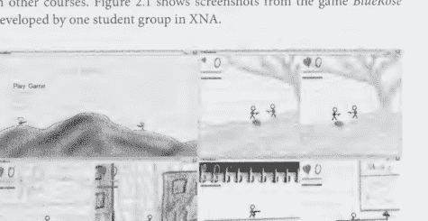

**图2.1**（**见彩色插页。**）*BlueRose* XNA游戏的截图。

相关文章的筛选过程分两步进行。首先检查摘要，剔除那些未描述使用游戏开发来学习或激励计算机科学（CS）或软件工程（SE）的文章。被剔除的文章通常是关于博弈论或商业游戏的文章，或者是包含游戏、学习和开发等词语但关注其他内容的文章。第二步是通读剩余文章的全文，排除那些过于模糊或超出调查范围的文章。我们找到了2004—2012年间与游戏开发和CS/SE教育相关的66篇文章。我们注意到，从2004年到2009年，关于该主题发表的文章数量有所增加。2009年至2012年间，该主题平均每年发表12篇文章。此外，在这66篇文章中，65%由ACM出版，26%由IEEE出版，其余9%由Springer、Elsevier和Hindawi平分。另一个有趣的事实是，59%的相关文章是美国研究，24%是欧洲研究，12%是亚洲研究，5%是国际研究，即涉及跨大洲和跨国家的研究。

#### 2.3.1 对RQ1的回答：游戏开发在CS/SE教育中用于什么背景/主题？

为了回答RQ1，我们对66篇相关文章进行了分析。分析的第一步是将文章分为三个主要类别：SE、CS和应用CS。归入应用CS类别的文章是那些应用了CS（例如使用Alice或Scratch等计算机工具）但课程的主要关注点是其他内容（例如艺术）的文章。在这66篇文章中，55%的文章涉及CS学科中的游戏开发，26%涉及SE学科，19%涉及应用CS学科。另一个有趣的发现是，81%的文章描述了在大学和学院中使用游戏开发，9%在高中，9%在初中，1%在小学（一篇文章）。

分析的第二步是确定游戏开发被用作教学辅助工具的具体主题或领域。以下小节按CS、SE和应用CS分组描述该分析的结果。

##### 2.3.1.1 使用游戏开发的CS主题/学科

图2.2展示了在使用游戏开发教授CS的文章中所发现主题/学科的分布。该图清楚地表明，对于CS，游戏开发主要用于教授编程（77%）。

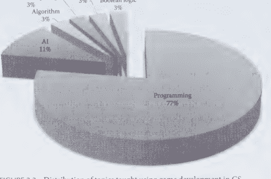

**图2.2** 在CS中使用游戏开发所教授主题的分布。

该类别中的大多数文章描述了如何将游戏开发用作CS和编程的入门。很少有文章描述将游戏开发用于高级编程课程。第二大主题是人工智能（AI）（11%）。在这些文章中，学生通常被要求为游戏中的非玩家角色编写AI程序，或创建/更改策略游戏中的AI。CS中使用游戏开发的其他主题包括算法、并行计算、数据结构和布尔逻辑。

表2.1概述了在大学/学院层次的CS教育中使用游戏开发的文章。该表描述了所教授的主要主题/学科，并简要说明了游戏开发在课程中的使用方式。

**表2.1** 在大学层次的CS教育中使用游戏开发的文章

| 文章 | 游戏开发在课程中的使用方式 | 主题 |
|---|---|---|
| McGovern 和 Fager（2007） | 介绍向游戏中添加AI代码 | AI |
| van Delden（2010） | 在机器人仿真中创建游戏 | AI |
| Timm 等（2008） | 学习向棋盘游戏添加AI代码 | AI |
| Barella 等（2009） | 使用多人游戏框架学习AI | AI |
| Weng 等（2010） | 通过在*Scratch*中修改*Pacman*代码学习逻辑 | 逻辑 |
| Detmer 等（2010） | 为高中教师开发基于游戏的学习 | 编程 |
| Hundhausen 等（2010） | 将战舰游戏开发作为作业 | 编程 |
| Carter 等（2011） | 通过游戏开发提高动机和学习效果 | 编程 |
| Rick 等（2012） | 使用Greenfoot进行模拟 | 编程 |
| Alvarado 等（2012） | 引入游戏以使CS对女性更具吸引力 | 编程 |
| Coleman 和 Lang（2012） | 对课程中使用游戏和游戏开发的元研究 | 编程 |
| Greenberg 等（2012） | 在艺术和创意编程的背景下学习CS | 编程 |
| Anewalt（2008） | 在Alice中学习编程、数学和逻辑 | 编程 |
| Eagle 和 Barnes（2009） | 修改游戏*Wu's Castle*中的循环和数组以学习编程 | 编程 |
| Chaffin 和 Barnes（2010） | 教学生开发严肃游戏 | 编程 |
| Williams 和 Beaubouef（2012） | 在诸如*Tic-Tac-Toe*的作业中创建简单游戏以学习编程 | 编程 |
| Sung 等（2011） | 通过在XNA中开发游戏学习编程 | 编程 |
| Angotti 等（2010） | 通过在XNA中开发游戏学习编程 | 编程 |
| Goldweber 等（2013） | 通过游戏编程激励CS学习 | 编程 |
| Fesakis 和 Serafeim（2009） | 通过在*Scratch*中开发游戏学习编程 | 编程 |
| Kurkovsky（2009） | 对使用各种移动开发平台的调查 | 编程 |
| Garrido 等（2009） | 使用游戏和可视化编程学习C++ | 编程 |
| Jiau 等（2009） | 使用基于游戏的模拟和度量学习编程 | 编程 |

表2.1显示，大多数文章涉及使用游戏开发来激励学生的编程课程。然而，不同研究中使用游戏开发的方式差异很大。在一些研究中，游戏开发仅用于一个或少数几个学生作业。其他文章描述了围绕大型游戏开发项目设计整个课程的方法。这些项目和作业中开发的典型游戏是简单的经典2D游戏，如*Pacman*、*Bomberman*或棋盘游戏。


**表 2.1（续）** 在大学计算机科学教育中使用游戏开发的文章

| 文章 | 游戏开发在课程中的使用方式 | 主题 |
|---|---|---|
| Chang 和 Chou（2008） | 通过为 C 语言版的*《炸弹人》*游戏添加代码来学习编程 | 编程 |
| Tan 等人（2009） | 通过为游戏设计组件做贡献来学习编程 | 编程 |
| Stuurman 等人（2012） | 开发贪吃蛇游戏作为编程入门 | 编程 |
| Ambrósio 和 Costa（2010） | 实现简单的海战游戏作为学习算法的作业 | 算法 |
| Lawrence（2004） | 通过高级游戏智能编程教授数据结构 | 数据结构 |
| Bierre 和 Phelps（2004） | 通过开发 3D 对象和游戏来学习编程 | 编程 |

表 2.2 展示了在初中和高中使用游戏开发来推广或教授计算机科学课程的文章。来自初中和高中经验的文章主要关注如何通过使用可视化编程环境创建游戏来激发学生对计算机科学的兴趣。除一篇文章外，所有文章都聚焦于编程。有趣的是，那篇非编程文章给出了一个例子，说明如何通过游戏和游戏软件向高中生介绍并行计算。并行计算是一个具有挑战性和难度的主题，但通过游戏中的示例，学生们能够学习并参与到该主题中。

**表 2.2** 在初中和高中使用游戏开发来推广或教授计算机科学的文章

| 文章 | 游戏开发在课程中的使用方式 | 主题 |
|---|---|---|
| Wang 等人（2006） | 通过 StarLogo TNG 中的游戏编程向九年级学生教授计算机科学基础 | 编程 |
| Goldberg 等人（2012） | 通过创建《青蛙过河》和《太空侵略者》等游戏在初中推广计算机科学 | 编程 |
| Rodger 等人（2012） | 通过 Alice 创建游戏在初中推广计算机科学 | 编程 |
| Webb 和 Rosson（2011） | 通过 Alice 中的游戏编程向八年级女生推广计算机科学 | 编程 |
| Chesborough 和 Turner（2010） | 通过游戏和游戏软件在高中展示并行计算 | 并行计算 |
| Al-Bow 等人（2009） | 利用游戏创作在高中向学生和教师教授编程 | 编程 |
| Jenkins 等人（2012） | 在高中通过游戏编程促进主动学习和协作 | 编程 |

**表 2.3** 描述软件工程教育中游戏开发的文章

| 文章 | 游戏开发在课程中的使用方式 | 主题 |
|---|---|---|
| Chen 和 Cheng（2007） | 通过游戏编程学习面向对象设计和设计 | 面向对象设计 |
| Jun（2010） | 使用游戏开发来提高团队协作技能 | 团队协作 |
| Wang 和 Wu（2009） | 通过游戏开发学习设计/架构模式和质量属性 | 软件架构 |
| Adipranata（2010） | 使用 GameMaker 和《魔兽争霸》学习面向对象设计/编程 | 面向对象设计 |
| Ryoo 等人（2008） | 通过游戏开发和 GUI 编程学习面向对象设计/编程和 Rational 统一过程（RUP） | 面向对象设计 |
| Mahoney 和 Gandhi（2012） | 通过逆向工程《俄罗斯方块》游戏的可执行文件来学习逆向工程 | 逆向工程 |
| Nordio 等人（2011） | 通过 DOSE 游戏平台学习分布式和外包编程 | 面向对象设计 |
| Wang（2009） | 通过 XNA 中的游戏开发学习软件架构 | 软件架构 |
| Wu 等人（2009） | 使用 XNA 中的高级 API 让学生更多地关注软件架构而非游戏开发 | 软件架构 |
| Wu 等人（2010） | 使用 Android SDK 中的高级 API 让学生更多地关注软件架构而非游戏开发 | 软件架构 |
| Wang（2011） | 在软件架构课程中比较使用机器人控制器开发与游戏开发的效果 | 软件架构 |
| Wang 和 Wu（2011） | 通过游戏开发学习软件架构 | 软件架构 |
| Wu 和 Wang（2012） | 在软件架构课程中比较使用应用程序开发与游戏开发的效果 | 软件架构 |
| Honig 和 Prasad（2007） | 通过开发各种棋盘游戏学习外包 | 外包 |
| Smith 等人（2012） | 开发《俄罗斯方块》和《博戈》游戏作为学习软件测试的作业 | 软件测试 |
| Schild 等人（2010） | 通过 XNA 中的游戏开发学习 Scrum | 软件过程 |

游戏设计（46%）和游戏开发（31%）。有人可能会说游戏开发应该是计算机科学的一部分，但在此处描述的文章中，游戏开发通常是一门侧重于游戏设计的课程，其中也涉及游戏编程、3D 建模和类似主题。另外两个确定的主题是艺术设计（15%）和素养（8%）。

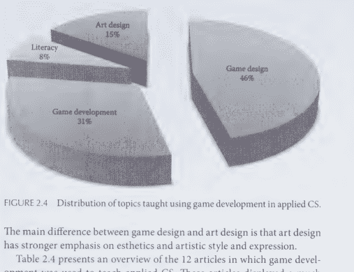

游戏设计与艺术设计之间的主要区别在于，艺术设计更强调美学、艺术风格和表现。

表 2.4 概述了 12 篇使用游戏开发来教授应用计算机科学的文章。这些文章更加强调通过图形工具创建或修改游戏，而对编程的强调较少。通常，许多文章专注于使用编辑器和工具创建游戏关卡，以创建地形、游戏角色、游戏对象，并用游戏对象填充关卡。其中一半的文章描述了在大学前/大学水平使用游戏开发的情况。

**表 2.4** 使用游戏开发教授应用计算机科学的文章

| 文章 | 游戏开发在课程中的使用方式 | 主题 |
|---|---|---|
| van Langeveld 和 Kessler（2009） | 通过创建 3D 数字角色来推广计算机科学 | 艺术设计 |
| Rankin 等人（2008） | 通过 GameMaker 中的游戏设计和开发学习计算机科学 | 游戏设计 |
| Estey 等人（2010） | 使用 Flash 和 GameMaker 中的游戏设计来学习沟通和团队协作技能 | 游戏设计 |
| Seaborn 等人（2012） | 在高中使用 GameMaker 中的游戏设计和开发教授计算机科学 | 游戏设计 |
| Huang 等人（2008） | 通过游戏开发教授编程与艺术设计的整合 | 游戏设计 |
| Wynters（2007） | 通过 Unreal、Photoshop 和 3ds Max 中的修改来激励/创建计算机科学 | 艺术设计 |
| Robertson 和 Howells（2008） | 在初中通过《无冬之夜 2》学习游戏设计 | 游戏设计 |
| El-Nasr 和 Smith（2006） | 在高中和大学通过修改《魔兽争霸 3》和 Unreal 中的代码来学习计算机科学、数学和编程 | 游戏设计 |
| Ritzhaupt（2009） | 使用免费或廉价的游戏开发工具（如 Torque、MilkShape 3D、Audacity 和 GIMP）来教授游戏开发 | 游戏开发 |
| Sullivan 和 Smith（2011） | 通过游戏开发向高中生教授计算机科学和编程技能 | 游戏开发 |
| Werner 等人（2009） | 在初中通过 Alice 中的游戏开发学习编程 | 游戏开发 |
| Owston 等人（2007） | 在小学通过游戏开发激发学生参与素养活动 | 素养 |

#### 2.3.2 研究问题2的答案：CS/SE 教育中使用了哪些 GDF？

为了回答研究问题2，我们分析了 66 篇相关文章中用于开发游戏的工具、框架和编程语言。图 2.5 显示了调查文章中用于游戏开发的 GDF 分布。

“其他”类别（15%）包括开发框架或工具，如 CeeBot 系列、Maya、《无冬之夜 2》编辑器、OpenGL、OpenSceneGraph、Photoshop、Processing、机器人仿真框架（未指定）、Scala、StarLogo TNG、Torque、VPython 3D 和 Windows 二进制。

图 2.5 显示，许多人在课程中使用自己的框架来开发游戏。这些框架中有许多是用 Java 开发的。使用自己的框架的一个原因是使开发适应课程的教育目标。

另外两个流行的 GDF 是 XNA 和 Java（均为 11%）。许多人选择 XNA 是因为其灵活的高级 API 和良好的文档，而许多人选择 Java 是因为学生熟悉它，或者课程背景是 Java 编程课程。其他流行的 GDF 包括 Alice、Android SDK、C++、GameMaker、Flash 和 Scratch。有趣的是，目前非常流行的独立游戏引擎 Unity 3D 没有出现在任何文章中。这种情况很可能会随着时间而改变。例如，微软已决定

Maya、Neverwinter Nights 2（编辑器）、OpenSceneGraph、Photoshop、Scratch、StarLogo TNG、Torque、Unreal Editor、Warcraft Editor 和 Wu’s Castle（自有框架）。最常见的编程语言是 Java，占 24%，许多文章描述了在 Java 中使用其他框架，以使游戏开发更快、更容易，并更好地契合教育目标。由于 XNA GDF，C# 也经常被使用。

调查中的文章还描述了 GDF 的使用方式以及使用这些框架的经验。Alice、Scratch 和 StarLogo TNG 中的可视化编程非常适合引入编程、学习编程概念以及面向对象编程，并推广 CS。许多人得出结论，可视化编程是一种有趣且有吸引力的学习逻辑和顺序的方式。使用 Scratch 的经验表明，可视化编程可以增强学生的编程信心，使他们能够显著探索和提高自己的技能与知识。文章还表明，移动开发平台（如 Android SDK 或 iOS SDK）通过让学生能够在自己的设备上玩自己制作的游戏并与朋友分享，从而吸引并激励学生。

使用图形和游戏库或 API 对于减少开发有趣交互软件所需的工作量和复杂性很重要。在调查的大多数文章中，学生被要求从头创建简单的 2D 游戏。另一种方法是使用 *游戏模组制作*，即更改或修改现有代码以改变游戏的行为和外观。一些文章已经证明，在 Unreal、Warcraft 和 Wu’s Castle 中进行游戏模组制作，可以很好地引入编程和编程概念，而无需实现整个游戏。这样做的一个激励因素是，被修改的游戏可以是一款评分很高的商业游戏，具有令人印象深刻的图形和玩法。有几篇文章强调了使用高级 API 来加速开发的重要性，从而能够更专注于学习编程、软件架构和 AI 等游戏开发之外的内容。最后，在 K-12 的研究中，Scratch 和 Alice 等可视化编程环境最常用。也有几项研究使用可视化编程环境向大学生介绍编程，并取得了良好效果。对后者而言，主要好处是更好地理解编程概念，例如顺序以及程序不同部分如何交互。

以及提高现有 CS 和 SE 课程的选课人数。特别是许多描述在初中和高中使用游戏开发的文章报告称，学生对 CS 和 SE 的态度更加积极，并且更有可能追求该领域的职业。

### 2.4 关于使用 GDF 的建议

本节将给出一些建议，说明如何选择合适的 GDF，以便在教授 CS 或 SE 时取得最佳效果。这些建议分为六个主要因素，在 CS 或 SE 课程中引入游戏开发时应加以考虑。建议基于本章介绍的调查以及 Wu 和 Wang（2011）的工作。

- *教育目标。* 课程的教育目标将极大影响 GDF 的选择。例如，如果课程侧重于完整的开发周期，则应能够根据指定需求从头开发游戏，并具备用于指定设计的工具和用于测试的工具。然而，如果教育目标只侧重于开发周期的某些部分，例如软件测试、AI、团队合作、软件维护、外包或质量保证，则可以使用现有游戏的游戏编辑器，例如 *Unreal Tournament* 或 *Warcraft*。
- *学科约束。* 大多数 CS 或 SE 学科都会对在 GDF 中应能完成的事情施加约束。例如，如果你教授软件架构，那么学生能够在所选框架中设计和实现各种设计与架构模式就非常重要。另一个例子是，如果你的学科是 AI，那么所使用的框架或游戏必须允许指定和实现与教科书中所教内容相似的 AI，这一点很重要。通常，必须使用额外的文章将学科与它在游戏中的使用方式联系起来。
- *编程经验。* 学生的编程经验将极大影响 GDF 的选择。通常，没有任何编程经验的年轻学生应从 Scratch 或 Alice 等可视化编程环境开始。对于有编程经验的学生，选择 GDF 时应考虑的一个因素是学生熟悉哪些编程语言。这里最重要的是，学生是只了解过程式编程语言，还是也了解面向对象编程语言。调查文章的经验表明，例如，了解 Java 的学生学习 C# 通常不需要太多工作，反之亦然。GDF 使用的编程语言不应与学生的编程背景相差太远。
- *教师专长。* 在将游戏开发引入 CS 或 SE 课程时，必须考虑课程工作人员对 GDF 的知识和技术经验。这对于规划项目以契合教育目标，以及帮助遇到技术问题的学生都很重要。教师不必详细了解 GDF 的一切，但至少有一名课程工作人员相当熟悉它，这是非常有用的。最低要求是能够引导学生找到可获得帮助的在线资源。
- *GDF 的可用性。* 我们不希望学生在项目期间陷入技术问题，因为这样他们就不会学到那么多 CS/SE 主题。因此，GDF 必须易于使用，并让学生用相对少量的代码就能高效产出，这一点很重要。在实践中，这意味着课程工作人员在课程中引入游戏开发之前，应先在 GDF 中创建一些简单游戏，以感受其使用难度。GDF 应提供高级 API，应结构良好，并应具有逻辑结构。此外，GDF 通过文档、教程、示例代码和活跃的开发社区获得良好支持也很重要。如果所有资源都可供学生免费使用，那也是一件好事。
- *技术环境。* 选择 GDF 时还应考虑技术因素。一个非常重要的考虑因素是 GDF 的软件和硬件要求。例如，如果选择 XNA，则需要 Microsoft Windows 来运行开发平台和生成的可执行文件。如果许多学生使用运行 Mac OS X 或 Linux 的 PC，或者实验室计算机运行 Microsoft Windows 以外的操作系统，这可能是一个挑战。硬件要求也很重要，因为某些 GDF 对 CPU、GPU 和内存可能有苛刻的要求。一个问题可能是现有计算机实验室没有足够强大的 PC 来运行 GDF 或生成的游戏。最后，考虑 GDF 的许可证和成本也很重要。

### 2.5 结论

本章重点描述游戏开发如何以及可以如何用于教授和推广 SE 和 CS。我们分享了在软件架构课程中引入游戏开发的经验。此外，我们呈现了一项文献调查，涵盖 2004 年至 2012 年间关于 CS 和 SE 中游戏开发的文章。最后，基于我们自己的经验和调查，我们给出了一些关于如何选择用于 SE/CS 课程的 GDF 的建议。

本章的目标是回答三个研究问题。第一个研究问题是找出游戏开发在 CS/SE 教育中使用的背景和主题（RQ1）。我们发现游戏开发被用于教授各种学科，但最常见的学科是编程，更具体地说是编程入门。其他主要的 CS/SE 主题包括 AI、软件架构、面向对象设计和软件测试。我们还发现，大多数文章（81%）是来自学院或大学的研究，而其余（19%）来自小学、初中和高中。不同课程中使用游戏开发的方式和程度也存在很大差异。有些课程只是在少数短作业中使用游戏开发，而另一些课程则围绕一个大型游戏开发项目来组织课程。

第二个研究问题是关于在 CS/SE 课程中用于开发游戏的是哪些 GDF（RQ2）。文献研究的结果显示使用了各种各样的工具和框架，其中最常出现的是作者/研究人员开发的自有框架、Java、XNA、Android SDK、Alice、C++、GameMaker、Flash 和 Scratch。就编程语言而言，最大的三类是可视化编程框架（例如 Alice、Scratch 等）、C# 和 Java。我们预见，用于此目的的 GDF 和编程语言在未来会发生显著变化。例如，Microsoft 已停止对 XNA 的进一步开发和支持。在许多大学，编程课程已从 Java 转向 Python 和 HTML5/JavaScript。

第三个研究问题关注使用基于游戏开发的学习的经验（RQ3）。这里的主要结论是

从学生动机和参与度来看，这些体验总体上是积极的，并且在推广计算机科学/软件工程（CS/SE）和招收学生方面效果良好。然而，能够证明在学业成绩（分数）方面有显著提升的研究太少。必须开展更多研究，以考察游戏开发用于教授其他主题的教育效果。

### 致谢

我们感谢加利福尼亚州欧文市加州大学软件研究所的 Richard Taylor 和 Walt Scacchi，感谢他们提供了富有启发性的研究环境并接待了一位访问研究员。

### 参考文献

- Adipranata, R. (2010). 使用基于游戏设计与创意学科导向环境的合作学习方法教授面向对象编程课程。*第2届教育技术与计算机国际会议论文集*，中国上海，IEEE，6月22–24日。
- Al-Bow, M. et al. (2009). 利用游戏创作向高中学生和教师教授计算机编程。*ACM SIGCSE 公报* 41(3): 104–108。
- Alvarado, C. et al. (2012). 提高女性在哈维·穆德学院计算机领域的参与度。*ACM Inroads* 3(4): 55–64。
- Ambrósio, A. P. L. 和 F. M. Costa (2010). 评估 PBL 和平板电脑在算法与计算机编程课程中的影响。*第41届 ACM 计算机科学教育技术研讨会论文集*，威斯康星州密尔沃基，ACM，3月10–13日。
- Anewalt, K. (2008). 让 CS0 变得有趣：使用玩具、游戏和 Alice 的主动学习方法。*大学计算机科学杂志* 23(3): 98–105。
- Angotti, R. et al. (2010). 游戏主题教学模块：一项视频案例研究。*第5届数字游戏基础国际会议论文集*，纽约，ACM，6月19–21日。
- Baker, A. et al. (2003). 问题与程序员：一种教育软件工程卡牌游戏。*第25届国际软件工程会议论文集*，俄勒冈州波特兰，IEEE 计算机学会，5月3–10日。
- Barella, A. et al. (2009). IGOMAS：AI 教学的新方法。*IEEE 教育汇刊* 52(2): 228–235。
- Bierre, K. J. 和 A. M. Phelps (2004). 在 Java 编程入门课程中使用 MUPPETS。*第5届信息技术教育会议论文集*，犹他州盐湖城，ACM，10月28–30日。
- Bjornson, F. O. et al. (2009). 提高事后分析中根因分析的有效性：一项对照实验。*信息与软件技术* 51(1): 150–161。
- Carter, J. et al. (2011). 激励我们所有的学生？第16届计算机科学教育创新与技术年度会议报告——工作组报告，德国达姆施塔特，ACM，6月27–29日。
- Chaffin, A. 和 T. Barnes (2010). 严肃游戏研究与原型设计课程的经验教训。第5届数字游戏基础国际会议论文集，加利福尼亚州蒙特雷，ACM，6月19–21日。
- Chang, W.-C. 和 Y.-M. Chou (2008). 基于游戏化数字学习的 C 编程语言入门学习。第7届基于网络的学习进展国际会议论文集，中国金华，Springer，8月20–22日，第221–231页。
- Chen, W.-K. 和 Y. C. Cheng (2007). 用计算机游戏编程教授面向对象编程实验课。IEEE 教育汇刊 50(3): 197–203。
- Chesebrough, R. A. 和 I. Turner (2010). 并行计算：高中与产业界的交汇点。第41届 ACM 计算机科学教育技术研讨会论文集，威斯康星州密尔沃基，ACM，3月10–13日。
- Clements, P. 和 R. Kazman (2003). 实践中的软件架构。Addison-Wesley Longman，马萨诸塞州雷丁。
- Coleman, B. 和 M. Lang (2012). 跨课程的协作：一种培养团队技能的有组织方法。第43届 ACM 计算机科学教育技术研讨会论文集，北卡罗来纳州罗利，ACM，第277–282页。
- Coplien, J. O. (1998). 软件设计模式：常见问题与解答。载于 Rising, L.（编），模式手册：技术、策略与应用。剑桥大学出版社，剑桥，第311–319页。
- Detmer, R. et al. (2010). 将真实世界项目纳入计算机科学课程教学。第48届东南地区年度会议论文集，密西西比州牛津，ACM，4月15–17日。
- Distasio, J. 和 T. Way (2007). 使用现成计算机游戏框架的包容性计算机科学教育。第12届 SIGCSE 计算机科学教育创新与技术年度会议论文集，苏格兰邓迪，ACM，6月23–27日。
- Eagle, M. 和 T. Barnes (2009). 对一种用于改进计算机入门学习的教育游戏的实验评估。ACM SIGCSE 公报 41(1): 321–325。
- El-Nasr, M. S. 和 B. K. Smith (2006). 通过游戏模组制作进行学习。娱乐计算 4(1): 7。
- Elfes, A. (1990). 基于声纳的真实世界建图与导航。载于 Sukhatme, G.（编），自主机器人车辆。Springer-Verlag，纽约，第233–249页。
- Estey, A. et al. (2010). 考察游戏设计课程中的工作室式学习。第5届数字游戏基础国际会议论文集，加利福尼亚州蒙特雷，ACM，6月19–21日。
- Fesakis, G. 和 K. Serafeim (2009). 熟悉 Scratch 对未来教师关于编程和 ICT 教育观点与态度的影响。ACM SIGCSE 公报 41(3): 258–262。
- Foss, B. A. 和 T. I. Eikaas (2006). 工程教育中的游戏玩法：概念与实验结果。*国际工程教育杂志* 22(5): 1043–1052。
- Garrido, A. et al. (2009). 使用图形：在 C++ 编程入门课程中激励学生。*EAEEIE 年度会议*，西班牙瓦伦西亚，IEEE，6月22–24日。
- Goldberg, D. S. et al. (2012). 让计算机科学融入传统教育：ECSITE 项目。*第17届 ACM 计算机科学教育创新与技术年度会议论文集*，以色列海法，ACM，7月3–5日。
- Goldweber, M. et al. (2013). 增强计算教育中社会公益的框架：一种价值观方法。*ACM Inroads* 4(1): 58–79。
- Greenberg, I. et al. (2012). 面向 CS1 的创意编程与视觉作品集。*第43届 ACM 计算机科学教育技术研讨会论文集*，北卡罗来纳州罗利，ACM，2月29日–3月3日。
- Higgins, J. P. 和 S. Green (2008). *前页*。John Wiley & Sons，纽约。
- Honig, W. L. 和 T. Prasad (2007). 面向软件工程学习的课堂外包体验。*ACM SIGCSE 公报* 39(3): 181–185。
- Huang, C.-H. et al. (2008). 使用 Flash 软件为艺术设计学生开设的计算机游戏编程课程。*国际网络世界会议*，中国杭州，IEEE，9月22–24日。
- Hundhausen, C. et al. (2010). 工作室式教学在 CS1 中有效吗？与传统方法的实证比较。*第41届 ACM 计算机科学教育技术研讨会论文集*，威斯康星州密尔沃基，ACM，3月10–13日。
- Jenkins, J. et al. (2012). 关于主动学习与协作的观点：课堂中的 JavaWIDE。*第43届 ACM 计算机科学教育技术研讨会论文集*，ACM。
- Jiau, H. C. et al. (2009). 利用基于游戏的模拟与指标增强学习编程的自我动机。*IEEE 教育汇刊* 52(4): 555–562。
- Jun, H. (2010). 通过采用项目式学习方法提高本科生的团队合作技能。*第5届计算机科学与教育国际会议论文集*，中国安徽，IEEE，8月24–27日。
- Kazman, R. et al. (1998). 体系结构权衡分析方法。*第4届工程复杂计算机系统国际会议论文集*，加利福尼亚州蒙特雷，IEEE。
- Khan, K. S. et al. (2001). 开展有效性研究的系统综述：CRD 关于实施或委托评审的指南。NHS 综述与传播中心。研究报告，CRD 报告，英国约克。
- Kruchten, P. (1995). 架构的 4+1 视图模型。*IEEE 软件* 12(6): 42–50。
- Kurkovsky, S. (2009). 移动游戏开发能培养学生对计算机科学的兴趣吗？*第1届 IEEE 消费电子学会游戏创新国际会议论文集*，伦敦，IEEE，8月25–28日。


- Lawrence, R. (2004). 使用竞争性游戏教授数据结构. *IEEE 教育汇刊* 47(4): 459–466.
- Lumia, R. et al. (1990). NASREM 机器人控制系统与测试平台. *国际机器人与自动化杂志* 5: 20–26.
- Mahoney, W. 与 R. A. Gandhi (2012). 逆向工程：它是一门艺术吗？ *ACM Inroads* 3(1): 56–61.
- Maier, M. W. et al. (2004). ANSI/IEEE 1471 与系统工程. *系统工程* 7(3): 257–270.
- McGovern, A. 与 J. Fager (2007). 在人工智能导论课程中创造有意义的学习体验. *第38届SIGCSE计算机科学教育技术研讨会论文集*，Covington, KY, ACM, March 7–11.
- Natvig, L. et al. (2004). 计算机时代：历史与计算机游戏元素的创新结合，用于教授计算机基础知识. *2004年教育前沿会议论文集*，Savannah, GA, October 20–23.
- Navarro, E. O. 与 A. van der Hoek (2004). SimSE：一款用于教授软件工程过程的教育模拟游戏. *第9届SIGCSE计算机科学教育创新与技术年会论文集*，Leeds, ACM, June 28–30.
- Nordio, M. et al. (2011). 使用全球分布式项目教授软件工程：DOSE 课程. *2011年全球分布式软件开发协作教学社区建设研讨会论文集*，Honolulu, HI, ACM, May 21–28.
- Owston, R. et al. (2009). 作为读写活动的计算机游戏开发. *计算机与教育* 53(3): 977–989.
- Rankin, Y. et al. (2008). 游戏设计对学生计算机科学兴趣的影响. *第3届计算机科学教育中游戏开发国际会议论文集*，Miami, FL, ACM.
- Rick, D. et al. (2012). 将情境引入课堂：一种基于设计的方法. *第7届中小学计算教育研讨会论文集*，Hamburg, Germany, ACM, November 8–9.
- Ritzhaupt, A. D. (2009). 在有限资源下创建游戏开发课程：一项评估研究. *ACM 计算教育汇刊* 9(1): 3.
- Robertson, J. 与 C. Howells (2008). 计算机游戏设计：成功学习的机会. *计算机与教育* 50(2): 559–578.
- Rodger, S. et al. (2012). 通过项目将计算融入中学学科. *第43届ACM计算机科学教育技术研讨会论文集*，Raleigh, NC, ACM, February 29–March 3.
- Rollings, A. 与 D. Morris (2004). *游戏架构与设计——新版*. New Riders 出版社，Indianapolis, IN.
- Rosas, R. et al. (2003). 超越任天堂：面向一、二年级学生的教育电子游戏设计与评估. *计算机与教育* 40(1): 71–94.
- Ryoo, J. et al. (2008). 在游戏设计情境中通过基于问题的学习教授面向对象软件工程. *第21届软件工程教育与培训会议论文集*，Charleston, SC, IEEE Computer Society, April 14–17.
- Wang, K. et al. (2006). 在 StarLogo TNG 中使用编程积木进行3D游戏设计. *第7届学习科学国际会议论文集*，Bloomington, IN, International Society of the Learning Sciences, June 27–July 1.
- Webb, H. C. 与 M. B. Rosson (2011). 在学习 Alice 3D 的同时探索职业：面向初中女生的夏令营. *第42届ACM计算机科学教育技术研讨会论文集*，Bloomington, IN, ACM, June 27–July 1.
- Weng, J.-F. et al. (2010). 通过调整游戏规则教授布尔逻辑. *IEEE 学习技术汇刊* 3(4): 319–328.
- Werner, L. et al. (2009). 中学生能否使用讲故事版 Alice 制作游戏？：一项试点研究的结果. *第4届数字游戏基础国际会议论文集*，Port Canaveral, FL, ACM, April 26–30.
- Williams, L. 与 T. Beaubouef (2012). 比较学习方法：示例案例研究. *高校计算科学杂志* 27(5): 85–91.
- Wu, B. 与 A. I. Wang (2011). 面向软件工程教育的游戏开发框架. *IEEE 游戏创新国际会议论文集*，Orange, CA, IEEE, November 2–3.
- Wu, B. 与 A. I. Wang (2012). 在 Android 平台上通过开发社交应用与游戏来学习软件架构的比较. *国际计算机游戏技术杂志* 2012: 5.
- Wu, B. et al. (2009). XQUEST 在软件架构教育中的应用. *IEEE 消费电子学会游戏创新国际会议*，London, IEEE, August 25–28.
- Wu, B. et al. (2010). 将 Google Android 应用扩展为教育工具. *第3届IEEE数字游戏与智能玩具增强学习国际会议论文集*，Kaohsiung, Taiwan, IEEE, April 12–16.
- Wynters, E. L. (2007). 3D 电子游戏：无需编程. *高校计算科学杂志* 22(3): 105–111.

## 严肃教育游戏的模型驱动工程

*整合特定主题学科与可迁移技能的学习目标*

Kendra M.L. Cooper and Shaun Longstreet


**摘要：** 教育基础设施面临重大挑战，包括需要快速、广泛且经济高效地引入新的或修订的课程材料；鼓励学生广泛参与；以及应对学生动机和态度的变化。课程材料需要满足学习目标，这些目标既涵盖标准化的特定学科内容，也涵盖可迁移技能，如协作、批判性思维、创造性思维、问题解决、推理能力、学会学习以及跨不同领域的决策能力。严肃教育游戏具有重要的教学潜力，因为它们为学生提供沉浸式、引人入胜且有趣的环境。为改进其开发，我们的研究项目 SimSYS 提供了一种基于模型驱动工程的方法，该方法独特地整合了传统娱乐游戏设计、教学内容与软件工程方法论的要素。我们的方法有三个主要步骤：(1) 创建游戏的非形式化模型（像故事板一样记录，除用户界面概念外，还包括学习目标和游戏玩法的文本描述，例如图形和音频）；(2) 将非形式化模型转换为半形式化、定制化的统一建模语言用例模型（可视化且表格化、基于模板的规范）；以及 (3) 将半形式化模型转换为形式化、可执行的模型（例如可扩展标记语言 [XML]，可在游戏引擎中加载和游玩）。我们的方法可应用于敏捷迭代开发过程，例如，通过以非形式化、半形式化和形式化（可执行）方式描述游戏的一部分，从而能够对运行中的（部分）游戏进行更早的评估和反馈。我们方法的一个关键特征是全面整合学习目标，既包括特定主题的学科内容，也包括可迁移技能。

**关键词：** 严肃教育游戏工程、模型驱动工程、学习目标、可迁移技能

### 3.1 引言

从初等教育到高等教育再到企业培训，教育基础设施在资源日益有限的情况下面临重大挑战。课程材料需要满足具体的学习目标，

（Walker and Shelton 2008；Westera et al. 2008；Nadolski et al. 2010）。最终，模拟主要是任务导向且重复性的；它不是游戏，因为它缺少下文所述的游戏典型特征。

除LMS和模拟之外，当前教育界还在采用另外两种较新的在线学习变体。*教育娱乐*通常是一种置于娱乐环境中的机械练习，例如，在平板电脑上做数学练习，要求玩家在游戏角色升级时进行加减运算。教育娱乐中几乎不发生或完全不发生学习，只是练习先前获得的知识和技能。*游戏化*的概念使在线学习的边界变得模糊。*游戏化*一词可以描述为在游戏产业之外采用游戏技术、思维、机制和游戏设计方法来解决问题并吸引用户的过程（Deterding et al. 2011）。尽管游戏化纳入了游戏元素（Brathwaite and Schreiber 2008；Deterding et al. 2011），我们已确定，严肃教育游戏的开发而非游戏化，才是实现有效教育更有成效的路径。研究已经表明基于游戏的学习的有效性（Prensky 2001；Gee 2003），而关于游戏化的影响仍存在重大疑问（Deterding et al. 2011）。

现在重新聚焦教育类计算机游戏，让我们澄清对游戏和游戏活动的理解。定义游戏有不同的方法，我们遵循传统定义，将游戏描述为由玩家竞争或对抗特定目标/结果所驱动的既定规则系统（Dempsey et al. 2002；Salen and Zimmerman 2004；Juul 2005）。因此，与模拟和教育娱乐不同，将游戏引入课程可以创造高度激励性的学习环境；它利用学生的幻想感和娱乐感；它是自我导向的，迎合个体学生的好奇心；它是一种持续挑战，其中任何看似不完整、不一致或不正确的现有任务或知识都会激励学生促进更深层次的学习。然而，必须确保游戏目标与期望的学习成果相一致。而这种必要性正是开发严肃教育游戏（SEGs）的挑战所在：利用游戏设计创造一种复杂的、具有教学动机的体验，让玩家在游玩中学习期望的学习成果（Malone 1980）。同时，游戏开发成本高昂且难以扩展，特定游戏也难以进行情境迁移。这些因素通常限制了游戏在教育中的推广及后续影响研究。

尽管存在开发挑战，SEGs仍具有巨大潜力，因为它们可以提供沉浸式、引人入胜且有趣的环境，要求在克服障碍和挑战的构架中进行深度思考和复杂问题解决（Gee 2003；Hämäläinen 2008；Walker and Shelton 2008；Sanchez and Olivares 2011）。它们创造以学生为中心的互动环境，而不是以内容为中心的被动课堂环境。这使学生能够生成个性化的学习体验，逐步纳入新知识并将其搭建到已有知识中。这种互动环境中的可能变异性允许学生在发展更广泛的分析技能并推进完成游戏目标的同时，反复完成较低层次的任务。因为每个学生都能按自己的节奏接触课程材料，准备不足或处于风险中的学生可以方便地专注于所需技能。此外，反馈频繁且即时，从而强化进一步推进游戏所需的基础技能掌握。

那么，如果将游戏纳入课程有如此多潜在好处，我们在哪里找到这些游戏？与其他软件应用一样，我们可以考虑购买现成游戏（例如 Sanford 2006）、修改现有游戏（Lopes and Bidarra 2011；Scacchi 2011）或开发新游戏。第一种选项的问题在于，现成游戏以娱乐为目的，课程需要围绕游戏来开发，而不是通过游戏来开发。修改现有游戏需要专门的软件开发知识，而且游戏本身仍具有有限的功能范围。游戏是复杂应用；开发新游戏耗时且昂贵，并且需要来自不同利益相关者的实质性专业知识：游戏开发者、软件开发者、教育者和玩家。既有游戏开发方法是文档中心的。常用于规定游戏的两类文档是前期制作游戏设计文档（GDD）和生产游戏软件需求规格说明书（SRS）（Rollings and Adams 2003；Oxland 2004；Gregory 2009；Adams 2010）。尽管系统化，传统方法在创建SEGs方面存在一些局限。它们不注重在早期开发游戏的可执行版本；对运行中游戏的反馈可能需要许多个月。文档由不同利益相关者（游戏设计师、游戏软件开发者）开发，可能使用不同符号表示法捕获。例如，故事板和漫画式表示非常适合规范）；将半形式化模型转换为正式的、可执行模型（用于全面仿真的状态图，以及可在游戏引擎中加载和游玩的XML）。我们基于MDE的方法可以应用于敏捷、迭代开发过程，例如，通过非正式、半形式化和正式（可执行）地描述游戏的一部分，从而允许对运行中的（部分）游戏进行更早评估和反馈。我们方法的一个关键特征是全面整合学习目标，既包括特定主题的学科内容，也包括可迁移技能。

在先前的工作中，我们介绍了该方法的基础元模型（Longstreet and Cooper 2012），以及基于MDE方法的初步工作（Cooper and Longstreet 2012a, 2012b；Cooper et al. 2014）。该元模型促进高质量、引人入胜的教育游戏的开发，因为它将知识要求、可迁移技能和课程成果与游戏制作明确联系起来。我们元模型的关键特征是领域特定知识体系（BOKs）的模块化、学习分类法（例如布鲁姆分类法）和基于技能的挑战。这支持跨课程的广泛采用，因为领域特定知识可以跨多个学科（例如STEM、人文学科）插入。此外，我们的模型将学习机会置于情节线中，学生玩家通过战胜时间、非玩家对手和自己最佳成绩来推进。由学习分类法框定的基于知识的挑战培养认证标准所需的可迁移技能，同时也向玩家和教师提供反馈。将评估挑战置于沉浸式游戏环境中，使其比典型的在线测试或作业更有吸引力、更富想象力。

在这里，我们在整体三步迭代方法的背景下呈现模型改进。该方法以部分示例测试游戏加以说明。目前，我们的转换是手动完成的；我们计划将来实现转换自动化，并提供智能半自动向导来协助创建SEGs。相关研究表明，从用例到形式模型的自动转换是可行的（Riebisch and Hübner 2004）；游戏生成向导的原型正在进行中。目标是显著减少定义游戏所需的努力，并支持使用仿真工具对其进行全面验证。

据我们所知，SimSYS是首个面向SEGs的基于MDE的方法。先前关于基于UML的游戏规范的工作（例如 Hausmann et al. 2001）侧重于定制状态图（Harel 1987）；它们提供了一种

严谨的、基于状态机的基础，但对于某些利益相关者来说可能更难使用。例如，有故事板经验的游戏设计师可能会发现表格化的用例规范格式易于学习和使用。故事板通常以表格形式的单元格序列呈现。表格化规范在需求工程中已经非常成熟（Pollack 等，1971；Heitmeyer 等，1996）。它们被认为易于定义、理解和维护。

本章其余部分结构如下。第3.2节概述了作为SimSYS开发元模型的语义构建块。第3.3节概述了基于MDE的SimSYS方法，包括非正式模型、半正式模型和正式模型；并讨论了一个测试游戏示例以作说明。第3.4节给出了结论和对未来工作的建议。

### 3.2 严肃教育游戏（SEG）的整体方法

如上所述，将游戏设计与教学目标相结合对创建SEG构成了挑战。同样，可扩展性、经济性和情境灵活性也始终是难题。为了解决这个问题，我们通过概述一种语义构造来提出游戏与学习的整体视角，该语义构造定义了基本构建块以及管理它们之间相互作用的规则（图3.2）。这些构建块及其相关规则提供了一种结构，在此基础上，可以在更广泛的情境中设计类似类别的游戏玩法组件。其结果可以在教学上合理的学习环境中为玩家提供多种多样的体验机会。我们最初的元模型方法确立了教育游戏是沉浸式、娱乐性的环境，它将特定的学习目标嵌入到挑战中，这些挑战要求熟练掌握由学习分类法分类的特定技能。

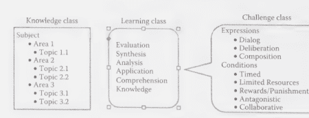

图3.2 教育游戏要素。

#### 3.2.1 外部实体

我们的元模型考虑了两个主要的外部实体。首先，游戏吸引作为游戏主角的学生玩家。游戏介绍要求玩家选择自己的角色，作为熟悉游戏环境和游戏基本玩法的一部分。根据教师设定的游戏参数，学生玩家可以对其角色的能力（例如力量或敏捷）有一定程度的自主输入。否则，他将能够调整特定的身体特征和玩家虚拟形象的名字。自定义玩家虚拟形象的好处在于玩家在游戏世界中所产生的独特投入感。之后，玩家必须应对一系列游戏挑战；如果成功完成这些挑战，他将能够击败由计算机控制的非玩家角色（NPC）对手，并进入下一个由教师设计的挑战。游戏中的具体挑战旨在强化和展示内容知识、应用、分析和评价。作为一款以真实世界参数建模的游戏，这些挑战将培养课程和/或国际认证机构所需的可迁移技能，同时为学生玩家提供持续、即时的反馈。

第二个外部实体是教师和/或游戏开发者。教师/开发者建立游戏参数：通过切换情境、角色和挑战，他们利用提议的模板并借鉴已有的资产库，为学生创造学习环境。模板支持游戏规范的模块化；它们是软件工程/系统工程流程中公认的最佳实践。游戏设计师可以使用所见即所得的用户界面实例化模板。虽然学生玩家在游戏过程中会收到反馈，但教师也会收到关于一个或多个学生玩家的进度和能力的反馈。这可以让教师更准确地调整未来的课堂环节和/或持续的游戏内容。同时，汇总的玩家信息可以为评估和认证报告提供信息，并反映课程学习成果的进展情况。

#### 3.2.2 传统游戏元素

外部实体通过传统视频游戏组件与SimSYS游戏及其交互功能对接。这些游戏组件利用可重用的基础形式和功能流程；对于教师/开发者来说，这些组件是课程/游戏开发过程中可切换的一部分。随后，玩家参与到教师设定的游戏中。我们认为，将功能性的游戏组件与快速变化的教育元素分离开来，是开发灵活、可扩展且适应性强的教育游戏的关键。在SimSYS中，各种游戏组件（传统的和教育的）被归类为功能确定的类。玩家实体进入游戏的主要入口是他在进入游戏时所承担的角色。角色类（character class）是游戏中的行动者集合；每个游戏必须包含主角（学生玩家），但也可以包含各种NPC。例如，一个可能无处不在的次要NPC是反派，他以更具互动性的方式为玩家提供拟人化的阻力。每个NPC都有一个档案（profile）和一组可变属性，包括姓名和头衔、功能类型（例如，主角、反派、引导者、构建者、对话者）、角色（例如，雇主、客户、同事、朋友、实验室伙伴）、相关技术技能（即学位、才能）、经验年限（即力量或效率）、沟通技能（即智力）、领导技能（即魅力）和团队合作技能（即灵巧）。此外，NPC可以拥有相关的人口统计信息，以鼓励学生思考在多元社会环境中学习和工作的情境（例如性别/民族/国籍）。NPC可以被分配在学生玩家面前出现的频率，以鼓励或限制NPC提供的帮助/挑战水平。最后，角色行为有两种类型：自主或半自主。

上下文类（Context class）为玩家/主角建立模拟环境。它为模拟环境和游戏过程提供了一种语法。上下文类包含创建沉浸式世界的元素，学生可以在其中进行交互。它包括场景（例如办公室、医院）、游戏情境（例如任务简报或对抗）、游戏故事弧线中的位置以及过渡和目标（例如从初级员工晋升到高级员工、从大学毕业），并为游戏中的挑战提供框架（例如期末考试、公司项目或障碍）。情节上下文中的玩家/主角与NPC之间的相互作用旨在帮助学生从多个角度更好地理解课程内容，并强化正确和错误决策的影响。

传统游戏元素中的最后一个类是机制类（Mechanics）。机制类提供基础的、低层级的游戏功能，并协调可重用的资产，如角色交互、音乐和图形。它还支持维护游戏状态，包括玩家进度（他们在游戏中的位置）和评估轨迹（他们在游戏中的表现，例如分数）。此类支持上下文类和挑战类。

#### 3.2.3 教育游戏元素

为了促进跨课程和培训项目快速开发模拟游戏的教学基础，我们将游戏功能（即原始模拟组件）与知识内容和学生评估（通过特定形式的游戏挑战）分离开来。这使教师和培训设计师能够快速地在课程之间输入和切换内容，并根据学生进度在不同班级之间切换。也就是说，教学设计师可以为游戏上下文切换实验室或犯罪现场环境，然后在游戏挑战中输入特定于化学或法医的内容，这些内容可以因课程部分而异。

实际上，每个学科或主题都由决定能力的知识和技能基础构成。四年级阅读、人力资源合规培训和软件工程都是如此。我们构建当前的SimSYS知识类的方式是，用户可以识别、优先考虑和选择可用于游戏场景和评估的信息。与软件工程教育知识（Abran 等，2004）类似，SimSYS中的内容信息被划分为子学科领域，每个领域又划分为更小的单元和主题。虽然并非每个游戏都需要知识类的所有层级，但它确实为更大的多样性和可扩展性提供了灵活性。

为了使游戏挑战与对知识体系（BOK）的不同掌握程度保持一致，SimSYS中的学生玩家知识通过学习分类法进行分类。这允许在不同层级和通过多种评估形式进行知识和技能评估。学习类（Learning class）代表游戏学习目标中所反映的技能和能力。在开发SimSYS时，我们使用布鲁姆分类法作为学生玩家必须在教育游戏挑战中展示一定能力水平的技能类型（Anderson 和 Krathwohl，2001）。对于每个知识库主题，可以分配一个或多个布鲁姆分类法层级，以表明毕业生应具备的技能水平。我们从布鲁姆分类法中提取的六种技能是：知识（记忆所学材料）、理解（理解信息和课程内容的含义）、应用（在新情境中使用所学材料的能力）

以及具体情境），综合与分析（看到更大系统的联系和组成部分），以及评价（能够在特定情境和要求中评估各种变化信息的价值）。不同的挑战旨在调动不同层次的思维。例如，如果希望评估的学习类型是内容记忆，那么教师可以启用一个对话挑战，要求学生在与好奇的 NPC 对话时展示对某个术语定义的认识。同样，更复杂的挑战会要求在模拟游戏中展示更高层次的技能组合，从而为增加知识和技能建设提供机会。

Challenge 类包含与具体的、由教师定义的学习成果相关联的不同形成性教育活动。由于它是教育模拟游戏的核心，我们在 Challenge 类上开发了额外的模式，以提供更广泛的可能学习机会。挑战代表传统的形成性教育机会。挑战由 NPC 填充，这些 NPC 扮演各种角色来沟通、协助或增加学生主角完成挑战的难度。挑战位于一个学生试图推进的故事情节中。正是这种叙事背景，以及与玩家和非玩家对手的可能竞争，使挑战变得有趣且富有想象力，而不是基于文本的多项选择题测试或书面作业。

为了支持不同层次的学习和难度，Challenge 类分为两个子类别：表达（Expression）和条件（Conditions）。游戏评估通过三种表达形式进行：对话（Dialog）、审议（Deliberation）和创作（Composition）。有五种条件形式会影响学生玩家参与挑战时的限制和动机：限时、有限资源、奖励/惩罚、与 NPC 反派角色的竞争与合作。在对话挑战中，一个对话者 NPC 向学生玩家提出一系列问题，这些问题起初需要内容知识，但嵌入的后续问题既需要理解也需要适当应用该知识。这鼓励在游戏采用苏格拉底式学习方法，并鼓励学生玩家以更投入的方式展示其对课程内容的掌握。对话挑战主要吸引学习分类法（如布鲁姆分类法）的较低层次（即知识、理解、应用）。例如，一个扮演上士角色的对话者 NPC 可以问学生玩家

图形和文本（Hart 1999; Tumminello 2004; Truong et al. 2006）。它们是一种规划或预可视化工具，用于在开展昂贵的开发工作之前展示、讨论和修订概念。故事板呈现一系列面板或单元格，其中包含图形和文本以解释正在发生的事情。它们被选用于这项 SEG 工作，原因如下：

-   故事板已被游戏开发领域采用，使其成为许多利益相关者熟悉的方法。
-   故事板易于不同背景的利益相关者创建、理解和修订。这是创建 SEG 时的一个重要考虑因素，因为 SEG 涉及游戏开发者、软件开发者和教育工作者。
-   故事板用途广泛，因为它们可以应用于高度抽象的层面（呈现游戏的整体概念），也可以应用于更详细的逐步描述（呈现游戏某部分的细节）。

##### 3.3.1.2 SimSYS 故事板

SimSYS 故事板是一种非正式模型，它提供了包含初步图形、音频、角色和学习目标/标准的叙述（图 3.4）。这是一种直接且熟悉的方式来开始 SEG 开发。该非正式模型组织为标题、高层描述游戏结构的概述（幕、场景、屏幕、挑战的数量）、学习目标（主题特定技能和可迁移技能）、游戏的初始条件（例如玩家起始点数、场景背景），以及游戏进行时需要应用的规则。在此之后，描述游戏玩法。

在简单的示例测试游戏 4 SE 设计中，有一个幕；它有一个场景和两个屏幕；第一个屏幕中有一个挑战。展示了挑战的布局（有一组标准布局可供重用）；该挑战是一个简单的多项选择测验——没有计时器或 NPC 在测验中竞争。问题和可能的答案选项被记录下来；玩家可以看到每个答案的提示；除了提供给玩家的反馈外，还描述了正确和错误答案的奖励。在这个模型中，细节不一定完整——例如，叙述表明每个答案都应有一个提示

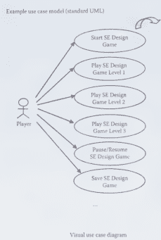

**文本用例规格说明**

| 字段 | 内容 |
| --- | --- |
| **标题** | 开始游戏 |
| **参与者** | 玩家 |
| **概述** | 该用例允许已登录系统的玩家开始新的 SE 设计游戏。 |
| **正常事件流** | 1. 玩家发送开始新 SE 设计游戏的请求。<br>2. SE 设计游戏短暂显示启动画面，内容为“欢迎来到 SE 设计游戏！”，然后淡出。<br>3. SE 设计游戏显示一个屏幕，包含以下内容：<br>&nbsp;&nbsp;&nbsp;a. 头像<br>&nbsp;&nbsp;&nbsp;b. 奖励<br>&nbsp;&nbsp;&nbsp;c. 排行榜，显示前五名玩家的分数<br>&nbsp;&nbsp;&nbsp;d. 消息框，文本为“你准备好开始游戏了吗？”以及两个选项（是，否）。<br>4. 如果玩家选择“是”，则玩家可以继续玩游戏。<br>5. 如果玩家选择“否”，则 SE 设计游戏结束。 |
| **特殊要求** | 1. 如果玩家在之前的会话中已经启动过 SE 设计游戏，则应向玩家提供警告“游戏已在进行中——你想重新开始吗？”以及两个选项（是，否）。 |

**图 3.5** 可视化和文本化的 UML 用例示例。

可视模型提供了系统中能力和参与者的高层概览。然而，它缺少开发者进行系统分析和设计所需的详细描述。用例的详细描述通常包括标题、参与者、概述、正常事件流、备选事件流和特殊（非功能性）要求（图 3.5）。事件流将参与者和系统之间的交互描述为外部可见的黑盒行为。例如，玩家请求暂停游戏；系统通过显示消息来响应，表明游戏已成功暂停。

##### 3.3.2.2 SimSYS 用例

非正式叙述被迭代地细化为定制的半正式用例模型（可视模型和支持性的表格规范）。UML 用例图提供了示例游戏结构的可视概览（图 3.6），将游戏组织为幕、场景、屏幕和挑战。内置关联 <<includes>> 用于描述这些用例之间的关系。内置关联 <<extends>> 用于描述具有异步能力的用例，例如玩家（不可预测地）请求显示提示、显示角色档案或显示角色奖励。从非正式叙述到可视模型有一个简单的映射：叙述中的每个幕对应可视模型中的一个幕；叙述中的每个场景对应可视模型中的一个场景；依此类推。

测试游戏：SE

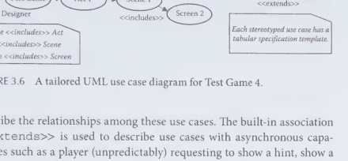

**图 3.6** 为测试游戏 4 定制的 UML 用例图。

每个定制的用例（游戏、幕、场景、屏幕、挑战）都有一个表格规范模板。我们发现，为游戏中的每个抽象层次定义模板可以提供清晰、易于理解的规范，而不是定义一个通用模板再针对不同层次进行定制（也许通过留空某些部分或将其标记为不适用）。为支持游戏规范而定义的模板可在其他地方获得（SimSYS 2012）。表格模板整合了来自 SEG 元模型（Longstreet and Cooper 2012）和故事情节特征（游戏玩法、图形、音频）（Truong et al. 2006）的元素。该元模型独特地整合了游戏领域（例如游戏情节、角色、机制）和教育领域（例如学习目标、评估、课程内容）的概念。表格规范是手动创建的；用于创建游戏并输出形式化模型的半自动智能向导是未来工作（图 3.7）。

非正式叙述被映射到游戏、幕、场景、屏幕和挑战模板（SimSYS 2012）。游戏、幕和场景模板相对简单——它们提供组织屏幕的结构和顺序。大部分游戏玩法定义在屏幕和挑战中。关于以表格化半正式模型表示的挑战，见附录 3A。


图3.7 示例测试游戏的定制化表格用例规格说明。

#### 3.3.3 形式化模型

##### 3.3.3.1 XML

XML 是一种形式化的、基于文本的文档标记语言，最初设计用于在万维网上轻松分发信息（W3C 2006）。本工作选择使用 XML 的原因如下：

- *XML 是形式化且简洁的。* XML 规范包含使用扩展巴科斯-瑙尔范式表示的正式文法规范。该文法为 XML 提供了全面的语法，并为所有 XML 文档提供了一种检查其格式是否良好的方法。格式良好的 XML 文档允许符合 XML 文法规范的解析器无误地解析和处理文档中的数据。

- **XML 文档具有人类可读性。** 由于 XML 文档中的标记文本可以自定义，因此 XML 文档可以使用描述性名称编写，使人们能够轻松理解所存储数据的类型。注释也可用于在文档内提供进一步描述，而不会影响文档的语法。这一特性很重要，因为 XML 文档还可以作为转换记录，用于验证模型转换是否成功。

- **编写程序处理 XML 文档是直接了当的。** XML 文档是基于文本的文档，可以根据需要解析以提取数据和进行操作。许多编程语言都提供了用于在 XML 文档中进行数据操作的标准库。

- **XML 支持多种多样的应用程序。** XML 是一种广泛使用的语言，目前正被多个行业的多种应用程序所使用。

##### 3.3.3.2 SimSYS XML 游戏脚本

表格化的半形式化符号会被转换为一个单一的 XML 文件，该文件可加载到 SimSYS 游戏引擎中。表3.1展示了该 XML 文件的一部分；其中定义了游戏的 XML 模式。转换是一次一部分地进行的，并使用标签来组织内容。例如，Challenge 中的一个问题与表格规格说明中描述的、软件工程设计中的特定主题和可迁移技能相关（Challenge 中包含哪些类型的知识？）；这些

**表3.1 测试游戏挑战的 XML 部分表示**

```xml
1.1 ...
<!-- Act 1, Scene 1, Screen 1, Challenge 1 -->
<challengeStructure>
    <gameElement xmlns:xsi = "http://www.w3.org/2001/XMLSchema-instance" xsi:type = "prop">
    <gameElement xmlns:xsi = "http://www.w3.org/2001/XMLSchema-instance" xsi:type = "IDENTIFIER">
        <id> challenge1 </id>
    <challengeItemList>
    <item>
<!-- What kind of knowledge is in the challenge? -->
<domainKnowledgeList>
    <domainKnowledge>software engineering</domainKnowledge>
    <area>Software Design</area>
    <topic_list>
        <topic>General_Design_Concepts</topic>
        <topic>Context_of_Software_Design</topic>
        <topic>Software_Design_Process</topic>
        <topic>Software_Design_Re-use</topic>
    </topic_list>
</domainKnowledgeList>
<transferableKnowledgeList>
    <transferableKnowledge>analysis
    </transferableKnowledge>
    <transferableKnowledge>critical_thinking
    </transferableKnowledge>
    <transferableKnowledge>problem_solving
    </transferableKnowledge>
</transferableKnowledgeList>
<!-- How is the knowledge being assessed? -->
    <expression>dialog</expression>
    <learningTaxonomyList>
        <learningTaxonomy>knowledge</learningTaxonomy>
        <learningTaxonomy>application
        </learningTaxonomy>
    </learningTaxonomyList>
<!-- Challenge item-->
<!-- The challenge item has a stem, with zero or one
text (description or vignette), zero or more images,
and a question. -->
<!-- stem description-->
<stemDescription>
    <type>
        <typeName>InformationBox</typeName>
        <event>
            <eventName>NONE</eventName>
            <animation>FADEIN</animation>
            <time>QUICK</time>
        </event>
        <color>YELLOW</color>
        <location>UR</location>
    </type>
<!-- -->
<name> Option1 </name>
<location> UUL </location>
<color> Yellow </color>
<text> Strategy Pattern </text>
<!-- Hint -->
<type>
    <typeName> InformationBox</typeName>
    <name> Hint1 </name>
    <eventName> HOVER</eventName>
    <location> UUL </location>
    <color> Yellow </color>
    <text>The Strategy pattern defines a family
          of algorithms, encapsulates each one, and
          makes them interchangeable; algorithms are
          selected at runtime. It is a behavioral
          pattern. </text>
</type>
<!-- Evaluation -->
<evaluation> Incorrect </evaluation>
<!--Reward -->
<reward>NONE</reward>
<type>
    <!-- Feedback -->
    <typeName> MessageBox </typeName>
    <location> UC </location>
    <color> Yellow </color>
    <text>: Sorry - the correct answer is the
          bridge pattern</text>
</type>
</stemOption>
...
</stemOptionList>
</item>
...
</ChallengeItemList>
...
```

这些内容以 XML 表示，使用了两种标签来定义主题列表（`<domainKnowledgeList>`、`<transferableKnowledgeList>`）。接下来的标签定义了问题的评估方法，即“如何评估知识？”具有四个答案选项的问题——评估、提示、奖励和反馈——在 XML 文件中随后出现。尽管文件相当长，但易于阅读；从半形式化表格模型到 XML 的手动映射非常耗时，但并非太难。

### 3.4 结论与未来工作

SimSYS 方法用于工程化严肃教育游戏（SEGs）是一个迭代式的三步方法，它基于模型，并从一开始就将学习目标整合到游戏开发中。该方法从一个非正式叙事（如故事板）开始，随后将其转换为定制化的半形式化 UML 用例模型（包括可视化和表格化规格说明），最后转换为形式化模型。我们的第一个形式化模型使用 XML；该 XML 就是可以在 SimSYS 游戏引擎中加载和测试的游戏规格说明。在将三步方法应用于工程化一组测试游戏时，我们发现它虽然直接，但劳动强度大。特别是，创建形式化 XML 模型需要大量时间；手动测试游戏也非常耗时。

目前正在研究一个智能自动化游戏生成模块，以减轻填充非正式叙事和半形式化模型（模板实例化）的工作量，并自动生成 XML 模型。我们还计划探索将半形式化模型转换为状态图表示，该表示可以利用现有的商业工具支持（例如 IBM 2012）进行加载、动画演示或模拟，从而提供一种补充的验证方法。

我们认识到，该方法的验证目前仅限于我们的初步原型工作（符号测试游戏、软件工程测试游戏）。还需要进行额外的验证，既需要我们继续推进自己的项目，也需要外部教育游戏研究人员和教育工作者参与，以探索诸如该方法扩展到更大游戏和相关游戏集合时的可扩展性等问题。

### 参考文献

- Abran, A.、Moore, J.W. 和 Bourque, P. (2004). *软件工程知识体系指南（SWEBOK）：2004年版.* IEEE 计算机学会，洛斯阿拉米托斯，加利福尼亚州。附录 D.

- Adams, E. (2010). *游戏设计基础.* 第2版. New Riders Publishing，伯克利，加利福尼亚州。

- Anderson, Jr., E.G. 和 Morrice, D.J. (2000). 用于教学服务导向供应链管理的仿真游戏：信息共享是否能帮助管理者做出服务能力决策？*生产与运营管理* 9: 40–55.

- Anderson, L. W.、Krathwohl, D. R. 等（编）(2001). *学习、教学和评估的分类学：布卢姆教育目标分类学的修订版.* Allyn & Bacon（培生教育集团）。波士顿，马萨诸塞州。

- Braithwaite, B. 和 Schreiber, I. (2008). *游戏设计师的挑战.* Charles River Media，波士顿，马萨诸塞州。

- Chen, F. 和 Samoengraja, R. (2000). 静态啤酒游戏. *生产与运营管理* 9: 19–30.

- Cooper, K. 和 Longstreet, C.L. (2012a). 面向严肃教育游戏的模型驱动游戏工程：游戏需求的定制化用例. *IEEE 第17届国际计算机游戏会议论文集*，路易斯维尔，肯塔基州，7月30日至8月1日，第208–212页。

- Cooper, K. 和 Longstreet, C.L. (2012b). 面向 SimSYS 中模型驱动游戏工程：敏捷软件开发过程游戏的需求. 技术报告，联合发布 UTDCS-06-12. 德克萨斯大学达拉斯分校，理查森，德克萨斯州；MU-CII-01-12 马凯特大学，密尔沃基，威斯康星州。3月。

- Cooper, K.、Nass, E. 和 Longstreet, C.L. (2014). 面向严肃教育游戏的模型驱动需求工程：非正式、半正式和形式化模型. *第20届国际需求工程工作会议论文集：软件质量基础*，德国埃森，4月7–10日，第17–22页。

- Crookall, D. 和 Saunders, D.（编）(1989). 走向传播与仿真的整合. 载于 *传播与仿真：从两个领域到一个领域.* Multilingual Matters，克利夫登。

- Dantas, A.R.、Barros, M.O. 和 Werner, C. (2005). 模拟模型在软件项目经理基于游戏培训中的应用. *过程仿真与建模研讨会*，圣路易斯，密苏里州，5月14–15日，第110–116页。

- Dempsey, V.J.、Haynes, L.L.、Lucassen, B.A. 和 Casey, M.S. (2002). 四十个简单的电脑游戏及其对教育工作者的意义. *仿真与游戏* 33(2):157–168.

- Deterding, S.、Dixon, D.、Khaled, R. 和 Nacke, L. (2011). 从游戏设计元素到游戏感：定义“游戏化”. *第15届国际学术 Mindtrek 会议论文集*，芬兰坦佩雷，9月28–30日，第9–15页。

- Gee, J.P. (2003). *电子游戏能教给我们关于学习和读写能力的什么？* Macmillan，纽约。


Gregory, J.（2009）。游戏引擎架构。A.K. Peters，马萨诸塞州纳蒂克。

Hämäläinen, R.（2008）。设计和评估职业学习虚拟游戏环境中的协作。《计算机与教育》50(1)：98–109。

Harel, D.（1987）。状态图：复杂系统的可视化形式化方法。《计算机编程科学》8(3)：231–274。

Hart, J.（1999）。故事板艺术：电影、电视和动画的故事板创作。Focal Press，纽约。

Hausmann, J.H.、Heckel, R. 和 Sauer, S.（2001）。面向UML扩展的动态元建模：UML序列图的可扩展语义。德国柏林大学，Society Press，第80–87页。

Heitmeyer, C.L.、Jeffords, R. 和 Labaw, B.（1996）。需求规格说明的自动化一致性检查。《ACM软件工程与方法学汇刊》5(3)：231–261。

Horn, R.E. 和 Cleaves, A.（1980）。教育与培训模拟/游戏指南。Sage Publications，加利福尼亚州纽伯里帕克。

IBM（2012）。IBM Rational Rhapsody for Java，版本8.0。可从以下网址获取：http://www-142.ibm.com。

Juul, J.（2005）。半真实：真实规则与虚构世界之间的电子游戏。MIT Press，马萨诸塞州剑桥。

Kent, S.（2002）。模型驱动工程。第3届集成形式化方法国际会议论文集，芬兰图尔库，5月15–17日，第286–298页。

Longstreet, C.S. 和 Cooper, K.（2012）。用于高等教育和专业发展培训中开发模拟游戏的元模型。IEEE第17届国际计算机游戏会议论文集，肯塔基州路易斯维尔，7月30日–8月1日，第39–44页。

Lopes, R. 和 Bidarra, R.（2011）。游戏与模拟中的自适应挑战：综述。《IEEE游戏计算智能与AI汇刊》，3(2)：85–99。

Malone, T.（1980）。是什么让学习变得有趣？设计教学计算机游戏的启发式方法。第3届ACM SIG SMALL小型系统研讨会论文集，加利福尼亚州帕洛阿尔托，9月18–19日。

Mustafee, N. 和 Katsaliaki, K.（2010）。血液供应游戏。载于 Johansson, B.、Jain, S.、Montoya-Torres, J.、Hugan, J. 和 Yücesan, E.（编），《2010年冬季模拟会议论文集》，马里兰州巴尔的摩，12月5–8日，第327–338页。

Nadolski, R.J.、Hummel, H.G.K.、van den Brink, H.J.、Hoefakker, R.E.、Slootmaker, A.、Wu, B. 和 Bakken, S.K.（2010）。为iPhone/iPod Touch实施面对面教育游戏的经验。第2届IEEE消费电子学会国际游戏创新会议论文集，中国香港，12月21–23日。

Object Management Group（2003）。OMG模型驱动架构（MDA）指南，版本1.0.1，3月。可从以下网址获取：http://www.omg.org。

Object Management Group（2008）。OMG软件与系统过程工程元模型规范（SPEM），版本2.0。可从以下网址获取：http://www.omg.org。

Object Management Group（2009）。OMG统一建模语言，版本2.2。可从以下网址获取：www.omg.org。

Oxland, M.（2004）。*游戏玩法与设计*。Addison-Wesley，纽约。

Pollack, S.L.、Hicks, H.T. 和 Harrison, W.J.（1971）。*决策表：理论与实践*。Wiley，纽约。

Prensky, M.（2001）。*基于数字游戏的学习*。McGraw-Hill，纽约。

Riebisch, M. 和 Hübner, M.（2004）。半形式化用例描述的细化与形式化。*第2届基于模型的计算机系统开发研讨会论文集：模型的适用性、一致性与集成*，捷克共和国布尔诺，5月26–27日。

Riis, J.O.（1995）。*生产管理中的模拟游戏与学习*。国际信息处理联合会，Springer，德国柏林。

Rollings, A. 和 Adams, E.（2003）。*游戏架构与设计：新版*。New Riders Publishing，加利福尼亚州伯克利。

Salen, K. 和 Zimmerman, E.（2004）。*游戏规则：游戏设计基础*。MIT Press，马萨诸塞州剑桥。

Sánchez, J. 和 Olivares, R.（2011）。使用移动严肃游戏进行问题解决与协作。*《计算机与教育》*57(3)：1943–1952。

Sanford, R.（2006）。用游戏教学：课堂中的COTS游戏。创新电子学习：转变学习体验在线会议。可从以下网址获取：http://www.online-conference.net/jisc/content/Sandford%20-%20teaching%20with%20games.pdf。

Scacchi, W.（2011）。将模组制作作为开发游戏系统的基础。*第1届游戏与软件工程国际研讨会论文集*，夏威夷州檀香山威基基，5月21–28日，第5–8页。

SimSYS（2012）。SimSYS主页。可从以下网址获取：www.utdallas.edu/~kcooper。

Truong, K.、Hayes, G. 和 Abowd, G.（2006）。故事板创作：最佳实践和有效准则的实证确定。*第6届设计交互系统会议论文集*，宾夕法尼亚州大学公园，6月26–28日，第12–21页。

Walker, A. 和 Shelton, B.E.（2008）。基于问题的教育游戏：联系、规范与评估。*《交互式学习研究杂志》*，19(4)：663–684。

Wang, A. 和 van der Hoek, A.（2004）。SimSE：用于教授软件工程过程的教育模拟游戏。*第9届SIGCSE计算机科学教育创新与技术年会论文集*，英国利兹，6月28–30日。

Williams, A. 和 Alspaugh, T.（2008）。以漫画书风格表达软件需求。*第3届多媒体与愉悦需求工程国际研讨会论文集——超越单纯描述，更多乐趣与游戏*，西班牙巴塞罗那，9月9日。

World Wide Web Consortium（2006）。可扩展标记语言（XML）1.0（第四版），万维网联盟，2006年8月。可从以下网址获取：http://www.w3.org/TR/xml/。

## 附录3A：半形式化模型——针对挑战1的表格化定制用例

### 第一幕，第一场，第一屏，以及挑战1

| 字段 | 详情 |
|---|---|
| 标识符 | 挑战1 |
| 目的 | 关于设计模式的多项选择题<br>挑战类型：对话 |
| 学习目标 | **领域特定**<br>软件设计<br>SWEBOK<br>软件设计<br>软件设计基础<br>通用设计概念<br>软件设计的上下文<br>软件设计过程<br>软件设计原则<br>软件结构与架构<br>设计模式<br><br>理解已确立的设计模式（策略、桥接、工厂、单例）的目的<br>理解设计模式在SE设计演化问题中的作用<br>分析SE情境，理解并解决SE问题；批判性地考虑备选设计模式方案，并选择要使用的设计模式<br><br>**可迁移技能**<br>批判性思维<br>分析<br>问题解决 |
| 呈现测验的角色 | 无 |
| 竞争角色 | 无 |
| 测验样式 | 布局（整体组织）<br>多项选择<br>问题（题干描述、题干问题）在左侧<br>答案选项在右侧（两个或更多）<br>通用交互道具<br>问题：信息气泡<br>答案：按钮<br>提示：信息框<br>反馈：信息气泡 |
| 奖励方案 | 正确答案：加500分<br>错误答案：分数不变 |


*（续）*

| 声明与初始化 | 题干 | 选项 | 提示 |
|---|---|---|---|
| 测验交互道具 | 题干描述<br>信息气泡1<br>文本：设计人员需要使用一个复杂的AI算法，该算法可作为带有API的第三方组件使用。设计人员知道市场上有多个可能的组件，这些组件正在进行广泛的性能评估。最终建议将在数月后才可用。<br><br>题干问题<br>信息气泡2<br>文本：哪种设计模式适合降低这一最终建议所带来的影响？<br><br>玩家反馈：<br>反馈信息气泡3<br>文本：桥接模式是正确的！<br><br>反馈信息气泡4<br>文本：抱歉——正确答案是桥接模式。 | 答案选项<br>按钮1<br>文本：策略模式<br>提示：提示信息框1<br>评估：错误<br>玩家反馈：反馈信息气泡4<br><br>答案选项<br>按钮2<br>文本：桥接模式<br>提示：提示信息框2<br>评估：正确<br>玩家反馈：反馈信息气泡3<br><br>答案选项<br>按钮3<br>文本：工厂模式<br>提示：提示信息框3<br>评估：错误<br>玩家反馈：反馈信息气泡4<br><br>答案选项<br>按钮4<br>文本：单例模式<br>提示：提示信息框4<br>评估：错误<br>玩家反馈：反馈信息气泡4 | 提示信息框1<br>文本：策略模式定义一组算法，分别封装每个算法，并使它们可以互换；算法在运行时选择。它是一种行为型模式。<br><br>提示信息框2<br>文本：桥接模式将接口与其实现解耦。可以在不改变接口的情况下修改实现。它是一种结构型模式。<br><br>提示信息框3<br>文本：工厂模式定义用于创建对象的接口，但让实现该接口的类决定实例化哪个类。它是一种创建型模式。<br><br>提示信息框4<br>文本：单例模式将类的实例化限制为只有一个对象。它是一种创建型模式。 |
| 计时器 | 无 |  |  |


## 一种游戏化方法教授软件设计与软件测试*

斯瓦普尼尔·谢思、乔纳森·贝尔和盖尔·凯泽

目录

- 4.1 引言 92
- 4.2 背景与动机 93
  - 4.2.1 学生软件测试 93
  - 4.2.2 HALO软件工程 94
  - 4.2.3 软件设计 95
- 4.3 使用HALO进行游戏化测试 95
  - 4.3.1 Eclipse的HALO插件 95
  - 4.3.2 COMS 1007——Java面向对象编程与设计 96
  - 4.3.3 HALO案例研究 97
    - 4.3.3.1 Java网络编程作业：从互联网获取和分析数据——《中情局世界概况》 97
    - 4.3.3.2 HALO问题 98
    - 4.3.3.3 学生创建的HALO任务 99
- 4.4 通过战舰锦标赛实现更好的软件设计 101
- 4.5 反馈与回顾 105
  - 4.5.1 学生反馈 105
  - 4.5.2 一年后对计算机科学教育的思考 107
    - 4.5.2.1 对HALO的反思 107
    - 4.5.2.2 对锦标赛的反思 108
- 4.6 相关工作 108
- 4.7 结论 110
- 致谢 110
- 参考文献 111

* 本章基于早期工作“使用HALO软件工程的秘密忍者测试”，发表于第4届社会软件工程国际研讨会论文集，2011年。版权所有ACM，2011年。http://doi.acm.org/10.1145/2024645.2024657。一种在CS2课程中引入软件工程的竞争-协作方法，第26届IEEE软件工程教育与培训会议，2013年。版权所有IEEE，2013年。http://dx.doi.org/10.1109/CSEET.2013.6595235。

### 4.1 引言

入门计算机科学课程传统上侧重于让学生接触基础编程和计算机科学理论，几乎没有或完全没有时间教学生软件测试[1,2,3]。许多学生在开始学习编程时的心理模型是：“如果它能编译并运行而不崩溃，那它一定没问题。”因此，接触测试，即使是非常基础的层面，也可能对学生非常有益[4,5]。短期来看，他们会在作业中表现更好，因为提交前测试可能帮助他们发现实现中未曾意识到的缺陷。长期来看，他们会体会到测试作为软件开发生命周期一部分的重要性。

然而，测试可能枯燥乏味，尤其是对于只想让程序运行起来的学生而言。尽管已经有许多方法在课程早期向学生引入测试[3,4,5]，但由于学生对测试的参与度和兴趣较低，已经出现了重大挫折[1]。过去教学生入门测试实践的努力集中在正式测试实践上，包括使用测试驱动开发的方法[1,4]。

Kiniry和Zimmerman[6]提出了一种不同方法，用于教授学生通常不感兴趣的另一个主题——形式化验证方法。他们的方法被称为*秘密忍者形式化方法*，旨在让学生在不知不觉中（以隐蔽的方式）学习形式化方法。我们将这种*秘密忍者*方法与社交环境相结合，并将其应用于测试，以便让学生接触测试，同时避免对测试产生任何负面先入之见。

我们提出一种社交化方法，利用我们类似游戏的环境——高度上瘾、社交优化（HALO）软件工程[7]——让学生接触软件测试。HALO使用大型多人在线角色扮演游戏（MMORPG）的主题元素，创造一个引人入胜且协作的开发环境。它可以通过使用流行电脑游戏（如*《魔兽世界》*[8]）的主题，使软件开发过程，尤其是测试过程，更加有趣和社交化。通过将测试隐藏在短篇故事和一系列任务背后，HALO避免学生发现自己正在学习测试实践。我们认为，HALO引人入胜和社交化的特性将更容易让学生在早期阶段接触软件测试。我们相信，这种方法可以鼓励形成坚实的测试习惯基础，从而使他们未来在课程学习和行业中愿意进行测试。

除了测试之外，我们还希望在早期计算机科学课程中灌输良好的软件设计原则。为此，我们使用了一场竞争性锦标赛——学生参加锦标赛将取决于他们在作业中遵循良好的软件设计原则。我们描述了在哥伦比亚大学由第一作者教授的CS2课程中使用这些方法的经验。

### 4.2 背景与动机

#### 4.2.1 学生软件测试

我们曾在许多场合非正式地观察到，学生在提交作业前没有充分测试，并进行了一项简短研究来支持我们的观察。我们考察了2008年夏季哥伦比亚大学第二级计算机科学课程COMS 1007：Java面向对象编程与设计中学生表现的抽样。本课程侧重于磨练设计与问题解决技能，并以学生已有的Java编程知识基础为依托。作业通常并不打算让学生难以使其“运行”——其意图是鼓励学生使用正确的编码实践。

由于其以设计为导向的性质，我们认为本课程提供了展示学生测试习惯的理想机会。我们的假设是，在这个班级中，缺少（或具有不正确）功能的学生是意外造成的（并且没有为此进行测试），而不是由于技术能力不足无法实现作业。我们审查了该班级（15名学生）在四次作业中的总体表现，以评估通过更好的测试来提升表现的机会。我们发现，33%的学生至少有一个“主要”功能缺陷（定义为遗漏作业中的一项主要要求），并且超过85%的所有学生至少在一次作业中有多个“次要”功能缺陷（定义为遗漏作业要求中的各个部分）。我们相信，这些数据表明学生没有进行适当的测试，并表明更加重视测试可能会提高学生表现。在其他院校也观察到了类似的学生测试习惯[9]。

#### 4.2.2 HALO软件工程

HALO软件工程代表了一种新的、社交化的软件工程方法。利用协作式电脑游戏（如*《魔兽世界》*[7]）的各种引人入胜和令人上瘾的特性，HALO的目标是让软件工程的各个方面更加有趣，提高开发者的生产力和满意度。它将软件工程任务表示为*任务*，并使用故事情节将多个任务绑定在一起——用户必须完成任务才能推进情节。任务可以是个人任务，要求开发者独自工作；也可以是团队任务，要求开发者组建团队并协作实现目标。

这种方法顺应了日益增长的将日常生活“游戏化”（即赋予其类似游戏的品质）的趋势，并被简·麦戈尼格尔[10]等另类实境游戏支持者推广。这些引人入胜的品质甚至可以在最简单的游戏中找到，从国际象棋到*《俄罗斯方块》*，并带来深层次的玩家沉浸感[10]。游戏化也已在教育中得到研究，教师利用游戏的引人入胜特性帮助学生集中注意力[11]。

我们通过为开发者提供社交奖励，在HALO中利用软件工程固有的竞争-协作特性。这些社交奖励利用操作性条件反射——一种奖励玩家良好行为并鼓励重复行为的模型。操作性条件反射是一种在游戏中常被用来留住玩家的技术[12,13]。多用户游戏通常将同伴认可作为对成功玩家的最高奖励[13]。

HALO中简单的社交奖励可以包括头衔——玩家姓名的前缀或后缀——以及等级，两者都展示玩家在游戏世界中的成功。例如，成功关闭超过500个缺陷的开发者可能会获得后缀*Bug杀手*。完成任务后，玩家还会获得经验值，经验值会累积，使他们*升级*，以认可他们持续的工作。HALO还旨在创造一种沉浸式的

这种环境有助于开发者进入心流状态，而心流已被发现能带来更高的参与感和沉迷度 [14]。尽管通常被视为负面行为，但当行为具有生产性时，受控的沉迷可以是有益的，例如软件测试“沉迷”就是如此。这些方法试图激励玩家，这与参考文献 [15] 中的建议类似。

#### 4.2.3 软件设计

根据我们的经验，早期计算机科学课程中的学生并不理解或重视软件设计。我们认为，这主要是因为他们在早期编程中只关注“让程序跑起来”。此外，典型的早期计算机科学作业只有几百行 Java 代码。最后，哥伦比亚大学（以及其他大学 [16]）的大多数计算机科学入门课程通常只包含个人作业，不允许协作完成。当程序规模变大、需要在大型团队中工作时，软件设计就变得至关重要得多。

我们的目标是通过一场竞争性的锦标赛来灌输良好的软件设计原则，而参赛资格取决于学生的代码是否符合良好的设计原则。

### 4.3 使用 HALO 进行游戏化测试

由于我们发现学生没有像他们应该做的那样进行彻底的测试，我们使用 HALO 让软件测试变得更加愉快和有趣。例如，学生会被给予一系列需要完成的“任务”。这些任务被用来伪装标准的软件测试技术，如白盒测试和黑盒测试、单元测试以及边界值分析。完成这些任务后，学生会获得社交奖励，形式包括成就、称号和经验值。他们可以看到自己在班级中与其他同学相比的表现。尽管学生认为自己只是为积分和成就而竞争，但此类系统的主要好处在于，学生的代码所受到的测试远比通常情况要好。我们目前对 HALO 的原型实现是一个 Eclipse 插件，截图如图 4.1 所示。

#### 4.3.1 用于 Eclipse 的 HALO 插件

我们在哥伦比亚大学的一门课程中使用了 HALO：COMS 1007——Java 面向对象编程与设计。本节其余部分将介绍该课程的一些背景、HALO 的使用方式以及我们案例研究的结果。


图 4.1 HALO Eclipse 插件：底部显示仪表板，用于跟踪成就、经验值和排行榜；右上部分显示任务列表和进度。

#### 4.3.2 COMS 1007——Java 面向对象编程与设计

COMS 1007——Java 面向对象编程与设计是哥伦比亚大学计算机科学专业主修和辅修课程系列中的第二门课程。该课程也是电气工程、工业工程等其他几个工程学科专业的必修课，同时其他学生也可用它来满足一般科学或计算机科学的要求。第一作者于 2012 年春季（1 月至 5 月）教授了这门课程。¹ 课程目标如下：以 Java 为示例语言，对面向对象概念进行严格讲解；培养扎实的编程和设计技能；运用面向对象范式解决科学、工程和经济学中的现实问题并建立模型 [17]。该课程的先修要求是熟悉编程和 Java（通过成功完成哥伦比亚大学或其他大学的 CS1 课程，或在 AP 计算机科学考试中取得及格成绩来证明）。

2012 年春季，该课程注册人数为 129 人，其中大部分是大学一年级和二年级本科生。涵盖的主题包括面向对象设计、设计模式、接口、图形编程、继承和抽象类、网络，以及多线程与同步。课程约有五次双周作业，包含理论和编程两部分，还有一次期中考试和一次期末考试。

如上所述，HALO 借鉴了《魔兽世界》[8] 等流行游戏中的游戏元素和主题，使整个软件工程过程，尤其是软件测试过程更具参与感和社交性。HALO 并不是一款游戏；它利用游戏机制并将其应用到软件开发过程中。下面我们介绍如何在课程中使用 HALO。

#### 4.3.3 HALO 案例研究

在这门课程中，我们在三次作业中使用了 HALO。前两次作业中，HALO 并非作业的强制部分；学生可以根据需要选择使用。最后一次作业中，学生可以通过完成 HALO 任务获得额外加分（作业加 10 分，占课程总成绩的 0.8%）。

最后的课程作业允许学生设计自己的项目，这使得我们很难预先定义 HALO 任务，因为每个项目都不同。相反，学生可以通过为他们的项目创建 HALO 任务来获得额外学分，从而强调*“以例促学”*的教学法。在提交第五次作业的 124 名学生中，77 名学生（62.1%）尝试了额外加分，其中 71 名学生（占这 77 名学生的 92.21%）在他们创建的 HALO 任务中获得了满分。

##### 4.3.3.1 *一份关于 Java 网络编程的作业：从互联网获取和分析数据——CIA 世界概况*

下面我们介绍一份布置给班级的作业以及为此创建的 HALO 任务。其余作业和任务在我们的技术报告 [18] 中有详细描述。

美国中央情报局（CIA）拥有一个关于世界上每个国家的详尽信息集，称为 CIA《世界概况》。在这份作业中，学生必须编写一个 Java 程序，直接与该网站交互，分析来自 CIA《世界概况》网站的数据。学生程序必须交互式地回答诸如以下问题：

- 1. 列出*南美洲*容易发生*地震*的国家。
- 2. 找出*欧洲*海拔最低点的国家。
- 3. 列出*东南*半球的所有国家。
- 4. 列出*亚洲*中拥有超过*10*个政党的所有国家。
- 5. 找出所有国旗中有*蓝色*的国家。
- 6. 找出人均电力消耗量最高的前*五个*国家（电力消耗占人口的百分比）。
- 7. 找出完全被单一国家包围的内陆国家。

对于上述列表中斜体部分的内容，代码必须能够处理任何类似的输入（例如来自用户的输入）。这不应被硬编码。

##### 4.3.3.2 HALO 任务

下面我们介绍为上述作业而使用的 HALO 任务。

- 1. *TARDIS*——要与 CIA《世界概况》交互，如果能有一个 TARDIS 会很好。不，不是像剧中的那样，而是一个可以从互联网站点传输和读取数据的 Java 程序。完成此任务将奖励你 30 经验值（XP）。此任务包含两个子任务：
  - a. *新地球*——这可能是你第一个与互联网通信的程序。虽然这不像创建新地球那样复杂，但你应该测试基本功能以确保其正常工作。你的程序能否正确读取一个页面？能否读取多个页面？能否读取所有页面？
  - b. *独角兽与黄蜂*——就像阿加莎·克里斯蒂一样，你应该能够筛选所有信息并找到重要内容。你是否能够从网页中过滤信息，只获取相关数据？
- 2. *消灭！消灭！*——CIA 世界概况中有一些非结构化数据，并非所有数据都组织得当。这可能不像戴立克那样令人恼火（或危及生命），但你的程序应该


能够正确处理这一点而不会崩溃（或被消灭）。完成此任务将奖励你 30 XP，并解锁成就：Torchwood。该任务包含两项子任务：

- a. *犯罪同伙或你的同伴*——你可以获得解析 HTML 内容的帮助——你可以自己做，可以使用正则表达式，也可以使用外部 HTML 解析库。无论你的同伙是谁，你确定它按预期工作，并且不会意外删除你需要的信息，或保留你不需要的信息吗？
- b. *眨眼*——你的程序不必害怕天使，并且可以眨眼，也就是说，运行超过几秒钟并获取所有信息。然而，这不应太久，比如 1 小时。你的程序是否在合理的时间内运行？
- 3. *音速起子*——这是博士用来让生活稍微轻松一点的有用工具。你的代码是否让你能轻松回答所需问题？完成此任务将奖励你 40 XP。该任务包含三项子任务：
  - a. *人性*——在代码中硬编码某些信息可能是人的本性。然而，你的代码需要足够通用，以替换问题中的斜体部分。这有可能吗？
  - b. *桑塔兰战略*——对于某些问题，你不需要巧妙的策略（或算法）。然而，对于后面的一些问题，你需要。你有处理这些问题的良好代码策略吗？
  - c. *艾米的选择*——你可以从两个外卡问题中选择一个。你是否想出了一个有趣的问题并回答了它？

##### 4.3.3.3 学生创建的 HALO 问题

现在我们描述一些学生为自己的项目创建的 HALO 任务之一。这突出表明学生理解了软件测试的基础知识，而这正是 HALO 的目标。我们包含项目的简短描述（引用自学生作业提交）以及问题，因为学生可以定义自己的项目。

###### 4.3.3.3.1 Drawsome Golf

Drawsome Golf 是一款多人迷你高尔夫模拟器，用户可以在其中绘制自己的球洞。绘制球洞后，用户轮流将球推向球洞，并避开路径上的障碍物。以最少杆数进洞的人获胜。Drawsome Golf 的任务包含四项任务：

- 1. 完美取景（任务）：球洞面板是否位于边框上？你点击的位置与屏幕上显示的内容之间是否存在差异？信息栏是否造成问题？
- 2. 赢、输或绘制（任务）：你能绘制线条和水域吗？你能放置球洞和发球区吗？你能添加多条线和多个池塘吗？你能添加一种新的线条类型吗？
- 3. 像滚石一样（任务）：球是否按预期移动？你是否有用于球真实运动的良好公式？
- 4. 当我们碰撞时（任务）：球是否正确处理碰撞？当球撞到线、墙、球洞或水障碍时，行为是否正确？

###### 4.3.3.3.2 矩阵代码编码器/解码器

用户将选择一个他或她想要编码或解码的文本文件，并选择要使用的字母表和数字密钥。编码后的消息可以使用我们在课堂上学到的网络原理发送给指定用户。

- 1. 我来处理（Handel）：你的类之间是否传递了正确的信息？确保一个类执行的计算与另一个类执行的计算之间没有重叠。变量是否正确更新以反映用户输入？
- 2. 李斯特迭代器（Liszt Iterators）：在矩阵乘法过程中，需要同时跟踪多个迭代器。这些迭代器是否都在适当的时刻递增和/或重置？每个迭代器是否完成特定任务？
- 3. 你在隐藏什么（Haydn）？封装是关键！封装使代码更易于理解，也便于以后修改。你是否将任务分解为子任务，每个子任务都由一个小目标统一起来？你如何拆分编码和解码方法？你能将 GUI 拆分成小块吗？

### 4.4 通过战舰锦标赛实现更好的软件设计

该课程的第二次作业侧重于设计原则，尤其是 Java 中接口的使用。该作业占课程总成绩的 8%，学生必须实现一个战舰游戏。战舰是一款双人棋盘游戏，游戏开始时每位玩家有一个 10 × 10 的网格来放置五艘长度不同的船。每位玩家的网格对另一位玩家不可见，玩家需要猜测对方船只的位置。因此，玩家轮流喊出“射击”，即针对另一位玩家的网格位置。如果该位置有船，玩家说“命中”；否则就是“未命中”。当其中一位玩家击中对方所有船只的所有部分时，游戏结束。

学生需要用 Java 实现这个游戏，重点在于良好的设计，而不在于图形方面；学生可以创建任何类型的用户界面——就作业而言，一个简单的基于命令行的用户界面就足够了。为了强调良好的设计，我们为学生提供了三个接口作为作业的起点。这三个接口 Game、Location 和 Player 显示在清单 1.1、1.2 和 1.3 中。

为了强化“面向接口编程，而非面向实现编程”[19] 这一理念，在作业提交截止日期之后举行了一场比赛。对于比赛，教学人员将提供 Game 和 Location 接口的实现，并使用每位学生的 Player 实现。（特别是，学生被告知要提供两种 Player 实现——一种是交互式并可以询问用户输入的人类玩家，另一种是可以自动游戏的计算机玩家；后一种玩家将用于比赛。）只要学生的代码遵守这些接口，他们就能够参加比赛。

比赛安排如下。首先，所有学生玩家与教学人员编写的一个简单 AI 进行了 1000 局游戏。根据这些结果，我们为学生玩家排定了单败淘汰赛对阵表，让他们直接竞争。因此，拥有良好策略的玩家会通过各轮比赛，并击败策略较弱的玩家。作为额外的激励，根据学生在比赛中的表现，会给予额外加分。

尽管额外加分并不多（仅占总课程成绩的 0.8%），但额外加分和竞争性的结合使几乎全班都参加了比赛。全班 129 名学生中有 116 名（89.92%）选择参加比赛；而在那些想参加比赛的学生中，有 107 名（92.24%）的实现运行得足够好（例如没有崩溃），并参加了比赛。

#### 清单 1.1：Game 接口

```java
1  /**
2   * The game interface - this will control the Battleship game.
3   * It will keep track of 2 versions of the “board” - one for each player.
4   * It will let players take turns.
5   * It will announce hits, misses, and ships sunk (by calling the appropriate methods in the Player interface/class).
6   * @author swapneel
7   *
8   */
9  public interface Game {
10
11     int SIZE = 10;
12
13     int CARRIER = 5;
14     int BATTLESHIP = 4;
15     int SUBMARINE = 3;
16     int CRUISER = 3;
17     int DESTROYER = 2;
18
19     /**
20      * This method will initialize the game.
21      * At the end of this method, the board has been set up and the game can be started
22      * @param p1 Player 1
23      * @param p2 Player 2
24      */
25     void initialize(Player p1, Player p2);
26
27     /**
28      * This is the start point of playing the game.
29      * The game will alternate between the players letting them take shots at the other team.
30     * The game will alternate between the players letting them take shots at the other team.
```


```java
* @return Player who won
*/
Player playGame();
}
```

#### 清单 1.2：Location 接口

```java
/**
 * The Location interface to specify how x and y
 * coordinates are represented.
 * This can be used to represent the location of a
 * ship or a shot.
 * If the location is a shot, the isShipHorizontal()
 * method can return an arbitrary value.
 * @author swapneel
 *
 */
public interface Location {

    /**
     * Gets the x coordinate
     * @return the x coordinate
     */
    int getX();

    /**
     * Gets the y coordinate
     * @return the y coordinate
     */
    int getY();

    /**
     * This method will indicate whether the ship
     * is horizontal or vertical.
     * Can return an arbitrary value if the location
     * is used to indicate a shot (and not a ship)
     * @return true if ship is horizontal, false
     * otherwise
     */
    boolean isShipHorizontal();

}
```

#### 清单 1.3：Player 接口

```java
/**
 * The Player interface
 * Each player will get to choose where to place the
 * ships and how to take turns shooting at enemy ships
 * @author swapneel
 *
 */
public interface Player {

    /**
     * This method will place a ship on the grid.
     * This method should guarantee correctness of
     * location (no overlaps, no ships over the edge
     * of the board, etc.)
     * @param size the size of the ship to place
     * @param retry if an earlier call to this method
     * returned an invalid position, this method will
     * be called again with retry set to true.
     * @return The Location of the ship
     */
    Location placeShip(int size, boolean retry);

    /**
     * This method will get the new target to aim
     * for
     * @return The Location of the target
     */
    Location getTarget();

    /**
     * This method will notify the Player of the
     * result of the previous shot
     * @param hit true, if it was a hit; false
     * otherwise
     * @param sunk true, if a ship is sunk; false
     * otherwise
     */
    void setResult(boolean hit, boolean sunk);
}
```

### 4.5 反馈与回顾

在本节中，我们描述学生给出的关于课程结构的反馈，以及我们对在计算机科学教育中使用游戏化方法的思考与回顾。

#### 4.5.1 学生反馈

学生反馈来自多种渠道，例如期中与期末调查、课程的公开评价以及发送给第一作者的电子邮件。

HALO 收到的评价褒贬不一——许多学生认为它非常有用；另一些学生则认为它没有益处。图 4.2 显示了学生认为 HALO 有益的原因。图 4.3 显示了学生认为它无益的原因。我们关于 HALO 的主要收获如下：由于它要么完全是可选的，要么只用于额外加分，通常只有那些在课程中表现优秀的学生才会使用它。在课程中遇到困难的学生不会愿意去做那些可选的事情。类似地，学生只有在能够足够早且足够好地完成作业时，才会去做额外加分任务。因此，HALO 任务需要更多地面向那些在作业中表现良好的学生。然而，HALO 任务也需要吸引那些 struggling 的学生，因为他们可能通过完成作业的基本任务而获益最多。理想情况下，我们希望任务具有一定适应性或动态性，使任务的难度能够根据学生认为最有用的方面自动调整。例如，在作业中遇到困难的学生可能需要针对非常基础内容的任务，而表现优秀的学生则可能需要更具挑战性内容的任务。

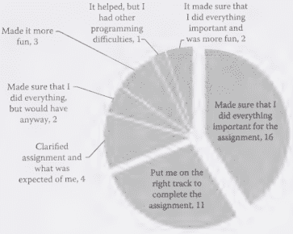

图 4.2  HALO 帮助学生的主要原因（n = 39）。

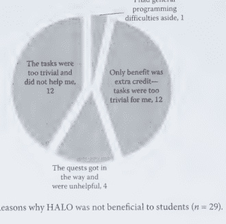

图 4.3  HALO 未能帮助学生的主要原因（n = 29）。

以下是一些学生的评论：

-   我非常喜欢课堂锦标赛。要是能有办法让它们变得有点强制性就好了。
-   这些作业完全可行，而且他通过为我们提供 HALO 任务来帮助我们，这些任务提供了一份应该完成的事项清单（它们是有主题的，所以上一个任务是《神秘博士》主题！）。
-   我认为你把你的音乐品味偷偷融入 HALO 任务太棒了。那些酷玩乐队的梗非常好笑。请让每一个 HALO 任务都以音乐为主题。它让我在做作业时保持清醒和愉快。

#### 4.5.2 一年后对计算机科学教育的思考

我们在课堂中使用游戏化元素的经历总体上是非常积极的。第一作者在 2013 年春季再次教授 COMS 1007，这门课现在是一门荣誉 CS1 课程。在那个学期，我们根据前一年的经验做了一些改变。现在我们描述这些改变背后的决策和理由。

##### 4.5.2.1 对 HALO 的反思

首先，我们决定不在课堂上使用 HALO。我们的决定主要基于两个方面：资源限制和研究挑战。

###### 4.5.2.1.1 限制条件

第二作者在 COMS 1007 的首次迭代中开发了 HALO Eclipse 插件，并帮助学生进行设置。要在未来的学期中使用，该插件需要更新和维护。创建学生账户并让他们安装和使用该插件虽然直接，但非常耗时，尤其是对于有超过 100 名学生的班级。请注意，我们课堂上的学生通常是大一和大二学生，他们几乎没有 Java 和 Eclipse 的使用经验。一种选择是，如果未来课程想使用 HALO，在可能的情况下增加一名额外的助教。

###### 4.5.2.1.2 作业与任务设计

HALO 的一大优势是作业创建和设计没有约束。然而，在任务设计方面存在一些影响。首先，创建优质且有趣的任务需要大量时间。根据我们的经验，创建任务大约占创建作业时间的 30%。换句话说，为三到四个作业创建任务所花费的时间，几乎等同于创建一整项新作业的时间。这需要与其他可能的时间约束一起纳入考虑。其次，如果同一个人既创建作业又创建其任务，任务创建会容易得多、快得多。在我们的案例中，有一些作业是由助教设计或构思的，但遗憾的是，他们自己无法创建任务，因为他们还没有上过软件工程或软件测试课程。这意味着任务创建必须由第一作者完成，因此需要更多时间。

###### 4.5.2.1.3 自适应任务

正如学生反馈所示，我们需要能够同时面向 struggling 学生和表现优秀学生的 HALO 任务。一种选择是为不同的

软件工程课程，对所有编程作业应用测试驱动开发，要求学生在每次作业中提交完整的测试用例。我们的方法与此类似，因为我们也提出了早期且广泛地接触测试。

Goldwasser 提出了一种高度社交化、竞争性的软件测试整合方式，学生提供的测试用例在彼此的代码中使用 [20]。Elbaum 等人 [1] 提出了 Bug Hunt——一种在自定进度的网络驱动环境中教授软件测试的工具。通过 Bug Hunt，学生可以在一系列预定义课程中逐步学习，为示例代码创建测试用例。这两种方法都将测试直接引入课程；而通过 HALO，我们旨在以一种潜移默化的方式引入测试。

Kiniry 和 Zimmerman [6] 提出通过“秘密忍者形式化方法”教授形式化验证——这种方法通过隐藏复杂数学来避免学生对使用它的顾虑。这种秘密忍者方法与此前提到的方法不同，它让学生在未意识到的情况下接触到新的领域。他们在多所机构实施了这一技术，并收到了积极的学生反馈（基于定性评估）。我们将他们的秘密忍者方法改编到了 HALO 中。

此外，人们还做了大量工作来创建教授软件工程概念的游戏。Horning 和 Norman [21] 创建了 Software Hut，将课程项目本身变成了一个游戏，由所有学生共同参与。SimSE 和卡牌游戏是旨在通过游戏环境教授学生软件工程的游戏 [22,23]。Eagle 和 Barnes [24] 引入了一款帮助学生掌握基本编程技术的游戏：基础循环、数组和嵌套 for 循环。然而，这些游戏都没有专门关注测试实践。还有一些研究涉及在全球软件开发 [25] 等课堂中教授相关方面，但这些研究并不专注于软件测试。

TankBrains [26] 是一个在计算机科学课程中使用的协作与竞争性游戏，学生竞相开发更好的 AI。Bug Wars [27] 是一种课堂活动，学生在代码中植入 bug、交换示例，并竞争发现最多 bug（在彼此的代码中）。虽然 TankBrains 和 Bug Wars 是具体的编程活动，但我们提出了一种教授入门计算机科学的通用方法，它既具有协作性又具有竞争性。

已有多种将游戏整合到计算机科学课程中的方法。最早尝试之一是 Software Hut，作者将基于项目的软件工程课程设计成了游戏 [21]。各组竞争成为最“盈利”的——其中表现


由“程序工程美元”（一种虚构货币）进行追踪。这种技术与我们相似，因为我们都用积分追踪学生表现，并加入了其他游戏概念，例如任务和成就。KommGame 是一个接口，封装了许多协作式软件开发活动，例如创建文档，或报告并解决缺陷，并用业力积分追踪每位学生 [28]。这种社交与协作环境代表了现实世界中的开源开发环境。

*SimSE* [23] 和 *问题与程序员* [22] 是两款以模拟为导向的游戏，为学生提供“真实世界”的软件工程体验。与之有些相似，*吴的城堡* [24] 是一款教授学生循环等基本编程结构的游戏。这三个项目都是游戏，而我们则在常规课程环境之上构建了一个游戏层。

### 4.7 结论

在本章中，我们描述了如何在 CS2 课程中融入游戏化元素来教授软件测试和软件设计。学生利用社交学习环境学习软件测试。我们描述了我们的 HALO 原型、一项作业以及配合 HALO 的任务，以增强 CS2 课程中的软件测试教学。学生通过竞争性锦标赛学习软件设计，我们描述了作业的细节以及锦标赛的运行方式。学生对这两方面的反馈总体上积极。

我们相信，我们的方法将使测试和设计对学生更具吸引力和趣味性，从而带来更好的系统。我们还认为，这将在早期阶段培养良好的软件工程习惯。

### 致谢

我们感谢教师学院游戏研究实验室的 Joey J. Lee 和卡内基梅隆大学人机交互研究所的 Jessica Hammer，感谢他们在这项工作的教学方面提供的协助。我们感谢所有参加 COMS 1007 课程的学生。我们感谢助教 Lakshya Bhagat、Amrita Mazumdar、Paul Palen、Laura Wilson 和 Don Yu 对课程的帮助。

作者是哥伦比亚大学编程系统实验室（PSL）的成员。PSL 的部分经费来自 NSF CCF-1302269、NSF CCF-1161079、NSF CNS-0905246 和 NIH U54 CA121852。

### 参考文献

- 1. Sebastian Elbaum、Suzette Person、Jon Dokulil 和 Matt Jorde。缺陷搜捕：让早期软件测试课程既有吸引力又经济实惠。*第29届国际软件工程会议论文集*，第688–697页，IEEE计算机学会，华盛顿特区，2007年。
- 2. Ursula Jackson、Bill Z. Manaris 和 Renée A. McCauley。将软件工程概念与技术有效整合到本科计算机科学课程中的策略。*第28届SIGCSE计算机科学教育技术研讨会论文集*，第360–364页，ACM，纽约，1997年。
- 3. Edward L. Jones。将测试融入课程——小剂量砒霜。*SIGCSE公报*，33:337–341，2001年。
- 4. Stephen H. Edwards。从测试优先的视角重新思考计算机科学教育。*第18届ACM SIGPLAN面向对象编程、系统、语言与应用年会附刊论文集*，第148–155页，ACM，纽约，2003年。
- 5. Edward L. Jones。将软件测试纳入计算机科学课程的一种体验式方法。载于*第31届教育前沿年会论文集*，第2卷，第F3D–7—F3D–11页，IEEE计算机学会，华盛顿特区，2001年。
- 6. Joseph R. Kiniry 和 Daniel M. Zimmerman。秘密忍者形式化方法。*第15届国际形式化方法研讨会论文集*，第214–228页，Springer-Verlag，德国柏林，2008年。
- 7. Swapneel Sheth、Jonathan Bell 和 Gail Kaiser。HALO（高度上瘾、社交优化）软件工程。*第1届游戏与软件工程国际研讨会论文集*，第29–32页，ACM，纽约，2011年。
- 8. 暴雪娱乐。*魔兽世界*。http://us.battle.net/wow/en。
- 9. David Ginat、Owen Astrachan、Daniel D. Garcia 和 Mark Guzdial。“但它看起来是对的！”：学生看不到的缺陷。*第35届SIGCSE计算机科学教育技术研讨会论文集*，第284–285页，ACM，纽约，2004年。
- 10. Jane McGonigal。*现实已破碎：为什么游戏让我们更优秀以及它们如何改变世界*。企鹅出版社，纽约，2011年。
- 11. Joey J. Lee 和 Jessica Hammer。教育中的游戏化：是什么、如何做、为何值得费心？*学术交流季刊*，15(2):2，2011年。
- 12. John P. Charlton 和 Ian D.W. Danforth。在网络游戏情境中区分成瘾与高度投入。*人类行为中的计算机*，23(3):1531–1548，2007年。
- 13. Patricia Wallace。*互联网心理学*。剑桥大学出版社，纽约，2001年。
- 14. SungBok Park 和 Ha Hwang。理解网络游戏成瘾：临场感与心流之间的联系。载于*人机交互：在各种应用领域中的交互，计算机科学讲义*，第5613卷，第378–386页，Springer，德国柏林，2009年。
- 15. Tracy Hall、Helen Sharp、Sarah Beecham、Nathan Baddoo 和 Hugh Robinson。关于开发者动机我们知道什么？*IEEE软件*，25(4):92–94，2008年。
- 16. Laurie Williams 和 Lucas Layman。实验伙伴：如果它们对自然科学足够好，为什么对我们不够好？*第20届软件工程教育与培训会议论文集*，第72–82页，2007年。
- 17. 哥伦比亚工程——傅氏工程与应用科学学院。*2011—2012学年公告*。http://bulletin.engineering.columbia.edu/files/seasbulletin/2011Bulletin.pdf，2011年。
- 18. Swapneel Sheth、Jonathan Bell 和 Gail Kaiser。一种游戏化方法用于教授软件设计与软件测试——作业与任务。技术报告 cucs-030-13，哥伦比亚大学计算机科学系，纽约，2013年。http://mice.cs.columbia.edu/getTechreport.php?techreportID=1557。
- 19. Erich Gamma、Richard Helm、Ralph Johnson 和 John Vlissides。*设计模式：可复用面向对象设计要素*，Addison-Wesley，1995年。
- 20. Michael H. Goldwasser。一种将软件测试贯穿整个课程的巧妙方法。*SIGCSE公报*，34:271–275，2002年。
- 21. James (Jim) Horning 和 David B. Wortman。软件小屋：以游戏形式开展的计算机程序工程项目。*IEEE软件工程汇刊*，3(4):325–330，1977年。
- 22. Alex Baker、Emily Oh Navarro 和 André van der Hoek。一种用于教授软件工程过程的实验性卡牌游戏。*系统与软件杂志*，75(1/2):3–16，2005年。
- 23. Emily Oh Navarro 和 André van der Hoek。SimSE：一种用于教授软件工程过程的教育模拟游戏。*第9届SIGCSE计算机教育创新与技术年会论文集*，英国利兹，第233–4页，2004年。
- 24. Michael Eagle 和 Tiffany Barnes。对一种教育游戏在改进入门计算学习方面的实验评估。*SIGCSE公报*，41:321–325，2009年。
- 25. Ita Richardson、Sarah Moore、Daniel Paulish、Valentine Casey 和 Dolores Zage。在本地课堂中实现软件开发全球化。*第20届软件工程教育与培训会议论文集*，第64–71页，2007年7月。
- 26. Kevin Bierce、Phil Ventura、Andrew Phelps 和 Christopher Egert。通过炸毁东西来激发面向对象编程学习：Java入门编程课程中的合作与竞争练习。载于*第37届SIGCSE计算机科学教育技术研讨会论文集*，第354–358页，2006年。
- 27. Renee Bryce。缺陷大战：一项在代码中查找缺陷的竞争性练习。*学院计算科学杂志*，27(2):43–50，2011年。
- 28. Terhi Kilamo、Imed Hammouda 和 Mohamed Amine Chatti。教授协作式软件开发：一个案例研究。*2012年国际软件工程会议论文集*，第1165–1174页，2012年。


## 教育软件工程

*软件工程、教育与游戏的交汇之处*

Tao Xie, Nikolai Tillmann, Jonathan de Halleux, and Judith Bishop

### 目录

- 5.1 引言 114
- 5.2 背景：在线编程练习系统 115
  - 5.2.1 CodingBat 115
  - 5.2.2 CloudCoder 117
  - 5.2.3 Practice-It 117
  - 5.2.4 CodeLab 118
  - 5.2.5 Codecademy 118
  - 5.2.6 BetterProgrammers 119
  - 5.2.7 讨论 119
- 5.3 Pex4Fun：在线编程练习系统的游戏化 120
  - 5.3.1 Pex4Fun 底层的软件工程技术 121
  - 5.3.2 Pex4Fun 中的游戏化 122
  - 5.3.3 Pex4Fun 中的社交动态 123
    - 5.3.3.1 玩家排名与编码对决 123
    - 5.3.3.2 实时信息流 123
  - 5.3.4 Pex4Fun 的教育用途 125
  - 5.3.5 Code Hunt 126
- 5.4 讨论 — 128
- 5.5 结论 — 129
- 致谢 — 130
- 参考文献 — 130

### 5.1 引言

在软件工程的各个子领域中，软件工程教育 [1] 一直是一个重要的子领域，关注软件工程的教育主题（例如，如何更好地教授和训练软件工程技能）。一般来说，软件工程教育的研究工作不会出现在主要软件工程会议的研究 track 中，而是出现在其教育 track 或聚焦软件工程教育的会议中。例如，国际软件工程会议（ICSE；http://www.icse-conferences.org）通常设有软件工程教育 track。ACM SIGPLAN 面向对象编程、系统、语言和应用会议最近也包含了一个同地举办的教育者研讨会（http://www.splashcon.org/history）。软件工程教育与培训会议（http://conferences.computer.org/cseet）自 1987 年以来一直聚焦软件工程教育与培训。事实上，软件工程教育的研究工作有时也会出现在计算机科学教育会议上，例如 SIGCSE 技术研讨会（http://www.sigcse.org/events/symposia）和计算机科学教育创新与技术年会（http://www.sigcse.org/events/iticse）。

在本章中，我们在软件工程研究的领域内定义并倡导教育软件工程（即面向教育的软件工程）这一子领域。该子领域为超出软件工程教育任务的一般教育任务开发软件工程技术（例如，软件测试与分析 [2]、软件分析 [3,4]）。例如，一般教育任务甚至可以涉及数学教学 [5–7]。类比而言，面向软件工程的数据挖掘 [8]（也称为挖掘软件仓库 [9]）利用数据挖掘技术（通常来自数据挖掘社区）来解决软件工程中的任务，而教育软件工程则利用软件工程技术（通常来自软件工程社区）来解决教育中的任务。此外，在解决方案空间中，游戏技术常常与软件工程技术一起发挥重要作用。

我们预计，教育软件工程的研究者将成为教育领域以及即将到来的大规模开放在线课程（MOOCs）[10,11] 时代的关键参与者之一，MOOCs 最近在各大学甚至全球社会中获得了很高的人气。教育软件工程能够也将为应对教育中的各种关键挑战作出重要贡献，尤其是 MOOCs，例如自动评分 [12,13]、智能辅导 [14]、题目生成 [5–7] 和抄袭检测 [15,16]。

为了提供一个教育软件工程的具体示例，在本章中，我们首先通过描述若干现有代表性系统来铺陈在线编程练习系统的背景。作为在线编程练习系统游戏化的一个具体示例，我们将说明 Pex for Fun [13]（简称 Pex4Fun），它利用软件工程和游戏技术来解决教授与学习编程及软件工程技能的教育任务。特别地，我们对 Pex4Fun 的说明聚焦于其底层软件工程技术（5.3.1 节）、其游戏化（5.3.2 节）、社交动态（5.3.3 节）和教育用途（5.3.4 节），这些是典型教育软件工程项目的四个常见方面。我们还将描述 Code Hunt（5.3.5 节），这是一个由 Pex4Fun 演化而来的近期游戏平台。

### 5.2 背景：在线编程练习系统

#### 5.2.1 CodingBat

*CodingBat*（http://codingbat.com/）由 Nick Parlante 创建，是一个提供一组 Java 和 Python 编程练习的在线平台。请注意，CodingBat 中的一些练习配有提示文本和/或解答代码。我们接下来用一个示例（http://codingbat.com/prob/p146974）来说明学生如何在 CodingBat 中解决一道练习问题。在这个示例中，练习问题的网页包含一段简短的自然语言题目描述：“给定一个分数数组，如果每个分数都等于或大于前一个分数，则返回 true。数组长度将为 2 或更多。”此外，网页还包含一个表格，用于展示少量示例预期输入/输出对：

| 示例 | 结果 |
| --- | --- |
| `scoresIncreasing({1, 3, 4})` | `true` |
| `scoresIncreasing({1, 3, 2})` | `false` |
| `scoresIncreasing({1, 1, 4})` | `true` |

然后，网页中间的代码编辑器包含 `public boolean scoresIncreasing(int[] scores)` 的空方法体（请注意，当题目创建者创建题目时，题目中的方法如 `scoresIncreasing` 应返回一个值）。尝试解决该问题的学生应在空方法体中填写代码来解决给定的编程问题。学生填写代码并点击 Go 按钮后，CodingBat 会显示代码编译时遇到的编译问题（如果有）；否则，CodingBat 会针对代码运行一组预定义测试用例（由题目创建者准备），并报告这些测试用例被标记为失败测试用例或通过测试用例。请注意，这些测试用例以前述示例预期输入/输出对的形式报告。根据反馈（即报告的测试用例及其失败/通过状态），学生可以进一步尝试改进其代码，使所有测试用例都成为通过测试用例。

\* 本章大幅扩展了之前在第 3 届游戏与软件工程国际研讨会（2013）上发表的短文 [31]。本章的新扩展主要包括：综述相关的在线编程练习系统（5.2 节）；重构并丰富对 Pex4Fun 的描述，作为在线编程练习系统游戏化的示例；增加对 Code Hunt（5.3.5 节）的描述，这是一个由 Pex4Fun 演化而来的近期游戏平台；并讨论更多近期相关工作。

由于预定义测试用例集对学生可见，学生可以通过编写包含针对每个报告测试用例的条件语句的代码来“愚弄”CodingBat，使条件语句中的条件检查方法参数是否与某个报告测试用例中的输入相同，然后条件语句的真分支直接返回该报告测试用例中的预期输出。显然，以这种方式编写代码来过拟合报告的测试用例并不是该练习问题的正确代码。然而，CodingBat 仍会报告“全部正确”，因为所有预定义测试用例确实都是通过测试用例。

CodingBat 允许学生查看某道题的进度图，显示该学生随时间提交的该题每个代码版本的解题历史（例如，通过测试用例的百分比和失败测试用例的百分比）。学生还可以查看一些随机用户的图表，仅供娱乐。学生可以通过解决所有基础部分中的问题来获得*代码徽章*（这些部分包含经常出现在


编程，例如与字符串、数组和逻辑相关的问题）。例如，当学生在每个基础部分解决三道问题时，该学生就会获得五星徽章。学生可以将其账户与一个“教师”账户共享，关联教师可以从该账户查看学生的问题解决统计数据，以及学生为每道题编写的代码。然而，不建议教师将 CodingBat 用作考试或作业的评分平台，而建议将 CodingBat 用作学生的练习平台。

#### 5.2.2 CloudCoder

CloudCoder [17]（http://cloudcoder.org/）和 CodeWrite [18]（http://code-write.cs.auckland.ac.nz/）是与 CodingBat 密切相关的两个系统。CloudCoder 是一个开源的基于 Web 的编程练习系统，提供 C/C++、Java、Python 和 Ruby 练习。CloudCoder 提供了与 CodingBat 类似的机制，让学生根据针对预定义测试用例集的测试结果来解决问题。然而，CodeWrite 允许学生构造一道练习题以及该问题的测试用例，以便其他同学能够解决该练习题（方式与在 CodingBat 或 CloudCoder 中解决练习题相同）。请注意，在 CodingBat 或 CloudCoder 中，只有教师或平台提供者（而非学生）才应构造练习。

#### 5.2.3 Practice-It

Practice-It（http://practiceit.cs.washington.edu/）是一个供学生练习解决 Java 编程问题的在线平台。许多问题取自华盛顿大学的入门编程课程。学生可以从按编程教材章节主题或华盛顿大学入门编程课程小节主题组织的问题列表中选择一个问题。一旦获得平台管理员的许可，平台用户也可以创建并上传问题。如果问题创建者为问题定义了一些约束，Practice-It 首先会根据这些约束检查学生的代码，并报告约束违反错误，例如以下内容：错误：你的解决方案不满足此问题要求的一个或多个约束。你的解决方案必须使用静态方法。（必须在你的解决方案中出现 2 次）。如果学生的代码无法编译，Practice-It 会根据编译错误报告修复提示。在学生的代码编译后，Practice-It 会针对学生的代码运行一组预定义测试用例（由问题创建者准备）。然后，Practice-It 会报告一个表格，其中包含每个测试用例的测试信息：测试输入、预期输出、实际输出（由学生的代码产生）以及结果（通过或失败）。当预期输出与实际输出不同时，结果为失败；实际输出与预期输出的不同结果也会被报告。

#### 5.2.4 CodeLab

*CodeLab*（http://www.turingscraft.com/）为学生提供完整练习的付费访问权限，是一个基于 Web 的编程练习系统，提供 Python、Java、C++、C、JavaScript、C#、VB 和 SQL 练习。CodeLab 提供短练习，每个练习通常侧重于一个编程概念或语言结构。与其他相关系统不同，CodeLab 在学生提交某个练习问题的代码后，不会向学生报告任何明确的测试用例（即输入/输出对）。相反，CodeLab 会告知学生其提交的代码是否正确（代码的正确性判断似乎基于运行一组预定义测试用例，而不考虑代码的优雅性或效率）。如果不正确，CodeLab 还会向学生提供修复提示，例如可能出错代码部分的位置和提示语句，例如：“你几乎肯定应该使用：]。”这些修复提示似乎是通过对提交代码和解决方案代码进行语法比较来识别的。CodeLab 不会就提交代码的具体正确（或不正确）输入/输出行为向学生提供反馈。CodeLab 按与某个编程概念或语言结构相关的顺序组织练习（一个序列中通常有 3–10 个练习）。一个序列中包含的练习会逐渐提高复杂程度。建议班级教师将学生课程成绩的 5%–10% 分配给正确完成 CodeLab 练习。除了利用 CodeLab 中现有的练习外，教师还可以在 CodeLab 中创建额外练习供其班级使用。

#### 5.2.5 Codecademy

*Codecademy*（http://www.codecademy.com/）是一个在线互动平台，提供 Python、PHP、jQuery、JavaScript、Ruby、HTML 和 CSS 的免费编程课程。在浏览器中，左侧会向学生提供说明某个编程知识点的短文，以及指导学生在浏览器中间显示的在线代码编辑器中完成相关编程练习的说明。

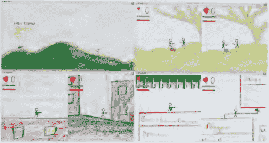

图 2.1 *BlueRose* XNA 游戏的截图。


图 5.4 Code Hunt 网站的主页面。

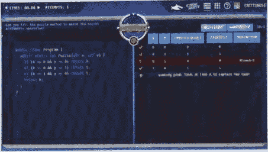

图 5.6 Code Hunt 中的一个示例编程对决。

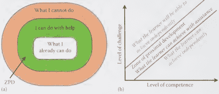

图 6.1 (a,b) 最近发展区可以扩展并随时间变化。

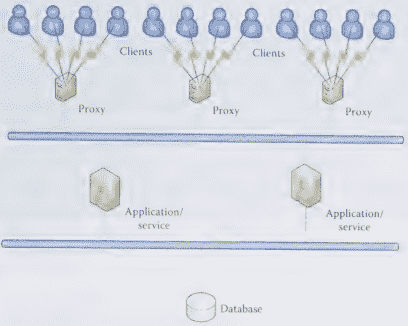

客户端 · 代理 · 应用服务 · 数据库

图 7.1 分层架构。

### 5.3 在线拼图游戏

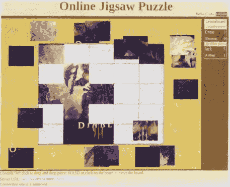

图 7.3 有 25 块的多人拼图游戏。

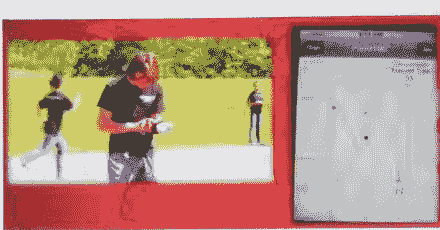

图 8.1 典型的 iTron 游戏。

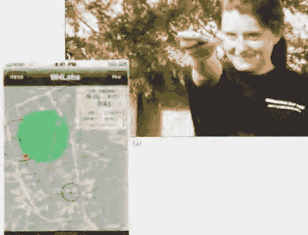

图 8.4 (a) iTESS 霰弹枪武器的瞄准射击界面，以及 (b) 霰弹枪射击动画期间的屏幕显示。


图 9.1 AGA-D 游戏显示一个搜索问题（3），然后让你用 Google 搜索答案（1）。你逐一完成这些问题（2），并在解锁和解决更多问题时获得分数。

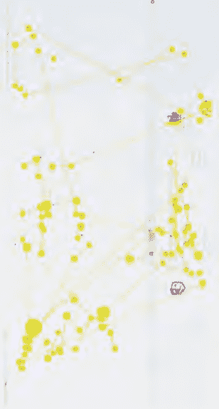

图 9.2 眼睛在显示器上的运动用连通图表示。数字表示它代表的是哪一次注视或停顿，圆圈大小表示眼睛在该点注视的持续时间。数字 1 位于右下方附近，即玩家在上一页点击按钮的位置。

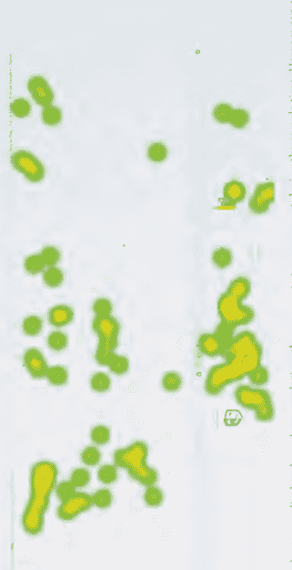

图 9.3 热图显示在采样时间内眼睛在任何一点停留了多长时间。这里我们可以看到，玩家大部分时间都在阅读问题（底部戏剧面具符号旁边，以及顶部搜索查询附近）。


图 9.4 按天统计的问题追踪数据。该图显示了三个不同问题（“Triple Point”、“Lonesome”和“Hamingja”）在 6 天内的玩家数量。“Triple Point”于 2011 年 4 月 30 日推出，但玩家在 4 天后仍会回到该问题。

甚至软件从业者。特别是，在 Pex4Fun 中的一种主要游戏类型——编程对决游戏中，学生需要编写代码来实现一个秘密规范的功能（该规范以学生不可见的示例解决方案代码形式给出）。基于自动化测试生成工具，Pex4Fun 会发现学生的代码与秘密规范之间在行为上的任何差异。这些差异会作为反馈提供给学生，以指导学生如何修改代码以匹配秘密规范的行为。

接下来，我们将重点介绍 Pex4Fun 的底层软件工程技术（第 5.3.1 节）、其游戏机制（第 5.3.2 节）、社交动态（第 5.3.3 节）和教育用途（第 5.3.4 节），这是一个典型教育软件工程项目常见的四个方面。最后，我们介绍 Code Hunt（第 5.3.5 节），这是一个由 Pex4Fun 演变而来的近期游戏平台。

#### 5.3.1 Pex4Fun 底层的软件工程技术

在云端服务器的幕后，Pex4Fun 网站利用由 Pex [22,23] 实现的动态符号执行（DSE）[21]，以便：（1）判断学生提交的代码是否正确；（2）检查代码的正确性以及玩家的游戏进度；（3）计算定制反馈 [24]。Pex 是一个面向 .NET 的自动白盒测试生成工具。它已作为插件集成到 Microsoft Visual Studio 中。除了在工业界使用外，Pex 还被用于不同大学的课堂教学 [25]。

具体而言，DSE [21] 是符号执行 [26,27] 的一种变体，并利用具体执行中的运行时信息。DSE 通常以迭代方式进行，以系统地提高代码覆盖率，例如块覆盖率或分支覆盖率。在每次迭代中，DSE 使用一个测试输入执行被测程序，该输入可以是第一次迭代中的默认输入或随机生成的输入，也可以是之前某次迭代中生成的输入。在被测程序执行期间，DSE 并行执行符号执行，以收集沿执行路径的分支语句中的谓词所获得的程序输入符号约束。然后，DSE 翻转已执行路径中的一个分支节点，以构造一条新路径：该路径与已执行路径共享到该节点为止的前缀，但随后发生偏离并走另一条分支。最后，DSE 依赖约束求解器计算一个可满足的赋值（如果可能），该赋值形成一个新的测试输入，其执行将遵循翻转后的路径。


#### 5.3.2 Pex4Fun 中的游戏

Pex4Fun 游戏的核心类型是*编程对决*，玩家必须解决一个特定的编程问题。由游戏创建者（可以是 Pex4Fun 的任意用户）创建的编程对决由两个具有相同方法签名和返回类型的方法组成。¹ 这两个方法中，一个是秘密（黄金）实现，玩家不可见。另一个是玩家实现，玩家可见，并且可以是空实现，也可以是秘密实现的有缺陷实现。玩家实现可以包含可选注释，为玩家提供一些提示，以降低游戏难度。

¹ 编程对决的方法签名必须至少有一个输入参数。编程对决的返回类型不能为 void。

玩家选择要玩的编程对决游戏后，其获胜目标是修改玩家实现（玩家可见，如图 5.1 上半部分所示），使其行为（就方法输入和结果而言）与秘密实现（玩家不可见）相同。显然，在没有任何反馈或帮助的情况下，玩家无法猜出秘密实现会如何表现。玩家可以通过点击 Ask Pex! 按钮（如图 5.1 中左部所示）获得一些反馈，以请求以下两类反馈：（1）在哪些示例方法输入下，玩家实现和秘密实现具有相同的方法结果；（2）在哪些示例方法输入下，玩家实现和秘密实现具有不同的方法结果。图 5.1 底部附近的表格给出了一个示例反馈。在该表中，第一行带前缀的表示第一类反馈，第二行和第三行表示第二类反馈。

如第 5.3.1 节所述，Pex4Fun 利用名为 Pex [22,23] 的底层测试生成引擎来生成此类反馈，并判定玩家是否赢得游戏：如果测试生成引擎无法生成任何方法输入来使玩家实现和秘密实现具有不同的方法结果，则玩家赢得游戏。

编程对决游戏和游戏平台的设计遵循若干设计原则 [13]。例如，游戏需要具有交互性，并且交互需要是迭代的，涉及多个回合。提供给玩家的反馈应当是自适应的，并针对玩家对玩家实现所做的修改进行个性化。游戏应当有明确的获胜标准。应当没有或很少有机会让玩家作弊（例如，通过在玩家实现中添加非常复杂的代码部分，给底层测试生成引擎制造困难）。

#### 5.3.3 Pex4Fun 中的社交动态

为了给 Pex4Fun 增添更多乐趣，我们开发了许多与社交动态相关的功能，使 Pex4Fun 中的游戏成为一种社交游戏。例如，Pex4Fun 允许玩家了解其他人已经能够赢下（或未能赢下）哪些编程对决。对于玩家打开的给定编程对决，工作区上方的描述文本框会显示一些统计信息，例如：你能编写与秘密实现匹配的代码吗？其他人已经赢下这个对决 322 次！（见图 5.1）。

##### 5.3.3.1 玩家和编程对决排名

最初，当我们在 Pex4Fun 中只提供相对较少数量的编程对决时，我们提供了一种赢取奖章的机制，以鼓励用户玩编程对决。登录后，用户可以通过赢下编程对决来获得虚拟奖章。第一枚奖章授予赢下 Pex4Fun 内置编程对决中任意五场的用户。用户赢下另外 20 个内置编程对决后，可获得第二枚奖章。

此外，用户可以点击 Pex4Fun 主页上的社区链接，查看自己的编程对决技能与其他用户相比如何。在社区区域（http://www.pexforfun.com/Community.aspx）中，有两个所有用户的排名列表（一个基于用户获得的积分数，另一个基于用户赢下的编程对决数），以及其他用户已发布的编程对决。图 5.2 显示了基于所获积分对所有用户进行的排名列表。用户可以通过赢下编程对决、对自己赢下的编程对决进行评分、注册课程、创建其他人尝试赢下的编程对决、创建其他人赢下的编程对决等方式获得积分。请注意，用户可以将自己赢下的任何编程对决评为有趣、无聊或可疑。所有评分都会与社区共享。

**Pex for fun - Community**

加入 Pex for fun 社区！使用你的 Windows Live™ ID 登录。选择你的 Pex for fun 昵称，选择在高分榜中显示你的昵称，并发布自创的编程对决。访问我们 Pex 的 MSDN 论坛，并在 Facebook 上为 Pex 点赞。

**High Score List**

**By Points**

谁拥有最多积分：

- 1. Mae (951)
- 2. meis! (854)
- 3. StevePa (685)
- 4. Kai (600)
- 5. Mohammed (514)
- 6. TheRama (463)
- 7. DarrenW (404)
- 8. tony (403)
- 9. Mike S (388)

图 5.2 Pex4Fun 中的用户排名。

##### 5.3.3.2 实时动态

玩家可以点击 Pex4Fun 主页上的 Live Feed 链接，查看其他玩家当前正在赢下（或未能赢下）哪些编程对决（http://www.pexforfun.com/Livefeed.aspx）。也许其他人正在尝试赢下该玩家创建的编程对决，或者该玩家也在尝试赢下同一个编程对决。图 5.3 显示了实时动态的示例屏幕截图。

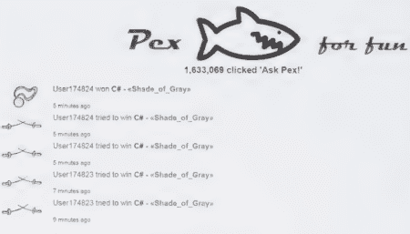

图 5.3 实时动态的示例截图。

Pex4Fun 中的社交动态与其他近期软件工程中的游戏化示例有着相似的动机。例如，Stack Overflow 徽章（http://stackoverflow.com/badges）已被用于激励 Stack Overflow 用户在那里提问或回答问题。通过提问或回答问题，用户可以赚取声望积分。例如，当用户对某个问题的回答获得“赞成”投票时，该用户会获得 10 点声望积分。此外，用户可以获得三个等级的徽章：铜牌、银牌和金牌徽章。铜牌徽章授予经常帮助教导其他用户如何使用系统的用户。银牌徽章授予发布非常有见地的问题和回答，并表现出致力于管理和改进 Stack Overflow 内容的用户。金牌徽章授予表现出杰出奉献或成就的用户。用户获得的此类徽章会显示在其个人资料和用户卡片中。本着类似的精神，2012 年初，Microsoft 为 Microsoft Visual Studio 添加了一个新插件，使软件开发人员能够解锁成就（http://channel9.msdn.com/achievements/visualstudio）、获得徽章，并基于他们编写的程序代码提高其在排行榜上的排名。

#### 5.3.4 Pex4Fun 的教育用途

Pex4Fun 中的编程对决游戏类型足够灵活，允许游戏创建者创建各种游戏，以针对一系列技能，例如编程、程序理解、归纳、调试、问题求解、测试和规范编写等技能，并具有不同的游戏难度级别。此外，Pex4Fun 是一个开放平台：除了玩现有的编程对决之外，世界各地的任何人都可以创建编程对决供他人玩。教师可以通过定制现有学习材料和游戏，或创建新的材料和游戏，以课程形式创建虚拟教室。教师还可以享受对学生所布置练习进行自动评分的好处。Pex4Fun 已提供了许多开放式虚拟课程，其中包括学习材料以及用于巩固学生学习的游戏（http://www.pexforfun.com/Page.aspx#learn/courses）。

Pex4Fun 曾被采用为一门研究生软件工程课程作业的主要平台。一个重要的软件工程会议（2011 年）举办了一场编程对决竞赛，以吸引会议参会者在动态社交竞赛中解决编程对决。Pex4Fun 在社区中一直广受欢迎：由于它于 2010 年 6 月向公众发布，截至 2014 年 7 月 21 日，Ask Pex! 按钮的点击次数（表明用户尝试解决 Pex4Fun 中游戏的次数）已达到 150 万次以上（1,540,970 次）。


各类 Pex4Fun 用户在互联网上发布评论，表达他们对 Pex4Fun 的热情和兴趣（甚至成瘾）。这里我们收录了一些示例：

> Pex4Fun 可能成为比 FizzBuzz 更好的 FizzBuzz。
> 它真的让我“兴奋”。最让我兴奋的是传播对计算机科学的兴趣/教授计算机科学：我确实认为这对教学—学习来说非常棒！

> 坦白说，这是我最喜欢的游戏。我以前喜欢第一人称射击游戏，喜欢在玩《彩虹六号》时把一整队菜鸟轰飞的满足感，但这个游戏有趣得多。
>
> 教学、学习——说到底，这难道不是同一回事吗？事实上，对我个人而言，这真的关乎利用好奇心，无论是我的还是别人的——最好是两者兼有！而 Pex4Fun（以及背后的所有东西）是一个很棒、很有前景的平台：你有谜题，你有竞争，你会得到让你提前思考的反馈……
>
> 恐怕我不得不约束自己每天只在这件真正令人兴奋的事情上花大约一个小时，因为我工作实在太忙了。

> 在验证所提出解决方案的方式上，Pex4Fun 相比 Project Euler 有很大改进；事实上，它增加的是，你不只是得到一个“不行”，而是得到更清晰明确、可以在此基础上继续构建的东西。我认为这才是真正伟大和令人兴奋的地方——现在让我们把它推得更远！

#### 5.3.5 Code Hunt

Code Hunt [28,29] 是一个最近从 Pex4Fun 演化而来的游戏平台。Code Hunt 包含更多游戏元素，为玩家提供更吸引人的体验。图 5.4 展示了 Code Hunt 网站主页。该游戏平台还有音效和排行榜，以保持玩家参与。

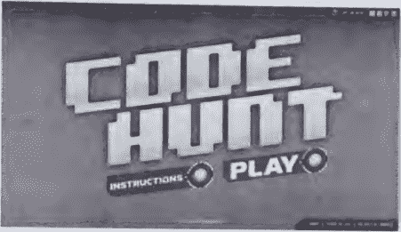

图 5.4（见彩色插页）Code Hunt 网站主页。

Code Hunt 以编程对决作为游戏类型，将游戏组织成一系列世界、扇区和关卡，难度逐渐增加。图 5.5 展示了玩家可选择的扇区示例列表。在每个关卡中，玩家进行编程对决游戏，必须发现一个秘密代码片段并为其编写代码（使用 Java 或 C#）。图 5.6 展示了一个供玩家游玩的编程对决示例，图中左侧显示玩家代码。玩家点击 Capture Code 按钮（显示在图的中上部附近，效果等同于点击 Pex4Fun 中的 Ask Pex! 按钮）后，底层 Pex 工具通过生成的测试用例向玩家提供定制化进度反馈，如图 5.5 右侧表格所示。此外，Code Hunt 可能会提示用户关注某一行代码，如图右侧表格最后一行所示。当玩家代码达到与秘密实现相同的结果时，Code Hunt 会闪烁显示 Captured Code，并根据代码质量给玩家打分。Code Hunt 相对于 Pex4Fun 的其他改进包括：Code Hunt 提供 Java 作为受支持语言（通过源代码转换器），并且运行在 Microsoft Azure 上，从而可扩展到大量并发用户。

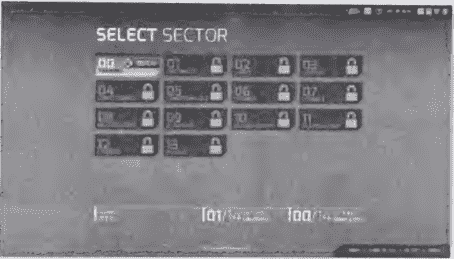

图 5.5 Code Hunt 中的扇区示例。

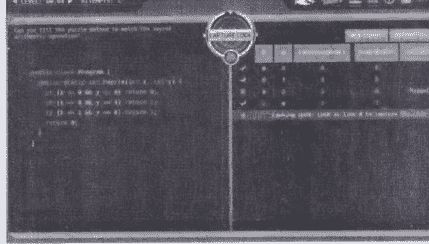

图 5.6（见彩色插页）Code Hunt 中的一个编程对决示例。

### 5.4 讨论

教育软件工程与教育游戏领域 [30]（即用于教育的游戏）密切相关，示例会议包括 Games+Learning+Society Conference（http://www.gameslearning-society.org/conference），示例倡议包括麦克阿瑟数字媒体与学习倡议（http://www.macfound.org/programs/learning）。教育游戏领域通常关注支持教育目的的游戏技术，而教育软件工程通常关注支持教育目的的软件工程技术。在 Pex4Fun 和 Code Hunt 的语境中，教育游戏领域会更关注游戏方面（第 5.3 节），而教育软件工程领域会更关注软件工程技术方面（第 5.3.1 节）。注意，教育软件工程不仅涉及教育游戏，还涉及其他非游戏的教育工具。

此外，可以合理地认为，用于开发教育游戏或一般教育工具（例如教育游戏软件的软件质量保证）的软件工程也属于教育软件工程的一部分。换言之，教育软件工程不限于作为教育工具基础设施支持的软件工程技术（如 Pex4Fun 和 Code Hunt 所示例），还可以包括辅助教育工具开发的软件工程工具或过程。

我们倡导将教育软件工程纳入软件工程研究，并以三种示例方式为软件工程研究做出贡献：

- 1. 第一，当面向教育任务时，研究人员可能能够利用或开发软件工程技术（使这些技术对此类任务有效），而这些技术通常可能不够有效或成熟，不足以处理与软件产业相关的任务。一个示例是为教育任务开发程序合成技术 [5–7]。另一个示例是为 Pex4Fun 和 Code Hunt 开发测试生成技术，因为为编程对决创建的秘密实现往往比真实世界的代码实现更简单。
- 2. 第二，面向教育任务可能会对软件工程技术提出独特要求。例如，针对实现代码覆盖率等软件工程任务的测试生成，旨在生成并报告能够实现新代码覆盖率的测试输入。然而，针对 Pex4Fun 和 Code Hunt 的测试生成，旨在生成并报告能够作为反馈以实现有效学习目的的测试输入。
- 3. 第三，一些教育任务（如智能辅导 [14] 和问题生成 [5–7]）需要创建新的软件工程技术，这些技术可能在传统软件工程中并不存在（因为教育领域的此类任务在软件工程领域中没有对应物）。

### 5.5 结论

本章中，我们定义并倡导教育软件工程作为软件工程的一个新兴子领域。教育软件工程为一般教育任务开发软件工程技术。在这个子领域中，游戏技术通常与软件工程技术一起发挥重要作用。我们介绍了 Pex4Fun（以及 Code Hunt），这是我们最近利用软件工程和游戏技术来教授和学习编程与软件工程技能的示例之一。Pex4Fun 和 Code Hunt 也可以用于 MOOCs 语境，以解决自动评分等问题。

### 致谢

我们感谢审稿人提出的宝贵反馈。Tao Xie 的工作部分得到 Microsoft Research Award、NSF 资助 CCF-1349666、CNS-1434582、CCF-1434596、CCF-1434590 和 CNS-1439481，以及中国国家自然科学基金（编号 61228203）的支持。

### 参考文献

- 1. Mary Shaw. 软件工程教育：路线图。载于 *Proceedings of FOSE*，第 371–380 页，爱尔兰利默里克，2000 年。
- 2. Mary Jean Harrold. 测试：路线图。载于 *Proceedings of FOSE*，第 61–72 页，爱尔兰利默里克，2000 年。
- 3. Dongmei Zhang, Yingnong Dang, Jian-Guang Lou, Shi Han, Haidong Zhang, and Tao Xie. 软件分析作为实践中的学习案例：方法与经验。载于 *Proceedings of MALETS*，第 55–58 页，堪萨斯州劳伦斯，2011 年。
- 4. Dongmei Zhang, Shi Han, Yingnong Dang, Jian-Guang Lou, Haidong Zhang, and Tao Xie. 实践中的软件分析。特刊，*IEEE Software*，30(5):30–37，2013 年。
- 5. Erik Andersen, Sumit Gulwani, and Zoran Popovic. 用于分析和合成教育进程的基于轨迹的框架。载于 *Proceedings of CHI*，第 773–782 页，法国巴黎，2013 年。
- 6. Sumit Gulwani, Vijay Korthikanti, and Ashish Tiwari. 合成几何构造。载于 *Proceedings of PLDI*，第 50–61 页，加利福尼亚州圣何塞，2011 年。
- 7. Rohit Singh, Sumit Gulwani, and Sriram Rajamani. 自动生成代数问题。载于 *Proceedings of AAAI*，加拿大安大略省多伦多，2012 年。
- 8. Tao Xie, Suresh Thummalapenta, David Lo, and Chao Liu. 面向软件工程的数据挖掘。*IEEE Computer*，42(8):35–42，2009 年。
- 9. Ahmed E. Hassan. 挖掘软件仓库的未来之路。载于 *Proceedings of FoSM*，第 48–57 页，中国北京，2008 年。
- 10. Armando Fox and David Patterson. 跨越软件教育鸿沟。*Communications of the ACM*，55(5):44–49，2012 年。
- 11. Ken Masters. 理解 MOOCs 的简要指南。*The Internet Journal of Medical Education*，1，2011 年。https://ispub.com/IJME/1/2/10995。doi:10.5580/1f21。
- 12. Rishabh Singh, Sumit Gulwani, and Armando Solar-Lezama. 面向入门编程作业的自动反馈生成。载于 *Proceedings of PLDI*，第 15–26 页，华盛顿州西雅图，2013 年。
- 13. Nikolai Tillmann, Jonathan De Halleux, Tao Xie, Sumit Gulwani, and Judith Bishop. 通过交互式游戏教授和学习编程与软件工程。载于 *Proceedings of ICSE, Software Engineering Education (SEE)*，第 1117–1126 页，加利福尼亚州旧金山，2013 年。


- 30. 詹姆斯·保罗·吉。*电子游戏能教给我们什么关于学习和素养的知识？* 帕尔格雷夫·麦克米伦，纽约，2007。
- 31. 谢涛、尼古拉·蒂尔曼和乔纳森·德·阿勒。教育软件工程：软件工程、教育与游戏的交汇之处。载于 *GAS 论文集*，第36–39页，加州旧金山，2013。

## 自适应严肃游戏

芭芭拉·赖夏特、达米尔·伊斯梅洛维奇、丹尼斯·帕加诺和贝恩德·布吕格

### 目录

- 6.1 引言 — 134
- 6.2 背景 — 135
- 6.3 探索性研究的基础：四款严肃游戏的开发 — 136
- 6.4 探索性研究：如何刻画严肃游戏中的玩家？ — 138
  - 6.4.1 研究设计 — 139
  - 6.4.2 结果 — 140
  - 6.4.3 结论 — 143
- 6.5 探索性研究：如何在严肃游戏中提供帮助？ — 143
  - 6.5.1 研究设计 — 143
  - 6.5.2 结果 — 144
  - 6.5.3 结论 — 145
- 6.6 效度威胁 — 146
- 6.7 走向自适应性的定义 — 146
- 6.8 展望 — 148
- 6.9 总结与结论 — 148
- 参考文献 — 149

**摘要：** 学习与大量努力和坚持相关。在学习理论中，动机可被视为成功学习的关键因素。严肃游戏可以增强动机，因为它们使用了多种元素，例如视觉环境、故事情节、挑战以及与NPC的互动。这使得严肃游戏成为理想的学习环境，因为学习体验变得内在满足且有回报，学习的外部压力或奖励反而次要。尽管游戏具有这种动机力量，但一些研究表明，没有已知的教育形式能像专业人类导师那样有效，因为导师会根据学习者的技能选择学习内容，从而一路每一步都适应学习者。本章探讨严肃游戏开发中人类导师与学习者之间的互动，重点关注社会发展理论。它呈现的结果展示了人类导师如何观察玩家执行学习任务并与严肃游戏环境互动。基于这些研究的结果，我们给出了严肃游戏自适应性的定义。

### 6.1 引言

严肃游戏能以大多数传统教学方法无法做到的方式吸引学习者。它们提供了一个平台，可以将动机和互动学习这两点完美结合。

本章描述探索人类导师在严肃游戏中作用的研究。开发严肃游戏时的观察表明，在没有帮助的情况下，儿童学习如何玩游戏所需的时间比成人更长，尽管两组在有帮助时都能达到相同时间[1]。维果茨基的社会发展理论[2]、皮亚杰的认知发展阶段[3]和埃里克森的发展阶段[4]等学习理论，基于学习过程中学习者的社会情境解释了这一现象。

学习在有人类导师时比其他工具进展更快的原因，是对学习者更高的*自适应性*。问题在于，当前最新水平的严肃游戏并不适应学习者[5–8]。因此，现代严肃游戏开发和研究的一个主要目标是让游戏适应学习者并提供智能行为，以实现更高的个性化[1,9]。

尽管可以认为用于实现自适应性的技术已经在电子学习系统中开发出来，但*智能辅导系统*（ITSs）通常促进的活动与游戏中看到的活动非常不同。因此，本章旨在探索严肃游戏特有的自适应性方式，并为严肃游戏中自适应性的软件框架奠定基础。

本章的贡献有两个方面。首先，我们提供两项研究，探索人类导师在严肃游戏中的作用。其次，基于

### 6.2 背景

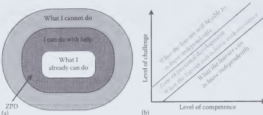

**图6.1**（见彩色插页。）（a,b）最近发展区可以扩展，并随时间变化。

关于特定主题的知识不是由单一分数给出，而是还提供学生在该领域内具体优势和弱点的信息。这是通过将内容拆分为若干更小的学习目标来实现的。然后，这些不同目标之间的联系以先修关系的形式给出。例如，在学习数字除法时，除以一位数可被视为学习除以大于10的数的先修条件。这种知识使ITS能够根据学习者的技能选择课程。

### 6.3 探索性研究的基础：四款严肃游戏的开发

为了研究导师在学习中的作用以及如何将其能力迁移到严肃游戏中，我们开展了两项研究。在第一项研究中，我们想了解导师使用哪些观察来评估学习者的技能。第二项研究则使用该评估结果来适应学习者。

两项研究都需要对游戏元素进行高度控制，包括但不限于内容、难度级别和游戏速度。不幸的是，现有严肃游戏无法提供这种控制水平。因此，我们需要开发自己的严肃游戏。

我们开发了四款小型严肃游戏，重点关注小学数学。它们的目标是教授从书写（图6.2a）和读数字（图6.2b）、简单加法

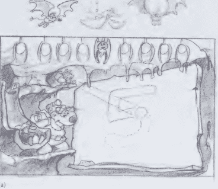

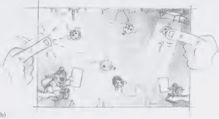

**图6.2**（a）在手电筒引导下书写数字。（b）练习快速计数以拯救虫子。*（续）*

这些任务涵盖广泛能力，从计数、简单加减法，到按形状和颜色分类几何图形（图6.2d）。这些内容直接选自德国小学的官方课程。

在游戏开发过程中，不同领域的专家参与其中。这是必要的，以免忽视技术、心理和教育方面的重要问题。

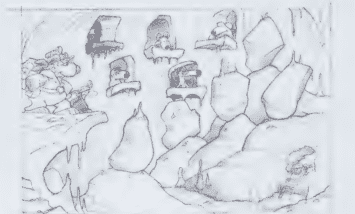

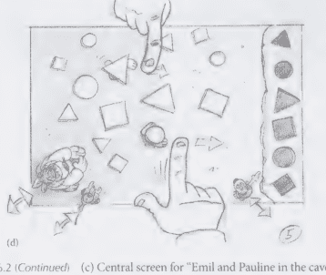

图6.2（续）（c）“埃米尔和波琳在洞穴中”的中央屏幕，孩子们可以在其中跟踪进度并选择想玩的游戏。（d）练习几何和概括。所有满足特定条件的形状都会跟随孩子的手指。孩子的任务是找出共同点（例如形状、颜色、大小）。

### 6.4 探索性研究：如何刻画严肃游戏中的玩家？

正如我们已经论证的，没有已知的教育形式能像专业人类导师那样有效[7,8]。原因在于，在当前技术水平下，没有计算机系统能像人类一样善于适应用户[5,6]。

根据社会发展理论，导师观察学习者，并在必要时尝试提供帮助。导师利用其观察分析学习者，并决定在何时需要帮助。然后通过与学生的直接互动提供帮助。ZPD定义了儿童在有个人导师和无导师学习时学习成果的差异[14]。

将该理论应用于严肃游戏，需要找出导师在观看并与学习者一起使用严肃游戏学习时究竟能观察到什么。此外，我们需要理解导师如何利用观察到的信息来刻画学习者。

当人类导师观察并因此向学习者提供帮助时，他或她能够识别学习者的技能。为了将此方法迁移到严肃游戏中，我们需要找出导师在严肃游戏中如何执行这项任务。因此，我们重点回答以下问题：当学习者玩严肃游戏时，可以观察到什么，以及这些信息如何用于刻画个体学习者？

**6.4.1 研究设计**

为回答这一研究问题，我们采用定性研究方法，通过访谈专家和观察儿童游戏来进行。

我们与专家（教育学家、心理学家、专业游戏开发者、严肃游戏研究者、学生和玩家）以迭代过程开发了一款严肃游戏。在开发过程中，我们在每次迭代中对所有参与者进行非正式的对话式访谈。所构建的游戏为给定问题提供了真实示例，并支持专家反思其回答。此外，我们使用这款严肃游戏观察儿童游戏，以便为专家提供更多数据。最后，我们基于该项目对专家进行回顾性访谈。我们在四款严肃游戏中重复该过程。图6.3给出了研究中遵循步骤的概览。我们对每款严肃游戏独立迭代图中描述的步骤。

本研究的目标是详细描述在一款针对儿童、具有特定主题的具体严肃游戏中可以观察到的数据，并详细描述专家在给定示例中如何刻画儿童。

本研究的设计与维果茨基在前面所述理论中提出的研究之间的差异如下：在此提出的严肃游戏中，与学习者没有直接互动。这样做是基于以下事实：在当前移动技术水平下，没有计算机系统能够以如此多的细微差别进行观察和反应


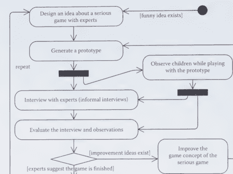

**图6.3** 严肃游戏的迭代开发过程。

作为人类。因此，我们减少了儿童与导师之间的互动，使其更接近计算机与儿童之间可能的水平。在进行这项研究时，我们希望在不直接打断严肃游戏的情况下，对严肃游戏中学习者的观察能够足够有意义，从而刻画学习者的特征。

项目参与者包括来自慕尼黑工业大学的研究人员、学生和资深开发人员，以及慕尼黑的两家专业严肃游戏开发公司。这两家公司提供了一名专业游戏设计师、一名专业故事作者和两名专业图形设计师。此外，我们还与一位经验丰富的儿童心理学家合作。

#### 6.4.2 结果

在开发过程中对专家的访谈帮助我们识别了与自适应相关的游戏元素和学习内容，如表6.1所示。在进行研究时，我们假设导师通过识别学习者的技能来刻画学习者。因此，我们让专家识别每款严肃游戏内容所需的所有技能。针对“可以观察到什么”这一研究问题，我们确定了游戏中不同的游戏元素、学习目标和技能，如表6.1所示。

**表6.1** 研究中确定的游戏元素和学习内容

| 严肃游戏 | SG1 | SG2 | SG3 | SG4 |
|---|---|---|---|---|
| 学习目标 | C, W | C, R | A, S | A |
| 游戏元素 | 3 | 7 | 9 | 4 |
| 学习内容技能 | 3 | 2 | 4 | 4 |
| 非学习内容技能 | 1 | 2 | 1 | 1 |

A，加法；C，计数；R，识别数字；S，减法；W，写数字。

根据社会发展理论，导师通过观察技能以及不同技能之间的关系来做决策。本研究基于知识空间理论（KST）[16]来回答“这些信息如何用于刻画个体学习者的技能？”这一问题。知识空间理论是描述学习内容的一种数学模型，因此它提供了一种基于学习者的技能对其进行特征刻画的数学模型 [17]。与其他评估方法相比，它不仅提供了一个预期代表学习者技能的单一数值，还提供了关于技能不同要素的更详细的学习者分析。此外，它还已经表示了不同要素之间的依赖关系，从而为自适应提供了良好的基础。因此，我们使用参考文献 [18] 中描述的知识空间理论概念来设计自适应严肃游戏内容的模型，如图6.4所示。

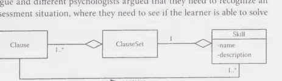

**图6.4** 自适应严肃游戏中的内容模型。内容可以表示为一组子句，这些子句又由技能组成。

使用该模型，我们可以定义技能以及技能之间的关系。在尝试回答“导师如何刻画游戏中的学习者？”这一问题时，我们发现了以下结果：首先，一位教育学家和不同的心理学家认为，他们需要识别一种评估情境，在这种情境中，他们需要判断学习者是否能够解决特定任务。因此，导师需要知道可能的任务并能够解决它们。此外，任务需要与技能相关联，这些技能将任务分组到特定集合中。

经过多次迭代，我们发现了不同的合理任务集分组，如表6.2所示。该分组需要反映表6.1中确定的技能。SG3中技能数量和任务集的差异是基于与加法和减法相关任务的分组。

**表6.2** 研究中确定的领域特定任务

| 任务集 | SG1 | SG2 | SG3 | SG4 |
|---|---|---|---|---|
| 1 | W 1,2,3 | C | A，其中 a < 10 | A，其中 c < 10 |
| 2 | W 4,5,7 | R | A，其中 c ≤ 20 | A，其中 c ≤ 15<sup>a</sup> |
| 3 | W, C<sup>a</sup> |  | A, S; a ± b = c<sup>b</sup> | A，其中 c ≤ 20<sup>a</sup> |
| 4 |  |  |  | A，其中 c ≤ 20 |

A，加法；C，计数；R，识别数字；S，减法；W，写数字。
A：a + b = c。
<sup>a</sup> 加法 a_i + a_j = a_c，其中 c ≤ 15，在某些情况下 ∀a_i, a_j, a_l 且 i < j < l。如果 c = 10，那么 (a_i + ... + a_l) < 10 ∧ a_l < 10；如果 c > 10，那么 (a_i + ... + a_l) ≥ 10 ∨ a_l ≥ 10。
<sup>b</sup> c ≤ ±20，且 a > 9 或 b > 9。

为了回答研究问题，我们首先将其重新表述如下：“导师如何利用观察到的信息来识别和评价学习者的技能？”基于表6.1和表6.2中给出的观察结果和数据，我们发现导师会观察任务的正误解答。基于正确和错误解答的数量，导师能够对与给定任务集相关的技能进行评价。此外，我们发现任务执行的正确与否并不总是二元的。在一些游戏中，任务的错误执行与游戏元素的难度有关。因此，导师观察学习者在尝试解决任务时的意图。

我们观察到一种情况：学习者在游戏中试图将石头扔向左侧，而正确的解决方案也在左侧。当学习者无法足够快地将石头扔到目标时，导师会识别出正确的意图，并将其视为正确，即使执行不成功。

我们可以得出结论，评估情境产生的结果可能是正确的但不成功。然而，不正确的结果也可能偶然成功。图6.5显示了评估情境的结果模型。

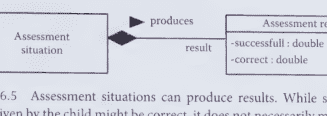

**图6.5** 评估情境可以产生结果。虽然有时孩子给出的答案可能是正确的，但这并不一定意味着它确实知道正确答案。

#### 6.4.3 结论

我们发现，在观察玩家时，人类导师会观察游戏中任务的正确和错误执行情况以及运动执行情况。我们还发现，导师以模糊的方式评价学习者的技能，如图6.5所示。基于这项研究，我们得出结论：对于需要知识以及手眼协调和时机的游戏，玩家的运动技能与导师确定的学习内容相关技能之间存在很强的联系。

此外，我们观察到，游戏元素的变化非常适合改变游戏难度。并非所有情况下都需要改变学习内容。对于快速检索至关重要的技能尤其如此。因此，过早在学习内容的难度和主题上做出改变，从长远来看甚至可能阻碍有效学习。

### 6.5 探索性研究：如何在严肃游戏中提供帮助？

在尝试模拟严肃游戏中的导师时，下一步需要确定严肃游戏中需要更改哪些内容以使其具有自适应性。需要回答的研究问题如下：“需要将哪些更改应用于严肃游戏（在游戏过程中），以根据图6.4中的模型改变任务难度？”本研究的目标是找到改变学习内容和游戏元素的可能性。此外，我们需要找到学习内容技能与运动技能之间的关系。

#### 6.5.1 研究设计

为了回答这个问题，我们使用我们设计的严肃游戏，与专家一起探索游戏中可能的变化。我们采访了专家并观察了儿童，然后根据结果重新设计了游戏。图6.6给出了研究步骤的概述。


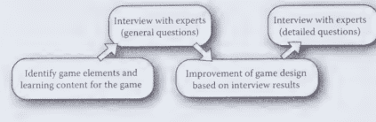

图6.6 严肃游戏开发的步骤。

在先前的研究中，我们识别了游戏中的游戏元素和学习内容。在本研究中，我们重点探究专家会如何提供帮助。我们访谈了专家，并向他们展示了一些儿童玩游戏的录像。我们的意图是找到一种提高严肃游戏难度的方法，使玩家保持在最近发展区（ZPD）内。我们利用这些数据（录像和游戏规格）在非正式访谈中与专家讨论了以下问题：在给定游戏中做哪些改动可以让游戏更难/更容易？

随后，我们根据该问题的答案对每款严肃游戏进行了改进。最后，我们进行了第二轮访谈，提出了更详细、更具体的问题：

-   在给定的学习内容中做哪些改动可以让游戏更难/更容易？
-   在给定的游戏元素中做哪些改动可以让游戏更难/更容易？
-   如果这款游戏有四个难度级别，应如何在该游戏中设计？

我们的假设是，游戏中的改动会同时涉及游戏环境的自适应性 和学习内容的自适应性。

#### 6.5.2 结果

在第一轮访谈中，我们与专家讨论了这四款严肃游戏。为了了解专家在提供帮助时是否会区分游戏元素和内容，我们特意提出了一些不做这种区分的抽象问题。

**表6.3　严肃游戏中的可适应属性**

| 严肃游戏 | SG1 | SG2 | SG3 | SG4 |
|---|---:|---:|---:|---:|
| 可适应属性数量 | 2 | 4 | 4 | 1 |
| 与学习内容相关的可适应属性数量 | 2 | 2 | 2 | 0 |

我们收集到了广泛的建议。例如，一些专家建议提高其中一款严肃游戏中的书写识别容错率，以减少初学者的挫败感。在一款游戏中，玩家需要朝目标投射泥球。许多专家已经认为，只要孩子朝正确的方向射击，即使没有击中目标，也应视为给出了正确答案。这清楚地表明，类似的方法可能对算法也有帮助。收集过程结束后，我们相应地对严肃游戏进行了修改。

下一步，我们专注于寻找专家认为合理的不同难度级别。该研究提供了对每款已开发的严肃游戏中可修改数据的详细描述，以便设置不同的难度级别。

此外，我们发现对某些游戏元素的改动会影响特定技能。例如，在一款游戏中，目标是练习计数。几只虫子沿屏幕爬行。目标是尽可能多地释放背上点数正确的虫子。在这款游戏中，通过改变虫子的颜色、速度或外观，可以大幅改变难度。我们称这些游戏元素为*可适应属性*。对这些可适应属性的改动可用于让同一任务对经验丰富的玩家变得更难，从而保持游戏的刺激性并增加练习效果。这类可适应属性的数量汇总于表6.3中。

#### 6.5.3 结论

在与专家就每款游戏的不同难度级别达成一致后，我们找到了可以调整的游戏元素（称为*可适应元素*），以改变学习者的难度。我们发现，可适应属性与学习内容所需的技能之间存在联系。

有些可适应属性（例如某个游戏元素的速度）会直接影响数学所需的一些技能（例如计数）。

我们可以得出结论：可适应属性与学习内容之间的联系使得游戏开发更加困难，因为这些改动发生在游戏元素层面。每当需要更改某些内容并开发新的游戏元素时，这些新元素都需要实现接口并应用所需的设计原则，以使其具有可适应性。

### 6.6 效度威胁

关于效度的讨论基于参考文献[19]中描述的*定性效度*标准。

我们花了足够的时间（2年）来开发这四款严肃游戏。在这两年中，我们观察并反复访谈了来自不同领域的参与者，包括开发者、游戏设计师、玩家、学习者、导师、心理学家和教育学家。我们还与开发者、其他专业人士和研究人员合作。

我们与来自不同背景和文化的开发者合作。对于不同的迭代和不同的游戏，我们也使用了多种开发技术和流程。我们在不同时间点与相同的开发者研究相同的问题。此外，还有另一位研究人员负责分析数据。

我们还检验了自适应性方法会与我们的假设和结果相矛盾的案例。例如，其中一个案例中，我们开发了一个对玩家作答速度适应得过快的原型。我们使用回顾性访谈方法进行了项目后访谈，让参与者反思这些发现。

为了提升研究的准确性和效度，我们进行了外部审计。我们让未参与研究过程的研究人员和开发者检查了研究过程以及访谈结果和由此产生的游戏。

Lincoln 和 Guba [19] 将可迁移性描述为实现一种外部效度的方式。我们相信我们的结果适用于广泛的领域。然而，严肃游戏学习在不同领域中可能存在差异。

### 6.7 迈向适应性的定义

在当今可用技术的背景下，针对严肃游戏，我们可以不受限制地以社会发展理论为基础来定义自适应性。

严肃游戏中*自适应性*的定义基于 ZPD 的定义。我们如下定义自适应性：

严肃游戏中的自适应性是一种方法，它使严肃游戏能够（A）通过学习者的行为进行学习，具体包括（A1）智能监控和（A2）解读学习者在游戏世界中的行动；并且（B）通过（B1）自动调整学习内容和（B2）根据（C）学生个体的 ZPD 按需调整游戏元素来干预游戏，同时运用（D）MKO 的原则；其中，根据社会发展理论，自适应性对于学习者而言就是一个 MKO。

根据这一定义，严肃游戏中的自适应过程包含四个阶段：监控玩家（A1）、学习者特征化（A2）、评估生成（B1）和自适应干预（B2）。我们在此指出，该定义中的自适应性描述了以下四个因素：A、B、C 和 D。

因素（A）：自适应严肃游戏使用可用的传感器和最先进的技术监控学习者。所有观察结果都用于收集用户数据和描述用户特征（例如，评估其数学技能）。

因素（B）：自适应严肃游戏同时调整游戏元素和学习内容。有些游戏元素会影响解决与学习内容相关的任务的能力（例如，一辆快速驶过屏幕的汽车的速度、车上写了什么内容，以及学习者的目标是解读该内容）。这些*可适应*属性可以提供强大的工具，以更流畅地适应特定学习者，尽管学习内容的改变往往会导致难度等级出现离散的大跳跃。

因素（C）：自适应严肃游戏始终对每位学习者进行个性化挑战。

因素（D）：自适应严肃游戏在社会发展理论中扮演 MKO 的角色，其中可以应用以下论断：儿童文化发展中的每种功能都会出现两次——首先出现在社会层面，其次出现在个体层面。社会层面可以是与严肃游戏的互动，或是在严肃游戏中与同伴的互动。

*自适应严肃游戏是实现了自适应方法的严肃游戏。*

随后，我们可以将电子学习和 ITS 中使用的自适应方法 [20,21] 映射到严肃游戏自适应性的定义上：

-   微观自适应方法——在游戏中对评估情境和学习情境进行调整的自适应性，限制是仅对学习内容进行调整。


- 宏观自适应方法——自适应性，其限制是调整仅在导航层面进行，但针对学习内容和游戏元素（尽管先前定义未考虑游戏元素）。
- 能力倾向-处理交互法——自适应性，其调整针对代表不同类型指令、用户控制或媒体的游戏元素。
- 建构主义-协作方法——自适应性，其限制是能够实现并适应与同伴的协作或知识建构，但变更由用户负责。

### 6.8 展望

自适应性为严肃游戏的未来提供了巨大潜力。即使仅在我们的游戏中对学习者做简单调整，我们已经能够观察到一些很好的结果。然而，在本文描述的两项研究中，我们仅关注技能与动作游戏。我们已经发现智能辅导系统（ITS）的自适应性与我们的严肃游戏的自适应性之间存在巨大差异。更复杂的严肃游戏——包含故事情节、策略或沙盒元素——可能需要不断增长的自适应策略集合。

在参考文献[17]中，我们已经开始探索与故事情节相关的自适应性的某些方面，而故事情节与学习内容交织在一起。然而，我们认为，通过研究不同类型的自适应性，可以实现更有趣的严肃游戏类型。

### 6.9 总结与结论

在文献综述中，我们找到了对人类辅导者在维果茨基社会发展理论、皮亚杰认知发展阶段和埃里克森发展阶段等理论中作用的解释。我们重点回答严肃游戏本身如何能够基于这些已经存在并解释该现象为何发生的学习理论实现自适应。

在第一项研究中，当我们研究*辅导者对学习者的观察*时，我们发现，为了刻画学习者，人类辅导者会观察游戏环境。通过观察元素，我们将*游戏元素*纳入严肃游戏的学习内容中。因此，我们认为*自适应严肃游戏*应当能够同时观察游戏元素和学习内容。

在第二项研究中，我们观察到，当学习者需要帮助时，辅导者意图改变游戏元素属性（除了改变学习内容的难度之外）。我们发现，一些游戏元素，即所谓的可适应元素，*应当*具有自适应性，而另一些则*不应当*。我们还发现，可适应元素直接影响学习者解决与学习内容相关任务的能力。

基于这项研究，我们认为自适应性应当包括观察用户在严肃游戏中的行为，以及对游戏元素和学习内容两者的适应。我们最终给出了严肃游戏自适应性的定义，该定义考虑三个方面：（1）学习理论；（2）包括*游戏元素*在内的严肃游戏所有方面；（3）现有电子学习方法。

### 参考文献

1. Damir Ismailović, Dennis Pagano, and Bernd Brügge. weMakeWords——一种用于识字习得的自适应协作严肃游戏。载于*IADIS国际会议——游戏与娱乐*，意大利罗马，2011。
2. Lev Semenovich Vygotsky. *《社会中的心智：高级心理过程的发展》*。哈佛大学出版社，剑桥，1978。
3. Jean Piaget. *《皮亚杰精要》*，第18卷。杰森·阿伦森出版社，纽约，1977。
4. Rolf Eduard Helmut Muuss（编）。埃里克·埃里克森的身份发展理论。载于*《青春期理论》*，第42–57页，1994。
5. Kurt VanLehn, Collin Lynch, Kay Schulze, Joel A. Shapiro, Linwood Taylor, and Don Treacy. Andes物理辅导系统：五年评估。载于Gord McCalla和Chee-Kit Looi（编），*《教育中的人工智能》*。IOS出版社，荷兰阿姆斯特丹，2005。
6. Richard Niemiec and Herbert J. Walberg. 计算机辅助教学的比较效果：综述的综合。*《教育计算研究杂志》*，3，19–37，1987。
7. Benjamin S. Bloom. 2 sigma问题：寻找与一对一辅导同样有效的群体教学方法。*《教育研究者》*，13(6)，4–16，1984。
8. John R. Anderson, Albert T. Corbett, Kenneth R. Koedinger, and Ray Pelletier. 认知导师：经验教训。*《学习科学杂志》*，4(2)，167–207，1995。
9. Damir Ismailović, Barbara Köhler, Juan Haladjian, Dennis Pagano, and Bernd Brügge. 迈向严肃游戏自适应性的概念模型。载于*IADIS国际会议——游戏与娱乐*，葡萄牙里斯本，2012。
10. Burrhus Frederic Skinner. *《科学与人类行为》*。自由出版社，纽约，1953。
11. Burrhus Frederic Skinner. *《强化的相倚关系：理论分析》*。阿普尔顿-世纪-克罗夫茨出版社，纽约，1969。
12. Sharan B. Merriam, Rosemary Shelly Caffarella, and Lisa Baumgartner. *《成人学习：综合指南》*，第2卷。乔西-巴斯高等教育与成人教育系列。乔西-巴斯出版社，加利福尼亚州旧金山，2007。
13. Svein Sjoberg. 建构主义与学习。2007。*《国际教育百科全书》*，第三版，爱思唯尔，牛津。
14. Peter E. Langford. *《维果茨基的发展与教育心理学》*。心理学出版社，纽约，2005。
15. Dietrich Albert, Cord Hockemeyer, and Toshiaki Mori. 记忆、知识与电子学习。载于L.G. Nielson和N. Ohta（编）《记忆与社会：心理学视角》（第87–109页）。英国心理学出版社，霍夫。
16. Cord Hockemeyer. 动态领域中基于能力的自适应电子学习。载于*媒体传播促进高级电子学习的认知与学习联合研讨会*，第79–82页，德国柏林，2003。
17. Barbara Köhler, Damir Ismailović, and Bernd Brügge. 故事驱动严肃游戏中的自适应性。载于*IADIS国际会议——游戏与娱乐*，意大利罗马，2011。
18. Owen Conlan, Ian O’Keeffe, Cormac Hampson, and Jürgen Heller. 使用知识空间理论支持学习者建模与个性化。载于*企业、政府、医疗保健与高等教育电子学习世界会议论文集*，第1912–1919页。AACE，夏威夷州火奴鲁鲁，2006。
19. Yvonna S. Lincoln and Egon G. Guba. *《自然主义探究》*。SAGE，加利福尼亚州比佛利山，1985。
20. Christian Gütl, Felix Mödritscher, and Victor Garcia-Barrios. 自适应电子学习的过去、现在与未来。载于*ICL会议论文集*，2004。
21. Felix Mödritscher. 迈向在电子学习范围内形式化自适应行为。*《计算机科学讲义》*，4018，362，2006。

# II 利用计算机游戏开展基础软件工程研究

## RESTful 客户端-服务器架构

*面向大型多人在线环境的可扩展架构*

Thomas Debeauvais, Arthur Valadares, and Cristina V. Lopes

### 目录

- 7.1 引言 — 154
- 7.2 多用户游戏扩展技术概述 — 156
    - 7.2.1 空间划分 — 157
    - 7.2.2 其他游戏特定技术 — 158
    - 7.2.3 数据管理 — 159
    - 7.2.4 网络与系统方法 — 160
- 7.3 RESTful 客户端-服务器架构 — 161
    - 7.3.1 表征状态转移 — 162
    - 7.3.2 RCAT 架构 — 164
- 7.4 RCAT 参考实现 — 166
    - 7.4.1 WebSockets — 168
- 7.5 RCAT 参考应用：拼图游戏 — 168
- 7.6 实验与结果 — 170
    - 7.6.1 实验1：代理与数据库瓶颈 — 170
    - 7.6.2 实验2：扩展玩家数量 — 172
        - 7.6.2.1 实验设置 — 172
        - 7.6.2.2 结果 — 173
- 7.7 讨论 — 176
- 7.8 结论 — 178
- 参考文献 — 178

### 7.1 引言

大型多人在线游戏（MMO），如*《魔兽世界》*、*《星战前夜》*和*《第二人生》*，是虚拟3D环境，玩家在虚拟世界中实时互动。然而，当前MMO中的互动并非真正大规模：设计者精心设计游戏，使用户同一时间最多只能与大约一百名其他用户互动。当聚集的玩家数量超过预期时，游戏通常会崩溃。^7

高用户并发需求如今已远远超出游戏领域。Facebook和Twitter等应用在大量用户之间分发海量事件。尽管这些应用并非严格实时，但更新节奏相对较快，因此呈现出与在线游戏类似的挑战。随着Web技术越来越能够支持丰富的2D和3D媒体，在线游戏与（严肃）Web应用之间的界限将变得更加模糊。我们工作的目标是能够支持下一代基于云的大型多用户在线环境，例如大规模在线开放课程[1]和医疗应用社交环境[2]。

考察MMO如何处理可扩展性，可为扩展其他类型的多用户应用提供洞见。MMO玩家通常被视为事件生产者和消费者：每位玩家生成其他玩家感兴趣的事件流。例如，如果玩家命令其角色向前移动，其他玩家应收到该角色移动的通知，更新其本地世界状态，并渲染更新后的状态。如果所有玩家都订阅所有其他玩家，则要传递的事件消息数量会随玩家数量呈二次方增长[3]。很快，系统就会被事件数量压垮，延迟（即转发一个事件所需的时间）也会增加。游戏的响应性会大大降低。因此，可扩展性与响应性之间存在权衡。也就是说，随着用户数量增加，延迟也会增加。

> † 在 http://www.youtube.com/watch?v=m7FW0BK2fUo 观看*《魔兽世界》*中的虚拟快闪族。


为了让玩家产生能与成千上万其他玩家互动的错觉，MMO 使用了兴趣管理技术 [4]。他们假设玩家只对虚拟世界中发生在自己附近的事件感兴趣。因此，世界被划分为自包含的区域（例如一座城市或一片森林），每个区域由不同的进程处理。实现空间分区的系统假设玩家对其当前区域内生成的事件感兴趣，或许也对相邻区域的事件感兴趣，但绝不会对整个世界的事件感兴趣。使用这种分区策略，MMO 已经能够支持数百名用户，同时将延迟保持在相对较低的水平。

空间分区运行良好，直到太多玩家决定在同一区域聚会。例如，商业 MMO 中曾实现的最大直接交互用户数约为 3000，出现在游戏 *EVE Online* 中。这一纪录得益于非常昂贵的硬件基础设施、分层软件架构以及一种称为 *时间膨胀* 的游戏设计解决方案。时间膨胀通过减慢区域时间来补偿服务器负载。区域可能支持更多玩家，但一些人认为时间膨胀“完全无法游玩”。那些无力承担此类基础设施、架构或游戏设计技巧的 MMO，其玩家上限要低得多：*World of Warcraft* 每个区域支持约 120 名用户⁴，而 *Second Life* 最多支持 100 名⁵。

研究试图根据玩家分布动态调整区域的形状和大小。然而，动态二叉空间分割等解决方案因区域间的同步和数据交接而具有很高的开销 [5]。事实上，CAP 定理（一致性、可用性和分区）指出，分区系统不可能同时具有高可用性（即响应性）和强一致性 [6,7]。由于可扩展的 MMO 系统涉及多个分区进程，MMO 开发者本质上必须牺牲一些一致性来保持响应性。

在过去二十年中，MMO 玩家数量急剧增加，但网络用户数量也同样如此。为了实现扩展，Web 应用遵循一种非常受限的架构风格，称为表述性状态转移（REST）[8]。支撑 REST 的支柱之一是超文本传输协议（HTTP）协议的无状态性：Web 服务器在两次请求之间不记住任何客户端数据。这样一来，通过添加更多运行完全相同应用代码的机器，就很容易扩展 Web 应用。

在这项工作中，我们探索如何应用 REST 来扩展 MMO。尽管一些游戏开发者怀疑 REST 能否应用于 MMO [9]，但 REST 对 MMO 的适用性仍是一个开放问题。此外，HTML5 WebSockets 或 WebGL 等最新 Web 技术为基于浏览器的 MMO 展现了重大机遇。

尽管可扩展性是我们的主要关注点，但我们始终考虑与一致性和响应性之间的权衡。其他需求，例如容错（如果一台机器宕机，对系统的代价最小）或恢复力（从峰值或崩溃中快速恢复），是可取的，但它们不是本章的主要焦点。

本工作的贡献如下：

- 我们首次尝试在概念上将 REST 原则与 MMO 协调起来。
- 我们开发了一种架构（RCAT）及其参考实现，该架构基于这些原则。
- 我们报告了一个原型 RCAT 应用的性能特征，这使我们能够预先估算在给定特定并发目标的情况下，将这些应用部署到云上所需的资源。

在本章其余部分，我们首先介绍当前用于将 MMO 扩展到大量用户的技术。然后我们介绍 RCAT，这是我们自己设计的架构，旨在扩展大量用户而不受特定应用类型的束缚。接着，我们详细介绍参考实现以及基于该架构的一个应用。最后，我们报告实验室实验，讨论其影响，并总结本章。

### 7.2 多用户游戏扩展技术概述

大量学术文献以及业界所见的一些实用技术，都关注 MMO 的可扩展性、一致性和响应性。这些技术分散在计算机科学的各个领域，并针对可扩展性问题的不同部分。本节回顾一些最著名的用于扩展这些系统的技术。

当前用于扩展 MMO 的最流行技术大概是空间分区。我们将在下一小节详细介绍空间分区。我们还将描述其他有助于在保持一致性和响应性的同时进行扩展的游戏特定技术。然后，我们考察数据库社区中适用于 MMO 的扩展技术，最后介绍网络和系统社区的方法。

#### 7.2.1 空间分区

*空间分区* 包括将游戏世界拆分为多个区域，并将每个区域分配给 MMO 系统的一个进程。在客户端–服务器架构中，负责区域的进程是游戏服务器，而在对等架构中，每个对等节点负责一个区域。尽管对等架构的实际可行性尚有争议（例如，Miller 和 Crowcroft [10] 说“不可行”，而 Hu 等人 [11] 说“可行”），但客户端–服务器和对等架构实际上是一枚硬币的两面：它们都将游戏状态分区到多台机器上。

空间分区背后的假设可以追溯到 20 世纪 90 年代初的开创性虚拟世界 *DIVE* [12]。在分布式交互虚拟环境（DIVE）中，用户可以在区域之间转移，但他们只需要知道其当前区域内发生的事情。DIVE 遵循客户端–服务器架构。每台服务器负责处理与其区域内虚拟对象有关的客户端请求，以及用户进出其他区域的交接。这种模型运行良好，直到一台服务器必须处理其区域内过多用户或对象。关于空间分区已有大量学术工作 [13,14]。当前大多数商业 MMO 使用这种静态空间分区模型。为了防止服务器崩溃，游戏运营者已转而采用 *实例化*：他们实例化一个特别热门区域的副本，并限制该区域内的玩家数量。*The World of Warcraft* 的地下城副本就是当前实例化的一个例子。

然而，实例化一个区域的副本并不能使该区域扩展。此外，在 *Second Life* 等虚拟世界中，用户可以在运行时创建对象，对象和用户的分布是不均匀的，而且对象和用户的行为难以预测 [15]。动态空间分区旨在通过根据对象和用户分布调整区域的大小和形状，以平衡对等节点（在对等架构中）或服务器（在客户端–服务器架构中）之间的计算和带宽负载，从而解决这一问题。动态空间分区有若干方法。一种方法将对等架构 [16] 或客户端–服务器架构 [17] 中的区域视为沃罗诺伊图的单元。另一种方法将区域视为一组相邻的微单元 [18–20]。然而，近期工作表明，两个区域之间的交互量可能导致这两个区域负载很高，从而使空间分区并不适合所有对象或玩家分布及行为 [21]。简而言之，空间分区是一种仅在特定 MMO 用例中有效、并非在所有情况下都有效的优化。

#### 7.2.2 其他游戏特定技术

*兴趣管理* 包括仅向用户和对象通知其感兴趣的用户、对象、位置或事件。例如，一个虚拟形象可能只对 100 米内的虚拟形象和对象感兴趣，或者只对直接发给该虚拟形象的聊天消息感兴趣。在学术界，兴趣管理通常涉及发布–订阅基础设施 [4]，通过对等基础设施中的空间查询 [22]、由集中式服务器维护的通信通道 [23] 或基于云的基础设施 [24] 来实现。在商业上，兴趣管理在面向未来的 MMO *EVE Online* 中处于核心地位。EVE 的服务器在概念上将附近的飞船分组到自包含且隔离的球体中。每个球体都有一个特定通道，球体内的所有玩家都订阅该通道。这是对传统空间分区的改进，因为区域服务器现在只需计算球体并在球体内广播消息，而不必向整个区域广播 [25]。Sirikata [26] 对兴趣管理做了一种变体：他们不是按空间计算兴趣，而是基于虚拟形象对世界的视图来计算。因此，客户端收到的关于其视锥体内对象的更新，比关于隐藏对象的更新更多。同样，并非所有 MMO 都能因其设计而高效地使用兴趣管理、可见性或发布–订阅技术。

*数据优先级* 是 MMO 中经常使用的一种机制，用于减少对等节点之间或从服务器到客户端的带宽。它假设有些消息是关键的，而另一些则不是。当带宽或计算资源变得稀缺时，只需要转发关键消息。这一点在对等网络的学术研究中已得到大量研究 [27,28]。

*时间膨胀* 是商业 MMO 中常用的一种技术。它包括减慢模拟时间，主要原因是服务器的物理引擎无法跟上负载。尽管时间膨胀比服务器完全崩溃更优雅，但它仍然是特定于游戏的，并且

这会严重降低游戏的响应性。*EVE Online* 和 *Second Life* 是两款使用时间膨胀的MMO。†

最后，一些在线游戏（如第一人称射击游戏）非常强调延迟。对这些游戏来说，宁可出错但准时，也不要正确但迟到[29]。在商业上，Valve的Source引擎采用了一种*乐观客户端-服务器架构*²。如果玩家A击中玩家B，A实际上只是预测B被击中。客户端A将命中消息发送到服务器。如果服务器确定玩家B在A开火时（也就是几帧之前）确实被击中，它就会将命中转发给B。然而，B的反应速度可能比A与服务器之间的延迟更快。在这种情况下，A的视角会与B和服务器的视角略有不同。因此，服务器会判定A实际上未击中目标。服务器通知A未命中，A回滚其状态。这种回滚会导致局部不一致[30]。在学术研究中，Gupta等人[31]建议每个客户端都应运行游戏逻辑，而服务器只应充当消息转发器并负责持久化。客户端将自己的操作应用到一个乐观模型，并将从服务器接收的操作应用到稳定模型。如果对乐观模型和稳定模型应用同一操作导致两个不同的模型，系统就需要回滚。客户端要求服务器广播其提出的修正方案；所有其他客户端执行该修正，如果发生冲突，则将自己的修正发送给服务器。这可能导致长链消耗大量带宽和CPU。因此，服务器会拒绝超过一定链长度的修正。学术和商业方法都是前面提到的一致性-响应性权衡的实例。

#### 7.2.3 数据管理

商业MMO *Guild Wars 2* 在扩展其服务器处理的*AI脚本*的数量和复杂性方面遇到了困难[32]。康奈尔大学的一个研究小组也观察到了AI脚本复杂性与其数量之间的这种权衡。他们提出了一种数据驱动的声明式语言，将相似的查询归并在一起[33]，从而将AI计算量从二次方减少到与世界实体数量成线性关系。Pikko和BigWorld是两个用于MMO的商业中间件平台，它们建议将AI脚本卸载到服务器之外，就像普通客户端一样[34,35]。这样，服务器可以将更多CPU用于处理客户端请求，而不是复杂的AI脚本。然而，与在服务器内运行AI相比，带宽可能会显著增加。

在持久化方面，*中央数据库*通常是客户端-服务器架构中的瓶颈。商业MMO已经通过三种方式解决了这个问题：首先，它们每隔几分钟才将所有已连接化身的状态批量持久化到数据库。虽然这减轻了数据库的负载，但服务器崩溃时化身状态必须回滚。解决商业MMO中数据库瓶颈的第二种技术是使用查询管理器：一台机器位于数据库和游戏服务器之间，作为缓冲和缓存，就像MMO *Tibia* 中那样[36]。第三种方法是为数据库投资昂贵的硬件，也称为*垂直扩展*。例如，截至2011年3月，托管*EVE Online*数据库的两台机器各有512 GB内存、32个逻辑核心和18块固态硬盘，并使用32 Gbps的InfiniBand链路与游戏服务器层通信。²

我们之前看到，空间分区并不总是最好的数据分区方案。在*Darkstar*（现在称为*RedDwarf*）中，实体的数据存储在与实体在游戏世界中位置无关的节点上[37]。这样，*Darkstar*类似于*memcached*的分布式内存缓存。¹但*Darkstar*的主要特点是其事务任务。服务器读取可以在本地缓存上执行，但写入必须发送到中央服务器以检查与其他写入的冲突。如果没有检测到冲突，则执行事务；否则，事务失败并在一段时间后重新运行。这种方法可能会给某些事务增加延迟，尤其是与热门实体相关的事务（例如，成千上万的玩家攻击同一个Boss）。*Darkstar*显然站在一致性-响应性谱系的一致性一侧。

#### 7.2.4 网络与系统方法

已经为MMO提出了几种系统架构。在客户端-服务器学术原型和商业MMO中都非常常见的一种架构是*分层架构*。客户端连接到一层客户端管理器（也称为*代理*）。代理在客户端和游戏服务器层之间转发消息，而游戏服务器层运行游戏逻辑。游戏服务器将其状态持久化到数据库层。代理有助于将服务器上因客户端处理而产生的负载外部化（例如，套接字管理和数据优先级排序）[38]。尽管MMO的平均数据包大小小于30字节[39]，但要发送的消息数量介于玩家数量的线性与二次方之间。分层架构在2000年代初的研究中已经被提及[40,41]，并已用于英特尔的分布式场景图（DSG）[42]和许多商业MMO[25,43,44]。

英特尔的DSG不仅仅是分层架构。它旨在打破以模拟器为中心的单一架构，并将服务卸载到外部进程[42]。虽然外部服务提供了良好的关注点分离，但由于将任务转发给服务时多了一跳，它们会增加额外的延迟。我们再次看到响应性-可扩展性的权衡。Carlini等人通过使用虚拟节点作为物理节点位置的抽象层，混合了点对点和云网络。虚拟节点允许透明的节点重定位，比纯客户端-服务器解决方案更便宜，比纯点对点解决方案更可靠[45]。S-VON是一种具有超级节点的基于Voronoi的点对点覆盖网络。虽然纯点对点的基于Voronoi的覆盖网络只考虑游戏内邻近性，但超级节点还会考虑网络邻近性以减少延迟[1]。

另一种系统方法是使用无锁任务来避免核心之间的死锁。这在学术上已在文献[46]中尝试过，并在商业上在名为The Exiled Realm of Arborea（TERA）的MMO中尝试过[47]。与将服务卸载到其他机器相比，无锁游戏服务器不会因额外一跳而遭受额外延迟。然而，无锁游戏服务器只能扩展到一台机器中的核心数量。我们再次看到可扩展性与响应性之间的权衡。

### 7.3 RESTful 客户端-服务器架构

用于扩展MMO的解决方案谱系非常广泛，包括许多针对特定应用的优化，其中一些在前一节中没有涉及。我们寻求开发一种具有以下特征的中间件：

- 它与应用无关，可以支持各种大规模多用户应用，从社交网络到同步在线教育再到实时3D游戏。这样，在开发一种应用时获得的知识不会在必须开发另一种应用时丢失。
- 它可以水平扩展，即对更多交互用户的需求可以通过简单地添加更多执行相同功能的服务器来满足。

为了实现这些目标，我们从架构的角度来处理问题。架构，或者更准确地说，架构风格，是对所有可做之事施加的约束[48]。通过以特定方式对应用施加约束，我们建立了一套原则，一方面禁止了许多可能有效的特定应用捷径，另一方面确保了知识共享和水平扩展的目标得以实现。

在本节中，我们首先描述RCAT的一些基础，然后描述RCAT本身。

#### 7.3.1 表现层状态转移

在Web确立自己作为全球范围内互联网应用的主要平台之前，在1980年代和1990年代已经提出了许多其他平台[49,50]。与当时的竞争对手相比，Web给了我们两个非常重要的优势：

- 1. 它为各种应用的开发创建了一个共同的基础。Web开发人员可以使用许多不同的框架、语言和工具在许多不同领域创建许多应用，但架构基础都是相同的。
- 2. 它允许Web应用从小规模（一台Web服务器）开始，如果业务有要求，可以优雅地扩展到服务器农场。

我们希望MMO也具有这些特性。因此，RCAT的灵感来自Web应用的架构，特别是REST[8]。REST规定了五个主要的架构约束，我们将其调整到MMO的背景下：

- 1. *客户端-服务器*：系统状态存储在服务器端，而不是客户端。客户端-服务器架构在MMO中很常见。
- 2. *分层*：建议使用硬件代理、负载均衡器和软件级中间件来解耦客户端与服务器。分层架构在MMO架构中并不是一个新话题[51]。


- 3. *无状态协议：* 在两次客户端请求之间，服务器上不能存储任何特定于客户端的信息（即上下文）。我们的直觉是，包含状态的服务器无法扩展，因为可能需要同步它们必须共享的那部分状态，这会带来开销。这就是我们在上一节中提到的问题。REST 建议将状态持久化到数据库或客户端。这样，应用服务器层只需增加运行该应用的硬件即可扩展。
- 4. *统一接口：* 这涉及两部分：第一，RESTful 服务器接口应能够接收不同格式的消息，并以客户端请求的格式应答客户端请求。因此，客户端请求应附带元数据，以帮助服务器理解如何解释和应答该请求——例如时间戳。第二，每个资源都应有一个唯一地址（统一资源标识符）。例如，主机的 IP 和端口，以及对象的全局唯一标识符，足以唯一地标识和访问该对象。
- 5. *缓存：* 它们是系统组件之间的中介。强烈建议使用缓存，因为它们可以显著减少计算量和流量。缓存包含不常变化的信息。在 MMO 中，玩家的位置通常不可缓存，但纹理和资产可以缓存。我们之前已经看到，一些学术和商业方法出于性能原因，会复制/缓存相邻区域中的游戏实体。

将 REST 朴素地应用于 MMO 时必须谨慎：乍看之下，客户端与应用服务器之间协议的无状态性似乎与 MMO 的需求相冲突。无状态协议意味着要么 (1) 客户端必须在其请求中附带服务器处理其请求所需的全部数据，要么 (2) 服务器必须从数据库中检索必要的数据。在 MMO 中，客户端显然无法在请求中附带所有必要数据，因为这可能意味着整个游戏状态。对于双人 *井字棋* 甚至国际象棋来说，附带整个游戏状态是可行的，但对于 MMO 来说并不合理：带宽会很快成为问题 [9]。因此，服务器需要为每个客户端请求从数据库中获取数据。正如我们在第 7.6 节中的评估所示，与商业 MMO 当前的单体架构相比，REST 可能导致处理客户端请求的延迟更高、服务器与数据库之间消耗的带宽更多，并且数据库可能成为计算瓶颈。

#### 7.3.2 RCAT 架构

RCAT 由四层组成：代理、游戏服务器、缓存和数据库。我们首次在参考文献 [52] 中介绍了该架构。RCAT 与图 7.1 所示的架构非常相似。代理处理与客户端的通信，游戏服务器处理游戏逻辑或模拟的计算，数据库确保持久性。每一层隔离不同的性能需求，因此也隔离潜在的瓶颈。该架构旨在与游戏无关，也就是说，它不嵌入任何虚拟空间的概念。

代理将平方级广播问题与游戏服务器隔离开来。如前所述，代理是 MMO 架构和 Web 中的常见组件。客户端和游戏服务器与代理保持永久连接。它们的作用只是转发客户端与游戏服务器之间的消息。游戏运营商或开发者可以决定代理如何将客户端请求转发到服务器：轮询、固定（给定代理始终将消息转发到同一游戏服务器）或按客户端/“粘性”（来自给定客户端的所有消息都发送到同一服务器）。除消息转发外，代理还可以基于某些网络启发式规则（例如上传速率或传输控制协议 [TCP] 窗口大小）对消息进行优先级排序、分桶、捎带或过滤。但是，它们对游戏（例如感兴趣区域或好友列表）一无所知。代理还可以帮助缓解针对游戏服务器的拒绝服务攻击。

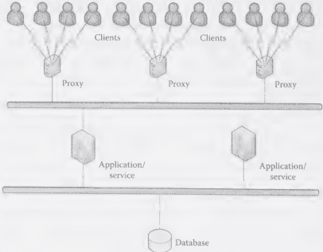

图 7.1  （见彩色插页。）分层架构。

游戏服务器根据游戏逻辑接收并处理客户端请求。当服务器（通过代理）收到来自客户端的请求时，它会计算必须通知哪些客户端，并向所有代理广播要转发的响应以及相关客户端。服务器可以执行任何游戏逻辑处理，从低延迟状态更新（例如角色移动）到更可靠的大批量传输内容分发（例如纹理，或在客户端首次登录时流式传输世界状态）。服务器可以在运行中动态添加到服务器层，且无需同步开销。它们只需在加入时通知代理，并从其缓存中检索数据。

缓存与游戏服务器位于同一台机器上，以便为游戏服务器提供对数据的快速访问，并减轻数据库负载。确定哪个对象位于哪个缓存中以优化数据访问，是开发者需要关注的问题。例如，在空间分区中，游戏世界中彼此靠近的两个对象会位于同一缓存中。其他类型的分区包括按用户分区（正如 Zynga 当前所做 [53]）或按数据类型分区。

缓存只是用于提高性能的临时存储；由开发者指定哪些对象可以缓存、缓存对象变为过期的延迟，以及是否应在其他机器上实例化副本以实现更快的读取。基本上，缓存层是开发者指定其对哪些对象需要何种延迟和一致性程度的地方。

最后，底层是数据库。它确保持久性，并且对于必须满足原子性、一致性、隔离性和持久性的事务操作，仍可由游戏服务器直接访问。当缓存对象过期时，缓存可以从数据库检索该对象的状态。如果缓存中的对象必须强一致，则对该对象执行的所有写操作也应转发到数据库。然而，如果延迟很重要，则对象状态只能定期刷新到数据库。

### 7.4 RCAT 参考实现

为了能够实现多个游戏，并测试哪些策略在哪些情况下效果最好，我们将 RCAT 实现为运行在 Linux 操作系统上的 Python 中间件。该 RCAT 参考实现支持客户端作为 JavaScript 应用在普通 Web 浏览器中运行，并与后端的普通 Web 服务器交互。RCAT 的源代码以及基于它构建的两个游戏可在 https://github.com/geminitoun/rcat 获取。中间件的组件如图 7.2 所示。两个较高层组件是代理和游戏服务器。

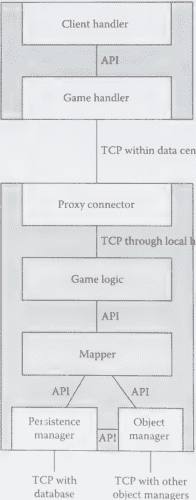

图 7.2  RCAT 组件。游戏逻辑和映射器组件是特定于游戏的，由游戏开发者实现。

代理通信由 Tornado¹ 执行，它是一个非阻塞、单线程且支持 WebSocket 的 Web 服务器。代理有两个 URL 访问点：/client 和 /server。客户端连接到 /client，其中客户端处理器组件会生成会话用户 ID。随后，游戏处理器将客户端消息转发到游戏服务器。服务器通过代理的 /server URL 访问点回复客户端。发送到 /server 的消息由游戏处理器组件处理，该组件确定应接收该消息的客户端。

在游戏服务器中，游戏逻辑和映射器组件是游戏服务器中特定于游戏的模块。游戏逻辑包含游戏规则。映射器通过应用程序编程接口（API）向游戏逻辑提供数据服务。两者都插入 RCAT 的中间件，并与来自代理层（代理连接器）和数据层（持久化管理器和对象管理器）的组件接口。

代理连接器为游戏逻辑提供两种抽象。第一，它将游戏服务器到各代理的 WebSocket 连接解复用为单一连接。第二，它对游戏逻辑隐藏代理和客户端的位置。如果游戏逻辑组件希望向用户发送消息，它只需发送消息和收件人集合（即一组用户 ID）。代理连接器解析该集合，检查这些用户连接到哪些代理，并将消息转发到相应的代理。

持久化管理器和对象管理器抽象掉数据库特定协议以及本地和远程缓存中对象的处理。二者都向映射器提供 API。二者都用 Python 实现。可以使用任何受 SQLAlchemy 支持的数据库，但在我们的实现中，我们只尝试了 MySQL。

持久化管理器通过 SQLAlchemy²（一个数据库对象关系映射器）提供集中式、可用且一致的数据访问。

对象管理器提供分布式数据访问以及用于管理数据可用性或一致性的工具。对象管理器由我们实现，并提供 API 以：(1) 操作存储在本地或远程缓存中的数据；(2) 将存储在远程缓存中的数据迁移到本地缓存。

¹ Tornado 已在 FriendFeed 和 Facebook 的时间线等实时 Web 应用中得到广泛使用。参见 http://www.tornadoweb.org。

² 参见 http://www.sqlalchemy.org/。


#### 7.4.1 WebSockets

RCAT 参考实现使用 WebSockets 让客户端能够接收来自服务器的消息。这里，我们简要描述一下 WebSockets。

WebSocket 是一种通过 HTTP 发起的标准 TCP 连接，在实时 Web 应用中越来越流行。在 MMO 中使用 TCP 在研究和工业界都是一个有争议的话题。一些游戏开发者甚至宁愿在用户数据报协议（UDP）之上实现一个可靠协议，也不愿使用 TCP。我们选择 TCP 有三个原因：

- 1. TCP 免去了控制数据包排序和重传的麻烦。适当配置 TCP 重传率可以大大降低延迟 [38]。
- 2. MMO 通常使用 TCP，可能是因为客户端每秒只发送 1 到 10 条消息 [21,38]。使用 TCP 使我们的方法更有效、更适用。
- 3. TCP 有许多拥塞控制机制，例如 Nagle 算法，当服务器向许多连接广播同一条消息时，这些机制可能会有所帮助。这类解决方案通常以延迟换取带宽，反之亦然。它们再次说明了 MMO 中可扩展性与响应性之间的权衡。

### 7.5 RCAT 参考应用：拼图游戏

为了研究使用 RCAT 架构构建的应用的性能特征，我们使用上述 RCAT 参考实现实现了一个多人客户端-服务器游戏。我们的虚拟拼图游戏对玩家数量没有限制。此外，多人拼图游戏提出了一组有趣的需求：

- 玩家可以瞬间将棋盘从一端滚动到另一端。
- 玩家可以随时抓起任何一块拼图。

**在线拼图游戏**

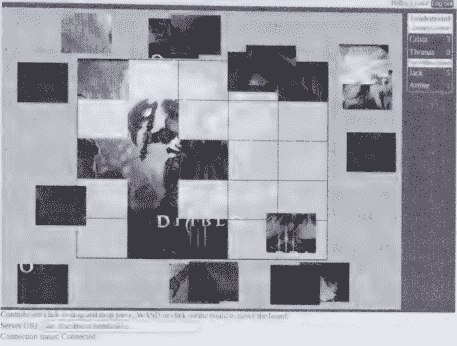

图 7.3（见彩图）包含 25 块拼图的多人拼图游戏。

- 玩家必须立即知道其他玩家抓取、移动和放下的是哪些拼图块。
- 玩家可以放大或缩小以查看整体画面，或检查微小细节。

HTML5 客户端的屏幕截图如图 7.3 所示。显然，对于多人拼图游戏，空间分区不会像对于具有明确区域的 MMO（如 *《魔兽世界》*）那样有效。然而，玩家之间的交互很少，而且玩家可能倾向于再次选择同一块拼图。因此，我们将代理配置为将每个客户端“粘附”到某个服务器：该客户端发送的所有消息都被转发到同一台服务器。客户端以轮转方式粘附到游戏服务器。我们还将映射器配置为按玩家进行分区。当游戏服务器收到来自某个玩家的关于某块拼图的消息时，它会检查该拼图是否缓存在另一台服务器中。如果是，服务器会取回远程拼图并将其放入本地缓存。如果该拼图没有缓存在任何地方，服务器会从数据库中检索它并放入本地缓存。简而言之，每当服务器需要一块拼图时，它都会将该拼图移动到本地缓存。

### 7.6 实验与结果

在本节中，我们证实了我们在代理层和数据库层预期的瓶颈在实践中确实存在。我们展示了如何通过使用 RCAT 中间件，随着核心数和机器数的增加来扩展拼图游戏中的玩家数量。

#### 7.6.1 实验1：代理与数据库瓶颈

为了证实我们在代理层和数据库层预期的瓶颈在实践中确实存在，我们较早前开发了一个遵循 RCAT 架构的全广播多人移动游戏的概念验证，但使用了更简单的服务器端。这项研究记录在参考文献 [54] 中，代码可在 https://github.com/gentimouton/rcat-gs 获取。此处我们包含该研究的主要发现，目的是说明 RCAT 应用的基本性能特征。

在这项早期研究中，代理和游戏服务器均使用 .NET 框架以 C# 实现。代理通过多线程的 Alchemy WebSockets 服务器接受 WebSocket 连接。图形客户端使用 JavaScript 实现，利用 HTML5 画布进行渲染，并通过 WebSocket API 连接到代理。我们使用 Java 实现的机器人对系统进行压力测试。所有程序均在 Windows 7 上运行。

我们并不是要证明我们的架构具有可扩展性，而是要证明代理是否可能成为瓶颈。为了验证这一假设，我们只需要且确实使用了一个代理和一个服务器。我们使用的商用机器是 Optiplex 980，配备八个 2.8 GHz 的 i7 核心。我们以每批 5 个的增量向代理启动最多 50 个机器人。每个机器人每秒发送 20 条位置消息。代理和数据库运行在一台机器上，服务器运行在另一台机器上，机器人则运行在另外三台不同的机器上（共五台机器）。如图 7.4 所示，从代理到客户端的带宽呈二次方增长。因此，我们不能期望代理数量能够随客户端数量线性扩展。


图 7.4 所有客户端（所有 C）与代理（P）之间的带宽。

在这个简单游戏中，每当游戏服务器收到来自客户端的位置消息时，它会在数据库中更新客户端角色的位置，获取已连接客户端的列表，并在一条消息中发送给代理：(1) 需要转发给客户端的消息，其中包含角色的新位置；(2) 需要发送该消息的客户端列表（即当前所有已连接的客户端）。为了估计数据库瓶颈的严重程度，我们比较了两种场景：一种场景是游戏服务器必须为每条客户端消息获取所有已连接用户的列表；另一种场景是游戏服务器缓存用户列表，无需每次都询问数据库。

如图 7.5 所示，从服务器到数据库的带宽随用户数量线性增加，并且在缓存当前客户端列表时略有下降（比较两条 *S* 到 *DB* 的曲线）。更引人注目的是，从数据库到服务器的带宽随客户端数量呈二次方增长。通过缓存用户列表，我们将二次方增长降低为线性增长（比较两条 *DB* 到 *S* 的曲线）。这证明数据库可能成为中心瓶颈，而缓存可以是一种有效的策略。

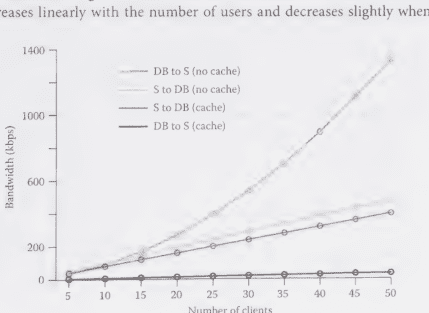

图 7.5 使用和不使用缓存时数据库（DB）与服务器（S）之间的带宽。

#### 7.6.2 实验2：扩展玩家数量

本节报告的实验结果基于我们的 RCAT 参考应用，即多人在线拼图游戏。

##### 7.6.2.1 实验设置

由于所有玩家都必须知道其他所有玩家正在操作的拼图块，我们让 TCP 延迟并捎带传输 ACK（TCP_QUICKACK 套接字标志保持为 0）。我们保持发送 ACK 前 40 毫秒的默认延迟。[^1] 我们还启用了 Nagle 算法（TCP_NO_DELAY 套接字标志保持为 0）。机器人、代理和服务器均应用 Nagle 算法和延迟 ACK。

机器人遵循脚本化行为。在两台机器上，每 10 秒有一个新机器人加入游戏。每个机器人首先抓起一块拼图，并以每秒 X 次的速度将其移动数个游戏单位，其中 X 是一个可配置参数。这种机器人行为导致不需要在缓存之间重新定位任何拼图块。我们承认，对于真实用户，拼图块重新定位将会发生。然而，除非许多用户争抢同一块拼图，否则这些重新定位应该相对较少发生。当我们观察到代理或游戏服务器的 CPU 容量已被完全使用时，我们会手动停止脚本。例如，如果有四个代理，代理的 CPU 容量总和可能达到 400%。但是，Tornado 建议将占用大量 CPU 的任务卸载到线程池。在我们的案例中，游戏服务器继续通过 Tornado 处理消息，但将游戏逻辑任务卸载到其他线程。因此，如果游戏逻辑线程被分配到另一个核心，单个游戏服务器的 CPU 可能超过 100%。

机器人使用包含全局唯一标识符的游戏消息来测量往返时间延迟（简称延迟）。每个代理和游戏服务器实例测量其（用户加系统）CPU 消耗，以及每次自愿和非自愿上下文切换的频率。

[^1]: 参见 http://lwn.net/Articles/502585/。


使用 Linux getrusage 命令 5 秒。[^3] 我们想检查在不同消息频率下，代理数量和游戏服务器数量如何随机器人数量扩展。我们将系统的最大容量定义为：当延迟的第99百分位低于100 ms时，所连接客户端的最高数量。

实验使用的商用机器是 Dell Core i7 2600，每台有四个超线程 3.4-GHz 处理器。最多两台机器运行代理实例，最多另外两台运行服务器实例，另一台运行数据库，另外两台运行机器人。所有机器位于同一个 1-Gbps 局域网中，彼此相距一跳。实验名称遵循 X/Y/Z 格式，表示 X 个核各运行一个代理，Y 个核各运行一个游戏服务器，以及机器人每秒发送 Z 条消息。例如，在场景 2/2/5 中，同一台机器上运行两个代理实例，两台游戏服务器共享另一台机器，另外两台机器上的机器人每秒发送五条消息。在场景 4 + 4/4 + 4/2.5 中，一台机器上运行四个代理，另一台机器上运行四个代理，第三台机器上运行四个游戏服务器，第四台机器上运行四个游戏服务器。

##### 7.6.2.2 结果

图7.6显示，对于场景 4 + 4/4 + 4/2.5，最大容量在229个客户端时达到。在该场景中，代理是瓶颈，而服务器仅略超过其总CPU容量的一半（可用800%中的400%）。一方面，游戏服务器消耗的总CPU随客户端数量线性增长。另一方面，代理消耗的CPU起初呈二次方增长，然后在约100个客户端附近趋于平缓，最后似乎又线性增长。在代理成为瓶颈的大多数场景中，我们都注意到了这种行为。

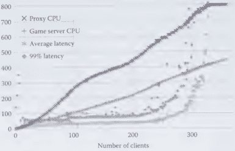

图7.6 使用4 + 4个代理和4 + 4个游戏服务器时，代理的中央处理器（CPU）、游戏服务器的CPU、平均延迟以及延迟的第99百分位随客户端数量的变化。使第99百分位延迟保持低于100 ms的最后一个点即为最大容量：229个客户端。

图7.7显示，自愿上下文切换的数量也在约100个客户端附近达到平台期。自愿上下文切换发生在Tornado轮询客户端套接字时，而非自愿上下文切换由内核调度器触发。[^4] 因此，在达到最大容量之前很久，代理上可能就已经存在瓶颈。有利的一面是，该瓶颈似乎不影响客户端侧观察到的延迟。TCP拥塞控制机制（例如捎带确认和ACK延迟）可能缓冲了代理所承受的额外延迟。

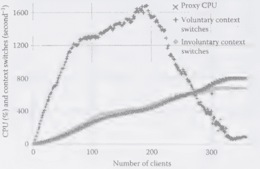

图7.7 使用4 + 4个代理和4 + 4个游戏服务器时，代理的CPU和上下文切换随客户端数量的变化。

然而，这些机制不足以阻止自愿上下文切换数量下降，以及延迟在约200个客户端附近激增。上下文切换仍是主要原因：因为每个核每秒跳动250次；[^*]对于有八个代理的系统，上下文切换（无论自愿与否）的最大数量为8 × 250 = 2000次/秒。这是约190个客户端时达到的上限。代理的核不堪重负。

有趣的是，发生这种情况时，代理只使用了其CPU容量的一半。显然，仅凭代理的CPU容量本身不足以评估玩家的体验质量，甚至不足以评估系统负载。

图7.8给出了各种场景下的最大容量。简而言之，要能够处理两倍的玩家，系统需要4倍的核数。而这与消息频率无关。并不是游戏节奏越慢，扩展就越线性。然而，节奏较慢的游戏每个核可以处理更多玩家。

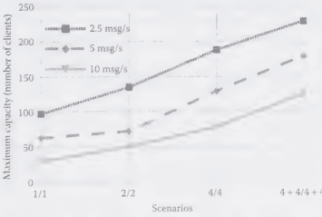

图7.8 当机器人每秒发送2.5、5和10条消息（msg/s）时，客户端数量随核数和机器数的扩展情况。

最后，图7.9说明消息频率可能导致不同的瓶颈。我们以八个代理和八个游戏服务器的场景为例。在每秒2.5条消息时，达到最大容量（229个客户端），而游戏服务器仅消耗约250%的CPU。同时，代理消耗同样多的CPU。相比之下，当客户端每秒发送10条消息时，在达到整个系统最大容量（125个客户端）时，游戏服务器消耗的CPU比代理更多。在这种情况下，很难知道

最初考虑的是拼图MMO的一种空间分区方案：将棋盘切成方形区域，并为每个区域分配一个服务器。我们很快意识到这种方法会非常低效，因为用户在不同区域之间移动拼图块的频率与在区域内移动一样频繁。这会导致数据交接过于频繁，并造成性能不佳。

因此，我们选择以（客户端，拼图块）对进行负载均衡。每当客户端尝试移动一个拼图块时，该拼图块会被迁移到正在处理该客户端请求的服务器。这样，拼图块的数据始终位于正在处理客户端请求的位置。另一种可能成功的做法是将客户端的消息移动到缓存该拼图块的应用服务器。

RCAT的实现正在积极开发中。尽管有些部分与应用无关，但游戏开发者需要编写应用相关的部分。我们使用Python实现映射器，因此也使用Python实现游戏逻辑，因为持久化管理器和对象管理器只提供Python API。随着中间件开发的进展，对象管理器和持久化管理器的不同实现将为更广泛的应用提供更多灵活性和选择。

目前，每个游戏服务器都实例化自己的对象管理器。然而，运行在同一台机器上的游戏服务器可以使用同一个对象管理器。实现此功能可能需要游戏服务器能够判断其他游戏服务器是本地还是远程，或者需要稍微改变我们的架构。

我们在整个实验中注意到，一个瓶颈可能掩盖另一个瓶颈。代理上的上下文切换可能是扩展的限制因素，而不是代理的CPU。此外，自愿上下文切换的数量似乎在延迟开始激增之前就激增。因此，在衡量系统当前负载是否实际影响玩家体验时，上下文切换可能被证明是比CPU更合适的指标。它也可能被证明是资源调配的有用指标。

更一般地说，我们的工作为大型多用户在线环境的资源调配提供依据。一个应用要支持两倍的用户，运营商需要部署4倍的硬件。对于拼图游戏，假设采用我们实验的测试条件（即所有用户始终在移动拼图块），我们估计使用256个核将能够支持近1000个用户。能够进行这些前期估算是一项具有商业影响的重大工程成就。

运营商可能还需要提供足够的网络基础设施，以支持客户端连接以及代理与应用服务器之间的通信。在我们的实验中，一台1-Gbps交换机就足够了。因此，网络资源调配可能要到远超200用户大关之后才会成为关注点。

### 7.8 结论

在本章中，我们介绍了RCAT，一种面向MMO的可扩展、可适应的三层架构。RCAT旨在提供灵活性，以便在种类繁多的MMO中选择各自的权衡，同时提供坚实的基础设施中间件，抽象通过分布式系统扩展的复杂性。它还为开发人员和研究人员提供了一个通用平台，用于开发应用并比较不同分区方案的结果。

我们通过展示一个多玩家拼图游戏证明了该架构的潜力，该游戏具有事件全广播、数据局部性和大量用户的特点。尽管存在不可避免且必要的二次方事件分发，我们仍能使用总共16核的商用服务器支持229个每秒发送2.5条消息的并发客户端，以及125个每秒发送10条消息的客户端。只需部署更多代理和游戏服务器，就能扩展到更多客户端，使得用户数翻倍的目标需要4倍的核数。

随着Web对丰富交互应用的支持不断增强，我们相信我们的工作可以成为各种大型多用户在线应用的基础。

### 参考文献

- 1. Pierre Baldi and Cristina Lopes. 通用校园：面向研究和教育的开放虚拟三维世界基础设施。*eLearn*, 2012(4), 2012.
- 2. Hossein Mousavi, Maryam Khademi, Lucy Dodakian, Steven C. Cramer, and Cristian V. Lopes. 面向卒中后手部康复的空间增强现实康复系统。*Studies in Health Technology and Informatics*, 184:279, 2013.
- 3. Huaiyu Liu, Mic Bowman, Robert Adams, John Hurliman, and Dan Lake. 扩展虚拟世界：仿真需求与挑战。载于 *Winter Simulation Conference*，Baltimore, MD，2010年12月。
- 4. Jean-Sébastien Boulanger, Jörg Kienzle, and Clark Verbrugge. 面向大型多人在线游戏的兴趣管理算法比较。载于 *Proceedings of the 5th ACM SIGCOMM Workshop on Network and System Support for Games*。ACM，New York，2006。

[^3]: 参见 http://linux.die.net/man/2/getrusage。
[^4]: 参见 http://www.linuxdevcenter.com/wiki/Involuntary_context_switch。
[^*]: jiffy 的默认值为 250 Hz。参见 http://man7.org/linux/man-pages/man7/time.7.html。


- 5. Huaiyu Liu 和 Mic Bowman. 通过动态负载均衡实现可扩展的虚拟世界. *Proceedings of the 14th International Symposium on Distributed Simulation and Real Time Applications*，第43–52页，Fairfax, VA，2010年10月。
- 6. Eric Brewer. 迈向健壮的分布式系统，Principles of Distributed Computing (PODC)，Portland, OR，2000年7月。
- 7. Eric Brewer. 十二年后的 CAP：这些“规则”是如何改变的. *Computer*，45(2):23–29，2012。
- 8. Roy Thomas Fielding. 架构风格与基于网络的软件架构设计. 博士学位论文，University of California, Irvine, CA，2000。
- 9. John Watte. REST 与游戏并不相配. http://engineering.imvu.com/2010/12/18/rest-and-games-dont-mix/.
- 10. John L. Miller 和 Jon Crowcroft. P2P MMOG 的近期可行性. 载于 *2010 9th Annual Workshop on Network and Systems Support for Games*，Taipei, Taiwan，2010年11月。
- 11. Shun-Yun Hu, Chuan Wu, Eliya Buyukkaya, Chien-Hao Chien, Tzu-Hao Lin, Maha Abdallah, Jehn-Ruey Jiang, 和 Kuan-Ta Chen. 面向大规模多用户虚拟环境的空间发布-订阅覆盖网络. 载于 *International Conference on Electronics and Information Engineering*，第2卷，第V2-314–V2-318页。Kyoto, Japan，2010年8月。
- 12. Christer Carlsson. DIVE——一个多用户虚拟现实系统. *Proceedings of Virtual Reality Annual International Symposium*，第394–400页，1993。
- 13. Takuji Iimura, Hiroaki Hazeyama, 和 Yusuke Kadobayashi. 游戏服务器的分区联邦：一种面向可扩展多人在线游戏的点对点方法. 载于 *Proceedings of the 3rd ACM SIGCOMM Workshop on Network and System Support for Games*，Portland, OR，第116–120页。ACM，New York，2004。
- 14. Shinya Yamamoto, Yoshihiro Murata, Keiichi Yasumoto, 和 Minoru Ito. 一种面向 MMORPG 的带负载均衡的分布式事件投递方法. 载于 *Proceedings of the 4th ACM SIGCOMM Workshop on Network and System Support for Games*，Hawthorne, NY，第1–8页。ACM，New York，2005。
- 15. Laura Itzel, Florian Heger, Gregor Schiele, 和 Christian Becker. 大规模多用户虚拟环境中有意义移动性的探索. 载于 *Proceedings of the 10th Annual Workshop on Network and Systems Support for Games*，第1–2页。Ottawa, Canada，2011年10月。
- 16. Eliya Buyukkaya 和 Maha Abdallah. 基于 Voronoi 的 P2P 游戏中的数据管理. 载于 *Proceedings of the 5th Consumer Communications and Networking Conference*，第1050–1053页。IEEE，Las Vegas, NV，2008年1月。
- 17. David Almroth 和 Christian Lonnholm. PikkoTekk——技术摘要. 技术报告，MuchDifferent，Uppsala, Sweden，2011年2月。
- 18. Bart De Vleeschauwer, Bruno Van Den Bossche, Tom Verdickt, Filip De Turck, Bart Dhoedt, 和 Piet Demeester. 面向大规模多人在线游戏的动态微小区分配. 载于 *Proceedings of the 4th ACM SIGCOMM Workshop on Network and System Support for Games*，Hawthorne, NY，第1–7页。ACM，New York，2005。
- 19. Alexandre Denault, César Cañas, Jörg Kienzle, 和 Bettina Kemme. 面向大规模多玩家游戏的基于三角形的障碍物感知负载均衡. 载于 *Proceedings of the 10th Annual Workshop on Network and Systems Support for Games*，Ottawa, Canada，第1:4–1:6页。IEEE Press，Piscataway, NJ，2011。
- 20. Bruno Van Den Bossche, Bart De Vleeschauwer, Tom Verdickt, Filip De Turck, Bart Dhoedt, 和 Piet Demeester. 大规模分布式在线虚拟环境中的自主微小区分配. *Journal of Network and Computer Applications*，32(6):1242–1256，2009。
- 21. Kuan-Ta Chen 和 Chin-Laung Lei. 网络游戏设计：玩家交互的提示与启示. 载于 *Proceedings of the 5th ACM SIGCOMM Workshop on Network and System Support for Games*。ACM，New York，2006。
- 22. Ashwin R. Bharambe, Sanjay Rao, 和 Srinivasan Seshan. Mercury：一种面向互联网游戏的可扩展发布-订阅系统. 载于 *Proceedings of the 1st Workshop on Network and System Support for Games*，第3–9页。ACM，New York，2002。
- 23. Stefan Fiedler, Michael Wallner, 和 Michael Weber. 面向大规模多玩家游戏的通信架构. 载于 *Proceedings of the 1st Workshop on Network and System Support for Games*，第14–22页。ACM，New York，2002。
- 24. Mahdi Tayarani Najaran 和 Charles Krasic. 在云中通过自适应兴趣管理扩展在线游戏. 载于 *Proceedings of the 9th Annual Workshop on Network and Systems Support for Games*，第9:1–9:6页。IEEE Press，Piscataway, NJ，2010。
- 25. David H. Brandt. 扩展《EVE Online》：网络层底层揭秘. 技术报告，CCP Games，Reykjavik, Iceland，2005。
- 26. Daniel Horn, Ewen Cheslack-Postava, Tahir Azim, Michael J. Freedman, 和 Philip Levis. 用物理隐喻扩展虚拟世界. *IEEE Pervasive Computing*，8:50–54，2009。
- 27. Ashwin Bharambe, John R. Douceur, Jacob R. Lorch, Thomas Moscibroda, Jeffrey Pang, Srinivasan Seshan, 和 Xinyu Zhuang. Donnybrook：实现大规模、高速的点对点游戏. 载于 *Proceedings of the ACM SIGCOMM 2008 Conference on Data Communication*，第389–400页。ACM，New York，2008。
- 28. Jeffrey Pang. 在低带宽环境中扩展点对点游戏. 载于 *Proceedings of the 6th International Workshop on Peer-to-Peer Systems*，Bellevue, WA，2007年2月。
- 29. Martin Mauve. 如何防止死人开枪. 载于 *Proceedings of the 7th International Workshop on Interactive Distributed Multimedia Systems and Telecommunication Services*，第199–204页。Enschede, the Netherlands，2000年10月。
- 30. Eric Cronin, Burton Filstrup, Anthony R. Kurc, 和 Sugih Jamin. 一种面向镜像游戏架构的高效同步机制. 载于 *Proceedings of the 1st Workshop on Network and System Support for Games*，Braunschweig, Germany，第67–73页。ACM，New York，2002。
- 31. Nitin Gupta, Alan Demers, Johannes Gehrke, Philipp Unterbrunner, 和 Walker White. 虚拟世界的可扩展性. 载于 *Proceedings of the 2009 IEEE International Conference on Data Engineering*，第1311–1314页。IEEE Computer Society，Washington, DC，2009。
- 47. Seungmo Koo. TERA：不断演进的 MMORPG 战斗. *Game Developer Magazine*，2012年7月。
- 48. Richard N. Taylor, Nenad Medvidovic, 和 Eric M. Dashofy. *软件架构：基础、理论与实践*. Wiley，New York，2009。
- 49. William Grosso. *Java RMI*. O’Reilly，Sebastopol, CA，2001。
- 50. Robert Orfali, Dan Harkey, 和 Jeri Edwards. *分布式对象必备生存指南*. Wiley，New York，1995。
- 51. Howard Abrams. 面向大规模虚拟环境的三层兴趣管理. 载于 *Proceedings of the ACM Symposium on Virtual Reality Software and Technology*，Taipei, Taiwan，1998年11月。
- 52. Thomas Debeauvais 和 Bonnie Nardi. 《仙境传说 Online》私服的定性研究：游戏内社会学问题. 载于 *Proceedings of the 5th International Conference on the Foundations of Digital Games*，Monterey, CA，2010。
- 53. Robert Zubek. 社交游戏的可扩展性. 载于 *Game Developers Conference Online*，Austin, TX，2010。
- 54. Cristina Videira Lopes, Thomas Debeauvais, 和 Arthur Valadares. RESTful 大规模多用户虚拟环境：可行性研究. 载于 *2012 IEEE International Games Innovation Conference*，第1–4页，Rochester, NY，2012年9月。

## 多人户外智能手机游戏的软件工程挑战

Robert J. Hall

### 目录

- 8.1 动机 184
- 8.2 三个 Geocast 游戏 184
    - 8.2.1 iTron 185
    - 8.2.2 iTESS 185
    - 8.2.3 Butterflies 188
- 8.3 工程挑战 190
    - 8.3.1 架构 190
    - 8.3.2 设计 191
    - 8.3.3 编码 193
    - 8.3.4 需求 193
    - 8.3.5 验证 194
- 8.4 GGA 194
    - 8.4.1 变体 195
- 8.5 总结 196
- 参考文献 196

### 8.1 动机

电子游戏在当今世界极受欢迎。然而，花太多时间玩电子游戏的人容易面临许多健康和认知风险，包括肥胖、社交能力差和重复性劳损。儿童尤其容易受到这些问题以及发育迟缓的影响。为了应对这些问题，我们在 Geocast Games 项目 [1] 中的目标是构建有吸引力的游戏，这些游戏内在融合了户外剧烈身体活动，并鼓励多人互动。

为了实现这一目标，如果我们构建的游戏需要额外设备，而这些设备必须专门购买并携带以支持游戏体验，那么这可能会损害我们触达广泛人群的能力。此外，我们希望尽可能让户外体验不受限制；例如，不得不把笔记本电脑无人看管地留在泥地里，然后跑进公园，这具有明显的风险并且让人不愿为之。此外，这类额外设备还需要供电和管理，进一步增加负担并缩小我们游戏的受众群体。

相反，我们希望仅依靠人们本来就可能因其他目的而携带的设备来提供这些游戏，即智能手机、iPod 等。这样一来，人们只要有意愿参与的群体在场，就可以随时随地自发地游玩。更具体地说，我们需要具备位置感知能力并能够进行 802.11 无线通信（或未来可能出现的其他无线通信技术）的设备。当设备具备当今日益普及的其他功能时，就能实现更丰富的体验，例如方位角传感器、加速度计、广域无线（如 4G[第四代]、LTE[长期演进]、GSM[全球移动通信系统]）、摄像头和丰富的音频能力。在本章中，我们将这一类设备称为智能手机，尽管它们不一定都具备电话功能。将设备限制为智能手机这一决定，会对游戏的架构和软件工程产生重大影响。

### 8.2 三个 Geocast 游戏

GC1 原型 [1,2] 是一个智能手机应用，包含三个多人户外智能手机游戏。所有这些 Geocast 游戏都将现实世界中的行动和移动与以分布式方式在智能手机上实现的虚拟元素结合起来。我在此简要描述它们，以便为后续内容提供背景。


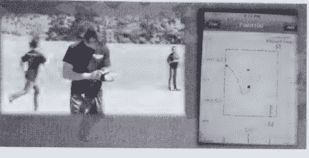

**图8.1** *（见彩色插页。）* 典型的 *iTron* 游戏。

#### 8.2.1 *iTron*

*iTron* [3] 是一款现实世界中的“贪吃蛇”游戏。本质上，玩家必须在现实世界中四处移动；同时，他们在虚拟世界中留下“墙”的轨迹（图8.1）。玩家必须避免撞墙，其移动应使自己在显示器上所代表的位置不会穿过墙。图8.1展示了一场进行中的三人 *iTron* 游戏的现实世界和虚拟世界视图。一名玩家在早期撞到了另一名玩家的尾部，而另一名玩家有撞到区域边界的危险。目标是在所有其他玩家都撞毁后成为最后幸存者。这款游戏既是一种策略游戏，玩家试图包围并切断对手的领地，也是一种体力游戏，需要跑得足够快、足够准确来执行这些策略。

另请注意，一名玩家使用廉价的 Kyle 腕部支架将智能手机转换为免手持可穿戴设备，这是一项关键创新，可降低设备风险，并为游戏中的体育活动提供更多自由。

这款游戏在相对较小且空旷的区域进行，例如停车场或足球场。*iTron* 也可以在具有复杂地形的较大区域进行，此时攀爬和地形穿越成为计划和运动能力的重要部分。这种风格的 *iTron* 游戏称为 *iTron/Parkour*。这种游戏的最终状态如图8.2所示。

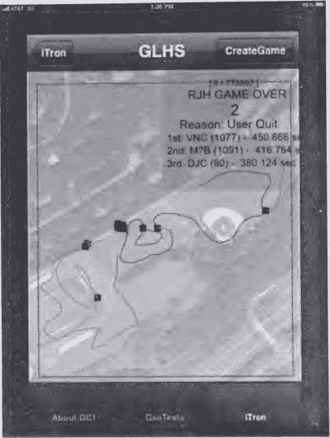

**图8.2** 一场 *iTron/Parkour* 游戏的最终状态。

#### 8.2.2 *iTESS*

*iTESS* [4] 是一款捉迷藏式对抗游戏，为现实世界中的玩家提供虚拟武器和情报资产。游戏目标是玩家尽可能长时间不被武器射击（火炮或霰弹枪武器）击中，得分为在延长游戏会话中达到的该间隔的最大值。玩家可以在现实世界中搜索对手，也可以在智能手机屏幕上指挥虚拟无人机（UAV），该无人机“飞”过地图，若发现对手则标出红点（见图8.3）。绿色阴影（右下角浅色圆圈）圆圈是无人机俯视区域。带指南针箭头的蓝点是所示设备玩家的位置，红点代表无人机发现的敌方玩家。红色阴影圆圈是来袭炮弹的警告，而蓝色圆圈是自己炮弹的效果区域。

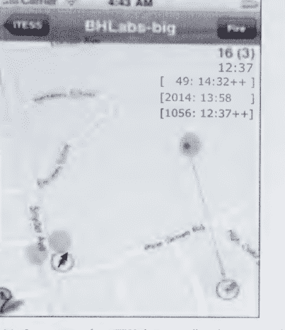

**图8.3** 来自 *iTESS* 的屏幕截图，显示火炮射击。右上角数字显示会随时显示游戏中的前三名得分。

瞄准火炮时，移动准星，然后点击开火按钮。相比之下，瞄准霰弹枪时，需实际指向设备，然后在屏幕上拖动以扣动扳机（见图8.4）。

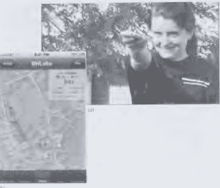

**图8.4** *（见彩色插页。）* (a) *iTESS* 霰弹枪武器的指向即射界面，以及 (b) 霰弹枪射击动画期间的屏幕显示。

无论霰弹枪射击还是火炮射击，武器效果区域内的对手都会收到通知，并看到在炮弹到达前的短暂时间内必须逃离的区域。*iTESS* 设计为武器效果较慢，以鼓励并允许快速反应和奔跑来拯救玩家（详见参考文献[4]）。

*iTESS* 使用 *自组织* 网络在设备之间传输按地理位置寻址的消息。一旦玩家被击中，他或她的间隔时间从0重新开始。

#### 8.2.3 *Butterflies*

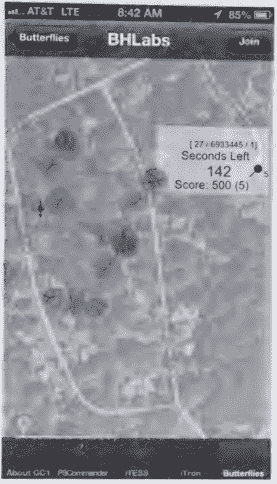

**图8.5** 一张 *Butterflies* 游戏的截图。蓝色（较大）蝴蝶是好的，红色（较小）蝴蝶是坏的，蓝点是我的位置，红点是其他玩家的位置。绿色棒棒糖符号是玩家可以获得捕蝶网的位置。

*Butterflies* 提供与现实世界中人类玩家交互的虚拟生物。图8.5展示了一种游戏情形，蓝点（带箭头的深色点）是地图上自己的位置，红点是其他人类玩家的位置，其他符号表示蝴蝶和捕蝶网获取区域。本质上，人类的目标是通过奔跑尽可能多地收集好蝴蝶，即移动到蝴蝶上，同时避免在坏蝴蝶中奔跑时被触碰。捕蝶网（如果有可用的）可以延伸捕捉范围，以捕捉难以触及或飞得很快的蝴蝶，例如在建筑物顶部飞行的蝴蝶。随着游戏等级提高，蝴蝶获得越来越复杂的行为。在最低等级，它们按预定的伪随机模式随机移动。在较高等级，它们能以不同速度逃离人类或追逐人类。人类可以找到捕蝶网，帮助捕捉或防御它们。因此，这款游戏涉及大量移动、计划和社交互动，例如有些蝴蝶如此快速聪明，常常唯一捕捉它们的方法是人类协调行动。

### 8.3 工程挑战

如前所述，户外多人游戏至少在五个阶段给软件工程带来挑战：架构、设计、编码、验证和需求。

#### 8.3.1 架构

在公园、海滩和偏远营地等自然环境中进行户外游戏时，常常会在没有网络覆盖或网络覆盖较弱的情况下游玩，可能没有WiFi热点，甚至没有3G覆盖。然而，这些设备能够进行设备到设备的 *自组织* 网络。这通常意味着远处玩家之间的通信会不可预测地断开，并持续较长时间。例如，两名 *iTESS* 玩家可能跑进山谷并继续互相射击，但由于地形原因仍与其他玩家失去网络联系。同样，*iTron* 或 *Butterflies* 玩家中的一部分也可能分开，例如移动到建筑物的两侧。因为要成功，游戏体验必须继续（在物理条件允许的范围内），即使处于基础设施覆盖区域之外，甚至与远处玩家分区隔离，所以我把设计户外智能手机游戏架构时的第一个主要问题称为 *通信问题*。

由第一个问题引出的事实是，任意两台设备都可能不可预测地彼此分区隔离并持续较长时间。这意味着 *游戏体验不得依赖中央控制器*。也就是说，对于计划在偏远地区游玩的游戏，我们在游戏架构中不仅不能要求游戏主机或互联网游戏服务器，甚至不能指定其中一部智能手机作为控制器。如果这样做，每当设备与其分区隔离时，它们就会失去游戏体验，直到重新建立联系。我称其为 *完全分布式问题*。

最后，另一个架构问题是 *远程游玩问题*，涉及可在远距离游玩的游戏。加利福尼亚的一群玩家与新泽西、英国和东京的群体进行 *iTESS* 对战是完全合理的。显然，这需要互联网连接，因为设备到设备中继显然不够。如果我们假设有足够多的玩家设备处于互联网接入点覆盖范围内（例如接收3G/GSM覆盖），我们希望游戏架构尽可能无缝地支持所需通信。

我在解决这些问题上的初步进展体现在 *地理广播游戏架构*（Geocast Games Architecture，GGA）中（见第8.4节）。

#### 8.3.2 设计

在设计涉及可具有演化状态的虚拟结构、物体或生物的游戏时，游戏系统需要以能向所有玩家提供期望游戏体验的方式管理状态演化。例如，考虑虚拟生物控制。一只因人类靠近而飞走的蝴蝶会响应环境事件而改变状态。但位于远离这只蝴蝶位置的玩家，甚至可能与所在区域网络分区隔离的玩家，如何获得其状态的一致视图？当来自 *多个* 不同设备的事件导致状态变化时，问题更加复杂，因为不同玩家子集将获知不同事件子集，我们必须关注不同玩家如何看待该生物。图8.6显示了两名 *Butterflies* 玩家几乎同一时间的屏幕截图；这两名玩家因位于建筑物两侧而失去网络联系。因此，他们的设备对蝴蝶一直在做什么有不同的视图。蝴蝶的位置甚至其他玩家的位置都显著不同。这

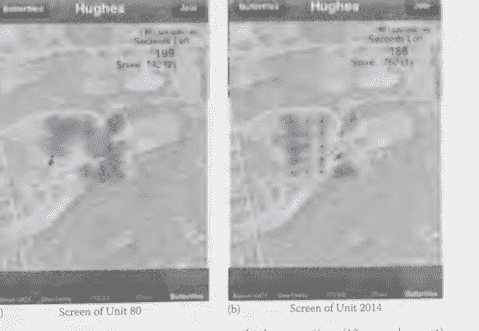

**图8.6** (a,b) 在带有无线电障碍的 *Butterflies* 游戏中，两台设备几乎同一时间（相隔13秒）的屏幕画面。


是因为玩家在因中间隔着学校建筑而失去无线电联系时移动了。

现在，我们不能指望战胜这种情况下的物理规律；由于地形造成了通信分区，无法让所有设备在任何时刻都保持完全相同的状态。幸运的是，我们不需要这一点来提供可玩且有趣的游戏体验。相反，我们可以要求：一旦设备重新汇合（即重新建立联系），它们要尽快就状态的共同一致视图达成一致。我将这一性质称为*快速重新一致*（RRC）。图 8.7 展示了与之前相同的蝴蝶游戏，时间大约晚了 90 秒，此时玩家已经会合，设备也经历了 RRC。两个显示器的唯一区别在于，表示自己位置的圆点在两个设备上不同。

这个问题超出了速度问题，进而涉及如何以对玩家而言公平的方式重新达成一致：例如，如果一个人努力获得分数，能否仅仅因为远处某个人过去做了某件自己不知道的事情，就把分数拿走？类似地，如果重新一致的过程涉及撤回状态变更，那么系统可以或应该对替代历史进行多深的外推，以重建假如新发现的信息更早知道时本应发生的情况？总的来说，我将所有这些问题归入*分布式联合状态问题*这一术语之下。具体而言，我们能否提出一种设计方法，使得一致的生物行为能够在受偶发通信约束的完全分布式架构之上实现？蝴蝶游戏是 RRC 和分布式联合状态管理的一次初步实验，但该领域仍有未来研究空间。


（a）80 号设备的屏幕    （b）2014 号设备的屏幕

图 8.7 （a/b）同一蝴蝶游戏中 RRC 后的两个设备屏幕。

#### 8.3.3 编码

为了追求尽可能覆盖（并因此惠及）尽可能广泛人群的目标，我们不能只在一个品牌或型号的智能手机上提供游戏。因此，我们必须在跨平台开发中寻求抽象和工具支持，这些支持不仅有助于源代码的交叉编译，还能帮助开发者弥补硬件性能、传感器能力、通信系统差异以及操作系统和语言差异。

面向 iOS、Android、Windows 和 BlackBerry 智能手机的 Cocos2d-x [5] 等跨平台代码开发框架，是这一领域一个有希望的起点。

#### 8.3.4 需求

显然，并非所有可在中央服务器架构中实现的游戏语义，都能在完全分布式的户外游戏环境中实现。这仅仅是因为偶发通信问题：如果我在时间 *t* 捕获了一个生物，但你的设备无法在延迟 Δ > 0 内得知此事，那么从你的角度看，该生物在 *t* + Δ 之前仍然可以被捕获。如果我的游戏需求包含这样一种观念：所有玩家在每个时刻都应对哪些生物已被捕获、哪些未被捕获具有一致描述，那么这种需求在这种架构中根本无法实现。我将此称为*（户外游戏）需求限制问题*。具体而言，我们需要开发一套适用于户外游戏设计的领域特定*元需求*。这类元需求将包含针对需求模型的指南和约束，帮助开发者更好地理解自己何时在为新的游戏提出不可能或不切实际的需求。先前关于容忍不一致性的工作 [6] 似乎与此相关。

例如，假设性的需求工具可以注意到某个需求陈述暗示联合状态始终具有全局一致性时，将其标记为不可实现，甚至建议用基于 RRC 的准则替换它。

#### 8.3.5 验证

分布式系统的测试和形式化验证众所周知很困难；然而，完全分布式的智能手机游戏加剧了这一困难。人们正在验证的需求通常相对于系统的分布式联合状态，因此验证意味着要理解那些被设计和规定为允许临时网络分区并导致不一致状态视图的系统的宽松语义。例如，两台设备因失去网络联系而对谁捕获了一个生物存在分歧，不再表示验证失败，除非在设备重新建立网络联系很久之后该情况仍然存在。如何表达这样一种正确性概念并对其进行测试，或形式化验证其符合性？我将此称为（户外游戏）语义验证问题。

在更务实的层面上，测试常常涉及数十台设备。仅仅为了开始分析一次运行而收集、合并、同步和清理测试数据，现在就已经相当复杂，因为这似乎需要大量工具基础设施来收集和分析来自设备及无线介质的数据。捕获演算工具集（CCT）[7] 就是这样一个工具套件，它可以捕获、转换、组合、分析和动画化真实世界的测试数据。

规模和负载测试需要更多设备，似乎需要一些复杂的工具支持，否则就需要一大群愿意帮忙的人。我将此称为（户外游戏）实用测试问题。仅仅维护一个拥有数十台设备的实验室，就涉及大量充电、应用加载、配置和设备跟踪工作。CCT 提供了组合子，可将捕获的测试运行数据与程序化生成的场景组合并扩大，以增加数据规模。然后可以对这些数据进行动画化、分析和模拟。然而，未来工作的一个问题是开发一种工具，能够接收这种合成的大规模场景，并在真实设备上自动实际执行它们。

### 8.4 GGA

在我之前的工作中，我已经记录了我实现户外智能手机游戏的方法。第 8.2 节讨论的三款游戏都是使用 GGA [2] 构建的。我在此回顾其三项原则。

- 1. *完全分布式架构*：这是由上文给出的原因所驱动的。所有游戏都应设计为没有中央控制器，仅运行在玩家佩戴或携带的设备上。
- 2. *地理通信*：GGA 规定设备间通信将使用可扩展地理寻址框架（SGAF）[8]，并在适用时于自组织现场通信层内使用*可扩展自组织地理广播协议（SAGP）*[9]。SAGP 是*自组织*的，因为它从对等设备传播到对等设备，不需要基站或基础设施支持。它是一种地理寻址协议，意味着应用*按地理方式*寻址网络消息，即按消息应传输到的空间区域来寻址，而不是按设备标识符、IP 地址、手机号码或其他任何内容来寻址。这使其能够避免传统 IP 网络的可扩展性和鲁棒性陷阱。它的可扩展性体现在开销低，并且不会随某一区域内设备密度的增加而急剧增加。这使得游戏既能在拥挤场所进行，也能在户外场所进行。
- 3. *可选的远程扩展*：如果设备确实能够接入基础设施网络，例如 4G/LTE/GSM 服务等广域网，地理寻址通信可以通过*分层地理广播协议*[10]（SGAF 的远程框架部分）利用这一点，从而高效地实现远程通信。例如，它允许位于不同海岸的人们进行 iTESS 游戏，这一场景已在多个场合得到实现。

#### 8.4.1 变体

上述定义有些理想化，因为在某些情况下，人们需要或希望稍微修改 GGA，以适应限制或变化的需求。例如，可能希望纳入不具备兼容 802.11（WiFi）能力的设备；这类设备可以作为 SGAF 内一个独立的非*自组织*层纳入。类似地，可能希望与低成本联网传感器接口，这些传感器自身不具备位置感知能力，或者可能内存或 CPU 资源较少。在这种情况下，我们可能会折衷*完全*分布式的理想，允许某些设备将计算、感知和/或存储卸载到其他设备。

广泛的测试和试验经验（超过 175 名用户玩过三款地理广播游戏中的至少一款）表明，基于 GGA 的游戏达到了我们的目标。

用于户外的趣味和运动游戏。有关根据GGA原则实现游戏的描述，请参阅参考文献[3]（iTron）和[4]（iTESS）。然而，GGA仅仅是一个基础。特别是，要解决第8.3节中讨论的挑战，还有很多未来工作要做。

### 8.5 小结

我简要概述了健康户外多人智能手机游戏的动机及其给软件工程带来的挑战。我还概述了三款已实现的游戏，这些游戏使得相关概念得以实验，并对GGA和RRC进行了初步试验。

在浅尝这一游戏领域带来的诸多挑战时，我涉及了软件工程的五个方面：

- 1. 架构——通信与完全分布问题
- 2. 设计——分布式联合状态问题与RRC
- 3. 编码——跨平台编码问题
- 4. 需求——需求约束问题
- 5. 验证——语义验证与实用测试问题

简而言之，这是一个丰富且富有挑战性的领域，研究时机已经成熟，可以为实现有价值的社会目标做出贡献。

### 参考文献

- 1. 可扩展的自组织无线地理广播项目。www.research.att.com/projects/Geocast/。
- 2. R. J. Hall. 地理游戏设计中的作弊攻击与防御技术。载于ACM未来游戏大会论文集，温哥华，不列颠哥伦比亚省，2010年5月。
- 3. R. J. Hall. iTron系列地理广播游戏。《IEEE消费电子汇刊》，58(2)，2012年。
- 4. R. J. Hall. 面向户外多人智能手机游戏的喷涂射击武器设计。载于2011年国际数字游戏基础会议论文集，法国波尔多，2011年6月。
- 5. Cocos2d-x.org. 无日期。www.cocos2d-x.org。
- 6. R. Balzer. 容忍不一致性。载于第13届国际软件工程会议论文集，得克萨斯州奥斯汀，1991年9月。
- 7. R. J. Hall. 捕获演算工具集。载于第26届IEEE/ACM国际自动化软件工程会议，研究演示专场，堪萨斯州劳伦斯，2011年11月。
- 8. R. J. Hall. 扩展地理寻址系统。载于*2013年IEEE军事通信会议论文集*，加利福尼亚州圣迭戈，2013年11月。
- 9. R. J. Hall. 一种改进的移动自组织网络地理广播。*IEEE移动计算汇刊*，10(2):254–266，2011年。
- 10. R. J. Hall 和 J. Auzins. 一种用于远程移动自组织网络的分层地理广播协议。载于*2006年IEEE军事通信会议论文集*，华盛顿特区，2006年10月。

## 从三个尺度理解用户行为

### *A Google A Day 的故事*

Daniel M. Russell

### 目录

- 9.1 引言 200
- 9.2 背景 201
- 9.3 我们的游戏：AGAD 201
- 9.4 用户的三种视角：微观、中观与宏观 203
- 9.4.1 微观层面：玩家在短时间尺度上的行为 204
- 9.4.2 中观层面：人类逐分钟的行为 206
- 9.4.3 宏观层面：人类在数日及更大范围中的行为 208
- 9.4.4 在三个层面整合研究与设计 210
- 9.5 小结 212
- 参考文献 212

**摘要：** 人们的行为方式是数据分析的核心问题，而单一的理解用户行为的方法往往有其局限性。人们玩游戏的方式、互动的方式，以及他们带入游戏的行为类型，都是最终驱动系统表现的因素，也决定了我们能如何理解用户为何做出这些行为。我认为，从三个不同的时间尺度和采样精度检视用户数据，可以看到从微观、中观和宏观层面检视行为数据是理解人们在系统中做什么及其原因的绝佳方式。了解这一点不仅能让你理解正在发生什么，还能知道如何在下一个设计周期中改善用户体验。

### 9.1 引言

虽然创作游戏的动机有很多，但*严肃游戏*通常是教学和学习的载体。尽管严肃游戏在许多教育环境中很重要，但它们有时会因缺乏对游戏设计细节的关注而受影响。虽然目标是教育和指导，但*游戏*体验有时会受到影响。面对现实吧，其中一些严肃游戏玩起来并不那么有趣。怎么可能一款游戏在被创造和部署时，没有人注意到它存在一些可玩性问题呢？

许多人已经报告了为游戏添加监测和监控的方法。我们发现，一种特别有用的理解整体用户体验的方法，是在三个不同的行为时间尺度上分析游戏玩家行为，从非常短暂的毫秒级行为，一直到数百万玩家在数周和数月内借助游戏进行学习的时间尺度。

AGoogleADay.com（AGAD）游戏有一个简单的目标。我们只是想让公众了解一些使用Google搜索引擎的更高级方法。虽然Google很容易使用，但Google内部有许多功能并未被广泛使用。通过构建一个*要求*使用Google（而不是像大多数此类游戏那样禁止使用）的“问答题目”式游戏，我们希望设计出足够困难（且生僻）的问题来促使玩家使用这些功能，从而向他们介绍这些功能。

AGAD游戏最初计划作为期3个月的实验，但其上线后持续运行了超过2年，每月服务数百万游戏玩家，并提高了玩家通过搜索寻找问题答案的能力。

在此，我们介绍为了解玩家情况所做的一些分析——他们做了什么，以及游戏更改会产生什么影响。

虽然本章讨论的是AGAD这款游戏，但这种在三个不同时间尺度上理解复杂用户行为、并使用三种不同研究的方法，总体上适用于具有复杂用户界面（UI）的软件系统。

### 9.2 背景

一直以来都有一种着眼于测试和分析来开发游戏的做法（Pinelle 2008; Nacke 2009; Koefel 2010）。通常，游戏分析遵循传统的可用性分析方法，或对玩家行为进行日志记录。

人机交互（HCI）研究人员对研究在线游戏的设计和体验越来越感兴趣，他们创建了评估用户体验的方法（Bernhaupt 2010）、用于设计评估的“可玩性”启发式规则（Schaffer 2008），以及游戏组件（Schaffer 2008）和游戏体验（Sweetser and Wyeth 2005）的模型。这些方法虽然都有用，但主要局限于单一的分析尺度——可玩性启发式规则是在微观尺度上定义的，而游戏体验则主要在中观尺度上研究。同样，Bell等人（2006）的工作无疑是宏观尺度的研究（通过日记的方式），但没有考虑玩家跨尺度的行为。

然而，在一个大量玩家可能来自世界各地、在线游戏被广泛游玩的时代，在设计过程早期采用更全面的方法来理解游戏使用情况往往卓有成效。正是这种弥合最低层使用行为与大规模玩家行为之间鸿沟的愿望，促使我们对游戏应用了广谱分析。

### 9.3 我们的游戏：AGAD

AGAD游戏最初开发时考虑到了双重目的：（1）作为一款严肃游戏，教人们更高级的搜索技能，例如如何使用**filetype:**、**site:**或**filter-by-color**搜索方法；（2）同时作为Google搜索在我们想要尝试的新市场中的营销存在。尽管Google在广告方面拥有丰富经验，但这是首次尝试创造具有这种双重目的的互动体验。

从一开始的目标就是创造一款视觉效果很好、具有“黏性”但不会让人沉迷的游戏。换句话说，它必须是那种玩家会在相对较短的时间内游玩、接触到信息，并在此过程中学到一点东西的游戏。

我们设计了一款“问答题目”游戏，其难度要显著高于普通的问答游戏。典型的问答游戏走在一条微妙的平衡线上：难以回答（除了少数

游戏玩家群体中的一小部分）并且过于简单（因此不适合竞技性游玩）。对于 AGAD，我们特意选择了甚至连一小部分玩家都不太可能知道的问题，但其答案却可以通过几次 Google 搜索找到。问题还必须具有一定内在趣味——真正琐碎的问题，例如圆周率小数展开中的第 23 位数字是什么？——不适合用于游戏游玩。

AGAD 是一个构建起来相当简单的游戏。UI 每天呈现几个问题，并每日更新题目集。玩家逐题作答，在一个单独的 iframe 中进行 Google 搜索，该 iframe 使搜索引擎可以与问题并排显示。每个问题都有一个简单答案，可以通过正则表达式识别。编写该正则表达式稍显棘手，因为大多数问题的答案有多种变体（例如“三”“3”或“数字 3”）。

如图 9.1 所示，问题显示在页面底部的框架中，并带有典型的游戏机制，例如解锁后续问题、让玩家跳过问题的按钮，以及通过 Google+ 社交网络与朋友比较你的得分（以及回答问题所用时间）的方式。

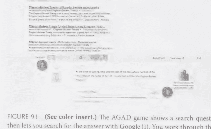

图 9.1（见彩色插页。）AGAD 游戏显示一个搜索问题（3），然后让你用 Google 搜索答案（1）。你逐题作答（2），在解锁并解决更多问题时获得分数。

在我们开发 AGAD 的过程中，很快就清楚用户测试必须成为设计周期的重要组成部分。这对所有游戏都是如此，但随着工作的推进，我们也逐渐清楚，实际上我们必须做的不仅仅是实验室中的标准可用性测试。

一个很大的偏差是，在实验室环境中，人们有很强的动机尽其所能地表现。结果，我们看到实验室测试与我们在真实环境中观察人们时非正式观察到的情况之间存在差异。我们怎样才能提高设计驱动测试的准确性？

为了更准确地理解玩家，我们需要了解他们启动游戏时在做什么、他们如何玩游戏，以及在广泛人群中发生了什么。这引出了研究应涵盖三种不同方法的想法。我们不仅需要理解低层级的可用性问题，还需要验证游戏玩起来是否有趣，并让人们对 Google 保持积极态度。

因此，我们的设计测试策略的目标变成了以三种不同方式观察玩家，以便全面描绘他们在游戏中做什么（以及他们如何享受游戏）。

### 9.4 用户的三种视角：微观、中观和宏观

经过一些迭代，我们最终确定了对玩家行为的三种不同分析。我们希望理解以秒为时间尺度的游玩行为。尽管这对可用性问题很有用（例如，为什么玩家有时从不点击某个特定游戏选项），但这种分析层次对于理解用户对游戏的反应来说过于细致，并且不能提供关于他们情感反应的信息。为了提供这类信息，我们最终对几分钟到几小时时间段的游戏游玩进行分析。同样，这种分析层次（虽然有用）无法提供我们也希望收集和理解的大规模人群数据——这些数据能告诉我们从数周到数月之间发生了什么。

我们意识到，我们的三种分析尺度与纽厄尔（Newell 1994）的人类行为时间尺度非常相似。纽厄尔的分析框架有四个带：神经（1–10 毫秒）、认知（10 毫秒–10 秒）、理性（分钟到小时）和社会（数天到数月）。他沿不同时间尺度划分认知行为，是为了强调不同类型的效果可以由根本不同的机制来解释。我在这里采用类似的方法。

- 1. *微观尺度*测量从毫秒级到分钟级的行为，通常涉及少量人群，并且通常在实验室环境中进行。通过这些研究，我们希望深入了解游戏机制——玩家看向哪里、他们如何感知游戏元素，以及哪些内容未被注意和探索。
- 2. *中观尺度*测量从几分钟到几小时的行为。这是实地研究的领域，观察人们在自然环境中玩游戏（例如在家中或咖啡店）。中观尺度能提供关于人们为什么选择游玩、为什么最终停止游玩的洞见，也有助于理解是什么让游戏变得有趣（或无趣）。
- 3. *宏观尺度*测量从数天到数周和数月的行为。通常，这涉及大量玩家，并且通常是对许多人玩游戏的日志进行分析。

用户行为日志在一段时间以来一直是一种标准做法。自 20 世纪 30 年代以来，心理学研究一直在收集行为痕迹（Skinner 1938），而随着基于 Web 和计算机的应用程序的出现，捕获大量交互并将其保存到日志文件中以供后续分析变得普遍。更近些时候，基于 Web 的计算平台的兴起使得大规模捕获人类与 Web 服务的交互成为可能。日志数据让我们能够观察如何比较不同界面在支持电子邮件采用和持续使用模式方面的效果（Dumais et al. 2003; Rodden and Leggett 2010）。

让我们更详细地逐一查看这些时间尺度分析方法。

#### 9.4.1 微观层面：玩家在短时间尺度上的行为

尽管有许多方法可以研究短时间范围内的人类行为，但对可用性研究而言，最简单且最实用的方法是眼动追踪（也称为*眼动注视*）研究（Bergstrom et al. 2014）。

眼动追踪研究需要将受试者带入实验室，使用一种特殊显示器，其边框内内置了眼动追踪系统（有许多公司销售这类系统，例如 Tobii 或 Senso Motoric Instruments（SMI））。这些系统会校准玩家在显示器上的眼动，并以低至毫秒级的时间分辨率输出眼睛在屏幕上的移动位置。本质上，它们会创建 *X*、*Y* 和 *T* 数据流（*X* 和 *Y* 是注视焦点在显示器上的位置，其中 *T* 是眼睛停留在这些 *X* 和 *Y* 位置上的时间量），以及所采取的任何用户操作（例如点击、键入或滚动事件）。


图 9.3（见彩色插页。）热图显示眼睛在采样时间内于任意一个位置停留了多长时间。在这里我们可以看到，玩家大部分时间都在阅读问题（在底部的戏剧面具图标旁边，以及靠近顶部的搜索查询处）。

研究参与者。尽管这看起来是件小事，但实际上，那些自然而然会向参与者提出的问题和行为，在实验室环境中可能永远不会出现（Grimes and Russell 2007）。研究人员可以通过这种方式了解参与者的很多情况及其动机，但观察到的行为发生在受控的人工环境中，可能无法代表“在真实环境中”会观察到的行为。

在实验室环境研究中，一个人可能会在实验室里投入比原本更多的时间来完成一项任务，以取悦研究者（Dell et al. 2012）。此外，实验室研究通常在收集数据所需的时间以及可研究的不同人数和系统数量方面成本高昂。

微观层面的研究很有用，但并不能回答人们可能对更普通环境中的游戏游玩所抱有的所有问题。

#### 9.4.2 中观层面：人类如何逐分钟行动

在中观研究层面，研究会确定系统用户如何执行所关注的任务（玩游戏），并收集无法以任何其他方式收集的信息（例如，直接观察对计算机游戏的情感反应）。

中观层面的研究方法主要是对用户行为进行实地研究，即从参与者的自然

在人们于环境中开展活动时进行观察。以这种方式收集的数据往往比实验室研究更少人为性，但控制程度也更低；这既体现在积极方面（例如参与者做出完全出乎意料的事情），也体现在消极方面（例如研究者的在场影响了他们的自然行为）。

我们尤其关注 AGAD 游戏中的自然使用现象（包括交互、广告、分心、多任务处理等完整复杂情况）。与任务类游戏等更深度吸引人的游戏不同，AGAD 一直定位于短时长、低开销、小投入的游戏玩法。因此，我们想了解人们会如何玩这款游戏，也就是：什么会促使他们开始游戏，他们为什么会停止游玩，他们觉得游戏哪些地方吸引人，游戏过程中什么会构成干扰，以及促使他们回归游戏的驱动因素是什么？

在一系列研究中，我们会在 AGAD 玩家首次使用游戏时采访他们（以识别初始反应和易学性问题），之后我们采访了重复玩家，以找出他们重返游戏的原因。

这 15 次访谈（幸运地）几乎没有发现易学性问题——游戏足够简单，设计也很直接。

不过，访谈中也询问了各种难度不同的 AGAD 问题。我们问过的一个问题如下：这种*鳞翅目*成员在两周内体重增加近 10,000 倍。它叫什么名字？

在观察过程中，我们很快了解到，这个问题（和许多其他问题一样）包含有挑战性的词汇和概念。人们不知道 *鳞翅目* 是什么，也不知道 fortnight（两周）是什么意思。这导致了有趣的误读和不同反应。我们由此认识到，这是所有此类“提问/冷知识问答”游戏都会面临的问题。

在这个特定例子中，*鳞翅目* 一词把许多人引向高度技术性的文章（例如昆虫学期刊中的文章），而这些文章又使用了 *龄期* 和 *线粒体转化* 等词语。不过，积极性很高的游戏玩家会努力解决这些问题并找到答案，感受到一种明显的胜利感。

其他更休闲的玩家则会在那时直接放弃，这促使我们加入了跳过问题功能和线索功能；线索功能会显示答案的字母数，并露出一两个字母。（最初设计中有一个提示按钮，但鉴于我们的许多观察都涉及人们感到受挫，这提示我们进行线索功能改动，以帮助遇到困难的人，同时又不向真正想完整解决挑战的玩家透露任何信息。）

从游戏设计角度看，自然情境中的这类中尺度用户行为非常宝贵。这类信息能够在游玩过程中提供反馈，从而深刻影响系统设计。这类玩家行为无法从微观层面行为中抽象出来，也很难从宏观层面推断出来。

#### 9.4.3 宏观层面：人类在数天及大规模情境中的行为方式

尽管中尺度研究非常自然，但宏观研究收集的是人们在较长时间内大量使用系统时最自然的观察数据。这通常通过记录来自现场的自然主义行为来实现，这些行为不受实验者或观察者在场的影响。随着收集的日志数据量增加，日志研究越来越多地涵盖来自世界各地、从事许多不同任务的许多不同类型的人。然而，由于日志数据的收集方式，与实地研究或实验室研究相比，人们对被观察者以及所观察行为发生背景的了解要少得多。

游戏也开始使用基于日志的分析，尤其是在网页游戏时代。Thawornmas（2008）使用日志分析来发现大型多人在线角色扮演游戏（MMORPGs）中的机器人玩家，而 Itsuki 等（2010）则在游戏中寻找“实时金钱交易”。Dow 等（2010）将中尺度访谈方法与宏观层面日志分析结合，展示了互动游戏运营者如何随时间改变其使用偏好。

在 AGAD 的案例中，我们仔细检查日志中我们预期的行为，同时也留意我们未曾预料的行为。（这对于在我们的微观或中尺度研究中不可能看到的行为尤为重要。营销活动和系统错误是最常见也最有趣的行为 [见图 9.7]。）

通过宏观层面日志分析，我们发现了若干未曾预料的行为——从定义上说，这些行为只有在游戏上线一段时间后才可能被看到。其中一个例子是人们重返游戏，然后回退去玩前几天游戏的累积效应。（当游戏重新设计以支持社交玩法时，这一功能被移除了。）

这导致游戏数据中形成了一个大约两周的滚动滑动窗口，因为玩家会回溯到过去。我们注意到这一点，是因为某一天挑战的日志数据会在事后奇怪地发生变化。本质上，这样做会为任何特定的搜索问题带来一条很长的长尾数据（图 9.4）。


**图 9.4**（见彩色插页。）按天追踪问题数据。该图显示了三个不同问题（“Triple Point”、“Lonesome”和“Hamangia”）在 6 天内的玩家数量。“Triple Point”于 2011 年 4 月 30 日推出，但玩家在 4 天后仍不断回退到该问题。

我们还通过日志分析发现，玩家每次访问进行的查询数量显著更多。玩家在不同查询上的查询量总体上增加了近 2 倍（图 9.5）。总搜索量的这种增长不能仅用玩这款游戏来解释，而是由于 AGAD 范围之外的额外搜索。由于该游戏的目标之一是帮助人们成为更高效的用户，这似乎可能证明搜索者变得效率更低而非更高。然而，在 2011 年 9 月对 200 名 AGAD 玩家进行的一项调查中，我们发现，在游玩几天后，玩家感觉自己正在承担复杂得多的搜索任务，需要额外搜索。事实上，这暗示花额外时间练习的做法实际上提高了他们的搜索技能质量。

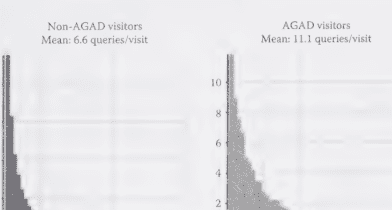

**图 9.5** 每次搜索会话的不同查询数量，比较了 AGAD 玩家与匹配的可比非 AGAD 玩家。

令人惊讶的是，游戏上线几个月后，我们的联合营销广告投放方式出现了一个年初错误（特别是在 2011 年新年期间，我们的合作伙伴没有收到已设置好的信息源）（见图 9.6）。由于当时正值假期，我们每两周才检查一次日志；错误在日志中被注意到时已经过了两周。正是通过这个错误，我们发现，尽管 AGAD 有很高的回访访客率，但他们回访的起因是媒体流中出现了提醒。一旦玩家看到提醒，他或她就会访问网站并游玩（而且如上所述，常常一次游玩不止一天）。


**图 9.6** 一个意外情况的例子。2011 年新年假期期间 AGAD 的分析视图。广告中的一个错误导致玩家数量在数周内大幅下降。

#### 9.4.4 整合三个层面的研究与设计

三个分析层面各自提供特定类型的数据来驱动开发。微观层面数据为有关 UI 和游戏玩法操作的决策提供依据。对于 AGAD，这验证了 UI 的具体细节，并指导了显示界面上项目摆放位置。


与此同时，中观层面数据为设计师提供关键反馈信息，说明游戏在现实世界中如何被感知和使用。某些游戏（尤其是移动游戏）的功能会因玩家游玩时所处的物理和社会情境不同而存在很大差异。

从这类信息中，我们了解到，要编写既吸引人又不会令人望而生畏的问题是很困难的。玩家的反应至关重要。作为中观层面数据分析的一个附带结果，我们决定在UI上添加一个“反馈”按钮，让玩家可以直接与设计团队联系。尽管这会产生相当数量的空消息（即人们点击按钮但未输入任何评论），但我们发现，一旦我们了解问题，关于问题/答案中错误的投诉就能迅速得到修正。实际上，“反馈”按钮成为了一种中观层面的数据源，帮助整体提升游戏质量，同时也提供了游戏表现如何的基线感知。

宏观层面数据讲述游戏在整体层面和真实环境中的表现。借助宏观层面数据，我们知道游戏几乎从一开始就表现良好。我们了解了玩家回到网站的方式、回访频率以及参与时长。如图9.7所示，我们能够看到各种营销努力的效果。数据中的平台期和峰值向我们表明，在测试各种宣传方式时，我们走在正确的轨道上。


图9.7 AGAD在两年期间的总受众参与度。各种峰值和平台期对应营销活动。注意右下角的回访访客率；这是极高的回访玩家率。

### 9.5 小结

审视用户行为的一种有用方式是从三个不同的认知层面入手——第一，快速/迅捷/毫秒层面；第二，逐分钟行为；第三，长时/缓慢认知在数天/数周内的影响。每个时间尺度都会揭示关于用户/玩家如何使用、思考并回应游戏的大不相同的信息。

跨这三个层面考察用户行为，对于理解应用程序和理解游戏同样富有成效。相同的底层用户体验研究方法适用，并且在开发游戏时可能极为有用。

复杂游戏的设计空间非常庞大。从多尺度视角来看，用户体验研究能让人洞悉游戏中会出现哪些机会和问题。更重要的是，观察在一个尺度上发现的洞见，常常能让人理解另一个尺度上的行为。

一般来说，良好的软件工程实践不仅要紧密融合出色的软件工程，还要密切关注每时每刻的用户体验以及较长时期内的游玩体验。

伟大的游戏具备这些特征，能够同时在所有这些设计层面上表现出色。它们有出色的视觉效果；有出色的音频；有出色的后端工程、交互、控制器和故事。伟大的游戏还会推出多个版本并持续多年。你可以看到，在多个层面上分析游戏，并关注不同类型的用户交互，将如何带来设计的改进和整体用户享受的提升。

### 参考文献

- Bell, M., Chalmers, M., Barkhuus, L., Hall, M., Sherwood, S., Tennent, P., Brown, B., Rowland, D., Benford, S., Capra, M., and Hampshire, A. 将移动游戏与日常生活交织。载于 *人机因素计算系统会议*，第417–426页，加拿大魁北克省蒙特利尔，2006年。
- Bergstrom, Jennifer Romano, and Andrew Schall（编）。*用户体验设计中的眼动追踪*。Elsevier，2014年。
- Bernhaupt, R.（编）。*评估游戏中的用户体验：概念与方法*。Springer，伦敦，2010年。
- Dell, N., Vaidyanathan, V., Medhi, I., Cutrell, E., and Thies, W. “你的更好！”：HCI中的参与者回应偏差。载于 *CHI会议录*，第1321–1330页，2012年。
- Dow, S.P., Mehta, M., MacIntyre, B., and Mateas, M. Eliza 遇上奥兹巫师：混合机器与人对具身角色的控制。*SIGCHI人机因素计算系统会议录*。ACM，纽约，2010年。
- Dumais, S.T., Cutrell, E., Cadiz, J.J., Jancke, G., Sarin, R., and Robbins, D.C. 我见过的东西：一种个人信息检索与复用系统。载于 *SIGIR会议录*，第72–79页，加拿大多伦多，2003年。
- Itsuki, H., Takeuchi, A., Fujita, A., and Matsubara, H. 利用MMORPG日志数据实现高效的RMT玩家检测。*第7届计算机娱乐技术进展国际会议录*。ACM，中国台湾台北，2010年。
- Koeffel, C., Hochleitner, W., Leitner, J., Haller, M., Geven, A., and Tscheligi, M. 使用启发式方法评估视频游戏和高级交互游戏的整体用户体验。载于 *评估游戏中的用户体验*，第233–256页。Springer，伦敦，2010年。
- Nacke, L.E., Drachen, A., Kuikkaniemi, K., Niesenhaus, J., Korhonen, H.J., van den Hoogen, W.M., Poels, K., IJsselsteijn, W., and Kort, Y. 可玩性与玩家体验研究。载于 *DiGRA会议录*，布鲁内尔大学，英国伦敦，2009年。
- Newell, A. 将一切整合起来。载于 Klahr, D. and Kotovsky, K.（编），*复杂信息处理：赫伯特·A·西蒙的影响*。Psychology Press，纽约，1989年。
- Newell, A. *认知的统一理论*。Harvard University Press，1994年。
- Pinelle, D., Wong, N., and Stach, T. 游戏启发式评估：视频游戏设计的可用性原则。*SIGCHI人机因素计算系统会议录*。ACM，纽约，2008年。
- Rodden, K. and Leggett, M. 两全其美：利用文件夹的可供性改进Gmail标签。载于 *CHI会议录*，第4587–4596页，美国佐治亚州亚特兰大，2010年。
- Russell, D.M., and Grimes, C. 指派任务与自选网络搜索任务并不相同。载于 *第40届夏威夷国际系统科学年会（HICSS）会议录*，IEEE，夏威夷，2007年。
- Schaffer, N. 游戏启发式评估。载于 Isbister, K. and Schaffer, N.（编），*游戏可用性：专家关于提升玩家体验的建议*，第79–89页。Morgan Kaufmann，荷兰阿姆斯特丹，2008年。
- Skinner, B.F. *生物的行为：一项实验分析*。Appleton-Century，牛津，1938年。
- Sweetser, P. and Wyeth, P. GameFlow：一种评估游戏中玩家享受度的模型。*娱乐计算* 3(3):3，2005年。
- Thawonmas, R., Kashifuji, Y., and Chen, K.-I. 基于行为分析的MMORPG机器人检测。载于 *2008年计算机娱乐技术进展国际会议录*。ACM，2008年。

## 数字游戏中 AI 行为的模块化复用

Christopher Dragert, Jörg Kienzle, and Clark Verbrugge

### 目录

- 10.1 引言 — 216
- 10.2 背景与相关工作 — 218
  - 10.2.1 基于分层状态图的AI — 219
    - 10.2.1.1 松鼠NPC的示例AI — 220
- 10.3 AI模块 — 222
  - 10.3.1 AI模块交互 — 223
    - 10.3.1.1 基于事件的交互 — 223
    - 10.3.1.2 同步通信 — 223
    - 10.3.1.3 其他AI模块属性 — 224
  - 10.3.2 AI模块接口 — 225
- 10.4 复用与组件集成 — 226
  - 10.4.1 事件重命名 — 227
  - 10.4.2 关联类连接 — 228
  - 10.4.3 功能组 — 229
    - 10.4.3.1 组私有事件 — 230
- 10.5 案例研究：从松鼠到垃圾收集者 — 231
  - 10.5.1 垃圾收集者规范 — 231
    - 10.5.1.1 探索 — 232
    - 10.5.1.2 收集垃圾 — 232
    - 10.5.1.3 使用垃圾桶 — 233
  - 10.5.2 构建NPC — 233
  - 10.5.3 案例研究小结 — 234
- 10.6 Scythe AI工具 — 235
  - 10.6.1 工作流程与关键特性 — 235
    - 10.6.1.1 导入模块 — 235
    - 10.6.1.2 AI构建 — 236
    - 10.6.1.3 输出AI — 237
- 10.7 结论与未来工作 — 237
- 参考文献 — 238

### 10.1 引言

复杂且无处不在的人工智能（AI）已成为现代计算机游戏的基本要素；玩家期望非玩家角色（NPC）能够智能地对玩家行为做出反应，同时根据其在游戏情境中的角色表现出适当的行为。然而，为实时游戏环境开发优秀的AI是一项困难的任务。尽管人们采用了多种形式化方法，但实际的AI设计通常诉诸与底层游戏架构和NPC类型紧密相关的、高度定制化的方法。这导致游戏AI中相对缺乏复用，增加了开发成本，并要求重复开发往往相当相似的AI行为。

这种逐游戏、狭隘的关注令游戏开发者感到不安。在GDC 2011上，Kevin Dill提出了这个问题，认为行为模块化的缺乏正在阻碍高质量AI的开发[1]。先前的工作认为，其根本原因在于所采用的形式化方法[2]。由于使用了非模块化的定制方法，软件工程实践的适用性变得有限。作为一种替代方案，基于分层状态图的方法[3]提供了具有嵌套能力的固有模块化。

我们的AI复用方法建立在基于分层状态图的AI之上。在这里，我们提供了一种封装行为的形式化方法和结构；我们能够定义一种开发策略，允许广泛复用不同的AI组件，包括高层和低层元素。通过引入功能组，实现了部分行为组合，提供了一种高效复用相关行为组的方式。对代码依赖关系的清晰识别进一步支持了分析和基于工具的呈现，而这些是确保正确集成到实际游戏代码中所必需的。这带来了更快的开发过程，并具备……

利用 AI 行为库构建复杂的 AI，同时简化 AI 对实际游戏情境的适配。

我们通过复用为松鼠 NPC 设计的大部分 AI 来创建一个垃圾收集员 NPC，以此说明我们的方法。这些是不同的游戏 AI 情境，通常会被当作独特的开发任务来处理。通过将 AI 视为一组相互作用的模块，许多行为相似性会显现出来。通过在合适的抽象层次上表达和复用 AI 行为，我们的方法能够捕捉其中许多共性：垃圾收集员中整整三分之二的 *AI 模块* 都复用自松鼠。

我们的开发与复用方法通过我们的工具 *Scythe AI* 变得实用。该软件框架指导并促进开发工作流，接收状态图及相关类，提供从行为库中生成新颖 AI 的接口，并导出可直接并入游戏的代码。通过形式化表示和理解与特定行为关联的游戏代码，Scythe AI 能够对构建的 AI 执行基础分析，确保代码和功能组依赖得到正确满足，从而使 AI 构建良好。Scythe AI 有效展示了我们方法的实用价值和总体可行性。

我们工作的主要贡献包括：

- 扩展 Dragert 等人 [2] 提出的基于状态图开发游戏 AI 的复用策略。该工作通过定义高效的开发、组件定义和移植策略，进一步证明状态图用于游戏 AI 的可行性 [3]。
- 通过复用松鼠 NPC 的 AI 模块为垃圾收集员 NPC 构建新 AI，展示复用。
- 通过设计软件工具 *Scythe AI* 将方法具体化。作为 AI 生成实用工作流的一部分，它简化组件复用并支持非平凡分析，帮助确保 AI 组件正确组合与集成。

下一节我们先介绍方法的基本背景以及合适的相关工作。第 10.3 节随后描述我们的总体设计，而第 10.4 节给出我们的复用策略。第 10.5 节详述一个复用案例研究。第 10.6 节讨论我们为执行该任务而开发并使用的工具，并细化我们的总体设计。最后，我们在第 10.7 节给出结论并讨论未来工作。

### 10.2 背景与相关工作

现代电脑游戏中的 AI 侧重于控制 NPC，使其表现出符合该角色在游戏中职责的行为。这类 AI 被称为*计算行为*，以区别于经典 AI 方法。在游戏开发语境中，效率和可测试性至关重要，对设计方法形成强约束。最简单的方法是采用通过自定义脚本环境 [4,5] 表达的任意代码，或采用相对简单的树或图结构，例如决策树。

工业界对 AI 复用的研究侧重于将代码制品模块化 [6]，或以增量改进方式修改现有 AI 系统 [7,8]，而不是将行为模块化并移植到全新的情境中。我们的方法旨在阐明这一相对未探索的空间，通过展示行为本身如何能够模块化并在新游戏情境中复用。

有限状态机（FSM）是建模游戏 AI 最古老且最常用的形式化方法，其中状态表示行为，触发迁移以改变所表现的行为 [9,10]。层次有限状态机（HFSM）通过允许状态包含具有内部迁移的子状态，吸收了状态图 [11] 的一些方面。在复用语境中，HFSM 中的超状态可被视为模块并导出到新 AI [12]。这种方法有价值，但忽略了代码可移植性等重要细节，且没有为与内部状态交互提供机制。HFSM 严格的层次性质可能具有局限性，因为它们对状态之间迁移的建模方式施加限制。行为树 [13] 也有这一局限：尽管它们更清晰地刻画系统如何选择行为，但具有强层次性，并且还缺乏封装不同行为分组的模态状态。将行为组件模块化基于剪枝和复用分支，这一思想此前已被探索 [14]。从实践意义上看，行为树中的复用程度有限，因为单个树节点通常高度特定于游戏或 AI——代码动作与抽象的高层行为在行为树模型中紧密交织。

理论上，规划方法似乎非常适合复用。由游戏 F.E.A.R. [15] 推广的目标导向行动规划器，通过带前置条件和后置条件的行为模块库进行启发式搜索来选择行为。实践中，要让规划器选择合适行为，需要大量封装基础知识的变量，还需要对权重和启发式进行相当多的调整。结果，模块变得高度定制于游戏情境，通用复用也因此更加困难。

行为树提供了一种基于剪枝和复用分支的复用模型 [14]。然而，从实践意义上看，复用程度有限，因为单个树节点通常高度特定于游戏或 AI——代码动作与抽象的高层行为在行为树模型中紧密交织。尽管行为树清晰刻画系统如何选择行为，但它们缺乏封装不同行为分组的模态状态。在实践中，复用主要体现在以增量改进方式修改现有 AI [7]，而不是将 AI 逻辑移植到全新情境。

#### 10.2.1 基于分层状态图的 AI

我们的工作采用 Kienzle 等人 [3] 开发的形式化方法，他们引入了一种基于状态图抽象分层的 AI。该方法受机器人学中常见的*感知—规划—行动架构*启发。在这里，每个状态图实现单一行为关注点，例如感知游戏状态、记忆数据、做出高层决策等。由于职责划分清晰，状态图非常适合复用。一个 AI 由多个状态图构建，每个状态图体现特定概念，所表现的行为是状态叠加的函数。重要的是，通信可在较低层发生而不涉及较高层，这意味着该形式化方法采用包容架构 [16]。这提高了模块性；更高抽象层不需要完整知识集即可做出决策，这也减少了横切关注点。

在该模型下，最底层包含传感器，传感器通常通过*监听器*或观察者读取游戏状态，这些监听器或观察者在检测到变化时生成事件。事件向上传递给*分析器*，分析器解释并组合感知数据，形成连贯的游戏状态图景。下一层包含*记忆器*，存储分析后的数据和复杂状态信息以供后续参考。最高层是*战略决策器*，通常是一个单一状态图，它对分析后和记忆的数据做出反应，以决定高层目标。抽象程度降低后，目标触发*战术决策器*来确定如何执行。

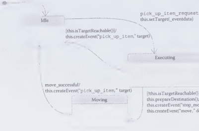

图 10.1 一个控制拾取行为的示例 AI 状态图。

下一层提供*执行器*，落实执行决策，将目标转化为动作。根据 NPC 的当前状态，某些命令可能导致冲突或次优行动方案，这些由*协调器*纠正。最后一层包含*执行机构*，通过修改游戏状态来执行动作。

图 10.1 展示了一个示例“拾取执行器”状态图。它通过判断物品是否可达来响应 `pick_up_item_request` 事件。守卫条件 `[this.isTargetReachable()]` 仅当守卫求值为真时才允许受守卫的迁移触发。然后该迁移触发事件，以拾取物品，或先移动到适当位置再拾取物品。状态图直到相对近期才引起游戏开发行业的兴趣，最初的设计聚焦于低层问题，例如在游戏情境中的高效解释 [17]。

##### 10.2.1.1 松鼠 NPC 的示例 AI

我们首先介绍一个以分层状态图形式化方法创建的现有 AI。这将有助于阐明 AI 结构，并为我们提供一组可复用的模块。这里我们描述一个基于分层状态图的 AI，用于松鼠这一简单的背景 NPC。出于游戏目的，对松鼠行为建模采用高抽象层次就足够了——详细模拟会超出典型游戏 AI 所需。


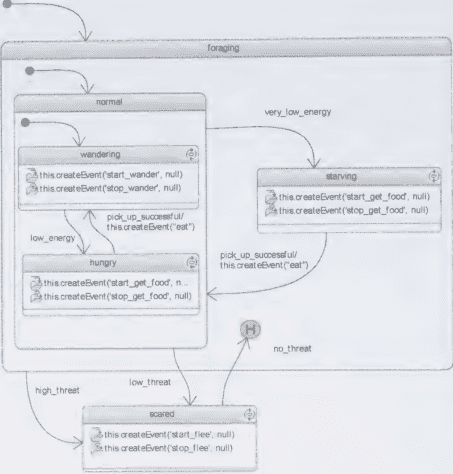

图10.3 控制松鼠行为的高级大脑。

### 10.3 AI 模块

基于分层状态图的AI围绕组合各个状态图以产生整体行为来构建。这意味着基本模块是状态图本身。我们将AI模块定义为一个状态图及其关联类，并将其作为复用过程中的基础模块。这类似于游戏图形：由纹理映射三角形构建的模型构成基本的可复用组件。模型可以轻松地在新上下文中复用，而通过清晰定义可复用组件，我们提供了一种方法，使AI模块在构建新游戏AI时也能同样可复用。

状态图与关联类的配对是非常合适的选择，原因有二。首先，状态图独立行动，仅在更高层协调下合作。这意味着状态图本身具有封闭的执行环境，可在任何上下文中执行。其次，每个状态图都链接到一个单独的关联类，为包含源代码提供了一种优雅的方式。这种配对是有利的，因为我们现在可以在高层面上推理AI行为，同时不忽视实现代码。

#### 10.3.1 AI 模块交互

当模块被复用时，它们会从一个上下文中移除并放入另一个上下文。为使复用成功，新上下文必须能够与复用的AI模块交互。为实现复用，需要清晰描述模块如何交互。有了这种描述，我们就能为每个模块建立交互概要，提供将AI模块正确插入新上下文所需的信息。

##### 10.3.1.1 基于事件的交互

AI模块的状态图部分使用基于事件的消息传递进行通信。采用协作方式时，状态图生成事件，并广播到系统中的所有其他状态图。

由状态图生成并被其他状态图消费的事件，从生成状态图的角度被归类为*输出*事件。从消费状态图的角度看，这些相同的事件成为*输入*事件。如果某个事件既不由某个状态图生成，也不由它消费，那么该事件与该状态图无关，会被忽略。

在少数情况下，状态图可能既生成又消费某个事件，或者关联类可能生成一个仅面向该模块内状态图的事件（例如*HALO* AI中的健康传感器）。这些自通信事件表达单个状态图内部的逻辑，因此被归类为*私有*事件。

##### 10.3.1.2 同步通信

AI模块中的关联类通过模块之间的直接同步方法调用进行通信。当复用一个会向其他类发起同步方法调用的模块时，任何目标模块也必须被复用，或者编辑关联类，用有效目标更新该调用。上下文类或引用类也必须被复用，以便关联类能够正确编译。如果AI模块没有任何游戏导入，那么它就是*游戏无关*的，可以安全地在不同游戏中复用而不出现问题。

最后一项属性涉及AI模块的非模态属性。此类属性以变量形式存储在关联类中，允许在模块复用时进行定制。一个例子是松鼠AI定义中的`KeyItemMemorizer`模块。其关联类有一个类型参数。如果发现的物品与类型参数类型相同，那么它就是关键物品（就松鼠而言，类型为Acorn）。一个实现多个重要物品（如花、衬衫和盒子）的游戏，可以为每个与AI相关的物品各有一个`KeyItemMemorizer`。当`KeyItemMemorizer`从传感器接收到item_spotted事件时，将检查其负载并与关键物品参数比较，如果类型匹配就记住它。通过在接口中公开参数，可以在复用时修改它们，从而针对新上下文定制模块。

#### 10.3.2 AI 模块接口

AI模块接口背后的动机是将与复用相关的信息收集到单一位置。这类似于应用程序或库的应用程序编程接口（API）。正确使用库要求遵循API；正确复用AI模块要求遵循模块接口。

AI模块的接口收集并呈现有关事件、同步调用、参数和任何导入的信息。相关信息，例如模块名称、行为概要以及预期层次，可以选择性地添加到接口中。这意味着与模块复用有关的所有信息都位于单一位置，使模块接口的使用成为执行复用时的一个有价值的工具。图10.4给出了通用接口的直观描述。

| 状态图名称 | |
|---|---|
| *游戏*：Mammoth | *语言*：Java |
| *描述*：<br>- 状态图及其行为的描述 | |
| *参数*：<br>- 类型 :: 描述 | |
| **事件** | **调用** |
| *输入*：<br>- EventIn (PayloadType)<br>- Event2In<br>*输出*：<br>- EventOut<br>- Event2Out (PayloadType)<br>*私有*：<br>- InternalEvent | *游戏导入*：<br>- import Game.Element<br>- import Library.Class<br>*可用的同步调用*：<br>- method(signature)<br>*外部同步调用*：<br>- Module.method(signature) |

图10.4 通用AI模块接口。

通过填写描述和附加信息，接口能够有效传达模块的功能。图10.5展示了松鼠AI中出现的`KeyItemMemorizer`的AI模块接口，并清晰描述了该模块如何工作以及如何通信。

| KeyItemMemorizer | |
|---|---|
| *游戏*：Mammoth | *语言*：Java |
| *描述*：过滤 item_spotted 事件，以记住已发现的关键物品 | |
| *参数*：<br>- ItemObject keyItem :: 要记忆为关键物品的物品类型 | |
| **事件** | **调用** |
| *输入*：<br>- _1_set_item (ItemObject)<br>- _1_dont_set_item (ItemObject)<br>*输出*：<br>- _key_item_visible<br>- _no_key_item_visible | *游戏导入*：<br>- Mammoth.AI.NPC.Role,<br>- PhysicsEngine.PhysicsEngine,<br>- WorldManager.ItemObject,<br>- WorldManager.WorldManager<br>*可用的同步调用*：<br>- `Vector<ItemObject> getKeyItemList()` |

图10.5 关键物品记忆器的模块接口。

### 10.4 复用与组件集成

正确且轻松地集成模块是有效AI复用的基础。每个复用的模块都必须通过基于事件的通信或同步通信，与新AI中的其他模块*连接*。这里我们描述如何在新上下文中复用模块并正确连接。

#### 10.4.1 事件重命名

对于基于事件的连接，模块通过将输入事件与输出事件配对来进行通信。在广播模型下，事件重命名允许通过重命名输出事件来形成连接，使其与输入事件匹配（或反过来）。从机制上说，这意味着修改状态图的源代码以使用新的事件名。

为确保正确性，应尊重现有连接。如果新模块使用新系统中已经存在的事件名，且并不打算建立连接，则应重命名新模块中的事件，以防止形成非预期连接。

通常，私有事件不适合用于形成连接。根据定义，私有事件由状态图内部使用，而封装意味着该事件应对系统其余部分不可见。该事件的生成可能以不明显的方式依赖于状态图的内部逻辑，这意味着另一个状态图生成该私有事件可能会破坏该内部逻辑。

从技术上讲，另一个状态图消费私有事件不会破坏内部逻辑。但由于这破坏了封装概念，此类连接会使未来的复用和修改复杂化。然而，也可能存在这样的情况：一个本意作为输出的事件，恰好被同一状态图中的正交区域消费。此时，设计者应将该事件归类为输出，以明确该事件确实可以用作连接点。

在多个状态图使用同一事件进行连接的特殊情况下，重命名可能产生非预期连接。考虑图10.6，其中状态图A输出事件α，该事件被

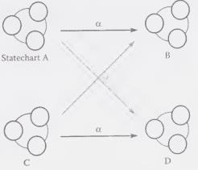

图10.6 具有非预期连接的复用场景。


#### 10.4.2 关联类连接

涉及关联类的集成更加严格，因为未满足的导入或同步方法调用会阻止编译或导致运行时错误。若方法调用未得到满足，则要么必须包含目标 AI 模块，要么必须修改关联类以指向新的实现模块。

总体而言，同步调用比事件传递更具限制性，限制同步调用的数量可以简化集成。事件传递发生在建模层面，并且可以通过重命名轻松处理。以下指导原则有助于澄清每种方法的适用时机：当模块接收到事件并立即采取行动时，该事件应将相关信息作为负载包含在内；当模块在未来某个不确定时刻需要复杂且动态的状态信息时，则适合使用同步调用。

跨不同游戏进行模块复用受到导入和实现语言的约束。最简单的情况是：AI 模块纯由行为驱动，并且除了语言自带的核心库之外没有其他导入。这类模块是*与游戏无关*的，可以在不同游戏之间自由迁移。如果模块包含非核心导入，那么在新游戏中复用时，就需要更新所有导入、复制库，甚至进行更大幅度的重写。这并不总是简单可行，因此，为复用而设计意味着应尽可能使模块与游戏无关。如果目标游戏使用不同的编程语言编写，则过程会复杂得多。在这种情况下，只有状态图可以复用，而关联类则需要完全重写。

#### 10.4.3 功能组

AI 模块的复用允许导出 AI 的行为方面，但单个模块通常粒度过细，无法完整捕获更高级别的行为。例如，逃跑行为需要包含：用传感器发现敌人、分析威胁、决定逃跑策略以及使用执行器移动。这些模块相互连接，通过协作行动来实现行为目标。

为了允许模块连接的复用，并提供一种将高级行为模块化的方式，我们引入了*功能组*。一个功能组至少包含两个 AI 模块，它们通过输入-输出事件配对或同步调用相互连接。

功能组接口可以由其包含的模块的 AI 模块接口构建。与输出事件配对的输入事件可以重新分类为私有事件，以保护组内的逻辑。未配对的事件则原样复制到新接口中，并在功能组复用时充当连接点。同步调用、参数和游戏调用都可以添加到组接口中。最终结果是，成员接口被合并，为功能组提供了单一接口。

重要的是，由此产生的接口在形式上与单个模块的接口完全相同，因此可以互换使用。因此，功能组接口只是 AI 模块接口的一种特例，凡是 AI 模块可以复用的地方，也可以改用功能组。

| 功能组关键项标识符 | |
|---|---|
| 游戏：猛犸象 | 语言：Java |
| 描述：发现物品和玩家。如果是关键物品，则将其记忆并创建通知。 | |
| 模块：KeyItemMemorizer、MammothListener | |
| 参数： | |
| - ItemObject keyitem :: 需要作为关键物品记忆的物品类型 | |

| 事件 | 调用 |
|---|---|
| 输入：无<br>输出：<br>--key_item_visible<br>--no_key_item_visible<br>--i_see_player (Player)<br>--i_dont_see_player (Player)<br><br>私有：<br>--i_see_item (ItemObject)<br>--i_dont_see_item (ItemObject) | 游戏导入：<br>--Mammoth.AINPC.Role,<br>--“.AI.NPC.NPCEvent,<br>--“.AI.NPC.TaskImpl,<br>--“.PhysicsEngine.PhysicsEngine,<br>--“.WorldManager.ItemObject,<br>--“.WorldManager.Player,<br>--“.WorldManager.PointOfView.PointOfViewListener,<br>--“.WorldManager.PointOfView.PointOfViewManager,<br>--“.WorldManager.WorldManager<br><br>可用同步调用：<br>-Vector&lt;ItemObject&gt; getKeyItemList() |

图 10.8 功能组的模块接口。

### 10.5 案例研究：从松鼠到垃圾清理工

为了验证所提出方法的有效性和实用性，本节给出一个具体的 AI 复用示例。我们将为松鼠开发的 AI 进行复用，利用其组件创建一个新的垃圾清理工 AI。通过使用所描述的复用技术以及良好的模块化设计实践，我们发现松鼠的许多元素可以轻松地重新利用，极大地简化了新 AI 的开发。由于源游戏和目标游戏相同，这一过程得到了极大的简化。因此，关联类无需修改即可复用，因为实现语言相同且所有游戏导入均有效。

#### 10.5.1 垃圾清理工规格

垃圾清理工 NPC 的目的是清理猛犸象游戏世界。它通过收集其他玩家留下的垃圾碎片，然后将垃圾放入垃圾桶来实现这一目标。该 NPC 的需求是：探索游戏世界、发现垃圾桶和垃圾碎片、拾取垃圾碎片以及将垃圾丢入回收容器。

垃圾清理工的高级行为与松鼠不同。松鼠有四个高级目标（游荡、采集食物、进食和逃跑），而垃圾清理工只有三个：搜索、拾取垃圾和投放垃圾。搜索与游荡似乎相似，采集食物与拾取垃圾也相似；我们就从这些相似点开始复用。

##### 10.5.1.1 探索

在松鼠 AI 中，游荡行为由 Wander Executor 接收 start_wander 事件来实现。Wander Executor 又使用 Move Actuator 来执行移动计划。这些模块本身已经实现了游荡行为，因此可以直接在垃圾清理工中复用。

为了保留现有的连接，我们创建一个名为 Wander Move 的新功能组，由 Move Actuator 和 Wander Executor 组成。这个新组通过 move、move_successful 和 move_failed 事件进行连接。然而，松鼠 AI 的其他部分也连接到 Move Actuator，因此在创建该组时，我们不会将这些事件重新分类为组私有事件。

##### 10.5.1.2 拾取垃圾

为了采集橡子，松鼠执行两个独立的功能。首先是寻找橡子，其次是收集橡子。寻找需要对象识别，这由第 10.4.3 节中引入的 Key Item Tracker 组处理。通过将关键物品参数从 Acorn 更新为 Trash 物品对象，即可复用该组。这样，垃圾清理工就能发现并识别垃圾对象。

一旦松鼠大脑决定采集食物，Eat Decider 就会将目标转化为动作，包括拾取食物。对于垃圾清理工而言，只有其中的拾取部分有用，因此我们构建一个 Pick Up 功能组用于复用。该组包含 Pick Up Executor 和 Pick Up Actuator，通过 pick_up_item 事件连接。Pick Up Executor 还可以移动到目标位置，并与 Move Actuator 连接以完成此操作。由于 Move Actuator 已经通过纳入 Wander Move 组被添加到了新 AI 中，因此该连接无需修改。


拾取执行器向关键物品记忆器发起同步调用，但该模块已就位，因此该调用得到满足。

##### 10.5.1.3 使用垃圾收纳容器

垃圾收集器中的新行为是使用垃圾收纳容器。由于复用的 Mammoth 监听器会对每一个发现的物品进行通知，AI 已经能够感知垃圾桶。我们可以添加一个关键物品记忆器的新实例，称为垃圾桶记忆器，以接收这些通知并跟踪垃圾桶。然而，这会在 key_item_visible 事件上创建一个非预期的连接。事件重命名解决了这个问题，因此我们让垃圾桶记忆器生成 trash_can_visible 和 no_trash_can_visible 事件，而不是关键物品事件。

一旦垃圾被收集，NPC 必须移动到垃圾桶并将垃圾丢入桶中。从根本上说，这与拾取执行器的逻辑相同，后者负责移动到某个对象并将其拾取。我们通过将所有带有 pick_up 的事件重命名为 drop（例如 pick_up_item 变为 drop_item），并将同步调用的目标改为垃圾桶记忆器，来创建丢弃执行器。drop_item 当前未连接，之后会与一个尚未引入的丢弃致动器建立连接。

#### 10.5.2 构建 NPC

现在大多数行为已经就位，剩下的唯一设计任务是用新模块补齐缺失的行为，并用一个新的策略器将它们全部连接起来。由于我们以模块化方式设计了 AI，并定义了清晰的接口，我们确切知道可用于连接的事件，总结在表 10.1 中。

**表 10.1** 新垃圾收集器 AI 中的未连接事件

| 未连接输入 | 模块/功能组 | 未连接输出 |
|---|---|---|
| `start_wander`<br>`stop_wander` | 游荡移动功能组 | — |
| — | 关键物品跟踪功能组 | `key_item_visible`<br>`no_key_item_visible` |
| `pick_up_item_request` | 拾取功能组 | `pick_up_successful`<br>`pick_up_failed` |
| — | 垃圾桶记忆器 | `trash_can_visible`<br>`no_trash_can_visible` |
| `drop_item_request` | 丢弃执行器 | `drop_item` |

垃圾收集器的大脑将与松鼠的大脑有些不同。期望的行为是拾起一件垃圾并将其扔进垃圾桶，如此无限重复。因此，该大脑是一个简单的两状态状态图，根据 NPC 当前是否持有一件垃圾在两个目标之间交替。

我们创建了一个新的决策器来实现高层的收集目标。如图 10.9 所示，收集决策器通过搜索一件垃圾，然后拾取一件可见的垃圾，来实现收集目标。当收集成功时，大脑将停止收集，并启动丢弃决策器。它在形式上与收集决策器相同：搜索一个垃圾桶，然后将垃圾扔进桶中，并且事件已重命名以匹配表 10.1 中的连接。此外，我们创建了一个新的丢弃致动器来接收 `drop_item` 事件，并让 NPC 实际将携带的垃圾丢入垃圾桶。

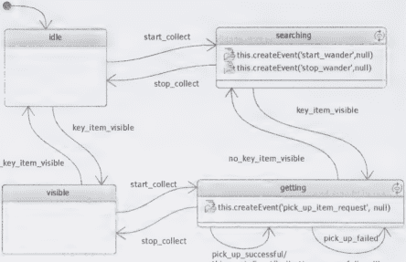

**图 10.9** 收集决策器的状态图。

#### 10.5.3 案例研究总结

总的来说，新 AI 由 12 个模块组成，其中 8 个被复用。这意味着新 AI 中只有三分之一的模块是全新设计的。在这四个模块中，一个只有两个状态，其余的都只有一个状态。通过避免重新开发已有的 AI 逻辑，开发新 AI 的工作量显著减少。复用过程本身确实需要一些努力。然而，通过以清晰定义的方式表示模块连接，并通过使用功能组，模块集成的操作被大大简化。基于这个案例研究，我们可以得出结论：我们的复用技术对 AI 设计者来说是一种有价值的方法。

### 10.6 SCYTHE AI 工具

有了正式的 AI 模块接口，就可以为复用过程添加工具支持。我们的工具 Scythe AI 允许用户扩充和管理 AI 模块库，并通过所描述的复用方法创建新的 AI。该工具包括用于引入新模块的简化导入流程、模块库管理、辅助新 AI 构建的错误和警告系统，并且可以直接导出到指定的目标游戏。

在高层次上，Scythe AI 允许用户通过导入状态图和关联类来构建 AI 模块库。然后复用这些模块来构建新的 AI。与标准 IDE 一样，它会生成警告和错误，以引导用户完成模块连接过程，确保正确的交互。当一个 AI 完成时，可以直接从 Scythe AI 导出到目标游戏中。工作流程如图 10.10 所示。

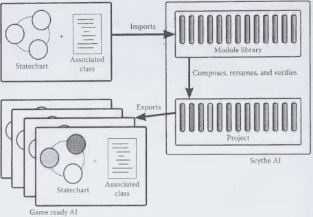

**图 10.10** Scythe AI 工作流程。

#### 10.6.1 工作流程和关键特性

##### 10.6.1.1 导入模块

将 AI 模块导入 Scythe AI 的过程，包括通过一个高度引导式的流程来构建 AI 接口。基于事件的通信细节直接从以 SCXML 格式提供的状态图中提取。Scythe AI 会扫描状态图中所有被生成或作为转换条件的事件，并分别建议将它们作为输出事件或输入事件。任何既被创建又被消费的事件都是内部事件，不适合任何类型的连接。

AI 模块接口的其余部分来自关联类。目前，Scythe AI 支持 Java 文件，并且可以扩展以支持 C++。导入时，会解析关联类并提取与复用相关的信息。用户会获得类导入列表，用户在其中确定哪些导入来自源游戏，从而将模块链接到源游戏。此外，类中的任何参数都会被提取出来，以便在复用该 AI 模块时可以指定值。接下来处理同步调用，包括对其他类发起的调用，以及可供其他类使用的调用。当这个引导流程完成后，新的 AI 模块会被添加到 Scythe AI 的模块库中，并会制作和存储关联类与状态图的副本。

##### 10.6.1.2 AI 构建

构建过程包括从库中向新 AI 添加模块。假设模块的逻辑在内部是正确的，也就是说，状态图正确地完成了它声称要做的事情，那么用户的任务就是协调模块通信，使新 AI 中的模块按期望协同工作。最常见的情况是，这意味着确保某个状态图发送的事件被目标状态图正确接收，同时不会被非目标状态图偶然接收。这通过 10.4.1 节所述的事件重命名来完成。添加模块后，应指定参数值。

在构建新 AI 时可能会出现许多问题。如果这些问题会阻止 AI 运行（例如，同步调用未得到满足），则被归类为错误，并且必须在完成前纠正。

如果某个问题可能是行为错误的来源，但不会阻止 AI 运行，则被归类为警告。每个问题都会列在主界面中，以便用户持续了解潜在问题。表 10.2 给出了 Scythe AI 当前的警告和错误列表。

**表 10.2** Scythe AI 生成的警告和错误

| 严重性 | 问题 | 描述 |
|---|---|---|
| 错误 | 事件干扰 | 事件 `e` 在模块 `x` 中是私有的，但被模块 `y` 使用 |
| 警告 | 无输入 | 模块 `x` 具有输入事件 `e`，但没有任何模块生成它 |
| 警告 | 无接收者 | 模块 `x` 输出事件 `e`，但没有任何模块接收它 |
| 警告 | 游戏冲突 | 模块 `x` 具有由游戏提供的输入事件 `e`，但模块 `y` 生成 `e` |
| 错误 | 游戏不匹配 | 当目标游戏是 `j` 时，模块 `x` 具有针对 `g` 的游戏导入 |
| 错误 | 未满足的调用 | 模块 `x` 在类中调用 `m`，但该方法不存在 |
| 警告 | 未使用的调用 | 模块 `x` 提供方法 `m`，但从未被调用 |
| 警告 | 空参数 | 模块 `x` 中的参数 `p` 为 null |
| 警告 | 无致动器 | 项目没有任何致动器 |

##### 10.6.1.3 输出 AI

一旦 AI 完成，最后一步就是输出 AI。对于典型游戏，这将是一个定义 AI 的类或 .xml 文件。Scythe AI 会根据构建好的 AI 自动生成该文件。输出还包括每个 AI 模块的 .scxml 状态图和源 Java 文件。Scythe AI 将修改 output.scxml 文件，以处理发生的任何事件重命名。源游戏必须能够接受这些文件作为输入。

在我们的实验中，我们将输出到游戏 Mammoth，这是一个大型多人在线（MMO）研究框架。重要的是，Mammoth 允许使用 XML 文件在外部定义 NPC，使用 Java 编写，并且具有 SCXML 执行环境。因此，我们为 Mammoth 设置的输出配置会写出外部 XML 定义，该定义描述了确切的 SCXML/Java 配对，并为参数提供特定值。

### 10.7 结论与未来工作

游戏 AI 内部存在很强的共性，即使在看似不同的角色类之间也是如此——当然，在高层次上，NPC 具有许多相似的行为。然而，从历史上看，复用一直因以下因素而变得复杂：对上下文相关反应式行为的关注，以及需要表达

从强代码依赖的角度来看，AI 的重用尤为关键。正如我们在此展示的，基于状态图的方法极大地有助于揭示重用机会，将重用封装在合适的层次上，该层次不仅涵盖特定的机制，还涵盖高层的行为抽象。通过组合功能性的行为组，新的 AI 可以直接由 AI 模块库构建而成，这是我们在 Scythe AI 开发工具设计中所展示的一种非常实用的策略。

将重用形式化的一个主要好处在于，我们能够进一步验证甚至程序化地生成新的 AI。我们的设计支持模型检查和验证，作为未来工作的一部分，我们正在开发一些分析手段，以帮助识别和避免在组合更大、更复杂的 AI 模块时可能出现的某些更为棘手的逻辑错误。例如，隐式状态或消息依赖是一个潜在的问题，可以通过更深入地分析功能组行为，以及通过更正式的方式来指定状态图交互（例如协议状态机中的交互）来解决。

将这种重用方法应用于更复杂的 AI 当然是可行的。例如，第一人称射击游戏中的 NPC 会采用战术移动和掩护、小队行为，以及广泛的战斗行为，如远程和近战武器、载具战斗和逃跑。取自成功的《*光环*》游戏系列的 *HALO* AI 被重构为分层状态图方法 [19]，结果发现需要 48 个状态图。这种细粒度为实践重用的开发者提供了相当大的灵活性，并为任何重用库提供了良好的开端。

### 参考文献

- 1. Brian Schwab, Dave Mark, Kevin Dill, Mike Lewis, and Richard Evans. GDC: Turing tantrums—AI developers rant. http://www.gdcvault.com/play/1014586/Turing-Tantrums-AI-Developers-Rant, 2011.
- 2. Christopher Dragert, Jörg Kienzle, and Clark Verbrugge. Toward high-level reuse of statechart-based AI in computer games. In *Proceedings of the 1st International Workshop on Games and Software Engineering*, pp. 25–28. Honolulu, HI, May 2011.
- 3. Jörg Kienzle, Alexandre Denault, and Hans Vangheluwe. Model-based design of computer-controlled game character behavior. In *MODELS*, vol. 4735, *LNCS*, pp. 650–665, 2007.
- 4. Unreal Technology. The Unreal Engine 3. http://www.unrealengine.com, 2007.
- 5. Curtis Onuczko, Maria Cutumisu, Duane Szafron, Jonathan Schaeffer, Matthew McNaughton, Thomas Roy, Kevin Waugh, Mike Carbonaro, and Jeff Siegel. A pattern catalog for computer role playing games. In *GameOn North America*, pp. 33–38. Eurosis, August 2005.
- 6. Brent Laming, Joel McGinnis, and Alex Champandard. Creating your building blocks: Modular component AI systems. http://www.gdcvault.com/play/1014573/Creating-Your-Building-Blocks-Modular, 2011.
- 7. Max Dyckhoff. Evolving Halo’s behaviour tree AI. Presentation at GDC. http://halo.bungie.net/inside/publications.aspx#pub15065, 2007.
- 8. John Walker, Robert Zubek, and Phil Carlisle. Little big AI: Rich behavior on a small budget. http://www.gdcvault.com/play/1012483/Little-Big-AI-Rich-Behavior, 2010.
- 9. Daniel Fu and Ryan T. Houlette. Putting AI in entertainment: An AI authoring tool for simulation and games. *IEEE Intelligent Systems*, 17(4):81–84, 2002.
- 10. Sunbir Gill. Visual Finite State Machine AI Systems. http://www.gamasutra.com/features/20041118/gill-01.shtml, November 2004.
- 11. David Harel and Hillel Kugler. The Rhapsody semantics of Statecharts (or, on the executable core of the UML). *LNCS*, 3147:325–354, 2004.
- 12. John Krajewski. Creating all humans: A data-driven AI framework for open game worlds. http://www.gamasutra.com/view/feature/1862/creating_all_humans_a_datadriven_.php, 2009.
- 13. Damian Isla. Handling complexity in the Halo 2 AI. *Game Developers Conference*, p. 12. San Francisco, CA, March 2005.
- 14. Chong-U Lim, Robin Baumgarten, and Simon Colton. Evolving behaviour trees for the commercial game DEFCON. In *Applications of Evolutionary Computation*, vol. 6024, *LNCS*, pp. 100–110. Springer, 2010.
- 15. Jeff Orkin. Three states and a plan: The AI of F.E.A.R. In *Proceedings of the Game Developer’s Conference*. http://alumni.media.mit.edu/~jorkin/gdc2006_orkin_jeff_fear.pdf, 2006.
- 16. Rodney Brooks. A robust layered control system for a mobile robot. *IEEE Journal of Robotics and Automation*, 2(1):14–23, 1986.
- 17. Philipp Kohloff. Level up for finite state machines: An interpreter for statecharts. In Steve Rabin (ed.), *AI Game Programming Wisdom 4*, pp. 317–332. Charles River Media, Hingham, MA, 2008.
- 18. Christopher Daggett, Jörg Kienzle, and Clark Verbrugge. Reusable components for artificial intelligence in computer games. In *Proceedings of the 2nd International Workshop on Games and Software Engineering*, pp. 35–41. Zurich, Switzerland, June 2012.
- 19. Christopher Daggett, Jörg Kienzle, and Clark Verbrugge. Statechart-based AI in practice. In *Proceedings of AIIDE*, Palo Alto, CA, October 2012.

## 将游戏玩法机制重新定位为设计基于游戏的虚拟世界的技术

Walt Scacchi

### 目录

- 11.1 概述 242
- 11.2 关于游戏玩法机制重新定位的“是什么”与“如何做”的相关研究 242
- 11.3 游戏玩法机制重新定位的案例研究 242
  - 11.3.1 案例 1——制作功能相似的游戏 244
  - 11.3.2 案例 2——通过新的游戏关卡、角色和游戏目标来修改现有游戏 246
  - 11.3.3 案例 3——替换多角色对话并加入罗生门式角色扮演 248
  - 11.3.4 案例 4——在问题领域存在不确定性的情况下识别资源分配挑战 251
  - 11.3.5 案例 5——为游戏开发、扩展和游玩选择元问题求解领域 254
- 11.4 比较案例分析：新兴的游戏玩法机制重新定位技术用于游戏设计 256
- 11.5 结论 257
- 致谢 258
- 参考文献 258

### 11.1 概述

本章考察了将游戏玩法机制重新定位作为一种游戏设计技术的概念和实践。11.2 节首先回顾了相关研究，这些研究支持将重新定位视为一种游戏设计技术，新的游戏开发者或希望参与最终用户游戏软件开发的人员可以采用和实践这种技术。接下来，本章描述了五个游戏设计案例研究，其中采用了不同形式的重新定位。这些案例研究包括对示例游戏和玩法机制的识别，这些游戏和机制为最终的游戏设计提供了启示。每个案例研究还对所采用的重新定位方法进行了分类，这些方法将源游戏机制重用并改编进新的游戏设计中。最后，本章包含一个简单的比较分析和这些重新定位方法的总结，作为将该方法推广为一种可重用、可适应的游戏设计技术的基础。

### 11.2 关于游戏玩法机制重新定位的“是什么”与“如何做”的相关研究

设计计算机游戏或基于游戏的虚拟世界是一个具有挑战性的问题（Bartle 2004）。这样的问题既具有软件系统设计的复杂性，又具有设计有趣互动游戏体验的复杂性（Fullerton et al. 2004; Howard 2008; Schell 2008）。对于刚接触游戏开发的软件工程专家来说，从零开始的游戏设计可能是一项艰巨的挑战。因此，明智的开发者会首先研究现有的游戏和游戏体验，以此作为设计未来游戏的基础。这种方法依赖于某种形式的非正式领域分析（Prieto-Diaz and Arango 1991），以识别可识别的游戏特性和能力、游戏对象、功能操作、游戏规则，以及对象、操作、规则、特性和能力之间的关系，并将其作为游戏玩法机制（Sicart 2008）。

正式的领域分析有可能产生一套持久的可重用游戏组件和玩法机制，并最终形成一种游戏的元设计理论（参见 Koehne et al. 2011），从而能够


#### 11.3.1 案例 1——制作功能相似的游戏

最早的 game R&D 项目之一专注于为 K–6 年级的年轻学生制作游戏，这些游戏侧重于非正式生命科学教育（Scacchi et al. 2008）。这些游戏被设想为名为*恐龙探索在线*的科学学习游戏环境的一部分，用于免费游玩、基于网络的部署。它旨在与位于加利福尼亚州圣安娜的探索科学中心（一家适合家庭的科学博物馆）内名为*恐龙探索*的现场互动、动手科学展览相辅相成并互操作（Scacchi et al. 2008）。我们的起点是开发适合小学/初等学校学生的生命科学学习游戏，重点关注作为史前生物的恐龙。这类生物与其他活动物或人类一样，具有基本身体系统（例如骨骼、神经、消化、生殖、心肺系统），理解这些系统是什么、它们做什么以及如何运作；这些身体系统之间的相互关系是基础性的，理解这些生物在其中繁衍生息、生存和死亡的生态也同样基础。生态包括不同物种生物之间的关系，例如表示捕食者—猎物、食物链和*生命循环*的关系，所有这些对于人类和动物所生活世界中的当代生命科学都是基础性的。那么，我们如何设计一款游戏或一种玩法机制来突出这些生态关系呢？我们的灵感来自*俄罗斯方块*和*马力欧医生*的核心玩法机制，如图 11.1 所示。

*俄罗斯方块*和*马力欧医生*是方块匹配益智游戏，其中成组的几何彩色方块图案（有时称为*四格骨牌*，以致敬多米诺骨牌）会到达/落入游戏空间（游戏场地），并且必须匹配以与已经就位的其他方块图案契合（*俄罗斯方块*），或形成像三连一样的重复图案（*马力欧医生*）。到达的方块图案可以旋转或横穿游戏场地滑动，以便对齐并匹配已就位的图案。游戏玩法受时间驱动，因为图案会以一定速度落入并穿过游戏场地，因此快速识别匹配图案和几何空间推理是有助于有效进行游戏的认知技能。

随着游戏玩法在复杂性和重复性上增加，这款游戏鼓励并依赖此类认知技能。由于游戏项目团队中参与的少数人都熟悉*俄罗斯方块*玩法，我们很快开始看到，如何通过用食肉动物、食草动物、植物和护根物替代四种（颜色）方块，来重新利用基本的*俄罗斯方块*玩法机制。由此产生的捕食者—猎物食物链游戏见图 11.2。然而，我们选择将*俄罗斯方块*/食物链游戏旋转


图 11.2 *恐龙探索在线*中捕食者—猎物食物链游戏的截图，这些游戏重新利用了熟悉的*俄罗斯方块*玩法机制，方向为从左到右而非从上到下。（经 Springer Science+Business Media 许可：*娱乐计算新前沿：第1届IFIP娱乐计算研讨会论文集*，P. Ciancarini 等编；*面向非正式科学教育的协作式科学学习游戏环境：恐龙探索在线*，Scacchi, W. 等，Springer，Boston，MA，第279卷，2008，71–82。）


图 11.3 UnrealEd 软件开发（游戏建模）工具包在*虚幻竞技场2004*游戏环境中运行的截图。（UnrealEd：由 http://en.wikipedia.org/wiki/UnrealEd 提供。访问于2014年7月1日。）

相关信息可以从通过大量网络搜索获得的信息中找到，同时还包括对位于加州大学欧文分校（UCI）的当地半导体与纳米技术系统制造设施的参观——UCI集成纳米系统研究设施。然后，我们使用 Autodesk 3DStudio 和 Photoshop 等工具构建了物体、角色和制造机器模型以及相关纹理（皮肤）。可视化和模拟物料泄漏是我们赞助方的优先关注点，因为培训技术人员诊断和清理此类泄漏是赞助方感兴趣的一项关键挑战。同样，我们认识到制造技术人员穿着全身服（兔子服），而建模和模拟他们如何穿上此类服装（更衣）成为与赞助方合作的另一个后续基于游戏的培训模拟项目。因此，一旦我们获得了关于半导体制造操作和诊断维护的知识，就能够通过 UT2K4 的一个模组快速设计并制作一款名为*FabLab（制造实验室）*的新游戏原型。图 11.4 展示了一些示例图像。

游戏设计与开发过程以可能被为企业新入职业务流程人员开发在职培训材料的企业电子学习专家复用的方式进行。此外，我们的开发预算有限，仅与这些专家开发传统培训材料（例如 PowerPoint 演示幻灯片）可获得的预算相当。选定的业务流程是订单管理，它关注业务专员的活动，这些专员处理客户发来的产品订单，而这些产品要么按外部订单生产，要么为补充内部库存而生产。这种仅限内部的游戏开发和部署（由于当时有保密协议）的成果是一款简单的单人 2D 角色扮演游戏，名为客户业务分析师（CBA），它在格子间办公环境中涵盖了 3–4 周的模拟订单管理问题解决任务，从简单到棘手（包括纠缠不休的客户打电话投诉、通过电子邮件与客户和制造运营部门沟通、访问公司内部企业资源计划系统——Hub——以及不可靠的订单状态信息）。这些特征在图 11.5 中突出显示——左侧两幅图提供办公空间的鸟瞰视图，而右侧两幅图提供分析师对其订单管理工作活动的*桌面视图*。


图 11.5 客户业务分析师游戏中用于培训订单管理业务分析师的四张截图。

在 CBA 游戏交付并退役大约两年后，我们收到来自加利福尼亚州一个大型全州政府机构的新挑战，该机构负责为州雇员部署州规定的年度培训，内容是识别、避免和报告公共工作场所中的性骚扰。再一次，我们的游戏原型制作预算和演示时间表极其有限，因此这要求游戏设计和演示能够*快速而粗糙*地完成。

我们的选择是通过替换游戏内角色对话来重新利用角色扮演 CBA 游戏，同时为*罗生门*效应（Heider 1988）提供支持，但通过游戏内角色和非玩家角色来实现。以角色对话和情境的替换作为新故事/改编故事的基础，是文学、电影和基于游戏的引擎电影中常见的一种做法。例如，莎士比亚的*暴风雨*故事被重新创作为电影科幻故事*禁忌星球*，而广受欢迎的*红蓝大战*引擎电影系列则代表用人类声音替换各种*光环*FPS 游戏中的游戏内角色对话/嘲讽。*罗生门*效应指的是这样一种情形：共同情境或互动中的多个行动者对其所感知的内容提供不同、有时相互冲突的解释（参见盲人摸象的寓言）。这种探索不同角色扮演不同角色遭遇共同情境的做法也出现在交互式游戏世界中；在这些世界中，玩家可以在角色之间切换，以重新解释和重新体验最近的游戏情境；作为一种玩法机制，它出现在诸如 1996 年发行的*居民乐队：中途岛糟糕的一天*等游戏中（Residents 2014）。因此，我们的新游戏体验旨在展示如何提供基于情境的角色遭遇，这些遭遇以无辜、含糊或辱骂性的言语互动为特征，并呈现游戏内角色关于他们是否认为多角色对话或互动构成性骚扰活动的不同/相互竞争的观点。图 11.6 展示了将 CBA 改造成性骚扰主题游戏后的截图。

需要明确的是，这款游戏并非被设想为一款以获胜为目的的游戏，而是为了提供足够有吸引力的体验，使州雇员能够玩完数十种不同的可能性骚扰情境，以满足州规定的培训要求。该州的骚扰责任保险提供商最终反对开发和部署这款游戏，部分原因是它*是一款游戏*，


图 11.6 一张经过重新利用的 CBA 游戏截图，现在加入了替换后的游戏内角色对话（此处突出显示一个场景：其中一名角色使用了可能含义模糊的爱称或性暗示，这些内容取自当前的性骚扰培训场景）。

尽管“罗生门效应”被强调为非常新颖，并且很可能非常适合性骚扰培训（不过少数其他评审者反对其在该主题上的价值，因为他们更倾向于对何为骚扰或非骚扰作出清晰且无歧义的解读）。

#### 11.3.4 案例 4——识别问题域中具有不确定性的资源分配挑战

在与另一家企业赞助方以及后来与一家政府赞助方的研究项目合作中，出现了另一种重新利用的机会。挑战在于设计并原型化一个多人在线虚拟世界，让不同用户能够参与军事和民用指挥与控制系统中常见的*任务规划*问题求解任务。任务规划是指识别可用资源并将其分配给需要这些资源以完成所分配任务的远端各方的活动（例如，自然灾害后在偏远地点搜救受害者）。在动态且不断变化的情境中，任务规划十分困难，因为资源可用性具有不确定性，关于在特定时间最紧迫的条件或任务变量是什么的信息也具有不确定性。

任务规划是经典博弈论中的一类多方资源分配且伴随不确定性的问题。很少有人特别擅长任务规划，而分配决策的后果可能非常严重。因此，广泛的研发工作集中于为此类分配决策寻找*最优*解，但能够将新玩家置于规划情境中、使其必须在动态且不确定的私有/共享信息条件下作出资源分配决策的训练模拟器却寥寥无几。

我们开发并演示了一个基于游戏的虚拟世界，用于开展多人、基于游戏的任务规划实验，我们称之为 *DECENT*（Scacchi 等，2012）。我们的世界构建工作基于用户可扩展的开源软件 (OSS) 虚拟世界服务器以及与 *Second Life* 类似的平台 *OpenSim* http://opensimulator.org/。*OpenSim* 运行于可扩展的大规模多人在线 (MMO) 和联邦式广域网环境中，并通过 *Hypergrid* 连接多个可互操作的虚拟世界（Lopes 2011；Scacchi 2012a）。与案例 2 中的 FabLab 游戏一样，我们再次从调查和分析有关任务规划活动与设施的信息开始，以此作为建模和模拟任务规划世界的基础。图 11.7 展示了一幅拼贴图，其中包含一个用于任务规划的大型实体设施；旁边是我们为模拟该设施而建模的虚拟世界场景（这些场景中未显示世界内代理，但可在其他地方看到它们（Scacchi 等，2012））。用于在分散式指挥与控制环境中开展任务规划实验研究的虚拟世界称为 *DECENT*。


图 11.7 用于任务规划的实体设施场景，以及 DECENT 中用于任务规划的镜像虚拟世界。（数据来源：Scacchi, W. 等，探索计算机游戏在分散式指挥与控制中的潜力，第17届国际指挥与控制研究和技术研讨会论文集，论文编号 104，弗吉尼亚州费尔法克斯，2012年6月。）

在基于 *DECENT* 世界早期演示与项目赞助方进一步头脑风暴时，赞助方问，在这样的虚拟世界中可以实现何种任务规划游戏玩法。*OpenSim* 与 *Second Life* 很像，并不是游戏开发环境，而是一个开放式、用户可扩展的虚拟世界环境。因此，它缺少为游戏玩法设计的游戏玩法原语、计分机制和领域特定脚本设施。不过，它允许用户扩展。在考虑并争论了若干备选方案后，我们决定采用流行的七张牌扑克锦标赛游戏 *德州扑克* 作为支持任务规划游戏玩法的候选方案。相应地，我们扩展了 *DECENT* 世界以支持该游戏，并利用世界内的用户显示屏显示每位用户持有的牌，同时将台面牌显示在所有人可见的大型虚拟墙面屏幕上。我们还将扑克牌重新设定为以四类军种（陆、海、空和网络）计价，牌面点数表示相应数量的军事对象（例如坦克、舰船、飞机和人员）。我们还加入了随机抽取的元游戏非玩家卡牌，用于修改持有/展示的牌的价值，作为将不确定性引入资源分配游戏玩法的另一种方式。在多人游戏中，只有获胜手牌会根据最后一轮的牌获得资源分配，而输掉的手牌不会获得分配。除此之外，游戏玩法遵循德州扑克纸牌游戏的规则和程序。图 11.8 展示了世界内游戏玩法的一个场景，以及多名学生玩该游戏的照片。

最后，我们已将 DECENT 的多人虚拟世界中的角色和对象重新用于非军事应用。例如，我们已将用于任务规划的虚拟世界改用于小学课堂环境中的成人教师和儿童学生，该环境配有课桌、桌面电脑和大屏幕投影仪，以支持基于课堂的科学与医疗保健教育的新实验研究。

设计并制作计算机游戏或基于游戏的虚拟世界，采用非正式领域分析技术以及可复用软件和终端用户软件工程中的相关方法。它还提出了利用计算机游戏与软件工程研究及实践的新研究方向和实践方向，因此值得进一步研究。

### 致谢

本研究得到美国国家科学基金会 (U.S. National Science Foundation) 资助项目 #0808783、#1041918 和 #1256593 的支持。文中不暗示任何审查、批准或认可。本章中的陈述和建议仅由本章作者负责。

### 参考文献

- Alspaugh, T.A. 和 Scacchi, W. (2013). 不依赖经典功能需求的持续软件开发，*第21届IEEE需求工程国际会议论文集*，巴西里约热内卢，第165–174页。
- Bartle, R.A. (2004). *设计虚拟世界*，New Riders，印第安纳州印第安纳波利斯。
- Cappiello, C., Daniel, F., Matera, M., Picozzi, M. 和 Weiss, M. (2011). 通过 Mashup 实现终端用户开发：需求、抽象与创新工具包，载于 *终端用户开发，计算机科学讲义*，第6654卷，第9–14页。
- El-Nasr, M.S. 和 Smith, B.K. (2006). 通过游戏模组制作学习，*ACM Computers in Entertainment*，**4**(1)，文章 3B。
- Frakes, W.B. 和 Kang, K. (2006). 软件复用研究：现状与未来，*IEEE Transactions on Software Engineering*，**31**(7)，529–536。
- Fullerton, T., Swain, C., Hoffman, S. (2004). *游戏设计工作坊：设计、原型制作与游戏试玩*，CMP Books，加利福尼亚州旧金山。
- Hasnain, Z., Lamb, C.A. 和 Ross, S.D. (2012). 捕获地球附近的近地小行星。*Acta Astronautica*，**81**(2)，523–531。
- Heider, K.G. (1988). 罗生门效应：当民族志学者意见不一致时，*American Anthropologist*，**90**(1)，73–81。
- Howard, J. (2008). *任务：游戏与叙事中的设计、理论与历史*，A.K. Peters，马萨诸塞州韦尔斯利。
- Ko, A.J., Abraham, R., Beckwith, L. 等 (2011). 终端用户软件工程的最新进展，*ACM Computing Surveys*，**43**(3)，文章号 21。
- Koehne, B., Redmiles, D. 和 Fisher, G. (2011). 扩展元设计理论：让参与者成为虚拟世界中的积极贡献者，载于 *终端用户开发，计算机科学讲义*，第6654卷，第264–269页。
- Lopes, C. (2011). Hypergrid：虚拟世界互操作性的体系结构与协议，*IEEE Internet Computing*，**15**(5)，22–29。


## 计算机游戏与软件工程中的新兴研究挑战

Walt Scacchi 和 Kendra M.L. Cooper

### 目录

- 12.1 概述 262
- 12.2 从前文 CGSE 章节展望未来 263
- 12.3 通过计算机游戏应对软件工程中的重大挑战 267
  - 12.3.1 使用游戏解决大规模软件工程中的挑战性问题 267
  - 12.3.2 游戏软件需求工程 268
  - 12.3.3 游戏软件设计 270
  - 12.3.4 游戏软件测试 272
  - 12.3.5 CGSE 中的团队协作流程 274
  - 12.3.6 GSD 与全球 CGSE 275
  - 12.3.7 基于游戏的软件工程教育 276
- 12.4 CGSE 的其他研究机会领域 277
- 12.5 CGSE 研发项目的未来投资机会 280
- 12.6 结论 281
- 致谢 282
- 参考文献 282

### 12.1 概述

计算机游戏与软件工程（CGSE）的研究有许多可能的未来方向。计算机游戏很可能成为计算机科学（CS）和软件工程研发的典型领域。为什么？现代多人网络游戏必须解决计算机科学研究和教育几乎每个主要领域的核心问题。这类游戏涉及从算法设计与复杂性、人工智能（AI）、计算机图形学、计算机支持的协同工作/游戏、数据库管理系统、人机交互与界面设计、操作系统与资源/存储管理、网络、编程/脚本语言设计与解释、性能监控等方面开发、整合和平衡软件能力。很少有其他软件系统应用领域要求如此高的技术掌握和集成能力。然而，游戏开发既要依赖这种掌握，还必须提供让大多数用户感到满意、有趣且具吸引力的游戏体验。因此，计算机游戏是研发（游戏）软件工程新方法和手段的优秀领域。

本章重点介绍 CGSE 未来的研发机会。其中一些来自第 2 章到第 11 章，另一些则是在计算机游戏（CG）与软件工程之间、以及与其他学科交叉中新兴的研究趋势。一个可以提出的开端问题是：“CG 开发与软件工程有何不同？”（Murphy-Hill et al. 2014）。更广泛地说，阅读本书的学生或专业人士面临的一个总体问题是：“未来的计算机游戏在有/无软件工程工具、技术和概念的情况下将如何成功/失败？”例如，如果软件工程在很大程度上与计算机游戏的成功开发、部署和持续演进无关，那么软件工程为何无关？是（1）传统软件工程总体上不再与新一代游戏软件开发者相关，还是（2）计算机游戏、游戏开发项目和游戏开发组织的运作方式以及与玩家互动的方式中有某些东西让软件工程研究者和教育者难以识别和理解？虽然前者（1）似乎不太可能也不受欢迎，但后者（2）指向了软件工程未来研究的机会。因此，这些挑战有待你思考并应对。

主流 CG 产业是一项全球性事业，既有价值数十亿美元的游戏开发公司，也有无数为商业市场或专业应用（例如基于游戏的训练）制作游戏的独立中小型游戏工作室。

玩法模式：结对程序员之间的点对点决斗，或结对团队之间的团队对团队决斗。此外，用于程序员玩家评分和排名的替代方案可能有助于识别谁在什么任务上表现优秀/最佳，以及得分最高的个人是否能在同样位列顶尖的团队中工作。

在第 6 章中，来自慕尼黑工业大学的 Reichart、Ismailović、Pagano 和 Brügge 展示了他们开发严肃游戏的方法，该方法采用新的方法来调整课程内容并为玩严肃游戏的学生提供帮助。他们的工作受到了软件工程之外的社会学习理论的启发。因此，教育科学和学习科学可以作为肥沃的土壤，用于识别和应用其他新兴思想和方法，以最佳方式为不同技能/成就水平的游戏玩家以及来自不同游戏类型——角色扮演、即时战略、第一人称动作、模拟等——的严肃游戏提供自适应引导。

上述所有努力都指出了 CG 在软件工程教育中的潜力。这意味着在不久的将来，更多的软件工程课程可能会转变为游戏，正如其他人也正开始在不同教育环境中探索和部署的那样（Sheldon 2011）。在本书的第一部分（第 2 章至第 6 章）中，上述所有努力都指出了 CG 在软件工程教育中的潜力。这也提出了一个前景：在不久的将来，更多的软件工程课程可能会转变为游戏，正如其他人也正开始在不同教育环境中探索和部署的那样（Sheldon 2011）。在本书的第二部分（第 7 章至第 11 章）中，其余章节探索了通过不同类型的软件工程创新来推进 CG 开发的新方式和方法，这些创新涵盖从高级多人游戏基础设施设计、地理广播和用户体验（UX）研究，到软件重用和再利用技术。因此，我们也可以在此识别出一些未来的 CGSE 研究机会。

加州大学欧文分校的 Debeauvais、Valadares 和 Lopes 开发的 RESTful 客户端-服务器架构软件服务器基础设施（在第 7 章中讨论）指出了为大规模多人在线游戏系统和虚拟世界工程化后端服务器软件架构和网络协议的挑战。探索新的架构和协议似乎是 CGSE 软件系统研发的下一步。同样，有机会设计新的游戏内角色和对象表示，这些表示带有与网络游戏协议相关的动态数据（解）压缩，从而在扩展到更大、更复杂的游戏内关卡/世界、可互操作的元宇宙（Lopes 2011）以及动画/模拟行为时最小化感知延迟。因此，新的游戏开发框架可以寻求支持或提供此类能力。

在第 8 章中，来自 AT&T 实验室的 Hall 描述了在户外移动环境中提供和地理广播共享游戏玩家及游戏对象位置方面的进展。未来的增强现实游戏如果能在玩家的视口上支持可视化叠加功能（例如通过 Google Glass 或类似设备），则有可能利用这些能力。同样，支持多种异构设备（移动健康配件、联网手表、智能汽车等）且这些设备能与移动设备本地组网的替代或混合现实游戏，也可能成为地理广播系统设计的机会领域。Hall 的工作还展示了如何将基于地理位置移动游戏的开发与传统软件工程关注点联系起来，因此这些方法也可用于未来的地理广播游戏软件系统。

在第 9 章中，Russell 描述了如何采用多级数据分析来支持严肃游戏《A Google A Day》开发过程中的用户体验评估，以开展对终端用户使用 Google 搜索服务搜索实践的研究和实验。用户体验作为驱动严肃游戏持续开发和改进的关键因素，指向了一个未来：此类研究将成为 CGSE 从业者技能和能力的一部分，并可能需要支持大规模基于 Web 的游戏的经济高效开发。特别是，Russell 在微观、中观和宏观层面研究的用户游戏体验指出了未来 CGSE 研究的机会：使用数据分析来驱动可扩展云游戏开发的 UX 的持续设计和对 UX 的试玩测试。

在第 10 章中，来自麦吉尔大学的 Dragert、Kienzle 和 Verbrugge 专注于一种方案，即如何为游戏内的不同非玩家角色（NPC）重用 AI 行为。这种重用能够更便捷地实现对可在游戏内部和游戏之间重用的游戏软件模块的验证和模型检查。这反过来有助于减少当不同 AI 行为被整合到不同游戏角色中时可能出现的意外逻辑错误，这些角色的交互可能由异常或未探索的游戏事件触发。因此，如何最好地为不同重用模式设计、评估、打包和定制不同类型的游戏软件模块（用于游戏内角色或其他行为对象，用于生成填充有 NPC 的游戏关卡等），因而成为未来 CGSE 研究有前景的新方向。

在第 11 章中，Scacchi 对重用采取了补充性的视角，但侧重于现有游戏中游戏玩法机制的再利用。


构建可扩展软件系统常被归为单独一类挑战，而类似挑战也出现在诸如MMORPG等电脑游戏开发中：这类游戏预计有数百万玩家，其中数千人同时在线。面向大规模可扩展游戏的CGSE挑战包括如何最好地：(1) 设计并组织游戏开发、试玩测试和部署后支持的团队工作流程；(2) 在不同开发地点、由具备不同技能的开发者之间划分CGSE工作；(3) 组织并实施多站点软件项目管理；(4) 设计可扩展的游戏服务及可能承载多个服务器站点的支撑基础设施；(5) 管理面向多个终端用户平台的并发系统配置与产品发布版本；(6) 管理和保护基于游戏的知识产权（IP）资产及用户创建内容；等等。反之，对于MMORPG客户端，如何缩减或简化远程的基于游戏的中间件服务，以交付能够适配游戏客户端软件部署的实时游戏体验？简言之，为大型CGSE项目提供依据的研究，以及用于集成远程服务的可扩展游戏系统架构，构成了一组有趣的挑战，很可能引起游戏开发公司的极大兴趣。

除可扩展性外，现代教科书常将SE领域描述为一系列工程任务。这些SE任务必须有系统地、谨慎地执行，甚至可能需要作为一组可持续改进的过程加以监控和度量。这正是我们所教授的内容，也是我们鼓励学生和行业专业人士学习与实践的内容。但是，在许多SE项目中执行此类任务的过程中会出现许多棘手难题，因此主流SE研究界将大量研究注意力集中在推进有关应对或解决所出现挑战的工具与技术的知识上。因此，我们转而简要探讨SE的其他重大挑战，并适度列举可能随之而来的CGSE研究机会。感兴趣的读者无疑也能发现其他研发机会。

#### 12.3.2 游戏软件需求工程

软件需求工程一直是SE中的长期挑战。它有自己专门的国际研究会议和期刊，二者旨在补充SE领域的主流研究。会议和期刊的存在表明，国际上对如何最好地引出并表述可形式化的软件功能需求，以及如何处理非功能软件需求的研究与实践，有着广泛兴趣。然而，就电脑游戏软件而言，游戏开发实践似乎主要侧重于为作为产品的游戏创建并满足非功能需求（NFRs），而不是游戏软件的功能需求——后者常常是隐含的、未记录在案的，或事后才被明确说明（Alspaugh and Scacchi 2013）。诸如游戏*必须让目标用户/玩家群体觉得好玩*（例如，由18–35岁男性或性别中立的玩家游玩）于目标平台（可在Microsoft Xbox One主机上玩、基于浏览器、与Facebook等社交媒体网站集成，或在运行iOS或Android操作系统的移动设备上玩），并以某个零售价位或盈利方案（*免费游玩，并通过预付用户借记账户进行基于游戏的微交易，或对用户账户按月订阅*）提供的NFRs要常见得多（Callele et al. 2005）。由此出现的SE挑战是：在游戏软件开发过程中应如何做，以应对或满足此类NFRs。另一方面，也存在着如何最好地将需求工程及其他SE活动游戏化的挑战（Cooper et al. 2014; Fernandes et al. 2012）。

游戏开发者已经认识到，仅仅提供一个软件按预期运行（即满足其功能需求）的游戏，远不如提供一个经游戏试玩测试（Fullerton et al. 2004）实证表明能令多样化游戏玩家焦点小组（而非内部游戏开发者）满意的游戏来得重要。在这方面，游戏的NFRs是可测试的，但其测试方式并未与SE测试研究的关注点明确一致。相反，业界将重心从预算高达数百万美元的大型AAA游戏转向能够以最少一组游戏玩法特性进行增量开发和发布的游戏，这并不令人意外。一款新的极简游戏在玩家中取得的早期成功（例如在线玩家评论、用户创建的游戏玩法视频以及游戏微交易回报率）将决定是否会添加或集成更多特性，从而实现这样一种认识：该游戏系统是作为在线交互式游戏玩法服务来开发的，而不仅仅是作为软件产品。此类游戏开发是否将*特性*规定为受功能需求或NFRs约束，目前是CGSE中的一个开放问题；由可测试游戏特性集的增量部署所衍生特性驱动的整体游戏开发过程同样如此。这至少与教科书中规定的Scrum或敏捷开发方法并不相同，但它们可能体现与这类实践的一些联系。因此，研究并更好地理解新游戏开发实践的优缺点，是未来CGSE研究的一个开放领域。

关于游戏开发需求的另一个观察源于这样一种认识：一些游戏开发者是他们所玩游戏的忠实终端用户（Scacchi 2011）。在此类情形下，与开发者与用户属于不同群体的传统SE项目情形相比，功能需求的引出可能不那么复杂（Alspaugh and Scacchi 2013）。这主要是*游戏模组制作者*的情形：他们有意修改现有游戏；所发布的游戏包含对软件开发工具包（SDK）的访问权限，该SDK经过预配置，可支持对游戏外观、游戏规则、游玩体验或游戏目的进行某些类型的更改（Scacchi 2010b）。由于模组制作者既充当（新）游戏功能的开发者，又充当需要被满足的终端用户，开发者与用户之间可能不存在沟通/利益差距。因此，可能不再需要传统的需求引出或需求规约；相反，开发者兼用户可以迭代地探索、尝试，并迅速将其需求调整为自身能够实现的内容。因此，*需求工程在支持游戏模组制作作为一种开发模式方面的作用或价值是什么*，是一个有待进一步调查和实证探索的问题。

#### 12.3.3 游戏软件设计

SE的另一个经典挑战是确定如何最好地设计软件系统以满足其需求或规格说明。如前所述，电脑游戏需求可能以NFRs为主，而不是可形式化、验证和确认的功能规格说明。因此，游戏软件设计可能需要考虑这种偏向或侧重。

对于学生和准游戏开发者而言，许多教科书和从业者指南针对的是*游戏设计*（例如，Fullerton et al. 2004; Meigs 2003; Rogers 2010; Schell 2008），而不是*游戏软件设计*。此类文本是否应被视为与游戏软件设计相关，可能取决于对先前软件设计概念、工具和技术是被采用还是被忽视的预期。例如，游戏设计文本常将注意力集中在如何应对以下方面的NFRs：游戏内角色的外观与动画化情绪行为、适合游戏类型的玩法机制选择、游戏关卡或世界设计的外观与感觉、用户界面设计与叠加层，等等。因此，这些文本很少涉及游戏的软件功能需求。


这反过来意味着，关于游戏软件架构的备选方案尚不明确，因此，游戏的架构设计以及如何在其中进行权衡，仍然是CGSE中的一个开放挑战。相反，游戏设计师被假定或受指导去采用游戏SDK或开发框架（例如 Construct 2、GameMaker: Studio、GameSalad、Microsoft XNA Game Studio、Project Spark、PyGame、Steam、Unity 和 Unreal Development Kit）来实现其游戏设计。然而，正如许多人所观察到的，游戏开发环境的选择会限制或预先决定哪种计算机游戏可能更容易开发。例如，许多SDK主要支持2D游戏开发，而不支持3D游戏；一些SDK以拖拽式游戏开发为特点，几乎无法纳入新的源代码。因此，游戏开发环境侵入了功能需求或NFRs空间。这绕过了游戏软件设计的工程化，取而代之的是一种开发范式，该范式侧重于教科书中的游戏设计，而不是软件工程教科书中的软件系统设计。类似地，如果设想开发的游戏需要不熟悉或前所未有的游戏功能，那么可能有必要开发一个游戏运行时环境（作为软件系统应用的游戏引擎），以及一个或多个在新游戏引擎上运行的游戏实例。

接下来，由于多人在线游戏是复杂的软件系统，我们可以考虑底层软件架构如何促进或限制游戏最初的设计和配置、如何由现有组件构建，以及如何进一步开发、制作模组或演进。游戏通常使用不同的中间件库或外部服务组件进行配置，这些组件必须与新的游戏软件功能、特性或能力集成。Dragert及其同事在第10章为此提供了一种方案。然而，商业多人在线游戏可能集成20个或更多外部服务库，包括用户注册、微交易支付、反作弊安全、游戏内或围绕游戏的在线聊天、行为角色与NPC AI、数据库管理等。此外，随着其中一些能力变得更加专门化，其软件会产生各自自主的架构表示。因此，挑战在于如何最好地以允许组件替换、架构重构、多版本运行时平台，甚至知识产权许可变更的方式，混合、匹配或复用异构的游戏软件子系统架构（Scacchi and Alspaugh 2012）。

软件工程过程与技术（例如，Musil et al. 2010；Zook and Riedl 2013）可以按照30年前引入的经验性软件工程方法进行比较研究（参见 Bendifallah and Scacchi 1989；Boehm et al. 1984）。此类现场研究场所使得能够开展细致的经验研究：比较使用新游戏SDK或开发技术（例如SCRUM、敏捷开发、游戏模组制作）的团队与不使用这些的团队；或者比较为其游戏产出传统软件工程文档（需求规格说明、架构设计和测试计划）并遵循软件工程过程的团队与只关注游戏设计方法的团队。因此，这些游戏开发马拉松可能更适合较长的持续时间（例如1–2周）。校内或开放参与的游戏开发马拉松可能不太容易以低成本进行结构化或平衡，但反而可能解决其他更符合其自然现场组织的CGSE问题。这些活动可能强调短持续时间与同地协作，并围绕在比赛开始时宣布的单一随机选定主题进行有针对性的游戏制作。

更一般地说，游戏开发马拉松提供了在CGSE中组织、设计和开展经验研究的机会，而这些研究反过来又可能为新游戏设计实践或流程以及新的软件工程实践与技术提供信息（Dorling and McCaffery 2012）。这些活动可用于以软件工程研究中先前未使用过的方式解决CGSE研究问题。最终，这可能意味着软件工程可以被视为一种基于团队的竞技性体育活动，对学生来说既有趣，又可以经过组织以支持细致的经验研究（Scacchi 2012a），而不是将软件工程视为一种商业活动，即生产托管在后端基础设施上的应用系统，并附带很少有人会阅读的文档。它还表明，游戏开发马拉松可以被设计为一种*元游戏*，从而安排结果（即产出的游戏）以体现某些功能特征，或安排游戏生产过程以奖励不同团队所取得的累积进展水平或掌握的技能（*升级*），而不是产生输赢团队。

#### 12.3.6 GSD 与全球 CGSE

GSD关注当大型软件开发项目在地理空间上跨多个时区分布时所产生的挑战。GSD通常涉及由文化多元的团队执行软件开发任务，因此许多人不会共享第一母语，但往往可能依赖以各自母语开展的本地软件工程团队协作活动，而跨站点开发活动和项目管理可能以另一种语言服务来执行和协调。类似地，接纳吸引国际或全球分散的SEE学生项目团队提交作品的游戏开发竞赛，因此也可能将比较评估的重点放在学生团队通过其CG开发工作实践和展示GSD概念与技术的程度。最后，软件工程研究与实践中所有其他领域，例如配置管理、构建与发布管理、逆向工程、FOSS开发以及敏捷开发，都可以被视为游戏化的潜在候选领域，并可通过SEE课程作业和团队项目加以参与。

### 12.4 CGSE 的其他研究机会领域

本书未涉及的一个CGSE研究兴趣领域，聚焦于为计算机游戏的（半）自动化生成创造新技术（参见Scacchi 2012b）。这类研究可能聚焦于发明新概念、技术和工具，以基于游戏玩法叙事规范（如电影脚本或剧本）、涌现的基于智能体的交互规则以及功能性游戏软件规范，生成可直接游玩的游戏。此类努力代表了对自动编程或基于知识的软件开发方法的重新构建，这些方法曾在软件工程研究中被热衷探索，但如今已被普通程序员能够执行的更传统的以编程为中心的方法所取代。尽管有一个活跃的研究群体致力于计算智能、基于智能体的系统以及游戏程序化生成世界，但其中许多工作（尚）未从CGSE视角得到很好的处理。例如，当前游戏世界程序化生成的工作往往关注生成可视化的游戏内对象模型或组合关卡，例如自动生成的树木/植被、建筑物、建筑内部、城市景观、水道以及地理/概念地形（Smelik et al. 2014；Smith et al. 2011）。然而，这些工作尚未生成具有不同角色中复杂社会行为的游戏内角色，也尚未生成可能具有或不具有涌现竞争或战斗动态的社会政治文化系统，也尚未利用能够在不同物理尺度（从纳米到人类，或从人类到宇宙学尺度）提供复杂物理或生态系统模拟（例如消化、繁殖、物种形成和生态系统演化等过程）的引擎（Bartle 2004；Scacchi 2012b）。在未来CGSE研究的这一领域中，存在大量创新可能。

在其他目前处于CGSE之外的研究中，人们越来越关注确定是否或如何最好地采用并工程化

支持在线游戏的基于云计算的基础设施和服务（Huang et al. 2014; Mishra et al. 2014）。基于云的软件系统架构被认为能够提供可扩展的服务，尤其是在远程存储、文件共享和内容分发、商业（购买）交易以及远程计算等方面。这些架构可为 CG 的部署提供参考，因为这种可扩展性与游戏发行业务项目相关。然而，CGSE 面临的一个长期困扰的挑战是：如何最好地开发能够利用这些能力的游戏，而不是支持那些在没有依赖或集成云服务的情况下开发的当前/遗留游戏。例如，基于云的 CG 研发工作正试图将游戏玩法计算托管在云中，同时将视觉和音频内容更新流式传输到远程玩家客户端。这类似于一种*胖服务器、瘦客户端*架构模型，与目前在网络多人游戏中更常见的*瘦服务器、胖客户端*模型形成对比。这两种模型，以及诸如大规模对等网络或超网格架构（Lopes 2011）等其他模型，代表了对首选商业模式、财务投资、知识产权保护、网络带宽和延迟服务质量，以及计算技术预期进步的不同假设。大型 IT 公司正在积极推动游戏内容流式传输，这或许受到（异步、按需）流式视频/音频分发业务成功的启发，这些业务正在取代传统（同步、按计划）媒体内容广播机构。但游戏玩法具有互动性和体验性，而被动媒体（电影、录制音乐和电视节目）则不具备这些特性。因此，游戏玩法流式传输服务通常提供较低的视觉显示分辨率（以降低带宽和延迟），并搭配更容易缓存的游戏内容（例如预录的游戏视频内容），这并不令人意外，因为广域网协议尚未发展到能够满足游戏玩家所期望的性能和*体验质量*（QoE）要求（Mishra et al. 2014）。因此，这里的 CGSE 挑战包括：确定如何最好地为基于云的部署基础设施设计游戏，以及如何为基于云的游戏设计软件基础设施（包括新的游戏网络协议）（Huang et al. 2014）。

接下来，专门面向众包游玩而设计的严肃游戏[有时称为*有目的的游戏*——GWAP（von Ahn 2006）]，本身也是从 CGSE 视角来看相对较新的关注能力。在许多此类游戏中，玩法往往被强烈限制在 2D/3D 解谜等玩法机制上，这意味着它们只是严肃游戏中的一种类型。其中许多*公民科学*游戏主要吸引解谜游戏玩家，而这些玩家可能关心也可能不关心游戏的底层目的或领域。因此，游戏玩家对底层问题领域的参与很少或没有参与，究竟是否是游戏玩法中的一个相关 UX 因素，还是用户对有趣好玩游戏的满意度中的相关因素，尚不清楚。但是，GWAP、基于游戏的虚拟世界（Bartle 2004; Scacchi 2010c）或其他非游戏玩法领域中的严肃游戏的发展——例如通过 Foldit 游戏开展蛋白质组学研究（Cooper et al. 2010）、通过 EteRNA 游戏开展 RNA 测序（Lee et al. 2014），以及通过 EyeWire 游戏绘制视网膜或脑连接组图谱（Frank 2013）——本身可能代表 CGSE 研究需要应对的一条新途径，例如如何最好地为不同的科学研究问题领域设计和软件工程化游戏（Scacchi 2012b）。

本章通篇所确定的 CGSE 未来研究领域只是一个小样本，而非一套全面的集合。CGSE 本身代表了 SE 研发的一个新领域。其他 CGSE 挑战可能存在于如何最好地：

- (1) 为多人游戏工程化网络安全软件能力，其中必须处理金融服务、用户隐私和反作弊要求，同时确保在线社交以及友好/竞争性的游戏玩法；
- (2) 将 CG 与社交媒体服务及其他基于云的服务集成；
- (3) 开发用于实现游戏的框架或 SDK，这些游戏纳入物联网中出现的异构设备；
- (4) 开发自动化或半自动化游戏生产工具，使非工程师能够快速制作和部署用于非娱乐和科学研究应用的严肃游戏（Cooper et al. 2010）；
- (5) 为显示更新管理和运行时监控工程化远程游戏客户端服务，以改善游戏 QoE；
- (6) 研究由独立游戏服务提供商开发的正交、多层中间件服务（用于游戏角色 AI、数据分析、金融支付服务、用户账户管理等）的软件架构备选方案；
- (7) 设计面向最小可玩游戏（或游戏功能集）的快速、迭代和增量方法，使远程用户游玩能够帮助推动后续游戏玩法特性和功能，以及如何将这种方法适配到非游戏应用；
- (8) 阐明将游戏测试与玩法分析和可视化相结合的技术；
- (9) 为其他计算机科学（CS）子学科中的教育游戏开发游戏、游戏引擎或游戏开发框架（例如，用于网络协议设计、数据库管理、编译器构造和操作系统配置的严肃游戏）；以及
- (10) 研究用于游戏开发的 FOSS 工具和技术在促成 SEE、全球知识转移以及本地游戏开发企业的社会经济发展方面的作用。

最后，利用游戏探索解决 SE 中长期存在的问题的新方式和新手段，这一概念和倡议是深刻、大胆且雄心勃勃的。它是否会成功，目前仍是一个悬而未决的问题。但因此，它能否以及是否会被采用来探索 SE 中的其他挑战，则是眼前的一个机会。同样，此类努力能否在没有大量政府研究投资的情况下，在区域、国家或全球范围内被动员和部署，也是一个有待应对的挑战。然而，我们应当寻找（或许还应鼓励）此类旨在应对 CGSE 挑战的努力，即游戏开发服务于游戏玩法，而游戏玩法的目的是为开发游戏的新方式提供启示。

### 12.5 CGSE 研发项目中的未来投资机会

很可能的情况是，主流计算机游戏行业对开展 CGSE 研究兴趣寥寥，因为这类研究在某种程度上是其游戏产品商业模式或收入来源的核心所在。这并不是说此类研究对这类商业活动没有益处。相反，这种行业立场可能转而寻求利用由政府部门或企业资助方支持的 CGSE 学术研究所产生的溢出效益。然而，本书第 8、9 和 5 章——分别由 AT&T 实验室的 Robert Hall、Google 的 Dan Russell，以及 Microsoft 的 Tao Xie 等人撰写——展示了 CGSE 领域中正在出现的真实学术-产业研究兴趣，因此或许其他企业合作伙伴也会跟进。同样，如前所述，美国的 DARPA Verigames 研究倡议（Verigames 2014）是另一项多年期努力，其实质是对 CGSE 研发未来的一笔大规模投资。相比之下，在美国、欧盟及其他地区，正在出现（国际）国家研究计划，这些计划可能为 CGSE 研究人员和游戏开发学生与在其他研究领域工作的领域专家开展合作提供新机会。

（截至 2014 年）机器人和脑科学领域正在建立新的独特研究计划（例如，欧盟人脑计划、美国 BRAIN 计划）。尽管这两个领域都有悠久的研发传统，但未来的努力重点在于产生科学发现、技术突破和劳动力发展。用于机器人教学的计算机游戏、与机器人交互或使用机器人的增强现实游戏，以及纳入机器人设备的游戏创作活动（game jams），只是可能的研究和学习途径的样本。同样，在神经科学中，如何最好地设计和工程化脑游戏（用于神经游戏研究），以及如何工程化

供佩戴沉浸式头戴显示器或脑机接口的玩家使用的多人游戏是其他例子。接下来，如何工程化软件系统和基础设施服务，使能力受限的人能够通过神经技术控制辅助机器人，是此类项目可能有兴趣探索的又一个例子。

最后，还有一个问题是，全球CGSE研发项目如何开发可能促进科学发现（Cooper et al. 2010; Frank 2013; Lee et al. 2014; Scacchi 2012b）、劳动力发展和知识转移的软件服务和游戏化游戏？特别是，这在尚未被认为涉及或实现跨学科研究努力潜在益处的领域中可能如何发生，而这些跨学科研究努力可以通过CGSE得到支持和推进？以娱乐为重点的游戏产业集中在美国、欧盟和亚洲（主要是日本和韩国），而巴西、俄罗斯、印度、中国和新加坡等国家正在寻找参与全球游戏开发、服务和出版业务的方式，尤其是为了其国内市场和新兴熟练劳动力。相比之下，此类产业在中东、非洲和波利尼西亚国家的作用尚不明确，或许被其他文化问题所遮蔽。因此，我们预期并鼓励学生和研究人员考虑在这些新兴全球CGSE研发市场内部或跨市场开展CGSE研究与开发的机会。

### 12.6 结论

总体而言，CGSE的未来充满许多多样化的研究和技术开发机会。这些机会可能会引起现有计算机游戏产业的一定兴趣，但近期研究资金方面的兴趣更可能出现在以娱乐为重点的计算机游戏工作室之外（Scacchi 2012b）。支持高风险研究项目的政府机构和公司赞助者是否会将CGSE视为一个新的机会领域，仍是一个开放问题，但本书读者可能会被迫倡导和追求这一问题。

最后，我们并不预期软件工程界会突然围绕新兴的CGSE领域转向，尽管看到并经历这样的转变可能很有趣。同样，主流计算机科学界的同行也需要时间才能认识到计算机游戏如何吸引新一代学生和研究者，尽管新的学术研究中心和面向

- Scacchi, W.（2010a）。自由/开源软件开发中的协作实践与可供性，载于 I. Mistrík、J. Grundy、A. van der Hoek 和 J. Whitehead（编），《协同软件工程》，Springer，纽约，第307–328页。
- Scacchi, W.（2010b）。计算机游戏模组、模组制作者、模组制作与模组场景，《First Monday》，15(5)，5月。
- Scacchi, W.（2010c）。作为去中心化虚拟活动系统的游戏虚拟世界，载于 W.S. Bainbridge（编），《现实与虚拟的融合》，Springer，纽约，第225–236页。
- Scacchi, W.（2011）。模组制作作为扩展计算机游戏系统的开源软件方法，《International Journal of Open Source Software and Processes》，3(3)：36–47，2011。
- Scacchi, W.（2012a）。竞争性游戏开发：软件工程作为团队运动。主题演讲，第2届游戏与软件工程国际研讨会，国际软件工程大会，瑞士苏黎世，5月。http://bit.ly/1qLEVZ3。
- Scacchi, W.（编）。（2012b）。计算机游戏与虚拟世界研究的未来：研讨会报告，技术报告 UCI-ISR-12-8，软件研究所，加利福尼亚大学欧文分校，加利福尼亚州欧文市。http://bit.ly/1IWxUDi。
- Scacchi, W. 和 Alspaugh, T.A.（2012）。理解许可证与演化在开放架构软件生态系统中的作用，《Journal of Systems and Software》，85(7)：1479–1494。
- Schell, J.（2008）。《游戏设计艺术：透镜之书》，Morgan Kaufmann/Elsevier，马萨诸塞州伯灵顿。
- Sheldon, L.（2011）。《多人课堂：将课程设计为游戏》，Cengage Learning PTR，肯塔基州独立城。
- Shin, K.、Kaneko, K.、Matsui, M. 等（2012）。本地化全球游戏创作节：在社会情境中为协作学习设计游戏开发，载于 Nijholt, A.、Romano, T. 和 Reidsma, D.（编），《计算机娱乐进展》，Lecture Notes in Computer Science，第7624卷，Springer，德国柏林，第117–132页。
- Smelik, R.M.、Tutenel, T.、Bidarra, R. 和 Benes, B.（2014）。虚拟世界程序化建模综述，《Computer Graphics Forum》，doi:10.1111/cgf.12276。
- Smite, D. 和 Wohlin, C.（2011）。全球软件工程中的一丝证据，《IEEE Software》，28(4)：15–18。
- Smith, G.、Whitehead, J.、Mateas, M. 等（2011）。Launchpad：一种面向2-D平台游戏的基于节奏的关卡生成器，《IEEE Transactions on Computational Intelligence and AI in Games》，3(1)：1–16。
- Verigames（2014）。http://www.verigames.com/，2014年6月访问。
- von Ahn, L.（2006）。有目的的游戏，《Computer》，39(6)：92–94。
- Wang, A.I.（2014）。游戏开发在计算机科学与软件工程教育中的使用，载于 Cooper, K. 和 Scacchi, W.（编），《计算机游戏与软件工程》，CRC Press，佛罗里达州博卡拉顿。
- Zook, A. 和 Riedl, M.O.（2013）。全球游戏创作节中的游戏概念化与开发过程，《数字游戏基础全球游戏创作节研讨会论文集》，希腊克里特岛。

## 索引

注：定位符后带“f”和“t”的分别表示文中的图和表

### A

- AAA游戏，269，276
- ACM SIGPLAN会议，114
- 可适应元素，145，149
- 可适应属性，145，149
- 自适应严肃游戏，147
  - 其中可适应属性，145–147，145f
  - 其中内容模型，141f
- 适应性过程
  - 定义，146–148
  - 在严肃游戏中，19
  - 其软件框架，134
  - 类型，148
- 自组织网络，188，190
- A Google A Day（AGAD）游戏，200–203
  - 2011年新年假期的分析视图，210f
  - Google搜索，201–202
  - 严肃游戏，201
  - 总受众参与，211f
  - 知识问答游戏，201–202
  - 与非AGAD玩家对比，209f
- AI模块，217，222–226
  - 定义，222
  - 功能组，229–230，231f
  - 交互，223–225
  - 接口，225–226，226f
  - Mammoth Listener的接口，230，230f
  - 复用，223–224，226，228–229
- Android SDK（移动开发平台），48
- 应用程序编程接口（API），35，167，225
- 应用计算机科学（Applied CS），39
  - 其中游戏开发，43–45，45f，46f
  - 其中使用的GDE，47f
  - 用于教学的编程语言，47f
- 能力—处理交互方法，148
- 艺术设计与游戏设计的区别，45
- 人工智能（AI），4，40
  - 作为计算行为，218
  - 基于分层状态图的，219–220
  - 其他模块属性，224–225
  - 模块，222–226
  - Scythe AI工具，235–237
  - 用于松鼠NPC，220–222
  - 在策略游戏中，40
- Ask Pex!按钮，120f，122，125–126
- 评估情境，142，143f
- 美国计算机协会（ACM），38

### B

- 战舰（游戏），101–104
  - 游戏界面，102–103
  - 位置界面，103
  - 用黑白棋替代，108
  - 玩家界面，104
- BetterProgrammers，119

### C

- 其中游戏开发，32，39–45，41f–42f
  - 应用计算机科学（Applied CS），43–45，45f，46f
  - 经验，49–50
  - 用于教学的编程语言，47，47f
  - 在初中和高中推广或教学，42，42f
  - 主题/科目，39–40，40f
  - 游戏化方法，105
  - 其中使用的GDF，33，45–48，47f
    - 用于教学的编程语言，47f
    - 学生看法，107
- COMS 1007：Java面向对象编程与设计，96–97
- 建构主义—协作方法，148
- 建构主义理论，135
- 上下文类，68–69
- 客户业务分析师（CBA）游戏，249–250，249f

### D

- Darkstar，160
- 数据优先级技术，158
- DECENT世界，252–253，253f，254f
- 美国国防高级研究计划局（DARPA），272–273
- Desire2Learn学习管理系统，61
- 设备到设备通信，21
- 对话挑战，70
- DinoQuest Online，244，245f，246
- 分布式联合状态问题，193
- 分布式交互虚拟环境（DIVE），157
- DOOM计算机游戏，4
  - 其开发，5
- Drawsome Golf，100
- Dr. Mario（益智游戏），244–246，244f
- DSG（分布式场景图），Intel的，161
- 动态符号执行（DSE），121

### E

- Eclipse IDE，264
- 教育游戏
  - 要素，66f
  - 其领域，128
- 教育软件工程
  - 其中研究者，115
  - 其子领域，114
  - 其中典型项目，115，121
- 教育娱乐，61–62
- 埃里克森发展阶段，134
- EVE Online，154–155
- 经验值（XP），98
- 可扩展标记语言（XML），16，60，78–79
  - 应用，79
  - 其综合语法，78
  - 人类可读文档，79
  - 正式且简洁，78
  - 测试游戏挑战的部分表示，79f–82f
  - SimSYS，79，83
  - 其规范，78
- 眼动注视研究，204
- 眼动追踪研究，22，204

### F

- FabLab（游戏），247，248f，252
- 奇妙航行（任务游戏），254
- 面向计算机科学教育学生的反馈与回顾，105–108
  - 评论，106
  - HALO
    - 对学生无益的原因，105，106f
    - 其帮助学生原因，105，105f
    - 反思，107
    - 对锦标赛的反思，108
    - 对计算机科学教育的思考，107
- 有限状态机（FSM），218
- 第一人称射击（FPS）游戏，159，246
- 自由/开源软件（FOSS），272，276，279
- FSM（有限状态机），218


- 完全分布问题，190
- 功能组，216, 229–230, 231f, 238
  - 关键物品跟踪器，230, 232
  - 漫游移动，232

### G

- 基于游戏的应用，2
- 基于游戏的虚拟世界，242–243, 256
  - 添加《罗生门》风格的角色扮演，248–251
  - 元问题求解，254–256
  - 修改现有游戏，246–248
  - 制作游戏，244–246
  - 替换多角色对话，248–251
  - 资源分配挑战，251–254
- 游戏设计文档（GDD），63–64
- 游戏开发者大会（GDC），246
- 游戏开发
  - 用于高级编程课程，40
  - 在应用计算机科学中，45f, 46t
  - 在计算机科学教育中，38–50, 40f, 41t–42t
  - 使用不当，49
  - 用于学习，49
  - 用于在中学和高中推广计算机科学，42t
  - 在软件工程教育中，38–50, 43f
  - 在软件体系结构课程中，33–38
  - 用于教学，32, 39
  - 的使用，39, 45
- 游戏开发框架（GDF），33
  - 用于计算机科学/软件工程课程，33
  - 其中的游戏，51
  - 许可证与成本，52
  - 所使用的编程语言，51
  - 使用建议，50–52
    - 教育目标，50
    - 编程经验，50–51
    - 人员专长，51
    - 学科约束，50
    - 技术环境，51–52
  - 技术经验，51
  - 可用性，51
  - 用于计算机科学/软件工程教育，33, 45–48, 47f
  - XNA 与 Java，46
- 游戏元素
  - 教育性，66f, 69–71
  - 与学习内容
    - 的适配，149
    - 在游戏中识别，144
    - 在研究中识别，141f
    - 传统的，67–69
- 游戏引擎 Unity 3D，46
- 游戏模组制作，48
- 游戏玩法，73, 77, 245
  - 的描述，64
  - 机制，23–24
  - 再利用
    - 案例研究，243–256
    - 比较案例分析，256–257
    - 相关研究，242–243
- 游戏形式模型，表格化挑战，87–89
- *游戏编程精粹*，5
- 游戏
  - AAA 游戏，269, 276
  - AGAD，200–203
  - agnostic，225, 229
  - 海战棋，101
  - 蝴蝶，188–189
  - CBA，249, 249f
  - 计算机游戏（CG），262–263, 267, 272
    - 设计
      - 设计师，270–271
      - 艺术设计与游戏设计之间的区别，45
      - 技术，242
  - 开发者，269
  - 吸引人的特性，94
  - FabLab，247, 248f
  - 第一人称射击游戏，159
  - FOSS，272
  - FPS，246
  - 游戏逻辑，167
  - Geocast，184–189
  - HALO FPS，250
  - iTESS，185–188
  - iTron，185, 185f
  - 游戏创作活动，274–275
  - 拼图游戏，168–170
  - Mammoth，226f, 230f, 237
  - 模组制作工具，243
  - 多人游戏，253, 271
  - 多用户，扩展技术，156–161
    - 其他游戏特定技术，158–159
      - The Residents: Bad Day at the Midway，250
  - 松鼠 NPC 的示例 AI，220–222
  - 半自动生成，277
  - 严肃游戏，200–201
  - 服务器，165, 167
  - 计算机游戏中的软件工程挑战，267–277
  - 德州扑克纸牌，252–253
  - 琐事问答，201
  - 《虚幻竞技场》，49–50
  - 《虚幻竞技场2004》（UT2K4），246
  - 《虚幻竞技场2007》（UT2K7），246
  - 视频，184
  - 《魔兽争霸》，48–50
- 游戏与软件工程（GAS）研讨会，12–14, 263
- 游戏软件
  - 体系结构设计，8–9
  - 设计，270–272
  - 在线共享，5
  - 游戏测试与用户体验，9–10
  - 需求工程，8, 268–270
  - 复用，10–11
  - 测试，272–274
- 有目的的游戏（GWAP），278–279
- 游戏化，62
- 游戏化，94
- GDD（游戏设计文档），63
- Geocast 游戏，184–189
  - 蝴蝶，188–189
  - iTESS，185–188, 187
  - iTron，185, 187
- Geocast 游戏体系结构（GGA），190, 194–196
  - 蝴蝶，188–189
  - 完全分布式体系结构，195
  - 地理通信，195
  - iTESS，185–188
  - iTron，185
  - 可选远程扩展，195
  - 变体，195–196
- 全球软件开发（GSD），267
- 谷歌搜索，201–202
- 组私有事件，230–231
- 《激战2》，159

### H

- HALO FPS 游戏，250
- HCI（人机交互），201
- 分层有限状态机（HFSMs），218
- 高度成瘾、社交优化（HALO）软件，17, 93
  - 优势，107
  - 案例研究，97–100
  - 使用其进行游戏化测试，95–100
  - 帮助学生，105, 105f
  - 对学生无益，105, 106f
  - Eclipse 插件，95, 96f
  - 原型实现，95
  - 任务，98–99
  - 学生创建的任务，99–100
  - 反思，107–108
  - 用于其的秘密忍者方法，109
  - 社交性质，93
  - 社交奖励，94
  - 软件工程，94–95
  - 测试，95
  - 使用 MMORPG，93
- HTML5 WebSockets，156
- HTML 解析库，99
- HTTP（超文本传输协议），155–156
- 人机交互（HCI），201
- Hypergrid（OpenSim），252
- 超文本传输协议（HTTP），155–156

### I

- id Software，5
- 电气与电子工程师协会（IEEE）Xplore，38
- 知识产权（IP），268
- 智能辅导系统（ITSs），134
  - 适应性，148
- 英特尔分布式场景图（DSG），161
- 交互式开发环境（IDEs），264
- 兴趣管理技术，155, 158
- 跨校游戏创作活动，274–275
- 国际软件工程会议（ICSE），12–13, 114
- 校内游戏创作活动，274
- iOS SDK（移动开发平台），48
- iTESS 游戏，185–187, 187f
- iTron 游戏，185, 185f
- iTron/Parkour 游戏，185, 186f

### J

- Java（编程语言）
  - 代码，95
  - 用 Java 开发的框架，45
  - Java 中的游戏，101
  - IDE，119
  - Java 中的 Khepera 机器人模拟器，35
  - Java 编程练习，115
  - XNA 与 Java，46
- 拼图游戏，20, 168–170, 176–177

### K

- KeyItemMemorizer 模块，225, 226f
- 关键物品跟踪器，230, 232
- Khepera 机器人模拟器，35, 38
- 知识空间理论（KST），135, 141
- KommGame 界面，110
- Kyle Wrist Mount，185

### L

- 学习管理系统（LMS），61
- 学习目标的整合，60, 65
- 词法分析分类法，65–66
- 鳞翅目，207
- 实时信息流，123–124, 124f
- 长距离游戏问题，190

### M

- 宏观自适应方法，148
- Mammoth 游戏，226f, 230, 237
- 大型多人在线角色扮演游戏（MMORPGs），93, 208, 264, 268
- 大型多人在线游戏（MMOs/MMOGs），2, 154, 237, 252
  - 应用，154
  - 体系结构，20
  - CAP 定理，155
  - 数据优先级技术，158
  - 描述，154
  - 《EVE Online》，154–155
  - 《The Exiled Realm of Arborea》（TERA），161
  - 在其中发布的游戏，4
  - 《激战2》，159
  - HTML5 WebSockets，156
  - 兴趣管理技术，155
  - 拼图游戏，168–170
  - REST（表述性状态转移），155–156, 163
  - 可扩展性，20
  - 《第二人生》，154–155, 157, 159
  - 空间分区，155, 157, 176–177
  - TCP，168
  - 分层体系结构，160–161, 164f
  - 时间膨胀，155, 158–159
  - WebGL，156
  - Web 技术，154, 156
  - 《魔兽世界》，154–155, 157, 169
- 大规模开放在线课程（MOOCs），115
- 元设计理论，242–243
- 元模型基础，17
- 微观自适应方法，147
- Microsoft Azure，128
- Microsoft Visual Studio，121, 125
- 中间件，161–162
- 挖掘软件仓库，114
- 面向任务的科学项目，254
- 任务规划，251–253
- MMORPGs（大型多人在线角色扮演游戏），93, 208, 264, 268
- MMOs/MMOGs（大型多用户在线游戏），参见 大型多用户在线游戏（MMOs/MMOGs）
- 模型驱动工程（MDE），60
  - 基于 MDE 的方法，16
  - 特性，17


### M

- 现代严肃游戏开发，目标，134
- 更有能力的他人（MKO），135
  - 原则，147
  - 角色，147
  - 在社会发展理论中，147
- 动机，184
- 多人网络游戏，271

### N

- 国家游戏联盟，12
- .NET（编程语言），120
  - 工具，121
- 纽厄尔的人类行为时间尺度，203
- 非功能需求（NFRs），269
- 非玩家角色（NPCs），11, 67, 216
  - 为其设计的 AI，23
  - 在测验中，73
  - 松鼠的示例 AI，220–222
    - 高级大脑，222f
    - KeyItemMemorizer 模块，225, 226f
    - 概述，221f
  - 垃圾收集器，231
  - 种类，68
- 挪威科技大学（NTNU），32
  - 软件架构课程，34

### O

- 对象约束语言，64
- 面向对象设计，43, 52
- 面向对象编程语言，48, 51
- 在线编程练习系统
  - BetterProgrammers，119
  - CloudCoder，117
  - Codecademy，118–119
  - Codelab，118
  - CodingBat，115–117
  - 游戏化，18–19, 120–128
  - Pex4Fun，120–128
    - Code Hunt，126–128, 127f, 128f
    - 教育用途，125–126
    - 游戏性，122–123
    - 社交动态，123–125
    - 软件工程技术，121
    - 用户界面，120, 120f
    - 用户排名，124f
  - Practice-It，117–118
- OpenSim，252
- 开源软件（OSS），252, 257
- 奥赛罗（游戏），108

### P

- Parlante, Nick，115
- Playbalds，224, 228
- 对等网络架构，157
- Pex4Fun，18–19, 120–128, 264
  - Code Hunt，126–128, 127f, 128f
  - 编码决斗，122
  - 社区链接，123
  - 教育用途，125–126
  - 游戏类型，121
  - 游戏性，122–123
  - 实时动态链接，123
  - 社交动态，123–125
  - 软件工程技术，121
  - 测试生成技术，129
  - 社交游戏类型，123
  - 反馈类型，122
  - 用户界面，120, 120f
  - 用户排名，124f
  - 用户评论，126
- Pex 工具，121–122
- 皮亚杰的认知发展阶段，134
- 玩家，扩充数量，172–176
  - 实验设置，172–173
  - 结果，173–176
- Practice-It（在线平台），117–118
- 务实测试问题，194
- 私人事件，227
- 程序工程美元（虚构货币），110
- 编程语言，3, 15, 18, 21, 35, 45, 120, 229
  - 用于开发游戏，45
  - GDF 使用，51
  - 用于教学 SE/CS 教育，47, 47f
- 代理，160–161, 165
- 代理和数据库瓶颈，170–172
- 益智游戏
  - 马里奥医生，244–246, 244f
  - 拼图，20
  - 俄罗斯方块，244–246, 244f
  - 四格骨牌，244
  - 三消，24
- Python（编程语言），115, 166, 177
  - 免费编程课程，118

### Q

- 体验质量（QoE），278
- 任务游戏；另见 高度上瘾、社交优化（HALO）软件
  - 巴兹·奥尔德林的太空竞赛，254
  - 神奇之旅，254

### R

- 快速一致性（RRC），192, 192f
- 罗生门效应，250–251
- RCAT，见 Restful 客户端-服务器架构（RCAT）
- RedDwarf，见 Darkstar
- 表现层状态转移（REST），155–156
  - 缓存架构，163
  - 谨慎的 MMO，163
  - 客户端-服务器架构，162
  - 无状态协议架构，163
  - 分层架构，162
  - 统一接口架构，163
- 重新利用游戏机制的技术
  - 案例研究，243–256
  - 选择元问题解决领域，254–256
  - 修改现有游戏，246–248
  - 制作功能相似的游戏，244–246
  - 识别资源分配挑战，251–253
  - 替换多角色对话并添加罗生门式角色扮演，248–251
  - 比较案例分析，256–257
  - 相关研究，242–243
- 需求限制问题，193
- 《居民：中途岛糟糕的一天》（游戏），250
- REST（表现层状态转移），见 表现层状态转移（REST）
- Restful 客户端-服务器架构（RCAT），20, 161–165
  - 架构，164–165
  - 组件，166f
  - 拼图游戏，168–170
  - 参考实现，166–168
  - REST，162–164
  - 统一接口架构，163
- 角色扮演游戏（RPG），2
- Romero, John，5
- RRC（快速一致性），192, 192f
- Ruby（编程语言），117
  - 免费编程课程，118

### S

- Sakai（LMS），61
- 可扩展自组织地理组播协议（SAGP），195
- 可扩展地理寻址框架（SGAF），195
- ScienceDirect，38
- SCXML（状态图可扩展标记语言），224
- Scythe AI 工具，235–237
  - 工作贡献，217
  - 生成的警告和错误，237, 237f
  - 工作流程和主要功能，236f
    - AI 构建，236–237
    - 导入模块，235–236
    - 输出 AI，237
- SDKs（软件开发工具包），5
- 秘密忍者形式化方法，92, 109
- SEE（软件工程教育），6–8, 276–277
  - 高级应用，7, 13
  - 游戏开发，39–45, 44f
  - 经验，49–50
  - 用于教学的编程语言，47, 47f
  - 主题/科目，43
  - GDF，33, 45, 47f
- 语义验证问题，194
- 严肃教育游戏（SEGs），16, 62
  - 挑战，66
  - 创建，64
  - 开发，16, 64
  - 高层模型，71
  - 整体方法，66–71
  - 非形式化模型，16, 64
  - 基于 MDE 的方法，65
- 严肃游戏，200
  - 自适应特性，145–147, 145t
  - 玩家特征描述，138–143
  - 自适应性的定义，134–135, 147–148
  - 四个游戏的开发，136–138
    - 加法和减法，138f
    - 读数，137f
    - 步骤，144f
    - 写数，137f
  - 人类辅导教师的影响，134
  - 未来，148
  - 游戏元素，148
  - 游戏环境，134
  - 迭代开发过程，140f
  - 提供帮助，143–146
  - 人类辅导教师的作用，134–135
  - 社会发展理论，134
  - 阶段，19
  - 研究设计，139–140
    - 识别出的领域特定任务，142t
    - 识别出的游戏元素和学习内容，141t
  - 类型，148
- SE 工具，262
- SGAF（可扩展地理寻址框架），195
- SIGCSE 技术研讨会，114
- SimSE（游戏），7, 109
- SimSYS 方法，16, 61, 64, 72f
  - 开发，61
  - 形式化模型
    - SimSYS XML，79, 83
    - XML，78–79, 79t–82t
  - 非形式化模型
    - 示例测试游戏，73, 74f
    - SimSYS 故事板，73–74
    - 故事板，71, 73
  - MDE 方法，71
  - 用例模型，75–78
    - 示例测试游戏，77, 78f
    - SimSYS 用例，76–77
  - UML，75–76, 76f, 77f
- SimSYS 游戏引擎，71, 79, 83
- 社会发展理论，139, 141, 146–147
- 社会奖励
  - HALO，94
  - 对学生，95
- 软件架构课程，33–35
  - 评估，38
  - 游戏开发，33–38
  - 在 NTNU，34
- 《软件架构实践》，33
- 软件设计，95
  - 在 CS2 课程中，110
  - 原则，95
  - 通过战舰锦标赛，101–104
- 软件开发工具包（SDKs），5, 270
- 软件工程（SE），1, 32
  - 方面，94
  - CGs（计算机游戏）中的挑战
    - GSD 和全球 CGSE，275–276
    - 大规模软件系统，267–268
    - SEE，276–277
    - 软件设计，270–272
    - 软件需求，268–270
    - 软件测试，272–274
    - CGSE 中的团队协作过程，274–275
  - 挑战
    - 架构，190
    - 编码，193
    - 设计，191–193
    - 需求，193–194
    - 验证，194
  - 数据挖掘，114
  - 教育，6–8, 114
  - 出现，3
  - 领域，1–3
  - 游戏开发，32, 38–50, 43f, 44f
  - 游戏化示例，124
  - GDF，33
  - 使用的 GDF，47f
  - HALO，94–95
  - 用于教学的编程语言，47f
  - 项目，7
  - 主题，6–12
- 软件小屋，109
- 软件需求规格说明（SRS），63–64
- 软件测试，43, 49–50
  - 基础，99
  - HALO，95
  - 学生，93–94
- 空间划分，155, 157
  - 客户端-服务器架构，157
  - DIVE，157
  - 动态，157
  - MMO，155, 157, 176–177
  - 对等网络架构，157
  - 静态，157
- SQLAlchemy（数据库工具包），167
- Stack Overflow 徽章，124–125
- 状态图可扩展标记语言（SCXML），224
- 无状态协议架构，163
- 故事板，64f, 66, 71–73
  - SimSYS，73–74
- 学生反馈，105–106
- 学生
  - HALO 中的作业，97
  - 将 CodingBat 作为平台，117
  - 学生创建的 HALO 任务，99–100
  - 对 CS 教育的反馈，105–108
    - 评论，106
    - 对 HALO 的反思，105, 105f, 106f, 107
    - 对锦标赛的反思，108
    - 对 CS 教育的想法，107
  - 游戏项目，37–38
  - SimSYS 中玩家的知识，69
  - 软件架构课程，35–37
  - 软件测试，93–94
- 学生软件测试，93–94
- S-VON 网络，161

### T

- TankBrains（游戏），109
- TCP（传输控制协议），165, 168
- 助教（TA），36
- TERA（阿尔博雷亚流放之地），161
- 测试游戏
  - 4 SE 设计，73
  - 非形式化模型，74f
  - 表格规格说明，78f
  - UML 用例图，77f
  - XML 部分表示，79f–82f
- 俄罗斯方块（益智游戏），49, 94, 244–246, 244f
- 四格骨牌（益智游戏），244
- 德州扑克纸牌游戏，252–253
- 分层架构，160–161, 164f
- 分层地理组播协议，195
- 分层架构，162
- 三消益智游戏，24
- 时间膨胀技术，155, 158–159
- 传输控制协议（TCP），165, 168
- Trash Can Memorizer，233
- 垃圾收集器
  - 构建 NPC，233–234
  - 案例研究，234–235
  - 规格说明，231–232
    - 收集垃圾，232–233
    - 探索，232
    - 使用垃圾桶，233
  - 松鼠，231–235
- 问答式游戏，21–22
- 二维（2D）游戏，37, 40


### U

- 无人机（UAV），186–187
- 用户数据报协议（UDP），168
- 用户界面（UIs），64，200，202
- 统一建模语言（UML），16，64
  - 用例，75–76
    - 测试游戏4的图，77f
    - 可视化和文本形式，76f
  - 多种类型，75
- 统一接口架构，163
- Unity 3D，46
- 无人驾驶飞行器（UAV），186–187
- UnrealEd（游戏关卡编辑器），5，246，247f
- *虚幻竞技场2004（UT2K4）*
  - 游戏，246
- *虚幻竞技场2007（UT2K7）*
  - 游戏，246
- 用户数据报协议（UDP），168
- 用户体验（UX），273
- 用户界面（UIs），64，200，202
- 用户视角
  - 宏观层面，204，208–210
  - 中观层面，204，206–208
  - 微观层面，204–206
  - 各层面的研究与设计，210–211

### V

- Valve Software，5
- 电子游戏，184；另见计算机游戏（CGs）
- 可视化编程，48
- Voronoi图，158
- 维果茨基的社会发展理论，134–135，139

### W

- 基于Web的编程练习系统，117–118
- WebGL技术，156
- WebSockets技术，168
- *世界概况*，CIA，97–98
- *魔兽世界*（电脑游戏），93–94，97，154–155，157，169
- 万维网，5，78

### X

- 可扩展标记语言（XML），16，60，78–79
  - 应用，79
  - 全面的语法，78
  - 文档具有人类可读性，79
  - 正式且简洁，78
  - 测试游戏挑战的部分表示，79–82
  - SimSYS，79，83
  - 规范，78
- Microsoft XNA，36–37

### Z

- 最近发展区（ZPD），135
  - 定义，146
  - 随时间扩展和变化，136f

# 计算机游戏与软件工程

计算机游戏是一个重要的软件应用领域，为软件工程技术和方法的创新研究提供了空间。因此，无论是关注娱乐市场机会的游戏开发者，还是关注非娱乐领域中基于游戏的应用的开发者，都与软件工程师和开发人员有着共同兴趣：如何最好地开展游戏软件工程。

本书由软件工程领域的顶尖专家撰稿，全面介绍计算机游戏软件开发，既包括其历史，也包括关于这两个传统上相互独立领域之间互动的新兴研究。

本书是软件工程师、开发人员和研究人员的理想参考书，从软件工程视角探讨游戏编程与开发。它介绍了计算机游戏软件工程（CGSE）的最新研究，涵盖HALO（Highly Addictive, sociaLly Optimized，即高度成瘾、社交优化）软件工程、多人户外智能手机游戏、游戏化体育软件以及游戏人工智能等主题。

本书广泛探讨游戏在软件工程教育中的应用。它还涵盖游戏软件需求工程、游戏软件体系结构与设计方法、游戏软件测试与可用性评估、游戏开发框架与可复用技术，以及游戏可扩展性基础设施，包括对移动设备和基于Web的服务的支持。
