# 游戏设计师：星球上最酷的职业


# 废弃


Mark Featherstone


# 致谢


2012049389


# 真理时刻

开发中最令人兴奋的时刻是你投入了几个月（甚至几年）的游戏终于准备就绪。第一次玩完成的游戏，看到你所有的想法变成现实，感觉几乎像魔法一样。接着是认证，出版者会检查你做了什么，并决定游戏是否准备好面向公众。不久之后就是发布日，你访问当地商店购买完成游戏的第一批副本之一。这是我的游戏之一，还带着闪亮的包装，这和从商店买的不一样！


# metacacritic

Mr. Robot 发布于2008年1月12日。我总是查看一个叫 Metacritic 的网站，它汇总了计算机游戏的评论。如果我的某一个游戏获得了正面评分，我就知道我做得很好！

| 摘要 | Metacritic | 用户评分 |
|---|---|---|
| 100分中的83分 | 7.6 Metacritic 评论 (58份评论) | 7.6 用户评论 (118份评论) |

摘要：Mr. Robot 是一个精彩的系列，讲述了一个年轻黑客发现了一个威胁世界生存的阴谋。随着他开始穿过现实深处的危险旅程，他探索-

开发者 Sam Esmail
作家 Sam Esmail
制片人 Sam Chronicle

## 影评

## 用户评论

## PC 论坛

全是动作，惊险，脑筋急且令人兴奋，直到中间部分它迷失了方向并变得有些乏味。（评分：7/10）前几集非常精彩，但中间的部分变得重复且枯燥。

## PC 游戏

新 PC 游戏
近期 PC 游戏
即将推出的 PC 游戏
动作 PC 游戏

2011年游戏

## 评论

下一个大时刻是评论出现。有些是专业评论人士，但更多是来自网站的用户。如果人们喜欢你的游戏并给出好评，感觉很棒。有时评论并不好听，但至少你可以让它变得好一点。

## 你知道吗？

评论非常重要。游戏得分取决于 Metacritic 上的分数，它会将所有的评分汇总成一个平均分。


# 游戏制作过程

让我们回溯一下。发布日非常令人兴奋，但在之前必须进行大量工作：

1. 创意：每个人贡献创意，尤其是出版者。
2. 推销：我们向经理和出版者展示想法。
3. 原型：我们需要有趣的新的玩法和视觉效果。制作小型程序来演示它们。
4. 前期：所有所需的工具都完成了编程。招聘并培训员工。
5. Alpha：工具已就绪，现在是制作3D模型和构建关卡的时间。此阶段不允许添加新功能！
6. Beta：一切都完成了，但运行得并不正常并且经常崩溃！（我很确定没有哪个游戏第一次运行时是完美的。）
7. 认证：出版者的测试人员检查一切。他们不与我们合作，所以没有偏见。
8. 发布：再次开始之前的派对时间！我们还会查看评论。


Tetsuya Nomura 是 Square Enix（最终幻想角色扮演游戏制作商）艺术家之一。他非常有才华。

## 游戏程序员做什么？

编程的核心在于将一切拆分为更小、更易理解的部分。程序就像机器；它由许多相互互锁的部件组成。当你面对整个问题时，你甚至无法开始如何处理它，但如果你只看一个小部分，它就会变得容易许多。


像《太空入侵者》（我童年最爱之一）这样老的游戏现在看起来很简单。但即使是这样的游戏，也需要程序员团队花费长时间来组合！

未来的亿富翁 Richard Branson 曾经喜欢《太空入侵者》


## 生活的一天

我是一名独立开发者，这意味着我是我自己的老板。以下是我典型的一天：

- **上午 8:30–10:00** 送女儿上学，遛狗，思考游戏的事
- **上午 10:00–10:30** 与团队交流——下一步做什么？将任何新的 bug 加入 bug 列表。
- **上午10:30–11:00** 为游戏做宣传
- **上午11:00–12:00** 根据 bug 列表进行编程工作
- **下午 12:00–1:00** 午餐
- **下午1:00–3:00** 检查设计；开始编写下一个任务
- **下午3:00–4:00** 接女儿
- **下午4:00–5:30** 玩新游戏并测试所有功能是否运行正常
- **下午5:30–6:00** 往来、税务和文书工作
- **下午6:00–9:00** 家庭时间
- **晚上9:00–11:30** 更多的编程！

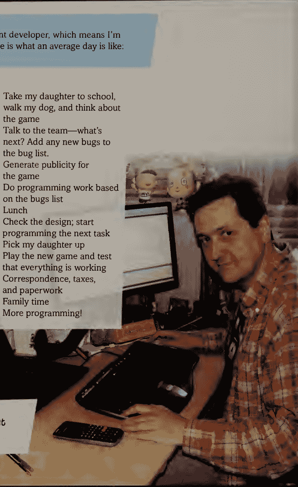

我在这里，正忙于开发一款游戏。

## 在大型开发公司工作

过去，我在大型开发公司工作过。那时我的生活非常不同，因为我不需要经营业务。这意味着我只需要专注于编程。

- **上午 9:30–10:00** 与团队讨论前一天的工作；计划当天的工作
- **上午 9:30–10:00** 与设计师讨论玩测试结果；计划下一个里程碑
- **上午 10:00–12:00** 为下一个任务编写一个测试原型
- **下午 12:00–1:00** 午餐。向团队展示原型；获取反馈
- **下午 1:00–1:30** 开始编写正式版本。将所有新部分组合在一起；大家玩玩游戏，然后下班
- **下午1:30–5:00**
- **下午 5:00–5:30** 或者
- **下午 5:30–???** 如果里程碑到期，就点披萨一直工作直到完成——有时会忙一整晚！


## 给自己的笔记

发行商按月支付游戏费用，在支付下一笔款项前检查其进度。这些被称为“里程碑”，准时完成日期至关重要——否则你就拿不到钱！

# 我是如何成为游戏开发者的

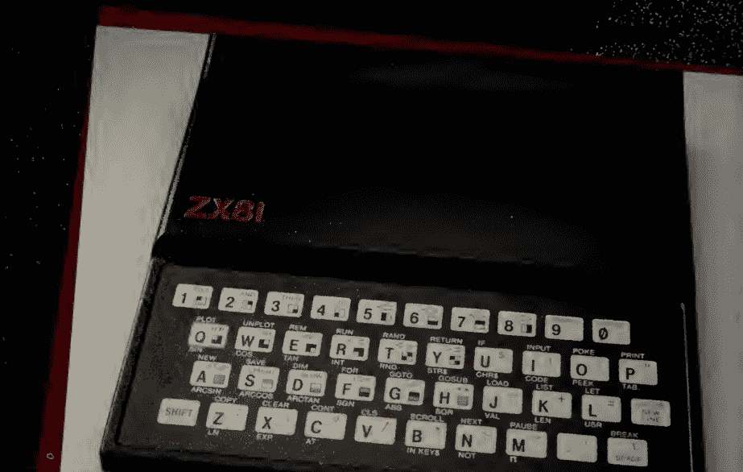

我的第一台家用电脑是 Sinclair ZX81。

我一直对计算机和游戏深着迷。我第一次接触视频游戏是花我的零花钱在当地的游戏厅玩《太空侵略者》和《大金刚》街机。我利用我的说服力说服父母为我买越来越强大的家用电脑。

每一次升级都让我能编写和玩更多令人印象深刻的游戏。虽然这些电脑是为了玩游戏而售的，就像现代游戏机一样，但每一台都带有键盘和 Basic 编程语言。我每月购买《Zzap64》杂志，并花费几个小时输入其中包含的 Demo。

## 你知道吗？

在 20 世纪 80 年代，CD 和闪存盘还是遥远的未来。保存和加载程序的方法之一是使用简单的音频磁带录音机。它速度慢、噪音大，而且非常不可靠。

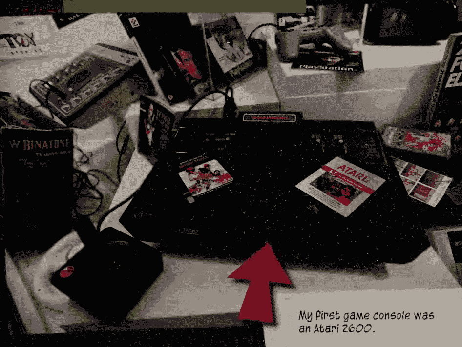

我的第一台游戏机是 Atari 2600。

## 获得灵感

我玩过《塞尔达》、《马里奥》和《索尼》等经典游戏。当时家庭网络很稀少，所以我阅读游戏杂志寻找开发者的名字，有时还会剪下他们的照片。我意识到这些人是坐在键盘前，使用编程语言制作游戏。如果他们能做到，也许我也可以！我总是构思各种疯狂的游戏点子，并勾勒角色设计。

## 一个昂贵的爱好

我父亲是一名矿工，所以我唯一能负担得起电脑游戏的方法就是攒零花钱、送报纸，并说服家人在圣诞和生日时给我钱而不是礼物。幸运的是，今天即使是一台价格适宜的 PC 也至少比我以前的任何家用电脑强 1000 倍，所以不再需要不断升级了！

BBC Micro B 型 (1981) 拥有我见过的最好的 Basic 版本。

## 高中

我花了大量时间在编程上，以至于学业受到了影响。当时没有现在这样的计算机科学课程。在家里，我学习如何编写文字冒险游戏并制作小动画。一位老师帮助我进入了一个学习工程的特殊计划，尽管我的成绩并不算理想。能够专注于我真正热爱并擅长的研究领域感觉感觉太棒了。

## 你知道吗？

树莓派（Raspberry Pi）是一种针对儿童的新型微型，只需 35 美元。它运行（类似 Windows，但免费），可以连接鼠标、键盘和电视。它可以运行 Python 和 Scratch 等编程语言。你可以像数码相机一样将工作保存到 SD 卡中。它没有外壳，但你可以用乐高制作一个！

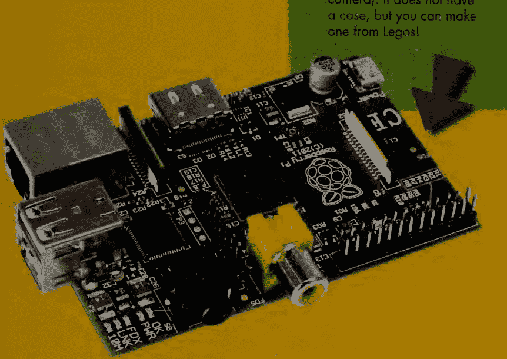


##不同的角色，不同的技能

我曾担任过游戏开发中的每一个角色，但我最喜欢的是程序员。程序员将设计者的想法、美术作品、音效和音乐结合，让游戏运行起来。虽然有很多编程语言，但它们都是非常相似的，在它们之间切换非常容易。程序员必须是专注、逻辑性强且数学能力良好的人。他们通常会独自或在小组中连续几周攻克棘手的问题。

## 职业工具：显示器

计算机程序员通常有两个显示器：一个运行游戏，另一个运行调试器（用于检查错误）。这有助于尽早发现问题。


```cpp
main(vo)
pig_number
long five=5;
double pi=3
```

威尔尔·莱特（Will Wright）是《城市模拟》、《孢子》和《模拟人生》背后的设计者，这些 PC 游戏的销量超过了 1.8 亿份。

```cpp
cin >> b;
cout
```

### 设计师

设计者构思游戏的初始想法，并创建一个供团队参考的“设计圣经”。这些灵感来源于玩不同的视频游戏。设计者在要求团队制作原型之前，通常会通过制作小棋游的方式在纸上测试他们的想法。这是一个想法的快速、粗略版本，仅用于测试它是否是一个好主意。除了编写脚本，设计者还会构建实际的关卡。脚本包含了故事文本、角色对话以及控制事件发展的逻辑。

设计者需要具备创造性思维，并了解所有其他角色的知识，以便他们能够向团队传达愿景，并确保他们的想法是现实的。

```cpp
catch (int a)
return 1;
```

> 你知道吗？
像《街头霸》这样的现代游戏可能有五十万行代码。

```cpp
cout << a-b;
cout << a*b;
```

### 艺术家？

艺术家创建游戏游戏中使用的所有图像、模型和纹理。他们通常是团队中最充满活力、色彩最丰富的成员。他们不仅富有创意和艺术才华，还需要使用非常复杂的工具。最常用的是制作 3D 模型的 3D Studio Max 和用于 2D 艺术与纹理的 Photoshop。

## 你知道吗？

艺术家在构建游戏时会制作数百种不同的表面图像，无论是岩石、草地、水还是木头。这意味着他们经常会被送到实地拍摄地点或物体，以确保他们的工作真实な。

这个来自《Gunmetal》（我参与过的一款游戏）的模型一半是线框，另一半是纹理。完成后的 3D 对象可以从任何角度查看，看起来非常真实。

### 职业工具：软件

音频工程师通常使用软件来代替昂贵的调音录音室。像 Reason 这样的程序可以使用单台电脑和一些扬声器模拟调音台、合成器、特效以及其他所有昂贵的硬件。

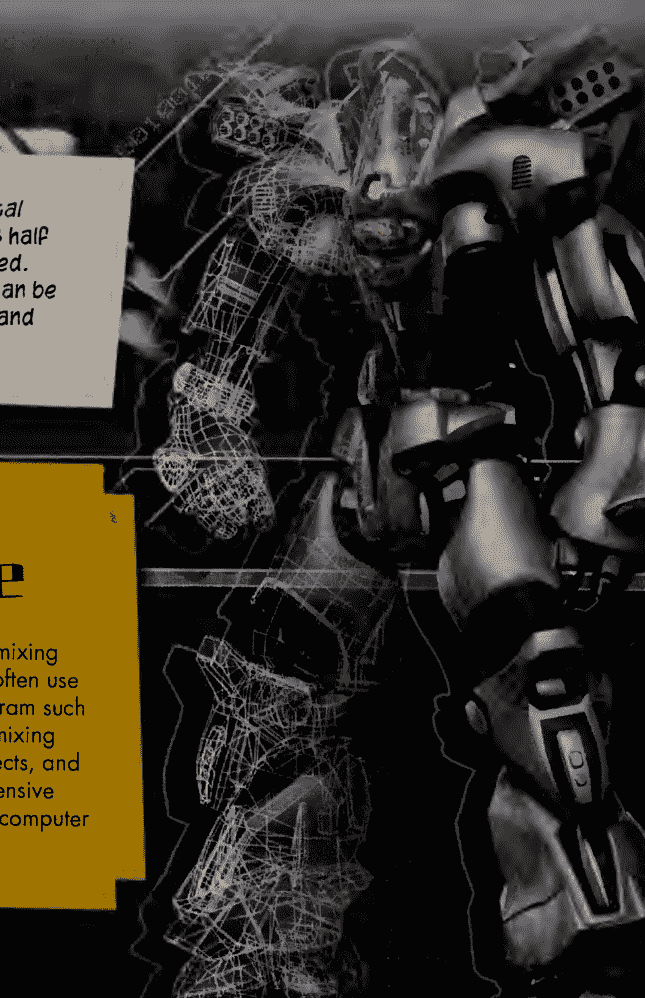

### 音频工程师

音频工程师既是音乐家又是录音工程师，他们创作音效和游戏内音乐。像艺术家一样，音频工程师也会派往实地。例如，他们可能会访问赛车场记录汽车的声音。音频工程师通常会与音乐家合作制作配乐，如果游戏需要管弦乐评分或配音演员，工程师将负责编曲。

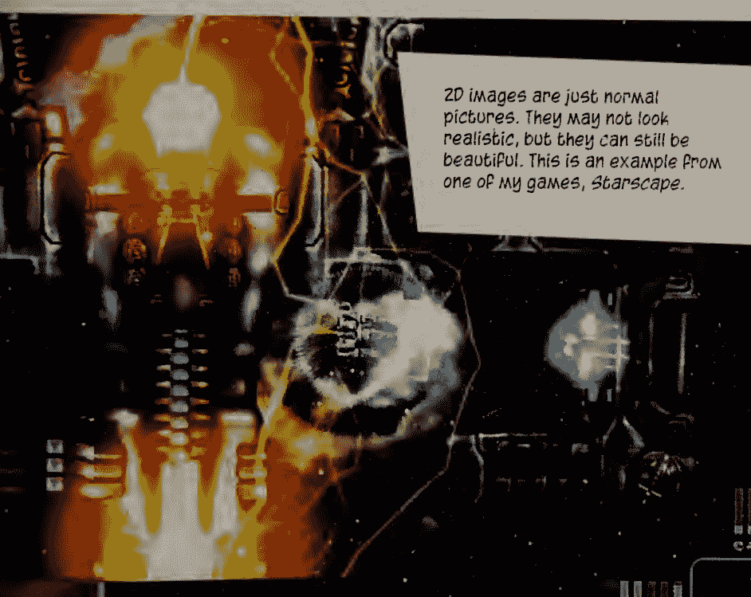

2D 图像只是普通的图片。它们看起来并不真实，但仍然可以很好。这是我的游戏之一《星际景观》（Starscape）中的示例。

音频工程师需要是才华横溢的音乐家、专业的录音室工程师，并具备良好的组织能力。


### 制作人

在每个游戏团队中，总有一个制作人，他们的工作是确保游戏按时在预算内完成。制作人需要是良好的沟通者并具备强大的组织能力。他们在团队的不同部门之间协调，确保每个人意见一致。制作人还负责游戏的营销和发行。

在每个游戏团队中，总有一个制作人，他们的工作是确保游戏按时在预算内完成。制作人需要是良好的沟通者并具备强大的组织能力。他们在团队的不同部门之间协调，确保每个人意见一致。制作人还负责游戏的营销和发行。

### 视频游戏

### 宫见茂

宫见茂是一位传奇的游戏设计师，以创作了如《超级马里奥》、《塞尔达传说》和《大金刚》等标志性系列而闻名。他被认为是视频游戏设计历史上影响力最大的人物之一。他的工作塑造了数十年的行业格局，并激励了全球无数的开发者。


### 大型多人在线游戏 (MMO)

大型多人在线游戏允许成千上万的人同时一起游戏。例如，《世界魔兽》曾拥有最高付费订阅人数的记录，达到了 1200 万人，尽管单个服务器上同时仅有约 4,500 人在玩。MMO 需要服务器，以及由高薪资的专业游戏程序员编写的复杂网络代码。

> 《EVE Online》（星战OL）是一部科幻游戏，它保持着同时在线人数的世界纪录：63,170 人！

我的一些独立游戏有《机器人先生》（Mr. Robot）、《星际景观》（Starscape）和《海盗单词》（Word Pirate）。这里是《海盗单词》——它虽然很小，但非常完美！

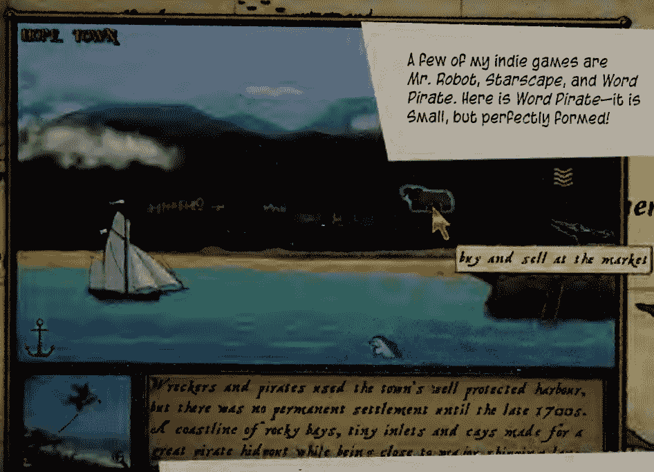

破坏者和海盗曾使用该城镇受保护的港口，但直到 18 世纪后期才有了永久性的定居点。岩石海湾、微小入海口和珊瑚礁岛组成的海岸线既是极佳的海盗藏身处，又靠近丰富的捕鲸水域。

### 独立游戏

最近，我一直和一个小小的朋友团队作为独立游戏开发者一起工作。我们只开发通过专门渠道销售的小型游戏，例如 Steam、Xbox Live Indie Games、Playstation Network，或直接从开发者的网站下载的游戏。

独立游戏通常迎合想要新颖体验的小众群体，比如“弹幕射击游戏”、益智游戏或 2D 冒险游戏。通常，这些类型在几年前非常流行，但现在只有 10,000 到 100,000 名粉丝，并且被大型发行商忽视了。

## 给自己的备忘

我曾参与过一个科幻 MMO 的原型开发，但发行商并不确定并终止了项目。我当时非常难过，但你必须学会接受并继续前进——或者成为独立开发者并自己制作！

## 物理游戏

最新的体裁之一旨在让人们动起来。任天堂 Wii 和索尼 PS3 都有玩家可以通过身体环绕来控制动作的控制器。Xbox 360 拥有 Kinect 相机，可以捕捉玩家的全身，这类似于游戏设计师使用的动作捕获技术。

某些手机游戏甚至可以在宝藏搜索游戏中使用你的当前位置和现实世界物体照片，或者它们可以将游戏内容叠加在实时摄像机视频上。开发者必须小心避免玩家过度疲劳，并且必须编写代码来检测玩家是否执行了正确的动作。

这款游戏使用 Kinect 相机控制。

在像《模拟人生》（The Sims）这样的模拟经营游戏中，一切取决于玩家如何改变模拟环境。游戏在每个游戏环节之间的表现可能完全不同。

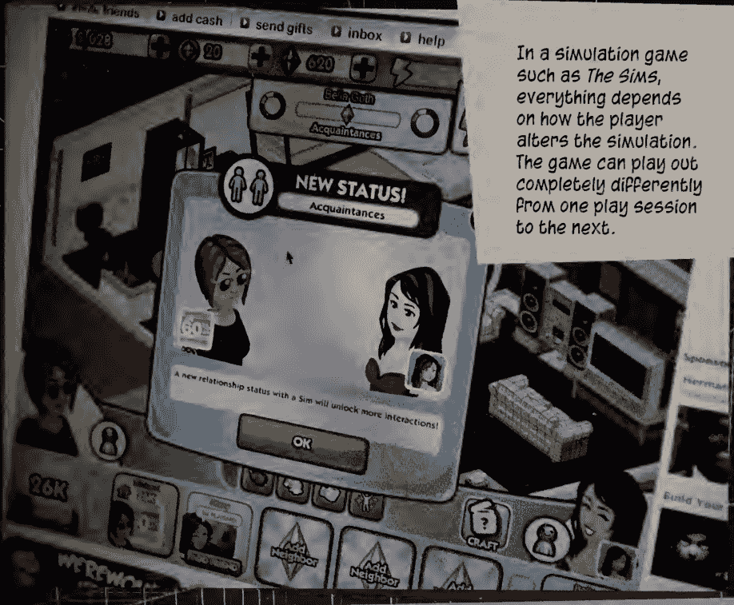

### 模拟游戏

模拟游戏通常没有故事，你通常甚至无法直接控制任何角色。有时游戏甚至没有结局！游戏模拟了历史上的一个有趣时期——一个事件或情况——然后让玩家在模拟结束后观察会发生什么。这些游戏的编写和测试非常复杂，因为它们不像具有预设剧情的普通游戏那样运行。

我最喜欢的游戏之一是 1991 年由伟大的游戏设计师西德·迈尔（Sid Meier）创作的《文明》（Civilization）。它允许你模拟地球的整个历史！你可以作为一个好战的独裁者、和平的外交官或两者之间的任何角色来玩。游戏一旦玩过一次通常会变得有点无聊，但像《文明》这样优秀的模拟游戏永远不会有重样的。

## 不同的工作方式

游戏是为许多不同的平台设计的。有时你甚至可以在几个不同的设备上玩同一款游戏。它们各不相同——有些容易制作，有些则很难。

### 主机

传统上，许多玩家在任天堂娱乐系统（NES）或 Xbox 等主流主机上玩游戏。主机游戏拥有巨大的受众，但开发它们非常昂贵。你需要与索尼、微软或任天堂签订合同，并拥有连接到电脑的主机开发版本。

> Xbox Live Games 频道是寻找独立游戏的好地方。


然而，微软和索尼愿意与独立开发者合作。有数千家公司每家雇用 15 到 100 名开发者，为任何需要他们的发行商工作。代工开发公司每次需要新项目时都会派遣制作访问发行商。他们通常有特定的想法或角色需要制作成小型游戏——例如《索尼克》（Sonic）或《Warlio》。

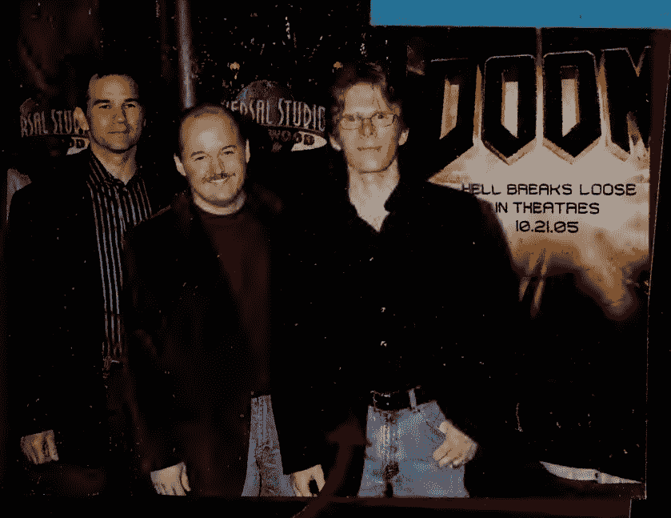

### 移动端

增长最快的类型之一是智能手机和平电脑等移动设备的“App”。主要平台是 iPhone 和 Android。移动游戏通常。

### Web

有数千种可以通过网站运行，它们使用 Flash、Java 或 HTML5 编写。开发者的收入通常来自网站。

# 游戏开发者

不同类型的开发者从事不同的体裁。他们之间的主要区别在于预算规模。大型发行商如微软、索尼、电子艺和任天堂雇用了数千名开发者。他们可以在《模拟人生》等游戏中组成多达 200 人的巨型团队。

电子艺是全球最大的发行商之一，拥有 9000 多名员工。

## 你知道吗？

有时游戏会崩溃，意味着它直接停止。这通常是由漏洞（Bug）引起的。在游戏发布之前，修复所有崩溃漏洞是至关重要的。

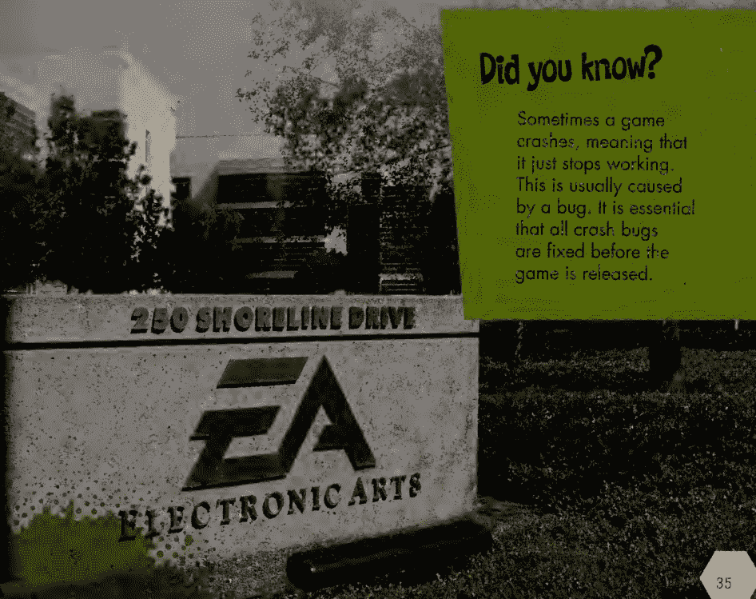


## 独立游戏公司

一家独立游戏公司通常由 1 到 15 名开发者组成，通常没有发行商的支持。他们聚在一起开发新颖的东西，如果他们有才华且幸运，就能创造出带来数百万美元收入的爆款作品。然而，由于他们开发的是完全全新的东西，可能一分钱也赚不到。我喜欢经营一家独立游戏公司：我们拥有完全的自由来探索我们所有疯狂的游戏创意。生活不仅仅是为了赚钱！

## 你知道吗？

在大型开发公司工作时，氛围通常非常休闲。大家都穿休闲休闲服，食堂里经常有免费的饮料、零食，甚至还有街机游戏。为自己工作意味着甚至可以穿睡衣，但你得提供自己的零食！

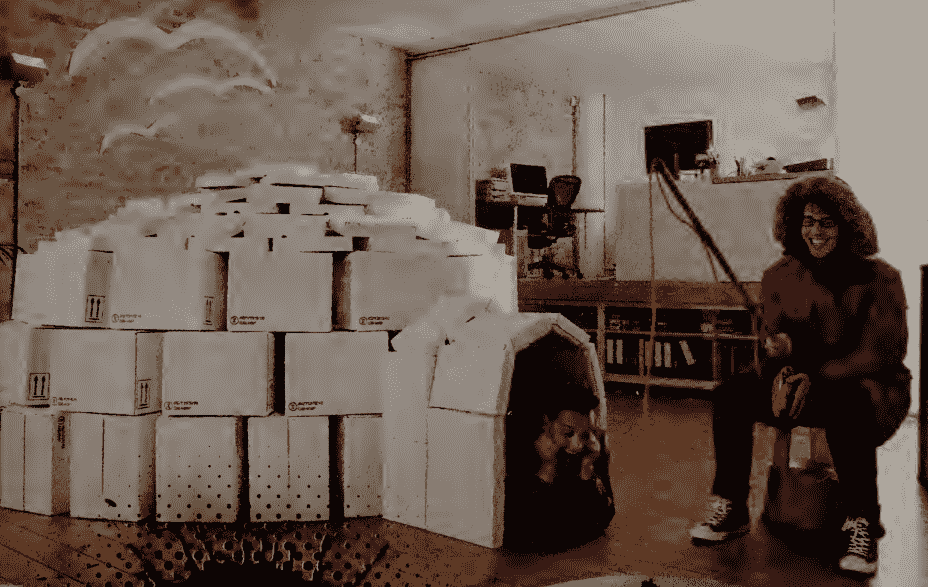

> 独立开发者必须非常有创意才能想出完全全新的想法。

## 学习制作游戏

许多游戏允许玩家制作自己的关卡。在《小小星球》这样的游戏中制作自己的关卡并在网上与其他玩家分享，对于初级设计师来说是一次极佳的体验。

有时很多玩家聚在一起制作出感觉与原游戏几乎完全不同的东西。这需要业余艺术家、程序员、设计师和音乐师通过互联网聚集。如果足够受欢迎，公司甚至可能会聘佣他们。《传送门》（Portal）就发生过这种情况。

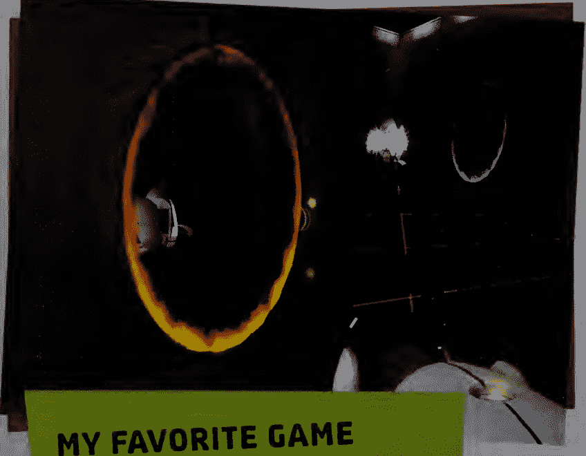

## 我喜欢的游戏
每个人都应该尝试玩玩《传送门1》和《传送门2》。我喜欢它们，认为它们是游戏巅峰的绝对典范。《传送门》的编辑器甚至被某些学校用来教物理！

## 原型

通过玩和制作桌游或牌牌，你可以学到很多。测试新游戏想法最快的方法是制作它的桌游或卡牌版本，这在很多游戏工作室都会发生。玩视频游戏时，很难看出开发者实际上是如何使其运行的，但当你玩卡牌游戏或桌游时，规则会列得非常详细。我认识的大多数游戏开发者都玩桌面游戏。我特别喜欢《智牌》、《塔斯曼》、《阿卡姆恐怖》和《疯狂宅邸》。

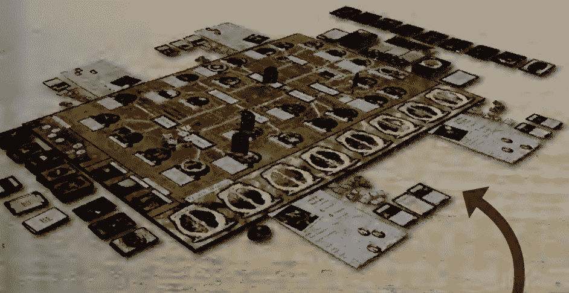

## 我喜欢的游戏

《阿卡姆恐怖》是我最喜欢的桌游。它需要玩几个小时而且非常复杂，但规则非常精妙并像钟轮一样紧扣，在你的桌面上营造出最接近视频游戏的体验。

## 视频游戏包含哪些内容？

我要把我制作的一款名为《星际景观》（Starscape）的游戏拆解成所有需要实现的不同部分。这就像电影分镜，有助于团队视觉化游戏所有不同部分是如何结合在一起的。


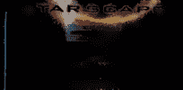


## 键

- 1. 预加载：加载游戏大约需要10秒。
- 2. 启动画面：显示月舱动画——这在所有游戏中都是一样的。
- 3. 总介绍：介绍角色和整体故事。
- 4. 解锁：从网站下载后，玩家需要一种支付方式。
- 5. 荣誉堂：前10名玩家和分数。
- 6. 主菜单：从这里可以访问选项、新游戏、加载、保存等。
- 7. 新游戏：输入你的名字并设置你想要的难度。
- 8. 选项：设置屏幕分辨率、音量等。
- 9. 保存和加载：保存游戏或加载旧存档。
- 10. 主介绍：显示介绍你在故事中部分的详细动画。
- 11. 研究：决定你下一步想制作的设备。
- 12. 游戏内：从这里选择要访问的游戏部分。
- 13. 存储：查看你制作或找到但未使用的设备。
- 14. 飞船改装：更改安装在飞船上的设备。
- 15. 对接口：选择要修改哪个。
- 16. 导航：使用地图在太空中导航。
- 17. 修改空间站：为你的空间站安装设备。
- 18. 太空：飞行、战斗、采矿、射击小行星、收集物品和与人们交流。
- 19. 空间站选项：发射战斗机或跳出关卡。
- 20. 跳跃：进入和跳出关卡。
- 21. Boss 战：关卡被分成区域；每个区域都有一个大 Boss 要战斗。
- 22. 死亡：当你死去时，要轰烈地结束！
- 23. 死亡动画：标记你的离去并显示成就总结。

## 测试

你对在游戏行业工作感兴趣吗，但不确定自己最适合什么角色？做一下这个有趣的测试，看看什么工作最适合你的性格和技能。

- 时候去度假了！然而，你的预算有限，无法负担所有景点。你该怎么办？
  - a) 将所有事实和数据放入电子表格。
  - b) 我不在乎没钱——我只想拍照看日落。
  - c) Jenny 擅长这个；她去年去过。
  - d) 我会仔细记录下来。
  - e) 我认为我们应该演自己的戏。
  - f) 它必须是一部音乐剧。

- 学校正在面试你。你觉得呢？
  - a) 我喜欢数学、科学。
  - b) 我喜欢艺术和设计。
  - c) 我喜欢团队合作。
  - d) 我喜欢作业。
  - e) 我喜欢计算机科学。
  - f) 我喜欢音乐。

- 你的爱好是什么？假设游戏是第一！
  - a) 我喜欢拆解东西看看它们是如何运作的。
  - b) 我喜欢去画廊，从杂志上剪下图片。
  - c) 我参加了很多俱乐部。
  - d) 我喜欢列清单并整理我的收藏。
  - e) 我不介意独自呆。
  - f) 我正在学习一种乐器。

- 学校正在举办演出。你打算如何参与？
  - a) 我认为是时候需要令人震撼的特效了。
  - b) 我喜欢做舞台设计或服装。
  - c) 我要担任导演。
  - d) 我可以帮大家背台词。
  - e) 我对表演有很多好主意。
  - f) 我确信现场乐队会更好。


# 术语表

**Alpha** 游戏开发中的阶段，此时所有工具已完成，是时候构建关卡了。

**认证 (certification)** 发行商使用自己的测试人员来验证新游戏在特定主机（如 Xbox 360 或 PS3）上运行正常。

**体裁 (genre)** 游戏的风格或类别，例如角色扮演游戏或休闲游戏。

**人工智能 (AI)** 让电脑对手看起来很真实的代码，就像你正在与真人对战一样。

**家用电脑 (home computer)** 虽然它可以用来玩游戏，但也可以用于许多其他任务，用于制作游戏。

**CPU** 中央处理器。它是计算机、游戏机、平板电脑或手机的核心硅芯片。过去它通常伴随着许多其他处理音频、图形等的芯片，但现在更常见的是发现一个处理一切功能的大型芯片。

**里程碑 (milestone)** 对游戏开发进度的定期检查（通常是每月一次）；如果游戏未通过，发行商可能会停止向程序员或公司支付款。

**汇编语言 (Assembler)** 在需要极高速度时使用的复杂低级语言。

**动作捕获 (motion capture)** 捕捉演员动作的特殊相机，允许他们重放动作以创建真实的动画。

**基础语言 (Basic)** 为初学者程序员设计的简单编程语言。

**物理学 (physics)** 描述物体如何移动、掉落和碰撞的规则。

**测试版 (beta)** 游戏开发中的阶段，此时游戏已完成但包含许多需要修复的漏洞。

**调试器 (debugger)** 监控游戏运行情况的特殊软件，帮助追踪导致游戏崩溃的漏洞。

**漏洞 (bug)** 计算机程序中的错误。

**游戏机 (game console)** 早期示例带有 Basic 系统，但现在它们不再有键盘，且专门用于玩游戏。

**C++** 一种强大复杂的语言，用于制作几乎所有的主机和 PC 游戏。游戏编程工作通常需要 C++ 知识。


**平台 (platform)** 游戏必须运行的硬件或环境。PC Windows 平台与平板 Android 平台不同，需要在计算机代码中处理。

**制作人 (producer)** 负责确保游戏按时完成的人。

**原型 (prototype)** 想法的快速、粗略版本，用于测试其是否可行。

**原型制作 (prototyping)** 尝试快速测试游戏的一小部分看起来或玩起来如何。这是一种在不花费一年制作整个游戏的情况下进行实验的方法。

**Python** 一种流行的编程语言，有时被专业人士用于游戏脚本编写。

**随机 (random)** 每次运行时都会改变某些内容的代码，确保游戏每次玩起来都不一样。

**服务器 (server)** 托管游戏的计算机，通常位于互联网上，以便人们可以一起玩。

**模拟 (simulation)** 对真实事物的再现。

**纹理 (texture)** 用于包裹在 3D 游戏对象上的图片，使其看起来是实心的——例如，将一张篮球运动员脸部的照片包裹在他在游戏模型头部上。

**变量 (variable)** 在程序中，我们经常需要保存数字或文本，可以将这些数据临时存储在一个命名的变量中。这就像拿一个箱子，把重要的东西放进去，然后贴上标签，以便日后再次找到它。

**线框图 (wireframe)** 如果你取掉 3D 游戏对象的纹理，你剩下的只有脚手架或定义形状的部分。

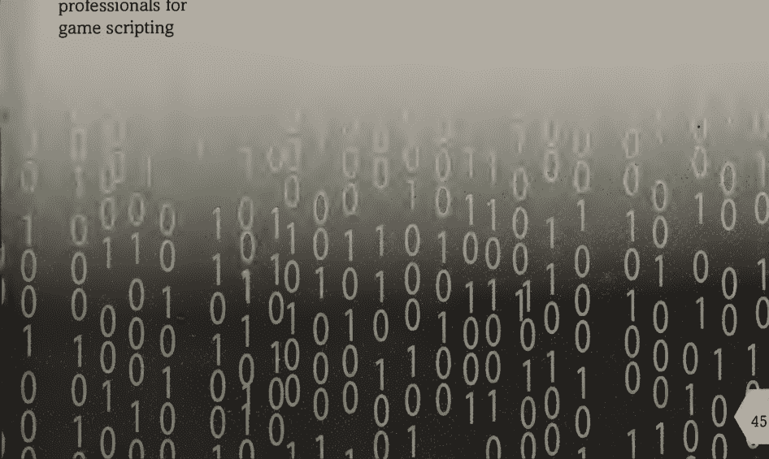

# 了解更多

## 书籍

Byrne, Paul. Computer Game and Film Graphics (Art Off the Wall). Chicago: Heinemann Library, 2007.

Harbour, Jonathan S. Video Game Programming for Kids. Boston: Course Technology PTR, 2013.

LEAD Project. Super Scratch Programming Adventure! Learn to Program by Making Games. San Francisco: No Starch, 2012.

## 网站

www.appinventor.mit.edu
想制作手机游戏但 C++ 太复杂？App Inventor 像 Scratch 一样易用——只需将代码片段拼接在一起，而且免费的！

gaming.adobe.com/getstarted
想用 Flash 制作网页游戏？如果你在学校，可以免费获得所需的软件。

www.kodugamelab.com
Kudu 也为编程初学者设计的；它由微软制作。支付小小费用，你就可以获得一个可以在 Xbox 360 上运行的版本。与 Scratch 不同，你实际上可以制作 3D 游戏。

www.lumdare.com/com
想尝试新技能并结识其他程序员吗？Ludum 是一个在线竞赛和论坛，它让你围绕一个主题在 48 小时内制作游戏。

www.madewitharmalade.com
如果你熟悉 C++ 但想为手机和平板制作游戏，可以获得免费的 Marmalade。

www.microsoft.com/visualstudio/en-us/products/2010-editions/visual-cpp
主机游戏使用 C++ 编写。Visual Studio 是行业常用的软件包之一，而且有免费！

www.moonpod.com
这是一个独立游戏网站。你可以免费玩我做的游戏，在论坛上提问，或者打个招呼。

www.pygame.org/news
这种易用的编程语言是免费的，可以在 Basic 之后尝试。

scratch.mit.edu
如果你编程新手，这里是开始的地方。Scratch 免费且容易学习。看看我的页面：scratch.mit.edu/projects/Markestone/25

smallbasic.com
在掌握 Scratch 之后，微软提供的 Basic 免费版本可以是 Visual Basic 的介绍，帮助你未来找到工作。

# 索引

2D 20, 21, 29
3D 14, 20, 24
Alpha 6, 36
Angry Birds 25
apps 33, 34
Arkham Horror 39
artists 20
Assembler 14, 15
audio engineers 20, 21
Basic 10, 12, 14, 17
BBC Micro 12, 13, 14
developer 10-13, 16
Beta 6
big developers 9, 37
board games 19, 35
bonuses 5
bugs 8, 18, 23
C++ 16, 17
card games 39
Carmack, John 33
causal games 25
cell phone 30, 34
certification 4, 6
Civilization 31
code 19, 28, 30, 34
communication skills 19, 22, 23
components of a game 40-41
consoles 10, 11, 15, 32, 33
crashes 6, 23
designers 19
different types of day 8–9
Donkey Kong 10, 23
earning a life 5, 9, 34, 35, 37
Elite 14
feature creep 36
female developers 22
first-person shooter (FPS) 26
free games 25, 35
game developing process 6
GoldenEye 26
Gunmetal 4, 20, 26
height maps 24, 25
indie developers and games 29, 32, 33, 37
information technology classes 16
Kinect masters 30
launch day 4, 6
location work 20, 21
massively multiplayer (MMO) games 28, 29
Meier, Sid 31
Metacritic 5
Microsoft 32, 33, 35
milestones 9, 22
Miyamoto, Shigeru 23
monitor 18
motion capture 27
music 21
Nintendo 32, 35
Nintendo Wii 30
Nomura, Tetsuya 6
open development 33
PCs 10, 12, 33
physical games 30
problem solving 6, 22, 23
procedural generation 14
producers 22, 36
programmers 6, 7, 8, 18
programming languages 10, 11, 13, 14, 16, 17, 18, 35
prototyping 6, 19, 29
publishers 4, 35, 36, 37
puzzle games 25, 29
Raspberry Pi 13
Reason 20
reviews 5
role-playing games (RPGs) 6, 24
Santiago, Klee 22
scripts 19
shoot 'em ups 29
The Sims 1, 31, 35
simulation games 31
software 20, 34
software libraries 32, 33, 35
PS3 30
sound effects 21
Space Invaders 7, 10
sports games 27
Starcraft 21, 40–41
Street Fighter 19
testers and testing 6, 23, 39
web sites 29, 35
Wolfenstein 33 33
Word Pirate 29
work-for-hire developers 36
World of Warcraft 28
Wright, Will 19

# 丢弃

# 你喜欢分类好的东西吗？那游戏又呢？

也许你可以学习编写你自己的游戏！

Mark Featherstone 参与过从小型独立益智游戏到大预算动作片的一切。在这书中你将了解到关于他这份工作的一切。

关于酷工作的其他书籍


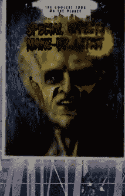


Level V


Raintree a capstone imprint www.capstonepub.com

