# 计算机图形学：原理与实践（第3版）


本页故意留白


献给我的家人、我的老师 Rob Kirby，以及纪念我的父母和 Jim Arvo。
——John F. Hughes

献给我长期受苦的妻子 Debbie，她再一次忍受了“这本书”无休止的工作；也献给我的父亲，他是家中真正的科学家。
——Andries Van Dam

献给 Sarah、Sonya、Levi 和我的父母，感谢他们始终如一的支持；也献给我的导师 Harold Stone，感谢他二十年来在科学人生道路上的指导。
——Morgan McGuire

纪念我的父母，他们为让我获得他们从未享受过的教育机会而作出了无限牺牲；也献给我亲爱的妻子 Siew May，感谢她对我不下数百次躲进我的“男人洞穴”与 Andy 进行 Skype 会话的坚定宽容。
——David Sklar

献给 Marylou、Heather、Jenn、我逝去的父母，以及我所有的老师——尤其是 Bert Herzog，是他把我引入了奇妙的计算机图形学世界！
——Jim Foley

献给 Michele、Maxwell 和 Alex，以及我的父母和老师。
——Steve Feiner

献给 Pat Hanrahan，感谢他的指导与友谊。
——Kurt Akeley

本页故意留白


- 29.1 **引言** — 783
- 29.2 **光传输** — 783
  - 29.2.1 渲染方程，第一版 — 786
- 29.3 **前瞻** — 787
- 29.4 **一般散射的渲染方程** — 789
  - 29.4.1 测量方程 — 791
- 29.5 再论散射 ... 792
- 29.6 一个完整示例 ... 793
- 29.7 求解渲染方程 ... 796
- 29.8 光传输路径分类 ... 796
  - 29.8.1 感知显著现象与光传输 ... 797
- 29.9 讨论 ... 799
- 29.10 练习 ... 799

# 第30章 概率与蒙特卡洛积分

概率方法是现代渲染技术的核心，尤其是估计积分的方法，因为求解渲染方程涉及计算一个积分，而除了最简单的场景之外，这个积分无法精确求值。我们回顾基本离散概率，推广到连续概率，并利用它推导积分的单样本估计和重要性加权单样本估计，我们将在接下来两章中使用这些内容。

- 30.1 引言 ... 801
- 30.2 数值积分 ... 801
- 30.3 随机变量与随机化算法 ... 802
  - 30.3.1 离散概率及其与程序的关系 ... 803
  - 30.3.2 期望值 ... 804
  - 30.3.3 期望值的性质及相关术语 ... 806
  - 30.3.4 连续概率 ... 808
  - 30.3.5 概率密度函数 ... 810
  - 30.3.6 在球面上的应用 ... 813
  - 30.3.7 一个简单示例 ... 813
  - 30.3.8 在散射中的应用 ... 814
- 30.4 连续概率（续） ... 815
- 30.5 重要性采样与积分 ... 818
- 30.6 混合概率 ... 820
- 30.7 讨论与进一步阅读 ... 821
- 30.8 练习 ... 821

# 第31章 计算渲染方程的解：理论方法

渲染方程可以通过许多方法近似求解，包括光线追踪（级数解的一种近似）、辐射度（一种由有限元方法产生的近似）、梅特罗波利斯光传输和光子映射，更不用说使用直接光照加环境光近似的基本多边形渲染器。每种方法都有优缺点，可以通过考虑场景中材质的性质、考察从光源到探测器的不同类别光路，以及揭示这些方法中隐含的各种近似误差来分析。

- 31.1 引言 ... 825
- 31.2 方程的近似解 ... 825
- 31.3 方法1：近似方程 ... 826
- 31.4 方法2：限制定义域 ... 827
- 31.5 方法3：使用统计估计器 ... 827
  - 31.5.1 通过采样与估计对级数求和 ... 828


- **31.6 方法4：二分法** — 830
- **31.7 其他方法** — 831
- **31.8 渲染方程再探** — 831
  - 31.8.1 关于符号的说明 — 835
- **31.9 我们需要计算什么？** — 836
- **31.10 离散化方法：辐射度** — 838
- **31.11 传输路径的分离** — 844
- **31.12 渲染方程的级数解** — 844
- **31.13 光传输的替代表述** — 846
- **31.14 级数解的近似** — 847
- **31.15 近似散射：球谐函数** — 848
- **31.16 蒙特卡洛方法简介** — 851
- **31.17 追踪路径** — 855
- **31.18 路径追踪与马尔可夫链** — 856
  - 31.18.1 马尔可夫链方法 — 857
  - 31.18.2 递归方法 — 861
  - 31.18.3 构建路径追踪器 — 864
  - 31.18.4 多重重要性采样 — 868
  - 31.18.5 双向路径追踪 — 870
  - 31.18.6 Metropolis 光传输 — 871
- **31.19 光子映射** — 872
  - 31.19.1 图像空间光子映射 — 876
- **31.20 讨论与延伸阅读** — 876
- **31.21 习题** — 879

# 第32章 渲染实践

我们描述了一个路径追踪器和一个光子映射器的实现。路径追踪器体现了与类光线追踪渲染器相关的许多复杂性，这类渲染器试图通过估计与渲染方程相关的积分来估计辐射度；光子映射器则能快速收敛到有偏但一致且合理的结果。

- **32.1 引言** — 881
- **32.2 表示** — 881
- **32.3 表面表示与 BSDF 的局部表示** — 882
  - 32.3.1 镜面与点光源 — 886
- **32.4 光的表示** — 887
  - 32.4.1 光源的表示 — 888
- **32.5 基础路径追踪器** — 889
  - 32.5.1 预备知识 — 889
  - 32.5.2 路径追踪器代码 — 893
  - 32.5.3 结果与讨论 — 901
- **32.6 光子映射** — 904
  - 32.6.1 结果与讨论 — 910
  - 32.6.2 进一步的光子映射 — 913
- **32.7 推广** — 914
- **32.8 渲染与调试** — 915
- **32.9 讨论与延伸阅读** — 919
- **32.10 习题** — 923

# 第33章 着色器

在现代图形卡上，我们可以执行小型（甚至不小）的程序，对模型数据进行操作以生成图像。最简单的形式是顶点着色器和片元着色器；前者可基于场景的几何（通常是顶点坐标）进行处理，后者可处理与单个像素对应的多边形片段的片元。为了说明着色器的更基本用法，我们描述了如何实现基本的 Phong 着色、环境映射，以及一个简单的非真实感渲染器。

- 33.1 引言 — 927
- 33.2 图形管线的多种形式 — 927
- 33.3 历史发展 — 929
- 33.4 一个使用着色器的简单图形程序 — 932
- 33.5 一个 Phong 着色器 — 937
- 33.6 环境映射 — 939
- 33.7 两种卡通着色版本 — 940
- 33.8 基础 XToon 着色 — 942
- 33.9 讨论与延伸阅读 — 943
- 33.10 习题 — 943

# 第34章 表现性渲染

表现性渲染是我们对一类渲染的称呼：它们不以照片真实感为目标，而是旨在生成能与观看者交流的图像，传达创作者认为重要的内容，并抑制不重要的内容。我们总结了表现性渲染的理论基础，特别是各种抽象类型，并讨论了渲染的“信息”与其风格之间的关系。我们将通过几种表现性渲染技术加以说明。

- 34.1 引言 — 945
  - 34.1.1 表现性渲染示例 — 948
  - 34.1.2 本章组织 — 948
- 34.2 表现性渲染的挑战 — 949
- 34.3 标记与笔触 — 950
- 34.4 感知与显著特征 — 951
- 34.5 几何曲线提取 — 952
  - 34.5.1 脊线与谷线 — 956
  - 34.5.2 暗示轮廓 — 957
  - 34.5.3 表观脊线 — 958
  - 34.5.4 超越几何 — 959
- 34.6 抽象 — 959
- 34.7 讨论与延伸阅读 — 961

# 第35章 运动

动画是一系列已渲染的帧，当快速显示时会产生平滑运动的感觉。控制底层 3D 物体运动的算法通常使用样条在关键姿势之间插值，或者通过数值积分速度和加速度来模拟物理定律。渲染主要关注表面，而动画算法需要具有额外属性（如关节）和质量的模型。然而，这些模型仍然是对真实世界的简化，接受一定的限制以实现计算效率。动画中最困难的问题涉及用于规划逼真角色运动的人工智能，这超出了本章的范围。

- 35.1 引言 — 963
- 35.2 动机示例 — 966
  - 35.2.1 行走角色（关键姿势） — 966
  - 35.2.2 发射大炮（模拟） — 969
  - 35.2.3 走廊导航（运动规划） — 972
  - 35.2.4 符号 — 973
- 35.3 渲染注意事项 — 975
  - 35.3.1 双缓冲 — 975
  - 35.3.2 运动感知 — 976
  - 35.3.3 隔行扫描 — 978
  - 35.3.4 时间混叠与运动模糊 — 980
  - 35.3.5 利用时间一致性 — 983
  - 35.3.6 第一帧的问题 — 984
  - 35.3.7 时间一致性的负担 — 985
- 35.4 表示 — 987
  - 35.4.1 对象 — 987
  - 35.4.2 限制自由度 — 988
  - 35.4.3 关键姿势 — 989
  - 35.4.4 动力学 — 989
  - 35.4.5 程序化动画 — 990
  - 35.4.6 混合控制方案 — 990
- 35.5 姿势插值 — 992
  - 35.5.1 顶点动画 — 992
  - 35.5.2 根帧运动 — 993
  - 35.5.3 关节体 — 994
  - 35.5.4 骨骼动画 — 995
- 35.6 动力学 — 996
  - 35.6.1 粒子 — 996
  - 35.6.2 微分方程表述 — 997
  - 35.6.3 分段常数近似 — 999
  - 35.6.4 常见力的模型 — 1000
  - 35.6.5 粒子碰撞 — 1008
  - 35.6.6 作为微分方程的动力学 — 1012
  - 35.6.7 常微分方程的数值方法 — 1017
- 35.7 关于动力学稳定性的评述 — 1020
- 35.8 讨论 — 1022

# 第36章 可见性判定

高效地确定场景中影响最终图像的子集，对于渲染器的性能至关重要。此过程的第一个近似是保守判定眼睛可见的表面。这个问题已被具有截然不同的空间、质量和时间界限的算法所解决。首选算法会随着硬件架构的成本和性能而随时间变化。由于类似问题出现在碰撞检测、选择、

全局光照和文档布局，甚至那些目前在主光线中不受青睐的可见性算法，在其他应用中也可能更受青睐。

- **36.1 引言** ... 1023
  - 36.1.1 可见性函数 ... 1025
  - 36.1.2 主可见性 ... 1027
  - 36.1.3 （二元）覆盖 ... 1027
  - 36.1.4 当前实践与动机 ... 1028
- **36.2 光线投射** ... 1029
  - 36.2.1 BSP 光线-图元求交 ... 1030
  - 36.2.2 光线测试的并行求值 ... 1032
- **36.3 深度缓冲区** ... 1034
  - 36.3.1 常见深度缓冲区编码 ... 1037
- **36.4 列表优先级算法** ... 1040
  - 36.4.1 画家算法 ... 1041
  - 36.4.2 深度排序算法 ... 1042
  - 36.4.3 簇与 BSP 排序 ... 1043
- **36.5 视锥剔除与裁剪** ... 1044
  - 36.5.1 视锥剔除 ... 1044
  - 36.5.2 裁剪 ... 1045
  - 36.5.3 裁剪到整个视锥 ... 1047
- **36.6 背面剔除** ... 1047
- **36.7 分层遮挡剔除** ... 1049
- **36.8 基于扇区的保守可见性** ... 1050
  - 36.8.1 穿刺树 ... 1051
  - 36.8.2 门户与镜面 ... 1052
- **36.9 部分覆盖** ... 1054
  - 36.9.1 空间抗锯齿（xy） ... 1055
  - 36.9.2 散焦（uv） ... 1060
  - 36.9.3 运动模糊（t） ... 1061
  - 36.9.4 覆盖作为材质属性（α） ... 1062
- **36.10 讨论与延伸阅读** ... 1063
- **36.11 练习** ... 1063
- **37 空间数据结构** ... 1065

诸如包围体层次结构之类的空间数据结构，为嵌入度量空间中的几何体提供求交查询和集合操作。求交查询对于光传输、交互和动力学仿真必不可少。这些结构是经典数据结构（如哈希表、树和图）在三维几何约束下扩展而来的。

  - 37.1 引言 ... 1065
    - 37.1.1 动机示例 ... 1066
  - 37.2 编程接口 ... 1068
    - 37.2.1 求交方法 ... 1069
    - 37.2.2 提取键与边界 ... 1073
  - 37.3 刻画数据结构 ... 1077
    - 37.3.1 一维链表示例 ... 1078
    - 37.3.2 一维树示例 ... 1079
  - 37.4 kd 结构概述 ... 1080
  - 37.5 列表 ... 1081
  - 37.6 树 ... 1083
    - 37.6.1 二叉空间分割（BSP）树 ... 1084
    - 37.6.2 构建 BSP 树：八叉树、四叉树、BSP 树、kd 树 ... 1089
    - 37.6.3 包围体层次结构 ... 1092
  - 37.7 网格 ... 1093
    - 37.7.1 构建 ... 1093
    - 37.7.2 光线求交 ... 1095
    - 37.7.3 选择网格分辨率 ... 1099
  - 37.8 讨论与延伸阅读 ... 1101
- **38 现代图形硬件** ... 1103

我们描述现代显卡的结构、其设计，以及影响该设计的一些工程权衡。

  - 38.1 引言 ... 1103
  - 38.2 NVIDIA GeForce 9800 GTX ... 1105
  - 38.3 架构与实现 ... 1107
    - 38.3.1 GPU 架构 ... 1108
    - 38.3.2 GPU 实现 ... 1111
  - 38.4 并行性 ... 1111
  - 38.5 可编程性 ... 1114
  - 38.6 纹理、内存与延迟 ... 1117
    - 38.6.1 纹理映射 ... 1118
    - 38.6.2 内存基础 ... 1121
    - 38.6.3 应对延迟 ... 1124
  - 38.7 局部性 ... 1127
    - 38.7.1 引用局部性 ... 1127
    - 38.7.2 缓存内存 ... 1129
    - 38.7.3 发散 ... 1132
  - 38.8 组织替代方案 ... 1135
    - 38.8.1 延迟着色 ... 1135
    - 38.8.2 分箱渲染 ... 1137
    - 38.8.3 Larrabee：CPU/GPU 混合架构 ... 1138
  - 38.9 GPU 作为计算引擎 ... 1142
  - 38.10 讨论与延伸阅读 ... 1143
  - 38.11 练习 ... 1143
- 原理列表 ... 1145
- 参考文献 ... 1149
- 索引 ... 1183

*本页有意留白*

# 前言

本书向学生、研究人员和从业者介绍计算机图形学中的许多重要思想。其中一些思想并不新鲜：它们已经出现在广泛可获取的学术出版物、技术报告、教科书和大众刊物文章中。在某种思想出现一段时间之后再编写教科书的一个优势在于，可以更好地理解其长期影响，并将其置于更广阔的语境中。我们的目标是尽可能精细地处理这些思想（包括省略那些不再像过去那样重要的思想），同时仍然清晰而优雅地向初学者介绍这门学科。

这是一本第二代图形学图书：我们并不把所有先前工作都视为隐含有效，而是在当今理解的背景下对其进行评估，并酌情更新呈现方式。

即使是最基本的问题，也可能变得非常微妙。例如，假设你正在设计一个必须在低照度环境中运行的程序——比如一间变暗的电影院。显然，你不能使用明亮的显示器，因此用亮度对比来区分程序显示中的不同项目并不合适。你决定改用颜色。不幸的是，低照度环境中的颜色感知远不如高照度环境，而且在低照度下某些文字颜色比其他颜色更容易阅读。你的光标仍然容易看见吗？也许为了让这件事更简单，你应该让光标持续抖动，从而利用眼睛对运动的敏感性。于是，一个看似简单的问题，结果却涉及界面设计、色彩理论和人类感知等问题。

这个例子虽然简单，却也隐含了一些未明说的假设：该应用使用图形（而不是触觉输出或隔离良好的音频耳机），它不使用普通影院屏幕，也不使用头戴式显示器。它还包含一些明确的假设——例如，将使用光标（有些用户界面有意不使用光标）。这些假设中的每一个也都反映了一种用户界面选择。

不幸的是，事物之间的这种相互关联性使得我们无法以完全有序的方式呈现各个主题，同时又能很好地激发学习动机；这门学科已经不再是可线性化的了。我们本可以先讲完所有数学、感知理论以及其他更抽象的主题，然后再转向它们的图形学应用。尽管这可能会产生一部更好的参考书（你知道该去哪里查找广义叉积，

例如，这种方法对教科书并不适用，因为激励性的应用案例都会放在最后。另一种选择是采用案例研究的方式，即尝试完成各种难度递增的任务，并在需要时引入必要的材料。这在某些情况下会形成自然的递进，但很难给出该学科的整体组织视角。我们的做法是一种折中：先从一些广泛使用的数学和符号约定开始，然后一个主题接一个主题地推进，在需要时引入支撑性的数学内容。已经熟悉这些数学内容的读者可以放心跳过这些材料，而不会错过任何计算机图形学内容；其他读者则可以通过阅读这些章节学到不少东西。教师可以根据需要选择包含或省略这些内容。本书按主题组织的结构不可避免地带来了一些重复。例如，我们多次以不同的详细程度讨论图形管线。我们有时不会让读者翻回前面的章节，而是重新描述某些内容，认为这样能带来更自然的阅读流畅度。翻回五百页去查看一幅图可能会造成相当大的干扰。

教科书作者面临的另一个挑战是决定文本的百科全书式覆盖程度。本书的第一版确实涵盖了当时计算机图形学已发表成果的很大一部分；第二版至少对其中许多工作做了简要提及。这一版放弃了任何百科全书式的伪装，原因非常充分：在编写第二版时，一个人单臂就能抱起全部SIGGRAPH（最大的年度计算机图形学会议）论文集，而这些论文集足以代表该领域所有技术著作的相当一部分。如今，SIGGRAPH论文集（仅仅是众多发表渠道之一）已经占据了数立方英尺的空间。即使是一本电报式的教科书，也无法将所有这些信息塞进一千页。因此，本书的目标是引导读者达到能够阅读并复现当今许多SIGGRAPH论文的水平，尽管有一些注意事项：

- 首先，计算机图形学与计算机视觉的交叉越来越多，但我们没有理由去写一本计算机视觉教科书；其他知识更渊博的人已经写过了。
- 其次，计算机图形学涉及编程；许多图形应用程序相当庞大，但我们并不试图在本书中教授编程或软件工程。不过，我们确实会简要讨论图形学特有的编程（尤其是调试）方法。
- 第三，大多数图形应用程序都有用户界面。在撰写本文时，这些界面大多基于带菜单的窗口和鼠标交互，尽管基于触摸的界面也越来越普遍。曾有一段时间，用户界面研究是图形学的一部分，但现在它已经是一个独立的社区——尽管与图形学有大量重叠——因此我们假设学生已经具备创建带用户界面的程序的经验，并不过多讨论这些内容，除非是那些实现与图形学更密切相关的3D界面。

当然，图形学的研究论文各不相同。有些高度数学化，另一些则描述具有复杂工程权衡的大规模系统，还有一些涉及物理学、色彩理论、排版学、摄影学、化学、动物学……这样的列表可以无限延伸。我们的目标是让读者能够理解这些论文中的计算机图形学内容；其他材料可能还需要大量外部学习。

### 历史方法

计算机图形学的历史在很大程度上是一部针对眼前问题采用临时方法的历史。这样说绝不是在指责那些采用这些方法的人：他们有工作要做，并且找到了完成工作的途径。有时他们的解决方案包含了重要的思想；另一些时候这些方案只是为了完成任务，而其后续被采用反而妨碍了后来的进展。例如，大多数图形系统中使用的图像合成模型假设图像中存储的颜色值可以线性混合。在实际应用中，图像中存储的颜色值与光强度呈非线性关系；对这些值进行线性组合并不等同于对强度进行线性组合。当工作室试图将真实世界的影像与计算机生成的影像结合起来时，人们开始注意到两种方法之间的差异；这种合成技术产生了无法接受的结果。此外，一些早期方法本身深具原理性，但相关程序对硬件做出的假设在几年后便不再成立；读者首先看到实现细节，便说：“哦，这都是旧东西了——和我们完全无关”，从而错过了研究中仍然重要的思想。同样常见的是，研究人员只是简单地重新发明了其他学科早已知道多年的东西。

因此，我们*并不*遵循计算机图形学的时间发展顺序。正如物理课程不会从亚里士多德的动力学描述开始，而是直接使用牛顿的理论（更好的课程还会描述甚至*那个体系*的局限性，为量子方法等做铺垫），我们试图直接从当前对这些问题的理解出发，同时在相关时仍然介绍各种旧有思想。我们还尝试指出一些可能不那么为人所知的想法的来源：例如，Newell关于三维空间中多边形法向量的公式，早在19世纪Grassmann就已经知道了。我们引用这些来源，是希望提高读者对已经发展出来的、等待应用于图形学的各种想法的认识。

### 教学法

我们日常生活中图形学最显著的一面，是电子游戏、娱乐产业特效和广告中使用的3D图像。但我们与家用计算机、手机等的日常交互同样基于计算机图形学。这部分也许不那么显眼，部分原因恰恰是它们更加成功：最好的界面是你注意不到的界面。人们很容易说“2D图形”更简单——3D图形只是同一事物的更复杂版本。但2D图形中的许多问题——例如，如何在由矩形发光元件网格组成的屏幕上最好地显示图像，或者如何构建有效而强大的界面——与制作三维场景图像所面临的问题同样困难。而且，传统2D图形中使用的简单模型可能会引导学生对如何最好地表示颜色或形状等事物产生错误假设。因此，我们在很大程度上整合了2D和3D图形的呈现，以便同时处理两者共有的微妙问题。

本书在“黑盒”放置的层级上有所不同。几乎每本计算机科学书籍都必须决定在何种抽象层级上处理读者应该熟悉的计算机相关内容。在一本图形学书籍中，我们还需要决定读者将接触何种图形系统。在编写了一两个程序之后，人们不难相信，当你发出某些指令时，计算机内部的某种软硬件组合能让你在显示器上看到一个彩色三角形。这个过程的细节与图形学中相当大的一部分内容并不相关。例如，如果你要求图形系统绘制一个位于屏幕可显示区域下方的红色三角形，会发生什么？需要变红的像素位置会被计算出来，然后因为位于屏幕外而被忽略吗？还是图形系统会在计算任何像素值之前就意识到三角形在屏幕外，然后直接退出？从某种意义上说，除非你在设计显卡，否则这并不那么重要；事实上，作为图形系统的用户，你无法真正控制这一点。因此，在本书的大部分内容中，我们将图形系统视为能够显示某些像素值、绘制三角形和线条的东西，而不太担心这部分究竟是“如何”实现的。这些细节*确实*包含在关于光栅化和图形硬件的章节中。但正因为它们大多超出我们的控制，像裁剪、线条抗锯齿和光栅化算法等主题都被推迟到后面的章节中。

本书教学法的另一个方面是我们通常试图展示想法或技术是*如何*产生的。这可能会导致较长的解释，但希望在学生需要自己推导某些内容时有所帮助：他们遇到的方法可能会为他们当前的问题提供一种思路。

我们相信，学习图形学的最佳方式是先学习其背后的数学。与直接跳到应用相比，这种方法的一个缺点是学习抽象数学会增加学习最初几项技术所需的时间。但这种开销你只需付出一次。当你学到第十种相关技术时，你的投入就会得到回报，因为你会发现新方法结合了你已经学过的元素。

当然，你之所以阅读这本书，是因为你有动力去编写生成图像的程序。因此，我们尽量在深入思考更广泛的数学问题之前，先直接切入解决方案来开启许多主题。本书的大部分内容都涉及这种后退一步的思考过程。在研究了数学之后，我们会通过勾勒其他相关问题及其一些解决方案来结束各个主题。由于我们关注的是基本原理，你不需要我们告诉你这些草图的细节。从你对原理的理解中，每个解决方案的思路应该清晰可见，而且你将拥有足够的知识去阅读和理解原始引用的出版物，用作者自己的话来说，而不是依赖我们为你翻译。我们*能够*做的是以稍微更现代的形式呈现一些旧的思想，这样当你回头阅读原始论文时，你就能对其词汇如何与你的词汇对应有所了解。

### 当前实践

图形学是一门动手实践的学科。既然图形学的工作是向观看者呈现视觉信息并随后与之交互，图形工具通常可以被有效地用于调试新的图形算法。但要做到这一点，需要具备编写图形程序的能力。在当今的计算机上，有很多替代方法可以生成图形图像，而就本书中的大部分内容而言，一种方法并不比另一种差。一种编程语言及其库与另一种之间的转换是


常规做法如此。但就教学而言，最好使用单一语言，以便学生能够专注于更深层的思想。在整本书中，我们会建议使用 Windows Presentation Foundation（WPF）来编写练习，这是一个广泛可用的图形系统，我们为它编写了一个基础且易于修改的程序，称之为“测试台”，学生可以在这个环境中进行练习。对于不适合使用 WPF 的情况，我们经常使用 G3D，这是由其中一位作者维护的公开图形库。在许多情况下，我们也会编写伪代码。它提供了一种紧凑的方式来表达思想，而且对于大多数算法，实际代码（用你选择的语言编写）可以从网上直接下载；将其包含在正文中往往没有意义。代码的格式各不相同；在程序从非正式草图逐步发展到某种语言中近乎完整的程序的过程中，像语法高亮这样的东西直到很晚的版本才有意义，有时甚至会被完全省略。有时让代码与数学相匹配是件好事，这让我们使用诸如 $x_R$ 这样的变量名，它们会以数学而不是代码的形式排版。总的来说，我们用斜体排印伪代码，并用缩进而不是花括号来表示伪代码中的代码块。总的来说，我们的伪代码非常非正式；我们用它们来传达大致思路而非细节。

这*不是*一本关于编写图形程序的书，也不是关于*使用*图形程序的书。例如，读者不会找到关于如何在 Adobe 最新图像编辑软件中最好地存储图像的提示。但我们希望，在理解了本书中的概念并已成为有能力的程序员之后，他们既能编写图形程序，也能理解如何使用那些已经编写好的程序。

## 原则

在整本书中，我们确定了某些计算机图形学原则，这些原则将有助于读者在未来的工作中；我们还包含了关于当前*实践*的部分——这些部分讨论例如如何在今天的硬件上近似你的理想解决方案，或者如何更快地计算你的实际理想解决方案。即使是针对今天硬件调整的实践，在未来也可能被证明是有用的，因此尽管十年后所描述的实践可能不再直接适用，但它们所展示的方法我们认为在多年后仍将具有价值。

## 先修知识

本书的大部分内容只假设读者具备技术娴熟的本科生可能拥有的准备：编写面向对象程序的能力；微积分的实用知识；对向量有一定的了解，也许来自数学课、物理课甚至计算机科学课；至少接触过一些线性变换。我们还期望典型的学生已经编写过一两个包含 2D 图形对象（如按钮、复选框或图标）的程序。

然而，本书的某些部分依赖于更多的数学知识，而试图在这本书的篇幅内教授这些数学是不可能的。不过，通常这些高深的数学被谨慎地限制在少数几个章节中，这些章节更适合研究生课程而非入门课程。这些章节以及某些数学上较复杂的练习都标有“数学路标”符号：◇。相应地，使用计算机科学中更深层概念的主题则标有“计算机科学路标”符号：◇。

文本中某些数学方面对于那些在其他语境中接触过向量的人来说可能显得奇怪；第一作者拥有数学博士学位，他在最初接触图形学研究者的某些做法时确实感到困惑。我们试图清楚而彻底地解释这些与标准数学方法的差异。

## 本书的阅读路径

本书可用于一学期或一学年的本科课程，也可作为研究生课程的一般参考书。在本科课程中，可以安全地省略高级数学主题（例如，重心坐标的类比、流形网格、球谐函数等的讨论），同时专注于创建和显示几何模型的基本思想、理解变换的数学、相机规格，以及表示光、颜色、反射率等的标准模型，并附带这些模型局限性的提示。它还应该涵盖基本的图形应用程序和用户界面关注点、设计权衡，以及使其高效所需的折衷，可能以某个特殊主题结束，如创建简单动画或编写基本的射线追踪器。即使这样，对于一个学期来说也太多了，即使是一学年的课程也会留下本书的许多章节未被涉及，作为感兴趣学生未来的阅读材料。

一个进度紧凑的一学期（14 周）课程可以涵盖以下内容。

- 1. 引言和一个简单的 2D 程序：第 1、2 和 3 章。
- 2. 渲染几何入门，以及进一步的 2D 和 3D 程序：第 3 和 4 章。视觉感知和人类视觉系统：第 5 章。
- 3. 2D 和 3D 几何建模：网格、样条和隐式模型。第 7.1–7.9 节，第 8 和 9 章，第 22.1–22.4、23.1–23.3 和 24.1–24.5 节。
- 4. 图像，第 1 部分：第 17 章，第 18.1–18.11 节。
- 5. 图像，第 2 部分：第 18.12–18.20 节，第 19 章。
- 6. 2D 和 3D 变换：第 10.1–10.12 节，第 11.1–11.3 节，第 12 章。
- 7. 观察、相机和齐次后插值。第 13.1–13.7 节，15.6.4 节。
- 8. 图形中的标准近似：第 14 章，选读章节。
- 9. 光栅化和射线投射：第 15 章。
- 10. 光和反射：第 26.1–26.7 节（第 26.5 节可选）；第 26.10 节。
- 11. 颜色：第 28.1–28.12 节。
- 12. 基本反射模型、光传输：第 27.1–27.5、29.1–29.2、29.6、29.8 节。
- 13. 递归射线追踪细节、纹理：第 24.9、31.16、20.1–20.6 节。
- 14. 可见表面判定和加速数据结构；更高级渲染技术概述：选自第 31、36 和 37 章。

然而，并非每一节中的所有材料都适合第一门课程。

或者，考虑一个为期 12 周的本科物理基础渲染课程的教学大纲，该课程从第一性原理出发，从离线渲染到实时渲染。它可以深入探讨射线追踪背后的核心数学和辐射度量学，然后回过头来引入可扩展性和性能所需的计算机科学思想。

- 1. 引言：第 1 章
- 2. 光：第 26 章
- 3. 感知；光传输：第 5 和 29 章
- 4. 网格和场景图的简要概述：第 6.6 节，14.1–5 节
- 5. 变换：第 10 和 13 章，简要。
- 6. 射线投射：第 15.1–4 节，7.6–9 节
- 7. 加速数据结构：第 37 章；第 36.1–36.3、36.5–36.6、36.9 节
- 8. 渲染理论：第 30 和 31 章
- 9. 渲染实践：第 32 章
- 10. 颜色和材质：第 14.6–14.11、28 和 27 节
- 11. 光栅化：第 15.5–9 节
- 12. 着色器和硬件：第 16.3–5 节，第 33 和 38 章

请注意，这些路径打破了章节的编号顺序。我们有意识地以这样一种风格编写本书：大多数章节都是独立的，用交叉引用代替先修要求，以支持这种穿插阅读。

## 与上一版的区别

这一版几乎是全新的，尽管上一版涵盖的许多主题也出现在这里。随着 GPU 的出现，三角形通过与传统扫描转换算法截然不同的方法被转换为像素（或样本）。我们不再讨论那些算法。在讨论光时，我们强烈倾向于使用物理测量单位，这给讨论那些不关心单位的旧技术增加了一些复杂性。我们没有像前几版那样准备两套分别用于 2D 和 3D 图形的图形库，而是选择使用广泛可用的系统，并提供工具帮助学生开始使用它们。

## 网站

在本书中，你经常会看到对书籍网站的引用。它位于 http://cgpp.net ，不仅包含经过测试的软件和几个示例


源自它，但许多章节还有额外材料，以及第2章和第6章的WPF交互实验。

# 致谢

这样一本书由作者写成，但其他人的贡献极大地提升了它。

来自Microsoft的支持和鼓励，尤其是Eric Rudder和S. Somasegar的支持和鼓励，帮助启动并完成了这个项目。

3D测试平台由Dan Leventhal编写的代码演变而来；我们也感谢kindohm.com的Mike Hodnick，他慷慨同意让我们将他的代码作为早期草稿的起点，并感谢Jordan Parker和Anthony Hodson协助处理WPF。

威廉姆斯学院的两名学生为支持本书付出了非常努力的工作：Guedis Cardenas负责参考文献，Michael Mara负责若干章中使用的G3D Innovation Engine；Electronic Arts的Corey Taylor也帮助了G3D。

CMU的Nancy Pollard和匹兹堡大学的Liz Marai都在各自的图形学课程中使用了若干章的早期草稿，并提供了极好的反馈。

Jim Arvo不仅是与渲染相关一切问题的权威，还帮助重新构建了第一作者对该领域的理解。

除了刚才提到的部分人之外，还有许多其他人阅读了章节草稿、准备了图像或插图、建议了主题或呈现方式，或以其他方式提供了帮助。按字母顺序，他们是John Anderson、Jim Arvo、Tom Banchoff、Pascal Barla、Connelly Barnes、Brian Barsky、Ronen Barzel、Melissa Byun、Marie-Paule Cani、Lauren Clarke、Elaine Cohen、Doug DeCarlo、Patrick Doran、Kayvon Fatahalian、Adam Finkelstein、Travis Fischer、Roger Fong、Mike Fredrickson、Yudi Fu、Andrew Glassner、Bernie Gordon、Don Greenberg、Pat Hanrahan、Ben Herila、Alex Hills、Ken Joy、Olga Karpenko、Donnie Kendall、Justin Kim、Philip Klein、Joe LaViola、Kefei Lei、Nong Li、Lisa Manekofsky、Bill Mark、John Montrym、Henry Moreton、Tomer Moscovich、Jacopo Pantaleoni、Jill Pipher、Charles Poynton、Rich Riesenfeld、Alyn Rockwood、Peter Schroeder、Francois Sillion、David Simons、Alvy Ray Smith、Stephen Spencer、Eric Sudderth、Joelle Tollet、Ken Torrance、Jim Van Dessel、Daniel Wigdor、Dan Wilk、Brian Wyvill，以及Silvia Zuffi。尽管我们尽了最大努力，可能还是遗漏了一些人，谨向他们致歉。

我们在写作过程中得到了竞争书籍作者的大量支持，这体现了这个领域普遍的善意。Eric Haines、Greg Humphreys、Steve Marschner、Matt Pharr和Pete Shirley都为把本书变得更好作出了贡献。能与这样的人共事于这个领域，真是太好了。

如果没有我们的编辑Peter Gordon的支持、宽容、包容和远见，我们绝不可能完成本书。我们也都感激家人在整个项目期间给予的巨大支持。

# 致学生

你的教授可能会选择本书的某种阅读路线，挑选彼此契合的主题，或许会遵循前面提到的某条建议路线。不要让它限制你。如果你想了解某个主题，就利用索引开始阅读。有时你会发现自己缺乏背景知识，无法理解所读内容。当这种情况发生时，就去阅读背景材料。这会比在其他时候读更容易，因为现在你有一个学习它的*理由*。如果你卡住了，就在网上搜索别人的实现，下载并运行它。当你注意到它看起来不太对劲时，就可以开始检查这个实现，并尝试逆向工程它。有时这是理解某个东西的绝佳方式。遵循实践—理论—实践的学习模式：先尝试某件事，看看能否让它运行起来；如果不行，就去阅读别人是怎么做的，然后再试一次。第一次尝试可能令人沮丧，但它能让你在接触理论时更好地理解理论。如果你无法让自己遵循实践—理论—实践模式，至少应该花时间完成所读章节中的内联练习。

图形学是一个年轻的领域，年轻到本科生经常成为SIGGRAPH论文的合著者。一年之内，你就能学到足够的知识，开始贡献新的想法。

图形学也使用大量数学。如果数学对你来说一直显得抽象而理论化，图形学可以真正有所帮助：数学在图形学中的用途是实际的，而且你常常可以在自己制作的图片中*看到*某个定理的后果。如果数学一直对你来说很容易，你可以尝试把我们提出的思想进一步扩展，从中获得一些乐趣。虽然本书包含大量数学内容，但它只触及现代研究论文中所用数学的表面。

最后，*怀疑一切*。我们已尽力在本书中讲述我们所理解的真理。我们认为自己做得相当不错，我们所说的绝大部分都是真的。在少数地方，我们在引入某个概念时故意只讲了部分真相，然后在后面讨论细节的章节中再加以补充。但除此之外，我们在其他地方肯定也有未能讲述真相之处。在某些情况下，我们只是犯了错误，比如漏掉一个负号，或在循环中犯了一个差一错误（off-by-one error）。在其他情况下，图形学界当前的理解还不够充分，我们相信了别人所说的话，之后将不得不调整我们的看法。这些错误对你来说是机会。Martin Gardner说过，科学发现真正的声音不是“啊哈！”，而是“嘿，*那可真奇怪*……”所以，如果偶尔有东西让你觉得奇怪，尽管去怀疑它。更仔细地研究它。如果它最终是真的，你就清除了一些理解上的蛛网；如果它是假的，那就是你推动这个领域前进的机会。

# 致教师

如果你和我们一样，你很可能读了“致学生”部分，尽管它不是为你写的。（你的学生可能也在读这一部分。）你知道，我们建议他们随意翻阅本书，并怀疑一切。

除了本前言其余部分的建议之外，我们向你推荐两件事。第一，鼓励甚至要求学生回答书中的内联练习。对于说“我要做的事太多了！我不能浪费时间停下来做练习”的学生，你只需说：“我们没时间停下来加油……我们已经迟到了。”第二，给学生布置既有固定目标又有开放式部分的项目或作业。踏实的学生会完成固定目标部分，并学会你想讲授的材料。其他人一旦有机会做有趣的事，可能会用开放式练习做出让你惊讶的东西。而在这样做时，他们会发现需要学习一些可能看似*刚好*超出能力范围的东西，直到突然掌握它们，并获得能力感。图形学是做到这一点的绝佳媒介：成功立即可见且令人有成就感，这就形成了一个促进进步的反馈循环。可见反馈与他们在计算机科学其他领域遇到的可扩展性思想相结合，可能会带来启发。

## 讨论与延伸阅读

本书大多数章节都包含像这一节这样的“讨论与延伸阅读”部分，指向背景参考文献或本章思想的高级应用。对于本前言而言，唯一合适的延伸阅读非常笼统：我们建议你立即开始浏览ACM SIGGRAPH会议以及其他图形学会议（如Eurographics和Computer Graphics International）的论文集，并根据你不断变化的兴趣，查看一些更专门的会议，如Eurographics Symposium on Rendering、I3D和Symposium on Computer Animation。虽然起初这些会议中的论文似乎依赖大量先验知识，但你会发现，你很快就能了解哪些事情是可能的（哪怕只是通过看图片），以及实现它们需要哪些技能。你还会迅速发现一些在你最感兴趣领域中反复出现的想法，这可以在你学习图形学的过程中帮助指导你的进一步阅读。


# 关于作者

John F. Hughes（1977年普林斯顿大学数学学士；1982年加州大学伯克利分校数学博士）是布朗大学计算机科学教授。他的主要研究领域是计算机图形学，尤其是图形学中涉及大量数学的方面。作为19篇SIGGRAPH论文的作者或合著者，他在几何建模、建模用户界面、非真实感渲染和动画系统方面做过研究。他曾担任*ACM Transactions on Graphics*和*Journal of Graphics Tools*的副编辑，并多次担任SIGGRAPH程序委员会委员。他共同组织了Implicit Surfaces '99、2001年交互式三维图形研讨会以及第一届欧洲图形学基于草图界面与建模研讨会，并担任SIGGRAPH 2002的论文主席。

Andries van Dam 是布朗大学小托马斯·J·沃森大学技术与教育讲席教授、计算机科学教授。自1965年起，他一直是布朗大学教职成员，是布朗大学计算机科学系的共同创始人，并于1979年至1985年担任该系首任系主任，还于2002—2006年担任布朗大学首任研究副校长。Andy的研究包括计算机图形学、超媒体系统、后WIMP用户界面（包括沉浸式虚拟现实以及笔式和触摸计算）以及教育软件。四十多年来，他一直致力于开发用于创建和阅读带交互式插图的电子书系统，以供教学和研究使用。1967年，Andy共同创立了ACM SICGRAPH，即SIGGRAPH的前身，并于1985年至1987年担任计算研究协会主席。他是ACM、IEEE和AAAS的会士，美国国家工程院和美国艺术与科学院院士，并拥有四个荣誉博士学位。他撰写或合著了100多篇论文和九本书。

Morgan McGuire（2000年麻省理工学院理学学士；2000年麻省理工学院工程硕士；2006年布朗大学博士）是威廉姆斯学院计算机科学副教授。他曾作为行业顾问为多款产品做出贡献，包括《漫威终极联盟》和《泰坦之旅》电子游戏系列、亚马逊Kindle中使用的E Ink显示屏以及NVIDIA GPU。Morgan在*SIGGRAPH*、*High Performance Graphics*、*Eurographics Symposium on Rendering*、*Interactive 3D Graphics and Games*和*Non-Photorealistic Animation and Rendering*上发表了关于高性能渲染和计算摄影的论文。他创办了*Journal of Computer Graphics Techniques*，担任过交互式三维图形与游戏研讨会以及非真实感动画与渲染研讨会主席，并且是G3D Innovation Engine的项目经理。他是*Creating Games*、*The Graphics Codex*以及若干*GPU Gems*、*ShaderX*和*GPU Pro*卷册章节的合著者。

**David Sklar**（1982年南方卫理公会大学理学学士；1983年布朗大学理学硕士）目前是Vizify.com的可视化工程师，从事在广泛形态因子的计算设备上呈现动画信息图表的算法工作。Sklar于20世纪80年代在布朗大学计算机科学系任教，讲授入门课程，并合著了本书第二版的若干章节（以及辅助软件）。随后，Sklar转入电子书行业，专注于SGML/XML标记标准，在此期间他经常在GCA会议上演讲。此后，Sklar与妻子Siew May Chin共同创立了PortCompass，这是最早的在线零售岸上短途游览营销商之一，也是从房地产管理到数据库咨询等多种行业中一长串创业尝试中的第一个。

**James Foley**（1964年利哈伊大学电气工程理学学士；1965年密歇根大学电气工程理学硕士；1969年密歇根大学博士）是佐治亚理工学院计算学院弗莱明讲席教授、交互计算教授。他此前曾在北卡罗来纳大学教堂山分校和乔治·华盛顿大学担任教职，并在三菱电机研究实验室担任管理职位。1992年，他在佐治亚理工学院创立了GVU中心，并担任主任至1996年。在此期间的大部分时间里，他还担任*ACM Transactions on Graphics*的主编。他的研究贡献涉及计算机图形学、人机交互和信息可视化。他是本书三个版本及其1980年前身*Fundamentals of Interactive Computer Graphics*的合著者。他是ACM、美国科学促进会（AAAS）和IEEE的会士，曾获SIGGRAPH（库恩斯奖）和SIGCHI颁发的终身成就奖，并且是美国国家工程院院士。

**Steven Feiner**（1973年布朗大学音乐文学士；1987年布朗大学计算机科学博士）是哥伦比亚大学计算机科学教授，在那里他主管计算机图形学与用户界面实验室，并共同主管哥伦比亚视觉与图形中心。他的研究涉及三维用户界面、增强现实、可穿戴计算，以及人机交互与计算机图形学交叉领域的许多主题。Steve曾担任*ACM Transactions on Graphics*的副编辑、*IEEE Transactions on Visualization and Computer Graphics*编辑委员会成员，以及*Computers & Graphics*编辑顾问委员会成员。他入选CHI Academy，并与他的学生一起获得了ACM UIST持久影响力奖，以及IEEE ISMAR、ACM VRST、ACM CHI和ACM UIST的最佳论文奖。Steve曾担任许多会议的程序委员会主席或联合主席，例如IEEE虚拟现实会议、ACM用户界面软件与技术研讨会、数字游戏基础会议、ACM研讨会

*本页有意留空*

# 第1章

# 引言

本章从多个视角相当宽泛地介绍计算机图形学：它的应用、图形学研究涉及的各个领域、使图形学生成的图像如此有效的一些工具、一些帮助你理解计算机图形学工作尺度的数字，以及编写你的第一个图形程序所需的基本概念。本书其他部分将更详细地讨论其中许多主题。

## 1.1 计算机图形学简介

**计算机图形学**是通过计算机显示器及其交互设备进行视觉传达的科学与艺术。这种传达的视觉方面通常是计算机到人的方向，而人向计算机的方向则由鼠标、键盘、操纵杆、游戏控制器或触摸敏感覆盖层等设备来中介。然而，甚至这一点也开始改变：视觉数据正开始*回流*到计算机，新的界面基于应用于视频或深度相机输入的计算机视觉算法。但就计算机到用户的方向而言，通信的最终消费者是人，因此人类感知图像的方式在图形学¹程序的设计中至关重要——人类忽略的特征不需要呈现（也不需要计算！）。计算机图形学是一个交叉学科领域，物理学、数学、人类感知、人机交互、工程学、平面设计和艺术都在其中发挥重要作用。我们使用物理学来建模光照并为动画执行仿真。我们使用数学来描述形状。人类感知能力决定我们的资源分配——我们不想花时间渲染不会被注意到的东西。我们利用工程学来优化带宽、内存和处理器时间的分配。平面设计与艺术同人机交互相结合，使计算机到人的传达方向最为有效。在本章中，

¹. 在本书中，当我们使用术语“图形学”时，我们指的是“计算机图形学”。


我们讨论一些应用领域、传统图形系统如何工作，以及这些学科各自如何影响计算机图形学的工作。

计算机图形学的一个狭义定义会指出，它指的是取一个场景中物体的模型（场景中事物的几何描述，以及它们如何反射光的描述）和一个发射到场景中的光的模型（对光能源、辐射方向、光波长分布等的数学描述），然后生成场景某个特定*视图*的表示（到达场景中某个想象中的眼睛或相机的光）。在这种观点下，人们可以说图形学不过是经过美化的乘法：人们将入射光乘以场景中物体的反射率，以计算离开这些物体表面的光，并重复这一过程（将表面视为新的光源并递归调用光传输操作），从而确定最终到达相机的所有光。（在实践中，这种方法不可行，但这一思想仍然保留。）相比之下，计算机视觉相当于*分解*——给定场景的一个视图，计算机视觉系统负责确定光照和/或场景内容（随后图形系统可以将其“相乘”以重现同一图像）。当然，实际上视觉系统无法解决所述问题，通常基于关于场景、光照或两者的假设来工作，并且还可能拥有来自不同相机的场景多个视图，或来自同一相机但不同时间的多个视图。

在计算机图形学领域，“模型”一词可以指几何模型或数学模型。**几何模型**是我们计划在图片中呈现的某物的模型：我们为汽车、房子或犰狳制作模型。几何模型会通过描述模型中涉及材料的颜色、纹理或反射率等各种其他属性得到增强。从零开始创建这样的模型称为**建模**，而由此得到的几何加其他信息的描述称为**模型**。

**数学模型**是物理过程或计算过程的模型。例如，在第 27 章中，我们描述光如何从光泽表面反射的各种模型。我们还有物体如何运动的模型，以及数码相机中发生的图像采集过程之类的模型。这些模型可能忠实（即可能提供该现象的具有预测性且正确的数学模型），也可能不忠实；它们可能基于物理、从第一性原理推导而来，或者可能是经验性的或现象学的，来自观察甚至直觉。

实际上，图形学远比渲染视图的广义乘法过程丰富，正如视觉比分解更丰富。当前图形学的许多研究在于创建几何模型的方法、表示表面反射率（以及次表面反射率，以及雾和烟等参与介质的反射率等）的方法、通过物理定律及这些定律的近似来使场景动画化、动画控制、与虚拟对象交互、非真实感表示方法的发明，以及近年来越来越多地集成计算机视觉技术。因此，计算机图形学和计算机视觉领域正变得越来越接近。例如，考虑 Raskar 在非真实感相机方面的工作：该相机对同一场景拍摄多张照片，由不同位置放置的闪光灯单元照明。从这些不同图像中，可以使用计算机视觉技术确定轮廓并估计场景中物体的一些基本形状属性。反过来，这些可用于创建场景的非真实感渲染，如图 1.1 所示。

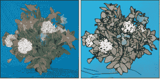

*图 1.1：非真实感相机可以通过对多张闪光照片图像应用计算机视觉技术，然后使用计算机图形学技术渲染场景，从而创建场景的艺术化渲染。左侧是原始场景；右侧是场景的新渲染。(由 Ramesh Raskar 提供；©2004 ACM, Inc. 经许可收录于此。)*

在本书中，我们强调真实感图像捕获与渲染，因为这是计算机图形学领域取得最大成功的方面，代表了相对较新的计算机科学在相对古老的物理模型仿真中的一次美妙应用。但图形学不止于真实感图像捕获与渲染。例如，动画和交互同样重要；本书许多章节都会讨论这些学科，也会在各自章节中明确论述。为什么非仿真领域的成功相对如此难以实现？也许因为这些领域本质上更偏定性，且缺乏像物理学所提供的现有数学模型。

本书并不满是实现计算机图形学中大量想法的现成方案；相反，它提供该学科更高层次的视角，目标是教你一些在具体实现早已不再重要之后仍长期有用的思想。你通常需要自己编写实现，或在别处找到实现。

这绝不是因为我们贬低这类信息或提供这类信息的书籍。我们钦佩这样的工作并向其学习。我们也钦佩那些能将其综合成连贯且呈现良好的整体的人。考虑到这一点，我们强烈建议你在阅读本书时，手边放一本 Haines、Möller 和 Hoffman 的实时渲染书 [AMHH08]。另一种但不太好的方法是，选择你感兴趣的任何特定主题，并在互联网上搜索相关信息。数学家阿贝尔声称，他之所以能在数学上取得成功，是因为他养成了阅读大师而非其学生著作的习惯；我们建议你效仿他。上述实时渲染书由该学科的大师撰写，而随便一个网页可能由任何人撰写。我们认为，如果你想从互联网上获取一些东西，获取该主题的原始论文要好得多。

既然承诺了原则，我们立即提供两条，承蒙 Michael Littman 惠允：

- **了解你的问题原则：** 知道你在解决什么问题。
- **近似解原则：** 近似解，而不是近似问题。

这两条对一般研究都是很好的指南，但对图形学尤其如此：图形学中有太多广泛使用的近似，以至于有时很容易忘记近似到底在近似什么；处理未近似的实体可能会为你问题的解决提供一条清晰得多的路径。

### 1.1.1 计算机图形学的世界

计算机图形学的学术方面由 SIGGRAPH 主导，即美国计算机协会（Association for Computing Machinery）的计算机图形学与交互技术特别兴趣小组；年度 SIGGRAPH 会议是展示计算机图形学新成果的首要场所，同时也是大型商业贸易展和若干相关领域同期同地举办的会议。由 ACM 出版的 SIGGRAPH 论文集，是该领域从业者所能拥有的最重要参考资料。近年来，这些论文集作为《ACM Transactions on Graphics》的一期出版。

当然，计算机图形学也是一个产业，它在电影、电视、广告和游戏领域产生了巨大影响。它还改变了我们在医学、建筑、工业过程控制、网络运营中查看信息的方式，也改变了我们日常生活中查看天气图和其他信息可视化的方式。也许最重要的是，我们的电话、计算机、汽车仪表盘以及许多家用电子设备上的图形用户界面（GUI）都由计算机图形学实现。

### 1.1.2 当前与未来的应用领域

计算机图形学已迅速从新奇事物转变为日常现象。甚至一次性设备——比如父母给孩子让他们在飞机旅途中打发时间的手持数字游戏机——也有图形显示和界面。这对应于两个现象：第一，视觉感知很强大，视觉传达极其迅速，因此各类设备的设计者都想利用它；第二，基于计算机的设备的制造成本正在迅速下降。（Roy Smith [Smi] 在 20 世纪 80 年代谈到一些说法——GPS 装置复杂到成本永远不可能低于 1000 美元——时说道：“任何由硅制成的东西总有一天会只花五美元。”这是一个很好的经验法则。）

随着图形学变得更加普及，用户的期望也提高了。视频游戏每秒显示数百万个多边形，电影中的特效如今如此出色，以至于不再容易与

非计算机生成的材料。数码相机和数码摄像机为我们提供了大量待处理的像素流（像素是构成图像的点阵中的单个项），而处理这些像素的工具正在迅速演进。与此同时，计算机能力的增强使得更丰富的图形形式成为可能。借助数字摄影、精密扫描仪（图1.2）和其他工具，人们不再需要显式地为每个要展示的物体创建模型：相反，可以直接扫描物体，甚至完全忽略物体本身，而使用它的多幅数字图像作为该物体的替代。并且，借助更丰富的数据流，提取越来越多关于数据的信息的可能性——例如使用计算机视觉技术——已经开始影响图形的可能应用。举例来说，基于摄像头的跟踪技术让身体姿态或手势可以控制游戏和其他应用（图1.3）。

尽管图形学对娱乐产业产生了巨大影响，但它在其他领域——科学、工程（包括计算机辅助设计与制造）、医学、桌面出版、网站设计、通信、信息处理和分析等，仅举几例——的影响力仍在与日俱增。而且，从小型到大型形态规格的新交互场景——虚拟现实、房间大小的显示器（图1.4）、在用户眼前装有双LCD的可穿戴显示器、多点触控设备（包括大型多点触控桌和墙，图1.5）以及智能手机——为产生更大影响提供了新机会。

在本章剩余的大部分内容中，当我们谈论图形应用时，我们想到的是电子游戏之类的应用；在这类应用中，最关键的资源是与**渲染**——使某些对象或图像出现在显示器上——相关的处理器时间、内存和带宽。然而，应用类型多种多样，每种类型都有自己的一组需求和关键资源（见第1.11节）。因此，值得记住的一个有用性能指标是**每秒图元数**，其中**图元**是适合该应用的某种构建块；对于街机式电子游戏，它可能是带纹理的多边形，而对于流体流动可视化系统，它可能是短的彩色箭头。每秒显示的图元数是每帧（即显示的图像）显示的图元数与每秒显示帧数的乘积。虽然有些应用可能选择每帧显示更多图元，但这样做就需要降低帧率；另一些应用以动画的流畅性为目标，会希望有更高的帧率，而为了实现这一点，它们可能需要减少每帧显示的图元数量（或者，也许通过某种方式近似来降低每个图元的复杂度）。

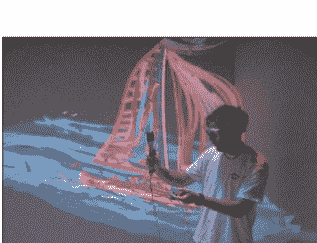

图1.4：一位艺术家站在Cave中（一个墙壁是显示器的房间），在三维空间中放置画笔笔触。显示器与立体眼镜同步显示图像，使其看起来漂浮在房间半空中。头部跟踪技术使软件能够生成与用户位置和观察方向相符的图像，即使用户改变视点也是如此。（由明尼苏达大学Daniel Keefe提供。）

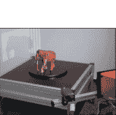

图1.2：一台扫描仪将条纹投射到模型上，模型在转台上缓慢旋转。相机记录许多位置上的条纹图案，以确定物体的形状。（由Polygon Technology, GmbH提供。）

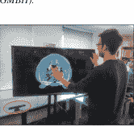

图1.3：微软的Kinect接口能够感知用户的位置和手势，使科学家无需鼠标或键盘即可通过“肢体语言”调整其数据视图。（数据视图由David Laidlaw提供；图像由Emanuel Zgraggen提供。）

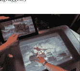

图1.5：两名用户分别在大型触控显示器和触控平板显示器上与一幅大型艺术作品的不同部分进行交互。（由Brown Graphics Group提供。）

2. 我们将把这些称为显示像素，以区别于“像素”一词的其他用法；后者将在后续章节中介绍。

### 1.1.3 用户界面考虑因素

过去30年计算机图形学的决定性变化，也许看起来是静态图像和动态图像在视觉保真度上的提升，但同样重要的是日常计算机图形学新出现的*交互性*。我们不再只是观看图片——我们与它们*交互*。正因如此，用户界面（UI）变得越来越重要。

的确，用户界面领域已经独立发展，不再能被视为计算机图形学的一小部分，但两者仍然紧密结合。遗憾的是，截至撰写本书时，商用桌面UI的状态与上一代的研究系统相比并没有发生剧烈变化——向计算机输入仍然主要通过键盘和鼠标，而我们用鼠标所做的大部分事情包括点击按钮、指向文本或图像中的位置，或选择菜单项。而且，尽管这种点击式WIMP（窗口、图标、菜单和指针）界面在过去30年中占据主导地位，但高质量且设计良好的界面仍然少见，并且界面设计至少在其早期常常是事后才考虑的事情。基于触摸的界面是向前迈进的一步，但其中许多仍以各种方式模仿WIMP界面。随着用户日益成熟且需求不断增加，界面设计现在几乎是任何应用开发中的重要组成部分。

两个并行且相关的趋势要求图形硬件商品化，同时要求软件和CPU速度取得巨大进步。第一个趋势是图像生成的质量和速度，使高质量图像成为日常应用的一部分。第二个趋势是GUI的发展，它使计算机应用变得如此直观且易于学习，以至于连尚未识字的儿童也能使用它们。

为什么界面如此重要？一个原因是经济因素。1960年，计算机占据大房间或小建筑；它们价值数百万美元，并由多个用户共享，而每个用户的薪水相对较少。到2000年，计算机变得很小，其成本只是使用它们的人薪水的一小部分。图1.6显示了用户薪水与所用计算机成本之比的无量纲趋势。虽然在1960年，关键是要始终高效地使用计算机，用户不得不做许多事情

最终提供了一种通用的环境光，即使物体没有被直接照亮也能照亮它们，并且任何三角形内部点的颜色都可以根据三角形顶点处计算出的颜色推断出来。

渐渐地，人们加入了越来越丰富的模型——关于形状、光和反射率的模型——但即使在今天，描述场景中光照的主导模型仍包含**“环境光，”**这一项，意思是一定量的光“遍布场景各处”，没有明确的来源，从而确保场景中任何可见物体至少在一定程度上被照亮。这个临时性术语的加入是为了处理光传输的某些方面，例如物体间反射，而这些方面无法用20世纪60年代的计算机直接计算；但它在今天仍在使用。虽然许多书遵循光传输的历史发展来讲述，但我们将选择一种不同的方法，讨论理想情况（光传输的物理模拟）、当前算法如何近似该理想情况、一些早期方法如何也做到这一点，以及这些近似的痕迹如何仍留在常见实践中。例外之处在于，我们将在第6章介绍一种反射率模型，它把表面光的散射表示为三项之和：**“漫反射，”**对应于向所有方向等量反射的光；**“镜面反射，”**⁴用于建模更具方向性的反射，范围从粗糙塑料之类一直到近乎完美的镜面反射；以及环境光。我们将在第14章对该模型稍作细化，然后在第27章详细考察它。提前了解该模型的好处在于，它让你可以尽早尝试建模和渲染场景，甚至在你了解光实际如何反射之前就可以这样做。

多年来，图形显示器有了巨大改进：20世纪70年代到80年代，发生了从矢量设备到光栅设备——例如像CRT或LCD显示器那样显示小点阵列的设备——的转变；在过去25年中，分辨率（单个点的微小程度）、尺寸（显示器的物理尺寸）和**动态范围**（最亮与最暗可能像素值之比）也稳步但缓慢地提高。图形处理器的性能也按照摩尔定律进步（图形处理器的指数改进速度高于CPU）。图形处理器架构也日益并行化；这能发展到何种程度仍有一些猜测空间。

在处理器和显示器两方面，除了稳步进展，也出现过一些重要飞跃：从矢量设备转向光栅显示器，以及光栅显示器迅速渗入小型机和工作站市场，就是其中之一。另一个飞跃是商品化图形卡（及其相关软件）的推出，这使得编写可在多种机器上运行的程序成为可能。大约在光栅显示器被广泛采用的同时，另一项重大变化发生了：Xerox PARC的WIMP GUI被采用。正是在这时，图形学从一种实验室研究工具转变为日常计算机交互中不言而喻的组成部分。

最后一个值得注意的飞跃是*可编程*图形卡的引入。应用现在不再向图形卡发送多边形或图像，而是可以发送某些小型*程序*，描述后续多边形和图像在送往显示器的途中应如何处理。这些所谓的“着色器”

⁴. “镜面反射”（specular）一词在图形学中有多重含义，从“像镜子一样”到“从某种光泽到完美镜面不等”。除了第6章中的用法外，我们将把“specular”用作镜面反射的同义词，而把“glossy”用于有光泽但并非完全像镜面的东西。


开辟了全新的特效领域，无需额外消耗CPU周期即可生成（尽管GPU——图形处理单元——正在辛勤工作）。我们可以预见，在接下来的几十年里，图形能力还将出现大幅飞跃。

## 1.3 一个启发性的例子

现在让我们来看一个简单的场景，并思考如何为它生成一幅图像。

一盏100瓦的点光源灯悬挂在一张涂有灰色乳胶漆的桌子上方，高度为1米，房间其他部分一片漆黑。我们从上方2米处俯视桌面。我们会看到什么？无论灯发出的可见光通量是多少，也无论表面的反射率具体如何，场景中的光照模式——灯正下方最亮，离灯越远越暗——都是由物理规律决定的。我们可以做一个思想实验，想象这幅场景有一幅理想的“图像”。我们可以期望，一个计算机图形系统在渲染这幅场景时，能够生成一个与该理想图像高度近似的结果。

然而，用带有标准图形软件包的常规程序来显示这种光照模式，即使只是大致模式，也是很困难的。大多数标准软件包根本没有“米”“克”或“焦耳”这样的单位概念；它们对光的描述甚至完全忽略了波长。此外，常规图形软件包计算入射光亮度时，其变化方式虽与离光源的距离有关，但并不像我们从物理规律中知道的那样按1/d²变化，而是遵循另一种不同的规则。公平地说，也可以让常规软件包采用平方反比衰减，但这样生成的图像看起来仍然不对。⁵ 这在一定程度上是因为显示器的非线性，以及用较小范围的值（通常为0到255）来表示光量，再加上许多显示器有限的动态范围（无法忠实显示极亮或极暗的物体）。使用线性衰减（通常混入一个小的二次项）可以部分补偿这些问题，从而生成看起来更好的图像。但这实际上只是针对一堆其他问题的临时解决方案。

要正确生成上述简单场景的图像，最好的做法或许是直接对物理过程建模，然后再考虑如何显示所得数据。到第32章结束时，你就能够做到这一点了。

在这个例子中，我们要求得到物理上正确的结果，这涉及图形学的一个特定领域——真实感。值得注意的是，在图形学早期，尽管大多数计算缺乏任何物理基础，但对真实感的追求却取得了如此巨大的成功。这可以归因于人类视觉系统（HVS）惊人的鲁棒性：当我们向眼睛呈现任何略微接近物理真实图像的信号时，视觉系统总能设法理解它。近年来，将捕获的图像（例如数码照片）与图形图像结合的潮流表明，把事情做对是多么重要：真实物体与合成物体的亮度只要不匹配，就会被立刻察觉。

5. 这种错误并非源于点光源的不熟悉感；即使我们为更大面积的光源建立图形模型，结果仍然是错误的。

但在图形学中，我们常常追求的不是物理模拟，而是一种以视觉方式呈现信息的手段（比如书籍或报纸的版面设计）。在这些情况下，典型的观看环境是一个光线充足的房间，来自各个方向的光强很高且大致恒定，而页面上物品的反射率变化范围大约可达$10^3$倍。只需将屏幕像素的强度设置为在这个类似范围内变化的合理值，就能很好地工作，没有必要对反射页面进行物理模拟。然而，我们可能有必要确保所显示的内容忠实于原始内容（也就是说，你在显示器上看到的颜色和我在我的显示器上看到的颜色是一样的）；时尚单品或油漆颜色的展示必须准确，用户才能理解它们的真实外观。

事实上，这种情况是运用**抽象**的绝佳机会，而抽象是视觉传达中的一个关键要素：由于文档的物理特性不会对观看者的体验产生重大影响，人们就可以转而用更抽象的形状、颜色和形式来讨论文档。当然，至关重要的是，这些抽象必须抓住所讨论对象的重要特征，而忽略其不重要的方面；这是建模过程的一个关键特征，我们将在本书中反复提及。

## 1.4 目标、资源与恰当的抽象

灯泡的例子还给了我们另一个原则：在任何模拟中，首先要理解底层的物理或数学过程（在已知的范围内），然后根据时间、处理器能力及类似因素（我们的*资源*）的限制，确定哪些近似能最好地提供我们所需的结果（我们的*目标*）。

这种方法既适用于2D显示图形——例如网页浏览器界面中那些图形对象，比如帮助你导航的按钮和逐行显示的文本——也适用于用于特效的3D渲染。在前一种情况下，主导现象可能不是物理现象，而是感知和设计现象，但同样必须理解它们。除了选择足够丰富的抽象之外，明智建模的一部分还在于选择合适的工作*表示*。为了表示平面上的实值函数，你可以使用一个矩形数值数组；将平面划分为各种形状和大小的三角形区域，值存储在三角形顶点（这在模拟流体流动等事物时很常见）；或者使用一种数据结构来存储矩形数值数组，使得当相邻值一致时它们被合并成更大的“单元”，从而使细节只出现在函数变化迅速的区域。

我们将前面的讨论总结为一个原则：

> ✓ **明智建模原则：** 在对一个现象建模时，先理解你正在建模的现象以及你建模的目标，然后选择足够丰富的抽象，再在你的资源范围内选择恰当的表示来捕捉你的抽象。完成这些之后，进行测试以验证你的抽象是否恰当。

测试将因情况而异：如果设计抽象了人类感知的某些方面，那么测试可能涉及用户研究；如果设计抽象了某些物理内容（“我们可以用正弦波来安全地模拟小规模海浪”），那么测试可能是定量的。

Barzel [Bar92] 认为，计算机图形学中大多数物理模型由三部分组成：物理模型本身、数学模型和数值模型。（例如，物理模型可能是：海浪由水面的垂直位移表示，其运动仅由邻近高度差产生的力决定[而不是例如风力]；数学模型可能是：这些位移由定义在海洋表面某个坐标网格整数点上的随时间变化的函数表示，中间值通过插值获得；计算模型可能是：通过用“有限差分”近似所有导数，然后求解所得方程的线性化版本，可以从水的当前状态确定未来某一时刻的状态。）在你的程序中包含这种分离有助于调试。然而，这意味着在调试过程中，你必须记住你的模型及其抽象层次，以及这些对预期结果施加的限制。（在我们的例子中，物理模型本身表明你不能指望看到破碎的波浪，而数学模型表明你也不能指望看到比坐标网格更小尺度的水面细节。）在计算机科学内部，这是很不寻常的：在计算机科学的大多数其他领域，你只有一个计算模型或机器模型，这单一模型就是你的基础。但在图形学中，我们有物理模型、数学模型、数值模型、计算模型和感知模型，它们相互影响。

在2D和3D图形中，至关重要的是要考虑你工作的最终目标，这通常是以某种形式进行的*交流*，而且通常是向人类的交流。这一最终目标影响我们所做的许多事情，也应当影响一切事情。（这只是“形式服从功能”这一格言的另一种表述，它在图形学中的价值不亚于任何其他地方。）举个简单的例子，考虑我们如何处理光，它只是电磁辐射的一种：由于人类只能用眼睛探测某些频率的光，我们通常在图形学中不担心模拟无线电波或X射线，即使传统灯具（和太阳）发出的光包含大量可见光谱之外的能量。因此，视觉系统的局限性成了我们程序计算上的节约。类似地，由于眼睛对光能的敏感度近似对数关系，我们构建显示硬件时（一阶近似）会使得像素值的等量差异对应于显示光能的等量*比率*。

> ✓ **视觉系统影响原则：** 要考虑人类视觉系统对你的问题及其模型的影响。

再举一个例子，即使在2D显示图形中，也存在需要考虑的感知问题：人类视觉敏锐度的极限告诉我们，显示的内容必须达到一定尺寸才能具有感知上的意义；同时，人类运动控制的极限告诉我们，交互设计必须适应这些极限。我们不能要求用户点击一系列像素 [...]


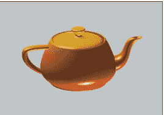

*图 1.7：标准茶壶，由马丁·纽厄尔创建，该模型已在图形学中被使用过数千次。*

灯泡。半径为 10 cm 的球体表面积约为 1200 cm²；因此我们的镜头接收到灯泡所发出光的大约 1/10,000，即每秒 6.6 × 10¹⁴ 个光子。如果我们以 0.01 sec 的曝光时间拍摄，并有一个约 100 万像素的传感器，那么每个传感器像素大约接收 10⁶ 个光子。在我们假想的上述办公室中拍摄一块深色地毯，可能会使每个传感器像素仅接收到 100 个光子。

### 1.5.4 复杂应用的处理需求

计算机游戏是目前要求最苛刻的应用之一；为了让物体出现在用户屏幕上，这些应用会把多边形发送给图形处理器。这些多边形具有各种属性（如颜色、纹理和透明度），并通过各种技术（抗锯齿、平滑着色等，我们稍后都会详细讨论）进行显示。要显示一个多边形，就必须以某些方式为特定像素着色。因此，**多边形速率**（每秒显示的多边形数量）和**填充速率**（每秒着色的像素数量）都被用来衡量性能。这些数字一直在变化，而且一个覆盖 500 像素的带纹理、抗锯齿、透明多边形与一个平面着色的 10 像素三角形之间存在巨大差异，因此很难比较。但用于交互显示的复杂场景很容易包含 100 万个多边形，其中也许有 10 万个可见（其他多边形被前方物体遮挡或位于视野之外），每个多边形平均可能占据 10 个像素。在许多情况下，单个多边形占据的面积还不到一个像素。部分原因是复杂形状通常用多边形网格来建模（见图 1.7）。对于高质量、非交互式的特效制作，最终图像的分辨率可能高得多，但与此同时，场景也可能包含数百万个多边形；“多边形小于一个像素”的经验法则仍然适用。

## 1.6 图形管线

标准图形系统的运作通常通过一个称为**图形管线**的抽象来描述。使用“管线”一词，是因为从数学模型到屏幕像素的转换涉及多个步骤，而在典型架构中，这些步骤按顺序执行；一个阶段的结果会被推送到下一阶段，以便第一阶段可以立即开始处理下一个多边形。

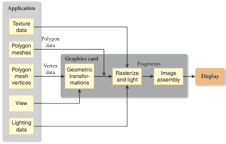

*图 1.8：图形管线，版本 1。*

图 1.8 显示了该管线的一个简化视图：有关正在显示的场景的数据从不同位置进入，并产生输出像素。

对于许多目的而言，管线的确切细节并不重要；人们可以把管线看作一个黑箱，它接收场景的几何模型，并生成这些多边形的基于像素的透视图。（平行投影图也是可能的，但我们暂时忽略它们。）另一方面，对处理本质有所理解是有价值的，尤其是在效率很重要的情况下。管线中方框的细节将在全书中逐步揭示。

即使使用这个简单的黑箱，你也可以编写许多有用的程序，忽略所有物理因素，把从模型到图像的转换视为由黑箱定义，而不是由物理规律定义（比如上文提到的非二次光强衰减）。

在过去十年中，上述管线在某种程度上已经过时。虽然过去的图形应用程序编程接口（API）提供了调整管线每个阶段参数的有用方法，但在许多场景中，这种固定功能管线模型正迅速被取代。取而代之的是，管线的各个阶段，有时甚至是整条管线，正在被称为着色器的程序所替代。编写一个较小的着色器来模拟固定功能管线过去所做的任务很容易，但现代着色器已变得越来越复杂，它们能完成许多以前无法在图形卡上完成的事情。尽管如此，固定功能管线仍然是一个很好的概念框架，可以在其上添加各种变化，而许多着色器实际上正是这样创建的。

### 1.6.1 纹理映射与近似

黑箱的一个标准组成部分是纹理贴图。使用纹理映射时，我们取一个多边形（或一组多边形），并通过在纹理图像中查找来为每个点指定颜色；这项技术有点像是在表面上使用模板，或把贴花粘到物体上。你可以把纹理图像想象成一张带有图片的橡皮膜，例如，它可以是扫描进系统的艺术品、用数码相机拍摄的照片，或用绘画程序创建的图像。纹理坐标描述了这张膜如何被拉伸和变形，以覆盖物体的某一部分。

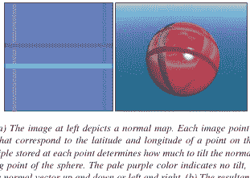

*图 1.9：(a) 左图描绘了一个法线贴图。每个图像点的 x 和 y 坐标对应于球面上某一点的纬度和经度。每个点存储的 RGB 颜色三元组决定了对球面对应点处法线向量倾斜多少。浅紫色表示不倾斜，而四条条纹则使法线向量上下或左右倾斜。(b) 由此得到的外形看起来凹凸不平：通过观察轮廓线可以看出它实际上是光滑的。注意，它还被“颜色纹理化”了，贴上了反射天空。*

使用纹理来修改图像每个点的颜色特征，只是纹理映射众多应用中的一种。纹理映射的核心思想已被推广并应用于许多表面属性。例如，表面的外观部分取决于该表面的**法线向量**（或法线），即每一点处垂直于表面的向量。这个法线向量用于计算光如何从表面反射。由于表面通常由多边形网格表示，这些表面法线向量通常在多边形顶点处计算，然后在多边形内部进行插值，使形状呈现光滑（而不是有棱面）的外观。

如果我们不使用表面的*真实*法线（或如上所述通过插值得到的近似法线），而是在每个多边形的不同点使用明显不同的法线，那么表面在不同点就会有不同外观，例如看起来会更朝向或更背离我们倾斜。如果把这一想法应用到整个表面，我们就能生成一个看起来凹凸不平的表面（见图 1.9），而底层形状实际上几乎是光滑的。

尽管表面实际上是球形的，但它看起来却有许多几何变化。不幸的是，在表面轮廓附近，这种不变的本质会变得明显；这是此类映射技巧的一个常见局限。另一方面，只绘制少量法线贴图多边形而不是数千个单独多边形，可能足以构成优势，使这种选择是合适的。这类选择在图形学中很常见——必须在物理正确性（可能需要巨大模型）与用较小模型制作近似正确的图像之间做出决定。如果模型大小和处理时间占你工程预算的很大一部分，这些就是你必须做出的权衡。

### 1.6.2 更详细的图形管线

如上所述，管线架构让我们可以同时处理许多事情：管线的每个阶段对一块数据执行某些任务，并把结果交给下一阶段；然后原来的管线阶段就可以开始执行


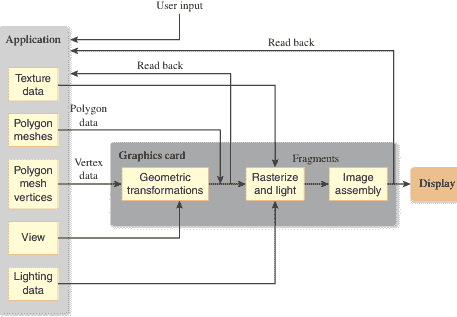

*图 1.10：* 在这幅更大图形流水线的描绘中，应用程序执行一些工作（例如动画）以确定要显示的几何体；这一几何描述被交给图形流水线；最终图像被显示出来。与此同时，用户输入（作为对所显示图像的响应）可能影响应用程序的后续操作，从图形流水线本身读回的数据也可能如此。

下一块数据上的任务。当这样的流水线设计得当时，这可以提高吞吐量，尽管随着阶段增加，输入数据产生结果所需的总时间会继续增加。在交互性能至关重要的系统中，这种*滞后*或*延迟*可能很重要。

图形流水线由四个主要部分组成：顶点几何处理与变换、三角形处理（通过光栅化）与片元生成、纹理与光照，以及用于组装最终图像的片元组合操作；我们下面将总结所有这些内容（第15章和第38章有更详细的介绍）。你可以把这条流水线看作更大的流水线的一部分，该更大流水线体现了典型程序的结构（见*图 1.10*，其中顶点处理部分标为“几何变换”；片元生成、纹理和光照被归入一个方框；表示片元最终处理的部分标为“图像组装”）。

在这个更大的流水线中，应用程序生成要显示的数据，图形流水线将其显示出来。但也可能存在控制应用程序的用户输入（可能是对显示图像的响应），以及从图形流水线读回并用于计算下一幅待显示图像的信息。

图形流水线的每个部分都可能涉及若干任务，这些任务全都按顺序执行。这些任务的具体实现可能各不相同，但此类系统的用户仍可将它们视为顺序执行；图形程序员在创建应用程序时应当牢记这种抽象。这个**程序员模型**就是大多数用于控制图形流水线的 API 所提供的模型。在实际实践中（见第38章），各部分内任务的确切顺序（甚至任务被分配到哪些部分）可能会改变，但图形系统必须产生这样的结果：*就好像*它们按所述顺序处理过一样。因此，流水线是一种抽象——一种思考正在完成的工作的方式；无论底层实现如何，流水线让我们知道结果将会是什么。

流水线的顶点几何部分负责接收物体的几何描述，这种描述通常以多边形网格某些顶点的位置来表示（你可以非正式地把它看作由共享顶点和边的多边形组成的排列，用来覆盖一个物体，即近似其表面），同时接收要施加于这些顶点的某些变换，并计算顶点变换后的实际位置。网格的多边形由这些顶点定义，因此也隐式地发生了变换。

三角形处理阶段接收网格的多边形——最常见的是三角形——以及一个虚拟相机的规格（我们正在渲染该相机的视图），并在称为**光栅化**的过程中逐个处理这些多边形，将它们从连续几何表示（三角形）转换为像素化显示的离散几何（该三角形所包含的像素[或像素部分]的集合）。

由此得到的**片元**（属于该三角形、并且如果未被其他片元遮挡便可能最终出现在显示上的像素或像素部分）随后会根据场景中的光照、已指定给网格的纹理（例如豹子的斑点）等被赋予颜色。

如果多个片元与同一像素位置相关联，通常选择最前面的片元（离观察者最近的那个）来绘制，不过也可以逐像素执行其他操作（例如透明度计算，或“掩蔽”，使得只有某些片元被“绘制”，而其他被掩蔽的片元保持不变）。<sup>8</sup>

在现代系统中，所有这些工作通常都在一个或多个图形处理器（GPU）上完成，这些 GPU 往往位于插入计算机通信总线的独立显卡上。这些 GPU 具有某种独特的体系结构，专门设计用于支持图形流水线快速而深入的流水线化；它们也已变得如此强大，以至于一些程序员开始把它们当作协处理器，用它们执行与图形无关的计算。这个想法——拥有一个独立的图形单元，最终变得非常强大，从而被用作（非图形）协处理器——是一个古老的想法，自20世纪60年代以来已被多次重新发明。在早期几代中，这种协处理器通常被越来越靠近 CPU（例如与 CPU 共享内存），并变得越来越强大，直到它成为 CPU 中如此重要的一部分，以至于设计者开始创建一个与显示器密切相关的*新*图形处理器；迈尔和萨瑟兰在一篇具有历史重要性的论文 [MS68] 中将其称为**轮回之轮**。然而，正如惠特 [Wh10] 所观察到的，这一概念可能略有误导：“我们有时会忘记，著名的‘轮回之轮’在旋转时也在平移，把我们带到不熟悉的技术领域，即使我们仍能认出历史上的相似之处。”

## 1.7 图形学与艺术、设计和感知的关系

图 1.11 顶部的那盏简单的灯只用寥寥几笔就同时传达出形状和设计风格。图 1.11 底部所示的亨利·马蒂斯的《女人脸》不超过13笔，却仍能向人类观看者传达极其丰富的信息；它作为一张脸的可辨识度，远高于许多当代最好的图形学人脸渲染。部分原因在于**恐怖谷**——这是一个来自机器人学的概念 [Mor70]，它指出，随着机器人越来越像人，观看者的熟悉感会增加到某一点，但随后会急剧下降，直到机器人*非常*像人，此时熟悉感会迅速上升到高于此前水平。恐怖谷就是熟悉感低但与人相似度高的区域。同样，那些“几乎正确”的人体图形图像常被描述为“诡异”或“怪异”。但暂且忽略这一点，还有另一个重要差异：马蒂斯的画很简单，而制作逼真的人脸渲染却要耗费巨大的计算工作。这是因为艺术家和设计师对人类视觉系统进行了逆向工程，以便用最少的“绘制预算”取得最大的效果。观察他们的作品有助于我们理解：所有图形学的目标都是*沟通*，而有时最好不是通过写实，而是通过其他手段来实现这一目标。例如，汽车维修手册可以用照片来说明，但顶级手册反而用线条图来说明（见图 1.12），这些图强调重要细节，而省略其他细节。哪些细节重要？这取决于创建图像者的意图以及人类视觉系统。例如，我们知道人类视觉系统对亮度的急剧变化很敏感，并且对垂直线和水平线比对斜线更敏感；这在一定程度上解释了为什么线条画很有效，以及为什么可以承受优先省略斜线，而不是垂直线和水平线。

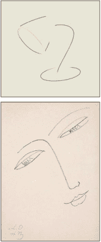

图 1.11：这盏灯由杰克·休斯提供，仅有五笔。马蒂斯的《女人脸》仅用13笔就同时描绘了形状和情绪。

在每个工程问题中都有预算；图形学也不例外。你在图形学中会受到各种限制，例如：在必须绘制下一帧用于显示之前，可以发送到流水线的多边形数量；可以填充的像素数量；以及你能承受在 CPU 中为首先决定要绘制哪些多边形而进行的计算量。正在画某样东西的艺术家也有类似的预算：在页面上放置笔触所花费的精力、被渲染场景变化之前的时间（你不能在午夜画一幅进行中的日落），等等。他们发展出了一些技巧，能在低预算下传达场景：例如，轮廓画效果很好，平涂填充色增加对比度，有助于区分各个物体，等等。我们可以从艺术家对人类视觉系统的逆向工程中学习，并使用他们的技巧来更高效地渲染。而且，由于大多数计算机生成的图像是供人观看的，人脑是判断什么令人满意的最终测量工具。还有另一个预算需要考虑：观看者的注意力。图形学还受时间和精力的限制


图 1.12：维修手册在需要处显示细节，但省略不必要的材料。

8. 注意，选择用光栅网格表示会对最终结果产生某种影响。结果中的信息是有限的！你不能“放大”以在单个像素中看到更多细节。但有时在计算中，单个像素中应显示什么需要以亚像素精度进行处理才能获得满意的结果。我们会经常遇到这种张力：一方面要工作在“自然”分辨率（像素）下，另一方面有时需要进行亚像素计算。


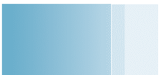

*图 1.13：每个色条都是单一颜色，但每个色条的左侧看起来稍亮一些，右侧稍暗一些，这起到了强调色条之间分界线的作用；这种效应被称为马赫带效应。*

人类观看者预计会花费多少时间来理解所传达的内容，这一点是可以预期的。当然，我们对满意度的标准会随着时间而变化：20 世纪 60 年代和 70 年代制作的图像在当时看来令人惊叹，但以今天的标准来看则完全无法令人满意。

另一方面，有时视觉系统的特性使我们能够对现实做出非常有效但简单的近似，而这些近似完全令人信服：早期的云模型 [Gar85] 非常有效地使用了极其简单的云形状近似，因为只要云看起来蓬松，眼睛对积云几何形状就不太敏感。但很多时候，这种简化会严重失效。例如，我们可以尝试通过为每个三角形填充其自身颜色（**平直着色**），然后使各个三角形变得很小，从而使从一个三角形到下一个三角形的变化非常微小，来使网格呈现出平滑变化的颜色。不幸的是，除非三角形非常小，否则这会导致所谓的**马赫带**现象（见图 1.13），这对眼睛来说极其分散注意力。

## 1.8 基本图形系统

现代图形系统由几个交互设备（键盘、鼠标，或许还有平板或触摸屏）、一个 CPU、一个 GPU 和一个显示器组成。今天的显示器要么是液晶显示器（LCD），要么是阴极射线管（CRT）显示器，尽管等离子显示器和 OLED（有机发光二极管）等新技术正在不断改变格局。每个显示器都显示一个矩形的像素阵列，或者说是可以通过控制三个彩色部分（通常是红色、绿色和蓝色）以不同颜色和不同程度点亮的区域。对于 CRT 而言，当单个像素被点亮时，它会在屏幕上产生一个发光的、近似圆形的区域，其中包含 RGB 三基色荧光粉，该区域中心明亮，边缘迅速变暗，因此相邻像素的明亮区域仅会重叠一点点。对于 LCD 而言，屏幕后面有一个背光源，每个像素是一组三个小矩形，允许背光在红色、绿色或蓝色光谱中的一定量通过并到达观看者。像素之间有非常小的间隙（就像瓷砖地板上的勾缝），但在大多数情况下，我们可以将 LCD 像素视为完全覆盖屏幕。每个像素的亮度（在任一类型的显示器上）都可以由程序控制；除非在极其严格的情况下，我们还可以假设所有像素都能够显示相同的亮度，并且不存在

从欧几里得空间的连续几何到屏幕的光栅化几何（其间使用光栅化纹理）的各种转换涉及许多微妙之处，将在第 18 章讨论。

## 1.9 将多边形绘制视为黑盒

鉴于执行管线中各个步骤（尤其是涉及从连续几何到离散几何的转换的步骤）的困难，我们暂时可以将多边形绘制视为一个黑盒：我们有一个图形系统，当被告知绘制一个多边形时，它会以某种方式使显示器上的正确像素以正确的颜色被点亮。这种黑盒方法将让我们能够尝试交互、颜色和坐标系。我们将在后续章节中回到细节。

## 1.10 图形系统中的交互

以某种形式显示图像的图形程序通常也具有某种程度的用户交互。例如，在许多程序中，用户用鼠标点击对象、选择菜单项并在键盘上输入。然而，某些程序（实际上是许多 3D 游戏）中的交互级别要复杂得多。

图形程序通常通过拥有两个并行执行线程来支持这种交互；一个线程处理主程序，另一个线程处理 GUI。GUI 的每个组件——按钮、复选框、滑块等——都与主程序中的一个**回调过程**相关联。例如，当用户点击一个按钮时，GUI 线程调用该按钮的回调过程。该过程反过来可能会修改某些数据，也可能要求 GUI 更改某些内容。

举个例子，想象一个简单的游戏，用户必须猜测计算机选择的数字——要么是 1、2，要么是 3。为此，用户点击三个按钮之一。如果用户点击了正确的按钮，显示器显示“你赢了！”；如果不是，则显示“再试一次”。在这种情况下，当用户点击按钮 2 但秘密数字是 1 时，按钮 2 的回调执行以下操作。

- 1. 检查 2 是否是秘密数字。
- 2. 因为 2 不是秘密数字，它请求 GUI 显示“再试一次”消息。
- 3. 它请求 GUI 灰度化（禁用）“2”按钮，以便用户不能多次猜同一个错误答案。

当然，按钮 1 和按钮 3 的回调会非常相似，并且在每种情况下，如果猜测正确，按钮会请求 GUI 显示用户已经获胜的事实。

对于更复杂的程序，回调的结构当然可能复杂得多，但总体思路就是这样。人们将回调中的代码称为按钮的“行为”；因此交互组件既有*外观*又有*行为*。毫不奇怪，许多成功的界面将两者关联起来——组件的行为在一定程度上可以被面对其外观的用户推断出来。（最简单的例子就是带文本的按钮。“退出”按钮在被点击时，应该使程序[或某个操作]退出！）

调度 GUI 线程和应用程序线程的整个事务通常由图形框架通过操作系统处理，这种方式通常对程序员完全透明。

## 1.11 不同类型的图形应用

各种各样的应用都使用计算机图形学，许多不同的特征决定了这些应用的整体特性。随着当前应用和应用领域的激增，不可能对它们全部进行分类。相反，我们将研究这些应用之间的差异。

以下是一些相关标准。

- 显示是每个刷新周期都在变化（许多计算机游戏的典型特征），还是变化相当少（文字处理器的典型特征）？
- 程序使用的坐标是通过一种抽象来描述的，在程序中被视为浮点数（如许多游戏），还是以单个像素坐标作为定义位置的方式（如某些早期程序）？
- 通常正在显示一个数据模型；从该视图到显示的转换是用相机模型（3D 游戏的典型特征）还是其他方式（比如在文字处理程序中看到文本文档的可视部分）来描述的？在每种情况下，都需要**裁剪**（不显示）数据中位于显示器上某个矩形之外的部分。
- 正在显示的对象是否具有关联的行为？GUI 上的按钮和菜单就是这样的对象；视频游戏中“坏人”的图片通常不是。（点击坏人没有效果。向坏人开枪可能会杀死他，但这是另一种交互，基于游戏逻辑而不是所显示对象的交互行为。）
- 显示是在尝试呈现对象的物理真实表示，还是在呈现对象的抽象表示？用于创建电子电路原理图的工具并不旨在展示这些原理图如果打印在纸上并在阳光充足的办公室中观看会是什么样子。相反，它呈现了原理图的抽象视图，其中所有线条的深色程度相同，背景的所有部分亮度相同，并且各自的明暗是用户决定的属性，而不是某种物理模拟的结果。相比之下，3D 电脑游戏中的显示通常追求照片级真实感，尽管现在有些游戏为了传达情绪而故意追求非照片级真实感的效果。

以下标准不太关键，但仍然很重要。

- 抽象的浮点坐标是否有单位（英尺、厘米等），还是仅仅是数字？有单位的一个优点是，单个程序可以通过确定正在使用哪种显示器——19 英寸台式显示器还是 1.5 英寸手机显示器——来适应自身。该


例如，桌面端显示驾驶路线时可能展示整条路线，而手机端则可能显示一个可滚动、可缩放的小块区域。由于显示像素尺寸差异很大，在许多情况下物理单位比像素数量更有意义。

- 图形平台是否通过变化模型来处理更新？如果平台要求你先更新待显示内容的模型，然后在必要时自动更新显示，并按需查询该模型，那么编程要求相对简单，但更新的处理方式可能不受你控制。而不提供这种更新的系统，例如在重叠窗口移动暴露出新显示区域时，就需要应用程序自行执行“损坏修复”。屏幕显示开销可能非常高的程序（某些图像编辑程序就是这样）更倾向于自行处理损坏修复，这样当用户移动显示图像的窗口时，新暴露出来的部分在移动过程中只是偶尔填充，因为持续填充可能会使移动变得过慢，影响正常使用。

许多二维图形属于物理真实感较弱的类别；大多数显示对象都有相关行为，显示更新的频率相对较低。许多2.5D图形应用——用户处理多个“叠放在一起”的二维对象（许多图像编辑程序中的图层就符合这种模型）——产生的图像也远非真实。在某些此类程序中，更新显示的成本可能成为关键资源。相比之下，许多三维图形应用依赖模拟和真实感，而3D场景中的对象往往较少具备“行为”——即“对鼠标或键盘等设备交互作出反应”这类意义上的行为，尽管这种情况正在迅速改变。

毫不奇怪，2D、2.5D和3D程序的不同需求意味着图形学中的许多问题并没有一个统一的最佳答案。电路设计程序不需要物理真实的渲染能力，就像快速反应类游戏通常也不需要庞大的交互组件层次结构一样。

## 1.12 不同类型的图形软件包

程序员在编写图形程序时，起步选择非常广泛。由于显卡——即生成屏幕显示数据的硬件——或同等芯片组在每台机器之间差异很大，通常需要以某种软件抽象来封装显卡的能力。这种抽象被称为**应用程序编程接口（API）**。一个图形API可以简单到只是一个函数，让你设置显示屏上各个像素的颜色（尽管在实践中这种功能通常只是更通用API的一小部分）；也可以复杂到一个系统，程序员通过API描述一个由高级对象及其属性、光源及其属性、相机及其属性组成的场景，然后场景中的对象被渲染成仿佛被这些光源照亮、从这些特定相机观察到的样子。通常这类高级API只是一个更大应用开发系统的一部分，例如现代游戏引擎，它们还可能提供物理模拟、角色人工智能，以及自适应显示质量以维持帧率的系统等功能。

有一系列软件系统可用于辅助图形程序，从能较直接访问硬件的简单API，一直到处理所有交互、显示刷新和模型表示的更复杂系统。这些都可以合理地称为“图形平台”，这个词我们之前一直用得有些含糊。这些系统及其功能的多样性是第16章的主题。

## 1.13 真实感渲染的构建模块：简要概述

当你想要从现实模型出发，在用户心中创造出看到特定事物的错觉时，你需要具备以下条件：

- 对光的物理特性的理解
- 对光与之相互作用的材料以及相互作用过程的建模
- 对捕捉光的方式（通过真实或虚拟相机，或人眼）以生成图像的建模
- 对现代显示技术如何产生光的理解
- 对人类视觉系统及其如何感知入射光的理解
- 以及对描述以上许多事物所涉及的大量数学知识的理解

自底向上学习这些内容的困难在于，你在创作第一张图片之前必须学很多东西；许多理性的学生会问：“我为什么不直接从网上找点东西，跑一下，然后开始修改直到得到我想要的？”（答案是：“你可以这么做，但相比先建立一些理解，这样可能反而更费时间才达到最终结果。”）作为作者，我们必须应对这种矛盾。我们的方法是先告诉你上述各项的一些基础知识——足够让你在开始创作第一张图片时知道哪些做法是近似，哪些是正确的——然后带你经历一些非常有效的近似图像制作方法。只有这样，我们才回到更高的目标：理解理想情形以及我们如何接近它。

### 1.13.1 光

第26章会相当详细地描述光的物理特性。目前，我们依赖你对光的直觉理解，并列出一些基本原则，这些原则将在后面的章节中进一步细化。

- 光在真空中沿直线光线传播，遇到表面时停止。
- 光像台球一样从它遇到的任何光滑表面弹开，遵循“入射角等于反射角”的模型，或被表面吸收，或两者兼有（例如，40%被吸收，60%被反射）。
- 大多数看似光滑的表面，例如粉笔的表面，在微观上其实是粗糙的。这些表面的行为就像是许多微小光滑小面的集合，每个小面都遵循前一条规则；因此，照射到这种表面的光会向许多方向散射（或者像前一条中提到的那样被吸收，如镜面反射的情况）。
- 平板材料上的一个小孔允许一束光线通过，所有光线都穿过或非常接近小孔的中心。
- 相机的一个像素，或眼睛中一个感光细胞，会在一小段时间内对到达小区域的所有光进行累加（通过积分）。积分的数值就是传感器响应，对应于该像素（或细胞）基于入射光子数量“看到”的总光量。
- 显示屏上的一个像素可以调节为发射特定强度和颜色的光。

就这样！这个光的模型已经足够生成非常真实的图片了。上述每一条都只是近似正确，但对许多用途来说已经足够精确。有了这些，还有三个大挑战。首先，我们需要一些数据结构来表示场景中的表面、相机和光源。其次，我们需要一种算法来评估所有的光反射和积分。第三，也是最重要的，数据结构和算法都必须高效。自然界用大约每平方米每秒10²¹个光子来产生阳光照射场景的图像；即使计算机比现在强大十亿倍，我们仍然无法负担真正模拟每一个光子运动的循环或数据结构。

### 1.13.2 物体与材质

我们关于物体的最初假设是，它们由在其表面反射或吸收光（或两者兼有、比例不同）的材料组成。我们假设空气既不反射也不吸收——光只是穿过它。同时，我们暂时忽略会透光的材质，例如水和玻璃，并在一定程度上忽略皮肤这类材质。

因为我们假设光只与材料的表面相互作用，所以我们用表面来表示物体，而表面通常又由具有三角形面的多面体来表示。由于面与面之间的边缘没有表面积，我们忽略它们，并视所有光与物体的交互都发生在三角形内部。多面体的每个三角形面片T都位于某个平面内，有一个垂直于该平面、从物体指向空气（或空空间）的单位向量n；我们称其为三角形T的法向量。如果多边形物体对原始表面近似得很好，那么这个法向量就近似（并且常常被视为）原始表面的表面法线，即该表面在某一点处的垂线向量（见图1.17）。

对于像镜子这样的完全反射表面（镜面表面），以方向ℓ¹⁰到达并击中三角形T的光会在ℓn平面内反射，且

> 10. 描述到达表面的光有两种可能的选择：要么记录光子的传播方向（以传输为中心的观点），要么记录从表面点到光的方向（以反射为中心的观点）。目前，我们用ℓ表示前者；许多论文用L表示后者。


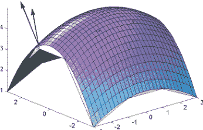

图 1.17：一个半透明的光滑表面及其法向量（红色），内部有一个多边形近似（白色），以及多边形网格在对应点处的法向量（绿色）。

出射向量与 **n** 的夹角等于 **ℓ** 与 **n** 的夹角。

对于其他表面，入射光会向许多方向散射。对于完全漫反射的表面，光向各个方向散射（图 1.18），但反射光的亮度与点积的绝对值¹¹ |ℓ · n| 成正比，即表面法线与入射光方向之间夹角的余弦值。¹² 因此，正对光源的表面无论从哪个方向看都是明亮的，而稍微偏离光源倾斜的表面则显得较暗。这种散射早在计算机图形学发展之前就由 Lambert 描述了。作为散射的前提条件，表面必须面向光源，即 ℓ · n < 0。（这种朗伯反射模型将在第 6 章和第 27 章中进一步讨论。）

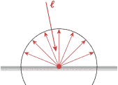

图 1.18：光沿方向 ℓ 到达，并向所有方向反射。对于亮度固定的光源，当 ℓ 垂直于表面时，反射光的强度最大。

对于有些闪亮的表面，其外观取决于你的视角；如果你在光线充足的房间里观察一个表面并来回移动头部，你可能会看到高光在表面上移动。这可以通过一个经验上相当不错的拟合来建模：假设反射光与 (n · h)ᵏ 成正比，其中 k 为某个指数，h 是由从表面到光源的向量 −ℓ 和从表面到眼睛的向量 e 的平均值，并将该向量调整为单位长度得到的：

h = (e − ℓ) / ‖e − ℓ‖    (1.4)

这种散射模型归功于 Phong [Pho75] 和 Blinn [Bli77]，并在图形学中被广泛使用。一般来说，表面反射的光是漫反射、一定程度的闪亮反射和镜面反射的组合。

- ¹¹. 点积将在第 7.6.4 节中回顾。
- ¹². 这种描述非常模糊，几乎毫无意义：要使其合理，我们需要讨论如何度量光的亮度（这里我们非正式地使用这个术语），这相当微妙。目前，你只需要想象亮度是以某种未说明的单位从零到一衡量的。

### 1.13.3 光的捕获

相机中的传感器和人眼都以类似的方式对光做出响应：它们在一段时间内积累光能，然后报告积累的能量。对于传感器来说，时间段由快门开启决定；对于眼睛中的细胞来说，当积累的光达到某个水平时，细胞会发送信号，因此信号的频率与到达的光强度成正比。因此，模拟这样的传感器（或细胞）需要计算入射光在传感器面积上的积分。对于除最简单场景外的任何场景，写出该积分的解析解都是不切实际的。对于更有趣的场景，我们必须进行数值积分。这必然引入一些误差，但也开辟了大量的计算选项，可以在质量与时间和空间之间进行权衡。我们必须通过**数值积分**来近似积分，这涉及在多个位置评估被积函数（这称为**采样**），然后组合这些样本以估计整体值。该方法最简单的版本是**仅**在传感器中心评估入射光，并将该样本乘以传感器的面积来估计整体入射光积分。如果入射光强度随位置变化缓慢，这种方法效果很好；如果变化迅速，单样本近似会引入多种误差。

### 1.13.4 图像显示

现代显示器通常被划分为称为**像素**的小方块；每个小方块¹³ 都可以单独寻址，并通过指定一个三元组数字 (r, g, b)（每个数字在 0 到 255 之间）来控制其发出红、绿、蓝（RGB）光的混合。方块发出的光量*不*与数字直接成正比；相反，它遵循一种关系，使得数字的相等差异大致对应于感知亮度的相等差异。你可能在某些照片编辑程序中遇到过 RGB 三元组的使用；通常 RGB 值各占一个字节，因此用 0 到 255 之间的数字表示，有时写成两位十六进制数。因此，颜色 0xFF00CC 可以理解为“Red 是 FF，即 255，完全没有绿色，Blue 是 CC，即十进制的 204；这意味着它是一种略带红色的紫色。” 任何给定的颜色三元组或十六进制值会产生什么色调并不明显；颜色规范将在第 28 章讨论。

- ¹³. 术语“像素”也用于表示图像中存储的一个值，或传感器的一个小物理部分。这些含义之间存在细微差别，你不应说“像素是一个小方块” [Smi95]。

### 1.13.5 人类视觉系统

我们的眼睛对到达晶状体、穿过瞳孔并到达角膜的光做出响应。虽然直射阳光几乎比黑暗卧室中的微弱光线亮 10<sup>10</sup> 倍，但我们的眼睛可以检测和处理两者，但不能同时进行。事实上，我们的眼睛会适应周围的一般光照，*一旦适应*，我们就能区分大约 1000 倍范围内的光强度：我们能从黑色中区分出的最微弱的东西，其呈现给眼睛的光强度约为我们感知为“尽可能亮”的物体的 1/1000。

然而，我们对亮度的感知不是线性的：如果你在一张白纸上打印细黑条纹，使得只有 20% 的白纸保持可见，它将只反射照射到其上的 20% 的光。但如果你将这张纸放在一张同类型空白白纸旁边，并从足够远的距离观察两者，使条纹不可见，那么打印过的纸看起来大约是未打印纸亮度的一半。粗略地说，对于适应了给定光照水平的眼睛，将入射光强度降低 80% 会使光看起来暗一半。

我们的视觉系统会组织到达眼睛的光和暗的模式，并试图理解它们。视觉系统对不良输入的适应能力极强：我们可以拿一张黑白照片，添加噪声（灰度变化），仍然能够识别其中的物体。即使在暴风雨中，我们也能认出自己的家。我们可以在明亮的阳光下或黑暗的房间里认出朋友。事实上，我们的视觉系统对形状的感知调校得如此之好，以至于即使我们在看老式模拟电视上的静态图案时，偶尔也会相信自己看到了可识别的图案。这种对不良输入适应性的一个后果是，任何触发大致正确反应的刺激都会导致识别：一对骰子的照片、它们的铅笔画，以及它们糟糕的计算机图形渲染，*都*会在我们的大脑中产生看到一对骰子的感知。这对计算机图形学领域来说既是福也是祸；这意味着即使是非常糟糕的现实近似也能生成我们可识别的图像，因此入门图形学很容易。另一方面，人们也很容易相信那些糟糕的近似是正确的，因为它们“看起来不错”，这可能会阻碍该领域的进步。视觉系统的适应性有两个影响。首先，在图形学上“随意摆弄”可能非常令人满足，因为由于适应性，即使是初步结果也看起来足够好，让你相信自己在取得进展。其次，在视觉上看起来非常接近完美的结果，实际上可能由完全错误的程序生成，因为你的视觉系统在向你隐藏错误。随意摆弄确实很有趣（我们鼓励你抓住一切机会这样做），但它可能会让你偏离真正的目标。因此，我们编写本书的结构是，让你能立即获得制作出相当不错的图片的满足感，但同时也让你在学习过程中了解所学技术的局限性，以便你为后面遇到的更高级技术做好更充分的准备。如果你发现自己问：“但在这种情况下难道不会看起来不对吗？”答案几乎肯定是“会的！”，后面的章节将帮助你理解如何解决这些局限性。

回到感知的重要性，在资源关键的应用中，理解感知过程使我们能够做出明智的决策，了解在保持视觉保真度的同时可以进行哪些类型的近似。

### 1.13.6 数学

我们不打算简要介绍计算机图形学中涉及的所有数学，而是在需要时引入相关概念；其中大多数与对图形学的基本理解并不直接相关，而是与我们在图形学中使用的事物的高效表示或近似有关。然而，在第 2 章和第 6 章让你初步体验 2D 和 3D 图形之后，我们将在第 7 章回顾一些我们认为读者已经熟悉的数学知识，部分原因是为了确立全书将遵循的符号约定。你只需了解算术和代数就可以编写图形程序，但


要以合理的方式真正处理这些问题，你需要熟悉以下内容：

- 三角学
- 小向量和矩阵的运算（我们在本章已经讨论过）
- 积分和导数
- 以及一些几何与拓扑的概念，例如连续性、三维空间中的曲面几何，以及曲率

所有这些都会因为具备基础线性代数的实用知识而变得更容易，我们假定你在阅读全书时都掌握这些知识。

### 1.13.7 积分与采样

计算机图形学中发展最完善的领域是**真实感渲染**——从某个场景模型及其中的灯光生成一幅图像。渲染图像中的每个像素可以被看作是对穿过场景中某些光线的光线的*测量*，就像数码照片中的每个像素是对相机中感光元件上一个小区域所接收到的所有光线的测量一样。这可以看作是对该区域上入射光能量的积分。由于精确计算大多数此类积分并不实际，我们最终会使用近似方法（例如，我们之前提到的规则：积分近似等于区域中心处的值乘以区域的面积）。在这样做的过程中，我们用从单个样本计算出的值替代了期望值；我们本可以使用更多样本，但在实践中，我们总是使用有限数量的样本，并用这些样本来估计某个积分。因此，采样的过程，以及通过样本逼近积分的过程，是渲染的核心。

◇ 科学中的每一次测量都是一种统计行为：我们的测量设备可能每天都在以不同的方式工作；我们测量的对象可能只是众多可能的、近乎等价的测量之一（想想测量烧杯中水的温度；你实际上只是在烧杯的某一处测量它）。在渲染的情况下，统计量是某个积分；随机变量是我们用来计算该积分的一组样本，其结果是，对场景的给定渲染通常取决于某个随机数生成器：使用相同软件对同一场景进行多次渲染，会对任何特定像素产生不同的值。这种值的分布通常会聚集在某个平均值附近，我们希望这个平均值是正确的，并且它会有一定的方差。如果相邻像素的方差是不相关的，它可能会在输出像素中表现为斑点或视觉噪声。如果它是相关的，它可能会表现为**锯齿**——一种本应是平滑对角线的阶梯状表示。这意味着评估算法的质量也需要统计测量。

### 1.14 学习计算机图形学

计算机图形学的主题内容已经无法以任何合理的方式线性化。每个主题与其他主题交织在一起，以至于无法决定先讨论哪一个，任何呈现方式最终都会是层层揭示：先给出初步描述，然后进行后续修正，再做进一步改进，等等。读者自然喜欢结构清晰的书籍；例如，当你想查阅有关多边形网格的内容时，你希望有一章包含所有多边形网格的信息。话虽如此，如果一本书在进入下一个主题之前就把每个主题完整讲完，那么你可能至少要等到整个学期结束才能画出你的第一张图片！

我们做了折中。在这本入门章节中，我们为你提供了一些关于光、感知、形状表示以及光与形状相互作用非常非正式的信息，以便你能够立即理解如何制作一些图片。当你确实用这些粗略的模型制作图片时，图片不会很好。当然，你画的方方正正的机器人会被认出来是一个方方正正的机器人，但通过批判性地观察它，你很快就会意识到，你不可能用真正的机器人形状（比如用纸板、胶带和颜料做成）并用真实相机拍摄，得到与你制作的图片相近的任何东西。它不是照片级的。但制作这些第一批图片会让你获得建模、线性代数的某些应用、多边形网格以及一些渲染关键思想方面的经验，所有这些都会让你在遇到更丰富或更准确的光、反射、物体等模型时，能够更好地理解和实验这些模型。

接下来的几章介绍了微软的 Windows Presentation Foundation（WPF），一个用于编写图形程序的框架，一些渲染的基本思想，视觉感知的介绍，以及大量在图形学中通用的数学知识。

第2章介绍 WPF 的 2D 方面，让你熟悉绘制简单的 2D 形状。WPF 使用声明式的图形规范——这与更传统的 API 形成对比——这很有价值，因为它既提供了更高层次的抽象，也因为其解释性特性使其非常适合快速原型设计。WPF 中的建模基于形状的分层表示，这种表示在几乎所有图形 API 中都被广泛使用。

第3章描述了一个用于制作非常简单3D形状的简单图片的程序，以便你从一开始就能理解简单图形学是如何工作的。第4章描述了本书其余大部分内容中你将用于图形学实验的两个 WPF 程序。

第5章涵盖感知，描述了人类视觉系统中一些最相关的方面。

在第6章中，我们介绍了 WPF 的 3D 方面，其中也非正式地介绍了用于形状建模的几何工具，以及我们在本章中描述的光与物体相互作用的简单模型的应用。它还延续了第2章中介绍的复合形状分层模型的描述。

在有了使用 WPF 2D 和 3D 版本的经验后，你将为第7章的图形学数学基础复习做好准备。第8章到第13章介绍了线性代数，它是大量计算机图形学的核心，以及某些表示拓扑和几何的数据结构，我们通过这些数据结构来制作图像。

在此之后，我们（在第14章中）再次讨论对现实的常规近似——模型——这些模型被用于许多基本图形系统中。我们描述了光、形状、材料以及光在场景中如何传播的模型，每一种都比本章中的描述更详细。这一相当长的章节不仅为你后续关于渲染、形状表示和材料表示的内容做好准备，还介绍了许多对理解遗留程序至关重要的主题。

在理解了光和反射的基本模型后，我们可以制作两个渲染器的初步版本：光线追踪器和光栅化器（第15章）。这样会引入每种渲染的关键思想和挑战；因为我们的初步版本非常基础，第15章也介绍了两者的部分问题，以及对现实的常规近似。

在第16章中，我们讨论各种图形系统，并将它们与 WPF 进行比较和对比；到本章结束时，你将接触到传统计算机图形学中教授的许多内容。

本书其余章节讨论图像和信号处理、光、颜色、材料、纹理和渲染；涵盖一些交互技术、支持渲染以及许多交互方法的几何算法和数据结构，以及各种形状建模方法；并介绍动画和图形硬件。这些章节比前面的章节更少顺序性，更多相互依赖性。如果你想学习如何创建有趣的形状，你可以跳过一些章节直接阅读样条和细分曲面，但你会发现其中引用了第17章到第19章中引入的卷积和滤波思想。你可以在第32章阅读一些可用的最佳渲染算法，但你会发现那里的讨论在很大程度上依赖于第31章对渲染理论的讨论。这不应阻止你采用这种方法；对许多学生来说，正是让实用算法工作的愿望激励他们更多地学习理论，如果你带着特定问题去阅读第31章，你可能会发现这些材料更容易吸收。


本页有意留白

从平板电脑到桌面设备，以及 3D 渲染与 2D 用户界面及可视化（例如地图、示意图、数据网格/图表等）的常见集成。

本章及其 3D 续篇（第 6 章）构成一个序列，因此充分理解本材料并熟悉 XAML 是学习第 6 章的前提。因此，我们强烈建议你使用配套实验软件完成相关练习；该软件在集成编辑器/解释器中呈现小型 XAML 程序，提供即时反馈，从而降低学习曲线，并使实验变得轻松且富有启发性。

## 2.2 2D 图形管线概述

在第 1 章中，我们看到图形平台是应用与显示硬件之间的中介，提供与输出（指示 GPU 显示信息）和输入（调用应用中的回调函数以响应用户交互）相关的功能。为了讨论各类图形平台，我们先从高层视角查看一个 2D 图形应用，如图 2.1 所示。

应用的目的很少只是绘制像素。通常，某些数据——我们称之为**应用模型**（**AM**）——由渲染图像表示，并通过用户与应用的交互进行操作。在典型的桌面/笔记本电脑环境中，应用与窗口管理器协同运行，窗口管理器决定分配给每个应用的屏幕区域，并负责**窗口装饰**（即标题栏、调整大小手柄、关闭/最小化按钮等，在图 2.1 中以浅绿色显示）的显示和交互。应用的重点是通过调用图形平台 API 在**客户区**（图 2.1 中的红色区域）内绘制，客户区即窗口内部。平台通过驱动 GPU 生成所需渲染来响应这些调用。

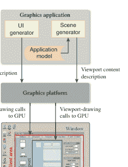

*图 2.1：图形平台作为 2D 应用与窗口管理器分配的显示设备屏幕空间资源之间的中介。*

通常，应用将客户区用于两个目的：一部分区域用于应用的用户界面（UI）控件，其余区域包含**视口**，用于显示**场景**的渲染结果，而场景由应用的**场景生成器**模块从 AM 中提取或派生。如图所示，生成用户界面的 **UI 生成器**模块与场景生成器彼此独立，且运行方式差异很大，尽管二者都使用底层的 2D 平台来驱动显示。

我们在 2D 语境中使用“场景”和“视口”这两个术语，可能会让有 3D 图形经验的人感到意外，因为在这些领域，这两个术语以 3D 为中心使用。在 2D 领域，我们类似地使用“场景”一词，表示将被渲染以创建 AM 特定视图的 2D 形状集合。请注意，2D 场景生成器直接对应于 3D 应用中的场景生成器，后者向 3D 平台提供数据以生成渲染。同样，我们在 2D 中使用“视口”一词——表示场景渲染结果将出现的区域——与 3D 用法一致。

考虑一个室内设计应用，它显示并允许编辑家具布局。应用模型记录与给定家具布局相关的所有数据，包括非图形数据，如制造商、型号、价格、重量和其他物理特征。其中一些信息用于生成模型的图形视图，另一些仅用于非图形功能（例如采购）。应用的场景生成器的任务是遍历应用模型，提取或计算与所需场景相关的几何信息，并调用图形平台 API 来指定要渲染的场景。

场景可以包含应用模型中所描述全部几何体的可视化，也可以表示其子集（例如，仅显示正在设计的房屋中的一个房间）。此外，类似于数据库的多个视图，应用可以使用不同的呈现样式为同一几何信息提供多个视图（例如，将家具显示为轮廓，或显示为填充了模拟织物或木材纹理的形状）。

在上面的示例中，应用模型本质上是几何的。然而，在其他应用中，AM 可能完全不包含几何数据，这在**信息可视化**应用中很典型。例如，考虑一个存储一组国家的人口和 GDP 统计数据的数据库。在这种情况下，场景通常是由场景生成器从 AM 派生出的图表或图形，旨在以直观的可视化方式呈现这些统计数据。数据可视化应用的其他示例包括组织架构图、天气数据，以及叠加在地图背景上的投票模式。

## 2.3 2D 图形平台的演变

图形平台经历了与编程语言和软件开发平台相同的从低层到高层的演变（如图 2.2 所示）。每一代新的光栅图形平台都提供了越来越高的抽象层次，吸收了以前由应用负责的常见任务。

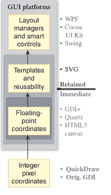

*图 2.2：商业 2D 图形平台抽象层次的演变——从立即模式到保留模式。*

### 2.3.1 从整数坐标到浮点坐标

我们将从 20 世纪 80 年代和 90 年代初光栅图形的发展状况开始。典型的流行 2D 光栅图形平台（例如 Apple 最初的 QuickDraw 和 Microsoft 最初的 GDI）提供了使用整数坐标系在矩形画布上绘制像素的能力。应用不是绘制单个像素，而是通过调用绘制图元的过程来绘制场景；这些图元要么是几何形状（如多边形和椭圆），要么是预加载的矩形图像（通常称为位图或像素图，用于显示照片、图标、静态背景、从字体字形集中提取的文本字符等）。此外，每个几何图元的外观通过指定属性来控制；在 Microsoft API 中，画刷属性指定图元内部应如何呈现，画笔属性控制图元轮廓应如何呈现。

例如，图 2.3 所示的简单时钟图像由四个图元组成：一个使用纯灰色画刷填充的椭圆、两个使用纯海军蓝画刷填充的多边形（用于时钟的时针和分针），以及一条用红色画笔绘制的线段（用于秒针）。

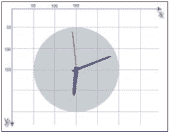

*图 2.3：带有 GDI 坐标系叠加的时钟场景。*

在原始 GDI 的最简单使用场景中，应用使用直接（一对一）映射到屏幕像素的整数坐标，原点 (0,0) 位于画布左上角，x 值向右递增，y 值向下递增。

应用通过函数（例如 `FillEllipse`）指定每个图元，该函数接收整数几何规格以及外观属性。（此示例应用的 GDI 源代码作为本章在线材料的一部分提供。）这种指定方式让人联想到在方格纸上绘图；例如，灰色圆形表盘的几何信息通过以下数据对传递给 `FillEllipse` 函数：

- 中心点：(150,150)
- 边界框（最小的轴对齐包围矩形）：左上角位于 (50,50)，尺寸为 200 × 200

这个表盘渲染到输出设备上时会有多大？这个问题没有确定答案。显示尺寸取决于输出设备的分辨率¹（例如每英寸点数，即 dpi）。假设我们的时钟应用最初是为 72dpi 显示屏设计的。如果应用在更高分辨率的设备（例如 300dpi 的打印机或屏幕）上测试，时钟图像会变小，并可能难以辨认。相反，如果目标显示器改为早期智能手机的小型低分辨率屏幕，图像可能变得过大，只能看到其中一小部分。

光栅图形社区通过借鉴矢量图形中早已存在的思想，解决了这种分辨率依赖问题：使用浮点数来支持替代坐标系，使几何规格与设备特定特征隔离开来。在 2.4 节中，我们将介绍并比较两种这样的坐标系：物理坐标系（基于实际测量单位，如

¹ 这里“分辨率”一词的用法不同于另一种常见用法，即显示器像素总数（例如“分辨率为 2560 × 1440 的 LCD 显示器”）。


毫米和排版点）和**抽象**（具有应用确定的语义）。

### 2.3.2 即时模式与保留模式平台

从基于整数的规范到浮点数的演变是所有主要 2D 图形平台共同经历的，但最终出现了“分裂”，产生了两种具有不同目标和功能的架构：**即时模式（IM）**和**保留模式（RM）**。

前一类包括一些平台（如 Java 的 `java.awt.Graphics2D`、Apple 的 Quartz 和第二代 GDI+），这些平台是提供对图形输出设备高效访问的薄层。这些精简平台不保留应用程序指定的图元的任何记录。例如，当调用 GDI+ 的 `FillEllipse` 函数时，它会立即（因此称为“即时模式”）执行其任务——将椭圆的坐标映射到**设备坐标**，并在显示缓冲区中绘制相应的像素——然后将控制权返回给应用程序。在最基本的情况下，程序员在 IM 中工作的模型是直接的：要在渲染图像中实现任何更改，场景生成器将遍历应用程序模型，以重新生成表示场景的图元集。

IM 平台的精简特性使其对那些希望尽可能接近图形硬件进行编程以获得最大性能，或产品必须尽可能保持较小资源占用空间的应用程序开发人员颇具吸引力。

但其他应用程序开发人员则寻求尽可能多地分担开发任务的平台。为了满足这些开发人员的需求，RM 平台在一种我们称为**场景图**的专用数据库中保留要查看/渲染的场景表示（将在第6章和第16章进一步讨论）。如图 2.4 所示，应用程序的 UI 和场景生成器使用 RM 平台的 API 来创建场景图，并且可以通过简单编辑场景图来增量指定更改。任何增量更改都会使 RM 平台的显示同步器自动更新客户区中的渲染。由于 RM 平台保留了整个场景，因此它可以承担许多常见任务，不仅涉及显示，还涉及用户交互（例如，**拾取相关性**，即确定哪个对象是用户单击/点击的目标，如 16.2.10 节所述）。

所有 RM 包都可以追溯到 Sketchpad [Sut63]，这是 Ivan Sutherland 在 20 世纪 60 年代初的开创性项目，它开创了交互式图形领域。Sketchpad 支持创建**主模板**，可将其实例化一次或多次到画布上以构建场景。每个模板都是一个图元组，可能包含从属模板的实例，它们捆绑在一起组成一个统一的图形对象。每个实例都可以进行几何变换——即定位、定向和缩放——但在所有其他方面，实例都保持其主模板的外观，对主模板的更改会立即反映在所有实例中。

Sketchpad 的这些关键思想在所有现代 RM 包中得以保留，使这些平台成为创建用户界面的绝佳基础。UI 控件（也称为小部件）是模板化对象，作为一个集成集合，具有内在一致的**外观和感觉**。在这个常用短语中，“外观”一词指的是图形设计/外观（大小、形状、字体、颜色、投影等）。“感觉”一词则涉及控件的动态行为，通常是响应于用户交互，可细分为内置自动反馈行为和语义/应用行为。内置反馈的示例包括：当前被禁用的控件变灰，指针进入按钮区域时按钮发光高亮，以及用户在控件的文本框中输入时显示闪烁光标。这些反馈行为通常包括漂亮的动画，由平台执行，无需应用参与。当然，当用户发起应用操作（例如单击按钮提交表单进行处理）时，应用必须参与其中。为了触发此类活动，RM 只需调用附加在被操作控件上的应用回调函数。

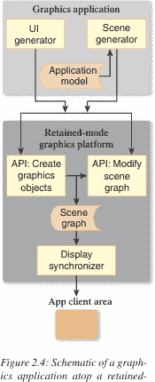

大多数 RM UI 平台还包括布局管理器，这些管理器以悦目且有序的方式在空间上排列控件，保持一致的尺寸和间距，并在 UI 区域的大小或形状发生程序或用户发起的更改时自动调整布局。

一套设计良好的 UI 控件需要由具备图形和 UI 设计专业知识的团队付出大量工作；构建一个令人愉悦且直观的 UI 框架绝非易事。渲染和布局 UI 以及处理用户交互构成了构建交互式应用的大部分工作，因此 RM UI 平台（如上所述，可分担许多任务）的使用如此普遍也就不足为奇了。事实上，很难找到一款不使用 RM UI 平台来处理其几乎全部交互需求的现代 2D 应用，这些交互需求通过菜单、按钮、滚动条、状态栏、对话框以及仪表/刻度盘等组件实现。

与保留模式在 2D 领域的高普及度相比，其在 3D 领域的应用则不那么普遍。尽管 3D RM 平台提供了强大的功能——例如简化层次化建模和刚体动画——但这些功能会带来高昂的资源开销。我们将在第 16 章更详细地讨论这个主题。

### 2.3.3 过程式与声明式规范

传统上，每个图形平台都会向开发人员提供以下技术之一，用于规范用户界面和/或场景：

- **过程式代码** 使用命令式编程语言（通常但不一定是面向对象的）编写，通过几十种图形 API 之一与显示设备交互，例如 Java Swing、Mac OS X Cocoa、Microsoft WPF 或 DirectX、Linux Qt 或 GTK 等。
- **声明式规范** 使用标记语言表达，例如 SVG 或 XAML

WPF 的显著特征之一是它为开发人员提供了规范技术的选择，如图 2.5 所示，下文将进行描述。

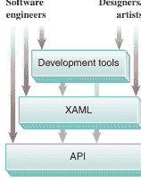

图 2.5：WPF 应用/开发人员界面层。

#### 2.3.3.1 最底层：面向对象 API

核心层是提供所有 WPF 功能的一组类。程序员可以使用任何 Microsoft .NET 语言（例如 C# 或 Visual Basic）或动态语言运行时语言（如 IronRuby）在此级别指定应用程序的外观和行为。仅通过这一层就可以创建 WPF 应用程序，但另外两层则提高了开发人员的效率和便利性，并允许以较少技术性角色容纳设计师和实施人员。

#### 2.3.3.2 中间层：XAML

中间层通过声明式语言 XAML 提供了一种替代方式来指定 API 的很大一部分功能，任何熟悉 HTML 或 XML 的人都能轻松理解其语法。其声明式特性有助于通过解释执行支持快速原型制作，并且更适合非程序员使用（就像 HTML 比 PostScript 更易用一样）。

#### 2.3.3.3 最高层：工具

与任何语言一样，采用 XAML 也存在学习曲线。WPF 应用/开发人员界面的最高层包括设计师和工程师可用于生成 XAML 的实用工具，包括绘制图形的工具（例如 Microsoft Expression Design 或 Adobe Illustrator）、构建 3D 几何模型的工具（例如 ZAM 3D）以及创建复杂用户界面的工具（例如 Microsoft Expression Blend 或 ComponentArt Data Visualization）。

## 2.4 使用 WPF 指定二维场景

如前所述，WPF 既支持用户界面区域的构建，也支持我们称为“二维场景”的规范。前者超出了本教科书的范围，因此我们这里的重点是如何指定二维场景。

### 2.4.1 XAML 应用的结构

在整个 2.4 节中，我们将构建一个简单的 XAML 应用，用于显示图 2.6 所示的模拟时钟。

如果你熟悉 HTML 语法，那么 XAML 应该可以立即上手。HTML 文件通过创建元素层次结构来指定多媒体网页——根元素是 `<HTML>`，其子元素是 `<HEAD>` 和 `<BODY>`，一直到用于格式化的段落和“文本跨度”元素，例如 `<B>` 表示粗体，`<I>` 表示斜体。其他元素则为媒体呈现和脚本执行提供支持。

XAML 程序同样指定了一个元素层次结构。但是，元素类型集是 XAML 独有的，包括布局面板（例如，用于排列紧凑控件/菜单的 StackPanel，以及用于创建类似电子表格布局的 Grid）、用户界面控件（例如按钮和文本输入框），以及一个称为 Canvas 的矩形“空白”场景绘制区域。

在完整形式的应用程序中，如图 2.1 所示，应用程序的外观通过布局面板层次结构、UI 控件以及充当视口以显示应用程序场景的 Canvas 元素来指定；但是，对于我们的第一个简单 XAML 示例，我们只创建一个独立的 Canvas：

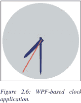


```xml
<Canvas
    xmlns="http://schemas.microsoft.com/winfx/2006/xaml/presentation"
    xmlns:x="http://schemas.microsoft.com/winfx/2006/xaml"
    ClipToBounds="True"
>
</Canvas>
```

将 `ClipToBounds` 设置为 `True` 几乎总是需要的；它只是确保画布受到边界限制，也就是说，它不会显示其指定矩形区域之外的任何数据。

我们没有指定画布的大小，因此它的大小将由显示它的应用程序控制。例如，第 2.4 节和第 2.5 节的实验软件（作为在线资料的一部分提供）包含一种“分屏”布局：WPF 画布位于一个窗格中，并垂直堆叠在显示 XAML 源代码的第二个窗格之上。该实验使用 WPF 布局管理器在两个窗格之间分配空间，并使用可拖动分隔条控件让用户对这种分配施加一定的控制。

你会注意到 XAML 有一些语法上的特殊之处（例如上面所示的 `Canvas` 标签中那些奇怪的 `xmlns` 属性），但它们很少会掩盖标签和属性的语义，而这些标签和属性大多命名得当。如果你选择研究语法中更晦涩的部分，只需使用实验软件：单击任何以栗色高亮显示的 XAML 代码，即可请求简短说明。

### 2.4.2 通过抽象坐标系指定场景

我们示例应用程序的场景——一个简单的时钟——由几个对象组合而成：表盘和三根独立的指针。表盘对象是一个填充纯灰色的单一椭圆图元。其中两根时钟指针（分针和时针）是海军蓝填充的多边形，形状相似但大小不同。最后，还有构成秒针的红线。

请注意，到目前为止，在我们这个简单的场景图中，所有组件都是图元，但在更复杂的场景中（将在第 2.4.6 节介绍），可能存在一种层次结构，其中组件可以由更低级别的子组件构成。

有了组件列表后，我们现在通过详细说明每个图元的精确几何形状来细化规范。

拿一张空白方格纸，选择并标记 (0,0) 原点，画出 x 轴和 y 轴——结果就是二维笛卡尔坐标系。它的一个特性是，任意两个实数构成一个 (x, y) 坐标对，该坐标对唯一标识平面上的恰好一个点。

但是，方格纸坐标系的无歧义性也有局限。如果让人们在一张方格纸上画一个 4 × 4 的正方形，他们都会画出一个包含 16 个网格正方形的正方形形状，但这些形状按物理单位（例如 cm²）计算并不会具有相同的面积，因为方格纸没有单一标准的网格/格线尺寸。

实际上，一张方格纸本身就是一个**抽象坐标系**，因为它并不描述物理世界中的位置或大小。使用抽象系统进行几何规范完全没问题——事实上，我们即将用这样一个系统来构建我们的时钟。但是，当需要显示这样的场景时，就必须考虑“真实世界”，此时抽象系统必须映射到显示器的物理坐标系。我们很快会描述这种映射，但首先让我们开始几何规范的过程。我们将使用图 2.7 所示的抽象坐标系。

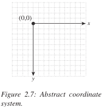

我们应该先绘制哪个图元？默认情况下，规范的顺序确实很重要，因此，在元素 D 之后构建的元素 E，如果它们重叠，就会（部分地）遮挡 D。² 术语**“二点五维”**有时被用来描述这种堆叠效果。

2. 这种默认的、依赖于顺序的堆叠顺序可以通过可选属性 `Canvas.ZIndex` 覆盖。

因此，我们应该从后（离观察者最远）到前（离观察者最近）进行绘制，所以让我们从圆形表盘开始。

图 2.8 展示了表盘的一种简单的单圆设计。我们随意选择了十个方格纸单位的半径，因为该尺寸在这种特定样式的方格纸上很方便。这个决定确实是随意的；由于坐标系是抽象的，这个时钟没有唯一正确的直径。

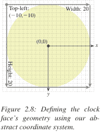

指定纯色填充圆形椭圆的语法是：

```xml
<Ellipse
    Canvas.Left=...  Canvas.Top=...
    Width=...         Height=...
    Fill=...
/>
```

其中 `Canvas.Left` 和 `Canvas.Top` 指定图元边界框左上角的 *x* 和 *y* 坐标，`Fill` 要么是标准的 HTML/CSS 颜色名称，要么是十六进制表示法中的 RGB 值（#RRGGBB——例如，#00FF00 表示全强度绿色）。

现在，我们准备构建一个将此图元放置在画布上的 WPF 应用程序：

```xml
<Canvas ... >
  <Ellipse
    Canvas.Left="10.0" Canvas.Top="10.0"
    Width="20.0" Height="20.0"
    Fill="lightgray" />
</Canvas>
```

（注意：在本章此处以及其余 XAML 代码展示中，为方便起见，我们会高亮显示新增或修改的部分。）

尽管这个规范是明确无歧义的，但这个椭圆显示出来会是什么样子并不明显。一个直径为 20 单位的圆在屏幕上有多大，而我们的测量单位是由一张任意方格纸决定的？

我们建议你运行实验软件（可在在线资源中获取），并选择 V.01 查看上述 XAML 的执行结果。渲染结果的截图（如图 2.9 所示，并带有一个用于比例参考的鼠标光标）显示，该结果不可接受，原因有两个：灰色圆太小，无法充当可用的表盘；而且我们只看到了一个象限。

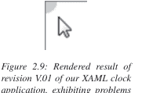

图 2.10 所示的示意图描绘了这个椭圆规范，其中左侧（浅粉色框）表示存在于应用程序中但没有物理表示的抽象几何数据，红色箭头表示生成所显示图像的渲染过程。

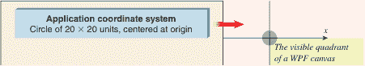

*图 2.10：我们的应用程序对表盘椭圆的初始规范示意图。*

在这里，我们看到的是将抽象坐标直接传递给图形平台的效果。使用抽象坐标来设计场景是可以的，但当需要关心它在显示器上的呈现方式时，我们必须考虑：(1) 显示设备的特性，例如尺寸、分辨率和宽高比；(2) 在考虑外形规格约束的情况下，我们希望渲染图像如何确定大小和位置；以及 (3) 如何向图形平台指定几何形状以实现期望的结果。

在第 2.6 节中，我们将在全功能应用程序的范围内讨论这些考虑因素。在这里，对于我们这个简单的时钟应用程序，让我们假设画布将显示在笔记本电脑屏幕上，时钟应为“图标大小”、直径为 1 英寸，并且时钟应出现在画布的左上角。我们如何修改应用程序以实现这种期望的外观？

### 2.4.3 坐标系选择的范围

现在，我们为时钟场景设定了一个具体的物理尺寸（直径 1 英寸）。那么，我们是否应该重新考虑使用抽象坐标系设计几何形状的决定？为了回答这个问题，让我们考虑可能选择用于场景描述的两种替代坐标系。

我们可以考虑使用像第 2.3.1 节所述那样基于整数像素的坐标系，但考虑到我们需要独立于屏幕分辨率控制场景的显示尺寸，这并不合适。

或者，我们可以考虑使用 WPF 画布坐标系来设计场景，该坐标系是“物理”的——测量单位是 1/96 英寸——并且不依赖于分辨率。例如，应用程序可以通过指定宽度为 12 单位、高度为 24 单位来绘制大小为 1/8 × 1/4 英寸的矩形。³ 因此，我们可以通过将直径指定为 96 单位来创建一个直径为 1 英寸的圆。

尽管直接使用 WPF 坐标系确实提供了分辨率无关性，但我们不推荐这种策略，因为还有另外两种值得追求的无关性。

- **软件平台无关性：** 通过使用特定图形平台的坐标系，我们不必要地将部分应用程序代码绑定到该平台，这可能增加以后将应用程序“移植”到其他平台所需的工作量。

³. 物理坐标系也有局限性。由于依赖于各种不同的部件（包括设备驱动程序和屏幕硬件），无法保证所显示形状尺寸的完美准确性。


- **显示外形规格独立性：** 当今设备上的显示屏有种类繁多的尺寸和宽高比（也称为外形规格）。为了确保与从手机到平板电脑再到桌面电脑的各种外形规格兼容，开发者应尽可能保持场景几何的抽象性，并在运行时使用考虑当前情况（外形规格、窗口大小等）的逻辑来确定几何尺寸。例如，在决定我们的时钟采用 1 英寸直径时，我们考虑的是笔记本电脑外形规格上的图标；对于智能手机设备，我们很可能会选择不同的最佳尺寸。抽象坐标系允许在运行时对实际物理尺寸做出决策。关于这一重要主题的进一步讨论，请参见第 2.6 节。

现在我们可以看到，使用抽象坐标系在多个方面都有优势，因此让我们继续采用这一策略。

抽象坐标系还有一个优势：用较小的数字来指定形状通常更容易——例如，说“我想要一个在 x 和 y 方向上从 -1 到 1 的圆盘，然后我想把它移动为以 (37, 12) 为中心”，而不是说“我想要一个在 x 方向上从 36 到 38、在 y 方向上从 11 到 13 的圆盘”。在前一种规格中，很容易看出圆盘的半径是 1，而且它是一个*圆形*圆盘，而不是椭圆形圆盘。这个想法——在某些坐标系中工作比在另一些坐标系中更容易——会反复出现，我们将其体现在一条原则中：

✔ **坐标系/基原则：** 始终选择最便于你开展工作的坐标系或基，并使用变换来关联不同的坐标系或基。

### 2.4.4 WPF 画布坐标系

至此，你只了解了 WPF 画布坐标的一个特征。图 2.11 展示了其他重要特征：原点 (0,0) 位于画布左上角，正 x 轴向右延伸，正 y 轴向下延伸，并且画布四边都“有界”（由图中的浅蓝色矩形表示）。也就是说，每个 WPF 画布都有确定的宽度和高度（通常由前面所述的布局逻辑控制）。在 `ClipToBounds="True"` 的常见情况下，这些边界会被严格执行，因此任何位于边界之外的视觉信息都不可见。⁴

4. 在贯穿第 2.4 节实现此应用程序时，我们将假设画布足够大，可以显示整个时钟，但内联练习 2.5 将邀请你探究当画布不够大时会发生什么。

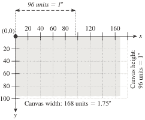

*图 2.11：一个大小为 168 × 96 单位的 WPF 画布，其中 `ClipToBounds=True`。注意原点的硬编码位置，以及 96 单位对应 1 物理英寸的硬编码语义。在显示设备上，当由精确的设备驱动程序渲染时，此画布将显示为 1.75 × 1 英寸的大小。画布四边都有边界，并且只显示位于边界内的视觉信息。*

有了这些信息，我们现在可以回到开发时钟应用程序的工作。让我们先回顾场景几何从抽象到物理设备所经过的一系列“空间”，如图 2.12 所示。我们已经讨论了应用程序坐标系和 WPF 画布坐标系，并且将在第 2.4.5 节展示前者如何映射到后者。因此，这里我们将简要说明该序列中显示的最终转换，即 WPF 画布到显示设备上实际像素的映射。管线的这一部分并不完全由应用程序控制；相反，它由多个模块协作完成：WPF 布局管理器（由应用程序创建和配置，用于控制客户区中所有组件的位置和大小，包括画布）、窗口管理器（控制应用程序客户区的位置和大小），以及底层光栅化管线（由一系列模块组成，例如 DirectX 或 OpenGL 之类的立即模式包、底层设备驱动程序和图形硬件本身）。

20 世纪 80 年代中期，Mac 和 Windows 的标准设备无关单位（DIU）都是 1/72 英寸，这与当时典型显示器的 dpi 相对应。但微软的研究表明，典型计算机用户与显示屏的距离比与印刷页面的距离远三分之一。因此，为确保以给定点大小渲染的文本在屏幕上和纸张上看起来大致相当，GDI 的 DIU 被放大了 33%，达到 96 dpi。

请记住，图形软件平台无法控制显示硬件的精度，因此 DIU 只是一个近似值。WPF 画布上长度为 96 单位的线条在“理想设备”上看起来会是一英寸长，但在实际显示屏上不一定如此。

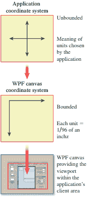

### 2.4.5 使用显示变换

最后，我们现在明白了为什么在抽象系统中定义的表盘会产生图 2.9 中不可接受的结果。

- 该圆的半径为 20 单位。我们现在知道，WPF 画布上的 20 单位小于 1/4 英寸，小得不可接受。
- 该圆被指定为以原点为中心。我们现在知道，WPF 画布只显示 (+x, +y) 象限中的数据，因此我们圆的大部分都被隐藏了。

*图 2.12：从应用程序的抽象坐标系，到 WPF 画布坐标系，最后作为应用程序窗口客户区的一部分映射到显示设备上的演进过程。*

为了修正我们的应用程序，我们将设置一个**显示变换**，以数学方式将整个场景的几何从抽象应用程序坐标系调整到 WPF 画布坐标系，使其 (a) 让时钟完全可见，并且 (b) 具有合适的大小。

首先，考虑调整大小的需求。在我们的抽象系统中，时钟的直径为 20 单位。我们希望它映射到 WPF 画布上的 1 英寸；因此，我们希望它映射到 96 个 WPF 单位。因此，我们希望将每个方格纸坐标在两个轴上都乘以 96/20，即 4.8。为了请求画布执行此缩放变换，我们向画布附加一个 `RenderTransform`，以指定我们希望应用于场景中所有对象的几何操作：

```xml
<Canvas ... >

    <!-- THE SCENE -->
    <Ellipse ... />

    <!-- DISPLAY TRANSFORMATION -->
    <Canvas.RenderTransform>
        <!-- The content of a RenderTransform is a TransformGroup
             acting as a container for ordered transform elements. -->
        <TransformGroup>
            <!-- Use floating-point scale factors:
                 1.0 to represent 100%, 0.5 to represent 50%, etc. -->
            <ScaleTransform ScaleX="4.8" ScaleY="4.8"
                            CenterX="0" CenterY="0"/>
        </TransformGroup>
    </Canvas.RenderTransform>

</Canvas>
```

注意，当指定二维缩放操作时，必须指定中心点，即平面上保持不动的点——由于缩放，所有其他点都会远离（或朝向）该中心点移动。这里，我们使用原点 (0, 0) 作为中心点。

我们的新修订版（实验室中的 V.02）的效果如图 2.13 所示。显然，我们已经解决了大小问题，但画布的可见部分仍然只呈现圆的四分之一。

因此，我们想向画布添加另一个变换，以移动场景来确保完全可见。我们将使用平移变换：

```xml
<TranslateTransform X="..." Y="..."/>
```

我们需要平移多少个单位？由于缩放变换已确保我们的圆在 WPF 画布上的直径为 1 英寸，而我们在每个维度上只能看到圆的一半，因此我们需要将圆向下移动半英寸、向右移动半英寸（即每个轴 48 个画布单位），以确保完全可见。

5. WPF 使用术语“RenderTransform”来表示变换有点误导，因为它暗示该变换仅用于控制显示。更好的名称应该是“GeometricTransform”，因为此元素类型执行二维几何变换，以实现从建模到显示控制的各种目的，正如本章通篇所展示的那样。


由于显示变换附加在画布上，所以无论场景多大或多复杂，它都会作用于整个场景。此时我们的场景只是一个图元，但随着我们继续开发这个应用程序、场景变得更加复杂，这种显示变换的价值将更加明显。

- **内联练习 2.1：** 在平移*之前*执行缩放是实现这种显示变换的一种方法；不过，颠倒顺序也可以，只是数值属性的取值不同。使用实验室，访问 V03 并编辑 XAML 代码以颠倒这两个变换的顺序。首先，在不调整数值属性的情况下改变顺序，注意渲染场景如何变化，然后根据需要修改属性以恢复期望的目标渲染效果。

- **内联练习 2.2：** 注意圆“紧贴”画布的顶部和左侧。编辑 V03，将圆向右移动 1/8 英寸、向下移动 1/8 英寸，给它一些“呼吸空间”。这里同样，正确的数值将取决于变换的顺序。

- **内联练习 2.3：** 编辑 V03，添加一个小蓝点作为 12:00 标记。

在内联练习 2.1 中，你注意到了变换序列的顺序依赖性：先缩放再平移与先平移再缩放得到的结果并不相同。这种顺序依赖性的原因基于线性代数定律。正如你将在第 12 章中发现的那样，每种变换（如旋转和平移）在内部都由一个矩阵表示。多个变换的排序通过矩阵乘法实现，而矩阵乘法是一种非交换运算。因此，顺序变换的顺序很重要也就不足为奇了。

### 2.4.6 创建和使用模块化模板

这些相同的变换工具也用于通过定位和调整可复用模板（称为**控件模板**）的副本来构建场景。<sup>6</sup> 与不能改变尺寸的物理模板不同，图形模板可以旋转、平移和缩放。

考虑我们可能如何着手定义时针和分针。我们希望两者具有相似的形状，但希望时针更短、更粗壮，这种变化可以通过对生成分针的同一多边形进行非均匀缩放来实现。所以让我们考虑如何通过定义并使用图 2.15 所示的模板来构造和放置这两个指针。

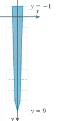

*图 2.15：时钟指针模板的几何形状。*

6. WPF 在其模板命名中使用“control”一词，指的是这类模板的一种典型用途：构造可复用的自定义 GUI 控件。

WPF 元素类型 `Polygon` 用于通过按顺序（顺时针或逆时针）指定顶点来创建轮廓或填充多边形。下面是我们标准时钟指针的 XAML 代码，将用海军蓝填充；注意使用空格分隔坐标对。还要注意，我们使用应用程序的抽象坐标系来定义时钟指针。

```xml
<Polygon
    Points="-0.3, -1    -0.2, 8    0, 9    0.2, 8    0.3, -1"
    Fill="Navy" />
```

我们希望这个 `Polygon` 元素成为可复用模板，定义一次，然后**实例化**（添加到场景中）任意多次。控件模板在根元素（这里是 `Canvas` 元素）的资源节中指定。每个模板都必须有一个唯一名称（使用 `x:Key` 属性），以便在实例化时可以被引用。

```xml
<Canvas ... >

    <!-- First, we define reusable resources,
         giving each a unique key: -->
    <Canvas.Resources>
      <ControlTemplate x:Key="ClockHandTemplate">
        <Polygon ... />
      </ControlTemplate>
    </Canvas.Resources>


    <!-- THE SCENE -->
    <Ellipse ... />

    <!-- THE DISPLAY TRANSFORM -->
    <Canvas.RenderTransform> ... </Canvas.RenderTransform>
</Canvas>
```

如果我们现在执行应用程序，使用这个新的模板规范，我们不会察觉到任何变化。仍然只有灰色钟面可见。我们必须实例化这个模板，才能真正改变显示的场景。为此，我们向场景中添加一个 `Control` 元素——它通过引用 `ClockHandTemplate` 资源来实例化——从而得到修订版 V.04：

```xml
<!-- THE SCENE -->

<!-- The clock face -->
<Ellipse ... />


<!-- The minute hand: -->
<Control Name="MinuteHand"
         Template="{StaticResource ClockHandTemplate}"/>
```

我们应用程序的这个新修订版在屏幕上会是什么样子？由于显示变换序列附加在整个画布上，分针多边形将经历整个显示序列——本质上，它会随着圆一起“跟随”整个变换序列，如图 2.16 至 2.18 所示。

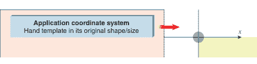

*图 2.16：分针经历显示变换序列（1/3）。*

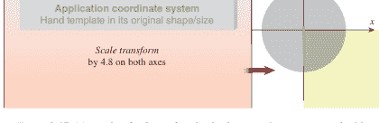

*图 2.17：分针经历显示变换序列（2/3）。*

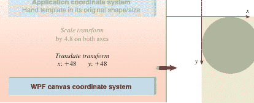

*图 2.18：分针经历显示变换序列（3/3）。*

到目前为止，似乎我们使用模板只是让 XAML 变得更复杂。毕竟，我们完全可以在指定 `Ellipse` 之后直接指定一个 `Polygon`。但现在，当我们构建时针时——以及稍后当你完成建议的练习时——你将会体会到这种模板策略的价值。

我们现在将通过同样的方法构造时针——实例化模板——但要做两处调整。

首先，我们想调整其形状，以区别于分针。为此，我们给该实例附加一个缩放变换。尽管本章前面已经使用过缩放变换，但这里我们追求的是不同的目标。我们之前使用变换序列是为了控制场景在输出设备上的大小和位置——即显示变换——而这里我们使用缩放来构造场景的一个组件——我们称之为**建模变换**。变换的这两种用途之间的区别对作为开发者的我们有意义，但底层平台并不知道，因为两者使用的是相同的机制——`RenderTransform`。（这是目的上的区分，而不是做法上的区分。）

其次，为了在完整场景合成后容易区分两个时钟指针，我们希望调整场景，使它们不会都位于 y 轴上而相互重叠。因此，我们将把时针顺时针旋转 45°，这样时钟将显示 7:30。为此，我们需要第三种 WPF 变换类型：RotateTransform：

```xml
<RotateTransform Angle="..." CenterX="..." CenterY="..." />
```

为了实例化时针，我们使用与分针相同的 Control 标签；不过，我们给这个实例附加一个 RenderTransform，以执行建模变换序列。这得到了下面框中修订版 V.05 所示的代码。

```xml
<!-- The hour hand: -->
<Control Name="HourHand" Template="{StaticResource ClockHandTemplate}">
  <Control.RenderTransform>
    <TransformGroup>
      <ScaleTransform ScaleX="1.7" ScaleY="0.7" CenterX="0" CenterY="0"/>
      <RotateTransform Angle="45" CenterX="0" CenterY="0"/>
    </TransformGroup>
  </Control.RenderTransform>
</Control>
```

注意，要指定旋转，不仅必须提供旋转量（顺时针，以度为单位），还必须提供旋转中心，即旋转围绕发生的点。我们自定义坐标系的一个不错特性是，(0,0) 表示时钟的中心，因此原点可以方便地作为时钟指针的旋转中心（也作为缩放操作的中心点）。

我们场景的 XAML 代码现在有两处使用 RenderTransform 元素：一处充当建模变换（由两个基本变换构建），用于“构造”时针；另一处充当显示变换，将整个场景映射到画布以进行显示。

```xml
<Canvas ... >
  <!-- RESOURCES ATTACHED TO THE CANVAS -->
  <Canvas.Resources>
    <ControlTemplate x:Key="ClockHandTemplate">
      <Polygon ... />
    </ControlTemplate>
  </Canvas.Resources>

  <!-- THE SCENE -->
  <!-- The clock face: -->
  <Ellipse ... />
  <!-- The minute hand: -->
  <Control Name="MinuteHand"
          Template="{StaticResource ClockHandTemplate}"/>
  <!-- The hour hand: -->
  <Control Name="HourHand"
          Template="{StaticResource ClockHandTemplate}">
    <Control.RenderTransform>
      The modeling transform for the hour hand should be here.
    </Control.RenderTransform>
  </Control>
  <!-- THE DISPLAY TRANSFORM -->
  <Canvas.RenderTransform>
    The display transform for the scene should be here.
  </Canvas.RenderTransform>
</Canvas>
```


让我们观察时针经历建模变换的过程。在图 2.19 中，我们看到用其原始几何形状实例化的指针模板；此时指针图像很小，因为这是在显示变换之前，所以为清晰起见，我们的示意图中包含一个放大标注。

第一个建模变换是非均匀缩放，产生所需的更短、更宽的形状。该变换的效果就是所需的时针形状，如图 2.20 所示。

第二个建模变换将其旋转到所需的 7:30 位置，如图 2.21 所示。

时针现在已准备好接受显示变换。它实际上会与场景中的其他成员（表盘和

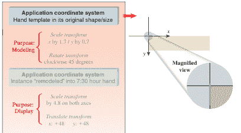

*图 2.19：指针模板的实例，处于建模变换之前。*

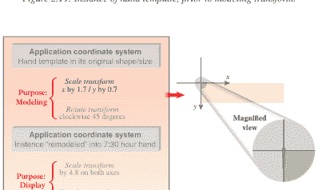

*图 2.20：指针模板的实例，已变换为时针形状。*

**内联练习 2.7：** 模板越复杂，其可重用性带来的价值就越大。向钟表指针模板添加一些额外的视觉元素（例如，一条沿纵向将其平分的细线），或赋予它更复杂的形状……然后观察它的实例如何自动调整以显示模板的新定义。

提示：如果在 `ControlTemplate` 中放入多个图元，它会报错，因此需要将其内容包装在一个 `Canvas` 元素中。（确实，`Canvas` 有多种用途，包括充当多个图元的通用包装器。）这种用法下，不要在 `Canvas` 开始标签中放入任何属性。

我们对这个简单钟表指针模板的使用，是**层次建模**的一个非常基础的单层示例；层次建模是一种用于构建高度复杂对象和场景的精细技术。关于该技术的正式介绍和示例，请参见第 6 章。

## 2.5 使用 WPF 实现二维图形中的动态效果

保留模式架构支持实现简单的动态效果；应用程序专注于维护场景图（包括在存在应用模型时使其与应用模型保持同步），而平台承担使显示图像与场景图保持同步的负担。在本节中，我们考察 WPF 应用程序可用的两类动态效果：

- 自动化、非交互式动态效果，其中二维形状由 XAML 中指定的动画对象操纵
- 以及传统的用户界面动态效果，其中用过程式代码编写的方法（回调）由用户对 GUI 控件（如按钮、列表框和文本输入区域）的操纵来激活

### 2.5.1 通过声明式动画实现动态效果

WPF 能够通过 XAML **动画元素**指定简单动画而无需过程式代码，这些元素可以强制对象属性随时间通过插值发生变化。应用程序创建一个动画元素，将其连接到要操纵的属性，并指定动画的特征：起始值、结束值、插值速度以及终止时的期望行为（例如，在达到结束值时动画应重复）。最后，应用程序指定应触发动画开始的事件。设置完成后，动画元素会自动工作，无需应用程序干预。

几乎每个 XAML 元素属性都可以作为动画的目标。示例包括以下内容。

- 形状的原点（例如椭圆的左上角）可以由动画元素操纵，使形状看起来在振动。
- 形状图元的填充颜色、边缘颜色和边缘厚度属性可以由动画元素操纵，以执行反馈动画，例如发光或脉冲。
- 旋转变换的角度属性可以由动画元素操纵，使受影响的对象旋转。

最后一个示例对我们这些时钟构建者很有意义。我们可以使用三个动画元素（每根指针一个）来实现时钟的运动。

让我们看看之前设计的时针建模变换的当前状态。

```xml
<Control.RenderTransform>
  <TransformGroup>
    <ScaleTransform ScaleX="1.7" ScaleY="0.7" />
    <RotateTransform Angle="45"/> <!-- for 7:30 -->
  </TransformGroup>
</Control.RenderTransform>
```

实例变换已经包含一个 RotateTransform，将指针放到 7:30 位置。既然我们正在考虑为应用程序添加时间语义，最好让 12:00 成为时针的“归一化”默认位置，因此让我们更改该旋转变换：

```xml
<!-- Rotate into 12 o'clock default position -->
<RotateTransform Angle="180"/>
```

此外，为了准备自动操纵指针的位置，让我们再添加一个 RotateTransform，并给它一个标记（ActualTimeHour），以便动画器可以操纵它。经过这两处更改，TransformGroup 变为：

```xml
<TransformGroup>
  <ScaleTransform ScaleX="1.7" ScaleY="0.6" />
  <!-- Rotate into 12 o'clock default position -->
  <RotateTransform Angle="180"/>
  <!-- Additional rotation for animation to show actual time: -->
  <RotateTransform x:Name="ActualTimeHour" Angle="0"/>
</TransformGroup>
```

现在，让我们看看将旋转时针的动画元素的声明。WPF 为可能需要自动化的每种数据类型提供一种动画元素类型。要控制旋转的角度（一个双精度浮点数），请使用元素类型 DoubleAnimation：

```xml
<DoubleAnimation
  Storyboard.TargetName="ActualTimeHour"
  Storyboard.TargetProperty="Angle"
  From="0.0" To="360.0" Duration="1:00:00.0"
  RepeatBehavior="Forever"
/>
```

通过设置 TargetName 和 TargetProperty 属性，动画连接到时针，这些属性指向目标 RotateTransform 元素的 Angle 属性。From 和 To 属性决定旋转的范围和方向，Duration 控制属性值经过该范围所需的时间。Duration 使用以下约定指定：

```
Hours : Minutes : Seconds . FractionalSeconds
```

`RepeatBehavior="Forever"` 设置确保只要应用程序正在运行，时钟指针就会继续移动；一旦值达到“To”目标，它就会“回绕”到“From”值并继续动画。^7

> 考虑到规范如此精确，你可能会想知道实际动画的准确性。如果 CPU 处于高负载或供电不足，动画还能运行吗？
>
> 尽管当 CPU 承受压力时，动画的平滑度可能变差（变得“跳动”），但图像在任何给定时间都会跟上它需要到达的位置。动画引擎以绝对方式工作——重新计算属性值在当前时间应处于何处——而不是基于累积增量以相对方式工作。因此，即使应用程序在很长一段时间内未获得足够的 CPU 时间，当应用程序下一次获得足够的 CPU 周期用于图像刷新时，图像也会跳到正确状态。

最后一步是在 XAML 代码中安装动画。我们希望表盘一可见动画就开始。因此，我们创建一个 `EventTrigger`，并用它设置画布的 `Triggers` 属性。触发器必须指定启动它的事件类型（在本例中，是画布内容完全加载后立即启动）以及它执行的操作（在本例中，是一组三个同时运行的动画元素，封装在 WPF 所谓的 `Storyboard` 中）：

```xml
<Canvas ... >

    The specification of the clock scene should be located here.

    <Canvas.Triggers>
        <EventTrigger RoutedEvent="FrameworkElement.Loaded">
            <BeginStoryboard>
                <Storyboard>
                    <DoubleAnimation
                        Storyboard.TargetName="ActualTimeHour"
                        Storyboard.TargetProperty="Angle"
                        From="0.0" To="360.0"
                        Duration="01:00:00.00" RepeatBehavior="Forever" />

                    Two more DoubleAnimation elements should be located
                    here to animate the other clock hands.

                </Storyboard>
            </BeginStoryboard>
        </EventTrigger>
    </Canvas.Triggers>

</Canvas>
```

7. 其他可用的行为类型包括反向运动（即“弹回”）以及直接停止（用于“一次性”运动）。


实验室的V.07修订版展示了这个动画时钟，但其XAML已被修改，使时针移动得异常快，以便更容易注意和测试动画的运动。我们建议那些想测试自己对本节理解程度的人做以下练习。

- **内联练习2.8：** 研究V.07修订版的XAML代码，然后执行以下操作。
  - a. 分针目前已在场景中实例化，没有任何建模变换。添加必要的标记以将变换组附加到它上面，并安装两个旋转变换（一个将其放置在默认的12:00位置，另一个用于促进动画）。向情节提要添加必要的标记，使其每分钟旋转一次。
  - b. 类似地设置秒针的动画。
  - c. 修复时针的动画，使其准确。
  - d. 如果你想向朋友演示这个时钟，请手动更改“默认位置”旋转变换，以初始化指针，使其更接近你所在位置的实际时间，然后开始运行，观察时钟保持准确的时间。
  - e. 时钟初始化问题的最终解决方案是使用过程代码初始化时钟。如果你可以使用Visual Studio软件和教程，请以这个XAML原型为基础，通过添加初始化逻辑将其“产品化”，创建一个显示正确本地时间的全功能WPF时钟应用程序。

- **内联练习2.9：** 要更全面地练习基于模板的建模和动画，请访问在线资源下载“带篷马车”编程练习的说明。

### 2.5.2 通过过程代码实现动态

显然，仅使用XAML构建的应用程序在丰富性方面是有限的。过程代码对于处理、逻辑、数据库访问和复杂交互性的性能是必要的。WPF开发人员使用XAML来处理它最适合的事情（场景初始化、资源库、简单动画等），并使用过程代码来完成应用程序行为的规范。例如，在真正的时钟应用程序中，过程代码将用于确定正确的本地时间、支持闹钟功能、响应用户交互等。

## 2.6 支持各种外形规格

各种光栅显示设备——从智能手机小屏幕到墙壁大小的LCD显示器——给应用程序带来了挑战。这些问题类似于桌面应用程序在其窗口大小缩小超过一定合理限度时所面临的问题。在这两种情况下，应用程序都需要适应外形规格的变化。

设计良好的应用程序使用逻辑来检查其当前的外形规格，并根据需要调整其外观。让我们来看看典型应用程序中两个关键区域的适应策略：其UI区域和场景显示区域。

当分配给一组UI控件的屏幕区域变得有限时，通过缩小（按比例缩小）控件来适应很少是明智的。UI控件的可用性，以及用户对“空间记忆”的依赖以便快速访问常用控件，都会受到这种技术的不利影响。应用程序可以通过省略（例如，隐藏较少使用的控件）或重新排列布局来响应。

后者的一个例子如图2.22的三部分所示。部分（a）显示了菜单栏和工具栏在其最佳布局中的样子。如果窗口宽度显著减小，这些栏会在右侧被裁剪，如部分（b）所示，并显示标有“»”的“扩展”按钮，以提供对必须隐藏的菜单和控件的访问。部分（c）显示了使用扩展按钮显示工具栏其余部分的结果。

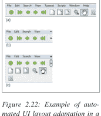

*图2.22：Windows应用程序中自动UI布局适应示例。*

当视口大小受限时，应考虑另一组用于场景显示的策略。可能的解决方案包括以下内容。

- 应用程序可以缩小（按比例缩小）渲染，使更多（或全部）场景适合视口。
- 应用程序可以将渲染裁剪到视口的边界，并提供支持平移（滚动）的界面以访问场景的任何部分。

这些选择绝非相互排斥，应用程序通常同时使用缩放和裁剪的组合；例如，Adobe Reader缩略图窗格如图2.23所示。在此示例中，所选文档是一个长PDF文档；可以将其视为一个非常高大且狭窄的场景，宽度为一个标准页宽，高度为136个标准页高。该应用程序使用不同的方法来处理高度与宽度。对于高度，它“裁剪”场景并一次仅显示几页，提供滚动功能用于导航。对于宽度，它使用缩小/按比例缩小策略来适应场景，使其宽度与窗格的宽度完全匹配。用户可以选择加宽缩略图窗格，从而增加缩略图的宽度，并降低缩小的强度，使缩略图更“可读”。

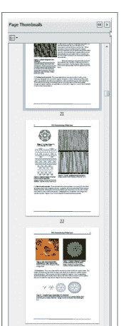

*图2.23：流行PDF查看器中自动场景适应的示例。*

在这两个示例改编中，应用程序负责确定用于特定外形规格/屏幕尺寸的*策略*的逻辑，但WPF平台提供了实现该策略所需的大部分*机制*。例如，WPF的UI布局工具简化了上述类似的UI改编。对于场景改编，变换非常有用：缩放有助于放大/缩小，平移有助于滚动/平移效果。

## 2.7 讨论与进一步阅读

在本章中，我们已经看到了如何在作为我们2D世界的抽象应用程序坐标系中创建图元集合，以及如何将图元重用为定义的模板实例。虽然我们还没有展示由更简单模板组成的模板，但我们将第6章讨论WPF 3D时处理这种常见的几何建模形式。我们已经使用了变换，既用于建模，也用于从抽象应用程序坐标映射到WPF画布坐标，再到物理设备坐标；我们将在后续章节中讨论变换的基础数学。最后，我们看到了保留模式图形平台的优势，它可以将许多应用程序共有的任务（包括简单动画）分解出来。最重要的是，我们介绍了声明式编程的基本特性，这些特性对于快速原型设计非常有用，并且可以方便地扩展以在WPF 3D中进行几何建模和渲染。

我们还没有讨论响应于用户交互（如按钮按下）的UI回调。如果此类交互改变了要绘制的内容，我们必须重新绘制它，正如如果它们改变了应用程序模型的状态，我们也必须改变它。这种回调响应对于任何具有UI的程序（意味着大多数现代程序）来说现在都相当标准，我们不再进一步讨论。

还有一种需要考虑的交互：*视口内*的交互，即用户可能在显示的场景上执行的点击和拖动。为了适当地响应这些交互，我们通常需要知道诸如用户点击了场景中的哪个对象，以及拖动的起点和终点在哪里。确定点击了哪个对象称为**拾取相关性**，我们将在第6章3D的上下文中讨论这一点。响应3D场景中的点击-拖动操作通常需要仔细处理建模变换层次结构；我们将在第21章中讨论一些示例。

世界上还有许多其他图形包，当你从事计算机图形学工作时，你可能会遇到至少几个。我们鼓励你浏览网页并阅读有关OpenGL和Swing等的内容，以了解各种包提供的各种功能以及它们之间的一些共性和差异。


# 第3章：古老渲染器的现代化

## 3.1 一幅丢勒木刻

1525年，阿尔布雷希特·丢勒制作了一幅木刻，演示了一种可以为几乎任何形状创建透视画的方法（见图3.1）；在这幅木刻中，两名男子正在绘制一把鲁特琴。在本章中，我们将开发一个软件模拟，来实现丢勒所描绘的方法。

这套装置只由几个部分组成。首先，有一根长线，它从一个小指针的尖端开始，穿过固定在墙上的一个螺丝眼，最后系在一个小重物上，以保持线中的张力。一个人可以移动指针，使其触碰待绘制物体上的各个位置。

其次，有一个矩形框架，上面用铰链连接着一块板——我们称之为遮板——因此这块板可以被移到一旁（如木刻所示），也可以旋转以盖住开口，就像遮板盖住窗户一样。板上装有一张纸，画就画在这张纸上。在木刻中，你可以看到纸上已经画出了鲁特琴的一部分。第一个男子已经把指针移到鲁特琴上的一个新位置。线穿过框架，在线穿过框架的位置，第二个男子握着一支铅笔。线被推到一旁，遮板合上，铅笔便在纸上留下一个新的标记。这个过程不断重复，直到整幅画（由许多铅笔标记组成）浮现出来。当然，握铅笔的男子必须非常稳，才能让这个过程奏效！

结果便是一幅由纸上许多铅笔标记组成的鲁特琴画，这些标记可以连接起来，形成更完整的图画。这幅画是鲁特琴的透视图，展示了当观察者的眼睛正好位于线穿过墙上螺丝眼的位置时，鲁特琴会是什么样子。请注意，墙上螺丝眼的高度和桌子的位置都可以改变，因此视点与画作之间的相对位置应被视为这个场景渲染引擎的参数。

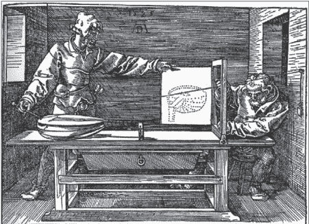

图3.1：两个人正在使用一台早期的“渲染引擎”绘制一幅鲁特琴图。

这幅画的逼真程度可以归因于三个主要因素。第一，光沿直线传播，因此拉紧的线代表了从鲁特琴到眼睛的光路。第二，鲁特琴的画作就位于场景之中，当遮板合上时，它也会从相应方向向眼睛发送光。场景中的高对比度点由画中的标记表示，而这些标记本身也是高对比度点。第三，我们的视觉系统似乎在很大程度上通过场景中的高对比度边缘来“理解”一个场景，因此纸上的标记和现实世界场景往往会在我们的视觉系统中引发相关的反应。

请注意，线始终穿过框架。如果第一个男子把指针移到一个无法从螺丝眼透过框架看到的位置，线就会碰到框架本身并绕着它弯折。在这种情况下，纸上不会留下任何标记。

现在，我们将把对这个“渲染”过程的描述稍微形式化一些，如代码清单3.1所示。

代码清单3.1：丢勒透视渲染算法的伪代码。

```
Input: a scene containing some objects, location of eye-point
Output: a drawing of the objects

initialize drawing to be blank
foreach object o
    foreach visible point P of o
        Open shutter
        Place pointer at P
        if string from P to eye-point touches boundary of frame
            Do nothing
        else
            Hold a pencil at point where string passes through frame
            Hold string aside
            Close shutter to make pencil-mark on paper
            Release string
```

这个算法有三个方面值得注意，它们都位于遍历所有点的循环之中。第一，迭代针对的是*可见*点，因此确定可见性将很重要。第二，可见点可能有无穷多个。第三，我们已经说明了当线碰到框架而不是穿过框架所围成的开口区域时该怎么做。如果物体大到只有一部分能从螺丝眼透过框架看到，这种情况就必然会发生。

我们稍后将讨论第一个问题；第二个问题通过同意进行*近似*渲染来解决，我们只选择有限数量的点，但要这样选择它们，使纸上的标记最终能很好地表示形状。为了尽可能逼近一个理论上需要无穷多次计算的结果，而选择执行有限次计算的过程是*关键的*，并且会在本书的许多地方出现。在本章中，我们将渲染一个非常简单的物体，因此可以暂时把这个问题搁置一旁。

第三个问题——避免绘制视野之外的点——也代表了图形学中一种常见操作。一般来说，避免把时间浪费在**视野区域**（眼睛或相机能看到的那部分世界）之外的事物上的过程称为**裁剪**。裁剪可能很简单，比如发现某个点（或整个物体）位于视野区域之外；也可能涉及更复杂的操作，比如取一个部分位于视野区域之外的三角形，将它修剪成一个完全位于视野区域之内的多边形。目前，我们将使用一个非常简单的裁剪版本，它只适用于*点*——我们只需忽略位于视野区域之外的点。

我们做了一个有用的简化：要确定指针尖端是否位于视野区域（一个三维体积）内，我们检查线穿过框架的位置是否位于纸张区域之内（而不是线碰到框架）。这两个测试是等价的，但在实现它们时，做点在矩形内的测试要比做点在三维体积内的测试更容易。

**内联练习 3.1：** 想象你可以移动丢勒木刻中的鲁特琴。

- a. 你会怎样移动它，以确保内层循环的每次迭代都满足“碰到框架边界”这一条件，从而使算法的几乎所有工作（除设置开销外）都落入该分支？
- b. 你会怎样移动它，以确保没有任何工作落入该分支？

（你的答案应采用“把它移近框架并稍微抬高一点”这样的形式，也就是说，它们应描述鲁特琴在房间内的运动。）

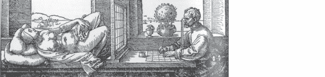

图3.2：另一种丢勒渲染方法。

**内联练习 3.2：** 想象一下，这两个人不是把线末端的指针移动到鲁特琴上的各个点，然后看这些点穿过纸张的位置，而是从一张方格纸开始。对于方格纸上的每个方格，拿铅笔的男子把铅笔握在方格中心；然后打开遮板，拿指针的男子移动指针，使线经过铅笔尖，*并且*使线的末端碰到鲁特琴、桌子或墙壁。记录下所碰到的物体，当遮板再次合上时，拿铅笔的男子用一定量的铅笔阴影填充该网格方格，阴影量对应所碰点看起来有多暗或多亮：如果它看起来是暗的，就把网格方格完全填满。如果它是亮的，就让网格方格保持空白。如果它介于亮和暗之间，就给网格方格涂上浅灰色调。你自己先想一想，这会生成什么样的图画。这种方法（“逐像素”工作，并找出通过该像素看到什么）就是光线追踪的本质，第14章将讨论这一点。丢勒还开发了这种方法的一个略有不同的版本，如图3.2所示：方格纸放在桌子上；遮板中相应的网格由横拉在遮板上的金属丝或半透明方格纸构成，线和指针则由穿过画家前方一个小孔的视线取代。

线加指针的方法和方格纸方法所产生的渲染结果相当不同。第一种方法生成场景中形状的轮廓（前提是第一个男子明智地选择他的点）。第二种方法在选择要绘制什么时完全忽略场景，只是给每个网格方格分配一个灰度值。如果场景非常简单——场景中轮廓很少——第一种方法相当快。如果场景非常复杂（想象它由满满一碗意大利面组成！），那么第二种方法凭借固定数量的网格方格会更快。当然，它更快只是因为在物理世界中我们可以瞬时确定哪个点可见，这一点我们将在下一节进一步讨论。不过，一般来说，图形学中的许多技术都涉及由场景复杂度决定的权衡；这只是我们遇到的第一个。

现在我们已经理解了这个基本渲染过程，那么如何将它现代化，使其在计算机图形学中有用呢？我们将专注于创建这幅画，或者更准确地说，我们将创建一个程序来模拟这一过程


渲染方法。通过这一过程，我们希望你能深入了解我们在计算机图形学中表示现实世界的方式。我们将从可见性问题的讨论开始。

## 3.2 可见性

只选择可见点这件事，丢勒可能根本没有考虑过，但对我们来说很重要。丢勒判断点 P 是否可见的一种方法是，把指针放在 P 上，观察细绳是笔直地连到螺丝眼，还是必须绕过鲁特琴或其他物体的某些部分才能到达那里。在建立该过程的简化模型时，我们暂时不考虑可见性判定问题；这并不是因为它不重要——第36章整章都在讨论用于改进可见性计算的数据结构——而是因为它在一般情况下很棘手，而且对于我们将在这个简单渲染器中绘制的模型来说并不必要。

## 3.3 实现

为了模仿这幅木刻版画中的算法，我们将使用代数和几何，并用一种非常简单的方式来描述一个非常简单的形状：我们将通过给出立方体八个角（或顶点）的位置，并指出哪些顶点对由一条边连接，来描述一个立方体。因此，我们的立方体模型可以看作一个线框模型，其中物体是通过把一段段线连接起来而创建的。

为了使几何关系简单，我们将建立一种特别方便的方式来度量房间中的坐标。我们坐标系的原点（见图3.3）将位于墙上的螺丝眼处，并记为 E（代表“eye”，即眼睛）。绘图框将位于 z = 1 平面内（也就是说，我们将测量从螺丝眼到绘图框所在平面的距离，并选择一种单位制，使该距离为1）。该平面上离螺丝眼最近的点称为 T；其坐标为 (0, 0, 1)。我们将让 y 轴竖直、x 轴水平，如图所示。

在 z = 1 平面内，画框将从点 (x_min, y_min, 1) 延伸到点 (x_max, y_max, 1)，其中正如名称所示，x_min < x_max、y_min < y_max；并且，为了简单起见并与图中情况保持一致（图中画框看起来相当接近方形[^1]），我们将假设宽度 x_max − x_min 与高度 y_max − y_min 相同。准确地说，画框的两个对角点是三维坐标分别为 (x_min, y_min, 1) 和 (x_max, y_max, 1) 的点。

**内联练习 3.3：** 画框另外两个角的坐标是什么？

我们还可以设想，填满画框的纸（当遮板关闭时）实际上是方格纸，其左下角标为 (x_min, y_min)，右上角标为 (x_max, y_max)，从而为我们提供纸平面内的坐标。因此，对于每一个最后一个坐标为1的三维点 (x, y, 1)，我们都将其与方格纸坐标 (x, y) 关联起来。

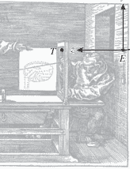

*图3.3：丢勒木刻版画所用的坐标系：原点位于螺丝眼处，标记为 E，y 轴和 z 轴也在此处画出。画框位于 z = 1 平面内，与墙面所在平面 z = 0 平行。x 坐标箭头是水平的，位于墙面平面内，大致沿墙上阴影线的方向；z 坐标箭头也是水平的，且垂直于墙面。由于透视效果，在螺丝眼处，x 方向和 z 方向看起来几乎平行，但指向相反。点 T 是绘图平面（z = 1）内离螺丝眼最近的点。z 方向从螺丝眼指向 T，因此 T 的 xyz 坐标为 (0, 0, 1)。*

现在假设我们观察物体上的一个点 P = (x, y, z)，如图3.4所示；从 P 到 E 的直线（即细绳）穿过画框于点 P′ = (x′, y′, z′)。[^2] 我们需要根据已知坐标 x、y 和 z 确定坐标 (x′, y′, z′)。

在图3.5中，我们在 x = 0 平面内画了两个相似三角形。红色三角形的顶点是：(1) 点 E = (0, 0, 0)；(2) P′ 在 x = 0 平面上的投影，即 (0, y′, 1)；(3) 点 (0, y′, 0)，恰在 E 下方。蓝色三角形的顶点是：(1) 点 E；(2) P 在 x = 0 平面上的投影，即 (0, y, z)；(3) 点 (0, y, 0)，远在 E 下方。

相似性告诉我们，两个三角形中竖直边与水平边的比值必须相等，即 y′/1 = y/z。类似地，利用 y = 0 平面内的三角形（最好通过想象场景的鸟瞰图来理解），可以证明 x′/1 = x/z，化简后得到

$$x' = \frac{x}{z}, \tag{3.1}$$

$$y' = \frac{y}{z}. \tag{3.2}$$

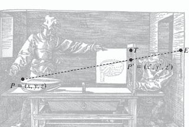

*图3.4：点 $P = (x, y, z)$ 位于我们的物体上。从 $P$ 到眼睛 $E$ 的细绳将在某个位置 $P' = (x', y', z')$ 穿过画框。注意 $z' = 1$，因为我们选择的坐标使这一点成立。*

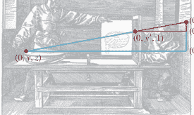

*图3.5：在 $x = 0$ 平面内叠加在画面上的两个相似三角形。小的红色三角形和大的蓝色三角形的竖直边长度分别为 $y'$ 和 $y$。它们的水平边长度是多少？*

现在我们知道一般如何从 $P$ 的坐标求出 $P'$ 的坐标了！因此，我们可以像代码清单3.2那样描述修订后的算法。

*代码清单3.2：丢勒渲染算法的简单实现版本。*

```text
Input: a scene containing some objects
Output: a drawing of the objects

initialize drawing to be blank
foreach object o
    foreach visible point P = (x, y, z) of o
        if x_min <= (x/z) <= x_max and y_min <= (y/z) <= y_max
            make a point on the drawing at location (x/z, y/z)
```

让我们暂停片刻来检查这一点；现在我们已经得到画面平面内铅笔标记的 $x$ 和 $y$ 坐标。但是，如果我们要从墙上螺丝眼的位置观看最终图像，那么 *x* 增大的方向将指向我们的 *左边*。（正如预期，*y* 增大的方向仍然向上。）我们可以选择把点绘制在一张方格纸上，并规定 *x* 向左增大；或者也可以翻转 *x* 的符号，使其向右增大。我们将采用后者，因为它与稍后要采用的更通用方法一致。因此，我们把算法的最后一部分修改为代码清单3.3所示的代码。

*代码清单3.3：对丢勒渲染算法的细微修改。*

```text
1  if x_min ≤ (x/z) ≤ x_max and y_min ≤ (y/z) ≤ y_max
2      make a point on the drawing at location (−x/z, y/z)
```

为了完成我们现代版的实现，我们需要：(1) 一个场景；(2) 场景中物体的模型；(3) 一种绘制物体的方法。

为简单起见，我们的场景将由单个立方体组成。我们的立方体模型最初将是一个包含立方体八个顶点的集合。一个基本立方体可由下表描述：

| 索引 | 坐标 |
|---:|:---|
| 0 | (−0.5, −0.5, −0.5) |
| 1 | (−0.5, 0.5, −0.5) |
| 2 | (0.5, 0.5, −0.5) |
| 3 | (0.5, −0.5, −0.5) |
| 4 | (−0.5, −0.5, 0.5) |
| 5 | (−0.5, 0.5, 0.5) |
| 6 | (0.5, 0.5, 0.5) |
| 7 | (0.5, −0.5, 0.5) |

不幸的是，这个立方体以眼点为中心，而不是位于画框之外我们感兴趣的区域中。通过给每个 *z* 坐标加上3，我们得到一个位置更合理的立方体：

| 索引 | 坐标 |
|---:|:---|
| 0 | (−0.5, −0.5, 2.5) |
| 1 | (−0.5, 0.5, 2.5) |
| 2 | (0.5, 0.5, 2.5) |
| 3 | (0.5, −0.5, 2.5) |
| 4 | (−0.5, −0.5, 3.5) |
| 5 | (−0.5, 0.5, 3.5) |
| 6 | (0.5, 0.5, 3.5) |
| 7 | (0.5, −0.5, 3.5) |

### 3.3.1 绘制

立方体的顶点确实是有趣的点，但为了真正模仿丢勒的绘画，我们*应该*绘制立方体整个表面上的点。然而，仔细观察后会发现，两名学徒所选择的点位于我们可以称为“重要线条”的地方，例如鲁特琴的轮廓，或两个表面之间的尖锐边缘。[^3] 对于立方体来说，这些重要线条由立方体棱边上的所有点组成。绘制所有这些点（甚至大量

[^1]: 然而，填满画框的板面看起来并不是正方形；为简单起见，我们仍按正方形处理。

[^2]: 用 P 和 P′ 表示一个点及与其相关联的另一个点，非常有助于记住这种关联；遗憾的是，大多数编程语言不允许在变量名中使用撇号及其他类似符号，因此在我们的代码中必须采用不同的约定。

[^3]: 场景中哪些线条重要，这个问题在非真实感渲染或表现性渲染中颇受关注，第34章将对此进行讨论。


其中一些）可能带来不必要的计算开销；幸运的是，有一种方法可以绕过这一开销：如果 A 和 B 是由一条边连接的两个顶点，并且我们把 A 和 B 投影到绘图中的点 A′ 和 B′，那么可以看出，A 和 B 之间的点将投影到 A′ 和 B′ 之间线段上的点。我们可以从几何上验证这一点，也可以直接依赖一个熟悉的经验：直线的照片看起来总是直的。⁴ 因此，我们不必在边上找到许多点并把它们都画出来，而只需计算 A′ 和 B′，然后在它们之间画一条线段。

**随文练习 3.4：** 上一段表明，我们可以说“从空间到平面的透视投影把直线映射为直线”，或者说“把线段映射为线段”。请仔细思考第一个断言，并找出一个反例。提示：我们的透视投影对空间中的每一个点都有定义吗？

一句忠告：你在本练习中发现的这类微妙之处并非只是吹毛求疵！它们正是会导致图形程序出现缺陷的那类问题。由于图形程序往往要处理大量数据，程序的几乎每一个可能部分都常常会在一次示例执行中被测试到。因此，那些在要求较低的系统上可能通过测试的缺陷，往往会在图形程序中很早地暴露出来。

对于那些没有想出反例的读者，我们在此给出反例。首先，对于一条穿过视点的直线，透视投影甚至对视点本身都没有定义。而且该直线上的非视点会投影到同一个点，而不是投影成整条直线。如果我们同意忽略投影未定义的点，还有一个进一步的问题：视点位于 (0, 0, 0)，投影平面平行于 xy 平面。这意味着任何穿过 z = 0 平面的线段都包含一个无法投影的点。这样一条线段的投影将由两个分离的部分组成。你可以通过手工把从 (1/2, 0, 1) 到 (1/2, 0, −1) 的线段投影到 z = 1 平面上来确认这一点。◇ 用射影几何的语言来说，“透视投影把扩展直线映射为扩展直线，除非在包含投影点的线束上未定义。”

回到我们的程序，我们增强立方体模型，加入一个边列表，边由其端点的顶点索引描述：

| 索引 | 端点 |
| --- | --- |
| 0 | (0, 1) |
| 1 | (1, 2) |
| 2 | (2, 3) |
| 3 | (3, 0) |
| 4 | (0, 4) |
| 5 | (1, 5) |
| 6 | (2, 6) |
| 7 | (3, 7) |
| 8 | (4, 5) |
| 9 | (5, 6) |
| 10 | (6, 7) |
| 11 | (7, 4) |

位于画面边框之外。我们将忽略这个问题，并假设：如果我们要求图形库在图像中绘制一条线段，而该线段的坐标超出图像边界，那么边界之外不会绘制任何内容。（例如，WPF 就是如此。）程序的初步草图见代码清单 3.4。

*代码清单 3.4：丢勒渲染算法的边绘制版本。*

```
Input: a scene containing one object ob
Output: a drawing of the objects

initialize drawing to be blank;
for (int i = 0; i < number of vertices in ob; i++) {
    Point3D P = vertices[i];
    pictureVertices[i] = Point(-P.x/P.z, P.y/P.z);
}
for (int i = 0; i < number of edges in ob; i++) {
    int i0 = edges[i][0];
    int i1 = edges[i][1];
    Draw a line segment from pictureVertices[i0]
        to pictureVertices[i1];
}
```

最后，我们必须注意到，这个算法依赖于“图像矩形”的坐标从 (xmin, ymin) 到 (xmax, ymax)。然而，我们可以通过使用在两个方向上均从 0 到 1 的坐标来消除这种依赖，这在图形库中非常常见。我们可以按如下方式转换 x 坐标。首先，从 x 坐标中减去 xmin；新坐标的范围将是 0 到 xmax − xmin。然后除以 xmax − xmin，新坐标的范围将是 0 到 1。于是有

x_new = (x - x_min) / (x_max - x_min); (3.3)

类似的表达式可给出范围从 0 到 1 的 y 值。因为我们要求 xmax − xmin = ymax − ymin，所以用这种方式变换 x 和 y 不会产生失真：两者除以相同的因子。加入这一变换后的程序见代码清单 3.5。

*代码清单 3.5：将视图正方形范围作为参数包含在内的基于边的实现。*

```
Input: a scene containing one object o, and a square
    xmin ≤ x ≤ xmax and ymin ≤ y ≤ ymax in the z = 1 plane.
Output: a drawing of the object in the unit square

initialize drawing to be blank;
for (int i= 0; i < number of vertices in o; i++) {
    Point3D P = vertices[i];
    double x = P.x/P.z;
    double y = P.y/P.z;
    pictureVertices[i] =
        Point((x - xmin)/(xmax - xmin),
              (y - ymin)/(ymax - ymin));
}
13 for(int i = 0; i < number of edges in o; i++) {
14     int i0 = edges[i][0];
15     int i1 = edges[i][1];
16     Draw a line segment from pictureVertices[i0] to
17         pictureVertices[i1];
18 }
```

这些从 0 到 1 的坐标通常称为**归一化设备坐标**：可以将它们视为描述显示设备从左到右或从上到下的范围中的比例；如果显示设备不是正方形，那么坐标 1.0 表示两个维度中较小的那个。典型的桌面显示器可能垂直坐标从 0 到 1，而水平坐标从 0 到 1.33。

**归一化**过程——从范围 [x_min, x_max] 转换到范围 [0, 1]——经常出现；值得记住公式 3.3 的形式。

**随文练习 3.5：** 验证在代码清单 3.5 中，恰好位于视图正方形左下角的顶点，即 (x_min, y_min, 1)，确实会变换到最终图像左下角，也就是对应的 `pictureVertex` 为 (0, 0)；类似地，验证 (x_max, y_max, 1) 会变换到 (1, 1)。

## 3.4 程序

我们将使用一个简单的 WPF 程序来实现该算法，它基于下一章将详细描述的标准测试平台。生成的程序可从本书网站下载，供你运行和实验。对于这个应用，测试平台的关键要素是能够在名为 `GraphPaper` 的 `Canvas` 上创建并显示圆点（表示点的小圆盘）和线段（圆点之间的线段）。方格纸上的位置以毫米为单位，这比 WPF 默认单位（约 1/96 英寸）更容易理解。为使绘图尺寸合理，我们会把算法结果（从 0 到 1 的坐标）乘以 100。程序的重要部分见代码清单 3.6，省略处用 [ . . . ] 表示。

不过，在你查看代码之前，我们要提醒你：这种对 WPF 的使用方式与你在第 2 章看到的有很大不同。那一章展示了 WPF 的声明式方面，这些方面很容易通过 XAML 呈现。测试平台利用这些声明式方面来构建窗口、一些菜单和控件，并布置我们将要在其上绘图的 `GraphPaper`。但 `GraphPaper` 中实际图像的生成全部用 C# 完成。这是因为对于我们要编写的大多数程序来说，用 XAML 表达要么繁琐，要么不可能（并非 WPF 的每个功能都通过 XAML 暴露）。一般来说，只要可能，使用声明式规范是合理的，尤其是对于布局和数据依赖；而在可能需要大量代数运算时，就使用 C#。

发现你需要足够巧妙。第二，我们为所有可能考虑更改的重要对象都使用了名称，比如 `xmin` 和 `nEdges`。这是因为像这样的测试程序大多会比最初预期存活得久得多，并会被改作其他用途；符号名称有助于我们与过去的自己（最初编写程序的人）交流。第三，这个程序并没有经过“软件工程化”：例如，我们没有定义一个类来表示一般形状——我们只是用一个固定大小的数组来表示一个形状，即立方体。这是有意为之。这个程序本意是供使用、实验，然后丢弃（或者也许在另一个实验中重用）。这个程序的重点是验证我们对一个简单概念的理解。它并不是某个大型项目的原型。事实上，如果你发现自己在这个框架之上构建哪怕中等规模的东西，那你就在犯一个大错误：这个框架的各个部分是为了让测试和调试变得容易而设计的。例如，如果你运行程序并把光标放在某个圆点上，就会出现工具提示告诉你该圆点的坐标；边也是如此。这在调试时是合理的，但等到你要绘制 10,000 条边时，这就是巨大的开销。记住，这个框架是用于实验的测试平台，你在其中编写的所有代码都应被视为可丢弃的。虽然这条建议看似矛盾——我们说过要丢弃代码，但又说要写得像样，因为你会复用它——它反映了我们的经验：即使是我们打算丢弃的代码也确实会被复用，而且常常用于其他一次性应用！值得花一点时间让这些未来用途更容易，但不值得投入太多，以至于要花几个小时才能写出一个简单想法并确认你的理解。

结果正如我们所料（见图 3.8）：一个线框立方体的透视图。我们创建了第一个渲染结果！显然还有很长的路要走

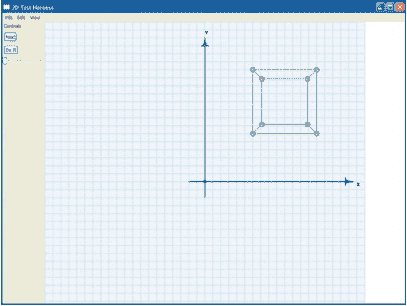

*图 3.8：丢勒程序的结果：一个以透视显示的线框立方体，背景看起来像方格纸。方格纸上的坐标轴是 GraphPaper 本身的一部分，由测试平台设置，并不是由程序的丢勒渲染部分绘制的。*


从这一层次到视频游戏和好莱坞电影中看到的各种特效，但一些重要的思想——构建数学模型，并将其转换为二维图像⁵——都已以基本形式存在于我们的简单渲染器中。

### 3.5 局限

我们现在退后一步，批判性地看待这一成功。当你运行该程序时，你会看到一个立方体的透视图，由12条线段组成（立方体的角上也有点），这符合预期。

该程序有几个局限。首先，线框绘制意味着我们可以同时看到立方体的背面和正面。我们可以用与处理边绘制类似的方式来解决这个问题：我们可以观察到，立方体的一个面（立方体的方形侧面之一）上的所有点都将投影到由四个顶点的投影所定义的四边形中的点。因此，与其保留边表，我们可以保留一个面表，并为每个面在二维中绘制一个填充多边形。（当然，我们也可以同时绘制面和边。）采用这种方法，我们主要关心的是找到一种方法，只绘制朝向眼睛而不是背离眼睛的多边形。有很多策略可以做到这一点，但所有这些策略要么需要比我们在本章想介绍的更多的数学知识，要么需要比我们目前想讨论的更复杂的数据结构。

其次，虽然我们都知道，我们能看到物体是因为它们发出的光（光进入我们的眼睛，使我们感知到某物，如第5章和第28章所述），但我们目前的程序中没有任何描述光的内容（除了我们使用直线进行投影是基于光沿直线传播这一理解）。无论我们想象是否存在光，我们都会得到相同的立方体图像。这也意味着所有其他依赖于光的特征，如阴影和表面的明暗部分，都无法显现。在没有显式光照模型的情况下也可以添加这些特征，但根据明智建模原则，这样做是错误的。

第三，当这个程序运行时，它只显示一个模型（立方体），并且只在一个位置上显示。我们做了很多工作，但输出却不多；我们的程序不够通用，无法在不改变代码的情况下显示其他场景。这可以通过将表示立方体的数据存储在程序可以读取的文件中来解决；典型的表示会以顶点数、顶点列表、边数和边列表开始。虽然它不太紧凑，但明智的做法是让这样的文件包含对数据的显式标签，并允许注释；这将使调试程序更容易。下面是一个表示立方体的示例文件：

```
~~~
# Cube model by jfh
nVerts: 8
vertTable:
0 -0.5 -0.5 -0.5
1 -0.5 -0.5 0.5
...
0.5 0.5 0.5
# Note that each edge of cube has length = 1
~~~

10 | edgeTable:
11 | 0   0   1
12 | 1   1   2
13 | ...
14 | 11  7   8
```

当然也可以采用其他格式；事实上，用于指定各种模型的格式非常多，而且有程序可以互相转换这些格式（有时在转换中会丢失一些数据）。由于格式的选择受时尚变化的影响，而且变化很快，我们就不打算对其进行综述。使用任何一种这样的存储格式，都可以定义多个形状，如立方体、四面体，甚至多面球体，并增强程序以依次加载每个形状，增加一些多样性。然而，要做到这一点，你需要通过阅读下一章的某些部分来更充分地理解测试平台。

我们还可以通过添加有限形式的动画来增强程序：立方体底部（或顶部）四个顶点的 *xy* 坐标是半径为 *r* = √2/2 的圆上的四个等距点，即 *r*(cos θ, sin θ)，其中 θ = π/4、3π/4、5π/4 和 7π/4。我们可以通过令四个角的 θ = π/4 + *t*、3π/4 + *t*、5π/4 + *t* 和 7π/4 + *t*（对于某个较小的 *t* 值）来创建一个略微旋转的立方体。通过逐渐增大 *t*，并每次重新绘制模型，我们可以显示一个旋转的立方体。

这种显式改变立方体坐标然后重新显示的方法并不是特别高效。立方体实际上成为一个**参数化模型**，旋转量 *t* 作为参数。问题在于，当我们想让立方体在 *yz* 平面而不是 *xy* 平面中旋转⁶时，我们需要改变模型。如果我们要先在一个平面内旋转，然后再在另一个平面内旋转，就必须进行一些繁琐的代数和三角运算。实际上，只要给立方体建一次模，然后学习如何通过旋转（或其他操作）来变换其顶点，就会简单得多。我们将在接下来的几章中详细讨论这一点。

⁶. 我们说在 *xy* 平面中旋转，而不是“绕 *z* 轴旋转”，是因为在平面中的旋转可以推广到所有维度，而绕轴的旋转是三维空间所特有的。第11章将进一步讨论这一点。

另一方面，有些模型是参数化定义的，并通过改变这些参数来制作动画。所谓的“样条”模型就是一个特别重要的例子，将在第22章讨论，但其他例子也比比皆是，尤其是在物理模拟中：例如，流体模型具有流体的粘度和密度等参数，以及流体粒子的初始位置和速度。这些参数对流体在某个时刻外观的影响相当间接——我们必须进行模拟才能理解其影响——但它仍然是一个参数化模型。

## 3.6 讨论与延伸阅读

本章中的“渲染”有点不寻常，因为我们将三维场景转换成了二维对象的集合（点和线），然后使用二维渲染器进行绘制。从这个意义上说，这个过程有点类似于将高级语言转换为低级汇编语言的编译器。只有当这种汇编语言进一步被处理成机器语言并执行时，计算才会发生。同样，只有当我们用 WPF 的二维渲染工具实际绘制点和线时，我们才能得到一幅画面。这种转换为中间表示的情况在图形学的其他领域也会出现。例如，在一些表现性渲染算法中，输入图像被转换为一个中间表示，该表示由某些图像处理算法检测到的边缘和由这些边缘围成的区域组成。选择一个好的中间表示可以决定成败。

西方艺术中透视的发现，以及相关数学的推导，是一个引人入胜的主题。当世界中的平行线在渲染画面中看起来汇聚时，眼睛会被吸引到汇聚点，即**消失点**。与透视法的发展几乎同样引人入胜的是艺术家对消失点这一特性的巧妙运用；有时艺术家在一幅画的不同区域创建不同的消失点，将观者的目光引向场景中的多个事物（据说皮耶罗·德拉·弗朗西斯卡的*《复活》*就具有这种特性。）我们不知道这是否确实是刻意为之。有许多系统的方法可以利用所谓的“消失点”和射影几何的思想来创建正确的透视渲染。这些方法也可以被视为基本的渲染引擎，就像丢勒木刻版画中所示的那样。

同样引人入胜的是人们可以获得的关于非西方艺术的理解。例如，罗克关于感知的著作 [Roc95] 解释说，在中国的一些卷轴画中看到的视角，在西方人看来很奇怪，实际上是从一个非常高的视点、投影平面垂直于地面时的透视正确视图。

透视投影不保持相对长度（想想铁轨消失在远处的画面——相邻枕木之间的相等距离在图像中变成了不等的距离），但它们确实保留了其他一些性质。对投影及其相关空间变换的研究成为**射影几何**领域；对于数学好奇者，哈茨霍恩 [Har09] 和塞缪尔 [SL88] 的书是极好的入门读物。

用顶点数组以及通过顶点索引描述的面数组来表示多面体模型的方法有时被称为**索引面集**；布朗网格集 [McG] 中收集了大量以这种方式存储的模型。虽然它不太紧凑，但易于解析。PLY2 格式也同样简单。互联网上有很多这两种格式的示例模型。使用更紧凑的二进制表示的更复杂模型格式比比皆是。一种相当常见的格式是 3DS，它是为 3D Studio Max 软件（现称为 3ds Max）开发的，并被其他工具广泛采用或导入。3ds Max 现在使用专有的 .max 格式，但许多 3DS 模型仍然可用。另一个流行的形状建模程序 Maya 也有自己的专有格式 .mb。两者本质上都是元格式，指定了用于解析模型每个子部分的插件（共享库）；实际上，对这种格式进行逆向工程是不切实际的，因此，出于爱好者和课堂教学的需要，人们继续使用更旧更简单的格式。

我们在本章中称之为“视区”的东西——我们正在制作的图片中可见的世界部分——是更一般的**视体**概念的一个实例；区别在于，视体并非无限金字塔，而是可能被截断，使得距离超过某一距离的物体……

会被忽略，比另一距离更近的也会被忽略。这些“近”和“远”距离可以调整，使某些算法更高效（通过减少渲染时需要考虑的物体集合），或更精确（通过使用定点算术更精确地表示一定范围的值）。定义视景体的一般问题将在第13章中详细讨论。

## 3.7 练习题

**练习 3.1：** 假设丢勒画中手持铅笔的学徒不仅做了标记，还在标记旁写下了绳子末端重物的高度（离地高度）。这个数就是眼睛到物体的距离（加上某个常数）。现在假设我们为一把鲁特琴制作了第一幅带距离的图画，琴主随后把它带回家。后来我们决定确实想在图中放一个烛台，位于鲁特琴前方（即更靠近眼睛）。

- (a) 如果我们把烛台放在如今空着的桌子上，但放在正确位置，并制作第二幅带距离的图画，请描述如何用算法将两幅图组合成一幅合成图，显示烛台位于鲁特琴前方。这种**深度合成**思想是z缓冲区的众多应用之一，你将在第14、32、36和38章再次遇到。记录每个点的深度，有点像z缓冲区中存储的值，尽管并不完全相同。

    这种**深度合成**思想是z缓冲区的众多应用之一，你将在第14、32、36和38章再次遇到。记录每个点的深度，有点像z缓冲区中存储的值，尽管并不完全相同。

- (b) 试着想一想，如果图像中的每个点都标注了它到视点的距离，你还能做哪些其他事情。

**练习 3.2：** 图3.8中渲染立方体角上的圆点看起来位于棱边之后，这看起来不太自然；修改程序，使圆段在*之后*绘制圆点，这样看起来更好。再次修改，完全不绘制圆点，只绘制边段。

**练习 3.3：** 我们可以用面而不是边来表示形状；例如，丢勒程序中的立方体可以由六个正方形面表示，而不是立方体的12条边。然后我们可以选择仅当某个面朝向眼睛时才绘制它。在这种情况下，“绘制”可能只是绘制该面的边。结果是线框对象的渲染，但只显示可见面。如果对象是凸的，渲染就是正确的；如果不是，那么一个面可能部分遮挡另一个面。对于像立方体这样的凸形状，具有任意面的前两条边都不平行这一性质，判断顶点为 \((P_0, P_1, P_2, \ldots)\) 的面是否可见相当容易：计算向量的叉积⁷ \(\mathbf{w}=(P_2-P_1)\times(P_1-P_0)\)，并将其与从眼睛 \(E\) 到 \(P_0\) 的向量 \(\mathbf{v}\) 比较，即 \(\mathbf{v}=P_0-E\)。如果 \(\mathbf{v}\) 和 \(\mathbf{w}\) 的点积为负，则该面可见。这条规则依赖于对每个面的顶点排序，使得叉积 \(\mathbf{w}\) 是一个向量，如果把它放在面的中心，它会指向自由空间而不是指向对象内部。

- (a) 写出立方体的面列表，注意排序，使每个面计算出的“法向量” \(\mathbf{w}\) 都指向外侧。

- (b) 调整程序，计算每个面的可见性，并且只绘制可见面。

- (c) 本练习中描述的基于叉积和点积的可见性确定方法对于更复杂的形状会失效，但在本书后面

⁷ 我们将在第7章回顾向量的点积和叉积。

本页有意留白

# 第4章

# 二维图形测试平台

## 4.1 引言

现在你已经熟悉WPF的一些方面，并且已经看到我们承诺的测试平台在构建丢勒渲染器时的使用情况，我们将向你展示测试平台的细节——一个用于测试图形学思想的框架，而不需要大量额外开销。实际上有两个这样的平台：一个用于二维，一个用于三维。本章介绍二维测试平台；更完整的文档以及三维测试平台可在本书网站上获得。我们称它们为测试平台，是因为它们类似于电气工程师可能使用的测试装置：一组仪器、电源和原型板，可以在上面组装和测试各种电路。我们的设计目标不高：我们想要一个基本框架，在其中容易编写和调试简单程序。易调试性优先于速度；简单性优先于通用性。

在本书中，我们一直提供涉及编写小程序的练习，这些程序旨在研究你学过的一些主题。例如，当我们讨论形状的数学建模时，我们从多边形开始，并展示如何用它们塑造曲线。图4.1展示了一个例子：你可以取一条闭合**折线**——平面中的一系列线段——并对它执行切角操作，其中每条线段被分成三等份，去掉每条线段的首尾各三分之一，再把剩余线段依次连接起来。

看起来，如果你反复这样做，所得折线会变得越来越平滑，近似一条光滑曲线。虽然可以用数学方法分析这个过程（而且很有价值），但我们相信一图胜千言，而交互又胜千言万语。因此，我们给你一些工具，用来回答你可能提出的各种问题——例如曲线是否总会变得更平滑，是否存在某些起始折线，无论迭代多少次都会产生带尖角的曲线，以及如果保留每条线段的中间一半而不是中间三分之一会发生什么——这样你就能对这个过程获得直观理解。同时，编写程序实现这些想法常常有助于你理解其中的微妙之处。

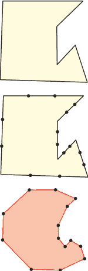

*图4.1：* 上：平面中的一条折线。中：每条线段已被分成三等份，分点用圆点标出。下：将线段的中间三分之一连接起来，形成一条新的、更平滑的折线。

如果我们选择讨论折线的切角而不是*闭合*折线的切角，你在编写代码时就必须决定起始段和结束段该怎么处理；这类边界情况常常既是复杂性和理解力的来源，也是错误的来源。

我们本可以选择解释如何绘制单个点，然后如何绘制线、检测鼠标点击、创建菜单和按钮并将它们与程序中的动作关联起来，所有这些都是有趣且有价值的主题。但我们希望你能立即开始*直观地*学习图形学。要做到这一点，就需要给你一些工具，而你还不会理解它们的内部工作原理。

带着这个目标——提供易于修改的程序，让你可以在其中试验各种图形学想法——本章剩余部分介绍我们的二维测试平台。

在介绍二维程序之后，我们展示如何使用它来实现二维切角，并提供一些练习，你可以在其中进行一些实验，为后续章节中介绍的思想做准备。

此时，测试平台程序本身旨在让你不必理解图形程序的许多细节。所有屏幕图形最终都涉及设置屏幕上各个像素的颜色值。在第38章中，我们将讨论在底层工作的软件和硬件。现在，我们让这些硬件和软件替我们完成繁重工作，以便我们能在更高的抽象层次上工作：我们假设可以创建高层形状和图像，而WPF和Direct3D会负责让像素看起来像我们间接指定的那样。

## 4.2 测试平台的细节

正如我们所说，我们的程序基于WPF，这是一个已有整本书籍和数千个网页专门讨论的主题。根据我们的经验，修改现有程序总是比从头开始更容易。因此，我们构建了二维测试平台，并随附一个示例程序，它完成若干功能。你通常会通过复制这个示例、删除其中大部分内容，然后修改剩余部分来使用测试平台。示例显示诸如照片图像、软件创建的图像、多边形、网格和一组箭头（由基点和方向指定的一组箭头）之类的东西。它还有一些按钮（其中一个按钮改变显示哪个软件图像）和一个滑块（可用于移动多边形的一个顶点）。从这些示例中，你应该很容易推广并把自己的交互元素添加到程序中。

请注意，这个程序一直在开发中；我们预计会随着学生指出他们希望增强的方式而扩充它。由于这些扩充可能会导致程序的细微变化，我们将在本书网站上包含关于任何此类变化的说明。网站还包含测试平台中所含实体的更完整文档；本章只是测试平台及其使用的介绍，不是完整文档。

### 4.2.1 使用二维测试平台

在阅读本章的此时，你应该暂停一下，访问本书网站，并按照那里的指示下载二维测试平台。你还应准备一个

你希望在其中工作的开发环境。在本书的示例中，我们使用了免费分发的“基础版”Visual Studio 2010，以及用于浏览文档等用途的 Microsoft Windows SDK。按照网站上的说明启动并运行 2D 测试平台，然后试验示例程序：试着单击按钮或移动滑块，看看会发生什么。浏览代码，看看是否能开始拼凑出它的工作原理。然后继续阅读。

我们假设你熟悉类似 Visual Studio 的集成开发环境，并且了解 C#、C++ 或 Java 之类的编程语言。（测试平台是用 C# 编写的，但任何熟悉 C++ 或 Java 的人都会发现使用 C# 很容易。）

### 4.2.2 切角

在 4.6 节中，我们将逐步开发切角应用程序。为准备该练习，请从本书网站下载 Subdivide 应用程序并运行它。应用程序启动后，在主窗口中单击几次以创建一个多边形；然后单击 Subdivide 按钮查看切角操作，或单击 Clear 按钮重新开始。

检查 `Window1.xaml` 代码。你会看到“Subdivide”和“Clear”这些字眼；这些字眼周围的 XAML 代码创建了你刚才单击的按钮，而 `Click="b1Click"` 告诉 WPF：当单击其中一个按钮时，应调用名为 `b1Click` 的过程。稍后我们会看到更多细节；在这里，我们希望你对这个示例中起作用的各个部分位于何处有一个大致了解。

现在检查 `Window1.xaml.cs` 代码。Window1 类的初始化会创建一对 Polygon 对象，这些对象在 Window1 的构造函数中初始化，然后被添加到名为 gp（代表“graph paper”，即方格纸）的对象中，该对象表示将在显示区中绘制的所有内容。多边形初始化代码为多边形设置某些属性；还可以设置许多其他属性，但这里让它们保留默认值。最后，`b2Click` 和 `b1Click` 过程描述了用户单击这两个按钮时应发生什么。简要看一下它们。Clear 按钮的处理对你来说应该相当简单；Subdivide 按钮的处理更复杂，但你可以看到，其核心涉及将各种坐标乘以 1/3 和 2/3，正如你所预料的那样。

这些就是切角应用程序的关键部分。几乎其他所有内容都是**样板代码**——那些让编写此类应用程序变得容易的代码片段。事实上，我们创建这个切角应用程序时，是从测试平台开始的：该平台会创建点、线、箭头、网格以及各种可移动对象，我们删除其中大部分内容，然后编辑 XAML 以移除一些不需要的用户界面组件，并重命名另外几个组件。有了这个示例作为参照，我们现在可以看看测试平台的其余部分。

### 4.2.3 基于测试平台的程序结构

正如你在第 3 章所学到的，WPF 应用程序通常分为两部分指定：一部分用 XAML，另一部分用 C#。这两部分协作构成整体。实际上，可以有采用这种相同两部分分离方式的对象类，也可以有纯 C# 的对象类；我们的代码中两种类型都有。

应用程序的最高层部分称为 `Testbed2DApp`；它在文件 `Testbed2DApp.xaml`（XAML 文件）和 `Testbed2DApp.xaml.cs`（关联的 C# 文件）中实现。

XAML 文件（见清单 4.1）声明 `Testbed2DApp` 是 `Application` 类的对象，这意味着它预定义了一些属性、事件和方法；除了我们将在 C# 文件中看到的 `Startup` 事件处理程序之外，我们几乎不使用其中任何一个。^1

*清单 4.1：Testbed2DApp.xaml 中的代码。*

```xml
<Application x:Class="Testbed2D.Testbed2DApp"
    xmlns="http://schemas.microsoft.com/winfx/2006/xaml/presentation"
    xmlns:x="http://schemas.microsoft.com/winfx/2006/xaml"
    Startup="AppStartingUp">
    <Application.Resources />
</Application>
```

清单 4.1 中的代码只是声明了一个应用程序，以及一些关于在哪里可以找到此 XML 命名空间的某些名称解析（即 `xmlns` 行）的信息。从我们的角度来看，关键元素是 `Startup="AppStartingUp"` 这一行，它表示 `Startup` 事件将由 `Testbed2DApp.xaml.cs` 文件中 `AppStartingUp` 方法里的代码处理。这相当于 C++ 或 Java 程序中的 `main()`。

相应的 C# 文件如清单 4.2 所示。关键字 `partial` 告诉我们，该类的部分描述在这里，但另一部分在其他地方（XAML 文件中）。`AppStartingUp` 方法已定义为创建一个 `Window` 并显示它。`AppStartingUp` 的参数未被使用。`Testbed2DApp` 的其余事件处理程序、方法等保持从 `Application` 类继承的默认值不变。

*清单 4.2：相应的 C# 文件 Testbed2DApp.xaml.cs。*

```csharp
using System;
using ...;

namespace Testbed2D
{
    public partial class Testbed2DApp : Application
    {
        void AppStartingUp(object sender, StartupEventArgs e)
        {
            Window mainWindow = new Window();
            mainWindow.Show();
        }
    }
}
```

因此，如果我们运行 `Testbed2DApp`，启动时将创建并显示一个 `Window`。

这个 `Window` 类比 `Testbed2DApp` 类更丰富一些：它对应于传统应用程序的主窗口，并包含诸如

以及 `</Button>` 标签，我们有按钮的内容，那只是一段简单的文本。

第 25–30 行中的 Slider 类似：我们设置了几个选项，指定滑块的宽度、初始值（0）、最大值（20，当滑块拇指位于最右端时）、它应水平放置、刻度标记的位置以及放置多少个刻度标记。最有趣的特性是 `ValueChanged="sliderChange"`，这意味着当用户更改滑块的值时，WPF 应调用 Window1 类的 sliderChange 方法。

现在我们已经检查了几乎所有的 XAML 代码。你或许可以颇有信心地编辑此文件，添加更多按钮和更多滑块，甚至弄清楚如何更改按钮的颜色，或者将 StackPanel 拆分成一对 StackPanel，一个放按钮，一个放滑块，并排显示。（提示：你可以将两者都包含在一个新的 DockPanel 中，并将其方向设为水平。）

> **内联练习 4.2：** 向 StackPanel 添加一个新按钮或滑块，但分别不要包含 `Click=` 或 `ValueChanged=`。运行程序以确保新项确实出现在你预期的位置。

> **内联练习 4.3：** 按上面的建议，将 Controls StackPanel 重新排列为一个满是按钮的面板和一个仅包含滑块的面板。验证你的修改是否有效。

如果你添加一个新按钮，设置 `Click="b3Click"`，然后尝试编译应用程序，编译会失败，因为你需要编写 Window1 类的 `b3Click` 方法；稍后我们会更详细地讨论这一点。

> **内联练习 4.4：** 添加一个带有 `Click="b3Click"` 的按钮，并验证应用程序不再工作。试着解析错误消息并理解其含义。然后移除这个新按钮。

XAML 代码中的最后一项是 GraphPaper。这里的语法有点特殊。清单 4.4 显示了大幅精简后的 XAML 代码。

*清单 4.4：Window1.xaml 中创建 GraphPaper 的部分。*

```xaml
    <Window
        x:Class="Testbed2D.Window1"
        xmlns="..."
        xmlns:h="clr-namespace:Testbed2D"
        ...>
        ...
        <h:GraphPaper x:Name="Paper">
        </h:GraphPaper>
    </DockPanel>
    ...
    </Window>
```

突出显示的 XAML 行表明，名为 h 的 XML 命名空间引用由 Testbed2D 定义的公共语言运行时（clr）命名空间。这意味着 GraphPaper 不是标准的 WPF 类，而是由该项目定义的类，也就是名为 GraphPaper 的类，而非 WPF 的 Canvas 类。事实上，GraphPaper 很像 Canvas（实际上，它派生自 Canvas），只不过它

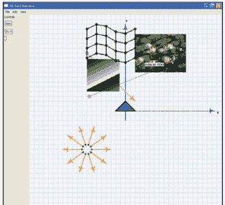

*图 4.2：正在运行的 Testbed2D 应用程序。大方格纸窗口中的所有内容均由 Window1.xaml.cs 代码绘制，并未在 XAML 文件中描述。*

它自带类似方格纸的网格和预先绘制的坐标轴，而 GraphPaper 上的距离以毫米为单位，而不是 WPF 单位（其大小为 1/96 英寸）。³ 我们不会考察 GraphPaper 类的完整描述；我们只会使用它。在你读完接下来的两章之后，花些时间研究共同定义 GraphPaper 的 XAML 和 C# 会是值得的。

3. 有一个例外：如果你将显示器的 dpi 设置设为与物理显示器实际每英寸点数不匹配的值，那么一个 WPF 单位将不再表现为 1/96 英寸。

在 Window1 XAML 文件底部，我们创建了一个 GraphPaper 实例；为此，必须说明它是 h:GraphPaper，告诉程序到哪个命名空间查找它。我们还给它起了一个名字——Paper——以便在 C# 文件中引用它。

图 4.2 显示了程序运行时的外观。所有有趣的内容都由 C# 代码生成，但界面的整个外观由 XAML 代码决定。

## 4.3 C# 代码

相关的 C# 代码（Window1.xaml.cs）也相对简单（见代码清单 4.5）。这里没有涉及花哨的软件工程；这个测试平台旨在相当于一叠草稿纸，而不是大型系统的基础。如果你计划在 WPF 之上构建大型应用程序，你应该熟悉 WPF 本身，而不是我们为这个 2D 测试平台所使用的它的精简部分。

回想一下，我们在 XAML 中只部分描述了 Window1；C# 文件包含定义的其余部分。由于此示例中显示一个多边形、三幅图像、一个网格（mesh）以及一个箭头集合（quiver），我们会将其中每一项声明为类的实例变量。如果你要编写一个只需要显示单幅图像的程序，你会删除除一个之外的所有这些变量。

**代码清单 4.5：Window1 类定义的 C# 部分。**

```csharp
using ...

namespace Testbed2D
{
    public partial class Window1 : Window
    {
        GraphPaper gp = null;

        Polygon myTriangle = null;
        GImage myImage1 = null;
        GImage myImage2 = null;
        Mesh myMesh = null;
        Quiver myQuiver = null;

        // Are we ready for interactions like slider-changes to
        // alter the parts of our display (like polygons or images
        // or arrows)?
        // Probably not until those things have been constructed!
        bool ready = false;

        public Window1()
        {
            InitializeComponent();
            InitializeCommands();

            // Now add some graphical items in the main Canvas,
            // whose name is "GraphPaper"
            gp = this.FindName("Paper") as GraphPaper;

            // A triangle whose top point will be dragged
            // by the slider.
            myTriangle = new Polygon();
            myTriangle.Points.Add(new Point(0, 10));
            myTriangle.Points.Add(new Point(10, 0));
            myTriangle.Points.Add(new Point(-10, 0));
            myTriangle.Stroke = Brushes.Black;
            myTriangle.StrokeThickness = 1.0; // 1 mm thick line
            myTriangle.Fill = Brushes.LightSeaGreen;
            gp.Children.Add(myTriangle);

            // A draggable Dot, which is the basepoint of an arrow.
            Dot dd = new Dot(new Point(-40, 60));
            dd.MakeDraggable(gp);
            gp.Children.Add(dd);

            Arrow ee = new Arrow(dd, new Point(10, 10),
                                 Arrow.EndType.END);
            gp.Children.Add(ee);
            [lots more shape-creating code omitted]
            ready = true; // Now we're ready to have sliders and
                          // buttons influence the display.
        }
        [interaction-handling code omitted]
```

Window1 的构造函数首先初始化组件——这是任何顶层 WPF 窗口都必需的一步，它会使所有子部件完成布局；随后重新显示，此时三角形还不存在。如果我们以某种方式*改变*了三角形，那也会触发一次重新显示。

遗憾的是，这种“监视子对象变化”的机制只延伸到某个细节层级。如果构成 `Polygon` 的 `Collection of Points` 发生变化，这实际上会成为 `Polygon` 自身的变化，从而触发包含它的 `GraphPaper` 重新显示。但 `Collection` 发生变化意味着什么？WPF 的设计者选择让它意味着“引用集合必须变化”，而不是“引用所指向的某个对象必须变化”。因此，删除或插入集合中的项会被视为变化，但仅仅修改某个项——例如改变第一个点的 x 坐标——则不会。于是，如果我们修改定义多边形的第一个 `Point` 的第一个坐标，什么也不会发生：`Point` 本身变了，但包含该 `Point` 的 `Collection` 不会识别这一变化并将其传播。相反，我们可以从集合中*移除*该 `Point`，创建一个坐标已改变的新 `Point`，再将这个新 `Point` 插入集合，从而产生一个向上传播的变化。我们将在下一节看到这方面的细节。

在像 WPF 这样的系统中，如何界定“变化”会对性能产生巨大影响：如果粒度过细，平台的全部计算能力都会花在监视变化上；如果粒度过粗，应用程序员就需要做大量变化通知，并可能最终放弃系统提供的变化跟踪，转而全部由自己处理，因为这样他们才能保持一致。

### 4.3.3 事件处理

WPF 将用户交互（以按键、鼠标单击和鼠标拖动等形式）视为**事件**。检测到事件时，它会启动一系列复杂的活动，最终由 WPF 调用某个事件处理程序。更准确地说，WPF 可能会调用大量事件处理程序，但在我们的情形中，我们将为一个事件只使用一个处理程序，然后将该事件标记为“已处理”，这样就不会再调用其他处理程序。有时事件处理程序是 WPF 的一部分；有时它们是应用程序员提供的回调过程。

具体来说，当 WPF 检测到按钮被单击时，它会调用该按钮的 `Click` 处理程序。对于我们的第一个按钮（定义在代码清单 4.3 第 25 行），我们在 XAML 代码中将 `Click` 处理程序设置为 `b1Click`。`b1Click` 方法相当简单：它打印一条调试消息，然后通过在事件上设置标志来声明此单击已处理（见代码清单 4.6）。

*代码清单 4.6：第一个按钮单击事件的处理程序。*

```csharp
public void b1Click(object sender, RoutedEventArgs e)
{
    Debug.Print("Button one clicked!\n");
    e.Handled = true; // don’t propagate the click any further
}
```

此代码中的 `sender` 是 WPF 中将单击转发给我们的实体；这种单击转发属于一个复杂的层级结构，我们基本上可以忽略它：在画布上的网格中，单击按钮上显示的一段文本，会触发文本对象、按钮、网格和画布的响应。为了中断这一事件链，我们将 `RoutedEventArgs.Handled` 字段设置为 `True`，这表示我们已经处理了该按钮单击，代码的其他部分无需再对此做任何事。

一个更复杂的事件处理示例由滑块值变化的处理程序演示，即 `sliderChange`，如代码清单 4.7 所示。如你所见，我们打印一条消息，指示传入的新值（`e.NewValue`），然后调整三角形第一个点的 x 坐标。由于只有三个点，我们没有移除并重新插入该点，而是直接重新赋值整个 `Points` 数组。这会使三角形被标记为“已更改”，从而引发整个画布重新显示，结果是当我们用鼠标调整滑块时，三角形的顶部顶点会左右移动。

*代码清单 4.7：移动三角形顶点的 `sliderChange` 方法。*

```csharp
void sliderChange(
    object sender,
    RoutedPropertyChangedEventArgs<double> e)
{
    Debug.Print("Slider changed, ready = " + ready +
        ", and val = " + e.NewValue + ".\n");
    e.Handled = true;
    if (ready)
    {
        PointCollection p = myTriangle.Points.Clone();
        Debug.Print(myTriangle.Points.ToString());
        p[0].X = e.NewValue;
        myTriangle.Points = p;
    }
}
```

那么代码清单 4.5 第 19 行和第 50 行、代码清单 4.7 第 8 行中名为 `ready` 的标志呢？在应用程序中创建 `Window1` 的过程中，WPF 会创建滑块，并将其初始值设置为 XAML 代码中预先确定的值。这反过来会引发 `ValueChanged` 事件，⁶ 使 WPF 调用 `sliderChange` 方法。但所有这些都发生在 `InitializeComponent` 过程中，因此三角形尚未创建。如果我们试图修改其某个 `Points` 的坐标，那就会是一个 bug。因此，在 `Window1` 准备好之前（由 `ready` 标志指示），我们会忽略所有此类事件。

6. 该值已从“未定义”变为指定的初始值。

**随堂练习 4.5：** 修改测试平台，使其显示一个菱形对象而不是三角形，并让滑块同时（且沿同一方向）调整顶部和底部两个顶点的 x 坐标。添加第二个滑块，并让它也改变菱形左右两个顶点的 y 坐标。

### 4.3.4 其他几何对象

该测试平台还支持除多边形之外的几种几何对象。这些对象包括圆点（dot）：它们类似于点（point），但会被显示出来，并带有一个说明其位置的工具提示；箭头（用于表示向量）和箭袋（quiver），后者是箭头的集合；线段（segment），即位于点与点之间或……之间的线段

点、网格和图像。这些各种实体的详细信息在本书网站上给出。

## 4.4 动画

正如你在第 2 章看到的，WPF 包含用于创建动画的工具。你几乎可以对任何类型的值——`double`、`Point` 等——进行动画处理，然后使用这个变化的值来使显示发生变化。你可以在 XAML 代码或 C# 中定义动画。对于 XAML，有许多预定义动画，你可以将它们组合起来制作相当复杂的运动。在 C# 代码中，你可以使用这些预定义动画，也可以使用任意复杂的程序创建自己的动画。例如，你可以编写一个程序来计算弹跳球随时间变化的位置，然后使用这个变化的位置来控制显示中某个形状（如圆盘）的位置。用 XAML 编写模拟程序并不现实，因此用 C# 编写这样的程序更自然。

在我们的示例中，只有一个动画，但它展示了关键思想（见代码清单 4.8）。在代码中，我们构造了一条线段，其一个端点位于一个名为 `p1` 的 `Dot` 上。在这段代码中，我们通过指定起点和终点位置、动画应持续多长时间（它从时间 0 开始，即程序运行时开始，并持续五秒），以及它应自动反向并永远重复，来对一个点进行动画处理。（顺便说一句，这个相对简单的动画是可以用 XAML 轻松描述的一个例子。）结果是一个随时间在两个指定位置之间来回移动的点。注意，这个点实际上并没有显示在 `GraphPaper` 上；它只是一个值不断变化的 `Point`。但是，`p1.BeginAnimation(Dot.PositionProperty, animaPoint1)` 这一行表示，名为 `p1` 的 `Dot` 的 `PositionProperty` 应由 `animaPoint1` 进行动画处理；这会使该 `Dot` 在显示中来回移动。再次，WPF 的依赖机制在做繁重的工作：它检测 `animaPoint1` 的每一次变化，并确保 `p1` 的 `PositionProperty` 也随之改变；这个属性决定了 `Dot` 在画布上的位置，因此我们能看到运动。

*代码清单 4.8：对 Point 进行动画处理的代码。*

```csharp
1   PointAnimation animaPoint1 = new PointAnimation(
2       new Point(-20, -20),
3       new Point(-40, 20),
4       new Duration(new TimeSpan(0, 0, 5)));
5   animaPoint1.AutoReverse = true;
6   animaPoint1.RepeatBehavior = RepeatBehavior.Forever;
7   p1.BeginAnimation(Dot.PositionProperty, animaPoint1);
```

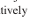

我们一直在相当自由地使用 `Point`，给它们的 x 和 y 坐标赋值。严格遵循面向对象编程信条可能会要求我们将这些坐标视为要隐藏的实例变量，并且只能通过访问器/修改器（或 get/set）方法访问它们。事实上，`Point` 更像 Pascal 记录或 C 结构体，而不是典型的 C++ 或 Java 对象。在模糊记录（相关值的集合）与对象之间的区别时，C# 允许这种用法，这可以对效率产生巨大影响，而对可调试性的影响相对较小。

## 4.5 交互

我们已经讨论了测试平台（以及一般而言的 WPF）中如何处理按钮单击和滑块值更改：会调用 `Click` 或 `ValueChanged` 方法。

键盘交互略有不同。在主 `Window` 中任何位置发生的按键都分两个阶段处理：首先，其中一些被识别为命令（例如“Alt-X”表示“退出程序”）；其次，那些未被识别为命令的按键由名为 `KeyDownHandler` 的方法处理，该方法对所有按键作出响应：要么忽略它们（对于按在 Control 或 Shift 等修饰键上的情况），要么显示一个小对话框，指示按下了哪个键。当你编写更复杂的程序时，你可能希望将这部分代码添加到其中，以便在按下某些键时执行特定操作。

最后，选择菜单项时执行的操作在 `InitializeCommands` 方法中定义。对于许多命令（如 `ApplicationCommands.Close`，表示应用程序应关闭窗口），已经有预定义的处理方式以及与命令关联的预定义按键。对于这些命令，只需编写类似 `CommandBindings.Add(new CommandBinding(ApplicationCommands.Close, CloseApp));` 的内容，其中 `CloseApp` 是一个小过程，它会弹出一个对话框，以确认用户确实想要关闭应用程序。对于其他命令，必须调用稍微更复杂的机制。由于我们不期望你添加任何新命令，因此是否研究这样做的机制由你决定。

## 4.6 测试平台的一个应用

现在让我们回到本章开头讨论过的切角示例。为了创建一个演示这一点的应用程序，我们需要移除 `Window1.cs` 中的大部分代码，并从用户创建的一个简单多边形开始。我们将描述交互序列，然后编写代码。

`GraphPaper` 一开始是空的；有两个按钮，分别标记为“Clear”和“Subdivide”。当用户在绘图纸上单击时，会出现一个多边形 P1，其顶点位于单击位置（单击两次后，该多边形由两条相同的线段组成；单击三次后，是一个三角形；依此类推）。当用户单击 Subdivide 按钮时，会出现第一个多边形的细分版本 P2；随后单击 Subdivide 会用 P2 替换 P1，并用 P2 的细分版本替换 P2，依此类推，因此多边形及其细分版本始终都会显示。单击 Clear 按钮会清空绘图纸。一旦用户细分了多边形，我们就禁用对绘图纸的进一步单击；你可能希望此类单击向细分后的多边形添加新点，但不清楚新点应添加到细分后多边形的何处，因此我们干脆避开这个问题。

记住这一描述，让我们编写代码。⁷ 我们需要一个 isSubdivided 标志（初始为 `false`）来告诉我们用户是否已细分多边形。Clear 按钮应重置该标志，并清空绘图纸。如果多边形中还没有点，Subdivide 应不起作用。

我们从测试平台代码的副本开始，并修改 XAML 以移除滑块并更改按钮上的文本：

7. 整个程序可在本书网站上下载。

```xml
<StackPanel DockPanel.Dock="Left"
    Orientation="Vertical" Background="#ECE9D8">
    <TextBlock Margin="3" Text="Controls"/>
    <Button Margin="3,5" HorizontalAlignment="Left"
    Click="b1Click">Subdivide</Button>
    <Button Margin="3,5" HorizontalAlignment="Left"
    Click="b2Click">Clear</Button>
</StackPanel>
```

现在我们修改 Window1.xaml.cs 中的 C# 代码。首先将两个多边形都初始化为空：

```csharp
public partial class Window1 : Window
{
    Polygon myPolygon = new Polygon();
    Polygon mySubdivPolygon = new Polygon();
    bool isSubdivided = false;
    GraphPaper gp = null;
    [...]
    public Window1()
    {
        [...]
        initPoly(myPolygon, Brushes.Black);
        initPoly(mySubdivPolygon, Brushes.Firebrick);
        gp.Children.Add(myPolygon);
        gp.Children.Add(mySubdivPolygon);

        ready = true; // Now we're ready to have sliders
                      // and buttons influence the display.
    }
```

多边形初始化过程还将多边形设置为具有不同的颜色和标准线宽，并确保当两条边以锐角相交时，它们会被截断，如图 4.4 底部所示，而不是像中间所示那样将连接处延伸成长斜接。

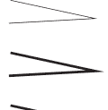

图 4.4：当我们加粗顶部的顶点连接处时，必须对其进行斜接，如中间所示。在底部，斜接受到限制。

```csharp
private void initPoly(Polygon p, SolidColorBrush b)
{
    p.Stroke = b;
    p.StrokeThickness = 0.5; // 0.5 mm thick line
    p.StrokeMiterLimit = 1;  // no long pointy bits at vertices
    p.Fill = null;
}
```

处理对 Clear 按钮的单击很简单：我们只需从每个多边形中移除所有点，并将 isSubdivided 标志重新设置为 false：

```csharp
// Clear button
public void b2Click(object sender, RoutedEventArgs e)
{
    myPolygon.Points.Clear();
    mySubdivPolygon.Points.Clear();
    isSubdivided = false;

    e.Handled = true; // don't propagate click further
}
```

Subdivide 按钮更复杂。首先，如果多边形已经细分，我们希望用细分后多边形的点替换 myPolygon 的点。然后，我们可以细分 myPolygon，并将结果放入 mySubdivPolygon。


就是这样！你可以运行程序，看看它的效果如何。当你只点击两个点时，你的多边形看起来像一条线段。然后你进行细分，这条线段会显得更短。请自己解释一下，为什么再次细分不会使它变得更短。

类似的过程可用于取一个3D多面体并“切角”，试图将其平滑。它总会变得更平滑吗？我们将在第23章进一步讨论。与此同时，既然你已经看到细分似乎能多快地平滑曲线，你可以问自己：“我如何分析曲线是否趋近于某个极限，以及这样的极限在某个特定点处是否光滑？”这个问题将在第22章讨论（针对一种略有不同的细分方法，但原理相似）。

## 4.7 讨论

我们已经为你提供了在 WPF 中创建简单应用程序的工具，以便试验图形学中的想法，并完整讲解了一个细分应用程序作为使用这些工具的示例。本章的练习将让你有机会探索2D测试平台的能力，并发现一些你将在本书后面再次遇到的图形学有趣思想。我们强烈建议你至少完成其中几个练习，这样将来使用这个框架对你来说就会很简单。

这个测试平台是有理由构建的。多年从事计算机图形学工作的经验教会了我们另一条原则：

> ✓ **第一个像素原则：** 第一个像素最难。

当你编写一个新的图形学程序时，最常见的第一结果是一片全黑屏幕。这几乎无法调试，因为上百万种情况中的任何一种都可能造成问题。通常，当你设法让*任何东西*显示在屏幕上时，你就已经完成了大量调试工作。因此，从一个与你想要实现的功能类似的程序开始，并逐步修改它，直到它*确实*实现你想要的效果，这已被证明很有用；但要这样进行修改：在每一个阶段，你都能通过观察它看出它正在做你期望的事情。测试平台为你提供了一个起点，可由此开发大量可能的程序。我们希望它能为你节省无数小时的调试时间。

## 4.8 练习

- **练习4.1：** 修改切角程序，将截断点放在线段四分之一和四分之三处；描述结果。

- **练习4.2：** 修改切角程序，使其成为“对偶化”程序：它用一个多边形替换为它的对偶，即一个顶点为原多边形各边中点、并按相同顺序连接而成的多边形，因此正方形的对偶是菱形。实验：重复对偶化是否倾向于消除自相交多边形的交叉？你能找到一个多边形，其逐次对偶*始终*是自相交的吗？

- **练习4.3：** 修改测试平台，使其只显示单幅图像（例如睡莲），直到单击按钮；每次单击按钮时，应显示一幅新图像（也许循环浏览一组四到五幅图像）。要让新图像出现，你需要更新 `BitmapSource`。这个练习比前几个稍难，因为我们给出的指导较少。

- **练习4.4：** 阅读第5章末尾关于运动诱导失明的内容，然后编写一个程序，让你能对此进行实验，包括改变网格间距和颜色、改变“消失”圆点的颜色和大小，以及改变网格旋转的速度。试着确定最能有效诱发你产生“失明”的设置。

本页故意留白

# 第5章：人类视觉感知导论

## 5.1 引言

人眼在计算机图形学领域占据主导地位，因为如果没有眼睛，图形学几乎毫无用处。每位从事图形学工作的人都应该了解视觉系统工作方式的一些知识。直到某一天图形学变得“完美”，并且在某种程度上与真实无法区分之前，我们必须尽量利用我们的计算和显示资源，让视觉系统相信它正在感知现实；这需要省略那些会产生与理想结果无法察觉（或几乎无法察觉）差异的工作。

本章介绍一些重要的基本概念，并概述我们当前理解的局限。人类视觉科学以及相关的机器视觉科学之所以是活跃的研究领域，正是因为这些局限十分丰富。当然，已有大量已知知识，我们将在本节总结其中一部分。

视觉系统非凡的并行处理能力使大量信息能够从计算机传输给用户。（反方向——从人到计算机——的带宽限制，既是挫折的来源，也是进行巧妙设计的机会；参见第21章。）视觉系统既能容忍不良数据（这就是为什么视觉系统能够理解儿童的火柴人画，或者用非常粗糙的光照模型渲染的图像），同时又极其敏感。事实上，眼睛对某些类型的错误如此敏感，以至于调试图形程序面临特殊挑战：一个微小的错误（例如一幅百万像素的受光球体灰度图像中有一个红色像素）就会突显出来，而在许多其他计算中，百万分之一的错误可能永远不会被注意到。反过来也成立，我们之前提到过：我们可以利用图像传达大量关于程序正在做什么的信息，因此优秀的图形程序员会使用视觉显示来帮助自己理解和调试代码。

> **视觉调试原则：** 使用视觉显示来帮助你调试和理解你的图形程序。

在图形学中，计算机向用户输出信息通常以显示器向用户眼睛发射光的形式进行。显示器可能是传统的平板显示器、投影仪、头戴式显示器，或者供飞机飞行员或汽车驾驶员使用的平视显示器。在所有情况下，光都通过眼睛到达我们。眼睛对该光的响应由视觉系统处理。

当然，还有*其他*交互模式：触觉（触摸）和声音常被用作计算机到人通信通道的一部分。但绝大部分通信都通过视觉系统进行，这就是我们专注于它的原因。视觉系统之所以强大，部分原因在于携带信息到视觉系统的光具有一些声音、触摸、嗅觉或味觉所不具备的特殊性质。例如，光不是**方向性漫射**的：一束从某个方向出发的光只沿该方向传播；它可以在没有支撑介质的情况下传播，而当穿过空气（最常见的介质）时，它在很大程度上不受空气影响（尽管空气的折射率随密度变化会扭曲光——想象一下在炎热天气看到沙漠“波纹”）。相比之下，负责嗅觉和味觉的化学物质不仅会扩散，还会随流动的空气平流，而声音的传播方向可能因风切变而显著改变。光非常擅长将信息从光源传递到我们的眼睛。相比之下，触摸只有在传感器（例如你的手指）与被观察物体处于同一位置时才起作用。

人们很容易试图通过各种方式简化视觉系统对刺激的响应，以便更容易为其建立模型。例如，由于我们处理光的第一步是由眼睛的感觉元件进行检测，人们很容易说：“视觉系统的响应*只*取决于入射光；如果你施加相同的光图案，就会得到相同的响应。”然而，无论在身体层面还是心理层面，这都是错误的。在身体层面，例如从昏暗的餐厅走出来后看到阳光明媚的海滩，会让你反射性地眯起眼睛；而在户外待了几分钟后看到同一片海滩，则不会引起这种身体、生理或心理反应。在心理层面，研究表明，如果你最近刚看过某个物体，你会更快地在杂乱的其他物体中注意到一个与之相似的物体。因此，任何视觉处理模型都不仅必须依赖于*当前*刺激，还必须依赖于最近的过去。更重要的是，我们的模式识别能力也受到训练和学习的影响。一旦你学会了识别某个形状，下次再遇到它时，你会更快地认出它；一个很好的例子是阅读构成文本的字符或字形。视觉系统几乎每个方面都同样复杂；似乎没有简单的解释。另一方面，有大量实验证据可帮助我们理解视觉系统所做的一些事情 [Roc95]。本章我们重点关注视觉系统及其如何感知世界，但讨论必须简略；我们将讨论限制在视觉系统中可能对图形系统产生影响的一些方面。本章

不过，本节最后会以几句简短的话作结，讨论视觉系统与听觉、触觉等其他知觉模式之间的关系。

每一节都以一两段标为“应用”的文字作结，其中将该节的思想与图形学中的应用联系起来。

## 5.2 视觉系统

人类视觉系统（见图5.1）由眼睛（负责聚焦光线，并包含对入射光作出反应的传感器）、视神经以及大脑中统称为视觉皮层的部分构成。视觉皮层各部分的确切功能尚未完全清楚，但已知某些“早期视觉”部分（即负责处理视觉信号最初几个步骤的部分）会检测亮度的强烈对比、方向和颜色的细微变化以及空间频率，也就是每厘米内明暗交替的次数。我们可以这样概括：我们善于检测并注意到那些或许可宽松地称为“模式”的事物中的变化。

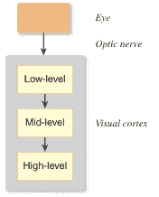

*图5.1：视觉系统的组成部分。*

对方向、颜色或频率变化的检测是局部性的，也就是说，我们对相邻事物具有不同颜色很敏感，但对于视野中相距较远的事物之间的微小颜色差异，早期视觉系统检测不到。早期视觉系统中还有一些部分会将局部信息组合成稍大尺度的信息（“这里的这一小段边缘和紧挨着它的这一小段，构成了两个区域之间更大的一段边界”）。视觉皮层的后期区域似乎负责检测运动、物体（“这是前景中的东西；其他所有东西都在背景中”）和形状，处理“注意”，并控制眼睛（即通过肌肉控制帮助眼睛追踪感兴趣的对象）。

图5.1所暗示的简单性具有误导性：虽然在大尺度上视觉系统确实存在一种“流水线”结构，但同时也进行着大量并行处理，并且后期层级会向早期层级提供大量反馈。

视觉系统极其擅长许多任务，例如无论你的视角或距离如何都能判断大小和方向，在各种光照条件下不变地识别颜色，以及即使在噪声和畸变存在时也能识别形状。它在另一些任务上表现很差，例如判断绝对亮度、识别平行线，以及检测相同但不相邻的颜色。而这些长处和弱点中有些似乎几乎矛盾：我们很善于注意到与周围环境不同的微小事物（例如白色沙地上的黑色小石子），但我们也同样善于忽略许多与周围环境不同的事物，这让我们能观看布满胶片颗粒、划痕和其他噪声的老电影而不分心。用进化基础来解释视觉系统的特定“才能”是很自然的，通常基于这样的观点：视觉系统帮助我们（a）寻找食物，（b）躲避捕食者。¹ 因此，举例来说，人类对运动非常敏感（这有助于发现试图伪装自己的捕食者），但我们并不特别擅长把颜色从一天记到第二天。视觉系统还很善于检测不同光照条件下的颜色相似性（你希望能在正午和黄昏都认出食物，也希望识别出某个东西*整个*都是香蕉，即使它一部分在阳光下、一部分在阴影中）。它相当擅长判断深度，尤其是对附近的物体——这对于你在伸手去摘浆果或水果时协调手部运动非常有用。事实上，手眼协调，尤其是运动员或工匠的动作中的手眼协调，是多个系统高效协同工作、同时完全绕过认知系统意识层面的奇迹。

颜色感知的细节将在第28章中广泛讨论；本章只会简要提及。类似地，运动感知将在第35.3.2节中讨论。

我们很容易相信，我们知道自己是如何看见的。我们会说：“嗯，我寻找颜色相似的东西，比如树上的叶子，并试图把它们组合成一个连贯的整体，从而把叶子和树干树枝感知为不同的组，这是*显而易见*的。”但显而易见的东西未必真实；花几分钟审视各种所谓的“视错觉”，就能立刻证明这一点[Bac]。

视觉系统的运作在计算机图形学中有着直接的重要性。在图形学中，我们常常想问：“我渲染出的图像在感知上是否与理想图像不同，还是已经足够接近，可以在观看者心中产生相同的知觉，因而我无需再计算任何东西？”换句话说，渲染与显示成功与否的最终衡量标准是感知上的。有一种简单的方法可以衡量两幅图像之间的相似性（取图像的逐像素差，将所得所有数值平方，求和，再取平方根；这称为**平方和差、L²差或L²距离**²），但这种差异度量并不总是与感知中的实际差异相符。图5.2给出了一个灰度示例：从顶部41 × 41像素图像（其中所有像素值均为118，范围为0[黑]到255[白]）到中间图像（所有像素均为128）的L²距离，与到底部图像（除中心像素值为255外，所有像素均为128）的距离相同，尽管底部图像看起来差异大得多。


*图5.2：这些是41 × 41像素的图像。顶部图像的所有像素值均为118；中间图像的所有像素值均为128；底部图像除中心像素为255外，所有像素值均为128。从顶部图像到另外两幅图像各自的L²距离大致相等，但这与我们自己对“相同”的理解并不相符。*

人们已经开展了大量工作，试图开发一种“距离函数”，用来描述两幅图像在感知上相距多远[LCW03]，但仍有许多工作要做。与此同时，有一些有用的规则可以指导设计选择。后文将描述的视觉系统对数敏感性意味着，我们的视觉系统对暗区中辐射亮度³误差（固定幅度）比对亮区中的更敏感。视觉系统的局部适应性意味着，强度的*变化*往往比绝对强度更重要（如图5.2所示）；如果有选择，你应当力求把梯度（即强度的局部*变化*）做对，而不是把数值做对。

我们现在对视觉系统有以下了解：第一，我们对事物的知觉相当独立于光照（例如，当你看到一个被明亮阳光照亮的物体，或在黄昏残余光线下看到它时，你仍然会认出它是“我家的门把手”）；第二，视觉系统的早期部分倾向于检测边缘（即不同亮度区域之间的边界），并将它们组合成大脑感知为整体的东西。由此看来，可以合理地说，如果逐像素的亮度比在局部相当恒定，并且每幅图像中的“边缘”集合位于相同位置，那么图像就是相似的。“局部”的概念取决于图像是如何被观看的：如果每个像素在眼睛处张角为1°，那么“局部”可能指“几像素宽的区域”；而如果每个像素张角为0.01°，那么“局部”可能指“数百像素”。事实上，可以制作出在某一距离看起来相似、在另一距离看起来不同的图像。一个简单的例子是黑白棋盘格图案和灰色矩形：近距离看，它们相当不同；在远距离（远到视觉系统无法分辨单个棋盘格方块）看，它们看起来完全相同。更复杂的例子（见图5.3）由Oliva描述[OTS06]。

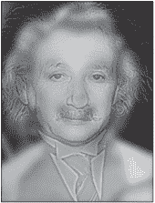

*图5.3：近距离看，你看到的是爱因斯坦；从远处看，你看到的是玛丽莲·梦露。（图片由麻省理工学院的奥德·奥利瓦提供。）*

**应用。** 这一切对图形学有多重要？由于图形学的许多用途是让人们在观看计算机显示器时说自己看到了某个特定事物，所以它相当重要。另一方面，我们对视觉系统的理解仍然相对稀疏，因此调整我们的图像以影响视网膜层面的感知可能相对容易，而试图调整图像以影响整个物体被感知的方式可能更具挑战性，也更易产生意外结果。此外，**低级视觉**（我们视觉系统中负责检测诸如特定区域内亮度快速变化等事物的部分，通常是早期视觉部分）与**高级视觉**（负责形成诸如“我看到一个带有图案的表面”这类假设的部分）之间存在相互作用，而这种相互作用仍未得到很好的理解。芒福德在一篇关于模式理论的论文[Mum02]中引用了听觉系统中一个引人注目的类似例子：心理学家录下了各种句子——“The heel is on the shoe”“The wheel is on the car”“The peel is on the orange”——并把每个句子第二个词的首音素替换为噪声，例如得到“The #eel is on the shoe”，其中井号表示噪声。听到这些句子的受试者感知到的不是被噪声替换后的句子，而是原句，而且实际上没有注意到少了一个音素。因此，正如芒福德所指出的，实际的听觉信号没有进入意识。另一方面，被替换的音素只能根据句子更大的语境来确定。芒福德推测，视觉在许多情况下可能以同样方式工作：虽然低级信息通常从你所见中提取，但在某些情况下，处理它的方式可能受到高级理解结果的影响，而这些高级理解来自对低级信息的部分组合。例如，当你看到某人靠在栏杆上时，你会形成栏杆在人的身后继续延伸的假设，却从未有意识地考虑这一点。当你透过旋转的风扇叶片看东西时，你会把不同时刻看到的部分组合成一个连贯整体，而不是假定某一瞬间被遮挡的部分与片刻之后视野同一区域中未被遮挡的部分无关。由于高级视觉与低级视觉之间的这些相互作用，我们将主要关注理解得更好的低级方面。

我们真的“看见”事物了吗？更准确地说，我们的视觉系统根据其输入构建一个世界模型，并通过知觉过程和认知过程的结合来形成这个模型，这些过程会解决知觉数据中的表面矛盾（如芒福德描述的实验所示）。这使大脑最终形成关于物体的假设（“我看见的是*这个*东西！”），不过，如果你的认知能力与你认为自己看到的东西相矛盾，就会有一些回溯（“那不可能是会飞的大象！”）。因此，视觉的最终结果是心灵创造的一种建构，而不是客观现实。

---

¹ 交配和避障也可能产生影响。

² 与之密切相关的是“均方根”或RMS差的概念，即*每像素*的L²差。

³ 辐射亮度是测量光的物理单位，第26章将详细描述。


## 5.3 眼睛

尽管我们对视觉系统的理解有限，但眼睛的物理特性限制了它可能实现的功能，这些特性有助于指导图形系统的设计。例如，存在最小可检测亮度差和眼睛的最小角分辨率。如果一个显示器的像素能够显示比这些更小的亮度差，或者其像素所张的角度仅为这一最小角分辨率的 1/10，那么该显示器将不必要地复杂。我们将把眼睛视为终止于视神经，视神经和视觉皮层构成视觉系统的其余部分。

### 5.3.1 眼睛的总体生理结构

从宏观尺度看，眼睛由一个球状物体组成，由颅骨固定，各种附着其上的肌肉以及周围的其他软组织将其保持在位（见图 5.4）。

一对眼睛的旋转控制由我们的视觉系统协调，以便视网膜上接收到的光图案可以被整合，形成对世界的单一连贯视图；场景的左眼视图和右眼视图通常不同，这些视图之间的*视差*有助于我们估计世界中物体的深度。（你可以很容易地做实验：在房间墙上标记一个点，并在你和这个标记之间不同距离处放置若干物体。盯着标记时，先遮住一只眼，再遮住另一只眼，注意当你切换眼睛时，附近物体的左右位置似乎如何移动。）

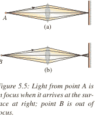

在粗略层面上，从发光物体（灯泡）或反光物体（你桌上的书）到视网膜的路径——穿过瞳孔、晶状体和玻璃体（眼球内凝胶状液体）——可以用一个简单透镜建模，该透镜置于发光物体和成像平面之间（见图 5.5）。物体发出的光沿许多光线传播，这些光线击中透镜的不同点，并在进入和离开透镜时发生折射（弯曲），结果是（如果透镜形状合适）所有光线在另一侧的某一点再次汇聚。如果这个点恰好位于成像平面上，我们说该物体“对焦”。如果汇聚点不在成像平面上，那么这些光线不会产生一个明亮的点，而是在成像平面上生成一个暗淡的光盘。例如，如果成像平面是数码相机的传感器阵列，那么点 B 看起来就会失焦且模糊。

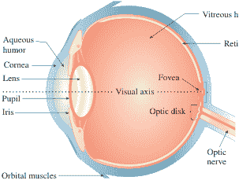

图 5.4：光通过瞳孔进入眼睛，然后穿过晶状体和玻璃体，到达视网膜。

所有光线汇聚到单一点取决于**折射率**（见第 26 章）——一个描述光从空气进入透镜再回到空气时弯曲程度的数值——与光的波长无关。对于大多数材料，折射率*确实*会随波长略有变化；这会使一种颜色的物体对焦而另一种颜色的物体不对焦，例如，这解释了通过放大镜观察物体时物体边缘出现彩虹色条纹的原因。

因为眼睛可以轻微改变其晶状体形状，视觉系统可以利用对焦/散焦来检测眼睛到物体的距离，至少对附近物体如此（物体越远，散焦越不严重）。由深度引起的散焦量取决于透镜直径。对于非常小的直径，存在大得多的几乎对焦的深度范围（这一范围在摄影中称为**景深**）；对于大直径，景深往往很小。对于理想化针孔相机，光通过无穷小的孔到达图像平面，景深是无限的；不幸的是，这种理想化装置的聚光能力为零。人眼也有可调节的瞳孔。在弱光下，瞳孔张大，收集更多光，但代价是景深减小；在强光下，瞳孔收缩，增强景深。与常识相反，这种瞳孔调节在适应大范围亮度水平方面几乎不重要——瞳孔面积的变化最多为十倍，而日常经验中最大入射辐射亮度大约比最小的大十个数量级，但响应很快，使瞳孔在短期调节中非常有效。较长期的调节是感受器中的化学过程。

### 5.3.2 眼睛中的感受器

眼睛内后表面的大部分，即**视网膜**，覆盖着对到达它们的光作出反应的细胞。这些细胞主要分为两组：**视杆细胞和视锥细胞**，我们将在第 28 章进一步讨论。视杆细胞负责在弱光情况下检测光（例如夜视），而视锥细胞在较亮光情况下检测光。视锥细胞有三种，每种对不同波长的光作出反应；三种反应的组合产生颜色感觉（第 28 章进一步讨论）。视杆细胞的数量远多于视锥细胞（约 20:1），并且视杆细胞和视锥细胞的分布不均匀：在**中央凹**，即瞳孔对面的区域，视锥细胞密度特别高。Deering [Dee05] 给出了这些分布的详细描述，以及眼睛对光响应的计算模型。视网膜还有另一个特殊区域，即**视盘**，视神经在此附着到眼睛。在这个区域，完全没有视杆细胞或视锥细胞。尽管如此，当你环顾四周时，你并不会觉得自己的世界感知中存在“盲点”；这是高级处理掩盖（或填补）低级信息细节的一个实例。盲点确实存在，但如果你一直注意到它，它会不断分散你的注意力。

我们眼睛中还有一组最近发现的细胞，主要对光谱蓝光区域的光作出反应；它们的反应不由视神经传递，也不传到视觉皮层。相反，它们用于控制哺乳动物的昼夜节律。

眼睛中的感受器检测光，在视觉系统中引发反应；非常粗略地说，到达感受器的光每翻一倍，产生的响应*增量*相同。如果光 *B* 在你看来亮度是几何上相同的光 *A* 的一半，那么 *B* 发出的能量约为光 *A* 的 18%。能量为 *B* 的 18% 的光 *C* 看起来亮度将是 *B* 的一半，依此类推。这种对数响应有助于我们处理日常生活中遇到的大范围照明。我们将在第 28 章进一步讨论光的亮度感知。视觉系统的对数响应还决定了*显示*技术的某些方面：有效的显示器必须能够显示大范围的强度，而这种强度范围不应划分为均匀的步长，而应划分为均匀的强度*比值*。这一概念推动了第 28 章讨论的伽马校正思想。**亮度**是用来描述光的*感知*的名称；相比之下，我们一直非正式地称为光的“强度”的量，更准确地以辐射亮度单位衡量，第 26 章有详细描述。我们一直在说的是，在其他条件相同的情况下，亮度大致与辐射亮度的对数成正比。

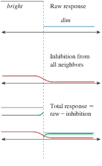

图 5.6：*明亮和黑暗区域中感受器的原始响应（顶部为蓝色）、侧抑制量（中部为红色）及其差值——实际响应——以绿色显示在底部。注意明暗边缘处增强的对比度，由虚线标出。*

一般来说，知道眼睛会*适应*其环境是有用的。当你在夜晚的卧室里阅读时，你的眼睛已经适应了房间的光照水平，这种适应以你正在看的页面的强度⁴为中心；当你关灯睡觉时，房间里的所有东西看起来都是黑色的，因为页面的强度现在远低于你的眼睛已经适应的强度范围。但几分钟后，随着你的眼睛开始适应新的、更低的光照水平，你就能开始分辨房间里仅由月光照亮的物体。如果你再次开灯继续阅读，页面一开始会显得非常明亮，直到你的眼睛重新适应。

眼睛中的感受器细胞并非完全独立行动。当眼睛总体上适应环境照明时，到达一个感受器的额外少量光不仅会增加那里的亮度感觉，还会略微降低邻近感受器的灵敏度，这种效应称为**侧抑制**。其结果（见图 5.6）是，明暗区域之间的边缘对比度相比区域中心之间的对比度得到增强：边缘的暗侧被感知为更暗，亮侧被感知为更亮。这就是第 1.7 节讨论的马赫带效应的起源。

这对计算机图形学有重要影响。在早期图形系统中，多边形通常采用“平面着色”。也就是说，屏幕上相对较大的区域被赋予恒定颜色。当圆柱体这样的形状（由拉伸多边形近似）被来自一个方向的光照亮时，相邻面片会根据它们面向光源的直接程度被赋予不同的恒定色调。眼睛不是把相邻面片之间略有不同的

⁴. 我们非正式地使用这个术语来描述离开页面并到达你眼睛的光能量。


明暗层次倾向于增强边缘处的差异，强调多面体结构。

鉴于眼睛对边缘的这种增强敏感性，自然会问：眼睛能检测到多小的边缘？我们可以画一组交替的平行黑白条纹，并把它从眼前移远，直到它看起来呈灰色。事实证明，这发生在两条相邻条纹张角约为 1.6 角分的距离处（**角分**是 1° 的 1/60）。

眼睛中的受体通过化学方式适应眼睛所见整体的亮度。对于许多普通照度水平，眼睛在一个小区域内可以检测到约 100:1 的强度比。图 5.7 表明，这种适应使我们对于每个适应水平，只能在适中的范围内检测到达光的亮度。另一方面，眼睛能非常快地适应适度的照明变化，因此例如即使在阳光明媚的户外，你也能迅速在黑暗的背包里找一支铅笔。然而，对光照大幅降低的完全适应涉及受体细胞的化学变化，需要大约半小时。经过这种适应后，人可以检测到非常低的照度水平；可区分的最亮白天水平与可区分的最暗夜间水平之比超过 1,000,000:1。许多显示器宣称对比度达到 10,000:1；既然眼睛只能分辨约 100:1 的比值，为什么这样的范围仍然重要？因为眼睛的适应部分上是*局部*的：当你从未开灯的卧室透过小窗望向阳光明媚的室外时，你眼睛的一部分可能能够区分室内不同亮度的事物，而另一部分则区分室外不同亮度的事物。为了生成同样的感知，显示屏必须能够向眼睛的不同区域呈现可比较的刺激。作为感知极端情况的一个例子，在晴朗夜晚，你可能既能看到一颗 3 等星，又能清楚地看到月亮；月亮的星等约为 −12.5。由于 5 个星等对应强度上 100 倍的因子，这代表约 100 万倍的强度范围。但如果月亮（在你的视野中）离那颗 3 等星相当近，你几乎肯定看不到那颗星。

**应用。** 视觉系统通过两种不同机制检测到物体的距离的能力——眼睛可以聚焦，或者双眼一起可以利用视差，我们稍后将讨论——意味着当双眼接收到不同数据时，可能出现不一致的距离检测。例如，如果用户戴上一副眼镜，其镜片被替换为各自的显示器，我们可以通过在两个显示器上显示不同图像来欺骗用户“看到 3D”，使用户相信所见物体处于不同距离，从而产生“立体”效果。但为了看到这两幅不同图像，用户必须聚焦在显示器上，而显示器距离用户眼睛只有几英寸（也可以借助镜片使其看起来更远）。这两种深度感知相互矛盾，这使得许多“3D 显示”体验对某些用户来说并不愉快。

眼睛对周围光照水平的适应，以及适应后眼睛有限的动态范围，意味着我们不必构造像素之间具有巨大对比度的显示器，尽管能够在很大范围内调节*平均*强度可能是有用的。另一方面，这也意味着当我们显示非常明亮的东西时，比如阳光透过树叶，我们可以消除太阳附近的大部分细节，因为树叶亮度的微小变化会被眼睛对太阳亮度的局部适应所“掩盖”。

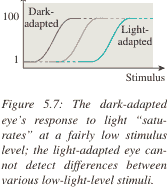

视野中心附近受体的集中意味着我们可以让周边显示不那么精确。然而，我们对周边视野中运动的敏感性意味着我们不能太马虎。

边缘检测的局限告诉我们，为了生成看起来平滑的图像，我们需要能够显示多少个明度级别。

## 5.4 恒常性及其影响

不知何故，我们的视觉系统从接收到的光出发，形成对周围世界的感知（“那是我的车，就在那辆红色卡车旁边”）。这个过程非常稳健，意思是输入发生巨大变化时，最终感知几乎不变：你可以在明亮阳光下、黄昏或深夜辨认出你的车在红色卡车旁边；你可以辨认出它停在 3 英尺还是 300 英尺外（而当你离它 300 英尺远时，你不会说：“天哪，我的车缩小了！”）；无论从前面、右侧、左侧还是后面看到它，你都能认出它，而不会说：“它变形了！”

另一方面，引发这些恒常感知的刺激却非常不同：夜间从汽车进入眼睛的光与正午从汽车进入眼睛的光非常不同。它强度较低，并且可能含有更多短波长成分（人类倾向于将其看作蓝色），至少如果路灯使用汞蒸气灯的话。不同的细胞在对光作出响应（视杆细胞处于它们开始区分照度水平的光范围内）。因此，视觉皮层必须做一些有趣的事情来生成相同的一般感知。当然，感知并不完全相同：你知道自己是在夜间而不是白天看到这辆车，但并不会因为照明不同就相信车的颜色变了。这是**颜色恒常性**的一个例子。同样，当你从不同位置看它时，你不会相信车的形状或大小变了；这些是**形状恒常性**和**大小恒常性**的例子。

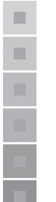

恒常性是一件奇妙的事（就防止持续混乱而言）。另一方面，它也导致我们的视觉系统在某些其他视觉系统（例如数码相机）擅长的事情上相当糟糕。如前所述，除非两种颜色相邻，否则我们在判断它们是否相同时并不很可靠。但数码相机可以相当可靠地做到这一点。由此产生的一个后果是，当我们在计算机图形学中工作时，重要的是要知道将由什么“视觉系统”来处理我们生成的图像：如果是人眼，那么彼此相距较远的色块中的小颜色误差可能无关紧要；然而，如果我们用计算机图形学生成的图像来测试输入来自数码相机的计算机视觉系统，那么这样的误差可能很重要。

在理解一个系统时，了解它失败的实例通常很有帮助（例如，我们在调试中会使用这类实例）。就视觉系统而言，“失败”可能没有明确定义，但我们确实有一些例子，说明我们的视觉系统没有做到我们期望它做的事。例如，通过注意当一个区域被其他不同明度的区域包围时你对明度的感觉（如图 5.8 所示），你可以看出人类在判断一个区域的绝对明度方面有多差。

这看起来可能像是恒常性的失败——毕竟，图 5.8 中的中心方块“全都一样”。但如果我们把中心方块及其周围方块建模为涂在一个表面上，并由强度变化的光照亮，我们会得到一组非常不同的图像，如图 5.9 所示；在这些图像中，中心方块的灰度值全都不同，但你感知到中心方块都相当接近地暗。*这*就是变化照明下明度恒常性的一个例子。（图 28.15 展示了一个更壮观的明度恒常性例子——以及它与入射强度*没有*关系。）

*图 5.8：所有中心方块具有相同明度；然而，表观明度深受周围方块影响。*

本书网站上提供的材料讨论了更多恒常性效应。

**应用。** 各种恒常性错觉表明，周围亮度会影响我们对一个表面或一个光源亮度的感知。这导致对演播室监视器、影院投影以及普通办公室或家庭显示器使用不同的伽马值（在第 28.12 节讨论），因为周围环境的平均亮度会影响显示物品的外观。它还表明，在渲染过程中，如果你想目视比较两个渲染结果，应该用相同的中性灰“边框”分别包围它们，以帮助避免比较中任何基于上下文的偏差。

恒常性的另一个后果（至少对于亮度而言）是，相对亮度比绝对亮度更重要（这有助于解释为什么边缘检测在早期视觉中如此重要）。这表明，如果我们想比较两幅图像，起更大作用的可能是对应像素的*比值*，而不是差值。

## 5.5 延续

当一个物体似乎消失在另一个物体后面，然后又在另一侧重新出现时（见图 5.10），你的视觉系统倾向于把这两部分联系为属于一个整体，而不是彼此分离的东西；这是格式塔心理学观点的一个例子：大脑倾向于把事物感知为一个整体，而不仅仅是各个部分。

- 针对这种感知，一种被提出的部分机制是 C¹ 随机游走理论 [2, Wil94]；在该理论中，我们假设在 T 形交点处（一个物体的轮廓似乎从另一个物体后面穿过的地方），大脑会沿着线条消失时所具有的同一大致方向“延续”该线条，但方向会有一些随机变化。其中一些延续恰好在*另一个* T 形交点处终止，并且朝向合适的方向。如果我们考虑两者之间的所有这类连接，有些连接比其他连接更可能（取决于方向变化的概率模型以及延续的长度）。被遮挡区域中的每个点都出现在所有这类延续的某个比例上（也就是说，存在一个概率密度 *p*，其性质是：随机连接穿过区域 *A* 的概率等于 *p* 在 *A* 上的积分）。分布 *p* 的脊线结果表明，它们构成了对 T 形交点之间“推断出的”连接的非常合理的估计；而 *p* 沿该曲线的积分提供了这些线条究竟是否相连的一种“似然”度量。如果 T 形交点彼此错开（即两条线段不是同一条线的一部分），概率会降低；如果两条线段不平行，概率会降低；只有当 T 形交点完全对齐时，连接概率才达到最大。这种“连接概率的扩散”真的在大脑中发生吗？这一点尚不清楚。但如所述，这种认为 *p* 的脊线构成最可能连接的观点无法告诉


**图 5.9：** 在每个例子中，中心方块的暗度与周围方块的暗度之比大致相同；你倾向于看到中心方块表现出的明度变化远小于前一幅图中的中心方块。


整个故事，因为斜线匹配中存在一种奇特效应，我们现在就来讨论它。

当你看到一条斜线从一条竖直条带后方穿过时，如图 5.11 所示，你往往会无法正确感知斜线各部分何时对齐（解释似乎涉及对锐角的错误感知）。尽管如此，可以通过在竖直条带上添加端部使其成为平行四边形（或提供其他线索，例如一种看起来具有透视缩短效果的纹理）来大幅减弱这种效应，从而使斜线看起来位于与条带所在平面平行的平面内（见图 5.12）。

**应用。** 当我们研究非真实感渲染或表现性渲染时，视觉系统的这类特性会产生重要影响；在这类渲染中，我们试图创造的图像，其目标不是忠实于现实，而是表达创作者的意图——这种意图可能是通过明智地选择展示什么，把视线吸引到图像的某个特定部分。例如，考虑汽车维修手册中的一幅插图：其中正在讨论的区域被详细绘制，而周围区域被简化为寥寥几条线，以避免混淆。当我们通过消除细节来简化图像时，是否也丢失了视觉系统用来理解所呈现场景的重要线索？在某些情况下，我们显然确实会丢失重要特征：例如，不绘制阴影会使观看者误解哪些物体正在接触其他物体。但即便在图 5.12 这样的例子中，假设我们的抽象去掉了 (b) 中竖直条带上的“纹理”。那么斜线就会看起来不匹配，如图 5.11(b) 所示。

延续性也可用于从用户对形状的草图 [KHO6] 中推断含义：当一个轮廓被另一个轮廓遮挡时，我们可以使用延续性模型来推断用户认为它延伸到哪里。

## 5.6 阴影

阴影为我们的视觉系统提供了极其强大的线索，但这些线索并不总是我们以为的那样。例如，阴影帮助我们估计不在接地平面上的物体的深度（与观看者的距离）。Keren 等人 [LJKM97] 用一个类似图 5.13 所示的例子令人信服地证明了这一点：在该例中，场景中一个球的运动通过阴影线索得到了非常明确的消歧：在没有阴影线索时，你很容易让自己相信：球要么在距眼睛恒定距离的平面内运动，并在向右移动时上升；要么以恒定高度从托盘左前角上方的一点运动到右后角上方的一点。当加入阴影后，知觉系统就被迫选择其中一种。对这个例子进行实验很有趣，因为事实证明，当阴影与物体形状不一致时——例如用一个小正方形代替圆盘状阴影——这种效应几乎同样强。此外，阴影线索很容易压过其他视觉线索，例如由透视引起的缩短（在从前到后的运动中，球在远处时张角会比近处更小，因此一个大小恒定的球本应看起来始终在恒定距离平面内运动；然而，有了阴影线索，你会看到它沿左前/右后对角线运动）。由此我们或许可以推断，阴影提供了某种深度或位置信息，但在形状方面的信息量较少。但阴影在


*图 5.10：在 (a) 中，斜线似乎从竖直条带后方穿过。你会强烈感觉两段斜线是一个连续整体的一部分，如 (b) 所示，而不是各自终止于竖直条带后方，如 (c) 所示。*


*图 5.11：(a) 和 (b) 中哪一个看起来是一条从条带后方穿过的单一连续直线，哪一个看起来像是两段平行但并不属于同一条线的线段？把直尺放在图上以判断真相。*

视觉，但具有足够的深度知觉来完成像驾驶飞机这样复杂的任务，这得益于它们能够解读其他线索，例如透视缩短、随距离变化的强度调制，尤其是运动视差。

我们已经提到，渲染实际上是一个积分过程，而这种积分通常通过随机采样完成。在构建渲染器时，我们可以为积分器选择样本。在图像中样本更多的区域，我们往往能对所计算的积分得到更好的估计。如果该区域几乎没有知觉上的重要性（例如，如果它属于椒盐纹理的一部分），那么额外的采样工作就是浪费；如果它在知觉上显著（例如，浅色表面上深色阴影的边缘），那么额外采样就是有价值的。Greenberg 等人 [Gre99] 将知觉因素的纳入描述为渲染中的一种驱动性影响。一个挑战是如何直接应用这些思想：必须对知觉过程建模，然后在 *知觉后状态中* 将理想图像（可能无法获得）与近似图像进行比较。Ramasubramanian 等人 [RPG99] 开发了一种方法，其中直接在图像上进行的测量与知觉测量密切相关，从而使图像形成更容易由估计的知觉重要性来引导。Walter 等人 [WPG02] 应用了类似方法，在纹理区域大幅减少渲染工作量，而在这些区域，这种减少本来是无法察觉的。

知觉差异度量也用于图像压缩。例如，JPEG 图像压缩尝试以多种方式近似输入图像，然后通过选择在某种度量下与原始图像的知觉距离最小的那一个，在这些近似结果中进行选择。MPEG 对运动图像序列的压缩也类似地运作。

当物体被孤立观看时对视觉系统有影响的差异，在它们处于更大上下文（尤其是具有大量视觉复杂性的上下文）中被观看时，可能会被忽略。Ramanarayanan 等人 [RBF08] 的近期工作表明，我们对聚合体（弹珠与骰子的混合，或花园中两种植物的混合）的知觉存在一些令人惊讶的弱点。同一团队的相关工作 [RFWB07] 表明，即使两幅图在知觉上可以区分，这种区别也可能无关紧要。

知觉领域正以新的、令人惊讶的方式不断推进。作为即便现在也在产生的这类惊人发现的一个例子，考虑 *运动诱导盲*：其中某些物体可以因其他物体的运动而消失。如果图 5.15 所示的十字形排列缓慢旋转，而你盯着中心的小点，周围三个固定点就可能完全从视野中消失。当网格与点颜色相同时，这种效应较弱；当二者颜色不同时，效应则相当强；蓝色网格和黄色点效果很好。这种效应在很大的旋转速度和点大小范围内也都存在。


图 5.15：十字网格绕其中心旋转，速度接近每完整旋转十秒。用户被要求注视旋转中心。片刻之后，图像中其他点中的一个或多个似乎消失了。

正如本章开头所提到的，视觉感知并不是计算机到人通信的唯一模式；声音和触觉也经常被使用。当听觉和视觉同时被使用，而二者相互矛盾时，哪一个占主导？Shams 等人 [SSK02] 报告了一个有趣的情形，其中 *声音占主导*；他们“报告了一种由声音诱发的视觉错觉：当单次闪光伴随多次听觉哔声时，单次闪光会被感知为多次闪光。”那么触觉和视觉呢？Randy Pausch [个人交流] 报告说，当显示器显示出一个看似凹陷的表面，而触觉设备被用来“触摸它”，并由

尽管数据将凹痕隐藏了起来，用户报告称他们无论如何仍能感觉到凹痕。Burns 等人 [BWR+05] 进行了一项细致的研究，支持视觉主导的观点。然而，这些只是多模态感觉的孤立且受控的实例。这些不同模态在更复杂情境中相互作用的程度仍未得到测量。

## 5.8 练习

- **练习 5.1：** 编写一个程序，显示一幅由平行条纹组成的图像，并位于另一幅纯灰色图像之上。使灰度级可调（通过滑块、按钮、按键或任何你喜欢的方式）。站到足够远的地方，使条纹之间无法区分，然后调整（或让朋友调整）纯色矩形的灰度级，直到你说它与条纹的表观灰度匹配。现在向显示屏靠近，直到你能分辨出单独的条纹；测量你与显示屏的距离，并计算一对平行条纹在你眼睛处所张的角度。你应确保自己没有欺骗自己：让显示屏（在按下/点击按钮后）在灰色矩形旁边（随机）显示垂直或水平条纹，并且条纹与纯色矩形的位置（随机）交换或不交换。

- **练习 5.2：** 实现运动诱导致盲实验；包含用于增大/减小旋转速度和“消失”圆点尺寸的按钮，并允许用户选择网格和圆点的颜色。尝试哪些颜色最能使圆点消失。

- **练习 5.3：** 编写一个程序，沿 *x* 轴在 *x* = 0、1、2 处绘制三个半径为 0.25 的黑色圆点。然后改为在位置 *t*、*t* + 1 和 *t* + 2 处显示三个黑色圆点（初始 *t* = 0.25）。使显示屏在两组圆点之间每四分之一秒来回切换一次。你是否倾向于看到圆点在移动？如果将 *t* 增加到 0.5 会怎样？包含一个滑块，让你将 *t* 从 0 调整到 3。圆点移动的错觉会减弱吗？当 *t* = 1 时，你可以将运动解释为“外侧的圆点在最左端（*x* = 0）和最右端（*x* = 3）之间来回跳动，而中间两个圆点保持不动。”你能说服自己这就是你看到的景象吗？圆点作为*一个整体*在移动的强烈印象极难放弃，这支持了格式塔理论。

- **练习 5.4：** 编写一个程序来模仿图 5.13，其中滑块控制红球沿其轨迹的位置。包含一组单选按钮，让你将球的“阴影”从椭圆改为圆盘、正方形和小飞机形状，并观察这种变化如何影响你对红球位置的感知。你可以使用 3D 测试台或 2D 测试台来编写程序——没有必要精确获得透视投影，因此仅仅模仿该图即可。

*此页有意留白*

# 第 6 章：固定功能 3D 图形与层次建模简介

## 6.1 引言

你已经了解了 3D 场景如何被投影到 2D 以生成渲染图像，也知道关于光、反射、传感器和显示器的基本事实（在后续章节中会进一步阐明）。理解图形学所需的另一个要素是数学。我们发现，当学生通过实验接触数学时（如我们在第 2 章中看到的变换顺序问题），他们会理解得更好。但使用 3D 图形进行实验，要么需要你构建自己的图形系统（其中预备数学至关重要），要么需要使用现成的东西。WPF 是后者的一个很好的例子，它为 3D 实验提供了易于使用的基础。

在本章中，你将学习如何使用 WPF 的 3D 功能（我们称之为 **WPF 3D**）来指定 3D 场景、配置场景的照明，并使用摄像机生成渲染图像。WPF 经典的光与反射固定功能模型并非直接基于物理，也无法生成动画电影等娱乐产品所需质量的图像；然而，由于人类视觉系统具有巨大的适应性，它确实能产生我们大脑感知为 3D 场景的画面。固定功能模型还有一个优点，即被其他图形库广泛使用；由于它在早期图形研究和商业实践中的广泛使用，即使它正在被迅速取代，图形学研究人员也应该了解这一模型。对更逼真图像的追求，推动了本书其余部分对光、材质和反射的大量讨论。

### 6.1.1 WPF 3D 的设计

目前有数十种常用的 3D 图形平台，涵盖了各种各样的设计目标。有些专注于图像质量/真实感而不计成本（例如用于计算高质量 3D 动画电影帧的系统），有些则针对实时交互性，并对物理属性进行或多或少的逼真模拟（例如用于创建 3D 虚拟现实环境或视频游戏的系统），还有一些则在图像质量上做出妥协，以在各种硬件平台上实现足够快的性能。

如第 2 章所述，WPF 是一个保留模式（RM）平台——应用程序使用 XAML 和/或 WPF .NET API 来指定并维护存储在平台中的层次化**场景图**。（你将在 6.6.4 节了解到它为什么被称为“图”；现在只需将其视为场景数据库。）平台与 GPU 协同工作，自动保持渲染图像与场景图同步。这类平台与 OpenGL 或 Direct3D 等立即模式平台有显著不同，后者不提供任何可编辑的场景保留。关于这两种不同架构在 3D 平台上下文中的比较，请参见第 16 章。

WPF 的主要目标是将 3D 引入交互式用户界面领域，因此它的设计满足了以下要求：

- 支持各种硬件平台
- 支持低复杂度场景的动态效果，在满足基本要求的硬件上达到实时性能水平
- 并提供足够高效的照明和反射近似，以便实时创建视觉上可接受的 3D 场景

在这里，我们通过示例使用 WPF 3D 来介绍一些 3D 建模和照明技术，利用 WPF 易于编辑的场景描述，让你获得动手实践的理解。

### 6.1.2 近似光与物体相互作用的物理过程

3D 场景中的每个物体都会根据其材质组成的反射特性，反射一部分入射光。此外，物体表面上的每个点都接收来自光源的*直接*光（未被其他物体遮挡的光）以及场景中其他物体反射的*间接*光。直接模拟物体间反射内在递归性质的复杂物理算法（在第 29 至 32 章中描述）需要大量处理；如果目标是实时性能，它们所需的处理能力往往超过当今商用硬件所能提供的。因此，实时计算机图形学目前由近似技术主导，这些技术从宽松地基于物理到完全基于欺骗眼睛的**“花招”**，后者完全不以物理定律为基础。

产生最高真实感的近似技术需要最多的计算。因此，交互式游戏应用（以高帧率进行动画渲染对其成功至关重要）必须依赖在真实感上做出妥协的快速算法。另一方面，电影制作应用则拥有奢侈的条件，可以花数小时来计算一帧动画。


许多经典的近似算法是在几十年前开发的，当时计算和图形硬件的性能只是今天可用性能的一小部分，目的是满足两个关键目标：最小化处理和存储需求，并最大化并行性（尤其是在GPU中）。这些算法源于20世纪60年代末开始的软件实现，在20世纪70年代和80年代通过通用性不断增强，然后从20世纪90年代开始在性能日益强大的商用GPU硬件中实现。

其中一系列最为成功的算法通常被称为**固定功能3D图形管线**，已经使用了三十年，并在20世纪90年代末之前一直在GPU设计中占主导地位。该管线渲染三角网格，近似表示多面体对象和曲面，使用简单的表面光照方程（用于计算三角形顶点处的反射强度，如第6.2.2节和第6.5节所述）和着色规则（用于估计内部点处的反射强度，如第6.3.1节和第6.3.2节所述）。应用程序通过软件API使用固定功能管线，这类API见于经典商用3D软件包，如早期版本的OpenGL和Direct3D。WPF是提供固定功能管线的较新API之一；在本章其余部分介绍其基本功能集时，我们将简要介绍经典的近似技术、它们在多大程度上“欺骗眼睛”，以及它们的局限性。

尽管固定功能管线是开始试验3D图形平台使用的极佳方式（因此我们在此选择WPF），但它在现代图形应用中已不再令人感兴趣；对于这些应用，可编程管线（在第16.1.1节和第16.3节中介绍）现在是主力。随着GPU技术持续快速演进，更高质量的近似在实时中变得更加可行，实时模拟光与物体相互作用的物理过程的能力也变得越来越可行。

### 6.1.3 WPF 3D高层概览

WPF的3D支持与第2章所述的2D功能集紧密集成，并以相同方式访问。XAML可用于初始化场景并实现简单动画，过程代码可用于交互性和运行时动态。要在WPF应用程序中包含3D场景，需要创建`Viewport3D`的实例（它充当显示3D场景的矩形画布），并使用布局管理器将其集成到应用程序的其余部分（例如，与任何UI控件面板并排）。

`Viewport3D`与WPF画布类似，在给定要显示的场景之前是空白的。要指定并渲染场景，必须创建并定位一组几何对象，指定其外观属性，放置并配置一个或多个光源，并放置和配置相机。

2D抽象应用坐标系的3D对应物是**世界坐标系**，其x、y、z轴为右手方向（如后文图7.8所解释）。测量单位是抽象的；应用设计者可以选择使用物理测量单位（如毫米、英寸等），或者不赋予坐标任何语义。场景中的对象、相机和光源使用世界坐标来放置和定向。

物理单位的使用是可选的，但有助于准确模拟某种物理现实（例如，用米来建模实际街区的房屋和街道，或用毫微米来建模分子）。WPF平台本身不会获知应用可能赋予单位的任何语义。

场景通过图6.1中极高层表示的管线渲染到显示设备。相机使用世界坐标定位在建模世界中，并通过指定若干参数（例如视场）来配置，这些参数共同描述一个**视景体**——即中间子图中所示的金字塔形对象。（你将在第13章学到大量关于相机规格和视景体的知识，并将在第16章从OpenGL的角度考察相机规格。）然后，视景体中捕获的场景部分被投影到2D，产生视口中显示的渲染结果，该结果将出现在应用窗口中。

与WPF 2D的情况一样，平台会自动使渲染与建模世界保持同步。例如，对场景或相机配置的更改会自动导致视口中的渲染更新。因此，动画通过在运行时编辑场景来执行，执行如下操作：

- 添加或移除对象
- 更改对象的几何形状（例如，编辑其网格规格）
- 变换（例如，缩放、旋转或平移）对象、相机或几何（场景内）光源
- 更改材质的属性
- 更改相机或光源的特性


图6.1：WPF 3D几何管线的高层概览。

## 6.2 网格与光照规格简介

在本节中，我们将使用XAML构建一个四面的纯色金字塔，图6.2从低空飞行的直升机视角描绘了它位于沙质沙漠地面上。在本节中，我们仅关注金字塔的构建和光照（忽略天空和沙漠地面）。


图6.2：金字塔俯视图。

### 6.2.1 规划场景

假设我们的沙漠地面与右手3D坐标系的*xz*地平面共面，如图6.3所示。为了致敬墨西哥城附近伟大的中美洲太阳金字塔（高75米），我们将让我们的金字塔具有该高度，底面积为100平方米。因此，我们将使用千米作为测量单位。我们将把金字塔放置为其底面位于*xz*地平面，中心位于原点(0, 0, 0)，四个角位于(±50, 0, ±50)，顶点位于(0, 75, 0)。

#### 6.2.1.1 为内容准备视口

为了可见，视口必须位于WPF 2D结构（如窗口或画布）内。对于此示例，我们选择使用WPF Page作为视口的2D容器，因为它简化了诸如Kaxaml之类的解释型开发环境的使用。这里我们创建一个页面，并用大小为640 × 480的视口填充它（以WPF画布坐标度量，如第2章所述）：

```xml
<Page
  xmlns="http://schemas.microsoft.com/winfx/2006/xaml/presentation"
  xmlns:x="http://schemas.microsoft.com/winfx/2006/xaml"
>
  <Page.Resources>
    Materials and meshes will be specified here.
  </Page.Resources>
  <Viewport3D Width="640" Height="480">
    The entire 3D scene, including camera, lights, model, will be specified here.
  </Viewport3D>
</Page>
```

注意：与第2章一样，这里XAML的一些“语法酸涩”会很明显，并可能引发疑问。然而，本章并不打算作为XAML参考或替代.NET文档；我们关注的是语义，而不是语法。

相机、光源和场景对象在`Viewport3D`标签内指定。视口及其内容的基本模板如下所示：

```xml
<Viewport3D ... >

    <Viewport3D.Camera>
      <PerspectiveCamera described below />
    </Viewport3D.Camera>

    <!-- The ModelVisual3D wraps around the scene’s content -->
    <ModelVisual3D>
      <ModelVisual3D.Content>
        <Model3DGroup>
          Lights and objects will be specified here.
        </Model3DGroup>
      </ModelVisual3D.Content>
    </ModelVisual3D>
</Viewport3D>
```


图6.3：位于沙漠场景中的WPF 3D右手坐标系。

我们希望相机初始放置得远在金字塔之外，但又足够近，以确保金字塔在渲染图像中占主导地位。因此，我们将把相机定位在(57, 247, 41)，并将其“瞄准”金字塔的中心点。¹

```xml
<PerspectiveCamera
  Position="57, 247, 41"
  LookDirection="-0.2, 0, -0.9"
  UpDirection="0, 1, 0"
  NearPlaneDistance="0.02" FarPlaneDistance="1000"
  FieldOfView="45"
  />
```

相机是一个几何对象，放置在场景的世界坐标系中（通过`Position`属性），并通过两个向量定向。

¹ 确定使场景“看起来正确”的数值常常是反复试验的结果；因此，交互式3D开发环境能在设计者试验对象、相机和光源的放置和方向时提供即时反馈，从而极大地方便场景设计。


- **观察方向（LookDirection）**是一个向量，用于指定相机投影的方向（采用世界坐标）。可以把`LookDirection`想象成镜头筒的中心线，你正把它指向中心物体。
- **上方向（UpDirection）**使相机绕观察方向向量旋转，以指定对观察者而言什么构成“上”方向。在我们的示例中，地面平面是xz平面，上方向向量`[0, 1, 0]^T`模拟了架在沙漠沙地上的固定三脚架，用来拍摄金字塔，且图像平面垂直于地面平面。

此外，相机的视野宽度可以用角度（以度为单位）来指定；例如，可以用160°这样的宽视野来模拟广角镜头。还可以指定两个**裁剪平面**，以防止物体离相机太近时出现异常（`NearPlaneDistance`属性），并通过忽略非常遥远（`FarPlaneDistance`属性）且因透视缩短而太小、无法分辨的物体来降低计算开销。

接下来，我们用无方向的**环境光**照亮场景，它在所有表面上施加恒定量的光照，与位置或朝向无关。（稍后我们会用更真实的光照来补充它。）环境光确保每个表面都在某种程度上被照亮，防止背向光源的表面出现不真实的纯黑区域。（在“真实世界”中，这类区域至少会受到一定程度的物体间反射。）当与其他光照结合使用时，环境光的量会保持最小；但在这个初始场景中，环境光是唯一的光照类型，所以我们会使用全强度白色来确保明亮的渲染。我们通过在`Model3DGroup`元素内添加一个`AmbientLight`元素来指定这种光：

```xml
<AmbientLight Color="white"/>
```

> **内联练习 6.1：** 此时，我们建议你开始运行本章实验软件的第1个模块（“多面体建模……”），该软件可在在线资源中获取。我们将在本节中一直引用这个模块。

#### 6.2.1.2 放置第一个三角形

我们选择金字塔作为第一个示例对象并非巧合，因为三角形网格是WPF目前唯一支持的三维图元类型（也是交互式建模应用生成的最常见格式）。创建三维对象的第一步是定义一个类型为`MeshGeometry3D`的资源对象，为此要提供三维`Positions`（顶点）列表和`Triangles`列表。后者通过`TriangleIndices`属性指定，其中我们通过三个整数索引组成的序列来指定每个三角形，这些索引指向从零开始的`Positions`数组。在本例中，我们指定一个只包含一个三角形的网格，即金字塔的第一个面。图6.4以表格形式展示了该网格。

**位置**

| 索引 | X | Y | Z |
|---|---|---|---|
| 0 | 0 | 75 | 0 |
| 1 | -50 | 0 | 50 |
| 2 | 50 | 0 | 50 |

**三角形索引**

| 三角形索引 |
|---|
| 0,1,2 |

*图6.4：单三角形网格几何规格的表格表示。*

识别每个三角形的正面是程序员的责任，因为正面/背面的区分很重要，我们很快就会看到。因此，在`TriangleIndices`数组中指定顶点三元组时，要从面向正面的人的角度，按逆时针顺序列出顶点索引。例如，考虑我们如何呈现当前模型单个三角形的顶点。在`TriangleIndices`数组中，三个指向`Positions`数组的索引顺序为0、1、2。因此，顶点序列为(0, 75, 0)、(−50, 0, 50)、(50, 0, 50)，这是逆时针顺序，如图6.5所示。

该网格的XAML表示如下：

```xml
<MeshGeometry3D x:Key="RSCMeshPyramid"
    Positions="0,75,0 -50,0,50 50,0,50"
    TriangleIndices="0 1 2" />
```

该网格规格出现在XAML的资源部分中，因此类似于WPF二维模板资源：在被使用或实例化之前不会产生效果。所以下一步是通过创建一个类型为`GeometryModel3D`的XAML元素，将该三维对象添加到视口的场景中，该元素的属性至少包括以下内容：

- 几何规格，它将引用我们上面创建的几何资源。
- 材质规格，通常也引用一个资源。材质描述表面的光反射特性；WPF的材质模型提供了各种材质类型的近似，我们很快会在6.5节中看到。

现在先保持基础内容，定义一个基本的纯黄色材质资源，专门用于每个表面的正面，并给它一个唯一的键以便以后引用：

```xml
<!-- Front material uses a solid-yellow brush -->
<DiffuseMaterial x:Key="RSCMaterialFront" Brush="yellow"/>
```

现在我们可以创建元素，将这个单三角形网格添加到场景中。我们将这段XAML作为`Model3DGroup`元素的子元素：

```xml
<GeometryModel3D
    Geometry="{StaticResource RSCMeshPyramid}"
    Material="{StaticResource RSCMaterialFront}"/>
```

此时，我们的模型图像如图6.6所示。

> **内联练习 6.2：** 在实验中，从模型下拉列表中选择“Single face”选项。如果你愿意，可以单击XAML选项卡来查看生成该场景的源代码。激活转台，使这个三角形绕y轴旋转。

如果我们把这个三角形面绕y轴旋转180°，以查看其“背面”，就会得到图6.7所示令人费解的图像。

由于一项渲染优化，三角形消失了：WPF默认不渲染面的背面。对于“封闭”对象（例如我们打算构建的金字塔）的常见情况，这种行为是令人满意的，因为其外部由网格三角形的正面组成。对于这样的封闭图形，三角形的背面（其表面法线指向对象内部）不可见，无需渲染。


*图6.5：通过顶点的逆时针顺序识别网格三角形的正面。*


*图6.6：第一个三角形的正面，使用均匀的黄色材质渲染。*


*图6.7：第一个三角形的背面，由于未指定背面材质而不可见。*

对于我们当前这个简单模型——一个孤立的三角形——禁用此优化并用对比色显示背面是很有用的，方法是将BackMaterial属性设置为引用一个纯红色材质，我们会将其以键RSCMaterialBack添加到资源部分。

```xml
<GeometryModel3D
    Geometry="{StaticResource RSCMeshPyramid}"
    Material="{StaticResource RSCMaterialFront}"
    BackMaterial="{StaticResource RSCMaterialBack}"/>
```


*图6.8：第一个三角形的背面，使用均匀的红色材质渲染。*

结果是，当正面背向相机时，背面现在可见，如图6.8所示。

**内联练习 6.3：** 在实验中，勾选标有“Use back material”的复选框，并让模型持续旋转。

现在金字塔的第一个面已经就位，让我们添加第二个面，使用图6.9中以表格形式表示的策略。注意，两个面共享的顶点（V0和V2）在Positions数组中有单独的条目，实际上是冗余列出的。

**位置**

| 索引 | X | Y | Z |
|---|---|---|---|
| 0 | 0 | 75 | 0 |
| 1 | -50 | 0 | 50 |
| 2 | 50 | 0 | 50 |
| 3 | 0 | 75 | 0 |
| 4 | 50 | 0 | 50 |
| 5 | -50 | 0 | -50 |

```xml
<MeshGeometry3D x:Key="RSCMeshPyramid"
    Positions="0, 75, 0  -50,0,50  50,0,50
               0, 75, 0   50,0,50  -50,0,-50"
    TriangleIndices="0 1 2   3 4 5"/>
```

**三角形索引**

| 三角形索引 |
|---|
| 0,1,2 |
| 3,4,5 |

*图6.9：双三角形网格几何规格的表格表示。*

**内联练习 6.4：** 在实验中，选择“Two faces”模型，并让模型持续旋转。

结果出现在图6.10所示旋转模型的两个快照中。

### 6.2.2 产生更真实的光照

这个渲染有一个明显的问题：无论朝向如何，模型的这两个面都应用了同一个恒定颜色值。但在白天的沙漠场景中，人们会期望金字塔各面的亮度有所变化：朝向太阳的面反射明亮，背向太阳的面反射较少。


将无方向环境光这一人工构造作为唯一光源，会产生这种不真实的外观。在真实世界中，光是场景的一部分，而照射到表面上点P的光能具有方向（一个从光源指向点P的向量，用符号ℓ表示）。此外，从P反射向相机的能量不是恒定的，而是基于许多变量，例如相机位置、P处表面的朝向、方向ℓ、物体材质的反射特性等。在6.5节中，我们将研究一个考虑许多此类变量的光照方程，但这里让我们从高层面上看一个更真实光源的示例：点光源，它是一种几何光源，在场景中具有位置，并向所有方向均匀辐射光（如图6.11所示）。点光源的存在可以通过其无限的ℓ值集合为场景引入大量变化，这确保表面上朝向光源的每个点都从唯一的ℓ方向接收能量。

*图6.10：在仅包含环境光的环境中，部分金字塔在两种不同朝向下的渲染结果。*


*图 6.15：针对三个 θ 值，由朗伯余弦定律计算出的亮度。*

图6.15展示了该方程在单三角形模型上的效果，其中θ取不同值，这些值通过让金字塔在不可见的转台上旋转得到。图中每条红色虚线向量的长度表示在给定θ值下，沿其指示方向反射能量的强度。对于完美漫反射，光向所有方向以相同强度反射，因此对于任意给定θ值，该长度都是常数。于是，在漫反射情况下，所有可能反射角对应的反射向量端点的轨迹就是一个完美的半球。（当然，在我们的二维图中，这个包络表现为半圆。）


*图 6.16：使用定向光照渲染的金字塔，最右侧可见面的 θ 接近 90°。*

该方程与观察角度无关，因此无法模拟金属和塑料等在某些观察角度下呈现高光的光泽材料。该方程的另一处过度简化是：当 θ = 0° 时，所有入射光能都会无损耗地反射，这并不现实。实际上，材料会吸收一定量的光能，因此这部分光不会被反射。第6.5节描述了一个更完整的模型，可修正这些问题及其他问题。

用定向光照替代环境光照，并由朗伯光照模型处理后，结果更加真实，如图6.16和图6.17中的图像所示。


*图 6.17：使用定向光照渲染的金字塔，最右侧可见面的 θ 约为 70°。*

**内联练习 6.6：** 在实验室中，通过选择“定向光，左肩上方”并启用转台旋转来激活定向光照。观察黄色正面光照的动态特性；偶尔暂停/恢复转台运动可能会有所帮助。观察 θ 和 cos θ 值的显示，注意当 θ 接近并超过 90° 时，黄色面如何趋近于零照度。选择不同的模型，并在这种新光照条件下检查双面模型和完整的四面模型。

> 理想化漫反射的朗伯余弦规则有两个关键特征：（1）反射强度与观察角度无关；（2）它仅取决于入射光方向 ℓ 与表面某点法线之间夹角的余弦。为了直观理解这些现象，找一块哑光表面，例如干净的黑板或没有任何光泽的涂漆墙面，并将一盏亮灯对准该表面。然后，在受照区域中选一个亮点，通过一根直径很小的管子从不同位置观察它，小到只能看到一个均匀受照的“点”（模拟辐射计会检测到的内容）。注意，当你移动视点时，该点的表观亮度会保持不变；而如果对光亮表面做同样的实验，亮度则会变化。然而，改变光源的入射角会使反射亮度随该角度的余弦而变化。如果你对该规则背后的数学感兴趣，请参阅第7.10.6节。

### 6.2.3 固定功能渲染中的“光照”与“着色”

上面给出的朗伯方程，以及第6.5节给出的更完整方程，都是计算从给定表面点 P 反射到指定相机位置的光能数量的函数示例。

像朗伯方程这样的光照方程，是用算法表示表面材质反射光线的方式。从理论角度看，渲染器处理给定表面时，会为其材质“加载”光照方程，并针对该表面上的点“执行”该方程。（有趣的是，在可编程管线硬件中，这种抽象与实际情况相差并不太远！）那么，应该对哪些表面点执行该方程呢？一种合理的方法是对表面渲染图像所覆盖的每个像素执行一次计算，并针对每个这样的像素，对其代表性的表面点执行该方程。离线渲染系统使用类似的方法，但对于运行在当今商用硬件上的实时渲染系统而言，这种策略的计算成本过高。许多此类系统——包括 WPF 的固定功能管线以及可编程管线——所采用的方法是：仅在表面的关键点计算光照，并使用成本更低的着色规则²来确定位于关键点之间的表面点的值。

例如，让我们考察最简单的着色技术，称为**平面着色**或**恒定着色**。在这种技术中，每个三角形的一个顶点被选为该三角形的关键顶点。执行光照方程以计算该顶点的照度值，然后用该值的副本填充整个三角形。图6.18展示了使用平面着色渲染的示例图像，其中我们高亮了三个三角形以及各自起决定作用的关键顶点。

平面着色可能适用于金字塔，但如图6.18所示，当三角形网格用于近似曲面时，显然需要更精细的着色技术。下一节我们将介绍一种流行的实时着色技术，旨在解决曲面渲染问题。


*图 6.18：海豚网格模型的平面着色渲染，其中高亮了三个三角形以演示关键顶点的概念。*

² 如第27.5.3节所述，这种将“着色”一词经典地用于指代高效确定内部点光照的用法，与现代对“着色”和“着色器”这两个术语的用法存在冲突。

## 6.3 曲面表示与渲染

环顾你周围的房间，你会发现大多数物体都有一些曲面或圆边。像我们简单金字塔这样完全由平面构成的多面体，在“现实世界”中相当罕见。因此，在大多数情况下，3D 场景中的三角形网格并不是用来精确表示物体，而是用来*近似*物体。

例如，我们可以用多边金字塔来近似圆锥。仅用16个面时，平面着色就能产生相当不错的圆锥近似效果（如图6.19所示），但它并不能真正“骗过眼睛”，让人接受它是一个曲面。


增加面数（例如增加到64边，如图6.20所示）确实有助于改善结果，但近似痕迹仍然明显。试图仅通过提高网格分辨率来解决问题，不仅代价高昂（就存储/处理成本而言），而且效果不佳：如果将相机位置移向网格，在某个时刻，平面化外观就会变得明显。


**内联练习 6.7：** 你可能想访问实验室的“曲面建模”模块，查看在平面着色生效时面数变化的效果。当光标位于视口内时，按住鼠标右键并拖动鼠标即可放大/缩小。注意，增加面数只能在远处骗过眼睛——放大后很容易暴露出这种假象。还要注意，物体运动会使近似痕迹更加明显，尤其是在底边处。

### 6.3.1 插值着色（高洛德）

在计算机图形学早期，寻找一种高效方法，以便从低分辨率网格近似中生成可接受的曲面图像，这一任务尤为迫切。当时计算机内存以千字节计，处理器的性能比今天低许多个数量级。使用平面着色的逐顶点光照被广泛采用，但显然需要一种着色技术，能够骗过眼睛，使渲染图像即使在低分辨率网格下也能近似网格所表示的曲面，同时将处理器和内存成本降到最低。20世纪70年代初，犹他大学博士生 Henri Gouraud 定义了一种基于网格顶点强度值插值的着色技术，使用的方法类似第9章开头几节所描述的算法。要体会平面着色与高洛德着色之间的质量差异，请比较图6.21和图6.22中犹他茶壶的两种渲染结果。


让我们先考察二维中的高洛德插值。图6.23中，弯曲的二维表面显示为黄色，由二维线段构成的近似网格显示为黑色，顶点显示为绿色。在每个顶点处，光照模型（此处为漫反射朗伯光照）已经为该顶点计算了一种颜色，用于该


图 6.23：平面着色与 Gouraud 着色的比较，这是两种不同的技术，用于确定在已执行光照计算的顶点之间的强度值。

顶点。着色过程（计算内部点的颜色）的结果同时展示了平面着色和 Gouraud 插值着色。

正如我们所见，Lambert 光照方程取决于表面法线 **n** 的值。因此，为了生成顶点 V 处的颜色值，渲染器必须确定我们所说的**顶点法线**——即 V 所在位置处的表面法线。这应该如何确定？

如果曲面是解析的，例如一个完美球面，那么用于生成该曲面的方程可以为任意点提供表面法线。然而，近似网格本身通常是我们所知的关于曲面几何的唯一信息。通过使用 Gouraud 的简单策略——通过平均来确定顶点法线——这一限制得以缓解。

在 2D 中，顶点法线通过平均相邻线段的表面法线来计算，如图 6.24 所示。例如，V₂ 的顶点法线是线段 V₁V₂ 和 V₂V₃ 的表面法线的平均值。


图 6.24：在 2D 中计算顶点法线，即取两条相邻线段法线的平均值。

在 3D 中，顶点法线通过平均所有相邻三角形的表面法线来计算，如图 6.25 所示，其中四个三角形共享该顶点。

该技术的成功之处在于：对于粒度足够细的网格，通过平均计算出的顶点法线通常能很好地近似实际被近似曲面的表面法线。（第 25 章讨论了这种近似的一些局限性。）例如，在图 6.24 所示的 2D 表示中，请注意 n<sub>V₂</sub> 看起来是对位置 V₂ 处黄色表面法线的很好的估计。计算出的法线的精度当然取决于网格的粒度，而在不连续区域，粒度要求会提高。


图 6.25：在 3D 中计算顶点法线，即取所有共享该顶点的三角形的表面法线的平均值。

> **内联练习 6.8：** 我们建议你回到实验中的曲面模块，并选择“Gouraud 着色”。请注意，即使面片数量极少，插值也能成功。你会注意到，如果粒度极低（例如 4 或 8）和/或模型正在旋转，圆锥的轮廓——即它与地面相接的底边——不幸仍会表现出网格结构，从而降低这个“技巧”的效果。

### 6.3.2 指定表面以实现棱面和平滑效果

WPF 的渲染引擎无条件使用 Gouraud 着色；换句话说，WPF 不提供一种渲染“模式”来让应用程序在平面着色和平滑着色之间进行选择。然而，在 6.2 节中，我们能够创建一个具有棱面外观的金字塔，并且在图 6.21 中展示了 WPF 生成的茶壶平面着色图像。我们如何能够迫使 WPF 生成平面外观？

检查图 6.9，回顾我们在 6.2 节中如何指定金字塔的前两个面。每个共享顶点都被冗余地放入 Positions 列表中，以确保每个顶点只被一个面引用。这使得顶点法线的计算不涉及平均，因为每个顶点只附属于一个三角形。因此，每个顶点处的法线将与三角形的表面法线匹配。由于边和顶点处的 Gouraud 平滑基于顶点法线的平均，使用未共享的顶点实际上会禁用该顶点处的平滑。

现在，假设这两个面是近似圆形圆锥的金字塔的一部分。在这种情况下，我们确实需要平滑着色。因此，让我们指定相同的两个三角形面，但在 TriangleIndices 列表中，让我们“重用”共享锥顶（图 6.27 中的 V0）和共享基点（V2）的顶点数据：

**Positions**

| 索引 | X | Y | Z |
|---|---|---|---|
| 0 | 0 | 75 | 0 |
| 1 | -50 | 0 | 50 |
| 2 | 50 | 0 | 50 |
| 3 | 50 | 0 | -50 |

**TriangleIndices**

| TriangleIndices |
|---|
| 0,1,2 |
| 0,2,3 |

*图 6.26：两个三角形网格的几何规格的表格表示，其中复用了共享顶点（锥顶和共享底顶点）。*


*图 6.27：为金字塔模型中的顶点分配索引。*

```xml
<MeshGeometry3D x:Key="RSRCMeshPyramid"
    Positions="0,75,0   -50,0,50   50,0,50   50,0,-50"
    TriangleIndices="0 1 2   0 2 3" />
```

在这个规格中（如图 6.26 所示），顶点 V0 和 V2 被两个三角形共享，导致它们的顶点法线通过平均技术计算。结果如图 6.28 所示，V0 和 V2 之间的边明显变得平滑。


*图 6.28：Gouraud 着色金字塔，在 WPF 中通过指定两个三角形共享顶点 V0 和 V2 生成，使其顶点法线成为两个三角形表面法线的平均值。*

总之，WPF 网格指定需要遵循一条简单规则：应共享需要参与 Gouraud 平滑的顶点，并应复制需要成为渲染图像中不连续点的顶点（即让每个顶点只被一个面引用）。

你会发现这两种技术都有需要，因为通常复杂对象是平滑曲面和不连续处的混合体，在不连续处存在折痕或接缝，并且需要在渲染中可见。不连续处的例子包括茶壶上壶嘴与壶身连接的位置，以及飞机上机翼与机身连接的接缝。通过适当地使用顶点共享，你可以轻松表示这种混合表面。

## 6.4 WPF 中的表面纹理

我们断言，任何面对“在实时渲染的早期历史中，最有效的单一现实近似技巧是什么？”这个问题的计算机图形学专业人士，几乎都会毫不犹豫地脱口而出：“纹理映射！”当需要显示“粗糙”或颜色变化的材质（如砾石、砖、大理石或木材），或者创建草地平原或茂密森林之类的背景时，不建议尝试创建一个表示材质细粒度结构每个细节的网格。考虑一下，要为古代金字塔粗糙石材的凹坑和缝隙建模，需要多么复杂的网格——我们简单的四三角形网格会膨胀成数百万个三角形的网格，使应用程序的内存和处理需求急剧增加。

通过**纹理映射**这一“技巧”（用二维贴花包裹三维表面），复杂材质（如亚麻或沥青）和复杂场景（如从飞机上看到的农田）可以在不增加网格复杂度的情况下进行粗略模拟。（第 14 章和第 20 章详细讨论这一思想。）例如，我们场景中的沙漠沙地被建模为一个正方形（两个相邻的共面直角三角形），并用图 6.29 所示的图像包裹。

在 WPF 中，对 3D 表面进行“纹理化”相当于用一张可拉伸的装饰贴纸覆盖物体。理论上，我们必须为表面上的每个点 *P* 指定纸上究竟哪个点应接触点 *P*。然而在实践中，我们只为表面上的每个顶点指定这种映射，并使用插值将纹理应用到内部点。

这种指定需要一个坐标系来引用纹理图像内的位置。按照惯例，我们不使用精确的整数像素坐标，而是使用图 6.30 所示的浮点纹理坐标系来引用图像上的点，其轴 *u* 和 *v* 的取值限制在 0 到 1 的范围内。

在 XAML 中，第一步是将图像注册为资源字典中的漫反射材质。我们之前使用过纯色画笔，但这里我们创建一个图像画笔来定义材质：

```xml
<DiffuseMaterial x:Key="RSCRTextureSand">
    <DiffuseMaterial.Brush>
        <ImageBrush ImageSource="sand.gif" />
    </DiffuseMaterial.Brush>
</DiffuseMaterial>
```

下一步是使用与之前相同的技术，将表示地面的简单双三角形网格注册到资源数据库中，但添加一个新属性，为 *Positions* 数组中的每个顶点指定对应的纹理坐标：

```xml
<MeshGeometry3D x:Key="RSCRdesertFloor"
    Positions="-9999, 0, -9999
               9999, 0, -9999
               9999, 0, 9999
              -9999, 0, 9999"
    TextureCoordinates="0 0, 1 0, 1 1, 0 1"
    TriangleIndices="0 1 3   1 2 3"
/>
```

由于这是从正方形（3D 模型中的两个共面三角形）到正方形（纹理图像）的映射，我们声明的纹理坐标就是单位正方形纹理坐标系的角点，如图 6.31 所示。

将材质和几何体注册为资源后，我们就可以实例化沙漠地面了。


*图 6.29：64 × 64 的正方形棕褐色调图案图像，用于模拟沙质沙漠地面。*


*图 6.30：应用于沙地图案图像的浮点纹理坐标系，原点位于左上角。*


*图 6.31：将沙漠地面双三角形模型上的世界坐标顶点映射到对应的纹理坐标。*


```xml
<GeometryModel3D
    Geometry="{StaticResource RSRCDesertFloor}"
    Material="{StaticResource RSRCTextureSand}"/>
```


结果如图 6.32 所示，视角位于金字塔上方高处。结果*不可接受*；沙漠地面的颜色确实有一些细微变化，但色块很大（与金字塔相比）。

问题在于，我们那个微小的 64 × 64 像素沙地贴花（原本设计用于表示约一平方英寸的沙地地面）被拉伸以覆盖整个沙漠地面。结果看起来完全不像沙子，尽管在不缩放查看时该贴花具有相当不错的真实感。

我们在这里未能模拟出沙漠沙地，是一个将合理的纹理图像错误应用到模型上的例子。在 WPF 中实现纹理映射需要在两种映射策略之间选择：平铺和拉伸。

### 6.4.1 通过平铺进行纹理映射

如果纹理用于模拟一种外观一致且没有明显不连续点的*材质*（例如沙子、沥青、砖块），则按需复制纹理图像以覆盖目标表面。在这种情况下，纹理通常是该材质的小样本图像（合成的或拍摄的），其专门设计用于确保相邻瓦片无缝拼接。例如，考虑图 6.33 所示的纹理图像，其中显示了六行红砖。


将其应用到长方体各个面而不进行平铺，会产生还不错的图像（图 6.34），但行数不足以表现一座高大的砖砌堡垒。平铺可以使表观砖行数成倍增加，从而生成更能表现高大堡垒的图像（图 6.35）。


请查阅实验的纹理映射模块，了解如何在 WPF 中启用和配置基于平铺的纹理映射的详细信息。

### 6.4.2 通过拉伸进行纹理映射

如果纹理被用作高度复杂模型的替代物（例如从上方看到的城市，或多云的天空），纹理图像通常相当大（以提供足够高的分辨率），并且可以是照片或原创美术作品（例如，用于表示幻想世界中的风景时）。最重要的是，这类纹理图像是一个“场景”，如果平铺就会显得不自然。这类纹理图像的正确应用方式是设置网格的纹理坐标，使纹理图像拉伸以覆盖网格。

例如，在我们的沙漠场景中，背景天空（在图 6.5 至图 6.17 中经常可见）被建模为一个圆柱体，其内表面使用图 6.36 所示的真实天空照片进行拉伸纹理映射。


请查阅实验的纹理映射模块，了解如何在 WPF 中启用和配置基于拉伸的纹理映射的详细信息。更多信息，包括计算曲面纹理坐标的算法以及对常见纹理映射问题的讨论，见第 9.5 节和第 20 章。

## 6.5 WPF 反射模型

在第 6.2.2 节中，我们介绍了朗伯用于计算漫反射表面反射光的简单余弦定律。这个简单方程只是完整 WPF 反射模型的一部分；该模型基于一种经典的近似策略，可在各种通用图形硬件上提供质量可接受的结果，而无需复杂的基于物理的计算。

### 6.5.1 颜色指定

“颜色”一词用于描述多种事物：光中波长的光谱分布、表面对各种波长光的反射量，以及我们看到物体时产生的感知。精确表示颜色是一个严肃的问题，第 28 章专门讨论。事实上，通过 RGB 三元组指定颜色——图形 API 和绘图/绘画应用中的常见方法——很可能是计算机图形学实践中所做的所有近似中最粗糙的一种！

在描述场景时，我们指定光源和物体本身的颜色。在 WPF 中，指定前者很直接（见第 6.2.2 节），但描述后者要复杂得多，需要将材质分离为三个不同的分量。第 6.5.3 节专门描述这种指定技术及其可实现的效果。

### 6.5.2 光源几何

到目前为止，我们使用的两种 WPF 光照类型（环境光和平行光）是有用的近似，但绝对不真实：它们不被认为是从场景中的特定点发出的，并且其亮度在整个场景中均匀一致。

几何光源增加了真实感，因为它位于场景中并且会衰减——也就是说，到达特定表面点 P 的能量取决于 P 到光源的距离。WPF 提供两种几何光源类型。

- **点光源**向所有方向均匀发射能量，模拟一盏悬挂在天花板上、没有灯罩或挡板的裸灯泡。指定参数包括其位置和衰减类型/速率（恒定、线性或二次，如第 14.11.9 节所述）。本章的实验软件允许试用这种光源。
- **聚光灯**类似，但它模拟剧院聚光灯，均匀地散布光线，但将光线限制在一个锥形体积内。

几何光源很有用，但仍应仅视为近似，因为真实物理光源（见第 14.11.6 节）具有体积和表面积，因此不会从单个点发光。

### 6.5.3 反射

在本章中我们对沙漠场景建模时，通过指定纯色或纹理图像来为网格应用材质。然而，材质不仅仅是颜色。如果你买过内墙涂料，就会知道还必须选择饰面（哑光、蛋壳光、缎面、半光），它描述了涂漆表面将如何反射光。

光如何从表面反射的物理过程极其复杂，因此几十年来，固定功能管线一直依赖一种称为**冯氏反射（光照）模型**的经典近似策略，该策略能以极小的计算成本有效模拟反射。³ 在冯氏模型中，通过配置三个不同的反射分量来描述材质：环境光（少量恒定光，提供粗略的相互反射水平）、漫反射（表示与观察者无关、向所有方向均匀反射的光）和高光反射⁴（当视点接近反射光线时，在光滑表面上提供光泽高光）。对三个分量计算出的值——图 6.37 的 (a) 至 (c)——求和以生成最终外观，如图 6.37(d) 所示。


*图 6.37：茶壶渲染图，显示冯氏光照方程生成的三个分量各自的贡献：(a) 环境光，(b) 漫反射，(c) 高光反射，以及 (d) 将各贡献求和得到的结果。*

漫反射分量和高光分量的独立性使我们能够生成具有多层不同反射特性材质的合适外观。考虑一个抛光的红苹果：在其漫反射红色层之上有一层无色蜡涂层，它根据光源颜色（而不是苹果颜色）提供光泽高光。这种相同的反射模式在塑料中也很常见，尽管它不是由多层反射产生的，而是由塑料材料本身的性质产生的。我们的蓝色塑料茶壶（图 6.37）展示了这一点：它的光泽高光具有入射白光的无色色调，而漫反射则具有塑料的蓝色色调。在第 6.5.3.3 节中，我们将更详细地说明如何产生这种效果。当然，这并不是完整的总结；对非相互作用层求和对于人类皮肤等复杂材质来说是不够的；第 14.4 节介绍了更丰富、更准确的材质模型，第 27 章给出了完整细节。

在本节中，我们描述 WPF 反射模型的光照方程，它很大程度上基于冯氏模型，但并不完全相同。让我们先检查方程中作为材质资源属性指定的输入（例如，在 `DiffuseMaterial` 等 WPF 元素中，以及本章在线资料中列举的其他元素）：

| 符号 | 描述 | 格式 |
|---|---|---|
| $C_d$ | “漫反射层”的固有颜色 | $(C_{d,R}, C_{d,G}, C_{d,B})$ |
| $C_s$ | “高光层”的固有颜色 | $(C_{s,R}, C_{s,G}, C_{s,B})$ |
| $k_a$ | 漫反射层反射环境光的效率 | $(k_{a,R}, k_{a,G}, k_{a,B})$ |
| $k_d$ | 漫反射层反射方向光/几何光的效率 | $(k_{d,R}, k_{d,G}, k_{d,B})$ |
| $k_s$ | 高光层反射方向光/几何光的效率 | $(k_{s,R}, k_{s,G}, k_{s,B})$ |

³ 这种非基于物理的反射模型发明于 20 世纪 70 年代光栅图形与渲染研究的早期，最初由犹他大学博士生 Bui Tuong Phong 提出，后经 Blinn 略微修改，并且异常长寿，尤其是在实时图形中。

⁴ 仅本章，我们遵循这样的约定：“specular”指的是*某种程度的集中反射，而不是完美的镜面反射*。在其他地方，specular 意为“镜面般的”，而那种类似 specular 的反射称为“光泽反射”。用“specular”表示光泽反射既遵循 Phong 的原始论文和 WPF 惯例，但与“具有镜子性质”这一通常含义冲突。


对于纯色材质，漫反射层和镜面反射层的固有色在整个表面上恒定不变。对于带纹理的材质，纹理图像和纹理算法共同确定每个单独表面点处的漫反射层颜色。

三个效率因子均表示为 RGB 三元组，每个条目是 0 到 1 之间的数，0 表示“无效率”，1 表示“全效率”。例如，对于一个恰好反射场景环境光红色分量一半的漫反射层，我们会指定 \(k_{a,R} = 0.5\)。

我们这里所称的“反射效率”与物理概念中的反射率密切相关，我们将在第 26 章详细讨论。

接下来，让我们考察由场景中已放置的光源指定或导出的输入，这些光源通过 WPF 的任意光源指定元素（如 `DirectionalLight`）设置：

| 符号 | 描述 | 格式 |
|---|---|---|
| \(I_a\) | 场景环境光的颜色/强度 | \((I_{a,R}, I_{a,G}, I_{a,B})\) |
| \(I_{dir}\) | 平行光源的颜色/强度 | \((I_{dir,R}, I_{dir,G}, I_{dir,B})\) |
| \(I_{geom}\) | 几何光源的颜色/强度 | \((I_{geom,R}, I_{geom,G}, I_{geom,B})\) |
| \(F_{att}\) | 几何光源的衰减因子 | 单个实数 |

几何光源的实际贡献会受到衰减影响。衰减因子 \(F_{att}\) 针对每个表面点 \(P\)，根据光源的特性及其与 \(P\) 的距离计算。因此，从几何光源到达表面点 \(P\) 的实际光线为

\[
(F_{att} I_{geom,R};\ F_{att} I_{geom,G};\ F_{att} I_{geom,B}).
\]

现在我们已经列举了所有输入，可以开始考察 WPF 光照方程了。下面的方程计算从某个特定表面点到达相机的红光强度（我们将在下面详细考察每个分量）：

\[
\begin{aligned}
I_R ={} & (I_{a,R}\ k_{a,R}\ C_{d,R}) \\[-2pt]
&+ \sum_{\text{directional lights}} (I_{dir,R}\ k_{d,R}\ C_{d,R}\ (\cos\theta)) \\[-2pt]
&+ \sum_{\text{geometric lights}} (F_{att}\ I_{geom,R}\ k_{d,R}\ C_{d,R}\ (\cos\theta)) \\[-2pt]
&+ \sum_{\text{directional lights}} (I_{dir,R}\ k_{s,R}\ C_{s,R}\ (\cos\delta)^s) \\[-2pt]
&+ \sum_{\text{geometric lights}} (F_{att}\ I_{geom,R}\ k_{s,R}\ C_{s,R}\ (\cos\delta)^s)
\end{aligned}
\]
(6.2)–(6.7)

以上方程中的求和是对各种类型的所有光源进行的，我们稍后将描述这些光源。

如果场景包含多个光源，和/或材质使用多个分量（例如同时使用环境反射和漫反射）且反射效率系数较高，则计算结果可能大于 100% 强度，这没有意义，因为像素的红色值范围限制在 0% 到 100% 照度范围内。简单光照模型只是将过大的值钳制到 100%。因此，“额外”的照度被丢弃，这可能对渲染产生负面影响，包括色调或饱和度的意外变化。处理这种情况的更复杂技术——主要是使用物理单位——将在第 26 章和第 27 章讨论。这一失败是我们之前讨论过的“强度”定义不明确所带来的后果，并且是 Wise Modeling 原则失效的一个实际且普遍的例子。随着场景规模和光照复杂性的增长，将强度建模为从 0 到 1 变化的数值显然是一个糟糕的选择。

> **内联练习 6.9：** 当我们在下面介绍 WPF 反射模型的各个组成部分时，你可能想使用光照/材质实验室软件以及随附的建议练习列表（可在本章在线资源中获取）来试验可配置项的效果。

### 6.5.3.1 环境反射

环境光在整个场景中恒定，因此环境反射分量的计算极其简单，且不依赖几何。在 WPF 反射模型中，没有环境固有色，因此使用材质的漫反射颜色。环境反射的红色分量通过以下公式计算：

\[
I_{a,R} k_{a,R} C_{d,R} \tag{6.8}
\]

我们鼓励你立即进行在线光照练习中建议的与环境相关的实验。

### 6.5.3.2 漫反射

平行光出现在反射模型的漫反射项中，由 6.2.2 节所述的朗伯余弦定律计算。以下是该项的红色部分，它考虑了场景中所有平行光：

\[
\sum_{\text{directional lights}} I_{dir,R}\, k_{d,R}\, C_{d,R}\, (\cos\theta) \tag{6.9}
\]

这里的求和是对场景中所有平行光进行的。每个平行光的角度 \(\theta\) 通常不同，强度 \(I_{dir,R}\) 也通常不同。

类似的方程对几何光源集合求和，以考虑其衰减特性。该方程作为上述完整方程中漫反射项的一部分展示。

我们鼓励你立即进行在线光照练习中建议的与漫反射相关的实验。

注意，对于纯色材质，就数学而言，\(C_d\) 和 \(k_d\) 两项之间的区分是不必要的；可以将它们视为单个项。也就是说，你可以将 \(k_{d,R}\) 固定为 1.0 并使用 \(C_{d,R}\) 实现任何效果，反之也可以固定 \(C_{d,R}\) 而只指定 \(k_{d,R}\)。然而，当固有色 \(C_d\) 通过纹理映射提供时，两项之间的区分就有意义；在这种情况下，需要一个 \(k_{d,R}\) 因子来影响纹理所指定的变化颜色 \(C_d\) 的反射。

### 6.5.3.3 镜面反射

镜面反射项是场景中每个平行光和几何光源计算强度的总和。让我们考察平行光的这个求和：

\[
\sum_{\text{directional lights}} I_{dir}\, k_s\, C_s\, (\cos \delta)^s \tag{6.10}
\]

大多数材质产生的镜面反射是其漫反射颜色与光源颜色的某种混合，但前者与后者的比例会变化。你可能注意到，一些有光泽的材质显示的镜面高光本质上是该材质漫反射颜色的更亮版本。例如，被明亮光源照射的黄铜水壶上的闪亮高光是光源颜色的“着色”版本，深受黄铜固有色的影响。但是，如前所述，对于类塑料材质，镜面高光主要呈现光源颜色而非漫反射颜色。为了实现这种类塑料外观，确保 \(k_s\) 与 \(C_s\) 的乘积不偏向任何分量颜色（红、绿或蓝），以保持入射光的色调。

该计算还包括基于余弦的衰减因子，与朗伯定律的衰减因子有两点不同。首先，朗伯定律仅将入射光与表面朝向比较，因此与视点无关。然而，镜面反射高度依赖视点，因此依赖另一个值 \(\delta\)；在 Phong 的原始表述中，\(\delta\) 度量反射向量 \(r\)（通过 1.13.1 节提到的“反射角等于入射角”规则计算）与表面到相机向量 \(e\) 之间的夹角，如图 6.38 和 6.39 所示。使用 \(\cos\delta\) 可确保当视点位于向量 \(r\) 上时镜面效果最强，而随着表面到相机向量偏离向量 \(r\) 越多，效果越弱。


*图 6.38：Phong 原始的镜面反射计算技术，图示中相机位置非常接近反射光线。*


*图 6.39：Phong 原始的镜面反射计算技术，图示中相机位置不接近反射光线。\(\cos\delta\) 值的显著差异在提升到较大幂次时会产生更大的差异，因此该视图的镜面项几乎为零。*

第二，虽然 \(\cos\delta\) 确保当 \(e\) 偏离 \(r\) 更远时强度下降，我们还需要控制这种下降有多“快”。对于完美镜子，不存在逐渐下降；相反，当视点正好在向量 \(r\) 上时反射强度最大，否则为零。这种二值情况不会出现在现实世界材质中；相反，不同材质之间的衰减速度有很大差异。因此，方程通过变量 \(s\) 提供对镜面反射程度的控制，\(s\) 称为材质的**镜面反射指数**（或**镜面反射幂**）。高度光泽表面的 \(s\) 值通常在 100 到 1000 左右，提供非常陡峭的衰减。另一方面，抛光苹果的 \(s\) 可能约为 10，因此具有更大但更暗的可测量镜面贡献区域。实验室软件允许你试验不同的 \(s\) 值，以熟悉其对镜面外观的影响，我们鼓励你完成在线材料中提供的镜面光照练习。

> 镜面反射项上的指数 \(s\) 有时记为 \(n\)，这可能与法向量的名称冲突，法向量常写作 \(n\)。它有时也记为 \(n_s\)，其中“s”表示“specular”（镜面）。我们的经验是，当给艺术家提供一个调整该指数*对数*的控件时，他们能更好地调整镜面反射程度。当艺术家将滑块从 0 移到 3 时，镜面反射指数从 1 变到 1000：滑块上的值 0 产生类似乳胶漆的外观，1 类似抛光苹果，2 类似闪亮硬币，3 类似镜子。


> 本章介绍角度 δ 的经典 Phong 定义。WPF 以及许多流行的固定功能管线实际上使用了一种非常相似但在计算上更高效的变体，称为 Blinn-Phong 模型；该模型采用不同的方法来度量 δ，具体在第 14.9.3 节中描述。

### 6.5.3.4 自发光照明

许多渲染系统还额外提供了一种人为设定的概念，即**自发光照明**，它允许表面对外部实际上并不存在的光进行“反射”。自发光与几何形状无关，也不受任何衰减影响。其规格仅为一个单一颜色（纯色或带纹理），该颜色会与其他三个分量相加，从而得到最终强度值。注意，自发光在发射纹理时最为有用——例如，用于模拟夜间城市景观背景或繁星点点的天空——但它也可用于模拟具有霓虹灯管特有“外观”的霓虹灯，尽管它们并不会照亮场景中的其他任何东西。我们鼓励你完成在线材料中提供的自发光照明练习。

## 6.6 使用场景图进行层次建模

没有骆驼的沙漠算什么？在本节中，我们将设计一个简单的多关节机器骆驼，它带有一些销轴关节（在图 6.40 中高亮显示），可支持绕单一轴进行刚体旋转。本节建立在你第 2 章时钟示例中首次接触到的建模与动画技术之上。虽然下面的 XAML 代码示例是 WPF 特有的，但这些用于组合和动画化复杂模型的技术在所有场景图平台中都是通用的。

在本节中，我们将引导你参考本章实验的“层次建模”模块中的活动。我们强烈建议你在阅读本节时完成这些实验活动。


### 6.6.1 模块化建模的动机

在设计任何复杂模型时，开发者都应通过将模型划分为我们称为**子组件**的各个部分，来模块化几何规格。避免整体式（单一网格）模型有很多原因。

- 材质通常在网格级别指定（例如 WPF 中的 `GeometryModel3D` 元素）。因此，如果你希望材质有所变化（例如，用与小腿不同的材质渲染骆驼的脚），就必须使用子组件。
- 当一个组件在模型中多处出现时（例如骆驼的四条腿），先定义一次再按需实例化会很方便。组件的可重用性对于 3D 建模就像对于软件构造一样基础，并且是复杂场景的一项关键优化技术。
- 使用子组件便于子部件的动画/运动。如果复杂对象通过单一网格定义，那么子部件的运动就需要编辑该网格。但如果设计是模块化的，就可以对子组件应用简单的变换（即我们在第 2 章为时钟制作动画时所用的那类变换），来模拟膝盖弯曲之类的运动。
- 如果你的模型模块化良好，**拾取关联**（即确定模型的哪个部分是用户单击/点按操作的目标）会更有价值。如果用户单击单一网格的骆驼，关联结果只是整个骆驼的身份。但如果骆驼是模块化的，结果会包含更多细节；例如，“左前腿的小腿”。
- 由于各部分之间存在相互依赖关系，编辑单一网格模型很困难——例如，增加骆驼腿的高度会产生副作用，需要修改骆驼头部和躯干中的所有顶点。但当模型使用子部件层次结构定义时，子组件的几何形状可以在其自身坐标系中独立编辑，而装配过程可以使用变换将这些部分集成为一个统一整体。

这些理由非常有力，因此我们将其抽象为一条原则：

> ✓ **层次建模原则：** 只要有可能，就以层次结构构建模型。尽量使建模层次与功能层次相对应，以便于动画制作。

### 6.6.2 组件层次的自顶向下设计

为动画设计复杂模型的一种策略是分析目标对象，以确定可能希望其运动的关节位置。例如，如图 6.40 所示，我们可能希望骆驼具有用于腿部运动的膝部和髋部关节，以及用于头部运动的颈部关节。⁵ 然后，关节位置以及其他要求（如材质变化）被用来确定必要的组件划分。我们先只关注骆驼的腿：我们需要实现髋部和膝部关节，并且希望可以选择为脚使用一种不同的材质。

⁵ 这里，我们对“关节”一词的使用是非正式的，仅指我们可能希望在子组件上实现旋转轴的位置，以模拟生物关节或构造铰链。在复杂的动画技术中，关节要复杂得多，可能支持不止一个轴，而且通常是一个实际对象（与模型的子组件不同），其结构、外观和行为源自物理学和生物力学原理。

图 6.41 所示的层次结构符合我们的需求。在图中，我们区分了图元节点（带有相关材质的网格）和更高层级的分组节点，后者组合了下级分组节点和/或图元节点。此外，在连接组件的连线上，我们区分了两种不同类型的建模变换。你可能还记得，第 2 章中我们指出了建模变换的两种略有不同的用途。


*图 6.41：骆驼腿模型场景图。此处及下文，我们使用米色背景来突出显示图中被用作组件或子模型的部分。*

- **实例变换**用于定位、调整大小和定向子组件，以便将其正确放入场景或更高层级的复合对象中。在第 2 章的时钟应用中，我们使用实例变换来相对于钟面定位时钟指针，并对模板时钟指针进行重塑，以形成时针和分针的独特形状。由于任何时候执行实例化都可能需要正确放置子组件，因此在层次设计中，我们倾向于为每个子组件都包含一个实例变换。
- 关节变换用于在动画过程中模拟关节处的运动。例如，膝关节通过对小腿施加旋转变换实现，髋关节通过对整条腿施加旋转变换实现。在时钟应用中，我们用它来实现时钟指针的运动。

### 6.6.3 自底向上的构建与组合

现在，我们演示如何使用 XAML 构建该模型。顺序是自底向上的：首先生成图元组件（脚、小腿等），然后组合这些部件以创建更高层级的组件。

自底向上构建所涉及的活动总结在下表中：

| 预期目标 | 位置 | WPF 元素/属性 |
|---|---|---|
| 指定图元组件的几何形状 | 资源节 | `MeshGeometry3D` 元素 |
| 实例化图元组件 | 在视口的内容中，作为表示其层次父级的 `Model3DGroup` 的直接子级 | `GeometryModel3D` 元素。`Name` 属性提供唯一 ID，可用于动画和拾取关联。`Geometry` 属性指向对应的 `MeshGeometry3D` 资源。`GeometryModel3D.Transform` 属性可用于指定实例变换和/或关节变换，通常采用 `TransformGroup` 的形式 |
| 构建复合组件 | 在视口的内容中，作为表示其层次父级的 `Model3DGroup` 的直接子级 | `Model3DGroup` 元素。`Name` 和 `Model3DGroup.Transform` 属性如上所述 |

### 6.6.3.1 定义图元组件的几何形状

每个图元组件的设计都应是一项独立任务，其几何形状在其自身坐标系中指定，就像我们在第 2 章中为时钟指针所做的那样。用于指定对象的抽象坐标系有时称为**对象坐标系**。为方便起见，组件应处于规范的位置和方向——例如，位于原点、以某条坐标轴为中心，或位于三个坐标平面之一上。

选择物理测量单位是可选的，但如果组件的尺寸保持一致，组合部件会更简单。例如，我们将脚设计为 19 个单位高（图 6.42），将小腿设计为 30 个单位高。


### 6.6.3.3 构建复合组件

复合节点通过在一个 `Model3DGroup` 元素中实例化子组件来指定：这些子组件会累积到复合节点自身的坐标系中。

### 6.6.3.4 创建小腿

以下是我们骆驼小腿的初稿：

```xml
<Model3DGroup x:Name="LowerLeg">
    <GeometryModel3D Geometry="{StaticResource RSRCMeshFoot}">
        Material... />
    <GeometryModel3D Geometry="{StaticResource RSRCMeshShin}">
        Material... />
</Model3DGroup>
```

通过将该复合组件实例化到视口中进行测试，得到的渲染结果如图 6.44 所示。

**内联练习 6.11：** 回到实验室，选择模型“小腿（胫部 + 脚）”。


*图 6.45：小腿模型的渲染结果，现已通过对胫部子组件应用建模变换得到修正。*

这一不理想的结果——两个模型共处同一空间，导致脚的脚踝区域与胫部相交——之所以出现，是因为每个组件在设计上都位于其局部坐标系的原点。组合部件时，我们必须使用实例变换来正确地将各子组件相对彼此定位。我们的目标是让胫部底部与脚的顶部（脚踝）部分连接起来。

因此，我们需要沿 y 轴正方向平移胫部；13 个单位的偏移量就足够了。注意，脚在其作为小腿复合组件一部分的角色中已经正确定位，因此不需要变换。

下面是我们为该复合组件编写的 XAML 规范第二稿（新增代码行已突出显示）。结果的几个视图如图 6.45 和图 6.46 所示。

```xml
<Model3DGroup x:Name="LowerLeg">

    <GeometryModel3D Geometry="{StaticResource RSRCMeshFoot}">
        Material... />

    <GeometryModel3D Geometry="{StaticResource RSRCMeshShin}">
        Material... />
        <GeometryModel3D.Transform>
            <TranslateTransform3D OffsetY="13"/>
        </GeometryModel3D.Transform>
</Model3DGroup>
```


*图 6.46：从第二个视角看到的小腿模型渲染结果。*

**内联练习 6.12：** 回到实验室，使用层级查看器/编辑器为胫部添加变换，以修复小腿复合组件。

### 6.6.3.5 创建整条腿

我们继续自底向上的实现，向上进入下一层级。“整条腿”由小腿（本身是一个复合组件）和大腿（一个图元）组合而成。我们先把这两个组件组合成一个刚性锁定对象，然后再着手应对添加膝关节的挑战。

与小腿的情况一样，其中一个子组件需要实例变换（即大腿需要沿 y 方向抬高 43 个单位），而另一个子组件已经处于合适位置。生成的图像如图 6.47 所示；XAML 代码如下：


```xml
    <Model3DGroup x:Name="Leg">

      <!-- Build the lower-leg composite (same XAML shown earlier). -->
      <Model3DGroup x:Name="LowerLeg"> . . . </Model3DGroup>

      <!-- Instantiate and transform the thigh. -->
      <GeometryModel3D Geometry="{StaticResource RSRCMeshThigh}">
        Material . . . >
          <GeometryModel3D.Transform>
            <TranslateTransform3D OffsetY="43"/>
          </GeometryModel3D.Transform>
      </GeometryModel3D>

    </Model3DGroup>
```

**内联练习 6.13：** 回到实验室，从模型列表中选择“大腿”，以单独检查该组件。然后选择模型“整条腿”。两个子组件不期望的合并会很明显。通过给大腿添加实例变换使其沿 y 轴平移来修复。（如果愿意，你可以从模型列表中选择“整条腿自动组合”，直接跳到我们的解决方案。）

### 6.6.3.6 添加膝关节

腿当前被锁定在伸直位置。但是，通过给小腿添加旋转变换，我们可以提供一个“钩子”，动画逻辑可利用它在膝关节处模拟弯曲。

图 6.48 显示了腿位于原点的规范位置，但在膝关节处旋转了 37°。（为清晰起见，已在该渲染图像中添加了不可见的旋转轴。）


用于表达 3D 旋转的 WPF 元素需要指定轴和旋转量。轴通过两个参数配置：一个任意方向向量（例如，[1 0 0]^T 表示任何平行于 x 轴的直线）以及一个位于该向量上的中心点（例如，小腿“膝部”的中心，在小腿坐标系中为 (0.50, 0)）。

**内联练习 6.14：** 回到实验室中的整条腿模型。通过给小腿组件添加旋转变换，实现模拟的膝关节。根据需要设置旋转轴，然后使用数字微调器改变旋转量，以生成膝关节弯曲动画。

小腿的 XAML——在关节变换生效以弯曲膝关节的情况下——现在如下所示：

```xml
<!-- Construct the lower-leg composite (same XAML shown earlier) -->
<Model3DGroup x:Name="LowerLeg">
  <Model3DGroup.Transform>
    <!-- Joint transform for the knee -->
    <RotateTransform3D CenterX="0.5" CenterY="0" CenterZ="0">
      <RotateTransform3D.Rotation>
        <AxisAngleRotation3D x:Name="KneeJointAngle" Angle="37" Axis="1 0 0"/>
      </RotateTransform3D.Rotation>
    </RotateTransform3D>
  </Model3DGroup.Transform>
  <GeometryModel3D Geometry="{StaticResource RSRCMeshFoot}" Material="..."/>
  <GeometryModel3D Geometry="{StaticResource RSRCMeshShin}" Material="...">
    <GeometryModel3D.Transform>
      <TranslateTransform3D OffsetY="14"/>
    </GeometryModel3D.Transform>
  </GeometryModel3D>
</Model3DGroup>
```

关节旋转量的操控可以通过过程式代码执行，也可以通过第 2.5.1 节介绍的声明式动画功能执行。

### 6.6.4 组件复用

腿已经设计好了，我们再向上一个层级，考虑如何组合整只骆驼。腿是第一个将被多次实例化到其父级中的组件。复用组件是层次建模的基础；然而，复用有两种类型，各自实现不同目标，并适用于不同场景。

首先，考虑一个必须逼真地展示骆驼行走或奔跑的场景。为此，我们需要能够单独控制四个髋关节和四个膝关节中每一个的旋转量。为了实现髋关节和膝关节旋转，我们将骆驼构建为一棵节点树，每个节点只使用一次，如图 6.49 所示。因此，共有四个髋关节和四个膝关节，每一个都可独立操控。

这个模型中存在任何“复用”吗？可以说，我们复用了腿的设计，因为该模型包含四份我们上面设计的腿组件层级副本。但在构建出的模型中，并没有复用实际组件。左前腿是一棵专用于表示左前腿的组件树；四条腿中的每一条都有完全独立的组件树。这种方法的优点是每条腿都独立于其他腿，操控一条腿的关节所产生的影响仅限于该条腿。

寻找没有任何内部关节的刚性子组件模型是很有用的；这些模型是可供提取并转换为可复用组件的候选对象。在上述模型中，小腿组件确实是刚性的，因为我们的设计不包含允许脚相对于胫部旋转的踝关节。因此，通过使用图 6.50 所示的结构构建骆驼，我们可以在不损失任何动画灵活性的情况下复用小腿组件层级。在这里，我们的模型不再是一棵树——由于组件复用生效，它现在是一个有向无环图（DAG）；这种拓扑结构正是这类结构被称为“场景图”的原因。


场景中所有左腿（包括前腿和后腿）共享一个特定的屈膝动画，而所有右腿共享另一个不同的屈膝动画。

采用这种方法的模型如图 6.51 所示。这里我们第一次有了包含内部关节变换的可重用组件：可重用的左腿有一个左膝关节，可重用的右腿有它自己的右膝关节。如果我们对这种方式设计的单峰骆驼进行测试实例化，只需操作一个左膝关节变换即可控制两条左膝，通过一个右膝关节变换即可控制两条右膝。

但如果增加骆驼数量来模拟整个商队，这里获得的处理优势就会变得更加明显。考虑图 6.52，它描绘了一个以复用整个骆驼模型为特色的商队模型。


*图 6.51：通过为左侧腿复用同一个模型、为右侧腿复用另一个模型来降低存储成本，但关节控制的灵活性损失很大。*


*图 6.52：通过复用单个骆驼模型来建模商队，这是一种高度可扩展的方法，代价是腿部运动过度同步。*

有了这个新的场景图，我们可以得到一个极具可扩展性的商队。无论我们在商队中放置多少匹骆驼，需要为腿部动画操作的关节变换数量是恒定的。只需操作四个髋关节和两个膝关节，整个商队的腿部动作都会受到影响。当然，这种可扩展性是有代价的：整个商队出现了诡异而不自然的完美同步。在远处，这种低保真度的商队可能完全够用，但如果希望多一些变化，我们可以选择准备少量不同的肢体动画序列，为每个序列创建独特的可重用骆驼“模板”，然后让商队中的每匹骆驼随机成为某个模板的实例。在可扩展性损失不大的情况下，我们就能实现不那么不自然的动画。

当然，我们的商队也需要在沙漠中移动；否则腿部动作会显得非常可笑。因此，我们的动画逻辑必须在操作关节变换的同时，对骆驼对象上的实例变换进行基于时间的操作。

**内联练习 6.15：** 我们如何让商队在沙漠中的移动具有可扩展性？是否存在一种场景图，允许用一个实例变换移动整个商队，同时又不损失我们刚刚设计的可扩展膝/髋控制？这种方案在真实感上会有什么损失？

如果你有兴趣了解更多如何在 XAML 和 WPF 中实现可重用组件的信息，请参阅本章的在线资料。当然，WPF 只是众多场景图平台之一，所有平台都将可重用性作为其控制场景复杂度的支持的一部分。有关场景图平台的更多信息，请参见第 16 章。

## 6.7 讨论

我们已经演示了大多数实时固定功能 3D 平台常用的技术，这些技术可用于显示由三角形网格对象组成、覆盖纯色或纹理贴图材质，并使用经典 Phong 反射模型以插值或平面着色方式渲染的简单场景。

我们选择 WPF 作为示例平台，是为了让你能够使用 XAML 进行实验和构建原型场景，从而无需使用过程式语言以及编译/构建循环即可练习这些技术。

需要特别指出的是，平台内置的场景图仅适用于“图像即一切”的项目。对于大多数非平凡的应用，其图像是某些应用程序数据的可视化，会有一个应用程序模型（数据库）存储几何和非几何信息，作为派生用于显示的场景图的来源。第 16 章会更详细地讨论这个主题。

此页有意留空

# 第 7 章：基础数学与二维空间和三维空间的几何

## 7.1 引言

与本书其他章节不同，本章涵盖了大量你可能已经以某种形式熟悉的内容。这种内容组织的目标

- 将所有内容集中在一处，方便你查阅
- 以与过去可能见过的不同的方式呈现，这种方式对图形学特别有用

本章大部分内容读起来会很轻松；材料看起来会很熟悉。为了确保确实熟悉，我们在本章中安排了一些练习；你应该动手完成这些练习，以确保自己真正理解了所读的内容。我们假设你已经接触过一些线性代数，熟悉向量、矩阵、线性变换以及“基”和“线性无关”等概念。

阅读这些材料时，一个检验方法是问自己：“我能编写代码来实现这个想法吗？”如果答案是否定的，你应该花更多时间来理解这个概念。这一点非常重要，以至于我们将其体现为一条原则；我们中的一位在 20 世纪 70 年代首次听到普林斯顿的 Hale Trotter 表述过这条原则。

> ✅ **实现原则：** 如果你对某个数学过程理解得足够透彻，你就能编写出执行它的程序。

我们还补充一点：通常，编写这样的程序可以让你以后不必再理解细节：如果你做得足够好，就可以复用你的程序。

## 7.2 记号

我们将使用常规的数学记号，其中大多数变量以斜体出现；向量和矩阵都用罗马粗体书写（例如 **u**）。一般来说，向量用小写字母，矩阵用大写字母。当变量的下标用于索引时，下标为斜体，如 ∑ᵢ *xᵢ* 中的 *i*。当下标或上标是助记性的，如 ρₕ（“方向半球反射率”）时，则使用罗马字体。

某些特殊集合有预定义名称，并用粗体书写：**R** 是实数集；**C** 是复数集；**R**⁺（读作“R plus”）是正实数集；**R**⁺₀（读作“R plus zero”）是非负实数集。

## 7.3 集合

集合通常用大写字母表示。集合 *B* 和 *C* 的*笛卡尔积*是集合

**B** × **C** = {(*b*, *c*) : *b* ∈ **B**, *c* ∈ **C**}， (7.1)

读作“B cross C”；尽管如此，它被称为“笛卡尔”积而不是“叉积”；“叉积”这个术语保留给第 7.6.4 节讨论的向量叉积。

积 **R** × **R** 记作 **R**²；更高阶的积为 **R**³、**R**⁴ 等，*n* 重积为 **R**ⁿ。

**闭区间** [*a*, *b*] 是 *a* 与 *b* 之间（包含端点）的所有实数的集合，即

[*a*, *b*] = {*x* : *a* ≤ *x* ≤ *b*}。 (7.2)

如果 *b* < *a*，则该区间为空；如果 *b* = *a*，则区间只包含数 *b*。我们偶尔也会使用只包含一个端点的区间（即**半开区间**）：

[*a*, *b*) = {*x* : *a* ≤ *x* < *b*}， (7.3)  
(*a*, *b*] = {*x* : *a* < *x* ≤ *b*}。 (7.4)

我们还定义以下两种记法约定：

[*a*, ∞) = {*x* : *a* ≤ *x*}， (7.5)  
(−∞, *b*] = {*x* : *x* ≤ *b*}。 (7.6)

1. 这个记法的意思是“所有满足 *b* 属于 **B** 且 *c* 属于 **C** 的二元组 (*b*, *c*) 的集合。”也就是说，冒号读作“使得”。

## 7.4 函数

*函数*的概念你已经从数学和编程中都很熟悉了。我们将使用一种特定的记号来表示函数；例如

$$ f : \mathbf{R} \to \mathbf{R} : x \mapsto x^2. \qquad (7.7) $$

函数的名称为 $f$。在冒号后面是两个集合。箭头左边的称为*定义域*；箭头右边的称为*陪域*（有些书称之为“值域”；然而，“值域”也用于类似但不同的含义，容易造成混淆）。第二个冒号后面是关于如何将定义域的元素 $x$ 与陪域的元素关联起来的规则描述。

这与许多编程语言中函数的定义非常接近，通常如下所示：

```c
double f(double x)
{
    return x * x;
}
```

同样，函数有名称；定义域被明确定义（“$x$ 可以是任意 double”），陪域也被明确定义（“该函数产生 double”）。将典型定义域元素 $x$ 与结果值关联起来的规则在函数体中给出。

数学允许比大多数编程语言更精细的定义。例如，在数学中我们可以定义

$$ g : \mathbf{R} \to \mathbf{R}_0^+ : x \mapsto x^2 \qquad (7.8) $$

但大多数语言缺少“非负实数”这样的数据类型。然而，$f$ 和 $g$ 之间的区别很重要：对于 $g$，函数产生的值集（即 $\{x^2 : x \in \mathbf{R}\}$）恰好是整个陪域；而对于 $f$，它是陪域的真子集。函数 $g$ 被称为*满射*，而 $f$ 不是。（有些书说“$g$ 是映上的”。）

如果我们定义

$$ h : \mathbf{R}_0^+ \to \mathbf{R}_0^+ : x \mapsto x^2, \qquad (7.9) $$

就得到另一个不同的函数。函数 $h$ 不仅是满射，还具有另一个性质：定义域中没有任何两个元素对应于陪域中的同一个元素；也就是说，如果 $h(a) = h(b)$，那么 $a$ 和 $b$ 必然相等。这样的函数称为*单射*。^2 像 $h$ 这样既是单射又是满射的函数具有*逆函数*，记为 $h^{-1}$，它是一个“撤销”$h$ 所做事情的函数。$h^{-1}$ 的定义域是 $h$ 的陪域，反之亦然。就我们这个具体函数而言，逆函数为

$$ h^{-1} : \mathbf{R}_0^+ \to \mathbf{R}_0^+ : x \mapsto \sqrt{x}. \qquad (7.10) $$

2. 有些书使用术语“一一”（one-one）或“一对一”（one-to-one），但另一些书用同一个术语来表示既单射又满射。


更一般地，如果

\[ f:C\to D \tag{7.11} \]

是一个单射且满射（或**双射**）函数，那么它的逆

\[ f^{-1}:D\to C, \tag{7.12} \]

是满足以下条件的唯一函数

\[ f^{-1}(f(x)) = x, \qquad \text{for all } x\in C, \text{ and} \tag{7.13} \]

\[ f(f^{-1}(y)) = y, \qquad \text{for all } y\in D. \tag{7.14} \]

图7.1展示了这三类函数。


*图7.1：三种不同的函数：(a) 是满射但非单射；(b) 是单射但非满射；(c) 是双射。*

> **随堂练习 7.1：** 下列哪些函数有逆？若存在，描述其逆？
>
> - (a) 取负函数 \(N:\mathbb R\to\mathbb R:x\mapsto -x\)。
> - (b) \(q_1:\mathbb R\to\mathbb R:x\mapsto \arctan(x)\)。
> - (c) \(q_2:\mathbb R\to[-\pi/2,\pi/2]:x\mapsto \arctan(x)\)。

在描述函数时，我们总是描述定义域、陪域，以及将第一个集合中的元素关联到第二个集合中元素的规则。有时这些规则可能涉及分情况，如下所示

\[
u:\mathbb R\to\mathbb R:x\mapsto 
\begin{cases}
1 & -1\le x\le 1,\\
0 & \text{otherwise},
\end{cases}
\tag{7.15}
\]

正如函数的代码可能涉及一个 \texttt{if} 语句一样。我们也将总是用名称来称呼函数（例如，“函数 \(f\) 是连续的”），而不是说“函数 \(f(x)\) 是连续的”，因为 \(f(x)\) 表示函数在点 \(x\) 处的*值*；这个值通常*不是*一个函数。如果由于某种原因需要包含变量名，我们会写，例如，“函数 \(x\mapsto f(x)\) 在 \(x=0\) 处连续，但在其他地方不连续”。当我们讨论像傅里叶变换 \(F\) 这样作用于*函数*并产生其他函数的函数时，这种仔细区分就变得重要。如果我们说“函数 \(f\mapsto F(f)\)”，我们指的是傅里叶变换 \(F\)；如果我们说“函数 \(F(f)\)”，我们指的是它在某个特定函数 \(f\) 上的值。

### 7.4.1 反正切函数

数学家倾向于将反正切函数 \(\arctan\) 定义为从 \(\mathbb R\) 到开区间 \((-\pi/2,\pi/2)\) 的函数。我们有时会使用这种定义，并记作 \(u\mapsto \tan^{-1}(u)\)。反正切的一个常见用途是求图7.2所示情形中的角 \(\theta\)：我们有一个坐标为 \((x,y)\) 的点，并想知道 \(\theta\)。通常的答案是，当 \(x>0\) 时，它是 \(\tan^{-1}(y/x)\)，随后还要针对 \(x<0,y>0\)，或 \(x<0,y=0\) 等情况给出若干特殊情形。这些特殊情形已被整合进单个函数 \(\operatorname{atan2}\)，它接受一*对*参数，而不是单个参数。它几乎总是以 \(\theta=\operatorname{atan2}(y,x)\) 的形式使用，这正好做你预期的事情：它返回 \(x\) 轴与从 \((0,0)\) 到 \((x,y)\) 的射线之间的夹角。返回的角度在 \(-\pi\) 与 \(\pi\) 之间。当 \(x\) 和 \(y\) 都为零时，返回值为零。这使得 atan2 在原点处以及沿负 x 轴不连续。在负 x 轴上，IEEE 版本的 atan2(y,x) 根据 y = +0 还是 −0 返回 +π 或 −π。唯一棘手的地方是记住 y 在前。你可以通过知道如果 \(-\pi < \theta < \pi\)，则

\[ \operatorname{atan2}(\sin\theta, \cos\theta) = \theta. \tag{7.16} \]

来记住这一点。我们不仅会在程序中使用 atan2，也会在方程中使用它。

## 7.5 坐标

图7.3所示的笛卡尔平面是欧几里得几何的一个模型：几何学的所有公理在笛卡尔平面中成立，我们可以用几何直觉来推理它。一个桌面（或者更准确地说，一个无限桌面）也是欧几里得几何的一个模型。两者的区别在于，笛卡尔平面的每个点都关联着一对实数——它的坐标。这让我们能把诸如“点 P 位于直线 \(\ell_1\) 和 \(\ell_2\) 上”这样的几何陈述转化为代数陈述，比如“点 P 的坐标满足这两个线性方程”。当然，我们可以在无限桌面上画两条垂直线，声明它们为 x 轴和 y 轴，沿每条线放置等间距的刻度标记，并使用到这些线上的垂直投影来定义坐标。但我们所做的选择——把哪条线称为 x 轴、把哪条称为 y 轴、用哪个点作为原点等等——是任意的。重要的是要区分一个点或一条线的性质与其坐标的性质；当我们改变坐标系时，底层的几何性质不会改变，而坐标的数值性质则会改变。在图7.4中，你可以看到点 P 在直线 \(\ell\) 上——这是一个几何性质；它独立于任何坐标系而成立。


作为坐标相关性质的一个例子，P 在黑色坐标系中的坐标是 (3, 5)，而在蓝色坐标系中的坐标是 (2, 2)。类似地，直线 \(\ell\) 在黑色坐标系中的方程是 y = 5，而在蓝色坐标系中则是 x + y = 4。因此，点的坐标和直线的方程是依赖于坐标系的。但点在直线上这一事实是坐标无关的：尽管 P 的坐标和 \(\ell\) 的方程在两个坐标系中不同，但 P 的黑色坐标满足 \(\ell\) 的黑色方程，蓝色情形也类似。

从现在起，当我们说“一个点的坐标”时，它总是相对于某个坐标系而言的；大多数时候坐标系是显而易见的，我们不会提及它。例如，在 \(\mathbb R^2\)（实数有序对的集合）中，点 (x, y) 的“标准”坐标就是 x 和 y。

## 7.6 坐标运算

假设（见图7.5）我们在平面上有点 P = (2, 5) 和 Q = (4, 1)，其中坐标是相对于用水平和垂直黑线绘制的坐标系而言的。


如果我们对这些点的坐标取平均[^3]（先对 x 坐标取平均，再对 y 坐标取平均），我们得到 M = (3, 3)，结果它是这两点之间线段的中点。这是一个有趣的情形：中点完全由几何方式定义，与坐标无关。但我们有一个用坐标计算它的公式。假设我们看 P 和 Q 在蓝色坐标系中的坐标，该坐标系相对于黑色坐标系旋转了 45°，其原点位于右下方，然后对这些坐标取平均：坐标是 (2, 2) 和 (2, 4)；平均值为 (2, 3)。在蓝色坐标系中，点 (2, 3) 与黑色坐标系中的点 (3, 3) 正好位于同一位置。简而言之，虽然坐标计算不同，但底层的几何结果是相同的。


*图7.6：“将点的坐标除以二”这一运算在两个坐标系中产生不同结果（P′ 和 P″）——这个简单的代数运算并不独立于坐标系，因此它不对应任何几何运算。*

将此与“将点的坐标除以二”这一运算（图7.6）相对比。在该运算下，具有黑线坐标 (2, 5) 的点 P 变成坐标为 (1, 2.5) 的点 P′。但如果在蓝线坐标中应用同样的运算，其中 P 的坐标为 (4, 7)，那么新的蓝线坐标是 (2, 3.5)，而对应于这些坐标的点 P″ 离 P′ 很远。取平均运算与除以二运算之间的区别是什么？为什么“对坐标取平均”在任意两个坐标系中给出相同结果，而“将坐标除以二”却给出不同结果？我们将在第7.6.4节更详细地回答这一点。现在，我们只从代数上考察这一区别：让我们写出点 \((x_1, y_1)\) 和 \((x_2, y_2)\) 的坐标平均值。它只是

\[
M = ((x_1 + x_2)/2, (y_1 + y_2)/2). \tag{7.17}
\]

如果我们约定暂时用以下规则定义一个点的坐标与一个数的“乘法”

\[
s(x, y) = (sx, sy). \tag{7.18}
\]

以及点的加法

\[
(x_1, y_1) + (x_2, y_2) = (x_1 + x_2, y_1 + y_2). \tag{7.19}
\]

那么这种平均可以写成

\[
M = \frac{1}{2}(x_1, y_1) + \frac{1}{2}(x_2, y_2). \tag{7.20}
\]

而“将坐标除以二”的运算可以写成

\[
\frac{1}{2}(x, y). \tag{7.21}
\]

结果表明，关键区别在于：第一个运算涉及对系数之和为一的项求和（因为 1/2 + 1/2 = 1），而第二个运算则不是。系数之和为一的组合称为这些点的**仿射组合**，而正是这样的组合在改变坐标系时保持不变。（你应该尝试其他几个例子来说服自己这一点。）

由于仿射组合具有“几何意义”的性质，我们现在将更仔细地考察它们。假设我们不是取平均，而是取这些点的 \(1/3\)–\(2/3\) 组合，也就是说，我们计算（对于图7.5中的点 P 和 Q）

\[
\frac{1}{3} P + \frac{2}{3} Q. \tag{7.22}
\]

[^3]: 事实上，笛卡尔甚至不要求两条轴垂直，尽管我们现在总是这样选择它们。


我们会得到点 \(\left(\frac{10}{3},\frac{7}{3}\right)\)，它也在 \(P\) 与 \(Q\) 之间的直线上，但更靠近 \(Q\)。事实上，对任意数 \(\alpha\)，我们可以计算

\((1-\alpha)P+\alpha Q\)：当 \(\alpha=1\) 时得到 \(Q\)；当 \(\alpha=0\) 时得到 \(P\)；当 \(\alpha=\frac{1}{2}\) 时得到 \(M\)；当 \(\alpha\) 取 0 与 1 之间的任意值时，得到 \(P\) 与 \(Q\) 之间线段上的点。当我们考虑小于 0 的 \(\alpha\) 值时会发生什么？这些值对应于直线越过 \(P\) 之后的点；类似地，\(\alpha>1\) 的值对应于越过 \(Q\) 之后的点。总结如下：

> 当 \(\alpha\) 取遍实数时，点 \((1-\alpha)P+\alpha Q\) 取遍包含 \(P\) 与 \(Q\) 的直线，其中 \(\alpha=1\) 对应 \(Q\)，\(\alpha=0\) 对应 \(P\)，而 0 与 1 之间的 \(\alpha\) 值对应 \(P\) 与 \(Q\) 之间的点。

考虑到这一点，我们可以定义一个函数

\(\gamma:\mathbb{R}\to\mathbb{R}^2;\ t\mapsto(1-t)P+tQ.\)

该函数的值域是 \(P\) 与 \(Q\) 之间的直线；如果我们把定义域限制在区间 \([0,1]\)，那么值域就是 \(P\) 与 \(Q\) 之间的线段。我们称其为 **\(P\) 与 \(Q\) 之间直线的参数形式**，其中自变量 \(t\) 是**参数**。（在 7.6.4 节中，我们将说明对标量乘法与加法运算作用于点的这种特定用法是合理的。）

**内联练习 7.2：** 我们讨论过，某些坐标构造在坐标系改变下是不变的。如果两个人在同一桌面上放置坐标系并计算长度、角度和面积，他们总会得到相同的结果吗？换句话说，长度、角度和面积在坐标改变下是不变的吗？如果不是，你能想到坐标系在哪些特定条件下这些量保持不变吗？注意：在笛卡尔坐标系中，从 \((x_1,y_1)\) 到 \((x_2,y_2)\) 的线段长度定义为 \(\sqrt{(x_2-x_1)^2+(y_2-y_1)^2}\)；要回答这个问题，你需要想出角度和面积的类似定义。

### 7.6.1 向量

我们稍后会回到直线；但在那之前，我们会通过把上面的一些想法与向量联系起来，将它们整理成体系。“向量”一词在许多领域中被用来表示许多不同的东西。目前，我们只满足于一种特定类型的向量，即**坐标向量**，它只是一个实数列表。一个 \(n\) 维向量是 \(n\) 个数的列表；我们会把这些数写在方括号之间并纵向排列：例如 \(\begin{bmatrix}1\\-4\\0\end{bmatrix}\) 是一个 3 维向量。这一概念的推广是**矩阵**，即双重索引的实数列表，按行数和列数来命名。因此，

\[
\begin{bmatrix}1 & 2\\-4 & 0\\0 & 6\end{bmatrix} \qquad (7.26)
\]

是一个 3 乘 2（常写作 3 × 2）矩阵。矩阵的元素用下标表示，行索引在前；如果 A 是一个矩阵，那么 \(a_{ij}\) 表示第 \(i\) 行、第 \(j\) 列的元素。一个 \(n\) 维向量可视为一个 \(n \times 1\) 矩阵。矩阵的一个重要运算是**转置**：一个 \(n \times k\) 矩阵 A 变成一个 \(k \times n\) 矩阵，其 \(ij\) 项是 A 的 \(ji\) 项。因此，上述矩阵的转置是

\[
\begin{bmatrix}1 & -4 & 0\\2 & 0 & 6\end{bmatrix} \qquad (7.27)
\]

矩阵 A 的转置写作 \(A^{\mathsf T}\)。由于水平列表比垂直列表更适合排版，我们常常通过向量的转置来描述向量。因此，如果 \(\mathbf v\) 是上面的向量，我们可能会写“设 \(\mathbf v = [1\quad -4\quad 0]^{\mathsf T}\ldots\)”来将其引入讨论。

#### 7.6.1.1 向量与数组的索引

在数学中，向量和矩阵使用从 1 开始的索引：如果 v 是一个向量，它的第一个元素写作 \(v_1\)，第二个写作 \(v_2\)，等等。如果 M 是一个矩阵，第 \(i\) 行和第 \(j\) 列的元素记作 \(m_{ij}\)；当 \(i\) 和 \(j\) 是特定整数时，有时用逗号分隔，如 \(m_{1,2}\)。

#### 7.6.1.2 某些特殊向量

在 \(\mathbb R^2\) 中，任意向量 \(\begin{bmatrix}a\\b\end{bmatrix}^{\mathsf T}\) 都可以表示成如下形式

\[
\begin{bmatrix}a\\b\end{bmatrix}=a\begin{bmatrix}1\\0\end{bmatrix}+b\begin{bmatrix}0\\1\end{bmatrix}; \qquad (7.28)
\]

右边的两个向量称为 \(\mathbf e_1\) 和 \(\mathbf e_2\)。在 \(\mathbb R^3\) 中，我们有一组类似的向量；名称被重复使用：

\[
\mathbf e_1=\begin{bmatrix}1\\0\\0\end{bmatrix},\qquad \mathbf e_2=\begin{bmatrix}0\\1\\0\end{bmatrix},\quad\text{and}\quad \mathbf e_3=\begin{bmatrix}0\\0\\1\end{bmatrix}. \qquad (7.29)
\]

一般来说，在 \(\mathbb R^n\) 中，名称 \(\mathbf e_i\) 指的是这样一个向量：除第 \(i\) 个元素为 1 外，其余元素全为零。

所有元素均为零的向量（无论维数）记作 **0**；注意其粗体字体。


> *图 7.7：标有 \(v\) 和 \(w\) 的箭头常被认为是“相同的”，尽管它们显然是不同的实体。如果我们把每个箭头都视为表示平面的一种位移（即平面上所有点向右上方的运动），那么尽管箭头本身不同，它们表示相同的位移。*

### 7.6.2 如何看待向量

学生常说：“向量就是箭头。”因此，当被问及图 7.7 中的向量 v 和 w 是否相同时，他们回答“是”，尽管这两个箭头位于不同位置，显然是不同的。看待向量的更好方式是将其视为一种**位移**——它表示你必须移动多少才能从一个位置到达另一个位置。例如，要从点 (3, 1) 到达点 (5, 0)，你必须在 x 方向移动 2，在 y 方向移动 −1。这个位移由向量 \([2\quad -1]^{\mathsf T}\) 表示。它与从 (4, 1) 移动到 (6, 0) 所需的位移完全相同。按照这种解释，向量加法就有意义了：你将对应项相加。乘以常数也类似地定义为将每个元素乘以该常数，从而增大或减小位移。

如果“位移”这个词不能令人满意，你也可以把向量看作“点与点之间的差”，也就是描述你需要把第一个点移动多少才能到达第二个点。同一对点通过 x 和 y 方向的平移移动到不同位置后，仍对应同一个向量，因为它们之间的差不变。

### 7.6.3 向量的长度

向量 **v** 的长度（或**范数**）记作 ‖**v**‖，是 **v** 各元素平方和的平方根。如果 **v** = \([1\quad 2\quad 3]^{\mathsf T}\)，那么 ‖**v**‖ = \(\sqrt{1^2+2^2+3^2}=\sqrt{14}\)。当我们把 **v** 视为位移时，这对应于我们移动的距离。长度为 1 的向量称为**单位向量**。

你可以通过将非零向量 **v** 除以其长度，把它转换为单位向量，这称为**归一化**。我们记

\[
S(\mathbf{v})=\mathbf{v}/\|\mathbf{v}\|\qquad (7.30)
\]

其中字母“S”取自“sphere”（球面），因为在三维空间中对向量归一化，相当于调整其长度使其末端落在单位球面上。

### 7.6.4 向量运算

我们可以将向量相加，也可以将向量乘以常数（称为**标量乘法**）；更一般地，如果有若干向量 **v**₁, **v**₂, …, **v**ₙ 和数 \(c_1,c_2,\ldots,c_n\)，我们可以构造**线性组合**

\[
c_1\mathbf{v}_1+c_2\mathbf{v}_2+\cdots+c_n\mathbf{v}_n.\qquad (7.31)
\]

单个非零向量 **v** 的所有线性组合构成的集合是包含 **v** 的直线（这里我们暂时回到向量 **v** 表示从原点出发的箭头端点的概念）；两个非零向量 **v** 和 **w** 的所有线性组合构成的集合，一般是包含两者的平面。一个例外是当一个向量是另一个的倍数时，此时结果是包含两者的直线。

除了加法和乘以常数之外，我们还会经常使用两种向量运算：点积和叉积。

#### 7.6.4.1 叉积

叉积通常对三维空间中的向量对定义如下：

\[
\begin{bmatrix}v_x\\v_y\\v_z\end{bmatrix}\times\begin{bmatrix}w_x\\w_y\\w_z\end{bmatrix}=\begin{bmatrix}v_yw_z-v_zw_y\\v_zw_x-v_xw_z\\v_xw_y-v_yw_x\end{bmatrix}.\qquad (7.32)
\]


叉积是*反交换的*，即 **v** × **w** = −**w** × **v**（下标的标注和顺序是为了让这一点不言自明而选择的）。它对加法和标量乘法满足分配律，但不满足结合律。叉积的主要用途之一是

$\|\mathbf{v} \times \mathbf{w}\| = \|\mathbf{v}\|\|\mathbf{w}\|\,|\sin\theta|$ (7.33)

其中 θ 是 **v** 与 **w** 之间的夹角。这意味着叉积长度的一半，就是以 (0, 0, 0)、(vₓ, vᵧ, v_z) 和 (wₓ, wᵧ, w_z) 为顶点的三角形的面积。

叉积可以推广到 *n* 维；在 *n* 维中，它是 *n* − 1 个向量的乘积（这解释了为什么 *n* = 3 的情形最常用）。除了三维之外，我们最常使用的是二维，在那里它是单个向量的“乘积”。该向量的叉积为

$\mathbf{x} \times \begin{bmatrix}v_x\\v_y\end{bmatrix} = \begin{bmatrix}-v_y\\v_x\end{bmatrix}$. (7.34)

这个叉积有一个重要性质：从 **v** 到 **x** × **v** 的变换包含一个 90° 旋转，*其方向与将正 x 轴转到正 y 轴的旋转方向相同*。因此，它有时也记作 **v**⊥。

同样地，从 **v** 到 **w** 再到 **v** × **w** 描述了一个**右手坐标系**：在该坐标系中，把右手小指放在第一个向量上，并向第二个向量卷曲，拇指就会指向叉积的方向（见图 7.8）。一般来说，在 *n* 维中，*n* − 1 个向量 **v**₁, . . . , **v**ₙ₋₁ 的叉积 **z** 位于一条垂直于包含 **v**₁, . . . , **v**ₙ₋₁ 的子空间的直线上。**z** 的长度等于 (*n* − 1)! 乘以一个类金字塔形状的 (*n* − 1) 维体积，该形状的顶点为原点和各 **v**ᵢ 的端点。假设该体积非零，则 **z** 的定向使得 **v**₁, **v**₂, . . . , **v**ₙ₋₁, **z** 是“正定向的”，这类似于三维中的右手定则。


图7.8：*uvw* 方向构成右手坐标系。

### 7.6.4.2 点积

从线性代数中，你已经熟悉两个 *n* 维向量 **v** 和 **w** 的**点积**，其定义为

$\mathbf{v} \cdot \mathbf{w} = v_1w_1 + v_2w_2 + \ldots + v_nw_n$. (7.35)

它有时记作 ⟨**v**, **w**⟩；在这种形式下，通常称为**内积**。点积用于度量角度。如果 **v** 和 **w** 是单位向量，那么

$\mathbf{v} \cdot \mathbf{w} = \cos(\theta),$ (7.36)

其中 θ 是两向量之间的夹角（图 7.9）。这最常用于以下形式：

$\theta = \cos^{-1}\frac{\mathbf{v} \cdot \mathbf{w}}{\|\mathbf{v}\|\|\mathbf{w}\|}$ (7.37)

它给出任意两个非零向量之间的夹角，表示为 0 到 π（含端点）之间的一个数。

暂时固定向量 **w** ∈ ℝ²。函数

$\phi_w : \mathbb{R}^2 \to \mathbb{R} : \mathbf{v} \mapsto \mathbf{w} \cdot \mathbf{v}$ (7.38)


图7.9：单位向量的点积给出它们之间夹角 θ 的余弦。

表达了“**v** 在多大程度上像 **w**”：当 **v** 遍历所有固定长度（比如长度为 1）的位移时，该函数在 **v** 与 **w** 平行时最大，在 **v** 是沿与 **w** 相反方向的位移时最小，而在位移方向与 **w** 垂直时为零。

点积是线性代数许多内容的核心；令人惊讶的是，大量计算和化简都可以通过处理向量及其点积而不是它们的坐标来完成。这常常能带来对底层操作的洞见。

### 7.6.4.3 **w** 在 **v** 上的投影

作为点积应用的一个例子，假设我们想把位移 **w** 写成和：


图7.10：将位移 **w** 分解为两个位移之和，一个平行于给定向量 **v**，一个垂直于 **v**。

$$\mathbf{w}=\mathbf{v}' + \mathbf{u}, \tag{7.39}$$

其中 **v′** 平行于 **v**，**u** 垂直于它（见图 7.10）。我们怎样找到 **v′**？首先，我们知道它是 **v** 的某个倍数 $s\mathbf{v}$；只需要求出 $s$。考虑 **v** 与式 7.39 两边的点积：

$$\begin{aligned}
\mathbf{v}\cdot\mathbf{w} &= \mathbf{v}\cdot\mathbf{v}' + \mathbf{v}\cdot\mathbf{u} && (7.40)\\
&= \mathbf{v}\cdot(s\mathbf{v}) + 0 && (7.41)\\
&= s(\mathbf{v}\cdot\mathbf{v}), && (7.42)\\
s &= \frac{\mathbf{v}\cdot\mathbf{w}}{\mathbf{v}\cdot\mathbf{v}}. && (7.43)
\end{aligned}$$

因此投影为

$$\mathbf{v}'=\frac{\mathbf{v}\cdot\mathbf{w}}{\mathbf{v}\cdot\mathbf{v}}\mathbf{v}. \tag{7.44}$$

而 **u** 就是

$$\mathbf{u}=\mathbf{w}-\mathbf{v}'. \tag{7.45}$$

当 **v** 是单位向量时，**v′** 的表达式简化为

$$\mathbf{v}'=(\mathbf{v}\cdot\mathbf{w})\mathbf{v}. \tag{7.46}$$

### 7.6.4.4 点与向量的运算

有了向量作为点之差或位移的概念，我们可以写出一系列运算。

- 点 $P$ 与 $Q$ 之间的*差*，记作 $P-Q$，是一个向量。
- 点 $P$ 与向量 **v** 的*和*是另一个点。特别地，$P+(Q-P)=Q$。
- 向量的*和*或*差*由逐元素加法或减法定义。
- 两个点的*和*完全没有定义。

因此，尽管对于平面中的点和向量，我们都用一对实数来表示，但我们采用排版约定：点用像 \((3, 6)\) 这样的元组表示，而向量用方括号中的 \(2 \times 1\) 矩阵表示。在*软件*中（见第 12 章），让向量和点具有不同的类型也很有帮助。在面向对象语言中，我们会定义类 `Point` 和 `Vector`。前者会包含 `AddToVector` 操作，但不包含 `AddToPoint` 操作；后者则两者都有（结果类型分别为 `Vector` 和 `Point`）。这种区分使编译器能避免我们在对点和向量的数学处理中犯错。

如果我们暂时用 \(E^2\) 表示点集，而用 \(\mathbf{R}^2\) 表示向量，那么我们已经定义了

\[\text{difference}: E^2 \times E^2 \to \mathbf{R}^2 : (P,Q) \mapsto P-Q, \quad\text{and}\tag{7.47}\]

\[\text{sum}: E^2 \times \mathbf{R}^2 \to E^2 : (P,\mathbf{v}) \mapsto P+\mathbf{v}.\tag{7.48}\]

（注意 \(E^2 \times E^2\) 是 \(E^2\) 与自身的笛卡尔积，即所有点对构成的集合。）这些定义可以自然地推广到 \(\mathbf{R}^n\) 和 \(E^n\)。一般来说，利用这些运算，我们可以定义点的**仿射组合**。尽管我们说过不能把点相加，但前面已经看到，如果允许写出像

\[\frac{1}{2}P+\frac{1}{2}Q.\tag{7.49}\]

这样的表达式，那么计算 \(P\) 与 \(Q\) 之间的中点就可以很优雅地表达。现在我们就来解释这一点。表达式

\[\alpha P+\beta Q,\tag{7.50}\]

我们称之为 \(P\) 与 \(Q\) 的**仿射组合**，仅当 \(\alpha+\beta=1\) 时才有定义。如果我们暂时假装点的各种算术运算都定义良好，那么可以加上 \(\beta P\) 再减去它，得到

\[\begin{aligned}\alpha P+\beta Q &= \alpha P+\beta P+\beta Q-\beta P \tag{7.51}\\ &= (\alpha+\beta)P+\beta(Q-P) \tag{7.52}\\ &= P+\beta(Q-P). \tag{7.53}\end{aligned}\]

以这段随意的代数推导为动机，我们定义 \(\alpha P+\beta Q\) 表示

\[P+\beta(Q-P),\tag{7.54}\]

这是合理的，因为 \(Q-P\) 是向量，因而 \(\beta(Q-P)\) 也是向量；这个向量可以与点 \(P\) 相加得到一个新点。这个定义自然推广到两个以上点的仿射组合；例如，\(\alpha P+\beta Q+\gamma R\)，其中 \(\alpha+\beta+\gamma=1\)，

\[P+\beta(Q-P)+\gamma(R-P).\tag{7.55}\]

我们会经常遇到这样的点的仿射组合，尤其是在第 22 章讨论样条时。Mann 等人 [MLD97] 主张用这种“仿射几何”来处理整个图形学，并尽可能放弃坐标。事实上，为 `Points` 包含一个 `AffineCombination` 方法是有意义的，可以避免错误或令人困惑的代码。清单 7.1 展示了一种可能的实现。


**清单 7.1：** 用 C# 创建点的仿射组合的代码，其中包含两点情形的特例。

```csharp
public Point AffineCombination(double[] weights, Point[] Points)
{
    Debug.Assert(weights.Length == Points.Length);
    Debug.Assert(weights.Sum() == 1.0);
    Debug.Assert(weights.Length > 0);

    Point Q = Points[0];
    for (int i = 1; i < weights.Length; i++) {
        Q = Q + weights[i] * (Points[i] - Points[0]);
    }
    return Q;
}

public Point AffineCombination(Point P, double wP,
                               Point Q, double wQ)
{
    Debug.Assert((wP + wQ) == 1.0);

    Point R = P;
    R = R + wQ * (Q - P);
    return R;
}
```

### 7.6.5 矩阵乘法

两个矩阵 **A** 和 **B** 的乘积仅当 **A** 的列数等于 **B** 的行数时才有定义。如果 **A** 是 *n × k* 矩阵，**B** 是 *k × p* 矩阵，那么乘积 **AB** 是一个 *n × p* 矩阵。若令 **A** 的第 *i* 行为向量 **r**ᵢ 的转置，**B** 的第 *j* 列为向量 **c**ⱼ，则 **AB** 的第 *ij* 个元素就是 **r**ᵢ · **c**ⱼ。下面的图可能有助于你记住这一点：


因此，我们看到向量 **v** 和 **w** 的点积就是矩阵乘积 **v**ᵀ**w**：

**v** · **w** = **v**ᵀ**w** = **w**ᵀ**v**. (7.57)

这引出了对矩阵 **A**（其行为 **a**ᵢ）与向量 **v** 的乘积的一种解释：如果 **w** = **Av**，那么 **w** 的第 *i* 个元素表示“**v** 在多大程度上像 **a**ᵢᵀ”（其含义与我们讨论式 7.38 时所述的一致）。

对 **A**v 还有另一种同样有用的解释。若令 **b**ᵢ 表示 **A** 的*各列*，则

**A**v = v₁**b**₁ + v₂**b**₂ + … + vₙ**b**ₙ, (7.58)

也就是说，**A** 与 **v** 的乘积是 **A** 的各列的线性组合。**A**v 定义的一个特别有用的推论是：如果要将 **A** 乘以若干向量 **v**₁、**v**₂、…、**v**ₖ，我们可以通过将这些向量 **v**ᵢ 拼接成一个以 **v**₁、**v**₂ 等为列的矩阵 **V** 来表达该乘积；其乘积

**AV** (7.59)

便是一个矩阵 **W**，其第 *i* 列为 **A**vᵢ。这在计算效率上并不比将 **A** 分别乘以每个向量更高。这一思想的关键应用是：当我们有一组向量 **v**₁、**v**₂、…、**v**ₖ 和另一组向量 **w**₁、**w**₂、…、**w**ₖ，并希望找到一个矩阵满足 **A**vᵢ = **w**ᵢ（*i* = 1, …, *k*），也就是说，我们希望有

**AV** = **W**. (7.60)

通常不可能达到完全相等，但结果表明，我们可以通过对矩阵 **V** 和 **W** 进行直接运算来找到“最佳”的这种矩阵 **A**；不过我们将等到第 10.3.9 节结合上下文再介绍主要思想。一般来说，矩阵乘法不满足交换律：**AB** ≠ **BA**。

- **内联练习 7.3.** (a) 如果 **A** 是 2 × 3 矩阵，**B** 是 3 × 1 矩阵，证明 **AB** 有意义，但 **BA** 没有意义。
- (b) 令 **A** = [1 2 3]ᵀ，**B** = [0 1]。计算 **AB** 和 **BA**。

### 7.6.6 其他类型的向量

我们一直在讨论的空间 **R**² 和 **R**³，以及一般情形下的 **R**ⁿ，都具有某些性质。这里有加法概念（它满足交换律和结合律），还有标量乘法概念（同样满足结合律，并对加法满足分配律）。此外还有零向量，其性质是对任意向量 **v** 都有 **0** + **v** = **v** + **0** = **v**。还存在加法逆元：给定向量 **v**，我们总能找到另一个向量 **w** 使得 **w** + **v** = **0**。这些性质合在一起，使 **R**ⁿ 成为一个向量空间。我们在图形学中还会遇到另外几个向量空间；其中一些会出现在图像讨论中，另一些出现在样条讨论中，还有一些出现在渲染讨论中。它们大多具有一种共同形式：其元素全都是*函数*的空间。

回想一下，如果有一个向量 **w** ∈ **R**²，我们构造了一个函数

ϕᵥ : **R**² → **R** : **v** ↦ **w** · **v**. (7.61)

这是 **R**² 上的线性函数，而且事实上，从 **R**² 到 **R** 的*任意*线性函数都具有这种特定形式。

**内联练习 7.4：** 令 $f : \mathbb{R}^2 \to \mathbb{R}$ 为线性函数。令 $a = f(e_1)$，$b = f(e_2)$，且 $\mathbf{w} = \begin{bmatrix} a & b \end{bmatrix}^{\mathsf T}$。证明对任意向量 $\mathbf{v}$，都有 $f(\mathbf{v}) = \phi_{\mathbf{w}}(\mathbf{v})$。你需要用到 $f$ 是线性函数这一事实。

所有这类函数的集合，即

$\mathbb{R}^{2*} = \{\phi_{\mathbf{w}} : \mathbf{w} \in \mathbb{R}^2\},$ (7.62)

构成一个向量空间：任意两个线性函数之和仍是线性的；该向量空间的零元素是 $\phi_{\mathbf{0}}$；$\phi_{\mathbf{w}}$ 的加法逆元是 $\phi_{-\mathbf{w}}$。标量乘法值得简要说明一下。将一个从 $\mathbb{R}^2$ 到 $\mathbb{R}$ 的函数乘以比如说 11，是什么意思？如果 $f$ 是这样一个函数，那么 $g = 11f$ 是由下式定义的函数

$g : \mathbb{R}^2 \to \mathbb{R} : \mathbf{v} \mapsto 11f(\mathbf{v}),$ (7.63)

也就是说，将 $f$ 的输出乘以 11。

**内联练习 7.5：** 假设 $\mathbf{w} \in \mathbb{R}^2$。解释为什么 $3\phi_{\mathbf{w}} = \phi_{3\mathbf{w}}$。

这个从 $\mathbb{R}^2$ 到 $\mathbb{R}$ 的线性函数空间称为 **$\mathbb{R}^2$ 的对偶空间**，其元素有时称为**对偶向量或余向量**。同样的思想可推广到 $\mathbb{R}^3$ 甚至 $\mathbb{R}^n$。$\mathbb{R}^2$ 的元素与 $\mathbb{R}^{2*}$ 的元素之间存在显然的对应关系，即我们可以把向量 $\mathbf{w}$ 与余向量 $\phi_{\mathbf{w}}$ 关联起来。那么为什么不干脆把它们称为“同一个东西”呢？结果表明，将它们区别对待有相当大的好处；特别是，我们会看到，当我们通过某种操作（如旋转，或沿 $y$ 轴拉伸）变换一个向量空间的所有元素时，余向量通常会以不同的方式变换。

用坐标形式表示，如果 $\mathbf{w} = \begin{bmatrix} a & b \end{bmatrix}^{\mathsf T}$，那么函数 $\phi_{\mathbf{w}}$ 可以写成

$\phi_{\mathbf{w}} : \mathbb{R}^2 \to \mathbb{R} : \begin{bmatrix} x \\ y \end{bmatrix} \mapsto \begin{bmatrix} a & b \end{bmatrix} \begin{bmatrix} x \\ y \end{bmatrix}.$ (7.64)

因此，有些书将余向量等同于行向量，将普通向量等同于列向量。

注意，在设计软件时，正如区分 `Point` 和 `Vector` 是有意义的，设置一个 `CoVector` 类也是有意义的。

余向量在表示三角形法线时特别有用（三角形的法线是一个垂直于三角形平面的非零向量，用于计算诸如三角形在某一方向入射光照射下有多亮之类的问题）。尽管人们常说法向量，但这类向量几乎总是作为余向量使用。确切地说，当我们有一个垂直于三角形的向量 $\mathbf{n}$ 时，我们几乎永远不会把 $\mathbf{n}$ 加到另一个向量或点上，但常会在诸如 $\mathbf{n} \cdot \mathbf{\ell}$ 的表达式中使用它（其中 $\mathbf{\ell}$ 可能例如是光线入射的方向）。因此，真正感兴趣的是余向量

$\mathbf{u} \mapsto \mathbf{n} \cdot \mathbf{u}$ (7.65)

### 7.6.7 隐式直线

我们已经遇到过直线的参数形式（式 7.24）。还有另一种方式描述 $P$ 与 $Q$ 之间的直线：与其写一个函数 $t \mapsto \gamma(t)$，使它在每个实数 $t$ 处的值是直线上的一点，我们可以写另一种函数——它对 $\mathbb{R}^2$ 中的每个点 $(x,y)$ 指出该点 $(x,y)$ 是否在直线上。这样的函数被称为隐式地而非参数化地定义该直线。这种隐式描述常常很有用；我们很快会看到，计算两条参数化描述的直线的交点，比计算一条参数化定义的直线与一条隐式定义的直线的交点更难。由于直线（或射线）与物体求交的操作在图形学中经常出现（我们非常关心沿射线传播的光在场景中击中物体的位置！），我们将更全面地考察这种隐式描述。

如果 $F:\mathbb{R}^2\to\mathbb{R}$ 是一个函数，那么对每个 $c$，我们可以定义集合

$$L_c=\{(x,y):F(x,y)=c\},$$

它称为 $F$ 在 $c$ 处的**水平集**。例如，考虑一张普通天气图。地图上的每个点 $(x,y)$ 都关联一个温度 $T(x,y)$。温度为 80°F 的所有点的集合是一个水平集，温度为 70°F、60°F 等的集合也是。这些集合通常在地图上画成曲线；其中每一条都是温度函数的水平集。类似地，像图 7.11 那样的等高线地图通常有不同高度的等高线——这些曲线表示高度函数的水平集。在图形学中，我们常常构造一个函数 $F$，使其 $c=0$ 的水平集构成某种形状。这个集合称为 $F$ 的**零集**。


- **内联练习 7.6：** 天气图上的两条温度等值线可能相交吗？为什么可能或为什么不可能？

### 7.6.8 平面中直线的隐式描述

我们如何找到一个函数 $F$，使其在包含两个不同点 $P$ 和 $Q$ 的直线上的点处取值为零，而在其他点处取值非零？也就是说，我们如何找到该直线的隐式描述？请先稍作思考，然后继续阅读。

首先，令 $\mathbf{n}=\times(Q-P)=(Q-P)^\perp$；那么向量 $\mathbf{n}$ 垂直于该直线（见图 7.12）。具有这一性质的非零向量称为该直线的**法向量**，或简称为**法线**。


- **内联练习 7.7：** 向量 $\mathbf{n}$ 被称为一个法向量，而不是*那个*法向量；请解释为什么 $2\mathbf{n}$ 和 $-\mathbf{n}$ 也是该直线的法向量，以此说明这种称呼是合理的。

如果 $X$ 是直线上的点，那么向量 $X-P$ 沿直线方向，因此也垂直于 $\mathbf{n}$。如果 $X$ 不在直线上，那么 $X-P$ 不沿直线方向，因而也不垂直于 $\mathbf{n}$。因此，

4. 注意，这里我们使用的是式 7.34 中定义的二维叉积。


## 7.7 直线求交

标注数据（标注数据仅可用 KIE 模型，不支持 OCR 模型）

- 特征字段
- 标签字段


| 模型数据量 | 全部 | 待标注 | 模型预测 |
| --- | --- | --- | --- |
|  | 80 | 40 | 20 |

你可以轻松地在它们之间转换。如果我们需要计算两条直线的交点，可以进行隐式-隐式、参数-参数或参数-隐式计算。隐式-隐式版本足够繁琐，最好将一条直线转换为参数形式，并使用隐式-参数交点方法。我们将从计算两条参数形式直线的交点开始，主要是让你看到后面隐式-参数形式的好处。一般来说，我们发现隐式形式与参数形式之间的交点往往产生最简单的代数。

### 7.7.1 参数-参数直线交点

假设我们有两个参数形式的直线，即两个函数

$$
\gamma : \mathbb{R} \to \mathbb{R}^2 : t \mapsto tA + (1-t)B, \tag{7.72}
$$

$$
\eta : \mathbb{R} \to \mathbb{R}^2 : s \mapsto sC + (1-s)D, \tag{7.73}
$$

它们的像分别是直线 $AB$ 和直线 $CD$（见图 7.13）。我们想找到这些直线相交的点 $P$。该点将位于由 $\gamma$ 确定的直线上，即对于某个实数 $t_0$，它将是 $\gamma(t_0)$；类似地，对于某个实数 $s_0$，它将是 $\eta(s_0)$。令二者相等得到


$$
t_0A + (1-t_0)B = s_0C + (1-s_0)D, \tag{7.74}
$$

也可写作

$$
B - D = -t_0(A - B) + s_0(C - D), \tag{7.75}
$$

这是一种很好的形式，因为它只涉及向量（即点之间的差）。

如果我们用点 $A$、$B$、$C$、$D$ 的已知坐标写出方程 7.74，就得到关于两个未知数 $s_0$ 和 $t_0$ 的两个方程，并可解出它们。然后我们可以通过计算 $t_0A + (1-t_0)B$ 或 $s_0C + (1-s_0)D$ 来计算 $P$。

另一种更可取的方法是使用方程 7.75 所示的向量形式。令 $\mathbf{v}=A-B$ 和 $\mathbf{u}=C-D$，我们有

$$
B - D = -t_0\mathbf{v} + s_0\mathbf{u}. \tag{7.76}
$$

两边与 $\times\mathbf{v}$ 取点积，得到

$$
(B-D)\cdot(\times\mathbf{v}) = -t_0\mathbf{v}\cdot(\times\mathbf{v}) + s_0\mathbf{u}\cdot(\times\mathbf{v}) \tag{7.77}
$$

$$
(B-D)\cdot(\times\mathbf{v}) = s_0\mathbf{u}\cdot(\times\mathbf{v}) \tag{7.78}
$$

$$
\frac{(B-D)\cdot(\times\mathbf{v})}{\mathbf{u}\cdot(\times\mathbf{v})} = s_0 \tag{7.79}
$$

其中简化之所以成立，是因为 $\times\mathbf{v}$ 垂直于 $\mathbf{v}$，所以它们的点积为零。最后一个技巧——通过将方程两边与一个与该项正交的向量取点积来消去一项——通常很有用。

*图 7.13：直线 $AB$ 和 $CD$ 是参数函数 $\gamma$ 和 $\eta$ 的像；它们在未知点 $P$ 处相交。*

### 7.7.2 参数-隐式直线交点

现在假设给定一条直线的参数形式和第二条直线的隐式形式。我们如何计算它们的交点？我们需要找到 $t$ 的值 \(t_0\)，使得

$$
\gamma(t_0)=(1-t_0)P+t_0Q \tag{7.80}
$$

位于由 \(\ell=\{X:(X-S)\cdot\mathbf{n}=0\}\) 定义的直线上。

为此，我们需要

$$
(\gamma(t_0)-S)\cdot\mathbf{n}=0, \tag{7.81}
$$

即

$$
\big((1-t_0)P+t_0Q-S\big)\cdot\mathbf{n}=0. \tag{7.82}
$$

同样，当我们简化时，向量形式变得有用：

$$
(P+t_0(Q-P)-S)\cdot\mathbf{n}=0, \quad \text{so} \tag{7.83}
$$

$$
(t_0(Q-P)+(P-S))\cdot\mathbf{n}=0. \tag{7.84}
$$

令 \(\mathbf{u}=Q-P\) 和 \(\mathbf{v}=P-S\)，我们有

$$
t_0\mathbf{u}\cdot\mathbf{n}+\mathbf{v}\cdot\mathbf{n}=0 \tag{7.85}
$$

$$
t_0\mathbf{u}\cdot\mathbf{n}=-\mathbf{v}\cdot\mathbf{n} \tag{7.86}
$$

$$
t_0=\frac{-\mathbf{v}\cdot\mathbf{n}}{\mathbf{u}\cdot\mathbf{n}}. \tag{7.87}
$$

将其代入 \(\gamma(t_0)\) 的公式，得到交点 \(P\) 的 \(xy\) 坐标。

> **随堂练习 7.10：** 执行最后这一步计算，求出 \(P\) 的坐标。尽量使用点积和向量运算完成所有计算，而不是显式的坐标计算。

注意，这个计算给了我们两件事。它通过给出 \(t_0\) 告诉我们交点位于由 \(\gamma\) 确定的直线上的何处：例如，如果 \(t_0\) 在 0 和 1 之间，我们就知道交点位于 \(P\) 和 \(Q\) 之间。它还告诉我们交点 \((x_0,y_0)\) 的实际坐标，即它提供了由 \(Ax+By+C=0\) 隐式确定的直线上一个显式点。如果我们只关心 \(P\) 和 \(Q\) 之间的交点，但发现 \(t_0\) 不在 0 和 1 之间，我们可以避免计算的后半部分。

## 7.8 更一般地讨论交点

在讨论直线交点时，我们提倡使用向量和内积。这种方法有几个优点。

- 不必把每个坐标都写两遍（二维中）或三遍（三维中），我们只写一次，从而减少出错的机会。
- 计算的向量形式常常能自然地推广到 \(n\) 维，而坐标形式的推广可能并不明显（一个很好的例子是将向量分解为平行于给定向量 \(\mathbf{u}\) 的部分和垂直于 \(\mathbf{u}\) 的部分；我们的公式在二维、三维、四维等空间中都适用）。
- 当我们写的代码更少时，程序更容易阅读和调试。为反映计算的向量描述而编写的程序通常更简单。

我们再看两个向量形式计算交点的例子：射线与平面以及射线与球面的交点。

### 7.8.1 射线-平面交点

让我们将一条射线与一个平面相交，射线由起点 \(P\) 和方向向量 \(\mathbf{d}\) 给出（因此射线的典型点是 \(P + t\mathbf{d}\)，其中 \(t \ge 0\)），平面由平面上的一点 \(Q\) 和法向量 \(\mathbf{n}\) 指定。因此，平面上的点 \(X\) 具有性质

$$
(X - Q) \cdot \mathbf{n} = 0, \qquad (7.88)
$$

这推广了 \(\mathbf{R}^2\) 中直线的标准隐式形式。

我们寻找一个值 \(t \ge 0\)，使得 \(P + t\mathbf{d}\) 在平面上，因为这个点将同时在平面和射线上，即位于它们的交点处。我们先假设这样的交点存在且唯一；稍后会回到这个假设。

要使 \(P + t\mathbf{d}\) 位于平面上，它必须满足

$$
((P + t\mathbf{d}) - Q) \cdot \mathbf{n} = 0. \qquad (7.89)
$$

现在我们可以大幅简化并解出 \(t\)，如下：

$$
((P + t\mathbf{d}) - Q) \cdot \mathbf{n} = 0 \qquad (7.90)
$$

$$
(P - Q + t\mathbf{d}) \cdot \mathbf{n} = 0 \qquad (7.91)
$$

$$
(P - Q) \cdot \mathbf{n} + t\mathbf{d} \cdot \mathbf{n} = 0 \qquad (7.92)
$$

$$
t\mathbf{d} \cdot \mathbf{n} = -(P - Q) \cdot \mathbf{n} \qquad (7.93)
$$

$$
t\mathbf{d} \cdot \mathbf{n} = (Q - P) \cdot \mathbf{n} \qquad (7.94)
$$

$$
t = \frac{(Q - P) \cdot \mathbf{n}}{\mathbf{d} \cdot \mathbf{n}} \qquad (7.95)
$$

读者会注意到，这本质上与我们之前方程 7.87 中所做的计算相同；同样，向量形式能很好地推广。

> **随堂练习 7.11：** 在上述代数中，为什么我们没有把 \(P \cdot \mathbf{n} + t\mathbf{d} \cdot \mathbf{n} - Q \cdot \mathbf{n} = 0\) 写成第一个方程的简化形式？

知道 \(t\) 后，我们现在可以计算交点 \(P + t\mathbf{d}\)。还有两个小问题：

- \(t\) 的表达式中可能出现除以零
- 假设交点存在且唯一

事实证明，这两个问题完全相同！如果 \(\mathbf{d} \cdot \mathbf{n} = 0\)，那么射线平行于平面；这意味着它要么包含在平面中（此时有无穷多个交点），要么与平面不相交（此时没有交点）。在第一种情况下，分子和分母都为零；在第二种情况下，只有分母为零。

> **随堂练习 7.12：** 如果我们解出 \(t\) 并发现它是负数，会发生什么？当分子或分母之一为负而另一个为正时，就可能发生这种情况。像“在第一种情况下，\(P\) 位于平面的正侧（即 \(\mathbf{n}\) 指向的半空间），并且……”那样，从几何上描述这两种情况。

让我们再次进行计算，这次平面由平面上的一点 \(Q\) 以及平面内两个线性无关的向量 \(\mathbf{u}\) 和 \(\mathbf{v}\) 指定。现在，平面内的点可以写成

$$
Q + \alpha \mathbf{u} + \beta \mathbf{v} \tag{7.96}
$$

其中 \(\alpha\) 和 \(\beta\) 为某些实数。这个版本的问题看起来明显更难，因为解将给出 \(t\)、\(\alpha\) 和 \(\beta\)；这种印象部分正确，我们将会看到。

我们想找到一个值 \(t \ge 0\)，使得

$$
P + t\mathbf{d} = Q + \alpha \mathbf{u} + \beta \mathbf{v} \tag{7.97}
$$

对某些 \(\alpha\) 和 \(\beta\) 值成立。最初的代数步骤类似。移动点，使点之差出现，我们就只处理向量：

$$
\begin{aligned}
P + t\mathbf{d} &= Q + \alpha \mathbf{u} + \beta \mathbf{v} &&\tag{7.98}\\
P - Q + t\mathbf{d} &= \alpha \mathbf{u} + \beta \mathbf{v} &&\tag{7.99}\\
P - Q &= \alpha \mathbf{u} + \beta \mathbf{v} - t\mathbf{d}. &&\tag{7.100}
\end{aligned}
$$

令 \(\mathbf{h} = P - Q\)，我们可以看到现在的问题是“将向量 \(\mathbf{h}\) 表示为 \(\mathbf{u}\)、\(\mathbf{v}\) 和 \(\mathbf{d}\) 的线性组合”。我们可以令 \(\mathbf{M}\) 为以这三个向量为列的矩阵，解变为

$$
\begin{bmatrix}\alpha\\ \beta\\ -t\end{bmatrix} = \mathbf{M}^{-1}(P - Q). \tag{7.101}
$$

要实现这一点，我们需要求一个 \(3 \times 3\) 矩阵的逆，这并不困难，但会掩盖问题的一些本质特征。首先，\(\mathbf{M}\) 可能不可逆，但即使发生这种情况，也可能存在

$$
\mathbf{M} \begin{bmatrix}\alpha\\ \beta\\ -t\end{bmatrix} = P - Q. \tag{7.102}
$$

的解。（当射线平行于平面时，\(\mathbf{M}\) 不可逆；当射线位于平面内时解存在，而且在这种情况下确实有无穷多个解。）其次，对于我们要与平面相交的每条新射线，都必须重新求逆；这使得射线-平面交点的计算量很大，这是不好的。


另一种说法是：“我们直接计算 n = u × v，然后使用之前的解。”这是一个极好的选择，因为叉积计算可以执行一次，并存储起来供后续重用。这里的要点是，用隐式形式计算射线交点，在计算上远比用平面的参数形式容易得多。

### 7.8.2 射线-球体求交

再次假设我们有一条射线，其点具有 P + t d 的形式，其中 t ≥ 0。我们想计算它与一个由球心 Q 和半径 r 给出的球体的交点。

这个球体的隐式描述是：点 X 位于球面上，当且仅当 X 到 Q 的距离恰好为 r；这等价于平方距离（这几乎总是更易于处理）为 r²，即

$$(X − Q) · (X − Q) = r²$$ (7.103)

这里我们利用了向量 v 的平方长度就是 v · v 这一事实。

现在问：“在关于 t 的什么条件下，P + t d 位于球面上？”它必须满足

$$((P + t d) − Q) · ((P + t d) − Q) = r².$$ (7.104)

由于向量 P − Q 会频繁出现，我们给它起个名字 v；现在可以简化上面的表达式：

$$((P + t d) − Q) · ((P + t d) − Q) = r²$$ (7.105)

$$((P − Q) + t d) · ((P − Q) + t d) = r²$$ (7.106)

$$(v + t d) · (v + t d) = r²$$ （因为 v = P − Q） (7.107)

$$(v · v) + 2(t d · v) + (t d · t d) = r²$$ (7.108)

$$(v · v − r²) + t(2 d · v) + t²(d · d) = 0.$$ (7.109)

最后一个方程是关于 t 的二次方程，因此有零个、一个或两个实数解。

> **内联练习 7.13：** 请从几何上描述该方程有零个、一个或两个解的条件，例如“如果射线不与球体相交，则无解；如果……”

幸运的是，很容易判断二次方程 c + bt + at² = 0 有零个、一个还是两个实数解。二次公式告诉我们，解为

$$t = (−b ± √(b² − 4ac)) / (2a)$$ (7.110)

当 b² − 4ac ≥ 0 时，这些解为实数；两个解完全相同，当且仅当平方根为零，即 b² = 4ac。在我们的情形中，这意味着当

$$(\mathbf{d} \cdot \mathbf{v})^2 > (\mathbf{v} \cdot \mathbf{v} - r^2)(\mathbf{d} \cdot \mathbf{d}) \quad (7.111)$$

时有两个解；如果两边相等，则有一个解。

注意，如果我们选择用单位长度的向量 **d** 表示射线，这个计算会稍微简化，因为 **d · d** = 1。

上面的例子——线-线求交、线-平面求交、射线-球体求交——都用来说明下面的一般原理。

> **参数化/隐式对偶原理：** 对于形状的参数形式与隐式形式之间存在对偶性。一般来说，当一个形状用隐式描述、另一个用参数化描述时，求交很容易；而当两者都是隐式或两者都是参数化时，求交更难。

## 7.9 三角形


*图 7.14：点 Q = (1 - t)A + tB 位于 A 与 B 之间的边上（只要 t ∈ [0, 1]），而 (1 - s)Q + sC 位于从 Q 到 C 的线段上（当 s ∈ [0, 1] 时）。*

三角形在几何中很常见，是计算机图形学中许多内容的构建模块。如果一个三角形有顶点 A、B 和 C，那么形如 Q = (1 - t)A + tB 的点，其中 0 ≤ t ≤ 1，位于 A 与 B 之间的边上（见图 7.14）。类似地，形如 R = (1 - s)Q + sC 的点，如果 0 ≤ s ≤ 1，则位于 Q 与 C 之间的线段上。将其展开，得到

$$R = (1 - s)(1 - t)A + (1 - s)tB + sC. \quad (7.112)$$

方程 7.112 值得从多个方面仔细考察。首先，我们可以定义一个函数，

$$F : [0, 1] \times [0, 1] \to \mathbf{R}^2 : (s, t) \mapsto (1 - s)(1 - t)A + (1 - s)tB + sC, \quad (7.113)$$

其像恰好是三角形 ABC（见图 7.15）。F 将正方形的整条右边缘（s = 1）映射到单个点 C。竖直线（s = 常数）被映射为平行于 AB 的直线。水平线（t = 常数）被映射为经过 C 和边 AB 上某一点的直线。三角形的这种**参数化**（变量 s 和 t 是参数）在图形学中经常使用。


*图 7.15：函数 F : [0, 1] × [0, 1] → R² : (s, t) ↦ (1 - s)(1 - t)A + (1 - s)tB + sC 从单位正方形映射到三角形 ABC，将整条 s = 1 边缘送到点 C。正方形中的所有其他直线按图示被送到三角形中的直线。*

### 7.9.2 空间中的三角形

上面给出的公式——用正方形对三角形进行参数化，以及重心坐标——并不依赖于维数。当点 A、B、C 位于三维空间时，它们与在平面中一样适用！三维空间中的三角形有一个方面与平面情形不同：三维空间中的三角形包含在一个由形如 F(X) = (X − P) · n = 0 的隐式方程所定义的特定平面中。对于 P，我们可以使用三角形的任意一个顶点；对于 n，我们可以使用叉积

n = (B − A) × (C − B). (7.119)

如果 B 处的角非常接近零或 π，这个计算可能在数值上不稳定（见第 7.10.4 节）。

基于此，我们来解决一个经常出现的问题：求射线 t ↦ P + td 与三维空间中的三角形 ABC 的交点。这里有几种情况。交点可能出现在 t < 0 处；包含该射线的直线可能根本不与三角形相交；或者射线与三角形可能位于同一平面内，它们的交集可能是空集、一个点或一条线段。最后这几种情况具有这样的性质：一个微小的数值误差——对其中一个坐标的轻微改变——就可能完全改变答案。这种不稳定性会使我们计算出的答案几乎无用。因此，如果方向向量 d 与法向量 n 足够接近垂直，我们将返回结果“UNSTABLE”，而不是计算交点。我们的策略是：首先求出射线与三角形所在平面相交的参数 t，然后求出平面内的交点 Q = P + td，最后求出 Q 的重心坐标，这反过来告诉我们 Q 是否位于三角形内部。

对于最常见的情形——我们会针对单个三角形进行许多射线-三角形求交计算——值得为每个三角形存储一些额外数据以加速计算。我们将预计算法向量 n，以及 ABC 平面内的两个向量 AB⊥ 和 AC⊥，它们具有以下性质：(a) AB⊥ 垂直于 AB，且 (C − A) · AB⊥ = 1，AC⊥ 类似。如果 X 是 ABC 平面内的点 X = αA + βB + γC，那么我们可以容易地计算 γ = AB⊥ · (X − C)，类似的计算可得到 β。最后，我们求出 α = 1 − (β + γ)。

基于这些思路，代码清单 7.2 展示了实际的结构。

如果考虑任何形如 f(X) = (X − A) · u = 0 的平面方程，那么值

$$f(P + td) = (P + td − A) · u \quad (7.120)$$

是关于 t 的线性函数。例如，如果 f 是三角形所在平面的方程，我们可以解出 t，从而找到射线与该平面的交点。但假设 f 是包含边 AB 和法向量 n 的平面方程。那么 f 限制到三角形平面上时，在直线 AB 上为零，在点 C 处非零（假设三角形非退化）。这意味着 f 的某个倍数——即 X ↦ f(X)/f(C)——给出对应 C 的重心坐标。现在，当我们观察 f(P + td) 时，可以看出 P + td 投影到三角形平面后的 C 坐标变化有多快。因此，当我们找到发生交点的 t 值时，只要知道这个平面方程，就能容易地求出交点的重心坐标。

### 代码清单 7.2：射线与三角形求交。

```text
// input: ray P + d; triangle ABC
// precomputation

n  = (B − A) × (C − A)
AB⊥ = n × (B − A)
AB⊥ = AB⊥ / ((C − A) · AB⊥)
AC⊥ = n × (A − C)
AC⊥ = AC⊥ / ((B − A) · AC⊥)

// ray-triangle intersection
u = n · d
if (|u| < ε) return UNSTABLE

t = ((A − P) · n) / u
if t < 0 return RAY_MISSES_PLANE

Q = P + td
γ = (Q − C) · AC⊥
β = (Q − B) · AB⊥
α = 1 − (β + γ)
if any of α, β, γ is negative or greater than one
    return (OUTSIDE_TRIANGLE, α, β, γ)
else
    return (INSIDE_TRIANGLE, α, β, γ)
```

第 15.4.3 节在开发另一种射线-三角形求交过程时应用了这一思路——该过程本质上与我们给出的过程非常相似，但当你读到它时，可能会觉得完全晦涩难懂。为什么要有多于一种方法呢？射线-三角形求交测试是大量图形学代码的核心。它正是那种效率上的微小提升都会处处产生影响的地方之一。我们想向你展示两种不同的方法，希望你能找到另一种甚至更快的方法，并向你展示一些可能有助于改进你自己内层循环代码的优化技巧。

### 7.9.3 半平面与三角形


*图 7.17：由 F(x, y) = Ax + By + C 定义的 ℝ² 上线性函数的图像是一个用红色显示的平面；只要 A 或 B 非零，它相对于大的浅灰色 z = 0 平面倾斜；它与 z = 0 平面相交于一条直线 ℓ（其中一部分显示为粗黑线段）。从原点到点 (A, B) 的射线垂直于 ℓ。*

从代数中我们知道，函数 F(x, y) = Ax + By + C（其中 A 和 B 不全为零）的图像是一个与 xy 平面相交于直线 ℓ 的平面。我们已经看到，从原点到 (A, B) 的射线垂直于 ℓ。F 的零集恰好是直线 ℓ，也就是说，如果 P ∈ ℓ，那么 F(P) = 0。在 ℓ 的一侧，函数 F 为正；在另一侧为负（见图 7.17）。因此，只要 A 和 B 不全为零，不等式 F(x, y) = Ax + By + C ≥ 0 就定义了一个以 ℓ 为界的半平面。但它描述的是直线 ℓ 的哪一侧呢？答案是这样的：如果你从 ℓ 出发，沿法向量 [A  B]ᵀ 的方向移动，你就是在向 F > 0 的一侧移动。

平面中的三角形也可以刻画为三个半平面的交集。如果顶点是 P、Q 和 R，可以考虑以直线 PQ 为界且包含 R 的半平面、以 QR 为界且包含 P 的半平面，以及由 PR 定义且包含 Q 的半平面。这样的描述可用于测试一个点是否包含在三角形中。如果三个不等式为 F₁ ≥ 0、F₂ ≥ 0 和 F₃ ≥ 0，则可以如下测试点 X 是否包含在三角形中：

-   如果 F₁(X) < 0，则位于*外部*
-   如果 F₂(X) < 0，则位于*外部*
-   如果 F₃(X) < 0，则位于*外部*
-   否则位于*内部*。

注意，这一系列测试会进行提前剔除：如果 X 位于某条边的错误一侧，我们就不必再计算它位于其他边的正确一侧还是错误一侧。

构建这些函数 Fᵢ 与我们在第 7.9.2 节刚做过的事情类似。例如，在那种情况下，针对边 AB 进行测试的函数将是 X − A 与向量 AB^⊥ 的点积。

对于由三个顶点 P₀、P₁ 和 P₂ 指定的三维空间中的三角形，法向量为归一化后的 (P₁ − P₀) × (P₂ − P₀)。如果我们重新排列顶点，会发生什么？我们会得到两种答案之一，这取决于我们进行的是偶排列还是奇排列。因此，每个三角形都有两种朝向；我们将沿用上面的约定：三角形的顶点总是*按某种顺序*命名，并且这个顺序决定你所指的法向量。当我们用三角形集合构建实体对象时，我们将制定一条策略：法向量始终指向“外部”。

## 7.10 多边形

多边形是如图 7.18 所示的形状；我们通常按顺序列出其顶点来描述多边形。有些多边形是非自相交的（(a)、(b)、(d)）；这些称为*简单*多边形。在这些多边形中，有些是*凸*的，其含义是：在边上任意两点之间画出的线段（如图 (a) 中所示的灰色水平虚线）完全位于多边形内部。对于像 (c) 和 (e) 这样的非简单多边形，顶点处的角可能都非零，也可能像 (e) 中右上角的角那样为零；这样的点有时称为凹顶点。


图 7.18：多边形 (a)、(b) 和 (d) 是简单的，而 (c) 和 (e) 不是。多边形 (e) 在右上角有一个凹顶点（即顶点角为零的顶点）。

### 7.10.1 内外测试

在经典几何中，平面中的多边形只是如图 7.18 所示的一类形状；由于我们给顶点附加了*顺序*，因此我们拥有稍多一点的结构。这使我们能够为更大一类多边形定义*内部*和*外部*。假设 (P₀, P₁, …, Pₙ) 是一个多边形。线段 P₀P₁、P₁P₂ 等是多边形的*边*；向量 v₀ = P₁ − P₀、v₁ = P₂ − P₁、…、vₙ = P₀ − Pₙ 是多边形的*边向量*。⁵ 对于每条边 PᵢPᵢ₊₁，*内向边法向量*是向量 vᵢ⊥；*外向边法向量*是 −vᵢ⊥。对于顶点按逆时针顺序列出的凸多边形，内向边法向量指向多边形内部，外向边法向量指向多边形无界的外部，这与我们通常的直觉一致。但是，如果多边形的顶点按顺时针顺序给出，则内部和外部互换角色。这在许多情况下很方便。例如，想象一块金属上有一个多边形形状的孔。通过适当地排列顶点，可以使这个多边形的内部成为金属板的其余部分。一条光线试图从金属板的一侧到达另一侧时，只有当它遇到这个多边形的内部时才会被遮挡。

5. 写成 vᵢ = Pᵢ₊₁ − Pᵢ（i = 0, …, n）很方便；遗憾的是，该公式在 i = n 时失效，因为 Pₙ₊₁ 未定义。此后将理解为，在此类情况下，Pₙ₊₁ = P₀、Pₙ₊₂ = P₁，等等。换句话说，我们按循环方式继续标注；对于小于零的索引也同样如此：P₋₁ = Pₙ。

我们可以通过从点向任意方向投射一条射线，来测试平面中的点位于多边形的内部还是外部，如图 7.19 所示。我们求出射线与多边形边的所有交点，并将每个交点分类为进入（如果射线的方向向量与该边的外向边法向量的内积为正）或离开（如果内积为负）。离开交点数量多于进入交点数量的点位于内部。实际上，离开交点数量与进入交点数量之差称为多边形关于该点的环绕数，它刻画了“多边形绕该点环绕了多少次（按逆时针计数）”这一概念。上述简单描述依赖于射线与多边形的交点构成有限集合。当射线实际上包含整条边时，这种方法不适用；并且当测试点位于边上时，答案取决于一个人对射线与线段交点的定义（当射线经过多边形顶点时，答案也是如此）。这种计算环绕数的射线投射方法隐式使用了一个强定理：射线投射计算得到的结果与环绕数本身的计算结果相同，而环绕数本身是以一种非常不同的方式定义的：对于顶点为 $P_1, P_2, \ldots, P_n$ 的多边形，关于点 $Q$ 的环绕数是通过考虑从 $Q$ 到每个 $P_i$ 的相继射线之间的角度来定义的。如果这些角度之和为 $2\pi$，则环绕数为 1；如果之和为 $4\pi$，则为 2，依此类推。形式化地，


$$
\operatorname{WindingNumber}(Q,\{P_1,P_2,\ldots,P_n\}) = \frac{1}{2\pi}\sum_{i=1}^{n}\cos^{-1}\left(\frac{(P_{i+1}-Q)\cdot(P_i-Q)}{\|P_{i+1}-Q\|\,\|P_i-Q\|}\right).
\tag{7.121}
$$

注意，如果 $Q$ 恰好是顶点 $P_i$ 之一，则此式未定义，因为此时分母为零。当 $\cos^{-1}$ 的参数为 $-1$ 时，我们也将其视为未定义；这种情况发生在 $Q$ 位于多边形的一条边上时。

有了环绕数的这些不同定义，就可以把一条曲线看作将平面划分为若干区域。在每个区域内，环绕数是常数；用环绕数来标记区域的做法可以追溯到高斯的学生 Listing [Lis48]。

**内联练习 7.16：** (a) 编写一个小程序，通过测试一个点是否严格位于每条边的正确一侧，来判断该点是否位于*凸*多边形的内部。以多边形顶点数 $n$ 表示，运行时间是多少？(b) 假设你想测试*许多*点，以确定它们是在*单个凸*多边形的内部还是外部，那么你可以承受一些预处理。使用本章所述那样的射线投射测试，并使用水平射线，说明如何创建一个用于内外测试的 $O(\log n)$ 算法。提示：因为多边形是*凸*的，你只需测试射线与少量边的相交情况。如果按 $y$ 坐标对顶点排序，如何快速找到那些边？


*图 7.20：(a) 一个非简单多边形，其各区域已按 Listing 规则标记；(b) 由正环绕数规则定义的内部；(c) 由奇偶规则定义的内部；(d) 由非零环绕数规则定义的内部。*

### 7.10.2 非简单多边形的内部

我们将遇到的大多数多边形都是三角形，因此是简单的。但偶尔我们会在平面中遇到非简单多边形，并且有几种替代方案（见图 7.20）来定义这些多边形的内部。所有这些方案都首先像之前一样计算多边形关于点 P 的环绕数；不过在这种情况下，环绕数可能不同于 1 或 0。**正环绕数规则**说，具有*正*环绕数的点位于内部；**奇环绕数规则**说，具有*奇*环绕数的点位于内部——其结果是内部和外部区域呈现棋盘格状外观；**非零环绕数规则**说，具有*非零*环绕数的点位于内部。每种规则都有其用途；绘图程序可能应允许这三种规则作为备选。

### 7.10.3 平面多边形的有向面积：分治法

如果 \(P_1=(x_1,y_1)\) 和 \(P_2=(x_2,y_2)\) 是 *xy 平面*中的点（见图 7.21），且 \(Q=(0,0)\) 是原点，那么三角形 \(QP_1P_2\) 的**有向面积**由下式给出

\[\frac{1}{2}(x_1y_2 - y_1x_2). \tag{7.122}\]


*图 7.21：如果从 \(Q\) 到 \(P_1\) 到 \(P_2\) 再回到 \(Q\) 的路径是逆时针方向，则三角形 \(QP_1P_2\) 的有向面积为正；如果是顺时针方向，则为负。在所示示例中，有向面积为正。*

如果顶点 \(Q,P_1,P_2\) 围绕三角形按逆时针顺序排列，则有向面积为正；如果按顺时针顺序排列，则为负。（在你阅读第 10 章之后，将很容易证明这一点；第 10 章讨论平面中的变换：首先验证三角形旋转时该公式不变，因此可以假设 \(P_1\) 位于正 *x 轴*上，从而 \(P_1=(x_1,0)\) 且 \(x_1>0\)。此时，该三角形为顺时针当且仅当 \(P_2=(x_2,y_2)\) 位于 \(y>0\) 半空间中，即 \(y_2>0\)。但面积公式随后给出的面积为 \(\frac{1}{2}x_1y_2>0\)。顺时针情形也同样容易验证。）

根据这个三角形面积公式，我们可以写出顶点为 \(P_0=(x_0,y_0)\)、\(P_1=(x_1,y_1)\) 和 \(P_2=(x_2,y_2)\) 的三角形的有向面积公式；如果我们变换到以 \(P_0\) 为原点的坐标系，则 \(P_1\) 和 \(P_2\) 的新坐标分别为 \((x_1-x_0, y_1-y_0)\) 和 \((x_2-x_0, y_2-y_0)\)。将这些坐标代入公式可得

\[\frac{1}{2}\big((x_1y_2 - x_2y_1) + (x_2y_0 - x_0y_2) + (x_0y_1 - x_1y_0)\big) = \frac{1}{2}\sum_{i=0}^{2}(x_i y_{i+1} - x_{i+1}y_i), \tag{7.123}\]

其中索引按模 3 考虑，因此 \(x_3\) 表示 \(x_0\)，\(y_3\) 表示 \(y_0\)。


为了求多边形 \(P_0P_1 \ldots P_n\) 的（有向）面积，我们可以使用同样的技巧（见图 7.22）：我们计算 \(QP_0P_1\)、\(QP_1P_2\)、……以及 \(QP_nP_0\) 的有向面积；这些面积中位于多边形外部的部分会相互抵消，而位于内部的部分会相加得到正确的总面积。最终形式为


*图 7.22：淡黄色三角形为负向；蓝色三角形为正向。接下来的三个将分别为负、正、负，它们的有向面积之和将给出灰色多边形的面积。*

$$ area = \frac{1}{2}\sum_{i=0}^{n}(x_i y_{i+1} - y_i x_{i+1}), \tag{7.124} $$

其中 \(x_{n+1}\) 表示 \(x_0\)（即下标按模 \((n + 1)\) 取）。

### 7.10.4 空间多边形的法向量

空间中的三角形 \(P_0P_1P_2\) 具有法向量 \(\mathbf{n}\)，正如我们之前计算的那样，由 \(\mathbf{n} = (P_1 - P_0) \times (P_2 - P_1)\) 给出。我们也可以把这个公式用于三个连续顶点，从而计算空间多边形的法向量。但如果这些顶点恰好共线，我们就会得到 \(\mathbf{n} = \mathbf{0}\)。

一种更有趣的方法（本质上归功于 Plücker [Plü68]）基于投影面积（图 7.23 给出了多边形为三角形的例子）：如果将多边形投影到 \(xy\)、\(yz\) 和 \(zx\) 平面，就会得到三个平面多边形，每个多边形的面积都可以计算；分别记为 \(A_{xy}\)、\(A_{yz}\) 和 \(A_{zx}\)。于是多边形的法向量为

$$ \begin{bmatrix} A_{yz} \\ A_{zx} \\ A_{xy} \end{bmatrix}; \tag{7.125} $$

这通常不是单位向量。事实上，它的长度就是多边形的面积。


*图 7.23：灰色三角形投影为三个三角形，每个坐标平面中各有一个。橙色、黄色和蓝色三角形的有向面积构成灰色三角形法向量的坐标。*

在多边形为三角形的情况下，我们可以通过检查坐标看出这一点：如果 \(P_i = (x_i, y_i, z_i)\)，其中 \(i = 0, 1, 2\)，那么叉积的第一个分量 \(n_1\) 就是

$$n_1 = (y_1 - y_0)(z_2 - z_1) - (y_2 - y_1)(z_1 - z_0). \tag{7.126}$$

将平面多边形的面积公式（式 7.124）应用于 \(P_0P_1P_2\) 到 \(yz\) 平面的投影，得到

$$A_{yz} = \frac{1}{2} \sum_{i=0}^{n} (y_i z_{i+1} - z_i y_{i+1}), \quad \text{so} \tag{7.127}$$
$$2A_{yz} = (y_0 z_1 - z_0 y_1) + (y_1 z_2 - z_1 y_2) + (y_2 z_0 - z_2 y_0). \tag{7.128}$$

\(n_1\) 表达式展开后的八项与 \(2A_{yz}\) 表达式中的六项相匹配，因为其中两个 \(y_i z_i\) 项符号相反并相互抵消。\(n_2\) 和 \(n_3\) 的计算类似。因此，向量

$$\mathbf{a} = \begin{bmatrix} A_{yz} \\ A_{zx} \\ A_{xy} \end{bmatrix} \tag{7.129}$$

是叉积的两倍；由于叉积长度的一半就是该三角形的面积，我们看到 \(\mathbf{a}\) 的长度就是三角形面积。

更一般的情形可通过将多边形分解为若干三角形的并集得到。

将 Plücker 公式应用于空间多边形的好处在于：如果单个顶点的坐标存在小的数值误差，这些误差对计算出的法向量影响相对较小。

### 7.10.5 更一般多边形的有向面积

如果我们有一个位于平面 \(S\) 中的多边形 \(P_0P_1 \ldots P_n\)，其法向量为单位向量 \(\mathbf{n}\)，那么我们可以在 \(S\) 中找到两个正交单位向量 \(\mathbf{x}\) 和 \(\mathbf{y}\)，使得 \(\mathbf{x}, \mathbf{y}, \mathbf{n}\) 为正向定向，即 \(\mathbf{n} = \mathbf{x} \times \mathbf{y}\)。选择该平面上的某个点作为原点，我们就有了一个坐标系。然后我们可以把每个 \(P_i\) 的坐标写在 \(xy\mathbf{n}\)-坐标系中；第三个坐标将为零，因此 \(P_i\) 的坐标将是 \((x_i, y_i, 0)\)。我们可以把有向面积公式应用于这些坐标。对于三角形的情形，如果有向面积为正（或为负），我们就说该三角形是**正向**（或**负向**）**定向**的。不过要注意，如果我们使用 \(-\mathbf{n}\) 而不是 \(\mathbf{n}\)，符号就会改变：有向面积以及三角形的定向只相对于一个带法向量的平面才有定义。

正如 \(xz\) 平面的情形一样，在法向量为 \(\mathbf{n}\) 的平面中，如果从 \(\mathbf{n}\) 的尖端朝平面看时，三角形的顶点按逆时针顺序出现，则该三角形是正向定向的。

当我们谈论 \(xz\) 平面中多边形的有向面积时，我们指的是使用这样一个坐标系：第一个基向量为 \([0\ 0\ 1]^T\)，第二个基向量为 \([1\ 0\ 0]^T\)，法向量为 \([0\ 1\ 0]^T\)；对 \(xy\) 平面和 \(yz\) 平面也有类似描述。

**内联练习 7.17：** 确认这个关于三维空间中任意平面内三角形有向面积的定义，与我们在 *xy* 平面中三角形有向面积的定义一致。

### 7.10.6 倾斜原理

计算机图形学中反复出现的一种情形如图 7.24 所示：我们有一个位于平面 *P′* 中的三角形 *T′*，该平面的单位法向量为 **n′**，并将它投影到平面 *P* 中的三角形 *T*，平面 *P* 的单位法向量为 **n**，投影沿 **n** 方向进行。例如，如果 *P* 是 *xz* 平面，则投影沿 *y* 轴进行，将 *(a, b, c)* 变为 *(a, 0, c)*。

*T′* 与 *T* 的（有向）面积通过一个余弦相关联。
我们称之为*倾斜原理*。


> ✓ **倾斜原理：** 如果 *T′* 是平面 *P′* 中的一个有向三角形，其法向量为 **n′**，而 *T* 是它到平面 *P* 的投影，投影沿 *P* 的单位法向量 **n** 进行，那么 *T* 的有向面积等于 *T′* 的有向面积乘以 **n′ · n**。

一旦我们证明倾斜原理适用于三角形，它也适用于多边形及其投影：我们只需将多边形三角剖分，并在其投影上形成相应的三角剖分，然后逐个三角形地考虑面积比。

我们将针对平面 *P* 为 *xz* 平面、三角形 *T′* 的顶点为 *A′*、*B′*、*C′*，坐标分别为 \((a_x, a_y, a_z)\) 等的情形，证明关于有向面积之比的这一结论；*T* 的对应顶点为 *A* = \((a_x, 0, a_z)\) 等。

在这个特殊情形中证明该原理就足够了。我们总能为空间选择一个坐标系，使平面 *P* 成为 *xz* 平面。此外，我们还可以旋转坐标系，直到 *T′* 的单位法向量 **n′** 的 *x* 坐标为零。图 7.25 展示了这种情形。

向量 **n′** 的形式为 \([0\ y\ z]^T\)，长度为 1，因此 *y² + z² = 1*。令 *θ* = atan2(*y, z*)，我们可以写出 **n′** = \([0\ \cos θ\ \sin θ]^T\)。**n′** 与 *xz* 平面的单位法向量 **n** = \([0\ 1\ 0]^T\) 的点积恰好为 \(\cos θ\)。

我们来计算这两个有向面积。对于 *T*，公式为

\[sa(T) = A_{xz} = \frac{1}{2}\bigl(a_xb_z - a_zb_x + b_xc_z - c_xb_z + c_xa_z - a_xc_z\bigr). \qquad (7.130)\]


对于 \(T'\)，（无符号）面积是向量 \(\mathbf a' = [A'_{yz}, A'_{zx}, A'_{xy}]\) 的长度。因为 \(T'\) 仅在 \(yz\) 平面内倾斜，所以 \(A'_{yz}=0\)。又因为 \(T\) 与 \(T'\) 的 \(x\) 坐标和 \(z\) 坐标一致，我们有

\[
A'_{zx}=A_{zx}. \tag{7.131}
\]

这样就只剩下 \(A'_{xy}\) 需要考虑：

\[
A'_{xy} = (a_x b_y - a_y b_x)+(b_x c_y - c_x b_y)+(c_x a_y - a_x c_y). \tag{7.132}
\]

记住 \(T'\) 所在平面的法向量为 \([0 \quad \cos\theta \quad \sin\theta]^T\)，我们知道平面方程：该平面上的每个点 \((x,y,z)\) 都必须满足

\[
0x+\cos(\theta)y+\sin(\theta)z = K \tag{7.133}
\]

其中 \(K\) 是某个常数。（你应当确保理解为什么这是正确的。）这意味着对于平面上的任意点 \((x,y,z)\)，

\[
y = -\tan(\theta)z + \frac{K}{\cos(\theta)}. \tag{7.134}
\]

将其应用于式 7.132 中的 \(a_y,b_y\) 和 \(c_y\)，并消去许多项，我们得到

\[
A'_{xy} = (a_x\tan(\theta)b_z - \tan(\theta)a_z b_x)+(b_x\tan(\theta)c_z - c_x\tan(\theta)b_z)+(c_x\tan(\theta)a_z - a_x\tan(\theta)c_z) \tag{7.135}
\]

\[
= -\tan(\theta)A_{zx}. \tag{7.136}
\]

因此，\(\mathbf a'\) 的长度（从而 \(T'\) 的面积）为

\[
area = \sqrt{(A'_{yz})^2+(A'_{zx})^2+(A'_{xy})^2} \tag{7.137}
\]

\[
= \sqrt{0^2 + A_{zx}^2 + (-\tan(\theta)A_{zx})^2} \tag{7.138}
\]

\[
= \sqrt{(1+\tan^2(\theta))A_{zx}^2} \tag{7.139}
\]

\[
= \pm \sec(\theta)|A_{zx}|, \tag{7.140}
\]

而 \(T\) 的面积为 \(|A_{zx}|\)。因此，\(T'\) 的面积是 \(T\) 的面积的 \(|\cos\theta|\) 倍。

剩下的问题是符号。如果 \(\cos\theta > 0\)，且 \(\triangle A'B'C'\) 的有向面积为正，那么从 \(\mathbf n\) 的尖端看时，顶点 \(A,B\) 和 \(C\) 按逆时针排列，因此 \(\triangle ABC\) 的有向面积也为正。另一方面，如果 \(\cos\theta < 0\) 且 \(\triangle A'B'C'\) 的有向面积为正，那么从 \(\mathbf n\) 的尖端看时，顶点 \(A,B\) 和 \(C\) 按顺时针排列，因此 \(\triangle ABC\) 的有向面积为负。如果我们把 \(A,B\) 和 \(C\) 的顺序反过来，在这两种情况下两个有向面积都会改变符号。所以，在所有四种可能情形中，无符号面积之比为 \(|\cos\theta|\)，而有向面积之比的符号是 \(\cos\theta\) 的符号，因此有向面积之比恰好为 \(\cos\theta = \mathbf n \cdot \mathbf n'\)。

> **内联练习 7.18：** 假设我们不沿 \(y\) 方向将 \(T'\) 投影到 \(xy\) 平面，而是沿 \(\mathbf n'\) 方向投影。投影得到的三角形 \(T''\) 的有向面积与 \(T\) 的有向面积之间会有什么关系？


### 7.10.7 重心坐标的类比

重心坐标为讨论三角形内的点位置提供了一种非常有用的方法，因为它们在**仿射变换下不变**。也就是说，如果点 $Q$ 在三角形 $P_0P_1P_2$ 中的重心坐标为 $(s_0,s_1,s_2)$，并且我们对每个 $P_i$ 和 $Q$ 应用相同的变换 $T$ 来变换三角形，且 $T$ 是一个**仿射变换**——即旋转、平移、缩放或这些的组合——那么 $T(Q)$ 在三角形 $T(P_0)T(P_1)T(P_2)$ 中的重心坐标仍然是 $(s_0,s_1,s_2)$。此外，在 $P_0$ 和 $P_1$ 之间的边上，我们有 $s_2=0$，另外两条边也类似。对于三角形内部的点，所有重心坐标均为正；但对于三角形外部的任何点，至少有一个重心坐标为负。对于多边形中的点，是否存在类似的“坐标”集合？沃伦等人广泛研究了这个问题，为凸多边形或凸集中的点发展了广义重心坐标 [War96] [WSHD04]，并将其推广到使用网格的所有点来定义网格内部及周围点的坐标 [JSW05]。

## 7.11 讨论

本章需要吸取的教训如下。

-   使用数学时，务必精确表达你的意思。为你的函数同时给出定义域和陪域；检查公式在什么情况下可能导致除以零；并在可能的情况下推广到 $n$ 维，以更好地理解你所解决问题的内在本质。
-   尽可能将在 $\mathbb{R}^2$ 或 $\mathbb{R}^3$ 中需要完成的计算表达为向量计算，涉及向量运算、点–向量组合、点–点差及内积，从而避免逐坐标的表达式。
-   尝试从几何角度理解几何问题，而不是从坐标角度；坐标仅用于计算。

这些方法有助于更清晰的理解和更易于维护的程序，并且常常能带来对算法的洞见，因为表达良好的数学的简洁性使我们能够看到原本可能晦涩的模式。

## 7.12 练习

### 练习 7.1：

(a) 证明若 $s$ 是一个数，$\mathbf{v}$ 是一个向量，则 $\|s\mathbf{v}\| = |s|\,\|\mathbf{v}\|$。(b) 给出一个数 $s$ 和向量 $\mathbf{v}$ 使得 $\|s\mathbf{v}\| \ne |s|\,\|\mathbf{v}\|$ 的例子。

### 练习 7.2：

我们展示了如何从直线上的点 $P$ 和垂直于直线的向量 $\mathbf{n}$ 得到更熟悉的 $Ax+By+C=0$ 形式。请推导出相反的过程：给定一条由 $Ax+By+C=0$ 定义的直线，其中 $A$ 和 $B$ 至少有一个非零，找出该直线上的一点。提示：该直线的一个法向量由 $\mathbf{n}=[A;B]$ 给出。利用这一点，通过解出 $\alpha$，确定一个形如 $O+\alpha\mathbf{n}$（其中 $O$ 为原点）且在直线上的点。

### 练习 7.3：

在研究直线交点时出现的表达式 $\mathbf{u}\cdot(\mathbf{v}\times\mathbf{w})$ 经常出现（其高维推广也是如此）。证明它等于一个矩阵的行列式，该矩阵的第一列为 $\mathbf{v}$，第二列为 $\mathbf{u}$。作为一个补充信息，这在更一般情况下也成立：在三维空间中，$\mathbf{u}\cdot(\mathbf{v}\times\mathbf{w})$ 与一个矩阵的行列式相同，该矩阵的列分别为 $\mathbf{v}$、$\mathbf{w}$ 和 $\mathbf{u}$，类似的公式也在更高维中成立。

### 练习 7.4：

求点 $(1,1)$ 和 $(2,2)$ 之间直线的参数形式。然后求点 $(3,3)$ 和 $(5,5)$ 之间直线的参数形式。这两个函数相同吗？它们所描述的直线相同吗？解释为什么参数直线公式所定义的映射实际上是“平面上的两个不同点”到“这两点之间直线的参数表示”的映射，而不是从直线本身到参数表示的映射。

### 练习 7.5：

与练习 7.4 相同的推理适用于直线的隐式形式：根据所选点的不同，我们会得到不同的“标准隐式形式”。幸运的是，所有形式都定义同一条直线。此外，任意两个标准隐式形式是成比例的。写出点 $(1,1)$ 和 $(2,2)$ 之间直线的隐式形式。然后求点 $(3,3)$ 和 $(5,5)$ 之间直线的隐式形式。这两个隐式函数相同吗？它们成比例吗？它们取值为零的点相同吗？

### 练习 7.6：

既然一条直线的任意两个标准隐式形式都是成比例的，那么是否存在一种方法可以一劳永逸地选择一个“标准代表”？假设 $Ax+By+C=0$ 和 $A'x+B'y+C'=0$ 描述同一条直线。那么我们得知三元组 $(A,B,C)$ 和 $(A',B',C')$ 成比例，并且任何其他与这些成比例的三元组（除了 $(0,0,0)$）将确定同一条直线。我们能否只选择一个并将其称为“该直线的法式”？例如，我们可能会说：“取你的三元组 $(A,B,C)$，通过除以 $B$ 将其转换为 $B=1$ 的法式，得到 $(A/B,1,C/B)$。”不幸的是，如果 $B=0$，这就不起作用；对于 $A$ 和 $C$ 也是如此。我们可以取三元组 $(A,B,C)$ 并除以 $\sqrt{A^2+B^2+C^2}$ 得到一个“法式”；如果我们这样做，唯一的歧义是符号：$(A,B,C)$ 的标准形式与 $(-A,-B,-C)$ 的标准形式确定同一条直线，但它们最终互为相反数。解释为什么 (a) 如果 $\lambda\neq 0$，由 $(A,B,C)$ 和 $(\lambda A,\lambda B,\lambda C)$ 确定的直线是相同的；(b) 如果 $\lambda>0$，它们具有相同的法式；(c) 当 $Ax+By+C=0$ 确定一条直线时，因子 $\sqrt{A^2+B^2+C^2}$ 永不为零。

### 练习 7.7：

重心坐标可用于描述三角形 $PQR$ 内的直线。例如，直线 $PQ$ 上的所有点满足方程 $\gamma=0$（其中 $\alpha$、$\beta$ 和 $\gamma$ 是重心坐标）。设 $S$ 为从 $P$ 到 $Q$ 方向上的三分之一处的一点，考虑经过 $S$ 和 $R$ 的直线。这条直线由什么重心坐标方程确定？（提示：画图，并找出直线上至少两个点的重心坐标。）

### 练习 7.8：

不等式 $4x+2y-6\ge 0$ 定义了一个半平面；其边界是直线 $\ell$，由方程 $4x+2y-6=0$ 的解组成。求 $\ell$ 在 $x$ 轴上的点，以及 $\ell$ 在 $y$ 轴上的点。原点是否在该不等式定义的半平面内？画出 $\ell$ 方程的法向射线，并验证它指向正半平面，如第 7.9.3 节所述。

### 练习 7.9：

将关于法向量和半平面定义方程的结果推广到三维空间：对于由 $Ax+By+C\ge 0$ 定义的半平面，向量 $\begin{bmatrix}A\\B\end{bmatrix}$ 从半平面的边缘指向正半平面内部。

### 练习 7.10：

参数曲线 $\gamma$ 关于复平面上一点 $z_0$ 的卷绕数定义为

$$n(z_0,\gamma)=\frac{1}{2\pi i}\int_\gamma \frac{dz}{z-z_0}. \tag{7.141}$$

证明：通过将顶点为 $P_1,\dots,P_n$ 的多边形的每条边用长度为 1 的区间参数化，并将坐标为 $(x,y)$ 的点视为复数 $x+iy$，我们可以将这个积分定义简化为我们为多边形给出的简化定义。

### 练习 7.11：

-   (a) 证明用普吕克方法计算的顶点为 $P_0,P_1,P_2$ 的三角形的法向量确实垂直于 $P_1-P_0$；类似的计算可以证明它也垂直于 $P_2-P_0$。
-   (b) 验证对于 $P_0=(0,0,0)$、$P_1=(1,0,0)$ 和 $P_2=(0,1,0)$，用普吕克方法计算的法向量指向 $z$ 轴正方向，使得向量 $P_1-P_0$、$P_2-P_0$ 和 $\mathbf{n}$ 构成右手坐标系。
-   ◆ (c) 解释为什么只要 $P_0$、$P_1$ 和 $P_2$ 不共线，部分 (b) 的结论无论它们位于何处都成立。

### 练习 7.12：

设 $P_0P_1P_2$ 是三维空间中的一个三角形，$\mathbf{n}$ 是其普吕克法向量。将 $\mathbf{n}$ 视为余向量，考虑函数 $v \mapsto \mathbf{n}\cdot v$。对于位于三角形平面内的向量，它的值是多少？

### 练习 7.13：

基于射线交点的多边形内–外测试依赖于射线与每条边只交于一个点。它还依赖于射线不经过任何多边形顶点，因为如果经过，与该顶点相邻的两条边的交点都会被算入。我们如何避免这些问题？

-   (a) 一种随机算法，其中射线方向是随机选择的，失败概率为零（假设我们使用无限精度数字）。如果所选射线是失败情况，我们可以随机选择一条新射线，并且以概率 1 算法将结束。
-   (b) 我们可以找出多边形中所有边的方向向量的集合，以及从测试点到所有多边形顶点的所有射线的集合，然后选择一个与所有这些方向都不同的方向。解释为什么对于一个非常小的四边形，其顶点为 $(\pm\varepsilon,0)$ 和 $(0,\pm\varepsilon)$，其中 $\varepsilon$ 是计算机上可表示的最小浮点数，且测试点 $Q$ 在原点时，这两种方法在实践中都会失败。在这种情况下，计算卷绕数的更复杂的反余弦和公式能否成功？

### 练习 7.14：

（做这个练习时，你需要了解一些平面变换的知识；这些将在第 10 章中介绍。）

-   (a) 证明当 $P_1$、$P_2$ 和 $Q$ 不共线，且 $P_1$ 不在 $y$ 轴上时，方程 7.122 中的面积公式是正确的，方法是做两个变换：先在 $y$ 方向剪切以将 $P_1$ 移到 $x$ 轴上；再在 $x$ 方向剪切以将 $P_2$ 移到 $y$ 轴上。证明剪切不会改变计算出的面积；卡瓦列里原理表明它也不会改变实际面积。
-   (b) 通过为每种情况给出论证，证明该公式在其余两种情况下也是正确的。面积公式是 $P_1$、$P_2$ 和 $Q$ 坐标的连续函数。实际面积也是这些坐标的连续函数。至此我们已证明这两个函数几乎处处一致（例如，在三个点不共线时）。因此，通过连续性论证，它们必定处处一致。


- (c) 证明该公式是正确的：论证面积是坐标的连续函数，并且当 $X$ 是 $\mathbb{R}^n$ 的子集时，$X$ 上的连续函数至多有一种延拓为 $X\cup\operatorname{boundary}(X)$ 上的连续函数。

**练习 7.15：** 另一种将面积公式从“一个顶点在原点”的情形推广到一般情形的方法是：通过计算 $OP_0P_1$、$OP_1P_2$ 和 $OP_2P_0$ 的有符号面积，然后适当地相加或相减，来计算三角形 $P_0P_1P_2$ 的有符号面积。画一幅图，弄清楚这四个有符号面积之间应有什么关系，并用它推导 $P_0P_1P_2$ 的有符号面积的一般公式。

**练习 7.16：** 数值考虑：在多边形面积公式中，假设我们使用有限精度算术，并将一个非常大的数 $L$ 加到多边形所有顶点的 $x$ 坐标上。计算会发生什么？如果我们改为将顶点坐标写在以多边形“中心”（所有顶点的平均值）为原点的坐标系中再进行计算，又会怎样？

**练习 7.17：** 考虑一条从 $P=(-3,-3)$ 出发、方向为 $\mathbf{d}=\begin{bmatrix}1\\2\end{bmatrix}$ 的射线。它与由 $(x/3)^2+y^2=1$ 定义的椭圆交于两个点。为了找到这些点，我们可以写出

$$R(t)=P+t\mathbf{d}\tag{7.142}$$

$$R(t)^{\mathsf{T}}\begin{bmatrix}1/9 & 0\\0 & 1\end{bmatrix}R(t)=1\tag{7.143}$$

其中 $^{\mathsf{T}}$ 表示转置。如果我们对第二个方程求解 $t$，就会得到交点的参数 $t_1$ 和 $t_2$，由此可以计算出这些点。

- (a) 画出表示该情形的图。
- (b) 通过显式写出乘积，确认上述方程确实确定了交点。
- (c) 现在考虑由点 $Q=(-1,-3)$ 和方向 $\mathbf{e}=\begin{bmatrix}1/3\\2\end{bmatrix}$ 定义的射线与单位圆的交点。再次画一幅图，并将此问题表示为一对类似的方程；此情形下的矩阵将是单位矩阵。
- (d) 展开后面这些方程；将它们与你在 (b) 部分得到的方程进行比较。
- (e) 解释这种相似性：$\mathbf{d}$ 和 $\mathbf{e}$ 如何相关？椭圆和单位圆如何相关？当我们在学习光线追踪时，会回到这种从一般问题（计算与椭圆的交点）到等价标准问题（计算另一条射线与单位圆的交点）的变换。

**练习 7.18：** 函数 $\gamma:\mathbb{R}\to\mathbb{R}^2:t\mapsto(3+2t,4-3t)$ 以参数形式描述了一条直线。

- (a) 在该直线上找到两个不同的点 $P$ 和 $Q$。（这一部分有无数个正确答案。）
- (b) 用这两个点求出该直线的隐式形式；通过代数转换为 $Ax+By+C=0$ 的形式。

**练习 7.19：** 给定平面中的两条非退化线段，第一条端点为*A*和*B*，第二条端点为*C*和*D*，且所有坐标均为整数。你的任务是判断这两条线段是否相交，并在有交点时求出交点。

- (a) 编写一个短程序来完成这件事。如果两条线段平行，有三种情况：它们不相交（返回 *false*），它们共享一个端点（返回 *false*），或者它们在一个区间内重叠（返回 *true*，但不要返回交点，因为交点不唯一）。如果两条线段不平行且相交，它们可能共享一个端点（返回 *false*），其中一条线段的端点可能位于另一条线段的内部（返回 *true*，并返回该端点），或者两条线段的内部可能在某个点 (*x*, *y*) 相交，该点的坐标可能不是整数，但会是有理数。在这种情况下，你应返回一个*整数三元组* (*x*, *y*, *w*)，其中交点位于 (*x*/*w*, *y*/*w*)。
- (b) 解释为什么返回整数三元组比返回有理坐标的浮点表示更有用。
- (c) 假设你有两个上述形式的整数三元组，(*x*₁, *y*₁, *w*₁) 和 (*x*₂, *y*₂, *w*₂)。你会如何检验它们是否“相等”，也就是说，如何检验它们是否表示平面中的同一个有理点？
- (d) 作为额外挑战，尝试将 (a) 部分的全部代码写成没有除法，并且代码尽可能简洁。此类程序中隐含的那种多情况混乱，源于线段可能相交的多种方式；你实际上无法让代码*过于整洁*。

# 第8章：一种在二维和三维中描述形状的简单方法

## 8.1 引言

我们现在转向讨论**三角形网格**，这是图形学中使用最广泛的形状表示。三角形网格由许多沿边连接形成曲面的三角形组成（见图8.1）。其他网格的基本元素是四边形（quads）或其他多边形，有时也会使用，但可能带来相关问题。例如，很容易创建一个四个顶点不全在同一平面内的四边形；其内部应如何填充？对于三角形，这不是问题：任意三个顶点总在一个平面内。由于三角形网格非常普遍，本章集中讨论它们。

很容易看出如何用三角形网格创建某些形状。例如，从任意多面体开始，我们可以将各面细分为三角形。图8.2展示了立方体的这种细分。对于更复杂的形状，可以用网格近似该形状。一种方法是找到形状上许多点的位置，然后用网格结构连接相邻位置。如果这些点彼此足够接近，这种近似看起来会非常像光滑曲面。考虑二十面体，它看起来很像球面：二十面体网格的每个点都非常接近球面上的一个点，反之亦然。类似地，三角形网格的每个法向量都非常接近球面上对应点的法向量，反之亦然。然而有一个区别：为球面上的点指定法向量的函数是连续的，而对于二十面体，它是**分段常数**的（在三角形面上移动时法向量不变）。当我们考虑用平面面片描述的曲面上的光反射时，这一区别可能很重要。


*图8.1：一个三角形网格，由顶点、边和三角形面组成。*

### 8.2.1 边界

一维网格的**边界**定义为该网格顶点的一个*形式和*，其中每个顶点的系数按如下方式确定：从顶点*i*到顶点*j*的每条边给*j*的系数加+1，给*i*的系数加−1；我们有时写成边*ij*的边界是*j − i*。将其应用于上面的网格，我们得到边界形式和为（逐边读取，并用*vᵢ*表示第*i*个顶点）

$$
(v_2-v_1)+(v_3-v_2)+(v_4-v_3)+(v_1-v_4)+(v_6-v_5), \qquad \tag{8.1}
$$


图8.4：一个车轮形网格。从顶点*i*到顶点*j*的箭头表示(*i, j*)是网格的一条边，而不是(*j, i*)。

该式简化为*v₆ − v₅*。非正式地说，我们说边界由顶点5和6组成。

这种形式化处理的原因在考虑更有趣的网格时显现出来，比如图8.4所示的网格。此情形下的边界由*v₁ + v₂ + v₃ + v₄ + v₅ − 5v₀*组成。

边界为零（即所有系数均为零的形式和）的一维网格具有这样的性质：可以像平面多边形的环绕数规则那样，容易地定义“内部”和“外部”。这样的网格称为**闭合**网格。

每个顶点度数均为2（即每个顶点都有一条入边和一条出边）的一维网格称为**流形网格**：在抽象图中，每个点都有一个邻域（所有足够接近它的点的集合），该邻域类似于实数轴的一小部分。例如，边内部的一个点就以该边内部作为这样的邻域。一个顶点则以两条相邻边的内部之并，连同该顶点本身，作为这样的邻域。

我们使用“流形网格”这一术语，是为了暗示此类网格像*流形*；我们不会正式定义流形，有许多书在适当的数学支持下介绍流形的概念 [dC76, GP10]。不过，非正式地说，一个*n*维流形是一个对象*M*，具有这样的性质：对任意点*p* ∈ *M*，都存在*p*的一个邻域（即*M*中所有接近*p*的点的集合，按适当方式定义），它看起来像ℝⁿ中的集合 {**x** ∈ ℝⁿ : ||**x**|| < 1}（“开球”）。“看起来像”是指存在从该球到该邻域并返回的连续映射。（这些连续映射还要求在其定义域重叠处彼此“一致”；精确细节超出本书范围。）例如，平面中的单位圆是一个1-流形，因为角度坐标为θ的点的某个邻域由坐标从θ − 0.1到θ + 0.1的所有点组成；它与ℝ中的单位球（即开区间−1 < x < 1）的对应关系是u ↦ 10(u − θ)。类似地，三维空间中熟悉的平滑曲面，如球面或甜甜圈表面，是2-流形。图册（即一本展示整个世界地图的书）是球面为流形的一种展示：图册的每一页给出地球某个区域（例如西欧）与平面某一部分（即图册中展示西欧的那一页）之间的对应关系。

带有角点的形状（如立方体）也可以是流形，但不是*光滑*流形；当非正式地使用该术语时，通常指的就是光滑流形——将立方体角点附近的小区域映射到平面的连续映射会造成过度扭曲，以致“光滑性”的全部必要条件无法成立。


- 获取与顶点 *i* 相接的边。（这是 O(1)，因为它由顶点 *i* 的邻居列表构成。）
- 给定顶点 *i* 和包含 *i* 的边 *e*，找到 *e* 的另一端。
- 给定边 *e*，找到它的两个端点。
- 删除一条边。这需要从边表中删除；如果该边是 (*i*, *j*)，还要从 *i* 和 *j* 的邻居列表中删除这条边，这可能是一个 O(*e*) 操作，但在流形情形下是 O(1)。

如何实现顶点表和边表的选择取决于预期的用途。如果不会有删除操作，数组实现很方便。但如果会有删除操作，则必须采取以下做法之一。

- 以某种方式将数组项标记为无效。
- 在删除某项时移动数组内容以“填补空缺”（这需要更新存储在其他表中的索引）。

标记项方法在插入和删除很多时可能产生很大但大部分为空的表，使得“列出所有顶点”或“列出所有边”的操作变慢。不过，内容移动方法实际上效果很好。先从简单情形开始：如果有 *n* 个顶点，而我们要删除顶点 *n*，只需将数组末尾声明为第 *n* − 1 个元素，并删除其他表中对顶点 *n* 的所有引用。要删除另一个顶点——比如第二个顶点——我们把问题化归为前一种情形：交换第二个和第 *n* 个顶点，然后删除第 *n* 个顶点。这需要在其他表中把所有对顶点索引 2 的引用替换为顶点索引 *n*，反之亦然，但这相当直接。

注意，存储与某个顶点相接的边的选择也取决于应用。它使查找与顶点 *i* 拓扑距离为一的所有顶点变得非常快，但代价是在最坏情况下使边的添加有些慢。如果你不预期需要查找顶点 *i* 的邻居，那么维护邻居列表就没有意义。同样，将邻居列表按逆时针排序存储的选择，主要是在不仅关心一维网格的结构、还关心它划分平面所形成的二维区域结构时才有用；如果这些都不关心，那么邻居列表可以存储在哈希表或其他类似的高效结构中（在流形网格情形下，也可以存储在一个二元素数组中）。


## 8.3 三维网格

三维情形与二维情形类似：要描述一个网格，我们列出网格的顶点和三角形。那么边呢？图形学中的传统做法是从三角形推断边：如果顶点 *i*、*j* 和 *k* 构成一个三角形，那么就假定边 (*i*, *j*)、(*j*, *k*) 和 (*k*, *i*) 是网格结构的一部分。这意味着不能有悬边（见图 8.6），不过仍然允许孤立顶点。网格结构的一般描述（由顶点、边、三角形、四面体等组成，坐标只与顶点关联，然后通过插值扩展到更高维的片段）一百多年来一直是拓扑学的基础 [Spa66]；对这种结构感兴趣的学生应查阅拓扑学文献，以免重复发明。


然而在图形学中，顶点表以及“面表”或“三角形表”的结构已经非常成熟。与一维情形一样，插入顶点和三角形很快，而删除顶点很慢（因为必须找到并删除所有关联的三角形）。如果我们为每个顶点存储一个邻居列表，删除会变得更快。由于与某个顶点相接的三角形的邻居列表是无序的，插入成本低，但删除成本高。当对网格施加额外约束时，某个顶点的三角形列表可以是有序的，这会略微增加插入和删除成本，但会简化其他操作，比如查找与一条边相邻的两个面。

边呢？虽然我们不能插入一条边，但可以问这样的问题：“这对顶点是网格的一条边吗？”换句话说，它是网格中某个三角形的边吗？给定一个顶点为 i、j 和 k 的三角形，我们可以问：“还有哪些三角形包含边 (i,j)？”这些问题都是 O(T)，意思是回答它们需要对三角形列表进行穷举搜索。在下一节讨论的特殊情形中，可以让它们更快。

如果你此时急于继续创建物体和物体的图片，你可以放心地跳过本章剩余部分，并在网格中使用顶点表和三角形表结构，直到遇到空间或效率问题；到那时，剩余各节会对你有所帮助。另一方面，如果你想知道更多关于如何有效处理网格的内容，请继续阅读。

### 8.3.1 流形网格

一个有限二维网格是**流形网格**，如果与某个顶点 v 相接的边和三角形可以排列成一个循环顺序 t₁, t₂, t₃, . . . , tₙ, t₁，且没有重复，使得边 eᵢ 是三角形 tᵢ 和 tᵢ₊₁ 的一条边（下标按模 n 计算）。这意味着对于每条边，恰好有两个面包含它。

我们可以将流形网格存储在一个类似于我们为一维网格所描述的数据结构中，该结构由顶点表、三角形表和邻居列表表组成。

顶点 i 的邻居列表由围绕顶点 i 的三角形组成，按某种循环顺序排列（因此列表中第 k 个和第 k + 1 个三角形共享一条边）。（不幸的是，除非流形是定向的——我们将在下一节描述——否则人们无法再用“逆时针”这样的概念来区分围绕一个顶点的两种可能循环顺序。）

遗憾的是，流形网格不允许插入或删除三角形：任何插入或删除都会破坏流形性质。但很容易找到与给定顶点相邻的顶点（即，给定顶点索引 i，我们可以找到所有顶点索引 j，使得 (i,j) 是一条边）：我们只需取顶点 i 的邻居列表中所有三角形的所有顶点组成的集合，然后去掉顶点 i。

同样相当容易的是，给定一个包含边 (i,j) 的三角形，找到包含该边的另一个三角形。


*图 8.7：网格中两个相邻的三角形，具有一致的法向量（即法向量尖端位于网格的“同一侧”）。注意边 (i,j) 是一个三角形的一条边，但 (j,i) 是另一个三角形的一条边。一般来说，在一致定向的网格中，每条边出现两次，且方向相反。*

#### 8.3.1.1 定向

我们经常会有理由关心网格中三角形的定向（见图 8.8），因此三角形 (1, 2, 3) 和 (2, 1, 3) 被视为不同（这些三元组是顶点索引的列表）。定向的一个用途是确定法向量：如果一个非退化三角形的顶点

对于有定向的带边界流形网格，其边界将恰好由我们上面识别为“边界边”的那些边组成。一般来说，没有边界边的定向网格称为**封闭**网格。

#### 8.3.1.4 带边界流形网格上的操作

带边界流形网格支持诸如插入和删除顶点与面之类的操作。每个操作的效率取决于实现方式。如果表示形式只是顶点表和面表，那么插入是 O(1)，删除（在使用“与列表中最后一项交换”的技巧之后）也是 O(1)。如果我们为每个顶点维护一个邻居列表，那么插入变为 O(T)，其中 T 是三角形的数量，删除也一样。

注意，计算这种网格的边界可以在 O(T) 时间内完成。（使用哈希表按带符号计数每条边出现的次数。如果某条边出现零次，就将其从哈希表中删除。）但也可以在插入和删除期间维护边界的记录，使得随时报告边界都是 O(1) 操作。

### 8.3.2 非流形网格

正如一维情形一样，我们有时会遇到无法用流形或带边界流形很好表示的形状。图 8.10 所示的两个立方体共享一个顶点，该顶点是非流形顶点；两个立方体共享一条边同样是非流形的。然而，这两种情况有一个重要区别：在构造带边界流形的过程中很容易遇到非流形顶点（见图 8.11）。但一旦我们构造出一条非流形边（即有三个或更多面与它相接的边），它永远不可能通过进一步添加而变成流形边。

**有向边**结构中的每个顶点还包含一个对包含该顶点的某条边的引用（见图 8.12）。这使人们能够在与邻域大小成正比的时间内计算该顶点的邻域（所有与它相接的边和三角形）。

Campagna 等人 [CKS98] 展示了如何扩展该结构以处理非流形顶点和边，以及如何通过简化超大网格的结构来以时间换空间。


*图 8.10：共享顶点是非流形的：没有邻域看起来是平面的。*


*图 8.11：左侧的金字塔有六个面；底部的正方形被分成两个看不见的三角形。如果我们构造这个金字塔，使得在添加四个三角形之后它看起来如右图所示，那么根据定义，顶端顶点既不是内部顶点也不是边界顶点，因此这个形状既不是流形也不是带边界流形。一旦我们再添加一个面，它就变成带边界流形；当我们添加最后一个面时，它就变成流形。*


顶点

| x | y | z | e |
|---|---|---|---|
| xₐ | yₐ | zₐ | eᵣ |
| xᵦ | yᵦ | zᵦ | e_q |
| … | … | … | … |

有向边

| v_start | v_end | e_neighbor | e_next | e_previous |
|---|---|---|---|---|
| vₐ | vᵦ | e_neighbor | e_next | e_previous |

*图 8.12：有向边数据结构（遵循 [CKS98] 的图 4 和图 5）。一条有向边存储对其起点和终点顶点、前一条边和后一条边以及其邻居的引用。对于网格中的每条真实边，都有两条方向相反的有向边。每个顶点存储其坐标以及一个对从它出发的某条有向边的引用。*


对于更一般的平面网格，其中面可能不是三角形，可以使用**翼边**数据结构 [Bau72]，它把网格的每条边与右侧面的下一条边、左侧面的下一条边，以及这两个下一条边各自的前一条边关联起来（见图 8.13）。只要所有面都是单连通的（即没有面呈环状，像护城河的水面那样），这就足以恢复所有面和边。翼边结构还为每个顶点存储其 xyz 坐标，以及对该顶点所在的一条边的引用（由此可以找到所有其他边）。对于每个面，该结构存储对该面一条边的引用（由此可以找到该面的所有其他边）。


*图 8.13：翼边数据结构为每条边每一侧的面记录“前一个”和“下一个”指针。*

### 8.3.3 网格结构的内存需求

我们描述的每种用于表示网格的结构都有一定的内存需求。假设采用 4 字节浮点表示和 4 字节整数，我们可以像 Campagna 等人 [CKS98] 那样比较它们的内存需求。

顶点表和三角形表方法为 V 个顶点占用 12V 字节，为 T 个三角形占用 12T 字节。顶点数和三角形数之间有何关系？对于表示闭合曲面的网格，欧拉公式告诉我们 V − E + F = 2 − 2g，其中 g 是曲面的亏格。进一步假设每个顶点实际上都是某个三角形的一部分（因此顶点表不包含大量未使用的顶点），并且网格是闭合的，我们可以将其简化：每个三角形有三条边，每条边由两个三角形共享。因此，边数 E 为 3/2 T。于是，

$$V - \frac{3}{2}T + T = 2 - 2g, \tag{8.4}$$

可简化为

$$V - \frac{1}{2}T = 2 - 2g. \tag{8.5}$$

对于具有精细细分的低亏格曲面，右侧与左侧相比可以忽略不计，因此我们发现三角形数约为顶点数的两倍；这总共得到 12(T + V) ≈ 12(3V) = 36V ≈ 18T 字节的存储量。对于其余网格表示，我们将假设表示的是低亏格闭合流形，从而可以用 $\frac{T}{2}$ 替换 V，反之亦然。

2\. 通俗地说，闭合曲面的亏格是其中的孔洞数量。球面的亏格为零，环面的亏格为一，双孔环面的亏格为二，等等。一片瑞士奶酪的亏格往往相当高。

对于翼边结构，每个顶点使用 16 字节（三个浮点数和一个边引用）；每个面使用 4 字节（一个边引用）；每条边有四个边引用、两个面引用和两个顶点引用，总共八个引用，即 32 字节。再次假设仅使用三角形面，总内存为 16V + 32E + 4T ≈ 8T + 32$\frac{3}{2}T$ + 4T = 60T。

对于有向边数据结构（采用存储所有引用的形式），每个顶点用 12 字节存储坐标，用 4 字节存储一个边引用。每条有向边包含对两个顶点和三条边的引用，使用 20 字节。三角形面没有被显式表示。因此内存使用量为

16V + 40E ≈ 8T + 60T = 68T  (8.6)

字节。注意，在上面的分析中，我们假设一个顶点或边引用只需要一个 4 字节整数；对于更复杂的网格，这个字节数可能必须增加到大约 |log₂(3T/2)|。


*图 8.14：从顶点 a 到顶点 b 的边被折叠；该边本身及两个相邻面从数据结构中移除；上面的面的另外两条边（用蓝色绘制）合并为一条，下面的面的两条边（用红色绘制）也合并为一条。其他内容不变。两个顶点 v_a 和 v_b 变为一个顶点。*

### 8.3.4 几个网格操作

三角形网格的优点之一是它们的同质性使某些操作易于执行。对于流形网格，同质性甚至更强。例如，在网格简化中，标准操作之一是**边折叠**，即把一条边收缩到长度为零，导致两个相邻三角形消失。在网格**美化**中（我们试图让网格具有接近等边三角形的三角形以及其他良好性质），**边交换**操作有助于将两个细长三角形变成两个更接近等边的三角形。两者都涉及对数据结构本身的最小操作。

### 8.3.5 边折叠

在**边折叠**操作中（见图 8.14），网格中的一条边被移除 [HDD+93]。包含这条边的两个三角形都被消除，它们各自的另外两条边在新网格中分别合并为一条边。被消除线段两端的顶点变为一个顶点。

上述描述纯粹是拓扑上的；还有一个几何问题：当我们合并两个顶点时，必须为合并后的顶点选择一个*位置*。我们选择的位置取决于简化的目标（见图 8.15）。如果计算资源很宝贵，直接把旧顶点之一用作新顶点非常快。如果我们想保留某种形状，对两个顶点取平均很容易。如果这种平均过程移动了很多点，并且这在视觉上会分散注意力，我们可以选择一个新位置，使旧网格和新网格之间的平均距离或极端距离最小。并不存在唯一的“正确答案”。正如图形学中的大多数情况一样，你的选择取决于你打算如何使用该数据结构。


*图 8.15：二维中边折叠的不同几何选择。边 AB 被折叠；可以 (a) 为了计算简单，将折叠后的顶点放在 A 处；(b) 放在线段 AB 的中点处；或 (c) 放在点 Q 处，使每个旧网格点到最近新网格点的最大（或平均）距离最小。也可以有其他目标。*

### 8.3.6 边交换

在应用程序使用网格的过程中，网格会被扭曲或变形，最终可能变形到单个三角形又长又窄。这类三角形的特征是*纵横比*很差。一般来说，可以通过以下方式为平面形状定义*纵横比*（见图 8.16）：在所有包围该对象并与其四边相接触的矩形（称为**包围盒**）中，找到长宽比最大的那个。这个比值随后被称为纵横比。高纵横比三角形在许多情况下会产生不良伪影，因此能够在可能时消除它们是很好的。**边交换**操作（见图 8.17）可以将两个相邻的高纵横比三角形转换为两个纵横比较低的三角形。（反过来执行也可以产生相反的效果：为了美化网格而选择要交换的正确边，需要检查每种可能交换的影响。）

注意，交换会从网格结构中移除两个三角形，并用另外两个三角形替换它们。在简单的顶点表和三角形表结构中，这个操作很简单。在有向边结构中，实现更复杂，因为 (a) 某个顶点可能指向正被交换掉的边，需要找到并替换这个边指针；(b) 用两个新三角形替换两个旧三角形是合理的，但此过程中会大量重排有向边，而且要确保新的有向边指向正确的新三角形很麻烦。

## 8.4 讨论与进一步阅读

三角形网格表示，以及用于非三角形网格、平面图和**单纯复形**（顶点、边、三角形、四面体等的组合体）的其他表示，在图形学以外的领域得到广泛研究；每种表示都针对其应用领域进行调整。我们在这里描述了几种特别适合图形学工作的表示，但例如开发 CAD 程序的人可能必须处理由网格表示的形状的并集和交集计算。不幸的是，两个流形网格（例如两个立方体）的并集可能不是流形网格（如果这两个立方体只共享一个顶点，或只共享一条边），因此适合非流形表示的结构可能必不可少。从事机械结构或流体流动有限元建模的人有自己的约束，例如需要三角形和四面体具有良好形状（任何三角形中都不能有小角度），或者其大小要随所在区域而变化（例如，湍流可能需要精细三角剖分，而平滑流动可能用粗糙三角剖分就足以表示）。

对于大多数基础图形学应用，顶点表和三角形表表示已经足够；它们极其简单，因此非常通用，而且如果你要实现自己的网格结构，它们也很容易正确编程。随着需求发展，更复杂的结构可能更合适；一定要评估这些更复杂的结构，以确保它们的复杂性能够解决你的特定问题。

我们完全忽略了一种结构，即“将每个三角形分别列为 xyz 坐标三元组”的结构。尽管它很简单，但缺点太多，我们永远不建议使用它。特别地，判断两个三角形或边是否共享一个顶点的唯一方法是进行浮点比较：如果你移动某个顶点的一个副本，那么为了保持网格的邻接结构，就必须移动所有其他副本；而且一般来说，确定任何类型的邻接信息都是 O(T)。


图 8.16：平面形状的纵横比通过找到该对象中长宽比最大的包围盒来确定。


图 8.17：与从 v_a 到 v_b 的边相邻的两个三角形都有很差的纵横比。通过用边 v_c v_d 替换边 v_a v_b，我们得到一对纵横比更好的新三角形。

## 8.5 练习

- **练习 8.1：** 假设已知三角形 (i, j, k) 是由顶点表和面表表示的流形网格中的一个三角形。那么边 (i, j) 位于该网格中。描述如何找到包含边 (i, j) 的另一个三角形。用网格中三角形数量 T 表示该操作的运行时间。画出一类示例网格，说明你找到的上界在实践中确实可以达到。


**练习 8.2：** 实现一种适用于在*流形*网格上执行*细分*操作的 1D 网格结构。给定这样的网格 *M*，关联的细分网格 *M′* 对 *M* 的每个顶点 *v* 都有一个顶点：如果 *v* 的邻点是 *u* 和 *w*，则新顶点位于 (\alpha/2)*u* + (\alpha/2)*w* + (1−α)*v* 处。*M′* 对 *M* 的每条*边*也都有一个顶点：如果该边位于顶点 *t* 和 *u* 之间，则 *M′* 的关联顶点位于 ½(*t* + *u*) 处。如果 *M′* 中的顶点在 *M* 中关联的顶点和/或边相接，则它们通过一条边连接（即，与从 *u* 到 *v* 的边关联的顶点连接到与 *u* 关联的顶点以及与 *v* 关联的顶点）。图 8.5 展示了一个例子。参数 α 决定细分的性质。图中所示示例使用 α = 0.5；重复细分时，正方形变成越来越光滑的曲线。其他 α 值会怎样？使用标准 2D 测试平台制作一个可以进行实验的程序。注意：并非每个流形网格都只有一个连通分量。

**练习 8.3：** 画出示例，说明向网格添加一个三角形如何引起非流形顶点表示中描述的四种变化中的每一种。

**练习 8.4：** 编写伪代码，说明在有向边数据结构中给定一个顶点引用时，如何以与输出规模成正比的时间确定离开该顶点的所有有向边列表。

**练习 8.5：** 用伪代码说明，在翼边数据结构中给定一个面的引用时，如何找到该面的所有边。

**练习 8.6：** 假设 *M* 是一个无边界的连通流形网格。*M* 可能是*可定向但未定向*：即可能存在 *M* 各面的一致定向，但有些面的定向不一致。

- (a) 假设 *M* 连通，描述一种基于深度优先搜索的算法，用于确定 *M* 是否可定向。
- (b) 如果 *M* 可定向，解释为什么至多有两种可能的定向。提示：你的算法可能说明为什么一旦选定一个三角形的定向，所有其他三角形的定向就确定了。
- (c) 如果 *M* 可定向，解释为什么 *M* 恰好有两种定向。
- (d) 现在假设 *M* 不连通，但有 *k* ≥ 2 个连通分量。*M* 有多少种定向？

**练习 8.7：** 2D 测试平台旨在帮助研究网格之类的东西。使用它构建一个程序，用于在 2D 平面中绘制折线、获取鼠标单击，并报告距离单击最近的顶点（也许通过改变该顶点的颜色）。

**练习 8.8：** 添加一个功能，使得按住 Shift 单击某个顶点会启动边绘制：起始顶点高亮，下一次单击的顶点通过一条边连接到起始顶点；如果两者之间已经存在边，则应删除它。而如果下一次单击不在顶点上，则在该处创建一个顶点，并添加一条从预选顶点到新顶点的边。修改程序以处理 2D 网格（即顶点和三角形），允许用户按住 Ctrl 单击三个顶点来创建三角形（如果已存在则删除它）。

本页有意留白

# 第9章：网格上的函数

## 9.1 引言

在数学中，函数通常由代数表达式描述，例如 $f(x)=x^2+1$。另一方面，有时它们是**列成表格的**，即列出每个可能自变量的值，如下

$$f:\{1,2,3\}\to\{0,9\}; \tag{9.1}$$

$$f(1)=f(2)=0;\ f(3)=9. \tag{9.2}$$

第三种非常常见的描述函数的方式是给出其在特定点处的值，并说明如何在已知值之间进行**插值**。例如，我们可以绘制一周中每天正午和午夜的体温；这样的图由 15 个不同点组成（见图 9.1）。但我们也可以猜测这些时间之间各时刻的温度，例如，如果正午是 60°，午夜是 24°，那么 36° 的下降以每小时 3° 的恒定速率发生。换句话说，我们将进行**线性插值**，以定义所有时刻的函数，而不仅仅是每天正午和午夜的函数。所得函数定义在整个星期上，而不仅仅是 15 个特殊时刻上，它是原函数的连点成线版本。

现在让我们用方程将其写出来。假设 $t_0<t_1<t_2<\cdots<t_n$ 是已知温度的时刻，而 $f_0,f_1,\ldots,f_n$ 是这些时刻以华氏度表示的温度。

那么

$$f:[t_0,t_n]\to\mathbb{R}:t\mapsto(1-s)f_i+sf_{i+1} \tag{9.3}$$

其中

$$t_i\le t\le t_{i+1}\quad\text{and} \tag{9.4}$$

$$s=\frac{t-t_i}{t_{i+1}-t_i}. \tag{9.5}$$


*图9.1：一周中每天正午和午夜的体温。该函数的定义域由 15 个点组成。当我们对相邻点对之间的值进行线性插值时，得到一个定义在整个星期上的函数——原函数的连点成线版本。*

进一步假设时间以 12 小时为单位，从周日午夜开始，因此 \(t_0 = 0, t_1 = 1\)，等等。

在这种表述中，\(i\) 是包含 \(t_i\) 的区间的索引，\(s\) 描述 \(t\) 位于从 \(t_i\) 到 \(t_{i+1}\) 的路径上的比例（当 \(t = t_i\) 时，\(s\) 为零；当 \(t = t_{i+1}\) 时，\(s\) 为一）。

> **内联练习 9.1：** 假设 \(t_0 = 0, t_1 = 1\)，等等，且 \(f_0 = 7, f_1 = 3\)，\(f_2 = 4\)；手工计算 \(f(1.2)\)。如果我们把 \(f_0\) 改为 9，会改变你计算出的值吗？为什么或为什么不？

正如我们可以在三角形上拥有重心坐标（见第 7.9.1 节），我们也可以把它们放在区间 \([p, q]\) 上。第一个坐标从 \(p\) 处的 1 变到 \(q\) 处的 0；第二个坐标从 \(p\) 处的 0 变到 \(q\) 处的 1。它们的和**处处**为 1；也就是说，对于区间 \([p, q]\) 的每个点，和都为 1（见练习 9.8）。利用这些重心坐标，我们可以把上面的公式写成稍微更对称的版本：

\[f(t) = c_0(t)f_i + c_1(t)f_{i+1}, \qquad (9.6)\]

其中 \(c_0(t)\) 是 \(f\) 的第一个重心坐标，\(c_1(t)\) 是另一个。


*图9.2：点 $P$ 位于顶点为 $v_0$、$v_1$ 和 $v_2$ 的三角形中，函数在这些顶点处的值分别为 $f_0$、$f_1$ 和 $f_2$。我们应该给点 $P$ 赋什么值？*

$f$ 的这种“连续延拓”在其他情形中也有类似物。在考察那些之前，让我们先检查一些性质。第一，插值函数在每天正午或午夜（$t_i$）的值就是 $f_i$；它完全不依赖于其他日子正午或午夜的值。第二，某一天正午的值只影响该时间前后 12 小时内的图形形状。第三，插值函数实际上是连续的。

现在让我们考虑对曲面上离散点处给定的值进行插值。由于我们在图形学中经常使用三角形网格表示曲面，假设有一个函数，其值在网格顶点处已知；顶点 $i$ 处的值为 $f_i$。我们如何为网格中所有三角形的其他点“填充”值？

类似地，我们使用重心坐标。考虑顶点为 $v_0$、$v_1$ 和 $v_2$ 的三角形中的一点 $P$（见图 9.2）；我们可以定义

$f(P) = c_0 f_0 + c_1 f_1 + c_2 f_2$    (9.7)

其中 $(c_0, c_1, c_2)$ 是 $P$ 相对于 $v_0$、$v_1$ 和 $v_2$ 的重心坐标。

同样，插值函数具有一些良好性质。第一，顶点 $v_i$ 处的值就是 $f_i$；沿从 $v_i$ 到 $v_j$ 的边（假设它们相邻）的值只依赖于 $f_i$ 和 $f_j$；因此，对于这样一条边上的点 $q$，无论使用共享从 $v_i$ 到 $v_j$ 的边的两个三角形中的哪一个来计算 $f(q)$，都无关紧要——答案将相同！第二，顶点 $v_i$ 处的值 $f_i$ 再次只局部影响其他值，也就是说，只影响包含顶点 $v_i$ 的三角形。第三，插值函数实际上是连续的。

本章余下部分探讨这种跨面插值的思想、它与重心坐标的关系以及一些应用。

## 9.2 重心插值代码

到目前为止的讨论有些抽象；现在我们将编写一些代码来实现这些想法。让我们从一个简单任务开始。

输入：

- 一个以 $n \times 3$ 顶点表 `vtable` 形式表示的三角形网格
- 一个 $k \times 3$ 的三角形面表 `ftable`，其中 `ftable` 的每一行包含三个指向 `vtable` 的索引


**输入：**

- 一个 \(n \times 1\) 的表 `fntable`，包含网格顶点处的函数值
- 网格中的点 \(P\)，通过给出该点所在三角形的索引 \(t\) 及其在该三角形中的重心坐标 \(\alpha, \beta, \gamma\) 来表示

**输出：**

- 插值函数在 \(P\) 处的值

首先要意识到的是，只有 `ftable` 的第 \(t\) 行与我们的问题相关：点 \(P\) 位于第 \(t\) 个三角形中；其他三角形不妨认为不存在。如果第 \(t\) 个三角形具有顶点索引 \(i_0\)、\(i_1\) 和 \(i_2\)，那么只有 `vtable` 中的那些条目是重要的。考虑到这一点，我们的代码相当简单：

```c
double meshinterp(double[,] vtable, int[,] ftable,
   double[] fntable, int t, double alpha, double beta, double gamma)
{
  int i0 = ftable[t, 0];
  int i1 = ftable[t, 1];
  int i2 = ftable[t, 2];
  double fn0 = fntable[i0];
  double fn1 = fntable[i1];
  double fn2 = fntable[i2];
  return alpha*fn0 + beta*fn1 + gamma*fn2;
}
```

现在假设 \(P\) 以不同方式给出：我们得到的是 \(P\) 在三维空间中的坐标，而不是重心坐标；并且我们得到 \(P\) 所属三角形的索引 \(t\)，而需要求出重心坐标 \(\alpha\)、\(\beta\) 和 \(\gamma\)。如果设三角形 \(t\) 的顶点为 \(A\)、\(B\) 和 \(C\)，我们希望有

\[
\alpha A_x + \beta B_x + \gamma C_x = P_x \tag{9.8}
\]

其中下标 \(x\) 表示一个点的第一个坐标；我们还必须对 \(y\) 和 \(z\) 满足同样的方程。但还有一个必须成立的方程：\(\alpha + \beta + \gamma = 1\)。我们可以将其改写成与其他方程类似的形式：

\[
\alpha 1 + \beta 1 + \gamma 1 = 1. \tag{9.9}
\]

现在我们的方程组变为

\[
\begin{bmatrix} A_x & B_x & C_x \\ A_y & B_y & C_y \\ A_z & B_z & C_z \\ 1 & 1 & 1 \end{bmatrix}\begin{bmatrix}\alpha\\\beta\\\gamma\end{bmatrix}=\begin{bmatrix}P_x\\P_y\\P_z\\1\end{bmatrix}. \tag{9.10}
\]

这里除了直接求解该方程组之外，确实没有别的办法。问题在于我们有三个未知数的四个方程，而大多数求解器希望处理方阵而不是矩形矩阵。（第 7.9.2 节提出了一种使用一些预计算来解决此问题的替代方法，但那种预计算相当于完成了求解方程组的大部分工作。）

好消息是这四个方程实际上是冗余的：\(P\) 作为该三角形中的一个点给出，这一事实确保只要我们解前三个方程，第四个方程就会成立。然而，这种保证纯粹是数学上的——在计算上，可能会出现小误差混入。有几种可行的方法。

- 将 \(P\) 表示为 \(\mathbb{R}^4\) 中*四*个点的凸组合：已经写出的三个点，以及第四个点，其坐标为 \(n_x, n_y, n_z\) 和 0，其中 \(\mathbf{n}\) 是三角形的法向量。该表达式在解中会有一个第四个系数 \(\delta\)，表示 \(P\) 不在 \(A\)、\(B\) 和 \(C\) 所在平面内的程度。我们忽略它，并相应地放大计算出的 \(\alpha, \beta,\) 和 \(\gamma\)，使用 \(\alpha/(1-\delta)\)、\(\beta/(1-\delta)\) 和 \(\gamma/(1-\delta)\) 作为重心坐标。这是一个好方案（其意义是，如果 \(P\) 中的数值误差完全在 \(\mathbf{n}\) 方向上，该方法会产生正确结果），但它需要求解一个 \(4 \times 4\) 方程组。
- 删除式 9.10 中方程组的第四行；通过将 \(\alpha, \beta,\) 和 \(\gamma\) 分别除以 \(\alpha + \beta + \gamma\) 来调整它们，使其和为 1。这会将问题简化为一个 \(3 \times 3\) 方程组，但对于仅法向误差的情况缺乏正确性保证。
- 使用伪逆来求解超定方程组（见第 10.3.9 节）。其优点是它已经是许多数值线性代数系统的一部分，并且即使三角形退化（即三个点共线）也能工作；其意义是，如果 \(P\) 位于该三角形中，那么该方法会生成满足 \(\alpha A + \beta B + \gamma C = P\) 的数 \(\alpha, \beta,\) 和 \(\gamma\)，尽管在这种情况下解不唯一。更好的是，如果 \(P\) 不在 \(A, B,\) 和 \(C\) 所在平面内，返回的解将具有这样的性质：\(\alpha A + \beta B + \gamma C\) 是 \(A, B,\) 和 \(C\) 所在平面内最接近 \(P\) 的点。因此这是理想方案。

因此，重新表述的问题如下：

**输入：**

- 一个以 \(n \times 3\) 的顶点表 `vtable` 形式给出的三角形网格
- 一个 \(k \times 3\) 的三角形表 `ftable`，其中 `ftable` 的每一行包含三个指向 `vtable` 的索引
- 网格中的点 \(P\)，通过给出该点所在三角形的索引 \(t\) 及其在三维空间中的坐标来表示

**输出：**

- \(P\) 关于第 \(t\) 个三角形顶点的重心坐标值

而我们修改后的解法如下：

```c
double[3] barycentricCoordinates(double[,] vtable,
    int[,] ftable, int t, double p[3])
{
    int i0 = ftable[t, 0];
    int i1 = ftable[t, 1];
    int i2 = ftable[t, 2];
    double[,] m = new double[4, 3];
    for (int j = 0; j < 3; j++) {
        for (int i = 0; i < 3; i++) {
            m[i, j] = vtable[ftable[t, j], i];
        }
        m[3, j] = 1;
    }
    double[,] k = pseudoInverse(m);
    return matrixVectorProduct(k, p);
}
```

这里我们假设存在矩阵-向量乘例程和伪逆例程，正如大多数数值软件包所提供的那样。当然，可以将上述两个例程组合起来，以计算在 \(xyz\) 坐标中指定的点 \(P\) 处的函数值。

**输入：**

- 一个以 \(n \times 3\) 的顶点表 `vtable` 形式给出的三角形网格
- 一个 \(k \times 3\) 的三角形表 `ftable`，其中 `ftable` 的每一行包含三个指向 `vtable` 的索引
- 一个 \(n \times 1\) 的表 `fntable`，包含网格顶点处的函数值
- 网格中的点 \(P\)，通过给出该点所在三角形的索引 \(t\) 及其在三维空间中的坐标来表示

**输出：**

- 由函数表定义的函数在点 \(P\) 处的值

```c
double meshinterp2(double[,] vtable, int[,] ftable, double[] fntable,
                   int t, double p[3])
{
    double[] barycentricCoords =
        barycentricCoordinates(vtable, ftable, t, p);
    return meshinterp(vtable, ftable, fntable, t,
        barycentricCoords[0], barycentricCoords[1], barycentricCoords[2]);
}
```

当然，同样的思路可以应用于第 7.9.2 节的射线-三角形求交代码；在那里，我们首先计算射线-三角形交点 \(Q\) 相对于三角形 \(ABC\) 的重心坐标 \((\alpha,\beta,\gamma)\)，然后将点 \(Q\) 本身计算为 \(A\)、\(B\) 和 \(C\) 的重心加权平均值。反之，如果我们在这些点处有函数值 \(f_A, f_B\) 和 \(f_C\)，我们就可以将 \(Q\) 处的值计算为 \(f_Q = \alpha f_A + \beta f_B + \gamma f_C\)。注意，这意味着我们可以计算交点处的插值函数值 \(f_Q\)，而无需计算交点本身！

为三角形 \(ABC\) 的点 \(P\) 计算重心坐标 \((\alpha,\beta,\gamma)\)（其中 \(A,B,C \in \mathbb{R}^2\)）比三维空间中的相应问题要简单一些（见图 9.3）。我们知道，常数 \(\alpha\) 的等值线平行于 \(BC\)。如果令 \(\mathbf{n}=(C-B)^\perp\)，那么由 \(f(P)=(P-B)\cdot\mathbf{n}\) 定义的函数在平行于 \(B-C\) 的直线上也是常数。将其按 \(f(A)\) 缩放，就得到我们需要的函数：它在直线 \(BC\) 上为零，在 \(A\) 处为一。因此令

\[
g:\mathbb{R}^2\to\mathbb{R}:P\mapsto\frac{(P-B)\cdot\mathbf{n}}{(A-B)\cdot\mathbf{n}},\qquad (9.11)
\]

而 \(g(P)\) 的值就是 \(\alpha\)。类似的计算适用于 \(\beta\) 和 \(\gamma\)。

得到的代码如下：

```c
double[3] barycenter2D(Point P, Point A, Point B, Point C)
{
    double[] result = new double[3];
    result[0] = helper(P, A, B, C);
    result[1] = helper(P, B, C, A);
    result[2] = helper(P, C, A, B);
    return result;
}
```


*图9.3：为了将点 P 写成 αA + βB + γC，我们可以使用一个技巧。对于直线 BC 上的点，我们知道 α = 0；在任何平行于 BC 的直线上，α 也是常数。我们可以计算 P − B 在垂直于 BC 的向量 n 上的投影；这也给出一个在平行于 BC 的直线上为常数的线性函数。如果缩放该函数使其在 A 处的值为 1，我们就得到函数 α。*

```text
double helper(Point P, Point A, Point B, Point C)
{
    Vector n = C - B;
    double t = n.x;
    n.x = -n.y; // rotate C-B counterclockwise 90 degrees
    n.y = t;
    return dot(P - B, n) / dot(A - B, n);
}
```

当然，如果三角形退化（例如 A 位于直线 BC 上），那么辅助过程中的分母点积将为零；不过在这种情况下，重心坐标也没有良好定义。在生产代码中，需要检查这类情况；在这种情形下，通常的做法是将 P 表示为三个顶点中两个顶点的凸组合。

### 9.2.1 线性插值的另一种视角

理解插值函数的一种方法是认识到插值过程是*线性的*。假设有两组与顶点关联的值 {fᵢ} 和 {gᵢ}，并用函数 F 和 G 在整个网格上对它们进行插值。如果我们现在尝试对值 {fᵢ + gᵢ} 进行插值，所得函数将等于 F + G。也就是说，我们可以把网格上的重心插值看作一个从“顶点值集合”到“网格上的连续函数”的函数。假设有 n 个顶点，这就给出一个函数

$I: \mathbb{R}^n \to C(M)$  (9.12)

其中 $C(M)$ 是网格 $M$ 上所有连续函数的集合。我们刚才所说的就是

$I(f + g) = I(f) + I(g)$  (9.13)

其中 f 表示值集合 {f₁, f₂, . . . , fₙ}，g 类似；另一条线性规则——对任意实数 α，$I(αf) = αI(f)$——也成立。

一个理解线性函数的好方法是考察它作用于基向量时的行为。$\mathbb{R}^n$ 的标准基由这样的元素组成：除一个分量为 1 外，其余分量全为 0。每个这样的基向量对应于插值一个函数，该函数在除一个顶点（比如 v）之外的所有顶点处为零，而在 v 处为 1（见图 9.4）。


*图9.4：(a) 二维插值基函数在其中心附近呈帐篷形；(b) 在三维中，对于 xy 平面内的网格，我们可以在 z 方向绘制该函数，同样会看到一个帐篷状图形，当到达任何不包含 v 的三角形时，它下降到零。*

所得的插值函数是一个**基函数**，其图形看起来像帐篷，帐篷的峰值位于值为 1 的顶点上方。

如果将所有这样的基函数相加，结果就是插值所有顶点处值 1, 1, ..., 1 的函数；事实证明它就是常数函数 1。为什么？因为*每个三角形中每个点的重心坐标之和为 1*。

人们可能会看着这些帐篷形函数并抱怨它们不够连续，意思是它们连续但不可微。使用像图9.5中那样的基函数不是更好吗？确实更好，但事实证明，要*同时*具备光滑性，*并且*具备“全为1”的值集合的插值为常数函数1这一性质，会更加困难。我们将在第22章进一步讨论。

### 9.2.2 网格术语

本节介绍几个在讨论网格时有用的术语。首先，网格的顶点、边和面统称为**单纯形**。单纯形分为不同类别：顶点是0-单纯形，边是1-单纯形，面是2-单纯形。单纯形包含其边界，因此网格中的2-单纯形包含它的三条边，1-单纯形包含它的两个端点。

一个顶点的**星**（见图9.6）是包含该顶点的三角形集合。更一般地，一个单纯形的星是包含它的所有单纯形的集合。

一个顶点的星的边界称为该顶点的**链接**（link）。这在描述上述帐篷函数之类的函数时很有用：我们可以说，帐篷在顶点 v 处值为1，仅在 v 的星上取非零值，并且在 v 的链接上为零。

网格中存在一种基于顶点之间边路径的“距离”概念：从 v 到 w 的距离是从 v 到 w 的任意边链中最小的边数。因此，v 的链接中的所有顶点到 v 的网格距离都为 1。

距 v 各种距离的顶点集合也有名称。1-环是到 v 的距离为 1 或更小的顶点集合；2-环是到 v 的距离为 2 或更小的顶点集合，等等。

### 9.2.3 扫描线插值

在图形学中，我们经常需要计算三角形每个点处的某个值；例如，我们常常计算三角形每个顶点处的 RGB 颜色三元组，然后在内部对这些结果进行插值（也许是因为如果对每个内部点都执行产生顶点处 RGB 三元组的计算，代价会高得无法承受）。


*图9.6：单纯形的星。(a) 顶点的星是包含它的三角形集合，(b) 边的星是包含它的两个三角形，(c) 三角形的星是三角形本身。*


*图9.5：比重心插值函数更光滑的 (a) 二维和 (b) 三维插值基函数。*

20世纪80年代，当光栅图形（基于像素的图形）技术刚出现时，**扫描线渲染**很流行。在扫描线渲染中，屏幕的每条水平线被单独处理，所有与该线相交的三角形都被处理以产生一行像素值，之后渲染器继续处理下一行。通常新的扫描线与前一条扫描线相交于许多相同的三角形，因此可以实现大量数据复用。图9.7展示了一个典型情况：在第3行，只有橙色像素与三角形相交；在第4行，两个蓝色像素与之相交。在第6行，四个灰色像素与三角形相交，此后相交跨度开始缩小。


用于插值 RGB 三元组的一种方案是：沿三角形的每条边插值顶点值，然后在每条扫描线上对这些值进行插值。

不难证明，这样得到的插值函数与我们描述的重心方法相同（见练习9.4）。

但现在假设我们将这种方法应用于更有趣的形状，比如四边形。很容易看出，图9.8中的两个全等正方形，其顶点按顺时针顺序分别赋以灰度值0、40、0和40（范围为0到40），会导致点 *P* 和 *P′* 得到不同的插值结果：前者为20，后者为40。

每种配置下的插值值看起来都还可以，但当通过旋转形状制作动画时，内部颜色或明暗似乎会以一种非常令人分心的方式“游动”。

出了什么问题？

*问题*是在给定多边形顶点值的情况下推断其内部点处的值。但*解决方案*依赖于与问题无关的东西，即输出中的扫描线；这种依赖会在结果中表现为伪影。困难在于，该解决方案不是基于问题的数学和物理，而是基于对*解决方案*的计算约束。当你限制自己愿意*先验地*考察的解的类别时，总有可能把最好的解决方案排除在外。当然，有时限制允许的解是有充分理由的，但在


有些人倾向于在此类不连续处附近看到“条带”；这种现象被称为*马赫带效应*（见第1.7节）。

如果在动画中使用分段线性插值，已经计算了物体在某些“关键”时刻的位置，那么在这些时刻之间，物体以恒定速度运动，因此加速度为零；所有加速度都集中在关键时刻。这会非常令人分心。

### 9.3.1 对网格结构的依赖性

如果我们有一个带非三角形面的多面体形状，可以将每个面三角化，得到一个三角网格。然后可以像之前一样，在三角形面上对顶点处的函数值进行插值。但插值结果可能因具体三角剖分不同而剧烈变化。用一个非常简单的例子最容易看出这一点（见图9.9）：定义在正方形四个角点上的函数以两种不同方式延拓到内部。结果显然依赖于三角剖分。


*图9.9：*（a）四个角点处已赋予高度值的正方形；（b）对这些值的一种分段线性插值；（c）对相同值的另一种插值。

## 9.4 更平滑的延拓

正如上文所暗示，取网格顶点处的函数值并试图在网格内部找到*平滑*插值值是一项困难任务。部分困难在于定义网格上的光滑函数意味着什么。如果网格恰好位于*xy*平面内，那还很容易：我们可以使用平面上通常的光滑性定义（各种导数的存在性）。但当网格只是三维空间中的一个多面体表面（例如十二面体）时，如何度量光滑性就不再清楚了。

当然，如果用经过其顶点的球面替代十二面体，那么定义光滑性又相对容易。十二面体的每个点对应外围球面上的一个点（例如通过径向投影），我们可以规定在球面上光滑的函数在十二面体上也光滑。不幸的是，寻找经过多面体顶点的光滑形状本身就是延拓问题的一个实例：我们在网格每个顶点处有一个函数（点的*xyz*坐标）；我们想要一个定义在三角形内部、表示光滑曲面点的*xyz*坐标的函数。这样的函数正是光滑插值问题的解会提供给我们的东西。因此，建议使用光滑近似形状并没有真正简化问题。

一种部分解决方案是通过称为原始曲面**细分**的过程创建一系列网格。这些细分网格在极限下收敛到一个相当光滑的曲面。我们将在第22章进一步讨论。

### 9.4.1 非凸空间

当顶点处的值是实数时，分段线性延拓技术有效；很容易将其扩展到实数元组（只需一次对一个坐标进行延拓）。它也很容易应用于其他空间，只要其中的凸组合，即 $c_i f_i + c_j f_j + c_k f_k$（其中 $c_1 + c_2 + c_3 = 1$ 且 $c_1, c_2, c_3 \ge 0$ (9.14)）有意义。例如，如果每个顶点关联一个2 × 2对称矩阵，你可以对这些矩阵进行重心混合，因为对称矩阵的凸组合仍然是对称矩阵。

不幸的是，许多有趣的空间中，凸组合要么没有意义，要么在某些情况下无法定义。典型例子是圆 $S^1$。如果将圆视为 **R²** 的子集，那么（见图9.10）对两个点形成凸组合是有意义的……但结果却是单位圆盘 $D^2 \subset \mathbf{R}^2$ 中的点，通常不是 $S^1$ 上的点。


*图9.10：*（a）如果对 **R²** 中圆上的点取凸组合，结果会是 **R²** 中的一个点，但通常不在圆上；（b）如果径向投影回圆上，效果会更好……但当原始凸组合落在原点时，该值未定义。（c）如果进行角度插值，355°和5°之间的中点会变成180°。（d）如果尝试沿最短路径进行角度插值，当两点相对时，我们的混合结果会变得未定义。

通常的解决尝试是“重新投影”回圆上，将凸组合点 $C$ 替换为 $C/\|C\|$。不幸的是，当 $C$ 恰好是原点时，这种方法会失败。这个问题无法通过任何巧妙的编程技巧解决。

拓扑学中有一个相当深刻的定理：如果

$$h : D^2 \to S^1 \qquad (9.15)$$

满足对 $S^1$ 的所有点都有 $h(p) = p$ 的性质，那么 $h$ 必须在某处不连续。

另一种可能的方法是将这些值视为角度，直接对它们进行插值。不过，直接这样做会导致一些怪异现象：混合 $S^1$ 中非常接近的一些点（例如350°和10°）会得到一个离两者都很远的点（本例中为180°）。通过“沿较短弧插值”这样做可以解决该问题，但会引入一个新问题：圆上相对两点之间有两条最短弧，因此答案没有良好定义。

拓扑学中的定理再一次解释了这个问题。如果我们只考虑寻找另外两个点之间中点的问题，那么我们就是在寻找一个函数

$$H : S^1 \times S^1 \to S^1 \qquad (9.16)$$

该函数具有某些性质。例如，我们希望 $H$ 连续，希望对每个点 $p \in S^1$ 都有 $H(p,p) = p$，并且希望 $H(p,q) = H(q,p)$，因为“$p$ 与 $q$ 之间的中点”应当与“$q$ 与 $p$ 之间的中点”相同。事实证明，即使这两个简单条件也要求过高：这样的函数不存在。

然而，情况甚至更糟：如果点对之间的插值可行，它就能让我们把函数定义域从网格顶点延拓到网格边。假设我们以某种方式得到了这样的延拓；我们能否再连续地延拓到三角形上？唉，不能。研究此类延拓何时存在，是同伦论的一部分，尤其是障碍论[MS74]的一部分。我们提到这一点，并不是期望你去学习障碍论，而是希望上述定理的存在能劝你不要试图寻找临时方法来延拓那些余域拓扑不够简单的函数。

### 9.4.2 我到底该用哪种插值方法？

在三角形内部进行插值的问题适用于许多情形。如果插值的是颜色值，那么在与相等颜色差异对应相等表示距离的某个空间中进行线性插值（见第28章）是有意义的。如果插值的是单位法向量值，那么线性插值肯定是错误的，因为插值后的法向量通常不会成为单位向量，如果你在依赖单位法向量的计算中使用它，就会得到错误答案。而如果该值是离散的，比如对象标识符，那么插值根本毫无意义。

所有这些似乎都引向一个答案：“视情况而定！”这没错，但这里还有更深层的东西：

> ✓ **意义原则：** 对于图形程序中出现的每一个数字，你都需要知道该数字的语义，即它的**含义**。

有时这种含义由单位给出（“那个数字表示以米每秒为单位的速度”）；有时它有助于你为某个变量的可能取值设定界限（“这是一个立体角，¹因此它应在0到4π ≈ 12.5之间”，或者“这是一个单位法向量，所以其长度应为1.0”）；有时含义是离散的（“这表示已在该像素处结束的路径数”）。重要的是把数字的*含义*与其表示区分开。例如，我们常常关心像素的**覆盖率**（一个小正方形被某个形状覆盖了多少）作为一个介于0和1之间的数α，但α有时表示为8位无符号整数，即0到255之间的整数。尽管表示是离散的，对两个覆盖率值取平均仍然完全合理（当然，以8位形式表示平均值可能引入舍入误差）。

## 9.5 在顶点处多重定义的函数

到目前为止，我们讨论了一种非常常见的情形：函数在每个顶点处只有一个值，并且需要跨面进行插值。但图形学中经常出现另一种情况：对于*与某个顶点相接的每个三角形*，函数在该顶点处都有一个值。例如，考虑图9.11中的着色八面体。每个三角形上都有颜色渐变，但没有两个

¹ 立体角在第26章讨论。


*图9.11：一个八面体，其中每个面具有不同的颜色渐变。在八面体的每个顶点处，我们需要存储四种不同的颜色，每个面各一种。*

三角形在每个顶点处具有相同的颜色。为这种形状生成颜色函数的方法是考虑一个定义在比顶点更大区域上的函数。考虑所有顶点—三角形对，其中三角形包含该顶点，即

\[
Q = \{(v,t): v \in t\} \subset V \times T, \tag{9.17}
\]

其中\(V\)和\(T\)分别是网格的顶点集和三角形集。到目前为止，我们取一个定义在\(V\)上的函数，并将其扩展到网格的所有点。现在，我们改为在\(Q\)上定义一个函数，并将其扩展到网格的所有点。三角形\(t\)（顶点为\(i,j,k\)）中的点\(p\)通过值\(h(i,t), h(j,t)\)和\(h(k,t)\)的重心插值获得其值。

这引出一个重要问题：边\((i,j)\)上的点是两个不同三角形的点。它应该具有什么颜色？答案是“视情况而定”。从严格的数学角度看，并不存在唯一正确答案；会有一个颜色与一个面上的颜色插值相关联，而另一个不同的颜色与另一个面上的颜色插值相关联。二者都不是隐含地“正确”的。我们最多只能说，插值定义了一个函数，定义在

\[
U = \{(P,t): P \in t\} \subset M \times T, \tag{9.18}
\]

其中\(P\)是网格\(M\)中的点；也就是说，对于每个点\(P\)和每个包含它的三角形\(t\)，我们得到一个值\(h(P,t)\)。由于大多数点只位于一个三角形中，第二个参数通常是冗余的。但对于位于多个三角形中的点，函数值仅相对于所考虑的三角形来定义。

## 9.6 应用：纹理映射

我们在第1章提到，模型常常不仅由几何形状描述，也由纹理描述：对于物体的每个点，我们可以关联某种属性（表面颜色是常见的一种），然后该属性用于渲染物体。在高层次上，当我们确定渲染中某个像素的颜色时，通常将该计算基于出现在该像素处的底层对象的信息；如果它是某个网格的三角形，我们例如使用该三角形的朝向，来确定该点在场景中任意光照下被照亮的亮度。在某些情况下，三角形可能已被赋予单一颜色（即它在白光照射下的外观），我们也会使用它；但在另一些情况下，可能像上一节那样为每个顶点关联一种颜色，我们可以插值得到关注点处的颜色。然而，非常常见的是，三角形的顶点与**纹理贴图**中的位置相关联，纹理贴图通常是某个\(n \times k\)图像；很容易把三角形想象成被拉伸和变形以放置到图像中。然后，通过查看关注点在纹理贴图中的位置，如图9.12所示，并在那里找到颜色，来确定关注点的颜色。


*图9.12：三角形\(T = \triangle ABC\)的点\(P\)的颜色由纹理贴图确定。点\(A\)、\(B\)和\(C\)已被分配到棋盘格图像中的点，如箭头所示；点\(P\)对应于一个白色方格中的点，因此其纹理颜色为白色。*

### 9.6.1 纹理坐标的分配

当我们说三角形的顶点有时与纹理贴图中的位置相关联时，自然会问：“它们是如何关联的？”答案是“由创建模型的人关联的。”有一些简单模型，这种关联特别容易。如果我们从如图9.13所示的\(n \times k\)三角形网格开始，其中\(n = 6\)且\(k = 8\)，我们可以通过设置以下内容，将该网格的每个顶点\((i, j)\)关联到三维空间中的一个点：

\[
\begin{aligned}
\theta &= 2\pi j/(k - 1) && (9.19)\\
\phi &= \phi_0 - \frac{\pi}{2} + \pi i/(n - 1) && (9.20)\\
X &= \cos(\theta)\cos(\phi) && (9.21)\\
Y &= \sin(\phi) && (9.22)\\
Z &= \sin(\theta)\cos(\phi), && (9.23)
\end{aligned}
\]

也就是说，令\(\theta\)和\(\phi\)分别表示经度和纬度。得到的近似球状形状如中间所示。我们还有一幅\(100 \times 200\)的纹理图像，是地球的“未投影”地图（垂直坐标与纬度成正比；水平坐标与经度成正比）。我们将纹理坐标\(100i/(n - 1), 200j/(k - 1)\)分配给位置\((i, j)\)处的顶点，然后用底部的纹理贴图渲染得到的地球。


*图9.13：对地球进行纹理映射。*

在这种情况下，我们创建网格的方式使得同时创建纹理坐标变得自然。不过，这种方法有一个令人困扰的方面：纹理坐标取决于我们用作世界地图的图像中的像素数量。如果我们创建了这个形状并认为结果看起来不好，可能想使用更高分辨率的图像，但那也意味着要改变纹理坐标。因此，纹理坐标通常被指定为0到1之间的数，表示向上²或在图像中横向的比例，因此纹理坐标(0.75, 0.5)对应于纹理图像向上四分之三处（无论尺寸如何）且从左到右居中的点。

2\. 或者向下，如果图像像素像通常那样从上到下索引。

通常将这些纹理坐标命名为\(u\)和\(v\)，因此一个典型顶点现在有五个属性：\(x\)、\(y\)、\(z\)、\(u\)和\(v\)。有时纹理坐标被称为**uv坐标**。

### 9.6.2 纹理映射的细节

如果我们有一个在每个顶点处分配了纹理坐标的网格，如何确定三角形内某个位置处的纹理坐标？*我们使用本章的技术，一次处理一个坐标。*例如，我们在每个顶点处有一个\(u\)坐标；这种在每个顶点处分配实数值的方式唯一地定义了网格每个点处的分段线性函数：如果\(P\)是三角形\(ABC\)中的点，并且\(A\)、\(B\)、\(C\)的\(u\)坐标分别为\(u_A\)、\(u_B\)、\(u_C\)，我们可以使用重心坐标确定\(P\)的\(u\)坐标。我们将\(P\)写成如下形式

\[
P = \alpha A + \beta B + \gamma C \tag{9.24}
\]

然后定义

\[
u(P) = \alpha u_A + \beta u_B + \gamma u_C. \tag{9.25}
\]

我们可以对\(v\)做同样的事情，这唯一确定了\(P\)的\(uv\)坐标。

如果三角形\(ABC\)恰好覆盖许多像素，我们将多次进行这种计算——找到重心坐标，并用它们组合来自顶点的纹理坐标。幸运的是，像素间距的规律性使得这种重复计算在硬件中特别容易实现，如第38章所述。

### 9.6.3 纹理映射的问题

如果一个三角形的纹理坐标使其覆盖纹理图像的大片区域，但该三角形本身在渲染时只占据最终图像相对较小的一部分，那么最终图像中的每个像素（可视为一个小方块）对应于纹理图像中的许多像素。我们的方法为每个最终图像像素在纹理图像中找到一个单点，但也许看起来正确的做法应该是将许多纹理图像像素混合在一起，得到组合结果。如果我们*不*这样做，就会得到一种称为**纹理走样**的效果，我们将在第17、20和38章进一步讨论。如果我们确实将纹理

这种网格的非边界顶点。该顶点的星形的拓扑是什么？该顶点的链环的拓扑是什么？

**习题9.4：** 证明使用扫描线方法在三角形上插值所得的值，与使用重心方法定义的值相同。提示：证明如果三角形位于\(xy\)平面中，那么每种方法都定义了一个形式为\(f(x, y) = Ax + By + C\)的函数。现在假设你有两个这样的函数，它们在一个三角形的三个顶点处具有相同的值。解释为什么它们在所有内部点处也必须取相同的值。

**习题9.5：** 式9.16中的函数\(H\)不可能存在；这里给出一个理由。假设它存在。定义一个新函数

\[
K : [0, 2\pi] \times [0, 2\pi] \to [0, 2\pi] : (\theta, \phi) \mapsto H(\theta, \phi), \tag{9.26}
\]

其中我们隐含地使用区间\([0, 2\pi)\)中的数\(\theta\)与\(S^1\)中的点\((\cos\theta, \sin\theta)\)之间的对应关系。现在考虑\(K\)定义域中的环路，它由三条直线段组成：从\((0, 0)\)到\((2\pi, 0)\)，从\((2\pi, 0)\)到\((2\pi, 2\pi)\)，以及从\((2\pi, 2\pi)\)回到\((0, 0)\)。

- (a) 画出这条路径。
- (b) 对于该路径上的每个点\(p\)，\(K(p)\)是\(S^1\)中的一个元素。将\(K\)限制到该路径上，得到从该路径到\(S^1 \subset \mathbb{R}^2\)的映射。我们可以计算该路径关于\(\mathbb{R}^2\)中原点的绕数。利用\(H\)的假定性质，解释为什么路径前两部分的绕数必须相等。
- (c) 解释为什么最后一部分的绕数必须为一。
- (d) 得出结论：总绕数必须为奇数。
- (e) 现在考虑将三角形环路向三角形中心收缩。绕数将是三角形尺寸的连续整数值函数。解释为什么这意味着绕数必须为常数。
- (f) 当三角形收缩为单点时，解释为什么绕数必须为零。
- (g) 解释为什么这是矛盾。

**习题9.6：** 使用二维测试平台创建一个程序来试验纹理映射。在左侧显示一幅\(100 \times 100\)的棋盘格图像，其中有\(10 \times 10\)个方格。在其上绘制一个顶点可拖动的三角形。在右侧，在一个\(100 \times 100\)的小方格网格（表示显示像素）上方绘制一个固定的等边三角形。对于这些显示像素中的每一个，计算并存储其中心（相对于该等边三角形）的重心坐标。使用棋盘格中三个可拖动顶点的位置作为纹理坐标，对于等边三角形内的每个显示像素，计算该像素中心的\(uv\)坐标，然后使用这些\(uv\)坐标从棋盘格纹理图像确定像素颜色（见图9.14）。试验将等边三角形映射到纹理图像中的一个小三角形和一个大三角形；试验将其映射到一个高而窄的三角形。你观察到什么问题？

**习题9.7：** 假设平面上有一条折线，其顶点为\(P_0, P_1, \ldots, P_n\)，并且你想“重采样”它，在每条边上放置多个等间距点，总共得到\(k + 1\)个点\(Q_0 = P_0, \ldots, Q_k = P_n\)。

- (a) 编写一个程序来完成这件事：首先计算折线的总长度\(L\)，然后沿折线放置\(Q\)点，使它们之间相隔\(L/k\)。这将需要在原始折线的每个顶点处进行特殊处理。
- (b) 完成后，你会注意到，如果\(n\)和\(k\)几乎相等，原始折线上的许多“拐角”往往会被切掉。很自然会想说：“我想要等间距的


*图9.14：练习9.6纹理映射程序的屏幕截图，左侧显示纹理、一个大三角形，以及三角形顶点在纹理上的纹理坐标位置。右侧显示三角形内部最终的纹理效果。*

间隔分布的点，但我希望它们包含所有原始点！”这通常是不可能的，但我们可以做到很接近。假设原始多边形的最短边长度为\(s\)。证明你可以在原始折线上放置大约\(L/s\)个点\(Q_0, Q_1, …\)，包括所有点\(P_0, …, P_n\)，并且相邻点之间的最大间隔与最小间隔之比不超过2。

- (c) 假设在相同约束下，你允许自己放置\(CL/s\)个点，其中\(C\)大于1。用\(C\)表示最大-最小间隔比的估计值。

**练习9.8：** 考虑区间\([p, q]\)，其中\(p ≠ q\)。如果定义\(α(x) = (x−p)/(q−p)\)和\(β(x) = (x−q)/(p−q)\)，则\(α\)和\(β\)称为\(x\)的**重心坐标**。

- (a) 证明对于\(x ∈ [p, q]\)，\(α(x)\)和\(β(x)\)都在0和1之间。

- (b) 证明\(α(x) + β(x) = 1\)。

- ◇ (c) 显然，\(α\)和\(β\)可以在实数轴的其余部分上定义，并且这些定义依赖于\(p\)和\(q\)；若将它们记为\(α_{pq}\)和\(β_{pq}\)，则对于另一个区间\([p',q']\)，可以定义相应的重心坐标。\(α_{pq}(x)\)和\(α_{p',q'}(x)\)之间有何关系？

**练习9.9：** 假设在三维空间中有一个非退化三角形，顶点为\(P_0,P_1\)和\(P_2\)，且\(v_1=P_1-P_0\)与\(v_2=P_2-P_0\)非零且不平行。进一步假设我们有与三个顶点关联的值\(f_0,f_1,f_2\in\mathbb{R}\)。这些值在三角形上的重心插值定义了一个函数，该函数可以写成如下形式

$$f(P)=f_0+(P-P_0)\cdot w \tag{9.27}$$

其中\(w\)是某个向量。我们将分两步来看这一点：首先，计算\(w\)的一个可能值；然后证明，如果\(w\)取这个值，\(f\)实际上在顶点处与给定值匹配。

- (a) 证明：要使由公式9.27定义的函数满足\(f(P_1)=f_1\)和\(f(P_2)=f_2\)，向量\(w\)必须满足\(v_i\cdot w=f_i-f_0\)，其中\(i=1,2\)。

- (b) 设\(S\)是以向量\(v_1\)和\(v_2\)为列的矩阵。证明(a)部分的条件可以重写为

  $$S^T w=\begin{bmatrix}f_1-f_0\\f_2-f_0\end{bmatrix}, \tag{9.28}$$

  因此\(w\)还必须满足

  $$SS^T w=S\begin{bmatrix}f_1-f_0\\f_2-f_0\end{bmatrix}. \tag{9.29}$$

- (c) 解释为什么\(SS^T\)一定是可逆的。

- (d) 得出结论：\(w=(SS^T)^{-1}S\begin{bmatrix}f_1-f_0\\f_2-f_0\end{bmatrix}\)。

- (e) 验证：如果对\(w\)使用这个公式，那么对于\(i=0,1,2\)，有\(f(P_i)=f_i\)。

- (f) 假设\(w'=w+\alpha n\)，其中\(n=v_1\times v_2\)是三角形的法向量。证明在\(f\)的公式中可以将\(w\)替换为\(w'\)，并且对于\(i=0,1,2\)仍有\(f(P_i)=f_i\)。

# 第10章 二维变换

## 10.1 引言

正如你在第2章和第6章中看到的，当我们考虑将一个已有几何模型的对象放入场景中时，通常需要做三件事：*移动*对象到某个位置，*缩放*它以使其与场景中的其他对象很好地匹配，以及*旋转*它直到方向正确。这些操作——平移、缩放和旋转——是每个图形系统的一部分。缩放和旋转都是对象点坐标上的**线性变换**。回顾一下，线性变换

$$T: \mathbb{R}^2 \to \mathbb{R}^2, \tag{10.1}$$

是指对于\(\mathbb{R}^2\)中的任意两个向量\(\mathbf{v}\)和\(\mathbf{w}\)以及任意实数\(\alpha\)，满足\(T(\mathbf{v} + \alpha\mathbf{w}) = T(\mathbf{v}) + \alpha T(\mathbf{w})\)。直观上，它是一种保持直线且不移动原点的变换。

**随堂练习10.1：** 假设\(T\)是线性的。将\(\alpha = 1\)代入线性定义中，它说明了什么？将\(\mathbf{v} = \mathbf{0}\)代入定义中，它又说明了什么？

**随堂练习10.2：** 当我们说线性变换“保持直线”时，意思是如果\(\ell\)是一条直线，那么点集\(T(\ell)\)也必须位于某条直线上。你可能期望我们要求\(T(\ell)\)实际上是一条直线，但那意味着像“将所有东西垂直投影到\(x\)轴上”这样的变换不会被算作“线性”。对于这个特定的投影变换，描述一条直线\(\ell\)，使得\(T(\ell)\)包含于一条直线，但其本身不是一条直线。

**随堂练习10.3：** 写出将平面中所有事物逆时针旋转180°的矩阵变换。实际计算正弦和余弦值，使最终答案得到一个全由数字组成的矩阵。将此变换应用于单位正方形的角点(0,0)、(1,0)、(0,1)和(1,1)。

**例2：非均匀缩放。** 设\(M_2 = \begin{bmatrix}3&0\\0&2\end{bmatrix}\)，且

$$T_2 : \mathbb{R}^2 \to \mathbb{R}^2 : \begin{bmatrix}x\\y\end{bmatrix} \mapsto M_2 \begin{bmatrix}x\\y\end{bmatrix} = \begin{bmatrix}3&0\\0&2\end{bmatrix}\begin{bmatrix}x\\y\end{bmatrix} = \begin{bmatrix}3x\\2y\end{bmatrix}. \tag{10.4}$$

如图10.2所示，该变换在\(x\)方向上将所有事物拉伸3倍，在\(y\)方向上拉伸2倍。如果两个拉伸因子都是3，我们会说该变换“将所有事物放大了3倍”，它是一个**均匀缩放变换**。\(T_2\)是这一思想的推广：它不是每个方向均匀缩放，因此被称为**非均匀缩放变换**，或不太正式地称为**非均匀缩放**。

这个例子再次推广：通过在矩阵对角线上放置2和3以外的数字，我们可以按任意比例缩放每个轴。这些缩放量可以包括零和负数。

**随堂练习10.4：** 写出按-1进行均匀缩放的矩阵。你的答案与随堂练习10.3的答案有何关系？你能解释吗？

**随堂练习10.5：** 写出一个在\(x\)方向上缩放为0、在\(y\)方向上缩放为1的变换矩阵。非正式地描述相应的变换对房子图形做了什么。

**例3：剪切。** 设\(M_3 = \begin{bmatrix}1&2\\0&1\end{bmatrix}\)，且

$$T_3 : \mathbb{R}^2 \to \mathbb{R}^2 : \begin{bmatrix}x\\y\end{bmatrix} \mapsto M_3 \begin{bmatrix}x\\y\end{bmatrix} = \begin{bmatrix}1&2\\0&1\end{bmatrix}\begin{bmatrix}x\\y\end{bmatrix} = \begin{bmatrix}x+2y\\y\end{bmatrix}. \tag{10.5}$$

如图10.3所示，\(T_3\)保持沿\(y\)轴的高度不变，但使点平行于\(x\)轴移动，移动量由\(y\)值决定。\(x\)轴本身保持不动。这样的变换称为**剪切变换**。

**随堂练习10.6：** 推广上述变换，构造一个保持\(y\)轴不动、但垂直剪切而非水平剪切的变换。

**例4：一般变换。** 设\(M_4 = \begin{bmatrix}1&-1\\2&2\end{bmatrix}\)，且

$$T_4 : \mathbb{R}^2 \to \mathbb{R}^2 : \begin{bmatrix}x\\y\end{bmatrix} \mapsto M_4 \begin{bmatrix}x\\y\end{bmatrix} = \begin{bmatrix}1&-1\\2&2\end{bmatrix}\begin{bmatrix}x\\y\end{bmatrix}. \tag{10.6}$$


*图10.2：\(T_2\)将\(x\)轴拉伸3倍，将\(y\)轴拉伸2倍。*


*图10.3：剪切变换\(T_3\)。*

图10.4显示了\(T_4\)的效果。它使房子图形发生扭曲，但不仅仅是沿坐标轴的旋转、缩放或剪切。

**例5：退化（或奇异）变换。** 设

$$T_5 : \mathbb{R}^2 \to \mathbb{R}^2 : \begin{bmatrix}x\\y\end{bmatrix} \mapsto \begin{bmatrix}1&-1\\2&-2\end{bmatrix}\begin{bmatrix}x\\y\end{bmatrix} = \begin{bmatrix}x-y\\2x-2y\end{bmatrix}. \tag{10.7}$$

图10.5说明了为什么我们称这个变换为**退化**：与其他变换不同，它将整个二维平面坍缩到一维子空间，即一条直线。定义域中的点与陪域中的点之间不再有良好的对应关系：陪域中的某些点不再对应定义域中的*任何*点；另一些点则对应定义域中的*许多*点。这样的变换也称为**奇异**变换，定义它的矩阵也称为奇异矩阵。熟悉线性代数的人会注意到，这等价于说\(M_5 = \begin{bmatrix}1&-1\\2&-2\end{bmatrix}\)的行列式为零，或者说它的列线性相关。


*图10.4：一般变换。房子图形已被严重扭曲，这种扭曲方式很难像前面几个例子那样简单描述。*

## 10.3 关于变换的重要事实

这里我们将描述从\(\mathbb{R}^2\)到\(\mathbb{R}^2\)的线性变换的几个性质。这些性质之所以重要，部分原因在于它们都可以推广：它们（以某种形式）适用于从\(\mathbb{R}^n\)到\(\mathbb{R}^k\)的变换，其中\(n\)和\(k\)为任意值。我们主要关心\(n\)和\(k\)在1到4之间的情况；在本节中，我们专注于\(n = k = 2\)。


*图10.5：退化变换\(T_5\)。*

### 10.3.1 乘以矩阵是线性变换

如果\(M\)是一个\(2 \times 2\)矩阵，则由

$$T_M : \mathbb{R}^2 \to \mathbb{R}^2 : x \mapsto Mx \tag{10.8}$$

定义的函数\(T_M\)是线性的。上面的五个例子都证明了这一点。

对于非退化变换，直线被映射为直线，正如\(T_1\)到\(T_4\)所示。对于退化变换，一条直线可能被映射到单个点。例如，\(T_5\)将由所有形如\(\begin{bmatrix}b\\b\end{bmatrix}\)的向量组成的直线映射为零向量。

因为乘以矩阵\(M\)总是线性变换，所以我们称\(T_M\)为**与矩阵M关联的变换**。

### 10.3.2 乘以矩阵是*唯一*的线性变换

在\(\mathbb{R}^n\)中，事实证明，对于*每一个*线性变换\(T\)，都存在一个矩阵\(M\)使得\(T(x) = Mx\)，这意味着每个线性变换都是矩阵变换。我们将在10.3.5节中看到，在给定\(T\)的情况下如何找到\(M\)，即使\(T\)以其他方式表示。这将表明矩阵\(M\)完全由变换\(T\)确定，因此我们可以称其为**与变换关联的矩阵**。


作为一个特殊的例子，对角线元素为 1、非对角线元素为 0 的矩阵 $\mathbf{I}$ 称为**单位矩阵**；与之相关的变换

$$T(\mathbf{x}) = \mathbf{I}\mathbf{x} \hfill (10.9)$$

也很特殊：它是恒等变换，使每个向量 $\mathbf{x}$ 都保持不变。

**随堂练习 10.7：** 每个尺寸都有一个单位矩阵：一个 $1 \times 1$ 单位矩阵、一个 $2 \times 2$ 单位矩阵，等等。写出前三个。

### 10.3.3 函数复合与矩阵乘法之间的关系

如果 $\mathbf{M}$ 和 $\mathbf{K}$ 是 $2 \times 2$ 矩阵，那么它们分别定义变换 $T_{\mathbf{M}}$ 和 $T_{\mathbf{K}}$。当我们将它们复合时，得到变换

$$
\begin{aligned}
T_{\mathbf{M}} \circ T_{\mathbf{K}} : \mathbf{R}^2 \rightarrow \mathbf{R}^2 : \mathbf{x} \mapsto T_{\mathbf{M}}(T_{\mathbf{K}}(\mathbf{x})) &= T_{\mathbf{M}}(\mathbf{K}\mathbf{x}) \quad &(10.10) \\
&= \mathbf{M}(\mathbf{K}\mathbf{x}) \quad &(10.11) \\
&= (\mathbf{M}\mathbf{K})\mathbf{x} \quad &(10.12) \\
&= T_{\mathbf{M}\mathbf{K}}(\mathbf{x}). \quad &(10.13)
\end{aligned}
$$

换句话说，复合变换也是一个矩阵变换，其矩阵为 $\mathbf{M}\mathbf{K}$。注意，当我们写 $T_{\mathbf{M}}(T_{\mathbf{K}}(\mathbf{x}))$ 时，变换 $T_{\mathbf{K}}$ 是*首先*施加的。因此，例如，对于变换 $T_2 \circ T_1$，它先对房子进行错切，*然后*再对结果进行非均匀缩放。

**随堂练习 10.8：** 描述房子分别经过 $T_1 \circ T_2$ 变换和 $T_2 \circ T_1$ 变换后的外观。

### 10.3.4 矩阵逆与逆函数之间的关系

如果存在矩阵 $\mathbf{B}$ 满足 $\mathbf{B}\mathbf{M} = \mathbf{M}\mathbf{B} = \mathbf{I}$，则矩阵 $\mathbf{M}$ 是**可逆的**。如果这样的矩阵存在，就记作 $\mathbf{M}^{-1}$。

如果 $\mathbf{M}$ 可逆，且 $S(\mathbf{x}) = \mathbf{M}^{-1}\mathbf{x}$，那么 $S$ 是 $T_{\mathbf{M}}$ 的逆函数，即

$$
\begin{aligned}
S(T_{\mathbf{M}}(\mathbf{x})) &= \mathbf{x} \quad \text{and} \quad &(10.14) \\
T_{\mathbf{M}}(S(\mathbf{x})) &= \mathbf{x}. \quad &(10.15)
\end{aligned}
$$

**随堂练习 10.9：** 利用式 10.13 解释为什么式 10.15 成立。

如果 $\mathbf{M}$ 不可逆，那么 $T_{\mathbf{M}}$ 没有逆。

让我们看看例子。$T_1$ 的矩阵有一个逆：只需把所有元素中的 30 替换为 $-30$。所得变换顺时针旋转 $30^{\circ}$；先进行一次旋转，再进行另一次旋转，实际上什么也没做（即它是恒等变换）。$T_2$ 的矩阵的逆是对角矩阵，其元素为


*图 10.6：用矩阵* **M** *相乘会将* \(e_1\) *和* \(e_2\) *分别映到* \(u_1\) *和* \(u_2\)，*因此乘以* \(M^{-1}\) *会做相反的事。乘以* **K** *会将* \(e_1\) *和* \(e_2\) *映到* \(v_1\) *和* \(v_2\)，*所以先乘以* \(M^{-1}\) *再乘以* **K**，*即乘以* \(KM^{-1}\)，*会将* \(u_1\) *映到* \(v_1\)，*对* \(u_2\) *也类似*。

**随堂练习 10.11：**
- (a) 找到一个矩阵变换，将 \(e_1\) 映到 \(\begin{bmatrix}0\\4\end{bmatrix}\)，将 \(e_2\) 映到 \(\begin{bmatrix}1\\1\end{bmatrix}\)。
- (b) 利用矩阵逆与变换的逆之间的关系，以及 \(2\times2\) 矩阵的逆公式，找到一个变换，将 \(\begin{bmatrix}0\\4\end{bmatrix}\) 映到 \(e_1\)，并将 \(\begin{bmatrix}1\\1\end{bmatrix}\) 映到 \(e_2\)。

正如随堂练习 10.11 所示，我们现在有了工具，可以将**标准基向量** \(e_1\) 和 \(e_2\) 映到任意两个向量 \(v_1\) 和 \(v_2\)，反过来也可以（前提是 \(v_1\) 和 \(v_2\) 线性无关，即两者都不是另一个的倍数）。我们可以将其与“线性变换的复合（依次进行）对应于矩阵乘法”这一思想结合起来，从而为一个相当一般的问题构造解。

**问题：** 给定无关向量 \(u_1\) 和 \(u_2\) 以及任意两个向量 \(v_1\) 和 \(v_2\)，求一个矩阵形式的线性变换，将 \(u_1\) 映到 \(v_1\)，将 \(u_2\) 映到 \(v_2\)。

**解答：** 令 \(M\) 为以 \(u_1\) 和 \(u_2\) 为列的矩阵。那么

\[T:\mathbb{R}^2\to\mathbb{R}^2: x\mapsto Mx\tag{10.21}\]

将 \(e_1\) 映到 \(u_1\)，将 \(e_2\) 映到 \(u_2\)（见图 10.6）。因此，

\[S:\mathbb{R}^2\to\mathbb{R}^2: x\mapsto M^{-1}x\tag{10.22}\]

将 \(u_1\) 映到 \(e_1\)，将 \(u_2\) 映到 \(e_2\)。

现在令 \(K\) 为以 \(v_1\) 和 \(v_2\) 为列的矩阵。变换

\[R:\mathbb{R}^2\to\mathbb{R}^2: x\mapsto Kx\tag{10.23}\]

将 \(e_1\) 映到 \(v_1\)，将 \(e_2\) 映到 \(v_2\)。

如果我们先对 \(u_1\) 应用 \(S\)，再应用 \(R\)，那么它会被 \(S\) 映到 \(e_1\)，然后被 \(R\) 映到 \(v_1\)；对 \(u_2\) 也可作类似论证。写成方程：

\[\begin{aligned}R(S(x)) &= R(M^{-1}x) &&\tag{10.24}\\ &= K(M^{-1}x) &&\tag{10.25}\\ &= (KM^{-1})x. &&\tag{10.26}\end{aligned}\]

因此，将 **u** 向量映到 **v** 向量的变换矩阵就是 **KM**⁻¹。让我们用一个例子把这个结论具体化。我们要找一个矩阵，将

**u**₁ = [2, 3]ᵀ 和 **u**₂ = [1, −1]ᵀ。 (10.27)

分别映到

**v**₁ = [1, 1]ᵀ 和 **v**₂ = [2, −1]ᵀ， (10.28)

按照上面的模式，矩阵 **M** 和 **K** 为

**M** = [[2, 1], [3, −1]], (10.29)  
**K** = [[1, 2], [1, −1]]. (10.30)

使用矩阵求逆公式（式 10.17），我们得到

**M**⁻¹ = −1/5 [[−1, −1], [−3, 2]] (10.31)

因此整个变换的矩阵为

**J** = **KM**⁻¹ = [[1, 2], [1, −1]] · (−1/5) [[−1, −1], [−3, 2]] (10.32)  
= [[7/5, −3/5], [−2/5, 3/5]]. (10.33)

正如你或许已经猜到的，我们在第 2 章 WPF 中使用的那类变换，在内部表示为矩阵变换；而变换组则由一组矩阵表示，这些矩阵相乘后生成该组的效果。

> **随堂练习 10.12：** 验证式 10.32 中矩阵 **J** 所对应的变换确实将 **u**₁ 映到 **v**₁，并将 **u**₂ 映到 **v**₂。

> **随堂练习 10.13：** 令 **u**₁ = [1, 3]ᵀ，**u**₂ = [1, 4]ᵀ；任选两个你喜欢的非零向量作为 **v**₁ 和 **v**₂，并求出将每个 **u**ᵢ 映到相应 **v**ᵢ 的矩阵变换。

上面构造矩阵变换的方法表明：从 ℝ² 到 ℝ² 的每个线性变换都由它在两个无关向量上的取值决定。事实上，这是一个更一般的性质：从 ℝ² 到 ℝᵏ 的任意线性变换都由它在两个无关向量上的取值决定；而且，从 ℝⁿ 到 ℝᵏ 的任意线性变换都由它在 n 个无关向量上的取值决定（为了理解这些，我们需要把“无关”的定义推广到两个以上向量，这一点我们马上就会做）。

### 10.3.6 变换与坐标系

我们倾向于把线性变换看作移动点但保持原点不动；我们也经常这样使用它们。然而，它们同样重要的用途是改变坐标系。如果在 \(\mathbf{R}^2\) 上有两个原点相同的坐标系，如图 10.7 所示，那么每个箭头在红色和蓝色坐标系中都有坐标。两个红色坐标可以写成一个向量，两个蓝色坐标也可以写成一个向量。例如，向量 \(\mathbf{u}\) 在红色坐标系中的坐标为 \(\begin{bmatrix} 3 \\ 2 \end{bmatrix}\)，在蓝色坐标系中约为 \(\begin{bmatrix} -0.2 \\ 3.6 \end{bmatrix}\)。

> **随堂练习 10.14：** 用直尺求出 \(\mathbf{r}\) 和 \(\mathbf{s}\) 在两个坐标系中的坐标。

我们可以把每个可想象箭头的红色坐标和蓝色坐标列成表，以便从红色坐标转换为蓝色坐标。但有一种简单得多的方法可以得到同样的结果。从红色坐标到蓝色坐标的转换是*线性的*，可以用矩阵变换表示。在这个例子中，矩阵为

\[ \mathbf{M} = \frac{1}{2} \begin{bmatrix} 1 & -\sqrt{3} \\ \sqrt{3} & 1 \end{bmatrix}, \qquad (10.34) \]

用 \(\mathbf{M}\) 乘以 \(\mathbf{u}\) 在红色坐标系中的坐标，得到

\[ \begin{aligned} \mathbf{v} &= \mathbf{M}\mathbf{u} \qquad (10.35) \\ &= \frac{1}{2} \begin{bmatrix} 1 & -\sqrt{3} \\ \sqrt{3} & 1 \end{bmatrix} \begin{bmatrix} 3 \\ 2 \end{bmatrix} \qquad (10.36) \\ &= \frac{1}{2} \begin{bmatrix} 3 - 2\sqrt{3} \\ 3\sqrt{3} + 2 \end{bmatrix} \qquad (10.37) \\ &\approx \begin{bmatrix} -0.2 \\ 3.6 \end{bmatrix}, \qquad (10.38) \end{aligned} \]

这就是 \(\mathbf{u}\) 在蓝色坐标系中的坐标向量。

> **随堂练习 10.15：** 对图 10.7 中的其他每个箭头进行确认，同一个变换会将红色坐标转换为蓝色坐标。

顺便说一句，在构造这个例子时，我们计算 \(\mathbf{M}\) 的方法与上一节开头完全相同：我们求出红色坐标系的两个基向量各自的蓝色坐标，并将它们作为 \(\mathbf{M}\) 的列。

在特殊情况下，如果我们想从向量的通常坐标转换为它在某个坐标系中的坐标，而该坐标系的基向量 \(\mathbf{u}_1, \mathbf{u}_2\) 是*单位向量*且*相互垂直*，那么变换矩阵就是一个以 \(\mathbf{u}_1\) 和 \(\mathbf{u}_2\) 的转置为行的矩阵。

例如，如果 \(\mathbf{u}_1 = \begin{bmatrix} 3/5 \\ 4/5 \end{bmatrix}\)，\(\mathbf{u}_2 = \begin{bmatrix} -4/5 \\ 3/5 \end{bmatrix}\)（请自行验证它们是单位长度且相互垂直），那么向量 \(\mathbf{v} = \begin{bmatrix} 4 \\ 2 \end{bmatrix}\) 用 \(\mathbf{u}\) 坐标表示为


*图 10.7：\(\mathbf{R}^2\) 的两个不同坐标系；向量 \(\mathbf{u}\) 在红色坐标系中表示为坐标 3 和 2（由虚线标出），而在蓝色坐标系中的坐标约为 \(-0.2\) 和 \(3.6\)，其中我们在每种情况下都用粗体画出了第一个坐标轴的正方向。*


*图 10.8：*(a) 一个 n × k 矩阵，其中 n > k，可分解为一个具有标准正交列的 n × n 矩阵（由第一个矩形上的竖条纹表示）、一个对角 k × k 矩阵，以及一个具有标准正交行的 k × k 矩阵（由横条纹表示）的乘积，我们将其写作 UDV^T，其中 U 和 V 具有标准正交列。(b) 一个 n < k 的 n × k 矩阵可写成类似的乘积；注意两种情况下的对角矩阵都是方阵，其大小为 n 和 k 中较小者。

作为一条准则，如果最大奇异值与最小奇异值之比非常大（比如 $10^6$），那么对该矩阵进行数值计算很可能不稳定。

> **内联练习 10.16：** 奇异值分解不是唯一的。如果在矩阵 $\mathbf{M}$ 的 SVD 中，将 $\mathbf{V}^{\mathsf{T}}$ 的第一行和 $\mathbf{U}$ 的第一列取负，证明结果仍然是 $\mathbf{M}$ 的一个 SVD。

在 $n = k$ 的特殊情形（我们最常遇到的情形）中，矩阵 $U$ 和 $V$ 都是方阵，分别表示定义域和陪域中的坐标变换。因此，我们可以把变换

$$ T(x) = Mx \tag{10.41} $$

看作三个步骤的序列：(1) 乘以 $V^{\mathsf{T}}$ 将 $x$ 转换为 v 坐标；(2) 乘以 $D$ 相当于沿各轴进行可能非均匀的缩放；(3) 乘以 $U$ 将所得元素视为 u 坐标系中的坐标，然后再变换回标准坐标。

### 10.3.8 计算 SVD

我们如何找到 $U$、$D$ 和 $V$？一般来说这相对困难，我们依赖数值线性代数软件包替我们完成。此外，结果绝不是唯一的：单个矩阵可能有多个奇异值分解。例如，如果 $S$ 是任意一个具有标准正交列的 $n \times n$ 矩阵，那么

$$ I = S I S^{\mathsf{T}} \tag{10.42} $$

是单位矩阵的一种可能的奇异值分解。尽管存在许多可能的 SVD，但所有分解的奇异值都相同。

矩阵 **M** 的**秩**，定义为线性无关列的数量，结果恰好等于非零奇异值的个数。

### 10.3.9 SVD 与伪逆

同样，在 $n = k$ 的特殊情形中，$U$ 和 $V$ 是方阵，如果已知 SVD，就很容易计算 $\mathbf{M}^{-1}$：

$$ \mathbf{M}^{-1} = \mathbf{V}\mathbf{D}^{-1}\mathbf{U}^{\mathsf{T}}. \tag{10.43} $$

其中 $D^{-1}$ 很容易计算——只需对对角线的所有元素取逆。如果这些元素中有一个为零，则矩阵奇异，不存在这样的逆；在这种情况下，**伪逆**通常也很有用。它定义为

$$ \mathbf{M}^{\dagger}=\mathbf{V}\mathbf{D}^{\dagger}\mathbf{U}^{\mathsf{T}}, \tag{10.44} $$

其中 $D^{\dagger}$ 就是 $D$ 将每个非零元素取逆后的结果（即，你试图通过对角线元素取逆来求对角矩阵 $D$ 的逆，每当遇到对角线上的零时，就忽略它并在答案中直接写下 0）。伪逆的定义在 $n\ne k$ 时也说得通；伪逆可用于求解“最小二乘”问题，这类问题在图形学中经常出现。

**伪逆定理：**

- **(a)** 如果 $\mathbf{M}$ 是一个 $n\times k$ 矩阵且 $n>k$，方程 $\mathbf{M}\mathbf{x}=\mathbf{b}$ 通常表示一个超定方程组²，它可能无解。向量 $\mathbf{x}_0=\mathbf{M}^{\dagger}\mathbf{b}$ (10.45) 表示该系统的一个最优“解”，其意义是 $\mathbf{M}\mathbf{x}_0$ 尽可能接近 $\mathbf{b}$。
- **(b)** 如果 $\mathbf{M}$ 是一个 $n\times k$ 矩阵且 $n<k$，并且秩为 $n$，方程 $\mathbf{M}\mathbf{x}=\mathbf{b}$ 表示一个欠定方程组。³ 向量 $\mathbf{x}_0=\mathbf{M}^{\dagger}\mathbf{b}$ (10.46) 表示该系统的一个最优解，其意义是 $\mathbf{x}_0$ 是满足 $\mathbf{M}\mathbf{x}=\mathbf{b}$ 的*最短*向量。

² 换句话说，就是类似“三个未知数的五个方程”的情形。

³ 也就是说，类似“五个未知数的三个方程”的情形。

以下是每种情形的例子。

**例 1：超定方程组**

方程组

$$ \begin{bmatrix}2\\1\end{bmatrix}t=\begin{bmatrix}4\\3\end{bmatrix} \tag{10.47} $$

无解：根本不存在数 $t$ 同时满足 $2t=4$ 和 $1t=3$（见图 10.9）。但在 $\mathbf{M}=\begin{bmatrix}2\\1\end{bmatrix}$ 的所有倍数中，有一个最接近向量 $\mathbf{b}=\begin{bmatrix}4\\3\end{bmatrix}$，即 $2.2\begin{bmatrix}2\\1\end{bmatrix}=\begin{bmatrix}4.4\\2.2\end{bmatrix}$，这可以通过初等几何发现。然而，定理告诉我们，可以使用伪逆直接计算它。$\mathbf{M}$ 的 SVD 和伪逆为


$$ \mathbf{M}=\mathbf{U}\mathbf{D}\mathbf{V}^{\mathsf{T}}=\left(\frac{1}{\sqrt{5}}\begin{bmatrix}2\\1\end{bmatrix}\right)[\sqrt{5}][1] \tag{10.48} $$

$$ \mathbf{M}^{\dagger}=\mathbf{V}\mathbf{D}^{\dagger}\mathbf{U}^{\mathsf{T}}=[1][1/\sqrt{5}]\left(\frac{1}{\sqrt{5}}\begin{bmatrix}2&1\end{bmatrix}\right) \tag{10.49} $$

$$ =[0.4\quad 0.2]. \tag{10.50} $$

而定理保证的解是

$$ t = \mathbf{M}^{\dagger}\mathbf{b} = [0.4\quad 0.2]\begin{bmatrix}4\\3\end{bmatrix} = 2.2. \tag{10.51} $$

**例 2：欠定方程组**

方程组

$$ \begin{bmatrix}1 & 3\end{bmatrix}\begin{bmatrix}x\\y\end{bmatrix}=4. \tag{10.52} $$

有非常多的解；直线 $x + 3y = 4$ 上的任意点 $(x, y)$ 都是解（见图 10.10）。*最接近原点*的解是直线 $x + 3y = 4$ 上尽可能接近 $(0, 0)$ 的点，结果是 $x = 0.4; y = 1.2$。在这种情况下，矩阵 $\mathbf{M}$ 是 $[1\quad 3]$；它的 SVD 和伪逆直接为


**图 10.10：** 蓝线上的任意点都是解；红点最接近原点。

$$ \mathbf{M} = \mathbf{U}\mathbf{D}\mathbf{V}^{\mathsf{T}} = [1]\,[\sqrt{10}]\,[1/\sqrt{10}\quad 3/\sqrt{10}] \quad \text{and} \tag{10.53} $$

$$ \mathbf{M}^{\dagger} = \mathbf{V}\mathbf{D}^{-1}\mathbf{U}^{\mathsf{T}} = \begin{bmatrix}1/\sqrt{10}\\3/\sqrt{10}\end{bmatrix}[1/\sqrt{10}]\begin{bmatrix}1\end{bmatrix} = \begin{bmatrix}1/10\\3/10\end{bmatrix}. \tag{10.54} $$

而定理保证的解是

$$ \mathbf{M}^{\dagger}\mathbf{b} = \begin{bmatrix}1/10\\3/10\end{bmatrix}\begin{bmatrix}4\end{bmatrix} = \begin{bmatrix}0.4\\1.2\end{bmatrix}. \tag{10.55} $$

当然，当矩阵大得多时，这种计算会有趣得多，但即使在这些简单例子中，所有本质特征也已具备。

一个特别有趣的例子出现在：例如，我们有两个多面体模型（可能由数百个顶点通过三角面连接而成），它们可能“本质相同”。其中一个可能只是另一个的平移、旋转和缩放版本。在*第 10.4 节*中，我们将看到如何用矩阵乘法表示*平移*以及旋转和缩放。我们可以通过将第一个模型的坐标列在矩阵 **V** 的列中、第二个模型的坐标列在矩阵 **W** 的列中，然后寻找矩阵 **A** 满足

$$ \mathbf{A}\mathbf{V} = \mathbf{W}. \tag{10.56} $$

来确定这两个模型是否实际上本质相同。这相当于求解“超约束系统”问题；我们发现 $\mathbf{A} = \mathbf{V}^{\mathsf{T}}\mathbf{W}$ 是最优解。如果计算出 $\mathbf{A}$ 后，发现

$$ \mathbf{A}\mathbf{V} = \mathbf{W}, \tag{10.57} $$

那么这两个模型本质相同；如果左右两边不同，那么这两个模型并非本质相同。（当然，整个方法取决于两个模型的对应顶点按对应顺序列出；更一般的问题要困难得多。）

## 10.4 平移

我们现在描述一种应用线性变换来生成*平移*的方法，同时为我们迄今所主张的*点与向量*思想给出一个很好的模型。


其思路如下：我们把 \(xyw\)-空间中的平面 \(w = 1\) 作为我们的欧几里得平面（即我们的*点*的集合）（见图 10.11）。在这里使用 \(w\)，是为了给我们在三维空间中要做的事情做准备，也就是在 \(xyzw\)-空间中考虑由 \(w = 1\) 定义的三维集合。

完成这一步之后，我们就可以考虑用 \(3 \times 3\) 矩阵 \(\mathbf{M}\) 去乘以这种向量的变换。唯一的问题是，这样乘出来的结果，其最后一项不一定为 1。我们可以把注意力限制在满足这一条件的变换上：

\[\begin{bmatrix}a&b&c\\d&e&f\\p&q&r\end{bmatrix}\begin{bmatrix}x\\y\\1\end{bmatrix}=\begin{bmatrix}x'\\y'\\1\end{bmatrix}.\tag{10.58}\]

若要对每个 \(x\) 和 \(y\) 都使该式成立，则必须对所有的 \(x, y\) 都有 \(px + qy + r = 1\)。这就要求 \(p = q = 0\)，且 \(r = 1\)。

因此，我们将考虑如下形式的变换：

\[\begin{bmatrix}a&b&c\\d&e&f\\0&0&1\end{bmatrix}\begin{bmatrix}x\\y\\1\end{bmatrix}=\begin{bmatrix}x'\\y'\\1\end{bmatrix}.\tag{10.59}\]

如果考察左上角为 \(2 \times 2\) 单位矩阵的特殊情形，就会得到：

\[\begin{bmatrix}1&0&c\\0&1&f\\0&0&1\end{bmatrix}\begin{bmatrix}x\\y\\1\end{bmatrix}=\begin{bmatrix}x+c\\y+f\\1\end{bmatrix}.\tag{10.60}\]

只要我们只关注 \(x\) 坐标和 \(y\) 坐标，这看上去就是一个平移！我们给每个 \(x\) 坐标加了 \(c\)，给每个 \(y\) 坐标加了 \(f\)（见图 10.12）。这种限制在平面 \(w = 1\) 上的变换，称为平面的*仿射变换*。仿射变换是图形学中最常用的变换。

另一方面，如果令 \(c = f = 0\)，那么第三个坐标就变得无关紧要，左上角的 \(2 \times 2\) 矩阵可以执行我们迄今为止见过的任何运算。因此，通过增加第三个坐标并要求它始终为 1 这个简单技巧，我们成功地将平移、缩放以及所有其他线性变换与新的变换类别——*平移*——统一起来，得到了仿射变换这一类变换。


## 10.5 再谈点与向量

在第 7 章中，我们说过点和向量可以按某些方式组合：点与点的差是一个向量，向量可以加到一个点上得到一个新点；更一般地，点的仿射组合，即如下形式的组合：

\[\alpha_1 P_1 + \alpha_2 P_2 + \ldots + \alpha_k P_k, \tag{10.61}\]

当且仅当 \(\alpha_1 + \alpha_2 + \ldots + \alpha_k = 1\) 时才被允许。


现在我们有了这样一种情形，这些区分可以用我们所熟悉的数学来理解：我们可以把平面上的*点*看作 \(\mathbf{R}^3\) 中第三个坐标为 1 的元素，把*向量*看作 \(\mathbf{R}^3\) 中第三个坐标为 0 的元素。

按照这个约定，很明显：点与点的差是向量，向量与点的和是点；而像式 10.61 这样的组合，当且仅当所有系数之和为 1 时，结果才是一个*点*（因为结果的第三个坐标正好是这些系数之和；要让这个和成为*点*，第三个坐标必须为 1）。

你可能会问：“既然我们已经熟悉三维空间中的向量，为什么还要把其中一些称为‘欧几里得平面中的点’，把另一些称为‘二维向量’呢？”答案是：当我们用三维空间的这个子集作为二维变换的模型时，这些区分具有几何意义。三维空间中向量的加法在线性代数中有定义，但把我们两个“点”相加，得到的是三维空间中一个既不在 \(w=1\) 平面上、也不在 \(w=0\) 平面上的位置，所以我们根本不知道该如何称呼它。

此后，我们用 \(E^2\)（表示“二维欧几里得空间”）来指代 \(xyw\)-空间中的这个 \(w=1\) 平面，并且用 \((x,y)\) 表示 \(E^2\) 中对应于三维空间向量 \(\begin{bmatrix}x\\y\\1\end{bmatrix}\) 的那个点。尽管仿射变换是由 \(3\times 3\) 矩阵定义的，我们仍习惯上说它作用于 \(E^2\)。

## 10.6 为什么使用 3 × 3 矩阵，而不是一个矩阵加一个向量？

学生们有时会疑惑：为什么不能直接把线性变换加平移表示成

\[\mathbf{T}(\mathbf{x}) = \mathbf{M}\mathbf{x} + \mathbf{b}. \tag{10.62}\]

其中矩阵 \(\mathbf{M}\) 表示线性部分（旋转、缩放和错切），\(\mathbf{b}\) 表示平移。

首先，*你确实可以*这样做，而且效果也不错。你也许能省一点点存储空间（矩阵 4 个数，向量 2 个数，共 6 个数而不是 9 个数），但由于我们的矩阵第三列总是两个 0 和一个 1，反正我们也不需要真正存储那一列，所以两者是一样的。除此之外，并没有重要差别。

其次，把变换统一成单个矩阵的原因是：这样很容易把多个变换（每个变换都由一个矩阵表示）**复合**起来（一个接一个地执行）：只需按正确顺序把这些矩阵相乘，就可得到复合变换的矩阵。你在“矩阵加向量”的表示中也可以这样做，但编程会稍微凌乱一些，也更容易出错。

不过还有第三个原因：很快我们就会发现，我们也可以处理第三个分量既不是 1 也不是 0 的三元组，并使用**齐次化**操作（除以 \(w\)）把这些三元组转换成点（即 \(w=1\) 的三元组），除非 \(w=0\)。这使我们能研究更多的变换，其中一种变换对透视研究至关重要，我们稍后会看到。奇异值分解不仅为分解线性变换提供了必要工具，也为分解仿射变换（即线性变换和平移的组合）提供了工具。

## 10.7 窗口变换

作为我们新的、更丰富的变换集合的一个应用，我们来考察**窗口变换**，它把一个轴对齐矩形送到另一个轴对齐矩形，如图 10.13 所示。（在第 3 章中我们已经简要讨论过这一点。）

我们首先采用一种直接的、带点代数运算的方法。然后我们再考察一种更自动化的方法。


我们需要对第一个坐标和第二个坐标做本质上相同的事，所以先看看如何只变换第一个坐标。我们需要把 \(u_1\) 送到 \(x_1\)，把 \(u_2\) 送到 \(x_2\)。这意味着我们需要按比例 \(\frac{x_2-x_1}{u_2-u_1}\) 来缩放坐标差。因此，对第一个坐标的变换形式为

\[t\mapsto \frac{x_2-x_1}{u_2-u_1}t+\text{某个量}.\tag{10.63}\]

把它应用到 \(t=u_1\) 时，我们知道要得到 \(x_1\)；于是有方程

\[\frac{x_2-x_1}{u_2-u_1}u_1+\text{某个量}=x_1.\tag{10.64}\]

解出缺失的偏移量，得到

\[\begin{aligned}x_1-\frac{x_2-x_1}{u_2-u_1}u_1 &= x_1\frac{u_2-u_1}{u_2-u_1}-\frac{x_2-x_1}{u_2-u_1}u_1 &&(10.65)\\ &=\frac{x_1u_2-x_1u_1-x_2u_1+x_1u_1}{u_2-u_1} &&(10.66)\\ &=\frac{x_1u_2-x_2u_1}{u_2-u_1}. &&(10.67)\end{aligned}\]

所以变换为

\[t\mapsto \frac{x_2-x_1}{u_2-u_1}t+\frac{x_1u_2-x_2u_1}{u_2-u_1}.\tag{10.68}\]

对 \(v\) 和 \(y\) 项（即第二个坐标）做本质上相同的处理，就得到变换，可以写成矩阵形式：

\[T(\mathbf{x})=\mathbf{M}\mathbf{x},\tag{10.69}\]

其中

\[\mathbf{M}=\begin{bmatrix}\frac{x_2-x_1}{u_2-u_1}&0&\frac{x_1u_2-x_2u_1}{u_2-u_1}\\0&\frac{y_2-y_1}{v_2-v_1}&\frac{y_1v_2-y_2v_1}{v_2-v_1}\\0&0&1\end{bmatrix}.\tag{10.70}\]

*图 10.13：窗口变换的设定。我们需要把 \(uv\)-矩形移动到 \(xy\)-矩形。*

**内联练习 10.17：** 将式 10.70 中的矩阵 \(\mathbf{M}\) 与向量 \(\begin{bmatrix}u_1\\v_1\\1\end{bmatrix}^{\mathsf{T}}\) 相乘，确认你确实得到 \(\begin{bmatrix}x_1\\y_1\\1\end{bmatrix}^{\mathsf{T}}\)。对矩形的对角也做同样的验证。

下面我们展示构造这个变换（以及许多其他变换）的第二种方法。

## 10.8 构造 3D 变换

回想一下，在二维中，我们可以通过构造一个矩阵 \(\mathbf{M}\) 把向量 \(\mathbf{e}_1\) 和 \(\mathbf{e}_2\) 送到向量 \(\mathbf{v}_1\) 和 \(\mathbf{v}_2\)，其中 \(\mathbf{M}\) 的列就是 \(\mathbf{v}_1\) 和 \(\mathbf{v}_2\)；然后用两个这样的矩阵（中途对其中一个求逆）把任意两个独立向量 \(\mathbf{v}_1\)、\(\mathbf{v}_2\) 送到任意两个向量 \(\mathbf{w}_1\)、\(\mathbf{w}_2\)。在三维空间中我们也可以做同样的事：我们可以把标准基向量 \(\mathbf{e}_1\)、\(\mathbf{e}_2\)、\(\mathbf{e}_3\) 送到任意其他三个向量，只需把这三个向量作为矩阵的列即可。我们先从把 \(\mathbf{e}_1\)、\(\mathbf{e}_2\)、\(\mathbf{e}_3\) 送到第一个矩形的三个角开始——即我们已经指定的两个角，以及位于 \((u_2,v_1)\) 的右下角。与这些点对应的三个向量是

\[\begin{bmatrix}u_1\\v_1\\1\end{bmatrix},\quad \begin{bmatrix}u_2\\v_2\\1\end{bmatrix},\quad \text{和}\quad \begin{bmatrix}u_2\\v_1\\1\end{bmatrix}. \qquad (10.71)\]

因为矩形的三个角不共线，所以这三个向量是独立的。事实上，这正是我们对 \(n\) 维空间中向量独立性的定义：向量 \(\mathbf{v}_1,\ldots,\mathbf{v}_k\) 是独立的，如果不存在包含它们的 \((k-1)\) 维子空间。例如在三维空间中，三个向量是独立的，如果不存在过原点且包含它们三个的平面。

因此矩阵

\[\mathbf{M}_1 = \begin{bmatrix}u_1 & u_2 & u_2 \\ v_1 & v_2 & v_1 \\ 1 & 1 & 1\end{bmatrix}, \qquad (10.72)\]

将执行所需的变换，并且它是可逆的。

我们可以类似地构造矩阵 \(\mathbf{M}_2\)，其中放入相应的 \(x\) 和 \(y\)。最后，我们可以计算

\[\mathbf{M}_2\mathbf{M}_1^{-1}, \qquad (10.73)\]

它将执行所需的变换。例如，起始矩形的左下角会被 \(\mathbf{M}_1^{-1}\) 送到 \(\mathbf{e}_1\)（因为 \(\mathbf{M}_1\) 把 \(\mathbf{e}_1\) 送到了左下角）；再用 \(\mathbf{M}_2\) 乘以 \(\mathbf{e}_1\)，就会把它送到目标矩形的左下角。对三个角都可以做同样的论证。事实上，如果我们用代数方法求出逆矩阵并全部乘开，会再次得到式 10.70 中给出的矩阵。但我们不必这样做：我们知道这一定就是正确的矩阵。只要我们愿意使用矩阵求逆的例程，就不需要再多想什么，只需要知道“我要把这三点送到另外三点”就够了。

**总结：** 给定 \(E^2\) 中任意三个不共线的点 \(P_1,P_2,P_3\)，我们可以找到一个矩阵变换，用上述过程把它们送到任意三个点 \(Q_1,Q_2,Q_3\)。


## 10.9 构建二维变换的另一个示例

假设我们想找到一个 3 × 3 矩阵变换，将整个平面绕点 P = (2, 4) 逆时针旋转 30°，如图 10.14 所示。你可能还记得，WPF 通过类似下面的代码来表达这个变换：

```xml
<RotateTransform Angle="-30" CenterX="2" CenterY="4"/>
```


*图 10.14：* 我们希望将整个平面绕点 P = (2, 4) 逆时针旋转 30°。

随后，WPF 的实现者必须创建一个类似于我们即将构建的矩阵。

这里有两种方法。

首先，我们知道如何绕原点旋转 30°；可以使用本章开头的变换 T1。因此，我们可以分三步完成所需的变换（见图 10.15）。

- 1. 将点 (2, 4) 移到原点。
- 2. 旋转 30°。
- 3. 将原点移回 (2, 4)。

将点 (2, 4) 移到原点的矩阵是

```text
[ 1  0 -2 ]
[ 0  1 -4 ]
[ 0  0  1 ]        (10.74)
```

将其移回的矩阵类似，只是 2 和 4 不再取负。而旋转矩阵（用我们新的 3 × 3 格式表示）是

```text
[ cos 30°  -sin 30°   0 ]
[ sin 30°   cos 30°   0 ]
[   0         0       1 ]        (10.75)
```

因此，表示整个变换序列的矩阵是

```text
[ 1  0  2 ] [ cos 30°  -sin 30°   0 ] [ 1  0 -2 ]
[ 0  1  4 ] [ sin 30°   cos 30°   0 ] [ 0  1 -4 ]
[ 0  0  1 ] [   0         0       1 ] [ 0  0  1 ]        (10.76)
```

> **内联练习 10.18：** (a) 解释为什么这是为得到所需结果而相乘这些变换的正确顺序。  
> (b) 通过将 [2 4 1]^T 依次乘以上面的矩阵序列，验证点 (2, 4) 确实保持不变。

第二种方法同样更加自动化：我们找到三个已知目标位置的点，就像上面处理窗口变换时那样。我们将使用 P = (2, 4)、Q = (3, 4)（P 右侧一个单位的点）和 R = (2, 5)（P 上方一个单位的点）。我们知道希望将 P 映射到 P，将 Q 映射到 (2 + cos 30°, 4 + sin 30°)，将 R 映射到 (2 − sin 30°, 4 + cos 30°)。（画一幅图来说服自己这些是正确的。）实现这一点的矩阵就是

$$
\begin{bmatrix}
2 & 2+\cos30^\circ & 2-\sin30^\circ\\
4 & 4+\sin30^\circ & 4+\cos30^\circ\\
1 & 1 & 1
\end{bmatrix}
\begin{bmatrix}
2 & 3 & 2\\
4 & 4 & 5\\
1 & 1 & 1
\end{bmatrix}^{-1}. \qquad (10.77)
$$

这两种方法都相当容易使用。

还有第三种方法——第二种方法的变体——其中我们指定一个点和两个向量应映射到的位置，而不是指定三个点。在这种情况下，我们可以说希望点 $P$ 保持不动，而向量 $\mathbf e_1$ 和 $\mathbf e_2$ 分别映射到

$$
\begin{bmatrix}
\cos30^\circ\\
\sin30^\circ\\
0
\end{bmatrix}
\quad \text{and} \quad
\begin{bmatrix}
-\sin30^\circ\\
\cos30^\circ\\
0
\end{bmatrix}, \qquad (10.78)
$$

在这种情况下，我们不再寻找把向量 $\mathbf e_1$、$\mathbf e_2$ 和 $\mathbf e_3$ 映射到变换前后所需三个点的矩阵，而是寻找把这些向量映射到变换前后所需一个点和两个向量的矩阵。这些矩阵是

$$
\begin{bmatrix}
2&1&0\\
4&0&1\\
1&0&0
\end{bmatrix}
\quad \text{and} \quad
\begin{bmatrix}
2&\cos30^\circ&-\sin30^\circ\\
4&\sin30^\circ&\cos30^\circ\\
1&0&0
\end{bmatrix}, \qquad (10.79)
$$

因此整体矩阵是

$$
\begin{bmatrix}
2&\cos30^\circ&-\sin30^\circ\\
4&\sin30^\circ&\cos30^\circ\\
1&0&0
\end{bmatrix}
\begin{bmatrix}
2&1&0\\
4&0&1\\
1&0&0
\end{bmatrix}^{-1}. \qquad (10.80)
$$

这些通用技术可用于创建 $w=1$ 平面上的任何线性加平移变换，但有一些特定的变换值得了解。在 $xy$ 平面内旋转角度 $\theta$（将正 $x$ 轴朝正 $y$ 轴方向旋转）由下式给出

$$
R_{xy}(\theta)=
\begin{bmatrix}
\cos\theta&-\sin\theta&0\\
\sin\theta&\cos\theta&0\\
0&0&1
\end{bmatrix}. \qquad (10.81)
$$

在一些书和软件包中，这被称为绕 $z$ 轴旋转；我们更喜欢“在 $xy$ 平面内旋转”这一说法，因为它还表明了旋转方向（从 $x$ 朝向 $y$）。另外两个标准旋转是

$$
R_{yz}(\theta)=
\begin{bmatrix}
1&0&0\\
0&\cos\theta&-\sin\theta\\
0&\sin\theta&\cos\theta
\end{bmatrix}. \qquad (10.82)
$$

以及

$$
R_{zx}(\theta)=
\begin{bmatrix}
\cos\theta&0&\sin\theta\\
0&1&0\\
-\sin\theta&0&\cos\theta
\end{bmatrix}; \qquad (10.83)
$$

注意，最后一个表达式将 $z$ 朝 $x$ 方向旋转，而不是相反方向。使用这种命名约定有助于保持正负号模式对称。


*图 10.15：* 将 $(2,4)$ 平移到原点后、旋转 $30^\circ$ 后，以及将原点平移回 $(2,4)$ 后的房子。

现在代码开头如下：

```xml
<Canvas ...
    <Canvas.Resources>
        <ControlTemplate x:Key="ClockHandTemplate">
            <Polygon
                Points="0.3,-1   -0.2,8   0,9   0.2,8   0.3,-1"
                Fill="Navy"/>
        </ControlTemplate>
        <ControlTemplate x:Key="CircleTemplate">
            <Polygon
                Points="1,0   0.707,0.707   0,1   -0.707,0.707
                        -1,0   -0.707,-0.707   0,-1   0.707,-0.707"
                Fill="LightGray"/>
        </ControlTemplate>
    </Canvas.Resources>
```

这段代码定义了我们用来创建钟面和指针的几何图形。通过这一改动，圆形钟面将通过变换一个模板“圆”来定义，该模板由单位圆上八个均匀分布的点表示。这种指定形式虽然在 WPF 中并不地道，但与许多其他场景图包中的场景指定方式非常相似。

现在场景的实际创建包括从 `CircleTemplate` 构建钟面，以及像之前一样构建指针。

```xml
<!-- 1. Background of the clock -->
<Control Name="Face"
         Template="{StaticResource CircleTemplate}">
    <Control.RenderTransform>
        <ScaleTransform ScaleX="10" ScaleY="10" />
    </Control.RenderTransform>
</Control>

<!-- 2. The minute hand -->
<Control Name="MinuteHand"
         Template="{StaticResource ClockHandTemplate}">
    <Control.RenderTransform>
        <TransformGroup>
            <RotateTransform Angle="180" />
            <RotateTransform x:Name="ActualTimeMinute" Angle="0" />
        </TransformGroup>
    </Control.RenderTransform>
</Control>

<!-- 3. The hour hand -->
<Control Name="HourHand" Template="{StaticResource ClockHandTemplate}">
    <Control.RenderTransform>
        <TransformGroup>
            <ScaleTransform ScaleX="1.7" ScaleY="0.7" />
            <RotateTransform Angle="180" />
            <RotateTransform x:Name="ActualTimeHour"
                             Angle="0" />
        </TransformGroup>
    </Control.RenderTransform>
</Control>
```

剩下的就是从 `Canvas` 到 WPF 坐标的变换，以及用于动画的计时器，它们会设置 `ActualTimeMinute` 和 `ActualTimeHour` 的值。

```xml
<Canvas.RenderTransform>
  ...same as before...
</Canvas.RenderTransform>

<Canvas.Triggers>
  <EventTrigger RoutedEvent="FrameworkElement.Loaded">
    <BeginStoryboard>
      <Storyboard>
        <DoubleAnimation
          Storyboard.TargetName="ActualTimeHour"
          Storyboard.TargetProperty="Angle"
          From="0.0" To="360.0"
          Duration="00:00:01.0" RepeatBehavior="Forever"
        />
        <DoubleAnimation
          Storyboard.TargetName="ActualTimeMinute"
          Storyboard.TargetProperty="Angle"
          From="0.0" To="4320.0"
          Duration="00:00:01.0" RepeatBehavior="Forever"
        />
      </Storyboard>
    </BeginStoryboard>
  </EventTrigger>
</Canvas.Triggers>

</Canvas>
```

作为将此场景描述转换为图像的起点，我们假设有一个基本图形库：给定表示多边形的点数组，它就能绘制该多边形。这些点将由一个 3×k 的齐次坐标三元组数组表示，因此数组的第一列将是第一个多边形点的齐次坐标，依此类推。

现在我们将解释如何从类似 WPF 描述的内容转到一系列 drawPolygon 调用。首先，让我们把 XAML 代码转换为树结构，如图 10.18 所示，表示场景图（见第 6 章）。

我们把变换画成菱形，把几何图形画成蓝色框，把命名部件画成米色框。目前，我们省略了 ClockHandTemplate 的实例化问题，并假定钟表指针的几何图形有两个独立且完全相同的副本。我们还在每个变换旁边画出了该变换的矩阵表示。我们假设 ActualTimeHour 中的角度为 15°（其余弦和正弦分别约为 0.96 和 0.26），ActualTimeMinute 中的角度为 180°（即钟表显示 12:30）。

> **内联练习 10.19：** (a) 记住 WPF 中的旋转以度为单位指定，并且它们以*顺时针*方向旋转对象，检查给出的将时针旋转 15° 的矩阵是否正确。  
> (b) 如果你发现该矩阵有误，回想一下在 WPF 中 x 向右增加，y 向*下*增加。这会改变你的答案吗？顺便说一下，如果你在 WPF 中运行此程序，调试并打印该矩阵，你会发现在 (2, 1) 元素而不是 (1, 2) 元素上有负号。这是因为 WPF 内部使用行向量表示点，并在右侧乘以变换矩阵。


*图 10.18：时钟的 XAML 代码的场景图表示。*

树中各项的顺序与文本顺序略有不同，但两者之间存在自然的对应关系。如果考虑时针，并查看其关联的渲染变换中发生的所有变换，或查看任何包含它的对象（即整个时钟）的渲染变换中发生的所有变换，那么这些变换恰好就是从对应于时针的叶节点向根节点向上读取时所遇到的变换。

> **内联练习 10.20：** 通过阅读 XAML 程序，写出应用于用作表盘的圆形模板的所有变换。确认它们与从图 10.18 中的“Circle”框向上读取所得到的变换相同。

在我们绘制的场景图中，变换矩阵是最重要的元素。现在我们将讨论这些矩阵与几何节点中点的坐标如何相互作用。

回想一下，思考变换有两种方式。第一种是说，例如分针的每个点都应用了一个旋转操作，从而创建出一根新的分针；这根新分针的每个点又应用了一个平移操作，从而创建出另一根新分针，依此类推。分针的尖端位于位置 (0, 9)，这一点始终不变。旋转后的分针尖端在别处，而经过平移和旋转后的分针尖端又在另一个地方。人们常常把所有这些都当作同一回事来谈论（“现在分针尖端位于 (3, 17)，……”），但这其实并不合理——分针的尖端不可能同时位于两个不同的地方。

下面是一个稻草人算法，用于将场景图转换为一系列 `drawPolygon()` 调用。我们将使用 3 × k 的坐标数组，因为我们会把点 (0, 9) 表示成齐次三元组 (0, 9, 1)，并将其竖直地写成表示该几何体的矩阵的一列。

```text
1  for each polygonal geometry element, g
2      let v be the 3 × k array of vertices of g
3      let n be the parent node of g
4      let M be the 3 × 3 identity matrix
5      while (n is not the root)
6          if n is a transformation with matrix S
7              M = SM
8          n = parent of n
9
10     w = Mv
11     drawPolygon(w)
```

如你所见，我们先将若干矩阵相乘，然后将结果（**复合变换矩阵**）与顶点坐标相乘，以得到每个多边形的 WPF 坐标，随后绘制它们。

> **内联练习 10.21：** (a) 将一个 \(3 \times 3\) 矩阵乘以一个 \(3 \times k\) 矩阵，大约需要多少次基本运算？  
> (b) 如果 \(\mathbf{A}\) 和 \(\mathbf{B}\) 是 \(3 \times 3\) 矩阵，\(\mathbf{C}\) 是 \(3 \times 1000\) 矩阵，你更愿意计算 \((\mathbf{A}\mathbf{B})\mathbf{C}\) 还是 \(\mathbf{A}(\mathbf{B}\mathbf{C})\)，其中括号用于表示你执行计算的顺序？  
> (c) 在上面的代码中，我们应该依次用每个矩阵乘以顶点坐标，还是先累积矩阵乘积、最后只与顶点数组相乘更明智？为什么？

如果我们手动模拟时钟示例中的代码，圆形模板坐标会乘以矩阵

\[
\begin{bmatrix}
1 & 0 & 48\\
0 & 1 & 48\\
0 & 0 & 1
\end{bmatrix}
\begin{bmatrix}
4.8 & 0 & 0\\
0 & 4.8 & 0\\
0 & 0 & 1
\end{bmatrix}
\begin{bmatrix}
10 & 0 & 0\\
0 & 10 & 0\\
0 & 0 & 1
\end{bmatrix}.
\tag{10.86}
\]

分针模板坐标会乘以矩阵

\[
\begin{bmatrix}
1 & 0 & 48\\
0 & 1 & 48\\
0 & 0 & 1
\end{bmatrix}
\begin{bmatrix}
4.8 & 0 & 0\\
0 & 4.8 & 0\\
0 & 0 & 1
\end{bmatrix}
\begin{bmatrix}
-1 & 0 & 0\\
0 & -1 & 0\\
0 & 0 & 1
\end{bmatrix}
\begin{bmatrix}
-1 & 0 & 0\\
0 & -1 & 0\\
0 & 0 & 1
\end{bmatrix}.
\tag{10.87}
\]

而时针模板坐标会乘以矩阵

\[
\begin{bmatrix}
1 & 0 & 48\\
0 & 1 & 48\\
0 & 0 & 1
\end{bmatrix}
\begin{bmatrix}
4.8 & 0 & 0\\
0 & 4.8 & 0\\
0 & 0 & 1
\end{bmatrix}
\begin{bmatrix}
0.96 & -0.26 & 0\\
0.26 & 0.96 & 0\\
0 & 0 & 1
\end{bmatrix}
\]
\[
\cdot
\begin{bmatrix}
-1 & 0 & 0\\
0 & -1 & 0\\
0 & 0 & 1
\end{bmatrix}
\begin{bmatrix}
1.7 & 0 & 0\\
0 & 0.7 & 0\\
0 & 0 & 1
\end{bmatrix}.
\tag{10.88}
\]

> **内联练习 10.22：** 解释分针的每一个矩阵分别从何而来。

注意这些矩阵乘法中有多少是*共享*的。例如，我们本可以计算圆形对应的乘积，并在其他每一个中复用它。对于大型场景图，重叠往往大得多。如果对一个只有五六个顶点的对象应用了 70 个变换，那么将矩阵相乘的成本远远超过将复合矩阵与顶点坐标数组相乘的成本。

我们可以通过修改我们的*稻草人*算法来避免重复工作。我们对场景图进行深度优先遍历，并在遍历过程中维护一个矩阵栈。每当我们遇到一个矩阵为 **M** 的新变换时，就将 **M** 与当前变换矩阵 **C**（栈顶的那个矩阵）相乘，并将结果 **MC** 压入栈中。每当我们向上经过一个变换节点时，就从栈中弹出一个矩阵。结果是，每当我们遇到几何体（如指针各点的坐标，或椭圆各点的坐标）时，就可以用当前变换左乘坐标数组，以得到这些点的 WPF 坐标。在下面的伪代码中，我们假设场景图由 `Scene` 类表示，该类有一个返回图根节点的方法；变换节点有一个 `matrix` 方法，返回相关联变换的矩阵；几何节点有一个 `vertexCoordinateArray` 方法，返回一个 3 × k 数组，其中包含多边形中 k 个点的齐次坐标。

```text
1 void drawScene(Scene myScene)
2     s = empty Stack
3     s.push( 3 x 3 Identity matrix )
4     explore(myScene.rootNode(), s)
5 
6 
7 void explore(Node n, Stack& s)
8     if n is a transformation node
9         push n.matrix() * s.top() onto s
10
11    else if n is a geometry node
12        drawPolygon(s.top() * n.vertexCoordinateArray())
13
14    foreach child k of n
15        explore(k, s)
16
17    if n is a transformation node
18        pop top element from s
```

在一些复杂模型中，矩阵乘法的成本可能非常巨大。如果同一个模型需要反复渲染，而且所有变换都不改变（例如驾驶模拟游戏中的建筑物模型），那么通常值得使用上述算法创建一个以世界坐标表示的多边形列表，该列表可以逐帧重绘，而不是每帧重新解析一次场景。这有时被称为对模型进行**预烘焙**或**烘焙**。

上述算法是场景图中用于场景遍历的标准算法的核心。然而，还有两个重要的补充。

第一，场景图中存储的并不只有几何变换——在某些情况下，颜色之类的属性也可能被存储。在简单版本中，每个几何节点都有一个颜色，`drawPolygon` 过程同时接收顶点坐标数组和颜色。在更复杂的版本中，颜色属性可以在图中的某个节点处设置，而该颜色用于该节点“下方”的所有几何体。在后一种形式中，我们可以用一个并行的栈来跟踪颜色，遇到颜色时就将其压入栈中，就像变换被压入变换栈一样。区别在于，变换在压入栈之前会与之前的复合变换相乘，而颜色表示的是绝对属性而非相对属性，因此压入时不会以任何方式与之前的颜色设置组合。很容易想象一个允许颜色更改节点的场景图（例如“将此节点下方的所有内容调亮 20%”）；在这样的结构中，栈就必须累积颜色变换。除非这些变换相当有限，否则除了将它们视为一系列变换之外，没有明显的组合方式；矩阵变换在这方面相当特殊。

第二，我们研究了一个场景图是*树*的例子，但深度优先遍历实际上在任意有向无环图（*DAG*）中也有意义。而事实上，我们的时钟模型在现实中就是一个 *DAG*：两根时钟指针的几何体由指针共享（使用 WPF 的 `StaticResource`）。在深度优先遍历期间，我们会两次到达指针几何体，从而渲染出两根不同的指针。对于更复杂的模型（例如充满相同机器人的场景），这种对同一几何体的重复遇到可能非常频繁：每个机器人都有两条相同的手臂，它们引用同一个底层手臂模型；每条手臂都有三根相同的手指，它们引用同一个底层手指模型，等等。显然，在这种情况下，重新遍历手臂模型会浪费一些工作。对场景图进行一些分析，以检测这种重复遍历并通过预烘焙来避免它们，可能是一种有用的优化；不过在今天许多图形应用中，场景遍历只占成本的一小部分，而光照和着色计算（对于 3D 模型）占主导地位。在你确认代码中的场景遍历部分确实是昂贵部分之前，应避免优化它们。

### 10.11.1 场景图中的坐标变换

回到场景图和矩阵乘积，应用于分针以得到 WPF 坐标的变换为

$$\begin{bmatrix}1&0&48\\0&1&48\\0&0&1\end{bmatrix}\begin{bmatrix}4.8&0&0\\0&4.8&0\\0&0&1\end{bmatrix}\begin{bmatrix}-1&0&0\\0&-1&0\\0&0&1\end{bmatrix}=\begin{bmatrix}-4.8&0&48\\0&-4.8&48\\0&0&1\end{bmatrix}\qquad (10.89)$$

表示从分针坐标到 WPF 坐标的变换。要从 WPF 坐标变换到分针坐标，我们只需应用逆变换。记住 $(AB)^{-1} = B^{-1}A^{-1}$，该逆变换为

$$\begin{bmatrix}-1&0&0\\0&-1&0\\0&0&1\end{bmatrix}\begin{bmatrix}1/4.8&0&0\\0&1/4.8&0\\0&0&1\end{bmatrix}\begin{bmatrix}1&0&-48\\0&1&-48\\0&0&1\end{bmatrix}=\begin{bmatrix}-1/4.8&0&10\\0&-1/4.8&10\\0&0&1\end{bmatrix}\qquad (10.90)$$

你可以类似地求出从场景图中任意一个坐标系到任意另一个坐标系的坐标变换矩阵。向上读取时，你会累积

你遇到的这些矩阵中，最右侧的是第一个矩阵；向下阅读时，你按相反顺序累积它们的逆矩阵。当我们在 3D 中构建场景图时，完全相同的规则同样适用。

对于 3D 场景，不仅要描述模型，还要描述如何将模型的点变换为显示器上的点。后一种描述通过指定相机来提供。但即使在 2D 中，也有非常类似的东西：我们创建时钟模型所用的 `Canvas` 对应于 3D 场景的“世界”；我们将这个世界变换以使其显示在屏幕上的方式（按 (4.8, 4.8) 缩放，然后按 (48, 48) 平移）对应于 3D 相机执行的观察变换。

通常，多边形坐标（即我们放入模板中的坐标）称为建模坐标。鉴于与 3D 的类比，我们可以把画布坐标称为世界坐标，而 WPF 坐标可以称为图像坐标。在讨论 3D 场景图时，这些术语都很常用。

作为一个练习，让我们考虑时针的尖端；在建模坐标中（即在时钟指针模板中），该尖端位于 (0, 9)。同样，分针的尖端在建模坐标中位于 (0, 9)。时针尖端的 `Canvas` 坐标是什么？我们必须（从叶向根读取）乘以从时针模板一直到 `Canvas` 的所有变换矩阵，得到

\[
\begin{aligned}
\begin{bmatrix}0.96 & -0.26 & 0\\0.26 & 0.96 & 0\\0 & 0 & 1\end{bmatrix}
\begin{bmatrix}-1 & 0 & 0\\0 & -1 & 0\\0 & 0 & 1\end{bmatrix}
\begin{bmatrix}1.7 & 0 & 0\\0 & 0.7 & 0\\0 & 0 & 1\end{bmatrix}
\begin{bmatrix}0\\9\\1\end{bmatrix}
&= \begin{bmatrix}-1.64 & 0.18 & 0\\-0.44 & -0.68 & 0\\0 & 0 & 1\end{bmatrix}
\begin{bmatrix}0\\9\\1\end{bmatrix} \tag{10.91}\\
&= \begin{bmatrix}1.63\\-6.09\\1\end{bmatrix}, \tag{10.92}
\end{aligned}
\]

其中，为清晰起见，所有坐标均已四舍五入到两位小数。分针尖端的 `Canvas` 坐标是

\[
\begin{bmatrix}-1 & 0 & 0\\0 & -1 & 0\\0 & 0 & 1\end{bmatrix}
\begin{bmatrix}-1 & 0 & 0\\0 & -1 & 0\\0 & 0 & 1\end{bmatrix}
\begin{bmatrix}0\\9\\1\end{bmatrix}
=
\begin{bmatrix}0\\9\\1\end{bmatrix}.
\tag{10.93}
\]

因此，我们可以通过将这两个坐标相减，计算从时针尖端指向分针尖端的向量，得到 \([-1.63\ 15.08\ 0]^T\)。该结果是向量 \([-1.63\ 15.08]^T\) 在 `Canvas` 坐标中的齐次坐标表示。

假设我们想知道在分针坐标中，从分针尖端指向时针尖端的方向。如果我们知道了这个方向，就可以在模型的分针部分内添加一个指向时针的小箭头。为了找到这个方向向量，我们需要知道时针尖端在分针坐标中的坐标。因此，我们必须从时针坐标转到分针坐标，这可以通过从时针向上遍历树到 `Canvas`，然后再向下回到分针来完成。时针尖端在分针坐标中的位置由下式给出

$$
\begin{aligned}
&\begin{bmatrix}-1&0&0\\0&-1&0\\0&0&1\end{bmatrix}^{-1}
\begin{bmatrix}-1&0&0\\0&-1&0\\0&0&1\end{bmatrix}^{-1}
\begin{bmatrix}0.96&-0.26&0\\0.26&0.96&0\\0&0&1\end{bmatrix}\\
&\cdot\begin{bmatrix}-1&0&0\\0&-1&0\\0&0&1\end{bmatrix}
\begin{bmatrix}1.7&0&0\\0&0.7&0\\0&0&1\end{bmatrix}
\begin{bmatrix}0\\9\\1\end{bmatrix}.
\end{aligned}
\qquad (10.94)
$$

我们从中减去分针尖端（在分针坐标系中）的坐标 (0,9)，得到从分针尖端指向时针尖端的向量。

作为最后一个练习，假设我们想创建时钟的动画，其中有人抓住分针并按住它，使得时钟的其余部分围绕分针旋转。我们该怎么做？

嗯，分针之所以会从它在 `Canvas` 上的初始 12:00 位置（即它第一次旋转 180° *之后* 的位置）移动，是因为对它施加了一系列进一步的变换。这个序列相当短：它只是那个变化的旋转。如果我们把这个变化旋转的*逆变换*应用到每个时钟元素上，就会得到想要的结果。由于我们对分针同时应用了旋转及其逆变换，我们可以把二者都删掉，但保留它们会让结构更可读。我们也可以把这个逆旋转作为 `Canvas` 的渲染变换的一部分来应用。

> **内联练习 10.23：** 如果我们想实现第二种方法——把逆旋转插入 `Canvas` 的渲染变换中——它应该出现在（`WPF` 代码中）已有的缩放和平移变换之前还是之后？试一试！

## 10.12 变换向量与余向量

我们约定，点 (x, y) ∈ E² 对应于三维空间向量 [x y 1]ᵀ，而向量 [u v]ᵀ 对应于三维空间向量 [u v 0]ᵀ。如果我们用 3 × 3 矩阵 M（最后一行是 [0 0 1]）通过下式变换三维空间

\[
T : \mathbb{R}^3 \to \mathbb{R}^3 : \mathbf{x} \mapsto \mathbf{M}\mathbf{x}, \qquad (10.95)
\]

那么 T 在 w = 1 平面上的限制，其像也在 E² 中，因此我们可以写成

\[
(T|_{E^2}) : E^2 \to E^2 : \mathbf{x} \mapsto \mathbf{M}\mathbf{x}. \qquad (10.96)
\]

但我们在上面也指出，可以把 T 视为变换**向量**，即二维欧几里得空间中的位移；这些向量通常用两个坐标书写，但我们把它们表示为 [u v 0]ᵀ 的形式。由于这种“向量”的最后一项始终是 0，M 的最后一列对向量的变换方式没有影响。与其计算

\[
\mathbf{M}\begin{bmatrix}u\\v\\0\end{bmatrix}, \qquad (10.97)
\]

我们同样可以计算

\[
\begin{bmatrix}m_{1,1}&m_{1,2}&0\\m_{2,1}&m_{2,2}&0\\0&0&0\end{bmatrix}\begin{bmatrix}u\\v\\0\end{bmatrix}, \qquad (10.98)
\]

结果第三位会是 0。事实上，我们可以直接把这类向量作为二坐标向量来变换，只需计算

\[
\begin{bmatrix}m_{1,1}&m_{1,2}\\m_{2,1}&m_{2,2}\end{bmatrix}\begin{bmatrix}u\\v\end{bmatrix}. \qquad (10.99)
\]

因此，对于由矩阵 **M** 乘法表示的欧几里得平面仿射变换，有时会说其关联的向量变换由下式表示

\[
\bar{\mathbf{M}}=\begin{bmatrix}m_{1,1}&m_{1,2}\\m_{2,1}&m_{2,2}\end{bmatrix}. \qquad (10.100)
\]

那余向量呢？回忆一下，一个典型的余向量可以写成如下形式

\[
\phi_{\mathbf{w}}:\mathbb{R}^2\to\mathbb{R}:\mathbf{v}\mapsto\mathbf{w}\cdot\mathbf{v}. \qquad (10.101)
\]

其中 **w** 是 \(\mathbb{R}^2\) 中的某个向量。我们希望以与 \(T\) 一致的方式来变换 \(\phi_{\mathbf{w}}\)。图 10.19 说明了原因：我们经常为某个形状构建几何模型，并计算该形状的所有法向量。假设 **n** 是其中一个表面法向量。然后我们通过施加某个“建模变换” \(T_M\) 将该形状放入三维空间，并且我们希望知道变换后形状的法向量，以便进行诸如计算光线 **v** 与该表面法向量之间夹角之类的操作。如果把变换后的表面法向量称为 **m**，我们想计算 **v** · **m**。**m** 与原始模型的表面法向量 **n** 有何关系？


*图 10.19：(a) 使用某种建模工具建模的几何形状；还计算了特定点 P 处的法向量 **n**。向量 **u** 在 P 处与形状相切。(b) 该形状在被放入场景时经过了平移、旋转和缩放。在 P 的变换后位置，我们希望找到新向量 **m**，使其与变换后的切向量 \(M\mathbf{u}\) 的内积仍然为 0。*

原始表面法向量 **n** 的定义性质是：它与所有与该表面相切的向量 **u** 都正交。新的法向量 **m** 必须与所有变换后的切向量正交，而这些切向量与变换后的表面相切。换句话说，我们需要满足

\[
\mathbf{m}\cdot(\bar{\mathbf{M}}\mathbf{u})=0 \tag{10.102}
\]

对表面上的每个切向量 **u** 都成立。事实上，我们还可以更进一步。对任意向量 **u**，我们希望有

\[
\mathbf{m}\cdot(\bar{\mathbf{M}}\mathbf{u})=\mathbf{n}\cdot\mathbf{u} \tag{10.103}
\]

也就是说，我们希望确保未变换向量与 **n** 之间的夹角，和变换后向量与 **m** 之间的夹角相同。

在推导之前，让我们先看几个例子。对于变换 \(T_1\)，垂直于房子底边的向量（我们将用它作为向量 **n**）应当被变换，使其仍然垂直于变换后房子的底部。这可以通过将它旋转 30° 来实现（见图 10.20）。

如果我们只是平移房子，那么 **n** 同样应当以变换普通向量的方式来变换，也就是根本不变。

但是，当我们像示例变换 \(T_3\) 那样剪切房子时，情况又如何呢？关联的向量变换仍然是剪切变换；它会把一个竖直向量倾斜！但是，如果向量 **n** 要保持垂直于房子底部，就完全不能改变（见图 10.21）。所以，在这种情况下，我们看到有必要以不同于向量的方式变换余向量。

让我们再次写出我们的目标。我们要找一个向量 **m**，它满足

\[
\mathbf{m}\cdot(\bar{\mathbf{M}}\mathbf{u})=\mathbf{n}\cdot\mathbf{u} \tag{10.104}
\]

对每个可能的向量 **u** 都成立。为了让代数更明显，让我们交换向量的顺序，并说我们希望

\[
(\bar{\mathbf{M}}\mathbf{u})\cdot\mathbf{m}=\mathbf{u}\cdot\mathbf{n}. \tag{10.105}
\]

回忆 **a** · **b** 可以写成 \(\mathbf{a}^T\mathbf{b}\)，我们可以将其改写为

\[
(\bar{\mathbf{M}}\mathbf{u})^T\mathbf{m}=\mathbf{u}^T\mathbf{n}. \tag{10.106}
\]

记住 \((AB)^T = B^T A^T\)，然后化简，得到

\[
\mathbf{u}^T\bar{\mathbf{M}}^T\mathbf{m}=\mathbf{u}^T\mathbf{n}. \tag{10.107}
\]

\[
(\mathbf{u}^T\bar{\mathbf{M}}^T)\mathbf{m}=\mathbf{u}^T\mathbf{n}. \tag{10.108}
\]

\[
\mathbf{u}^T(\bar{\mathbf{M}}^T\mathbf{m})=\mathbf{u}^T\mathbf{n}. \tag{10.109}
\]

其中最后一步由矩阵乘法的结合律得出。最后这个等式具有对所有 **u** 都有 **u** · **a** = **u** · **b** 的形式。这种等式成立当且仅当 **a** = **b**，也就是当且仅当

\[
\bar{\mathbf{M}}^T\mathbf{m}=\mathbf{n}. \tag{10.110}
\]


*图 10.20：对于旋转，法向量与其他所有向量以相同方式旋转。*


*图 10.21：虽然房子的竖直边被剪切了，但房子底部的法向量保持不变。*


因此

$$\mathbf{m} = (\overline{\mathbf{M}}^{\mathsf{T}})^{-1}\mathbf{n}, \tag{10.111}$$

其中我们假设 $\overline{\mathbf{M}}$ 是可逆的。

因此我们可以得出结论：协向量 $\phi_{\mathbf{n}}$ 变换为协向量 $\phi_{(\overline{\mathbf{M}}^{\mathsf{T}})^{-1}\mathbf{n}}$。因此，逆转置有时被称为**协向量变换**，或者（由于它经常应用于法向量）被称为**法向量变换**。注意，如果我们选择将协向量写成行向量，那么不需要转置，但我们必须用 $\overline{\mathbf{M}}^{-1}$ 右乘该行向量。

◇ 法向量变换在其自然的数学设定中方向相反：它取 $T_{\mathbf{M}}$ 陪域中的一个法向量，并在定义域中产生一个法向量；这个**伴随变换**的矩阵是 $\overline{\mathbf{M}}^{\mathsf{T}}$。因为我们需要在另一个方向使用它，所以最终还得到一个逆。

以我们的剪切变换 $T_S$ 为例，当写在 xyw 空间中时，该变换的矩阵 $\mathbf{M}$ 为

$$\begin{bmatrix}
1 & 2 & 0\\
0 & 1 & 0\\
0 & 0 & 1
\end{bmatrix}, \tag{10.112}$$

因此 $\overline{\mathbf{M}}$ 为

$$\begin{bmatrix}
1 & 2\\
0 & 1
\end{bmatrix}, \tag{10.113}$$

而法向量变换为

$$(\overline{\mathbf{M}}^{-1})^{\mathsf{T}} = \begin{bmatrix}1 & -2\\0 & 1\end{bmatrix}^{\mathsf{T}} = \begin{bmatrix}1 & 0\\-2 & 1\end{bmatrix}. \tag{10.114}$$

因此，例如协向量 $\phi_{\mathbf{n}}$（其中 $\mathbf{n} = \begin{bmatrix}2\\1\end{bmatrix}$）变为协向量 $\phi_{\mathbf{m}}$，其中 $\mathbf{m} = \begin{bmatrix}1 & 0\\-2 & 1\end{bmatrix}\mathbf{n} = \begin{bmatrix}2\\-3\end{bmatrix}$。

**随文练习 10.24：** (a) 求一条过点 $P = (1, 1)$、法向量为 $\mathbf{n} = \begin{bmatrix}2\\1\end{bmatrix}$ 的直线方程（用坐标形式，而不是向量形式）。(b) 求该直线上的第二个点 $Q$。(c) 求 $P' = T_S(P)$ 和 $Q' = T_S(Q)$，以及连接 $P'$ 和 $Q'$ 的直线的坐标方程。(d) 验证第二条直线的法向量确实与 $\mathbf{m} = \begin{bmatrix}2\\-3\end{bmatrix}$ 成比例，从而确认法向量变换确实正确地将法向量变换到该直线。

**随文练习 10.25：** 我们在计算法向量变换时假设矩阵 $\mathbf{M}$ 可逆。给出直观解释：如果 $\mathbf{M}$ 退化（即不可逆），为什么不可能定义法向量变换。提示：假设在上面的讨论中，$\mathbf{u}$ 被 $\mathbf{M}$ 送到 $\mathbf{0}$，但 $\mathbf{u}\cdot\mathbf{n}$ 非零。

## 10.12.1 变换参数化直线

我们目前考察过的 $w = 1$ 平面的所有变换都具有这样一个性质：它们把直线变成直线。但还不止于此：它们把*参数化*直线变成*参数化*直线，我们的意思是，如果 $\ell$ 是参数化直线 $\ell = \{P + tv : t \in \mathbb{R}\}$，且 $Q = P + v$（即 $\ell$ 从 $P$ 出发，并在 $t = 1$ 时到达 $Q$），而 $T$ 是变换 $T(v) = Mv$，那么 $T(\ell)$ 是直线

$$T(\ell) = \{T(P) + t(T(Q) - T(P)) : t \in \mathbb{R}\}, \qquad (10.115)$$

事实上，$\ell$ 中参数为 $t$ 的点（即 $P + t(Q - P)$）被 $T$ 送到 $T(\ell)$ 中参数为 $t$ 的点（即 $T(P) + t(T(Q) - T(P))$）。

这意味着，对于目前考察过的这些变换，变换平面与构成仿射组合或线性组合是可交换的；因此，例如你可以先变换再对一组点取平均，或者先取平均再变换。

## 10.13 更一般的变换

我们来看最后一个变换 $T$，它是我们研究三维投影和相机时将使用的变换的一个原型。所有本质思想都出现在二维中，所以我们会仔细考察这个变换。变换 $T$ 的矩阵 $M$ 为

$$M = \begin{bmatrix}2 & 0 & -1 \\ 0 & 1 & 0 \\ 1 & 0 & 0\end{bmatrix}. \qquad (10.116)$$

很容易看出，$T_M$ 不会把 $w = 1$ 平面变换到 $w = 1$ 平面。

> **随文练习 10.26.** 计算 $T([2\ 0\ 1]^\mathsf{T})$，并验证结果不在 $w = 1$ 平面内。

图 10.22 用蓝色显示 $w = 1$ 平面，并用灰色显示变换后的 $w = 1$ 平面。为了使变换 $T$ 在研究 $w = 1$ 平面时对我们有用，我们需要取灰色平面中的点，并以某种方式将它们“返回”到蓝色平面。为此，我们引入一个新函数 $H$，其定义为


*图 10.22：* 蓝色 $w = 1$ 平面在 $T_M$ 下变换为倾斜的灰色平面。

$$H : \mathbb{R}^3 - \left\{\begin{bmatrix}x\\y\\0\end{bmatrix} : x,y \in \mathbb{R}\right\} \to \mathbb{R}^3, \qquad \begin{bmatrix}x\\y\\w\end{bmatrix} \mapsto [x/w, y/w, 1]. \qquad (10.117)$$

图 10.23 显示了二维中的类似函数如何把除 $w = 0$ 直线上的点之外的每个点送到 $w = 1$ 直线：对于一个典型点 $P$，我们用一条直线连接 $P$ 与原点 $O$，并看这条直线与 $w = 1$ 平面相交于何处。注意，甚至同一线上负 $w$ 半空间中的点也会被送到 $w = 1$ 线上的同一位置。当然，这种连线并求交的操作对于 $x$ 轴上的点没有定义，因为连接它们与原点的直线就是该轴本身，而该轴永远不会与 $w = 1$ 线相交。在图形学中，$H$ 通常被称为*齐次化*。


*图 10.23：* 二维中的齐次化 $\begin{bmatrix}x\\w\end{bmatrix} \mapsto \begin{bmatrix}x/w\\1\end{bmatrix}$。

有了 $H$，我们将在 $w = 1$ 平面上定义一个新变换：

$$S(\mathbf{v}) = H(T_M(\mathbf{v})). \qquad (10.118)$$

这个定义有一个严重问题：从图 10.22 可以看出，$T$ 的像中有一些点位于 $w = 0$ 平面内，而 $H$ 在该平面上没有定义，因此 $S$ 也不能在那里定义。目前，我们将忽略这一点，并且干脆不对任何这样的点应用 $S$。

**随文练习 10.27.** 求 $w = 1$ 平面中所有满足 $T_M(\mathbf{v})$ 的 $w$ 坐标为 0 的点 $\mathbf{v} = [x\quad y\quad 1]^T$。这些就是 $S$ 未定义的点。

变换 $S$ 由先乘以矩阵 $M$、再进行齐次化定义，称为**投影变换**。注意，如果我们在一个线性变换或仿射变换之后接上齐次化，那么齐次化不会产生任何效果。因此，我们有三个嵌套的变换类别：线性变换、仿射变换（包括线性变换、平移以及它们的组合）和投影变换（包括仿射变换以及像 $S$ 这样的变换）。

图 10.24 显示了 $w = 1$ 平面中的若干对象，沿 $w$ 轴向下看时所绘制，其中 $y$ 轴（$S$ 在其上没有定义）用浅绿色显示。图 10.25 显示对这些对象应用 $S$ 后的结果。显然，$S$ 大体上把直线变成直线：像图中蓝色线段那样在内部与 $y$ 轴相交的线段会变成两条射线，但这两条射线都位于同一条直线上。我们说直线 $y = 0$ 被“送到无穷远”。图 10.24 中 $x = 1$ 处的红色竖直线变换为图 10.25 中 $x = 0$ 处的红色竖直线。并且图 10.24 中每条过原点的射线都变成图 10.25 中的一条水平线。我们还可以说得更多：假设 $P_1$ 表示到图 10.24 中 $x = 1$ 直线上的径向投影，而 $P_2$ 表示到图 10.25 中 $x = 0$ 直线上的水平投影。那么


$$S(P_1(X)) = P_2(S(X)) \qquad (10.119)$$

对于任何不在 $y$ 轴上的点 $X$。换句话说，$S$ 把径向投影转换为平行投影。在第 13 章中，我们将在三维空间中看到完全相同的技巧：我们将把朝向眼睛的径向投影转换为平行投影。这很有用，因为在平行投影中，只需比较“深度”值就很容易判断一个物体何时遮挡另一个物体！


我们来看 $S$ 如何变换一条**参数化**直线。考虑直线 $\ell$ 从点 $P$ 出发，并在 $t = 1$ 时经过点 $Q$，

$$\ell(t) = \begin{bmatrix}1\\0\\1\end{bmatrix} + t\begin{bmatrix}2\\1\\0\end{bmatrix} \qquad (10.120)$$

$$= P + t(Q - P), \qquad (10.121)$$

其中 $P = [1\quad 0\quad 1]^T$，$Q = [3\quad 1\quad 1]^T$，因此在 $w = 1$ 平面中，该直线在 $t = 0$ 时从 $(x, y) = (1, 0)$ 出发，向右并略微向上延伸，在 $t = 1$ 时到达 $(x, y) = (3, 1)$（见图 10.26）。


函数 $T$ 将其变换为直线 $\ell'$，该直线在 $t = 0$ 时从 $T(P) = [1\ 0\ 1]^T$ 开始，在 $t = 1$ 时到达 $T(Q) = [5\ 1\ 3]^T$，其方程为

$$ \ell'(t) = [1\ 0\ 1] + t[4\ 1\ 2] \qquad (10.122) $$

$$ = T(P) + t(T(Q)-T(P)). \qquad (10.123) $$

图 10.27 显示了经过 $T_M$ 变换后三维空间中的这条直线；点间距保持不变。


我们知道这是直线的参数方程，因为每个线性变换都会把参数直线变换为参数直线。但当我们应用 $H$ 时，有趣的事情发生了。由于函数 $H$ 不是线性的，参数直线不会被变换为参数直线。点 $\ell'(t) = [1+4t, t, 1+2t]^T$ 被映射到

$$ m(t) = [(1+4t)/(1+2t), t/(1+2t), 1]^T \qquad (10.124) $$

$$ = [1,0,1]^T + \frac{t}{1+2t}[2, 2, 0]^T \qquad (10.125) $$

方程 10.125 几乎具有参数直线的形式，但方向向量的系数与 $S(Q) - S(P)$ 成正比，其形式为

$$ \frac{at+b}{ct+d}, \qquad (10.126) $$

这称为 $t$ 的分式线性变换。这种非标准形式在实践中非常重要：它告诉我们，例如，如果我们根据 $P$ 和 $Q$ 处的值插值 $P$ 与 $Q$ 中点 $M$ 处的值，然后用 $S$ 变换这三个点，那么 $S(M)$ 通常不会位于 $S(P)$ 与 $S(Q)$ 的中点，因此如果我们需要变换后插值，插值得到的值将不是正确的值。图 10.28 显示了定义域中等间距的点在射影变换后如何变得间距不均匀。


换句话说，用 $S$ 进行变换与插值是不可交换的操作。当我们应用包含齐次化操作 $H$ 的变换时，不能假设插值在变换前后会给出相同的结果。幸运的是，这个问题有解决方案（见第 15.6.4 节）。

### 内联练习 10.28：

- (a) 证明：如果 $n$ 和 $f$ 是不同的非零数，则由矩阵

$$ N = [[f/(f-n), 0, fn/(n-f)], [0, 1, 0], [1, 0, 0]], \qquad (10.127) $$

定义的变换在随后进行齐次化时，将直线 $x = 0$ 送到无穷远，将直线 $x = n$ 送到 $x = 0$，并将直线 $x = f$ 送到 $x = 1$。
- (b) 想出如何修改该矩阵，以便将 $x = f$ 送到 $x = -1$。

### 内联练习 10.29：

- (a) 证明：如果 $T$ 是 $\mathbb{R}^3$ 上的任意线性变换，那么对于任意非零 $\alpha \in \mathbb{R}$ 和任意向量 $\mathbf{v} \in \mathbb{R}^3$，都有 $H(T(\alpha\mathbf{v})) = H(T(\mathbf{v}))$。
- (b) 证明：如果 $K$ 是任意矩阵，那么同样有 $H(T_K(\mathbf{v})) = H(T_{\alpha K}(\mathbf{v}))$。
- (c) 得出结论：在一系列最终包含 $H$ 的矩阵运算中，矩阵的缩放无关紧要，也就是说，你可以将矩阵乘以任意非零常数而不改变最终结果。

假设我们有一个由 $T(\mathbf{v}) = K\mathbf{v}$ 给出的三维空间中的矩阵变换，并且 $T$ 是非退化的（即仅当 $\mathbf{v} = \mathbf{0}$ 时才有 $T(\mathbf{v}) = \mathbf{0}$）。那么 $T$ 将过原点的直线映射为过原点的直线，因为如果 $\mathbf{v} \ne \mathbf{0}$ 是任意非零向量，那么 $\{\alpha\mathbf{v} : \alpha \in \mathbb{R}\}$ 是包含 $\mathbf{v}$ 的过原点直线，而当我们对其进行变换时，得到 $\{\alpha T(\mathbf{v}) : \alpha \in \mathbb{R}\}$，这是包含 $T(\mathbf{v})$ 的过原点直线。因此，与其把变换 $T$ 看作在 $\mathbb{R}^3$ 中移动点，不如把它看作作用在过原点的直线集合上。通过将每条过原点的直线与 $w = 1$ 平面相交，我们可以把 $T$ 视为作用在 $w = 1$ 平面上，但有一个小问题：三维空间中一条与 $w = 1$ 平面相交的过原点直线，可能被变换为一条不与 $w = 1$ 平面相交的直线（即水平线），反之亦然。因此，用 $w = 1$ 平面来“理解”变换 $T$ 的直线到直线版本会有点令人困惑。

将线性变换视为过原点直线集合上的变换，这一想法是**射影几何**领域的核心。理解射影几何可以更深入地理解我们在图形学中使用的变换，但这绝不是必需的。Hartshorne [Har09] 为已学习抽象代数的学生提供了极好的入门介绍。

我们在本节中一直关注的这类 $w = 1$ 平面变换，由 $\mathbb{R}^3$ 上的任意矩阵变换后接 $H$ 组成，称为**射影变换**。射影变换类包括所有更基本的操作，如平面的平移、旋转和缩放（即平面的仿射变换），但也包括许多其他操作。正如线性变换和仿射变换一样，有一个唯一性定理：如果 $P$、$Q$、$R$ 和 $S$ 是平面上的四个点，且无三点共线，那么恰好存在一个射影变换分别将这些点送到 $(0, 0)$、$(1, 0)$、$(0, 1)$ 和 $(1, 1)$。（注意，这一个变换可能由两个不同的矩阵描述。例如，如果 $K$ 是某个射影变换的矩阵，那么 $2K$ 定义完全相同的变换。）

对于我们在前面几节讨论的所有仿射变换，我们都确定了向量和法向量的相关变换。对于射影变换，这个过程更麻烦。在图 10.24 和图 10.25 所示的射影变换下，我们可以把棕褐色矩形的上边缘和下边缘视为指向相同方向的向量。变换之后，你可以看到它们被变换为指向不同方向。不存在单一的“向量”变换可以应用。如果我们有一个从点 $P$ 开始的向量 $\mathbf{v}$，我们必须对 $\mathbf{v}$ 应用“在 $P$ 处的向量变换”来找出它将去往何处。同样的想法适用于法向量：每个点处都有不同的法向量变换。在两种情况下，都是函数 $H$ 导致问题。对于任意函数 $U$，“向量”变换通常是导数 $DU$。在矩阵变换 $T_M$ 仅作用于 $w = 1$ 平面上的点的情况下，位于该平面中的“向量”都有 $w = 0$，因此用于变换这些向量的矩阵可以将其第三列设为零（或者可以只写成一个作用于具有两个分量的向量的 $2 \times 2$ 矩阵），正如我们之前所见。但由于

$$ S = H \circ T_M. \qquad (10.128) $$

我们有（使用多变量链式法则）

$$ DS(P) = DH(T_M(P)) \cdot DT_M(P). \qquad (10.129) $$

现在，由于 $H\left(\begin{bmatrix}x\\y\\w\end{bmatrix}\right)=\begin{bmatrix}x/w\\y/w\\1\end{bmatrix}$，我们知道

$$ DH\left(\begin{bmatrix}x\\y\\w\end{bmatrix}\right)=\begin{bmatrix}1/w&0&-x/w^2\\0&1/w&-y/w^2\\0&0&0\end{bmatrix} \qquad (10.130) $$

$$ =\dfrac{1}{w^2}\begin{bmatrix}w&0&-x\\0&w&-y\\0&0&0\end{bmatrix}. \qquad (10.131) $$

以及

$$ DT_M(P)=M=\begin{bmatrix}2&0&-1\\0&1&0\\1&0&0\end{bmatrix}. \qquad (10.132) $$

所以，如果 $P=[x,y,1]$ 是 $w=1$ 平面上的点，且 $v=\begin{bmatrix}s\\t\\0\end{bmatrix}$ 是该平面中的向量，那么 $S(P)=\begin{bmatrix}2x-1\\y\\x\end{bmatrix}$，并且

$$ DS(P)(v)=DH\left(\begin{bmatrix}2x-1\\y\\x\end{bmatrix}\right)\cdot DT_M(P)v,\qquad v=\begin{bmatrix}s\\t\\0\end{bmatrix}. \qquad (10.133) $$

$$ =\dfrac{1}{x^2}\begin{bmatrix}x&0&-(2x-1)\\0&x&-y\\0&0&0\end{bmatrix}\begin{bmatrix}2&0&-1\\0&1&0\\1&0&0\end{bmatrix}\begin{bmatrix}s\\t\\0\end{bmatrix} \qquad (10.134) $$

$$ =\dfrac{1}{x^2}\begin{bmatrix}1&0&-x\\-y&x&0\\0&0&0\end{bmatrix}\begin{bmatrix}s\\t\\0\end{bmatrix}=\begin{bmatrix}s/x^2\\(tx-sy)/x^2\\0\end{bmatrix}. \qquad (10.135) $$

显然，“向量”变换依赖于应用它的点 $(x,y,1)$。法向量变换是向量变换的逆转置，因此同样依赖于应用点。


# 第11章 三维变换

## 11.1 引言

三维空间中的变换在许多方面与二维空间中的变换类似。

- 通过将三维空间视为四维点空间 $(x,y,z,w)$ 中由 $w=1$ 定义的子集 $E^3$，可以将平移纳入其中。一个矩阵形如

  $$\begin{bmatrix} 1 & 0 & 0 & a \\ 0 & 1 & 0 & b \\ 0 & 0 & 1 & c \\ 0 & 0 & 0 & 1 \end{bmatrix},$$

  的线性变换，在限制到 $E^3$ 上时，表现为在 $E^3$ 上按 $[a\quad b\quad c]^\mathsf{T}$ 进行的平移。

- 如果 $T$ 是任何将直线映射为直线的连续变换，且 $\mathbf{O}$ 表示三维空间的原点，那么我们可以定义

  $$\bar{T}(\mathbf{x}) = T(\mathbf{x}) - T(\mathbf{O}) \tag{11.1}$$

  其结果是一个保线变换 $\bar{T}$，它将原点映射到原点。这样的变换由乘以一个 $3 \times 3$ 矩阵 $\mathbf{M}$ 表示。因此，为了理解三维空间中的保线变换，我们可以将每个变换分解为一个平移（可能是恒等变换）和一个三维空间的线性变换。

- 投影变换与二维空间中的变换类似；它们不是在某条直线上无定义，而是在整个平面上无定义。除此之外，它们完全类似。

- 缩放变换同样可以是均匀或非均匀的；非均匀缩放的特征是三个正交的不变方向和三个缩放因子，而不是只有两个，但其他方面没有显著不同。分别沿 $x$、$y$、$z$ 轴按量 $a$、$b$ 和 $c$ 进行轴对齐缩放的矩阵为

一个点会被送到无穷远，当且仅当变换后其 w 坐标为 0，即

\[ Ax + By + Cz + D = 0. \qquad (11.7) \]

该方程定义了三维空间中的一个平面。

**内联练习 11.2：** 在上述投影变换实际上是仿射的情形中，xyz 坐标中的哪些点构成“送到无穷远的平面”？在计算中包含 \(w\) 很重要。

## 11.2 旋转

三维空间中的旋转比平面中的旋转复杂得多，但其中大部分复杂性对普通用户而言意义不大。因此，本节只介绍要点，但在本章的网络材料中，我们会提供关于旋转的更详细讨论。

我们先从一些容易推导、你可能会经常使用的公式开始。然后我们将讨论如何使用俯仰、滚转和偏航（它们被称为欧拉角）这类概念来描述旋转，以及如何通过给出旋转轴和旋转角度来描述旋转（罗德里格斯公式），还有如何求出一个旋转的轴和角度（这一计算同样归功于欧拉）。这两种旋转描述都有局限，使它们不适合在旋转之间进行插值，因此我们将考虑第三种描述旋转的方法：对四维空间 R⁴ 中球面 S³ 的每个点 q，我们都可以用非常自然的方式关联一个旋转 K(q)。然而有一个小问题：S³ 中的点 q 和 −q 对应同一个旋转，因此我们的对应关系是二对一的。事实证明，使用这种旋转描述来进行插值仍然很容易。

#### 11.2.1 二维与三维之间的类比

二维中由如下形式的矩阵给出的旋转

\[ \begin{bmatrix} \cos\theta & -\sin\theta \\ \sin\theta & \cos\theta \end{bmatrix} \qquad (11.8) \]

可以很好地推广到三维及更高维。例如，我们可以取二维中旋转角度 θ 的矩阵并将其扩展，得到

\[ R_{xy}(\theta) = \begin{bmatrix} \cos\theta & -\sin\theta & 0 \\ \sin\theta & \cos\theta & 0 \\ 0 & 0 & 1 \end{bmatrix}, \qquad (11.9) \]

这就是三维空间 xy 平面内绕角 θ 的旋转。正如第10章所述，这有时也称为绕 z 轴旋转角度 θ。将其称为 xy 平面内旋转的好处是有一个容易记忆的助记方法：对于较小的 θ 值，x 方向的单位向量会朝 y 方向的单位向量旋转。对 $R_{yz}$ 和 $R_{zx}$ 也有相应的说法，它们写在下面。还有另一个好处：三维空间中的旋转总是有一个轴（证明见网络材料），而二维空间中的旋转没有（例如，$\mathbb{R}^2$ 中不存在经过 30° 旋转后保持不变的向量），四维空间中的旋转也没有。但在所有情况下，旋转都可以用旋转平面来描述。

$yz$ 平面和 $zx$ 平面中的类似旋转由下式给出：

$$R_{yz}(\theta)=\begin{bmatrix}1&0&0\\0&\cos\theta&-\sin\theta\\0&\sin\theta&\cos\theta\end{bmatrix}\quad\text{and}\quad R_{zx}(\theta)=\begin{bmatrix}\cos\theta&0&\sin\theta\\0&1&0\\-\sin\theta&0&\cos\theta\end{bmatrix},$$
（11.10）和（11.11）

它们也可分别称为绕 $x$ 轴旋转和绕 $y$ 轴旋转。

与二维情形——我们发现 $3\times3$ 旋转矩阵的集合是一维的——形成对比，在三维中，$3\times3$ 旋转矩阵的集合 $SO(3)$ 是三维的。然而，它并不只是一个三维欧几里得空间。看出它是三维的一种方法是，找到一个从易于理解的三维对象到 $SO(3)$ 的、大体上一一对应的映射（正如二维球面的经纬度参数化向我们表明二维球面是二维的一样）。我们实际上会描述三种这样的映射，每种都有各自的优缺点。第一种映射通过**欧拉角**实现。这种映射“大体上一一对应”，这与经纬度到地球表面点的映射大体上一一对应非常相似：国际日期变更线上的每个点有两个经度（180E 和 180W），每个极点有无数个经度，但其他每个球面点都对应唯一的经纬度对。

#### 11.2.2 欧拉角

**欧拉角**是通过三个更简单的旋转（称为滚转、俯仰和偏航）的序列来产生一个旋转的机制。这种分解为三个更简单旋转的方式可以有多种（先偏航、先滚转等）；不幸的是，几乎每一种可能的方式都在某个学科中被使用。你需要习惯这一观念：不存在唯一正确的欧拉角定义。

图形学中最常用的定义将用欧拉角 $(\phi,\theta,\psi)$ 描述的旋转表示为三个旋转的乘积。因此，该旋转的矩阵 $\mathbf{M}$ 是另外三个矩阵的乘积：

$$\mathbf{M}=R_{yz}(\psi)R_{zx}(\theta)R_{xy}(\phi).$$ (11.12)

因此，物体首先在 $xy$ 平面内旋转角度 $\phi$，然后在 $zx$ 平面内旋转角度 $\theta$，最后在 $yz$ 平面内旋转角度 $\psi$。数 $\phi$ 称为俯仰，$\theta$ 称为偏航，$\psi$ 称为滚转。如果你想象自己驾驶飞机（见图 11.1）沿 $x$ 轴飞行（$y$ 轴指向上方），你可以做出三种方向改变：向左或向右转弯称为偏航，机头向上或向下称为俯仰，绕飞行方向旋转称为滚转。这三种改变在某种意义上相互独立：你可以单独应用其中任意一种而不应用其他两种。当然，你也可以按顺序应用它们。


*图 11.1：一架沿 x 轴飞行的飞机可以通过向左或向右转弯（偏航）、机头向上或向下（俯仰），或仅绕其轴线旋转（滚转）来改变方向。*

将其写成矩阵形式，我们有

$$\mathbf{M}=\begin{bmatrix}1&0&0\\0&\cos\psi&-\sin\psi\\0&\sin\psi&\cos\psi\end{bmatrix}\begin{bmatrix}\cos\theta&0&\sin\theta\\0&1&0\\-\sin\theta&0&\cos\theta\end{bmatrix}\begin{bmatrix}\cos\phi&-\sin\phi&0\\\sin\phi&\cos\phi&0\\0&0&1\end{bmatrix} \tag{11.13}$$

$$=\begin{bmatrix}\cos\theta\cos\phi&-\cos\theta\sin\phi&\sin\theta\\ *&*&-\sin\psi\cos\theta\\ *&*&\cos\psi\cos\theta\end{bmatrix}. \tag{11.14}$$

通过适当选择 $\phi$、$\theta$ 和 $\psi$，这类乘积可表示所有可能的旋转。为了说明这一点，我们将展示如何从旋转矩阵 **M** 求出 $\phi$、$\theta$ 和 $\psi$。换句话说，在展示了如何将 $(\phi,\theta,\psi)$ 三元组转换为矩阵之后，我们将展示如何将矩阵 **M** 转换为三元组 $(\phi',\theta',\psi')$，该三元组具有这样的性质：将其转换为矩阵后会得到 **M**。

根据式 11.14，**M** 的 $(1,3)$ 元素必定是 $\sin\theta$，所以 $\theta$ 就是这个元素的反正弦；这样计算出的数其余弦非负。当 $\cos\theta\ne 0$ 时，**M** 的 $(1,1)$ 和 $(1,2)$ 元素分别是 $\cos\phi$ 和 $-\sin\phi$ 的正倍数，且倍数相同；这意味着 $\phi=\operatorname{atan2}(-m_{21},m_{11})$。我们可以类似地从第二行和第三行的最后一个元素计算 $\psi$。在 $\cos\theta=0$ 的情况下，角度 $\phi$ 和 $\psi$ 不唯一（就像北极点的经度不唯一一样）。但如果我们取 $\phi=0$，就可以使用左下角元素和 atan2 来计算 $\psi$ 的一个值。代码见代码清单 11.1，其中我们假设存在一个使用从零开始索引的 $3\times3$ 矩阵类 `Mat33`。返回的角度以弧度为单位，而不是度。

*代码清单 11.1：将旋转矩阵转换为欧拉角集合的代码。*

```
void EulerFromRot(Mat33 m, out double psi,
                  out double theta,
                  out double phi)
{
    theta = Math.asin(m[0,2]); //using C# 0-based indexing!
    double cos_theta = Math.cos(theta);
    if (Math.abs(cos_theta) == 0) {
        phi = 0;
    }
```


仍需验证：由所确定的 \(\theta\)、\(\phi\) 和 \(\psi\) 值构造出的矩阵相乘后，确实得到给定的旋转矩阵 \(\mathbf{M}\)；不过这是一项直接的计算。

**内联练习 11.3：** 编写一个简短程序，根据罗德里格斯公式（下文的式 11.17）构造旋转矩阵，并由该矩阵计算出三个欧拉角。然后使用式 11.14 用这三个角构造一个矩阵，并确认它确实就是原来的矩阵。在罗德里格斯公式中使用随机的单位方向向量和旋转量。

除了上述代码中 \(\cos\theta = 0\) 的特殊情况外，我们有一个从旋转到 \((\theta,\phi,\psi)\) 三元组的一一映射，其中 \(-\pi/2 < \theta \le \pi/2\) 且 \(-\pi < \phi, \psi \le \pi\)。因此，三维空间中的旋转集合是三维的。

一般来说，可以想象通过用 \(\theta\)、\(\phi\) 和 \(\psi\) 指定旋转来控制物体的姿态。如果改变其中任何一个，旋转矩阵都会稍有变化，因此你就有了一种在 \(\mathbf{SO}(3)\) 中机动的方法。不过，\(\cos\theta = 0\) 的情形很棘手。例如，若 \(\theta = \pi/2\)，我们会发现多对 \((\phi,\psi)\) 给出相同结果；改变 \(\phi\) 和 \(\psi\) 并不能对物体姿态产生独立变化。这种现象以各种形式出现，称为**万向节锁**，这也是欧拉角不被视为描述旋转的理想方式的一个原因。

## 11.2.3 旋转的轴角描述

旋转三维空间的一种方式是选取一个特定的轴（即单位向量），并绕该方向旋转某个量。例如，当轴为 \(z\) 轴时，矩阵 \(R_{xy}\) 做的就是这件事。我们在网络材料中说明，三维空间中的每个旋转都是绕某个轴旋转某个角度。罗德里格斯 [Rod16] 发现了一个公式，可对任意轴和旋转角构造旋转，从而生成任意旋转矩阵。我们令

\[
\boldsymbol{\omega} = \begin{bmatrix} \omega_x \\ \omega_y \\ \omega_z \end{bmatrix} \tag{11.15}
\]

表示旋转的单位向量轴，\(\theta\) 表示绕 \(\boldsymbol{\omega}\) 的旋转量（从 \(\boldsymbol{\omega}\) 的端点朝原点看时按逆时针方向度量）。

为了表示我们要求的旋转，我们需要大量使用叉积。函数 \(\mathbf{v} \mapsto \boldsymbol{\omega} \times \mathbf{v}\) 是从 \(\mathbb{R}^3\) 到自身的线性变换；该变换的矩阵为

\[
\mathbf{J}_{\boldsymbol{\omega}} = \begin{bmatrix}
0 & -\omega_z & \omega_y \\
\omega_z & 0 & -\omega_x \\
-\omega_y & \omega_x & 0
\end{bmatrix}. \tag{11.16}
\]

**内联练习 11.4。** (a) \(\boldsymbol{\omega} \times \boldsymbol{\omega}\) 是什么？(b) 证明如预期那样 \(\mathbf{J}_{\boldsymbol{\omega}}\boldsymbol{\omega} = \mathbf{0}\)。(c) 假设 \(\mathbf{v}\) 是垂直于 \(\boldsymbol{\omega}\) 的单位向量。解释为什么 \(\boldsymbol{\omega} \times \mathbf{v}\) 与两者都垂直，以及为什么 \(\boldsymbol{\omega} \times (\boldsymbol{\omega} \times \mathbf{v}) = -\mathbf{v}\)。

于是，我们要求的旋转矩阵为

\[
\mathbf{M} = \mathbf{I} + \sin(\theta)\mathbf{J}_{\boldsymbol{\omega}} + (1-\cos\theta)\mathbf{J}_{\boldsymbol{\omega}}^2. \tag{11.17}
\]

由内联练习 11.4 可以清楚看出 \(\mathbf{M}\boldsymbol{\omega} = \boldsymbol{\omega}\)。而如果 \(\mathbf{v}\) 垂直于 \(\boldsymbol{\omega}\)，那么

\[
\begin{aligned}
\mathbf{M}\mathbf{v}
&= \mathbf{I}\mathbf{v} + \sin(\theta)\mathbf{J}_{\boldsymbol{\omega}}\mathbf{v} + (1-\cos\theta)\mathbf{J}_{\boldsymbol{\omega}}^2\mathbf{v}\\
&= \mathbf{v} + \sin(\theta)\,\boldsymbol{\omega} \times \mathbf{v} + (1-\cos\theta)\,\boldsymbol{\omega} \times (\boldsymbol{\omega} \times \mathbf{v})\\
&= \mathbf{v} + \sin(\theta)\,\boldsymbol{\omega} \times \mathbf{v} + (1-\cos\theta)(-\mathbf{v})\\
&= \sin(\theta)\,\boldsymbol{\omega} \times \mathbf{v} + \cos(\theta)\,\mathbf{v}.
\end{aligned} \tag{11.18--11.21}
\]

这正是 \(\mathbf{v}\) 在垂直于 \(\boldsymbol{\omega}\) 的平面内旋转角度 \(\theta\)。由于 \(\mathbf{M}\) 对 \(\boldsymbol{\omega}\) 以及垂直于 \(\boldsymbol{\omega}\) 的向量都做了正确的事，根据变换唯一性原理（见图 11.2），它必定是正确的矩阵。写成坐标形式，它为

\[
\mathbf{M} =
\sin\theta
\begin{bmatrix}
0 & -\omega_z & \omega_y \\
\omega_z & 0 & -\omega_x \\
-\omega_y & \omega_x & 0
\end{bmatrix}
+ (1-\cos\theta)
\begin{bmatrix}
-\omega_y^2-\omega_z^2 & \omega_x\omega_y & \omega_x\omega_z \\
\omega_x\omega_y & -\omega_x^2-\omega_z^2 & \omega_y\omega_z \\
\omega_x\omega_z & \omega_y\omega_z & -\omega_x^2-\omega_y^2
\end{bmatrix}
+ \mathbf{I}. \tag{11.22--11.23}
\]


*图 11.2：当 \(\mathbf{v}\) 与 \(\boldsymbol{\omega}\) 正交时，\(\mathbf{v}\) 与 \(\boldsymbol{\omega} \times \mathbf{v}\) 构成垂直于 \(\boldsymbol{\omega}\) 的平面的一个基。*

其中我们利用了 \(\boldsymbol{\omega}\) 是单位向量这一事实，对表达式稍作简化。但前面的形式在编程时远更容易保证正确。

## 11.2.4 从旋转矩阵求轴和角

正如前面所说，有一个定理：三维空间的每个旋转都有一个轴（即它保持不动的向量）。我们可以用罗德里格斯公式从矩阵中恢复该轴。我们将遵循 Palais 和 Palais [PP07] 的方法。

我们知道每个旋转矩阵都有一个轴 \(\boldsymbol{\omega}\) 以及绕 \(\boldsymbol{\omega}\) 的旋转量 \(\theta\)；罗德里格斯公式告诉我们该矩阵必定为

\[
\mathbf{M} = \mathbf{I} + \sin(\theta)\mathbf{J}_{\boldsymbol{\omega}} + (1-\cos\theta)\mathbf{J}_{\boldsymbol{\omega}}^2. \tag{11.24}
\]

该矩阵的迹（对角元素之和）为

\[
\begin{aligned}
\operatorname{tr}(\mathbf{M})
&= \operatorname{tr}\left(\mathbf{I} + \sin(\theta)\mathbf{J}_{\boldsymbol{\omega}} + (1-\cos\theta)\mathbf{J}_{\boldsymbol{\omega}}^2\right)\\
&= \operatorname{tr}(\mathbf{I}) + \sin(\theta)\operatorname{tr}(\mathbf{J}_{\boldsymbol{\omega}}) + (1-\cos\theta)\operatorname{tr}(\mathbf{J}_{\boldsymbol{\omega}}^2)\\
&= 3 + (1-\cos\theta)\left(-2(\omega_x^2+\omega_y^2+\omega_z^2)\right)\\
&= 3 + (1-\cos\theta)(-2)\\
&= 1 + 2\cos\theta.
\end{aligned}
\]

因此，我们可以通过计算下式来恢复旋转角

\[
\theta = \cos^{-1}\left(\frac{\operatorname{tr}(\mathbf{M})-1}{2}\right). \tag{11.25}
\]

此时会出现两种特殊情况，对应于 \(\sin\theta\) 为零的两种方式。

1. 若 \(\theta = 0\)，那么*任意*单位向量都可作为该旋转的“轴”，因为该旋转是单位矩阵。
2. 若 \(\theta = \pi\)，那么将该旋转进行两次的角度为 \(2\pi\)，因而是恒等变换；也就是说，我们的旋转 \(\mathbf{M}\) 必须满足 \(\mathbf{M}^2 = \mathbf{I}\)。由此我们发现

\[
\mathbf{M}(\mathbf{M}+\mathbf{I}) = \mathbf{M}^2 + \mathbf{M} = \mathbf{I} + \mathbf{M} = \mathbf{M} + \mathbf{I}. \tag{11.26}
\]

这意味着，当我们用 \(\mathbf{M}+\mathbf{I}\) 乘 \(\mathbf{M}\) 时，\(\mathbf{M}+\mathbf{I}\) 的每一列都保持不变。因此，\(\mathbf{M}+\mathbf{I}\) 的任一非零列在归一化后都可以作为旋转轴。我们知道 \(\mathbf{M}+\mathbf{I}\) 至少有一列非零；否则 \(\mathbf{M}=-\mathbf{I}\)。但这是不可能的，因为 \(-\mathbf{I}\) 的行列式为 \(-1\)，而 \(\mathbf{M}\) 的行列式为 \(+1\)。

在一般情况下，当 \(\sin\theta \ne 0\) 时，我们可以计算 \(\mathbf{M}-\mathbf{M}^{\mathsf T}\) 得到

\[
\mathbf{M}-\mathbf{M}^{\mathsf T}
= \left(\mathbf{I}+\sin(\theta)\mathbf{J}_{\boldsymbol{\omega}}+(1-\cos\theta)\mathbf{J}_{\boldsymbol{\omega}}^{2}\right)
- \left(\mathbf{I}^{\mathsf T}+\sin(\theta)\mathbf{J}_{\boldsymbol{\omega}}^{\mathsf T}+(1-\cos\theta)(\mathbf{J}_{\boldsymbol{\omega}}^{2})^{\mathsf T}\right). \tag{11.27}
\]

由于 \(\mathbf{J}_{\boldsymbol{\omega}}^{\mathsf T}=-\mathbf{J}_{\boldsymbol{\omega}}\) 且 \((\mathbf{J}_{\boldsymbol{\omega}}^{2})^{\mathsf T}=\mathbf{J}_{\boldsymbol{\omega}}^{2}\)，上式简化为

\[
\mathbf{M}-\mathbf{M}^{\mathsf T}=2\sin(\theta)\mathbf{J}_{\boldsymbol{\omega}}. \tag{11.28}
\]

除以 \(2\sin\theta\) 得到矩阵 \(\mathbf{J}_{\boldsymbol{\omega}}\)，由此可以恢复 \(\boldsymbol{\omega}\)。代码见代码清单 11.2。

*代码清单 11.2：从旋转矩阵求轴和角的代码。*

```text
void RotationToAxisAngle(
    Mat33 m,
    out Vector3D omega,
    out double theta)
{
    // convert a 3x3 rotation matrix m to an axis-angle representation

    theta = Math.acos((m.trace()-1)/2);
    if (theta is near zero)
    {
        omega = Vector3D(1,0,0); // any vector works
        return;
    }
    if (theta is near pi)
    {
        int col = column with largest entry of m in absolute value;
        omega = Vector3D(m[0, col], m[1, col], m[2, col]);
        return;
    }
    else
    {
        Mat33 s = m - m.transpose();
        double x = -s[1,2], y = s[0,2], z = -s[0,1];
```

## 11.2.6 旋转与 3-球面

所有 \(3 \times 3\) 旋转矩阵构成的集合 \(\mathbf{SO}(3)\) 可能难以理解。在某种意义上，它是 \(\mathbf{R}^9\) 的一个子集：只需按顺序读取矩阵 \(\mathbf{M}\) 的九个元素，就得到 \(\mathbf{R}^9\) 中对应于 \(\mathbf{M}\) 的点。在网络附加材料中，我们详细讨论了这个集合及其性质。这里我们只给出要点。用来理解 \(\mathbf{SO}(3)\)、使涉及 \(\mathbf{SO}(3)\) 的计算在数值上更稳健，并让我们借助一个熟悉的空间来推理 \(\mathbf{SO}(3)\) 中的操作（如插值）的主要工具，是 \(\mathbf{S}^3\)，即 3-球面，也就是四维空间中到原点距离为 1 的所有点 \([w \quad x \quad y \quad z]^T\) 的集合。我们故意重新排列了坐标，以便下面的一些陈述涉及更少的坐标重排。在本节中，我们还会讨论 \(\mathbf{S}^3\) 的*点*，但我们将始终把它们写成*向量*，以便能对它们作线性组合。

正如你可以把一条线段卷绕成圆（将两个边界点合并为圆上的一个点，如图 11.3），或把圆盘卷绕成球面（整个边界圆变成球面上的一个点，如图 11.4），你也可以通过把整个边界球面坍缩成一个点，将三维空间中的实心球卷绕成 3-球面。为此，你必须在第四维中工作，但思路是通过类比来推理 3-球面。

例如，如果在单位圆中取两个互相垂直的单位向量 \(\mathbf{u}\) 和 \(\mathbf{v}\)，并构造所有形如 \(\cos(\theta)\mathbf{u} + \sin(\theta)\mathbf{v}\) 的点，那么这些点覆盖整个圆（见图 11.5）。类似地，在 2-球面中，如果有两个互相垂直的单位向量，它们的余弦-正弦组合构成一个**大圆**，即球面与过其中心的平面的交线（见图 11.6）。事实上，对 3-球面也同样成立：互相垂直的向量的余弦-正弦组合在 3-球面上描绘出一个大圆。而这个圆从 \(\mathbf{u}\) 到 \(\mathbf{v}\) 的弧（即从 \(\theta = 0\) 到 \(\pi/2\)）是它们之间的最短路径，正如在低维情形中一样。

存在一个从 \(\mathbf{S}^3\) 到 \(\mathbf{SO}(3)\) 的映射，由下式给出

\[
K : \mathbf{S}^3 \to \mathbf{SO}(3) \tag{11.32}
\]

\[
\begin{bmatrix} a \\ b \\ c \\ d \end{bmatrix}
\mapsto
\begin{bmatrix}
a^2+b^2-c^2-d^2 & 2(bc-ad) & 2(ac+bd) \\
2(ad+bc) & a^2-b^2+c^2-d^2 & 2(cd-ab) \\
2(bd-ac) & 2(ab+cd) & a^2-b^2-c^2+d^2
\end{bmatrix}. \tag{11.33}
\]

映射 \(K\) 具有几个良好的性质。

- 它*几乎*是一一映射。事实上，它是一个二对一映射：对任意 \(\mathbf{q} \in \mathbf{S}^3\)，\(K(\mathbf{q}) = K(-\mathbf{q})\)，从公式即可看出。
- \(\mathbf{S}^3\) 上的大圆经 \(K\) 映射为 \(\mathbf{SO}(3)\) 中的测地线（最短路径）。
- \(K([1 \quad 0 \quad 0 \quad 0]^T) = \mathbf{I}.\)

这个映射源于在 \(\mathbf{R}^4\) 上定义的一种“乘法”，它非常类似于我们可以把 \(\mathbf{R}^2\) 的点当作复数并相乘的方式。\(\mathbf{R}^4\) 上的乘法*不*可交换，这会造成一些困难，但除此之外，它与复数乘法非常类似。集合 \(\mathbf{R}^4\) 连同这个乘法运算称为**四元数**（这就是为什么我们用粗体 \(\mathbf{q}\) 表示 \(\mathbf{S}^3\) 的典型元素）。


图 11.3：将一条线卷绕到圆上。


图 11.4：将圆盘卷绕到球面上；圆盘圆形边缘的所有点都被送到北极。


图 11.5：\(\mathbf{v}\) 与 \(\mathbf{w}\) 的所有余弦-正弦组合构成的集合环绕整个圆。


本章的网络材料详细描述了四元数，推导了上述映射 K，并说明了它与罗德里格斯公式的关系。对于图形学中的大多数用途，知道上面三条性质以及我们现在要推导的另一个事实就足够了。

若有一个点 q = [a b c d]ᵀ ∈ S³，我们知道 −1 ≤ a ≤ 1，因此 a 是某个数的余弦。令

θ = arccos(a)。(11.34)

此外，由于 [a b c d]ᵀ ∈ S³，我们知道 a² + b² + c² + d² = 1。因此，

1 = a² + b² + c² + d² (11.35)

= cos²(θ) + b² + c² + d² (11.36)

所以 [b c d]ᵀ 是一个平方长度为 sin²(θ) 的向量。若 a ≠ ±1，则 sin(θ) ≠ 0，我们可以令

ω = [0 b/sin(θ) c/sin(θ) d/sin(θ)]ᵀ，(11.37)

并称

q = cos(θ)[1 0 0 0]ᵀ + sin(θ)ω。(11.38)

在 sin(θ) = 0 的情况下，我们可以为 ω 选择任意单位向量。简言之，S³ 的每个元素都可以写成如下形式：

q = cos(θ)[1 0 0 0]ᵀ + sin(θ)ω，(11.39)

其中 0 ≤ θ ≤ π，ω 是 S³ 的 xyz 子空间中的单位向量，即垂直于 [1 0 0 0]ᵀ。

通过大量代数运算，可以将 a = cos(θ)、b = sin(θ)ω_x、c = sin(θ)ω_y 和 d = sin(θ)ω_z 代入式 11.32，并发现它与你应用罗德里格斯公式构造绕 xyz 向量 ω 旋转角度 2θ 所得到的矩阵完全相同（注意因子 2！）。

映射 K 与映射 K₁ : S³ → S³ : (cos(θ), sin(θ)) ↦ (cos(2θ), sin(2θ)) 有很多共同之处。与 K 一样，映射 K₁ 也是二对一的。例如，θ = 0 和 θ = π 处的点都被 K₁ 映射到 θ = 0 处的点。事实上，对于任意角度 θ，θ 和 θ + π 处的点都被映射到 θ 处的点；换句话说，K₁ 将每一对对跖点映射到同一个点。

如果要在陪域中比如 π/4 和 3π/4 之间插值，可以在定义域中选择 π/8 和 3π/8，在它们之间插值，然后对插值后的角度应用 K₁，从而得到预期结果。当然，如果不选 3π/8 而选 11π/8，那么插值将沿 π/4 和 3π/4 之间的长路径进行，如图 11.7 所示。

顺便说一句，虽然 K 不可逆，但容易构造一种逆：给定 M ∈ SO(3)，我们可以找到元素 q ∈ S³ 使 K(q) = M；只是不能声称它就是具有该性质的那个元素。回忆一下，罗德里格斯公式告诉我们，每个旋转矩阵都具有如下形式：

M = I + sin(θ)J_ω + (1 − cos θ)J_ω²。(11.40)


图 11.6：球面上两个互相垂直的单位向量的所有余弦-正弦组合再次形成一个单位圆，称为大圆。


图 11.7：定义域中的蓝色路径变换为陪域中 π/4 与 3π/4 之间的短弧，而红色路径变换为长弧。

- 1. 找到一个向量 v ∈ S^3，它位于 q1–q2 平面内，并且垂直于 q1。
  我们从 q2 中减去 q2 在 q1 上的投影 (q2 · q1)q1，得到一个垂直于 q1 的向量，并将其归一化：
  $$v = (q2 − (q2 · q1)q1) / ||q2 − (q2 · q1)q1||. \qquad (11.41)$$
- 2. 找到一条沿大圆从 q1 经过 v 的单位速度路径。这条路径就是 γ(t) = cos(t)q1 + sin(t)v。该路径在 t = θ 时到达 q2，其中 θ = cos⁻¹(q1 · q2) 是两个向量之间的夹角。
- 3. 通过将 t 乘以 θ，调整路径，使其在时间 1 而不是时间 θ 到达 q2。

得到的代码如代码清单 11.4 所示。

代码清单 11.4：两个四元数之间球面线性插值的代码。

```cpp
1  double[4] slerp(double[4] q1, double[4] q2, double t)
2  {
3      assert(dot(q1, q1) == 1);
4      assert(dot(q2, q2) == 1);
5      // build a vector in q1-q2 plane that's perp. to q1
6      double[4] u = q2 - dot(q1, q2) * q1;
7      u = u / length(u); // ...and make it a unit vector.
8      double angle = acos(dot(q1, q2));
9      return cos(t * angle) * q1 + sin(t * angle) * u;
10 }
```

当余弦的参数从 0 变化到 angle 时，结果从 q1 变化到 q2。

### 11.2.6.2 旋转之间的插值

现在我们已具备在旋转之间插值所需的全部工具。假设 M1 和 M2 是旋转矩阵，M1 对应四元数 ±q1，M2 对应四元数 ±q2，如图 11.8 所示意。从 q1 出发，我们确定 q2 和 −q2 中哪一个更接近，然后沿 q1 与该点之间的一段弧进行插值；为了求出插值旋转，我们通过 K 投影到 SO(3)。

代码清单 11.5 展示了伪代码。

代码清单 11.5：在两个以矩阵表示的旋转之间插值的代码。

```cpp
1  Mat33 RotInterp(Mat33 m1, Mat33 m2, double t)
2  // find a rotation that's t of the way from m1 to m2 in SO(3).
3  // m1 and m2 must be rotation matrices.
4  {
5      if (m1 m2^T = -I) {
6          report error; can't interpolate between opposite rotations.
7      }
8      Quaternion q1, q1p, q2, q2p;
9      RotationToQuaternion(m1, q1, q1p);
10     RotationToQuaternion(m2, q2, q2p);
11     if (Dot(q1, q2) < 0) q2 = q2p;
12     Quaternion qi = Quaternion.slerp(q1, q2, t);
13     return R(qi); // R is the projection from S3 to SO(3)
14 }
```


图 11.8：我们有两个旋转矩阵 M₁ 和 M₂；第一个对应一对对跖四元数 ±q₁，第二个对应另一对对跖四元数 ±q₂。从 q₁ 出发，我们选择 q₂ 和 −q₂ 中更接近的一个（在此情况下为 −q₂），并在它们之间插值（如粗红色弧所示）；然后可以将插值点投影到 SO(3)，从而在 M₁ 和 M₂ 之间插值。


图 11.9：我们可以通过求 AB 和 CD 的中点（用圆圈标记），然后求它们之间线段的中点，来计算四边形 ABCD 的中点；或者对边 AD 和 BC 做同样过程（其中点用方块标记）；两种情况下得到的四边形中点（用菱形表示）相同。而使用四元数时，这种情况不会发生。

有了这种“在旋转之间插值”或“在四元数之间插值”的概念，其他操作，例如将三个或四个旋转混合在一起，也变得可行。实际上，甚至我们在第 4 章所做的曲线细分之类操作，也可以在 SO(3) 中而非 ℝ² 中进行。然而，必须小心。虽然能够像在平面中构造点之间的线段那样在四元数之间插值很好，但这种类比有一些弱点：在平面中，对于 0 到 1 之间的 t，我们可以构造点 (1 − t)A + tB，它们位于 A 和 B 之间。如果使用 t > 1，就会得到一个“超过 B”的点。另一方面，如果在四元数 q₁ 和 q₂ 之间进行球面线性插值，随着 t 不断增大，结果最终会绕球面一圈并回到 q₁。

其他“显然”的事情也会失效。在平面中，我们可以通过平分对边并求这些点之间线段的中点来找到四边形的中心。无论选择哪一对对边，结果都相同，如图 11.9 所示。但使用四元数时，通常并不相同。

**内联练习 11.5：** 在 2-球面上，令 A = B = (0, 1, 0)，C = (1, 0, 0)，D = (0, 0, 1)。通过作图（应该不需要进行任何代数运算）计算四边形 ABCD 的中心两次，每次使用一对对边，以验证结果不相同。

Buss [BF01] 详尽讨论了处理这种四元数“仿射组合”的挑战。

### 11.2.7 计算的稳定性

你可能还记得在微积分中求解这样的问题：已知 t = 0 时的位置 $\mathbf{x}(t)$，并给定所有 t 的速度公式 $\mathbf{x}'(t)$，需要求 t = 0 以外时刻的 $\mathbf{x}$。简单方法是认为在 t = 0.1 时，位置近似为

$$\mathbf{x}(0.1) \approx \mathbf{x}(0) + 0.1\mathbf{x}'(0) \qquad (11.42)$$

然后计算 $\mathbf{x}(0.2) \approx \mathbf{x}(0.1) + 0.1\mathbf{x}'(0.1)$，依此类推。这称为位置以 0.1 为时间步长的**欧拉积分**，它给出问题解的一个粗略近似。选择小于 0.1 的时间步长会产生更好的结果，但代价是更大的计算量。第 35 章广泛讨论了这一点以及更好的近似方法。

对于姿态（即当前应用于某个模型的旋转矩阵），类比情况是：已知 t = 0 时的姿态以及所有 t 的姿态变化，需要通过“积分”求出所有时刻的姿态。“更新”步骤为

$$\mathbf{M}(0.1) = \mathbf{M}(0)(\mathbf{I} + 0.1\mathbf{M}'(0)) \qquad (11.43)$$

因此它是乘法性的而非加法性的。一个问题是 $\mathbf{I} + 0.1\mathbf{M}'(0)$ 实际上并不是旋转矩阵。它非常接近，但并不完全。因此，更新之后，必须将 $\mathbf{M}$ 转换为旋转矩阵，通常对 $\mathbf{M}$ 的列应用格拉姆-施密特过程（即归一化第一列；使第二列与其垂直；归一化第二列；使第三列同时与两者垂直；归一化第三列）。这在计算上相当昂贵。

作为替代，我们可以将当前姿态存储为单位四元数 $\mathbf{q}$。在这种情况下，更新如下：

$$\mathbf{q}(0.1) = \mathbf{q}(0) + 0.1\mathbf{q}'(0)。 \qquad (11.44)$$

同样，在 t = 0.1 时得到的向量并不*完全*是我们想要的：它可能不是单位向量，因此必须对其进行归一化。然而注意，归一化一个向量比对整个矩阵执行格拉姆-施密特过程所需的工作少得多。并且，矩阵可能以多种方式不是旋转矩阵（一列或多列不是单位长度，若干对列不垂直），而四元数只可能以一种方式不是单位四元数。因此，动画系统通常用四元数表示姿态，仅在必要时用映射 $K$ 将其转换为旋转矩阵。对四元数的计算也往往比对旋转矩阵的计算在数值上更稳定。

## 11.3 比较表示方法

现在我们已经看到表示三维刚性参考系的四种方法（即，一组三个正交单位向量，构成基于某个位置 $P$ 的右手坐标系）。


- 1. 一个 4 × 4 矩阵 **M**，我们将它作用于原点处的标准基向量，得到三个向量，并将它作用于原点本身，得到基点 **P**。矩阵的最后一行必须是 \([0\ 0\ 0\ 1]\)，并且左上角的 3 × 3 子矩阵 **S** 必须是一个旋转矩阵。
- 2. 一个 3 × 3 旋转矩阵 **S** 和一个平移向量 **t** = **P** − 原点。
- 3. 三个欧拉角和一个平移向量。
- 4. 一个单位四元数和一个平移向量。

每一种方式都有其优点。

选项 1 很好，因为很容易将它视为一种变换，并且可以通过矩阵乘法与其他变换组合。在几何建模系统中使用这种方式很有意义。选项 1 和选项 2 之间的转换很直接，但选项 2 的优点是，通过检查 **S**ᵀ**S** = **I**，可以很容易地验证矩阵 **S** 是正交的。如果多个这样的矩阵相乘后累积了舍入误差，你可以对结果应用 Gram–Schmidt 正交化过程，将其调整回正交形式，不过这涉及大量的乘法和除法，以及若干次平方根运算。

选项 3 很有用，尤其是在体现中心（body-centered）形式下，用于表示飞机或其他第一人称控制场景中的物体。不过，与矩阵形式之间的转换有些繁琐。

选项 4 在刚体动画中非常受青睐。转换为矩阵形式很容易；从矩阵形式转换回来则稍微麻烦一些，因为四元数到旋转的映射具有二对一的性质。插值在四元数形式下特别简单，而矩阵形式中“重新正交化”的对应操作是对四元数进行向量归一化，这非常快。这一点将在第 35.5.2 节中进一步讨论。

## 11.4 旋转与旋转规范

我们已将旋转定义为具有某些性质的变换；特别地，它是从 **R**³ 到 **R**³ 的线性函数，由某个矩阵的乘法表示。因此，例如，由乘法

\[
\begin{bmatrix}
0 & -1 & 0 \\
1 & 0 & 0 \\
0 & 0 & 1
\end{bmatrix}
\tag{11.45}
\]

表示的变换可以称为绕 *z* 轴（或在 *xy* 平面内）旋转 90°。

但重要的是要理解：将一个向量 **v** 乘以这个矩阵，并不是通常所说的“将 **v** 绕 *z* 轴旋转”那种意义上的旋转。向量 **v** 在任何时刻都不会被旋转 10°、20° 或 30°。这个函数只是取 **v** 的坐标，并返回 **v** 旋转 90° 后版本的坐标。事实上，查看旋转返回的坐标，根本无法判断它们是由旋转 90°、−270° 还是 450° 得到的。在我们得到了想要的旋转这个意义上，这似乎无关紧要，但当我们考虑旋转插值问题时，这一点其实相当重要。如果我们试图构建一个插值过程 \(\operatorname{interp}(M_1, M_2, t)\)，它接收两个矩阵 M₁ 和 M₂，以及一个插值分数 *t*，那么当 M₁ 和 M₂ 都来自“不旋转”操作时会发生什么？显然，插值后的旋转也不会旋转（即，它将是恒等旋转）。但如果 M₁ 来自“不旋转”，而 M₂ 来自“绕 *z* 轴旋转 360°”呢？我们知道，我们希望中间插值（*t* = 0.5）是“绕 *z* 轴旋转 180°”，但我们的过程无法计算出这一点：在这两种情况下，矩阵 M₁ 和 M₂ 都是恒等矩阵！

在许多情况下，潜在的需求并不是插值旋转矩阵或旋转变换，而是插值旋转*规范*，然后计算与插值后的规范相关联的变换。遗憾的是，插值规范并不那么容易。在轴角规范的情况中，当轴不变时很容易：只需插值角度。但插值轴则要棘手得多。再考虑这个问题的两个实例。

- 1. 旋转 1：绕 *x* 轴旋转 0°。旋转 2：绕 *x* 轴旋转 90°。
- 2. 旋转 1：绕 *y* 轴旋转 0°。旋转 2：绕 *x* 轴旋转 90°。

在这两种情况下，中间插值旋转应该相同还是不同？两种情况下的初始旋转和最终旋转完全相同。唯一的区别在于零角度旋转中无关方向的规定。这应该造成差别吗？

Yahia 和 Gagalowicz [YG89] 描述了一种轴角插值方法，其中轴总是有影响，即使角度是 2π 的倍数时也是如此；除去这个伪影，该方法还是相当合理的。

## 11.5 插值矩阵变换

尽管前一节声称，通常情况下我们希望插值旋转*规范*而不是变换本身，但在若干情形下，直接对变换进行操作是有意义的。例如，如果我们编写了一个物理模拟器，它计算物体在特定时刻的朝向和位置，但我们希望填补中间时刻的朝向和位置，那么只要采用足够小的时间步长，就可以确保模拟器在关键时刻提供的值会与相邻的值相当接近（也就是说，物体不会在关键时刻之间旋转 720°）。给定两个这样的“邻近”变换，我们能否在它们之间进行插值？

Alexa 等人 [Ale02] 描述了一种插值变换的方法，更一般地说，是一种对变换进行线性组合的方法，前提是被组合的变换“足够接近”。本章的网络材料描述了这种方法，但由于它涉及矩阵指数和其他我们不想深入探讨的数学主题，这里就略过了。

## 11.6 虚拟轨迹球与弧球

作为我们对旋转空间研究的一个应用，我们现在来考察两种控制所观察 3D 物体姿态的方法。这两种用户界面技术实际上是 3D 交互这一总主题的一部分（参见第 21 章，那里给出了实际实现），但我们在这里讨论它们，是因为它们与 SO(3) 的研究密切相关。

我们的标准 3D 测试程序可以显示以网格建模的几何物体。想象我们有一个固定的网格 K，其顶点为 \(P_0, P_1, \ldots, P_k\)。在显示网格 K 之前，我们可以对每个点 \(P_i\) 应用一个变换来创建一个新网格。通过显示这个新网格，我们看到了 K 的一个变换版本。如果我们反复改变应用于网格 K 的变换，我们就会看到一系列新网格，它们似乎随时间移动。

另一种看法是，我们保持网格 K 固定，但反复改变虚拟相机的位置和朝向。不过，我们这里将采用第一种方法。毫不奇怪，这两种方法密切相关：例如，将物体向一个方向移动，等价于将虚拟相机向相反方向移动（只要世界中只有一个物体）。

假设我们希望能够从各个侧面观察该物体。我们假定它位于原点，因此对其应用旋转会使其保持在相同的位置，但姿态不断变化。我们该如何控制观察方向呢？

一个容易理解的比喻是，想象该物体被封装在一个巨大的球形玻璃块中（见图 11.10）。这个玻璃球非常大，以至于如果把它画在显示器上，它会尽可能多地填满显示器。（对于一个方形显示器，它会碰到显示器的四条边。）我们现在可以想象与这个虚拟球体交互：点击球体上的某一点，拖动一段距离，然后释放。如果我们先点击点 P，然后在点 Q 释放，这应该会旋转球体，使得点 P 沿大圆弧移动到点 Q（即，在由 P、Q 和原点确定的平面内旋转）。

当然，当我们用鼠标光标点击显示器上的某一点时，我们实际上并不是在点击球体——我们得到的是显示表面上的点的坐标。这反过来又必须用于确定球体本身的一个点。现在假设我们知道虚拟相机的位置 C，并且响应于鼠标点击，我们得到了 3 空间中与显示器对应的平面上一个相应点 S 的位置（见图 11.11）。


*图 11.10：被观察的物体被想象为位于一个巨大的玻璃球中。移动球体表面上的一个点，就会移动内部的物体。*


*图 11.11：当用户点击显示屏右下角附近时，我们可以恢复成像平面中对应点 S 在三维空间中的坐标；我们将用它来确定从眼睛穿过该点的一条射线在何处击中虚拟球。*

为了确定与该点击对应的点 P，我们问由

$$R(t)=C+t(S-C) \qquad (11.46)$$

参数化的射线在何处与虚拟球相交；为简单起见，我们假设该虚拟球是由 $x^2+y^2+z^2=1$ 定义的单位球。换句话说，如果显示出来，该单位球将恰好接触我们显示矩形的两条边。为使点 $R(t)$ 位于球面上，其坐标（我们称之为 $r_x$、$r_y$ 和 $r_z$）必须满足球面的定义方程，即，

$$r_x^2+r_y^2+r_z^2=1. \qquad (11.47)$$

或者，我们可以考虑从原点 $O$ 到 $R(t)$ 的向量，即 $C+t(S-C)-O$；该向量必须具有单位长度，这意味着它必须满足 $(R(t)-O)\cdot(R(t)-O)=1$。令 $\mathbf{u}$ 表示 $S-C$，则上式变为

$$((C-O+t\mathbf{u})\cdot(C-O+t\mathbf{u}))=1. \qquad (11.48)$$

我们可以将其化简并展开；令 $\mathbf{c}=C-O$，得到

$$(\mathbf{u}\cdot\mathbf{u})t^2+(2\mathbf{c}\cdot\mathbf{u})t+\mathbf{c}\cdot\mathbf{c}=1, \qquad (11.49)$$

这是关于 $t$ 的二次方程；解得

$$t=\frac{-\mathbf{c}\cdot\mathbf{u}\pm\sqrt{(\mathbf{c}\cdot\mathbf{u})^2-(\mathbf{u}\cdot\mathbf{u})(\mathbf{c}\cdot\mathbf{c})}}{\mathbf{u}\cdot\mathbf{u}}. \qquad (11.50)$$

较小的 $t$ 值——称为 $t_1$——对应于射线与球面的第一次相交；利用它，我们可以计算球面点

$$P=C+t_1(S-C). \qquad (11.51)$$

（$t$ 的两个解都可能不是实数，在这种情况下，射线不与球相交：用户没有点击显示屏上虚拟球的图像。）

当用户拖动鼠标时，我们可以在每一时刻用同样的方法计算对应的球面点 $Q$。根据 P 和 Q，我们计算一个沿大圆将 P 带到 Q 的球面旋转；该旋转必须围绕一个与 P 和 Q 都正交的单位向量，并且其大小必须为 $\cos^{-1}(P \cdot Q)$。罗德里格斯公式给出了该矩阵。

我们用这个矩阵乘以原始网格的所有顶点坐标，得到用于显示的新网格；对许多人来说，由此产生的操作感觉完全自然。

仍有两个问题：当用户将点拖到虚拟球外时会发生什么？以及当用户的初始点击位于虚拟球外时会发生什么？

已经实现了多种解决方案。当用户拖到虚拟球外时，一种好的解决方案是把点 Q 视为球面上离用户所描述的射线最近的点；这对应于在二次方程解中使用 $t = -\mathbf{c}\cdot\mathbf{u}/(\mathbf{u}\cdot\mathbf{u})$。

当用户在虚拟球外点击时，可以将后续的鼠标拖动视为绕观察方向旋转的指令，就像大多数二维绘图程序中的“旋转对象”交互一样。

到目前为止所描述的虚拟球控制器有一个问题：控制器的动作取决于用户第一次点击的点；在较长的交互序列中，这一点可能会逐渐被遗忘。一种改进的方法是把每个鼠标拖动事件视为定义球的一次新运动，将起点带到终点。因此，一次单击并拖动变成一串鼠标位置 $P_0 = P, P_1, P_2, ..., P_n = Q$，物体由一系列虚拟球旋转来旋转：先从 $P_0$ 到 $P_1$，然后是由 $P_1$ 和 $P_2$ 定义的旋转，等等。

使用这种改进版的虚拟球时，可能很难回到起始位置；作为交换，优点是一次单击并拖动做小圆圈运动会促使物体绕观察方向自旋，用户似乎会本能地学会这一点。

Shoemake [Sho92] 提出了一种不同的虚拟球旋转方法，其中从 P 到 Q 的单击并拖动会使球从 P 向 Q 旋转，但角度是虚拟球中所用角度的两倍。在虚拟弧球中心单击，然后拖动到弧球边缘，产生的不是 90° 旋转，而是 180° 旋转。其优点是只需一次单击并拖动就能实现物体的任意所需旋转（例如，绕观察方向的自旋可以通过从球边界附近的一点拖动到另一点来产生）。

## 11.7 讨论与进一步阅读

对于对数学感兴趣的读者，SO(n) 的研究在若干本书中有所涵盖 [Che46, Hus93, Ste99]，而 S^n 和 SO(n) 的一些基本性质在许多流形入门书中有所讨论 [GP10, Spi79a]。

关于四元数的经典著作由 Hamilton 所著 [Ham53]，但更现代的阐述 [Che46, Hus93] 读起来要容易得多。

四元数是 Grassmann [Gra47] 发展的一个更一般现象的一个实例，其中非交换乘法形式发挥了核心作用。不幸的是，Grassmann 的思想表达得如此令人困惑，以至于在很大程度上被他的同时代人忽视了。物理学界对它们重新产生了一些兴趣（图形学中也有相关兴趣），最近的发展被命名为**几何代数** [HS84, DFM07]。

## 11.8 练习

- **练习 11.1：** 我们通过点积推理计算了关于由单位向量 **u** 确定的直线的反射矩阵。但该反射也等同于绕 **u** 旋转 180°。使用旋转的轴角公式直接推导该反射矩阵。

- **练习 11.2：** 在 ℝⁿ 中，关于由前 *k* 个标准基向量 **e**₁、…、**e**ₖ 张成的子空间的反射矩阵是什么？用 *k* 表示，说明该反射是保持定向还是反转定向。

- **练习 11.3：** 写出在 *xy* 平面内旋转 90° 的矩阵和在 *yz* 平面内旋转 90° 的矩阵。将它们称为 **M** 和 **K**，验证 **MK** ≠ **KM**，从而证明一般而言，如果 **R**₁ 和 **R**₂ 是 SO(3) 的元素，则 **R**₁**R**₂ = **R**₂**R**₁ 并不成立；这与 2 × 2 旋转矩阵集合 SO(2) 形成鲜明对比，在 SO(2) 中任意两个旋转都可交换。

- **练习 11.4：** 在清单 11.2 中，我们有一个条件“如果 θ 接近 π”，它通过选取 **M** + **I** 的一个非零列 **v** 作为轴来处理超大角度旋转的特殊情况。如果 θ 不恰好是 π，那么 **v** 将不会完全平行于某个轴。解释为什么 **v** + **Mv** 会更接近平行于该轴。调整清单 11.2 中的代码，反复应用这一思想，以产生对该轴非常好的近似。

- **练习 11.5：** 考虑用欧拉角对旋转进行参数化，其中 θ = π/2。证明同时将 φ 增加相同量并把 ψ 减少相同量，完全不会使旋转矩阵发生变化。

- **练习 11.6：** 式 11.23 中展示的第二个矩阵是第一个矩阵（Jω）的平方；它也是对称的。这并非巧合。证明反对称矩阵的平方总是对称的。

- ◇ **练习 11.7：** 求 Jω 的特征值和所有实特征向量。对 Jω² 做同样的事情。

- ◇ **练习 11.8：** 假设 **A** 是 ℝ³ 中的旋转矩阵。  
  - (a) 一个 3 × 3 矩阵有多少个特征值？  
  - (b) 证明旋转矩阵唯一可能具有的实特征值是 ±1。提示：旋转保持长度。  
  - (c) 回忆一下，对于实矩阵，非实特征值成对出现：如果 z 是特征值，那么 z̄ 也是。利用这一点得出 **A** 必须有一个或三个实特征值。  
  - (d) 利用以下事实：如果 z 是非零复数，则 z̄z > 0；以及行列式是特征值之积；证明如果 **A** 有一个非实特征值，那么它也有一个实特征值，且该实特征值必为 1；并且如果 **A** 只有实特征值，那么其中至少有一个必为 1。  
  - (e) 得出结论：由于 1 总是 **A** 的特征值，因此总存在非零向量 **v** 满足 **Av** = **v**，也就是说，旋转 **A** 有一个轴。

- **练习 11.9：** 与向量 ω 关联的反对称矩阵 Jω 是线性变换 **v** ↦ ω × **v** 的矩阵。  
  - (a) 证明每个 3 × 3 反对称矩阵 **S** 都表示与某个向量 ω 的叉积，也就是说，描述映射 ω ↦ Jω 的一个逆映射。


- ◇ (b) 现在用它解释为什么每个 3 × 3 反对称矩阵都有特征值 0，因此 det S = 0。

**练习 11.10：** 在虚拟球控制器的描述中，我们使用了角度 θ = cos⁻¹(P · Q)，它涉及点与点的点积而不是向量的点积。这之所以可行，只是因为我们假设虚拟球的中心是原点。

- (a) 假设中心是另一个点 B；我们该如何计算 θ？
- (b) 现在假设虚拟球不再被假定为单位球。我们该如何计算 θ？

**练习 11.11：** 使用三维测试平台实现用于观察的虚拟球控制。

**练习 11.12：** 给定点 P 和方向 v，描述如何构建 R³ 上的一个变换，使其绕由 P 和 v 确定的直线旋转 θ，使得通过 P 且垂直于 v 的平面在从点 P + v 观察时逆时针旋转 θ。

**练习 11.13：** 我们在第 7 章看到，如果 f 是包含点 Q 且法向量为 n 的平面的测试函数，即 f(P) = (P − Q) · n，那么我们可以通过写出 g(t) = A + tv 并求解 f(g(t)) = 0 来计算射线 t → A + tv 与该平面的交点。假设 T 是一个具有 4 × 4 矩阵 M 的线性变换——也许是平移某个量，或绕 y 轴旋转 30°。我们可以想象将 T 应用于由 f 定义的平面上的每个点，得到一个新平面，然后求我们的射线与新平面的交点。

- (a) George 提出，新平面的测试函数 f̃ 可以定义为 f̃(P) = f(T(P))。他正确吗？如果不正确，请将他的说法调整为正确的说法。
- (b) 证明 f(g(t)) = 0 当且仅当 f̃(g(t)) = 0，其中 g(t) = M⁻¹A + tM⁻¹v。
- (c) 描述如何利用第 (b) 部分的思想来计算一条射线与一个经某种仿射变换变换后的物体之间的射线-物体求交，假设你知道如何对物体的某种标准形式进行射线-物体求交。例如，如果你只知道如何对标准单位球进行光线追踪，这使你能够对拉伸、旋转后的单位球（即椭球）进行光线追踪。
- ◇ (d) 在光线追踪中，通常不仅需要确定交点，还需要确定交点处的法向量。假设你不是将射线 R 与变换后的球面求交，而是将 R 的逆变换版本与位于原点的单位球求交，并在点 P = (x,y,z) 处找到交点，其法向量为 n = [x y z]ᵀ。你如何求变换后球面的法向量？注意：对于复杂场景，这种光线追踪方法有些不太受欢迎，因为对每条射线遍历建模层次结构的开销很大。相反，通过将所有内容转换为三角形并使用空间数据结构来加速相交测试，从而展平层次结构，通常更快，但并非总是如此：在由 100 万棵相同树组成的森林中，每棵树都是一棵百万三角形树的副本，空间数据结构方法会失效。相反，我们构建一个空间数据结构，其叶节点是各棵树的包围盒，使用本练习中的变换射线技巧，然后继续在原型树的建模空间中追踪每条射线，可能在那里使用空间数据结构来加速计算。这是坐标系/基原则的另一个应用。

本页有意留空

# 第 12 章

# 用于图形的二维和三维变换库

## 12.1 引言

前面几章的思想可以很好地浓缩为一个实现——一组协同工作的类，它们有助于维护点/向量区分、作用于点的变换 *T* 与向量和余向量的关联变换之间的区分，以及图形学中经常进行的一些其他常规计算。

本章可以视为实现原则的一个实例：如果你对某个数学思想理解得足够好，就可以用代码实现它，此后便无需进一步理解。

本书网站上有这样的 C# 实现，它从你已经见过的预定义 WPF 类 `Point`、`Vector`、`Point3D` 和 `Vector3D` 开始。你应该下载该实现，并在阅读本章时查看它。

该实现依赖于一个矩阵库——一个能够求矩阵逆、求解线性系统、矩阵乘法等的库。我们选择导入 `MathNet.Numerics.LinearAlgebra` 库 [Mat]，但如果你更喜欢另一个库，替换起来应该很容易，因为我们对这个库的使用高度局部化。

在大多数类中，都有在某些情况下可能失败的过程。例如，如果你要求一个线性变换将 v₁ 送到 w₁ ≠ 0，并且还将 v₁ 送到 2w₁，那么没有令人满意的答案。所有此类失败都归结为某个矩阵不可逆。我们在这些情况下引发异常。代码及其文档中讨论了这些异常，但本章不讨论。

我们实现中采用的方法并不是唯一可能的方法。我们的方法以*变换*作为原始概念，但把*坐标系*视为基本实体也是完全可能且合理的。正如在第 10 章中我们讨论了将线性*变换*解释为坐标变化一样，你可以用这种观点来处理图形学的许多内容。最终你会得到向量空间的坐标框架（对于二维空间，有两个独立向量；对于三维空间，有三个独立向量）、仿射空间的坐标框架（通常，二维仿射空间的坐标框架由三个点组成，从中确定重心坐标，但你也可以用一个点和两个向量构建框架），以及射影空间的坐标框架（在二维中，射影框架由处于“一般位置”的四个点表示，我们很快会讨论）。这种坐标框架方法由 Mann 等人 [MLD97] 采用。

## 12.2 点和向量

WPF 中预定义的 `Point` 和 `Vector` 类已经实现了我们讨论过的主要思想（针对二维）；定义了运算符，使你可以将一个 `Point` 和一个 `Vector` 相加得到新的 `Point`，但没有用于将两个 `Point` 相加的运算符，例如。已经包含某些便利操作，例如 `Vectors` 的点积。

然而，这些类的设计中有一些特殊之处。一个点的两个坐标是 `p.x` 和 `p.y`；无法将它们作为长度为 2 的数组元素来引用，甚至没有预定义的“强制转换”操作将其转换为 `double[2]`。不过，`Vectors` 有一个预定义的 `CrossProduct` 操作，它将这些向量视为位于三维空间的 xy 平面中，计算三维叉积（其结果总是指向 z 轴），并返回所得向量的 z 分量。为了便于使用与 WPF 其余部分配合良好的数据类型，我们忽略了这些特殊之处，只使用我们喜欢的 `Point` 和 `Vector` 类（及其三维类似物）的部分。我们还在 `LIN_ALG` 命名空间（所有变换类所在之处）中添加了一些几何函数，用于计算诸如两个向量的二维叉积之类的内容。

## 12.3 变换

虽然 WPF 也有一个名为 `Matrix` 的类，但其特殊性使其不适合我们使用。此外，我们希望构建一个库，其基本思想是*变换*，而不是用于表示变换的矩阵。因此我们定义四个类。

- `MatrixTransformation2`：线性、仿射和射影变换的父类。由于三者都可以用 3 × 3 矩阵表示，`MatrixTransformation` 持有一个 3 × 3 矩阵，并提供某些支持过程来乘法和求逆此类矩阵。
- `LinearTransformation2`：将 `Vectors` 变换为 `Vectors` 的变换。
- `AffineTransformation2`：可同时作用于 `Points` 和 `Vectors` 的变换。


- `ProjectiveTransformation2`：一种对处于齐次表示中的 `Points` 进行操作的变换，并在矩阵乘法后包含除以最后一个坐标。

（3D 中有四个对应的变换类。）

在每种情况下，我们都通过重载 `*` 运算符来定义变换的复合，并通过再次重载 `*` 运算符来定义变换对 `Point` 或 `Vector` 的应用。要先将一个点平移，然后将其旋转 π/6，我们可以这样写

```text
1  Point P = new Point(...);
2  AffineTransformation2 T = AffineTransformation2.Translate(Vector(3,1));
3  AffineTransformation2 S = AffineTransformation2.RotateXY(Math.PI/6);
4  Point Q = (S * T) * P;
```

如果我们计划用这个复合变换对许多点进行操作，我们会预先计算该复合变换，而改为这样写

```text
1  ...
2  AffineTransformation2 T2 = (S * T);
3  Point Q = T2 * P;
```

### 12.3.1 效率

将一个变换应用于一个点或向量会涉及一些内存分配、一次方法调用和一次矩阵乘法。如果你自己存储矩阵，就可以避免大部分这样的开销。而且由于图形程序最终会对许多点和向量应用大量变换，你可能会认为自己动手实现是尽可能最好的方法。如果你编写的程序要在计算确实是瓶颈的处理器上执行实时图形（例如，在电池供电设备上运行的游戏），那很可能确实如此。但作为计算机图形学的学生，你可能会编写许多只运行几次的程序。你程序中的巨大“成本”是你作为开发者的时间。使用高层方法有助于减少错误，甚至提高效率，因为你会注意到重构代码的方式，而如果你一直关注每一个细节，就很难看到这些方式。性能分析器可以帮助你准确确定代码中哪些地方值得费心使用低层构造而不是高层构造。

尽管如此，有些地方可以在不付出代价的情况下获得一定的效率。例如，`LinearTransformation2` 类使用 3 × 3 矩阵来表示变换，但该矩阵总是具有如下形式

$$\begin{bmatrix}a & b & 0 \\ c & d & 0 \\ 0 & 0 & 1\end{bmatrix}, \qquad (12.1)$$

因此它比一般的 3 × 3 矩阵容易求逆得多（我们只需对左上角的 2 × 2 矩阵求逆）；同样，两个这样的矩阵相乘比两个 3 × 3 矩阵相乘的工作量小得多（我们只需将左上角的 2 × 2 矩阵相乘）。通过重写 `MatrixTransform2` 的求逆和乘法方法，我们获得了很大的效率提升。

**内联练习 12.1：** 在不看代码的情况下，考虑你是否能找到一种比求其 3 × 3 矩阵的逆更高效的方法来求 **R²** 上仿射变换的逆。提示：矩阵的最后一行总是 [0 0 1]。

## 12.4 变换的指定

对于每种变换，默认构造函数生成恒等变换。（`MatrixTransformation2` 的构造函数是受保护的，因为只有派生类才应创建 `MatrixTransformation`。）不过一般来说，变换由具有助记名称的静态方法构造。例如，对于 `AffineTransformation2` 类，有八个静态方法（均为 `public static AffineTransformation2`）构造变换。

```text
1  RotateXY(double angle)
2  Translate(Vector v1)
3  Translate(Point p, Point q)
4  AxisScale(double x_amount, double y_amount)
5  RotateAboutPoint(Point p, double angle)
6  PointsToPoints(Point p1, Point p2, Point p3, Point q1, Point q2, Point q3)
7  PointAndVectorsToPointAndVectors(Point p1, Vector v1, Vector v2,
8                                   Point q1, Vector w1, Vector w2)
9  PointsAndVectorToPointsAndVector(Point p1, Point p2, Vector v1,
10                                  Point q1, Point q2, Vector w1)
```

命名约定直截了当：“From”在“to”之前，因此 `Translate(Point p, Point q)` 创建一个把 p 送到 q 的平移；在一组参数中，点位于向量之前，因此在 `PointAndVectorsToPointAndVectors` 中，点 p1 被送到点 q1，向量 v1 被送到向量 w1，向量 v2 被送到向量 w2。方法名告诉你有一个点和多个向量；由于平面的仿射变换由其在三个点、或一个点和两个向量、或两个点和一个向量上的值确定，因此你知道参数必须是一个点和两个向量。

生成特定常见变换（平移、旋转、轴对齐缩放）的方法，其名称表明了这些变换。虽然这些名称有时笨拙，但也富有表现力；使用它们的代码很容易理解。

## 12.5 实现

大多数变换都容易实现。例如，我们首先实现了

其中两个可以相同，并且 (b) 它们中没有一个可以位于由另外两个点确定的直线上（见图 12.1）。用更熟悉的说法，这等价于说 (a) P₁、P₂、P₃ 构成非退化三角形，且 (b) P₄ 关于 P₁、P₂、P₃ 的重心坐标全都非零。我们还将进一步要求这些 Q 同样处于一般位置。¹


*图 12.1：这四个点处于一般位置，因为 (a) 它们中没有一个位于经过另外两个点的直线上，或者 (b) 前三个点构成非退化三角形，且第四个点不在该三角形任一边的延长线上。这两种描述是等价的。*

回到把 P 送到 Q 的主要问题，当我们将点 Pᵢ 和 Qᵢ 表示为三维空间中的元素时，我们在每个点后附加一个 1，使其成为一个向量，其端点位于 w = 1 平面内。我们将这些向量称为 **p₁、p₂、** 等。于是我们的问题可以表述为：我们要寻找一个 3 × 3 矩阵 **M**，具有以下性质

\[
\mathbf{M}\mathbf{p}_1 = \alpha \mathbf{q}_1 \qquad (12.2)
\]

\[
\mathbf{M}\mathbf{p}_2 = \beta \mathbf{q}_2 \qquad (12.3)
\]

\[
\mathbf{M}\mathbf{p}_3 = \gamma \mathbf{q}_3 \qquad (12.4)
\]

\[
\mathbf{M}\mathbf{p}_4 = \delta \mathbf{q}_4 \qquad (12.5)
\]

其中 α、β、γ 和 δ 是四个非零数（因为例如 αq₁ 在除以最后一个坐标后，会变成 q₁）。问题在于我们不知道这些乘数的值。

按目前所述，这个问题太混乱了。如果没有乘数，我们要寻找一个 3 × 3 矩阵，满足 **Mpᵢ = qᵢ**（i = 1, . . . , 4）。我们一次只能求解*三个*向量的问题，而不是四个。因此，乘数是必不可少的——没有它们，一般情况下根本无解。但它们也使事情复杂化：我们要找矩阵的九个元素以及四个乘数，这共有 13 个未知数。但我们有四个方程，每个方程有三个分量，因此有 12 个方程和 13 个未知数，这是一个大型欠定系统。不过，很容易看出为什么该系统欠定：如果我们找到解 (**M**, α, β, γ, δ)，那么可以把所有量加倍，得到方程 12.2–12.5 的另一个同样好的解 (2**M**, 2α, 2β, 2γ, 2δ)。

**内联练习 12.2：** 验证这一说法。

因此第一步是声明我们寻找 δ = 1 的解，从而使解唯一。这给出 13 个方程、13 个未知数。我们*本可以*直接求解这个线性系统。但有一种更简单的方法，在 3 × 3 情形中计算量小得多，在 4 × 4 情形中节省更多。

**内联练习 12.3：** 通过证明如果方程 12.2–12.5 存在*任何*解，则存在 δ = 1 的解，来说明固定 δ = 1 是合理的。特别地，解释为什么任何解都必须有 δ ≠ 0。

我们将沿用第 10 章中建立的模式来简化问题。为了把 **p** 送到 **q**，我们改为寻找一种方法，把四个标准向量送到 **q** 集合，并把同样的四个向量送到 **p** 集合，然后将其中一个变换与另一个的逆复合。我们将使用的四个标准向量是 **e₁、e₂、e₃** 和 **u = e₁ + e₂ + e₃**。我们首先寻找一个变换，把它们分别送到 **q₁、q₂、q₃** 和 **q₄** 的倍数。

1. 后一个条件过于严格，但它在一定程度上简化了分析。


**第1步：** 以 \(\mathbf{q}_1, \mathbf{q}_2,\) 和 \(\mathbf{q}_3\) 为列的矩阵将 \(\mathbf{e}_1\) 映至 \(\mathbf{q}_1\)，将 \(\mathbf{e}_2\) 映至 \(\mathbf{q}_2\)，将 \(\mathbf{e}_3\) 映至 \(\mathbf{q}_3\)。可惜的是，它并不一定将 \(\mathbf{u}\) 映至 \(\mathbf{q}_4\)；它实际上将 \(\mathbf{u}=\mathbf{e}_1+\mathbf{e}_2+\mathbf{e}_3\) 映至 \(\mathbf{q}_1+\mathbf{q}_2+\mathbf{q}_3\)，即各列之和。如果我们对每一列乘以不同的缩放因子，所得矩阵仍然会将 \(\mathbf{e}_i\) 映至 \(\mathbf{q}_i\) 的倍数（\(i=1,2,3\)），但它会将 \(\mathbf{u}\) 映至 \(\mathbf{q}_i\) 的倍数之和。因此，作为第一步，我们将 \(\mathbf{q}_4\) 写成 \(\mathbf{q}_1,\mathbf{q}_2,\mathbf{q}_3\) 的线性组合，

$$\mathbf{q}_4=\alpha\mathbf{q}_1+\beta\mathbf{q}_2+\gamma\mathbf{q}_3. \tag{12.6}$$

这实际上等同于将 \(\mathbf{q}_4\) 写成关于 \(Q_1,Q_2,\) 和 \(Q_3\) 的重心坐标。注意，由于一般位置假设，\(\alpha,\beta,\) 和 \(\gamma\) 均非零。

> **行内练习12.4：** 解释这最后一句话。

在代码层面，为了求 \(\alpha,\beta,\) 和 \(\gamma\)，我们构造矩阵 \(Q=[\mathbf{q}_1;\ \mathbf{q}_2;\ \mathbf{q}_3]\)，并令

$$\begin{bmatrix}\alpha\\\beta\\\gamma\end{bmatrix}=Q^{-1}\mathbf{q}_4. \tag{12.7}$$

> **行内练习12.5：** 解释为什么方程12.7的解实际上也是方程12.6的解。

现在考虑矩阵

$$A=[\alpha\mathbf{q}_1;\ \beta\mathbf{q}_2;\ \gamma\mathbf{q}_3]. \tag{12.8}$$

容易验证，它把 \(\mathbf{e}_i\) 映至 \(\mathbf{q}_i\) 的倍数（\(i=1,2,3\)），并把 \(\mathbf{u}\) 映至其各列之和，而根据方程12.7，这恰好就是 \(\mathbf{q}_4\)。

- **第2步：** 重复此过程，我们可以找到一个矩阵变换，其矩阵 \(B\) 将 \(\mathbf{e}_1,\mathbf{e}_2,\mathbf{e}_3\) 映至 \(\mathbf{p}_1,\mathbf{p}_2,\mathbf{p}_3,\mathbf{p}_4\) 的倍数。

- **第3步：** 矩阵 \(AB^{-1}\) 随后将各 \(\mathbf{p}\) 映至对应各 \(\mathbf{q}\) 的倍数。

注意，在解决此问题时，我们求解了一个 \(3\times3\) 方程组并求了一个 \(3\times3\) 矩阵的逆——这比求解一个 \(13\times13\) 方程组所需的计算量要少得多。

> **行内练习12.6：** 解释为什么矩阵 \(B=[\alpha'\mathbf{p}_1\ \ \beta'\mathbf{p}_2\ \ \gamma'\mathbf{p}_3]\) 是可逆的，其中 \(\alpha',\beta',\gamma'\) 是 \(P_4\) 关于 \(P_1,P_2,\) 和 \(P_3\) 的重心坐标。提示：将 \(B=PS\) 写成乘积，其中 \(S\) 是对角矩阵，其对角元为 \(\alpha',\beta',\gamma'\)。然后应用关于点 \(P_i\)（\(i=1,\ldots,4\)）的一般位置假设。

## 12.6 三维情形

库的三维部分与二维部分完全类似，只是旋转稍微复杂一些。为了实现绕任意向量的旋转，我们使用罗德里格斯公式；为了实现绕任意射线（由点和方向指定）的旋转，我们将该点平移到原点，绕向量旋转，再平移回去。投影的 PointToPoints 方法使用了与二维相同的一般方法，只是将二维联立方程组的求解替换为四个联立方程组的求解和一个 \(4 \times 4\) 矩阵的求逆。

## 12.7 伴随变换

当我们对欧几里得空间有一个仿射变换 \(T\) 时，我们说可以变换点或向量，并且已将其纳入我们的代码中。对于仿射变换，我们还看到了如何变换余向量；在代码中，我们定义了一个余向量结构（在存储一个 double 数组的意义上，它与 Vector 结构非常相似）。对于仿射变换，存在一个伴随的余向量变换 \(T.NormalMap\)。我们在这里遵循惯例，将其称为“法线映射”而非“余向量映射”，因为它在图形学中的用途几乎完全限于三角形的（余）法向量。

对于投影变换，向量的伴随映射通常随点而变化。例如，在图10.24中，定义域中小正方形的顶边和底边可以被视为两个相同的向量；经过变换后，这些向量不再平行。向量的伴随映射以不同的方式变换它们，因为它们基于不同的点。因此，伴随的向量变换同时以点和向量为参数。其细节和详细理由在网络附录中给出。余向量变换（对于投影变换）同样依赖于作用点。

投影变换的向量和余向量变换对点的依赖的一个后果是，许多运算——尤其是涉及向量点积的运算，如计算表面反射多少光——最好在渲染管线后期、投影变换*之前*执行。

## 12.8 其他结构

根据你计划如何使用线性代数库，创建类来表示其他常见几何实体可能是有意义的，例如三维空间中的射线、直线、平面、椭圆和椭球（它们分别被非退化线性映射和仿射映射变换为椭圆和椭球）。例如，射线可以用一个点和一个方向向量来表示。那么很自然地可以定义

```c++
public static Ray operator*(AffineTransformation2 T, Ray r)
```

或者在 AffineTransformation2 类中包含一个类似的方法：

```c++
public Ray RayTransform(Ray r)
```

一个好的实现会用 \(T\) 变换射线的点，并变换其方向向量，然后将结果归一化，因为许多关于射线的计算在方向为单位向量时会更容易。

## 12.9 其他方法

我们提到过，还有其他方法封装图形学中所需的各种变换操作，包括基于坐标框架而不是线性变换。

如果我们只想描述刚体变换，有一种特别高效的方法来创建一个受限的变换库。这消除了所有缩放——包括均匀和非均匀缩放——以及所有非仿射的投影变换。因此，每个变换都只是平移、旋转或两者的组合。只考虑这类变换有两个优点。

- 没有“退化情况”。在我们之前讨论的 `PointsToPoints` 变换中，如果起始点不处于一般位置，就有可能失败。而这里不会出现这种问题。

- 当我们需要求逆这样的刚体变换时，不需要矩阵求逆过程，因为旋转矩阵 **A** 的逆就是其转置 **A**ᵀ。

也有缺点。

- 我们不能再轻易地用 `PointsToPoints` 指定变换。起始点之间的两两距离必须与目标点之间的两两距离完全匹配，因为刚体变换保持点之间的距离。即使源点是 (0, 0), (1, 0) 和 (0, 1)，试图指定具有此性质的目标点也是不现实的。

- 使用这种设计，我们无法在场景中创建对象的更大或更小实例。（一种典型解决方案是提供一个从文件读取对象时带缩放因子的方法，这样你可以通过以6.0的缩放因子读取一个标准球体来创建一个大的球体。）

G3D 是一个我们将在第32章用于实现两个渲染器的包，它采用了刚体运动方法。它包含一个类 `CFrame`（代表“坐标框架”）；其标准实例是基于原点、坐标轴为标准的坐标框架。图12.2中场景的模型涉及相当多的代码，其中大部分描述了材质属性等。建模的几何部分本质³见清单12.1，我们已从中删除了所有光源和材质的建模。


清单12.1：建模一个简单场景。

```cpp
void World::loadWorld1() {
  光源的建模已省略
  // 一个球体，略微偏右，闪亮且为红色。
  addSphere(Point3(1.0f, 1.0f, -3.0f), 1.0f, 材质说明 );
  // 左侧球体
  addTransparentSphere(Point3(-0.95f, 0.7f, -3.0f), 0.7f, 材质说明 );

  // 以及一个地面平面...
  addSquare(4.0, Point3(0.0f, -0.2f, -2.0f),
```

3. 相机在程序的其他位置指定。


```text
10  Vector3(1.0f, 0.0f, 0.0f), Vector3(0.0f, 1.0f, 0.0f), material specifications );
11
12  // And a back plane...
13  addSquare(4.0, Point3(0.0f, 2.0f, -4.00f),
14      Vector3(1.0f, 0.0f, 0.0f), Vector3(0.0f, 0.0f, 1.0f), material specifications );
15  ...
16 }
```

球体由其中心点和半径指定；正方形由其边长、中心点、与正方形某一轴对齐的向量以及正方形的法向量指定。按规格给出的这两个向量必须垂直，否则代码将失败。将球体或正方形添加到场景的代码见清单12.2和12.3。

*清单12.2：添加形状的方法。*

```text
void World::addTransparentSphere(const Point3& center, float radius,
    material parameters){
    ArticulatedModel::Ref sphere =
        ArticulatedModel::fromFile(System::findDataFile("sphere.ifs"), radius);
    lots of material specification code omitted
    insert(sphere, CFrame::fromXYZYPRDegrees(center.x, center.y, center.z, 0));
}

void World::addSquare(float edgeLength, const Point3& center, const Vector3&
    axisTangent, const Vector3& normal, const Material::Specification& material){
    ArticulatedModel::Ref square = ArticulatedModel::fromFile(
        System::findDataFile("square8.ifs"), edgeLength);

    material specification code omitted

    Vector3 uNormal = normal / normal.length();
    Vector3 firstTangent(axisTangent / axisTangent.length());
    Vector3 secondTangent(uNormal.cross(firstTangent));

    Matrix3 rotmat(
        firstTangent.x, secondTangent.x, uNormal.x,
        firstTangent.y, secondTangent.y, uNormal.y,
        firstTangent.z, secondTangent.z, uNormal.z);

    CoordinateFrame cFrame(rotmat, center);
    insert(square, cFrame);
}
```

*清单12.3：将形状插入场景的方法。*

```text
void World::insert(const ArticulatedModel::Ref& model, const CFrame& frame) {
    Array<Surface::Ref> posed;
    model->pose(posed, frame);
    for (int i = 0; i < posed.size(); ++i) {
        insert(posed[i]);
        m_surfaceArray.append(posed[i]);
        Tri::getTris(posed[i], m_triArray, CFrame());
    }
}
```

如你所见，添加球体的代码从文件读取模型，并接受一个缩放参数，说明将模型放大或缩小多少。

- **线。** `Line` 类应该有哪些构造函数？`Segment` 类呢？
- `Segment` 应具有哪些 `Line` 缺少的方法？你能设计一种方法，使射线、直线和线段与 `ProjectiveTransformation` 类协同工作吗？还是存在无法克服的问题？想一想，当射线穿过投影变换未定义的那条直线时会发生什么。
- **练习12.2：** 在为投影映射构造 `PointsToPoints` 方法时，需要点 P_i（i = 1,...,4）处于一般位置，才能对矩阵 **B** 求逆。我们还假设点 Q_i（i = 1,...,4）处于一般位置，但该假设比必要的更强。允许构建 `PointsToPoints` 变换的对 Q_i 的最弱几何条件是什么？
- **练习12.3：** 解释为什么平面中四个点的一般位置的两个刻画——(a) 没有点位于经过另一对的直线上，以及 (b) 前三个点构成非退化三角形，而第四个点不在此三角形任一边的延长线上——是等价的。特别注意失败情形，即证明：如果四个点不满足条件 (a)，则它们也不满足条件 (b)，反之亦然。
- **练习12.4：** 通过定义一维变换（`LinearTransformation1`、`AffineTransformation1`、`ProjectiveTransformation1`）来增强库。前两个类几乎微不足道。第三个更有趣；包含一个构造函数 `ProjectiveTransformation1(double p, double q, double r)`，它构建一个射影映射，将 0 送到 p，将 1 送到 q，将 ∞ 送到 r（即 lim_{x→∞} T(x) = r）。利用这样的构造函数，很容易构建 `PointsToPoints` 变换。
- **练习12.5：** 通过添加构造函数 `TransformXYZYPRDegrees(Point3 P, float yaw, float pitch, float roll)` 来增强我们给出的库，以创建一个变换：将原点平移到点 P，并对三维空间的标准基应用指定的偏航、俯仰和滚转。
- **练习12.6：** 手工找出一个变换，将点 P_1 = (1/3, 1)、P_2 = (1,1)、P_3 = (1/3, -1) 和 P_4 = (1,-1) 送到点 Q_1 = (1/2, 1/2)、Q_2 = P_2、Q_3 = (1/2, -1/2) 和 Q_4 = P_4。

# 第13章：相机规格与变换

## 13.1 引言

本章简要讨论相机规格，你在第6章已经遇到过。回想一下，我们在 WPF 中用如下代码指定相机：

```xml
<PerspectiveCamera
    Position="57, 247, 41"
    LookDirection="-0.2, 0, -0.9"
    UpDirection="0, 1, 0"
    NearPlaneDistance="0.02" FarPlaneDistance="1000"
    FieldOfView="45"
    />
```

根据这样的规格，我们将创建一系列变换，把某个模型上一点的世界坐标变换为所谓的“相机坐标”，再从那里变换为图像坐标。我们将通过反复使用变换唯一性原理来实现这一点。

由于三维中的仿射坐标系由四个不共面的点组成，这就是说，如果我们知道要将四个不共面的点分别送到哪里，我们就知道恰好存在一个仿射变换能为我们完成这件事。平面中的相应定理说，如果我们知道要将某三个不共线的点送到哪里，那么就存在唯一的仿射变换来完成它。

我们先给出平面中这类变换的一个例子。接着讨论基本的透视相机规格，以及如何将这类规格转换为一组仿射变换再加上一个射影变换。我们会简要处理“平行”相机的情形，并在本章的网络资料中讨论该情形以及斜投影的细节。

## 13.2 一个二维示例

虽然第10章展示了如何构建变换并将它们复合，但构建变换时通常最容易使用一种更高层的构造：与其说明*如何*把变换创建为一系列基本变换，不如说明我们想要该变换*完成什么*。使用我们的线性代数包（见第12章），我们可以直接说我们想要一个把某些点送到某些其他点的线性映射，并让该包找到这个问题的唯一解。

假设我们想把正方形 −1 ≤ *u*, *v* ≤ 1（考虑到后面会用到这种变换，我们称其为成像矩形）映射到一个具有方形像素、宽 1024 像素、高 768 像素的显示器。左上像素称为 (0, 0)；左下像素为 (0, 767)；右下像素为 (1023, 767)。我们希望找到一个变换 *T*，其性质是：它将正方形 −1 ≤ *u*, *v* ≤ 1 送到显示器左侧的一个正方形区域，并且该区域尽可能多地填充显示器。为此，我们需要显示器平面上的坐标。因为像素坐标指的是每个像素的左上角，如图13.1所示，也就是说，像素 (0, 0) 的中心位于 (0.5, 0.5)，所以显示器坐标的范围从 (0, 0) 到 (1024, 768)。

这意味着，我们希望点 (−1, −1)（成像矩形的左下角）被送到 (0, 768)（显示器的左下角），并且希望 (−1, 1)（左上角）被送到 (0, 0)。为了完全指定二维空间上的一个仿射变换，我们需要知道*三个*独立点被送到哪里。我们已经确定了其中两个点被送到哪里。对于第三个点，我们选择右下角：(1, −1) 必须送到 (768, 768)（以保持图像为正方形）。实现这一点的代码如下：


*图13.1：* 左上像素的中心坐标为 (0.5, 0.5)；该像素称为像素 (0, 0)。换句话说，它是按左上角命名的。

```text
Transform t =
  Transform.PointsToPoints(
    Point2(-1, -1),   Point2(-1, 1),   Point2(1, -1),
    Point2(0, 768),   Point2(0, 0),    Point2(768, 768));
```

对于这样的规格（指定哪些点送到哪些点），我们必须确保源点构成一个坐标系；在二维中，这意味着“不共线”，这里显然如此：正方形的任意三个角都不共线。

将其显然推广到 *r* 行 × *k* 列的任意视窗（不再有正方形约束），称为**窗口变换**，其矩阵为 **M**<sub>wind</sub>。它可由如下代码生成：

```text
Transform t =
  Transform.PointsToPoints(
    Point2(-1, -1),   Point2(-1, 1),   Point2(1, -1),
    Point2(0, k),     Point2(0, 0),    Point2(r, k));
```

或者，对于更喜欢直接表示矩阵的人，可以写成：

**M**<sub>wind</sub> = \begin{bmatrix} r & 0 & 0 \\ 0 & k & 0 \end{bmatrix}\begin{bmatrix} \frac{1}{2} & 0 & \frac{1}{2} \\ 0 & -\frac{1}{2} & \frac{1}{2} \\ 0 & 0 & 1 \end{bmatrix} = \frac{1}{2}\begin{bmatrix} r & 0 & r \\ 0 & -k & k \end{bmatrix}. \qquad (13.1)


## 13.3 透视相机规范

WPF 相机规范使用六个参数来指定相机：位置（一个点）、观察方向和上方向（两个向量）、近平面距离和远平面距离（两个标量），以及视场角（以度为单位的角度）。

> 为什么不直接渲染我们能看到的全部内容？我们的视场约为 180°。即使你说：“当然，我能察觉到周边视觉中的东西，但我真正*看到*的东西大约在 120° 的视野内，像是从眼前延伸出去的一个锥体。”你会发现，如果指定 120° 的视场角，你的画面会显得古怪且失真。部分原因在于，我们观看图片时，往往会让图片只占据我们视场中相对较小的一部分。例如，在舒适观看距离上的电脑显示器可能只对应 25° 的视场，而你的手机屏幕可能只有几度宽。
>
> 如果我们*确实*制作了一张广角图片，然后以让图像占据我们视场很大一部分的方式来显示它，结果看起来可能不那么失真，但有证据表明，即便如此，也无法让观看者获得完全令人满意的“看到一切”的感觉 [Koe11]。
>
> 因此我们折中，采用摄影师的做法：只渲染眼睛视场中适度的一部分。

图 13.2 展示了这些内容。可以把相机设想为针孔相机，因此所有进入相机的光线都通过一个点，该点被指定为相机的**位置**。也可以把它看作更传统相机中相机镜头的中心。在布置真实世界中的照片拍摄时，我们通常会确定几件事：相机位置、朝向和视场角（通常通过相机上的变焦控制来调整）。对于更高级的相机，我们还可以调整**焦距**（到图像中最清晰对焦点的距离）、**景深**（在焦距前后多远范围内物体仍保持对焦），甚至镜头相对于相机机身的倾斜和偏移。WPF 规范以及大多数基本图形系统的规范都省略了后面这些方面，因为理想的针孔相机在所有深度上都对焦，而且针孔通常居中于胶片或成像传感器上方。我们将在 13.9 节回到这些主题。


*图 13.2：WPF 相机规范的组成部分。*

回到 WPF 相机模型，观察方向指定相机指向哪个方向。如果我们在场景中从位置出发、沿观察方向追踪一条射线，就会击中某个对象。该对象将出现在相机所拍摄“画面”的正中心。视场角描述相机在距观察方向多少度的范围内可见。基本的 WPF 相机会生成方形画面，因此水平和垂直方向上的视场角相同。在其他一些系统中，可以同时指定水平视场角和垂直视场角（见练习 13.1）。另一些系统（包括 WPF）允许同时指定宽高比和水平视场角，并为你计算垂直视场角。事实上，在 WPF 中是间接指定宽高比的。你指定**视口**（显示器上用于展示图像的矩形）的宽度和高度，宽高比由宽度与高度之比确定。在接下来的介绍中，我们将以*同时*指定水平和垂直视场角的方式指定视图，随后讨论其与宽高比的关系。

唯一微妙之处是**上方向**的指定，它使相机绕观察方向定向，就像你可以头向左或向右倾斜着朝窗外看一样。如果我们想象一个垂直单位向量 **v** 画在相机机身后部，那么这个向量与观察方向一起确定一个平面。你可能会认为，我们应该要求用户直接指定向量 **v**，但一般来说这相当困难。相反，我们要求用户指定该平面中的*任意*非零向量（观察方向除外），并由此计算向量 **v**。图 13.3 展示了这一点：三个不同向量中的任意一个都可以用作上方向，由此我们可以计算出位于相机竖直平面内且垂直于观察方向的向量 **v**。在实践中，`UpDirection` 通常设为 `Vector3D(0,1,0)`，即 y 方向。只要相机不是正朝上或正朝下看，这就是最自然的摆放方向。如果相机*确实*正朝上看，那么计算出的向量 **v** 将为零；如果相机接近正朝上看，那么由 **vup** 计算 **v** 会涉及除以一个几乎为零的数，因此数值上不稳定。


*图 13.3：向量 v₁、v₂ 和 v₃ 都位于 LookDirection 与 v 构成的平面内，其中任意一个都可以用作 UpDirection，并得到相同的视图。*

1. 在 CAD 中，水平面通常是 *xy* 平面，*z* 用于垂直方向；当然，在那种情况下，上方向向量会是 `Vector3D(0,0,1)`。


图 13.4：到近平面和远平面的距离沿观察方向测量。


图 13.5：视锥体之外的对象不会被渲染。

促使使用近平面和远平面距离的，不只是能够设置这些距离这一实用价值——你很快就会看到；它们还使光栅化渲染器能够避免某些会在图像中产生错误的浮点比较问题。

裁剪平面在游戏中经常被用来通过移除远处对象来帮助减少渲染时间，但有时当你在游戏中向前移动时，一个远处对象会“弹出”到视野中，这可能会分散注意力。这个问题的一般解决方案是将远处对象渲染为被雾遮挡，使它们在你靠近时逐渐出现。在更现代的游戏中，我们有更好的渲染系统，许多对象用多个不同的细节层次表示（见 25.4 节），因此当它们距离较远时，可以用更少的多边形渲染，这使得雾的使用不如过去常见。

## 13.4 根据视图规范构建变换

现在我们将从视图规范转换到某些具体几何。根据规范，我们将构建 (a) 一个以相机位置为原点的正交归一坐标系，以及 (b) 视锥上的若干点，如图 13.6 所示。我们将用这些来构建所需的变换。以相机为原点建立坐标框架非常方便，因为稍后我们会把相机变换到原点，并使其坐标框架与原点处的标准 *xyz* 坐标系对齐。


*图13.6：相机的uvw坐标系、视线方向向量和上方向向量，以及点P、A、B和C。*

在书写方程时，我们将使用 **vup** 和 **look** 分别表示上方向向量和视线方向；这些更短的名称使方程更易理解。点 *P* 只是相机位置（Position）的简写。

我们将按相反的顺序构建正交基 **u**、**v**、**w**。首先，**w** 是指向视线反方向的单位向量，因此

$$\mathbf{w}=-\frac{\text{look}}{\|\text{look}\|}=S(\text{look}). \tag{13.2}$$

为了构造 **v**，我们首先将 **vup** 投影到与 **w** 垂直（因而也与 **look** 方向垂直）的平面上，然后调整其长度：

$$\hat{\mathbf{v}}=\mathbf{vup}-(\mathbf{vup}\cdot\mathbf{w})\mathbf{w} \tag{13.3}$$
$$\mathbf{v}=\frac{\hat{\mathbf{v}}}{\|\hat{\mathbf{v}}\|}=S(\hat{\mathbf{v}}). \tag{13.4}$$

最后，为了创建右手坐标系，我们令

$$\mathbf{u}=\mathbf{v}\times\mathbf{w}. \tag{13.5}$$

- **内联练习 13.1：** 某些相机软件（如 Direct3D，但不包括 OpenGL）一开始令 $\mathbf{w}=S(\text{look})$，而不取反。
  - (a) 证明这对 **v** 的计算没有影响。
  - (b) 证明在这种情况下，如果我们希望 **u**、**v** 在观察平面上保持相同的方向（即 **u** 指向右，**v** 指向上），那么 **u** 的计算应变为 $\mathbf{u}=\mathbf{w}\times\mathbf{v}$。
  - (c) 得到的 *uvw* 坐标系是右手系还是左手系？

现在我们来计算四个点 *P*、*A*、*B* 和 *C*。唯一的微妙之处在于确定边 *AB* 和 *AC* 的长度。边 *AB* 在 *P* 处对着水平视场角的一半，并且与 *P* 的距离为 *f*，因此

$$\tan\left(\frac{\theta_h}{2}\right)=\frac{AB}{f}, \quad\text{所以} \tag{13.6}$$
$$AB=f\tan\left(\frac{\theta_h}{2}\right), \tag{13.7}$$

其中 $\theta_h$ 表示水平视场角，并转换为弧度，

$$\theta_h=\text{FieldOfView}\frac{\pi}{180}. \tag{13.8}$$

类似的表达式确定 θ_v（垂直视场角）和 AC 的长度：

$$P = \text{Position} \tag{13.9}$$
$$A = P - f\mathbf{w} \tag{13.10}$$
$$B = A + f\tan\left(\frac{\theta_h}{2}\right)\mathbf{u} = P + f\tan\left(\frac{\theta_h}{2}\right)\mathbf{u} - f\mathbf{w} \tag{13.11}$$
$$C = A + f\tan\left(\frac{\theta_v}{2}\right)\mathbf{v} = P + f\tan\left(\frac{\theta_v}{2}\right)\mathbf{v} - f\mathbf{w}. \tag{13.12}$$

注意，近裁剪面距离 n 尚未进入我们的计算。

现在我们使用四个点 P、A、B 和 C 将视锥体变换为图 13.7 所示的标准视锥体，即标准透视视景体。

我们只需确定这四个点应被映射到哪里。我们希望将 P 映射到原点，A 映射到背面（back face）的中点，即 (0, 0, −1)，B 映射到背面右边缘中点，即 (1, 0, −1)，C 映射到背面顶部边缘中点，即 (0, 1, −1)。执行此变换的矩阵记为 M_per（表示“透视”），因此我们将相关的变换称为 T_PER。创建该变换的代码如下：

```cpp
Transform3 Tper =
  Transform3.PointsToPoints(
    P, A, B, C,
    Point3(0, 0, 0), Point3(0, 0, -1), Point3(1, 0, -1), Point3(0, 1, -1));
```

在此变换下，远平面上的点被变换到 z = −1 平面。由于从 P 到 A 的射线上的距离必须线性变换，近平面上的点被变换到平面 z = −n/f。至此我们几乎完成了：我们已经将视景体变换为标准视景体，从此以后，几乎所有工作都将与相机参数无关，唯一的例外是比值 −n/f 会进入我们的一些计算。


*图13.7：标准透视视景体是一个金字塔，其 x 和 y 范围从 −1 到 1，z 范围从 0 到 −1。z 方向的比例被放大了。*

这对你来说可能显得过于简单。事实上，在本书的早期版本中，该变换的推导占了好几页篇幅。但这正说明了证明一个好定理并编写相应代码的强大之处。

该变换也可以分步实现。我们可以对相机的视景体施加一系列变换：平移使 $P$ 移动到原点；绕各个坐标轴旋转数次，使 $uvw$ 轴与 $xyz$ 轴对齐；在 $z$ 方向缩放，使远平面最终位于 $z=-1$ 而不是 $z=-f$；在 $x$ 和 $y$ 方向缩放，使视锥体的宽度和高度变为 2。设 $P_x$、$P_y$、$P_z$ 表示 $P$ 的世界坐标，对 $u$、$v$、$w$ 也类似，则变换矩阵为

$$M_{per}=\text{缩放矩阵}\;\text{旋转矩阵}\;\text{平移矩阵} \tag{13.13}$$

最右边的矩阵实现平移；中间矩阵将 $u$ 变换为 $e_1$，$v$ 变换为 $e_2$，$w$ 变换为 $e_3$；最左边的矩阵对每个轴进行适当缩放。我们在这里列出这些仅仅是为了让你感兴趣，并强烈建议改用 `PointsToPoints` 方法，因为它远不易出现矩阵乘法顺序、坐标复制等方面的错误。

此时，将标准透视视景体中的点投影到背面就很容易了，例如使用非线性变换 $(x,y,z) \mapsto (x/z,y/z,1)$。这大致就是我们在第 3 章渲染立方体时所遵循的过程：我们的 $uvw$ 基已经与 $xyz$ 轴对齐，投影中心被选为坐标系中心，因此我们只需要执行投影步骤。

**内联练习 13.2。** 回顾第 3 章中的渲染代码，验证其与此描述相符。

然而，我们不采用那种方法，而是将应用两个变换——第一个变换用于“展开”我们的金字塔形视景体，使之成为矩形直角平行六面体；第二个变换则沿 $z$ 轴进行投影。这有两个原因。

- 当我们讨论“平行”相机和投影（而不是迄今所见到的透视相机）时，平行六面体形的视景体将比金字塔形的视景体更自然。
- 当我们沿 $z$ 轴投影时，确定哪些物体遮挡哪些物体就特别容易，也就是说，可见性测试变得非常简单。这一特性对于大多数图形硬件核心的所谓 $z$-buffer 算法的设计至关重要。


*图13.8：标准平行视景体。*


*图13.9：展开变换。*

我们的**标准平行视景体**（见图 13.8）是一个平行六面体，其 *x* 和 *y* 范围从 −1 到 1，*z* 范围从 0 到 −1。其近裁剪平面为 *z* = 0；远裁剪平面为 *z* = −1。（这与 Direct3D 或 OpenGL 中使用的平行视景体略有不同，但差别很小。）

现在我们将标准透视视景体中位于变换后的近平面和远平面之间的部分（即 *z* = −*n*/*f* 和 *z* = −1 之间的部分）变换为标准平行视景体。我们使用的变换将是一个*投影*变换，其中所有从视景体射向原点的射线都被变换为从视景体射向 *xy* 平面、沿正 *z* 方向延伸的射线（见图 13.9）。这有时被称为**展开变换**，因为定义视锥体相对两侧的平面沿一条“*铰链线*”相交，而此变换将该“*铰链线*”*发送到无穷远*。


*图13.10：左侧的标准透视视图（近裁剪平面位于 \(z=-1/4\)）包含一个小正方形，该正方形在右侧的平行视景体中被变换为一个平行四边形。*

应用此变换不会影响我们渲染的最终结果，因为预变换视景体中形状的透视投影（即 \((x,y,z)\mapsto (x/z,y/z,1)\)）与变换后视景体中变换后形状的平行投影 \((x,y,z)\mapsto (x,y,1)\) 是相同的。如果我们查看该情况的二维切片（仅看 \(yz\) 平面），这一点很容易看出。例如，考虑图 13.10 中占据场景透视视图中间一半的小正方形。**遮挡**（哪些点被其他点遮蔽）由从视点到场景的射线上点的顺序决定，因此点 \(B\) 被正方形的近边遮蔽。变换后，从视点射入场景的那条射线变成沿 \(-z\) 方向的射线；同样地，点 \(B'\) 被正方形的前边遮蔽。而且变换后的正方形同样填满了场景平行视图的中间一半。其本质上的基本事实是，光（视觉的基本媒介）沿直线传播，而我们构建的变换将直线变为直线（特别是，将透视视图的投影射线变换为平行视图的投影射线）。

回顾第 11.1.1 节，\(\mathbb{R}^3\) 上的*投影变换*可以写为 \(\mathbb{R}^4\)（3 空间中点的齐次坐标表示）上的*线性变换*，随后进行齐次化变换

\[H(x,y,z,w)=\left(\frac{x}{w},\frac{y}{w},\frac{z}{w},1\right).\tag{13.14}\]

令 \(c=-\frac{n}{f}\) 表示变换到标准透视视景体后前裁剪平面的 \(z\) 坐标（这里终于用到了参数 \(n\)），我们将直接写出从透视到平行的线性变换，称之为 \(M_{\mathrm{pp}}\)：

\[M_{\mathrm{pp}}=\begin{bmatrix}1&0&0&0\\0&1&0&0\\0&0&\frac{1}{1+c}&-\frac{c}{1+c}\\0&0&-1&0\end{bmatrix}=\begin{bmatrix}1&0&0&0\\0&1&0&0\\0&0&\frac{f}{f-n}&\frac{n}{f-n}\\0&0&-1&0\end{bmatrix}.\tag{13.15}\]


因为稍后要进行齐次化，我们可以在等式两边同乘 \(f-n\)，转而使用矩阵

\[
\mathbf{M}_{pp}=\begin{bmatrix} f-n&0&0&0\\0&f-n&0&0\\0&0&f&n\\0&0&-(f-n)&0\end{bmatrix}. \tag{13.16}
\]

该矩阵的推导稍显繁琐，且信息量不大；我们将在本章的网络资料中讨论。现在只需验证它确实把标准透视视体中近平面与远平面之间（分别为 \(z=c\) 和 \(z=-1\)）的视锥变换到标准平行视体。我们将通过考察角点来验证。


式 13.15 的展开矩阵中唯一有趣的部分位于 \(zw\) 平面，因此值得更仔细地考察它，同时记住：经过该变换后，所有点都将被齐次化（即从原点沿径向投影到图中的 \(w=1\) 直线上）。图 13.11 展示了变换前视体的切片。\(w=1\) 直线上右侧的粗蓝色线段表示近、远裁剪平面之间视锥的 \(zw\) 切片。左侧粗红色线段是视锥中近平面与眼睛之间的部分。\(z\) 轴上的红点是眼睛。该变换会倾斜并拉伸 \(w=1\) 直线（见图 13.12）。位于 \(z=-1\)（远裁剪平面）的点保持不变。近裁剪平面被变换到 \(z=0\) 直线上。眼睛被变换到 \(w=0\) 直线上。齐次化之后（见图 13.13），前裁剪平面仍位于 \(z=0\)，而眼睛被送到“\(z\) 轴上的无穷远”，这使得原本在眼睛处相交的直线变成“在 \(z\) 轴上无穷远处相交”的平行线（即平行于 \(z\) 轴的平行线）。这三个变换约束足以唯一确定该矩阵（见练习 13.9）。


考虑视锥右前上角点。它位于 \((-c,-c,c)\)。（回想 \(c=-n/f\) 为负，所以 \(-c\) 为正。）在变换 \(\mathbf{M}_{pp}\) 下，它变为

\[
\begin{bmatrix} f-n&0&0&0\\0&f-n&0&0\\0&0&f&n\\0&0&-(f-n)&0\end{bmatrix}\begin{bmatrix}-c\\-c\\c\\1\end{bmatrix}=\begin{bmatrix}-c(f-n)\\-c(f-n)\\cf+n\\-(f-n)c\end{bmatrix}. \tag{13.17}
\]


齐次化后得到

\[
\left[1\quad 1\quad\frac{cf+n}{-(f-n)c}\quad 1\right]^T=[1\quad 1\quad 0\quad 1]^T, \tag{13.18}
\]

即标准透视视体的右前上角点，正如所承诺的；其中最后一步依赖于 \(cf+n=-\frac{n}{f}f+n=0\)。

**行内练习 13.3：** 对透视视体的右后下顶点执行相应计算，并继续下去，直到你确信该变换确实如承诺那样工作。

我们的展开变换将视体放入标准平行视体中，该视体在 z 方向上从 0 延伸到 −1；z 值*越大（越正）*的物体会遮挡 z 值*越小（越负）*的物体。在硬件 z 缓冲区中，z 值通常存储为无符号整数；把它们存为负数会为符号浪费 1 位。因此，他们不是展开到 z 从 0 到 −1（其中 −1 表示“很远”）的视体，而是展开到 z 从 0 到 1（其中 1 表示很远）的视体。为此，只需将展开矩阵 \(M_{pp}\) 的 z 行取负。

或者，不必让标准平行视体在 z 方向上从 0 延伸到 −1，我们可以让它从 1 延伸到 0（即对每个变换后的 z 值加 1）。这样，尽管大多数变换后的值会聚集在零附近，但问题会被最小化，因为如果把它们存储为浮点数，零附近的浮点数比一附近的多得多。这确实在一定程度上改善了情况 [AS06]。

## 13.5 相机变换与光栅化渲染器管线

第 1 章描述了图形处理通常如何进行。首先，像第 6 章创建的那类几何模型通过各种几何变换被放入 3D 场景。然后，这些模型被相机“观察”，这相当于把它们的世界空间坐标变换到标准透视视体中的坐标，然后再变换到标准*平行*视体。最后，它们被投影到 2D 图像，该图像再变换到我们查看画面的视口。

在此过程中，每个模型的几何表示都必须按图 13.14 所示进行处理。图元（通常是三角形）的 3D 世界坐标要相对于视体进行“裁剪”；换句话说，视体之外的那些图元会被排除。一个部分在视体内、部分在视体外的三角形可能被截断为四边形（然后通常再细分为两个新三角形）。或者，系统也可能判定截断和重新三角化的开销比处理少量永远不会显示的像素数据更大；这取决于执行光栅化的硬件架构。裁剪操作将在第 15 章和第 36 章更详细地讨论。


*图 13.15：变换到标准视体使裁剪更简单。*

我们将在相机变换的背景下展示如何实现这一抽象渲染过程。我们不是相对于相机的视体裁剪世界坐标，而是把世界坐标变换到标准视体，在那里裁剪要简单得多。在标准视体中，我们最终是相对于 \(z = -1\) 这样的坐标平面，或 \(x = z\)、\(y = -z\) 这样的简单平面进行裁剪。该序列第二步中到胶片平面的投影，不再是从 3 维空间中的一般平面投影，而是投影到标准平行视体中的标准平面，这相当于直接丢弃 \(z\) 坐标。修改后的操作序列如图 13.15 所示。

图 13.15 所示序列中的深灰色部分（左半部分）可以针对透视相机进一步展开，如图 13.16 所示。在这种情况下，我们乘以 \(M_{pp}\)，从标准透视视体变换到标准平行视体，但在齐次化之前，我们会裁剪掉 \(z < 0\) 的物体。为什么？因为一个 \(z < 0\) 且 \(w < 0\) 的物体，在齐次除法之后，会变换为 \(z > 0\) 且 \(w = 1\) 的物体。在实践中，这意味着相机后面的物体可能重新出现在相机前面，这不是我们想要的结果。


*图 13.16：透视情形下的裁剪。*

经过第一个裁剪阶段后，我们可以进行齐次化，并相对于 \(x\)、\(y\) 以及 \(z\) 中的远平面进行裁剪；这些都很简单，因为它们都是相对于平行于坐标平面的平面进行裁剪。

为了从数学上解释整个操作序列，我们从三角形顶点的世界坐标开始，然后执行以下操作：

- 1. 乘以 \(M_{pp}M_{per}\)，先用 \(M_{per}\) 把点变换到标准透视视体，然后再朝标准平行视体（\(M_{pp}\)）变换，但停在齐次化之前。
- 2. 裁剪以移除 \(z < 0\) 的点。这一步以及第 4 步实际上需要知道*三角形*信息，而不仅仅是顶点数据。
- 3. 应用齐次化变换 \((x, y, z, w) → (x/w, y/w, z/w, 1)\)，此时可以丢弃 \(w\) 坐标。
- 4. 相对于 \(x = \pm1\)、\(y = \pm1\) 和 \(z = -1\) 进行裁剪。
- 5. 乘以 \(\mathbf{M}_{wind}\)，把点变换到像素坐标。

这一描述省略了两个关键步骤：确定每个顶点处的颜色，以及在确定每个三角形覆盖哪些像素时，在这些三角形上对这些颜色进行插值。其中第一步最初称为**光照**，正如你在第 2 章所学；但现在这两步通常由称为着色器的小型 GPU 程序在每个像素处一起执行，因此整个过程有时称为“着色”。这些内容将在本书后面的若干章中讨论。不过，出于效率考虑，值得注意的是光照是一个开销很大的过程，因此值得尽可能推迟，这样只有当某个顶点（或像素）的光照计算会影响最终图像时才执行它。裁剪阶段是执行此操作的理想位置。你可以避免为最终输出中不可见的所有物体做工作。而且对于许多基本光照规则，可以在变换到标准透视视体*之后*，甚至变换到标准平行视体*之后*再进行光照，尽管*不能*在齐次化之后进行。² 因此，合理做法是：在齐次化之前的平行视体中完成*全部*裁剪，然后进行光照，最后齐次化、转换为像素坐标，并绘制带插值颜色的填充多边形。

那么，在给定角点颜色值的情况下，如何对三角形内部的颜色进行插值？答案是“它并不像乍看之下那么简单”。特别地，在像素坐标中做线性插值行不通。为了看清这一点，请看图 13.17 所示的较简单问题：你在世界中有一条线段 *PQ*，其两端各有一个值——比如温度——并且温度沿该线段线性插值，例如中点温度恰好是两端点温度的一半。假设该线段被变换为视口中的线段 *P′Q′*。如果我们取中点 (P+Q)/2 并计算它变换到的点，该点一般*不会*是 (P′+Q′)/2，因此赋给 (P′+Q′)/2 的温度*不应*是 *P′* 和 *Q′* 温度的平均值。

线性插值唯一有效的情况是端点 *P* 和 *Q* 在场景中具有相同深度（从眼睛测量）。火车轨道汇聚到地平线上一点的经典图像就是一个很好的例子。尽管火车轨道的横木（英国称“sleepers”，美国称“ties”）在轨道本身上间距恒定，但它们在图像中的间距并不恒定：远处的横木在图像中看起来靠得非常近。如果我们给每根横木编号（1、2、3、……），那么横木编号在世界空间中线性变化，但在图像空间中非线性变化。

这表明图像空间中的插值可能非常麻烦，但事实是它并不像乍看之下那么复杂。在 15.6.4.2 节中，我们将回到这个主题，并解释如何简单地执行透视校正插值。


*图 13.17：PQ 中点的投影与线段 P′Q′ 的中点并不相同。*

2. 许多着色规则依赖点积，虽然线性变换会以容易撤销的方式改变这些点积，但齐次化变换的影响并不容易撤销。


## 13.6 透视与 z 值

假设我们考虑 $c = -\frac{1}{2}$ 情形下的透视到平行变换 $\mathbf{M}_{pp}$。（回顾一下，$c = -n/f$ 是标准透视视体中近平面的 z 位置。）如果我们在 z 轴上取 $c$ 与 $-1$ 之间等间距的点序列，应用该变换并进行齐次化，那么我们会得到平行视体中 0 与 $-1$ 之间的点序列，但它们不再等间距。图 13.18 展示了对于若干 $c$ 值，新坐标（$z'$）与输入坐标（$z$）之间的关系。当 $c$ 接近 $-1$ 时，关系近似线性；当 $c$ 接近 0 时，关系高度非线性。可以看到输出值如何全都聚集在 $z' = -1$ 附近。

现在假设将 $z'$ 值乘以某个整数 $N$，并离散化为 0 到 $N - 1$ 之间的整数值，这在许多 z 缓冲区中很常见；这些缓冲区使用这些离散化后的 $z'$ 值来确定在给定像素处哪个多边形可见。如果 $c$ 非常小，那么所有 $z'$ 值都会非常接近 1，以至于它们几乎都被离散化为 $N - 1$，而 z 缓冲区将无法确定遮挡关系。因此，如果你选择的近平面离眼睛太近，或者远平面太远，那么你的 z 缓冲区可能无法按预期工作。近平面距离显然更为重要：为避免所谓的 z 冲突，你总是希望在仍能看到所有需要看到的内容的前提下，尽可能将近平面推离眼睛。


*图 13.18. 透视视体中深度等间距的点，在平行视体中被变换为间距不均匀的点。*

## 13.7 相机变换与建模层次结构

回顾第 10.11 节，我们构建了一个变换层次结构来表示第 2 章的钟面，并且我们说过可以为 3D 模型创建类似的层次结构。对于 3D 模型，所有表示从世界坐标系一直到某个图元（通常是由其顶点坐标指定的三角形）的变换矩阵的乘积，称为**复合建模变换矩阵**或 **CMTM**。

该矩阵乘以某个顶点的建模坐标，就得到被建模对象上对应点的世界坐标。（请记住，所有坐标都需要用齐次形式表示，以便我们能够生成平移，因此 CMTM 是一个 `4 × 4` 矩阵。）

**内联练习 13.4：** 假设建模层次结构中的所有变换都是平移、旋转和缩放变换（即它们都是*仿射*变换），请解释为什么 CMTM 的最后一行必须是 `[0 0 0 1]`。

要将世界坐标变换到标准平行视体，我们必须将这些坐标先乘以 `M_per`，再乘以 `M_pp`，然后进行齐次化。乘积

`CTM = M_pp · M_per · CMTM`    (13.19)

（在 OpenGL 中）称为**模型视图投影矩阵**，或**复合变换矩阵**，或 **CTM**。

我们可以把由相机规格确定的 **uvw** 向量三元组连同相机位置一起，视为定义了另一个坐标系——**眼坐标**。要将顶点从世界坐标变换到眼坐标，我们必须乘以矩阵

`N = [u_x u_y u_z 0; v_x v_y v_z 0; w_x w_y w_z 0; 0 0 0 1] [1 0 0 -P_x; 0 1 0 -P_y; 0 0 1 -P_z; 0 0 0 1]`    (13.20)

**内联练习 13.5：** 确认 `N` 将 `P` 变换到原点，将向量 `u` 变换为 `[1 0 0 0]^T`，对 `v` 和 `w` 也类似。

乘积 **NCMTM** 在 OpenGL 中称为**模型视图**矩阵。

**内联练习 13.6：** 假设你已对一个场景——两个正在交谈的机器人——进行了建模，并放置了一台相机来观察该场景。你想向朋友展示“更大的上下文”——一个同时包含两个机器人*以及*相机的几何表示（一个顶点位于眼点的小棱锥）的更远视图。幸运的是，你恰好拥有标准透视视体的顶点与三角形表表示，它在 `y` 方向上缩短了一半，因此其宽度是高度的两倍。你会对该模型应用什么变换，才能将它放置到场景中，使其顶点位于眼点、底面平行于 `uv` 平面，并使其 `y` 轴（较短的那条轴）与 `v` 对齐？


*图 13.19：OpenGL 变换与我们变换的比较。*

OpenGL 定义了另一个矩阵——投影矩阵——它执行到齐次化前标准平行视体的变换。如果我们将其称为 **K**，那么它与我们所定义矩阵的对应关系为

**KN = M_pp M_per.** (13.21)

图 13.19 展示了 OpenGL 变换序列与我们的变换序列的比较。

**内联练习 13.7：** 让我们回到两个机器人交谈的例子。假设第一个机器人的右手被建模为一个单位立方体（−1/2 ≤ x, y, z ≤ 1/2），其 z = −1/2 面连接到手腕，其 y = 1/2 面是当手臂放在机器人前方时朝上的面（见图 13.20），并且该立方体的 CTM 是矩阵 **H**。现在假设这只手实际上是一台相机，其眼点位置位于 z = 1/2 面的中心（在建模坐标中），在图中显示为红点。该相机的垂直和水平视场角均为 90°，近平面距离为 0.5，远平面距离为 10。描述如何为该相机求 **M_per**，以便你可以看到第一个机器人如何用它的手部相机“看见”世界。你的答案应涉及 **H**。


*图 13.20：机器人手部的各侧面。*

## 13.8 正交相机

虽然透视投影从普通照片中为我们所熟悉，但许多图像是使用**平行投影**或**正交投影**创建的。在这些投影中，我们从世界向胶片平面投影时，不是使用一束都相交于眼点的线，而是使用一束平行线。想象一台透视相机，其“胶片平面”固定在空间中的某个位置，但它的眼点离胶片平面越来越远，导致投影线变得越来越平行（图 13.21）；因此，我们可以把平行投影看作这类透视投影在眼点移至无穷远时的一种极限。**正交投影**是这样一种投影：我们沿之投影的平行线全都与胶片平面正交。你可能会感到惊讶：你竟然会希望投影线*不*与胶片平面正交，但许多机械制图就是这样产生的。本章的在线材料对此有较为详细的描述。这里我们只讨论正交相机。


*图 13.21：透视相机变得越来越平行。*


*图 13.22：正交相机的规格说明。*

正交相机是一种抽象，并不对应任何物理相机。图 13.22 展示了正交相机各部分的标注方式，它与透视相机的标注方式密切相关。关键区别在于，正交相机的“位置”并不表示眼点，而是表示空间中的一个任意位置，我们可以相对于该位置定义相机的其他部分。另一个区别是，我们不再使用水平和垂直视场角，而是使用宽度和高度。

对于正交相机，我们直接从相机的视体变换到标准平行视体；构造中的关键步骤是

```cpp
Transform3 t = Transform3.PointAndVectorsToPointAndVectors(
    p - n * w, (width/2,0) * u, (height/2,0) * v, (n - f) * w,
    Point3(0,0,0), Vector3(1,0,0), Vector3(0,1,0), Vector3(0,0,1));
```

这里我们这次使用了点和向量形式，只是为了展示可以如何实现。我们留给你来验证我们指定了正确的变换。

**内联练习 13.8：** 使用点到点版本重写相机变换的代码。

### 13.8.1 宽高比与视场角

假设你想在屏幕上显示一张 200 × 400 的图像，这是某个虚拟世界的一幅渲染图。你需要定义一台透视相机或平行相机来生成该视图。让我们来处理相对简单的平行投影情形。显然，你的平行相机的宽度应设置为其高度的两倍。如果你设置宽度


并使高度相等，然后在 200 × 400 的窗口中显示所得图像时，水平距离相比垂直距离会显得被拉伸。

要在屏幕上获得无畸变的视图，假设屏幕显示的像素为正方形，我们需要视口和图像的宽高比相同。某些相机规格系统允许用户指定的不是宽度和高度，而是宽度、高度和宽高比中的任意两个。也可以让视口的规格接受这三者中的任意两个，从而更容易得到相互匹配的相机和视口。（为两者都指定宽度和宽高比，比为两者都指定宽度和高度更容易，因为在后一种情况下，你必须选择第二个高度，使其与第一个所确立的宽高比相匹配。）

这三个参数——宽度、高度和宽高比——并非相互独立；如果用户把三者都指定了，应将其视为错误。

注意，对于透视相机，垂直视场角与水平视场角之比*并非*视图矩形的宽高比（见练习 13.1）。

## 13.9 讨论与进一步阅读

本章介绍的相机模型非常简单。它是一个适合以“几何光学”视角看待世界的“相机”，在这种视角中，光沿无限细的光线传播，等等。现实世界中的相机更复杂，主要复杂之处在于它们有*镜头*（更常见的是多个镜头叠合在一起构成镜头组）。这些镜头用于将光聚焦到像平面上，并收集比针孔相机更多的光，从而使它们即使在弱光环境下也能生成更明亮的图像。既然我们处理的是虚拟图像，亮度并不是大问题：我们只需按比例放大图像数组中存储的所有值即可。尽管如此，模拟现实世界镜头效果仍能增强渲染图像的视觉真实感。一方面，在现实世界的相机中，通常存在一个很小的距离范围，位于该范围内的物体处于对焦状态；超出这个范围，物体看起来就会模糊。我们的眼睛也是如此：例如，当你聚焦于电脑屏幕时，眼镜框对你来说就是模糊的。用具有窄景深的镜头拍摄的照片，会让人感觉像我们自己用窄景深眼睛看到的世界。

要模拟带镜头相机的效果，对于我们要渲染的每个像素，必须考虑场景中的光到达该像素的所有方式，也就是说，考虑穿过镜头表面每个点的光线。由于这样的光线有无限多条，这是不切实际的。另一方面，通过对每个像素采样大量光线，我们可以出奇地好地近似镜头效果。而且根据镜头模型的细节程度（它是否包含色差？是否包含非球面性？），模拟可以非常逼真。如果你想进一步了解这一点，Cook 关于**分布式光线追踪**的工作 [CPC84] 是一个很好的起点。

还有一种相当不同的、基于现象学的方法：我们可以直接取出需要渲染的多边形，对它们进行一定程度的模糊，模糊量随离相机的距离而变化。这样即使在光栅化渲染器中，也能以极低成本实现一种基本的景深效果。然而，如果场景中包含细长多边形，且其一端离相机很近、另一端很远，那么模糊处理就不会有效。此类方法更适合视频游戏中的高速场景，而不太适合对场景进行单帧静态渲染。

## 13.10 练习

- **练习 13.1：**（a）假设一台透视相机具有水平视场角 \(\theta_h\) 和垂直视场角 \(\theta_v\)。胶片的宽高比（宽度/高度）是多少？（b）证明：如果 \(\theta_h\) 和 \(\theta_v\) 都很小，则胶片宽高比与比值 \(\theta_h/\theta_v\) 近似相等。

- **练习 13.2：**公式 13.2–13.5 说明了如何由观察方向和上方向确定 \(uvw\) 坐标系。证明以下方法会得到相同结果：

  $$
  \mathbf{w}=-\frac{\text{look}}{\|\text{look}\|} \tag{13.22}
  $$

  $$
  \mathbf{t}=\mathbf{w}\times\mathbf{v}_{\mathrm{up}} \tag{13.23}
  $$

  $$
  \mathbf{u}=\frac{\mathbf{t}}{\|\mathbf{t}\|} \tag{13.24}
  $$

  $$
  \mathbf{v}=\mathbf{u}\times\mathbf{w} \tag{13.25}
  $$

  并解释为什么不需要对 \(\mathbf{v}\) 进行归一化。

- **练习 13.3：**我们注意到，随着透视视图中视点离胶片平面越来越远，视图会趋近于平行视图。考虑眼睛位于位置 \((0, 0, n)\)、近平面位于 \(z=0\)、远平面位于 \(z=-1\)，因此 \(f=n+1\) 的情形。令 \(\theta_v=\theta_h=\arctan(1/f)\)，使得远平面上的观察区域为 \(-1\leq x,y\leq 1\)。写出乘积 \(\mathbf{M}_{pp}\mathbf{M}_{per}\) 作为 \(n\) 的函数，并观察当 \(n\to\infty\) 时的极限会发生什么。解释结果。

- **练习 13.4：**正如平面的射影变换由其在这四个点上的取值决定一样，直线的射影变换由其在三个点上的取值决定。这种射影变换总具有形式 \(t\mapsto\frac{at+b}{ct+d}\)，其中 \(a,b,c,d\) 是满足 \(ad-bc\neq 0\) 的实数。

  （a）假设你想把点 \(t=0,1,\infty\) 分别映射到 \(3,7,2\)。求能使这一映射成立的 \(a,b,c,\) 和 \(d\) 的值。\(t=\infty\) 处的值定义为 \(t\to\infty\) 时值的极限，其结果为 \(a/c\)。

  （b）推广：如果我们想把 \(t=0,1,\infty\) 分别映射到 \(A,B,\) 和 \(C\)，求 \(a,b,c,\) 和 \(d\) 的适当值。

- **练习 13.5：**构造例子说明：平面中一个连通的 \(n\) 边形，在用正方形裁剪时，可以在正方形内产生最多 \(\lfloor n/2\rfloor\) 个不连通片段（忽略被“裁掉”的部分）。如果该多边形是凸的，最多能产生多少个片段？请解释。

- **练习 13.6：**用鞋盒和一张薄纸制作一个针孔相机：切掉鞋盒的一端并用薄纸替代，在另一端打一个小孔，然后把盒盖封好。站在一个能望向明亮室外场景的暗室中；把鞋盒的针孔端朝向窗户，观察薄纸。你应该会看到室外场景的微弱倒立图像出现在薄纸上。现在把孔稍微扩大，再观察场景；注意图像变得模糊多少、明亮多少。如果把针孔做成方形而不是圆形，会发生什么？

- **练习 13.7：**找一张人物照片，并估计从相机到拍摄对象的距离——假设是 3 米。让一个朋友站在那个距离上，然后确定你必须把照片放在多远处，才能使照片中的人占据的视觉面积与你的朋友大致相同。这实际上是你可能观看照片的距离吗？试着解释，当你的大脑在不同于这个“理想”距离的位置观看这样一张照片时，它可能在做什么。

- **练习 13.8：**（a）注视你前方墙上的一个点，并将双臂向两侧伸开。晃动你的手指，并向前移动双臂，直到你在保持注视前方那个点的同时，刚好能在周边视觉中察觉到两侧的运动。让一个朋友测量你的两条手臂在你的眼睛处所张的角度。这能让你对自己的实际视场有所了解，至少对于运动检测而言是如此。

  （b）让一个朋友站在你身后，把他的手伸到你的手所在的位置，但每只手分别伸出一根、两根或三根手指。让他把手向前移动，直到你（仍然注视墙面）能分辨出他每只手举着几根手指。测量他的双手在你的眼睛处所张的角度，以了解你对于非运动物体辨识的视场。

- **练习 13.9：**我们说过，*zw* 平面中的解铰变换由三个性质唯一确定：平面 \(z=-n/f\) 变换到 \(z=0\)；位于 \((z,w)=(0,1)\) 的眼睛变换到 \(w=0\) 的点；平面 \(z=-1\) 保持不动。在本练习中，你将证明这一点。限制在 \(z=y=0\) 平面上，最后一个约束意味着点 \((z,w)=(-1,1)\) 变换到自身。

  首先，我们要找的矩阵是未知的：

  $$
  M = \begin{bmatrix}a & b \\ c & d\end{bmatrix}.
  $$

  - （a）证明：关于眼睛点变换的条件蕴含 \(d=0\)。
  - （b）现在令 \(d=0\)，证明第三个条件蕴含 \(c=-1\) 且 \(a=b+1\)。
  - （c）最后，证明第一个条件蕴含 \(b=n/(f-n)\)，并同时求出 \(a\)。


# 第14章 标准近似与表示

## 14.1 引言

真实世界包含的细节太多，以至于我们无法从物理和几何的第一性原理出发高效地模拟它。真实世界的数学模型以及实现这些模型的数据结构和算法始终是近似。这些近似使图形学在计算上可行，但也引入了限制和误差。模型和近似既有几何层面的，也有算法层面的。例如，球体是橙子的一个简单几何模型。一个简单的光交互计算模型可能会规定，穿过玻璃的光不发生折射，也不损失能量。

在本章中，我们概述一些普遍存在的近似及其局限性。本章汇集了关于模型以及用于表示模型的数据结构的若干关键假设，这些假设隐含在本书其余部分以及整个图形学中。它包含过去50年计算机图形学中积累的一些工程经验法则和实用数学技术。这些是你将已有的数学和计算机科学知识应用于当今实践的计算机图形学所需要了解的内容。为了快速传达广泛的内容，我们会在细节上保持相对浅显。如果选择某种特定近似具有深层含义，那么后续针对各个具体主题的章节将以更细致的笔触解释这些含义。为保持文本模块化（并省去你大量翻页），本章对前面和后续章节中的一些思想有所重复，并且我们使用了一些尚未引入的术语和单位，例如球面度，但在本阶段的初读中，其精确细节并不重要。

本章的代码示例基于可免费获取的 OpenGL API（http://opengl.org）和 G3D Innovation Engine 库（http://g3d.sf.net）。我们建议查阅这些或等效替代方案的文档中的细节，以进一步研究这些常见近似和表示在编程实践中如何体现。

## 14.2 评估表示

在许多情况下，存在具有不同特性的竞争性表示。哪种表示最适合*特定应用*取决于该应用的目标。为应用选择正确的表示是系统设计艺术的重要部分。评估表示时需要考虑的一些因素包括

- 物理精度
- 感知精度
- 设计目标
- 空间效率
- 时间效率
- 实现复杂度
- 内容创建的相关成本

物理精度是最容易客观测量的属性。例如，我们可以使用经过标定的相机测量已知场景反射的能量，并将其与场景的渲染结果进行比较，这通常通过康奈尔盒来完成（见图14.1）。


*图14.1：康奈尔盒是一个经过仔细测量的五面涂漆胶合板盒，顶部有一个光源，被用作渲染算法的标准测试模型。此处它由使用100万个光子的光子映射渲染而成。*

但在图像创建中，物理精度很少是最重要的考虑因素。当图像由人类观察者观看时，不可察觉的误差不如可察觉的误差那么重要。因此，物理精度并不是衡量图像质量的正确指标。这也是一件幸事——无论我们模拟虚拟场景多么出色，我们都不得不接受显示器带来的巨大误差。当今的显示器无法再现真实世界的完整强度范围，也无法创建真正的三维光场供你聚焦双眼。

感知精度是更好的质量指标，但它很难测量。有许多合理的模型可以测量人类观察者将如何感知场景。这些模型既用于新算法的科学分析，也直接作为这些算法的一部分——例如，视频压缩方案经常考虑其压缩所引入的感知误差。然而，正如第5章所讨论的，人类感知对观看环境、任务上下文、图像内容，当然还有具体涉及的人都很敏感。因此，虽然我们可以识别重要的感知趋势，但不可能像量化性能下降那样，精确量化感知图像质量的下降程度。

甚至感知精度也不一定是图像质量的良好衡量标准。线条画与照片中的色调和明暗几乎没有感知上的关联，但一幅好的线条画可能被认为是比构图不佳的照片更高质量的场景描绘，如图14.2所示。图像质量最佳的模型是那种以设计师所期望的风格*最好地传达*虚拟场景给观看者的模型。例如，这可以是 CAD 程序中的线框、艺术作品中的绘画风格、视频游戏中的卡通风格，或电影中的照片级真实风格。艺术家和设计师常常有意简化和变形几何模型、风格化光照，并从渲染中去除真实感，以更好地传达他们的想法。这种图像质量超出了客观测量的范围，这也是设计图形系统既是一门主观艺术又是一项工程实践的原因之一。


图14.2：地图包含的信息和细节比卫星照片少，但其呈现信息的方式能更好地向人类观看者传达显著要素。这证明捕捉现实的许多方面并不总是对场景建模最有效的方式。（来源：© 2012 Google - 地图数据 © 2012 Cnes/Spot Image、DigitalGlobe、GeoEye、MassGIS、Commonwealth of Massachusetts EOEA、New York GIS、USDA Farm Service Agency）

空间和时间效率以及实现复杂度超出了数学建模范畴，进入实现层面。我们力求真正实现所设计的算法，并将其应用于实际问题。对于实时交互式渲染，效率至关重要。可交互的低质量动画几乎总是比交互受限或高延迟的高质量动画在虚拟世界中带来更好的体验。系统在市场上的可及性和可行性由价格驱动。构建系统所需的计算和内存需求以及开发者时间成本，必须与所生成图像的质量进行权衡。

#### 14.2.1 测量的价值

通过考虑图像质量的测量，我们可以得出一些教训。图形学的进展在很大程度上集中在空间和时间效率以及物理图像质量上，尽管我们声称感知质量、对设计师愿景的忠实度以及实现复杂度也是重要因素。这很可能是因为效率和物理质量更适合客观测量。它们并不一定更容易优化，但客观测量允许定量优化。因此，第一个教训是：如果你希望某事物得到改进，就要找到一种客观的方法来量化它。当今的物理图像质量非常高，并且在某些限制范围内，我们也可以实现非常好的感知图像质量。故事片经常包含完全由计算机生成的、与照片难以区分的图像，甚至低功耗移动设备也具备交互式三维图形。第二个教训是确保你针对自己真正想要的目标进行了优化。（这是第1章中“了解你的问题”原则的一个实例！）尽管图像质量取得了许多进展，但使用工具或代码对场景进行建模、动画和渲染的过程，尚未达到人们可能期望的程度

希望。过去50年里，尽管（有时也正是因为）图形中间件库和某些算法的标准化，实现复杂度急剧上升。除照片级真实感外，进展一直非常缓慢，或许是因为非真实感渲染的质量是主观评价的。如今的计算机图形学并未让普通用户具备使用自然媒介的艺术家那样的表达与沟通能力。

### 14.2.2 遗留模型

请注意，本章既描述当前实践首选的一些表示，也描述如今较少推荐的一些表示。有些较老的技术做出的权衡，如果今天从零设计系统，可能不会有意选择。这可能是因为它们在计算机图形学历史早期、某些方面尚未被充分理解之前就已开发；也可能是因为它们是为缺乏资源支持更复杂模型的系统而开发的。

我们纳入不推荐使用的技术有两个原因。第一，本章描述你需要知道什么，而不是你应该做什么。经典图形学论文包含重要核心思想，但其周围环绕着发表年代的建模产物。你需要理解这些建模产物，以便将其与核心思想区分开。图形系统包含支持遗留应用所需的模型，例如 OpenGL 中逐顶点光照的 Gouraud 插值。你会遇到并很可能需要帮助维护此类系统，实践中不能抛弃过去。

第二，过时想法有在系统中回归的习惯。正如本节所讨论，应用的最佳模型很少是最精确的——有许多因素需要考虑。处理这些因素的相对成本高度动态。成本变化的一个来源是算法发现。例如，快速傅里叶变换的引入、随机算法的兴起以及着色语言的发明，改变了主要图形算法的效率和实现复杂度。另一个变化来源是硬件。计算机图形学的进步与当时计算机规定的“常数因子”密切相关，例如内存大小与时钟速度之比，或晶体管功耗与电池容量之比。当技术或经济因素改变这些常数时，软件首选模型也随之改变。当实时3D计算机图形进入消费领域时，它采用了电影行业十年前已因过于原始而放弃的模型。电影行业的服务器农场可为单帧提供比消费级桌面或游戏主机高数千倍的处理能力和内存，因此该行业面临非常不同的质量-性能权衡。最近，移动形态中3D图形的引入再次复活了一些质量较低的近似方法。

## 14.3 实数

大多数计算机科学中的一个隐含假设是，我们可以用数字形式以足够精度表示应用所需的实数。在图形学中，我们常常危险地接近可用精度的极限，许多错误可归因于违反该假设。因此，在构建使用实数的更有趣数据结构之前，明确考虑我们如何近似实数值得一做。

**定点**、**归一化定点**和**浮点**是计算机图形程序中最普遍使用的实数近似表示。每种都有有限精度，随着执行更多操作，误差往往增加。当精度对任务而言过低时，会出现令人惊讶的错误。这些错误通常难以调试，因为算法可能（对实数而言）是正确的，所以数学测试会得出看似不一致的结果。例如，考虑一个球接近地面的物理模拟。模拟器可能计算出球必须下落 $d$ 米才能恰好接触地面。它让球前进 $d - 0.0001$ 米，假设这表示接触前瞬间的系统状态。然而，经过该变换后，后续测试显示球实际上部分*位于*地面之下。发生这种情况是因为数学上成立的语句，例如 $d = d - a + a$（尤其是 $a = (a/b) * b$），对于实数的特定近似表示并不总是成立。优化编译器会加剧这一点。例如，$a = b + c; e = a + d$ 可能产生与 $e = b + c + d$ 不同的结果，因为中间精度不同；即使你写出前者，优化编译器也可能将其重写为后者。如今最常见的精度伪影或许是自阴影“痤疮”，其原因是分别相对于相机和光源计算场景中某点位置时精度不足。当二者给出不同结果且误差方向一致时，该点会在自身上投下阴影。这表现为表面上深色平行条带和斑点。

除定点和浮点之外，还有更奇特且可能更精确的实数表示。例如，**有理数**可以准确编码为两个大数（即动态位长整数）之比。只要我们愿意花费空间和时间来运算，这些有理数可以任意接近地近似实数。当然，我们很少愿意付出这种代价。

### 14.3.1 定点

定点表示指定固定数量的二进制位以及小数点在这些位中的位置。它们保证精度与量级无关。因此，对于位于可表示范围内的实数，我们总能界定表示中的最大误差。定点导致相当简单（即低成本）的硬件实现，因为定点运算的实现几乎与整数运算相同。最基本形式是精确整数表示，它几乎总是使用**二补码**方案来高效编码负值。

定点表示有四个参数：有符号或无符号、归一化与否、整数位数和小数位数。后两者通常用小数点表示。例如，“24.8 定点格式”表示总共有32位的定点表示，其中24位用于整数部分，8位用于小数部分。

一个**无符号归一化** $b$ 位定点值，对应整数 $0 \le x \le 2^b - 1$，被解释为实数 $x/(2^b - 1)$，即在范围 $[0, 1]$ 上。**有符号归一化**定点值的范围为 $[-1, 1]$。由于将范围 $[0, 2^b - 1]$ 直接映射到 $[-1, 1]$ 会排除精确表示


图14.3：用 IEEE 单精度（32位）浮点格式可表示的二进制实数子集。（来源：Intel Corporation 提供）


图14.4：在范围 $[10^{-4}, 1)$ 上，8.24位定点与32位浮点中相邻可表示实数之间的距离 [AS06]。浮点表示的精度随量级变化。©2006 ACM, Inc. 经许可收录于此。

点（又称 7e3）。鉴于大多数架构偏好数据类型使用二的幂大小，十位似乎是个奇怪的大小。在存储 XYZ 或 RGB 值的3向量语境中，三个10位值可放入一个32位字（剩余两位未使用）。共享指数格式将每个向量元素各自的尾数与单个指数高效结合 [War94]。这些对图像特别有用，因为图像中的值可能跨越很大范围。

### 14.3.3 缓冲区

计算机图形学中的术语“缓冲区”通常指二维矩形“像素”值数组；例如，准备显示的图像，或每个像素处相机到所见物体距离的图。注意在一般计算机科学中，“缓冲区”常指队列（有时“二维向量”指二维数组，而不是几何向量！）；为避免混淆，本书从不使用一般计算机科学术语。


颜色缓冲区保存图形系统中在屏幕上显示的图像。一种合理的表示方式可能是像素值的二维数组，每个像素存储三个字段：红、绿、蓝。先暂时搁置这些字段的解释，考虑一下这种表示的实现细节。

这些字段应当很小，也就是说，它们应包含很少的比特位。如果颜色缓冲区太大，可能无法放入内存，因此最好在不妨碍最终图像可感知质量的前提下，尽可能让每个字段紧凑。此外，如果工作集能放入处理器的内存缓存中，对颜色缓冲区的有序访问会快得多。字段越小，缓存中能容纳的像素就越多。

每个像素的比特大小应为机器字长的整数倍或整数分之一。如果每个像素恰好占据一个字，内存系统就能进行对齐的读写操作。这些操作通常比非对齐内存访问快一倍，因为非对齐访问必须进行两次相邻的对齐访问，再合成非对齐结果。硬件向量操作也需要对齐的内存访问，这类操作会读取一组相邻的内存位置并并行处理。在具有 32 个通道的向量架构上，这可能再带来 32 倍的性能提升。如果像素比字长大整数倍，则需要多次内存访问才能读取；但向量化和对齐仍得以保留。如果像素比字长小整数倍，则每次对齐访问可以读取多个像素，从而产生一种“超级向量化”。

一种常见的缓冲区格式如图 14.5 所示。该图显示了采用 `GL_R5G6B5` 格式的 3×3 缓冲区。这是 16 位像素的归一化定点格式。在 64 位计算机上，单条标量指令就可以读取或写入其中四个像素。


*图 14.5：`GL_R5G6B5` 缓冲区格式将代表红、绿、蓝以及覆盖度的三个归一化定点值（每个值位于 [0,1] 区间）打包进每个 16 位像素。红色和蓝色通道各占 5 位。由于 16 不能被 3 整除，“多余”的那一位被（基本任意地）分配给了绿色通道。*

每个通道 5 位并不算多，考虑到人眼能区分数百种灰色调。每通道 8 位能提供 256 级单色色调。但三个 8 位通道共需 24 位，而大多数内存系统基于 2 的幂字长构建。一种解决方案是向上取整到 32 位像素，并直接将每个像素的最后 8 位留空。这是图形学之外的常见做法——编译器经常用这类未使用的比特位对齐数据结构字段，以实现高效的对齐内存访问。不过，在图形学中也常见将其他值存入这些可用空间。例如，常见的 `GL_RGBA8` 格式将三个 8 位归一化定点颜色通道，以及一个额外的 8 位归一化定点值 α（“alpha”，以“A”表示）存入剩余空间（见图 14.6）。这个值可以表示覆盖度，其中 α = 0 表示观看者应能看穿的像素，α = 1 表示完全不透明的像素。

显然，在大多数显示器上，当颜色缓冲区中的像素 α = 0 时，人们无法直接看穿显示器本身；然而，颜色缓冲区可能并非用于直接显示。也许我们渲染的是一幅需要合成到另一幅图像中的图像。在编写本书时，我们准备图 14.5 的水平与垂直网格线时，是在绘图程序中以图像形式制作的，并将页面上显示为“白色”的像素保留为“透明”。绘图程序将这些值存储为 α = 0。然后我们把网格粘贴到文本标签“R”、“G”等之上。由于网格图像的颜色缓冲区表明网格单元内部没有覆盖度，文本标签便透显出来，而不是被白色方块遮盖。我们将在第 14.10.2 节更全面地讨论覆盖度和透射。

合成示例是许多情况中的一种，其中缓冲区作为算法的输入，而非作为图像直接显示给人看；α 只是缓冲区中常见的众多无法直接可见表示的量之一。例如，常见做法是将“深度”存储在与颜色缓冲区一一对应的缓冲区中。深度缓冲区存储某个值，该值单调映射到从投影中心到像素处可见表面的距离（我们将在第 15 章阐述并展示如何实现和使用深度缓冲区，并在第 36 章尤其是 36.3 节中深入评估该方法的变体与替代方案）。

另一个例子是模板缓冲区，它存储任意位编码，常用于在处理过程中遮住图像的部分区域，就像物理模板（见图 14.7）在绘画时所做的那样。

模板缓冲区通常只使用很少的比特位，因此常见的做法是将其打包到其他缓冲区中。例如，图 14.8 显示了采用 `GL_DEPTH24STENCIL8` 格式的 3×3 组合深度-模板缓冲区。

帧缓冲区¹是一组具有相同尺寸的缓冲区数组。例如，一个帧缓冲区可能包含一个 `GL_RGBA8` 颜色缓冲区和一个 `GL_DEPTH24STENCIL8` 深度-模板缓冲区。各个缓冲区在每个像素处充当并行的字段数组。程序可能拥有多个帧缓冲区，它们与各个缓冲区之间存在多对多关系。

为什么要建立帧缓冲区这一抽象层？在上面的例子中，与其用两个缓冲区（一个存储四个通道，另一个存储两个通道），为什么不直接存储一个六通道的缓冲区？帧缓冲区存在的原因之一就是多对多关系。考虑一个 3D 建模程序，它用共用的相机但以不同渲染风格显示同一对象的两个视图。左视图是隐藏线移除后的线框，这能让美术人员看到所涉及网格的镶嵌情况。右视图则具有完整逼真的着色。这些图像可以用两个帧缓冲区渲染。两个帧缓冲区共享一个深度缓冲区，但具有不同的颜色缓冲区。

帧缓冲区的另一个原因是，特定位宽通道的语义模型可能并不匹配真实实现，即使其动机源于实现细节。例如，深度缓冲区非常适合无损空间压缩，因为深度值是根据连续表面计算的，而且典型渲染场景具有空间相干性特征。因此，深度缓冲区的压缩表示所占空间可能明显小于朴素表示（相应地，访问时间也更少，因为这样消耗的内存带宽更小）。但在这种情况下，压缩表示仍然保持了通过 API 请求的语义缓冲区格式所需的全部精度。鉴于这些观察，毫不意外的是，将深度缓冲区以压缩形式存储、但以未压缩缓冲区的语义呈现是常见做法 [HAM06]。利用这种可压缩性，尤其是在硬件渲染器中使用专用电路，需要将深度值与


*图 14.6：`GL_RGBA8` 缓冲区格式将代表红、绿、蓝以及覆盖度的三个 8 位归一化定点值（每个值位于 [0, 1] 区间）打包进每个 32 位像素。对于字长为 32 位的内存系统，这种格式允许对整个像素进行高效的字对齐访问。64 位系统可能一次获取两个像素并屏蔽掉不需要的位——尽管如果并行处理图像中的多个像素，两个像素很可能无论如何都需要读取。*


*图 14.7：真正的“模板”是一张挖出某种形状的纸。将模板贴在表面上，然后进行涂刷。移除模板后，表面只有在孔洞处被涂上颜料。计算机图形中的模板是一种数据缓冲区，提供类似的功能。*

¹ 帧缓冲区是对更早概念“帧缓冲器”的抽象，“帧缓冲器”曾是保存帧像素的缓冲区。现代并行渲染术语使用“framebuffer”作为对历史的致敬，但要注意它已不再是一个真正的缓冲器。它存储其他缓冲区（深度、颜色、模板等）。旧的“帧缓冲器”在每个像素处存储多个“平面”或多种类型的值，但常常以结构体数组模型将这些值存储在像素内。并行处理器对结构体数组并不擅长，因此结构体数组（数组结构体）成为现代“帧缓冲区”的优选方案。


其他通道。因此，帧缓冲/颜色缓冲之间的区分引导高层系统走向高效的底层实现，同时抽象掉该实现的细节。


图 14.8：GL_DEPTH24_STENCIL8 缓冲格式编码一个 24 位归一化定点“深度”值，并使用八个模板位进行任意掩码操作。

## 14.4 射线光学的基本构件

在现实世界中，光源发射光子。这些光子在世界中散射并与物质相互作用。有些光子从物质散射，穿过孔径，然后到达传感器。孔径可以是人类观察者的虹膜，传感器则是此人的视网膜。或者，孔径可以位于相机镜头处，传感器则是捕获图像的胶片或 CCD。照片级真实感渲染对这些系统（从发射体到传感器）进行建模。它依赖于另外五类模型：

- 1. 光
- 2. 光源
- 3. 光传输
- 4. 物质
- 5. 传感器及其成像孔径与光学系统（例如相机和眼睛）

现在我们探讨每一类的概念，以及一些可被抽象出来的高层方面，以节省空间、时间和实现复杂度。本章后文将回到每一类中具体的常见模型。我们必须把这件事推迟到后面，因为这些模型会相互作用，所以在细化任何模型之前先理解全部模型很重要。

尽管本章前几节已经涵盖了大量细节，但也有一条高层信息，我们将其总结为一条贯穿本章余下内容的原则：

> **✓ 高层设计原则：** 从尽可能宽广的视角出发。图形系统的各个元素并不像我们希望的那样干净地分离；你无法在不考虑其对光传输影响的情况下，为发射体设计理想的表示。在高层投入时间可以让我们避免过早承诺的缺点，即使这会推迟满足感。

### 14.4.1 光

#### 14.4.1.1 可见光谱

真实光的能量由光子传输。每个光子是一定量的量子化能量，因此一束强光比具有相同光谱的弱光包含更多光子，而不是包含能量更高的光子。每个光子的确切能量决定了相应电磁波的频率；我们将其感知为颜色。低频光子在我们看来是红色，高频光子是蓝色，整个彩虹光谱介于两者之间（见图 14.9）。这里的“低”和“高”是相对于可见光谱而言的。存在频率位于可见光谱之外的光子，但它们不能直接影响渲染，所以几乎总被忽略。


*图 14.9：可见光谱是全电磁光谱的一部分。我们从电磁波感知到的光的颜色由其频率决定。频率与波长之间的关系由波传播所通过的介质决定。（由 Leonard McMillan 提供）*

人类视觉系统将包含不同频率光子混合的光感知为一种颜色，该颜色介于单个光子所产生的颜色之间。例如，“红色”和“绿色”光子的混合看起来是黄色，并且与纯“黄色”光子大多无法区分。这种**混叠**（即一个项可替代另一个项）是幸运的。它允许显示器仅使用三个相对窄的频带就能产生许多颜色的外观。数码相机也依赖这一原理——因为图像将使用三个频率显示，所以它们只需测量三个。^2 对我们的目的而言最重要的是，几乎所有 3D 渲染都将光子视为属于三个不同频率（或频带），分别对应红色、绿色和蓝色。这包括电影和游戏；一些小众的预测性渲染确实模拟更多光谱样本。我们会非正式地说用三个“频率”渲染，而真正意思是“用三个频带渲染”。在模拟中只使用三个频率可以最小化渲染算法的空间和时间成本。它带来两个限制。第一个是某些现象无法仅用三个频率来模拟。例如，布料在荧光灯和阳光下的颜色常常看起来不同，即使这些光源本身可能看起来相当相似。部分原因是荧光灯泡通过混合一组窄频带来产生白光，而来自太阳的光子跨越整个可见光谱。仅使用三个频率的第二个限制是，渲染器、相机和显示器很少使用相同的三个频率。每个系统能够产生对略微不同的颜色空间的感知，称为*色域*。有些颜色可能完全超出特定设备的色域，并在捕获或显示过程中丢失。这也意味着渲染器的输入和输出图像数据必须根据设备的颜色配置文件进行调整。如今大多数设备会自动与一个称为 sRGB 的标准颜色配置文件相互转换，因此在这类设备上颜色偏移被最小化，但色域仍是一个问题。

2. 严格来说并非如此；第 28 章解释了原因。

布料在荧光灯和阳光下呈现不同外观，这是非交换性原则的第一个例子——该原则认为，在我们于图形学中执行的某些操作中，顺序很重要，但为了速度或简单性，这一点常被忽略。在这种情况下，反射光光谱的计算*应当*使用光谱的完整表示来进行，并且只有当需要存储图像、准备在三色显示器上显示时，才应仅用三个样本表示光。相反，我们对来自光源的发射光光谱和布料的反射特性都进行了采样，并且相乘的是样本而不是光谱。这通常会产生足够好的结果，但可能导致错误。

✓ **非交换性原则：** 操作的顺序在图形学中往往很重要。交换操作顺序既可能提高计算效率，也可能在结果中引入错误。你应当确信自己知道何时正在这样做。

#### 14.4.1.2 传播

光子的传播速度由材料决定。在真空中，该速度约为 c = 3 × 10⁸ m/s，因此被称为光速。材料的**折射率**是真空中的光速与该材料中传播速率 s 之比：

η = c/s,    (14.1)

对于日常材料，s < c，所以 η ≥ 1（例如，家用玻璃的 η ≈ 1.5）。确切的传播速度和折射率取决于光子的波长，但在可见光谱内变化很小，因此通常对所有波长使用同一个常数。这种近似的主要限制是：在透射材料界面处的折射角对所有波长都是常数，而实际上它应当略有变化。彩虹以及通过棱镜看到的光谱等现象无法在这种近似下渲染——不过，当只模拟三个波长时，彩虹无论如何也只有三种颜色。

请注意，在图形学中常提到光子的**波长** λ，它与时间频率³ *f* 的关系为

λ = s/f,    (14.2)

当一束光子进入不同介质时，传播速度会改变，因此波长也会改变。然而在图形学中，我们假设每个光谱样本都固定不变，与传播速度无关，所以在大多数情况下，真正所指的其实是频率。

3. 波具有以 1/s（即 Hz）计量的时间频率，以及以 1/m 计量的空间频率。光子的空间频率必然是 1/λ，并且由于它随传播速度变化，在图形学中很少使用。


```cpp
Color3() : r(0), g(0), b(0) {}
Color3(float r, float g, float b) : r(r), g(g), b(b) {}
Color3 operator*(float s) const {
    return Color3(s * r, s * g, s * b);
}
...
};
```

可以利用类型系统，通过为功率、辐射度等创建不同的类来帮助跟踪单位。然而，通常更方便的做法是简单地将这些类型别名到常见的“颜色”⁵类，以降低程序中类型的复杂性，例如代码清单 14.2 所示。

*代码清单 14.2：`Color3` 的单位语义别名。*

```cpp
typedef Color3 Power3;
typedef Color3 Radiosity3;
typedef Color3 Radiance3;
typedef Color3 Biradiance3;
```

由于带宽和总存储空间通常是有限资源，因此对于每个随频率变化的量，常见做法是根据需要使用尽可能少的位数。一种实现策略是对类进行参数化，如代码清单 14.3 所示。

*代码清单 14.3：模板化的 `Color` 类及其实例化。*

```cpp
template<class T>
class Color3 {
public:
    T r, g, b;

    Color3() : r(0), g(0), b(0) {}
    ...
};

/** Matches GL_RGB8 format */
typedef Color3<uint8_t> Color3u8;

/** Matches GL_RGB32F format */
typedef Color3<float> Color3f32;

/** Matches GL_RGB16 format */
typedef Color3<unsigned short> Color3u16;
```

### 14.4.2 发射器

发射器相当容易准确建模。它们创建光子并将其投射到场景中。光子具有位置、传播方向和频率（即“颜色”），并以某种速率发射。给定这些参数的概率分布，我们可以生成许多有代表性的光子，并追踪它们穿过场景的过程。我们称其为“有代表性的”，是因为真实图像由数万亿个光子形成，而图形应用通常仅用几百万个光子就能很好地估计图像，因此每个图形学光子代表许多真实光子。如今的计算机和渲染算法可以在这种模型中执行仿真，在几分钟内渲染出图像。发射本身的开销并不特别大。相反，追踪的后续步骤消耗了大部分处理时间，因为每个有代表性的光子都必须单独处理，而且数百万个光子与数百万或数十亿个多边形的交互可能非常复杂。

> 5. 我们将在第 28 章讨论为什么颜色不是可量化的现象；这里我们以非技术方式使用该术语，它是该领域中的随意行话。

为了渲染得更快，我们可以简化发射模型，使沿一条光线的光子集合可以被后续的光传输步骤考虑。这是实时渲染中常见的近似。简化模型倾向于将来自一个发射器的所有光子的原点固定在一个点上。这样做可以让算法将处理来自发射器的光线的成本分摊到共享同一原点的大量光线上。如前所述，常见做法是考虑少量频率，以简化光谱表示，并通过测量每个频率上发射能量的平均速率来整体处理光子。几乎总是选择大致对应“红”“绿”“蓝”的三个频率来表示可见光谱，其中每个频率代表真实光谱某个区间上光谱值的加权和，但在仿真过程中被当作点采样处理，比如该区间的中心。作为更精细模型的例子，Pharr 和 Humphreys [PH10] 描述了一个具有良好光谱曲线抽象的渲染器。

### 14.4.3 光传输

在计算机图形学中，光传输几乎总是用（稳态）射线光学对未照明、非偏振光进行建模。这通过忽略相位和偏振显著简化了仿真。在该模型中，光子在空空中沿直线传播。它们彼此不干涉，其能量贡献直接相加。在这种简化下，并使用一组离散频率采样，一条几何射线和一个辐射亮度向量（表示光谱红、绿、蓝部分的辐射亮度）就足以表示一束光子流。

> 在更复杂的光模型中，一些物理学家会建模光子的相位。这类光子在特定条件下可以相互干涉，从而产生牛顿环等现象。但牛顿环和其他小尺度衍射事件在日常经验中很少达到可察觉的程度，因此我们在图形学中通常忽略它们。

我们将在第 27 章看到，为了简化光能表示而忽略光子干涉和偏振，正是迫使我们复杂化物质表示的原因。例如，光泽反射和完美反射源于近乎平行的光子流之间的干涉。这种干涉在射线光学中不会出现，因此我们必须为材质引入特定项（如菲涅耳项）来建模相同现象。人们可以使用更丰富的光模型和更简单的表面模型来生成相同的图像。然而，简单的物质模型未必是易于用宏观现象描述、便于规格说明或数字表示的模型。将砖表示并建模为一块粗糙、微红的干黏土板既直观又紧凑。将其表示为大约 10^{26} 个成分各异的分子集合，充其量也只是难以处理。

### 14.4.4 物质

图形学中有许多物质模型。最简单的模型认为物质是散射光的几何体，并且进一步认为这种光散射只发生在不透明物体的表面，忽略光子在短距离内与空气的极小相互作用以及任何次表面交互效应。表面散射模型基于这些假设，仅对不透明物体的表面建模。这大幅降低了场景复杂度。例如，计算机图形学中的汽车可能没有发动机，计算机图形学中的房子可能只有外立面。只需对物体中能与光交互的部分建模。当然，这种方法难以很好地表示具有深度交互的物质，例如皮肤和雾，并且只足以用于渲染。例如，要对物体做动画，我们需要知道关节位置和质量等属性。

计算机图形学依赖复杂物质模型的一个结果是，不同尺度上的表面细节常常采用不同模型。支持不同模型以及在中间尺度上组合它们的方式会使图形系统复杂化。然而，它也带来了很高的效率，并符合我们日常的感知。例如，从 100 米处看，你可能会观察到一棵冷杉树类似于一个绿色圆锥。从十米处看，可以看见一根根树枝。从一米处看，你可以看到一根根针叶。在一厘米处，针叶和树枝上的小凸起与细节显现出来。用光学显微镜可以看到单个细胞，用电子显微镜可以看到分子尺度的细节。在本章中，如果细节对轮廓的影响可以在大约一米处观察到，我们就认为它是大尺度；如果它比这小，但在某个尺度上可被肉眼观察到，就认为它是中尺度；如果它不能被肉眼观察到，就认为它是小尺度。

### 14.4.5 相机

镜头和传感器（眼睛和相机的组成部分）很复杂。无论它们源自生物还是机械，都是如此。从摄影师的角度看，理想镜头会把来自“对焦”点的所有光聚焦到成像器（传感器的感测表面）上的一个点，无论光的频率或成像器上的位置如何。真实镜头的几何形状并不完美，会在像面上轻微扭曲图像，并导致边缘附近变暗，这种效应称为渐晕（见图 14.10）。它们也必然以不同方式聚焦不同频率，从而产生称为色差的伪影（见图 14.11；另见第 26 章）。相机制造商通过组合多个镜头来补偿这些限制。不幸的是，这些复合镜头会吸收更多光、产生内部反射，并可能使焦点扩散。我们将这些反射感知为镜头光晕——一系列与光源成一直线的虹膜形状叠加在图像上，如图 14.12 所示。我们将轻微扩散的焦点感知为泛光，即非常亮的物体看起来失焦。真实胶片对光具有复杂的非线性响应，并且具有颗粒，这种颗粒


*图 14.10：这张照片边缘变暗的现象称为渐晕。（图片来源：Joe Lencioni 拍摄的 Gustavus Adolphus College 的 Swanson 网球中心，shiftingpixel.com）*


*图 14.11：这张照片中物体上的彩虹状边缘是由相机镜头的色差造成的。不同频率的光以不同角度折射，因此合成颜色在像平面上发生偏移。高质量相机使用多个镜头来补偿这种效应。（图片来源：Corepics VOF/Shutterstock）*


源于制造过程。数字成像器对热噪声敏感，且像素之间的间隔很小。

由于将镜头视为理想聚焦装置、将传感器视为理想光子测量装置的简单模型，比真实相机模型产生更高的图像质量，因此几乎没有理由使用更真实的模型。因为镜头光晕、胶片颗粒、泛光和暗角被电影认定为真实感元素，所以有时会通过后处理通道对这些效果建模。无需对真实相机光学建模来产生这些效果，因为添加它们是为了美学而非真实感。请注意，这纯粹源于相机文化——除泛光外，这些效果均无法被肉眼观察到。


*图 14.12：这张照片中，来自太阳的条纹，以及沿穿过太阳的一条线分布的、看似半透明彩色的多边形和圆形，是强光在相机物镜的多个镜头内部反射所产生的镜头光晕。场景各处的光都会造成这些反射，但与太阳相比，大多数反射都太暗，因此它们对图像的影响无法估量。（来源：Spiber/Shutterstock）*

## 14.5 大规模物体几何

本节介绍常见的物体表面模型。许多渲染算法只与这些表面交互。有些算法会与物体内部交互，而这些物体的边界仍可用这些方法表示。14.7 节简要介绍一些用于具有大量内部细节的物体的表示方法。

有些物体被建模为薄的双面表面。蝴蝶翅膀和薄布片可能以这种方式建模。这些模型体积为零——模型没有“内部”。更常见的是，物体具有体积，但内部细节无关紧要。对于具有体积的不透明物体，表面通常表示从物体外部看到的一侧。无需对内侧表面或内部细节建模，因为它们永远不会被看到（见第 36 章）。为了消除物体外壳的内侧，多边形具有朝向。多边形的**正面**是指示朝外的一侧，**背面**是朝内的一侧。称为**背面剔除**的过程会在渲染过程早期消除每个多边形朝内的一侧。当然，如果观察者进入模型并试图观察内部，如你在第 6 章所见，这个模型就会暴露为单面中空外壳。这在游戏中因编程错误偶尔会发生。由于此类物体内部没有细节，且外壳的背面不可见，在这种情况下，一旦视点穿过其表面，整个模型似乎从视野中消失。

半透明物体会自然显露其内部和背面，因此需要特别考虑。它们通常被建模为半透明双面壳，或建模为两个表面：从外到内的界面和从内到外的界面。后一种模型对于模拟折射是必要的，因为折射对光线是进入还是离开物体很敏感。

表面和物体几何的用途不止于渲染。几何求交用于建模和仿真。例如，我们可以将被咬了一口的冰淇淋蛋筒建模为一个顶部为半球的圆锥……并从半球中减去一些较小的球体。仿真系统通常使用**碰撞代理几何**，它比渲染所用的几何简单得多。一个用 100 万个多边形网格建模的角色，可能被仿真为 20 个椭球的集合。检测少量椭球的相交在计算上比检测大量多边形的相交更高效，但由此产生的仿真感知不准确性可能很小。

### 14.5.1 网格

### 14.5.1.1 索引三角形网格

索引三角形网格（见第 8 章）是图形学中一种普遍使用的表面表示。最小表示是一个顶点数组和一个表达连接关系的索引列表。索引列表有三种常见的基本方案。它们分别称为**三角形列表**（有时也称**三角形汤**）、**三角形带**和**三角形扇**表示。图 14.13 至图 14.15 在逆时针三角形绕序和从 0 开始的索引语境下分别描述了这些方案，用于描述 \(n > 0\) 个三角形的列表。


*图 14.13：*三角形列表*，也称为*三角形汤*，包含 \(3n\) 个索引。列表元素 \(3i\)、\(3i + 1\) 和 \(3i + 2\) 是三角形 \(i\) 的有序索引。*

### 14.5.1.2 替代网格结构

对于每种表示，都存在一种对应的非索引表示，即一个列表，其元素 \(j\) 是索引表示中的 \(\text{vertex}[\text{index}[j]]\)。这种非索引表示有时可用于通过系统流式传输无法装入核心内存的大型网格。由于它们会重复存储顶点（顶点通常远大于索引），这些表示在中等规模模型中已不受青睐。

也可以按照类似方案构造四边形或更高阶多边形网格。然而，三角形具有若干优势，因为它们是二维单纯形：三角形总是平面的，定义明确的重心插值方案，从不会自相交，且不可再简化为更简单的多边形。这些性质也使它们比更高阶多边形稍微更容易光栅化、光线追踪和采样。当然，对于诸如城市建筑这类天然由四边形建模的数据，三角形网格表示会增加存储空间，却不会提高模型分辨率。


*图 14.14：*三角形带*包含 \(n + 2\) 个索引。三角形 \(i\) 的有序索引如下给出。对于偶数 \(i\)，使用列表元素 \(i\)、\(i + 1\)、\(i + 2\)。对于奇数 \(i\)，使用列表元素 \(i + 1\)、\(i\)、\(i + 2\)。*

### 14.5.1.3 邻接信息

有些算法需要高效计算网格上面、边和顶点之间的邻接信息。例如，考虑为线稿程序渲染凸网格轮廓的问题。每条边仅当其位于轮廓上时才被绘制。一条边位于两个面之间。如果恰好有一个面朝向观察者，则该边位于轮廓上。如果用描述面、边和邻接关系的附加信息来扩充最小索引网格，我们就能更快地做出这一判断。在这种表示下，我们可能直接遍历边（而不是三角形），并期望以常数时间访问与每条边相邻的两个面。

邻接信息只依赖于拓扑结构，因此只要网格在动画过程中不会“撕裂”，就可以为动画网格预计算邻接信息。代码清单 14.4 给出了一种具有完整邻接信息的网格的可能表示。在该清单中，`Vertex`、`Edge` 和 `Face` 类中的所有整数都是指向类定义底部数组的索引。由于面具有朝向，元素在其 `vertices` 索引数组中的顺序很重要。这是经典网格数据结构**翼边多面体表示** [Bau72] 的现代基于数组的等价形式（见第 8 章）。


*图 14.15：左侧是一个*三角形汤*五边形，右侧是更高效的*三角形扇*模型。*三角形扇*包含 \(n + 2\) 个索引。列表元素 \(0\)、\(i + 1\)、\(i + 2\) 是三角形 \(i\) 的有序索引（索引按 \(n + 2\) 取模）。*

在这些数据结构中，有几种方式编码边信息。一种方式是考虑有向**半边**，每条半边存在于一个面中。一条不在边边界上的真实边则是一对半边。半边表示的优势在于，当从某个面沿索引到达它时，能够保留朝向信息。它的缺点是

为所有具有两个相邻面的边存储冗余信息。一种常见技巧通过消除这种存储开销来稍微混淆代码。该技巧是：为每条网格边只存储一个半边，并且当半边的方向与它在该面中应出现的方向相反时，从面出发使用二进制补码进行索引。非负索引 *e* 的二进制补码（在类 C 语言中写作 *-e*）保证为负数，因此反向边的索引很容易识别。二进制补码运算符在大多数体系结构上都很高效，因此几乎不会带来额外开销。然后每条边使用相同的技巧来编码相邻面的索引，以指示该半边还是其方向相反的配对半边实际出现在该面中。

*代码清单14.4：具有完整邻接信息的示例网格表示。*

```cpp
struct Mesh {
    enum { NO_FACE = MAX_INT };

    struct Vertex {
        Point3          location;
        std::vector<int> edges;
        std::vector<int> faces;
    };

    struct Edge {
        int             vertices[2];
        /* May be NO_FACE if this edge is on a boundary. */
        int             faces[2];
    };

    struct Face {
        int             vertices[3];
        int             edges[3];
    };

    std::vector<int>    index;
    std::vector<Vertex> vertex;
    std::vector<Edge>   edge;
    std::vector<Face>   face;
};
```

### 14.5.1.4 逐顶点属性

常见做法是用附加信息标记网格的顶点。常见的渲染属性包括**着色法线、纹理坐标和切空间基**。

曲面的多边形近似看起来会有棱面感。通过对着色表面几何所指示的*点*，并在光照计算期间改变其切平面的方向，可以大大减少棱面感，正如你在第6章看到的那样。常见做法是通过指定每个顶点处所需的表面法线，并在每个多边形表面内这些法线之间进行插值来建模方向。

**纹理坐标**是在每个顶点处指定的附加*点*或向量，用于创建从模型表面到定义材质属性（例如反射光谱（“颜色”））的纹理空间的映射。使用二维点从表面映射到二维正方形也许是最常见的，但映射到一维空间、三维体积空间以及三维球体的二维表面也很常见；第20章详细讨论了这一点。最后一种有时根据具体参数化和应用被称为立方体贴图、球面贴图或环境贴图。

切空间只是在某点处与表面相切的平面。网格的切空间在边和顶点处未定义。然而，当网格具有顶点法线时，每个顶点处都有一个隐含的切空间（垂直于顶点法线的平面）。跨面（和边）插值的法线类似地隐含了网格上每个点处的切空间。许多渲染算法依赖于表面在其切平面内的方向。例如，将头发建模为实体“头盔”的头发渲染算法需要知道表面上每个点处头发的方向（即梳理方向）。**切空间基**是指定方向的一种方式；它只是切平面中一对线性无关（通常正交且单位长度）的向量。可以像着色法线那样在网格表面上对这些向量进行插值；当然，在插值过程中它们可能不再正交并且长度会变化，因此可能需要在插值后重新归一化甚至改变其方向，以实现特定算法的目标。如第25章所述，在闭合表面的每个点处找到这样一对向量并不总是可能的。

### 14.5.1.5 网格上的缓存和预计算信息

上一节描述了通过附加逐顶点信息来扩展网格表示的属性。同样常见的是预计算网格属性并将其存储在顶点处以加速后续计算，例如曲率信息（以及我们已经看到的邻接信息）。甚至可以计算任意昂贵的函数，然后通过重心插值来近似它们在网格内各点处（甚至网格所包含的体积内）的值。

Gouraud着色就是一个例子。在一帧渲染期间，我们计算并存储顶点处的直接光照，并在每个面的内部对这些存储值进行插值。这曾经是所有光栅化渲染器的常见做法。如今，它主要用于三角形相对于像素较小的渲染器，这样插值不会损失着色分辨率。电影行业中流行的**微多边形**渲染器使用这种方法，但它们通过在渲染期间细分大多边形，直到每个多边形都小于一个像素，来确保顶点在屏幕空间中足够密集 [CC87]。逐像素直接光照现在被认为足够廉价，因为处理器性能的增长速度已经超过屏幕分辨率的增长速度。然而，它并没有超过场景复杂度的增长速度，因此一些算法仍然计算**全局**光照项，例如环境光遮蔽（由于邻近几何体而估计的亮度降低）或顶点处的漫反射互反射 [Bun05]。

如第9章所述，网格的顶点形成了一种自然的数据结构，用于记录描述任意函数分段线性近似的值。这种方法的缺点是，建模过程中的其他约束可能导致细分不适合表示该任意函数。例如，许多网格由艺术家创建，其目标是使用尽可能少的三角形来合理地近似物体的轮廓。因此，网格中大而平坦的区域将包含很少的三角形。如果我们只在顶点处计算全局光照，我们会发现这些区域的光照计算变得极其模糊，仅仅因为模型顶点太少。

- 除了简单地在所有地方增加细分之外，这个问题有两种常见的解决方案。第一种是在计算要存储在顶点处的函数时，细分网格的三角形 [Hec90]，直到每个三角形上的近似误差足够小。第二种是定义从网格表面到纹理空间的可逆且近似共形的映射，并将函数值编码到纹理图中。对于方差很高且难以先验预测变化发生位置的函数，后者更高效。如今，这种方法比逐顶点计算更流行。例如，许多游戏依赖**光照贴图**，它在纹理中存储静态场景的预计算全局光照。与实时直接光照结合，如果场景中移动的物体很少，这些贴图可以提供真实全局光照的合理近似。传统光照贴图只编码表面处入射光的大小，而不编码方向。此后，这已扩展到在各种基中编码方向性 [PRT, AtiHL2]。如d’Eon等人的次表面散射工作 [dLE07] 中所见的**纹理空间扩散**，就是编码在纹理空间中的动态数据的一个例子。

## 14.5.2 隐式曲面

有些几何图元可以方便地用简单方程描述，并且与我们周围世界中遇到的形状密切对应。在二维中，这些包括直线、线段、椭圆弧（包括完整的圆）、矩形、正弦波等三角表达式以及低阶多项式曲线。在三维中，这些包括球体、圆柱体、盒子、平面、三角表达式、二次曲面以及其他低阶多项式曲面。

简单图元可以通过隐式方程或显式参数方程表示，如第7章所述。这里我们将简要回顾其中的一些思想。

隐式方程是一个可应用于点的测试函数 \(f : \mathbb{R}^3 \to \mathbb{R}\)。该函数对空间中的点进行分类：对于任意点 \(P\)，要么 \(f(P) > 0\)，要么 \(f(P) < 0\)，要么 \(f(P) = 0\)。满足 \(f(P) = 0\) 的点据称构成由 \(f\) 定义的**隐式曲面**；按照惯例，满足 \(f(P) < 0\) 的点被认为在曲面内部，其余点则在外部。这样的曲面是该函数的**水平集**（对于水平0）和**等值线**（对于值0）的一个实例。

例如，考虑由通过点 \(Q\) 且法线为 \(\mathbf{n}\) 的平面定义的曲面。合适的测试函数是

\[f : \mathbb{R}^3 \to \mathbb{R} : P \mapsto (P-Q) \cdot \mathbf{n}.\tag{14.3}\]

对于平面中的每个点 \(P\)，\(f(P) = 0\)。对于包含 \(Q + \mathbf{n}\) 一侧的点，\(f(P) > 0\)；对于另一侧的点，\(f(P) < 0\)。

**显式方程**或**参数方程**用标量参数定义平面中点的生成函数。我们可以使用这样的函数来合成曲面上的点。平面的显式形式为

\[g : \mathbb{R} \times \mathbb{R} \to \mathbb{R}^3 : (u, v) \mapsto u\mathbf{h} + v\mathbf{k} + Q,\tag{14.4}\]

其中 \(\mathbf{h}\) 和 \(\mathbf{k}\) 是平面中两个线性无关的向量。对于任意特定的数对 \(u\) 和 \(v\)，点 \(g(u, v)\) 位于该平面上。第7章


这同时为球体和椭球体提供了隐式与参数化描述，也为其他几种常见形状（如圆柱、圆锥和圆环）提供了参数化描述。这些内容以及更一般的隐式曲面将在第24章中讨论。

### 14.5.2.1 光线追踪隐式曲面

隐式曲面模型对于光线投射及其他基于相交的操作非常有用。对于光线追踪，我们取光线的参数化形式，其起点为 $A$，方向为 $\omega$，

$$g(t)=A+t\omega, \tag{14.5}$$

并通过将其代入平面的隐式形式、求解所得表达式的根，来求解光线与平面相交的点。我们希望找到一个 $t$ 值，使得 $f(g(t))=0$。这意味着

$$(g(t)-Q)\cdot \mathbf{n}=0,\quad \text{即，}\tag{14.6}$$

$$(A+t\omega-Q)\cdot \mathbf{n}=0,\quad \text{因此}\tag{14.7}$$

$$t=\frac{(Q-A)\cdot \mathbf{n}}{\omega\cdot \mathbf{n}}.\tag{14.8}$$

对于任何方程在代入光线参数化形式后能产生高效闭式解的曲面，我们都可以遵循同样的过程。

对于以点 $Q$ 为中心、半径为 $r$ 的球体，我们可以使用隐式形式 $f(P)=\lVert Q-P\rVert^2-r^2$。将光线的参数化形式代入并设为零，我们得到

$$0=\lVert(A+\omega t)-Q\rVert^2-r^2 \tag{14.9}$$

$$r^2=\lVert(A-Q)+\omega t\rVert^2 \tag{14.10}$$

$$r^2=\lVert(A-Q)\rVert^2+2t(A-Q)\cdot\omega+\lVert\omega\rVert^2t^2 \tag{14.11}$$

$$0=(\lVert(A-Q)\rVert^2-r^2)+2t(A-Q)\cdot\omega+\lVert\omega\rVert^2t^2. \tag{14.12}$$

这是关于 $t$ 的二次方程，$at^2+bt+c=0$，其中 $a=\lVert\omega\rVert^2$，$b=2(A-Q)\cdot\omega$，$c=\lVert(A-Q)\rVert^2-r^2$。可以使用二次公式求解，以找到光线与球体的所有交点。

- **行内练习 14.1：**
  - (a) 写出使用二次公式求解的结果，并进行化简。
  - (b) 如果二次方程的一个根位于 $t<0$ 处，这意味着什么？$t=0$ 呢？
  - (c) 一般来说，在二次方程中，如果 $b^2-4ac=0$，则只有一个根。这在光线-球体相交问题中对应什么几何情况？

更一般的二次曲面可用于确定与椭球体或双曲面的交点，而更高阶的多项式则出现在确定光线与圆环（例如）相交的问题中；对于更一般的形状，我们必须求解的方程可能非常复杂。将参数化直线形式代入定义隐式曲面的函数后，所得方程的多个根表示多个可能的交点。有关光线投射及其结果解释的进一步讨论，请参见第15章。


*图 14.16：团块模型（blobby models），每个模型由一系列三维高斯密度函数之和的等值线定义 [Bli82a]。（图片来源：James Blinn 提供，© 1982 ACM, Inc. 经许可转载。）*

对于无法获得高效闭式解的隐式曲面，该怎么办？如果隐式曲面函数是连续的，并且将物体内部的点映射为负值、外部的点映射为正值，那么任何求根方法（如牛顿-拉弗森法 [Pre95]）都能找到零点，也就是说，它能找到曲面。“隐式曲面”这个术语通常指这类模型及相应的求交算法。

由若干不同原点的简单基函数之和定义的隐式曲面，非常适合对有机的、“团块状”的形状进行建模（见图 14.16）。这被称为**团块建模**和**元球建模** [Bli82a]。

### 14.5.3 样条面片与细分曲面

我们已经看到，光滑形状可以通过定义其三维空间曲面曲线的任意表达式来建模，也可以通过由固定函数参数求和定义的隐式曲面来建模。样条曲线和面片，以及细分曲线和曲面，则是介于这两种极端情况之间的替代表示。**样条**简单来说就是一种分段多项式曲线，通常在每个区间上表示为四个预定义基函数的线性组合，其中系数是*点*。因此，曲线只需存储系数即可表示，非常紧凑。**样条面片**是类似方式构造的曲面：若干基函数（每个基函数是两个变量的函数）的线性组合，其中系数同样是点。这种固定的数学形式允许紧凑存储。基函数经过精心构造且是低次多项式，这一事实使得光线路径求交、采样以及确定切向量和法向量等计算高效而快速。通过将多个面片拼接在一起，我们可以对任意复杂的曲面进行建模。（事实上，样条面片是大多数 CAD 建模软件包的核心。）样条有多种类型，每种都由所选的基础多项式决定。图形学中通常使用三次多项式面片，这使我们能够建模具有连续变化法向量且没有尖角的曲面。更一般的样条类型，如非均匀有理B样条（NURBS），在历史上一直是非常流行的建模基元。样条可以通过采样离散化为多边形来渲染，也可以直接与样条曲面求交，通常使用诸如牛顿-拉弗森法之类的求根方法。

**细分曲面**是通过递归细分（使用精心设计的规则）和对初始网格笼（mesh cage）进行平滑而定义的光滑形状（见图 14.17）。由于许多建模工具和算法都基于网格操作，细分曲面是一种将这些工具适配到曲面上的实用方法。它们特别适合基于多边形的渲染，因为网格只需细分到每个位置的屏幕空间采样密度即可。正因如此，与其他光滑曲面表示相比，它们更受图形硬件实现的青睐。例如，所谓的曲面细分（tessellation）、外壳（hull）和几何（geometry）着色器，它们都在图形硬件管线内部使用细分方案将网格映射为网格。与所有曲线和曲面表示一样，一个主要挑战是如何将尖锐折痕和其他边界条件与光滑内部混合起来。能够高效且方便地实现这一点的表示方法是一个活跃的研究领域。截至本书写作时，相关研究已取得足够进展，这些技术现已用于实时渲染 [CC98, HDD⁺94, VPBM01, BS05, LS08, KMDZ09]。

### 14.5.4 高度场

**高度场**是由形如 z = f(x,y) 的某个函数定义的曲面；它必然具有这样的性质：在每个 (x,y) 位置都有一个唯一的“高度” z。这是对大型全局近似平面、但具有显著局部细节的曲面的自然表示，例如地形和海浪（见图 14.18）。单一高度的性质当然意味着这些模型无法表示悬垂、天然桥、洞穴或破碎波浪。根据“明智建模”（Wise Modeling）原则，只有当你确定这些情况对你并不重要时，才应使用高度场。在较小的尺度上，高度场可以包裹在网格或其他曲面表示上，以表示相对于曲面的位移。例如，我们可以将瓷砖地板建模为一个平面，并用高度场来表示勾缝线。以这种方式使用的高度场通常被称为**位移贴图**或**凹凸贴图** [Bli78]。“高度”当然相对于我们的方向而言——它只是表示沿法线方向到基平面或基曲面的距离，因此我们可以通过旋转参考系，用高度图来表示原木小屋的墙壁。

高度函数可以通过连续表示来实现，例如余弦波之和，或者通过控制点的插值来实现。后者


*图 14.17：上图：一个来自《军团要塞 2》的视频游戏角色，使用近似 Catmull-Clark 细分曲面实时渲染。下图：细分笼的边（投影到极限曲面上）为黑色，特殊折痕边用亮绿色高亮。（图片来源：上图：© Valve，版权所有；下图：由 Denis Kovacs 提供，© 2010 ACM, Inc. 经许可转载。）*

这种表示尤其适合仿真、建模和测量数据。控制点可以不规则间隔，以便高效地离散化所需形状（例如，三角不规则网络（TIN），或 ROAM 算法 [DWS*97]），也可以规则放置以简化对其进行操作的算法。由于无法对悬垂结构建模，高度场通常被用作建模基元，然后转换为通用网格。这些网格可以在不受高度场约束的情况下进一步编辑。

### 14.5.5 点集

高度场、样条、隐式曲面以及其他基于控制点的表示，都定义了从固定点集插值数据以定义曲面的方法。随着点密度增加，插值方案的选择对形状的影响变小，因为插值距离缩小。因此，对复杂任意形状建模的一种自然方法是存储稠密点集，并使用可用的最高效插值方案。对于测量形状尤其如此，因为稠密点集自然产生于测量过程。


*图 14.18：左图：CryEngine2 中的水面高度场。右图：动态高度场的实时渲染* [Mi07]。（图片来源：由 Tiago Sousa 提供，© Crytek）

基于点的建模通常以非常高的密度存储点，使得在预期视点和分辨率下大约每像素对应一个点，如图 14.19 所示。因此，插值只需覆盖约一个像素量级的间隙。在这些条件下，**泼溅**是一种高效的插值方案：每个点被光栅化为一个小球（或面向观察者的圆盘），从而覆盖点之间的空间，同时整体形状紧密贴合点集。这实际上是一种卷积形式，也等价于由快速衰减到零的径向函数定义的隐式曲面（因此求值非常简单）。因此，也可以利用相关的隐式曲面直接对点集进行光线追踪。

由于点表示天然适合测量数据，但在动画、建模和存储方面存在一些效率挑战，目前点表示在科学和医学界比在娱乐和工程界更受欢迎。


*图 14.19：(a) 一个点集，附带表面属性。(b) 在此分辨率下渲染时点之间的间隙。(c) 由原始点的泼溅插值定义的曲面* [PZvBG00]。（图片来源：由 Hanspeter Pfister 提供，王安计算机科学教授，© 2000 ACM, Inc. 经许可转载。）

## 14.6 远处对象

具有较小屏幕空间覆盖范围，或距离足够远以致视差效应可忽略的物体，为提高渲染性能提供了机会。在透视投影下，可视视锥的大部分都“远离”观察者，小尺度细节在那里必然不太可见。通过简化远处或小型对象的表示，我们可以在对图像质量影响最小的情况下提高渲染性能。事实上，简化表示甚至可能*改善*图像质量，因为排除小细节可防止它们产生走样，尤其是在动画中（进一步讨论见第 25.4 节）。

### 14.6.1 细节层次

通常会为单个对象创建具有不同细节的几何表示，并根据对象的屏幕空间覆盖范围从中选择。这称为**细节层次（LOD）**方案 [HG97, Lue01]。离散 LOD 方案包含不同的模型。为了隐藏过渡，它们可以在切换层级时混合较低细节和较高细节模型的渲染图像，或尝试对几何体进行变形。连续 LOD 方案以这样一种方式参数化模型：这些变形过渡是连续的，并且内在于模型结构中。

为了在实际几何细节减少时尽量减小感知细节的损失，从几何体中移除的结构通常会在纹理贴图中进行近似。例如，模型的最高细节版本可能只包含几何体，而中等分辨率版本在法线贴图或位移贴图中近似部分几何体，最低分辨率版本则修改着色算法以近似隐式亚像素几何的影响。

高度场是一种特殊情况，提供了简单的 LOD 策略。由于高度场数据实际上是一幅二维高程“图像”，通常用于重缩放的图像滤波操作（第 19 章）可用于计算高度场的低分辨率版本。

### 14.6.2 布告板与替身

虽然大型、远处静态对象在视口中的位置会随相机朝向变化，但在小幅度平移或旋转下，该对象的投影基本不变。因此，远处复杂的三维形状可以用一个平面来近似，即所谓的**布告板**，其上带有从近似当前视点渲染的对象图片。此类布告板渲染成本低，因为它们只是映射了图像的四边形。布告板可用作 LOD 方案中的最低细节层次，或者如果已知观察者永远不会接近该对象，也可用作唯一的细节层次。在某些情况下，布告板也用于本身平坦、具有旋转对称性，或方向误差难以察觉的对象。例如，树上的一簇树叶可以建模为单个布告板，一丛草叶同样如此。渲染时通常会自动将布告板旋转朝向观察者，以掩盖其平面特性，尽管这并非在所有情况下都合适。例如，远处树木的布告板应绕其垂直轴旋转以面向观察者，但不应旋转以面向在森林上方飞行的观察者，因为这样做会使树木看起来像倒下了。

为提高真实感，可以用表面法线或位移贴图 [Sch97] 增强布告板，从而支持动态重光照。


*图 14.20：布告板云示例：(a) 原始模型（5138 个多边形），(b) 伪彩色渲染，每个布告板使用一种颜色，以显示每个布告板上分组的那些面，(c)（自动生成的）32 个带纹理布告板的视图，以及 (d) 并排的布告板。[DDSD03]。（图片来源：由 Xavier Décoret 提供，© 2003 ACM, Inc. 经许可转载。）*

Décoret 等人 [DDSD03] 提出了**布告板云**，以对任意模型自动化艺术家常用于植被的处理过程。布告板云用一组布告板表示单个对象，这些布告板的方向经过调整，以逐步最小化渲染对象中的视觉误差（见图 14.20）。

单个布告板的一个局限是，当观察者接近且视差变得不可忽略时，它们无法表示动态对象或对象的视图。为了解决视差问题，可以预计算许多布告板，这在早期 3D 游戏（如《毁灭战士》和《银河飞将》）中很常见，或者开发变形策略 [POC05]。对于特定对象的动态布告板，可以在布告板本身内部装配动画控制 [DHOO05, YD08]。然而，一种通用解决方案是在近似误差变得过大时，于运行时简单地重新渲染布告板。这些动态布告板称为**替身** [MS95]，并已广泛应用于各种模型，从地形 [CSKK99] 到角色再到云 [HL01]。

### 14.6.3 天空盒

通常可以方便地将场景的某些部分建模为实际上“无限远”。这些部分可以使用有限距离进行投影渲染，但无论观察者如何平移，这些距离都保持不变。一个常见应用是天空，包括云。对于地面上的角色，到天空物体的距离实际上是恒定且很大的，因此视点移动时不会产生视差或透视变化。这是布告板的理想情况，只不过平面几何不适合环绕地平线。**天空盒**或**天空球**是所有远处对象的几何代理。它环绕场景并平移，使观察者始终位于中心。只要包围观察者，该代理的几何形状是任意的。例如，它可以是二十面体、四面体……或茶壶，一旦其内表面绘制了适当投影的、它所模拟的（虚拟）远处场景几何图像，其形状将与球体无法区分。因此，代理几何的选择取决于在给定投影下生成该图像的便利性和效率。立方体和球体都适合自然投影，因此是最常见的模型。

“天空盒”一词有时也用于指有限距离处的对象，例如建筑立面；这些对象提供少量视差，但位于观察者永远不会进入的场景区域。例如，这种情况很常见，

在电子游戏中，玩家角色的移动常常受到自然障碍物的限制，但设计者希望高效地呈现一个比场景中可行走部分更大的世界。

## 14.7 体积模型

我们已考察的大多数物质描述都是表面表示。它们极其高效，因为其中大部分是“空的”；它们无需显式表示物体内部的空间。

体积建模方法表示的是实体形状而非表面。这样做可以实现更丰富的模拟，无论是在动力学方面，还是在存在半透明时的光照方面。

### 14.7.1 有限元模型

**有限元模型**是将实体对象划分为多面体块的一般方法。它们非常流行于详细的工程仿真，用于对物体内部的力、热与压力传播以及流体流动进行建模。它们在纯渲染应用中不太流行，因为在这种情境下，与表面网格相比，它们几乎没有优势。

将有限元规则细分为四面体或立方体，为建模和仿真应用提供了额外优势。形状规则化允许常数时间的随机空间访问，并稳定传播。四面体划分适合仿真，因为四面体是三维单纯形——它是最简单的多面体，因此是建模断裂等效果的优良基元。立方体划分天然适合规则网格，便于直接表示，也容易从中构建层次结构。这种表示称为**体素**模型。它非常常见于流体流动仿真以及医学或地球科学成像，这些领域的底层源数据通常采集自规则网格。

### 14.7.2 体素

体素在渲染中的受欢迎程度时起时落，尤其是在娱乐领域。图14.21展示了一款当代游戏《Minecraft》，它用大体素为世界建模，有意营造一种积木式美学。该游戏利用体素上局部图形操作的高效性，将所有光照和物理动力学建模为元胞有限自动机。由于体素表示只需存储每个单元中的材质类型（位置隐含在三维数组中），该游戏能够以每立方米存储一个字节的方式高效表示巨大的世界——而大型均匀区域还可以进一步压缩。相比之下，即使将同一个世界建模为立方体的三角形列表，也需要 12 个三角形 × 3 个顶点/三角形 × 3 个浮点数/顶点 × 4 字节/浮点数 = 每立方米 432 字节，而且更不容易压缩。

请注意，图14.21中的场景似乎具有比 1m³ 体素网格更精细的分辨率细节。例如，栅栏和芦苇由单个网格单元内的薄物体表示。这是因为该渲染系统将体素用于仿真，但在渲染时用代理对象替换每个体素，而代理对象可能比简单立方体更精细。这是**几何实例化。**的一种极端形式。


*图14.21：游戏《Minecraft》用 1 m³ 体素为整个世界建模，从而能够对完全动态的地球尺度世界进行高效、实时的光照、仿真和渲染。*

几何实例化常用于不那么刚性的场景表示中，以高效表示许多相似元素。例如，一片森林可以仅用少量单独的树木模型以及大量树木位置和参考坐标系来建模。于是，森林模型中的一棵树只需存储指向某个树木模型的*指针*和一个坐标系，而不需要存储一棵独特的树木几何体。具有相对较大尺度体素的体素场景可以使用类似方案，呈现出比体素网格更高的表观分辨率，而无需为每个体素显式建模精细几何体的成本。

图14.22展示了体素的一种更精细用法，用于高效渲染高分辨率静态场景。通过体素网格进行光线追踪极其高效，因为光线与表面的求交很简单，而且网格在内存系统中提供了良好的空间局部性。树形数据结构可以高效编码大型空区域。请注意，即使近距离观察，体素也不会显得块状。该图像使用 Laine 和 Karras [LK10] 的一种技术渲染，该技术在每个体素处存储一个表面平面以及着色信息，从而允许沿网格本身之外的平面以明显更高的分辨率重建表面。存在若干此类技术；流体仿真中常用的一种是移动立方体 [LC87] 和移动四面体 [CP98]，它们在仅给定体素中存储的密度信息时，会在每个体素中重建一些简单几何体，以生成相对平滑的网格（见第24.6节）。


*图14.22：由高分辨率表面位移创建的体素数据，局部着色已预计算并存储在体素网格中。整个建筑的分辨率约为 5 mm，包括从内部不可见的外墙。GPU 内存中数据的总大小为 2.7 GB。在渲染此场景时，Laine 和 Karras 的光线投射器能够每秒投射约 6100 万条光线；换言之，2010 年通过光线追踪以 60 fps 渲染 100 万像素 [LK10]。（致谢：Samuli Laine 和 Tero Karras 提供，© 2010 ACM, Inc. 经许可转载。）*

### 14.7.3 粒子系统

液体或气体对象，如烟、云、火和水，通常建模为**粒子系统** [Ree83]。粒子系统包含一组单个粒子，每个粒子都可以高效地模拟为一个质点。粒子数量可能很大——比如数千或数百万——它们扮演的角色类似于气体或液体的单个分子。然而，仿真中包含的粒子数量通常比真实世界场景中会包含的分子数量少几个数量级。在渲染过程中，通过为每个粒子渲染一个小广告牌来掩盖相对较低的粒子数量。这类似于基于点的渲染中的泼溅操作。通常，将带有半透明广告牌的动态对象称为粒子系统，而将带有不透明泼溅点的刚性对象称为点集。第14.10节描述了为网格和粒子模拟半透明度的方法。

当广告牌与场景中的其他几何体相交时，粒子系统的广告牌性质就会显露出来。**软粒子** [Lor07] 是一种掩盖这种相交的技术（见图14.23）。软粒子在接近其他几何体时变得更加半透明。接近程度通过在着色期间读取深度缓冲区来确定。对于密度高且可见结构少的广告牌（如烟），这种效果尤其有说服力。


*图14.23：上：该云粒子系统的渲染广告牌在与其相交的地形网格处显露出平坦、离散的性质。下：调整像素着色器以使用“软粒子”技术，使广告牌的贡献随接近场景几何体而淡出，从而掩盖这一伪影。（致谢：NVIDIA 的 Tristan Lorach 提供）*

### 14.7.4 雾

粒子和体素是无定形体积形状的离散表示。均匀的半透明体适合连续解析表示。经典应用是大气透视，即大气对光进行相对小尺度的散射，使景观中的远处物体降低饱和度。同一原理的更极端变体是浓雾，它可以在整个空间上均匀，也可以随高度改变密度。

真正的大气透视必然涉及随距离的指数吸收，但在艺术上通常希望提供对吸收率的任意控制。均匀雾的实现方式可以是：在着色期间，根据距观察者的距离将每个像素的计算着色向雾颜色混合（例如，在像素着色器中，或使用 OpenGL 中固定功能的 `glFog` 命令）；也可以由二维图像后处理基于深度缓冲区值执行等效混合。根据距离 d、原始颜色 c、雾颜色 f 和雾密度参数 κ 计算最终颜色 c′ 的这种混合示例如下（遵循 `glFog` 文档）：

c′ = c + (f − c) · e^{-dκ}. (14.13)

当相机在水下时，同样的方法可用于光的散射/衰减。人们已经开发出复杂得多的大气散射模型（例如 [NMN87, Wat90, NN94, NDN96, DYN02, HP03]）；这种常见的指数近似只是开始。

局部雾体（见图14.24）可以采用与全局雾相同的衰减方案，但用于参数化的距离必须只度量沿视线穿过雾所经过的范围，而不是从被观察表面到观察者的总距离。该距离通过光线与雾的包围体求交来计算。只要包围体在几何上简单，在每个像素的着色算法中这样做就是合理的。半平面、矩形厚板和球体体量都很常见。

## 14.8 场景图

大型图形系统很少将场景视为单个对象。相反，场景通常被分解为一组单独对象。这允许对场景的不同部分采用不同的模型表示。它还减少了必须处理的对象的内存大小，从而更好地适应计算


*图 14.24：在像素着色器内，通过将视图射线与解析体积求交而渲染出的盒状和椭球状雾体积。（图片来源：Carsten Wenzel 提供，© Crytek）*

限制，并提供可管理的数据规模，以便人类建模师和程序员理解。也就是说，这种分解只是遵循经典的计算机科学与软件工程抽象原则。

用于维护场景中对象集合的数据结构称为**场景图**，其中“图”指的是表达对象之间关系的指针；你已经在第6章的建模层次结构中遇到过基本场景图，并在第10章和第11章中讨论过其遍历。场景图数据结构有很多种。深树非常适合建模和用户界面元素，因为大量细粒度抽象和低分支因子符合人类的设计直觉。相对宽而浅的树通常非常适合在具有许多并行处理单元和高效对象级剔除的硬件上进行渲染。物理仿真通常需要完整的图来表达仿真中的循环关系。

与建模和交互、渲染以及仿真这三个目标大体对应，将场景划分为元素有三类宽泛策略。经典场景图和着色树将场景划分为**语义元素**。例如，角色模型可能包含一个“头发”节点，它是“头部”节点的子节点，以便轻松地为头发着色或替换头发。还可以将“肤色”属性附加到角色躯干处的根节点上，使该颜色属性传播到整个模型。语义节点与 HTML 等文本标记语言采用的级联属性方案非常相似。这并不奇怪；标记实际上描述了用于文本布局和渲染的场景图。语义场景图几乎总是有向无环图。子节点通常除了坐标参考系外，还从其父节点继承着色和仿真属性。

**物理场景图**通常表达对象（节点）之间的约束关系（边）。这些约束通常是关节。例如，角色的手腕是一种约束，它定义了前臂与手之间的坐标变换。约束可能是短暂的；例如，弹跳球在接触时暂时受到约束，不能穿透地面（并且可能经历有限的侧向滑动）。大多数动力学系统既包含预绑定的角色和机器关节图，也包含用于力和接触的上下文相关约束图。关于动力学和关节数据结构与算法的讨论，参见第35章。

**空间数据结构**/场景图与列表、树和数组等一般计算机科学数据结构非常类似。它们将场景划分为网格或树，从而支持高效的空间查询，例如“哪些对象位于我的虚拟角色 4 米范围内？”子节点通常包含在其父节点的包围体积内。空间数据结构广泛用于仿真和渲染。它们通常是自动计算的。最近出现了逐帧构建这些数据结构的高效算法，这是一个活跃的研究领域。第36章和第37章讨论建模和交互的数据结构与算法。

## 14.9 材质模型

正如前面所说，我们习惯上认为对象由其表面定义，表面是对象与其他对象或周围介质之间的边界。但对象的固体性质也会影响其与光的相互作用。幸运的是，我们可以把考虑范围限制在两种介质之间的界面上，光在两种介质中传播方式不同。涉及*两种*介质这一点至关重要。表面的外观取决于两者，尽管我们通常是在空气中观察大多数对象，所以这一点并不总是显而易见。目前，让我们假设对象在空气中渲染，这样我们就可以用单个材质参数来定义外观。我们将在 14.10 节回到双材质情形。

光与物质的相互作用相当简单。作为一阶近似，每个撞击表面的光子都有三种命运之一：被吸收并转化为热，穿过表面进入介质，或者被反射。每种结果的概率以及散射光子在相互作用后所取的方向，由所涉及的材质以及撞击位置附近表面平面的微观角度决定。几条简单的物理定律就可以描述整个模型。

然而，我们使用的高层模型有意引入了比这些简单定律更复杂的机制。这样做使我们能够以聚合方式处理大量光子，并处理大面积（或至少是宏观）的表面片。因此，以复杂化材质模型为代价，我们可以使用更简单的几何表面模型和光采样策略。更复杂的材质模型还允许使用美学控制而非物理控制，使艺术家能够凭直觉而非测量来实现其构想。

通常至少区分以下五种在艺术和感知上重要的现象。

- 1. 锐利的**镜面**（镜子）反射，如玻璃上所见的反射。
- 2. **光泽**高光和反射，例如打蜡苹果上的高光。
- 3. 浅层次表面散射，产生与观察者方向无关的哑光**朗伯**着色，例如在“平光”墙面漆中观察到的效果。
- 4. 深层**次表面散射**，光在表面下扩散。这正是使皮肤和大理石看起来柔和的原因。
- 5. **透射**，光穿过水或雾等大部分半透明材质，途中可能略有扩散，并在进入该介质时发生折射。

以及 ω_o，变换到一个新的坐标系，其中 P 处的表面法线是第二个基向量，然后对变换后的向量应用 f。类似地，我们可能希望用 f 表示一个“斑驳”的表面——它在某些地方比其他地方更具反射性。我们可以通过沿表面移动时改变值 k 来实现这一点。f_s 的代码则具有代码清单 14.5 所示的结构。

代码清单 14.5：通过基本函数 f 计算 f_s。

```
1  f_s(P, wi, wo)
2      x = getReflectivity(P)
3      b, b_x, b_y = getBasis(P)
4      wiLocal = wi written in the b basis
5      woLocal = wo written in the b basis
6      return f(x, wiLocal, woLocal)
```

大多数对象在其表面上具有变化的外观，就像我们那个斑驳的球体一样。也就是说，f_s 在对象表面上变化，不仅因为表面的朝向，还因为表面属性变化。但这种变化通常以刚才描述的形式发生。使用纹理映射之类的工具来确定我们想要传递给基本散射函数 f 的参数变化。

如果一个程序实际上为整个场景使用单个 BSDF，并以场景点作为参数、据此选择参数，那么这样的程序会很别扭。为了实现模块化，我们希望拥有不同的 BSDF，并将它们自由地附加到表面上。也就是说，“BSDF”应该是一个程序化接口（即类型），而玻璃和木材等特定 BSDF 可以是该接口的实现。单个逻辑材质内部的空间变化仍然是一个问题。这种变化通常在表面自身的参考系中参数化，因为变化应随对象一起变换，看起来像是“涂在”表面上，而不是通过空间投影到表面上。

有两种自然的选择。一种选择是为单个本身均匀的小面片表示 BSDF。这会将寻找局部参数变化的问题推回到对表面位置进行采样的程序部分；例如，光线投射引擎。在这种情况下，我们以 f_s(wi, wo) 作为 BSDF 求值函数。

另一种选择是为具有空间变化的整个材质表示 BSDF，并在材质自身空间中明确指定要采样的点；例如，使用纹理坐标。在这种情况下，我们以 f_s(u, v, wi, wo) 作为 BSDF 求值函数（不过，既然它是不同的函数，也许我们应该为它使用 f_s 以外的名称）。

两种选择都没有明显优势；使用哪一种取决于表面采样机制的约束和设计。对于用于表达方向向量的空间，也可以做出类似选择。到目前为止，我们一直遵循数学惯例，假设 ω_i 和 ω_o 位于世界空间。然而，BSDF 模型通常是在表面的切空间中导出的。因此，在世界空间中表达参数会迫使 BSDF 将参数变换到切空间。这种变换可以是显式的，也可以通过将所有项展开为与切向量和法向量的点积来隐式实现。这也迫使我们的“BSDF”表示能够感知表面的局部朝向——每当从场景中采样一个点时，都要重新实例化。


在本章中，我们选择表示表面的一个样本，而不是表示 BSDF。这意味着一个表面元素编码了一个位置、参考坐标系以及 BSDF 的任何空间变化参数，还包括 BSDF 本身。我们倾向于这种表示，因为它允许将渲染器的光线-表面采样部分与散射部分分离开来。这种分离在教学上有好处，因为它允许我们分别考虑渲染器的各个组成部分。它也有设计上的好处，因为这些组成部分变得模块化，我们可以混合不同的表面采样和散射采样方法。我们在此不考虑这一决策对效率的影响，但要注意，它被用于若干渲染库中，例如 PBRT（http://pbrt.org）和 The G3D Innovation Engine（http://g3d.sf.net）。

在实践中，f_s 必须支持两种不同的操作。第一种是直接求值：给定两个方向，我们希望计算该函数的值。这用于直接光照，此时我们已经选择了一条光传输路径，并希望知道沿该路径的传输量大小。第二种是采样。在这种情况下，我们给定入射光方向或出射光方向，并希望以与 f_s 成正比的概率密度选择另一个方向，可能还会按沿其中一个向量的投影面积进行加权。

对于直接求值和采样两者而言，像镜子或透镜那样不漫射光、而是反射或透射完美图像的散射，必须单独处理。函数 f_s 在对应于反射或透射的方向上取无穷大值，我们称之为**冲激**。因此，我们将大多数操作划分为分别处理有限部分和冲激部分的方法。

> ✓ **API 原则：** 从将使用 API 的程序员的视角来设计 API，而不是从实现 API 的程序员或在其推导中使用的数学记号的角度来设计。例如，将单个 BSDF f(ω_o, ω_i) 映射到函数 `API::Color3f f(Vector3 wi, Vector3 wo)` 很容易实现，但在真实渲染器中很难使用。

*Listing 14.6 给出了用于计算 f 的有限部分的接口。该方法抽象了像素着色器或光线追踪器中通常用于直接光照的算法。它实现起来相对直接。*

*Listing 14.6：散射函数直接求值的接口（类似于 G3D::Surfel）。*

```cpp
class BSDF {
protected:
    CFrame frame; // coordinate frame in which BSDF is expressed

    ...

public:

    class Impulse {
    public:
        Vector3 direction;
        Color3 magnitude;
    };

15  typedef std::vector<Impulse> ImpulseArray;
16
17  virtual ~BSDF() { }
18
19  /* Evaluates the finite portion of f(wi, wo) at a surface
20     whose normal is n. */
21  virtual Color3 evaluateFiniteScatteringDensity
22      (const Vector3&    wi,
23       const Vector3&    wo) const = 0;
24
25  ...
```

*Listing 14.7 给出了光子映射、递归（Whitted）光线追踪和路径追踪等算法所需的其余方法的接口。这些方法的实现和底层数学要稍微复杂一些。我们在此不再进一步讨论它们，只需指出：如果我们愿意使用相当低效的实现，那么给定有限散射密度和冲激后，这些散射方法仍然很容易实现。我们在这个接口中包含的特定方法并没有什么神圣不可更改之处。例如，在路径追踪的某些实现中，我们希望相对于与 BSDF 成正比的分布进行采样，而不带 ω_i · n 的额外加权因子，那么我们可能就会在接口中包含一个用于此目的的方法。*

*Listing 14.7：散射函数的散射方法和冲激方法接口。*

```cpp
1  class BSDF {
2
3  ...
4
5  /* Given wi, returns all wo directions that yield impulses in
6     f(wi, wo). Overwrites the ImpulseArray. */
7  virtual void getOutgoingImpulses
8      (const Vector3&    wi,
9       ImpulseArray&    impulseArray) const = 0;
10
11
12 /* Given wi, samples wo from the normalized PDF of
13    wo -> g(wi, wo) * |wi . n|,
14    where the shape of g is ideally close to that of f. */
15 virtual Vector3 scatterOut
16     (const Vector3&    wi,
17      Color3&          weight) const = 0;
18
19
20 /* Given wi, returns the probability of scattering
21    (vs. absorption). By default, this is computed by sampling
22    since analytic forms do not exist for many scattering models. */
23 virtual Color3 probabilityOfScattering(
24     const Vector3& wi) const;
25
26 /* Given wo, returns all impulses for wi. */
27 virtual void getIncomingImpulses
28     (const Vector3&    wo,
29      ImpulseArray&    impulseArray) const = 0;

/* Given wo, samples wi from the normalized PDF of wi -> g(wi, wo) * |wi . n|. */
virtual Vector3f scatterIn(
    const Vector3f wo,
    Color3f& weight) const = 0;


/* Given wo, returns the a priori probability of scattering (vs. absorption). */
virtual Color3f probabilityOfScattering(const Vector3f& wo) const = 0;

};
```

BSDF 实现有两个来源。**测量型 BSDF** 由对真实表面进行的数千或数百万次受控测量构建而成。测量成本高昂（或者自己执行起来很棘手），但它能提供极高的物理真实感。描述 BSDF 的数据通常很大，但一般较为平滑，因此适合压缩。

**解析型 BSDF** 用具有物理意义或美学意义的参数来描述表面外观。它们通常表示为简单函数的和与积，这些函数对大多数参数取值为零，并在参数空间的一个狭窄区域上平滑地上升为一个瓣。那些对底层物理进行建模的解析型 BSDF 可用于预测。我们现在描述一些简单但流行的解析型 BSDF。

### 14.9.2 朗伯

朗伯观察到，大多数平坦的粗糙表面反射的光能与表面法线和入射光方向之间夹角的余弦成正比。这被称为**朗伯定律**。对于具有恒定 BSDF 的表面，这可由几何关系推出，因为表面的投影面积与入射光角度的余弦成正比。恒定 BSDF 之所以被称为朗伯型，是因为它遵循这一定律。

尽管很少有表面表现出真正的朗伯反射，但大多数绝缘体都可以用朗伯型 BSDF 进行可辨识的近似。随后可通过添加其他项来处理残余误差，如下一小节所述。

近似朗伯表面的例子包括用平光（即哑光）涂料粉刷的墙、干燥的泥土，以及从数米外观察的皮肤和布料。将它们近似为朗伯表面的主要误差在于，当以掠射角观察时，它们往往看起来比恒定 BSDF 所预测的更光亮。

在实践中，近似朗伯的外观通常是因为表面对光在非常浅的层面上有一定渗透性，并且到光出射时所有方向性都已丢失。光泽高光是由光优先在接近镜面反射方向附近反射造成的。当这种情况没有发生时，表面看起来就是哑光的。

Listing 14.8 实现了朗伯型 BSDF 的求值方法。我们为每个频带指定一个“朗伯常数”k_l，也就是一种*颜色*。k_l 的各分量必须分别位于 [0, 1] 范围内。它们表示表面对每种“颜色”光的反射率。较大的值更亮，因此 (1, 0, 0) 看起来是亮红色，而 (0.2, 0.4, 0.0) 是深棕色。当然，很少有真实表面在任何颜色通道上真正具有完美吸收或完美反射率。许多基于物理的渲染系统还倾向于在任一颜色通道处于任一极限时冒除以零的风险，因此实践中最好在开区间 (0, 1) 上选择常数。


*图 14.26：使用单个光源渲染的球体，采用具有白色 \(k_g\) 和橙色 \(k_L\) 的 Phong BSDF。\(k_g\) 向右递增，\(s\) 向上递增。（来源：摘自 McGuire, Morgan 与 Jenkins, Odest Chadwicke 所著 Creating Games: mechanics, content, and technology © 2009。经 Taylor & Francis Group LLC - Books 许可转载，非图书与教材格式通过 Copyright Clearance Center 获得许可）*

（每个值均为 0 ... 1），但它们是常数，表示该项在所有方向上对散射作出贡献的净概率。

代码清单 14.9 中的具体变体包括 Blinn 引入的调整后高光项、物理学所要求的（隐式）投影面积因子，以及 Sloan 和 Hoffman [AMHH08] 为能量守恒引入的近似归一化因子。图 14.26 展示了改变光泽系数和光滑度这两个光泽参数所产生的影响。

*代码清单 14.9：不带菲涅耳系数的归一化 Blinn-Phong BSDF，基于 Real-Time Rendering [AMHH08] 中的实现。*

```cpp
class PhongBSDF {
private:
    // For energy conservation, ensure that k_L + k_g < 1 on each color channel
    Color3 k_L;
    Color3 k_g;

    // “Smoothness” parameter; the exponent on the half-vector dot
    // product.
    float s;

public:

    virtual Color3 evaluateFiniteScatteringDensity
    (const Vector3&       wi,
     const Vector3&       wo) const {

        if ((wi.dot(cframe.rotation.getColumn(1)) <= 0) &&
            (wo.dot(cframe.rotation.getColumn(1)) <= 0)) {
            return Color3::zero();
        }
        const Vector3& w_h = (wi + wo).direction();
        return k_L / PI + k_g * (8 + s) / (8 * PI) * pow(max(0.0, n.dot(w_h)), s);
    }

    ...
};
```

Phong BSDF 有三个参数。朗伯常数 $k_L$ 控制哑光反射的颜色和强度。类似的 $k_g$ 控制光泽反射的颜色和强度，其中包括明亮光源经光泽反射产生的高光。完全光滑的反射表面具有镜面般的外观。较粗糙的表面会使镜像发生漫射，从而产生光泽外观。当绘制 $f_s$ 的图形时，包含 $k_g$ 的项会在镜面反射方向附近产生一个泪滴状波瓣，因此 $k_g$ 常被称为光泽（或镜面）波瓣的幅度。

光滑度参数 $s$ 在任意尺度上描述表面的光滑程度。较小的数值（例如 $s = 60$）会产生相当宽的高光。这适合作为皮革、精加工木材和暗色塑料等表面的模型。较大的数值（例如 $s = 2000$）会产生更锐利的反射。这更适合作为汽车漆、釉面陶瓷和金属的模型。

$s$ 的尺度在感知上并非线性。例如，$s = 120$ 所产生的高光范围并不是 $s = 60$ 时的一半。因此，最好向美术人员提供一个感知上的“光泽度”参数 $\sigma \in [0, 1]$，并用诸如 $s = 8192^{(1-\sigma)}$ 的函数将其映射到 $s$。

大多数绝缘体呈现无色高光，因此通常将 $k_g$ 选为在各颜色通道上恒定，或选择与 $k_L$ 相反的色调，以便相加后呈现灰色或白色外观。金属的朗伯反射率往往几乎为零，且其 $k_g$ 与金属的感知颜色相匹配；示例包括金、铜、银和黄铜。

归一化因子 $(8 + s)/(8\pi)$ 会随着高光变得更锐利而提高其强度。这使 $s$ 和 $k_g$ 在感知上多少相互正交，并使能量守恒约束简化为 $k_L + k_g \leq 1$。其中的“8”来自将光泽项在半球上积分的精确解中的常数四舍五入到最接近的整数。

## 14.10 半透明与混合

当一个物体或介质可以“被看穿”时，例如玻璃、雾或窗纱，我们就说它是半透明的。为此，来自物体后方的一些光必须能够穿过它到达我们的眼睛。

**半透明**现象发生在多个场景位置直接对屏幕空间中某一点的能量作出贡献时。在本章所建模的射线光学中，光线彼此不发生相互作用。例如，两束手电筒光会互相穿过。由于它们不发生相互作用，我们可以独立考虑每条光线的能量贡献。然后将所有光线对某一点的贡献相加。描述这种行为（至少宏观上）的光的属性称为**叠加**。正是这一属性使我们能够独立考虑不同波长（颜色），描述单条光线的光散射，同时渲染场景中的所有光。

与任何其他场景点一样，图像平面上某一点的入射能量可能来自多个位置。相机孔径会阻挡大多数入射方向，而在针孔相机的极限情况下，它除一个方向外会阻挡所有方向。在这种情况下，从虚拟相机发出的一条光线描述了光必然经过的路径（尽管是反向的）。然而，在半透明表面存在时，沿该眼睛光线可能有多个场景点作出贡献，因为这些点不必完全遮挡来自它们后方的光。

根据我们的表面模型，所有穿过表面到达相机的光按定义都是间接光照。换句话说，我们仍然可以在每个屏幕空间点渲染单个表面。我们只是允许一些光从表面后方散射到其前方。对于绿色玻璃这样的材料，散射可能通过更多地透射某些频率而给出射光“染色”。

许多种类的透射可以自然地由我们已经讨论过的 BSDF 模型表示。然而，这些模型对当前实时渲染系统来说计算成本太高。正如散射和表面模型的情况一样，通常会同时有意引入近似和更复杂的透射模型，以获得表现控制和性能提升。对半透明现象的常见近似是按从后到前的顺序渲染各个表面，然后通过**混合**将它们合成；混合过程会用权重将各种颜色组合起来。混合函数是我们用来创建类似于半透明所产生现象的任意算子。一般来说，该模型放弃漫射和折射效果，以便在每个像素上并行操作，尽管当然可以通过屏幕空间采样（例如 [Wym05]）或直接使用光线追踪算法来包含这些效果。大多数图形 API 都包含用于控制渲染每个表面时所应用混合操作的入口点。例如，在 OpenGL 中，这些函数是 `glBlendFunc` 和 `glBlendEquation`。下面我们给出在特定上下文中应用这些函数的示例。

半透明有多种不同的成因。区分这些成因对于艺术控制和渲染的物理准确性都很重要（对于特定应用而言，二者可能都不重要）。由于它们都归结为某种混合，在实现中就有将它们混为一谈的风险。人类视觉系统对半透明是否存在很敏感，但并不总是对其成因敏感，这意味着这类错误可能在一段时间内不被注意到。然而，长期来看，这通常会导致不令人满意的结果，因为会失去对不同现象的独立控制。此类错误的一些症状包括：物体重叠处像素过亮、阴影奇怪地缺失或颜色错误，以及色调不正确的像素。

为帮助阐明混合如何正确建模各种现象，本节给出应用类似 OpenGL 的 `glBlendFunc` 的混合控制的具体示例。OpenGL 混合的完整规范超出了此处所需范围，会随 API 版本变化，并且针对 OpenGL 和当前 GPU 架构的细节进行了定制。为了将共同概念与这些具体细节区分开，我们定义一个仅使用部分功能的特定混合函数。

如果你已经熟悉 OpenGL 和“alpha”，请格外仔细地阅读本节，因为它可能看起来熟悉得具有误导性。我们试图拆解你之前可能见过由单一实现组合在一起的不同物理概念。以下文本扩展了 McGuire 和 Enderton [ME11] 最初编写的概要。

### 14.10.1 混合

假设一个*目标*样本（例如，累积缓冲区图像的一个像素；见第 36 章）将由某个新的*源*样本的贡献来更新。这些样本可以通过光栅化、光线追踪或任何其他采样方法选取，并且它们对应屏幕空间中的某个特定单一位置。


设源值和目标值都是频率的函数，用颜色通道 $c$ 表示。对每个颜色通道 $c$，设新的目标值 $d'_c$ 为

$$d'_c = \sigma_c(s,d) \cdot s_c + \delta_c(s,d) \cdot d_c \tag{14.15}$$

其中 $\delta$ 和 $\sigma$ 是计算旧目标值 $d$ 与源值 $s$ 贡献的函数。设 `BlendFunc(sEnum, dEnum)` 选择 $\delta$ 和 $\sigma$ 函数的实现。为了便于底层渲染器对常见情形进行优化，API 通常将 $\sigma$ 和 $\delta$ 的选择限制为一小组简单函数。因此，`BlendFunc` 的参数是枚举类型，而不是函数本身。为通用起见，设 `sEnum` 和 `dEnum` 具有相同类型。

混合函数枚举值及其对应函数的部分列表如下（稍后我们会略作扩展）：

- ONE: $b_c(s,d) = 1$
- ZERO: $b_c(s,d) = 0$
- SRC_COLOR: $b_c(s,d) = s_c$
- DST_COLOR: $b_c(s,d) = d_c$
- ONE_MINUS_SRC_COLOR: $b_c(s,d) = 1 - s_c$
- ONE_MINUS_DST_COLOR: $b_c(s,d) = 1 - d_c$

为清楚说明 `BlendFunc` 的应用，我们现在考察一个常见场景中的两个简单情形。在 OpenGL 中，存在比这里所述更高效的其他方法来实现这些特定情形，特别是混合启用位和写入掩码位，但我们描述一般解决方案，以引出混合功能。

考虑一个静态场景：一面覆盖红色乳胶漆的墙、一台针孔相机，以及一个悬挂在墙与相机之间、薄而扁平的蓝色塑料星形，其在投影中约占图像的一半。设这些物体处于真空中，这样我们就不必考虑诸如空气这类可能参与介质的影响。现在考虑星形投影中心附近的一个采样位置。

蓝色塑料是反射性的，因此场景中对应点入射到星形上的光要么被吸收，要么被反射。假设我们已以某种方式计算出入射光和反射散射。设 $s$ 描述朝向屏幕空间采样位置反射的辐射亮度。如果我们正处于渲染过程中，那么正在计算的图像在该位置可能已经具有某个现有值 $d$，它可能是初始化值（例如 $d_c = 0$ W/(sr m²)），也可能是如果先渲染墙到图像中而得到的某个“红色”值。

从背景墙沿穿过我们的采样点和相机针孔的射线传输的任何光，都必然被蓝色星形遮挡。因此我们不关心 $d$ 中已有的值是什么。我们只想覆盖它。对于这种情况，我们选择 `BlendFunc(ONE, ZERO)`，得到净结果

$$d'_c = 1.0 \cdot s_c + 0.0 \cdot d_c \tag{14.16}$$
$$= s_c. \tag{14.17}$$

这并不令人兴奋，而且看起来像是一种指定新值覆盖现有值的愚蠢方式。在混合函数的硬件实现背景下，这稍微合理一些。在这种情况下，有一个算术单元负责用新值更新帧缓冲。该单元在语义上必须始终被配置为执行某个函数，无论该函数多么简单。

假设我们通过光栅化渲染场景。光栅化只是一种遍历屏幕空间采样位置的方式。我们通常选择遍历由物体边界（即表面）投影产生的采样点。然而，也可以选择光栅化不对应物体边界的几何体，以此触及任意采样点。例如，延迟着色通常光栅化光源周围的包围体，作为一种保守方法，用于识别可能从光源接收显著直接光照的场景位置。如果光栅化某个完全位于真空中的此类包围体，我们如何混合所得贡献？一种方法是 `BlendFunc(ZERO, ONE)`，得到净结果

$$d'_c = 0.0 \cdot s_c + 1.0 \cdot d_c \tag{14.18}$$
$$= d_c, \tag{14.19}$$

这允许图像中的现有值保持不变。这里，被光栅化的表面完全透明，意味着它对光真正不可见。既然我们只会丢弃源颜色，为什么还要费心光栅化？一个答案是，像素处存储的属性不止辐射亮度。人们可能想标记深度缓冲或模板缓冲的某个区域，而不影响图像本身。例如，在通过光栅化实现模板阴影体时就会发生这种情况。另一个答案是，我们可能希望逐采样改变混合权重，以选择性地丢弃其中一些采样，如第 14.10.2 节所讨论。

### 14.10.2 部分覆盖（α）

让我们回到第 14.10.1 节介绍的场景：一个薄薄的蓝色星形漂浮在红墙前。对蓝色星形建模的一种方法是使用单个双面矩形，并在该矩形上定义一个函数（例如实现为纹理贴图），该函数在星形内部位置为 1，在星形外部位置为 0。该函数在某个采样点处的值通常记为 α，它描述星形如何覆盖背景。

此处的覆盖率与正在渲染的源对象的采样点相关联，因此我们应将其记为 $s_\alpha$。某个实现很可能包含一个类，用于表示三个可见频率（红、绿、蓝）上的辐射亮度采样以及一个覆盖率值，如下：

```cpp
class Color4 {
    float r;
    float g;
    float b;
    float a;
};
```

为了利用覆盖率概念来掩蔽矩形的透明部分，我们引入两个新的混合枚举值：

```text
SRC_ALPHA:           b_c(s,d) = s_α
ONE_MINUS_SRC_ALPHA: b_c(s,d) = 1 - s_α
```

混合模式 `BlendFunc(SRC_ALPHA, ONE_MINUS_SRC_ALPHA)` 得到

$$d'_c = s_{\alpha} \cdot s_c + (1 - s_{\alpha}) \cdot d_c, \tag{14.20}$$

这是按 $s_{\alpha}$ 进行的线性插值。我们在每个点处的覆盖率要么为 0，要么为 1，这符合星形的物理模型：在每个点采样处，包围星形的矩形要么完全不透明并阻挡来自背景的所有光，要么完全透明并允许看到背景。

在每像素单个采样下，以这种二值覆盖率方案渲染会产生走样，星形边缘在图像中呈现为阶梯状。如果增加每像素的采样数，我们将更好地估计星形覆盖单个像素的比例。例如，在图 14.27 中，带轮廓的像素约 50% 被星形覆盖，50% 被背景覆盖。然而，如果我们使用三个采样而不是四个，估计会很差；即使图中使用四个采样，对于覆盖率较不均匀的像素，也可能产生 ±12.5% 覆盖率的误差。当然，对每个像素取很多采样，是计算解析定义形状的部分覆盖率的一种昂贵方式。


*图 14.27：理想蓝色矢量星形在低分辨率像素网格上光栅化。网格的方框是像素。圆圈表示我们正在计算覆盖率的采样点。*

我们在编码反射率的纹理贴图中见过这个问题。第 20 章开发的 MIP 映射解决方案既适用于覆盖率，也适用于反射率。想象一个针对星形矩形的预滤波覆盖率图，其中图 14.27 中带轮廓的像素是一个单独的**纹素**（纹理贴图图像中的一个像素）。其覆盖率值是二值覆盖率在该纹素上的积分，即 $s_{\alpha} = 0.3$。该积分称为**部分覆盖**。式 14.20 对部分覆盖和二值覆盖都成立；在这种情况下，它被称为**over 运算符**，因为它表示部分覆盖的 $s$ 位于背景 $d$ 之上的图像。

然而，顺序很重要。over 运算符假设我们按从后到前的顺序渲染表面（第 36.4.1 节描述的画家算法），以便我们总是将近处对象合成到远处对象之上。

注意，$s_{\alpha}$ 编码的是覆盖比例，而不是该覆盖在纹素内的位置。对 $s_{\alpha}$ 的一种解释是：在纹素内均匀随机选取的采样点命中矩形不透明部分而非透明部分的概率。对于星形，除了沿边缘的纹素外，该概率保持在 0 和 1 的极端值。对于其他形状，几乎每个纹素都编码了某种边缘。例如，考虑一扇纱门。我们可能绘制一个纹理，在最高分辨率下让 $s_{\alpha}$ 在交替的行和列中为 1 和 0。这样的纹理具有最大空间频率，因此可能产生显著走样。然而，经过一个 MIP 层级后，纹理将完全包含分数值。

部分覆盖的概率解释的一个优点是，它允许我们描述对不同表面连续应用混合的结果，而无需在结果图像 $d''$ 中显式表示高频覆盖率掩码。例如，我们可以通过为每个通道 $c \in \{r, g, b\}$ 计算最终目标颜色 $d''_c$，来渲染透过两扇相同纱门看到的背景墙，如下：

$$d'_c = s_{\alpha} \cdot s_c + (1 - s_{\alpha}) \cdot d_c \tag{14.21}$$
$$d''_c = s_{\alpha} \cdot s_c + (1 - s_{\alpha}) \cdot d'_c \tag{14.22}$$
$$= s_{\alpha} \cdot s_c + (1 - s_{\alpha})s_{\alpha} \cdot s_c + (1 - s_{\alpha})^2 \cdot d_c. \tag{14.23}$$


这种解释的缺陷在于，它假设每个 $s$ 层的子像素覆盖位置之间具有统计独立性。如果两扇门完全对齐（为简化起见，假设采用平行投影），那么这个假设就不成立，因为第二扇门不会对背景提供新的遮挡。在这种情况下，第二扇门恰好位于第一扇门之后，对相机不可见。因此，我们本应得到结果 $d''_\alpha = d'_\alpha$，而不是方程 14.23 给出的结果。

方程 14.23 包含的是我们平均而言期望得到的结果；也就是说，当门所覆盖的位置在统计上独立时才是如此。这通常正是人们想要的结果，但如果存在某种潜在原因使得不同表面之间的覆盖应当相关，那么方程 14.23 就会给出不正确的结果。例如，当 $s_\alpha$ 值来自细线光栅化时，许多细线可能会在屏幕空间中自然对齐（例如悬索桥的支撑缆索），从而产生不正确的结果。

Porter 和 Duff [PD84] 那篇规范了混合的经典论文仔细分析了所有覆盖情况，并明确讨论了统计独立性问题。然而，它非常容易被错误地实现。例如，OpenGL 3.0 和 DirectX 10 API 包含一个 **alpha 到覆盖率（alpha-to-coverage）** 特性，该特性在一个像素内放置多个样本时，会将 $s_\alpha$ 转换回二值可见性掩码。按照其规范，该特性会产生不正确的合成结果，因为掩码包含基于 $s_\alpha$ 值的固定模式。因此，在这些 API 中，两个具有相同分数 $\alpha$ 的表面所覆盖的子像素位置总是完全相关。对于重叠的半透明表面，这往往会产生不理想的结果。Enderton 等人 [ESSL11] 描述了该问题以及一种解决方案：根据深度值和屏幕空间位置的哈希来选择覆盖。

我们已经讨论了表面的覆盖，但结果图像 $d'_\alpha$ 的覆盖又如何呢？考虑这样一种情况：我们正在渲染一幅图像，表示距相机 1 m 到 2 m 深度之间所有表面的贡献。然后，我们希望将其合成到另一幅图像上，该图像包含 2 m 及更远处物体的结果。在这种情况下，我们近处图像中的一些像素可能完全透明，而另一些像素可能具有部分或完全覆盖。如果我们再次假设不同表面所覆盖的子像素位置具有统计独立性，就可以通过下式对覆盖本身进行合成：

$$d'_{\alpha} = s_{\alpha} + d_{\alpha} \cdot (1 - s_{\alpha}), \qquad (14.24)$$

从而创建一个合成值 $d$，它本身表现得像具有部分覆盖的表面。

### 14.10.2.1 预乘 $\alpha$

请注意，在上一节中，$s_c$ 从未单独出现。相反，它总是被 $s_\alpha$ 调制。我们的解释是：$s$ 是一个在屏幕空间区域具有 $\alpha$ 覆盖的表面，而被覆盖的部分具有颜色 $s_c$，或者更正式地说，向观察者发射和散射辐射 $s_c$。因此，来自 $s$ 的净贡献为 $s_c s_\alpha$。

通常的做法是以 $(s_r s_\alpha,\ s_g s_\alpha,\ s_b s_\alpha,\ s_\alpha)$ 的形式存储带有 **预乘 alpha** 的颜色。这样做有几个优点。例如，它在合成期间节省了一些乘法运算，并解决了当表面具有 $s_\alpha = 0$ 时 $s_c$ 含义的歧义。后一点在 **抠图** 这一（欠定的）图像处理问题中变得很重要，其中算法试图从合成结果 $d'_c$ 中恢复 $s_c$、$s_\alpha$ 和 $d_c$。

## 14.10.3 透射

部分覆盖模型使我们能够使用简单的几何形状和覆盖的统计度量来描述像蕾丝或窗纱这样精细但宏观的结构。在这种情况下，表面的被覆盖部分完全不透明，而未覆盖部分透射所有光，因为它们被周围介质（例如空气）填充。

如果忽略折射（光进入新介质时发生弯曲的现象），我们就可以将部分覆盖扩展到微观结构。考虑一片极薄的无色玻璃。入射光线要么击中表面上的玻璃分子并发生反射或被吸收，要么穿过分子之间的空隙（这个模型在物理上过于简化，但在现象学上是可行的）。我们可以让 $\alpha$ 表示玻璃分子对空间的覆盖，并使用部分覆盖模型渲染玻璃。事实上，这种做法很常见，不过，给模型增加一点复杂性后，我们就能不再局限于极薄且无色的模型，从而更好地描述一系列透射介质。

绿色玻璃看起来是绿色的，因为它透射绿光。如果你把一块绿色玻璃放在黑色背景上，它看起来基本上是黑色的，因为它反射的绿光很少。如果我们继续采用微观部分覆盖模型，那么对于这种玻璃，$s_g \approx 0$。事实上，绿色玻璃在 *任何* 频率下反射的光都很少，因此 $s_r \approx s_g \approx s_b = 0$。我们无法用单个覆盖值 $\alpha$ 来描述白色表面上绿色玻璃的外观，因为对红光和蓝光的覆盖必须很大（以便将它们阻挡），而对绿光的覆盖必须很低（以便让其透射）。我们需要扩展覆盖表示。设 $s_c$ 为表面在频率 $c$ 附近反射或发射的光的颜色，$1 - t_c$ 为表面在频率 $c$ 处的微观覆盖，也就是说，$t_c$ 是透射的光量。我们保留 $s_\alpha$ 值，用于表示透射介质的宏观部分覆盖。现在，我们可以通过用 $1 - t$ 遮挡背景，然后加上由 $s$ 产生的贡献，来表达表面在背景上的合成。

```c
// Selectively block light from the background
// where there is coverage
SetColor(t * s.a + (1 - s.a));
BlendFunc(ZERO, SRC_COLOR);
DrawSurface();

// Add in any contribution from the surface itself,
// held out by its own coverage.
SetColor(s);
BlendFunc(SRC_ALPHA, ONE);
```

请注意，这个例子实现的是薄表面的透射，而该表面本身可能只具有部分宏观覆盖。当该覆盖是完整的，且表面本身不散射光时，整个例子就简化为：

```text
SetColor(t);
BlendFunc(ZERO, SRC_COLOR);
DrawSurface();
```

我们以类似于用于实时光栅化渲染的 OpenGL API 的形式呈现了这一点。这些数学方法可以在另一种渲染框架（例如光线追踪器）中逐像素应用。这样做很常见，不过我们建议，如果你已经编写了一个具有结构良好的光线散射代码的光线追踪器，那么用 BSDF 实现比混合精确得多的透射可能轻而易举。如果你选择采用混合模型，代码可能大致如下：

```text
Radiance3 shade(Vector3 dirToEye, Point3 P, Color3 t, Color4 s, ...) {
    Radiance3 d;
    if (bsdf has transparency)
        // Continue the ray out the back of the surface
        d = rayTrace(Ray(P - dirToEye * epsilon, -dirToEye));
    }

    Radiance3 c = directIllumination(P, dirToEye, s.rgb, ...);

    // Perform the blending of this surface’s color and the background
    return c * s.alpha + d * (t * s.alpha + 1 - s.alpha);
}
```

至此，我们的透射混合模型支持随频率变化的（彩色）透射，以及表面散射或发射的独特颜色。然而，它仍然假设物体无限薄，以便可以在表面处一次性计算透射。对于具有非零厚度的物体，光应在材料内部继续被吸收，因此相同材料下较厚的物体比较薄的物体透射的光更少。

考虑两个薄物体叠在一起的情况，假设宏观覆盖为 \(s_\alpha = 1\)，微观覆盖（即透射）为 \(1 - t_{rgb}\)。我们期望第一个物体透射来自背景的光的 \(t\)；\(d' = td\)；第二个物体再透射其中的 \(t\)，因此来自背景的净贡献为 \(d'' = t^2d\)，正如我们之前关于宏观部分覆盖的双重合成示例那样。现在考虑三个这样的薄物体；净透射光将为 \(t^3d\)。按照这个规律，由 \(n\) 个薄物体组成的厚物体将透射 \(t^nd\)。因此，光的吸收随距离呈指数变化，正如我们在方程 14.13 中提出的那样。

如果我们根据光在介质中传播的距离 \(x\)（即沿射线的截面）为厚物体预计算一个有效净透射系数 \(t\)，就仍然可以应用简单的合成模型。计算该厚度的三种常见方法是：追踪一条射线（即使是在光栅化算法的上下文中），渲染多个深度缓冲区以便同时知道物体的前表面和后表面（例如 [BCL+07]），或者简单地假设厚度恒定。通常用常数 \(k\) 表示吸收率。因此，厚物体沿射线的净透射为 \(t = e^{-kx}\)。然后可以用这个常数应用薄物体混合模型。这种指数衰减是一个相当准确的模型，\(k\) 可以从第一性原理计算得出；然而，考虑到我们在本节中假设的其余渲染结构，在实践中更可能是出于美学考虑来选择它。


### 14.10.4 自发光

通常希望渲染出看起来发光、但实际上并不照亮其他表面的物体。例如，汽车尾灯和计算机设备上的 LED 对场景其余部分的光照贡献可能微乎其微，但它们自身在图像中需要显得明亮。这些效果可以通过正常渲染场景，然后以加法混合方式混合自发光分量来模拟，就好像它是使用 `BlendFunc(ONE, ONE)` 渲染的一个新表面。

一些特别吸引人的效果源于本身看似透明的介质所产生的这种自发光。例子包括霓虹灯发出的光、闪电、科幻作品中的“力场”以及奇幻魔法效果。在这些情况下，底层表面是否可见并不重要——自发光分量的加法混合方式保持不变。

### 14.10.5 泛光与镜头光晕

镜头光晕和泛光是在真实相机的光路内产生的效果。可以对真实光路进行建模，但仅仅为了实现这些现象，更有效的方法是在渲染帧之上使用 `BlendFunc(ONE, ONE)`，以加法混合方式叠加由额外几何体产生的贡献。泛光模拟入射光在镜头内的扩散以及传感器的饱和。它通常通过仅模糊屏幕上最亮的区域，并将其贡献加回帧中来模拟。镜头光晕源于物镜内镜头之间的多次反射。它通常通过沿屏幕上穿过明亮位置（例如太阳）的二维直线渲染一系列虹膜形状（例如六边形或圆盘形）多边形来模拟。

## 14.11 光源模型

计算机图形学中的**光源**是一种光的来源。我们在日常生活中遇到的光源在发射光谱、表面积和强度方面差异极大。例如，太阳巨大而遥远，聚光灯明亮而小巧，交通信号灯相对昏暗且带有颜色。我们在虚拟世界中可能遇到的光源进一步扩展了这种差异；例如，发光的真菌洞穴、魔法独角兽的光环，或星际飞船上的导航灯。

在介绍光源模型之前，我们必须先讨论光。你知道光是能量（以光子形式），沿射线在空间中传播，并在表面发生散射。计算机图形学中有许多光的模型，但它们都从表示能量通过空间中某一点的速率开始。我们在此给出简要概述，并将详细内容推迟到第26章。即使不理解光传输背后的动机和物理原理，也可以使用本章的模型渲染图像。不过，我们建议你在渲染出第一批图像后阅读第26章，以建立更深入的理解。

### 14.11.1 辐射亮度函数

考虑空间中我们想要了解其光照的某一点 X。这个点经常位于场景中的某个表面上，但并非必须如此。从方向 ω 入射到 X 的光量记为 L(X, ω)。这隐含地定义了关于两个变量 X 和 ω 的函数 L，称为**辐射亮度函数**，也称为**全光函数**。需要明确的是，参数 ω 表示传播方向。如果有光子经过点 P 并沿方向 ω 传播，那么 L(P, ω) ≠ 0，而 L(P, −ω) = 0 也完全可能。按照惯例，我们将限制 ω 为单位向量的情况。L 的单位是瓦特每平方米-球面度，即 W · m⁻² · sr⁻¹。表面积以平方米为单位测量，球面度是角度度量的球面类似物，称为**立体角**。角度可以度量平面中二维单位圆上的一维区域，你可以用“每弧度”来表示某量通过该一维区域的速率。我们用“每球面度”来度量通过三维空间中单位球面上的二维区域（立体角）的能量。

知道辐射亮度沿穿过空无一物的空间的射线守恒是很有用的。因此，如果我们已知 L(X, ω)，那么只要沿该射线距 X 为 t 的范围内没有遮挡物体，我们也就知道 t > 0 时的 L(X + tω, ω)。

### 14.11.2 直接光与间接光

我们将直接从光源到达某点的光，与从场景中某个表面反射后间接到达该点的光区分开来。例如，在户外游泳池附近，阳光直接照射到你的头顶，但它也会从水面反射，间接照到你的下巴底部。如果没有间接光，那么你的下巴底部将看起来完全没有被照亮。间接光源于光源与场景之间的相互作用，因此我们将其视为光传输模型的一部分，而不是光源模型的一部分。

### 14.11.3 实用与艺术考量

代码清单 14.10 给出了一组光源类实现的典型基类。其方法支持将光源集成到渲染器中的实用方面，而不是光发射的物理方面。

代码清单 14.10：所有光源的基类，省略了简单的实现细节。

```cpp
/** Base class for light sources */
class Light {
public:
    const std::string name() const;

    virtual CoordinateFrame cframe() const;

    /* for turning lights on and off */
    virtual bool enabled() const;

    /* true for physically-correct lights */
    virtual bool createsLambertianReflection() const;

    /* true for physically-correct lights */
    virtual bool createsGlossyReflection() const;

    /* true for physically-correct lights */
    virtual bool createsGlobalIllumination() const;

    /* true for physically-correct lights */
    virtual bool castsShadows() const;

    ////////////////////////////////////////
    // Direct illumination support

    /* Effective area of this emitter. May be finite,
       zero, or infinite. */
    virtual float surfaceArea() = 0;

    /* Select a point uniformly at random on the surface
       of the emitter in homogeneous coordinates. */
    virtual Vector4f randomPoint() const = 0;

    /* Biradiance (solid-angle-weighted radiance) at P due
       to point Q on this light, in W / m^2. Q must be a value
       previously returned by randomPoint(). */
    virtual Biradiance4 biradiance
        (const Vector4f Q, const Point3& P) const = 0;

    ////////////////////////////////////////
    // Photon emission support

    /* Total power; may be infinite */
    virtual Power3 totalPower() const = 0;

    /* Returns the position Q, direction of propagation w_o, and
       normalized spectrum of an emitted photon chosen with
       probability density proportional to the photon emission density
       function for this light. */
    virtual Color3 photon(Point3& Q, Vector3& w_o) const = 0;
};
```

我们为每个光源分配一个参考坐标系（`cframe`）。对于位于有限位置的光源，这是发光体的质心和参考朝向。对于无限远的光源（即方向光源），这是场景中的一个参考坐标系和便于显示 GUI 操作控件以操纵该光源的位置。

### 14.11.3.1 非物理工具

以非物理方式操纵光与场景的交互通常很有用。这些做法可能出于艺术意图而偏离物理规律，但也可能用于补偿渲染模型本身的缺陷。也就是说，正确的模型配上错误的数据（或反之）无法产生正确的图像，因此有时我们必须通过有意违反物理规律来补偿已知的局限和近似，以使最终结果看起来更真实。图 14.10 所示的类包含若干此类工具，例如以不投射阴影或不参与朗伯反射计算的光源形式存在。当然，使用该类的渲染器必须遵循这些设置，它们才能生效。


不产生光泽反射（例如高光）的灯具提供所谓的“补光”或“漫射”光。这些光会形成三维形状与柔和感的感知线索，近似全局光照和次表面散射。仅光泽光源会产生明确的高光，但不产生其他着色。这些光源可用于对来自**实用光源**的感知线索进行建模。实用光源是看似存在于场景中的光源，而不是实际照亮场景大部分区域却不可见的光源。该术语来自电影和戏剧制作；例如，在餐厅的电影布景中，实际很少的照明来自桌上的蜡烛，场景更可能主要接收来自镜头外明亮舞台灯的光照。仅光泽光源特别适合在不处理窗户对场景光照水平净影响的情况下营造窗户的感知。 “朗伯”和“光泽”反射属性应属于表面材质，而不是光源，因此使用这些属性时假定采用特定的材质和着色模型。

在现实世界中，来自发射体的光在被感知之前可能经历无数次散射事件。在艺术创作中，常常有用的是将光照亮特定物体，而不必承担多次散射事件的计算成本或全局影响。直接、局部或非全局光源只将来自其遇到的第一个表面的光散射向观察者。注意，“局部”一词在光照模型中还用于指与场景可见部分相距有限距离的光源。

人们可能希望有选择地禁用光源投射阴影。这可以节省计算可见性的计算成本，并消除可能在视觉上造成混淆的阴影，例如由携带的火把向外投射的阴影。

### 14.11.3.2 将接口应用于直接光照

将 `Light` 类纳入渲染器的关键方法是 `randomPoint` 和 `radiance`。`randomPoint` 方法按照表面积在发射体表面上均匀随机地选择一个点。（“均匀随机选择”这一术语在第 30 章中有精确定义；目前可将其理解为“每个点被选中的可能性相同”。）由于该点可能距场景其他部分无限远，我们将返回值表示为齐次向量。对于表面强度变化的光源，更好的接口选择可能是按照某点发射的光量成正比的概率来选择发射体点。进一步的细化甚至可能涉及以随机方式选择灯具点，但保证点分布相当均匀并避免聚集。第 32 章简要讨论的分层采样就是这样一种方法。

`radiance` 方法返回场景点处因发射体上某点（该点想必是通过调用 `randomPoint` 找到的）而产生的入射辐射亮度，并假定二者之间没有遮挡表面。我们将发射体点的生成与根据该点估计辐射亮度分开，以便应用阴影算法。为了计算非准直光源的径向衰减，我们必须知道实际的场景点，而不仅仅是到该点的方向。

代码清单 14.11 展示了如何应用这些方法计算因直接光照而散射向观察者的辐射亮度。在该清单中，`p` 是要着色的点，`w_o` 是从 `p` 到眼睛方向的单位向量，`n` 是 `p` 处的单位表面法线，`f(p)` 是表面对光散射方式的模型（关于基于物理的散射的完整讨论见第 27 章）。

*代码清单 14.11：来自任意一组光源的直接光照。*

```cpp
/** Computes the outgoing radiance at P in direction w_o */
Radiance3 shadeDirect
(const Vector3& w_o, const Point3& P,
 const Vector3& n, const BSDF& bsdf,
 const std::vector<Light*>& lightArray) {

    Radiance3 L_o(0.0f);

    for (int i = 0; i < lightArray.size(); ++i) {
        const Light* light = lightArray[i];

        int N = numSamplesPerLight;

        // Don't over-sample point lights
        if (light->surfaceArea() == 0) N = 1;

        for (int s = 0; s < N; ++s) {
            const Vector4& Q = light->randomPoint();
            const Vector3& w_i = (Q.xyz() - P - Q.w * Q).direction();

            if (visible(P, Q)) { // shadow test
                const Radiance3& M_i = light->biradiance(Q, P);
                const Color3f f = bsdf.evaluateFiniteScatteringDensity(w_i, w_o, n);

                L_o += n.dot(w_i) * f * M_i / N;
            }
        }
    }

    return L_o;
}
```

如果你是第一次遇到代码清单 14.11 所示的这类代码，现在只需检查它，然后把它当作黑箱即可。对导出该实现并促使其抽象化的辐射度量学的更完整解释见第 32 章。下文简要解释该实现的推导过程。

### 14.11.3.3 ◆ 与渲染方程的关系

我们现在尝试协调传统图形管线（例如第 6 章）中使用的“光”与第 31 章描述的基于物理的渲染模型。关键思想是，如果我们以 *双辐射亮度* 的单位来度量光，⁶ 那么经典图形模型就可以作为光的物理与渲染方程的简化版本发挥作用。

本材料出现在本章，是因为它构成了对真实光物理的常规近似，而我们希望在完整理论之前介绍它。它当然也服务于在阅读第 26 章和第 31 章 *之后* 才遇到本节，或已有图形系统经验的读者。

⁶ 我们不知道在 *接收方* 处度量的面积加权辐射亮度是否已有名称，因此在这里引入“双辐射亮度”一词，以表达它包含两个点的思想。该量与辐射度（考虑整个半球）、辐照度（在发射体表面处度量）、辐射出射度（同样如此）以及通常以相同单位出现的其他量不同。

对于仅包含点光源和 Phong BSDF，且 `numSamplesPerLight = 1` 的场景，代码清单 14.11 退化为熟悉的 OpenGL 固定功能着色算法。本章给出的框架对 OpenGL 中光照参数的“含义”提供了一些解释。这让我们在尝试于基于物理的渲染器中渲染为经典计算机图形点光源设计的场景时，处于稍微更坚实的基础之上。它也引导我们得到在类似 OpenGL 的渲染 API 下或许最可能产生真实图像的设置。

对于所有场景，代码清单 14.11 都以既用于路径追踪等算法、也用于光栅化下显式直接光照的方式实现直接光照。它是渲染方程中因直接光照而产生的各项的估计器（图 14.28 显示了关键变量，供参考）。看似意外的辐射出射度单位来自我们从通常表达渲染方程的形式进行变量替换。也就是说，我们通常将散射的直接光照表示为

L(P, ω_o) = ∫_{Ω⁺} L(P, −ω_i) f_p(ω_i, ω_o) n · ω_i dω_i,   (14.25)

其中积分域是正在计算光照的点 P 上方的半球 Ω⁺。

这将引导我们得到类似如下的实现：

```text
1 repeat N times:
2     dw_i = 2 * PI / N;
3     L_i = ...;
4     L_o += L_i * bsdf.evaluate(...) * n.dot(w_i) * dw_i;
```

然而，路径追踪和其他采用显式直接光照采样的算法倾向于在光源面积上采样，而不是在着色点周围的方向上采样。

我们必须将积分域从 Ω⁺ 变为光源表面；这需要进行适当的变量替换。考虑一个单一光源，其在 Q 处具有表面区域 ΔA 和单位表面法线 m（见图 14.29）。

从 P 到表面区域 ΔA 的距离近似为 r = ‖Q − P‖，而从 P 到 ΔΩ 的距离恰好为 1。（回想 ΔΩ 是 P 周围单位球面上的小区域。）如果 Q 附近的区域 ΔA 没有倾斜（即，如果 m 和 ω_o 方向相反），那么其面积将是 ΔΩ 面积的 r² 倍。第 7.10.6 节的平铺原理指出，面积要乘以一个余弦因子。因此，ΔA 的面积约为 r² |m · ω_i| 乘以 ΔΩ 的面积，并且随着区域 ΔΩ 缩小，该近似会越来越好。于是，当我们从 dω_i 变到 dA（通常用 dω_i/dA 之类的符号表示）时，变量替换为 (m · ω_i)/‖Q − P‖²。我们现在可以重写式 14.25，用 S(Q − P) 替代 ω_i，

L(P, ω_o) = ∫_{Ω⁺} L(P, −ω_i) f_p(ω_i, ω_o) n · ω_i dω_i   (14.26)
= ∫_{Q∈S} L(P, S(Q−P)) f_p(S(Q−P), ω_o) n · S(Q−P)
  (m · S(Q−P) / ‖Q−P‖²) dA,   (14.27)


这里我们在某些地方使用 \(P - Q\) 而不是 \(Q - P\)，以避免多余的负号或绝对值。

估计*任意*函数 \(g\) 在*任意*区域上的积分的一种方法是：在该区域中随机选取一点 \(X\)，计算 \(g(X)\)，再乘以该区域的面积。（我们将在第30章更详细地讨论这一点。）如果重复这一过程，那么每个单独的估计值可能不会很好，但随着我们选取的（独立）点越来越多，它们的平均值会越来越好。将其应用到上面的积分中，如果我们在光源上选取 \(N\) 个点 \(Q_j \in R\)，则可以将反射光估计为

$$\begin{aligned}
L(P,\omega_o) &= \int_{Q\in R} L(P,S(P-Q)) f_p(S(Q-P),\omega_o)\,\mathbf{n}\cdot S(Q-P)\cdot \frac{\mathbf{m}\cdot S(P-Q)}{\|Q-P\|^2}\,dQ \tag{14.28}\\
&\approx \sum_{j=1}^{N} L(P,S(P-Q_j)) f_p(S(Q_j-P),\omega_o)\,\mathbf{n}\cdot S(Q_j-P)\cdot \frac{\mathbf{m}\cdot S(P-Q_j)}{\|Q_j-P\|^2}\frac{A}{N}. \tag{14.29}
\end{aligned}$$

因子 \(A/N\) 的另一种解释是，每个样本 \(Q_j\) 代表光源面积的 \(1/N\)。

通过令 \(\omega_{i,j}\) 为从 \(P\) 指向光源上第 \(j\) 个样本点 \(Q_j\) 的单位向量 \(S(Q_j-P)\)，我们可以在一定程度上简化该表达式中的记号。于是有

$$L(P,\omega_o) \approx \sum_{j=1}^{N} L(P,\omega_{i,j}) f_p(\omega_{i,j},\omega_o)\,\mathbf{n}\cdot\omega_{i,j}\frac{-\mathbf{m}\cdot\omega_{i,j}}{\|Q_j-P\|^2}\frac{A}{N}. \tag{14.30}$$

若用 \(M(P,Q,\mathbf{m})\) 表示值

$$M(P,Q,\mathbf{m}) = A L(P,\omega_{i,j}) \frac{-\mathbf{m}\cdot\omega_{i,j}}{\|Q_j-P\|^2}, \tag{14.31}$$

则反射辐射亮度变为

$$\begin{aligned}
L(P,\omega_o) &\approx \frac{1}{N}\sum_{j=1}^{N} M(P,Q_j) f_p(\omega_{i,j},\omega_o)\,\mathbf{n}\cdot\omega_{i,j} \tag{14.32}\\
&= \frac{1}{N}\sum_{j=1}^{N} M(P,Q_j,\mathbf{m}) f_p(S(Q_j-P),\omega_o)\,\mathbf{n}\cdot S(Q_j-P). \tag{14.33}
\end{aligned}$$

\(M\) 的单位是 \(\mathrm{m}^2\) 乘以辐射亮度单位再乘以 \(d\omega/dA\) 的单位，即每平方米球面度；净单位是 \(\mathrm{W/m^2}\)。我们将 \(M\) 称为**双距离**（bidistance），以表明它依赖于*两个*点：一个在光源上，一个在接收表面上。我们提醒，这并不是一个标准的辐射度量学术语。

我们稍后会回到 \(M\) 的解释，但这个方程的结构引导我们得到遵循代码清单14.11结构的伪代码：

```text
repeat N times:
  // Computed by the emitter
  L_i = ...
  M_i = L_i + max(-m.dot(w_i), 0.0f) * A / |L_p - Q|^2

  // Computed by the integrator (i.e., renderer)
  if there is an occluder on the line from P to Q then M_i = 0
  L_o += M_i * bsdf.evaluate(...) * n.dot(w_i) / N
```

因此，对已弃用的固定功能 OpenGL Phong 着色以及（在某种程度上）WPF 中的着色的一种解释是，光的“强度”对应于函数 \(M\)，其单位是瓦特每平方米。然而，这个特定量在辐射度量学中并没有标准名称，我们不会再提及它。还值得注意的是，在使用经典模型的大多数简单渲染中，\(1/r^2\) 衰减实际上并未建模，因此把 \(M\) 中使用的量当作强度这一说法有些可疑。事实是，如果你希望用经典模型近似物理现实，那么你*应该*使用 \(1/r^2\) 衰减，并且应该为光源赋予根据 \(M\) 的公式计算出的“强度”值。

### 14.11.3.4 将接口应用于光子发射

双向光线追踪和光子映射等算法会从光源出发，将虚拟光子的路径向前追踪到场景中。这些虚拟光子与其所模拟的真实光子在两个方面有所不同。第一个区别是，它们的状态包括位置、传播方向以及光子的*功率*。真实光子传输*能量*，但渲染考虑的是稳态光传输，因此它追踪的是能量传递速率。更准确地说，每个虚拟光子模拟的是一束光子流，或者说模拟的是一段光传输路径。与真实光子的第二个区别是，数以万亿计的真实光子才构成一幅真实图像，而渲染器通常只采样几百万个虚拟光子（尽管每个虚拟光子代表一束光子流，因此实际上隐含地模拟了多得多的真实光子）。

光子追踪的第一步是从场景中的光源发射光子。代码清单14.12展示了如何使用我们的光源接口，以与每个光源功率成正比的概率密度函数采样 `numPhotons` 个发射的虚拟光子。

*代码清单14.12：从一组光源生成 `numPhotons` 个光子；例如，用于光子映射。*

```cpp
void emitPhotons
(const int                  numPhotons,
 const Array<Light*>&       lightArray,
 Array<Photon>&             photonArray) {

  Power totalPower;
  for (int i = 0; i < lightArray.size(); ++i)
    totalPower += lightArray[i]->power();

  for (int p = 0; p < numPhotons; ++p) {
    // Select light with probability L.power.sum()/totalPower.sum()
    const Light* light = chooseLight(lightArray, totalPower);

    Point3        Q;
    Vector3       w_o;

    const Color3& c = light->emitPhoton(Q, w_o);
    photonArray.append(Photon(c*totalPower/numPhotons, Q, w_o));
  }
}
```

## 14.11.4 矩形面光源

现在，我们建模一个从单侧发光的平面矩形面片，如图14.30所示。这将是一个所谓的“朗伯发射体”，这意味着，如果我们限制视野使该发射体完全充满视野，那么无论其方向或距离如何，我们感知到的发射体亮度都相同。我们用一个标准正交参考系描述光源的方向，其中 m 是发射光子一侧的单位法线，u 和 v 是沿边缘的轴。边缘长度由 extent 给出，光源以点 C 为中心。


光源发射的总功率为 Φ。这意味着，如果我们增大 extent，场景中的照明水平看起来会保持不变，但发射体表面看起来会变暗，因为同样的功率被分布在更大的面积上。

朗伯发射体上一点 Q 在任意方向 ω 上发射的辐射亮度（W/(m² sr)）等于总发射功率（W）除以发射体面积（m²）与所谓的“投影立体角”（sr）之积

$$L(Q,\omega)=\frac{\Phi}{A\int_{\Omega_+}[-\gamma\cdot m]\,d\gamma}=\frac{\Phi}{A\,\pi\,\mathrm{sr}}$$ (14.34–14.35)

关于此术语及其他辐射度量学术语的讨论，见第26.7.1节。

我们现在可以计算由 Q 引起的 P 处辐射亮度。令 ωᵢ = S(Q − P)。从 Q 沿方向 −ωᵢ 离开的光以方向 −ωᵢ 到达 P。根据式14.35，离开光的辐射亮度为 Φ/(A π sr)。因此

$$M_i(Q,P)=L(P,-\omega_i)\frac{A}{\|Q-P\|^2}(-m\cdot\omega_i)\,\mathrm{sr}$$
$$=\frac{\Phi}{A\,\pi\,\mathrm{sr}}\frac{A}{\|Q-P\|^2}(-m\cdot\omega_i)\,\mathrm{sr}$$
$$=\frac{(-m\cdot\omega_i)\Phi}{\|Q-P\|^2\pi}$$ (14.36–14.38)

假设 P 位于光源的发光侧，并且到 Q 的视线未被遮挡。代码清单14.13给出了基于该推导的此类光源关键 Light 方法的实现。

代码清单14.13：单侧矩形朗伯发射体的模型。

```cpp
class RectangularAreaLight : public Light {
private:
    // Orthonormal reference frame of the light
    Vector3 u, v, m;
    Vector2 extent;

    // Center of the source
    Point3 C;

    Power3 Phi;

public:

    ...

    Vector4 randomPoint() const {
        return Vector4(C +
            u * (random(-0.5f, 0.5f) * extent.x) +
            v * (random(-0.5f, 0.5f) * extent.y), 1.0f);
    }

    float area() const {
        return extent.x * extent.y;
    }

    Power3 power() const {
        return Phi;
    }

    Power3 biradiance(Vector4 Q, Vector3 P) const {
        assert(Q.w == 1);
        const Vector3& w_i = (Q.xyz() - P).direction();

        return Phi * max(-m.dot(w_i), 0.0f) /
            (PI * (P - Q.xyz()).squaredLength());
    }
};
```

## 14.11.5 半球面光源

一个向内发射的大半球形光源是天空或环境中其他远处部分的常见模型。代码清单14.14将矩形面光源的概念适配到这样的穹顶。该模型有两个自然的扩展：引入一个坐标系，使半球可以任意居中并定向；以及用图像调制穹顶上的功率，以更好地模拟复杂环境和具有高度变化性的天空。

代码清单14.14：一个朝向内部的半球形光穹模型，以原点为中心，并关于 y 轴具有旋转对称性。

```cpp
class HemisphereAreaLight : public Light {
private:
    // Radius
    float r;
    Power3 Phi;

public:

    ...

    Vector4 randomPoint() const {
        return Vector4(hemiRandom(Vector3(0.0f, 1.0f, 0.0f)) * r, 1.0f);
    }
}
```

该区域。对于面光源，余弦项也逐点变化，但对于全向光的点光源则是常量；可以说，这是尺寸“重要”的另一种体现。无论如何，结论是：对于面光源和点光源的辐射亮度，我们可以使用完全相同的公式。

由位于 $Q$ 的全向光在 $P$ 处产生的辐照度（见图 14.31）为

$$M_i(Q,P)=\frac{\Phi}{4\pi\,\|Q-P\|^2\,\mathrm{sr}}\tag{14.39}$$

如果从 $Q$ 到 $P$ 的开线段上没有场景点；如果有遮挡，则为 0。

注意，我们可以说有效辐射亮度为

$$L(P,-\omega_i)=\frac{\Phi}{4\pi\,\mathrm{sr}\,\|Q-P\|^2}\tag{14.40}$$

也就是说，它与灯具的总功率成正比，并随距灯具距离的平方衰减。事实上，如果我们将该表达式插入渲染器，只要 $\|Q-P\|$ “足够大”，它就会生成期望的图像。然而，这实际上并不是真正的辐射亮度表达式，因为它不沿光线守恒——它随距离衰减，是因为我们的全向光实际上具有物理上不可能的零表面积，这导致它在空间中产生物理上不可能的辐射亮度场。注意，当 $\|Q-P\|\to 0$ 时，辐射亮度和辐照度都趋于无穷大。通常做法是钳制全向光产生的最大辐照度，因为当该距离很小时，我们最初关于到光源的距离远大于光源尺寸的假设被违背，导致估计的光强大于预期。一种效率较低但更准确的修正方法是，当距离小于某个阈值时，实际将灯具建模为具有非零表面积的物体（例如球体）。

在没有无遮挡视线的位置，全向光不产生照明。这些区域形成图像中的阴影。全向光产生的阴影边界将是“硬”的，在表面上具有一条明显的曲线，将其与阴影区域区分开。这与面光源不同，面光源会产生轮廓模糊的“软”阴影。像阴影贴图这样的光照算法以低于辐射亮度量级的精度评估光线可见性时，看起来可能会从点光源产生软阴影。这实际上是从一组有走样的样本重建时产生的伪影。尽管如此，它在实践中可能在视觉上令人愉悦。


图 14.31：点光源方程中的点和方向。

### 14.11.7 平行光

对于远离场景中所有位置的全向点光源，由该光源产生的 $\omega_i$ 和 $L(P,-\omega_i)$ 在整个场景中变化很小。**平行光**是一种全向光，并进一步简化近似为：它离场景其余部分如此之远，以至于 $\omega_i$ 和 $L$ 在整个场景中可视为常量。这消除了将点光源放置在很远距离处时的一些精度和建模挑战，同时为太阳等远处光源提供了合理的模型。

我们可以对远处点光源的总功率建模，但它通常极其巨大，而且“远处”是模糊的，因此更容易通过对场景中各点的（恒定）入射辐射亮度建模来实现：只需令 $L(P,\omega)=L_0$，其中 $\omega_i$ 恰好指向光源，而其他所有方向为 0。一个值得记住的有用常量是：对于地球表面上的点，太阳产生的 $L_0$（在可见光谱中）约为 $1.5 \times 10^6 \text{ W/m}^2\text{sr}$。从太阳所有点到达地球表面某一区域的可见光谱光的总功率约为 $150 \text{ W/m}^2$。当然，这两者都随一天中的时间、季节和纬度而变化。

### 14.11.8 聚光灯

聚光灯对由“挡光板”或锥形遮罩遮挡的全向光进行建模。舞台灯、手电筒、汽车前照灯和实际的聚光灯都是适合此模型的现实世界光源示例（见图 14.32）。通常选择将遮挡部分建模为完全吸收的球体，并带有圆形光阑，光从中射出。假设它完全吸收，这样我们就可以忽略在汽车前照灯和手电筒的镀银反射镜上发生的复杂反射。光阑做成圆形，是因为这样我们可以使用点积的简单阈值来测试光线是否穿过它。圆形光阑产生锥形光束。

设 $\Phi$ 为遮挡物内部全向光的总功率。指定这个量而不是实际发射的总功率会更方便。这样做允许灯光美术师独立于锥体内物体的观测亮度来调整聚光锥。

设 $0 \le \theta \le \pi$ 为发射光锥的轴线与侧面之间的角度度量。注意 $\theta = \pi$ 表示光阑完全打开，因此没有遮挡物；$\theta = 0$ 表示完全关闭。注意这里的约定。有些 API 使用弧度，有些使用度。此外，有些指定完整锥角，有些指定半角，正如我们这里所做的那样。

轴线与侧面之间角度度量为 $0 \le \theta \le \pi$ 的锥体所张立体角的度量为

$$2\pi(1 - \cos \theta). \quad (14.41)$$

因此，通过挡光板可见的发射器比例为

$$\frac{2\pi(1 - \cos \theta)}{4\pi}, \quad (14.42)$$

所以，被挡光板遮挡的功率为 $\Phi$ 的全向光在外部观测到的功率 $\Phi'$ 为

$$\Phi' = \frac{\Phi}{2}(1 - \cos \theta), \quad (14.43)$$

这就是在重要性采样渲染器中实现所需的 `Light::power` 值。

$\theta \le \pi/4$ 的聚光灯在渲染中被广泛使用，因为它们为光照空间的平面投影提供了合理的分辨率。也就是说，将相机放在光源处，沿其轴线朝向，并让视场与锥角匹配，就可以以边缘处相当小的畸变渲染出光源对场景的视图。例如，该技术用于阴影贴图（即从光源视角生成的深度图像）和反射阴影贴图（即从光源视角生成的彩色图像）。六个聚光灯裁剪为方形投影后，可以覆盖立方体的六个面，并表示全向光源产生的阴影。


图 14.32：带有方形“挡光板”的舞台灯（左），以及带有圆形光阑、与我们的模型相符的聚光灯。（图片来源：上图：Jim Barber/Shutterstock；下图：Matusciac Alexandru/Shutterstock）

径向衰减。在现实世界中，从半径远小于 r 的均匀球形发射器在距离 r 处观测到的总功率与 1/r^2 成正比。我们可以通过计算一个涉及二次倒数项的值 M 来推广这一点：

$$ M = \frac{\Phi}{(a_0 r^0 m^2 + a_1 r^1 m^1 + a_2 r^2 m^0) 4\pi}. \tag{14.44} $$

如果我们通过以下方式定义 $\vec{a}$ 和 $\vec{r}$：

$$ \vec{a} = (a_0 m^2, a_1 m^1, a_2 m^0), \quad \text{and} \tag{14.45} $$
$$ \vec{r} = (r^0, r^1, r^2), \tag{14.46} $$

那么我们可以将 M 的公式重写为

$$ M = \frac{\Phi}{\vec{a} \cdot \vec{r} 4\pi}. \tag{14.47} $$

这个奇怪的表达式让我们能够表示一个经历非物理衰减的点发射器，以近似局部面光源或远处点光源，或者仅仅满足艺术构想。在此上下文中，平行光源可以由衰减常量 $\vec{a} = (1, 0, 0)$ 参数化。该光源将在场景中的所有点产生相同强度，并且该强度与距表面一米、功率为 $\Phi$ 的局部光源所产生的强度相当。

所得接口（代码清单 14.15）遵循 OpenGL 固定功能光照模型的精神，尽管单位和边界情况略有不同。我们不推荐将此模型用于基于物理的渲染。

*代码清单 14.15：用于聚光灯、平行光和全向光源的简单统一模型。*

```cpp
class PointLight : public Light {
private:

    /* For local lights, this is the total power of the light source.
       For directional lights, this is the power of an equivalent
       local source 1 m from the surface. */
    Power3      Phi;

    Vector3     axis;

    /* Center of the light in homogeneous coordinates. */
    Vector4     C;

    Vector3     aVec;

    float       spotHalfAngle;

    ...
};
```

*代码清单 14.16：用于直接光照的 PointLight 方法。*

```cpp
Vector4 PointLight::randomPoint() const {
    return C;
}
```


```cpp
Biradiance3 biradiance(const Vector& Q, const Point3& P) const {
    assert(C == 0);

    // Distance to the light, or zero
    const float r = ((Q.xyz() - P) * Q.w).length();

    // Powers of r
    const Vector3 rVec(1.0f, r, r * r);

    // Direction to the light
    const Vector3 w_i = (Q.xyz() - P * Q.w).direction();

    const bool inSpot = (w_i.dot(axis) >= cos(spotHalfAngle));

    // Apply radial and angular attenuation and mask by the spotlight cone.
    return Phi * float(inSpot) / (rVec.dot(aVec) * 4 * PI);
}
```

*清单14.17：PointLight的光子发射方法。*

```cpp
Power3 PointLight::totalPower() const {
    // the power actually emitted depends on the solid angle of the cone; it goes to
    // infinity for a directional source
    return Phi * (1 - cos(spotHalfAngle)) / (2 * C.w);
}

Color3 PointLight::emitPhoton(Point3& P, Vector3& w_o) {
    // It doesn't make sense to emit photons from a directional light with unbounded
    // extent because it would have infinite power and emit practically all photons
    // outside the scene.
    assert(C.w == 1.0);

    // Rejection sample the spotlight cone
    do {
        w_o = randomDirection();
    } while (spotAxis.dot(w_o) < cos(spotHalfAngle));

    P = Q.xyz();

    // only the ratios of r:g:b matter
    const Color3& spectrum = Phi / Phi.sum();
    return spectrum;
}
```

## 14.12 讨论

本章介绍的各种近似和表示方法在图形学中都有其用武之地。不同的限制因素——处理器速度、带宽、数据可用性等——形成了它们曾经（或现在）适用的情境。而且，随着处理器速度的提升，新的限制因素（例如移动设备有限的功耗）可能会使某些近似方法在一段时间内重新流行。因此，你不应仅仅将这些方法视为当前或过去有用的实用技巧，而应将其视为未来也可能有用的东西，它们为如何在有限的资源预算内进行有效近似提供了范例。

## 14.13 练习

**练习14.1：** 举一个算术表达式的例子，其中并非所有运算都满足交换律；例如，从左到右求值而不是遵循通常的运算顺序会得到不正确的结果。

**练习14.2：** 我们说过，将区间 \([0, 2^b - 1]\) 直接映射到 \([-1, 1]\) 会使得零无法被精确表示。请解释原因。（你可以先从 \(b = 1\) 的情况开始考虑，这样最容易理解。）

**练习14.3：** 编写一个函数，将三角形带转换成三角形列表（也称为三角形汤）。

**练习14.4：** 编写一个函数，将三角形扇转换成三角形带。你可能需要沿边引入退化三角形。

**练习14.5：** 考虑一个程序，它使用不透明体素的三维数组来表示世界；为简单起见，假设体素要么存在，要么不存在。大多数渲染API使用网格而不是体素，因此该程序必须将体素转换为面以便渲染。每个填充的体素有六个面。但由于体素是不透明的，场景中的大多数面都不需要渲染——它们位于相邻的填充体素之间，永远不可能被看到。

设计一种算法，遍历场景并只输出那些可被观察到的面。

**练习14.6：** 画一个表示汽车场景图的计算机科学树形数据结构，节点标签注明它们所代表的部件。

**练习14.7：** 考虑一个放在白色桌子上的绿色啤酒瓶，所在夜总会只点红色灯（假设每种灯都只发出很窄的频率范围）。那么瓶子、瓶子阴影中的桌子，以及瓶子阴影外的桌子，各自观察到的颜色是什么？

**练习14.8：** 以清单14.13的风格实现圆盘和球体的朗伯发射体。

**练习14.9：** 以清单14.13的风格实现任意的网格朗伯发射体。

# 第15章：光线投射与光栅化

## 15.1 引言

前面的章节讨论了使用WPF提供的底层渲染器来建模和交互式处理2D和3D场景。现在我们专注于编写我们自己的基于物理的3D渲染器。

渲染是积分。为了计算一幅图像，我们需要计算到达虚拟相机内图像传感器每个像素的光量。光子携带光能，因此我们需要模拟场景中光子的物理行为。然而，我们不可能模拟所有光子，因此我们需要对少量光子进行采样，并从这些样本推广以估计到达光的积分结果。因此，我们也可以说渲染是采样。我们稍后会将这种积分的采样概念与另一种概率的采样概念联系起来。

在本章中，我们研究两种对沿光线传播并到达图像平面的光量进行采样的策略。这些策略被称为**光线投射与光栅化**。我们将使用每种策略构建软件渲染器。我们还将使用硬件光栅化API构建第三个渲染器。这三个渲染器都可以用于对从特定方向传播到某一点的光进行采样。一个点和方向定义了一条光线，因此在图形学术语中，这种采样通常被称为“沿光线采样”，或者简称为“采样一条光线”。

有许多有趣的光线可以用来对光传输进行采样，本章中的方法可以推广到所有光线。然而，这里我们特别关注对锥体内的光线进行采样，该锥体的顶点位于点光源或针孔相机光圈处。这些策略中的技术也可以进行修改并以有趣的方式组合。因此，本章的基本思想是：与其在不同的策略之间做出选择，不如获得一套可以修改并应用于任何渲染问题的工具。我们在介绍中强调两个方面：作为数学工具的采样原理，以及在实现真实渲染器时出现的实际细节。

当然，我们将用许多章节来解决这里提出的理论和实践问题。由于图形学是一个活跃的领域，即使到本书结束时，有些问题也不会得到彻底解决。本着兼顾原理与实践的精神，我们先以伪代码和数学的形式介绍一些概念，然后再给出实际可编译的代码。尽管代码是极简的，它仍然遵循合理的软件工程实践（例如数据抽象），以保持真实渲染器的感觉。如果你用自己的程序基于这些代码片段进行构建（你应该这样做），并添加留作练习的次要元素，那么你将在本章结束时拥有三个可工作的渲染器。它们将作为可扩展的代码基础，用于实现本书中介绍的其他算法。

我们构建的三个渲染器将足够简单，让你可以在一两个编程会话中快速理解并实现每一个。到本章结束时，我们将对它们进行清理并泛化设计。这种泛化将使我们能够整合表示复杂场景所需的更改，以及扩展性能以渲染这些场景所必需的数据结构。

我们假设在后续的渲染章节中，你都将每种技术作为本章开始构建的某个渲染器的扩展来实现。在此过程中，我们建议你采用两条良好的软件工程实践。

- 1. 在修改渲染器之前先制作一个副本（该副本将成为**参考渲染器**）。
- 2. 将更改后的图像结果与之前的参考结果进行比较。

提升性能的技术通常不应降低图像质量。提升模拟精度的技术应产生明显且可衡量的改进。通过比较“之前”和“之后”的渲染性能和图像质量，你可以验证更改是否正确实现。

比较就在本章开始。这里我们将考虑三种渲染策略，但所有策略都应生成相同的结果。我们还将在一一勾勒出每种策略的实现后，对它们进行泛化。在调试你自己的实现时，请思考程序之间不正确或不匹配的结果可能如何暗示潜在的底层程序错误。这正是可视化调试原则的又一个实例。

## 15.2 高级设计概述

在本节中，我们从高级设计开始。然后我们将暂停一下，解决编程基础设施的实际问题，然后再将高级设计细化为具体的采样策略。

#### 15.2.1 散射

进入相机并被测量的光来自场景中表面上的点，这些点要么散射了光，要么发射了光。这些点位于我们选择用于测量的采样的光线上。具体来说，将光射入相机的点是光线在场景中的交点，这些光线的起点位于图像平面上的点，并穿过相机的光圈。


图 15.1：相机可见的特定表面位置 P、从各个方向 {ωᵢ} 到达 P 的入射光，以及朝向相机的出射方向 ωₒ。

为简单起见，我们假设一个针孔相机，其虚拟图像平面位于投影中心前方，并且采用瞬时曝光。这意味着图像不会因散焦或运动而产生模糊。当然，真正零面积光圈和零时间曝光的图像会捕获零个光子，因此我们采用常见的图形学近似：从极限情况估计小光圈和短曝光的结果；这在模拟中很方便实现，尽管现实中不可能。

我们还假设虚拟传感器像素构成规则方形网格，并使用单个样本估计单个像素所测的值，该样本位于该像素方形覆盖区域的中心。在这些假设下，我们的采样射线以投影中心（即针孔）为原点，方向穿过每个传感器像素中心。¹

¹ 对于进阶读者，我们承认 Alvy Ray Smith 的“像素并不是一个小方块”——也就是说，没有重建滤波器，任何样本都没有用处——但我们认为 Smith 在澄清这一问题方面如此成功，以至于今天“样本”被恰当地用来描述 Smith 所指的点采样数据，而“像素”则用来指显示器或传感器上的“小方块区域”，其值可以从样本估计。我们通常用“传感器像素”或“显示像素”表示物理实体，用“像素”表示图像平面上的矩形区域。

最后，为简单起见，我们选择一个坐标系，其中投影中心位于原点，相机沿负 z 轴观察。我们也将投影中心称为眼睛。正式描述见第 15.3.3 节，该配置的示意图见图 15.1。

从场景点 P 到达特定传感器像素的光来自某个方向。例如，来自场景中最亮光源的方向提供了大量光。但并非所有光都来自最亮光源。场景中可能还有其他较暗的光源。也可能有大量光先前在其他点散射，并间接到达 P。这告诉我们两件事。首先，为了生成正确的图像，我们最终必须考虑光可能到达 P 的所有可能方向。其次，如果我们愿意接受一些采样误差，那么可以选择有限数量的离散方向进行采样。此外，我们或许可以对这些方向的重要性进行排序，至少对光源而言，并选择一个可能使采样误差最小化的子集。

> **内联练习 15.1：** 我们不指望你对这些有完美答案，但我们希望你现在思考它们，以帮助培养对这个问题的直觉：对有限数量方向进行采样可能产生哪些误差？是什么使它们成为误差？哪些可能是好的采样策略？统计学中的期望值和方差概念如何应用于此？统计独立性和偏差又如何？

我们先在伪代码中考虑入射光的所有可能方向，然后在稍后需要具体实现方向采样时，再回到离散方向的排序问题。

为了考虑影响图像的点与方向，我们的程序必须类似于清单 15.1。

*清单 15.1：高层渲染结构。*

```text
for each visible point P with direction ω_o from it to pixel center (x,y):
    sum = 0
    for each incident light direction ω_i at P:
        sum += light scattered at P from ω_i to ω_o
    pixel(x, y) = sum
```

### 15.2.2 可见点

现在我们设计一种策略来表示场景中的点，找出可见点，并将入射到这些点上的光散射到相机。

对于场景表示，我们将在第 14 章描述的一些常见渲染近似框架内工作。这些近似中没有一个是如此根本，以至于妨碍我们以后用更精确的模型替换它们。

假设我们只需要对构成物体边界的表面建模。“物体”是一个主观术语；从技术上说，**表面**是物理性质均匀的体积之间的界面。其中一些物体是日常语言所承认的，例如一块木头或池中的水。另一些则不是我们习惯视为物体的东西，例如空气或真空。

我们将这些表面建模为三角形网格。我们忽略周围的空气介质，并假设所有网格都是封闭的，这样从物体外部永远看不到内部。这允许我们只考虑单面三角形。我们采用这样的约定：从物体外部看，三角形面的顶点绕该面按逆时针顺序排列。为了使用该三角形网格近似光滑表面的着色，我们将三角形上某点的表面法线建模为指向其顶点处预先指定法向量的重心插值方向。这些法线只影响着色，因此物体的轮廓仍会呈多边形。

第 27 章详细探讨表面如何散射光。为简单起见，我们首先假设所有表面向所有方向均匀散射入射光，我们马上会精确说明这一含义。这种散射称为朗伯散射，正如你在第 6 章所见，因此我们渲染的是朗伯表面。表面的颜色由每个波长上散射光的相对量决定，我们用熟悉的 RGB 三元组表示。

该表面网格表示描述了位置集合 {P} 中所有*潜在*可见点。要渲染给定像素，我们必须确定哪些潜在可见点投影到该像素中心。然后需要选择最接近相机的场景点。该点就是该像素中心的*实际*可见点。从该点发出并穿过像素的辐射亮度——一种在第 26.7.2 节精确定义、通常用字母 L 表示的光度量——与该点的入射光及该点的反射率成正比。

为了找到最近的潜在可见点，我们首先将清单 15.1 的外层循环（见下一节）转换为同时遍历像素中心（对应射线）和三角形（对应表面）的迭代。实现这一点的常见方法是将“对每个可见点”替换为两个嵌套循环：一个遍历像素中心，一个遍历三角形。两者都可以放在外层。我们选择哪个作为新的最外层循环，会对渲染器的其余部分产生重要的结构影响。

### 15.2.3 光线投射：像素优先

清单 15.2：光线投射伪代码。

```text
1  for each pixel position (x,y):
2      let R be the ray through (x,y) from the eye
3      for each triangle T:
4          let P be the intersection of R and T (if any)
5          sum = 0
6          for each direction:
7              sum += ...
8              if P is closer than previous intersections at this pixel:
9                  pixel[x, y] = sum
```

考虑最外层循环遍历像素中心的策略，如清单 15.2 所示。该策略称为**光线投射**，因为它为每个像素创建一条射线，并将其投射到每个表面上。它可以推广为一种称为**光线追踪**的算法，其中内层循环递归地向每个方向投射射线，但我们暂时搁置这一点。

光线投射让我们可以独立地完整处理每个像素。这提示可以并行处理像素以提高性能。它还促使我们将整个场景保存在内存中，因为在每个像素处我们不知道会需要哪些三角形。这种结构暗示了一种最终处理上述间接光的优雅方式：从内层循环投射更多射线。

### 15.2.4 光栅化：三角形优先

现在考虑最外层循环遍历三角形的策略，如清单 15.3 所示。该策略称为**光栅化**，因为内层循环通常通过沿图像的行推进来实现，这些行称为**光栅**。我们也可以选择沿列推进。选择行是历史原因，与电视最初构造方式有关。阴极射线管（CRT）显示器从左到右、从上到下扫描图像，就像在页面上阅读英文文本一样。这现在是一种广泛采用的惯例：


除非有明确的理由不这样做，否则图像以行主序存储，其中二维位置 (x,y) 对应的元素存储在数组中的索引 (x + y * width) 处。

*清单 15.3：光栅化伪代码；O 表示原点，即视点。*

```
1  for each pixel position (x,y):
2      closest[x,y] = ∞
3
4  for each triangle T:
5      for each pixel position (x,y):
6          let R be the ray through (x,y) from the eye
7          let P be the intersection of R and T
8          if P exists:
9              sum = 0
10             for each direction:
11                 sum += ...
12                 if the distance to P is less than closest[x,y]:
13                     pixel[x,y] = sum
14                     closest[x,y] = |P - O|
```

光栅化允许我们独立地将每个三角形处理到完成。² 这具有若干含义。这意味着我们可以渲染比内存中能容纳的大得多的场景，因为每次只需要一个三角形的空间。它表明三角形作为并行性的层级。三角形的属性可以保存在寄存器或缓存中以避免内存流量，并且一次只需要一个三角形驻留在内存中。由于我们对给定三角形连续考虑相邻像素，我们可以通过像素之间的有限差分来近似三角形表面上任意表达式的导数。当我们之后对采样策略变得更加复杂时，这尤其有用，因为它允许我们使采样率适应底层函数在屏幕空间中变化的速率。

注意，清单 15.3 中第 12 行的条件引用的是像素处最近的*先前*交点。由于该交点来自不同的三角形，该值必须存储在与图像平行的二维数组中。这个数组没有出现在我们最初的伪代码或光线投射设计中。由于我们现在多次访问每个像素，我们必须为每个像素维护一个数据结构，帮助我们在多次访问之间解决可见性。比较只需要两个距离：到当前点的距离和到先前最近点的距离。我们不关心先前考虑过但比最近点更远的点，因为它们隐藏在最近点之后，无法影响图像。*最近*数组存储每个像素到先前最近点的距离。它被称为*深度缓冲区*或*z 缓冲区*。因为计算到某点的距离可能很昂贵，深度缓冲区通常实现为编码某个其他值，该值具有与沿光线的距离相同的比较性质。常见选择是 −z_P、点 P 的 z 坐标以及 1/−z_P。回想一下，相机沿负 z 轴朝向，因此这些量与相机所在的 z = 0 平面的距离有关。

2. 如果你担心处理一个三角形必须遍历图像中的所有像素，即使该三角形并未覆盖其中大部分，那么你的担心是有充分理由的。参见第 15.6.2 节了解更好的策略。我们以这种方式开始，是为了使代码尽可能与光线投射结构保持平行。

目前，我们将使用更直观的选择：从 P 到原点的距离，|P − O|。

深度缓冲区与图像具有相同的尺寸，因此它会消耗可能相当可观的内存量。在并行实现下，它还必须以原子方式访问，因此它可能是一个缓慢的同步点。第 36 章描述了在光栅化下解决可见性的替代算法，可避免这些缺点。然而，深度缓冲区是当今使用最广泛的方法。它们在实践中极其高效，并且具有可预测的性能特征。它们还提供采样过程之外的优势。例如，在 3D 渲染结束时每个像素的已知深度会产生“2.5D”结果，从而能够合成多个渲染通道和后处理滤镜，例如人工散焦模糊。

这种深度比较原来是一个基本思想，现在它由图形硬件中的专用固定功能单元支持。20 世纪 80 年代初这一特性出现时，计算机图形性能发生了巨大飞跃。

## 15.3 实现平台

### 15.3.1 选择标准

*本节讨论的这类选择很重要。我们现在就想介绍它们，并且希望把它们集中在一处，以便你以后参考。其中许多选择只有在你接触图形学一段时间后才会显得自然。所以现在阅读本节，将其搁置一旁，然后一个月后再读一遍。*

在学习计算机图形学的过程中，你很可能会学到许多 API 和软件设计模式。例如，第 2、4、6 和 16 章讲授 2D 和 3D WPF API 以及围绕它们构建的一些基础设施。

讲授那类内容明确*不是*本章的目标。本章是关于创建用于采样光的算法。实现部分用于使算法具体化，并为后续探索提供测试平台。虽然学习特定平台不是目标，但学习评估平台时需要考虑的问题是一个目标；本节我们描述这些问题。

我们选择一个特定平台，即 G3D Innovation Engine [http://g3d.sf.net] 版本 9 的一个子集，用于代码示例。你可以使用这个平台，或者在考虑了你自己的目标和计算环境所权衡的相同问题后选择某种变体。在许多方面，如果你的平台——语言、编译器、支持类、硬件 API——与这里描述的平台不完全相同，反而更好。我们选择的平台只包含一组极简的支持类。这使讲解保持简单通用，适合教科书。但你是在当今技术上开发软件，而不是编写一本必须独立于当前流行工具的教科书。

由于你即将在这个渲染器上投入大量工作，更丰富的支持类集合将使实现和调试都更容易。你可以直接针对 G3D 中的支持类编译我们的代码。然而，如果你必须为不同的 API 或语言稍作重写，这将迫使你真正阅读每一行，并思考为什么它要以特定方式编写。也许你选择的语言在按值传递参数方面与我们的语法不同。

C 的一个超集，并且可以直接编译为本机（非托管）C#。由于所有这些原因，并且因为有一个重要的工具和库生态系统为它构建，C++ 恰好成为当今实现渲染器的主导语言。因此，我们的选择与向你展示渲染器实际如何实现是一致的。

注意，许多硬件 API 还为高级语言提供了包装器，由 API 供应商或第三方提供。一旦你熟悉了基本功能，我们建议，对于基于硬件 API 的大量软件开发，使用这样的包装器可能更有效率。

### 15.3.2 实用工具类

本章假定存在一些显而易见的实用工具类，例如清单 15.4 中勾勒的那些。对于这些类，你可以使用 WPF 类的等价物、Direct3D API 版本、内置的 GLSL、Cg 和 HLSL 着色语言版本，或者 G3D 中的版本，或者你可以直接编写自己的版本。遵循常见做法，Vector3 和 Color3 类表示某个量变化的坐标轴，而不是其单位。例如，Vector3 始终表示三个空间轴，但在一个代码位置可能表示无单位的方向向量，在另一个位置表示以米为单位的位置。我们使用类型别名来至少区分点与向量（向量是点之间的差）。

*清单 15.4：实用工具类。*

```cpp
#define INFINITY (numeric_limits<float>::infinity())

class Vector2 { public: float x, y;    ... };
class Vector3 { public: float x, y, z; ... };
typedef Vector2 Point2;
typedef Vector3 Point3;
class Color3 { public: float r, g, b; ... };
class Radiance3 : Color3;
class Power3 : Color3;

class Ray {
private:
    Point3 m_origin;
    Vector3 m_direction;

public:
    Ray(const Point3& org, const Vector3& dir) :
        m_origin(org), m_direction(dir) {}

    const Point3& origin() const { return m_origin; }
    const Vector3& direction() const { return m_direction; }
    ...
};
```

观察一下，有些类（例如 Vector3）通过公共成员变量暴露其表示，而另一些类（例如 Ray）具有更强的抽象，将内部表示保护在方法之后。暴露的类是计算机图形学的主力。调用方法来访问其字段会给任何函数的实现带来显著的语法干扰。由于这些类的字节布局必须已知且固定，才能直接与硬件 API 交互，因此它们不能是强抽象，并且它使得

允许直接访问其表示形式是合理的。那些保护自身表示形式的类，正是我们可能（说实话，也会）在以后想要更改其表示形式的类。例如，本清单中 `Triangle` 的内部表示是一个顶点数组。如果我们发现会频繁计算边向量或面法线，那么扩展表示形式以显式存储这些值可能更高效。

对于图像，我们选择底层表示为一个 `Radiance3` 数组，每个数组元素表示图像中一个像素中心处入射的辐射亮度。然后我们在清单 15.5 中把这个数组包装在一个类中，将其呈现为带有适当工具方法的 2D 结构。

*清单 15.5：一个图像类。*

```cpp
class Image {
private:
    int                    m_width;
    int                    m_height;
    std::vector<Radiance3> m_data;

    int PPMGammaEncode(float radiance, float displayConstant) const;

public:

    Image(int width, int height) :
        m_width(width), m_height(height), m_data(width * height) {}

    int width() const { return m_width; }

    int height() const { return m_height; }

    void set(int x, int y, const Radiance3& value) {
        m_data[x + y * m_width] = value;
    }

    const Radiance3& get(int x, int y) const {
        return m_data[x + y * m_width];
    }

    void save(const std::string& filename, float displayConstant=15.0f) const;
};
```

按照 C++ 的约定和语法，声明中类型后面的 `&` 表示相应的变量或返回值将按引用传递。`m_` 前缀可避免成员变量与名称相似的方法或参数之间产生混淆。`std::vector` 类是标准库中的动态数组。

可以想象一个功能更丰富的图像类，带有边界检查、文档和工具函数。用这些功能扩展实现是一个很好的练习。

`set` 和 `get` 方法遵循历史上从 2D 数组到 1D 数组的行主序映射。尽管我们在这里不需要它，但请注意，从 1D 索引 `i` 到 2D 索引 `(x, y)` 的反向映射为

```text
x = i % width; y = i / width
```

其中 `%` 是 C++ 整数取模运算。

当 width 是 2 的幂，即 $\text{width} = 2^k$ 时，可以使用按位运算执行正向和反向映射，因为

$$
a \bmod 2^k = a \mathbin{\&} (2^k - 1) \tag{15.1}
$$

$$
a / 2^k = a \gg k \tag{15.2}
$$

$$
a \cdot 2^k = a \ll k, \tag{15.3}
$$

对于定点值。这里我们用 $\gg$ 表示将左操作数的位向右移动右操作数所给位数的运算符，用 $\mathbin{\&}$ 表示按位与运算符。

这是许多图形 API 历史上要求图像尺寸为 2 的幂的一个原因（另一个原因是 MIP 映射）。人们总能把一个不是 2 的幂的数表示为多个 2 的幂之和。事实上，这正是二进制编码所做的！例如，$640 = 512 + 128$，所以 $x + 640y = x + (y \ll 9) + (y \ll 7)$。

**内联练习 15.2：** 对于典型的 $1920 \times 1080$ 高清分辨率，仅使用按位运算、加法和减法，实现从整数 $(x, y)$ 像素位置到一维数组索引 $i$ 的正向和反向映射。

熟悉用于在一维和二维数组之间映射的位操作方法现在很重要，这样你才能理解他人的代码。这还将帮助你理解硬件加速渲染可能如何实现某些底层操作，以及渲染 API 为什么可能有某些约束。然而，这类微优化在当前阶段不会显著影响渲染器的性能，因此还不值得纳入。

我们的 Image 类存储具有物理意义的值。对沿一条光线到达的光的自然度量是**辐射亮度**，其定义和精确单位在第 26 章描述。图像通常表示即将落到传感器每个像素或一段胶片区域上的光。它并不表示传感器的响应过程。

显示器和图像文件通常使用任意缩放的 8 位显示值，这些值与辐射亮度呈非线性映射。例如，如果我们把显示像素值设为 64，该显示像素发出的辐射亮度并不是把同一像素设为 32 时的两倍。这意味着，我们不能仅通过把辐射亮度重新缩放到显示值来忠实显示图像。事实上，这种关系涉及一个通常称为伽马的指数，下面简要描述，并在第 28.12 节详细讨论。

假设有一个乘性因子 $a$，它重新缩放图像中的辐射亮度值，使我们希望表示的最大值映射到 1.0，最小值映射到 0.0。这起到相机快门和光圈的作用。用户将作为场景定义的一部分来选择这个值。将其映射到 GUI 滑块通常是个好主意。

历史上，大多数图像存储 8 位值，其含义并没有明确指定。如今，更常见的做法是指定它们的含义。实际存储辐射亮度值的图像，非正式地说存储的是**线性辐射亮度**，表示像素值随辐射亮度线性变化（见第 17 章）。由于带阴影的典型户外场景的辐射亮度范围可能跨越六个数量级，如果将其缩减为每通道 8 位，数据将出现可察觉的量化伪影。然而，人类对亮度的感知大致是对数的。这意味着，非线性地分配精度可以减少小位深近似的感知误差。**伽马编码**是一种常见做法，按照分数幂律分配值，其中 1/γ 是幂次。这种编码曲线大致匹配人类视觉系统的对数响应曲线。大多数计算机显示器接受已经沿 sRGB 标准曲线进行伽马编码的输入，该曲线约为 γ = 2.2。许多图像文件格式（例如 PPM）也默认采用这种伽马编码。下面这个例程将辐射亮度值映射为伽马值为 2.2 的 8 位显示值：

```cpp
int Image::PPMGammaEncode(float radiance, float d) const {
    return int(pow(std::min(1.0f, std::max(0.0f, radiance * d)),
                   1.0f / 2.2f) * 255.0f);
}
```

注意 x<sup>1/2.2</sup> ≈ √x。由于在大多数硬件上平方根和平方比任意指数运算更快，实时渲染中常将它们用作高效的 γ = 2.0 编码和解码方法。

保存例程是我们从渲染器导出数据以供查看的极简方法。它以人类可读的 PPM 格式 [P+10] 保存图像，并在清单 15.6 中实现。

*清单 15.6：将图像保存为 ASCII PPM 文件。*

```cpp
void Image::save(const std::string& filename, float d) const {
    FILE* file = fopen(filename.c_str(), "w");
    fprintf(file, "P3 %d %d 255\n", m_width, m_height);
    for (int y = 0; y < m_height; ++y) {
        fprintf(file, "\n%d ", y);
        for (int x = 0; x < m_width; ++x) {
            const Radiance3& c = get(x, y);
            fprintf(file, " %d %d %d\n",
                    PPMGammaEncode(c.r, d),
                    PPMGammaEncode(c.g, d),
                    PPMGammaEncode(c.b, d));
        }
    }
    fclose(file);
}
```

除了保存图像这一直接目的之外，这还是一段有用的代码片段。这种结构在 2D 图形代码中经常出现。外层循环遍历行。它包含任意类型的逐行计算（本例中为打印行号）。内层循环遍历一行的各列，并执行逐像素操作。注意，如果我们希望分摊在 get 例程内部计算 y * m_width 的开销，可以将其作为逐行操作计算，并在内层循环中仅累加 1 像素的偏移量。在本例中我们没有这样做，因为那会使代码复杂化，却不会带来可测量的性能提升，因为与每像素执行一次乘法相比，写入格式化文本文件仍然很慢。


*图 15.2：测试 `Image` 类的一个图案。该图案是一个由 1 像素方块组成的棋盘格，方块在蓝色通道的 1/10 W/(m²) 与从 0 到 10 的垂直渐变之间交替。(a) 使用 `deviceGamma = 1.0` 和 `displayConstant = 1.0` 查看时，这使暗色方块看起来呈黑色，并呈现出亮度线性变化的外观。(b) 使用 `deviceGamma = 2.0` 更正确地显示，其中线性辐射亮度渐变正确地表现为非线性亮度渐变，并且暗色方块正确可见。（转换为打印图像或使用你的在线图像查看器可能会进一步影响图像。）*

PPM 格式在加载和保存时速度较慢，并且在存储图像时会占用大量空间。由于这些原因，它在学术界之外很少使用。然而，它便于在程序之间交换数据。它也便于调试小图像，原因有三。第一，它易于读写。第二，许多图像程序和图库都支持它，包括 Adobe Photoshop 和 xv。第三，我们可以在文本编辑器中打开它，直接查看（经过 gamma 校正的）像素值。

在编写图像保存代码之后，我们显示了图 15.2 所示的简单图案作为调试辅助。如果你实现自己的图像保存或显示机制，考虑做类似的事情。测试图案将深蓝色像素与形成渐变的像素交替排列。创建单像素棋盘格图案的原因是要验证图像在显示期间既没有被拉伸也没有被裁剪。如果发生了这种情况，就会出现一条或多条细的水平或垂直线。（如果你在电子显示器上查看此图像，你可能会看到这样的图案，这表明你的查看软件确实在拉伸它。）渐变的目的是确定 gamma 校正是否被正确应用。正确显示时，线性辐射亮度渐变应表现为非线性亮度渐变。具体来说，它主要应看起来像较亮的色调。左侧图案未进行 gamma 校正显示。该渐变看起来具有线性亮度，表明它没有被正确显示。右侧图案进行了 gamma 校正显示。该渐变正确地表现为明显偏向较亮的色调。

注意，我们将较暗的方块设为蓝色，然而在左侧图案中——未进行 gamma 校正——它们看起来是黑色。这是因为 gamma 校正有助于让较暗的色调更可见，如右图所示。这种色相偏移是另一个理由，说明除了色调偏移之外，还应小心始终实施 gamma 校正。当然，我们不知道显示器的确切特性

**内联练习 15.3：** 下面显示了两幅图像。两幅图像都已使用 γ = 2.0 进行 gamma 编码，以便打印和在线显示。左侧图像是一个经过渲染以产生线性*亮度*印象的渐变。它应表现为线性颜色渐变。右侧图像使用线性*辐射亮度*渲染（它是图 15.2 右侧的棋盘格，但没有蓝色方块）。它应表现为非线性颜色渐变。该图像以 200 × 200 像素渲染。对于左侧的渐变图像，我们使用什么方程来计算 (x, y) 处像素的值（在 [0, 1] 中）？


### 15.3.3 场景表示

代码清单 15.7 展示了一个 `Triangle` 类。它通过显式存储每个顶点来表示每个三角形。每个顶点都有一个关联的法线，该法线专用于着色；这些法线并不描述实际几何形状。这些有时被称为**着色法线**。当顶点法线与三角形平面的法线相同时，三角形的着色看起来会与其实际几何形状一致。当法线与该法线偏离时，着色将模仿曲面的着色。由于三角形的轮廓仍然是多边形，这种效果在包含许多小三角形的场景中最有说服力。

*代码清单 15.7：`Triangle` 类的接口。*

```cpp
class Triangle {
private:
    Point3      m_vertex[3];
    Vector3     m_normal[3];
    BSDF        m_bsdf;

public:

    const Point3& vertex(int i) const { return m_vertex[i]; }
    const Vector3& normal(int i) const { return m_normal[i]; }
    const BSDF& bsdf() const { return m_bsdf; }
    ...
};
```

我们还为每个三角形关联一个 BSDF 类值。这描述了由该三角形建模的表面的材质属性。它在第 15.4.5 节中描述。现在，可以把它看作三角形的颜色。

通过将成员变量设为私有，三角形的表示被隐藏起来。尽管所示的实现包含仅返回这些成员变量的方法，但稍后你将使用这个抽象边界来创建更高效的三角形实现。例如，许多三角形可能共享相同的顶点和双向散射分布函数（BSDF），因此这种表示在空间上效率不高。还有一些三角形属性，例如边长和几何法线，我们会发现自己频繁地重新计算它们，显式存储它们可能会带来好处。

**内联练习 15.4：** 计算一个 Triangle 的字节大小。一个 100 万三角形的网格有多大？这合理吗？与存储的网格文件（例如二进制 3DS 格式或 ASCII OBJ 格式）的大小相比如何？除了减少空间之外，在网格中让三角形共享顶点还有哪些其他优势？

代码清单 15.8 展示了我们对全向点光源的实现。我们表示它在三个波长（或三个波长带）上发出的功率，以及发射器的中心。注意，在我们的表示中，发射器无限小，因此它们本身不可见。如果我们希望光源出现在最终渲染中，我们需要么在其周围添加几何体，要么显式地将额外信息渲染到图像中。在本章中我们不会显式地做这两件事，尽管你可能会发现，在调试光照代码时这些是必要的。

*代码清单 15.8：均匀点光源（一种光源）的接口。*

```cpp
class Light {
public:
    Point3 position;

    /* Over the entire sphere. */
    Power3 power;
};
```

代码清单 15.9 将场景描述为三角形和光源的集合。我们选择数组来实现这些集合，这给场景强加了一种顺序。这便于确保可重现的调试环境。然而，就目前而言，我们将以任意方式创建这种顺序，而这种选择可能会影响性能，甚至以某些轻微方式影响我们的图像，例如在相交处判断哪个表面最近时打破平局。更复杂的场景数据结构可能包含场景中的额外结构，并施加特定顺序。

*代码清单 15.9：以非结构化三角形和光源列表表示的场景的接口。*

```cpp
class Scene {
public:
    std::vector<Triangle> triangleArray;
    std::vector<Light>    lightArray;
};
```

代码清单 15.10 表示我们的相机。相机具有针孔光圈、瞬时快门，以及固定（负）z 值的人工近平面和远平面。我们假设相机位于原点，并沿 −z 轴朝向。

*代码清单 15.10：位于原点的针孔相机的接口。*

```cpp
class Camera {
public:
    float zNear;
    float zFar;
    float fieldOfViewX;

    Camera() : zNear(-0.1f), zFar(-100.0f), fieldOfViewX(PI / 2.0f) {}
};
```

我们将相机的水平视场限制为 `fieldOfViewX`。这是在相机视野中沿地平线从最左侧像素中心到最右侧像素中心的角度度量，单位为弧度（稍后在图 15.3 中显示）。在渲染过程中，我们将计算目标图像的宽高比，并隐式使用它来确定垂直视场。我们也可以指定垂直视场，并根据宽高比计算水平视场。

### 15.3.4 一个测试场景

我们将在一个场景中测试渲染器，该场景包含一个三角形，其顶点为

`Point3(0,1,-2)`、`Point3(-1.9,-1,-2)` 和 `Point3(1.6,-0.5,-2)`，

其顶点法线为

`Vector3( 0.0f, 0.6f, 1.0f).direction()`、`Vector3(-0.4f, -0.4f, 1.0f).direction()` 和
`Vector3( 0.4f, -0.4f, 1.0f).direction()`。

我们在场景中创建一个光源，位于 `Point3(1.0f, 3.0f, 1.0f)`，并发出功率 `Power3(10, 10, 10)`。相机位于原点，沿 −z 轴朝向，屏幕空间中 y 向上增加，x 向右增加。图像大小为 800 × 500，并初始化为深蓝色。

这种场景数据的选择是故意的，因为在调试时，最好选择使用非方形宽高比、非原色、非对称对象等的配置，以帮助发现你不小心交换了轴或颜色通道的情况。为每个顶点的属性设置不同的值也使得通过代码跟踪值更容易。例如，在这个三角形上，你只需查看其 x 坐标就能确定正在检查哪个顶点。

另一方面，相机是标准相机，这使我们能够避免变换光线和几何体。这带来了实现上的一些效率和简洁性，并有助于调试，因为输入数据精确映射到渲染的数据，而且实际上，大多数渲染算法无论如何都在相机的参考坐标系中运行。


到达穿过其中心、来自最近三角形的辐射度 \(L_o\)。来自更远三角形的辐射度并不重要，因为它（概念上）会被最近三角形的背面遮挡，永远不会到达图像。`sampleRayTriangle` 的实现见清单 15.15。

为了渲染整个图像，我们必须对每个像素中心和每个三角形调用一次 `sampleRayTriangle`。清单 15.13 定义了执行此迭代的 `rayTrace`。它以投射光线的盒子作为参数（见 15.4.4 节）。我们用 \(L_o\) 表示来自三角形的辐射度；下标“o”表示“出射”（outgoing）。

*清单 15.13：为 \((x0, y0)\) 与 \((x1−1, y1−1)\) 之间（含端点）的每个像素追踪一条光线的代码。*

```cpp
/** Trace eye rays with origins in the box from {x0, y0} to {x1, y1}.*/
void rayTrace(Image& image, const Scene& scene,
    const Camera& camera, int x0, int x1, int y0, int y1) {

    // For each pixel
    for (int y = y0; y < y1; ++y) {
        for (int x = x0; x < x1; ++x) {

            // Ray through the pixel
            const Ray& R = computeEyeRay(x + 0.5F, y + 0.5F, image.width(),
                                         image.height(), camera);

            // Distance to closest known intersection
            float distance = INFINITY;
            Radiance L_o;

            // For each triangle
            for (unsigned int t = 0; t < scene.triangleArray.size(); ++t){
                const Triangle& T = scene.triangleArray[t];

                if (sampleRayTriangle(scene, x, y, R, T, L_o, distance)) {
                    image.set(x, y, L_o);
                }
            }
        }
    }
}
```

要在整个图像上调用 `rayTrace`，我们将使用以下调用：

```cpp
rayTrace(image, scene, camera, 0, image.width(), 0, image.height());
```

### 15.4.1 生成视线

假设相机的投影中心位于原点 \((0, 0, 0)\)，并且在相机的参考系中，y 轴指向上方，x 轴指向右侧，z 轴指向屏幕外。因此，在右手坐标系中，相机朝向其自身的 \(-z\) 轴方向。我们可以使用第 11 章的变换将任何场景变换到这个坐标系。

我们需要一个工具函数 `computeEyeRay` 来找到穿过像素中心的光线，在屏幕空间中，对于整数 \(x\) 和 \(y\)，该中心由 \((x + 0.5, y + 0.5)\) 给出。清单 15.14 给出了实现。关键几何关系如图 15.3 所示。该图是场景的俯视图，其中 x 向右增加，z 向下增加。近平面显示为一条水平线，起点位于该平面上，沿着从原点处的相机到特定像素中心的直线。

要实现此函数，我们需要通过图像平面深度或期望的视场角来参数化相机。视场角是更直观地指定相机的方式，因此我们在构建场景表示时之前选择了那种参数化。

清单 15.14：计算穿过宽 × 高图像上像素 (x,y) 中心的光线。

```cpp
Ray computeEyeRay(float x, float y, int width, int height, const Camera& camera) {
    const float aspect = float(height) / width;

    // Compute the side of a square at z = -1 based on our
    // horizontal left-edge-to-right-edge field of view
    const float s = 2.0f * tan(camera.fieldOfViewX * 0.5f);

    const Vector3f start =
        Vector3f((x / width - 0.5f) * s,
                 -(y / height - 0.5f) * s * aspect, 1.0f) * camera.zNear;

    return Ray(start, start.direction());
}
```

我们选择将光线原点放在近（有时称为 hither）裁剪平面上，即 z = camera.zNear。我们可以让光线从原点而不是近平面出发，但从近平面出发会使结果更容易与之后的光栅化器精确对齐。

光线方向是从投影中心（位于原点 (0,0,0)）到光线起点的方向，因此我们只需对起点进行归一化。

> **内联练习 15.6：** 根据第 7 章的规则，我们应该将光线方向计算为 `(start - Vector3(0,0,0)).direction()`。这使相机位置变得明确，因此如果我们稍后更改相机，就不太可能引入错误。这仅仅来自于将代码强类型化以匹配底层数学类型。另一方面，我们的代码中会有大量这样的行，而始终如一地应用正确的类型化可能因掩盖算法而造成的坏处，多于偶尔发现错误带来的好处。这是个人品味和经验的问题（我们可以通过声称对点 `p` 调用 `p.direction()` 返回的是指向该点的方向，而不是“归一化”该点，从而在某种程度上使类型化与数学调和一致）。
>
> 使用第 7 章中不同的 `Point` 和 `Vector` 抽象重写 `computeEyeRay`，以感受这对表示和正确性的影响。如果这给了你启发，那么以这种方式重构本章中的所有代码是非常合理的，并且这样做是一项有价值的练习。


图 15.3：根据图像分辨率和相机水平视场角穿过像素中心的光线。

注意起点的 y 坐标被取反。这是因为 y 位于二维屏幕空间中，遵循“y 向下”的约定，而光线位于三维坐标系中，遵循“y 向上”的约定。

若要指定垂直视场角而不是水平视场角，请将 `fieldOfViewX` 替换为 `fieldOfViewY`，并插入一行 `s /= aspect`。

### 15.4.1.1 相机设计笔记

C++ 语言同时提供函数和方法作为过程抽象。我们将 `computeEyeRay` 呈现为一个接受 `Camera` 参数的函数，以区分“支持代码” `Camera` 类和你正在添加的光线追踪器特定代码。随着本书的深入，考虑重构支持代码，将此类辅助函数直接集成到相应的类中。（如果你使用现有的 3D 库作为支持代码，那么提供的相机类很可能已经包含了这样的方法。在这种情况下，在此处将该方法实现为函数仍然是值得的，这样你可以获得通读和调试该例程的经验。一旦你从中获得了教育价值，之后就可以丢弃自己的版本，改用规范的版本。）

一条软件工程建议：尽管我们选择放弃小的优化，但谨慎地使用引用（例如 `Image&`）以避免过多地复制参数和中间结果仍然很重要。这有两个相关的原因，而且都与这个程序的性能无关。

第一个原因是，我们要养成避免过度复制的习惯。一个 `Vector3` 占用 12 字节内存，但全屏 `Image` 有数兆字节。如果我们自觉做到除非需要复制语义，否则绝不复制数据，那么以后就不会不小心复制 `Image` 或其他大型结构。内存分配和复制操作可能出奇地慢，并且会膨胀我们程序的内存占用。复制数据的时间成本不仅仅是性能上的一个常数开销因子。在内层循环中每像素复制一次图像，会使光线投射器的渐近运行时间从关于像素数量的 O(n) 变为 O(n²)。

第二个原因是，经验丰富的程序员依赖一套旨在避免错误的惯用法。任何偏离这些惯用法的地方都会引起注意，因为那可能是潜在的错误。C++ 中的一种此类约定是，除非另有要求，否则将每个值作为 const 引用传递，原因就是上述长期性能考虑。因此，没有这样做的代码会让经验丰富的程序员花更长时间审查，因为每当没有遵循惯用法时，都需要检查是否会出现错误或性能影响。如果你是一位经验丰富的 C++ 程序员，这些惯用法会帮助你阅读代码。如果不是，那么要么忽略所有与号（&），将其视为伪代码，要么把它当作一个成为更好的 C++ 程序员的机会。

### 15.4.1.2 测试视线计算

在继续之前，我们需要测试 `computeEyeRay`。一种方法是编写单元测试，计算特定像素的视线，然后与手动计算结果进行比较。这总是一种好的测试策略。除此之外，我们还可以将视线可视化。可视化是快速查看许多计算结果的好方法。它让我们能够更直观地检查结果，并在结果与预期不符时识别错误模式。

在本节中，我们将对光线的方向进行可视化。同样的过程也可应用于起点。方向是更常见的错误所在，而且方便地具有有界范围，这使它们既更重要，也更容易可视化。


一种直观的方向可视化方案是将 (x, y, z) 分量解释为 (r, g, b) 颜色三元组。将光线方向转换为像素颜色当然严重违反了单位制，但这确实是一种很有用的调试技巧，而且我们本来也没打算追求什么严谨性。

由于每个坐标都位于区间 [−1, 1] 内，我们通过 r = (x + 1)/2 将它们重新缩放到 [0, 1] 范围。我们的图像显示例程还会应用曝光函数，因此我们需要将最终强度按曝光值倒数量级的常数进行缩放。临时在 `rayTrace` 中加入下面这一行，替换对 `sampleRayTriangle` 的调用，应该会得到如图 15.4 所示的图像：

```cpp
image.set(x, y, Color3((R.direction() + Vector3(1, 1, 1)) / 5));
```

（1/5 的因子用于将调试值缩放到我们输出所需的合理范围，该输出原本是以辐射度为标定的；我们通过反复试验找到了这个特定示例中可用的常数。）我们期望光线的 x 坐标（这里用红色可视化）从左侧的最小值增加到右侧的最大值。同样，（三维）y 坐标（用绿色可视化）应该从图像底部的最小值增加到顶部的最大值。如果你的结果与此不符，请检查你观察到的图案，并思考什么样的错误可能导致这种情况。在本章后面测试更复杂的相交例程时，我们会再次将可视化作为调试技巧使用。


*图 15.4：眼线方向的可视化。*

### 15.4.2 采样框架：相交与着色

清单 15.15 展示了用一条光线对一个三角形进行采样的代码。这段代码本身并不执行任何繁重的工作，它只是计算 `intersect` 和 `shade` 所需的值。

**清单 15.15：对单个三角形与单条光线的相交和着色进行采样。**

```cpp
 1  bool sampleRayTriangle(const Scene& scene, int x, int y, const Ray& R,
 2          const Triangle& T, Radiance3& radiance, float& distance) {
 3
 4      float weight[3];
 5      const float d = intersect(R, T, weight);
 6
 7      if (d >= distance) {
 8          return false;
 9      }
10
11      // 该交点比之前的更近
12      distance = d;
13
14      // 交点
15      const Point3& P = R.origin() + R.direction() * d;
16
17      // 在交点处查找插值后的顶点法线
18      const Vector3 n = (T.normal(0) * weight[0] +
19                         T.normal(1) * weight[1] +
20                         T.normal(2) * weight[2]).direction();
21
22      const Vector3& w_o = -R.direction();
```


*图 15.5：计算光线与三角形相交的变量（见清单 15.16）。*

法线。我们将实现结构设计为向调用者返回权重。调用者可以使用这些权重，或者使用沿光线传播的距离来找到交点。我们返回传播距离，因为我们知道稍后还需要它来在包含多个三角形的场景中找出离观察者最近的交点。我们返回重心坐标权重，用于插值。

图 15.5 展示了该情况的几何结构。设 R 为光线，T 为三角形。设 e₁ 为从 V₀ 到 V₁ 的边向量，e₂ 为从 V₀ 到 V₂ 的边向量。向量 q 同时正交于光线和 e₂。注意，如果 q 也正交于 e₁，那么光线平行于三角形，没有交点。如果 q 位于 e₁ 的负半球（即“指向远离”一侧），那么光线是远离三角形的。

向量 s 是光线起点相对于 V₀ 的位移，向量 r 是 s 和 e₁ 的叉积。这些向量用于构造重心坐标权重，如清单 15.16 所示。

**清单 15.16：光线-三角形相交（源自 [MT97]）**

```cpp
float intersect(const Ray& R, const Triangle& T, float weight[3]) {
    const Vector3& e1 = T.vertex(1) - T.vertex(0);
    const Vector3& e2 = T.vertex(2) - T.vertex(0);
    const Vector3& q = R.direction().cross(e2);

    const float a = e1.dot(q);

    const Vector3& s = R.origin() - T.vertex(0);
    const Vector3& r = s.cross(e1);

    // 重心顶点权重
    weight[1] = s.dot(q) / a;
    weight[2] = R.direction().dot(r) / a;
    weight[0] = 1.0f - (weight[1] + weight[2]);

    const float dist = e2.dot(r) / a;

    static const float epsilon = 1e-7f;
    static const float epsilon2 = 1e-10;

    if ((a <= epsilon) || (weight[0] < -epsilon2) ||
        (weight[1] < -epsilon2) || (weight[2] < -epsilon2) ||
        (dist <= 0.0f)) {
        // 光线几乎平行于三角形，或者
        // 交点位于三角形外部或光线
        // 起点之后：返回“无穷大”距离直到相交。
        return INFINITY;
    } else {
        return dist;
    }
}
```

变量 a 是光线靠近三角形的速率乘以三角形面积的两倍。这从这里的计算方式并不明显，但可以通过应用三重积恒等式来看出：

设 d = R.direction()
设 area = |e₂ × e₁|/2
a = e₁ · q = e₁ · d × e₂ = d · e₂ × e₁ = −(d · n) · 2 · area。       (15.4)

因为 e₂ × e₁ 的方向与三角形的几何法线 n 相反。该表达式的特定形式在实现中很方便，因为后面代码中还需要 q 向量来计算重心坐标权重。

有几种情况需要将某个值与零进行比较。两个 epsilon 常量用于保护这些比较免受有限数值精度带来的误差影响。

比较 a <= epsilon 检测两种情况。如果 a 为零，则光线平行于三角形，永远不会相交。在这种情况下，代码多次除以零，因此其他变量可能是无穷大或非数值。这无关紧要，因为第一个测试表达式仍然会使整个测试表达式为真。如果 a 为负，则光线正在远离三角形，永远不会相交。回顾一下，a 是光线接近三角形的速率乘以三角形面积。如果 epsilon 太大，那么在掠射角会漏掉与三角形的相交，而且这种漏交行为在大面积三角形上比在小面积三角形上更可能发生。注意，如果我们将测试改为 fabs(a) <= epsilon，那么三角形将具有两面。这对于正确的真实不透明物体模型来说并不是必需的；然而，对于渲染数学模型或带有错误的模型来说，这种两面性可能很方便。稍后我们将依赖一些优化来快速剔除场景中（大约一半）代表背面的三角形，因此这里为了保持一致性，我们选择渲染单面三角形。

epsilon2 常量允许光线与略微超出三角形边界的三角形相交。这确保了共享一条边的三角形能够完全覆盖该边上的像素，尽管存在数值精度限制。如果 epsilon2 太小，那么该边上偶尔会出现单像素孔洞。如果太大，则所有三角形都会明显看起来过大。

根据你的处理器架构，在 a ≈ 0 的病态情况下，进行早期测试并可能提前返回，可能比允许非数值和无穷大传播更快。许多值也可以预先计算，例如三角形的边长，或者至少可以在一次求交内重用，例如 1.0f / a。针对各种架构、编译器和场景类型优化这段相交代码已经形成了一个小产业（例如，[MT97] 针对标量处理器，[WBB08] 针对向量处理器）。让我们先忽略这些低层优化，专注于高层算法决策。实际上，大多数光线投射器在光线求交代码上花费的时间非常少。判断光线是否与三角形相交的最快方法是……永远不要问。


我们最初的问题。也就是说，在第37章中，我们将引入一些数据结构，它们能在完全不执行射线-三角形求交的情况下，快速且保守地剔除整组射线不可能相交的三角形。因此，现在优化该例程只会让它变得复杂，而不会影响我们长期的性能表现。

我们的渲染器只处理三角形。我们可以轻松地将其扩展为渲染包含任何我们能提供射线求交解决方案的图元的场景。由低阶方程定义的表面，如平面、矩形、球体和圆柱体，都有显式解。对于其他表面，如双三次曲面片，我们可以使用求根方法。

### 15.4.4 调试

我们现在来验证求交代码是否正确。（我们提供的代码是正确的，但如果你用错误的参数调用它，或者在移植到不同语言或支持代码库时引入了错误，那么你需要学会如何发现该错误。）这是一个学习更多图形调试技巧的好机会，所有这些技巧都体现了可视化调试原则。

在调试器或打印输出中手动检查每个求交结果是不切实际的。这是因为 `rayTrace` 函数会调用 `intersect` 数千次。因此，我们不逐个检查结果，而是遵循可视化调试原则，将像素处的辐射亮度设置为与重心坐标成比例，从而将重心坐标可视化。图15.6显示了正确的结果图像。如果你的程序产生了类似的结果，那么你的程序很可能基本正确。


图15.6：单三角形场景的可视化结果，颜色等于重心权重，用于调试求交代码。

如果你的结果看起来不同，该怎么办？你无法检查每个结果，而且如果在 `intersect` 中设置断点，那么你必须单步执行数百次未命中三角形的射线投射，才能到达令人感兴趣的求交测试。

这就是我们为什么将 `rayTrace` 设计为在调用方指定的矩形内进行跟踪，而不是在整个图像上跟踪。我们可以从 `main()` 对单个像素调用光线跟踪器，或者更好的做法是，创建一个调试界面，当鼠标点击某个像素时，对该选中像素执行单像素跟踪。通过在此设置下设置断点或打印中间结果，我们可以调查为什么某个特定像素会出现瑕疵。对于单个像素，数学计算足够简单，我们还可以手工计算期望结果，并与程序产生的结果进行比较。

一般来说，即使是简单的图形程序也往往包含大量数据。这些数据可能是许多三角形、许多像素或许多动画帧。对这些数据的处理也可能运行在许多线程或GPU上。面对如此众多的数据和庞大的并行性，传统的调试方法可能难以应用。此外，图形开发环境可能会妨碍传统的技术，如打印输出或设置断点。例如，在硬件渲染API下，你的程序运行在嵌入式处理器上，该处理器通常无法访问控制台，并且你的调试器无法访问它。

幸运的是，三种策略对于图形调试通常很有效。

- 1. 严格使用断言。在程序的优化版本中，它们不会带来任何开销；在调试版本中，当程序正确运行时，它们会静默通过；当断言被违反时，程序会在测试位置中断。因此，它们有助于识别失败案例，而无需你手动单步执行正确的案例。
- 2. 立即缩减到最小的测试案例。这通常是包含单个光源和单个像素的单三角形场景。关键技巧在于找到会产生错误结果的光源、三角形和像素的组合。断言和GUI点击调试方案对此非常有效。
- 3. 将中间结果可视化。我们刚刚渲染了一幅图像，展示了眼睛射线与三角形相交的重心坐标，对应40万像素的图像。如果我们将这些值打印出来或在调试器中单步执行，我们几乎不可能在那堆数据中识别出错误的值。例如，如果我们看到一个黑色像素、白色像素，或者注意到红色和绿色通道被交换，那么我们也许能推断出导致此错误的性质，或者至少知道哪些输入会导致该例程失败。

### 15.4.5 着色

我们现在可以来实现 `shade` 了。该例程计算交点P处的入射辐射亮度，以及有多少辐射亮度沿眼睛射线散射回观察者。

让我们只考虑从光源到表面再到相机的直接光传输路径。在这种限制下，除了指向光源的方向外，没有来自任何方向的光到达表面。因此，我们只需考虑有限数量的ωᵢ值。我们还暂时假设到光源的视线总是存在。这意味着渲染图像中将（也许不正确）没有阴影。

清单15.17遍历场景中的光源（注意我们的测试场景中只有一个）。对于每个光源，循环体计算从被着色点到该光源的距离和方向。假设光源在所有方向上均匀发射，并且位于场景中的有限位置。在这些假设下，点P处的入射辐射亮度Lᵢ与光源的总功率除以光源与P之间距离的平方成正比。这是因为在给定距离处，光源的功率均匀分布在以该距离为半径的球面上。由于我们忽略了阴影，暂时让 `visible` 函数始终返回 `true`。将来，如果从光源到P之间没有视线，它将返回 `false`，在这种情况下，该光源不应贡献任何入射辐射亮度。

到达相机的出射辐射亮度Lₒ是沿该方向散射的入射辐射亮度比例之和。我们将散射函数抽象为一个BSDF。我们将该函数实现为一个类，以便它能在多次调用之间保持状态，并支持继承层次结构。在本书后面，我们还会发现有必要执行除调用该函数之外的其他操作；例如，我们可能希望根据它定义的概率分布进行采样。使用类表示将允许我们以后为这些操作引入额外的方法。

该类的 `evaluateFiniteScatteringDensity` 方法计算给定入射角和出射角下的散射函数。然后，我们总是将该值乘以入射辐射亮度，并乘以 w_i 与 n 夹角的余弦进行调制，以考虑入射辐射亮度分布的投影面积（根据Tilling原理）。

*清单15.17：单次反弹着色代码。*

```cpp
void shade(const Scene& scene, const Triangle& T, const Point3& P,
           const Vector3& n, const Vector3& w_o, Radiance3& L_o) {

    L_o = Color3(0.0f, 0.0f, 0.0f);

    // For each direction (to a light source)
    for (unsigned int i = 0; i < scene.lightArray.size(); ++i) {
        const Light& light = scene.lightArray[i];

        const Vector3 offset = light.position - P;
        const float distanceToLight = offset.length();
        const Vector3 w_i = offset / distanceToLight;

        if (visible(P, w_i, distanceToLight, scene)) {
            const Radiance3 L_i = light.power / (4 * PI * square(distanceToLight));

            // Scatter the light
            L_o +=
                L_i *
                T.bsdf(n).evaluateFiniteScatteringDensity(w_i, w_o) *
                max(0.0, dot(w_i, n));
        }
    }
}
```

### 15.4.6 朗伯散射

BSDF最简单的实现假设表面呈现相同的亮度，与观察者的方向无关。也就是说，`evaluateFiniteScatteringDensity` 返回一个常量。这被称为朗伯反射，是纸张和平面墙体涂料等哑光表面的良好模型。它实现起来也很简单。清单15.18给出了实现（更多细节参见14.9.1节，更详细的内容参见第29章）。它只有一个成员 `k_L`，即表面的“颜色”。为了能量守恒，该值的所有字段都应在[0,1]范围内。

*清单15.18：朗伯BSDF实现，继清单14.6。*

```cpp
class BSDF {
public:
    Color3 k_L;

    /* Returns f = L_o / (L_i * w_i.dot(n)) assuming
       incident and outgoing directions are both in the
       positive hemisphere above the normal */
    Color3 evaluateFiniteScatteringDensity
        (const Vector3& w_i, const Vector3& w_o) const {
        return k_L / PI;
    }
};
```

图15.7展示了使用朗伯BSDF并以 `k_L = Color3(0.0f, 0.0f, 0.8f)` 渲染的三角形场景。因为我们的三角形的顶点


*图15.7：一个绿色的朗伯三角形。*


法线偏离由顶点定义的平面，三角形看起来就会弯曲。具体来说，三角形底部更暗，因为清单 15.17 第 20 行中的 `w_i.dot(n)` 项在靠近三角形底部时衰减。

### 15.4.7 光泽散射

朗伯表面显得暗淡，因为它没有高光。一种用于生成更有趣的光泽表面的常见方法是使用类似 Blinn-Phong 散射函数对其进行建模。清单 15.19 给出了该函数的一个实现，其中使用了 Sloan 和 Hoffmann [AMNH08, 257] 的能量守恒因子。关于该函数的来源及其替代方案的讨论，见第 27 章。这是我们在第 6 章 WPF 中见过的着色函数的一种变体，只不过现在我们是在实现它，而不是仅仅调整黑盒上的参数。基本思想很简单：当法线接近入射方向与出射方向夹角的中分方向时，通过一个较大的径向峰值来扩展朗伯 BSDF。该峰值用余弦的幂次来建模，因为用点积很容易计算。它经过缩放，使出射辐射亮度永远不会超过入射辐射亮度，并使峰值的锐度和总强度在很大程度上成为相互独立的参数。

*清单 15.19：Blinn-Phong BSDF 散射密度。*

```cpp
class BSDF {
public:
    Color3 k_L;
    Color3 k_G;
    float s;
    Vector3 n;
    ...

    Color3 evaluateFiniteScatteringDensity(const Vector3& w_i,
        const Vector3& w_o) const {
        const Vector3& w_h = (w_i + w_o).direction();
        return
            (k_L + k_G * ((s + 8.0f) *
                powf(std::max(0.0f, w_h.dot(n)), s) / 8.0f)) /
            PI;
    }
};
```

对于此 BSDF，在每个颜色通道上选择 `Lambertian + glossy < 1` 以确保能量守恒，`glossySharpness` 通常取 [0, 200] 范围。`glossySharpness` 采用对数尺度，因此当其变大时，必须以更大的增量调整，才能产生相同的感知影响。

图 15.8 展示了使用归一化 Blinn-Phong BSDF 渲染的绿色三角形。这里，`k_L=Color3(0.0f, 0.0f, 0.8f)`，`k_G=Color3(0.2f, 0.2f, 0.2f)`，`s=100.0f`。


图 15.8：使用归一化 Blinn-Phong BSDF 渲染的三角形。

### 15.4.8 阴影

清单 15.17 中的着色函数仅当光源与正在着色的点 P 之间存在无遮挡的视线时，才添加该光源的照明贡献。因此，被遮挡的区域会更暗。这种光的缺失就是我们所说的阴影现象。

在我们的实现中，视线可见性测试由 `visible` 函数执行，该函数应当仅在存在无遮挡视线时返回 `true`。在编写着色例程时，我们暂时将 `visible` 实现为始终返回 `true`，这意味着我们的图像中没有阴影。现在我们重新审视 `visible` 函数，以实现阴影。

我们已经有一个用于评估视线的强大工具：`intersect` 函数。如果从 *P* 到光源的视线与另一个三角形存在交点，则从 *P* 看不到光源。因此，我们可以通过再次遍历场景来简单测试可见性，这次使用从 *P* 到光源的*阴影光线*，而不是从相机到 *P* 的光线。当然，我们也可以测试从光源到 *P* 的光线。

清单 15.20 展示了 `visible` 的实现。其结构与 `sampleRayTriangle` 非常相似。细节上有三个主要差异。第一，我们不是对交点进行着色，而是只要发现任何交点就立即在可见性测试中返回 `false`。第二，我们不是将光线投射到无限远，而是在光线经过光源后终止。这是因为我们不关心光源之后的三角形——它们不可能在 *P* 上投射阴影。第三，也是最后一点，我们实际上并不是从 *P* 开始投射阴影光线，而是沿射线方向将其稍微偏移。这可以防止射线一经投射就再次与包含 *P* 的表面相交。

*清单 15.20：视线可见性测试，用于阴影判定。*

```cpp
bool visible(const Vector3& p, const Vector3& direction, float
            distance, const Scene& scene) {
    static const float rayBumpEpsilon = 1e-4;
    const Ray shadowRay(p + direction * rayBumpEpsilon, direction);

    distance -= rayBumpEpsilon;

    // Test each potential shadow caster to see if it lies between P and the light
    float ignore[3];
    for (unsigned int s = 0; s < scene.triangleArray.size(); ++s) {
        if (intersect(shadowRay, scene.triangleArray[s], ignore) < distance) {
            // This triangle is closer than the light
            return false;
        }
    }

    return true;
}
```

我们的单三角形场景不足以测试阴影。我们需要一个物体投射阴影，另一个物体接收阴影。一个简单的扩展是添加一个四边形“地面”，绿色三角形将在其上投射阴影。清单 15.21 给出了创建该场景的代码。注意，该代码还添加了另一个三角形，其顶点与绿色三角形相同，但绕序相反。由于我们的三角形是单面的，绿色三角形不会投射阴影。我们需要添加该表面的背面，它将遮挡从地面向上射向光源的光线。


图 15.9：扩展后的绿色三角形场景，其中包含一个由两个三角形组成的灰色地面“平面”。绿色三角形还添加了一个背面。

**内联练习 15.7：** 逐步检查相交代码，以验证以下说法：如果没有第二个“面”，绿色三角形将不会投射阴影。

图 15.9 展示了在你实现阴影*之前*，新场景应如何渲染。如果你在自己的实现中看不到地面，最可能的错误是你在某个光线投射例程中没有遍历所有三角形。

*清单 15.21：双面三角形与地面的场景创建代码。*

```cpp
void makeOneTriangleScene(Scene& s) { s.triangleArray.resize(1);

    s.triangleArray[0] =
        Triangle(Vector3(0,1,-2), Vector3(-1.9,-1,-2), Vector3(1.6,-0.5,-2),
            Vector3(0,0.6,1).direction(),
            Vector3(-0.4f,-0.4f,1.0f).direction(),
            Vector3(0.4f,-0.4f,1.0f).direction(),
            BSDF(Color3::green() * 0.8f,Color3::white() * 0.2f, 100));

    s.lightArray.resize(1);
    s.lightArray[0].position = Point3(1, 3, 1);
    s.lightArray[0].power = Color3::white() * 10.0f;
}

void makeTrianglePlusGroundScene(Scene& s) {
    makeOneTriangleScene(s);

    // Invert the winding of the triangle
    s.triangleArray.push_back
        (Triangle(Vector3(-1.9,-1,-2), Vector3(0,1,-2),
            Vector3(1.6,-0.5,-2), Vector3(0,-0.4f,1.0f).direction(),
            Vector3(0,0.6f,1).direction(), Vector3(-0.4f,-0.4f,1.0f).direction(),
            BSDF(Color3::green() * 0.8f,Color3::white() * 0.2f, 100)));

    // Ground plane
    const float groundY = -1.0f;
    const Color3 groundColor = Color3::white() * 0.8f;
    s.triangleArray.push_back
        (Triangle(Vector3(-10, groundY, -10), Vector3(-10, groundY, -0.01f),
            Vector3(10, groundY, -0.01f),
            Vector3::unitY(), Vector3::unitY(), Vector3::unitY(), groundColor));

    s.triangleArray.push_back
        (Triangle(Vector3(-10, groundY, -10), Vector3(10, groundY, -0.01f),
            Vector3(10, groundY, -10),
            Vector3::unitY(), Vector3::unitY(), Vector3::unitY(), groundColor));
}
```

图 15.10 展示了在正确实现 `visible` 后渲染的场景。如果 `rayBumpEpsilon` 太小，绿色三角形上就会出现**阴影痤疮**。该伪影如图 15.11 所示。另一种替代方法是不让光线人为地从 *P* 远处开始，而是显式地在阴影光线相交计算中排除前一个三角形。我们选择不这样做，因为虽然这对于非结构化三角形是合适的，但随着场景变得更加复杂，维护那段自定义光线相交代码会带来限制。例如，我们之后希望将场景数据结构从简单的三角形数组抽象出来。该抽象数据结构可能在内部使用哈希表或树，并具有复杂的方法。将排除某个表面的概念推入这样的数据结构，可能会使该数据结构复杂化，并损害其通用性。此外，尽管我们目前只渲染三角形，


未来我们可能希望渲染其他图元，例如球体或隐式曲面。这类图元可能与光线多次相交。如果我们假设阴影光线永远不会与当前表面相交，那么这些对象将永远不会产生自阴影。

### 15.4.9 更复杂的场景

既然我们已经为一两个三角形构建了渲染器，渲染包含许多三角形的场景也不再困难。图15.12展示了白色地平面上的一个闪亮金色茶壶。我们解析了一个包含相应三角网格顶点的文件，将这些三角形追加到场景的三角形数组中，然后对其运行现有渲染器。这个场景包含约100个三角形，因此它的渲染速度大约比单三角形场景慢100倍。我们可以为渲染器制作任意更复杂的几何体和着色函数。我们只受模型质量和渲染性能的限制，而这两者都将在后续章节中得到改进。


*图15.11：绿色三角形上的暗点是由自阴影引起的**阴影痤疮**。当阴影光线立即与正在着色的三角形相交时，就会出现这种伪影。*

这个场景看起来令人印象深刻（至少相对于单个三角形而言），原因有两个。首先，我们看到一些真实世界现象，例如闪亮的高光、阴影，以及随光线衰减而形成的漂亮渐变。这些现象是在我们的实现中遵循光与表面之间的几何关系而自然产生的。

其次，图像类似于一个可识别的物体，具体来说是一个茶壶。与光照现象不同，*我们的*代码中没有任何东西使它看起来像茶壶。我们只是从一个数据文件中加载了某人（最初是 Jim Blinn）碰巧手工构建的三角形列表。这个茶壶三角形列表是图形学中的一个经典模型。你可以从 http://graphics.cs.williams.edu/data 等来源下载这里使用的三角网格版本。创建这样的模型是与渲染不同的问题，将在第22章及许多其他章节中讨论。幸运的是，有许多这样的模型可用，因此我们可以在讨论渲染时推迟建模问题。


*图15.12：一个由许多三角形组成的场景。*

我们可以从中吸取一个教训。计算机图形学作为一个技术领域，其一个优点也是弱点：通常数据对最终图像质量的贡献比算法更大。同一算法渲染了茶壶和绿色三角形，但茶壶看起来更令人印象深刻，因为数据更好。通常，当大师级艺术家创建输入时，一个真正糟糕的近似算法也会产生惊艳的结果——电影和游戏行业的商业成功在很大程度上依赖于这一事实。在根据渲染结果评判算法时要注意这一点，并通过导入优秀艺术作品来展示自己的算法，从而利用这一点。

## 15.5 间奏

要渲染一个场景，我们需要同时遍历三角形和像素。在上一节中，我们任意选择将像素循环放在外层，将三角形循环放在内层。这产生了光线投射算法。光线投射算法有三个良好特性：它在一定程度上模拟了底层物理；它将可见性例程与着色例程分离；并且对眼睛光线和阴影光线都利用相同的光线-三角形相交例程。

诚然，在此处展示的层次上，光线投射与物理之间的关系有些牵强。真实光子沿光线从光源传播到表面，再传播到眼睛，而我们反向追踪了这条路径。真实光子并不会全部散射进相机。来自光源的大多数光子会散射到远离相机的方向，而表面向相机散射的许多光并非直接从光源到达该表面。尽管如此，沿光线对光进行采样的算法是采样光子的一个非常好的起点，而且它符合我们对光应如何传播的直觉。你大概能想象出一些改进，可以更好地模拟光的真实散射行为。本书其余大部分内容都致力于此类模型。

在下一节中，我们反转循环的嵌套顺序，以得到一种**光栅化器**算法。然后我们探讨这一更改的影响。我们已经有可用的光线追踪器可供比较。因此，我们可以通过将结果与光线追踪图像和中间结果进行比较，轻松测试更改的正确性。我们也有一个用来衡量新算法特性的标准。当你阅读下一节并实现其中描述的程序时，请思考你所做的更改如何影响代码清晰性、模块化和效率。尤其要从实际耗时（wall-clock time）和渐近运行时间两个角度考虑效率。思考哪些应用更适合光栅化，哪些更适合光线投射。

这些问题并不局限于我们对外层循环的选择。所有高性能渲染器都会以复杂的方式细分场景和图像。实现者必须选择如何进行这些细分，并且对于每个细分，都必须再次考虑是先遍历像素（即光线方向）还是先遍历三角形。同样的考虑会在每一层出现，但会根据该层预期的数据规模和机器架构进行不同的评估。

## 15.6 光栅化

现在我们继续实现光栅化渲染器，并将其与光线投射渲染器进行比较，观察各自在哪些地方更高效，以及代码重构如何带来这些效率。这个相对微小的变化对计算时间、通信需求和缓存一致性产生了重大影响。

### 15.6.1 交换循环

清单15.22展示了一个`rasterize`实现，它与`rayTrace`非常对应，只是嵌套顺序相反。反转循环顺序的直接含义是，我们必须将每个像素到最近已知交点的距离存储在一个大型缓冲区（`depthBuffer`）中，而不是存储在单个浮点数中。这是因为我们不再在处理完一个像素后才转向另一个像素，因此必须存储中间处理状态。有些实现将深度存储为沿z轴的距离，或该距离的倒数。我们选择存储沿眼睛光线的距离，以更贴近光线投射器的结构。

对于光线R，也会出现同样的中间状态问题。我们可以创建一个光线缓冲区。在实践中，光线的重新计算相当廉价，不值得存储；我们很快会看到完全消除逐像素光线计算的替代方法。

*清单15.22：通过简单反转光线追踪器中循环的嵌套顺序，并添加一个 DepthBuffer 来实现的光栅化器。*

```cpp
void rasterize(Image& image, const Scene& scene, const Camera& camera){

    const int w = image.width(), h = image.height();
    DepthBuffer depthBuffer(w, h, INFINITY);

    // For each triangle
    for (unsigned int t = 0; t < scene.triangleArray.size(); ++t) {
        const Triangle& T = scene.triangleArray[t];

        // Very conservative bounds: the whole screen
        const int x0 = 0;
        const int x1 = w;

        const int y0 = 0;
        const int y1 = h;

        // For each pixel
        for (int y = y0; y < y1; ++y) {
            for (int x = x0; x < x1; ++x) {
                const Ray& R = computeEyeRay(x, y, w, h, camera);

                Radiance3 L_o;
                float distance = depthBuffer.get(x, y);
                if (sampleRayTriangle(scene, x, y, R, T, L_o, distance)) {
                    image.set(x, y, L_o);
                    depthBuffer.set(x, y, distance);
                }
            }
        }
    }
}
```

`DepthBuffer`类与`Image`类似，但它在每个像素处存储一个浮点数。图像域上的缓冲区在计算机图形学中很常见。这是通过多态实现代码复用的好机会。在C++中，主要的支持多态的语言特性是模板，它对应C#中的模板和Java中的泛型。可以设计一个模板化的`Buffer`类，然后针对`Radiance3`、`float`或任何所需的逐像素数据实例化它。由于保存到磁盘或伽马校正的方法可能不适用于所有模板参数，最好将这些方法留给特定模板实例的子类。

对于初始光栅化器实现，不需要这种层次的设计。你可以简单地通过复制`Image`类实现、将`Radiance3`替换为`float`并删除显示和保存方法来实现`DepthBuffer`。我们将实现留作练习。

**内联练习15.8：** 按文中所述实现`DepthBuffer`。

实现清单15.22后，我们需要测试光栅化器。此时，我们信任光线追踪器的结果。因此，我们在同一场景上运行光栅化器和光线追踪器，它们应生成相同的像素值。和之前一样，如果结果不相同，那么差异可能为缺陷的性质提供线索。


## 15.6.2 包围盒优化

到目前为止，我们实现光栅化的方式只是简单地反转光线追踪器中逐三角形和逐像素循环的顺序。这会执行许多将失败的射线-三角形相交测试。这被称为**较差的样本测试效率**。

对于小三角形，我们可以通过只考虑中心位于三角形投影附近的像素，来显著提高样本测试效率，从而提高性能。为此，我们需要一种启发式方法来高效地包围每个三角形的投影。该边界必须是保守的，以确保不会遗漏任何相交。初始实现已经使用了非常保守的边界。它假设每个三角形的投影都“接近”屏幕上的*每个*像素。对于大三角形，这可能是正确的。对于那些在屏幕空间中的真实投影很小的三角形，这一边界就过于保守了。

最好的边界是三角形的真实投影，许多光栅化器实际上也使用这种方法。然而，在遍历图像的三角形区域时，存在大量样板代码和边界情况，因此我们在这里将使用一种更保守但仍然合理的边界：围绕三角形投影的二维轴对齐包围盒。对于一个大的非退化三角形，它覆盖的像素数量大约是三角形本身的两倍。

> **练习题 15.9：** 为什么大面积的三角形最多只覆盖其包围盒中大约一半的样本？对于一个*小*三角形，比如说面积小于一个像素的三角形，会发生什么？如果你知道预期渲染的三角形大小，这对样本测试效率有何影响？

然而，轴对齐包围盒计算起来非常直接，并且会为许多场景带来显著的加速。它也是许多硬件光栅化设计所青睐的方法，因为其性能非常可预测，而且对于非常小的三角形，计算更精确边界的成本将超过射线-三角形相交测试本身。

清单 15.23 中的代码确定了三角形 T 的包围盒。该代码将每个顶点从相机的 3D 参考系投影到 z = -1 平面，然后将这些顶点映射到屏幕空间的 2D 参考系。此操作完全由 `perspectiveProject` 辅助函数处理。然后，代码计算顶点在屏幕空间中的最小和最大位置，并将它们四舍五入（通过加 0.5 然后将浮点值转换为整数）到整数像素位置，作为逐像素循环的边界。

其中有趣的工作由 `perspectiveProject` 完成。它反转了 `computeEyeRay` 在计算视线射线原点时所执行的过程（在将原点推进到近平面之前）。清单 15.24 给出了遵循该推导的直接实现。第 13 章将该操作推导为矩阵-向量乘积后跟齐次除法运算。当透视投影跟随一系列也表示为矩阵的其他变换时，该实现更合适，因为这样矩阵-向量乘积的成本可以在所有变换中分摊。在没有其他变换的情况下，这个版本可能计算效率更高（假设常量子表达式已预计算）；我们给出这个版本也是为了提醒你透视投影矩阵的推导过程。

**清单 15.23：投影顶点并计算屏幕空间包围盒。**

```cpp
Vector2 low(image.width(), image.height());
Vector2 high(0, 0);

for (int v = 0; v < 3; ++v) {
    const Vector2& X = perspectiveProject(T.vertex(v), image.width(),
        image.height(), camera);
    high = high.max(X);
    low = low.min(X);
}

const int x0 = (int)(low.x + 0.5f);
const int x1 = (int)(high.x + 0.5f);

const int y0 = (int)(low.y + 0.5f);
const int y1 = (int)(high.y + 0.5f);
```

**清单 15.24：透视投影。**

```cpp
Vector2 perspectiveProject(const Vector3& P, int width, int height,
    const Camera& camera) {
    // Project onto z = -1
    Vector2 Q(-P.x / P.z, -P.y / P.z);

    const float aspect = float(height) / width;

    // Compute the side of a square at z = -1 based on our
    // horizontal left-edge-to-right-edge field of view
    const float s = -2.0f * tan(camera.fieldOfViewX * 0.5f);

    Q.x = width * (-Q.x / s + 0.5f);
    Q.y = height * (Q.y / (s * aspect) + 0.5f);

    return Q;
}
```

将本节中的代码清单集成到你的光栅化器中并运行。结果应该与光线追踪器和更简单的光栅化器完全匹配。此外，它应该比简单光栅化器有明显的速度提升（尽管对于简单场景，两者都可能快到渲染似乎瞬间完成）。

仅仅验证输出一致，对于这项优化的测试是不够的。我们正在计算边界，但很容易计算出过于保守的边界，而这些边界仍然恰好覆盖了测试场景中的三角形。

一个很好的后续测试和调试工具是绘制 3D 顶点投影到的 2D 位置。为此，在场景被光栅化之后，再次遍历所有三角形。对于每个三角形，像之前一样计算投影顶点。但这一次，不计算包围盒，而是直接渲染投影顶点，将相应像素设置为白色（当然，如果场景中有明亮的白色物体，那么选择另一种颜色，如红色，会更好！）。我们选择的单三角形测试场景是不对称的。因此，该测试应该能够揭示常见错误，例如轴反转，或者射线求交与投影例程之间的半像素偏移。

## 15.6.3 近平面裁剪

请注意，在为调用它的光栅化器生成正确边界时，我们不能对 z ≥ 0 的点应用 `perspectiveProject`。这个问题的一个常见解决方案是引入一个“近”平面 z = zₙ（其中 zₙ < 0），并将三角形裁剪到该平面。这与我们之前用来计算射线原点的近平面（代码中的 `zNear`）相同——由于射线从近平面开始，光线追踪器实际上也在将可见场景裁剪到该平面。

裁剪可能产生一个三角形、一个在近平面上退化为线段或点的退化三角形、无交集，或一个四边形。在后一种情况下，我们可以沿一条对角线将四边形分割，这样裁剪算法的输出总是空集，或者一个或两个（可能是退化的）三角形。

裁剪是许多光栅化算法的重要组成部分。然而，它可能难以实现得很好，并且会分散我们对首次尝试通过光栅化简单生成图像的注意力。虽然有一些从不裁剪的光栅化算法 [Bli93, OG97]，但这些算法实现和优化起来要困难得多。目前，我们将忽略这个问题，并要求整个场景都位于近平面远离相机的一侧。关于裁剪算法的讨论，请参见第 36 章。

## 15.6.4 提高效率

### 15.6.4.1 二维覆盖采样

通过重构我们的渲染器，使内层循环遍历像素而不是三角形，我们现在有机会大幅分摊射线-三角形相交计算的大量工作。这样做还将加深我们对 3D 三角形与其投影之间关系的理解，并暗示如何获得巨大的恒定性能提升，这正是离线渲染与交互式渲染之间的区别。

第一步是将 3D 射线-三角形相交测试通过投影转换为 2D 点在三角形内测试。在光栅化文献中，这通常被称为可见性问题或可见性测试。如果某个像素中心不位于三角形的投影内，那么当我们从该像素的投影中心看过去时，该三角形肯定是“不可见”的。然而，三角形也可能由于其他原因而不可见，例如一个更近的三角形遮挡了它，这里不考虑这种情况。另一个越来越流行的术语更准确：覆盖测试，即“三角形是否覆盖了该样本？”覆盖是可见性的必要但不充分条件。

我们通过计算包围盒内每个像素中心的二维重心坐标来执行覆盖测试。如果某个像素中心处的二维重心坐标表明该像素中心位于投影三角形内，那么穿过该像素中心的 3D 射线也将与 3D 三角形相交 [Pin88]。我们很快会看到，与计算相应的 3D 射线-三角形相交相比，计算多个相邻像素的二维重心坐标可以非常高效。

### 15.6.4.2 透视校正插值

对于着色，我们将需要所使用的每个射线-三角形相交处的 3D 重心坐标，或者某种等效的方式来插值顶点属性，例如表面法线、纹理坐标和逐顶点颜色。我们不能


直接使用覆盖测试得到的二维重心坐标进行着色。这是因为三角形上某点的三维重心坐标，与该点在三角形投影内的投影的二维重心坐标通常并不相等。这一点可以从图15.13中看出。该图展示了一个三维正方形，顶点为A、B、C和D，从斜视角观察，因此其二维投影是一个梯形。三维正方形的重心是点E，位于对角线交点。点E在三维边AB和CD之间的一半处，但在二维投影中它显然更靠近边CD。就三角形而言，对于三角形ABC，E的三维重心坐标必须是 \(w_A=\frac{1}{2}, w_B=0, w_C=\frac{1}{2}\)。E的投影显然不在A和C投影之间二维线段的中点处。（我们在第10章也见过这一现象。）


*图15.13：E是三维正方形ABCD的重心，但它的投影不是该正方形投影的重心。这可以从三条虚线在二维中并非均匀间隔看出。*

幸运的是，对于投影后的三维线性插值，存在一种类似于二维线性插值的高效方法。它可互换地称为**双曲插值** [Bli93]、**透视校正插值** [OG97] 和 **有理线性插值** [Hec90]。

透视校正插值方法很简单。我们可以直观地将其表述为：对于每个标量顶点属性 \(u\)，在屏幕空间中分别对 \(u'=u/z\) 和 \(1/z\) 进行线性插值。在每个像素处，通过 \(u=u'/(1/z)\) 从这些值中恢复三维线性插值后的属性值。关于其工作原理的更正式解释，见下面的侧栏。

> 设 \(u(x,y,z)\) 是某个在多边形上线性变化的标量属性（例如反照率、纹理坐标）。两个等价定义可能更直观：(a) \(u\) 由顶点处的特定值定义，并在它们之间通过重心插值变化；(b) \(u\) 具有三维平面方程的形式，\(u(x,y,z)=ax+by+cz+d\)。
>
> 当多边形通过变换 \((x,y,z)\to(-x/z,-y/z,-1)\) 投影到屏幕空间，且图像平面位于 \(z=-1\) 时，函数 \(-u(x,y,z)/z\) 在屏幕空间中线性变化。我们需要的不是在屏幕空间中进行线性插值，而是执行一种“双曲插值”，以正确计算 \(u\)，如下所示。
>
> 设 \(P\) 和 \(Q\) 是三维多边形上的点，并设 \(u(P)\) 和 \(u(Q)\) 是某个在三维多边形所在平面上线性变化的函数在这些点处的取值。设 \(P'=-P/z_P\) 为 \(P\) 的投影，\(Q'=-Q/z_Q\) 为 \(Q\) 的投影。对于直线 \(PQ\) 上投影到 \(M'=\alpha P'+(1-\alpha)Q'\) 的点 \(M\)，\(u(M)\) 的值满足
>
> \[
> \frac{u(M)}{-z_M}=\alpha\frac{u(P)}{-z_P}+(1-\alpha)\frac{u(Q)}{-z_Q}, \tag{15.5}
> \]
>
> 而 \(-1/z_M\) 满足
>
> \[
> \frac{1}{-z_M}=\alpha\frac{1}{-z_P}+(1-\alpha)\frac{1}{-z_Q}. \tag{15.6}
> \]
>
> 解出 \(u(M)\) 得到
>
> \[
> u(M)=\frac{\alpha\frac{u(P)}{-z_P}+(1-\alpha)\frac{u(Q)}{-z_Q}}{\alpha\frac{1}{-z_P}+(1-\alpha)\frac{1}{-z_Q}}. \tag{15.7}
> \]
>
> 因为对于每条屏幕光栅（即像素行），我们保持 \(P\) 和 \(Q\) 不变并让 α 线性变化，所以我们可以简化上面的表达式，定义一个直接参数化的函数 u′(α)：
>
> \[
> u'(\alpha) = \frac{\alpha \cdot z_Q \cdot u(P) + (1-\alpha) z_P \cdot u(Q)}{\alpha \cdot z_Q + (1-\alpha) z_P} \tag{15.8}
> \]
>
> 这通常被更随意但更容易记住地表述为：“在屏幕空间中，u 的透视校正插值是 u/z 的线性插值除以 1/z 的线性插值所得的商。”

我们可以将透视校正插值策略应用于任意数量的逐顶点属性，包括顶点法线和纹理坐标。这样我们就得到了 `shade` 函数的输入数据，而该函数的实现与光线追踪器中的实现保持不变。

### 15.6.4.3 二维重心权重

为了实现透视校正插值策略，我们只需要找到每个像素中心处二维重心权重的表达式。考虑三角形ABC内一点Q对应于顶点A的重心权重。回顾第7.9节，该权重是Q到包含BC的直线的距离与A到包含BC的直线的距离之比，也就是说，它是从对边起横跨三角形的相对距离。代码清单15.25给出了在二维中计算一个重心权重的代码。

*代码清单 15.25：在二维中计算一个重心权重。*

```c
1  /* Returns the distance from Q to the line containing B and A. */
2  float lineDistance2D(const Point2 A, const Point2 B, const Point2 Q) {
3      // Construct the line equation:
4      const Vector2 n(A.y - B.y, B.x - A.x);
5      const float d = A.x * B.y - B.x * A.y;
6      return (n.dot(Q) + d) / n.length();
7  }
8
9  /* Returns the barycentric weight corresponding to vertex A of Q in triangle ABC */
10 float bary2D(const Point2 A, const Point2 B, const Point2 C, const Point2 Q) {
11     return lineDistance2D(B, C, Q) / lineDistance2D(B, C, A);
12 }
```

> **内联练习 15.10：** 在什么条件下，`lineDistance2D` 可能返回0，或者 `n.length()` 可能为0，从而导致除以零？修改你的光栅化器，确保这种情况永远不会发生。为什么这不会影响最终渲染？这对应于光线投射器中的什么情况？我们在光线投射时是如何处理那种情况的？

光栅化器结构现在需要相对我们之前的版本做一些修改。为了执行插值，它需要在计算包围盒之后获得三角形的投影后顶点。我们可以从包围盒计算中保留它们，也可以在稍后需要时重新计算它们。我们会在需要时重新计算这些值，因为这会牺牲少量效率

```cpp
const float w = -1.0f / T.vertex(v).z;
vertexW[v] = w;
vertexPw[v] = T.vertex(v) * w;
vertexNw[v] = T.normal(v) * w;
}

// For each pixel
for (int y = y0; y < y1; ++y) {
    for (int x = x0; x < x1; ++x) {
        // The pixel center
        const Point2 Q(x + 0.5f, y + 0.5f);
        ...

    }
}
}
```

*代码清单 15.28：重心（边方程）光栅化器的内层循环（循环设置见代码清单 15.27）。*

```cpp
// For each pixel
for (int y = y0; y < y1; ++y) {
    for (int x = x0; x < x1; ++x) {
        // The pixel center
        const Point2 Q(x + 0.5f, y + 0.5f);

        // 2D Barycentric weights
        const float weight2D[3] =
            {bary2D(V[0], V[1], V[2], Q),
             bary2D(V[1], V[2], V[0], Q),
             bary2D(V[2], V[0], V[1], Q)};

        if ((weight2D[0]>0) && (weight2D[1]>0) && (weight2D[2]>0)) {
            // Interpolate depth
            float w = 0.0f;
            for (int v = 0; v < 3; ++v)
                w += weight2D[v] * vertexW[v];

            // Interpolate projective attributes, e.g., P′, n′
            Point3 Pw;
            Vector3 nw;
            for (int v = 0; v < 3; ++v) {
                Pw += weight2D[v] * vertexPw[v];
                nw += weight2D[v] * vertexNw[v];
            }

            // Recover interpolated 3D attributes, e.g., P′ → P, n′ → n
            const Point3& P = Pw / w;
            const Vector3& n = nw / w;

            const float depth = P.length();
            // We could also use depth = z-axis distance: depth = -P.z

            // Depth test
            if (depth < depthBuffer.get(x, y)) {
                // Shade
                Radiance3 L_o;
                const Vector3& w_o = -P.direction();

                // Make the surface normal have unit length
                const Vector3& unitN = n.direction();

                shade(scene, T, P, unitN, w_o, L_o);

                depthBuffer.set(x, y, depth);
                image.set(x, y, L_o);

            }
        }
    }
}
```

如果只是为了测试覆盖情况，我们不需要重心权重的幅值。我们只需要知道它们全为正。也就是说，当前样本位于包围三角形的每条直线的正侧。为了执行该测试，我们可以使用点到直线的距离，而不是完整的 bary2D 结果。因此，这种光栅化方法也被称为在每个样本处测试**边方程**。由于我们无论如何都需要重心权重来进行插值，因此在计算距离的地方对它们进行归一化是合理的。我们的第一反应是将该归一化至少推迟到我们知道像素将被着色之后。然而，即使从性能角度考虑，也没有必要这样做——如果我们要优化内层循环，还有重要得多的优化可用。

一般来说，重心权重沿穿过三角形的任意直线线性变化。因此，重心权重表达式在循环变量 \(x\) 和 \(y\) 中是线性的。你可以通过将 bary2D 按 lineDistance2D 中的变量展开来看到这一点，二者都来自代码清单15.25。这变成

\[
\begin{aligned}
\operatorname{bary2D}(A,B,C,\operatorname{Vector2}(x,y))
&= \frac{n\cdot(x,y)+d}{|n|} \Big/ \frac{n\cdot C+d}{|n|} \\
&= r\cdot x + s\cdot y + t,
\end{aligned}
\tag{15.9}
\]

其中常数 \(r\)、\(s\) 和 \(t\) 只依赖于三角形，因此在整个三角形上不变。我们特别关心在水平线和垂直线上保持不变的性质，因为那些是我们的迭代方向。

例如，\(y\) 在沿扫描线的最内层循环中保持不变。由于内层循环中的表达式在 \(y\) 上（以及 \(\tau\) 的所有性质上）是常数，而在 \(x\) 上是线性的，因此我们可以通过累加关于 \(x\) 的导数来增量计算它们。这意味着我们可以将最内层循环中以及分支之前的所有计算减少为三次加法。对 \(y\) 采用同样的论证，我们也可以将行间移动的计算减少为三次加法。唯一不可避免的操作是：对于每个进入着色分支的样本，我们必须对每个标量属性执行三次乘法；并且我们必须执行一次除法来计算 \(z = -1/w\)，该除法在所有属性上分摊。

### 15.6.4.4 增量插值的精度

◈ 当增量累加导数，而不是通过重心坐标显式执行线性插值时，我们需要仔细考虑精度问题。为了确保光栅化对共享顶点的相邻三角形产生互补的像素覆盖（“水密光栅化”），我们必须确保两个三角形在遍历它们不同的包围盒时，在共享边处累加出相同的重心值。这意味着我们需要重心导数的精确表示。为此，我们必须

首先将顶点舍入到某个指定精度（例如四分之一像素宽度），然后必须选择一种表示方式和最大屏幕尺寸，以提供精确存储。

光栅化器中的基本操作是二维点积，用于确定点位于直线的哪一侧。因此我们关心乘法和加法的精度。如果屏幕分辨率为 \(w \times h\)，并且我们希望 \(k \times k\) 个亚像素位置用于对齐或抗锯齿，那么需要 \([\log_2(k \cdot \max(w,h))]\) 位来存储每个标量值。在 1920 × 1080（即实际为 2048 × 2048）和 4 × 4 亚像素精度下，那是 14 位。要存储乘积，需要两倍的位数。在我们的示例中，就是 28 位。这超出了 IEEE 754 32 位浮点格式的 23 位尾数部分，这意味着我们不能使用单精度 `float` 数据类型实现光栅化器。我们可以使用 32 位整数，表示 24.4 定点值。事实上，在该整数的空间限制内，我们可以将屏幕分辨率提高到 8192 × 8192，并保持 4 × 4 亚像素分辨率。然而，这实际上是一个相当低分辨率的亚像素网格。相比之下，DirectX 11 要求每个维度有八位亚像素精度。这是因为在低亚像素精度下，一条对角线边缘在屏幕上缓慢移动时的走样图案会以离散步进跳跃，而不是随运动缓慢演变。

### 15.6.5 光栅化阴影

尽管我们现在光栅化主可见性，我们的 `shade` 例程仍然通过投射光线来确定阴影位置。从局部点光源产生的阴影等同于从该光源视角看的“可见性”。因此我们也可以将光栅化应用于该可见性问题。

**阴影贴图** [Wil78] 是从放置在光源位置的相机渲染的辅助深度缓冲区。它包含与从光源向场景中选定点投射光线所获得的相同距离信息。阴影贴图可以在渲染相机视图*之前*，通过对场景几何体的一遍渲染生成。图 15.14 展示了阴影贴图的可视化，这是一种常见的调试辅助手段。


*图 15.14：左：阴影贴图的可视化，黑色 = 靠近光源，白色 = 远离光源。右：带阴影的场景相机视图。*

当从相机视图进行渲染时出现阴影计算，渲染器使用阴影贴图来解决它。要使一个渲染点不被遮挡，它必须同时对光源和相机可见。回顾一下，我们假设针孔相机和点光源，因此从该点到每个光源/相机的路径由已知长度和方向的线段定义。将 3D 点投影到阴影贴图的图像空间得到一个 2D 点。在该 2D 点处（或者更准确地说，在通过舍入到阴影贴图采样网格而确定的附近点处），我们之前存储了从光源到第一个场景点的距离，即关于该线段的关键信息。如果存储的距离等于从 3D 点到 3D 光源的距离，那么一定没有任何遮挡表面，我们的点被照亮。如果距离更小，那么该点处于阴影中，因为光源沿光线首先看到某个其他投射阴影的点。这种深度测试当然必须是保守和近似的；我们知道会存在走样，既来自阴影贴图的 2D 离散化，也来自其在每个点处的有限精度。

尽管我们是在光栅化背景下引入阴影贴图的，但它们可以由光栅化和光线投射渲染器生成，或用于计算阴影。通常有理由倾向于在整个应用中使用相同的可见性策略（例如，存在高效的光栅化硬件），但并没有算法上的约束要求我们必须这样做。

当将阴影贴图与三角形光栅化一起使用时，我们可以通过在顶点处执行大部分计算工作然后插值结果，将透视投影到阴影贴图的成本分摊到整个三角形上。当然，结果必须以透视正确的方式插值。关键在于，我们想要相对于将世界空间中的点映射到阴影贴图的矩阵保持透视正确，而不是相对于视口。

回顾我们用于位置和纹理坐标的透视正确插值（参见前面的侧栏，其本质上依赖于对形如 ū/z 和 w = -1/z 的量进行线性插值）。如果我们将世界空间顶点乘以将它们变换到 2D 阴影贴图坐标的矩阵，但不执行齐次除法，那么我们就得到一个在产生阴影贴图的光源处虚拟相机的齐次裁剪空间中线性变化的值。换句话说，我们将每个顶点分别投影到观察相机和光源相机的齐次裁剪空间。接下来，我们只对可见相机执行齐次除法，并在屏幕空间中以透视正确的方式插值表示阴影贴图坐标的四分量齐次向量。然后，我们在每个像素处对阴影贴图坐标执行透视除法，只需为除法付出代价，而不需要在每个像素处进行矩阵乘法。这允许我们每个顶点只变换到光源的投影视图体一次，然后使用已经为插值其他元素而构建的基础设施来插值这些坐标。通用插值机制的复用和减少变换的优化自然表明，这种方法对于图形管线的硬件实现是一种好方法。第 38 章讨论了其中一些思想如何在特定图形处理器中体现。

### 15.6.6 超越包围盒

- 一个接触 \(O(n)\) 个像素的三角形，其包围盒可能包含 \(O(n^2)\) 个像素。对于所有边都很短的三角形，尤其是面积约为一个像素的三角形，通过遍历包围盒中的所有像素进行光栅化非常高效。此外，对于此类三角形构成的网格，光栅化工作量非常可预测，因为要执行的测试数量可以直接从包围盒边界看出，而且矩形迭代通常比三角形迭代更容易。

高效的可见性算法，以及以更复杂的方式处理半透明表面的机会。

### 15.6.6.3 增量扫描线光栅化

对于包围盒内的每一行像素，存在某个位置开始三角形覆盖的像素跨度，以及某个位置结束该跨度。包围盒在垂直方向上包含三角形，且三角形是凸的，因此每行恰好有一个跨度（不过如果跨度很小，它可能实际上不覆盖任何像素的中心）。

扫描线光栅化器将三角形分成两个三角形，它们通过一条穿过原三角形中具有中位纵坐标的顶点的水平线相接（见图 15.15）。其中一个三角形的面积可能为零，因为原三角形可能包含一条水平边。

扫描线光栅化器计算顶部三角形左右边缘的有理斜率。然后并行地沿这些边向下迭代（见图 15.16）。由于这些边缘限定了每条扫描线上跨度的起点和终点，因此不需要显式的逐像素采样测试：给定扫描线上左右边缘之间的每个像素中心都被三角形覆盖。然后，光栅化器以相同方式从底部顶点沿底部三角形向上迭代。或者，它可以沿底部三角形的边缘向下迭代到该顶点。

沿边缘迭代的过程由**数字差分分析器（DDA）**或 Bresenham 直线算法 [Bre65] 的变体执行，这些算法都有高效的浮点和定点实现。

Pineda [Pin88] 讨论了几种改变迭代模式以最大化内存一致性的方法。在当前处理器架构上，这种方法通常被摒弃，而倾向于分块光栅化，因为它难以调度以实现一致的并行执行，并且经常导致较差的缓存行为。

### 15.6.6.4 微多边形光栅化

层次光栅化递归地细分图像，使得三角形相对于图像中的宏像素数量总是很小。另一种方法是保持像素尺寸不变，转而细分三角形。例如，每个三角形可以分成四个相似三角形（见图 15.17）。这是 Reyes 系统 [CCC87] 的光栅化策略，该系统用于最流行的电影渲染器之一 RenderMan。细分过程持续到三角形每个覆盖约一个像素。这些三角形称为**微多边形**。除了三角形，该算法还经常应用于双线性面片，即由四个控制点描述的 Bézier 曲面（见第 23 章）。

细分几何体比细分图像有几个优点。它允许在细分后对顶点应用额外的几何处理，例如位移映射。这确保位移以图像分辨率（或略高于图像分辨率）执行，从而有效产生完美的细节层次。着色可以在微多边形的顶点处执行，并插值到像素中心。这意味着着色“附着”到对象空间位置，而不是屏幕空间位置。这可以使得随着表面动画而移动的着色特征（例如高光和边缘）比使用屏幕空间着色时移动得更平滑、走样更少。最后，可以在光栅化之前通过变形最终着色后的几何体来应用运动模糊和散焦等效果。这允许以一定速率计算着色


与可见几何复杂度成正比，但与时间和镜头采样无关。

## 15.7 使用光栅化 API 进行渲染

光栅化已被封装在 API 中。我们已经看到，尽管基本的光栅化算法非常简单，但提升其性能的过程可能会迅速引入复杂性。极高性能的光栅化器可能非常复杂。这种复杂性促使人们希望将光栅化器中可能需要在不同应用之间更改的部分分离出来，同时封装我们希望一次性优化、通过 API 抽象、之后不再更改的部分。当然，很少有人真正愿意永远不再修改某个算法，因此这意味着，通过为光栅化器的一部分构建 API，我们是在某些情况下用性能和易用性换取其他情况下的灵活性。硬件光栅化器是优化实现的一个极端例子，其中灵活性被严重牺牲以换取极高的性能。

曾有过几种流行的光栅化 API。如今，OpenGL 和 DirectX 是实时应用中最流行的硬件 API 之一。RenderMan 是离线渲染中流行的软件光栅化 API。介于两者之间的空间，即在 GPU 上实时运行的软件光栅化器，目前是一个热门研究领域，已有一些开源实现可用 [LHLW10, LK11, Pan11]。

与光栅化器 API 所享有的相对标准化和流行程度形成对比的是，已经构建了若干光线投射系统，并提出了若干 API，尽管它们尚未达到光栅化 API 目前的标准化和接受程度。

本节以一般性术语描述 OpenGL-DirectX 抽象。我们偏好通用表述，因为这些 API 的确切入口点会相当频繁地变化。当前版本的细节可以在各自的手册中找到。这些细节虽然对实现很重要，却会掩盖重要的思想。

### 15.7.1 图形管线

考虑我们任何软件光栅化器实现的基本操作：

- 1. （顶点）逐顶点变换到屏幕空间
- 2. （光栅化）逐三角形（裁剪到近平面并）遍历像素，使用透视校正插值
- 3. （像素）逐像素着色
- 4. （输出合并）将着色输出与当前颜色缓冲区和深度缓冲区合并（例如，alpha 混合）

这些是光栅化 API 的主要阶段，它们构成一个称为**图形管线**的序列，第 1 章已介绍过。在本章其余部分，我们将调用 API 入口点的软件称为**宿主代码**，将由 API 作为回调调用的软件称为**设备代码**。在硬件加速实现的语境中，例如 GPU 上的 OpenGL，这意味着在 CPU 上运行的 C++ 代码是宿主代码，而在 GPU 上执行的顶点和像素着色器是设备代码。

#### 15.7.1.1 光栅化阶段

我们希望此类 API 抽象的大部分复杂性都位于光栅化阶段。在当前算法下，光栅化在仅用少量参数实现时效率最高，因此该阶段通常实现为**固定功能**单元。在硬件中，这可能字面意义上指只能计算光栅化的特定电路。在软件中，这可能仅表示一个不接受参数化的模块。

#### 15.7.1.2 顶点和像素阶段

逐顶点和逐像素操作是使用该 API 的程序员可能需要大量定制以生成所需图像的操作。例如，工程应用可能需要每个顶点的正交投影，而不是透视投影。我们已经三次更改逐像素着色代码，以支持 Lambertian、Blinn-Phong 以及 Blinn-Phong 加阴影，因此显然该阶段的定制很重要。与这种定制带来的好处以及光栅化和输出合并的成本相比，允许对顶点和像素操作进行几乎无限制定制所带来的性能影响相对较小。大多数 API 通过接受对每个顶点和每个像素执行的回调函数来支持顶点和像素阶段的定制。在这种情况下，这些阶段称为**可编程单元**。

具有可编程单元的管线实现有时称为**可编程管线**。请注意，在此语境中，管线的*顺序*实际上是固定的，只有其中的*单元*是可编程的。可以改变阶段顺序的真正可编程管线已被提出 [SFB*09]，但目前尚未普遍使用。

由于历史原因，回调函数通常称为**着色器或程序**。因此，**像素着色器**或“**像素程序**”是在逐像素阶段执行的回调函数。对于三角形光栅化，像素阶段通常称为**片段**阶段。片段是三角形与像素边界重叠的部分。究竟是计算片段的着色并在像素处对该着色进行采样，还是直接在像素处计算着色，这只是一个视角问题。只有当独立于着色计算可见性时，这种区分才变得重要。**多重采样抗锯齿（MSAA）**就是一个例子。在这种光栅化策略下，在每个像素内计算许多可见性样本（以及相应的深度缓冲区和辐射度样本），但对通过深度和可见性测试的所有样本应用单次着色。在这种情况下，真正是在为片段着色，而不是为像素着色。

#### 15.7.1.3 输出合并阶段

输出合并阶段是我们作为 API 使用者可能希望定制的阶段。例如，人们可能设想通过混合帧缓冲区中当前和先前的辐射度值来模拟半透明表面。然而，输出合并器也是一个需要在像素着色单元可能并行的实例之间进行同步的阶段，因为它会写入共享的帧缓冲区。因此，大多数 API 在输出合并阶段只提供有限的定制。这允许对底层数据结构进行无锁访问，因为实现可以显式调度像素着色以避免帧缓冲区处的争用。有限的定制选项通常允许程序员选择深度比较的运算符。它们通常还允许选择颜色的合成运算符，但仅限于对颜色值进行线性混合、最小值和最大值操作。

当然，还有更多操作可能希望提供抽象接口。这些包括逐对象和逐网格变换、将曲面片细分（镶嵌）为三角形，以及逐三角形操作，如轮廓检测或表面挤出。各种 API 在类似于顶点和像素着色器的编程模型中提供了这些操作的抽象。

第 38 章讨论 GPU 如何设计以高效执行该管线。另请参阅 API 手册，了解可能可用的附加阶段（例如，细分、几何）的讨论。

### 15.7.2 接口

软件光栅化 API 的接口可以非常简单。由于软件光栅化器与宿主程序使用相同的内存空间和执行模型，可以将场景作为指针传递，并将回调作为函数指针或带虚方法的类传递。为了方便，可以将整个网格而不是单个三角形传递给软件光栅化器，以减少逐三角形开销。

对于硬件光栅化 API，宿主机器（即 CPU）和图形设备（即 GPU）可能具有独立的内存空间和执行模型。在这种情况下，共享内存和函数指针不再足够。因此，硬件光栅化 API 必须施加明确的内存边界，并提供用于协商该边界的狭窄入口点。（对于这些 API 的回退和参考软件实现，例如 Mesa 和 DXRefRast，也是如此。）这样的 API 需要以下入口点，后续小节将详细说明。

- 1. 分配设备内存。
- 2. 在宿主内存和设备内存之间复制数据。
- 3. 释放设备内存。
- 4. 从源代码加载（并编译）着色程序。
- 5. 配置输出合并器和其他固定功能状态。
- 6. 绑定着色程序并设置其参数。
- 7. 启动**绘制调用**，即一组用于渲染三角形列表的设备线程。

#### 15.7.2.1 内存原则

内存管理例程在概念上很直接。它们对应于 `malloc`、`memcpy` 和 `free`，并且通常应用于大型数组，例如顶点数据数组。当数据必须按每个渲染帧传输，而不是每个场景传输一次时，实现高性能所需的细节会使这些例程变得复杂。当为设备内存容纳不下的场景流式传输几何数据时，就会出现这种情况；例如，在一个大到观察者一次只能看到一小部分的世界中。当来自另一设备的数据流（例如相机）作为渲染算法的输入时，也会出现这种情况。此外，软硬件混合渲染和物理算法会在宿主和设备上分别执行一些处理，并且必须每帧通信。

内存传输的一个复杂因素是，通常希望在传输过程中调整数组的数据布局和精度。宿主上诸如图像和深度缓冲区等二维缓冲区的数据结构，通常类似于我们在本章中使用的“线性”行主序排列。在图形处理器上，二维缓冲区通常沿希尔伯特曲线或 Z 形（Morton）方式排布。

曲线，或至少分组成自身按行主序排列的小块（即“块线性”），以避免垂直迭代的缓存惩罚。缓冲区的起始位置可能不同，并且通常需要额外填充，以确保各行具有特定的内存对齐，用于宽向量操作和减小指针大小。

内存传输的另一个复杂因素是，人们常常希望将计算与内存操作重叠，以避免主机或设备停顿。异步传输通常通过将设备内存语义映射到主机地址空间来实现。之后就可以像二者共享同一内存空间一样执行常规主机内存操作。在这种情况下，程序员必须手动同步主机程序和设备程序，以确保数据不会在一方写入时被另一方读取。映射内存通常不经过缓存，并且往往有对齐方面的考虑，因此程序员还必须小心控制访问模式。

注意，内存传输面向大数据。对于小值，例如标量、4 × 4 矩阵甚至短数组，显式分配、复制和释放这些值会很繁琐。对于一个有二十个左右参数的着色程序，这会带来运行时和软件管理开销。因此，小值通常通过与着色器关联的另一套 API 传递。

### 15.7.2.2 内存实践

清单 15.30 展示了三角形网格类的部分实现。通过渲染调用将单个三角形从主机传输到图形设备会很低效。因此，API 迫使我们在创建场景时一次性将大量几何体加载到设备，并尽可能高效地编码该几何体。

很少有程序员直接针对硬件图形 API 编写代码。这些 API 反映了它们由委员会设计并在供应商之间协商的事实。它们提供了必要的功能，但通过笨拙的接口来实现，从而掩盖了调用代码的底层功能。使用起来容易出错，因为代码直接操作指针并使用手动管理的内存。

例如，在 OpenGL 中，分配设备数组并将其绑定到着色器输入的代码大致如清单 15.29 所示。大多数程序员会将这些直接的主机调用抽象为与供应商无关、更易使用的接口。

清单 15.29：将顶点数组传输到设备并绑定到着色器输入的主机代码。

```cpp
// Allocate memory:
GLuint vbo;
glGenBuffers(1, &vbo);
glBindBuffer(GL_ARRAY_BUFFER, vbo);
glBufferData(GL_ARRAY_BUFFER, hostVertex.size() * 2 * sizeof(Vector3), NULL, GL_STATIC_DRAW);
GLintptr deviceVertex = 0;
GLintptr deviceNormal = hostVertex.size() * sizeof(Vector3);

// Copy memory:
glBufferSubData(GL_ARRAY_BUFFER, deviceVertex, hostVertex.size() *
    sizeof(Point3), hostVertex[0]);

// Bind the array to a shader input:
int vertexIndex = glGetAttribLocation(shader, "vertex");
glEnableVertexAttribArray(vertexIndex);
glVertexAttribPointer(vertexIndex, 3, GL_FLOAT, GL_FALSE, 0, (GLvoid*)deviceVertex);
```

大多数程序员用自己的层来包装底层硬件 API，这一层更易使用，并提供类型安全和内存管理。这还具有将渲染器从特定硬件 API 中抽象出来的优势。大多数主机、操作系统和移动设备供应商有意使用等价但不兼容的硬件渲染 API。将特定硬件 API 抽象为通用 API，使单一代码库更容易支持多个平台，尽管代价是增加一层函数调用。

对于清单 15.30，我们针对这样一种平台抽象编写代码，而不是直接针对硬件 API 编写。在这段代码中，VertexBuffer 类是设备 RAM 中的托管内存数组，而 AttributeArray 和 IndexArray 是 VertexBuffer 的子集。名称中的“vertex”表示这些类存储逐顶点数据。这并不意味着它们只存储顶点位置——例如，m_normal 数组存储在 AttributeArray 中。这种命名约定有点令人困惑，但它继承自 OpenGL 和 DirectX。你可以将这段代码转换为你选择的硬件 API，自己实现 VertexBuffer 和 AttributeArray 类，或使用提供这些抽象的 G3D 等更高级 API。

清单 15.30：索引三角形网格（等价于共享一个 BSDF 的一组三角形实例）的主机代码。

```cpp
 1 class Mesh {
 2 private:
 3     AttributeArray m_vertex;
 4     AttributeArray m_normal;
 5     IndexStream m_index;
 6
 7     shared_ptr<BSDF> m_bsdf;
 8
 9 public:
10
11     Mesh() {}
12
13     Mesh(const std::vector<Point3>& vertex,
14          const std::vector<Vector3>& normal,
15          const std::vector<int>& index, const shared_ptr<BSDF>& bsdf) : m_bsdf(bsdf) {
16
17         shared_ptr<VertexBuffer> dataBuffer =
18             VertexBuffer::create((vertex.size() + normal.size()) *
19                 sizeof(Vector3) + sizeof(int) * index.size());
20         m_vertex = AttributeArray(vertex[0], vertex.size(), dataBuffer);
21         m_normal = AttributeArray(normal[0], normal.size(), dataBuffer);
22
23         m_index = IndexStream(&index[0], index.size(), dataBuffer);
24     }
25
26     ...
27 };
28
29 /** The rendering API pushes us towards a mesh representation
30     because it would be inefficient to make per-triangle calls. */
31 class MeshScene {
32 public:
33     std::vector<Light>    lightArray;
34     std::vector<Mesh>    meshArray;
35 };
```

清单 15.31 展示了如何使用这段代码来建模三角形和地平面场景。其中，将几何体上传到图形设备的过程完全抽象在 `Mesh` 类中。

清单 15.31：为三角形加地面场景创建索引三角形网格的主机代码。

```cpp
void makeTrianglePlusGroundScene(MeshScene& s) {
    std::vector<Vector3> vertex, normal;
    std::vector<int> index;

    // Green triangle geometry
    vertex.push_back(Point3(0, 1, -2));
    vertex.push_back(Point3(-1.9f, -1, -2));
    vertex.push_back(Point3(1.6f, -0.5f, -2));
    normal.push_back(Vector3(0, 0.6f, 1).direction());
    normal.push_back(Vector3(-0.4f, -0.4f, 1.0f).direction());
    normal.push_back(Vector3(0.4f, -0.4f, 1.0f).direction());
    index.push_back(0);
    index.push_back(1);
    index.push_back(2);
    index.push_back(0);
    index.push_back(2);
    index.push_back(1);
    shared_ptr<BSDF> greenBSDF(new PhongBSDF(Color3::green() * 0.8f,
        Color3::white() * 0.2f, 100));

    s.meshArray.push_back(Mesh(vertex, normal, index, greenBSDF));
    vertex.clear();
    normal.clear();
    index.clear();

    ///////////////////////////////////////////////////////////////
    // Ground plane geometry
    const float groundY = -1.0f;
    vertex.push_back(Point3(-10, groundY, -10));
    vertex.push_back(Point3(-10, groundY, -0.01f));
    vertex.push_back(Point3(10, groundY, -0.01f));
    vertex.push_back(Point3(10, groundY, -10));

    normal.push_back(Vector3::unitY());
    normal.push_back(Vector3::unitY());
    normal.push_back(Vector3::unitY());
    normal.push_back(Vector3::unitY());

    index.push_back(0);
    index.push_back(1);
    index.push_back(2);
    index.push_back(0);
    index.push_back(2);
    index.push_back(3);

    const Color3 groundColor = Color3::white() * 0.8f;
    s.meshArray.push_back(Mesh(vertex, normal, index, groundColor));

    ///////////////////////////////////////////////////////////////
    // Light source
    s.lightArray.resize(1);
    s.lightArray[0].position = Vector3(1, 3, 1);
    s.lightArray[0].power = Color3::white() * 31.0f;
}
```

### 15.7.2.3 创建着色器

顶点着色器必须将全局坐标中的输入顶点变换为图像平面上的齐次点。清单 15.32 实现了这一变换。我们选择使用 OpenGL 着色语言（GLSL）。GLSL 代表了 HLSL、Cg 和 RenderMan 等其他当代着色语言。所有这些语言都类似于 C++。然而，GLSL 和 C++ 之间存在一些细微的语法差异，我们在此指出这些差异，以帮助你阅读本示例。在 GLSL 中，

- 在所有三角形上保持恒定的参数作为全局（“uniform”）变量传递。
- 点、向量和颜色都存储在 `vec3` 类型中。
- `const` 具有不同的语义（编译期常量）。
- 使用 `in`、`out` 和 `inout` 代替 C++ 引用语法。
- `length`、`dot` 等是函数，而不是向量类上的方法。

### 清单 15.32：用于投影顶点的顶点着色器。

*输出在除法运算之前处于齐次空间中。这对应于清单 15.24 中的 `perspectiveProject` 函数。*

```glsl
#version 130

// Triangle vertices
in vec3 vertex;
in vec3 normal;

// Camera and screen parameters
uniform float fieldOfViewX;
uniform float zNear;
uniform float zFar;
uniform float width;
uniform float height;

// Position to be interpolated
out vec3 Pinterp;

// Normal to be interpolated
out vec3 ninterp;

vec4 perspectiveProject(in vec3 P) {
    // Compute the side of a square at z = -1 based on our
    // horizontal left-edge-to-right-edge field of view.
    float s = -2.0 * tan(fieldOfViewX * 0.5f);
    float aspect = height / width;

    // Project onto z = -1
    vec4 Q;
    Q.x = 2.0 * -P.x / s;
    Q.y = 2.0 * -P.y / (s * aspect);
    Q.z = 1.0;
    Q.w = -P.z;

    return Q;
}

void main() {
    Pinterp = vertex;
    ninterp = normal;

    gl_Position = perspectiveProject(Pinterp);
}
```

这些都不会影响基本语言的表现力或性能。着色语言语法的具体细节会随着新版本的发布而频繁变化，因此不必过于关注细节。这个示例的重点在于，我们原始程序的整体形式是如何被保留下来，同时又调整为符合硬件 API 的约定。

在 OpenGL API 下，顶点着色器的输出是一组属性以及一个形式为 $(x, y, a, -z)$ 的顶点。也就是说，这是一个尚未执行透视除法的齐次点。值 $a/-z$ 将用于深度测试。我们选择 $a = 1$，以便深度测试针对 $-1/z$ 进行；对于相机可见的负 $z$ 位置，该值为正。我们之前已经看到，任何能提供一致深度排序的函数都可以用于深度测试。我们提到过，沿视线方向的距离、$-z$ 和 $-1/z$ 是常见选择。通常会对 $a$ 值进行缩放，使 $-a/z$ 位于范围 $[0, 1]$ 或 $[-1, 1]$ 内，但为简单起见，这里省略该步骤。该变换的推导见第 13 章。

注意，我们没有像软件渲染器那样将输出顶点缩放到图像尺寸、反转 $y$ 轴，或将原点平移到屏幕空间左上角。这是因为按照约定，OpenGL 认为屏幕左上角位于 $(-1, 1)$，右下角位于 $(1, -1)$。

我们选择顶点的 3D 位置及其法线作为属性。硬件光栅化器会以透视正确的方式在三角形表面上自动插值这些属性。我们需要将顶点作为属性处理，因为 OpenGL 不会暴露正在着色点的 3D 坐标。

清单 15.33 和 15.34 给出了着色例程的像素着色器代码，它对应于清单 15.17 中的 shade 函数；还给出了辅助函数，它们对应于光线追踪器和软件光栅化器中的 `visible` 与 `BSDF::evaluateFiniteScatteringDensity` 例程。着色器的输出在除法运算之前处于齐次空间中。这对应于清单 15.24 中的 `perspectiveProject` 函数。插值后的属性作为全局变量 `Pinterp` 和 `ninterp` 进入着色器。然后，我们以与软件渲染器完全相同的方式执行着色。

### 清单 15.33：用于计算一个三角形在一个光源照射下向相机散射的辐射亮度的像素着色器。

```glsl
#version 130
// BSDF
uniform vec3    lambertian;
uniform vec3    glossy;
uniform float   glossySharpness;

// Light
uniform vec3    lightPosition;
uniform vec3    lightPower;

// Pre-rendered depth map from the light’s position
uniform sampler2DShadow shadowMap;

// Point being shaded. OpenGL has automatically performed
// homogeneous division and perspective-correct interpolation for us.
in vec3         Pinterp;
in vec3         ninterp;

// Value we are computing
out vec3        radiance;

// Normalize the interpolated normal; OpenGL does not automatically
// renormalize for us.
vec3 n = normalize(ninterp);

vec3 shade(const in vec3 P, const in vec3 n) {
    vec3 radiance             = vec3(0.0);

    // Assume only one light
    vec3 offset               = lightPosition - P;
    float distanceToLight     = length(offset);
    vec3 w_i                  = offset / distanceToLight;
    vec3 w_o                  = -normalize(P);

    if (visible(P, w_i, distanceToLight, shadowMap)) {
        vec3 L_i = lightPower / (4 * PI * distanceToLight * distanceToLight);

        // Scatter the light.
        radiance +=
            L_i *
            evaluateFiniteScatteringDensity(w_i, w_o) *
            max(0.0, dot(w_i, n));
    }

    return radiance;
}

void main() {
    vec3 P = Pinterp;

    radiance = shade(P, n);
}
```

### 清单 15.34：像素着色器的辅助函数。

```glsl
#define PI 3.1415927

bool visible(const in vec3 P, const in vec3 w_i, const in float distanceToLight,
            sampler2DShadow shadowMap) {
    return true;
}

/* Returns f(wi, wo). Same as BSDF::evaluateFiniteScatteringDensity
   from the ray tracer. */
vec3 evaluateFiniteScatteringDensity(const in vec3 w_i, const in vec3 w_o) {
    vec3 w_h = normalize(w_i + w_o);

    return (k_L +
            k_G * ((s + 8.0) * pow(max(0.0, dot(w_h, n)), s) / 8.0)) / PI;
}
```

然而，有一个例外。软件渲染器会为每个待着色点遍历场景中的所有光源。像素着色器被硬编码为接受单个光源。这是因为在硬件层面处理可变数量的参数具有挑战性。为了提高性能，着色器的输入通常通过寄存器而不是堆内存传递。寄存器分配通常是优化中的一个主要因素。因此，大多数着色编译器要求在编译时知道消耗的寄存器数量，这就排除了传递可变长度数组的可能。程序员开发了三种**前向渲染**设计模式，以在这种限制下工作。这些模式使用单个帧缓冲，因而限制了算法所需的总空间。第四种、也是当前流行的**延迟渲染**方法则需要额外的空间。

- 1. **多趟渲染：** 对每个光源在所有几何体上执行一**趟**渲染，并将各个结果相加。这样做可行是因为光按叠加原理组合。然而，必须小心在第一趟中正确解析可见性，然后绝不再修改深度缓冲。这是最简单、最优雅的解决方案。它也是最慢的，因为启动像素着色器的开销可能很大，所以为着色同一点而多次启动它是低效的。
- 2. **超级着色器：** 限定光源总数，为这个最大数量编写一个着色器，并将未使用的光源功率设为零。这是最常见的解决方案之一。如果启动像素着色器的开销很高，并且读取 BSDF 参数涉及大量工作，那么包含少量未使用光源所带来的额外成本可能很低。这是对基础着色器相当直接的修改，也是在性能与代码清晰度之间的良好折中。
- 3. **代码生成：** 生成一组着色程序，光源数量每不同就对应一个程序。这些程序通常通过编写另一个自动生成着色器代码的程序来产生。在运行时加载*所有*这些着色器，并绑定与影响特定对象的光源数量相匹配的那个着色器。如果每帧只需要交换着色器几次，这可以实现高性能，并且可能是最快的方法。然而，它需要大量基础设施来管理所有着色器的源代码和编译版本；如果更换着色器是昂贵的操作，它实际上可能比保守方案更慢。

如果不同表面具有不同的 BSDF 项，那么我们必须处理光源数量与 BSDF 变体的所有排列组合。我们再次在上述三种选项之间选择。这种组合爆炸是当前着色语言的主要缺点之一，它直接源于着色编译器必须生成高效代码这一要求。设计更灵活的语言并为其编写编译器并不难。但我们转向硬件 API 的动机很大程度上是为了获得更高的性能，因此如果更通用的着色语言会显著降低性能，我们就不太可能接受它。

- 4. **延迟光照：** 一种可解决这些问题但需要更多内存的延迟方法，是将**哪个**点将为每个像素着色的计算与光照计算分离。初始渲染趟渲染许多并行缓冲，这些缓冲编码着色系数、表面法线和每个点的位置（通常假定使用超级着色器）。后续趟则遍历每个光源保守影响的屏幕空间区域，计算并累加光照。这些光照趟的两种常见结构是：将多个光源应用于大的屏幕空间瓦片，以及为单个光源使用椭球体覆盖其贡献不可忽略的体积。

对于单光源情形，从我们自己的软件光栅化器迁移到硬件 API 并没有实质性改变我们的 **perspectiveProject** 和 **shade** 函数。

然而，我们的 shade 函数并不是特别强大。尽管我们没有选择这样做，但在软件光栅化器中，我们本可以在 shade 函数内执行任意代码。例如，我们可以写入帧缓冲中除当前像素之外的位置，或投射光线以生成阴影或反射。此类操作在硬件 API 中通常被禁止。这是因为在没有显式（低效的）内存锁的情况下，它们会干扰实现高效调度着色程序并行实例的能力。


这让我们在设计处理量更大、尤其是在像素级的算法时，有两种选择。第一种选择是构建混合渲染器，将部分处理放在更通用的处理器上执行，例如主机，或者可能放在通用计算 API（如 CUDA、DirectCompute、OpenCL、OpenGL Compute）上执行。混合渲染器通常要付出额外内存操作以及相关同步复杂性的代价。

第二种选择是完全以光栅化操作来构建算法，并进行多次光栅化遍。例如，在当今大多数硬件渲染 API 中，我们无法方便地投射阴影光线。但我们可以从先前渲染的阴影贴图中采样。

对于完全以光栅化方式实现反射、折射和间接光照，也存在类似方法。这些方法避免了混合渲染的许多性能开销，并利用了硬件光栅化的高性能。然而，它们可能不是表达算法的最自然方式，这可能导致净效率低下，并且必然导致额外的软件复杂性。回想一下，将迭代顺序从光线投射改为光栅化，会要求使用深度缓冲区存储中间结果，从而增加渲染的空间需求。一般来说，将任意算法转换为基于光栅化的算法往往会产生这种影响。当这些中间结果本身很大时，空间需求可能会增长到不切实际的程度。

着色语言几乎总是在运行时在 API 内部被编译为可执行代码。这是因为即使在同一厂商的产品中，底层微架构也可能差异很大。这就在编译器内部造成了优化目标代码与快速生成可执行文件之间的紧张关系。大多数实现倾向于优化，因为着色器通常每个场景只加载一次。请注意，如果你在整个渲染过程中合成或流式传输着色器，可能会产生相当大的开销。

一些语言（如 HLSL 和 CUDA）提供到中间表示的初始编译步骤。这消除了运行时解析和一些琐碎编译操作的成本，同时保持针对特定设备进行优化的灵活性。它还允许软件开发人员分发图形应用程序，而不必以文件系统上人类可读的形式向最终用户暴露着色程序。对于规格固定的封闭系统，例如游戏主机，可以将着色程序编译为真正的机器码。这是因为在这些系统上，确切的运行时设备在主机程序编译时就是已知的。然而，这样做会泄露专有微架构的一些细节，因此即使在这种情况下，厂商也并不总是选择让其 API 执行完整的编译步骤。

### 15.7.2.4 执行绘制调用

为了调用着色器，我们发出`draw calls`。这些调用发生在主机侧。通常先清空帧缓冲区，然后对每个网格执行以下操作。

- 1. 设置固定功能状态。
- 2. 绑定着色器。
- 3. 设置着色器参数。
- 4. 发出绘制调用。

随后会调用一次将帧缓冲区发送到显示器的操作，这通常称为**缓冲区交换**。该过程的抽象实现可能如代码清单 15.35 所示。它会从主渲染循环中调用，如代码清单 15.36 所示。

*代码清单 15.35：在抽象硬件 API 下设置固定功能状态和着色器参数并启动绘制调用的主机代码。*

```cpp
void loopBody(RenderDevice* gpu) {
    gpu->setColorClearValue(Color3::cyan() * 0.1f);
    gpu->clear();

    const Light& light = scene.lightArray[0];

    for (unsigned int m = 0; m < scene.meshArray.size(); ++m) {
        Args args;
        const Mesh& mesh = scene.meshArray[m];
        const shared_ptr<BSDF>& bsdf = mesh.bsdf();

        args.setUniform("fieldOfViewX",         camera.fieldOfViewX());
        args.setUniform("zNear",                camera.zNear);
        args.setUniform("zFar",                 camera.zFar);

        args.setUniform("lambertian",           bsdf->lambertian);
        args.setUniform("glossy",               bsdf->glossy);
        args.setUniform("glossySharpness",      bsdf->glossySharpness);

        args.setUniform("lightPosition",        light.position);
        args.setUniform("lightPower",           light.power);

        args.setUniform("shadowMap",            shadowMap);

        args.setUniform("width",                gpu->width());
        args.setUniform("height",               gpu->height());

        gpu->setShader(shader);

        mesh.sendGeometry(gpu, args);
    }
    gpu->swapBuffers();
}
```

*代码清单 15.36：用于设置主硬件渲染循环的主机代码。*

```cpp
OSWindow::Settings osWindowSettings;
RenderDevice* gpu = new RenderDevice();
gpu->init(osWindowSettings);

// Load the vertex and pixel programs
shader = Shader::fromFiles("project.vrt", "shade.pix");

shadowMap = Texture::createEmpty("Shadow map", 1024, 1024,
    ImageFormat::DEPTH24(), Texture::DIM_2D_NPOT, Texture::Settings::shadow());
makeTrianglePlusGroundScene(scene);

12 // The depth test will run directly on the interpolated value in
13 // o.z/o.w, which is going to be smallest at the far plane
gpu->setDepthTest(RenderDevice::DEPTH_GREATER);
gpu->setDepthClearValue(0.0);

while (! done) {
    loopBody(gpu);
    processUserInput();
}

...
```

## 15.8 性能与优化

现在我们将考虑基于硬件的渲染中的几个优化示例。这绝不是一份详尽的清单，而是一组可借鉴的示范技术，你可以从中获得灵感，在需要时制定自己的优化方案。

### 15.8.1 抽象考量

许多性能优化都会以显著增加实现复杂性为代价。要权衡一项优化的性能优势与其额外的调试和代码维护成本。高层算法优化可能需要大量思考和代码重构，但它们往往能在性能与代码复杂性之间取得最佳折中。例如，仅将屏幕分成两半，并在单独的处理器上异步渲染每一半，就能几乎将性能提高一倍，代价可能是增加约 50 行不与渲染器内层循环交互的代码。

相比之下，考虑一些我们有意略过的底层优化。这些优化包括消除公共子表达式（例如，将所有这些重复的除法映射为乘以一次计算出的倒数），以及将常量提升到循环外。执行这些优化会破坏算法的清晰性，但可能只会带来 50% 的吞吐量提升。

这并不是说底层优化不值得做。但它们主要在你完成高层优化之后才值得做；到那时，由于你已经完成功能添加，会更愿意让代码及其维护变得复杂。

### 15.8.2 架构考量

🔶 本章所述的简单光栅化器与光线投射器之间的主要区别在于，“对每个像素”和“对每个三角形”的循环具有相反的嵌套顺序。这是一个微小的改动，而且每种情况下内层循环的主体大体相似。但这个微小的改动对内存访问模式以及我们如何从算法上优化各自有着深远影响。

场景三角形通常存储在堆中。它们可能位于扁平的一维数组中，也可能排列在更复杂的数据结构中。如果它们位于数组这样的简单数据结构中，那么我们可以按照它们在内存中出现的相同顺序遍历它们，从而确保合理的内存一致性。这会产生高效的缓存行为。然而，这种遍历也需要大量的

带宽，因为每个像素都要处理整个场景。如果我们使用更复杂的数据结构，那么很可能既减少带宽，又降低内存连贯性。此外，相邻像素很可能采样同一个三角形，但等到我们迭代到再次测试该三角形时，它很可能已经被从缓存中刷出。光线追踪器一种流行的低层优化是：让一束称为**光线包**的光线穿过相邻像素进行追踪。这些光线很可能以相似方式遍历场景数据结构，从而提高内存连贯性。在 SIMD 处理器上，单个线程可以同时追踪整个光线包。然而，光线包追踪受计算连贯性问题困扰。有时同一光线包中的不同光线会进入场景数据结构的不同部分，或在光线求交测试中走向不同分支。在这些情况下，在一个线程上同时处理多条光线没有优势，因为内存连贯性丢失，或者分支两侧都必须执行。因此，快速光线追踪器通常被设计为通过非常复杂的数据结构追踪光线包。它们通常不受计算限制，而受由此产生的缓存低效所导致的内存性能问题限制。

由于每个像素的帧缓冲存储通常远小于每个三角形的场景结构，光栅化器相对光线追踪器具有固有的内存性能优势。光栅化器将每个三角形读入内存，然后处理至完成，遍历许多像素。这些像素必须在空间上彼此相邻。对于行主序图像，如果我们沿行迭代，那么三角形覆盖的像素在内存中也相邻，内层循环将具有极好的连贯性和相当低的内存带宽。此外，在 SIMD 架构上，我们可以同时处理多个相邻像素，无论水平还是垂直方向。由于我们沿单个三角形步进，这些处理将具有高度的内存连贯性和分支连贯性。光线投射和光栅化有许多改进其渐近行为的变体。然而，这些算法历史上只应用于数百万个三角形和像素。在这些规模下，连贯性等常数因子仍然驱动算法性能，而光栅化更优的连贯性使其成为高性能渲染的首选。这种连贯性的代价是：即使只需少数优化就能让光栅化器达到实时性能，代码也会充斥位操作技巧和高度推导出的项，以至于从软件工程角度看，简单光线投射的优雅极具吸引力。当我们让渲染算法更复杂时，这种差异只会被放大。传统观点认为，光线追踪算法优雅且易于扩展，但难以优化；光栅化算法非常高效，但笨拙且难以增加新特性。当然，人们总能把光线追踪器做得又快又丑（光线包追踪在这方面非常成功），也能把光栅化器做得可扩展但慢（例如皮克斯的 RenderMan，过去二十年广泛用于电影渲染）。

### 15.8.3 早期深度测试示例

一项能显著提高性能却对清晰度影响很小的简单优化是早期深度测试。光栅化器和光线追踪器结构有时都会对一个点着色，后来才发现另一个点更接近表面。作为一种优化，我们可以先找到最近点，再进行任何着色，然后回头对最近点着色。在光线追踪中，每个像素在处理完之前不会移到下一个，因此这涉及对一个像素运行整个可见性循环，在每次迭代中维护已知最近交点的着色输入，然后在该循环终止后着色。在光栅化中，像素会被处理多次，所以我们必须先完整执行一遍以确定可见性，然后再执行第二遍进行着色。如果它预先填充 `depthBuffer`，使得只有最终着色的表面能通过内部测试，这称为**早期深度通道** [HW96]。如果它还累积着色参数，使其无需重新计算，该过程称为**延迟着色**。这种渲染风格最早由 Whitted 和 Weimer [WW82] 提出，用于在认为主可见性计算昂贵的时代独立于可见性计算着色。十年内，它被视为一种加速复杂渲染迈向实时渲染的方法（“延迟”一词由此而来）[MEP92]；如今，在已经能对复杂场景实现实时的硬件平台上，它作为进一步优化被广泛使用。

对于具有高**深度复杂度**（即许多三角形投影到图像中同一点）且着色例程昂贵的场景，早期深度测试的性能收益显著。没有早期深度测试时，渲染一个像素的成本是 O(*t* + *vs*)，其中 *t* 是三角形数量，*v* 是可见性测试时间，*s* 是着色时间。这是一个上界。当我们幸运且总是先遇到最近三角形时，性能与下界 Ω(*t* + *vs*) 相当，因为我们只着色一次。早期深度优化确保我们总处于这种下界情形。我们已经看到，光栅化如何能将 *v* 的成本降得很低——可降至每像素几次加法——此时挑战变成减少每个像素测试的三角形数量。不幸的是，这并不那么简单。对于具有某些特性的场景，已有策略可获得期望的 O(*v* log *t* + *s*) 渲染时间，但它们会显著增加代码复杂度。

### 15.8.4 何时早期优化是好的

图形学领域为“避免过早优化”的一般经验法则提出了两个基于时间的例外。更重要的例外是：当低层优化能刚好加速渲染算法，使其以交互速率运行时，可能值得在开发过程早期进行这些优化。调试交互式渲染系统比调试离线系统容易得多。交互允许你快速试验新视点和场景变化，有效提供数据的真正 3D 感知，而不是 2D 切片。如果这能让你更快调试，那么尽管增加了复杂度，优化仍提高了你处理代码的能力。另一个例外适用于渲染时间恰好处于你的耐心阈值时。大多数程序员愿意等待 30 秒让图像渲染完成，但如果渲染时间例如超过两分钟，他们很可能会离开电脑或切换任务。每次切换任务或离开电脑，你都在放大调试的时间成本，因为回来后你必须回想离开前在做什么，并重新进入开发流程。如果你能把渲染时间降到愿意等待的程度，那么你就缩短了调试时间，并使过程足够愉快，以至于尽管代码复杂度增加，生产力仍会再次提高。我们将这些思想确立为一条原则：

> ✓ **尽早优化原则：** 如果优化能区分交互式程序与需要数分钟执行的程序，就值得尽早优化。缩短调试周期并支持交互式测试，值得付出额外努力。

### 15.8.5 改进渐近界

要扩展到真正大型场景，任何线性时间渲染算法都不够。我们必须以某种方式排除场景的整块部分，甚至一次都不触及它们的数据。用于此的数据结构是计算机图形学的经典领域，并持续成为热门研究主题。其中大多数背后的基本思想，与用于搜索和排序问题的树和桶数据结构背后的思想相同。可见性测试主要是一种搜索操作，我们搜索与场景的最近光线交点。如果我们预计算一种树状数据结构，以某种方式对场景图元排序，使得每层都能保守地剔除固定比例的图元，那么我们整个场景的可见性测试将接近 O(log n) 时间，而不是图元数量的 O(n)。当遍历树节点的成本足够低时，该策略能很好地扩展到任意构建的场景，并允许在固定时间内渲染的图元数量指数增长。对于具有特定类型结构的场景，我们或许能做得更好。例如，假设我们能找到一种索引方案或哈希函数，将场景划分为 O(n) 个桶，并允许每个桶以 O(1) 个图元进行保守剔除。这将使可见性测试接近 O(d) 时间，其中 d 是到第一个交点的距离。当该距离很小（例如在蜿蜒走廊中）时，该方案对静态场景的运行时变得与图元数量无关，理论上我们可以渲染任意大的场景。关于基于这些思想的算法的详细讨论，见第 37 章。

## 15.9 讨论

本章的目标并不是说“你可以构建光线追踪器或光栅化器”，而是说渲染涉及对光源、物体和光线的采样，并且有广泛的算法策略可用于累积样本并在样本之间插值。这为所有未来渲染提供了一个舞台，我们试图高效地选择样本并使其具有良好的统计特性。

对于沿视线光线穿过像素中心对场景采样，我们看到三种测试——显式 3D 光线-三角形测试、通过增量重心坐标测试的 2D 光线-三角形测试，以及通过增量边方程测试的 2D 光线-三角形测试——在数学上是等价的。我们还讨论了如何实现它们，以便即使在有限精度算术环境中也保持数学等价性。在每种情况下，我们都计算与重心权重直接相关的某个值，然后测试这些权重是否对应于三角形内部的点。这些测试在数学上等价至关重要。如果不等价，我们就不能指望所有方法产生相同图像！在算法上，这些方法导致了非常不同的策略。也就是说


因为它们允许以不同的方式进行摊销，并引发了不同的内存访问模式。

采样是基于物理渲染的核心。你在本章中面临的各种设计选择，在渲染的各个方面都会得到呼应。事实上，它们对所有高性能计算都意义重大，并延伸到生物学、金融和天气模拟等不同领域。这是因为许多有趣的问题没有解析解，必须通过离散采样来解决。人们常常希望并行地采集大量样本，以减少计算延迟。因此，关于如何在复杂域上进行采样的考量——在我们的例子中，这个域是三角形与眼睛射线的乘积集合——对于超越图像合成的整个科学领域都是基础性的。

本章中的光线追踪器是一个精简的、毫无装饰的光线追踪器。但它的效果仍然相当不错。十年前，你可能要等上一个小时才能渲染出那个茶壶。如今，在您的计算机上，它可能只需几秒钟。这种性能提升使您能够比过去的人们更自由地试验本章中的算法。它还使您能够采用更清晰的软件设计，并快速探索更复杂的算法，因为您无需在底层优化上花费大量时间即可获得合理的渲染速率。

尽管现代机器的性能相对较高，我们仍然考虑了与抽象和性能之间张力相关的设计选择和折衷。这是因为在计算机图形学中，很少有地方能像主可见性（primary visibility）层面那样强烈地感受到这种张力，而如果我们不加丝毫注意，我们的渲染器仍然会慢得令人无法接受。这在很大程度上是因为主可见性由较大的常量驱动——场景复杂度和像素数量——并且主可见性实际上是图形管线的末端环节。

总有一天，机器的速度会快到我们不必像今天这样为了达到可接受的渲染速率而做出这么多妥协。例如，我们希望能够纯粹在算法层面操作，而无需暴露我们`Image`类的内部内存布局。这一天是否很快到来，取决于算法和硬件的共同进步。过去的硬件性能提升，部分归功于更高的时钟频率，以及并行处理单元和内存单元的更多重复。但今天的半导体处理器已无法以更高的时钟速度运行，因为它们已经达到了电压泄漏和感应电容的极限。因此，未来的加速不会来自在相同基底上通过更好的制造工艺获得更高的时钟频率。此外，当今处理器内部的单个导线已经接近一个分子的厚度，因此我们已接近电路的微型化极限。如今，许多图形算法都受到并行处理单元之间以及内存与处理器之间通信的限制。这意味着，仅仅增加ALU、通道或处理核心的数量并不会提升性能。事实上，当运行时间由通信主导时，增加并行度甚至可能降低性能。因此，如果我们希望在更好的抽象下获得今天的性能，就需要全新的算法、硬件架构，或更复杂的编译器。

当然，除了样本统计和原始效率之外，还有设计上的考量。例如，我们看到，如果你要采样非常小的三角形，那么微多边形或瓦片光栅化似乎是一种不错的渲染策略。但是，如果你要采样的形状不是三角形，且不易细分呢？像球体这样简单的形状就属于这一类。在这种情况下，光线投射似乎是一个非常合适的策略，因为你只需将光线-三角形求交替换为光线-球体求交即可。光栅化器的任何微优化，都必须与这样一个问题相对照来评估：“如果我们能渲染一个非三角形形状，而不是成千上万个小三角形，会怎样？”在某些时候，常量会使得使用像球体和样条曲面这样更抽象的模型，比使用许多三角形更可取。

当我们不仅考虑空间上的可见性采样，还考虑曝光时间和镜头位置时，单个三角形就变成了六维的非多面体形状。虽然针对这些形状的光栅化算法最近已被开发出来，但它们肯定比光线采样策略更复杂。我们已经看到，一些微小的改变，比如交换两个嵌套循环的顺序，可能会产生显著的算法影响。对于可见性采样策略，我们可以做出许多这样的改变，而且以前也已经有过许多这样的改变。开始构建一个渲染器时，最好先考虑性能与代码可维护性之间的期望平衡、三角形和目标图像的大小，以及所需的采样模式。然后，你可以从适合这些目标的最简单的可见性算法入手，随后再尝试各种变体。

这些变体中有许多已经被尝试过，并在文献中讨论过。这里只引用了其中的一小部分。Appel在1968年提出了第一个重要的三维可见性解决方案——光线投射。将近半个世纪后，新的采样算法仍然定期出现在顶级出版场所，业界也在努力为可见性采样设计新的硬件。这意味着最佳策略可能仍有待发现，因此你尝试的一些变体应该由你自己设计！

## 15.10 习题

- **习题 15.1：** 将`Image`和`DepthBuffer`实现推广为一个模板缓冲区类的不同实例。
- **习题 15.2：** 使用7.8.2节中的公式，扩展你的光线追踪器使其也能与球体求交。球体没有定义重心坐标框架或顶点法线。你将如何计算球体的法线？
- **习题 15.3：** 展开`bary2D`函数中抽象的重心权重计算，使其显式出现在逐像素循环内。然后将沿行或列常量表达式的计算提升到相应循环之外。你得到的代码应在内层循环中只包含一次除法运算。
- **习题 15.4：** 描述15.6节中每种算法的渐近性能特征。根据这一分析，每种算法在什么情况下会被优先选用？
- **习题 15.5:** 考虑“一维光栅化”问题：为实轴上的一条线段所覆盖的像素中心（例如，位于整数位置）着色。
  - 1. 一条线段最长能有多长，同时不覆盖任何像素中心？画出数轴，答案应该显而易见。
  - 2. 如果我们在光栅化时将位于实数位置的顶点捕捉到最近的整数位置，这会如何影响你对上一个问题的回答？（提示：现在没有比0.5像素更宽的东西能隐藏在两个像素中心之间了。）
  - 3. 如果我们以8位亚像素精度的定点数进行光栅化，并在光栅化前将顶点捕捉到该网格上，这会如何影响你的回答？（提示：像素中心现在每256个单位间隔一次。）
- **习题 15.6：** 假设我们通过将每个顶点的*x*坐标加10厘米，将茶壶移动10厘米，并将地面向右移动，从而变换我们光线追踪器的最终场景。我们也可以保持茶壶在原始位置，而将光线原点向左变换10厘米来实现这一点。这就是坐标系/基原理。现在，考虑我们要渲染1000个具有相同几何形状但不同位置和方向的茶壶的情况。描述如何修改你的光线追踪器来表示这一场景，而无需显式存储1000份茶壶几何体，以及如何追踪这种场景表示。（这个想法被称为**实例化**。）
- **习题 15.7：** 一种建模场景的方法是使用**构造实体几何（CSG）**：构建诸如球体、实心立方体等实体图元，通过布尔运算进行变换和组合。例如，可以取两个单位球体，一个在原点，另一个平移到 (1.7, 0, 0)，并声明它们的交集为“透镜”形状，或声明它们的并集为氢分子的表示。如果形状由表示其边界的网格定义，则找到并集、交集或差集（形状A中所有*不在*形状B中的部分）的网格表示可能会非常复杂且代价高昂。对于光线投射来说，事情就简单多了。
  - (a) 证明：如果*a*和*b*是光线*R*与物体A和B相交的区间，那么*a* ∪ *b*就是*R*与A ∪ B相交的区间；对交集和差集也给出类似的陈述。
  - (b) 假设场景的CSG表示由一棵树描述（其中边是变换，叶子是图元，节点是CSG操作，如并集、交集和差集）；勾画一个射线与CSG树求交的算法。

  注意：尽管本习题中提出的想法很简单，但第37章中描述的包围体层次结构所提供的加速效果，使得它们至少对于复杂场景来说更受青睐。


# 第16章：实时3D图形平台综述

## 16.1 引言

既然你已经了解了让我们使用计算机图形学生成图像的核心思想，接下来我们将向你描述为封装这些知识而开发的各种方法。这些方法的好处是将程序员与图形硬件的细节隔离开来，这有助于提高程序的可维护性。它们还让应用程序开发者能够专注于其应用领域特有的事情，而不是图像呈现给用户的方式。可用方法的多样性部分归因于硬件发展的模式，我们将从这里开始我们的综述。

尽管过去四十年里商用CPU的改进速度令人印象深刻，但图形硬件的演进更加引人注目。基于硬件的图形加速——通过将执行3D管线的负担从主处理器卸载到外围设备上——最早于20世纪60年代末在矢量显示器上实现商业化，并于20世纪80年代在光栅显示器上实现商业化。渲染管线从软件转移到光栅图形硬件，是通过开发几何处理和像素处理芯片实现的，这些芯片被集成到由SGI和Evans & Sutherland等高端实时3D图形供应商构建的图形工作站中；而中等性能的光栅图形则由包括Apollo和Sun Microsystems在内的工作站供应商提供。这些设备价格昂贵，只有学术和企业机构才负担得起。这项技术成熟为真正的商品并可在个人计算机上使用，是在20世纪90年代中期以配备廉价但功能强大的GPU的显卡形式实现的（在第38章中描述）。

由于每个品牌/型号的GPU都有其自己的原生指令集和接口，因此提供硬件无关性的标准API至关重要。提供这一重要抽象层的两个主要API是微软专有的


图16.1：两个重要商业实时3D图形平台的演进：OpenGL和Direct3D。

第36.3节。管线中的模块可以通过参数配置，但它们的算法是硬连线的，无法定制或替换。因此，那个时代的IM平台专注于提供对FF功能的访问，并且随着后续硬件版本引入新功能，IM API也扩展以提供访问。

### 16.1.1.2 通过着色器实现可扩展性：“混合管线”时代

随着CG社区对渲染过程要求越来越高的控制水平以及对GPU能力更大的访问权限，**着色器**的流行度在2000年代初激增——这几乎是在其于1984年Rob Cook的开创性论文中提出、并由Hanrahan等人作为Pixar的RenderMan软件的一部分进行开创性实现整整二十年之后。“着色器”这个术语具有误导性，因为它似乎将其用途限制在仅确定表面颜色上——实际上，该技术涵盖渲染管线的许多阶段，因此该术语指的是任何可以动态安装到3D渲染管线中的可编程模块。

多年来，由于着色器编程采用汇编语言规范，其学习曲线陡峭；然而，在2003–2004年期间，随着类似C的高级语言的发展，着色器编程变得更加容易上手，例如HLSL/Cg（来自微软/NVIDIA合作）和GLSL（在OpenGL 2.0中引入，由OpenGL架构审查委员会设计）。

IM层最初将着色器支持视为FF管线的附加功能，并且多年来，固定功能和可编程功能共存，应用程序在适当的时候使用FF管线，并根据需要安装补充着色器。例如，一家制作电影的动画公司可以使用混合管线来促进场景的实时测试，然后再进行昂贵的光线追踪渲染；着色器的可用性可以用来让实时渲染至少具有一些特殊效果，例如使用FF管线无法实现的水面效果。

### 16.1.1.3 可编程管线

正如预期的那样，随着电影观众和视频游戏玩家对成像质量的期望激增，对FF管线的依赖已经减少，这引发了应用程序程序员和GPU设计师之间提供下一个“酷炫效果”的竞赛。结果，在本世纪第一个十年中期，OpenGL和Direct3D都开始弃用FF管线。从OpenGL 3.2开始，固定功能已被移到OpenGL的兼容性配置文件中，不再被视为API的主流部分。类似地，从Direct3D 10开始，FF管线不再可用。因此，现代IM API更加精简，与图形相关的入口点少得多，如第16.3节所述。

## 16.2 程序员模型：OpenGL兼容性（固定功能）配置文件

在本节中，我们说明使用固定功能IM平台所涉及的技术；作为示例平台，我们选择了OpenGL²，因为其具有操作系统和语言无关性。

OpenGL使用客户端/服务器模型，其中应用程序充当客户端（CPU是其处理资源，主内存RAM是内存资源），图形硬件是服务器（其资源是GPU及其关联的高性能RAM，用于存储网格几何体、纹理等）。

该API提供了一个非常薄的层，将API调用转换为从客户端推送到服务器的指令。在本节中，我们专注于固定功能API，它现在是OpenGL兼容性配置文件的一部分。其固定功能IM平台作为状态机运行。在大多数情况下，每个API调用要么设置一个全局状态变量（例如当前颜色），要么启动一个使用全局状态来确定其应如何操作的操作。

状态变量用于存储影响几何图元如何放置/查看（例如建模变换、相机特性）以及如何呈现（例如材质）的所有信息。状态变量还通过启用或禁用某些渲染特性（例如雾）来帮助你控制图形管线的行为。

作为一个例子，请考虑以下伪代码，它说明了基于状态机生成三个2D图元：

```text
1  SetState (LineStyle, DASHED);
2  SetState (LineColor, RED);
3  DrawLine ( PtStart = (x1,y1), PtEnd = (x2,y2) ); // Dashed, red
4  SetState (LineColor, BLUE);
5  DrawLine ( PtStart = (x2,y2), PtEnd = (x3,y3) ); // Dashed, blue
6  SetState (LineStyle, SOLID);
7  DrawLine ( PtStart = (x3,y3), PtEnd = (x4,y4) ); // Solid, blue
```

这种策略与WPF等面向对象系统的策略形成对比，后者将图元及其属性绑定在一起，如下面的伪代码所示：

```text
1  BundleDASHR =
2      AttributeBundle( LineStyle = DASHED, LineColor = RED );
3  BundleDASHB =
4      AttributeBundle( LineStyle = DASHED, LineColor = BLUE );
5  BundleSOLIDB =
6      AttributeBundle( LineStyle = SOLID, LineColor = BLUE );
7  DrawLine ( Appearance=BundleDASHR,
8             PtStart = (x1,y1), PtEnd = (x2,y2) );
```

2. 在高层面上，Direct3D的程序员模型类似，尽管其API不同。

一个事件轮询循环——此时应用程序的角色仅限于响应事件。

OpenGL本身是窗口系统无关的，因此不支持创建和管理窗口或处理事件。这些类型的活动需要高度特定于操作系统的技术，通常通过第三方库提供给应用程序程序员。有许多这样的库，在本例中我们选择了GLUT（OpenGL实用工具包），它在OpenGL开发中已经流行了几十年。此外，我们使用流行的GLU（OpenGL实用库）库来利用其矩阵工具。

GLUT支持许多事件类型，其中以下是最基本的。

- **显示**：当应用程序需要绘制初始图像时（即当控制刚刚转移到GLUT的事件轮询循环时），或每当视口需要刷新时（例如，执行第1.11节所述的“损坏修复”），GLUT会调用注册的显示事件处理程序。
- **鼠标/键盘等**：GLUT调用注册的交互处理程序，让应用程序知道用户试图通过键盘和鼠标等输入设备与应用程序进行交互。
- **空闲**：为了以图形系统能够处理的最快速度连续绘制新帧，应用程序注册一个“空闲”处理程序，当图形管线为空并等待新命令时调用。这种技术对其他目的也有价值，例如轮询外部实体或执行耗时的操作。

### 16.2.2 初始化与主循环

在图16.2中，我们展示了一个典型OpenGL应用程序的高层调用图结构，黄色框表示应用程序中的模块，灰色框表示由OpenGL及相关工具提供的函数。让我们在此详细检查这个调用图。

OpenGL库绑定可用于多种语言，但在本讨论中我们将使用C/C++作为示例语言。我们程序的`main()`函数使用GLUT执行许多初始化活动，从必须调用`glutInit`开始：


```c
int main( int argc, char** argv )
{
    glutInit( &argc, argv ); // Boilerplate initialization
```

接下来，我们请求颜色支持和深度缓冲（也称为 Z 缓冲，用于隐藏面消除，如第 36 章所述）：

```c
glutInitDisplayMode( GLUT_RGB | GLUT_DEPTH );
```

然后，我们调用三个 GLUT 函数来创建将分配给我们的应用程序的窗口。前两个函数调用允许我们为新窗口指定最佳的初始大小和位置。

```c
1    // Specify window position (from top corner)
2    glutInitWindowPosition( 50, 50 );
3    // Specify window size in pixels (width, height)
4    glutInitWindowSize( 640, 480 );
5    // Create window and specify its title
6    glutCreateWindow( "OpenGL Example" );
```

结果是一个窗口，其客户区（见第 2.2 节）具有指定的位置和大小。应用程序可以自由地将客户区进一步划分为不同区域；例如，以包含用户界面控件。在下面调用 glViewport 时，我们保留整个客户区用作 3D 视口：

```c
1    glViewport(
2        /* lower-left corner of the viewport */ 0, 0,
3        /* width, height of the viewport */ 640, 480 );
```

OpenGL 提供了多种渲染效果，通过下面显示的函数调用，我们指定每个三角形的正面使用 Gouraud 平滑着色进行填充。（或者，例如，我们可以让管线充当点绘制器或线框渲染器。）

```c
1    // Specify Gouraud shading
2    glShadeModel( GL_SMOOTH );
3
4    // Specify solid (not wireframe) rendering
5    glPolygonMode( GL_FRONT, GL_FILL );
```

初始化继续通过调用我们稍后将展示的初始化例程来进行：

```c
1    setupCamera();
2    setupLighting();
```

main 函数接近尾声，但仍然没有绘制任何内容。现在该注册我们应用程序的显示处理程序，以确保 GLUT 知道如何触发生成初始图像：

```c
1    glutDisplayFunc(
2        drawEntireScene // the name of our display-event handler
3    );
```

在固定功能 OpenGL 中，几何处理由所谓的**变换管线**执行，其阶段如图 16.4 所示。**建模阶段**将各个组件的坐标从其原始“裸”局部坐标系带入一个统一的世界坐标系，并且我们在第 16.2.9 节的在线资源中考察如何使用建模阶段来实现层次建模。然后，**观察阶段**将坐标变换到眼空间，之后相机被定位在原点，并以第 1.8.1 节所述的规范方式定向。

接下来，**投影阶段**致力于将视景体的形状和尺寸规范化到第 13 章所述 OpenGL 版本的标准透视视景体，并将坐标变换为 3D 裁剪坐标。变换管线还包括另外两个阶段，它们最终产生发送到光栅化模块的窗口坐标。

在 OpenGL 中，管线的前三个阶段由应用程序通过指定两个矩阵 $M_{MODELVIEW}$ 和 $M_{PROJECTION}$ 来控制。

MODELVIEW 矩阵处理前两个阶段；应用程序负责根据以下方程设置它（使用下一节所述的实用工具）：

$$M_{MODELVIEW} = M_{view} \cdot M_{model}$$

两个矩阵组合的顺序确保在观察变换执行之前，对传入顶点（$V$）执行建模变换：

$$M_{MODELVIEW} \cdot V = M_{view} \cdot M_{model} \cdot V$$

应用程序单独设置（同样使用稍后描述的实用工具）PROJECTION 矩阵，以定义透视或平行视景体及其对应的投影。

OpenGL 的设计者将建模和观察合并，但将投影保持分离，这是有充分理由的。通常，相机视景体的形状（由 $M_{PROJECTION}$ 定义）相当静态，对于整个场景甚至整个应用程序生命周期都保持不变。然而，相机的位置和朝向（$M_{view}$）通常与场景对象本身一样动态，甚至更加动态。通过将相机形状/投影的指定与相机位置/朝向的指定隔离开来，OpenGL 的设计使得在程序结构/流程的不同部分指定这些内容变得自然。通常，设置投影矩阵更像是一种“初始化”操作，而指定观察矩阵则是每个新动画帧计算的一部分，通常就在场景构建开始之前完成。

### 16.2.5 相机设置

如上所述，相机指定分为两个矩阵指定：观察和投影。

为了帮助指定后者，GLU 提供了便利函数 `gluPerspective`，用于计算对称视锥的常见透视投影情况下的矩阵。

例如，要将投影矩阵（通常是初始化序列的一部分）设置为与我们第 6.2 节为金字塔场景指定的透视相机相匹配，我们执行以下序列：

```c
// Prepare to specify the PROJECTION matrix.
glMatrixMode( GL_PROJECTION );

// Reset the PROJECTION matrix to ignore any previous value.
glLoadIdentity();

// Generate a perspective-proj matrix,
// append the result to the PROJ matrix.
gluPerspective(              45,  // y-axis field of view
                  (640.0/480.0),  // ratio of FOV(x) to FOV(y)
                          0.02,   // distance to near clip plane
                          1000 ); // distance to far clip plane
```

注意，每个 OpenGL 或 GLU 矩阵计算函数执行两个操作：(1) 计算满足参数给定规范的矩阵，并且 (2) 通过矩阵乘法将其“追加”到当前正在指定的矩阵的当前值。这就是调用 `glLoadIdentity` 很重要的原因；没有它，计算出的透视矩阵将与投影矩阵的当前值组合，而不是替换它。

现在，让我们设置观察变换，这通常是准备渲染动画每一帧时的首批操作之一。我们使用一个 GLU 便利函数来描述相机的位置和朝向，提供的参数等同于用于 WPF 相机指定的参数：

```c
// Prepare to specify the MODELVIEW matrix.
glMatrixMode( GL_MODELVIEW );
glLoadIdentity();

// Generate a viewing matrix and append result
// to the MODELVIEW matrix.
gluLookAt( 57,41,247, /* camera position in world coordinates */
            0,0,0,   /* the point at which camera is aimed */
            0,1,0 ); /* the "up vector" */
```

### 16.2.6 绘制图元

OpenGL 提供了多种网格指定策略，包括第 14 章所述的高效三角形带和三角形扇技术。

应用程序负责通过细分为三角形来表示曲面；此外，应用程序应为每个顶点提供顶点法线。由于复杂模型通常要么通过数学计算（在这种情况下，法线很容易作为该算法的一部分导出），要么通过加载模型导入（模型通常包含预计算的法线值），因此这一要求很少带来不便。

应用程序可以从多种策略中选择将网格规范传输到平台，包括用于管理和使用 GPU 硬件 RAM 的技术（例如，第 15.7.2 节所述的顶点缓冲区或 VBO）。在本例中，为简单起见，我们使用兼容性配置的逐顶点函数调用，这些调用效率低下（并且不再存在于核心 API 中），但在演示和“hello world”程序中很流行。如下面代码所示，要使用此策略，请设置当前材质，启动网格指定模式，一次枚举一个顶点（与当前顶点法线状态变量的控制交错进行），然后结束指定模式。让我们指定与第 6.2 节中构建的相同的纯黄色金字塔：


```c
// Specify the material before specifying primitives.
GLfloat yellow[] = {1.0f, 1.0f, 0.0f, 1.0f};
glMaterialfv( GL_FRONT, GL_AMBIENT, yellow );
glMaterialfv( GL_FRONT, GL_DIFFUSE, yellow );

glBegin( GL_TRIANGLES );
```

平台现在处于一种模式，其中每三次调用 glVertex3f 就向网格添加一个三角形。

```c
// Set the current normal vector for the next three vertices.
// Send normalized (unit-length) normal vectors.
glNormal3f( ... );

// Specify the first face’s three vertices.
// Specify vertices of the front side of the face
// in counter-clockwise order, thus explicitly
// identifying which side is front versus back.
glVertex3f(   0.f,  75.f,   0.f );
glVertex3f( -50.f,   0.f,  50.f );
glVertex3f(  50.f,   0.f,  50.f );

// Set the current normal vector for the next three vertices
glNormal3f( ... );

glVertex3f(   0.f,  75.f,   0.f ); // Specify three vertices
glVertex3f(  50.f,   0.f,  50.f );
glVertex3f(  50.f,   0.f, -50.f );

... and so on for the next two faces ...

glEnd(); // Exit the mesh-specification mode
```

网格现已排队等待渲染。

## 16.2.7 综合运用——第 1 部分：静态帧

与 WPF 会自动更新显示以表示场景图的当前状态不同，立即模式软件包将显示刷新的负担交给应用程序。首先让我们看一个静态图像生成器，然后再加入动态效果。

考虑一个程序要生成单幅静态图像的情况；在这种情况下，渲染活动仅在以下时候需要：

- 作为初始化的一部分，生成第一次渲染
- 每当窗口管理器向 GLUT 报告图像已损坏并需要修复时（例如，关闭一个部分覆盖 OpenGL 窗口的窗口时）

在这种情况下，显示函数通常如下所示：

```c
void drawEntireScene()
{
    Set up projection transform, as shown above.
    Set up viewing transform, as shown above.
    Draw the scene, via an ordered sequence of actions, such as:
        Set the material state.
        Specify primitive.
```


*图 16.5：OpenGL 可编程管线基本组件的简化视图。*

在空的与输入相关的黄色方框以及两个着色器方框中。虽然固定功能管线可以被视为一种可配置的设备，但可编程管线则是一台计算机，你可以在其上安装自己构建的应用程序。让我们首先考察在没有特定应用程序时该管线的语义，然后再看看当装入实际程序时该管线可能呈现的样子。

应用程序通过该管线发送成批的顶点，每一批表示一个网格，该网格的某些特性（例如材质或光照）在其各顶点上保持不变。**顶点着色器**是一个函数，对于批次中的每个顶点调用一次，接收顶点以及相关属性（如顶点法线或纹理坐标）作为输入。顶点着色器还可以访问任意数量的每批次“uniform”输入，这些输入提供对整个批次保持不变的信息（例如相机特性）。

顶点着色器做什么由程序员决定。至少，其输出必须包括变换到裁剪坐标的顶点（即已经过建模、视图和投影变换），但也可以包括任意数量的其他输出数据值，以“随同”该顶点进入管线的下一阶段。通常，计算出的顶点颜色是输出之一，但输出数量或其语义没有限制。每个输出通常标记为“smooth”，这告诉管线中的光栅化器阶段针对位于顶点之间的像素对该特定输出的值进行插值。（另一种是“flat”，会禁用此插值。）

顶点着色器和片元着色器之间是一个由若干模块组成的迷你管线，[^5] 在图 16.5 中显示为一个方框。它们协同工作以完成变换管线，转换为窗口坐标，针对视锥体执行裁剪/剔除，并执行光栅化以产生一系列输出片元。

**片元着色器**（在 Direct3D 中的对应物称为“像素着色器”）对于每个片元调用一次，接收片元的位置（以窗口坐标表示）以及来自顶点着色器的已插值的 varying 输出。在非常简单的情况下，片元着色器通常除了将颜色原样传递到下一阶段外什么都不做，但对于顶点之间简单线性插值不足的光照算法而言，片元着色器是必不可少的，并且在模糊等特殊效果中也起着关键作用。

管线的末端是逐片元操作，类似于 OpenGL FF 管线中的那些操作。

## 16.3.2 核心 API 的本质

OpenGL 核心 API 仅保留了曾用于支持 FF 管线的入口点的一小部分。指定和传输纹理与网格的技术没有显著变化，而混合和双缓冲等管线末端活动也类似。然而，所有其他信息和操作现在都位于 uniform、属性和着色器代码之中。更精简的 OpenGL 核心 API 主要关注以下类型的活动：

- 缓冲区对象管理——控制存储在 GPU 上的所有数据，包括分配/释放和数据传输
- 绘制命令——将网格沿管线发送
- 着色器程序管理——下载、编译、激活以及设置 uniform 和属性
- 纹理管理——安装和管理供顶点着色器和片元着色器使用的纹理数据结构
- 逐片元操作——控制管线末端的逐片元操作，例如混合和抖动
- 以及帧缓冲直接访问——像素级读/写访问

## 16.4 图形应用程序的体系结构

我们现在讨论典型图形应用程序的一般结构、加速该结构某些部分的一些方法，以及旨在从典型设计者那里卸载这项工作的各种软件。

## 16.4.1 应用程序模型

一个典型的 3D 应用程序包含一个**应用程序模型（AM）**——它是数据的集合，驻留在数据库或数据结构中，其应用领域语义超出了单纯的渲染图像，但图像是 AM 的一种可能视图。

在我们简单的 WPF-2D 时钟应用程序中，AM 仅包含当前一天中的时间，但可以扩展为包含闹钟相关数据（日期、闹钟声音选择、启用“贪睡控制”等）或对多个时区的支持。注意，AM 不需要包含任何固有几何形状；例如，一天中的时间没有任何几何属性，而基于旋转的时钟时间模拟显示只是显示该数据的一种方式。

大多数应用程序具有异构的 AM，包含非几何数据和几何数据，后者可进一步细分为**抽象几何**（尚未处于可供 IM 层使用的形式）与**可供渲染**（处于可供 IM 层使用的形式，例如以三角形网格形式表示的几何形状）。

考虑一个国际象棋应用程序的 AM 的分解。

- 非几何数据将包括
  - 每个棋子的当前棋盘位置（即它所在的方格）
  - 自对局开始以来每一步的记录，以便导出对局“记录”
  - 游戏用于规划走法的国际象棋策略数据
  - 进行中对局的持续时间、轮到哪位玩家、她走棋剩余的时间等
- 抽象几何数据可能包括
  - 数学定义的棋子形状（必须转换为网格才能准备好渲染）
  - 以三次贝塞尔曲线指定的运动路径，以支持棋子在方格之间移动的动画
- 可供 IM 使用的几何数据可能包括
  - 用于渲染棋盘本身的几何形状和材质
  - 多个视点的相机定义（如果 UI 允许用户从多个 POV 中选择，例如正上方、坐姿化身视角等）
  - 棋子的建模变换（例如，如果用户能够控制棋子在特定方格上的抽象位置之外的 3D 位置和朝向）

现在考虑一个用于喷气式客机 CAD/CAM 表示的高度复杂的 AM，它由数百万个部件组成，每个部件都包括几何、空间布局和连接/关节数据；用于飞机运行仿真的行为数据；用于采购的零件编号、成本和供应商 ID；维护/修理说明或警告；以及更多内容。此外，每个部件为了搜索和过滤的目的“存在”于若干组织系统中；例如，空间组织系统可能将部件划分到不同区域（例如驾驶舱、主客舱），而功能组织系统可能将部件划分到电气或液压等不同系统。

因此，这些数据库充当多种类型数据的汇聚点，由大量不同的系统和应用程序使用和操作，其中只有一小部分是“计算机图形”程序。

[^5]: 在某些硬件平台上，管线的这一部分也可通过使用称为“几何着色器”的第三类着色器进行编程。


与 GPU 执行的隐藏面消除活动形成对比——例如第36.6节所述的背面剔除，或第36.3节所述通过深度缓冲区在逐像素级别进行的遮挡剔除。

高层（CPU 侧）和低层（GPU 侧）剔除活动共同致力于一个共同目标：降低场景复杂度，从而降低 GPU 工作负载。

人们很容易认为 GPU 之前的剔除是不必要的，并且随着 GPU 变得更强大、带宽增加，投入 CPU 资源来解决确定潜在可见集问题的理由就更少了。然而，GPU 侧的可见表面确定成本与图元数量呈线性关系。因此，当考虑波音 777 模型——它有超过 100,000 个独特零件和数百万个紧固件零件——时，显然仍然需要优化发送到硬件渲染管线的命令和数据序列。

下面是该类别模块的无序列表，其中许多模块需要空间数据结构，如下文第3(b)点所述：

- **视锥体剔除：** 如第13章所述，摄像机的位置和观察参数决定了视锥体的几何形状，只有位于视锥体内的几何体可见。该剔除阶段旨在识别并消除完全位于视锥体之外的场景部分。实现通常通过将场景内容组织为包围体层次结构（BVH）来完成，如第36.7节所述；然而，其他数据结构（例如第36.2.1节讨论的 BSP 树）已用于某些情形（例如静态场景）。

- **基于扇区的剔除：** 在许多应用中，场景环境是建筑式的，即位于建筑物内部，墙体将空间分割成“扇区”，窗户/门形成连接相邻扇区的“门户”。第36.8节描述的一些算法（有时称为**门户剔除**技术）可用于在此类环境中剔除对象。

- **遮挡剔除：** 考虑一个建模曼哈顿中城的场景，从仅一个十字路口处的行人视角观看。如果视锥体的深度覆盖许多城市街区，那么每个可见表面（尤其是靠近观察者的表面）都会遮挡大量对象。在此类环境中，移除这些被遮挡对象可能带来很大优势。

- **贡献剔除/细节剔除：** 一个可见图元，或场景的整个子部分，可能太小和/或太远，以至于对渲染没有影响。此剔除步骤旨在检测并丢弃此类内容。某些应用可能选择仅在观察者运动时使用此类剔除，因为小对象的缺失在动态过程中很可能不会被注意到，但当摄像机静止时可能可被察觉。

## 16.4.2.1(c) 降低几何形状的传输/渲染成本

在这组活动中，通过网格指定的复杂几何形状要么被编码以降低 GPU 端渲染成本，或降低将规格传输到 GPU 所需数据缓冲区的大小，要么通过降低网格复杂度（例如减少三角形和顶点数量）来简化。

**重新编码**是指将网格的规格转换为图形硬件能更快处理的规格。例如，转换为三角形条带 [EMX02] 很常见，因为许多硬件管线针对这种简洁的编码类型进行了高度优化。

**简化**是一种压缩形式，类似于 JPEG 图像压缩或 MP3 音频压缩。该压缩是**有损的**，因为所得几何体不如原始几何体精确。但正如 MP3 压缩产生的音乐文件对许多用途而言“足够好”，几何简化也可以调整到对特定应用令人满意的程度。

例如，如果对象或视点处于运动状态，可能可以在观察者未察觉的情况下简化对象。或者，如果对象的“重要性”（以其投影图像在视口上占据多少像素来衡量）低于某个阈值，则可能可以进行一定程度的简化而不损害对象的可辨识性。

几何简化有许多类型，包括以下这些。

- **连续细节层次/多分辨率几何/几何变形/选择性细化/渐进网格/分层动态简化**

  许多算法以各种名称而为人所知，可用于自动简化网格，其方式是根据对象图像的重要性（如上所述）微调简化程度。这些算法在策略和使用场景上差异很大，任何需要“恰到好处而不过度”简化的开发者都应研究它们。

  例如，渐进网格（第25.4.1节详细描述）提供在单一数据结构中以多种分辨率存储网格。该结构可以看作一个序列：最粗糙（开销最低、质量最低）的网格存储为“核心”，随后是一系列“重建记录”，描述如何增量恢复更高分辨率信息。该网格序列的渲染器可以选择在序列中的任意点停止重建；处理器执行重建记录越多，所得网格就越接近原始分辨率。

  注意，其中一些算法的实现机会既存在于 AMIP 中，也直接存在于图形硬件上。

- **离散细节层次**

  当应用需要对简化几何体进行完全控制时，可以使用此技术代替全自动网格简化。关键对象通过多个网格定义（例如高、中、低细节版本）来指定，应用根据对象当前的重要性（如上所述）使用合适的版本。

- **模拟复杂几何体**

  对于某些应用（例如橙子的凹凸表面，或从远处看到的岩石地形），应用可以不去在实际网格中表示几何体并承担光照/着色计算成本，而是使用技巧欺骗眼睛看到实际上并不属于网格的复杂几何体。第1.6.1节所述的纹理映射是一种基础技术，它用图像包裹网格以提供颜色和半透明度变化。第20章所述的更复杂算法包括法线映射、位移映射、凹凸映射和程序化纹理。作为降低成本的极端情况，考虑第14.6.2节所述的“公告板”技术，其中远处的复杂性通过纹理映射的平面多边形来模拟。

- **细分曲面/GPU 细分**

  与简化技术相反，此技术具有相反目标——它使用迭代细分算法（见第14.5.3节以及第22章和第23章）向粗糙的“基础网格”*添加*复杂性，以提供更平滑的外观。这是一种优化技术，因为它使用 GPU 执行细分；CPU 侧仅处理粗糙的基础网格，从而减少 CPU/GPU 带宽的使用。由于该过程是迭代的，基于 GPU 的细分可以根据图元与观察者的距离调整平滑工作量，从而提供一种可变细节层次控制。

## **16.4.2.2 生成高效的 IM 层指令序列以渲染简化场景**

图形硬件管线是功能单元的复杂组合，要实现最大吞吐量，需要专家级了解管线的特殊行为和潜在瓶颈。某些类型的操作序列会导致“管线停顿”，从而严重削弱性能。多年来，随着管线不断调整以缓解这些瓶颈，新的瓶颈又出现了，为进一步调整提供了机会。

特别是，状态变化（例如当前材质状态变量的变化，或切换到不同的顶点着色器）会破坏管线吞吐量，应通过仔细排序图元绘制序列来将其最小化。实际成本因 API、硬件平台、驱动软件以及所修改状态变量的类型而异。然而，作为一般规则，每次状态变化之后应尽可能生成更多图元；因此，作为 AMIP 的一部分，逻辑应分析潜在可见集，以便重新排序图元，从而批量绘制所有需要相同状态配置的图元。在国际象棋应用中，人们可能将所有黑棋建模为黑曜石，将白棋建模为缟玛瑙。那么，先渲染所有黑棋再渲染所有白棋，或反之，都是合理的。

修改规格顺序通常不会影响最终渲染图像，但应注意，使用半透明材质是一个例外，并且确实会使此优化任务（以及其他任务，例如遮挡剔除）复杂化。

## **16.4.2.3 使用缓存避免执行类别1和类别2任务时的冗余计算**

执行上述任务类别 16.4.2.1(a–c) 和 16.4.2.2 中所述活动所需的 CPU 和内存资源可能相当大。但是，其中许多活动在执行以生成第 *i* 帧时，如果两帧之间的差异满足某些要求，则产生的结果对第 *i*+1 帧仍然有用。因此，缓存在降低此类活动的 CPU 成本方面很有价值。

用于此目的的缓存称为**加速数据结构**，并以两种不同方式使用。

- **缓存计算结果。**
  - 例如，考虑 16.4.2.2。与场景静态部分相关联的已生成 IM 层指令序列可以被缓存，并且

在连续帧中重用；此外，该缓存甚至可以作为一个**显示列表**下载到图形硬件，以消除其跨 CPU/GPU 边界被冗余发送。

- 作为另一个例子，考虑 16.4.2.1(b)。通过上述算法计算出的简化网格也应被缓存，而且同样有机会采用客户端（CPU）或服务器端（GPU）存储。
- **缓存执行这些计算时所使用的_数据_。**
  - 例如，考虑 16.4.2.1(a)。视锥体剔除通常通过将候选图元组织成 BVH（见第37章）来执行，该结构会被缓存并在各帧间复用；此外，通过确保在场景几何发生变化时按需选择性地更新该缓存数据结构，可以延长其寿命。
  - 作为另一个例子，考虑 16.4.2.1(b)。针对各类条件简化的决策逻辑，通常通过为每个图形对象计算**成本**（对几何复杂度的度量，因而也是对与其渲染相关成本的度量）和**价值**（对其图像将占用多少屏幕空间的度量）来执行。然后，决定某个对象可容忍多大简化的算法会使用价值:成本比。当然，价值/成本信息可以被缓存，但需记住，缓存中的“价值”部分在视点（POV）发生变化时需要失效。

维护加速数据结构的软件在设计上往往并非易事；我们将在 16.4.3 节进一步讨论该主题。

当你阅读上面列出的常见 AMIP 任务时，可能已在脑海中形成一个定义良好的顺序管线，如图 16.9 所示。

再次强调，这是对完整的从应用模型（AM）到渲染图像图形管线的高度概念化视图。现实世界的实现在多个方面不同于这种抽象视图。


*图 16.9：典型 AMIP 中组件的一个示例序列。*

- 这些任务不一定是顺序执行的；某些任务可能可以采用并行计算。
- 我们展示这些任务的顺序是概念性的，实际软件/硬件未必遵循。
- 某些类型的任务可能拆分到多个软件/硬件模块中，并且（为实现极高的可扩展性）拆分到多个 CPU 和 GPU 上。
- 这里没有讨论 GPU 内部细节；关于现代图形硬件的讨论，请参阅第38章。

考虑到这一点，接下来让我们把注意力转向 CPU 侧软件栈，特别是四级栈，其中包含一个保留模式中间件层，旨在处理 AMIP 的大部分职责。

## 16.4.3 场景图中间件

现在已向你介绍了 3D 图形规范的两种抽象层级：立即模式（IM）和更高层级的保留模式（RM）。你已经知道，RM 层的两项关键职责是：提供场景图的存储，以及提供遍历场景图以生成发送给 IM 层以产生图像的指令的功能。

此外，在 16.2.9 节中我们注意到，直接构建在 IM 层之上的应用通常必然包含重复基本 RM 功能的定制模块，原因很简单：场景存储（以及将其转换为图像）在图形应用中如此常见。

让我们更完整地考察 RM 中间件的功能。基于 RM 的应用从应用模型中提取信息，并使用 RM API 构建位于中间件层中的场景图。中间件维护场景描述为程序员带来的一些便利包括

- 以面向对象方式表示关键 3D 图形概念（图元、变换、材质、纹理、相机、光源），为程序员提供用于设置场景的直观 API
- 支持层次建模
- 通过对场景描述进行增量编辑来支持动态性
- 支持层次化拾取关联

这些便利几乎存在于所有 RM 中间件中；然而，除了这些特性之外，为获得最佳性能而设计的 RM 中间件还可以可选地执行 16.4.2 节列出的任何应用模型之后的 AMIP 优化任务，如图 16.10 所示。许多 RM 层几乎不执行优化，有些则针对最佳可扩展性和性能而设计，还有一些只是提供便利而完全不提供优化。（具体细节请访问本章在线材料，其中包含一份精选的场景图平台列表。）


*图 16.10：使用保留模式中间件的应用中 AMIP 职责的示例分布。*

### 16.4.3.1 通过加速数据结构进行优化

为了获得性能提升，一些 RM 实现会构建加速数据结构（见 16.4.2.3 节），以存储对优化有用的信息。维护这些数据结构的软件逻辑设计——如图 16.11 所示，并在第36章和第37章中全面讨论——并非易事，因为随着场景图被修改，这些结构必须得到维护，这需要复杂的逻辑来避免对缓存信息进行不必要的失效（即过早丢弃），并避免整体重新生成这些结构所带来的开销。


*图 16.11：一个 RM 层的抽象描绘，该层提供 16.4.2 节讨论的两类优化（视锥体剔除和 IM 指令重用），并展示同步逻辑，以确保当场景图被修改时，加速数据结构（此例中为 BVH 和 IM 指令缓存）得到更新。*

除了分配用于维护这些结构的 CPU 时间外，还存在不可忽视的 CPU 内存成本。在本节末尾，我们将重新讨论场景图中间件的运行时成本问题，并讨论成本/收益权衡。

### 16.4.3.2 静态场景部分的优化

关于场景图，有一句最初反直觉但随后显得“显然”的格言，由 Java3D（在优化支持方面具有开创性的 RM 平台）的设计者 Henry Sowizral 提出，简单来说就是：*场景图的遍历代价高昂，应尽最大可能避免。*

特别是，在实时动画序列期间，为动画的每一帧都遍历场景图是不可行的。因此，可扩展的场景图平台通过执行 16.4.2.3 节提到的那类任务来最小化遍历：

- 识别具有静态内容的图节点——可以自动识别，也可以通过应用提供的“提示”（如 Java3D 中的那些提示）来识别
- 为这些“子图”生成并缓存加速结构
- 并且不允许场景中的动态组件影响这些已缓存的加速结构（否则会导致高频的不必要缓存失效）

使用 RM 层时，你可以通过在场景图中将静态组件与动态组件隔离，来帮助中间件完成这项任务。例如，如果根节点的第一个子节点是包含场景所有静态部分的节点 *X*，那么以 *X* 为根的子树只需遍历一次，而该遍历将准备好加速数据结构，从而高效生成场景的那一部分。根节点的其余子节点会被标记为动态，并且不允许改变场景静态部分的加速结构。

在允许观察者在静态场景中穿行的应用中，整个场景图都可以用这种方式处理——也就是说，只遍历一次，以建立能够高效生成动画每一帧的加速结构。

有趣的是，加速结构的生成和缓存通常涉及对场景图层次结构进行“扁平化”，以消除遍历依赖。为什么？嗯，记住 Sowizral 的告诫：*避免遍历！* 加速结构的目标是让优化算法能够快速访问其运行所需的即用数据；如果要求优化逻辑为了解释加速数据而去遍历场景图层次结构，那将造成严重的性能下降。

### 16.4.3.3 保留模式中间件的成本与缺点

RM 层提供的好处是有代价的。与开发相关的成本包括学习该软件包 API 的学习曲线，以及获得在开发期间高效诊断和修复缺陷所需经验的时间。（当然，商业中间件产品还有财务成本。）

运行时成本包括 CPU 侧内存和处理器使用量，主要体现在以下两类。

- 场景图本身存储在 CPU 侧，对于高度复杂的场景，其内存需求可能相当可观。此外，如果 AM 本身以几何为主，那么场景图可能被认为与 AM 相当冗余。


- 2. 中间件优化模块内部使用的加速结构/缓存会占用CPU端内存，对于高度复杂的场景，其大小可能不容小觑。

重新审视我们的骆驼建模应用程序，并将我们基于OpenGL函数的方法与第6章中介绍的场景图方法进行比较，是很有趣的。考虑一个沙漠场景，100只骆驼以商队形式移动。对于这两种策略，CPU端内存需求分别是多少？

在6.6.4节中，我们展示了在层次结构的不同层级复用复合组件如何影响场景图中的节点数量。我们看到，组件复用以牺牲动画控制细节为代价节省了资源。最终，如果我们的目标动画质量要求对场景中的每个关节进行单独控制，那么复合组件的复用就不可能实现，此时场景图存储的成本最高。（当然，与原子组件相关的网格数据可以共享，而不会失去对关节动画的任何控制。）

相比之下，乍一看，16.2.9节的基于函数的方法似乎具有高度可扩展性。层次结构设计的表示成本确实是恒定的，因为它存在于编译后的可执行文件中，与骆驼数量无关。事实上，如果目标是在随机位置渲染100只骆驼以生成静态帧，可以编写一个程序调用Camel()函数100次，使用随机的非重新实例化的实例和关节变换。CPU RAM成本将是真正的常数，与骆驼数量无关。然而，如果需要商队的动画，应用程序模型至少必须包含每只骆驼的位置/朝向状态。而如果为了高质量动画需要对每个关节进行完全控制，这种驻留AM（应用模型）的骆驼信息存储（包括位置、朝向和所有关节的状态）将开始看起来越来越像场景图。对场景细节控制的要求越高，AM就越会开始具有许多场景图的特性，开发团队也就越需要花时间构建本质上自定义的场景图和自定义的AMIP。

开发团队在构建自定义AMIP和使用中间件平台来分担大量责任之间做选择时，应该考虑这些成本。如前所述，某些成本（例如加速数据结构）是不可避免的；然而，自定义AMIP确实提供了避免AM数据重复的可能性。中间件常驻副本导致的AM数据冗余，以及其在CPU端的内存和处理周期成本，被许多人视为通用、与领域无关的场景图中间件技术的根本问题。

然而，分层场景图的便利性和AMIP优化的自动化是非常有益的，因此一种更高效的平台架构（将在下一节描述）将AM和场景图数据合并，在某些专业领域已经变得流行。

### 16.4.4 图形应用平台

在一些拥有庞大开发者社区的关键应用领域，对场景描述数据库的便利性和优化的需求，加上解决该领域常见其他问题的需求，促成了我们称之为**图形应用平台**的开发。

这类平台最突出的领域是游戏开发。考虑制作3D交互式游戏所涉及的任务列表：

- 高度优化的AMIP
- 统计/历史记录/“计分”
- 音频（背景音乐、同步音效）
- 用于真实物理动态的物理模拟
- 网络（用于多人游戏，基于局域网或互联网）
- 人工智能（用于角色/对象的自主行为）
- 输入设备处理

为了给游戏开发提供功能丰富的基础，许多**游戏应用平台**（通常称为**游戏引擎**）已作为商业产品或开源项目提供。许多平台是团队创建特定游戏产品或系列时的副产品。游戏应用平台运行时模块内部有一组数据库，这些数据库合在一起可被视为一个“超级场景图”，它存储的场景信息与应用模型交错在一起。例如，在一款赛车游戏中，表示可实例化汽车的模板，可能不仅包含预期的几何信息（例如，表示汽车几何形状和外观的场景图模板），还包含其机动性特征（例如，加速限制、急转弯的操控特性等）。此外，该模板的一个实例，表示参与正在进行比赛的实际汽车，除了正常场景图中存在的几何当前位置/朝向信息外，还会携带额外的游戏相关信息（例如，当前速度、当前角动量）。

游戏开发涉及的内容远不止实现可执行运行时，因此成熟的游戏开发系统也通常包含辅助设计时活动的实用程序/IDE。例如，流行的Unreal游戏开发环境包含以下工具：

- 三维模型构建/编辑，包括从各种文件格式加载现有模型的功能
- 用于设计逼真运动的人形/动物形象的角色蒙皮/骨架绑定
- 艺术指导，包括背景绘画、材质设计和光照设计

当然，图形应用平台在其他学科中也可用。例如，在CAD/CAM领域，Autodesk的AutoCAD系统已从一个应用程序演变为一个高度可配置的平台，具有“超级场景图”数据库和丰富的API。AutoCAD没有尝试一刀切的方法，而是为机械、建筑、工厂车间布局等几个子学科提供了具有针对性AM语义的不同环境。

## 16.5 其他平台上的3D

过去，3D应用的计算需求使其成为独立应用，运行在台式机/笔记本电脑或专用游戏平台（如Xbox 360、PlayStation、Wii等）上。然而，硬件能力和软件开发两方面的进步，即将提高“嵌入式”3D的可行性和使用率。

### 16.5.1 移动设备上的3D

典型的高端智能手机或平板电脑包含一个硬件加速的可编程管线，其中包括顶点和像素着色器。为了为这些设备提供一致的、与硬件无关的API，开发了OpenGL API的轻量级版本，名为**OpenGL ES**（Embedded Systems，嵌入式系统）。该API目前在移动领域无处不在，但通过DirectX 9 API驱动的基于Windows的手机和平板电脑除外。

ES变体的设计主要涉及适应移动设备在处理能力、内存可用性、内存带宽、电池寿命等方面的限制。例如，在着色语言中加入了精度限定符，允许应用选择较低的数值精度以减少处理器的使用。一些给处理器带来较大负担的特性，如伪随机噪声计算，被移除了。此外，ES变体提倡下载预编译（二进制）着色器的策略，因为着色器代码的编译计算成本很高。

### 16.5.2 浏览器中的3D

定义适合将3D内容通过互联网传送到Web浏览器（以及用于场景/模型规范的跨应用传输）的3D场景规范文本文件格式的努力，可以追溯到1994年的**VRML**（虚拟现实建模语言，Virtual Reality Modeling Language）第一版。该ISO标准现已广泛演进并更名为**X3D**，由Web3D联盟维护，提供3D场景图的XML声明式规范，支持固定功能管线和着色器扩展。特殊的脚本和交互/动画节点提供了一定的动态性，导航节点提供设置漫游/飞越导航的功能，使其不仅仅是静态图像的生成器。然而，主流Web浏览器对X3D缺乏原生支持，减缓了其采用速度，该格式在学术界之外的网站作者中也没有获得吸引力。

**WebGL**在网站上广泛使用3D内容的潜力要大得多，WebGL是大多数主流浏览器品牌原生支持的JavaScript API，支持将即时模式3D渲染到HTML5画布中。它基于OpenGL ES，没有固定功能管线，要求使用着色器进行所有外观控制。因此，想要固定功能模型和/或保留模式场景图的程序员将依赖中间件平台，目前有几个正在开发中。

有关这个快速发展的主题的更多信息，请访问本章的在线资料。

## 16.6 讨论

本章简要介绍了具有不同设计目标和抽象级别的图形平台。没有任何一种模型曾经或可能成为主导，就像没有任何一种编程模型或语言成为主导一样。开发人员将能够选择他们希望对底层GPU硬件拥有多少控制权，就像他们可以选择是否

可以使用汇编语言、C 语言或更高级的过程式、面向对象或函数式语言进行编程。3D 图形开发者可以选择在“低”层次编程，通过编写着色器程序来利用快速发展的渲染艺术与科学（包括照片级真实物理和卡通物理）中所有最新算法和技巧，通常使用各种形式的 OpenGL 或 Microsoft 的 Direct3D。或者，他们可以通过在更高抽象层次上编程来放弃那种对 GPU 的直接控制，这种层次的学习曲线要平缓得多。在较高层次上，他们可以采用立即模式编程并维护自己的数据结构来驱动 GPU，或者可以利用保留模式，后者尤其为显示分层模型提供了便利功能。软件包对开发者的帮助越多，牺牲某些性能的可能性就越大，就像使用具有许多特性的高级语言时一样。在撰写本书时，着色器编程显然是主导的编程模型，但这很可能会改变。我们可以有把握地预测的一个趋势是，移动计算利用快速提升的设备性能和更好的云服务，将在智能手机和平板电脑上提供如今由高端显卡带来的惊人实时图形。

# 第 17 章 图像表示与操作

## 17.1 引言

如今，数字图像出现在各种媒体形式中。尽管其中大多数图像是数字照片或已加载或扫描到计算机中的其他类型的 2D 图片，但越来越多的图像是使用复杂的建模和渲染软件以 3D 方式生成的。伴随这一趋势的是大量图像格式，其中大多数格式可以互换（尽管会损失一些保真度）。每种格式的图像都有局限性，尤其是在表示宽强度范围的能力方面；因此，**高动态范围（HDR）图像**的新格式也发展起来。由于大多数图像来自数字相机，人们自然会把每个像素视为存储一个红色、一个绿色和一个蓝色值（一种 **RGB** 格式），然后在显示图像时用这些值驱动屏幕像素的红、绿、蓝颜色。但在实践中，尤其是对于数字图像，每个像素很可能包含多得多的信息。像素还可能包含表示到虚拟相机距离的**深度**值、表示某种透明度的 **alpha** 值，甚至包含诸如标识常量之类的值，用于说明该像素中可见的是哪个对象。

本章及下一章将讨论图像通常如何存储，以及一些操作图像的技术，包括合成。然后，我们将更仔细地考察图像的内容，确定一幅图像能容纳多少数据，以及这对我们能够可靠地对其执行哪些操作意味着什么。最后，借助这种更丰富的图像视角，我们讨论不同形式的图像变换，并考察它们的优点和局限。

## 17.2 图像*是*什么？

我们先给出一个定义，稍后再作一些完善：**图像**是值的矩形数组，这些值称为**像素值**，且所有像素值都具有相同类型。这些像素值可以是表示灰度级别的实数（**灰度图像**），也可以是表示红、绿、蓝混合的三元数（**RGB 图像**），¹ 或者它们可以在每个像素处包含除颜色或灰度数据之外的其他信息；一个丰富的例子是所谓的 **z 数据**，它表示每个像素到捕获或生成图像时视点的距离。

数字矩形数组可以用许多方式解释。例如，可以用灰度显示 z 数据图像或深度图像，在这种情况下，图像中靠近观察者的部分比远离观察者的部分显示为更浅的灰色。先验地看，数组中的数字没有特别含义。但就实际而言，当我们拍摄数字照片时，我们希望知道像素存储的是红绿蓝三元组还是绿蓝红三元组，因为任何混淆都可能导致显示或打印出非常奇怪的图片。因此，图像数据通常存储在若干标准文件格式中，其中与每个像素相关联的数据含义是标准化的。有些格式，尤其是 **TIFF（标签图像文件格式）**，允许你为每个数据项关联描述。例如，一个 TIFF 文件的描述可能是：“每个像素关联五个值：由 0 到 255 的整数表示的红色、绿色和蓝色值，由 IEEE 浮点数表示的 z 值，以及由 16 位无符号整数表示的对象标识符。”有鉴于此，我们从传统文件格式如何存储和表示矩形数据数组这一平凡而实际的问题开始讨论图像。

这些值的矩形数组实际如何表示光强（或其他物理现象）以及表示得有多好，也同样重要。在讨论图像文件格式之后，我们接着讨论图像的内容。

#### 17.2.1 图像中存储的信息

当我们使用典型的图像文件格式，存储 *n × k* 的灰度值数组或 RGB 三元组数组时，自然会想到诸如逐像素相加两幅图像（或逐像素求平均）以创建交叉淡化效果之类的操作。要完成这些操作，需要图像加法与常数乘法的概念，这些概念取自对每个像素的运算（即，要将两幅图像相加，就相加对应的像素值）。对于灰度图像，我们实际上得到的是 *n × k* 图像集合与 **R**<sup>*nk*</sup> 的元素之间的对应关系，这种对应通过按某个固定顺序枚举像素值给出。因此，所有图像的集合构成 *nk* 维空间的一个子集。

> **内联练习 17.1：** **R**<sup>*nk*</sup> 的标准基的每个元素由 *nk* − 1 个零和一个 1 组成。对应的图像看起来是什么样？你能看出如何将每幅图像表示为这种“基图像”的标量倍数之和吗？

¹ 红色、绿色和蓝色值的精确含义可能相当模糊；我们稍后会详细讨论。

将这种对 *n × k* 图像的描述与你透过窗户看到的景象进行对比：在窗户的每一点，你感知到一种具有一定亮度的颜色。也就是说，我们可以将你的感知概括为一个从窗户各点到实数的函数，这些实数表示各点处的亮度（以某种方式度量）。矩形上所有实值函数的集合构成一个*无限*维向量空间。然而，我们选择用 *n × k* 个代表性数值表示此类图像，即*有限*维向量空间中的一个元素。从前一种表示转换为后一种表示时必然会有某种损失。这种损失的确切性质取决于有限图像是如何创建的；我们将看到，图像形成过程中做出的选择（无论是通过相机还是通过软件渲染器）可能产生深远影响。

## 17.3 图像文件格式

图像以许多格式存储；通常存储格式与显示格式非常相似。也就是说，一幅 *n × k* 图像可以存储为 *nk* 个 RGB 值三元组，其中每个 R 值表示像素的红色分量，以某个固定比特数序列存储，G 和 B 同理。但有些格式具有更复杂的表示。例如，仅考虑红色值，沿图像一行读取时，我们可以存储第一个像素的值，第二个像素相对于第一个像素的*差值*，然后第三个相对于第二个的差值，等等。由于这些差值往往较小，我们可能希望用更少的比特存储它们。这将得到一幅*无损压缩*图像：其中数据占用更少空间，但可以从中重建原始 RGB 图像。

另一方面，有时我们可以使用*有损压缩*——一种压缩图像的方法，会使一些原始数据丢失，但丢失量不足以影响图像的预期用途。一种简单的有损压缩方案是只存储交替像素构成的棋盘格图案，然后在显示时根据已知的相邻值插值缺失的像素值。这在存储上节省一半空间，但在许多情况下会付出显著的图像质量损失代价。更复杂的压缩方案利用自然图像的已知统计特性和关于人类视觉系统的已知信息（例如，我们对锐利边缘敏感，但对缓慢变化的颜色不太敏感），来选择图像中保留和省略哪些数据。例如，JPEG 压缩将图像分成小块，并压缩每个块中存储的数据；如果放大显示的 JPEG 图像，很容易看到这些块。

有些格式还存储*元数据*（关于图像何时生成、由什么设备或程序生成等信息），并在某些情况下存储关于内容的信息，这通常用*通道*描述。所有像素的红色值构成一个通道，称为*颜色通道*；还有相应的蓝色和绿色通道。一个颜色通道中存储的颜色可以用具有某个比特数的小整数表示，因此我们说“8 位红色通道”或“6 位蓝色通道”。图像元数据提供诸如每个颜色通道的“位深”等信息。如果图像还在每个像素处包含深度值，我们就说存在一个“深度通道”；元数据也会描述这类非颜色通道。


对于处理图像的程序而言，图像格式的选择几乎总是无关紧要：你几乎肯定希望将图像表示为双精度浮点数数组（或者每个通道一个这样的数组，又或者一个三索引数组，其中第三个索引用于选择通道）。偏爱浮点表示的原因是，我们经常执行对相邻像素值求平均的运算；对整数或定点值求平均，尤其是反复进行时，可能会产生不可接受的累积舍入误差。

“使用浮点数”规则有两个例外。

- 如果与每个像素关联的数据属于求平均没有意义的类型（例如，一个对象标识符，用于说明该像素处可见的是哪个对象——即所谓的**对象 ID 通道**），那么最好将值存储为算术运算未定义的形式（例如枚举类型），作为防止愚蠢编程错误的预防措施。
- 如果像素数据将用于搜索过程，那么定点表示可能更有意义。例如，如果要遍历图像，寻找所有邻域“看起来像”给定像素邻域的像素，那么整数相等测试可能比浮点相等测试更有意义；后者几乎总是必须实现为“近似相等”测试（即“差值是否小于某个小值 ε？”）。

## 17.4 图像合成

电影导演常常希望拍摄演员处于某种有趣情境中的场景（例如偏远国家、宇宙飞船、爆炸的建筑物等）。在许多情况下，让演员真正身处这些情境并不现实（例如，出于保险原因，不可能安排高薪演员站在爆炸的建筑物内）。好莱坞使用一种称为**蓝幕键控**的技术（见图17.1）来解决这个问题。利用这种技术，演员在一个无特征的房间中录制，房间后墙具有某种已知颜色（最初是蓝色，现在通常是绿色；我们的描述中将使用绿色）。从得到的数字图像中，任何全绿色的像素被判定为背景的一部分；没有绿色的像素是“演员”像素，而绿色与其他颜色混合的像素是“部分演员、部分背景”像素。然后，有趣的情境（例如爆炸的建筑物）也被录制下来。最后，演员图像被**合成**到有趣情境的图像之上：演员图像中的每个绿色像素被替换为情境图像像素的颜色；每个非绿色像素保持不变。而部分绿色的像素则由从演员图像和情境图像中提取的颜色组合替换（见图17.2）。得到的合成图像看起来就像演员位于爆炸建筑物前方。

这种方法有一些局限性：演员身上的光照并非来自情境中的光照（或者必须经过精心编排以近似它），而且阴影之类的东西会带来真正的困难。此外，在部分演员、部分背景的像素处，我们必须估计与演员相关联的颜色以及覆盖比例。结果是一幅**前景图像**和一个**遮罩**，其像素值指示该像素有多大比例被前景内容覆盖。包含演员的像素其遮罩值为1；显示背景的像素其遮罩值为0；而边缘处的像素（例如演员头发中的像素）具有某个中间值。


在计算机图形学中，我们经常执行类似操作：我们生成某个场景的渲染结果，并希望事后将其他对象（我们也对其渲染）放入该场景中。Porter 和 Duff [PD84] 首次公开发表了这些操作细节的描述，但他们将这些思想归功于纽约理工学院的先前工作。幸运的是，在计算机图形学中，当我们渲染这些前景对象时，通常可以同时计算遮罩值，而不必估计它；毕竟，我们知道对象和虚拟相机的精确几何形状。计算机图形学中的遮罩值通常用字母 α 表示，因此像素由四元组 (R, G, B, α) 表示。具有这种形式像素的图像称为 RGBA 图像和 RGBα 图像。

Porter 和 Duff [PD84] 描述了大量图像合成操作；我们将先集中讨论上述单一操作，然后遵循他们的论述：如果 U 和 V 是图像，则图像“U 覆盖 V”对应于“演员覆盖在情境之上（即位于其前方）”。

### 17.4.1 图像合成期间像素的含义

值 α 表示图像中单个像素的不透明度。如果我们把图像视为由微小方块组成，那么某个方块的 α = 0.75 告诉我们，该方块被某个对象覆盖了四分之三（即 3/4 不透明），但有 1/4 未被覆盖（即 1/4 透明）。因此，如果我们的渲染对象是一个单个纯红色三角形，其内部覆盖某个像素的四分之三，则该像素的 α 值将为 0.75，而 R 值将表示来自该对象的红光的强度，G 和 B 将为零。

仅用一个数字 α，我们无法表示除不透明度以外的任何信息；例如，我们无法表示像素被覆盖最多的是左半部分还是右半部分，也无法表示它是以条纹图案还是圆点图案被覆盖。因此，我们假设覆盖在像素内均匀分布：如果你在像素中随机选取一个点，它不透明而非透明的概率为 α。我们进一步假设，两幅图像中这些概率之间没有相关性；也就是说，如果 αU = 0.5 且 αV = 0.75，那么随机点在两幅图像中都不透明的概率为 0.5 · 0.75 = 0.375，而在两幅图像中都透明的概率为 0.125。

红、绿、蓝值表示如果该像素完全不透明，即 α = 1，则该像素会产生的光强度。

### 17.4.2 计算 U 覆盖 V

由于合成是逐像素执行的，我们可以用单个像素来说明计算。图17.3展示了一个示例，其中 αU = 0.4，αV = 0.3。两幅图像共同覆盖的比例为 0.4 · 0.3 = 0.12，而 V 覆盖但 U 未覆盖的比例为 0.6 · 0.3 = 0.18。

为了计算 U 覆盖 V，我们必须为结果像素同时分配一个 α 值和一个颜色。覆盖度 α 将为 0.4 + 0.18，表示 U 的所有不透明部分在合成结果中保留，V 中未被 U 遮挡的部分也保留。更一般地，我们有

## 17.4.3 其他合成操作

| 指数 | PE/PB | 估值 | 百分位 | 股息率 |
|------|-------|------|--------|--------|
| 中证100ETF | PE | 17.5 | 88.10% | 2.20% |
| 沪深300 | PE | 14.05 | 86.53% | 2.19% |
| 中证500 | PE | 33.10 | 73.00% | 1.52% |
| 中证1000 | PE | 44.30 | 7.30% | 1.10% |
| 创业板指 | PE | 36.00 | 46.30% | 0.80% |
| 创业板50 | PE | 37.50 | 3.90% | 0.71% |
| 科创50 | PE | 51.80 | 1.20% | 0.52% |
| 上证50 | PB | 1.50 | 69.00% | 3.90% |
| 红利指数 | PE | 7.80 | 12.30% | 4.80% |
| 中证红利 | PE | 8.20 | 15.70% | 4.50% |
| 恒生指数 | PE | 10.50 | 53.40% | 3.60% |
| 国企指数 | PE | 9.80 | 44.20% | 3.80% |
| 恒生科技 | PE | 28.50 | 18.60% | 0.40% |
| 纳指100 | PE | 36.70 | 95.80% | 0.60% |
| 标普500 | PE | 29.30 | 90.40% | 1.20% |
| 日经225 | PE | 24.50 | 82.10% | 1.80% |
| 印度SENSEX30 | PE | 23.80 | 80.50% | 0.90% |
| 德国DAX | PE | 16.20 | 67.30% | 2.60% |
| 法国CAC40 | PE | 14.80 | 58.10% | 2.90% |
| 英国富时100 | PE | 13.50 | 52.80% | 3.20% |

数据说明：数据取自2010年5月至今，区间百分位，数据仅供参考，不构成任何投资建议。

### 17.4.4 其他合成操作

Porter 和 Duff 还定义了其他合成操作；几乎所有这些操作都与式17.4具有相同形式，只是 F_U 和 F_V 的值不同。可以把像素中的每个点视为处于以下四种情况之一：不在 U 也不在 V 的不透明部分中，仅在 U 的不透明部分中，仅在 V 的不透明部分中，或在两者的不透明部分中。对于每种情况，我们可以考虑从 U、从 V 或两者都不取颜色，但在仅 U 不透明的点上使用 V 的颜色似乎没有意义，对于在两者中都透明的点也类似。写出一个四元组来描述所选颜色，我们有以下选择，例如 (0, U, V, U) 表示 U 覆盖 V，而 (0, U, V, 0) 表示 U 异或 V（即显示图像中属于 U 或 V 但不同时属于两者的部分）。图17.4遵循 Porter 和 Duff 的做法，列出了可能的操作、相关的四元组以及每个操作对应的乘数 F_U 和 F_V。图中的表格省略了对称操作（即我们展示了 U 覆盖 V，但没有展示 V 覆盖 U）。

最后，还有一些不遵循“按 F 值混合”规则的合成操作。其中之一是变暗操作，它使图像的不透明部分变暗而不改变覆盖度：

darken(U, s) = (s r_U, s g_U, s b_U, α_U). (17.5)

与此密切相关的是溶解操作，其中像素保留其颜色，但覆盖度逐渐降低：

dissolve(U, s) = (r_U, g_U, b_U, sα_U). (17.6)

| 操作 | 四元组 | 图示 | F_U | F_V |
| --- | --- | --- | --- | --- |
| 清空 | (0,0,0,0) | □ | 0 | 0 |
| U | (0,U,0,U) | [图示] | 1 | 0 |
| U 覆盖 V | (0,U,V,U) | [图示] | 1 | 1 − α_U |
| U 在 V 内 | (0,0,0,U) | [图示] | α_V | 0 |
| U 在 V 外 | (0,U,0,0) | [图示] | 1 − α_V | 0 |
| U 叠于 V 上 | (0,0,V,U) | [图示] | α_V | 1 − α_U |
| U 异或 V | (0,U,V,0) | [图示] | 1 − α_V | 1 − α_U |

*图17.4：合成操作及其各自的乘数，需与由 α 预乘的颜色一起使用（遵循 Porter 和 Duff）。*


**内联练习 17.2：** 解释为什么在溶解（dissolve）操作中，我们必须将“rgb”值乘以 *s*，即使我们只是在改变像素的不透明度。

*blend(U, V, s) = dissolve(U, (1 − s)) + dissolve(V, s),* (17.7)

其中逐分量加法由 + 号表示，参数 *s* 从 0（纯 *U* 的结果）变化到 1（纯 *V* 的结果）。

**内联练习 17.3：** 解释为什么如果 *α*<sub>U</sub> 和 *α*<sub>V</sub> 都介于 0 和 1 之间，那么结果的 *α* 值也将如此，从而使结果像素有意义。

诸如此类的图像操作及其推广，是 Adobe Photoshop [Wik] 等图像编辑程序的基础。

### 17.4.4.1 预乘 Alpha 的问题

假设你编写了一个合成程序，它在内部将普通 *RGBA* 图像转换为预乘 *α* 图像，执行合成操作，然后在转换回非预乘 *α* 图像后输出这些图像。如果有人用你的程序处理一幅 *α* 值已经预乘过的 *RGBA* 图像，会发生什么？在 *α* = 0 的位置，几乎不会有差别；*α* = 1 的位置也是如此。但在部分不透明的位置，不透明度会降低。这会使背景对象更清晰地透到前景中。在实践中，这种情况相当频繁地发生；这要归功于我们视觉系统的容忍度，它往往不会让我们感到困惑。

### 17.4.5 物理单位与合成

我们谈到过使用 *α* 值来混合光的“强度”。这实际上一直是在替代混合辐射亮度值（第 26 章讨论）这一概念，辐射亮度值是用能量来度量光的值。相反，如果像素的红色值只是 0 到 255 之间的数字，表示从“完全没有红色”到“我们能表示的最大红色”的范围，那么用线性操作来组合它们就是没有意义的。更糟的是，如果它们不对应辐射亮度，而是对应辐射亮度的某个幂（例如其平方根），那么线性组合肯定会产生错误的结果。尽管如此，直接使用像素值进行图像合成——无论这些值可能意味着什么——已经做了很多年；这再次证明了视觉系统的适应性，因为我们觉得结果如此令人信服。然而，当人们开始将真实世界图像和计算机生成图像合成在一起时，一些问题变得明显起来；现在的行业标准是在“线性空间”中进行合成，也就是说，用物理上有意义且可线性组合的单位的标量倍数来表示颜色值 [Rob]。

正如 PPM 图像格式的描述所示，标准格式中的像素值通常与物理值呈非线性关系；我们将在第 28.12 节讨论伽马校正时再次遇到这一点。

## 17.5 其他图像类型

表示图像的矩形值数组不仅可以包含红、绿、蓝值，正如我们已经看到的，还可以记录不透明度（α）。图像的像素中还能存储什么？几乎任何东西！一个很好的例子是 *深度*。现在有些相机可以记录深度图像以及彩色图像，其中每个像素处的深度值表示从相机到该像素所示物体的距离。而在渲染过程中，我们通常会在确定关于像素的其他信息（例如“这里哪个物体可见？”）的过程中计算深度值，因此我们可以不额外付出代价地得到深度图像。

有了这些额外信息，我们可以考虑将演员合成到一个场景中，该场景中既有位于演员和相机之间的物体，也有位于演员后面的物体。合成规则变成：“如果演员像素比场景像素更近，就将演员像素合成到场景之上；如果它更远，就将场景像素合成到演员像素之上。”但是，我们应该如何为新像素关联深度值呢？显然，混合深度不是正确答案。确实，对于混合后的像素，显然不存在唯一的正确答案；颜色的混合之所以有效，是因为当我们看到多种颜色的光时，我们会将其感知为混合色。但当我们看到某个区域内有多个深度时，我们不会将该区域感知为具有这些深度混合后的深度。可能最好的解决方案是：当你合成两幅彼此关联了深度的图像时，合成结果没有深度，不过使用两个深度中的最小值也是一种相当安全的方法。另一种方案是：如果你想对深度图像进行多次合成，就应该一次性完成所有合成，以便在合成过程中所有相对深度都可用。Duff [Duf85] 讨论了这些问题及相关问题。

深度只是向图像添加新通道这一概念的一个实例。*图像映射*（image map）在 Web 浏览器中常被用作界面元素：显示一幅图像，用户点击图像的某个部分会调用某个特定操作。例如，一家国际公司可能显示一幅世界地图；当你点击你所在的国家时，就会被带到一个针对该国家的网站。在图像映射中，每个像素不仅具有 RGB 值，还具有与每个像素关联的“动作”值（通常是一个小整数）。当你点击像素 (42, 17) 时，会从图像中查找与该像素关联的动作值，并用它来分派关联的动作。

渲染过程中创建的许多表面涉及纹理贴图（texture map，见第 20 章），其中表面的每个点不仅具有 x、y 和 z 坐标，还具有额外的纹理坐标，通常称为 u 和 v。我们可以制作一幅图像，其中每个像素也记录这些 u 和 v 坐标（对于图像中没有物体因而没有 uv 坐标的位置，使用某个特殊值）。

还有一些图像在每个像素处包含一个对象标识符，说明该像素处可见的是哪个对象；这类对象 ID 通常只在创建该图像的程序上下文中才有意义，但我们经常（尤其是在表现性渲染中）生成用作辅助数据的图像，以创建最终渲染。例如，如果我们取一幅对象 ID 图像，找出对象 ID 发生变化的点并将这些点着成黑色，同时将其他点着成白色，就会得到一幅场景中实体之间边界的图像，这是图像中实体之间关系的一种浓缩表示。

### 17.5.1 命名法

“图像”一词被一些人专门用于表示颜色值或灰度值的数组；他们更愿意把在每个点都包含对象 ID 的东西称为映射（map），以此类比地形图之类的东西——地形图在每个位置包含关于某片地形的高度或粗糙度的信息。不幸的是，“映射”一词在数学中已经用来表示两个空间之间的（通常是连续且一一对应的）函数。从图形学中的“映射”为平面上的每个点关联某个值（如对象 ID 或不透明度）这个意义上说，它是更一般数学概念的一个特例。当我们考察纹理映射时，还会产生进一步的混淆：在纹理映射中，我们必须为表面的每个点关联一对纹理坐标，然后使用这些坐标去索引某幅图像；图像中的颜色被用作该表面的颜色。图像本身以及将纹理坐标分配给表面点，都是纹理映射过程的一部分。图像是纹理贴图吗？（这种用法很常见。）坐标的分配实际上就是“纹理映射”吗？（这种用法不太常见，但它更接近数学中的映射概念。）在文献中，你会看到“映射”和“图像”在许多地方几乎可以互换使用。幸运的是，从上下文来看，含义通常相当清楚。

## 17.6 MIP 映射

正如我们将在第 20 章讨论纹理映射时看到的那样，拥有用于纹理化的彩色图像的多种表示通常很重要。Lance Williams 正是出于这个原因开发了 MIP 映射（“MIP”代表“multum in parvo”，拉丁语意为“以小容多”）。在 MIP 映射中（见图 17.5），我们不仅存储一幅图像，还存储该图像沿两个轴按不同比例缩小后的副本。

用于将列数减少一半的“缩小”过程非常简单；相邻的两列取平均，如代码清单 17.1 所示。类似的代码用于将行数减半。对行和列重复该过程，直到得到如图 17.5 所示的 1 × 1 图像。

代码清单 17.1：MIP 映射中列缩减的一个阶段。

```
foreach row of image {
    for(int c = 0; c < number of columns/2; c++)
        output[row,c] = (input[row, 2*c] + input[row, 2*c+1])/2;
}
```

在第 19 章中，你将学习分析 MIP 映射过程并确定其局限性所需的技术。但现在，让我们简单地考虑如何对包含除颜色数据之外更多数据的图像进行 MIP 映射。假设


*图 17.5：(a) MIP 映射的示意图。一张 n×k 的图像存储于左上角；其右侧依次为 n×k/2 版本的图像、n×k/4 版本的图像，依此类推；下方依次为 n/2×k 的图像、n/4×k 的图像，依此类推。剩余象限填充了同时按行数和列数缩减的图像版本。当图像缩减为单个像素时，递归终止。(b) 一张真实图像的 MIP 映射。*

我们有一张图像 I，存储了 R、G、B 和 α 值（颜色值未经过 α 预乘）。MIP 映射的做法是取相邻颜色对的平均值，但当存在 α 值时，这样做是否正确？例如，假设我们有一个不透明度为 0 的红色像素，紧邻一个不透明度为 1 的蓝色像素。显然，“组合”后的正确像素应为蓝色，且不透明度为 0.5。事实上，若将相邻的像素视为同一个“宽像素”的组成部分，我们可以认为存在一个左子像素，其颜色为 (R_L, G_L, B_L)，不透明度为 α_L；以及一个右子像素，其各项下标均为“R”。左子像素的不透明度最多只能为宽像素贡献 50% 的不透明度，右子像素也是如此。因此，宽像素的不透明度应为

$$\alpha = \frac{1}{2}(\alpha_L + \alpha_R). \tag{17.8}$$

那么宽像素的颜色呢？如红色和蓝色的例子所示，在混合过程中必须考虑不透明度。事实上，最终颜色应为

$$\frac{\frac{1}{2}(\alpha_L(R_L,G_L,B_L)+\alpha_R(R_R,G_R,B_R))}{\alpha_L+\alpha_R}. \tag{17.9}$$

因此，即使对于 MIP 映射，在颜色上使用预乘 α 值也是自然的。关于 MIP 映射与 α 值之间关系的更多细节，参见 McGuire 和 Stone 的文献 [MS97]。

对深度或对象 ID 等其他图像特征进行 MIP 映射则更为棘手；没有明确正确的答案。

### 17.7 讨论与进一步阅读

尽管我们在图形学中对图像的使用主要是在渲染中，但图像本身早已成为独立的研究主题，这一领域被称为**图像处理**。随着基于图像的渲染（从场景的一张或多张照片或先前视图的渲染结果中合成新视图）的出现，产生了一些问题，例如：“对于之前视图中不可见、但当前视图中可见的场景部分，我应该填充什么像素值？”如果只涉及一两个像素，用相邻像素的颜色来填充就足以骗过眼睛；但对于较大的区域，空洞填充是一个严重的问题（尽管显然缺乏唯一解）。空洞填充、组合多张模糊图像以生成清晰图像、在未知先验掩码的情况下合成多幅图像等问题，正是新兴的**计算摄影学**领域的核心。计算摄影学的其他方面还包括开发带有**编码光圈**（相机镜头组件内部的复杂掩模）的相机，以及计算相机——其内置处理可以调整图像采集过程。我们在本书网站上提供的关于拉普拉斯图像填充的信息，仅能略微体现这些技术的强大之处。

“图像”与“矩形值数组”之间没有明确的界限。将图形学相关的数据组织成矩形数组是强有力的做法，因为一旦采用这种形式，就可以对每个单元应用任意操作。但还有更多更一般的事物可以纳入“图像”的广义定义中，你应该对更多可能性保持开放态度。例如，我们经常在每个像素区域内存储多个样本，然后利用它们计算出一个像素值。我们在讨论渲染时会看到这一点——我们通常会在像素中心附近发射多条光线，并对结果求平均以获得像素值。出于实际原因，这些多个值通常取自像素中心周围的固定位置，便于比较，但并非必须如此。当然，记录样本的语义至关重要，就像我们之前建议记录像素值的语义一样。包含这些多个值的图像通常并不用于显示——相反，它们提供了一种空间组织信息的方式，这些信息可以被转换为适合显示或数据复用的形式。

用于合成显示值的样本数组，要求合成过程本身必须明确。在渲染中，第 29.4.1 节讨论的“测量方程”对此做了明确说明。

由 Porter 和 Duff 提出的覆盖率（或 α 值）概念几乎已成为通用标准。同时，它也在一定程度上得到了扩展。例如，Adobe 的 PDF 格式 [Ad08] 为每个对象在每个点定义了“不透明度”和“形状”两个属性。形状值为 0.0 表示该点在对象外部，1.0 表示在对象内部。0.5 之类的值用于表示该点位于“软边缘”对象的边缘上。而形状值与不透明度值的乘积，则对应于本章所描述的 α 值。这两个值可以用来定义相当复杂的合成操作。

### 17.8 练习

- **练习 17.1：** 混合操作可以用某个点在 U 的不透明部分和 V 的不透明部分之外、仅在 U 内、仅在 V 内、或同时位于两者内时的变化来描述。请给出这样的描述。合成结果中“同时位于 U 和 V”的部分与我们关于每个单独像素不透明部分分布的假设一致吗？

- **练习 17.2：** 假设你需要存储包含许多大块常色区域的图像。思考一种无损压缩方法，以便更紧凑地存储此类图像。

- **练习 17.3：** 实现本章描述的棋盘格选择有损压缩方案；在多张图像上试验，并描述在重新显示的图像中注意到的伪影。

- **练习 17.4：** 我们对 MIP 映射的描述是非正式的。假设 *M* 是某幅图像 *I* 的 MIP 映射。我们很容易标记 *M* 的子部分：令 *I*<sub>pq</sub> 为 *I* 经过行方向缩小 2<sup>p</sup>、列方向缩小 2<sup>q</sup> 后的子图像。因此，*M* 的左上角（即原始图像的副本）是 *I*<sub>00</sub>；其右侧宽度减半的图像是 *I*<sub>01</sub>；*I*<sub>00</sub> 下方高度减半的图像是 *I*<sub>10</sub>，依此类推。如果考虑 *I* 中所有 p ≥ 1 的 *I*<sub>pq</sub> 部分组成的子图像，显然它就是 *I*<sub>10</sub> 的 MIP 映射；对于 q ≥ 1 的部分也有类似的表述：它是 *I*<sub>01</sub> 的 MIP 映射。利用这一思想，给出图像 *I* 的 MIP 映射的递归定义。你可以假设 *I* 的宽和高都是 2 的幂。

- **练习 17.5：** MIP 映射通常作为图像的预处理步骤执行，MIP 映射本身会被多次使用。因此，预处理成本相对不那么重要。尽管如此，对于大型图像，特别是那些大到无法放入内存的图像，提高效率是值得的。假设源图像 *I* 和 MIP 映射 *M* 都太大而无法放入内存，且它们按行主序存储（即 *I*[0, 0]、*I*[0, 1]、*I*[0, 2]、…… 在内存中是相邻的），每次访问新的一行都会产生可观的开销，而访问同一行内的元素相对便宜。在这种情况下，你会如何高效地生成 MIP 映射？

# 第 18 章：图像与信号处理

## 18.1 引言

本章介绍必要的数学知识，以理解我们对图像执行各种操作（如缩放、旋转、模糊、锐化等）时会发生什么，以及如何在执行这些操作时避免某些恼人的伪影。这是一章很长的、包含大量数学内容的章节；我们尽量做到在不说谎的前提下将数学内容控制在最少。我们从一章非常简明的总结开始，然后逐步展开其中提出的主题。

整章可以看作是坐标系/基原则的一次应用：始终使用适合你工作的基。在这种情况下，我们处理的对象不是第 2 章中的几何形状，而是图像，更准确地说，是定义在矩形或线段上的实值函数。

#### 18.1.1 总览

即使目标是在不说谎的前提下使用最少的数学，也可能陷入“只见树木不见森林”的困境，因此本节将以非正式的方式描述本章的关键思想。*本节中我们所说的许多内容故意是错误的。* 通常存在对应的正确说法，但遗憾的是它带有太多前提条件，以至于难以看清核心思想。因此，你应该将本节视为阅读本章其余部分的高级指南。

我们将观察到达图像传感器某一行的光线，因为当我们观察单行时，几乎所有有趣的问题都会浮现。我们称到达位置 x 的光量为 S(x)。如果我们正在进行光线追踪，可以通过从位置 x 发射一条光线来确定 S(x) 的值。如果我们使用真实相机，S(x) 的值由自然提供。无论哪种情况，S 都是定义在一个区间上的实值函数，我们假设它是连续的。所以我们将首先考察区间上的连续函数。


我们可以通过在区间 [0, 2π] 上对若干个周期函数求和，在该区间上构造一个连续函数，如图 18.1 所示。令人惊讶的是，我们也可以（借助一些积分）从某个区间上的连续函数 f 出发，将其分解为若干个周期函数可能为无限的求和，这正好是图 18.1 所示过程的逆过程。这种分解类似于将 R³ 中的一个向量分解为沿 x 轴、y 轴和 z 轴的三个分量向量。各周期分量函数的系数完全决定了 f；按频率顺序列出的这些系数称为函数 f 的“傅里叶变换”。因此，如果 f(x) = 2.1 cos(x) − 3.5 cos(2x) − 8 cos(3x)，那么其傅里叶变换记作 f̂，是满足 f̂(1) = 2.1、f̂(2) = −3.5、f̂(3) = −8 的函数。（实际上，分解函数 f 可能同时涉及余弦和正弦，但我们将忽略这一点。）


图18.1：将不同频率的周期函数（彩色）相加会得到更复杂的函数，此处为黑色（最粗）的函数。

同样的想法也适用于实数轴上的函数：我们可以取一个函数 f : R → R，并（通过大量积分）计算出另一个函数 f̂ : R → R，其性质是 f̂(ω) 告诉我们“f 在多大程度上像频率为 ω 的余弦函数”，就像 R³ 中向量 v 的 x 坐标告诉我们 v 在多大程度上“像”沿 x 轴的单位向量一样。而且，如果你告诉我 f̂，我就能从中恢复 f。因此，f ↔ f̂ 的对应关系为我们提供了观察任意函数的两种不同方式：第一种（“值表示”）给出函数在每个点处的值；第二种（“频率表示”）则对任意 ω 给出“它在多大程度上像频率为 ω 的周期函数”。

在光线追踪过程中，使用每像素一条从像素中心发出的光线，我们取定义在 R 上的函数 S，并在像素中心处对其求值，这里假设像素中心是整数点；也就是说，我们考察的是 S(0)、S(1)、S(2) 等。两个不同的函数 S 和 T 完全可能具有相同的整数采样值（见图 18.2）。这值得担忧：我们采集的样本并不能唯一确定到达的光！即便如此，当我们在（一维）液晶显示屏上显示这些样本时，会得到一个分段常数函数（见图 18.3），它与 S 或 T 都不会相差太大。而且，无论如何，我们的眼睛倾向于平滑相邻显示像素之间的过渡，使近似效果更好。


图18.2：函数 S（红色）和 T（绿色）在每个整数点（黑点）处具有相同的值。


图18.3：在一维液晶显示屏上显示红色函数或绿色函数的样本所产生的光，以蓝色绘出。

上一段所说的非唯一性问题有多严重？非常严重。它正是黑白显示屏上倾斜直线看起来呈锯齿状、老电影中马车车轮看起来反向旋转、缩小后的图像看起来糟糕，以及许多其他问题的原因。它有一个名字：混叠。现在，我们通过考察一些非常简单的函数——即可以用来生成所有其他函数的周期函数——的样本来看看这个名字从何而来。

让我们考察区间 [0, 2π]，并考虑函数 x ↦ sin(x) 在该区间上的十个等间距样本，如图 18.4 所示。从这些样本中，重建原始正弦函数相当容易。例如，仅通过“连点成线”就能非常接近地重建它。

对于 x ↦ sin(2x) 或（勉强）x ↦ sin(3x) 的样本，情况也是如此。但当我们考察 x ↦ sin(5x) 时（见图 18.5），奇怪的事情发生了：所有样本都为零。仅看样本，我们无法区分 sin(5x) 和 sin(0x)。如图 18.6 所示，sin(1x) 和 sin(11x) 也是如此。

这意味着，如果我们的到达光函数 S 恰好是 x ↦ sin(11x)，那么我们可能会根据记录的样本认为它是 sin(x)：频率为 11 的正弦伪装成了频率为 1 的正弦波。正是样本值可以对应各种不同正弦波这一事实，引出了“混叠”这个名称。一般来说，如果我们取 2N 个等间距样本，那么频率为 k、k + 2N、k + 4N 等的正弦波都会具有完全相同的样本。但是，如果我们限制函数 S 只包含严格介于 −N 和 N 之间的频率，那么样本就能唯一确定该函数。同样的想法也适用于定义在 R 上而非某个区间上的函数：如果对于 ω ≥ ω0 有 f̂(ω) = 0，那么 f 可以由其在任意间距为 π/ω0 的无限点序列上的值重建出来。


然而，我们实际上无法约束到达光函数不包含高频成分。如果我们从远处拍摄一道尖桩栅栏，深色草地背景上的明亮尖桩可能以任意高的频率出现。对这种情形的简略描述是：“如果你的场景中包含高频成分，那么渲染时就会产生混叠。”解决办法是在采样之前（或在采样过程中）应用各种技巧来去除高频成分。要以计算高效且有效的方式做到这一点，需要更深入的理解，而这正是本章其余部分将为你提供的。


这里给出一个去除高频成分的技巧示例，让你先有所体会。考虑我们之前看过的 sin(x) 与 sin(11x) 的例子。我们在某些 x 值处对这两个函数采样。假设其中一个是 x0。如果你取输入信号 S，不计算 S(x0)，而是计算 1/3 (S(x0) + S(x0 + r1) + S(x0 − r2))，其中 r1 和 r2 是小的随机数，大小约为采样间距 2π/10 的一半，会发生什么？如果输入信号 S 是 S(x) = sin(x)，那么你要平均的三个值都会非常接近 sin(x0)；也就是说，随机化几乎没有影响（见图 18.7）。另一方面，如果原始信号是 S(x) = sin(11x)，那么你要平均的三个值往往会差别很大，它们的平均值（见图 18.8）通常会比 S(x0) 更接近零。简而言之，这种方法倾向于衰减输入中的高频部分，同时保留低频部分。


### 18.1.2 重要术语、假设与记号

本章将使用的主要思想是卷积和傅里叶变换，你可能在算法课程或各种工程或数学问题的学习中遇到过它们。

幸运的是，卷积和傅里叶变换都可以借助图形学中熟悉的操作来很好地理解：我们通过展示它们与图形学的联系来引出这些数学内容。例如，卷积发生在数码相机、扫描仪和显示器中。傅里叶变换可能不那么熟悉，尽管音频信号的典型“图形显示”（见图 18.9）——其中低音、中音和高音的量随时间变化——在每一时刻都展示了音频信号短片段的一种基本傅里叶变换。

对我们而言，傅里叶变换的本质性质在于：它将有些杂乱的两个函数的卷积转化为另一些函数的乘法，而乘法容易理解和可视化。

傅里叶变换（对于实数轴上的函数）取一个函数，并将其表示在一个新的基中；因此，本章再次体现了这样一条原则：用正确的基来表达事物，会使其易于理解。

然而，我们在本章中用来理解图像的那些工具，不仅在分析图像操作时有用。它们还出现在表面光散射的研究中，这可以解释为一种

卷积运算[RH04]以及在渲染中，对场景中传输的光进行频率分析，可以洞察精确模拟该光传输所需的计算本质[DHS+05]。

在讨论卷积和其他操作之前，我们回到第9.4.2节的主题：必须知道图形程序中每个数字的含义这一原则。在我们讨论对图像进行卷积和傅里叶变换等操作之前，我们必须知道图像的含义。这个困难（我们在第17章中简要讨论过）在于，在某些情况下我们就是不知道。Alvy Ray Smith 在题为“像素不是一个小方块”的论文[Smi95]中指出了这一点，他观察到像素阵列中的各个值通常并不代表图像平面上一个小方块内某物的平均值，并且依赖这种像素模型的算法在某些情况下必然失败。（更简单地说，他指出，像素并不代表一个具有恒定值的小方块，尽管在LCD屏幕上像素可能以这种方式显示！）作为一个极端的例子，对象ID图像在每个像素处包含一个标识符，用于说明该像素处可见的是哪个对象。在这种情况下，像素值甚至不一定是数值！

*仅在本章中*，为了避免在x和y方向上偏移一半所带来的混乱，我们将使用显示屏幕坐标，其中索引为(0,0)的显示像素在两个x和y方向上的显示坐标范围从−½到½，命名为(i, j)的显示像素是以(i, j)为中心的小方块，而不是以(i + ½, j + ½)为中心。这意味着像素(i, j)位于x位置i和y位置j，而不是位于“第i行第j列”；也就是说，我们使用的是几何索引而不是图像索引。由于本章不包含依赖于显示像素坐标的实际算法，因此这不会给你带来任何问题。

*在本章中*，我们将（最初）假设图像包含光的物理测量值，以物理单位测量。对于数码相机，这可能类似于击中CCD传感器上小矩形的光线的平均辐射亮度，或者是该辐射亮度在该矩形区域上的积分，或者是快门打开期间到达该矩形的总光能。（一些数码相机会让你在“raw”模式下存储照片时获得此类信息，甚至会告诉你传感器何时过饱和，从而存储的值是虚假的测量值。）对于渲染图像，存储在像素处的值可能是穿过与该像素对应的图像区域中心单点的光线的辐射亮度，或者是穿过该像素的多条光线的辐射亮度的平均值，等等。它甚至可能是像素中心周围区域内样本的平均值，其中相邻像素中心的区域*重叠*。


## 18.2 历史动机

当图形研究人员第一次想在矩形像素网格上画线时，最明显的做法是将直线写成 y = mx + b 的形式，并且对于每个整数x值，计算 y = mx + b（通常不是整数），将其舍入为整数 y′，然后在位置 (x, y′) 处做一个标记。只有当 m 在 −1 和 1 之间时，这种方法才能很好地工作；对于更大的斜率，最好写成 x = my + b，即交换 x 和 y 的角色，但这与本次讨论无关。用这种方法产生的直线如图18.10所示，我们用小方块作为像素标记来绘制直线。


直线位于“帐篷”的边缘附近，而中心像素的贡献更大。请注意，加权函数之和是常数函数1，因此无论我们将物体放在哪里，它对图像亮度的总贡献都是相同的。

我们可以用数学方式表达确定像素值的加权面积重叠方法。假设 x → f(x) 是图18.16中显示的函数，对于物体内的任何点 x，其值为1，其他地方为0。并假设图18.16中的红色帐篷形函数称为 x → g(x)。那么我们分配给中心像素的值由下式给出

$$∫_{-∞}^{∞} g(x) f(x) dx. (18.1)$$

分配给右侧下一个像素的值（其加权函数只是 g 向右平移一个单位）为

$$∫_{-∞}^{∞} f(x)g(x-1) dx. (18.2)$$

类似的表达式适用于每个像素：我们计算的值是通过将 f 与 g 的平移版本相乘然后积分生成的。这个操作——将一个函数与另一个函数的平移版本逐点相乘，然后积分（在某些情况下是求和）——在图形学和数学中反复出现，被称为**卷积**，尽管我们要提醒你，严格的定义包含一个取反，因此我们最终求和的是 f(x)h(i−x) 形式的东西；这个取反既带来了方便的数学性质，也带来了相当大的困惑。对我们来说幸运的是，在几乎所有应用中，我们与之卷积的函数都具有 h(x)=h(−x) 的性质，因此负号没有影响。

在下一节中，我们将讨论各种卷积、它们在图形学中的应用以及它们的一些数学性质。

本章的其余部分将**信号处理**的思想应用于计算机图形学。在这种情况下，实线（或区间）上的函数通常被称为**信号**（特别是当参数用 t 表示时，我们可以将 f(t) 视为随时间变化的值）。与上述“帐篷函数”这样仅在一个小区域内非零的函数卷积，被称为**应用滤波器**或**滤波**，尽管该术语可用于与任何函数的卷积。

## 18.3 卷积

正如我们已经说过的，卷积在图形学和物理世界中反复出现。例如，几乎每一次“感知”行为都涉及某种卷积。例如，考虑理想化数码相机中的一行传感器像素。我们假设一秒钟内落在传感器位置 (x,y) 上的光能用函数 S(x,y) 描述，并且 S 与时间无关。相机快门打开一秒钟，每个像素在这段时间内累积到达的能量，之后将累积值记录为像素值。但每个像素传感器——例如像素(0,0)处的那个——都有一个响应函数 (x,y) → M(x,y)，它说明了每一单位到达光的像素响应量（见图18.17）。我们在这里特意不严格处理单位，因为我们关心的是计算的*形式*，而不是实际值。


为了确定传感器像素对入射光的响应，我们将每一单位光 $S(x,y)$ 乘以响应度 $M(x,y)$，并在整个像素上求和：

$$\mathit{value}=\int_{-\frac{1}{2}}^{\frac{1}{2}}\int_{-\frac{1}{2}}^{\frac{1}{2}} S(x,y)M(x,y)\,dy\,dx.\tag{18.3}$$

如果我们将 $M$ 的定义扩展到传感器的整个平面，即将像素 $(0,0)$ 对应的单位方块之外的 $M$ 定义为0，我们可以将其重写为

$$\mathit{value}_{0,0}=\int_{-\infty}^{\infty}\int_{-\infty}^{\infty} S(x,y)M(x,y)\,dy\,dx,\tag{18.4}$$

这看起来可能更复杂，但实际上会在其他地方得到更简单的公式。

在精心设计的相机中，每个像素的传感器响应度应该相同。这在数学上意味着什么？例如，这意味着对于传感器像素 $(2,3)$，我们需要将 $S(x,y)M(x-2,y-3)$ 相乘并积分，即

$$\mathit{value}_{2,3}=\int_{-\infty}^{\infty}\int_{-\infty}^{\infty} S(x,y)M(x-2,y-3)\,dy\,dx.\tag{18.5}$$

一般来说，传感器像素 $(i,j)$ 的公式为

$$\mathit{value}_{i,j}=\int_{-\infty}^{\infty}\int_{-\infty}^{\infty} S(x,y)M(x-i,y-j)\,dy\,dx.\tag{18.6}$$

这个表达式具有函数 $S$ 与平移函数 $M$ 相乘后积分的形式；结果值是平移量 $(i,j)$ 的函数。这就是卷积的本质，事实上，方程18.6几乎就是这两个函数的卷积 $S * M$ 的定义。需要做两个小的调整。首先，由于 $S$ 和 $M$ 都是 $\mathbb{R}^2$ 上的函数，它们的卷积被定义为 $\mathbb{R}^2$ 上的函数。我们上面描述的值是该函数在整数网格上的限制。其次，如果卷积的定义使得 $f * g = g * f$ 将非常方便。为了正确实现这一点，需要额外进行一次取反；也就是说，我们希望方程18.6具有以下形式

$$\mathit{value}_{i,j}=\int_{-\infty}^{\infty}\int_{-\infty}^{\infty} S(x,y)\widetilde{M}(i-x,j-y)\,dy\,dx.\tag{18.7}$$

我们可以通过定义 $\widetilde{M}(x,y)=M(-x,-y)$ 来实现这一点。（对于典型传感器，响应函数是对称的，因此 $\widetilde{M}$ 和 $M$ 相同。）这个最终形式只是1D卷积的2D类比。简化到一维，我们现在可以定义两个函数 $f,g : \mathbb{R} \to \mathbb{R}$ 的**卷积**：

$$(f * g)(t)=\int_{-\infty}^{\infty} f(x)g(t-x)\,dx.\tag{18.8}$$


> **内联练习 18.1：**
>
> - (a) 稍作停顿，仔细审视那个定义。它是本书后续大部分内容的核心。
> - (b) 在式 18.8 的积分中作代换 $s=t-x$、$ds=-dx$，以验证 $(f * g)(t) = (g * f)(t)$。

我们可以说，数码相机的图像采集过程，就是将入射光与“翻转”后的传感器响应函数 $M$ 进行卷积，然后限制到整数格 $\mathbf{Z} \times \mathbf{Z}$ 上。

在我们研究的几乎所有情形中，$f$ 或 $g$ 中会有一个是偶函数，因此取负完全没有影响。二维卷积的定义与此非常相似。如果 $f,g : \mathbf{R}^2 \to \mathbf{R}$ 是 $\mathbf{R}^2$ 上的两个函数，那么

$$
(f * g)(s,t) = \int_{-\infty}^{\infty} \int_{-\infty}^{\infty} f(x,y) g(s-x,t-y) \, dx \, dy. \qquad (18.9)
$$

卷积也可对两个周期为 $P$ 的周期函数定义，但积分区域要替换为任意长度为 $P$ 的区间。

卷积还可应用于离散信号，即一对函数 $f,g : \mathbf{Z} \to \mathbf{R}$；其定义几乎相同，只是把积分替换为求和：

$$
(f * g)(i) = \sum_{j=-\infty}^{\infty} f(j) g(i-j), \qquad \text{对于 } i \in \mathbf{Z}, \qquad (18.10)
$$

对于二元函数也有类似定义。如果 $f,g : \mathbf{Z} \times \mathbf{Z} \to \mathbf{R}$，那么

$$
(f * g)(i,j) = \sum_{k=-\infty}^{\infty} \sum_{p=-\infty}^{\infty} f(k,p) g(i-k,j-p), \qquad \text{对于 } i,j \in \mathbf{Z}. \qquad (18.11)
$$

作为这类卷积的一种应用，设想你有一张对焦非常清晰的图像，但你想把它用作某个合成作品的背景，在该作品中它应当显得失焦，而前景物体应当清晰。实现这一点的一种方法是，把每个像素替换为它自身及其八个邻居的平均值。图 18.18 展示了一个小示例上的结果。在更大的图像上，你可能需要用大得多的全 1 块进行“模糊”，才能获得任何明显效果。如果我们把原始图像在 $(i,j)$ 处的像素值记作 $f(i,j)$，并令当 $-1 \le i,j \le 1$ 时 $g(i,j) = 1$，否则为 0，那么模糊图像在 $(i,j)$ 处的像素值恰好就是 $(f * g)(i,j)$。还要注意，我们在模糊中使用的函数 $g$ 具有性质 $g(i,j) = g(-i,-j)$，即它关于原点对称，因此卷积定义中的负号没有影响。


我们刚才描述的过程通常称为用滤波器 $g$ 对 $f$ 进行**滤波**，其中仅在很小区域上非零的函数被称为“滤波器”。不过，由于卷积是对称的，角色可以互换；我们有时也会与在实数轴或整数上任意远处都非零的“滤波器”做卷积。

> **内联练习 18.2：** 考虑将灰度图像 $f$ 与一个滤波器 $g$ 做卷积，其中 $g$ 定义为 $g(-1, -1) = g(-1, 0) = g(-1, 1) = -1$，$g(1, -1) = g(1, 0) = g(1, 1) = 1$，其余情况下 $g(i,j) = 0$。
>
> - (a) 画出 $g$ 的图。
> - (b) 直观描述 $f * g$ 在哪些位置为负、为正、为零。你可以先从 $f$ 的一些简单例子入手，比如全灰图像，或者下半部分为白、上半部分为黑的图像，或者左半部分为白、右半部分为黑的图像，等等。然后进行推广。

我们已经为两个连续函数（即定义在 $\mathbf{R}$ 上的函数）和两个离散函数（即定义在 $\mathbf{Z}$ 上的函数）定义了卷积。图形学中还会出现第三类卷积：离散-连续卷积。一个常见的实例显示在灰度 LCD 显示器上。回顾一下，在本章中，显示像素 $(i, j)$ 是一个以 $(i, j)$ 为*中心*的小方框。图 18.19 展示了用定义在 $\mathbf{R}^2$ 上的“方框”函数 $b$ 显示一幅 $2 \times 2$ 图像 $f$（以茎图显示）的结果，从而产生一个表示发光强度的 $\mathbf{R}^2$ 上的分段常数函数。

位置 $(x, y)$ 处的发光强度由下式给出：

$$
light(x, y) = f(i, j)box(x - i, y - j). \qquad (18.12)
$$

这看起来不太像卷积，因为没有求和。但我们可以插入求和而不改变任何东西：

$$
light(x, y) = \sum_{i, j} f(i, j)box(x - i, y - j). \qquad (18.13)
$$

没有变化，因为方框函数在单位方框之外为零。在图形学早期，CRT 显示器还很常见时，点亮单个像素并不会产生一小块方形光斑，而是产生一个亮点，其强度随距离逐渐衰减。这意味着，点亮像素 $(4, 7)$ 甚至可能让显示器上我们通常认为对应坐标 $(12, 23)$ 的区域，或任何其他区域，出现一点点光。在那种情况下，位置 $(x, y)$ 处光强公式中的求和就是必不可少的。

离散函数 $f : \mathbf{Z} \rightarrow \mathbf{R}$ 与连续函数 $g : \mathbf{R} \rightarrow \mathbf{R}$ 的卷积的一般定义是

$$
(f * g)(x) = \sum_{i = -\infty}^{\infty} f(i)g(x - i) \quad \text{对于 } x \in \mathbf{R}. \qquad (18.14)
$$

结果是一个连续函数。我们把定义连续-离散卷积以及将这两种定义推广到平面的任务留给你。

## 18.4 卷积的性质

如第 18.2 节所述，卷积具有若干良好的数学性质。首先，对于所有形式的卷积（离散、连续或混合），它关于每个因子都是线性的，即

$$
(f_1 + c f_2) * g = (f_1 * g) + c(f_2 * g) \quad \text{对于任意 } c \in \mathbf{R}, \qquad (18.15)
$$

$$
\text{并且} \quad f * (g_1 + c g_2) = (f * g_1) + c(f * g_2). \qquad (18.16)
$$


*图 18.19：将 $2 \times 2$ 灰度图像中的数值与方框函数卷积，得到一个在 $2 \times 2$ 正方形上的分段常数函数。*

其次，卷积是可交换的；下面我们针对连续情形加以证明，并回答上面的内联问题：

$$
(f * g)(t) = \int_{-\infty}^{\infty} f(x)g(t - x) dx. \tag{18.17}
$$

代入 \(s = t - x, ds = -dx\)，以及 \(x = t - s\)，得到

$$
\begin{align*}
(f * g)(t) &= \int_{-\infty}^{\infty} f(x)g(t - x) dx \tag{18.18} \\
&= \int_{x=\infty}^{-\infty} f(t - s)g(s) (-ds) \tag{18.19} \\
&= \int_{s=-\infty}^{\infty} g(s)f(t - s) ds \tag{18.20} \\
&= (g * f)(t). \tag{18.21}
\end{align*}
$$

离散情形和混合情形的证明非常相似。第三，卷积是可结合的。其证明涉及多次代换，我们略去。最后，连续-连续卷积具有一些涉及导数的特殊性质，例如 \(f' * g = f * g'\)（在一些相当弱的假设下）。它通常还会提高光滑性：如果 \(f\) 连续且 \(g\) 分段连续，那么 \(f * g\) 可微；类似地，如果 \(f\) 一阶可微，那么 \(f * g\) 二阶可微。一般来说，如果 \(f\) 可微 \(p\) 次，且 \(g\) 可微 \(k\) 次，那么 \(f * g\) 可微 \((p + k + 1)\) 次（同样在一些相当弱的假设下）。

唉，对于固定的函数 \(f\)，映射 \(g \mapsto f * g\) 通常不可逆——你通常无法“反卷积”。我们很快在考察傅里叶变换时就会明白原因。

## 18.5 类卷积计算

卷积也会出现在其他地方。考虑 1231 与 1111 相乘：

```
   1231
x 1111
------
   1231
  1231
 1231
------
1367641
```

在计算这个乘积时，我们取了数字 1231 的四个移位副本，每个副本分别乘以第二个因子中不同的 1，再将它们求和；这本质上就是一种卷积运算。

再举一个例子，考虑一个方形遮挡物放在平坦桌面上方，在被圆形光源照射时如何投射阴影（见图 18.20）。点 \(P\) 处的亮度取决于光源有多少部分可见


*图 18.20：方形遮挡物在被圆形光源照射时投射出既有本影又有半影的阴影。*


从 P 出发。我们可以这样理解：设想正方形被光源的每一个单独点照亮，在表面上投下硬阴影；这个阴影的外观本质上就是函数 \(f\) 的一个平移副本，其中 \(f\) 在正方形内的点取值为 1，在其他地方取值为 0（见图 18.21）。我们把这些无穷多个硬阴影图像相加，结果就是灯投下的软阴影。它具有卷积的形式（同一函数的许多平移副本之和）。我们也可以考虑对偶情形：设想矩形的每一个微小部分都单独遮挡灯光到达桌面。每个微小矩形部分造成的遮挡都是一个“光被减弱”的圆盘；当我们把所有这些圆形减弱区域相加时，有些桌面点位于所有圆盘内（本影），有些桌面点只位于少数几个圆盘内（半影），而其余完全被照亮的点则对灯的每一点都可见。考虑到达桌面的光照的这两种方式——多个平移矩形相加，或多个平移圆盘相加——对应于把 \(f * g\) 看作 \(f\) 的许多平移副本按 \(g\) 的值加权，或者看作 \(g\) 的许多平移副本按 \(f\) 的值加权。


图 18.21：当遮挡物被光源上两个不同点照射时，它投下的方形阴影（图像已调亮，以更清楚地显示阴影）。

### 18.6 重建

**重建**是从信号的采样中恢复该信号或其近似的过程。例如，如果你查看图 18.4，就会看到通过连接红点，我们可以得到原始蓝色曲线的一个相当好的近似。这称为**分段线性重建**，并且正如我们很快会看到的，它对于不包含大量高频成分的信号效果很好。

我们之前讨论过，把到达相机传感器每一点的光转换为离散像素值集合的过程如何用卷积来建模；也讨论过，如果我们在液晶显示屏上显示图像，把每个液晶像素的亮度设为图像中存储的值，那么我们执行的就是一次离散—连续卷积，其中离散因子是图像，连续因子是一个函数：该函数在以 (0,0) 为中心的单位宽度盒子的每一点取值为 1，在其他地方取值为 0。这第二次离散—连续卷积是重建的另一个例子，有时称为**采样保持**重建。

因此，“拍照，然后在屏幕上显示”这一序列（即采样与重建序列）由一系列卷积来描述。如果拍照和显示都完全“忠实”，那么每个显示点处的强度将与传感器对应点处到达的强度完全相同。但由于显示强度是分段常数，这只有在原始光场也是分段常数时才可能发生（例如，如果我们拍摄的是一个棋盘，使得棋盘的每个方格恰好匹配一个传感器像素）。然而一般来说，感测后显示不可能产生与到达传感器的光完全相同的图案。我们所能期望的最好结果是显示的光场是原始光场的一个合理近似。不过，由于显示器的动态范围有限，还存在实际限制：你不能显示一张太阳的照片，并指望显示结果灼伤你的视网膜。

### 18.7 函数类

在接下来的几节中，我们需要讨论几类函数。第一类用于对诸如到达图像平面的光之类的事物进行数学建模，它是位置的连续函数。我们可以把这样的函数视为只定义在图像矩形 \(R\) 上，或者视为定义在整个平面上（我们将把整个平面视为 \(\mathbb{R}^2\)）。无论哪种情况，我们都要求 \(f\) 的平方的积分有限，即

\[\int_D f(x)^2\,dx < \infty, \tag{18.22}\]

其中 \(D\) 是函数定义所在的区域。（满足此不等式的函数称为**平方可积**；对许多具有物理意义的函数而言，其解释是它们表示总能量有限的信号。）区域 \(D\) 可以是矩形 \(R\)、整个平面 \(\mathbb{R}^2\)、实直线 \(\mathbb{R}\)，或者在我们讨论一维情形时的某个区间 \([a,b]\)。平方可积函数构成一个向量空间，称为 \(L^2\)，我们经常写成 \(L^2(\mathbb{R}^2)\) 之类的形式，以表示平面上的平方可积函数。我们说“\(f\) 是 \(L^2\)”作为“\(f\) 是平方可积”的简写。任何特定区域上的 \(L^2\) 函数集合通常是一个向量空间。要证明 \(L^2\) 对加法封闭需要一些工作，也就是说，如果 \(f\) 和 \(g\) 是 \(L^2\)，那么 \(f+g\) 也是 \(L^2\)；但我们将省略证明，因为它并不是特别有启发性。

\(L^2(\mathbb{R})\) 中的函数 \(x\mapsto f(x)\) 必须在 \(x\to\pm\infty\) 时“衰减”，因为如果 \(|f(x)|\) 总是大于某个常数 \(M>0\)，那么 \(\int_{-K}^{K}f(x)^2\,dx > \int_{-K}^{K}M^2\,dx = 2KM^2\)，而后者在 \(K\to\infty\) 时趋于无穷。

下一类函数是 \(L^2\) 的离散对应物：所有满足

\[\sum_i f(i)^2 < \infty \tag{18.23}\]

的函数 \(f:\mathbb{Z}\to\mathbb{R}\) 的集合记为 \(\ell^2\)；这些函数称为**平方可和**。

\(\ell^2\) 函数有两种产生方式。第一种是通过对 \(L^2\) 函数采样。采样将在下一节正式定义，但现在请注意，如果 \(f\) 是 \(\mathbb{R}\) 上的一个**连续** \(L^2\) 函数，那么 \(f\) 的采样就是值 \(f(i)\)，其中 \(i\) 是整数，因此在这种情况下，采样相当于把定义域从 \(\mathbb{R}\) 限制到 \(\mathbb{Z}\)。第二种产生 \(\ell^2\) 函数的方式是，把区间 \([a,b]\) 上的 \(L^2([a,b])\) 中的函数作傅里叶变换，我们马上会描述这一点。

最后，\(\ell^2\) 和 \(L^2\) 都有内积。对于 \(\ell^2(\mathbb{Z})\)，我们定义

\[\langle a,b\rangle = \sum_{i=-\infty}^{\infty} a(i)b(i), \tag{18.24}\]

这类似于 \(\mathbb{R}^3\) 中 \(\mathbf{v}\cdot\mathbf{w}=\sum_{i=1}^{3}v_iw_i\) 的定义。

对于 \(L^2(D)\)，其中 \(D\) 是有限区间或实直线，我们定义

\[\langle f,g\rangle = \int_D f(x)g(x)\,dx. \tag{18.25}\]

\(L^2\) 上的这个内积具有你可能期望的所有性质：它在每个因子中都是线性的，并且 \(\langle f,f\rangle=0\) 当且仅当 \(f=0\)，至少如果我们将 \(f=0\) 的概念扩展为 \(f\) “几乎处处”为零，其意义是：如果我们在 \(f\) 的定义域中随机选取一个数 \(t\)，那么以概率 1 有 \(f(t)=0\)。（一般来说，当我们讨论 \(L^2\) 时，我们说两个函数相等，是指它们几乎处处相等。）

1. 稍后我们将考虑复值函数而不是实值函数。这样做时，我们必须在积分中用 \(|f(x)|\) 替换 \(f(x)\)。

这些内积定义反过来又让我们可以定义“长度”的概念：对于 \(f \in L^2\)，定义 \(\|f\| = \sqrt{\langle f,f\rangle}\)，对 \(\ell^2\) 也类似。更多细节见练习 18.1。

### 18.8 采样

采样这个术语在图形学中使用很多，含义有多种。有时它指的是在函数 \(f\) 的定义域中选择多个随机点 \(P_i\)（\(i = 1, 2, \ldots, n\)），以便我们可以把 \(f\) 在该区域上的平均值估计为值 \(f(P_i)\) 的平均值（见第 30 章）。有时（如本书上一版中）它被用来表示“通过对定义域上的函数进行某种无加权或加权平均来生成像素值”，像素阵列的离散性质正是“采样”一词的动机。在本章中，我们将以一种非常具体的方式使用它。如果 \(f\) 是实直线上的连续函数，那么对 \(f\) 采样意味着“把 \(f\) 的定义域限制到整数”，或者更一般地，限制到任何无限等距点集（例如偶数整数，或所有形如 \(0.3 + n/2\) 的点，其中 \(n \in \mathbb{Z}\)）。

对于不连续函数，定义稍微更微妙；对于那些宁愿忽略细节的人，可以简单地说：如果 \(f\) 是分段连续的，但在点 \(x\) 处有跳跃间断，那么 \(f\) 在 \(x\) 处的采样是 \(f\) 在 \(x\) 处的左极限和右极限的平均值。因此，对于一个在 −1 和 1 之间交替的方波（见图 18.22 和图 18.23），在任何间断点处的采样都是 0。

◆ 更一般的采样概念是由物理测量行为驱动的。如果我们把函数 \(t \mapsto f(t)\) 中的变量看作时间，那么为了测量 \(f\)，我们必须在某个非零时间段上对其值取平均。如果 \(f\) 变化很快，那么时间段越短，测量就越好。为了定义 \(f\) 在特定时间 \(t_0\) 处的采样，我们因此模仿这个测量过程。首先，我们考虑点 \(t_0 - a\) 和 \(t_0 + a\)，并定义一个函数 \(\chi_{t_0,a} : \mathbb{R} \to \mathbb{R}\)，其中当 \(t_0 - a \le \tau \le t_0 + a\) 时 \(\chi_{t_0,a} = 1\)，否则为 0（见图 18.24）。函数 \(\chi_{t_0,a}\) 起到相机中快门的作用：当我们将 \(f\) 乘以 \(\chi_{t_0,a}\) 时，\(f\) 的值只在区间 \([t_0 - a, t_0 + a]\) 上被“放行”。接下来，我们令

\[U(a)=\frac{1}{2a}\int_{\mathbb{R}} f(t)\chi_{t_0,a}(t)\,dt. \tag{18.26}\]

\(U(a)\) 是 \(f\) 在区间 \([t_0 - a, t_0 + a]\) 上的“测量”，其意义是它是 \(f\) 在该区间上的平均值。习题 18.2 将此与卷积联系起来。最后，我们定义 \(f\) 在 \(t_0\) 处的采样为

\[\lim_{a\to 0}U(a), \tag{18.27}\]

也就是在越来越短的时间区间上测量 \(f\) 的极限结果。对于连续函数 \(f\)，如果 \(a\) 足够小，那么对于任意 \(t \in [t_0 - a, t_0 + a]\)，\(f\) 都会非常接近 \(f(t_0)\)，而 \(U(a)\) 的极限就是 \(f(t_0)\)——由这个测量过程定义的采样，恰好就是我们上面所说的 \(f\) 在 \(t_0\) 处的值；完整证明依赖于积分中值定理。但对于不连续的


图 18.22：一个“有偏”方波；在整数点处取值为 −1。


图 18.23：有偏方波在整数点处的采样全为 0。


图 18.24：函数 \(\chi_{t_0,a}\) 仅在区间 \([t_0 - a, t_0 + a]\) 上非零。


在本章余下部分，我们受这样一个问题的驱动：“假设有入射光到达传感器，而我们希望生成一幅图像，尽可能好地捕获这些到达的光，以供后续显示或其他用途；那么我们应该在图像数组中存储什么？”要回答这个问题，我们需要做两件事。

- 选择一个新的基来表示图像。
- 理解卷积在这个新基下“看起来”是怎样的。

傅里叶变换就是我们用来把图像变换到新基的方法。而在新基下，函数的卷积变成函数的乘法，这要容易理解和推理得多。

### 18.9.1 基于频率的合成与分析

考虑区间 H = (−1/2, 1/2]，我们将在本章中始终使用它；字母“H”是“half”（一半）的助记符。通过写出如下和式

$$f(x) = \cos(2\pi x) + (1/3) \cos(6\pi x), \tag{18.28}$$


如图18.28所示，我们可以在该区间上产生一个偶函数（即关于 y 轴对称的函数）。一般来说，任意多个不同整数频率的余弦之和都会是偶函数，因为每个分量余弦都是偶函数。通过改变混入的每个频率余弦的量，我们可以得到许多不同的函数。

例如，我们可以找到 cos(0x)、cos(2πx) 和 cos(4πx) 的一个组合，使其满足 f(0) = 1、f(1/6) = 0 和 f(1/3) = 0。这些约束如图18.29所示；左侧的阴影约束之所以存在，是因为该函数是偶函数，所以它在实线左半部分的值必须与右半部分的值相匹配。

我们写出

$$f(x) = a \cos(0x) + b \cos(2\pi x) + c \cos(4\pi x), \tag{18.29}$$

然后代入这些约束，得到

$$1 = f(0) = a + b + c, \tag{18.30}$$
$$0 = f(1/6) = a + b \cos(\pi/3) + c \cos(2\pi/3) \tag{18.31}$$
$$= a + b/2 − c/2, \text{ and} \tag{18.32}$$
$$0 = f(1/3) = a − b + c. \tag{18.33}$$


由此我们可以确定 a = 0 且 b = c = 1/2（见图18.30）。


这很容易推广：如果给定函数在区间 I 的非负部分上的 k 个取值约束，那么我们可以找到一个写成 cos(0x)、cos(2πx)、…、cos(2π(k − 1)x) 的线性组合的函数，使其满足这些约束。其证明依赖于余弦和正弦的初等性质。

因此，我们可以通过把许多频率的余弦相加来“合成”各种偶函数。我们甚至可以让合成出的函数在某些点取某些特定值，如上文第二个例子所示。我们也可以通过把许多频率的正弦相加来合成奇函数；而通过混合正弦和余弦，我们甚至可以合成既不是偶函数也不是奇函数的函数。

然而，无论我们合成什么函数，它都会是周期为1的周期函数，因为和式中的每一项都以该周期为周期。因此，如果 $f$ 是不同整数频率的正弦与余弦之和，我们将有 $f(\frac{1}{2})=f(-\frac{1}{2})$。

我们在这里非常具体地使用“频率”一词：我们说 $x\mapsto\cos(2\pi x)$ 是频率为1的函数。有些其他教材则说 $x\mapsto\cos(x)$ 是频率为1的函数。同样，有些书更喜欢在区间 $[-1,1]$、$[0,1]$ 或 $[0,2\pi]$ 上定义傅里叶变换；取决于区间不同，这会在内积的定义中引入一个乘性常数。我们遵循 Dym 和 McKean [DM85] 的约定，以便感兴趣的读者可以到那里查阅证明，但并没有普遍标准。对我们来说幸运的是，我们主要关心傅里叶变换的定性性质，而定义区间和乘性常数对这些性质并不重要。


也许更令人惊讶的是，区间 $H$ 上任意满足 $f(\frac{1}{2})=f(-\frac{1}{2})$ 的连续偶函数 $f$ 都可以写成各种整数频率余弦之和。即使是不连续函数，也几乎可以写成这样的和。例如，由图18.31所示的方波函数

$$f(x)=\begin{cases}1 & -\frac{1}{4}\le x\le\frac{1}{4}\\-1 & \text{otherwise}\end{cases}\tag{18.34}$$

几乎可以表示为无限和

$$\bar f(x)=\frac{4}{\pi}\left(\cos(2\pi x)-\frac{\cos(6\pi x)}{3}+\frac{\cos(10\pi x)}{5}-\cdots\right)\tag{18.35}$$
$$=\sum_{k=0}^{\infty}\frac{4}{\pi(2k+1)}(-1)^k\cos(2\pi(2k+1)x).\tag{18.36}$$

我们说“几乎可以表示”，是因为 $\bar f(\pm\frac{1}{4})=0$——即 $f$ 在 $\pm\frac{1}{4}$ 左右两侧取值的平均值——而不是等于 $f(\pm\frac{1}{4})=1$。

式18.35中的序列可以通过取有限项来近似；其中一些近似如图18.32所示。

作为一个更偏图形化的例子，让我们从一幅像图18.33所示那样的对称图像中取一行像素。我们实际上取了半行并将其翻转，从而得到一条完全对称的、包含3,144个像素的线，如图18.34所示。


如果我们把这个函数写成余弦之和，那么这个和将有3,144项，很难阅读。它开头是

$$f(x)=129.28\cos(0x)+5.67\cos(2\pi x)-2.35\cos(4\pi x)+\cdots\tag{18.37}$$

我们可以通过绘制系数来为这个求和制作一幅抽象图：在0处绘制129.28，在1处绘制5.67，在2处绘制−2.34，等等。结果如图18.35所示，只不过由于 $\cos(0x)$ 的系数实际上是141.8，我们调整了 $y$ 轴，以便你能看到其他细节，从而隐藏了 $\cos(0x)$ 项的大系数。（该系数只是所有像素值的平均值。）

注意，随着频率变高，系数会变小。事实上，在自然图像中，这种“随更高频率而衰减”的现象很常见。还要注意，图18.34所示的函数在非常小的尺度上有大量变化，而图18.28所示的函数只在非常大的尺度上有变化。如果我们为图18.28制作一幅类似于图18.35的图，它将只有两个非零值（在频率0和1处）。一般来说，小尺度上的细节意味着图像中必定存在高频，正如我们在18.11节中所观察到的那样。由于 x ↦ cos(2πkx) 在尺度 1/(2k) 上有“特征”，一般来说，任何止于 cos(2πkx) 项的和都不会有小于 1/(2k) 的特征。系数模式与像素值图外观之间的这种关系是一种强大的推理工具。接下来我们将使用傅里叶变换将其形式化。

但首先，理解图像的频率分解实际上是什么样子是有用的，因此图18.36向你展示了这些，针对的是泰姬陵图像的灰度版本（同样进行了对称化）。图像的频率0部分就是平均灰度值；我们实际上已经把它同时包含在中频和高频图像中，以避免不得不使用小于0的值。

## 18.10 傅里叶变换：定义

在接下来的两节中，我们将定义几种不同的傅里叶变换，它们都密切相关。我们只会提示各种命题的证明，而主要依赖启发式的例子。作为你阅读这些章节时的动机，下面是我们在计算机图形学应用中会使用的傅里叶变换的三个主要特征。

- 傅里叶变换把卷积变成乘法，反之亦然。如果我们用 $F$ 表示傅里叶变换，这意味着

  $$F(f * g) = F(f)F(g)$$ (18.38)

  $$F(fg) = F(f) * F(g)$$ (18.39)

- 如果我们定义一个像图18.37所示的函数 $g$，其峰等间距且非常窄，那么 $g$ 的傅里叶变换看起来相当像 $g$ 本身，只不过 $g$ 中峰间距越近，变换中峰间距就越宽。
- 将一个函数 $f$ 乘以像 $g$ 这样的函数，近似于“在等间距点上对 $f$ 采样”。因此，像 $g$ 这样的函数可用于研究采样的效果。由于卷积-乘法对偶性，我们将看到采样后的函数的傅里叶变换，是原函数变换的平移副本之和。

## 18.11 区间上函数的傅里叶变换

我们在18.9.1节中提示过，如果我们在 $L^2(H)$ 中有一个偶函数，那么它的傅里叶变换就是用于将该函数写成余弦之和的那组系数。然而一般来说，傅里叶变换是对任意 $L^2$ 函数定义的，


*图18.33：* 泰姬陵。原图由 Jbarta 提供，见 http://upload.wikimedia.org/wikipedia/commons/b/bd/Taj_Mahal,_Agra,_India_edit3.jpg。


*图18.34：* 图像中某一条水平线的灰度像素值。


*图18.35：* 表示泰姬陵一行像素的和式的前几个系数。我们在位置 k 处绘制 cos(2πkx) 的系数。


并不仅仅是偶数项。最基本的定义有点杂乱。对每个整数 $k \ge 0$，定义

$$a_k = \int_{-\frac{1}{2}}^{\frac{1}{2}} f(x)\cos(kx)\,dx \qquad (18.40)$$

以及

$$b_k = \int_{-\frac{1}{2}}^{\frac{1}{2}} f(x)\sin(-kx)\,dx. \qquad (18.41)$$

注意 $b_0$ 总是 0。

序列 $\{a_k\}$ 和 $\{b_k\}$ 称为 $f$ 的傅里叶变换。如果 $f$ 连续且 $f(\frac{1}{2})=f(-\frac{1}{2})$，那么可以推出

$$f(x) = \sum_{k=-\infty}^{\infty} a_k \cos(kx) + b_k \sin(kx). \qquad (18.42)$$

令人惊讶的是，多出一个不必要的值 $(b_0)$ 所带来的烦恼、“傅里叶变换由两个序列组成”这一说法的含糊不清，以及 $b_k$ 定义中负号略显意外的出现，都可以通过推广到复数来一并解决。

我们将考虑复值函数，而不是实值函数 $f : [-\frac{1}{2}, \frac{1}{2}] \to \mathbf{R}$。并且不再分别考虑正弦和余弦，而是定义

$$e_k(x) = \cos(2\pi kx) + \mathbf{i}\sin(2\pi kx) = e^{2\pi i k x}. \qquad (18.43)$$

**内联练习 18.3：** 证明 $(e_k(x)+e_{-k}(x))/2 = \cos(2\pi kx)$，且 $(e_k(x)-e_{-k}(x))/(2\mathbf{i}) = \sin(2\pi kx)$，从而任何写成正弦和余弦之和的函数也可以写成 $e_k$ 之和，反之亦然。

唯一其他的改动是内积的定义必须稍作修改为

$$\langle f,g\rangle = \int f(x)\overline{g(x)}\,dx, \qquad (18.44)$$

其中 $\overline{a+bi}=a-bi$ 是**复共轭**。作此改动可确保 $f$ 与 $f$ 的内积始终是非负实数，从而其平方根可用于定义长度 $\|f\|$。

有了这个内积，函数集合 $\{e_k : k \in \mathbf{Z}\}$ 是标准正交的，即

$$\langle e_k,e_j\rangle = \begin{cases}0 & j\ne k,\\1 & j=k,\end{cases} \qquad (18.45)$$

其证明是微积分和三角恒等式的一道练习。

我们定义

$$c_k = \int_{-\frac{1}{2}}^{\frac{1}{2}} f(x)\overline{e_k(x)}\,dx = \langle f,e_k\rangle. \qquad (18.46)$$

**泰姬陵图像**


**频率小于 15（低频）**


**频率 15 到 70（中频）**


**频率大于 70（高频）**


图 18.36：泰姬陵图像的低频、中频和高频分量。


图 18.37：一个具有等间距峰的函数，这些峰随着 $x \to \pm\infty$ 逐渐衰减。

于是可以推出，对于满足 $f(\frac{1}{2})=f(-\frac{1}{2})$ 的连续 $L^2$ 函数 $f$，

$$f(x)=\sum_k c_k e_k(x), \qquad (18.47)$$

也就是说，计算 $f$ 与每个基元素 $e_k$ 的内积，使我们能把 $f$ 写成 $e_k$ 的线性组合。这完全类似于 $\mathbf{R}^3$ 中的情形：一个向量是其到三个坐标轴上投影之和。这里唯一的区别是求和是无限的，因此需要证明它收敛。

$f$ 的**傅里叶变换**现在定义为序列 $\{c_k : k \in \mathbf{Z}\}$。根据这个修订后的定义，我们看到 $f$ 的傅里叶变换不过是把 $f$ 写在某个特定标准正交基下时的系数列表。这样的“系数列表”在逐项加法和标量乘法下构成一个向量空间，而傅里叶变换是从 $L^2$ 到这个新向量空间的线性变换。务必理解这一点：*傅里叶变换只是一种表示方式的改变。* 不过，由于乘法-卷积性质，它是一种非常重要的表示方式改变。

函数 $f \in L^2(H)$ 常被称为处于**时域**，而它的傅里叶变换则被称为处于**频域**。由于一个是区间上的函数，另一个是整数上的函数，两者之间的区别相当清楚。但对于 $L^2(\mathbf{R})$ 中的函数，傅里叶变换也在 $L^2(\mathbf{R})$ 中，因此能够谈论这两个域是有帮助的。我们有时会用“取值域”或“值表示”来指原函数，用“频率表示”来指其傅里叶变换，因为 $f(x)$ 告诉我们 $f$ 在 $x$ 处的*值*，而 $c_k$ 告诉我们 $f$ 中含有多少频率为 $k$ 的成分。

在接下来的内容中，我们大多不会关心 $c_k$ 的具体取值，但我们希望能从大局上观察这些数，并说出诸如“对于这个函数，当 $|k|>200$ 时 $c_k=0$”或“随着 $k$ 变大，复数 $c_k$ 变得越来越小”这样的话。（回忆一下，复数 $z=a+bi$ 的“大小”称为它的**模**，为 $|z|=\sqrt{a^2+b^2}$。）由于这种大局上的关注，我们不试图画出 $k\in\mathbf{Z}$ 时的 $c_k$，而是画出 $|c_k|$。好处是 $|c_k|$ 是实数而不是复数，因此更容易作图。这些绝对值的图称为 $f$ 的**频谱**，它告诉我们很多关于 $f$ 的信息。（“频谱”一词源于与光被分解成光谱中所有颜色的情形相类比。）

傅里叶变换取 $L^2(H)$ 中的一个函数，并产生系数序列 $c_k$。把这个序列看作定义在整数上的函数，即 $k\mapsto c_k$，是有用的。事实上，和

$$\sum_k |c_k|^2 \qquad (18.48)$$

结果等于 $\int_{-1/2}^{1/2}|f(x)|^2\,dx$，而由于 $f$ 是 $L^2$ 函数，这个积分是有限的。这意味着 $k\mapsto c_k$ 是一个 $\ell^2$ 函数，因此傅里叶变换把 $L^2(H)$ 映到 $\ell^2(\mathbf{Z})$。

$$\mathcal{F}: L^2(H)\to \ell^2(\mathbf{Z}): f\mapsto \mathcal{F}(f). \qquad (18.49)$$

注意 $\mathcal{F}(f)$ 是一个*函数*：$\mathcal{F}(f)(k)$ 定义为 $c_k$，即 $f$ 的第 $k$ 个傅里叶系数。为简单起见，我们有时用 $\hat{f}$ 表示 $f$ 的傅里叶变换。

我们将经常使用傅里叶变换的两个性质。

- 第一，如果 $f$ 是偶函数，那么每个 $c_k$ 都是实数（即其虚部为 0）。因此对于偶函数，我们实际上可以画出 $c_k$ 而不是 $|c_k|$；这正是我们在图 18.35 中所做的，尽管我们只画了 $k \geq 0$ 的情况。

- 第二，如果 $f$ 是实值的（我们所关心的所有函数都是如此，实值类似于“到达这一点的光的强度”），那么它的傅里叶变换是偶的，即对每个 $k$ 都有 $c_k = c_{-k}$。这就是为什么我们在图 18.35 中只展示了 $k \geq 0$ 时 $c_k$ 的图：$k < 0$ 的值不会增加任何信息。

我们已经有一个傅里叶变换的例子：我们在方程 18.35 中把方波函数 $s$ 写成余弦之和。从那个和中，我们可以读出

$$\hat{s}(k)=\begin{cases}
0 & k\text{ even}\\
(-1)^{\frac{k-1}{2}}\frac{4}{\pi k} & k=2n+1
\end{cases}\qquad (18.50)$$

$\hat{s}$ 的图如图 18.38 所示。


*图 18.38：方波的傅里叶变换。*

### 18.11.1 区间内的采样与带限

现在假设我们在区间 $H$ 上有一个函数 $f$，且对所有 $|k|>k_0$ 都有 $\mathcal{F}(f)(k)=0$。这样的函数称为在 $k_0$ 处**带限**。函数 $f$ 可以写成一系列正弦型函数之和，所有这些函数的频率都小于或等于 $k_0$。由于频率为 $k$ 的正弦型函数的“特征”（“凸起”）大小为 $\frac{1}{2k}$，所以 $f$ 的特征不能小于 $\frac{1}{2k_0}$。我们可以说函数 $f$ 在尺度 $\frac{1}{2k_0}$ 上是“光滑的”。从技术意义上说，$f$ 是完全光滑的，但我们的意思是 $f$ 没有比 $\frac{1}{2k_0}$ 更小的起伏。

反过来看这个观念，假设 $f$ 的图像有一个尖角或一个间断。那么 $f$ 不可能是带限的——它必定由任意高频率的正弦型函数组成！这一点很重要：一个间断或不可微的函数不可能是带限的。然而逆命题不成立——有很多光滑函数包含任意高频率。

所有在 $k_0$ 处带限的函数构成的集合是一个向量空间——如果我们把两个带限函数相加，会得到另一个带限函数，等等。这个向量空间的维数是 $2k_0+1$，坐标由数 $c_0,c_{\pm1},\ldots,c_{\pm k_0}$ 提供。（这是作为**实**向量空间的维数；每个数 $c_j$ 有一个实部和一个虚部，贡献两个维度，但 $c_0$ 除外，它是纯实数。）

如果我们在区间 $H=\left(-\frac{1}{2},\frac{1}{2}\right)$ 中的 $k_0+1$ 个等距点处对函数 $f$ 求值，就得到 $k_0+1$ 个复数，我们可以把它们看作 $2k_0+2$ 个实数。如果忽略其中任意一个，我们就剩下 $2k_0+1$ 个实数。也就是说，我们定义了一个从带限函数到 $\mathbf{R}^{2k_0+1}$ 的线性映射。这个映射结果是双射。（证明涉及大量三角恒等式和一些复数运算。）这告诉我们的事情有些不同寻常：

> 如果 $f$ 在 $k_0$ 处带限，那么 $f$ 的任意 $k_0+1$ 个等距采样都能唯一确定 $f$。反过来，如果给定 $k_0+1$ 个等距采样的值（但其中一个值的实部或虚部可缺失），那么存在唯一的在 $k_0$ 处带限的函数 $f$，它在这些点处取这些值。


这是**香农采样定理**[Sha49]的一种形式，或简称为**采样定理**。我们可以将此应用于实值函数，其傅里叶变换是偶函数。这意味着\(c_{-1}=c_1\)、\(c_{-2}=c_2\)等等。因此，在\(2k_0+1\)个自由度中，对于一个实值函数，我们只有\(k_0+1\)个自由度。在这种情况下，采样定理说明：

假设\(f\)和\(g\)是区间\([-\frac{1}{2},\frac{1}{2}]\)上的实值函数，且\(x_0,\ldots,x_{k_0}\)是该区间内\(k_0+1\)个等距点，例如，

\[
x_j=-\frac{1}{2}+\frac{j}{k_0+1},\qquad (18.51)
\]

且对于\(j=0,\ldots,k_0\)，有\(y_j=f(x_j)\)，而\(y'_j=g(x_j)\)。如果对所有\(j\)都有\(y_j=y'_j\)，则\(f\)和\(g\)相等，也就是说，一个在\(k_0\)处带限的函数完全由\(k_0+1\)个等距样本确定。此外，给定任意一组值\(\{y_j\}_{j=0}^{k_0}\)，存在唯一一个在\(k_0\)处带限的函数\(f\)，使得对每个\(j\)都有\(f(x_j)=y_j\)。

> 采样定理由香农于1949年证明，但波莱尔早在1897年就陈述了其中的一部分。奈奎斯特在1928年也提出了其中的一部分。还有几位其他人似乎独立地发展了全部或部分内容。梅杰林[Mei02]给出了一些历史。

从前瞻来看，这个定理很重要，因为我们通常通过对某个函数\(f\)进行等距采样来构建图像，并且我们希望图像真正“捕获”\(f\)中所包含的任何信息。采样定理表明，如果\(f\)在某个频率处带限，并且我们针对该频率采集适当数量的样本，那么我们就可以从样本中重建\(f\)，也就是说，图像是函数\(f\)的忠实表示。

这应该会让你问：“那么，如果我采集一个在\(k_0\)处不带限的实值函数的\(k_0\)个样本，会发生什么？这些样本对应哪个带限函数？”我们很快就会讨论这个问题。

**行内练习18.4：**在区间\(H=(-\frac{1}{2},\frac{1}{2}]\)上，考虑三个点\(-\frac{1}{3},\,0,\)和\(\frac{1}{3}\)。

(a) 在\(k_0=1\)处带限的实值函数\(f_1\)在这些点的值分别为1、0、0，它是什么函数？\(f_2\)和\(f_3\)分别对应于值集0、1、0和0、0、1，它们又是什么函数？（你可能需要使用计算机代数系统来求解这些部分。）

(b) 现在找一个带限函数，使其在这三个点的值为\(-\frac{1}{2},\,1,\,-\frac{1}{2}\)。

(c) 函数\(x\mapsto\cos(4\pi x)\)在这三个点的采样是什么？这与采样定理矛盾吗？

采样定理也可以反过来理解：如果我采用的样本之间的间距为\(h\)，那么要想能从样本中重建信号，信号中能容忍的最高频率是多少？答案是信号的波长必须大于\(2h\)。因此，这个频率被称为**奈奎斯特频率**，即\(\pi/h\)。

**行内练习18.5：**假设你更喜欢这样的约定：\(x\mapsto\sin(x)\)的频率为1。如果样本间距为\(h\)，奈奎斯特频率是多少？

## 18.12 推广到更大的区间和整个\(\mathbb{R}\)

如果我们不是研究定义在\(H = (-1/2, 1/2]\)上的函数，而是希望研究长度为\(M\)的区间\((-M/2, M/2]\)上的函数，我们可以做类似的定义。傅里叶变换的定义中会多出一个因子\(1/M\)；积分限变为\(\pm M/2\)，并且不再使用\(e_k\)（其中\(k \in \mathbb{Z}\)），而必须使用

\[
e_{k/M}(t) = \cos\left(\frac{2\pi k}{M}t\right) + i\sin\left(\frac{2\pi k}{M}t\right). \tag{18.52}
\]

现在，傅里叶变换将\(L^2(-M/2, M/2)\)映射到\(\ell^2(\frac{1}{M}\mathbb{Z})\)，即所有\(1/M\)的整数倍集合上的函数。因此，随着我们考虑的区间越来越宽（即随着\(M\)增大），表示该区间上函数所涉及的频率之间的间距变得越来越小。

很自然地，我们会“取极限”，考虑\(M \to \infty\)时会发生什么。事实证明，除了为\(L^2(-M/2, M/2)\)定义的傅里叶变换之外，我们还可以为\(L^2(\mathbb{R})\)定义傅里叶变换。对于\(f \in L^2(\mathbb{R})\)，我们通过如下规则定义\(\mathcal{F}(f): \mathbb{R} \to \mathbb{R}\)：

\[
\mathcal{F}(f)(\omega) = \int_{-\infty}^{\infty} f(x)e_{\omega}(x) \, dx, \tag{18.53}
\]

其中

\[
e_{\omega}(x) = \cos(2\pi\omega x) + i\sin(2\pi\omega x). \tag{18.54}
\]

我们可以将\(\mathcal{F}(f)(\omega)\)视为表示“\(f\)中有多少频率为\(\omega\)的成分”，但这有点误导；也许更确切地说，\(\mathcal{F}(f)(\omega)\)表示“\(f\)在多大程度上看起来像一个频率为\(\omega\)的周期函数”。

与有限区间的情形一样，如果对于\(|\omega| > \omega_0\)，有\(\mathcal{F}(f)(\omega) = 0\)，我们就说\(f\)在频率\(\omega_0\)处带限。

在结束傅里叶变换这个话题之前，还有一个最后的话题要讨论：如果我们考虑周期为1的周期函数\(h\)，那么\(h\)肯定不在\(L^2(\mathbb{R})\)中，因为它在\(\pm\infty\)处不会趋于零，所以方程18.53的积分通常不会收敛。另一方面，仅在一个周期上的相应积分正是用于定义区间上傅里叶变换的积分，即方程18.46。因此，我们也可以用区间表述来讨论周期函数的傅里叶变换。

粗略地说，如果我们通过令周期为1的周期函数\(f\)在\(|x| > M\)时取值为0来对其进行截断，那么所得函数的\(L^2(\mathbb{R})\)变换趋于集中在整数点附近，并且其在这些点的值趋于与\(M\)成正比。随着\(M\)增大，这种集中程度越来越高，直到在极限情况下，\(L^2(\mathbb{R})\)变换在整数点以外为零，而在整数点为无穷大。通过每一步除以\(M\)，我们可以将无穷大的值转换为有限值，并且这些值看起来就像\(f\)的单个周期的\(L^2(H)\)变换。

## 18.13 傅里叶变换的示例

### 18.13.1 基本示例

我们已经看到（在图18.34和图18.35中）自然图像某一行的傅里叶变换。随着\(\omega\)增大，\(\mathcal{F}(f)(\omega)\)的快速衰减是典型的；一般来说，你可以预期傅里叶变换会像\(1/\omega^\alpha\)那样衰减，其中\(\alpha > 1\)。对于具有尖锐边缘（例如棋盘格）的合成图像，你可能会预期出现\(1/\omega\)衰减，就像我们在方波的情形中看到的那样。一般来说，我们用蓝色绘制信号，用品红色绘制它们的变换，尽管在少数情况下，我们会将多个信号绘制在一个轴上，并将它们的变换绘制在另一个轴上，并让每个信号及其变换使用相同的颜色。我们将使用茎图来绘制离散信号——即定义域为\(\mathbb{Z}\)的信号。

### 18.13.2 矩形函数的变换是Sinc函数

设

\[
b(x)=\begin{cases}1 & -0.5\le x\le 0.5\\0 & \text{其他,}\end{cases}\tag{18.55}
\]

为定义在实轴上的矩形函数。因为它是偶函数且是实值的，所以其傅里叶变换也将是偶函数且是实值的。我们可以直接从定义出发计算\(\mathcal{F}(b)(\omega)\)。

\[
\mathcal{F}(b)(\omega)=\int_{-\infty}^{\infty} b(x)e_\omega(x)\,dx \tag{18.56}
\]

\[
=\int_{-1/2}^{1/2}e_\omega(x)\,dx \qquad\text{因为对于 } |x|>\frac12,\ b(x)=0 \tag{18.57}
\]

\[
=\int_{-1/2}^{1/2}\cos(2\pi\omega x)\,dx-i\int_{-1/2}^{1/2}\sin(2\pi\omega x)\,dx \tag{18.58}
\]

\[
=\int_{-1/2}^{1/2}\cos(2\pi\omega x)\,dx \qquad\text{因为正弦函数是奇函数} \tag{18.59}
\]

\[
=\left.\frac{\sin(2\pi\omega x)}{2\pi\omega}\right|_{-1/2}^{1/2} \tag{18.60}
\]

\[
=\frac{\sin(\pi\omega)}{\pi\omega}. \tag{18.61}
\]

上述计算对所有\(\omega\ne 0\)都成立；对于\(\omega=0\)，我们有\(\mathcal{F}(b)(0)=1\)，你应该通过写出积分来验证这一点。

这一计算在图18.39中以图形方式展示，该图改编自布雷斯韦尔[Bra99]，这本书对于对实用信号处理感兴趣的读者来说是一本极好的参考书。

**行内练习18.6：**重复上述计算，求宽度为\(a\)的矩形函数的傅里叶变换，即一个在区间\([-a/2,a/2]\)上为1、在其他地方为0的函数。提示：在积分中令\(u=x/a\)，这样可以完全避免额外的工作。

这是我们将实际这样直接计算的唯一的实直线上的函数的傅里叶变换。所得函数非常重要，以至于它有自己的名字：

\[
\operatorname{sinc}(x)=\begin{cases}\dfrac{\sin(\pi x)}{\pi x} & x\ne 0\\1 & x=0\end{cases}. \tag{18.62}
\]


图18.39：为了计算矩形波$b$的傅里叶变换，对于每个频率$\omega$，我们将$\sin(2\pi\omega x)$与$b$相乘，并计算所得函数下方的面积，其中正面积（位于$t\omega$-平面之上）以绿色显示，负面积以红色显示。上图：$\omega=1.2$时的计算。下图：多个$\omega$值的计算。对于每个值，我们在右侧绘制计算得到的总面积。这给出了频率$\omega$的一个函数，显示为平滑的品红色曲线；结果显然是$\omega\mapsto\operatorname{sinc}(\omega)$。

这个函数名通常读作“sink”。尽管用分段形式描述，该函数是光滑且无限可微的；其泰勒级数就是$\sin(\pi x)$的级数除以$\pi x$。

$$\operatorname{sinc}(x)=1-\frac{(\pi x)^2}{3!}+\frac{(\pi x)^4}{5!}-\cdots \tag{18.63}$$

### 18.13.3 区间上的一个例子

考虑区间$H$上的函数$f(x)=\cos(2\pi x)$（见图18.40）。直接计算积分表明$\mathcal{F}(f)(1)=1/4$和$\mathcal{F}(f)(-1)=1/4$，而对于所有其他$k$，$\mathcal{F}(f)(k)=0$（见图18.41）。因此，$f(x)=\frac12 e_1(x)+\frac12 e_{-1}(x)$，这从$e_k(x)$的定义中也是显然的。


图18.40：$x\mapsto\cos(2\pi x)$。


图18.41：图18.40的傅里叶变换，$k\mapsto\mathcal{F}(f)(k)$。

$x=0$，且假定的傅里叶变换不在$L^2$中，因为其平方的积分不是有限的。尽管如此，只要时刻记住常规规则实际上并不适用于它，并且它实际上是一个极限过程的替代物，我们就能小心地使用delta函数。

- 我们想要使用$\delta$函数或下一节中定义的梳状函数的唯一方式，是在如下映射内部：

  $$f\mapsto\int_{\mathbb{R}}\delta(x)f(x)\,dx, \tag{18.65}$$

  也就是说，在$L^2$上定义一个实值函数，即$L^2$的一个余向量。如果将方程18.65中的$\delta(x)$替换为$g(x,a)$，并取$a\to0$的极限，则得到的余向量序列实际上确实收敛，尽管这需要证明。因此，$\delta$函数至少在积分内部是有意义的。


### 18.15.2 梳状函数及其变换

与我们刚刚分析的一系列越来越窄且越来越高的矩形波函数类似，我们可以考虑一个$L^2(\mathbb{R})$函数序列，该序列趋近于一个**梳状函数**，即在每个整数点处有一个“无限窄的矩形波”的函数。图18.48展示了如何做到这一点：我们在每个整数点放置宽度为$a$、高度为$1/a$的矩形波，但随后将其高度乘以一个宽度与$1/a$成比例的“锥形”函数，使得所有矩形波下的总面积是有限的，因此这些函数都在$L^2(\mathbb{R})$中。

图18.49显示了这些函数的变换。正如delta函数的情况一样，这些变换似乎趋近于一个极限，但在这种情况下，极限再次是梳状函数（即，变换在整数点处变得越来越大，而在所有非整数点处趋于零）。

我们将使用符号$\psi$表示梳状函数；非正式地说，$\mathcal{F}(\psi)=\psi$。如果我们创建一个间距为$c$而不是$1$的梳状函数，其变换是间距为$1/c$的梳状函数，正如我们在矩形波和sinc函数中看到的那样。


## 18.16 逆傅里叶变换

我们已经说过，如果取$L^2(H)$中的一个函数$f$（或周期为1的周期函数）并计算其傅里叶变换$c_k=\mathcal{F}(f)(k)$，那么我们可以通过以下方式恢复$f$：

$$f(t)=\sum_k c_k e_k(t). \tag{18.66}$$

对于一个性质良好的函数$f$，这个和等于$f$，除了$f$的不连续点处，以及可能的端点（如果$f(\frac12)\ne f(-\frac12)$）。因此，我们定义了一个**逆变换**，它接受一个系数序列并产生区间上的一个$L^2$函数（或周期为1的周期函数）。

对于$L^2(\mathbb{R})$也有类似的“逆变换”：

$$\mathcal{F}^{-1}(g)(x)=C\int_{-\infty}^{\infty}g(\omega)e_\omega(x)\,d\omega, \tag{18.67}$$

## 生或死：基于神经形态内存的持续学习

**匿名作者**

我们通过引入一种新颖的受生物启发的神经形态内存机制来解决持续学习中的灾难性遗忘问题。我们的方法被称为神经形态内存回放（NMR），它将稀疏、事件驱动的激活与专用的内存巩固通路相结合，这一通路模拟了海马体-新皮层的相互作用。我们在标准的持续学习基准上评估了NMR。我们的结果表明，NMR显著缓解了灾难性遗忘，在保持能量效率和生物合理性的同时实现了最先进的性能。

灾难性遗忘是持续学习中的一个主要挑战，神经网络在训练新任务时会丢失先前获得的知识。传统的正则化和基于回放的方法提供了部分解决方案，但往往无法平衡稳定性与可塑性。然而，神经科学表明，生物系统通过突触巩固和记忆回放等机制避免灾难性遗忘。受这些原理的启发，我们提出了NMR，这是一个动态巩固重要权重并回放稀疏记忆痕迹的框架。这种方法不仅保留了任务相关信息，而且无需显式存储大型数据集即可高效适应新信息。

我们的实验表明，NMR在具有挑战性的基准上优于当前最先进的方法，包括split-MNIST和split-CIFAR-100。神经形态组件的集成带来了更稳健且更具生物学保真度的学习系统，为边缘设备和自主系统中的终身学习铺平了道路。

我们在两个持续学习基准上评估了NMR：split-MNIST（5个任务）和split-CIFAR-100（10个任务）。我们提出的方法 consistently 优于基线方法，显示出遗忘的显著减少和整体准确率的提升。下表总结了不同方法的性能。

| 方法 | 准确率（MNIST） | 准确率（CIFAR-100） |
|--------|----------------|-------------------|
| EWC | 97.5% | 62.0% |
| A-GEM | 98.0% | 63.1% |
| NMR（我们） | **99.2%** | **70.5%** |


## 18.18 应用

我们已经定义了两种傅里叶变换，并观察到它们是线性的、连续的、保持长度的，并且满足乘法-卷积定理。我们可以将傅里叶变换看作是将函数$f$的“值表示”（即通常的表示，其中$f(x)$是$f$在位置$x$处的值）转换为“频率表示”，其中$\mathcal{F}(f)(\omega)$告诉我们“$f$在多大程度上看起来像频率为$\omega$的正弦波”。

我们现在来看这些思想的两个应用：带限和采样。

### 18.18.1 带限

我们已经说过，如果对于$|\omega|>\omega_0$有$\mathcal{F}(g)(\omega)=0$，即“$g$只包含不超过$\omega_0$的频率”，则函数$g$在$\omega_0$处是带限的。这在图18.51和图18.52中示意性地展示。在本节的其余部分，我们将固定$\omega_0$，使得“带限”即指“在$\omega_0$处带限”。

现在我们将在区间$H$上考虑类似的计算。在此之前，我们需要一个进一步的事实：正如矩形波的傅里叶变换是sinc函数一样，矩形波的逆变换也是sinc函数，你可以通过写出积分来验证这一点。

现在假设$f$是$L^2(H)$中的一个函数。哪个带限函数$g$最接近$f$？我们将使用傅里叶变换来回答这个问题。图18.53展示了这一思想。在顶行，我们看到$f$及其变换。它主要由小于30的频率组成，因此我们截断了变换以显示有趣的部分。如果我们移除所有高频（在本例中我们保留了频率17及以下），我们得到右下角的函数。移除所有这些频率相当于乘以一个宽度为34的矩形波（范围从$\omega=-17$到$\omega=+17$），即函数

$$B(\omega)=b(\omega/34). \tag{18.74}$$

由于在频域中乘以矩形波等同于在值域中与sinc函数进行卷积，右下角信号的逆变换（显示在左下角）也可以通过将原始信号与适当缩放的sinc函数进行卷积来获得，即

$$S(x)=\operatorname{sinc}(34x). \tag{18.75}$$

注意，结果是一个更平滑得多的信号$g$。

信号$g$看起来与原始信号$f$非常相似。事实上，它是与$f$最接近的带限信号。这通过查看图的右侧很容易看出。傅里叶变换是保距离的，即$f$和$g$之间的距离等于$\mathcal{F}(f)$和$\mathcal{F}(g)$之间的距离。因此，要找到与$f$最接近的带限函数，我们只需要寻找与$\mathcal{F}(f)$最接近但在带限之外为零的变换。我们在选择$\mathcal{F}(g)$时拥有的唯一自由度是在频率$-17$到$+17$之间调整它；通过使其在该区间内与$\mathcal{F}(f)$匹配，我们使$\mathcal{F}(f)$和$\mathcal{F}(g)$之间的差异尽可能小。

**行内练习18.7：** ◇ 用积分写出这个论证。


图18.50：当我们在$x$轴上拉伸$f$的图像时，$\mathcal{F}(f)$的图像（品红色）在$\omega$轴上压缩并在$y$轴上拉伸。


图18.51：一个带限函数及其傅里叶变换。


图 18.52：一个非带限函数及其变换。

图 18.53：要从 f̂ 得到 g，我们乘以一个盒函数 B(ω) = b(ω/34)；换言之，我们去掉所有高频。要从 f 得到 g，我们与 B 的逆变换卷积，即宽度为 1/34 的 sinc，也就是 x ↦ 34 sinc(34x)。

这个例子中的数字 17 并没有什么特别之处。我们可以对函数 \(f \in L^2(\mathbb{R})\) 在任何频率 \(\omega_0\) 处进行“带限”。

我们可以把前两页总结如下：如果 \(f\) 是 \(L^2(\mathbb{R})\) 中的函数，那么要在频率 \(\omega_0\) 处对 \(f\) 做带限，就必须将它与函数 \(x \mapsto S(x) = 2\omega_0 \operatorname{sinc}(2\omega_0 x)\) 卷积，或者相应地，将其傅里叶变换乘以 \(\omega \mapsto B(\omega) = b(\omega/(2\omega_0))\)。结果就是最接近 \(f\) 的带限函数 \(g\)。

如果你心里想：“天哪，计算卷积涉及一个积分，而且在每一个点上都这样做听起来代价真的很高，”那你说得对。幸运的是，我们在实践中永远不需要真正这样做。

> 如果你确实想近似这样的卷积，实用方法是取 \(f\) 的大量样本，对这些样本计算“快速傅里叶变换”（傅里叶变换的离散版本，在 \(n\) 个样本上以 \(O(n \log n)\) 时间运行），去掉所有大于 \(\omega_0\) 的频率，然后再变换回来。本章的图就是这样制作的。

### 18.18.2 解释频谱中的复制现象

作为第二个应用，让我们回顾图 18.45 中看到的情况：当我们把泰姬陵数据乘以一个“采样”函数时，傅里叶变换开始看起来具有周期性，就好像它是由原始变换的多个副本叠加并求和而成。


*图 18.54：泰姬陵数据（左上）乘以一个狭窄的梳状函数（左中——注意 x 轴刻度不同！），其峰值间距很近，从而在左下产生“采样”版本。原始信号的傅里叶变换（右上）与梳状信号的变换（右中，峰值间距很大的梳状）卷积，从而在右下产生采样信号的变换，显示出原始信号变换的重叠复制。*

图 18.54 展示了这种情况，我们现在来解释。假设原始泰姬陵数据由函数 \(x \mapsto f(x)\) 描述。所谓“采样”版本，我们称为 \(h\)，是通过将 \(f\) 乘以一个近似梳状函数的函数 \(g\) 得到的；也就是说，\(g\) 由一堆面积为 1、间距约为 \(1/200\) 的窄峰组成，从而产生信号 \(h=fg\)。这意味着 \(\hat{h}=\hat{f}*\hat{g}\)。但由于 \(g\) 是梳状函数的近似，其傅里叶变换就是变换后的梳状函数的近似，而后者只是另一个梳状函数。由于 \(g\) 的间距约为 \(1/200\)，\(\hat{g}\) 的间距约为 200。因此 \(\hat{h}\) 就是 \(\hat{f}\) 与一个间距为 200 的梳状函数卷积。该卷积由 \(\hat{f}\) 的多个副本组成，每个梳齿处一个，然后求和。这就解释了傅里叶变换 \(\hat{h}\) 的近似周期性。

## 18.19 重建与带限

我们现在进一步考察函数 \(f\in L^2(\mathbb{R})\) 与其整数点样本之间的关系，这些样本定义了函数 \(\tilde{f}\in\ell^2(\mathbb{Z})\)。我们需要一个新定义：\(f\) **在** \(\omega_0\) **处严格带限，如果** \(\hat{f}(\omega)=0\) **对于** \(|\omega|\geq\omega_0\)。注意从“\(>\)”到“\(\geq\)”的变化。本节的主要结果如下。

- 如果对于 \(|\omega| \ge 1/2\) 有 \(\mathcal{F}(f)(\omega) = 0\)，那么 \(f\) 可以从 \(\tilde{f}\) 恢复；也就是说，一旦将定义域限制为在 \(1/2\) 处严格带限的函数，映射 \(f \to \tilde{f}\) 就是可逆的。
- 对于任意函数 \(g \in L^2\)，存在多个函数的样本由 \(g\) 给出，因此一般来说，不可能从任意 \(L^2\) 函数的样本重建该函数。

相应的陈述对函数 \(f \in L^2(H)\) 也成立，只要它是在区间内一组 \(n\) 个等间距点处采样的；在这种情况下，如果该函数在低于 \(n/2\) 的任何频率处带限，那么它就可以从其样本重建。（确实，这就是采样定理的本质。）

我们实际上会确切展示*如何*从样本重建带限函数：我们不仅会说明采样过程可逆，还会显式描述一个逆过程。我们还会描述一些易于计算的逆近似；也就是说，这些函数具有如下性质：如果 \(f\) 是带限的，那么先对 \(f\) 采样，再执行近似重建操作，将得到非常接近 \(f\) 的函数。

我们从较容易的部分开始：说明存在多个具有相同样本的函数。回想一下，对于连续函数，“在 \(x\) 处采样” simply 意味着“在 \(x\) 处求函数值”。因此，为了说明存在两个不同的函数在整数点处具有相同样本，考虑 \(f_1(x) = 0\) 和 \(f_2(x) = \sin(\pi x)\)。在每个整数点处，这两个函数的值完全相同（即 0）。因此，如果给你其中一个函数的样本，你不可能判断出它到底是哪一个。当然，\(f_2\) 不在 \(L^2(\mathbf{R})\) 中，因为当 \(x \to \pm\infty\) 时它不趋于零，但这个小小的异议很容易解决：

> 随文练习 18.8：证明如果 \(f\) 是 \(L^2\) 中的任意函数，那么 \(x \mapsto f(x)f_2(x)\) 是一个样本与 \(f_1\) 的样本匹配的函数，因此采样操作是一个从 \(L^2(\mathbf{R}) \to \ell^2(\mathbf{Z})\) 的多对一映射。

然而请注意，函数 \(f_2\) 的频率为 \(\frac{1}{2}\)，所以它*刚好*高于奈奎斯特极限。我们预期它会产生混叠。

对于区间 \(H = (-\frac{1}{2}, \frac{1}{2}]\) 上的相应情况，一个类似的例子就足够了。如果我们考虑 \(n\) 个等间距样本点 \(x_j = -\frac{1}{2} + \frac{j}{n}\)，\(j = 0, 1, \dots, n - 1\)，那么函数 \(g_1(x) = 0\) 和函数 \(g_2(x) = \sin(\pi n(x + \frac{1}{2}))\) 在每个 \(x_j\) 处都取值为 0。

我们说函数 \(g_2\) 是函数 \(g_1\) 的**别名**，因为从它们的样本角度来看，它们看起来相同。如果我们有一种方法能从一组样本构造整个区间上的函数，那么 \(g_1\) 和 \(g_2\) 的样本既然完全相同，就会产生相同的结果。

现在让我们转向更困难的部分：说明如果一个函数是**适当带限的**，它就能从其样本重建。

正如我们之前看到的，如果我们有一个函数 \(f \in L^2(\mathbf{R})\)，并将它乘以 \(L^2\) 中的一个“梳状”函数，结果的傅里叶变换就开始看起来具有周期性，由 \(f\) 的变换的多个副本组成。随着我们对梳状函数取越来越好的近似，傅里叶变换越来越接近 \(\tilde{f}\) 与一个梳状函数的卷积。当然，梳状函数近似的极限并不存在，但 \(f\) 的样本集合*确实*存在，并且是 \(\ell^2\) 中的函数 \(\tilde{f}\)。在频域中，\(f\) 与越来越接近梳状函数的近似做卷积后，其傅里叶变换越来越接近一个周期函数。极限是一个周期函数，但它不在 L²(R) 中，因为当 ω → ±∞ 时它不趋于零。另一方面，事实证明这个周期极限就是 \(f\) 的傅里叶变换。这些命题的证明相当微妙；Dym 和 McKean [DM85] 为学过实分析的人提供了必要的细节。

简而言之，总结上一段：如果我们取一个 L²(R) 函数 f，并在整数点处采样得到 f̃ ∈ ℓ²(Z)，那么

$$ℱ(f̃) = ℱ(f) ⋆ ψ, (18.76)$$

其中 ψ 是梳状函数。

假设 f 是严格带限的，即对于 |ω| ≥ 1/2 有 ℱ(f)(ω) = 0。那么 ℱ(f̃) 由 ℱ(f) 的不相交复制组成。要从它恢复 f 的傅里叶变换，我们只需将其乘以一个宽度为 1 的盒函数，即函数 b。在频域中乘以 b 对应于在值域中与 ℱ⁻¹(b) 卷积。b 的逆傅里叶变换是函数 x ↦ sinc(x)。我们得出结论：要从样本重建带限函数，只需将样本与 sinc 卷积。

这是一个相当重要的结果。例如，它说明，如果你有一幅通过对带限函数 f 采样而创建的图像，那么你可以通过与 sinc 卷积从该图像恢复 f。在一维中，这意味着如果样本记作 f_j，你可以计算

$$f(x) = ∑_j f_j sinc(j − x). (18.77)$$

如果 x 恰好是整数——比如 x = 3——那么这个和式变为

$$f(3) = ∑_j f_j sinc(j − 3). (18.78)$$

这个和式中 sinc 的自变量全是整数，而 sinc 在每个整数点处都为 0，除了 sinc(0) = 1。因此该和式简化为

$$f(3) = f_3 sinc(0) = f_3. (18.79)$$

这很好：它说明要重建 f 在某个整数点处的值，你只需查看那里的样本。如果 x 不是整数呢？那么 sinc 在每个自变量处都非零，而 f 在 x 处的值涉及无穷多项之和。这显然不便于实际实现。

我们很快就会讨论其他重建方法，但核心思想——我们可以通过将样本与 sinc 卷积来从样本重建函数——仍然很重要。在下一章讨论缩小和放大图像时，我们会反复使用它。通常我们会多次应用这个理论结果来确定应该进行什么计算，然后，在理想计算在手的情况下，确定一个良好的近似。

我们现在已经看到了与 sinc 卷积的两个应用。第一个是：对于任意函数 f ∈ L²(R)，f ⋆ sinc 是最接近 f 的带限函数。你可能还记得，这是因为在频域中，与 sinc 卷积变成了“乘以一个盒函数”，这会去掉 f 的所有高频，而低频保持不变。那是最接近 f 的带限函数的傅里叶变换，因此其逆变换就是值域中最接近 f 的带限函数。第二个应用是在重建中：要从样本重建带限函数，我们将样本与 sinc 卷积。


当我们取一个函数并按图18.55所示对其进行采样时，在观察这些样本时，很自然地会在心里“把点连起来”，如图18.56所示。我们现在来研究这与用sinc重建相比如何。

第一步是认识到，“把点连起来”得到的结果与用图18.57中的“帐篷函数”b₁进行卷积相同。当我们记得b₁ = b * b时，就能看出，连点重建实际上不过是“与b卷积两次”。

这在频域中看起来如何？理想情况下，我们希望在频域中乘以单位宽度盒函数b，以消除所有过高的频率。而我们实际所做的，是乘以F(b) = sinc两次——换句话说，我们乘以的是sinc²。这与乘以盒函数相比如何？图18.58展示了这两个函数，你可以看到它们有些相似。因为sinc²在频率大于1/2时非零，所以它确实会让f的一些高频分量伪装成低频分量。但在ω ≤ 1/2之外，ω → sinc²(ω)的峰值出现在大约ω ≈ 1.43处，其值约为0.047，也就是说，任何过高频率中最多有5%能作为混叠存活下来。因此，sinc²在带限方面做得还不错。但它对足够低的频率——也就是那些本应不被衰减的频率——的影响又如何呢？当我们从下方接近ω = 1/2时，sinc²下降得相当快。事实上，sinc²(1/2) ≈ 0.23，因此接近奈奎斯特极限的信号会被衰减到理想值的大约四分之一。但到奈奎斯特极限的一半处，衰减仅约为20%。我们应当预期，连点重建在这个区域效果良好，但在奈奎斯特极限处或略高于它时效果很差。

显然，如果我们把帐篷函数b₁再与盒函数b卷积一次，得到一个新函数b₂，那么它的傅里叶变换将是sinc³，并且会更接近理想盒函数。另一方面，与函数b₂卷积将不只混合两个样本，而是三个样本。

在值域中，我们可以把帐篷函数视为sinc的一种近似。帐篷函数看起来有点像sinc的中央峰，因此它们的变换也有些相似。沿着这个思路，我们可以构造一个分段二次或分段三次函数，使其更好地拟合sinc的前几个瓣，从而其傅里叶变换也更像盒函数。当用户选择“双三次”插值时，像Adobe Photoshop这样的图像处理程序所用的正是这种近似。

当我们在LCD显示器上显示图像时，我们实际上是取样本值，并用它们控制一个方形显示像素的强度。一维情形中的对应做法是：取每个样本并将其扩展为单位宽度常函数，也就是说，用盒函数b对采样信号进行卷积。在频域中，这意味着我们乘以一次sinc，而它在对信号带限方面远不如乘以sinc²有效。结果就是比帐篷重建情形更严重的混叠。

## 18.20 再论混叠

在第18.2节中，我们讨论了灰度LCD显示器的直线渲染，使用了舍入、无权面积采样和加权面积采样。现在我们将利用值-频对偶性重新审视每种方法。

首先，遵循本书的第一原则——了解你的问题——让我们清楚地陈述问题。给定一条斜率为0 < m < 1的直线y = mx + b，存在一个函数*f*：对于任意点(*x*, *y*)，若其到该直线的距离小于\(\frac{1}{2}\)，则函数值为1，否则为0。这个函数可以描述为“我是否位于由\(y = mx + b\)定义的单位宽度条带中”函数。该函数具有从黑到白（或从0到1）的尖锐过渡，因此其（二维）傅里叶变换包含任意高的频率。事实上，这个函数的任何水平切片（即\(x \to f(x, y_0)\)）看起来都像某个宽度的凸起，因此其一维傅里叶变换看起来像sinc，而sinc在任意高频率处都非零。函数*f*不在\(L^2(\mathbb{R}^2)\)中，但在我们要渲染的图像之外——比如一幅100 × 100的图像——我们可以将*f*定义为0，于是它就会属于\(L^2\)。我们的目标是让显示器发出的光图案尽可能接近*f*的带限近似（或其倍数，以处理单位问题）。


“舍入”方法结果等价于对函数*f*稍胖的版本进行采样：如果像素(*x*, *y*)到\(y = mx + b\)的垂直距离不超过\(\frac{1}{2}\)，则该像素被“点亮”。这个函数的样本构成整数网格上的一个\(\ell^2\)函数。其频谱是*f*的频谱与二维梳状函数卷积的结果，导致许多高频分量混叠为低频分量。在LCD显示器上显示这些样本，相当于用二维盒函数对图像进行卷积，也就是在频域中乘以一个（二维）sinc。因此，舍入方法在频域中看起来像是先与梳状函数卷积，然后乘以sinc。最终结果远非函数*f*的带限近似，而且正如我们所看到的，结果看起来很糟。

在直线渲染的下一种方法中，有三个步骤。

- 1. 与二维盒函数卷积以计算面积重叠。
- 2. 在整数点处采样。
- 3. 与二维盒函数卷积以进行显示。

在频率空间中，我们将\(\mathcal{F}(f)\)乘以一个sinc，与二维梳状函数卷积，然后再乘以sinc。正如我们已经看到的，将*f*乘以sinc只是弱带限——过高频率会被衰减，但并不完美。与梳状函数卷积会把通过了弱带限的高频部分作为低频混叠引入。再次乘以sinc又对结果进行弱带限。第一步中额外sinc的效果是明显的，灰度直线渲染效果要好得多。

在加权面积采样中，第一步被替换为与二维帐篷函数而非二维盒函数卷积；在频域中，我们乘以sinc²，这是有效得多的带限器。最终结果也相应更好。

在后两种情况下，我们在采样过程中只是近似地带限；在第一种情况下，我们根本没有带限。而在所有情况下，显示过程都会产生一幅在显示像素边缘包含大量高频的图像。但至少在后两种情况下，我们得到了理想解的近似。

真的是这样吗？我们实际上在三个方面失败了。首先，本章使用的“接近”概念是\(L^2\)距离，而我们已经提到，这实际上并不太符合图像相似性的感知概念，因此我们可能优化了错误的东西。其次，我们一直关注高频，但在实践中，一旦像素小到发射光图案的高频分量高得我们眼睛无法检测，这些高频就无关紧要了。

当然，一个会混叠成我们*能够检测到*的低频的高频确实重要。但如果某种直线渲染方法留下了一些刚好高于奈奎斯特极限的分量，它们的混叠将刚好低于奈奎斯特极限，而这可能远*高于*我们眼睛能够检测的频率范围，因此可能完全无关紧要。

第三个失败更大：我们采取的观点是，必须先带限、再采样、再重建，并且我们分别考察了每一步，并接受了每一步中的近似。在某种程度上，我们近似的是求解步骤，而不是解本身，这违反了近似解原则。这里有一个可供考虑的替代问题：在*显示器能够产生的*所有可能光图案中，哪一个在L²意义下最接近函数*f*？如果我们知道最终要在方形像素LCD屏幕上显示结果，那么*这*难道不是一个合理的问题吗？事实证明，这个“最近可显示图像”问题的解是由无权面积采样产生的。但实际上使用无权面积采样会产生一些有趣的自有伪影：竖线和横线看起来比斜线更锐利，事实上也*确实*更锐利；而且水平运动的直线会像本章开头移动三角形的情形那样，看起来时快时慢。这重要吗？这取决于我们的眼睛检测不同速度下运动速度变化的能力。你可能想写一个程序来实验这一点，并得出自己的结论。这个例子的真正教训是，值得把采样和重建*一起*考虑，而不是把它们当作分离的过程。

## 18.21 讨论与延伸阅读

如果我们希望一幅图像（即来自某个函数*f*的矩形样本阵列）能够被忠实重建（即我们希望从样本中恢复*f*），那么生成该图像的过程必须是无损的（即可逆的向量空间映射）。一般来说，这要求我们把原函数限制在L²的某个子集中，而通常的选择是“带限函数”。

不幸的是，在实践中，我们经常面对想要采样但并非带限的函数。解决办法是找到一种方法，把这样的函数*f*转换为一个*是*带限的邻近函数*f₀*。理想的方法是让*f*与sinc卷积，但这在一般情况下不切实际。与其他更简单的滤波器（如盒函数）卷积可以得到不错的近似。

在实践中，这意味着如果你想写一个光线追踪器，你不应该只在每个像素中心采样一条光线。相反，你应该为每个像素发射许多光线并对它们求平均。这是对“入射光”函数进行盒式滤波的低成本近似。或者，你可以计算光线值的*加权和*，近似入射光与sinc、帐篷函数或任何你喜欢滤波器的卷积。

尽管sinc滤波器是理想的“低通”滤波器，但它在实践中存在一些问题。例如，如果你有一个宽盒函数，并用sinc对它滤波，结果会包含**振铃**——不连续处两侧的小波动。这在任何意义上都算不上“错误”，但它给显示带来了问题：由于某些结果值为负，你会希望显示器的那些部分“比黑更黑”，而这并不实际。这是偏爱帐篷函数，或偏爱其他处处为正的sinc近似的又一个理由。


“低于我们肉眼所能分辨尺度的细节无关紧要”这一想法可以用一种有趣的方式加以利用：典型 LCD 显示像素中的三条彩色条纹可以分别进行调节，从而获得比三条同时调节更精细的控制，即使对于灰度图像也是如此。例如，图 18.14 中经过抗锯齿处理的字母“A”最初就是以这种方式渲染的；图 18.59 显示了它的实际效果。这种用于字体渲染的技术被称为 TrueType [BBD⁺99]。类似的想法显然也可以在图形学的其他方面得到应用。

从本章的讨论来看，奈奎斯特极限似乎是绝对的：你无法对高于奈奎斯特极限的频率进行采样并期望重建它们。但这并不完全正确。假设某个采样速率的奈奎斯特频率为 ω₀。那么，一个傅里叶变换严格介于 −ω₀ 和 ω₀ 之间的信号，可以从其采样中完美重建。但同样地，如果一个信号的傅里叶变换严格介于 5ω₀ 和 7ω₀ 之间，只要我们在重建时知道这些变换的界限，也可以从其采样中完美重建。事实上，如果我们知道函数 f 的采样，并且知道一个长度为 2ω₀ 的区间 I，且 f 的变换仅在 I 内部严格非零，那么我们就可以重建 f。类似地，如果我们知道 f 的变换是稀疏的——也就是说，仅在相对较少的点处非零——我们就可以利用这种稀疏性来重建 f，即使其变换并不局限于长度为 ω₀ 的区间。这是相对较新的压缩感知领域的一部分 [TD06]。

我们在本章开头说过，区间上的每个 L² 函数都可以（近似地）写成正弦和余弦的和。你可能会合理地问：“为什么是正弦和余弦？为什么不是不同宽度的矩形、帐篷形函数，或其他一些函数集合？”第一个答案（我们稍后会再回到这一点）是，你可以将 L² 函数写成正弦和余弦之外的东西之和，而且这样做往往是有价值的。但傅里叶分解已被证明在工程、数学和物理学中广泛有用。为什么？一个答案基于这样的原理：如果你有一个从空间到自身的线性变换，那么当你换到由特征向量组成的基时，通常最容易理解该变换，因为此时变换只是一个非均匀缩放变换。许多物理定律表现为二阶线性微分方程，例如 F = ma，其中未知位置 x 通过其二阶导数 a 必须满足 F = ma 来描述，其中质量 m 和力 F 通常是已知的，而 x 还必须满足一些边界条件。如果 F 和 m 随时间保持不变，这就是一个常系数二阶方程。此类方程的解通常可以写成指数函数的和，其中指数可以是实数或复数。复数情况会引出正弦和余弦。因此，将事物表示为正弦和余弦的和之所以自然出现，是因为世界的基本方程是二阶线性方程。事实上，傅里叶正是在描述如何求解热方程的过程中引入了变换，该方程描述了固体中的热量如何根据初始条件和边界条件随时间演化。

Oppenheim 和 Schafer [OS09] 对离散信号提出了类似的观点，指出每个线性平移不变系统的基本解都是正弦和余弦的组合。这里的平移不变意味着，如果你将该系统视为一个接受输入信号（t 的函数）并产生输出信号（t 的另一个函数）的系统，那么延迟输入（即将 t ↦ s(t) 变为 t ↦ s(t − h)）会产生完全相同的输出，只是平移了相同的量。用物理术语来说，这意味着系统明天的行为方式与今天相同。


*图 18.59：白底黑色字符的放大彩色渲染。*


*图 18.60：k = 0、1 和 2 时的哈尔小波。对于 k > 0，有 2ᵏ⁻¹ 个基函数。*


*图 18.61：单位区间上的一个良好函数。*

现在我们回到第一个答案——你可以将函数写成正弦和余弦之外的东西之和。傅里叶分解的两个关键特征是频率局部化和正交性。前者意味着我们可以查看信号的傅里叶变换，在信号主要由单一频率构成的情况下，傅里叶变换除了在该频率处之外都将很小。后者意味着 exp(iπnx) 与 exp(iπkx) 的内积在 k = n 时为 0，否则为 0；这意味着只需计算 f 与每个 exp(iπnx) 的内积，并将所得数值用作线性组合中的系数，就可以很容易地在傅里叶基中写出函数 f。

在希尔伯特指导下的 1909 年博士论文中，哈尔表明，[0, 1] 上的每个 L² 函数都可以很好地近似为若干函数之和，这些函数在大小为 2^{−k}（k = 0, 1, 2, ...）的区间上为常数，并且在空间上是局部化的，即每个函数仅在两个这样的区间上非零。这些函数（以及对应更大 k 的函数）被称为**哈尔小波**。图 18.60 显示了其中一些函数。

图 18.61 显示了单位区间上的一个函数 f，而图 18.62 显示了它在长度为 1/8 的区间上为常数的近似。图 18.63 显示了该近似如何被写成哈尔小波的线性组合：倒数第二行是 k = 3 小波的加权和，每个部分用不同颜色绘制；再往上一行是 k = 2 小波的和，依此类推。最上面一行是一个常数函数，其值为 f 在区间上的平均值。最下面一行中垂直红色条的高度，等于它上面所有行中红色条高度的总和。

如果我们取极限并用这些函数在越来越精细的尺度上逼近信号，那么所得（无限）线性组合的系数被称为原函数的**哈尔小波变换**。

虽然哈尔小波在概念上非常简单，并且与傅里叶基共享某些性质，但它们也缺少一些其他性质。例如，它们不是无限可微的；事实上，它们甚至一次都不可微。在 20 世纪 90 年代中期，哈尔小波以及其他几种更复杂、具有不同程度光滑性的小波形式，在计算机图形学中被广泛采用，应用范围从线条绘制 [FS94] 一直到渲染 [GSCH93]。对于那些希望进一步了解的人，我们强烈推荐 Stollnitz 等人所著的 *Wavelets for Computer Graphics: A Primer* [SDS95]，这本书以图形学中的实例为切入点，是对该主题的一个通俗易懂的介绍。

顺便说一下，对于哈尔小波（或者一般来说，对于你选择用来书写函数的任何其他基），都存在香农定理的类似物：如果你对某个已知是固定数量特定基函数组合的函数有足够的采样，你就可以重建该函数。对于某些类别，采样的位置可能会受到各种方式的限制（例如，对于哈尔小波，它们不应是 p/2^q 的形式，其中 p 和 q 是整数），但总体思路仍然有效。

傅里叶基是表示一维和二维信号的一种极好方式，但在图形学中，我们也往往会遇到球面上的函数，或 S² × S² 上的函数，例如 BSDF。对于 S²，存在一个类似的基，称为**球谐函数**，我们将在第 31 章中简要讨论。Sloan [Slo08] 为这些内容提供了一个很好的入门介绍。


*图 18.62：在大小为 1/8 的区间上为常数的函数近似。*


*图 18.63：该近似写成不同尺度空间局部化函数之和的形式。*


# 第19章：放大和缩小图像

## 19.1 引言

在第17章和第18章中，你学习了图像如何用于存储规则的数据数组，这些数组通常表示某个连续函数的采样，例如“落在合成相机像平面上这一区域的光能量”。你还学习了许多理论信息，了解如何通过检查傅里叶变换来理解函数的这类采样表示。在本章中，我们将把这些知识应用于调整图像尺寸的问题（放大和缩小图像，如图19.1所示，它们是“放大”和“缩小”的同义词），以及执行边缘检测等各种操作。

我们假设存储在图像数组中的值构成一个实值信号，*而非*离散信号；例如，我们这里所说的内容不适用于对象ID图像。

正如我们在第18章所做的那样，在本章中我们主要研究灰度图像。放大或缩小灰度图像包含了所有主要思想，而没有三个颜色通道带来的复杂性。此外，我们继续研究变换对单行图像像素的影响，因为扩展到二维实际上并没有超越一维的重要性质，但记号会复杂得多。不过，在提供放大和缩小代码时，以及在分析计算卷积的效率时，我们确实会回到二维。

在本章中，我们使用第18章中的以下思想。

- 对信号进行采样和卷积操作时，可以有益地在值域和频域中同时观察。
- 卷积-乘法定理。值域中的卷积对应于频域中的乘法，反之亦然。


*图19.1：图像缩放的术语。*

- 单位宽度盒函数 \(b\) 的变换是单位间距sinc函数，\(\operatorname{sinc}(\omega)=\frac{\sin(\pi\omega)}{\pi\omega}\)，而sinc的变换是盒函数 \(b\)。
- 缩放性质。如果 \(g(x)=f(ax)\)，那么

\[
\mathcal{F}(g)(\omega)=\frac{1}{a}\mathcal{F}(f)\left(\frac{\omega}{a}\right), \tag{19.1}
\]

并且

\[
\mathcal{F}(f)(\omega)=a\mathcal{F}(g)(a\omega). \tag{19.2}
\]

- 带限与重建。如果
  - \(f\) 是 \(L^2(\mathbb{R})\) 中的函数，并且
  - 对于 \(|\omega|\geq\frac{1}{2}\)，有 \(\mathcal{F}(f)(\omega)=0\)，并且
  - 对于 \(i\in\mathbb{Z}\)，\(y_i\) 是 \(f\) 在 \(i\) 处的采样

  那么 \(f\) 可以通过与sinc卷积从这些 \(y_i\) 重建，即，

  \[
  f(x)=\sum_{i=-\infty}^{\infty}y_i\,\operatorname{sinc}(x-i). \tag{19.3}
  \]

  此外，如果 \(f\) 在 \(\frac{1}{2}\) 处不是带限的，那么对 \(f\) 采样将产生混叠，其意义是存在一个带限函数 \(g\)，其采样与 \(f\) 的采样相同，而使用公式19.3进行重建将产生 \(g\) 而不是 \(f\)。

- 一列逼近单位齿距梳状函数的 \(L^2\) 函数，其傅里叶变换也逼近单位齿距梳状函数。我们不谈论逼近梳状函数的序列，而是使用符号 \(\psi\)，就好像真的存在“梳状函数”这种东西一样；你会理解，在任何这种用法中，都有一个关于极限的隐含论证被省略了。

## 19.2 放大图像

在本节和下一节中，我们将考虑放大（或按比例放大）和缩小（或按比例缩小）图像的问题。你可能会认为这类操作很直接，至少在某些情况下如此。例如，如果我们有一幅300×300的图像，并且想要一个150×150的版本，似乎只要丢弃交替的行和交替的列就能得到所需结果。练习19.7表明这种简单方案会导致非常糟糕的结果，因此我们需要一种不同的方法。幸运的是，我们描述的不同方法不仅能解决按小整数因子放大和缩小的问题，还能解决按任意因子缩放的问题。本节讨论的放大操作相对容易。下一节讨论的缩小操作则有额外的微妙之处。

像往常一样，我们将在一维中工作，因此从想要转换为400个采样离散信号（我们称之为目标）的300个采样离散信号（我们称之为源）开始。我们假设这个300个采样的图像是通过在300个连续整数点上对函数 \(S\in L^2(\mathbb{R})\) 采样生成的。

我们还将假设信号 \(S:\mathbb{R}\to\mathbb{R}\) 在 \(\omega_0=\frac{1}{2}\) 处严格带限，以便采样时没有混叠。


*图19.2：当左侧的带限函数 \(S\) 沿 \(x\) 轴拉伸形成 \(T\) 时，右侧 \(S\) 的变换被压缩，从而得到更严格带限的变换。*

为了在400个点上重新采样 \(S\)，我们将想象三个理想化但不切实际的步骤，随后会将其改进为实用算法。

- 1. 从图像中的300个采样重建 \(S\)。
- 2. 将 \(S\) 沿 \(x\) 轴拉伸 \(\frac{400}{300}\) 倍。
- 3. 在400个采样点 \(i = 0,\ldots,399\) 处重新采样 \(S\)。

当我们在步骤1中重建 \(S\) 时，它在 \(\omega_0 = \frac{1}{2}\) 处带限。当我们取400个采样时，如果要避免混叠，信号必须再次在 \(\frac{1}{2}\) 处带限。幸运的是，当我们在 \(x\) 轴上*拉伸*信号 \(S\) 时，傅里叶变换会沿 \(\omega\) 轴*压缩*；因此所得信号仍然在 \(\frac{1}{2}\) 处带限。然而，你可以看到，当我们想要*缩小*图像时，会有额外的挑战。图19.2示意性地展示了这一点。

从整数点上的采样重建信号这一想法存在一个困难。要这样做，我们需要知道每个整数点上的值，而不仅仅是其中300个点。目前，我们将通过把源图像在0到299范围之外的值视为零来掩盖这个问题。我们将在19.4节回到这个假设。

顺便说一下，对于 \(\mathbf{Z}\) 或 \(\mathbf{R}\) 上的函数 \(f\)，\(f\) 的*支撑集*是所有使其非零的位置的集合，即，

\[
\operatorname{support}(f) = \{x : f(x) \neq 0\}. \tag{19.4}
\]

如果这个集合包含在某个有限区间内，我们说 \(f\) 具有**有限支撑**；另一方面，如果支撑集不包含在任何有限区间内，那么 \(f\) 具有**无限支撑**。因此，*盒函数*具有有限支撑，而*sinc*具有无限支撑。我们刚刚选择将图像采样视为具有有限支撑的函数。在这个假设下，我们可以如代码清单19.1所示恢复原始信号 \(S\)。注意，我们不是重建整个原始信号（那将需要无限多的工作量），而只是让自己能够在任意特定点计算这个重建信号，从而把抽象的第一步转化为实用的东西。

要在二维中放大源图像，我们只需先缩放每一行，然后缩放每一列（见图19.3）。


**内联练习 19.2：** 说服自己，先行后列缩放得到的图像与先列后行缩放相同。

*图19.3：先放大行再放大列以放大图像（原始图像来自 http://en.wikipedia.org/wiki/File:Mona_Lisa,_by_Leonardo_da_Vinci,_from_C2RMF_retouched.jpg.）。*

## 19.3 缩小图像

现在转向更复杂的问题：将图像 *I* *缩小*，也就是使其变小。我们假设源图像有 *N* 个像素，而目标图像只有 *K < N* 个像素。

再一次，我们可以通过与sinc卷积从整数采样重建出原始信号 *S*。但在下一步，当我们构造

\[
T(x) = S\left(\frac{K}{N}x\right), \tag{19.6}
\]

时，所得函数不再在 \(\frac{1}{2}\) 处带限；相反，它在 \(\frac{N}{2K} > \frac{1}{2}\) 处带限。在能够安全地对 \(T\) 采样之前，我们必须通过与sinc卷积将其带限到频率 \(\frac{1}{2}\)。

让我们在频域中观察这个过程，如图19.4示意性所示。在重建 \(S\) 时，我们与sinc卷积，也就是说，在频域中乘以一个宽度为1的盒函数。当我们压缩 \(S\) 以产生 \(T\) 时，我们相应地拉伸了 \(S\) 的傅里叶变换，然后需要再次乘以一个单位宽度盒函数。

如果我们改为在拉伸之前乘以一个宽度为 \(K/N\) 的盒函数，如图19.5所示，会怎样？那么当我们把结果拉伸 \(N/K\) 倍时，它已经在 \(\omega_0 = \frac{1}{2}\) 处带限了。因此，在频域中，操作序列如下：


- 1. 乘以 \(\omega \mapsto b(\omega)\) 以重建。
- 2. 乘以 \(\omega \mapsto b\left(\frac{N}{K}\omega\right)\) 以带限到 \(\frac{K}{2N}\)。
- 3. 拉伸 \(N/K\) 倍；结果在 \(\frac{1}{2}\) 处带限。
- 4. 由于在整数点采样，与 \(\psi\) 卷积。

*图19.4：缩放后对 S 进行带限。*

注意这两个步骤可以合并：先乘以一个宽盒函数再乘以一个窄盒函数，与只乘以窄盒函数得到的结果相同！这意味着，我们不必先重建再带限，而可以在单步中完成重建和带限，方法是在重建过程中使用一个更宽的类sinc函数。我们需要使用 \(x \mapsto \frac{N}{K}\operatorname{sinc}\left(\frac{N}{K}x\right)\)，而不是 \(x \mapsto \operatorname{sinc}(x)\)。此后，所有剩余步骤都相同。程序如代码清单19.3所示。


*代码清单19.3：缩小一维源图像。*

```
void scaledown(source, target, N, K)
{
    assert (K <= N);
    for (j = 0; j < K; j++) {
        target[j] = SL((N/K) * (j + 0.5) - 0.5, source, N, K);
    }
}
```

*图19.5：缩放前对 S 进行带限。*


```text
}
// computed a sample of S, reconstructed and bandlimited at K/(2N).
double S(x, source, N, K) {
    double y = 0.0;
    for (int i = 0; i < N; i++) {
        y += source[i] * (K/N) * sinc((K/N) * (x - i));
    }
    return y;
}
```


## 19.4 使算法实用化

这些是*几乎*可用于实际的图像缩放算法。然而，它们都依赖于这样一个假设：源图像之外的采样值可以取零；结果是，在重建的源函数边缘附近，数值会衰减。例如，假设我们从一幅 7 像素的图像开始，其中每个像素的值都是 1，并将其放大到 20 像素的图像。图 19.6 用黑色针状图显示这七个像素，并在其上用绿色连线路径绘制这 20 个像素。对于边缘附近的像素，振铃会产生大于 1 的值，而在非常靠近边缘处，数值接近 0。

有五种解决方案，如图 19.7 所示意，但没有一种完美。

- 1. 以零扩展，这也是我们目前一直采用的方法。
- 2. 以反射方式扩展。
- 3. 以常量方式扩展。
- 4. 将重建滤波器限制为有限支撑，并采用上述方法之一。
- 5. 调整边缘附近的滤波器，以忽略缺失值。

我们已经讨论过选项 1 的问题：如果我们尝试重建一幅常量图像，当带限函数试图尽快降到零时，边缘会出现振铃伪影。不过，其优点也很明显：我们可以把无限求和限制为有限求和。

选项 2 为源图像之外的像素“臆造”一些值，但它无法产生 L² 函数；因为如果每次到达边缘时就反射源图像，我们就会用源图像的副本铺满整个平面；其 L² 范数是源图像 L² 范数的无穷多倍，也就是 ∞。

选项 3 意味着，当你检查图像的一行并超出图像右侧时，你只需把该行最后一个像素复用为所有后续像素的值，并对左、上、下边缘甚至角落做相应处理。这同样会产生不属于 L² 的信号。

尽管选项 2 和 3 会产生不属于 L² 的信号，但一种解决办法是指出：用 sinc 重建并不现实——某个远在数英里之外的采样点怎么可能影响图像内某一点的值呢？确实，由于影响按距离的倒数衰减，那个数英里之外的点对重建的影响往往非常小。我们可以用某个新滤波器 \(g\) 替代 sinc 滤波器，它看起来像 sinc，但具有有限支撑，并希望其傅里叶变换看起来像盒式函数 \(b\)。不幸的是，一个函数 \(f \in L^2(\mathbb{R})\) 不可能同时具有有限支撑且其 \(\hat{f}\) 也具有有限支撑 [DM85]。但我们可以找到这样的有限支撑滤波器：其变换在一个小间隔之外几乎为零，我们马上就会讨论这一点。如果我们同意用这样的滤波器替代 sinc，那么源图像扩展是否属于 L² 的整个问题就消失了：我们只需将源图像扩展 \(R\)，其中 \(R\) 大于滤波器的支撑，然后在更远处用零填充。这就是上面列出的选项 4。

最后，选项 5 给出了最后一种方法，它有些缺乏理论依据，但在实践中效果很好。当我们用如下形式的求和计算某个像素的值时

\[\operatorname{target}(j)=\sum_i \operatorname{source}(i)\operatorname{sinc}(j-i), \qquad (19.7)\]

我们是在计算源像素的加权和。在这个特定情况下，权重来自 sinc 函数，但更一般地，我们计算的是如下形式的东西

\[\operatorname{target}(j)=\sum_i \operatorname{source}(i)w(j-i), \qquad (19.8)\]

其中 \(w\) 是一组权重。如果这些权重之和不等于 1，那么对一幅常量图像滤波会得到一幅像素值不同于该常量的图像。图 19.8 展示了一个例子，它基于用截断的 sinc 在水平方向上进行滤波。常量信号用蓝色表示；它在整数点处采样，并用 \(x \mapsto 1.4\operatorname{sinc}(1.4x)\) 重建，且在 \(|x| > 3.5\) 处截断。所得函数以细得多的间隔采样并用绿色绘制，显示出明显的波纹。

通常，对于截断的 sinc 之类的东西，每个像素处权重之和 \(W\) 都非常接近 1。然而，这个和可能因像素而异，导致我们尝试重建常量图像时出现波纹，如图所示。我们可以通过在每个像素处除以权重之和来在一定程度上解决这个问题，从而消除波纹。实际上，我们改变了滤波器，使其傅里叶变换在采样频率的所有倍数处为零。然而，我们这样做是以修改滤波器为代价的，因此其傅里叶变换不再是我们预期的样子。不过，只要波纹很小，对函数的改变就很小，因此对变换的改变也很小。


这种去波纹操作的有用特性在于，它也提示了一种处理图像边缘缺失数据的方法：我们计算求和

\[ \mathrm{target}(j) = \sum_i \mathrm{source}(i) w(j-i) \qquad (19.9) \]

但只需忽略所有 source(i) 位于图像之外的项。我们照常对权重求和，但只对纳入的项求和，然后除以这个和。在图像内部，我们需要的每个像素都可用，我们只是在做去波纹处理。在边缘处，我们最终仅根据边缘附近的图像像素来估计边缘附近的像素值，而不是根据边缘另一侧某些臆造的值。这种方法在实践中效果出奇地好。

## 19.5 有限支撑近似

我们说过理想的重建滤波器是 sinc，但在实践中常常必须折中，使用有限支撑滤波器。我们已经见过盒式滤波器和帐篷滤波器，并且知道帐篷滤波器是盒式滤波器与自身的卷积 \(b * b\)。我们还可以进一步卷积，得到越来越平滑的滤波器，第 22 章对此有广泛讨论，该章讨论分段光滑曲线的构造。帐篷滤波器与自身的卷积（即 \(b * b * b * b\)），称为三次 B 样条滤波器，如图 19.9 所示，第 22 章给出其形式为

\[
b_3(x)=\begin{cases} 
\frac{1}{6}(3|x|^3-6|x|^2+4), & 0\le |x|\le 1 \\
\frac{1}{6}(-(|x|-1)^3+3(|x|-1)^2-3(|x|-1)+1), & 1\le |x|\le 2 \\
0, & \text{otherwise}
\end{cases} \tag{19.10}
\]

不过，这与第 22 章中的函数略有差异：本章中 \(b_3\) 的支撑为 \([-2, 2]\)，而第 22 章中的支撑为 \([0, 4]\)。

注意 \(b_3(0) = 2/3\)，而 \(b_3(\pm 1) = 1/6\)。这意味着，当我们用 \(b_3\) 重建图像时，图像点处的重建值不是原始图像值，而是该值与左右两个相邻值的混合。

另一种选择是 Catmull-Rom 样条（详见第 22 章），即 \(\gamma_{CR}\)，它在除 \(\gamma_{CR}(0) = 1\) 之外的每个整数处都为零，如图 19.10 所示。这意味着用该滤波器重建时，图像点保持不变，只是在它们之间插值。另一方面，Catmull-Rom 样条会取负值，这意味着用它插值可能产生负结果，这会带来问题：我们不能有“比黑更黑”的值。Catmull-Rom 样条的公式为

\[
\gamma_{CR}(x)=\begin{cases} 
\frac{1}{2}(-3(1-|x|)^3+4(1-|x|)^2+(1-|x|)), & -1\le x\le 1 \\
\frac{1}{2}((2-|x|)^3-2(2-|x|)^2), & 1\le |x|\le 2 \\
0, & \text{otherwise}
\end{cases} \tag{19.11}
\]

Mitchell 和 Netravali [MN88] 推荐将 Catmull-Rom 曲线与 B 样条曲线按 2/3–1/3 混合，作为用于图像重建和重采样的最佳通用三次滤波器。该滤波器（如图 19.11 所示）由下式给出


*图 19.9：三次 B 样条滤波器。*


*图 19.10：Catmull-Rom 样条滤波器。*


*图 19.11：Mitchell-Netravali 滤波器。*


$$
f_M(x)=\frac{1}{18}
\begin{cases}
-21(1-|x|)^3+27(1-|x|)^2+9(1-|x|)+1, & -1\le x\le 1\\
7(2-|x|)^3-6(2-|x|)^2, & 1\le |x|\le 2\\
0, & \text{otherwise}
\end{cases}
\tag{19.12}
$$

表 19.1 展示了几种滤波器及其傅里叶变换。

### 19.5.1 实际带限

函数 sinc 在 $\omega_0 = \frac{1}{2}$ 处是带限的。三次 B 样条滤波器 $b_3$ *不是*带限的，它会通过远大于 $\frac{1}{2}$ 的频率，尽管会被衰减。正如我们在第 18 章所示，其后果是混叠。频率为 $0.5 + a$ 的信号会以频率 $0.5 - a$ 的混叠形式出现。特别地，频率接近 1 的信号的整数间隔采样看起来像频率接近 0 的信号的采样。事实上，任何接近整数的频率都会混叠到低频。

如果我们使用像 $b_3$ 这样的滤波器从图像数据重建连续信号，得到的信号将包含混叠，因为 $b_3$ 的支撑集不包含在 $H = (-\frac{1}{2}, \frac{1}{2}]$ 中。幸运的是，在 $H$ 之外，傅里叶变换下降得相当快；尽管如此，仍然存在一些混叠。

我们可以用折中方案解决这个问题：沿 $x$ 轴拉伸 $b_3$，使傅里叶变换沿 $\omega$ 轴压缩，从而将更多支撑集推入 $H$ 内并减少混叠。这带来了一个不幸的后果：我们希望保留的接近 $\pm\frac{1}{2}$ 的频率最终被衰减。所涉及的折中是在模糊（即缺少 $|\omega| = \frac{1}{2}$ 附近的频率）与低频混叠（即 $|\omega| = 1$ 附近的频率）之间进行权衡。对于这两个极端之间的频率，混叠仍然会发生。但是，如果略高于 $\frac{1}{2}$ 的频率混叠为略低于 $\frac{1}{2}$ 的频率，它在图像缩小过程中通常无论如何都会被去除，并且实际上不会像接近 0 的频率处的混叠那样明显。

## 19.6 其他图像操作与效率

一般来说，用小支撑集的离散滤波器对图像进行卷积可能是一个有趣的问题。我们已经看到，用 $3 \times 3$ 的全 1 数组进行卷积会如何模糊图像（不过为了保持平均强度不变，需要除以九）。

一般来说，我们可以将离散滤波器存储在 $k \times k$ 数组 $a$ 中，将图像存储在 $n \times n$ 数组 $b$ 中；卷积结果将是 $(n + k - 1) \times (n + k - 1)$ 数组 $c$；代码见代码清单 19.4。

**代码清单 19.4：使用“零扩展”规则进行卷积。**

```c
void discreteConvolve (float a[k][k], float b[n][n], float c[n+k-1][n+k-1])
    initialize c to all zeroes
    for each pixel (i,j) of a
        for each pixel (p,q) of b
            row = i+p;
            col = j+q;
            if (row < n+k-1 && col < n+k-1)
                c[row][col] += a[i][j] * b[p][q];
```

**表 19.1：滤波器及其傅里叶变换。**

| 说明 | $y=f(x)$ | $y=\mathcal{F}(f)(\omega)$ |
|---|---|---|
| 单位盒式滤波器；变换为 sinc。 | [插图：函数图] | [插图：傅里叶变换图] |
| 间距为 1 的 sinc 滤波器；变换为单位盒。 | [插图：函数图] | [插图：傅里叶变换图] |
| 高斯滤波器。变换为缩放后的高斯函数。图中显示的是 $g(\sqrt{\pi}x)$，其变换为自身。 | [插图：函数图] | [插图：傅里叶变换图] |
| 三次 B 样条滤波器。带限性较好，但会衰减除 $\omega=0$ 附近以外的信号。 | [插图：函数图] | [插图：傅里叶变换图] |
| Catmull-Rom 滤波器。带限性较差，但在 $\omega=0$ 附近能更好地保留信号。 | [插图：函数图] | [插图：傅里叶变换图] |
| Mitchell-Netravali 滤波器。B 样条滤波器与 Catmull-Rom 滤波器之间的折中。 | [插图：函数图] | [插图：傅里叶变换图] |

比盒式滤波器所见的模糊好得多的模糊来自与高斯滤波器卷积，即函数 \(g_\sigma(x)=\frac{1}{\sqrt{2\pi}\sigma}\exp\left(-\frac{x^2+y^2}{2\sigma^2}\right)\) 的采样，其中 \(\sigma\) 是决定模糊程度的常数：如果 \(\sigma\) 很小，则卷积几乎不会产生模糊；如果它很大，则会产生大量模糊。\(\sigma=1\) 产生的模糊比用 \(3\times3\) 全 1 数组卷积略少。你也可以使用下式定义的滤波器，优先沿某个方向模糊：

\[
f(x,y)=\frac{1}{\sqrt{2\pi}\sigma}\exp\left(-[x\ y]\,\mathbf{S}\begin{bmatrix}x\\y\end{bmatrix}\right)\tag{19.13}
\]

其中 \(\mathbf{S}\) 是任意对称 \(2\times2\) 矩阵。模糊程度最大和最小的轴分别是 \(\mathbf{S}\) 对应于最小和最大特征值的特征向量。模糊量与特征值的大小成反比。

如果 \(B\) 是任意模糊滤波器，图像为 \(I\)，那么 \(B*I\) 是 \(I\) 的模糊版本；粗略地说，与 \(B\) 卷积必须从 \(I\) 中去除大部分高频，保留低频。这意味着，如果我们对某个小的 \(r>0\) 计算 \(I-rB*I\)，我们将会去除模糊版本，并应留下锐化版本。不幸的是，这也会使图像变暗：如果 \(I\) 最初全为 1，那么 \(I-rB*I\) 的所有元素都将是 \(1-r\)。我们可以通过使用下式来补偿：

\[
S_r=(1+r)I-rB\tag{19.14}
\]

来锐化图像。当 \(B\) 是 \(3\times3\) 盒式滤波器

\[
\frac{1}{9}\begin{bmatrix}1&1&1\\1&1&1\\1&1&1\end{bmatrix}\tag{19.15}
\]

结果为

\[
\frac{1}{9}\begin{bmatrix}-r&-r&-r\\-r&9+8r&-r\\-r&-r&-r\end{bmatrix}\tag{19.16}
\]

使用 \(r=0.6\) 的结果如图 19.12 所示，其中模糊和锐化已应用于一个非常低分辨率的蒙娜丽莎版本，并经过放大，以便看到单个像素。


*图 19.12：蒙娜丽莎，模糊和锐化。*

**随堂练习 19.3：** 验证锐化滤波器的这个表达式。

你可以将这一想法应用于任何模糊滤波器 \(B\)，得到相关的锐化滤波器。

如果我们将图像 \(I\) 与 \(1\times2\) 滤波器 \([1\ -1]\) 卷积，它会将 \(I\) 的任何常数区域变为全零。但如果存在垂直边缘（即亮像素在暗像素左侧），卷积将产生一个很大的值。如果亮像素在暗像素右侧，则会产生一个很大的负值。因此，该滤波器用于检测（在产生非零输出的意义上）垂直边缘。类似的方法可以检测水平边缘。使用更宽的滤波器，例如 \([1\ 1\ 1\ -1\ -1\ -1]\)，可以检测更大尺度上的边缘，而对小尺度边缘产生的输出相对较少。

通过同时计算一个像素的垂直和水平“边缘程度”，你甚至可以检测沿其他方向对齐的边缘。事实上，如果我们定义

\[
H=[-1\quad 1]*I \tag{19.17}
\]

\[
V=\begin{bmatrix}-1\\1\end{bmatrix}*I, \tag{19.18}
\]

那么 $[H(i,j)\quad V(i,j)]$ 是像素 $(i,j)$ 处**图像梯度**的一种形式——在索引坐标中，沿该方向移动会获得图像值的最大增加。

图像 $H$ 和 $V$ 略有“偏差”：$H$ 取右侧像素并减去当前像素，以估计水平移动时 $I$ 的变化，但我们同样可以取当前像素减去其左侧像素作为估计。如果对这两种计算取平均，当前像素会从计算中消去，我们得到一个新滤波器，即 $\frac{1}{2}[-1\quad 0\quad 1]$。这个版本的优点是，它在像素 $(i,j)$ 处计算的值更“公平”地表示 $(i,j)$ 处的变化率，而不是半像素外的变化率。图 19.13 显示了模糊的低分辨率蒙娜丽莎、基于 $[-1\quad 0\quad 1]$ 的沿行和沿列边缘检测结果，以及由这些结果计算出的梯度表示。（我们裁剪了梯度计算会产生无意义结果的边缘。）

对于更复杂的操作，如接近完美的重建或大尺度边缘检测，我们需要使用相当宽的滤波器；将 $N \times N$ 图像与 $K \times K$ 滤波器（其中 $K < N$）卷积，对 $N^2$ 个像素中的每一个大约需要 $K^2$ 次操作，运行时间为 $O(N^2K^2)$。如果 $K \times K$ 滤波器是**可分离的**——即可以先对每一行滤波，再对结果的列滤波来计算——那么运行时间会大大减少。例如，行滤波每个像素大约需要 $K$ 次操作，总共 $N^2K$ 次操作；列滤波也是如此，因此整个过程为 $O(N^2K)$，节省了 $K$ 倍。

### 19.7 讨论与延伸阅读

很明显，混叠——高频信号的采样可能看起来与低频信号的采样完全相同——会影响我们在图形中看到的内容。线条渲染中的混叠会使线条边缘的高频部分伪装成图像中的大尺度“阶梯”或锯齿。摩尔纹图案是另一个例子。但人们可能会合理地问：“当眼睛接收到这样的采样时，这些采样*可能*来自低频或高频信号，为什么视觉系统倾向于将其解释为低频信号？”一个可能的答案是，视觉系统中使用的重建滤波器类似于帐篷滤波器——我们只是将附近强度混合在一起。如果是这样，优先重建低频而非高频，是帐篷函数傅里叶变换快速下降的结果。当然，这一讨论预设了视觉系统对其接收到的信号进行某种*线性*处理，但情况可能并非如此。无论如何，很明显，如果没有完美重建，即使*接近*奈奎斯特率的信号也可能重建得很差，因此在生成图像时，最好确保其是带限的。


*图 19.13：蒙娜丽莎、按行边缘检测、按列边缘检测以及梯度的向量表示。*


超出了纯理论的要求。滤波器选择的精确调校仍然有些像一门玄学。

数字信号处理，就像本章提到的边缘检测、模糊和锐化一样，是一个内容丰富的领域。Oppenheim 和 Schafer 的书 [OS09] 是一本标准入门读物。许多显而易见的技巧在实践中效果并不好。我们使用 *蒙娜丽莎* 进行边缘检测和梯度求取的例子，是特意应用于图像的模糊版本，因为未模糊版本会产生许多边缘，而且梯度看起来是随机的。这类技巧构成了任何处理图像数据的人工具箱中不可或缺的一部分。

## 19.8 习题

- **习题 19.1：** 假设你正在构建一个光线追踪器，并希望在图像平面上构建一个 100 × 100 的网格。图像平面上有 *uv* 坐标，图像矩形在 *u* 和 *v* 方向上的范围都是从 −½ 到 ½。你应该把样本放在哪里？改为考虑一维问题：我们需要在 *u* = −½ 和 *u* = ½ 之间取 100 个样本。一种选择是 *uᵢ* = −½ + (*i*/99)，*i* = 0, …, 99。这些点的范围从 *u₀* = −½ 到 *u₉₉* = ½。另一种自然选择是均匀间隔这些点，使它们相隔 1/100，即 *uᵢ* = −½ + (*i*/100) + (1/200)。

  - (a) 假设不是 100 个点，而是想要 *N* = 3 个点。画出每种方法的 *uᵢ*。
  - (b) 对 *N* = 2 和 *N* = 1 做同样的事。
  - (c) 想象一下，不是从 −½ 到 ½ 的 100 个点，而是想要从 −1 到 1 的 200 个点。你可能期望这个更宽问题中的“中间”100 个点对应于较窄问题中的 100 个点。哪个公式具有该性质？

- **习题 19.2：** 一种常用的滤波器是高斯滤波器，定义为 *g(x, y) = Ce*<sup>−π(*x*²+*y*²)</sup>。它有三个重要性质。第一，它自身的傅里叶变换就是它自己。第二，它具有圆对称性：在围绕原点的半径为 *r* 的圆上，其值恒定。第三，它是两个一维滤波器的乘积。通过代数推导证明第二和第三性质。

- **习题 19.3：** 三次样条滤波器 *B* 可以通过令 *B̂(x, y) = B(√(x² + y²))* 转换为平面上的圆对称滤波器。不幸的是，这个圆对称滤波器不可分离。由 *B* 构建的可分离滤波器 *C(x, y) = B(x)B(y)* 不是圆对称的。它们有多大差别？数值估计 *C(x, y) − B̂(x, y)* 在平面上的积分。

- **习题 19.4：** 对三次 B 样条滤波器应用非收缩方法（带有缺失权重修正），并将其用于将信号放大 10 倍。

  - (a) 将该技术应用于一个十个样本的信号，其中每个样本值均为 1。
  - (b) 将其应用于一个十个样本的信号，其中样本 *i* 为 cos(π*i*/20)，*i* = 1、4 和 9。评论结果。

- **习题 19.5：** 这里给出一种从样本重建带限信号的替代方法。

  - (a) 论证为什么该操作必须是良定义的（即，为什么在 *L*²(ℝ) 中恰好存在一个在 ω₀ = ½ 处带限、且在整数上取任意特定值集合的信号）。
  - (b) 论证重建必须是线性的，也就是说，如果 *fᵢ* : ℝ → ℝ 是离散信号 *sᵢ* : ℤ → ℝ 的重建，其中 *i* = 1, 2，那么 *f₁ + f₂* 就是离散信号 *s₁ + s₂* 的重建。
  - (c) 论证如果对于某个 $k$，对每个 $n \in \mathbf{Z}$ 都有 $s_3(n) \equiv s_1(n+k)$，那么 $s_3$ 的重建 $f_3$ 就是 $f_3(x) = f_1(x+k)$。我们说重建是**平移等变**的。
  - (d) 解释为什么对于信号 $s$，若 $s(0) = 1$，且对所有其他 $n$ 都有 $s(n) = 0$，其重建就是 $f(x) = \operatorname{sinc}(x)$。
  - (e) 根据你对 (a) 到 (d) 部分的回答，得出结论：任何离散信号的重建都来自与 sinc 的卷积。

- **习题 19.6.** 假设我们将 $f(x) = \operatorname{sinc}(x)$ 带限到 $\omega_0 = \frac{1}{4}$。精确描述所得信号。

- **习题 19.7.** 我们曾提出，将 $300 \times 300$ 图像下采样为 $150 \times 150$ 图像的一种糟糕方法是，简单地从每隔一行和每隔一列取像素。假设源图像是棋盘格：如果 $i + j$ 为偶数，则像素 $(i,j)$ 为白色；如果为奇数，则为黑色。从远处看，这幅图像呈均匀的灰色。

  - (a) 证明如果我们从奇数索引的行和列中选择像素，所得子采样图像全为白色。
  - (b) 证明如果我们使用奇数行索引但偶数列索引，所得子采样图像全为黑色。

或其他东西（即，它被当作普通内存处理）。因此，“纹理”的特定含义相当依赖于时间：当你阅读该主题的论文时，你需要知道它写于何时，才能知道该术语的含义。

纹理映射的一个典型用途是制作看起来像涂装过的东西，比如软饮料罐。首先，你制作一幅二维图像 $I$，它看起来像罐子竖直侧面的展开版本（见图 20.1）。然后，你给图像坐标 $u$ 和 $v$，它们在水平和垂直方向上的范围都是从 0 到 1。然后，你建模一个圆柱体，也许将其表示为基于如下顶点位置的几百个多边形的网格

\[
P_{ij} = \left(r\cos\frac{2\pi i}{10}, h\frac{j}{5}, r\sin\frac{2\pi i}{10}\right), \tag{20.1}
\]

其中 $r$ 是罐子的半径，$h$ 是其高度，$i = 0,\ldots,10$，$j=0,\ldots,5$（见图 20.2）。一个典型的三角形可能具有顶点 $P_{1,1}$、$P_{1,2}$ 和 $P_{2,1}$。


现在，你还要给每个顶点分配所谓的 $uv$ 坐标：每个顶点处有一个 $u$ 值和一个 $v$ 值。在这个例子中，顶点 $P_{ij}$ 的 $u$ 坐标将是 $i/10$，$v$ 坐标将是 $j/5$。注意，顶点 $P_{0,0}$ 和 $P_{10,0}$ 位于相同位置（在罐子的“接缝”处），但它们具有不同的 $uv$“坐标”。由于坐标对于点来说应该是唯一的（至少在数学中如此），将这些称为 $uv$“值”可能更有意义，但“坐标”这一术语已经根深蒂固。然而，此后我们将改称*纹理坐标*，而不是“$uv$ 坐标”，这既是因为有时我们使用一个或三个而不是两个坐标，也是因为将概念绑定到特定字母表字母上可能会带来问题，例如同一个网格被分配了两组不同的纹理坐标的情况。


当需要渲染一个三角形时，它会被光栅化，也就是被分解成微小的片段，每个片段都会为最终结果中的一个像素做出贡献。这些片段的坐标通过插值顶点坐标来确定，但与此同时，渲染器（或图形卡）会插值纹理坐标。三角形的每个片段都会得到不同的纹理坐标。在为片段计算颜色的渲染步骤中，颜色通常基于入射光、指向眼睛的方向、表面法线等，如第 6 章的 Phong 模型那样，材质颜色是计算中所需的项目之一。纹理映射就是使用片段的纹理坐标在图像 $I$ 中查找材质颜色，而不是仅使用固定颜色。图 20.3 显示了效果。

我们在这个简短描述中省略了许多细节，包括将片段进一步缩减为样本的步骤，但它传达了基本思想，而这一思想已经在许多方面得到了推广。


与三角形片段相关联的值（例如颜色）几乎总是计算的结果，而这种计算有许多参数，例如入射光、表面法线、从表面到眼睛的向量、表面颜色（或表面散射的其他描述，如双向反射分布函数或 BRDF）等。通常，这些参数中的许多要么是常量，要么是通过插值三角形顶点的值来计算的。相反，如果我们从三角形顶点按重心坐标插值某些纹理坐标，这些坐标就可以用作一个或多个*函数*的参数，而这些函数的值随后被用作参数。一个典型的函数是“查找

在域由 \(0 \leq u, v \leq 1\) 参数化的图像中，查找位置 \((u, v)\) 处的一个值。”但还有许多其他可能性。

本章大部分内容将详细阐述这一思想，讨论可以变化的参数、纹理坐标的陪域（即纹理坐标所取值的含义），以及定义从网格到坐标空间的映射的机制。

你会注意到，“纹理映射”这一整套概念实际上只是在特定情境下应用的*间接寻址*的一个名称：我们用一个索引（纹理坐标）来确定一个值。这种确定可以通过查表完成（如上面的软饮料罐示例，其中纹理图像充当“表”），也可以通过更复杂的计算完成，后一种情况通常称为**程序化纹理**。

本书封面图像给出了各种映射操作强大能力的一个例子：你看到的几乎每个物体都应用了多种映射——颜色、纹理、位移等——从而产生了一种否则几乎不可能达到的视觉丰富度。

## 20.2 纹理的变化

我们将以 Phong 反射模型为例，说明纹理映射思想的一些变化。我们提出的这些思想在很大程度上独立于该反射模型，并且适用性更广。由于单位正方形 \(0 \leq u, v \leq 1\) 在本章中出现得如此频繁，我们将给它一个名称 \(U\)，并且仅在本章中使用这个名称。

回想第 6 章的 Phong 模型，从表面散射的光由各种常数（漫反射系数 \(k_d\)、镜面反射系数 \(k_s\)、漫反射色和镜面反射色 \(C_d\) 与 \(C_s\)，以及镜面反射指数 \(n\)）、各种单位向量的点积（包括指向光源的方向向量、从表面指向眼睛的方向向量、表面法向量，最后还有入射光）来定义。在该模型的某些版本中，还有一个环境项，由 \(k_a\) 和 \(C_a\) 建模，表示表面发出的、与入射光无关的光量。这些东西中的每一项——常数、向量，甚至计算点积的方式——都是映射的候选对象。

### 20.2.1 环境映射

如果我们的表面像镜子一样（即 \(k_d = k_a = 0\)，且 \(n\) 非常大，甚至无穷大），那么由 Phong 模型确定的朝向眼睛散射的光，是通过将眼睛射线关于表面法线反射，得到一条可能指向光源（此时光被散射）也可能不指向光源的射线来计算的。如果所有光源都是点光源，这往往会导致根本不渲染出任何反射，因为一条射线击中任何特定光源的概率为零。如果光源是面光源，我们就会在物体中看到它们的反射。

我们可以把到达表面点 \(P\) 的光的模型，从基于少数点光源或面光源的模型，替换为基于纹理查找的模型：我们可以把反射后的眼睛向量视为单位球面上的一个点，并用它索引一个纹理映射球面，以查找入射光。在实际操作中，例如若将此眼睛向量写成极坐标（世界坐标）\((\theta, \phi)\)，我们可以使用 \(u = \frac{\phi}{2\pi}\)、\(v = \frac{\theta}{\pi} + \frac{1}{2}\) 来索引一张**环境图**；该图在位置 \((u, v)\) 处包含来自相应方向的入射光。

注意，当点 *P* 移动时，从方向 **v** 到达点 *P* 的光并不会改变。因此，这张**环境图**适合对物体周围环境的镜面反射建模，但不适合对邻近物体的反射建模；对于邻近物体，从 *P* 到某个物体的方向会随着 *P* 的变化而显著变化。

我们最初从哪里获得环境图呢？从场景中心拍摄的鱼眼镜头照片可以提供必要的输入，尽管从照片中的像素到环境图中的像素的映射需要仔细重采样。在实践中，常见做法是使用多张普通照片，并采用与我们这里建议的相当不同的映射策略，但关键思想——进行光照“查找”，而不是遍历一个小型的点光源或面光源列表——仍然相同。

Debevec 撰写了一篇有趣的、以第一人称叙述反射映射总体历史[Deb06]的文章，将反射映射在图形学中的首次使用追溯到 Blinn 和 Newell 于 1976 年发表的一篇论文[BN76]，这远早于数字照片出现的时代！此处的“环境图”是在绘图程序中创建的一个场景。

**内联练习 20.1：** 我们已仔细建议在光线追踪器中使用环境映射来描述镜面般表面的光照。在光泽表面上使用环境映射会涉及什么？在漫反射表面上呢？与用少数点光源和面光源指定光照的更简单模型相比，它会大幅增加计算时间吗？

### 20.2.2 凹凸映射

在**凹凸映射**中，我们调整 Phong 模型中的另一个要素：表面法向量 **n**。一种典型版本使用模型上的纹理坐标在凹凸图图像中查找一个值，并利用所得值稍微改变法向量。

赋予该图像 RGB 值的确切含义取决于具体实现，但一种简单版本仅使用 *R* 和 *G* 来按如下方式“倾斜”法向量。我们将假设在每个表面点 *P* 处有一对单位向量 **t₁** 和 **t₂**，它们与表面相切、彼此垂直，并在整个表面上连续变化。理论上，可能无法找到这样一对向量场（见第 25 章），我们将在 20.3 节进一步讨论；但在实践中，通常只有连续性假设会被违反，而且只在少数孤立点处被违反。例如，在单位球面上，恒定纬线和恒定经线的切线可以充当 **t₁** 和 **t₂**，仅在北极和南极处不满足连续性要求。如果我们安排不在两极处扰动法向量，那么 **t₁** 和 **t₂** 缺乏连续性就不会产生影响。

有了 **t₁** 和 **t₂**，我们将展示如何调整法向量。凹凸图中的 *R* 和 *G* 值——通常是用字节表示值 −128，…，127，或用无符号字节表示 0 到 255——通过写出下式（在第一种情况下）调整为 −1 到 1 的范围：

$$r = \max\left(\frac{R}{127}, -1.0\right) \tag{20.2}$$

以及 *g* 的对应表达式。（将 −128 作为一个不同值丢失是有意为之。如果我们除以 128，就无法表示 +1.0。）

> **内联练习 20.2：** 写出一个公式，将 0 到 255 的值转换为 -1 到 1 的值。

现在，我们可以通过计算下式来调整法向量 **n**，如图 20.4 所示：

$$n' = \mathcal{S}(n + r t_1 + g t_2). \tag{20.3}$$

在极端情况下（当 *r* = *g* = 1 时），这会使法向量倾斜约 54°。如果需要更大的倾斜量，可以重新定义 *r* 和 *g*，使其范围为 −2 到 2，甚至更大。

该方案最初由 Blinn [BN76] 提出，其一个优点是 **n** + *r***t₁** + *g***t₂** 永远不会为零，因为它与 **n** 的点积为 1。这意味着它始终可以被归一化。

顺便提一下，我们描述的将图像像素值转换为 −1.0 到 1.0 之间值的这种特定形式，是 OpenGL 标准的一部分，称为**有符号归一化定点 8 位表示**（见第 14 章）。还有其他标准表示形式，例如每像素使用更多位、使用无符号值而非有符号值等。这些表示形式并没有什么神圣不可改变之处。多年来它们被证明很方便，因此成为了标准。

一种更直接的方法是在纹理图像中存储三个浮点数（即，我们将红色通道中的位当作一个浮点数，对绿色和蓝色通道也做同样处理），并将这三个数用作（未归一化的）法向量的坐标，由此可以计算 **n**；这是当今最常见的方法之一。

- 可能指定一组彼此实际上并不一致的法向量，也就是说，它们并不构成任何表面的法向量场（见练习 20.2）。渲染时，这些表面可能看起来很奇怪。因此，凹凸映射的第三种方法是让纹理为每个纹理坐标 (*u*, *v*) 包含一个*高度*，表示我们要想象表面沿原始法向量从当前位置位移该高度量。所得表面（实际上从未真正创建！）具有沿 *u* 和 *v* 方向的切向量（即 *u* 增长最快的方向，以及相应地 *v* 的方向），我们计算它们的叉积，并在着色计算中将其用作“法”向量。这显然需要多得多的计算，但带宽少得多，因为每个位置只需要一个值，而不是两个或三个。

### 20.2.3 轮廓绘制

这个例子与前面的例子不同，因为每个表面点将只有*一个*纹理坐标。如果从 *P* 到眼睛 *E* 的射线 *r* = *E* − *P* 垂直于表面法向量 **n**，则光滑表面的点 *P* 位于**轮廓**上。因此，要通过绘制轮廓来渲染表面，我们只需计算这个点积，并在其接近零时在图像上画一个黑色标记，否则保持图像为白色。为此，我们制作一个如图 20.5 所示的一维纹理图。并作为纹理坐标，我们计算

$$d = \mathbf{r} \cdot \mathbf{n} \tag{20.4}$$

$$u = \frac{d + 1}{2}. \tag{20.5}$$


*图 20.4：* 向量 **n** 将被归一化，以生成新的法向量 **n**'；值 *r* 和 *g*（分别对应“红色”和“绿色”）在表面上变化，并从纹理图中查找。


*图 20.5：* 用于轮廓绘制的一维纹理。


随着点积从 −1 到 0 再到 1，\(u\) 从 0 到 \(\frac{1}{2}\) 再到 1。在 \(u=\frac{1}{2}\) 处，我们在纹理贴图中看到的深色会在图像中产生一个暗点。需要说明的是：这种“渲染”算法不涉及光照、反射或任何类似的东西。它只是遵循这样的规则：可以通过绘制物体的轮廓来生成一幅相当有效的图像。该算法的一个稍复杂版本的实际实现见 33.8 节。

## 20.3 从参数化构建切向量

我们现在将描述如何为参数化光滑曲面上的每一点找到切空间的一个**标架**（即一组基），然后以此类比，描述网格上的类似构造。

我们用作光滑示例的球面通常由下式参数化：

\[
P(\theta,\phi)=(\cos\theta\cos\phi,\sin\phi,\sin\theta\cos\phi),\tag{20.6}
\]

其中 \(\theta\) 的取值范围是 0 到 \(2\pi\)，\(\phi\) 的取值范围是 \(-\frac{\pi}{2}\) 到 \(\frac{\pi}{2}\)。

如果在 \(P(\theta,\phi)\) 中保持 \(\theta\) 不变而改变 \(\phi\)，就得到一条经线；类似地，保持 \(\phi\) 不变而改变 \(\theta\)，就得到一条纬线。计算这两条曲线的切向量，我们得到

\[
\frac{\partial P}{\partial\phi}(\theta,\phi)=\begin{bmatrix}-\cos\theta\sin\phi & \cos\phi & -\sin\theta\sin\phi\end{bmatrix}^{\mathsf T}
\tag{20.7}
\]

以及

\[
\frac{\partial P}{\partial\theta}(\theta,\phi)=\begin{bmatrix}-\sin\theta\cos\phi & 0 & \cos\theta\cos\phi\end{bmatrix}^{\mathsf T}.
\tag{20.8}
\]

这些向量画在位置 \(P(\theta,\phi)\) 处，它们在该点与球面相切，并且恰好也互相垂直（见图 20.6）。除了南北极（\(\cos(\phi)=0\) 处），这些向量均为非零向量，因此二者在几乎每个点上都构成一个标架。一般来说，在任意曲面的每一点都找到光滑变化的标架在拓扑上是不可能的，所以像我们这样在几乎每个点都有标架，已是最好的结果了。


图 20.6：球面，\(\theta\) 为常数的竖直线和 \(\phi\) 为常数的水平线分别以红色和蓝色绘制，并绘制了这些曲线在几个点处的切向量。

一般而言，如果我们有一个由两个变量（比如 \(u\) 和 \(v\)）的函数 \(P\) 参数化的曲面，那么 \(\frac{\partial P}{\partial u}(u,v)\) 和 \(\frac{\partial P}{\partial v}(u,v)\) 是点 \((u,v)\) 处的一对向量，它们构成该点切平面的一组基，但有两种例外情况：其中一个向量可能为零，或者两个向量可能平行。这两种情况下，参数化在某种程度上都会退化；对于“良好”的曲面参数化，这种情况只应发生在孤立点。为了得到更好的标架，你可以将第一个向量归一化，然后用法向量与它做叉积得到第二个向量；这样在第一个向量非零的每个位置，都会得到一个规范正交标架。

现在我们可以类似地在网格上进行，假设每个顶点都分配了 \(xyz\) 坐标和 \(uv\) 纹理坐标。我们将逐个面处理。为每个顶点分配 \((u,v)\) 坐标，定义了一个从三角形面的 \(xyz\) 平面到 \(uv\) 平面的仿射（线性加平移）映射（反之亦然）。我们希望知道 \(u\) 为常数或 \(v\) 为常数的曲线是什么样子，这与上面球面例子中 \(\theta\) 和 \(\phi\) 为常数的曲线相类似，这样我们就可以计算这些曲线的切向量。幸运的是，对于仿射映射，\(v\) 为常数的曲线就是一条直线；我们只需找出这条直线的方向即可。

假设该面的顶点为 \(P_0\)、\(P_1\) 和 \(P_2\)，关联的纹理坐标为 \((u_0,v_0)\)、\((u_1,v_1)\) 和 \((u_2,v_2)\)。我们将相对于 \(P_0\) 来研究一切，因此定义边向量 \(w_1=P_1-P_0\) 和 \(w_2=P_2-P_0\)，类似地定义 \(\Delta u_i=u_i-u_0\)（\(i=1,2\)），对 \(v\) 也同样定义（见图 20.7）。


由于 \(v\) 沿每条边向量线性变化（准确说是仿射变化），考虑向量 \(w=\Delta v_2 w_1-\Delta v_1 w_2\)。\(v\) 沿这个向量变化多少？沿 \(w_1\) 变化 \(\Delta v_1\)，因此沿第一项变化 \(\Delta v_2\Delta v_1\)；类似论证表明，在第二项上变化 \(\Delta v_1\Delta v_2\)。因此，在两者之和（即 \(w\)）上，\(v\) 保持不变。我们找到了一个 \(v\) 为常量的向量！对 \(u\) 也可以做同样的事情，因此这个三角形的标架的两个向量就是

\[
f_1 = S(\Delta v_2 w_1-\Delta v_1 w_2) \tag{20.9}
\]

\[
f_2 = S(\Delta u_2 w_1-\Delta u_1 w_2). \tag{20.10}
\]

遗憾的是，如果对相邻三角形进行同样的计算，我们会得到不同的一对向量。不过，我们可以在网格的每个顶点处，将所有相邻面的 \(f_1\) 向量取平均并归一化，对 \(f_2\) 向量也类似处理。然后，我们可以在每个三角形内部对这些平均值进行插值。总有可能在某个顶点处两个平均向量之一为零，或者在插值后三角形内部的某个点处得到零。（事实上，对于大多数闭曲面，除了环面拓扑的曲面，这种情况是必然要发生的。）但这只是我们在光滑映射中已经遇到的问题的分片线性版本。如果我们使用这种标架来进行凹凸贴图，就需要避免在任一标架向量为零的点处赋非零系数。

## 20.4 纹理贴图的陪域

我们在顶点处定义、并在三角形网格的面之间进行插值的纹理值以数字形式表示。当我们有两个纹理坐标 \(u\) 和 \(v\) 时，实际上是在隐式地定义一个从网格到 \(uv\) 平面中单位正方形的映射。在这种情况下，纹理坐标分配的陪域就是单位正方形。对此有两种推广。

首先，有些系统允许纹理坐标取超出范围 \(U=\{(u,v)\mid 0\le u\le1,\ 0\le v\le1\}\) 的值。在实际使用这些坐标之前，它们会按模 1 归约，即 \(u\) 被转换为 \(u-\operatorname{floor}(u)\)，\(v\) 同理。其净效果可以从以下两种方式来理解。

- 1. \(uv\) 平面不是只在单位正方形中放置一幅图像，而是用该图像进行平铺。我们的纹理坐标定义了一个到该平铺平面的映射（见图 20.8）。
- 2. 由直线 \(u=1\) 和 \(u=0\) 界定的单位正方形的边被视为等同；该正方形实际上被卷成一个圆柱。类似地，直线 \(v=1\) 和 \(v=0\) 彼此等同，将圆柱卷成一个环面（见图 20.9）。如果你愿意，可以把点 \((u,v)\) 看作与环面上沿一个方向绕行 \(2\pi u\)、沿另一个方向绕行 \(2\pi v\) 的点对应，纹理被拉伸覆盖整个环面。纹理坐标定义了从你的物体到环面表面的映射。


为了使这两种解释成立，单位正方形右侧的纹理贴图值必须与左侧的值良好匹配（顶部和底部亦如此），否则纹理将在环面的 \(u=0\) 圆处不连续，在 \(v=0\) 圆处也是如此。此外，对纹理图像所做的任何过滤或图像处理都必须包含“环绕”处理，以将左侧的值与右侧的值混合，并将顶部的值与底部的值混合。

第二种推广已经在第二种凹凸贴图方案中有所暗示：纹理坐标定义了你的物体到某个更高维空间中曲面上的映射。在凹凸贴图的情况下，每个物体点被映射到一个单位向量，也就是说，陪域是三维空间中的单位球面。

一般来说，纹理坐标的合适目标空间取决于其预期用途。

下面再举几个例子。

- 你可以使用每个点的*实际*坐标作为纹理坐标（也许先缩放它们，使其适合单位立方体）。然后，如果你生成一个看起来像大理石或木头的立方体“图像”，并把纹理值用作每个点的颜色，就能让你的物体看起来像是用大理石或木头雕刻而成的。在这种情况下，纹理使用大量内存，但实际用于给模型着色的只有其中很小一部分。陪域是三维空间中的一个立方体，但纹理坐标映射的像只是物体的表面，经过缩放后位于该立方体之内。

- 一个非零三元组 \((u,v,w)\) 的纹理坐标（通常是单位向量）会被转换为 \((u/t,v/t,w/t)\)，其中 \(t=2\max(|u|,|v|,|w|)\)；结果是一个三元组，其中一个坐标等于 \(\pm\frac12\)，另外两个坐标在范围 \([-\frac12,\frac12]\) 内，也就是单位立方体面上的一个点。立方体的六个面（分别对应 \(u\)、\(v\) 或 \(w\) 为 \(+\frac12\) 或 \(-\frac12\)）各自关联一个纹理贴图。这样可以在单位球面上提供一种纹理，使得每个纹理贴图“补丁”与球面之间的畸变相对较小。这种结构称为**立方体贴图**，是许多图形软件包的标准组成部分；目前也是指定球面纹理的首选方式。其他替代方案，如球面的经纬度参数化，在极点附近高畸变不重要的情况下很有用（例如世界地图，极点附近的区域全是白色的）。

- 如果立方体贴图需要频繁重新生成（例如，它是通过从物体的视角渲染变化场景而生成的环境贴图），那么用六个不同视图渲染场景可能比你想要做的工作更多。一种自然的替代方案是制作两个半球渲染：对于 \(y\ge0\)，在一幅图像中记录来自方向 \([x\quad y\quad z]^T\) 的光，记录位置为 \((u,v)=((x+1)/2,(z+1)/2)\)；对于 \(y\le0\)，在另一幅图像中记录。这两次渲染各自只使用单位正方形面积的大约 \(\pi/4\approx79\%\)，但它们非常容易计算和使用。（另一种两片式替代方案是练习 20.4 中的**双抛物面**。）


## 20.5 分配纹理坐标

我们如何指定从物体到纹理空间的映射？绝大多数标准方法首先在网格顶点处分配纹理坐标，并使用线性插值将其扩展到每个网格面的内部。我们通常（但并非总是）希望该映射具有以下性质。

- *分段线性：* 如前所述，这使得可以使用插值硬件来确定网格顶点以外各点处的值。
- *可逆：* 如果映射可逆，我们就可以从纹理空间“反向”回到表面，这在过滤等操作中会很有帮助。
- *易于计算：* 每个需要计算光照（或使用该映射的其他计算）的点都必须应用纹理坐标计算。计算越高效越好。
- *保面积：* 这意味着纹理图中的空间被高效利用。更好的情况是，当我们需要过滤纹理等时，使映射既保面积又保角，即等距映射，但这很少可能。一种折中方案是**共形**映射，它保角，因此在每个点处局部看起来像均匀缩放操作 [HAT+00]。

以下是一些常见映射的示例。

- *线性/平面/超平面投影：* 换句话说，你只需使用表面点的部分或全部世界坐标来定义纹理空间中的一个点。Peachey [Pea85] 将这些称为**投影纹理**。图 20.10 中的木球就是这样制作的：使用右侧所示、与 yz 对齐的平面上的纹理来为球体贴图，方法是根据位置 (0, y, z) 处的图像颜色为球体上的点 (x, y, z) 着色。
- *柱面：* 对于具有某种中心轴的物体，我们可以用一个大型圆柱包围该物体，并从轴线穿过物体投影到圆柱上；如果点 (x, y) 投影到柱坐标中的点 (r, θ, z)（其中 r 为常数），我们就为其分配纹理坐标 (θ, z)。更准确地说，我们使用坐标 \(u = \theta/(2\pi)\)、\(v = \operatorname{clamp}((z - z_{\min})/(z_{\max} - z_{\min}), -1, 1)\)，其中 \(\operatorname{clamp}(x, a, b)\) 在 \(a \le x \le b\) 时返回 x，在 \(x < a\) 时返回 a，在 \(x > b\) 时返回 b。
- *球面：* 我们通常可以选取一个中心点，并以与柱面映射大致相同的方式将物体投影到球面上，然后使用球面上经过适当缩放的极坐标作为纹理坐标。
- *基于显式逐顶点纹理坐标（UV）的平面上的分段线性或分段双线性映射：* 这就是我们说过的最常见方法，但它要求首先为每个顶点分配纹理坐标。至少有四种方法可以做到这一点。
  - 由美术人员显式地为部分或全部顶点分配坐标。如果美术人员只给部分顶点分配了坐标，你需要用算法确定其他顶点处的插值坐标。
  - 使用算法方法以最小化失真的方式将网格“展开”到平面上，通常涉及沿一些（由算法确定的）接缝进行切割。这个过程在文献中称为**纹理参数化**。纹理参数化的某些方面


*图 20.10：用右侧所示投影纹理制作的木球（由 Kefei Lei 提供）。*


*图 20.13：对棋盘格纹理进行单样本光线追踪所产生的走样（由 Kefei Lei 提供）。*

图 20.13 展示了一个非常简单的示例：一个光线追踪场景，其中没有光照，但有一个无限地面平面和一个无限天空平面。天空是蓝色的；地面具有棋盘格图案。因此，向场景中追踪的光线所得到的颜色要么是蓝色，要么是黑色，要么是白色。

尽管棋盘格纹理绝对完美——从某种意义上说，它由一个函数表示，即“floor(x) + floor(y) 是否为奇数？”，而不是从图像插值得到——但显然画面看起来并不太好。地平线处的摩尔纹令人分心且不自然。

这些图案产生的原因很清楚：在任意一条与地平线平行的线上，纹理看起来像方波；方波的傅里叶变换包含任意高的频率。而且，随着我们接近地平线，该方波的图像空间频率会变得更高。尽管如此，我们仍以固定间距采样（每个输出像素一次，在像素中心采样）。我们正在对一个非带限函数采样，而且随着越来越接近地平线，其非带限程度会变得更严重。自然，走样就出现了。

这绝不意味着纹理映射是个坏主意。它只是告诉我们，在使用纹理映射值之前需要考虑采样。我们需要在采样之前对信号进行带限。

我们必须带限到什么程度？至少要达到采样的奈奎斯特频率，即每个像素间距半个周期。在地面平面本身上，频率上限随距离变化：如果距离相机 5 处的一个棋盘格方块从左到右投影为 20 个像素的跨度，那么在距离 50 处它将只投影为两个像素，在距离 100 处它将投影为一个像素，因此一个黑白周期（棋盘格的两个相邻方块）将恰好投影为两个像素，这意味着在距离 100 处，即使是方波的基频也处于奈奎斯特极限。对于超过 100 的距离，我们能做的最好的事情就是用其平均值替换方波（即显示一个均匀的灰色平面）。类似的分析也适用于棋盘格方块在垂直方向上的投影。显然，每个方向上的带限需要随距离线性降低。幸运的是，这一概念现已内置于许多硬件中：当你使用纹理贴图时，很容易指定硬件应为纹理图像计算 MIP map，并在纹理映射期间根据小方块的屏幕投影大小选择 MIP 层级。尽管如此，我们建议你自己尝试纹理带限（见练习 20.3），以体会需要做到什么程度。

在需要自己实现纹理映射的情况下（例如在软件光线追踪器中，没有显卡提供的硬件支持），并且你想进行基于图像的纹理映射时，会出现两个问题。

- 有时你从非常近处观察一个物体，甚至纹理贴图也没有足够的细节：纹理贴图中两个相邻像素最终对应最终图像中可能相距十个像素的两个像素。你需要在它们之间插值纹理值。通常的解决方案是双线性插值（用于表面纹理）或三线性插值（用于实体纹理）。
- 有时你从远处观察一个物体，许多纹理像素映射到一个图像像素。在这种情况下，正如我们所说，MIP 映射是最广泛使用的解决方案。

请注意，纹理采样网格很少能与屏幕采样网格很好地对齐，因此仅仅让纹理分辨率与屏幕分辨率匹配（即相邻纹理像素投影到彼此相距约一个屏幕像素的点）仍然会导致模糊。在实践中，当纹理与最终图像像素网格（或者采样模式，如果你使用比在像素中心单采样光线追踪更复杂的方法）不精确对齐时，每个维度至少需要两倍的分辨率，双线性插值的纹理值看起来才“足够锐利”。

## 20.8 纹理合成

我们建议从照片（用于汽水罐）、数据（将世界地图映射到球面）或直接设计（如用于轮廓渲染的一维纹理）中收集纹理。如果你想创建一种前所未见的纹理，可能需要使用**纹理合成**，这是一种从头生成纹理，或以某种巧妙方式从现有数据生成纹理的过程。你可能有一张部分砖墙的照片，并希望制作一整栋砖建筑，而又不出现从下到上、从右到左环绕平铺可能产生的那种明显重复；或者你可能想通过位移贴图制作一片丘陵地区，其中位移倾向于在特定尺度上产生起伏丘陵，但没有重复。我们现在将讨论解决这些问题的一些方法。

### 20.8.1 类傅里叶合成

对于起伏丘陵问题，一种解决方案是过程纹理，其中按如下形式指定位移

$$d(x,y)=\sum_{i=0}^{n-1} c_i \cos(a_i x + b_i y + \phi_i), \qquad (20.11)$$

其中数 \(a_i\)、\(b_i\) 和 \(\phi_i\) 影响余弦波的方向，\(\phi_i\) 沿第 \(i\) 个波的传播方向对其进行位移，并且 \(\sqrt{a_i^2 + b_i^2}\)

确定其频率。如果点 $(a_i,b_i)$ 是从平面中由 $r^2 \leq a_i^2+b_i^2 \leq R^2$ 给定的环形区域内随机选取的，那么合成波都将具有大致相似的周期，产生的结果类似于图 20.14 所示。Geoff Gardner [Gar85] 将其称为“穷人傅里叶级数”，因为只使用了 $n$ 项（他的许多应用使用了大约 $n=6$ 项）。


顺便说一下，Gardner 还表明该函数可以用于其他用途；他使用三维版本表示点 $(x,y,z)$ 处的云密度，并使用带阈值处理的二维版本来确定场景中植被的放置位置：在任何 $d$ 高于某个指定值的地方，他就放置一棵树或一丛灌木，从而生成相当逼真的分布。

### 20.8.2 Perlin 噪声

Perlin [Per85, Per02b] 采用了一种不同的方法，旨在直接生成这样一种“噪声”：其傅里叶变换仅在适度频带内非零，或者至少在该频带之外的取值很小，并且噪声值本身被约束在 $[-1,1]$ 内。主要思想可以通过噪声是单个实参数 $x$ 的函数来说明。在每个整数点处，我们 (a) 希望该点处的值为 0，并且 (b) 希望函数具有某个梯度，为简单起见，我们将其选择为 0、1 或 $-1$。如果 $x=4$，我们选择梯度 $+1$，那么我们可以构造函数

$y_4(x)=+1(x-4),$ (20.12)

它在 $x=4$ 处的值为 0，并且在该处的导数为 $+1$。在每个整数点处选取梯度之后，我们得到函数 $y_1,y_2,\ldots$。其思想是，在区间 $4 \leq x \leq 5$ 上，我们可以用一个当 $x$ 从 4 变到 5 时从 0 变到 1 的函数，在 $y_4(x)$ 和 $y_5(x)$ 之间进行混合。$x$ 的小数部分，即 $x-4$，就是这样一个函数，由此得到

$y=y_4(x)\cdot(x-4)+y_5(x)\cdot(1-(x-4)).$ (20.13)

不幸的是，所得图形在整数值处具有尖角。为了解决这个问题，我们需要一种更好的插值。我们将使用 $x$ 的小数部分，$x_f=x-\operatorname{floor}(x)$，作为混合函数的参数，即

$a(t)=6t^5-15t^4+10t^3,$ (20.14)

它从 $a(0)=0$ 变化到 $a(1)=1$，并且对于 $t=0,1$ 有 $a'(t)=0$。结果是在连续线性函数之间的二阶平滑插值。结果如图 20.15 所示。


在实践中，为了创建图 20.15 的更大版本，我们会例如从集合 $\{-1,0,1\}$ 中生成 20 个随机项，并将它们用作位置 $x=0,1,\ldots,19$ 处的梯度值。对于该范围之外的值，我们使用模 20。这会生成重复模式，但它比多次调用随机数生成器要快得多。当然，在实践中，可以选择任意固定数量的梯度——20 或 2,000——以避免重复。

请注意，由于控制点具有单位间距，所得样条曲线通常具有大致相隔一个单位的特征，因此它们的傅里叶变换集中在频率 1 处。这一思想可以推广到二维和三维。要推广到三维（二维留作练习），我们必须在每个整数点处选择（三维）梯度。Perlin 建议从立方体中心到其边中点的 12 个向量集合中选取它们，即

| 向量 1 | 向量 2 | 向量 3 | 向量 4 | 公式 |
|---|---|---|---|---|
| (1, 1, 0) | (-1, 1, 0) | (1, -1, 0) | (-1, -1, 0) | (20.15) |
| (1, 0, 1) | (-1, 0, 1) | (1, 0, -1) | (-1, 0, -1) | (20.16) |
| (0, 1, 1) | (0, -1, 1) | (0, 1, -1) | (0, -1, -1) | (20.17) |

为了避免噪声函数的梯度最终优先与坐标轴对齐这类偏差。通过向该列表追加一个冗余行，即，

| 向量 1 | 向量 2 | 向量 3 | 向量 4 | 公式 |
|---|---|---|---|---|
| (1, 1, 0) | (-1, 1, 0) | (0, -1, 1) | (0, -1, -1) | (20.18) |

我们最终得到 16 个向量，这使得使用按位运算选择其中一个变得容易。

在将梯度向量 $[u\ v\ w]^T$ 分配给格点 $(i,j,k)$ 之后，我们定义线性函数

$g_{i,j,k}(x,y,z) = u(x - i) + v(y - j) + w(z - k).$ (20.19)

为了求点 $(x,y,z)$ 处的噪声值，我们令 $i_0,j_0$ 和 $k_0$ 分别为 $x$、$y$ 和 $z$ 的 floor，使得 $i_0 \leq x < i_0+1$，并且对 $y$ 和 $z$ 类似，包含 $(x,y,z)$ 的网格立方体的八个角点坐标为 $(i_0,j_0,k_0)$、$(i_0,j_0,k_0+1)$、...、$(i_0+1,j_0+1,k_0+1)$。对于每个角点 $(i,j,k)$，我们在点 $(x,y,z)$ 处计算与该角点关联的线性函数，得到一个值 $v_{i,j,k}$。我们使用 $a(x_f)$、$a(y_f)$ 和 $a(z_f)$ 对这些值进行三线性混合。清单 20.1 给出了一种直接但低效的实现（还必须定义公式 20.14 中的函数 $a$）。Perlin [Per02a] 提供了一种优化实现。

### 清单 20.1：使用 256 × 256 × 256 立方体作为瓦片的 Perlin 噪声实现。

```text
grad[16][3] = (1,1,0), (-1,1,0), ...

noise(x, y, z)
    reduce x, y, z mod 256
    i0 = floor(x); j0 = floor(y); k0 = floor(z);
    xf = x - i0;   yf = y - j0;   zf = z - k0;
    ax = a(xf);    ay = a(yf);    az = a(zf); // blending coeffs

    for i = 0, 1; for j = 0, 1; for k = 0, 1
        h[i][j][k] = hash(i0+i, j0+j, k0+k)
        // a hash value between 0 and 15
        g[i][j][k] = grad[h[i][j][k]]
        v[i][j][k] = (x - (i0+i)) * g[i][j][k][0] +
                     (y - (j0+j)) * g[i][j][k][1] +
                     (z - (k0+k)) * g[i][j][k][2]

    return blend3(v, ax, ay, az)

blend3(vals, ax, ay, az)
    // linearly interpolate first in x, then y, then z.
    x00 = interp(vals[0][0][0], vals[1][0][0], ax)
    x01 = interp(vals[0][0][1], vals[1][0][1], ax)
    x10 = interp(vals[0][1][0], vals[1][1][0], ax)
    x11 = interp(vals[0][1][1], vals[1][1][1], ax)
    xy0 = interp(x00, x10, ay)
    xy1 = interp(x01, x11, ay)
    xyz = interp(xy0, xy1, az)
    return xyz

interp(v0, v1, a)
    return (1-a) * v0 + a * v1
```


图 20.16：平面上 6 × 6 区域上的二维 Perlin 噪声。

二维结果如图 20.16 和图 20.17 所示。


图 20.17：同一函数，以灰度图像显示，其中 -1 为黑色，+1 为白色。

我们可以使用三维 Perlin 噪声在球体上创建径向位移贴图，同时按位移为点着色，从而得到类似于图 20.18 所示的结果。


*图 20.18：使用 Perlin 噪声进行径向位移贴图的球体。*

Perlin [Per85] 描述了复杂得多的应用，使他能够生成如图 20.19 中的大理石纹理之类的东西。

## 20.8.3 反应扩散纹理

纹理合成的第三种方法源于 Turing [Tur52] 关于自然界中豹斑或蛇鳞等图案形成的一个想法。他推测，这类图案可能来自被称为**形态发生素**的化学物质浓度的演化。通常，一开始有两种形态发生素，其浓度随机分布在一个表面上。它们通过两种过程的组合进行演化：**扩散**，即高浓度的形态发生素扩散以填充低浓度区域；以及**反应**，即两种形态发生素发生化学反应，以产生或消耗其中一种或两种形态发生素。例如，如果 A 的存在促进 B 的产生，但 B 的存在促进 A 的消耗，那么就可能出现有趣的图案。这些图案的外观受许多因素支配：表示形态发生素 A 的变化作为 A 和 B 浓度函数的特定微分方程、形态发生素的扩散速率（和方向），以及浓度的初始分布。Turing 的想法是，其中一种形态发生素的稳态浓度可能控制外观，例如，斑马的皮肤在形态发生素 A 浓度低的地方长出白色毛发，而在浓度高的地方长出黑色毛发。

Turing 缺乏执行模拟的计算能力，但 Turk [Tur91] 以及 Kass 和 Witkin [WK91] 采纳了他的想法，对其进行了扩展，并使运行模拟变得实用，以预测由某组初始条件产生的稳态浓度，不仅可以在平面上，还可以在更一般的曲面上进行。图 20.20 展示了他们生成的一些反应扩散纹理示例。


## 20.9 数据驱动的纹理合成

*图 20.19：一个具有基于噪声函数复杂组合的纹理的大理石花瓶（由 Ken Perlin 提供，© 1985 ACM, Inc. 经许可转载）。*

作为最后一个主题，我们将简要讨论两种从旧纹理生成新纹理的方法。第一种是 Ashikhmin 的纹理合成算法 [Ash01]，它基于 Efros 和 Leung [EL99] 以及 Wei 和 Levoy [WL00] 论文中的思想，而这些工作又遵循了 Popat 和 Picard [PP93] 的工作。输入

该算法的输入是一幅纹理图像（例如砖墙照片），称为**源**，以及待创建图像的尺寸 *n* × *k*。输出是一幅 *n* × *k* 图像，我们称之为**目标**；通常 *n* × *k* 远大于输入图像的尺寸。其思想是目标图像看起来应像是来自“与源相同的材料”；例如，像更大区域砖墙的照片。图 20.21 展示了这一思想。我们逐行填充目标图像，从左到右移动。在填充过程的典型时刻，蓝色像素的值已确定，黄色区域仍待处理。我们选择一个主要包含已知像素的小矩形（图中为 2 × 3），以及右下角的一个未知（粉色）像素。（我们将这六个像素的集合称为**模板**。）目标是确定最后一个像素的值，然后将模板向右移动一步。

我们取矩形中五个已知像素，并在源图像中寻找与这五个已知像素形状相似的簇。然后选择一个拟合良好的簇，并将其*第六个*像素复制到目标图像中的相应位置。然后我们将模板向右移动一步，继续。

这段描述略过了几个要点，例如“我们如何开始？”、“我们如何移到新的一行？”以及“我们如何在源图像中为已知模板像素找到良好匹配的图像块，而不必花费无尽的时间？”一种开始方式是用源图像中的随机像素填充目标图像。当我们从左上角开始时，为第一个 5 像素图像块找到“匹配”将非常困难——我们只能满足于一个不太好的结果。但随着我们向前推进，情况会逐渐变好。为了改善效果，我们可能希望多次运行该算法，按从上到下、从下到上、从左到右、从右到左等顺序，以清理边缘。

至于寻找好的候选匹配图像块，一个有用的观察是：如果将模板向右移动一步，那么用于填充下一个像素的良好候选正好位于刚使用的源像素右侧一步处（即算法很可能倾向于复制整行像素）。这一点可以推广。例如，缺失像素正上方是上一行已填充的像素。如果我们查看对应的源像素，其正下方的像素也是缺失像素的良好候选。事实上，五个已知模板像素的源位置同样（带有轻微偏移）提供了良好的候选位置，可在其中为缺失的第六个像素寻找源。算法通过从该候选集中选取一个像素来推进。偶尔（例如当源像素接近图像边缘时）这可能不起作用，此时我们必须用另一个候选替换该候选；有很多可能的选择，细节并不重要。

结果相当令人印象深刻。图 20.22 展示了一个示例，其中用少量浆果合成出许多浆果。该算法还有另一个优点：可以从部分填充的目标图像开始！我们可以预先声明希望某些像素具有某些颜色，当算法到达这些像素时，会发现它们已经“填充”，并保持其不变。但它们的存在会影响后续图像块之间的拟合程度，从而影响后续像素的合成。图 20.23 展示了一个示例。

合成过程的最终结果是，来自源图像的长对角条带往往会被整体复制，并以与相邻条带匹配的方式排列。图 20.24 展示了这种结构。

在这种情况下，目标图像中围绕某个像素 (*i, j*) 的小方块往往与源图像中围绕某个像素 (*i′, j′*) 的小方块匹配，尽管在条带之间的边缘处并非精确匹配。如果我们计算

$$
\mathbf{v}_{ij} = [i' - i \quad j' - j]^{\mathsf T},
$$

那么我们会看到，$\mathbf{v}$ 作为 $i$ 和 $j$ 的函数趋于局部恒定，这正是因为算法采取的方法：使用邻近像素的 $\mathbf{v}$ 向量作为待合成像素的 $\mathbf{v}$ 向量的候选。


*图 20.20：反应-扩散纹理。上图：由 Kass 和 Witkin 合成的纹理。（由 Michael Kass、Pixar 和 Andrew Witkin 提供，© 1991 ACM, Inc. 经许可转载。）下图：由 Greg Turk 合成的纹理。（由 Greg Turk 提供，© 1991 ACM, Inc. 经许可转载。）*


*图 20.21：一幅部分合成的图像，以及一个标出的包含一个未知像素的区域。*

这一概念可以推广：给定图像 $A$ 和图像 $B$，对于 $A$ 的每个像素 $(i,j)$，我们可以提取以其为中心的 $p \times p$ 方块 $P$，并查看 $B$ 中的每个 $p \times p$ 图像块，找到与 $P$ “最接近”的一个。然后我们找到该 $B$ 图像块的中心 $(i',j')$，并设 $\mathbf{v}_{ij} = [i' - i \quad j' - j]^{\mathsf T}$。所得的向量集合称为**最近邻场**（针对大小为 $p$ 的图像块）。计算该场可能非常慢，但如果图像 $A$ 和 $B$ 相似，该场往往具有 Ashikhmin 算法结果所表现出的同种连贯性：相邻像素往往具有相似的向量。Barnes 等人 [BSFG09] 利用这一观察，开发了一种为两幅图像非常快速地计算最近邻场（或其非常接近的近似）的方法。

虽然当 $B$ 是示例纹理且 $A$ 是一幅与 $B$ 中纹理有某种结构相似性的大图像时，所得场可用于纹理合成，但 Barnes 等人实际上描述了大量基于它的*其他*计算摄影应用，例如图 20.25 所示的“图像搬移”，其中用户标注一个区域（本例中为照片中的人）以及要将该区域移动到的地方。最近邻场计算与期望最大化算法的结合——该算法试图以使图像块匹配最优的方式填充空洞（并调整移动区域附近的像素）——生成了这样一幅图像：照片中的人看起来像是在照片内移动了。


*图 20.22：一幅很小的源图像和由它合成出的一幅大图像（由 Michael Ashikhmin 提供，© 2001 ACM, Inc. 经许可转载。）*

## 20.10 讨论与进一步阅读

我们在这里只涉及了纹理映射。表 20.1 给出了一些提示，说明该方法有多强大；这应该并不令人意外，因为其本质是“间接”或“函数求值”，而这两者都是计算的核心。

使用纹理映射时，我们（通常）是在修改光照计算的参数。但在第 31 章中我们会看到，对于渲染中的每个样本，我们实际想要计算的是积分的估计值，而被积函数具有光照模型的一般形式。随着样本从一个变到另一个，这个积分会变化。如果这种变化不是带限的，就会产生走样误差。但纹理映射确保被积函数中的各个参数分别带限，而不是积分值带限。换句话说，我们先带限再积分，而不是先积分再带限。由于这两种操作通常不可交换，我们可能产生不正确的结果。其不正确程度尚未得到彻底分析。

尽管纹理映射用于渲染，它也被迫服务于更一般的计算。GL 和 DX 着色器都使用纹理图作为通用 RAM，以存储任意数据结构。这是因为早期图形系统不支持随机存取存储器或除原始浮点类型以外的任何东西。随着新硬件支持任意读写操作，并通常使用复杂的抽象，这种巧妙使用纹理内存的做法正在逐渐过时。DirectCompute 和 CUDA 着色器已经


*图 20.23：一幅源图像、一个手绘“引导图”，以及经过五轮合成后得到的合成图像（由 Michael Ashikhmin 提供，© 2001 ACM, Inc. 经许可转载。）*


在内存访问方面看起来就像 C 程序……但它们仍然有用于纹理获取的有用 API，这些 API 实现映射和过滤。

纹理合成也是一个丰富且活跃的研究领域，从 *ab initio* 方法（如 Cook 和 DeRose 关于小波噪声的工作 [CD05b]，该工作推广了 Perlin 噪声）到细节幻觉方面的研究——在细节幻觉中，原本会模糊的高度放大纹理会用与相邻纹素值匹配的更多细节来增强 [SZT10, WWZ⁺07]。

## 20.11 练习

- **练习 20.1：** 在改变 Phong 模型的参数时，我们使用了纹理映射来调整入射光、出射光以及漫反射和光泽常数。但我们还没有用它来修改点积。如果我们把 $\mathbf{v}\cdot\mathbf{w}=\mathbf{v}^T\mathbf{w}$ 替换为 $\mathbf{v}^T\mathbf{M}\mathbf{w}$，其中 $\mathbf{M}$ 是某个具有正特征值的对称矩阵，那么 Phong 模型计算出的结果将取决于特征向量的方向和特征值的大小。将这个想法应用到单位球面上。将 $\mathbf{M}=\mathbf{V}\mathbf{D}\mathbf{V}^T$ 写出来，其中 $\mathbf{V}$ 的列是特征向量，$\mathbf{D}$ 是对角线上为特征值的对角矩阵；试验当 $\mathbf{V}=[\mathbf{t}_1\ \mathbf{t}_2\ \mathbf{n}]$ 时会发生什么，其中 $\mathbf{t}_1$ 和 $\mathbf{t}_2$ 是与纬线和经线相切的单位向量，$\mathbf{n}$ 是表面法线，且 $\mathbf{D}=\operatorname{Diag}(s,t,1)$，其中 $0<s,t\le1$。如果在 Phong 模型的光泽部分使用这个改变后的内积，你应该能够获得拉丝金属的整体外观。

- **练习 20.2：** 在平面上的单位圆盘 $D$ 上，考虑向量场 $\mathbf{n}(x,z)=S[(-z,1,x)]^T$。证明不存在 $D$ 上的函数 $y=f(x,z)$，使得 $f$ 的图像在 $(x,f(x,z),z)$ 处的法向量恰好是 $\mathbf{n}(x,z)$，也就是说，$\mathbf{n}$ 不是 $D$ 上方任何曲面的法向量场。提示：不妨假设 $f(1,0)=0$。现在沿曲线 $\gamma(t)=(\cos t,0,\sin t)$，$0\le t\le2\pi$ 遍历，看看你能对 $f$ 在该曲线上的限制得出什么结论。

- **练习 20.3：**
  - (a) 编写一个程序，渲染一幅如图 20.13 所示的图像。对于棋盘本身，假设 0 为黑色、1 为白色，将浅色方格设为约 0.85，深色方格设为约 0.15，并确保你能渲染出所示那样的图像。
  - (b) 通过代数方法或投影四个角点并进行数值计算，求出地面平面上位置 $(x,0,z)$ 处单位正方形的屏幕空间投影大小。由此确定作为 $x$ 和 $z$ 函数的垂直和水平带限。
  - (c) 平面位置 $(x,z)$ 处的纹理颜色可写为 $0.5+0.355(x)S(x,z)$，其中若 $\operatorname{floor}(x)$ 为偶数，则 $S(x)=1$，否则为 $-1$。使用第 18 章类似方法，可以计算 $S$ 的傅里叶级数；即

    $$ S(x)=\frac{4}{\pi}\sum_{j=0}^{\infty}\frac{1}{2j+1}\sin(\pi(2j+1)x). \quad (20.20) $$

    要进行带限，只需截断该和，并定义

    $$ \tilde{S}(x,\omega_0)=\frac{4}{\pi}\sum_{j=0}^{\lfloor(\omega_0-1)/2\rfloor}\frac{1}{2j+1}\sin(\pi(2j+1)x). \quad (20.21) $$

    

    图 20.24：合成图像的条带状结构。相干像素区域用白色轮廓标出。（由 Michael Ashikhmin 提供，© 2001 ACM, Inc. 经许可转载。）

    

    

    图 20.25：原始图像 (a) 中的人被平移到图像 (b) 的左侧。（由 Connelly Barnes 提供）

    这会去除所有频率 $\omega_0$ 及以上。基于 $z$ 使用适当的带限，用 $\bar{S}$ 重新渲染你的图像，并比较重新渲染图像中的走样。
  - (d) 你可能仍觉得走样过于严重，吉布斯现象伪影也可能令人烦恼。尝试其他对 $S$ 的带限版本的近似，并尝试带限到比看似必要的频率更低的频率，评估结果。
  - (e) 在带限处截断级数（即在频域中乘以矩形窗）并不是去除高频的唯一方法。尝试使用 Fejér 核（即在频域中乘以适当尺寸的三角窗），看看能否获得更令人满意的结果。

- **练习 20.4：** 在二维中，想象一个如图 20.26 中红色所示的抛物面镜，其方程形式为 $z=\frac{1}{2}(1-y^2)$。来自方向半圆的光线（绿色）经反射后变成平行于 $z$ 轴的光线（蓝色）（反之亦然）。
  - (a) 证明 $\mathbf{n}=[y,1]^\mathsf{T}$ 中的 $yz$ 向量在点 $(y,z)=\left(y,\frac{1}{2}(1-y^2)\right)$ 处垂直于红色曲线。
  - (b) 如果沿方向 $[0\ -1]^\mathsf{T}$ 传播的光线在 $(y,z)$ 处击中镜面并反射，它会沿什么方向 $\mathbf{r}$ 离开？用 $y$ 和 $z$ 写出你的答案。
  - (c) 证明在 $(\pm1,0)$ 处，出射光线方向为 $[\pm1\ 0]^\mathsf{T}$。
  - (d) 证明方向为 $[0\ -1]^\mathsf{T}$、$y$ 坐标在 $-1$ 和 $1$ 之间的入射光线会变成右半平面内所有可能方向的出射光线。
  - (e) 如果将图 20.26 绕 $z$ 轴旋转，红色曲线会生成一个抛物面。证明在这种情况下，方向为 $[0\ -1]^\mathsf{T}$、起点形如 $(x,y,1)$（其中 $x^2+y^2\le1$）的入射光线会产生 $z\ge0$ 的方向半球内所有可能的出射光线。
  - (f) 如果我们取由旋转 $z=\frac{1}{2}(-1+y^2)$ 定义的第二个抛物面，那么方向为 $[0\ 1]^\mathsf{T}$、从形如 $(x,y,-1)$（其中 $x^2+y^2\le1$）的点到达的箭头会反射为相反方向半球内的出射光线。这两次反射在（1）两个平行于 $xy$ 平面的单位圆盘与（2）两个方向半球之间建立了一种对应关系。写出这种对应关系的逆。
  - (g) 解释如何通过提供两个圆盘上的纹理来表示球面上的纹理贴图（例如辐照度图或环境图等）。
  - (h) 估计这种球面“双抛物面”参数化的面积变化的最大值，以说明它非常有效地利用了纹理内存，即使每张纹理图像的 $\pi/4$（单位正方形内的圆盘）被用于参数化的每一半。


*图 20.26：红色抛物面镜将来自方向半圆的光线反射到一条线段上。*

在代价高昂的地方——用户！——节省时间是有意义的，而不是在代价低廉的地方节省时间。

发现一种有效的界面模型——WIMP GUI——来取代过去晦涩难懂的机制，不仅扩大了计算市场，而且通过为处理器制造商提供巨大的规模经济，进而促成了进一步的进步：开发新机器的成本可以分摊到多得多的用户身上。

> 现代 GUI 起源于 Sutherland 的 Sketchpad 系统 [Sut63]，这是一个 CAD 系统，使用光笔和许多（物理）按钮作为输入，并使用示波器作为输出。它包含直接操作工具、通过指向进行选择、分组、基于约束的交互，以及许多甚至现在仍不断被重新发明的其他理念。20 世纪 70 年代，在施乐帕克研究中心（Xerox PARC），研究人员为一种名为 Alto 的机器开发了 WIMP 界面，其形式与现代版本非常相似（尽管是黑白的）。这一设计的许多内容被 Apple Lisa（以及后来的 Macintosh）的设计所采用。自问世以来的几十年里，它逐渐主导了交互方式，并且直到最近才开始受到新的多点触控交互以及 Wii 和 Kinect 等新界面设备的挑战。

虽然像 WIMP 这样的 GUI 设计所提供的框架是一块极好的垫脚石，但开发良好的用户界面仍然极其困难。尽管试错在探索可能设计时有其用武之地，但有效的设计需要测试和改进；并且拥有一个涵盖整个交互过程的模型——从机器相关方面（指针的像素位置、过滤指针轨迹以去除噪声等）到人类方面（用户的心理状态，或其目标以及对实现这些目标的进展感，例如“我正试着移动这一段，并且已经成功选中它……”）——对这两方面都至关重要。对有效交互的研究属于**人机交互（HCI）**领域 [PRS02]。HCI 是高度跨学科的，涉及硬件和软件工程、计算机与数学科学、设计艺术、人机工程学，也许最重要的是人类科学（感知、认知，以及日益重要的社会交互），更不用说文化和可访问性问题。它首先且最重要的是一个设计学科，其中的结果需要实验和验证。

这种可用性测试出奇地复杂。考虑比较两种界面选择的问题：一种容易学习但表达能力有限，另一种表达能力很强但难以学习。一个很好的例子是选择菜单项时使用功能键还是鼠标。功能键容易学习，而有效使用鼠标需要几天的训练。（如果你对此表示怀疑，可以试着用另一只手使用鼠标一个小时。即使你完全了解鼠标，你很快也会发现它给你带来的麻烦多于帮助。）哪个更好？功能键还是鼠标？答案自然是：视情况而定。如果你还要用鼠标做许多其他事情，那么最终收益可能足够大，值得去学习（而且即时收益也可能足够大，激励你去学习）。如果做这个特定任务只是一次性事件，那么更简单的界面几乎肯定更好。一个具体的例子是，Adobe 的 Photoshop 拥有庞大的用户界面，需要相当长的时间才能完全学会。作为新手用户，有时似乎你做的每件事都会让图片变得更糟！但使用时

使用手写笔和数位板时（设计的大部分都针对此进行了优化），该界面能相对流畅地支持极其广泛的操作，以至于它已成为该领域的主导工具。相比之下，像 Microsoft Office Picture Manager 这样的简单图像编辑程序易于学习和立即使用，但这部分是因为它们支持的操作范围非常小。需要说明的是：复杂界面可能是表达能力的必要条件，但并非所有复杂界面都是好的。一种常见的演化模式是**累积**，即随着时间的推移，新功能被添加到程序中，每个功能都添加在当时看起来最方便的位置。最终结果是界面复杂，几乎没有任何逻辑组织，由此产生的程序可能难以使用，即使对于每天使用它的专家来说也是如此。

这些例子虽然简单，但清楚地表明，用户界面的测试可能依赖于更大的背景——不仅仅是交互过程或设备，而是整个用户体验，用户体验将GUI与其交互、特定软件功能，甚至使用场景（商场、汽车或办公室）捆绑在一起。

在我们离开复杂性与可学习性这一话题之前，还有两个关于GUI的相关方面。首先，有一个普遍原则：识别比回忆更快。例如，在美国，识别“让行”标志比说出其三角形是朝上还是朝下更容易。就GUI而言，这意味着使用熟悉的名称和图标可以帮助新用户几乎立即理解新界面。同样，将菜单项放在预期位置通常也是一个好主意。其次，如果可能的话，你应该设计一个**缓坡界面** [HKS+97]，在这种界面中，用户可以立即轻松地进行某些操作，并且从新手到高级用户之间有平滑的过渡。在每个菜单项旁边显示调用该菜单项的按键的菜单就是一个例子。像**工具托盘**这样的东西，既可以单击（以调用标准操作），也可以展开成多个按钮（以允许选择紧密相关的操作），提供了对更丰富功能的便捷访问。（例如，绘图程序可能有一个选择画线模式的按钮。当工具托盘展开时，可能有绘制实线、点线或虚线的选项。）这种缓坡界面为初始易用性和专家易用性之间提供了途径。

与软件工程一样，有多种设计方法都有一个共同特征，即需要以用户为中心，也就是说，需要了解客户和领域。其中两种主要的方法是：(a) 软件工程的改进瀑布模型¹，以及 (b) 快速原型法，其中不断演化的界面始终保持可用，但会从最小功能（单击按钮生成“按钮已单击”消息）逐步调整到复杂的交互序列。在开发新型交互时，通常会将这两种过程混合使用。

¹ 在瀑布模型中，需求决定设计；设计决定实现。实现之后，系统经过验证，然后进行维护。每一步都在下一步之前完成。在改进的瀑布模型中，各个层面都有大量反馈。

抽象边界可以帮助你有效地开发界面。这些边界是替换可能有意义的地方，而在特定层内，可能存在使替换不太可行的依赖关系。例如，我们可能有一个使用鼠标指向各种物体的设计；用笔替代鼠标的指向功能通常是合理的（尽管如果单击或双击是过程的一部分，那么替换可能必须更复杂，用笔尖点击代替按钮点击）。用WiiMote或Kinect系统中的手来替代笔，同样是合理的，尽管每次替换，交互的细节都必然发生变化。不变的是通过某种交互来识别或选择场景中特定对象的意图，这使得意图与实现的分离成为一个自然的边界。

在交互中，人与计算机之间进行通信，通常有两种语言：从用户到计算机的方向涉及各种交互设备，而从计算机到用户的方向主要通过显示器传递到眼睛，尽管也可能有音频或触觉组件。这些语言中的每一种的意义和形式构成了自然的抽象边界：我们必须确定用户可以向计算机传达什么（意义）以及每个事物如何传达（形式），反之亦然。还有第三个组成部分：交互设备与显示器之间的关系，或者将输入转换为输出中有意义内容所需的数学或算法。但这通常是依赖于应用程序的，代表的是计算而不是人与机器之间的通信。

这两种语言反过来又细分为更细的层次。

- **概念设计**是用户对应用程序（例如3D建模应用程序）理解的模型，通常由对象（形状、纹理、控制点）、对象之间的关系（纹理应用于形状，样条线由控制点控制）以及对这些对象的操作（我们可以将纹理应用于对象，或重塑样条曲线）组成。
- **功能设计**是概念设计操作的接口规范。它包含操作所需信息的规范、可能发生的错误（以及如何处理这些错误）以及结果的规范。功能设计是操作的抽象，但不是用户界面的抽象。我们会指定要将纹理应用于形状，我们需要纹理、形状以及形状上的纹理坐标，但会将用户如何传达纹理或形状的问题留到后续阶段。概念设计和功能设计共同构成了交互语言的“意义”。
- **顺序设计**描述了输入和输出的顺序，以及输入如何组合以产生意义的规则。在模型上单击并拖动可能是有意义的（表示模型沿屏幕方向的平移），而在菜单栏空白部分单击并拖动可能会被忽略为无意义。
- **词法设计**确定序列的组成部分。对于输入，这些包括单击、双击、拖动操作等。对于输出，可以是闪烁、显示对话框、文本显示中字体或文本颜色的选择等。

并非所有交互都是纯顺序的；在双手多点触控界面中，双手可能同时在做事，这些事在一段时间内共同具有某种意义，但精确的顺序无关紧要；尽管如此，即使在这些情况下，顺序设计的一般化概念也提供了一个良好的边界。

像上面的双手多点触控示例这样的交互，正是所谓的**自然用户界面（NUIs）**中最简单的情况。这些界面可能涉及多个非确定性解码的通信通道，利用我们不同的感官（例如，在通过语音发出指令的同时用手指指向）。毫不奇怪，将多个数据流解码为一个连贯的目标可能非常具有挑战性。一个特别的挑战是，在WIMP界面中，每次交互都是有目的的、有明确界定的：例如，我们通过按下开始按钮来启动一个动作，其含义完全清晰。但对于一个基于摄像头的界面，它通过观察用户的脸或手来指示要执行的动作，没有明确的动作界限；系统必须推断出动作的开始和结束。

### 21.2.1 设计准则

我们以一些对任何设计界面的人都重要的想法来结束这些一般性讨论。在交互设计中没有绝对的规范，也许除了“你应该在真实用户身上测试你的设计”。设计通常必须同时满足初学者和高级用户的需求，而在设计被广泛采用之前，无法确定它是否会*拥有*高级用户。设计必须在预算内工作：交互可能只分配到一小部分处理器时间、像素填充率或其他资源。随着处理器速度、填充率、带宽和其他因素的变化，设计的最佳点可能会发生很大变化。

对于每个设计，一定程度的响应性和流畅性都是必不可少的。当你在GUI上单击按钮时，你需要知道程序检测到了点击：按钮应该改变外观，也许你还应该获得音频反馈。这些必须看起来瞬间发生——一旦出现哪怕0.2秒的延迟，界面就开始感觉笨重和不可靠。GUI感觉越“直接”，及时反馈就越关键：当我们感到与计算机分离，将其视为设备或机器时，一些延迟是可以容忍的。我们越是感觉它“真实”，就越期望事物像在现实世界中那样行为，即即时反馈。使用现代控制器——例如，在许多基于Kinect的游戏中，你用手从菜单中选择——真实感大大增强，实时反馈至关重要。事实上，将交互循环（以高处理器优先级接收和处理来自交互设备的中断的事物）分离到其自己的高优先级执行线程中，对于保持手眼协调感和界面的流畅感至关重要。

对即时反馈和流畅性的需求取决于上下文：WIMP桌面GUI可能需要平滑的反馈，但快节奏游戏则要求它——玩家的及时交互如果注册得太晚而无法生效，他们会感到恼怒！在虚拟现实环境中，这一点变得至关重要：未能更新界面（可能是整个场景！）可能导致**电子晕动症**（由于明显的运动不一致而引起的恶心）。因此，足够快的反馈几乎变得和硬实时调度一样严格的约束。

有些汽车在你坐进去的那一刻就感觉很“对”。你能立刻知道所有控制装置的位置。当你握住方向盘时，你会注意到几乎就在拇指下方，有触手可及的按钮，但它们的位置设计得让你不会意外触发。当你换挡时，当前挡位会清晰而微妙地显示出来。当显示元素离散地变化时，


就像变速器指示灯一样，这是因为状态发生了变化；而速度和冷却液温度这类连续量则用模拟仪表显示。同样，有些界面看起来“恰到好处”。有一些基本理念可以帮助你的界面跻身于这些优秀界面之列。

首先，使用**可供性**，即物体展现其可执行操作方式的特点。我们知道要握住锤子的手柄，因为手柄的设计符合人手的形状。我们知道界面中的某个元素是按钮，因为它看起来像我们在现实世界或其他界面中见过的其他按钮。当我们看到某些视觉元素时，例如绘图程序中边界矩形上可拖动的角或边标记，它们似乎与其他元素（边界矩形本身）形成对比，我们便会推测它们可能具有某种含义。这种可供性使得界面易于通过探索来学习。那些在受到关注（或某种替代注意力的信号）时暴露其可操作性的对象也会有所帮助：电子表格的列在光标经过时其边缘会高亮（光标变为调整列宽的图标），这帮助我们理解列是可以调整宽度的；光标的位置就是用户注意力的一种替代信号。

请注意，专家使用界面的许多方面都忽略了可供性。当你选中一些文本时，没有任何提示告诉你按 CTRL-C 将复制该文本以便稍后粘贴。但你很可能值得了解这一点，这样你就不必为了执行非常频繁的“复制”操作而去使用始终可见的菜单。手势界面也常常缺乏可供性，除非是那些我们在现实世界交互中已经熟悉的操作（例如，“如果我拖动某个东西，它就会移动”）。

其次，使用**菲茨定律**来辅助你的设计。菲茨定律由保罗·菲茨于 1954 年提出 [Fit54]，描述了从静止状态移动到距离目标一定距离内的某个点所需的时间（见图 21.1）。在运动为一维的情况下（例如，纯水平运动，目标是一条宽度为 W、距起点距离为 D 的垂直条带），从起点移动到条带内某个目标点所需的平均时间遵循以下规则：


*图 21.1：在菲茨定律实验中，用户必须尽可能快地将指针（真实的或虚拟的）从左侧的红色起点移动到右侧的蓝色条带。*

$$T = a + b \log\left(1 + \frac{D}{W}\right).$$ (21.1)

因子 b 用于调整单位（对数值是无单位的，但需要转换为秒）以及对数的底数；项 a 表示任何任务所需的最短时间——它考虑了感知和理解任务、将这种理解转换为神经激活等所需的时间。

对于界面设计中的大多数应用而言，该定律的细节并不重要。但可以从该定律中推导出一些通用原则。

-   大目标比小目标更容易命中，尤其是当“大”体现在必要运动方向上时。
-   近距离目标比同等大小的远距离目标更容易命中。

此外，仔细测量表明，常数 b 取决于设备和操作方式：移动鼠标指针和移动笔尖涉及不同的常数；用鼠标拖动比简单地移动然后点击要慢。

当你设计基于光标的界面时，例如光标由笔控制，你应该问自己：“我最可能用这支笔做什么？”以及“我怎样才能让这些事情变得容易完成？”


*图 21.5：一个照片处理界面。（上图）一次触摸（由鲨鱼照片中的粉点显示）和拖动（大的橙棕色箭头）将照片移动到新位置。（下图）两个触点分开以移动和放大照片。(©Thomas W. Deppner, 2010.)*

-   3. 我们选择进行均匀缩放，即使对照片进行非均匀缩放也是有意义的。这是因为非均匀缩放的情况要少得多，而且要让手指以完全成比例的量移动非常困难，因此为了方便起见，限制为均匀缩放更有意义。

### 21.3.1 定义问题

仍然存在许多可能的歧义情况。当用户开始时抓住右上角和左下角，然后将这两个触点分别旋转到左上角和右下角时会发生什么？根据上面的规则 1，图片应该围绕其垂直轴翻转以保持触点关联性，但这是非均匀缩放，与规则 2 矛盾。我们实际上选择规则 3 作为主导规则，因为张开和闭合手指比旋转手部要容易得多，因此触点不一致通常不太可能成为问题。

在双指交互过程中，我们应该将照片平移多少？我们可以平移照片，使第一个触点保持在手指下方，但另一个触点可能不在。我们可以按两个触点平移量的平均值进行平移。我们可以平移以保持左下角触点不变，无论它是第一个还是第二个触点，理由是对于右撇子来说，这很可能是拇指触点。我们将选择第二种方式，但其他方式也各有充分理由。唯一能明确决定的方法是进行用户测试。

现在我们有了完整的问题定义：我们将平移照片，使两个接触点的中点按指定方式移动，并围绕该中点按接触距离变化前后的比例进行缩放。

解决方案的数学部分现在很直接：我们首先围绕初始中点缩放对象，然后将该中点平移到其新位置。

### 21.3.2 构建程序

为了将我们的照片处理程序放在上下文中，我们假设场景中有多张照片，由一个非常简单的场景图表示：一个“背景”，代表放置照片的无限画布，具有全局平移和缩放变换；以及 *n* 张照片，每张都有自己的平移和缩放变换（见图 21.6）。我们“看到”的是经过变换后，在单位正方形 0 ≤ *x*, *y* ≤ 1 内可见的照片部分。当我们操作特定照片（或背景）时，我们只会更改其变换，而不会更改其他对象的变换。

我们假设操作以回调的形式完成，每个接触事件对应一个回调，其中接触是指手指触摸交互表面：当有新接触、接触拖动和接触释放时，我们会收到通知。当两个触点同时移动时（例如在移动并调整大小的操作中），我们将为每个触点收到一个回调（顺序不定）。每个回调都会标识与其关联的触点。在照片处理程序应用启动时，程序会向操作系统注册，以接收所有这些交互的回调。

例如，当触摸和拖动开始时，应用程序的新接触回调将被调用；它通过创建一个 `Interaction` 对象来处理，该对象负责处理剩余的交互序列。该交互对象注册接收后续回调，并在收到并处理每个回调后将其标记为已处理，以便其他注册者（如应用程序本身）不会收到该回调。当交互完成（由接触释放事件触发）时，交互可以注销自身，后续回调将再次转到应用程序（见图 21.7）。


*图 21.6：背景画布（黄色矩形）有自己的缩放和平移视图变换（顶部的红色椭圆），每张照片（蓝色正方形）也有缩放和平移变换。*

### 21.3.3 交互器

交互器在初始化时必须完成以下工作。

-   1. 识别正在操作哪张照片（如果接触不在照片内，则记录为正在操作背景）。
-   2. 记录初始接触点。
-   3. 记录照片或背景的初始变换 T₀。
-   4. 在场景图中为所选照片（或背景）的变换保留一个引用。（因为无论选择照片还是背景，我们做的事情都是一样的，所以从现在起我们将统一称为“所选照片”。）


*图 21.7：应用程序的回调会创建一个交互器，由该交互器处理后续回调，直到完成。*

让我们暂时设想，这种交互是简单的单指单击并拖动，不涉及缩放。那么，我们在拖动期间实现该交互的策略如下。

- **1.** 在每次拖动时，计算当前触点与初始触点之间的偏移量 **d**。
- **2.** 令 **T** 为按 **d** 平移的变换。
- **3.** 将所选照片的变换替换为 **T** ∘ **T_0**（即先执行之前完成的任何变换，然后按 **T** 平移）。

请注意，我们使用的是相对于原始点的偏移量，而不是累积增量运动。累积增量也可以奏效，但对于较长的拖动序列，数值问题可能使增量之和不同于总运动量，导致照片看起来在正被拖动的触点周围“滑动”。我们将在虚拟球体旋转的情形中进一步讨论这一点。

请注意，在两种情况下——累积增量运动，或根据起点和当前点确定的单次平移——该平移都与照片上已有的变换复合，因此应将其描述为“相对”变换，而不是绝对变换。

在交互结束时，当触点断开时，我们只需销毁该交互器。

代码大纲以非正式的 C# 近似写法显示在清单 21.1 中。

*清单 21.1：照片操控应用程序的交互代码大纲。*

```csharp
Application:
    main()
        build scene graph for photos and display the scene; register newContact, dragContact,
        releaseContact callbacks

    public newContactCallback(Scene s, Contact c)
        Interactor i1 = new Interactor(c)

Interactor:
    private Contact c1
    private Transform2 initialXform
    private Point2 startPoint
    private FrameworkElement controlled
    private PhotoDisplay photoDisplay

    public Interactor(Contact c)
        c1 = c
        startPoint = c1.getPoint()
        controlled = the photo (or background) that's at startPoint
        initialXform = controlled.getTransform()

        register for all contact callbacks

    public dragContactCallback(Contact c)
        if c1 != c { signal an error }
        Vector2 diff = c.getPoint() - startPoint
        Transform2 T = new Translation(diff)
        s.setTransform(o, initialXform * T)
        redisplay scene

    public releaseContactCallback(Contact c)
        if c1 != c { signal an error }
        unregister this Interactor for callbacks
```

这里我们假设已有 point、vector 和 transformation 类，并且变换的复合由重载的 • 运算符表示，其中 S • T 是先应用 S 再应用 T 的变换。此外，我们假设每个对象（照片或背景）都存储自己的变换，而不是将变换存储在场景图对象中。

所有这些假设在 WPF 中都成立，本书网站上提供了该照片操控器的 WPF 实现。由于并非所有读者都能使用实际的多点触控触点，该程序通过让用户右键单击来创建或销毁一个“触点”（显示为一个小标记），然后左键单击并拖动来移动触点，从而模拟这些触点。

WPF 还提供拾取关联——即报告在用户单击的像素处，场景中哪个对象可见，正如清单 21.1 第 19 行所需的那样。

为了支持双触点交互，必须做哪些更改？当第二个触点出现时，我们会将第一个触点的单击并拖动序列视为已经终止（即，我们将从当前照片的当前变换开始，并忘记曾经有过初始变换或触点）。

对于双触点交互，我们将 (a) 将两个触点的中点视为固定在照片上，这样当中点移动时照片也随之移动；(b) 相对于手指之间的距离缩放照片，这样如果手指一起移动，照片不缩放，如果手指间距扩大，照片就放大，等等。我们会在开始时记录触点的中点和向量差，并在每次更新时构建合适的缩放和平移变换。换句话说，我们将做与单触点单击并拖动时完全相同的事情，但现在通过记住两个触点的初始位置来实现，并且会包含缩放。

由于交互序列可能看起来像“用一根手指触摸，向右拖动，再用拇指触摸，继续向右拖动并增大手指与拇指之间的距离”，我们还必须跟踪触点的数量。每当这个数量发生变化时，我们都会重新开始跟踪。清单 21.2 展示了这些差异，但不涉及触点移动时会发生的情况。

*清单 21.2：处理触点数量的变化。*

```csharp
Interactor:
    private Contact c1, c2;
    private Transform2 initialXform
    private Point2 startPoint
    private FrameworkElement controlled
    private PhotoDisplay photoDisplay
    private Vector2 startVector

    public Interactor(Scene s, Contact c)
        c1 = c; c2 = null;
        startPoint = c1.getPoint()
        initializeInteraction()
        ...

    // if there's only one contact so far, add a second.
    public void addContact(Contact c)
        if (c2 == null)
            c2 = c;
            initializeInteraction();

    private void initializeInteraction()
        initialXform = controlled.GetTransform();
        if (c2 == null)
            startPoint = c1.getPosition();
        else
            startPoint = midpoint of two contacts
            startVector = c2.getPosition() - c1.getPosition();

    public void removeContact(Contact c)
        if only one contact, remove this interactor
        otherwise remove one contact and reinitialize interaction
```

当触点移动时，我们必须调整相关照片的变换。清单 21.3 给出了细节。

*清单 21.3：处理触点的移动。*

```csharp
public void contactMoved(Contact c, Point p)
    if (c2 == null)
        Vector v = p - startPoint;
        TransformGroup tg = new TransformGroup();
        tg.Children.Add(initialXform);
        tg.Children.Add(new TranslateTransform(v.X, v.Y));
        controlled.SetTransform(tg);
    else
        // two-point motion.
        // scale is ratio between current diff-vec and old diff-vec.
        // perform scale around starting mid-point.
        // translation = diff between current midpoint and old
        Point pp = getMidpoint(); // in world coords.
        Point qq = startPoint;
        pp = photoDisplay.TranslatePoint(pp, (UIElement) controlled.Parent);
        qq = photoDisplay.TranslatePoint(qq, (UIElement) controlled.Parent);
        Vector motion = pp - qq;

        Vector contactDiff = c2.GetPosition() - c1.GetPosition();
        double scaleFactor = contactDiff.Length / startVector.Length;
        TransformGroup tg = new TransformGroup();
        tg.Children.Add(initialXform);
        tg.Children.Add(new ScaleTransform(scaleFactor, scaleFactor, qq.X, qq.Y));
        tg.Children.Add(new TranslateTransform(motion.X, motion.Y));

        controlled.SetTransform(tg);
```

这段代码使用了若干值得解释的 WPF 约定。首先，`TransformGroup` 是按顺序应用的一系列变换；因此，在 `if` 子句中，我们首先对照片执行初始变换，然后对其进行平移。其次，下面这行

```
pp = photoDisplay.TranslatePoint(pp, (UIElement) controlled.Parent)
```

将点 `pp` 从世界坐标系（即 `PhotoDisplay` 的坐标系）变换到当前照片的父级（背景画布）的坐标系。在正在操作背景画布的情况下，它将该点变换到背景的父级（即 `PhotoDisplay`）的坐标系。因此，计算出的平移 `pp - qq` 是在照片已被缩放之后、但在其被与背景关联的变换进一步变换之前要应用的平移。点 `pp` 必须从世界坐标开始，才能正常工作。如果它例如位于照片的坐标系中，我们就必须将其变换到照片的父级。

## 21.4 基于鼠标的三维对象操作

同样的总体方法——构建一个交互器，通过编辑目标对象上的变换来处理单击并拖动序列——在三维中也同样有效。一个密切相关的观点是，对象与视图之间的关系是对称的：在只包含单个对象的场景视图中，我们可以将对象向右移动，或将相机向左移动，并最终在图像中得到相同的变化。因此，我们用于对象操作的交互的稍加修改版本，可以用于相机操作。

### 21.4.1 轨迹球接口

在轨迹球模型中，我们想象一个对象悬浮在一个透明的实心球体中，球心为 *C*，该球体可由用户旋转；在球体表面上从起点 *A* 单击并拖动到终点 *B*，即定义一次旋转：球体在由 *A*、*B* 和 *C* 确定的平面内旋转，以 *C* 为旋转中心，从而使 *A* 移动到 *B*。（这也称为**虚拟球体**模型。）

**内联练习 21.1：** 用 *A*、*B* 和 *C* 来描述旋转轴和旋转角。


**行内练习 21.2：** 在什么条件下，由 A、B、C 确定的旋转是未定义的？你能想到在典型交互中这可能成为一个问题的情况吗，还是说这样的问题永远不会出现？

**行内练习 21.3：** ◇ 我们已经相当仔细地规定了旋转。如果 A 和 B 是球面上两个不同但非对跖的点，请描述将 A 移到 B 的球面旋转集合 S。S 是有限集吗？球面旋转空间 SO(3) 是三维的。S 是它的零维、一维、二维还是三维子集？

在这个交互序列中，在对象上右键单击（我们的演示示例只有一个对象）会出现一个包围该对象的透明球体；在球体上第一次左键单击会初始化一个旋转动作；拖拽到一个新点则定义一次旋转，该旋转被应用到对象上，使它看起来像是在透明球体内被拖拽。释放鼠标会使当前应用的旋转永久生效。顺便说一下，**取消拖拽**（即返回到起始点击点）会将变换重置为其初始值。

在实现中，我们需要做三件事。

- 1. 创建透明球体，并响应那里的点击、拖拽和释放事件。
- 2. 通过记录对象上的当前变换并存储初始点击点来处理单击事件。最好在单击时将该点存储到对象的参考系中。
- 3. 通过将当前鼠标位置变换到初始点击时对象的参考系中，然后计算将初始点击点带到当前鼠标位置的旋转来处理拖拽事件。此旋转将应用于对象，并在其预拖拽变换之后生效。

有一个棘手的问题：当拖拽离开球体时会发生什么？为此，我们将其投影回球体：我们找到最接近眼睛-光标射线的球体点，并假定光标在该处。

考虑到这一点，让我们看一下代码。我们首先创建一个场景（见图 21.8），其中包含一个可操作的对象，一个立方体。如果拾取关联检测到在立方体上右键单击，我们就创建一个交互器来处理后续交互：


```csharp
    public partial class Window1 : Window
    {
        private RotateTransform3D m_cubeRotation = new RotateTransform3D();
        private ModelVisual3D m_cube1;
        private Interactor interactor = null;
        public Window1()
        {
            // initialize, and build a ground and two walls
            m_cube1 = a cube model;
            m_cube1.Transform = new TranslateTransform3D(4, .5, 1);
            mainViewport.Children.Add(m_cube1);

            this.MouseRightButtonDown +=
                new MouseButtonEventHandler(Window1_MouseRightButtonDown);
        }

        // add handlers that forward left-button events to the interactor, if it's not null.

        void Window1_MouseRightButtonDown(object sender, MouseButtonEventArgs e)
        {
            // Check to see if the user clicked on cube1.
            // If so, create a sphere around it.
            ModelVisual3D hit = GetHitTestResult(e.GetPosition(mainViewport));
            if (hit == m_cube1)
            {
                if (interactor == null)
                    interactor = new Interactor(m_cube1, mainViewport, this);
                else
                    endInteraction();
            }
            // if there's already an interactor, delegate to it.
            else if (interactor != null)
            {
                interactor.Cleanup();
                interactor = null;
            }
        }
```

与照片处理示例一样，交互器跟踪被操作对象（受控对象）以及操作开始时该对象的变换。我们还记录了对象所在的视口（这允许我们将鼠标点击转换为来自眼睛的射线）。初始化交互包括记录受控对象上的初始变换，并创建一个以对象中心为中心的透明球体。相应的清理过程会移除该球体。

```csharp
private void initializeInteraction()
{
    initialTransform = controlled.Transform;
    // find bounds for selected object,
    // locate center and place a sphere there.
    viewport3D.Children.Add(sphere);
}

public void Cleanup()
{
    viewport3D.Children.Remove(sphere);
    initialTransform = null;
}
```

当用户在球体上左键单击时，我们记录与受控对象关联的当前变换以及点击的位置。与照片处理程序一样，我们将该位置记录在受控对象的父级坐标系中。我们还记录当前正处于拖拽操作中，并在左键释放时重置拖拽状态。

```csharp
public void mouseLeftButtonDown(System.Windows.Input.MouseButtonEventArgs e)
{
    ModelVisual3D hit = GetHitTestResult(e.GetPosition(viewport3D));
    if (hit != sphere)
        return;
    else if (!inDrag)
    {
        startPoint = spherePointFromMousePosition(e.GetPosition(viewport3D));
        initialTransform = controlled.Transform;
        inDrag = true;
    }
}

public void mouseLeftButtonUp(System.Windows.Input.MouseButtonEventArgs e)
{
    inDrag = false;
}

private Point3D spherePointFromMousePosition(Point mousePoint)
{
    // form a ray from the eye through the mousePoint
    if it hits the sphere
        // return the hit point.
    else // ray misses sphere
        return closest point to ray on the sphere
}
```

由于舍入误差，乘积最终可能与旋转相差很大；结果可能（而且应该！）让用户感到意外。一种解决方案是累积这些旋转，然后在累积了大约十个之后，用 Gram-Schmidt 过程对矩阵重新正交化。

即使进行了这种到旋转矩阵集合的重新投影，微分形式还有另一个缺点。完全相同的光标点击-拖拽序列，在两个相同的场景中执行，可能会产生不同的结果。这是因为鼠标运动由操作系统采样，而根据机器的其他负载，采样时刻可能并不完全一致。因此，用于生成两个旋转序列的两个点序列可能会有细微差别，最终结果通常也会不同。这通常不是问题，除非负载相当高，导致采样率无法准确表示光标路径。例如，如果光标在半秒内沿一个小圆移动，但在此期间只采集了两个位置样本，那么结果将与采集十个样本时大不相同。

◆ 一般来说，由于上述原因，尝试对微分甚至很小的差值进行数值积分并不是一个好主意。有两个例外。首先，这种积分可能是计算某个值的唯一实用方法。例如，在研究光传输时，计算到达眼睛的光相当于计算一个积分，而对此唯一已知的方法就是数值方法（见第 31 章）。第二种情况是求和的量已知为整数；在这种情况下，如果已知舍入误差很小，可以通过四舍五入将其消除。（例如，如果你对四个项求和得到 3.0000013，你可以安全地假设该值为 3。）

### 21.4.2 轨迹球界面

轨迹球界面 [Sho92] 与虚拟轨迹球完全相同，只是球体的旋转幅度是拖拽所暗示的*两倍*。也就是说，如果你从 *A* 拖拽到 *B*，而它们在以 *C* 为中心的球面上相距 30°，则对象将在 *A*、*B*、*C* 所在的平面上旋转 60°。

这有几个实际意义。首先，即使我们只能看到并点击球体的前半部分，我们也可以执行所有可能的旋转：例如，将离轮廓最近的点拖拽到最远的点，就可以将其旋转一整圈。其次，从 *P* 拖到 *Q*，再从 *Q* 拖到 *R*，然后从 *R* 拖到 *P*（这三个点都在球面上）将不会产生任何旋转。

在评估轨迹球界面时，之前关于虚拟球体的许多论述仍然成立。如果交互球体带有某种可识别的纹理，例如世界地图，那么用户点击并拖拽伦敦时会感到有些意外：拖拽过程中，伦敦会从光标下滑出。然而，使用透明球体时，这种效果基本上不可见，交互感觉非常自然。（但如果我们实现一个按拖拽向量平移两倍的拖拽平移界面，几乎肯定会让用户感到不安。）

## 21.5 基于鼠标的相机操作：Unicam

我们现在转向操作场景视图的主题。很容易想象这与操作对象完全相同；毕竟，相机


变换是场景图的一部分，其方式与对象上的变换完全相同。更基本地说，如果我们想看到盒子的左侧，可以要么把盒子向右旋转，要么把眼睛向左移动。将轨迹球或弧球接口改为作用于整个场景而不是特定对象，并由此实现这种效果，并不很难。对于方形视口，我们只需绘制一个与视口四边都相切的操纵球，从而在相机控制中获得最大精度。不幸的是，这样做时我们发现它并不十分令人满意：相机会不断偏离“竖直”方向，而虽然让单个对象倾斜很方便，但让相机倾斜却极少是想要的效果，因此这始终令人烦恼。在这种情况下，上下文（传统上人类经验中，在我们对世界的观察里，垂直方向几乎总是“向上”）应当影响设计。

此外，相机控制不仅仅涉及相机的朝向：你可能希望看向别处（看向其他对象），或者靠近你正在看的对象。对于第一种操作（**平移**），有一种相当自然的交互：你可以单击想要查看的对象，并将其拖到屏幕中心。如果它在屏幕外，可能需要多次平移步骤。当然，你需要做点什么来表明你是在平移而不是旋转；也就是说，你需要一种“模式”的概念。对于第二种操作（**推拉**），即使你已经确定自己处于推拉模式，也没有显而易见的交互方式。

Unicam [ZF99] 是一种相机操纵机制，可通过一个单一集成系统控制虚拟相机的三个旋转自由度和三个平移自由度。虚拟相机常见的其他功能（裁剪、平面距离、视角，以及用于视图相机效果的胶片平面旋转）很少被调整，因此未包含在内，正如我们在照片操纵应用中省略了图像旋转一样。其实现方式与我们描述过的其他操纵器非常相似，因此我们只描述该界面对用户而言的感受。Unicam 实际上既可用于透视相机，也可用于正交相机，但这里我们只描述更常见的透视相机情形。

由于 Unicam 是为相机控制属于频繁操作的应用（例如实体建模）而设计的，因此专门将单个鼠标按钮全部分配给它：所有相机操作都通过用这一个鼠标按钮单击并拖动来执行。当用户想在相机操作与其他由其他鼠标按钮控制的应用操作之间切换时，这减少了转换时间和精力。


使用 Unicam 时，查看窗口被划分为两个区域（见图 21.9）：内部矩形区域中的交互决定相机平移，边框区域中的交互决定旋转。

*图 21.9：在蓝色内部矩形中，鼠标运动引起相机平移。在粉色边框区域中，鼠标运动决定旋转。*

Unicam 维护一个**命中点**的概念，它表示用户注意力焦点的位置。通常，这是光标下方的场景点（即，从眼睛出发，经过胶片平面上的光标点，向场景中追踪一条射线时首先击中的点）。如果这条射线在场景中没有击中任何东西，那么命中点就是*前一个*命中点在这条射线上的投影。

### 21.5.1 平移

在平移区域中单击并拖动时，会先通过检查最初几个像素的运动，将其分类为“水平”或“垂直”。（作者建议使用约屏幕宽度的 1% 作为确定主方向的合理距离，并指出这种分类必须在前 0.1 秒内完成，以避免干扰用户。）最初为水平的运动会引入一个平行于胶片平面的相机平移，使得命中点保持在光标下方。因此，向右单击并拖动会使相机在场景中向左移动，从而使命中点在结果图像中向右移动适当的距离。

**内联练习 21.4：** 用户如何让场景上下移动，而不是左右移动？

最初为垂直的光标运动表示一种不同的交互模式。左右运动仍像之前一样起作用，执行平行于胶片平面的向左或向右运动，但垂直运动则沿着从相机到命中点的射线平移相机。作者对光标运动如何转换为朝向对象的平移做出了一个有趣的选择：这种转换是线性的，从交互窗口底部到顶部的运动对应于从相机到命中点的距离。这使得不可能“越过”命中点，但可以通过一种类似对数的交互轻松接近命中点：多次半屏垂直光标运动，每次都会把到命中点的距离除以二。

把*垂直*光标运动分配给推拉操作，显然是一个任意的选择；作者本可以选择使用水平运动。但他们报告说，用户觉得垂直运动自然得多，也许是因为我们熟悉图 21.10 所示的那类场景，其中地形的水平布局使垂直位置与距离之间的对应关系变得显而易见。（试着想一个水平位置与距离之间也有类似强关系的情境；它是司空见惯的还是熟悉的情境？）


*图 21.10：在这个场景中，垂直位置对应于与观看者的距离。*

### 21.5.2 旋转

虽然有三个旋转自由度，但这种旋转必须有一个旋转中心。（绕一个中心的旋转可以通过平移转换为绕任何其他中心的旋转，但我们需要一个特定的中心作为起点。）相机位置本身是一个可能的旋转中心，而且它与我们的身体结构很吻合：你可以弯曲脖子向上或向下看，也可以转动脖子向左或向右看。但当你的注意力集中在某个对象上时，围绕该对象“环绕”比先转头再侧移一步把对象带回视野中感觉更自然。在 Unicam 中，在场景对象上单击并释放会在命中点放置一个小蓝色球体（即**焦点圆点**），随后的旋转都被解释为绕这个焦点圆点的旋转。

或者，用户可以单击边框区域，以调用绕**视图中心**的旋转；视图中心是相机出发并穿过视图中心的射线上的一个点。沿该视图射线的距离由当前命中点确定：命中点在视图射线上的垂直投影就是视图中心。

对于焦点圆点的情况，随后在视图任意位置单击并拖动会开始旋转；对于以视图为中心的旋转，最初在边框区域单击会启动旋转，随后的拖动决定旋转量。在每种情况下，都不是使用虚拟球或弧球旋转，而是由鼠标相对于初始单击位置的位移的 *x* 坐标和 *y* 坐标分别决定绕世界“向上”向量（通常为 *y*）的旋转和绕相机“向右”向量（即胶片平面中指向右方的向量）的旋转。全屏宽度的水平运动对应于绕向上向量旋转 360°；全屏高度的运动对应于绕向右向量旋转 180°，不过这种旋转会被钳制，以防止到达正上方或正下方的视图。这些旋转是依次实现的：先绕向上向量旋转，再绕向右向量旋转。

### 21.5.3 附加操作

焦点圆点还充当进一步交互的焦点：在焦点圆点上单击并释放，会把相机移动到从对象稍上方观察该底层对象的斜视图。向右上方单击并拖动，会把当前视图保存到一个可拖动的图标中，之后可以单击该图标恢复视图。向右下方拖动会暂时缩放焦点球，将其半径扩大到拖动距离；释放后，相机会向内推拉，直到这个放大的球体填满视图，此时焦点球恢复其正常大小。这使用户可以轻松指定感兴趣区域。向任何其他方向拖动都会中止该手势。

### 21.5.4 评估

Unicam 为用户提供了非常容易访问最常见相机操作的方式。通过让许多手势从当前光标位置开始，它最大程度地利用了菲茨定律。通过将操作与直接操纵的“感觉”联系起来（通过拖动进行平移，感觉就像用光标拖动世界；通过垂直运动进行推拉，感觉就像沿着火车轨道朝其消失点移动），设计者使这些操作易于使用和记忆。

另一方面，系统中没有示能性。没有任何东西告诉你视图的边框区域可用于旋转，或者其中心可用于平移。对于相机控制这样经常使用的功能，这可能是合适的。通过不断使用，用户会迅速记住其功能。对于不常使用的控件，某种视觉表示会是合适的。

## 21.6 选择最佳界面

我们已经看到了两种对象旋转界面和一种相机控制界面。许多游戏提供的相机控制只是让你向左或向右看（按固定增量）或向上或向下看（按固定增量），通常由键盘按键控制。建筑漫游程序让用户在建筑物中移动，通常将眼睛高度限制在接近 1.8 米，并阻止穿过墙壁等运动。哪种界面最好？答案是，在设计良好的界面中（例如关注示能性和菲茨定律的界面），最佳选择几乎总是取决于上下文。在建筑漫游应用中，相机控制界面应限制眼睛高度并阻止穿过墙壁；在用于设计的 CAD/CAM 系统中

对于飞机而言，能够查看人类无法进入的地方（例如机身内的线缆布线通道）至关重要；而界面中的眼高和防碰撞元素则会令人烦恼。

## 21.7 一些界面示例

在本节中，我们简要描述一些我们最喜欢的交互工作。这些成果既有你会想纳入自己创意工具箱中的项目，也有那种由新的底层图形技术赋能、仅面向单一应用的界面。其他一些好想法，如饼状菜单、工具托盘和 Unicam，已在本章其他部分描述过；而且好想法如此之多，我们在这里不可能穷尽。这是一份带有个人色彩的想法清单，我们认为它们重要、有用或富有启发性。

### 21.7.1 第一人称射击控制

这些 FPS 控制在许多电子游戏中提供对视图和相机运动的键盘控制。它们是对程序中已有任何其他相机控制机制的良好补充：易于学习且广泛适用。其中一种形式使用方向键：上、下键使观察者向前、向后移动；左、右键通常向左右“平移”，不过也可用于将视图向左或向右转。如果你希望附近按键执行相关功能（菲茨定律既适用于鼠标也适用于键盘），方向键就不太方便。相反，通常用 W 和 S 控制前后移动，Q 和 E 将视图向左或向右旋转，A 和 D 用于平移（在非射击游戏中，可重新映射为向左或向右“探头”——按键期间视图稍向左或右偏移，松开按键后恢复前向视图）。

### 21.7.2 3ds Max 变换小部件

ViewCube [KMF+08] 是一个 3D 视图操作小部件（见图 21.11）。它由 Autodesk 开发，并已部署在其所有 3D 建模产品中，包括 AutoCAD、3ds Max、Maya 和 Mudbox。这使其成为当今使用的最重要的 3D 用户界面元素之一。ViewCube 旨在解决 3D 建模中长期存在的问题；而随着 CAD 和数字内容创作的普及和重要性将更多设计师从 2D 工具带入，该问题愈发突出：用户迷失方向。对于未贴纹理且通常未完成的场景，往往含糊的第三人称视图很容易让用户在内容创建应用中失去方向感或更广泛的上下文。在游戏中这类问题较少，因为精美的周围环境和强烈的光照线索提供直观的方向提示。


*图 21.11：3ds Max 中的基本建模小部件（由 Azam Khan 提供，©2008 ACM, Inc. 经许可转载。）*

ViewCube 始终位于屏幕右上角。它既提供直观的方向反馈，又充当相机控制小部件。方向反馈以微妙的投影形式表示垂直方向，并明确标注各个面。开发 ViewCube 的研究人员试验了几种替代文本标签的方案，例如将当前对象的小型 3D 视图嵌入立方体内部，但他们发现文本

移动设备短信系统中的自动补全也类似，提供多种补全。在 T9 输入系统中，使用传统的“2 = ABC，3 = DEF，4 = GHI……”映射，用户输入“432”，系统识别出最可能包含 GHI 之一、后跟 DEF 之一、再后跟 ABC 之一的单词是“head”，并将其作为补全提供。用户可以继续输入数字（“54”）以选择更长的单词，如“healing”。而在一种截然不同的文本输入方法中，Dasher 系统 [WBM00]（见图 21.14）将文本显示在朝向用户控制点的方框中。当该点向右移动时，方框向左移动，速度与位移成正比。当该点上下移动时，用户可以安排该点穿过某个特定方框。这样做会产生方框中显示的“击键”（通常是一个字母）。利用输入语言的统计特性，系统将可能的方框放在中间附近，将不太可能的方框放在顶部和底部。在某些情况下，两个或更多字符的序列可能非常可能，包含这些序列的方框最终会“排成一行”，从而容易依次穿过它们。（例如，如果用户一开始选择“T”，最容易画过的两个方框是“th”后接“e”。）通过训练系统（从而改变其可能性概念）或引入自定义词汇，用户甚至可以使其更有效。这是一种提示性界面，严重残疾者也可以合理使用。


*图 21.14：用户已选择字符 R-a-p，显示在左上角。用户将向上移动光标，使标有“t”的方框经过它，从而补全单词“Rapt”。*

### 21.7.5 Teddy

Teddy [IMT99] 是一个用于非正式创建光滑或大体光滑 3D 形状的系统。用户做出被解释为 3D 建模命令的手势。例如，开始时，如果用户画一条简单闭合曲线，它会被解释为光滑形状的轮廓；“膨胀”算法将轮廓转换为 3D。横跨形状画一笔会切掉形状的一部分，就像被剑切开一样。如果用户在表面上画一条闭合曲线，然后旋转物体使该曲线接近轮廓，并画一条起止于第一条曲线的曲线，系统会以第一条曲线作为横截面、第二条曲线决定挤出形状，从基础形状创建“挤出”。这样可以快速创建有趣的形状（见图 21.15）。

该系统由各种网格构建和编辑操作实现，但其界面设计的一致性和简洁性更值得注意。通过仅提供少量简单操作，并用直观手势表示它们，Teddy 在形状创建方面达到了理想平衡。推出后不久，它就被用作一款电子游戏中的虚拟形象创建界面，拥有数千名用户。


*图 21.15：Teddy 对 2D 笔画进行膨胀的示例（由 Takeo Igarashi 提供，©1999 ACM, Inc. 经许可转载。）*

### 21.7.6 Grabcut 与按笔画选择

技术赋能界面的另一个例子是 Grabcut [RKB04]，它是一个根据用户输入自动将图像分为前景和背景部分的系统——用户输入是一条闭合曲线，主要包围前景且不要过多包围背景。然后系统基于每一类中出现的颜色种类，为每组像素（前景和背景）创建统计模型。根据这个模型，对于给定像素颜色，可以问：“这个像素来自前景分布的可能性有多大？来自背景分布的可能性有多大？”对图像中的每个像素都这样做，就能找到“很可能是背景”的大片区域和“很可能是前景”的大片区域，以及一些模糊像素。然后系统试图找到将图像划分为前景和背景区域的分割，并有两个目标。

- 1. 比背景更可能是前景的像素通常标记为前景，背景同理。
- 2. 相邻像素倾向于具有相同标签。

这些目标使系统能够为一种分割分配分数，这反过来意味着找到最佳分割是一个优化问题。该优化可以表述为最小割问题的一个实例，最近已为此开发了近似算法 [BJ01]。系统找到最优分割，基于新分割重建前景和背景模型，并重复该操作直到结果稳定。（该算法还通过前景和背景混合的局部估计来处理亚像素分割，但这些细节在这里并不重要。）

最终结果是，用户只需表达相当笼统的意图（“把像*这个*的东西和像*那个*的东西分开”）即可完成一项相当困难的任务。（实际上，在 Photoshop 等程序中使用更基础的工具，甚至“智能剪刀”工具，围绕前景元素绘制轮廓非常耗时。）

Grabcut 方法已通过“涂鸦”界面得到改进：用户在一些典型背景区域上涂鸦，然后切换模式，在一些典型前景区域上涂鸦。涂鸦过的像素用于创建前景和背景统计模型。在难以精确勾勒前景轮廓的情况下（例如珊瑚床上的灰色章鱼），标记一大组代表性像素可能仍然很容易（例如，在章鱼身体而不是触手上涂鸦）。

然而，Grabcut 有其自身优势：如果前景对象是人群中的一个人，Grabcut 中的包围曲线可以帮助防止其他肤色相似的人被包含进前景，而在涂鸦界面中则可能发生这种情况。

## 21.8 讨论与进一步阅读

虽然本章讨论的技术很好地说明了线性代数和几何在对象和视图操作中的使用，但它们只是起点。还有其他相机操作方法（例如允许用户围绕相机本身控制俯仰、偏航和滚转），这些方法虽然易于理解，但很容易导致迷失方向；在内容稀疏的世界中——例如，一个你正在制作单个对象的几何建模系统——很容易将相机旋转到“什么也看不到”，然后难以重新找到感兴趣的对象。同样，很容易缩放或推拉得太远，以至于感兴趣的对象只有亚像素大小，或者太近，以至于整个视图被对象的一个微小部分覆盖，就像鼻子贴着建筑物外墙站立一样。Fitzmaurice 等人 [FMM+08] 描述了一套工具，旨在帮助在 3D CAD 环境中进行“安全”导航，其中自然的相机运动避免了“看不到任何东西”和过度缩放问题，以及许多其他问题。Khan 等人 [KKS+05] 描述了 HoverCam，一种与感兴趣对象保持恒定距离的相机操纵器（见图 21.16）。


Glueck 等人 [GCA+09] 展示了如何改进交互的*输出*端，通过显示物体与地平面（带有多尺度网格以帮助理解尺寸）的关系，使用户更容易理解 3D 建模系统中物体的放置位置（见图 21.17）。这又与 Herndon 等人 [HZR+92] 的工作相关：其中物体的阴影被投影到三面墙上，用户可以拖动任意一面墙上的阴影，从而引起物体相应的运动（见图 21.18）。


*图 21.17：位置桩提供关于物体垂直位置的线索。透明的桩底座表示位于平面下方的物体。粉色桩（例如最靠近中央网格交叉点的那个）表示装配体而非单个物体。（由 Michael Glueck 和 Aram Khan 提供 ©2009 ACM, Inc. 经许可重印。）*

所有这些技术都展示了在特定情境（3D CAD 和建模）中改进导航与操作的可能性；对于 3D 环境中的导航（例如在视频游戏中），相当不同的方法才合理。例如，在 CAD 中，你可能希望能够穿过表面到达隐藏表面，然后在其上执行进一步操作；而在视频游戏中，通常要防止玩家穿墙，并且控制通常主要是 2D 的（前进-后退和左转-右转），离地高度由典型人体尺寸决定。虽然人们普遍理解的相机、运动和物体控制可能会演变（正如一些标准控制在 2D 中已经演变），但我们预计应用特定或领域特定的控制将继续发展。


*图 21.18：拖动飞机的三个“阴影”中的任意一个，都会使飞机本身移动。（由 Brown Graphics Group 提供，©1992 ACM, Inc. 经许可重印。）*

交互形式还取决于你使用的设备：虚拟现实系统中的用户通常通过移动头部和身体来调整视图，尽管有许多替代方案，例如“世界缩影”（World-in-Miniature）方法 [PBBW95]，其中 VR 用户可以用一只手拿着世界的微缩版本，用另一只手移动微型相机，从而为全尺寸世界建立新的视点。

在某些情境中，相机控制可以从应用的其他方面推断出来。He 等人 [HCS96] 描述了一种“虚拟电影摄影”工具，它使用各种电影惯用手法来自动选择包含多个互动人物的场景视图。例如，在电影中，当两个人开始交谈时，我们通常会看到两人的侧影；随着对话进行，我们通常会看到彼此过肩视角之间的跳切。类似这样的惯用手法可用于在有人物互动的场景中自动放置虚拟相机，或辅助虚拟叙事等。

一般来说，这些方法的成功可以概括为*上下文集成*、*意图表达*以及将专家知识集成到界面中。例如，对于相机控制，观看者通常并不真的想要推拉相机。相反，她想更仔细地看某物；推拉相机只是达到目的的手段。例如，Unicam 系统提供一种手势来表达“给我这个物体稍微上方一点的斜视图”，并自动生成到该视图的相机过渡。同样，虚拟电影摄影系统将专家知识纳入视图过渡的设计中，因此用户除了“看哪个人”之外无需考虑其他事情。一般来说，让用户表达*意图*而不是实现该意图所需的*动作*的界面具有认知优势。

令人惊讶的是，交互的*技术*常常与图形学的其他部分紧密相关。例如，拾取相关性最容易通过射线-场景相交测试来实现，而这正是我们为构建高效光线投射渲染器而优化的同一件事。通过用一个被约束在空白空间中的球体包围虚拟相机来防止其穿墙，利用了碰撞检测与响应的底层技术，以确保该球体不会穿过任何场景几何体。

如果你对为视频游戏制作界面感兴趣，我们所知的最佳资料来源是 Swink 的 *Game Feel* [Swi08]。它讨论了如何制作“感觉良好”的界面的问题，既分析了成功与失败，也给出了设计方面的规范性指南。

关于用户界面以及人类如何接触这些界面的灵感，请阅读 Norman 的 *The Design of Everyday Things*，该书采纳了 Gibson 的示能性（affordances）概念 [Gib77]，并将其应用于人机交互情境中。

对于本章所述之外的 3D 空间交互技术，Bowman 等人 [BKB04] 给出了很好的覆盖。Olsen [Ols09] 讨论了*不*局限于游戏的交互系统设计，并且非常注重实践，提供了良好的算法和数学细节。对于那些希望在不以此作为职业的情况下获得用户界面设计基础的人，Shneiderman 等人 [SPC09] 的经典教材是很好的选择。

### 21.9 练习

- **练习 21.1：** 轨迹球交互的一种变体是这样工作的：初始点击位于图像平面上的某个点 P；鼠标当前位于某个点 Q。物体中心位于 C，假定它不在图像平面上。向量 (Q − C) × (P − C) 作为旋转轴，旋转量与 ||Q − P|| 成正比。如果比例常数选择得当，使得对于小幅度拖动——至少那些从眼点到 C 的连线上的点开始的拖动——旋转类似于虚拟球交互提供的旋转，那就很好。其优点是，如果拖动超出透明球，也不需要特殊处理。请实现它，看看是否有任何明显的缺点。你能轻松地让物体绕眼睛到物体的轴旋转吗？

- **练习 21.2：** 弧形球具有这样的性质：从 A1 到 A2 到 A3 到……An 的一系列拖动，与从 A1 到 An 的一次拖动具有相同的净效果。因此，我们可以将每个鼠标拖动步骤视为独立操作，并在每一时刻更新受控对象的变换，而无需记住初始变换。你能想到这种方法有什么缺点吗？

- **练习 21.3：** 想想你最喜欢的地图查看软件。想象你从家到一位住在 500 英里外的朋友家之间有一条路线。你想沿着这条路线走。在你家附近，路线可能涉及几条小街道，但很快你就会进入一条主干道，并在那里停留一段时间，最终在接近朋友家时再次进行一些小范围导航。
    - (a) 设计一个界面，让你能方便地从一端到另一端沿着路线行进。
    - (b) 假设你已经在地图上找到并标记了你的家，现在你想找到并标记朋友的家，以便寻路软件能找到一条好路线。你可以输入朋友的地址，但视觉导航可能更快，尤其是在移动设备上。你可能想缩小视图、找到朋友所在的城市、聚焦它、再放大，等等。你能设计一个基于光标的界面，在不分步操作（即先缩小、再平移、再放大）的情况下实现这一点吗？提示：考虑根据当前运动幅度调整视图比例尺。

- **练习 21.4：** 改造照片操纵器，使得如果两个接触点移动得足够远，照片就围绕接触点的中点顺时针或逆时针旋转 90°。例如，你可能会检查


当接触点之间的向量差相对于初始向量差旋转超过 60° 时，将其视为需要旋转的提示。完成这次旋转后，你应该在什么时候旋转回原始位置？为什么对于开始一次操作而言，60° 阈值比 45° 阈值更合理？

- **练习 21.5：** 实现 Unicam 的平移和旋转部分，但将推拉调整替换为这样一种方式：垂直光标每移动一个单位，就将你到物体的距离乘以某个常数 \(\rho < 1\)。如果用户从视图底部拖到顶部，你需要决定能靠近物体到什么程度。将这种“对数”版本与 Unicam 的线性版本进行比较，并讨论哪种更可取以及原因。
- **练习 21.6：** 增强照片操作应用，使用户可以将两根手指放在照片上；当她移动手指时，照片会平移并（非均匀地）缩放，以保持接触点位于照片上的同一点。将此与我们描述过的均匀缩放操作进行对比。
- **练习 21.7：** 考虑一个基本绘图程序，用户可以在其中绘制点、线、矩形、椭圆等。你会如何为多触控环境设计与元素的交互？在传统绘图程序中，可以通过拖动任意角来调整矩形大小，但在按住修饰键（如 CTRL）时，调整大小会受到限制，以保持矩形的宽高比。你认为这种限制控制的操作在多触控环境中更重要还是更不重要？请解释。
- **练习 21.8：** 照片排序应用对照片有一个从前到后的顺序：从照片目录中最后加载的照片位于最上层。描述一些以无缝方式添加从前到后重新排列照片能力的方法。
- **练习 21.9：** 我们通过将当前位置与初始位置进行比较，并基于该差异计算旋转，实现了虚拟轨迹球。我们也可以改为实现一个*增量式*版本，其中每次光标移动都被解释为表示从先前光标位置到当前位置的一次单独微小旋转，并且这些微小旋转会被累积。实现这一版本，并单击交互球体的最前点，然后绕该最前点拖动一个小圆圈，最后返回到最前点。立方体会回到其初始位置吗？你个人更喜欢这种交互的微分版本还是积分版本？
- **练习 21.10：** 尽可能详细地写下虚拟球体交互的概念设计、功能设计、顺序设计和词汇设计。
- **练习 21.11：** 编写一个第一人称游戏控制器。游戏区域由一个大房间构成，房间里分布着各种半径的圆柱杆；你正在与其他几名玩家玩“抓人”游戏，每个玩家都有一个像你这样的控制器，以及一个彩色球体化身。一名玩家是“抓人者”，并试图抓住另一名玩家。当化身球体接触时，就发生抓住玩家的事件。（它们不能相互穿透，也不能穿过墙壁或杆子。）当“抓人者”抓住另一名玩家时，该玩家成为“抓人者”，而前一个“抓人者”在两秒内无法被抓住。你的挑战是使用你拥有的任何设备——键盘、鼠标、触摸板等——制作一个有效的控制器。你应当为你的设计决策提供理由。这里对游戏场景只是粗略勾勒，以免你受到过多限制：你可以把游戏创建在一个放有粗杆子的小房间里，使导航变得困难（因为化身球体勉强能在杆子之间通过），也可以创建在一个完全没有杆子的房间里。构建一个世界，然后设计你的控制器，并讨论你的控制器设计如何受到游戏世界的影响。

# 第22章：样条与细分曲线

## 22.1 引言

在本章和下一章中，我们会非常简要地转向样条与细分这两个密切相关的话题。二者都用于**几何建模**（表示我们希望进行动画和渲染的那类几何形状）。样条还用于图像处理、动画、数据拟合以及许多其他应用。这些章节的网络材料对样条提供了更详尽得多的论述。在本章中，我们只给出一些最常见样条和细分曲线的最简要概述；下一章中，我们将讨论曲面。

## 22.2 基本多项式曲线

我们从两种广泛使用的曲线指定方法开始。你可以把它们类比为指定线段的两种方式：可以指定端点 *P* 和 *Q*，也可以指定一个端点 *P* 以及指向另一个端点的向量 **v**（因此 *Q* = *P* + **v**）。每种指定形式都有其用途，而且二者指定的是同一几何实体。二者都是坐标系/基原理的实例：通过选择正确的工作基（在此情况下，是平面或空间中三次曲线向量空间的一组基），我们就能让工作变得更简单。

## 22.3 在两条曲线之间拟合曲线段：Hermite 曲线

想象你正在为一辆汽车制作动画，它正以速度 [0 3]ᵀ 沿 y 轴向上行驶，并在时间 *t* = 0 到达点 (0,4)。你需要为它转弯并减速的运动制作动画，使其在时间 t = 1 时位于位置 (2,5)，速度为 [2 0]ᵀ，如图 22.1 所示。

你需要一种把汽车路径的两部分“粘合”起来以获得平滑运动的方法。你能做什么？（我们只是寻找一种平滑方式，把路径中“沿 y 轴行驶”的部分连接到“沿直线 y = 5 行驶”的部分，也就是汽车运动的平移部分。然后，我们可以在每一时刻旋转汽车，使其与插值路径的切线对齐。）

首先，我们推广这个问题：给定位置 P 和 Q，以及速度向量 v 和 w，求一个函数 γ : [0,1] → R³，使得 γ(0) = P、γ(1) = Q、γ′(0) = v、γ′(1) = w。解由下式给出

\[
\begin{aligned}
\gamma(t) &= (2t^3 - 3t^2 + 1)P + (-2t^3 + 3t^2)Q + (t^3 - 2t^2 + t)v + (t^3 - t^2)w && (22.1)\\
&= (1 - t)^2(2t + 1)P + t^2(-2t + 3)Q + t(1 - t)^2 v + t^2(t - 1)w. && (22.2)
\end{aligned}
\]

为了检验 γ(0) = P，我们只需在 t = 0 处计算这四个多项式；它们的值分别为 1、0、0 和 0。

> **内联练习 22.1：** 请说服自己，实际上由 γ 定义的曲线满足 γ(1) = Q、γ'(0) = v 以及 γ'(1) = w。

所得曲线称为针对数据 P、Q、v 和 w 的 Hermite（读作“airMEET”）曲线。方程 22.1 中的四个多项式称为 Hermite 函数，或 Hermite 基函数。

这个例子中的所有内容在 P、Q、v 和 w 位于 R³ 或 R² 中时同样适用：这是一个与维度无关的构造。这对我们后续所有曲线类型也同样成立，我们不再提及。

方程 22.1 中的四个三次多项式告诉我们，输入如何组合以生成曲线 γ。特别地，v 和 w 的多项式中出现的 t 和 (1 − t) 因子告诉我们，这些输入对端点 γ(0) 和 γ(1) 的位置没有影响；而 Q 的多项式中出现的 t² 因子表明，Q 对 γ(0) 的位置或切向量 γ'(0) 也都没有影响（见本章末尾的练习 22.1）。其他多项式也可以类似地解读。图 22.2 展示了这四个多项式的图像，它们揭示了同样的信息。

正如我们所说，这是基原理的一个例证。在 Hermite 基中，如果我们想改变起点，只需调整第一个多项式的系数；这样做不会改变起始速度、终点或终止速度。如果我们改为把曲线表示为函数 t ↦ 1、t ↦ t、t ↦ t² 和 t ↦ t³ 的线性组合，那么为响应起点变化而调整解时，就会改变所有系数。由 t 的幂组成的所谓“幂基”对此问题来说是错误选择；Hermite 基才是正确选择。

我们通常用小写希腊字母（常用 γ）来命名参数曲线，并通常用 t 作为参数。然而，有时我们需要关联两条不同的曲线，在这种情况下我们也会使用 s。

如果原始问题没有安排得这么理想——如果与山丘的原始接触发生在 t = a，速度为 v，而直线运动在时间 t = b 开始，速度为 w——我们仍然可以使用 Hermite 曲线来求解。令 c = b − a，并求出针对 P、Q、cv 和 cw 的 Hermite 曲线 ζ。我们所需的粘合曲线 γ 则由下式给出


$\gamma(t)=\zeta\left(\frac{t-a}{b-a}\right).$ (22.3)

**随堂练习 22.2.** 验证在公式 22.3 中，$\gamma(a)=P$、$\gamma(b)=Q$、$\gamma'(a)=v$ 以及 $\gamma'(b)=w$。

这种代换具有很大的通用性：如果我们找到 $[0,1]$ 上关于 $t$ 的一个具有良好性质的函数，就可以通过代换 $s=a+t(b-a)$ 或 $t=\frac{s-a}{b-a}$，将其变换为 $[a,b]$ 上关于 $s$ 的函数。

埃尔米特基函数都是三次多项式。通过稍微改变记号，我们可以用矩阵乘法写出多项式 $a_0+a_1t+a_2t^2+a_3t^3$：

$a_0+a_1t+a_2t^2+a_3t^3 = \begin{bmatrix}a_0 & a_1 & a_2 & a_3\end{bmatrix}\begin{bmatrix}1\\t\\t^2\\t^3\end{bmatrix}$. (22.4)

令 $\mathbf{T}(t)$ 表示包含 $t$ 的幂的向量，或者 $\mathbf{T}(t)=\begin{bmatrix}1 & t & t^2 & t^3\end{bmatrix}^{\mathsf T}$，我们可以写出

$\gamma(t)=\begin{bmatrix}P & Q & v & w\end{bmatrix}\begin{bmatrix}1&0&-3&2\\0&0&3&-2\\0&1&-2&1\\0&0&-1&1\end{bmatrix}\cdot \mathbf{T}(t).$ (22.5)

第一个因子是一个矩阵，称为该曲线的**几何矩阵**，记作 **G**。它的各列分别是 $P$、$Q$、$v$ 和 $w$ 的坐标（以后我们也将使用分号记法表示这一点）。中间矩阵称为**基矩阵**，记作 **M**，包含埃尔米特曲线各多项式的系数，按次数从低到高排列。实际上，它表示从由四个埃尔米特多项式组成的三次多项式基到 $\{1,t,t^2,t^3\}$ 基的变换。

**随堂练习 22.3.**

- (a) 手工展开 $\gamma(t)$ 表达式中的第二个和第三个因子；你应当得到一个由四个多项式组成的列向量。确认这些就是埃尔米特多项式。
- (b) 假设我们改为将 $\mathbf{T}$ 定义为向量 $\begin{bmatrix}t^3 & t^2 & t & 1\end{bmatrix}^{\mathsf T}$；在这种情况下，为使公式正确，$\gamma(t)$ 表达式中的第二个矩阵必须如何变化？

**随堂练习 22.4.** 假设 $\zeta(t)=(1-t)P+tQ$。用类似公式 22.5 的矩阵形式写出 $\zeta$。你的向量 $\mathbf{T}(t)$ 将只是 $\begin{bmatrix}1 & t\end{bmatrix}^{\mathsf T}$。

因此，简而言之，埃尔米特曲线可以写成

$\gamma(t)=\mathbf{G}\mathbf{M}\mathbf{T}(t).$ (22.6)

我们后续所有的曲线表述都将具有公式 22.6 的形式，即一个几何矩阵 **G**（通常包含四个点，而不是两个点和两个向量）、一个列出某些多项式系数的基矩阵 **M**，以及向量 **T**(t)。不同曲线类型之间的差异在于：(a) 几何矩阵的内容，以及 (b) 基矩阵所指定的多项式。

### 22.3.1 贝塞尔曲线

我们的第二种曲线类型是**贝塞尔曲线**。（Bézier 读作“BAY-zee-ay”。）它由四个点 $P_1,\ldots,P_4$ 构造而成。曲线从 $P_1$ 开始，到 $P_4$ 结束，初始速度为 $3(P_2-P_1)$，最终速度为 $3(P_4-P_3)$，如图 22.3 所示。

贝塞尔曲线由下式给出

$$\gamma(t)=[P_1;P_2;P_3;P_4]\begin{bmatrix}1&-3&3&-1\\0&3&-6&3\\0&0&3&-3\\0&0&0&1\end{bmatrix}\mathbf{T}(t)\qquad(22.7)$$

因此这一次几何矩阵包含四个点，而基矩阵包含不同的系数。

贝塞尔定义似乎不如埃尔米特形式自然。与初始和最终切线相比，点 $P_2$ 和 $P_3$ 的作用有点模糊。贝塞尔形式的优点是所有指定项都是点，因此当我们想要变换一条贝塞尔曲线时，只需变换这些点即可。对于埃尔米特曲线，我们必须注意变换点与变换向量之间的区别，你在第 12 章中应该还记得这一点。


*图 22.3：贝塞尔曲线从 $P_1$ 出发，朝 $P_2$ 方向前进，并在 $P_4$ 结束，其到达方向来自 $P_3$。*

- **随堂练习 22.5：** 假设 $P_2$ 和 $P_3$ 在 $P_1$ 与 $P_4$ 之间均匀间隔。
  - (a) 证明这意味着 $\mathbf{G}$ 可以写成
    $$\mathbf{G}=[P_1;P_4]\begin{bmatrix}1&\frac{2}{3}&\frac{1}{3}&0\\0&\frac{1}{3}&\frac{2}{3}&1\end{bmatrix}$$
  - (b) 利用 (a) 的结果证明，在这种情况下，$\gamma(t)$ 简化为 $(1-t)P_1+tP_4$，即从 $P_1$ 到 $P_4$ 的一条匀速直线。这一性质正是贝塞尔曲线定义中包含因子 3 的原因之一。

习题 22.2 表明，这两种曲线类型之间其实几乎没有区别。

## 22.4 拼接曲线与 Catmull-Rom 样条

假设我们有一个点序列 $P_0,P_1,\ldots,P_n$ 以及关联向量 $v_0,v_1,\ldots,v_n$，如图 22.4 所示，并且我们想要找到一条曲线 $\gamma:[0,n]\to\mathbb{R}^2$，它经过这些点，并以给定向量作为速度。我们当然可以使用埃尔米特公式来找到一条曲线 $\gamma_0:[0,1]\to\mathbb{R}^2$，它从 $P_0$ 开始，到 $P_1$ 结束，并具有初始和最终切线 $v_0$ 和 $v_1$。我们也可以使用它来找到一条曲线 $\gamma_1:[0,1]\to\mathbb{R}^2$，它从 $P_1$ 开始，到 $P_2$ 结束，并以 $v_1$ 和 $v_2$ 作为其初始和最终切线，类似地还可以找到曲线 $\gamma_2,\ldots,\gamma_{n-1}$。然后我们可以定义

$\gamma(t)=\begin{cases}\gamma_0(t) & 0\leq t\leq 1\\ \gamma_1(t-1) & 1\leq t\leq 2\\ \gamma_2(t-2) & 2\leq t\leq 3\\ \vdots\\ \gamma_{n-1}(t-(n-1)) & n-1\leq t\leq n.\end{cases}$ (22.8)


图 22.5：构成一条曲线的若干线段集合，该曲线解决了该问题。

所得的曲线组合 $\gamma$（图 22.5）是一条连续可微曲线，它以指定切线经过每个点。各个单独片段 $t\mapsto\gamma_i(t-i)$ 称为**线段**；整个组合是一条**样条**，而这些点和向量就是我们所说的**控制数据**：它们是控制曲线形状的信息。最常见的情况下，我们仅用点序列作为控制数据，并称这些点为**控制点**。

Catmull-Rom 样条是由控制点序列定义曲线的一个例子。它是如下问题的解：“给定点序列 $P_0,\ldots,P_n$，求一条光滑曲线，使它在时刻 $t=i$ 经过点 $i$，并且具有如下性质：如果这些点等间距，则所得曲线就是首末两点之间的直线插值。”

思路很简单：如果能在每个 $P_i$ 处选取一条切线，就可以像之前一样使用埃尔米特曲线。因此，在每个控制点 $P_i$ 处，我们需要选取一条切线。Catmull-Rom 的思路是利用前一个和后一个控制点作为引导，也就是说，选取 $P_i$ 处的切向量方向为从前一个控制点到后一个控制点的方向 $P_{i+1}-P_{i-1}$。为满足等间距条件，我们需要将此向量适当缩小。我们使用切向量 $\mathbf{v}_i=\frac{1}{3}(P_{i+1}-P_{i-1})$，$(i=1,\ldots,n-1)$。

在端点 $P_0$ 处，该公式不适用，因为我们没有点 $P_{-1}$。因此，对于 $P_0$，我们使用 $\mathbf{v}_0=\frac{2}{3}(P_1-P_0)$；如果存在一个关于 $P_0$ 与 $P_1$ 对称放置的控制点 $P_{-1}$（如图 22.6 所示），那么用一般公式就会得到这个结果。


图 22.6：如果我们放置一个关于 $P_0$ 与 $P_1$ 对称的虚拟控制点 $P_{-1}$，那么就可以定义 $\mathbf{v}_0=\frac{2}{3}(P_1-P_0)$。注意 $P_1$ 处的切线与从 $P_0$ 到 $P_2$ 的直线平行。

类似地，对于 $P_n$，我们使用 $\mathbf{v}_n=\frac{2}{3}(P_n-P_{n-1})$。经过大量代数整理（本章网络材料中描述了这一过程）后，结果可以写成如下形式

$\gamma(t)=\sum_{i=0}^{n}P_i b_{CR}(t-i),$ (22.9)

其中 $b_{CR}$ 是图 22.7 所示的 Catmull-Rom 曲线，其定义为

$b_{CR}(t)=\begin{cases}\vdots\\0 & t<-2\\p_4(t+2) & -2\leq t\leq -1\\p_3(t+1) & -1\leq t\leq 0\\p_2(t) & 0\leq t\leq 1\\p_1(t-1) & 1\leq t\leq 2\\0 & 2<t\\\vdots\end{cases}$ (22.10)

其中


是可微的。在一些简单的建模应用中这没问题，但例如你不会想把 Catmull-Rom 样条曲线用作移动摄影机的路径：由此产生的相机运动在观众看来会非常不连贯。


### 22.4.1 Catmull-Rom 样条的推广

我们可以推广并说：“给定 P0, . . . , Pn 以及参数值序列 t0 < · · · < tn，求一条曲线 γ，使得对 i = 0, . . . , n 有 γ(ti) = Pi。”这些参数值 ti 称为节点，节点序列记作字母 T = t0, t1, . . . , tn。图 22.9 展示了一条样条，其节点位于 t = 0, 1, 3, 4.3, 4.8, 5.5，控制点用红圈表示；大蓝点是虚拟控制点。50 个绿点在 1 到 5.5 之间等间距分布，以显示曲线的速度。

基本 Catmull-Rom 样条的节点位于 t = 0, 1, 2, . . .；节点间间距恒定，使得这类样条得名 *均匀* 样条。在本节中，我们描述向 *非均匀* Catmull-Rom 样条的推广。

为了求解给定节点序列和控制点序列时寻找非均匀 Catmull-Rom 样条这一一般问题，我们再次添加一个虚拟的前置起点 P−1 = P0 − (P1 − P0)，但还会添加一个前置节点 t−1 = t0 − (t1 − t0)，以及相应的后置终点和节点。曲线的第 i 段由点 Pi−1、Pi、Pi+1、Pi+2 控制，并定义在 t ∈ [ti, ti+1] 上，但也会受到 ti−1 和 ti+2 的影响。用于混合 Pi−1、Pi、Pi+1 和 Pi+2 的第 i 段的四个混合函数 t → p1,i(T, t)、t → p2,i(T, t)、t → p3,i(T, t) 和 t → p4,i(T, t) 由下式给出

$$p_{1,i}(t)=\frac{-(t-t_i)(t-t_{i+1})^2}{(t_{i+1}-t_{i-1})(t_i-t_{i+1})^2}\tag{22.11}$$

$$p_{2,i}(t)=\frac{(t-t_{i+1})^2(t_i-t_{i+1}+2(t_i-t))}{(t_i-t_{i+1})^3}-\frac{(t-t_{i+1})(t_i-t)^2}{(t_{i+2}-t_i)(t_i-t_{i+1})^2}\tag{22.12}$$

$$p_{3,i}(t)=\frac{(t-t_i)^2(t_{i+1}-t_i+2(t_{i+1}-t))}{(t_{i+1}-t_i)^3}+\frac{(t-t_i)(t_{i+1}-t)^2}{(t_{i+1}-t_{i-1})(t_{i+1}-t_i)^2}\tag{22.13}$$

以及

$$p_{4,i}(t)=\frac{(t-t_i)(t-t_{i+1})^2}{(t_{i+2}-t_i)(t_{i+1}-t_i)^2}\tag{22.14}$$

对于 ti = i 的特殊情况，这些函数与上一节给出的 Catmull-Rom 基函数一致。

具体来说，假设我们使用以下数据在平面中指定一条非均匀 Catmull-Rom 样条：

| i | t_i | P_i |
|---|---|---|
| 0 | 1 | (1, 3) |
| 1 | 1.2 | (2, 3) |
| 2 | 1.7 | (3, 4) |
| 3 | 2.5 | (3, 6) |

并且我们希望在许多 t 值处对样条曲线求值，从而构造一条紧密近似该曲线的折线。

首先，我们将两个虚拟控制点加入表中：

| $i$ | $t_i$ | $P_i$ |
|---:|---:|:---|
| $-1$ | 0.8 | $(0, 3)$ |
| 0 | 1 | $(1, 3)$ |
| 1 | 1.2 | $(2, 3)$ |
| 2 | 1.7 | $(3, 4)$ |
| 3 | 2.5 | $(3, 6)$ |
| 4 | 3.3 | $(3, 8)$ |

现在，例如要在某个特定的 $t$ 值（如 $t = 2.6$）处对曲线求值，我们确定 $t_3 \leq 2.6 \leq t_4$。这意味着我们位于 $i = 3$ 的段中。因此，我们需要对 $p_{3,1}(t),\ldots,p_{3,4}(t)$ 求值。

$$p_{3,1}(t)=\frac{-(t-t_3)(t-t_4)^2}{(t_4-t_2)(t_3-t_4)^2},\text{ so} \qquad (22.15)$$

$$p_{3,1}(2.6)=\frac{-0.1\cdot 0.8^2}{1.6\cdot(0.8)^2} \qquad (22.16)$$

在计算另外三个多项式时，表达式 $t-t_i$ 和 $t_{i+1}-t$ 会反复出现。为了编写高效代码，你会希望只计算它们一次，并经常复用。

### 22.4.2 Catmull-Rom 样条的应用

假设你正在制作一段动画，其中有一个运动物体，并且你希望它在时刻 $t_i$ 位于位置 $P_i$，其中 $i = \ldots$。Catmull-Rom 样条是自然的选择。现在假设你有一个由某个参数控制的物体，例如一个风车，其旋转角度以度为单位在若干关键时间点指定——比如 $R(0)=45$、$R(1)=360$ 和 $R(3)=720$——并且你希望为中间时刻提供 $R$ 的值。同样，Catmull-Rom 样条是自然的选择。然而请注意，如果旋转由 $R(0)=R(1)=0$ 和 $R(3)=90$ 指定，那么在 $t=0.5$ 处，Catmull-Rom 插值结果将为负：风车会先开始反向旋转，然后才快速向前旋转。虽然这可能在一段卡通式动画中营造出动作的预备感，但对于应当物理真实的动画来说并不合适。

## 22.5 三次 B 样条

三次 B 样条（也有线性、二次、四次等 B 样条，但三次 B 样条被广泛使用）与 Catmull-Rom 样条类似。关键区别在于，三次 B 样条 (a) 是 $C^2$ 光滑的，即它的一阶和二阶导数都是连续函数；(b) 是非插值的，即它从控制点附近经过，但通常不穿过控制点。

三次 B 样条有两种形式：均匀和非均匀。我们先从均匀 B 样条开始。控制点为 $P_0,\ldots,P_n$ 的三次 B 样条公式为

$$\gamma(t)=\sum_{i=0}^{n} P_i b_3(t-i),$$

其中

$$b_3(t)=\begin{cases}\frac{1}{6}t^3 & 0\le t\le 1\\[2pt]\frac{1}{6}(-3(t-1)^3+3(t-1)^2+3(t-1)+1) & 1\le t\le 2\\[2pt]\frac{1}{6}(3(t-2)^3-6(t-2)^2+4) & 2\le t\le 3\\[2pt]\frac{1}{6}(-(t-3)^3+3(t-3)^2-3(t-3)+1) & 3\le t\le 4\\[2pt]0 & \text{otherwise.}\end{cases}$$

曲线 $\gamma$ 的定义域是 $0<t<n-2$。由于函数 $b_3$ 的结构，对于 $j\le t\le j+1$，点 $\gamma(t)$ 位于四个点 $P_j,\ldots,P_{j+3}$ 的凸包内。这个**凸包性质**在计算射线与 B 样条的交点时很有用：如果射线未命中四个连续控制点的凸包，那么它也一定不会命中 B 样条曲线的对应段。如果射线命中凸包，则需要进一步计算。本章的网络材料给出了细节。

正如 Bézier 曲线和 Hermite 曲线一样，B 样条的一段也可以用矩阵形式表示，这可以使求值更高效。回想 Bézier 曲线和 Hermite 曲线的形式为

$$\gamma(t)=\mathbf{G}\mathbf{M}\mathbf{T}(t),$$

其中 $\mathbf{T}(t)$ 是 $t$ 的各次幂组成的向量 $[1\quad t\quad t^2\quad t^3]^T$。由于 B 样条曲线由许多段组成，分别定义在 $0\le t\le 1$、$1\le t\le 2$ 等区间上，我们最终会对第 $j$ 段使用 $\mathbf{T}(t-j)$，即由 $t$ 的小数部分各次幂组成的向量。

对于定义在 $j\le t\le j+1$ 上、受控制点 $P_j,\ldots,P_{j+3}$ 影响的第 $j$ 段，我们定义一个几何矩阵

$$\mathbf{G}_B=[P_j;P_{j+1};P_{j+2};P_{j+3}]$$

对于平面曲线，它是 $2\times4$ 矩阵；对于空间曲线，它是 $3\times4$ 矩阵，并以矩阵各列的形式包含控制点的坐标。我们将其乘以 **B 样条基矩阵** $\mathbf{M}_{Bs}$：

$$\mathbf{M}_{Bs}=\frac{1}{6}\begin{bmatrix}0&0&0&1\\1&3&3&-3\\4&0&-6&3\\1&-3&3&-1\end{bmatrix}.$$

于是均匀 B 样条曲线为

$$\gamma(t)=\mathbf{G}_B\mathbf{M}_{Bs}\mathbf{T}(t-j),$$

其中 $j=\lfloor t\rfloor$，因此 $t-j$ 是 $t$ 的小数部分。

尽管 B 样条不穿过其控制点，但其额外程度的连续性使它们在许多应用中具有吸引力。可控性（曲线是否插值其控制点？）与连续性（曲线有多光滑？）之间的权衡，必须在应用中逐案管理。

### 22.5.1 其他 B 样条

虽然 B 样条（以及其他三次或分段三次曲线形式）非常流行，但它们确实有局限性。其中之一是，使用有限的一组控制点，无法让 B 样条曲线遍历一个单位圆。由于圆在制造业和许多其他应用中很重要，这是一个严重的限制。

解决方案是在 B 样条中加入一个额外坐标 *w*。然后取 (x(t), y(t), w(t))，并将其视为定义 (x(t)/w(t), y(t)/w(t))；所得曲线称为**有理 B 样条**，而且恰好可以用有理 B 样条遍历圆和其他圆锥曲线。

B 样条的均匀间距带来了便利……除非你的数据恰好是非均匀间距的（例如，你知道动画中物体在时刻 *t* = 0、1、2 和 10 的位置）。对于这种情况，有一种 B 样条推广，称为**非均匀 B 样条**，而它的有理版本——**非均匀有理 B 样条**或 **NURB**——是许多 CAD 系统中的首选工具之一。非均匀 B 样条的一个优点是，通过重复节点（即让 *t₃* 和 *t₄* 取相同值），可以降低曲线在给定位置处的连续性，从而例如允许用户在一段原本光滑的分段三次曲线中加入尖角。网络材料描述了重复控制点和重复节点在塑造 NURBS 曲线中的用途。


图 22.10：一个多边形（黑色）经过三次细分（不同颜色）以逼近一条光滑的极限曲线。

## 22.6 细分曲线

正如你在第 4 章所见，反复细分多边形曲线可以产生一条光滑曲线。有一种具有若干优良性质的特定细分规则。新多边形通过以下方式从旧多边形导出：

- 使用从 *vᵢ* 到 *vᵢ₊₁* 的边的中点作为顶点，我们将其称为 *eᵢ*（表示“边”）
- 用 *wᵢ* = ½ *vᵢ* + ⅛ *eᵢ* + ⅛ *eᵢ₊₁* 替换 *vᵢ*（该式仅对 0 < *i* < *n* 有定义）
- 创建新多边形 *e₁, w₁, e₂, w₂, …, eₙ₋₁*

图 22.10 展示了一个多级细分的示例，其中该规则已通过模 *n* 索引扩展到 *i* = 0 和 *i* = *n*。使用这种细分方案得到的极限曲线是光滑的。图 22.11 展示了细分作为一种建模方法的一个优势：你可以先用第一个多边形画出曲线的大致形状，细分几次，然后移动单个控制点以引入更精细尺度的特征，并继续细分。

尽管细分很容易执行，但知道极限曲线的参数形式仍然很有用。图 22.12 表明，如果我们取顶点为 …、(−2, 0)、(−1, 0)、(0, 1)、(1, 0)、(2, 0)、… 的折线并对其进行细分，则相继得到的曲线会迅速逼近式 22.18 的 B 样条 *b₃*，我们在底部将其画成红色实线。通过大量线性代数运算，我们可以证明这个表面上的极限实际上是精确成立的：细分只是描述三次 B 样条曲线的另一种方式。

细分之所以重要（除了简单之外），还在于它能非常漂亮地推广到曲面，我们将在下一章讨论这一点。


图 22.11：人脸的大尺度形状在顶部以黑色矩形绘制；经过两级细分后（底部显示为红色椭圆），三个控制点（黑色）向右移动以形成鼻子，进一步细分生成一条光滑曲线（蓝色）。


### 22.7 讨论与延伸阅读

本章的网络材料包含了你刚刚读到的内容的扩展版本，并涵盖诸如“循环”样条路径（即起点和终点相同、切向量也相同，因此可用于描述重复运动）等主题。它还包含有关该主题的其他文献指引。

早期发展样条的原因之一是用相对简单的函数逼近其他函数。这个想法自然引出使用样条进行**压缩**：如果你有一系列位于相当平滑曲线上的大量数据点，你或许可以用仅由少数控制点定义的样条曲线来逼近该曲线，从而生成数据的有损压缩。这实际上只是通过拟合直线来逼近数据这一思想的推广，但威力相当大。


*图 22.12：顶部的控制多边形经过细分后，会逼近三次 B 样条函数 b₃ 的图像（红色）。为清晰起见，各细分层级在竖直方向上错开绘制。*

### 22.8 习题

- **习题 22.1：** 式 22.1 中的四个 Hermite 多项式控制 Hermite 曲线的形状。
  - (a) 计算每个多项式的导数。
  - (b) 在 *t* = 0 和 *t* = 1 处求导数值。
  - (c) 解释为什么只有 **v** 和 **w** 影响 Hermite 曲线在起点和终点处的方向，而 **P** 和 **Q** 对这些方向没有影响。

- **习题 22.2：** 一个 Hermite 曲线规格有一个几何矩阵 **G**ₕ = [**P**, **Q**, **v**, **w**]，其中包含两个端点及其关联切向量。一个贝塞尔曲线规格包含四个点 **G**<sub>B</sub> = [**P**₁ **P**₂ **P**₃ **P**₄]。它们各自也有关联的基矩阵，我们分别称为 **M**ₕ 和 **M**<sub>B</sub>。
  - (a) 证明：如果我们选取

    **P**₁ = **P**  **P**₂ = **P** + ⅓**v**  **P**₃ = **Q** − ⅓**w**  **P**₄ = **Q**，  (22.23)

    那么由 **P**、**Q**、**v** 和 **w** 定义的 Hermite 曲线与由 **P**₁、...、**P**₄ 定义的贝塞尔曲线相同。
  - (b) 证明在这种情况下，用矩阵形式有

    **G**<sub>B</sub> = **G**ₕ**S**  (22.24)

    其中

    **S** = \[\begin{smallmatrix}1&1&0&0\\0&0&1&0\\0&\frac13&0&0\\0&0&-\frac13&1\end{smallmatrix}\]。  (22.25)

  - (c) 利用 **G**<sub>B</sub>**M**<sub>B</sub> = **G**ₕ**M**ₕ 以及 (b) 部分，说明如何从 **M**<sub>B</sub> 确定 **M**ₕ。（两个乘积相等，因为若对两个 4 × 4 矩阵 **A** 和 **C**，对每个 *t* 都有 **A**(t) = **C**(t)，则 **A** = **C**；这是因为向量 **t**⁰、**t**¹、**t**² 和 **t**³ 线性无关。）

- **习题 22.3：** 在推导 Catmull-Rom 样条时，我们讨论了放置一个关于 **P**₀ 与 **P**₁ 对称的虚拟控制点 **P**₋₁。
  - (a) 证明点 **P**₋₁ 由 **P**₀ − (**P**₁ − **P**₀) 给出，并化简。
  - (b) 证明如果应用规则 v₀ = 1/3(P₁ − P₋₁)，那么由 (a) 部分的公式可将其化简为 v₀ = 2/3(P₁ − P₀)。

- **习题 22.4：** 在 Catmull-Rom 样条中，我们在每一端放置了一个虚拟控制点，使其放置方式使每一端最后三个控制点对称。如果改为设置 P₋₁ = P₀ 和 Pₙ₊₁ = Pₙ，会发生什么？所得样条仍会插值所有原始控制点，但若将样条视为描述一个运动点在时间 *t* 的位置，我们会看到其运动在两端发生变化。它将如何变化？

- **习题 22.5：** 证明 Catmull-Rom 样条一般不是 C²。在每一段上，二阶导数是线性函数（正如任何三次样条一样）。证明该函数在段与段之间不必连续。

# 第 23 章

# 样条与细分曲面

## 23.1 引言

样条曲线和细分曲线都可以推广，从而创建样条*曲面*和细分*曲面*。本章展示如何制作**贝塞尔曲面片**：一小块曲面，由 [0, 1] × [0, 1] 参数化，其中对于每个 v₀ 值，u ↦ S(u, v₀) 都是一条贝塞尔曲线；对于每个 u₀ 值，v ↦ S(u₀, v) 都是一条贝塞尔曲线（即“它在两个方向上都是贝塞尔的”）。正如贝塞尔曲线可以连接成更长的曲线一样，**贝塞尔曲面片**也可以拼装成“拼布式”曲面，尽管让各曲面片在边缘和角点处平滑相接比曲线情形更复杂。在这种情况下，拼布式曲面通常呈网格形式：正方形在角点处四四相接。本章的网络材料更详细地描述了样条曲面的创建。

如果我们想制作相邻曲面片在角点处三三相接或五五相接的形状，连续性条件会混乱得多，所得形状也不那么可控。这种情况下一种流行的解决方案是转向**细分曲面**，它从任意多面体开始，通过反复细分收敛到一个通常非常光滑的曲面。在本章介绍的细分方案中，我们可以从任意多边形网格开始，但细分后网格的所有面都变成四边形，并且经过反复细分后，大多数顶点恰好与四个面相接。可以证明，所有顶点价数均为四的面与三次样条曲面相同，它们以 C² 光滑度与相邻面相接。在“例外”顶点处，即三个、五个、六个或更多面相交处，曲面通常为 C¹ 光滑，但可能存在曲率不连续。本章的网络材料描述了各种进一步的细分方案及其实现。

## 23.2 贝塞尔曲面片

正如贝塞尔曲线由四个点 $P_1$、$P_2$、$P_3$ 和 $P_4$ 的序列定义一样，我们将用 16 个点 $P_{ij}$ 组成的网格来描述贝塞尔曲面片，其中 $i$ 和 $j$ 的范围从 1 到 4。将第 $i$ 个贝塞尔基函数写作

$$b_i(t) = \binom{3}{i-1}(1-t)^{4-i}t^{i-1} \tag{23.1}$$

基于 $P_{11}$、$P_{12}$、$P_{13}$ 和 $P_{14}$ 的贝塞尔曲线为

$$\gamma(t) = \sum_{i=1}^{4} P_{1i} b_i(t). \tag{23.2}$$

这个公式中的“1”并没有什么特别之处——可以基于网格中任意一行点构造贝塞尔曲线。列也是如此。如果将二者结合起来，我们就可以构建一个参数化曲面：

$$S(u,v) = \sum_{i,j=1}^{4} b_i(u) P_{ij} b_j(v). \tag{23.3}$$

函数 $S$ 定义在 $0 \le u, v \le 1$ 上。如果固定 $v$——比如令 $v = 0$——我们得到

$$S(u,0) = \sum_{i,j=1}^{4} b_i(u) P_{ij} b_j(0). \tag{23.4}$$

由于当 $j = 2, 3, 4$ 时 $b_j(0) = 0$，且 $b_1(0) = 1$，这可简化为

$$S(u,0) = \sum_{i=1}^{4} b_i(u) P_{i1}. \tag{23.5}$$

因此，当 $u$ 从 0 变化到 1 时，$S(u,0)$ 沿一条贝塞尔曲线运动，其控制点为 $P_{i1}$，$i = 1, 2, 3, 4$。类似地，$S(u,1)$ 沿一条控制点为 $P_{i4}$ 的贝塞尔曲线运动，而 $S(0,v)$ 和 $S(1,v)$ 沿控制点位于网格另外两条边上的贝塞尔曲线运动。

事实上，对于任意固定的 $v$ 值——比如 $v_0$——$S(u,v_0)$ 都沿一条贝塞尔曲线运动：由 $S$ 定义的曲面由一族贝塞尔曲线组成，每个 $v_0$ 值对应一条，如图 23.1 所示。但反方向也同样成立：当我们固定 $u$ 并改变 $v$ 时，也会得到一条贝塞尔曲线。

> 史蒂文·A·库恩斯（Steven A. Coons）在样条曲面片应用于计算机辅助几何设计方面做了一些早期工作。他尤其研究了通过多个曲面片沿边界“粘合”在一起来表示曲面的方法，而这些方式相当易于控制。1967 年，他写了一本关于几何设计的书 [Coo67]，深刻影响了该领域的发展。
>
> 计算机图形学领域的最高荣誉——史蒂文·安森·库恩斯计算机图形学杰出创造性贡献奖，就是以他的名字命名的。


*图 23.1：（上）由 \(s\) 取 0 到 1 之间若干值时的曲线集合 \(t \mapsto S(s,t)\) 绘制的贝塞尔曲面片。（中）同一曲面片，由 \(t\) 取若干值时的曲线 \(s \mapsto S(s,t)\) 绘制。（下）同一曲面，按高度着色绘制。在上面两幅图中，显示了控制网格 \(Q_{ij}\)（\(0 \leq i,j \leq 3\)）。*

我们刚才描述的曲面片的形状由控制点 \(P_{ij}\) 的位置控制。曲面经过四个角点 \(P_{11}\)、\(P_{14}\)、\(P_{44}\) 和 \(P_{41}\)。每条边内部点，如 \(P_{21}\) 和 \(P_{31}\)，控制曲面片边缘的形状。例如，曲面片在 \(P_{11}\) 处的切平面同时包含向量 \(P_{21} - P_{11}\) 和向量 \(P_{12} - P_{11}\)，因此这两个向量的叉积就是 \(P_{11}\) 处的曲面法线。四个内部控制点决定曲面片中心区域的形状，但不影响曲面片边界。不过，它们确实会影响曲面片与其边界相接的方向。如果你打算处理这样的曲面片，应该编写一个小型交互式应用程序，在其中可以操作每个控制点，观察其对曲面形状的影响。

我们刚才描述的曲面称为**双三次张量积曲面片**，因为它由基函数的乘积构成，而每个基函数都是三次的。如果在方程 23.3 的表达式 \(b_i(u)P_{ij}b_j(v)\) 中，将 \(b_i(u)\) 替换为 \(c_i(u)\)，其中 \(c_i\) 是 Hermite 曲线的第 \(i\) 个基函数、第 \(i\) 个 Catmull-Rom 基函数或第 \(i\) 个三次 B 样条基函数，我们就会得到不同类型的张量积曲面片：控制点对最终形状的影响将取决于所使用的基函数类型。例如，可以制作一个在一个方向使用贝塞尔曲线、在另一个方向使用 Hermite 曲线的曲面片。

正如我们把曲线段粘合在一起以获得更长的曲线一样，我们也可以做类似的事情来获得更大的曲面。我们可以尝试把两个曲面片相邻放置，使它们沿一条边匹配。例如，对于上述基于贝塞尔的曲面片，一个曲面片最右一列控制点必须与另一个曲面片最左一列控制点匹配。这能保证曲面接合（其接合边由一条贝塞尔曲线组成），但不能保证它们平滑接合。要实现平滑接合、在接合曲线处没有折痕，还需要对相邻两列控制点施加进一步条件。

将曲面片排列成网格状的“拼布”需要满足大量约束；本章的网络材料描述了其中一些。但当我们试图让矩形曲面片以三个曲面片在一个顶点处相交的模式粘合在一起时（如图 23.2 所示），约束会变得极其繁重。有几种解决方案：我们可以处理这些繁重的约束并继续使用矩形曲面片；也可以转向三角曲面片之类的方法，因为其粘合稍容易一些；或者像处理曲线时那样，转向细分作为创建形状的方法。我们现在简要讨论第三种方法。


*图 23.2：由六个“矩形”曲面片制成的球状块，这些曲面片在一个顶点处三个相交。*

## 23.3 Catmull-Clark 细分曲面

细分曲面不是从要接合的各个独立曲面片开始：它们从多边形网格开始，该网格被反复修改以逼近通常光滑的极限曲面。这大大简化了问题。

在 Catmull-Clark 细分方案 [CC98, HKD93] 中，我们从一个网格开始，通常位于 \(\mathbf{R}^3\) 中（尽管该过程适用于任意维数）。每个面的顶点实际上不必共面，不过如果它们几乎共面，细分过程最容易可视化，因此我们将从一个满足这一点的例子开始（见图 23.3）。初始网格的面可以是三角形、四边形、五边形等，但经过一级细分后，所有面都会变成四边形，所以我们画了一个所有面都是四边形的例子。


*图 23.3：一个网格，其中一个顶点 \(\mathbf{v}\) 有 \(n\) 个相邻顶点 \(\mathbf{e}_1, \mathbf{e}_2, \ldots, \mathbf{e}_n\)，它们位于离开 \(\mathbf{v}\) 的边的端点。*

正如细分曲线一样，我们将用顶点 \(v\) 的邻域来描述细分曲面，即网格图结构中 \(v\) 附近的一组顶点。

细分的第一步是计算质心 \(\mathbf{f}'_i\)（第 \(i\) 个面的顶点平均值）。（我们将遵循这样的约定：带撇号的符号表示细分后网格的点，不带撇号的符号表示细分前网格的点。）

接下来，我们通过公式

\[
 \mathbf{e}'_i = \frac{\mathbf{v} + \mathbf{e}_i + \mathbf{f}'_{i-1} + \mathbf{f}'_{i+1}}{4} \qquad (23.6)
\]

计算边点 \(\mathbf{e}'_i\)。所有下标均按模 \(n\) 取值。

最后，我们计算顶点 \(\mathbf{v}\) 的新位置：

\[
 \mathbf{v}' = \frac{n-2}{n}\mathbf{v} + \frac{1}{n^2}\sum_i \mathbf{e}_i + \frac{1}{n^2}\sum_i \mathbf{f}'_i \qquad (23.7)
\]

这些新位置按图 23.4 所示连接。


*图 23.4：新顶点连接到每个新边点；新边点连接到相邻面的面点。*

细分之后，面的数量大约变为细分前的四倍。经过几级细分后，我们就会得到非常多的面。

### 随堂练习 23.1：

请说服自己：经过一级细分后，任何网格都会变成四边形网格，并且每个新引入的边顶点 \(e_i'\) 的度数都为四。然后证明，在进一步细分中，每个新引入的面顶点的度数也为四。

\(n=4\) 的特殊情形（正如上一练习所示，这是最常见的情形）值得考察。

在这种情况下，方程 23.7 变为

$$v' = \frac{1}{2}v + \frac{1}{4}\frac{\sum_i e_i}{4} + \frac{1}{4}\frac{\sum_i f_i'}{4}, \tag{23.8}$$

它表明，\(v'\) 是 \(v\)、相邻边点平均值和相邻面点平均值的加权平均，正如在曲线细分中，新顶点位置是旧顶点位置与相邻边点平均值的平均。

这一情形（第一级细分之后）如图 23.5 所示。


*图 23.5：对于四边形网格，上一级细分得到的面顶点在每个四边形中相对。*

在这种情况下，我们可以用 \(v\)、\(\{e_i\}\) 和 \(\{f_i\}\) 而不是 \(\{f_i'\}\) 来重写 \(v'\) 的细分公式；我们只需代入

$$f_i' = \frac{v + e_i + e_{i+1} + f_i}{4} \tag{23.9}$$

得到

$$v' = \frac{1}{2}v + \frac{1}{4}\frac{\sum_i e_i}{4} + \frac{1}{4}\frac{\sum_i f_i'}{4} \tag{23.10}$$

$$= \frac{1}{2}v + \frac{1}{4}\frac{\sum_i e_i}{4} + \frac{1}{4}\frac{\sum_i (v + e_i + e_{i+1} + f_i)/4}{4} \tag{23.11}$$

$$= \frac{1}{2}v + \frac{1}{4}\frac{\sum_i e_i}{4} + \frac{1}{4}\left[\frac{v}{4} + \frac{\sum_i e_i}{8} + \frac{\sum_i f_i}{4}\right] \tag{23.12}$$

$$= \frac{9}{16}v + \frac{3}{32}\sum_i e_i + \frac{1}{64}\sum_i f_i. \tag{23.13}$$

用细分前顶点表示的 \(e_i'\) 和 \(f_i'\) 的对应公式为

$$e_i' = \frac{1}{16}\left[6v + 6e_i + e_{i-1} + e_{i+1} + f_{i-1} + f_i\right] \quad\text{and} \tag{23.14}$$

$$f_i' = \frac{1}{4}\left[v + e_i + e_{i+1} + f_i\right]. \tag{23.15}$$

如果我们将中心顶点 \(v\)、边顶点 \(e_1, e_2, e_3, e_4\)，以及面顶点 \(f_1, \ldots, f_4\) 的坐标列在一个 \(9 \times 3\) 矩阵 \(V\) 中，我们可以总结为：

$$
\mathbf{V}'=\frac{1}{16}\begin{bmatrix}
9&\frac{3}{2}&\frac{3}{2}&\frac{3}{2}&\frac{3}{2}&\frac{1}{4}&\frac{1}{4}&\frac{1}{4}&\frac{1}{4}\\
6&6&2&2&1&1&0&0&1\\
6&1&6&1&0&1&1&0&0\\
6&0&1&6&1&0&1&1&0\\
6&1&0&1&6&0&0&1&1\\
4&4&4&0&0&4&0&0&0\\
4&0&4&4&0&0&4&0&0\\
4&0&0&4&4&0&0&4&0\\
4&4&0&0&4&0&0&0&4
\end{bmatrix}\mathbf{V}. \qquad (23.16)
$$

更一般地，对于一个度数为 $n$ 的顶点，$\mathbf{V}$ 中有 $2n+1$ 行，细分矩阵是一个 $(2n+1)\times(2n+1)$ 矩阵。令 $\mathbf{V}_n$ 表示度数为 $n$ 的顶点的邻域坐标，我们可以写出

$$
\mathbf{V}'_n=\mathbf{S}_n\mathbf{V}_n, \qquad (23.17)
$$

其中矩阵 $\mathbf{S}_n$ 具有适当的大小。关于 Catmull-Clark 细分的一切都可以通过研究矩阵 $\mathbf{S}$ 来确定。Halstead 等人 [HKD93] 对此进行了相当详细的推导。

作为可以推导出的内容的一个例子，如果我们观察网格中的某个顶点 $\mathbf{v}$，在反复细分过程中，$\mathbf{v}$ 将趋近于某个点 $\mathbf{v}^{\infty}$。（这可以通过考察 $\mathbf{S}$ 的幂来证明；本章的网络材料明确地做了这件事。）在反复细分下，$\mathbf{v}$ 的极限点 $\mathbf{v}^{\infty}$ 为

$$
\mathbf{v}^{\infty}=\frac{n^2\mathbf{v}'+4\sum_i\mathbf{e}'_i+\sum_i\mathbf{f}'_i}{n(n+5)}, \qquad (23.18)
$$

其中撇号表示一级细分。（这是通过考察 $\mathbf{S}$ 的特征向量确定的。）注意，$\mathbf{v}$ 不必是原始网格的顶点。如果经过三级细分后，我们插入一个新的面点，就可以把这个点称为 $\mathbf{v}$，找到其相邻的面点和边点，并应用上面的极限公式。

现在我们可以作出三点观察。

- 第一，计算极限点的公式对 $x$、$y$、$z$ 坐标做完全相同的计算。事实上，它在任意维数下都适用，我们可以一次一个坐标地考虑细分曲面。
- 第二，如果初始网格由 $xy$ 平面中的整数格构成（即所有整数点都是顶点），并且连接它们的单位长度竖直线段和水平线段是边，那么一次细分操作产生半整数格，两次细分产生四分之一整数格，等等。
- 第三，如果我们通过把 $(0,0,0)$ 替换为 $(0,0,1)$ 来改变整数格，那么图 23.6 所示的极限曲面非常简单。事实上，正如细分曲线那样，这个极限曲面实际上等同于三次 B 样条基函数。特别地，如果 $(x,y,z)$ 位于极限曲面上，则 $B(x,y)=z$，其中 $B$ 是基函数。

这意味着，至少在网格具有标准格连接的区域，极限细分曲面与由这些控制点定义的 B 样条曲面相同。由于计算和渲染这类曲面的代码广泛可用，这非常方便。在异常顶点（即度数不等于四的顶点）的任何邻域内，极限曲面与 B 样条不相似，我们必须通过反复细分来计算曲面。Stam [Sta98] 讨论了异常点处和远离异常点处的极限形状。


类似于对极限点的分析，也展示了如何计算极限点处的法向量 [HKD93]，至少对于处于足够一般位置的顶点。（存在这样的配置：其极限曲面没有良好定义的法向量，正如存在尽管参数光滑却具有几何尖点的 B 样条曲线。）

由于极限位置和曲面法向量都可以表示为少数相邻顶点的线性组合，因此可以求解诸如“为我找到这个网格的初始顶点位置，使得极限曲面经过这些点，并在这些点处具有这些法向量”之类的问题。这是 Halstead 等人解决的核心问题。

虽然细分的极限曲面通常是光滑的，但在异常顶点处它可能不是曲率连续的（即异常顶点极限处的曲率可能未定义，或者它可能在该顶点的邻域内不连续）。人们可以尝试通过一种“手术”来使曲面成为曲率连续：去掉问题点周围的一个小圆盘，并用光滑曲面替换它。但要保证接缝处的连续性是有问题的。作为一种替代方案，可以在极限曲面和光滑替换曲面之间进行混合，使用一个混合函数，该函数是到异常点距离的足够光滑的函数，并且在接缝处从 0 变化到中心处的 1，同时在接缝处和中心处所有导数都为 0。这种特设方法需要选择圆盘的半径，并选择要混合的光滑形状，但在实践中可以做得相当好 [Lev06]。另一种方法基于改善异常点的外观而不是其几何形状，即使用由 Loop 和 Schaefer [LS08] 开发的“近似 Catmull-Clark 细分曲面”，或称 ACC 曲面。从待细分的网格出发，他们为每个四边形构造一个双三次曲面片 $(u,v) \mapsto S(u,v)$，表示极限曲面的几何，并构造两个关联曲面片 $t_u(u,v)$ 和 $t_v(u,v)$，其中 $t_u(u,v)$ 的值近似于 $S$ 在 $(u,v)$ 处沿 $u$ 方向的切向量，即 $\frac{\partial S(u,v)}{\partial u}$，$t_v$ 类似。这些近似切向量函数可用于计算一个在曲面上光滑变化的近似法向量，也就是说，当在渲染中使用这个近似法向量时，它使极限曲面具有光滑的外观。

### 23.4 使用细分曲面建模

我们在讨论 Catmull-Clark 曲面时已经指出，细分曲面如何拟合点和法向量数据。但当你心中有一个形状并想创建模型时，点和法向量数据并不可用。一种方法是制作形状的物理模型，对其进行扫描，然后拟合曲面；许多制作工作室采用这种方法。但作为替代方案，也可以直接用细分曲面建模。

典型的建模会话从粗糙网格开始，用户调整该网格以具有目标对象的大致形状。然后用户细分该网格并调整一些所得顶点的位置。通常，细分过程会把新网格放在用户预期的位置附近，而新顶点只需调整以添加细节。再进行一级细分后，用户添加更多细节，依此类推。在某个时刻，曲面形状令人满意，并计算极限曲面（或者也许执行更多阶段的细分以生成有效光滑的网格）。

在一级细分之后调整顶点位置是可以接受的，因为所得网格是细分算法可接受的输入。事实上，还可以更进一步：可以实际编辑网格的拓扑，在某一级添加一个孔等。此类建模会话需要记录的数据由原始顶点位置以及每一级所做的任何编辑组成。假设第三级的若干顶点都沿同一方向移动，那么可能存在一个第二级编辑能够达到相同效果，或大部分效果。重写表示以包含这个第二级编辑，然后再包含较小的第三级编辑，可能使表示更紧凑。

这种编辑方法的优点是用户可以在不同层级间“浏览”，在高层级调整形状，然后返回低层级。出现的一个问题是，在低层级添加的细节在高层级编辑之后可能不再合理。例如，在人脸模型中，鼻子可能沿 $x$ 方向拉出。如果在更高层级，人脸在 $xy$ 平面内旋转了 90°，那么低层级编辑会使鼻子被拖到脸的一侧，而不是脸的前方。因此，将低层级编辑表示在一个与更高层级细分结果绑定的坐标系中是有用的，这样鼻子就被描述为沿人脸法向量拉出，而不是“沿 $x$ 方向”。这种多尺度编辑由 Cohen 等人 [MCCH99] 描述，而多尺度编辑表示的压缩以及其他多尺度编辑技术由 Zorin 等人 [ZSS97] 描述。

### 23.5 讨论与进一步阅读

与前一章一样，本章的网络材料包含了这里所呈现材料的扩展版本，以及指向文献的指引。样条曲面和细分曲面是当今大多数 CAD 软件包的核心，而 CAD 很久以前就已成为自己的领域，很大程度上与计算机图形学分离。CAD 入门教材将帮助你掌握主要思想（以及一些有时很复杂的索引方案！）。Loop 的硕士论文 [Loo87] 是一个温和的入门。尽管图形学和 CAD 已经分离，但两者之间仍在持续相互促进。


# 第24章：形状的隐式表示

## 24.1 引言

我们在第7章和第14章中介绍了隐函数，将其作为定义形状的一种手段。隐式定义的形状，例如由 $x^2 + y^2 = 1$ 定义的圆、由 $x^2 + y^2 + z^2 = 1$ 定义的球，或者由形如 $F(P) = c$ 的方程（其中 $F$ 是某个复杂函数）定义的更一般的形状，在图形学中发挥着多种作用。首先，对于一大类函数而言，计算射线与这类形状的射线-曲面交点相当容易。其次，在模拟中，有时以隐式方式表示诸如“水与空气之间的边界”这样的曲面会很方便，因为改变隐式定义曲面的拓扑非常容易（通过改变 $F$ 或 $c$），而对于参数化定义的曲面，这通常很难做到。第三，在许多应用中，我们会遇到定义在点网格上的数据（例如核反应堆中每个点的温度，或大脑 CAT 扫描中每个点的材料密度），并且我们希望将这些数据可视化；通常，观察与观测数据一致的函数的等值面（函数取某一特定值的点集）有助于我们理解这些数据。在本章中，我们介绍隐式曲线和曲面，并讨论它们如何用于建模形状、如何用于光线追踪和动画，以及如何将它们转换为多面体网格。

隐式表示的主要优点包括：以这种方式定义的形状通常具有光滑性；创建相当一般的形状很简单；定义拓扑随时间变化的形状很容易；以及能够精确计算曲面法线和其他几何属性（其中许多属性对于多面体曲面而言难以估计）。缺点在于，将隐式表示转换为适用于大多数渲染器的多边形网格可能非常昂贵；并且隐式表示能够表示多种拓扑，这也会使*控制*隐式定义形状的拓扑变得困难。


*图24.1. 平面中的两条隐式曲线。(a) 圆由 $x^2 + y^2 = 1$ 定义，或由 $x^2 + y^2 - 1 = 0$ 定义。(b) 伯努利双纽线由 $(x^2 + y^2)^2 = 2c(x^2 - y^2)$ 定义；改变 $c$ 会调整两条线在8字形中心相交的角度。*

## 24.2 隐式曲线

在第7章中，我们讨论了描述平面中直线的两种方式：要么是*参数化地*（写成 $P + t d$，其中 $t ∈ ℝ$），要么是*隐式地*（形式如 $Ax + By + C = 0$，其中 $A$ 和 $B$ 不全为零；或者写成向量形式 $(X - P) · n = 0$，其中 $n$ 是平面中的非零向量，$P$ 是直线上的一点——满足该方程的点 $X$ 的集合构成一条包含 $P$ 且垂直于 $n$ 的直线）。此外，我们注意到，求参数化直线与隐式直线的交点特别容易。同样，在三维空间中，我们可以隐式地定义平面，而当射线是参数化的、平面是隐式的时候，射线与平面的交点最容易求。

我们进一步推广，讨论了平面中比直线更一般的隐式定义曲线，例如由 $x^2 + y^2 = 1$ 定义的圆，或更一般的曲线（见图24.1）。更一般地，如果我们在平面上有任意函数 $z = F(x,y)$，¹例如某个丘陵地区中每个位置 $(x,y)$ 处的地形高度，那么由 $F(x,y) = c$ 定义的点集称为**等高线**，并且是函数水平集的一个例子（也就是说，它们是 $F$ 的图像上处于同一高度的点）。水平集有时也称为 $F$ 的**等值线**。数学书在讨论水平集时通常只考虑 $c = 0$ 的情形；这是因为，如果我们定义函数 $G$ 为

$$G(x,y) = F(x,y) - c.  (24.1)$$

那么 $F(x,y) = c$ 的水平集就是 $G(x,y) = 0$ 的水平集。因此，你有时会遇到**零集**这个术语，而不是“水平集”。

由于曲线上的点是间接定义的——我们只有函数 $F$ 来告诉我们一个点是否在曲线上——我们也说该曲线是一条**隐式曲线**。如果 $F$ 的公式足够复杂，甚至可能不清楚由 $F(x,y) = c$ 定义的集合是否为空。

到目前为止我们讨论的情形——直线、圆和双纽线——前两条隐式曲线非常光滑，但第三条有自交。它们之间的区别在于定义它们的函数的性质。一般来说，如果 $C$ 是水平集 $F(x, y) = c$，那么*如果*在 $C$ 的每一点 $P$ 处梯度 $\nabla F(P)$ 都非零，则 $C$ 由互不相交的简单闭曲线组成。

对于直线，函数 $F_L(x, y) = Ax + By + C$ 的梯度为 $\nabla F_L(x, y) = \begin{bmatrix} A \\ B \end{bmatrix}$，它处处非零。对于圆，函数 $F_C(x, y) = x^2 + y^2$ 的梯度为 $\begin{bmatrix} 2x \\ 2y \end{bmatrix}$，它仅在 $(x, y) = (0, 0)$ 处为零，而该点不是圆上的点。但对于双纽线，²其中

$$F_B(x,y) = (x^2 + y^2)^2 - 2c(x^2 - y^2), \tag{24.2}$$

我们有

$$\nabla F_B(x,y) = \begin{bmatrix} 4x(x^2 + y^2) - 4cx \\ 4y(x^2 + y^2) + 2cy \end{bmatrix}, \tag{24.3}$$

在 $(x, y) = (0, 0)$ 处，该梯度是零向量。在梯度为零的地方，隐式曲线可能有奇点（自交、尖角、相切）。然而，这并不是一个当且仅当的条件。例如，圆也可以由方程

$$F(x,y) = ((x^2 + y^2) - 1)^2 = 0, \tag{24.4}$$

定义，而该方程在圆上的每一点处梯度都为零。简而言之，非零梯度保证曲线是良好的，但曲线的良好性并不能告诉我们任何关于梯度的信息。

前面的例子还表明，定义隐式曲线的函数绝不是唯一的：许多函数可以定义同一条曲线。这是隐式表示的另一个缺点。

梯度零点有多常见？粗略估算表明它们相当常见。如果我们令梯度的第一个分量为零，就得到一个含两个变量的方程（它在平面中定义一条曲线）；如果我们再令第二个分量也为零（在平面中定义第二条曲线），就得到含两个变量的两个方程。如果它们是*线性*方程，我们通常会有解；由于它们可能是非线性的，我们只能说我 们很可能期望找到这两个方程的孤立解（即两条曲线的交点）。如果我们随机选择一个水平 $c$，我们不会期望 $F(x,y) = c$ 碰到任何这些梯度零点；但如果我们改变 $c$，我们很可能期望对于某些 $c$ 值，$c$ 对应的水平集包含一个梯度零点。这可以通过物理类比来理解，如图24.2所示：如果我们把函数看作地形高于或低于海平面的高度，那么当海平面为 $c$ 时，$c$ 对应的水平集就是海岸线。随着潮水上涨，$c$ 发生变化，海岸线的形状也随之改变。例如，两座相邻的岛屿在高潮时可能被水隔开（因此水平集由两条闭曲线组成——每座岛屿的海岸线）；随着潮水下降，两座岛屿可能通过一条地峡连接起来，因此在低潮时，海岸线是一条长曲线。对于某个 $c$ 值，水平集从两条曲线变为一条曲线；在曲线连接处，梯度为零。


图24.2：两座岛屿的地形图与侧视图。在高潮时（两条近乎圆形的红色曲线），两座岛屿被隔开，海岸线有两部分；在低潮时（大蓝色曲线），两座岛屿通过一条地峡相连，海岸线是一条单一曲线。在中潮时（绿色8字形曲线），海岸线有一个奇点，在该点处高度函数的梯度为零。两幅图中，浅灰色箭头都是隐函数梯度的缩放版本。

隐式曲线的梯度在非零时还有另一个重要功能：它总是指向曲线法向量的方向。（这一点，以及“当梯度非零时曲线光滑”这一断言，都是隐函数定理 [Spi65] 的推论。）我们可以在单位圆的情形中看到这一点：在点 $(x,y)$ 处，梯度为 $\begin{bmatrix}2x\\2y\end{bmatrix}$，它确实平行于法向量 $\begin{bmatrix}x\\y\end{bmatrix}$。

我们还可以通过考察函数 $F(x,y)=1+x^3-y^2$ 及其相应的水平曲线来了解梯度为零时会出现哪些问题，如图24.3所示


图24.3：$F(x,y)=1+x^3-y^2$ 的图像及其在 $c=.95$、$1$ 和 $1.05$ 时对应的等值线。$c=1$ 时的等值线在原点处有一个尖点，该处梯度为零。这个例子表明，水平集的拓扑不必在梯度为零的地方发生变化。


*图 24.4:* (a) 球面定义为隐函数 $F(x,y,z) = x^2 + y^2 + z^2 - 1$ 的零集；在球面上一个典型点 $P = (x,y,z)$ 处，梯度平行于从原点指向 $P$ 的射线，因此也平行于球面在 $P$ 点的法向量。(b) 圆柱面可以用 $x^2 + y^2 = 1$ 隐式定义。

由 $F(x, y) = 1$ 定义的集合：在点 $(x, y) = (0,0)$ 处，水平集有一个尖锐的尖点，尽管附近的水平集是完全光滑的。

## 24.3 隐式曲面

前一节的概念都可以很简单地推广到三维。如果我们有一个定义在三维空间上的函数 $w = F(x, y, z)$（例如房间内每一点的温度），我们可以找到集合

$$\{(x,y,z) : F(x,y,z)=c\} \quad (24.5)$$

即 $F$ 取值为 $c$ 的点集；一般来说，这是三维空间中的一个光滑曲面。作为一个具体例子，如果 $F$ 是由

$$F(x,y,z)=x^2+y^2+z^2 \quad (24.6)$$

定义的函数，那么 $c = 1$ 时的水平集就是三维空间中的单位球面，如图 24.4 所示。（在三维中，水平集有时被称为**等值面**或**层级曲面**。）

与二维情形一样，如果 $P = (x,y,z)$ 是某个水平曲面上的点，那么梯度 $\nabla F(x,y,z)$ 平行于曲面在 $P$ 点的法向量。如果梯度处处非零，那么曲面实际上是光滑的。另一方面，如果梯度在某一点为零，那么该点可能是曲面的自交点、棱角或尖点。

同样，与曲线情形类似，一个光滑函数 $F$ 的随机选取的水平曲面不太可能包含任何梯度零点，但如果我们连续改变水平值（或函数 $F$），我们预计会遇到一些梯度零点。

最后，由点 $P$ 和方向 $\mathbf{d}$ 定义的射线与由 $F = c$ 定义的隐式曲面的交点，可以通过求解 $F(P + t\mathbf{d}) = c$ 来计算（见图 24.5）。


*图 24.5:* 由点 $P$ 和方向 $\mathbf{d}$ 定义的射线与由 $F(x, y, z) = c$ 定义的隐式曲面的交点必然出现在某个点 $Q = P + td$（对应某个 $t$ 值）处，并且该点满足 $F(Q) = c$。因此，为了求出交点，我们可以求解关于未知数 $t$ 的方程 $F(P + td) = c$；交点即为 $P + td$。

例如，如果 $F(x, y, z) = x^2 + y^2 + z^2$，并且我们考虑由 $P = (-2, 0, 0)$ 和 $\mathbf{d} = (1, 1/3, 0)$ 定义的射线与水平集 $F = 1$（单位球面）的交点，我们必须求解

$$F(P+t\mathbf{d})=1, \quad (24.7)$$

即

$$F(-2+t,t/3,0)=1. \quad (24.8)$$

应用 $F$ 的公式，得到

$$(-2+t)^2+(t/3)^2+0^2=1, \quad (24.9)$$

这是关于 $t$ 的二次方程，即

$$10t^2-36t+27=0, \quad (24.10)$$

其解为

$$t=\frac{36\pm\sqrt{36^2-4\cdot10\cdot27}}{2\cdot10}\approx1.065,2.535; \quad (24.11)$$

这些解分别对应于球面上的点

$$Q_1\approx(-0.935,0.355,0)\quad\text{和}\quad Q_2\approx(0.535,0.845,0), \quad (24.12)$$

**行内练习 24.1：** 我们刚刚计算出的交点依赖于 $P$ 的坐标 $(P_x,P_y,P_z)$ 和 $\mathbf{d}$ 的坐标 $(d_x,d_y,d_z)$。用这些坐标表示交点，而不是使用其特定值，并确定交点存在的条件。

有了这些关于隐式曲线和曲面的基本概念，我们现在可以继续讨论隐式函数最常见的表示方式。

## 24.4 表示隐式函数

虽然前一节中的例子都是用显式多项式公式给出的，但当我们想要使用隐式曲面来建模特定形状时，这种方法变得不切实际：例如，什么样的三元多项式具有海豚形状的水平集？很明显，寻找合适的次数和系数是一项难以处理的任务。

相反，隐式函数通常通过**样本**来表示，即函数在一个固定网格点（例如平面或三维空间的整数点）上的值。（这种表示方式源于科学实验或测量中收集规则间隔数据的自然过程）。当然，知道函数在整数点上的值并不能告诉我们非整数点上的值。实际上，在任意一对整数点之间，函数可以取任何值。通常假设样本间隔足够近，以至于在样本之间函数“不会有什么奇异行为”，例如，可以假设在样本之间，函数取的值由样本点值的简单组合决定（就像我们在第 9 章中取多边形网格各顶点的值并将其扩展为整个网格上的函数那样）。例如，如果我们将平面视为一个多边形网格（每个多边形是一个正方形），并且已知顶点处的值，我们就可以在正方形内部进行插值。第 9 章的方法对我们没有帮助，因为它们假设网格是由三角形组成的。

### 24.4.1 插值方案

有几种方法可以将定义在平面整数网格上的函数扩展为定义在整个平面上的函数。

#### 24.4.1.1 转换为三角形

第一种方法是将正方形网格转换为三角形网格，如图 24.6(a) 所示，即在每个正方形中添加一条对角线。由于对角线有两种选择（并且没有特定的*先验*理由要求每个正方形的选择相同），这种方法似乎不太令人满意，尽管对于精细采样的数据来说它通常已经足够。或者，如图 24.6(b) 所示，我们可以在每个正方形中心添加一个点，从而将其分成四个三角形。我们通常将中心点的值设置为四个角值的平均值；然后我们可以使用第 9 章的方法进行插值。


*图 24.6: (a) 由平面整数点定义的正方形网格可以通过在每个正方形中画一条对角线转换为三角形网格。(b) 也可以采用更对称的方式，在每个正方形的中心添加一个顶点（显示为小点）并将正方形分成四个三角形。*


*图 24.7:* (a) 如果我们知道函数在点 $A=(0,0)$、$B=(1,0)$、$C=(0,1)$ 和 $D=(1,1)$ 处的值 $v_A$、$v_B$、$v_C$、$v_D$，我们可以先分别在 $AB$ 和 $CD$ 上的点 $P$ 和 $Q$ 处进行线性插值，然后在它们之间进行插值，从而计算出单位正方形内部点 $(x,y)$ 处的值；或者，我们也可以先在边 $AC$ 和 $BD$ 上的点 $R$ 和 $S$ 处插值，然后在它们之间插值。无论哪种方式，结果值都是 $(1-x)(1-y)v_A+x(1-y)v_B+(1-x)yv_C+xyv_D$。(b) 当 $v_A=1$、$v_B=3$、$v_C=2$、$v_D=0$ 时所得函数的图形。注意，图形的恒定 $x$ 和恒定 $y$ 截面都是线性的。

#### 24.4.1.2 双线性插值

另一种方法是坚持在正方形的每条边上插值都是线性的。基于此，我们可以取网格中的一个正方形，如图 24.7 所示，通过沿一对平行边进行线性插值来求正方形内点 $(x,y)$ 处的值，得到 $P$ 处的值 $v_P=(1-x)v_A+xv_B$ 和 $Q$ 处的值 $v_Q=(1-x)v_C+xv_D$，然后在这两个值之间进行线性插值，得到 $(1-y)v_P+yv_Q$ 作为单位正方形内部点 $(x,y)$ 处的值。（对于任何其他正方形，我们必须使用 $x$ 和 $y$ 坐标的小数部分来代替 $x$ 和 $y$。）

用四个角值将其写出来，我们得到

$$v=(1-x)(1-y)v_A+x(1-y)v_B+(1-x)yv_C+xyv_D \quad (24.13)$$

作为单位正方形点 $(x,y)$ 处的值。由于混合函数关于 $x$ 和 $y$ 都是双线性的，因此这被称为**双线性插值**。


### 24.4.2 样条

双线性插值可以看作是用某些多项式对四个角点的值进行混合，这暗示任何插值样条也同样适用，事实也确实如此：如果取任意函数 $h$，它在 $-1 \le x, y \le 1$ 范围内非负、在 $(0,0)$ 处等于1，除此之外处处为0，那么我们可以定义一个函数

$$F(x,y)=\sum_{i,j} v(i,j) h(x-i,y-j) \tag{24.14}$$

该函数在每个整数点 $(i,j)$ 处取已知值 $v(i,j)$。此外，如果函数 $h$ 具有这样的性质：当所有 $v(i,j)$ 都为1时，$F$ 处处为1，那么一般情况下，$F(x,y)$ 的值将介于四个角点已知的最小值和最大值之间。这类函数的例子有：

- 单位正方形 $-\frac{1}{2} < x, y < \frac{1}{2}$ 上的盒式函数
- 双线性基函数

如果我们放宽 $h(0,0)=1$ 的要求，也可以使用其他函数，如双三次B样条基函数。

还可以选择更一般的函数来扮演 $h$ 的角色，但其核心思想很简单：$h$ 表示离开某个顶点时，该顶点值的影响如何衰减。通过这种方式，$h$ 编码了我们对所采样表示的隐函数的一些先验信念。

### 24.4.3 数学模型与采样隐式表示

如前几节所示，给定函数在整数网格上的采样，对于“这些采样来自哪个函数？”这个问题并没有唯一答案。而如果这个问题没有答案，我们也就无法回答“这些采样定义了什么样的隐式曲线（或曲面）？”。对于实验中收集的数据，我们可能缺乏依据来选择函数；但显然，如果函数在一个网格单元上的变化非常大，以至于网格单元角点的值无法忠实反映这种变化，那么任何插值和水平集求取都必定会给出错误答案。因此，通常假设被采样的函数是带限的（即其傅里叶变换不包含高于某个指定频率 $\omega$ 的频率），并且采样点之间的间隔足够小，以确保我们可以从采样中精确重建任何此类函数。事实上，如第18章所述，如果采样点间距是重建所需间距的一半，那么简单的线性插值就能很好地逼近该函数。遗憾的是，用一个在每个点上都与 $F_0$ 非常接近的函数 $F$ 来逼近真实函数 $F_0$，并不能保证 $F$ 的水平集与 $F_0$ 的对应水平集相似。要理解这一点，可以想象一个坡度非常平缓的海滩。潮位极小的变化就能造成海岸线的剧烈移动；反过来，一个形状只有细微差异的海滩，其海岸线看起来也可能大不相同。因此，$F$ 和 $F_0$ 的水平集完全可能非常不相似。

这个表面上的矛盾——定义函数相似，但隐式曲线或曲面却不同——可以部分地通过缩放来化解：如果我们坚持只考虑这样的函数 \(F\) 和水平集 \(F=c\)：水平集上每一点的梯度幅值至少为1，那么将 \(F\) 改变一个足够小的量 \(\delta\)，只会引起水平集曲面 \(O(\delta)\) 的变化。对于采集到的数据，要保证梯度的这一性质可能并不可行。而对于我们自己构造隐函数的情况，则可能是可行的。但如果我们关注的是隐函数随水平值变化而表示拓扑变化的能力，那么在拓扑发生变化的那个水平上，必然存在一个梯度为零的点（因此梯度幅值大于1的假设不成立）。总之，尽管对某些类别的隐函数可以给出正确性保证，但在实践中，这些假设可能无法满足或不切实际。

## 24.5 隐函数的其他表示

隐式曲面有时被称为“blobbies”（团块曲面），因为用像 \(F(x,y,z)=x^2+y^2+z^2\) 这样的函数很容易就能创建出小团块。事实上，将径向对称函数平移到不同点并求和，就可以创建多个团块。如果 \(z=f(r)\) 是 \(r\) 的快速递减函数，且 \(f(0)=1\)，那么我们可以定义

\[F(P)=\sum_i f(\|P-P_i\|),\qquad (24.15)\]

该函数将在点 \(P_i\) 处或附近取得极大值（假设这些点彼此离得足够远）。例如，水平 \(c=0.9\) 的水平集将由 \(P_i\) 周围近似球形的团块组成。如果两个点 \(P_i\) 非常接近，它们对应的团块就会合并成一个更大的团块，这一思想正是使用隐函数建模形状的基础：通过仔细选择 \(P_i\)，我们可以将形状构建为团块之和。这种建模方法已被非常深入地研究过 [BW90, WGG99]；Bloomenthal 的著作 [BW97b] 提供了大量细节。Wyvill 等人 [WMW86] 发展了一种团块以非常可预测的方式融合的方法。其成功的关键在于找到一个函数 \(f\)，使得当团块合并时，合并后团块的体积近似等于各团块体积之和。

如果我们将隐函数 \(F\) 不理解为定义曲面 \(F=0\)，而是定义一个体积（满足 \(F(P)\geq 0\) 的点集 \(P\)），那么还可以考虑更多的运算。例如，如果 \(F\) 和 \(G\) 都定义了形状，那么 \(\max(F,G)\) 定义这些形状的并集（只要两个函数中有一个为正，最大值即为正），而 \(\min(F,G)\) 定义交集。遗憾的是，即使 \(F\) 和 \(G\) 是光滑的，函数 \(\max(F,G)\) 也不一定是光滑的。由于光滑性对于保证隐式曲面结果的质量通常很重要，这些函数有时会被光滑近似取代；通过这种光滑近似，我们得到形状并集和交集的近似。从由单个函数定义的简单形状出发，通过平移、旋转、光滑最大值、光滑最小值等运算将其组合，我们可以创造出相当复杂形状的隐式表示（图24.8展示了一个例子）。Wyvill [BEG98] 详细描述了这种团块树方法。


*图 24.8：由简单隐式曲面在“团块树”中组合而成的复杂形状。“团块树”通过对较简单的隐函数进行一元和二元运算来定义复杂的隐函数。（图片由 Erwin de Groot 和 Brian Wyvill 提供。）*

另一种描述隐式函数的方法基于所谓的“径向基函数”，在本章的网上材料中有介绍。

## 24.6 转换为多面体网格

由网格上的采样表示的隐函数可以转换为多面体网格；我们将讨论最广为人知的做法：**移动立方体（marching cubes）**。其他隐式函数表示可以先在网格上采样，再应用移动立方体来间接转换；但在某些情况下，可以快速找到隐式曲面每个连通分量上的一个点，并从这个种子点直接构造出该曲面分量 [WMW86]。粗略估计表明，在一个 n × n × n 网格中，隐式曲面网格预期有 O(n²) 个多边形；但由于移动立方体会检查网格中的每一个立方体，其时间复杂度为 Ω(n³)。因此，当隐式函数的结构提供*先验*信息时，它在减少等值面提取时间方面会非常有用。

我们首先考察二维情况下的等值集提取问题；该问题的大部分复杂性在二维中已经存在，但图像比三维更易于理解。

我们的起点是值网格；期望输出是表示这些值所对应函数零集的一组折线。为了与三维示例一致，我们将这组折线称为输出“网格”，尽管它只包含顶点和边。构建网格可分为两个任务：确定网格的拓扑（有多少顶点和边，以及它们之间的连接关系）和网格的几何（由顶点的实际位置决定）。图24.9展示了这一过程。

为简化起见，我们假设没有任何顶点取值为0；在完成算法其余部分之后，我们会再回到这个简化假设。

我们还会假设，如果某个网格正方形内等值线的拓扑无法确定，那么任何与数据一致的答案都是可接受的。（我们稍后也会回到这个简化假设。）


较小的顶点排在前面，因此从 (1, 2) 到 (1, 3) 的线段上的一个顶点，其名称会是 (1, 2, 1, 3)。

- 我们可以逐个处理由方格组成的网格。对于每个方格，执行以下操作。
  - 找到与它关联的等值线顶点。
  - 如果该顶点是新的（我们可以使用以名称为索引的哈希表，在 O(1) 时间内检查这一点），就为该顶点名称分配一个新索引，并将这个索引加入顶点表；如果它是旧的，就不对它做任何处理。
  - 对于每个新顶点，我们利用关联边两端的值确定其精确位置，并将其记录在顶点表中。
  - 检查正负号模式，以确定必须添加哪些边（我们可以用一个查找表来完成，其中四个正负号作为 4 位二进制索引）；然后把这些边加入边表。

- 所得的等值线集合具有这样的性质：每个顶点（除了位于网格最边界上的顶点）都恰好被两条边共享；因此，所得的等值线全都是简单闭曲线或折线。

逐方格处理的特性也将扩展到三维；由于那个三维算法称为“行进立方体”，这个二维算法可以称为**行进方格**。在实践中，一次处理一整行方格以利于缓存一致性可能是合理的。

现在让我们回到讨论行进方格算法之初所作的假设。

我们假设没有网格顶点的值为 0。如果某个顶点的值为 0，但它的邻居都不是 0，我们可以稍微调整该值（例如，调整为与其相邻的下一个最小顶点值的 .001 倍）。然后我们继续执行算法的其余部分，但在最后，我们调整位于从该网格顶点出发的边上的等值线顶点位置，使它们都成为这同一个顶点。这意味着最多可能有四个不同的等值线顶点位于同一位置，因此等值线不再一定由互不相交的简单闭曲线和折线组成。然而，通常只有两个顶点被移动到该网格顶点处，它们之间的边最终长度为零（见图 24.11），而闭曲线与弧的性质仍然成立。如果四个顶点全部塌缩到同一个网格顶点，该性质就不再成立。


*图 24.11：一个网格顶点的值为 0；我们稍微调整该值并计算等值线（它从该网格顶点附近经过），然后在最后把附近的两个顶点移动到该网格顶点，使它们之间的边收缩为零。*

如果两个或更多相邻顶点的值为 0，就会出现更复杂的问题。例如，如果一个方格的四个顶点值都为 0，那么该方格的所有边都应包含在等值线中，或许整个方格本身也应包含在内，这会使等值线不再是一条曲线！我们按与前一种情况相同的方式处理这些情况：稍微调整所有 0 值，计算等值线，然后在最后调整顶点。但是，如果一个顶点位于两端值都为 0 的网格边上，我们不会把该顶点移到某一端，而是把它放在该边的中点。这样得到的结果是：在任何角点没有 0 值的网格单元中，等值线在拓扑上是正确的；即使在存在 0 值的单元中，它在拓扑上也是一致的。这是我们第二个假设的一个例子——在不确定情况下，任何一致的答案都是可接受的——只不过我们并不总是把两个 0 值之间的整条网格边都包含进来。

处理数据中零值的困难是原问题固有的：在函数图像近乎水平的地方，等值线是*不稳定的*，意思是输入的微小变化（数据值的变化）会导致所得等值线发生很大变化。

### 24.6.1 行进立方体

用于求三维空间中在网格顶点上指定的函数的等值面的行进立方体算法完全类似，尽管存在一些微妙之处。再一次，最容易的做法是假设所有输入值都非零；如果输入中有 0，就用一个小的随机量扰动它，计算等值面，然后像我们在行进方格算法中所做的那样，把等值面顶点移回正确位置。

同样，与网格中某个特定立方体关联的输出由该立方体各顶点处的正负号模式决定。由于有八个顶点，每个顶点带有一个正号或负号，我们可以用一个 8 位二进制数来编码正负号模式；这个数可用于索引一个预求解示例表，该表包含用于输出网格结构的顶点表和三角形表；顶点表中顶点的实际位置同样由沿网格边的插值确定。

图 24.12 展示了其中两种情况：第一种生成单个三角形作为输出，第二种生成一个矩形，而矩形通常会用两个三角形表示。

在行进方格算法中，一条网格边要么不包含等值线顶点，要么包含一个等值线顶点。在后一种情况下，两个相邻方格各自都有一条边终止于该顶点，因此每个顶点与两条边相接，于是这些边形成长链（这些长链要么是闭曲线，要么终止于网格边界）。在行进立方体算法中，相邻立方体沿一个面相接，如图 24.13 所示；这些面共享等值面顶点，但在该面的每个副本内，等值面顶点通过边连接的方式可能并不一致。如果发生这种情况，所得的等值面模型会在网格内部出现边，这是不合适的。因此，关键在于行进立方体算法中用于各种可能情况的 256 个模型必须两两一致，使得所得的等值面网格要么是闭合的，要么只在输入网格的边界上具有边界边。

与行进方格算法一样，行进立方体算法非常适合“一次一平面数据”的方法：在这种方法中，与一层网格立方体关联的输出会一次性计算出来，然后下一层网格立方体被载入内存。


*图 24.12：两个正负号模式示例，以及相应的等值面片段。*


*图 24.13：行进立方体算法中两个相邻立方体共享一个面。这个面的四条边上出现相同的四个顶点，但在每个立方体内连接各对等值面顶点的边彼此并不一致；所得的曲面将带有边界，而不是闭合曲面。*

## 24.7 从多面体网格到隐式表示的转换

如我们已提到的，隐式表示相对于多面体模型有一些重要优点。不仅可以从隐式表示转换为多面体表示，也可以反过来做：给定一个足够好的多面体网格，我们可以找到一个函数 F，使其水平集类似于该网格。一类“足够好”的网格具有这样的性质：网格的补集——三维空间中所有不在网格上的点构成的集合——可以划分为两个集合，并且每个网格面都同时位于这两个集合的边界上。例如，如果网格是一对立方体，那么其中一个集合可以是两个立方体的内部，另一个集合可以是两者外部的区域。立方体的每个面一侧是内部，另一侧是外部。相比之下，莫比乌斯带不是“足够好”的，因为它的补集由单个连通集合组成。

当一个网格具有这种“双集合”性质时，我们可以声明一个集合为“正”，另一个集合为“负”，然后按如下规则在三维空间上定义函数 F：F(P) 是点 P 到网格的最短直线距离；如果 P 位于“负”区域，则乘以 −1。这是一个隐式函数（称为该网格的**有符号距离变换**），其零集就是该网格。不幸的是，如果我们用网格采样来表示这个函数，零水平等值面通常不会精确等于原始网格，但只要网格采样间距足够密，它就会与原始网格非常相似。

然而，一般来说，隐式模型与多面体模型之间的相互转换往往是有损的，可能应当避免。

## 24.8 对隐式模型进行纹理化

由于隐式定义的模型通常没有纹理坐标，常用体纹理来为它们添加纹理。这类体纹理可以通过程序化方式定义，例如按如下规则：

$$color = (0.3, 0.2, 0) + (0.2, 0.2, 0)\sin(x^2 + y^2), \qquad (24.16)$$

它在深棕色和浅棕色圆柱环之间变化；用这种函数进行纹理化的隐式对象会获得（非常简单的）木纹外观。（像这样可表示为两个坐标的函数的纹理，有时称为**投影纹理**，因为可以想象纹理从二维图像投影到空间中 [Pea85]。）然而，更常见的是，隐式定义对象的纹理通过体表示显式定义，例如每个体素带有颜色的体素网格。

为了避免创建和存储所有体素的开销，而实际只有少数体素用于纹理化，也可以使用层次数据结构，例如八叉树，其中大多数单元为空，但靠近隐式表面的单元被填充。在绘制界面中，这也是自然要使用的结构：艺术家直接在表面上绘制纹理（颜色、法线、位移）：在广义上

恒定区域中，未细化的结构紧凑地表示纹理；在细节更精细的区域，我们可以细化八叉树，使其能够容纳这些细节。DeBry 等人 [DGPR02] 以及 Benson 和 Davis [BD02] 已对这一思想进行了较为详细的展开。

#### 24.8.1 建模变换与纹理

正如我们通常会在某个建模空间中描述多面体模型，然后对其施加各种变换，以便将其放置到世界空间中的特定位置和方向一样，我们也通常会在某个建模空间中定义隐式模型，并将它们变换到世界空间。例如，我们通过方程 $F(x,y,z)=x^2+y^2+z^2-1=0$ 定义一个球；要将这个球平移到点 $(1,3,4)$，我们用下式替换 $F$

$G(x,y,z)=F(x-1,y-3,z-4).$ (24.17)

令 $G(x,y,z)=0$，就得到以 $(1,3,4)$ 为中心的单位球。我们可以认为 $G$ 是由 $F$ 按以下规则构造的

$G(P)=F(T(P)),$ (24.18)

其中 $T$ 是变换“平移 $(-1,-3,-4)$”，也就是说，它正是我们想要施加于该球的变换的逆变换。

**内联练习 24.2：** 在 $x$、$y$、$z$ 方向上半径分别为 $(1/2, 1, 1)$ 的椭球的隐式公式为 $x^2/4 + y^2 + z^2 - 1 = 0$。

- (a) 令 $F(x,y,z)=x^2+y^2+z^2-1$，我们椭球的隐式方程是 $F(x/2,y,z)=0$ 还是 $F(2x,y,z)=0$？
- (b) 什么简单的缩放变换将单位球上的点映射到我们椭球上的点？
- (c) (a) 和 (b) 之间有何关系？

一般来说，如果 $S$ 是由函数 $F$ 隐式定义的曲面（即 $F(s)=0$ 当且仅当 $s∈S$），而 $T$ 是可逆线性变换，那么曲面 T(S) = {T(s) : s ∈ S} 由以下函数隐式定义

$G = F ∘ T^{-1}.$ (24.19)

事实上，变换 $T$ 不必是线性的——它只需要有逆变换。这意味着像

$T(x,y,z)=(x \cos z + y \sin z, -x \sin z + y \cos z, z),$ (24.20)

这样的变换可以用于对任何隐式定义的对象施加螺旋变形，该变换将三维空间的每个 $z = c$ 切片旋转不同的量，从而使条带 $[-1,1] × 0 × R$ 扭成螺旋形状。

一个先隐式建模再变换的形状可以在世界空间中进行纹理映射（在满足 $F(T^{-1}(P)) = 0$ 的点 $P$ 处，纹理由 $P$ 本身的坐标决定），也可以在建模空间中进行纹理映射（纹理由 $T^{-1}(P)$ 的坐标决定）。


> 图24.14：使用水平集方法制作的水动画。注意水滴如何形成并合并。（由 Stephen Marschner 提供，©2002 ACM, Inc. 经许可转载。）

其中向量场 $(x, y, z) \mapsto \mathbf{v}(x, y, z)$ 描述函数 $F_t$ 的水平集在点 $(x, y, z)$ 处应如何移动。（场 $\mathbf{v}$ 也可以是时变的。）求解这个关于 $F_t$ 作为 $t$ 的函数的微分方程，就得到物体在受力作用时的演化形状。

通常，力作用在隐式曲面本身上，因此这些力可能只在 $F_t = 0$ 的点处已知。另一方面，函数 $F$ 在远离 $F = 0$ 处的值并不重要，因此可以只在 $F_t = 0$ 的位置附近跟踪 $F_t$。一种方法是通过有符号距离 [LKWH03] 将 $F_t$ 扩展到附近点；另一种方法只在集合 $F_t = 0$ 周围的窄带内跟踪 $F_t$ 的值，并将场 $\mathbf{v}$ 扩展到该窄带 [AS95]。无论哪种情况，函数 $F_t$ 通常都由体素采样表示。

水平集动画方法的优点是容易生成拓扑变化（例如水滴合并成一个更大的水滴）。该方法已被用于制作迄今许多最逼真的流体动画 [EMF02]（见图24.14）。

### 24.11 讨论与进一步阅读

我们在第7章提到，隐式模型和参数模型之间存在对偶性，这使它们适合不同应用，并且具有一个奇特特性：当一个模型是参数模型而另一个是隐式模型时，对两个模型求交更容易。

作为艺术工具的隐式形状表示近年来有些失宠，但作为形状，它们已越来越受欢迎

# 第25章

# 网格

## 25.1 引言

回到第8章，我们介绍了网格作为计算机图形学中表示形状的一种方式。现在我们回到网格，更详细地考察它们，因为它们主导着当今的图形学。我们在第8章介绍的顶点与面表模型被广泛用于表示三角形网格，而三角形网格几乎普遍用于硬件渲染，因为三角形自动是凸的且共面，并且在三角形的三个顶点处对值进行线性插值只有一种可能方式。每个面有四个顶点的四边形网格在各种情况下也很有意思。例如，与对规则平面三角形网格进行索引相比，对规则平面四边形网格进行索引非常简单。另一方面，四边形不一定共面，它们可能是非凸的，而且如果我们有一个四边形四个顶点处的值，那么在该四边形内部的线性插值很可能无定义。因此，几乎所有对三角形来说简单的事情，对四边形来说都更困难。

在几何建模过程中，任意多边形网格（其中一个面可以有任意数量的顶点）确实可能非常方便。例如，在二维建模中，基于地理的桌游中的国家可能用具有数百个顶点的多边形来描述。将这些国家表示为三角化多边形，会给国家描述引入无意义的伪影。这还会增加存储地图所需的空间。一般来说，这种无约束网格具有四边形网格的所有问题，甚至更多，但在艺术意图或模型中自然语义结构很重要的情况下，它们有其用武之地。

正如我们在第14章提到的，三角形带和扇形有时被用作减少网格存储或传输成本的一种方式。在三角形网格中，我们不是用顶点索引三元组列表来表示面，而是用一个类似 (1, 4, 18, 9, 11, . . .) 的索引序列来表示，它表示顶点为 1、4 和 18 的三角形，顶点为 4、18 和 9 的三角形，顶点为 18、9 和 11 的三角形，等等，如图25.1所示。


*图25.1：三角形带由顶点索引流表示；每三个相邻索引组成一组，描述带中的另一个三角形。因此，典型三角形对应的通信量只是一个顶点索引，而不是三个顶点索引。*

在抽象层面——即所表示的网格——完整表示与带状或扇形表示之间没有重要区别。选择使用带还是扇形，取决于几何数据传输（通常从 CPU 到 GPU）是否是主要瓶颈，还是其他因素（如**填充率**，即把三角形转换为像素值的速度）占主导。

在*建模*中，与渲染相对，当今主导技术是样条（特别是 NURBS）和基于四边形的细分曲面；两者都与网格密切相关。在许多应用领域，包括科学可视化和医学成像，体素或基于点的表示等非网格数据结构占主导。

这些首选表示会随手头数据类型以及内存大小、内存带宽、到 GPU 的带宽等系统属性而变化。即使在现在，游戏开发者仍在认真考虑体素表示，而科学可视化工作已大量转向网格，以更好地利用 GPU。正如本书描述的其他工程选择一样，网格永远不会是普遍正确或错误的答案；它们只是你工具箱中的又一种表示。

当我们在第8章介绍网格时，我们将其作为表示几何的一种手段，就像图25.2所示那样。但也有其他应用。有时网格的顶点坐标不是物理位置，而是颜色、法向量，甚至配置空间中的点（即每个顶点可能描述一个带关节图形的“姿态”；边则对应姿态之间的插值等）。

第8章的顶点与面表模型似乎忽略了边，因为边没有显式表示。然而，面并非全部重要。边在非真实感渲染和可见性判定算法中很重要。顶点在定义网格上的函数时很重要，正如我们在第9章讨论的。最重要的是，*连通性*在许多应用中至关重要。缺少连通性或边的显式表示，不应被视为它们不重要的标志。


*图25.2：用于表示立方体、茶壶和光滑波浪曲面的多边形网格。*

**内联练习 25.1：** 顶点与面表表示可以用边表表示来增强；边表的每一行将包含一条边所连接的两个顶点的索引。在本练习中，我们将考察引入边表的后果。

- (a) 假设网格中的边恰好是面边界的一部分，请描述一种从网格中删除面的算法。
- (b) 假设边要被视为**有向**的，即边 (3, 11) 不同于边 (11, 3)，并且曲面针对面进行定向。面 (3, 5, 8) 的边界由三条有向边 (3, 5)、(5, 8) 和 (8, 3) 组成。假设我们一致认为所表示的形状都是多边形曲面，请再次讨论面删除。用五个三角形构造一个莫比乌斯带，并检查你的删除算法是否适用于删除每个三角形。


## 25.2 网格拓扑

网格的**拓扑**——什么与什么相连——在许多网格算法中至关重要，这些算法通常通过某种邻接搜索进行，例如深度优先或广度优先搜索。在本节中，我们将讨论网格的内在拓扑（即那些仅通过查看面表就能确定的方面），并简要涉及嵌入 3 维空间中的网格的**嵌入拓扑**主题（即对于这些网格，有一个指定顶点位置的顶点表，并且所得网格没有自交，我们将精确定义这一点）。

为了指定三角形网格的拓扑，我们通常选择一组顶点（通常由顶点索引表示，因此我们说顶点 7 或顶点 2）、一组边（每条边是一对顶点索引）和一组面（每个面是一个顶点索引三元组）。稍后我们将对这些施加附加约束。因为一个顶点由一个索引组成，一条边由两个索引组成，一个面由三个索引组成，所以有一个涵盖这三者的术语是有用的。我们说一个 *k*-单纯形是 *k* + 1 个顶点的集合。因此，顶点是 0-单纯形，边是 1-单纯形，面是 2-单纯形。（这些思想可以推广到描述四面体网格，其中允许 3-单纯形，甚至可以推广到更高维网格。）

> 对于非三角形网格，一个面可能由多于三个顶点的序列组成。当网格中允许非三角形面时，这里介绍的所有算法都会变得复杂得多，因此我们通常只考虑三角形网格。

顶点的**度**是包含该顶点的边的数量。类比分子中的原子，**价**这个术语也被使用。称顶点与包含它的边**邻接**，反之亦然。我们推广地说，**边的度**是包含该边的面的数量。（称边与这些面邻接，反之亦然。）我们将注意力限制在每条边有一个或两个相邻面的网格上，在这种情况下它被称为**边界边**，或者如果它有两个相邻面，则称为**内部边**（见图 25.3）。完全不与任何面相邻的边称为**悬边**，在我们的网格中不允许。


*图 25.3：一个小网格，内部边用绿色绘制，边界边用蓝色绘制。红色边不与任何面相邻，是一条“悬边”，在我们的网格中不允许。*

### 25.2.1 三角化曲面与带边界曲面

为了使算法简洁且可证明正确，我们将限制所允许的三角形网格类。我们已经将注意力限制在每条边有一个或两个相邻面的网格上，但还需要一些附加限制。

- 1. 每个面最多出现一次，也就是说，网格中没有两个面可以共享多于两个顶点。
- 2. 每个顶点的度至少为三。
- 3. 如果 V 是一个顶点，那么与 V 共享一条边的顶点可以排序为 U₁, U₂, …, Uₙ，使得 {V, U₁, U₂}, {V, U₂, U₃}, …, {V, Uₙ₋₁, Uₙ} 都是网格的三角形，并且
  - (a) {V, Uₙ, U₁} 是网格三角形（在这种情况下，V 被称为**内部顶点**），或者
  - (b) {V, Uₙ, U₁} 不是网格三角形（在这种情况下，V 被称为**边界顶点**），
  
  并且没有其他包含顶点 V 的三角形（见图 25.4）。

如果这样的网格没有边界顶点，它被称为**闭曲面**；如果它有边界顶点，它被称为**带边界曲面**。

**内联练习 25.2：** 图 25.5 显示了三个曲面，每一个都不能满足成为曲面或带边界曲面的要求。解释这三处失败。

我们尚未讨论定向或可定向性，因此，例如莫比乌斯带是完全可接受的带边界曲面。

**内联练习 25.3：** 证明具有面 (1, 2, 3), (2, 3, 4), (3, 4, 5), (4, 5, 1), (5, 1, 2) 和顶点 1, 2, 3, 4 与 5 的网格是带边界曲面（即满足上述所有条件）。确定边界边的集合。

单纯形的边界是通过依次删除单纯形的每个顶点得到的，因此 {2, 3, 5} 的边界由三个集合 {2, 3}, {2, 5} 和 {3, 5} 组成。类似地，1-单纯形 {2, 4} 的边界由两个集合 {2} 和 {4} 组成。0-单纯形 {8} 的边界由空集组成。

### 25.2.2 计算与存储邻接

基本的网格存储结构是面表，但从数组中添加和删除面很慢。将面存储在链表中，而不是表示为矩阵的表，可以实现低开销的面添加和删除，但检测邻接等操作可能开销很大。第 8 章描述的翼边数据结构使邻接计算非常快，但添加和删除是相对重量级的操作。

大多数确定邻接的操作可以在预计算步骤中使用哈希表完成。例如，下面是如何确定所有边界边：首先，对于任何像 {5, 2, 3} 这样的面，有三条边，我们将用有序对表示每条边。但第一条边可以表示为对 (2, 5) 或 (5, 2)。我们将选择按递增顺序表示一条边中的顶点，因此这些边是 (2, 5), (3, 5) 和 (2, 3)。按照这个约定，找到边界边很容易：从边的空哈希表开始。对于网格的每个面，我们计算三条边，对于每条这样的边，如果它尚未在表中，就将其插入表中；如果它已经在表中，就将其从表中删除。处理完所有面后，留在表中的边就是那些只出现一次的边；换句话说，它们就是边界边。


图 25.4：上方网格中用点标记的*红色顶点*是内部顶点；下方网格中的那个是边界顶点。


图 25.5：这些中的每一个都在某种程度上不能成为曲面网格。

**内联练习 25.4：** 上面的边界查找算法假设网格是闭曲面或带边界曲面，也就是说，它满足作为曲面的所有条件。思考如何使用类似的算法来确定网格确实满足所有这些条件。条件 3 刻画内部顶点和边界顶点，有点棘手，如果你愿意可以跳过那一个。

我们对曲面的定义相当一般，但在实践中，图形学中遇到的大多数曲面是可定向的，甚至是有向的。为了定义有向曲面，我们需要有向单纯形的概念：有向单纯形不只是一个集合，而是一个有序集合。0-单纯形仍然只是一个顶点。1-单纯形是不同顶点索引的有序对 (i, j)。而 2-单纯形是不同顶点索引的有序三元组 (i, j, k)，约定 (i, j, k)、(j, k, i) 和 (k, i, j) 都被视为“相同”。（或者，可以约定编号最小的顶点总是列在首位；其余两个顶点的顺序决定面的定向。）

有向面的（有向）边界是通过一次删除一个顶点并按循环顺序读取其余顶点构建的，因此有向面 (2, 5, 3) 的有向边界由有向边 (2, 5)、(5, 3) 和 (3, 2) 组成。

我们仅为面定义了有向边界。说来奇怪，为边定义它需要更多机制，为四面体以及高维网格中的其他单纯形定义它也是如此。

要使网格是有向的，要求各面是有向单纯形，并且如果边 e 的顶点 i 和 j 包含在两个不同的面 f1 和 f2 中，那么它们必须在其中一个面中按顺序 (i, j) 出现，而在另一个面中按 (j, i) 出现。

有向面通常用一个小箭头象征性地画出，以表示定向，即顶点的循环顺序。图 25.6 显示了两个相邻面的示例——边 (3, 7) 出现在第一个面中；边 (7, 3) 出现在第二个面中。


**图 25.6：** 两个有向相邻面， (2, 3, 7) 和 (7, 3, 4)。有向边 (3, 7) 位于第一个面的边界中，而 (7, 3) 位于第二个面的边界中。

如果我们给定一个连通未定向网格的面表，我们可以尝试从中创建有向网格：我们取第一个三角形，比如 {2, 6, 5}，并给它指定一个顺序，比如 (2, 5, 6)。然后我们寻找一个相邻面，比如 (9, 2, 5)，由于它与第一个面共享顶点 2 和 5，我们必须将它们按相反顺序放置，也就是说，我们指定顺序 (9, 5, 2)。我们以这种方式继续，为每个与已指定顺序的面相邻的面指定顺序，采用深度优先或广度优先策略。如果我们遇到一个已经定向的面，我们检查以验证该定向与当前面一致（即，如果它尚未处理，我们会指定的定向）。如果一致，我们忽略该面并继续；如果不一致，我们终止算法并报告该网格不可定向。


**内联练习 25.5：**
- (a) 描述如何判断一个网格是否连通（即，由网格的所有顶点和边构成的图是否是一个连通图）。
- (b) 将定向算法应用于内联练习 25.4 中的五顶点网格，以证明它是不可定向的。
- (c) 一旦我们为一个可定向连通网格的一个面确定了方向，其余所有面的方向都由上述算法决定，因此，任何连通的可定向网格只有两种可能的定向。假设某个网格 *M* 不连通，而是有 *n* > 1 个连通分量。它有多少种不同的定向？

上述算法可以稍作修改以计算定向网格的边界：在处理每个面的过程中，如果它的一条边不属于另一个面，我们就将该（定向）边记录为定向边界的一部分。

尽管我们已经描述了可定向网格以及确定定向（即每个面的一致方向）的算法，但在实践中，我们通常遇到的是*已定向*网格，即已经选定了特定方向的网格。当这些网格表示三维空间中的封闭曲面（如球面或环面）时，面 (i, j, k) 的方向通常这样选择：如果 v_i 是从顶点 i 到顶点 j 的向量，v_j 是从顶点 j 到顶点 k 的向量，那么 v_i × v_j 指向“外侧”，即指向空间的无界部分。


**图 25.7：** 点 P 与 C 位于平面 J 的同一侧，因此可能位于三角形 ABC 内。如果它通过了包含边 BC 和 CA 的平面的相应测试，我们就知道它在三角形内。

当前碰撞检测的工作主要使用已定向网格，并且通常将三角形存储为边的列表（或连同其边的列表一起存储）。原因在于加速某些经常发生的测试，即点在三角形内的测试。如果你有一个点 P 位于空间中三角形 ABC 所在平面内，并且想测试它是否真的在三角形内，你可以通过三次“这个点是否在该平面的右侧？”测试来回答这个问题。方法如下：假设 ABC 所在的平面为 S。考虑任意一个包含边 AB 且不平行于 S 的平面 J（见图 25.7）。平面 J 可以用平面上的一个点 Q 和一个法向量 **n** 来刻画；于是 J 的方程为

(X − Q) · **n** = 0.    (25.1)

为了判断 P 是否在 J 的“右侧”，我们可以将方程 25.1 中的 X 替换为 C；结果将是非零的。如果结果为负，我们将 **n** 替换为 −**n**，因此可以假设它是正的：

(C − Q) · **n** > 0.    (25.2)

既然我们已经让 **n** 指向了正确的方向，P 位于 J 右侧的测试就变为

(P − Q) · **n** > 0.    (25.3)

如果我们一次性计算出 Q 和 **n**，就可以将它们与边 AB 关联起来，并在每次点在三角形内的测试中复用。

### 25.2.4 嵌入与拓扑

当我们为曲面网格的顶点指定位置（并通过线性插值为网格的其余部分指定位置）时，我们希望得到的形状类似于一个具有内部和外部的曲面，并且没有自相交。为了区分抽象曲面（编号为 1, ..., n 的顶点列表，以及“面”的列表，即顶点索引的三元组）与其关联的几何对象，我们将使用 i 和 j 等小写字母表示顶点索引，用 $P_i$ 和 $P_j$ 表示顶点 i 和 j 的几何位置。我们还将使用 $C(P_i,P_j)$ 表示 $P_i$ 和 $P_j$ 的所有凸组合，即它们之间的（几何）边；使用 $C(P_i,P_j,P_k)$ 表示顶点位置 $P_i$、$P_j$ 和 $P_k$ 的所有凸组合，即以这些点为顶点的（几何）三角形。

借助这些术语，我们将曲面网格的**嵌入**定义为：为顶点指定互不相同的位置，并通过线性插值扩展到边和面，且满足一个性质：三角形 $T_1 = C(P_i,P_j,P_k)$ 和 $T_2 = C(P_p,P_q,P_r)$ 在 R^3 中相交，仅当顶点集 {i, j, k} 和 {p, q, r} 在抽象网格中相交。如果交集是单个顶点索引 s，则 $T_1 ∩ T_2$ 必须为 $P_s$；如果交集包含两个顶点 s 和 t，则 $T_1 ∩ T_2 = C(P_s,P_t)$；如果交集包含全部三个顶点索引，则 $T_1$ 必须与 $T_2$ 完全相同。（注意，我们假设 i、j、k 各不相同，p、q、r 也各不相同；否则 $T_1$ 或 $T_2$ 就不是三角形了。）

图 25.11 显示了一些非嵌入网格的示例。在第一个示例中，两个三角形在内部相交。在第二个示例中，两个三角形相交于一点，该点是一个三角形的顶点，但位于另一个三角形的边的中点。在第三个示例中，两个阴影三角形的交集（以水绿色显示）只是左侧三角形的一条边的一部分（这种情况称为 **T 形连接**）。


*图 25.11：*（顶部）具有不良自相交的网格。（中部）一个网格，其中右侧粉色面的一个顶点位于右上角绿色面的一条边的中间。（底部）带圆点标记的红色顶点是一个 T 形连接。

当我们同时拥有面表和顶点表时，可以测试生成的几何网格是否嵌入，但该操作代价高昂且容易产生数值误差。首先，顶点表中的条目（即顶点位置）必须互不相同。其次，对于每一对面，除非抽象面共享一条边或一个顶点，否则面的几何交集必须为空；如果共享，则几何交集应与抽象交集一致。好的建模软件被设计为只生成嵌入网格，因此无需进行此类测试。

如果一个网格是**封闭**的，即其边界为空，并且它是嵌入的，那么（1）该网格必定是可定向的；（2）嵌入的网格将三维空间分为两部分：一个有界部分称为**内部**，一个无界部分称为**外部**。第一个结论由 Banchoff [Ban74] 证明；第二个结论看似明显，实际上相当微妙，它是亚历山大对偶定理 [GH81] 的一个推论，该定理远远超出了本书的范围。为了判断一个不在网格上的点 P 是在内部还是外部，我们可以创建一条从 P 出发、沿某个方向 **d** 传播的射线 r，并且它不经过网格的任何顶点和边。如果射线 r 与网格的 k 个面相交，则当 k 为奇数时 P 在内部，当 k 为偶数时 P 在外部。方向 **d** 可以通过随机选择一个方向来产生；以概率 1，射线 r 会避开网格的所有顶点和边。

从几何和算法的角度来看，封闭嵌入网格是一个理想对象。它适用于光线追踪、背面剔除渲染、阴影体计算等。此外，如果一个封闭网格是嵌入的，并且我们将顶点位置移动足够小的量，得到的网格*仍然*是嵌入的。这里的“足够小”意味着“小于 ε/2”，其中 ε 是任意一个顶点到任意其他顶点的距离、到任意其他两个顶点之间边的距离、到包含任意其他三个顶点的平面的距离，或任意一条边到网格中任意一条不相交边的距离中的最小值。

封闭的嵌入曲面网格有时被称为**水密**模型，尽管可能存在一个直观上“水密”的模型，但并不满足封闭性、曲面性和嵌入的定义。举个简单的例子，一个立方体内部有一个额外的正方形将其分成两个半立方体，它是“水密”的，因为放入两个“房间”中任何一个的水都无法漏出，但它不满足“曲面性”和嵌入的测试。在更实际的层面上，创建电子游戏模型时，例如一个机器人角色，其躯干是一个多边形圆柱体（带端盖），上臂是一个穿过躯干的无端盖三棱柱（见图 25.12），这可能是很方便的。显然，水不会从躯干漏入上臂，而且这种结构使得在一定范围内调整手臂位置变得容易，无需担心各部分完美匹配。

另一方面，虽然用这种方法建模和动画化角色很容易，但渲染它或为其创建阴影可能相当困难。包含 T 形连接的模型也是如此。

## 25.3 网格几何

从现在起，我们假设我们处理的是嵌入的已定向曲面网格，尽管不一定是封闭网格——可能存在边界分量。

我们已经指出，曲面网格是光滑曲面的离散模拟，但其中存在一些微妙之处。例如，在光滑曲面上，每个点 *P* 处都有一个切平面，它在 *P* 附近近似该曲面。在 *P* 周围足够小的区域内，从曲面到切平面的投影是单射的，即邻域内没有两个点投影到切平面上的同一位置。图 25.13 以球面为例展示了这一点。相比之下，存在一些非常简单的网格，它们没有这样的平面。图 25.14 展示了一个顶点的示例，该顶点的性质是：没有任何通过它的平面能充当“切平面”：任何方向上的投影都不是单射的。

图 25.14 所示的情况可能看起来像是病态的，但在将通过扫描获得的曲面的点粘合在一起的过程中，这种情况很容易出现。像图中这样的顶点被称为“非局部平坦”；一个**局部平坦**顶点 *P* 是指存在一个向量 **n**，使得从 *P* 的星形邻域到过 *P* 且法向量为 **n** 的平面上的投影是单射的。一般来说，非局部平坦的顶点往往会破坏算法；最好检查一下为网格每个顶点 *P* 指定的顶点法向量 **n** 是否在 *P* 处体现了局部平坦性。

局部平坦性的例子展示了一个普遍现象：你对光滑曲面所了解的知识并不能直接适用于网格。例如，光滑曲面垂直于某个一般方向 **d** 的切片通常是光滑的曲线，但在一些孤立的“临界”点处，可能存在看起来像字母 *X* 的自相交，如图 25.15 所示。相比之下，曲面网格的切片是多边形曲线，并且在临界点处它们看起来确实可能非常复杂 [Ban65]。


**图 25.12：** *一个简单机器人角色的躯干和手臂的透视视图。*


**图 25.13：** *在这个简单的地球模型中，北极周围的一个小圆盘单射地投影到北极的水平切平面上的一个圆盘。*


**图 25.14：** *从网格到任何经过中心红色顶点的平面上的投影都不会是单射的。大的绿色顶点离眼睛更近；小的水绿色顶点则更远。*


例如，面颜色必须通过类似的顶点复制策略来实现，即一个面的三个顶点都被赋予相同颜色，这需要多个共位顶点，并导致网格非水密。

当你考虑将任何特定算法应用于自己的网格时，请务必确保你对网格的假设与算法设计者所做的假设真正匹配，否则就等着糟糕的结果吧。

## 25.4 细节层次

一栋办公楼的模型可能包含数百万个多边形，既用于内部细节，也用于窗户、框架、外部装饰等事物。如果该建筑要在某个场景中出现在很远处，那么将其重新建模为单个长方体可能就足够了。实际上，如果不那样重新建模，那么仅渲染几个城市街区就会迅速耗尽你整个多边形预算，而也许只决定图像中一小部分像素的最终外观。这显然是资源分配不当。如果你使用基本的 z 缓冲来确定可见性，并且你的建筑占据图像中比如说 100 个像素，那么（由于每个像素的颜色由绘制在其最前面的多边形决定）你的 100 万个多边形中除 100 个之外的所有多边形都将被绘制却毫无用处。

通过可见性层次结构可以大幅改善这种情况，例如，建筑内部的多边形都不会被绘制。但对于外部细节丰富的建筑，这只是一个治标措施。真正需要的是建筑的不同模型，在模型处于远处时使用。如果制作动画，当建筑在附近时使用高细节模型，而随着建筑退向远处，低细节模型被替换到它的位置。当然，重要的是替换过程相对不易察觉，否则动画的幻觉就会被打破。用更简单的模型替代完全详细的模型可以分阶段进行；换句话说，构建一个包含多个**细节层次**的模型是有意义的，每个层次在适当的地方使用。

细节层次的引入代表了一种重大的架构性转变。通常我们想象渲染器向每个对象请求其自身的多边形表示，然后从这些多边形生成图像。在使用细节层次的系统中，渲染器必须向对象请求多边形表示*并且*提供一些关于细节层次的信息。这个信息可能类似于从相机到对象中心的距离，或者请求对象提供不超过 10,000 个多边形的表示，或者请求提供三到四个标准细节层次之一。

> **内联练习 25.7：** 我可以用广角镜头从近处渲染一栋建筑；建筑占据图像的大部分。我也可以用窄角镜头从很远的地方渲染它，而它同样占据图像的大部分。对于使用到物体的距离作为细节层次线索，这向你暗示了什么？可以怎样改进？

确定细节层次的一种有用方法是拥有模型的粗略表示，例如包围盒；然后渲染软件可以快速确定包围盒的屏幕面积，并可以利用它来帮助

“表面，”或“表面的 BRDF”（视为表面上位置的函数），或“表面的颜色”，等等。

事实上，我们遇到的许多技术——BRDF、法线贴图、位移贴图——提供了不同尺度下的几何表示。BRDF（至少在 Torrance-Sparrow-Cook 表述中）表示微表面斜率分布如何影响表面的光反射。我们*可以*为所有这些微表面建模，但空间和时间开销会高得难以承受。更重要的是，对此类表示进行采样（例如，对其进行光线追踪）的结果会包含可怕的混叠：一条典型光线击中某个特定微表面并发生镜面反射，而不是像我们对漫反射所期望的那样发散。位移贴图和法线贴图表示表面变化，即使对于在宏观尺度上仅由少量多边形表示的表面也是如此。由于它们被表述为贴图（即平面上的函数），因此可以对其进行滤波以减少混叠伪影，例如使用 MIP 映射。

幸运的是，这些技术也构成了一种层次结构：当你简化一种表示时，可以把信息推入另一种表示。例如，一块皱褶的铝箔，如果近距离观察，可以建模为一个复杂网格加上非常简单的（镜面）BRDF。当它退向远处时，我们可以用更简单的平面多边形替换复杂几何，但可以通过法线贴图和/或位移贴图来表示“皱褶感”。当它退得更远，并且法线贴图中的变化发生在亚像素尺度时，我们可以使用单个法线向量，但把 BRDF 改成比镜面更光泽，从而将许多单独的镜面反射聚合为漫反射 BRDF。这些想法中有许多（至少以雏形）出现在 Whitted 1986 年关于过程建模的论文中 [AGW86]。

与采样/滤波思想的对应关系不仅仅是类比：在渲染中，我们试图估计各种积分，通常使用只取少量样本的随机方法；从这些样本中，我们在计算其积分的过程中隐式地重建一个函数。如果函数被样本表示得很差，就会发生混叠。例如，在每像素一个样本的光线追踪中，任何发生在屏幕上小于两个像素尺度上的模型变化都必须要么（a）被滤除，要么（b）作为混叠出现。

从某种意义上说，这些观察给出了一个关于应该如何做图形的抽象配方：你决定为了正确表示图像需要哪些辐射度样本，然后检查光场本身，以确定取这些样本是否会产生混叠。如果会，你就确定需要从光场中移除哪些变化；由于光场本身由渲染方程决定，你接着可以问：“对该场景的光照或几何做怎样的简化，才能从光场中移除那些问题？”然后相应地重建模型。当你着手渲染*这个*模型时，你会得到尽可能好的图像。

这个“配方”是一个理想化的配方，原因有几个。首先，如何简化几何和光照以从光场中只移除“坏东西”并不显然；事实上，这可能是不可能的。其次，确定光场中的“坏东西”可能要求你先用完整模型求解渲染方程，这又把你带回了原问题。一种折中立场是：如果我们对光源进行滤波使其没有任何高频变化，并且平滑几何使其没有任何尖角（尖角会导致反射光中的高频变化），那么由渲染方程表示的光照与几何的“乘积”最终就不会包含太多高频信息。虽然这个宽松的说法可能是正确的，但平滑对象的光滑光照产生的结果，并不等同于对全细节模型取全细节光照再平滑结果。“平滑”操作（滤除高频）与渲染方程中的“乘积”操作不可交换（这是非交换性原则的另一个实例）。不过，这又是我们目前所能做到的最好方法，而且这种方法构成了许多技术的基础。

在结束这一高层次讨论之前，我们还有两点观察。第一点是，在思考图形时，我们倾向于思考用于表示世界的模型种类，而且很容易把“世界的本质”与“表示它的模型的本质”混淆。作为模型类别连续谱上的三个点，考虑（a）与镶嵌无关的模型，例如制作简单光线追踪器时使用的隐式曲面；（b）三角形和/或“图元”（如立方体、球体、圆锥、样条面片等）的集合，并结合并集、交集等来描述形状；以及（c）“基于对象”的图形，其中世界由对象填充，每个对象以各自的方式建模，并且每个对象都支持各种操作，例如“这条光线在哪里与你相交？”和“给我一个你自己的简化表示。”如果对象本身由网格表示（它们经常如此），那么很自然要问：“这个对象的简化表示是什么？”，以便在逐对象级别进行细节层次计算。这种方法的问题在于，简化结果取决于我们对世界的描述，而不是世界本身。例如，如果我们有一个用二十面体网格表示的球体，那么通过用八面体或四面体替换该网格来简化它是很自然的。但如果我们碰巧用 20 个对象创建了同样的形状，每个对象都是单个三角形，那么就不可能有任何简化：每个三角形已经尽可能简单了。再举一个例子，如果我们有两个形状不规则且部分重叠的对象（见图 25.18），并且我们简化每个对象以去除精细细节，那么它们之间的间隙可能仍作为一个小细节保留下来，从而在我们对场景采样时成为混叠的来源。当我们将城市建模为许多建筑时，这种情况在实践中会发生：即使所有建筑都被简化为长方体，它们之间的空间也可能是在屏幕空间中非常小的矩形间隙，以至于会产生混叠。

因此，细节层次的一种方法是每次考虑整个场景的简化。Perbet 和 Cani [PC01] 在建模草原时采用了这种方法：靠近相机的草被建模为单独的草叶；稍远处的草由灵活的竖直面板表示，草叶被“绘制”在这些面板上。而很远处的草则由应用到大型水平平面多边形上的纹理表示。中间表示——一个面向观察者的带纹理多边形——是广告牌（billboard）的一个实例。多年来，这种广告牌思想已被无数次变体使用，从用一对相交广告牌表示树木（看起来还不错，除非从上方观察），到越来越复杂的组合，例如用多个半透明广告牌表示云 [DDSD03]，再到用具有时变纹理的广告牌组合表示人群角色 [KDC+08]。

一种非常自然的细节层次方法是将世界（或对象）表示为球体的并集。简化很自然：用一个更大的球体替换若干小球体，该大球体（部分或完全）包围那些小球体。这种表示易于平移和旋转，而且球体足够简单，适合大量算法技巧，这些技巧使


*图 25.18：两个形状不规则的对象重叠；当我们简化每个对象并去除小细节时，对象之间的空间仍作为一个小细节保留下来，未被我们的简化过程识别。*


拟合优度由一个**能量**来描述，该函数以若干项之和的形式度量网格 M 对 M^n 的逼近效率，

$$ E(M) = E_{dist}(M) + E_{spring}(M) + E_{scale}(M) + E_{disc}(M),  (25.4) $$

其中，目前我们将最后两项合并为一项，

$$ E(M) = E_{dist}(M) + E_{spring}(M) + E_{extra}(M),  (25.5) $$

我们暂时可以忽略它。能量中的“距离”项是每个 x_i 到 M 的平方距离之和；对于每个 x_i，我们找到 M 上最近的点（这本身就是一个最小化问题），将其平方，再将结果求和。“弹簧”项对应于沿网格 M 的每条边放置一个弹簧；弹簧的静止长度为零，因此总能量为

$$ E_{spring}(M) = ∑_{(v_i,v_j) at edge of M} κ‖v_i − v_j‖,  (25.6) $$

其中 κ 是弹簧常数，我们稍后会描述。其思想是调整网格 M 的顶点位置以最小化该能量，从而找到一个既能很好地拟合数据（X）、又不会具有过长边的网格。图 25.22 说明了为什么需要弹簧能量项。

从网格 M 到网格 M' 的一次边折叠的代价通过计算下式确定：

$$ ΔE = E(M') − E(M),  (25.7) $$

该值通常为正（用更少的顶点拟合数据会更困难！）。当然，这个代价依赖于已知 M' 的顶点位置。由于从 M 到 M' 的变化是一次单边折叠，新的信息仅相当于被折叠边所对应顶点的位置，因为所有其他顶点都保持不变。如前所述，Hoppe 将 v_1 与 v_2 之间边的新顶点可能位置限制为三种选择：v_1、v_2 以及二者的平均值。为了计算距离加弹簧代价，他使用一种迭代方法，我们在代码清单 25.1 中概述。

代码清单 25.1：为折叠边寻找顶点的最优放置位置。

```text
1 Input: a mesh M and an edge v_i v_j of M to collapse
2 Output: the optimal position for v_i, the position of
3 vertex x after the collapse
4
5 E ← ∞
6 repeat until change in energy is small:
7     Compute, for each x_i ∈ X, the closest location b_i on the
8       mesh M
9     Find the optimal location for vertex v_i by solving a
10      sparse least-squares problem, using the computed locations
11      {b_i : i = 1...K} to compute E_dist
12    Compute the energy E' of the resulting mesh
```

唯一的困难在于位置 b_i 位于网格 M 上，而它必须被转移到网格 M' 上；由于这两个网格大部分相同，这通常很容易。但如果 b_i 位于包含 v_i 或 v_j 的三角形中，我们计算它在该三角形中的重心坐标，并用这些坐标将其放置到网格 \(M'\) 中，同时在 \(M'\) 中将顶点 \(v_i\) 视为 \(v_i\) 和 \(v_j\) 两者的位置。


图 25.21：通过从 u 和 v 的原始位置向最终位置 w 插值一部分距离，可以逐步完成边折叠。


图 25.22：“弹簧”能量的价值：如果我们尝试用具有短边的三角形拟合圆上的六个数据点（用小点标记），绿色三角形（上方）是一个相当不错的解。如果去掉短边约束，红色三角形（下方）是一个“完美”拟合，尽管它违背了我们的预期。

现在我们可以概述几乎整个渐进网格算法（见代码清单 25.2）。

代码清单 25.2：Hoppe 渐进网格算法的核心。

```text
Input: a mesh M = M^n with n vertices, and a set of points X distributed on M.
Output: A sequence of meshes M^n, M^{n-1}, ..., M^0, where M^k has k vertices, approximating the
        original mesh M.

E ← ∞
for each edge e of M:
    compute the cost of optimal collapse of edge
    insert (edge, cost) into a priority queue, Q
for k = n down to 1:
    extract the lowest-cost edge e from Q
    collapse e in M^k to get M^{k−1}
    for each edge e' that meets e:
        compute a new optimal collapse of e' and its cost
        update the priority of e' in Q to the new cost
```

还剩下最后一个细节：弹簧常数 \(\kappa\)。Hoppe 定义边邻域内点的数量与邻域内面的数量之比 \(r\)，然后设置：若 \(r < 4\)，则 \(\kappa = 10^{-2}\)；若 \(4 \leq r < 8\)，则 \(\kappa = 10^{-4}\)；若 \(r \geq 8\)，则 \(\kappa = 10^{-8}\)。

到目前为止描述的算法展示了如何在考虑网格几何结构的同时简化网格。但网格通常还具有其他属性，这些属性按顶点指定，例如颜色、材质等。其中一些属性（如颜色）位于连续空间中，在这些空间中度量差异和计算平均值是有意义的。另一些属性（如材质）则可以视为更离散的——你要么位于订婚戒指的金属部分，要么位于钻石上；这些材质之间没有中间状态。第一组构成**标量属性**，第二组构成**离散属性**。

为了给边折叠产生的顶点赋予一个标量属性，我们尝试选取一个值，使得对于原始表面上的每个点 \(x_i \in X\) 以及简化网格上的对应点 \(b_i\)，标量值 \(s(x_i)\) 与对应值 \(s(b_i)\)（后者可能必须由附近顶点的值插值得到）尽可能接近。更明确地说，我们选择新顶点处的标量值以最小化

$$ E_{\mathrm{scalar}}(V) = \sum_i \|s(x_i) - s(b_i)\|^2.\tag{25.8} $$

即使是标量属性也可能需要特殊处理：考虑一个立方体，其中每个面被赋予不同的颜色。在每个顶点处，会有三个颜色属性，分别对应顶点处的每个面角，而不是只有一个；算法的完整实现还必须处理这种“区分角”情形。

对于材质之类的离散属性，Hoppe 将一条边刻画为**锐边**，如果它是边界边、其两条相邻边具有不同的离散属性，或者其相邻角具有不同的离散属性（按上一段所述的意义）。网格上的锐边集合在离散属性恒定的区域之间（或在以区分角相接的面之间）形成“不连续”曲线。随后，Hoppe 根据应用不同，要么禁止、要么惩罚任何会改变这些不连续曲线拓扑的边折叠。若计入该惩罚代价，它就是能量公式中的最后一项 $E_{disc}$。这种属性处理是意义原则的一个实例：相邻三角形中离散属性的差异赋予它们之间的边一种含义，从而指导计算。

### 25.4.2 其他网格简化方法

Hoppe 的网格简化方法在你从网格出发时是合理的，但在某些情况下，完全不同的方法也可能合理。例如，如果你有一个已在某种分辨率下三角化的样条曲面，并且想要一个更简单的三角剖分，那么回到样条细分过程并用不同参数调用它是合理的。GPU 体系结构不断演进的一部分，就是**曲面细分着色器**的发展；这些是在 GPU 上运行的小段代码，它们接收某种形状描述，并据此生成该形状的细分——即划分为多边形——而细分通常由一两个参数控制，这些参数决定所生成三角形的密度。

## 25.5 网格应用 1：Marching Cubes、网格修复与网格改进

下面我们将说明网格的一些典型用途。第一个是 Marching Cubes 算法，用于从体数据中提取水平集表面。第二个是一种网格修复方法——填补孔洞和裂缝等——它基于 Marching Cubes 的一个变体。第三个是一种网格“改进”算法，它在保持整体网格几何不变的同时改进网格的内部结构，主要是三角形的形状。

### 25.5.1 Marching Cubes 变体

到目前为止，我们讨论的是三角形网格，并认为它们是一种主导的建模技术。但如果你有一个以其他形式呈现的模型，比如隐式模型，那该怎么办？隐式模型的一种标准形式是均匀采样的密度网格；核磁共振等成像模态常常产生这类数据，其中与每个网格单元关联的数值与该单元内某种物质的量成正比。这类数据的等值面可以表示组织与空气之间、或软组织与骨骼之间的边界，等等。提取这类等值面的表示是渲染它们的一步：我们可以获取生成的多边形网格，并将其交给多边形渲染管线。第 24.6 节介绍的 Marching Cubes 算法正是做这件事。

Marching Cubes 可以通过许多方式推广。我们将在二维情形下讨论其中两种，三维情形完全类似。如果我们在正方形网格的顶点处有数据值，线性插值使我们能够估计每条边上零点的位置。“Marching Squares（移动正方形）”算法用单元内部的线段来连接单元边界上这些估计出的零点位置；这些线段合在一起，构成对……的估计

函数在网格点处的值已知，其零水平集如图25.23所示。

然而，这样做时，我们忽略了额外数据：在每个估计的零点处，我们还可以估计函数的梯度（见图25.24）（或者也许在采集原始数据的过程中直接获得梯度），并将这些用于估计水平集的形状。

这可以称为 Marching Squares 的“埃尔米特”版本（见第22章）。**扩展 Marching Cubes 算法** [KBSS01] 使用这些埃尔米特数据来确定一个正方形的内部呈现何种形态：如果一个正方形中数据的法向相似，算法默认采用标准 Marching Squares。但如果一个正方形的点-法向对（例如 (X₁, n₁) 和 (X₂, n₂)）不一致（如果 n₁ 和 n₂ 不够接近平行），那么该正方形会以不同方式处理：在正方形中放置一个新顶点 X，使其最小化一个**二次误差函数**，

X = arg min_X Σ_i ((X − X_i) · n_i)², (25.9)

如图25.25所示；换句话说，X 力求位于由 (X₁, n₁) 和 (X₂, n₂) 二者确定的直线上。（在二维中这很简单；在三维中，由于可能有更多参与的点-法向对，最小化可能更复杂。）新插入的点连接到网格单元边界上的零集（在二维中用一对边连接，在三维中用基于 X 的三角形扇连接）。

有两个小问题。

- 1. 如果法向量足够反平行，最小化点 X 可能位于正方形之外，此时必须调整 X 使其位于正方形内。
- 2. 在三维情况下，如果两个相邻单元中存在“额外点”X₁ 和 X₂，则对位于这两个单元之间网格面上的轮廓边执行边翻转，使该网格边现在从 X₁ 连到 X₂。

> **内联练习 25.8：** ◆ 论证上述“坏最小化点”问题是*混叠*的结果。这里进行的是什么采样？过高的频率出现在哪里？

在估计（至少在特殊情况下）单元内部的曲面点时，扩展 Marching Cubes 算法提示了一种不同方法：如果我们在相邻单元中都有曲面点，就可以以网格边上的点作为引导，用边（三维中还有面）将这些点连接起来。这种方法称为**对偶轮廓**；Ju 等人 [JLSW02] 提出了一种对埃尔米特数据进行对偶轮廓的方案，包括两个步骤。

- 1. 对每个顶点符号不同的单元（即并非全为正或全为负），通过最小化二次误差函数在该单元内生成一个网格顶点。
- 2. 对每条端点符号不同的边，生成一条边（二维）或一个四边形（三维），连接相邻单元中的最小化顶点。

该算法有一个令人满意的特点：所有单元都按相同方式处理——不需要设定“法向量何时足够接近”的阈值——但也有一些微妙之处：同样，对于某些输入，二次误差函数的最小化点不存在，如图25.27所示。这些问题源于输入数据中的“边界”。


Ju 展示了一种“填充”此类边界的方法，以创建一组*可以*被赋予一致符号的相交边。填充方法会生成相当平滑的曲线（二维）或曲面（三维）补全。

- 3. 根据符号数据（可扩展到整个网格），如果有法向数据，我们可以使用 Marching Cubes、扩展 Marching Cubes 或对偶轮廓来提取一致的闭合曲面。

该方法并不完美。它可能生成这样的模型：输出网格所围成的实体带有小孔（就像瑞士奶酪中的孔）或柄；在原始网格中存在许多边界碎片的区域，边界填充可能产生视觉上不理想的结果。尽管如此，其有保证的拓扑一致性以及算法的高速度（主要归功于八叉树的使用）使其成为任何网格修复过程的极佳起点。


图25.27：U形多边形汤生成若干条边，但无法以一致方式为网格单元赋予符号，使每条相交边都表现出符号变化。标记良好的单元——大多数与折线相交的单元——为绿色。问题出现在具有奇数条相交边的单元处（折线两端处为橙色）。

### 25.5.3 微分或拉普拉斯坐标

正如导数在平滑信号处理中是核心组成部分，差分在离散信号处理中至关重要，在网格信号处理的情形中自然也要寻找类似之物。如果有一个定义在网格顶点上的信号 s，那么差值 s(w) − s(v)（其中 v 和 w 是相邻顶点）提供了离散信号中差值 s(t + 1) − s(t), t ∈ Z 的类比。

二阶导数也会以重要方式出现：在区间上信号的傅里叶分析中，我们把信号写成正弦和余弦的和，而这些函数是所有信号空间上二阶导数算子的本征函数。但更具体地考虑二阶导数，如果我们有一个离散信号

s : Z → R : t ↦ s(t), (25.10)

并且告诉你 s(0) 和 s′(0)，以及每个 t 的 s″(t)（这里对实际上是差分的东西使用“导数”概念：s′(t) 表示 s(t + 1) − s(t)，s″(t) 表示 s(t + 1) − 2s(t) + s(t − 1)），那么你就可以重建每个 t 的 s(t)：你用 s′(0) 重建 s(1)，再用 s′(1) 结合已知的 s(0) 和 s(1) 重建 s(2)，然后继续下去。

**内联练习 25.9：** 执行刚才描述的计算。从 s(0) = 4、s′(0) = 1 以及 s′(1) = −1、s″(2) = 0、s″(3) = −1 开始，求出 s(1)、s(2)、s(3) 和 s(4)。

记录值 s(0) 和导数 s′(0)，连同所有二阶导数值，这提供了信号的一种替代表示。这种表示的优点是：如果我们想给信号加上一个常数，只需改变 s(0)，而其余数据保持不变。

**内联练习 25.10：** 执行与上一练习相同的计算，但这次从 \(s(0)=2\) 开始；确认所有其他值都偏移 −2。

类似地，我们可以只改变 \(s'(0)\) 就给信号加上线性变化（值的稳定增加或减少）。因此，二阶导数信息捕捉了信号中不受平移或剪切影响的那些方面。

对于网格，类似物由**网格拉普拉斯**提供。假设我们有一个网格，并在每个顶点处有一个实数，类比一维离散信号情形将其记为 \(s(v)\)。此时不再有前一个或后一个信号值的概念，但仍然有相邻值的概念。令 \(N(v)\) 表示由与 \(v\) 相邻的顶点组成的一环邻域，\(|N(v)|\) 表示该集合的大小，我们定义 \(s\) 在 \(v\) 处的拉普拉斯为

\[L(s)(v)=C\sum_{w\in N(v)}(s(v)-s(w)),\qquad (25.11)\]

其中常数 \(C\) 目前不重要。我们可以把常数 \(s(v)\) 移到求和之外，得到

\[L(s)(v)=C|N(v)|s(v)-\sum_{w\in N(v)}s(w)=C'\left(s(v)-\frac{1}{|N(v)|}\sum_{w\in N(v)}s(w)\right),\qquad (25.12)\]

这里我们把 \(v\) 的邻居数 \(|N(v)|\) 吸收进常数 \(C\) 中，得到 \(C'\)。在这种形式中，我们看到拉普拉斯表达了顶点 \(v\) 处的信号值与 \(v\) 的邻居处信号值平均值之间的差。

需要明确：拉普拉斯是一个从“网格上的信号”到“网格上的信号”的函数。因此，如果 \(s\) 是一个信号，那么 \(L(s)\) 也是，并且 \(L(s)(v)\) 表示该信号在某个特定顶点处的值。

类比一维情形，如果你知道 \(s\) 在某个顶点 \(v_0\) 处以及它的除一个邻居之外所有邻居处的值，并且知道 \(s\) 在每个顶点处的拉普拉斯，那么你就可以计算 \(s\) 在最后一个邻居处的值。而这可能给你足够的信息来计算 \(s\) 在另一个顶点处的值，等等。

然而，这与离散信号情形有一个不同：拉普拉斯值并非全都独立。

**内联练习 25.11：** 画一个四面体，并在四个顶点处分别写上数字 1、3、0 和 5，从而在四面体上定义一个“信号”\(s\)。使用常数 \(C=1\)，计算这些顶点各自的拉普拉斯 \(L(s)(v)\)。你注意到这些值之和有什么特点？

因此，尽管信号的拉普拉斯再次表示的是与在每个顶点加上常数无关的部分，以及与一维离散信号情形中剪切类似的某种其他改变无关的部分，但已经不再能够把顶点处任意一组值 \(\{h(v):v\in V\}\) 当作某个信号的拉普拉斯，并通过“积分”恢复原始信号。这个

通常的解法是寻找一个信号 \(s\)，使得 \(L(s)(v) - h(v)\) 尽可能小，通常通过最小化平方和来实现

\[
E(s) = \sum_{v \in V} (L(s)(v) - h(v))^2. \tag{25.13}
\]

由于拉普拉斯算子对信号加上常数具有不变性，这种最小化通常需要在一个或多个额外约束下进行，例如在所选的一小部分顶点 \(v_1, \ldots, v_k\)（共 \(k\) 个）上的值 \(s(v_i)\)。

尽管我们在网格上经常定义许多函数——例如，通常会在网格的每个顶点上评估某种光照模型，并在边和三角形上进行插值——但拉普拉斯算子最常作用的函数，是那种对每个顶点返回其位置坐标的函数。例如，我们可以将每个顶点的 \(x\) 坐标视为该顶点上的一个信号值。\(y\) 和 \(z\) 坐标也是如此。如果我们将 \(x : V \to \mathbb{R}^3\) 视为将每个顶点映射到其 \(xyz\) 坐标的向量值函数，那么通常会计算

\[
\delta(v) = L(x)(v) \quad \text{对于 } v \in V. \tag{25.14}
\]

这些向量，每个顶点一个，有时被称为网格的**拉普拉斯坐标**或**微分坐标**。

“拉普拉斯坐标”其实是一个用词不当的名称；一个坐标系应当具有这样的性质：任意两个不同的点不会具有相同的坐标（尽管在某些情况下，比如极“坐标”，我们允许一个点被赋予多个坐标）。但容易看出，对于平面的规则三角剖分，每个顶点处的拉普拉斯坐标都为零，因此该网格的任意两个平坦部分最终会具有相同的“坐标”。也许“坐标拉普拉斯”或“坐标微分”是更好的术语，但“拉普拉斯坐标”和“微分坐标”早已被广泛使用。

拉普拉斯坐标有几个明显的性质。首先，它们关于平移不变；也就是说，如果 \(M'\) 是网格 \(M\) 的平移版本，那么对应顶点处的拉普拉斯坐标是相同的。其次，它们关于线性变换是等变的；也就是说，如果 \(M'\) 是对 \(M\) 的每个顶点应用线性变换 \(T\) 后得到的网格（例如，将 \(M\) 在 \(xy\) 平面内旋转 \(30^\circ\)），那么 \(M'\) 中顶点 \(v'\) 处的拉普拉斯坐标可以通过对相应顶点 \(v\) 处的坐标应用 \(T\) 来计算。综合这些事实，可以总结为：拉普拉斯坐标关于网格的仿射变换是等变的，只要记住仿射变换对向量的作用最终会忽略平移部分。

总而言之：网格上的拉普拉斯坐标提供了该网格几何形状的仿射变换等变描述。通过拉普拉斯坐标以及少量已知的网格位置，可以重建网格。而且，如果我们通过求解最小二乘问题而不是寻求精确解来进行重建，那么网格顶点的任何向量值函数都可以扮演拉普拉斯坐标的角色。

### 25.5.4 拉普拉斯坐标的一个应用

Nealen 等人 [NISA06] 描述了一种方法，通过调整顶点位置来“优化”网格，同时保持网格的连接关系。该技术很简单，其优缺点不言自明。

以某种方式，与旧的拉普拉斯算子相关。第一个条件可以表示为

\[
\mathbf{W}_p \mathbf{V}' = \mathbf{W}_p \mathbf{V}. \tag{25.20}
\]

其中 \(\mathbf{W}_p\) 是一个权重对角矩阵，它让我们能够控制哪些位置约束对我们最重要。显然，令 \(\mathbf{V}' = \mathbf{V}\) 即可求解该系统，但我们稍后还会添加更多约束。

> **行内练习 25.12：** 由于共有 \(n\) 个顶点位置 \(v_i\)，每个都在三维空间中，所以矩阵 \(\mathbf{V}\) 是 \(n \times 3\) 的。方程 25.20 中的其他矩阵各是什么尺寸？

第二个条件，即关于拉普拉斯算子的条件，可以写成如下形式

\[
\mathbf{W}_L \mathbf{L} \mathbf{V}' = \mathbf{W}_L \mathbf{F}. \tag{25.21}
\]

其中我们同样加入了一个对角权重矩阵 \(\mathbf{W}_L\)，而 \(\mathbf{L}\) 是某个拉普拉斯坐标变换的矩阵（即 \(\mathbf{L}\) 的第一行是顶点 \(v_1\) 处的拉普拉斯算子，以此类推）。矩阵 \(\mathbf{F}\) 是拉普拉斯算子的目标值。综合起来，用分块矩阵的形式，我们将求解

\[
\begin{bmatrix} c\mathbf{W}_L\mathbf{L} \\ \mathbf{W}_p \end{bmatrix} \mathbf{V}' = \begin{bmatrix} c\mathbf{W}_L\mathbf{F} \\ \mathbf{W}_p\mathbf{V} \end{bmatrix}. \tag{25.22}
\]

Nealen 等人观察到，如果我们令 \(\mathbf{L} = \mathbf{L}_0\)，且 \(\mathbf{F}\) 包含所有顶点的余切拉普拉斯坐标，那么得到的网格保留了原始细节，但各个三角形的形状得到了改善。如果我们将 \(\mathbf{W}\) 设为单位矩阵，所有顶点都可以等量移动，三角形形状会略有改善。另一方面，如果我们令顶点的权重与该顶点处的平均曲率成正比，那么位于高曲率点处的顶点将保持固定，而其他顶点则会移动。这样做的问题在于，通常只有少数顶点具有非常高的曲率，因此如果我们把曲率线性映射为权重，那么只有少数顶点会受到约束。Nealen 等人提出了另一种方案：他们计算

\[
C(\kappa), \tag{25.23}
\]

即所有曲率不超过 \(\kappa\) 的顶点所占的比例，并为每个曲率为 \(\kappa\) 的顶点赋予一个与 \(C(\kappa)\) 成正比的权重。这些权重存储在一个矩阵 \(\mathbf{W}_L\) 中。比例常数是一个可调参数。

结果是一个能够改善三角形形状、同时保持高曲率点处网格特征的系统。

另一方面，如果我们令 \(\mathbf{L} = \mathbf{L}_0\) 且 \(\mathbf{F} = 0\)，那么我们实际上是在对网格进行平滑处理，从形状中去除一定量的噪声。Nealen 等人还讨论了这种方法的其他变体。

> **行内练习 25.13：** 我们尚未讨论如何设置位置权重 \(\mathbf{W}_p\)。你能想到在典型物体（例如一个电子游戏角色）中，有哪些点可能适合使用较大的权重吗？

在三角形形状优化和网格平滑这两种方法中，我们都需要求解方程 25.22 中的方程组。这涉及一个 \(2n \times n\) 矩阵乘以一个未知的 \(n \times 3\) 矩阵，得到一个 \(2n \times 3\) 矩阵。我们可以每次求解一列未知数。也就是说，我们可以求解

\[
\mathbf{A}\mathbf{X} = \mathbf{B} \tag{25.24}
\]

通过求解

\[
\mathbf{A}\mathbf{X}_i = \mathbf{B}_i \tag{25.25}
\]

其中 \(\mathbf{X}_i\) 表示 \(\mathbf{X}\) 的第 \(i\) 列，\(i = 1, 2, 3\)。为了求解，我们可以计算 \(\mathbf{A}\) 的 LU 分解 [Pre95]。幸运的是，这一次分解就可以用来求出 \(\mathbf{X}\) 的每一列。

## 25.6 网格应用 2：形变传递与三角形顺序优化

在本章的最后，我们再介绍两个与网格相关的高级应用。第一个是**形变传递**，其中两个具有一定关系的物体网格（例如两只四足动物）在几个关键点处进行匹配，之后第一个网格的任何形变都可以自动传递到另一个网格。第二个是一种重建网格面表的方法，使得在渲染时网格能够更高效地利用 GPU。

### 25.6.1 形变传递

假设我们使用动作捕捉系统，捕获了一位真人演员随时间变化的位置；换句话说，我们有一个网格 \(M\)（*源*网格），其连接关系固定（即一组固定的三角形，以顶点索引三元组表示），以及网格顶点位置的一个序列 \(V^i\)（\(i = 0, 1, \ldots\)）（即 \(V^0\) 是时间 0 时的顶点位置集合，可能表示演员静止直立时的状态，\(V^1\) 是时间 1 时的顶点位置集合，依此类推）。我们希望将这个动作序列传递到另一个网格（*目标*网格）——例如一个电子游戏角色——但这个目标网格可能并不具有现实中的人体形态。又或者，我们录制了一段马的位置序列，但希望将其应用到一匹骆驼上，而骆驼无法进行动作捕捉。我们可以把 \(V^0\) 与 \(V^k\) 之间的差异视为已知模型的一个形变；我们想要做的就是把这一形变传递到目标网格 \(M'\) 上，目标网格可能具有不同的三角形集合和顶点位置 \(W^0\)，从而得到一组新的顶点位置 \(W^k\)。我们将采用 Sumner 和 Popović [SP04] 的方法（见图 25.29）。

因为我们只考虑形变，所以只需要看 \(k = 1\) 的情况，随后对每个后续的 \(k\) 值应用同样的技术。因此，为了简洁起见，我们可以稍微重新标记一下：我们将用 \(V_i\) 表示源网格中顶点 \(i\) 的初始位置（即其在 \(V^0\) 中的位置），用 \(\bar{V}_i\) 表示其形变后的位置（即其在 \(V^1\) 中的位置）。为了记号上的简洁，如果将我们所考虑的一切都视为向量而不是点，将会很方便。因此，我们为 \(M\) 选取一个“原点” \(O_M\)，并将每个顶点表示为相对于该原点的偏移量：

\[
\mathbf{v}_i = \mathbf{V}_i - O_M. \tag{25.26}
\]

我们对 \(\bar{V}\) 也做同样的处理，即

\[
\bar{\mathbf{v}}_i = \bar{\mathbf{V}}_i - O_M, \tag{25.27}
\]


*图25.29：我们从左侧所示的源网格和目标网格开始，以及它们之间逐三角形的对应关系（此处对应关系相当明显），以及右上所示的源网格变形。变形迁移算法给出目标网格的一种变换，该变换类似于源网格的变形。（承蒙Robert Sumner和Jovan Popović提供。）*

类似地，对于\(M'\)也是如此，不过我们将独立选择原点\(O_{M'}\)。（使用类似于\(M\)的质心作为\(M\)的原点，并对\(M'\)类似处理，以避免后续数值计算中的舍入误差，这是个好主意。）

我们将类似地用\(\mathbf{w}_i\)和\(\bar{\mathbf{w}}_i\)表示第\(i\)个目标顶点在变形前和变形后的（向量）位置。我们将假设对于所有\(i\)，已知\(\mathbf{v}_i\)、\(\bar{\mathbf{v}}_i\)和\(\mathbf{w}_i\)，并希望对于所有\(i\)求出\(\bar{\mathbf{w}}_i\)。

为了建立源网格\(M\)和目标网格\(M'\)的变形之间的联系，我们需要它们之间的一个**对应关系**\(C\)。在Sumner-Popović表述中，这由三角形之间的一组对\(C = \{(s_i, t_i) \in Z \times Z : i = 1, 2, …, c\}\)给出。一个对\((s_i, t_i)\)表示索引为\(t_i\)的目标三角形应当类似于索引为\(s_i\)的源三角形那样变形。集合\(C\)是三角形索引上的一个**关系**：它可能指定\(M'\)中的三角形7要类似于\(M\)中的三角形2和96两者那样变形（此时对(2, 7)和(96, 7)都将属于\(C\)），或者指定\(M'\)中的三角形11和12都应像\(M\)中的三角形4那样变形，此时\(C\)将同时包含(4, 11)和(4, 12)。并不要求\(M'\)的每个三角形索引都作为\(C\)中某个对的第一个元素出现，也不要求\(M'\)的每个索引都作为某个对的第二个元素出现。尽管如此，最容易想象的可能是把\(C\)看成接近一一对应：马头上的一个三角形对应骆驼头上的一个三角形，马左前脚上的一个三角形对应骆驼左前脚上的一个三角形，等等。首先**建立**或描述这样一种对应关系是另一个问题；可以尝试用算法猜测各部分之间的对应关系等，但最简单的做法可能是让用户指出几十个关键点之间的对应关系，然后使用某种广度优先搜索后接松弛的方法，从这些关键点向外“扩展”对应关系。

现在我们将把变形迁移描述为一个优化问题。不过，在写出优化问题之前，我们还需要对网格再做一项增强。

假设有一个顶点为\(\mathbf{v}_1, \mathbf{v}_2,\)和\(\mathbf{v}_3\)的三角形，它要被送到另一个顶点为\(\bar{\mathbf{v}}_1, \bar{\mathbf{v}}_2,\)和\(\bar{\mathbf{v}}_3\)的三角形。很自然地，我们会用图形学中一直使用的仿射变换来考虑从一个三角形到另一个三角形的变换：某种平移，以及一个相关的线性变换。问题在于，这两个三角形各自位于一个平面内，而把其中一个三角形（及其平面）映到另一个三角形（及其平面）的仿射变换有无穷多个：变换的平面外部分是完全没有约束的。

**内联练习2.5.14：** 考察一个二维类比：求一个从**R²**到**R²**的仿射变换**T**，它将x轴上从(0, 0)到(1, 0)的线段映射为y轴上从(0, 1)到(0, 2)的线段。现在将你的变换与变换**S** : **R²** → **R²** : (x, y) ↦ (x + 3y, y)复合，即形成**R** = **T** ∘ **S**，并证明**R**对这些线段的变换方式与**T**完全相同。

因此，我们添加一个新顶点**v₄**，它沿由**v₁**、**v₂**和**v₃**定义的三角形的法线偏移一个单位，

$$\mathbf{v}_4 = \mathbf{v}_1 + \frac{(\mathbf{v}_2-\mathbf{v}_1)\times(\mathbf{v}_3-\mathbf{v}_1)}{\left\|(\mathbf{v}_2-\mathbf{v}_1)\times(\mathbf{v}_3-\mathbf{v}_1)\right\|}, \qquad (25.28)$$

并向**M′**添加一个对应的新顶点。现在存在一个唯一的仿射变换，将**v₁, …, v₄**送到**v̄₁, …, v̄₄**。将该变换写成平移与线性映射的组合，我们看到线性映射**Q**必须把向量**vᵢ − v₁**送到**v̄ᵢ − v̄₁**，其中i = 2, 3, 4。写出

$$\mathbf{V} = [\mathbf{v}_2-\mathbf{v}_1\quad \mathbf{v}_3-\mathbf{v}_1\quad \mathbf{v}_4-\mathbf{v}_1] \quad\text{and}$$
$$\bar{\mathbf{V}} = [\bar{\mathbf{v}}_2-\bar{\mathbf{v}}_1\quad \bar{\mathbf{v}}_3-\bar{\mathbf{v}}_1\quad \bar{\mathbf{v}}_4-\bar{\mathbf{v}}_1], \qquad (25.30)$$

我们有**S** = **V̄V⁻¹**；因此可以如下计算平移**d**

$$\mathbf{d} = \bar{\mathbf{v}}_1 - \mathbf{S}(\mathbf{v}_1 - \mathbf{O}), \qquad (25.31)$$

其中**O**是三维空间的原点。

注意，我们为*每个三角形*都向原始网格和变形网格添加了一个新顶点。因此我们的起点变为

- 一个原始网格**M**，其顶点集被扩大，但我们仍用相同符号{**vᵢ**}表示，并且每个“三角形”关联到*四*个顶点
- 一个变形网格**M̄**，具有相应的扩大顶点集
- 第二个网格**M′**，具有扩大顶点集{**wᵢ**}
- **M**与**M′**的三角形之间的一个对应关系**C**
- 对于**M**中的每个三角形*t*，有一个仿射变换**v** ↦ **Sₜv + dₜ**，它将*t*的四个顶点变换为**M̄**中*t*的四个顶点

方便的做法是把**M**中的三角形*t*看作由它在**M′**的三角形表中的索引表示，这样**Sₜ**和**dₜ**就以整数为索引。

我们的目标是找到*目标*网格**M′**的一组变换，使它们尽可能“像”**M**的那些变换；把一个目标三角形*s*的目标变换写成

$$\mathbf{w} \mapsto \mathbf{T}_s\mathbf{w} + \mathbf{d}'_s, \qquad (25.32)$$

我们的目标是：只要(*t*, *s*) ∈ **C**，就使**Tₛ**和**Sₜ**尽可能相似。注意，这里我们忽略了源网格的平移，而集中于每个三角形的内在变形和平移。由于忽略了源平移，我们的解将不唯一：我们可以给所有**d′**ₛ向量加上任意常数平移，并得到同样好的解。通过显式设定目标中某一个三角形*s*的位移**d′**ₛ，我们消除了这种歧义。

还有一个问题：如果顶点**w**ᵢ被两个三角形*s*₁和*s*₂共享，则可能出现

$$\mathbf{T}_{s_1}\mathbf{w}_i + \mathbf{d}'_{s_1} \ne \mathbf{T}_{s_2}\mathbf{w}_i + \mathbf{d}'_{s_2}. \tag{25.33}$$

在这种情况下，该顶点会被两个不同的变换送到两个不同的位置，因而不会在网格**M′**上定义一个变换，而是在网格中的三角形集合上定义一个变换。令*N*(**w**ᵢ)表示包含顶点**w**ᵢ的所有三角形的集合，因此我们寻求满足下式的变换：

$$\mathbf{T}_{s_1}\mathbf{w}_i + \mathbf{d}'_{s_1} = \mathbf{T}_{s_2}\mathbf{w}_i + \mathbf{d}'_{s_2} \quad \text{for all } s_1,s_2 \in N(\mathbf{w}_i). \tag{25.34}$$

我们在数值上把这个目标表达为最小化问题：

$$\sum_{(s,t)\in C} \|S_s - T_t\|^2, \tag{25.35}$$

约束条件为

$$\mathbf{T}_{s_1}\mathbf{w}_i + \mathbf{d}'_{s_1} = \mathbf{T}_{s_2}\mathbf{w}_i + \mathbf{d}'_{s_2} \quad \text{for all } s_1,s_2 \in N(\mathbf{w}_i), \tag{25.36}$$

其中\(\|A\|^2\)表示矩阵**A**中各元素平方之和。（该量的平方根称为矩阵**A**的**Frobenius范数**。）这是一个二次优化问题，可以用标准数值技术求解。（顺便说一句，我们提醒你不要自己编写二次优化器，除非你是数值分析专家。相反，找一个你喜欢的优化器，并成为使用它的专家。）这种表述的一个问题是约束的数量：每对在某个顶点处相交的三角形都有一个约束。即使每个顶点的度都是三，约束的数量仍会等于顶点数，而顶点数通常非常大。这个问题亟需重新表述。

Sumner和Popović做了一种自然的转换：他们不把变换**T**ᵢ当作未知量并对它们把网格顶点送到何处施加约束，而是把最终的顶点位置**w̄**ᵢ当作未知量，并用这些位置来表示变换**T**ᵢ。

回想一下，每个源变形变换**S**都由形如**S** = **V̄W**⁻¹的表达式给出。如果我们知道目标顶点的最终位置**w̄**ᵢ，那么目标变形同样会由形如**T** = **W̄W**⁻¹的表达式给出。矩阵**T**的元素显然是未知位置**w̄**ᵢ的*线性*函数。最小化问题变为

$$\min_{\bar{w}_1,\ldots,\bar{w}_{|M|}} \sum_{j=1}^{|M|} \|S_j - T_j\|^2, \tag{25.37}$$

其中\(S_{s_j}\)全都已知，并且在**T**的表达式中，

$$\mathbf{T} = \bar{\mathbf{W}}\mathbf{W}^{-1}, \tag{25.38}$$


因子 \(\mathbf{W}^{-1}\) 也是已知的。只有 \(\mathbf{W}\) 未知。因此，上述求和是关于未知位置的一个大型二次型。如果将所有未知位置放入一个 \(3n \times 1\) 向量 \(\mathbf{x}\)，则最小化可重写为如下形式

\[\min_{\mathbf{w}_1,\ldots,\mathbf{w}_n} \|\mathbf{c}-\mathbf{A}\mathbf{x}\|^2, \tag{25.39}\]

其中 \(\mathbf{A}\) 是一个大型稀疏矩阵。事实上，若将所有未知量的 \(x\) 坐标放入 \(\mathbf{x}\) 的前 \(n\) 个分量，接着将 \(y\) 分量放入接下来的 \(n\) 个分量，再将 \(z\) 分量放入第三组 \(n\) 个分量，则矩阵 \(\mathbf{A}\) 最终呈块对角结构，由三个 \(n \times n\) 块组成。

为最小化这样的二次表达式，令梯度为零并求解；结果得到线性方程组

\[\mathbf{A}^{\mathsf T}\mathbf{A}\mathbf{x}=\mathbf{A}^{\mathsf T}\mathbf{c}. \tag{25.40}\]

矩阵 \(\mathbf{A}\) 仅依赖于已知数据，因此只需计算一次，\(\mathbf{Q}=\mathbf{A}^{\mathsf T}\mathbf{A}\) 也是如此。而求解如下形式的问题

\[\mathbf{Q}\mathbf{x}=\mathbf{A}^{\mathsf T}\mathbf{c} \tag{25.41}\]

可以通过对 \(\mathbf{Q}\) 进行 LU 分解（我们也只需计算一次）并回代来完成。LU 分解可以按三个块分别求出，从而进一步简化计算。

实现该算法最棘手的部分在于记录与索引管理：将式25.35形式的优化转换为式25.37形式的优化，需要仔细的索引操作。如果你确实想实现这一思想，我们强烈建议先在二维情形下实现，并使用一个至多约五个顶点和七条边的示例网格（这些边在二维表述中扮演三角形的角色）。用 Matlab 或 Octave 这类语言来表达计算也会有帮助，因为矩阵表述已内建于这些语言中。一旦这项工作成功，转移到其他语言就会容易得多，特别是在调试时可以把矩阵形式的实现作为参考。

### 25.6.2 面向硬件效率的三角形重排序

如你所知，GPU 中实现的图形管线包含若干阶段。其中任何一个阶段都可能成为瓶颈。对于某些模型，顶点变换占主导地位，因此现代 GPU 倾向于缓存这些已变换的顶点。在生成待绘制的三角形时，如果共享顶点的三角形几乎同时处理，我们就能获得更好的缓存利用率。三角形条带是产生这种网格局部性的一种方式。对于其他模型，可能存在大量且大多被隐藏的复杂性（例如，一栋办公楼的模型可能包含数百万个三角形，而从任一特定办公空间看过去只有几百个可见）。在这些情况下，如果能够先绘制可见三角形，那么 z 测试会告诉我们其他三角形生成的片元不可见，因此无需为这些片元执行光照与着色计算。当然，背面剔除平均也能帮助将渲染负载降低约 50%。通过对……进行巧妙的聚类

在此算法所用的 *k*均值版本中，聚类从 *k* 个随机选择的“种子”三角形开始。每个聚类由一个质心和一个聚类法向表示；初始时，它们分别是起始三角形的质心和面法向。聚类通过从种子三角形开始的广度优先搜索（基于三角形邻接关系）“生长”，种子三角形到聚类中心的距离被赋为零。若三角形 *f* 与聚类 *C* 中的三角形 *g* 相邻，则赋予 *f* 的距离等于 *g* 的距离加上 1 − n<sub>f</sub> · n<sub>C</sub> + ε，其中 n<sub>f</sub> 和 n<sub>C</sub> 分别是面法向和平均聚类法向，ε 是一个小常数，用于确保拓扑上靠近种子的三角形优先于距离较远的三角形。按此方式计算每个面到所有聚类质心的距离后，每个面被分配给最近质心所属的聚类。第二步，重新计算聚类质心和平均聚类法向 n<sub>C</sub>，并重新开始迭代。由于增量距离函数中的点积项，与聚类法向紧密对齐的三角形倾向于归入该聚类，而倾斜远离的三角形则不会；这使得聚类边界倾向于与网格中的尖锐折痕对齐。注意，一个三角形可能沿两条边（或全部三条边）与聚类 *C* 相邻；在这种情况下，我们将增量距离加到已计算出的相邻三角形距离中的*最小*值上。

### 25.6.2.2 排序

计算出聚类之后，我们计算一个值 *I(c₁, c₂)*，它表示聚类 *c₁* 在多大程度上遮挡聚类 *c₂*；该值从足够多的视点计算，以使其成为平均遮挡的良好估计，并用它构建一个图，图的节点以聚类为标签。值 *I* 以*像素*为单位计算：它意在表示平均而言，先绘制 *c₂* 后绘制 *c₁* 所导致的可能过度绘制次数。如果 *I(c₁, c₂) > I(c₂, c₁)*，就应先绘制 *c₁* 再绘制 *c₂*，因此在图中放置一条从 *c₁* 指向 *c₂* 的有向边，边权为 *I(c₁, c₂) − I(c₂, c₁)*，该值始终为正。

如果所得图允许拓扑排序（忽略权重），我们就采用它。否则，我们希望得到一种排序顺序，使所有“违反”情况（即排序中 *c₂* 出现在 *c₁* 之前，尽管存在从 *c₁* 到 *c₂* 的边）的权重之和最小。不幸的是，该问题是 NP 完全的 [Kar72]，但一个简单的贪心启发式方法效果很好。它基于一种拓扑排序算法：我们选择任意一个只有出边的顶点作为起始节点，选择任意一个只有入边的顶点作为结束节点；然后从图中移除这些顶点及其相关边，并对剩余部分求拓扑排序。

在不可排序的图中，当每个节点都属于某个环（即同时具有入边和出边）时，上述方法就会失败。在这种情况下，我们移除其入边权重和与出边权重和差异最大的节点，将其放在排序的“获胜”一侧（即让它成为下一个绘制的聚类），然后继续正常的拓扑排序。

最后，在每个聚类内部，我们使用某种三角形条带化算法（如 Hoppe 的算法 [Hop99]）对三角形排序，以优化网格局部性（即避免顶点缓存未命中）。

结果令人印象深刻：对于包含 150,000 个三角形的模型，最多可节省 40% 的过度绘制。当然，也可能构造出几乎不存在平面片聚类的奇异网格；算法在这类网格上会表现很差。但对于日常游戏中遇到的那类网格，例如，该算法效果很好。

Sander 等人 [SNB07] 对该算法进行了改进，我们预计这一将几何与高效计算相结合的方向还会有进一步研究。

## 25.7 讨论与进一步阅读

网格的几何研究是一个不断发展的领域，称为**离散微分几何**。由于它与光滑微分几何关系密切，你应先熟悉后者。O’Neill 的书 [O’N06] 是特别平缓的入门读物；Millman 和 Parker 的书 [MP77] 是很好的后续读物。对于离散微分几何，有可用的教程 [MDSB03]，并且至少有一本教科书 [BS08]。

我们所谓的“网格展平”（后来被称为“网格参数化”）的情况，并不像我们的评论所暗示的那样无望。目前似乎还没有任何单一的理想参数化方法，但相较于最简单的方法，已经取得了实质性进展 [SPR06, CPS11, SSP08]。

网格的结构与底层图的结构密切相关。图拉普拉斯算子已被用于处理图划分和聚类等问题；类似方法也被用于网格划分。

射线-网格相交测试由于处于光线追踪的关键路径上，已被大量研究。又因为其与动画相关，网格碰撞检测也是如此。这两个主题之间可以共享许多思想。Haines 和 Moller [AMHH08] 给出了完整的综述，并详细介绍了许多算法。

网格优化已被广泛研究，同时也研究了网格“平滑”操作与数字滤波器设计 [Tau95] 以及平均曲率流 [DMSB99, HPP05] 之间的关系。允许小幅改变连接关系的方法由 Witkin 和 Welch [WW94] 在图形学中推广，并且常常可用于调整这样的网格：其中某些顶点度数过大或过小，以至于无法使所有相邻三角形都近似为等边三角形。

尽管围绕网格已有大量研究，但事实上它们可能并不是图形学的终极形状表示模型。对于渲染而言，反射的不连续性（你可以将入射光线调整任意小的量，却得到反射光线的任意大变化）是一个严重问题，尤其是在试图证明关于收敛性的论断时。曲面将几何信息（如曲率）“浓缩”到低维子集（顶点和边）的方式，让人联想到点光源的抽象：点光源将小区域发出的光浓缩为单个点发出的光。这种抽象对某些简单形式的渲染很方便，但实际上使另一些形式困难得多。也许有朝一日，曲面的网格表示只会被视为某种更受青睐的表示形式的极限情形，而在那种表示中，几何一般至少具有 C² 连续性。

尽管如此，网格仍是一个活跃的研究领域。翻开 2000 年至 2012 年间的任何一本 SIGGRAPH 会议论文集，你都会找到至少十几篇以某种形式聚焦网格的论文，我们预计这一趋势还会持续一段时间。阅读这类论文时，先以开放的心态读一遍，以获取想法，然后再以


一个由各种怪异网格组成的集合，例如图 25.14 的非局部平坦示例、图 34.11 的高度褶皱示例，以及由形状如图 25.32 的部件阵列构建的网格——其中没有两个相邻法向量相似——并看看这些论断是否成立。另一个好的测试用例是两个大球体，它们通过从各自去掉一个小三角形，然后要么直接将边粘合在一起，要么在它们之间拼接一个小的三棱柱形“走廊”而连接起来。（例如，该棱柱某个顶点的 2-环的边界很可能不是连通的！）


图 25.32：一个由八个三角形构成的构建块。

### 25.8 练习

- **练习 25.1：** 我们计算三角形网格边界的算法涉及遍历所有面，其运行时间为 O(f)。描述一个具有 O(f) 条边界边的连通三角形网格，以说明 O(f) 的运行时间已经尽可能好。

- **练习 25.2：** 如果我们有一个一维*路径网格*（即每个顶点有一条或两条边与之相接），我们可以通过为顶点分配随机位置将其放置在平面中。一般来说，结果不会是一个嵌入：边往往会彼此交叉。然而，在三维空间中空间充足，使用随机分配的位置很有可能得到一个嵌入的*路径*网格。在本练习中，你将证明对于任何曲面网格，都存在到*某个*欧几里得空间中的嵌入。思路很简单：对于一个 n 顶点网格，我们将通过把顶点 1 放在位置 (1, 0, ..., 0)、顶点 2 放在位置 (0, 1, ..., 0) 等，将网格放置在 ℝ^n 中。然后我们使用线性插值，以显然的方式放置边和面。
  - (a) 解释为什么三角形 (i, j, k) 和 (i′, j′, k′) 的嵌入不相交，除非集合 S1 = {i, j, k} 和 S2 = {i′, j′, k′} 具有非空交集。
  - (b) 证明如果 S1 ∩ S2 包含单个索引 p，那么相关联的嵌入三角形仅在顶点 p 处相交。
  - (c) 证明如果 S1 ∩ S2 = {p, q}，那么相关联的嵌入三角形在与 {p, q} 相关联的嵌入边处相交。

- **练习 25.3：** 考虑图 25.32 所示的网格。通过将其向左和向右复制，然后将所得条带向前和向后复制，我们得到一个网格，其中至多有两个相邻三角形具有勉强相似的法向量。证明对于第 25.6.2 节所述的 Nehab 等人的多边形排序算法，这样的网格很可能构成最坏情况下的挑战。

- **练习 25.4：**
  - (a) 我们概述了一种通过对边进行哈希来计算曲面网格边界的算法。请将其改造为检测网格的所有*轮廓*，其中轮廓边是指两个相邻面的法线与观察向量 **v** 的点积符号相反的边，而轮廓是所有轮廓边的集合。
  - (b) 轮廓边通常可以构成环，尽管如我们所说，两个环可能共享一个或多个顶点。设计一个 *O(E)* 算法，将 E 条轮廓边组装成环。提示：再次使用哈希。

- **练习 25.5：** Nealen 等人 [NISA06] 的论文建议使用平均曲率来计算权重。请论证为何应改用平均曲率的绝对值。你能想到任何反对这一做法的理由，或者任何理由说明为什么即使它有效，也可能只是不重要的改进吗？

# 第 26 章：光

## 26.1 引言

现在我们转向对光进行更正式的讨论，并对第 1.13.1 节中的简单思想作大幅扩展。我们从光的物理性质开始，其中之一是光具有许多波的特征，包括频率。我们的眼睛将不同频率的光感知为不同颜色，但由于颜色是一种知觉现象而非物理现象，我们将在第 28 章单独讨论它。

本章第二部分讨论光的*测量*以及我们用来描述光的各种物理单位。由于几乎所有这些量都可以描述为一个基本量（辐射亮度）的积分，我们还会简要讨论渲染中经常出现的几个特殊积分。最后，尽管严格来说它并不是*光*的性质，我们引入表面对光*反射*的测量，并在两种简单情形中计算表面反射的光。

## 26.2 光的物理学

我们生活在一个电磁辐射无处不在的世界中。我们不断沐浴着来自太阳的热和光，无线电和电视信号几乎遍布地球各地，等等。**光**指的是一种特定的电磁辐射（其频率可被人眼探测到，或接近可探测范围）。由于与人眼的这种关系，多年来人们不仅用物理术语（如能量）描述光，还用知觉术语描述光，即与人类视觉系统处理和感知光的方式有关的事物。其中最明显的是*颜色*，我们将在下一章详细讨论。我们先讨论辐射在微观和宏观尺度上的特征，然后转向讨论光是如何被*测量*的。一般而言，研究辐射测量的学科称为**辐射度量学**，辐射度量学的概念相对容易掌握，应用于光的辐射度量学（即人眼可探测到的那种电磁辐射）也是如此。还有第二种测量光的方法，称为**光度学**，它与人类视觉系统密切相关；光的光度学度量往往是**汇总度量**，因为这类度量所测量的是可由辐射度量量通过加权求和计算出的量。我们将在本章及下一章后面涉及这些测量主题。

在宏观层面上，光可以被视为一种能量，它沿直线不间断地穿过空旷空间，但会被其遇到的表面吸收和/或反射。在微观层面上，光实际上是**量子化**的——它以被称为**光子**的独立且不可分割的包形式出现。同时，光具有**波性**——它是一种电磁辐射，部分地由频率 *f* 来表征。光子的能量 *E* 与频率 *f* 的关系为

$$E = hf = \frac{hc}{\lambda},$$

其中 λ 是光的**波长**，单位为米；*c* ≈ 2.996 × 10⁸ m s⁻¹ 是光速，在真空中为常数；*h* ≈ 6.626 × 10⁻³⁴ kg m² s⁻¹ 是**普朗克常数**。

在图形学中，我们通常关注宏观现象，因此忽略光子的不可分割性。但有些现象中光的微观特征很重要，尤其是波动特征。由于光是一种*电磁*现象，它实际上由电特性和磁特性共同描述；磁特性由电特性决定，因此我们大多忽略磁特性。电的波动特性产生称为**偏振**的现象。波动特性的效应（包括折射和偏振）实际上在一些日常现象中很重要，例如宝石反射的颜色、彩虹的外观、衍射光栅上看到的彩虹图案、水面上薄薄一层油或汽油中看到的颜色（见图 26.1）、牛奶等胶体悬浮液对光的散射，以及光通过人类皮肤等多层表面的散射。


我们从微观视角开始，部分原因是它在解释某些颜色现象时很重要，也因为我们觉得日常与光打交道的人应该了解一些光的物理性质。但对于只对高层现象感兴趣、并愿意想当然地接受我们在讨论颜色时将提出的某些关于辐射的论断的读者，可以放心跳过这些内容。

然后我们继续讨论宏观视角，这可以通过与日常现象类比来轻松理解。

## 26.3 微观视角

在本节中，我们将对光的本质和产生作高层次概述；对更多细节感兴趣的读者应首先充分理解电学和磁学（我们特别推荐 Purcell 的书 [Pur11]）。

让我们从一个简单的原子模型开始：原子由被电子包围的中心原子核组成；我们在图 26.2 中将其描绘为电子沿轨道绕核旋转。离核较远的轨道上的电子比靠近核的电子具有更多能量（正如发射高轨道卫星需要更多能量


*图 26.2：一个原子有一个原子核，电子在围绕它的各个轨道层级上运动。每个轨道都与一个能级相关。电子可以从较高能量 E₂ 的轨道“落”到较低能量 E₁ 的轨道；发生这种情况时，会发射一个能量为 E₂ − E₁ 的光子。相反的过程也可能发生：能量为 E₂ − E₁ 的光子可以被原子吸收，使电子从能量为 E₁ 的轨道升到能量为 E₂ 的轨道。*

……绕地球运行……比一颗大小相似的近地轨道卫星）。一个电子可以从高能轨道落到较低能轨道；通常发生这种情况时，会发射一个光子；其能量是两个能级之差。原子也可以通过让某个电子进入一个新轨道来吸收能量为 E 的光子，该新轨道的能量恰好比电子当前轨道的能量高 E。有时不存在能量差恰好为 E 的一对轨道；在这种情况下，该光子不能被原子吸收。电子还可以通过其他机制改变能级，其中之一是振动：在这种机制中，物质中某个电子的一部分能量被转化为物质原子的振动，或由后者转化而来。

一个典型现象是：原子吸收一个光子，使电子升到一个新能级；经过短暂时间后，电子又落回较低能量，并发射一个新光子。有时，通往较低能级的路径会经过一个中间能级：首先，一部分电子能量被转化为振动，然后发生一次发射光子的能量跃迁。出射光子的能量低于入射光子；这种现象称为**荧光**。最常见的例子是某些矿物在紫外线（有时称为黑光）照射下发出可见光。还有一种密切相关的现象称为**磷光**：从中间态到低能态的跃迁相对不太可能发生，因此可以在很长一段时间内发生。磷光材料在被光照射后，即使光源移走，仍能继续发光一段时间。光子与原子之间还有一种相互作用形式：有时光子会把电子踢到一个更高能态，而电子几乎立即返回原态；结果是光子略微延迟后继续沿原路径前进。这种**虚跃迁**发生的可能性取决于材料的性质，但它们引起的延迟具有重要的宏观效应：光穿过材料的速度比在真空中慢，而慢多少取决于这种虚跃迁发生的频率。

离散能级的简单模型实际上只适用于孤立原子。当多个原子彼此靠近时（例如在固体中），电子可用的每个能级都会“展开”成一个能量**能带**。不过，电子通常只有在吸收或释放的能量等于能带中两个能量之差时，才能吸收或释放能量。

在某些材料中——例如金属——某些电子并不束缚在特定原子核上，而是可以在材料中移动，从而帮助材料导电。这些电子有许多可能的能态，因此可以吸收许多不同波长的光子，然后迅速再发射它们。这通常使金属这样的导电材料具有反射性，而大多数透明材料是绝缘体。

在其他材料中——例如某些形式的碳——也有未束缚的电子，但它们不能那么自由地移动。这样的电子可以与材料中的原子相互作用，使这些原子运动和振动，同时电子损失能量。原子的这种运动称为**热**。因此，像烟炱这样的材料倾向于吸收光子，并且不是重新发射光子，而是把它们转化为热。这就是烟炱看起来是黑色的原因，也是深色衣服在晴天会变热的原因。注意，*所有*频率的光都可以转化为热。特别是，红外光（波长略长于我们能看见的光）是一种电磁辐射，就像我们看见的光一样；它恰好比可见光更容易转化为热，但它仍然是光。

在恰好相反的过程中，如果我们加热烟炱，原子会振动；这种振动反过来可能“踢动”一个松散电子，使它具有多余能量，而它可能通过发射一个光子来失去这些能量。由于松散电子有许多可能的能态，发射出的光可以具有许多可能的能量（波长）。因此，善于吸收能量并将其转化为热的材料，在被加热时也善于发射许多不同数量的能量。

随着材料被加热，它们都会越来越善于发射电磁辐射。事实上，所有温度高于绝对零度的物体实际上都会发射*一些*辐射，但在日常生活中遇到的低温下，辐射量并不大。我们看到物体，主要是因为这些物体在*反射*光，而不是因为它们自身在发光。例外是白炽灯泡中的灯丝、铁匠锻造的热金属或太阳之类的东西。

我们可以测量加热到温度 *T* 的物体所辐射的能量（见图 26.3）。对于每个狭窄的波长范围，我们可以测量该范围内辐射的能量；将函数 *I*(*λ*, *T*) 对波长 *λ* 作图，可得到如图 26.4 所示的曲线。在非常低的温度下，这种测量很容易与反射能量混淆。但如果我们想象一个理想**黑体**——它能尽可能好地吸收和发射辐射——处在一个唯一能量形式为热的房间里，我们就会得到如图所示的曲线。

*I* 对 *T* 的依赖关系可以测量；辐射的总功率取决于 *T* 的*四次方*：

*功率* = σ*T*⁴，其中 σ = 5.67 × 10⁻⁸ W m⁻² K⁻⁴；

这被称为**斯特藩-玻尔兹曼定律**。（该表达式中的 *K* 表示“开尔文度”。）


*图 26.3：将物体加热到某一温度，并将其产生的辐射的窄光束聚焦到衍射光栅上，使其分解为不同波长的能量。通过在这束衍射能量前移动一块带狭缝的板，我们可以测量在窄波长范围 [λ, λ + dλ] 内辐射的能量。*


*图 26.4：加热到某一温度 T 的黑体在波长 λ 附近发出的辐射，按 λ 的函数绘制，并显示若干 T 值。阴影区域表示可见光的波长范围。*

### 随文练习 26.1

在温暖的日子里，温度约为 300°K。

- (a) 根据斯特藩-玻尔兹曼定律，你的身体辐射出的能量预测为多少？（应假设你的表面积约为 1 平方米，并且你像一个黑体一样辐射。）
- (b) 在这样的日子里坐在家中，为什么你不会因为这种热量损失而感到很冷？

图中另一个显著特征是：随着温度升高，峰值辐射强度的位置向左移动。在约 900°K 时，光谱可见部分已有足够的辐射，眼睛可以探测到它。作为对颜色的初步了解，我们提一点：波长约在 400 纳米到 700 纳米之间的辐射是人眼可见的；光谱 700 纳米一端附近的辐射看起来是红色，随着波长缩短（即能量增加），颜色依次过渡为黄色、绿色和青色；而可见光谱 400 纳米一端附近的辐射看起来是蓝色。由于在 900°K 时，可见光谱低频（即长波长）端辐射的能量大于高频端，我们看到这样的物体发出暗红色的光。随着我们进一步加热它，由于斯特藩-玻尔兹曼定律中的四次方指数，它会变得亮得多。但更高频率开始混入，我们看到红绿混合（即橙色，然后黄色），最终红、绿、蓝混合，我们感知为白色。当物体发出白光时，它以惊人的速率发射能量；在 5000°K 时，它每平方米辐射约 35 兆瓦。显然，这种辐射压倒了表面可能反射的、例如室内普通照明产生的任何光。

顺便说一句，电影制作和摄影中使用的灯具常用温度来描述；这是“该灯发出的光谱与那个温度下黑体辐射的光谱非常相似”的简写。这在调整场景、使其看起来像由普通白炽灯或阳光照明时可能很有用。

马克斯·普朗克提出了上述图中曲线形状的表达式，后来得到基于量子理论的理论分析支持；他观察到

$$I(\lambda,T)\propto\frac{1}{\lambda^5}\frac{1}{e^{hc/(\lambda kT)}-1};$$

其中 $h$ 是普朗克常数，$k$ 是**玻尔兹曼常数**（约为 $1.38\times10^{-23}\,\mathrm{J\,K^{-1}}$）。精确数值对我们并不重要，但曲线的形状很重要。因为 $e^x=1+x+\cdots$，对于大 $\lambda$，第二个因子的分母大致正比于 $1/\lambda$，所以 $I(\lambda,T)$ 正比于 $\lambda^{-4}$。对于小 $\lambda$，指数项占主导，曲线趋于零。注意，对于很小的 $\Delta\lambda$，$I(\lambda,T)\Delta\lambda$ 是波长介于 $\lambda$ 与 $\lambda+\Delta\lambda$ 之间的能量；要找出某个波长范围内的总能量，必须对该范围关于 $\lambda$ 积分。用频率表示的对应表达式——在物理学中，频率是描述光时更常用的量——为

$$R(f,T)=\frac{f^3}{e^{hf/(kT)}-1},$$

其中频率以三次方出现，而波长以五次方出现；这是因为对 $f$ 积分涉及从 $\lambda$ 到 $f$ 的变量代换，即 $\lambda=c/f$，$d\lambda=-c/f^2\,df$。

## 26.4 光的波动性

如前所述，光是一种电磁辐射。（事实上，“光”是对这类辐射的统称，而“可见光”是人眼能够探测到的辐射。我们通常沿用常见用法，指“可见光”


*图 26.5：电磁波谱包含许多不同现象；可见光仅占波谱的一小部分。*

当我们说到“光”时）。其他种类包括 X 射线、微波等（见图 26.5）。光的波动本性最适合用于理解光如何传播；事实上，一条很好的经验法则是：“一切事物都像波一样传播，并像粒子一样交换能量” [TM07]。要理解光的传播，我们必须讨论波的种类。

海洋表面大而规则的波是**线性波**——每个波峰和波谷都由一条长线构成，该线沿垂直于线轴的方向移动（见图 26.6）。**波长**是相邻波峰（或相邻波谷）之间的垂直距离。**波速**是波峰移动的速度。这不是任何单个水分子的速度，这一点很容易通过观察例如漂浮在水面上的一根原木看出：当波经过时，原木会上升和下降，也可能沿波的方向来回移动一些，但在波峰已经过去很久之后，原木大体仍停留在它开始的位置。


*图 26.6：抵达巴拿马城的海浪。海浪以长线状传来，在靠近海岸时被海底的不规则起伏略微弯曲。（图片由 Nick Kocharhook 提供。）*

- **随堂练习 26.2：**
  - (a) 一根细人类头发的直径为 50 μm ≈ 1/500 英寸。红光的波长约为 700 nm。一根头发的直径相当于多少个红光波长？
  - (b) **衍射**是一种通常发生在波现象与尺度约与波长为同一数量级的物体相互作用时的效应。你预期在人类头发与可见光的相互作用中看到衍射效应吗？

在空间中传播的基本电磁波是**平面波**。正如海浪在海洋表面的每一点都有一个高度，光波在空间的每一点都有一个电场。正如海浪的高度沿一条波峰线或波谷线处处相同，电场也沿一个*平面*处处相同（至少在一个足够大的半径范围内，这是一个不错的近似）。这意味着，我们可以通过描述平面波在垂直于该平面的某一条直线上的值来描述它。例如，如果波沿垂直于 x 轴的各平面为常量，那么在每个时刻 t，只要知道它在点 (x, 0, 0) 处的值，就能知道它在点 (x, y, z) 处的值：

$$E(x,y,z,t)=E(x,0,0,t).$$

波峰沿 x 轴移动的速度是 *c*，即光速，且波形为正弦形。这意味着，例如波的 y 分量的表达式必须具有以下形式

$$E_y(x,0,0,t)=A_y\sin\left(\frac{2\pi x}{\lambda}-2\pi ft+\Delta_y\right)\tag{26.1}$$

$$=A_y\sin\left(\frac{2\pi x}{\lambda}-2\pi\frac{c}{\lambda}t+\Delta_y\right),\tag{26.2}$$


*图 26.7：穿过狭缝的光扩散开来，照亮狭缝后面的表面。来自狭缝两侧的光到后平面的距离 d₁ 和 d₂ 不同。当这些距离相差半个波长时，光波相消；当它们相差整数个完整波长时，光波相长。这会在成像平面上形成一组明暗条带，其间距约为 λD/w。*

$$E_x(x,0,0,t)=0 \tag{26.7}$$

$$E_y(x,0,0,t)=A_y\sin(2\pi x/\lambda) \tag{26.8}$$

$$E_z(x,0,0,t)=A_y\cos(2\pi x/\lambda) \tag{26.9}$$

注意，对于每个 x 值，矢量 E 都是 yz 平面内半径为 A_y 的圆上的一个点。图 26.8 显示了这一点。我们用蓝色画出了固定时刻 t 沿 x 轴的电场。该电场到 xy 平面的投影（以红色显示）是正弦形的。到 xz 平面的投影（以绿色显示）也是正弦形的，且振幅相同，因为 A_y = A_z。对一个矢量（以黑色绘制）的投影操作由两条品红色虚线表示。将所有这些矢量投影到 yz 平面（以黑色显示），会在该平面内形成一个圆。


*图 26.8：圆偏振。*

**随堂练习 26.4：** 当 Δ_y = 0 且 Δ_z = −π/2 时，前面的分析会发生什么？这两种相似但不同的情况分别称为顺时针偏振和逆时针偏振。

在另一个极端，考虑 Δ_y = Δ_z = 0 的情况。在这种情况下，x 轴上每一点的电场矢量都是 [0  A_y  A_z]^T 的标量倍数，也就是说，所有电场矢量都位于同一条直线上。图 26.9 显示了这一点：这些矢量到 yz 平面的投影都位于同一条直线上，该直线由数值 A_y 和 A_z 确定。这样的场称为**线偏振**场，方向 [0  A_y  A_z]^T 为偏振轴。


*图 26.9：线偏振。*

**随堂练习 26.5：** 当 $\Delta_y = 0$ 且 $\Delta_z = \pi$ 时会发生什么？

最后（见图 26.10），存在 $\Delta_y - \Delta_z$ 不是 $\frac{\pi}{2}$ 的整数倍的情况，或者 $A_y$ 与 $A_z$ 不同的情况。在这种情况下，场矢量到 $yz$ 平面的投影形成一个*椭圆*，并且称该光为**椭圆偏振**。事实证明，椭圆偏振场总是可以表示为一个圆偏振场与一个线偏振场之和，其中线偏振轴沿椭圆的长轴（见练习 26.11）。


有些材料称为**偏振器**，它们对一种偏振方向的波透明，但对相反偏振方向的波不透明。

沿某个方向 $\mathbf{d}$ 传播的光，从法向量为 $\mathbf{n}$ 的光亮表面反射后，最终会优先成为线偏振光，其偏振方向为 $\mathbf{d} \times \mathbf{n}$。这种反射光若通过一个偏好其他偏振方向的光的偏振器来观察，将会被衰减。偏振太阳镜过滤反射阳光的原理就在于此。反射偏振光的确切性质取决于反射材料，我们将在第 26.5 节中看到。

### 26.4.3 光在界面处的弯曲

在一个相关的现象中，光从一种介质进入另一种介质时会改变速度。真空中的光速是可能的最大速度；在其他材料中，由于前面提到的虚跃迁，光速可能显著更慢。因此，当光从真空进入某种材料时，它会减慢。这不会影响光的频率，也就是在固定时间内到达固定点的电磁辐射波峰数。你可以通过观察一个跳入游泳池的人来确信这一点：无论你是透过水和空气看，还是只透过空气看，他或她衣服的颜色看起来都不会改变。然而，速度变化确实会影响波长，波长由下式决定

$$\lambda = s/f.$$

其中 $s$ 是光在它穿过的任意介质中的速度，$f$ 是频率。

介质的**折射率**或**折射指数**是真空中的光速与该介质中的光速之比。它用字母 $n$ 表示。典型的折射率为：真空 1，空气 1.0003，水 1.33，金刚石 2.42。

不同介质中折射率的差异导致一种宏观现象：光线从一种介质进入另一种介质时会弯曲。对这种弯曲的精确描述，传统上称为**斯涅尔定律**，尽管巴格达的伊本·萨赫尔早在公元 984 年就已知道存在一致的折射定律这一现象 [Ra90]。


这种弯曲遵循一个特别简单的形式（见图 26.11）：如果 $\theta_1$ 和 $\theta_2$ 表示光线与界面两侧表面法线之间的夹角，$n_1$ 和 $n_2$ 表示两种折射率，那么

$$\frac{n_2}{n_1} = \frac{\sin \theta_1}{\sin \theta_2}.$$


这说明，如果我们知道 $n_1$、$n_2$ 和 $\theta_1$，就能确定 $\theta_2$。折射率 $n$ 在很大程度上决定了光与介质如何相互作用。例如，当光以某个角度到达空气与玻璃的界面时，折射率不仅决定弯曲程度，还决定有多少光透过玻璃、多少光被反射，我们将在第26.5节中看到这一点。那些关注玻璃和其他透明材料物理真实感渲染的人必须考虑这一事实。

仅假设电磁场在每种介质中具有相同频率的正弦形式且连续，我们就能证明斯涅尔定律。幸运的是，这种解释的数学适用于任何类型的波，而不只是三维空间中的平面波，因此我们可以用平面中的线性波来说明这一思想。考虑图26.12所示情形：一个浅水槽，其左侧深度是右侧的两倍；这使得左半部分的水波传播速度约为右半部分的两倍。如果我们在左侧产生频率为 $f$ 的正弦波并向右传播，当它们进入右侧时就会“聚集起来”。由于右侧速度较慢，每秒到达水槽右侧的波数与到达中线的波数相同。


*图26.12：* 向右传播的波在减慢时聚集起来。

当我们在水槽左半部分产生沿离轴方向传播的波（见图26.13）时，它们到达两侧之间的分界线，并继续作为波在较浅的右半部分传播。若波高要是连续函数，水槽两侧的波峰在分界线处必须对齐；为此，传播方向必须不同。


*图26.13：* 离轴波“在界面处”改变方向。

- **内联练习26.6：**
  - (a) 假设水槽左半部分波的波长为 $\lambda$，且左侧传播方向与水槽左右轴线成 $\theta_L \ne 0$ 角。证明沿水槽中线，波峰之间的距离为 $\lambda / \sin(\theta_L)$。
  - (b) 为了使水槽右侧相应的结论成立，其中波长约为 $\lambda/2$，波峰之间的距离将为 $(\lambda/2)/\sin(\theta_R)$。令二者相等，证明 $\sin(\theta_L)/\sin(\theta_R) = 2$，这正好是水槽两侧速度之比。

平面波在介质之间的平面界面相遇时也会发生类似现象，斯涅尔定律由此作为一个推论得出。

介质的折射率并不是真正的常数：它取决于光的波长。柯西（Cauchy）为这种依赖关系提出了一种经验近似，表明其形式为

$$n(\lambda) \approx A + \frac{B}{\lambda^2},$$

其中 $A$ 和 $B$ 的取值与材料有关。具体数值并不重要，只要 $B \ne 0$ 即可。这意味着不同波长的光到达不同介质之间的界面时，会被弯曲不同的量：不同波长彼此分离。一个例子是棱镜受到阳光照射时投射出的彩虹。另一个例子是，透镜本应将光聚焦于单个点，但实际上会把不同波长的光聚焦在不同点：当红光聚焦时，蓝光会模糊，等等。这种**色差**是透镜设计中的一个重要问题，许多透镜镀膜的设计都是为了将其最小化。

## 26.5 菲涅耳定律与偏振

考虑图26.14，它显示光到达两种介质之间的界面，上方（$y > 0$）介质的折射率为 $n_1$，下方（$y < 0$）介质的折射率为 $n_2$。目前，我们假设这些介质是绝缘体而不是导体。光的传播方向位于 $xy$ 平面内，即图的平面内。入射光与 $y$ 轴成 $\theta_i$ 角（“i”表示“incoming”）；反射光成 $\theta_r = \theta_i$ 角，透射光与负 $y$ 轴成 $\theta_t$ 角。由于与入射光相关的电场必须垂直于传播方向，我们将考虑两种特殊情况。在第一种情况中，入射光线上每一点的电场都沿 $z$ 方向（即平行于介质界面，指向页面内或页面外）。具有这种性质的光源被称为相对于表面具有“平行”偏振，或称 p 偏振。


*图26.14：* 光线在介质界面处反射和透射。

当这样的波到达表面时，电场与界面附近的电子相互作用，使它们沿 $z$ 方向来回运动；这些运动反过来产生一个新的电磁场，它是两个平行偏振波之和，第一个对应透射光，第二个对应反射光。透射光沿斯涅尔定律所描述的方向传播，反射光则遵循熟悉的“入射角等于反射角”规则：$\theta_r = \theta_i$。反射光的比例 $R_p$ 根据以下规则取决于角度 $\theta_i$：

\[
r_p = \frac{n_2 \cos \theta_t - n_1 \cos \theta_i}{n_2 \cos \theta_t + n_1 \cos \theta_i} \qquad (26.10)
\]

\[
R_p = r_p^2. \qquad (26.11)
\]

透射比例 $T_p$ 就是 $1 - R_p$。（这些比例表示入射功率沿每个方向离开的比例。反射波的振幅就是入射波振幅的 $r_p$ 倍。）这些公式可以像斯涅尔定律一样，通过坚持界面处的连续性推导出来 [Cra68]。

反射光的相位可能与入射光同相、滞后、超前，或与它相差 $180^\circ$。

另一种特殊情况是电场垂直于 $z$ 轴，也就是说，它完全位于 $xy$ 平面内，垂直于传播方向。这样的波被称为 s 偏振。在这种情况下，反射系数 $R_s$ 由下式给出

\[
r_s = \frac{n_1 \cos \theta_i - n_2 \cos \theta_t}{n_1 \cos \theta_i + n_2 \cos \theta_t} \qquad (26.12)
\]

\[
R_s = r_s^2. \qquad (26.13)
\]

同样，透射系数 $T_s$ 为 $1 - R_s$。这些关于 s 偏振波和 p 偏振波的反射与透射系数的规则称为菲涅耳方程，以奥古斯丁-让·菲涅耳（Augustin-Jean Fresnel，1788–1827）命名。

因为每个波都可以写成 s 偏振波与 p 偏振波之和，所以这两种特殊情况实际上说明了全部情况。例如，入射光若作为等量 s 偏振波和 p 偏振波之和而呈线偏振，那么反射后仍将是线偏振。但 s 偏振分量与 p 偏振分量的比例将不再是一比一；取而代之的是 \(R_s/R_p\)。由于一般情况下 \(R_s > R_p\)，反射光将比入射光更偏向 s 偏振。事实上，无论入射光中 s 偏振和 p 偏振如何混合，出射光都会比入射光更偏向 s 偏振。同样的论证适用于圆偏振光；唯一的区别在于相位，而相位不进入菲涅耳方程。入射的圆偏振光通常将反射为椭圆偏振光，其中 s 分量占主导。

- **内联练习26.7：**
  - (a) 对于 \(n_1 = 1\) 和 \(n_2 = 1.5\)（大致对应空气和玻璃），绘制 \(R_p\) 随 \(\theta_i\) 变化的曲线，并观察在约 56° 时，\(R_p\) 为 0；这告诉你，当光以该角度入射时，反射光的偏振情况如何？
  - (b) 对于任意一对材料，都有一个对应的角度；它被称为**布儒斯特角**。简要解释为什么布儒斯特角只取决于材料折射率的比值。

- **内联练习26.8：** 考虑光从一块玻璃传播到空气（因此 \(n_1 = 1.5\) 且 \(n_2 = 1.0\)）。绘制 \(R_s\) 和 \(R_p\) 随 \(\theta_i\) 变化的曲线，其中 \(0 \leq \theta_i < \sin^{-1}(n_2/n_1) \approx \sin^{-1}(.66)\)。在该范围的上端，即**临界角**处，\(R_s\) 和 \(R_p\) 都为 1；所有光都被反射回玻璃，没有光逃逸到空气中。这被称为**全内反射**。

图26.15演示了菲涅耳定律。第一张照片显示在平静的阴天从上方看到的托盘中的几枚硬币和一个垫圈。第二张显示从约45°看到的相同物品。如此多的入射光被反射，以至于托盘中的物品更难看清。


*图26.15：* 菲涅耳定律的实际应用：从正上方可以轻松看到硬币，但从斜对角观察时，它们会被天空反射所遮蔽。

上述分析适用于绝缘体。对于导体，透射光几乎立即被吸收，而其被吸收的速率会对反射光产生影响。一种分析将折射率修正为一个复常数，其实部和虚部分别对应通常的折射率和材料中的吸收量，后者称为**消光系数**，记为 \(\kappa\)。另一种方法则简单地将折射率和消光系数视为彼此独立的量。在后一种形式中，导体（在空气中）的菲涅耳反射率的一个良好近似由下式给出

\[
R_s = \frac{(n_2^2 + \kappa^2) \cos^2 \theta_i - 2 n_2 \cos \theta_i + 1}{(n_2^2 + \kappa^2) \cos^2 \theta_i + 2 n_2 \cos \theta_i + 1} \qquad (26.14)
\]

以及

\[
R_p = \frac{(n_2^2 + \kappa^2) - 2 n_2 \cos \theta_i + \cos^2 \theta_i}{(n_2^2 + \kappa^2) + 2 n_2 \cos \theta_i + \cos^2 \theta_i} \qquad (26.15)
\]

其中 \(n_2\) 是金属的折射率，\(\kappa\) 是其消光系数。

斯涅尔定律和菲涅耳定律相当普遍，但有些材料的行为比这些方程所描述的更有趣。例如，方解石表现出**双折射**，其中存在两个折射方向

而不是只有一个；黄玉也是如此。（这是因为光在这些材料中沿不同方向传播的速度不同！）

### 26.5.1 辐射度量计算与菲涅耳方程的“非偏振”形式

虽然菲涅耳定律描述的是透射和反射的功率，但在图形学中，我们主要关心的是辐射度量（radiance），我们将在接下来的几节中定义它。由于辐射度量在其定义中涉及角度度量，而由斯涅尔定律折射的两束光线之间的夹角在折射前后是不同的，因此出射和入射辐射度量之间的比值包含了一个额外的因子

$$\frac{\sin^2\theta_i}{\sin^2\theta_t}=\frac{n_2^2}{n_1^2}。 \tag{26.16}$$

这个因子的推导过程见本章的网络材料。

尽管我们观察到光在反射后往往会逐渐偏振，但在图形学中通常将光视为**非偏振光**，即假设入射光的偏振在平均意义上为零。在这种假设下，菲涅耳方程可以简化为一个单一的因子，称为菲涅耳反射率，其表达式为

$$R_F=\frac{1}{2}(R_s+R_p)。 \tag{26.17}$$

反射的能量是 $R_F$ 乘以入射能量。透射的能量是 $(1-R_F)$ 乘以入射能量。这意味着反射和透射的辐射度量值可以计算为

$$L(P,\omega_r)=R_FL(P,-\omega_i) \quad\text{且} \tag{26.18}$$
$$L(P,\omega_t)=(1-R_F)\frac{n_2^2}{n_1^2}L(P,-\omega_i)。 \tag{26.19}$$

请注意，这里的 $R_F$ 隐式地依赖于 $\theta_i$、$n_1$ 和 $n_2$，这些参数结合斯涅尔定律，我们可以计算出 $\theta_t$。

## 26.6 将光建模为连续流动

想象你站在一个十字路口，向北望去。你数着从北面到达十字路口的汽车，观察到在一个小时内到达了 60 辆汽车。你报告说汽车的到达率是每小时 60 辆，这让你可以猜测在 10 分钟内大约有 10 辆汽车到达；在 5 分钟内将有 5 辆汽车到达，等等。当然，在实际的十字路口，汽车到达的时间是不规则的，所以你“5 分钟 5 辆车”的说法可能并不完全准确。尽管如此，如果你在一天中的每个小时都数汽车，你可以画出一个类似图 26.16 所示的图表，其中我们用直线连接了各点，但也可以使用平滑曲线。之后你可以说类似“9:30 的到达率大约是每小时 65 辆汽车”这样的话。


*图 26.16：每小时从北面到达十字路口的汽车数量。*

在做出这样的陈述时，你将到达率视为在特定瞬间有意义的东西；你将这个问题视为连续的而不是离散的，以便微积分的工具（例如瞬时速率）实际上适用于它，而实际上只有有限时间内的速率测量（“9:20 到 9:43 之间有 19 辆车到达”）才有意义。

我们对光也采取同样的做法。当我们观察到达一小块表面的光时，我们可以想象自己在“统计某段时间内到达的光子”。但我们将光视为无限可分的，并谈论光的瞬时到达率。实际上，我们不统计光子，而是统计到达的能量，因为不同波长的光子具有不同的能量，但思路是相同的。

这种假设表面存在瞬时能量到达率，使我们能够使用微积分来讨论光能。我们将再重复两次这种“极限技巧”，一次是在考虑越来越小的面积时，建立单位面积的到达率；另一次是考虑从特定方向集合到达的能量率，除以该方向集合的大小，当集合大小趋近于零时。在描述了这一量（我们称之为辐射度量）之后，我们将看到所有我们可以进行的实际测量都可以表示为辐射度量在各种面积、时间段和方向集合上的积分。抽象实体——辐射度量——被证明可以方便地使用微积分来处理，而我们能测量的所有东西都是辐射度量的积分。

到目前为止的讨论中，我们已经从离散的计数版本转变为光能到达率是连续的版本。现在我们将在另外两个方面——角度和面积——做同样的事情。

### 26.6.1 概率密度简介

在此之前，让我们先看一下概率论中的一个相关概念，即**概率密度**的概念。考虑一个随机数生成器，它随机生成 0 到 5 之间的实数。我们观察 1,000 个这样的随机生成的实数，并查看有多少落在 0 到 0.5 之间、0.5 到 1.0 之间，等等。得到的直方图（见图 26.17）看起来相当平滑；看到它，我们可能会推测这个随机数生成器是**均匀的**，即每个数字被生成的可能性相同。但如果我们选择更小的区间来计数——比如 0 到 0.001 之间、0.0001 到 0.0002 之间，等等——均匀性就不再那么明显了。事实上，生成任何**特定**随机数的概率必定为零。因此，当我们讨论的随机变量的定义域是实数中的某个区间（而不是像一对骰子的面这样的离散集合）时，我们谈论的并不是生成特定数字的概率，而是生成**在区间 [a,b] 内**的数字的概率。如果生成器确实是均匀地生成数字，那么生成一个在区间 [a,b] 内的数字的概率与 b − a 成正比。更一般地，我们假设存在一个函数 *p* : [0,5] → R，称为**概率密度函数**或 **pdf**，其性质为

$$\Pr\{\text{生成一个在区间 }[a,b]\text{ 内的随机数}\} = \int_a^b p(x)\,dx。$$

对于区间 [0,5] 上的均匀分布，*p* 是值为 1/5 的常数函数。对于其他分布，*p* 不是常数。但由于其积分表示概率，*p* 必须在所有地方非负，并且其在 [0,5] 上的积分必须为 1.0。

### 26.6.2 进一步的光建模

现在我们回到十字路口。就像汽车以一定的速率从北面到达一样，其他汽车从南面、东面和西面到达。要充分描述所有到达的汽车，需要你保持多个计数，每个到达方向一个。如果十字路口是一个更复杂的交叉口，有五个、六个甚至十条道路汇入，你将需要越来越多的计数。如果汽车可以从*任何*方向到达，那么在我们刚才讨论的概率密度类比中，汽车从*任何特定*方向到达的概率将为零。相反，我们必须谈论一个密度，其中汽车从某个*范围*的方向到达的概率是通过对该范围内的方向上的密度进行积分得到的。

类似地，光能可以从任何方向到达一个点。从某个方向范围到达的能量部分取决于该范围的大小：如果你缩小方向范围，你会观察到更少的入射光能。事实上，如果你将方向范围缩小到*单一*方向，那么该方向将没有任何能量到达。因此，我们谈论一种*密度*，其中在某个方向范围内到达的能量量是通过对该范围内的方向上的密度进行积分得到的。

正如来自单一方向的能量为零，到达任何*单点*的能量也为零。为了得到有意义的东西，我们必须考虑到达某个小区域的能量。同样，这是通过密度来完成的：我们假设存在一个函数，其在某个小区域上的积分<sup>1</sup> 给出了到达那里的能量量。

所有这些将在 26.7 节中更加明确；目前的关键思想是，我们在场景中光传播的模型将基于一个密度函数，其参数范围覆盖多个连续体：时间、位置和方向。

### 26.6.3 角度与立体角

要定义光在三维空间中到达表面时的“方向范围”，我们需要在 R³ 中定义“立体角”的概念，类似于 R² 中“角”的概念。


*图 26.18：点 *P* 处的角。*

R² 中的角通常由点 *P* 处的一对射线定义（见图 26.18）。如果我们观察 *P* 周围的单位圆 *C*，则存在一条包含在两条射线之间的弧 *A*。弧 *A* 的长度就是该角的度量。

我们可以稍微修改这个定义，说弧 *A* *就是*这个角。显然，如果你知道弧 *A* 和点 *P*，你可以找到这两条射线，反之亦然，所以这种区别是细微的。但然后我们可以推广，说 *P* 处的角是 *P* 处单位圆 *C* 的*任何子集*。角的度量是该子集所有片段的总长度。在实践中，通常有有限个片段——通常只有一个——所以这不是一个大的推广。最后，为了方便起见，我们常常不谈论圆 *C* 上的点，而是谈论单位圆上的点，或单位向量。对于 *C* 中的任何点 *X*，我们可以形成单位向量 *v* = *X* − *P*。给定 *v* 和 *P*，很容易恢复 *X* = *P* + *v*。因此，我们修改后的“在 *P* 处的角”的概念是：*P* 处的角要么是以 *P* 为圆心的单位圆 *C* 的子集，要么是全体单位向量的集合 *S*² 的子集。

-  1. 我们通常使用术语“区域”表示表面的一部分，并使用术语“面积”表示该区域的大小（即单位为 m² 的量），尽管我们偶尔会使用“像素面积”等术语来表示区域。
-  2. ◆ *任意可测子集* [Roy88]。参见第 30 章。


“顺时针”角和“逆时针”角、“从射线 1 到射线 2 的角”（可能远大于 \(\pi\)）以及“缠绕多圈”的角等概念，都可以通过对上述定义进行仔细调整来定义；不过，在我们对光的研究中不需要这些概念，因此我们只使用上述的角和度量的定义。

角的一个常见用途是某个形状 \(T\) 在点 \(P\) 处所*张的角*的概念（见图 26.19）。将形状 \(T\) 投影到围绕 \(P\) 的单位圆 \(C\) 上，所得角的度量称为 **\(T\) 在 \(P\) 处所张的角**。用方程表示，\(T\) 在 \(P\) 处所张的角为

\[
\{S(X-P) : X \in T\}. \tag{26.21}
\]


*图 26.19：\(T\) 在 \(P\) 处所张的角。*

现在我们可以通过类比来描述 \(\mathbb{R}^3\) 中的**立体角**。点 \(P \in \mathbb{R}^3\) 处的**立体角**是围绕 \(P\) 的单位球面的一个（可测）子集 \(\Omega\)；等价地，它是 \(S^2\) 的一个可测子集，其中 \(S^2\) 是三维空间中所有单位向量的集合。**立体角的度量**就是集合 \(\Omega\) 的面积（见图 26.20）。


*图 26.20：立体角 \(\Omega\) 是单位球面上的一个集合。立体角的度量就是这个集合的面积。*

当我们想把立体角中的点作为单位向量来处理时，会使用粗体希腊字母，几乎总是字母 \(\boldsymbol{\omega}\)。我们常会写“令 \(\omega \in \Omega, \ldots,\)”，之后把 \(\omega\) 当作单位向量，并写出诸如 \(\omega \cdot \mathbf{n}\) 的表达式，以计算向量 \(\mathbf{n}\) 在 \(\omega\) 上的投影长度。事实上，把立体角用作方向向量的集合，几乎是我们唯一会遇到的使用方式。

所张的角的概念也可以推广到三维：若 \(T\) 是 \(\mathbb{R}^3\) 中的一个形状，\(P\) 是 \(\mathbb{R}^3\) 中的一点且 \(P \notin T\)，则 **\(T\) 在 \(P\) 处所张的立体角**就是 \(T\) 到 \(P\) 处单位球面上的径向投影的面积，与二维情形完全类似。更精确地说，**\(T\) 在 \(P\) 处所张的立体角**为

\[
\{S(Q-P) : Q \in T\},
\]

与二维情形完全类似。

这个定义让我们可以在其他球面（例如地球）上谈论“立体角”：将其度量定义为它们在球心处所张的立体角的度量。容易证明，若 \(U\) 是以 \(P\) 为球心、半径为 \(r\) 的球面的一个子集，且 \(U\) 的面积为 \(A\)，则 \(U\) 所代表的立体角（即 \(U\) 在 \(P\) 处所张的立体角）为 \(A/r^2\)。当我们说在某个任意球面（如地球或球形灯泡）上测量立体角时，隐含的意思是“该区域在球心处所张的立体角”。

**行内练习 26.10：** 估计你的国家作为（近似球形的）地球上的一个立体角所占的立体角大小。地球直径取 13,000 km（或 8000 mi）。

**记号：** 习惯上用 \(\Omega\) 同时表示一个立体角及其度量（就像在平面中用 \(\theta\) 表示一个角及其角度大小一样）。正如在微积分中我们常用 \(x\) 作为积分变量，这里通常用字母 \(\Omega\) 表示立体角，用 \(\omega\) 表示 \(\Omega\) 中的一个元素，因此 \(\omega\) 是一个单位向量。

**单位：** 正如角用弧度来度量一样，立体角用**球面度**来度量，缩写为 “sr”。整个单位球面的立体角大小为 \(4\pi\) 球面度。

### 26.6.4 立体角的计算

现在我们来度量几个简单的立体角（见图 26.21）。遵循图形学而非数学中的惯例，我们取 \(y\) 轴向上，\(x\) 轴向右，\(z\) 轴指向我们。因此，经度为 \(\mathrm{atan2}(x,z)\)，纬度为 \(\arcsin(y)\)。（**余纬度**在球极坐标中常记为 \(\phi\)，其值为 \(\arccos(y)\)。另一个极坐标 \(\theta\) 就是我们所说的经度。）

- 若 \(\Omega\) 是整个 \(S^2\)，则 \(\Omega\) 的度量为 \(4\pi\)（单位球面的面积）。
- 任意半球面的度量为 \(2\pi\)。
- 介于 \(y=y_0\) 和 \(y=y_1\) 之间的“条带”面积为 \(2\pi|y_1-y_0|\)。这个结论可由下面的定理得出，接下来的两个例子也是如此。
- 位于纬度 \(\lambda_0\) 和 \(\lambda_1\)、经度 \(\theta_0\) 和 \(\theta_1\) 之间的经纬度矩形，其立体角为 \(|\theta_1-\theta_0|\cdot|\sin\lambda_1-\sin\lambda_0|\)（其中纬度从南极的 \(-\pi/2\) 到北极的 \(\pi/2\)）。（当两个经度分别位于国际日期变更线两侧时，这个矩形就是一条绕过地球非日期变更线部分的很长的条带。）
- 由与点 \(P\) 的球面距离小于 \(r\)（其中 \(r<\pi\)）的所有点组成的“圆盘”，其立体角大小为 \(2\pi(1-\cos r)\)。
- 若一个 \(n\) 面的正多面体（立方体（\(n=6\)）、正四面体（\(n=4\)）、正八面体（\(n=8\)）、正十二面体（\(n=12\)）、正二十面体（\(n=20\)））内接于单位球面，则其一个面在球面上的投影（见图 26.21(f)）的立体角大小为 \(4\pi/n\)，因为总投影面积为 \(4\pi\)，且由对称性，每个面的投影面积相同。


*图 26.21：单位球面上的各种立体角。*

上述所有结果都是**球面到圆柱投影定理**的推论：若 \(C\) 是半径为 1、高为 2、外切于半径为 1 的球面 \(S\) 的圆柱，则水平径向投影映射

\[
p: C \to S : (x,y,z) \mapsto \left(\frac{x}{\sqrt{x^2+z^2}}, y, \frac{z}{\sqrt{x^2+z^2}}\right), \tag{26.22}
\]

是保面积的。（证明是一个简单的微积分计算——见练习 26.1。）图 26.22 说明了这一点：地球表面上一个国家的面积，与图中所示 *plate carrée* 投影上的面积相同（尽管形状的许多其他特征被严重扭曲，如图所示，格陵兰（绿色）即是一例）。


*图 26.22：从球面到外接圆柱的水平径向投影是保面积的。*

作为这一定理另一个用途的例子，令 \(\Omega\) 表示单位球面的北半球 \(y \ge 0\)，并在这个半球面上对函数 \(y\) 积分。

也就是说，我们要计算

\[
B = \int_{(x,y,z)\in\Omega} y\,dA. \tag{26.23}
\]

考虑上半圆柱 \(H = \{(x,y,z): x^2+z^2=1,\ 0 \le y \le 1\}\)，它在径向投影映射 \(p\) 下投影到 \(\Omega\)。我们可以在积分中做变量替换，将 \(B\) 表示为

\[
B = \int_{(x',y',z')\in H} y\,|Jp(x',y',z')|\,dA'. \tag{26.24}
\]

其中 \((x,y,z)=p(x',y',z')\)，\(dA'\) 是 \(H\) 上的面积元，\(|Jp|\) 是变量替换的雅可比行列式（即它表示 \((x',y',z')\) 处的面积如何被拉伸或压缩为 \((x,y,z)\) 处的面积）。\(p\) 是保面积映射的定理意味着 \(|Jp|=1\)，因此积分变为

\[
B = \int_{(x',y',z')\in H} y\,dA'. \tag{26.25}
\]

由于在 \(p\) 的公式中 \(y\) 不变，我们有 \(y=y'\)，于是上式变为

\[
B = \int_{(x',y',z')\in H} y'\,dA'. \tag{26.26}
\]

由圆周对称性，这等于 \(2\pi\) 乘以 \(y'\) 从 0 到 1 的积分。该积分为 \(1/2\)，所以 \(B=\frac{1}{2}\cdot 2\pi=\pi\)。

如果我们想知道 \(y\) 在上半球面上的平均值，则需要用其积分值（\(\pi\)）除以半球面的面积（\(2\pi\)）。因此平均值为 \(\frac{1}{2}\)。这个值经常出现，不过通常以稍微一般化的形式出现：我们有一个由 \(\boldsymbol{\omega}\cdot\mathbf{n}\ge 0\) 定义的半球面，想知道 \(\boldsymbol{\omega}\cdot\mathbf{n}\) 在这个半球面上的平均值。（我们的实例是 \(\mathbf{n}=[0\ 1\ 0]^T\) 的特殊情形。）我们将把它陈述为一个原理：

✓ **平均高度原理：** 单位球面的上半球面上一点的平均高度为 \(\frac{1}{2}\)。因此，对任意单位向量 \(\mathbf{n}\)，积分

\[
\int_{(\omega \in S^2:\,\omega\cdot\mathbf{n}\ge 0)} \omega\cdot\mathbf{n}\,d\omega = \pi. \tag{26.27}
\]

**行内练习 26.11：** 在各种计算中，我们既有点 \(P\) 周围球面 \(S\) 上的立体角 \(\Omega\)，也有包含 \(P\) 的曲面 \(M\)，后者在局部可视为过 \(P\) 的平面 \(K\)（即 \(M\) 在 \(P\) 处的切平面）。**投影立体角** \(\Omega'\) 是 \(\Omega\) 在平面 \(K\) 上的投影面积（见图 26.23）。


- (a) 对于以平面 \(K\) 为边界的半球内的任意立体角 \(\Omega\)，投影立体角最大可能是多少？
- (b) 对于 \(P\) 为原点、\(K\) 为 \(xz\)-平面的情形，计算“正 \(xy\) 象限”（即 \(S\) 中满足 \(x, y \ge 0\) 的点）的投影立体角。
- (c) 对由所有纬度大于北纬 \(30^\circ\) 的点组成的区域（即大致为北半球的热带外区域）做同样的计算。
- (d) 证明这两个区域的立体角相同。
- (e) 解释为什么它们的投影立体角不同。
- (f) 计算区域 \(\theta_0 \le \theta \le \theta_1\), \(\phi_0 \le \phi \le \phi_1\) 的投影立体角，其中 \(\theta_0\) 和 \(\theta_1\) 都在 \(0\) 和 \(\pi/2\) 之间，即上半球中一个小经纬度块的投影立体角。提示：你应该能够在不用计算任何积分的情况下回答本题的所有部分；球面到圆柱投影定理会有帮助。

### 26.6.5 一个重要的变量替换

在接下来的几章中，我们常常需要对某个矩形 \(R\)（宽为 \(w\)，高为 \(h\)）在点 \(P\) 处所张的立体角 \(\Omega\) 上的某个函数进行积分，如图 26.24 所示。通常这个函数包含因子 \(\omega_i \cdot \mathbf{n}\)，其中 \(\mathbf{n}\) 是 \(P\) 处的曲面法线，\(\omega_i \in \Omega\) 是积分变量，此时积分形式为

\[
A = \int_{\omega_i\in\Omega} g(\omega_i)\,\omega_i\cdot\mathbf{n}\,d\omega_i. \tag{26.28}
\]


在某些涉及透明度的情形中，\(\omega_i \cdot \mathbf{n}\) 这一因子可能为负，因此需要加上绝对值符号。

用经纬度，甚至用 \(xyz\) 坐标来表示 \(\Omega\) 可能非常繁琐。通常更方便的做法是做变量替换，改为在矩形 \(R\) 上积分。我们将针对 \(P\) 为原点的特殊情形来执行这一做法，此时从 \(R\) 上的点 \((x,y,z)\) 到单位球面上一点的映射具有特别简洁的形式：

\[
N(x,y,z) = \frac{1}{\sqrt{x^2+y^2+z^2}}(x,y,z). \tag{26.29}
\]

（这里我们选择字母 \(N\) 来表示“归一化”（normalize）。）


速度是一个在数学上容易处理的概念，正如我们可以测量汽车在一小段时间间隔内行驶的距离一样；但在研究运动数学时，我们使用的是瞬时速度。那么 \(L\) 的单位是什么？以 \(xy\) 平面上的一个矩形作为“表面片”的模型，并假设光流的方向集合 \(\Omega\) 中的所有方向都基本垂直于 \(xy\) 平面，我们知道

\[\text{energy} \approx \int_{t_0}^{t_1}\int_{x_0}^{x_1}\int_{y_0}^{y_1}\int_{\omega\in\Omega}\int_{\lambda_0}^{\lambda_1} L(t,x,y,0,-\omega,\lambda)\,d\lambda\,d\omega\,dy\,dx\,dt.\qquad (26.39)\]

注意，上述被积函数中 \(L\) 有四个自变量：\(t\)、点 \((x,y,0)\)、\(-\omega\) 和 \(\lambda\)。\(\omega\) 取负号是因为 \(\omega\) 指向表面*向外*的方向，而我们想要累加的是*进入*表面的光。

对于面积和时间使用 MKS 单位，而波长使用纳米（这是长期以来的惯例），我们发现 \(L\) 的单位必须是焦耳每秒每平方米每纳米每球面度。一焦耳每秒等于一瓦特，因此我们也可以说“瓦每平方米纳米球面度”。

如果光到达的方向 \(\omega\) *不*平行于表面法线，会发生什么？根据倾斜原理，此时到达表面单位面积的光能比它*平行*时要小。

因此，在给定的时间区间和波长区间内，从立体角 \(\Omega\) 内的方向到达 \(xy\) 平面上那个小区域的能量的更一般且更精确的公式是

\[\text{energy} = \int_{t_0}^{t_1}\int_{x_0}^{x_1}\int_{y_0}^{y_1}\int_{\omega\in\Omega}\int_{\lambda_0}^{\lambda_1} L(t,x,y,0,-\omega,\lambda)\,\omega\cdot\mathbf{e}_3\,d\lambda\,d\omega\,dy\,dx\,dt.\qquad (26.40)\]

对于任意平面上的区域 \(R\)，其法向量为 \(\mathbf{n}\)，在区间 \(t_0\le t\le t_1\) 内、波长 \(\lambda_0\le\lambda\le\lambda_1\) 范围内、从与立体角 \(\Omega\) 中方向相反的方向到达 \(R\) 的能量为

\[\text{energy} = \int_{t_0}^{t_1}\int_{\lambda_0}^{\lambda_1}\int_{P\in R}\int_{\omega\in\Omega} L(t,P,-\omega,\lambda)\,|\omega\cdot\mathbf{n}|\,d\omega\,dP\,d\lambda\,dt,\qquad (26.41)\]

其中 \(\int_{P\in R}\cdots dP\) 是在区域 \(R\) 上的面积积分。

当我们关心的是总的光能，而不是每个不同波长上传输了多少时，我们可以对所有波长 \(\lambda\) 对 \(L\) 进行积分，得到一个依赖于时间、位置和方向的新函数，其单位是瓦每平方米球面度。这个新函数称为**辐射率**。光谱辐射率与辐射率之间的关系是相当普遍的：对于任何光度学量，光谱版本将波长 \(\lambda\) 作为参数，而没有“光谱”形容词的版本则已对所有可能的波长进行了积分。

函数 \(L\) 对所有时间和点以及所有方向（可能还有所有波长）均有定义，它完整地描述了光在场景中流动的方式。我们将 \(L(t,P,\omega)\) 或 \(L(t,P,\omega,\lambda)\) 称为时刻 \(t\)、位置 \(P\) 等处的“辐射率”或“光谱辐射率”。但将 \(L\) 作为一个整体来看，它有时也被称为**全光函数**，尤其是在计算机视觉中。

### 26.7.1 辐射度量学术语

光谱辐射率 \(L\) 刻画了每一瞬间、世界中每一点、每一个可能方向上流动的光能。形式上，其定义域为 \(\mathbf{R} \times \mathbf{R}^3 \times \mathbf{S}^2 \times \mathbf{R}^+\)，其中 \(\mathbf{S}^2\) 表示三维空间中的单位球面（光可以流动的所有可能方向的集合），\(\mathbf{R}^+\) 用于表示所有可能波长的集合。在实践中，\(\mathbf{R}^+\) 可以用可见波长的范围来代替。\(L\) 的陪域为 \(\mathbf{R}\)。

从 \(L\) 出发，我们可以通过积分描述**辐射度量学**（测量辐射能的科学）中惯用的所有术语。另一种方法是从能量或功率出发，通过微分来定义所有术语。我们将在第 26.9 节简要讨论这种方法。

### 26.7.2 辐射率

光谱辐射率是由 \(L\) 描述的量；辐射率是量 \(\displaystyle \int_0^{\infty} L(t, P, \omega, \lambda)\,d\lambda,\qquad (26.42)\)，它对 \((t, P, \omega) \in \mathbf{R} \times \mathbf{R}^3 \times \mathbf{S}^2\) 有定义。在工程学中，字母 \(L\) 通常用于表示这个量，\(L_\lambda\) 则保留给光谱辐射率；然而在图形学中，光谱辐射率通常用 \(L\) 表示。因为对我们来说，符号 \(\lambda\) 实际上是函数的自变量之一，所以把它用作下标并不合适。因此，我们将在光谱情形下继续讨论（保留 \(\lambda\) 作为自变量），并在最后讨论非光谱情形。在此之前，当我们说到辐射率时，指的是光谱辐射率；当我们说到辐照度时，指的是光谱辐照度；依此类推。

从计算机图形学的角度来看，辐射率最有趣的一点是，在稳态情形（即 \(L\) 不依赖于 \(t\) 的情形）下，辐射率在空旷空间中沿光线恒定（这里暂时假设不存在点光源；参见习题 26.3）。用数学术语来说，这意味着函数 \(L\) 不能是任意函数。我们还从物理角度知道，\(L\) 永远不会是负的。

为什么 \(L\) 在空旷空间的光线上是恒定的？尝试一个实验（见图 26.25）：透过一根窄纸板管观察一块照明良好、涂有乳胶漆的墙壁上的微小区域。你会看到管子末端有一个小的光圆盘，图中用红色轮廓标出。现在把管子移到离墙壁更远的地方，再次观察同一区域。你仍会看到一个小小的光圆盘（用更大的蓝色圆圈标出），而且它看起来同样明亮（假设你观察的墙壁区域照明大致均匀）。这有一个简单的解释：当你最初距离墙壁 \(r\) 时，离开墙壁的光向外扩散，照亮了一个半径为 \(r\) 的半球；当你移到距离 \(2r\) 处时，它照亮的是半径为 \(2r\) 的半球，其面积是前者的四倍。但是当你透过管子看时，你看到的是墙壁上四倍大小的区域。因此，从管子射向你眼睛的总能量是恒定的。在每种情况下，穿过管子靠近眼睛一端的能量近似等于辐射率在管子端部区域上的积分。由于我们假设墙壁被均匀照亮，这实际上就是（近似恒定的）辐射率乘以管子端部的面积，再乘以眼睛处管子远端所张的立体角。事物看起来相同的这一事实意味着，当你沿着从墙壁到最初眼睛位置的光线移动时，辐射率没有改变。


*图 26.25：一种辐射率测量工具。*

在数字相机传感器上的像素面积可以被视为无穷小（或者可以假设辐射率在传感器上的位置变化很小）以及照射到该像素的光线立体角可以被视为无穷小（或者可以假设随方向的变化很小）的程度上，传感器的响应（假设它响应于到达的总能量）与辐射率成正比。事实上，用于计算机视觉实验的高质量相机产生的图像，其各个条目都是辐射率值。更准确地说，它们产生的值通常是对光谱辐射率乘以一个响应函数后在波长上的积分，该响应函数刻画了传感器对每个波长的辐射率的响应方式。

### 26.7.3 两个辐射率计算

对于一个**朗伯发射体**，所有出射方向上的辐射率都相同。假设我们有一个半径为 \(r\) 的朗伯发射球体 \(S\)，其发射总功率为 \(\Phi\)。现在我们来计算离开该球体的每条光线上的辐射率。思路（见图 26.26）是用一个半径为 \(R \gg r\) 的同心球 \(S'\) 包围这个发射体。从 \(S\) 发射的所有功率都必须到达 \(S'\)，并且到达 \(S'\) 的功率密度（单位 W m⁻²）与位置无关。如果我们把这个密度记为 \(D\)，那么

\[4\pi R^2 D = \Phi. \tag{26.43}\]


我们将用未知的恒定发射辐射率 \(L\) 来表示点 \(P\) 处的功率密度，这将允许我们用 \(\Phi\) 来解出 \(L\)。点 \(P\) 处的功率密度为

\[\begin{aligned}
D &= \int_{S^2(P)} L\,|\omega \cdot \mathbf{n}(P)|\,d\omega \tag{26.44}\\
&= \int_{\Omega} L\,|\omega \cdot \mathbf{n}(P)|\,d\omega \tag{26.45}\\
&= L\int_{\Omega} |\omega \cdot \mathbf{n}(P)|\,d\omega. \tag{26.46}
\end{aligned}\]

从方程 26.44 到 26.45 的转换是合理的，因为对于 \(\Omega\) 之外的 \(\omega\)，\(P\) 点处沿 \(-\omega\) 方向的辐射率为零，因此整个半球上的积分可以简化为仅在 \(\Omega\) 上的积分。

对于足够大的 \(R\)，\(\omega \cdot \mathbf{n}(P)\) 非常接近 1，因此在 \(R\) 趋于无穷大的极限情况下，我们得到

\[D = L\int_{\Omega} 1\,d\omega = L\,m(\Omega). \tag{26.47}\]


围绕 \(P\) 的半径为 \(R\) 的球体（在图 26.27 中以浅灰色绘制）总面积为 \(4\pi R^2\)，在 \(P\) 处张成立体角 \(4\pi\)；在这 \(4\pi R^2\) 的面积中，大约 \(\pi r^2\) 的面积被辐射球体占据（也就是说，从 \(P\) 点看，辐射球体遮挡了整个 \(4\pi R^2\) 中一个面积为 \(\pi r^2\) 的圆盘）。该立体角


因此，小球所张的立体角为

$$
m(\Omega) = 4\pi \frac{\pi r^2}{4\pi R^2} \tag{26.48}
= \frac{\pi r^2}{R^2}. \tag{26.49}
$$

将其代入式26.47和26.43，得到

$$
4\pi R^2 L \frac{\pi r^2}{R^2} = \Phi, \quad \text{so} \tag{26.50}
L = \frac{\Phi}{4\pi(\pi r^2)}. \tag{26.51}
$$

在这个计算中我们做了两个近似：点积始终为1，以及发射球遮挡的面积为πr²。如果你改为精确计算该积分，就会发现这两个近似恰好相互抵消。

现在考虑一个类似的例子和分析。这次有一个半径为r的小圆盘形发射体，它只向一侧发光（见图26.28）。

我们用一个半径为R的半球H将其包围，并像之前一样先计算北极点P处的功率密度；同样，功率密度为


*图26.28：仅向一侧辐射的朗伯发射圆盘。*

$$
D_P = L m(\Omega) = L \frac{\pi r^2}{R^2}. \tag{26.52}
$$

在像Q这样偏离轴角度为φ的点处，适用倾斜原理，到达Q的功率密度仅为到达P的功率密度的cos φ倍。因此，到达半球所有点的总功率（它必定等于总发射功率Φ）为

$$
\Phi = \int_H (\cos \phi) L \frac{\pi r^2}{R^2} \tag{26.53}
= L \frac{\pi r^2}{R^2} \int_H \cos \phi \tag{26.54}
$$

将常数移到积分外。进一步化简，

$$
\Phi = L \frac{\pi r^2}{R^2} R^2 \int_{S^2_+} \cos \phi \tag{26.55}
= L \pi r^2 \int_{S^2_+} \cos \phi \tag{26.56}
$$

因为H的面积为$S^2_+$的面积的R²倍。最后，根据平均高度原理，得到

$$
\Phi = L \pi r^2 \pi \tag{26.57}
$$

因此

$$
L = \frac{\Phi}{\pi(\pi r^2)}. \tag{26.58}
$$

这可以推广到任意发射体形状；一般而言，一个功率为Φ、面积为A的单面平面朗伯发射体发出的光的辐射亮度为

$$L = \frac{\Phi}{\pi A}. \qquad (26.59)$$

### 26.7.4 辐照度

辐照度是到达某一表面的光能量密度（相对于面积、时间和波长），该光能量来自所有方向。（它常被描述为衡量到达表面的光“与方向无关”的量，但如果光能量随方向变化，那么这种说法的含义就不完全清楚。）当已知表面对入射光的响应方式与方向无关时，辐照度是一个有用的概念，这里的“响应”可能指“吸收”或“反射”。在响应与方向有关的情况下，辐照度通常无关紧要：仅知道到达表面的总光能量，并不能确切告诉你反射能量是多少。

辐照度通常只针对场景中表面上的点P（或某种传感器表面，例如虚拟相机的表面）定义，并且通常针对只发生*反射*散射的点，也就是说，该处没有光透射穿过表面，因此我们只需考虑从表面一侧到达的光。式26.42表明，从与立体角Ω中的方向相反的方向到达区域R的能量为

$$energy = \int_{t_0}^{t_1} \int_{\lambda_0}^{\lambda_1} \int_{P \in R} \int_{\omega \in \Omega} L(t, P, -\omega, \lambda) \, |\omega \cdot \mathbf{n}| \, d\omega \, dP \, d\lambda \, dt. \qquad (26.60)$$

我们关心的立体角是$S_+^2(P) = \{\omega : \omega \cdot \mathbf{n}(P) \ge 0\}$，即P处所有出射方向的集合。因此，在表面法线为n的点P处，辐照度是最内层积分，其中以$S_+^2(P)$作为Ω。在该积分中，点积始终为正，所以可以去掉绝对值符号，

$$
E(t, P, \lambda) = \int_{\omega_i \in S^2_+(P)} L(t, P, -\omega_i, \lambda) \, \omega_i \cdot \mathbf{n} \, d\omega_i, \qquad (26.61)
$$

其中我们用$\omega_i$替换了$\omega$（见图26.29）。


*图26.29：辐照度定义的记法。*

这个定义引入了一些记法约定，我们将在接下来几章中沿用。首先，P通常表示场景中某个表面上的点，而**n**(*P*)表示*P*处的单位表面法线。*P*处所有“外向”向量的集合是$S_+^2(P)$，即，

$S_+^2(P)=\{\boldsymbol{\omega}:\boldsymbol{\omega}\cdot\mathbf{n}(P)\geq 0\}.$ (26.62)

有时我们会将其推广并写作

$S_+^2(\mathbf{n})=\{\boldsymbol{\omega}:\boldsymbol{\omega}\cdot\mathbf{n}\geq 0\}$ (26.63)

表示“相对于某个向量**n**的正半球”。

其次，**ω_i**是指向这个外向半球、*朝向*某个光源的向量，因此从该光源到达*P*的辐射亮度为$L(t,P,-\boldsymbol{\omega}_i,\lambda)$。负号很重要：**ω_i**指向光源，但光*从*光源*流向P*，因此方向为$-\boldsymbol{\omega}_i$。**ω_i**中的“i”是“incoming”（入射）的助记符，而不是索引，这就是它用正体而非斜体排版的原因。我们还经常使用**ωₒ**，即光*离开* *P*的方向（通常朝向观察者的眼睛）。

光谱辐照度的单位是J m⁻² s⁻¹ nm⁻¹或W m⁻² nm⁻¹；球面度已被积分消除。

观察辐照度的公式可以清楚地看到，光到达的表面其实并不重要——重要的只是表面点和法向量。因此，我们可以把辐照度视为定义在*整个*ℝ³上的函数，但增加一个参数来表示法线方向：

$E(t,P,\mathbf{n},\lambda)=\int_{\{\boldsymbol{\omega}:\boldsymbol{\omega}\cdot\mathbf{n}\geq0\}} L(t,P,-\boldsymbol{\omega},\lambda)\;\boldsymbol{\omega}\cdot\mathbf{n}\;d\boldsymbol{\omega}.$ (26.64)

采用这一修正后的表述，*E*的定义域是ℝ³ × ℝ³ × S² × ℝ⁺；其解释是：$E(t,P,\mathbf{n},\lambda)$是在点*P*处、垂直于**n**的表面上，从由**n**确定的半空间中的所有方向到达的、波长为λ的能量密度。

谈论**由单一光源产生的辐照度**通常很有用。为了定义它，我们想象把场景中除该单一光源之外的所有东西都涂成完全黑色。然后，在式26.64中用所得的辐射亮度场$L'$代替$L$。

如果我们测量的是由辐射亮度恒为$L_0$的单一面光源产生的辐照度，也就是说，从光源每一点沿任意方向离开的辐射亮度都是数值$L_0$，并且光源所张的立体角大致位于同一纬度（例如，如果它近似为圆盘形且相当小），而且从点*P*处完全可见，那么可以通过假设点积$\boldsymbol{\omega}_i\cdot\mathbf{n}$为常数来很好地近似该积分；由于积分中所有其他项也都是常数，我们可以直接计算这个近似。


*图26.30：五倍规则。*

**内联练习26.12：** 证明：如果在图26.30中，一个半径为*r*、中心为**Q**、法向量为**m**、辐射亮度为$L_0$的圆盘形均匀光源到点*P*的距离大于5*r*，并且从*P*处完全可见该光源，那么该光源在*P*处产生的辐照度可近似为

$\displaystyle \frac{\pi r^2 L_0\,(\mathbf{Q}-\mathbf{P})\cdot\mathbf{n}\;(\mathbf{P}-\mathbf{Q})\cdot\mathbf{m}}{\lVert\mathbf{Q}-\mathbf{P}\rVert^4}.$ (26.65)

这有时被称为**五倍规则**。

辐照度的概念出现在许多关于渲染的研究论文中，并且通常用字母*E*表示。除了在第31章讨论辐射度时简要提及外，我们不会再使用辐照度，而字母*E*将主要用于表示渲染算法中的视点（或相机）。

### 26.7.5 辐射出射度

衡量光从表面沿所有可能方向离开的对应量称为**光谱辐射出射度**；唯一的区别是*L*中出现的向量$\omega_o$的方向：

$$ Exitance = M(t, P, \lambda) = \int_{\omega_o \in S^2(P)} L(t, P, \omega_o, \lambda) \omega_o \cdot \mathbf{n} \, d\omega_o. \quad (26.66) $$

同样，我们是为仅反射表面定义这个量。我们也可以再次将其扩展为定义在空间中的任意点：只要提供表示表面法线的额外参数，并对所有波长积分，就得到**辐射出射度**。

### 26.7.6 辐射功率或辐射通量

到达表面$\mathcal{M}$的**辐射功率**或**辐射通量**$\Phi$（无论它是场景中的实际表面，还是某种虚拟表面，例如“包围该光源的半径为1 m的球面”）通过再次积分来计算。由于功率以焦耳每秒为单位，我们必须对一个区域积分，以从单位中消去m²：

$$ Power = \Phi = \int_{P \in \mathcal{M}} \int_{\omega_i \in S^2_+(P)} L(t, P, -\omega_i, \lambda) |\omega_i \cdot \mathbf{n}| \, d\omega_i \, dP. \quad (26.67) $$

（光谱）功率的单位是$\text{J s}^{-1} \text{ nm}^{-1}$；功率（通过积分消去波长后得到）的单位是$\text{J/sec}$，即W。

“功率”的含义只有在指定了积分所依据的表面$\mathcal{M}$（以及时间和波长）时才有明确定义。

对于空间中的假想表面，例如上面包围光源的球面，到达表面一侧的功率与离开相对侧的功率相同；对于场景中的实际表面，到达表面一侧的功率可能很大，但对于不透明表面，没有功率从另一侧离开，尽管通常会有大量功率被反射。

要为既反射又透射的表面定义辐射通量，我们需要将积分域扩展到整个$S^2$，并对点积取绝对值：

$$ Power = \Phi = \int_{P \in \mathcal{M}} \int_{\omega_i \in S^2} L(t, P, -\omega_i, \lambda) |\omega_i \cdot \mathbf{n}| \, d\omega_i \, dP. \quad (26.68) $$

“功率”函数的定义域是什么？当然，时间和波长仍然是参数，但功率到达的表面呢？一种可能的答案是：$\mathcal{M}$，即进行积分的对象，可以是三维空间中任意表面的任意可测子集。（对于所有此类子集构成的集合，没有标准名称。）大多数书直接忽略这个问题，只谈论“辐射通量$\Phi$”，而忽略其定义域。我们将在26.9节简要回到这一点。


## 26.8 其他测量量

所有辐射度量都可以表示为对 L 的积分：对于前面简要提到的光谱辐射强度，其单位是瓦每球面度，你需要积分掉面积和波长。对于非光谱版本，你还需要积分掉波长。**辐射度**是图形学中有时用于表示非光谱辐射出射度的一个名称；其单位是瓦每平方米（对波长和方向积分）。

当我们试图用某种将光以各种方式聚合的近似来描述场景中光能的流动时，像这样的术语（以及“辐照度”和“辐射出射度”等术语）是很有用的。例如，如果我们的场景完全由漫反射体组成（例如，刷了一层乳胶漆的物体），那么忽略光辐射方向、只计算表面辐射出的总光能，这种计算就是有意义的。同样，我们经常把光聚合到三个波长组中，称为“红”、“绿”、“蓝”，这样我们就不必对每个可能的波长 λ 分别计算光传输，而只需对三个聚合组计算。这会产生对正确结果的近似，但在很多情况下这种近似可能相当好。实际上，把离开表面的光能写成若干项之和通常是有价值的，每一项都可以用合适的算法来研究；在某些这类算法中，光的概要表示可能更合适，而在另一些算法中，由辐射亮度场 L 提供的高度详细表示更为合适。

还有一些其他量，以与人类感知相关的术语描述光的聚合性质；它们属于**光度学**的范畴，我们将在第 28.4.1 节讨论。

最后，有一个术语可能会造成相当大的困难：**强度**。强度在早期图形学论文中频繁出现，但它的含义很少被精确给出。最好用现代的眼光来读这些论文，把“强度”视为“辐射亮度”的替身，尽管在任何特定讨论中可能缺少一个或两个余弦因子。当我们使用“强度”一词时，它严格来说是非正式的，例如这句话：“当我们增大灯的强度时，场景会变亮。”

## 26.9 导数方法

定义辐射度学量的另一种方法是以辐射通量 Φ 为起点，通过某种“微分”从它推导出所有其他量。例如，我们可以取某个表面上的一点 P，以及表面上包含 P 的一个区域 R，考虑从所有可能方向到达 R 的光，以及到达 R 的最终功率，我们称之为 ΔΦ。将功率 ΔΦ 除以区域 R 的面积 ΔA，我们得到一个单位面积的功率测量值，

$$\frac{\Delta\Phi}{\Delta A}$$ (26.69)

如果我们想象对不同的区域 R 重复这一过程，每个区域的面积越来越小，但仍然包含点 P，我们就得到一列单位面积的功率测量值。于是论证认为，当区域面积趋于零时，这些测量值存在一个极限。而辐射亮度是“单位立体角、单位投影面积上的辐射通量”[Jen01]，

$$L = \frac{d^2\Phi}{\cos(\theta)\,dA\,d\omega}, \qquad (26.76)$$

其中 $\theta$ 是 $\omega$ 与表面法线之间的夹角。然后将对 $L$ 的这种描述反过来，写成

$$\Phi = \int_A \int_\Omega L(P,\omega)\,|\omega\cdot\mathbf{n}|\,d\omega\,dP. \qquad (26.77)$$

> 有经验的读者知道如何阅读这个式子：“到达表面法线为 $\mathbf{n}$ 的区域 $A$、沿立体角 $\Omega$ 内各光线的总功率，由方程 26.77 给出。”

## 26.10 反射率

我们如何对反射建模？我们希望能以某种方式把握这样的思想：从某个远处射到一块表面上的光可能会向许多不同方向散射，因此从许多不同方向来的光也可能对沿某个特定方向离开的光有所贡献。关键的洞见是意识到这一过程是可加的：如果我们能测量来自每个方向的光如何被散射，我们也就知道来自整个方向集合的光如何被散射。

变角反射计是一种用于测量反射率的设备；在最基本的设计中，它由一个微型聚光灯和一个微型传感器组成，二者都安装在一个球壳上，以便能够移动（见图 26.31）。（更现代的设计，如图 26.32 所示，依赖于让样品台在更多方向上移动，而不是让光源和探测器两者都移动。）

聚光灯照亮放置在球心处的样品，传感器检测从样品反射的光量。（样品周围的区域以及球壳的内表面都涂有像灯黑这样的吸光材料。）当光源以掠射角照射样品时，记录的反射值相当小（部分原因是很大一部分光照落在样品周围的黑色涂料上，而不是样品本身）。可以想象提高聚光灯的强度，使落在样品上的总能量恒定，与聚光灯的位置无关；要做到这一点，我们必须将基本强度乘以 $1/\cos\phi$，其中 $\phi$ 是聚光灯位置的余纬。因为这将需要一些困难的工程调整，所以我们干脆将传感器读数乘以该值。


*图 26.31：变角反射计的基本思想（根据 [War92] 重绘）。*


*图 26.32：一个现代变角反射测量系统。（承蒙 Steve Westin 提供，出自 Westin、Foo、Li 和 Torrance 的“Automated three-axis gonioreflectometer for computer graphics applications”，载于 Advanced Characterization Techniques for Optics, Semiconductors, and Nanotechnologies II, Proc. SPIE 5878, 2005年8月）。*

那么，变角反射计测量的是什么呢？暂且假定球壳的半径足够大，而聚光灯、传感器和样品足够小，以致面积和立体角都可以视为无穷小量，那么它测量的是

$$f_r(P,\omega_i,\omega_o,\lambda) = \frac{L(t,P,\omega_o,\lambda)}{L(t,P,-\omega_i,\lambda)\cos(\phi)\,m(\Omega)}. \qquad (26.78)$$

其中

- $\Omega$ 是光源在样品处所张的立体角，我们写 $m(\Omega)$ 来表示它的测度
- \(\omega_i\) 和 \(\omega_o\) 分别是从样品到光源和到传感器的方向

你可以购买辐射亮度计；摄影师使用的测光表是一种粗略版本。从变角反射计获得读数的计算过程是这样的：首先测量从光源到达的辐射亮度 \(L_1\)。测量光源的面积 \(A\) 及其到样品的距离 \(r\)。于是它所张的立体角为 \(A/r^2\)。现在对于每一对 \((\omega,\omega')\)，放置光源使光沿方向 \(-\omega'\) 到达，并放置辐射亮度传感器使它检测样品沿方向 \(\omega\) 发射的辐射亮度。将这个辐射亮度值记为 \(L_2\)。那么变角反射计的“读数”就是 \(\frac{L_2}{L_1} (\frac{A}{r^2})\,\omega'\cdot\mathbf{n}\)。实践中，最好测量 \(L_2^0\)（照明器关闭时样品发出的辐射亮度）和 \(L_2^1\)（照明器打开时的辐射亮度），然后计算 \(L_2=L_2^1-L_2^0\)；这会防止在杂散光进入设备、或辐射亮度计校准存在偏移时（即使是完全黑暗也会记录到某个正的辐射亮度）出现的掠射角读数过高的问题。

我们称 \(f_r\) 为（光谱）**双向反射分布函数**，即 **BRDF**。注意 \(f_r\) 的单位是 \(\mathrm{sr}^{-1}\)。由于变角反射计的光源是恒定的（即离开它的辐射亮度恒定），\(f_r\) 的定义值与时间无关。我们可以将 \(f_r\) 的定义扩展到表面“错误一侧”的方向 \(\omega_i\) 和 \(\omega_o\)，即在这些方向上将它的值定义为零。于是 \(f_r\) 的定义域为

\(\mathcal{M}\times S^2\times S^2\times\mathbb{R}^{+}\)，\qquad (26.79)

其中 \(\mathcal{M}\) 是世界中所有表面的集合。注意在 \(f_r(P,\omega_i,\omega_o,\lambda)\) 的定义中，向量 \(\omega_i\) 是指向入射光的单位向量，因此入射光是沿 \(-\omega_i\) 方向传播的。

有了这个 \(f_r\) 的定义，将表面出射辐射亮度 \(L^t\) 与入射辐射亮度 \(L^i\) 联系起来的正确形式是

\(L^t(t,P,\omega_o,\lambda)=\int_{\omega_i\in S^2(P)} L^i(t,P,-\omega_i,\lambda)f_r(P,\omega_i,\omega_o,\lambda)\,\omega_i\cdot\mathbf{n}(P)\,d\omega_i\qquad (26.80)\)

因为入射方向的余纬的余弦正好等于该方向向量与外表面法线的负点积。这就是**反射方程**，它是更一般的**渲染方程** [Kaj86, ICG86, NN85] 的核心部分，我们将在第29章回到该方程。

由于余弦因子的存在，有些书将反射率描述为出射辐射亮度与入射辐照度之比。为了清晰起见，我们则直接用 \(L^i\) 来定义它。

BRDF 通常具有一个重要的对称性，称为**亥姆霍兹互易性**：

\(f_r(P,\omega_i,\omega_o,\lambda)=f_r(P,\omega_o,\omega_i,\lambda).\qquad (26.81)\)


这告诉我们，例如，在使用测角反射计测量 BRDF 时，我们不必把光源和传感器放置在每一个可能的位置组合上；我们可以跳过一半的位置。

但亥姆霍兹互易定律同样告诉我们，并非任意函数都能成为某种材质的 BRDF。事实上，还存在进一步的限制。例如，如果一定量的功率到达表面并被反射，那么离开表面的功率必须不大于到达的功率，因为能量守恒。这对 BRDF 的各种积分都施加了限制。

亥姆霍兹互易性对许多材质都成立；事实上，已有好几个据称的证明。然而，那些已被测量并证明不满足这条“定律”的材质的存在，使这些证明受到了质疑。Veach [Vea97] 讨论了互易性成立所必需的假设条件。

### 26.10.1 相关术语

一片彩色乙烯基薄膜既可以反射光，也可以透射光；在这种情况下，可以建造一台测角反射计来测量透射光而非反射光；对于纯反射表面，我们曾将函数 \(f_r\) 的相应部分定义为零，而在这种情况下该部分变为非零，函数的“反射”部分则被设为零。由此得到的函数称为**双向透射分布函数**，或 **BTDF**。

这两者之和称为**双向散射分布函数**，或 **BSDF**，我们将其记为 \(f_s\)。

当一束光线在点 \(P\) 处遇到表面时，我们一直假设它被反射（或透射），并且再次从点 \(P\) 离开。在许多有趣的材质中，包括人类皮肤、头发、多种木材和树叶，光实际上会进入材质内部，在表面下多次反射，并从 \(P\) 附近某点重新出射（见图 26.33）。这种散射由一个**双向表面散射反射分布函数**（**BSSRDF**）来刻画，其自变量包括点 \(P\)、入射光方向 \(\omega_i\)、光出射的点 \(Q\)，以及出射方向 \(\omega_o\)。幸运的是，对于许多表面，更简单的 BSDF 就足够了。然而，使用 BSSRDF 渲染材质可以产生一些惊人的效果 [JMLH01]（见图 26.34）。


*图 26.34：次表面散射让光穿过这些图像中的大理石和皮肤。（图片由 Stephen Marschner 提供，©2001 ACM, Inc. 经许可转载。）*

### 26.10.2 镜子、玻璃、互易性与 BRDF

设想一下，使用测角反射计来测量一面理想镜子的 BRDF。传感器通过测量到达的功率并除以传感器面积来计算入射辐射亮度，这隐含地假设了从样品到传感器的所有光线上的辐射亮度近似恒定。但如果光源非常小，以致其反射光线都完全落在传感器面积内，那么这个假设就不成立：对于传感器的大部分区域，根本没有光到达。因此，用于测量镜子 BRDF 的测角反射计必须配备尺寸可调的传感器，以使整个传感器面积都被光充满。当然，由于镜面反射非常“集中”（光线在反射后完全不发散），尝试用非常小的光源（也许是一个带可调光圈的光源）来测量 BRDF 是合理的。当我们缩小光源的光圈时，就必须相应地减小传感器面积以进行补偿。我们知道的一点是，从光源到样品的光线辐射亮度与从样品到传感器的光线辐射亮度相同，因为该材质是理想镜子。现在考虑我们对 BRDF 的定义：

\[
f_r(P,\omega_i,\omega_o,\lambda)=\frac{L(t,P,\omega_o,\lambda)}{L(t,P,-\omega_i,\lambda)\cos(\phi)\,m(\Omega)}. \qquad (26.82)
\]

假设我们首先用一个位于 \(\phi=0\) 处的光源进行测量，从样品处看，其立体角为 0.01 球面度。公式中的两个辐射亮度相同，因此相互抵消，BRDF 的测量值为 \(100\,\mathrm{sr}^{-1}\)。

现在假设我们缩小光源的光圈，使其所张的立体角变为 0.005 球面度。为了获得有效的辐射亮度测量值，我们也必须缩小传感器；但这样做之后，我们会再次发现接收到的辐射亮度与发出的辐射亮度相同。BRDF 的测量值将变为 \(200\,\mathrm{sr}^{-1}\)。随着我们继续缩小光圈，测量值将无限增大。结论是：对于理想镜子，BRDF 是无穷大的。更精确地说：如果 \(\omega_i\) 的反射方向是 \(\omega_o\)，且被测表面是镜子，那么 \(f_r(P,\omega_o,\omega_i,\lambda)\) 为无穷大。

说一个函数取值为“无穷大”其实没有意义，但数学中有一个关于另一类对象的理论，这类对象称为分布，它们可以取无穷大的值。“双向反射分布函数”这一名称正体现了这一点。当我们考虑一面不完美的镜子——只反射一半入射光、吸收其余部分——时，这种无穷大值的概念就出现了一个困难。如果我们对这样一面镜子进行前面的分析，会发现它的 BRDF 在镜面反射处也取无穷大值，但我们感觉这是一个“不同的无穷大”，只有前者的一半大。我们将通过把任意 BRDF 分成两部分来回避这些问题：一部分是“漫反射”部分，另一部分是“脉冲”部分，后者用于表示镜面反射和斯涅尔定律折射等现象。

如果我们暂时忽略无穷大值的问题，仍然可以查看 \(f_r\) 的公式并考虑其中出现的余弦项。对于理想镜子，当我们交换 \(\omega_i\) 和 \(\omega_o\) 的角色时会发生什么？由于入射辐射亮度和出射辐射亮度相等，唯一可能变化的就是余弦项。但对于镜面反射，入射角和出射角相等；这意味着，只要 \(f_r\) 还有任何意义，它似乎就满足亥姆霍兹互易性。

另一方面，在测量玻璃这类材质的 \(f_r\) 时，计算中的透射部分涉及由斯涅尔定律确定的两个不同角度。显然，在这种情况下，即使我们能理解 \(f_r\) 的无穷大值，它也不会满足互易定律。

### 26.10.3 以不同方式书写 \(L\)

函数 \(L\) 定义在 \(\mathbb{R} \times \mathbb{R}^3 \times S^2 \times \mathbb{R}^+\) 上。因此，写出 \(L(t, P, \omega, \lambda)\) 这样的表达式是有意义的，其中 \(\omega \in S^2\)，\(P \in \mathbb{R}^3\)；同样，写出 \(L(t, x, y, z, \omega, \lambda)\) 也完全合理，其中 \(x, y, z\) 是实数。当然，在一个计算机程序中，如果假设“三维空间中的点”是某一类对象，我们就必须使用一个重载函数，其参数类型为 real × point3 × spherepoint × real 或 real × real × real × real × real × spherepoint × real，但两者之间的区别非常微小，以至于无关紧要。

但 spherepoint 类则更为棘手。我们可以选择用 \((\theta, \varphi)\) 坐标来描述单位球面上的每个点，但这两个数并不等同于球面上的这个点。也可以用 \((x, y, z)\) 坐标来表示这个点，尽管在实际中很难找到恰好满足 \(x^2 + y^2 + z^2 = 1\) 的计算机实数。在工程和物理学中，人们通常会回避这些困难，并且对于定义在 \(S^2\) 上的函数 \(U\)，会写出如下形式的表达式：

\[
U(\theta, \varphi) = U(x, y, z), \qquad (26.83)
\]

其中

\[
x = \cos\theta\sin\varphi, \qquad (26.84)
\]
\[
y = \cos\varphi, \text{ and} \qquad (26.85)
\]
\[
z = \sin\theta\sin\varphi. \qquad (26.86)
\]

不幸的是，这种重载虽然在计算机程序中有时可以使用，但在数学中意义不大。符号 \(U\) 只能表示一种含义。

因此，我们将谨慎地保留符号 \(L\) 来表示定义域为 \(\mathbb{R} \times \mathbb{R}^3 \times S^2 \times \mathbb{R}^+\) 的函数；当我们需要某个与之密切相关的函数（例如在第 27 章中根据极角定义的函数）时，我们会给它一个新的名称，以区别于原来的函数。稍后当我们讨论渲染


算法方面，我们将作稳态假设（即 \(L(t,\ldots)\) 与参数 \(t\) 无关），并且波长参数 \(\lambda\) 绝不会以任何显著方式进入任何公式，因此我们将写 \(L(P,\omega)\)，而不是 \(L(t,P,\omega,\lambda)\)。

## 26.11 讨论与延伸阅读

我们已经描述了光能如何测量，并给出了一些关于光的微观特性及其与光所相互作用物质特性之间关系的细节，但这些内容的恰当处理属于物理学领域。一本极佳的首选参考书是 Crawford 的波动学著作 [Cra68]。还应当了解一些电磁理论 [Pur11]。任何学习图形学的人，即使只部分阅读牛顿的 *《光学》* [New18]，也会从中受益。它不仅讲授光学思想，还展示了一位杰出的观察者和实验者是如何工作的。关于这些思想在实际算法中的应用，参见 Pharr 和 Humphreys 的书 [PH10]。

我们已经讨论了用于测量光的*辐射度学*术语，但也存在**光度学**术语，它们试图刻画人类对光的感觉。特别地，不同波长的光可以被感知为同样明亮，因此，将许多不同波长处的辐射亮度相加，每一项乘以一个因子 \(\bar{y}(\lambda)\)，该因子表示波长 \(\lambda\) 处一定量光能被感知到的亮度，就可以得到一个表示总亮度的单一数值（称为**亮度**）。函数 \(\bar{y}\) 称为**发光效率**；它也用于 CIE 颜色系统，我们将在第 28 章讨论。亮度以**流明**为单位。在大多数光是宽光谱、且大多数反射体在光谱的大部分范围内反射光的情境中，用这样一个单一数值表示光的亮度是有意义的。但是，由于光能和反射率都是光谱量，所以可能出现这样的情况：一个光源具有高亮度（例如明亮的红色激光），一个表面具有高反射率（这里的反射率是光谱反射率在所有波长上的平均值），然而反射光却具有低亮度——例如，如果该表面恰好在激光波长处吸收而不是反射光。因此，这类光度学术语在图形学中很少使用，但在照明工程中相当重要。

## 26.12 练习

- 1. **练习 26.1：** 本章中我们断言，从包围单位球的竖直圆柱到单位球的水平投影 \(P\) 是一个保面积映射。计算该映射在圆柱上一点 \((x,y,0)\) 处的导数，并验证它是保面积的。为什么在 \(z=0\) 的点处进行这一计算就足够了？
- 2. **练习 26.2：** 我们计算了单位球上半径为 \(r < \pi\) 的球冠所张的立体角为 \(2\pi(1-\cos(r))\)。
  - (a) 半径为 \(R\) 的球上半径为 \(r\) 的球冠所张的立体角是多少？
  - (b) 半径为 \(R\) 的球上半径为 \(r\) 的球冠的实际*面积*是多少？你应当几乎可以通过观察完成这个问题，完全不需要任何积分。
- 3. **练习 26.3：** 我们计算了半径为 \(r\)、总功率为 \(\Phi\) 的均匀球形光源每一点沿每个向外方向 \(\omega\) 发射的辐射亮度。

根据斯特藩-玻尔兹曼定律，第二个灯丝必须比第一个小得多。哪一个在光谱的不可见部分发射的功率更大？

- **练习 26.8：** 一名学生得到从数码相机捕获的数据；相机所观察的场景是一个球形磨砂白炽灯，它在可见光范围内发射 1.2 W 的功率。该灯的半径为 0.0175 m。相机快门速度已经过调整，使传感器既未饱和也未欠曝；事实上，图像中的数值接近相机像素值范围的中心，并且可以假定与辐射亮度成正比。位于灯内的像素观测值为 4000（在 0 到 8191 的尺度上）。该学生想知道到达光的辐射亮度与传感器值之间的比例常数。该学生说：“由于灯有磨砂，它应当均匀发射，因此除了真正切向的角度外，我们可以认为所有出射光线的辐射亮度是恒定的。灯的面积是 4πr² ≈ 0.000 962 m²；光辐射所在的半球具有约 6.28 sr 的立体角度量，因此，通过相除，辐射亮度是功率除以立体角和面积，得到 L ≈ 1.2 W / (0.000 962 m² × 6.28 sr) ≈ 0.006 W/m²·sr。因此，要从传感器值得到辐射亮度 L，我们乘以 0.006/4000 = 1.5 × 10⁻⁶。”请评论该学生的方法，并给出正确答案。
- **练习 26.9：** 我们说过，由单位球上到点 P 的球面距离小于 r（其中 r < π）的所有点组成的“一个圆盘”具有立体角度量 2π(1 − cos(r))。但是你会预期，对于小的 r，立体角会包含一个 r² 因子，因为平面中圆盘面积公式包含一个 r² 因子。请通过回忆 cos(r) 在 r = 0 处的泰勒级数来调和这两者。
- **练习 26.10：** 考虑平面内一个半径为 s、圆心在原点的圆盘，以及位于圆盘下方距离 h 处的点 P = (0, 0, −h)。假设该圆盘是朗伯发射体，从每一点沿每个方向发射辐射亮度 L，并且是场景中唯一的表面。
  - (a) 写出 P 处辐照度的积分。
  - (b) 计算该积分。转换到平面上的极坐标会有帮助。
  - (c) 证明如果 h << s/10，则 P 处的辐照度与圆盘覆盖整个平面（即 s 非常大）时基本相同。因此，对于较小的 h 值，辐照度几乎恒定。
  - (d) 证明对于 h >> 4s，辐照度在 πL(s/h)² 的 1% 以内。
- **练习 26.11：** 证明如式 26.6 中沿 x 轴传播的任意平面波 E 都可以表示为两个平面波 \(E_l\) 和 \(E_c\) 之和，其中第一个是线偏振的，第二个是圆偏振的。提示：线偏振波的轴将为 [0 A_y A_z]^T；圆偏振波的幅值将为 \(\sqrt{A_y^2 + A_z^2}\)。
- **练习 26.12：** 假设在图 26.11 中，我们围绕折射点画一个半径为 r 的圆。在该圆顶部切线上的等距点处，从每个点向折射点画一条射线。这些射线以不同角度折射进入下方材料。每条折射射线与圆底部的一条水平切线相交。
  - (a) 画出描述此情形的图。
  - (b) 证明底线上的交点也等距。
  - (c) 底线间距与顶线间距之比是多少？
- **练习 26.13：** 使用以频率表示的普朗克黑体辐射公式 R(f,T)，近似给出 R(f,T) 中功率峰值位置作为 T 的函数（即，对于固定的 T，求使功率最大的 f）。证明该位置大致与 T 成线性关系。（这被称为**维恩位移定律**。）为此，固定 T，定义变量 u = f/T，并将 R(f, T) 写成一个函数 S(u) = \(\frac{T^3 u^3}{D(u)}\)，其中 D(u) = \(e^{h u/k} - 1\)，它只依赖于单一变量 u。在关于 u 的什么条件下，S(u) 达到最大？（你可以假设 \(e^{h u/k} \gg 1\)。）

对于接近 10,000°K 的 T（大致是太阳表面的温度），峰值位于约 \(5 \times 10^{14}\) Hz 的频率处，这正好大约在可见光范围（大致 \(4 \times 10^{14}\) Hz 到 \(7 \times 10^{14}\) Hz）的中间；这意味着人类视觉系统对最常见的能量（太阳光）最为敏感。


# 第27章：材质与散射

## 27.1 引言

本章讨论我们如何对光与物体的相互作用进行建模。开头几节将介绍这些相互作用的物理和数学表示；在最后，我们会简要讨论一个非常适合后续渲染工作的软件接口。

在本章的大部分篇幅中，我们首先要将讨论范围限定在表面上发生的光与物体相互作用；在章节末尾，我们会简要讨论在雾、有色水等介质中发生的体积相互作用。所有这些相互作用，当从*局部*考虑时（例如，“到达这一小块表面的光最终去了哪里？”），被称为**散射**。例如，镜面反射就是一种非常特殊的散射；朗伯反射则是另一种。

散射是一个杂乱的过程。对于许多我们关心的材料而言，材料的物理特征尺度仅有几个光波长，因此衍射效应不可忽视。光与材料的相互作用取决于材料的化学性质——材料是导体还是绝缘体的程度，以及材料中电子能级的分布（正如我们在第26章所见）——而这些性质变化很大。即使是最简单的粗糙材料，光与其相互作用的方式也多种多样、十分复杂。结果是，散射代码总是很凌乱。如果你查看几乎任何渲染器的内部，会发现散射的表示要么过度简化，要么非常杂乱。

## 27.2 物体级散射

操作性定义，如勒·柯布西耶所说的“房屋是居住的机器”，有一种内在的吸引力：它们从说话者的角度直击主题的核心。从渲染器的角度来看，**物体**是一台将入射光场转换为出射光场的机器，通过某种与渲染器无特别关系的相互作用来实现。这台机器具有一些由物理定律决定的有用性质：如果我们将两个入射光场相加，出射光场也会相加。这种线性特性对可能发生的变换类型施加了非常严格的限制。它也意味着我们可以研究物体对沿单条光线入射的辐射率的“响应”，然后在这种光线的整个场上积分，从而得到任意入射场对应的出射辐射率场。

尽管这种表示具有内在吸引力，但一般来说并不实用：写下对所有可能的入射光场（甚至单条光线的响应！）的响应需要太多内存。但我们仍应坚持这样一个想法：我们所做的任何表示都必须以某种方式涵盖刚才提出的“光场变换器”这一理想。

有些物体，如雾，没有明确的几何形状。但当物体*确实*具有某种几何形状时，将其与光的相互作用方式“分解”为**几何**和**材质**是很有用的。这里的“材质”指的是物体与位置无关的特性。因此，“铝”是一种材质，一个铝球在其北极和南极散射光的方式是相同的。这种将几何与材质分离的做法带来了巨大的简化和压缩：我们只需要知道一小块材质如何散射光，然后就可以在其他点上复用这一知识。当然，要让这种方法奏效，物体必须由均质材料制成。如果材料逐点变化（例如沉积岩那样），通常可以采用折中方案：我们描述一个参数化的材质类别，并通过纹理映射将一些参数关联到表面上的每个点，比如在一个表面点是红砂岩，在另一个点是赭色砂岩。

这种分解还可以更进一步。我们有时会将双向散射分布函数（BSDF）分解为两部分：每个点的“表面颜色”和底层的BSDF。为了计算散射光，我们使用底层BSDF来计算散射光的量，然后将出射光的光谱分布计算为入射光的光谱分布乘以基础反射率再乘以“表面颜色”的乘积。这里的“表面颜色”实际上是逐波长的反射率，通常只用三个值表示（通常称为“红”、“绿”、“蓝”）。你在第6章中已经见过一个类似BRDF的反射模型示例——我们在那里描述了一种针对表面的“光照模型”，涉及漫反射和高光的RGB颜色，以及这些颜色如何与入射光相乘来计算表面渲染时应有的颜色——并且该模型在第14章中以更符合物理的形式出现。

## 27.3 表面散射

正如我们在前几章中提到的，散射的单点描述通常用BRDF来表示。对于光与物体相互作用涉及透射、或者发生在材料内部而非其表面（例如许多奶酪）的材料，需要更丰富的描述，如双向散射分布函数（BSDF）或双向表面散射反射分布函数（BSSRDF）。对于雾这样的体积材料，则需要更加复杂的描述。我们将重点放在表面材质示例上，但也会涉及其他类型。在此过程中需要考虑的问题如下：

- 对于某种材料，应该使用哪个BRDF（或BSDF、BSSRDF等）来建模？
- 我们应该为这个模型使用什么样的数学或计算表示？

此后，我们通常将散射模型统称为BSDF，但以下情况除外：(a) 当我们讨论仅反射的散射时，常用“Blinn-Phong BRDF”之类的术语；(b) 在简要讨论互易性和次表面散射时。在大多数方程中，只要合理，我们将使用$f_s$而不是$f_r$。

#### 27.3.1 冲激

在表面光散射的数值表示中，最具挑战性的问题之一在于**镜面**反射——我们在极光滑表面上看到的类镜面反射——与**漫**散射之间的差异。漫散射是指一束入射光扩展为几乎朝所有方向传播的光，例如光遇到涂有平光乳胶漆的表面时发生的情况。照射到镜面的大部分光束沿一个主要方向散射，但也有少量光沿其他方向散射。以几乎任何光量度量来看，主要方向上的散射都是其他方向上散射的*巨大*倍数。（一个$10^{10}$的倍数完全在合理范围内。）而且随着偏离主要方向，光量的衰减也异常迅速。因此，将镜面反射分离出来并视为一种*逐点*现象，而将其余散射视为出射方向的光滑函数，是合理的。同样的道理也适用于斯涅尔定律所描述的那类材料间透射：从一个方向入射的光基本上会沿另一个方向出射。我们将这两类现象都称为散射中的**冲激**，并将它们与漫散射效应分开处理。

#### 27.3.2 散射模型的类型

我们将讨论以下类型的散射模型。

- **经验/现象学模型：**这些模型是为了模拟某些观测到的散射现象而设计的。第6.5.3节的Phong模型就是一个例子。它几乎没有物理依据，目的是让用户能够在接近朗伯表面外观和高光泽表面外观之间进行调节。
- **测量/采集模型：**这些模型对BSDF进行仔细测量并存储；当我们需要特定方向对$(\omega_i, \omega_o)$的BSDF时，我们会在一个大型存储数据表中查找它们（或邻近方向），必要时还会从附近的样本进行插值。
- **基于物理的模型：**这些模型建立在对光与材料物理相互作用的一定理解之上。它们构成本章的主体内容。

#### 27.3.3 散射的物理约束

对于被动材料，从表面散射出去的光量不可能超过到达表面的光量。（“主动”物体，例如一旦检测到光就会触发频闪灯的光传感器，显然可以发出比接收到的光更多的光。）


离开表面的能量不超过到达表面的能量，这一条件称为**能量守恒**（这里假设未散射的能量通过以热量形式出现而被“守恒”）。并非每个散射模型都是能量守恒的。Phong 的原始模型没有附带物理单位，因此无法判断它是否守恒！一般来说，守恒可以表示为对 BSDF 积分的约束；我们将在朗伯散射中详细看到这一点。

散射中另一个常用的约束是**互易性**：如果 (ωᵢ, ωₒ) ↦ fᵣ(ωᵢ, ωₒ) 是某种材料的 BRDF，那么 fᵣ(ωᵢ, ωₒ) = fᵣ(ωₒ, ωᵢ)。Veach [Vea97] 将其推广到包含透射的情况：对于从折射率为 nᵢ 的介质中沿方向 ωᵢ 到达、并在折射率为 nₒ 的介质中沿方向 ωₒ 散射的光，

\[
\frac{f_s(\omega_i,\omega_o)}{n_o^2} = \frac{f_s(\omega_o,\omega_i)}{n_i^2}. \tag{27.1}
\]

注意，当将其应用于反射时，两个折射率相同，方程简化为通常的对称律。

> 在图形学中众所周知，BRDF 是对称的，即 fₛ(ωᵢ, ωₒ) = fₛ(ωₒ, ωᵢ)，这一等式通常归功于亥姆霍兹。Veach 描述了对称性的一个证明，并解释了为什么亥姆霍兹关于镜面反射器和透镜的论述不足以蕴含互易性，以及为什么其他几个据称的证明存在缺陷。尽管如此，互易性仍然被广泛称为“亥姆霍兹互易性”。
> 
> 尽管 Veach 证明了互易性，但存在一些材料（例如珠光漆）显然不满足互易性 [CPMV⁺09]。这类材料并不与证明矛盾，因为该证明假设参与散射的材料是均匀的。
> 
> 那么 BRDF 到底是否对称？对于非常广泛的测量材料，答案似乎是“是的，就几乎所有实际用途而言。”Snyder [SWL98] 对此作了较为详细的解释。

## 27.4 散射的种类

观察固体材料之间的差异时，最先引起我们注意的事情之一是光泽度的范围，从粉笔的哑光外观到抛光金属表面的非常光亮外观。另一点是，有些表面是透明的，而另一些表面是反射的。正如我们在第26章已经看到的，这些差异部分源于基本物理过程和结构：具有大量自由电子的导电材料往往具有反射性；而那些电子轨道能级缺少与可见光量子能量相对应的“间隙”的材料往往透明，等等。但在更高层次上，有一套用于描述散射种类的语言是有用的：反射、透射、镜面、脉冲、光泽、漫反射、朗伯、逆反射、折射。为了赋予这些术语意义，我们考虑一个平坦表面（见图27.1），其外法向量为 **n**（即 **n** 从材料指向空空间），以及半球 S²₊(**n**) 和 S²₋(**n**)，其中 S²₊(**n**) 是所有满足 **ω** · **n** ≥ 0 的单位向量 **ω** 的集合，而 S²₋(**n**) 是所有满足该点积为非正的单位向量的集合。由于我们将主要考虑具有固定法向量 n = [0 1 0]^T 的单个表面，我们将简单地写作 S²₊ 或 S²₋。实际上，我们的示意图将始终显示一个朝上的平坦表面，并且我们有时会提到“上”半球和“下”半球。我们将考虑从某个方向 ωᵢ ∈ S²₊ 到达的光（即沿方向 −ωᵢ 传播），并考虑从表面散射的光，用 ωₒ 表示散射光的一般方向。我们将用 fₛ(ωᵢ, ωₒ) 表示沿方向 ωᵢ 到达、沿方向 ωₒ 离开的光的 BSDF。（在透射情况下，我们将透射光方向记为 ωₜ。）


*图27.1：我们考虑一个具有法向量 **n** 的表面（以阴影显示）；S²₊ 由所有背离表面指向的向量组成，而 S²₋ 由指向表面内部的向量组成。光从位于方向 ωᵢ ∈ S²₊ 的光源到达，并向方向 ωₒ 散射，ωₒ 可以位于 S²₋ 或 S²₊ 中。*

> 虽然这里给出的表述——一个位于 y ≤ 0 半空间中的物体向上散射光——简洁明了，但它是对更普遍事实的一种近似，我们将在第29.4节回到这一点，即我们有一个作为两种材料之间边界的表面。对于玻璃弹珠，有一个指向周围空气的外法向量，但对于周围空气的总体而言，外法向量指向玻璃内部！在图形学中，我们倾向于把空气视为“无物”，但在像装满葡萄酒的玻璃杯这样的情形中，玻璃与葡萄酒之间的边界同时界定玻璃和葡萄酒。表面散射实际上是两种介质共同具有的性质，而不是单一介质的性质。


在描述散射种类之前，我们提醒，有些术语的使用非常不正式。例如，“漫反射”可以用来表示“除镜面反射之外的任何情况”或“与朗伯非常相似”。

下面列出用于描述散射的一组术语，并用图展示其中一些。

- **反射（图27.2）：** 散射光全部位于上半球，即 ωₒ · n ≥ 0。更精确地说，对于 ωₒ ∉ S²₊，fₛ(ωᵢ, ωₒ) = 0。
- **透射（图27.3）：** 散射光全部位于下半球，即 ωₒ · n ≤ 0。更精确地说，对于 ωₒ ∉ S²₋，fₛ(ωᵢ, ωₒ) = 0。
- **镜面（图27.4；“高光”是同义词）：** 散射光全部位于单一方向，即镜面反射方向 ωᵣ = 2(ωᵢ · n)n − ωᵢ。“函数” fₛ 具有无穷大：fₛ(ωᵢ, ωₒ) = ∞。更精确地说，按通常方式测量反射率会失败，因为出射辐射亮度与光源所张的立体角无关；这意味着我们通常的 BSDF 方法不适合处理镜面反射光。实际来说，这意味着在你编写的程序中，需要把镜面作为一种特殊情况来处理。
- **脉冲：** 散射光全部位于单一方向，但该方向不一定是镜面反射方向。例如，我们可能希望将相机镜头建模为纯透射，所有光都按照斯涅尔定律透射。同样，这类脉冲情况需要在我们的程序中进行特殊处理。


¹ 实际上，这里适用“分布”的概念：我们倾向于写成涉及 BSDF 的积分，其形式通常为 ∫ fₛ Lᵢ dωᵢ，其中 L 是辐射亮度的某种表示，g 表示其他项，如变量替换的雅可比等；这类积分将辐射亮度场 L 变换为一个数或另一个函数，并且是线性变换。因此，“对 BSDF 积分”只是从一个函数空间到另一个函数空间的线性函数的一种写法。少数这样的线性映射无法这样写，就像第18章的“δ函数”一样，但为了追求一致的记号，图形学研究人员假装它们可以这样写，并声称 BSDF 在其定义域的某些点上“是无穷大”。

- **光泽（图27.5）：** 散射光集中在某个特定方向 ωᵢ ∈ S²₊ 附近，该方向通常位于镜面反射方向处或附近。如前所述，“高光”一词有时用来表示“光泽”，通常是在散射光集中得非常紧密时。搪瓷咖啡杯的反射具有相当明显的光泽成分。你可以看到物体反射在杯子的表面，尽管它们看起来*略微*模糊。打蜡的油毡地板具有某种光泽外观：你可能能够看到其中反射的物体，但通常只能看到大致轮廓，反射中的所有细节都被模糊掉了。其散射光的集中程度远低于搪瓷杯散射的光。第6章的 Phong 模型是一个光泽散射模型。
- **漫反射：** 散射光向所有可能方向散布，即对于所有 ωₒ ∈ S²₊，fᵣ(ωᵢ, ωₒ) 非零；或者更宽松地说，对于所有方向中的很大一部分，f(ωᵢ, ωₒ) > 0。我们在日常生活中遇到的许多材料都表现出漫反射散射：纸张、木材、砖块、大多数布料等。
- **朗伯（图27.6）：** 这是漫反射的一种特殊情况，其中沿方向 ωₒ 的出射辐射亮度与 ωₒ 无关。无论从哪个位置观察，漫反射表面看起来亮度都相同。这意味着，作为其第二个自变量的函数，BRDF 是常数：对于任意两个向量 ωₒ, ω′ₒ ∈ S²₊，有 fᵣ(ωᵢ, ωₒ) = fᵣ(ωᵢ, ω′ₒ)。
- **逆反射：** 如果对于某个接近 ωᵢ 的向量 ωₒ，fᵣ(ωᵢ, ωₒ) 相对较大，则该表面是逆反射的。通常该表面是镜面的，并且镜面峰值方向非常接近 ωᵢ。逆反射涂料用于道路标志，使它们对驾驶员更可见（驾驶员的前照灯照亮标志），而逆反射织物常被缝制在运动员的服装中，使他们在夜间特别容易被汽车看见。
- **折射：** 这是透射的一种特殊情况，类似于镜面反射：透射光全部位于由斯涅尔定律确定的方向 ωₜ ∈ S²₋ 上。


对于上述每一类散射，我们都可以把描述转化为对 BSDF 的表征，其中一些表征比另一些更精确。由于 BSDF 是两个自变量的函数，即到达光的方向 ωᵢ 和散射光的方向 ωₒ，因此很难给出完整的描绘。相反，我们选取一个代表性方向 ωᵢ，并把 BSDF 绘制为 ωₒ 的函数，也就是说，我们画出函数 ωₒ ↦ fₛ(ωᵢ, ωₒ) 的表示。我们进一步简化，只考虑 ωᵢ、n 和 ωₒ 都在同一平面内的情况；在这种限制下，我们可以在该平面内绘制如图27.7所示的径向图。


在许多情况下，BSDF 曲线形状对 ωᵢ 的依赖往往相对简单，因此单张图就能很好地反映整体函数。

需要理解的一件重要事情是，BSDF 曲线*不是*发射辐射的图案。你可能会想象，如果你向材料发送一束沿方向 −ωᵢ 传播的光子，那么产生的出射光子（例如在 ωᵢ − n 平面内）将具有由该平面内的 BSDF 曲线给出的角分布（即，在 BSDF 曲线大两倍的地方，光子沿该方向出射的概率密度也大两倍）。然而，这是不正确的，因为

考虑一个完美朗伯反射体即可看出，对于所有 \(\omega_i, \omega_o \in S_+^2\)，其 \(f_s(\omega_i, \omega_o) = 1/\pi\)。（我们很快会明白为什么 \(1/\pi\) 是正确的常数。）

假设某一时刻，一个光子从方向 \(\omega_i\) 的光源到达，其向方向 \(\omega_o\) 散射的概率密度在所有方向 \(\omega_o\) 上都相同。为了估计某个表面点 \(P\) 周围单位半球上一点 \(Q\) 处的辐亮度（见图 27.8），我们会在 \(Q_1\) 处取一个立体角 \(\Omega_1\)，并测量到达该立体角内的光能量密度。若辐亮度要保持恒定——我们知道朗伯表面就是如此——那么当我们在 \(Q_2\) 处用具有相同大小的立体角 \(\Omega_2\) 来估计时，就必须得到相同的值。但这两个立体角所张成的反射表面面积随“出射余弦”的倒数变化，从而在出射辐亮度中引入一个额外的 \(1/(\omega_o \cdot n)\) 因子。因此，入射光子从朗伯表面向方向 \(\omega_o\) 散射的概率密度必须与 \(f_s(\omega_i, \omega_o)(\omega_o \cdot n)\) 成正比。

图 27.9 展示了我们讨论过的几类相互重叠的散射，其中 BSDF 用黑色绘制，散射概率密度用蓝色绘制。


*图 27.8：计算假设表面附近各点的辐亮度，光子从该表面向所有方向等量散射。*

## 27.5 散射的经验与唯象模型

现在我们介绍几个基本的散射模型，它们将发挥多种作用。镜面模型和朗伯模型是若干基于微表面的模型的基础，我们将在考察基于物理的模型时讨论这些模型。而 Blinn-Phong 模型虽然并非严格基于物理，但在实践中使用非常广泛。

### 27.5.1 镜面“散射”

一个理想镜面反射平面（所有光都被反射而不是被吸收），如图 27.10 所示，会以这样的方式反射来自光源的光：其出射光分布与位于镜面位置后方某处的相同光源（假设镜子被移除）所产生的分布完全相同。由于在这两种情形下沿每条光线的出射辐亮度相同，镜面反射过程显然不会改变场景中的净光能量。

完美镜子很罕见。更常见的情况是，镜面表面实际上会吸收一定量的光，并反射其余部分。因此，沿镜面方向 \(\omega_r = \omega_i - 2(\mathbf{n} \cdot \omega_i)\mathbf{n}\) 的出射辐亮度是入射辐亮度的常数倍：

\[L(P, \omega_o) = \rho L(P, -\omega_i), \tag{27.2}\]

其中，*反射率* \(\rho\) 是 0 到 1 之间的数。要指定一个表面的镜面反射率，只需法向量 \(\mathbf{n}\) 和无单位的反射率常数 \(\rho\)。不过，这个常数可能具有某种光谱依赖性（即不同波长的光可能被不同地反射）。

反射率的光谱依赖性取决于底层材料。广义而言，对于塑料这类绝缘体，镜面反射光的光谱分布与入射光相同；而对于导体，某些频率的光会被优先反射。这就是为什么抛光塑料具有白色高光，而抛光金块具有金色高光。我们将在第 27.8.3 节回到这一点。


*图 27.9：几类反射的 BSDF（黑色外曲线）和概率密度图（蓝色内曲线）；对于冲激散射（如镜面反射），我们像 (c) 中两个向右箭头那样，用绿色箭头标出了冲激方向。对于其他情况，由于余弦加权，概率密度和 BSDF 的峰值彼此错开。(a) 一般反射材料。(b) 纯透射材料，这在物理上不现实。(c) 具有镜面冲激和折射冲激的材料；这是我们在空气-水界面所期望的散射类型。(d) 光泽散射。(e) 朗伯散射。(f) 逆反射散射。*

反射光光谱依赖性的最简单汇总表示是直接给出 RGB 值，表示材料对长波、中波和短波入射辐射的总体反射率。于是，汇总计算模型变为

\[
L(P,\omega_o,\lambda)=
\begin{cases}
\rho(\lambda)L(P,-\omega_i,\lambda) & \text{if }\omega_o=\omega_i-2(\omega_i\cdot\mathbf n)\mathbf n\text{ and }\omega_i\cdot\mathbf n>0,\\
0 & \text{otherwise,}
\end{cases}
\tag{27.3}
\]

其中 \(\lambda\) 照常表示光的波长。


*图 27.10：一个镜面平面反射平面上方的光源（黑色实线），会产生与在镜子后方适当位置放置一个“虚拟”光源（绿色虚线）在无镜面情况下所产生的相同的出射辐亮度场（粉色）。*

这个简单的镜面反射模型忽略了由光的偏振引起的菲涅耳方程。实际上，没有任何物理表面会对所有入射光和出射光角度都像完美镜子（或具有恒定反射率 \(0 < \rho < 1\) 的镜子）那样反射。我们将在讨论基于物理的模型时，回到更精细的镜面散射版本。

### 27.5.2 朗伯反射体

朗伯表面具有这样的性质：当它被照亮时，每个（反射）方向上的出射辐亮度都相同（没有透射）。此外，该出射辐亮度随辐照度线性变化：无论我们减弱入射照明，还是让它以掠射角到达，出射辐亮度都以相同方式变化。因此，BRDF 是常数；我们通常写作 \(f_r = \rho/\pi\)，其中 \(\rho\) 是一个常数，表示到达光能量中被散射的比例。

现在我们来检查这个反射体在哪些 \(\rho\) 值下会能量守恒。想象（如图 27.11 所示）光从类似太阳的光源到达面积为 \(A\) 的一小块矩形材料区域 \(R\)：所有入射光线都位于某个小立体角 \(\Omega\) 内，并且从 \(\Omega\) 中某一方向沿每条光线的辐亮度都是同一个常数 \(\ell\)。那么，到达表面区域 \(R\) 的总能量速率，就是到达辐亮度在 \(R\) 和 \(\Omega\) 上的积分，再乘以入射方向与表面法向量的点积：

\[
\begin{aligned}
\text{Power} &= \text{Energy arrival rate} \tag{27.4}\\
&= \int_{P\in R} \int_{\omega_i\in\Omega} L(P,-\omega_i)(\omega_i\cdot n)\,d\omega_i\,dP \tag{27.5}\\
&= \int_{P\in R} \int_{\omega_i\in\Omega} \ell(\omega_i\cdot n)\,d\omega_i\,dP \tag{27.6}\\
&= \ell A \int_{\omega_i\in\Omega} (\omega_i\cdot n)\,d\omega_i \tag{27.7}\\
&\approx \ell A \int_{\omega_i\in\Omega} \cos(\theta)\,d\omega_i \tag{27.8}\\
&= \ell A\, m(\Omega)\cos(\theta), \tag{27.9}
\end{aligned}
\]

其中 \(m(\Omega)\) 表示立体角 \(\Omega\) 的测度，\(\theta\) 是典型向量 \(\omega \in \Omega\) 与（恒定的）表面法向量 \(n\) 之间的夹角。当 \(\Omega\) 变小时，用单个中心点积来近似点积会越来越精确。

> **随文练习 27.1：** 使用反射率方程证明，从区域 \(R\) 发出的光线的辐亮度可很好地近似为 \(\ell(\rho/\pi)\cos(\theta)m(\Omega)\)。

为了计算光能量被发射的速率，让我们用一个非常大、黑色且完全吸收的半球包围样本，并确定到达该球面的能量速率。正如第 26 章中那样，我们会让球面大到从点 \(Q\) 到发射体 \(R\) 上任意点的光线始终具有基本相同的方向，而与发射体上的点无关。

到达半球上一点 \(Q\) 的光能量密度 \(d(Q)\)（每秒）是到达 \(Q\) 的辐亮度在所有方向上的积分。因为


作为关于朗伯表面的最后一点观察，我们注意到，上文描述 BRDF 与光子散射概率之间差异的论证告诉我们，如果一个光子沿方向 −ωᵢ 到达一个理想、完全反射（ρ = 1）的朗伯表面，它会沿另一个方向 ωₒ 离开，而该方向可以认为是从某个概率密度函数为 p 的概率分布中抽取的。分布 p 由下式给出

$$p(\omega_o)=\frac{1}{\pi}(\omega_o\cdot\mathbf{n}). \tag{27.16}$$

以下是关于朗伯反射的几种常见说法及评注。

| 说法 | 评注 |
|---|---|
| 朗伯反射在所有方向上均匀散射光。 | 过于含糊，没有意义。 |
| 朗伯 BRDF 是常数。 | 正确。$f_r(\omega_i,\omega_o)$ 是关于 $\omega_o$ 和 $\omega_i$ 的常数函数。 |
| 从任意位置到达朗伯表面的光子，向任意方向散射的可能性相同。 | 错误。向方向 $\omega_o$ 散射的概率与 $\omega_o\cdot\mathbf{n}$ 成正比。 |
| 沿方向 $\omega_o$ 离开朗伯表面的光子，来自任意方向 $\omega_i$ 的光源的可能性相同。 | 半对。如果表面沐浴在均匀光场中，且到达表面的每个方向具有相等辐射亮度，那么该说法正确。如果表面仅由激光器发出的窄光束照明，那么入射光必须来自那个很小的方向范围。 |

### 27.5.3 Phong 与 Blinn-Phong 模型

你已经见过 Phong 模型的两种形式：第一种在第 6 章，其中光以某种定义不清的“强度”单位度量，取值范围为 0 到 1；第二种在第 14.9.3 节，其中使用了实际的物理单位，并且调整了常数，使得只要镜面反射常数与漫反射常数之和不大于 1，模型就是能量守恒的。此外，后一种形式去掉了所谓的“环境”项，这是一个临时构造项，用于模拟场景中多次反弹光传输的效果。

第 14 章中简化 Blinn-Phong BRDF 的一般形式为

$$f_s(\omega_i,\omega_o)=\frac{k_L}{\pi}+k_G\frac{8+s}{8\pi}z^s,\quad\text{where}$$
$$z=\max(0,\mathbf{h}\cdot\mathbf{n})\quad\text{and}$$
$$\mathbf{h}=\frac{\omega_i+\omega_o}{2}. \tag{27.17–27.19}$$

在式 27.17 中，**h** 称为**半向量**，$k_L$ 和 $k_G$ 分别是朗伯反射率和光泽反射率，取值范围可为 0 到 1。若 $k_L+k_G\leq 1$，则该模型是能量守恒的。

Blinn 的实际模型源自受我们稍后将讨论的微表面模型启发的物理考量，并且还包含一个菲涅耳方程因子，但我们现在先省略这些细节。

### 27.5.3.1 历史注记

最初的 Phong 模型用“强度”来描述反射光，而该“强度”并没有被仔细定义；它还包含第三项，用于表示“环境光”的反射，即场景中经过多次反射直到充分漫射的所有光。因此，你有时会遇到使用环境反射常数、漫反射常数和镜面反射常数的反射模型，正如你在第 6 章看到的那样。

Phong 的原始模型对镜面反射项（我们称之为光泽项）也只有一个常数；这意味着反射率与波长无关，无论材料是什么，白色平行光往往都会产生白色高光。这种波长无关性是许多绝缘体的特征，但一般而言并不适用于导体（例如，看看白光在金戒指中的反射）。因此，镜面反射率被赋予波长依赖性（通常通过指定红、绿、蓝反射率值来实现）。漫反射率也同样被扩展为包含 RGB 变化（例如，红色衬衫反射大量红光，而反射很少的蓝光或绿光）。最后，众所周知，光强会随距光源距离的平方衰减（尽管这一概念对于被假定为“位于无穷远”的“平行光源”来说存在问题）。因此，许多年里的“标准”光照模型看起来像

$$I = k_a I_a + f(d)I\left[k_d(-\boldsymbol{\omega}_i \cdot \mathbf{n}) + k_s(\mathbf{n} \cdot \mathbf{h})^{n_s}\right], \qquad (27.20)$$

其中标记为 $I$ 的项都是“强度”，$k$ 因子是与环境反射、漫反射和镜面反射相关的常数（为简单起见，我们已将环境、漫反射和镜面反射的“颜色”并入这些因子中），$h$ 是指向光源的向量与指向眼睛的向量的平均值，$n_s$ 是镜面反射指数，$d$ 是光源到点 $P$ 的距离，并且

$$f(d) = \min\left(1,\frac{1}{a+bd+cd^2}\right) \qquad (27.21)$$

是一个“二次衰减”项，尽管在实践中 $c$ 常被设为零，而且对于表达式中的“min”没有合理解释，除了“否则东西会太快变暗”。当有多个光源时，式 27.20 中的括号项会针对每个光源重复一次。

从现代的观点来看，整个模型，尤其是“环境项”，是很糟糕的：你没有解决底层问题（光传输），而是在一个完全不同的领域（点处的散射）应用了一种“ hack ”。但从当时的工程实践来看，这是一个合理的选择：精确的光传输计算显然超出了当时计算机的能力，而求值 Phong 模型所提供的更直接的解相对简单，并大幅改善了经验结果。但你不应被误导：用于描述表面对入射光反射方式的函数称为**反射模型**或**散射模型**，而计算它的程序片段称为**着色器**。由于大多数图形处理具有高度并行性，散射模型通常会在每个像素处求值，而且常常求值多次，因此“着色”过程（即跨三角形插值）不再必要；此外，许多三角形的尺寸小于一个像素，所以这种插值无论如何都不会被使用。因此，现代对“着色器”一词的使用不太可能导致混淆。

### 27.5.4 Lafortune 模型

Phong 模型将 BRDF 的镜面反射分量表示为余弦幂（具体来说，是出射方向与镜面反射方向之间夹角的余弦的幂）。令 $R(\omega_o, \mathbf{n})$ 表示 $\omega_o$ 在法线为 $\mathbf{n}$ 的表面上的镜面反射方向——当 $\mathbf{n} = [0 \quad 0 \quad 1]^\top$ 时，$R(\omega_o, \mathbf{n})$ 就是 $[-\omega_{ox} \quad -\omega_{oy} \quad \omega_{oz}]$——则 Phong BRDF 的光泽部分简单地是

$$f_r(P, \omega_o, \omega_i) = C(\omega_o \cdot R(\omega_i, \mathbf{n}))^r, \qquad (27.22)$$

其中 $C$ 是归一化常数。显然，在 $\mathbf{n} = [0 \quad 0 \quad 1]^\top$ 的情况下，该 BRDF 具有互易性：交换 $\omega_o$ 与 $\omega_i$ 只会将每个向量的 $x$ 和 $y$ 坐标取反，因而点积保持不变。

> **随文练习 27.2：** 为什么在 $\mathbf{n} = [0 \quad 0 \quad 1]^\top$ 情况下的互易性能够证明该公式在所有情况下都具有互易性？

Lafortune 等人注意到，实测 BRDF 往往具有不一定以镜面反射方向为中心的波瓣，而且有时似乎具有多个波瓣。通过对类似 Phong 的项求和，但用不同的替代方向来代替镜面反射方向，他们将其推广，从而基于以 $k$ 个不同向量为中心的一组波瓣，构建出一个丰富得多的模型

$\{\omega_k : k = 1, \ldots, n\},$

$f_s(\mathbf{P}, \omega_i, \omega_o) = \frac{\rho_d}{\pi} + \sum_{k=1}^{n}(\omega_o \cdot \omega_k)^{e_k},$  (27.23)

其中 $\rho_d$ 是漫反射率。要使其具有互易性，要求向量 $\omega_k$ 表示为 $\omega_i$ 的逐项倍数，例如 $\omega_1$ 为

$\omega_1 = (\omega_{i,x}a_{1,x}, \omega_{i,y}a_{1,y}, \omega_{i,z}a_{1,z}).$  (27.24)

或者，可以通过构造对角矩阵 $\mathbf{A}_1$ 来表示这一点，然后说 $\omega_1 = \mathbf{A}_1(\omega_i)$。于是 Lafortune 模型最终为

$f_s(\mathbf{P}, \omega_i, \omega_o) = \frac{\rho_d}{\pi} + \sum_{k=1}^{n}(\omega_o^T\mathbf{A}_k\omega_i)^{e_k},$  (27.25)

其中矩阵 $\mathbf{A}_k$ 均为对角矩阵这一事实保证 BRDF 具有互易性。

> **随堂练习 27.3：** 快速验证上述论断。现在假设 $\mathbf{A}_1$ 不是对角矩阵，而是表示绕 $z$ 轴旋转 $90^\circ$。证明所得 BRDF *不*具有互易性。并得出结论：Lafortune BRDF 具有互易性当且仅当所有矩阵 $\mathbf{A}_k$ 都是对称矩阵。

在实践中，由于 Lafortune 模型只使用对角矩阵，仅存储三个对角元素比存储整个矩阵合理得多，并将矩阵-向量乘法视为逐项乘法。

Lafortune 模型非常通用。事实上，通过使用足够大的 $n$ 值，几乎可以逼近 $S^2 \times S^2$ 上任何保守的、互易的函数。但若要获得良好拟合，可能确实需要非常大的 $n$。

为了给 BRDF 表示添加光谱依赖性，我们需要让对角矩阵 $\mathbf{A}_k$（或其三个对角元素）成为波长的函数；这通常用 RGB 值来实现。

Lafortune 模型是一种混合模型。它基于现象学模型（Phong），但其动机来自一种相当不同的现象：测量得到的 BRDF 的外观！从某种意义上说，Lafortune 模型可以不被视为光散射模型，而应被视为一类函数的模型，其性质是观测到的 BRDF 往往可以用相对较少的系数表示，因而适合快速求值。

### 27.5.5  采样

我们已经以这样的形式描述了镜面反射、朗伯和 Blinn-Phong 模型的 BRDF：给定 $\omega_i$ 和 $\omega_o$，就可以轻松计算 $f_s(\omega_i, \omega_o)$。但在光线追踪/路径追踪和光子映射中（我们将在第 31 章和第 32 章更详细地描述），还需要执行另外两种计算。

对于光子映射，给定 $\omega_i$，我们需要随机选择一个向量 $\omega_o$，其概率密度正比于 $f_s(\omega_i, \omega_o)(\omega_o \cdot \mathbf{n})$。（概率密度将在第 30 章详细描述；目前只需这样理解：“如果 $f_s(\omega_i, \omega_o)(\omega_o \cdot \mathbf{n})$ 较大，我们希望更频繁地选择向量 $\omega_o$；如果较小，则选择得更少。”）

对于镜面反射，这很容易：我们总是返回 ωᵣ，即 ωᵢ 的镜面反射版本。对于朗伯散射，我们需要在半球上选择一个方向，偏向北极，并随着接近赤道而概率逐渐降低。幸运的是，使用平均高度原理，这并不太难。第 30.3.8 节给出了细节。

对于 Blinn-Phong 散射，事情就没那么简单了。尽管通过进行一些细致计算可以直接从 BRDF 采样，但这仅仅是因为其具有漂亮的余弦幂形式；一旦纳入菲涅耳项等其他因素，这种方向采样就不再可行。更好的做法是采用类似 Lawrence [Law04] 的方法，用适合高效采样的项来近似 BRDF。

对于光线追踪/路径追踪，我们也有类似问题，只不过给定的是 ωₒ，并希望以正比于 fₛ(ωᵢ, ωₒ) 的密度选择 ωᵢ。而对于反射率积分的直接计算，我们可能希望按正比于 fₛ(ωᵢ, ωₒ)(ωᵢ · n) 进行采样。

这些情况下也适用同样的论证，只是在光线追踪/路径追踪计算的朗伯情形中，我们不需要使用余弦加权的 BRDF，而只需按正比于 BRDF 进行采样，而 BRDF 是常数。换句话说，我们只需在半球上均匀选取点，利用圆柱-球面投影定理这很容易做到。

## 27.6  测量模型

现象学模型往往能很好地近似那些我们人类认定为“现象”的东西。但散射的其他方面在与光传输结合时，也可能产生其他“现象”；如果我们抑制这些方面，这些次级现象就永远不会被模拟。要知道是否存在这种情况，唯一的方法是拥有散射的真值表示，并将使用该真值进行的模拟结果与使用现象学近似或基于物理的近似得到的结果进行比较，看看结果是否显著不同。

Matusik 等人 [MPBM03] 对约一百种各向同性材料进行了完整 BRDF 测量，提供了这样一种真值表示。对于各向同性材料，用极坐标表示的 BRDF 只依赖于 ωᵢ 和 ωₒ 的经度坐标之差，因此数据可以制成三索引表（两个纬度、一个经度差）。以大约每度一个样本制表时，这些表有很多条目（90 × 90 × 180），每个条目是一个 RGB 三元组。（光泽高光附近的采样被有意设置得稍密一些，以便能够准确表示非常光亮的材料。）

其他人测量了各种各向异性材料 [War92]、表面纹理特征 [DvGNK99]，以及更复杂的数据（如次表面散射分布 [JMLH01]），并开发了基于图像的 BRDF 测量方法，从而避免了测角反射计的高昂成本 [MLW+99]。

这些测量的一个价值在于，它们可用于比较各种 BRDF 模型的表达能力：例如，如果最优地调整 Blinn-Phong 模型的所有参数，也只能使结果与测量值相差在 5% 以内，而且这还只适用于所有可能 (ωᵢ, ωₒ) 对中的，比方说，90%，那么你可能会认为 Blinn-Phong 模型不够丰富，无法较好地表示真实材料。Matusik 实际上采用这种方法比较了两个 BRDF 模型，第一个由 Ward 提出 [War92]，第二个由 Lafortune 提出 [LFTG97]；他发现 Lafortune 模型在许多情况下能更好地拟合数据，但即便如此，仍有一些情况的平均误差高达 20%，其中差异以对数差来衡量，以在一定程度上削弱 BRDF 中光泽峰值带来的压倒性影响。

在渲染中使用测量 BRDF 的一个缺点是进行有效采样的成本。虽然 Matusik 描述了相关技术，但它们需要大量额外的预计算数据，而且与那些已知显式采样技术的少数模型相比仍然很慢。

使用测量 BRDF 存在一些限制。我们只能渲染那些我们知道所有材质 BRDF 的场景图像，而测量一种材质的 BRDF 并非易事；在掠射角处收集观测尤其具有挑战性。而且我们只能采集已经存在的材质的 BRDF。我们无法像使用下文所述各种基于物理的模型那样，通过调整参数来创建新的 BRDF。最后还有一个问题：采集到的数据很可能包含误差，这些误差可能使观测到的 BRDF 在物理上不切实际。Matusik 部分通过将每个测量 BRDF 投影到互易 BRDF 子空间来处理这一问题，具体是将 $f_s(\omega_i,\omega_o)$ 替换为 $f_s(\omega_i,\omega_o)$ 与 $f_s(\omega_o,\omega_i)$ 的平均值，从而确保互易性，并丢弃某些异常测量值。

## 27.7  镜面反射与漫反射的物理模型

现在转向基于物理的反射散射模型。在尝试解释散射现象时，需要做出选择：我们是应该使用基于光波理论的**物理光学**，并结合几何模型来确定散射，还是使用**几何光学**——其中光在表面上的反射完全由台球弹跳模型决定，即入射光沿镜面方向从表面反射？乍一看，几何光学方法似乎注定要失败；毕竟，并非每个表面都像镜面。然而，可以通过研究光与*粗糙*表面的相互作用来解决这个问题：在这种表面中，反射是镜面式的，但几何结构极其复杂，由许多朝向众多可能方向的微小反射面元组成。由于粗糙度可以用概率方式描述，这种方法实际上是可行的。相比之下，物理光学方法带来了巨大的计算挑战：要应用它，我们必须将麦克斯韦方程组应用于相对复杂的情形，而任何希望得到易于表达公式的期望都会落空；我们最大的希望是快速数值求解这些方程。在考察几何光学方法之后，我们将回到这一点。

几何光学实际上只在表面的微小反射部分相对于入射光波长大得多时才适用。由于我们感兴趣的入射光处于可见光范围，可以说波长约为 0.5 到 1.0 微米；这意味着微面元尺寸至少必须为 1 微米。当你回想人类头发直径约为 15 微米，并且很容易在平坦表面上感觉到一根头发时，就会意识到对普通材料采用几何光学假设勉强合理：15 微米砂纸摸起来大约像新闻纸；2 微米砂纸

用于使汽车漆面光滑并抛光锋利刀具。因此，粗糙度介于高度抛光金属和一张新闻纸之间的材料，很可能含有尺度为几个光波长的划痕。尽管如此，几何光学方法在这个尺度上似乎能在实践中给出良好的预测。我们将在接下来的几节中介绍几何光学方法的主要思想。

不过，我们这样做时需谨慎：考虑到尺度上的矛盾（面片必须远大于光波长，但在实际中却相当接近光波长），这些模型充其量只是对底层现象的较弱近似。近期细致的测量工作已经表明了这些近似的不足 [Lei10]。

## 27.8 基于物理的散射模型

平坦表面反射的底层物理取决于材料原子结构的电学性质，其中一些我们已在第26章描述过。特别地，金属往往能制成最好的镜面反射体，它们拥有许多在表面附近游移的自由电子，形成一层近乎完美的等电势平面薄层，电磁光波与该薄层相互作用。菲涅耳方程决定了不同偏振光的反射程度；在图形学中，我们通常假设光是非偏振的，因此对菲涅耳方程的垂直项和平行项取平均。我们将回顾这些方程，并描述它们在实践中如何应用，因为它们是所有基于物理的散射模型的一部分。

正如我们所说，在支持这些反射率模型的物理计算中，假设反射表面相对于入射光波长足够大，否则衍射将开始占主导。只要曲率不太大，镜面平面模型也可用于计算非平面镜面的反射；为了计算点 Q 处的反射，我们像之前一样使用法向量 n(Q) 来计算镜面方向。如果曲率太大（即法向量变化太快），那么“等电势层”模型又会失效，衍射开始占主导。曲率半径（沿任意表面方向）接近或小于波长的地方，表明镜面模型不再适用。值得注意的是，在多边形模型中，每条边的每个点处曲率都是无穷大。在光线追踪器中这通常被忽略：光线会击中两个面片之一，而光线与边的接近程度被忽略。如果光线恰好精确击中一条边，该情况可能被忽略，或被当作位于两个相邻表面之一上。结果看起来足够正确，因此这通常并未成为关注点。

### 27.8.1 再论菲涅耳方程

在第26章中我们看到，在诸如水与空气、玻璃与空气这类电介质材料之间的表面上，反射和透射的光量强烈依赖于入射光的角度。假设入射光是非偏振的，则反射的光能量比例是两种材料的折射率以及入射角 θᵢ = cos⁻¹(ωᵢ · n) 的函数，而透射光线的角度为 θₜ。菲涅耳反射率 R_F 是平行偏振项和垂直偏振项 $R_s$ 与 $R_p$ 的平均值，它们由下式给出

$$r_p = \frac{n_2\cos\theta_i - n_1\cos\theta_t}{n_2\cos\theta_i + n_1\cos\theta_t} \tag{27.26}$$
$$R_p = r_p^2 \tag{27.27}$$
$$r_s = \frac{n_1\cos\theta_i - n_2\cos\theta_t}{n_1\cos\theta_i + n_2\cos\theta_t} \tag{27.28}$$
$$R_s = r_s^2 \tag{27.29}$$

回想一下，$\theta_i$ 和 $\theta_t$ 通过斯涅尔定律相关联：

$$\sin(\theta_i) = \frac{n_1}{n_2}\sin(\theta_t). \tag{27.30}$$

对于空气-水界面，空气的折射率 $n_1$ 约为 1.0，而水的折射率约为 1.33。$R_F$ 作为 $\theta_i$ 的函数图如图27.12所示。


*图 27.12：空气到水界面下，菲涅耳反射率 $R_F$ 作为 $\theta_i$ 的函数*

正如你将观察到的，该函数在接近掠射之前几乎保持不变，在掠射处则迅速上升。如果你针对其他一些折射率比值绘制 $R_F$（见练习27.5），你会看到这种特征描述相当普遍：小角度时几乎不变，接近掠射角时突然上升。

对于金属表面，$R_F$ 的公式稍微复杂一些，但它表现出相同的一般特征。

Schlick [SCH94] 观察到，对于金属表面，$R_F$ 可以用一个简单表达式很好地近似，而其他人也观察到，该近似即使对非金属材料也相当有效。该近似为

$$R_F(\theta_i) = R_F(0) + (1 - R_F(0))(1 - \cos\theta_i)^5, \tag{27.31}$$

其中 $R_F(0)$ 是正入射（$\theta_i = 0$）时的反射率，而 $\theta_i = \cos^{-1}(\omega_i \cdot \mathbf{n})$ 是入射角。当余弦为1时，得到 $R_F(0)$；当余弦为0时，得到1.0。

> **随文练习 27.4：** 通常没有理由显式计算 $\theta$，因为许多公式涉及的是 $\theta$ 的余弦或正弦，而不是 $\theta$ 本身。请用 $\omega_i$ 和 $\mathbf{n}$ 而不是 $\theta$ 重写施利克近似。

对于绝缘体，$R_F(0)$ 往往较小，因此 $R_F$ 随角度 $\theta_i$ 变化很大，导致明显的菲涅耳效应。对于导体，$R_F(0)$ 往往较大（通常大于0.5），因此菲涅耳效应不那么明显。

请注意，折射率和消光系数取决于波长（尽管许多材料尚未列出这些数据，这是一个问题）；这意味着菲涅耳反射率也是波长的函数。对许多金属而言，这种依赖相当显著。例如，对于金，消光系数在约500 nm以上显著下降，而折射率在约500 nm以上稳步上升，二者共同赋予金特有的黄色外观。对于绝缘体，折射率相对于频率几乎恒定，使得绝缘体上的高光呈现入射光的颜色。

实际上，*使用*施利克近似需要知道 \(R_F(0)\)。但原始菲涅耳方程（针对电介质）给出了这个值：

\(R_F(0)=\left(\frac{n-1}{n+1}\right)^2\)，其中 \(n=\frac{n_2}{n_1}\)。(27.32) (27.33)

**随文练习 27.5：** 验证该公式。

在图形学中，大多数物体位于空气中，因此 \(n_1=1\)，公式会稍微简单一些：只需将 \(n\) 替换为 \(n_2\)。

**随文练习 27.6：** 证明在导体情况下，正确形式为 \(R_F(0)=\frac{\kappa^2+(n-1)^2}{\kappa^2+(n+1)^2}\)（27.34），其中使用了导体的菲涅耳反射率近似。

有时我们希望渲染类似游泳池表面水下视角的场景。在这种情况下，光线在折射率较大的介质中传播，而“另一侧”是折射率较低的空气。当然，菲涅耳方程仍然成立，施利克近似也仍然成立，但为了使其有效，必须使用透射光线（空气中而非水中的那条光线）的角度 \(\theta_t\) 作为参数。结果是，当 \(\theta_i\) 接近临界角时，菲涅耳反射率趋近于1.0，而临界角通常远小于90°。（当角度大于临界角时，\(R_F\) 保持为1.0。）

**随文练习 27.7：** 如果你曾在游泳时抬头看池面，请通过考虑菲涅耳反射率和全内反射的临界角，解释从下方看到的池面外观，以及它与从上方看到的外观差异。

### 27.8.2 Torrance-Sparrow 模型

Phong 模型预测，沿方向 \(\omega_i\) 被照亮的表面会向所有方向反射光，并在镜面反射方向 \(\omega_r\) 出现峰值。在对非镜面材料的实际观察中，峰值并不在该方向。Torrance 和 Sparrow 提出了一个模型来解释这种偏离镜面方向的峰值：他们设想表面由*微面元*组成，每个微面元都是一个微型镜面反射体，但朝向随机。假设这些微面元成对形成“V”形，且“V”形两侧的斜率相同，因此从边缘方向切开的材料切片看起来像一组深度不一的凹槽，所有凹槽的顶部都处于同一高度，如图27.13所示。

请注意，我们隐含地假设所估计的 BRDF 针对的测量区域明显大于单个微面元的尺寸，否则基于平均微面元的分析就不再合理。


*图 27.13：对称凹槽的顶部均处于同一高度。以一定角度入射的光（向下的黑色箭头）可以沿镜面方向反射（绿色虚线箭头），也可以反射回光源方向或其他方向（红色）。*


出于同样的原因，当我们在渲染中使用测量的 BRDF 时，重要的是图像像素所对应的表面区域面积，要大于或等于最初采集该 BRDF 时所用的面积。

**内联练习 27.8：** 可见光的波长介于半微米到一微米之间；对于粗略估算，方便起见可将其视为约一微米。为避免衍射效应变得显著，微面元的最小尺寸应至少为几个波长（比如五个波长）。在相当平坦的表面上（大多数微面元的斜率小于 45°），我们可以把每个微面元想象成一个小圆盘或小正方形，因此它在任意方向上的投影长度至少为其最小尺寸的 0.71 ≈ cos(45°) 倍。

- （a）大约有多少个这样的微面元能容纳进一个直径为 1 mm 的圆盘中？
- （b）如果在这样一个圆盘中有那么多小的镜面状面元，并用激光笔照射它们，且光束恰好覆盖该圆盘，反射光的图案会是什么样？拿一支激光笔、一块抛光金属和一张白纸来“接住”出射光，看看反射光是否遵循预测的图案。

对于沿法线方向到达的入射光（ω_i = **n**），散射光会射向许多方向：如果所有沟槽都很浅，大部分光会沿法线方向反射回去；如果沟槽很深，则会有更多散射到偏离法线的方向。但对于沿偏离法线方向到达的入射光，多种现象会共同作用以产生散射图案。

- 每个峰都会在某种程度上“遮蔽”下一个谷，因此从某个微面元反射的光量不再与其面积成正比。
- 反射光可能击中另一个微面元并再次被反射，从而不再沿反射方向继续传播；这称为**掩蔽**。
- 对于某些入射方向，我们会同时得到**掩蔽**和*阴影*，如图 27.14 所示。

针对不同微面元朝向分布，对掩蔽和阴影效应的详细分析相当复杂 [TS67]，但该分析预测了三个重要现象：第一是**背向散射**，即一些来自偏离法线方向的入射光被反射回光源方向；第二是*离镜面峰值*——BRDF 的峰值并非出现在镜面反射方向，而是出现在更掠射（即更不靠近法线）的方向。第三是 BRDF 在掠射角处的值保持有限，这与实验观察一致，但与之前未考虑掩蔽和阴影的微面元模型不符。

顺便提一下，值得拿一张普通办公纸做实验，看看从一个按理说是哑光的表面在接近掠射角反射时有多么*镜面化*。如果你把一张纸的底边拿在面前，让顶边垂下来，形成一个你可以横着看过去的“山丘”，然后你观察某个相当明亮的场景（晴天从办公室窗户望出去的景象效果很好），你就能在纸张上、在轮廓边缘处或附近看到相当清晰的景物倒影。


*图 27.14：* 入射光错过 V 形槽右侧的下部，该部分处于阴影中（向右的红色虚线光线）；从该右侧反射的一些光被左侧掩蔽（向左的绿色虚线光线）。（由 Ephraim Sparrow 提供，“Theory for Off-Specular Reflection from Roughened Surfaces”，作者 K. Torrance 和 E.M. Sparrow。该文发表于 *Journal of the Optical Society of America*，第 57 卷，第 9 期，1105–1114 页，1967 年 9 月。重绘。）

Torrance-Sparrow 模型与 Phong 模型一样，将漫反射项与光泽项结合起来，并在根据入射光角度调整反射率时考虑菲涅耳方程。微面元斜率的分布被假定为指数分布：斜率 α 处的概率密度与 exp(−c²α²) 成正比，其中常数 c 是该模型的一个参数。

该模型的参数包括折射率（与波长相关）、斜率分布常数 c，以及漫反射常数和光泽常数 k_d 和 k_g；不过他们也使用比值 g = k_g/k_d，并用折射率的复数版本来同时表示普通折射率和吸收。Torrance 和 Sparrow 报告称 c = 0.05 效果良好，并且与磨砂玻璃表面 c = 0.035 和 c = 0.046 的实验观察大致一致。他们绘制了铝和氧化镁的预测结果，并显示出与观测数据良好的一致性。

### 27.8.3 Cook-Torrance 模型

Cook 和 Torrance [CT82] 对 Torrance-Sparrow 模型进行了扩展，明确考虑了漫反射（通常涉及次表面散射，或来自足够粗糙表面的多次散射）与镜面反射的不同性质，尤其是来自金属的镜面反射，这几乎完全是一种基于表面的现象。由于微面元的镜面反射再次被用于建模光泽反射，因此这里关于镜面反射的任何论述也适用于光泽反射。镜面-漫反射差异意味着，单一表面的漫反射光和镜面反射光可能具有相当不同的光谱分布；例如，塑料倾向于以与光源大致相同的光谱分布进行镜面反射，而金属（想想铜和金）的反射率往往有显著的光谱变化，因此反射光“呈现出材料的颜色”。

与 Phong 模型一样，它包含三个部分：环境项、漫反射项和镜面反射项。环境项被视为由场景中来自许多不同方向的光所引起的漫反射和镜面反射效应的平均，并假定这些光是均匀的。因此，环境项的颜色是漫反射颜色与镜面反射颜色的组合（这里我们用“颜色”作为“光谱分布”的简写）。漫反射项被假定为朗伯型。忽略环境项后，完整模型具有如下形式：

$$f(\omega_i,\omega_o,\lambda)=sR_s(\omega_i,\omega_o,\lambda)+dR_d(\lambda), \tag{27.35}$$

$$R_s(\omega_i,\omega_o,\lambda)=\dfrac{F(\omega_i,\lambda)}{\pi}\,\dfrac{DG}{\pi(\mathbf{n}\cdot\omega_i)(\mathbf{n}\cdot\omega_o)}, \tag{27.36}$$

其中 s 和 d 分别是镜面反射率和漫反射率，R_s 和 R_d 分别是镜面反射和漫反射的（光谱）BRDF，F 是菲涅耳项，D 是微面元斜率分布，G 是考虑面元掩蔽和阴影的几何衰减因子；这里我们暂时省略了 D 和 G 的自变量。整个表达式在表面上一点 P 处求值，该表面具有法向量 n(P)，为简单起见我们将其写作 n。

用半向量来表示几何项最为容易：

$$\mathbf{h}=S(\omega_o+\omega_i). \tag{27.37}$$

使用 **h**，几何衰减为

$$G(\omega_i, \omega_o) = \min\left\{1, 2\frac{(\mathbf{n}\cdot\mathbf{h})(\mathbf{n}\cdot\mathbf{v})}{\mathbf{v}\cdot\mathbf{h}}, 2\frac{(\mathbf{n}\cdot\mathbf{h})(\mathbf{n}\cdot\omega_i)}{\mathbf{v}\cdot\mathbf{h}}\right\}. \tag{27.38}$$

斜率分布函数 **D** 描述沿各个方向取向的面元比例；令 $\alpha = \cos^{-1}(\mathbf{n}\cdot\omega_i)$，我们可以将 $D$ 写成 $\alpha$ 的函数，从而隐含假定它关于表面法线对称，也就是说，微面元分布是各向同性的。Cook 和 Torrance 使用 **Beckmann 分布函数**

$$D(\alpha) = \frac{1}{m^2\cos^4\alpha}e^{-\left[\frac{\tan\alpha}{m}\right]^2}, \tag{27.39}$$

该函数只有一个参数 $m$。

**内联练习 27.9：** 请说服自己：如果 $m$ 非常小，那么大多数面元几乎垂直于法向量 **n**；而如果 $m$ 很大，表面就会非常粗糙，面元角度很尖锐。

他们还指出，一个表面可能在多个不同尺度上都是粗糙的；因此，函数 $D$ 可以是多个类似于式 27.39 中项的加权和。

最后，他们对反射光的光谱分布进行建模。对于漫反射率，他们使用测量的反射率光谱，这类光谱通常是在垂直入射照明下测量的；他们指出（正如我们上面讨论菲涅耳反射率时所述），对于大多数材料，在入射角偏离法线直到 70° 的范围内，漫反射光谱没有显著变化，甚至超过该角度后变化也相对较小。因此，他们将垂直入射反射率光谱用作所有角度下的漫反射光谱。

**内联练习 27.10：** 有些人造材料被设计成具有随观察角度变化的反射率光谱；一个例子是衍射光栅。试着想出一种具有这种性质的漫反射材料。提示：纺织品。

对于镜面反射项，他们将反射率光谱的角度依赖性建模为完全来自菲涅耳项，如上所述。这些结果代表了计算机图形学中的一大进步：由于镜面高光的颜色现在可以不同于底层表面的漫反射颜色或入射光的颜色，因此能够合理地模拟种类多得多的材料（见图 27.15）。

### 27.8.4 Oren-Nayar 模型

与镜面反射的微面元模型密切相关的是 Oren-Nayar 模型 [ON94]，用于模拟粗糙表面（如无釉陶罐、网球或月球表面）的反射。Oren 和 Nayar 观察到，这些漫反射体实际上并不很好地遵循朗伯定律；特别是，靠近轮廓的区域往往比朗伯反射所预测的亮得多。这在月球上尤其明显，其表面亮度看起来几乎均匀（除了表面纹理特征）。他们提出，这种靠近轮廓处的亮度可以通过注意到以下事实来解释：


*图 27.15：一个单一花瓶，由两盏灯照亮，由 12 种不同材料制成，其反射特性通过 Cook-Torrance 模型确定。（承蒙 Robert Cook 提供，©1981 ACM, Inc. 经许可转载。）*

表面粗糙度意味着，即使我们观察轮廓附近，表面的一些部分也朝向我们后方，因此反射的光比预期更多（见图 27.16）。特别是，他们基本上应用了 Torrance-Sparrow-Cook 的微面元思想，但假设每个微面元像朗伯反射体而不是镜面一样作用。


*图 27.16：（上）在光滑漫反射表面边缘附近，散射回观察者的光非常少，因为光的非垂直入射使辐照度很小。（下）如果轮廓附近的一小块表面朝向更垂直于入射光方向，这块表面将向所有方向散射多得多的光，包括朝向观察者的方向。*

此外，他们不仅考虑照明与微面元的单次反弹相互作用，还考虑多次相互反射，并观察到：对于相当粗糙的表面，以近乎掠射角照明并从照明相反侧观察时，每个被照亮的微面元对观察者不可见，但未被直接照亮的微面元仍可能可见。黎明时向东望向山脉，你看不到每座山朝东一侧的阳光，但一些山朝西的一侧会被更西边山脉朝东一侧反射来的光照亮（见图 27.17）。

来自一个微面元的辐射亮度表达式（假设微面元斜率服从高斯分布）是相当复杂的积分。Oren 和 Nayar 对许多不同的入射光方向、观察者方向和高斯形状参数计算了这一积分，并开发出一种大大简化的形式，适合快速计算近似正确的值。结果以 θ_i、θ_o 和 φ 给出：θ_i 是 ω_i 与 n 的夹角，θ_o 是 ω_o 与 n 的夹角，φ 是入射光与出射光之间的方位角差。如果光从西边来、向东边去，则 φ = 0；如果向东北去，则 φ = 45°；如果向东南去，则 φ = −45°，等等。该模型有两个参数：斜率分布常数 σ，其中角度 θ 处微面元的概率正比于 exp(−θ²/(2σ²))，以及表面反照率 ρ（可能是波长的函数）。

完整通用结果很少使用；取而代之的是仅考虑单次散射的简化版本：

L_r(θ_i, θ_o, φ; σ) = (ρ/π) E_0 cos(θ_i)(A + B max(0, cos(φ)) sin α tan β), (27.40)


*图 27.17：被初升太阳照亮的山的西侧将处于阴影中，但可能被从东侧反射来的光照亮。*

**内联练习 27.11：** BRDF 定义中的一个隐含假设是：它是在比底层材料最大变化尺度更大的尺度上测量和使用的。因此，测量花岗岩的 BRDF 用于航空遥感应用有一定道理，其中一个像素传感器可能记录许多平方米花岗岩表面反射的光；但用同一 BRDF 预测花岗岩显微图像的外观就没有道理。假设我们已经建模了某个外观有局部变化的物体——一张印有印刷内容的纸，或一个边缘带有指纹的平金属托盘——并希望从远处为其成像，使整个物体在成像传感器上只占几个像素。为此使用 MIP 映射是很自然的。

- (a) 论证为什么合理：将空间变化的 BRDF 在表面某一区域上平均，以估计较大表面区域的 BRDF，至少在纸和扁平金属托盘的情况下是如此。
- (b) 论证即使表面是平的，通常也*不*合理：将模型参数（如 Phong 指数、Cook-Torrance 镜面颜色或折射率）平均，然后用这些平均值估计较大表面区域的 BRDF。
- (c) 假设你的表面具有相当恒定的 BRDF（如西班牙瓦屋顶上的弯曲瓦片），但底层表面在小于一个成像器像素的尺度上有显著曲率（即西班牙瓦屋顶只投影到几个成像器像素）。你会如何计算较大表面的 BRDF？

## 27.12 人类使用的适宜性

使用显式基于物理或经验模型表示 BSDF 的一个好处是，这类模型通常有几个参数，可能易于直观理解。例如，Phong 指数可描述为表示“光泽度”，漫反射和镜面反射率表示表面的“亮度”。当然，参数可能不完全符合直觉；例如，Phong 指数从 1 变为 2 时对表面外观影响很大，但从 51 变为 52 时几乎无影响。（向用户提供 Phong 指数*对数*的调节要直观得多：0 对应漫反射，6 对应“非常光泽”。）类似地，材料的折射率及其介电特性大多数人不能直观理解，但我们可以通过组合 Cook-Torrance 模型中的参数，提供从“金属”到“塑料”的直观控制 [Str88]。

使用具有直观参数的模型的另一个原因是我们有时想测量一种材料，然后创建一种非常相似但不完全相同的新材料。将模型拟合到测量数据，然后给设计师直观控制进行调整，比让设计师直接编辑测量数据更可能产生良好结果。

## 27.13 更复杂的散射

我们已经讨论了表面散射模型，例如这对金属是相当好的近似，但随着我们遇到的材料越来越不似表面，它变得越来越不充分。在本节中，我们将简要讨论体材料，有时称为*参与介质*，以及*次表面散射*，它有助于确定人类皮肤等材料的外观。

### 27.13.1 参与介质

现在我们将非常简要地描述光如何与彩色水或雾等参与介质相互作用。

晴天坐在暗室里，阳光从窗户射入，通常会有阳光光束充满房间。这些光束出现是因为阳光击中室内空气中的微小颗粒（通常是灰尘），并被这些颗粒散射到眼睛。即使颗粒稀少且小，阳光强度使得净反射光与房间深色墙壁反射的光相比可能相当可观。结果是我们“看到光束”。同样的“体积散射”解释了土星环的外观以及积云底部的暗区。因为我们通常把室内空气视为光未受触碰地通过、直到被表面散射的介质，我们通常的模型不再适用。现在介质（带有灰尘颗粒的空气）参与了散射过程，因此在此类情形中常用术语*参与介质*。

精确建模参与介质需要精确测量若干物理特性 [Rus08]。即使有了这些必要常数，相关计算也相当复杂。然而，概括地说，对于均匀分布在介质中的稀疏散射体（例如室内空气中的灰尘），穿过介质的光会呈指数衰减，即其辐射亮度在介质中经过距离 d 后，乘以 exp(−σd)，其中 σ > 0 为某个小常数。这种衰减可以通过考虑一束光穿过整个介质而不遇到颗粒的概率来解释。假设光穿过介质一毫米的概率为 0.95。那么光穿过第一毫米的概率为 0.95，而穿过两毫米的概率为 0.95²，等等，导致指数衰减。对于非均匀参与介质，衰减率 σ 成为位置的函数，离开介质的光量最终等于进入的光量乘以一个常数，该常数是 σ 的函数沿一条光线的积分。

我们刚刚描述的是*吸收*，它可用于描述光与烟灰等材料的相互作用，这些材料吸收光并将其转化为热，但几乎不发射或反射光。图 27.18 示意性地显示了中心右侧橙色颗粒处的吸收。吸收通常依赖于波长，因此这一分析实际上只适用于单一波长的光。

对于一般参与介质，还会出现另外三种现象。第一种是*发射*，如图中左下角的红色颗粒所示：正如在分析光与表面相互作用时那样，我们会遇到发光的介质（想想荧光棒中的液体，或火焰中被加热的烟灰）。第二种是


*图 27.18：光线 R 从 A 出发，沿方向 ω 穿过参与介质。*


外散射：照射到介质上的光可能向各个方向散射，从而产生诸如前面提到的在阳光明媚的房间里看到的尘埃光柱等现象。这种外散射可能并不均匀。通常假设外散射作为方向偏差的函数是恒定的：如果光沿方向 ω 传播，则散射到新方向 ω′ 的概率被假定仅为 ω · ω′ 的函数。第三种现象是内散射（在图中用绿色粒子表示，位于中心稍偏左）：从介质其他部分散射来的光可能到达某一点并再次散射，从而叠加到我们已经观察到的光上。（因此，外散射光和内散射光类似于表面辐射亮度和场辐射亮度。）

这四种效应可以组合起来，用以刻画某点 *P* 沿某方向 ω 的辐射亮度 *L(P, ω)* 与 *P* + εω 处沿方向 ω 的辐射亮度之间的关系；将差值除以 ε 并取 ε → 0 的极限，可得到一个 *L* 必须满足的方程，类似于渲染方程。Pharr 和 Humphreys [PH10] 以及 Rushmeier [Rus08] 对该主题给出了更多细节。

吸收常数 σ 的单位是米的倒数。如果光在吸收介质中传播距离 1/σ，其强度会衰减为原来的 *e* 分之一。也许更直观的是，如果光传播 2.303/σ，其强度会衰减为原来的十分之一。即便如此，σ 也不是一个直观易懂的量。艺术家更可能觉得 2.303/σ——即衰减为十分之一所需的距离——是吸收的自然控制参数。

第 26 章提到的消光系数 κ，有时用作复折射率的虚部，它与吸收常数 σ 密切相关：它表示电磁波进入均匀材料时的指数衰减。如果我们计算材料在特定波长 λ 下的吸收常数，二者之间的关系为

$$\kappa = \frac{\lambda\sigma}{4\pi}. \tag{27.43}$$

因此，通过使用 κ，吸收对波长的显式依赖被自然地纳入。当然，复折射率的概念和消光系数都不太可能被用户轻易理解；再一次地，κ 的倒数很可能更适合作为材料设计的用户控制参数。而对于像烟雾或雾这样的材料，吸收现象*实际上*并不是由折射率效应主导，而是由更大尺度的现象主导，例如光进入和离开雾中的各个水滴。

### 27.13.2 次表面散射

除了镜面反射（以及由多个微表面产生的更漫反射）和体积散射之外，还有第三种非常常见的散射：次表面散射。

例如，在人体皮肤中，光在某个点 *P* 与皮肤相遇后，可能从另一个点 *Q* 离开皮肤。要看到这一点，可以坐在一个黑暗的房间里面对镜子，将一个小手电筒轻轻贴在你的脸颊上。你会看到手电筒周围的皮肤因光的次表面传导而发出红光。这无法用基于表面的 BSDF 建模。相反，我们使用双向次表面散射分布函数（BSSRDF），其形式为 $f_{ss}(P, Q, \omega_i, \omega_o)$，表示从点 Q 沿方向 ω_o 出射的光，是对从点 P 沿方向 ω_i 入射的光的响应（见图 27.19）。为了方便，可以假设材料是均匀且各向同性的，从而 $f_{ss}$ 仅依赖于从 $P$ 到 $Q$ 的距离，而不是它们在材料中的绝对位置；这大大减少了表示散射所需的内存。但对于许多材料（如你的手掌），次表面材料的几何结构既不是各向同性的也不是均匀的。静脉、动脉、毛细血管、肌肉、软骨和脂肪等都会以不同方式影响光的散射。


*图 27.19：BSSRDF 的参数。光从 ω_i 所指的光源在 P 处进入材料，沿红色路径传播，在材料内部反弹，并在 Q 处沿方向 ω_o 出射。*

次表面模型的使用如何影响渲染方程？回忆一下，基本模型的形式为

$$L(P, \omega_o) = \cdots + \int_{\omega_i} L(P, \omega_i) f_s(P, \omega_i, \omega_o) \cdots , \qquad (27.44)$$

也就是说，出射辐射亮度基本上是在 $P$ 处对所有入射方向积分的值。但使用次表面散射时，到达另一个点 $Q$ 的光最终可能在 $P$ 处出射，形式变为

$$L(P, \omega_o) = \cdots + \int_Q \int_{\omega_i} L(Q, \omega_i) f_{ss}(P, Q, \omega_i, \omega_o) \cdots . \qquad (27.45)$$

计算次表面散射会增加另一个积分。在实践中，对于大多数材料，新的积分（对材料的所有点 $Q$）可以用围绕 $P$ 的有界区域（如圆盘）上的积分代替：从你的指尖进入的光不太可能以任何显著的量从你的鼻子出射。如果材料是均匀且各向同性的，并且入射辐射亮度在表面上几乎恒定，则散射辐射亮度可以预计算并存储在查找表中，新的计算量比更简单的渲染方程大不了多少。

对次表面散射建模有哪些实际效果？首先，光可以扩散穿过阴影边界，因此例如皮肤上的“硬阴影”最终会略微变柔和。其次，它允许物体内部发生颜色渗色：一杯加牛奶的茶，在茶液表面边缘附近，其颜色会受到杯子本身颜色的影响。

如何对次表面散射建模？方式与我们对面散射建模大致相同：要么使用采集的数据，要么使用现象学模型或物理模型。可以通过修改测角反射计来采集数据，使传感器可被调整，从而测量从样品台中心 $P$ 以外的某个位置 $Q$ 接收到的光——可以通过在样品台平面内平移整个传感器组件，或使传感器绕其中心做小范围的两轴旋转来实现。当然，也可以同样地平移或旋转照明光源，和/或旋转或平移样品台。或者，可以照亮样品台，然后用相机替换通常的传感器。这样可以同时测量来自许多材料点和方向的光。Jensen 等人 [JMLH01] 较详细地描述了这种方法。

至于次表面散射的物理建模，它涉及的物理和数学远远超出本书的范围。Jensen 等人描述了一些可行的近似方法，并给出了总体概述以及指向物理学文献的指引。

## 27.14 材质模型的软件接口

对于将材质建模应用于渲染，我们将讨论限制在一类特定的模型上：由有限部分和脉冲部分组成的模型，下面我们对此进行刻画。

散射的“脉冲”部分描述了诸如穿过介质边界透射和镜面反射等现象：从单个方向到达的辐射亮度会产生沿单个其他方向出射的辐射亮度（或者，在同时发生透射和反射的情况下，沿两个其他方向出射）。正如我们在 26.10.2 节所述，这些现象无法通过测量 BSDF 来获得。从 **ωᵢ** 到 **ωₒ** 的“脉冲”散射由一个因子描述，入射辐射亮度乘以该因子以产生出射辐射亮度。我们假设，对于指向光源的给定方向 **ωᵢ**，只有有限多个（通常两个！）方向 **ωₒ** 使得 (**ωᵢ**, **ωₒ**) 成为脉冲散射对。对于每个这样的对，我们有一个常数 *m*，即脉冲的**幅度**，它是入射辐射亮度乘以得到出射辐射亮度的因子。类似地，我们假设，如果已知 **ωₒ**，则只有有限多个方向 **ωᵢ** 使得 (**ωᵢ**, **ωₒ**) 是脉冲散射对。为简化起见，在本节剩余部分，我们将说有恰好 *两个* 脉冲方向 *ι₁* 和 *ι₂*，幅度分别为 *m₁* 和 *m₂*。

当我们进行光线追踪时，恢复这些脉冲方向及相关材质属性至关重要；我们需要

`ImpulseArray getImpulsesIn(surface, ωₒ)`

其中 `surface` 是一个 `SurfaceElement` 数据结构，存储了某个表面上某点的几何法线、该点的位置、法线所指一侧以及另一侧材料的折射率，还有着色法线（用于着色计算的向量，通常由附近点的几何法线插值得到）。返回的“脉冲”数组包含一个对列表 (ωᵢ, ωₒ, *m*)，其中所有 ωₒ 值都等于输入参数，*m* 是脉冲的幅度。拥有对偶形式也很有用

`ImpulseArray getImpulsesOut(surface, ωᵢ)`

它返回 (ωᵢ, ωₒ) 对的数组，以及它们的脉冲幅度。

在能够处理面光源和光泽表面的更高级光线追踪版本中，能够对任意两个输入计算 BSDF 的有限部分也很重要，也就是说，我们需要

`float getBSDFFinite(ωᵢ, ωₒ)`

能够“从 BSDF 中采样”也很有用，即给定出射方向 ωₒ，求一个入射方向 ωᵢ，使得选择 ωᵢ 的概率密度与 *fₛ*(ωᵢ, ωₒ) 成正比。对于朗伯表面，这样的过程会随机均匀地返回上半球中的一个方向 ωᵢ。

如果 BSDF 包含脉冲，那么从 BSDF 中采样就没有字面意义，因为在这种情况下，某些 BSDF 值是无限的。例如，假设我们有一种材质和一个指向光源的方向 ωᵢ，其中 40% 的光被镜面反射到方向 ι₁，而 60% 被朗伯散射。在这种情况下，

f_i(ω_o, ω_i) = ∞，使得按 BSDF 进行“正比于”采样变得不可能。但在这种情况下，我们希望采样过程在 40% 的时间里返回 μ_i，并在剩余 60% 的时间里在半球上均匀随机地返回一个向量 ω_o。进一步扩展这个例子，如果冲激的幅度仍为 0.4，但材料吸收了击中它的光的 30%，并以朗伯方式散射了剩余的 20%，那么我们期望该过程在 40% 的时间里返回 μ_i，在 30% 的时间里返回 NONE，并在剩余 20% 的时间里返回一个均匀分布的随机向量 ω_o。为此，我们需要一个如下所示的过程

```
Vector3 getSampleIn(ω_o)
```

不过，对于高度尖峰的 BSDF，这种过程可能会非常慢，除非材料模型已预先设计为使此类采样高效。

有时只需获得一个样本，其中特定方向 ω_i 的概率密度并不严格正比于 BSDF f_i(ω_o, ω_i)，但其概率分布 p 在形状上与 BSDF 有些相似；在这种情况下，我们不仅需要知道样本方向，还需要知道由下式给出的“因子”

$$\frac{f_i(\omega_o,\omega_i)}{p(\omega_i)}. \tag{27.46}$$

尽管冲激项不需要这种调整，因为它们可以被精确采样。在这种情况下，我们需要一个签名如下的过程

```
Vector3 getWeakSampleIn(ω_o, float &factor)
```

其中调整因子在返回采样向量时设置。

用于按 BSDF 比例采样出射方向，或按余弦加权 BSDF 比例采样入射或出射方向的相应过程也很有用。实际上，余弦加权版本正是我们在第 32 章编写路径追踪器和光子映射器时主要使用的版本。

## 27.15 讨论与延伸阅读

正确建模散射是使渲染看起来逼真的核心：对于直接受光表面，我们的眼睛本质上观察到的是 BSDF，因此把它做对很重要。Pharr 和 Humphreys [PH10] 详细讨论了 BSDF 的建模及其软件接口。

关于散射模型的文献浩如烟海，至少阅读一两篇早期论文——也许是 Torrance–Sparrow、Cook–Torrance 或 Blinn–Phong 的论文——以了解其中的各种复杂性，是值得的。

Lawrence [Law06] 讨论了一个非常实际的问题：如何构建散射计算模型，使其 (a) 表达能力足以匹配测量数据，且 (b) 足够简单，可以采用相对容易的采样策略。

本章开始时我们讨论了物体如何变换光场，随后很快转向讨论由材料构成的表面；这种分解对于降低光传输的复杂性非常有用（例如，它让我们能够使用反射率方程）。但以纹理映射形式进行的进一步分解——其参数范围可以从颜色到例如某个散射模型中的粗糙度参数——允许进一步简化。**外观建模**是一门为大量材料建立紧凑表示的技术。鉴于本章引言中描述的散射的杂乱性，尽管已经取得了一些重大成功 [GTR+06] [DRS08]，但尚未出现外观建模的一般理论，这并不令人意外。

我们简要讨论了体积散射，并隐含假设散射介质中的粒子分布是均匀随机的。在分布具有一定结构的情况下（例如土星环），需要更复杂的方法。这些方法由 Blinn [Bli82b] 开创，并由 Kajiya 和 von Herzen [KVH84]、Miller [Mil88] 以及 Kajiya 和 Kay [KK89] 推进；后者引入了纹素（texel）的概念——三维参数数组，用于近似毛发或毛皮等微表面的视觉属性——作为表示来自结构化散射体体积的光散射的一种方式（见图 27.20）。这项工作的复杂性再次证明了我们在本章开头提出的观点：散射往往是杂乱而复杂的。

散射是否*过于*复杂？如果在渲染过程中，我们需要计算离开某个物体但*不*直接到达眼睛的光，那么在许多情况下可以使用简化的散射代理：我们其实无法分辨光是从毛绒泰迪熊上散射出来的，还是从形状大致相同的棕色纸袋上散射出来的。当然也有例外。从水晶吊灯散射出的光会在房间各处产生高光；将水晶替换为漫散射反射体，效果会完全不同。即便如此，散射的*大部分*效果——例如泰迪熊的复杂外观——在经历一次弹射后就会消失。在这些情况下，若能避免所有额外工作，那将很好。

在我们对 Torrance-Sparrow 和 Cook-Torrance 模型的讨论中，散射涉及光在多个表面之间相互反射，从而产生被遮挡和被遮蔽的部分。这与我们在研究全局光照算法时将看到的行为完全相同：场景的几何结构会使多次反射的光到达某些地方而不到达另一些地方。对于实时“解决方案”（即 2013 年的一些游戏），事实证明，我们可以近似这些复杂全局光照算法的效果，并用**环境光遮蔽** [Lan02] 的概念取而代之；在该概念中，当某处的周围环境局部更凸时，我们通过设置一个与局部可见远场量成正比的环境项来使其更暗。与光强按 1/r² 衰减相比，这会产生更高频的强度梯度，使角落变暗，并突出凹陷和凸起，从而在相对较大的尺度上给观察者提供材料光滑度的线索，因为阴影是重要的邻近线索。

最后，值得退后一步，在更大的背景下审视微表面模型。当我们想要忠实地渲染一个场景时，必须考虑来自光源的光如何从每个表面散射到其他每个表面，以及由此产生的、激发眼睛或相机的复杂光分布。场景中所有物体（或至少所有相互可见的物体）的相互关联导致了算法复杂性。现在看看微表面模型：*它们也在做同样的事情！* 到达表面的光只到达一个微表面的一部分，因为另一个微表面将其遮蔽；而从该微表面散射的光又会击中另一个微表面，依此类推。因为我们假设这些微表面所在的表面在全局上是平坦的（至少相对于单个微表面的尺度而言），所以我们可以假设每个微表面只与少数邻居相互作用，从而降低渲染问题的复杂性。当遇到掠射角入射光这样的极限情况时——许多微表面可能遮蔽单个微表面——这种简化假设可能会失效。


图 27.20：使用 Kajiya 和 Kay 的纹素渲染算法渲染的泰迪熊。（由 Jim Kajiya 提供。©1989 ACM, Inc. 经许可重印。）

## 27.16 练习

- **练习 27.1：** 在 Gouraud 着色中，我们有一个三角形三个顶点处的颜色值，并在三角形内部对这些值进行插值。由于这通常在光栅屏幕上进行，一种方法是从上到下，沿每条边线性插值数值，然后在单行像素内在线性插值两端之间进行插值。在典型三角形中，会有一个顶部顶点、一个底部顶点和一个中间顶点。当我们经过中间顶点时，需要开始遍历另一条边。或者，我们可以从顶部到中间行、从底部到中间行进行插值。
  - (a) 证明：如果精确计算一条边与行中心的交点（而不是舍入到最近的像素中心），结果恰好是顶点值的重心插值。
  - (b) 证明：当从一行移到下一行，从顶部顶点向下处理到中间顶点时，每个像素行的起始值与上一行的起始值之差相同。
  - (c) 利用 (b) 部分的思想，在二维测试平台中开发一种低运算量的 Gouraud 着色实现，使用每个都是小型彩色矩形的“像素”来可视化结果。
  - (d) 假设我们将同样的思想应用于为凸四边形着色：我们从上到下工作，计算每一行中两个边缘点处的插值，然后沿该行进行线性插值。如果我们旋转该四边形（保持每个顶点分配的颜色值不变），插值得到的着色看起来也会随之旋转吗？

- **练习 27.2：** 拍摄月亮或灯塔在相当平静（但并非完全平坦）的水面上的倒影非常常见。通常的描绘中，明亮的倒影呈现为一个楔形，随着接近观察者而变宽，楔形尖端要么靠近灯塔，要么（在月亮的情况下）靠近地平线。找一张这样的照片，描述倒影的显著特征（例如楔形的形状），并用你在本章中见过的物理模型解释它们。

- **练习 27.3：** 一个书架上放着三本书，一本是白色装订，两本是黑色装订。书架本身由抛光木材制成。向下看书架，你可以看到书脊的倒影。在书脊底部附近，白色和黑色倒影之间的分界看起来相当清晰。但如果你看书脊顶部附近区域的倒影，分界则相当模糊。解释原因。这是由于观察角度不同而产生的菲涅尔效应吗？为什么是或为什么不是？你可以如何检验这个想法？提示：实际搭建这个实验！

- **练习 27.4：** 在通常表述的 Phong 模型中，有一个漫反射颜色，表示为 RGB 三元组，以及一个漫反射率。


# 第28章

# 颜色

> 严格来说，光线本身并没有颜色。
>
> *光学*，艾萨克·牛顿

## 28.1 引言

大多数人能够感知*颜色*——当我们的眼睛接收到不同光谱混合的光时，就会产生这种感受。波长接近400纳米的光会让大多数人产生“蓝色”的感受，而波长接近700纳米的光则引起“红色”的感受。我们把颜色描述为一种*感受*，因为它确实如此。人们很容易说，到达我们眼睛的光是有颜色的，而我们只是在检测这种属性，但这忽略了知觉过程的许多本质特征；其中也许最重要的特征是：两种由不同频率的光构成的、差异很大的混合光，可以产生相同的颜色知觉（也就是说，我们可能会说“那两束光是同一种绿色”）。因此，我们用来区分不同波长光线的颜色概念，不足以区分不同波长的光的*混合*。所以，值得区分物理现象（“这束光由某种波长混合构成”）和知觉现象（“这束光在我看来是青柠绿色”）。此外，对同一光谱混合的观察，在不同时间或不同强度下可能引起不同的知觉。

阅读本章时，应牢记以下高层次事实。

- 颜色是一种知觉现象；光谱分布是物理现象。
- 你在小学学到的关于红、绿、蓝的一切都是一种简化。
- 眼睛大致是对数式的：每当到达你眼睛的光能翻倍（不改变光谱分布）时，你感知到的亮度就会增加相同的量（也就是说，一个单位能量与四个单位能量之间的亮度差，和16个单位能量与64个单位能量之间的亮度差相同）。

大多数人“知道”的关于颜色的大部分内容都是错误的，或者至少只在他们并未意识到的非常严格的条件下才成立。请以开放的心态阅读本章，忘记你过去学到的关于颜色的知识。

#### 28.1.1 颜色的意义

在讨论颜色涉及的物理现象和知觉现象之前，我们先考虑颜色的一些意义：因为物体具有不同颜色，而且你能分辨这些差异，所以你可以在用户界面中使用颜色来编码某些信息。例如，你可以选择让文本编辑器中所有与高亮有关的图标采用黄色背景，以反映许多荧光笔标记都是黄色的这一想法。同样，你可以选择把所有高优先级项目（或所有具有重大后果的项目，比如“关闭此文档而不保存更改”）绘制成红色，以吸引用户的注意。

但相当多的人是色盲（更准确地说，是颜色感知缺陷者）——他们以不同于其他人的方式感知不同的波长混合，对大多数人来说分别呈现红色和绿色的两束光，在红绿色盲者看来却是同一种颜色。约8%到10%的男性是红绿色盲；还存在黄蓝色盲（相当罕见），甚至全色盲，但非常罕见。色盲在女性中非常罕见（不到1%）。

从计算机图形学的角度看，色盲的关键影响体现在界面设计中：如果你仅依靠颜色编码来指示事物，那么约5%的用户会错过你试图传达的信息。

单个颜色的效果很重要，但更大的挑战是选择能够“协调搭配”的一组颜色。这类选择属于艺术和设计领域，而不是科学领域。当你为用户界面设计调色板时，请考虑以下几点：

- 可能已经有人开发出了一套好的颜色；试着从你喜欢的界面开始，并使用*他们的*颜色。
- 使用绘图程序查看你的每种颜色在其他每种颜色之上或附近，或三种颜色成组放置时的效果。
- 考虑你的颜色在各种设备上的效果；某些在LCD屏幕上看起来不错的颜色，打印出来可能很难看。如果这对你的应用很重要，你就要从一开始设计时就把这一点考虑进去。

## 28.2 光的光谱分布

我们从物理方面开始讨论颜色。正如第26章所述，光是一种电磁辐射；可见光的波长在400到700纳米之间。一支普通荧光灯

关于光谱功率分布（SPD）的最后一点说明：普通白炽灯（尤其是那些使用透明玻璃灯泡的灯）的光谱功率分布与第26章所述的黑体辐射非常相似，因为它们是通过让电流通过一块金属（通常是钨）将其加热到非常高的温度——例如2500°C——来发光的；由此产生的发射开始接近黑体曲线，尽管钨本身并不是哑光黑色。（相比之下，太阳的表面温度约为6000°C。）这种辐射的一个重要特征是，SPD相当平滑，而不是非常“尖峰化”。这使得“主波长”和“兴奋纯度”这类简单的概括性描述符对于如此平滑的SPD非常适用。

## 28.3 颜色感知现象与眼睛的生理学

视力未受损的人能感知光；他们用“亮度”和“色调”等各种术语，以及大量能够表达个别颜色感受的单独词汇（“藏红花色”“蓝绿色”“靛蓝色”“水绿色”……）来描述对光的感觉。

我们对颜色的感知还受到一种格式塔世界观的影响：我们用不同的词来描述发光物体的颜色和反光物体的颜色。人们会把一个物体描述为“棕色”，但几乎不会说“棕色的光”。

同样的格式塔观点使我们能够理解“物体的颜色”。有人可能会说，一本黄色的书在完全黑暗的壁橱里是黑色的，但人们更倾向于说它是黄色的，只是现在没有光照亮它。当然，在光线昏暗的房间里，从黄色书表面发出的光与在光线充足的房间里从该表面发出的光是不同的，但我们在两种情况下都把这本书描述为“黄色”。我们能够在一定程度上独立于照明来察觉颜色的某种信息，这种能力被称为**色彩恒常性**。

当然，可以想象这样一个实验：一个人透过小孔看它后面的某个东西。这个东西可能是一个发光的黄色灯泡，也可能是一张反射白炽灯光线的黄纸。当从远处观察该物体，且附近没有其他物体可供比较时，人无法分辨这两者。因此，“发射体”和“反射体”之间的区别，并不是由进入眼睛的光的物理特性所捕捉的，而是由看到光时的整体情境所捕捉的。

顺便说一句，就颜色实验而言，“颜色匹配”与“颜色命名”是不同的：说出一种颜色的名称，比在实验中把一种颜色与另一种颜色匹配起来更复杂。

人们常说，“强度”独立于“色调”：可以有明亮的蓝光或暗淡的蓝光，红色、黄色、橙色和绿色也是如此。同样，一种颜色的“饱和度”程度——它是真正的红色，还是偏粉色，或是灰红色？——似乎同时独立于强度和色调。但是，很难想到颜色的第四种独立于这三者的属性。这表明颜色也许是由三个独立特征定义的，我们后面会看到这是正确的。究竟是哪三个


特征的选择是一个选择问题（就像在平面上选择使用哪组坐标轴也是一个选择问题；任意一对相互垂直的直线都可以！）。因此，有些人选择用色调、饱和度和“明度”来描述颜色，而另一些人则更喜欢用红、绿、蓝的混合来描述颜色。我们将在第28.13节中对这些内容做更多讨论。

细致的生理学实验已经揭示了眼睛的许多结构；Deering [Dee05] 在理解视网膜能够检测什么这一背景下，对这些工作的结果给出了很好的总结，这为首先值得渲染什么提供了指导。从理解颜色的角度来看，关键之处在于存在两类感受器：**视杆细胞**和**视锥细胞**。视杆细胞对可见光的所有波长都敏感，而三类视锥细胞则对不同波长的光敏感：第一类的峰值响应在580 nm，第二类在545 nm，第三类在440 nm（见图28.4）。Bowmaker 和 Dartnall [BD80] 描述了包括视杆细胞在内的感受器响应曲线的详细观测结果。这些感受器常被描述为“红”“绿”“蓝”感受器，尽管红峰和绿峰出现在通常被描述为黄色的波长处，其中红峰是偏橙的黄色，绿峰是更偏绿的黄色。（更准确地说，580 nm波长的单色光在大多数观察者中会引起“偏橙的黄色”这一知觉。）更好的一组名称是“长波长”“中波长”和“短波长”感受器，并且常用 \(L\)、\(M\)、\(S\) 来表示它们。不过，我们通常仍会使用“红”“绿”“蓝”，以避免需要从波长转换到颜色。


*图28.4：人视网膜中三类视锥细胞的近似光谱响应函数；R、G、B这些标签具有误导性，因为R和G曲线的峰值都对应于大多数人描述为“黄色”范围的单色光。*

例如，读这张图可以这样说：一定量 \(e\) 的560 nm光会在红色感受器中引起响应，但要在该红色感受器中产生相同响应，则需要两倍量的530 nm波长光。（当然，这些光在绿色和蓝色感受器中也会引发非常不同的响应。）此外，不同光对红色感受器的作用是可加的：同时输入 \(e\) 的560 nm光和 \(2e\) 的530 nm光，所产生的红色感受器响应与输入 \(2e\) 的560 nm光相同。如果我们用 \(f(\lambda)\) 表示红色感受器在波长 \(\lambda\) 处的响应，并用 \(I(\lambda)\) 表示入射光在波长 \(\lambda\) 处的强度，那么来自该感受器的总响应将是

$$\int_{400\,\text{nm}}^{700\,\text{nm}} I(\lambda) f(\lambda)\,d\lambda. \tag{28.2}$$

简而言之，总响应是入射光 *I* 的线性函数，其中线性运算为“对响应曲线进行积分”。

考虑到这一点，我们可以考虑一个系统图（见图28.5），追踪物理现象（光的光谱功率分布）如何变为知觉现象（颜色体验）。注意，这个图略有简化，因为它处理入射光时没有考虑光的图案是如何组织的（即人实际看到的是什么）。这一省略使该模型无法解释诸如颜色的空间比较或颜色恒常性等现象，但这种简化——我们可以想象所有到达的光都来自一个围绕观察者的单一、巨大的发光表面——使得讨论颜色的基本现象变得容易。


*图28.5：由光谱功率分布描述的光进入眼睛；三类视锥细胞各自响应，其个体响应由视神经传导至大脑，从而产生颜色感知。这些分别对应于三个不同的研究领域：物理学、生理学和知觉心理学。*

## 28.4 颜色的感知

给定三类视锥细胞，颜色感知呈现为三维的并不令人意外。我们首先考察与颜色关系最小的方面，即**亮度**——我们对光有多亮的印象，与色调无关。顺便说一句，我们所指的亮度并不是一个具有物理单位的量；它是一个通用而非正式的术语，用来描述人眼对从某处（一盏灯、一个反射面等）到达眼睛的光量的感觉。

### 28.4.1 亮度的感知

为了确定不同波长光的相对亮度，想象一个实验：给你看两束光：一个555 nm的参考单色光源，以及第二个单色光源，其波长 \(\lambda\) 将在400 nm到700 nm范围内变化。我们固定一个特定波长 \(\lambda\)，并给你一个旋钮，用来控制参考光源的乘数；你调节它，直到其亮度与波长为 \(\lambda\) 的光相同。我们记录设置值 \(g(\lambda)\)，然后将 \(\lambda\) 重置为新值并重复。完成后，我们得到一张表，说明与参考波长555 nm的光相比，波长为 \(\lambda\) 的光在显得明亮方面有多有效。对于每个 \(\lambda\) 值，数值 \(g(\lambda)\) 表示波长为 \(\lambda\) 的光在引发响应方面比555 nm波长的光低效多少。将最大的 \(g(\lambda)\) 值缩放为100%，我们可以绘制所得函数 \(\lambda \mapsto e(\lambda)\)（见图28.6）；所得图展示了人眼的**光视效率函数**。（这里的“效率”指特定波长的能量在引发亮度感觉方面有多高效。）


*图28.6：每个波长处的光视效率表明该波长的光看起来比标准波长555 nm的光暗多少。*

光视效率图实际上因人而异，也会随人的年龄而变化；鉴于此，标准光视效率曲线是通过对大量观测取平均得到的。

这种标准化表格可用于定义光源的**光亮度**：我们将每个列表波长处的强度乘以该波长的光视效率值，并求和，从而近似得到

$$\int I(\lambda)e(\lambda)\,d\lambda, \tag{28.3}$$

其中 \(I(\lambda)\) 是波长 \(\lambda\) 处的光谱强度。所得值的单位是**坎德拉**，它是测量**发光强度**的SI单位。一坎德拉是给定方向上，一个发出频率为 \(540 \times 10^{12}\) Hz（即555 nm波长）的单色辐射的光源的发光强度，$^1$ 并且该光源在该方向上的辐射强度为1/683瓦特每球面度。国际标准委员会在这个定义中选择了这些奇特数字，是为了使其与早期基于单支标准蜡烛的光或某种近黑体源（一平方厘米熔融铂）的光的测量结果紧密匹配。自然，在相同辐射强度下，其他波长的光产生的可见光坎德拉数少于555 nm的光。

为了以坎德拉说明常见照明的量级，我的液晶屏每平方米约发出250坎德拉（每平方米一坎德拉称为**尼特**；它是对应于辐射度量学中辐射亮度的光度学术语），而电影院屏幕的光约为每平方米40坎德拉。

1. 该定义以频率而非波长给出，因为光速在不同介质中会变化；在图形学中，我们主要处理空气中的光，因此这一考虑无关紧要。


而其加权和（使用*w*）为0.33。注意0.33*不是*2.6 × .233 = .6058；换言之，先计算加权和再相乘，与先相乘再计算加权和是不同的。现在设想*L*表示五个选定频率上的光能量，*R*表示表面在这五个频率上的反射率。那么逐项乘积表示反射光的频率分布。但如果我们计算每个量（即对应于光度测量的量）的加权和，那么总入射光与总反射率的乘积并不等于总出射光。（有人可能会论证，我们不应将反射率乘以权重，而应均匀加权；即使采用这种方法，交换律仍然不成立。）

你可能遇到其他光度学术语；每一个都可以视为一个辐射度量，按波长记录，然后对照光度效率曲线进行积分。表28.1显示了这种对应关系。

*表28.1：辐射度量与光度学术语对照。*

| 概念 | 辐射度量单位 | 光度量单位 | 光度量名称（缩写） |
|---|---|---|---|
| 光谱辐射亮度 | W m⁻² sr⁻¹ nm⁻¹ | lm m⁻² sr⁻¹ | 尼特 |
| ……对面积积分 | W sr⁻¹ nm⁻¹ | lm sr⁻¹ | 坎德拉 (cd) |
| ……对立体角积分 | W m⁻² nm⁻¹ | lm/m² | 勒克斯 (lx) |
| ……对面积和立体角积分 | W nm⁻¹ | lm | 流明 (lm) |

注意，*辐射亮度*也是光谱辐射亮度的一种积分形式，但它只是对波长积分，没有光度效率曲线提供的权重因子。因此，不能从非光谱辐射度量计算光度量。如果有人问：“我有一个18 W m⁻² sr⁻¹的光源，那相当于多少尼特？”没有正确答案！

### 28.4.1.1 暗视觉与明视觉

视杆细胞（眼睛中另一种感受器）也对光敏感，但其方式与视锥细胞不同。视锥细胞是高光照环境（例如白天）中的主导感受器，而视杆细胞在低光照环境（例如夜间户外）中占主导。前者称为*明视觉*，后者称为*暗视觉*。暗视觉响应曲线与明视觉响应曲线不同（见图28.7），其峰值位于较低波长，并在约650 nm处降至零。这意味着视杆细胞无法检测我们感知为“红色”的那类光。因为两类感受器都会对平均光照水平进行一定程度的适应，这使得红色成为将在低光照环境中使用的仪器的理想颜色：仪器发出的红光不会影响视杆细胞对平均光照水平的调节，而视杆细胞是在暗处视物时主要使用的感受器。


*图28.7：明视觉中的光度效率在555 nm处有峰值；暗视觉的峰值更接近520 nm。*

### 28.4.1.2 亮度

到目前为止，我们的讨论处理的是不同波长的光如何被感知的问题。还有一个独立的问题：不同强度（但光谱分布恒定）的光如何被感知。换句话说，如果我们有一个漫射器——例如一块毛玻璃——它可以由100盏相同的灯从背后照亮，我们打开1盏、10盏或全部100盏，使漫射器看起来像一个可变光源，那么我们的眼睛和大脑会如何描述亮度的变化？考虑到我们在日常生活中遇到的强度范围很广，响应可以建模为对数关系也就不足为奇：从1盏到10盏的变化与从10盏到100盏的变化被感知为相同的“亮度增加”。（这里我们是在纯粹感知意义上使用*亮度*，不是作为可测量的物理量，而是对一种感觉的描述。）也就是说，该模型认为，看到发光强度为*I*的光所关联的感知强度为

$$S = k \log(I). \tag{28.8}$$

为支持关于我们对亮度敏感性的对数模型这一想法，我们可以显示两盏相同发光强度的光，然后调节其中一盏，直到它与另一盏刚刚可察觉地不同。通过在不同起始灵敏度下反复进行，我们发现，对于广泛的强度范围，**最小可觉差**（或**JND**）约为1%（即1.01*I*与*I*可察觉地不同）。在非常暗和非常亮的环境中，该数值显著增大，但对于包含当今几乎所有显示器强度范围的范围，它约为1%。因此，如果我们反复将强度调整1%，我们可能会说亮度增加了若干“步”，而增加*k*步将通过乘以(1.01)^k来实现。（不过，这一推理假设每个JND在观察者看来都具有相同的“大小”。）这意味着响应与强度的对数成正比。

另一种模型（史蒂文斯定律）认为，响应应由幂律建模：

$$S = cI^b, \qquad (28.9)$$

其中$b$是略小于1的数。log图和$y = x^b$图的形状有些相似——都向下凹，都缓慢增长——因此两者都能较好地拟合数据并不奇怪。每种模型都有批评者，但从我们的角度看，重要特征是任一模型都能很好地拟合数据，*尤其*当所考虑的亮度范围相对较小时。事实上，正如我们稍后将讨论的，眼睛会适应环境中的主导光，而与此相差不大的强度可以相互比较。但与平均值相比非常亮或非常暗的光给我们的感觉则大不相同（“太暗而看不见”或“太亮而无法直视”）。

国际照明委员会（CIE）是一个负责定义与照明和颜色相关术语的组织，它选择使用史蒂文斯定律的修改版本来表征对光的感知响应，我们将在进一步讨论亮度感知时使用这一模型。明确地说，CIE将**明度**定义为

$$L^* = \begin{cases}116(Y/Y_n)^{1/3} - 16 & \frac{Y}{Y_n} > 0.008856 \\ 903.3(Y/Y_n) & \frac{Y}{Y_n} \le 0.008856\end{cases}, \qquad (28.10)$$

其中$Y$（称为**亮度**）表示CIE定义的量，对于任何固定光谱，它与光的能量成正比；$Y_n$表示你选择作为“参考白”的特定光的$Y$值。

可以看到，$L^*$由1/3幂律定义，该幂律被略微下移（−16起到这个作用），并添加了一小段线性段以处理非常低的光值。在实践中，该线性段仅适用于比参考白小100倍以上的强度；在典型的计算机图形图像中，这些实际上为黑色，因此线性段基本无关紧要。

在实践中，这种对数或幂律特性在一定程度上被视杆细胞和视锥细胞的“适应”所混淆。我们在日常经验中遇到的亮度，在无月阴夜与晴天雪地之间跨越$10^9$的因子范围。视杆细胞和视锥细胞都通过化学变化对入射光作出反应，这些化学变化进而产生传递给大脑的电变化。将各种传感器的输出对亮度的对数作图，我们得到类似图28.8的图：视杆细胞通过改变输出对变化的亮度作出反应……直到某一点。超过该点后，亮度的任何进一步增加都不再影响视杆细胞的输出，称它们**饱和**。另一方面，视锥细胞大约在该点开始显著改变输出，因此亮度差异由明视觉系统检测。然而，视锥细胞曲线在坐标轴上的位置并非固定：当暴露于某一水平的光（如图中的$D$）时，原本接近输出极限的视锥细胞会逐渐*适应*并移动其响应曲线，使其以$D$为中心，从而对$D$处或附近的光变化作出响应。这种适应能力是有限的——到某一点，所有光都开始显得“非常亮”。CIE定义中“参考白”的作用是表征我们想要描述明度的强度区间。


恰恰因为单色光源是“纯”的，我们对视锥细胞的理解可以解释其中的缘由。

三种视锥细胞对不同波长光的敏感度意味着，到达眼睛的单色光会向大脑发送一个由三种传感器输出组成的信号，这些输出可以从响应曲线图中读出。在图28.11中，你可以看到440 nm的光如何产生大量的蓝视锥（即短波长）响应，较少的绿视锥（即中波长）响应，以及更少的红视锥（即长波长）响应。类似地，在570 nm处，红视锥和绿视锥都产生较大响应，而蓝视锥几乎不产生响应。我们可以建立一个以S、M、L标注的三维坐标系，并绘制由这些响应定义的曲线（见图28.10）。

由这些单色光混合而成的光将（近似地，并在一定范围内）引发一个响应，该响应是各单色光响应的线性组合（系数为正），也就是说，所有响应的集合将在可能的视锥响应空间中形成一个**广义锥**（见图28.12）。单色光的响应是这一锥体边界上的点，正如预测的那样，其意义在于它们中的每一个都不能由其他响应的组合产生。有一个例外：单色光响应曲线的起点和终点是代表纯红色和纯紫色的点。这些点的组合形成一条线；从原点穿过这条线的射线集合构成一个平面区域，这个区域是锥体边界的一部分。这个边界部分上的点*可以*表示为其他响应点的组合；它们就是“紫色”，并不是“纯”颜色。（请注意，这个响应锥的几何形状——尤其是其截面的近似凸状——是眼中三种视锥细胞响应曲线形状的结果。在本章的练习中，你将研究如果传感器的响应曲线不同，这条曲线可能是什么形状，以及单色光曲线在那些情况下会处于什么位置。）


*图28.10：单色可见光的响应曲线。注意短波长响应轴的比例尺不同。我们从两个不同的视角展示这条曲线。*


*图28.11：三种视锥细胞对单色光的响应可以从其敏感度曲线图中读出。例如，450 nm的光产生大约相等的短波长和中波长响应（以蓝色和绿色显示，分别标注为“S”和“M”），但长波长响应略小（以红色显示，标注为“L”）。640 nm的光产生大的红色响应，小的绿色响应，几乎没有蓝色响应。*


*图28.12：由单色光组合（即所有可能的光谱功率分布）产生的所有可能响应的集合，在响应三元组空间中形成一个广义锥。该锥与S + M + L = 1000平面（棕褐色）的交集是水色曲线所包围的区域。*

## 28.6 传统颜色常识

了解光谱信息如何转换为感知颜色（至少在没有格式塔影响的情况下）使我们能够理解围绕颜色的一些传统常识。我们在这里讨论几个常见的说法。

### 28.6.1 原色

我们经常听到“红色、绿色和蓝色是原色”（通常没有对“原色”下定义），我们将其理解为这些颜色不能由其他颜色混合得到，而所有其他颜色*可以*由它们混合得到。任何尝试用红色、绿色和蓝色颜料调出橙色的人都知道这是错误的。但你*可以*用红色、绿色和蓝色创造出范围广泛的各种颜色（或者，严格来说，是各种颜料，这些颜料在阳光或类似光谱照射下会产生范围广泛的颜色感知）——例如，远比你用粉色、黄色和橙色能产生的范围广得多。

如果我们考虑图28.12中的水色曲线，但使用光度效率曲线调整每个单色光，使它们都具有相同的感知亮度，我们就会在恒定亮度平面上得到一条类似图28.13的曲线，我们可以在该曲线上识别出对应于“红色”、“绿色”和“蓝色”感知的点。相同亮度下其他光谱功率分布所关联的响应填充了这个马蹄形区域，产生其他“饱和度较低”的颜色感知，包括中心附近的白。

由红色、绿色和蓝色这三种颜色生成的三角形占据了马蹄形区域的大部分，这在一定程度上证明了称它们为“原色”是合理的，尽管这对应于光的加法混合（也就是说，我们可以说红色、绿色和蓝色是原色光）。


*图28.13：与等亮度单色光相关联的响应集合。这些响应在恒定亮度平面上形成一条曲线。曲线上标出了对应于“红色”、“绿色”和“蓝色”感知的三个点。*

对于颜料来说，情况有所不同：红色颜料吸收大部分短波长光，反射大部分较长波长光；当用白光照射时，它呈现红色。绿色和蓝色颜料也是如此。当我们混合红色和绿色颜料时，红色颜料吸收大量绿光，绿色颜料吸收大量红光，反射回来的是红色和绿色的光谱混合物，但两者都不多——我们看到的是棕色。

顺便说一下，这就是“光相加混合，而颜料相减混合”这一说法的正式解释。

但“红、绿、蓝是原色”这一说法只是部分正确。事实上，在上述曲线上任意选取三个点只能覆盖所有可能感知响应的一部分，而遗漏其他部分。要真正实现原色的作用，你需要由所有单色光组成的无数个“原色”。

### 28.6.2 紫色不是真实的颜色

人们有时会被告知“紫色不是真实的颜色”，因为它没有出现在彩虹中。（如我们提到的，紫色是我们描述由红色和蓝到紫光混合产生的颜色感觉，也就是靠近马蹄形直线边缘的部分。）确实，它不是对应于单光谱光源的颜色感觉，但它当然是一种颜色感觉。

### 28.6.3 物体有颜色；你可以通过在白光下观察来得知

“物体具有颜色，这些颜色通过将它们暴露在白光下而显现”这一说法，或许可以更好地表述为：被阳光照射的物体反射的光具有某种光谱分布，这种分布在我们的大脑中引发颜色响应。但“白光”有很多种，每个演员都知道舞台上的白光和太阳的白光是非常不同的，并且需要


*图28.16：颜色匹配函数，它指示了对于每个波长，必须将标准红、绿、蓝光按多少比例混合，才能产生与波长为λ的单光谱光相同的传感器响应。对于许多单光谱光，至少有一个混合系数为负，这表明用红、绿、蓝混合得到这些颜色是不可能的。*

并把这些值用作我们红、绿、蓝三原色的量。（当然，如果三个计算系数中任何一个为负，我们就无法用我们的光源再现该颜色。）

不幸的是，我们三种原色的所有凸组合的集合并不包含所有可能的颜色；从几何上讲，以我们的三种原色为顶点的三角形是马蹄形传感器响应集合的真子集。

1931年，CIE定义了三种标准原色，称为**X、Y、Z**，它们的性质是以这三种颜色为顶点的三角形实际上包含了所有可能的传感器响应。为此，CIE不得不创建在其光谱中具有*负*区域的原色，也就是说，它们不对应于物理上可实现的光源。尽管如此，这些原色有一些优点。

- **Y**原色的定义使其颜色匹配函数恰好是光度效率曲线；这意味着对于任何光谱光源，*T*，写成组合

  *T = c_X X + c_Y Y + c_Z Z，* (28.16)

  数*c_Y*将是光的感知强度。这在开发黑白电视时具有重要意义：信号必须以某种形式传输摄像机所看到的光的*Y*分量。后来，当彩色信号开始广播时，*c_X*和*c_Z*数据在另一个频段发送；彩色电视可以解码这些数据，而黑白电视可以忽略它们。

- **X、Y、Z**的颜色匹配函数处处非负（见图28.17），因此所有颜色都可以表示为这些原色的非负线性组合。

2. *c_Y*值本身并不是传输的内容；更多内容后文再述。


*图 28.17：* 1931 CIE 原色的颜色匹配函数 \(\bar{x}\)、\(\bar{y}\) 和 \(\bar{z}\)。

-   因为红、绿、蓝三原色可以被识别为 *XYZ* 空间中的点（即作为 **X**、**Y** 和 **Z** 的线性组合），它们的任意组合也可以如此表示；因此，存在从 *XYZ* 到 *RGB* 系数的直接转换（反之亦然）。

与红、绿、蓝的颜色匹配函数类似，光谱功率分布为 \(P\) 的光可以表示为

$$X\mathbf{X} + Y\mathbf{Y} + Z\mathbf{Z}, \qquad (28.17)$$

其中

$$X = k \int P(\lambda)\bar{x}(\lambda)\,d\lambda, \qquad (28.18)$$

$$Y = k \int P(\lambda)\bar{y}(\lambda)\,d\lambda, \quad \text{and} \qquad (28.19)$$

$$Z = k \int P(\lambda)\bar{z}(\lambda)\,d\lambda. \qquad (28.20)$$

（更准确地说：功率分布为 \(X\mathbf{X} + Y\mathbf{Y} + Z\mathbf{Z}\) 的光与功率分布为 \(P\) 的光将引起相同的颜色响应。）

在实践中，这种积分是通过数值方法计算的，所用匹配函数值以 1 nm 为间隔列表给出，可见于 [WS82, BS81] 等文献。常数 \(k\) 为 680 lm W\(^{-1}\)。但有时我们也会针对某个反射物体的反射光谱计算“颜色”。在这种情况下，必须选择一种标准光源作为“白色”的参考，并照射该表面。这些值通常会进行缩放，使完全反射的表面具有 100 的 \(Y\) 值；因此，

$$k = \frac{100}{\int W(\lambda)\bar{y}(\lambda)\,d\lambda}. \qquad (28.21)$$

其中 \(W\) 是我们所使用的标准白光的光谱功率分布。

假设光 \(C\) 产生的传感器响应与下式相同：

$$XX + YY + ZZ. \qquad (28.22)$$

在这种情况下，我们写作

$$C = XX + YY + ZZ. \qquad (28.23)$$

CIE 通过除以 \(X + Y + Z\) 定义了与总体亮度无关的数；将入射光加倍会使 \(X\)、\(Y\) 和 \(Z\) 各自加倍，但也会使它们的和加倍，因此下列商

$$x = \frac{X}{X + Y + Z}, \qquad (28.24)$$

$$y = \frac{Y}{X + Y + Z}, \quad \text{and} \qquad (28.25)$$

$$z = \frac{Z}{X + Y + Z}. \qquad (28.26)$$

保持不变。注意和 \(x + y + z\) 始终为 1，因此若已知 \(x\) 和 \(y\)，就能计算出 \(z\)。因此，与强度无关的颜色集合可以仅绘制在 \(xy\) 平面上；结果就是图 28.18 所示的 **CIE 色度图**。注意，**X** 和 **Y** 的选择使得该图与 \(x\) 轴和 \(y\) 轴相切。

在“马蹄形”的中心附近是 **光源 C**，它是一种基于日光的标准参考“白色”。不幸的是，它并不对应于


*图 28.18：CIE 色度图。边界由给定波长（以纳米为单位）的单色光所对应的色度组成。中心点是被称为“光源 C”的标准“白色”光。*

## 28.9 感知颜色空间

CIE 颜色系统非常有用；它如此标准，以至于例如色度计会测量光的 \(X\)、\(Y\) 和 \(Z\) 值。在 CIE 系统中，每种颜色都有 \(XYZ\) 坐标；人们很容易想通过计算三元组 \((X_1,Y_1,Z_1)\) 与 \((X_2,Y_2,Z_2)\) 之间的欧几里得距离，来度量两种颜色 \(C_1 = X_1\mathbf{X} + Y_1\mathbf{Y} + Z_1\mathbf{Z}\) 与 \(C_2 = X_2\mathbf{X} + Y_2\mathbf{Y} + Z_2\mathbf{Z}\) 之间的“距离”。不幸的是，这并不对应于感知到的颜色距离：如果 \(C_1\) 与 \(C_2\) 的欧几里得距离同 \(C_3\) 与 \(C_4\) 的欧几里得距离相同，它们之间的感知距离可能非常不同。

幸运的是，可以对 \(XYZ\) 坐标进行非线性变换，从而得到新的坐标，在这些坐标中，欧几里得距离确实对应于感知距离。1960 年 CIE \(Luv\) 颜色坐标正是为满足这一需求而提出的，但后来被 1976 年 CIE \(L^*u^*v^*\) 均匀颜色空间取代。令 \(X_w\)、\(Y_w\) 和 \(Z_w\) 表示用作白色的颜色的 \(XYZ\) 坐标，则 \(XYZ\) 坐标为 \((X,Y,Z)\) 的颜色的 \(L^*u^*v^*\) 坐标由式 28.10 给出的 \(L^*\) 公式以及下式定义：

$$u' = \frac{4X}{X+15Y+3Z}, \qquad (28.30)$$

$$v' = \frac{9Y}{X+15Y+3Z}, \qquad (28.31)$$

$$u'_w = \frac{4X_w}{X_w+15Y_w+3Z_w}, \qquad (28.32)$$

$$v'_w = \frac{9Y_w}{X_w+15Y_w+3Z_w}, \qquad (28.33)$$

$$u^* = 13L^*(u'-u'_w), \quad \text{and} \qquad (28.34)$$

$$v^* = 13L^*(v'-v'_w). \qquad (28.35)$$

CIE 还通过下式定义了 \(L^*a^*b^*\) 颜色坐标（有时称为“Lab”颜色）：

$$a^* = 500\left[\left(X/X_w\right)^{1/3} - \left(Y/Y_w\right)^{1/3}\right], \quad \text{and} \qquad (28.36)$$

$$b^* = 500\left[\left(Y/Y_w\right)^{1/3} - \left(Z/Z_w\right)^{1/3}\right]. \qquad (28.37)$$

其中 \(X_w\)、\(Y_w\) 和 \(Z_w\) 表示白点的 \(XYZ\) 坐标。\(L^*u^*v^*\) 和 \(L^*a^*b^*\) 都可用于度量颜色空间中的“距离”，并且二者在计算机图形学中都经常使用，尽管 \(L^*a^*b^*\) 似乎更广泛地用于描述显示颜色。

### 28.9.1 变体与杂项

我们展示的 CIE 图基于 1931 年的颜色表，其中样本在视网膜上对应 \(2^\circ\) 的视野。还有针对 \(10^\circ\) 视野的 1964 年表，这解释了大面积恒定颜色区域。对于计算机图形学的许多应用而言，较窄的视野更为相关。

从所有光谱构成的空间（无穷维）到响应三元组构成的空间（三维）的映射或多或少是线性的


*图 28.21：两个同色异谱光光谱（上）分别与反射光谱（中）逐波长相乘。所得光谱不再是同色异谱的。（每个光的光谱旁边是对应的 RGB 响应值。）*

（至少对于不太亮的光而言——此时饱和效应开始起作用——以及不太暗的光而言——此时明视觉/暗视觉差异开始介入——是如此）；这意味着该映射必然是多对一的。产生相同响应值的不同光谱称为同色异谱色；同色异谱光之所以有趣，是因为经表面反射后，它们可能变成非同色异谱光（见图 28.21）。在实践中，大多数反射函数都足够平滑（尖峰足够少），因此这类同色异谱效应并不显著；不过对于 LED 灯而言，其光谱往往有更多尖峰，问题可能更严重。

CIE XYZ 空间中 \(x+y+z=1\) 平面上的颜色并非所有可能的颜色。当和 \(x+y+z\) 变化时，会出现其他颜色（例如栗色）。此外，像棕色这样的颜色通常用于描述反射色而非发射色，往往根本不会出现。

紫色和紫罗兰色经常被视为同义词，但紫罗兰色是一种纯光谱色的名称（约 380 nm，正好处于可感知边缘），而正如我们所说，紫色是指 CIE 马蹄形底部直边上或附近的点。

## 28.10 间奏

让我们暂停一下，记下到目前为止的要点。首先，颜色是一种三维感知现象，由不同光谱功率分布到达眼睛而引发。任何颜色感知都可以由 CIE 原色 **X**、**Y** 和 **Z** 的组合产生；如果颜色 \(C\) 由 \(XX + YY + ZZ\) 产生，我们可以把 \(X\)、\(Y\) 和 \(Z\) 看作该颜色在所有可能颜色空间中的“坐标”。

颜色空间还有其他坐标系，例如 CIE \(L^*u^*v^*\) 和 \(L^*a^*b^*\)，其中 \(L^*\) 表示强度概念，而其他坐标编码色度。在这些系统中，颜色三元组之间的距离比 \((X,Y,Z)\) 坐标三元组之间的距离更接近感知距离。但这些系统中的坐标*不是* \(X\)、\(Y\)、\(Z\) 坐标的线性函数（而后者又是辐射度量的线性函数），因此它们不适合具有物理基础的计算。

在这两个“感知”坐标系中，都有一个自由参数，即被选作“白色”的颜色。例如，若不知道白点，就无法将 \(L^*u^*v^*\) 坐标三元组转换为 \(XYZ\) 三元组。

现在，我们从颜色的描述转向如何在图像文件、电视信号等中表示颜色的问题。考虑到这方面只有半个世纪的经验，已经出现了数量多得惊人的表示方法。

## 28.11 白色

正如前面提到的，许多光谱功率分布看起来是白色的，因此选择一个特定的白点可能颇具挑战。而且，由于眼睛的适应性，一种在某强度下看起来是白色的光谱功率分布，在另一强度下可能看起来是黄色的。此外，周围环境可能对颜色的外观产生重大影响；如果我们在暗室中观看幻灯片，画面显示的是由白炽灯照明的场景，我们会很快适应，使幻灯片的白色看起来是白色。但如果同样的幻灯片在墙壁为白色的明亮房间中放映，幻灯片中的“白色”就可能看起来是黄色的。

CIE 定义了几种标准“白色”；其中最简单的（从计算角度看）是光源 \(E\)，它在可见光范围内具有恒定的 SPD。光源 \(C\) 现已弃用，但仍被广泛使用，它试图近似太阳光的白色。现代使用中更常见的是 \(D\) 系列光源，CIE 以 5 nm 为间隔将其列成表。许多最有用的光源在粗略层面上与黑体分布相当相似，其名称也表明了这一点：D65 类似于 6500 K 黑体辐射，D50 类似于 5000 K 辐射，等等。摄影行业使用 D55 标准；对于计算机图形学的许多应用来说，D55 或 D65 都是不错的选择。

## 28.12 强度、指数与伽马校正的编码

如上所述，CIE 定义 \(L^*\) 的标准采用 1/3 次幂律；其思想是，\(L^*\) 是光感知亮度的合理度量（至少在某些参考白亮度附近的适度亮度范围内如此）。假设你希望在不使用太多比特的情况下存储或传输关于光的信息。如果你从事物理测量，你只需选择某种强度的数值表示。但如果你打算以涉及人眼观看的方式使用这些光的信息（例如，如果你是一名电视工程师，正试图决定要把哪些信息编码到


第一个黑白电视信号！），你可能会认为，如果一个人能分辨比如 100 个强度级别，那么我们就应该用 100 个不同的数字来表示这些级别。使用 200 个不同的数字会很愚蠢，因为我们会用不同的数字表示不同但无法区分的强度。如果我们用二进制表示数值，那么从 100 个值变成 200 个值就会浪费一位。同样，如果我们只编码 50 个不同的强度级别，我们的显示中就会出现不平滑的强度渐变。

如果你只是取所有可能的强度值并将它们等分（即，对强度信号进行量化），你会发现，为了捕捉在低强度级别上显著的可感知差异，你需要使用非常小的桶。但在高强度级别上，同样的桶会是冗余的。事实上，编码 L* 会好得多，因为每个量化后的 L* 值范围都会对应相同量的感知变化。通过正确选择桶的大小，你可以最高效地编码亮度。

要在通道接收端恢复强度，你会对 L* 的公式求逆（粗略地说，取 L* 的三次方，再乘以常数 Y_n），并安排电视屏幕发出相应的强度。

碰巧的是，早期电视中使用的阴极射线管（CRT）有一个有趣的特性：发出的强度与施加电压的 5/2 次幂成正比。由于 5/2 相当接近 3，这意味着你可以取 L* 值，并把它用作电压，从而近似地确定每个像素的颜色。

需要明确的是：视觉系统对强度的响应是非线性的，看起来大约像 I^{1/3}；CRT 响应施加电压而输出的强度也是非线性的，看起来像 I = kV^{5/2}。将这两者结合起来，整体效果接近线性（一个 5/2 次幂律）。

事实上，视频工程师定义了一种“代表亮度的信号”（后来在一些视频文献中，它被错误地称为“亮度”）；该信号大约编码了亮度的 0.42 次幂。为什么用 0.42 而不是 0.33？一个答案是，如果你改用 0.4，那么 CRT 的 5/2 次幂律会正好抵消它：这使你能够简化消费级电视中的电子电路，而代价只是信号编码中有一点轻微的低效。使用 0.42 而不是 0.4 的原因，可以通过以下观察来解释：电视的观看环境（比户外暗得多）与信号捕获时的环境（通常是明亮灯光或户外日光）并不相同；这一轻微调整旨在帮助补偿这种差异。

你可以通过想象一个略微阴天（因此光照相当漫射）的正午花园，以及当天日落刚过时的同一个花园，来体验高光与低光强度感知之间的区别。只有光照水平发生了变化。因为我们对“明度”的感知应该近似是对数的，所以植物叶子与花朵之间的明度差异在正午和黄昏时应该相同。但在实践中并非如此，黄昏时它们看起来对比度更低，我们必须做一些调整来补偿。

为了直接体验这种效果，我们可以用某些灰度值周围的区域作为环境照明的代理。图 28.22 显示了三个被白色和黑色边框包围的灰色方块。每一列中的灰色方块都是相同的，但左列中的对比度看起来比右列中的对比度更低。


*图 28.22：周围环境会改变我们对色调的感知。（图概念来自 Poynton [Poyb]。）*

代表亮度的信号（亮度的 0.42 次幂）看起来应该是视频信号的一部分；事实上，视频信号一开始是三个值 r、g 和 b，它们以与强度成线性关系的方式表示红、绿、蓝光的量（如果你把强度加倍，那么 r、g 和 b 中的每一个都会加倍）。亮度信号则是 r<sup>0.42</sup>、g<sup>0.42</sup> 和 b<sup>0.42</sup> 的加权和。这些值与直接计算亮度再将其提升到 0.42 次幂所确定的值之间的差异通常微不足道（非交换性原理的又一次应用），并且亮度信号被用作下文所述 Y'IQ 颜色模型的 Y' 分量。Y' 上的撇号表示该坐标不随光强度线性变化。普通摄像机针对给定的光圈和白平衡计算 R、G 和 B 值，这些值与适当波长范围内的入射强度成正比，并将它们提升到 0.45 次幂；因此，按照命名惯例，它们产生的值应称为 R'、G' 和 B'。要恢复原始 R、G 和 B 值，必须将这些值提升到 2.2 次幂。而要转换到其他颜色空间，我们通常必须首先恢复 R、G 和 B，然后执行转换，因为大多数颜色变换都是用随能量线性变化的 R、G 和 B 之类的东西来描述的。

用于将视频 R'G'B' 值转换回 RGB 的指数 2.2 通常称为**伽马**，而将值提升到 2.2 左右某个幂的过程称为**伽马校正**。数字 2.2 绝不是通用的；多年来，各种图像格式中使用了其他伽马值，许多图像显示程序允许用户“调整伽马”，以修改显示过程中使用的指数。

## 28.13 描述颜色

在计算机图形学中，我们经常需要用数学方式描述颜色。由于光和表面的物理相互作用是由它们的光谱而不是颜色决定的，所以当我们想要对这种物理相互作用建模时，我们不使用 L*u*v* 的光描述。而且，由于我们在渲染时计算的值通常是光谱辐射亮度值（可能针对一些相当宽的光谱，即可见光谱底部、中部和顶部三分之一的辐射亮度），这些值随后必须转换为控制三个显示亮度的值，因此最好将渲染中使用的物理模型与我们对显示或打印机上出现的颜色的描述分开。

所以我们现在介绍几种用于描述设备能够产生的颜色的颜色模型。通常这些颜色模型是**有界**的，意思是它们只能描述直到某一强度的颜色（或者一般只能描述直到某个强度值的颜色子集）。这与许多设备的物理特性相符：LCD 显示器不能产生超过某一亮度的光；从印刷页面反射的光不能超过到达页面的光，等等。

颜色模型的选择可能出于简单性（如 RGB 模型）、易用性（HSV 和 HLS 模型）或特定的工程考虑（如用于彩色电视信号广播的 Y'IQ 模型或用于印刷的 CMY 模型）。而且，随着图像在不同设备之间广泛交换，出现了一些颜色模型，其设计基于图像的无损交换，其中不仅数据中包含颜色系数，还包含用于表示数据的模型的描述。

国际色彩联盟的*配置文件*概念就是其中之一 [Con12]，用于描述设备的颜色空间，从而支持在不同设备和介质之间再现相似颜色；一个简单得多（但不够丰富）的方法是 sRGB，即下文讨论的单一标准化 RGB 颜色空间。

在本节中，我们将讨论几种颜色模型、它们的目标以及相互转换的方法。

我们将主要遵循这样的约定：随其所表示的光强度线性变化的量用无撇字母表示，而非线性变化的量用带撇字母表示。由于撇号还会因其他原因被使用，而且由于历史先例，我们不会在这一点上绝对严格。

然而，你应该理解，颜色模型之间的转换通常可能没有意义，因为模型是在特定上下文中描述的。CMY（一种用于描述印刷中油墨量的系统）基于这样的思想：油墨涂在某种白纸上，并由某种光照射；反射光不能比该光源更亮。因此，不能将超亮显示器中使用的颜色转换为 CMY：没有 CMY 值能表示那么亮的颜色。将一个设备的色域映射到另一个设备的色域是一门精细技艺；合适的映射可能取决于预期用途。由此得到的启示是：当你在计算机图形学中生成图像时，应尝试无损地存储它们，并将重要信息（使用什么白点？什么基色？）记录在图像文件中，以便以后可以转换为其他格式。一般来说，从格式 A 转换为格式 B 再转换回来，最终可能会损坏图像。

### 28.13.1 RGB 颜色模型

大多数显示器，无论是 LCD、CRT 还是 DLP，都用三个数字 *r*、*g* 和 *b* 来描述每个像素，这三个数字反过来对应三束光对该像素外观的贡献程度。在 LCD 中，这三个光实际上对应三个滤光片，每个滤光片过滤背光，并允许不同量的红光、绿光和蓝光通过；三个滤光片垂直排列成条纹，形成一个方形“像素”。在 CRT 的情况下，三者是荧光粉，受到电子束轰击时会发光；它们通常按某种图案排列，其中每个像素由三个紧密排列成三角形的彩色点组成。RGB 图像数据中不一定指定了被混合的红、绿、蓝光的确切光谱，因此数字 *r*、*g* 和 *b* 只有模糊的、特定于显示器的含义。不过，CIE XYZ 空间内可显示颜色集合的大致形状可以在图 28.23 中看到。


*图 28.23：典型显示器在 CIE XYZ 颜色空间内的色域。注意白色可以显示得非常亮，而红、绿、蓝的强度要小得多。还要注意，许多颜色根本不在显示器色域内，尤其是很亮和很暗的颜色。*

好消息是，随着视频标准和 HDTV 标准的发展，一组特定的三种颜色已经变得相当标准；这些颜色用于下文描述的 sRGB 标准。但对于较旧的图形图像，假设 RGB 值具有任何特定含义是错误的；最好尝试调整 R、G、B 的含义（就 XYZ 坐标而言），直到图像看起来最佳，然后将结果转换为 sRGB 以供将来使用。

RGB 颜色立方体通常不是按照它嵌入 CIE XYZ 空间的方式来绘制，而是以红、绿、蓝作为坐标轴来绘制，如图 28.24 所示。


$$\mathbf{M}_2^{-1}\left(\mathbf{M}_1\begin{bmatrix}r\\g\\b\end{bmatrix}\right)=\left(\mathbf{M}_2^{-1}\mathbf{M}_1\right)\begin{bmatrix}r\\g\\b\end{bmatrix} \tag{28.42}$$

对于显示器 2，因此矩阵 $\mathbf{M}_2^{-1}\mathbf{M}_1$ 会将显示器 1 的 RGB 颜色描述转换为显示器 2 的 RGB 颜色描述。

经常会出现这种情况：显示器 1 的某个 RGB 颜色三元组在乘以过渡矩阵后，会产生显示器 2 的一个颜色三元组，其中某些分量大于 1 或小于 0。这表明显示器 1 的色域中存在一种颜色位于显示器 2 的色域之外。在这种情况下我们能做什么？有若干解决方案，从简单到复杂。我们可以简单地忽略过渡矩阵，用单位矩阵代替它；这无法匹配颜色，但完全避免了色域过冲问题（实际上，对于通过互联网传输的图像，实践中大多就是这样做的）。我们可以将得到的颜色值钳制在 0 和 1 之间；这会在图像最暗和最亮的区域产生令人不快的伪影，但方法简单。或者我们可以采用更复杂的方法，例如 Hall [Hal12] 描述的方法，或 ICC 配置文件模型的渲染意图 [Con12] 中描述的方法；后者包括一种将源图像的白点映射到显示该图像的介质的白点、然后相应调整其他颜色的策略，一种试图将最饱和的颜色映射到最饱和的颜色、然后调整其他颜色以与此一致的策略，以及一种试图尽可能忠实地捕捉图像中颜色之间感知关系的策略。（当然，这取决于我们是否知道介质的白点。）

sRGB 标准为 $R$、$G$ 和 $B$ 提出了某些“标准”颜色，其依据是观察到许多显示器与这些标准紧密匹配；它们与 CIE XYZ 坐标的关系由线性映射给出：

$$\begin{bmatrix}R\\G\\B\end{bmatrix}=\begin{bmatrix}3.2410&-1.5374&-0.4986\\-0.9692&1.8760&0.0416\\0.0556&-0.2040&1.0570\end{bmatrix}\begin{bmatrix}X\\Y\\Z\end{bmatrix}. \tag{28.43}$$

当然，对于两个其 RGB 基色均由该关系描述的显示器，过渡矩阵将是单位矩阵。

### 28.14 CMY 与 CMYK 颜色

青-品红-黄（CMY）颜色描述用于打印机，其中油墨是反射一部分入射光并吸收其他部分入射光的材料。青色油墨吸收红光，但反射蓝光和绿光（即，它对长波长可见光的反射率低，而对短波长和中波长光的反射率高）；品红吸收绿光，黄色吸收蓝光。同样，哪些波长被吸收的确切细节必须基于测量。

颜色被描述为青、品红和黄的混合。当两种油墨混合时，被反射的光是两种油墨都未吸收的光。因此，青和品红的混合会同时吸收红光和绿光，从而得到反射蓝光的结果。因此，对于 CMY 颜色，我们写作

$$U=cC+mM+yY \tag{28.44}$$

然后用数值三元组 $(c,m,y)$ 表示该颜色。在这种形式下，CMY 颜色 $(0,0,0)$ 是白色，$(1,1,1)$ 是黑色。

在缺乏对油墨的精确测量的情况下，通常从 RGB 到 CMY 的转换是：RGB 颜色 $(r, g, b)$ 与 CMY 颜色 $(1 - r, 1 - g, 1 - b)$ 相同。由于油墨之间的相互作用、点阵打印中点排列方式以及许多其他因素，这应被视为一种*粗略近似*。事实上，在计算机图形学中，几乎没有任何情况应当用 CMY 颜色表示图像。大多数现代打印机都有软件，它接受 RGB 颜色，并针对特定打印技术尽可能好地将其转换为每个点处使用的油墨量。

在实践中，颜色 (1, 1, 1) 并不是真的很黑；青、品红和黄油墨的混合并不能真正吸收所有光。因此，打印机通常有第四种油墨，即黑色（记为 K）。它用于替代 C、M 和 Y 的较暗混合色中的部分成分。

### 28.15 YIQ 颜色模型

YIQ 颜色模型（按照关于非线性坐标的约定，我们应称其为 Y′IQ）用于美国商业电视广播。这是一个很好的例子，说明颜色模型在设计时考虑了工程约束：这些约束是 (a) 需要广播一种可用于驱动黑白和彩色电视接收机的信号，以及 (b) 希望最有效地利用带宽。

为满足第一个目标，如上所述，YIQ 颜色模型的 Y 值是亮度（luma），即

$$Y' = 0.299R^{0.42} + 0.587G^{0.42} + 0.114B^{0.42}, \qquad (28.45)$$

因此它不同于 CIE XYZ 模型的 Y 值。（我们使用撇号既是为了强调这一区别，也是为了表明它并非作为 R、G 和 B 的函数线性变化。）I 和 Q 值则用于编码色度信息。它们本质上是 u* 和 v* 值的旋转和缩放版本。我们省略细节，因为随着分量视频使用的迅速增长，YIQ 标准的相关性越来越低。也许它最重要的方面是：Y′IQ 的 Y′ 与 XYZ 坐标中的 Y 坐标不同，而是大致类似于 Y 的 0.42 次幂。

三个通道传输的带宽分配（对应每个通道通信所用的精度位数）经过仔细选择：4 MHz 分配给 Y，1.5 MHz 分配给 I，0.6 MHz 分配给 Q；这对应于我们对亮度以及亮度中的尖锐不连续（使用过少精度位数的结果）的强敏感性，也对应于视觉系统对沿 I 轴和 Q 轴颜色变化的相对敏感性。

### 28.16 视频标准

现代分量视频以多种类似于 Y′IQ 的方式编码，即一个分量携带强度信息，而另外两个分量携带色度信息。按照 Poynton [Poyn]，让我们考察一个编码和解码过程，从颜色的明确 XYZ 描述开始（见图 28.25）。

整个过程由 HDTV 标准 [Uni90] 描述，非正式地称为 Rec. 709。从 XYZ 到 RGB 的变换（如 Rec. 709 所规定，因此我们添加下标 709）为（保留三位小数）


$$
\begin{bmatrix}R_{709}\\G_{709}\\B_{709}\end{bmatrix}
= \mathbf{M}_1
\begin{bmatrix}X\\Y\\Z\end{bmatrix}
=
\begin{bmatrix}
3.24 & -1.54 & -0.5\\
-0.97 & 1.88 & 0.04\\
0.06 & -0.20 & 1.06
\end{bmatrix}
\begin{bmatrix}X\\Y\\Z\end{bmatrix}.
\tag{28.46}
$$

到 R′、G′、B′ 的转换非常简单：

$$
\begin{bmatrix}R'_{709}\\G'_{709}\\B'_{709}\end{bmatrix}
=
\begin{bmatrix}R_{709}^{0.45}\\G_{709}^{0.45}\\B_{709}^{0.45}\end{bmatrix}.
\tag{28.47}
$$

第二个矩阵运算将带撇号的值转换为一个亮度值和两个色度值，同时添加偏移量，使色度值落在 8 位正整数的范围内。

$$
\begin{bmatrix}Y'\\C_B\\C_R\end{bmatrix}
= \nu \mathbf{M}_2
\begin{bmatrix}R'_{709}\\G'_{709}\\B'_{709}\end{bmatrix}
=
\begin{bmatrix}16\\128\\128\end{bmatrix}
+
\begin{bmatrix}
65.481 & 128.553 & 24.966\\
-37.797 & -74.203 & 112\\
112 & -93.786 & -18.214
\end{bmatrix}
\begin{bmatrix}R'_{709}\\G'_{709}\\B'_{709}\end{bmatrix}.
\tag{28.48}
$$

当 R′、G′ 和 B′ 的范围为 0 到 1 时，Y′ 的值范围为 16 到 235，而 C_B 和 C_R 从 128 − 112 = 16 到 128 + 112 = 240。

如果你碰巧有范围为 0 到 255 的 R′、G′ 和 B′（正如某些计算机图像表示中可能的那样），则需要先适当地缩放它们（除以 255），然后再使用公式 28.48 进行转换。

还有另一种视频标准——演播室视频——需要不同的变换（尽管形式相似）。在转换到视频格式或从视频格式转换之前，必须知道正在使用哪种视频格式。

### 28.17 HSV 与 HLS

RGB 立方体作为颜色选择工具并不理想。一方面，由于其范围有限（R、G 和 B 均为 0 到 1），它最适合选择三个波长波段中的*反射率*，也就是说，它很适合“材料颜色”，但不适合强度可以任意大的“彩色光”。即使对于选择反射率颜色，


RGB 并不是很方便；其各个独立控制项与我们对颜色“独立”特性的直觉并不吻合，例如“它有多亮”或“它是什么色调”。当你通过略微增加绿色分量来把红色调向橙色时，颜色也会变得更亮，而你真正想做的只是改变色调。

有两种广泛可用的颜色选择替代界面：色相-饱和度-明度（HSV）界面，以及色相-明度-饱和度（HLS）界面。在二者中，色相都独立于颜色的其他品质（例如它看起来有多亮）而变化。这些是有用的工具，对于绘图程序的用户来说，它们比 RGB 混合更直观一些，但当需要为渲染指定颜色光，甚至需要为打印指定颜色时，它们就是错误的工具，因为从 HSV 到 RGB 的转换只会产生一个 RGB 规格；如果没有对 RGB 的精确定义（sRGB 可能是一个好选择），这样的规格是有歧义的。本章的网络材料包含关于 RGB、HSV 和 HLS 之间转换的讨论。

### 28.17.1 颜色选择

没有哪一种颜色规格系统对所有用户都是最好的；即使在像 HSV 和 HLS 这样为易用性而设计的系统中，偏好也各不相同。许多程序广泛允许用户通过一个可在几种不同模式之间切换的对话框来选择颜色，允许用滑块或键入文本值（通常为 0 到 255）直接指定 RGB，通过滑块进行 HSV 选择，从盘状颜色显示中单击拾取选择（通常可用第三个滑块从暗到亮进行调整）等；用户很快就能找到在各种情况下最适合自己的方法。

### 28.17.2 调色板

我们对颜色的讨论几乎完全集中在单个颜色的描述和选择上。但当多种颜色一起显示时，它们之间的相互作用可能很重要。许多奇特的光学错觉都基于“欺骗”我们的颜色感知系统。例如，众所周知，某一特定区域周围的颜色会影响我们对该区域颜色的感知（见图 28.26）。


例如，当为用户界面选择颜色时，重要的是让所选颜色和谐，并且使图 28.26 中同时对比伪影之类的效应不会掩盖重要的设计决策。例如，如果我们正在创建一个绘图程序，所有与*绘图*相关的界面元素都用一种颜色，而所有与*文本*相关的元素都用另一种颜色，那么如果每一类中的某些元素显示在不同的背景上，而这些背景使它们看起来互不相关，就会产生问题。

Meier 等人 [MSK04] 对这个问题进行了广泛研究，并开发了用于选择调色板而非单个颜色的界面。

## 28.18 颜色插值

在图形学中，我们经常需要在颜色之间进行插值，场合从简单设计（“我想在这个背景矩形上做一个从水绿色到品红色的颜色渐变”）到渲染（“我知道这个三角形三个顶点处的颜色，但我需要沿边和内部点插值颜色”）。不幸的是，这并不容易。对于非常相似的颜色（例如，它们的差异只比恰可察觉差稍大一点），几乎任何插值方案都可行，包括对 RGB 系数（或你用来表示颜色的其他任何元组）进行插值。但对于相距较远的颜色（例如，一种饱和绿色和一种中等棕色），存在许多可能，而且没有哪一种方案适合所有情况。

◇ 你甚至可以证明，某些关于颜色插值的合理假设，无法由任何三维颜色空间上的任何插值方案满足。

例如，如果坚持

- 颜色 C(α, C₁, C₂) 被解释为“在颜色 C₁ 和 C₂ 之间走过 α 比例的位置”，它应是 α、C₁ 和 C₂ 的连续函数，并且在 α = 0 时应为 C₁，在 α = 1 时应为 C₂
- 饱和度和亮度相同的两种颜色，应由饱和度相同的中间颜色进行插值
- 并且，按“从 C₁ 到 C₁ 走过 α 比例”插值得到的颜色应始终为 C₁

那么就会产生矛盾。如果我们将注意力限制在饱和度为 1、亮度为 1 的颜色上，我们就得到一个圆，将其记为 S¹，并用色相从 0 到 1 对其进行参数化（例如，色相 0 和色相 1 都表示完全饱和的红色）。将函数 C 限制在这个圆上，就得到一个从 [0, 1] × S¹ × S¹ 到 S¹ 的函数；上述性质转化为

- C : [0, 1] × S¹ × S¹ → S¹ 是连续的
- 对所有 x, y ∈ S¹，C(0, x, y) = x
- 对所有 x, y ∈ S¹，C(1, x, y) = y
- 对所有 x ∈ S¹，C(α, x, x) = x

现在考虑函数

p₀ : [0, 1] → S¹ : t ↦ C(0, 0, t)，以及
p₁ : [0, 1] → S¹ : t ↦ C(1, t, t)。

第二个性质告诉我们，p₀ 是一个常量，也就是说，它绕该圆的绕数为零。最后一个性质告诉我们，p₁ 绕该圆一周。但这两个环路可以通过一族中间曲线连接起来，

pₛ : [0, 1] → S¹ : t ↦ C(s, st, t), s ∈ [0, 1]

其中每条曲线的起点和终点都在同一位置。这是不可能的，因为 t ↦ pₛ(t) 是 s 和 t 的连续函数，因此 pₛ 的绕数是 s 的连续函数。但连续的整数值函数是常量，所以当我们改变 s 时，绕数不可能从 0 变为 1。

这并不是说颜色插值不可能或错误；它只是表明，许多看似自然的约束无法被满足。因此，通常最好仔细考虑应用领域，并问一问实际需要什么：你是否真的需要能够在相反色相的颜色之间插值而不经过白色？你要插值的颜色会总是相距很远，还是通常彼此接近？实际上，当你想编写一个颜色插值程序时，一个有趣的实验是为程序创建一些示例输入，并尝试近似出你希望得到的输出。如果你无法近似出输出，你就不太可能编写出能做到这一点的程序。

## 28.19 在计算机图形学中使用颜色

我们使用颜色是为了美观，以确立基调或情绪；为了真实感，以标识相关联的实体组；也为了对交互类型进行编码。若使用得当，颜色在许多这类角色中都很有效。然而，粗心地使用颜色可能会造成灾难性后果；在一项实验中，向单色界面引入无意义的颜色使用户性能降低了约三分之二 [KW79]。应保守地使用颜色；装饰性用途应服从功能性用途，以免颜色被误解为具有功能含义。颜色的使用，就像用户界面的任何其他方面一样，必须与真实用户一起测试，以发现并解决问题。一种保守的方法是先针对单色显示进行设计，这能确保颜色的使用纯属冗余（并保证色觉缺陷用户也可使用）。

关于为美观而使用颜色的书籍很多，包括 [Bir61]；这里我们只陈述几条产生颜色和谐的较简单规则。最基本的规则是按照某种方法来选择颜色，通常是在某个颜色模型中沿一条平滑路径遍历，或者将颜色限制在某个颜色空间中的一个平面上。例如，这可能意味着使用饱和度或明度恒定的颜色。此外，明智的做法是选择在感知上等间距的颜色，这并不等同于在我们使用的任何颜色模型中的相等坐标距离：转换到 CIE L*u*v* 坐标，或转换到其他感知距离准确的系统，是必不可少的。

随机选择色相和饱和度通常相当刺眼；将颜色分组，使色相相近或饱和度相近的颜色彼此靠近，会更有吸引力（但颜色之间的区别可能不那么明显）。

如果图表或表格只包含少数几种颜色，那么其中一种颜色的补色是背景的良好选择；中性灰色是照片或类似图像的良好背景。如果相邻颜色不和谐，在它们之间加一条细黑边通常有助于解决对比问题。一般来说，在选择调色板时采取简约的方法是明智的（当然，真实感图像的情况除外）。

颜色可用于对数据编码（事实上，这是科学可视化应用中的标准工具），但有几点注意事项是必要的。首先，颜色编码可能带有非预期的含义。如果我们用红色显示公司 A 的收益，用绿色显示公司 B 的收益，由于我们在财务情境中习得的“红色”与“负债”的联想，可能会向观看者暗示公司 A 陷入财务困境。明亮、饱和的颜色比暗淡、柔和的颜色更突出；这可能带来非预期的强调。而且，界面中两个不相关的元素如果具有相似颜色，可能会被感知为相关，即使该颜色原本纯粹是装饰性的。

许多颜色使用规则基于生理学而非美学考虑。例如，由于眼睛对强度的空间变化比对色度的变化更敏感，线条、文本和其他精细细节

无论你使用哪种颜色系统都关系不大，因为结果会非常相似。请针对颜色 \((r,g,b)=(0.7,0.4,0.3)\) 和 \((r,g,b)=(0.7+\epsilon,0.4-2\epsilon,0.3-\epsilon)\) 的 RGB 和 \(L^*u^*v^*\) 版本验证这一点：在 RGB 和 \(L^*u^*v^*\) 中分别求出这两种颜色各占一半的混合并比较。对 \(\epsilon=0.01, 0.05,\) 和 0.25 分别执行此操作。

- **练习 28.3：** 考虑 \(Y=1\) 且色度值覆盖整个 CIE 图的点。计算这些点的 \(L^*u^*v^*\) 坐标，并将它们绘制在以 \(L^*\)、\(u^*\) 和 \(v^*\) 标注的坐标轴上。

- **练习 28.4：** 对于 \(400 < \lambda < 700\)，考虑两个单光谱光，\(Y=1\)，一个波长为 \(\lambda\)，另一个波长为 \(\lambda+1\)；它们在“波长空间”中相隔 1 nm。绘制它们在 XYZ 空间中的距离作为 \(\lambda\) 的函数；绘制它们在 \(L^*u^*v^*\) 空间中的距离作为 \(\lambda\) 的函数。后一个差异在哪个波长处最大？在哪个波长处最小？注意：你需要找到 CIE 马蹄形上单光谱点的 \(xy\) 坐标表。

- **练习 28.5：** 没有三色显示器能够忠实再现所有颜色感知。假设你想设计一个具有最大可能色域（以色度图上的面积衡量）的三原色显示器。
  - (a) 论证为什么三种原色都应位于马蹄形的边界上。
  - (b) 找到马蹄形边界的 \(xy\) 坐标，然后搜索三种原色的最优位置。
  - (c) 用三种原色大约可以覆盖多少百分比的面积？四种原色呢？五种原色呢？

- **练习 28.6：** 从方程 28.26 推导方程 28.29。

- **练习 28.7：**
  - (a) 假设眼睛中感受器的敏感度不是高斯钟形，而是三角形，红色感受器的图形是一个底边位于 600 nm 和 700 nm 之间的等边三角形，绿色感受器的底边位于 500 nm 和 600 nm 之间，蓝色感受器的底边位于 400 nm 和 500 nm 之间（三个等边三角形高度相同）。CIE 图会是什么样子？完美再现颜色需要多少个原色？
  - (b) 假设改为各域重叠，使红色定义在 [500, 600] 上，绿色定义在 [450, 550] 上，蓝色定义在 [400, 500] 上。色度图会是什么样子？忠实再现每一种颜色感知需要多少个原色？

- **练习 28.8：** 我们说过，如果要求你把一个 \(18\,\mathrm{W\,m^{-2}\,sr^{-1}}\) 的光源转换为尼特，这是不可能的。假设另外告诉你它是某一温度下的黑体光源。描述在这种情况下你*可以*如何计算相应的尼特数（给定发光效率函数的表格）。

- **练习 28.9：** 写出将一种颜色的 \(L^*a^*b^*\) 坐标转换回该颜色的 XYZ 三元组的公式。可以假设 \(X_w\)、\(Y_w\) 和 \(Z_w\) 已知。

- **练习 28.10：** 我们上面说过，色度计可用于测量显示器红、绿、蓝三种原色各自的 XYZ 值。不过，假设色度计只给出 CIE \(xy\) 值，但你还可以测量全亮度红、绿、蓝原色的亮度 \(Y_r\)、\(Y_g\) 和 \(Y_b\)。请用观测到的 \(xy\) 值和全亮度下的亮度值表示具有 RGB 系数 \(r\)、\(g\) 和 \(b\) 的颜色的 XYZ 系数。

- **练习 28.11：（周边颜色感知。）** 伸出一只手臂指向外侧，并注视你前方的一点。让朋友把一张扑克牌放在你伸出的手中，使牌面朝向你的头部。移动你的手，逐渐将牌带入你的视野。（继续注视正前方。）试着判断牌是红色还是黑色。将它移动到偏离轴线 45° 处，再试一次。将它移动到约 30° 处，再试一次。继续直到你确定颜色，然后确认你是正确的。（感谢 Pascal Barla 建议这个练习。）

# 第 29 章：光传输

## 29.1 引言

在本章中，我们建立**渲染方程**，它刻画场景中的光传输。我们先针对没有透射散射、只有反射的场景做这件事，然后推广到同时处理透射的情形。除最简单的情形外，渲染方程无法精确求解。因此近似方法是必不可少的工具。主要的近似方法涉及用所谓的蒙特卡罗积分来估计某些积分，即随机化积分算法，我们将在下一章讨论。为帮助理解此类算法的收敛性质，我们可以考虑各种光传输，其中一些适合用一种技术研究，另一些适合用另一种技术研究。例如，将光从点光源传递到眼睛的一系列镜面反射，必须与来自面光源的照明的一系列漫反射区别对待。事实上，各种光传输路径产生的现象在感知层面上也可能相当不同；我们也会简要讨论这一点。

## 29.2 光传输

有了辐射亮度场的概念以及双向反射分布函数（BRDF）的概念，我们现在可以一般性地讨论光传输。我们从这样的场景开始：由空无一物的空间和纯反射物体组成（即没有任何部分透明的物体，光从物体表面反射——无需考虑次表面散射）。因此，物体对光的散射由 BRDF 描述，我们将其记为 \(f_r\)（其中“r”代表“reflection”，即反射）。这个特殊情形传达了主要思想，同时避免了一些复杂性。在展开这第一种情形之后，我们将推广到其他类型的散射，但只会涉及很少几处重要变化。

我们将继续采用第 26 章的假设：材料对光的散射分为两部分：镜面散射和斯涅尔透射散射（我们称之为**冲激**），以及其余所有散射。冲激散射的特征是：沿某条入射光线的辐射亮度被转换为沿少量（通常为一到两条）出射光线的辐射亮度。除非我们允许散射函数 f_s 中存在“德尔塔函数”，否则这种散射不能用反射率方程中那样的积分来表示。尽管如此，我们仍将继续以散射方程的形式（即作为积分）来写从入射光到散射光的变换，并在第 29.6 节中在发展主要思想之后考虑 f_s 中冲激带来的后果。

类似地，尽管场景中发射的光通常来自灯或太阳等具有非零尺寸的物理物体，但允许场景中存在点光源也是方便（且传统）的。这些相当于 L^e 中的冲激，也必须特殊处理。这些也将在第 29.6 节中讨论。

我们将广泛讨论**光**，即场景中光子的流动。但我们还想讨论光*源*，在“点光源”和“面光源”这类表达中，它们被非正式地称为 light（光）。为区分这两个概念，本章将使用术语 **luminaire**（光源）来指代光源。

为了讨论光传输，我们需要使用大量记号，这些记号将在后续章节中重复使用。我们在表 29.1 中总结这些符号，尽管其中一些符号在本章后面才给出完整定义。

*表 29.1：光传输和渲染中使用的符号。*

| 符号 | 含义 |
| --- | --- |
| E | 眼睛点。 |
| P | 场景中的一个表面点，通常是从眼睛发出的光线遇到的第一个表面点，但有时用作泛称。 |
| Q, Q_i | 发光体表面上的一个点，或到达 P 的某种其他光源上的点，例如被照亮的反射表面。 |
| M | 场景中所有表面的集合。 |
| n_P, n_Q | 在 P 处的单位法向量（我们之前记为 n(P)），或 Q 处对应的量；使用 n_P 可稍微降低方程的复杂度。 |
| ω_i | 从 P 指向某个光源的光线。 |
| ω_o | 从 P 沿来自 ω_i 的反射光出射方向（通常朝向 E）的光线。 |
| ω | 单位向量的泛称，通常以 P 为起点。 |
| L(P, ω) | 表面点 P 处沿方向 ω 的辐射亮度。 |
| L^e(P, ω) | 点 P 处沿方向 ω 发射的光；除非 P 是发光体上的点，否则为零。 |
| L^ref(P, ω) | 在 P 处沿方向 ω 反射的光。 |
| L^t(P, ω) | 在 P 处沿方向 ω 反射或透射（折射）的光。L = L^e + L^t。 |
| f_s | 双向散射分布函数。 |
| f_r | 双向反射分布函数。 |
| f_s^∞ | f_s 的“冲激”部分，对应于透射或镜面反射。 |
| f_s^0 | f_s 的有限部分，对应于非镜面反射。 |


为了数学上的便利，我们将考虑一个*有限*的场景，即它包含在以原点为中心、足够大的某个球体内；我们假设这个球体的内表面涂有非反射材料，因此所有照射到其上的光都会被吸收。在真实场景中，一旦光“离开”场景，我们便忽略它。但在本章中，有一个光线投射函数非常有用：它接收一个点 $P$ 和一个方向 $\mathbf{d}$，并返回从 $P$ 出发沿方向 $\mathbf{d}$ 的射线上第一个表面点 $Q$。如果场景没有被这个大球体包围，那么一条“射出场景”的射线不会击中任何东西，光线投射函数的值也就没有定义。因此，这个大黑球完全是为了数学上的便利，它对实际的光传输没有任何影响。

为了保持符号简洁，我们将进一步假设我们研究的是稳态情形，即不存在时间依赖：所有光源都已点亮足够长时间，使光在整个场景中散射并达到稳态。此外，我们将忽略波长依赖性，只研究辐射亮度，而不是*光谱*辐射亮度。

因此，我们的起点是一个曲面的集合，其并集是场景中所有表面点的集合 $\mathcal{M}$（包括大的包围黑球）。对于每个点 $P \in \mathcal{M}$，我们还知道 $f_r(P, \omega_i, \omega_o)$，即 $P$ 处的双向反射分布函数，它描述了以方向 $-\omega_i$ 到达 $P$ 的光中有多少变成以方向 $\omega_o$ 离开的光（正式定义见第26章）。在本节中，符号 $\omega_i$ 和 $\omega_o$ 将保留用于表示与 $P$ 处法向量 $\mathbf{n}_P$ 指向同一半平面的单位向量，即 $\omega_i \cdot \mathbf{n}_P \ge 0$ 且 $\omega_o \cdot \mathbf{n}_P \ge 0$。

除了场景几何和反射率之外，我们假设给定了场景中的**光照**，它由每个光源的每个点在每个方向上的发射辐射亮度来描述；换句话说，给定了一个函数

$$L^e : \mathcal{M} \times \mathbb{S}^2 \to \mathbb{R} : (P, \omega) \mapsto L^e(P, \omega), \qquad (29.1)$$

其中 $L^e(P, \omega)$ 表示从点 $P$ 沿方向 $\omega$ 离开的*发射辐射亮度*，即如果移除场景中所有其他光源和表面，使得完全没有光*到达*点 $P$、因而也没有光被反射时，你测量到的辐射亮度。

> 对于典型面光源的典型点 $P$，如果 $\omega \cdot \mathbf{n}_P < 0$，则 $L^e(P, \omega)$ 为零；换句话说，光只向光源的“外侧”辐射。对于像典型白色白炽灯泡这样的光源，所有这样的向外方向上的辐射亮度相同，即对于 $\omega \cdot \mathbf{n}_P > 0$，$L^e(P, \omega) = C$。由于这与朗伯表面反射的光类似，我们将这种光源称为**朗伯**光源。

如上所述，我们还假设有一个*光线投射函数*（见图29.1），

$$R : \mathcal{M} \times \mathbb{S}^2 \to \mathcal{M}, \qquad (29.2)$$

其中 $R(P, \omega)$ 是从 $P$ 出发沿方向 $\omega$ 的射线击中的第一个点。如果 $\omega \cdot \mathbf{n}_P \le 0$，则 $R(P, \omega) = P$，也就是说，一条*射入*形状内部的射线会立即击中该形状。如果 $\omega \cdot \mathbf{n}_P > 0$，则 $R(P, \omega)$ 是我们从 $P$ 沿方向 $\omega$ 看去所看到的点。更准确地说，$R(P, \omega)$ 是从 $P$ 沿方向 $\omega$ 的射线上最远的点 $Q$，且满足射线上严格位于 $P$ 和 $Q$ 之间的所有点都处于空白空间中。


*图29.1：$R(P_1, \omega_1) = Q_1$，但 $R(P_2, \omega_2) = P_2$。*

光线投射函数及相关的**可见性函数**的算法表示——见练习29.1——是第36章和第37章的主题，但你在第15章已经见过基本示例。

在清楚地刻画了我们的假设之后，我们现在可以分析场景中的光传输。

### 29.2.1 渲染方程（第一版）

再次考虑反射率方程，即式26.80，将其改写为不依赖时间和波长的形式：

$$L^{\text{ref}}(P, \omega_o) = \int_{\omega_i \in \mathbb{S}^2(P)} L(P, -\omega_i) f_r(P, \omega_i, \omega_o) (\omega_i \cdot \mathbf{n}_P) \, d\omega_i, \tag{29.3}$$

它用从其他方向到达 $P$ 的光来表示在点 $P$ 沿*向外*方向 $\omega_o$ 反射的辐射亮度。

如果 $P$ 恰好是光源上的一个点，光也可能沿方向 $\omega_o$ 离开 $P$，因为光是在 $P$ 处*发射*的，而不是从那里反射的；也就是说，

$$L(P, \omega_o) = L^e(P, \omega_o) + L^{\text{ref}}(P, \omega_o) \tag{29.4}$$

$$= L^e(P, \omega_o) + \int_{\omega_i \in \mathbb{S}^2(P)} L(P, -\omega_i) f_r(P, \omega_i, \omega_o) (\omega_i \cdot \mathbf{n}_P) \, d\omega_i, \tag{29.5}$$

这是**渲染方程**的一个基本版本（例如，它只处理反射），它在给定函数 $L^e$ 和 $f_r$ 的情况下刻画函数 $L$。它最早由 Kajiya [Kaj86] 和 Immel 等人 [ICG86] 以略有不同的形式在计算机图形学中描述。它与辐射传输等学科中发展的类似方程完全类似。虽然我们将在后续章节中集中讨论 Kajiya 的描述和推导，但 Immel 等人给出的形式特别适合蒙特卡罗渲染所需的“采样”。

你会注意到，未知的辐射亮度函数 $L$ 出现在方程两边，其中一次在积分号下，就像未知函数 $h$ 出现在微分方程

$$h'(x) = 2h(x - 1), \tag{29.6}$$

两边，其中一次在导数内。式29.5称为**积分方程**，求解这样的方程通常比求解微分方程更困难。下一章将讨论寻找近似解的各种方法。

式29.4表达了辐射亮度函数 $L$，同时考虑*离开*点 $P$ 的辐射亮度和到达该点的辐射亮度。Arvo [Arv95] 将前者称为**表面辐射亮度**，将后者称为**场辐射亮度**。渲染方程告诉我们如何从场辐射亮度计算*表面*辐射亮度，因为它仅限于 $\omega_o \cdot \mathbf{n}_P > 0$ 的情形。但为了计算右端项，我们还必须知道如何计算*场*辐射亮度。

在这个方程中“闭合回路”的思想是：任何以方向 $-\omega_i$ 到达点 $P$ 的光，必定是从某个其他点 $Q \in \mathcal{M}$ 以方向 $-\omega_i$ *离开*的。点 $Q$ 必须是从 $P$ 沿方向 $\omega_i$ 可见的点。这些观察使我们能够写出**传输方程**：

$$L(P, -\omega_i) = L(R(P, \omega_i), -\omega_i), \tag{29.7}$$

对于任意满足 $\omega_i \cdot \mathbf{n}_P > 0$ 的 $\omega_i$。

在 $P$ 处；第三项是所有其他光。因此，渲染方程中的项 $L(P, -\omega_i)$ 已被拆分为三项之和。

这些项中的第一项（见代码清单29.2）是通过将关于所有可能入射方向的积分转换为对点光源的求和来计算的。积分中定义域的这种变化意味着我们也必须改变被积函数，使用第26.6.5节中的变量替换。

*代码清单29.2：点光源的反射光照。*

```cpp
Radiance3 App::estimateDirectLightFromPointLights(Surfel surfel, Ray ray){
    Radiance3 radiance(0.0f);
    for (int L = 0; L < m_world->lightArray.size(); ++L) {
        const GLight& light = m_world->lightArray[L];
        // Shadow rays
        bool visible = m_world->lineOfSight(surfel.geometric.location +
            surfel.geometric.normal * 0.0001f,
            light.position.xyz());
        if (visible) {
            Vector3 w_i = light.position.xyz() - surfel.shading.location;
            const float distance2 = w_i.squaredLength();
            w_i /= sqrt(distance2);
            // Attenuated radiance
            const Irradiance3& E_i = light.color / (4.0f * pif * distance2);
            radiance += (surfel.evaluateBRDF(w_i, -ray.direction()) *
                E_i * max(0.0f, w_i.dot(surfel.shading.normal)));
        }
    }
    return radiance;
}
```

如你所见，该过程循环遍历所有点光源，并且对于每个点光源，它检查该光源从 $P$ 是否*可见*，使用 `m_world->lineOfSight()`，即我们正在渲染的世界的可见性函数的实现。反射辐射亮度计算为 BRDF、点积 $\omega_i \cdot \mathbf{n}_r$ 和项 $E_i$ 的乘积，其中 $E_i$ 是经过上述变量替换因子调整后的入射辐射亮度。

第二项类似，涉及面光源如何被反射的估计。然而，第三项是最有趣的。在讨论它之前，我们还需要一点数学知识（我们将在第30章中详细展开）。

其思想是：任意函数 $h$ 在任意定义域 $D$ 上的积分，等于 $h$ 在该定义域上的平均值与定义域大小的乘积。当定义域是区间 $[a, b]$ 时，大小为 $b - a$；当定义域是单位半球时，大小为 $2\pi$，等等。“平均值”可以通过在定义域的 $n$ 个点上计算 $h$ 并取平均来估计。随着 $n$ 变大，估计会越来越好。但即使 $n = 1$ 也有效！也就是说，我们可以通过随机选择一个点 $x \in D$，计算 $h(x)$ 并乘以 $D$ 的大小来估计 $h$ 在定义域 $D$ 上的积分。这种估计通常不会很好，但如果我们多次重复估计过程，平均值将是一个相当好的估计。

我们将把它应用到这样的情况：$h$ 是反射率方程中的被积函数，$D$ 是上半球。让我们看看代码（见代码清单29.3）。


### 清单 29.3：估计沿光线散射回来的间接光。

```cpp
Radiance3 App::estimateIndirectLight(Surfel ray, bool isEyeRay) {
    Radiance3 radiance(0.0f);
    // Use recursion to estimate light running back along ray from surfel that arrives from
    // INDIRECT sources, by making a single-sample estimate of the arriving light.

    Vector3 w_o = -ray.direction();
    Vector3 w_i;
    Color3 coeff;

    if (surfel.scatter(w_o, w_i, coeff)) {
        Ray newRay = Ray(surfel.geometric.location, w_i).bumpedRay(
            0.0001f * sign(surfel.geometric.normal.dot(w_i)));
        // the final "false" makes sure that we do not include direct light.
        radiance = coeff * pathTrace(newRay, surfel.geometric.normal, false);
    }
    return radiance;
}
```

不必过于关注细节，这里发生的事情是：我们使用 scatter 在出射半球上随机选择一个方向 ω_i。然后我们使用 pathTrace 来估计从该方向到达 P 的辐射亮度，也就是说，我们在估计 L(P, −ω_i)。用来乘以这个辐射亮度的系数包括半球的面积，以及一项调整，因为我们的方向并不是从所有可能方向中均匀选取的，而是基于 BRDF 对选择进行了偏置，原因你将在第 30 章了解到。

总结一下：渲染方程的递归性质正好体现在程序的递归性质中。你可能会合理地问，递归是否会终止，因为似乎没有停止条件。答案是肯定的，这归功于 scatter 过程的设计：如果某个表面的半球反射率为 0.7，那么有 30% 的情况下 scatter 会返回 false，递归就会终止。其余 70% 的情况下，会调整系数 coeff，以考虑未散射的概率。

## 29.4 通用散射的渲染方程

在建立渲染方程时，我们假设场景中只包含反射材质，而不包含可以透射光线的材质，也不包含像雾这样在光线穿过时会发生散射的参与介质。

现在我们将推广到也能处理透射材质。这几乎不需要新的概念，但我们需要稍微修改表示场景中辐射亮度的方式。为了处理参与介质，还需要进一步修改，不过这里不讨论。相反，我们只考虑一个特殊情况：光在穿过介质时被衰减，但从不向任何新方向散射。第 27 章简要讨论的更一般的散射模型，可以用来生成相当引人注目的渲染图，例如图 29.2 所示 1987 年的图像，这是最早的参与介质高质量合成图像之一。


图 29.2：使用参与介质（含尘空气）进行渲染。（由 Holly Rushmeier 提供，©1987 ACM, Inc. 经许可转载。）

当我们要把透明度纳入渲染方程时，关键问题在于：一对 (P, ω) ∈ M × S² 不再对应唯一的辐射亮度值。

因为我们只做表面渲染而不是体渲染（也就是说，我们忽略参与介质），所以我们只关心位于某个表面上的点 P 处的 L(P, ω)。该表面在 P 处必须有一个表面法线 n。因此，我们可以按如下规则定义 L(P, ω, n)：如果 ω 和 n 的点积为正，那么 L(P, ω, n) 表示离开表面沿方向 ω 的辐射亮度；如果它们的点积为负，那么它表示沿方向 ω 到达表面的辐射亮度。通过使用单位外表面法线或其相反向量作为 n，我们可以同时处理反射和透射。在实践中，这会变成在每个光线与表面相交处增加一个 ± 判断语句。一个表面元素有两个面（每个面各有一个指向一侧的法线），我们根据向量 ω 指向与“面”的法线向量相同还是相反的半空间，来以不同方式处理它。用数学术语来说，我们可以说 L 定义在所有场景表面集合的方向双重覆盖 [Lee09] 上。

L 的三参数版本写起来很别扭。作为替代方案，我们可以完全用两个新函数来替换 L：(P, ω) → L^in(P, ω) 和 (P, ω) → L^out(P, ω)，它们分别表示沿方向 ω 到达 P 的光和沿方向 ω 离开 P 的光；这些就是 Arvo 的场辐射亮度函数和表面辐射亮度函数。反射率方程随后变为一个**散射方程：**

\[
L^{\mathrm{out}}(P,\omega_o)=\int_{\omega_i\in S^2(P)} L^{\mathrm{in}}(P,-\omega_i) f_s(P,\omega_i,\omega_o)\,|\omega_i\cdot\mathbf{n}_P|\,d\omega_i,\tag{29.10}
\]

其中五项发生了变化。

- 积分现在覆盖入射光的所有方向。
- 结果现在是 L^out 而不是 L^ref（回想一下，L^ref 表示反射或透射的光）。
- BRDF f_r 已被替换为 BSDF f_s。
- 点积现在带有绝对值。
- 辐射亮度和散射辐射亮度上添加了“in”和“out”标注。

传输方程现在将入射光和出射光联系起来。我们将该方程写成两种形式：一种适用于光线追踪，另一种适用于光子映射。区别仅在于沿光子传播方向还是沿相反方向追踪光线。光线追踪中使用的版本如下：

\[
L^{\mathrm{in}}(P,-\omega_i)=L^{\mathrm{out}}(R(P,\omega_i),-\omega_i)\tag{29.11}
\]

而在光子映射中有用的版本如下：

\[
L^{\mathrm{out}}(Q,\omega_o)=L^{\mathrm{in}}(R(Q,\omega_o),\omega_o)\tag{29.12}
\]

将辐射亮度场分为两部分还有更多优点。当我们这样书写辐射亮度场时，它自然可以扩展到所有点 P，而不是局限于位于表面上的那些点——对于非表面点 \(P\)，我们令 \(Q=R(P,-\omega)\)，并设定

\[
L(P,\omega)=L^{\mathrm{out}}(Q,\omega),\tag{29.13}
\]

由此得到的函数在空空间中沿光线保持不变。在式 29.13 中，我们定义的是 \(L(P,\omega)\)，而不是 \(L^{\mathrm{in}}\) 或 \(L^{\mathrm{out}}\)，因为在空空间的点上，这两个函数一致；它们只在 \(\mathcal{M}\) 的点上不同。

渲染方程现在变为

\[
L^{\mathrm{out}}(P,\omega_o)=L^e(P,\omega_o)+\int_{\omega_i\in S^2(P)} L^{\mathrm{in}}(P,-\omega_i)f_s(P,\omega_i,\omega_o)|\omega_i\cdot\mathbf{n}_P|\,d\omega_i.\tag{29.14}
\]

我们为纳入透射而所做的改动似乎繁琐，并且很可能导致代码出现多种分支情况。然而在实践中，它们几乎没有影响。部分原因在于第 32 章中我们表示材质时使用的受限散射模型：表面点处的散射由少量冲激以及除此之外的漫反射或有光泽的反射散射模式组成。（回想一下，冲激是一种类似于镜面反射或 Snell-Fresnel 折射的现象，其中沿一条光线到达的辐射亮度只沿一两条其他光线散射出去。）特别地，在通用渲染方程中，积分里表示透射的部分会退化为简单得多的东西：我们查看沿某一条特定光线到达的辐射亮度，将其乘以一个表示透射光量的常数，再把结果加到出射辐射亮度中。

### 29.4.1 测量方程

通常，渲染器以场景描述作为输入，并生成一幅图像——一个矩形的数值数组——作为输出。这些值可能只是某个固定范围内的 RGB 三元组，也可能是表示以 W m⁻² sr⁻¹ 为单位的辐射亮度的 RGB 辐射亮度值，或者别的什么。一般来说，某个特定的像素值表示一个*测量*过程的结果。对于典型的数码相机，一个像素的红色测量值表示 CCD 器件的一个单元中累积的总电荷。对于合成相机，它可能表示图像平面上对应一个像素的矩形区域内、光谱红色部分的辐照度积分。或者，它可能表示该辐照度在一个圆盘上的加权积分，该圆盘比通常与像素关联的矩形稍微*更大*，从而使沿单条光线的辐射亮度对最终图像中不止一个像素的值有贡献。我们通过为每个像素 \(ij\) 关联一个**传感器响应** \(M_{ij}\) 来表达这一思想，它把沿任意光线的辐射亮度转换为一个数值，该数值可以对所有光线求和以得到传感器值。也就是说，我们假定与像素 \(ij\) 关联的测量值 \(m_{ij}\) 按如下方式计算：

\[
m_{ij}=\int_{U\times S^2} M_{ij}(P,\omega)L^{\mathrm{in}}(P,-\omega)|\omega\cdot\mathbf{n}_P|\,dP\,d\omega,\tag{29.15}
\]

其中 \(U\) 是图像平面。这是对测量过程的纯形式化描述。关键在于，\(M_{ij}\) 仅在一个小区域内的点以及一个小立体角内的方向上非零。例如，对于具有小针孔孔径的相机，\(M_{ij}(P,\omega)\) 仅当以下两个条件都成立时才非零。


- 光线 $t \mapsto P + t\omega$ 穿过针孔。
- $P$ 位于与像素 $ij$ 相关联的图像平面部分内。

在这种情况下，到达 $P$ 的辐射亮度 $L^{\text{in}}(P, -\omega)$ 会乘以与该光线关联的传感器响应。

对于真实的物理传感器，传感器响应称为**通量响应度**，单位为 $\text{W}^{-1}$。由于辐射亮度的单位是 $\text{W m}^{-2} \text{sr}^{-1}$，而我们对平方米和球面度进行积分，这使得测量值 $m_{ij}$ 无量纲。

对于典型传感器，$M_{ij}$ 的形式与像素 $ij$ 无关。例如，它可能在表示该像素的小矩形上取常数值 1，而在其他地方为零。虽然取值为 1 的区域随 $ij$ 变化，但函数的形式不变。

当我们从渲染的角度考虑光线在场景中可能经过的所有路径构成的空间时，有些路径比其他路径更重要。特别地，最终进入虚拟相机的路径对我们而言，比最终被场景中某个遥远且不可见部分吸收的路径更重要。因此，函数 $M_{ij}$ 可以帮助我们决定哪些路径可能值得考察。正因为如此，它被称为**重要性函数** [Vea96]。

## 29.5 重新审视散射

在引言中，我们（宽泛地）讨论了两种散射。第一种是镜面式：从某个方向 $\omega_i$ 到达的辐射亮度沿单一方向 $\omega_o$ 离开，可能先被某个因子 $0 \le c \le 1$ 衰减。镜面式反射的两个主要例子是 (a) 镜子，以及 (b) 斯涅尔定律折射。第二类散射是类漫射散射，其中沿某个方向到达的辐射亮度被散射到整个立体角范围的方向上（可能关于角度均匀——朗伯情形——也可能不均匀）。在第二类散射中，由沿方向 $-\omega_i$ 的单一光线上的辐射亮度引起的沿方向 $\omega_o$ 的出射辐射亮度是无穷小的：要得到非零的出射辐射亮度，我们必须对来自整个入射方向立体角的散射辐射亮度求和；渲染方程中的积分正表达了这一点。要使积分形式适用于*第一*类情形，就需要为 $f_s$ 虚构出类似于 delta 函数的“无穷大值”。

我们可以将把入射辐射亮度转换为出射辐射亮度的过程视为一个操作 $K$，它以入射辐射亮度和散射函数为输入，并产生出射辐射亮度 $L^{\text{out}} = K(L^{\text{in}}, f_s)$。上一段所述意味着 $f_s$ 应写成和 $f_s^0 + f_s^\infty$，其中第一项是“有限部分”，第二项是“脉冲部分”；于是，将场辐射亮度与有限部分组合以得到表面辐射亮度的规则可以合理地表示为积分：

$$K(L^{\text{in}}, f_s^0)(P, \omega_o) = \int_{S^2} f_s^0(P, \omega_o, \omega_i) L^{\text{in}}(P, -\omega_i) |\omega_i \cdot \mathbf{n}| \, d\omega_i. \tag{29.16}$$

在不透明（即仅反射）情形中，积分将覆盖一个半球，并且我们会写 $f_s$ 而不是 $f_s^0$。

将入射辐射亮度与脉冲部分组合的规则具有如下形式

$$K(L^{\text{in}}, f_s^\infty)(P, \omega_o) = \sum_{\omega_i \in H(\omega_o)} f_s^\infty(\omega_o, \omega_i) L^{\text{in}}(P, -\omega_i). \tag{29.17}$$
其中 $H(\omega_o)$ 是在 $P$ 处发生镜面式散射并射向方向 $\omega_o$ 的方向 $\omega_i$ 的（有限）集合，而 $f_s^\infty(\omega_o, \omega_i)$ 表示将入射辐射亮度缩放以产生出射辐射亮度的常数，我们之前称之为**脉冲的幅度**。

◆ 这里有一个细微的微妙之处。公式 29.17 给出的形式仅在 $L^{\text{in}}$ 在 $(P, -\omega_i)$ 处连续时有效。否则，该值必须由极限确定。据我们所知，这一细节在图形学中通常被忽略，也许是因为几乎所有物理过程都涉及卷积，而卷积往往产生连续函数。也就是说，也许我们纯粹用数学建模的 $L^{\text{in}}$ 存在不连续性，但如果处在真实世界中，像体积散射这样的事物往往会使其实际上连续。任何其外观*依赖*于 $L^{\text{in}}$ 的不连续性的图片，无论如何都是非物理的！

## 29.6 一个计算示例

考虑图 29.3 中的情形。该表面 50% 为朗伯型，30% 为镜面反射器（因此 20% 的入射光被吸收）。我们将计算在两种不同光照条件下从点 $P = (0,0,0)$ 反射的光。


- 1. 表面受到来自正 $x$ 半球所有点的光照（见图 29.4）。对于所有满足 $\omega_i \cdot [1\ 0\ 0]^T \ge 0$ 的 $\omega_i$，辐射亮度 $L^{\text{in}}(P,-\omega_i)$ 为 $6\ \mathrm{W\,m^{-2}\,sr^{-1}}$。
- 2. 表面由位于 $Q = (1,1,0)$、半径为 $r < 1$ 的均匀辐射球体照明（见图 29.5）；光源的总功率为 10 W。


我们还将考察第二种情形在 $r \to 0$ 时的行为。

在每种情形中，我们将计算方向 $\omega_o = S([-1\ 1\ 0]^T)$ 上的反射辐射亮度。

我们从情形 1 开始。先计算漫反射光。即

$$L^{ref,0}(P,\omega_o)=\int_{S^2(P)} f_s^0(P,\omega_o,\omega_i)L(P,-\omega_i)(\omega_i\cdot\mathbf{n}_P)\,d\omega_i, \tag{29.18}$$

将 $\omega_i$ 用极坐标重写为 $(x,y,z) = (\cos\theta \sin\phi, \cos\phi, \sin\theta \sin\phi)$ 后，除非 $x > 0$（即 $\cos\theta > 0$），辐射亮度场 $L(P,-\omega_i)$ 为零，因此我们可以限制在 $-\pi/2 \le \theta \le \pi/2$。类似地，由于我们只考虑反射率，可以限制在 $0 \le \phi \le \pi/2$。因此，我们的积分变为

$$L^{ref,0}(P,\omega_o)=\int_{-\pi/2}^{\pi/2}\int_0^{\pi/2} f_s^0(P,\omega_o,\omega_i)L(P,-\omega_i)(\omega_i\cdot\mathbf{n}_P)\,\sin\phi\,d\phi\,d\theta, \tag{29.19}$$

其中因子 $\sin\phi$ 来自极坐标变换。在这个受限区域内，$L$ 的值为常数 6，因此积分变为

$$L^{ref,0}(P,\omega_o)=\int_{-\pi/2}^{\pi/2}\int_0^{\pi/2} f_s^0(P,\omega_o,\omega_i)6\cos\phi\sin\phi\,d\phi\,d\theta, \tag{29.20}$$
其中我们用 $\cos\phi$ 替换了点积。最后，BSDF 的有限部分是常数 $\frac{0.5}{\pi}\ \mathrm{sr}^{-1}$，因此反射辐射亮度变为

$$L^{\mathrm{ref}}(P,\omega_o)=\int_{-\pi/2}^{\pi/2}\int_{0}^{\pi/2}\frac{0.5}{\pi}\,6\cos\phi\sin\phi\,d\phi\,d\theta \tag{29.21}$$

$$=\frac{3}{\pi}\int_{-\pi/2}^{\pi/2}\int_{0}^{\pi/2}\cos\phi\sin\phi\,d\phi\,d\theta \tag{29.22}$$

$$=\frac{3}{\pi}\int_{0}^{\pi/2}\cos\phi\sin\phi\,d\phi \tag{29.23}$$

$$=\frac{3}{2},\ \text{因此} \tag{29.24}$$

$$L^{\mathrm{ref}}(P,\omega_o)=\frac{3}{2}+I\ \mathrm{W\,m^{-2}\,sr^{-1}}, \tag{29.25}$$

其中 $I$ 是脉冲反射（即镜面反射）的辐射亮度。由于表面有 30% 的镜面反射率，入射辐射亮度 $6\ \mathrm{W\,m^{-2}\,sr^{-1}}$ 乘以幅度 0.3，得到出射的镜面反射辐射亮度 $1.8\ \mathrm{W\,m^{-2}\,sr^{-1}}$。因此，总反射辐射亮度为 $\frac{3}{2}+1.8\ \mathrm{W\,m^{-2}\,sr^{-1}}=3.3\ \mathrm{W\,m^{-2}\,sr^{-1}}$。

因此，我们已将散射函数中脉冲的处理从积分转换为简单地乘以一个常数，即脉冲幅度。

现在，当我们考察第二种情形，即由 10 W 的辐射小球体提供照明时，我们将通过观察球体半径趋近于零时会发生什么，来了解当入射光场中存在一个“脉冲”（即点光源）时，每一项（漫射项和脉冲项）如何表现。

正如我们在第 26.7.3 节中所展示的，半径为 $r$、总功率为 $\Phi$ 的均匀辐射球体沿每条出射光线产生辐射亮度 $\frac{\Phi}{4\pi^2r^2}$，并且在距离为 $R$ 的点处张开的立体角近似为 $\frac{\pi r^2}{R^2}$；随着 $R$ 增大或 $r$ 减小，该近似越来越好。

用于计算来自这个小球形光源的朗伯反射光的积分与上面的积分基本相同，不同之处在于，我们现在不是对所有满足 $x\ge 0$ 的方向 $\omega_i=[x\ y\ z]^\mathrm{T}$ 积分，而只需对小球形光源在 $P$ 处张开的微小立体角 $\Omega$ 积分。因此

$$L^r(P,\omega_o)=\int_{\Omega}f_s^0(P,\omega_o,\omega_i)L(P,-\omega_i)(\omega_i\cdot n(P))\,d\omega_i+I, \tag{29.26}$$

其中 $I$ 如前所述表示脉冲反射的辐射亮度，$f_s^0$ 仍是常数函数 $0.5/\pi\ \mathrm{sr}^{-1}$。此外，对于光源所张立体角内的 $\omega_i$，$\omega_i\cdot n(P)$ 可以很好地近似为 $u\cdot n(P)$，其中 $u$ 是从 $P$ 指向辐射球中心 $Q$ 的单位向量，即 $u=\frac{\sqrt{2}}{2}[1\ \ 1\ \ 0]^\mathrm{T}$。由于法线 $n(P)$ 指向 $y$ 方向，该点积就是 $\sqrt{2}/2$。因此，

$$L^r(P,\omega_o)=\frac{\sqrt{2}}{2}\frac{0.5}{\pi}\int_{\Omega}L(P,-\omega_i)\,d\omega_i+I. \tag{29.27}$$

沿每条光线的辐射亮度为常数 $\frac{\Phi}{4\pi^2r^2}$，因此这变为

$$L^r(P,\omega_o) \approx \frac{\sqrt{2}}{4\pi}\frac{\Phi}{4\pi(r^2)}\int_\Omega d\omega_i + I \tag{29.28}$$

$$= \frac{\sqrt{2}}{4\pi}\frac{\Phi}{4\pi(r^2)}\frac{\pi r^2}{R^2} + I \tag{29.29}$$

$$= \frac{\sqrt{2}}{4\pi}\frac{\Phi}{4\pi R^2} + I. \tag{29.30}$$

由于 $R = \sqrt{2}$ 且 $\Phi = 10$，可得反射辐射亮度为 $\frac{5\sqrt{2}}{16\pi^2} + I\ \mathrm{W\ m^{-2}\ sr^{-1}}$。注意，式29.28的这一近似与 $r$ 无关，因此即使球形光源收缩为一点，反射辐射亮度仍保持不变。

◈ 反射辐射亮度的恒定性取决于两件事：假设点积 $\omega_i \cdot n(P)$ 可以近似为 $\mathbf{u} \cdot n(P)$，以及散射函数的有限部分为常数这一事实。第一个假设是合理的，因为我们让 $r$ 趋近于零。第二个对一般 BSDF 并不成立。但如果 $f_s^0$ 连续（正如我们所考虑的所有 BSDF 中那样），那么积分中值定理告诉我们，我们希望计算的积分等于

$$m(\Omega)\cdot f_s^0(P,\omega_o,\omega_i^*)L(P,-\omega_i^*)(\omega_i^*\cdot n(P)) \tag{29.31}$$

对 $\Omega$ 中某个 $\omega_i^*$ 成立。随着 $\Omega$ 的面积趋于零，该向量 $\omega_i^*$ 必然趋近于 $\mathbf{u}$，因此积分趋近于

$$\pi(r/R)^2 f_s^0(P,\omega_o,\mathbf{u})L(P,-\mathbf{u})(\mathbf{u}\cdot n(P)). \tag{29.32}$$

总结前面的论证，一个功率为 $\Phi$ 的点光源，在从 $P$ 出发的 $\omega_i$ 方向上、距离为 $R$ 处，在 $\omega_o$ 方向上产生的反射辐射亮度（来自散射的非脉冲部分）为

$$\frac{\Phi}{4\pi R^2} f_s^0(P,\omega_i,\omega_o)\,\omega_i\cdot n_P,\quad \text{for }\omega_i\cdot n_P>0\text{ and }\omega_o\cdot n_P>0. \tag{29.33}$$

最后，考虑这个非常小的球形光源的脉冲反射。离开光源每一点的辐射亮度同样是 $\frac{\Phi}{4\pi(r^2)}$。因为 $\omega_i$ 指向光源上的一点，沿 $-\omega_i$ 方向到达的辐射亮度为 $\frac{\Phi}{4\pi(r^2)}$；为了得到镜面反射方向 $\omega_o$ 上的出射辐射亮度，我们乘以脉冲值 0.3，因此由这个非常小的球形光源的镜面反射产生的出射辐射亮度为 $0.3\frac{\Phi}{4\pi(r^2)}$。注意，这取决于 $r$ 的值！随着光源尺寸减小，为保持总功率不变，发射的辐射亮度必须增大，结果是镜面反射辐射亮度也无界增大。如果我们试图取极限，最终得到的答案会包含 $\infty$，这并不令人满意。

有几种可能的方法可以解决这个问题。

- 1. 断言我们追踪的任何视线光线都不会“恰好”击中点光源，因此这是一个概率为零的事件，我们可以忽略该事件发生时产生的无穷大。
- 2. 可以说，为了从漫反射表面反射，点光源就是点；但为了镜面反射，它们具有非零半径 $r$，该半径必须由用户选择。注意，这会使我们试图模拟光传输的世界在内部自相矛盾。
- 3. 可以说点光源实际上是已知半径为 *r* 的小球体，但我们会限制场景，确保从点光源到任何表面的距离远大于 *r*，从而通过将光源视为点光源可以很好地近似漫反射光，而镜面反射光必须使用 *r* 计算。
- 4. 注意到当同时包含点光源和镜面反射时（二者都是为方便而做的物理现象近似），数学变得难以处理，因此我们将放弃其中一个或两个。

每种方法都有其优点，尽管我们更倾向于方法3而非方法2（即使它们可能产生相同的程序）。在第32章中，我们选择第一种方案：我们直接忽略镜面反射的点光源。

## 29.7 求解渲染方程

在推导出渲染方程之后，自然会问如何求解它。也就是说，如果我们知道场景几何、材质和光照，如何计算任意点 *P* 和任意向量 *ω* 的 *L(P, ω)*，或者对每个 *P* 和每个 *ω* 计算？在讨论路径追踪器时，我们已经让你初步了解了答案。但这一总体主题是接下来三章的内容。由于积分是渲染方程的核心，第一章讨论概率和蒙特卡罗积分。第二章描述几种求解渲染方程技术背后的思想。第三章给出两个渲染器的实现。令人震惊的一点是，鉴于本章和接下来三章的长度，这两个程序竟然如此简短。这种简短部分归因于使用了可见性测试、基础线性代数和材质表示等库。但正如你将看到的，这也归因于基本蒙特卡罗积分的简单性。

## 29.8 光传输路径的分类

在用于估计渲染方程解的蒙特卡罗积分过程中，我们会把渲染方程的积分拆分成不同部分——有时将积分域划分为“我们看到光源的方向”和“其他方向”两类，有时将被积函数拆分为有限部分与脉冲部分之和，通常是为了区分点光源与面光源，或镜面反射与漫反射之类的情况。

由于这种处理上的区别，能够讨论光从光源到达接收器所经过的路径（**光路**），或其反向——我们从眼睛追踪并最终到达光源的路径（**视点路径**）——是很有用的。Heckbert [Hec90] 使用了一种如今已被普遍接受的记号：¹ *L* 表示光源，*E* 表示“眼睛”，*S* 表示镜面反射，*D* 表示漫反射。因此，*LDE* 表示光离开光源、从漫反射表面散射并到达眼睛。这里使用常规正则表达式记号很有用，其中 + 表示“一个或多个”，* 表示“零个或多个”，? 表示“零个或一个”，括号用于分组，| 表示“或”，因此 L(D|S)E 表示从光源到眼睛的一次反弹路径，其中涉及漫反射或镜面反射，而 LD⁺E 是涉及一次或多次漫反射反弹的路径。

1\. Hanrahan [JAF⁺01] 将这一记号归功于 Shirley，而 Shirley 声称 [Shi10] 他不确定是谁首先使用了它。

**内联练习 29.1.** (a) 写出光经过一次或多次漫反射反弹，然后在到达眼睛前经过最后一次镜面反射反弹的记号。(b) 一个非常基础的射线追踪器可能会考虑从眼睛发出的光线，这些光线只经历重复的镜面反射反弹，然后经过零次或一次漫反射反弹后到达光源。写出光从光源到眼睛所经过路径的记号。

注意，该记号描述的是散射事件序列，而不仅仅是路径。在我们刚才讨论的半镜面表面的情况下，光可以从光源传播到表面，被镜面反射并到达眼睛；它也可以从光源传播，被漫反射散射并到达眼睛。两种情况下的光能沿相同路径传播，但第一种用 LSE 描述，第二种用 LDE 描述。

还有一些相当常见的扩展。例如，Veach 用 D 表示朗伯反射，G 表示任意类型的光泽反射，S 表示完美镜面反射，T 表示透射 [Vea97]。

我们可以按照 Hanrahan [JAP⁺01] 的做法，用这种记号根据渲染算法所考虑的视点路径来刻画某些渲染算法：

- Appel 的光线投射算法：E(D|G)L
- 递归光线追踪（Whitted）：E[S*](D|G)L
- 路径追踪（Kajiya）：E[(D|G|S)⁺(D|G)]L
- 辐射度：ED*L

递归光线追踪只考虑经漫反射或光泽反射、然后经镜面反射到达眼睛的光。辐射度只处理漫反射。而 Appel 的光线投射算法只考虑直接光照。


### 29.8.1 感知上显著的现象与光传输

我们以讨论观察世界时注意到的现象来结束这一以数学为主的章节，因为这些现象——那些我们费心命名的东西——正是我们若想制作引人注目的图像就必须有效渲染的东西。因此，它们为开发渲染算法提供了指导。

第一个现象是**阴影**。图29.6显示了一个硬阴影，由一个张成非常小立体角的光源（太阳）产生。来自太阳的光被物体的锐利边缘遮挡。图29.7显示了一个软阴影。软阴影可能由许多原因造成：如果遮挡物体没有清晰定义的边缘（例如毛茸茸的动物），那么即使阴影由点光源投射，也可能没有明显边缘。如果阴影由非常小的物体投射，衍射效应可能占主导地位并有效软化阴影。但最常见的是，软阴影由非点光源造成：接收表面上的一个点可能


如果你正在室内阅读此内容，那么你所看到的大部分光线都经历过多次反射。你可以做一个简单的验证：站到一个墙壁刷了漆、仅由一盏灯泡照明的空房间里。如果在灯泡旁放置一块黑色遮光板，房间的一部分会处于“阴影”中，但即便如此，它仍然相当明亮。这种多重反射光的重要性并不能通过计算能量来很好地衡量，因为眼睛具有对数灵敏度：即使是相对较暗的区域，我们也很容易看见；这些较暗区域正是间接光照经历了多次衰减反射的地方。尽管到达眼睛的能量很少，我们仍能轻易察觉表面上的变化，例如房间暗角地毯上的图案。

然而，当有其他光线存在时，这些暗部区域的变化可能会丢失。图29.16展示了汽车窗外透过来的景象如何被仪表盘上纸张的反射光所遮蔽。

在阅读渲染算法时，请牢记这些例子，并问问自己：这些算法中每一种分别能够重现哪些现象？

## 29.9 讨论

本章的关键思想是反射方程和传输方程，二者结合形成渲染方程；以及测量方程，它作为图像形成过程的最后一步被加入。同样重要的是将各种现象划分为“冲激”部分和“有限”部分。这种划分适用于BSDF，其中冲激包括镜面反射和斯涅尔定律折射；也适用于光源，其中点光源在光照中扮演一种冲激的角色。这种冲激要求我们以怀疑的眼光看待积分，因为有限部分的积分可以用蒙特卡洛方法可靠地估计（我们将在接下来几章看到），而涉及冲激的积分则必须单独处理。

光传输的物理表述是渲染的核心，但同样值得理解光传输的*现象*，即人类感知到的方面。吊灯在光线充足的房间墙壁上投射出的微小“彩虹”，按物理度量在总照度中微不足道，但对坐在房间里的人来说，它们是吸引注意力的重要特征。理解这些现象有助于我们理解物理光传输的哪些方面可能对图像的感知正确性产生更大影响。

## 29.10 习题

- **习题29.1：** 证明：如果你拥有光线投射函数 \(R\)，那么你可以构造一个**可见性函数** \(V : \mathcal{M} \times \mathcal{M} \to \{0, 1\}\)，其中 \(V(P, Q)\) 在从 \(P\) 到 \(Q\) 的线段中所有严格位于两端之间的点都处于空旷空间时为1，否则为0。非正式地说，当 \(Q\) 从 \(P\) 处可见时（反之亦然），\(V(P, Q)\) 为1。注意，根据我们的定义，\(V(P, P)\) 始终为1。你可以假设你有一种机制能够对点进行完美的相等性测试。


*图29.13：在漫射光下，反射焦散线消失了。*


*图29.14：扭曲的反射。*


*图29.15：水对光的折射会破坏空间连续性。*


*图29.16：来自仪表盘的反射遮蔽了透过窗户的视野。*

# 第30章

# 概率与蒙特卡洛积分

## 30.1 引言

为了准备学习渲染技术，我们现在讨论蒙特卡洛积分。我们首先快速回顾离散概率论中的一些概念，然后推广到连续统，例如实数轴或单位球面。我们应用这些概念来描述如何从不同集合中生成随机样本。然后介绍蒙特卡洛积分，通过对区间 \([a,b]\) 上函数积分的所有基本思想进行阐述，这是最容易理解这些思想的地方。接着我们展示这些思想如何应用于半球或球面上的积分，从而说明它们如何被用来通过反射方程（例如）求反射辐射亮度。

## 30.2 数值积分

我们首先对随机化在数值积分中的应用作一高层概述。有时我们需要积分那些求原函数不可能或不切实际的函数。例如，反射方程中的被积函数可能根本无法用代数方程描述。在这些情况下，数值方法往往是唯一可行的解决方案。数值方法分为两类：确定性和随机化。下面是对二者的快速比较。

对函数 \(f\) 在区间 \([a,b]\) 上积分的一种典型确定性方法（见图30.1）是在区间 \([a,b]\) 中取 \(n+1\) 个等间距点，\(t_0=a, t_1=a+\frac{b-a}{n}, \ldots, t_n=b\)，并在这些点所定义的每个区间中点 \(t_{i+\frac{1}{2}}\) 处求 \(f\) 的值，将结果求和，再乘以每个区间的宽度 \(\frac{b-a}{n}\)。对于足够连续的函数 \(f\)，随着 \(n\) 增大，此和将收敛到正确值。类似的面积分方法（即将曲面划分为小矩形）也同样有效。Press等人[Pre95]描述了这些方法以及更复杂的确定性方法。

计算——更准确地说，*估计* \(f\) 在区间 \([a,b]\) 上积分的一种概率性或**蒙特卡洛方法**如下：令 \(X_1,\ldots,X_n\) 为区间 \([a,b]\) 中随机选择的点。那么 \(Y=(b-a)\frac{1}{n}\sum_{i=1}^{n}f(X_i)\) 是一个随机值，其平均值（对 \(X_1,\ldots,X_n\) 的许多不同选择取平均）就是积分 \(\int_a^b f\)。为了实现这一点，我们使用随机数生成器在区间 \([a,b]\) 中生成 \(n\) 个点 \(x_i\)，在每个点处求 \(f\) 的值，对结果取平均，再乘以 \(b-a\)。这就是对积分的一个估计，如图30.2所示。当然，每次计算这样一个估计时，我们都会得到不同的值。这些值的方差取决于函数 \(f\) 的形状。如果我们非均匀地生成随机点 \(x_i\)，则必须稍微修改公式。但使用非均匀点分布会带来巨大优势：通过让我们的非均匀分布偏好 \(f(x)\) 较大的点 \(x_i\)，我们可以大幅降低估计的方差。这种非均匀采样方法称为**重要性采样**。图30.3展示了一个例子。


*图30.2：用20个样本估计 \(\int_{-1}^{1}\sqrt{1-x^2}\,dx\) 可逼近正确结果，即 \(\frac{\pi}{2} \approx 1.571\)。*

我们可以用类似的方法对曲面区域 \(R\) 上的函数 \(f\) 进行积分。我们在 \(R\) 上均匀随机地选择点，求这些点上 \(f\) 值的平均值，再乘以该区域的面积。或者，我们可以非均匀地生成点，并计算加权平均值，同样乘以区域面积，从而推广重要性采样。我们数值积分的主要应用场景是：\(R\) 为某表面点 \(P\) 处的球面或朝外的半球，而我们正试图计算散射光（即试图求反射方程中的积分）。我们将在本章末尾回到这一应用。


*图30.3：再次用20个样本估计同一个积分，但优先选择靠近 \(x=0\) 的样本，并使用适当的加权，能得到更好的近似。*

随机化积分技术是任何研究渲染以及图形学其他许多领域的人的基本工具之一。Press等人[Pre95]是关于本章所述思想之外更多内容的一个可靠的首要参考。

## 30.3 随机变量与随机化算法

过去几十年中渲染方法的主要转变是从确定性向随机化转变，因此我们将讨论求解渲染方程的随机化方法。这意味着要使用随机变量、期望和方差，我们假定你过去已经在某种形式下接触过这些概念。为了建立记号，并为连续情形和混合概率情形做准备，我们在这里回顾离散概率。我们所采取的方法可能看起来有些不寻常。这是因为我们的目标不是*分析*某种已经存在的概率现象（例如，在已经连续下了两天雨的情况下，明天波士顿降雨的机会），而是*构造*概率情境，使其中某个可计算的东西（如期望值）恰好等于某个我们所关心的积分（如反射积分）。这导致我们强调一些在概率论入门课程中大多被淡化的内容。

我们经常发现，对学生们来说，形式概率理论与实现概率思想的程序之间的联系并不清晰，因此我们也将讨论这种联系。

熟悉这些概念的读者可以跳到30.3.8节。


## 30.3.1 离散概率及其与程序的关系

一个**离散概率空间**由一个非空有限¹集合 $S$ 以及一个具有两条性质的实值函数 $p: S \to \mathbb{R}$ 组成。

- 1. 对于每个 $s \in S$，都有 $p(s) \ge 0$，并且
- 2. $\sum_{s\in S} p(s) = 1$。

第一条性质称为非负性，第二条称为规范性。函数 $p$ 称为**概率质量函数**，而 $p(s)$ 是 $s$ 的概率质量（或者非正式地说，$s$ 的概率）。直观上，$S$ 表示某个实验的一组结果，而 $p(s)$ 是结果 $s$ 的概率。例如，$S$ 可能是四个字符串 hh、ht、th、tt 的集合，表示抛硬币两次的正面或反面状态（见图 30.4）。如果硬币是公平的，我们给每个结果赋予概率 1/4。


> **随文练习 30.1：** 解释为什么在离散概率空间 $(S, p)$ 中，对于每个 $s \in S$，都有 $0 \le p(s) \le 1$。第一个不等式由 $p$ 的第一条定义性质推出。那么第二个呢？

一个**事件**是概率空间的一个子集。一个事件的**概率**（见图 30.5）是该事件中各元素的概率质量之和，即


$$\Pr\{E\} = \sum_{s\in E} p(s). \qquad (30.1)$$

> **随文练习 30.2：** 证明如果 $E_1$ 和 $E_2$ 是有限概率空间 $S$ 中的事件，并且 $E_1 \cap E_2 = \emptyset$，那么 $\Pr\{E_1 \cup E_2\} = \Pr\{E_1\} + \Pr\{E_2\}$。通过归纳法，这可推广为：对于任意有限个两两不相交的事件，$\Pr\{\bigcup_{i=1}^n E_i\} = \sum_{i=1}^n \Pr\{E_i\}$。概率论的公理之一是该关系即使对于无限但可数的互不相交事件集合也成立，当我们处理的是像 $[0, 1]$ 或 $\mathbb{R}$ 这样的连续统，而不是离散概率空间时。

一个**随机变量**是一个函数，通常用大写字母表示，从概率空间映射到实数：

$$X : S \to \mathbb{R} \qquad (30.2)$$

这个术语既有启发性又容易误导。函数 $X$ 不是变量；它是一个实值函数。它也不是随机的：对于任意结果 $s \in S$，$X(s)$ 是单个实数。另一方面，$X$ 充当某个随机事物的模型。举一个具体例子，考虑前面描述的四元素概率空间。有一个定义在该空间上的随机变量 $X$，其含义是“出现了多少次正面？”或者更形式化地说，“字符串中包含多少个 h？”明确地说，我们可以这样定义随机变量 $X$：

$$X(hh)=2 \quad X(ht)=1 \quad X(th)=1 \quad X(tt)=0. \qquad (30.3)$$

¹ 像整数这样的可数无限集通常也被纳入离散概率的研究，但我们不需要它们，并且将自己限制在有限情形。

在我们的“统计抛硬币中正面次数”实验中，期望为

$$
\mathbb{E}[X] = p(hh)X(hh) + p(ht)X(ht) + p(th)X(th) + p(tt)X(tt), \qquad (30.7)
$$

$$
= \frac{1}{4}\cdot 2 + \frac{1}{4}\cdot 1 + \frac{1}{4}\cdot 1 + \frac{1}{4}\cdot 0, \qquad (30.8)
$$

$$
= 1. \qquad (30.9)
$$

如果我们实际多次运行抛硬币程序，有时会看到正面计数为 0；有时为 1；有时为 2。在程序的多次执行中，正面的平均次数大约为 1。

我们可以通过询问，对于 $X$ 所取的每个可能值（即 0、1 和 2），$S$ 中多大比例的项对应于该值，来重写方程 30.7 中的期望。对于值 1，我们有 $X(ht)=1$ 和 $X(th)=1$，因此 $S$ 中四项里的两项，换句话说一半，对应于值 1。然后我们将这些比例乘以关联值后求和，从而计算

$$
\mathbb{E}[X] = \sum_{r=0,1,2} r\cdot \Pr\{X=r\}, \qquad (30.10)
$$

$$
= 0\cdot\frac{1}{4} + 1\cdot\frac{1}{2} + 2\cdot\frac{1}{4} = 1. \qquad (30.11)
$$

后一种形式用于许多概率应用中，因为它只依赖于 $X$ 的取值和关联概率，而概率空间 $S$ 不直接出现。然而，在我们的应用中，这种形式不会再出现。

尽管如此，函数 $r \mapsto \Pr\{X=r\}$ 及其在连续统情形下的推广，对我们来说具有重大意义。注意它定义在 $X$ 的陪域上，而不是定义域上。并且对于每个陪域值 $r$，它告诉我们（如果我们非正式地把 $X$ 看作“产生随机输出”）$X$ 将产生输出 $r$ 的概率。这个函数称为随机变量 $X$ 的**概率质量函数**（或 pmf），记作 $p_X$。

pmf 有趣的一个原因是它可以推广到适用于函数 $Y:S\to T$，将我们的概率空间映到任意有限集合 $T$，而不仅是实数。对于这样的函数，我们定义

$$
p_Y(t)=\Pr\{Y=t\}\text{ for }t\in T. \qquad (30.12)
$$

这个函数 $p_Y$ 是 $T$ 上的概率质量函数，因此 $(T,p_Y)$ 成为一个概率空间。

> **随文练习 30.3：** (a) 我们怎么知道 $p_Y$ 是概率质量函数，也就是说，它满足非负性和规范性这两个要求？(b) 如果 $E\subseteq T$ 是一个事件，证明方程 30.12 蕴含空间 $(T,p_Y)$ 中事件 $E$ 的概率由 $\Pr_T\{E\}=\Pr_S\{Y^{-1}(E)\}$ 给出。（这里 $Y^{-1}(E)$ 表示所有满足 $Y(s)\in E$ 的点 $s\in S$ 的集合。）

我们现在以两种不同方式使用了“概率质量函数”这个术语：当我们谈论概率空间 $(S,p)$ 时，我们把 $p$ 称为概率质量函数。但我们也描述了随机变量 $X:S\to\mathbb{R}$ 的 pmf，甚至描述了映到任意集合的函数 $Y:S\to T$ 的 pmf。我们现在将证明这些用法是一致的。考虑恒等函数 $I:S\to S:s\mapsto s$。由方程 30.12，我们有

$$
p_I(t)=\Pr\{I=t\}\text{ for }t\in S. \qquad (30.13)
$$

对于固定元素 $t\in S$，事件 $I=t$ 是什么？它是事件

$$
\{s\in S:I(s)=t\}=\{s\in S:s=t\}=\{t\}. \qquad (30.14)
$$

这个事件的概率就是该事件中所有结果的概率质量之和，即 $p(t)$。因此，恒等映射的概率质量函数与概率空间本身的概率质量函数 $p$ 是同一回事。

像 $Y$ 这样将概率空间映到某个集合 $T$ 而不是 $\mathbb{R}$ 的函数，有时仍被称为随机变量。在我们最感兴趣的情形中，$Y$ 将把单位正方形映到单位球面或上半球面，而我们将使用“随机点”这一术语。我们将用字母 $Y$ 表示随机点函数，就像我们用 $X$ 表示本章中所有随机变量一样。

我们以最后一点术语作为结论。函数 $p_Y$，无论 $Y$ 是随机变量还是从 $S$ 到某个任意集合 $T$ 的映射，都称为 $Y$ 的**分布**；我们说 $Y$ 按照 $p_Y$ 分布。当我们在考虑诸如学生考试分数之类的事情时，这个富有启发性的术语很有用，因为人们常说：“分数分布在均值 82 附近。”在这种情况下，底层的概率空间 $S$ 是学生集合，$S$ 上具有均匀概率分布，而考试分数是一个从学生到 $\mathbb{R}$ 的随机变量。你经常会看到记号 $X\sim f$，表示“X 是一个分布为 f 的随机变量”，即 $p_X=f$。

## 30.3.3 期望值的性质及相关术语

随机变量 $X$ 的期望值是一个常数；它通常记作 $\bar{X}$。注意 $\bar{X}$ 也可以看作 $S$ 上的常函数，因此也可以当作随机变量处理。

期望有两个我们将频繁使用的性质：$\mathbb{E}[X+Y]=\mathbb{E}[X]+\mathbb{E}[Y]$，以及对于任意实数 $c$，$\mathbb{E}[cX]=c\mathbb{E}[X]$。简而言之，期望是线性的。

> 期望和方差（后者我们马上会遇到）是高阶函数：它们的参数不是数字或点，而是实际的函数——特别是随机变量。
>
> 当我们写 $\mathbb{E}[X+Y]$ 时，我们指的是两个随机变量 $X$ 和 $Y$ 之和的期望，即函数 $s\mapsto X(s)+Y(s)$。这意味着当我们写 $X+X$ 时，我们指的是函数 $s\mapsto X(s)+X(s)$。如果 $X$ 恰好对应于一段看起来像 `return randb(...)` 的代码，那么你不能用 `X()+X()` 来实现 $X+X$：随机数生成器的两次调用可能产生不同的值！

一般来说，当你查看一个包含 `randb` 的程序时，你对程序的分析将涉及一个具有 $2^k$ 个元素的概率空间，其中 $k$ 是 `randb` 被调用的次数；每个元素将具有相等的概率质量。当我们查看 `rand` 时，同样如此：0 和 1 之间的任意两个数将

同样可能是 `rand` 任意一次调用的输出。我们把 `rand` 称为**均匀随机变量**，因为它的所有输出都等可能。

注意，如果程序中调用 `rand` 的次数是可变的，那么程序概率空间中的某些元素会比另一些元素具有更大的概率。

**内联练习 30.5：** 假设我们修改抛硬币程序，使得只有当第一次抛硬币出现正面时才再抛第二次，如代码清单 30.1 所示。为该代码描述一个概率空间，并计算随机变量 *headcount* 的期望值。

**代码清单 30.1：** 一个 `rand` 被调用一次或两次的程序。

```
1 headcount = 0
2 if (rand()): // first coin flip
3     headcount++
4     if (rand()): // second coin flip
5         headcount++
6 return headcount
```

随机变量 X 所取的值可能聚集在均值 X̄ 附近，也可能分散得很广。这种离散程度由**方差**来度量，即 (X(s) − X̄) 的均方平均值。形式化地，方差为

Var[X] = E[(X − X̄)²], (30.15)

它可以简化为（见练习 30.9）E[X²] − E[X]²。

方差的单位是 X 的单位的平方；方差的平方根（称为**标准差**）与 X 具有相同的单位，有时在直觉上更有意义。作为一条有用的经验法则，X 的四分之三的取值落在 X̄ 的两个标准差之内。

方差不是线性的，但具有如下性质：对任意实数 c 和 d，Var[cX + d] = c²Var[X]。

随机变量 X 和 Y 称为**独立**，如果

Pr{X = x and Y = y} = Pr{X = x} · Pr{Y = y} (30.16)

对所有 ℝ 中的 x 和 y 成立。例如，在我们将一枚无偏硬币抛两次的实验中，如果 X 是第一次抛硬币出现正面的次数（0 或 1），Y 是第二次抛硬币出现正面的次数，那么经验告诉我们 X 和 Y 是独立的，也就是说，连续出现两次正面的概率是 1/4。另一方面，变量 X 和 X 显然不是独立的。我们通常假设，调用 `randb` 或 `rand` 或其他此类函数所产生的任意两个值对应独立的随机变量。

*独立*随机变量的重要性质是

- E[XY] = E[X]E[Y]
- Var[X + Y] = Var[X] + Var[Y]

回到抛硬币实验及相关程序，我们通过调用单个随机数生成例程 `randb` 实现了这两个随机变量。我们称这些随机变量为来自正面和反面概率相等的分布的样本。其思想是，可以把 `randb` 看作产生一长串随机的零和一，每个都等可能，而我们只是从中取了几个。

因此，这两个样本合在一起是*独立*的，并且由于它们来自同一分布，所以是**同分布**的。这类随机变量经常出现，我们称它们为**独立同分布**或 **iid** 随机变量或样本。

### 30.3.4 连续统概率

整个离散概率框架可以通过类比扩展到可数无限集，但这需要一些谨慎，因为我们必须讨论无穷级数的和，并担心收敛性。那个特例在图形学中不太受关注，但在*不可数*无限域（如单位区间或单位球面）上的概率研究却反复出现。我们将这样一个你知道如何在其上计算积分的域称为**连续统**，并谈论**连续统概率**，以区别于前面讨论的离散概率。有些书用**连续概率**这个术语来指这种情况，但由于我们希望能够讨论连续函数和不连续函数，我们更倾向于用“连续统”。在连续统情形中，我们将分析包含 `rand`（它返回 0 到 1 之间的随机实数，且每个数与任何其他数一样可能）而不是 `randb` 的程序。这里有三个困难。

1. 过程 `rand` 并不真正产生 [0, 1] 中的实数；它产生的是其中极小子集的浮点表示。
2. 分析的某些方面涉及数学上的微妙之处，例如可测性。
3. 我们的概率空间现在将是*无限*的，并且我们需要讨论概率*密度*而不是概率质量。

我们将主要忽略困难 1 和 2，理由是它们在我们所做的实际应用中影响很小。然而，困难 3 相当重要。

让我们看另一个示例程序作为动机。为了使代码尽可能可读，我们将避免使用 `rand`，而是写 `uniform(a, b)` 来表示一个产生 a 和 b 之间随机实数的过程，每个输出都等可能。这通常用 `a + (b−a)*rand()` 实现。

```
u = uniform(0, 1); // a random real between 0 and 1
w = √u
return w
```

在接下来的几页中，我们将描述与该程序相关的样本空间、概率密度的概念，以及随机变量和期望值的定义，并最终计算 w 的期望值。

首先，对于这种连续统情形，概率空间是一个二元组 (S, p)，由一个集合 S（例如实数轴、单位区间、单位正方形、上半球面、整个球面等，其上定义了积分）和一个**概率密度函数**，或简称为**密度** p : S → ℝ（见图 30.6）组成，并具有两个性质：


- 非负性：对所有 s ∈ S，p(s) ≥ 0
- 归一性：∫ₛ p = 1

第二个性质意味着，当 $p$ 在整个 $S$ 上积分时，结果为 1，无论 $S$ 是一维对象（如区间 $[a,b]$，此时归一性条件写作 $\int_a^b p(s)\,ds=1$），还是二维对象（如单位正方形，此时我们写作

$$\int_0^1\int_0^1 p(x,y)\,dy\,dx=1. \tag{30.17}$$

大多数情况下，我们的概率空间将是区间或球面之类的东西，它们具有这样的性质：当我们在它们上对常函数 1 积分时，结果是一个有限值，我们称之为 $S$ 的大小，并记作 `size(S)`。在这些情况下，相关密度通常是取值为 $1/size(S)$ 的常函数，称为**均匀密度**。但请注意，实数轴没有均匀密度。

在离散情形中，归一性条件涉及求和；在连续统情形中，它涉及积分。你可能会倾向于认为概率密度就像离散情形中的概率质量，但它们相当不同，如下一个内联练习所示。正确的解释是，密度表示**每单位大小**的概率。因此，在我们有单位的情况下，概率和概率密度之间相差一个大小单位（即长度、面积或体积）。

**内联练习 30.5：** 令 $S=[0,1]$ 且 $p(x)=2x$。通过检查 $p$ 的两个条件，证明 $(S,p)$ 是一个概率空间。注意 $p(1)=2$，因此概率密度可以取大于 1 的值，尽管概率**质量**从不大于 1。

回到我们的程序，程序所有可能的执行构成的集合是无限的。² 事实上，0 到 1 之间的每个实数都对应一次执行。因此我们可以说，我们的概率空间是 $S=[0,1]$，即单位区间。并且由于我们认为 `uniform(0,1)` 的每个可能值都等可能，我们将由 $p(x)=1$（对所有 $x\in[0,1]$）定义的均匀密度关联到 $S$。

正如在离散情形中一样，**随机变量**是一个从 $S$ 到 $\mathbb{R}$ 的函数 $X$，而**事件**是 $S$ 的子集，但我们将主要关注形如 $a\le X\le b$ 的事件，其中 $X$ 是某个随机变量。

> 老实说，并不是 $S$ 的每个子集都是事件；只有“可测”的子集才是。但基本上不可能写出一个不可测集，当然也不可能在普通计算机上进行计算时遇到这样的集合，所以我们将忽略这一微妙之处。如果你愿意，可以认为事件仅限于区间或矩形之类，或者其他你知道如何在其上积分的类似良好集合。

在概率空间 $(S,p)$ 中，**事件的概率**（对于事件 $E$）是 $p$ 在 $E$ 上的积分，正如在离散空间中，事件的概率是事件中各点的概率质量之和。

² 我们假设计算机的随机数生成器返回实数，而不是它们的浮点表示。


概率空间 \((S,p)\) 上的随机变量 \(X\) 的期望值定义为

$$
\mathbf{E}[X] := \int_{s\in S} X(s)p(s)\,ds. \tag{30.18}
$$

与离散情形一样，期望是线性的。

**随堂练习 30.6：**
- (a) 在 \(S\) 是具有均匀密度的空间的特殊情形下，证明随机变量 \(X\) 的期望恰好是 \(\mathbf{E}[X] = \frac{1}{\operatorname{area}(S)} \int_{s\in S} X(s)\,ds\)。
- (b) 区间 \([a,b]\) 上具有均匀密度的随机变量 \(Z\) 的期望是什么？

现在我们将把期望的概念应用到示例代码中。程序中的变量 \(v\) 对应于区间 \([0, 1]\) 上的随机变量 \(U\)。类似地，程序中的变量 \(w\) 对应于随机变量 \(W = \sqrt{U}\)。根据定义，\(W\) 的期望值为

$$
\mathbf{E}[W] = \int_0^1 W(r)p(r)\,dr, \tag{30.19}
$$
$$
= \int_0^1 \sqrt{r}\,dr = \frac{2}{3}. \tag{30.20}
$$

这应当符合你的直觉：变量 \(U\) 在 \([0, 1]\) 上均匀分布，因此其期望值为 \(\frac{1}{2}\)。但对任意数 \(0 < u < 1\)，都有 \(u < \sqrt{u}\)，所以任意数的平均平方根应当大于平均数本身，也就是说，我们预计 \(W\) 的期望值会比 \(\frac{1}{2}\) 稍大一些。

### 30.3.5 概率密度函数

类比第 30.3.2 节所述的离散空间上随机变量的概率质量函数，我们现在为连续统上的随机变量表述相应的概念。

经常出现这样的情况：对于随机变量 \(X\) 以及形如 \(a \leq X \leq b\) 的一类特殊事件（即集合 \(\{s : a \leq X(s) \leq b\}\)），存在一个函数 \(p_X\)，称为 \(X\) 的**概率密度函数**（pdf）、**密度**或**分布**，具有如下性质：

$$
\Pr\{a \leq X \leq b\} = \int_a^b p_X(r)\,dr. \tag{30.21}
$$

目前，我们将*只*考虑具有 pdf 的随机变量。

对随机变量 \(X\) 的 \(p_X\) 的直观理解是：当 \(\Delta\) 很小时，数值 \(p_X(a)\Delta\) 近似等于 \(X\) 落在以 \(a\) 为中心、大小为 \(\Delta\) 的区间（即 \([a - \Delta/2, a + \Delta/2]\)）内的概率；并且当 \(\Delta \to 0\) 时，这种近似越来越好。


**图 30.7：** 密度 \(p_Y\) 的定义使得：从点 \(s \in S\) 出发，无论沿哪个方向穿过箭头，都会得到相同的结果，即 \(p(s) = p_Y(Y(s))\)。

**随堂练习 30.7：** 解释为什么若 \(X\) 是概率空间 \(S\) 上具有 pdf \(p_X\) 的随机变量，则 \(\int_{-\infty}^{\infty} p_X(r)\,dr = 1\)。

正如离散情形一样，如果 \(S\) 是一个具有关联密度 \(p\) 的连续统概率空间，并且

$$
Y : S \to T, \tag{30.22}
$$

我们可以用 \(Y\) 在 \(T\) 上定义一个概率密度（见图 30.7）。我们将把注意力限制在 \(Y\) 为可逆函数的特殊情形，尽管也会把结果应用到 \(Y\)“几乎可逆”的情形，例如球面的经纬度参数化；在那里，不可逆性仅限于一个“大小”为零的集合。对于球面参数化，如果忽略国际日期变更线上的所有点，则该参数化是 1-1 的，而日期变更线本身大小为零（对于曲面而言，“大小”是指“面积”）。

我们的定义紧密遵循离散情形：

$$
p_Y(t)=p\bigl(Y^{-1}(t)\bigr). \tag{30.23}
$$

回到示例程序，变量 \(U\) 的 pdf 是函数

$$
p_U : [0,1] \to \mathbb{R} : r \mapsto 1. \tag{30.24}
$$

显然，该函数在整个区间上的积分为 1。

> 对于任何特定数值，例如 \(r=0.3\)，\(U=r\) 的概率是 \(\int_r^r p_U(r)\,dr=\int_r^r 1\,dr=0\)。直观上，如果我们在 0 和 1 之间随机选取一个数，那么选中任何特定数值的概率最终都为零。尽管如此，我们确实会选中某个数。在这种情况下，一组互不相交事件的并集概率（这些事件是“选中 0.134”“选中 \(\pi/13\)”以及无穷多个其他类似事件）并不是各个事件概率之和。因此，当我们从有限集合转向无限集合时，一些关于概率的直觉会被证明是错误的。

\(W\) 的 pdf 并不那么显然。显然，作为 \(W\) 的输出，接近 0 的值比接近 1 的值出现得更少，但确切的模式是什么？答案显然不是它等于 \(U\) 的 pdf 的平方根。我们要寻找一个函数 \(p_W\)，具有如下性质：

$$
\Pr\{a\leq W\leq b\}=\int_a^b p_W(r)\,dr. \tag{30.25}
$$

该等式左边是事件 \(a\leq W\leq b\)；让我们将其改写为：

$$
\{a\leq W\leq b\}=\{s\in[0,1]:a\leq W(s)\leq b\}, \tag{30.26}
$$
$$
=\{s\in[0,1]:a\leq\sqrt{s}\leq b\}, \tag{30.27}
$$
$$
=\{s\in[0,1]:a^2\leq s\leq b^2\}. \tag{30.28}
$$

最后一个事件的概率是 \(b^2-a^2\)。（为什么？）因此，我们需要找到一个函数 \(p_W\)，使得对任意 \(a,b\in[0,1]\)，都有

$$
\int_a^b p_W(r)\,dr=b^2-a^2. \tag{30.29}
$$

一点微积分即可表明 \(p_W(r)=2r\)（见练习 30.4）。

随机变量的概念可以推广为随机点。如果 \(S\) 是概率空间，而 \(Y : S \to T\) 是到另一个空间（而不是实数）的映射，那么我们把 \(Y\) 称为“随机点”，而不是随机变量。概率密度的概念在这里同样适用，但现在我们不是只看区间 \([a, b] \subset \mathbb{R}\)，而是必须考虑任意集合 \(U \subset T\)；我们将说 \(p_Y\) 是随机点 \(Y\) 的 pdf，如果对每个（可测）子集 \(U \subset T\)，都有

$$
\Pr\{Y \in U\} = \int_{u\in U} p_Y(u)\,du. \tag{30.30}
$$

事实上，如果我们知道映射 \(Y\)，通常很容易通过一个与求 \(p_W\) 时所用论证完全类似的论证来计算 \(p_Y\)。

在 \(S\) 具有均匀概率密度的特殊情形（见图 30.8），\(Y \in U\) 的概率就是集合 \(Y^{-1}(U) \subset S\) 的概率，即 \(Y^{-1}(U)\) 的大小除以 \(S\) 的大小。


如果我们假设 \(p_Y\) 连续，那么可以直接计算 \(p_Y\)。考虑某点 \(t \in T\) 的一个非常小的邻域 \(U\)；此时右边为

$$
\int_{u\in U} p_Y(u)\,du \approx \operatorname{size}(U)\, p_Y(t). \tag{30.31}
$$

另一方面，左边由上所述的大小之比给出，因此

$$
\frac{\operatorname{size}(Y^{-1}(U))}{\operatorname{size}(S)} = \operatorname{size}(U)\, p_Y(t), \tag{30.32}
$$

因此

$$
p_Y(t) \approx \frac{\operatorname{size}(Y^{-1}(U))}{\operatorname{size}(U)} \cdot \frac{1}{\operatorname{size}(S)}. \tag{30.33}
$$

该表达式中的第一个因子正是 \(Y^{-1}\) 的面积变化的一个近似，而该面积变化由 \(Y^{-1}\) 在 \(t\) 处的雅可比给出。因此，在极限情形下，当 \(U\) 收缩为 \(t\) 的越来越小的邻域时，我们得到

$$
p_Y(t) = |(Y^{-1})'(t)| \cdot \frac{1}{\operatorname{size}(S)}. \tag{30.34}
$$

与离散情形一样，我们可以把 \(p_Y\) 用作空间 \(T\) 的概率密度，也可以直接把它用作随机点 \(Y\) 的 pdf。

再一次，如果 \(\iota : S \to S : s \mapsto s\) 是恒等映射，那么 \(p_\iota = p_S\)，因此两种密度概念——用于定义连续统概率空间的概率密度，以及该空间上随机变量的概率密度——实际上是相容的。

最后，我们将再次使用记号 \(X \sim f\) 来表示“\(X\) 是按 \(f\) 分布的随机变量”；在连续统情形，这意味着 \(p_X = f\)。有一个我们会反复使用的标准分布 \(U(a, b)\)，即 \([a, b]\) 上的均匀分布，或常数函数 \(1/(b-a)\)。你经常会看到这样的形式：“假设 \(X, Y \sim U(0, \pi)\) 是两个均匀随机变量……”

### 30.3.6 应用于球面

让我们把上一节的思想应用到 \(S^2\) 的经度-余纬参数化，即

$$
Y:[0,1]\times[0,1]\to S^2:(u,v)\mapsto(\cos(2\pi u)\sin(\pi v),\cos(\pi v),\sin(2\pi u)\sin(\pi v)). \tag{30.35}
$$

我们从 \([0,1]\times[0,1]\) 上的均匀概率密度 \(p\) 开始，即对所有 \(u,v\)，\(p(u,v)=1\)。为记号方便，我们写作 \((x,y,z)=Y(u,v)\)。我们有这样的直觉：如果在单位正方形中均匀随机地选取点，并用 \(Y\) 把它们转换为单位球面上的点，那么这些点会聚集在两极附近。（如果你对此有疑问，应该写一个小程序来验证。）这意味着在 \(T\) 上诱导出的概率密度将不是均匀的。

上一节表明

$$
p_Y(x,y,z)=\dfrac{1}{|Y'(u,v)|}p(u,v) \tag{30.36}
$$
$$
=\dfrac{1}{|Y'(u,v)|}. \tag{30.37}
$$


但是 \(Y\) 的面积变换因子（见图 30.9）（其计算稍显繁琐）结果是

$$
|Y'(u,v)|=2\pi^2|\sin(\pi v)| \tag{30.38}
$$
$$
=2\pi^2\sqrt{1-\cos^2(\pi v)} \tag{30.39}
$$
$$
=2\pi^2\sqrt{1-y^2}. \tag{30.40}
$$

因此，

$$
p_Y(x,y,z)=\dfrac{1}{2\pi^2\sqrt{1-y^2}}. \tag{30.41}
$$

因此，在以球面点 \((x,y,z)\) 为中心、面积为 \(A\) 的小圆盘中采样到一点的概率约为 \(A/(2\pi^2\sqrt{1-y^2})\)。

**图 30.9：** 球面参数化定义域中的一小块面积 \(A\) 会乘以 \(2\pi^2\sin(\pi v)\)。

### 30.3.7 一个简单示例

如果我们从 \([0,1]\times[0,1]\) 上均匀分布的随机变量 \(U\) 出发，想要得到例如 \([0,2\pi]\times[0,1]\) 上均匀分布的变量 \(V\)，那么定义 \(V(a,b)=U\left(\dfrac{a}{2\pi},b\right)\) 似乎很显然。\(U\) 的密度是函数

$$
p_U:[0,1]\times[0,1]\to\mathbb{R}:(x,y)\mapsto1. \tag{30.42}
$$

这使得 \(V\) 的密度为函数

$$
p_V:[0,2\pi]\times[0,1]\to\mathbb{R}:(x,y)\mapsto\dfrac{1}{2\pi}. \tag{30.43}
$$

（快速证明：\(V\) 显然是均匀分布的，因此其 pdf 是一个常数。该常数在定义域上的积分必须为 1，所以该常数为 \(\dfrac{1}{2\pi}\)。）


在代码中，我们可能会看到：

```
1  x = uniform(0, 1);
2  y = uniform(0, 1);  // U = (x, y)
3  x' = 2 * π * x;
4  y' = y;             // Y = (x', y')
5  return (x', y')
```

代码中没有提到概率密度函数，但当我们想要分析代码时，它仍然很重要。

### 30.3.8 在散射中的应用

能够轻松地从分布中抽取样本（即生成许多独立随机变量，且它们都具有相同的指定概率密度函数），这在渲染中将至关重要。在估计反射率积分时，我们有时希望在正半球中随机选取一个方向 ω，其概率密度与双向反射分布函数（BRDF）成正比，并将第一个参数固定为入射方向，即函数 ω ↦ f_r(ω_i, ω)。（注意，这个函数通常不是半球上的概率密度：它的积分不是 1。）不幸的是，按半球上的一个一般函数成比例采样通常并不容易。

现在我们考察两个可以直接采样的例子。

例 1：朗伯 BRDF。我们需要在半球上均匀随机地选择一个方向（即该方向落在任意立体角 Ω ⊂ S₊² 中的概率与 Ω 的测度成正比。）事实上，由于半球的总面积为 2π，我们需要该方向落在立体角 Ω 中的概率恰好为 m(Ω)/2π。

幸运的是，正如我们在第 26.6.4 节所见，映射

\[
g : (x, y, z) \mapsto (x\sqrt{1-y^2}, y, z\sqrt{1-y^2}) \qquad (30.44)
\]

从绕 y 轴的单位圆柱到单位球面的映射是保面积的（尽管它不保长度或角度）。通过将注意力限制在半圆柱

\[
H = \{(x, y, z) : x^2 + z^2 = 1, 0 \le y \le 1\}, \qquad (30.45)
\]

我们得到从 H 到 S₊² 的保面积映射。而映射

\[
f : [0, 1] \times [0, 1] \to H : (u, v) \mapsto (\cos(2\pi u), v, \sin(2\pi u)) \qquad (30.46)
\]

恰好将面积乘以 2π，你可以通过计算其雅可比行列式来验证。因此，二者的复合 Y = g ∘ f 给出了从单位正方形到 S₊² 的映射，并将面积乘以 2π。于是 Y 的密度是 S₊² 上的常数函数 1/(2π)。

在代码清单 30.2 所示的程序中，返回的点是半球上密度为 1/(2π) 的随机点。

**代码清单 30.2：在半球上生成均匀分布的随机样本。**

```
1  Point3 randomHemi()
2    u = uniform(0, 1)
3    v = uniform(0, 1)
4    r = sqrt(1 - v*v)
5    return Point3(r*cos(2πu), v, r*sin(2πu));
```

例 2：半球上的余弦加权采样。现在假设我们希望从半球中采样，但希望选取 **ω** 邻域内某点的概率与 **ω · n** 成正比，其中 **n** = $[0\ 1\ 0]^T$ 是界定该半球的 *xz* 平面的单位法线。如果写成 **ω** = $[x\ y\ z]$，那么 **ω · n** 就是 *y*。

函数 $(x, y, z) \mapsto y$ 不是半球 *y* ≥ 0 上的概率密度，因为它的积分是 π 而不是 1。因此，$(x, y, z) \mapsto \frac{y}{\pi}$ 是一个概率密度函数。我们现在希望从这个 pdf 中采样（即希望生成一个随机点 *Y*，其分布为该 pdf）。由于径向投影映射的保面积性质，我们可以改为在半圆柱上选取一个密度为 $\frac{y}{\pi}$ 的随机点，然后将其投影到半球上。

由于密度与圆柱上的角坐标无关，我们只需生成 *y* ∈ [0, 1] 的值，使其密度与 *y* 成正比。公式 30.26 之后的计算表明，如果 *U* 均匀分布于 [0, 1]，那么 $W = \sqrt{U}$ 呈线性分布，即 *W* 在 *t* ∈ [0, 1] 处的概率密度为 $2t$。

代码清单 30.3 给出了生成的代码。

**代码清单 30.3：在半球上生成余弦分布的随机样本。**

```
Point3 randHemi()
  θ = uniform(0, 2 * M_PI)
  s = uniform(0, 1)
  y = sqrt(s)
  r = sqrt(1 - y*y)
  return Point3(r*cos(θ), y, r*sin(θ))
```

因此，某些分布（如均匀分布和余弦加权分布）很容易采样。更一般的分布通常并非如此。当我们设计反射率模型（即能够拟合观测数据的 BRDF 族）时，一个标准自然是拟合优度：“我们的族是否足够丰富，包含能较好地匹配观测数据的函数？”另一个标准是：“一旦拟合了数据，我们能否有效地从所得分布中采样？”这两个标准有一定关联，正如 Lawrence 等人 [LRR04] 所描述的那样，他们提出了一种因子化 BRDF 模型，从中可以轻松进行有效的重要性采样。

## 30.4 连续概率（续）

现在我们将讨论估计连续随机变量期望值的方法，并利用这些方法来计算积分。这很重要，因为在渲染中，我们将要计算反射率积分，

\[
L^{\mathrm{ref}}(P, \omega_o) = \int_{\omega_i \in S^2_+} L(P, -\omega_i) f_s(P, \omega_i, \omega_o)\, \omega_i \cdot n\, d\omega_i, \qquad (30.47)
\]

对于不同的 *P* 和 *ωₒ* 值。知道如何构造一个期望值恰好等于该积分的随机变量，将对这一计算大有帮助。

我们看到，生成 [0, 1] 上均匀分布的随机数并取其平方根的代码，会产生一个 0 到 1 之间的值，其期望值为 $\frac{2}{3}$。这也恰好是 $f(x) = \sqrt{x}$ 在该区间上的平均值。正如以下定理所示，这并非巧合。

**定理：** 如果 $f : [a,b] \to \mathbf{R}$ 是实值函数，且 $X \sim \mathbf{U}(a,b)$ 是区间 $[a,b]$ 上的均匀随机变量，那么 $(b-a)f(X)$ 是一个随机变量，其期望值为

\[
\mathbf{E}[(b-a)f(X)] = \int_a^b f(x)\,dx. \tag{30.48}
\]

*这是一个重要的结果！* 它表明我们可以使用随机算法来计算积分的值，至少在我们运行代码足够多次并对结果取平均时是这样。本章剩余部分将扩展并改进这一结果。

该定理的证明很简单。$X$ 的 pdf 为 $p_X(x) = \frac{1}{b-a}$，因此 $(b-a)f(X)$ 的期望值为

\[
\mathbf{E}[(b-a)f(X)] = \int_a^b (b-a)f(x)p_X(x)\,dx; \tag{30.49}
\]

\[
= \int_a^b (b-a)f(x)\frac{1}{b-a}\,dx; \tag{30.50}
\]

\[
= \int_a^b f(x)\,dx. \tag{30.51}
\]

代码清单 30.4 给出了相应的程序。

**代码清单 30.4：估计实值函数 $f$ 在某个区间上的积分。**

```
integrate(double *f (double), double a, double b):
    // estimate the integral of f on [a, b]
    x = uniform(a, b)  // a random real number in [a, b]
    y = (*f) (x) * (b - a)
    return y
```

程序返回的值 $y$ 是一个随机变量，它是对 $f$ 的积分的一个估计。这个估计的平均质量由 $y$ 的方差衡量，而方差取决于函数 $f$。例如，如果 $f$ 是常数，那么估计总是完全正确；如果 $f$ 有巨大变化（例如 $f(x) = 1000\sin\left(\frac{2\pi x}{b-a}\right)$），那么估计极有可能非常糟糕。虽然如果我们多次运行程序并对结果取平均，确实会得到接近积分正确值的值，但程序的任何*单次*运行都可能产生与正确值相差很远的值。

**内联练习 30.8：** 用你最喜欢的语言实现上面的小程序，并将其应用于估计几个函数的平均值——比如在区间 $[0, 2\pi]$ 上，$f(x)=4$、$f(x)=x^2$ 和 $f(x)=\sin(\pi x)$。

一般来说，当我们把随机变量视为对某个值的估计时，低方差是好的，高方差是坏的。

现在让我们通过抽取*两个*独立同分布样本（见代码清单 30.5）来改进对积分的估计。

**代码清单 30.5：估计实值函数 $f$ 在某个区间上的积分，版本 2。**

```c
def integrate2(double *f (double), double a, double b):
    // estimate the integral of f on [a, b]
    x1 = uniform(a, b)   // random real number in [a, b]
    x2 = uniform(a, b)   // second random real number in [a, b]
    y = 0.5 * ((*f) (x1) + (*f) (x2)) // average the results
    return y * (b - a)    // multiply by length of interval
```

直观上显然，这里的期望值仍然是 $f$ 在 $[a, b]$ 上的积分。让我们验证这一点。用数学术语来说，我们有两个随机变量 $X_1$ 和 $X_2$，每个都在 $[a, b]$ 上均匀分布。然后计算 $Y = \frac{1}{2}(f(X_1)+f(X_2))$。$\mathbf{E}[(b-a)Y]$ 是什么？利用期望的线性性，我们看到

\[
\begin{aligned}
\mathbf{E}[(b-a)Y] &= \mathbf{E}\left[(b-a)\frac{1}{2}(f(X_1)+f(X_2))\right] &\qquad (30.52)\\
&= \frac{1}{2}\mathbf{E}[(b-a)(f(X_1)+f(X_2))] &\qquad (30.53)\\
&= \frac{1}{2}\left(\mathbf{E}[(b-a)f(X_1)] + \mathbf{E}[(b-a)f(X_2)]\right) &\qquad (30.54)\\
&= \frac{1}{2}\left(2\mathbf{E}[(b-a)f(X_1)]\right) &\qquad (30.55)
\end{aligned}
\]

最后一个等式成立是因为 $X_1$ 和 $X_2$ 具有相同的分布。因此可得

\[
\begin{aligned}
\mathbf{E}[(b-a)Y] &= \mathbf{E}[(b-a)f(X_1)] &\qquad (30.56)\\
&= \int_a^b f(x)\,dx. &\qquad (30.57)
\end{aligned}
\]

方差呢？

\[
\begin{aligned}
\mathbf{Var}[Y] &= \mathbf{Var}\left[\frac{1}{2}(f(X_1)+f(X_2))\right] &\qquad (30.58)\\
&= \frac{1}{4}\mathbf{Var}[f(X_1)+f(X_2)] &\qquad (30.59)\\
&= \frac{1}{4}\left(\mathbf{Var}[f(X_1)] + \mathbf{Var}[f(X_2)]\right) &\qquad (30.60)\\
&= \frac{1}{4}\left(2\mathbf{Var}[f(X_1)]\right) &\qquad (30.61)\\
&= \frac{1}{2}\mathbf{Var}[f(X_1)]. &\qquad (30.62)
\end{aligned}
\]

当我们对两个样本取平均时，期望保持不变，但方差降低为原来的二分之一。（标准差降低为原来的 $\sqrt{2}$ 分之一。）如果我们定义 $Y_n$ 为

\[
Y_n = \frac{1}{n}\sum_{i=1}^n f(X_i), \qquad (30.63)
\]


**定理：** 如果 $f : [a,b] \to \mathbb{R}$ 是可积实值函数，且 $X$ 是区间 $[a,b]$ 上的随机变量，分布为 $g$，那么 $f(X)/g(X)$ 是一个随机变量，其期望值为 $\int_a^b f(x)\,dx$。

证明几乎与之前完全相同：

$$E[f(X)/g(X)] = \int_a^b [f(x)/g(x)] g(x)\,dx; \qquad (30.64)$$

$$= \int_a^b f(x)\,dx. \qquad (30.65)$$

> **文内练习 30.9：** 假设 $X$ 在 $[a,b]$ 上均匀分布。变量 $X$ 的 pdf $g$ 是什么？这个重要性采样单样本估计对于使用 $X$ 产生样本来积分 $f$ 说明了什么？它与单样本估计定理一致吗？额外的因子 $(b-a)$ 怎么了？

和之前一样，如果我们使用 $n$ 个样本而不是一个样本，估计的方差会按 $1/n$ 减小。

这种非均匀采样技术的价值在于，如果你使密度函数 $g$ 恰好与 $f$ 成正比，那么会发生相当有趣的事情：随机变量 $f(X)/g(X)$ 的每个样本都相同（即随机变量 $f(X)/g(X)$ 是一个常数）。这意味着估计量的方差为零！

不幸的是，要使 $g$ 恰好与 $f$ 成正比（即对于某个 $C$，$g = Cf$）并使其成为概率分布，我们需要

$$1 = \int_a^b g(x)\,dx \qquad (30.66)$$

$$= \int_a^b C f(x)\,dx \qquad (30.67)$$

$$= C \int_a^b f(x)\,dx. \qquad (30.68)$$

换句话说，常数 $C$ 正是我们希望计算的积分的倒数。要获得这种方法的理想收益，我们需要知道我们试图解决的问题的答案！

然而，并非一切都完了。假设函数 $g$ 在 $f$ 较大处较大，在 $f$ 较小处较小，等等，尽管不是严格成比例。那么加权采样估计量的方差低于均匀采样方法的方差。使用这样的函数 $g$ 被称为**重要性采样**，而 $g$ 有时被称为**重要性函数**。

在实践中，对于只包含反射的场景，我们通常试图估计渲染方程中间出现的积分，

$$\int_{\omega_i \in S^2_+(P)} L_i(P, \omega_i) \cdot \omega_i f_r(P, \omega_i, \omega_o) \omega_i \cdot n(P)\,d\omega_i, \qquad (30.69)$$

其中 $\omega_o$ 和 $P$ 固定。我们知道反射率函数 $f_r$（它是 $P$ 处材质的属性），但通常先验地不太了解因子 $L$ 如何随 $\omega_i$ 变化。但在没有其他信息时，当 $f_r$ 较大时乘积 $L f_r$ 可能较大，当 $f_r$ 较小时它可能较小。因此，我们可以希望通过以与 $f_r$ 成正比的方式选择样本，或者更好的是，以与 $\omega_i \to f_r(P, \omega_i, \omega_o)\,\omega_i\cdot n(P)$ 成正比的方式选择样本，来降低估计的方差；我们称之为**余弦加权BRDF**。这可能无法做到，但或许可以以至少与 $f_r$ 或余弦加权BRDF相关的方式来选择它们。这有助于大幅降低方差。事实上，很容易看出这种重要性采样在哪里帮助最大。

- 如果表面主要由少数几个点光源照亮，那么在决定被积函数在何处大或小方面，$L$ 的变化通常会主导 $f_r$ 的变化。
- 如果表面主要由来自各处不同位置的漫反射光照亮，但本身高度镜面反射，那么 $f_r$ 的形状在决定被积函数大小方面占主导，而相对于余弦加权BRDF进行重要性采样很可能大幅降低方差。

不幸的是，当我们构建渲染系统时，并不一定知道将要渲染什么类型的场景。如果能够根据具体情况以变化的方式结合这两种策略（使用余弦加权BRDF作为重要性函数，或使用到达光场的某种近似作为重要性函数），那将很好。一种称为**多重重要性采样**的技术（见第31.18.4节）使我们能够做到这一点。

## 30.6 混合概率

我们已经讨论了离散概率和连续概率，但还有第三种，我们称之为**混合概率**，它出现在渲染中。它们正是由双向散射分布函数（BSDF）中的冲激，或由点光源引起的冲激产生的。这些概率定义在一个连续统上，比如区间 $[0,1]$，但并非严格由密度定义。例如，考虑以下程序：

```text
1  if uniform(0, 1) > 0.6 :
2      return 0.3
3  else :
4      return uniform(0, 1)
```

这个程序有百分之六十的时间返回 $0.3$；其余 $40\%$ 的时间它返回一个在 $[0,1]$ 上均匀分布的值。返回值是一个随机变量，它在 $0.3$ 处具有 $0.6$ 的**概率质量**，并在其他所有点处具有由 $d(x)=0.4$ 给出的 pdf。我们希望能够说 pdf 由下式给出

$$d(x)=\begin{cases}0.4 & x\ne 0.3 \\ 0.6\cdot\infty & x=0.3\end{cases} \qquad (30.70)$$


*图30.10：混合概率。红色竖线（垂直线）表示概率质量。蓝色图线（水平线）表示密度。*

如图30.10示意，但按字面理解这没有意义。用第18章的说法，我们可以改说 pdf 是常数函数 $0.4$ 和 δ函数 $0.6\cdot\delta(x-0.3)$。或者我们可以直接说，它是一个在点 $0.3$ 处具有概率质量的随机变量。无论如何，**具有混合概率的随机变量**是指其定义域中存在有限个点使 pdf 未定义，但在这些点关联的是正概率*质量*而非密度。质量之和加上密度在空间其余部分上的积分必须为 $1.0$。

具有混合概率的随机变量的唯一关键特征是，当我们想通过重要性采样对其进行积分时，重要的是以非零概率对概率质量所在位置进行采样。由于概率质量只有有限多个，一个好的解决方案如下。

- 1. 设 $x_1,\ldots,x_n$ 为概率质量所在的位置。
- 2. 设 $M = \sum_i m_i \leq 1$ 为概率质量之和。
- 3. 设 $u = \operatorname{uniform}(0,1)$；如果 $u \leq M$，则以概率 $m_i/M$ 返回 $x_i$。
- 4. 否则，使用适用于非混合概率的均匀采样或其他采样方法返回某个值 $x$。

在上面的例子中，我们的方法将在 $60\%$ 的情况下返回 $x = 0.3$，并在 $40\%$ 的情况下在单位区间内均匀随机地返回其他值。

实际上，选取 $x_i$ 的概率与 $m_i/M$ 成正比并非必需，但这是一个简单的选择，能使重要性加权积分中的其余计算（例如）容易得多。我们将在第32章看到其应用。

## 30.7 讨论与进一步阅读

本章的关键结果是重要性采样单样本估计定理，利用它我们可以用 $f(X)/g(X)$ 估计函数 $f$ 在区域 $R$ 上的积分，其中 $X$ 是区域 $R$ 上分布为 $g$ 的随机变量。它处于光线追踪和路径追踪算法的核心。但一致性和偏差的概念也很重要。

Spanier 和 Gelbard 的经典著作 [SG69] 相当密集地描述了蒙特卡洛方法用于积分，其中它被应用于中子输运而非光子输运的研究。

## 30.8 习题


*图30.11：我们将要积分的函数。*

前四个习题旨在加强你对蒙特卡洛积分（包括不使用重要性采样和使用重要性采样）的理解。

**习题 30.1：** 一个朋友选择三个正数 $A$、$B$ 和 $C$，然后画出图30.11所示的函数图。你不知道 $A$、$B$ 和 $C$ 的值。你可以就某个特定 $s$ 向朋友问一个形如“$f(s)$ 的值是多少？”的问题。在这些约束下，你要估计 $f$ 在 $[0,3]$ 上的积分。你的方法是抛掷一枚三面硬币，它落在 $i=1,2,$ 或 $3$ 面。你问朋友：“$f(i-\frac{1}{2})$ 是多少？”你将他的答案乘以三，并用它作为积分的估计。产生的值显然是一个随机变量 $X$。

- (a) 期望值 $\mu = \mathbb{E}[X]$ 是多少？
- (b) $X$ 的方差是多少？用 $A$、$B$、$C$ 和 $\mu$ 表示你的答案。
- (c) 在 $A$、$B$ 和 $C$ 满足什么条件时方差为零？在什么条件下它相对于 $\mu$ 很大？


- (b) 证明序列 \(Y_1, Y_2, \ldots\) 是均值的一致估计量。
- (c) 构造一个无偏估计量序列 \(Z_n\)，使其*不*一致。（提示：一致性需要两个条件。）

**练习 30.7：拒绝采样。** 在许多情况下，直接从某个分布中采样很困难，而**拒绝采样**是一种最后手段的解决方案，它保证可行，尽管在某些情况下非常慢。图 30.12 展示了这一思想：在密度函数 \(d\) 的图形周围画一个方框，并在方框内均匀随机地选取点。这些点的 \(x\) 值被当作样本，但若 \(y > d(x)\)，则拒绝（即不使用）\((x,y)\)。在 \(d(x)\) 较大的区域，样本 \((x,y)\) 很可能被接受；在 \(d(x)\) 较小的区域，它很可能被拒绝。当样本被拒绝时，我们继续生成新样本，直到找到可接受的样本。


*图 30.12：我们在概率密度函数图形周围画一个方框，并在方框内均匀随机地选取点 \((x,y)\)。如果 \((x,y)\) 位于图形下方，就返回 \(x\)；否则再试一次。*

- (a) 编写一个程序，使用拒绝采样从区间 \([0,2]\) 上的分布 \(d(x)=x\) 生成 10,000 个样本，并以直方图形式绘制结果。
- (b) 你的采样尝试中被拒绝的比例是多少？
- (c) 对 \([0,\infty)\) 上的分布 \(d(x)=\frac{20}{1-\exp(-20)}\exp(-20x)\) 重复上述过程。拒绝采样效果如何？
- (d) 利用拒绝采样的思想（从过大的空间中选取样本，然后只选择好的样本）在单位圆盘内均匀生成点，并绘制结果。
- (e) 用同样的思想从三维空间单位球和十维空间单位球中采样。最后一个在拒绝率方面效果如何？
- (f) 任意维单位球内的点在方向上均匀分布（原点除外）。利用这一点，将你的球内点采样器改造成球面点采样器，并确保排除原点这一特殊情况。通过实验将其效率与我们描述的半球采样器的效率进行比较。（取决于计算机的体系结构，比较结果可能偏向任一方。）
- (g) 当你想在区间 \([0,1]\) 上对函数 \(x \mapsto 1+x\) 进行拒绝采样时，需要为某些 \(a\) 和 \(b\) 的值画一个方框 \([0,1]\times[a,b]\)。\(a\) 和 \(b\) 的可能取值有什么约束？如果令 \(b\) 相当大，会发生什么？

**练习 30.8：** 假设 \(X\) 是 \([0,1]\) 上的随机变量，密度为 \(e:[0,1]\to\mathbb{R}\)，且 \(f:[a,b]\to[0,1]\) 是双射递增可微函数。

- (a) 证明 \(t\mapsto e(f(t))f'(t)\) 是 \([a,b]\) 上的概率密度。
- (b) 假设 \(Y\) 是按 \(t\mapsto e(f(t))f'(t)\) 分布的随机变量。假设 \(t_0\in[a,b]\) 且 \(x_0=f(t_0)\)。对于很小的 \(\epsilon\)，\(\Pr\{t_0-\epsilon\le Y\le t_0+\epsilon\}\) 与 \(\Pr\{x_0-\epsilon\le X\le x_0+\epsilon\}\) 之间有何关系？整个问题只是追查定义的练习——不应涉及困难数学。

**练习 30.9：** 反复利用期望的线性性证明

\[\operatorname{Var}[X]=\mathbb{E}[X^2]-\mathbb{E}[X]^2.\]

**练习 30.10：密度。** 假设 \(([0,1],p)\) 是概率空间，即 \(p\) 是概率密度。我们观察到 \(p\) 可能取大于 1 的值。本题中，你将证明这种情况不会经常发生。证明：若在区间 \(a\le x\le b\subseteq[0,1]\) 上 \(p(x)\ge M\)，则 \(b-a<\frac{1}{M}\)。提示：将事件 \([a,b]\) 的概率写成积分，然后利用关于 \(p\) 的假设给出该积分的下界估计。

# 第 31 章：计算渲染方程的解：理论方法

## 31.1 引言

本章讨论求解渲染方程的理论，重点讨论各种方法的数学以及这些方法涉及哪些近似，而实现细节留到下一章。幸运的是，其中许多数学可通过与简单得多的问题类比来理解。渲染时，我们试图计算 L 的值（辐射亮度场），或涉及许多 L 值组合（通常是积分）的表达式。因此，未知量是整个*函数* L。这与我们在代数课上看到的诸如

\[3x^2 + x = 13 \tag{31.1}\]

的方程形成鲜明对比，其中未知量 x 是单个数。尽管如此，这类简单方程为寻找 L 这一更复杂任务中所作的近似提供了有用模型；我们先讨论这些，然后再将这些思想应用于渲染。

## 31.2 方程的近似解

对于任何即使中等复杂度的场景，都没有希望精确求解渲染方程。相反，我们被迫近似求解。图形学中通常使用四种常见近似形式：

- 近似方程
- 限制定义域
- 使用统计估计量
- 以及二分法/牛顿法

由于最后一种在渲染中不常用，将简要讨论。然而，如今主导渲染的统计方法将占据本章余下的大部分篇幅。

我们将在简单得多的问题背景下讨论这些：求正实数 x，使

\[50x^{2.1}=13. \tag{31.2}\]

该方程的数值解为 \(x=0.5265\ldots\)，但假设我们不知道这一点，并且只能进行容易手工完成的计算，如加、减、乘、除以及求实数的整数次幂。

## 31.3 方法 1：近似方程

与其求解 \(50x^{2.1}=13\)（这会涉及开 \(2.1\) 次方根），我们可以求解一个“附近”的方程，如

\[50x^2=12.5, \tag{31.3}\]

它简化为 \(x^2 = 1/4\)，得到答案 \(x = 0.5\)。由于乘法和指数运算都是连续的，这个稍微“扰动”的方程的解与原方程的解相当接近，就不足为奇了（见图 31.1）。求解扰动方程很容易。


*图 31.1：\(y = 50x^{2.1}\) 的图形（蓝色）非常接近 \(y = 50x^2\) 的图形（就在其下方，红色）；蓝色图形与直线 \(y = 13\) 交点的 x 坐标非常接近红色图形与直线 \(y = 12.5\) 交点的 x 坐标。*

你完全可以抱怨上一段没有定义“附近”一词。换个例子，考虑求解

\[10^{-6}x = 0.1 \tag{31.4}\]

中的 x。解为 \(x = 10^5\)。但如果我们稍微改变方程，把右端从 0.1 改成 0，解就变成 \(x = 0\)；方程中的小扰动导致了解的巨大扰动。确定解对方程中扰动的敏感性（对于渲染方程这类更复杂的方程）通常极其困难；实践中，人们通过类似“显然，如果月亮是椭圆形而不是圆形，透过我关着的卧室窗帘照进来的月光看起来也不会有什么不同”这样的说法来完成。换句话说，就是利用领域专业知识来判断哪些近似可能只在结果中产生微小扰动。

渲染中的一个例子是，用朗伯反射模型近似任意表面的反射，或者用始终回答“是”的函数近似“该光源从这一点可见吗？”函数。前者导致解中没有任何东西看起来有光泽，后者导致解中没有阴影；二者通常都比全黑图像是更好的近似，而一个糟糕的近似往往也胜过根本没有解。


## 31.4 方法2：限制定义域

我们不必试图寻找满足下式的正实数 $x$：

$$
50x^{2.1}=13, \qquad (31.5)
$$

我们可以问：“是否存在满足（或几乎满足）它的正整数？”（见图31.2。）这种**定义域限制**可以极大地简化问题。在这个方程的情形中，我们看到左边是 $x$ 的递增函数，并且当 $x=1$ 时，其值已经是50。因此任何整数解都必须位于0和1之间。我们只需尝试这两个可能解，看看哪一个可行（或者，如果都不可行，哪一个“最好”）。我们很快发现，$x=0$ 给出 $50x^{2.1}=0$，太小；而 $x=1$ 给出50，太大。

于是我们有两种选择：我们可以报告限制域中的“最佳”解（$x=0$），或者也许可以说：“理想解位于0和1之间的某个位置，并且更靠近0而不是1；线性插值给出最佳猜测答案 $x=0.26$。”（见图31.3。）

我们使用线性插值错误地假设：左侧 $F(x)=50x^{2.1}$ 的值在 $x=0$ 和 $x=1$ 之间几乎随 $x$ 线性变化，这就是估计答案与真实答案不太接近的原因。更一般地，如果某个变量的定义域是 $D$，而我们限制到子集 $D'\subset D$，那么要从 $D'$ 中的近似解估计 $D$ 中的解，就要求 $D'$“足够大”，使得 $D$ 中的任意点 $d$ 都足够接近 $D'$ 中的点，从而 $F(d)$ 可以由 $D'$ 中邻近点处的 $F$ 值很好地推断出来。

当我们讨论辐射度时，会看到一个渲染中定义域限制的例子。注意，方法1和方法2都违反“近似解”原则：它们近似的是问题，而不是解。


*图31.2：* $y=50x^{2.1}$ 的图，限制在 $x=0,1,2,3,4$，以带小红圈的火柴杆图显示，位于整条实数轴上的图（灰色显示）之上。


*图31.3：* 由于 $x=0$ 处的值太小，而 $x=1$ 处的值太大，我们通过将连点图（橙色）与直线 $y=13$ 相交来估计解 $x$，得到 $x=0.26$。

## 31.5 方法3：使用统计估计量

第三种方法是用统计方式“估计”解，即找到一种产生数值序列 $x_1,x_2,\ldots$ 的方法，使得每个 $x_i$ 都是一个可能解，并且当 $n$ 变大时，$x_1,x_2,\ldots,x_n$ 的平均值 $a_n$ 越来越接近某个解。

在这种情况下，我们试图求解

$$
50x^{2.1}=13, \qquad (31.6)
$$

其解为

$$
x=\left(\frac{13}{50}\right)^{\frac{1}{2.1}}. \qquad (31.7)
$$

这可以在计算机上轻松计算，但我们假设自己缺乏计算比实数的整数次幂更复杂的东西的能力。（当我们研究渲染方程时，对应的表述将是：“假设我们缺乏计算除光线反弹整数次之外的任何东西的能力”，这是非常合理的：很难想象计算一条光线的2.1次反弹意味着什么！）我们仍然可以使用二项式定理找到解，该定理指出

$$
(1+t)^\alpha = \sum_{k=0}^{\infty} \binom{\alpha}{k} t^k, \qquad (31.8)
$$

其中

$$
\displaystyle \binom{\alpha}{k} = \frac{\alpha \cdot (\alpha - 1) \cdots (\alpha - k + 1)}{k!} \qquad (31.9)
$$

对任意实数 $\alpha$ 和 $k = 0, 1, \ldots$ 有定义。我们将把它应用于 $\alpha = \frac{1}{2.1}$ 和 $t = -\frac{37}{50}$ 的情形，于是 $1+t = \frac{13}{50}$，因此计算式31.8将给出式31.7中解的值。

然而，这样做需要求一个无穷级数的和。重要的洞见是认识到，无穷级数的和可以通过观察级数的各个元素来估计。

### 31.5.1 通过采样和估计求级数和

我们现在为渲染中所有蒙特卡洛方法奠定基础，先从概率论的几个简单应用开始。

### 31.5.1.1 有限级数

假设我们有一个有限级数

$$
A = a_1 + a_2 + a_3 + \cdots + a_{20}, \qquad (31.10)
$$

而我们想估计其和 $A$。我们可以这样做：在1到20之间随机选取一个整数 $i$（选到每个可能数的概率为 $1/20$），并令 $X = 20a_i$。那么 $X$ 是一个随机变量。它的期望值是其取值的加权平均，权重为概率，即

$$
E[X] = (1/20)(20a_1) + (1/20)(20a_2) + \cdots + (1/20)(20a_{20}) \qquad (31.11)
$$

$$
= a_1 + a_2 + \cdots + a_{20} \qquad (31.12)
$$

$$
= A. \qquad (31.13)
$$

我们得到了一个随机变量，其期望值正是我们要求的总和！通过实际抽取这个随机变量的样本并对它们求平均，我们就可以近似该总和。

> **内联练习 31.1：** 假设20个数 $a_1, a_2, \ldots$ 全都相等。随机变量 $X$ 的方差是多少？在这种情况下，你需要抽取多少个 $X$ 的样本才能得到 $A$ 的良好估计？

一般来说，$X$ 的方差与序列中各项的变化程度有关：例如，如果所有项都相同，那么 $X$ 没有方差。它也与选择各项的方式有关，这里恰好是均匀选择，但稍后在其他例子中我们会使用非均匀样本。当把这些思想应用于渲染时，我们最终会在光线可以传播的各种路径之间采样；被计算的值将是沿路径的光传输。由于有些路径携带大量光（例如从光源到眼睛的直接路径），而有些路径携带的光很少，因此存在很大的方差；要使估计准确，将需要大量样本，或者采用某种其他降低方差的方法。对于基本的光线追踪器，这意味着你可能需要为每个像素追踪许多光线，才能得到到达单个图像像素的辐射亮度的良好估计。

### 31.5.1.2 无穷级数

人们很容易以显而易见的方式推广到无穷级数 $A = a_1 + a_2 + \dots$：选取一个非负整数 $i$，并令 $X = a_i$；使 $i$ 的所有选择等概率，那么 $X$ 的期望值就应该是 $A$。然而，这有两个问题。首先，缺少因子20。在有限例子中，我们将每个 $a_i$ 乘以20，因为选到它的概率是 $1/20$。这意味着在无穷情形中，我们需要将每个 $a_i$ 乘以无穷大，因为选到它的概率是无穷小。这根本说不通。其次，均匀随机地选取一个正整数的想法*听起来*不错，但数学上不可能。我们需要一种略有不同的方法，它由式31.11启发：其中级数的每一项都乘以选到该项的概率（$1/20$）以及该概率的倒数（20）。我们所要做的就是放弃*均匀*分布的想法。

为了求级数

$$
A = a_1 + a_2 + \dots, \qquad (31.14)
$$

的和，我们可以以概率 $1/2^j$ 选取一个正整数 $j$，于是选到 $j = 1$ 的概率为 $1/2$，选到 $j = 10$ 的概率为 $1/2^{10} = 1/1024$。（之所以这样选择概率，是因为它容易处理，并且显然概率之和为1，但任何其他和为1的正数集合也同样可行。）

然后令

$$
X = 2^j a_j. \qquad (31.15)
$$

正如之前一样，$X$ 的期望值为

$$
E[X] = \sum_{j=1}^{\infty} \frac{1}{2^j}(2^j a_j) \qquad (31.16)
$$

$$
= \sum_{j=1}^{\infty} a_j \qquad (31.17)
$$

$$
= A. \qquad (31.18)
$$

并且正如之前一样，估计的方差与级数的各项有关。如果 $a_j$ 恰好是 $2^{-j}$，那么方差为零，估计量很好。如果 $a_j = 1/j^2$，那么方差会大得多，我们将需要对大量样本求平均，才能得到结果的低方差估计。

正如我们所说，我们在选取 $j$ 时所做的*特定选择*——以概率 $2^{-j}$ 选择 $j$——很简单，但我们本可以在正整数上使用其他概率分布；根据我们选择哪种分布，估计量可能具有更低或更高的方差。

当把这种方法应用于渲染时，$j$ 的选择将变成“光反弹多少次”的选择。如果我们有一个场景，其中每个表面的反照率约为50%，那么我们预计沿长度为 $k + 1$ 的路径传播的光大约只有沿长度为 $k$ 的路径传播的光的一半。


在这种情况下，将一半概率分配给每个后续路径长度是有一定道理的。一般来说，选择合适的采样分布是使此类蒙特卡洛方法良好运行的核心。

### 31.5.1.3 随机求解 $50x^{2.1}=13$

将这些方法应用于我们的特定方程，可知

$$x=\left(\frac{13}{50}\right)^{\frac{1}{2.1}}, \tag{31.19}$$

并且一般而言，我们可以利用二项式定理对方程右侧进行变换

$$(1+t)^\alpha=\sum_{k=0}^{\infty}\binom{\alpha}{k}t^k. \tag{31.20}$$

这样做，取 $t=\frac{13}{50}-1=-\frac{37}{50}$ 且 $\alpha=\frac{1}{2.1}$，得到

$$x=\left(\frac{13}{50}\right)^{\frac{1}{2.1}} \tag{31.21}$$
$$=\binom{\alpha}{0}+\binom{\alpha}{1}\left(-\frac{37}{50}\right)^1+\binom{\alpha}{2}\left(-\frac{37}{50}\right)^2+\cdots \tag{31.22}$$
$$=1+\frac{\alpha}{1}\left(-\frac{37}{50}\right)^1+\frac{\alpha(\alpha-1)}{2!}\left(-\frac{37}{50}\right)^2+\cdots. \tag{31.23}$$

现在，为了估计解，我们以概率 $2^{-j}$ 选取一个正整数 $j$，并计算第 $j$ 项。在撰写本章时，我们掷硬币并计数直到出现正面，得到序列 3、3、1；因此我们对 $x$ 的三个估计分别是该级数的第三项、第三项和第一项，并分别乘以 8、8 和 2：

$$x_1=8\frac{\alpha(\alpha-1)}{2!}\left(-\frac{37}{50}\right)^2\approx -0.5464, \tag{31.24}$$
$$x_2=x_1=-0.5464\ldots \tag{31.25}$$
$$x_3=2. \tag{31.26}$$


回想该问题的正确解是 0.5265。我们三个样本的平均值为 $x=.3024$，诚然这不是一个很好的解的估计。当我们使用 10,000 项时，估计值为 0.5217，这相当接近（见图 31.4）。

*图 31.4：$50x^{2.1}=13$ 的 500 个根的估计值的直方图，其平均值非常接近 0.5265。*

## 31.6 方法 4：二分法

我们求解该方程的最后一种方法是找到一个使 $50x^{2.1}$ 小于 13 的 $x$ 值（例如 $x=0$），以及一个使其大于 13 的值（例如 $x=1$）。

由于 \(f(x) = 50x^{2.1}\) 是 \(x\) 的连续函数，它必定在 \(x = 0\) 与 \(x = 1\) 之间的某处取值 13。我们可以计算 \(f(\frac{1}{2})\)，发现它小于 13；现在我们知道解在 \(\frac{1}{2}\) 与 1 之间。反复在已知包含答案的区间中点处计算 \(f\)，然后根据结果丢弃该区间的一半，会迅速收敛到一个必定包含解的非常小的区间。

这可以看作实数线上的一种二分搜索。也存在“高阶”方法，例如牛顿法：我们从某个初始猜测解 \(x_0\) 出发，并说：“如果 \(f\) 是线性的，那么我们可以将其写成 \(y = f(x_0) + f'(x_0)(x - x_0)\)。”但该函数在 \(x_1 = x_0 - \frac{f(x_0)}{f'(x_0)}\) 处为零。于是我们计算 \(x_1\) 处的 \(f\)，看看那里的值是否更小，并迭代。如果 \(x_0\) 恰好接近 \(f\) 的一个根，这往往会很快收敛到一个根。如果不是（或者如果 \(f'(x_0) = 0\)），那么效果就不那么好。

尽管这些方法很有吸引力，但在函数方程（其答案是*函数*而不是数）的情况下，例如渲染方程，并没有容易的类比。没有简单的方法能把“一个数介于另外两个数之间”的概念推广到更一般的函数范畴。

尽管如此，二分法在图形学中仍被大量使用，而这四种解方程的方法也作为整个领域内解方程的典型方法。

## 31.7 其他方法

还有一些其他方法无法用我们的 $50x^{2.1} = 13$ 例子轻易说明。例如，你可能会说：“我能求解两个未知数的二元线性方程组……但仅当系数是整数而不是任意实数时。”这样做时，你并没有真正解决一般问题（“两个未知数的两个线性方程”），但你能求解的那类子问题也许足够有趣，值得关注。例如，在图形学中，早期渲染算法只能处理少数点光源，而不能处理任意光照；后来的一些算法只能处理所有表面都是朗伯反射体的场景，等等。

作为第二个例子，你可能会得到一种过于复杂的求解方法，并选择近似*求解方法*而不是原方程。例如，上面用于求无穷级数和的蒙特卡洛方法可能显得过于复杂，于是你可能选择只求前四项。这*听起来*很可笑，但在实践中往往相当有效。例如，大多数基本光线追踪器只将次级光线追踪到预定深度，这相当于在固定项数后截断级数解。

## 31.8 再次讨论渲染方程

回想一下，辐射亮度场是定义在场景中所有表面点的集合 \(\mathcal{M}\) 上的函数，它接收一个点 \(P \in \mathcal{M}\) 和一个方向 \(\omega\)，并返回一个实数，表示沿离开 \(P\) 且方向为 \(\omega\) 的光线的辐射亮度。我们的辐射亮度场模型是一个函数 \(L : \mathcal{M} \times S^2 \to \mathbb{R}\)。

这里有一个我们在第 29.4 节讨论过的微妙之处：有些“表面点”属于两个表面。例如，如果我们有一个实心玻璃球（见图 31.5），球体北极点处的点最好真正被看作*两个*点：一个在“外侧”，另一个在“内侧”。在外侧点向北传播的光要么被反射，要么被透射；而在内侧点向北传播的光则*到达*那里，即将被玻璃-空气界面透射或反射。正如我们之前所建议的，我们可以增强光场的概念，使其接收三个参数——一个点、一个方向，以及一个定义该点“外侧”的法向量——但在本章剩余部分，我们将改为*只*讨论反射（除少数明确指出的点之外），因为 (a) “一点两位置”的想法使记号复杂化，而记号已经足够复杂；(b) 第 32 章中为处理透射而对程序所做的实际改动相对较小且直接。至于保留北极点两个独立副本的问题，在实践中，正如我们将在第 32 章讨论的那样，我们只会保留几何的单个副本，并且不会有光场的显式表示；另一方面，到达光线的含义及其处理方式将取决于其方向与单位法向量 **n** 的点积，从而导致我们的程序中出现若干 `if-else` 子句。


*图 31.5：* 来自球体上方的光既反射也折射，球体内部的光也是如此。

不过，我们将继续用 f<sub>s</sub> 表示散射函数，但你需要记住，在透射情况下，某些 ω · **n** 项可能需要加上绝对值符号。

> **记号：** 在一些论文中，L<sub>on</sub> 是 L(P, ω)，L<sub>out</sub> 是 L(P, −ω)。Jensen 用 L<sub>f</sub> 表示反射辐射亮度，L<sub>i</sub> 表示入射辐射亮度，L<sub>t</sub> 表示透射辐射亮度。RTR 也这样做。RTR 使用 L<sub>s</sub> 和 L<sub>e</sub>，方向根据下标变化。Shirley 用 k<sub>i</sub> 和 k<sub>o</sub> 表示 ω<sub>i</sub> 和 ω<sub>o</sub>；Arvo 将 L<sub>i</sub> 和 L<sub>o</sub> 称为“场”辐射亮度和“表面”辐射亮度。顺便说一句，我们所说的辐射亮度场也被称为“全光函数”和“光场”。

渲染方程通过如下方式刻画场景中的辐射亮度场 (P, ω) → L(P, ω)：某个表面点沿某个方向的辐射亮度，是 (a) 该点沿该方向*发射*的辐射亮度，与 (b) 该点所有入射光中沿该方向散射的光之和。该方程的形式为

$$L = E + T(L). \tag{31.27}$$

回想各项的含义：

- *E* 是*发射*辐射亮度场，除非 P 是某个光源的点，且 ω 是该光源从 P 发射光的方向，否则 E(P, ω) = 0。
- *T(L)* 是由 L 产生的散射辐射亮度场；当整个场景的辐射亮度场为 L 时，T(L)(P, ω<sub>o</sub>) 是从点 P 沿方向 ω<sub>o</sub> 散射的光。<sup>1</sup>

具体而言，T 定义为

$$T(L)(P, \omega_o) = \int_{\omega_i \in S^2} L(P, -\omega_i) f_s(P, \omega_i, \omega_o) (\omega_i \cdot n(P)) \, d\omega_i. \tag{31.28}$$

1. 我们使用字母 T 而不是 S（代表“散射”），因为 S 将在后面描述各种光路时使用。


回顾第29章，场景中的光被分为两类（见图31.6）：在表面的某一点处，光可能来自远处的各个点，这种情况称为场辐射亮度。这些光照射到表面并被散射；由此产生的出射辐射亮度称为表面辐射亮度。

进一步划分辐射亮度也很有帮助。点 P 处的表面辐射亮度可以分为该处的发射辐射亮度（仅在光源处非零）和反射辐射亮度。它们对应于渲染方程右侧的两项。对偶地，P 处的场辐射亮度可以分为 P 处的直接光照 L^d(P, ω)（即由光源发射并穿过空到达 P 的辐射亮度）和 P 处的间接光照 L^i(P, ω)（即沿光线 P − Q 从点 Q 到点 P 的辐射亮度，但并非在 Q 处发射的辐射亮度）。我们将在下一章回到这些项。


*图31.6：上：表面辐射亮度由离开表面某一点的所有光组成。下：场辐射亮度由所有入射光组成。*

**内联练习 31.3：** 假设 P 和 Q 相互可见。在方向 P − Q 上，Q 处的发射辐射亮度和反射辐射亮度与 P 处方向 P − Q 上的直接光和间接光有何关系？用 L^e、L^d、L^i 和 L^r 表示这些量，注意符号。在表达答案时使用 ω = S(P − Q)。

将渲染方程写成方程31.27的形式可以清楚地看出，散射算子将一个辐射亮度场 (L) 变换为另一个辐射亮度场 (T(L))。不仅如此，而且这种变换是线性的：如果计算 T(L1 + L2)，我们得到 T(L1) + T(L2)，并且对任意实数 r 有 T(rL) = rT(L)，从方程31.28可以看出。这种线性并非源于渲染方程表述中的某种巧妙设计。它是一种可物理观测的性质，在物理学中通常称为叠加原理；对于希望求解渲染方程的人来说，这一性质成立是极大的幸运。稍后在第35章，我们将看到这一叠加原理应用于力、速度以及基于物理的动画中出现的其他量，并且它将再次大大简化我们的工作。

我们可以将渲染方程改写为如下形式

\[ L - T(L) = L^e, \qquad (31.29) \]

或者甚至

\[ (I - T)L = L^e, \qquad (31.30) \]

其中 I 表示恒等算子：它将 L 变换为 L，而我们已经用 TL 表示算子 T 作用于辐射亮度场 L。

本章剩余的大部分内容将描述求解该方程的方法。在我们考察这些方法时请记住，每个光源发射的光 L^e 是作为输入给出的，每个表面点处的双向反射分布函数 (BRDF) 也是如此，因此算子 T 可以计算。未知量是辐射亮度场 L。

◆ 这种表述与线性代数中描述特征值问题的方式相似，并非巧合。在考察渲染方程的求解时，我们将使用许多你在学习特征值时见过的相同技术。

### 31.8.1 关于符号的说明

表31.1总结了我们将在本章中反复使用的符号。图31.7给出了表中各项所指的几何情形。

注意，ωᵢ 中的下标 “i” 使用正体而非斜体；这是为了表明它是“命名式”下标（例如用 Vᵢₙ 表示输入电压），而不是“索引式”下标（例如用 bᵢ 表示序列中的第 i 项）。

当我们对 λ 进行聚合时，必须一劳永逸地确定这种聚合表示求和（也许是从 λ = 400 nm 到 750 nm 的积分）还是平均值；在代码中两种做法都可以，但必须保持一致。


*图31.7：一些标准符号。向量 ωᵢ 指向光源（由星号表示）。*

*表31.1：本章使用的符号：*

| 符号 | 含义 |
|---|---|
| 𝓜 | 场景中所有表面的集合。 |
| *P, Q, R* | 𝓜 中的点。 |
| **n** | 接受表面点 *P* 并返回 *P* 处法线的函数。当点 *P* 容易理解时，我们有时写 **n** 而不写 **n(P)**。 |
| ω | 某个方向上的通用单位向量，也可视为 S² 中的一个点（当 ω 以 **0** 为基点时的端点）。 |
| ωᵢ | 从某点 *P* 指向入射光的向量，因此光沿方向 −ωᵢ 传播。一般而言，ωᵢ · **n(P)** > 0。 |
| ωₒ | 反射光从点 *P* 出射的方向；一般而言，ωₒ · **n(P)** > 0。 |
| S²₊(*P*) | 所有满足 ω · **n(P)** > 0 的方向 ω 的集合，即点 *P* ∈ 𝓜 处的出射方向。仅对场景中表面上的点有定义。 |
| S²₊ | 当点 *P* 不言自明时，S²₊(*P*) 的简写。 |
| *L(P, ω)* | 场景中在点 *P* 处沿方向 ω 的辐射亮度。 |
| *L^e(P, ω)* | 某个光源上点 *P* 沿方向 ω 的发射辐射亮度。在任何不在光源上的点处，*L^e(P, ω)* 为零。 |
| *L^d(P, ω)* | 沿方向 ω 到达 *P* 的光，该光由发射体沿其与 *P* 之间的无遮挡光线朝 *P* 发射。这称为**直接光**。 |
| *L^i(P, ω)* | 沿方向 ω 到达 *P* 且不是直接光的光。这称为**间接光**。 |
| *L^r(P, ω)* | 由于散射而非发射，沿方向 ω 离开 *P* 的光。 |
| *fₛ(P, λ, ωᵢ, ωₒ)* | 点 *P* 处在波长 λ 下的散射函数 (BSDF)。 |
| *fₜ(P, ωᵢ, ωₒ)* | 点 *P* 处的非光谱散射函数 (BSDF)（即对 λ 的聚合）。 |
| *fₛ(ωᵢ, ωₒ)* | 在上下文明确某一点处的非光谱散射函数 (BSDF)。 |
| ρ | 朗伯材料的*反射率*。 |

偶尔，在点 *P* 处会有多个入射向量，我们需要用 ω₁、ω₂、…… 这样的名称来索引它们。当我们想引用这个列表中的通用向量时，我们将使用 ωⱼ，避免使用下标 *i*，以防与之前的用法混淆。你必须根据上下文推断，这些向量都用于描述入射光方向，即充当 ωᵢ 的角色。

正如第26章所讨论的，描述光时会使用许多术语及相关单位。为避免问题，我们只使用少数几个：功率（瓦特）、通量（瓦特每平方米）、辐射亮度（瓦特每平方米球面度），偶尔还有光谱辐射亮度（瓦特每平方米球面度纳米）。

## 31.9 我们需要计算什么？

渲染中的大量工作可归为以下几类：

- 开发数据结构以使光线投射操作快速，我们将在第36章讨论这一点
- 为函数 *fₛ* 选择表示，这些表示要足够通用，能够捕捉一大类表面所表现出的各种反射特性，同时又要足够简单，以便在渲染中实现巧妙的优化，我们已经在第27章见过这一点
- 确定近似求解渲染方程的方法

本章关注的正是最后一个主题。

渲染方程刻画了描述场景中辐射亮度的函数 *L*。我们真的需要知道关于 *L* 的一切吗？可以认为，散射到外太空（或朝向某个完全吸收表面）的辐射亮度与我们无关——它不可能影响我们正在生成的图像。事实上，如果我们想生成从针孔相机看到的图像，而针孔位于某点 *C*，那么我们真正关心的值只有 *L(C, ω)* 这种形式。为了计算这些值，我们可能需要计算其他值 *L(P, η)*，以便更好地估计我们关心的值。

然而，假设我们想模拟一台实际相机，它带有镜头，并带有类似许多数码相机中 CCD 阵列的传感器阵列。为了计算像素 *P* 处的传感器响应，我们需要考虑所有将光传递到 *P* 的光线——从镜头的任意点到对应于 *P* 的传感器单元的任意点的光线（见图31.8）。


*图31.8：从镜头到传感器单元的任何光线上的光都会对该单元处的测量值有贡献。*

正如我们在第29章所说，沿不同光线到达的光可能产生不同效果：垂直于胶片平面到达的光可能比斜向到达的光引起更大的响应，到达单元中心附近的光可能比到达边缘附近的光更重要——这一切都取决于传感器的结构。测量方程，即方程29.15，表明

\[m_{ij} = \int_{U \times S^2} M_{ij}(P,-\omega)L(P,-\omega)\langle \omega \cdot n_P\rangle\,dP\,d\omega, \qquad (31.31)\]

其中 *Mᵢⱼ* 是传感器响应函数，它告诉我们像素 (*i*, *j*) 对沿穿过 *P* 且方向为 −ω 的光线的辐射亮度的响应。

一个完全合理的理想化是：像素面积是一个微小正方形，并且对于穿过镜头且与该正方形相交的任何光线，*Mᵢⱼ* 为 1.0，否则为 0。


然而，即使有了这种理想化，我们希望计算的像素值仍然是对像素区域以及穿过透镜的方向集合的积分。即使我们假设透镜小到可以用单条光线（针孔近似）准确估计后一个积分，仍然需要估计一个面积分。

一种非常糟糕的估计这个积分的方法是在像素区域中心取单个样本（即最简单的光线追踪模型，我们向像素中心发射一条光线）。使这种方法尤其糟糕的是走样伪影：如果我们绘制尖桩栅栏的图片，而尖桩的间距与像素间距略有不同，结果就会出现大块恒定颜色，人眼会将其视为对每个像素中本应存在内容的糟糕近似（见图31.9）。

如果我们改为在每个像素中取一个随机点，那么这种走样会大幅减少（见图31.10）。取而代之的是，我们在图像中看到椒盐噪声。

因为我们的视觉系统不容易在这种噪声中看到“边缘”，却很可能在走样图像中看到错误边缘，所以用噪声换取走样是一种明确的改进（见图31.11）。

这种在某个积分域上取许多（随机化）样本并对其求平均的概念具有远为广泛的适用性。我们可以对波长带进行积分（而不是进行非常常见但更简单的 RGB 计算，那种计算相当于固定样本策略）。我们可以对透镜区域进行积分，以获得景深效果和色差。对于运动场景，我们可以通过对一个固定的“时间窗口”进行积分，来模拟快门开启一段时间的效应。所有这些思想都在 Cook 等人的一篇经典论文 [CPC84] 中描述过，该论文将这一过程称为分布式光线追踪。由于可能与分布式处理的概念混淆，我们更倾向于使用术语**分布射线追踪**，Cook 现在用该术语来描述这一算法 [Coo10]。我们将在第32章讨论分布射线追踪中使用的特定采样策略。

简而言之：为了在一般情况下渲染逼真的图像，我们需要以某种方式对许多值求平均，其中每个值都是针对图像平面上某个点 $P$ 和某个方向 $\omega \in S^2$ 的 $L(P, \omega)$。


*图31.9：尖桩栅栏场景的像素中心采样会导致大块黑白像素。*


*图31.10：在每个像素内随机选择光线可减少走样伪影，但会以噪声取而代之。*


*图31.11：(a) 锯齿形几何体一部分的特写视图（注意每个锯齿在 x 轴上占据略多于一个单位）以及像素样本的位置（小圆圈）。(b) 结果图像。即使在这幅 104 像素宽的图像中有 1024 条光线，走样仍导致我们只看到两个。(c) 当我们采用“抖动采样”（每个样本在垂直和水平方向上都最多移动半个像素）时，结果图像有噪声，但没有走样。*

## 31.10 离散化方法：辐射度

我们现在将简要讨论辐射度——一种能为某些场景非常有效地生成渲染结果的方法——然后回到需要采样方法的更一般场景，并讨论在用于这些场景的算法中如何有效估计值 $L(P, \omega)$。

用于渲染的辐射度方法不同于我们在第15章见过的方法；在那些方法中，我们从成像矩形出发并说：“我们需要计算到达这里的光，所以让我们向场景投射光线，看看它们在哪里命中，并用各种方法计算到达命中点的光。”我们是一次处理一个像素、一次处理一个光源，还是一次处理一个多边形，只是实现效率的问题。关键在于我们说：“从成像矩形开始，并利用它来确定要计算光传输的哪些部分。”一种截然不同的方法是直接模拟物理过程：从光源发出的光开始，看看它最终到达哪里，并对最终落在成像矩形上的部分进行记录。Appel [App68] 采用了这种方法，他向场景投射光线，然后在交点的图像平面位置（如果可见）画一个小标记（一个“+”号）。在照明高的区域有许多标记；在照明低的区域几乎没有任何标记。通过对结果（这是用笔在绘图仪纸上绘制的）拍摄黑白照片，然后检查照片的负片，他生成了入射光的渲染图。

辐射度采用类似的方法，首先关注场景中的光，之后才关注生成的图像。由于场景中的表面被假定为朗伯表面，从场景所有点处表面辐射亮度的表示到最终渲染的转换相对容易。

辐射度方法有两个重要特征。

- 它是对一个*子问题*的解决方案，从某种意义上说，它只适用于朗伯反射体，并且通常应用于仅含朗伯发射体的场景。
- 它是一种“离散化”方法：为每个 $P \in \mathcal{M}$ 和 $\omega_o \in S_+^2(P)$ 计算 $L(P, \omega_o)$ 的问题被简化为计算有限的一组值。场景被划分成小面片，我们为这些有限多个面片中的每一个计算一个辐射度值。

划分成面片意味着辐射度是一种**有限元**方法，其中函数被表示为有限多个更简单函数之和，每个函数通常只在一个小区域上非零。（这里的“有限”一词与“无穷小”相对：我们不是在表面的每一个单点处求辐射亮度——每个点都是“无穷小”的——而是在“有限”面片上计算一个相关值。）

辐射度是第一种能够生成表现出颜色渗溢的图像的方法（其中，红墙与白天花板相接可导致天花板在二者相接的边缘附近呈粉红色），并且在其反射描述中不需要“环境项”——这一项被包含在散射模型（见第27章）中，用以解释场景中所有并非“直接光照”的光，而此前多年这一直带来问题。图31.12展示了一个例子。


*图31.12：一个简单场景的辐射度渲染。注意颜色渗溢效应。（由 Greg Coombe 提供，引自 Coombe、Harris 和 Lastra 的“图形硬件上的辐射度”，Proceedings of Graphics Interface 2004。）*

辐射度的第一步是将场景中的所有表面划分成小面片（通常是矩形面片）。面片应足够小，使得到达一个面片的照明在该面片上大致恒定，从而离开该面片的光也大致恒定，因此可以用单个值表示。这个“网格化”步骤对最终结果有很大影响，我们马上会讨论。现在，我们只需假设场景表面被划分成许多小面片。我们将用字母 j 和 k 来索引面片，用 $A_j$ 表示面片 j 的面积，用 $B_j$ 表示与离开面片 j 任意点的、沿任意出射方向² $\omega_o$ 的辐射亮度成比例的值，用 $n_j$ 表示面片 j 任意点处的法向量。

每个面片 j 被假定为朗伯反射体，因此其 BRDF 是常数函数，

$$f_r(P, \omega_o, \omega_i) = \rho_j/\pi \tag{31.32}$$

其中 $\rho_j$ 是反射率，$P$ 是面片上的任意点。此外，每个光源被假定为具有恒定辐射亮度的“朗伯”发射体，即对于面片 j 中的 $P$ 和 $P$ 处的出射向量 $\omega_o$，$L^e(P, \omega_o)$ 是常数。

这种简单的散射形式以及对恒定发射的假设共同意味着渲染方程可以被大幅简化。

目前，我们再作四个假设。第一个假设是场景由闭合二维流形组成，并且任何二维流形都不与其他二维流形的内部相交（例如，两个立方体可以沿一条边或一个面相接，但不能相互穿透）。这也意味着我们不允许双面表面（即单个多边形从两侧反射）——这些必须建模为薄的实心面板。

对于另外三个假设，我们令 $P$ 和 $P'$ 为面片 j 上的点，$Q$ 和 $Q'$ 为面片 k 上的点，$n_j$ 和 $n_k$ 为面片法向量。然后我们作如下假设。

- $P$ 与 $Q$ 之间的距离可以很好地用面片 j 的中心 $C_j$ 到面片 k 的中心 $C_k$ 的距离来近似。
- $n_j \cdot (P-Q) \approx n_j \cdot (P'-Q')$，也就是说，两个面片之间的任意两条连线几乎平行。
- 如果 $n_j \cdot n_k < 0$，那么面片 j 的每个点从面片 k 都可见，反之亦然。因此，如果两个面片彼此相对，那么它们完全相互可见。

2. 所谓“出射方向”，我们指的是 $\omega_o \cdot n_j > 0$；辐射亮度与方向无关，因为表面被假定为朗伯表面。


我们需要再增加一个定义：我们令 $\Omega_{jk}$ 表示从面片 $j$ 到面片 $k$ 的方向的立体角（见图 31.13），并假设它们相互可见；如果它们不是相互可见的，则 $\Omega_{jk}$ 定义为空集。

现在我们利用这些假设来简化渲染方程。让我们从某个面片 $j$ 中的点 $P$ 开始。渲染方程表明，对于方向 $\omega_o$ 且 $\omega_o \cdot \mathbf{n}_j > 0$，即从面片 $j$ 出射的方向，

$$L(P,\omega_o)=L^e(P,\omega_o)+\int_{\omega_i\in\Omega^+(\mathbf{n}_j)} f_r(P,\omega_i,\omega_o)L(P,-\omega_i)(\omega_i\cdot\mathbf{n}_j)\,d\omega_i. \tag{31.33}$$


*图 31.13：面片 $k$ 从面片 $j$ 可见；当它投影到围绕 $C_j$ 的半球上时，我们得到一个称为 $\Omega_{jk}$ 的立体角。*

现在我们引入一些 $\pi$ 因子，以稍微简化方程。我们令 $B_j=L(P,\omega_o)/\pi$。由于假设 $L(P,\omega_o)$ 与出射方向 $\omega_o$ 无关，因此数 $B_j$ 不以 $\omega_o$ 为参数。类似地，我们定义 $E_j=L^e(P,\omega_o)/\pi$。并代入 $f_r(P,\omega_i,\omega_o)=\rho_j/\pi$，得到

$$\pi B_j=\pi E_j+\frac{\rho_j}{\pi}\int_{\omega_i\in\Omega^+(\mathbf{n}_j)}L(P,-\omega_i)(\omega_i\cdot\mathbf{n}_j)\,d\omega_i. \tag{31.34}$$

内层积分是在正半球内对所有方向的积分，可以分解为对每个 $\Omega_{jk}$ 中方向的求和，因为到达面片 $j$ 的光必定来自某个面片 $k$。因此方程变为

$$\pi B_j=\pi E_j+\frac{\rho_j}{\pi}\sum_k\int_{\omega_i\in\Omega_{jk}}L(P,-\omega_i)(\omega_i\cdot\mathbf{n}_j)\,d\omega_i. \tag{31.35}$$

积分中的辐射亮度是离开面片 $k$ 的辐射亮度，因此恰好是 $\pi B_k$。代入并稍微重新排列常数 $\pi$ 因子，得到

$$\pi B_j=\pi E_j+\frac{\rho_j}{\pi}\sum_k\int_{\omega_i\in\Omega_{jk}}\pi B_k(\omega_i\cdot\mathbf{n}_j)\,d\omega_i \tag{31.36}$$
$$=\pi E_j+\frac{\rho_j}{\pi}\sum_k\left(\int_{\omega_i\in\Omega_{jk}}(\omega_i\cdot\mathbf{n}_j)\,d\omega_i\right)B_k \tag{31.37}$$
$$=\pi E_j+\rho_j\pi\sum_k\left(\frac{1}{\pi}\int_{\omega_i\in\Omega_{jk}}(\omega_i\cdot\mathbf{n}_j)\,d\omega_i\right)B_k. \tag{31.38}$$

两边除以 $\pi$，得到

$$B_j=E_j+\rho_j\sum_k\left(\frac{1}{\pi}\int_{\omega_i\in\Omega_{jk}}(\omega_i\cdot\mathbf{n}_j)\,d\omega_i\right)B_k. \tag{31.39}$$

求和内部 $B_k$ 的系数称为面片 $j$ 和 $k$ 的**形状因子** $f_{jk}$。因此方程变为

$$B_j=E_j+\rho_j\sum_k f_{jk}B_k, \tag{31.40}$$

这被称为**辐射度方程**。在我们尝试求解它之前，让我们更仔细地看看形状因子。对于面片 $j$ 和 $k$，它是

$$f_{jk}=\frac{1}{\pi}\int_{\omega_i\in\Omega_{jk}}(\omega_i\cdot\mathbf{n}_j)\,d\omega_i. \tag{31.41}$$

利用第二个假设（即从面片 $k$ 到面片 $j$ 的所有光线本质上相同），我们看到向量 $\omega_i$ 可以用 $\mathbf{u}_{jk}\equiv S(C_k-C_j)$ 替换，该向量是从面片 $j$ 的中心指向面片 $k$ 的中心的单位向量。由于 $\mathbf{u}_{jk}\cdot\mathbf{n}_j$ 是常数，因此可以将其提到积分外。

于是形状因子可以写成：

$$\frac{1}{\pi}\int_{\omega_i\in\Omega_{jk}}\omega_i\cdot\mathbf{n}_j\,d\omega_i=\frac{1}{\pi}\int_{\omega_i\in\Omega_{jk}}\mathbf{u}_{jk}\cdot\mathbf{n}_j\,d\omega_i; \tag{31.42}$$
$$=\frac{1}{\pi}\left(\int_{\omega_i\in\Omega_{jk}}1\,d\omega_i\right)\mathbf{u}_{jk}\cdot\mathbf{n}_j. \tag{31.43}$$

剩余的积分就是立体角 $\Omega_{jk}$ 的度量，即面片 $k$ 的面积 $A_k$ 除以面片间距离的平方（即除以 $\|C_j-C_k\|^2$），这里使用了第三个假设，并按 $\mathbf{n}_k$ 与 $\mathbf{u}_{jk}$ 之间夹角的余弦进行缩放（根据倾斜原理）。因此，形状因子变为

$$f_{jk}=\frac{1}{\pi}\cdot\frac{A_k}{\|C_j-C_k\|^2}|\mathbf{u}_{jk}\cdot\mathbf{n}_j||\mathbf{u}_{jk}\cdot\mathbf{n}_k|. \tag{31.44}$$

### 内联练习 31.4

- (a) 式 31.44 的形式使 $f_{jk}/A_k=f_{kj}/A_j$ 变得显而易见。解释为什么当 $j$ 和 $k$ 相互可见时，两个点积中恰好有一个为负。
- (b) 假设面片 $k$ 非常巨大，并且几乎占据了从面片 $j$ 可见方向半球的全部。$f_{jk}$ 的值近似会是多少？

如果我们计算所有数 $f_{jk}$ 并将它们组装成一个矩阵，再将其乘以对角矩阵 $D(\rho)$（其第 $j$ 个对角元素为 $\rho_j$），并且将辐射度值 $B_j$ 和发射值 $E_j$ 组装成向量 $b$ 和 $e$，那么在上述假设下，辐射度方程变为

$$b=e+D(\rho)Fb. \tag{31.45}$$

这可以（就像渲染方程的积分形式那样）简化为

$$(I-D(\rho)F)b=e, \tag{31.46}$$

这只是一个简单的线性方程组（尽管可能有许多未知数）。

可以使用线性代数中的标准技术来求解这个方程（见练习 31.2）。解的存在性取决于矩阵 $D(\rho)F$ 相对于单位矩阵“很小”，即所有特征值都小于 1。这是我们假设所有反射率都小于 1（以及你对最大可能形状因子的计算）的结果。注意，我们并不建议通过求矩阵逆来解方程；一般那是 $O(n^3)$，而像高斯-赛德尔这样的近似技术在实践中效果极好（并且快得多）。

科恩指出，从面片 $j$ 的*中心*看面片 $k$ 所张的立体角，是面片 $j$ 的任何其他点处所张立体角的良好表示。当 $j$ 和 $k$ 相距较远时这没问题，但当它们相邻较近时（例如，一个是地板的一部分，另一个是墙壁的一部分，并且它们共享一条边），该假设就不再有效。此时形状因子计算必须写成对两个面片所有点的积分，而且即使对于简单几何形状，它一般也没有简单表达式。施罗德 [SH93] 用（相当）标准的函数表示这个形状因子，但该表达式过于复杂，不实用。

第二，网格划分对辐射度解的质量有很大影响；特别是，如果场景中存在阴影边缘，那么当网格边缘与这些阴影边缘对齐，或者这些边缘附近的面片非常小（从而能够有效表示边缘附近亮度的快速过渡）时，最终质量会好得多。Lischinski 等人 [LTG92] 描述了预计算网格的方法，这些网格很适合表示辐射度计算过程中会出现的快速过渡。

解决网格划分问题的另一种方法是对每个面片检查其辐照度恒定的假设。我们通过计算面片角点处的辐照度并比较它们来做到这一点。如果差异足够大，我们就将面片分割成两个更小的面片并重复，从而进行**渐进式细化**。这种方法不保证有效：对于某些面片，辐照度可能在面片上剧烈变化，却*恰好*在所有角点处相同；在这种情况下，我们*应该*细分，但不会这样做。这种方法的一个幸运之处是，当我们细分时，需要做的工作相对较少：我们需要计算新生成的子面片的形状因子，并移除被分割面片的形状因子。我们还需要取被分割面片的当前表面辐射亮度估计值，并用它为子面片分配新值；只需将旧值复制到子面片即可，尽管更巧妙的方法可能会加速收敛。

第三，尽管如我们所描述的辐射度只处理纯朗伯表面和发射体，但可以在许多方向上对其进行推广：不假设出射辐射亮度与方向无关，而是可以在*位置*和*方向*上建立网格（即，将点 $C_i$ 处的出射球面细分为小面片，并假设每个小面片上的辐射亮度恒定）；这允许使用更一般的反射率函数，但会极大地增加计算规模。或者，可以用其他基（例如**球谐函数**）表示发射光的半球变化；球谐函数展开是用傅里叶级数表示周期函数的高维类比。Ramamoorthi 等人 [RH01] 在研究光传输时使用了这种方法。在每种情况下，镜面反射都难以处理：我们要么需要球面上非常小的面片，要么需要非常高阶的球谐函数，这两者都会导致计算量急剧增加。解决这个问题的一种方法是将光传输中的“镜面部分”分离到单独的通道中。混合辐射度/光线追踪方法 [WCG87] 试图结合这两种方法，但近年来这种渲染方法已在很大程度上让位于随机方法。

第四，我们对辐射度有些不公平。在假设所有发射度和反射率都是朗伯的前提下对渲染方程进行的简化，才是真正的“辐射度方程”。它与将场景划分为面片以及由此得到的矩阵方程是相当独立的。尽管如此，两者经常一起讨论，并且矩阵形式常被称为辐射度方程。科恩


## 31.11 传输路径的分离

漫反射与镜面反射之间的区别如此之大，以至于在程序中分别处理它们通常是合理的。例如，如果一个表面将一半的光沿镜面方向反射，吸收 10%，并通过朗伯定律散射剩余的 40%，那么你从入射方向计算出射散射方向的代码将类似于代码清单 31.1 中的内容。这是第 29.6 节讨论的算法版本，并且涉及第 30 章讨论的混合概率思想。

代码清单 31.1：部分镜面表面的散射。

```text
1  Input: an incoming direction wi, and the surface normal n
2  Output: an outgoing direction wo, or false if the light is absorbed
3
4  function scatter(...):
5      r = uniform(0, 1)
6
7      if (r > 0.5): // this is mirror scattering
8          wo = -wi + 2 * dot(wi, n) * n;
9      else if (r > 0.1): // diffuse scattering
10         wo = sample from cosine-weighted upper hemisphere
11     else: // absorbed
12         return false;
```

## 31.12 渲染方程的级数解

渲染方程写成如下形式

$(I - T)L = L^e,$ (31.47)

是一个具有如下形式的方程

$\mathbf{M}\mathbf{x} = \mathbf{b}$ (31.48)

这与线性代数中熟悉的方程形式相同，只不过这里不是一个由三四个元素组成的向量 **x**，而是一个未知*函数* $L$；不是一个目标向量 **b**，而是一个目标函数，即发射辐射亮度场 $L^e$；线性变换也不是由矩阵 **M** 相乘来定义，而是由应用某个线性算子来定义。◆ 粗略地说，区别在于线性代数中熟悉的有限维问题与处理实值函数空间时出现的无限维问题之间。（事实上，*辐射度*近似相当于对无限维问题作有限维近似，因此辐射度方程最终成为一个真正的矩阵方程。）

> 线性算子的高次幂何时趋近于零算子？我们可以通过考察特征值来回答：如果所有特征值都严格小于 1，那么当 $k$ 趋于 $\infty$ 时，$T^k L^e \to 0$。在渲染中，这或多或少对应于场景中不存在完美反射体；事实上，可以想象一个由两面相对而立的巨大平面镜以及位于它们之间的一个点光源组成的场景。向左和向右传播的等量光构成光散射算子 $T$ 的一个特征向量：经过反射后，我们再次得到向左和向右传播的等量光。因此在这种情况下，$T$ 有一个特征值 1，并且迭代计算不保证收敛。确实，如果光源发出一些光，片刻之后这些光会被镜子反射，并叠加到光源发出的*新*光上，如此反复，以至于传输的光趋于无穷。完美镜子的不现实假设导致了对无限光传输的不现实预测（以及求解该方程的迭代方法不收敛）。
> 
> 在实践中，我们遇到的大多数表面反射率相对较低，迭代计算不仅会收敛，而且收敛得相当快。不幸的是，这种收敛未必是我们想要的那种：经过几次迭代后，我们对辐射亮度场 $L$ 的估计可能非常接近真实辐射亮度场 $L_0$，但场景对人类观察者的*外观*可能非常不同。例如，如果场景是一个由小针孔照亮的房间，针孔后面有一个光源，那么房间中的真实光照非常小……因此与房间中无光非常相似；也就是说，当我们使用标准数学相似性度量进行比较时是相似的。当我们使用感知度量进行比较时，差异就很明显：夜里醒来时有一点微弱的光可以让你避免踢到脚趾，而完全无光则不能！

## 31.13 光传输的替代表述

我们已经用辐射亮度场 $L$ 描述了光传输，它定义在 $\mathbb{R}^3 \times S^2$ 或 $\mathcal{M} \times S^2$ 上，其中 $\mathcal{M}$ 是场景中所有表面点的集合。（由于在空空间中辐射亮度沿光线恒定，知道 $\mathcal{M}$ 各点处的 $L$ 就确定了它在整个 $\mathbb{R}^3$ 上的值。）并且我们在写出渲染方程时使用了散射算子，它将入射辐射亮度场变换为出射辐射亮度场。但也存在替代表述。

Arvo [Arv95] 用两个独立的算子来描述光传输。第一个算子 $G$ 取 $\mathcal{M}$ 上的*表面辐射亮度*并将其转换为*场*辐射亮度，本质上通过光线投射实现：从点 $P$ 沿方向 $\omega$ 离开的表面辐射亮度，成为光线首次击中 $\mathcal{M}$ 的点 $Q$ 处的场辐射亮度。第二个算子 $K$ 取点 $P$ 处的场辐射亮度，并将其与 $P$ 处的 BRDF 结合以产生表面辐射亮度（即它局部地描述单次弹射散射）。因此，传输算子 $T$ 可以表示为 $T = K \circ G$。

Kajiya [Kaj86] 采用另一种方法，其中从任意点 $P \in \mathcal{M}$ 直接传输到任意点 $Q \in \mathcal{M}$ 的光由值 $I(P,Q)$ 表示；如果 $P$ 和 $Q$ 不能相互可见，则 $I(P,Q)$ 为零。Kajiya 称量 $I$ 为**无遮挡两点传输强度**。（本节和下一节使用的字母 $I$、$\rho$、$\epsilon$、$\mathcal{M}$ 和 $g$ 将不再使用；我们只是在解释他的记号与我们的记号之间的对应关系。）Kajiya 版本的 BRDF 不是用点加两个方向来表示，而是用三个点来表示；他写 $\rho(P,Q,R)$ 表示从 $R$ 到 $Q$ 的光中散射到点 $P$ 的量。他的“发射光”函数也以点为参数，而不是点-方向参数：$\epsilon(P,Q)$ 是从 $Q$ 沿指向 $P$ 的方向发射的光量。Kajiya 的量排除了我们渲染方程表述中出现的各种余弦项，而是将它们作为积分的一部分包含进来（他的积分是在场景中所有表面的集合 $\mathcal{M}$ 上进行的，而我们的积分通常是在某点周围的上半球上进行的；变量替换公式会引入必要的余弦项，如第 26.6.4 节所述）。因此，Kajiya 对渲染方程的表述为

$I(P,Q)=g(P,Q)\left[\epsilon(P,Q)+\int_{\mathcal{M}}\rho(P,Q,R)I(Q,R)\,dR\right]. \tag{31.54}$

其中 $g(P,Q)$ 是一个“几何”项，它部分决定 $P$ 和 $Q$ 的相互可见性：如果 $P$ 被遮挡而无法从 $Q$ 看见，则它为零。用算子来表示，他写道

$I=g\epsilon+gMI, \tag{31.55}$

其中 $M$ 是在积分中将 $I$ 与 $\rho$ 结合的算子。级数解于是变为

$I=g\epsilon+gMg\epsilon+gMgMg\epsilon+g(Mg)^3\epsilon+\cdots. \tag{31.56}$

这种表述的优点是可见性计算是显式的：每一次出现 $g$ 都表示一次可见性（或光线投射）操作。

## 31.14 级数解的近似

正如我们提到的，通过求和无穷级数来求解渲染方程并不真正实用。但几种近似方法在实践中效果很好。我们紧密遵循 Kajiya 的讨论。

最早被广泛使用的近似解（大致）包括以下内容：

- 将发射函数限制为点光源
- 仅计算单次弹射散射（即形如 $LDE$ 的路径）

也就是说，所使用的对方程 31.56 的近似是

$I=g\epsilon+gM\epsilon_0, \tag{31.57}$

其中 $\epsilon_0$ 表示仅使用点光源。（第一项含有 $\epsilon$，因为可以渲染直接可见的面光源。）注意第二项本应是 $gMg\epsilon_0$，也就是说，它本应考虑该光照是否能被表面看到（即表面是否被照亮？）。但这种可见性计算对硬件来说过于昂贵，结果这些早期图像缺少阴影。


注意，由于 ε₀ 由有限个点光源组成，定义 M 的积分变成了简单的求和。

作为求解渲染方程的一种方法，这涉及第 31.2 节描述的许多方法：限制为少数点光源相当于求解一个子问题。级数的截断相当于近似求解方法而非方程。早期使用的传输算子 M 也受到限制：所有表面都是朗伯表面，尽管这很快扩展到也包括镜面反射。

改进算法以使用 gε₀ 而不是 ε₀（即包含阴影）曾是大量研究工作的主题，主要有两类方法：精确可见性计算和非精确可见性计算。精确可见性计算将在第 36 章讨论。

一种典型的非精确方法是从光源的视角渲染场景以生成**阴影图**：阴影图的每个像素存储沿从光源到表面的射线、离光源最近的表面点的距离。之后，当我们要检查点 P 是否被光源照亮时，我们从光源将 P 投影到阴影图上，并检查它是否比图中存储的距离值离光源更远。如果是，则它被更近的表面遮挡，因此未被照亮。这种方法有许多缺点，主要缺点是：使用阴影图像素中心处的单个采样来确定投影到该像素的所有点的阴影状态；当观察方向和光照方向近似相反，且表面法线几乎垂直于两者时，这会导致严重的走样伪影（见图 31.16）。

顺便说一句，图形学早期使用的方法在当时并未被视为渲染方程的近似解。它们是实用的“技巧”，有时是将特定观察（例如漫反射表面反射的朗伯定律）应用到比其适用范围更广的情形，有时是对所观察现象的近似，而没有特别参照底层物理原理。当你阅读较早的论文时，很少会看到瓦特或米这样的单位；偶尔也会注意到多出一个余弦或缺少一个余弦。要做好仔细阅读和深入思考的准备，并相信你自己的理解。


## 31.15 近似散射：球谐函数

我们已经讨论了基于面片的辐射度方法，其中场辐射度用分段常数函数近似；也可以把这看作一种尝试：将所有可能的场辐射度函数构成的子空间用某个特定的基来表示场辐射度，在这里该基由在某些面片 j 上恒等于 1、在其他各处为零的函数组成。这些函数的线性组合就是辐射度方法中使用的分段常数函数。

一种类似的方法是用球面上函数空间的某个基来表示某点处的表面辐射度（它是入射方向半球上的函数）。假设我们只考虑连续函数，这样的基可由球谐函数 h₁, h₂, . . . 提供；它们对于 S² 而言，类似于单位圆上的傅里叶基函数 sin(2πnx)（n = 1, 2, . . .）和 cos(2πnx)（n = 0, 1, 2, . . .）。前几个球谐函数在 $xyz$ 坐标中正比于 $1,x,y,z,xy,xz,yz,$ 和 $x^2-y^2$，比例常数选择为使每个函数在球面上积分为一。在球极坐标中，它们可以写成 $1,\cos\theta,\sin\theta\cos\phi,\sin\theta\sin\phi,\cos 2\theta,\sin\theta\cos\phi,$ 和 $\cos 2\theta$。与圆上的傅里叶基函数一样，它们两两正交：任意两个不同谐函数的乘积在球面上的积分为零。图 31.17 展示了前几个谐函数沿径向绘制的图。$h_1$ 的图（它是常数函数 1）给出单位球。

明确地说：如果有一个连续函数 $f:S^2\to\mathbb{R}$，可以将 $f$ 写成球谐函数之和：

$$f(P)=\sum_{j=1}^{\infty}c_jh_j(P). \tag{31.58}$$

当然，系数 $c_j$ 依赖于 $f$，正如当我们将单位圆上的函数写成正弦和余弦之和时，正弦和余弦的系数依赖于该函数一样。事实上，它们的确定方式相同：通过计算积分。

固定点 $P$ 处的余弦加权 BRDF 是两个方向 $\omega_i$ 和 $\omega_o$ 的函数，也就是说，表达式

$$\bar f(\omega_i,\omega_o)=f(P,\omega_i,\omega_o)\,\omega_i\cdot n(P) \tag{31.59}$$

定义了映射 $\bar f:S^2\times S^2\to\mathbb{R}$。因此，前面关于用谐函数表示 $S^2$ 上函数的说法不能直接适用。但我们可以分两步用球谐函数近似 $P$ 处的余弦加权 BRDF $\bar f$。为简化记号，在接下来的讨论中我们将省略参数 $P$。

首先，固定 $\omega_i$，考虑函数 $\omega_o\mapsto\bar f(\omega_i,\omega_o)$；这个 $S^2$ 上的函数——我们称它为 $F_{\omega_i}$——可以用球谐函数表示：

$$F_{\omega_i}(\omega_o)=\sum_{j=1}^{\infty}c_jh_j(\omega_o). \tag{31.60}$$

如果我们选择不同的 $\omega_i$，可以重复该过程；这会得到一组不同的系数 $\{c_j\}$。因此我们看到，系数 $c_j$ 依赖于 $\omega_i$；可以将它们视为 $\omega_i$ 的函数，并写成

$$\bar f(\omega_i,\omega_o)=\sum_j c_j(\omega_i)h_j(\omega_o). \tag{31.61}$$

现在，每个函数 $\omega_i\mapsto c_j(\omega_i)$ 本身也是球面上的函数，可以写成球谐函数之和。我们写成

$$c_j(\omega_i)=\sum_k w_{jk}h_k(\omega_i). \tag{31.62}$$

将此表达式代入式 31.61，得到

$$\bar f(\omega_i,\omega_o)=\sum_j c_j(\omega_i)h_j(\omega_o); \tag{31.63}$$

$$=\sum_j\sum_k w_{jk}h_k(\omega_i)h_j(\omega_o). \tag{31.64}$$


*图 31.17：前几个球谐函数。对于球极坐标中的单位球 $(1,\theta,\phi)$ 上的每个点，我们绘制点 $(r,\theta,\phi)$，其中 $r=|h_j(\theta,\phi)|$。绝对值避免了负值被隐藏的问题，但略有误导。*

³ 限制为有限和会给出该函数的近似；如果 $f$ 不连续，则该和只在连续区域收敛到 $f$。

这种表达形式的优点是，当我们计算渲染方程中的中心积分，即

$$\int_{\omega_i\in S^2_+(P)} L(P,-\omega_i) f_s(P,\omega_i,\omega_o)\,\omega_i\cdot\mathbf{n}(P)\,d\omega_i, \qquad (31.65),$$

$L$ 和 $f_s$ 都用球谐基表示。这将很快让我们能够非常高效地计算该积分。然而请注意，在将 BRDF 表示为谐函数之和时，我们假设 BRDF 是连续的；这要么排除了任何冲激（如镜面反射），要么要求我们将上面的所有等式替换为近似等式。

不幸的是，虽然 $L$ 可以相对于全局坐标系表示，但 $f_s$ 通常表示在一个坐标系中，其 $x$ 和 $z$ 方向位于表面内，而 $y$ 方向是法向量。将 $L$ 的球谐展开变换到这个局部坐标系需要一些计算；对于低阶谐函数这相当直接，但对于更高阶会变得越来越昂贵。如果我们在该局部坐标系中用球谐函数写出点 $P$ 处的场辐射度 $L$（在此过程中吸收一个负号），

$$L(P,-\omega_i)=\sum_m u_m h_m(\omega_i), \qquad (31.66)$$

那么中心积分具有形式

$$S(\omega_o)=\int_{\omega_i\in S^2_+(P)}\left(\sum_m u_m h_m(\omega_i)\right)\sum_{j,k}w_j h_j(\omega_i)h_k(\omega_o)\,d\omega_i; \qquad (31.67)$$

$$=\sum_k h_k(\omega_o)\int_{\omega_i\in S^2_+(P)}\sum_m u_m h_m(\omega_i)\sum_j w_j h_j(\omega_i)\,d\omega_i; \qquad (31.68)$$

$$=\sum_k h_k(\omega_o)\sum_{j,m}w_j u_m\int_{\omega_i\in S^2_+(P)}h_m(\omega_i)h_j(\omega_i)\,d\omega_i. \qquad (31.69)$$

该表达式中的积分在 $j$ 与 $m$ 不同时为 0，在它们相同时为 1。因此整个表达式简化为将方向 $\omega_o$ 上的表面辐射度表示为

$$S(\omega_o)=\sum_k h_k(\omega_o)\sum_j w_j u_j. \qquad (31.70)$$

内层求和可以看作场辐射度系数的行向量 **u** 与余弦加权 BRDF 的系数矩阵之间的矩阵乘积。乘积向量给出局部坐标系中表面辐射度的球谐系数。

以用球谐函数表示 BRDF 和场辐射度为代价，我们将中心积分转换成了矩阵乘法。这是基原理的又一个例子：*如果选择好的基，事情往往会更简单。* 特别地，如果你很可能要对乘积进行积分，那么像球谐函数这样基函数两两正交的基尤其有用。

如果可以假设场辐射度与位置无关（例如，如果大部分光来自局部多云的天空），那么这种方法的主要开销是将全局坐标中的场辐射度球谐表达式变换到局部坐标。如果不是这样，还存在进一步的问题：将某一点处用该点球谐函数表示的表面积辐射度转换到局部坐标系中。


### 清单31.2：递归光线追踪。

```text
 1  foreach pixel (x, y):
 2      R = ray from eye point E through pixel
 3      image[x, y] = raytrace(R)
 4
 5  raytrace(R):
 6      P = raycast(R) // first scene intersection
 7      return lightFrom(P, R) // light leaving P in direction opposite R
 8
 9  lightFrom(P, R):
10      color = emitted light from P in direction opposite R.
11      foreach light source S:
12          if S is visible from P:
13              contribution = light from S scattered at
14                           P in direction opposite R
15              color += contribution
16      if scattering at P is specular:
17          R_sw = reflected or refracted ray at P
18          color += raytrace(R_sw)
19      return color
```

我们计算的图像通常会对每个像素使用多个采样点，并进行某种平均。但总体思路仍然不变：从眼睛发射光线；计算直接光照；加入递归光线。光线追踪计算的路径形式为LD*SE的贡献。

光线追踪器（以及后续所有算法）的基本特征是：一个射线投射函数（它让我们可以向场景中发射一条射线，并找到它遇到的第一个表面），以及一个BRDF或双向散射分布函数（BSDF），该函数接受一个表面点P和两条射线ω_o和ω_i，返回f_r(P, ω_o, ω_i)。（在伪代码中，该BRDF隐藏在“从S发出并在P处以方向相反于R散射的光”中，这需要通过将光的辐射度乘以余弦和BRDF来计算散射辐射度。）一个稍微复杂一点的光线追踪器会移除“如果散射是镜面反射”的条件，并且如果散射是非镜面反射的，则散射辐射度通过沿多个方向投射多条递归射线来估计，并根据反射方程用BSDF对返回的结果加权。我们以后所说的光线追踪，指的就是这种形式。

后来，除了BRDF或BSDF之外，我们还需要一个函数，它接受一个表面点P和一条射线ω_o，并返回一条随机射线ω_i，其概率密度近似正比于BRDF或BSDF，或它们的余弦加权版本。

遵循Kajiya的做法，我们可以绘制一个高度示意性的光线追踪图（见图31.18）。光线从眼睛射向场景；在交点处，我们计算直接光照，并将其作为沿路径最左侧部分从光源到眼睛的辐射度的一部分累加起来。我们还投射递归光线。在基本光线追踪中，我们只在镜面反射方向（如果表面部分镜面反射的话）这样做；在更复杂的方法中，我们可能沿多个方向这样做。当一条递归光线遇到另一个表面点时，那里的直接光照被传播回第一个交点，然后传到眼睛。这种传播涉及两次散射操作。更深的深度涉及更多的散射。最终，我们得到一棵分支树，代表光被收集到最终图像的一个像素中。树的分支因子取决于每次散射事件中递归投射的光线数量。


图31.18：每条蓝色垂直线代表整个M，即场景所有点的集合；一条从眼睛（左侧）出发的绿色路径在某个点与M相交，然后递归地追踪多条光线；这些光线与第二份M相交，等等。在这种交点处的每个分支都是一次散射事件。从右上方向光线-表面交点延伸的红色光线代表从光源到达的光，在这个示意图中光源被放置在无穷远处，因此所有直接光照都可以画成平行线。

在**路径追踪**中，同样从眼睛投射光线，同样计算直接光照，但同时也会投射一条递归光线，且不一定沿镜面反射方向：递归光线的方向由可能方向上的某个概率分布决定。其结果是有效计算所有形如L(S|D)*E路径的贡献。由于算法的概率性质，最终图像中会出现噪声。为了减少噪声，必须投射大量光线。路径追踪的示意图（见图31.19）与光线追踪类似，只是每棵树的分支因子为1。然而，每个像素对应更多的树（尽管我们只画了一棵）。

在**双向路径追踪**中，一条路径从眼睛出发，另一条路径从光源出发。通过将这些路径拼接在一起（例如，光路径上的第三个点与眼路径上的第二个点相连），我们可以创建从光源到眼睛全程携带光线的路径。但是如果拼接线段遇到遮挡物，则完全没有光传输。每条拼接路径都提供关于进入眼睛（或相机）的光的信息，我们从多条路径和多个拼接点获取信息来估计每个像素的颜色。双向路径追踪极大地改善了对焦散的处理（焦散是由L^S DE形式的路径产生的亮区，即光以各种方式聚焦在漫反射表面上）。然而，当焦散只通过反射看到（例如L(S|D)E形式的路径），或者它们并非直接来自光源，而是来自其在小的漫反射物体中的反射（LDS* DE）时，它们又会变得难以计算。

双向路径追踪的示意图（见图31.20）由两棵树组成，一棵从光源开始，一棵从眼睛开始，两棵树的所有内部节点对之间都有拼接。同样，我们必须理解，每个图像像素对应许多路径，每个光源也发出许多路径，因此更准确的示意图应该是由两个森林组成，并且有许多可能的拼接。

在**光子映射**中，从光源开始的路径森林的处理方式不同：并非与眼路径相连，这个森林的节点——每个节点代表到达场景某个点的光——被用来估计到达任意点的光。然后，眼路径传导的光可以通过对其每个节点到达的光求和来评估，而到达的光则是从光路径森林中估计出来的。估计一个点入射光的一种非常简单的方法是寻找已知入射光的最近点并使用它。这种“最近邻插值”并非完全是光子映射算法所用的方法，但它与之相关。示意图（见图31.21）包含一个估计入射光的云团，眼路径伸入其中。

我们要讨论的最后一个算法——Metropolis光传输——并不直接符合这种图示化。它确实涉及双向路径追踪，但路径的选择和使用方式相当不同。

如上所述的非正式描述，我们将递归追踪大量光线，在场景中形成路径。在蒙特卡洛方法中，这些路径通过随机化过程生成，通常是从与BRDF相关的某种分布中进行采样。

我们通常进行的两种主要采样形式非常相似。

- 在光线追踪中，我们从眼睛取一条光线到某个表面上的点P，然后问：“到达P的哪些光线贡献的光会到达眼睛？”为了


图31.19：在路径追踪中，每条从眼睛出发的路径要么以一定概率终止，要么追踪一条递归光线。在本图示意性描绘的算法版本中，沿路径光传输的直接光照贡献在每次散射或吸收点处计算，然后沿路径传回。


图31.20：在双向路径追踪中，我们计算许多眼路径（绿色）和许多光路径（红色），然后考虑两组之间所有可能的“拼接”（橙色）。


图31.21：在光子映射中，光路径的森林被用来通过一种局部插值来估计每个表面点的入射光。然后，眼路径从这个估计中获得入射辐射度值，我们在光路径树的叶子周围画成一个云团来表示它。


对于镜面，答案是“镜面方向”；对于漫反射表面，则是“来自任何方向的光都可能产生朝向眼睛方向的光”。对于其他表面，答案介于两者之间。我们需要在给定方向ωo的情况下，能够从S²中采样，且采样概率与ωi → fᵣ(ωi, ωo)成正比（或许还要乘以一个余弦因子）。

- 在诸如光子映射之类的方法中，我们从光源“推出”光而不是“朝眼睛方向汇聚光”，因此需要解决另一个问题：“假设一些光从方向ωi到达表面点P，它会向许多方向散射。请随机给我一个出射方向ωo，其中选择ωo的概率与fᵣ(ωi, ωo)成正比。”

显然，这两个问题密切相关。

样本的收集是通过**采样策略**完成的。我们上面概述的“给我一个与某物成正比的样本”这一问题，在Metropolis算法和重要性采样中都会出现。其他采样策略可用于其他积分方法中。有时，确保样本覆盖整个域而不是恰好聚集在一个区域非常重要；在这种情况下，分层采样、泊松盘采样和其他策略可以在不引入有害伪影的情况下产生良好的结果。

无论我们使用哪种采样方法，所计算的值始终是随机变量，它们作为相应积分估计量的性质，是我们衡量各种算法性能的方式。

在继续之前，这里简要回顾一下我们学过的蒙特卡洛积分（依据Kellerman和Szirmay-Kalos [KSKAC02]）。

要计算函数 f 在某个域 H 上的积分，我们将其表示为一个随机变量的期望值：

$$
\int_H f(x) dx = \int_H (f(x)/p(x)) p(x) dx \quad (31.71)
$$

$$
= \mathbf{E}[ f(x)/p(x) ], \quad (31.72)
$$

其中 p 是域 H 上的概率密度。为了估计期望值，我们根据 p 抽取 N 个互不相关的样本并取平均，得到

$$
\int f(x) dx = \mathbf{E}[ f(x)/p(x) ] \quad (31.73)
$$

$$
\approx \frac{1}{N} \sum_{i=1}^N \frac{f(X_i)}{p(X_i)}, \quad (31.74)
$$

其中该近似的标准差为 σ/√N；σ² 是随机变量 f(X)/p(X) 的方差。通过在 f 较大处选择较大的 p、在 f 较小处选择较小的 p，我们可以减小该方差。这被称为**重要性采样**，其中 p 是重要性函数。（如果样本是相关的，方差的减小速度就不会那么快；我们稍后会回到这一点。）

有了这些认识，我们开始讨论逼近渲染方程级数解的一般方法。

我们之前提出的论点并不全面。Kajiya（和Cook等人）提出的关键思想是：虽然追踪任何给定光线所需的时间大致相同，但从某些光线中获得的*信息*量比其他光线更多，因此你希望倾向于这些光线。如果比较使用 \(r\) 条光线（总的，而不仅仅是主光线）的路径追踪图像中某个像素与使用按指数扇出方式展开的 \(r\) 条光线生成的图像相对于真实均值的差异，你会发现路径追踪图像通常更接近真实均值，即偏差更小。Kajiya实际上在多个方面利用了光线的重要性的差异；这里我们只关注在每个表面发射一条（终端的）直接光照光线和一条（递归的）间接光照光线的策略。

## 31.18 路径追踪与马尔可夫链

我们之前指出，计算级数解

$$
\begin{aligned}
L &= (1 + T + T^2 + \ldots)L^e \quad (31.76) \\
&= L^e + \sum_{k=1}^{\infty} T^k L^e \quad (31.77)
\end{aligned}
$$

对于渲染方程

$$
L(P, \omega_o) = L^e(P, \omega_o) + \int_{S^2} L(P, -\omega_i) f_r(P, \omega_o, \omega_i) |\omega_i \cdot \mathbf{n}| \, d\omega_i, \quad (31.78)
$$

其中 \(L^e\) 是发射辐射度，\(L\) 是辐射度，\(T\) 是传输算子，这与计算下式密切相关

$$
\mathbf{x} = \mathbf{b} + \sum_{k=1}^{\infty} \mathbf{M}^k \mathbf{b}. \quad (31.79)
$$

作为方程

$$
\mathbf{x} = \mathbf{b} + \mathbf{M}\mathbf{x}. \quad (31.80)
$$

的解，其中 \(\mathbf{b}\) 和 \(\mathbf{x}\) 是 \(n\) 维向量，\(\mathbf{M}\) 是 \(n \times n\) 矩阵。类比关系在于：\(T\) 是所有可能辐射度函数空间上的线性算子，而乘以 \(\mathbf{M}\) 是向量空间 \(\mathbf{R}^n\) 上的线性运算；当我们用固定网格上的分段常数函数来逼近可能辐射度函数空间，且传输运算只涉及朗伯反射（即辐射度近似）时，这种类比是精确的：我们无需解积分方程，而是必须解一个有限维矩阵方程。

我们将考虑 \(\mathbf{M}\) 是 \(2 \times 2\) 矩阵的情形，选择其特征值大小均小于1，从而使级数收敛，并且其所有元素均为非负，因为它们大致对应渲染方程中BSDF的值，而这些值永远不会为负。

在接下来的几页中，我们将估计 \(x_1\) 的值，即解的第一个分量。当然，给定任意特定的 \(2 \times 2\) 矩阵 \(\mathbf{M}\)，我们可以直接求解方程31.80，但你应该想象 \(\mathbf{M}\) 可能有上千行或上万亿行，而不仅仅是两行；正是在这种情况下，这里描述的方法最为有效。

我们将描述两种求 $x_1$ 的方法：一种是非递归的，另一种是递归的。第一种稍微复杂一些，如果你愿意可以跳过。将其包含在内的理由如下。

- 它为第二种方法提供了依据。
- 这种特定的表述形式在当代渲染研究论文中经常出现。

### 31.18.1 马尔可夫链方法

如果我们尝试使用方程31.79求 $x_1$ 的值，就需要对无穷多项求和。前几项为

$$
b_1, \quad (31.81)
$$

$$
m_{11}b_1 + m_{12}b_2, \quad \text{and} \quad (31.82)
$$

$$
(m_{11}m_{11} + m_{12}m_{21})b_1 + (m_{11}m_{12} + m_{12}m_{22})b_2. \quad (31.83)
$$

最后一项展开后为

$$
m_{11}m_{11}b_1 + m_{12}m_{21}b_1 + m_{11}m_{12}b_2 + m_{12}m_{22}b_2. \quad (31.84)
$$

根据第31.5.1节，我们有估计这种无穷和的方法：在级数中随机选择一个项 $a_i$（根据正整数上的某个概率分布 $p$）；那么 $a_i/p(i)$ 就是该和的一个估计量。在此应用中，我们把方程31.81–31.83中的每一个单独加数都视为一项，因此第一项是 $b_1$，第二项是 $m_{11}b_1$，依此类推。

如果查看任意一项中的下标序列——例如 $m_{12}m_{21}b_1$——你会注意到以下几点。

- 下标从1开始，因为我们在计算答案的第一个分量 $x_1$。
- 每个后续下标都会重复两次（在此例中，先多两个2，再多两个1）。这种重复是矩阵乘法定义的结果。
- 所有这样的序列都会出现。

因此，要随机选择一个项，我们只需选择一个从1开始的“随机”有限下标序列。我们将通过一种稍微间接的方法来做到这一点。

图31.22展示了一个概率有限状态自动机（FSA）。从节点 $i$ 到节点 $j$ 的边标记有概率 $p_{ij}$，可以理解为：如果在某个时刻我们位于节点 $i$，那么接下来将移动到节点 $j$ 的概率。（在这种概率FSA中，你在FSA中所走的路径不是由输入字符串决定的，而是由每个节点处的随机选择决定的。）

从节点0开始，利用标记图边的概率 $p_{ij}$ 随机转移到其他状态，我们最终会到达状态3，并在那里停止。生成的序列将从0开始，到3结束。中间将是一系列1和2，我们将把它用作下标序列。

这样的FSA是马尔可夫链的可视化表示——一个具有转移概率的状态序列，其约束条件是在第 $k+1$ 步处于某个状态 $i$ 的概率仅取决于你在第 $k$ 步的位置，而不取决于你之前任何步骤的历史。这样的马尔可夫链可以用转移概率 $p_{ij}$ 构成的矩阵 **P** 完全描述，该矩阵具有马尔可夫性质：


*图31.22：一个具有四个状态0、1、2和3的概率有限状态自动机；0是起始状态；3是吸收态；对于其余状态，我们有所有可能的转移，并标有概率。这样的图描述了一个马尔可夫链。转移矩阵也一并展示。*

每一行之和为1（因为当你处于状态 $i$ 时，必须转移到*某个*状态 $j$）。

**内联练习31.6：** 如果 **P** 是一个 n × n 矩阵，且具有刚才描述的马尔可夫性质，证明列向量 [1 ⋯ 1]ᵀ 是 **P** 的右特征向量。它的特征值是什么？

FSA 中从状态0到状态3的一条典型路径看起来像01223；第一个和最后一个状态之间的数字构成一个下标序列，它对应于我们求和式中的一项。在这个例子中，该项为

m₁₂m₂₂b₂.  (31.85)

此外，这样的路径在 FSA 中由随机游走产生的*概率*为：我们写出所经过各条边的概率之积。在我们的例子中，这就是

p₀₁p₁₂p₂₂p₂₃.  (31.86)

现在我们可以描述计算式31.79中求和的一般算法（见代码清单31.3）。

*代码清单31.3：用马尔可夫链估计矩阵元素。*

```
    1 Input: A 2×2 matrix M and a vector b, both with
    2     indices 1 and 2, and the number N of samples to use.
    3 Output: an estimate of the solution x to x = Mx + b.
    4
    5 P = 4 × 4 array of transition probabilities, with indices
    6     0,...,3, as in Figure 31.22.
    7
    8 S1 = S2 = 0 // sums of samples for the two entries of x.
    9 repeat N times:
    10    s = a path in the FSA from state 0 to state 3, so s(0) = 0.
    11    k = length(s) - 2.
    12    p = probability for s // product of edge probabilities
    13    T = term associated to subscript sequence s(1),s(2),...,s(k)
    14    S_{s(1)} += T/p // increment the entry of S named by s(1)
    15
    16    return (S_1/N,S_2/N)
```

在关于矩阵 **P** 的非常弱的假设下，该算法提供了 **x** 的一致估计量。也就是说，当 N → ∞ 时，S₁/N 和 S₂/N 的值将收敛到 x₁ 和 x₂ 的值。它们收敛得有多快？这取决于矩阵 **P**：对于 **P** 的某些选择，即使 N 很小，估计量也会有较低的方差；对于另一些选择，则会有较大的方差。作为该估计量的使用者，你可以选择 **P**。

下面的练习让你有机会思考如何有效地“设计” **P**。虽然它们看起来可能与渲染相去甚远，但你从这些练习中获得的思路将有助于理解我们接下来要讨论的路径追踪中采用的方法。

### 内联练习31.7：

(a) 假设你知道 m₁₂ = 0，并且你正在选择矩阵 **P**，希望答案能快速收敛（即估计量方差低）。选择 p₁₂ = 0 有理由吗？选择 p₁₂ ≠ 0 有理由吗？用 **M** = [[1/2, 0], [0, 1/4]] 进行实验。

(b) 由 p₀₁ 和 p₀₂ 表示的转移告诉我们，我们获得 x₁ 的新估计和 x₂ 的新估计的频率（即时间占比）是多少。这些值的合理取值是什么，为什么？如果你只想估计 x₁，你会如何选择它们？

### 内联练习31.8：

编写一个程序，像内联练习31.7那样计算向量 **x**，并用不同的转移矩阵 **P** 进行实验，观察它们如何影响收敛。提示：用 **M** 为对角矩阵的情况进行实验，看看你能否注意到任何模式，并确保只使用元素非负且特征值模小于1的矩阵 **M**。（对于复特征值 a + bi，这意味着 a² + b² < 1。）

我们建议你花时间完成上面的内联练习，最好使用 Matlab 或 Octave 之类的语言，因为这类程序很容易编写。仅仅调试你的程序就能让你深入理解我们所描述的方法。

上面提到的“弱条件”是：第一，如果 $m_{ij} > 0$，那么 $p_{ij} > 0$。第二，如果 $b_i \ne 0$，那么 $p_{0i} > 0$。两者共同确保我们无限和中的任何*非零*项最终都以非零概率被选中。这些条件的对偶条件也同样相关：如果 $b_i = 0$，那么 $p_{0i}$ 也应设为零，这样我们就绝不会处理最后因子为零的项。类似地，如果 $m_{ij} = 0$，通过选择 $p_{ij} = 0$，我们可以省去一些工作。

当我们将所学内容应用于研究光传输时，相应的思想是：(1) 我们绝不能忽略任何光源（关于 $b_i$ 和 $p_{0i}$ 的条件）；(2) 如果能够避免，我们绝不希望选择 BSDF 为零的射线方向（关于 $p_{ij}$ 为零的条件）。

### 31.18.1.1 另一种马尔可夫链估计量

当我们生成序列01223时，我们用它来计算级数中的单项以及相关概率。但是，Wasow 提出了一种略有不同的方法，其中我们可以利用一个 k 项序列一次性生成该和的 k 个不同估计。Spanier 和 Gelbard [SG69] 详细描述了该方法，并给出了其正确性的严格证明。这里我们将给出该方法的一个非正式推导。

这个想法是这样的：当我们已经生成部分序列012时，存在几种可能。我们接下来可能生成3，从而结束序列；也可能继续生成另一个1或2。如果你想象在 FSA 中行走数千次，其中有一部分次数你的初始序列会是012。如果有100个这样的初始序列，那么其中约30个会是0123，因为在我们这个特定的 FSA 中 $p_{23}=0.3$。其中约20个会具有形式0121……，约50个会具有形式0122……。在基本方案下，这30个终止序列（0123）各自关联的概率为 0.5 · 0.2 · 0.3 = (0.5 · 0.2) · 0.3，其中我们将除最后一个因子之外的所有内容都放在括号中。我们正在估计的和中，相关项是 $m_{12}b_2$，而对于这30个序列中的每一个，我们对和的估计为

\[\frac{m_{12}b_2}{(0.5 \cdot 0.2) \cdot 0.3}. \tag{31.87}\]

因此，在所有以012开头的序列中，有30%贡献 $\frac{m_{12}b_2}{(0.5\cdot0.2)\cdot0.3}$ 作为它们对和的估计。假设相反，我们让100%的序列都贡献较小的值 $\frac{m_{12}b_2}{(0.5\cdot0.2)}$（除以0.3已被去掉）作为它们对和的估计的一部分。期望值将相同，因为我们平均的要么是30个较大值的副本，要么是100个较小值的副本！当然，我们对每一个初始序列都应用同样的逻辑，于是得到了该算法的一个新版本。然而，在这样做之前，让我们看看上面的值 $\frac{m_{12}b_2}{(0.5\cdot0.2)}$。它来自

\[\frac{m_{12}b_2}{(0.5\cdot0.2)} = \frac{1}{p_{01}}\frac{m_{12}}{p_{12}}b_2. \tag{31.88}\]

更一般地，在更长的下标序列中，我们会有一个形如 $\frac{1}{p_{0i}}$ 的首因子（其中 i = 1 或 2），随后是若干形如 $\frac{m_{ij}}{p_{ij}}$ 的项，最后是一个 $b_k$。修订后的算法现在如代码清单31.4所示。

*代码清单31.4：用马尔可夫链和 Wasow 估计量估计矩阵元素。*

```
    1  Input: A 2×2 matrix M and a vector b, both with
    2      indices 1 and 2, and the number N of samples to use.
    3  Output: an estimate of the solution x = Mx + b.
    4
    5  P = 4×4 array of transition probabilities, with indices
    6      0,...,3, as in Figure 31.22.
    7  S1 = S2 = 0 // sums of samples for the two entries of x.
    8
    9  repeat N times:
    10      s = a path in the FSA from state 0 to state 3, so s(0) = 0.
    11      (i, value) = estimate(s)
    12      S_i += value;
    13
    14  return (S_1/N, S_2/N)
    15
    16  // from an index sequence s(0) = 0, s(1) = ..., s(k+1) = 3,
    17  // compute one sample of x_{s(1)}; return sample and s(1).
    18  define estimate(s):
    19      u = s(1)            // which entry of x we're estimating
    20      T = 1/p_{0u}       // accumulated probability
    21      value = T * b_u
    22      for i = 1 to k-1:
    23          j = s_i
    24          k = s_{i+1}
    25          T *= m_{jk}/p_{jk}
    26          value += T * b_k
    27      return (u, value)
```

暂停片刻，看看这种计算 (1 + **M** + **M**^2 + ...)**b** 的方法的总体图景。

- 根据 $p_{0i}$ 的取值，我们可能会把更多或更少的时间用于计算 **x** 的某一个元素而不是另一个。
- 根据 $p_{i3}$ 的取值，路径的平均长度可能短也可能长。如果它很短，但矩阵 **M** 的幂下降得不是很快，那么可能需要大量样本才能得到 **x** 的良好估计。
- 这个单一算法中编码了无穷多种算法，因为转移概率 $p_{ij}$ 可以任意选择，只要 **P** 的每一行之和为1，只要 $m_{ij} \ne 0$ 时 $p_{ij} \ne 0$，并且只要 $b_i \ne 0$ 时 $p_{i3} \ne 0$。

### 31.18.2 递归方法

现在我们将分几步构建一种递归方法，用于估计

**x** = **b** + **Mx**    (31.89)

的解，所有这些步骤都基于第30章中的思想。

作为热身，假设你想用蒙特卡洛方法估计两个数 A 和 B 的和。你可以这样写

```
1  define estimate():
2      u = uniform(0, 1)       // random number in [0,1] with
3                              // uniform distribution
4      if (u < 0.5):
5          return A / 0.5
6      else:
7          return B / 0.5
```

这只是对该和进行重要性采样估计，其中重要性值分别为0.5和0.5。


- **行内练习 31.9.** (a) 证明这个小程序的输出的期望值恰好是 \(A+B\)。
- (b) 修改程序，写成 `if (u < 0.3)...`，并按需调整两个 0.5，以得到针对同一值的不同估计量。
- (c) 假设 \(A=8\) 且 \(B=12\)。你会用哪个比例 \(p\) 来替换第 4 行中的 0.5，以确保多次运行程序所产生的估计值的方差尽可能小？
- (d) 如果 \(A=0\) 且 \(B=12\) 呢？

现在假设 \(B\) 实际上是 \(n\) 项之和：\(B=B_1+\cdots+B_n\)。我们可以修改程序来处理这种情况：

```
define estimate():
  u = uniform(0, 1)
  if (u < 0.5):
    return A/0.5
  else:
    i = randint(1, n)  // random integer from 1 to n.
    return Bᵢ / (0.5 * (1/n))
```

我们现在只是用均匀单样本估计来估计 \(B\)，再加上之前的随机选择来估计 \(A+B\)。

让我们用这些思想来估计 \((\mathbf{I}-\mathbf{M})\mathbf{x}=\mathbf{b}\) 的解 \(\mathbf{x}\)，即

\[
\mathbf{x}=\mathbf{b}+\mathbf{M}\mathbf{b}+\mathbf{M}^2\mathbf{b}+\cdots \tag{31.90}
\]
\[
=\mathbf{b}+\mathbf{M}(\mathbf{b}+\mathbf{M}\mathbf{b}+\cdots). \tag{31.91}
\]

为了在接下来的内容中保持简单，并与我们即将研究的光线传输应用相类比，我们假设 \(\mathbf{M}\) 的所有元素都是非负的，行和 \(r_i=\sum_j m_{ij}\) 对所有 \(i\) 都小于 1，并且 \(\mathbf{M}\) 的特征值的模都小于 1，因此迭代解收敛。我们还假设 \(\mathbf{M}\) 是一个 \(n\times n\) 矩阵，而不仅仅是 \(2\times2\) 矩阵。

让我们用上面小程序的思想来估计 \(x_1\)，即公式 31.90 中 \(\mathbf{x}\) 的第一个分量。根据公式，\(x_1\) 是两个数 \(b_1\) 和 \((\mathbf{M}\mathbf{x})_1\) 之和。这让我们很容易用“两数之和估计器”来求 \(x_1\)，但前提是我们已经知道 \(\mathbf{x}\)！而 \((\mathbf{M}\mathbf{x})_1\) 是一个和：\(m_{11}x_1+\cdots+m_{1n}x_n\)。我们可以像平常一样，通过随机选择其中一项来估计这个和。在每一项中，我们知道 \(m_{ij}\) 这个因子，而需要估计 \(x_j\) 这个因子。因此，只有当我们能够估计任意 \(j\) 的 \(x_j\) 时，我们才能估计 \(x_1\)。这自然要求递归。而正如递归中常见的那样，如果我们把问题放宽，递归会变得更容易。所以我们将编写一个过程 `estimate(i)`，用来估计 \(\mathbf{x}\) 的第 \(i\) 个分量，为了求 \(x_1\)，我们将取 \(i=1\) 来调用它。

```
define estimate(i):
  u = uniform(0, 1)
  if (u > 0.5):
    return bᵢ / 0.5
  else:
    k = randint(1, n)
    return mᵢₖ estimate(k) / (0.5 * (1/n))
```

本书网站提供了实现这种方法的实际代码，并将其与实际求解方程组所得的结果进行了比较。如果你运行它，你会发现它出奇地好用，至少在特征值较小、级数解收敛较快时是如此。

对于那些读过马尔可夫链一节的人来说，这个程序（当 \(n = 2\) 时）对应于图中所有边都标有概率 0.5 的马尔可夫链解：当我们处于某个状态时，一半时间我们终止，一半时间我们进行递归调用，在分母中再引入一个 0.5 因子。因为该算法的马尔可夫链版本保证产生一致估计量，所以这个递归版本也必然如此。在本节的剩余部分中，你可以想象我们写出的递归形式如何对应于各种马尔可夫链形式。

注意，尽管这段代码是递归的，但你无法用证明归并排序正确性的那种归纳法来证明它的正确性：`estimate` 的递归调用并不比调用它的那一次“更简单”，而且没有基本情况。代码的*结构*是递归的，但对它的*分析*依赖图论和马尔可夫链。事实上，这个程序并不正确，至少不像归并排序那样在某种意义上是正确的。例如，存在一条执行路径（随机数 \(u\) 总是小于 0.5 的路径），程序会一直执行下去！尽管如此，概率为一时程序会产生 \(x_i\) 的无偏估计，这正是我们对蒙特卡洛算法所能期望的全部。（回忆第 30 章，“概率为一”并不意味确定性：可能会有失败的情况，但它们就像要求在单位区间内随机选一个数时恰好选到 \(e/\pi\) 那样罕见。）

现在让我们从两个方面改进该算法。首先，`estimate(1)` 返回的值往往波动很大：其中一半是 \(2b_1\)，另一半来自递归调用。如果我们直接在所有情况下都返回 \(b_i\)，可以得到相同的*平均*结果：

```text
1  define estimate(i):
2      result = b_i
3      u = uniform(0, 1)
4      if (u < 0.5):
5          k = randint(1, n)
6          result += m_ik * estimate(k) / (0.5 * (1/n))
7      return result
```

现在，如果所有 \(j\) 的 \(m_{ij}\) 都很小，那么由于 \(m_{ik}\) 这个因子，代码的递归部分很可能产生很小的结果。在这种情况下，让程序偏向于跳过递归部分会更好。

回想一下，我们假设 \(r_i = \sum_j m_{ij}\) 小于 1。这意味着我们可以把代码改成

```text
1  define estimate(i):
2      result = b_i
3      u = uniform(0, 1)
4      if (u < r_i):
5          k = randint(1, n)
6          result += m_ik * estimate(k) / (r_i * (1/n))
7      return result
```

这就是我们针对这个特定问题写的最终版本。在马尔可夫链模型中，使用 \(r_i\) 对应于为 \(p_{i3}\) 选择较大或较小的值；将 \(k\) 选为 1 到 \(n\) 之间的随机整数这一点还可以稍作改进：例如，我们可能希望以与 \(m_{ik}\) 成正比的概率来选择 \(k\)。那会减小方差，但也可能花费更长时间。当我们将这种技术应用于求解渲染方程时，我们实际上*会*在估计器的递归部分做一些巧妙的事情。只是碰巧在计算的矩阵模型中，这些细微之处没有很好的类比。

- **行内练习 31.10：** 确保你真正理解本节代码的每一部分。问自己诸如此类的问题：“为什么分母中有 \(1/n\)？”以及“为什么我们乘以 \(m_{ik}\) 而不是 \(m_{ki}\)？”只有当你对自己的理解有信心时，再继续下一节。

### 31.18.3 构建路径追踪器

接下来我们将描述如何类比递归版本的线性方程求解器来构建一个路径追踪器，将一个简单的路径追踪器逐步改造成越来越善于高效利用其采样的版本。路径追踪器的包装器相当简单：

```
for each pixel (x, y) on the image plane:
    ω = ray from the eye point E to (x, y)
    result = 0
    repeat N times:
        result += estimate of L(E, -ω)
    pixel[x][y] = result/N
```

包装器有一些变体。我们可以估计与像素 (x,y) 相关的各个点上的辐射亮度，然后通过测量方程对结果加权，得到像素值。对于动态场景，我们可以估计 (x,y) 处不同时刻的辐射亮度并求平均，从而产生运动模糊效果，等等。但所有这些的核心问题都是估计 \(L(E, -ω)\)；从现在起我们将专注于这一点，编写一个名为 `estimateL` 的过程来执行此任务。

估计代码的第一个版本与矩阵方程求解器完全类似。因为 \(L\) 是 \(L^e\) 与一个积分之和，我们将使用蒙特卡洛估计器来平均这两项。我们使用通用点 \(C\) 作为我们估计辐射亮度的点，但你应该把 \(C\) 想成是视点 \(E\)，至少在递归调用之前是这样。

图 31.23 显示了相关项。底部的红色箭头是 \(L^e(P, ω)\)（在这个场景中它恰好为零，因为包含 \(P\) 的表面不是发射体）。


图 31.23：我们的路径追踪器中一些点和路径的名称。

```
// Single-sample estimate of radiance through a point C
// in direction ω.
define estimateL(C, ω):
    P = raycast(C, -ω) // find the surface this light came from
    u = uniform(0, 1)
    if (u < 0.5):
        return L^e(P, ω)/0.5
    else:
        ω_i = randomsphere() // unit vector chosen uniformly
        integrand = estimateL(P, -ω_i) * f_r(P, ω_i, ω) |ω_i · n_P|
        density = 1/(4π)
        return integrand / (0.5 * density)
```


在球面上均匀选择 $\omega_i$ 类似于选择一个索引 $k = 1 \ldots n$，但有一点不同：当我们选择 $k$ 时，有可能 $m_k = 0$，也就是说，我们在马尔可夫链中跟踪的那条特定路径对求和的贡献为零。但当我们选择 $\omega_i$ 时，我们将通过一次光线投射来估计沿方向 $-\omega_i$ 到达 $P$ 的辐射亮度。然后我们就会知道，从恰好朝 $P$ 沿该方向发送光的任意点来看，$P$ 都是可见的。这是原始路径追踪论文的伟大洞见之一：使用光线投射相当于对场景中所有曲面上的某个积分进行一种重要性采样。（Kajiya 执行的是表面积分，而不是半球或球面积分。）

**内联练习 31.11：** 如果 $P$ 处的表面是纯反射而非透射的，那么我们递归样本中有一半会被浪费。假设仅当 $P$ 处的 BSDF 含有某些透射分量时，`transmissive(P)` 才返回 `true`。重写上面的伪代码，使得仅当 $P$ 处的散射为非透射时，才在正半球内采样。

再一次，我们可以把偶尔包含 $L^e$ 改为始终包含。代码如下：

```text
define estimateL(C, ω):
    P = raycast(C, -ω)
    u = uniform(0, 1)
    resultSum = L^e(P, ω)
    if (u < 0.5):
        ω' = randsphere()
        Q = raycast(P, ω')
        integrand = estimate(Q, -ω') * f_r(P, ω', ω) |ω' · n_P|
        density = 1/(4π)
        resultSum += integrand / (0.5 * density)
    return resultSum
```

现在，如果我们假设 BSDF 不仅能在一对方向向量上求值，还能告诉我们散射比例（即，如果表面受到均匀光照环境照射，到达功率中被散射的比例），我们就可以调整投射递归光线的频率：

```text
define estimateL(C, ω):
    P = raycast(C, -ω)
    u = uniform(0, 1)
    resultSum = L^e(P, ω)
    ρ = scatterFraction(P)
    if (u < ρ):
        ω' = randsphere()
        Q = raycast(P, ω')
        integrand = estimate(Q, -ω') * f_r(P, ω', ω) |ω' · n|
        density = 1/(4π)
        resultSum += integrand / (ρ * density)
    return resultSum
```


*图 31.24：到达 $P$ 的光可以分解为直接光和间接光。*

我们将从 Kajiya 原始论文中得到的第二个洞见是：从 $Q$ 到达的辐射亮度可以写成两部分之和：在 $Q$ 处发射的辐射亮度（我们称之为 $P$ 处的直接光 $L^d$），以及从其他某点到达 $Q$ 后发生散射、再从 $Q$ 到达的辐射亮度，我们称之为间接光 $L^i$。图 31.24 展示了这些。图中没有从 $Q$ 到 $P$ 的直接光，因为 $Q$ 不是发射体；但存在从 $R$ 到 $P$ 的直接光，用青色表示。请注意，把从 $Q$ 到达 $P$ 的光分成不同部分，是一种数学上的便利处理。当一个光子从 $Q$ 到达 $P$ 时，无法判断它是直接发射的还是经过散射的。但以这种方式划分到达光，使我们能够组织程序以获得更好的结果。

该图还展示了这些光在 $P$ 处散射的结果，我们将其称为 $L^{ds}$ 和 $L^{is}$。散射辐射亮度 $L^s$ 就是 $L^{ds}+L^{is}$。因此，

$$L^{i,s}(P,\omega)=\int L^i(Q,\omega_i) f_s(P,\omega,\omega_i)|\omega_i\cdot \mathbf{n}_P|\,d\omega_i, \qquad (31.92)$$
$$L^{d,s}(P,\omega)=\int L^d(Q,\omega_i) f_s(P,\omega,\omega_i)|\omega_i\cdot \mathbf{n}_P|\,d\omega_i, \qquad (31.93)$$

其中 $Q=\operatorname{raycast}(P,\omega_i)$。

有了这些定义，我们稍微重构一下代码（见清单 31.5）。

## 清单 31.5：Kajiya 风格路径追踪器，第 1 部分。

```text
define estimateL(C, ω):
    P = raycast(C, -ω)
    resultSum = Le(P, ω) + estimateLr(P, ω)
    return resultSum

define estimateLr(P, ω):
    return estimateLds(P, ω) + estimateLis(P, ω)

define estimateLis(P, ω): // single sample estimate
    u = uniform(0, 1)
    ρ = scatterFraction(P)
    if (u < ρ):
        ωi = randsphere()
        Q = raycast(P, ωi)
        integrand = estimateLr(Q, -ωi) * f_s(P, ω, ωi) |ωi · n|
        density = 1/(4π)

        return integrand / (ρ * density)
    return 0

define estimateLds(...
```

请注意，在估计散射的间接光时，我们并没有散射从 $Q$ 到达 $P$ 的全部辐射亮度，而只散射了 $L^i$。辐射亮度中的 $L^e$ 部分就是直接光，我们有意不将其包含在内。

为了估计 $L^{ds}$（直接光的散射），我们要计算积分

$$L^{d,s}(P,\omega)=\int L^e(Q,-\omega_i) f_s(P,\omega,\omega_i)|\omega_i\cdot \mathbf{n}_P|\,d\omega_i, \qquad (31.94)$$

其中 $Q$ 表示从 $P$ 沿方向 $\omega_i$ 投射光线的结果。

我们将从球面积分转换到表面积分（这涉及通常的变量替换），并对所有光源进行积分。（你现在应该把 $Q$ 看作图 31.24 中光源上的一个点。）为简单起见，我们假设只有面光源（没有点光源！），并且有 $K$ 个这样的光源，面积分别为 $A_1,\ldots,A_K$，总面积为 $A=A_1+A_2+\cdots+A_K$。

我们要计算的积分是

$$L^{d,s}(P,\omega)=\int_{Q\in\mathrm{Lights}} L^e(Q,-\omega_{PQ})f_s(P,\omega,\omega_{PQ})V(P,Q)\frac{|\omega_{PQ}\cdot\mathbf{n}_P|\,|\omega_{PQ}\cdot\mathbf{n}_Q|}{\|Q-P\|^2}\,dQ, \qquad (31.95)$$

其中 $\omega_{PQ}=S(Q-P)$ 是从 $P$ 指向 $Q$ 的单位向量，$V(P,Q)$ 是可见性函数：当 $P$ 与 $Q$ 相互可见时为 1，否则为 0。（额外的点积以及分母中的长度平方来自变量替换。）请注意，在被积函数中，我们用的是 $L^e$ 而不是 $L$。我们只想估计*直接光*的散射。

我们可以通过按面积均匀随机地选取一个点 $Q$（即，它以概率 $A_i/A$ 成为光源 $i$ 上的点，并且在光源 $i$ 内均匀随机分布），并使用 $Q$ 对该积分进行单样本估计：

$$L^{d,s}(P,\omega)\approx A\cdot L^e(Q,-\omega_{PQ})f_s(P,\omega,\omega_{PQ})V(P,Q)\frac{|\omega_{PQ}\cdot\mathbf{n}_P|\,|\omega_{PQ}\cdot\mathbf{n}_Q|}{\|Q-P\|^2}. \qquad (31.96)$$

这使得 `estimateLds` 的代码相当直接（见清单 31.6）。

## 清单 31.6：Kajiya 风格路径追踪器，第 2 部分。

```text
1  define estimateLds(P, ω):
2      Q ← random point on an area light
3      if Q not visible from P:
4          return 0
5      else:
6          ωₚQ ← S(Q − P)
7          geom ← |ωₚQ·nₚ| |ωₚQ·nQ|
                        ─────────────
                            ‖Q−P‖²
8          return A · Lᵉ(Q, −ωₚQ) fₛ(P, ω, ωₚQ) · geom
```

这里所做的每件事都依赖于 BSDF 是“良好”的，即没有冲激。在下一章中，我们会稍微调整代码来处理这一点。

总结一下，路径追踪通过使用马尔可夫链蒙特卡洛方法估计被积函数来工作，包括为效率而复用该链的初始段。它避免了传统光线追踪生成的大量递归光线；节省下来的时间被分配用于为每个像素收集多个样本。虽然抽象地说，路径追踪是一种优秀算法，但它确实要求你选择接受概率（我们使用了散射比例）和出射光线的采样策略；如果这些选择不当，方差会很高，需要大量样本才能降低最终图像中的噪声。此外，采样策略必须足够通用，才能找到场景中所有真正传输大量光能的路径。如果允许纯镜面表面和点光源，那么如上所述，形式为 $LS^*DE$ 的路径会有问题：从眼睛出发的路径必须在第一次反弹后选择一个方向，而该方向恰好经过一次或多次反射后到达点光源。不幸的是，选择这个方向的概率为零。如果允许近似点光源和近似镜面反射，仍然会得到同样的效果：采样到好路径的概率可以变得任意小。为了解决这一限制，我们必须考虑从所有……的空间中进行采样的其他方式

可能的光线路径，否则就需要采集大量样本才能得到良好的估计（即低噪声图像）。

路径追踪器与传统光线追踪器有什么区别？嗯，正如我们之前提到的，路径追踪的结果往往带有噪声：我们在对每一点的辐射亮度进行蒙特卡洛估计，且这些估计存在方差。基本的光线追踪器仅在发生镜面反射时计算递归光线，它对漫反射间接光使用一种方差极低的估计：它将其估计为零！这使得基本光线追踪图像比应有的更暗，但没有噪声干扰。另一方面，通过在路径追踪器中采集更多样本，我们可以大幅减少噪声。对于较小的光线投射预算（即你只能在场景中投射一定数量的光线），简单的光线追踪器结果虽有误但看起来不错；路径追踪结果通常“平均而言正确”，但有噪声。随着光线投射预算的增加，光线追踪结果并没有真正改善（除了更深的反射层次），而路径追踪结果的噪声越来越小，并正确包含了漫反射间接光。

最后，我们把“测量”当作路径追踪器的包装器的一部分，但我们也可以把它包含在被计算的内容中。因此，与其估计\(L_e\)，我们不如估计\(L\)乘以测量函数\(M\)。这样做时，我们递归展开后要积分的项是若干散射函数和余弦项的乘积，末尾是一个\(L_e\)，开头是一个\(M\)。（如果我们是对面积而非立体角进行积分，还会出现一些换元因子。）这个公式具有对称性：我们可以交换\(M\)和\(L_e\)的角色，想象一个场景，眼睛根据\(M\)发射光线，而在光源处使用\(L_e\)作为测量函数进行测量。我们为估计这个“交换后”场景中的光传输而写下的积分，将与原始积分完全相同。这为“从眼睛追踪光线”的方法（而不是像自然界那样从光源追踪光子）提供了一些理论依据：我们所估计的积分是一样的。

### 31.18.4 多重重要性采样

当我们考虑从光路空间中采样的其他方式时，可能会发现某一种采样策略对某一类路径有效，而另一种策略对另一类路径有效。很难提前知道在特定场景中哪种策略有用。Veach 开发了**多重重要性采样**，将其作为一种在评估单个积分时使用多种不同采样策略的方法，方法是对来自不同策略的样本赋予不同的权重。他描述了一个启发性的例子：一个光泽表面反射一个面光源（例如，想象微有波纹的海面反射月光）。在这种情况下，只有两类有趣的路径：\(LE\) 和 \(LDE\)；如果光源位于场景可见部分之外，那么就只存在 \(LDE\) 路径。场景中不存在长度大于二的路径。这使得分析特别容易。我们只考察 \(LDE\) 路径。

假设我们试图估计到达某个像素\(P\)的光线。一种路径采样方法是通过\(P\)投射一条光线，与光泽表面相交于点\(x\)。然后我们在\(x\)处从BRDF中采样，并投射第二条光线，它可能击中面光源，在这种情况下该样本贡献一定的辐射亮度；也可能完全错过光源，在这种情况下该样本贡献为零。另一种方法是通过\(P\)将光线投射到\(x\)，然后在光源上均匀随机地采样一个点\(x'\)，并将\(x\)与\(x'\)连接起来。这样，该路径必然携带一定的辐射亮度。


图 3.1.25：左边的图像是通过对粗糙表面的BRDF进行采样生成的；较近的板比远处的板更粗糙。四个大小不同的光源产生了不同的光泽反射。右边的图像则是在光源上进行采样。第一幅图的右上方优于第二幅；第二幅图的左下方优于第一幅。没有任何一种采样策略是最好的。（注意，场景还受到相机上方一束弱光的照射，且所有板都有一点漫反射分量，使我们能看到它们的大致形状。）（图片由 Eric Veach 提供。）

第二种方法乍看之下比第一种好得多，因为这些路径总是能传输一些光线。但如果表面非常粗糙呢？那么\(xx'\)方向上的BRDF可能接近于零，因此贡献又会非常小。图 3.1.25 显示了实际结果。

显然，在某些情况下，我们希望在估计积分时使用一种采样策略，在其他情况下使用另一种，而在另一些情况下则混合使用两者。这就是多重重要性采样的用武之地。在讨论之前，有一点值得注意：如果你有两个估计器，一个方差大，一个方差小，你把它们平均起来，那就麻烦了：除了采集大量样本外，很难消除方差。非正式地说，多重重要性采样的核心思想是提供一种方法来处理两个估计器的某种平均，而又不让其中较大的方差渗入后续计算。

为了描述多重重要性采样，我们回到抽象设定：我们要在某个定义域\(D\)上对函数\(f\)积分，有两种不同的采样方法分别产生样本\(X_{1,j}, j = 1, 2, \ldots\)和\(X_{2,j}, j = 1, 2, \ldots\)，其密度函数分别为\(p_1\)和\(p_2\)。

要利用来自这两个不同分布的样本来估计积分，我们只需构造两个加权函数\(w_1\)和\(w_2\)，它们从\(D\)映射到\(\mathbb{R}\)，并满足两个性质：

- 对于任何\(f(x) \ne 0\)的\(x\)，有\(w_1(x) + w_2(x) = 1\)。
- 当\(p_1(x) = 0\)时，\(w_1(x) = 0\)，\(w_2\)与\(p_2\)同理。

通常，两个加权函数都取非负值是合理的，此时它们都在0和1之间变化。

举一个简单的例子，至少在每个\(p_i\)在定义域上处处非零的情况下，我们可以对每个\(x\)选择\(w_1(x)=0.25\)，对每个\(x\)选择\(w_2(x)=0.75\)。但当权重允许随样本变化时，会出现更有趣的情况。我们稍后再讨论这一点。

一旦选定了加权函数，我们从第一个分布中取\(n_1\)个样本\(X_{1,j}\)，从第二个分布中取\(n_2\)个样本，并将它们合并到如下的**多样本估计器**中：

\[
F = \frac{1}{n_1}\sum_{j=1}^{n_1} w_1(X_{1,j})\frac{f(X_{1,j})}{p_1(X_{1,j})} + \frac{1}{n_2}\sum_{j=1}^{n_2} w_2(X_{2,j})\frac{f(X_{2,j})}{p_2(X_{2,j})}. \tag{31.97}
\]

Veach 证明了多样本估计器\(F\)实际上是无偏的，并且在适当选择权重的情况下具有良好的方差特性。（对于三个、四个或更多采样器，也有完全类似的公式。）

什么样的权重选择是好的？朴素的常数权重方法是一种；另一种与之密切相关：如果我们将定义域\(D\)划分为两个子集\(D_1\)和\(D_2\)，使得\(D_1 \cup D_2 = D\)且\(D_1 \cap D_2 = \emptyset\)，那么当\(x \in D_i\)时定义\(w_i(x)=1\)，否则为0。这实际上是在说：“在定义域的每个部分使用一种采样方式。”一个应用是，我们将路径空间划分为例如具有零次、一次、两次……镜面反射的路径，并为每种路径使用不同的采样器。另一个应用是，当我们从 Phong 风格的 BRDF 中采样时，需要在镜面反射、光泽反射和漫反射之间做出选择。

### 31.18.5 双向路径追踪

路径追踪在决定是否扩展路径时仅基于当前点（即`selectRay`只是\(x_i\)的函数）。但场景中的实际光照也很重要：如果明亮的光线照射在暗表面上，仍然可能反射大量光线。而且，即使是从低反射率表面反射的许多暗淡光线，也可能汇聚成在感知上很重要的焦散。认识到这一点后，Lafortune 和 Willems [LW96] 以及 Veach [VG94] 分别独立提出了**双向路径追踪**，即同时从光源和眼睛追踪路径。从表面上看，这似乎不太可信：两条这样的路径几乎不可能落在同一点上，从而使光从光源一路传到眼睛！但一个简单的技巧（见图 31.26）解决了这个难题：我们用一条线段连接两条路径！实际上，我们可以用这样一条线段连接第一条路径上的任意一点与第二条路径上的任意一点，并计算沿合成路径的总传输。


*图 31.26：一条路径从光源追踪，一条从眼睛追踪；第一条路径上的每个点都与第二条路径上的每个点相连，从而创建从光源到眼睛的路径。然而，这些连接线段可能会遇到遮挡物（显示为黑色线段），从而不产生净传输。*

尽管光路径和眼路径的线段都是通过追踪光线生成的，因此保证能传输光线，但连接线段可能会遇到遮挡物，使其完全不传输光线。这种潜在的遮挡可能会浪费大量路径追踪时间，并增大像素估计的方差。当连接线段*未被*遮挡时，计算合成路径对总传输的贡献也非常复杂。

然而，在实践中，双向路径追踪往往能产生相当好的结果，好到（在足够样本的情况下）它们可以用作评估其他渲染方法的参考标准。

要将追踪到的路径作为估计渲染方程积分的样本，我们不仅需要知道沿路径的传输，还需要知道生成该路径的概率。计算这一概率需要仔细

对用于生成路径的程序的分析：我们生成这两条拼接在一起的子路径的可能性有多大？我们沿这条特定边将路径拼接在一起的可能性有多大？这些概率取决于采样方法。例如，为了生成一条路径，我们可能会执行以下操作之一。

-   从当前路径点的出射半球内，反复沿均匀随机方向投射一条光线（即：该方向位于某个立体角内的概率与该立体角的测度成正比）。
-   反复相对于投影立体角均匀地投射一条光线。
-   反复相对于场景中所有表面并集上的面积，随机选择一个点（我们将朝该点投射光线）。

这些方法都会使某些路径比其他路径更频繁地被采样；从一种方法切换到另一种方法，类似于在普通积分问题中更换变量：被积函数中会引入一个额外因子。并且，虽然“选择表面点”版本的几何项有一个 $\frac{1}{r^2}$ 因子，当两个所选点彼此靠近时，这会导致非常大的值（见图 31.27），但在“选择方向”版本中，这种变量替换恰好抵消了几何项中的不良因子，除了与连接光源路径和视点路径的边相关的因子之外。

Veach 描述了如何使用多重重要性采样来缓解这个问题。


*图 31.27：如果通过均匀选择表面上的点来选取这条光源路径，那么由于拐角处的短线段以及被积函数中的 $\frac{1}{r^2}$ 项，它会对积分贡献一个很大的值。*

### 31.18.6 Metropolis 光传输

1997 年，Veach 和 Guibas [VG97] 描述了 **Metropolis 光传输**（Metropolis light transport，MLT）算法。这又是一种马尔可夫链蒙特卡洛方法，但马尔可夫链不再像路径追踪算法那样在场景中所有表面点构成的集合 $\mathcal{M}$ 中进行随机游走；相反，该算法在场景中所有路径构成的空间中进行随机游走。也就是说，该算法可能首先考察一条长度为 1 的路径，然后是一条长度为 20 的路径，再然后是一条长度为 3 的路径，等等。显式地描述这个路径空间以及如何从中随机采样是很困难的。还有一个不幸的事实：MLT 所基于的 Metropolis-Hastings 算法只提供一个结果，该结果保证与你所寻求的结果成比例。幸运的是，在 MLT 中，我们寻求的是一整组结果（输出像素值），并且所有这些结果的比例常数都相同。换句话说，我们得到的图像是期望图像的某个常数倍。但坏消息再次出现：比例常数可能为零，也就是说，我们可能得到一张全黑的图像。最后，虽然 MLT 的结果保证是无偏的，但可能需要大量路径才能确保方差较低（正如其他蒙特卡洛方法一样）；方差降低的速度部分取决于选择变异策略的巧妙程度，而变异策略决定了如何从当前路径生成新路径。（这与我们在计算矩阵幂之和时看到的情况非常类似：选择转移概率 $p_{ij}$ 会极大地影响收敛速度。）因此，一旦开发出 MLT 渲染器，就可以通过添加更多、更好的变异策略来改进它；这类变异策略是表达你对光传输结构知识的方式。也就是说，你可能会认为，如果大量光正沿着这条路径传输，那么如果你只把视线光线移动一点点，从而移动路径的第一个内部点，而其他一切保持不变，也许新路径也会传输大量光。该算法的性质使得表达这种高层次理解变得容易。

此外，还有一些变异策略相对容易实现，但最终会更频繁地采样路径空间中先前很少被采样的“明亮”区域。这类策略代表了算法的一大改进。

不幸的是，该算法的细节相当复杂，并涉及大量数学。有兴趣复现结果的读者应阅读 Veach 的学位论文 [Vea97]；事实上，任何真正对渲染感兴趣的人都应该这样做。

## 31.19 光子映射

回忆一下，我们把光子映射描述为类似于双向路径追踪，不同之处在于，我们不是将视点路径连接到光源路径，而是取视点路径的最终点 $P$，并利用所有光源路径的集合来*估计*到达 $P$ 的光。当然，问题在于，在任何有限的光源路径集合中，都不太可能*有*任何一条恰好终止于 $P$。相反，我们必须通过查看附近点处的到达光并以某种方式插值，来估计到达光。

这样做需要以能够轻松搜索“附近”点的方式来表示所有到达光。在光子映射中，这种入射光存储在**光子图**中，这是一种相对紧凑的结构，与场景几何没有直接关系。图中的信息存储在点处；我们马上会准确描述每个点所存储的数据。

因此，光子映射有两个阶段：构建光子图（通过**光子追踪**），以及使用光子图（在许多不同点处）估计出射辐射亮度。

根据若干附近点处*到达*的辐射亮度来估计*离开*表面的辐射亮度的过程，涉及对到达光进行散射（通过 BSDF）。存储到达光（或至少是到达光的一个*样本*）的一个优点是，它紧凑地表示了大量出射光线（通过 BSDF）。到达光的一个样本存储在一个记录中，这个记录不幸地被称为**光子**，尽管它与同名的基本粒子截然不同。光子映射中的光子（本节余下部分我们将只讨论这种光子）由空间中的一个位置、一个方向向量 $\omega$ 以及一个入射功率组成；该方向向量*朝向*光源，或朝向光在到达此点之前所经历的最后一个反弹（即 $\omega_i$ 指向与传播方向相反的方向）。为这些量指定单位是有帮助的：位置坐标应以米为单位；方向向量无量纲，但长度为 1；功率以瓦特为单位。我们将分别用 $P$、$\omega_i$ 和 $\Phi_i$ 表示它们。因此，一个光子映射光子表示许多物理光子每秒的*聚合*通量。

光子图所表示的场景由表面和发光体（它们本身也可能是表面）组成。对于每个光源 $L$，令 $\Phi_L$ 为该光源的发射功率。例如，一盏 40 W 的白炽灯在可见光谱中的发射功率约为 10 W，因此对于这样的灯泡，$\Phi_L = 10$ W。我们用下式表示所有光源的总功率：

$$\Phi = \sum_L \Phi_L. \tag{31.98}$$

场景中的表面在其每个点 $P$ 处都有一个 BSDF $f_s(P, \omega_i, \omega_o)$。由于 BSDF 可能随波长变化，我们加入第四个参数：$f_s(P, \lambda, \omega_i, \omega_o)$，其中约定 $\lambda$ 可以表示实际波长，也可以（如大多数实现中那样）表示一个波长带，这些波段通常用符号 $R$、$G$ 和 $B$ 表示。这同样适用于 $\Phi_L$ 和 $\Phi$：它们各自都依赖于波长。对于这三者，省略波长参数表示求和。例如，

$$f_s(P, \omega_i, \omega_o) = \sum_\lambda f_s(P, \lambda, \omega_i, \omega_o). \tag{31.99}$$

除场景描述外，光子映射还有两个主要参数：$N$，即要从光源“发射”的光子总数；以及 $K$，即在估计任意点处的出射辐射亮度时要使用的光子数。$N$ 的值只用于构建光子图；$K$ 的值只用于辐射亮度估计。第三个参数 $maxBounce$ 限制光子在算法的光子追踪阶段可以经历的反弹次数。

光子图本身是一棵存储光子的 k-d 树，以光子的位置作为键。代码清单 31.7 展示了如何构建光子图。

*代码清单 31.7：通过光子追踪构建光子图。*

```
Input: N, the number of photons to emit,
    maxBounce, how many times a photon may be reflected
    a scene consisting of surfaces and lights.
Output: a k-d tree containing many photons.

define buildPhotonMap(scene, N, maxBounce):
    map = new empty photon map
    repeat N times:
        ph = emitPhoton(scene, N)
        insertPhoton(ph, scene, map, maxBounce)
    return map

define emitPhoton(scene, N):
    from all luminaries in the scene, pick L with probability
        p = Σ_λ Φ_L(λ) / Σ_λ Φ(λ).

    ph = a photon whose initial position P is chosen uniformly
        randomly from the surface of L, whose direction ω_i
        is chosen proportional to the cosine-weighted radiance at P in
        direction ω_i, and with power Φ_i = Φ_L/(Np).

define insertPhoton(ph = (P, ω_i, Φ_i), scene, map, maxBounce):
    repeat at most maxBounce times:
        ray trace from ph.P in direction ph.ω_i to find point Q.
        ph.P = Q
        store ph in map
        foreach wavelength band λ:
            p_λ = ∫ f_s(Q, λ, ω_i, ω_o) ω_i · n dω_o, probability of scattering.
            p = average of p_λ over all wavelength bands λ.
            if uniform(0, 1) > p
                // photon is absorbed
                exit loop
            else
                ω_o = sample of outgoing direction in proportion to f_s(Q, ω_i, ·)
                ph.ω_i = -ω_o
                foreach wavelength band λ:
                    ph.Φ_i(λ) *= p_λ/p
```


这大部分是对光在场景中弹射过程的直接模拟。如果我们暂时忽略波长依赖性，那么吸收步骤可以像我们在路径追踪中看到的那样解释如下：当一个光子击中一个散射 30% 到达光的表面时，我们可以产生一个散射光子，其功率乘以 0.3 因子；或者我们可以产生一个全功率的散射光子，但只有 30% 的概率，这种方法称为**俄罗斯轮盘赌**。长期来看，随着许多光子到达该点并被散射，总出射功率是相同的，但两种策略之间有一个重要区别：在第二种策略中，至少对于不依赖波长的场景，光子的功率永远不会改变。这意味着存储在光子图中的所有样本具有相同的功率。这通常使辐射度估计步骤效果更好，尽管其统计学原因超出了本书的范围。代码中所说的“以由散射概率确定的概率反射全强度光子”，正是在应用俄罗斯轮盘赌。

由于散射与波长相关，对 Φᵢ(λ) 的最终更新会按每个波段的散射概率成比例地缩放该波段的功率。注意，如果表面是白色的（即所有波段的反射率相同），那么 Φ(λ) 不变。相反，如果我们使用 RGB 且表面是纯红色，那么平均散射概率为 1/3；光子功率的红色分量会被乘以 1/⅓ = 3，而绿色和蓝色分量则被设为零。

**内联练习 31.12：** 如果表面是均匀的 30% 灰色，即它在每个波长上都反射 30% 的光，那么光子的功率会发生什么变化？

光发射和散射的实际实现需要一些注意（例如，对于具有漫反射、光泽反射和镜面反射部分的反射模型）；我们将在第 32 章讨论这些。

光子映射的第二部分是在从眼睛可见的点上进行辐射度估计，这些点例如通过从眼睛 E 向场景中追踪光线来确定。然而，在进行任何辐射度估计之前，我们平衡 k-d 树。然后对于每个可见点 P（法线为 n），令 ωₒ = S(E − P)，并计算辐射度。

- 1. 设 L = 0 W/m²sr。L 表示朝向眼睛散射的辐射度。
- 2. 在光子图中找到离 P 最近的 K 个光子，方法是搜索一个半径 r，使得该半径内有 K 个光子。
- 3. 对于每个光子 ph = (Q, ωᵢ, Φᵢ)，使用下式更新 L：

  L ← L + fₛ(P, ωᵢ, ωₒ) Φᵢ κ(Q − P),    (31.100)

  其中 κ(Q − P) = 1/(πr²) 称为**估计核**。这个赋值是与波长相关的（即，如果我们使用三个不同的波长带，公式 31.100 表示三个赋值，分别对应 R、G 和 B）。

很容易看出，这个计算是对 P 点正半球上积分 ∫ fₛ(P, ωᵢ, ωₒ) · n dωᵢ 的近似：在积分中，使用附近点的到达辐射度作为 P 点到达辐射度的代理。当然，从方向 ωᵢ 到达 P 附近某点 Q 的光可能源自相当近的光源。如果是这样，那么 Q 处的到达方向将不同于 P 处的到达方向（见图 31.28）。此外，有些光从点 *P* 可见但在点 *Q* 处被遮挡，在这种情况下，使用 *Q* 处的入射光来估计 *P* 处的入射光是不合适的。正是由于这个原因，光子映射是*有偏*的：如果没有无穷多个光子，暗区域中的一些点将部分地根据较亮区域中的光子获得其辐射度估计，从而使它们偏向更亮的估计。另一方面，至少在漫反射表面的点上，光子映射是*一致*的：随着光子数 *N* 趋于无穷大，用于估计到达 *P* 的光的 *K* 个样本将越来越接近 *P*，使得入射方向越来越接近 *P* 处的入射方向，辐射度也越来越接近 *P* 处的辐射度。

**内联练习 31.13：** 前面的一致性分析假设 *N* 趋于无穷大时 *K* 保持不变。如果 *K* 设为 *N* 的常数倍，例如 *K* = 10⁻⁵*N*，该分析仍然有效吗？为什么有效或无效？


当到达辐射度随位置和角度都平滑变化时，使用邻近样本估计到达辐射度效果最佳。当场景中存在点光源和尖锐边缘时，我们会得到硬阴影，这使得到达辐射度不连续。另一方面，到达辐射度的这种不光滑性主要是*直接光照*（即 *LDE* 形式的光路）造成的。因此，我们可以将渲染方程中的积分域分为两部分：*LDE* 形式的光路和所有其他光路。我们可以将积分估计为每个部分上积分之和。第一部分相对容易：单次反弹光线追踪就足以估计场景中每个点的直接光照。第二部分呢？我们可以使用光子映射来估计它！但要做到这一点，我们需要从光子图中消除对 *LDE* 形式传输的任何估计。为此，我们稍微修改光子图的构建：对于 *N* 个光子中的每一个，我们只在光子图中记录第二次及之后的反弹。

光子映射还有其他局限性。因为空间中接近的点在表面法线上可能并不接近（见图 31.29），使用所有邻近光子可能会产生错误的估计。若干启发式方法已被用于缓解这个问题 [Jen01, ML09]。

当我们使用常数核 κ(*r*) = 1/(π*r*²) 时，会遇到一个问题：随着我们估计辐射度的点的移动，我们通常会在移动圆盘的一侧失去一个光子，并在另一侧的某处获得另一个光子；如果这两个光子具有不同的**功率向量**（每个波长带的功率），那么辐射度估计可能会出现不连续性，这些不连续性在最终结果中表现为明显的伪影。正如 Jensen 所描述的，替代核可以在一定程度上缓解这个问题。

我们所描述的是 Jensen 书中提出的光子映射的基本形式，但描述中还有许多隐含参数。例如，用于存储光子的 *k*-d 树可以被其他数据结构（如空间哈希 [MM02]）替代，用于密度估计的核可以改变，甚至密度估计技术本身也可以改变。


图 31.29：使用邻近光子估计到达辐射度在角落和薄壁附近效果很差。

### 31.19.0.1 最终聚集

一个特别有效的增强是在密度估计过程中使用“最终聚集”步骤。当我们检查场景中的点 *P* 时，我们可以估计

物体，这种直接光包含光场中的许多不连续性（对应于剪影、轮廓和硬阴影）。

Heckbert 分类很有用，但相当粗糙：具有多次镜面反射的光路可能具有很高的“吞吐量”，但这仅在它们起始于光源时才有意义。将来也许会有其他对光路进行分类的方法，使我们能够更有效地界定光路空间中的“亮部”。

当我们在某个点考虑计算反射积分时，合理地会问：“场辐射度的变化有多大影响？”如果表面是朗伯表面，答案是“通常不太大”。如果表面有光泽，那么场辐射度的变化就很重要。但是，在计算出反射积分以产生表面辐射度之后（该辐射度可能随出射方向有相当大的变化），我们可以问：“当这到达另一个表面时，这种变化会如何呈现？”如果我们近距离观察这样一个表面，移动眼睛几厘米可能会导致表面外观的显著变化。但如果我们从一公里外观察同一个表面，则必须移动眼睛数十米才能看到同样的变化。Durand 等人在一篇发人深省的论文 [DHS*05] 中讨论了光场中高频内容的这种扩散（以及其他相关现象），该论文将辐射度场的频率内容（包括空间和角度分量）与各种渲染算法中适当的采样率思想联系起来。

我们将渲染视为模拟传感器对辐射度场响应的问题，隐式目标是在每个像素处获得“正确”的传感器值。这并不总是正确的目标。如果图像是供人使用的，那么值得考虑从模型一直到感知的端到端过程。例如，人类以无法检测几乎所有感觉的绝对水平而闻名，但他们通常对变化相当敏感。例如，我们无法判断某个东西有多亮，但我们可以可靠地说它比附近另一个东西亮一点。这意味着，如果你在一幅完美图像（被噪声破坏，使得典型像素的值偏移了比如 5%）和同一幅完美图像（每个像素的值乘以 1.1）之间选择，你可能会更喜欢第二个，即使第一个在 L² 意义下更接近完美图像。

事实上，人眼虽然对绝对亮度敏感，但对对比度*更*敏感。将来，也许尝试渲染的不是图像本身，而是其梯度，或许还要加上几个点的精确图像值，这样可能更有意义。在这种渲染方案中，“最后一步”将是对梯度进行积分以获得强度场，同时受到已知值所呈现的约束；这种约束优化或许能更好地捕捉人类对图像正确性的概念。我们不是将其作为一个研究方向提出，而是为了让你思考宏观图景，以及当前方法未能解决宏观图景中的哪些方面。

我们专注于渲染方程的算子理论解，但还没有穷尽这些方法。该解表明 (I − T)⁻¹e = (I + T + T² + ...)e，其中 e 描述场景中的发光体。如果我们稍微重写右侧，就可以发现基于该解的其他方法：

(I − T)⁻¹e = (I + T + T² + ...)e,    (31.101)
= e + (T + T² + ...)e, 以及    (31.102)
= e + (I + T + ...)Te.    (31.103)


这说明，除了直接从光源到达眼睛的光（第一项 \(e\)）之外，我们也可以对光源应用一次传输算子（\(Te\)），得到一组新的光源，然后可以用级数解 \((I + T + \cdots)\) 来渲染它们。这就是称为虚拟点光源 [Kel97] 的方法的核心思想：光源的初始传输由非常类似于光子追踪的过程完成，不同之处在于，我们记录的不是交点处的场辐射度，而是散射后得到的表面辐射度。这个表面辐射度成为虚拟点光源之一（或者，在图像空间光子映射中，成为反弹图）。

如果按照 Arvo 的做法，我们进一步将 \(T\) 分解为乘积 \(KG\)，其中 \(G\) 将每个点的表面辐射度传输到另一点的场辐射度，而 \(K\) 将某点的场辐射度散射为该处的表面辐射度，那么我们可以考虑用稍微不同的方式从级数解中拆出一项：

\[
\begin{aligned}
(I - T)^{-1}e &= (I + T + T^2 + \cdots)e, \tag{31.104},\\
&= e + (T + T^2 + \cdots)Te, \tag{31.105},\\
&= e + (I + T + \cdots)KGe, \quad\text{and} \tag{31.106}\\
&= e + ((I + T + \cdots)K)(Ge). \tag{31.107}
\end{aligned}
\]

在这种形式中，我们将来自光源的辐射度传输为场景中其他表面上的场辐射度（\(Ge\)）。后续处理包括从眼睛向不同深度追踪光线，然后对我们在交点处找到的场辐射度进行散射（\(K\) 项）。这可以看作光子映射的一种原始形式，其中光子图仅包含一次反弹的光子。

毫无疑问，级数解的其他因式分解也可以引出更多算法。

本章仅对渲染中的一些主题给出了概览，并将注意力集中在蒙特卡洛方法上，因为我们相信这些方法可能在一段时间内仍将占据主导地位。套用 Michael Spivak [Spi79b] 的话，我们已经向你介绍了大量基础材料，而“在这一切之外，是浩瀚如粥的文献，[我们]还没有贪吃到足以挑出所有葡萄干的程度。”

如果你想进一步了解渲染的物理和数学基础，尤其是蒙特卡洛方法，我们推荐 Veach 的博士论文 [Vea97]，它本身就是一份很好的教育材料。对于那些认为渲染基础假设很重要的人，Arvo 的博士论文 [Arv95] 是一个极好的起点，特别是从算子理论的角度来看。不过，这两者都涉及相当多的数学。SIGGRAPH 课程笔记 [JAF+01] 提供了一个要求稍低一些的过渡。

另一方面，如果你对理想模型的高效近似感兴趣，那么 *Real Time Rendering* [AMHH08] 是一份极好的参考。

对于蒙特卡洛方法的现代实现，Pharr 和 Humphreys 的 *Physically Based Rendering* [PH10] 详细而全面。

最重要的是，最好的起点是该领域的当前研究。几乎每个图形学会议都会展示渲染方面的研究。不过，Eurographics Symposium on Rendering 值得特别提及，因为它长期关注渲染，使其成为新思想的特别沃土。我们建议你拿起一篇论文，开始阅读并追踪参考文献，并且始终保持开放心态和怀疑精神。

同样有趣的是问自己：“还有什么有待完成？”当前的图像缺乏真实感，是因为材质建模不充分吗？是因为某些类别的光路没有被采样吗？是因为我们没有使用足够多的光谱波段吗？是因为重要的*信息*包含在高反弹次数的路径中，即使那里的光能量很少？很可能所有这些都在某种程度上重要。与此同时，我们做出了一些假设（例如“射线光学”假设），这些假设限制了我们有望忠实捕捉的现象。这些假设重要吗？衍射有多重要？波动光学现象总体上有多重要？诸如此类的问题将成为未来渲染研究的基础。

## 31.21 习题

- **习题 31.1：** 假设在你的场景中追踪一条光线平均需要时间 \(A\)，而在两个向量上计算 BRDF 需要时间 \(B\)。
  - (a) 在使用路径追踪从眼睛追踪 \(N\) 条光线时，使用固定的衰减率 \(r\)（因此路径在每个点以概率 \((1-r)\) 继续延伸），用 \(A\) 和 \(B\) 估计所需时间（假设所有其他操作都是免费的）。
  - (b) 考虑使用双向路径追踪，从眼睛追踪 \(N/2\) 条光线，并从场景中的单个光源追踪 \(N/2\) 条光线；做同样的计算。

- **习题 31.2：** 辐射度方程为

  \[
  (\mathbf{I}-\mathbf{F})\mathbf{b}=\mathbf{e} \tag{31.108}
  \]

  其形式为 \(\mathbf{M}\mathbf{b}=\mathbf{e}\)，其中 \(\mathbf{M}=\mathbf{I}-\mathbf{F}\)。在实践中，\(\mathbf{M}\) 的最大特征值或奇异值远小于 1.0；这意味着 \(\mathbf{M}\) 的幂会迅速变小。这可以用来相对快速地求解该方程。

  - (a) 通过用 \(\mathbf{I}-\mathbf{F}\) 乘以右侧并消项，证明 \((\mathbf{I}-\mathbf{F})^{-1}=\mathbf{I}+\mathbf{F}+\mathbf{F}^2+\cdots\)。这种消项只有在右侧是绝对收敛级数时才有效；幸运的是，如果特征值或奇异值很小，它确实是绝对收敛的，这就为该步骤提供了依据。
  - (b) 证明

    \[
    \mathbf{b}=\mathbf{e}+\mathbf{F}\mathbf{e}+\mathbf{F}^2\mathbf{e}+\cdots \tag{31.109}
    \]

  - (c) 令 \(\mathbf{b}_0=\mathbf{e}\) 和 \(\mathbf{b}_1=\mathbf{e}+\mathbf{F}\mathbf{b}_0\)，并且一般地令 \(\mathbf{b}_k=\mathbf{e}+\mathbf{F}\mathbf{b}_{k-1}\)，证明 \(\mathbf{b}_k\) 是 \(\mathbf{b}\) 的方程右侧前 \(k+1\) 项之和，从而当 \(k\to\infty\) 时 \(\mathbf{b}_k\to\mathbf{b}\)。因此，计算辐射度向量 \(\mathbf{b}\) 的一种算法是从 \(\mathbf{b}=\mathbf{e}\) 开始，然后重复乘以 \(\mathbf{F}\) 并加上 \(\mathbf{e}\)，直到 \(\mathbf{b}\) 充分收敛。
  - (d) 如果我们把 \(\mathbf{b}\) 的第 \(i\) 个条目看作面片 \(i\) 处的辐射度，那么乘以 \(\mathbf{F}\) 会将该辐射度分配到所有其他面片。与其计算完整的 \(\mathbf{F}\mathbf{b}\)（这可能涉及大量乘法），我们可以将单个面片的“未发射”辐射度推过矩阵。各种算法利用了这一思想，例如试图将最大的未发射辐射度推过矩阵。为二维辐射度模型实现其中一种算法，并看看它的运行时间和

\[
\hat{f}_r(P,\theta_i,\theta_o,\phi_i,\phi_o)=f_s(P,\omega_i,\omega_o). \tag{32.2}
\]

函数 \(\hat{f}_r\) 是测角反射计实际测量的量。注意，\(f_s\) 和 \(\hat{f}_r\) 只是同一事物的不同表示，就像曲线的直角坐标表示或极坐标表示一样。（我们在第 14 章讨论了这种表示变换。）

函数 \(\hat{f}_r\) 具有一种形式，使得 BSDF 的某些常见性质可以很容易地表达。例如，朗伯双向反射分布函数（BRDF）完全独立于 \(\theta_o\)、\(\phi_i\) 和 \(\phi_o\)。因此，对于朗伯 BRDF，\(\mathbf{u}\) 和 \(\mathbf{v}\) 的具体选择无关紧要：\(\omega_i\) 和 \(\omega_o\) 与 \(\mathbf{u}\) 和 \(\mathbf{v}\) 的点积仅用于计算 \(\phi_i\) 和 \(\phi_o\)。

Phong 和 Blinn-Phong BRDF 都依赖于 \(\theta_i\) 和 \(\theta_o\)，但它们对 \(\phi_i\) 和 \(\phi_o\) 的依赖相当特殊：它们仅依赖于 \(\phi_i-\phi_o\) 的差值（实际上，依赖于该差值对 \(2\pi\) 取模后的结果）。

**内联习题 32.3：** (a) 解释 Blinn-Phong BRDF 仅依赖于 \(\phi_i\) 和 \(\phi_o\) 之差这一说法。(b) 证明它实际上只依赖于差值的*大小*：符号无关紧要。

这种对角度差的依赖再次意味着，用 \((\theta,\phi)\) 表示的 BSDF，即 \(\hat{f}_r\)，与 \(\mathbf{u}\) 和 \(\mathbf{v}\) 的选择无关：如果我们在切平面中将它们旋转某个量 \(\alpha\)，那么 \(\phi_i\) 和 \(\phi_o\) 都会改变 \(\alpha\)（并且可能额外改变 \(2\pi\)），但它们的差值（对 \(2\pi\) 取模）将保持不变。具有这种性质的 BSDF 被称为**各向同性**的，它们可以表示为三个变量 \(\theta_i\)、\(\theta_o\) 和 \(\phi=(\phi_i-\phi_o)\bmod 2\pi\) 的函数。目前图形学中使用的大多数材质都由属于这一类的 BSDF（实际上是 BRDF）表示；例外是**各向异性**材质，例如拉丝铝，其中拉丝方向引入了各向异性。使用次表面散射表示的材质通常具有内部结构，这也会使它们成为各向异性的，因此简化表示往往不适用于这些材质。

前面的讨论使用角度 \(\theta_i\)、\(\phi_i\)、\(\theta_o\) 和 \(\phi_o\) 来强调 BSDF 是四维域上的函数。然而在实践中，最常进入计算的往往是这些角度的正弦和余弦，至少对于解析表示的 BSDF 是如此。（对于表格化 BSDF，我们可以不基于 \(\theta_i\) 和 \(\theta_o\)，而基于它们的余弦来制表，因此同样的论证也适用于它们。）在实践中，BSDF 实现通常会接收一个点 \(P\) 以及两个向量 \(\omega_i\) 和 \(\omega_o\)，并立即用 \(\mathbf{u}\)、\(\mathbf{v}\) 和 \(\mathbf{n}\) 来表示这些向量。

这一切在实现中是什么样子？G3D 对广义 Blinn-Phong 模型实现的一部分如代码清单 32.1 所示。

这里有几个设计选择。首先，使用 `SurfaceElement` 表示光线与场景中表面的交点。除其他内容外，它还有数据成员 `material` 和 `shading`。`material` 存储诸如 Phong 指数、红、绿、蓝光谱区域的反射率等内容。`shading` 存储交点、该处的纹理坐标以及该处的表面法线。（在阅读像 `p.shading.normal` 这样的表达式时，把“shading”当作形容词可能会有帮助。因此，`p.shading.normal` 是着色法线，而 `p.geometric.normal` 是几何法线。）


## 清单 32.1：Blinn-Phong 反射率实现的一部分。

```cpp
Color3 SurfaceElement::evaluateBSDFfinite(w_i, w_o) {
    n = shading.normal;
    cos_i = abs(w_i.dot(n));

    Color3 S(Color3::zero());
    Color3 F(Color3::zero());
    if ((material.glossyExponent != 0) && (material.glossyReflect.nonZero())) {
        // Glossy

        // Half-vector
        const Vector3& w_h = (w_i + w_o).direction();
        const float cos_h = max(0.0f, w_h.dot(n));

        // Schlick Fresnel approximation:
        F = computeF(material.glossyReflect, cos_i);
        if (material.glossyExponent == inf()) {
            S = Color3::zero();
        } else {
            S = F * (powf(cos_h, material.glossyExponent) * ...
        }
    }
    ...
```

表面法线立即用于计算 cos θᵢ，这是用局部参考系表示两个输入向量之一的示例。半向量（`direction()`）返回一个由 ωᵢ 和 ωₒ 计算得到的单位向量，它们在代码中称为 w_i 和 w_o。计算 Fresnel 项的 Schlick 近似，并用它来确定光泽反射。省略代码的其余部分计算漫反射。这段代码缺少镜面反射项和基于斯涅尔定律的透射率的计算，它们各自对应于散射模型中的一个冲激。将这些冲激项分离出来，使得反射光的计算简单得多。回想一下，我们一直表示为积分的式子，即

$$\int_{\omega_i\in S^2_+(P)} L(P,-\omega_i) f_s(\omega_i,\omega_o)\,\omega_i\cdot n\,d\omega_i,$$ (32.3)

实际上是一个作用于 L 的线性算子的简写，该算子一部分由像上面这样的卷积积分定义，一部分由像镜面反射这样的冲激项定义；其中对于特定的 ωᵢ 值，被积函数仅对特定方向 ωₒ 非零；“积分”的值是某个常数（冲激系数）乘以 L(P, −ωᵢ)。

试图通过蒙特卡罗积分来近似镜面反射这样的项是徒劳的：我们永远不会随机选到理想的出射方向。幸运的是，这些项很容易直接计算，因此不需要近似。因此，`SurfaceElement` 类提供了一个方法（见清单 32.2），它返回计算反射辐射亮度所需的全部冲激（在这里是镜面反射冲激和透射冲激，不过如果我们在渲染双折射材料，就会有两个透射冲激，所以返回冲激数组是自然的）。

G3D 是围绕三角网格设计的。因此，`SurfaceElement` 类也包含一些与网格相关的项（见清单 32.3）。

## 清单 32.2：返回散射模型冲激部分的方法。

```cpp
void getBSDFImpulses (Vector3& w_i, Array<Impulse>& impulseArray) {
    const Vector3& n = shading.normal;

    Color3 F(0,0,0);

    if (material.glossyReflect.nonZero()) {
        // Cosine of the angle of incidence, for computing
        //Fresnel term
        const float cos_i = max(0.001f, w_i.dot(n));
        F = computeF(material.glossyReflect, cos_i);

        if (material.glossyExponent == inf()) {
            // Mirror
            Impulse& imp       = impulseArray.next();
            imp.w              = w_i.reflectAbout(n);
            imp.magnitude      = F;
            ...
```

## 清单 32.3：`SurfaceElement` 类的其他成员。

```cpp
class SurfaceElement {
public:
    ...
    struct Interpolated {
        /** The interpolated vertex normal. */
        Vector3 normal;
        Vector3 tangent;
        Vector3 tangent2;
        Point2 texCoord;
    } interpolated;

    /** Information about the true surface geometry. */
    struct Geometric {
        /** For a triangle, this is the face normal. This is useful
            for ray bumping */
        Vector3 normal;

        /** Actual location on the surface (it may be changed by
            displacement or bump mapping later). */
        Vector3 location;
    } geometric;
    ...
```

向量 `tangent` 和 `tangent2` 对应于上面的 **u** 和 **v**；对表面建模时，必须在每个顶点指定这些向量。使用纹理坐标的导数是一种生成它们的方法；如果我们在顶点 i 处有纹理坐标 (uᵢ, vᵢ)，就可以找到三角形内部 **u** 的线性近似，并由此确定 **u** 增长最快的方向 **u**。然后我们可以将 **v** 定义为 **n** × **u**，从而得到一个正交基。然而请注意，这是逐三角形的计算，并且 **u** 的计算不保证在三角形之间一致。实际上，由于制图者的困境（你无法将地球仪展平到一张纸上同时保持角度和距离），在整个曲面上一致地分配纹理坐标通常是不可行的。重要的是，任何各向异性 BRDF 只应在 **u** 和 **v** 定义一致的区域使用。

向量 `geometric.normal` 是三角面法线，而不是它所近似的表面法线。取决于表面最初是如何建模的，这些法线可能相同，或者表面法线可能是面法线的某种加权组合，或者可能完全由其他方法确定。三角面法线在光线追踪算法中很有用，因为如果 P 是一个本应位于三角形 T 上的点（见图 32.2），那么从 P 向场景中追踪的一条光线可能首先在 T 的某个点处与场景相交，这是因为舍入误差或表示误差将 P 稍微放在了 T 的一侧。通过沿 T 的法线轻微移动（**微移**）P，即用 P + εn 替换 P（其中 ε 很小），我们可以避免这种虚假相交。（也许“轻推”会是更好的术语，以避免与凹凸贴图的概念冲突，但 G3D 使用的术语是“微移”。）ε 应该多大？一个很好的经验法则是“不超过你期望在场景中看到的最小物体尺寸的 1%”。这隐含地为你的模型建立了一个条件：任何重要物体或特征都不应小于你将使用的浮点数中两个相邻数之间最大间隔的 100 倍。例如，如果你场景中的所有坐标都在 −100 到 100 之间，并且你使用 IEEE 32 位浮点数，那么由于接近 100 的两个浮点数之间的最大间隔约为 4 × 10^{-6}，你不应期望建模任何小于 4 × 10^{-4} 单位的特征。


*图 32.2：将 P 微移到 P′ = P + εn 可防止从 P 出发的光线与 T 相交。*

**内联练习 32.4：** 如果我们正在追踪一条光线 P + td，我们可以沿光线“微移”P，也就是在方向 d 上轻微移动它。通过考虑几乎与表面相切的光线，论证这是一个坏主意。

光线微移是一种设计选择。它补偿了几何固定精度表示带来的某些问题。但作为一种设计选择，它也有重要的表示后果。例如，任何依赖于小于微移尺寸的特征的场景光照属性，都可能在我们的计算中被错误表示。这限制了我们计算模型能够以任何精度产生的内容。举例来说，想象透过两个几乎相切的光亮圆柱之间的间隙看太阳（见图 32.3）。一条典型太阳光线在圆柱之间穿过时会反弹多次。如果圆柱间距小于我们在路径追踪器中使用的微移尺寸，光很容易被吸收而不是反射。这是问题吗？如果微移尺寸相比光的波长很小，那就不是问题。为什么不是？因为对于那种尺度的间隙，衍射效应占主导，所以我们的光线光学模型本来就已经不准确了。这再次是“明智建模”原则的一个实例：当我们模拟某事物时，需要意识到我们的物理、数学和计算模型的局限性。


*图 32.3：一条来自太阳的光线穿过两个几乎相切的光亮圆柱之间的间隙。*

### 32.3.1 镜子与点光源

如果我们在场景中允许点光源，那么当我们“从眼睛”追踪光线时，命中点光源的概率为零，因此在实践中几乎永远不会发生。类似地，如果我们允许完美镜子，我们无法写出散射

将算子视为一个可通过朴素采样来近似的积分——我们几乎永远不会采样到镜面反射光线的方向。当我们将两者结合起来时，情况会更糟。

考虑一个由点光源照亮的、由光滑镜面球体组成的场景。如果我们从眼睛出发，穿过像素中心进行光线追踪，几乎肯定会错过点光源；如果我们从光源出发进行光线追踪，则会错过像素中心。但如果我们假设点光源在场景中代表一个半径为 \(r\) 的小球面光源的替身，那么我们就会知道，在镜面球体上应该看到一个高光。

即使这个高光可能只出现在图像的单个像素上，丢失它也感知上非常重要。我们有三个选择：放弃点光源这一方便虚构；调整 BRDF 以补偿这种抽象；或者选择其他方法来估计从该位置到达眼睛的辐射度。在一个理想的世界中，拥有无限的渲染资源时，我们会选择使用微小的点光源并投射大量光线。在光线追踪的背景下，当我们将 BRDF 与直接光源结合到反射算子中时，可以限制最大光泽度（即镜面指数）。这保证了在足够精细的采样下，点光源会产生高光。当然，这也会稍微模糊场景中所有其他物体的反射。通常，镜面指数从 10,000 到 ∞ 之间的外观差异很难察觉，因此这是一个可以接受的折衷方案。另一方面，如果镜面指数是 10,000，则需要在高光方向周围进行非常精细的采样，否则图像会出现高方差。这引出了第三种方案。将点光源（甚至小光源）的脉冲反射分离到一个单独的计算中可能是有意义的，以避免这些采样要求，但我们这里不深入研究这种方法。

## 32.4 光的表示

在我们的理论讨论中，我们将光视为由辐射场 \((P,\omega)\mapsto L(P,\omega)\) 定义的：在任何点 \(P\)，沿任何方向 \(\omega\)，\(L(P,\omega)\) 表示通过 \(P\) 点、方向为 \(\omega\) 的光线方向上的辐射度，该辐射度是在垂直于 \(\omega\) 的经过 \(P\) 点的表面上测量的。当 \(P\) 在空空间中时，这是一个很好的抽象。当 \(P\) 是恰好位于表面上的点时，存在两个问题。

- **1.** 几何建模与物理之间的精确关系尚未定义。我们没有说明一个实体是开的（即不包含边界点，如开区间）还是闭的；等价地，我们也没有说明从闭合曲面表面点发出的光线是否与该曲面相交。
- **2.** 当 \(P\) 是透明固体（如玻璃球）表面上的点，且 \(\omega\) 指向实体内部时（见图32.4），\(L(P,\omega)\) 可能有两种含义：从远处光源到达 \(P\) 的光，或者从 \(P\) 传播到表面内部的光。由于斯涅尔定律、材料不透明度和内反射，这两者几乎从不相同。

我们在第26章中通过比较 \(\omega\) 与表面法线 \(\mathbf{n}(P)\)，为每个表面点 \(P\) 和单位向量 \(\omega\) 定义了入射和出射辐射度，从而解决了第二个问题；我们还提到，Arvo 将辐射场划分为场辐射度和表面辐射度，也能实现同样的效果。


*图32.4：\(L(P,\omega)\) 是沿实心红色箭头还是实心绿色箭头的辐射度？*

对于第一个问题，我们将规定实体边界上的点实际上属于该实体，因此玻璃球表面上的点 \(\mathbf{P}\) 实际上是球的一部分（而对于涂有清漆的木头，边界上的点被视为同时属于清漆*和*木头）。这意味着从 \(\mathbf{P}\) 沿 \(\mathbf{n}_P\) 方向发出的光线首先在 \(\mathbf{P}\) 处与球相交。（实际上，避免在 \(t = 0\) 处相交需要将实数与零进行比较，这容易产生浮点误差，因此包含第一个命中点比避免它更容易。）因此，在这种表面点模型下，“偏移”（bumping）的概念不仅仅是为了避免舍入误差问题的便利，而是一种必要。

### 32.4.1 光源的表示

#### 32.4.1.1 面光源

我们简单的场景模型支持一种非常基本的面光源：我们用多边形网格（通常是一个多边形）和发射功率 \(\Phi\) 来表示面光源。在多边形的每个点 \(\mathbf{P}\)，光沿所有满足 \(\omega \cdot \mathbf{n}_P > 0\) 的方向 \(\omega\) 发射；沿所有这些方向的所有光线的辐射度，在整个光源上是恒定的。

每条光线上的辐射度可以通过将光源的功率除以面积分配到各个多边形上来计算；因此我们将问题简化为计算面积为 \(A\)、功率为 \(\Phi\) 的单个多边形的辐射度。该辐射度为 \(\Phi/A\)，正如我们在第26.7.3节中看到的。

我们需要在单个面光源上均匀随机采样点（关于面积）。为此，我们计算所有三角形的面积，并形成累积和 \(A_1, A_1 + A_2, \ldots, A_1 + \cdots + A_k = A\)，其中 \(k\) 是三角形的数量。为了随机采样，我们选择一个介于 0 和 \(A\) 之间的均匀随机值 \(u\)；找到满足 \(A_1 + \cdots + A_i \le u\) 的三角形 \(i\)，然后在该三角形上均匀随机生成一个点（见练习32.6）。

我们还想要询问，对于表面上的给定点 \(\mathbf{P}\) 和满足 \(\omega \cdot \mathbf{n}_P > 0\) 的方向 \(\omega\)，辐射度 \(L(P,\omega)\) 是多少？对于我们的均匀辐射光源，这是一个常数函数，但对于更一般的光源，它可能随位置或方向而变化。

#### 32.4.1.2 点光源

点光源由位置¹ \(P\) 和功率 \(\Phi\) 指定。光从点源在所有方向上均匀辐射。正如我们在第31章所见，谈论点源的辐射度是没有意义的，但计算从漫反射表面上的点 \(Q\) 反射的点光源的反射辐射度是有意义的。结果为

\[
L(Q,\omega_o)=f_s(Q,\omega_i,\omega_o)\max(\omega_i\cdot \mathbf{n}_Q,0)\frac{\Phi}{4\pi\lVert Q-P\rVert^2}.
\]
(32.4)

¹ 我们只允许有限位置；扩展渲染器以正确支持方向光留作一个困难练习。

如果点光源照射到镜面表面或通过半透明表面透射，那么我们可以计算其散射到*下一个*漫反射表面的结果，等等。这最终会变成一个严重的簿记问题，而且由于点光源仅仅是一个方便的虚构，我们忽略它：我们只计算点光源的漫反射散射。虽然在基于光线追踪的渲染器中正确处理这一点是困难的，但我们稍后将看到，在光子映射的情况下，这非常简单。

对于点光源，一个有用的折衷方案是：为了直接向眼睛发射的目的，点源实际上是一个半径为 \(r\) 的小发光球体，而在用于直接光照计算时，它被视为一个点。然而，这种折衷方案的缺点是，它要求表示光源的类知道将与哪些类型的光线相互作用（即，眼睛光线将与小球体进行相交测试，而次级光线则永远无法遇上光源），这违反了封装性。

## 32.5 一个基本路径追踪器

回顾光线追踪和路径追踪的基本思想：对于图像的每个像素，我们通过像素区域从眼睛射出几条光线。典型的光线（图32.5中的红色光线）在场景中某处命中，我们计算到达那里的直接光（接近垂直的蓝色光线），以及它如何沿着朝向眼睛的光线（灰色）散射回来。然后我们追踪一条或多条递归光线（例如命中墙壁的黄色光线），并计算沿着它们返回的辐射度，以及它们如何散射回眼睛方向，等等。在计算了通过像素的每条光线朝向眼睛的辐射度之后，我们取某种加权平均，并将其称为像素值。

由于光线追踪的通常描述是“从眼睛开始，追踪一条光线进入场景，直到它在某点 \(P\) 命中表面，然后...”，我们将使用约定：我们讨论的光线总是从眼睛追踪的结果，即第一条光线指向远离眼睛的方向，第二条光线从第一个交点指向光源或另一个交点，等等（见图32.6）。

另一方面，我们想要计算的辐射度是沿光线另一方向流动的辐射度。如果眼睛光线 \(r\) 从眼睛 \(E\) 出发，沿方向 \(\omega\)，在点 \(P\) 处遇到场景，那么我们要计算 \(L(P,-\omega)\)，即我们想要计算与 \(r\) 方向*相反*的辐射度。我们将有各种过程，如 `Radiance3 estimateTotalRadiance(Ray r, ...);` 这样的函数总是返回沿 \(r\) 方向*相反*方向流动的辐射度。


### 32.5.1 预备知识

我们从一个非常简单的路径追踪器开始，其中图像平面被划分为矩形区域，每个矩形区域对应一个像素。如果一条朝向眼睛的光线穿过第 \((i,j)\) 个矩形，我们将该辐射度视为到达该矩形的辐射度的一个样本。尽管这个路径追踪器很简单，我们仍会使用很多符号，这些符号列在表32.1中；我们将在遇到每个符号时对其进行定义。


**表 32.1：路径追踪器中使用的符号。**

| 符号 | 含义 |
|---|---|
| E | 视点。 |
| P | 场景中的一个表面点，通常是从视点发出的光线首先遇到的那个点，但有时也泛指表面点。 |
| Q, Q_j | 光源表面上的一个点，或到达 P 的某种其他光源上的点，例如被照亮的反射表面。 |
| n_P, n_Q | P 处的单位法向量（我们之前记为 n(P)），或 Q 处的同类量。 |
| ω_i | 从 P 指向某个光源的单位向量。 |
| ω_o | 从 P 指向由 ω_i 入射的反射光出射方向的单位向量，通常指向 E。 |
| ω | 单位向量的通用名称，通常以 P 为基点。 |
| L(P, ω) | 表面点 P 沿方向 ω 的辐射亮度。注意本章仅对表面点定义 L。 |
| L^e(P, ω) | 点 P 沿方向 ω 发射的光；除 P 是光源点外为零。 |
| L_j^e(P, ω) | 第 j 个光源发射的光。 |
| L^t(P, ω) | 在 P 沿方向 ω 反射或透射（折射）的光。L = L^e + L^t。 |
| L^ref(P, ω) | 在 P 沿方向 ω 反射的光。 |
| L^trans(P, ω) | 在 P 沿方向 ω 透射的光。L^t = L^ref + L^trans。 |
| f_s | 双向散射分布函数。 |
| f_s^∞ | f_s 的“冲激”部分，对应透射或镜面反射。 |
| f_s^0 | f_s 的有限部分，对应非镜面反射。 |

让我们假设场景中有 k 个光源，每个光源产生一个发射辐射亮度场 (Q, ω) ↦ L_j^e(Q, ω)，j = 1,...,k；对于任意点-向量对 (Q, ω)，其中 Q 位于某个表面上且 ω · n_Q > 0，该场为零，除非 Q 位于第 j 个光源上，且 ω 是光发射辐射亮度的方向。最常见情况下，这个辐射亮度场是朗伯的，也就是说，对于光源上的 Q 以及任意满足 ω · n_Q > 0 的 ω，L_j^e(Q, ω) 为常数；否则为零。但现在，我们只假设它是一个一般光场。

此外，让我们假设所有表面都是不透明的——唯一发生的散射是反射。加入透射所需的改动相对较小。

渲染方程告诉我们，如果 P 是光线 t ↦ E − tω 与场景几何体相交的第一个点（见图 32.7），那么

$$
L(E, \omega) = L(P, \omega) \qquad (32.5)
$$

$$
= L^e(P, \omega)\;(\text{emitted}) + \int_{\omega_i\in S^2(n_P)} f_s(P,\omega_i,\omega) L(P,-\omega_i)\,|\omega_i\cdot n_P|\,d\omega_i\;(\text{scattered}). \qquad (32.6)
$$


## 认知战

### 什么是认知战？

认知战（Cognitive Warfare）是一种通过操纵认知、情感和信念体系来影响个体、群体或社会的战争形式。它的目标不是物理摧毁，而是通过信息、心理和社交工程手段控制人们的思想和行为。

在数字化时代，认知战变得尤为突出。社交媒体、虚假信息和深度伪造技术被广泛应用于制造分裂、传播恐慌和动摇信任。这种战争形式模糊了和平与冲突的界限，成为现代冲突中的核心工具。


$$
D_j = \int_{Q\in R_j} f_s(P,\omega_i,\omega_o)E_j(Q,-\omega_i)V(P,Q)\,\frac{(\omega_i\cdot\mathbf n_P)(\omega_i\cdot\mathbf n_Q)}{\|Q-P\|^2}\,dQ \qquad (32.13)
$$

$$
\approx Area(R_j)f_s(P,\omega_i,\omega_o)E_j(Q_j,-\omega_i)V(P,Q_j)\,\frac{(\omega_i\cdot\mathbf n_P)(\omega_i\cdot\mathbf n(Q_j))}{\|Q_j-P\|^2}, \qquad (32.14)
$$

其中 $Q_j$ 是在构成第 $j$ 个光源的区域 $R_j$ 上按面积均匀选取的单个点。

第二个积分表示间接光的散射，也可以通过将被积函数中的函数 $\omega_i\mapsto f_s(P,\omega_i,\omega_o)$ 分解为一个和式，拆分成两部分：

$$
f_s(P,\omega_i,\omega_o)=f_s^{\infty}(P,\omega_i,\omega_o)+f_s^0(P,\omega_i,\omega_o), \qquad (32.15)
$$

其中 $f_s^{\infty}$ 表示诸如镜面反射（以及后面的斯涅尔定律透射）之类的冲激，而 $f_s^0$ 是散射分布的非冲激部分（即 $f_s$ 是实值函数而不是分布）。每个冲激可以由以下两者表示：(1) 一个方向（方向 $\omega_i$，使得 $-\omega_i$ 在 P 处反射或透射到 $\omega$），以及 (2) 一个冲激幅度 $0\leq k\leq 1$，方向 $-\omega_i$ 的入射辐射亮度乘以该幅度，得到方向 $\omega$ 的出射辐射亮度。我们用字母 $m$ 为这些冲激编号（其中 $m=1$ 是反射，$m=2$ 是透射）。因此，我们可以写出

$$
\text{refl. indir. light}=\int_{\omega_i\in S^2(\mathbf n_P)} f_s(P,\omega_i,\omega_o)L^r(P,-\omega_i)\,\omega_i\cdot\mathbf n_P\,d\omega_i, \qquad (32.16)
$$

$$
=\left[\sum_m k_m L^r(P,-\omega_m)\right]+ \qquad (32.17)
$$

$$
\underbrace{\int_{\omega_i\in S^2(\mathbf n_P)} f_s^0(P,\omega_i,\omega_o)L^r(P,-\omega_i)\,\omega_i\cdot\mathbf n_P\,d\omega_i}_{\text{diffusely reflected indirect light}}. \qquad (32.18)
$$

最后，我们同样可以通过单样本蒙特卡洛估计来估计最后一个积分——漫反射间接光：我们根据半球（当同时考虑折射和反射时，则为整个球面）上的某个概率密度选取方向 $\omega_i$，并用下式估计该积分：

$$
\text{diff. refl. indir. light}=\frac{1}{\text{density}(\omega_i)}f_s^0(P,\omega_i,\omega_o)L^r(P,-\omega_i)\,\omega_i\cdot\mathbf n_P. \qquad (32.19)
$$

注意，虽然 BRDF 对于类冲激镜面反射从字面上讲并不成立，但我们为计算镜面反射辐射亮度所执行的计算，其形式与公式 32.19 惊人地相似。我们将（公式 32.17）写成如下形式：

$$
k_1L(P,-\omega_1), \qquad (32.20)
$$

其中 $\omega_1$ 是 $\omega_i$ 的反射方向（$\omega_2$ 是*透射*方向）。系数 $k_1$ 所起的作用与当前情形中辐射亮度的系数

$$
\frac{1}{\text{density}(\omega_i)}f_s^0(P,\omega_i,\omega_o)\,|\omega_i\cdot\mathbf n_P|. \qquad (32.21)
$$

相同。在每种情形下，我们只需要我们的 BRDF 表示能够返回合适的系数。

### 32.5.2 路径追踪器代码

路径追踪器的核心代码如代码清单 32.4 所示。

*代码清单 32.4：路径追踪器中的核心过程。*

```cpp
Radiance App::pathTrace(const Ray& ray, bool isEyeRay) {
    // Compute the radiance BACK along the given ray.
    // In the event that the ray is an eye-ray, include light emitted
    // by the first surface encountered. For subsequent rays, such
    // light has already been counted in the computation of direct
    // lighting at prior hits.

    Radiance L_o(0.0f);

    SurfaceElement surfel;
    float dist = inf();
    if (m_world->intersect(ray, dist, surfel)) {
        // this point could be an emitter...
        if (isEyeRay && m_emit)
            L_o += surfel.material.emit;

        // Shade this point (direct illumination)
        if (!isEyeRay || m_direct) {
            L_o += estimateDirectLightFromPointLights(surfel, ray);
            L_o += estimateDirectLightFromAreaLights(surfel, ray);
        }
        if (!isEyeRay || m_indirect) {
            L_o += estimateIndirectLight(surfel, ray, isEyeRay);
        }
    }

    return L_o;
}
```

该过程的大体框架与路径追踪算法相当接近。未展示的是外层循环：对于图像中的每个像素，它创建一条从视点穿过该像素的光线，然后调用 `pathTrace` 过程（可能对每个像素多次执行，并对结果取[可能加权的]平均值）。

该计算由五部分组成：找到光线与场景相交的位置（并将交点存储在一个名为 `surfel` 的 `SurfaceElement` 中），然后在交点处对发射辐射亮度、面光源直接光照产生的辐射亮度、点光源直接光照产生的辐射亮度以及一个递归项求和。每一项是否包含由一个标志（`m_emit`、`m_direct`、`m_indirect`）控制，这使我们在调试时可以轻松地对程序进行实验。例如，如果我们关闭直接光和间接光，就很容易判断灯具本身看起来是否正确。

让我们逐个查看这四项。发射项简单地取表面点处的发射辐射亮度（在代码中称为 `surfel.geometric.position`，但在本描述中我们称其为 *P*），并将其加到计算出的辐射亮度中。这假设表面是朗伯发射体，因此从 *P* 出发的每个方向的出射辐射亮度都相同。如果并非具有一个常数


出射辐射率取决于方向，那么我们可以这样写：

```cpp
1    if (includeEmissive) {
2        L_o += surfel.material.emittedRadianceFunction(-ray.direction);
3    }
```

其中发射辐射率函数描述了发射模式。注意，我们计算的是光线方向的反方向上的发射：光线从眼睛射向表面，但我们想知道的是从表面射向眼睛的辐射率。

我们在这个发射辐射率上加上直接光的反射（即从光源直接到达 *P*，然后沿我们的光线方向散射回来的光），以及*间接*光的反射（即离开交点的所有既非发射光也非散射直接光的光）。

为了计算点光源的直接光照（见清单 32.5），我们确定一个从表面指向光源的单位向量 $\omega_i$，并检查可见性；如果光源从表面可见，我们就使用 $\omega_i$ 来计算反射光。这遵循了一个我们将一致使用的约定：变量 $w_i$ 对应数学实体 $\omega_i$；字母“i”表示“入射”；光线 $\omega_i$ 从表面指向光的*源*，而 $\omega_o$ 指向散射后的方向。这意味着变量 $w_i$ 将是 `surfel.evaluateBSDF(...)` 的第一个参数，而变量 $w_o$ 通常是第二个参数。这个约定很重要：虽然 BRDF 的有限部分在其两个参数上通常是对称的，但散射的镜面反射部分和透射部分通常由非对称函数表示。

## 清单 32.5：点光源的反射光照。

```cpp
1  Radiance3 App::estimateDirectLightFromPointLights(
2      const Surfel& surfel, const Ray& ray) {
3
4      Radiance3 L_o(0.0f);
5
6      if (m_pointLights) {
7          for (int L = 0; L < m_world->lightArray.size(); ++L) {
8              const GLight& light = m_world->lightArray[L];
9              // Shadow rays
10             if (m_world->lineOfSight(
11                 surfel.geometricLocation + surfel.geometric.normal * 0.0001f,
12                 light.position.xyz())) {
13                 Vector3 w_i = light.position.xyz() - surfel.shading.location;
14                 const float distance2 = w_i.squaredLength();
15                 w_i /= sqrt(distance2);
16
17                 // Attenuated radiance
18                 const Irradiance3 E_i = light.color / (4.0f * pif() * distance2);
19
20                 L_o += (surfel.evaluateBSDF(w_i, -ray.direction) * E_i *
21                     max(0.0f, w_i.dot(surfel.shading.normal)));
22                 debugAssert(L_o.isFinite());
23             }
24         }
25     }
26     return L_o;
27 }
```

代码中有三个稍微微妙的地方需要强调。第一，我们并不询问光源从表面点是否可见；正如之前讨论的，我们必须询问它从一个稍微偏移的表面点是否可见，而这是通过在表面点位置加上表面法线的一个小倍数来计算的。第二，我们确保从 $P$ 到光源的方向和 $P$ 处的表面法线指向同一个半球；否则，表面不可能被该光源照亮。这个测试看起来可能是多余的，但并非如此，原因有两个（见图 32.8）。其一是表面点可能位于表面的边缘，因此对一个位于表面平面下方的光源来说是可见的。其二是我们在“检查光照”这一步中使用的法线向量是着色法线而不是几何法线。由于我们实际计算的是与着色法线的点积，这可以在一个不算精细的细分曲面上产生平滑变化的着色。

这是另一个通用模式：在计算可见性时，我们使用与表面元素相关的几何数据。但在计算光散射时，我们使用 `SurfaceInteraction`。一般来说，我们对表面点的表示同时包含几何数据和着色数据：几何数据是原始底层网格的数据，而着色数据用于散射计算。例如，如果表面经过了位移映射，着色位置可能与几何位置略有不同。类似地，虽然几何法线向量在每个三角形面上是恒定的，但着色法线可能是从三角形面三个顶点的法线进行重心插值得到的。

第三个微妙之处是辐射率的计算。正如我们在第 31 章讨论的，如果我们将点光源视为一个小型均匀发射球面光源的极限情况，那么反射该光后产生的出射辐射率是 BRDF 项、余弦项和随距离变化的光源辐射率的乘积；在程序中我们称之为 $E_i$。（同时，正如承诺的那样，我们忽略了点光源的镜面散射。）

当我们把注意力转向面光源时（见清单 32.6），大部分代码是相同的。同样，我们有一个标志 `sampleLights` 来决定是否包含面光源的贡献。为了估算面光源的辐射率，我们在光源上随机采样一个点，也就是说，我们对照明进行单样本估算。当然，与在光源上采样多个点相比，这具有很高的方差，但在路径追踪器中，我们通常对每个像素追踪许多主光线，这样最终图像中的方差就会降低。在测试可见性时，我们同样稍微偏移光源上的点和表面上的点。除此之外，唯一的微妙之处在于出射辐射率的估计。由于我们的光源的 `samplePoint` 是相对于面积均匀采样的，我们必须进行变量替换，不仅要包含表面点处的余弦，还要包含光源点处对应的余弦，以及它们之间距离的平方倒数。到第 23 行，我们已经用这些想法估计了在 $P$ 处散射的面光源辐射率（脉冲散射除外），因为 `evaluateBSDF` 只返回 BSDF 的有限部分。

在第 26 行，我们采用了一种不同的方法来处理脉冲散射：我们计算脉冲方向，并沿该方向追踪以查看是否遇到发射体；如果遇到，则将发射辐射率乘以脉冲幅度，得到散射辐射率。


图 32.8：$P$ 对光源可见，但并未被其照亮。

## 清单 32.6：面光源的反射光照。

```cpp
Radiance3 App::estimateDirectLightFromAreaLights(const SurfaceElement& surfel,
    const Ray& ray) {
    Radiance3 L_o(0.0f);
    // Estimate radiance back along ray due to
    // direct illumination from AreaLights
    if (m_areaLights) {
        for (int L = 0; L < m_world->lightArray2.size(); ++L) {
            AreaLight::Ref light = m_world->lightArray2[L];
            SurfaceElement lightsurfel = light->samplePoint(rnd);
            Point3 Q = lightsurfel.geometric.location;

            if (m_world->lineOfSight(surfel.geometric.location +
                surfel.geometric.normal * 0.001f,
                Q + 0.0001f * lightsurfel.geometric.normal)) {
                Vector3 w_i = Q - surfel.geometric.location;
                const float distance2 = w_i.squaredLength();
                w_i /= sqrt(distance2);

                L_o += (surfel.evaluateBSDF(w_i, -ray.direction()) *
                    (light->power() / pi()) * max(0.0f, w_i.dot(surfel.shading.normal))
                    * max(0.0f, -w_i.dot(lightsurfel.geometric.normal) / distance2));
                debugAssert(L_o.isFinite());
            }
        }
    }
    if (m_direct_s) {
        // now add impulse-reflected light, too.
        SmallArray<SurfaceElement::Impulse, 3> impulseArray;
        surfel.getBSDFImpulses(ray.direction(), impulseArray);
        for (int i = 0; i < impulseArray.size(); ++i) {
            const SurfaceElement::Impulse impulse = impulseArray[i];
            Ray secondaryRay = Ray::fromOriginAndDirection(
                surfel.geometric.location, impulse.w).bumpedRay(0.0001f);
            SurfaceElement surfel2;
            float dist = inf();
            if (m_world->intersect(secondaryRay, dist, surfel2)) {
                // this point could be an emitter...
                if (m_emit) {
                    L_o += surfel2.material.emit * impulse.magnitude;
                }
            }
        }
    }
    return L_o;
}
```

> 在每种情况下——面光源的脉冲反射和有限部分反射，以及点光源的有限部分反射——我们都选择了某个方向 **ωᵢ**，并将沿 **−ωᵢ** 方向到达 *P* 的某种光度量乘以一个基于 BSDF 的因子：要么是脉冲幅度，要么是 BSDF 的有限部分。我们可以重构代码，使每种情况下的光度量对应于第 14 章描述的*双向*量，这有助于解释最早的光线追踪器（其实并不真正使用物理单位）是如何成功生成好看图像的。

到目前为止，我们已经计算了渲染方程中的发射项和反射项，至少对于直接从光源到达 *P* 的光是这样。现在我们


必须考虑从所有其他光源到达 $P$ 的光，也就是说，来自某个点 $Q$ 的光在 $Q$ 处被反射而不是被发射，然后到达 $P$。这类光在 $P$ 处被反射，从而对从 $P$ 返回眼睛的出射辐射亮度作出贡献。我们再次用单样本估计这一入射间接辐射亮度。为此，我们递归地使用路径追踪代码。我们构造一条从 $P$（或非常接近 $P$）出发、沿某个随机方向 $\omega$ 射入场景的射线；用路径追踪器求出沿该射线返回的间接辐射亮度，并通过 BRDF 将其反射为从 $P$ 向眼睛传输的辐射亮度。当然，在这种情况下，我们不能在计算得到的辐射亮度中包含直接朝向 $P$ 发射的光——我们已经考虑过它了。因此，我们在第 24 行将 `includeEmissive` 设为 `false`。清单 32.7 展示了这一点。

### 清单 32.7：估计沿射线散射返回的间接光。

```cpp
Radiance3 App::estimateIndirectLight(
        const SurfaceElement& surfel, const Ray& ray, bool isEyeRay){
    Radiance3 L_o(0.0f);
    // Use recursion to estimate light running back along ray
    // from surfel, but ONLY light that arrives from
    // INDIRECT sources, by making a single-sample estimate
    // of the arriving light.

    Vector3 w_o = -ray.direction();
    Vector3 w_i;
    Color3 coeff;
    float eta_o(0.0f);
    Color3 extinction_o(0.0f);
    float ignore(0.0f);

    if (!isEyeRay || m_indirect) {
        if (surfel.scatter(w_i, w_o, coeff, eta_o, extinction_o, rnd, ignore)) {
            float eta_i = surfel.material.etaReflect;
            float refractiveScale = (eta_i / eta_o) * (eta_i / eta_o);

            L_o += refractiveScale * coeff *
                pathTrace(Ray(surfel.geometric.location, w_o).bumpedRay(0.0001f *
                    sign(surfel.geometric.normal.dot(w_o)),
                    surfel.geometric.normal), false);
        }
    }
    return L_o;
}
```

绝大部分工作都在 `surfel.scatter()` 中完成；它接收一条到达某点的射线 $r$，要么将其吸收，要么为其确定一个出射方向 $r'$，并返回一个系数；沿 $r'$ 到达的辐射亮度（即辐射亮度 $L(P, -r')$）应乘以该系数，以生成在 $P$ 点沿 $-r$ 方向散射的辐射亮度的单样本估计。

在检查 `scatter()` 代码之前，让我们更仔细地回顾一下上述描述。首先，`scatter()` 既可用于射线追踪/路径追踪，也可用于光子追踪。第二种用法也许更直观：有一点光能到达表面，它要么被吸收，要么沿一个或多个方向散射。`scatter()` 过程用于模拟这一过程。如果表面吸收率为 0.3，那么 `scatter()` 有 30% 的情况下会返回 `false`。其余 70% 的情况下，它会返回 `true` 并设置 $\omega_o$ 的值。给定指向光源的方向 $\omega_i$，为散射光选取特定方向 $\omega_o$（至少对于没有镜面项或透射项的表面）的概率大致与 $f(\omega_o, \omega_i)$ 成正比。在理想情况下，它会完全成正比。在我们的实现中，通常并非如此，但返回的系数包含一个 $f(\omega_o, \omega_i)/p(\omega_i)$ 因子，其中 $p(\omega_i)$ 是采样 $\omega_i$ 的概率，从而进行适当补偿。

如果存在镜面反射会怎样？假设 30% 的情况下入射光被吸收，50% 的情况下发生镜面反射，剩余 20% 的情况下按照朗伯散射模型散射。在这种情况下，`scatter()` 有 30% 的情况下会返回 `false`。50% 的情况下它会返回 `true`，并将 $\omega_o$ 设为镜面反射方向；剩余 20% 的情况下，$\omega_o$ 会按余弦加权分布分布在半球上（也就是说，沿法线方向出射的概率高，沿切线方向出射的概率低）。

让我们在实践中看看这一点，并查看清单 32.8 中 G3D 的 `scatter` 方法开头。

### 清单 32.8：scatter 方法的开头。

```cpp
1  bool SurfaceElement::scatter
2  (const Vector3& w_i,
3   Vector3&       w_o,
4   Color3&        weight_o, // coeff by which to multiply sample in path-tracing
5   float&         eta_o,
6   Color3&        extinction_o,
7   Random&        random,
8   float&         density) const {
9
10     const Vector3& n = shading.normal;
11
12     // Choose a random number on [0, 1], then reduce it by each kind of
13     // scattering's probability until it becomes negative (i.e., scatters).
14     float r = random.uniform();
15
16     if (material.lambertianReflect.nonZero()) {
17         float p_LambertianAvg = material.lambertianReflect.average();
18         r -= p_LambertianAvg;
19
20         if (r < 0.0f) {
21             // Lambertian scatter
22             weight_o = material.lambertianReflect / p_LambertianAvg;
23             w_o      = Vector3::cosHemiRandom(n, random);
24             density  = ...;
25             eta_o    = material.etaReflect;
26             extinction_o = material.extinctionReflect;
27             debugAssert(weight_o.r >= 0.0f);
28
29             return true;
30         }
31     }
32     ...
```

如你所见，材质有一个 `lambertianReflect` 成员，它表示三个颜色带中每个带的反射率；[^2] 这些值的平均值给出入射光发生朗伯散射的概率 $p$。如果随机值 $r$ 小于 $p$，我们就产生一条朗伯散射射线；否则，从 $r$ 中减去该概率，然后继续处理下一种散射。

> 内联练习 32.6：请说服自己，这种方法产生朗伯散射射线的概率为 $p$。

实际的散射过程相当直接：`cosineHemisphere` 方法生成一个向量，该向量在以 $\mathbf{n}$ 为极点的半球内服从余弦加权分布。该方法还返回交点 $n$ 侧材料的折射率（包括实部和虚部），以及一个系数（这里称为 `weight_o`），这个系数正是我们在对反射辐射亮度进行蒙特卡洛估计时需要使用到的数值。（返回的 `density` 值*不是*概率密度，而是为了其他算法而包含的一个相当不同的值，我们忽略它。）

散射代码的其余部分类似。回想一下，我们使用的反射模型是朗伯项、光泽项以及一个

### 清单 32.9：进一步的散射代码。

```cpp
Color3 F(0, 0, 0);
bool Finit = false;

if (material.glossyReflect.nonZero()) {

    // Cosine of the angle of incidence, for computing Fresnel term
    const float cos_i = max(0.001f, w_i.dot(n));
    F = computeF(material.glossyReflect, cos_i);
    Finit = true;

    const Color3 p_specular = F;
    const float p_specularAvg = p_specular.average();

    r -= p_specularAvg;
    if (r < 0.0f) { // Glossy (non-mirror) case
        if (material.glossyExponent != finf()) {
            float intensity = (glossyScatter(w_i, material.glossyExponent,
                                            random, w_o) / p_specularAvg);
            if (intensity <= 0.0f) {
                // Absorb
                return false;
            }
            weight_o = p_specular * intensity;
            density = ...;
        } else {
            // Mirror

            w_o = w_i.reflectAbout(n);
            weight_o = p_specular * (1.0f / p_specularAvg);
            density = ...;
        }

        eta_o = material.etaReflect;
        extinction_o = material.extinctionReflect;
        return true;
    }
}
```

[^2]: 按照惯例，我们会将这些称为“红”“绿”“蓝”，但在实现上没有重要变化，我们也可以记录 5、7 或 20 个光谱样本。


透射分量，其中权重之和等于或小于1。如果权重之和小于1，就存在一定吸收。权重分别针对R、G和B指定，并且每个分量中的和不得超过1。

模型的光泽部分有一个指数，可以是任意正数或无穷大。如果该指数为无穷大，则得到镜面反射；否则得到类似Blinn-Phong的反射，并由菲涅耳项F缩放。代码清单32.9展示了这段代码。

最后，我们计算由折射引起的透射散射，代码见代码清单32.10。唯一微妙之处是，透射光的菲涅耳系数等于1减去反射光的系数。

代码清单32.10：由透射引起的散射。

```cpp
1  ...
2  if (material.transmit.nonZero()) {
3      // Fresnel transmissive coefficient
4      Color3 F_t;
5
6      if (Finit) {
7          F_t = (Color3::one() - F);
8      } else {
9          // Cosine of the angle of incidence, for computing F
10         const float cos_i = max(0.001f, w_i.dot(n));
11         // Schlick approximation.
12         F_t.r = F_t.g = F_t.b = 1.0f - pow5(1.0f - cos_i);
13     }
14
15     const Color3& T0          = material.transmit;
16
17     const Color3& p_transmit  = F_t * T0;
18     const float p_transmitAvg = p_transmit.average();
19
20     r -= p_transmitAvg;
21     if (r < 0.0f) {
22         weight_o      = p_transmit * (1.0f / p_transmitAvg);
23         w_o           = (w_i).refractionDirection(n, material.etaTransmit,
24                                                   material.etaReflect);
25         density       = p_transmitAvg;
26         eta_o         = material.etaTransmit;
27         extinction_o  = material.extinctionTransmit;
28
29         // w_o is zero on total internal reflection
30         return ! w_o.isZero();
31     }
32 }
33
34 // Absorbed
35 return false;
36 }
```

代码清单32.10中的代码很杂乱。它充满了分支，其中还内嵌了若干近似和明显的权宜技巧，比如菲涅耳系数的Schlick近似，以及把入射角余弦至少设为0.001。这是散射代码的典型特征。散射是一个杂乱的过程，我们必须预期代码会反映这一点，但这种杂乱也源于有限精度机器上浮点运算的挑战。也许更积极的看法是，当散射正常工作时，这段代码会被调用很多次。（顺便说一句，你可以向场景中添加一个折射率为1.0的完全透射且完全不反射的球体，它不应对场景外观产生任何影响。当然，如果你的渲染器限制了光线与表面交互的次数，它仍可能对渲染产生影响。）透明球体会从另一个球体反射一些光，也会把一些光反射到它上面，并在地板上产生漫射光图案。这些效果（漫反射表面之间的颜色渗色、焦散，或实心球上的反射光）在场景的光线追踪版本中都不会可见。


*图32.9：四个简单场景，右侧显示其渲染版本。顶部场景是光线追踪的（因此光来自点光源；面光源被忽略）；其余三个场景采用路径追踪，以展示面光源的效果。*

第三个场景是康奈尔盒，一个带有漫反射表面和面光源的标准测试场景；在准确渲染中，颜色渗色和多次互反射很明显，但在光线追踪中缺失。

最后一个场景由一块朝向观察者倾斜的大面光源，以及位于其下方、同样朝向观察者倾斜的大镜子组成，镜子后面有一个漫反射矩形，构成镜子的边框。观察者不仅看到光源，还看到它在完美镜子中的反射。两者一起呈现出单个长连续矩形的外观。

图32.10展示了第一个场景的路径追踪版本。它与光线追踪场景之间有一些明显差异。首先，我们在光线追踪中忽略的面光源已被包含在路径追踪中。其次，路径追踪图像中存在*噪声*——一切看起来都有些斑点状。我们稍后会回到这一点。第三，阴影更柔和。光从地板反射到球体上，在一定程度上照亮球体下半部分，这反过来又有助于照亮地板的阴影部分。第四，存在颜色渗色：地板和后墙上的粉红色来自球体反射的光。


*图32.10：一个路径追踪场景。*

当你考虑路径追踪的工作原理时，柔化的阴影和颜色渗色正是你应该预期的效果。然而，噪声看起来像是一个严重缺点。另一方面，光线追踪版本会出现走样，尤其是在阴影边缘。这是因为在光线追踪器中，从眼睛穿过两个相邻像素的光线最终会以几乎平行的方向从球体反射（或折射穿过球体）。在路径追踪器中，存在像抛硬币一样的选择：例如，击中球体的光线大约80%的情况下会沿特定方向反射，并且正如光线追踪中那样，附近光线会折射到附近方向。但也有20%的吸收概率。如果我们每个像素追踪比如十条主光线，那么合理预期其中七、八、九或十条会被反射（即其中零到四条被吸收）。这会导致相邻像素具有相当不同的辐射度总和。为了减少相邻像素之间的这种方差，我们需要发射相当多的主光线（也许每像素数百或数千条）。你甚至可以使用统计学中的置信区间概念来确定一个足够大的样本数，使被吸收光线的比例非常接近吸收概率，从而使像素间变化小到低于可观察阈值。事实上，图32.10是用每像素100条主光线渲染的，尽管如此，红色球体中地板的反射仍显得略有斑点。图32.11更显著地展示了这种斑点。


*图32.11：每像素十条光线的路径追踪。*

## 32.6 光子映射

现在让我们继续介绍光子映射的基本实现。回顾一下，光子映射的主要思想是：从光源向场景发射光子³，记录它们到达的位置（以及来自哪个方向），然后让它们继续反射，以便在后续弹射中进一步记录，最终因吸收或递归深度受限而衰减，从而估计漫反射表面散射的间接光。当需要估计漫反射表面上一点P处的散射时，我们搜索附近的光子，并将它们用作P处到达光的估计，然后让这些估计经过反射过程，以估计离开P的光。

毫不意外，路径追踪代码中使用的许多技术都可以复用于光子映射。在我们的实现中，我们构建了一个基于哈希网格的光子映射数据结构（见第37章）；正如我们在讨论光子映射时提到的，任何支持快速插入和快速邻域查询的空间数据结构都可以替代它。

我们定义了两个相当相似的类，EPhoton和IPhoton，分别表示光子被发射时和到达时的状态；IPhoton中的“I”代表“incoming”（入射）。EPhoton具有被发射时的位置和传播方向（二者一起存储在一条传播光线中），以及一个功率，表示光子在三个光谱波段中每个波段的功率。相比之下，IPhoton具有到达位置、从该位置指向光子源的方向，以及一个功率。使用不同的类有助于我们将“光子”一词的两种不同用法区分开。在我们的实现中，发射一个EPhoton，它在场景中的传播会产生一个或多个IPhoton并存储到光子映射中。

代码的基本结构是先构建光子映射，然后使用它渲染场景。代码清单32.11展示了光子映射的构建：我们构造一个待发射光子的数组`ephotons`，然后将每个光子发射到场景中，生成入射光子的数组`iphotons`，并将这些存储在映射`m_photonMap`中。

3. 回顾一下，光子映射中的“光子”表示光源发出的一小份功率，通常代表许多物理光子。


### 清单 32.11：光子映射代码的总体结构。

```cpp
main(){
    set_up_image_and_display, and load_scene
    buildPhotonMap();
    call photonRender for each pixel
    display the resulting image
}

void App::buildPhotonMap() {
    G3D::Array<Photon> photons;
    LightList lightList({m_world->lightArray}, &(m_world->lightArray2), rnd);
    for (int i = 0; i < m_nPhotons; i++) {
        photons.append(lightList.emitPhoton(m_nPhotons));
    }

    Array<Photon> ips;
    for (int i = 0; i < photons.size(); i++) {
        Photon ep = photons[i];
        photonTrace(ep, ips);
        m_photonMap.insert(ips);
    }
}
```

LightList 表示场景中所有点光源和面光源的集合，并能从这些光源产生发射光子；每个光源发射的光子数与该光源的功率成正比。清单 32.12 和 32.13 展示了其中一部分实现方式：我们对每个光源的功率（在 R、G、B 波段）求和，得到总发射功率。第 i 个光源发射一个光子的概率，则是其平均功率（在所有波段上）与所有波段总功率平均值之比。这些概率存储在一个数组中，每个光源对应一个条目。

### 清单 32.12：LightList 类的初始化。

```cpp
void LightList::initialize(void)
{
    // Compute total power in all spectral bands.
    foreach point or area light
        m_totalPower += light.power() //totalPower is RGB vector

    // Compute probability of emission from each light.
    foreach point or area light
        m_probability.append(light.power().average() / m_totalPower.average());
}
```

有了这些概率，剩下的唯一微妙之处就是在面光源表面上随机选择一个点（见清单 32.13）。如果面光源具有某种已知的几何形状（立方体、球体……），我们可以使用显而易见的方法从中采样（见练习 32.12）。另一方面，如果它由三角形网格表示，我们可以先随机选取一个三角形，选取三角形 T 的概率与 T 的面积成正比，然后在该三角形内均匀随机地选取一个点。第 32.6 节表明，在三角形上均匀生成样本可能并不像你想象的那么简单。

> **内联练习 32.7：** `areaLightEmit` 代码使用 `cosHemisphere` 生成方向为 $(x, y, z)$、概率为 $\cos(\theta)$ 的光子，其中 $\theta$ 是 $(x, y, z)$ 与表面法线之间的夹角。为什么？

### 清单 32.13：LightList 类中的光子发射。

```cpp
1  // emit a EPhoton; argument is total number of photons to emit
2  EPhoton LightList::emitPhoton(int nEmitted)
3  {
4      u = uniform random variable between 0 and 1
5      find the light i with p_0 + ... + p_{i-1} <= u < p_0 + ... + p_i
6      if (i < nPointLights)
7          return pointLightEmit((*m_pointLightArray)[i], nEmitted, m_probability[i]);
8      else
9          return areaLightEmit((*m_areaLightArray)[i - nPointLights], nEmitted,
10                             m_probability[i]);
11 }
12
13 EPhoton LightList::pointLightEmit(GLlight light, int nEmitted, float prob) {
14     // uniformly randomly select a point (x,y,z) on the unit sphere
15     Vector3f direction(x, y, z);
16     Power3 power = light.power() / (nEmitted * prob);
17     Vector3 location = location of the light
18     return EPhoton(location, direction, power);
19 }
20
21 EPhoton LightList::areaLightEmit(AreaLight::Ref light, int nEmitted, float prob) {
22     SurfaceElement surfel = light->samplePoint(m_rnd);
23     Power3 power = light->power() / (nEmitted * prob);
24     // select a direction with cosine-weighted distribution around
25     // surface normal. m_rnd is a random number generator.
26     Vector3 direction = Vector3::cosHemisphereRandom(surfel.geometric.normal, m_rnd);
27
28     return EPhoton(surfel.geometric.location, direction, power);
29 }
```

剩下的就是光子追踪本身（见清单 32.14）。我们使用一个 G3D 辅助类 `Array<IPhoton>` 来累积入射光子。这个类有一个 `FastClear` 方法，它只是把已存储值的数量设为零，而不是真正释放数组；这节省了大量分配/释放开销。`PhotonTracerHelper` 过程会跟踪光子到目前为止已经历的反弹次数，以便在达到用户指定的最大值时终止反弹过程。注意，与 Jensen 的原始算法不同，我们在每次反弹时都存储一个光子，无论它是漫反射还是镜面反射。然而，对于使用纯脉冲散射模型（例如镜子）的表面点，这些光子永远不会被用于估计辐射亮度，因此不会对结果产生影响。

同样，程序中并没有真正出人意料的地方。`scatter` 方法完成所有工作。我们在这里隐藏了一个细节：`scatter` 方法*应当*与路径追踪中使用的方法不同。如果我们只研究反射，并且只使用对称 BRDF（即所有材质都满足亥姆霍兹互易性），那么这两种散射方法是相同的。但在非对称散射（例如菲涅尔加权透射）的情况下，一个以方向 \(\omega_i\) 到达 P 的光子散射到方向 \(\omega_o\) 的概率，可能完全不同于一个以方向 \(\omega_o\) 到达的光子散射到方向 \(\omega_i\) 的概率。我们的表面确实需要提供两种不同的散射方法，分别对应每种情况。在我们的代码中，我们对两种情况使用了相同的方法。这是错误的，但也是一种非常常见的做法，部分原因是使代码正确的效果 (a) 通常很小，并且 (b) 通常不是我们在感知上敏感的东西。你或许可以花点时间想象一个场景，在其中这两种散射规则的区别会产生影响。

### 清单 32.14：追踪光子，这与追踪光线或路径颇为相似。

```cpp
void App::photonTrace(const EPhoton& ep, Array<IPhoton>& ips) {
    ips.fastClear();
    photonTraceHelper(ep, ips, 0);
}

/**
 * Recursively trace an EPhoton through the scene, accumulating
 * IPhotons at each diffuse bounce
 */
void App::photonTraceHelper(const EPhoton& ep, Array<IPhoton>& ips, int bounces) {
    // Trace an EPhoton (assumed to be bumped if necessary)
    // through the scene. At each intersection,
    //   - store an IPhoton in "ips"
    //   - scatter or die.
    //   - if scatter, "bump" the outgoing ray to get an EPhoton
    // to use in recursive trace.

    if (bounces > m_maxBounces) {
        return;
    }

    SurfaceElement surfel;
    float dist = inf();
    Ray ray(ep.position(), ep.direction());

    if (m_world->intersect(ray, dist, surfel)) {
        if (bounces > 0) { // don't store direct light!
            ips.append(IPhoton(surfel.geometric.location, -ray.direction(), ep.power()));
        }
        // Recursive rays
        Vector3 w_i = -ray.direction();
        Vector3 w_o;
        Color3 coeff;
        float eta_o(0.0f);
        Color3 extinction_o(0.0f);
        float ignore(0.0f);

        if (surfel.scatter(w_i, w_o, coeff, eta_o, extinction_o, rnd, ignore)) {
            // managed to bounce, so push it onwards
            Ray r(surfel.geometric.location, w_o);
            r = r.bumpedRay(0.0001f * sign(surfel.geometric.normal.dot(w_o)),
                            surfel.geometric.normal);
            EPhoton ep2(r, ep.power() * coeff);
            photonTraceHelper(ep2, ips, bounces+1);
        }
    }
}
```

光子传播与辐射亮度传播的一个区别在于，在不同折射率的介质之间的界面上，辐射亮度会发生变化（因为一侧的立体角在另一侧变成了不同的立体角），而对于表示场景中功率传输的光子来说，不存在这种变化。因此，光子追踪代码中没有 ηᵢ/ηₒ 因子。

构建好光子映射后，我们必须基于它渲染一幅图像。我们的第一个版本将非常类似于路径追踪代码，即把计算分解为直接光和间接光，并分别处理漫散射和脉冲散射。我们将使用光线追踪方法（即递归追踪光线直到某个固定深度）；将其改为相应的路径追踪方法留给读者作为练习。光子映射仅用于估计到达某一点的漫反射间接光。

使用光线追踪和光子映射的混合方法计算到达图像像素 (x, y) 的光，是 `photonRender` 过程的工作，如清单 32.15 所示，以及它调用的一些方法。

### 清单 32.15：从光子映射为像素 (x, y) 生成图像样本。

```cpp
void App::photonRender(int x, int y) {
    Radiance3 L_o(0.0f);
    for (int i = 0; i < m_primaryRaysPerPixel; i++) {
        const Ray r = defaultCamera.worldRay(x + rnd.uniform(),
            y + rnd.uniform(), m_currentImage->rect2DBounds());
        L_o += estimateTotalRadiance(r, 0);
    }
    m_currentImage->set(x, y, L_o / m_primaryRaysPerPixel);
}

Radiance3 App::estimateTotalRadiance(const Ray& r, int depth) {
    Radiance3 L_o(0.0f);
    if (m_emit) L_o += estimateEmittedLight(r);

    L_o += estimateTotalScatteredRadiance(r, depth);
    return L_o;
}

Radiance3 App::estimateEmittedLight(Ray r) {
    ...declarations...
    if (m_world->intersect(r, dist, surfel))
        L_o += surfel.material.emit;
    return L_o;
}
```

为了在像素 (x, y) 处生成一个测量值，我们向场景中发射 m_primaryRaysPerPixel 条光线，并估计沿每条光线返回的辐射亮度。光线有可能击中一个光源；如果如此，光源的辐射亮度（EmittedLight）必须计入沿该光线返回的总辐射亮度中，同时还要计入从该光源反射的任何光。

我们忽略了光线击中点光源的情况（点光源在我们的场景描述中没有几何体，因此永远不会报告这种相交）。这有两个原因。第一个原因是，光线与点光源的相交是一个（数学上）概率为零的事件，所以在具有完美精度的理想程序中，它永远不应该发生。这是一个经常使用但有些似是而非的论点：首先，浮点数的离散性使得概率为零的事件以非常小但非零的频率发生。其次，像点光照这样的模型通常被视为非零概率事物（例如小的圆盘形光源）的一种“极限”；如果这个极限要有任何意义，

直接光照计算与路径追踪器中的计算基本相同，不同之处在于，我们使用若干（`m_diffuseDirectSamples`）个样本估计每个面光源的直接光照，而不是依赖多条主光线来确保充分采样。（不过，另一种做法也相当可行。）两者相似度极高，因此我们省略代码。这样只剩下脉冲散射和漫反射间接光需要考虑。前者很容易，并且与相应的路径追踪代码非常相似：我们只需递归地计算每个脉冲的总入射辐射亮度，并求和（见代码清单 32.17）。

这就只剩下漫反射间接光的计算，光子图最终在此发挥作用（见代码清单 32.18）。这段代码的核心是光子图的*核函数*，即说明应给每个附近光子贡献赋予多大权重的函数。

*代码清单 32.18：用于计算漫反射间接光的光子图。*

```cpp
Radiance3 App::estimateDiffuselyReflectedIndirectLight(const Ray &r,
    const SurfaceElements &surfel) {
    Radiance3 L_o(0.0f);
    Array<Photon> photonArray;
    // find nearby photons
    m_photonMap.getIntersectingMembers(
        Sphere(surfel.geometric.location, m_photonMap.gatherRadius()), photonArray);

    foreach photon p in the array
        const float cos_theta_i =
        L_o += p.power() * m_photonMap.kernel(p.position(), surfel.shading.location) *
            surfel.evaluateBSDF(p.directionToSource(), -r.direction(), finf());
    return L_o;
}
```

我们对所有足够近的光子的贡献求和，用核函数对它们加权，并将每个光子通过 BSDF 进行处理，以确定其沿射向光线 *r* 源点的方向所贡献的光。

注意，与 BRDF 项相乘的是面积加权辐射亮度，也就是我们在第 14 章所称的**双辐射度**。

### 32.6.1 结果与讨论

自然，正如我们在第 31 章所讨论的，聚集半径、光子图中存储的光子数量以及估计辐射亮度的质量之间存在相互作用。当我们估计 *P* 处的反射间接辐射亮度时，如果使用**圆柱核**（若某光子位于 *P* 的某个距离内则计入，否则忽略），并且在 *P* 的聚集半径内没有光子，那么该光线的辐射亮度估计将为零。如果聚集半径太小或光子太少，就可能发生这种情况。多少光子才够？通常我们希望击中同一表面的附近像素光线能得到相似的辐射亮度估计。但一条光线可能处于 20 个光子的半径内，而附近的光线可能处于 21 个光子的半径内。即使所有光子具有相同的入射功率，第二条光线得到的辐射亮度也会大 5%。为了减少恒定辐射亮度区域的噪声，似乎需要在 *P* 的聚集半径内有数百个光子。

有几种方法可以在不需要那么多光子的情况下改善结果。一种是改变光子图的**核函数**——以 *P* 为中心、决定每个光子贡献在辐射亮度估计中应占多大权重的加权函数。如果我们从圆柱核改为锥形函数（靠近聚集半径的光子，其贡献被减小到接近零），那么当（我们改变 *P* 时）聚集半径内每个光子的进入或离开都会产生渐变的影响。这是我们渲染器所采用的方法。

*Jensen* 描述了一种非常不同的方法：不是在*固定*半径内聚集光子，而是将半径扩大到足以获得一定数量的光子，然后在从功率（存储在入射光子中）到出射辐射亮度的转换中使用所得圆盘的面积。

我们编写的带光子映射的光线追踪渲染器有几个参数（用于估计面光源光照的样本数、核函数的半径、发射到场景中的光子数），每个参数都会影响最终结果。图 32.12 显示，仅使用 100 个光子时，康奈尔盒场景看起来斑驳不均，因为场景中的大多数点根本不在任何光子的核半径内。使用一百万个光子时，每个点附近都有数千个光子，漫反射间接光的估计非常平滑。（我们对面光源使用了大量样本，以减少图像中的这一变化来源。）

如果核半径更大，低光子数图像会看起来更平滑，但这样远处光子会影响场景中任意点的外观。显然，光子数 *N* 和核半径 *r* 之间存在权衡。在 *Jensen* 最初的光子映射算法中，辐射亮度估计通过使用*固定数量* *k* 个光子来提供，并视需要扩大半径以找到这么多光子。这具有**尺度不变性**的优点——如果你将场景尺寸加倍，无需更改任何东西——但它仍然留下了选择 *N* 和 *k* 的问题。

用于估计面光源直接光照的样本数也会影响图像中的噪声。图 32.13 再次使用康奈尔盒展示了这一点。每个光源仅使用一个样本时，图像噪声很大；使用 100 个样本时，噪声低于图 32.12 中光子映射估计反射间接辐射亮度所产生的噪声。

> **内联练习 32.8：** 在每光源单样本图像中，噪声与亮度如何相关，为什么？在图像的哪些区域，人类视觉系统对噪声最敏感？

像这样的渲染器通常每像素使用多条主光线。如果我们使用 100 条主光线，那么估计面光源的直接光照时就不必（对每条主光线）使用很多光线。然而，正如*内联练习 32.8* 所暗示的，我们仍然必须以*某种方式*处理噪声，特别是当场景中存在暗区时。幸运的是，在康奈尔盒的情况下，间接反射光在顶部附近主导直接光，因此当我们包含间接光时，那里的噪声在感知上最终不那么显著。


*图 32.12：分别用 100、10,000 和 1,000,000 个光子渲染的康奈尔盒。*


*图 32.13：仅使用面光源发出的直接光、每像素一个样本的渲染，其中分别用 1、10 和 100 个样本估计来自面光源的光。*


*图 32.14：另外三个测试场景，每像素使用 100 条主光线渲染，分别发射一万个（上排）和一百万个（下排）光子，并且每个面光源使用一个样本。*

查看其他测试场景（见图 32.14），我们看到使用一百万个光子的光子映射很好地处理了第一个场景。第三个场景带有透明球体，在球体下方呈现出焦散高光。在第四个场景中，发光灯具（作为反射体）是完全朗伯体且为黑色。镜子是纯镜面反射，镜子下方的面板是暗色朗伯体。即使发射了一百万个光子，最终也只有少数光子留在场景中，而且它们仅用于估计镜子下方面板的亮度，而该亮度绝大部分由直接光照决定，因此光子图的计算几乎毫无意义。

在所有版本的光子映射中，我们都是在将 *P* 附近入射功率的样本转换为对该功率在 *P* 处的估计。这与统计学中的**密度估计**问题极为密切相关。最基本的密度估计形式是**最近邻**，其中 *P* 处的值取为最接近 \(P\) 的样本处的值。对于连续密度，随着样本数变大，它会收敛到正确值，但这种收敛并不完全是我们想要的那种：对于任何固定样本集，密度的最近邻估计是分段常数。（在平面上，常数区域是与样本关联的沃罗诺伊单元。）这会导致大量不连续。另一方面，随着样本数增加，相邻单元中的值越来越接近，因此虽然不连续点的集合增大，但不连续的幅度减小 [WHSG97]。

除了最近邻插值之外，还有许多其他形式的密度估计。通过某种滤波核进行加权平均是其中一种；*Jensen* 的方法是聚集固定数量的样本，然后除以一个取决于这些样本的值，这是另一种。关于密度估计已有整本书的论述，而且随着方法复杂度的提高，统计和数学内容很快变得越来越复杂。

### 32.6.2 进一步的光子映射

上面描述的混合光线追踪-光子映射方法非常基础。正如我们将直接光照分离出来，用光线追踪而不是光子图来计算它，也可以构建特殊的光子图，其中只包含经过特定散射序列（例如焦散和阴影）的光子（小心地从通用光子图中省略这些光子，以免重复计算）。这种专用图可以用来更准确地生成此类现象，代价是代码复杂度不断增长。

然而，有一种技术不仅适用于光子映射，也适用于许多算法：**最终聚集**步骤，其中通过从眼睛光线/场景交点追踪若干条光线，并在*次级*交点处使用某种估计技术确定沿这些光线的辐射亮度，来估计该交点处的入射辐射亮度；然后将这些次级估计组合起来形成沿眼睛光线的估计。例如，如果眼睛光线与世界相交于 \(P\)，我们从 \(P\) 追踪 20 条光线，它们与世界相交于位置 \(Q_1,\ldots,Q_{20}\)。在每个 \(Q_i\) 处，我们可以使用光子图估计从 \(Q_i\) 朝 \(P\) 方向离开的辐射亮度，然后组合这 20 个在 \(P\) 处入射辐射亮度的样本，得到从 \(P\) 朝眼睛出射的辐射亮度。通过仔细选择采样方向，我们可以生成 \(P\) 处出射辐射亮度的估计，其伪影远少于直接光子图估计所产生的伪影。例如，如果光子图使用圆盘形重建滤波器，且光子不多，那么在 \(Q_i\) 处使用的重建辐射亮度估计中会有许多尖锐的不连续。但当这些估计在 \(P\) 处通过反射率方程平均以产生那里的出射辐射亮度时，最终渲染中的伪影会少得多。

代码中的改动相当小，如代码清单 32.19 所示：用于估计点 \(P\) 处漫反射间接光的代码获得一个新参数——`useGather`——对主光线设为 `true`，但对所有后续光线设为 `false`。当它为 false 时，我们像上面那样使用光子图。但当它为 true 时，我们本质上执行一级光线追踪，使用大量次级光线，并用 `photonRender` 估计沿这些光线的入射辐射亮度。


*代码清单 32.19：使用最终聚集来改进对到达某点的间接辐射亮度的估计。*

```cpp
Radiance3 App::estimateDiffuselyReflectedIndirectLight(..., boolean useGather)
    // estimate arriving radiance at "surfel" with final gather.
    Radiance3 L(0.0f);

    if (!useGather)
        ... use the previous photon-mapping code ...
    else {
        for (int i = 0; i < m_gatherRaysPerSample; ++i) {
            // draw a cosine-weighted sample direction from the surface point
            Vector3 w_i = -n.direction();
            Vector3 w_o = Vector3::cosineHemisphereRandom(surfel.geometric.normal, rnd);
            Ray gatherRay = Ray(surfel.geometric.location, w_o).bumpedRay(...);

            Color3 coeff;
            L += π * surfel.evaluateBSDF(w_i, w_o, f_inf()) *
                estimateTotalScatteredRadiance(gatherRay, depth+1, false);
        }
    }
    return L / m_gatherRaysPerSample;
}
```

结果的改进非常显著，至少在我们愿意在最终聚集阶段使用大量光线时是如此。如果在非聚集版本的代码中，我们通常对来自 20 个邻近光子的贡献取平均，那么在聚集版本中，我们至少应使用 20 条聚集光线来估计辐射亮度。图 32.15 展示了最终聚集的效果。


图 32.15：在我们前三个测试场景中使用 30 个样本进行最终聚集。光子图由 10,000 个发射光子生成，最终得到 1,100 个光子（第一个场景）至 7,900 个光子（第二个场景）。最后一幅图像是康奈尔盒，使用相同参数渲染，但未进行最终聚集。改进非常显著。

### 32.7 推广

因为光子映射提供反射间接辐射亮度的一致估计，所以我们可以采用任何需要这种估计的渲染算法（光线追踪、路径追踪），并用光子映射实现替换其估计器。类似的论证允许用最终聚集步骤替换直接求值。类似地，如果可以把渲染积分拆成若干部分（正如我们对脉冲散射的间接光、漫散射的直接光等所做的那样）。而用于看到其他某点的光线通常是某种浮点计算出错的结果：你期望略大于零的数实际上略小于零。这种误差对点位置的依赖很可能与浮点表示有关，并会产生像散斑那样的随机结果。但有时对单个参数有足够强的依赖，使结果具有规律性。图 32.19 显示了当我们未能仅对光源点位置进行偏移时，康奈尔盒的地板如何被不规则地照亮（右后角的一个三角形太暗）。


*图 32.19：可见性测试失败导致地板上出现一条对角条纹。*

假设你的光子映射器在康奈尔盒中显示出漂亮、平滑的反射光渐变，但没有颜色渗溢：地板左侧没有略微偏红，右侧也没有略微偏蓝。稍作思考可能哪里出了问题，然后继续阅读。

一个要问的问题是：“光子正确吗？”你可以把每个光子绘制为场景中的一个点，以验证它们散射良好；你甚至可以把每个光子绘制为一个小箭头，箭头底部位于光子位置，并指向光源。如果所有光子都指向面光源，那就有问题：你的光子图中没有获得任何散射光子。（你还在存储首次命中光子，这也许是有意为之；但如果你像我们一样在单独步骤中计算直接光照，那就是错误：最终会重复计算直接光照！）然而，对已有光子的值进行插值，往往会得到平滑变化的光照。但你不会得到颜色渗溢。不过，我们假设这些光子散射良好、只存储间接光，并且其间接光似乎来自许多不同位置。

靠近红墙的地板上的一个光子，很可能是光线击中红墙并反射到地板后到达那里的。问题一定出在反射过程中，也就是乘以 BRDF 和一个余弦。由于幅度看起来正确，代码中的吸收/反射部分一定正确。但出射光子的功率光谱分布显然错误。那个光子应该是什么颜色？相当红！通过把光子绘制成按入射光颜色着色的小圆盘，你可以快速判断它们是否正确。当你发现所有光子都是白色时，你就找到了问题：在多次反弹期间，光子功率没有被乘以它反射时所离开的表面的颜色。

再举一个例子，假设你决定用最终聚集步骤改进光子映射器。你明智地保留了程序中的非聚集部分，并在用户界面中加入一个复选框，以决定是否使用聚集。当你从非聚集切换到聚集时，画面看起来几乎相同，但稍暗一些。如果你关闭直接光，画面显然会暗得多。事实上，通过检查和比较单个像素，你会发现所有像素值都下降到约三分之一。再一次，稍作思考错误一定在哪里，然后继续阅读。

当你在渲染器中遇到接近 3 的数时，令人惊讶地，它常常其实就是 π。（类似地，因子 10 常常是 π² ≈ 9.87。）在这种情况下，当这个问题出现在某位作者身上时，是因为他在聚集时使用余弦加权样本，将每个样本乘以相应的 fₛ(ωᵢ, ωₒ) 因子，但没有乘以余弦 (ωᵢ · n)，因为余弦已包含在采样权重中，然后对结果取平均。困难在于未能除以 π（对上半球上的常数函数 1 做余弦加权采样的结果）。

假设在用路径追踪我们的第二个模型——带玻璃球的那个——时，我们总能以简单方式 100% 地看到相邻实心球和面光源的反射：因为镜面的法线为 (0, 1, 1)，方向为 $(x, y, z)$ 的入射光线会变成方向为 $(x, -z, -y)$ 的出射光线。任何此类交互都可以在脑中轻松推演。如果我们在场景中心选择一个像素，那么所有 $x$ 坐标都会非常接近 0，可以忽略。

毫无疑问，你会形成自己的调试方法，但由于渲染代码往往与特定现象紧密相关，一种能够轻松开启或关闭计算辐射亮度的某些部分、并对剩余部分进行推理的方法，会让调试容易得多。

### 32.9 讨论与进一步阅读

正如我们在本章开头所承诺的，我们描述了路径追踪器以及光子图/光线追踪混合方法的基本实现，并沿途展示了一些设计选择和陷阱。每次渲染生成一个包含辐射亮度值的数组，像素 $(x, y)$ 处的值是穿过以 $(x, y)$ 为中心、边长为 1 个像素间距的正方形的视线光线的辐射亮度值的平均值。这模拟了一个完美正方形辐射亮度传感器，它是对典型数码相机 CCD 单元的尚可近似。这个近似之所以只是“尚可”，是因为在低辐射亮度值下，CCD 系统中的噪声可能占主导；而在较高辐射亮度值下，传感器响应是非线性的：它会在某一点饱和。即使在这些界限之间，传感器响应也并不真正线性。

我们用这些辐射亮度图像做什么取决于目标。如果我们想构建环境贴图，那么辐射亮度图像是很好的处理对象。如果我们想使用标准图像显示程序在传统显示器上显示图像，就需要把每个辐射亮度值转换为普通相机针对该辐射亮度量所记录的那类值。正如我们在第 28 章讨论的，这些值通常*不*与辐射亮度成正比。如果辐射亮度值覆盖非常宽的范围，普通相机可能会截断最低值和最高值。由于我们拥有原始值，我们或许能做更复杂的事情，欺骗视觉系统感知到比实际显示更宽的亮度范围。这就是称为**色调映射**的研究领域 [RPG99, RSSF02, FLW02, MM06]，它是当前一个活跃的研究领域。

与其只存储每个位置的平均辐射亮度，我们也可以累积样本本身以供后续处理，从而例如模拟几种不同传感器的响应；或者更一般地，将它们用作密度估计问题的数据，此处的“密度”就是像素值。我们取平均样本的简单方法相当于用盒式滤波器进行卷积，但其他滤波方法在不同应用中会产生更好的结果 [MN88]。毫不奇怪，如果我们知道将要使用什么滤波器，就可以以能最好地估计卷积后的值的方式收集样本（也就是说，我们可以基于卷积滤波器进行重要性采样）。一般来说，只要可能，采样与重建就应协同设计。

在像素处取多个样本以估计传感器响应的概念，最早由 Cook 关于分布式光线追踪的论文 [CPC84] 系统阐述。我们在这里以其最小形式应用了它——在表示像素的正方形上进行均匀采样——但例如对于动画，我们还

需要对时间进行积分。相机快门会开启一小段时间（或者其电子传感器被重置为黑色，并允许在一段时间内累积光能），而在这段时间内，到达像素传感器的光可能发生变化。我们可以通过对时间积分来模拟传感器的响应，也就是像之前一样通过随机图像平面点选取光线，但同时为这些光线关联快门开启区间内的随机时间值。与光线关联的时间用于确定该光线射入的世界几何：某一时刻的一条光线可能击中某个物体，但片刻之后几何上完全相同的光线可能错过该物体，因为物体已经移动。

自然，为每条光线重新生成整个模型非常低效。相反，更合理的做法是将模型视为四维模型，并使用四维包围体层次结构。这样我们发射的采样光线在某种程度上是轴对齐的（其 t 坐标恒定），从而有可能在 BVH 结构中进行一些优化。

在空间和时间上取多个样本有助于生成运动模糊；通过考虑更大的采样域，也可以生成其他现象。例如，我们可以从针孔相机改为镜头相机：从每个像素向镜头上的许多点追踪光线，然后合并这些样本。借助良好的镜头与光圈模型，我们可以模拟对焦、色差和镜头光晕等效果。所需的只是大量样本以及一种合并它们的策略。

当我们以均匀分布对穿过像素方形区域内各点的光线进行采样时，就可以用蒙特卡洛积分估计像素传感器的响应。我们在第 31 章展示了，在样本独立同分布的假设下，估计的方差按 1/N 衰减，其中 N 是样本数。这种反线性衰减的原因之一是，当我们独立抽取许多样本时，它们往往会聚成簇，也就是说，某些样本对彼此非常接近，甚至出现三个、四个或更多样本组成的簇，这种可能性会越来越大。自然会想到，如果我们选择样本时使任意两个样本都不太接近，就会获得“更好的覆盖”，从而得到更好的积分估计。这个猜想是正确的。

一种简单实现，即**分层采样**的最基本形式，将像素方形划分为 *k × k* 个更小方形的网格，其中 *k ≈ √N*，然后从每个更小方形中均匀随机地选择一个样本。采用这种策略，方差按 1/N² 衰减，这是巨大的改进。

### 随文练习 32.9：

假设你在一个像素上有 25 个样本可用。你可以

- (a) 将它们分布在一个 5 × 5 网格中，
- (b) 均匀且独立地分布它们，或者
- (c) 使用刚才描述的分层采样策略，将像素方形划分为小方形，并从每个小方形中选择一个样本。我们说过选择 (c) 优于选择 (b)，但即使采用选择 (c)，我们也可能得到彼此非常接近的样本对（位于相邻小方形中）。这是否意味着选择 (a) 更好？

无论你采用何种生成样本的方法，都值得思考当被积函数具有锐利边缘时会得到什么结果，例如棋盘相邻方格反射的光——一个（白色）方格反射良好，相邻的（黑色）方格则不然。如果保持均值估计正确（或至少一致，即随着样本数增加而趋近正确答案）之间的边缘。然而，在最明显的优化之后，这会导致收益递减。如果你用“领域知识”说“大多数渲染发生在光照变化不太快的场景中”，你很快会发现自己需要渲染夜空图像，其中几乎所有光照变化都是不连续而非渐变。

蒙特卡洛渲染近期最有前景的发展之一，是以不同方式使用收集到的样本。与其计算样本的平均值或加权平均值，我们可以把收集到的样本视为提供了关于它们所采样的*函数*的信息。让我们从一个非常简单的例子开始：假设我们告诉你，我们在区间 [0, 1] 上有一个函数，其形式为 f(x) = ax + b，其中 a 和 b 是某些值（但你不知道 a 和 b）。很容易证明，f 在单位区间上的平均值为 (a/2) + b。现在假设我们要求你用蒙特卡洛积分估计该平均值。你可能会取十个或二十个样本，将它们平均在一起，并宣称这就是 f 平均值的一个估计；这与我们迄今为止在所有渲染中所做的完全类似。但假设你更仔细地查看样本，并且对于每个样本，你都知道 x 和 f(x)。例如，也许第一个样本是 (0.1, 7)，第二个是 (0.3, 8)。仅从这两个样本，你就能确定 a = 5 和 b = 6.5，所以平均值为 9。仅用两个样本，我们就生成了对平均值的完美估计。当然，我们之所以能做到这一点，只是因为我们了解一些关于 x 到 f(x) 关系的信息。

Sen 和 Darabi [SD11] 已将这一思想应用于渲染。他们假设特定像素的样本值与生成样本时使用的随机值之间存在某种函数关系。例如，样本值可能是像素中心位移的简单函数，或者是在运动模糊渲染中样本时间值的简单函数；在运动模糊渲染中，我们必须在一个小时间区间上积分。由于我们使用随机数来选择光线（或时间），所得样本会产生随机变化。Sen 和 Darabi 估计样本值与生成样本所用随机值之间的关系。他们对这种关系的估计并不像上面的 ax + b 示例那样简单；事实上，他们估计的是这种关系的统计性质，而不是任何精确参数。由此，他们将由位置引起的变化（他们将其视为我们试图估计的底层量）与由其他注入随机性引起的变化区分开来，然后用这一点更好地猜测像素值，这一过程称为**随机参数滤波**（RFP）。图 32.20 展示了一个结果示例。

在本章中，我们开发了两个渲染器，但它们绝非最先进的。Pharr 和 Humphreys [PH10] 的书（几乎与本书一样厚）非常详细地讨论了基于物理的渲染，对于想更深入研究渲染的人来说是一个很好的选择。SIGGRAPH 会议论文集、ACM Transactions on Graphics 的其他期以及 Eurographics Symposium on Rendering 的论文集，让学生有机会看到本章中的思想最初是如何发展的，哪些研究途径被证明是死胡同，哪些经受住了时间的考验。

### 练习 32.5：

- (a) 我们将光子映射与光线追踪器合并了。你能想到如何改为将其与路径追踪器合并吗？
- (b) 光子映射器在达到某个最大深度后就不再推进光子；这会引入偏差。如何引入？对于只允许 n 次反弹的光子映射，构造一个场景，使得无论你向场景中发送多少光子，所得辐射度估计都严重错误。
- (c) 你能借鉴路径追踪器中的思想——“一直继续追踪，直到事情停止”——并将其用于光子的传播吗？它会解决你在 (b) 部分构造的场景中的问题吗？

### 练习 32.6：

- (a) 给定一个在区间 [0, 1] 中均匀产生值的随机数生成器，描述如何生成单位方形中的均匀随机点。
- (b) 如果你生成的点 (x, y) 满足 x < y，可以将其替换为 (y, x)，否则保持不变。证明这样会在顶点为 (0, 0)、(1, 0)、(1, 1) 的三角形中均匀生成点。
- (c) 令 u = 1 − x、v = 1 − y、w = 1 − (u + v)。证明对 (b) 部分的结果应用此变换，会在三角形 u + v + w = 1、0 ≤ u, v, w ≤ 1 上以重心坐标均匀随机地生成点。
- (d) 证明对于任意三角形 PQR，当 uvw 按 (c) 部分生成时，点 uP + vQ + wR 在该三角形中均匀随机分布。

### 练习 32.7：

- (a) 编写一个 WPF 程序，使用练习 32.6 中的方法在三角形中生成点。用户应能拖动三角形的三个顶点，并通过按钮生成单个点或 100 个点，其中每个点都应显示为三角形内的一个彩色圆点。另一个按钮应清除这些点。
- (b) 扩展你的程序以处理网格。生成一个二维网格（也许是对随机点集进行 Delaunay 三角剖分），然后改进你的程序，以均匀随机地在网格中选择一个点（或 100 个点）。做法是预先计算三角形面积，将它们求和，然后为每个三角形分配一个概率，该概率等于其面积除以总面积。将三角形按某种顺序排列，并计算概率和 s[0] = p[0]、s[1] = p[0] + p[1]、s[2] = p[0] + p[1] + p[2] 等。给定一个均匀随机变量 u，你现在可以找出满足 u ≤ s[i] 的最大索引 i。要生成随机网格点，你可以选取一个均匀随机数 u，找出满足 u ≤ s[i] 的最后一个三角形 i，然后在该三角形中生成一个随机点（见练习 32.6）。
- (c) 简要讨论如何使三角形选择过程快于 O(n)，其中 n 是网格中三角形的数量。
- (d) 假设在排列三角形时，我们把最大的三角形放在前面。那么在搜索列表时，我们很可能只需检查相对较少的三角形就能找到“正确”的那个。在处理典型图形模型时，你认为这会对采样时间产生很大影响吗？为什么或为什么不？

### 练习 32.8：

我们已经论证过，眼睛光线击中点光源是概率为零的事件，因此可以忽略点光源。但由于点光源通常用于表示越来越小的球形光源的极限，而对于任何这样的球形光源，眼睛光线击中它的概率都非零，所以“可以忽略”的论证取决于这些近似情形中会发生什么。这样一个小的近似球体所发射的辐射度与其半径的平方成反比（以保持功率恒定）；眼睛光线击中它的概率与其半径的平方成正比；因此，对像素的期望贡献（一旦它小到其图像完全包含在

（胶片平面上的像素方块）是恒定的。因此，我们在这里将常数的极限视为零。调整本章中所有渲染器，额外执行一趟处理，以便通过从每个点光源向眼睛追踪一条光线来“正确”渲染点光源的效果，如果该点光源确实可见，则将相应的辐射亮度添加到相应的像素上。这样做时，你基本上是在实现双向路径追踪的一个特例。

**练习32.9：** 在采用光子映射的光线追踪渲染器中，我们使用多个采样点来估计从面光源到达的直接光。如果面光源很远，这样的采样可能过度；如果它很近，则可能不足。对于均匀发射的单面平面面光源的朗伯反射，只有余弦项随光源采样位置变化。假设（见图32.21）面光源完全包含在某个点$Q$周围半径为$s$的球体内，我们在某个朗伯曲面上的点$P$处对其进行反射，“亮面”从$P$完全可见，向量$\mathbf{r}=Q-P$从$P$到$Q$的长度为$d$。在什么条件下（关于$d$和$s$），我们可以用光源投影面积（垂直于$\mathbf{r}$）乘上$\mathbf{r}$与$\mathbf{n}_p$之间夹角$\theta$的余弦和朗伯反射率，再乘以$1/\|\mathbf{r}\|^2$，来直接逼近由该光源造成的反射辐射度，并确保结果在1%以内正确？这些假设——光源是平面的、均匀的、完全可见的，等等，以及反射表面是朗伯的——实际上并不像听起来那么严格。特别是，同样的思路也适用于凸的非平面光源，尽管投影面积的计算可能几乎和用多个采样点估计反射辐射度一样复杂。


- (b) 假设反射表面具有BRDF（对于固定的出射方向），其随入射光方向$\theta_i$的变化具有良好的有界性，即$|f(\theta)-f(\theta')| < K|\theta-\theta'|$。你能进行类似的分析吗？另见第26章的练习26.12。

**练习32.10：** 当我们在面光源上采样点时，我们是按面积均匀采样的。我们可以改为预采样光源，使用分层采样生成一组可重复使用的采样点。分层采样有助于确保点光源平均效果的估计是准确的，尽管相邻像素的估计很可能高度相关，这在某些情况下可能是个问题。本质上，我们是将一个面光源替换为一组“微光源”点光源。如果这些点光源太少，每个点光源所投射的阴影可能会产生明显的伪影。

- (a) 构建一个光线追踪器，以这种方式用多个点光源替换每个面光源。你看到任何伪影了吗？随着光源上采样点数量的增加，运行时间如何受影响？
- (b) 与其使用所有微光源来照亮每个曲面点，我们可以随机选择一个，本质上是对从光源到曲面点的辐射传输进行单样本估计。对每条主光线执行一次这样的操作可以产生漂亮的软阴影。如果我们发射25条主光线（使用分层采样），并且面光源用25个微光源表示，我们希望每个微光源恰好使用一次。你应该如何将主光线与微光源配对？你能预见到任何问题吗？
- (c) 实现你的方法并评估结果。

**练习32.11：**

- (a) 使用泊松圆盘过程在一条直线上生成蓝噪声采样点。在区间$[0,1]$内生成样本，使所有样本之间的距离至少为$r=.001$，直到没有更多空间放入新样本为止。
- (b) 将区间离散化为10,000个容器，在每个包含样本的容器中记录1，否则记录0。
- (c) 计算所得数组的快速傅里叶变换。它看起来是蓝噪声分布吗？
- (d) 用不同的r值再次尝试该过程。在哪个频率以下（用r表示）能量相对较少？
- (e) 现在使用分层采样生成类似的占用数组，并比较两个过程的频谱。描述你发现的任何差异。
- (f) 推广到二维。
- (g) 实现Mitchell的[Mit87]点扩散算法来生成蓝噪声，并将其结果与其他方法进行比较。

**练习32.12：** 对于一个矩形面光源，编写代码按面积均匀地从光源上采样一个点。对一个球形光源也做同样处理。对于球体，回顾投影$(x, y, z) \rightarrow (x/r, y, z/r)$，其中$r = \sqrt{x^2 + z^2}$是从绕$y$轴、从$y=-1$延伸到$y=1$的单位圆柱体到单位球体的保面积映射。

# 第33章

# 着色器

### 33.1 引言

本章讨论**着色器**，即用**着色语言**编写的代码片段，着色语言是一种专门设计来简化着色器编写的专用语言。着色器描述了如何处理图形管线中的数据。着色语言发展如此之快（图形管线本身的可编程性也是如此），以至于本章在其最后一句话写完之前就会过时，更不用说在你读到它之前了。尽管演化迅速，但有几代着色语言中有些东西是不变的，我们预计在未来版本中至少十年内会保持不变。我们有理由相信这一点。将CPU上的程序与GPU上的一个或多个程序连接起来的图形库，其演进已经从*特定*（早期）走向*通用*，以至于GL 4的许多方面更像是*操作系统*而非图形库：它关注的是将CPU和GPU上可执行的程序片段连接起来，在进程之间传递数据，启动和停止执行线程等等。至少在短期内，没有明显的进一步泛化可能。也许五年后，你会直接用C#而不是专用的着色语言编写着色器，而这些着色器将在500核的机器上运行。但在许多方面，它们看起来仍会相同：我们对顶点数据做的第一件事通常是使用某个矩阵乘以它，将其变换到世界空间坐标。无论使用什么语言，这看起来都一样。

因此，我们将以GL 4作为参考系统，描述几个着色器，并相信读者你能够将本章的*思想*转化为你所使用的任何着色语言。

### 33.2 图形管线的几种形式

图33.1和图33.2展示了栅格化渲染器或光线追踪器所涉及的各个步骤，如第15章所述。


*图33.1：基本栅格化渲染器所涉及的步骤。*

有许多操作——将对象从对象空间变换到世界空间再到相机空间、着色、将像素值放入缓冲区以供以后使用（例如在环境映射中，或与某些其他预计算的图像合成）——在两种管线中都会出现。

作为软件工程师，我们知道当存在共性时，就有机会进行抽象，并为代码的公共部分开发接口。接口的具体形式可以不同：有些设计使用虚方法，有些使用回调，等等。在某些情况下，被抽象的东西足够复杂，以至于它的使用方式本身也很复杂。在这些情况下，创建一个通过小程序来描述模式的语言是有意义的。我们在前面的章节中已经看到了WPF的一个例子：XAML提供了一种语言来描述对象、它们的几何属性、它们之间的关系以及数据如何在它们之间传递，等等。一个C#程序通常与XAML代码结合，构成一个完整的图形项目。

对于前面图中所示的图形管线，存在一个共同的结构：场景中对象的几何和材质描述经历类似的变换，例如，在两种管线中以相似的顺序进行。但某些阶段的具体操作细节各不相同。**着色器**是小型程序，用于指定管线中某些部分的职责如何执行。

本章的旁注非正式地描述了我们是怎样从研究实验室中编写的单个渲染器，发展到像GL 4这样的软件包的设计的。


*图 33.2：基本光线追踪器涉及的步骤。*

## 33.3 历史发展

像早期形式的 GL 这样的即时模式软件包，通过向软件包发出的一系列指令（通常通过函数调用），提供了表示待绘制对象*结构*的某种方式。如果一个对象是用变换层次建模的，那么 GL 调用序列会反映这一点：从一个栈中压入和弹出矩阵变换，该栈表示要应用于所有后续顶点的当前变换。这些变换后的顶点，连同表示三角形的顶点索引三元组，构成了待渲染内容的核心。渲染过程遵循一条相当直接的路径，可以粗略地概括为：向系统描述一组带有逐顶点和逐三角形属性的三角形，并且通常对顶点施加各种变换。随后，结果三角形被变换到标准透视视图体，并相对于近裁剪平面进行裁剪。然后它们被变换到标准平行视图体，并相对于其余裁剪平面进行裁剪。接着，结果三角形被光栅化，光栅化后的像素被着色（即进行某种计算以确定其颜色，这种计算通常涉及纹理查找），并且三角形被放入 Z 缓冲区，最终图像中只保留最前面的部分。有时，结果图像会通过合成操作与某个已有图像组合，这样多个对象就可以在单独的渲染通道中渲染，最后生成单幅图像。

随着图形学的发展，对三角形施加何种变换、顶点处计算出的值如何跨三角形插值，甚至对象的高层描述如何转换为三角形列表，这些具体选择都各不相同。但基本上所有程序都共享少数几项内容：向量数学、裁剪、光栅化，以及一定量的逐像素合成与混合。GPU 的发展反映了这一点——GPU 已越来越像通用处理器，只不过 (a) 向量和矩阵运算得到良好支持，且 (b) 裁剪与光栅化单元仍是设计的一部分。现代 GPU 接口现在由一个或多个应用于几何数据的小程序（称为**顶点着色器**）、随后的裁剪与光栅化，以及一个或多个应用于光栅化产生的“片段”的小程序组成，后者称为**像素着色器**或**片段着色器**。对于当前所做的事情——为一个像素关联的一个或多个样本计算着色值——更合适的名称也许是**样本着色器**。程序员用一种单独的语言编写这些着色器，然后告诉 GPU 以何种顺序使用它们，以及如何将它们链接在一起（即如何将数据从一个着色器传递到另一个）。通常，一些软件包（如 GL 4）提供功能来描述链接过程、编译着色器并将其加载到 GPU 上，然后以三角形列表、纹理贴图等形式将数据传递给 GPU。

为什么这些程序被称为着色器？在朗伯光照模型的 GL 版本中，类似于第 6 章给出的模型，点的颜色（使用 GL 记号）由下式计算：

$$ C = k_d C_d L(\ell \cdot \mathbf{n}), \qquad (33.1) $$

其中 \(\ell\) 是指向光源的单位方向向量，\(k_d\) 表示材质的反射率，\(C_d\) 是材质颜色（即一个红绿蓝三元组，表示表面在每个波长波段反射多少光），\(L\) 是光的颜色（同样是 RGB 三元组，与 \(C_d\) 逐项相乘），而 \(\mathbf{n}\) 是表面法线。在 Phong 光照中，还加入了另一项，该项还涉及视线向量，以及高光常数 \(k_s\)、高光颜色 \(C_s\) 和高光指数 \(n_s\)。<sup>1</sup> 像这样越来越复杂的数据组合被加入进来，包括用于描述表面颜色或表面法线方向的纹理数据等，而计算某点颜色的公式也变得越来越像通用程序。Cook [Coo84] 提出了这样一种思想：用户可以编写一个小程序作为建模过程的一部分，而渲染程序可以将这个程序编译成执行适当操作的东西。Cook 将其称为可编程着色，不过对于刚才描述的过程来说，可编程光照也许是更好的说法。在那个时代，光照模型所需的计算量往往非常大，因此合理做法是在逐顶点的基础上完成大部分计算，然后跨三角形对值进行插值；这个插值过程被称为着色，其范围从对颜色进行插值，到对用于计算颜色的值进行插值。由于描述光照模型的论文常常也描述

Graphics, Inc. 以及其他几家图形工作站制造商。第二组构成了特效和计算机动画行业的核心，这些公司以卢卡斯影业和皮克斯等公司为中心。

-   对读者来说，好消息是*两种*方法都赢了：固定功能方法的成功促成了商品化图形卡的发展。在不到 20 年里，图形性能的成本下降了一千倍以上。与此同时，可编程着色方法向世界展示了图形学在不受交互性考虑约束时能完成多少事情。最后，摩尔定律意味着处理器速度大幅提升，而今年还是非交互式的程序，明年就成了交互式程序。结果是，电影行业现在使用 GPU，也就是现成的图形硬件，而游戏行业现在则常规地使用可编程着色。
-   然而，这种融合是渐进的。随着环境逐年变化，可以在当前硬件、模型大小等背景下评估两种方法之间的权衡；固定功能方法逐渐败给可编程性，而 Cook 的可编程着色器论文中的所有思想也逐渐进入硬件。
-   作为（迄今为止的）最后阶段，人们已经清楚，图形学现在看起来像是“将程序片段连接成越来越复杂的管线”，这听起来更像是操作系统问题，而不是图形学问题。GL4 的设计反映了这一点：它是一个用于定义程序片段并将它们连接成完整组合的系统；设计中图形学特有的部分只占一小部分，而早期 GL 版本中许多图形学特有的思想现在已被弃用。

## 33.4 一个使用着色器的简单图形程序

正如前面所说，现代图形系统的工作方式颇像操作系统。三个独立实体需要通信：

-   在 CPU 上运行的程序（宿主程序）
-   图形管线：处理来自宿主程序的数据（包括几何变换、裁剪与光栅化、合成等）的某种实现
-   在 GPU 上运行的着色器程序

图形管线的一部分可能作为库在 CPU 上实现；有些部分可能在 GPU 上实现。图形系统的部分功能是让宿主程序的开发者与这些细节隔离开来（这些细节可能因计算机和图形卡而异）。当然，宿主程序的开发者通常也是开发着色器程序的人。那位开发者必须问这样一个问题：“我如何将我的 C#/C++/Java/Python 程序中的一个变量与……中对应的变量连接起来

例如，“顶点着色器呢？”这正是 GL（或 DirectX，或任何其他图形 API）的职责。

将宿主程序变量与着色器变量关联起来的链接过程细节烦琐而复杂，而且 GL 的设计极其通用。几乎每个开发者都会希望使用一个**着色器封装器**——这种程序一劳永逸地选定一种特定方式来使用 GL，将宿主程序与着色器连接起来，并提供诸如自动重新编译着色器等功能。显卡制造商通常会提供着色器封装器程序，以便轻松开发符合最常见范式的程序。只有那些需要最精细控制的人（或开发着色器封装器程序的人）才真正应该使用 GL 为将宿主程序链接到着色器程序而提供的大部分工具。

本章编写示例着色器时，我们将使用这样一个着色器封装器——G3D。G3D 是由作者之一 [McG12] 开发的开源图形系统，并为 GL 提供了便捷的接口。但本章中的着色器实际上也可以与其他着色器封装器一起使用，基本上无需修改。

让我们看第一个示例：一个提供 Gouraud 着色的着色器，它按每个顶点计算一次，并在三角形上线性插值。此例中的宿主程序加载一个模型，其中每个顶点都有一个关联的法向量，并提供从模型坐标到世界坐标的线性变换以及相机规格。清单 33.1 展示了派生自通用图形应用程序（`GApp`）类的 App 类的声明：`App` 包含对索引面集模型的引用、一个单独的方向光（由其方向和辐射亮度指定）、表面漫反射颜色和漫反射系数的值，以及对一个着色器对象的引用。

## 清单 33.1：一个使用着色器的简单程序的类定义和初始化。

```
class App : public GApp {
private:
    GLight                  light;
    IFSModel::Ref           model;

    /** Material properties and shader */
    ShaderRef               myShader;
    float                   diffuse;
    Color3                  diffuseColor;

    void configureShaderArgs();

public:
    App();
    virtual void onInit();
    virtual void onGraphics(RenderDevice* rd,
                            Array<SurfaceRef>& posed3D);
};

App::App() : diffuse(0.6f), diffuseColor(Color3::blue()),
    light(GLight::directional(Vector3(2, 1, 1), Radiance3(0.8f), false)) {}

void App::onInit() {
    myShader = Shader::fromFiles("gouraud.vrt", "gouraud.pix");
    model = IFSModel::fromFile("icosa.ifs");

    defaultCamera.setPosition(Point3(1.0f, 1.0f, 1.5f));
    defaultCamera.lookAt(Vector3::zero());

    ... further initializations ...
}
```

当调用 `GApp` 上的 `run()` 方法时，它首先调用 `GInit`，然后反复调用 `onGraphics()`，后者的职责是描述应当渲染的内容。

如你所见，应用程序实例的初始化相当直接：在第 20 和 21 行，我们指定用于某个表面的漫反射率和颜色，并创建方向光的表示（一个方向和一个辐射亮度值）。

在初始化期间，使用 `G3D` 的 `Shader` 类从文本文件中读取顶点着色器和像素着色器（作为文本）（第 25 行），我们从文件加载一个二十面体模型（第 26 行），并设置相机的位置和视图（第 28 和 29 行）。

每一帧都会调用 `onGraphics` 方法（见清单 33.2）。`setProjectionAndCameraMatrix` 方法（第 2 行）调用若干 GL 操作，为诸如 `gl_ModelViewProjectionMatrix` 之类的预定义变量建立值。接下来的两行将 GPU 上的图像清除为一种恒定颜色。

## 清单 33.2：图形绘制过程与 `main`。

```cpp
1 void App::onGraphics(RenderDevice* rd, Array<SurfaceRef>& posed3D) {
2     rd->setProjectionAndCameraMatrix(defaultCamera);
3     rd->setColorClearValue(Color3(0.1f, 0.2f, 0.4f));
4     rd->clear(true, true, true);
5     rd->pushState(); {
6         SurfaceRef surface = model->pose(G3D::CoordinateFrame());
7
8         // Enable the shader
9         configureShaderArgs();
10        rd->setShader(myShader);
11
12        // Send model geometry to the graphics card
13        rd->setObjectToWorldMatrix(surface->coordinateFrame());
14        surface->sendGeometry(rd);
15    } rd->popState();
16 }
17
18 void App::configureShaderArgs() {
19    myShader->args.set("wsLight", light.position.xyz().direction());
20    myShader->args.set("lightColor", light.color);
21    myShader->args.set("wsEyePosition",
22        defaultCamera.coordinateFrame().translation);
23
24    myShader->args.set("diffuseColor", diffuseColor);
25    myShader->args.set("diffuse", diffuse);
26 }
27
28 G3D_START_AT_MAIN();
29
30 int main(int argc, char** argv) {
31    return App().run();
32 }
```

在 `pushState` 和 `popState` 调用之间，程序说明应使用哪个着色器来渲染场景的这一部分（第 10 行），以及哪些变量值要传递给着色器（第 9 行），建立该模型的模型到世界变换（第 13 行），然后（第 14 行）将模型的几何数据发送到图形管线。

对于这个简单的着色器，我们发送（第 19–25 行）光源的世界空间坐标、光源颜色、眼睛位置、我们为二十面体使用的漫反射颜色以及漫反射率常数。`args.set` 过程建立宿主程序中（比如）方向光的世界空间方向向量的值与着色器程序中名为 `wsLight` 的变量的值之间的链接。

最后，在调用 `onGraphics` 之后，着色器封装器告诉管线使用顶点着色器一次一个地处理网格的顶点，将这些顶点组装成三角形，然后对这些三角形进行光栅化和裁剪，再使用片元着色器处理光栅化后的片元。让我们看一下 GLSL 顶点着色器代码（清单 33.3），看看它做了什么。

## 清单 33.3：Gouraud 着色程序的顶点着色器。

```
1  /** How well-lit is this vertex? */
2  varying float gouraudFactor;
3
4  /** Unit world space direction to the (infinite, directional) light source */
5  uniform vec3 wsLight;
6
7  void main(void) {
8      vec3 wsNormal;
9      wsNormal = normalize(g3d_ObjectToWorldNormalMatrix * gl_Normal);
10     gouraudFactor = dot(wsNormal, wsLight);
11     gl_Position = gl_ModelViewProjectionMatrix * gl_Vertex;
12 }
```

从代码中可以推断，某些变量在 GLSL 中是预定义的，一些有用的函数也是如此，比如 `normalize` 和 `dot`。表 33.1 列出了其中一些。

内置数据类型包括类似 C 的 `float` 和 `int`，以及帮助我们执行向量操作的其他类型，如 `vec3` 和 `mat3`。GLSL 还提供了一些工具，可通过称为**切片**的构造访问 `vec3` 或 `vec4` 的任意部分：例如，如果 *v* 是 `vec3`，我们可以使用 `v.x` 访问其第一个条目，并使用 `v.yz` 访问其第二个和第三个条目。由于 `vec3` 也用于表示颜色（而 `vec4` 用于存储带 alpha 的颜色），例如我们还可以写 `myColor.rg` 来访问颜色的红色、绿色和 alpha 部分。允许混用 *xyz* 切片和 *rgba* 切片，但这很少有意义。

如第 16 章所述，每种着色器负责建立供后续着色器使用的值。例如，像这里使用的顶点着色器会获得 `gl_Vertex`（顶点的 3D 世界空间位置）作为输入；每次调用该着色器时，输入中的 `gl_Vertex` 都会有一个新值，即另一个顶点的世界空间坐标。顶点着色器负责为 `gl_Position` 赋值，该变量用于表示顶点在相机坐标中的位置，或者换一种说法，表示在应用相机变换以将视锥体移动到标准透视视图体之后顶点的位置。对于我们的着色器，这由第 11 行完成，该行将顶点坐标乘以适当的矩阵。


### 表 33.1：GLSL 中的预定义项。

| 名称 | 类型 | 含义 |
|---|---|---|
| `gl_Vertex` | `vec4` | 当前顶点的齐次位置 |
| `gl_Normal` | `vec4` | 当前顶点处的法线 |
| `gl_FragColor` | `vec4` | 当前片元的 RGBA 颜色 |
| `gl_ModelViewProjectionMatrix` | `mat4` | 从建模坐标到规范化设备坐标的变换 |
| `gl_Position` | `vec4` | 当前顶点的齐次规范化设备坐标（在透视除法之前），即 `gl_Position.w` 可能不是 `1.0`。² |
| `pow(x, y)` |  | 计算 x 的 y 次幂；如果 x 是向量，则逐项进行 |
| `max(x, y)` |  | 返回 x 和 y 中较大者 |
| `dot(x, y)` |  | 向量的点积；x 和 y 必须大小相同（即 `vec2` 或 `vec3` 或 `vec4`） |

顶点着色器还可能以两种形式之一获取*其他*输入数据。第一，可能存在其他逐顶点信息，例如法向量或纹理坐标。第二，可能存在*按对象*指定的信息。在我们的例子中，漫反射率就是这样一个项（我们在顶点着色器中不使用它），而光源的世界空间位置是另一个。该世界空间光源位置声明为 `uniform vec3 wsLight`；关键字 `uniform` 告诉 GL，该值按对象设置一次。变量在 `main` 之前的声明表明它需要与程序其余部分链接。在本例中，它通过 `ConfigureShaderArgs` 中的调用链接到宿主程序。

最后，顶点着色器可以*设置*供其他着色器使用的值。这些值按顶点计算一次；在光栅化和裁剪阶段，它们会被插值以获得每个片元处的值。默认是透视插值（即在相机坐标中的重心插值），但图像空间重心插值也是一个选项。结果值在三角形上的不同点会变化，因此它们被声明为 `varying`。

我们的着色器计算其中一项，即 `gouraudFactor`（第 2 行），它是单位表面法线与指向世界空间光源的入射光方向的点积。

计算完该点积（第 10 行）和每个顶点的位置后，我们继续看片元着色器（见代码清单 33.4）。

² 在 OpenGL 中，这些称为“裁剪坐标”，而规范化设备坐标是透视除法之后的坐标。

### 代码清单 33.4：Gouraud 着色程序的片元着色器。

```glsl
    /* Diffuse/ambient surface color */
    uniform vec3 diffuseColor;

    /* Intensity of the diffuse term. */
    uniform float diffuse;

    /* Color of the light source */
    uniform vec3 lightColor;

    /* dot product of surf normal with light */
    varying float gouraudFactor;

    void main() {
        gl_FragColor.rgb = diffuse * diffuseColor *
            (max(gouraudFactor, 0.0) * lightColor);
    }
```

同样，三个在宿主程序中已设定值的 uniform 变量会在片元着色器中使用：漫反射率、表面颜色和光源颜色。

在片元着色器中，我们还可以访问在顶点着色器中计算出的 gouraudFactor。对于任意片元，该变量的值是对三角形三个顶点处的值进行插值的结果。在着色器中，我们执行一个非常简单的操作：将漫反射率乘以漫反射颜色得到一个 vec3，并将 gouraudFactor（如果为正）乘以光源颜色，得到另一个 vec3。然后我们取这两个向量的逐项乘积（使用 * 运算符），并将其赋给 gl_FragColor.rgb。如果光是纯红色且表面是纯蓝色，那么乘积将全为零。但一般来说，我们将红光的量与表面对红光的反射程度（以及在该方向上整体的反射程度）相乘，并对绿色和蓝色做类似处理，从而得到片元的颜色。

每个片元着色器负责设置 gl_FragColor 的值，该值由图形管线的其余部分使用。

就是这样！这个简单的宿主程序和两个简单的着色器实现了 Gouraud 着色。结果如图 33.3 所示。在本书网站上提供的程序版本中，我们添加了一个 GUI，允许你选择漫反射颜色并交互式设置反射率，还添加了另一个 GUI，允许你将二十面体旋转到任意位置，但基本思想未变。


*图 33.3：由我们的第一个着色器渲染的二十面体。*

## 33.5 Phong 着色器

在将其推广以实现 Phong 模型时，并没有什么真正令人意外的地方。我们必须在宿主程序中再声明几个变量，例如镜面指数 shininess、镜面反射系数 specular 和镜面颜色 specularColor，并且我们还将环境光包括为 ambientLightColor，但我们相信你无需查看代码也能做到这一点。

回想第 6 章的基本 Phong 模型告诉我们使用下式计算像素颜色：

color = k_a O_a I_a + k_d O_d I_d (n · l) + k_s O_s (r · n)^{n_s} I_d, (33.2)

其中 $k_d$ 和 $k_s$ 是漫反射和镜面反射系数，$I_a$ 是环境光颜色，$I_d$ 是漫反射光颜色（即我们的方向光颜色），$O_d$ 是物体的漫反射颜色，$\ell$ 是从表面点指向光源方向的单位向量，$\mathbf{r}$ 是视线向量（从表面到眼睛的向量）经表面法线反射后的（单位）反射向量，$n_s$ 是镜面指数或光泽度：较小的值会产生分散的高光；较大的值（如 $n_s = 500$）会产生非常集中的高光。该公式仅在 $\mathbf{r} \cdot \mathbf{n} > 0$ 时有效；如果为负，则最后一项会被消去。

在顶点着色器中（见代码清单 33.5），我们计算每个顶点处的法向量，以及从表面点指向眼睛的射线（在每个顶点处）。我们暂时不对二者进行归一化。

### 代码清单 33.5：Phong 着色程序的顶点着色器。

```glsl
/** Camera origin in world space */
uniform vec3 wsEyePosition;

/** Non-unit vector to the eye from the vertex */
varying vec3 wsInterpolatedEye;

/** Surface normal in world space */
varying vec3 wsInterpolatedNormal;

void main(void) {
    wsInterpolatedNormal = g3d_ObjectToWorldNormalMatrix *
                          gl_Normal;
    wsInterpolatedEye = wsEyePosition -
                        g3d_ObjectToWorldMatrix * gl_Vertex.xyz;

    gl_Position = gl_ModelViewProjectionMatrix * gl_Vertex;
}
```

在像素着色器中，我们取法向量和眼睛射线向量的插值结果，并用它们计算 Phong 光照方程。即使每个顶点处的法向量是单位向量，对这些向量进行插值的结果通常也不会是单位向量。这就是为什么我们不在顶点着色器中对它们进行归一化：无论如何，我们都需要在每个像素处进行归一化。对它们进行归一化后，我们计算反射后的眼睛向量 $\mathbf{r}$，并在 Phong 方程中使用它来计算像素颜色。注意使用 max（第 32 行）来排除反射后的眼睛向量与指向光源的射线不在同一半空间的情况。（见代码清单 33.6。）

### 代码清单 33.6：Phong 着色程序的片元着色器。

```glsl
/** Diffuse/ambient surface color */
uniform vec3 diffuseColor;
/** Specular surface color, for glossy and mirror refl’n. */
uniform vec3 specularColor;
/** Intensity of the diffuse term. */
uniform float diffuse;
/** Intensity of the specular term. */
uniform float specular;
/** Phong exponent; 100 = sharp highlight, 1 = broad highlight */
uniform float shine;
/** Unit world space dir’n to (infinite, directional) light */
uniform vec3 wsLight;


```glsl
/* Non-unit surface normal in world space */
varying vec3 wsInterpolatedNormal;
/* Unit world space direction to directional light source */
uniform vec3 wsLight;
/* the "intensity" that we'll threshold */
varying float intensity;

void main(void) {
    wsInterpolatedNormal =
        normalize(g3d_ObjectToWorldNormalMatrix * gl_Normal);
    wsInterpolatedEye =
        wsEyePosition - (g3d_ObjectToWorldMatrix * gl_Vertex).xyz;

    gl_Position = gl_ModelViewProjectionMatrix * gl_Vertex;
    intensity = dot(wsInterpolatedNormal, wsLight);
}
```

清单 33.9：第一个卡通着色程序的像素着色器。

```glsl
... same declarations ...
void main() {
    if (intensity > 0.95)
        gl_FragColor.rgb = diffuseColor;
    else if (intensity > 0.5)
        gl_FragColor.rgb = diffuseColor * 0.6;
    else if (intensity > 0.25)
        gl_FragColor.rgb = diffuseColor * 0.4;
    else
        gl_FragColor.rgb = diffuseColor * 0.2;
}
```


图 33.6：使用顶点着色器的卡通着色；注意高亮区域边缘的尖锐拐角。

结果如图 33.6 所示，并不令人满意：当强度在三角形上线性插值后再进行阈值化时，两个颜色区域之间的边界是一条直线。对每个多边形都这样做时，结果就是每个颜色区域都有一个明显的多边形边界。

我们可以通过使用片段着色器中插值后的表面法线和插值后的光照向量来计算一个强度值，从而大幅改善这一点；该强度值在多边形上平滑变化，并且在进行阈值化时，会在颜色区域之间产生平滑边界。在我们的情况中，使用平行光时，只有表面法线的插值会起作用，但该程序对于更一般的光照也同样适用。

> **内联练习 33.1：** 这个程序再次例证了并非每一对运算都可交换的原则，而为简化或效率交换运算顺序只在某些情况下可接受。解释本例中哪两个运算不可交换。


图 33.7：使用片段着色器的卡通着色。注意红色色调之间的平滑边界。

修改后的程序可以完全使用相同的顶点着色器，只是我们不再需要声明或计算 intensity。修改后的片段着色器如清单 33.10 所示，结果如图 33.7 所示。

注意，在片段着色器中，我们取在每个顶点处计算出的法线向量，然后插值到当前片元，并对其进行归一化。

*清单 33.10：改进后的卡通着色程序的片段着色器。*

```glsl
uniform vec3 diffuseColor; /* Surface color. */
uniform vec3 wsLight;     /* Unit world space direction to light. */
varying vec3 wsInterpolatedNormal; /* Surface normal. */

void main() {
    float intensity = dot(normalize(wsInterpolatedNormal),wsLight);
    if (intensity > 0.95)
        gl_FragColor.rgb = diffuseColor;
    else if (intensity > 0.4)
        gl_FragColor.rgb = diffuseColor * 0.6;
    else
        gl_FragColor.rgb = diffuseColor * 0.2;
}
```

> **内联练习 33.2：** 假设我们在清单 33.10 的片段着色器中省略了归一化。结果图像会有什么不同？它与我们初稿中的卡通着色器会有什么不同？如果你不知道，请实现两者并比较。


### 33.8 基本 XToon 着色

最后，我们提供一个 XToon 着色中一小部分的实现：这个着色器使用二维纹理贴图（见图 33.8）来控制外观，但方式有些不同寻常。我们使用到眼睛的距离作为垂直坐标的索引，使更远的点更蓝，从而得到大气透视的弱近似；这一做法基于以下观察：在户外场景中，更远的物体（例如山脉）往往看起来更蓝，因此我们可以通过模仿这一点来提供距离线索。我们使用视线向量与法线向量的点积作为水平坐标的索引。只要这个点积为零（即在轮廓上），我们就索引到纹理中部（即黑色区域），从而绘制出黑色轮廓线。在我们的纹理中，我们让底部的黑线比顶部更粗，从而使远处的轮廓比近处的更宽；还可以有无穷无尽的其他风格变化。

着色器代码仍然非常简单。在顶点着色器中，我们计算每个顶点到眼睛的距离；见清单 33.11。

结果如图 33.9 所示。茶壶的轮廓用从灰到黑的线条绘制，远处更粗；茶壶的手柄比壶嘴略蓝。

*图 33.8：用于 XToon 着色的二维纹理贴图。我们使用距离作为垂直方向的索引，并使用 v·n 作为水平索引。*


*图 33.9：使用上一幅图中的纹理贴图进行 XToon 着色的茶壶。*

*清单 33.11：XToon 着色程序的顶点着色器和片段着色器。*

```glsl
... Vertex Shader ...
uniform vec3 wsEyePosition;
varying vec3 wsInterpolatedEye;
varying vec3 wsInterpolatedNormal;

varying float dist;

void main(void) {
9    wsInterpolatedNormal =
10        normalize(g3d_ObjectToWorldNormalMatrix * gl_Normal);
11    wsInterpolatedEye = wsEyePosition -
12        (g3d_ObjectToWorldMatrix * gl_Vertex).xyz;
13    gl_Position = gl_ModelViewProjectionMatrix * gl_Vertex;
14    dist = sqrt(dot(wsInterpolatedEye, wsInterpolatedEye));
15 }
16
17 // Fragment Shader ...
18 varying vec3 wsInterpolatedNormal;
19 varying vec3 wsInterpolatedEye;
20 varying float dist;
21
22 void main() {
23    vec3 wsNormal = normalize(wsInterpolatedNormal);
24    vec3 wsEye = normalize(wsInterpolatedEye);
25    vec2 selector; // index into texture map
26    selector.x = (1.0 + dot(wsNormal, wsEye))/2.0; // in [0, 1]
27    selector.y = dist/2; // scaled to account for size of teapot
28    gl_FragColor.rgb = texture2D(xtoonMap, selector).rgb;
29 }
```

### 33.9 讨论与进一步阅读

正如我们在本章中讨论的，以及我们应当作为示例纳入的内容，我们中的一位说过：“我担心你们所谓的着色器，正是我所谓的图形学！”他的观点很好：无论你是在 CPU 上还是在 GPU 上进行 Phong 着色，它都涉及相同的计算。选择在何处实现图形程序的某个特定方面是一个工程问题：哪种方式最适合你的特定情况？由于 GPU 正变得越来越并行化，而分支往往会损害吞吐量，一个粗略的指导原则是：分支密集的代码应在 CPU 上运行，直线代码应在 GPU 上运行。但借助诸如通过添加算术运算来隐藏 if 语句这样的技巧，例如使用

```
x = (u == 1) * y + (u != 1) * z
```

来替代

```
if (u == 1) then x = y else x = z
```

你可以看到并不存在硬性规则。可能影响决策的因素包括软件开发成本、与 GPU 之间的带宽，以及必须在 GPU 上各个着色器之间传递的数据量。

关于着色器技巧的新书一直在出版。这些书中描述的许多技巧都是绕过当前 GPU 硬件或软件架构限制的方法，而且往往几乎在书出版时就过时了。另一些技巧则具有更长期的价值，展示了某个算法中的工作如何最好地在各个着色器阶段之间划分。

### 33.10 练习

对于所有这些练习，你需要一个类似 G3D 的 GL 封装，或者一个类似 RenderMonkey [AMD12] 的着色器开发工具来进行实验。

- **练习 33.1：** 编写一个顶点着色器，使物体上每个点的 x 坐标作为其 y 坐标的正弦函数发生变化。


**练习 33.2：** 编写一个顶点着色器，将每个表面点的 x 坐标改为 y 和*时间*的正弦函数（你需要从宿主程序把时间传给着色器，而宿主程序将从系统时钟获取时间）。你将会编写类似这样的代码

```
gl_Position.x += sin(k1 * gl_Position.y - k2 * t);
```

它将产生波长为 2π/k₁、以速度 2π/k₂ 移动的波。

**练习 33.3：** 编写一个顶点着色器，为每个三角形绘制由宿主程序指定的不同（平坦）颜色。这对调试非常有用。

# 第34章：表现性渲染

### 34.1 引言

在计算机图形学的早期，研究人员试图制作任何看起来像我们眼睛所见的真实物体的图像；照片被认为完全写实，因此照片写实主义的目标出现了。进一步思考后，人们会意识到，每张照片只是到达相机镜头的光场的一种可能凝聚；不同的镜头、快门和曝光设置、胶片或传感器类型等，都会改变所捕获的图像。尽管如此，“照片写实主义”这一术语仍然存在。当研究人员开始思考其他形式的图像时，他们使用“非真实感渲染”或 NPR 来描述它。斯坦尼斯瓦夫·乌拉姆曾说，谈论非线性科学就像谈论非大象动物；我们相应地更喜欢**表现性渲染**这一术语，它捕捉了创作此类渲染时*意图*的概念：图像意在传达比入射光的原始事实更多的东西。

大多数传统的“渲染”（如“艺术家对场景的渲染”）并不以严格的照片写实为目标。鉴于艺术家和插画师在有效描绘事物方面积累了丰富的经验，我们可以通过考察他们的作品学到很多。这样做时，我们必须考虑艺术家的*意图*：有些人力求照片写实，另一些人则试图传达某个场景给他们留下的印象，还有一些人则力求凝练的传达（想想汽车维修手册的插画师）或高度抽象的表现（见图34.1）。作品的意图影响所做的选择：图卢兹-洛特雷克为传达巴黎夜总会的氛围而做出的风格选择，与列奥纳多描绘人类手臂肌肉组织时所做的选择非常不同。


*图34.1：各种艺术和插画风格（从上到下）：照片写实主义（哈门·斯滕韦克，《有水果和死禽的静物》，1630年）、印象主义（莫奈，《印象·日出》，1872年）和技术插画。*

我们将表现性渲染描述为关注*风格、意图、信息*和*抽象*的工作，这些都不容易精确定义。场景*建模*也可以创造一种风格或支持艺术意图（想想戏剧中的布景设计或电影中的场景设计），而精心的构图即使在照片中也能传达意图或表现抽象。因此，“表现性渲染”和“照片写实主义”之间没有明确的分界线。尽管如此，有些东西似乎自然地归入这一类或那一类，而本章讨论几种符合“表现性”模式的技術。广义上，关注抽象和意图的工作属于“插画”类别，而“纯艺术”也可能包括强调风格、信息或媒介的作品。因此，科学可视化中的许多工作涉及抽象和意图；插画试图传达血液的流动，而不是细胞的颜色，也不是任何一个特定细胞的流动。赫尔曼和杜克[HD01]为表现性渲染在可视化应用中的此类用途提出了强有力的理由。

渲染方程的照片写实解与艺术技法之间自然存在一定重叠。例如，插画书教学生各种阴影（见图34.2），每一种阴影都对应渲染方程解的某一部分。例如，**直接阴影**对应渲染方程级数展开解中的第一个可见性项，而**曲率阴影**对应第一个双向反射分布函数（BRDF）项（后续项对应程度较低）。但除此之外，人类在创作图像时所做的一切都包含选择。这些选择都会影响图像传达给观看者的内容。有时这些选择关乎**风格**——作品的特征使其具有个人性，或使其成为*那个特定的人*的作品，或传达作品某种特定基调或情绪的东西——但大多数选择关乎**抽象**，一种表示物体本质而不包含不必要细节的机制。


*图34.2：三种阴影（从左到右）：直接阴影、反射阴影和曲率阴影。*

当图像属于第二类时，它们间接告诉我们一些关于视觉系统所看重之物的信息：正如我们在讲故事时试图给出相关细节而略去无关内容，在制作图像时也有充分理由省略那些影响较小、或者可能影响很大但并非重要的东西。因此，各种简化的图像制作技术向我们揭示了关于知觉的一些东西：人们常常通过绘制轮廓或外形来传达形状，这表明这些是关于形状的重要线索。他们有时画火柴人，这表明姿态可以通过关于骨骼位置的相对简单信息很好地传达。为了表示相对位置（他是站在地面上，还是在半空中跳跃？），他们有时使用阴影，尽管阴影的精确形状似乎不如其存在重要，正如我们在第5章所见。

知觉相关性只是表现性渲染中的一种影响因素。最重要的是抽象，即去除无关信息，并随之强调（对图像创作者而言）重要的内容。在表现性渲染中要考虑三种抽象[BTT07]。

-   **简化：** 去除冗余细节，例如在一面砖墙上只画几块砖，或者对远离观看者的皱衬衫只画最大的褶皱。
-   **分解：** 将一般与特殊分离。在画一只短尾马恩岛猫时，你既可以画*一只特定的*猫，也可以画一只一般化的猫——它能被认出是马恩岛猫，但认不出是哪一只特定的猫。在这种情况下，你从猫的类型中分解出了猫的身份。
-   **图式化：** 用精心选择的替代物来表示某物，而这个替代物可能与原物关系不大，例如电路中的晶体管图式化表示（图34.3）或人的火柴人画法。

> 正如斯科特·麦克劳德[McC94]所观察到的：“通过把图像剥离到其本质的‘意义’，艺术家能够以写实艺术无法做到的方式*放大*那种意义……例如，一张脸越是卡通化，可以说它能*描述*的人就越多。”


*图34.3：晶体管的图式化表示编码了功能以及存在三个导体这一事实，但几乎没有其他信息。*

表现性渲染的研究相对较新。许多早期论文集中于模拟传统媒介——钢笔素描、水彩、彩色玻璃、马赛克瓷砖等。所产生的一些图像，作为计算机图形来看相当令人惊讶，但作为艺术来看却令人失望。它们只捕捉到了艺术的表面外观。尽管如此，这项工作仍有相当大的价值，不仅为后来纳入意图和抽象的后续工作奠定了基础，而且在直接应用中也很有价值。例如，以粗略的铅笔素描外观进行渲染，会隐含地传达出这样的想法：该渲染（或被渲染的事物）尚未完成，或者细节并不重要。例如，为初步测试而绘制的铅笔素描风格的用户界面原型，可以帮助用户说出“我确实需要一个亮度旋钮”，而不是“我不喜欢旋钮上的光泽高光”。

### 34.1.1 表现性渲染示例

在进一步讨论风格和抽象之前，我们将考察一些表现性渲染的早期示例（见图34.4）。这些示例使用各种输入，从图像到纯几何模型，再到人工标注的模型。

第一个示例来自齐藤和高桥[ST90]的工作，他们认识到，在渲染图像的过程中，还可以在每个像素处记录该像素处可见物体的深度值，或该点处物体上的纹理坐标，或任何其他属性。利用图像处理方法检测深度不连续性，使他们能够提取形状的轮廓；类似地，搜索导数不连续性使他们能够检测边缘（如立方体的边缘）。通过用高亮颜色在原始图像上渲染这些轮廓和边缘像素，他们创作出他们称为“可理解”的渲染图，这表明他们相信额外的线条有助于视觉系统更好地理解所看到的事物。第二个示例——由更复杂模型制作的钢笔素描渲染图——展示了**指示法**的应用，这种技术通过只绘制某物的一小部分，向眼睛暗示某种反复出现的事物（如屋顶上的木瓦图案或墙上的砖块）。第三个示例展示了一个多面体模型的可见轮廓和隐藏轮廓；这些轮廓以实时速度提取并组装成长弧线，然后这些弧线以一种“风格”渲染，呈现出比简单钢笔笔触更丰富的外观。第四个示例展示了风格模仿：渲染从几何模型开始，这些模型已经用精细的随机采样点增强；每个点上附加一个笔触（若干实际油画笔触扫描图像之一）和一个颜色（由参考图像决定，即原始场景经过光照和着色的渲染图）。渲染包括按从后到前的顺序绘制（即合成到最终图像中）这些笔触。仍有许多细节（笔触方向、参考图像的创建等），但基本结果是呈现出绘画的外观。如果笔触类似莫奈的笔触，参考图像的色彩类似莫奈的色彩，并且所选场景类似莫奈可能画过的某物，最终结果就会像一幅莫奈的画。

### 34.1.2 本章组织

由于表现性渲染相对较新，该领域的总体原则和结构尚未变得清晰。因此，本章其余部分包括一些适用于足够多不同技术因而值得讨论的一般性材料，并巡览一些我们认为能说明各种重要观点的具体技术，随后是对未来方向和相关工作的一些简要推测。


图 34.4：表现性渲染的四个示例。(a) Saito 和 Takahashi 的深度图像方法分别用暗线和亮线增强轮廓和脊线。(b) 在 Winkenbach 和 Salesin [WS94] 的钢笔墨水渲染中，使用“指示”（省略重复细节）来简化屋顶和砖墙的渲染。(c) 在 Markosian 等人 [MKG+97] 的工作中，轮廓曲线被快速提取，然后组装成可进行风格化的较长笔触。(d) 在 Meier 的绘画式渲染工作 [Mei96] 中，笔触从后向前渲染，每个笔触都附着在场景中某个物体的一个点上，当视点改变时能提供极好的时间一致性。((a) 由 Takafumi Saito 和 Tokiichiro Takahashi 提供，©1990 ACM, Inc. 经许可转载。(b) 由 David Salesin 和 Georges Winkenbach 提供，©1994 ACM, Inc. 经许可转载。(c) 由 Brown Graphics Group 提供，©1997 ACM, Inc. 经许可转载。(d) 由 Barbara Meier 提供，©1996 ACM, Inc. 经许可转载。)

## 34.2 表现性渲染的挑战

表现性渲染涉及风格、信息、意图和抽象，其中第一项尤其难以明确定义，这带来了严重问题。它被用来描述媒介（“钢笔墨水风格”）、技法（“点描风格”）、运笔动作（“松散速写风格”）、笔触分组或结构（“纹理风格”或“图案风格”），以及更宽泛的概念，如情绪（“黑色电影风格”）。

一个火柴人，或者页面上仅仅一个圆圈，我们的大脑也能迅速将其解释为三维形状的表示——人的形体，或者一个球体。事实上，我们看到形状的倾向几乎不可抗拒。尽管当我们看一幅画时，我们看到的是纸上的一些铅笔笔触，但被问及这幅画时，我们总是描述所描绘的东西，而不是说：“我看到一张上面有铅笔笔触的纸。”这种将笔触解释为表示形状的做法，似乎与我们的知觉过程密切相关，而边缘检测是该过程的第一步。笔触似乎能够直接传达“边缘性”，尽管原则上每一笔触都应该传达两条边缘，分别位于笔触的两侧：随着亮度由明转暗，再由暗转明。

表现性渲染系统中的标记和笔触通过几种方法生成。

- 首先，是扫描/摄影方法：在对比色画布上的一笔单独颜料被拍摄下来，并利用该对比色估计笔触边界附近每个像素的 α 值。对许多示例笔触都这样做，然后当需要将笔触放置到虚拟画布上时，扫描得到的笔触会按需重新着色并合成到画布上。同样的方法也已用于炭笔和铅笔痕迹，显然还可用于马赛克瓷砖、粉彩等。这种方法看似最简单，但例如对油画笔触的实际扫描和处理却相当困难。

- 其次，是模仿艺术技法，例如 Salisbury 等人 [SWHS97] 使用的钢笔墨水笔触；其中核心系统判断需要一条沿某条总体路径的曲线笔触，然后笔触生成系统创建一条近似该总体路径的样条路径，但在法线方向加入小扰动，以模拟手绘线条的抖动（抖动程度可由用户控制），并且笔触两端逐渐收细成尖，收细长度也可由用户控制。Northrup 等人 [NM00] 在类水彩渲染中使用了类似方法。在法线方向扩展或变化笔触的想法很好，但在焦点处会出现问题，因为附近的法线会相交（见图 34.6）。这些问题大多可以通过调整“法线”的概念来处理，允许一定程度的弯曲和压缩；Hsu 等人在其骨骼笔触工作中采用了这种方法 [HLWG93]。

- 最后，是媒材与工具的物理模拟。物理模拟当然依赖于被模拟对象的模型，而此类模型可能从非常精确到相当不正式。Curtis [CAS+97] 使用流体模拟来建模水彩中水和颜料的流动（见图 34.7）；Strassmann [Str86] 使用一个极简的画笔物理模型（一列长度略有差异的刷毛，每根刷毛都会对纸张纹理和用户施加的压力作出响应）、纸张和墨水，让用户能够创作出如图 34.8 所示的墨绘（sumi-e）作品；Baxter 和 Lin [BL04] 扩展了该模型以处理复杂得多的情况，包括刷毛间的一致性以及画笔和刷毛基于物理的形变。


## 34.4 感知与显著特征

正如我们在第 5 章所讨论的，人类视觉系统对到达眼睛的光的某些特征敏感，而对另一些特征不太敏感。视觉系统最敏感的那些特征，很适合纳入表现性渲染中。

重要特征的候选包括剪影、几何模型上的轮廓、表观轮廓、暗示性轮廓，以及光场可压缩为一条线的位置。所有这些都归入计算机视觉中“边缘”这一通用类别，即亮度快速变化的位置。此类边缘可以存在于多个尺度上：某个东西近距离看呈现亮度渐变，从更远处看时却可能代表快速过渡。有证据 [Eld99] 表明，在所有尺度上考虑边缘，可以完整地表征一幅图像。将这一想法反过来，正是近期基于梯度的表现性渲染技术的核心；我们将在第 34.7 节讨论。

与其推断线条*应该*画在哪里，另一种方法是观察线条实际*被*画在哪里。Cole 等人 [CGL+12] 精心设计了一项实验：在绘制过程中给艺术家提供物体的若干视图，以观察艺术家在单物体插图中把线条画在何处。他们发现，遮挡轮廓和图像梯度较大的位置受到强烈偏好，但这些绝不能解释所有被画出的线条。

表现性渲染中还存在更大尺度的问题。在画一幅两个人站在巴黎一座桥上的画时，我们很可能把注意力集中在桥和人物上，勾勒背景中建筑的总体形状，也许还会在埃菲尔铁塔上添加一些细节。这些选择代表了场景中对我们而言*显著*的特征，但如果不理解完整场景，就无法仅从图像数据用算法确定显著性；在更大尺度的图像中，目前的表现性渲染必须依赖额外的用户输入，才能确定甚至那些在感知上可能非常显著的细节的显著性。

## 34.5 几何曲线提取

由于物体的几何特征（例如其边界）会在表现性渲染中出现，而且这些特征在几何学中也经常被研究，因此已有定义明确的词汇体系；不幸的是，数学和图形学中的用法并不相同。我们将遵循数学约定。

首先，当一个物体位于背景之前时，*剪影*是物体图像与背景之间的边界（见图 34.9）。对于球体这样的光滑物体，如果 S 是一个剪影点，那么 S 处的切平面包含从眼睛到 S 的射线；切平面包含视线方向的点称为*轮廓点*；所有轮廓点的集合称为*轮廓*。因此，对于光滑物体，每个剪影点都是轮廓点，或者等价地说，剪影是轮廓的子集。但也可能存在其他轮廓点，如图 34.9（下）所示，其中轮廓延伸到曲面内部。

从视点 C 观察时，光滑曲面上的点 P 成为轮廓点的条件是

\[
\mathbf{n}(P) \cdot (P-C)=0,\qquad (34.1)
\]

即曲面法线正交于视线向量。

不幸的是，在一些图形学论文中，轮廓点被称为剪影，模糊了这两个概念的区分。注意，轮廓点 S 可能可见，也可能不可见：所要求的只是从眼睛到 S 的射线


*图 34.9：*（上）剪影分隔前景与背景。（中上）如果从眼睛到 P 的射线在 P 处与曲面相切，则 P 位于轮廓上。（中下）折痕是附近切平面收敛到两个不同极限的点；可以弱化该定义，以给出某一尺度下的折痕概念。（下）尖点是轮廓曲线 C 上的点 Q，在该点处 C 的切线与从眼睛到 Q 的直线相同。


考虑到这一点，*代码清单 34.1* 给出了一种简单算法，用于渲染一个平滑多边形形状的可见轮廓线和折痕边；该多边形形状表示一个无自交的表面，使得每条边要么由两个面共享，要么位于边界上。

*代码清单 34.1：从视点 Eye 绘制多边形形状的可见轮廓、边界和折痕边。*

```
Initialize z-buffer and projection matrix
Clear z-buffer to maximum depth
Clear color buffer to all white
Render all faces in white

edgeFaceTable = new empty hashtable with edges as keys and faces as values
outputEdges = new empty list of edges

foreach face f in model:
  foreach edge e of f:
    if e is a crease edge:
      outputEdges.insert(e)
    else if e is not in edgeFaceTable:
      edgeFaceTable.insert(e, f)
    else:
      eyevec = e.firstVertex - Eye
      fi = edgeFaceTable.get(e) // get other face adjacent to e
      if dot(fi, eyevec) · dot(f, eyevec) < 0:
        outputEdges.insert(e)
      edgeFaceTable.remove(e)

foreach edge in edgeFaceTable.keys():
  outputEdges.insert(edge)

Render all edges in outputEdges in black
```

该算法的关键思想是：边界边是只出现在一个多边形中的边，因此在处理完所有配对后它们会留在表中；而若某条边相邻的两个面中，一个面的法线指向视点，另一个背向视点，则这对面形成轮廓边。因此，输出边列表由所有轮廓边、折痕边和边界边组成。以白色渲染表面作为初始化，可防止看到被隐藏的输出边（即生成遮挡）。实践中，我们常将每条轮廓边朝视点略微偏移，以免它被其所属的面遮挡。不幸的是，这种轻微偏移可能使一条被极轻微遮挡的轮廓显露出来，但实践中该算法往往效果很好。第33章给出了一种相当不同的轮廓渲染生成方法，它不受此问题影响，但不处理边界边或折痕边。

注意，前述算法生成要绘制的边列表，但并不尝试沿轮廓绘制笔触；它只是将每条边渲染为线段。如果你想绘制一条长而平滑的曲线（也许把边的顶点用作样条曲线的控制点，甚至做成略微波动的曲线以传达手绘“感觉”），就需要将边组装成链，使每条边在列表中与其前驱和后继相邻。对于光滑闭合曲面，这样的链存在；对于一般视角，这些链在曲面上形成闭合曲线（即环）。（不过折痕边可能形成非循环链。）不幸的是，对于光滑曲面的多边形近似，轮廓没有这样简单的描述。如图34.11所示，从某些视角看，几乎每条边都可能成为轮廓边；在这种情况下，用显而易见的贪心算法（“寻找另一条共享该顶点的边，并将其加入我的环”）来形成链可能严重失败，例如生成横截相交的轮廓环。


*图34.11：一个三角化圆柱体，从正上方观察时，每条边都是轮廓边。*

你可能会认为这个例子是刻意构造的，但即使是随机三角化的圆柱体，从端部观察时也可能有很多轮廓边（见图34.12）。幸运的是，所有这些在最终图像中都投影到同一个圆上，但试图在轮廓上生成连贯笔触仍然存在问题 [NM00]。

多重轮廓、非光滑轮廓以及多边形轮廓提取的其他伪影等问题，在很大程度上由 Zorin 和 Hertzmann [HZ00] 的工作处理；他们观察到：“无论三角剖分多么精细，曲面多边形近似的剪影拓扑都可能与光滑曲面本身的剪影拓扑显著不同。”他们的洞见是：函数

$$g(P) = \mathbf{n}(P) \cdot (P - C) \tag{34.2}$$

可在每个网格顶点处计算，并在各面之间插值；随后可提取该 $g$ 的插值近似的零集，并将其称为轮廓。通过在 $g$ 恰好为零的任意顶点处略微调整 $g$ 的值，他们确保如此形成的轮廓曲线由互不相交的多边形环组成，这非常适合基于笔触的渲染。图34.13展示了这种轮廓渲染的一个示例，其中使用“排线”来进一步表现形状。

现在我们转向暗示性轮廓、脊和表观脊。为了讨论这些特征，我们必须讨论**曲率**。回忆微积分中，$y = f(x)$ 的图像在点 $(x, y)$ 处的曲率由

$$\kappa = \frac{f''(x)}{(1 + f'(x)^2)^{3/2}}. \tag{34.3}$$

给出。对于参数曲线 $t \mapsto (x(t), y(t))$，公式为

$$\kappa = \frac{x'(t)y''(t) - y'(t)x''(t)}{(x'(t)^2 + y'(t)^2)^{3/2}}. \tag{34.4}$$

对于多边形曲线（实践中常遇到的就是这种曲线），这些公式有简单的近似，不过更好的做法可能是用样条拟合多边形曲线，然后计算样条的曲率。

> **内联练习 34.1：** 确认若取图像 $y = f(x)$ 并用 $X(t) = t$ 和 $Y(t) = f(t)$ 将其变为参数曲线，则两个曲率公式一致。

对于曲面，曲率稍微复杂一些。如果考虑半径为 $r$ 的圆柱面上一点 $P$，则有许多可能的方向可用来测量曲率（见图34.14）：在平行于轴线的方向上，曲率为零；而在垂直于轴线的方向上，曲率为 $1/r$。为了测量其中每一个方向，我们用一个通过 $P$ 且包含法向量 $\mathbf{n}$ 和欲测量曲率的方向 $\mathbf{u}$ 的平面与圆柱面相交。交线是该平面内的一条曲线，其在 $P$ 处的曲率可用式34.3或式34.4测量。


*图34.12：从端部观察时，菱形形状的轮廓看起来形成一个圆，但从不同视角看则相当复杂。（由 Lee Markosian 提供，©2000 ACM, Inc. 经许可重印。）*


*图34.13：一个其轮廓通过 Zorin-Hertzmann 算法渲染的形状，内部明暗由曲率引导。（由 Denis Zorin 提供，©2000 ACM, Inc. 经许可重印。）*

对于圆柱面，我们描述的两个曲率实际上是 $P$ 点处所有曲面方向 **u** 上可能的最大和最小曲率。因此，它们被称为**主曲率**，通常记为 κ₁ 和 κ₂，相关方向称为**主方向**。（曲面表现性渲染的一种方法是绘制与一个或两个主方向对齐的笔触 [Int97]。）两个主方向是*正交*的；事实证明，这对每个曲面的每一点都成立（主曲率相同的情况除外，此时主方向未定义；这样的点称为**脐点**）。此外，主方向 **u₁** 和 **u₂** 及其相关曲率 κ₁ 和 κ₂ 完全决定了其他每个方向上的曲率；若


$$\mathbf{u} = \cos(\theta)\mathbf{u}_1 + \sin(\theta)\mathbf{u}_2 \tag{34.5}$$

则方向 **u** 上的曲率（或*方向 **u** 上的方向曲率*）为

$$\cos^2(\theta)\kappa_1 + \sin^2(\theta)\kappa_2. \tag{34.6}$$

注意，该公式不依赖于 **u₁** 或 **u₂** 的取向：例如，如果将 **u₂** 取反（得到一个同样有效的“主方向”），θ 的符号会改变，从而改变 sin(θ) 的符号，但 sin²(θ) 不变。

### 34.5.1 脊与谷

每个点 *P* 处最大方向曲率对应的主方向 **u₁**(*P*) 用于定义*脊*或*谷*的概念：主方向可以连接成一条称为*曲率线*¹的曲线（见图34.15）。当沿一条曲率线行进时，主曲率 κ₁


1. 更明确地说：我们可以在曲面上找到一条曲线 *t* ↦ γ(*t*)，使得对每个 *t* 都有 γ′(*t*) = **u₁**(γ(*t*))，且 γ(0) = *P*；这就是过 *P* 的曲率线。


*图 34.16：* 当我们沿曲率线 γ 移动时，曲面 S 在 γ 方向上的方向曲率逐点变化。我们标出了一个局部最大值和最小值；它们分别是脊点和谷点。图中红色（谷）和蓝色（脊）线显示了该曲面其余的脊点和谷点。

逐点变化。沿曲率线的主曲率的局部极小值和极大值分别称为脊和谷（见图 34.16）。这些曲线已被用于帮助传达形状，但它们存在两个问题。第一，在实践中，计算脊和谷的算法往往“噪声较大”，也就是说，它们容易产生大量短线段，这些短线段分散注意力而非提供信息。第二，脊和谷常常成对出现，因此我们最终得到两条线，而艺术家只会画一条（示例见图 34.18）。

### 34.5.2 暗示轮廓

不同于像处理脊和谷那样，使用曲面上的主曲率方向来定义用于寻找局部极大值和极小值的曲线，我们可以使用一种不同的向量场；这种向量场取决于我们对曲面的观察，而不是像脊和谷那样独立于视角、内蕴于曲面本身。这就是 DeCarlo 等人 [DFRS03] 采用的方法。我们将遵循他们的推导。

我们令 v(P) = E − P 表示曲面上每个点的视线向量。注意，该向量从 P 指向眼睛 E。再令 w(P) 表示 v(P) 在 P 处切平面上的投影；省略参数 P，w 定义为

**w** = **v** − (**v** · **n**)**n**,     (34.7)

其中 **n** = **n**(P) 是曲面在点 P 处的单位法向量。沿 **w** 方向的曲率称为*径向曲率* κ_r。注意，径向曲率同时取决于点 P 和眼睛的位置；它不是曲面的内蕴性质。


*图 34.17：* 两个形状的轮廓（左）以及暗示轮廓（右）。（由 Doug DeCarlo 提供。©2003 ACM, Inc. 经许可重印。）

**暗示轮廓**是径向曲率为零的位置，并附加约束：κ_r 在 w 方向上的导数必须为正（即，如果我们从 P 移动到 P + εw(P)，再将所得点投影回曲面并称为 Q，那么对于足够小的 ε 值，κ_r(Q) 必须为正）。DeCarlo 等人将这些点称为“暗示轮廓生成器”，而把“暗示轮廓”限定为我们所称的“可见暗示轮廓”。暗示轮廓还可以用另外两种方式刻画。第一，它们是 n · v 在 w 方向上的局部极小值；如果我们把普通轮廓视为 n · v 为零的位置，那么暗示轮廓就是 n · v 在再次增大之前最接近零的点。这与第二种刻画密切相关：如果移动眼睛点 E，轮廓似乎会沿着曲面滑动（可以想象地球旋转时晨昏线沿地球移动）。但有时在这种运动过程中会出现一段新轮廓；该新轮廓的点位于原始眼睛点对应的暗示轮廓上。正如 DeCarlo 等人所描述的，暗示轮廓是“那些在‘邻近’视点下是轮廓，但在任何更近的视图中都没有‘对应’轮廓的点”。简而言之，它们可以被刻画为几乎成为轮廓的位置，或者如果你愿意，也可以刻画为：如果曲面由眼睛点附近的光源照亮，这些位置将处于明暗边界上。因此，它们是放置线条以帮助指示形状的自然位置（见图 34.17）。


图 34.18。单个模型的着色视图、轮廓、暗示轮廓、脊和谷以及表观脊线。由 Tilke Judd 和 Frédo Durand 提供，©2007 ACM, Inc. 经许可重印。

### 34.5.3 表观脊线

在目前讨论的示例中，存在一系列特性：轮廓依赖于视角，而脊和谷不依赖于视角（当然，我们只绘制可见的部分）。暗示轮廓也依赖于视角，同时捕捉了某些“我们预期在哪里看到线条？”的特征：如果曲面在某处足够起伏，那么该点很可能位于暗示轮廓上。还有另一类线条——表观脊线 [JDA07]——也依赖于视角（见图 34.18）。然而在这种情况下，视角依赖性具有一个有趣的特点：它考虑曲面到特定视图平面的投影，并在该视图平面中而非在曲面本身上进行测量。由于物体到视图平面的投影捕捉了我们所能看到的内容，因此在该平面中进行的测量对应于我们眼睛可能执行的操作。于是，轮廓附近的轻微曲率会被绘制出来，而物体正面区域中相同大小的曲率则不会。


图 34.19。带高光的抽象化着色。（由 Seungyong Lee 提供，©2007 ACM, Inc. 经许可重印。）

### 34.5.4 超越几何

虽然几何特征对于确定绘制哪些线条很重要，但其他特征也可能重要，例如纹理：格子衬衫条纹之间的线条应与衬衫的轮廓一起绘制。这本质上是对计算机视觉中边缘概念的一种回归，即某种尺度上的亮度不连续。Lee 等人 [LMLH07] 将这一思想实现为一种表现性渲染方案。他们首先用传统着色渲染场景，然后将这一初步渲染作为最终渲染的来源。他们在初步渲染中寻找亮度不连续处，随后在最终渲染中将其渲染为线条，通常表示轮廓或纹理变化，例如衬衫上的条纹。他们还寻找细小的暗区域，将其渲染为暗线；以及细小的亮区域，将其渲染为高光线（见图 34.19）。最终渲染中的大尺度着色采用双色调着色 [LMHB00]，通过对初步图像按亮度进行阈值处理来创建。


图 34.22：（从上到下）输入照片、眼动追踪仪的注视记录，以及 DeCarlo 和 Santella 的抽象与简化算法得到的结果图像。（由 Doug DeCarlo 和 Anthony Santella 提供，©2002 ACM, Inc. 经许可重印。）

## 34.6 抽象

用线条表示形状是一种抽象。在我们提到的三种抽象（简化、分解和图式化）中，这种形状表示形式属于第一类或第二类，涉及大块恒定颜色区域以及区域之间的粗边缘，这代表根据许多计算机视觉算法中存在的部件与结构层级对场景进行抽象。为了实现这种变换，他们使用一位接受眼动追踪的人类观察者。广义而言，眼动追踪使他们能够确定图像中哪些元素最吸引注意力，因而值得更多细节。图 34.22 展示了一个示例输入和结果。

也可以考虑对场景*随时间*进行基于笔划的渲染，并尝试以在时间维度上连贯的方式简化其笔划；要有效做到这一点，需要深入理解运动感知（对于位置或大小发生变化的笔划）和变化感知（对于出现或消失的笔划）。

## 34.7 讨论与进一步阅读

本章介绍的两种抽象技术属于简化和分解类别。是否也有可能进行图式化？例如，我们能否从大型图像和绘图数据库中学习图式化表示？这仍有待观察。

迄今为止，表现性渲染中的许多工作都在模仿传统媒介和工具。但计算机为我们提供了创造新媒介和新工具的潜力，思考这些可能比试图模仿旧媒介更有成效。两个例子是 Orzan 等人 [OBW+08] 的扩散曲线，以及 McCann 和 Pollard [MP08] 的梯度域绘画。二者都依赖于这样一个理念：在计算的支持下，用户的一笔对图像产生*全局*影响是合理的。

在梯度域绘画中，用户使用熟悉的数字绘画工具界面编辑图像的梯度。典型的一笔——例如在灰色背景中央向下画一条竖线——会在笔划处产生高梯度，使笔划左侧的灰色变暗、右侧的灰色变亮，而笔划本身最终成为不同值区域之间的边缘。（顺便说一句，这是计算机视觉意义上的“边缘”。）通过调整笔划宽度和所施加的梯度量，用户可以获得不同的效果。用户还可以抓取现有图像梯度的一部分，并将*该部分*用作画笔，从而实现更多有趣的效果。需要明确的是：用户正在编辑的图像并不精确等于最终结果的梯度；相反，会对梯度应用一个积分过程，以生成最终图像，其性质是真实梯度尽可能接近用户草绘的梯度。图 34.23 展示了一个使用梯度域绘画进行照片编辑的示例，其中画笔的梯度取自图像的其他位置。

在扩散曲线中，用户同样拥有熟悉的数字绘画界面，但在这里每一笔都会绘制扩散方程的边界条件：在基本形式中，笔划一侧的图像被约束为某种颜色，另一侧则为另一种颜色。笔划之间的区域颜色由笔划值通过扩散确定（即每个内部像素是其四个最近邻像素的平均值）。同样，单独一笔就能极大地影响整个图像的外观。但如果我们转而考虑感知显著的改变，就会发现其影响相当局部：在非笔划区域，值变化非常平滑，因此不存在感知显著的边缘。于是，扩散曲线这种媒介允许艺术家直接使用感知显著的笔划进行创作。图 34.24 展示了结果示例。


图 34.23. 使用梯度域绘画进行照片编辑。屋顶瓦片和排水管已被修改，左墙已被消除，所有这些都只需寥寥数笔。（照片由 Christopher Tobias 提供，©2009；由 Nancy Pollard 和 James McCann 提供，©2008 ACM, Inc. 经许可转载。）

在这两种媒介中，动画都相当自然。当笔画在关键帧的指定位置之间插值时，它们为其规定边界条件的全局解也会平滑变化。时间一致性几乎自动实现。例外是处理笔画的出现和消失，这仍然必须解决。然而，每个笔画的全局效果意味着图像某一部分的动画会在其他地方产生变化，这可能会分散观众的注意力。顺带一提，风格化笔画——例如钢笔墨水渲染中的波浪线——中的时间一致性，截至 2013 年仍然是一项严峻挑战。

电子游戏如今经常刻意使用非真实感技术来营造氛围或风格，但在整个游戏过程中保持一致的感受，既需要高水平的艺术指导，也需要富有表现力的渲染工具。需要工具来辅助这种艺术指导，也需要为将被非真实感渲染的场景提供创作工具，使建模者能够标示物体的相对重要性（以及这些重要性如何随时间变化），作为简化算法的线索。像梯度域绘画和扩散曲线这样的工具，让艺术家能够使用可称为“感知基元”的东西，但代价是对图像进行全局修改，这可能不方便。如果能找到这些工具的半局部版本，使其影响范围可以被方便地限定，那将很好。


图 34.24. 仅用几条扩散曲线绘制的图形。（©L. Boissieux，INRIA）（由 Joelle Thollot 提供。）

# 第35章

# 运动

### 35.1 引言

当你快速连续地观看一系列相关图像时，它们会融合在一起，使人产生图像中的物体正在移动的知觉。这不一定需要计算机：画在手翻书中的卡通和模拟胶片放映（见图 35.1）都以这种方式创造运动错觉。单幅图像称为**帧**，整个序列称为**动画**。请注意，这两个术语在计算机图形学中还有额外含义；例如，坐标变换是一种“参考帧”，而“动画”既可以指渲染出的图像，也可以指描述一个物体运动的输入数据。

本章介绍一些用于描述三维世界中物体随时间运动的基本方法。这些方法主要涉及在关键位置之间进行插值（见图 35.2），或者根据物理定律模拟动力学（见图 35.3）。请注意，虚拟世界中的物理定律不必是现实世界的物理定律。

你观察到的大多数角色动画都是由关键位置驱动的，这些位置要么由艺术家创建，要么通过动作捕捉演员获得（见图 35.4）。从计算角度来看，这些过程的要求并不特别高，但制作动画既昂贵又相对缓慢，因为过程中需要艺术家投入时间和技能。相比之下，动力学在计算上具有挑战性，但需要的艺术家输入相对较少。这是一个利用计算机大幅放大人类努力成果的经典例子。随着动画算法变得更加复杂，计算机硬件既更高效又更便宜，总体趋势自然是增加由动力学生成的动画数量。

动画的艺术性和算法是许多著作已经探讨的主题，因此即使只是综述，也会超出单章的范围。本章重点关注*基于物理的*动画的渲染与计算方面。特别地，它在插值和渲染部分强调*概念*，在动力学部分强调*数学细节*。动力学主要关注对估计导数的数值积分；深入思考底层的微积分应有助于你应对在此类系统中实现稳定性和准确性这一出了名的难题。所使用的技术与物理模拟之外的若干其他数值问题相关。值得注意的是，动力学中出现的积分方法，是应用于光传输中概率密度函数和辐射度函数积分的技术的另一个例子。


*图 35.1：动画是一系列帧。*


图 35.2：从密集动作捕捉数据 [SYLH10] 中提取的一系列关键姿势，这些姿势已通过渲染处于这些姿势的虚拟演员进行可视化。（由 Moshe Mahler 和 Jessica K. Hodgins 提供。）


图 35.3：在这个牛顿力学的刚体模拟 [WFP06] 中，数百个复杂形状落成一堆。这类模拟被广泛用于为娱乐和工程应用呈现“如果……会怎样”的情景。主要挑战是效率和数值稳定性。（由 Ron Fedkiw 和 Rachel Weinstein Petterson 提供，©2005 ACM, Inc. 经许可转载。）

还有许多其他制作动画的方法未在本章讨论。两种流行的方法是过滤实拍视频（例如图 35.5 所示）和计算逐像素有限自动机模拟（例如康威的《生命游戏》[Gar70]、Minecraft 以及各种“落沙”游戏）。尽管超出了本书范围，但滤波和有限自动机都是值得做的图形学项目，我们推荐读者尝试。


*图 35.4：动作捕捉系统（例如图中所示的 InsightVCS 系统）记录真实演员的三维运动，然后将这些运动应用于虚拟场景中的虚拟化身。（由 OptiTrack 提供。）*


*图 35.5：视频卡通化从实拍素材 [WXSC04] 创建动画。这类算法是一个重要的开放研究课题，也是一个很好的项目，但本章不再进一步讨论。（由 Jue Wang 和 Michael Cohen 提供。由 Lean Joesch-Cohen 绘制并表演。©2004 ACM, Inc. 经许可转载。）*

最后，艺术家至关重要！即使最好的动画算法，如果没有富有表现力的输入数据，也不会有效；而最差的动画算法，如果由大师级动画师控制，也可能成功。这些输入数据由艺术家使用动画工具创建，而这些工具本身就是复杂的软件。要构建这样的工具，必须理解艺术家的目标及其动画创作方法。这些工具决定了随后输入运行时系统的数据格式。


*图 35.8：使用样条对角色手部上一点随时间变化的位置进行分段三次插值。*

- 我们无法独立控制角色的不同部位。例如，我们可能希望手臂摆动而腿行走。
- 该动画方案不提供交互或高级控制。没有手臂或腿的概念，只有一个扁平的顶点数组。
- 我们仍然需要一种创建动画数据的策略，无论是手工创建，还是作为真实世界示例的测量结果。
- 我们只考虑了与特定网格绑定的动画。按照当前做法，创建动画被证明是耗时的，因此理想的做法是将一个网格的动画迁移到表示不同角色的新网格上——这样做意味着将动画从顶点抽象到更高层的基元（如四肢）。（第 25.6.1 节描述的网格变形迁移就是其中一种技术。）

> **内联练习 35.2：** 创建一个简单的动画数据格式和播放程序，以探索这些想法。不要使用三维角色，只限于二维火柴人。步行循环只使用四帧动画，并手动在文本文件中输入关键姿势的顶点位置。即使制作四帧动画，也可能颇具挑战性。为什么？你可以构建什么样的工具来简化这一过程？播放过程中，线性插值的哪些方面令人不满意？

#### 35.2.2 发射大炮（模拟）

让我们渲染一段帆船发射大炮的动画，如图 35.9 所示。炮弹将被渲染为一个黑色球体，因此我们可以忽略其朝向，只关注其质心/局部坐标系原点的运动——即**根运动**。忽略风阻影响以及重力加速度的轻微变化，炮弹在发射后只受到重力引起的恒定加速度。物理教科书给出了物体在恒定加速度下运动的方程，如下


连续播放时，观看者将不再感知到单独的图像，而会看到炮弹在空中平滑地运动。实际渲染一个时长 T 秒、包含 N 个独立帧的动画的代码大致如清单 35.1 所示。

### 清单 35.1：炮弹飞行的立即模式渲染。

```text
float speed = 520.0f;
float angle = 0.7854f;

Vector3 x0 = ball.position();
Vector3 v0(cos(angle) * speed, sin(angle) * speed, 0.0f);
Vector3 a0(0, -9.8f, 0);

for (int i = 0; i < N; ++i) {
    float t = T * i / (N - 1.0f);
    ball.setPosition(x0 + v0 * t + 0.5 * a0 * t * t);

    clearScreen();
    render();
    swapBuffers();
}
```

`swapBuffers` 调用很重要。如果我们只是清屏并反复绘制场景，那么随着每一帧图像逐步构建，观看者会看到闪烁。因此，我们改为维护两个帧缓冲：一个静态的**前台缓冲**，向观看者显示当前帧；以及一个**后台缓冲**，我们在其上绘制下一帧。`swapBuffers` 调用告诉渲染 API 我们已经完成下一帧的渲染，以便它可以交换缓冲区内容并向观看者显示该帧。这称为**双缓冲**渲染。

这是一个基于真实世界动力学的程序化运动的简单示例。这里的步骤能生成令人满意的动画，但也提出了一些问题，我们需要在更通用的程序化运动与动力学框架中加以解决。

-   我们的方程没有考虑炮弹从水面弹跳、沉入水中或撞上目标船只的情况。我们如何检测碰撞和变化的情况并作出响应？
-   我们可以根据抛物线与另一艘船（或水面）的交点求出飞行时间 T。但是，我们应该如何选择在这段时间内渲染的帧数 N？
-   对于那些不是由重力这样的单一力提供恒定加速度的物体，又该怎么办？例如，我们如何让船本身在水中运动？
-   对于没有特征的球体，我们可以忽略朝向。对于任意翻滚的物体，其运动方程是什么？
-   设想为一个并非做弹道运动的物体（例如，一个跳舞的人 [PG96]）生成程序化运动。从物理学第一性原理推导运动方程会非常困难，而要求动画师用显式方程指定运动也同样困难。我们该怎么办？


*图 35.10：选择关键姿态以引导角色穿过这些走廊，是计算机图形学与人工智能交界处的一个问题（基于 [AVF04] 中的图，该文讨论了基于 AI 的运动规划方法）。*

## 35.2.3 走廊导航（运动规划）

考虑一个悬停的机器人无人机在大楼内部巡逻的运动（图 35.10）。我们选择悬停机器人，是为了避免轮子或肢体旋转以及网格变形带来的问题。机器人的整个运动可以表示为其刚性网格所在参考系的变化。这个参考系称为机器人的**根帧**，其运动称为**根帧动画**。（在这种情况下，上下文决定了用于运动领域的过载技术术语的含义。上一句中的“frame”一词指的是坐标变换，而不是图像；“animation”指的是真实的三维运动，而不是一系列图像。）

如果我们假设机器人是一个均匀球体，以忽略表示其旋转坐标系的问题，那么机器人的动画就只是其根帧平移的公式，x(t) = … 。我们可以将这个问题视为关键姿态插值或仿真。对于这类问题，混合策略通常是最好的：给定基于关键姿态的理想路径，根据重力、悬停机制和阻力等力，仿真机器人沿该路径附近的实际运动。这样既能捕捉高层运动，又能体现真实物理的特性。

关键姿态从何而来？对于角色的行走循环，我们可以假设动画师使用某种工具创建了关键姿态。要准确建模一个自主机器人，或创建一个交互式应用，我们不能依赖艺术家。机器人必须根据目标（例如导航到某个特定房间）动态选择自己的关键姿态。这是一个人工智能（AI）问题。现实世界中的机器人和带有非玩家角色的电子游戏解决了这个问题，通常使用某种形式的寻路算法。寻路在计算机科学中已有长期研究，主要是在抽象图的背景下。对于三维虚拟世界，我们不仅要解决图问题，还要解决由实际房间几何结构和多个交互角色引起的局部问题。

一种常见方法是应用 A* 之类的传统 AI 寻路算法来创建根运动样条，然后使用另一种贪心算法向前看一小段时间，以避免小尺度碰撞。

到目前为止，我们只考虑了用于导航的平移根运动。当必须求解肢体运动、协调多个角色或处理变形时，合成动态角色运动的问题就变得更具挑战性。这个一般性问题称为**运动规划**，它不仅是计算机图形学的研究热点，也是 AI 和机器人学的研究热点。大多数解决方案都借鉴本章所述的原则和算法。然而，它们也往往利用需要更多 AI 背景才能描述的搜索和机器学习策略。既然已经说明了动机，我们现在暂且放下运动规划。本章余下部分将概述一些基本图元，直至讨论在*没有* AI 的情况下的运动，重点放在刚性图元的运动上。

## 35.2.4 记号

动画算法中的变量会以多种方式加以限定。参考系具有三个平移维度和三个旋转维度，所有量都是时间的函数，而且大多数量实际上是数组，以容纳多个对象或顶点。我们使用的算法通常还涉及一阶和二阶时间导数，并且经常考虑碰撞等事件发生前后的瞬时值。

动画专用记号用于处理这些限定情况，但它们不同于本书其他部分使用的、渲染领域占主导地位的记号。以下记号在动画文献中很常见，仅适用于本章（见表 35.1）。

*表 35.1：本章的格式约定。*

| 符号 | 解释 |
|---|---|
| *f(t)* | 标量函数 *f* 在时刻 *t* 的值 |
| **x**(*t*) | 函数 **x** 在时刻 *t* 的向量值 |
| **ẋ**(*t*) | **x**(*t*) 对时间的一阶导数 |
| **ẍ**(*t*) | **x**(*t*) 对时间的二阶导数 |
| *xᵢ* | 有序同质元素集合中的第 *i* 个元素 |
| **x**[1] | 向量的第一个元素 |
| *xᵢ* | 向量数组中的第 *i* 个元素 |
| **ẋ**⁻ | 事件发生前的量（此处为单侧导数） |
| **ẋ**⁺ | 事件发生后的量 |
| **X**(*t*) | 整个系统的理想状态函数 |
| **Yᵢ** ≈ **X**(*i*Δ*t* + *t₀*) | 由数值积分方案得到的系统在第 *i* 帧的实际状态 |

向量使用粗体（例如 **x**），以便为其他帽状装饰符号留出空间。**x** 上方的点表示 **ẋ** 是 **x** 对时间的一阶导数。这是物理学中的常见记号。在动画中，时间出现在所有方程中，并且始终用 $t$ 表示（除非我们需要用于积分的临时变量），因此所有导数都是对 $t$ 求导（例如，$\dot{\mathbf{x}}(t)=\frac{d\mathbf{x}}{dt}(t)$）。多个点表示更高阶导数（例如，$\dddot{\mathbf{x}}(t)=\frac{d^3\mathbf{x}}{dt^3}(t)$）。

这种点记号有两个危险。第一，“$\dot{\mathbf{x}}$”是一种非常紧凑的形式，因此很容易丢掉“$(t)$”，把速度表达式的值当作变量，而不是当作函数的求值结果。在对动量这类基于速度的复杂表达式求导时，如果忘记速度是时间的函数，也就是忘记应用链式法则，就可能导致错误。例如，我们来看一个由 $\mathbf{p}(m,\mathbf{v})=\frac{1}{2}m\mathbf{v}^2$ 定义的二元函数（它恰好是动量方程）。我们可以计算偏导数：$\frac{\partial \mathbf{p}}{\partial m}(m,\mathbf{v})=\frac{1}{2}\mathbf{v}^2$、$\frac{\partial \mathbf{p}}{\partial \mathbf{v}}(m,\mathbf{v})=m\mathbf{v}$。在动画论文中，你可能会看到作者这样描述这个函数：“$\mathbf{p}(m,\dot{\mathbf{x}})=\frac{1}{2}m\dot{\mathbf{x}}^2$。”你甚至还会看到类似“$\frac{\partial \mathbf{p}}{\partial \dot{\mathbf{x}}}(m,\dot{\mathbf{x}})=m\dot{\mathbf{x}}$”的写法。这里，$\dot{\mathbf{x}}$ 被当作变量，就像 $\mathbf{v}$ 一样，而且到目前为止这样做几乎还算合理。也常见到“$\frac{d}{dt}\mathbf{p}(m,\dot{\mathbf{x}})=m\ddot{\mathbf{x}}$”这样的写法。这有点奇怪，因为 $t$ 甚至不是函数 $\mathbf{p}$ 的自变量之一，而 $\dot{\mathbf{x}}$ 已经从“符号碰巧带点的变量”这一角色，变成了表示一个时间函数，而该函数的时间导数记为 $\ddot{\mathbf{x}}$。因此，为清楚起见，在本章中当我们需要这样的函数时，我们会写成 $\mathbf{p}(m,t)=\frac{1}{2}m\dot{\mathbf{x}}(t)^2$，或者更冗长地写成，

$$
\mathbf{p}^*(m,\mathbf{v}) = \frac{1}{2}m\mathbf{v}^2, \tag{35.11}
$$

$$
\mathbf{p}(m,t) = \mathbf{p}^*(m,\dot{\mathbf{x}}(t)) = \frac{1}{2}m\dot{\mathbf{x}}(t)^2, \tag{35.12}
$$

$$
\frac{\partial \mathbf{p}(m,t)}{\partial t} = m\dot{\mathbf{x}}(t)\ddot{\mathbf{x}}(t). \tag{35.13}
$$

第二个记号危险是，动力学系统的实现常常使用高阶函数。也就是说，它包含以其他函数为自变量的函数。在编程中，作为自变量的函数称为一等函数或函数指针。向量值函数 $\mathbf{x}$（即 `Vector3 position(float time)` ...）与该函数在时刻 $t$ 的向量值 $\mathbf{x}(t)$（即 `Vector3 currentPosition`）之间存在实际区别。把错误的那一个作为参数传入会导致编程错误。因此，在本章中我们始终让导数保持函数记号。然而，请注意，在动画文献中，在变量记号和函数记号之间来回切换是很常见的。

这里有一个关于该记号的关键例子。在讨论本章动力学部分占主导地位的数值积分方案时，我们区分三种基本表示。物体的位置（可能只表示位置，也可能扩展包含其他信息）是 $\mathbf{x}(t)$，它是一个向量值函数。向量的元素例如可以是 $x$、$y$、$z$ 坐标，也可以是这些坐标以及旋转（和其他姿态）信息。由于一个系统中可能有许多物体，或者单个物体上可能有许多点，我们考虑一组函数。在 $t$ 处求值时，它们的值记为 $\mathbf{x}_i(t)$、$\mathbf{x}_j(t)$ 等。整个系统的状态函数由整组位置函数及其导数组成，在时刻 $t$ 求值时写作 $\mathbf{X}(t)$。状态函数是针对连续的 $t$ 定义的。

当我们用采用离散步长的数值积分器来近似状态函数时，我们指的是状态函数在给定步索引处的值。


也就是说，Yᵢ ≈ X(iΔt + t₀)。注意，对于给定的 i，Yᵢ 并不是一个函数，而是一个值，在程序中通常表示为（3D）向量数组。也可以换一种思路，将其视为离散时间域上的函数，其第 i 步的值为 `Y[i]`。但我们不采用这种记号，原因有二。首先，我们用方括号记号来引用向量值中的元素。其次，典型的实现中一次只保存一个 Y 值。若将其视为离散函数或值数组，会带来误导，因为内存中同一时刻只存在一个值。对于 Yᵢ，一个很好的心智模型是：它是程序正在迭代的序列中的第 i 个元素——这正是该记号想要暗示的。

### 35.2.4.1 宏观视角下的记号

无论如何，学习动画数学时遇到的第一个（或许也是最重要的）挑战，就是与记号作斗争。在本章中，我们尽量选择了一种相对简单且一致的记号，但我们承认，对于表达牛顿定律这样看似简单的事情而言，这套记号仍然是一种庞大得离谱的新语言。

记号之所以复杂，是因为它肩负着在形式化计算系统中表达“位置”及其派生值的诸多细微差别的重任。这些细微差别与派生结果的要旨，体现了动画的基本规则，也正因如此，体现了动画的力量。要旨才是关键，因为在虚拟世界中，物理定律的具体细节是任意的、可变的。在计算方面，有大量方法可以对值进行积分和插值。不存在唯一的最佳方案（尽管有些方案总是较差的）。

作为一个具体例子，理解积分器的输入和输出实际上比理解积分算法本身更重要。积分算法有很多种，但它们都适用于相同的、决定数据流的积分系统。因此，记号确实在传达重要的信息。所以，值得花时间去确保你理解方程中每个 x 与 ẋ 之间的区别。

## 35.3 渲染的考量

现在我们来探讨动画与渲染相互关联的几种方式，从使动画看起来更流畅的双缓冲和三缓冲等显示技术，一直到生成运动模糊以帮助平滑运动物体外观的方法。

### 35.3.1 双缓冲

当显示器的刷新速度快于处理器渲染一帧的速度时，直接绘制到显示缓冲区会暴露未完成的场景。由于这通常是不希望出现的，**双缓冲**渲染会绘制到离屏的**后台缓冲区**，同时将包含上一帧的**前台缓冲区**显示给观众。当后台缓冲区完成后，缓冲区会被“交换”，方式可以是把后台内容复制到前台，也可以是在缓冲区之间移动显示指针。清单 35.1 中的炮弹代码示例展示了如何通过显式调用交换缓冲区来管理双缓冲渲染。当然，双缓冲渲染会使内存中的帧缓冲区大小翻倍。

模拟矢量示波器（示波器）显示器没有缓冲区——由模拟偏转驱动的电子束在显示表面上描绘出真正的线条。因此，对于这类显示器，双缓冲渲染是不可能的，它们天生就会显露渲染中的场景。如今矢量示波器已很少使用，尽管一些特殊用途的激光投影显示器也基于相同原理，并存在同样的缺点。

对于由数字帧缓冲区驱动的显示器，交换操作必须小心处理。CRT 用单束电子束扫描光栅。帧缓冲区中被写入的像素，要等到电子束再次扫过对应的显示像素时才会更新。LCD、等离子以及其他现代平板显示技术能够同时更新所有像素，不过为了节省成本，某些特定显示器可能并不为每个像素提供独立控制信号。无论如何，显示器通常接收的是以类似于 CRT 的方式扫描帧缓冲区而得到的串行信号。结果是，对于大多数现代显示器，缓冲区必须在两次扫描之间进行交换。否则，屏幕顶部和底部会显示不同的帧，从而产生一种称为**屏幕撕裂**的伪影。屏幕被分割处的光栅会向上或向下滚动，具体取决于刷新率与动画率的比值。

解决撕裂的办法是**垂直同步**，也就是等待刷新完成后再交换缓冲区。这样做的缺点是，渲染处理器可能会最多被阻塞一个显示刷新周期。两种常见的解决方案是：禁用垂直同步（这相当于接受由此产生的撕裂伪影）以及使用三缓冲。在**三缓冲**下，维护三个帧缓冲区作为循环队列。这允许渲染器在与显示刷新无关的时间点推进到下一帧。当然，渲染器仍然必须以与显示器大致相同的速率进行更新，否则队列会被填满或变空，导致显示器或渲染器停滞。该队列可以直接实现为依次使用的帧缓冲区数组，也可以实现为共享一个前台缓冲区的两个双缓冲对。三缓冲渲染的缺点是进一步增加了帧缓冲区的存储开销，并且在用户输入与显示之间增加了一帧的延迟。

### 35.3.2 运动感知

运动感知是人类视觉系统的一项惊人特性，正是它使所有计算机图形动画成为可能。目前关于视觉系统的生物学模型表明，眼睛或大脑中并不存在等同于刷新率或统一快门的东西。然而，当以适当的速率显示连续帧时，我们会感知到其中的物体在平滑运动，而不是在离散位置之间扭曲，也不是一个个出现又消失的独立物体。

人们认为运动现象主要发生在大脑内部。不过，视网膜确实表现出在几毫秒内保持正后像的倾向，这可能会与大脑的运动处理过程相互作用。这与长时间凝视强刺激后产生的负后像不同。

正后像的一个效应是，人类视觉系统对因快门切换或图像变化引起的闪烁只在约 25 Hz 以内才强烈敏感，而对高于 80 Hz 的闪烁则完全无感。这在一定程度上解释了为什么荧光灯 50 Hz（欧洲）或 60 Hz（美国）的闪烁几乎难以察觉，也解释了为什么大多数计算机显示器以 60 到 85 Hz 刷新。

**β现象** [Wer61] 有时会被人们随口借用“视觉暂留”这个含义过载的术语来指代，它是让大脑感知物体运动的现象。在大约 10 Hz 时，运动感知的阈值被跨越，连续帧中重叠的物体可能看起来像是单个运动的物体。这只是运动感知的*最低*帧率。如果 2D 形状没有适当重叠，它们仍会表现为独立物体。这意味着在屏幕空间中快速移动的物体需要更高的帧率才能得到充分呈现。

快速移动的物体与后像掩盖闪烁能力的局限相结合，会产生一种称为**频闪**的现象。此时，即使帧率高于 30 Hz，运动感知也会失效。频闪的一个典型例子是以第一人称视角拍摄或渲染的过山车乘坐过程。由于过山车轨道上的点可能横穿屏幕的很大一部分，即使在高帧率下，各个帧也可能看起来是实际分离的闪烁图像，而不会融合成对物体运动的感知。这可能是一种令人不适的伪影，若长时间持续，会引发恶心或头痛。在 80 Hz 以上时，后像似乎能完全掩盖频闪效应，运动变得明显，尽管实际图像可能会被视觉系统模糊。

人类对运动和闪烁的感知为可行的动画速率设定了一个自然范围，大约从 10 Hz 到 80 Hz。表 35.2 显示了当前在整个可行范围内使用的各种解决方案。

*表 35.2：常见的图像显示速率。*

| 频率 | 现象或技术 |
|---|---|
| 10 Hz | 人类运动感知的大致阈值 |
| 24 Hz | 美国电影 |
| 25 Hz | 后像开始掩盖闪烁的大致点 |
| 25 Hz | PAL 制式电影（欧洲） |
| 25 Hz | PAL 制式电视和视频（逐行速率） |
| 29.97 Hz | NTSC 制式电视和视频（逐行速率） |
| 50 Hz | PAL 制式电视和视频（隔行速率） |
| 59.94 Hz | NTSC 制式电视和视频（隔行速率） |
| 60 Hz | 美国电源频率；荧光灯闪烁频率 |
| 65 Hz | 典型 LCD 显示器刷新率 |
| 72 Hz | 美国电影放映机刷新率（24 Hz，每帧显示三次） |
| 80 Hz | 人类闪烁感知的大致极限；频闪消失 |
| 85 Hz | 典型 CRT 显示器刷新率 |
| 120 Hz | 立体视觉 LCD 显示器刷新率（两个视图） |


我们注意到，对于动力学而言，渲染速率可能独立于模拟速率。以较低速率进行模拟，然后在渲染时在模拟步骤之间进行插值，可以分摊模拟步骤的成本。以较高速率进行模拟，然后在渲染时对模拟步骤进行子采样，可以提高精度和稳定性。我们将在本章后面再讨论这些问题。

大多数 LCD 显示器以约 60–65 Hz 的刷新率刷新，尽管有些显示器以 120 或 240 Hz 刷新，用于对 60 Hz 或 120 Hz 图像进行快门式立体观看。

注意，电影有两种标准：美国和日本为 24 Hz，而欧洲和亚洲其他地区使用的 PAL/SECAM 标准为 25 Hz。有趣的是，当在 PAL 和 NTSC 标准之间切换时，放映的电影通常不会适应显示器的帧率。因此，25 Hz 的欧洲电影在美国以 24 Hz 放映。音频也会进行相应的 4% 速度变化以保持同步。最终结果是，在相反的放映模式下观看时，欧洲电影看起来更慢、音调更低，而美国电影看起来更快、音调更高。

## 35.3.3 隔行扫描

许多电视广播和存储格式都是**隔行扫描**的。在隔行格式中，每帧包含最终图像的完整水平分辨率，但只有一半的垂直分辨率。这些半分辨率帧称为**场**。偶数场和奇数场偏移一个像素（或历史上的一根扫描线）。要显示完整图像，必须通过将两个连续场的**光栅**（像素行）进行交织来组合它们。

由于每幅图像合并了来自不同时间片的像素，因此没有一幅单独的图像是一致的。然而，快速运动可以以相对较低的带宽来表示。历史上，隔行扫描的伪影被 CRT 荧光粉的衰减时间所掩盖，因为荧光粉强度变化所需的时间比帧周期更长。一些当代显示器可以快速变换图像，因此会暴露隔行扫描的图案。在 LCD 显示器上暂停播放时可以看到这一点，不过有些显示器会尝试在相邻帧之间进行插值，从隔行信号重建逐行信号。

在撰写本文时，大多数广播电视和存档电视节目仍采用隔行格式。随着高清数字显示器的出现，新内容越来越多地转向**逐行**格式。逐行正如你所期望的那样：每帧都包含一幅完整的图像。

PAL/SECAM 电视的逐行速率为 25 Hz，隔行速率为 50 Hz。这意味着正常的欧洲电视广播每 1/50 秒发送一场，因此每 1/25 秒就传输完一幅完整图像。

在电视上显示的主机游戏可以选择以逐行或隔行格式渲染。隔行格式的优点是每帧需要渲染的像素数只有一半，但观看者很少会感觉到质量下降了 50%。

### 35.3.3.1 电视电影转换（Telecine）

PAL/SECAM 格式允许欧洲电影未经修改就在欧洲电视上播放，因为两者都采用 25 Hz 驱动。要对此类电影进行隔行处理，只需每帧丢弃一半的光栅。

在美国，这个过程就不那么简单了。NTSC 电视要求约 30 Hz，而美国电影为 24 Hz。这两者每六帧才对齐一次，从相邻帧插值出剩余帧会显著模糊图像。实践中采用的电视电影转换（telecine）或下拉（pulldown）是一种巧妙的选择，它利用了隔行扫描。


**图 35.11：** 在 3:2 下拉算法下，利用隔行扫描将 24 Hz 电影帧适配为面向 NTSC 电视的 60 Hz 隔行广播的示意图。在中间列中，奇数源电影帧和偶数源电影帧分别重复了三遍和两遍。（由 Eric Lee 制作）

常用的算法称为 3:2 下拉（3:2 pulldown）。我们从一个简化示例开始，以理解其背后的直觉。与其考虑从 24 Hz 逐行重新采样到 30 Hz 逐行，不如考虑从 24 Hz 逐行重新采样到 60 Hz 隔行的问题。我们可以通过将每个源帧复制“2.5”次来解决这个问题，即将帧 i 重复两次，混合帧 i 和帧 i+1，然后继续处理帧 i+1。这样每三帧中只有一帧被混合，这比每六帧中混合除一帧外的所有帧要好得多。输出将是逐行的，因此要创建隔行格式，只需从每帧中丢弃一半的光栅。

实际 3:2 下拉算法所做的是通过更有选择性地选择源光栅来执行混合。这避免了混合来自不同帧的像素，并直接生成隔行输出。这类似于抖动（dithering）等随机混合方法：混合是空间性的，由眼睛进行积分。图 35.11 显示了该过程。给定 A、B、C、D 四个以 24 Hz 采样的原始电影帧（左列），该算法将生成 4 · 2.5 = 10 个 ≈60 Hz 的隔行帧（中列），对应于五个 ≈30 Hz 的逐行帧（右列）。请注意，隔行帧以交替的光栅顺序广播，因此左中列的顶部帧将是...


**图 35.12：** 第一行：白背景上用黑色柱子组成的栅栏，以递增的空间分辨率成像。第二行：一个移动的球体，以递增的时间分辨率成像。增加样本数量可以更好地捕捉底层场景（无论空间还是时间）。这里每个都使用规则采样模式。

在图像中，时间采样类似于空间采样。如果一辆汽车在画面中飞驰，而快门每帧只打开一次，那么汽车要么出现要么消失。提高时间采样率会提高分辨汽车的能力。对于高时间采样率，图像接近真实相机拍摄的结果，此时汽车在整幅画面中呈现模糊。

改善时间混叠的一种方法是使用高刷新率显示器，并在每次刷新时渲染一次。虽然目前还不常见，但已有量产的 240 Hz 显示器。仅以 240 Hz 渲染即可提供常见 60 Hz 渲染率四倍的时间采样率。这并不能解决时间混叠问题。这只是减轻其影响。例如，一辆足够快的汽车仍然会闪现在屏幕中央然后消失。

一种更常见的高刷新率替代方案解决了闪烁问题，并且不需要特殊显示器。我们可以显式地积分多个时间样本，产生渲染的运动模糊。分布¹光线追踪 [CPC84] 开创了这一方法，此后已被扩展到光栅化。在这里，软件正在执行在高刷新率显示器下由眼睛执行的积分。

然而，对时间样本进行积分不一定能提供与观察高刷新率显示器或真实世界相同的感知。原因在于眼睛不是相机。在没有时间积分的情况下，观察者的眼睛可以高速追踪场景中物体的运动。例如，眼睛可以转动，使在显示器视野中移动的物体保持在眼睛视野中的同一位置。由此产生的感知是，移动的物体是清晰的，而背景是模糊的。如果以低帧率显示同一场景，并且已经对多个时间样本进行了积分，则移动的物体将模糊，而背景将清晰。这可能会让人得出这样的结论：没有眼睛...就无法有效渲染运动模糊。

¹ 库克等人最初称他们的技术为“distributed”（分布式）光线追踪，因为它将样本分布到整个采样域（包括时间）中。如今，它通常被称为“distribution”（分布）光线追踪，以区别于分布到多台计算机上的处理。它也被称为“stochastic”（随机）光线追踪，因为它通常使用随机采样实现，尽管严格来说，决定分布样本（尤其是视线样本）与选择采样模式是独立的。


图 35.13：在每个像素内使用规则（又称均匀、统计相关）样本进行时间欠采样（左）会产生重影。使用随机（又称独立、随机）样本进行欠采样会产生噪声（右）[AMMH07]。（图片由 Jacob Munkberg 和 Tomas Akenine-Möller 提供）

跟踪。然而，所有实拍电影都恰好面临这个问题，而观众很少会因为图像已经为他们的眼睛在时间上预积分而感到迷失。如果导演很好地引导观众的注意力，摄影机就会像眼睛一样跟踪主要兴趣对象。据推测，导演不佳的电影在这方面会失败并造成一些迷失感，尽管我们不知道有关于此效应的具体科学研究。由于景深有限而导致的散焦以及立体 3D 也会出现类似问题。对于交互式 3D 渲染，这三种效应都带来更大的挑战，因为在交互式世界中很难控制或预测注意力。然而近年来，尤其是游戏已开始试验这些效果，并在没有眼动追踪的情况下取得了一些成功。

抗锯齿、运动模糊和散焦都是在比单点更大的采样区域上进行积分，以生成更接近真实相机所拍摄图像的合成图像的情况。许多渲染算法将这些结合到一个“5D”渲染器中，其中积分的五个维度是亚像素 x、y、时间以及镜头 u、v。库克等人最初的分布式与随机光线追踪方案[CPC84, Coo86]可以通过简单地渲染多帧然后对结果求平均，扩展到每像素统计相关的时间采样。由于每帧中的所有样本都处于同一时间，对于大运动，这会在快速移动物体上产生离散的“重影”，而不是噪声重影，如图 35.13 所示。两者都不理想——图像在时间上被欠采样，且每种都是混叠的一种形式。对多个单时间帧求平均的优点是，任何渲染器（包括光栅化渲染器）都可以通过这种方法轻松扩展以模拟运动模糊。

电影渲染中大量使用的 Reyes 微多边形渲染算法[CCC87]是一种随机光栅化器。它在光栅化过程中采集多个时间样本以产生运动模糊等效果，避免依赖时间样本的问题。Akenine-Möller 等人[AMMH07]引入了针对三角形的显式时间随机光栅化，Fatahalian 等人[FLB+09]将该思想与微多边形结合，实现完整的 5D 微多边形光栅化。Fatahalian 等人将光栅化表述为五维点是否位于多面体内的问题，并以数据并行方式求解，以便在专用图形硬件上高效执行。

由于对多个样本进行积分开销很大，人们提出了各种生成类似运动模糊现象的窍门。这些方法历来受到游戏行业青睐，因为它们速度快，尽管有时是质量较差的近似。参见 Sung 等人[SPW02]对此的良好综述。采用的主要方法包括：添加半透明几何体，沿物体的屏幕空间速度向量拉伸物体；人为提高从纹理中选择的 MIP 层级以在物体内部模糊；以及作为后处理基于逐像素速度进行屏幕空间模糊[Vla08]。

矛盾的是，渲染器花在产生运动模糊等模糊现象上的时间比花在成像清晰物体上的时间更多。这是因为模糊需要多个样本或额外的后处理。由于观众更难注意到图像模糊区域中的伪影，理想情况下应以某种方式从较少的样本中外推出模糊结果。这目前是一个活跃的研究领域[RS09, SSD+09, ETH+09]。

## 35.3.5 利用时间相干性

动画包含多帧，因此渲染动画的计算强度必然高于渲染单张图像。然而，渲染动画的成本不一定与其长度成正比。连续帧通常描绘通过相似相机观看的相似几何体和光照。这种性质称为**帧相干性**或**时间相干性**。它可能对底层场景状态成立，对渲染图像成立，对两者成立，或对两者都不成立。

帧相干性的一个优点是，人们通常可以将渲染一帧的中间结果复用于后续帧。因此，动画的第一帧渲染开销可能与单张图像一样大，但后续帧的渲染开销可能相对较低。

例如，现代光栅化渲染器中的常见做法是，仅当该光源照亮的体积与视锥体相交，且该体积内有物体自上次计算以来发生移动时，才重新计算与该光源相关的阴影贴图。历史上，2D 渲染器在绘制用户界面时速度不足以更新整个屏幕。它们利用帧相干性来提供响应式界面。此类系统维护屏幕的持久图像，以及该图像中需要更新的区域的 2D 包围盒列表。这些包围盒被称为**脏矩形**。尽管现代图形处理器速度足以每帧渲染整个屏幕，但脏矩形及其推广到**脏位标志**的概念仍然是计算机图形数据结构增量更新的核心概念。

存储中间结果以供后续复用的过程通常称为**记忆化**；它也是动态规划技术的主要组成部分。如果我们只允许使用固定大小的缓冲区存储先前结果，并在该缓冲区满时采用替换策略，则该过程称为**缓存**。复用必然需要一些小的开销来检查所需结果是否已经计算过。当所需结果不可用（或已过时，如脏矩形情形）时，算法已经投入了检查数据结构的时间，现在必须支付计算所需结果并存储它的额外时间成本。存储结果当然会增加算法的空间成本。因此，当动画未能表现出帧相干性时，复用策略实际上可能增加渲染的总成本。

当复用带来净时间节省时，它降低的是渲染每帧的*摊销*成本。最坏情况时间可能仍然很高。这在交互式应用中是个问题，因为不一致的帧间隔会破坏沉浸感，并且通常会妨碍连续交互。一种解决方案是，当这种情况发生时，直接提前终止渲染某一帧。例如，场景中使用的材质（即纹理）集合在帧与帧之间通常变化很小，因此加载它们的成本会摊销到许多帧上。偶尔，材质集合会发生剧烈变化。例如，当相机越过山丘并露出山谷时，就会发生这种情况。可以设计一种渲染器，对材质尚不可用的场景部分直接使用某种默认或低分辨率材质进行渲染。当这些材质被替换为正确材质时，这随后会造成视觉跳变（违反最终图像的相干性），但它保持了帧率。最坏情况通常是动画的第一帧，因为不存在可用来表现相干性的前一帧。

## 35.3.6 第一帧的问题

动画的第一帧通常是开销最大的。渲染它所需的时间可能比后续帧高出几个数量级，因为系统需要加载所有几何体和材质数据，而这些数据可能位于磁盘上或通过网络连接传输。着色器尚未由 GPU 驱动程序动态编译，并且所有硬件缓存都是空的。最重要的是，与后续增量更新相比，场景的初始“稳态”光照和物理解决方案通常计算起来非常昂贵。

当今的电子游戏以 1/30 秒或 1/60 秒的间隔渲染大多数帧。然而，*第一*帧渲染可能需要约一分钟。这段时间通常通过在后台单独线程中加载数据，同时显示加载画面、预渲染过场动画或菜单来隐藏。一些应用会持续从磁盘流式传输数据。

如果考虑预计算光照的成本，有些游戏渲染第一帧需要*数小时*。这是因为计算全局光照解决方案非常昂贵。结果存储在磁盘上，随后通过假设全局光照没有显著变化的简单策略，为后续帧近似全局光照。尽管游戏越来越多地使用某种形式的动态全局光照近似，但这种为初始化记忆化结构而进行的预计算是贯穿计算机图形学的常见技术。

电影的离线渲染通常正是受这些“第一帧”问题限制。电影渲染农场通常将各个帧分配给不同计算机，这破坏了每台计算机上的相干性。与交互式应用不同，电影在渲染时具有预先脚本化的运动，因此某一帧的“工作集”只包含直接影响该帧的元素。这意味着即使在单个镜头内，工作集所表现出的相干性也可能远低于交互式应用。由于这种系统架构和管线，一部电影

[Coo86, Cro77, Mit87, Mi96, KCODL06, Bri07, dGBOD12]。本工作与白噪声随机数生成的研究密切相关 [dGBOD12]。

使用屏幕空间图案的一个缺点是**纱门效应**（第34章）。屏幕空间中的静态伪随机图案在单幅图像中不可察觉，但当该图案在屏幕空间中保持固定而视图或场景动态变化时，该图案就会变得可察觉。看起来就像透过纱门观看场景。这在现实世界中很容易看到。保持头部不动，透过窗户（或稍微脏的眼镜）看。玻璃在很大程度上是不可见的，但当你移动头部时，玻璃上的瑕疵和污垢会被凸显出来。这是因为你的视觉系统试图对透过玻璃看到的物体施加时间一致性。由于它们前面的玻璃存在瑕疵，它们的外观随时间变化，因此你能够感知到那些瑕疵。


*图35.14：动态画布算法 [CTP+03] 在多个尺度上生成背景纸张细节，这些细节在3D相机运动下会产生富有表现力的变换。（由Joelle Thollot提供，“Dynamic Canvas for Non-Photorealistic Walk-throughs”，作者Matthieu Cunzi、Joelle Thollot、Sylvain Paris、Gilles Debunne、Jean-Dominique Gascuel和Fredo Durand，Proceedings of Graphics Interface 2003。）*

幸运的是，当采样图案的分辨率低于视觉敏锐度的分辨率时，纱门效应的感知会降到最低。超采样和alpha到覆盖率透明度利用了这一点，它们在像素尺度以下运行，因此本质上接近最小可辨别特征尺寸。当图像是静态的，或者像素小到不可见时，抖动效果很好，但对于渲染到具有大像素的显示器上的动画，它会产生纱门效应。

在连续空间中印刻图案具有挑战性；例如，光线追踪器或光子映射器的全局光照散射样本。在这里，用基于样本位置哈希的采样替代伪随机采样更为合适。哈希函数本质上倾向于将附近的输入映射到不同的输出，因此这仅对具有动态相机的静态场景保持一致性。对于动态场景，空间噪声函数更可取 [Per85]，因为它本身具有空间一致性，同时又是伪随机的。

提高样本点时间一致性的另一种方法是，从任意样本集开始，然后随时间向前移动样本，根据需要添加和移除样本。这种方法经常用于非真实感渲染。动态画布 [CTP+03] 算法（图35.14）以自然媒介风格渲染3D动画的背景纸张纹理。该算法下的静止帧看起来像是，例如，画纸上的手绘3D草图。当观看者向前移动时，纸张纹理从中心向外缩放，以避免纱门效应并产生3D运动感。当观看者旋转时，纸张纹理发生平移。该算法叠加同一纹理的多个频率，以实现无限缩放，并求解一个优化问题，以获得最佳的2D变换来模拟任意3D运动。初始的2D变换是任意的，在动画的任何时刻，变换由观看者运动的历史决定，而不是由观看者在场景中的绝对位置决定。


*图35.15：树木、草和灌木上随视角变化的簇状元素使用graftals渲染，这些graftals在相机动画的相邻帧之间连贯移动。（由Brown Graphics Group提供，©2000 ACM, Inc. 经许可转载。）*

移动样本的另一个例子是笔触一致性，其风格最初为**graftals** [MMK+00] 引入（见图35.15）。Graftals 是场景图元素，对应于小细节对象（如树叶或砖块轮廓）的笔触或笔触集合。场景最初使用一些随机采样的graftals渲染；例如，树木轮廓处的树叶。后续帧重用相同的graftal集合。当某个graftal由于观看者或对象运动而偏离期望分布太远时，就用新采样的graftal替换它。例如，当观看者环绕一棵树时，向图像中树木中心移动的graftals会被替换为轮廓处的新graftals。当然，这只是摊销了不一致性，因为替换graftal时仍然会出现跳变。前面讨论的策略（如2D合成）随后可以减少跳变的不一致性。

表现性渲染中的一个未决问题是，对于像笔触这样的大对象，时间一致性有多重要。一方面，我们知道它们的运动会分散视觉注意力。另一方面，过去曾用逐帧手绘卡通和实拍定格动画制作电影。在那里，不一致性可以被视为风格的一部分，而不是伪影。经典定格动画涉及拍摄模型的静止图像，然后手动摆好姿势以拍摄下一帧。当这些静止图像按顺序播放时，模型似乎会自行运动，因为动画师出现在场景中操纵它的中间时间没有被胶片捕捉到。

## 35.4 表示

我们现在讨论动画方法、可动画模型各部分的命名，以及可用于表达动画参数和计算模型的备选方案。

动画对象或场景的状态是唯一指定其姿态所需的全部信息。对于动画，场景表示必须同时包含状态和控制它的参数化方案。例如，我们如何编码一个苹果的形状和位置以及作用在其上的重力？

与渲染中一样，人们通常希望使用最简单的表示，能够支持对象的合理模拟。对于渲染，与光的交互很重要，因此表面几何及其反射属性必须相当详细。对于动画，与其他对象的交互很重要，因此质量和弹性等属性很重要。动画几何可以比较粗糙，并且不同于用于渲染的几何。人们已经为不同应用设计了各种动画表示。本章引用了许多表示，并深入探讨粒子与流体边界作为案例研究。

我们将参数化并因此控制状态的方案分为三类：由艺术家创建的关键姿态、由物理定律进行的动力学模拟，以及由艺术家兼程序员创建的显式过程。许多系统是混合型的。它们针对场景的不同方面利用不同的控制方案，以适应不同的模拟细节层次或艺术控制。

### 35.4.1 对象

对象的概念是动画系统的一个定义性概念。例如，通过将汽车称为“对象”，人们假设一个抽象各个系统的复杂模拟模型。如果转而将单个齿轮视为“对象”，那么汽车的模拟系统就很简单，但部件很多。这可以推向极端：为什么不考虑齿轮本身的有限元、或分子，或者反过来，将高速公路上的所有交通视为一个“对象”？

对象定义的选择不仅控制底层模拟规则的复杂性，还控制哪些行为会自然出现，哪些需要显式实现。例如，有限元对象可能自然地模拟齿轮和砖块的破裂与变形，而原子齿轮或砖块对象如果没有用于从其碎片创建新对象的显式模拟规则，就无法破裂。

我们需要多少复杂性来抽象我们可能想要模拟的场景行为？一个翻滚的板条箱相对于自身参考系保持刚性形状，但该参考系在空间中移动。一个行走的人表现出由刚性骨骼在关节处连接而成的底层关节骨架，然后由变形的肌肉和皮肤覆盖。溪流中的水没有任何刚性子结构。它在重力、压力和阻力等力的作用下，绕过障碍物变形，并顺应河床的形状。

在这些场景中，所涉及的对象具有不同数量的状态，用于描述其姿态和运动。计算该状态变化的算法也相应不同。

计算机图形学中常用的一些对象表示（附示例）包括

- 1. 粒子（烟雾、子弹、人群中的行人）
- 2. 刚体（金属板条箱、宇宙飞船）
- 3. 软刚体（沙滩球）
- 4. 关节刚体（机器人）
- 5. 质点-弹簧系统（布料、绳索）
- 6. 蒙皮骨架（人）
- 7. 流体（泥浆、水、空气）

这些大致按复杂性和算法状态排序。例如，粒子的动态状态由其位置和速度组成。刚体在粒子表示的基础上增加了3D朝向。

为什么采用这么多不同的表示？作为一种替代方案，单一统一表示在理论上会更有吸引力，从软件工程角度更简单，并能自动处理不同表示对象之间棘手的交互。

一个看似有吸引力的替代方案是选择最简单的表示作为通用表示，并进行非常精细的采样。具体来说，现实世界中的所有物体都由原子组成，而粒子系统是适合原子的表示。尽管可以在粒子层面模拟一切 [vB95]，但在实践中，这通常被认为对艺术家来说很别扭，对物理模拟算法来说也不堪重负。

### 35.4.2 限制自由度

创作方法和表示并不总是与观看者感知到的内容相匹配。例如，许多电影和视频游戏将看似复杂的角色的根框架当作物理模拟下的简单刚体来移动。在这两种情况下，各个角色还通过相对于其根框架的蒙皮骨架关键姿态动画进行动画。因此，在不同运动尺度上，对象具有不同的规格和表示。这避免了计算角色之间真实交互的复杂性，同时保留了大部分真实感。

这类似于渲染中的细节层次建模技巧。例如，建筑物可以由盒状几何体、一个凹凸贴图来表示，该贴图

描述了单独的砖块和窗框，以及描述微观粗糙度的双向散射分布函数（BSDF），这种粗糙度使砖块呈现哑光、花箱呈现光泽。

切换到较不复杂的对象表示，可以减少物理系统中独立（标量）状态变量的数量，也就是系统的**自由度**数量。例如，纸上一个点有两个自由度——它的 x 和 y 位置。纸上画出的正方形有四个自由度——中心沿水平和垂直轴的位置、边长，以及相对页面边缘的角度。如果考虑构成三维刚体的原子，它会有数万亿个自由度；但如果把它当作一个整体，则只有六个自由度（三维位置和方向）。模拟人群中角色的根位置，相比模拟每个单独角色的肌肉，减少了自由度数量。

此外，用于渲染的对象建模细节可能远高于仿真所需的细节。例如，一艘宇宙飞船在惯性和碰撞计算中可以被建模为一个圆柱体，但在渲染时却带有尾翼、驾驶舱和旋转的雷达天线，而观看者不会察觉到差异。

将渲染表示、运动控制方案和对象表示分离，会给虚拟世界的仿真引入误差。这种误差在感知上可能重要，也可能不重要。从系统设计的角度看，误差并不总是坏事。事实上，可接受的误差可以成为你的朋友：它为调整和选择把仿真（以及相应的开发）工作投入到何处提供了空间。

### 35.4.3 关键姿势

在**关键姿势**动画方案（又称关键帧、基于插值的动画）中，动画艺术家（**动画师**）指定在特定时间到达的姿势，然后算法计算中间姿势，通常不涉及完整的物理模拟。

关键姿势动画的挑战在于为动画师创建合适的创作环境，以及执行能保持重要属性（如动量或体积）的插值。由于动画师的创作具有表现力，不一定是现实的或算法的，完美的关键姿势动画最终是一个人工智能问题：猜测人类动画师会选择什么样的中间姿势。尽管如此，这仍然是角色表演最流行的控制方案，对于足够密集的关键姿势，它已被视为一个有许多合适算法可用的已解决问题。

### 35.4.4 动力学

在**动力学**（又称基于物理的动画、仿真）方案中，对象由位置和速度表示，并通过应用物理定律来推进帧之间的状态。这些定律不一定是现实世界物理学的定律。

物理学中的力学定律已被充分理解，但通常只能通过数值方法求解。动力学的两个挑战是稳定性和艺术控制。很难在保持稳定性的同时让数值方法高效运行，即保持能量守恒，或至少不增加能量并“爆炸”。同样，让逼真的物理表现得符合美术指导的期望也很难（例如，电影中爆炸将门吹向摄影机，或电子游戏中的汽车在过弯时侧滑而不甩出）。

### 35.4.5 程序化动画

在**程序化动画**中，艺术家（通常是程序员）随时为姿势指定一个显式方程。从某种意义上说，所有计算机动画都是程序化的。毕竟，要在计算机上执行动画，需要一个*程序*来计算新的对象位置。在关键姿势动画中，该程序执行插值；在动力学中，它评估物理力。然而，考虑另一种情况也是有用的：我们为运动指定一个显式的、通常不基于物理的方程。我们的炮弹示例横跨了动力学与程序化动画之间的界限。一个复杂的程序化运动的典型例子是 Perlin 的 [Per95] 舞者，其四肢根据噪声函数运动。

如今，程序化动画主要用于非常简单的演示，比如行星绕恒星运行，以及游戏中的粒子系统效果。缺乏普遍使用的原因，可能是因为将艺术家指定的运动编码为显式方程，并让这种运动与其他对象交互，存在诸多挑战。

### 35.4.6 混合控制方案

目前最先进的技术是将姿势与动力学相结合。这既保留了演员表演或艺术家手笔的表现力，又兼具基于物理的仿真的效率和真实感。混合控制方案有很多种实现方式。这里我们只概述几个关键思想。

一个活跃的研究课题是使用物理学或受物理启发的方法来调整或创作姿势。例如，给定椅子和人的模型，系统自主求解坐着的人最稳定、能量最低的姿势。这类方法中的经典方法是**逆运动学**（IK）。IK 求解器接收一个初始姿势、一组约束和一个目标，然后求解最能满足这些约束与目标的中间姿势（见图 35.16），以及如果尚未确定的最终姿势。例如，姿势可以是一个人站在书架旁；目标可以是将人的手放在书架顶部、高于角色头部的一本书上；约束可以是：人必须保持平衡，所有关节保持连接，且没有关节超过物理角度限制。IK 系统广泛用于小幅调整，例如在不平坦地形上行走时确保双脚正确着地，以及伸手够到附近物体。当约束条件复杂时，它们需要由更复杂的系统来支持。

通常还希望在稍加调整的情况下，将先前制作的动画插入到新的场景中；例如，将平地上录制的行走动画适配到正在上楼梯的角色，同时避免脚部穿透地面或角色失去平衡。这在电子游戏中尤其如此，因为角色的运动是用户输入、外力和预先制作的内容的组合 [MZS09, AFO05, AdSP07, WZ10]。

如前所述，运动规划是一个 AI 问题，但它与动力学密切相关。早上穿衣比伸手拿书更复杂——它无法通过单一姿势来完成。面对一个装满衣服的抽屉柜，虚拟人不仅需要找到穿上裤子时保持平衡所需的一系列姿势，还需要意识到必须先打开抽屉才能取出衣服。图 35.17 展示了一些“简单”的日常任务示例，它们对虚拟角色来说却代表着复杂的规划挑战。


图 35.17：四张图像，展示了动画角色自主执行需要运动规划的复杂任务。（承蒙卡内基梅隆大学图形学实验室提供。©2004 ACM, Inc. 经许可转载。）


图 35.16：由最早的逆运动学算法之一找到的关键姿势之间的插值腿部位置。（承蒙 A.A. Maciejewski 提供。©1985 ACM, Inc. 经许可转载。）


图 35.18：在 Reynolds 的开创性“boids”动画系统 [Rey87] 中，复杂的全局集群行为（顶部）从每个虚拟鸟的简单局部规则（底部）中涌现。（©1987 ACM, Inc. 经许可在此收录。）（承蒙 Craig Reynolds 提供，©1987 ACM, Inc. 经许可转载。）


图 35.19：需要同时进行寻路和通用运动规划 [SH07] 的复杂穿越。（承蒙 Jessica Hodgins 和 Alla Safonova 提供，©2007 ACM, Inc. 经许可转载。）

运动规划的一个特例是在虚拟世界中导航的任务。从高层看，这仅仅是单个角色的寻路。当有足够多的角色形成人群时，多角色规划问题就更有挑战性。创建真实人群（或兽群、鸟群……）的现象，与在粒子层面模拟流体惊人地相似，全局行为从局部规则中涌现，如图 35.18 所示。

当需要穿越的空间不允许角色使用默认移动方式时，寻路问题当然要困难得多。例如，图 35.19 中的角色不仅需要找到路径，还需要决定何时蹲下、何时跳跃，以避开所需路径上的障碍物，同时满足身体的物理约束。


**次级运动**是图形的小部件相对于其根运动的运动；例如，布料和头发的飘动，以及肌肉和脂肪的抖动。次级运动对于我们感知运动和表演很重要，但将其作为整个系统的一部分进行模拟或显式摆姿往往效率低下。动画师常常开发特殊用途的次级运动模拟器，以在无需付出全部代价的情况下创建运动细节的特征 [PH06, BBO+09, JP02]。这类似于在纹理而非几何中建模小尺度视觉细节。

通常希望将在一个身体上创作或捕获的动画表演转移到另一个身体上 [BVGP09, SP04, BCWG09, BLB+08]。有些情况下，除了在身体之间转移运动别无选择。例如，要用动作捕捉为半人马制作动画，我们必须将来自一个人和一匹马的运动转移到一个虚拟生物上。在其他情况下，这只是一个成本问题。与其录制许多体型、穿着许多服装的演员的表演，通过转移，我们可以录制单个演员并将表演适配到人群中的多个角色 [LBJK09]。

**合理动画**是指在给定系统终止状态的情况下，反向计算其*起始*状态的问题 [BHW96, KKA05, YRPF09, CF00, TJ07, MTPS04]。例如，一个电影镜头可能要求玩家掷一对骰子并掷出两个六点。我们希望镜头结束时骰子六点朝上，并反向求解骰子滚动过程中一系列物理上可行的弹跳，使它们最终到达该位置。由于该问题可能过度约束，我们愿意接受任何“合理”的解，只要对物理定律的违背方式对普通观察者来说不可察觉。将骰子的动量夸大 5% 以产生额外一次翻滚是合理的，但骰子在初始投掷后弹到三米高空中则不合理。

## 35.5 姿态插值

### 35.5.1 顶点动画

表示姿态最直接的方法是为每个关键帧指定一个单独的网格。网格拓扑通常在动画过程中保持不变，因此每个关键帧包含相同数量的顶点。只有它们的位置改变，而邻接关系和顺序不变。为简化讨论，假设关键姿态 **k**[t] 定义在时间间隔的整数端点处，并且我们希望为这些姿态之间的小数时间 *t* 处的姿态形成连续表达式。

采样保持插值，

**x**(*t*) = **k**[⌊*t*⌋], (35.14)

会产生显著的时间混叠。角色只是保持其位置直到时间段结束，然后瞬间跳到下一个姿态。这还会在帧间隔处产生无限速度，因为 **x**(*t*) 是不连续的。

我们希望以有限速度实现更平滑的过渡。正如引言中所说，一种解决方案是在关键姿态之间进行线性插值，这会产生产生连续的位置但不连续的速度。也就是说，我们确保了 *C*⁰ 连续性，但仍然表现出无限加速度，这对角色运动来说是不自然的。更高阶的插值方案可以产生更平滑的

轴本身必须旋转才能描述其他平面内的旋转，而轴是一种线性表示。欧拉角偏好所选的任意轴（即导数的幅值取决于旋转方向），并且在连续 90° 旋转下会出现万向节死锁。因此，四元数的均匀性使其在许多情况下成为最佳选择，尤其是对于自由运动的物体。

现在考虑指定物体运动或激发该运动的力的问题。我们常常希望选择最容易创建这种设定的参考坐标系。对于许多物体，适当选择的欧拉坐标系是理想的。例如，汽车的前轮相对于汽车坐标系恰好绕两个轴旋转。飞机的操纵装置在其自身参考坐标系中影响偏航、滚转和俯仰。

一旦根坐标系完成变换，附着于其上的刚体或动态物体也可以通过简单地将所有顶点从根坐标系变换到世界坐标系来移动。注意，尽管通常将根坐标系的原点放在物体内部（且常常放在质心处），但这只是一个参考坐标系，其原点可以位于几何体本身*之外*。

### 35.5.3 铰接体

我们想要作为单个场景元素建模的许多物体，不仅会改变其根位置和方向，还会改变其形状。其中一些物体可以建模为多个物体的集合，这些物体各自是刚性的，但彼此之间会发生相对变换。例如，汽车可以建模为一个刚性车架和四个相对于车架旋转的刚性车轮。汽车中的每个顶点恰好包含在其中一个物体内，因此可以相对于某个物体的坐标系来表示。

组织这些物体彼此关系的一种自然方式是一个小型“场景图”子树（见第 6 章）。存在某个根物体，其子物体包括其坐标系中的其他物体以及定义根物体形状的顶点。其他物体递归地拥有自己的子物体。对于汽车，自然会选择汽车车架作为根物体。然而，树的一个良好性质是，任何节点都可以被选为根，而结果仍然是一棵树。因此，我们可以选择左前轮作为根，车架作为其唯一的子物体，然后车架再拥有另外三个车轮作为子物体。这种选择可能会使表达传动系统对车轮施加的力变得别扭，因为该树的对称性很差，但它是该系统在数学上有效的模型。

我们将这种结构称为**铰接刚体**，因为场景图的边通常对应于模型中的**关节**。关节是对两个物体相对运动的约束。对于汽车，这些是车轴。对于人形机器人，它们会是膝盖、肘部、腰部等；对于建筑物，它们会是门铰链以及窗户在其中滑动的凹槽。通常会向模型添加几何体，以直观地描绘该约束的物理基础。然而，动画关节不必具有视觉表示或物理对应物。通常，人们将物体的根坐标系放在它与父物体连接的关节处，因为这是最自然地表达关节约束以及作用在两个物体上的力的坐标系。

铰接刚体的一个优点是，复杂的动态物体（例如大多数机器）可以在不使用顶点动画的情况下表示。这在空间和时间上都更高效，并且实现起来简单得多。除关节处外，这种表示会自动保持体积。

铰接刚体的局限性在于，运动必然显得机械，因为各个部件保持刚性。如果我们以这种方式为角色制作动画，角色会显得像机器人而不是人形生物。更通用的解决方案是**铰接体**。它维护一个参考坐标系的场景图，但对这些参考坐标系内的数据执行其他类型的动画，例如关键帧顶点插值。刚性坐标系与顶点插值关键帧的这种特定组合，在游戏等实时应用中曾非常流行，直到最近才被更通用的骨骼动画方案取代。

### 35.5.4 骨骼动画

生物在运动中的表面形状由其骨骼的动态位置以及其肌肉组织和其他内部结构的约束决定。考虑以类似方式对建模此类生物的虚拟对象进行参数化是合理的。（这是“明智建模”原则的一个例子：你应该决定想要建模哪些现象，然后确保你的模型足够丰富以表示这些现象。）这被称为**骨骼动画**（又称**矩阵蒙皮**）模型。

骨骼动画模型定义了一组称为**骨骼**的参考坐标系。这个说法富有启发性，但有点用词不当，因为参考坐标系最对应的是角色的*关节*，而不是这些关节之间的骨骼。这些骨骼可以位于公共物体空间中，也可以按父子关系层次化地组织成一棵树。

我们习惯于将点表示为某个参考坐标系中轴向量的加权组合。骨骼动画网格中的单个顶点是多个参考坐标系中点的加权组合。例如，人类肘部附近的一个点可以定义为：在肩部/上臂参考坐标系中定义的点与在肘部/前臂参考坐标系中定义的点之间的中点。这种关节参数化允许该顶点及其类似定义的相邻顶点在肘部弯曲时定义平滑变形的网格。这与在铰接刚体动画中观察到的、在不同参考坐标系中定义的表面之间出现尖锐相交形成对比。

我们可以将点 **x** 视为特定点 *P*<sub>b</sub> 的线性组合，这些点由对应的骨骼变换矩阵 *B*<sub>b</sub> 在给定时刻、在各种标量权重 *w*<sub>b</sub> 下变换得到：

$$\mathbf{x}(t) = \sum_{b \in \mathrm{bones}} (\mathbf{B}_b(t)(\mathbf{P}_b))w_b,$$ (35.15)

其中 $\sum w_b = 1$。然而，由于 $P_b$ 和 $w_b$ 都属于我们将根据美术师输入计算得到的参数化的一部分，并且所有相关算子都是线性的，实践中我们只需存储 3 维向量 $P'_b = P_b w_b$。

通常，构建这种表示的方法是让美术师将骨架放入某个处于标准姿态的网格中。然后美术师为每个顶点分配骨骼权重，系统据此为每个顶点计算 $P'_b$。一种初步近似可能是每个顶点只有一个非零权重，该权重对应其在标准姿态下相对于最近参考坐标系的位置。然后美术师操纵骨架以创建不同的姿态，顶点进行变换

相应地。靠近关节的那些骨骼可能会落到不理想的位置，因此美术师会将它们移动到期望的位置。然后，系统可以重新计算一组 \(P'_g\) 值，使两种输入下的位置表示误差最小。随后，美术师会对更多姿势重复这一过程。由于这会很快变成一个过约束的优化过程，所得权重可能无法在任何姿势下充分满足视觉目标。美术师可以通过添加更多骨骼来减少对系统的约束。通常，这一过程会导致大多数骨骼在原始生物体中没有物理解释——它们的存在仅仅是为了提供足够的自由度，使优化器能够满足每个期望的姿势变形。由于这些骨骼不必与真实骨架对应，骨骼动画也可以应用于树木，甚至没有合适骨架但表现出平滑变形动画的水体等对象。

学会直观地引入新的“骨骼”，以便从非线性优化器得到期望结果，是很困难的。这也是熟练的绑定动画师需求量很大的原因之一。正如我们可以通过提高细分程度来降低用网格逼近任意形状的难度一样，我们也可以通过增加可用骨骼数量来降低为骨架绑定的挑战。这样做的缺点同样可以从这个类比中推出。在动画创建阶段（相对于模型绑定阶段），每根骨骼都必须为每个关键帧定位。骨骼数量显然会增加动画制作的难度和时间成本。在运行时，系统必须变换每个顶点。式 35.15 中单个顶点的求和只需对每个对应于非零权重的矩阵执行。然而，即使影响每个顶点的骨骼只有三根，这种变换的开销也将是仅需单次变换的刚体的三倍；并且顶点必须被分批为共享同一骨骼矩阵子集的小组（效率低下），而不是更适合在并行架构上高效处理的大规模统一流。

## 35.6 动力学

### 35.6.1 粒子

在动力学中，**粒子**是一个无穷小物体。在人类尺度上，粒子可以合理地近似分子或一粒沙子。在天文学尺度上，行星和卫星可以被建模为粒子。我们研究粒子有两个原因。第一，**粒子和粒子系统**在图形学中经常用于建模非常小的物体（例如子弹），或无定形可压缩物体（例如烟、雨和火）[Ree83]。我们研究粒子的第二个原因是，它们提供了一个简单的系统来推导动力学。在推导出粒子的动力学之后，我们将推广到更复杂的物体。

尽管粒子是无穷小的，我们仍然可以选择将它们渲染为几何体或公告板。这会改善它们的外观（零体积的粒子将不可见！），并给人一种比实际模拟更复杂的印象。

给定一个粒子的初始位置、初始速度以及其加速度随时间变化的表达式，我们希望得到它在之后某一时刻位置的表达式。设未知位置函数为 \(t \mapsto \mathbf{x}(t)\)，其中已知初始位置为 \(\mathbf{x}(0)\)。回想一下，\(\mathbf{x}(0)\) 表示三维空间中的一个向量。粒子被建模为点，因此我们可以忽略旋转。这简化了物理问题。此外，对于平移，我们可以独立处理每个轴，但有两个与接触有关的例外：对于碰撞，物体必须在所有轴上重叠（例如，在赤道正午时，你和太阳在局部参考系中具有相同的 \(x\) 位置，但相隔巨大的垂直距离，因此你并不在太阳内部）；对于接触力，我们需要来自所有轴的法向分量来计算沿每个轴的力。目前我们忽略接触。

**速度**是位置变化量除以时间变化量。当我们说“速度”时，通常指的是**瞬时速度** \(\dot{\mathbf{x}}(t)\)，即时间间隔趋于零时速度的极限：

\[
\text{velocity}=\dot{\mathbf{x}}(t)=\lim_{\Delta t\to 0}\frac{\mathbf{x}(t+\Delta t/2)-\mathbf{x}(t-\Delta t/2)}{\Delta t}. \tag{35.16}
\]

**加速度**与速度的关系，和速度与位置的关系相同。因此，瞬时加速度可以表示为位置对时间的二阶导数：

\[
\text{acceleration}=\ddot{\mathbf{x}}(t)=\lim_{\Delta t\to 0}\frac{\dot{\mathbf{x}}(t+\Delta t/2)-\dot{\mathbf{x}}(t-\Delta t/2)}{\Delta t}. \tag{35.17}
\]

在这种记号下，我们的问题就是：给定 \(\mathbf{x}(0)\)、\(\dot{\mathbf{x}}(0)\) 和 \(\ddot{\mathbf{x}}(t)\)，推导 \(\mathbf{x}(t)\) 的表达式。根据微积分第二基本定理，如果 \(\mathbf{x}(t)\) 可微，那么

\[
\mathbf{x}(t)=\mathbf{x}(0)+\int_0^t\dot{\mathbf{x}}(s)\,ds. \tag{35.18}
\]

由于我们有 \(\mathbf{x}(t)\) 的一阶和二阶导数，我们将假设它实际上是一个可微函数。

我们不能直接应用式 35.18，因为在初始状态中我们没有 \(\dot{\mathbf{x}}(t)\) 的显式表达式。因此，我们再次应用第二基本定理，得到一个只包含已知值的表达式：

\[
\dot{\mathbf{x}}(s)=\dot{\mathbf{x}}(0)+\int_0^s\ddot{\mathbf{x}}(r)\,dr. \tag{35.19}
\]

\[
\mathbf{x}(t)=\mathbf{x}(0)+\int_0^t\left(\dot{\mathbf{x}}(0)+\int_0^s\ddot{\mathbf{x}}(r)\,dr\right)ds. \tag{35.20}
\]

\[
\mathbf{x}(t)=\mathbf{x}(0)+\dot{\mathbf{x}}(0)t+\int_0^t\int_0^s\ddot{\mathbf{x}}(r)\,dr\,ds. \tag{35.21}
\]

生成动力学动画的一种方法是解析地计算 \(\mathbf{x}(t)\) 的这个积分，然后在连续时刻 \(t=\{0,\Delta t,2\Delta t,\ldots\}\) 求值。当 \(\ddot{\mathbf{x}}(t)\) 有可用表达式，并且可以用初等（符号）项积分时，这种方法很方便，并且在整个动画过程中不会产生增量位置误差。解析方法适用于简单场景，例如物体在恒定线加速度下下落或滑动，或卫星在恒定径向加速度下绕行星运行（这两个例子都源于重力）。入门物理教材重点关注这类问题，因为大多数复杂场景无法解析求解。

### 35.6.2 微分方程形式

通常，我们能够根据物体的位置和速度计算瞬时加速度，但没有适用于所有时间的解析解。例如，根据牛顿第二定律（\(F=ma\)），物体所受的净加速度 \(\ddot{\mathbf{x}}(t)\) 是施加在它上面的净力除以其质量。力通常可以根据粒子的当前位置和速度计算，因此给定 \(\mathbf{x}(t)\) 和 \(\dot{\mathbf{x}}(t)\) 的值，我们可以计算

\[
\ddot{\mathbf{x}}(t)=\frac{\mathbf{f}(t,\mathbf{x}(t),\dot{\mathbf{x}}(t))}{m}. \tag{35.22}
\]

对于质量为 \(m\)、力函数为 \(\mathbf{f}\) 的粒子，在任意可能时刻 \(t\) 的值。（例如，在力由用户输入控制的情况下会出现例外。）

式 35.22 是一个（向量）**微分方程**，因为它将 \(\mathbf{x}\) 及其导数联系起来。它具体是一个**常微分方程**（ODE），因为 \(\mathbf{x}\) 是单变量 \(t\) 的函数。由于 \(\mathbf{f}\) 是任意的，这恰好是一个非线性微分方程，属于难以求解的一类。事实上，对于这种形式的一般方程，尚无已知的解析解。

引入加速度函数并不会立即帮助我们。这是因为我们一开始面临的问题就是没有适用于所有时间的 \(\mathbf{x}\) 和 \(\dot{\mathbf{x}}\) 的解析解。引入一个依赖于我们不知道（且无法解析求值）的两个函数的新函数，似乎是在朝错误方向走。这里的关键思想是：如果我们有这些函数在单个时刻的值，就可以计算力，从而计算加速度，这有助于将模拟推进到未来时刻，而无需明确知道它究竟会走向哪里。这将引导我们采用数值积分策略。这是大多数动力学算法背后的一个重要观点。让我们考虑一个具体例子。

考虑一个一维系统，其中单个下落球的高度由相对于地面的 \(\mathbf{x}(t)\) 给出。按照第 7 章引入的记号，我们可以显式给出该函数的类型：

\[
\mathbf{x}:\mathbb{R}\to\mathbb{R}:t\mapsto\mathbf{x}(t). \tag{35.23}
\]

（我们可以在 C 中将其实现为 `float x(float t);`，但同样，我们假设实际上没有这个函数的显式实现。）

同样，力函数 \(\mathbf{f}\) 为

\[
\mathbf{f}:\mathbb{R}^3\to\mathbb{R}:(t,y,v)\mapsto\mathbf{f}(t,y,v). \tag{35.24}
\]

（我们可以在 C 中将其实现为 `float f(float t, float y, float v);`，并且我们*确实*假设该实现存在。）

函数 \(\mathbf{f}\) 计算在时刻 \(t\)、球当前高度为 \(y\)、速度为 \(v\) 时作用在球上的力。我们可以将该力建模为地球表面的重力：

\[
\mathbf{f}(t,y,v) = -9.81\ \mathrm{kg}\cdot\mathrm{m}/\mathrm{s}^2. \tag{35.25}
\]

注意，在该模型下 \(\mathbf{f}\) 是常量。它不依赖于时间、位置或速度。

一个更真实的模型考虑了以下事实：球运动得越快，它与周围空气的摩擦就越大。这种阻力会阻碍球的运动。也就是说，它沿速度向量使球减速。选择一个任意阻力系数，我们可以将模型改进为

\[
\mathbf{f}(t,y,v) = -9.81\ \mathrm{kg}\cdot\mathrm{m}/\mathrm{s}^2 - v\cdot0.5\ \mathrm{kg}/\mathrm{s}. \tag{35.26}
\]


在这个新的力模型下，速度为 \(v = 0\) m/s 的球所受的力为 \(-9.81\) kg · m/s²，而一个已经以速度 \(v = -2\) m/s 下落的球所受的力大小更小：−8.81 kg · m/s²。这个新的力模型仍然不依赖于时间或位置。但我们可以想象一个更复杂的模型，它包含气流，而气流的影响取决于感受到气流所处的时空位置。

现在，考虑球在三维空间中运动。函数的类型会如何变化？位置和速度现在是三维向量：

\(\mathbf{x}: \mathbb{R} \to \mathbb{R}^3\)  (35.27)  
\(\mathbf{f}: \mathbb{R}^1 \times \mathbb{R}^3 \times \mathbb{R}^3 \to \mathbb{R}^3: (t, \mathbf{x}, \mathbf{v}) \mapsto \mathbf{f}(t, \mathbf{x}, \mathbf{v})\)  (35.28)  
\(\mathbf{f}: \mathbb{R}^7 \to \mathbb{R}^3: (t, \mathbf{x}, \mathbf{v}) \mapsto \mathbf{f}(t, \mathbf{x}, \mathbf{v})\)  (35.29)

力函数仍然接受三个参数。由于它总是作用于位置和速度，人们有时会写成 \(\mathbf{f}(\mathbf{x}, \dot{\mathbf{x}})\)，把 \(\mathbf{x}\) 和 \(\dot{\mathbf{x}}\) 函数当作变量来处理。² 回想一下本章前面指出的这种记号的陷阱。因此，尽管你可能会在动画笔记和研究论文中看到这种便利写法，我们在这里仍会小心区分函数及其值。

### 35.6.3 分段常数近似

暂时假设力函数关于时间是常数，因此加速度也是常数。在一本关于牛顿力学的物理教科书中，经历恒定加速度的物体的最终位置会表示为

\(\mathbf{x}_1 = \mathbf{x}_0 + \mathbf{v}_0 t_1 + \frac{1}{2}\mathbf{a}_0 t_1^2\)，  (35.30)  
\(\mathbf{x}(t) = \mathbf{x}(0) + \dot{\mathbf{x}}(0)t + \frac{1}{2}\ddot{\mathbf{x}}(0)t^2\)，以及  (35.31)  
\(= \mathbf{x}(0) + \dot{\mathbf{x}}(0)t + \frac{1}{2}\frac{\mathbf{f}(0, \mathbf{x}(0), \dot{\mathbf{x}}(0))}{m}t^2\)，  (35.32)

其中第二个版本遵循我们的记号。右侧关于 \(t\) 是二次的，且所有其他因子都是常数，因此这描述了一条抛物线。这就是抛出的球的弧线，它受到的重力加速度基本上是恒定的，因此这符合我们对物体位置作为时间函数的直觉。这些方程来自在恒定加速度假设下对式 35.21 积分：

² 我们可以通过把力重新定义为高阶函数 \(\mathbf{f}: \mathbb{R} \times (\mathbb{R} \to \mathbb{R}^3) \times (\mathbb{R} \to \mathbb{R}^3) \to \mathbb{R}^3\) 来使这种记号有意义，但为了让记号保持一致而勉强扭曲自己并无用处，因为实践中我们会把力函数应用于上一帧的点和速度，而不是作用于整个时间上的函数。

\[
\begin{aligned}
\mathbf{x}(t) &= \mathbf{x}(0) + \int_0^t \left( \dot{\mathbf{x}}(0) + \int_0^s \ddot{\mathbf{x}}(0) \, dr \right) \, ds \quad (35.33) \\
&= \mathbf{x}(0) + \int_0^t \left( \dot{\mathbf{x}}(0) + \ddot{\mathbf{x}}(0)s \right) \, ds \quad (35.34) \\
&= \mathbf{x}(0) + \dot{\mathbf{x}}(0)t + \frac{1}{2}\ddot{\mathbf{x}}(0)t^2 \quad (35.35) \\
&= \mathbf{x}(0) + \dot{\mathbf{x}}(0)t + \frac{1}{2}\frac{\mathbf{f}(0, \mathbf{x}(0), \dot{\mathbf{x}}(0))}{m}t^2 \quad (35.36)
\end{aligned}
\]

到目前为止，我们并没有超越最初的解析解，因为当加速度恒定时我们总能计算该积分。但我们现在可以推广这一结果。假设 **f** 仅在每个从 \(t_i\) 到 \(t_{i+1}\)、持续时间为 \(\Delta t\) 的时间区间内为常数，但在区间之间可能变化。现在加速度只是随时间分段常数，这是对现实世界好得多的近似。

在该假设下，我们可以改写式 35.36，将时间区间开始时由 \(\mathbf{x}(t_i)\) 和 \(\dot{\mathbf{x}}(t_i)\) 描述的已知状态，在恒定加速度下推进到该时间区间结束时的状态：

\[
\begin{aligned}
\mathbf{x}(t_2) &= \mathbf{x}(t_1) + \dot{\mathbf{x}}(t_1)\Delta t + \frac{1}{2}\frac{\mathbf{f}(t_1, \mathbf{x}(t_1), \dot{\mathbf{x}}(t_1))}{m}\Delta t^2 \quad (35.37) \\
\dot{\mathbf{x}}(t_2) &= \dot{\mathbf{x}}(t_1) + \frac{\mathbf{f}(t_1, \mathbf{x}(t_1), \dot{\mathbf{x}}(t_1))}{m}\Delta t \quad (35.38)
\end{aligned}
\]

（对于该区间上的常力）。这就是 **Heun-Euler 积分**，也称为 **Heun 积分**或**改进欧拉积分**（它不同于单纯的“Euler”积分，后者在第 35.6.7.1 节中描述）。

这些方程中没有任何内容假定特定的空间维数，因此它们同样适用于一维、二维或三维粒子的常见情形。事实上，我们还可以进一步推广。与其将 **x** 限制为描述单个粒子的运动，我们可以简单地把多个粒子的位置当作彼此独立的维度，从而将它们打包进 \(\mathbf{x}(t)\)。稍后我们会进一步推广这一点，并在同一向量中编码有体积物体的朝向。

这种积分方案绝非完美，但通常已经足够好。如果动画看起来不正确或不稳定，通常可以减小时间区间，质量就会提高。这是因为当 \(\Delta t \to 0\) s 的极限下，Heun-Euler 估计会逼近任意（可积）力函数的真实积分。对于具有大幅值或高频力的系统，你可能不得不把 \(\Delta t\) 取得非常小以保证稳定性，以至于仿真在计算上变得相当密集。第 35.6.6 节讨论了在此类场景下比 Heun-Euler 更高效的积分方案。

### 35.6.4 常见力的模型

力可分为基本力和派生力。诸如重力和电力等基本力是标准物理模型的组成要素，在该模型下不能简化为其他力的相互作用。诸如浮力等派生力是一种将许多微观力抽象为用于宏观行为的简单高层模型的方法。

回想一下，系统所受的净力写作 **f**(t, **y**, **v**)。如果我们考虑的是单个物体，那么它的质心位于点 **y**，线速度为 **v**。就我们的位置函数 **x** 而言，我们可以并且经常会把力函数应用为 **f**(t, **x**(t), **ẋ**(t))。如前所述，我们把位置和速度作为不同于 **x** 的显式参数，因为当该函数被纳入动力学求解系统时，采用的就是这种形式。

力总是成对地产生于物体之间。根据牛顿第三运动定律，这对物体中的两个物体受到的力大小相同、方向相反。因此，只需描述这对物体中一个物体所受力的模型即可。同样，在实现模拟器时，只需显式计算这对物体中一个物体所受的力。在包含多个物体的系统中，**y** 和 **v** 参数是向量数组，净力函数 **f** 计算所有物体所受的、来自所有物体的力。

对于 *n* 个物体，需要考虑 O(*n*²) 个物体对。力按叠加原理组合，因此物体 1 所受的净力是所有其他物体对物体 1 的作用力之和。这意味着力函数的通用实现看起来像代码清单 35.2，其中成对力函数 **F**(t, **y**, **v**, i, j) 计算索引为 *i* 的物体所受的、由索引为 *j* 的物体施加的力。力会有许多种，例如重力和摩擦力，因此我们考虑一个包含 `numForces` 个 **F** 实例的数组。

代码清单 35.2：*净力函数的朴素实现。*

```cpp
// Net force on all objects
Vector3[n] f(float t, Vector3[n] y, Vector3[n] v) {
    Vector3[n] net;

    // for each pair of objects
    for (int i = 0; i < n; ++i) {
        for (int j = i + 1; j < n; ++j) {

            // for each kind of force
            for (int k = 0; k < numForces; ++k) {
                Vector3 fi = F[k](t, y, v, i, j);
                Vector3 fj = -fi;
                net[i] += fi;
                net[j] += fj;
            }

        }
    }

    return net;
}
```

人们很少会如此一般地实现净力和成对力函数。在实践中，许多力对于某一对物体可以轻易判定为零。例如，两个没有通过弹簧连接的物体之间的弹簧力为零；地球表面附近的重力可以在不需要显式地球球体模型的情况下建模；而且大多数物体之间的重力可以忽略不计。其他力仅在物体彼此靠近时适用，这可以使用空间数据结构高效判定（见第 37 章）。许多成对力函数并不需要其全部参数。综合考虑这些想法，对于具有已知力种类集合的系统，净力函数的高效实现会类似代码清单 35.3。


## 代码清单 35.3：专用的合力函数。

```cpp
// Net force on all objects
Vector3[n] f(float t, Vector3[n] y, Vector3[n] v) {
    Vector3[n] net;

    // for each object
    for (int i = 0; i < n; ++i) {
        net[i] += F_gravity(i) + F_buoyancy(t, y, i);

        for (int j in objectsNearWithHigherIndex(i, y)) {
            Vector3 fi = F_friction(t, y, v, i, j) + F_normal(y, i, j);
            Vector3 fj = -fi;
            net[i] += fi;
            net[j] += fj;
        }
    }

    // for each pair connected by a spring
    for (int s = 0; s < numSprings; ++s) {
        int i = spring[s].index[0];
        int j = spring[s].index[1];
        Vector3 fi = F_spring(y, v, i, j);
        Vector3 fj = -fi;
        net[i] += fi;
        net[j] += fj;
    }

    return net;
}
```

注意，我们使用下标表示力对的*种类*。例如，重力表示为 \(F_{\text{gravity}}\)。这是物理学中的标准记号，尽管在数学中并不常见。这遵循我们的约定：表示含义的下标（如“gravity”，或表示“入射”和“出射”的“i”和“o”）使用正体排版，而表示索引的下标被视为变量并使用斜体排版。其中“gravity”是函数名的一部分，而不是变量。在公式中，我们会将其简写为 \(F_g\)。

大多数力函数依赖于不是显式参数的附加常数。这意味着在实际实现中，它们将能够访问关于每个物体的附加信息（也许是通过将提供的索引应用于全局场景数组）。这让人联想到 BSDF 实现的典型设计，其中规范的入射和出射光方向向量参数由反射率和折射率等成员变量来补充。

### 35.6.4.1 重力

假设索引为 \(i\) 的物体是一个质点，索引为 \(j\) 的物体是一个球体（或第二个质点）。根据牛顿万有引力定律，物体 \(i\)（位于 \(y_i\)）因物体 \(j\)（位于 \(y_j\)）而受到的引力为

\[
F_g(y, i, j) = G\frac{m_i m_j}{\|y_j-y_i\|^2}\frac{y_j-y_i}{\|y_j-y_i\|}.\tag{35.39}
\]

如果每个物体周围包围球的半径相比于它们之间的距离很小（例如，计算行星和恒星彼此施加的力时），这仍然是一个很好的近似。


图 35.20：两个物体之间由重力产生的力。

当 \(m_j \gg m_i\) 且物体 \(i\) 的包围球半径相比于 \(\|\mathbf{y}_j-\mathbf{y}_i\|\) 很小时，物体 \(i\) 受到的重力加速度近似为常量，而物体 \(j\) 受到的重力加速度可忽略不计。例如，当物体 \(j\) 是一颗行星，而物体 \(i\) 是行星表面上人体尺度的物体时，就是这种情况。在这种情况下（图 35.21），我们可以直接忽略 \(j\)，并将函数定义为

\(\mathcal{F}_g(i) \approx g m_i,\) (35.40)

这是对引力吸引的良好近似，其中 \(\mathbf{g}\) 是加速度向量。例如，在地球表面，\(\|\mathbf{g}\| \approx 9.81\,\mathrm{m/s^2}\) 是其大小的合理近似。方向是“指向地心”。由于通常会在忽略行星曲率的地球表面局部切平面参考系中工作，人们常将该方向称为“向下”，并假定重力沿恒定的“竖直”轴作用。

注意，尽管物体受到的重力与其质量成正比，但加速度与质量无关。这引出了这样的观察：忽略空气阻力和其他力时，所有物体以相同速率下落。具体而言，只受重力的两个物体的质心将以相同速率下落。这些物体上的各个点可能经历不同的加速度和速度曲线。例如，翻滚的棍子的一端实际上可能具有净向上的速度，即使棍子的中心正在下落。

重力相比其他力弱得令人惊讶。一个硬币大小的冰箱贴就能抵抗整个地球的引力。人类只需跳一下，就能暂时完全克服重力。重力竟会如此微弱，这是关于宇宙本质的一条令人困惑的线索，而人们尚未就其为何如此达成共识。对于仿真而言，重力微弱的观察结果带来两点实用洞见。第一，除物体之间存在巨大尺寸差异或几乎不存在所有其他力的情况外，我们可以忽略重力。对于许多应用而言，这通常意味着我们只关心地球的引力。第二，我们可以预期虚拟世界中的大多数力量级与重力相当，因为它们与重力对抗并使物体保持静止；或者其量级显著强于重力，因为它们不顾重力推动物体。这意味着，把积分器常数调到对一堆翻滚方块稳定，是一种糟糕的策略。步枪子弹被击发时或汽车加速时所受到的力，很容易比重力大一个数量级。稳定性应在预期最大力下得到保证，而这种最大力很少是重力；随后应调整常数以提高灵敏度，使重力仍能使无支撑物体从静止开始加速。


> **结构原则：** 我们可以将这一观察推广为一条结构原则：把令人惊讶的结构对称性和不对称性既视为关于底层结构的线索……，也视为检查你的计划稳健性的警告。例如，如果其他方面相似的元素相差几个数量级或需要不同的参数，正如自然界的基本力那样，那么就有某种有趣的现象正在发生：如果顺藤摸瓜，它可能带来洞见；如果忽视，它可能反咬你一口。

\(\|y_i - y_j\| = r\)。根据胡克弹簧定律，物体 *i* 受到的恢复弹簧力为

\[
F_s(y_i, y_j) = k_s (r - \|y_i - y_j\|) \frac{y_i - y_j}{\|y_i - y_j\|}. \tag{35.42}
\]

有些弹簧比另一些更硬。**弹簧常数** $k_s$ 描述弹簧的刚度，单位为 kg/s²（这里又是一种情况：下标 s 是名称的一部分，而不是正式的索引）。较大的常数描述施加更大恢复力的弹簧，我们称之为更硬；较小的常数施加更小的力，我们称之为更软。当质量连接到弹簧上时，更硬的弹簧会使该质量加速得更快。

像重力作用下的单摆一样，弹簧会越过静止位置并振荡。因弹簧内部摩擦，或质量与空气或表面之间的摩擦而损失的能量，会使其逐渐减速并最终静止。对于某些初始条件和力的组合，弹簧可能处于临界阻尼状态，从而恰好静止而不振荡，但振荡行为更为典型。这意味着，如果受到扰动，更硬的弹簧未必比软弹簧更快恢复其静止长度——如果摩擦力太小，它可能只是以更高频率振荡。

在数值仿真中，振荡器可能因舍入误差和积分误差而能量增加，从而变得不稳定。绳索常被仿真为非常硬的弹簧链，布料常被仿真为硬弹簧网络，这进一步加剧了该问题。这些会产生非常大的力和高频振荡，需要非常精确的积分才能稳定处理。

现实世界中的大多数弹簧会因其自身质量和材料变形而损失大量能量。通常会给弹簧添加显式阻尼项来建模这种损失。该项具有摩擦力的形式，因为它与速度方向相反。阻尼项与原始力项具有相同形式，但它作用于速度而不是位置。这意味着它就像一个“更高阶”的弹簧。这使为稳定性调整弹簧参数的问题变得更容易，但并没有消除该问题。对于具有固定时间步长的数值积分器，当由阻尼产生的加速度的积分超过原始速度时，过大的阻尼常数实际上可能增加振荡而不是减少振荡。

### 35.6.4.4 法向力

桌上的苹果受到向下的重力，以及周围空气产生的可忽略的向下浮力。然而，苹果相对于桌子静止，因此必定有一个与重力相反的力，防止苹果受到净向下的力。该力的来源是苹果分子与桌子分子之间的静电排斥，这种排斥阻止它们的表面相互穿透。我们称之为**法向力**，因为其轴线垂直于表面之间的界面。在这种情况下，界面是水平桌面，因此苹果受到的力向量沿桌面的法向量竖直向上。当我们考虑倾斜表面上的物体时（图 35.24），法向力指向远离表面的方向，但并不直接与重力相反，因此它可以产生净水平加速度。


图 35.24：法向力阻止穿透。它沿相邻表面的法线方向，其大小取决于所有其他力。

这种力描述起来很简单，但计算起来很有挑战性：法向力的大小正好足以防止（刚性）物体相互穿透。其方向沿界面的法线，大小等于所有*其他*力的净和在该轴上的投影大小。


轮胎的旋转平面。轮胎整体由车轮、车轴，最终由传动系统和发动机驱动旋转。由于接触点阻碍在道路平面内的运动，该摩擦力向后传递通过整个系统，并产生汽车沿道路的净线性加速度。在冰面或泥地上，轮胎与道路之间的摩擦力很小。在这种情况下，轮胎上的各点可以相对于道路自由移动，因此汽车不会移动。

转弯时的情况与此类似。在接触点处，沿车轴方向的高摩擦力阻碍沿该轴的运动，而垂直于车轮轴方向的较低摩擦力则允许运动。这会产生汽车的净旋转。因此，从更广泛的意义上说，摩擦力对于实现运动可能是至关重要的。

摩擦力源于静电排斥和吸引。在排斥的情况下，相邻表面的分子相互碰撞。正如我们在研究BSDF时所见，宏观上平坦的表面在微观上可能是粗糙的。因此，两个看似平滑平行滑动的表面，实际上可能更像两条长线性齿轮的啮合齿。这就是为什么更粗糙的表面会增加摩擦力，也是为什么新皮鞋鞋底更滑的原因。那种鞋底是一块相对光滑的皮革。鞋子穿了一段时间后，比如在水泥人行道上走了几天，皮革鞋底会因不均匀磨损而出现小凸起和裂纹。这些凸起与地面的凸起相互啮合，产生更大的摩擦力。

在吸引的情况下，不同表面的材料在接触时会相互化学键合，并抵抗被拉开。当两种材料相同时，键合通常最强。这就是为什么光滑的玻璃在光滑的木头上容易滑动，但很难在另一块光滑的玻璃上拖动（早餐时可以用两个果汁杯试试！）。

对于常见场景，有特定情况下的摩擦模型。我们这里介绍两种。干摩擦发生在平行于接触平面运动的固体之间，而阻力发生在固体与流体之间。

在干摩擦模型中，力被分解为静摩擦和动摩擦（又称动力摩擦）项。设两个物体编号为1和2。我们在组合系统的参考系中考虑物体1上的力。也就是说，两个物体组合后的质心始终保持静止。

当物体1运动时，即系统参考系中 \(\dot{x}(t) \neq 0\) 时，静摩擦为零。当物体1在系统参考系中静止，并且仅沿一个表面与物体2接触时，我们将静摩擦建模为能够抵抗由净力引起的加速度，直至

\[
k = \mu_s \|\mathbf{F}_n\| \qquad (35.43)
\]

平行于表面。也就是说，如果净力为 \(\mathbf{f}\)，那么当 \(\|\mathbf{f}\| - |\mathbf{f} \cdot \mathbf{n}| < k\) 时，物体在表面平面内不会经历加速度。否则，它将经历一些加速度以及如下所述的动摩擦。

静摩擦系数 \(\mu_s\) 由两个表面的化学成分、接触表面积以及表面的微观几何形状决定。换句话说，静摩擦方程中有很多隐藏参数。然而，在简单模拟中，该系数通常被近似为一种恒定的材料属性。

当两个物体在接触平面内已经具有相对速度时，我们建模动摩擦。动摩擦的大小小于静摩擦阈值。这是因为已经运动的物体在微观尺度上倾向于从接触平面弹开。微小的弹跳阻止了许多引起摩擦的表面相互作用，无论是化学的还是机械的。

我们将动摩擦（图35.25）建模为一个力

\[
\mathcal{F}_{\mathrm{fr}}(t,\mathbf{x},\mathbf{v}) = -\mu_k \|\mathcal{F}_n\| \frac{\mathbf{v}}{\|\mathbf{v}\|}, \qquad (35.44)
\]


……但我们在模拟中必须小心，绝不能让摩擦力在一个时间步内逆转速度方向。这一约束必须由积分器强制执行，或者至少在知道积分器时间步长的情况下执行。

**阻力**是运动物体（图35.26）因周围流体介质（通常是水或空气）而受到的摩擦力。瑞利勋爵的阻力模型是一个力，

\[
\mathcal{F}_d(t,\mathbf{v}) = -\frac{1}{2}\rho\|\mathbf{v}\|aC_d\mathbf{v}, \qquad (35.45)
\]

其中 \(a\) 是物体沿运动方向呈现的表面积；\(C_d\) 是阻力系数，取决于物体的形状、粗糙度以及材料的化学成分；\(\rho\) 是流体的密度。与其他摩擦力一样，我们必须小心，确保阻力不会在一个时间步内逆转运动方向。

阻力会导致两个特别有趣的宏观现象。第一个是**终端速度**。在介质中下落的物体不会经历持续的净加速度。例如，跳伞者在自由落体过程中速度会趋于稳定。这是因为在某一时刻 \(\mathcal{F}_g = -\mathcal{F}_d\)，因为 \(\mathcal{F}_d\) 与速度成正比，而 \(\mathcal{F}_g\) 对物体来说是恒定的。


**升力**是另一个有趣的现象。在流体中移动的翼面会受到向上的净力，这使得飞机和鸟类在没有上升气流的情况下也能上升。伯努利原理描述了升力如何由整个表面上阻力的变化产生。正如汽车轮胎的情况一样，摩擦力在这里矛盾地*促进了*运动——只是不是沿摩擦力所阻碍的方向。

## 35.6.4.6 其他力

当然还有其他基本的现实世界力：例如磁力、强核力、弱核力和电力。这些可以像这里描述的一样，从物理教科书中采用。还有一些非基本的力是实用的建模技术，例如张力和压力，可以在任何机械工程教科书中找到。

非物理力，例如科幻语境中的牵引光束和斥力光束，可以用任意函数来描述。任何所需的力都可以插入到模拟框架中，因为牛顿第一运动定律将其简化为可以插入积分器的加速度。

## 35.6.5 粒子碰撞

### 35.6.5.1 碰撞检测

对于截面非常小的粒子，碰撞检测等效于光线追踪。我们可以忽略粒子之间的碰撞，因为这些碰撞发生的概率极其微小。粒子在足够小的时间间隔内的路径是一条线段，因此通过从粒子的起点沿其速度方向追踪一条光线，我们可以检测到与场景中其他部分的碰撞。为追踪光线而构建的所有数据结构和算法都可以应用于动力学模拟。

也可以在模拟每个粒子作为质点运动的同时，对具有体积的粒子之间的碰撞进行建模。为了检测两个粒子之间的一般交集，我们选择其中一个的参考系（使其不运动），然后将另一个粒子沿相对速度矢量挤出。对于具有球形边界的粒子，交集测试相对简单，因为它等效于测试一个点是否在胶囊体（两端带有半球形封口的圆柱体）内部。其他形状之间的碰撞通常更难计算，最佳解决方案可能是使用空间数据结构来检测相交的多边形（见第37章）。

### 35.6.5.2 通过瞬态约束施加的法向力

检测到碰撞后，系统必须做出响应，以防止粒子穿透场景。我们已经看到一种响应——法向力。当两个物体以非常低的速度相互碰撞时，很可能是因为静止接触。在这种情况下，通过反转速度来响应碰撞可能会向系统中引入能量，因为“碰撞”本身是时间和位置数值精度有限的结果：两个处于静止接触的物体一开始就不应该相互加速靠近。我们可以通过显式地将物体移出接触，或在穿透发生之前施加法向力来阻止穿透，从而恢复稳定性。

我们已经看到，法向力可能难以施加，因为它们必须“在所有其他力之后”发生……这导致当多个表面的法向力同时作用时，会出现尴尬的施加顺序约束。在具有复杂积分方案的系统中，可以隐式而不是显式地施加法向力。在这些情况下，接触会在两个物体之间创建一个临时的“关节”，要求时间步内的模拟解不能移动任一物体上的接触点 [L68]。

### 35.6.5.3 惩罚力

对具有显著速度的物体之间的碰撞，法向力的一种推广可以优雅地解决。**惩罚力**类似于法向力。它适用于相互穿透的物体。惩罚力的大小随着穿透程度的增加而增加，方向则是能够最快分离它们的方向。这实际上是微观静电排斥的合理模型。原子之间实际上从不真正接触。当它们靠近时，它们相互排斥的力会越来越强，直到相对速度反转并且接近程度减小。当力从惩罚力首次变得显著到再次变得不显著的这段时间内积分时，净结果是一次弹性碰撞：物体的速度关于其“碰撞”平面的法线被反射。

惩罚力计算和施加简单，但通常难以调整。如果惩罚力太弱，物体将在回弹之前穿透过深。这会显得材料过于橡胶感。如果惩罚力太强，那么积分过程中的任何不精确都可能因采样不足而产生能量，从而破坏系统的稳定性。当存在多个潜在接触点时，由于不同的


穿透深度可能产生净旋转。当惩罚力足够大时，这还会进一步导致系统失稳，因为微小的平移误差可能导致较大的旋转误差。

### 35.6.5.4 冲量

惩罚力的问题在于其施加需要时间，这使其有效性对动力学模拟器的数值积分方案很敏感。**冲量**是一种替代的碰撞求解策略，它通过在数值积分过程之外直接且瞬时地改变速度来避免这一问题。这是一个很好的例子，体现了这样一个原则：了解模型的局限，并在超出这些局限时更换模型，而不是打补丁。

对力进行数值积分对于恒定或缓慢变化的加速度是稳定的，例如由重力、弹簧和浮力引起的加速度。对于具有依赖循环或依赖速度的力（例如法向力和摩擦力），数值积分会变得更加脆弱。对于在短于仿真间隔的时间尺度上变化的加速度（例如惩罚力），数值方法通常会失效。一种方法是尝试越来越短的仿真间隔或更复杂的积分器，但这只是转移模型的局限，而不是消除它。通过暂停数值积分、用动量冲量直接操纵速度，然后重新开始数值积分，我们摆脱了对导数进行积分所固有的局限。请注意，光传输中存在类似情况。在那种语境下，“冲量”是概率分布函数中的一个尖峰，例如由方向光源或完美镜面反射产生。对这些零面积现象进行积分，与对零时间力进行积分一样不稳定。因此，稳定的渲染器会以绝对概率显式处理镜面反射和方向光源，而不是试图对极高幅值的概率分布函数进行非常小的角度测量。在动力学中，我们将直接施加速度变化，而不是试图在很小的时间区间上对大数值的速度导数进行积分。

具体而言，*瞬时*变化意味着加速度（\(\ddot{x}\)）在零秒时间区间上的积分非零；因此，\(\ddot{x}\) 是无穷大。所以我们是在零时间内施加无穷大的力。具体来说，力和加速度函数包含数学冲量。我们无法在积分框架内直接表示冲量，因为向数值积分器提供无穷大的加速度，在浮点表示下只会得到无穷大 × 0 =“非数”（not a number），而且任何对此类量进行高阶积分的尝试都只会进一步传播这个“非数”值。因此我们走出积分器。这当然是失稳和误差的一个来源。每当积分器无法观测某个值或控制某个操作时，它就容易在该操作中受到舍入误差和近似误差的影响。

冲量方程源自线性动量的物理概念，即简单地

$$\mathbf{p}_i(t) = m_i\dot{\mathbf{x}}_i(t). \tag{35.46}$$

因此，碰撞时的速度变化为

$$\Delta\dot{\mathbf{x}}_i(t) = \frac{\Delta\mathbf{p}_i(t)}{m_i}. \tag{35.47}$$

$\Delta\dot{\mathbf{x}}(t)$ 与 $\dot{\mathbf{x}}(t)$ 之间的区别很重要。我们将加速度函数严格定义为导数：

\[
\ddot{\mathbf{x}}(t)=\lim_{\Delta t\to0}\frac{\dot{\mathbf{x}}(t+\Delta t)-\dot{\mathbf{x}}(t)}{\Delta t}=\lim_{\Delta t\to0}\frac{\dot{\mathbf{x}}(t)-\dot{\mathbf{x}}(t-\Delta t)}{\Delta t}. \tag{35.48}
\]

在时刻 $t_0$ 存在冲量时，$\dot{\mathbf{x}}(t)$ 在 $t_0$ 处不连续。这意味着下极限和上极限不相等，因此 $\dot{\mathbf{x}}(t)$ 在 $t_0$ 处*不可微*。换句话说，$\dot{\mathbf{x}}(t_0)$ 没有定义（这是合理的，因为它是“无穷大”，却积分得到一个有限量）。

物理学家常使用狄拉克 δ“函数” $\delta(t)$，满足

\[
\int_{-\infty}^{+\infty}\delta(t)\,dt=1 \quad \text{and} \tag{35.49}
\]
\[
\delta(t)=0 \quad \forall t\ne0 \tag{35.50}
\]

作为给 $\dot{\mathbf{x}}(t_0)$ 赋值的记号工具（例如，$\dot{\mathbf{x}}(t)=\delta(t-t_0)\Delta\dot{\mathbf{x}}(t)$）。然而，要注意 $\delta(t)$ 实际上并不是一个真正的函数，而且这种记号掩盖了微分和积分学无法表示 $\dot{\mathbf{x}}(t)$ 这一事实。

由于我们仿真的其余部分基于对估计导数的数值积分，掩盖 $\dot{\mathbf{x}}$ 在 $t_0$ 处不可微、并且 $\dot{\mathbf{x}}$ 在 $t_0$ 处不可积这些事实是一种危险的做法。因此，我们接受 $\dot{\mathbf{x}}(t_0)$ 不存在，并定义一个通常确实存在的密切相关的函数：

\[
\Delta\dot{\mathbf{x}}(t)=\dot{\mathbf{x}}(t)^+-\dot{\mathbf{x}}(t)^-. \tag{35.51}
\]

其中符号上标表示单侧极限

\[
\begin{aligned}
\dot{\mathbf{x}}(t)^- &= \lim_{\Delta t\to0}\dot{\mathbf{x}}(t-\Delta t) \tag{35.52}\\
&= \lim_{\Delta t\to0}\frac{\mathbf{x}(t)-\mathbf{x}(t-\Delta t)}{\Delta t} \tag{35.53}
\end{aligned}
\]

以及

\[
\begin{aligned}
\dot{\mathbf{x}}(t)^+ &= \lim_{\Delta t\to0}\dot{\mathbf{x}}(t+\Delta t) \tag{35.54}\\
&= \lim_{\Delta t\to0}\frac{\mathbf{x}(t+\Delta t)-\mathbf{x}(t)}{\Delta t} \tag{35.55}
\end{aligned}
\]

通俗地说，加号表示碰撞刚发生后的值，减号表示碰撞刚要发生前的值。碰撞时刻的值无关紧要，因为我们用冲量来求解碰撞，并从碰撞前的值跳到碰撞后的值。

从速度转向动量的优势在于，物理学中的**线性动量守恒定律**指出，封闭系统的动量始终恒定。因此，

\[
\sum_i \mathbf{p}_i^+(t)=\sum_i \mathbf{p}_i^-(t). \tag{35.56}
\]

对于恰好有两个物体、其索引分别为 $i$ 和 $j$ 的系统，该定律展开为

\[
\mathbf{p}_i^-(t)+\mathbf{p}_j^-(t)=\mathbf{p}_i^+(t)+\mathbf{p}_j^+(t), \tag{35.57}
\]
\[
\mathbf{p}_i^+(t)-\mathbf{p}_i^-(t)=-(\mathbf{p}_j^+(t)-\mathbf{p}_j^-(t)), \quad \text{and} \tag{35.58}
\]
\[
\Delta\mathbf{p}_i(t)=-\Delta\mathbf{p}_j(t), \tag{35.59}
\]
这表明我们只需显式求解一个物体的动量变化。

现在考虑一个具有更多物体的系统。如果我们假设所有碰撞都是成对的，并且在给定时刻 $t_0$ 恰好发生一次碰撞，那么我们可以忽略除 $i$ 和 $j$ 之外所有物体的动量变化，并且仍然应用式 35.59。这还要求我们能够对多次碰撞赋予严格排序。当模拟器遇到多体碰撞时，该假设已被违反，而人为指定排序会造成失稳。例如，堆叠中的每个内部物体都会持续与另外两个物体碰撞，因此基于冲量的模拟器在存在堆叠物体时常常不稳定，这并不奇怪。

碰撞中的线性动量变化由 [BW97a] 给出

$$
\Delta \mathbf{p}_i(t_0) = \hat{\mathbf{n}} \frac{(1+\varepsilon_{ij}) \hat{\mathbf{n}} \cdot (\dot{\mathbf{x}}_i^-(t_0) - \dot{\mathbf{x}}_j^-(t_0))}{\frac{1}{m_i} + \frac{1}{m_j}} \quad \text{and} \quad \Delta \mathbf{p}_j(t_0) = -\Delta \mathbf{p}_i(t_0), \tag{35.60}
$$

其中 $\varepsilon_{ij}$ 是物体 $i$ 和 $j$ 之间的**恢复系数**（衡量它们抵抗相互穿透程度的量），$\hat{\mathbf{n}}$ 是接触平面的单位法线，$m_i$ 是质量。（$\Delta \mathbf{p}_i(t_0)$ 常记为 $\mathbf{J}_i$。）

这个方程的一个良好性质是，它用逆质量而不是质量来表示。这意味着当其中一个质量趋于无穷大时，$\Delta \mathbf{p}_i$ 的极限存在且有限。在实践中，固定某些物体使其不受碰撞影响很有用。例如，在人体尺度的仿真中，将地球甚至一栋建筑模拟为具有无穷大质量不会引入显著误差，并且通常会使这些不可移动物体的实现更简单。要注意，给运动物体赋予无穷大质量可能导致不良行为，因为该物体的动量随后也会变成无穷大。例如，如果一列沿规定样条曲线运动的火车撞上一辆由动力学仿真的汽车，那么该汽车在碰撞中将获得无穷大的动量。

一个常见模型是 $\varepsilon_{ij} = \min(\varepsilon_i, \varepsilon_j)$，其中单物体系数选择为更易变形的材料具有更低的 $\varepsilon$。在完全非弹性碰撞中，物体在碰撞后粘在一起。

## 35.6.6 作为微分方程的动力学

◇ 数字计算机的精度有限。因此，在 Heun-Euler 方程 35.37 和 35.38 的每次迭代中，都会引入一些误差。仿真时间越长，解就越难以预测，并且可能越不准确。当然，除非力确实是分段常数，否则将其近似为分段常数是另一个误差来源。较小的时间区间会带来更精细的力采样，从而提高精度。然而，在给定时间段内使用小时间区间需要更多次迭代，因此会有更多计算量和更多累积误差。我们现在考虑求解 $\mathbf{x}$ 的数值方法，这些方法放宽了分段常数力的假设。它们允许相当大的时间区间而不会对力采样不足，从而可以在不增加净计算量的情况下缓解累积误差问题。

设描述宇宙在时刻 $t$ 的状态的函数为

$$
\mathbf{X}(t) = \begin{bmatrix} \mathbf{x}(t) \\ \dot{\mathbf{x}}(t) \end{bmatrix}, \tag{35.61}
$$


尽管 **X** 将是一种在计算上方便的表示，它也有一定的物理动机。位置和速度（作为动量的替代量）都包含在状态向量中，因为它们是真实世界力学模型中出现的物体属性。物理定律告诉我们如何计算力，而力与加速度成正比。力函数的输入始终是位置和速度。力函数从来不会以正比于加速度的形式出现，因此我们不会在状态中显式存储加速度。例外是“法向”力模型，对于该模型，我们已经描述了将加速度作为输入所引起的问题。

注意，**X**(t) 描述了 **f** 与冲量函数的第二和第三个参数；我们可以重新定义它们，使其只接受两个参数，从而写成

$$\dot{\mathbf{X}}(t)=\begin{bmatrix}\dot{\mathbf{x}}(t)\\\ddot{\mathbf{x}}(t)\end{bmatrix}=\begin{bmatrix}\mathbf{X}(t)[n+1..2n]\\ \text{force and impulse terms}\end{bmatrix}. \qquad (35.62)$$

当考虑多个质量不同的粒子时，我们可以把 $f/m$ 替换为 $\mathbf{f}\cdot\mathbf{M}^{-1}$，其中 **M** 是某个质量对角矩阵。注意，微分方程 35.62 是先前在方程 35.22 中引入的单粒子关系的系统版本。

第 29 章用渲染方程来表述光传输，而渲染方程是一个积分方程。正如那里一样，考虑通用数值方法会把我们引向比手头特定动力学问题所需的更广泛的计算机科学。这有两个优点。我们可以建立在并非图形学专用的先前工作之上，包括不仅是数学，还有数值 ODE 求解软件库。我们还可以把我们开发的算法应用于动力学之外的其他问题，既包括计算机图形学中的问题，也包括其他领域的问题。

## 35.6.6.1 时间-状态空间

让我们看一个具体例子，以对由 $t, \mathbf{X}(t)$ 定义的 $2n+1$ 维时间-状态空间获得一些直觉。

图 35.27 展示了一个被建模为 1D 宇宙中粒子的炮弹的路径（由其 $x$ 坐标描述）。左上图显示了熟悉的 $x(t)$ 对 $t$ 的时间-空间路径图，它是一条抛物线。右上图显示了 $\dot{x}(t)$ 对 $t$ 的时间-速度路径图，它是线性的，因为球经历恒定的负加速度。该路径在炮弹飞行的顶点处穿过 $\dot{x}(t)=0$。左下图将这些组合起来，显示 $\mathbf{X}(t)$ 对 $t$ 的时间-状态路径图。请记住，**X** 描述整个宇宙，而不仅仅是一个物体。在这个例子中，它们恰好相同，因为我们考虑的是只有一个粒子的宇宙。如果有更多粒子，该图将具有多得多的维度。

左下方子图中的粗线显示了众多可能存在的 **X** 中的一个特定 **X**。细线是它到 $(t,x)$- 和 $(t,\dot{x})$-平面上的投影，作为参考“阴影”。这些阴影也精确描述了左上图和右上图。

从 $t=0$ 的视角看，深色的 $(t,\mathbf{X}(t))$ 曲线描述了宇宙的整个未来命运。从时间线高端的某个点的视角看，这是宇宙的历史。但那条曲线只是一种可能的现实。如果初始条件不同，**X** 将是一个不同的函数，并描绘出不同的曲线。

右下方子图描绘了三条替代曲线，它们在给定不同初始条件时 *本可能* 是 **X** 的解。这里只显示 $(t,\dot{\mathbf{x}})$-平面上的阴影，以使图更简单。一条粗曲线是我们的原始炮弹，另一条是从屋顶滚落的炮弹，其中 $\mathbf{x}(0)=0$ 且 $\dot{\mathbf{x}}(t)>0$；第三条是从一门弱炮发射的炮弹，因此初速度很小但非零。那颗炮弹很早就击中地面，并在碰撞后速度为零、位置为零。根据初始状态的不同，方程 35.62 中 **X** 还有无穷多个其他解。


*图 35.27：时间-状态空间中的炮弹路径。*

根据定义，宇宙的初始状态完全由我们为 $\mathbf{X}(0)$ 选择的值来标识。$t=0$ 并没有什么特别之处。忽略来自人类相互作用的力，对于任意特定的 $t$，$t>t_i$ 的整个未来解都由 $\mathbf{X}(t_i)$ 决定。换句话说，如果你给我一个 $\mathbf{X}(0)$，我就能告诉你之后所有 $t$ 对应的 $\mathbf{X}(t)$。我的回答是 $(t,\mathbf{X})$-空间中的一条曲线。如果你给我一个不同的 $\mathbf{X}(0)$，我就会给你一条不同的曲线。空间中的每个点都位于这些众多可能曲线中的某一条上。此外，这些曲线不仅仅是几何图形；它们是参数曲线，参数为 $t$。这就是为什么计算 $\mathbf{X}(t)$ 是有意义的。

### 随文练习 35.3

本练习为必做。完成之前不要继续。

我们刚刚讨论了产生图 35.27 右下方子图中所示三条不同 $(t,\mathbf{X})$ 曲线的初始条件。手工临摹该右下方子图。思考我们如何绘制这些曲线以及支配它们的方程——不要只复制形状。

现在，考虑一个新场景。有人采取（不明智的）行动，从建筑半高处的窗户探身出去，用一门炮直指上方，发射一颗炮弹。写出运动方程作为函数 $\mathbf{X}(t)$，并在时间-状态空间中画出轨迹，叠加在前面的曲线上。


*图 35.28：某一 1D 粒子在某些任意力下状态空间的 **D** 的可视化。*

考虑 $t$ 对 $\mathbf{X}$ 的解曲线的切线，就像图 35.27 中的那些。它们在时间-状态空间上定义了某个向量场，使得如果我们模拟的宇宙具有解 **X**，则该向量场在 $(t, \mathbf{X}(t))$ 处的值为 $\dot{\mathbf{X}}(t)$。形式上，令 **D** 为向量值函数，使得

$$\mathbf{D}(t,\mathbf{Y}) = \dot{\mathbf{X}}(t) \quad \text{if } \mathbf{Y} = \mathbf{X}(t), \forall \text{ physically possible } \mathbf{X}. \qquad (35.63)$$

在方程 35.62 下的物理模拟语境中，这意味着

$$\mathbf{D}(t,\mathbf{Y}) = \begin{bmatrix} \mathbf{Y}[n+1..2n] \\ \frac{f(t,\mathbf{Y})}{m} + \frac{J(t,\mathbf{Y})}{\Delta t} \end{bmatrix}, \qquad (35.64)$$

尽管在接下来的推导中，我们不会对 **D**、**X** 或 $\dot{\mathbf{X}}$ 做任何假设，以使讨论对所有常微分方程都有效。从此以后，它们将只是任意函数，甚至可能不是向量值的，而我们的目标是追踪一条穿过切向量场的流曲线。

我们选择字母“D”，是因为切向量场函数让人联想到导数 $\dot{\mathbf{X}}$。它实际上并不是导数：**D** 是时间-状态空间上的一个场（如图 35.28 所示），而 $\dot{\mathbf{X}}$ 是穿过该空间的某条特定曲线 **X** 的切函数。也就是说，每个解 **X** 都是场 **D** 的一条**流曲线**。

如果我们跟随某个特定解 **X**，并以某种方式偏离了那条曲线，那么 **D** 场将引导我们沿着另一条流曲线前进，而这条曲线很可能与我们的原始解发生偏离。图 35.29 描绘了简单切向量场中这种情况的两个实例。尽管这是不希望的，但在我们的数值评估过程中，这将证明是不可避免的，而我们能做的最好的事情就是尽量减少偏离，并鼓励至少看似合理的转移。

## 35.6.6.2 跟随切向量场

考虑一系列**状态向量** $\{\mathbf{Y}_1, \mathbf{Y}_2, \ldots\}$，使得 $\mathbf{Y}_i \approx \mathbf{X}(t_i)$，其中采样周期 $t_{i+1} - t_i = \Delta t$ 是常数。这些就是我们希望模拟系统提供的状态函数 **X** 的等间隔采样。


*图 35.29：穿过切向量场的一条流曲线，以及两次尝试以离散步骤跟随它。*

为了找到这些解，我们从精确的初始状态 $Y_1 = X(t_1)$ 开始。我们希望沿着 $D$ 的、经过 $(t_1, Y_1)$ 的流曲线，直到它与平面 $t = t_2$ 相交。该交点位于 $Y_2$。然后对每个其他采样重复此过程。该策略通过对 $D$ 中隐含的 $X$ 函数进行数值积分来求 $X$，而不是求解 $X$ 或 \(\dot{X}\) 的显式表达式。

这个过程有点像侦探在城市车流中跟踪一名坐在黑色轿车里的嫌疑人。侦探不想被观察到，所以他在路上落后几辆车，处在嫌疑人视线之外。但他也不想跟丢嫌疑人，因此必须定期靠近以看到那辆轿车。这里，轿车的路径就是我们（以及侦探）想要跟随的解 $X$，而检查轿车的位置就像计算 $D$。侦探的实际路径由 $Y$ 值定义；我们希望这些值跟随 $X$，但如果不小心就可能偏离。对侦探来说不幸的是，路上有许多其他黑色轿车并不载有嫌疑人——而对我们的动力学求解器来说，也存在其他不匹配初始条件的 $X$ 解。如果侦探在两次查看嫌疑人之间等待过久，他可能意外地开始跟随错误的轿车。在等价情况下，我们的求解器可能开始跟踪错误的解。

先前在式 35.37 和 35.38 中探讨的 Heun-Euler 求解器假设 $D$ 场在各个时间区间内描述线性流。这就像每个时间区间恰好暂停一次，选择一个方向，然后沿着从当前位置朝该方向延伸的抛物线前进。我们还可以做得更差；例如，沿着从当前位置朝该方向延伸的直线前进。该过程称为显式欧拉积分。就估计器质量与计算量之间的权衡而言，我们也可以比 Heun-Euler 或显式欧拉做得更好。

为了看清如何做到，我们把追车类比再延伸一点。侦探有更多选择，而不仅仅是径直驶向最后一次看到轿车的位置。他可以观察轿车一段时间（即在多个点计算 $D$），然后在对真实去向做出有根据的猜测后，再退回到视线之外。我们将在 35.6.7 节介绍相关策略。首先看看如何在通用动力学求解器中采用这种策略。

### 35.6.6.3 通用 ODE 求解器

用于在特定时间区间上求 ODE 解的数值方法的框架极其简单。函数 $D$ 实现为一等闭包。其机制取决于语言：在 C#、C++ 或 Java 中是类，在 Python、Scheme 或 Matlab 中是函数，在 C 中是函数指针和 void 指针。

将 \(Y_t\) 推进到 \(Y_{t+1}\) 的积分器如代码清单 35.4 所示。

*代码清单 35.4：使用显式欧拉步的 ODE 积分器。*

```cpp
vector<float> integrate(
    float t,
    vector<float> Y,
    float Δt,
    vector<float> D(float t, vector<float> Y)) {

    // Insert your preferred integration scheme on the next line:
    ΔY = D(t,Y) · Δt

    return Y + ΔY
}
```

下文中，我们将用其他表达式替换中间那行。所示方法是计算 ΔY 的合理方法中计算成本最低且精度最低的方法。

## 35.6.7 ODE 的数值方法

- 单次迭代的计算成本与保持精度所需的迭代次数之间存在权衡。一般来说，人们愿意每次迭代执行显著更多的工作，以采用较大的时间步。然而，对于图形学应用，时间步可能由渲染速率或用户输入速率驱动，因此其大小存在上限。此外，**D** 函数可能计算代价很高，因为它可能包含碰撞检测和约束求解器。因此，尽管对于一般应用来说四阶龙格-库塔格式是默认选择，但实时计算机图形学中的许多动力学模拟器仍依赖简单的欧拉积分。

本章介绍的所有积分方案的基本思想是：任何无限可微函数 f 都可以表示为泰勒多项式。⁴

$$
f(t) = \lim_{N\to\infty}\sum_{n=0}^{N}\frac{d^n f(t_0)}{dt^n}\frac{(t-t_0)^n}{n!} \tag{35.65}
$$

$$
= f(t_0)+f'(t_0)(t-t_0)+f''(t_0)\frac{(t-t_0)^2}{2}+f'''(t_0)\frac{(t-t_0)^3}{6}+\cdots \tag{35.66}
$$

有限个泰勒项允许对任意 t 的 f(t) 进行近似。为应用这一点，我们必须知道函数在某个特定时刻 t₀ 的值 f(t₀)，以及 f 在 t₀ 处的若干导数。对于近似 **Y** ≈ **X**(t) 的动力学应用，我们知道 **X**(t₀)，因为它是系统的当前状态。我们也知道 \(\dot{\mathbf{X}}(t_0)\)，因为它是速度和加速度，可由 **D** 函数计算。因此我们可以立即作出两项近似：

$$
\mathbf{X}(t) \approx \mathbf{X}(t_0) + \dot{\mathbf{X}}(t_0)(t-t_0). \tag{35.67}
$$

此近似中出现的最高阶项是 n = 1 项，因此称为一阶近似。这个特定的一阶近似引出了刚才给出的积分方案，称为**前向欧拉积分**。

有限项泰勒多项式近似中的误差来自缺失的高阶项。如果高阶导数的幅值增长不快于阶乘，高阶项的影响会依次减小。对于实践中遇到的许多函数来说确实如此，尤其是无冲量的物理仿真。因此，一阶近似中的误差由二阶项主导。该项包含 (t − t₀)²，所以对于时间步 Δt = t − t₀，它常被称为以 O(Δt²) 增长。这有点误导。对于较大的 n，分母中的阶乘比 Δt 的指数更快地降低高阶项的幅值。此外，当 Δt > 1 时，Δtⁿ 随阶数增加而增大，而发生这一点的位置取决于时间度量单位的任意选择（尽管导数也会改变以抵消这一点，我们稍后会看到）。因此，思考近似精度更好的方式是：“n 阶近似”包含泰勒展开的 n 项。

在动力学系统中，我们没有 **X** 的高阶导数的显式函数。然而，通过将导数的定义应用于 **D**，我们可以估计特定 t 值处的高阶导数。例如：

$$
\ddot{\mathbf{X}}(t) = \lim_{t \to t_0} \frac{\mathbf{D}(t, \mathbf{X}(t)) - \mathbf{D}(t_0, \mathbf{X}(t_0))}{t - t_0}. \tag{35.68}
$$

我们可以通过选择任意 t > t₀ 来近似该极限，而精度通常随着时间步增大而降低。递归地应用数值导数形式可以估计任意高阶导数。注意，第 n 阶导数在分母中含有 (t − t₀)ⁿ，它会与泰勒多项式分子中的相同系数相消。因此，许多数值积分器的最终形式并不显式包含时间步的更高次幂。

估计数值导数的挑战在于，除非知道 **X**(t)，否则无法在 \(t\) 处应用 **D** 函数。由于我们正试图求解 **X**(t)，这意味着在已经知道解之前无法求解。幸运的是，我们可以用某种 (n − 1) 阶方法估计 **X**(t)。然后可以用该值数值估计第 n 阶导数。为防止这些连续估计产生的误差累积，许多方案随后会返回并重新估计 **X**(t)。

通过这种方法，可以以任意精度估计任意高阶导数。提高导数精度允许采用更大的时间步，从而减少单位仿真时间内的计算量。然而，每次 **D** 计算都有计算成本。如果为采用大时间步而计算精确导数的净成本，高于计算较不精确导数并采用许多小时间步的成本，那就没有任何收益。因此，采用何种阶数的积分器取决于 **D** 的成本，而 **D** 的成本取决于场景和力的复杂度。这就是为什么动力学中没有单一“最佳”积分方案。


### 35.6.7.1 显式前向欧拉

我们已经见过显式（又称前向）欧拉方法，$ΔY = D(t, Y) · Δt$（35.69），其中 **Y** 是系统的初始状态，**D** 是满足 $D(t₀, Y) ≈ dY(t₀)/dt$ 的场，而 Δt 是时间间隔的时长。

这也许是最简单、最直观的积分器。系统状态的变化量是我们对当前导数的估计乘以时间步长。对于位置而言，这相当于假设速度恒定（即加速度为零），从而按当前速度推进。显然，当这些条件成立时它是一个很好的估计量；而当存在显著加速度时，它的估计效果就比较差。

### 35.6.7.2 半隐式欧拉

显式欧拉积分只考虑时间步开始时的导数（例如速度）。在大加速度下，用它来估计整个时间步内的导数效果不佳。另一种做法是使用时间步结束时的导数。然而，这样做有一个挑战：由于我们试图估计的是时间步结束时的系统状态，因此很难利用该时刻的值来达到这个状态。

半隐式欧拉（令人困惑的是，它也被称为半显式欧拉）方法会先试探性地执行一个显式欧拉步进，到达时间区间末尾，并测量那里的导数。然后它回到区间起点，将所测得的导数应用于原始位置。这比显式欧拉更稳定，而且比完整的隐式欧拉方法便宜得多；后者需要对该过程进行迭代以找到不动点 [Par07]。

用我们的状态记号表示，半隐式欧拉积分器为

令 Z = Y + D(t, Y) · Δt; (35.70)
s = t + Δt; (35.71)
ΔY = D(s, Z) · Δt. (35.72)

### 35.6.7.3 二阶 Runge-Kutta

Runge-Kutta⁵ 指的是一族用于逼近常微分方程解的相关迭代方法。它们由一组系数和级（stage）的数量来描述，其中每一级都需要基于前一次求值的结果对 **D** 进行一次求值。Runge-Kutta 方法的一般形式参见 [Pre95]。

显式欧拉是唯一的单级 Runge-Kutta 方法。在许多可能的二级 Runge-Kutta 方法中，一种常用的形式是 $ΔY = D(t_i + Δt/2, Y_i + Δt/2 · D(t_i, Y_i)) · Δt$（35.73）。

### 35.6.7.4 Heun 方法

与刚才介绍的方法相比，Heun 方法是一种改进的二级 Runge-Kutta 方法。它等价于对显式欧拉和半隐式欧拉方法的步长取平均，也等价于前面公式 35.37 和 35.38 中给出的格式。Heun 方法也被称为**修正欧拉法**和**显式梯形法**。

\[
\begin{aligned}
\text{令 } \mathbf{Z} &= \mathbf{Y} + \mathbf{D}(t,\mathbf{Y})\cdot\Delta t && (35.74)\\
s &= t + \Delta t && (35.75)\\
\Delta\mathbf{Y} &= \frac{\mathbf{D}(t,\mathbf{Y})+\mathbf{D}(s,\mathbf{Z})}{2}\cdot\Delta t && (35.76)
\end{aligned}
\]

### 35.6.7.5 显式四阶 Runge-Kutta

经典的四阶 Runge-Kutta 方法是计算机图形学中动力学最常用的积分器之一，也是本章中最准确的积分器。其形式为：

\[
\begin{aligned}
\mathbf{K}_1 &= \mathbf{D}(t,\mathbf{Y}) && (35.77)\\
\mathbf{K}_2 &= \mathbf{D}\!\left(t+\frac{\Delta t}{2},\mathbf{Y}+\mathbf{K}_1\cdot\frac{\Delta t}{2}\right) && (35.78)\\
\mathbf{K}_3 &= \mathbf{D}\!\left(t+\frac{\Delta t}{2},\mathbf{Y}+\mathbf{K}_2\cdot\frac{\Delta t}{2}\right) && (35.79)\\
\mathbf{K}_4 &= \mathbf{D}(t+\Delta t,\mathbf{Y}+\mathbf{K}_3\cdot\Delta t) && (35.80)\\
\Delta\mathbf{Y} &= \frac{1}{6}(\mathbf{K}_1+2\mathbf{K}_2+2\mathbf{K}_3+\mathbf{K}_4)\cdot\Delta t && (35.81)
\end{aligned}
\]

也许有人会一直使用四阶 Runge-Kutta 方法；事实上，这也是许多动力学专家的做法。然而，对于求值 **D** 非常昂贵的一些状态配置，我们必须权衡使用更好积分器的净成本，与使用较差积分器但采用更多、更小时间步的成本。我们通常关心的是实现稳定积分所需的墙钟时间，而这或许可以通过大量细小的欧拉步进更好地实现。我们再次看到与光传输的类比：许多便宜的样本可能比少数昂贵的样本收敛得更快。因此，只有以端到端的收敛性、稳定性和性能为目标，我们才能为特定系统做出设计决策。

## 35.7 动力学中的稳定性评述

尽管性能和可扩展性很重要，但动力学是计算机图形学中少数几个以数值稳定性（而非性能）为首要关注点和进展核心的领域。数值稳定性与精度和准确性相关，但并不等同。如果一个木块滚下楼梯的模拟产生的结果接近对应的真实世界场景，那么该模拟是**准确的**。如果输出中有许多位（无论这些位上的数值是否正确！），则该模拟是**精确的**。如果木块能够可靠地翻滚下来，而不是获得能量飞向太空或爆炸，则该模拟是**稳定的**。难点在于，稳定性往往与准确性相悖。如果木块即使失去平衡也仍然停留在楼梯顶部，那么该模拟是稳定的，但准确性差到毫无用处。尽管稳定性通常由能量守恒驱动，但诸如碰撞遗漏、无限（能量守恒）的弹簧振荡和无限（能量守恒）的微碰撞等事件，也可以被定性为不稳定。

为什么稳定性在动力学中如此难以实现？正如我们在本章中所见，动力学与常微分方程和数值积分密切相关。数值积分器的精度和准确性由三个要素决定：其表示精度（例如浮点四元数）、其导数的近似方法，以及其推进（步进和积分）方法。其中每一个都是复杂的误差来源。当随时间向前积分时，系统的前馈特性会产生正反馈，从而倾向于放大误差。这常常会带来额外的能量，也是不稳定的主要原因。通过非因果过程（即同时向前和向后看）求解，可以用相应的负反馈来抵消正反馈回路，这可能会提高稳定性。遗憾的是，对所有时间求解一个系统通常会排除交互性，因为在交互中未来的输入是未知的。

与动力学相比，各种算法对光传输的物理模拟通常会收敛到稳定的结果。光中的能量与物质中的能量在三个方面有所不同：光子之间不会相互作用（至少在宏观尺度上是如此）；在穿过时间和空间的传输路径上，能量在每次相互作用处严格递减（至少在日常场景中是这样）；光的能量与其在相互作用之间的位置无关。最后一点对比最为微妙：动能（kinetic energy）在动力学求解器中是显式的，而*势能*（potential energy）在很大程度上对积分器是隐藏的，因此是误差容易累积之处。

因此，尽管辐射度（radiosity）和光子映射等算法只沿时间向前（或向后）模拟光，光传输积分器中的反馈并不会被底层物理放大。相比之下，在动力学中，力学定律和隐藏的势能储存库会共同放大误差和不稳定性。更糟糕的是，这种误差通常与精度不成比例，因此人们首先试图通过提高精度来解决它的努力往往是不够的。例如，将所有 32 位浮点值改为 64 位，或将积分时间步长减半，通常会使模拟成本翻倍，却不会让稳定性“翻倍”。其结果是，许多实用的动力学模拟器充斥着特定于场景的常数，用于控制偏置、能量恢复和约束权重。手动调整这些常数很棘手，而且常常令人不满意，因为稳定性的代价往往是准确性的损失。

因此，不稳定性是交互系统动力学中一个固有的问题。稳定性是评估动力学系统和算法的主要标准，工业界和学术界都已经在这方面做了大量出色的工作。展望未来，我们就稳定性提出两点推测。

第一个推测是，积分器的*结构*可能至少与其用于导数和步进的方案同样重要，而且这可能是一个寻求改进的富有成果的领域。这一论断受 Guendelman、Bridson 和 Fedkiw 关于刚体堆稳定性的研究工作 [GBF03] 的启发。他们表明，仅仅重新排列积分器内循环中的步骤，就能显著提高那些传统上难以模拟的场景的稳定性；随后，他们还展示了一些额外的排序方法，以进一步增强稳定性。这启发了其他人对积分循环进行实验，并带来了各种细微的改动，从而显著提高了主流动力学模拟器的稳定性。这一领域值得进一步研究。

第二个推测是，对于计算机图形学中的动力学，“固定时间步长的四阶 Runge-Kutta 方法已经足够好”这一传统观点，


尚未得到正式探索。数值积分对其他领域至关重要，并且是一个持续取得科学进展的领域。我们尚未发现有人将各种更新的积分方法——尤其是自适应步长方法——用于计算机图形学的动力学模拟实验。因此，每步成本与每帧步数之间的最佳权衡究竟在哪里，仍是一个开放问题。回想一下，高阶积分的好处只有在能够减少步数并隐式保持精度时才是合理的。在某些系统中，采用更多低阶步数可能更可取，尤其是在大规模并行处理器上。反过来，采用极少数高阶步数也可能更可取。因此，对核心数值积分方案进行实验，是另一个可能产生有趣结果的领域。我们的理解是，非图形工程与科学应用中的物理仿真一直朝着这个方向发展，我们也鼓励在图形学领域发展这一方向。

### 35.8 讨论

本章已经解释了如何用微分方程描述基于物理的动画，而这些方程的解会因情境不同而带来各种挑战。另一种动画或许可称为“美术动画”，它涉及人类动画师，是一个独立的学科。尽管如此，基于物理的动画和算法动画正越来越多地被使用，甚至是在美术动画中也是如此。这为设计易于理解的界面带来了挑战和机遇，因为艺术家必须与物理系统交互，并试图控制它以实现某些艺术目标。

# 第36章：可见性判定

### 36.1 引言

确定表面的可见部分是计算机图形学中的一个基本问题。它在渲染中自然出现，因为渲染不可见的物体既低效又不正确。这个问题被称为**可见表面判定**或**隐藏表面消除**，取决于所采用的研究角度。

可见性有两个不同的目标：算法正确性和效率。负责渲染正确性的可见性算法必须精确确定两点之间是否存在无遮挡的视线，或者等价地，确定所有与某点之间具有无遮挡视线的点集。最直观的应用是**主可见性**：为相机精确求解可见性。这样做只会让场景中实际可见的部分为图像着色，从而产生正确结果。**光线投射**和**深度缓冲**是当今确保正确可见性的最流行方法。

**保守可见性**算法是为效率而设计的。相对于某个点而言，它会区分场景中可能可见的部分与确定不可见的部分。保守地消除不可见部分可以减少所需的精确可见性测试数量，但其本身并不保证正确性。当保守结果可以比精确结果快得多地获得时，如果用保守算法来剪除将要考虑进行精确可见性的集合，就能加速渲染。例如，识别出包围三角形网格的球体位于相机后方、因而对相机不可见，要比逐个测试网格中的每个三角形更高效。

**背面剔除**和**视锥体剔除**是两种简单而有效的保守可见性测试方法；**遮挡剔除**是视锥体剔除的一种更复杂的改进，它考虑了场景中物体之间的遮挡。人们已经开发出复杂的**空间数据结构**来降低保守可见性测试的成本。其中一些结构，例如二叉空间分割（BSP）树和分层深度缓冲，通过将保守测试纳入其迭代机制，同时兼顾高效与精确可见性。但通常一种好的策略是将用于效率的保守可见性策略与用于正确性的精确策略结合起来。

> **剔除原则：** 通常高效的做法是：先用一个或多个快速且保守的解决方案，通过剔除明显不正确的值来缩小空间，再用一个较慢但精确的解决方案，此时它只需考虑更少的剩余可能性。

**主可见性**告诉我们哪些表面向相机发射或散射光。在光传输中，它们是“最后一次反弹”的位置，并且是唯一直接影响图像的表面。然而，请记住，全局光照渲染器不能完全排除对相机不可见的点。这是因为，即使一个表面可能不会*直接*向相机散射光，它仍可能影响图像。图36.1 展示了一个例子：移除一个对相机不可见的表面会改变图像，因为该表面将光投射到对相机可见的表面上。另一个例子是不可见的阴影投射物，但它会在对相机可见的点上投下阴影。从整个渲染过程中移除该阴影投射物会使阴影消失。因此，主可见性是一个重要的子问题，可以用可见性判定算法来处理，但它并不是我们需要应用这些算法的唯一场合。


*图36.1：黄色墙壁仅由隐藏的红色多边形反射的光照亮。移除它后，黄色墙壁将仅由蓝色表面发出的光照亮。*

由于对相机不可见的点会对图像产生间接影响，这种重要性正是我们把精确可见性定义为一种可在*任意一对点*之间测试的性质，而不仅仅是在相机与场景点之间测试的原因。包含全局光照的渲染算法必须考虑从光源经过场景到相机的传输路径中每一段的可见性。通常，相同的算法和数据结构可以应用于*主可见性与间接可见性*。例如，第15章中的阴影贴图等价于放置在光源处的虚拟相机的深度缓冲。

当然，最初为可见性判定引入的算法也有非渲染应用。子弹和雨滴等快速运动粒子的仿真中的碰撞检测，通常通过像追踪光子那样追踪光线来完成。常见的建模求交操作，例如从一个形状中切出另一个形状，与沿遮挡线细分表面的经典可见性算法密切相关。

贯穿本章的示例都强调主可见性。这是因为考虑它或许最为直观，而且相机的投影中心往往是在最多可见性测试中出现的单个点。对于每个示例，请考虑同样的原理如何应用于一般可见性测试。在阅读每种数据结构时，请特别思考：在一点处需要进行多少次可见性测试，才能摊销构建该数据结构的开销。

本章首先依据光传输文献给出一种现代可见性观点。我们形式化地将可见性问题表述为对光线的求交查询（“这条光线首先击中什么？”），以及点对上的可见性函数（“Q 从 P 是否可见？”）。然后，我们描述一些算法：当为了高效剔除而在整个图元上以保守方式执行该计算时，这些算法能够摊销该计算成本。这并非历史上的发展顺序。事实上，该主题是沿相反顺序发展起来的。

历史上，最早的可见性概念是这样一个问题：“这个三角形的任何部分可见吗？”随后，随着“这个三角形有多少可见？”这一问题，它变得更加精确；当所有渲染都涉及在单色矢量示波器上绘制边，或在早期显示器和慢速处理器上光栅化三角形时，这是一个关键问题。随着光线追踪和通用光传输算法的兴起，一个新的可见性问题围绕点被构建出来。这随后为逐图元问题给出了形式化定义，而这些定义又在部分覆盖的概念下扩展为当今所见的框架。当然，经典的图元图形工作是在理解求交数学和精确可见性的基础上进行的。现代概念只是推导方向的一种转变：从点和光线出发，并牢记渲染方程，而不是在临时性的光照与着色模型下从表面向下推导。

#### 36.1.1 可见性函数

可见表面判定算法建立在可见性的精确定义之上。这里，我们从几何角度形式化地给出这一定义，作为高层算法的基础。尽管它对于定义和理解这些算法至关重要，但这种直接形式很少被采用。

我们不能直接应用可见性定义的一个性能原因是：当场景中有大量表面集合时，穷举式可见性测试会效率低下。因此，我们将很快寻找在多个表面或多个点对之间摊销成本的方法。

直接可见性的一个正确性顾虑是：在数字表示下，单次测试所涉及的几何测试也非常脆弱。一般来说，不可能用任何有限精度格式表示一条直线上的大多数点，因此在数字计算机上，对“这个点是否遮挡了那条视线？”的回答几乎必然总是“否”。我们可以通过处理空间区间——例如线段、多边形和其他曲线——来避开数值精度问题；对于这些空间区间，视线的遮挡实际上是可以表示的，但我们必须始终隐含地记住这些区间边界处的精度限制。因此，如果一条光线只与三角形的边相交，那么它是否穿过该三角形的问题没有实际意义。一般来说，在实践中我们甚至无法表示那个交点位置，因此我们的分类无关紧要。因此，请注意，本章中的所有内容在实践中只有在考虑相对于可用精度而言“远离”表面边界的潜在交点时才有效；而在边界附近，我们所能期望的最好结果是在空间上连贯，而不是在不精确区域内任意变化。

给定场景中的点 *P* 和 *Q*，如果场景与 *P* 和 *Q* 之间的开线段没有交点，则令可见性函数 *V(P, Q) = 1*，否则 *V(P, Q) = 0*。图36.2 展示了这一点。有时使用遮挡函数 *H(P, Q) = 1 − V(P, Q)* 会更方便。可见性函数必然是对称的，因此 *V(P, Q) = V(Q, P)*。


注意，“可见性函数”中的“可见性”严格指几何视线可见性。如果 *P* 和 *Q* 被一块玻璃板隔开，则 *V(P, Q)* 为零，因为场景的一个非空部分（玻璃板）与 *P* 和 *Q* 之间的线段相交。同样，如果位于 *Q* 的观察者没有直接视线

在有限精度算术下，会引入小幅值误差（见图 36.5）。因此，我们必须对所有可见性函数的应用以及所有求交查询显式地加入一个小的偏移量。这通常称为**光线偏移**，因为它将可见性测试光线的起点从起始表面“偏移”一小段距离。注意，在另一端也必须进行偏移。例如，为计算 V(Q, P)，尝试寻找场景点 X = Q + S(Q − P)t，其中 ε < t < |P − Q| − ε。当且仅当不存在满足该约束的场景点时，V(Q, P) = 1。若未能选择合适的足够大的 ε 值，可能产生伪影，例如**阴影痤疮**（即**自阴影**）、带斑点的镜面高光和反射，以及图 36.4 所示间接光照分量的变暗。这些伪影的噪声特性源于比较操作对浮点值中小幅值表示误差的敏感性。


图 36.4：（上）数值精度或偏移值不足导致的自遮挡，会在镜面反射等间接光照项中造成阴影痤疮和斑点伪影。（下）移除阴影痤疮后的同一场景。

### 36.1.2 主可见性

**主可见性**（又称**眼射线可见性**、**相机可见性**）是相机孔径上一点与场景中一点之间的可见性。要渲染一幅图像，必须对图像平面上的每个光线样本执行一次可见性测试。最简单情况下，每个像素中心有一个样本。在每个像素处计算多个样本通常能提高图像质量。关于每像素存在多个样本时的可见性讨论，见第 36.9 节。

针孔相机具有零面积孔径，因此对于图像平面上的每个样本点，只有一条光线可供光传播。这就是图像平面上该点的**主光线**。考虑主光线上的三个点：成像器上的样本点 Q、孔径 A 以及场景中的点 P。由于相机内部没有遮挡物体，V(Q, P) = V(A, P)。

由于可见性函数会在所有共享针孔孔径这一公共端点的样本处计算交点或求交查询，因此有机会在整个图像范围内分摊操作。**光线包追踪**和**光栅化**是利用这一技术的两种算法。更多细节见第 15 章，该章阐述了光栅化的分摊特性，并说明光栅化与光线追踪下求交查询的等价性。

### 36.1.3 （二值）覆盖

**覆盖**是图像平面上各点可见性的特例。对于由单个几何图元组成的场景，主光线的覆盖是一个二值：若该光线在图像平面与无穷远之间与该图元相交，则为 1，否则为 0。这等价于将可见性函数应用于主光线起点以及沿主光线方向无穷远处的一点。


图 36.5：有限精度会导致自遮挡。对出射光线进行“偏移”会使表示误差偏向一个更不容易产生伪影的方向，即倾向于将表面上方的点作为光线起点。

对于包含多个图元的场景，各图元在相机视野中可能相互遮挡。一条光线的**深度复杂度**是该光线与场景相交的次数。在任意给定交点 *P* 处，**定量不可见性** [App67] 是位于光线起点与 *P* 之间的其他图元交点的数量。图 36.6 展示了这些概念的示例。


图 36.6：两点之间的定量不可见性是它们之间线段上的表面交点数。本图中 B 相对于 A 的定量不可见性为 2。一条光线的深度复杂度是沿该光线的表面交点总数。本图中从 A 穿过 B 的光线深度复杂度为 3。

对于某些应用，在计算深度复杂度和定量不可见性时会忽略背面——即几何法线与光线方向的点积为正的表面。光线与表面的交集是一条线段（例如图 36.7）而非有限个点的情况则比较棘手。我们已经讨论过，由于精度有限，这种交点的存在本身就值得怀疑；事实上，要使其以非零概率发生，需要我们将几何体显式地放置在恰好合适的配置中，才能使这种本不太可能出现的交点可表示。当然，人类非常擅长构造恰好这些情况，例如将边放在完全可表示的整数坐标处，并以从真实世界测量数据中绝不可能出现的方式将表面与坐标轴对齐。我们注意到，对于封闭多边形模型，通常会忽略这些线段交点，但针对这种情况的深度复杂度和定量不可见性的定义在文献中并不统一。

在存在多个图元交点的情况下，为与可见性函数定义一致，我们说第一个交点处的覆盖为 1，而之后所有交点处为 0。

在本章末尾的第 36.9 节，我们通过考虑每个像素的多条光路，将二值覆盖扩展为**部分覆盖**。


图 36.7：一条与相交表面相切的光线。

### 36.1.4 当前实践与动机

如今大多数渲染都基于三角形。这些三角形可以显式创建，也可以由其他形状自动生成。一些可归约为三角形的常见建模图元包括细分曲面、隐式曲面、点云、线、字体字形、四边形以及高度场模型。

光线追踪渲染器通过**光线投射**（第 36.2 节）来求解精确可见性判定：用一条光线与模型求交以生成样本。因此，针对光线-三角形求交查询优化的数据结构对于高效计算可见性函数很重要。第 37 章描述了其中若干数据结构。**背面剔除**（第 36.6 节）隐式地是光线投射的一部分。

如今的硬件光栅化渲染器倾向于使用**视锥剔除**（第 36.5 节）、**视锥裁剪**（第 36.5 节）、**背面剔除**（第 36.6 节）以及**深度缓冲区**（第 36.3 节）来进行逐样本可见表面判定。这些方法能保证正确性，但其时间开销与图元数量成线性关系。因此，仅依赖它们无法扩展到大型场景。为提高效率，因此有必要用保守的遮挡判定方法以及以亚线性时间剔除视锥外几何体的层次化方法来补充这些方法。

少数应用依赖**画家算法**（第 36.4.1 节），即简单地将场景中的所有内容按从后到前的顺序绘制，并让该顺序解决可见性。这既不精确也不保守⁴，但具有极其简单的优点。它几乎只用于 2D 图形用户界面渲染，以处理重叠窗口。如今画家算法在 3D 中的主要应用是半透明表面的光栅化，不过近期趋势更倾向于更精确的逐样本随机方法和有损体积方法等替代方案 [ESSL10, LV00, Car84, SML11, JB10, MB07]。

许多应用会组合多种可见性判定算法。例如，混合渲染器可能对主光线和阴影光线进行光栅化，但对其他全局光照路径的可见性判定执行光线投射。实时硬件光栅化渲染器可能用层次化遮挡剔除或预计算的保守可见性来增强其深度缓冲区。许多游戏依赖这些技术，但它们还包含一个用于可见性判定的光线投射算法，用于确定角色 AI 逻辑和物理模拟中的视线。

## 36.2 光线投射

光线投射是回答求交查询的一种直接过程。如前所示，它也会计算可见性函数：若 $P$ 是以 $Q$ 为起点、方向为 $(P - Q)/|P - Q|$ 的光线上求交查询的结果，则 $V(P,Q) = 1$；否则 $V(P,Q) = 0$。第 15 章介绍了一种在由三角形数组描述的场景中投射光线的算法，并说明同一算法可应用于主可见性和间接（在该情形下为阴影）可见性。

在数组中针对 $n$ 个三角形投射一条光线的时间成本为 $O(n)$ 次操作。若 $V(P,Q) = 1$，则算法实际上必须测试每一对光线-三角形。若 $V(P,Q) = 0$，则算法在遇到与开线段 $PQ$ 的任意交点时可提前终止。在实践中，这意味着通过光线投射计算可见性函数可能比求解求交查询更快；因此，求解一条阴影光线可能比针对来自相机的一条光线找到待着色表面更快。对于深度复杂度高的密集场景，两者之间的性能比可能相当显著。

遇到任意交点即终止仍然只能让针对表面数组的光线投射在常数因子上更快，因此对于 $n$ 个表面仍需 $O(n)$ 次操作。线性性能对于大型复杂场景并不实用，尤其考虑到这类场景恰恰是几乎所有表面从给定点都不可见的场景。因此，实际上很少有情况会针对表面数组投射光线；对于几乎所有应用，都会使用某种其他数据结构来实现亚线性扩展。

第 37 章描述了许多用于加速光线求交查询的空间数据结构。与数组表示下的线性成本相比，这些结构可以大幅降低可见性判定的时间成本。然而，只有当后续会有许多可见性测试可用于分摊构建时间时，构建这种结构才可能值得。常数随算法和架构而异，但对于超过一百个三角形或其他图元以及少量

⁴ ……也不符合艺术家实际绘画的方式——例如，有时天空是在前景物体*之后*绘制的——但该名称如今既是一个技术术语，又恰当地具有唤起力。


当需要执行成千上万次可见性测试时，构建某种空间数据结构通常会带来净性能提升。

下面我们举例说明射线-图元相交查询如何在**二叉空间分割树**数据结构中运作。此示例中遇到的问题也适用于大多数其他空间数据结构，包括包围体层次结构和网格。

### 36.2.1 BSP 射线-图元相交

**二叉空间分割树（BSP 树）** [SBGS69, FKN80] 是一种根据几何图元的位置和范围来组织它们的数据结构。第 37 章详细描述了如何构建和维护这种结构，以及一些替代的数据结构。BSP 树支持查找射线与图元之间的首次相交。实现该功能的算法在处理图元数量时通常只需对数运行时间。我们说“通常”，是因为存在许多病态的树结构和场景分布会使相交时间变成线性，但在许多场景中这些问题很容易避免。这种对数规模的增长使得光线投射在大型场景中变得实用。

BSP 树也可用于计算可见性函数。该算法与首次相交查询几乎相同。当检测到任何相交时，它直接以返回值 false 终止，否则返回 true。

BSP 结构有几种变体。对于下面的示例，我们考虑一个简单的变体，以便专注于算法本身。在我们的简单树中，每个内部节点代表一个**分割平面**（它不属于场景几何体），每个叶节点代表场景中的一个几何图元。平面将空间划分为两个半空间。令正半空间包含位于该平面内的点以及位于法线指向一侧的点。令负半空间包含位于该平面内的点以及位于法线所指方向相反一侧的点。图 36.8 展示了这样一个平面（对于 2D 场景，此“平面”是一条直线）。在构建完整树时，正半空间和负半空间都会被更多平面进一步细分，直到每个球体图元都至少被一个平面与其他图元分开。


BSP 树中的内部节点最多有两个子节点，我们将其标记为**正**和**负**。树的构造算法确保正子树只包含位于该平面正半空间（或平面本身）内的图元，而负子树只包含位于该平面负半空间内的图元。如果场景中的某个图元穿过分割平面，构造算法会将其在该平面处分割为两个图元。

*清单 36.1* 给出了在该简单 BSP 树中评估可见性函数的算法。递归的 *intersects* 函数执行具体工作。如果线段 *PQ* 与以 *node* 为根的子树中的几何体之间不存在相交，则点 *Q* 对点 *P* 可见。当 *node* 是叶节点时，它包含一个几何图元，因此 *intersects* 测试线段与图元的相交是否为空。第 7 章描述了针对不同类型几何图元实现此测试的相交算法，第 15 章包含射线-三角形相交的 C++ 代码。

*图 36.9* 通过一个由圆盘组成的 2D 场景，直观展示了该算法的迭代过程。

如果 *node* 是内部节点，那么它包含一个分割平面，该平面创建两个半空间。我们将这两个半空间对应的子节点分为相对于 *P* 的较近和较远。*图 36.8* 展示了内部节点处的一个分类示例。为了将此算法的结构复用于寻找*首次*相交这一相关问题，我们选择先访问较近的节点。这是因为，如果在*较近*子空间中线段 *PQ* 与场景存在*任何*相交，那么该相交必然比*较远*子空间中的所有相交都更靠近 *P* [SBGS69]。

如果 *PQ* 完全位于一个半空间中，那么当前节点的相交测试结果就归结为该半空间上的测试结果。否则，只要任一半空间中找到相交，就存在相交，因此算法会递归访问两个半空间。


*图 36.9*：在包含圆盘的 2D BSP 树场景中追踪一条射线。高亮的空间区域对应于算法每一步正在处理的节点。迭代按深度优先进行，在每个节点处倾向于进入几何上较近的那个子节点。

### *清单 36.1：* 用于 BSP 树中可见性测试的伪代码。

```
1 function V(P, Q):
2     return not intersects(P, Q, root)
3
4 function intersects(P, Q, node):
5     if node is a leaf:
6         return (PQ intersects the primitive at the node)
7
8     closer = node.positiveChild
9     farther = node.negativeChild
10
11    if P is in the negative half-space of node:
12        // The negative side of the plane is closer to P
13        swap closer, farther
14
15    if intersects(P, Q, closer):
16        // Terminate early because an intersection was found
17        return true
18
19    if P and Q are in the same half-space of node:
20        // Segment PQ does not extend into the farther side
21        return false
22
23    // After searching the closer side, recursively search
24    // for an intersection on the farther side
25    return intersects(P, Q, farther)
```

> **内联练习 36.1：** 可见性测试代码假定存在较近和较远的半空间。当分割平面包含相机点 *P* 时，此代码会做什么？它仍能正确运行吗？如果不能，需要做哪些修改？

在最坏情况下，该例程必须访问树中的每个节点。但在实践中这种情况很少发生。通常，*PQ* 相对于场景尺寸较小，并且平面将空间划分成的凸区域并非都位于同一条直线上。因此，我们可以期望一个相对紧凑的深度优先搜索，其运行时间与树的高度成比例。

有许多方法可以将该算法的性能提升一个常数因子。其中包括巧妙的树构造算法，以及将二叉树扩展为更高分支因子的方法。对于稀疏场景，替代的空间划分可能更有优势。在 BSP 树中，分割平面所产生的凸空间，与其内部几何图元所界定的体积相比，通常有很多空白空间。规则网格或包围体层次结构可能会提高叶节点内的图元密度，从而减少所执行的图元相交测试次数。

当 BSP 树遍历受内存带宽限制时，使用压缩平面和节点指针表示的技术可以节省大量开销 [SSW+06]。

### 36.2.2 射线测试的并行求值

前面的分析考虑的是单个标量核心上的串行处理。并行执行架构改变了这一分析。众所周知，树搜索很难针对*单个查询*进行并发执行。在树的根节点附近，没有足够的工作可供分发到多个执行单元。在树的更深层有大量工作，但由于路径长度可能各不相同，在多个单元之间进行负载均衡的工作可能会主导实际搜索本身。此外，如果计算单元共享单一全局内存，那么该内存的带宽限制可能仍会限制净性能。在这种情况下，添加更多计算单元反而会*降低*净性能，因为计算单元会使内存过载，并降低内存访问的一致性，从而消除任何全局缓存效率。

当同时执行*多个*可见性查询时，如果它们拥有足够的主内存带宽或独立的片上缓存，就有机会在计算单元数量上实现近乎线性的扩展。在这种情况下，所有线程都可以并行搜索树。从历史上看，能够进行大规模并行搜索的架构需要一定程度的程序员指令批处理，即所谓的*向量化*。向量指令也称为单指令多数据（SIMD），其含义是逻辑线程组必须全部以相同方式分支，才能达到峰值计算效率。当它们确实以相同方式分支时，称为分支一致；否则，称为发散。在实践中，分支一致性也是并行架构上任何受内存限制的搜索的事实要求，否则，执行更多线程将需要更多带宽，因为它们会从内存中获取不同的值。

存在多种适用于 SIMD 架构上的 BSP 搜索策略。其中在研究和工业实践中都取得成功的两种策略是**射线包追踪** [WSBW01, WBS07, ORM08] 和**巨型内核追踪** [PBD+10]。每种策略本质上都约束一组线程以相同方式沿树下降，即使其中一些线程本应转向另一方向，而被迫忽略结果（见图 36.10）。在根据线程一致性重新压缩线程之前应迭代多远，以及如何调度和缓存内存结果，这些方面存在一些特定于架构的微妙之处。


*图 36.10：* 方向相似且原点相近的射线包可能会对 BSP 树执行相似的遍历。在并行架构上同时处理它们，可以分摊获取节点的内存成本，并利用向量寄存器和向量指令。偏离共同遍历路径的射线（以虚线表示）会降低这种方法的效率。


添加这种并行性比仅生成多个线程更复杂。在考虑高性能可见性计算时，也很难忽视它。在撰写本文时，在同一处理器上，向量指令相对于标量指令或分支发散指令可带来 8 倍到 32 倍的峰值性能提升。幸运的是，这类底层可见性测试越来越多地由库提供，因此除教学场景外，你可能永远不必实现这样的算法。从高层来看，可以将硬件光栅化视为针对针孔投影下主光线这一特定应用的并行光线可见性测试的极致优化。

## 36.3 深度缓冲区

**深度缓冲区** [Cat74] 是与渲染图像平行的二维数组。它也称为 **z 缓冲区、w 缓冲区和深度图**。在最简单形式中，每个图像像素有一个颜色采样，并且每个像素关联一个标量，表示从投影中心到为该像素着色的表面的某种距离度量。

为了减少每像素仅取一个采样所引起的走样，渲染器常常在一个像素内存储许多颜色采样和深度采样。当解析为用于显示的图像时，颜色值会被过滤（例如对它们求平均），而深度值会被丢弃。各种高效渲染策略允许深度采样比颜色采样更多且相互独立，从而将“着色”（颜色）与“覆盖”（可见性）分离。本节仅限于讨论每像素单个深度采样。我们将在 36.9 节讨论多采样策略。

> 注意，深度缓冲区的使用*假设*单个表面决定每个像素的值。如果场景不满足这一假设，那么最终渲染结果中很可能出现走样伪影（见第 18 章）。对于远处复杂物体，这一假设常常不成立，因为许多表面可能都投影在同一个像素内。在这些情况下，使用细节层次表示是合理的，其中远处物体（甚至物体集合）被表示得越来越简单，以确保该假设成立。第 25 章讨论了网格简化技术。其他方法，如仔细选择远裁剪平面，或用雾遮蔽远处物体，也有助于解决这个问题。
>
> 显然，无论物体在屏幕空间中多大，包含物体轮廓的像素都会由不止一个表面贡献。这很遗憾，因为在该位置，人类视觉系统对伪影极其敏感——我们远不容易注意到形状内部的走样。

图 36.11 再现了丢勒的蚀刻版画，画中他和助手在透视投影下手工渲染一件乐器。我们之前已经见过并提到过这幅经典蚀刻版画。在画中，一名男子在绳子穿过图像平面的位置持笔，在对应我们颜色缓冲区的画布上点画。墙上的滑轮是投影中心，绳子对应一条光线。现在注意滑轮另一侧的铅锤。它使绳子保持张力。丢勒的主要兴趣在于通过标记绳子与图像平面的交点而生成的二维图像。


*图 36.11：两个人使用早期的“渲染引擎”绘制鲁特琴图片。*

但是，正如我们在第 3 章所指出的，这种装置实际上可以测量的不仅仅是图像。考虑一下，如果艺术家用铅锤与该点对应滑轮之间的绳长，来标注他在图像平面上标记的每个点，会发生什么。这样他就会记录下场景的深度缓冲区，编码所有*可见*三维几何体的采样。

对于单幅图像，丢勒的艺术家几乎不需要深度缓冲区。他面前的物理对象确保了正确的可见性。然而，如果给定两幅带有深度缓冲区的图像，他本可以将它们合成为单个场景，并在每个点处保持正确的可见性。在每个采样处，合并场景中只有较近的深度值（在这里意味着滑轮下方更长的绳子）可见。我们的渲染算法处理虚拟对象，缺乏自动物理遮挡带来的便利。对于点和三角形等简单凸面或平面图元，我们知道每个图元不会遮挡自身。这意味着我们可以为每个图元渲染单幅图像加深度缓冲区，而无需进行任何可见性判定。深度缓冲区使我们能够合并多个图元的渲染，并确保每个采样点处的正确可见性。

深度缓冲区通常可视化为远处为白色值、靠近相机处为黑色值，仿佛黑色形状正从白雾中浮现（见图 36.12）。编码距离的方法有很多。本节末尾将描述一些你可能会遇到的方法。深度缓冲区通常用于确保光栅化下的正确可见性。然而，它们在计算阴影以及在其他渲染框架（如光线追踪器）中进行基于深度的后处理时也很有用。


*图 36.12：场景渲染（左）及其深度缓冲区的可视化（右）。*

深度缓冲区在可见性判定中有三种常见应用。首先，在渲染场景时，深度缓冲区提供隐式可见表面判定。只有当新表面的相机空间深度小于深度缓冲区中的值时，该新表面才可能覆盖某个采样。如果是这样，那么这个新表面会覆盖深度缓冲区中的颜色，其深度值会覆盖深度缓冲区中的深度。这是隐式可见性，因为在渲染完成之前，某个采样处最近的可见表面是什么，或者给定表面是否对相机可见，都是未知的。然而当渲染完成时，正确的可见性就得到了保证。


*图 36.12：场景渲染（左）及其深度缓冲区的可视化（右）。*

其次，在场景渲染完成后，深度缓冲区描述了从投影中心穿过某个采样的任意光线的首次场景交点。由于图像平面上每个采样的位置以及相机参数都是已知的，采样点的深度值是重建为该采样着色的采样点三维位置所需的唯一附加信息。

第三，在场景渲染完成后，深度缓冲区可以直接评估相对于投影中心的可见性函数。对于相机空间中的点 \(Q\)，\(V((0, 0, 0), Q) = 1\) 当且仅当 \(Q\) 的投影处的深度值小于 \(Q\) 的深度。

第二和第三种应用值得进一步解释：为什么人们会在渲染已经完成*之后*还想求解可见性查询。许多渲染算法会对场景和帧缓冲区进行多次**遍历**。能够在初始遍历之后高效地评估光线相交查询和可见性，意味着后续渲染遍历可以更高效。利用这一点的一种常见技术是**深度预遍历** [HW96]。在该遍历中，渲染器仅渲染深度缓冲区，不执行任何着色计算。这种受限的渲染遍历可能比典型渲染遍历高效得多，原因有两个。第一，由于没有着色，可以使用固定功能电路。第二，当仅写入深度缓冲区时，所需的内存带宽最小，而深度缓冲区通常以压缩形式存储 [HAM06]。

注意，深度缓冲区必须与另一种算法配合使用，例如用于求主光线与场景交点的光栅化算法。第 15 章给出了该相交测试的光线投射和光栅化实现的 C++ 代码。光栅化实现包含简单深度缓冲区的代码。该实现假设所有多边形都位于近裁剪平面之外（关于裁剪平面的讨论见第 13 章）。这样做是为了规避深度缓冲区的一个缺点：它并不是可见性的完整解决方案。在多边形光栅化过程中，需要针对近平面进行裁剪，以避免 \(z = 0\) 处的投影奇异性。深度缓冲区可以表示相机后方的深度值；然而，在投影之前对三角形实现光栅化算法既别扭又常常低效。因此，大多数光栅化算法将深度缓冲区与几何裁剪算法配对使用。该几何算法通过在光栅化之前消除位于相机后方的图元部分，有效地执行保守可见性测试。随后，深度缓冲区确保屏幕空间采样处的正确性。


深度缓冲区已被证明是屏幕空间可见性判定的一种强大解决方案。它如此强大，以至于不仅自20世纪90年代以来就被内置到专用图形电路中，还启发了许多图像空间技术。图像空间是解决许多图形问题的理想场所，因为以输出分辨率进行求解可以避免过度计算。以恒定的内存因子开销为代价，许多算法可以在与像素数量成正比、与场景复杂度呈亚线性（甚至无关）的时间内运行。这是一个非常好的算法权衡。此外，几何算法容易受到数值不稳定性的影响，因为在有限精度的计算机上，无限细的射线和平面会彼此擦肩而过。这使得光栅化/图像空间方法成为解决许多图形问题更稳健的方式，尽管代价是结果中的混叠和量化误差。

> **文中练习36.2：** 如果场景中有*T*个三角形，图像中有*P*个像素，那么对于可见性或相关问题，在*T*和*P*满足什么条件下，你认为图像空间方法是一种好的方法？

> **文中练习36.3：** 图像空间算法看起来像万灵药。描述一种情况，其中图像空间数据的离散性使其不适合解决问题。

### 36.3.1 常见的深度缓冲区编码

大致而言，深度编码有两种常见选择：相机空间*z*的*双曲*映射，以及相机空间*z*的*线性*映射。每种都有几种针对映射中缩放约定的变体。所有方法都具有单调性，因此比较*z*₁ < *z*₂可以通过*m*(*z*₁) < *m*(*z*₂)（可能需要取反）来执行，这样就不必实现逆映射即可完成正确的可见性判定。

在选择深度编码时需要权衡许多因素。编码和解码（用于基于深度的后处理）的运算次数可能很重要。底层数值表示，即浮点数与定点数，会影响映射最终如何降低为数值精度。主导因素通常是相对于深度的精度量。这是因为深度缓冲区提供的可见性判定精度受其精度限制。如果两个表面靠得足够近，它们的深度被转换为相同的数字表示，那么深度缓冲区就无法区分哪个更靠近射线原点或相机。这意味着可见性判定将由图元顺序或相交算法中的微小舍入误差任意决定。由此产生的伪影是出现单个样本的可见性结果与其邻居不一致的现象。这被称为*深度冲突*。*深度冲突*伪影通常会揭示光栅化器或其他相交算法的迭代顺序，这往往会导致深度中出现有规律的小偏差。不同的映射和底层数值表示会在整个场景中提供不同的精度。根据场景和渲染应用的类型，可能希望近相机处有更多精度、整个场景中精度均匀，甚至在某个特定深度具有高精度。Akeley和Su在文献[AS06]中对这一主题进行了全面而权威的论述。


*图36.13：在定点、反向映射定点以及浮点方案下，(x, z bufferValue)空间中恰好可表示的点。定点表示在屏幕空间x（或y）方向上导致深度精度剧烈变化。*

这里我们总结常见映射的基本思想，并随附图36.13和图36.14，以展示不同表示对整个视锥体内精度的影响。

按照（任意的）OpenGL约定，在以下定义中，设$z$为着色该样本的点在相机空间$z$轴上的位置。它始终为负值。设远、近裁剪平面位于$z_f = -f$和$z_n = -n$。

**36.3.1.1 双曲型**

经典图形学选择描述的是由投影矩阵产生的双曲缩放归一化值。这通常被称为**z缓冲区**，因为它存储了点与API指定的透视投影矩阵相乘并进行齐次除法后的$z$分量。这种表示也称为**扭曲的**z缓冲区，因为它扭曲了世界空间距离。

OpenGL约定将$-n$映射到$0$，将$-f$映射到$1$，中间值按双曲方式映射为

$$ z \rightarrow \frac{f+n}{f-n} + \frac{2fn}{f-n} \frac{1}{z} \quad (36.1) $$

Direct3D通过以下方式映射到区间$[-1, 1]$

$$ z \rightarrow \frac{f}{n-f} - \frac{fn}{n-f} \frac{1}{z} \quad (36.2) $$


*图36.14：各种z缓冲区表示的精度随深度变化的比较：24位定点（绿色）显然严格优于16位定点（蓝色）；16位浮点远离相机（右侧）时比16位定点更精确，但在非常靠近相机（左侧）时精度更低。蓝色和绿色曲线在对数-对数空间中为直线，但在线性图中表现为双曲线。红色的浮点线呈锯齿状，因为浮点间距在单个指数内是均匀的，然后在下一个指数处跳变；红色曲线是平滑趋势线。*

这些映射在靠近近平面处分配相对更多的精度（深度冲突伪影可能更明显），其归一化范围适用于定点实现，并且可以表示为矩阵乘法后跟齐次除法。靠近近平面处的精度量取决于近平面和远平面到投影中心的相对距离。当近平面向投影中心靠近时，所有精度都迅速向它转移，导致场景深处的深度分辨率很差。

**互补或反向双曲型**[LJ99]编码将远平面映射到范围的低端，将近平面映射到高端。对于定点表示，这通常不可取，因为附近物体会获得更高的深度表示误差，但在浮点表示下，这会在整个场景中分配几乎相等的精度。

非线性深度范围的另一个优点是，可以对映射取*f* → ∞的极限[BI93]。这样就可以用有限精度表示无限视锥体内的深度。

**文中练习36.4：** 对*n* = 1米，*f* = 101米，计算在OpenGL投影矩阵下映射到[0, 0.9]的视锥体内的*z*值范围。对*n* = 0.1米重复该练习。这对你选择近平面和远平面的位置有什么启示？将近平面推入场景更深处有什么缺点？

这是直到最近首选的深度编码。它之所以受青睐，是因为它在数学上优雅，并且在固定功能电路中，将整个顶点变换过程表示为矩阵乘积是高效的。然而，可编程顶点变换和浮点缓冲区在消费级硬件中的广泛采用使其他格式变得可行。这重新开启了一场关于理想深度缓冲区表示的经典辩论。当然，理想的表示取决于应用，因此虽然这种映射在某些应用中可能不再是首选，但它在其他应用中仍然非常合适。这里涉及的不仅仅是存储精度。例如，期望从深度缓冲区读取世界空间距离的算法需要付出一定代价从扭曲值中重建这些值，而世界空间值的精度以及恢复它的成本可能是重要的考虑因素。

**线性** 术语*线性z*、*线性深度*和*w缓冲区*描述了一系列在*z*上均为线性的可能值。“*w*”指的是点乘以透视投影矩阵之后、齐次除法之前的*w*分量。

这些表示包括便于使用的直接*z*值；正的“深度”值−*z*；归一化值(*z* + *n*)/(*n* − *f*)，它在近平面处为0，在远平面处为1；以及1 − (*z* + *n*)/(*n* − *f*)，后者在浮点表示中恰好具有很好的精度特性[LJ99]。在定点中，这些表示在整个相机视锥体内提供均匀的世界空间深度精度，这使得深度冲突在深度上保持一致，并可简化贴花偏移和其他“epsilon”值的赋值过程。对于需要深度作为输入的像素着色器，线性深度通常（在概念上，甚至计算上！）更容易处理。示例包括软粒子[Lor07]和屏幕空间环境光遮蔽[SA07]。

## 36.4 列表优先级算法

列表优先级算法通过按一定顺序渲染场景元素来隐式地解决可见性问题，在该顺序中，被遮挡对象具有更高优先级，因此会在渲染过程后期被过度绘制隐藏。这些算法在实时网格渲染的发展中曾扮演重要角色。

如今，列表优先级算法很少使用，因为已经有更好的替代方案。空间数据结构可以显式解析光线投射的可见性。对于光栅化，深度缓冲区的内存在当今已经快速且廉价。从这个意义上说，暴力图像空间可见性判定已经在光栅化中占据主导地位。但深度缓冲区也支持一种明智的算法选择。早期深度测试和早期深度渲染通道避免了过度绘制样本的低效，而现代渲染器在着色样本上花费的时间比在可见性判定上多得多，因为着色模型已经变得非常复杂。因此，一种增加着色时间的列表优先级可见性算法会让渲染中最昂贵的部分变得更加昂贵。尽管它们当前应用有限，我们仍将讨论三种列表优先级算法。

然而，通过优先级隐式解决可见性这一隐式而简单得令人耳目一新的方法，与分层遮挡剔除等相对复杂的做法形成了对照。也有一些孤立的应用，特别是非光栅输出的图形，列表优先级可能是合适的方法。我们


可以发现，画家算法已嵌入大多数用户界面系统，甚至在复杂的三维渲染器中，当内存或渲染时间严重受限时，也常会遇到它来处理透明度之类的问题。

有些列表优先级算法是启发式方法，通常能生成正确排序，但在某些情况下会失败。另一些算法则产生精确排序，但可能需要拆分输入图元，以解决图 36.15 之类的情况。对于产生精确结果的算法，有一个重要注意事项：如果我们已经要做细分工作，那么只需剔除所有被遮挡部分，而不是在后续渲染中过度绘制它们，就能实现更高效的渲染。这在 20 世纪 70 年代是一种流行方法。区域细分算法（如 Warnock 算法 [War69] 和 Weiler-Atherton 算法 [WA77]）会在二维中消除被剔除区域。类似的逐扫描线一维算法（如 Wylie 等人 [WREE67]、Bouknight [Bou70]、Watkins [Wat70] 以及 Sechrest 和 Greenberg [SG81] 的算法）使用 **活动边表** 来维护沿水平线的当前最近多边形。这些算法历史上被扩展为单线深度缓冲 [Mye75, Cro84]。随后出现了明显的趋势，而如今，为了全屏深度缓冲，所有这些算法在很大程度上都被忽略了。从长远来看，这对算法开发是一个警示：深度缓冲和画家算法所体现的简单性，带来了比数十年复杂可见性算法更好的性能和更实用的实现。


图 36.15：三个凸多边形由于相互重叠，无法使用画家算法正确渲染。在每一点上，严格的深度排序都存在，但整个矩形不存在正确排序。

### 36.4.1 画家算法

考虑一位艺术家绘制风景的可能过程。艺术家先画天空，再画遮挡天空的山脉。在前景中，艺术家在山脉之上画树木。在计算机图形学中，这被称为 **画家算法**。遮挡和可见性通过用较近点的颜色覆盖较远点的颜色来实现。我们可以把这个思想应用到每个采样位置，因为在每个采样处，直接影响它的点总存在正确的从后到前排序。在这种情况下，该算法可能效率不高，因为它需要对所有点排序，但能得到正确结果。

为提高效率，画家算法经常应用于整个图元，例如三角形。但在这里，它作为一种算法会失败。虽然比点大的图元通常可以排序以给出正确的可见性，但在某些情况下无法做到。图 36.15 显示了三个三角形，它们不存在正确的从后到前排序。此时“算法”仅仅是一种启发式方法，尽管它可能很有效。如果允许在投影相交处细分图元，那么就能实现排序。下一节将讨论这一点。

尽管在一般情况下，画家算法既不能产生正确结果，也不能产生保守结果，但它在计算机图形学中仍被用于一些小众应用，并且在许多情况下是一个有用概念。它极其简单，不需要额外空间，并且可以在核外运行（前提是排序也以核外方式实现）。它是二维用户界面和演示图形中的主要可见性算法。在这些系统中，所有对象都被建模为位于平行于图像平面的平面上。对于这种特殊情况，图元总是可以排序，而且实现排序很简单，因为这些平面通常平行于图像平面。

> 主要为二维的渲染系统（例如也包含遮挡或“堆叠”的窗口化 GUI）被称为 **2.5D**，因为它们具有深度排序（又称 **z 顺序**）和重叠，即使第三维中的显式位置并不明确。我们认为，这是画家算法的一种合理应用，尤其是当图元遵循严格深度排序，从而保证排序能够正确解决可见性时。

> 对于 2.5D 系统中的遮挡，另一种选择是只考虑局部解决方案，并放宽对场景进行一致全局解释的需求（即使这种解释可能存在）。Live Paint 和 Local Layering 是两个例子。**实时绘画（Live Paint）** [ASP07] 是一个用于编辑由曲线和泛洪填充区域组成的二维绘图的系统，也就是“演示矢量图形”，例如 Microsoft PowerPoint 中的图形或在 Adobe Illustrator 中创建的图形。此类图形的大多数系统将元素视为 2.5D 填充图元，并通过堆叠产生遮挡。计算它们之间交集、并集和差集的操作允许基于遮挡进行编辑，但在此过程中会破坏底层曲线。Live Paint 则把曲线本身作为平面图处理，并尝试通过一系列巧妙方法保持填充命令的一致性。这允许对图像进行更自然的编辑，并在编辑操作期间保留曲线。

> **局部图层（Local Layering）** [MP09] 是另一种在 2.5D 系统中管理离散非凸图元的系统。它不分配严格的全局深度排序，而是允许艺术家在每个交点处分别指定哪个图元更靠近观察者。这允许复杂重叠行为，例如将不同图元编织在一起。

当我们使用深度缓冲和早期深度测试进行渲染时，先遇到近处表面再遇到远处表面是有利的。这样，远处表面在被遮挡处会无法通过早期深度测试，从而不需要着色。在这种情况下，反向画家算法可以提高效率：从前到后渲染。深度预通道消除了排序需求。在预通道本身期间，排序还能提供加速。令人惊讶的是，对于许多模型，可以预计算图元的静态排序，从而从任意视点都提供良好的从前到后排序 [SNB07]。这实现了运行时性能，而无需运行时代价。

画家算法常用于半透明，半透明可以建模为零到一之间的分数可见性值，OpenGL 和 Direct3D 就是这样做的。在许多情况下，从后到前合成半透明表面，可以很好地近似它们彼此之间以及对背景的分数遮挡。然而，随机方法在这种情况下能产生更稳健的结果，代价是噪声和更大的内存占用。更完整的讨论见第 36.9 节。

### 36.4.2 深度排序算法

Newell 等人的 **深度排序算法** [NNS72] 扩展了用于多边形的画家算法，以在所有情况下产生正确输出。它分四步运行。

- 1. 为每个多边形分配一个排序键，等于离视点最远的顶点的相机空间 z 值。
- 2. 根据排序键将所有多边形从最远到最近排序。
- 3. 检测两个多边形排序不明确的情况。细分这些多边形，直到各片段具有明确排序，并将它们按正确优先级顺序放入排序列表。
- 4. 按优先级顺序从最远到最近渲染所有多边形。

在该算法下，如果两个多边形的 z 范围和二维投影（即它们的齐次裁剪空间轴对齐包围盒）重叠，并且一个多边形与另一个多边形所在平面相交，则认为这两个多边形的排序不明确。

### 36.4.3 簇与 BSP 排序

考虑一个由一组多边形定义的场景，以及一个使用针孔投影模型的观察者。Schumacker [SBGS69] 指出，一个穿过场景且不与任何多边形相交的平面会将它们分成两组。与观察者位于该平面同侧的多边形必定严格更靠近观察者，因此不会被较远一侧的多边形遮挡。他将多边形分组为 **簇**，并在找不到合适分割平面时递归细分它们。在每个簇内，他预计算了一种与观察者无关的排序（参见 Sander 等人 [SNB07] 关于相关问题的后续工作），并使用遵循这些排序的专用光栅化器。

Fuchs、Kedem 和 Naylor [FKN80] 将这些思想推广为二叉空间分割树。本章已经讨论过 BSP 树如何通过加速射线-图元求交来解决可见表面确定问题。它们也可以应用于列表优先级算法的场景，而这正是它们最初的动机应用。（我们很快会看到 BSP 树在可见性方面的另外两个应用：入口与镜子，以及预计算可见性。）

射线求交算法中的相同逻辑也适用于使用 BSP 树的列表优先级渲染；我们概念上是在对所有可能的观察射线执行射线求交。清单 36.2 给出了一种实现：在给定预先计算好的 BSP 树的情况下，将所有多边形从最远到最近排序。我们可以将其视为深度排序算法的一种变体，其中保证绝不会遇到需要细分的情况。遍历期间我们永远不需要细分，因为树的构建已经在相邻多边形之间的分割平面上执行了细分。

*清单 36.2：在 BSP 树中渲染多边形的列表优先级算法，其中根节点由位于 P 的观察者观察。*

```
function BSPPriorityRender(P, node):
    if node is a leaf:
        render the polygon at node
        return

    closer = node.positiveChild
    farther = node.negativeChild

    if P is in the negative half-space of node:
        swap closer, farther

    BSPPriorityRender(P, farther)
    BSPPriorityRender(P, closer)
```


## 36.5 视锥剔除与裁剪

假设在光栅化下，我们依赖某种精确方法来获得正确的可见性，例如深度缓冲或 Newell 等人的深度排序算法。为避免写入非法或不正确的内存地址，假设我们对视口执行二维**剪刀裁剪**。这只是说，光栅化器可能生成视口外的 (x, y) 位置，但我们只允许它写入视口内位置的内存。我们也可以在深度方向进行剪刀裁剪：不得写入任何深度表明其位于相机后方或远平面之后的样本。

回顾第 13 章，一个矩形视口与平行于图像平面的近平面和远平面定义了一个称为视锥体的三维空间体积。这是一个底面为矩形、顶部被截去的棱锥。在三维中裁剪到视锥体的侧面，对应于将图元的投影裁剪到视口，并且与仅在二维中进行剪刀裁剪产生等效结果。

仅靠剪刀裁剪可以确保正确性，但可能导致效率低下。例如，大多数被光栅化的图元可能无法通过剪刀测试。在这种情况下，有三种与视锥体相关的常见方法可以提高效率。

- **视锥剔除：** 为提高效率，消除完全位于视锥体外的多边形。
- **近平面裁剪：** 针对近平面裁剪多边形，以启用更简单的光栅化算法，并避免在未通过深度剪刀测试的样本上浪费计算。
- **整个视锥体裁剪：** 为提高效率，将多边形裁剪到侧面和远平面。

一般来说，让剪刀裁剪和裁剪相互补充是一种好策略。只在各自具有高效率且实现复杂度低的情况下使用它们。例如，先基于视锥体进行粗剔除，然后裁剪到近平面，并在二维中进行剪刀裁剪。对于投影相对于视口较小的图元，这会使剪刀测试通常通过，这意味着大多数执行了大量计算的光栅化图元的大部分通常位于屏幕上。

### 36.5.1 视锥剔除

消除视锥体外的多边形很简单。一种三维算法针对包围视锥体的每个平面测试多边形的每个顶点。假设这些平面的朝向使得视锥体是六个正半空间的交集。如果存在某个平面，使得多边形的所有顶点都位于负半空间，那么该多边形必定完全位于视锥体外，可以被剔除。对于小多边形，对每个多边形执行此测试可能并不高效。例如，如果一个多边形至多影响一个样本，那么对单个点进行三维包围盒测试会产生相同结果。因此，视锥剔除可以在包围盒层次结构上执行。

刚才描述的三维视锥剔除算法的一个缺点是它可能过于保守。位于视锥体外但靠近角或边的多边形可能与多个平面相交。

### 36.5.2 裁剪

### 36.5.2.1 Sutherland-Hodgman 二维裁剪

有许多裁剪算法。也许最简单的是 Sutherland 和 Hodgman [SH74] 算法的二维变体。它用一个（任意）源多边形针对第二个凸边界多边形进行裁剪（见图 36.16）。该算法通过让源多边形依次针对穿过边界多边形每条边的直线进行增量裁剪来推进，如代码清单 36.3 所示。

> **内联练习 36.5：** 构造一个示例输入多边形，当用 Sutherland-Hodgman 算法针对单位正方形裁剪时，会产生带有退化边的多边形（即这些边在顶点 *v* 处以 180° 的外角相接）。


*图 36.16：红色输入多边形被裁剪到凸的蓝色边界多边形上；结果是黄色阴影区域的边界。*

对于视口裁剪，Sutherland-Hodgman 算法应用于投影后的多边形和视口矩形。对于在视口外有显著面积的投影多边形，裁剪到视口是比逐采样点进行剪刀测试更高效的替代方案。该算法作为通用几何操作在许多场景中也很有用，包括最初对形状进行建模。

*代码清单 36.3：二维 Sutherland-Hodgman 裁剪的伪代码。*

```text
// the arrays are the vertices of the polygons.
// boundaryPoly must be convex.
function polyClip(Point sourcePoly[], Point boundaryPoly[]) :
    for each edge (A, B) in boundaryPoly:
        sourcePoly = clip(sourcePoly, A, Vector(A.y-B.y, B.x-A.x))
    return sourcePoly

// True if vertex V is on the "inside" of the line through P
// with normal n. The definition of inside depends on the
// direction of the y-axes and whether the winding rule is
// clockwise or counter-clockwise.
function inside(Point V, Point P, Vector n):
    return (V - P).dot(n) > 0

// Intersection of edge CD with the line through P with normal n
function intersection(Point C, Point D, Point P, Vector n):
    distance = (C - P).dot(n) / n.length()
    t = (D - C).length()
    return D * t + C * (1 - t)

// Clip polygon sourcePoly against the line through P with normal n
function clip(Point sourcePoly[], Point P, Vector n):
    Point result[];

    // Add the last point, if it is inside
    D = sourcePoly[sourcePoly.length - 1]
    Din = inside(D, P, n)
    if (Din): result.append(D)

    for (i = 0; i < sourcePoly.length; ++i) :
        C = D, Cin = Din

        D = sourcePoly[i]
        Din = inside(D, P, n)

        if (Din != Cin):  // crossed the line
            result.append(intersection(C, D, P, n))

        if (Din): result.append(D)

    return result
```

该算法会产生一些退化边，这些边对多边形光栅化没有影响，但当我们在其他场景中应用相同思路时可能引发问题。

### 36.5.2.2 近平面裁剪

二维 Sutherland-Hodgman 算法可以推广到更高维度。要将多边形裁剪到平面，我们遍历各条边，寻找与平面的交点。我们可以对整个视锥体这样做，每次处理一个平面。不过，现在只考虑裁剪到近平面这一步。

在相机空间中，多边形边与近平面的交点很容易找到，因为近平面有一个简单的方程：z = −zn。事实上，这与用直线裁剪多边形是完全相同的问题，因为我们可以将问题正交投影到 xz 平面或 yz 平面。我们将多边形上线性变化的顶点属性线性插值到裁剪引入的新顶点，就好像它们是额外的空间维度一样。代码清单 36.4 以伪代码给出了细节，用于将由顶点列表指定的多边形裁剪到平面 z = −zn，其中 zn < 0。

*代码清单 36.4：将由 `vertex` 数组表示的多边形裁剪到近平面 z = −zn。*

```python
function clipPolygon(inputVertices, zn):
    outVertices = []
    Let start = inputVertices.last()
    for end in inputVertices:
        if end.z <= zn:
            if start.z > zn:
                // We crossed into the frustum
                outVertices.append(clipLine(start, end, zn))

            // the endpoint of this edge is in the frustum
            outVertices.append(end)

        elif start.z <= zn:
            // We crossed out of the frustum
            outVertices.append(clipLine(start, end, zn))

        start = end

    return outVertices

function clipLine(start, end, zn):
    a = (zn - start.z) / (end.z - start.z)
    // This holds for any vertex properties that we
    // wish to linearly interpolate, not just position
    return start * a + end * (1 - a)
```

### 36.5.3 裁剪到整个视锥体

针对近平面裁剪之后，我们可以保证多边形中的每个顶点都有 z < 0。这意味着我们可以将多边形投影到**齐次裁剪空间**，如第 13 章所述，通过透视投影将视锥体映射到一个立方体。

我们可以在投影之前继续用 Sutherland-Hodgman 裁剪处理三维中的其他视锥体平面。然而，侧面平面不像近平面那样与某个轴正交，因此裁剪到这些平面时每个顶点需要更多操作。相比之下，在透视投影*之后*，每个视锥体平面都与某个轴正交，所以对侧面平面的裁剪和对近平面的裁剪同样高效。也就是说，裁剪再次成为二维操作。裁剪到远平面既可以在投影之前进行，也可以在投影之后进行。

在笛卡尔三维空间中针对近平面进行裁剪时，我们能够线性插值诸如纹理坐标之类的逐顶点属性。在齐次裁剪空间中，这些属性沿边不再线性变化，因此我们不能直接进行线性插值。不过，这种关系几乎同样简单。

在实践中，我们不需要为每次边裁剪操作执行所有这些运算。相反，在投影位置时，我们可以通过 u′ = −u/z 投影每个属性。然后，我们可以像属性是线性且所有操作都是二维的那样，对所有裁剪都在 u′ 属性上执行。回顾一下，光栅化需要以透视正确的方式插值属性，因此它本来就会沿扫描线对 u′ 属性进行操作（参见 *深度缓冲*）。只有在逐样本“着色”步骤中，我们才通过使用双曲插值后的 z 值计算 u = −u′/z，返回到原始属性空间。因此，在实践中，三维属性的裁剪（和光栅化）成本与二维属性相同，并且所有二维优化技术（如有限差分）都可以应用于 u′ 值。

### 36.6 背面剔除

不透明实体对象的背面必然从观察者的直接视线中隐藏。对象本身会遮挡观察射线。因此，剔除位于对象背面的图元可以保守地消除大约一半的场景几何体。如前所述，背面剔除在计算可见性函数时是一种很好的优化，但不适用于整个渲染管线。当我们考虑整个渲染管线时，图像可能受到相机不能直接看到的点的影响，例如通过镜中反射看到的物体，以及由视场外物体投射的阴影。因此，虽然背面剔除是优化可见性时最先想到的工具之一，但重要的是要在正确的阶段应用它。人们偶尔会看到程序在错误阶段进行剔除所导致的错误，例如当阴影投射者不在视野内时阴影消失。

尽管背面剔除可以应用于参数曲面，但通常在多边形上执行。这是因为在多边形上的单个点进行测试就能表明整个多边形位于对象正面还是背面，所以测试多边形非常高效。曲线可能需要在多个点进行测试，或对整个表面进行解析测试，才能作出相同判断。

我们凭直觉就能识别物体的背面——也就是我们看不到的那一面！——但如何在几何上区分它呢？考虑一个没有自相交的封闭多边形网格，以及位于多面体外部的点 Q 处的观察者。


由网格定义。设 *P* 为多边形的顶点，*n̂* 为多边形的法线（具体来说，是多边形的真实几何法线，而不是为了平滑着色而在顶点处使用的某种隐含表面法线）。多边形定义了一个平面，该平面穿过 *P* 且法线为 *n̂*。我们说，若 *Q* 位于该多边形的正半平面，则该多边形相对于 *Q* 为**正面**；若 *Q* 位于负半平面，则该多边形为**背面**。若 *Q* 恰好位于该平面内，则该多边形位于将物体正面与背面分开的**轮廓**曲线上。

(Q − P) · n̂ > 0 ：多边形为正面 (36.3)
(Q − P) · n̂ < 0 ：多边形为背面 (36.4)
(Q − P) · n̂ = 0 ：多边形位于轮廓上 (36.5)

无论我们为多边形选择哪一个顶点，也无论相机的视场如何，该多边形得到的结果都相同。然而，图36.17表明，靠近相机的物体往往比远离相机的同一物体拥有更多背面，而且这是一个普遍现象，至少在凸物体上是如此。

> **内联练习36.6：** 证明在三角形和观察者的情况下，背面分类与我们考虑的顶点无关。

大多数光线追踪器和光栅化器在继续逐样本相交测试之前，会对整个三角形进行背面剔除。这在对光栅化器而言是一种更有效的策略，因为它们可以将背面测试（以及将三角形读入内存的相应成本）分摊到整个三角形上。而光线追踪器通常必须对每个样本执行一次该测试。

背面剔除的前提是物体不透明且实心。如果光线起点 *Q*（例如主光线的视点）位于网格包围的体积内部，那么剔除背面就不是保守的。在这种情况下，可见性判定应得到何种结果并不明确，因为它并不对应物理上合理的场景。如果物体由透光材料组成，那么几何“可见性”测试并不对应光传输的可见性测试。


*图36.17：两个相机面向右侧，朝向球体。长线描绘了从投影中心到球体轮廓的光线，即背面朝向表面与正面朝向表面相交之处。靠近球体的顶部相机看到的球体表面大部分是背面的。远离球体的底部相机看到的球体表面只有大约一半是背面的。*

如果在这种情况下滥用几何可见性并应用背面剔除，背面表面将会消失。在实践中，可以用重合且方向相反的表面来模拟透射物体。例如，一个玻璃球由一个从球心向外定向的球形空气-玻璃界面和一个向内定向的玻璃-空气界面组成。在此模型下，背面剔除仍然是保守的。沿着一条没有发生全内反射的路径，源自球体外部的光线首先与空气-玻璃正面相互作用进入球体，然后与玻璃-空气正面相互作用再次离开，如图36.18所示。


*图36.18：背面剔除使光线能够与被空气包围的玻璃球的两个重合界面——空气-玻璃界面和玻璃-空气界面——中的正确一个相交。*

## 36.7 层次遮挡剔除

如果从盒子外部的一点 Q 看不到盒子的任何部分，并且盒子被替换为某个适合装进盒内的新物体，那么该物体的任何部分也不可能可见。这一观察适用于任何形状，而不仅仅是盒子。这就是**遮挡剔除**的核心思想。它试图通过证明物体周围几何上更简单的包围体积也不可见，来保守地判断复杂物体不可见。这是在动态场景中进行高效保守可见性判定的绝佳策略。

包围体积应该简单到什么程度？如果太简单，它可能比原始物体大得多，并产生过多误报结果（即，即使实际物体不可见，包围体积也经常可见）。如果太复杂，那么即便它是一个好的预测器，我们获得的净效率也很小。自然的解决方案是分而治之。创建一个**包围体层次结构（BVH）**；参见第37章并遍历其树。如果一个节点不可见，那么它的所有子节点必然不可见。这是**层次遮挡剔除**的一种形式。

带有层次空间数据结构的光线追踪器实际上执行了遮挡剔除，尽管人们通常不把这个术语用于该情况。例如，通过 BVH 投射光线正好与上一段描述的算法相对应。

对于光栅化，只有当我们可以显著快于测试图元本身的速度来测试包围体积的可见性时，遮挡剔除才有价值。有两种实现策略通常直接内置于光栅化硬件中，可支持这一点。

第一种是一种特殊的光栅化操作，称为**遮挡查询**[Sek04]，它不会触发着色，也不会改变深度缓冲区。它唯一的输出是本可以通过深度缓冲区可见性测试的样本数量。它可以比完整光栅化快得多，因为它不需要向帧缓冲区输出数据，不需要同步访问深度缓冲区进行更新，除深度外不插值任何属性，也不启动任何着色操作。第38章表明，这些通常是光栅化中代价高昂的操作，因此消除它们可大幅降低光栅化成本。

使用遮挡查询进行遮挡剔除时，会从主渲染线程异步发出多个查询。当查询结果可用时，当且仅当一个或多个像素

扇区的某些面对应于 BSP 树中的叶子。这些多边形阻挡可见性。其他面则是空白空间。这些面被称为**传送门**，因为它们是通向相邻扇区的窗口。凸空间有一个良好的可见性特性：空间内的所有点都能被其他所有点看到。（对于针孔相机，可以选择随后利用视场将该可见性限制到图像帧内。）从扇区中的任意一点，都可以透过任一传送门看到任意相邻扇区。然而，这样做时，我们在*相邻扇区内*的可见性被限制在一个视锥体内，该视锥体是传送门边界从观察者处向外拉伸形成的。如果我们直线穿过一个扇区，再通过第二个传送门进入另一个扇区，那么可见性将受到两个传送门拉伸体交集的限制。经过许多传送门后，该视锥体可能变得很小；如果一个传送门位于另一个传送门的视锥体之外，那么它们视锥体的交集为空。这些关键观察大多归功于 Jones [Jon71]，并共同形成了一个可见性判定算法家族。

考虑一个以扇区为节点、以传送门为边的图。一个点只有在该图中可达时，才能被另一个点看到。此外，我们还可以检测出相邻扇区的具体几何结构会阻止视线直线穿过两个以上传送门的情况。例如，在一个无折射且无反射的窗户网格中，我们可以透过北面的一扇窗户看到相邻扇区，再通过该扇区的东窗看到另一个扇区；但我们无法看到那个扇区的南窗，因为那样需要把视线弯成一条弧线。这对应于第三个扇区的南窗完全位于前两个扇区视锥体交集之外的情形。

对于有趣的场景，扇区数量可能极为庞大，因此沿图的思路进行跟踪可能会效率低下。但如果将诸如家具之类的小物体排除在扇区构建算法之外，只在构建扇区和传送门时考虑墙壁之类的大物体，那么我们可能会发现扇区数量相对较少[Air90]。任何忽略所谓小型**细节物体**的可见性计算方法只能提供保守的可见性，并且必须由另一种算法来保证正确性——这里通常选用深度缓冲区。

明确地，如果包含点 $P$ 的扇区没有任何部分对包含点 $Q$ 的扇区可见，则 $V(P, Q)$ 必须为零。给定某种用于确定扇区间可见性的算法，我们就可以保守地近似点和图元的可见性。Airey [Air90] 开创了许多扇区间可见性算法，包括光线投射和阴影体。他所描述的方法在样本数很大时大概率都是正确的，但并不都保守；因此，在这些方法下，最终的可见性计算并不保守。

### 36.8.1 刺穿树

Teller [Tel92] 设计了一种封闭形式的、保守的、解析的算法，用于扇区间保守可见性计算。他的算法通过 $O(n^2)$ 次操作在 $n$ 个多边形上计算一棵 BSP 树来形成扇区。然后，它使用线性规划优化框架，在最坏情况 $O(n^3)$ 时间内，计算通过扇区邻接图的所有可能的直线**刺穿线**遍历，直到发生遮挡。从一个扇区出发的全部遍历集合称为**刺穿树**。在实践中，$O(n^3)$ 的渐近界具有误导性。存在许多简单的拒绝情形，例如当某个传送门对观察者来说是背面时，并且常数因子是


*图 36.19：*（上）弗雷德·布鲁克斯卧室内部的视图。那里有两扇打开的门，门之间有一面镜子。由此产生的门户用白色轮廓标出，镜子用红色轮廓标出。（下）上图观察者可见区域的示意图。注意，到镜子的视线如何产生一个从观察者身后穿过的反射可见性视锥。（承蒙 David Luebke ©1995 ACM, Inc. 提供，经许可转载。）

对镜子的扩展在概念上很直接。我们可以把镜子建模为一个通往虚拟世界的门户，该虚拟世界与真实世界相似，但左右翻转。为实现这一点，扩展 `portalRender`，使其跟踪视点已经过偶数面还是奇数面镜子的反射，并让观察者通过镜子所在平面进行反射。镜子带来的两个复杂之处是：它们必须位于扇区的面上（即不能是细节多边形）；并且对于非凸扇区，必须注意不要在虚拟世界中把位于镜子*后面*的几何体反射到镜子前面。也就是说，通过镜子看到的虚拟世界必须相对于镜子平面进行裁剪，直到遇到下一面镜子。这种情况下出现的问题类似于模板掩码镜子的问题；关于如何执行裁剪和反射投影矩阵，参见 Kilgard 的技术报告 [Kil99]。

### 清单 36.5：门户与镜子算法中的门户部分。

```text
function portalRender(sector, clipPoly):
    render all detail objects in sector

    for each face F in sector:
        if F is not a backface:
            if F is a portal:
                // Limit visibility by the bounds of the portal
                projPoly = project(clipToNearPlane(F.polygon))
                newClip = intersect(projPoly, clipPoly)

                if newClip is not empty:
                    portalRender(F.nextSector, newClip)
            else:
                // F is an opaque wall
                render F.polygon
```

## 36.9 部分覆盖

在一些情形下，将二值可见性（也称为二值覆盖）扩展为区间 [0, 1] 上的**部分覆盖**值是有用的。其中许多情形与成像模型有关。

考虑我们据以定义二值覆盖的成像模型。对于具有瞬时快门的针孔相机，只有一条光线能够将光传输到图像平面上的每个点。由于曝光时间为零，场景相对于相机不移动。因此，在图像平面上的单个点 Q 处，我们可以直接对场景中的点 P 应用二值可见性函数。

现在考虑一个基于物理的镜头相机模型，它具有非零快门时间和非零面积的像素。图像中一个像素测得的光辐射能量，是入射辐射度函数在像素面积、孔径所张立体角以及曝光时间上的积分。这产生一组五个参数，有时记作 (x, y, u, v, t)，用于标识从图像平面上的点 Q′(x, y, u, v, t) 穿过镜头到达场景中点 P′(t) 的路径。我们引入撇号，以将这些点与此前关注的点区分开。

P′ 与 Q′ 上各点之间的二值可见性函数可能随参数变化。集合 P′(t) 中的点相对于集合 Q′(x, y, u, v, t) 中的点的**部分覆盖**（又称**覆盖**），是二值可见性函数在这些集合域内所有参数变化上的积分。作为二值可见性的面积加权平均值，部分覆盖值必然位于区间 [0, 1]。为将定义扩展到整个曲面，我们可以考虑由表面位置 (i, j) 和时间 t 共同参数化的曲面 P′(i, j, t) 上的点。

### 36.9.1 空间抗锯齿（*xy*）

在瞬时针孔投影下，点 *P* 与 *Q* 之间的可见性（因而覆盖）是二值量。然而，场景中的一组点与图像平面上的一组点之间的覆盖可以是分数值，因为这些集合会产生许多可能的光线，而这些光线可能具有不同的二值可见性结果。

特别令人感兴趣的是这样一种情况：场景中的区域是由函数 $P'(i,j,t)$ 的值定义的曲面——一个移动面片——而图像平面上的区域是一个像素。为定义简单起见，假设该曲面是凸多边形，因而不会自遮挡。当对形如 $Q(x,y,u,v,t)$ 的所有点的二值可见性函数对所有参数都为 1 时，我们说由 $P'(i,j,t)$ 定义的曲面完全覆盖该像素。如果二值可见性函数在参数空间上的积分小于 1，则说该曲面部分覆盖该像素。

广义而言，**走样**是由试图在过少的槽位中存储过多值造成的（见图 36.21 和第 18 章）。就像抢椅子游戏一样，有些值无法被存储。在成像中，当我们试图用单个样本点（例如中心点）来表示穿过一个像素的来自场景的所有光时，就会产生走样。在这种情况下，单个二值可见性值表示投影到像素区域内的那部分曲面的可见性。单个样本覆盖无穷小面积。在那个面积上，二值可见性结果实际上是准确的。但像素的面积²要大得多，因此二值结果不足以表示真实覆盖——可能只有分数覆盖。将这种分数覆盖舍入为 0 或 1 会产生不准确，这种不准确常常表现为块状图像。引入考虑多条光路的更好的部分覆盖近似，可以减轻这种伪影的影响。因此，考虑更多路径（或等价地，更多样本）的过程称为**抗锯齿**。

理想情况下，我们会在整个像素面积上对入射辐射度函数积分，或者也许在传感器响应函数的支撑域上积分，而该支撑域可能大于一个像素。目前，我们先假设像素只对穿过其边界的光线作出响应，并且无论我们在像素内何处对光进行采样，响应都是均匀的。

在区分像素的值与像素内某一点的值时，一些定义将保持精确的语言表述。图 36.20 显示了叠加在像素网格上的单个图元（一个三角形）。**片元**是图元位于给定像素内的部分。每个像素包含一个或多个**样本**，它们对应于主光线。为生成图像，我们需要为每个像素计算颜色。该颜色由每个样本处的值计算得到。然而，样本不必独立计算。例如，中心像素中的所有样本都被一个片元完全覆盖，因此也许我们可以计算单个值并将其应用于所有这些样本。我们将为一个或多个样本计算值的过程称为**着色**，以区别于计算覆盖，即哪些样本被片元覆盖。尽管我们的讨论是用基于物理的渲染的语言表述的，“着色”同样适用于任意颜色计算（例如，用于文本或表现性渲染）。

2. 更准确地说：像素的测量函数或响应函数的支撑域。


*图 36.20：***像素**是帧缓冲中的一个矩形区域。**图元**是要渲染的几何形状，例如三角形。**片元**是图元位于一个像素内的部分。**样本**是像素内的一个点。覆盖和着色在样本处计算（尽管可能不在相同的样本处计算）。像素的颜色由**解析**操作确定，该操作对附近样本进行滤波，例如对一个像素内的所有样本值求平均。*

将按每像素一个样本构建的渲染器改造为近似其面积上入射辐射度积分的最简单方法，是通过取许多样本进行数值积分。这是许多算法采用的策略。

**超采样抗锯齿（SSAA）** 为每个样本计算二值可见性。然后，对给定片元可见性为 1 的那些样本独立着色。单个片元可能在像素内的每个样本处产生不同的着色结果。最终的超采样帧缓冲通过平均每个像素内的所有样本，解析为每像素一个值的图像。

SSAA 有几个优点。增加样本数会自动增加对几何体、材质、光照以及着色计算任何其他输入的采样。由许多来源引起的这种走样可以用单一算法处理。实现 SSAA 非常简单，使用它也很直观，并能产生可预测的结果。在不原生支持 SSAA 的渲染器上实现 SSAA 的一种方法是使用**累积缓冲**。累积缓冲允许以多次每像素一个样本的渲染通道进行渲染，并对所有通道的结果求平均。如果每个通道以不同的子像素偏移进行渲染，则最终结果与在每个像素内使用多个样本所创建的结果相同。累积缓冲实现降低了帧缓冲的峰值内存需求，但增加了变换和光栅化几何体的成本。


*图 36.21：该三角形在标为实心蓝色的像素上二值可见性为 1，在白色像素上为 0。二值量无法准确表示三角形沿其斜边、标为浅绿色的像素上的可见性。试图在这些像素处计算二值可见性必然会产生走样。*

SSAA 的主要缺点是，每像素计算 *N* 个样本通常比每像素计算单个样本昂贵 *N* 倍，然而这可能是不必要的。在许多情况下，由光照和材质产生的着色结果要么在单个图元内部的变化比图元之间的变化更慢，


或者至少可以采用诸如MIP映射之类的过滤策略，从而能够对其进行限带处理。这意味着一个像素内由同一片元着色的所有样本很可能具有相似的值。在这种情况下，对每个样本独立计算着色是低效的。

### A缓冲区

**A缓冲区** [Car84]将覆盖率计算与着色计算分离开来，以解决SSAA的过着色问题。A缓冲区渲染器为片元计算每个样本的覆盖率。如果至少有一个样本被覆盖，则将该片元追加到该像素内的片元列表中。如果该片元完全遮挡了列表中先前存在的某个片元，则被遮挡的片元将被移除。当所有图元完成光栅化后，着色过程针对每个像素内剩余的片元进行。渲染器为每个片元计算一个单一的着色值，并将其应用于该像素内被覆盖且未被遮挡的样本。这使得对由几何变化导致的覆盖率的测量比对着色的测量更加精确。由于覆盖率计算简单且固定，它通常比着色计算高效得多，而且MSAA（稍后介绍）具有增加每像素样本数量时开销极小的优势。因此，N个样本的代价可能几乎与1个样本相同。

A缓冲区还可以用于按从后到前的顺序合成半透明片元。在这种情况下，如果遮挡片元是半透明的，则被遮挡的片元不被视为被遮挡。片元在着色和合成之前进行排序。A缓冲区的缺点在于，其实现需要可变空间，并且在覆盖率计算和光栅化过程中需要大量逻辑来更新状态。因此，它通常用于离线软件渲染。然而，最近已有研究表明，限制存储空间的A缓冲区变体能够为生产用途提供足够好的结果[MB07, SML11, You10]。这些变体在每像素样本列表长度超过最大值时，简单地替换现有值。一种更复杂的方法是在像素内存储某种高阶曲线，以近似所有已观测到的覆盖率和深度样本。这种方法主要应用于相对均匀的半透明材质体积，如烟雾和毛发[LV00, JB10]。

### 多重采样抗锯齿（MSAA）

**多重采样抗锯齿（MSAA）**与A缓冲区类似，但它在逐样本覆盖率计算之后立即执行深度测试并着色，以避免管理逐像素列表。这将其应用限制在空间抗锯齿领域，尽管随机化方法可以将时间（运动模糊）、半透明和镜头（景深）采样扩展到空间域中[MESL10, ESSL10]。

对于每个片元，MSAA计算一个覆盖率掩码，表示每个样本处的二元可见性。在最常见的应用中，这是通过使用比颜色像素更多的样本进行光栅化并应用深度缓冲测试来完成的。如果任何样本可见，MSAA渲染器随后为整个像素计算一个单一的着色值。此着色样本的位置因实现而异；有些实现选择最接近像素中心的样本（无论其是否可见！），另一些则选择第一个可见样本。随后，这个单一的着色值被用于近似像素内每个样本的着色。

MSAA有几个缺点。

- 第一个缺点是，着色计算必须估计整个像素上着色值的平均值，而不是在单个点上进行估计。换句话说，MSAA将因着色函数变化而产生的混叠问题留给了着色器程序员——它只能减少由几何边缘引起的混叠。对于计算平坦、无光泽且外观均匀的表面的颜色的着色器来说，这是一个很好的近似。相比之下，从凹凸表面上采样镜面反射的着色器可能会表现出明显的欠采样，因为着色函数在空间上快速变化。
- 第二个问题是，MSAA需要在每个像素处存储独立的着色值。因此，它具有与SSAA相同的内存带宽和空间成本，尽管它通常能大幅减少计算量。
- 第三，MSAA最适合那些远大于一个像素的图元，以及具有大量样本的像素。如果网格被细分，使得每个图元只覆盖少量样本，则仍然需要大量的着色计算。
- 第四点也是最后一点，MSAA无法与延迟着色算法的着色步骤协同工作。延迟着色将可见表面确定与着色分离。它分两遍进行。第一遍计算每个样本处着色函数的输入，并将其存储在缓冲区中。第二遍遍历每个样本，读取输入值，并为该样本计算着色值。当样本数多于像素数时，需要最终的"解析"操作来对结果进行过滤和下采样，以使其达到屏幕分辨率。MSAA依赖于将单个着色计算分摊到多个样本上。在前向着色中，这是可行的，因为在计算着色时，单个片元的覆盖率信息同时存在于内存中。由于延迟着色在任何着色发生之前就解析了所有片元的覆盖率，因此在着色时，像素内哪些样本对应于同一片元的信息已经丢失。因此，人们面临着两种不可取的选择：重新发现哪些样本可以共享着色结果，或者对所有样本进行蛮力着色。

着色缓存和解耦着色[SaLY+08, RKLC+11, LD12]是目前正在积极研究的方法，旨在添加一层间接寻址，以在有界内存占用下捕获着色样本与覆盖率样本之间的关系。这一研究方向的目标是结合MSAA和延迟着色的优势，而不必创建类似于其中任何一种的算法框架。

### 覆盖率采样抗锯齿（CSAA）

**覆盖率采样抗锯齿（CSAA）** [You06]结合了A缓冲区和MSAA的优势。它将覆盖率的解析与着色的解析*以及*深度缓冲的解析分离开来。关键思想在于，每个像素内有一大组高分辨率样本，但这些样本是指向一小组成员唯一的颜色（以及深度、模板等）值的指针，而不是显式的颜色值。例如，图36.22展示了像素内的16个样本位置，它们引用了一个包含四个潜在唯一颜色值的表。

与对片元被其他片元遮挡程度的估计相比，CSAA能够更精确地估计片元在像素内的面积。在每个片元光栅化时，CSAA为每个像素计算一个单一的着色值、大量忽略遮挡的二元可见性样本，以及少量考虑遮挡的二元可见性样本。每个像素内维护少量固定数量的槽位（通常为四个），类似于A缓冲区列表中的条目。每个槽位存储单个片元的高分辨率覆盖率掩码、着色值和深度（及模板）样本。只要片元拥有一些独有的高分辨率覆盖率样本，并且存在可用的槽位，片元就会被保留。当所有槽位都被填满时，一些片元会被替换。因此，一个具有16个覆盖率样本和4个槽位的像素可能被迫丢弃多达12个实际应该影响像素值的片元。然而，对于屏幕空间面积大于一个像素的图元，通常在一个像素处只有少数片元具有非零覆盖率。因此，尽管CSAA是有损的，但它通常能够以低于MSAA和A缓冲区的存储开销以及较低的着色率来表示细粒度的覆盖率。


*图36.22：16倍CSAA [You06]下为单个像素分配的存储示意图。左侧的大框描绘了覆盖率样本。每个颜色样本包含一个2位整数，用于索引右侧较小框所描绘的颜色表中的四个槽位。当需要第五种唯一颜色时，四个颜色样本中的一个将被替换。因此，CSAA是启发式的，当许多不同的表面为一个像素着色时，无法保证正确性。（图片由NVIDIA提供）*

### 解析覆盖率

**解析覆盖率**在历史上早于CSAA，但今天可以被视为CSAA过程的极限形式。与其采集大量忽略遮挡的片元覆盖率离散样本，不如直接从底层的几何相交计算片元对像素的真实覆盖率。在瞬时针孔相机和简单表面几何的情况下，这就是对凸多边形面积的直接度量。该面积与像素面积之比即为该表面对像素的部分覆盖率。

在光栅化的语境中，对于某些图元，此计算可以在许多像素上分摊，因此计算解析部分覆盖率信息对光栅化本身的成本增加很小。已知存在高效部分覆盖率光栅化算法的图元包括直线[Wu91, CD05a]和圆[Wu91]，通过忽略一侧，这些算法可以自然地扩展到多边形和圆盘。

诸如OpenGL和Direct3D等现代硬件光栅化API包含在光栅化过程中为这些图元计算部分覆盖率的选项。实现细节各不相同。有时底层过程涉及采集大量离散样本，而不是计算真正的解析结果。由于结果具有固定的精度，一旦采集了足够多的样本，差异就无关紧要了。

解析覆盖率具有潜在显著高于多个离散样本的精度优势，且无需额外的每像素内存或着色成本。它常用于细线的光栅化，以及2.5D演示图形和用户界面中的多边形和曲线。


解析覆盖率的一个巨大缺点是：它通过为每个片元计算单个部分覆盖率值，丢失了像素中被覆盖部分的信息。因此，同一像素内两个独立片元的覆盖率无法被准确合并。当考虑片元之间的遮挡时，这个问题会进一步加剧，因为遮挡会改变每个片元的净覆盖掩码。Porter 和 Duff 关于这一主题的开创性论文 [PD84] 列举了覆盖率合并的方式，并深入解释了该问题（见第 17 章）。在实践中，他们的 OVER 算子通常用于在解析抗锯齿下合并像素内的片元颜色。在这种情况下，每个像素只有一个深度样本、一次着色，并对覆盖率进行连续估计。令 α 表示新片元的部分覆盖率，s 为其着色值，d 为先前存储在该像素处的着色值。如果新片元的深度表明它比先前为该像素着色的片元更靠近观察者，那么存储的着色值将被 αs + (1 − α)d 覆盖。只要满足两个条件，这一结果平均而言能产生正确的着色。首先，α < 1 的片元必须按从最远到最近的顺序渲染，以便在更新像素处的着色值时无需知道此前对该像素有贡献的片元。其次，所有对某个像素有贡献且覆盖率非单位值的片元，其覆盖区域必须不相关。如果不满足这一点，例如可能出现这样的情况：某个 α = 0.1 的新片元完全遮挡了具有相同覆盖率的先前片元，因此新片元的着色值应覆盖前一片元的贡献，而不是与其合成。

在 2.5D 呈现图形中，很容易确保从后到前的顺序。不相关性质则很难确保。当它被违反时，同一层中相邻图元之间边缘处的像素会被错误着色。这种情况也可能发生在不同层中图元之间的边缘处，不过在这种情况下，该效果通常不太明显。

> **内联练习 36.7：** 请使用具体的覆盖值和几何形状，给出一个例子：在解析遮挡下，尽管顺序正确，来自两个片元的单色着色值仍在某个像素处错误合成。

### 36.9.2 散焦（*uv*）

对于镜头相机，到图像平面上每个点都有许多传输路径。每条路径的最后一段位于光圈上的一点与图像平面上的一点之间。图像平面上的点与场景中的点之间的“光线”并非简单的几何光线，因为它们会在镜头处折射。然而，我们只需要对光圈与场景之间的可见性建模，因为我们知道相机机身内部没有遮挡物。

对于场景点 P，存在一束向光圈辐射的光线。例如，如果光圈形状像圆盘，这些光线位于一个圆锥内。我们可以对该光束内的光线应用二值可见性函数。

如果场景中没有遮挡物体，且相机对焦于该点，则镜头会将所有这些光线折射到图像平面上的单个点（假设无色差；见第 26 章）。P 投影到图像平面上的点 Q 是对应的针孔相机，它接收沿原始光束传输的光的完全覆盖。

如果该点仍然对焦，但一个遮挡物位于场景点与镜头之间，并且只阻挡光束中部分光线到达光圈，那么只有部分离开该点朝向光圈的光会真正成像。在这种情况下，如图 36.23 所示，$Q$ 只接收来自 $P$ 的部分覆盖。

如果没有遮挡物，但 $P$ 失焦，那么从 $P$ 发出的光束中的光会分散到图像平面上的一个区域。点 $Q$ 现在只接收到对焦情况下光量的一部分，因此它现在被 $P$ 部分覆盖。

当然，一个点可能因为既失焦又被部分遮挡而具有部分覆盖，其他部分覆盖的来源也可以与这些因素共同作用。

注意，从某种意义上说，任何点都会被相机外壳和有限镜头部分遮挡——如果镜头更大，来自场景点的某些光线本来会到达光圈。对于镜头相机，始终需要知道镜头的尺寸才能计算总入射光。总光量与部分覆盖率成正比，但我们必须知道镜头的尺寸才能计算总光功率。


*图 36.23：镜头的部分遮挡导致单个点 $P$ 在点 $Q$ 处被部分遮挡。*

计算由散焦引起的部分覆盖的一种方法是，对光束内许多光线的可见性进行采样并对结果求平均。由于光束中的所有光线共享一个共同原点，因此有机会分摊这些二值可见性操作的成本。第 15 章讨论的**包追踪与光栅化**算法利用了这一观察。

### 36.9.3 运动模糊（$t$）

正如真实相机具有非零的孔径面积，它们也具有非零的曝光时间。这意味着可见性可能在曝光期间发生变化。对于任何特定时刻，可以确定两点之间的二值可见性。曝光期间的净可见性将是该二值可见性在曝光周期上的积分；在此期间，图元可能在两点之间穿过，从而产生一种称为**运动模糊**的效果。在存在运动模糊的情况下处理主可见性时，我们必须考虑这样一个事实：我们测试可见性的点位于穿越空间和时间的曲线上。通过所有测试都在相机空间中执行，这个问题很容易解决；在相机空间中，主光线相对于时间静止。然后我们只需考虑场景相对于相机的运动。

空间数据结构必须扩展以表示运动。特别地，空间结构需要包围每个图元在曝光期间沿其运动路径的拉伸体。这一步对于散焦并不必要，因为在那种情况下，我们执行的是仅改变光线而不改变三角形的光线求交查询。当三角形相对彼此运动时，为单一位置构建的数据结构不再有效。一种常见策略是先用其运动的保守（通常为凸）包围体替换每个图元。第二步则是在这些代理体而非图元本身上构建层次结构。当图元旋转时，这可能会产生过于保守的包围体，但另一方面，与考虑紧密包围旋转图元的复杂形状相比，这种方法实现起来相对直接。

这一策略可推广为简单地将光线投射视为一个“四维”问题，其中光线和表面都存在于 4D 空间 [Gla88]。前三个维度恰好是空间维度，第四个是时间维度，但在数学上，我们可以构造光线求交问题和空间数据结构，使它们不受这种区分的影响。对于包围盒层次结构，结果与上一段所述相同。然而，借助这种一般性，我们可以考虑任意包围结构，例如 4D BSP 树或包围球层次结构，它们可能提供更紧致（尽管可能不太直观）的包围体。

### 36.9.4 覆盖率作为材质属性（α）

单个几何图元可以用作更复杂几何形状的代理，例如，将窗纱或枫叶表示为单个矩形。在这种情况下，小尺度覆盖可以作为材质属性存储。按照惯例，该属性由变量 α 表示。Alpha 是显式覆盖：α = 0 表示无覆盖（例如，叶子轮廓之外的区域），α = 1 表示完全覆盖（例如，叶子轮廓内部的区域），0 < α < 1 表示部分覆盖（例如，整个窗纱可以用 α = 0.5 表示）。

> **内联练习 36.8：** 在什么情况下（例如，物体相对于其他物体或相机的位置），使用覆盖率作为材质属性可能会在图像中导致显著误差？

注意，单个 α 值不足以表示彩色半透明。透过绿色葡萄酒瓶观察一堵红墙时，它应该呈现黑色。然而，如果我们把具有绿色表面的瓶子建模为 α = 0.5，我们就会透过瓶子观察到一堵棕色的墙，其颜色为 50% 红色和 50% 绿色。这是实时渲染中的常见伪影。离线渲染倾向于更准确地建模这种情况：为每个模拟的光频率使用一个覆盖值，或者将穿过瓶子的光作为散射而非合成来采样。通过以空间精度换取覆盖精度 [ME11]，这也可以在实时渲染中高效完成。

显式覆盖率 α 仍必须注入整个帧缓冲的覆盖解析方案中。两种常见方法是解析覆盖和随机覆盖。对于解析方法，只需按从后到前的顺序渲染（及其带来的所有限制），并在渲染每个片元时显式合成它，或者将片元注入 A-buffer，以便其在解析期间以该方式处理。

随机方法随机地将覆盖掩码位的比例设置为约等于 α，然后允许另一种方案（如 MSAA）驱动着色和解析操作。必须确保对每个片元而言，选择哪些覆盖位被设置是统计独立的 [ESSL10]，因为这是解析滤波器中隐含的合成操作 [PD84] 的一个基本假设。

近期工作表明，对于随机抗锯齿方法，解析操作的质量可以通过比典型盒式滤波器更复杂的滤波器来提高，尽管尚未证明复杂解析操作的成本低于单纯增加样本数的成本 [SAC+11]。

## 36.10 讨论与进一步阅读

Sutherland 和 Sproull [SSS74] 的经典论文《十种隐藏面算法的表征》综述了 1974 年可见性领域的最新进展，当时


一个典型目标是确定相机可见的三角形集合。如今，这些算法中没有一个普遍用于三角形的主可见性判断。它们已被暴力 z 缓冲和粗略的层次遮挡剔除所取代。然而，值得熟悉 Sutherland 和 Sproull 为其他潜在应用所调查的算法。例如，我们看到 BSP 树 [SBGS69, FKN80] 最初设计用于按深度对多边形排序，以便使用画家算法的一种变体完美渲染它们。20 世纪 90 年代，BSP 树在游戏渲染引擎中用于计算多边形级可见性而流行起来，并且它们也是当今大多数 CG 电影特效所使用的一种流行光照算法 [Jen01] 的核心。BSP 树不是为从后到前渲染而对多边形排序，而是被发现是一种有效方式，用于划分 3D 空间以实现对表面的 O(log n) 访问，并创建可见性判定高效的凸单元。我们预计，当今的可见表面算法和数据结构将在未来 30 年中找到类似的新用途，同时更新、更好的可见性判定方法也会不断发展。

### 36.11 练习

**练习 36.1：** 通常，在 Sutherland-Hodgman 裁剪中，待裁剪多边形相对于边界多边形较小，并且它至多与边界多边形的一条边相交；通常输入多边形从内部开始，穿过边界，在外面停留一段时间，然后再次穿过同一条边界边并返回内部。在这种情况下，用具有 k 条边的边界裁剪具有 n 条边的输入多边形，只涉及生成并插入两个交点，尽管它涉及测试 O(nk) 对边以判断是否相交。构造一个示例输入，其中计算并插入 O(nk) 个交点。

# 第 37 章：空间数据结构

### 37.1 引言

空间数据结构，例如八叉树（图 37.1），是经典有序数据结构（例如二叉搜索树）的多维推广。由于空间数据结构通常以增加存储空间为代价来减少查询时间，因此它们也被称为空间加速数据结构。空间数据结构可用于查找不同几何体之间的相交。例如，它们用于确定网格中被光线相交的第一个三角形。


图 37.1：嵌入八叉树中的石像鬼模型。模型周围的立方体体积被递归细分为更小的立方体，形成一种树数据结构，与穷举遍历网格中的三角形相比，它允许高效的空间相交查询。图中立方体单元的边界以细线可视化。（由 Preshu Ajmera 提供。）

空间数据结构的开发和分析是计算机图形学领域对计算机科学整体作出巨大贡献的一个领域。将值与各种维度空间中的位置相关联的做法在许多领域都有用。例如，许多机器学习、有限元分析和统计学算法依赖于最初为渲染和动画开发的数据结构。

第 15 章中的光线投射渲染器使用无序三角形列表表示场景中的表面。本章描述如何用接口抽象该列表。一旦实现被抽象，我们就可以更改该实现，而不必不断重写光线投射器。我们为什么要更改它？计算机科学入门课程介绍的数据结构可改善常见操作的空间和时间成本。在本章中，我们将同样的思想应用于 3D 图形场景。当然，当比较 3D 点或整个形状而不是标量时，我们必须调整“大于”和“小于”，甚至“等于”的概念。

原始光线投射器可以在合理的时间内渲染数十个三角形——也许几分钟，具体取决于图像分辨率和处理器速度。相对少量的优雅编程将使其速度大幅提升。即使是一个朴素的包围体层次结构，也应该能让渲染器在几分钟内处理数百万个三角形。我们希望你能分享我们首次实现这一加速时所体验到的喜悦。这是一个很好的例子，说明算法理解直接带来令人印象深刻且实用的结果——少量算法上的巧妙就能让奇迹突然触手可及。

为了支持从一维到 *k* 维数据结构的推广，并建立对空间数据结构性能的直觉，我们首先描述经典一维有序数据结构及其特征。

由于三角形网格是一种常见的表面表示，而光线是光传输的核心，因此用于加速光线-三角形相交的数据结构在本章和文献中受到特别关注。

我们从计算机图形学中最常见的 2D 和 3D 空间数据结构中选择示例。然而，本章描述的结构适用于任意维度，并且既有图形应用，也有非图形应用。

如果你对空间数据结构不熟悉，请阅读本章的前半部分；如果你熟悉该概念并正在寻找细节，则可能想跳过它。本章前半部分说明其使用动机，解释在各种编程语言中实现的实用细节，并回顾数据结构的评估方法。

本章后半部分假设你熟悉空间数据结构背后的概念。它探讨四种最常用的结构：列表、树、网格和哈希网格。对于每种结构，都会介绍几种变体；例如，“树”的 BSP、kd、八叉树、BVH 和球树变体。阐述强调结构之间的权衡，以及一旦你选择应用某个特定数据结构，如何对其进行调优。

我们的经验是，理解空间数据结构背后的算法相对容易，但将这种理解转化为在实践中平稳运行的接口和实现（例如高效、方便、可维护且通用）可能需要多年经验。

### 37.1.1 动机示例

许多图形算法依赖于可用几何相交描述的查询。例如，考虑一个动画场景，其中有一个球以恒定速度朝地面上由三个盒子堆成的金字塔运动，如图 37.2 所示。当球沿其直线路径运动时，球扫过一个称为**胶囊体**的 3D 体积，即一个半径等于球半径的圆柱体，并由两个半球封顶，这两个半球包围球的所有后侧和前侧。对于每个离散的物理仿真时间步，都有一个胶囊体包围球在该时间段内的所有位置。盒子是静态的，因此它们占据的体积保持不变。运动球体与盒子之间的碰撞将发生在某个时间步内。为了确定碰撞是否发生在当前步内，我们可以计算胶囊体与盒子的几何相交。如果相交为空，则球在任何时刻都未与盒子相交，因此没有发生碰撞。如果相交非空，则发生了碰撞，动力学系统可以作出适当响应，撞倒盒子并改变球的路径。

相交计算对于渲染也至关重要。图形学中由渲染引起的一些常见相交查询包括

- 光线投射或光子追踪中，光线与场景的*第一个*交点
- 相机视锥体与场景的相交，以确定哪些对象可能可见


*图37.2：在任意时间区间内，以恒定速度运动的球体会扫出一个胶囊体的体积。如果在某个时间区间内，胶囊体与盒子的交集非空，则说明该区间内发生了碰撞。*

- 将光源周围的球¹与场景求交，以确定哪些物体从该光源获得显著直接光照
- 将球与一组存储的入射光子路径求交，以估计光子映射中的辐射度

在包含三个盒子和一个运动球体的动力学示例中，合理做法是在每个时间步计算胶囊体，然后遍历所有盒子并测试其与该胶囊体是否相交。这种碰撞检测策略无法扩展到包含数百万个几何图元的场景。非正式地说，为了良好扩展，我们需要一种算法，能在少于图元数量 *n* 的线性操作次数内检测到碰撞。例如，我们期望使用树等数据结构可以将平均情况下的相交测试开销降低到 O(log *n*)。在非平凡情况下，算法所能展现的最佳渐近时间性能是 O(*m*)，其中 *m* 是实际相交数，因为相交本身必须被枚举。如果我们对输入施加空间分布约束，这是可以实现的；例如，接受图元空间密度的上界 [SHH99]。注意，即使有此类约束，最坏情况下仍有 *m* = *n*，因此任何空间相交查询必然表现出最坏情况 O(*n*) 时间复杂度。此外，获得最优性能可能需要比实现所能支持的更多存储空间或更高算法复杂度。

不存在“最佳”的空间数据结构。不同的数据结构适用于不同的数据和查询。例如，在只有四个图元的场景中查找胶囊体-盒子相交，与在包含数百万条射线和三角形的场景中查找射线-三角形相交，适合采用不同的数据结构。这是同样的原理。

1. 球是球面内部的体积；严格来说，几何球面 S^k 是 (k − 1) 维曲面，而不是其内部的 k 维体积。然而请注意，与球的相交通常被大多数从业者称为“球面相交”。


*图37.3：（左）二维中球与一组盒子的几何相交。（右）一种计算起来可能更高效的保守结果。*

（图37.3，左）或者保守地返回包含相交几何体的所有图元（见图37.3，右）。后者很重要，因为简单形状之间的相交可能难以高效表示。例如，考虑一组三角形与围绕点光源的球体的相交。该相交可能包含许多被球面切割的三角形。所得形状无法表示为三角形。然而，将使用这些信息的渲染系统很可能基于三角形运行，因为这是底层场景所选择的表示。为被曲线切割的三角形创建表示会给系统带来复杂性，而最终得到的形状反正也无法被渲染器直接处理。在这种情况下，返回所有与球相交的三角形的保守查询，比返回场景与球体几何相交的精确查询更有用。

为了使这些结构有用，通常会在几何相交之外提供传统集合操作，如插入、删除和成员判断。这些操作的算法往往是非空间数据结构技术的直接应用。相反，相交查询依赖于几何。它们是使*空间*数据结构独一无二的核心，因此我们将重点讨论这些。

## 37.2.1 相交方法

空间数据结构中最常见的一些方法，用于求一组图元与球体（由球面围成的实心内部）、轴对齐盒以及射线的相交。代码清单37.1给出了这些方法的示例C++接口。

*代码清单 37.1：所有空间数据结构上的典型相交方法。*

```cpp
template<class Value>
class SpatialDataStructure {
public:
    void getBallIntersection(const Ball& ball, std::vector<Value*>& result) const;
    void getAABBIntersection(const AABB& box, std::vector<Value*>& result) const;
    bool firstRayIntersection(const Ray& ray, Value*& value, float& distance) const;
};
```

向数组追加而不是覆盖，可以给调用者更多灵活性。如果调用者需要覆盖行为，那么它只需在调用查询前自行清空数组。一些不适合覆盖的任务包括：累积多个查询的结果，以及对存储在不同数据结构中的图元集应用同一查询。

我们假设 `getBallIntersection` 只返回与球体重叠的图元。数据结构中存储的图元可能包含相交计算不需要的额外信息，例如用于渲染的反射率数据，或用于多人游戏等分布式应用的网络连接。它们还可能向不同子系统呈现不同的几何体。因此，虽然数据结构为了提高效率可能进行保守近似，但它最终必须查询图元以确定精确相交。与保守近似相比，查询图元可能相对昂贵。球体相交例程的另一种接口会仅使用保守测试，返回可能与球体重叠的图元的保守结果。例如，如果调用者打算无论如何都对结果执行额外的相交测试，这会很有用。

方法 `getAABBIntersection`，

```cpp
void getAABBIntersection(const AABB& box, std::vector<Value*>& result) const;
```

与 `getBallIntersection` 类似。它找出数据结构中与名为 box 的轴对齐盒内部重叠的所有图元。针对轴对齐盒的重叠测试通常比针对任意朝向盒的测试快得多，而且盒本身可以非常紧凑地表示。

使用轴对齐盒的重要性不仅在于图元相交。对于 kd-tree 和网格等包含与坐标轴对齐的空间分区的数据结构，针对数据结构内部节点的轴对齐盒相交可能特别高效，并且每个轴只需一两次比较即可实现。

方法 `firstRayIntersection`，

```cpp
bool firstRayIntersection(const Ray& ray, Value*& value, float& distance) const;
```

测试图元集与射线之间的相交（图37.5）。可能的结果有三种。

1. 没有相交。该方法返回 false，且被引用的参数保持不变。
2. 最接近射线原点的相交距离为 r，且 r ≥ distance。该方法返回 false，且被引用的参数保持不变。


*图37.5：（左）二维查询射线 Q 与盒 B 的几何相交 I。（右）我们称为射线与盒之间第一个相交点的点 F，即几何相交上最接近射线原点的点。*

对于射线-三角形相交，`firstRayIntersection` 通常会扩展为返回命中三角形上相交位置的重心坐标。如第9.2节所述，这三个权重足以重建射线首次与三角形相交的位置，以及从三角形顶点插值得到的任何着色参数。返回重心坐标并非必要，因为给定沿射线到相交点的距离，调用者可以重建它们。然而，它们是在相交计算过程中自然计算出来的，因此将它们传回调用者，比在查询操作之外强加重新计算它们的开销更高效、更方便。

某些数据结构能够比找到*最近*相交更快地解决是否存在 `r < distance` 的*任何*相交的查询。这对于阴影和环境光遮蔽射线投射很有用。在这种情况下，一个不接收 value 参数且不更新 distance 的方法变体是有用的扩展。

## 37.2.2 提取键和边界

💠 我们希望能够构造可针对不同种类图元实例化的数据结构。例如，三角形树和盒子树应该共享同一实现。这种将树模板与特定类型的树分离的概念称为**多态**。你可能从经典数据结构中对此非常熟悉。例如，`std::vector<int>` 和 `std::vector<std::string>` 共享同一实现，但针对不同的值类型进行了特化。

因此，对于空间数据结构，我们既需要为每个数据结构提供某种多态接口，也需要从每个值中提取键。接口的选择取决于实现语言和周围程序的需求。

### 37.2.2.1 继承

在 Java 等面向对象语言中，通常使用继承来提取键，如代码清单37.3和37.4所示（后一个清单包含示例）。

*代码清单 37.3：一个 Java 继承接口，用于在某个图元上表达轴对齐包围盒、球体和点键，并响应相应的保守相交查询。*

```java
public interface Primitive {
    /** Returns a box that surrounds the primitive for use in
        building spatial data structures. */
    public void getBoxBounds(AABB bounds);

    public void getSphereBounds(Sphere bounds);

    public void getPosition(Point3 pos);

    /** Returns true if the primitive overlaps a box for use
        in responding to spatial queries. */
    public boolean intersectsBox(AABB box);

    public boolean intersectsBall(Ball ball);
```


```cpp
/** Returns the distance to the intersection, or inf if
    there is none before maxDistance. */
public float findFirstRayIntersection(Ray ray, float maxDistance);
...
public class SomeStructure<Value> {
    ...
    void insert(Value value) {
        Point3 key = new Point3();
        value.getPosition(key);
        ...
    }
}
```

*清单 37-4：在基于继承的方案下，三角形的一种可能实现。`getBounds` 实现按需计算边界；另一种替代方案是预先计算并存储它们。*

```cpp
public class Triangle implements Primitive {
    private Point3 _vertex[3];

    public Point3 vertex(int i) {
        return _vertex[i];
    }

    public void getBounds(AABBox bounds) {
        bounds.set(Point3::min(vertex[0], vertex[1], vertex[2]),
                   Point3::max(vertex[0], vertex[1], vertex[2]));
    }
    ...
}
```

面向对象语言的程序员通常能很好地理解继承。它还将与 `Value` 相关的程序功能实现保留在该 `Value` 的类中。这使得它成为提取键的非常有吸引力的选择。然而，这种简单性以灵活性为代价。使用继承方法时，无法将两种不同的键提取方法与同一个类关联起来，而且空间数据结构的需求会强加到 `Value` 类的设计上，迫使二者同时设计。

### 37.2.2.2 特性（Traits）

C++ 实现可能会使用一种仿照 C++ 标准模板库（STL）设计风格的**特性**数据结构。在这种设计模式中，模板化的特性类定义一组方法原型，然后由特化模板为特定的 `Value` 类给出这些方法的实现。清单 37.5 展示了一个名为 `PrimitiveKeyTrait` 的此类接口示例，它支持盒、球和点键。该定义下方是针对 `Triangle` 的模板特化，以及空间数据结构如何使用该特性类从值中获取位置键的示例。

**清单 37.5：一个用于从图元暴露轴对齐包围盒、球体和点键的 C++ 特性。**

```cpp
template<class Value>
class PrimitiveKeyTrait {
public:
    static void getBoxBounds (const Value& primitive, AABBox& bounds);
    static void getBallBounds (const Value& primitive, Ball& bounds);
    static void getPosition (const Value& primitive, Point3& pos);

    static bool intersectsBox (const Value& primitive, const AABBox& box);
    static bool intersectsBall (const Value& primitive, const Ball& ball);
    static bool findFirstRayIntersection (const Value& primitive, const Ray& ray,
        float& distance);
};

template<>
class PrimitiveKeyTrait<Triangle> {
public:
    static void getBoxBounds(const Triangle& tri, AABBox& bounds) {
        bounds = AABBox(min(tri.vertex(0), tri.vertex(1), tri.vertex(2)),
                        max(tri.vertex(0), tri.vertex(1), tri.vertex(2)));
    }
    ...
};

template< class Value, class Bounds = PrimitiveKeyTrait<Value> >
class SomeStructure {
    ...
    void insert(const Value& value) {
        AABBox key;
        Bounds::getBoxBounds(value, key);
        ...
    }
};
```

在支持重载的语言中，重载函数是部分模板特化的一种可行替代方案。清单 37.6 展示了在 C++ 中通过重载提供接口的示例。这与模板特化类似，但更容易被误用，因为某些语言（尤其是 C++）根据对象的编译时类型而非运行时类型进行分派。（ML 就是一种根据运行时类型进行分派的语言示例。）因此，如果与继承混用，重载可能导致语义错误。

**清单 37.6：一个用重载而非模板实现的 C++ 特性。**

```cpp
void getBoxBounds(const Triangle& primitive, AABBox& bounds) { ... }
void getBoxBounds(const Ball& primitive, AABBox& bounds) { ... }
void getBoxBounds(const Mesh& primitive, AABBox& bounds) { ... }
...

template<class Value>
class SomeStructure {
    ...
    void insert(const Value& value) {
        AABBox key;
        // Automatically finds the closest overload
        getBoxBounds(value, key);
        ...
    }
};
```

在具有一等函数或闭包的语言中，特性也可以在运行时实现。这放弃了静态类型检查，但能以更少的样板代码并在更多语言中实现该设计模式的灵活性。例如，清单 37.7 在 Python 中使用特性模式，并依赖动态类型和运行时错误检查来确保正确性。

*清单 37.7：一个用于从图元暴露轴对齐包围盒、球体和点键的 Python 特性。*

```python
def getTriangleBoxBounds(triangle, box):
    box = AABBox(min(triangle.vertex(0), triangle.vertex(1), triangle.vertex(2)),
                 max(triangle.vertex(0), triangle.vertex(1), triangle.vertex(2)))

class SomeStructure:
    _bounds = None

    def __init__(self, boundsFunction):
        self._bounds = boundsFunction

    ...
    def insert(self, value):
        key = None
        self._bounds(value, key)
        ...

s = SomeStructure(getTriangleBoxBounds)
```

用于提取键的特性设计模式有三个主要优点。特性允许数据结构实现者让数据结构与早于它存在的 `Value` 类协同工作。例如，你可以创建自己的新二叉空间分割树空间数据结构，并编写一个特性，使其与你无法修改的现有库中的 `Triangle` 类协同工作。一个相关优点是，特性将键提取操作的复杂性移出了 `Value` 类。

特性的另一个优点是，它们允许具有相同 `Value` 的数据结构实例使用不同的特性。例如，你可能希望构建一棵树，使用三角形中距离原点最近的顶点作为其位置键，并构建另一棵树，使用三角形的质心作为其位置键。然而，如果 `getPositionKey` 是 `Triangle` 的方法，那么这是不可能的。在清单 37.5 所示的模式下，这些将分别实例化为 `SomeStructure<Triangle, MinKey>` 和 `SomeStructure<Triangle, CentroidKey>`。

与继承相比，特性的一个缺点是，特性将 `Value` 类的实现拆分成多个部分。这会增加设计和维护这样一个类的成本。

与其他方法相比，特性还涉及更复杂的语义和语法。对于清单 37.5 中展示的使用 C++ 模板的变体来说，尤其如此。许多 C++ 程序员从未编写过自己的基于特性的类，甚至从未编写过自己的模板化类。然而，几乎所有人都*使用过*模板化类和特性。因此，这种设计模式显著提高了创建新数据结构的门槛，并略微提高了创建新图元的门槛，但对*使用*数据结构几乎没有引入门槛。

总的来说，我们发现特性设计在实践中对于效率和模块化是必要的，但我们为 Value 类中失去的模块化感到遗憾。我们将特性视为实践中必要之恶。

## 37.3 刻画数据结构

◇ 经典有序结构包含一组元素。每个元素都有一个**值**和一个整数或实数**键**。例如，值可能是学生记录，键可能是学生成绩。我们说这些数据结构是**有序的**，因为键上存在全序。

无论其原始含义如何，都可以将键解释为实数轴上的一个位置。这引出了我们随后对表示空间中点的多维键的推广。

分析数据结构的方法有很多。在本章中，你将看到两种交替进行的分析。不可能对这些结构给出一种放之四海而皆准的刻画，也不可能就哪种“最好”给出建议——这取决于你预期在场景中遇到的数据类型。因此，我们勾勒渐近分析，并提供关于它们如何应用于实际使用的实践考量。各节的结论并不是真正的目标。相反，我们希望你思考在得出这些结论过程中提出的问题，并将其应用于问题中。

我们确实认识到两种使用模式，并就选择数据结构给出以下高层建议。

- **以通用方式使用数据结构时**，应相信渐近界（“big-O”）。通用使用是指用于算法的次要方面、用于相当大的问题，并且你对键和查询的分布知之甚少。相信界意味着，例如，在存储成本相当的情况下，树上的操作通常比列表上的操作更快。将界参数化到你真正预期占主导地位的因素上，这通常是元素数量。
- **在考虑一个具体问题**，并且你拥有一些领域知识且真正关心性能时，应运用你全部的工程技能。考虑实际涉及的场景/分布类型和计算机体系结构，并进行一些实验。也许对于手头问题的规模，树的分散内存访问不如数组，或者键落入可以利用的簇中。

为了使分析工具具体化，并建立与空间数据结构的类比，我们在以下小节中用一个示例来说明两种熟悉的经典数据结构。考虑在一个学院的课程数据库中存储 *n* 个值（这些值是学生记录）的两种替代方案，其中每条记录都与一个实数键相关联，该键是学生在该课程中的成绩。

首先考虑的结构是**链表**。尽管我们说列表是一种“有序”数据结构，但请回想，这一描述适用于任意两个*键*都具有数学排序这一事实：小于、大于或等于。列表本身内部元素的顺序将是任意的。更复杂的数据结构利用键的排序来提高性能。

第二种数据结构是**平衡二叉树**。树中的元素按如下方式排列：节点右子树中的每个元素，其*键*都大于或等于该节点处的键。节点的左子树包含其*键*小于或等于该节点处的键的元素。


## 37.3.1 一维链表示例

链表所需存储空间与 *n* 成正比，其中 *n* 是学生记录的数量。链表的精确大小可能是 *n* 乘以一条记录的大小与一个指向下一条记录的指针大小之和，再加上包装类中的一些额外存储，如代码清单 37.8 所示。我们将其描述为链表占用 *O(n)* 空间，这意味着对于足够大的 *n*，实际大小小于或等于 *c · n*，其中 *c* 为某个常数。

具体来说，考虑在链表中查找成绩位于连续范围内的学生记录的时间开销。如果我们把记录看作沿数轴分布在其键所指示的点上，那么查找操作等价于求所需成绩区间与记录集合的几何交集。这种几何解释稍后将指导我们构建更高维的键，其中我们希望针对球和盒等更高维形状执行相交查询。

为了找出与成绩区间相交的记录，我们必须检查所有 *n* 条记录，并且只接受其键位于该区间内的记录。注意，由于链表索引与键无关，我们必须*始终*查看所有 *n* 条记录。启动查找操作可能存在一些开销时间，并且每次比较的时间开销取决于处理器体系结构。这些因素使得精确预测运行时间变得困难，但我们可以将其描述为单次查找操作的 *O(n)*。

如果谨慎使用，大 O 记号有助于刻画数据结构的渐近增长，而不会被小的开销常数分散注意力。重要的思想是，对于实践中可能遇到的链表，如果我们将链表长度加倍，内存需求大约也会加倍。也就是说，如果链表长度为 100，我们可能并不关心存储常数个额外值的小额开销。

当我们准备实现一个系统，并且对数据规模和硬件能力有所了解时，我们会用更详细的工程分析来补充渐近分析。在这个阶段，考虑常数空间和时间因子的影响很重要。例如，假设我们的链表除记录之外还存储了几千字节的数据。这可能是关于用于快速内存分配的空闲列表缓冲池的信息、链表长度，以及一个指向链表尾部以支持快速分配的额外指针，如代码清单 37.8 所述。

代码清单 37.8：模板化链表类示例。

```cpp
template<class Value>
class list {
    class Node {
    public:
        float key;
        Value value;
        Node* next;
    };
    Node* head;
    Node* tail;
    int length;
    Node* freelist;
    ...
};
```

在这种链表表示下，一个包含三个小元素的链表所需空间可能与一个包含六个元素的链表几乎相同。对于小链表，我们会发现空闲列表的长度在链表的总空间开销中占主导地位。

因此，在工程分析下，我们应当用常数因子以及实现中新揭示的参数（例如空闲列表的大小和访问记录的开销）来扩展我们与实现无关的渐近分析。

## 37.3.2 一维树示例

二叉搜索树利用键上的排序来提高某些查找操作的性能。这样做会在每次搜索时带来一些额外的常数性能开销，并增加存储空间。

使用树的动机在于，我们希望能够找出成绩处于某个区间内的所有学生，并且比使用链表更快地做到这一点。树的表示与链表类似，尽管每个节点中有两个子指针。因此空间界会因一个常数因子而略高，但 n 个元素的存储开销仍然是 O(n)。

一棵包含 n 个学生的平衡二叉树的高度为 ⌈log₂ n⌉。如果只有一个学生的成绩位于查询区间内，那么我们最多使用 ⌈log₂ n⌉ 次比较就能找到该学生。此外，如果该学生的记录位于树的内部节点（而不是叶节点），那么可能只需三次比较操作即可定位该学生并排除所有其他学生。

因此，对于区间内只有一个学生的情况，搜索在最坏情况下需要 O(lg n) 时间，这比链表更好。在实践中，遍历树的常数与遍历链表的常数相似，因此有理由期望树始终优于链表。

根据查询区间的大小和学生的分布，结果中可能有不止一个学生。这意味着查找操作的时间开销是**输出敏感**的，并且输出的大小会出现在界中。如果有 s 个学生满足查询，则查询的运行时间必然是 O(s + lg n)。由于 0 ≤ s ≤ n，在最坏情况下所有学生都可能出现在输出中。因此，一般情况下的最紧上界是 O(n) 时间。

我们可以尝试根据我们预期的成绩和查询分布来刻画时间开销。然而，到那时我们就把理论与工程混在一起，不太可能产生一个对理论或实践都有启发意义的界。一旦我们对分布和实现环境有所了解，就应当使用实际规格进行粗略估算，或者开始做一些实验。

在实践层面，我们可能会考虑在内存中追逐树指针所带来的缓存一致性影响，并与将树打包到数组中作为向量堆、或将链表打包到数组中时的顺序访问进行对比。我们可能还会考察数据结构的复杂度，以及为支持快速查询而构建和更新树的运行时间。

在查询和几何分布不均匀的情况下，平衡树可能无法在大量查询中带来最优性能。例如，假设有许多学生的成绩集中在 34 左右，但我们预计不会经常查询低于 50 的成绩。在这种情况下，我们希望成绩低于 50 的子树较深，以便成绩高于 50 的学生可以出现在根附近。靠近根的节点可以更快到达，并且更有可能留在缓存中。

## 37.4 *k* 维结构概述

本章剩余部分讨论四类空间数据结构。在表 37.1 所示的映射下，它们与经典一维链表、树、数组和哈希表的 *k* 维推广相当接近。在该表中，实际相交时间取决于元素的空间分布和相交查询几何，但大 O 值提供了一个有用的界。

*表 37.1：包含 n 个元素、位于 k 维中的各种数据结构的大致时间和空间开销。网格每个轴有 g 个细分，但这些表达式未对此建模。*

| 一维数据结构 | *kd* 类比 | 相交时间 | 总空间 |
|---|---|---|---|
| 链表 | 链表和数组 | O(n) | O(n) |
| 树 | BVH 和 BSP 树 | O(log n) | O(n) |
| 单元数组 | 单元网格 | O(n/gᵏ) | O(gᵏ + n) |
| 哈希表 | 哈希网格 | O(1) | O(n) |

我们可以为空间数据结构的运行时间建立一些直观认识：操作在链表上应花费线性时间，在树上花费对数时间，在规则网格上花费常数时间。规则网格的空间需求存在问题，因为即使场景中不包含任何几何的区域，网格也会分配内存。然而，使用哈希表，我们可以只存储非空单元。因此，我们可以期望链表、树和哈希网格结构所需的空间仅与其编码的图元数量成线性关系。

借助对场景结构的一些了解，人们通常可以调整数据结构，通过体系结构无关的手段实现摊还的常数因子加速。这些加速可能是两到十倍。这些加速通常是实现实时性能并支持交互所必需的。对于较小的数据集或没有实时约束的应用，它们可能并不值得。

所有这些观察都基于关于什么是“合理”场景和参数集合的一些非正式概念。如果场景结构很差，也有可能偏离渐近路径。事实上，最终可能使计算比线性时间还慢。许多数据结构的最坏情况空间和时间界实际上是无界的。为了解决这个问题，对于每种数据结构，我们描述人们遇到的一些主要问题。由此你将能够识别并处理常见问题。也就是说，表中给出的时间和空间界只是为了建立对一般情况的直观认识。如前一节所述，必须假设某些分布和大型问题才能证明这些界，而这样做可能过于简化。理解场景的几何分布并管理常数因子是计算机图形学的重要组成部分。在学习数据结构时，将这些隐藏在假设和抽象之后是有用的。在实际实现中应用数据结构时，有必要撤回假设并打破这些数学抽象。

除了算法更改和与体系结构无关的常数因子优化之外，还有一些可观的（可能比“朴素”实现快 50×）常数因子加速可用。这些加速通常通过关注细节来实现，例如最小化内存流量、避免不必要的比较，以及

利用小规模指令级并行。这些微优化中哪些值得采用，取决于你的目标平台、场景和查询，以及你愿意在多大程度上让数据结构针对它们进行定制。我们描述的是该领域数十年集体经验中积累的一些较为恒久的传统智慧。要了解针对当前架构的最新建议，请查阅最新的 SIGGRAPH 课程笔记、EGSR STAR 报告，以及像 *GPU Pro* 这样的系列书籍。

## 37.5 列表

一维列表是一组有序的值，其存储方式不利用键来降低查询操作的增长时间渐近阶。例如，考虑第 37.3.1 节中描述的、以链表编码的学生成绩到学生记录的映射示例。列表的每个元素包含一条记录，其中有成绩和其他学生信息。如果列表无序，则按成绩搜索特定记录时，对 *n* 条记录的列表需要 *n* 次比较。充其量，我们可以让列表按键排序，将比较次数降至期望的 *n*/2 次，但它仍然是线性的，最坏情况下仍需 *n* 次比较。

对于 *未排序* 的一维列表，动态数组（见清单 37.9）与链表实现（见清单 37.8）在期望空间和时间开销上几乎没有区别。对于 *已排序* 的情况，数组支持二分查找，而链表简化了插入和删除。数组实现适合每个图元内存占用都很小的小型图元集合；对于内存占用很大的图元，链表是更好的底层表示，而对于更大的集合，则更倾向于使用甚至更复杂的空间数据结构。

*清单 37.9：使用数组作为底层结构的空间列表的 C++ 实现。*

```cpp
template<class Value, class Trait = PrimitiveKeyTrait<Value> >
class List {
  std::vector<Value> data;

public:

  int size() const {
    return data.size();
  }

  /* O(1) time */
  void insert(const Value& v) {
    data.push_back(v);
  }

  /* O(1) time */
  void remove(const Value& v) {
    int i = data.find(v);
    if (i != -1) {
      // Remove the last
      data[i] = data[data.size() - 1];
      data.pop_back();
    }
  }

  ...
};
```


*图 37.6：* 一组分布在二维空间中的点，以及用列表语义描述它们的两种逻辑数据结构。左侧的列表接口依赖底层数组。右侧的列表接口使用底层链表。注意，列表中元素的顺序是任意的。

现在考虑从一维键（例如成绩）推广到更高维键（例如二维位置）的含义。图 37.6 展示了一个示例二维数据集，其中七个点标记为 *a–g*，以及对应于这些数据的两种备选列表实现。

与一维列表相比，键上不再存在全序。例如，(0, 1) 与 (1, 0) 之间没有像 3 与 6 之间那样关于“更大”的一般定义。注意，这个问题之所以出现，是因为 *键* 具有两个或更多维度。在计算机图形学中仍然有许多情况：人们拥有描述三维数据的 *值*，并将这些值与一维键关联起来，例如场景中每个物体到相机的深度。一维数据结构在图形学中仍然与在计算机科学或软件开发的任何领域中一样有用。

给定一组 *n* 个值，每个值都与一个 *kd* 键配对（图 37.6），由链表或数组实现支持的列表数据结构需要 O(*n*) 空间。在实践中，如果数据结构是动态的，两种实现所需的空间都不仅仅是 *n* 个元素。链表中存在链接指针的开销。动态数组必须分配一个按常数因子更大的底层缓冲区，以摊薄调整大小的开销。

由于无法为一般查询以有效方式对值排序，诸如射线或盒相交之类的查询需要 *n* 次单独测试（见清单 37.10–11）。它必须考虑每个元素，即使在已经获得一些满足查询的结果之后也是如此。我们可以想象施加某种特定排序，例如按到原点的距离排序或按第一维排序，但除非我们知道查询在该排序下会倾向于提前终止，否则这甚至不能保证常数级的性能提升。

*清单 37.10：列表中射线与图元相交的 C++ 实现。选择该方法签名是为了简化实现。*

```cpp
1  /* O(n) time for n = size() */
2  bool firstRayIntersection(const Ray& ray, Value*& value, float& distance) const {
3      bool anyHit = false;
4
5      for (int i = 0; i < data.size(); ++i) {
6          if (Trait::intersectRay(ray, data[i], distance)) {
7              // distance was already updated for us!
8              value = &data[i];
9              anyHit = true;
10             break;
11         }
12     }
13     return anyHit;
14 }
```

*清单 37.11：列表中保守球体与图元相交的 C++ 实现。*

```cpp
1  /* O(n) time for n = size() */
2  void getBallIntersection(const Ball& ball, std::vector<Value*>& result) const {
3      for (int i = 0; i < data.size(); ++i) {
4          if (Trait::intersectsBall(ball, data[i])) {
5              result.push_back(&data[i]);
6          }
7      }
8  }
```

两种结构都允许以摊还 O(1) 时间插入新元素。链表倾向于在头部插入，数组倾向于在末尾插入。查找要删除的元素是一次查询，因此需要 n 次操作。一旦找到，链表可以通过调整指针在 O(1) 时间内删除该元素。数组 *也* 可以在 O(1) 时间内删除——它将最后一个元素复制到要删除的元素上，然后将元素计数减 1。由于数组是无序的，因此无需复制更多元素。然而，至关重要的是，数组及其内容必须是 *私有* 的，以便不存在对现已移动的最后一项的外部引用。

🔶 数组以缓存友好的方式打包值可能有一些优势，但前提是元素较小。如果值很大，那么它们无论如何都可能无法放入缓存行，而在插入和删除期间复制它们的开销可能会使主存延迟和带宽方面的节省相形见绌。

## 37.6 树

正如树为一维有序数据所做的那样，树在二维或更高维中也能提供显著的加速。在一维中，“分割”实数轴很容易：我们考虑所有大于或小于某个分割值 *v* 的数。在更高维中，我们通常使用超平面来划分空间，而超平面的不同选择会导致不同的数据结构，下面我们描述其中的一些。


*图 37.7：* 将一维二叉树描绘为带有相关键（红色圆盘）的值的划分（黑色线）。划分线的粗细表示该划分节点在树中的树深度；根节点最粗。

### 37.6.1 二叉空间分割（BSP）树

一维二叉搜索树用分割点递归地分隔数轴，如图 37.7 和图 37.8 所示。在二维中，空间树用分割线分隔二维空间，如图 37.9 所示。在三维中，空间树用分割平面分隔三维空间。

这种类比延续到更高维。对于任意维数，二叉空间分割（BSP）树都表达了对空间的递归二叉（即双侧）划分（即分割）[SBGS69, FUCH80]。这种划分将空间划分为凸子空间，即凸多边形、多面体或它们的高维类似物，称为多胞体。树的叶子对应于这些子空间，我们一般将它们称为多面体。内部节点对应于分割平面。它们也表示作为其子节点并集的凸空间。

在适当条件下，BSP 树可以支持大致对数时间的相交查询。这些相交查询可以表述为某些查询几何体与叶子对应的凸多面体相交，或与叶子内部的图元相交。在后一种情况下，请注意树只是加速节点上的相交计算。对于存储在节点内的图元，它将相交操作委托给列表数据结构。这不会提供进一步的加速。但它允许树具有对应用程序员更有用的接口。应用程序员主要关心图元，并希望树的结构提供加速，但不对查询结果产生语义影响。

除了射线、盒体和球体查询之外，BSP 树还可以相对于某个参考点，按从前到后的重叠顺序枚举其元素，并且它们


*图 37.9：一个 2D 二叉空间划分树（BSP）的描绘，其中划分（黑线）将值与关联键（红色圆盘）分隔开。划分线的粗细表示该划分节点在树中的深度；根节点最粗。*


*代码清单 37.12：二叉空间划分树的 C++ 实现。*

```cpp
template<class Value, class Bounds = PrimitiveKeyTrait<Value> >
class BSPTree {
  class Node {
  public:
    Plane partition;

    /* Values at this node */
    List<Value, Bounds> valueArray;

    Node* negativeHalfSpace;
    Node* positiveHalfSpace;
  };

  Node* root;

  ...
};
```

尽管所有叶节点都表示凸空间，但位于树空间极端的叶节点恰好对应无限体积的空间。例如，图 37.7 中数轴上最右侧的空间表示从 14.5 到正无穷的区间。无限体积对某些计算可能很棘手。这也是树数据结构的一个优势，因为每棵 BSP 树都能表示整个空间。因此，甚至无需改变树的结构，就可以动态地从节点中添加和删除图元。这对于表达图元在场景中的任意移动很有用。对于以静态几何体为主的场景，这是树相对于其他空间数据结构（如仅表示有限区域的网格）的一个显著优势。当图元移动到场景原先边界之外时，那些数据结构必须改变结构。

包含 n 个图元的树至少必须存储对所有图元的引用，因此其大小至少与 n 成线性关系。空间占用最小的情形出现在树具有少量节点却存储大量图元时。它也出现在构建高度不平衡的树时，其中大多数节点只有一个分支，如图 37.10 所示。由于平均情况性能取决于查询，并且我们预计图形应用会有大量查询，因此应有意识地使树不平衡，以偏向预期的查询。这直接类似于用于数据压缩的 Huffman 编码构建树。在那里，已知输入流的统计特性，并希望构建一棵树，使平均节点深度按每个节点在输入流中出现次数*加权*后最小化。不幸的是，我们不知道将进行的确切查询，因此无法完全将 Huffman 算法应用于构建空间数据结构。但我们可以选择一些合理的启发式方法，因为我们的值具有空间解释。例如，我们可以假设查询将在空间中均匀分布，或者随机查询返回某个图元的概率与该图元的大小成正比。


*图 37.10：一棵退化 BSP 树，其渐近性能与列表相同。性能不佳源于划分选择无效。即使采用良好的建树策略，如果在放置划分之后元素发生移动，也可能出现这种情况。甚至还有更糟的树——可能存在许多空划分。*

### 37.6.2 构建 BSP 树：八叉树、四叉树、BSP 树、kd 树

很难选择好的划分平面。理论上，有无限多个平面可供选择。选择取决于查询类型、数据分布，以及是希望优化最坏情况、最好情况还是“平均”情况。如果树结构将预先计算，构建过程可以做得开销很大——有些算法为 n 个图元构建一棵树需要 O(n^2) 时间。如果树将在交互式程序中频繁构建或修改，那么最小化树构建和查询时间的总和就很重要，因此可能会选择能快速识别的划分，而不是能带来最优查询行为的划分。

为了解决划分平面选择过多的问题，通常更容易引入约束，从而考虑较少数量的选项。这还有一个额外优势：表示划分所需的位数更少，从而降低存储成本，并减少查询期间的内存带宽消耗。

其中一种人为约束是仅考虑轴对齐的划分 [RR78]。所得的 BSP 树称为 *kd 树*（也写作“k-d 树”）。分割轴可以根据数据选择，也可以简单地以轮转方式旋转。在后一种情况下，每个划分平面都可以用一个表示其到原点距离的单一数字来表示（见代码清单 37.13），因为平面法线由该平面节点在树中的深度决定。

*代码清单 37.13：kd 树表示。*

```cpp
template<class Value>
class KdTree {
  class Node {
    public:
      float partition;
      Node* negativeHalfSpace;
      Node* positiveHalfSpace;
      List<Value> valueArray;
  };
  Node* root;
  ...
};
```

无论施加何种限制，划分放置位置仍然有很多选择：

- 按范围均值分割
- 按图元均值分割
- 按图元中位数分割
- 恒定光线相交概率 [Hav00]
- 聚类

沿每个轴，按节点处所有图元范围的均值进行分割，会得到一组嵌套的 *k* 立方体 [RR78]。也就是说，每个划分都位于其父多面体的中心。在 3D 中，这称为**八叉树**（又称“octree”）（见代码清单 37.14）。尽管它们可以用二叉树表示，但为了提高效率，八叉树通常用八个子指针实现，因此得名。它们有 2D 类似物**四叉树**（见图 37.11），当然也可以扩展到 1D、4D 及更高维空间。

*代码清单 37.14：八叉树表示。*

```cpp
1  template<class Value>
2  class OctTree {
3    class Node {
4    public:
5      Node* child[8];
6      List<Value> valueArray;
7  };
8
9  Node* root;
10 Vector3 extent;
11 Point3 origin;
12 ...
13 };
```

一般来说，如果以直接的方式实现，构建树是一个缓慢的操作。传统上它被视为预处理步骤。在这种情况下，人们避免在运行时改变树的结构。

然而，如果你愿意使建树过程复杂化，并使用并发系统，那么在现代机器上可以相当快速地构建树。Lauterbach 等人 [LGS⁺09] 报告称，在 GPU 上动态创建树的速度约为该 GPU 上处理相当数量多边形时光栅化速度的一半。建树性能与光栅化性能相当，意味着它可以用于动态场景。此外，对许多应用而言，场景中的大部分几何体在帧之间不会改变位置。在这种情况下，只需要重建包含动态元素的子树。幸运的是，尽管实现快速建树系统很困难，但已有一些库可以为你实现建树。

以下是一些经验法则和细节。

- 当前硬件架构倾向于非常深的树，因此应计划持续细分，直到每个节点包含一两个图元 [SSM+05]。
- 如前所述，我们通常希望树是*不平衡*的 [SSM+05]。


*图 37.11：一棵四叉树。如果一组数据点没有被较低的 2 的幂平面位置分割，树可能会变得非常深，就像此示例中图元 c 和 d 附近那样。对于这个特定数据集，更好的建树策略本应是创建一个包含两个图元的第二层节点，而不是一直细分到每个节点只包含一个图元。然而，如果 c 和 d 表示数百个图元的簇，那么就不可能得到高效的树——要么每个节点上会有许多图元，要么会出现一长串退化的内部节点。*

- 由于内存带宽和缓存一致性，当常量“很小”时（我们经常处于这种情况），节省空间就能节省运行时间。因此，紧凑的树表示可以带来显著的加速。以下是一些减少内部节点内存占用的技巧：
  - 将子节点放在内存中的相邻位置，以便单个指针可以引用它们。
  - 使用 kd 树而不是 BSP 树，将每个节点的占用限制为单个偏移量；或者使用八叉树，从而不需要每个节点的信息。
  - 通过限制每个值的精度，将每个节点的值（例如 kd 树平面偏移量）直接打包到子指针值的未使用位中。在实践中，这类优化可以带来 10 倍的性能提升 [SSM+05]。


- 拆分元素时要注意精度。由于精度有限，引入的新顶点很少会恰好落在拆分平面上，因此会导致拆分后的图元略微刺入兄弟节点。
- 注意小于与小于等于比较的区别。考虑拆分平面上的点会怎样，并确保建树算法和树遍历算法彼此一致。遗憾的是，拆分平面恰好穿过顶点或边的情况并不罕见，因为你经常基于图元本身来选择拆分平面。

### 37.6.3 包围体层次结构

**包围体层次结构（Bounding Volume Hierarchy，BVH）** 是一种空间树，由递归嵌套的包围体（例如轴对齐包围盒）组成 [Cla76]。图37.12展示了一组点的二维轴对齐包围盒包围体层次结构。代码清单37.15展示了该树的典型表示。

与 BSP 树不同，这种树为图元簇提供紧致边界，并且具有有限体积。BVH 的常见构建方式是先构建 BSP 树，然后从叶子回溯到根递归地构造包围体。在这种方案下，兄弟节点的包围体经常重叠；与 BSP 树一样，也可以创建一种通过拆分图元来保持兄弟空间不相交的 BVH。


网格范围内的点 *P* 恰好落在一个单元中。该单元的多维索引可通过从 *P* 中减去网格的最小顶点、除以一个单元的范围，然后向下取整得到。对于最小角位于原点、每个维度上单元范围为一个距离单位的网格，这实际上就是该点的“向下取整”。因此，如果我们保持单元范围不变，则可以在常数时间内找到包含该点的单元，但该结构的存储空间将与成员数量 *和* 网格体积之和成正比。网格上的相交查询通常运行时间与查询形状的体积（对于射线则为长度）成正比。

与树相比，网格构建简单且高效，插入和删除所引起的内存分配或复制开销相对较小。因此，它们非常适合动态数据，并经常用于动态对象上的碰撞检测和其他最近邻查询。

代码清单37.16展示了一种三维网格的可能表示及一些辅助方法。底层表示是一个多维数组。与图像（其中使用二维像素数组）类似，网格通常通过依次沿每个轴展开成一维数组来实现。在该清单中，`cellIndex` 方法将点映射到三维索引，`cell` 方法在常数时间内返回由三维索引给出的单元的引用。

代码清单37.16：三维 x 主序网格的示例实现及一些辅助函数。

```cpp
struct Index3 {
    int x, y, z;
};

template< class Value, class Bounds = PrimitiveKeyTrait<Value> >
class Grid3D {
    /* In length units, such as meters. */
    float cellSize;
    Index3 numCells;

    typedef List<Value, Bounds> Cell;

    /* There are numCells.x * numCells.y * numCells.z cells. */
    std::vector<Cell> cellArray;

    /* Map the 1D array to a 3D array. (x,y,z) is a 3D index. */
    Cell& cell(const Index3& i) {
        return cellArray[i.x + numCells.x * (i.y + numCells.y * i.z)];
    }

    Index3 cellIndex(const Point3& P) const {
        return Index3(floor(P.x / cellSize),
                      floor(P.y / cellSize),
                      floor(P.z / cellSize));
    }

    bool inBounds(const Index3& i) const {
        return
            (i.x >= 0) && (i.x < numCells.x) &&
            (i.y >= 0) && (i.y < numCells.y) &&
            (i.z >= 0) && (i.z < numCells.z);
    }

    ...
};
```

由于查找一个网格单元所涉及的操作数量相对较少，每项操作都会占单元解引用时间的很大比例，因此值得对这里给出的直白版本进行微优化。如果 `cellSize` 为 1.0，则可以完全消除 `cellIndex` 中的除法。在无法做到这一点时，在许多架构上，将 **P** 乘以预先计算好的 `1/cellSize` 值比执行除法运算更快。floor 操作是相对昂贵的浮点操作，可以用内建函数支持的截断并转换为整数的操作替代。当 `numCells.x` 和 `numCells.y` 是 2 的幂时，`cell` 方法中的乘法会变成更快的位移操作。最后，以损失一些抽象性为代价，有时值得在数据结构外部暴露一维索引方案。这样调用者就可以按照沿任意给定维度行走所选择的步长，直接遍历一维数组。

按照惯例，一维数组中沿最低索引维度（例如 **x**）变化的元素会被放置在相邻的内存地址上。当预计迭代顺序更偏向其他某个轴时，安排先沿该轴展开可以提高缓存一致性。例如，如果预计某个应用会沿垂直方向追踪大量射线，那么使垂直轴保持连续是一个好选择。

有时无法预测主要射线迭代方向，或者对于诸如球体相交之类的体查询，迭代会跨多个维度进行。如果此类应用关注内存一致性，那么沿空间填充曲线展开多维数组可能是一个好方案。诸如 Hilbert [Hil91]、Voss [Vos91] 或 Morton [Mor66]（因其形状又称“Z”曲线）等曲线定义了一种索引方案，该方案平均而言会将空间上局部的元素分配到空间上局部的内存地址。这些通常可以在每次索引计算时用少量按位运算实现。

调整每个单元的范围，或等价地调整给定网格范围下的单元数量，需要充分理解将要执行的查询类型和数据的空间分布。这个问题最好在讨论查询算法之后再讨论，因此我们将其留到第37.7.3节。

`inBounds` 方法便于识别合法索引，这是必要的，因为网格范围有限。对于某些应用，数据集具有固有的空间边界。例如，在像具有明确边界的视频游戏关卡这样的虚拟环境中，对象永远不会移动到边界之外。在这种情况下，网格的有限性不会造成限制。在其他情况下，已知场景在特定区域非常密集，但包含少量远离该区域的元素，可能没有任何实际空间边界。在这种情况下，可以用一个额外的列表来扩展网格，其中存放位于网格主体之外的元素。这使数据结构能够表示无界范围，同时仍在密集区域内提供高效查询。如果数据集既没有空间边界，也不主要聚集在密集区域，那么简单网格很可能是不好的数据结构选择。然而，本节后面描述的稀疏 **哈希网格** 可能仍然适用。

### 37.7.2 射线相交

为了找到射线与网格中图元的第一个交点，查询算法必须按照射线进入网格单元的顺序遍历这些单元，如图37.14所示。在二维中，这等价于求解如下问题：

代码清单37.18：射线-网格迭代器的初始化。

```cpp
RayGridIterator::RayGridIterator(const Ray& ray, float cellSize) {
    tEnter = 0.0f;

    // Iterate over axes, treating points and vectors as linear algebra vectors
    for (int a = 0; a < 3; ++a) {
        index[a] = floor(ray.origin()[a] / cellSize);
        tDelta[a] = cellSize / ray.direction()[a];

        step[a] = sign(ray.direction()[a]);

        float d = ray.origin()[a] - index[a] * cellSize;
        if (step[a] > 0)
            // Measure from the other edge
            d = cellSize - d;

        if (ray.direction()[a] != 0)
            tExit[a] = d / ray.direction()[a];
        else
            // Ray is parallel to this partition axis.
            // Avoid dividing by zero, which could be NaN if d == 0
            tExit[a] = INFINITY;
    }
}
```

代码清单37.19：Amanatides 和 Woo 的沿射线按顺序迭代三维网格单元的算法。

```cpp
RayGridIterator& operator++() {
    tEnter = tExit;

    // Find the axis of the closest partition along the ray
    int axis = 0;
    if (tExit.x < tExit.y)
        if (tExit.x < tExit.z)
            axis = 0;
        else
            axis = 2;
    else if (tExit.y < tExit.z)
        axis = 1;
    else
        axis = 2;

    index[axis] += step[axis];
    tExit[axis] += tDelta[axis];

    return *this;
}
```

该算法的一个局限是，所有基于 t 的量都以浮点数存储并通过加法递增。因此，它们会累积舍入误差。如果用定点运算实现，交点位置的误差永远不会增加，但射线方向近似中的误差会增加。

对于相当接近原点的点（例如浮点值小于 10⁴），该算法通常被认为对渲染足够稳健。然而，对于动力学仿真，它可能不够稳健，因为漏检碰撞可能导致对象卡住或穿过世界掉落。


包含 O(g²) 个单元格。最长的光线遍历是网格中长度为 O(g) 的对角线。对于一个包含 n 个图元的网格，在最坏情况下，所有这些图元都覆盖了对角线上的每个网格单元格，但光线与其中任何一个都不相交。因此，相交查询的成本为 O(g·n)。

当然，对于这样的场景，网格是一种糟糕的数据结构选择，因为即使是一个空间列表也能胜过它的性能。所以最坏情况界与预期行为非常不同。网格更适合包含大致均匀分布、且倾向于落在单个网格单元格内的图元的场景。同样，它更适合预期的光线查询在击中图元之前只推进场景一小部分的情况。

对于空间分布不均匀的大型场景，树在查询下会表现出比网格更好的渐近性能——从长远来看，我们预计会比较这些数据结构，看到某种对数与线性行为。然而，在网格中遍历 *空* 单元格是相当快的。因此，施加在线性（以数组长度为度量）时间成本项上的常数很小，每条光线可以承受遍历许多单元格。对于有界大小的场景，网格在光线相交查询上可能优于树，特别是当构建数据结构的时间被计入净运行时间时。

### 37.7.3 选择网格分辨率

如果我们预期执行许多盒或球相交，那么我们应该根据预期的相交对象尺寸来确定网格大小，以便相交算法通常只需检查少量单元格（可能一到四个）。

网格上的光线相交所需时间与光线长度成线性关系，因为需要检查的网格单元格数量渐近正比于光线长度。它还所需时间与所遇到的网格单元格中的图元数量成线性关系。这在最小化网格相交测试次数和元素相交测试次数之间产生了矛盾。我们假设网格相交测试比元素相交测试开销更小。每种测试的成本比可能是常数，但它可能在很大范围内变化——例如，光线-球体 : 光线-网格时间为 3:1，光线-隐式表面 : 光线-网格时间为 200:1。我们可能有数百万次每种潜在相交，且发生概率差异显著。此外，改变该比例会影响数据结构的空间成本，进而影响可行性和内存性能。因此，数据结构为了性能应偏向哪种相交测试并不明显。答案是，这取决于场景结构以及相交测试的成本。

我们确实知道，如果令 g 很大，网格方块就很小，如图 37.16（左）所示。这减少了每个非空单元格中需要测试的元素数量，但增加了我们需要检查的单元格数量。这对密集场景有利。该图通过突出显示针对光线进行测试的图元来描绘这一点。在图中，这只是网格中元素的一小部分，但与网格中的元素数量相比，网格边界数量却很大。

如果令 g 很小，网格方块就很大。这允许光线快速穿过大体积的空旷空间，但增加了每个遇到的非空单元格中必须测试的元素数量。这对稀疏场景有利。图 37.16（右）显示了图 37.16（左）同一场景上的粗网格。对于粗网格，光线-网格相交相对较少，但每个网格单元格内必须执行多得多的光线-元素相交测试。


图 37.16：（左）较大的 g 给出较小的网格单元格。光线迭代器必须接触许多单元格（用实心黑色边框显示），但其中大多数将是空的。如果测试几何相交的成本相对于遍历（或存储）单元格的成本较大，那么这是有利的。（右）较小的 g 给出较大的网格单元格。光线迭代经过少数网格单元格，但这些单元格包含许多元素：保守的光线-单元格测试会产生许多假阳性。如果测试几何相交的成本相对于遍历单元格的成本较小，那么这是有利的。

我们将包含密集区域和稀疏区域混合的场景描述为具有非均匀的元素空间分布。对于非均匀密度场景中的光线相交，网格很可能是一种糟糕的数据结构，因为没有一个单一的 g 常数能很好地服务于这两个区域。在这种情况下，树是更好的选择，因为它可以适应变化的空间密度。

有三层微妙之处可以推翻这一结论。起初，网格似乎很少会成为有用的数据结构。这是因为许多图形场景仅表示表面几何。这使得它们的几何空间分布在本质上是非均匀的，也就是说，图元聚集在物体表面而不是其内部。

第二点是，这种刻画本身取决于尺度，因此它不是一个安全的概括。纽约市曼哈顿地区由大多位于规则网格上的高楼组成。图 37.17 显示了这种布局的理想化俯视图。如果我们检查一个大约单个房间大小体积上的建筑外部计算机图形模型（例如，选择 g 使得 g^3/n ≈ 4 × 4 × 2.5 m^3），我们会发现几何确实以非均匀方式分布。这是因为与建筑边缘重叠的房间体积会包含几何，而位于建筑内部或完全在建筑外部的房间体积将是空的。


图 37.17：岛上城市的假设俯视图。（左）小网格单元格产生不均匀的几何密度。（右）足够大的单元格为该场景产生近似均匀的密度。

如果我们改为选择网格单元格至少具有一个城市街区的占地范围，我们会发现每个单元格包含大约相同数量的建筑外部，因此密度几乎是均匀的。（当然，有些建筑在模型中可能比其他建筑有更多细节——我们只需使用一致的细分级别。）因此，选择网格大小的一部分挑战在于，影响我们选择的密度取决于网格大小本身。

第三点是，常数因子可能导致树和网格自身细分（与相交其中元素的成本分开）在光线相交时间上出现数量级性能差异。这是因为网格的规则结构允许高效的内存打包，并消除了显式存储网格几何的需要。包围体层次结构必须显式编码每个包围盒，而每个网格单元格的几何隐含在网格大小中，获取它不需要内存访问。在网格中追踪光线的过程等价于保守地光栅化一条线的问题。线光栅化算法往往简化为在线（光线）路径上每个像素（网格单元格）一到两个分支和几次加法。如果光线-网格单元格相交比光线-树节点相交快 50 倍，那么我们可以承受查看许多空网格单元格，直到这样做的低效性压倒性能优势。

## 37.8 讨论与进一步阅读

我们在本章中以许多不同的细节和抽象层次涵盖了大量内容。现在让我们退后一步，回顾一下大局。将基础计算机科学原理相对直接地应用于表示场景的空间数据结构，可以为渲染和碰撞检测带来巨大的加速。当然，有很多关于避免退化情况和针对峰值性能进行优化的注意事项。但如果你不使用这类结构，那你就太疯狂了，因为没有任何常数加速能让程序像即使最简单的空间树那样扩展到大型场景。

常识以及一些具体案例的例子引导我们得出以下重要观察。

- 1. 不同的数据结构在不同的地方效果很好，选择并不总是由它们的渐近行为决定。有时在实践中测试是最好的解决方案。
- 2. 即使你找到了最佳数据结构，也可能需要做一些调优。
- 3. 硬件技巧有时可以再为你带来十倍或更多的收益。

这些条目按顺序展示：你应该在尝试基于硬件的优化之前选择正确的数据结构；你应该在数据结构的调优之前先在样本场景上测试。

空间数据结构仍然是计算机图形学中的热门话题。你应该通过嵌套（例如，Grid3D< BSPTree<Triangle> >）并组合不同结构的元素来进行实验。如果你的特定应用


尚未得到充分研究；这正是该领域向前发展的一大部分。每一年都会有若干篇关于在空间树中放置分区或为BVH进行聚类的策略的新论文。例如，1987年，一个不错的想法是构建一个考虑射线方向的射线-图元相交结构[AK87]；2000年，Havran关于修正表面积启发式的工作[Hav00]影响了工程师们基于面积优化树构建的方式；2010年，Pantaleoni和Luebke [PL10]瞄准了大规模并行实时树构建，并针对树构建时间而非绝对查询时间进行了调优。

将相同的场景数据存储在多个结构中也很常见。例如，你可能希望在人工智能模拟期间有一个世界中的角色列表以便高效迭代，一个用于碰撞检测的哈希网格，以及一个用于渲染它们的BSP树。通常，一个复杂的单一数据结构会包含多个更简单的数据结构。这提供了一个统一的接口，但允许它结合来自不同单一数据结构的不同方法的效率。这种方法以存储空间和实现复杂性为代价来获得性能。特别是，多次存储相同数据会导致重复状态失去同步的可能性，这必须与性能优势进行仔细权衡。

有一些常用的数据结构，也有越来越多奇特的数据结构。例如，大多数非图形程序依赖少数经典数据结构，如数组、哈希表，偶尔还有树。大多数图形程序依赖这些数据结构以及本章介绍的空间数据结构（其中列表和BVH目前可能是最受欢迎的）。主要依赖这样一小部分主力工具，其中包含了很多实用智慧。它分摊了完善和优化这些结构的成本，并让使用它们的程序员专注于自己的应用程序，而不是学习新的接口。

但有时确实需要更奇特的经典数据结构。例如，如果你的整个程序性能依赖于为大型数据集提供快速优先队列，那么可能是时候阅读一篇关于左倾红黑树[Sed]的论文并实现一个了。但如果你的程序严重依赖射线-高度场相交性能，那么可能值得投资于针对这种情况优化的数据结构，例如Musgrave、Amanatides和Woo的网格追踪算法[MKM89, AW87]。射线相交数据结构一直是全局光照文献中的常见话题。最先进的“STAR”射线追踪报告是寻找当前思想综述的好地方（例如[WMG+09]）。球体、盒子和其他图元相交经常出现在物理模拟领域。本章介绍的设计和分析问题同样适用于已经讨论过的结构以及你将自行发明的新数据结构。

我们在本章中一直使用射线-三角形相交作为激励示例，部分原因是射线投射在大多数渲染器中是常见操作，而三角形网格是大多数场景几何体的首选表示。但在未来（甚至在今天的某些情况下），这两者都可能改变。例如，追踪视锥（本质上是一束射线）可能变得至关重要，或者几何体主要由点、样条曲面或某种尚未想象到的新型图元来表示。当这种情况发生时，加速结构的选择也将改变，但我们在本章中描述的分析类型将持续存在：涉及内存一致性、访问模式、我们的典型问题是否大到足以使渐近分析具有信息量，以及实现与使用成本的权衡，仍将指导你在比较新结构时做出的选择。

# 第38章：现代图形硬件

> 在计算机设计中，有一个不言而喻的真理：
> 越小意味着越快。
>
> ——理查德·拉塞尔

### 38.1 引言

所有现代个人计算机都包含专用硬件来加速光栅化的2D和3D渲染。除了连接PC与显示器的接口之外，严格来说，这种硬件是不必要的，因为渲染可以在PC的通用处理器上完成。在本章中，我们将探讨为什么PC包含专用渲染硬件，这些硬件是如何组织的，它如何呈现给你，即图形程序员，以及它如何高效加速3D渲染和其他算法。

计算历史上有许多专用计算硬件失败的例子。例如语言加速器，如Lisp机器[Moo85]和Java解释器[O’G10]，数值加速器，甚至图形加速器，如Voxel Flinger [ST91]。现代**图形处理单元**，其复杂度和晶体管数量可以超过通用CPU，是这条规则的一个突出例外。四个条件使得专用图形处理单元（我们简称为**GPU**）能够取得成功并保持成功。它们是性能差异化、工作负载充足性、强大的市场需求和普遍性的惯性。

- **性能差异化：** 专用硬件*能够*比通用CPU快得多地执行图形算法。最重要的原因是并行化：GPU采用数十或数百[Ake93]个独立的处理器，同时工作来执行图形算法。虽然并行化一般计算很难，但图形算法很容易划分为独立的任务，每个任务都可以独立执行。因此，它们更适合并行实现。[^1] 从历史上看，图形并行化对第1章和第14章中描述的图形管线的不同阶段使用了独立的处理器。除了管线并行性之外，当代GPU还在每个管线阶段采用多个处理器。趋势是在更少顺序阶段的管线中增加每阶段的并行度。

  关于GPU性能差异化的并行性和其他因素将在38.4节中进一步探讨。

- **工作负载充足性：** 图形工作负载非常庞大。像游戏这样的交互式应用程序渲染包含数百万个三角形的场景，生成每幅包含一百万或两百万像素的图像，并且每秒执行60次或更多。当前的交互式渲染质量要求每像素数千次浮点运算，而且这一需求还在不断增加。因此，当代交互式图形应用程序的工作负载无法由单个通用CPU甚至一小簇这样的处理器来维持。

- **强大的市场需求：** 在工程和医学等领域，技术计算应用在20世纪80年代和90年代初维持了专用图形加速器的中等市场规模。在此期间，Apollo Computer和Silicon Graphics等公司开发了现代GPU所采用的许多技术基础[Ake93]。但只有当它们所支持的计算机游戏需求在90年代末急剧增加时，GPU才成为PC架构的标准组件。

- **普遍性：** 正如在软件和网络业务中一样，存在一种惯性，它抑制了不常见的专用附加组件的使用，而当它们变得无处不在时，又鼓励并奖励它们的使用。强大的市场需求是个人计算机GPU实现普遍性的必要条件，但普遍性还要求GPU在基础设施角度上是可互换的。两个图形接口——OpenGL [SA04]和Direct3D [Bly06]——已经获得了全行业的接受。使用这些接口，应用程序程序员可以将来自不同制造商、开发日期不同的GPU视为在除性能之外的所有方面都是等效的。Direct3D定义的抽象将在38.3节中进一步考虑。

基于经典图形管线的GPU，以下一节中讨论的NVIDIA GeForce 9800 GTX为例，已经在个人计算机架构中取得了稳定的地位。因此，它们非常值得研究和理解。然而，这种情况可能会改变，就像许多其他专用功能单元一样。

并行性，以单个CPU上的多个处理器（也称为**内核**）的形式，已经取代了不断提高的时钟频率，成为CPU性能指数级改进的引擎。CPU上的内核数量预计将呈指数级增长，就像过去时钟频率的增长一样。由此产生的并行性可能

[^1]: 实际上，图形有时被称为“令人尴尬的并行”，因为它提供了如此多的并行机会。


使通用CPU在与GPU的性能竞争中更具优势，从而降低对专用硬件的需求。

另一种可能是，本章讨论的经典流水线架构的局限性，或许会使某种竞争架构胜过并取代当前GPU。由于GPU往往采用暴力算法，例如第36章描述的z缓冲区可见表面算法，因此工作负载论证有些循环：GPU通过实现低效算法放大了自身的工作需求。加速光线追踪是替代当前GPU的一种候选架构。

或许最可能的结果是，GPU架构将像过去十年那样稳步演进，以容纳新算法和架构特性。

本章其余部分将借助三个范例来部分描述图形架构：OpenGL和Direct3D软件架构，以及2008年4月发布的NVIDIA GeForce 9800 GTX GPU。尽管这款GPU的受欢迎程度已在下降，但影响其设计的决策仍将在很长一段时间内具有现实意义。

本章定义了许多你已在本书前面遇到过的术语。这样做有两个原因：第一，有一定图形学经验的读者不妨*首先*阅读本章，尽管它出现在全书末尾；第二，本章的一些定义被选择为对应行业实践（例如，使“颜色”成为RGB三元组，而不是人脑中的感知！），我们希望确保你准确理解所讲内容。

## 38.2 NVIDIA GeForce 9800 GTX

图38.1展示了截至2009年初最先进的个人计算机（PC）系统中的关键组件和互连。Intel Core 2 Extreme QX9770 CPU、Intel X48 Express芯片组和NVIDIA GeForce 9800 GTX GPU是当时桌面计算可获得的性能最高的组件之一。如果5000美元的价格在可承受范围内，严肃的电脑游戏玩家会购买这类系统。在此背景下，我们来看看9800 GTX GPU的性能与设计。


*图38.1：PC框图。*

与Extreme CPU一样，GTX GPU是一个单一组件——一个封装的硅**芯片**——通过数百个焊接电路互连安装在电路板上。CPU、芯片组和CPU内存与PC其余大部分电子部件一起，安装在称为**主板**的主系统电路板上。GPU和GPU内存安装在独立的PCIe电路板上，该电路板通过多连接器插槽连接到主板（见图38.2）。


*图38.2：NVIDIA GeForce 9800 GTX显卡。（由NVIDIA提供。）*

或许GeForce 9800 GTX最显著的特征是其极高的性能。GTX每秒可渲染3.4亿个小三角形；而在渲染大得多的三角形时，峰值接近每秒110亿像素。在执行应用指定的代码以计算渲染像素的着色颜色时，GTX每秒可执行5760亿次浮点运算（GFLOPS）。这比十多年前最强超级计算机的GFLOPS还高，并且是Intel Core 2 Extreme QX9770 CPU可持续达到的102.4 GFLOPS的五倍以上。内存带宽——数据在处理器芯片与其外部随机存取存储器之间移动的速率——是同样重要的性能指标。Core 2 Extreme QX9770 CPU通过X48 Express芯片组访问外部内存。虽然该芯片组支持高达25.6 GB/s的内存传输，但连接CPU与芯片组的前端总线将CPU与内存之间的传输限制在最高12.8 GB/s。GPU直接访问其内存，达到70.4 GB/s的峰值传输速率，是CPU可用速率的五倍以上。

正如投资资金会产生复利一样，CPU和GPU性能通过稳定的指数增长达到当前水平。这种指数增长的基础是摩尔定律，即戈登·摩尔在1965年的预测：经济上最优的集成电路上的晶体管数量将继续指数增长，正如自英特尔几年前开始生产集成电路以来一直如此[Moo65]。在接下来的四十年里，实际增长率稳定在每年约50%，使摩尔的预测几乎成为标志性论断。高复利率会迅速带来巨大收益。例如，以50%的年复利增长十年，可增长1.5¹⁰ = 57.67倍。而100%的年复利增长十年可增长2¹⁰ = 1,024倍，因此以这两种速率增长的相同初始值数量在十年后相差近20倍。在摩尔定律驱动下，与晶体管数量成正比的集成电路存储器存储容量，自20世纪60年代初首次商业化供应以来已增长超过一千万倍。

晶体管数量增加使电路复杂度得以提高，工程师通过**并行性**（同时执行多个操作）和**缓存**（将频繁使用的数据元素保存在靠近计算单元的小型高速存储器中）等技术将其转化为性能提升。晶体管数量的增加主要由硅集成电路上晶体管和互连尺寸的持续缩小所驱动。（Intel Core 2 Extreme QX9770 CPU上的互连**绘制宽度**仅为45 nm，是人类头发宽度的1/2000，约为蓝光波长的十分之一。）更小的晶体管状态切换更快，更短的互连引入的延迟更少，因此电路可以以更高速度运行。晶体管数量和电路速度的增长会复合叠加，使设计良好的组件性能以接近每年100%的速度提升。

GPU设计者充分利用了晶体管数量和电路速度的增长。在2001年至2010年的十年间，NVIDIA GPU的性能指标（如每秒绘制的三角形数和每秒绘制的像素数）以每年70%至90%的速度增长。内存带宽每年仅增长50%。但数据压缩技术本身得益于电路复杂度的提高，使*有效*内存带宽每年增长80%，从而支撑绘制性能相应大幅提升。

CPU设计者充分利用了电路速度的提升，但在将晶体管数量增加转化为性能方面却不那么成功。从历史上看，CPU性能每年增长50%，这是惊人的成就，但仍显著低于GPU性能每年70%至90%的增长。如今GPU相对于CPU的性能优势，正是性能以不同速率复合增长直接导致的结果。

2000年后不久，CPU功耗达到100瓦以上，接近个人计算机机箱中单个组件所能耗散的最大功率。由于电路功耗与电路速度成正比，CPU时钟速度每年20%的增长——这曾是二十年来CPU性能提升的主要驱动力——突然降至基本为零。这一事件促使CPU设计者将更多并行性融入电路，而这种方法在GPU上一直非常成功。Intel Core 2 Extreme QX9770 CPU采用四核设计，意味着它在单个组件封装中包含四个微处理器核心。双核Intel CPU于2005年推出，四核设计现已可用。每个核心有四个浮点算术逻辑单元（ALU），每个ALU包含一个加法单元和一个乘法单元，因此Core 2 Extreme QX9770共有32个浮点单元。相比之下，NVIDIA GeForce 9800 GTX GPU有16个核心，每个核心有8个浮点ALU，每个ALU有两个乘法单元和一个加法单元，共计384个浮点单元。虽然CPU核心的时钟频率约为GPU核心的两倍（3.2 GHz对1.5 GHz），但GPU中浮点单元数量庞大，使其GFLOPS优势超过五比一（576对102）。

总之，截至2009年，GPU持续提供显著高于CPU的性能，因为它们并行执行更多计算，并且通过将更大比例的硅面积用于计算来做到这一点。截至2013年，没有迹象表明这一趋势正在放缓。后续章节将进一步讨论GPU并行性。

## 38.3 架构与实现

当你编写使用GPU进行图形处理的代码时，你并不直接操作GPU的硬件电路。相反，你针对一种抽象来编写代码，这种抽象由GPU硬件、在GPU上运行的GPU固件代码以及设备驱动程序（在CPU上运行的代码）共同实现。固件和设备驱动程序由GPU制造商实现和维护；对于GeForce 9800 GTX而言，制造商是NVIDIA。它们与GPU硬件本身一样，是实现该抽象的基础。


抽象与其实现之间的区别，以及这种区别所赋予的价值，是软件开发中熟悉的概念。信息隐藏由 Parnas 于 1972 年提出 [Par72]。如今，C++ 开发者将实现细节隔离在用抽象类构造的*接口*之后。在 C++ 发展之前，C 程序员被训练使用函数、头文件和隔离的代码文件来实现许多后来由 C++ 类提供的好处。

分离接口与实现的重要性甚至更早被计算机硬件开发者认识到。Gerrit Blaauw 和 Fred Brooks 与 Gene Amdahl 等人于 1964 年通过创建 IBM System/360 将计算带入现代 [ABB64]，他们将系统*体系结构*定义为“系统对其直接用户呈现的功能外观，即用机器语言编程的人所看到的系统的概念结构和功能行为” [BJ97]。他们用术语*实现*和*具体化*指代系统的逻辑组织和物理体现。对体系结构与实现的仔细区分[^2]使 System/360 能够作为一个计算机家族来实现，其实现和具体化各不相同（相应地成本和性能也不同），但向程序员暴露单一接口。为家族中一个成员编写的代码保证能在所有其他家族成员上正确运行。

类比而言，第 16 章介绍并在 15.7 节进一步讨论的 Direct3D，以及 OpenGL，规定了现代 GPU 的体系结构。它们使代码可移植，就像 System/360 体系结构所做的那样。但这种类比更深。GPU 体系结构和 CPU 体系结构都做以下事情。

- 它们允许配置差异，对于 CPU 包括内存大小、磁盘存储容量和 I/O 外设，对于 GPU 包括帧缓冲大小、纹理内存容量以及各自可用的特定颜色编码。
- 它们不规定绝对性能，允许实现覆盖广泛的成本与优化范围。
- 它们严格规定所有输入（无论有效还是无效）的语义，以进一步确保代码兼容性。

GPU 与 CPU 体系结构不同的一个重要方面在于层次：Direct3D 和 OpenGL 被规定为函数调用库，这些库被编译进应用程序代码，而 CPU 由指令集体系结构（ISA）描述，其指令由编译器生成。GPU 体系结构相对更高的抽象层次为 GPU 实现者提供了更多创新空间，这很可能是上一节讨论的 GPU 性能在历史上增长更快的一个因素。例如，Direct3D 和 OpenGL 都被精心设计以允许高度并行的实现。

### 38.3.1 GPU 体系结构

虽然 Direct3D 和 OpenGL 都极其详细地规定其抽象，符合体系结构规范的要求，但这里我们不会完整定义任一接口。


*图 38.3：图形流水线。在此细节层次上，它与 Direct3D 和 OpenGL 均相符。箭头表示绘制过程中的数据流。*

相反，我们建立一个简化的流水线模型，在所选细节层次上与这两种体系结构均相符。图 38.3 是该体系结构的框图。

正如你在前面章节所见，图形体系结构对聚合数据类型——顶点、图元（例如三角形）、像素片段（通常简称片段）和像素——以及像素的多维数组（例如二维图像和一维、二维和三维纹理）执行操作。纹理中的像素称为纹素。操作按图 38.3 所示的固定顺序执行。该顺序通常不能由应用程序修改，尽管某些阶段（例如图元处理）可以省略。

我们通过考虑单个三角形的处理（见图 38.3 左列）来简要回顾图形流水线的操作。在应用程序的促使下，顶点生成阶段根据存储在内存中的几何和属性数据（例如坐标和颜色）创建三个顶点。顶点被传递到顶点处理阶段，在那里执行坐标空间变换等操作，生成齐次裁剪坐标顶点。图元生成阶段将裁剪坐标顶点组装成一个三角形，为此可能访问内存中的拓扑信息。三角形被传递到图元处理阶段，在那里它可能被剔除、被一组有限的相关图元替换（例如细分为四个更小的三角形），或保持不变。到达片段生成阶段后，三角形针对视锥边界进行裁剪，投影到屏幕坐标，然后光栅化，使得对于输出图像中与三角形在几何上相交的每个像素，生成一个片段（一小块几何图形，小到仅对单个像素有贡献）。片段处理阶段通过执行光照计算和访问纹理图像来为每个片段着色。最后，着色后的片段被合并到输出图像中的对应像素。像素操作阶段执行的操作（例如 z 比较和简单颜色运算）决定片段值是否以及如何影响或替换对应像素值。

流水线阶段中有三个——顶点、图元和片段处理阶段——可由应用程序编程。一个（通常）简单的程序由应用程序使用类 C 语言指定，并分配给片段处理阶段，在那里对每个片段执行。同样，程序被指定并分配给顶点和图元处理阶段，在那里对单个顶点和图元进行操作。每个可编程处理阶段都支持浮点运算、逻辑运算和条件流控制，也支持全局数据的索引和纹理图像的滤波采样（即插值），两者都存储在内存中。其余阶段——顶点、图元和片段生成阶段以及像素操作阶段——被称为固定功能阶段，因为它们不能由应用程序编程。（不过，它们可以通过各种模态规范进行配置。）

现代图形体系结构支持两类命令：规定状态的命令（占大多数）和导致渲染发生的命令。因此，绘制是一个两步过程：1）设置所有所需状态，然后 2）运行流水线以促使绘制发生。[^3] 顶点数据和拓扑、纹理图像以及为处理阶段指定的应用程序程序，都是流水线状态的重要组成部分。此外，与每个固定功能阶段相关的模态状态决定其操作细节（例如，在片段生成阶段采用走样或抗锯齿光栅化）。图 38.3 强调*绘制*，而不是状态设置，既省略了模态状态，也表明对批量内存状态（例如纹理图像）的只读访问。

图形流水线体系结构的某些属性对图形应用和 GPU 实现都具有重大意义。一个这样的属性是，在绘制操作期间，除输出图像外的所有批量内存状态均为只读访问。（写入会极大地复杂化*一致性*，即要求内存状态值在并行系统中的所有处理器看来保持一致 [见 38.7.2 节]。）也许更重要的是按序操作的要求。这既适用于绘制（片段必须按照其对应三角形的指定顺序到达输出图像），也适用于状态变化（在状态变化之前激活的绘制不能受该变化影响，而在其后指定的绘制必须受其影响）。GPU 实现者在按序绘制上艰难应对，而只读批量状态（例如纹理内存这类在渲染操作期间不能修改的状态）简化了他们的任务。反过来，应用程序开发者受只读状态语义约束，但按序绘制语义为他们提供支持。体系结构设计的艺术包括识别此类冲突并做出最佳权衡。如果任何一方完全满意该体系结构，那它很可能不对。这一点如此重要，以至于我们将其体现为一项原则。

> ✓ **设计权衡原则：** 体系结构设计的艺术包括识别实现者与用户利益之间的冲突，并做出最佳权衡。

[^2]: “architecture”一词的现代用法有时包含实现，但本章将仔细保持这一区分。

[^3]: 早期 OpenGL 接口通过提供既指定顶点状态又导致绘制的命令，模糊了这一区分。这就是通常所说的“立即模式”渲染，如第 16 章所讨论。


*图 38.4：NVIDIA GeForce 9800 GTX 框图。*

### 38.3.2 GPU 实现

现在我们把注意力转向图形流水线架构的一种实现——NVIDIA 的 GeForce 9800 GTX。图 38.4 是这种实现的框图描绘。模块名称的选择旨在最好地体现其与图 38.3 所示流水线框图中各模块的对应关系。流水线中的顶点、图元和片段生成阶段与实现图中同名模块之间一一对应。相反，流水线中的所有三个可编程阶段对应于 16 个核心、8 个纹理单元（TU）以及标题为“工作排队与分发”的模块的聚合。这个高度并行、可由应用编程的计算核心与固定功能硬件复合体是 GTX 实现的核心——我们后文还会详细讨论它。完成对应关系后，流水线的像素操作阶段对应于实现图中的四个像素操作块，而与流水线相邻的大内存块对应于实现中八个 L1、四个 L2 和四个 GDDR3 内存块的聚合。PCIe 接口和互连网络的实现块代表了一种重要机制，它在架构图中没有对应项。实现图中还省略了其他几个重要模块，例如显示刷新（定期将像素从输出图像传输到显示监视器）和内存控制器逻辑（一种复杂且高度优化的电路）。

## 38.4 并行性

正如我们所见，几十年来晶体管数量和性能的指数增长，为计算机系统设计者设计和构建高性能系统提供了充分理由。从根本上说，计算涉及对数据执行操作。并行性，即对同时执行的操作进行组织和编排，是实现高性能运行的关键。这是本节的主题。我们将与*数据*相关的性能讨论推迟到第 38.6 节。

我们都很熟悉同时做不止一件事。例如，你可能一边开车或刷牙，一边思考计算机图形架构。在计算中，如果多个事情同时进行，我们就说它们是并行完成的。在本章中，我们将进一步区分*真*并行和*虚拟*并行。**真并行**在物理上并发运行中采用独立的机制。**虚拟并行**采用单一机制，在一个顺序任务与另一个顺序任务之间快速切换，从而造成并发运行的表象。

使用计算机时我们察觉到的大多数并行都是虚拟的。例如，光标及其拖动的滚动条的运动看起来是并发的，但二者分别在一个处理单元上计算。通过允许共享计算资源，并且确实按需求比例分配资源，虚拟并行提高了计算效率。但它无法将性能扩展到超过单个计算元件所能提供的峰值。

因此，所有计算硬件都采用真并行来*提高*计算性能。例如，即便是所谓一次执行一条指令的标量处理器，其硬件实现实际上也是高度并行的，它同时使用独立的专用电路进行地址转换、指令译码、算术运算、程序计数器推进以及许多其他操作。在更精细的层次上，地址转换和算术运算都使用二进制加法电路，这些电路采用按位全加器和“快速进位”网络，它们全部并行工作，使结果能在单条指令周期内计算出来。在现代高性能集成电路中，最长的顺序路径通常使用的晶体管不超过 20 个，而总体上却使用了数十亿个晶体管。该电路*必须*高度并行。

因为真正的硬件并行是一种实现产物，所以无法在架构层面规定。相反，体系结构规定的是并行性，这种并行性可以通过虚拟方式（共享硬件电路）实现，也可以通过真正方式（使用独立硬件电路）实现，或者通常通过二者的组合来实现。为了更好地理解这些选择，并说明并行性长期以来一直是计算性能的核心，我们将简要考察一个已有数十年历史的系统：CRAY-1 超级计算机的体系结构和实现。

CRAY-1 由 Cray Research, Inc. 开发，主要为了满足美国国防部的计算需求（见图 38.5）。1976 年推出时，它是世界上最快的标量处理器：其 12.5 ns 的周期时间支持每秒执行 8000 万条指令。⁴ 然而，其峰值性能达到每秒 2.5 亿次浮点运算（MFLOPS）的关键在于一些特殊指令，这些指令规定对最多 64 个操作数组成的向量执行算术运算。数据**向量**从内存中收集，存储在 64 个位置的向量寄存器中，并由算术**向量指令**进行操作（例如，可以计算两个向量操作数的向量和或向量逐元素乘积），然后将结果返回主存。


⁴ 本讨论中的分析略有简化，因为即使在标量操作中，CRAY-1 在某些情况下也能每周期执行两条指令。

由于这些逐元素操作没有依赖关系（即任意一对向量元素的和独立于所有其他向量元素对的值与和），一条向量指令所指定的 64 个操作*本可以*同时计算。虽然这种实现在原则上可行，但考虑到所采用的发射极耦合晶体管逻辑（ECL）所能达到的电路密度，它并不实际。事实上，如果这种实现可行，其峰值性能将接近 64 × 80,000,000 = 5,120 MFLOPS，是实际达到的峰值性能的 20 倍以上。相反，对 64 个数据对执行等价操作的架构并行性是通过虚拟并行实现的——64 个操作使用单个算术电路顺序计算。

峰值算术性能相对标量性能约 3 倍的提升，则是通过一种称为**流水线**的并行技术实现的。采用了两种具体的电路方法。首先，由于浮点运算过于复杂，无法由单个 ECL 电路在 12.5 ns 内完成，浮点电路被划分为若干级：加法 6 级，乘法 7 级，求倒数 14 级。每一级在一个周期内执行操作的一部分，然后将部分结果转发到下一级。因此，浮点运算被组织成由顺序级构成的流水线（例如，对齐操作数、检查溢出），各级并行工作，每个单元的末级每个周期产生一个结果。各级复杂度的降低使 12.5 ns 的周期时间得以实现，从而能够持续保持 80 MFLOPS 的标量性能。其次，一种称为**链式执行**的专门流水线机制允许一条向量指令的结果在计算出来时立即用作第二条向量指令的输入，而不必等待第一条向量指令的 64 个操作全部完成。如图 38.6 所示，这使得向量上的小型复合运算（例如 *a* × (*b* + *c*)）所需时间仅比单次向量运算略多。在最佳情况下，当三个浮点处理器全部活跃时，级流水线与操作链式执行的结合能够持续保持 250 MFLOPS 的性能。

并行的另一种重要划分是**任务**并行和**数据**并行。**数据并行**是对结构等价但互不相同的数据元素执行相同操作的特殊情形。CRAY-1 向量指令规定的是数据并行操作：对最多 64 对浮点操作数执行相同操作。**任务并行**是对各个数据集执行两个或多个不同操作的一般情形。流水线并行（例如 CRAY-1 浮点电路各级和操作链式执行）是任务并行的一种特定组织方式。任务并行的其他示例包括并发程序中的多个线程、操作系统上运行的多个进程，以及实际上在虚拟机上运行的多个操作系统。

GPU 并行性也可以用这些区分来刻画。GPU 体系结构（见图 38.3）是一个任务并行流水线。该流水线的 GeForce 9800 GTX 实现是真流水线并行和虚拟流水线并行的结合。固定功能的顶点、图元和片段生成阶段使用独立电路实现——它们是真正并行的示例。可编程的顶点、图元和片段处理阶段使用单个计算引擎实现，该引擎在这些不同任务之间共享。虚拟化使这一昂贵且占据 GPU 电路相当大一部分的计算引擎能够动态分配，基于


*图 38.6：在 CRAY-1 超级计算机上对向量表达式 d = a × (b + c) 的链式求值。浮点加法单元需要六个流水线步骤来计算结果；乘法单元需要七个。*


正在运行的应用程序的瞬时需求。真正并行的实现会为这些流水线任务分配固定数量的电路，因此只有当应用程序将其顶点、图元和片元工作负载调整为符合静态的、由电路指定的分配时，这种实现才会高效。固定功能阶段被迫采用这种静态分配，但这些电路只占整个 GPU 的一小部分，因此可以对它们进行超额配置，而不会显著增加 GPU 的成本。

以流水线阶段形式存在的任务并行，只是 GeForce 9800 GTX 实现中并行层次结构的最高层，该层次结构一直向下延伸到小型晶体管组。接下来的较低并行层是 16 个任务并行计算核心，每个核心都实现为一个数据并行、16 宽向量处理器。与 CRAY-1 不同——其向量实现是虚拟并行——GeForce 9800 GTX 的向量实现是虚拟并行与真正并行的混合：有八条向量数据通路的独立电路，每条通路使用两次以处理一个 16 宽向量。（这种并行电路由图 38.4 中 16 个核心各自的八条数据通路 [DPs] 表示。）真正并行的向量实现有时被称为 SIMD（单指令多数据），因为一条已解码指令会应用到每个向量元素。SIMD 核心之所以理想，是因为它们每单位硅面积产生的计算量（GFLOPS）远高于标量（SISD）核心。而且计算速率是 GPU 实现中的高优先级目标。

重要的是要理解，GPU 核心的 SIMD 向量实现并不会直接体现在 GPU 架构中（不像在 CRAY-1 向量指令中那样直接体现）。虽然 GPU 编程模型对每个元素（例如每个顶点）执行相同的程序，但该顶点程序可能包含分支，而且不同顶点可能走不同的分支。该实现包含额外电路来实现**谓词化**。当所有 16 个向量数据元素都走同一分支路径时，操作会以全效率继续。一个分支若被不同地执行，就会把向量数据元素分成两组：走一条分支路径的元素和走另一条分支路径的元素。两条路径会先后执行，对于不属于当前执行路径的元素，其执行会被抑制。（第 38.7.3 节中的图 38.9 展示了发散和非发散的谓词化执行。）嵌套分支可能进一步拆分这些组。在极端情况下，可能需要对每个元素分别执行，但很少达到这种极限。因此，单程序多数据（SPMD）架构是通过谓词化 SIMD 计算核心实现的。

## 38.5 可编程性

我们通过考察一个简单的编码示例来开始讨论可编程性。代码清单 38.1 是一个用 Direct3D 高级着色语言（HLSL）编写的完整片元处理程序。该程序指定了对图元光栅化产生的每个像素片元⁵所应用的操作。虽然通常会指定更复杂的操作，但这里的操作很简单：片元颜色的红、绿、蓝和 alpha 分量由浮点变量 `brightness` 进行衰减。**着色器**（shader）一词源自 Pixar 的 RenderMan 着色语言，通常用于指片元处理程序（也用于指顶点处理和图元处理程序），尽管它们的功能远不止计算颜色。

⁵ 使用“片元”一词来区分光栅化生成的数据结构（由片元处理流水线阶段操作）与存储在帧缓冲中的数据结构（像素），这一用法由 OpenGL 于 1992 年确立，此后已成为公认的行业标准。Microsoft Direct3D 和 HLSL 将这两种数据结构都称为像素，从而模糊了这一区分。HLSL 使用“fragment”来指代一段可分离的 HLSL 代码，这进一步加剧了混淆。读者需注意。

*代码清单 38.1：一个简单的 HLSL 片元处理程序（Microsoft 将其称为“像素着色器”）。片元颜色由浮点变量 brightness 衰减。*

```hlsl
float brightness = 0.5;

struct v2f {
    float4 Position : POSITION;
    float4 Color : COLOR0;
};

struct f2p {
    float Depth : DEPTH0;
    float4 Color : COLOR0;
};

// attenuate fragment brightness
void main(in v2f Input, out f2p Output) {
    Output.Depth = Input.Position.z;
    Output.Color = brightness * Input.Color;
}
```

HLSL 的设计目标是让 C 和 C++ 程序员感到熟悉。与在 C++ 中一样，着色器的第一行将 `brightness` 声明为一个初值为 0.5 的全局浮点变量。同样与 C++ 中一样，由于 `brightness` 是全局变量，其值可以被非局部代码修改。在 HLSL 中，这种非局部代码包括驱动 GPU 流水线的 Direct3D 应用程序代码。例如，应用程序可以通过调用以下 Direct3D 函数将 `brightness` 的值改为 0.75：

```cpp
SetFloat("brightness", 0.75);
```

结构体 `v2f` 和 `f2p` 的定义方式与在 C++ 中大致相同。其中有两项重要补充：向量数据类型和语义。**向量数据类型**（例如 `float4`）是一种简写表示法，类似于 C++ 的数组 typedef（在这里为 `typedef float[4] float4`），但具有额外能力。这种表示法可用于长度为二、三和四的向量。它也可用于方阵（例如 `float4x4`）以及所有 HLSL 数据类型（即 `half`、`float`、`double`、`int` 和 `bool`）。**语义**是预定义标记，例如 `POSITION` 和 `COLOR0`，它们通过冒号与变量名（例如 `Position` 和 `Color`）分隔。这些标记将 HLSL 程序变量与流水线固定功能阶段中的机制关联起来——它们是将应用程序指定的着色器与架构指定的固定功能机制连接起来的粘合剂。

片元着色器的操作由 `main` 函数指定。`main` 的输入通过类型为 `v2f` 的结构体变量 `Input` 传入，输出通过类型为 `f2p` 的结构体变量 `Output` 传出。在 `main` 函数体中，输出深度值从输入深度值复制而来，而输出颜色被设置为衰减后的输入颜色。请注意，HLSL 在数学意义上定义向量值（`Input.Color`）与标量值（`brightness`）的乘法：结果是一个同维向量，其中每个分量都乘以该标量值。

从 Direct3D 10（2006 年）开始，HLSL 是程序员使用 Direct3D 指定顶点、图元或片元着色器的唯一方式。早期版本的 Direct3D 包含类似汇编语言的接口，这些接口在 Direct3D 9 中已被弃用，并在 Direct3D 10 中不可用。因此，HLSL 是 Direct3D 架构中供程序员指定着色器操作的部分。虽然本节并非要提供 Direct3D 着色器的编码教程，但这个简单示例包含了许多关键思想。

对于这个简单着色器的操作，一个有用的比喻是加热器作用于流动的水流。像素片元按有序序列到达，就像水流过管道一样。对每个像素片元应用一个简单操作，就像加热器加热每一单位水一样。最后，像素片元被送往后续处理，就像水从加热器流出并通过出口管道一样。事实上，这个比喻如此贴切，以至于 GPU 处理常被称为**流处理**。这就是本节讨论 GPU 可编程性的方式，不过下一节（第 38.6 节）将考虑一个重要的例外，它对 GPU 实现有重大影响。

在通用 CPU 上编写高度并行的代码很困难——据认为只有一小部分计算机程序员能够实现并行代码的可靠运行和可扩展性能。⁶ 然而，编写着色器是一项直接明了的任务：即使是新手程序员也能取得正确且高性能的结果。难度差异源于 CPU 的通用架构与 GPU 的专用架构之间的差异。GPU 采用的单程序多数据（SPMD）抽象使着色器编写者在编码时只需考虑单个顶点、图元或片元——实现会处理按正确顺序、对正确数据执行着色器所需的所有细节，同时高效利用数据并行电路。另一方面，CPU 程序员在编码时必须仔细考虑并行性，因为他们的代码会指定任何要支持的线程级并行性的细节。

⁶ 编写利用 CPU 电路级并行性的代码很容易，操作系统通过并发执行多个程序，使利用虚拟并行性也变得容易。难以利用的并行性位于中间层次：单个程序内的多线程任务并行。

虽然 GPU 编程被体验为一项近期且令人兴奋的发展，但为 GPU 编程的能力与 GPU 本身一样古老。1978 年推出的 Ikonas 图形系统 [Eng86] 向应用程序开发者提供了一个完全可编程的架构。十年后，Trancept 推出了 TAAC-1 图形处理器，其中包含一个 C 语言微代码编译器，以简化应用专用代码的开发。这些早期 GPU 的架构类似于扩展的 CPU 架构；它们与本篇章节所讨论的更专门的流水线架构几乎没有相似之处，而后者自 20 世纪 80 年代初以来一直与主流 GPU 实现共同演化。与这些类 CPU 架构不同，流水线架构在 OpenGL 和 Direct3D 都……之前，一直没有支持应用程序指定的程序（着色器）

于 2001 年得到扩展。自那时起，对着色器的支持已成为 GPU 的一项决定性特征。

尽管在向应用程序员开放可编程性方面存在延迟，但从一开始，OpenGL 和 Direct3D 的几乎所有*实现*都是由其开发者编程的。例如，规定几何引擎行为的可编程逻辑阵列（PLA）——几何引擎在 20 世纪 80 年代初构成了 Silicon Graphics 图形业务的核心——是在电路制造之前使用斯坦福大学开发的微码汇编器编程的。随后的 Silicon Graphics GPU 包含微码计算引擎，这些引擎可以在交付后作为软件更新重新编程。但应用程序员不被允许指定这些程序更改。相反，他们只能指定模式，由这些模式在看似“硬连线”的流水线架构约束内决定 GPU 的操作。

主流 GPU 的可编程性在整个 80 年代和 90 年代一直隐藏在模式化架构接口之后，原因有若干。直接暴露实现编程模型——这些模型在不同 GPU 之间差异很大——会迫使应用程序随着技术演进而重新编码。这会破坏向前兼容性，而向前兼容性是任何计算架构的关键原则。（程序员有理由期望他们的代码在未来的系统上无需更改即可运行，尽管会更快。）当今的 GPU 驱动程序通过将高层的、*实现无关*的着色器交叉编译为低层的、*实现相关*的微码来解决这个问题。但这类软件技术在 80 年代和 90 年代才刚成熟；它们在那个时代的 CPU 上执行会太慢。

这些原因及其他原因可以在性能与复杂度指数级进步的背景下加以总结。

-   **需求：** GPU 性能的提升产生了对应用程序指定可编程性的需求，一方面是因为更复杂的操作*可以*以交互速率得到支持，另一方面是因为对这些操作的模式化指定变得极其复杂。
-   **GPU 硬件能力：** 80 年代和 90 年代的高性能 GPU 是使用来自不同供应商的多个组件实现的。但晶体管数量的增加使现代 GPU 能够实现为单个集成电路。单芯片实现赋予实现者更大的控制权，并通过最小化相邻产品代之间的实现差异，简化从高级语言到 GPU 微码的交叉编译。
-   **CPU 硬件能力：** CPU 性能的提升使 GPU 驱动软件能够以足够的性能执行从高级语言到硬件微码的（简化）交叉编译（包括编译过程本身和所得微码的性能）。

## 38.6 纹理、内存与延迟

到目前为止，我们对并行性和可编程性的讨论一直将图形流水线视为一个**流处理器**。这样的处理器对单个的、预定义的且（通常）较小的数据单元进行操作，例如图形流水线中的顶点、图元和片段，而不访问来自更大外部内存的数据。但现实中的图形流水线并非如此受限。相反，如图 38.3 所示，大多数流水线阶段除了可以接收来自前一阶段的数据外，还可以访问通用内存系统。在本节中，我们以纹理映射为典型示例，考察这种内存访问带来的机遇和性能挑战。

### 38.6.1 纹理映射

回顾第 20 章，纹理映射将图像数据映射到图元上。在图形流水线中，这通过两个步骤实现：*对应*和*求值*。

**对应**规定从图元的几何坐标到纹理图像的图像空间坐标的映射。在现代图形流水线中（见图 38.3），对应是通过将纹理图像坐标分配给图元的顶点来规定的。这种分配可以由应用程序直接完成，使用诸如 OpenGL 的 `TexCoord` 命令等接口；也可以通过顶点着色器规定的计算间接完成（即，在顶点处理流水线阶段执行的应用程序指定程序可以生成纹理坐标，或修改应用程序指定的纹理坐标）。为了确定各个像素片段内采样位置处的对应关系，顶点处指定的纹理坐标会被线性插值到该采样点在图元内的对应位置。到像素片段中心的纹理坐标插值，作为片段生成流水线阶段中光栅化过程的一部分实现。由于插值应当相对于图元坐标是线性的，但它是在帧缓冲经过变形后的投影后坐标中实现的，因此其数学运算需要为每次对应计算执行高精度除法（通常，对光栅化生成的每个像素片段执行一次除法）。虽然这种除法在现代 GPU 中实现起来成本很低，但在 80 年代之前它几乎是难以承受的负担，这也是在此之前纹理映射只在飞行训练模拟器等昂贵专用图形系统中可用的一个重要原因。

**求值**也是一种插值。但与纹理坐标插值不同——后者只涉及访问分配给图元顶点的少数坐标——求值会访问纹理图像内的多个像素（称为*纹素*）。而且纹理图像可以非常大——Direct3D 10 实现必须支持 4,096×4,096 纹素的图像，这至少需要 800 万字节的存储空间。因此，大容量内存访问——纹理对应通常不需要它——是纹理求值的基础。

图像等价于二维颜色表，而表驱动插值——通过对附近数据点计算加权平均，在规则间隔的离散数据点范围内构造新数据点——是一种基本数学运算，在许多非图形系统中都可用。MATLAB 中大量使用的 `interp1`、`interp2` 和 `interp3` 命令就是很好的例子：它们在指定为一维、二维或三维数组的范围内构造新点。纹理图像插值一直是 OpenGL 和 Direct3D 的一部分，但在应用程序可编程之前，它隐藏在它们的固定功能纹理映射机制中。

现在，与 MATLAB 一样，Direct3D 和 OpenGL 着色语言都提供表插值的一维、二维和三维版本，它们分别对一维、二维和三维纹理图像进行操作。关键的是，这些图像插值函数接受用于指定待求值图像位置的参数。（无论图像大小如何，0 到 1 之间的参数值指定从图像一侧到另一侧的位置。超出 [0, 1] 的参数值可以按预先规定进行环绕、镜像或钳制。）因此，着色器可以指定在光栅化期间已跨图元插值得到的坐标（即，它们可以实现传统的纹理对应），也可以选择指定任意计算出的坐标，或许作为其他纹理图像插值结果的函数。这种*依赖型*纹理图像插值是现代 GPU 的一项非常强大的特性，但正如我们将在第 38.7.2 节中看到的，它会使实现变得复杂。

清单 38.2 将清单 38.1 中示例片段着色器基于常量的颜色衰减，替换为由一维纹理图像 brightness_table 定义的衰减。与全局变量 brightness 一样，brightness_table 由应用程序在渲染前指定，并在整个渲染过程中保持不变。然而，与存储在 GPU 寄存器中的 brightness（例如，图 38.4 中某个*核心*内）不同，brightness_table 是大容量内存状态（见第 38.3 节），存储在片外 GPU 内存系统中（例如，图 38.4 中的 GDDR3 内存）。采样器 s 是一种简单的数据结构，它指定纹理图像（brightness_table）以及用于对其进行求值的技术（纹素之间的线性插值）。

*清单 38.2：另一个简单的 HLSL 片段着色器。*

```hlsl
1 | texture1D brightness_table;
2 |
3 | sampler1D s = sampler_State {
4 |     texture = brightness_table;
5 |     filter = LINEAR;
6 | };
7 |
8 | struct v2f {
9 |     float4 Position : POSITION;
10 |     float4 Color : COLOR0;
11 |     float TexCoord : TEXCOORD0;
12 | };
13 |
14 | struct f2p {
15 |     float Depth : DEPTH0;
16 |     float4 Color : COLOR0;
17 | };
18 |
19 | // attenuate fragment brightness with a 1-D texture
20 | void main(in v2f Input, out f2p Output) {
21 |     Output.Depth = Input.Position.z;
22 |     Output.Color = tex1D(s, Input.TexCoord) * Input.Color;
23 | }
```

输入结构 v2f 扩展了第三个分量 TexCoord，其语义为 TEXCOORD0，用于指定待求值的纹理位置。在 main 中，一维纹理插值函数 tex1D 被调用，传入采样器 s（指定 brightness_table 要按线性方式插值）和坐标 Input.TexCoord（指示 brightness_table 要在何处求值），并返回浮点结果。四分量向量 Input.Color 被该值缩放，结果即一个衰减后的四分量颜色向量，被赋给 Output.Color。


八分之一尺寸等），直到得到所有维度都等于 1 的图像。如果原始图像的维度不同，较小的维度会较早达到单位长度——它们会保持单位长度，直到算法终止。

三角形光栅化以四个为一组生成像素片段，称为**四元片段**，每组对应一个 2 × 2 像素的帧缓冲区区域。光栅化为四元片段的唯一目的是让样本间间距能够可靠且低成本地计算。⁸ 一维纹理中的间距就是简单的差值。二维和三维纹理中的间距被正确计算为差值平方和的平方根，但有时会采用差值之和等保守近似来减少计算量。会同时计算从左到右和从上到下的间距。根据这些间距计算出一个代表性间距 ρ。如果 ρ ≤ 1，则纹理图像被充分采样——在原始纹理图像上执行纹理图像插值，并返回所得颜色。

如果 ρ > 1，对原始纹理图像进行插值可能导致走样。但对第一幅 MIP-map 图像（半尺寸）进行插值仅在 ρ > 2 时才会走样，对第二幅 MIP-map 图像（四分之一尺寸）进行插值仅在 ρ > 4 时才会走样。因此，当在第 n 幅 MIP-map 图像上执行插值时，总能避免走样，其中 n = ⌈log₂ ρ⌉。

单独对第 n 幅 MIP-map 图像进行插值虽然避免了走样，但会引入自身的伪影，尤其是在动态三维图形中，因为计算出不同 n 值的屏幕相邻像素将由不同的 MIP-map 图像着色，而这些不连续性会随物体和相机移动而移动。需要额外进行一次插值来避免这一点。⁹ 对第 n 幅和第 (n − 1) 幅 MIP-map 图像都进行插值（n = 0 表示原始纹理图像）。然后使用 |log₂ ρ| − log₂ ρ 作为权重因子，对这两个插值结果本身再进行插值。当这种常见的 MIP 映射算法应用于二维纹理图像时，术语**三线性 MIP 映射**有时用于描述它，因为插值在三个维度上进行：两个空间维度和一个图像间维度。但该术语并不精确，应当避免使用，因为例如仅在单个 MIP-map 层级采样的三维纹理也会进行三线性插值。

现代 GPU 中的纹理映射算法极其复杂——在这段简短讨论中，许多重要细节已被简化甚至忽略。有关纹理映射，或任何特定 GPU 架构的简明而完整的详细描述，请参阅 OpenGL 规范。该规范的最新版本始终可在 www.opengl.org 获取。

⁸ 四元片段光栅化也有相关成本。示例参见 Fatahalian 等人 [FBH⁺10]。

⁹ 该问题及其解决方案是动态三维图形中反复出现的主题：任何可能引入帧间不连续性的算法都会通过插值来避免它们。

### 38.6.2 内存基础

为了理解内存访问如何以及为何使高性能 GPU 的实现复杂化，尤其是其纹理映射能力，我们现在绕道研究内存本身。

查询内存的电路必须承受两次导线传播延迟：一次是地址传播到内存，第二次是被寻址的数据返回。这两次传播所需的时间，加上查询内存电路本身所需的时间，称为内存延迟。¹¹ 延迟和带宽共同构成系统实现者必须应对的两个最重要的内存相关约束。

有了这些略显理论化的背景，让我们考虑动态随机存取存储器（DRAM）这一重要的实际示例。DRAM 之所以重要，是因为其巨大的存储容量（2009 年单颗 DRAM 芯片可存储四十亿位）与高读写性能相结合，使其成为大多数大规模计算机内存系统的最佳选择。例如，图 38.1 的 PC 框图中，基于 DDR3 的 CPU 内存和基于 GDDR3 的 GPU 内存均采用 DRAM 技术实现。

由于现代集成电路技术是平面技术，DRAM 被组织为 1 位存储单元的二维阵列（见图 38.8）。也许令人惊讶的是，DRAM 单元不能单独读取或写入。相反，在 DRAM 接口处指定的单个位操作，在内部实现为对存储单元块的操作。（图 38.8 中内存阵列的每一行就是一个块。）例如，当读取一个位时，包含指定位的块中的所有位都会被传输到二维阵列边缘的块缓冲区。然后从块缓冲区中取出指定的一位，并传送到请求电路。写入一个位是一个三步过程：将指定块中的所有位从阵列传输到块缓冲区；将块缓冲区中的指定位改为新值；然后将（修改后的）块缓冲区内容写回内存阵列。


图 38.8：简化 GDDR3 内存电路的框图。为更清晰起见，真实存储容量（十亿位）被缩减为 256 位，实现为十六个 16 位块（又称行）组成的阵列。到达块左边缘的红色箭头表示控制路径，而到达块顶部和底部的蓝色箭头表示数据路径。

虽然早期 DRAM 将这种复杂性隐藏在简单的接口协议之后，但现代 DRAM 会暴露其内部资源和操作。¹³ 例如，GeForce 9800 GTX 使用的 GDDR3 DRAM 实现了四个独立的块缓冲区，每个块缓冲区都可以按照单独指定、有时并发的操作，从内存阵列加载、修改并写回阵列。因此，连接到 GDDR3 DRAM 的电路不仅仅读写位——它还将内存作为一个复杂、可优化的子系统来管理。事实上，现代 GPU 的内存控制电路是大型、精心设计的子系统，对整体系统性能贡献很大。

但优化的是什么性能？在实践中，DRAM 内存控制器无法同时最大化带宽并最小化延迟。例如，对请求排序，使影响同一块的操作可以聚合，从而最小化块缓冲区与阵列之间的传输，进而在一定程度上以延迟为代价优化带宽。由于现代 GPU 的性能经常受可用内存带宽限制，其优化偏向带宽。结果是，总内存延迟——经过内存控制器、到 DRAM、在 DRAM 内、返回 GPU，并再次经过内存控制器——可能且确实会达到数百个计算周期。这一观察就是我们的第二条硬件原理。

¹¹ 注意，延迟只影响内存读取。在写入期间，可以通过流水线并行隐藏延迟，如第 38.4 节所述。

¹² 用本章的术语来说，DRAM 架构已演进为更贴近 DRAM 实现。

> ✓ **内存原理：** 内存的主要挑战是应对访问延迟和有限带宽。容量是次要问题。

如 GeForce 9800 GTX 等 GPU 处理这种（有时）巨大的内存延迟的方式，是下一小节的主题。

### 38.6.3 应对延迟

再次考虑清单 38.2 中的片元着色器。忽略 `tex1d` 指令的执行，该着色器进行五次浮点赋值并执行四次浮点乘法，总共九次操作。同样，忽略纹理插值，我们预期其执行大约需要十个时钟周期；如果 GPU 的数据通路实现支持短向量操作的硬件并行，可能还会更少。（GeForce 9800 GTX 的数据通路不支持。）不幸的是，即使 GPU 实现为图像插值所需的计算提供了独立硬件（GeForce 9800 GTX 与大多数现代 GPU 一样提供了），由于收集纹素值所需的内存读取延迟，基于纹理的片元着色器的执行时间也可能增加到数百甚至数千个周期。因此，由于内存延迟，该着色器朴素实现的性能可能降低十倍到一百倍甚至更多。

针对这种情况，有三种可能合理的应对方式：1）接受它；2）采取进一步措施降低内存延迟；或 3）安排系统在等待内存时做其他事情。当然，选项（2）和（3）可以结合。

必须始终考虑接受非最优情况的工程选项。正如代码优化最好由全面的性能剖析来指导，硬件优化只有在动态（即现实世界）性能显著提升时才有正当理由。如果纹理插值极其罕见，其低性能对现实世界的影响就会很小。事实上，纹理插值在现代着色器中无处不在，因此其优化对 GPU 实现者至关重要。必须采取行动。

一旦内存控制器得到优化，进一步降低内存延迟可以通过**缓存**来实现。简而言之，缓存用各种大小的存储器层次结构来增强一个同构的大型（因而距离远且延迟高）内存，其中最小的存储器最靠近请求电路，最大的存储器离它最远。所有现代 GPU 都实现用于纹理图像插值的缓存。然而，与 Intel Core 2 Extreme QX9770 等主要依赖其大型（四级）缓存系统进行内存带宽和延迟优化的 CPU 不同，GPU 缓存足够大，能确保可用内存带宽被高效利用，但它们太小，无法充分降低内存延迟。我们将缓存这一重要主题的进一步讨论留到第 38.7.2 节。

由于选项（1）和（2）不能充分解决延迟问题，如 GeForce 9800 GTX 等 GPU 的性能严重依赖它们对选项（3）的实现：安排 GPU 在等待内存时做其他事情。它们采用的技术称为**多线程**。线程是动态的非内存状态（例如程序计数器和寄存器

内容），这些内容在任务执行期间会被修改。多线程这一概念对你来说并不陌生——它与第 38.4 节中已经讨论过的思想有关。在那里我们了解到，（体系结构上规定的）可编程顶点、图元和片段处理阶段由一个在这些不同任务之间共享的单一计算引擎实现。多线程就是这种虚拟并行实现的名称。当多个任务共享一个处理器时，当前执行任务的线程被存储（并修改）在处理器自身的程序计数器和寄存器中，而其余任务的线程则原封不动地保存在**线程存储**中。改变处理器上正在执行的任务涉及交换两个线程：当前活动任务的线程从处理器复制到线程存储，然后将下一个要执行任务的线程从线程存储复制到处理器。

多线程实现根据其调度技术而有所不同。调度决定两件事：何时交换线程，以及哪个非活动线程应变为活动线程。交错调度按固定顺序循环线程，依次为每个线程分配固定数量（尽管不一定相等）的执行周期。块调度执行活动线程，直到它无法继续推进，因为它正在等待外部依赖（如内存读取操作）或内部依赖（如多周期 ALU 操作），然后将该线程换成可运行线程。维护两个线程 ID 队列：阻塞线程队列和可运行线程队列。当线程变为阻塞时，其 ID 被追加到阻塞队列。当线程变为未阻塞时，随着其状态变化，其 ID 从阻塞队列移动到运行队列。

诸如 GeForce 9800 GTX 之类的 GPU 通过交错调度和块调度的分层组合来实现多线程。GeForce 9800 GTX 硬件支持对阻塞线程进行零周期替换：交换期间不会损失处理器周期。由于交换线程没有性能损失，GeForce 9800 GTX 通过每周期交换、循环遍历运行队列中的线程来实现简单的静态负载均衡。不同类型任务——顶点、图元和片段——之间的负载均衡，是通过在单个核心上执行的线程混合中包含这些任务的不同比例来实现的。这种按线程组进行的负载均衡（在一组此类线程执行期间，混合比例无法改变）会根据各种任务类型的队列深度，从线程组到线程组进行调整。

按照 DRAM 容量的标准，线程很小——每个线程约为 2,000 字节（每个向量元素大约 128 字节）。这表明线程存储会包含大量线程，但实际上并非如此。例如，GeForce 9800 GTX 在昂贵的片上内存中，每个处理核心最多存储 48 个线程。内存延迟再次成为罪魁祸首。为了支持零周期线程交换，必须几乎立即访问运行队列中的线程。因此，线程存储必须具有低延迟，并且必然很小且位于本地。（事实上，GeForce 9800 GTX 将所有线程存储在单个寄存器文件中。线程根本不会换入换出；相反，寄存器的寻址会根据正在执行的线程进行偏移。）更一般地说，由于多线程补偿 DRAM 延迟，其实现若经历同样的延迟（并因此变得复杂）是不切实际的。因此，线程存储是一种昂贵且稀缺的资源。

由于线程存储是一种稀缺资源，其容量对性能有显著影响（当运行队列为空时，处理器会保持停顿），因此人们大力追求可减少线程存储需求的优化。我们讨论两种此类优化，二者都由 GeForce 9800 GTX 实现。

首先考虑线程大小。由于寄存器内容构成线程状态的很大一部分，因此只保存和恢复“活动”寄存器的内容，就可以有意义地减小线程大小。原则上，可以在整个着色器执行过程中跟踪寄存器活动，从而使线程存储使用量根据阻塞线程的程序计数器而变化。在实践中，线程大小在着色器执行期间是固定的，以便容纳执行期间任意时刻将使用的最大寄存器数量。由于着色器编译器是 GPU 实现的一部分（回想一下，着色器体系结构被规定为高级语言接口），该实现不仅知道峰值寄存器使用量，还可以作为编译优化来影响它。

线程大小很重要，因为有限的线程存储能容纳的小线程多于大线程，从而降低运行队列变空和处理器停顿的可能性。虽然这种关系很容易理解，但程序员有时会感到惊讶：他们试图通过最小化执行长度（执行的指令数）来优化着色器性能，结果却降低了性能，而不是提高性能。通常，（编译后的）着色器长度和寄存器使用量彼此权衡——也就是说，较短、经过高度优化的程序比较长、优化程度较低的程序使用更多寄存器——因此产生了违反直觉的调优结果。现代 GPU 着色器编译器包含用于优化这种权衡的启发式方法，但即使是经验丰富的编码人员有时也会感到困惑。

性能也可以通过让线程运行更长时间来优化，从而在运行队列中保留更多线程。一个朴素的调度器可能会在内存读取时立即阻塞线程（或诸如 texld 之类已知会从内存读取数据的指令），因为它有理由确信所请求的数据在下一个周期不可用。但所请求的数据在下一个周期可能并不需要——也许线程会先执行若干不依赖所请求数据的指令，然后再执行确实依赖它的指令。一种称为记分板的硬件技术会在依赖实际发生时检测它们，允许线程执行继续，直到到达依赖点，从而通过让更多线程留在运行队列中来避免停顿。良好的编程实践是排列源代码，使依赖在代码中尽可能向前推，但着色器编译器经过优化，无论代码结构如何，都能找到这样的重排序机会。

虽然用多线程处理器核心隐藏内存延迟是现代 GPU 的一个决定性特征，但这一做法在 CPU 组织中已有很长的历史。CRAY-1 没有使用多线程，但在 CRAY-1 之前、20 世纪 60 年代初由 Seymour Cray 设计的 CDC 6600 使用了多线程 [Tho61]。它包含一个寄存器桶，实现了流水线并行和多线程的组合，轮流执行十个线程，每个线程处于其十条指令周期的不同阶段。Stellar GS 1000 是 80 年代末建造的图形超级计算机，它在其向量处理主 CPU 上以轮转顺序执行四个线程，该 CPU 还加速图形操作 [ABM88]。IA-32 家族中的大多数 Intel 处理器都实现了“超线程”，这是 Intel 的多线程执行品牌化版本。

## 38.7 局部性

一条常见的经验法则是，程序 90% 的时间只运行其 10% 的程序代码。90/10 法则是一种近似——例如，在 John Hennessy 和 David Patterson 报告的测试中，代码百分比在 6 到 57 之间变化 [HP96]——但它揭示了一个基本事实，即计算*事件*（例如生成地址或进行分支）的结果并不是均匀分布的。相反，这些事件在被视为随机变量时，其概率分布是不公平的（意味着不同结果具有不同概率）和依赖的（意味着概率分布本身会随近期事件的历史而变化）。

不公平的硬币是不受欢迎的，但计算中不公平且依赖的概率分布却是一个重要机会——它们允许系统设计者进行优化，从而大幅提高性能和效率。在计算机科学中，术语**局部性**描述了在功能性计算系统中观察到的不公平、依赖的概率分布的性质。在本节中，我们定义各种形式的局部性，并研究系统设计者如何利用它们。

### 38.7.1 引用局部性

在将内存抽象为有序项数组时，人们已经对程序执行期间访问这些项的模式做出了两点观察。第一，最近被访问过的项再次被访问的概率会增加。这种程序特性称为**时间局部性**。第二，地址相似的项倾向于在时间上接近地被访问。这种程序特性虽然也依赖于时间，但被称为**空间局部性**，以强调其应用于多个项。时间局部性和空间局部性共同构成**引用局部性**。

虽然所有计算系统中都能观察到引用局部性，但设计决策会显著影响观察到的程度。考虑指令取指的顺序。计算机可以设计为每条指令指定后续指令的地址，从而允许执行在代码中任意跳转。但从未采用这种方法。^13 相反，设计者普遍选择顺序执行指令，分支的特殊情况除外。这一选择以显而易见的方式直接增加了空间局部性。由于大多数分支会导致短的指令序列重复（即它们循环），顺序取指也增加了时间局部性。实际上，这一单一决策常常确保指令访问的引用局部性大于数据访问的引用局部性，尽管设计者试图增加后者。

由于 GPU 着色器通常远小于它们访问的数据结构，GPU 设计者更关心数据局部性，而不是代码局部性。一个极大影响 GPU 数据局部性的设计决策示例是：二维纹素坐标（指定二维纹理图像中的单个纹素）映射到纹素数据存储位置的一维内存地址的方式。当由小三角形光栅化生成的片段是

13. 据作者所知。但现在部分随机化的执行序列被用作一种安全措施，以挫败计算机“黑客”的企图。


纹理化后，它们的二维纹素坐标通常会聚集在纹理图像中的一个小区域内。如果被访问的纹素的一维内存地址也聚集在一小段位置范围内，数据局部性就会更好。

设 $(x,y)$ 为尺寸为 $w$ 的方形纹理图像中一个纹素的二维整数坐标，$a_0$ 为纹理数据在内存中的基地址。那么一个显而易见的映射是**光栅顺序**，指定为

$$a = a_0 + x + w \cdot y. \tag{38.1}$$

遗憾的是，仅当 $y$ 取单一值时，公式 38.1 才会产生一个紧密的内存地址簇。如果纹素块不位于纹理图像的同一扫描线上，不同的 $y$ 值会产生较小的地址簇，这些簇之间又按纹理尺寸 $w$ 的间隔相互分隔。由于 $w$ 可能很大（例如 1,024 甚至 4,096），整体聚集程度一点也不紧密。

空间局部性可以通过用**瓦片映射**替换公式 38.1 中的光栅顺序映射来大幅改善。纹理图像在逻辑上被划分为较小的正方形瓦片，这些瓦片拼接覆盖整个图像，意味着它们无间隙、无重叠地覆盖图像。瓦片映射是分层的：首先在瓦片之间按光栅顺序排列，然后在选定的瓦片内部按光栅顺序排列。给定瓦片尺寸 $w_t$，映射指定为

$$a = a_0 + w_t^2\left(\left(x \div w_t\right) + \frac{w}{w_t}(y \div w_t)\right) + (x \odot w_t) + w_t(y \odot w_t), \tag{38.2}$$

其中 $\div$ 表示截断整数除法（例如，$7 \div 4 = 1$），$\odot$ 表示取余数的模除（例如，$7 \odot 4 = 3$）。如果被访问的纹素落在单个瓦片内（即，在所有地址映射中，只有方程的最后两项不同），那么空间局部性会提高 $w/w_t$ 倍，因为内存地址的小簇之间的间隔是 $w_t$（在公式 38.2 的最后表达式中乘以 $y$）而不是 $w$（在公式 38.1 中乘以 $y$）。减小瓦片尺寸会增加改善的幅度：对 2,048 × 2,048 纹理图像进行 8 × 8 纹素瓦片划分，空间局部性可提高 256 倍！但更小的瓦片也会增加纹素簇跨越多个瓦片的可能性，这会使局部性再度下降，如果跨越的是垂直相邻的瓦片且二维纹素簇很小，甚至可能降到低于光栅映射的值。在这些权衡之间找到最佳平衡是系统设计艺术的核心。一种巧妙的解决方案是，通过实现瓦片内嵌瓦片，甚至在瓦片内的瓦片内再嵌瓦片，来增加层次结构的深度。当然，随着层次结构深度的增加，这种方法会遇到复杂性限制，从而引入又一个权衡。

我们刚刚看到 GPU 的实现如何通过瓦片化纹素映射改善空间局部性。GPU 架构——也就是它们的编程接口——也可以设计为允许改善引用局部性。例如，OpenGL 编程接口将每个纹理图像与其纹理重建过滤模式耦合，使 GPU 驱动程序能够根据诸如线性过滤与三次过滤等细节选择图像瓦片参数。Direct3D 接口允许单个纹理图像与多种纹理插值模式一起使用。这种选择给了程序员更大的灵活性（他们可以将单个纹理图像用于需要不同插值的多种用途），但限制了 GPU 驱动程序的优化（例如，可能会选择一种折中的纹理图像瓦片方案）。^{14}

14. OpenGL 3.3 及更高版本已采用 Direct3D 将纹理图像与插值模式解耦的方法。

### 38.7.2 缓存内存

回顾第 38.6.2 节，延迟和带宽是内存系统设计者最关心的两大问题，它们与内存容量成反比：较小的内存具有更低的访问延迟和更高的访问带宽，也就是说，它们比更大的内存更快。由于引用局部性使得在给定的短时间窗口内，大多数内存访问很可能只针对少数几个物理内存块，我们可以通过将这些块存储在更小更快的内存中来提高性能。暴露这种局部内存有两种方式：显式和隐式。

显式方法直接在架构中暴露局部内存，让程序员完全控制其使用。显式局部内存（较小）的地址字段比主内存系统（较大）的地址所需的位数更少，因此使用它们会降低处理器指令流的比特率，同时也能受益于所指定数据的更低延迟和更高带宽。寄存器是显式局部内存的一种极端形式；它们需要非常小的地址，且具有可忽略不计的延迟和巨大的带宽。图 38.3 中的**局部内存**块是更典型的显式局部内存形式。由于这些内存在 OpenGL 或 Direct3D 管线模型中均不可见，我们将相关讨论留到第 38.9 节。

尽管寄存器在 Direct3D 架构中是显式的，但它们的分配和使用由着色器编译器而非程序员管理。原则上，着色器编译器也可以管理和优化其他局部内存的使用，但在实践中，这留给人类程序员来完成。程序员指定的局部内存管理功能强大，但也复杂、耗时且容易出错。因此，理想的情况是提供一种局部存储形式，由架构中的底层（通常是硬件实现的）机制隐式且自动地管理。我们将这种局部内存称为**缓存**（发音为“cash”）内存。

缓存内存拦截所有对主内存的访问。如果请求的数据项已存在于缓存中，那么它要么以低延迟返回（对于读请求），要么被就地修改（对于写请求）。如果请求的项不在缓存中，则某个先前缓存的数据项会被**驱逐**，所请求的项从主内存读入缓存，然后以高延迟返回（对于读请求）或就地修改（对于写请求）。所有这些都隐式发生，无需程序员干预，因此没有程序员出错的机会。但程序员可以通过编写代码来最大化数据局部性，从而显著影响性能，因为访问主内存的代价非常高。

由缓存数据满足的读请求（缓存**命中**）的延迟比由主内存满足的读请求（缓存**未命中**）低得多。以主内存延迟为基准，这种差异是可取的：如果大多数内存请求都命中，延迟会大幅降低。但反过来以缓存命中延迟为基准也很有吸引力，因为随着缓存未命中率趋近于零，这种性能可以渐近地达到。遗憾的是，从这个角度来看，较大的延迟差异是不可取的，因为即使少量未命中也会大幅增加平均延迟。例如，一个未命中代价为 100 倍的缓存，仅 1% 的未命中率就会使其平均延迟翻倍。在实践中，只有非常大的缓存内存才能实现接近这种命中延迟的平均读取延迟。

缓存内存被组织成大小相等的单元，称为**行**，这些行通常远大于单个数据项。处理器与缓存内存之间的传输以单个数据项为粒度——从缓存的行中读出一个字并返回给处理器，或者从处理器将一个字节写入适当的缓存行。但缓存与主内存之间的传输以缓存行为粒度——整个缓存行要么从主内存读出，要么写入主内存。缓存行大小的选择要使这些传输高效利用主内存带宽。例如，缓存行可能与主内存中的块一样大，或者至少是该大小的很大一部分。当缓存读未命中迫使从主内存加载一行时，空间局部性确保该行中的大多数（如果不是全部）数据项会在这行被另一行覆盖之前被访问。此外，缓存可以设计为不频繁地将行写回主内存（**写回缓存**），而不是在处理器向缓存写入数据项后立即写回（**写通缓存**），从而最大限度地减少写入所消耗的主内存带宽，并由此最大化可供读取的主内存带宽。

从处理器的角度看，缓存内存解决了主内存的两个关键问题：表观内存延迟降低，表观内存带宽提高。如果缓存内存的大小可以任意增大，那么表观延迟和表观带宽原则上都可以被推到收益递减点（即进一步提升不会增加处理器性能的程度）。在实践中，缓存大小被限制为主内存大小的一小部分，超过这一限制后，缓存性能就会降到与主内存相当的水平。由于即使未命中率非常低，表观延迟也会迅速增加，因此 GPU 实现通常经过调整，在假定典型图形负载的情况下，使用远不足以确保所需延迟的缓存，来实现不受内存带宽约束的性能。这种（否则无法接受的）表观内存延迟是由多线程隐藏的，如第 38.6.3 节所述，而不是通过超大缓存内存来实现的。

不过，着色器程序员仍有可能因为要求的内存带宽超出可用带宽而陷入麻烦。例如，GPU 纹理插值性能通常是在假设高数据局部性的前提下进行平衡的。如果这一假设被打破——例如，纹理采样地址指定了不相交且彼此相距甚远的纹素簇——那么可能会有过多的内存块从主内存传输到缓存内存，着色器性能可能会骤降。对纹理进行欠采样是造成这种情况的一种方式。因此，纹理锯齿不仅破坏图像质量，还会破坏 GPU 性能！依赖纹理读取，即调用 `tex1D`、`tex2D` 或 `tex3D`，其参数并非直接源自

三角形插值纹理坐标，也可能扰乱或破坏局部性。由此产生的复杂性导致了依赖纹理查找支持的延迟——GPU 在首次支持着色器可编程性数年后才引入该功能。

到目前为止，我们考虑的是单一缓存存储器，但现代 GPU 通常有两级缓存，而 CPU 甚至有更多级（三级，有时四级）。按照惯例，这些缓存从处理器向主存方向依次命名为 L1 缓存、L2 缓存……Ln 缓存。¹⁵ L1 缓存容量最小，但延迟也最低，并经过优化以与处理器良好交互。Ln 缓存容量最大、延迟最高，并经过优化以与主存良好交互。随着内存层次结构层数的增加，最坏情况延迟实际上可能增加，因为多个未命中惩罚会累加，但整体性能会得到改善。

在多处理器核心系统中，缓存通常也会并行化。例如，GeForce 9800 GTX GPU 为每对核心实现独立的 L1 缓存，并为每个内存体实现独立的 L2 缓存（见图 38.4）。多个 L1 缓存使得每个内存体只需与两个处理器核心紧密耦合，从而通过改善局部性（每个缓存物理上更靠近其核心）和减少访问冲突（每个缓存接收来自更少核心的请求）来降低延迟。为每个内存体配对一个 L2 缓存，使得每个缓存能够聚合映射到其主存部分的访问。显式局部内存也会并行化——GeForce 9800 GTX 为每个核心实现独立的局部内存。

回想一下，隐式局部内存的一个关键优势是其编程模型的简单性和可靠性。增加层次结构并不会破坏该模型：尽管单个物理内存位置现在可能缓存在内存层次结构的多个级别中，但来自多个核心的内存请求会“看到”一致的值，因为这些请求被一致地处理。然而，并行缓存（例如多个 L1 缓存）可能破坏该模型，因为它们被独立访问和更新，因此单个物理内存位置的副本可能变得不一致。如果发生这种情况，程序员的内存系统模型就变得不一致，编程错误的可能性会急剧上升。

并行系统的架构师以三种方式之一处理缓存一致性问题。

- **1. 一致内存：** 通过增加内存层次结构实现的复杂性来强制实现一致的内存视图。缓存一致性协议确保对一个数据副本所做的更改被广播或以其他方式传输到其他副本，可以立即进行或按需进行。这种解决方案代价高昂，既体现在实现复杂性上，也体现在不可避免的性能下降上。
- **2. 非一致内存：** 接受非一致的内存视图——程序员必须应对由此带来的额外复杂性。这种解决方案在系统实现上很节俭，但由于可能降低程序员效率而代价高昂。
- **3. 受限访问：** 通过限制内存的访问方式来强制实现一致的内存视图，而不是通过增加内存层次结构实现的复杂性。这是 GPU 通过 Direct3D 和 OpenGL 接口所暴露的方法。共享内存（例如纹理图像）是只读的，因此不可能出现不一致。被写入的内存（例如帧缓冲内存）从并行核心的角度看是只写的——读-改-写帧缓冲操作（例如深度缓冲和混合）由专用的“像素操作”电路实现，这些电路直接对帧缓冲物理内存进行操作（见图 38.4）。因此，同样不可能出现不一致。

15. 缩写 L1$、L2$……Ln$ 有时会被非正式地使用，例如在图中。

缓存在计算机体系结构中是一个核心问题，而在这一简短章节中我们只触及了表面。诸如淘汰策略和组相联等丰富主题完全没有涉及。鼓励感兴趣的读者仔细阅读本章末尾的建议阅读列表。但要注意，大多数文献是从 CPU 架构师的角度撰写的，他们的经验以及由此形成的世界观与 GPU 架构师不同。

### 38.7.3 发散

我们在 38.4 节了解到，诸如 GeForce 9800 GTX 之类的 GPU 实现了一种带有 SIMD 处理核心的 SPMD 编程模型。单*程序*、多数据的编程模型允许编写着色器时就好像每个实例都单独执行一样，从而极大地简化了程序员的工作。单*指令*、多数据的实现将元素（例如顶点、图元或像素片段）收集到短向量中，这些向量由共享单个指令序列单元的数据通路并行执行。（GeForce 9800 GTX 有 16 个核心，每个核心的有效向量长度为 16 个元素。）

采用 SIMD 实现的动机是效率：在多个数据通路之间共享单个指令流，允许在相同的硅面积内实现更多数据通路，并减少每个数据通路的指令取指带宽。例如，如果一个核心的指令序列单元占用的硅面积与一个数据通路相同，那么一个 16 宽的真并行 SIMD 核心占用的面积仅略多于 16 个 SISD 核心所需面积的一半（17/32），几乎使单位硅面积的峰值性能翻倍。但是，只有当分配给一个向量的元素需要相同的指令序列时，才能获得这种效率。当需要不同的序列时——也就是说，当指令序列发散时——效率就会损失。

当 GPU 着色器编程首次在 OpenGL 和 Direct3D 中暴露时，着色器没有条件分支指令。这种着色器的每个实例都执行相同的指令序列，而不管所操作的元素数据是什么，因此发散仅限于跨越着色器更改的向量。那时和现在一样，GPU 架构鼓励对大数据块（例如 Direct3D 顶点缓冲区和 OpenGL 顶点数组）进行操作，在此期间不能对着色器进行更改。而且 GPU 实现通常按照先到先服务的原则打包 SIMD 向量，就像滑雪者被装载到缆车椅上一样。因此，跨越着色器更改的向量并不常见，发散也不是一个显著问题。

然而，现代 GPU *确实*支持着色器中的条件分支，并且程序员对其的使用确实会增加发散。在最坏情况下，当每个向量元素执行完全不同的程序段时（例如，着色器等价于一个 C++ switch 语句，其选择由唯一的元素索引驱动），发散是完全的，所有并行性都会丧失。更典型的情况是，元素共享部分代码，谓词化 SIMD 核心会并行执行这些代码，因此并行性只是被降低。


|  | 元素 0 | 元素 1 | 元素 2 | 元素 3 |
|---|---|---|---|---|
| 0 | c0 | c0 | c0 | c0 |
| 1 | c1 | c1 | c1 | c1 |
| 2 | n0 | n0 | n0 | n0 |
| 3 | n1 | n1 | n1 | n1 |
| 4 | c2 | c2 | c2 | c2 |
| 5 | c3 | c3 | c3 | c3 |

|  | 元素 0 | 元素 1 | 元素 2 | 元素 3 |
|---|---|---|---|---|
| 0 | c0 | c0 | c0 | c0 |
| 1 | c1 | c1 | c1 | c1 |
| 2 | n0 |  |  |  |
| 3 | n1 |  |  |  |
| 4 |  | y0 | y0 | y0 |
| 5 |  | y1 | y1 | y1 |
| 6 |  | y2 | y2 | y2 |
| 7 |  | y3 | y3 | y3 |
| 8 | c2 | c2 | c2 | c2 |
| 9 | c3 | c3 | c3 | c3 |

A：着色器程序　　B：无发散执行　　C：发散执行

*图 38.9：四元素谓词化向量核心上的发散执行与无发散执行。每个元素执行十操作的着色器 A，该着色器根据谓词 p 进行分支。在情况 B 中，所有四个元素都走否分支，因此没有发散，只需要六个执行步骤。在情况 C 中，元素一走否分支，但其他三个元素走是分支。谓词化通过分别执行否操作和是操作来处理这种发散，因此需要全部十个执行步骤。*

图 38.9 使用一个简化的四元素向量核心说明了这种典型情况。着色器 A 包含一个条件分支，它选择两操作的否路径或四操作的是路径。另外四个操作（分支前两个、分支后两个）对两条路径都是公共的：无论走哪条路径，它们都会被执行。在第一个示例 B 中，所有四个元素都走否分支，因此没有发散。谓词化通过在四宽向量上并行执行每个公共的否路径操作来处理这种情况。因为没有元素需要是路径操作，所以它们永远不会被执行，也不会为它们浪费周期。因此，整个着色器仅用六个周期执行完毕。

在第二个示例 C 中，元素一走否分支，但其他三个元素走是分支。因为两条分支都被采用，执行发生发散。谓词化通过首先在需要它的单个元素上执行每个否操作，然后在需要它的三个元素上并行执行每个是操作，来处理这种发散。因为否操作和是操作都会被执行，所以着色器执行需要完整的十个周期才能完成。

显然，发散会降低谓词化 SIMD 核心上的计算效率。我们通过计算利用率来量化这种损失：已完成的有用工作量与为此提供的操作槽位数量之比

工作。设 \(n\) 为向量的长度，\(i_{pred}\) 为将该向量执行至完成所需的谓词化指令步数，\(i_{seq}\) 为逐个顺序执行各元素着色器（如同在单处理器上）所需的总指令步数。那么，该向量执行的利用率（\(u_{vec}\)）就是有用功（\(i_{seq}\)）与该工作可用槽位数（\(n \cdot i_{pred}\)）之比：

\[
u_{vec} = \frac{i_{seq}}{n \cdot i_{pred}}. \tag{38.3}
\]

在示例 B（无分歧情形）中，

\[
u_{vec} = \frac{6 + 6 + 6 + 6}{4 \times 6} = 1.0, \tag{38.4}
\]

这是可能的最大值，表示完全利用率。在示例 C（有分歧情形）中，

\[
u_{vec} = \frac{8 + 6 + 8 + 8}{4 \times 10} = 0.75, \tag{38.5}
\]

表示部分利用率。谓词执行确保每个周期至少为一个元素执行操作，因此 \(n\) 宽向量核心的最坏可能利用率为 \(1/n\)。最小利用率出现在上文所述的 switch 语句情形中；当单个元素执行的路径远长于其他元素执行的路径时，利用率会渐近地趋近于该最小值。

利用率直接影响性能——示例 C 中达到的 0.75 利用率对应峰值性能的 75%，或者说（在聚合许多元素时）会增加 33% 的运行时间。由于利用率差是分歧的直接结果，因此理解分歧的可能性很有用，或许这是将其最小化的第一步。

再次考虑一个带有单个条件分支的着色器。设 \(p\) 为该分支走 *是* 路径的概率，\(1 - p\) 为其走 *否* 路径的概率。那么，如果对每个元素独立地求值 \(p\)，也就是说，如果 \(p\) 的求值没有局部性，则 \(n\) 宽向量核心的分歧结果概率为：

\[
\begin{aligned}
p^n &\quad \text{无分歧，全部为“是”结果}\\
(1-p)^n &\quad \text{无分歧，全部为“否”结果}\\
1-(p^n+(1-p)^n) &\quad \text{有分歧，各种利用率。}
\end{aligned} \tag{38.6}
\]

除非 \(p\) 非常接近 0 或非常接近 1，否则随着向量长度 \(n\) 增大，发生分歧的概率会迅速增加。例如，当 \(p = 0.1\) 时，分歧概率在 \(n = 4\) 时为 34%，但在 \(n = 16\) 时增至 81%，在 \(n = 32\) 时为 97%，在 \(n = 64\) 时为 99.9%。即使 \(p = 0.01\)（看似很低的概率），对于长度为 64 的向量，分歧几乎有一半时间（47%）发生。如果这些概率成立，可能会让 GPU 架构师不愿实现宽向量单元，但一般来说它们并不成立。

实际上，\(p\) 的求值并非相互独立——它们往往会聚集为 *是* 组和 *否* 组。时间局部性可预测这一点：重复引用的聚集表明同一代码分支被反复执行。计算机图形学的几何特性常常会强化这种效应。考虑一个典型情形：谓词 \(p\) 在阴影中为 *真*，否则为 *假*。有些三角形会部分处于阴影中，但除非细分非常粗糙，大多数三角形要么完全受光，要么完全处于阴影中。因此，由这些三角形光栅化产生的片段流将具有长串的同值谓词。而装载这些片段的 SIMD 向量将经历较低的分歧。

正如 GPU 设计者操纵纹素到内存的映射以改善纹理映射期间的空间局部性（见第 38.7.1 节）一样，他们也操纵光栅化期间生成片段的顺序。不是从光栅路径生成片段流，而是常常采用更复杂的 2D 路径（类似于空间填充曲线）（见图 38.10）。对于投影到帧缓冲区中一小块区域的三角形，这种排序差别不大。但对于较大的三角形，它显著改善了所生成片段在像素坐标中的 2D 局部性。这种局部性以与光栅化小三角形相同的方式减少 SIMD 分歧。它还有一个额外好处：改善纹理坐标的空间局部性，从而改善执行纹理映射所需的内存访问。


图 38.10：具有高 2D 空间局部性的部分光栅化路径。

## 38.8 组织替代方案

GPU 架构在 Direct3D 和 OpenGL 这些相对较高的层面上进行规定，为实现者留下了充足的创新空间。但并非无限空间——存在一些有吸引力的设计替代方案，它们考验并有时超出这一限制。本章考虑三种此类替代方案：延迟着色、分箱渲染和 CPU/GPU 混合实现。它们都已在早期的研究或生产系统中实现，其中一些被用于当前的嵌入式或移动系统，并且都具有使其可能成为未来系统候选方案的良好特性。

### 38.8.1 延迟着色

延迟着色的目标是仅对可见样本进行着色，从而最小化着色开销。¹⁶ 由于 Direct3D 和 OpenGL 使用 z 缓冲区算法在帧缓冲区中确定可见性，所以只有渲染完整个场景后，可见性才能完全确定。因此，着色必须推迟到此时，渲染变为两阶段过程：将整个场景渲染到帧缓冲区，然后计算帧缓冲区中每个像素的着色。此外，由于着色需要访问光栅化期间插值的各种参数——例如表面法线、材质参数和纹理名称——这些值必须被渲染到帧缓冲区并存储在其中。

除了减少着色计算次数之外，延迟着色还改变了着色计算的局部性。考虑一种在屏幕对齐的像素瓦片上执行着色器的实现。单个三角形常常跨越瓦片边界，因此逐瓦片的延迟着色会降低三角形计算固有的局部性。但是，渲染到一个瓦片的三角形集合在 3D 空间中具有局部性，这可以允许对照明进行优化。具体来说，在光照密集的场景中，许多光源可以被剔除，因为它们距离该瓦片对应的 3D 区域太远。在具有数千个光源的场景中，性能平衡可能倾向于延迟着色。

延迟着色的困难包括以下方面。

- **存储和带宽过多：** 在帧缓冲区的每个像素中附加其着色所需的信息，在存储和带宽两方面都是显著开销。索引有帮助：纹理可以通过引用指定；更好的是，整个着色器都可以通过引用指定。但是，诸如表面法线和插值纹理坐标之类的参数是每个像素特有的，因此需要按值存储。存储需求的可变性使情况复杂化，因为最大每像素存储需求在渲染开始时不易推断，而且 Direct3D 和 OpenGL 都不要求指定它。

- **与多重采样抗锯齿（MSAA）不兼容：** 多重采样抗锯齿是目前在全场景渲染中减少边缘伪影的首选方法，它需要在每个像素处存储多个颜色和深度样本。例如，每像素四个样本的多重采样抗锯齿会使帧缓冲区存储需求增加为四倍。与延迟着色结合时，多重采样抗锯齿会以相同倍数增加本已繁重的帧缓冲区存储需求。着色计算也会按此倍数增加，从而抵消多重采样抗锯齿的核心优化——将着色计算限制为每像素一次。着色计算净增加的现实可能性，以及存储增加的确定性，使延迟着色与多重采样抗锯齿不兼容。¹⁷

- **无法由着色器指定可见性：** 高性能渲染有时用作为纹理渲染的 alpha 遮罩来近似复杂几何体（例如植被）的可见性。这种优化与延迟着色不一致，因为延迟着色目标是在着色之前完全确定可见性。

在这种看似黯淡的背景下，延迟着色的故事却有一个出奇圆满的结局。所有现代 GPU，包括 GeForce 9800 GTX，都实现了一种称为 **早期 z 剔除** 的优化。该算法概述如下。渲染帧时，GPU 在专用本地内存中构建 z 值的层次结构。光栅化片段会与该 z 金字塔进行测试：如果不可见，则在着色之前被剔除；如果可见，则被送入帧缓冲区（并添加到 z 金字塔中）。这只需要很少的额外存储，且不需要主内存带宽，却能获得延迟着色的大部分性能收益，尤其是当程序员以近似从前到后的顺序提供场景数据时（即渲染逐渐远离视点的对象）。虽然精确的前后排序对程序员是巨大负担，但近似这种排序通常很直接，而且部分失败的代价很低（只是性能略有下降）。或者，应用程序员有时选择将整个场景渲染两次——第一次在着色 *禁用* 的情况下创建完整的 z 金字塔，第二次在着色 *启用* 的情况下精确着色可见片段——以完全实现

¹⁶ 这里讨论的着色仅考虑直接到达表面样本的光，而不考虑从其他表面反射的光。这是高性能图形渲染中的典型简化。

¹⁷ 在撰写本文时，研究人员正在积极研究兼容多重采样抗锯齿的延迟着色算法。


延迟着色。当然，对于包含数千个光源的场景，提前 z 剔除并不能优化计算局部性，因此 GPU 架构师将继续研究实现真正延迟着色的方法。

**内联练习 38.1：** 假设一个像素的深度复杂度为 *n*（即，穿过该像素的光线会与场景中的 *n* 个不同表面相交，只有最近的表面可见），并且这些表面按随机顺序处理，但使用提前 z 剔除，也就是说，仅当片元位于我们目前遇到的所有其他片元之前时，该片元才会被着色。在渲染该像素的过程中，被着色的片元的期望数量是多少？

## 38.8.2 分箱渲染

我们通常将光栅化定义为将屏幕坐标几何图元直接转换为像素片元的过程。但光栅化到更大的屏幕区域也是可能的，例如光栅化到 *n* × *n* 像素瓦片。GeForce 9800 GTX 光栅化器就是一个例子——它输出 2 × 2 四元片元以简化纹理映射计算，如第 38.6.1 节所述。分箱渲染将光栅化分为两个阶段：第一阶段输出中等大小的瓦片片段，每个瓦片片段通常对应屏幕坐标中的 8 × 8、16 × 16 或 32 × 32 像素网格；随后第二阶段将每个瓦片片段缩减为像素片元。当然，瓦片片段包含从屏幕坐标图元导出的信息，以便第二阶段光栅化能够生成正确的像素片元。

分箱渲染实际上将整个渲染过程分为两个阶段，分别对应光栅化的两个阶段。在第一阶段中，场景通过基于瓦片的光栅化进行处理，得到的瓦片片段被分拣到箱中，每个屏幕瓦片对应一个箱。只有在第一阶段完成后（即，整个场景的瓦片片段已生成并分拣到箱中之后），第二阶段才开始。在第二阶段中，每个箱被单独处理至完成，生成一个 *n* × *n* 像素瓦片并存入帧缓冲。

分箱渲染具有若干吸引人的特性。

- **局部内存：** 帧缓冲数据一致性的绝对保证——只访问瓦片内的像素——允许像素在局部内存中处理，而不是从主存缓存。功耗和主存周期都得以节省，使分箱渲染成为移动设备的有吸引力的解决方案。
- **全场景抗锯齿：** 回想一下，多重采样抗锯齿需要在每个像素处存储多个颜色和深度采样。随着采样数量增加以提高质量，当渲染到整个帧缓冲时，存储和带宽会变得极其昂贵，但当渲染限制到一小块像素瓦片时，它们仍然经济。甚至更高级的渲染算法，例如透明表面的顺序无关渲染，也可以通过巧妙使用局部内存来支持。
- **延迟着色：** 将渲染限制到一小块像素瓦片，解决了延迟着色的关键限制：它对过多内存存储和带宽的要求，以及它与多重采样抗锯齿的不兼容性。

分箱渲染的优势很有说服力，但目前没有 PC 级 GPU 实现它。^18 根本原因是分箱渲染与 Direct3D 和 OpenGL 管线架构差异太大——我们说**抽象距离**太大。通常，过大的抽象距离会导致产品具有令人困惑的性能特征（预期快的操作却慢；预期慢的操作却快），或与规定操作存在细微偏差。实际遇到的问题包括以下内容。

- **额外延迟：** 先前的分箱渲染系统，例如北卡罗来纳大学教堂山分校开发的 PixelPlanes 5 系统，增加了整整一帧时间的延迟。
- **多遍操作性能差：** Direct3D 和 OpenGL 鼓励使用高级多遍渲染技术，而在分箱实现中，这些技术每最终帧需要多次两遍操作。一个例子是渲染曲面的反射：1）渲染将在反射中可见的场景，2）将该图像作为纹理加载，3）使用适当扭曲的纹理图像渲染该曲面。一些分箱渲染系统未能支持此类操作；另一些虽支持，但性能很差。
- **无界内存需求：** 虽然分箱渲染将*像素存储*限制为单个瓦片所需的大小，但箱本身所需的内存会随场景复杂度增长。OpenGL 和 Direct3D 都没有场景复杂度限制，因此完全符合规范的实现需要无限内存（这显然不可能），或者必须引入复杂性来处理有限箱存储不足的情况。

这些复杂问题已足以使分箱渲染无法进入主流 PC GPU。但近期的实现趋势，特别是使用分时共享的单一计算引擎来实现所有管线着色阶段，可能克服其中一些困难。

## 38.8.3 Larrabee：CPU/GPU 混合架构

2008 年，Intel 发表了一篇技术论文 [SCS+08]，描述了一款即将推出的 GPU，代号为 Larrabee。虽然由于我们稍后将讨论的原因，该产品从未上市，但它是一次认真的尝试，旨在将 Intel CPU 和竞争 GPU 的理念结合成一个极具吸引力的单一产品。在这个简短的小节中，我们将分析这款混合 GPU：首先将其实现和架构与 NVIDIA GeForce 9800 GTX GPU 和 Intel Core 2 Extreme QX9770 CPU 的实现和架构进行比较，然后考虑由此产生的优缺点。我们从实现开始，参考图 38.11 中的 Larrabee 框图，该框图的绘制方式（在可能的情况下）与图 38.4 中的 NVIDIA GeForce 9800 GTX GPU 框图保持一致。

在几个关键方面，Larrabee 的实现更接近于 NVIDIA GeForce 9800 GTX GPU 的实现，而不是 Intel Core 2 Extreme QX9770 CPU 的实现。


*图 38.11：* Intel Larrabee GPU 框图。请将其与图 38.4 中的 NVIDIA GeForce 9800 GTX GPU 框图进行比较。

- **多核：** Larrabee 和 GeForce 9800 GTX 框图都以多个处理核心为主，GPU 本身的实现也是如此。虽然 Larrabee GPU 的核心数量从未公布，但已知至少为 16 个，达到或超过 GeForce 9800 GTX，并大大超过 Core 2 Extreme QX9770 CPU 的四个核心。此外，与 GeForce 9800 GTX 核心一样，Larrabee 核心的设计目标是最大化每单位硅面积的性能（从而最大化 GPU 总体性能），而 Core 2 Extreme QX9770 CPU 核心的设计目标是最大化每核心性能（以牺牲总体性能为代价）。
- **宽向量：** Larrabee 和 GeForce 9800 GTX 核心都包含宽 SIMD 单元：GeForce 9800 GTX 为 *n* = 8（虚拟化为 *n* = 16），Larrabee 为 *n* = 16。两种 GPU 核心都为谓词执行提供硬件支持，并且都为每个元素提供独立的地址电路，使数据能够高效地**聚集**成向量，然后**分散**回内存。相反，Core 2 Extreme QX9770 CPU 实现窄向量（*n* = 4），不支持高效的分散/聚集或谓词执行。
- **纹理求值：** 两种 GPU 都通过专用的固定功能单元支持纹理求值；CPU 不提供支持。

与这些重要的相似之处相权衡，Larrabee 和 GeForce 9800 GTX 的实现也在一些方面不同，这些差异暴露了 Larrabee 的 CPU 血统。这些差异包括以下内容。

- **专用的固定功能硬件：** 除了纹理求值单元外，Larrabee 省略了对 GeForce 9800 GTX 许多固定功能单元的支持，包括顶点生成、图元生成、片元生成（光栅化）、工作排队与分发以及像素操作。


- **延迟隐藏：** 与Core 2 Extreme QX9770 CPU一样，Larrabee更依赖于其庞大且分层的缓存来隐藏内存延迟。¹⁹ 每个Larrabee核心仅支持四个线程，而实现GeForce 9800 GTX块级多线程的则有48个线程。²⁰
- **缓存一致性：** Larrabee的缓存层次结构保持完全一致，正如Core 2 Extreme QX9770 CPU的缓存所做的那样（尽管成本略高，因为Larrabee在层次结构的每一级上拥有的缓存数量至少是其四倍）。GeForce 9800 GTX并未实现缓存一致性。

Larrabee与GeForce 9800 GTX GPU在实现上的强相似性，在架构层面并不匹配；在架构上，与Core 2 Extreme QX9770 CPU的相似性占主导地位。

- **ISA：** Larrabee和Core 2 Extreme QX9770核心共享Intel的IA-32指令集架构（ISA），尽管Larrabee的ISA增加了向量指令。虽然GeForce 9800 GTX核心是可编程的，但其ISA隐藏在OpenGL和Direct3D着色器语言之下。Larrabee和Core 2 Extreme QX9770都可以被**编程**以支持OpenGL和Direct3D，事实上，Intel工程师将这两个API移植到了Larrabee上（使用了分块渲染！），但这些API并非架构的一部分。实际上，在这两种类似CPU的架构中都没有流水线模型的迹象。
- **SPMD：** 与Core 2 Extreme QX9770一样，Larrabee核心在ISA中表现为标量加向量指令。每个核心有17个ALU：1个标量和16个向量。程序员使用标量和向量指令的组合来显式管理控制流（整个核心使用单一程序计数器）以及对数据的向量操作。预测（predication）也是显式的——程序员操作一个掩码来控制哪些向量元素被提交。GeForce 9800 GTX通过其SPMD架构隐藏了所有这些复杂性，允许程序员将每个向量元素视为具有完整流控制（自己的程序计数器）和数据执行能力的独立执行单元。

Larrabee的类CPU架构使其相对于GeForce 9800 GTX的SPMD架构具有重要优势。

- **灵活性：** Larrabee以同等效率执行任意图形算法，因为它不像GeForce 9800 GTX那样针对特定算法（即“图形流水线”）进行优化。
- **通用性：** Larrabee也能高效执行任意的*非图形*算法。
- **能力：** 与Core 2 Extreme QX9770一样，Larrabee可以运行系统级程序，直至操作系统。而GeForce 9800 GTX则不能。

19. Larrabee的缓存大小为64KB的L1缓存和256KB的L2缓存。虽然NVIDIA没有公布GeForce 9800 GTX的数据，但其缓存大小几乎肯定要低得多。

20. 一种称为**软件纤程**的技术——将多线程指令序列显式编码到单个线程中——也用于隐藏延迟。然而，它缺乏GPU的块调度能力，因此效果较差。

但Larrabee的灵活性、通用性和能力是有代价的：它比传统GPU（如GeForce 9800 GTX）更难编程。而且，即使Intel专家付出了巨大的编程努力，所得到的OpenGL和Direct3D实现性能也明显不如具有竞争力的传统GPU。Larrabee更通用的架构（ISA对比GeForce 9800 GTX的SPMD）当然对这一情况有所贡献，但根本原因是Larrabee实现中相对缺乏图形专用化。虽然所有图形算法*可以*在通用向量核心上运行，但对某些算法而言，这是一种非常低效的方法。传统GPU如GeForce 9800 GTX通过以下方式对此进行了优化：对顶点、图元和片段等具有丰富、应用程序可编程语义的独立逐元素操作，实现在数据并行向量核心上；而栅格化（片段生成）等语义固有刚性的流水线特定算法，则使用专用的固定功能单元实现。

固定功能单元在多个方面提高了效率。

- **高效并行化：** 专用硬件可以高效地并行化那些本质上并非数据并行的算法。
- **正确的资源配置：** 当算法在任务专用硬件中实现时，可以优化数值表示和精度等算法参数。例如，8位整数乘法所需的硬件不到32位浮点乘法的十分之一。
- **序列优化：** 当算法被转换为专用硬件时，每个“步骤”都以所需的能力（例如，两个值相加）实现，而不是实质上消耗核心ALU的全部能力（加法、减法、乘法、除法等）。此外，步骤序列由专用硬件（例如，简单的有限状态机）管理，而不是表示为在核心指令单元上运行的程序（其存储程序模型消耗昂贵的内存带宽和缓存层次结构）。

总而言之，这些优势可以带来可观的节省。例如，所有现代GPU都包含用于解码视频流的专用硬件。<sup>21</sup> 虽然视频解码可以使用数据并行核心实现，但据报道，在专门设计的单元中运行时，其功耗仅为原来的1/100，这使得笔记本电脑可以在不快速耗尽电池的情况下播放电影。图形流水线阶段的固定功能实现也可能达到类似的节省比例。

Larrabee的设计者并非没有意识到这些优势——例如，他们选择使用专门构建的固定功能单元来实现纹理评估。但总体而言，他们将传统GPU的实现平衡从专用化转向了通用化，用现有应用（OpenGL和Direct3D）上的性能损失来换取在新领域（如替代图形流水线和非图形算法）中实现更好性能的机会。在竞争激烈的市场中，在新应用上表现更好是一种有价值的差异化，但在现有应用上表现出色则至关重要。面对推出一款缺乏竞争力的GPU，Intel最终选择取消Larrabee。

## 38.9 GPU作为计算引擎

正如我们所见，现代GPU（如GeForce 9800 GTX）利用大规模并行性，以固定功能和应用程序可编程阶段的流水线形式呈现，将数百GFLOPS的性能应用于3D图形的渲染。由于GPU的峰值性能远高于CPU（见第38.2节），而且GPU可编程阶段的SPMD架构使得利用这种性能变得直接（见第38.5节），程序员们非常有动力通过将非图形程序从CPU移植到GPU来加速它们。我们以对这些努力的简短讨论结束本章。

富有创造力的程序员可能自GPU诞生之初就在将非图形算法移植到GPU上。在**GPGPU**（GPU上的通用计算）的名义下，这些努力在90年代末成为一股重要趋势。这一趋势的主要推动力是通用单芯片GPU（如NVIDIA GeForce 9800 GTX的前代产品）中可编程着色器的可用性。

具有大量数据并行性（见第38.4节）的算法通过将其**内核**实现为着色器来移植到GPU上。例如，图像处理滤波器的内核计算单个输出像素的值，作为邻近像素值的加权和。为了运行着色器（即执行算法），初始数据作为2D纹理加载，并渲染一个适配到纹理上的2D矩形，从而将结果存入帧缓冲区。随着时间的推移，研究人员为那些通常不被视为数据并行的算法（如排序）找到了数据并行表示。这使得GPGPU能够应用于更广泛的问题。

随着GPGPU的日益普及，新的架构被开发出来，以更好地展现GPU的通用计算能力。例如OpenCL、Microsoft的Direct Compute和NVIDIA的CUDA。这些架构都保留了传统流水线架构的SPMD编程模型（即着色器），并使用相同的多线程SIMD核心实现。然而，它们都省去了图形流水线及其大部分固定功能实现，转而暴露单一的计算阶段。同时增加了适合计算的机制，如执行命令（不再需要栅格化矩形来执行着色器实现的内核）和显式本地内存（如第38.7.2节所述）。通用计算架构是OpenGL和Direct3D的替代方案，而不是其取代品。事实上，有些还支持互操作，允许单个GPU在计算和显示数据时，无需将中间数据从GPU传输到CPU再传回。

GPGPU在其十年的发展历程中取得了长足进步。如今，世界上最快的超级计算机使用GPU作为其主要计算引擎，从对冲基金管理到量子物理等应用也是如此。GPU永远不会*取代*CPU，但一种源自GPU和CPU技术、或许类似于Intel Larrabee原型的新计算架构，似乎越来越有可能定义计算机架构的未来。


### 38.10 讨论与进一步阅读

图形硬件的设计是计算机体系结构设计中一个特殊但重要的案例。任何希望更深入研究该主题的人，都应先阅读 Hennessy 和 Patterson 的经典著作 [HP96]，其中详细讨论了本章所讨论的那类权衡。

即使你不想设计下一代出色的 GPU，也应熟悉体系结构的某些方面，以便更好地理解它们如何影响你对现有 GPU 的使用。一个很好的起点是 Ulrich Drepper 的《每个程序员都应该了解的内存知识》[Dre07]。

多年来，计算机不断改进——处理器核心更快、带宽更大、网络更快、内存更大且更便宜——其中许多改进遵循指数模式，经典例子是摩尔定律。但“一切都在指数式改进”这一观察掩盖了一个关键点：指数中的常数并不相同；例如，GPU 的改进速度就快于 CPU。即使在 GPU 这样的单一设备内部，不同的常数也会改变格局。如果你想理解 GPU 未来将如何变化，这些不同的常数（以及指数增长最终趋于平缓）将是重要的预测因素。

### 38.11 练习

**练习 38.1：** 回顾一下，以速率 *r* 增长 *y* 年会产生 *t = r^y* 的复合增长（见 38.2 节）。例如，每年 1.5 倍增长持续五年，会产生 7.59 = 1.5^5 的复合增长。推导出将 *r* 表示为 *y* 和 *t* 的函数的公式。使用该公式，计算十年复合增长分别为 10×、100× 和 1,000× 时的年增长率。

**练习 38.2：** 准确的性能测量是理解体系结构实现的好方法，也是调优你自己的图形程序的先决条件。使用 Direct3D 或 OpenGL，编写一个程序：初始化图形状态，重复执行一个简单的渲染任务指定次数，然后返回每次迭代所需的时间。使用该程序测量渲染各种大小三角形的速率。是否存在某个大小以下性能没有显著变化？可能如何解释这一点？

以下是准确性能测量的一些提示：

- Direct3D 和 OpenGL 都不提供计时器，因此你必须学习操作系统为此提供的命令。
- 要获得准确的计时，必须在启动计时器之前和停止计时器之前刷新 GPU。OpenGL 为此提供了 `glFinish()` 命令。为什么这很重要？
- 在计时测试期间不要交换缓冲区。
- 在计时测试期间不要运行其他应用程序。
- 反复运行测试以检验一致性。

思考其他可能影响你测量结果的因素。

**练习 38.3：** 使用前一个练习中开发的框架，寻找性能对数据一致性的依赖。使用线性图像插值，将 1,024 × 1,024 的纹理图像映射到 256 × 256 的三角形上。比较 1 对 1、2 对 1 和 4 对 1 的纹素到像素映射的性能。如果没有性能差异，则通过使用多个纹理来增加对内存带宽的需求，直到发现差异。根据你的结果估算峰值内存带宽。如果可能，将该值与你所使用 GPU 宣传的值进行比较。

**练习 38.4：** 在 38.8.2 节中提出，近期用单个分时计算引擎实现所有着色流水线阶段的趋势可能克服一些困难。这一趋势尤其可能克服哪一困难？情况如何得到改善？

**练习 38.5：** 非延迟着色的一项困难是，在帧缓冲区中存储法线和纹理坐标等插值参数需要大量内存（见 38.8.1 节）。能否像纹理图像和着色器那样，用引用来替代这些大型的逐像素数据块？提出一种解决方案。对帧缓冲区尺寸、数值表示、每帧三角形数量和平均投影三角形大小等参数做出合理假设，并将其内存需求与逐像素存储进行比较。

# 原则列表

这里我们收集了全书明确阐述的原则。它们就像公案，或许最适合用来反思你所学到的内容，作为审视那些主题的新窗口，并作为一种简洁讨论计算机图形学底层模式的方式。脱离其语境单纯研究它们不会有效。

我们将本书视为一系列具体技术的案例研究——这些*实践*展示了如何将这些原则应用于图像合成和其他问题。我们希望，在阅读许多章节后，你会同意：确实存在一组紧凑的思想，以及许多应用它们的方法。

作为计算机图形学科学家和工程师，我们探索一片广阔的知识海洋，数学、工程学、物理学、生物学、心理学和艺术都汇入其中。这些原则描绘了“计算机图形学”的许多航向，使我们能够欣赏这些学科，并在自己的领域中取得进展。例如，齿轮系统的动力学仿真和光传输估计是该领域呈现的众多目的地中的两个，但你可以借助相同的数学工具，沿着数值积分技术的平行航线到达它们。

计算机图形学实践垂直整合了从具体、底层工程到抽象、高层数学的各种技术。游戏公司的渲染工程师不仅必须理解数学和物理，还必须具备合理的计算机组成原理知识，以理解图形处理器、缓存和带宽。同一位工程师还必须遵循良好的软件工程方法，与其他程序员和艺术家组成的团队合作，并且几乎每天都要依赖微积分、几何、光学和色彩理论。因此，我们的原则在范围上也相应变化，从实现策略到思维模式。

- **了解你的问题原则：** 了解你正在解决什么问题。
- **近似求解原则：** 近似求解，而不是近似问题。
- **明智建模原则：** 在对现象建模时，理解你正在建模的现象以及建模的目标，*然后*选择一个足够丰富的抽象，*然后*选择足够的表示，以在你的资源限制内捕捉你的抽象，最后*测试*以验证你的抽象是否合适。
- **视觉系统影响原则：** 考虑人类视觉系统对你的问题及其模型的影响。
- **坐标系/基原则：** 始终选择对你的工作最方便的坐标系或基，并使用变换来关联不同的坐标系或基。
- **第一像素原则：** 第一个像素是最难的。
- **可视化调试原则：** 使用可视化显示来帮助调试和理解你的图形程序。
- **层次建模原则：** 尽可能以层次方式构建模型。尽量使建模层次对应于功能层次，以便于动画。
- **实现原则：** 如果你对某个数学过程理解得足够透彻，就能编写一个执行它的程序。
- **参数/隐式对偶原则：** 形状的参数形式和隐式形式之间存在对偶性：一般来说，当一个形状以隐式描述、另一个以参数描述时，求它们的交集很容易；而当两者都是隐式或两者都是参数形式时，则更难。
- **平铺原则：** 如果 T′ 是平面 P′ 中一个法线为 n′ 的有向三角形，而 T 是它沿平面 P 的单位法线 n 到平面 P 的投影，那么 T 的有符号面积等于 n′ · n 乘以 T′ 的有符号面积。
- **建模分离原则：** 将现象的数学和/或物理模型与用于表示它的数值模型分开。
- **含义原则：** 对于图形程序中出现的每个数字，你都需要知道该数字的语义，即其**含义**。
- **变换唯一性原则：** 对于每一类变换——线性、仿射、投影——以及任何相应的坐标框架和任何一组相应的目标元素，都存在唯一的变换，将框架元素映射到目标框架中的对应元素。如果目标元素本身构成一个框架，则该变换可逆。
- **高层设计原则：** 从尽可能宽广的视角开始。图形系统的元素并不像我们希望的那样能干净地分离：你无法在不考虑其对光传输影响的情况下，为发射器设计理想的表示。在高层投入时间，可以让我们避免过早承诺的弊端，即使这会推迟满足感。
- **不可交换性原则：** 在图形学中，运算顺序通常很重要。交换运算顺序既可能提高计算效率，也可能在结果中引入错误。你应当确保自己知道何时在这样做。
- **API 原则：** 从将使用 API 的程序员的角度设计 API，而不是从将实现 API 的程序员的角度，也不是从推导它们时使用的数学符号的角度。例如，将单个 BSDF f(ωo, ωi) 映射为一个函数 `API.Color3 bsdf(Vector3 wi, Vector3 wo)` 很容易实现，但在真实渲染器中很难使用。


**早期优化原则：** 如果早期优化能使程序在“可交互”与“需数分钟才能执行”之间产生差别，那么早期优化就是值得的。缩短调试周期并支持交互式测试，值得付出额外努力。

**细节层次原则：** 细节层次对效率*和*正确性都很重要。

**平均高度原则：** 单位球上半球面上一点的平均高度为 \(\frac{1}{4}\)。因此，对任意单位向量 \(\mathbf{n}\)，积分

$$\int_{\{\omega \in S^2: \omega \cdot \mathbf{n}<0\}} \omega \cdot \mathbf{n} \, d\omega = \pi.$$

**结构原则：** 把令人意外的结构对称性和非对称性既视为关于底层结构的线索，也视为提醒你检查任何方案鲁棒性的警告。例如，如果其他方面相似的要素相差几个数量级或需要不同参数——正如自然界基本力的情况——那么就有什么有趣的事情正在发生；若顺藤摸瓜，它可能带来洞见；若忽视，它可能反咬你一口。

**剔除原则：** 通常高效的做法是：用一个或多个快速而保守的解法，通过剔除明显不正确的值来缩小空间；再用一个缓慢但精确的解法，此时只需考虑较少的剩余可能性。

**设计权衡原则：** 架构设计的艺术包括识别实现者利益与用户利益之间的冲突，并做出最佳权衡。

**内存原则：** 内存的首要挑战是应对访问延迟和有限带宽。容量是次要问题。

本页有意留白

# 参考文献

- [ABB64] G. M. Amdahl、G. A. Blaauw 和 Frederick P. Brooks。IBM System/360 的体系结构。载于 *IBM Journal of Research and Development*，第87–101页，1964年4月。
- [ABM88] Brian Apgar、Bret Bersack 和 Abraham Mammen。Stellar 图形超级计算机模型 GS1000 的显示系统。*SIGGRAPH Comput. Graph.*，22(4):255–262，1988。
- [Ado08] Adobe。文档管理——便携式文档格式——第1部分：PDF 1.7，2008。
- [AdSP07] Yeuhi Abe、Marco da Silva 和 Jovan Popović。带摩擦接触的多目标控制。载于 *Proceedings of the 2007 ACM SIGGRAPH/Eurographics Symposium on Computer Animation*，SCA '07，第249–258页，2007。Eurographics Association。
- [AFO05] Okan Arikan、David A. Forsyth 和 James F. O'Brien。推挤人物。载于 *Proceedings of the 2005 ACM SIGGRAPH/Eurographics Symposium on Computer Animation*，SCA '05，第59–66页，New York, NY, USA，2005。ACM。
- [AGCA08] Prekshu Ajmera、Rhushabh Goradia、Sharat Chandran 和 Srinivas Aluru。基于 GPU 的快速并行空间填充曲线与八叉树构建。*Poster at the 2008 Symposium on Interactive 3D Graphics and Games*，I3D '08，第10:1页，New York, NY, USA，2008。ACM。
- [AGW86] Phil Amburn、Eric Grant 和 Turner Whitted。用增强过程模型管理几何复杂性。*SIGGRAPH Comput. Graph.*，20(4):189–195，1986年8月。
- [Air90] John Milligan Airey。通过自动模型空间细分和潜在可见集计算提高建筑漫游系统的更新速率。博士学位论文，The University of North Carolina at Chapel Hill，USA，1990。
- [AK87] James Arvo 和 David Kirk。通过射线分类实现快速光线追踪。*SIGGRAPH Comput. Graph.*，21(4):55–64，1987年8月。
- [Ake93] Kurt Akeley。RealityEngine 图形。载于 *SIGGRAPH '93: Proceedings of the 20th Annual Conference on Computer Graphics and Interactive Techniques*，第109–116页，New York, NY, USA，1993。ACM。
- [Ale02] Marc Alexa。变换的线性组合。ACM Trans. Graph.，21(3):380–387，2002年7月。
- [AMD12] AMD。RenderMonkey 工具套件。http://developer.amd.com/resources/archive/archived-tools/gpu-tools-archive/rendermonkey-toolsuite/，2012。
- [AMHH08] Tomas Akenine-Möller、Eric Haines 和 Naty Hoffman。实时渲染（第3版）。A K Peters, Ltd.，Natick, MA, USA，2008。
- [AMMH07] Tomas Akenine-Möller、Jacob Munkberg 和 Jon Hasselgren。使用时间连续三角形的随机光栅化。载于 GH '07: Proceedings of the 22nd ACM SIGGRAPH/Eurographics Symposium on Graphics Hardware，第7–16页，2007。Eurographics Association。
- [App67] Arthur Appel。定量不可见性概念与实体的机器渲染。Proc. ACM Natl. Mtg.，第387页，1967。
- [App68] Arthur Appel。实体机器渲染的若干着色技术。载于 Proceedings of the April 30-May 2, 1968, Spring Joint Computer Conference，AFIPS '68 (Spring)，第37–45页，New York, NY, USA，1968。ACM。
- [ARS79] Arthur Appel、F. James Rohlf 和 Arthur J. Stein。用于隐藏线消除的晕线效果。载于 Proceedings of the 6th Annual Conference on Computer Graphics and Interactive Techniques，SIGGRAPH '79，第151–157页，New York, NY, USA，1979。ACM。
- [Arv95] James Richard Arvo。模拟光传输的解析方法。博士学位论文，Yale University，New Haven, CT, USA，1995。
- [AS95] David Adalsteinsson 和 James A. Sethian。用于传播界面的快速水平集方法。J. Comput. Phys.，118(2):269–277，1995年5月。
- [AS06] Kurt Akeley 和 Jonathan Su。正确 z 缓冲区遮挡所需的最小三角形间隔。载于 Proceedings of the 21st ACM SIGGRAPH/Eurographics Symposium on Graphics Hardware，第27–30页，New York, NY, USA，2006。ACM。
- [Ash01] Michael Ashikhmin。合成自然纹理。载于 Proceedings of the 2001 Symposium on Interactive 3D Graphics，I3D '01，第217–226页，New York, NY, USA，2001。ACM。
- [ASP07] Paul Asente、Mike Schuster 和 Teri Pettit。动态平面地图插图。载于 ACM Trans. Graph.，26(3)，30:1–30:10，2007年7月。
- [AVF04] C. Andujar、P. Vazquez 和 M. Fairén。Way-Finder：穿越复杂漫游模型的引导式游览。Computer Graphics Forum，23(3):499–508，2004。
- [AW87] J. Amanatides 和 A. Woo。用于光线追踪的快速体素遍历算法。载于 Proc. Eurographics '87，Amsterdam, The Netherlands，第1–10页，1987年8月。
- [AZ97] Johnny Accot 和 Shumin Zhai。超越 Fitts 定律：基于轨迹的 HCI 任务模型。载于 Proceedings of the ACM SIGCHI Conference on Human Factors in Computing Systems，CHI '97，第295–302页，New York, NY, USA，1997。ACM。
- [Bac] Michael Bach。视觉现象与视错觉。http://www.michaelbach.de/ot/。
- [Ban65] Thomas F. Banchoff。紧嵌入二维多面体流形。*American Journal of Mathematics*，87:465–472，1965。
- [Ban74] Thomas F. Banchoff。三重点与浸入曲面的手术。*Proceedings of the American Mathematical Society*，45(3):407–413，1974年12月。
- [Bar92] R. Barzel。*计算机图形学的基于物理建模：结构化方法*。Academic Press，1992。
- [Bau72] Bruce G. Baumgart。翼边多面体表示。技术报告，Stanford University，Stanford, CA, USA，1972。
- [BBD⁺99] C. Betrisey、J. F. Blinn、B. Dresevic、B. Hill、G. Hitchcock、B. Keely、D. P. Mitchell、J. C. Platt 和 T. Whitted。用于图案化显示器的位移滤波。载于 *Society for Information Display 1999 Digest of Technical Papers*，第296–299页，1999。
- [BBO⁺09] Bernd Bickel、Moritz Bächer、Miguel A. Otaduy、Wojciech Matusik、Hanspeter Pfister 和 Markus Gross。非线性异质软组织的捕获与建模。*ACM Trans. Graph.*，28(3):89:1–89:9，2009年7月。
- [BCfPRD61] H. P. Bishop、M. N. Crook、Tufts Inst. for Psychological Research 和 United States Wright Air Development Division。*白色和彩色背景下目标的颜色绝对辨识*。WADD 技术报告。Behavioral Sciences Laboratory、Aerospace Medical Laboratory、Wright Air Development Division、Air Research and Development Command、United States Air Force，1961。
- [BCL⁺07] Louis Bavoil、Steven P. Callahan、Aaron Lefohn、João L. D. Comba 和 Cláudio T. Silva。使用 k-buffer 在 GPU 上实现多片段效果。载于 *Proceedings of the 2007 Symposium on Interactive 3D Graphics and Games, I3D ’07*，第97–104页，New York, NY, USA，2007。ACM。
- [BCWG09] Mirela Ben-Chen、Ofir Weber 和 Craig Gotsman。空间变形迁移。载于 *Proceedings of the 2009 ACM SIGGRAPH/Eurographics Symposium on Computer Animation, SCA ’09*，第67–74页，New York, NY, USA，2009。ACM。
- [BD80] J. K. Bowmaker 和 H. J. Dartnall。人视网膜中视杆和视锥的视觉色素。*The Journal of Physiology*，298:501–511，1980年1月。
- [BD02] David Benson 和 Joel Davis。八叉树纹理。*ACM Trans. Graph.*，21(3):785–790，2002年7月。
- [BEG98] B. Wyvill、E. Galin 和 A. Guy。隐式曲面建模系统中的 Blob Tree、扭曲、混合与布尔运算。载于 *Implicit Surfaces ’98*，1998年6月。
- [BF01] Samuel R. Buss 和 Jay P. Fillmore。球面平均及其在球面样条与插值中的应用。*ACM Trans. Graph.*，20(2):95–126，2001年4月。
- [BHW96] Ronen Barzel、John E. Hughes 和 Daniel N. Wood。用于计算机图形动画的合理运动模拟。载于 *Proceedings of the Eurographics Workshop on Computer Animation and Simulation ’96*，第183–197页，New York, NY, USA，1996。Springer-Verlag New York, Inc.
- [Bir61] Faber Birren。*创造性色彩*。Reinhold Pub. Corp.，1961。


- [BJ97] 杰里特·A·布劳和弗雷德里克·P·布鲁克斯二世。《计算机体系结构：概念与演进》。Addison-Wesley，1997年。

- [BJ01] Y. Y. 博伊科夫和 M. P. 乔利。用于N维图像中物体最优边界与区域分割的交互式图割。见《计算机视觉，2001. ICCV 2001. 第八届IEEE国际会议论文集》，第105–112页，2001年。

- [BKLP04] D. 鲍曼、E. 克鲁伊夫、J. 拉维奥拉和 I. 普皮列夫。《3D用户界面：理论与实践》。Addison-Wesley，2004年。

- [BL04] 威廉·V·巴克斯特和明·C·林。一种通用的交互式3D画笔模型。见《第12届太平洋计算机图形学与应用会议论文集》。PG ’04，第319–328页，美国华盛顿特区，2004年。IEEE计算机学会。

- [BLB+08] 伯恩德·比克尔、曼努埃尔·朗、马里奥·博奇、米格尔·A·奥塔迪和马克斯·格罗斯。姿态空间动画与面部细节迁移。见《2008年ACM SIGGRAPH/欧洲图形学计算机动画研讨会论文集》，SCA ’08，第57–66页，2008年。欧洲图形学协会。

- [Bli77] 詹姆斯·F·布林。计算机合成图像的反射模型。《SIGGRAPH计算机图形学》，11(2):192–198，1977年7月。

- [Bli78] 詹姆斯·F·布林。皱纹表面的模拟。《SIGGRAPH计算机图形学》，12(3):286–292，1978年8月。

- [Bli82a] 詹姆斯·F·布林。代数曲面绘制的一种推广。《ACM图形学汇刊》，1:235–256，1982年7月。

- [Bli82b] 詹姆斯·F·布林。用于云层和灰尘表面模拟的光反射函数。《SIGGRAPH计算机图形学》，16(3):21–29，1982年7月。

- [Bli93] 詹姆斯·F·布林。图形流水线之旅：齐次透视变换。《IEEE计算机图形学与应用》，13(3):75–80，1993年。

- [Bly06] 大卫·布莱思。Direct3D 10系统。《ACM图形学汇刊》，25(3)，2006年。

- [BN76] J. F. 布林和 M. E. 纽厄尔。计算机生成图像中的纹理与反射。《ACM通讯》，19(10):542–547，1976年10月。

- [BOT79] N. I. 巴德勒、J. 奥洛克和 H. 托尔齐斯。用于可视化运动的人体球形表示。《IEEE学报》，67(10):1397–1403，1979年10月。

- [Bou70] W. 杰克·布克奈特。三维半色调计算机图形表示生成程序。《ACM通讯》，13(9):527–536，1970年9月。

- [Boy79] R. M. 博因顿。《人类色彩视觉》。Holt, Rinehart and Winston，1979年。

- [Bra99] 罗纳德·布雷斯韦尔。《傅里叶变换及其应用（第3版）》。McGraw-Hill Science/Engineering/Math，美国俄亥俄州哥伦布市，1999年。

- [Bre65] J. E. 布兰森汉姆。数字绘图仪计算机控制算法。《IBM系统杂志》，4(1):25–30，1965年。

- [Bri07] 罗伯特·布里德森。任意维度的快速泊松圆盘采样。见《ACM SIGGRAPH 2007草图》，SIGGRAPH ’07，美国纽约州纽约市，2007年。ACM。

- [BS81] F. W. 比尔迈耶和 M. 萨尔茨曼。《颜色技术原理》。Wiley-Interscience出版物。Wiley，1981年。

- [BS05] 塔米·布贝克和克里斯托夫·施利克。GPU上的通用网格细化。见《ACM SIGGRAPH/欧洲图形学图形硬件》，2005年。

- [BS08] A. I. 博本科和 Y. B. 苏里斯。《离散微分几何：可积结构》。研究生数学研究。美国数学学会，2008年。

- [BSFG09] 康奈利·巴恩斯、伊莱·谢赫特曼、亚当·芬克尔斯坦和丹·B·戈德曼。PatchMatch：一种用于结构图像编辑的随机对应算法。《ACM图形学汇刊》，28(3):24:1–24:11，2009年7月。

- [BTS05] 帕斯卡·巴拉、若埃尔·托洛和弗朗索瓦·锡利翁。线条画简化的几何聚类。见《欧洲图形学渲染研讨会论文集》，2005年。

- [BTT07] 帕斯卡·巴拉、若埃尔·托洛和格温诺拉·托马斯。表情渲染。见 D. 贝赫曼和 B. 佩罗什（编）《计算机图形与渲染，信号与图像处理》，第11章。Hermes–Lavoisier，2007年。

- [Bun05] 迈克尔·邦内尔。动态环境光遮蔽与间接光照。见 Matt Pharr 和 Randima Fernando（编）《GPU Gems 2：高性能图形与通用计算编程技术（GPU Gems）》。Addison-Wesley，2005年。

- [BVGP09] 伊利亚·巴兰、丹尼尔·弗拉西奇、艾坦·格林斯庞和约万·波波维奇。语义形变迁移。《ACM图形学汇刊》，28(3):36:1–36:6，2009年7月。

- [BW90] 朱尔斯·布卢门塔尔和布莱恩·怀维尔。隐式建模的交互技术。见《1990年交互式3D图形研讨会论文集，I3D ’90》，第109–116页，1990年。

- [BW97a] 大卫·巴拉夫和安德鲁·威特金。基于物理的建模：原理与实践。SIGGRAPH ’97课程笔记，在线可用：`http://www.cs.cmu.edu/~baraff/sigcourse/notesa.pdf`，1997年。

- [BW97b] 朱尔斯·布卢门塔尔和布莱恩·怀维尔（编）。《隐式曲面导论》。Morgan Kaufmann Publishers Inc.，美国加利福尼亚州旧金山市，1997年。

- [BWR+05] 埃里克·伯恩斯、玛丽·C·惠顿、谢里夫·拉扎克、马修·R·麦卡勒斯、阿比盖尔·T·潘特和弗雷德里克·P·布鲁克斯。手比眼慢：视觉优势对本体感觉的量化探索。《IEEE虚拟现实2005会议论文集》，第3–10页，2005年。

- [Car84] 洛伦·卡彭特。A缓冲区——一种抗锯齿隐藏面方法。《SIGGRAPH计算机图形学》，18(3):103–108，1984年1月。

- [CAS+97] 卡西迪·J·柯蒂斯、肖恩·E·安德森、约书亚·E·塞姆斯、库尔特·W·弗莱舍和戴维·H·萨莱辛。计算机生成水彩画。见《第24届计算机图形与交互技术年会论文集》，SIGGRAPH ’97，第421–430页，美国纽约州纽约市，1997年。ACM Press/Addison-Wesley。

# 参考文献

- [Cat74] E. 卡特穆尔。《曲线表面计算机显示的子分算法》。博士论文，美国犹他大学，1974年12月。

- [CC98] E. 卡特穆尔和 J. 克拉克。任意拓扑网格上递归生成的B样条曲面。见《Seminal Graphics》，第183–188页。ACM，美国纽约州纽约市，1998年。

- [CCC87] 罗伯特·L·库克、洛伦·卡彭特和埃德温·卡特穆尔。Reyes图像渲染架构。《SIGGRAPH计算机图形学》，21(4):95–102，1987年8月。

- [CD05a] 埃里克·陈和弗雷多·杜兰德。快速预滤波线条。见 Matt Pharr 和 Randima Fernando（编），《GPU Gems 2》，第22章。NVIDIA，2005年。

- [CD05b] 罗伯特·L·库克和托尼·德罗斯。小波噪声。《ACM图形学汇刊》，24(3):803–811，2005年7月。

- [CF00] 斯蒂芬·切尼和 D. A. 福赛斯。采样多体约束问题的可行解。见《第27届计算机图形与交互技术年会论文集》，SIGGRAPH ’00，第219–228页，美国纽约州纽约市，2000年。ACM Press/Addison-Wesley。

- [CGL+12] 福雷斯特·科尔、阿列克谢·戈洛温斯基、亚历克斯·林帕赫尔、希瑟·斯托达特·巴罗斯、亚当·芬克尔斯坦、托马斯·芬克豪泽和西蒙·鲁辛凯维奇。人们在哪里画线？《ACM通讯》，55(1):107–115，2012年1月。

- [Che46] C. 谢瓦莱。《李群理论》。普林斯顿数学丛书第1卷。普林斯顿大学出版社，1946年。

- [CK96] G. C. H. 庄和 C. C. J. 郭。平面曲线的小波描述子：理论与应用。《IEEE图像处理汇刊》，5(1):56–70，1996年。

- [CKS98] 斯文·坎帕尼亚、莱夫·科贝尔特和汉斯-彼得·赛德尔。有向边——三角形网格的一种可扩展表示。《图形工具杂志》，3(4):1–11，1998年。

- [Cla76] 詹姆斯·H·克拉克。用于可见表面算法的层次几何模型。《ACM通讯》，19(10):547–554，1976年10月。

- [CM83] 威廉·S·克利夫兰和罗伯特·麦吉尔。统计图上由颜色引起的光学错觉。《美国统计学家》，37(2):101–105，1983年。

- [Con12] 国际色彩联盟。ICC配置文件格式简介。`http://www.color.org/iccprofile.xalter`，2012年。

- [Coo67] S. A. 库恩斯。空间形态计算机辅助设计曲面。技术报告，麻省理工学院，美国马萨诸塞州剑桥市，1967年。

- [Coo84] 罗伯特·L·库克。着色树。《SIGGRAPH计算机图形学》，18(3):223–231，1984年1月。

- [Coo86] 罗伯特·L·库克。计算机图形中的随机采样。《ACM图形学汇刊》，5(1):51–72，1986年1月。

- [Coo10] 罗伯特·L·库克。个人通信，2010年。

- [Cow83] 威廉·B·考恩。一种以CIE标准坐标校准彩色显示器的廉价方案。见《第10届计算机图形与交互技术年会论文集》，SIGGRAPH ’83，第315–321页，美国纽约州纽约市，1983年。ACM。


- [DGBOD12] Fernando de Goes、Katherine Breeden、Victor Ostromoukhov 和 Mathieu Desbrun。通过最优传输生成蓝噪声。ACM Trans. Graph.，31(6):171:1–171:11，2012年11月。
- [DGPR02] David (grue) DeBry、Jonathan Gibbs、Devorah DeLeon Petty 和 Nate Robins。在未参数化模型上绘制和渲染纹理。ACM Trans. Graph.，21(3):763–768，2002年7月。
- [DHOO05] Simon Dobbyn、John Hamill、Keith O'Conor 和 Carol O'Sullivan。Geopostors：一种实时几何/替身人群渲染系统。ACM Trans. Graph.，24(3):933–940，2005年7月。
- [DHS+05] Frédo Durand、Nicolas Holzschuch、Cyril Soler、Eric Chan 和 François X. Sillion。光传输的频率分析。ACM Trans. Graph.，24(3):1115–1126，2005年7月。
- [dLE07] Eugene d'Eon、David Luebke 和 Eric Enderton。高效渲染人体皮肤。载于第18届 Eurographics 渲染技术会议论文集，EGSR '07，第147–157页，2007年。Eurographics Association。
- [DM85] H. Dym 和 H. P. McKean。傅里叶级数与积分。Academic Press，美国加利福尼亚州圣迭戈，1985年。
- [DMSB99] Mathieu Desbrun、Mark Meyer、Peter Schröder 和 Alan H. Barr。使用扩散和曲率流对不规则网格进行隐式光顺。载于第26届计算机图形学与交互技术年会论文集，SIGGRAPH '99，第317–324页，美国纽约州纽约，1999年。ACM Press/Addison-Wesley。
- [Dre07] Ulrich Drepper。每个程序员都应该了解的内存知识，http://www.akkadia.org/drepper/cpumemory.pdf，2007年。
- [DRS08] Julie Dorsey、Holly Rushmeier 和 François Sillion。材料外观的数字建模。Morgan Kaufmann Publishers Inc.，美国加利福尼亚州旧金山，2008年。
- [Dru71] C. G. Drury。带侧向约束的运动。Ergonomics，14:293–305，1971年。
- [DS02] Douglas DeCarlo 和 Anthony Santella。照片的风格化与抽象。ACM Trans. Graph.，21(3):769–776，2002年7月。
- [Duf85] Tom Duff。合成三维渲染图像。载于第12届计算机图形学与交互技术年会论文集，SIGGRAPH '85，第41–44页，美国纽约州纽约，1985年。ACM。
- [DvGNK99] Kristin J. Dana、Bram van Ginneken、Shree K. Nayar 和 Jan J. Koenderink。真实世界表面的反射率与纹理。ACM Trans. Graph.，18(1):1–34，1999年1月。
- [DWS+97] Mark Duchaineau、Murray Wolinsky、David E. Sigeti、Mark C. Miller、Charles Aldrich 和 Mark B. Mineev-Weinstein。ROAMing 地形：实时最优自适应网格。载于第8届可视化会议论文集，VIS '97，第81–88页，美国加利福尼亚州洛斯阿拉米托斯，1997年。IEEE Computer Society Press。
- [DYN02] Yoshinori Dobashi、Tsuyoshi Yamamoto 和 Tomoyuki Nishita。使用图形硬件交互式渲染大气散射效果。载于 ACM SIGGRAPH/Eurographics 图形硬件会议论文集，HWWS '02，第99–107页，2002年。Eurographics Association。
- [EL99] Alexei A. Efros 和 Thomas K. Leung。基于非参数采样的纹理合成。载于*国际计算机视觉会议论文集第2卷*，ICCV ’99，第1033–1038页，美国华盛顿特区，1999年。IEEE Computer Society。
- [Eld99] James H. Elder。边缘是不完整的吗？*国际计算机视觉杂志*，34(2-3):97–122，1999年10月。
- [EMF02] Douglas Enright、Stephen Marschner 和 Ronald Fedkiw。复杂水面的动画与渲染。载于*第29届计算机图形学与交互技术年会论文集*，SIGGRAPH ’02，第736–744页，美国纽约州纽约，2002年。ACM。
- [EMX02] Regina Estkowski、Joseph S. B. Mitchell 和 Xinyu Xiang。多边形模型到三角形条带的最优分解。载于*第18届计算几何年度研讨会论文集*，SCG ’02，第254–263页，美国纽约州纽约，2002年。ACM。
- [Eng86] Nick England。一种用于交互式专用显示功能的图形系统架构。*IEEE 计算机图形学与应用*，6(1):60–70，1986年。
- [ESSL10] Eric Enderton、Erik Sinton、Peter Shirley 和 David Luebke。随机透明度。载于*I3D ’10：2010年交互式三维图形与游戏研讨会论文集*，第157–164页，美国纽约州纽约，2010年。
- [ESSL11] Eric Enderton、Erik Sinton、Peter Shirley 和 David P. Luebke。随机透明度。*IEEE 可视化与计算机图形学汇刊*，17(8):1036–1047，2011年。
- [ETH⁺09] Kevin Egan、Yu-Ting Tseng、Nicolas Holzschuch、Frédo Durand 和 Ravi Ramamoorthi。用于渲染运动模糊的频率分析与剪切重建。载于*ACM 图形学汇刊*，28(3)，第93:1–93:13页，2009年7月。
- [Fat11] Raanan Fattal。使用核密度模型的蓝噪声点采样。*ACM 图形学汇刊*，30(4)，第48:1–48:12页，2011年7月。
- [FBH⁺10] Kayvon Fatahalian、Solomon Boulos、James Hegarty、Kurt Akeley、William R. Mark、Henry Moreton 和 Pat Hanrahan。使用四边形片段合并减少 GPU 上的着色。*ACM 图形学汇刊*，29(4):1–8，2010年。
- [Fel68] William Feller。*概率论及其应用导论，第1卷，第3版*。Wiley，1968年1月。
- [FFR83] Eugene Fiume、Alain Fournier 和 Larry Rudolph。一种用于通用超级计算机的带抗锯齿的并行扫描转换算法。载于*SIGGRAPH ’83：第10届计算机图形学与交互技术年会论文集*，第141–150页，美国纽约州纽约，1983年。ACM。
- [Fi76] Munsell Color (Firm)。*孟塞尔色彩图谱*。Munsell Color，1976年。
- [Fit54] P. M. Fitts。人类运动系统在控制运动幅度时的信息容量。*实验心理学杂志*，47:381–391，1954年。
- [FKN80] H. Fuchs、Z. M. Kedem 和 B. F. Naylor。论通过先验树结构生成可见表面。*计算机图形学（SIGGRAPH ’80 论文集）*，14(3):124–133，1980年7月。
- [Gia88] Andrew S. Glassner。*用于动画的时空光线追踪*。*IEEE 计算机图形学与应用*，8:60–70，1988年3月。
- [Gia94] Andrew S. Glassner。*数字图像合成原理*。Morgan Kaufmann Publishers Inc.，美国加利福尼亚州旧金山，1994年。
- [GM85] Michael Girard 和 A. A. Maciejewski。用于腿部角色计算机动画的计算建模。载于*第12届计算机图形学与交互技术年会论文集，SIGGRAPH ’85*，第263–270页，美国纽约州纽约，1985年。ACM。
- [GP10] V. Guillemin 和 A. Pollack。*微分拓扑*。AMS Chelsea Publishing Series。AMS Chelsea Pub.，2010年。
- [Gra47] H. Grassmann。*几何分析*。Weidmann’sche Buchhandlung，1847年。
- [Gre96] Ned Greene。使用覆盖掩码的层次多边形分块。载于*SIGGRAPH ’96：第23届计算机图形学与交互技术年会论文集*，第65–74页，美国纽约州纽约，1996年。ACM。
- [Gre97] R. L. Gregory。*眼睛与大脑：视觉心理学*。Princeton Science Library。Princeton University Press，1997年。
- [Gre99] Donald P. Greenberg。逼真图像合成的框架。*ACM 通讯*，42(8):44–53，1999年。
- [GS89] IEEE Computer Graphics and Applications Staff。锯齿的回归。*IEEE 计算机图形学与应用*，9(2):82–89，1989年3月。
- [GSCH93] Steven J. Gortler、Peter Schröder、Michael F. Cohen 和 Pat Hanrahan。小波辐射度。载于*第20届计算机图形学与交互技术年会论文集，SIGGRAPH ’93*，第221–230页，美国纽约州纽约，1993年。ACM。
- [GTR+06] Jinwei Gu、Chien-I Tu、Ravi Ramamoorthi、Peter Belhumeur、Wojciech Matusik 和 Shree Nayar。时变表面外观：采集、建模与渲染。*ACM 图形学汇刊*，25(3):762–771，2006年7月。
- [HA79] J. A. Hartigan 和 M. A. Wong。一种 K-Means 聚类算法。*皇家统计学会杂志（应用统计学）*，28:100–108，1979年。
- [Hae76] M. Haeussering。电子显示器上信息的颜色编码。载于*第6届国际人体工程学协会大会论文集*，第210–217页，1976年。
- [Hal12] R. Hall。*计算机生成图像中的光照与颜色*。Monographs in Visual Communication。Springer，2012年。
- [Ham53] William Rowan Hamilton。*四元数讲义*。Hodges and Smith，爱尔兰都柏林，1853年。
- [HAM06] Jon Hasselgren 和 Tomas Akenine-Möller。高效的深度缓冲区压缩。载于*第21届 ACM SIGGRAPH/Eurographics 图形硬件研讨会论文集*，GH ’06，第103–110页，美国纽约州纽约，2006年。ACM。
- [Har09] Robin Hartshorne。*射影几何基础*。Ishi Press，2009年。


- [HAT+00] Steven Haker、Sigurd Angenent、Allen Tannenbaum、Ron Kikinis、Guillermo Sapiro 和 Michael Halle。用于纹理映射的共形表面参数化。《IEEE 可视化与计算机图形学汇刊》，6(2)：181–189，2000 年 4 月。

- [Hav00] Havran Vlastimil。启发式射线投射算法。博士学位论文，布拉格捷克技术大学电气工程学院计算机科学与工程系，2000 年 11 月。

- [HCS96] Li-wei He、Michael F. Cohen 和 David H. Salesin。虚拟电影摄影师：自动实时相机控制与导演的一种范式。载于第 23 届计算机图形学与交互技术年会论文集，SIGGRAPH '96，第 217–224 页，美国纽约州纽约市，1996 年。ACM。

- [HD01] I. Herman 和 D. J. Duke。最小图形学。《IEEE 计算机图形学与应用》，21：18–21，2001 年。

- [HDD+93] Hugues Hoppe、Tony DeRose、Tom Duchamp、John McDonald 和 Werner Stuetzle。网格优化。载于第 20 届计算机图形学与交互技术年会论文集，SIGGRAPH '93，第 19–26 页，美国纽约州纽约市，1993 年。ACM。

- [HDD+94] Hugues Hoppe、Tony DeRose、Tom Duchamp、Mark Halstead、Hubert Jin、John McDonald、Jean Schweitzer 和 Werner Stuetzle。分段光滑表面重建。载于第 21 届计算机图形学与交互技术年会论文集，SIGGRAPH '94，第 295–302 页，美国纽约州纽约市，1994 年。ACM。

- [He93] Xiao Dong He。光滑与粗糙表面对光的反射、透射及次表面散射的基于物理的模型，及其在真实感图像合成中的应用。博士学位论文，康奈尔大学，美国纽约州伊萨卡，1993 年。

- [Hec90] Paul S. Heckbert。用于双向光线追踪的自适应辐射度纹理。SIGGRAPH 计算机图形学，24(4)：145–154，1990 年 9 月。

- [HG97] Paul S. Heckbert 和 Michael Garland。多边形表面简化算法综述。技术报告，卡内基梅隆大学，美国，1997 年。

- [Hil91] David Hilbert。关于一条线到一块曲面片的连续映射。《数学年刊》，38(3)：459–460，1891 年。

- [HKD93] Mark Halstead、Michael Kass 和 Tony DeRose。使用 Catmull-Clark 曲面的高效光顺插值。载于第 20 届计算机图形学与交互技术年会论文集，SIGGRAPH '93，第 35–44 页，美国纽约州纽约市，1993 年。ACM。

- [HKS+97] M. Hostetter、D. Kranz、C. Seed、C. Terman 和 S. Ward。Curl：一种面向 Web 的平缓入门语言。技术报告，MIT，美国马萨诸塞州剑桥，1997 年。

- [HL01] Mark J. Harris 和 Anselmo Lastra。实时云渲染。载于《计算机图形学论坛》，第 76–84 页，Blackwell Publishing，2001 年。

- [HLW93] S. C. Hsu、I. H. H. Lee 和 N. E. Wiseman。骨骼笔画。载于第 6 届 ACM 用户界面软件与技术年度研讨会论文集，UIST '93，第 197–206 页，美国纽约州纽约市，1993 年。ACM。

- [IC01] Takeo Igarashi 和 Dennis Cosgrove。用于交互式纹理绘制的自适应展开。载于*2001 年交互式 3D 图形研讨会论文集*，I3D ’01，第 209–216 页，美国纽约州纽约市，2001 年。ACM。

- [ICG86] David S. Immel、Michael F. Cohen 和 Donald P. Greenberg。一种用于非漫射环境的辐射度方法。*《SIGGRAPH 计算机图形学》*，20(4)：133–142，1986 年 8 月。

- [IH01] Takeo Igarashi 和 John F. Hughes。一种用于 3D 绘图的建议式界面。载于*第 14 届 ACM 用户界面软件与技术年度研讨会论文集*，UIST ’01，第 173–181 页，美国纽约州纽约市，2001 年。ACM。

- [IMT99] Takeo Igarashi、Satoshi Matsuoka 和 Hidehiko Tanaka。Teddy：一种用于 3D 自由形态设计的草图界面。载于*第 26 届计算机图形学与交互技术年会论文集*，SIGGRAPH ’99，第 409–416 页，美国纽约州纽约市，1999 年。ACM Press/Addison-Wesley。

- [Int97] Victoria Interrante。通过主方向驱动的 3D 线积分卷积在体数据中图示表面形状。载于*第 24 届计算机图形学与交互技术年会论文集*，SIGGRAPH ’97，第 109–116 页，美国纽约州纽约市，1997 年。ACM Press/Addison-Wesley。

- [Int03] 国际电工委员会。多媒体系统与设备——颜色测量与管理——第 9 部分：数码相机。`webstore.iec.ch/preview/info_iec61966-9{ed2.0}{en}.pdf`，2003 年。

- [JAF+01] Henrik Wann Jensen、Jim Arvo、Marcos Fajardo、Pat Hanrahan、Don Mitchell、Matt Pharr 和 Peter Shirley。*《真实感图像合成的蒙特卡洛光线追踪最新进展》*，ACM，美国纽约州纽约市，2001 年 8 月。

- [Jak12] Wenzel Jakob。Mitsuba 基于物理的渲染器。`http://www.mitsuba-renderer.org/`，2012 年。

- [JB10] Jon Jansen 和 Louis Bavoil。傅里叶不透明度映射。载于*2010 年 ACM SIGGRAPH 交互式 3D 图形与游戏研讨会论文集*，I3D ’10，第 165–172 页，美国纽约州纽约市，2010 年。ACM。

- [JDA07] Tilke Judd、Frédo Durand 和 Edward H. Adelson。用于线绘制的表观脊线。*ACM 图形学汇刊*，26(3)：19，2007 年。

- [Jen01] Henrik Wann Jensen。*《使用光子映射的真实感图像合成》*。A K Peters, Ltd.，美国马萨诸塞州纳蒂克，2001 年。

- [JLSW02] Tao Ju、Frank Losasso、Scott Schaefer 和 Joe Warren。Hermite 数据的对偶轮廓提取。*ACM 图形学汇刊*，21(3)：339–346，2002 年 7 月。

- [JMLH01] Henrik Wann Jensen、Stephen R. Marschner、Marc Levoy 和 Pat Hanrahan。一种实用的次表面光传输模型。载于*第 28 届计算机图形学与交互技术年会论文集*，SIGGRAPH ’01，第 511–518 页，美国纽约州纽约市，2001 年。ACM。

- [Jon71] C. B. Jones。“隐藏线”问题的一种新方法。*《计算机期刊》*，14(3)：232–237，1971 年 8 月。

- [JP02] Doug L. James 和 Dinesh K. Pai。DyRT：用于图形硬件实时变形仿真的动态响应纹理。载于*第 29 届计算机图形学与交互技术年会论文集*，SIGGRAPH ’02，第 582–585 页，美国纽约州纽约市，2002 年。ACM。

- [JSW05] Tao Ju、Scott Schaefer 和 Joe Warren。封闭三角网格的均值坐标。载于*ACM SIGGRAPH 2005 论文集*，SIGGRAPH ’05，第 561–566 页，美国纽约州纽约市，2005 年。ACM。

- [Ju04] Tao Ju。多边形模型的稳健修复。*ACM 图形学汇刊*，23(3)：888–895，2004 年 8 月。

- [Jud75] D. B. Judd。*《商业、科学与工业中的颜色》*。Wiley，纽约，1975 年。

- [Kaj86] James T. Kajiya。渲染方程。载于*第 13 届计算机图形学与交互技术年会论文集*，SIGGRAPH ’86，第 143–150 页，美国纽约州纽约市，1986 年。ACM。

- [Kar72] R. M. Karp。组合问题间的可归约性。载于 R. E. Miller 与 J. W. Thatcher（编），*《计算机计算的复杂性》*，第 85–103 页。Plenum Press，1972 年。

- [KBSS01] Leif P. Kobbelt、Mario Botsch、Ulrich Schwanecke 和 Hans-Peter Seidel。从体数据中进行特征敏感的表面提取。载于*SIGGRAPH ’01：第 28 届计算机图形学与交互技术年会论文集*，第 57–66 页，美国纽约州纽约市，2001 年。ACM。

- [KCODL06] Johannes Kopf、Daniel Cohen-Or、Oliver Deussen 和 Dani Lischinski。用于实时蓝噪声的递归 Wang 瓦片。载于*ACM SIGGRAPH 2006 论文集*，SIGGRAPH ’06，第 509–518 页，美国纽约州纽约市，2006 年。ACM。

- [KDC+08] Ladislav Kavan、Simon Dobbyn、Steven Collins、Jiri Zara 和 Carol O’Sullivan。Polyposters：用于 3D 人群的 2D 多边形替身。载于*ACM SIGGRAPH 交互式 3D 图形与游戏研讨会论文集*，第 149–155 页，美国纽约州纽约市，2008 年。ACM。

- [Kel97] Alexander Keller。即时辐射度。载于*第 24 届计算机图形学与交互技术年会论文集*，SIGGRAPH ’97，第 49–56 页，美国纽约州纽约市，1997 年。ACM Press/Addison-Wesley。

- [KH06] Olga A. Karpenko 和 John F. Hughes。SmoothSketch：从复杂草图生成 3D 自由形态形状。*ACM 图形学汇刊*，25(3)：589–598，2006 年 7 月。

- [Kil99] Mark J. Kilgard。通过模板缓冲区改进阴影与反射。技术报告，NVIDIA 公司，1999 年。http://developer.nvidia.com/attach/6641。

- [KK89] J. T. Kajiya 和 T. L. Kay。使用三维纹理渲染毛发。*《SIGGRAPH 计算机图形学》*，23(3)：271–280，1989 年 7 月。

- [KKA05] Ryo Kondo、Takashi Kanai 和 Ken-ichi Anjyo。弹性物体的可导向动画。载于*2005 年 ACM SIGGRAPH/Eurographics 计算机动画研讨会论文集*，SCA ’05，第 127–134 页，美国纽约州纽约市，2005 年。ACM。

- [KKS+05] Azam Khan、Ben Komalo、Jos Stam、George Fitzmaurice 和 Gordon Kurtenbach。HoverCam：面向邻近对象的交互式 3D 导航

- 检查。载于 *2005年交互式三维图形与游戏研讨会论文集*，I3D '05，第73–80页，美国纽约州纽约市，2005年。ACM。
- [KLA04] Jan Kautz, Jaakko Lehtinen, and Timo Aila. 动态物体自阴影的半球光栅化。载于 *渲染技术*，第179–184页，2004年。
- [KMDZ09] Denis Kovacs, Jason Mitchell, Shanon Drone, and Denis Zorin. 实时折痕近似细分曲面。载于 *2009年交互式三维图形与游戏研讨会论文集*，I3D '09，第155–160页，美国纽约州纽约市，2009年。ACM。
- [KMF+08] Azam Khan, Igor Mordatch, George Fitzmaurice, Justin Matejka, and Gord Kurtenbach. ViewCube：一种三维方向指示器与控制器。载于 *I3D 2008会议论文集：ACM交互式三维图形研讨会*，第17–25页，2008年。
- [KO11] Max Kazakov and Eisaku Ohbuchi. 面向嵌入式空间的图元处理与高级着色架构。载于 *ACM SIGGRAPH高性能图形研讨会论文集*，HPG '11，第169–176页，美国纽约州纽约市，2011年。ACM。
- [Koe11] Jan Koenderink. 图画空间的探索。2011年在美国布朗大学所作报告。
- [KSKAC02] Csaba Kelemen, László Szirmay-Kalos, György Antal, and Ferenc Csonka. 一种用于Metropolis光传输算法的简单而稳健的变异策略。载于 *计算机图形学论坛*，第531–540页，2002年。
- [KSS02] Jan Kautz, Peter-Pike Sloan, and John Snyder. 使用球谐函数的低频光照快速任意BRDF着色。载于 *第13届Eurographics渲染研讨会论文集*，EGRW '02，第291–296页，2002年。欧洲图形学协会。
- [KUB54] Paul Kubelka. 对强光散射材料光学的新贡献。第二部分：非均匀层。*美国光学学会杂志*，44(4):330–334，1954年4月。
- [KVH84] James T. Kajiya and Brian P. Von Herzen. 光线追踪体积密度。*SIGGRAPH计算机图形学*，18(3):165–174，1984年1月。
- [KW79] M. Krebs and J. Wolf. 显示器中色彩使用的设计原则。*信息显示学会会刊*，20:10–15，1979年。
- [Laf96] Eric Lafortune. *基于物理的渲染的数学模型与蒙特卡洛算法*。博士论文，鲁汶天主教大学，1996年。
- [Lan02] Hayden Landis. 可用于生产的全局光照。*SIGGRAPH课程讲义*（2002年），第16卷，ACM。
- [Law04] Jason Lawrence. 使用因子表示的高效BRDF重要性采样。*ACM图形学汇刊*，23:496–505，2004年。
- [Law06] Jason Lawrence. *用于编辑与渲染的材质外观获取与表示*。博士论文，美国普林斯顿大学，2006年9月。
- [LBJK09] Manfred Lau, Ziv Bar-Joseph, and James Kuffner. 对运动数据中空间与时间变化的建模。载于 *ACM SIGGRAPH Asia 2009论文集*，*SIGGRAPH Asia '09*，第171:1–171:10页，美国纽约州纽约市，2009年。ACM。
- [LC87] William E. Lorensen and Harvey E. Cline. Marching cubes：一种高分辨率三维表面构建算法。*SIGGRAPH计算机图形学*，21(4):163–169，1987年8月。
- [LCW03] Beitao Li, Edward Chang, and Yi Wu. 发现一种用于度量图像相似性的感知距离函数。*多媒体系统*，8:512–522，2003年。
- [LD12] Gábor Liktor and Carsten Dachsbacher. 面向硬件光栅化的解耦延迟着色。载于 *ACM SIGGRAPH交互式三维图形与游戏研讨会论文集*，I3D '12，第143–150页，美国纽约州纽约市，2012年。ACM。
- [Lee09] Jeffrey N. Lee. *流形与微分几何*。AMS，2009年。
- [Lei10] Kefei Lei. 基于第一性原理与实际表面微观几何的微表面理论评估。威廉姆斯学院荣誉论文，2010年。
- [Lev06] Adi Levin. 具有连续曲率的改进细分曲面。*ACM图形学汇刊*，25(3):1035–1040，2006年7月。
- [LFTG97] Eric P. F. Lafortune, Sing-Choong Foo, Kenneth E. Torrance, and Donald P. Greenberg. 反射函数的非线性近似。载于 *第24届计算机图形学与交互技术年会论文集*，SIGGRAPH '97，第117–126页，美国纽约州纽约市，1997年。ACM Press/Addison-Wesley。
- [LG95] David Luebke and Chris Georges. 入口与镜像：潜在可见集的简单快速评估。载于 *1995年交互式三维图形研讨会论文集*，I3D '95，第105–107页，美国纽约州纽约市，1995年。ACM。
- [LGS+09] C. Lauterbach, M. Garland, S. Sengupta, D. Luebke, and D. Manocha. 在GPU上快速构建BVH。*计算机图形学论坛*，28(2)，第375–384页，2009年。
- [LHLW10] Fang Liu, Meng-Cheng Huang, Xue-Hui Liu, and En-Hua Wu. FreePipe：一种用于高效多片段效果的可编程并行渲染架构。载于 *2010年ACM SIGGRAPH交互式三维图形与游戏研讨会论文集*，I3D '10，第75–82页，美国纽约州纽约市，2010年。ACM。
- [Lis48] J. B. Listing. *拓扑学初步研究*。Vandenhoeck und Ruprecht，1848年。
- [LJ99] Eugene Lapidous and Guofang Jiao. 面向低成本图形硬件的最优深度缓冲区。载于 *ACM SIGGRAPH/Eurographics图形硬件研讨会论文集*，HWWS '99，第67–73页，美国纽约州纽约市，1999年。ACM。
- [LK10] Samuli Laine and Tero Karras. 高效稀疏体素八叉树。载于 *2010年ACM SIGGRAPH交互式三维图形与游戏研讨会论文集*，I3D '10，第55–63页，美国纽约州纽约市，2010年。ACM。
- [LK11] Samuli Laine and Tero Karras. GPU上的高性能软件光栅化。载于 *2011年高性能图形会议论文集*，2011年。
- [LKHW03] Aaron Lefohn, Joe Kniss, Charles Hansen, and Ross Whitaker. 使用图形硬件的水平集曲面交互式变形与可视化。技术报告，美国犹他大学计算学院，2003年。
- [LKMK97] J. Lacouture, D. Kersten, P. Mamassian, and D. C. Knill. 移动的投射阴影诱发深度上的表观运动。*知觉*，26，1997年。
- [LMHB00] Adam Lake, Carl Marshall, Mark Harris, and Marc Blackstein. 面向可扩展实时三维动画的风格化渲染技术。载于 *第1届非真实感动画与渲染国际研讨会论文集*，NPAR '00，第13–20页，美国纽约州纽约市，2000年。ACM。
- [LMLH07] Yunjin Lee, Lee Markosian, Seungyong Lee, and John F. Hughes. 通过抽象化着色的线描。*ACM图形学汇刊*，26(3):18，2007年。
- [Lö81] P. Lötstedt. 二维刚体系统中的库仑摩擦。*ZAMM——应用数学与力学杂志/应用数学与力学杂志*，61(12):605–615，1981年。
- [Loo87] Charles T. Loop. 基于三角形的平滑细分曲面。硕士论文，美国犹他大学，1987年8月。
- [Lor07] Tristan Lorach. 软粒子。技术报告，NVIDIA，2007年。
- [LRR04] Jason Lawrence, Szymon Rusinkiewicz, and Ravi Ramamoorthi. 使用因子表示的高效BRDF重要性采样。*ACM图形学汇刊*，23(3)，第496–505页，2004年8月。
- [LS08] Charles Loop and Scott Schaefer. 用双三次面片逼近Catmull-Clark细分曲面。*ACM图形学汇刊*，27(1):8:1–8:11，2008年3月。
- [LTG92] Dani Lischinski, Filippo Tampieri, and Donald P. Greenberg. 用于精确辐射度的不连续性网格划分。*IEEE计算机图形学与应用*，12(6):25–39，1992年11月。
- [Lue01] David P. Luebke. 多边形简化算法的开发者综述。*IEEE计算机图形学与应用*，21(3):24–35，2001年5月。
- [LV00] Tom Lokovic and Eric Veach. 深度阴影贴图。载于 *第27届计算机图形学与交互技术年会论文集*，SIGGRAPH '00，第385–392页，美国纽约州纽约市，2000年。ACM Press/Addison-Wesley。
- [LW93] Eric P. Lafortune and Yves D. Willems. 双向路径追踪。载于 *第3届计算图形学与可视化技术国际会议（Compugraphics '93）论文集*，第145–153页，1993年。
- [Mar82] Aaron Marcus. 色彩：计算机图形学交流的工具。载于 *计算机图像*，第76–90页，美国纽约州纽约市。Addison-Wesley，1982年。
- [Mat] Math.net. Math.Net Numerics。http://numerics.mathdotnet.com/。
- [MB07] Kevin Myers and Louis Bavoil. 模板路由A-Buffer。载于 *ACM SIGGRAPH 2007速览*，SIGGRAPH '07，美国纽约州纽约市，2007年。ACM。
- [McC94] Scott McCloud. *理解漫画：看不见的艺术*。Harper Collins，1994年。


- [MCC99] Lee Markosian、Jonathan M. Cohen、Thomas Crulli 和 John F. Hughes。Skin：一种自由形状建模的构造性方法。载于 *第26届计算机图形学与交互技术年会论文集*，SIGGRAPH '99，第393–400页，美国纽约州纽约市，1999年。ACM Press/Addison-Wesley。

- [McG] Morgan McGuire。Brown 网格集。graphics.cs.brown.edu/games/brown-mesh-set，2012年。

- [McG12] Morgan McGuire。G3D 创新引擎。http://g3d.sf.net，2012年。

- [McT04] Gary McTaggart。《半条命2》/ Valve Source 着色，2004年3月。

- [MDSB03] Mark Meyer、Mathieu Desbrun、Peter Schröder 和 Alan H. Barr。三角化二维流形的离散微分几何算子。载于 Hans-Christian Hege 和 Konrad Polthier（编），*可视化与数学 III*，第35–57页。Springer-Verlag，海德堡，2003年。

- [ME11] Morgan McGuire 和 Eric Enderton。彩色随机阴影贴图。载于 *ACM 交互式三维图形与游戏研讨会论文集*，2011年2月。

- [Mei88] Barbara J. Meier。ACE：一种用于用户界面设计的颜色专家系统。载于 *第1届 ACM SIGGRAPH 用户界面软件与技术年度研讨会论文集*，UIST '88，第117–128页，美国纽约州纽约市，1988年。ACM。

- [Mei96] Barbara J. Meier。面向动画的绘画式渲染。载于 *第23届计算机图形学与交互技术年会论文集*，SIGGRAPH '96，第477–484页，美国纽约州纽约市，1996年。ACM。

- [Mei02] Erik Meijering。从古代天文学到现代信号与图像处理的插值编年史。*Proc. IEEE*，第90卷，2002年。

- [MEP92] Steven Molnar、John Eyles 和 John Poulton。PixelFlow：使用图像合成的高速渲染。载于 *第19届计算机图形学与交互技术年会论文集*，SIGGRAPH '92，第231–240页，美国纽约州纽约市，1992年。ACM。

- [MESL10] Morgan McGuire、Eric Enderton、Peter Shirley 和 David Luebke。传统 GPU 架构上的实时随机光栅化。载于 *2010年高性能图形会议论文集*，2010年6月。

- [Mi88] Gavin S. P. Miller。蛇与蠕虫的运动动力学。*SIGGRAPH Comput. Graph.*，22(4)：169–173，1988年6月。

- [Mi87] Don P. Mitchell。在低采样密度下生成抗锯齿图像。载于 *第14届计算机图形学与交互技术年会论文集*，SIGGRAPH '87，第65–72页，美国纽约州纽约市，1987年。ACM。

- [Mi96] Don P. Mitchell。图形学中分层采样的后果。载于 *第23届计算机图形学与交互技术年会论文集*，SIGGRAPH '96，第277–280页，美国纽约州纽约市，1996年。ACM。

- [Mi07] Martin Mittring。寻找下一代：CryEngine 2。载于 *ACM SIGGRAPH 2007 课程*，SIGGRAPH '07，第97–121页。ACM，美国纽约州纽约市，2007年。

- [MKG+97] Lee Markosian、Michael A. Kowalski、Daniel Goldstein、Samuel J. Trychin、John F. Hughes 和 Lubomir D. Bourdev。实时非真实感渲染。载于 *第24届计算机图形学与交互技术年会论文集*，SIGGRAPH ’97，第415–420页，美国纽约州纽约市，1997年。ACM Press/Addison-Wesley。

- [MKM89] F. K. Musgrave、C. E. Kolb 和 R. S. Mace。侵蚀分形地形的合成与渲染。*SIGGRAPH Comput. Graph.*，23(3)：41–50，1989年7月。

- [ML09] Morgan McGuire 和 David Luebke。通过图像空间光子映射实现硬件加速全局光照。载于 *2009年高性能图形会议论文集*，HPG ’09，第77–89页，美国纽约州纽约市，2009年。ACM。

- [MLD97] Stephen Mann、Nathan Litke 和 Tony DeRose。一种无坐标几何抽象数据类型。技术报告，滑铁卢大学，研究报告 CS-97-15，1997年。

- [MLW+99] Stephen R. Marschner、Stephen H. Westin、Eric P. F. Lafortune 和 Kenneth E. Torrance。基于图像的 BRDF 测量。*Applied Optics*，39(16)，2000年。

- [MM02] Vincent C. H. Ma 和 Michael D. McCool。使用块哈希的低延迟光子映射。载于 *ACM SIGGRAPH/Eurographics 图形硬件会议论文集*，HWWS ’02，第89–99页，2002年。Eurographics Association。

- [MMK+00] Lee Markosian、Barbara J. Meier、Michael A. Kowalski、Loring S. Holden、J. D. Northrup 和 John F. Hughes。具有连续细节层次的艺术化渲染。载于 *第1届非真实感动画与渲染国际研讨会论文集*，NPAR ’00，第59–66页，美国纽约州纽约市，2000年。ACM。

- [MMS06] Rafal Mantiuk、Karol Myszkowski 和 Hans-Peter Seidel。高动态范围图像对比度处理的感知框架。*ACM Trans. Appl. Percept.*，3(3)：286–308，2006年7月。

- [MN88] Don P. Mitchell 和 Arun N. Netravali。计算机图形学中的重建滤波器。*SIGGRAPH Comput. Graph.*，22(4)：221–228，1988年6月。

- [Moo65] Gordon Moore。将更多元件塞入集成电路。*Electronics*，38(8)，1965年。

- [Moo85] David A. Moon。Symbolics 3600 的体系结构。*SIGARCH Comput. Archit. News*，13(3)：76–83，1985年。

- [Mor66] G. M. Morton。一种面向计算机的大地测量数据库及文件排序新技术。技术报告，IBM，加拿大渥太华，1966年。

- [Mor70] M. Mori。不気味之谷（恐怖谷）。*Energy*，7：33–35，1970年。

- [MP77] R. S. Millman 和 G. D. Parker。*微分几何基础*。Prentice-Hall，1977年。

- [MP08] James McCann 和 Nancy S. Pollard。实时梯度域绘画。*ACM Trans. Graph.*，27(3)：93:1–93:7，2008年8月。

- [MP09] James McCann 和 Nancy S. Pollard。局部图层。*ACM Trans. Graph.*，28(3)：84:1–84:7，2009年7月。

- [MPBM03] Wojciech Matusik、Hanspeter Pfister、Matt Brand 和 Leonard McMillan。数据驱动的反射率模型。*ACM Trans. Graph.*，22(3)：759–769，2003年7月。

- [MS68] T. H. Myer 和 I. E. Sutherland。论显示处理器的设计。*Commun. ACM*，11(6)：410–414，1968年。

- [MS74] J. W. Milnor 和 J. Stasheff。*示性类*。《数学研究年刊》第76号。普林斯顿大学出版社，1974年。

- [MS95] Paulo W. C. Maciel 和 Peter Shirley。使用纹理簇进行大型环境的视觉导航。载于 *1995年交互式三维图形研讨会论文集*，I3D '95，第95–102页，美国纽约州纽约市，1995年。ACM。

- [MS97] McGuire 和 Stone。存在遮挡时的多分辨率图像配准技术。载于 *图像配准研讨会论文集*，X. NASA，1997年。

- [MSK04] Barbara J. Meier、Anne Morgan Spalter 和 David B. Karelitz。交互式调色板工具。*IEEE Comput. Graph. Appl.*，24(3)：64–72，2004年5月。

- [MSY07] Mark Micire、Martin Schedlbauer 和 Holly A. Yanco。水平选择：对数字桌面输入设备的评估。载于 John A. Hoxmeier 和 Stephen Hayne（编），*AMCIS*，第164页。Association for Information Systems，2007年。

- [MT97] Tomas Möller 和 Ben Trumbore。快速、最小存储的射线-三角形求交。*J. Graph. Tools*，2(1)：21–28，1997年10月。

- [MTPS04] Antoine McNamara、Adrien Treuille、Zoran Popović 和 Jos Stam。使用伴随方法进行流体控制。*ACM Trans. Graph.*，23(3)：449–456，2004年8月。

- [Mum94] David Mumford。弹性曲线与计算机视觉。载于 S. S. Abhyankar 和 C. Bajaj（编），*代数几何及其应用：Shreeram S. Abhyankar 六十华诞会议论文集*，第491–506页。Springer-Verlag，1994年。

- [Mum02] David Mumford。*模式理论：感知的数学*。ICM 2002，第1卷，第401–422页。高等教育出版社，2002年。

- [Mur85] G. Murch。有效使用颜色：按人类规格设计。*Technical Comm*，第14–20页，1985年第四季度。

- [Mye75] A. J. Myers。一种高效的可见表面程序。提交给美国国家科学基金会的技术报告，资助编号 DCR 74-00768A01。技术报告，1975年。

- [MZS09] Adriano Macchietto、Victor Zordan 和 Christian R. Shelton。用于平衡的动量控制。*ACM Trans. Graph.*，28(3)：80:1–80:8，2009年7月。

- [Nay93] Bruce Naylor。构建良好的划分树。载于 *Graphics Interface '93 会议论文集*，第181–191页，1993年。

- [NBS06] Diego Nehab、Joshua Barczak 和 Pedro V. Sander。面向图形硬件计算剔除的三角形顺序优化。载于 *2006年交互式三维图形与游戏研讨会论文集*，I3D '06，第207–211页，美国纽约州纽约市，2006年。ACM。


- [O'G10] Maureen O'Gara. Azul 为其 Java 硬件造势——噗，它成了软件。*Java 开发者杂志*，15(6)，2010。
- [Ols09] Dan Olsen. *构建交互系统：人机交互原理*。圣智学习公司，2009。
- [ON94] Michael Oren 和 Shree K. Nayar. 朗伯反射模型的推广。载于 *第21届计算机图形学与交互技术年会论文集*，SIGGRAPH '94，第 239–246 页，美国纽约州纽约市，1994。ACM。
- [O'N06] B. O'Neill. *初等微分几何，修订第2版*。爱思唯尔科学，2006。
- [ORM08] Ryan Overbeck、Ravi Ramamoorthi 和 William R. Mark. 用于实时 Whitted 光线追踪的大光线包。载于 *IEEE/EG 交互式光线追踪研讨会（IRT）*，第 41–48 页，2008 年 8 月。
- [OS88] Stanley Osher 和 James A. Sethian. 以曲率相关速度传播的波前：基于 Hamilton-Jacobi 公式的算法。*计算物理杂志*，79(1)：12–49，1988 年 11 月。
- [OS09] Alan V. Oppenheim 和 Ronald W. Schafer. *离散时间信号处理*。普伦蒂斯霍尔出版社，美国新泽西州上萨德尔河，第3版，2009。
- [OTS06] Aude Oliva、Antonio Torralba 和 Philippe G. Schyns. 混合图像。*ACM 图形学汇刊*，25(3)：527–532，2006 年 7 月。
- [P+10] Jef Poskanzer 等. PPM 文件格式。`http://netpbm.sourceforge.net/doc/ppm.html`，2010。
- [Pan11] Jacopo Pantaleoni. VoxelPipe：用于三维体素化的可编程流水线。载于 *ACM SIGGRAPH 高性能图形研讨会论文集*，HPG '11，第 99–106 页，美国纽约州纽约市，2011。ACM。
- [Par72] D. L. Parnas. 论将系统分解为模块时应采用的标准。*ACM 通讯*，15(12)：1053–1058，1972。
- [Par07] Rick Parent. *计算机动画，第二版：算法与技术*。摩根·考夫曼出版公司，美国加利福尼亚州旧金山，第2版，2007。
- [PBBW95] Randy Pausch、Tommy Burnette、Dan Brockway 和 Michael E. Weiblen. 通过飞入手持微缩模型在虚拟世界中的导航与移动。载于 *第22届计算机图形学与交互技术年会论文集*，SIGGRAPH '95，第 399–400 页，美国纽约州纽约市，1995。ACM。
- [PBD+10] Steven G. Parker、James Bigler、Andreas Dietrich、Heiko Friedrich、Jared Hoberock、David Luebke、David McAllister、Morgan McGuire、Keith Morley、Austin Robison 和 Martin Stich. OptiX：通用光线追踪引擎。*ACM 图形学汇刊*，29(4)，第 66:1–66:13 页，2010 年 8 月。
- [PC01] Frank Perbet 和 Marie-Paule Cani. 实时草原动画。载于 *2001 年交互式三维图形研讨会论文集*，I3D '01，第 103–110 页，美国纽约州纽约市，2001。ACM。
- [PD84] Thomas Porter 和 Tom Duff. 合成数字图像。*SIGGRAPH 计算机图形学*，18(3)：253–259，1984 年 1 月。
- [Pea85] Darwyn R. Peachey. 复杂曲面的实体纹理。*SIGGRAPH 计算机图形学*，19(3)：279–286，1985 年 7 月。
- [Per85] Ken Perlin. 图像合成器。*SIGGRAPH 计算机图形学*，19(3)：287–296，1985 年 7 月。
- [Per95] Ken Perlin. 具有个性的实时响应动画。*IEEE 可视化与计算机图形学汇刊*，1(1)：5–15，1995。
- [Per02a] Ken Perlin. 改进的噪声参考实现。`http://mrl.nyu.edu/~perlin/noise/`，2002。
- [Per02b] Ken Perlin. 改进噪声。*ACM 图形学汇刊*，21(3)：681–682，2002 年 7 月。
- [PG96] Ken Perlin 和 Athomas Goldberg. Improv：用于在虚拟世界中编写交互式角色脚本的系统。载于 *第23届计算机图形学与交互技术年会论文集*，SIGGRAPH ’96，第 205–216 页，美国纽约州纽约市，1996。ACM。
- [PH06] Sang Il Park 和 Jessica K. Hodgins. 捕捉并动画化人体运动中的皮肤变形。*ACM 图形学汇刊*，25(3)：881–889，2006 年 7 月。
- [PH10] Matt Pharr 和 Greg Humphreys. *基于物理的渲染，第二版：从理论到实现*。摩根·考夫曼出版公司，美国加利福尼亚州旧金山，第2版，2010。
- [Pho75] Bui Tuong Phong. 计算机生成图像的照明。*ACM 通讯*，18：311–317，1975 年 6 月。
- [Pin88] Juan Pineda. 一种多边形光栅化的并行算法。*SIGGRAPH 计算机图形学*，22(4)：17–20，1988。
- [PL10] J. Pantaleoni 和 D. Luebke. HLBVH：面向动态几何实时光线追踪的层次化 LBVH 构建。*高性能图形会议论文集*，HPG ’10，第 87–95 页，德国萨尔布吕肯，2010。欧洲图形学协会。
- [Plü68] J. Plücker. *以直线作为空间元素的观察为基础的新空间几何*。B.G. Teubner 印刷与出版公司，莱比锡，1868。
- [POC05] Fábio Policarpo、Manuel M. Oliveira 和 João L. D. Comba. 任意多边形表面上的实时浮雕映射。载于 *2005 年交互式三维图形与游戏研讨会论文集*，I3D ’05，第 155–162 页，美国纽约州纽约市，2005。ACM。
- [Poya] C. Poynton. 颜色常见问题。`http://www.poynton.com/ColorFAQ.html`，访问于 2012 年。
- [Poyb] C. Poynton. 伽马常见问题。`http://www.poynton.com/GammaFAQ.html`，访问于 2012 年。
- [PP93] Kris Popat 和 Rosalind W. Picard. 用于纹理合成、分类和压缩的新型基于簇的概率模型。载于 *视觉通信与图像处理*，第 756–768 页，1993。
- [PP07] Bob Palais 和 Richard Palais. 欧拉不动点定理：旋转的轴。*不动点理论及其应用杂志*，2(2)：215–220，2007 年 12 月。
- [Pre95] W. H. Press. *C 语言数值食谱：科学计算的艺术*。剑桥大学出版社，1995。
- [PRS02] Jenny Preece、Yvonne Rogers 和 Helen Sharp. *交互设计*。威立，2002。
- [Pur11] E. Purcell. *电与磁*。剑桥大学出版社，2011。
- [PZvBG00] Hanspeter Pfister、Matthias Zwicker、Jeroen van Baar 和 Markus Gross. Surfels：作为渲染图元的表面元素。载于 *第27届计算机图形学与交互技术年会论文集*，SIGGRAPH ’00，第 335–342 页，美国纽约州纽约市，2000。ACM 出版社/艾迪生-韦斯利。
- [Ras60] N. Rashevsky. *数学生物物理学：生物学的物理数学基础*。多佛出版社，1960。
- [Ras90] Roshdi Rashed. 屈光学先驱：伊本·萨赫勒论燃烧镜和透镜。*伊西斯*，81：464–491，1990。
- [RBF08] Ganesh Ramanarayanan、Kavita Bala 和 James A. Ferwerda. 复杂聚集体的感知。*ACM 图形学汇刊*，27(3)：1–10，2008。
- [Ree83] W. T. Reeves. 粒子系统——一种建模一类模糊对象的技术。*ACM 图形学汇刊*，2：91–108，1983 年 4 月。
- [Rey87] Craig W. Reynolds. 鸟群、兽群和鱼群：一种分布式行为模型。载于 *第14届计算机图形学与交互技术年会论文集*，SIGGRAPH ’87，第 25–34 页，美国纽约州纽约市，1987。ACM。
- [RFWB07] Ganesh Ramanarayanan、James Ferwerda、Bruce Walter 和 Kavita Bala. 视觉等价性：迈向图像保真度的新标准。*ACM 图形学汇刊*，26(3)，第 76:1–76:11 页，2007 年 7 月。
- [RH01] Ravi Ramamoorthi 和 Pat Hanrahan. 辐照度环境图的一种高效表示。载于 *第28届计算机图形学与交互技术年会论文集*，SIGGRAPH ’01，第 497–500 页，美国纽约州纽约市，2001。ACM。
- [RH04] Ravi Ramamoorthi 和 Pat Hanrahan. 反射的信号处理框架。*ACM 图形学汇刊*，23(4)：1004–1042，2004 年 10 月。
- [RKB04] Carsten Rother、Vladimir Kolmogorov 和 Andrew Blake. GrabCut：使用迭代图割的交互式前景提取。*ACM 图形学汇刊*，23(3)：309–314，2004 年 8 月。
- [RKLC+11] Jonathan Ragan-Kelley、Jaakko Lehtinen、Jiawen Chen、Michael Doggett 和 Frédo Durand. 图形流水线的解耦采样。*ACM 图形学汇刊*，30(3)：17:1–17:17，2011 年 5 月。
- [Rob] Doug Roble. 个人通信。
- [Roc95] I. Rock. *感知*。科学美国人图书馆系列。科学美国人图书馆，1995。
- [Rod16] Olinde Rodrigues. 论球体的吸引。*巴黎帝国理工学院通信（巴黎大学理学院论文）*，3(3)：361–385，1816。


- [Roy88] Halsey Royden. *实分析（第3版）*. Prentice Hall, Englewood Cliffs, NJ, USA, 1988.

- [RPG99] Mahesh Ramasubramanian, Sumanta N. Pattanaik, and Donald P. Greenberg. 一种用于真实感图像合成的基于感知的物理误差度量. 载于*第26届计算机图形学与交互技术年会论文集*，SIGGRAPH '99，第73–82页，美国纽约州纽约市，1999年。ACM Press/Addison-Wesley。

- [RR78] D. R. Reddy and S. Rubin. 三维物体的表示. 技术报告CMU-CS-78-113，美国卡内基梅隆大学计算机科学系，1978年4月。

- [RS09] Austin Robison and Peter Shirley. 图像空间聚集. 载于*HPG '09：2009年高性能图形会议论文集*，第91–98页，美国纽约州纽约市，2009年。ACM。

- [RSSF02] Erik Reinhard, Michael Stark, Peter Shirley, and James Ferwerda. 数字图像的摄影色调再现. *ACM Trans. Graph.*，21(3):267–276，2002年7月。

- [Rus78] Richard M. Russell. CRAY-1计算机系统. *Commun. ACM*，21(1):63–72，1978年。

- [Rus08] Holly Rushmeier. 参与介质的输入. 载于*ACM SIGGRAPH 2008课程*，SIGGRAPH '08，第6:1–6:24页，美国纽约州纽约市，2008年。ACM。

- [RW80] Steven M. Rubin and Turner Whitted. 用于复杂场景快速渲染的三维表示. *SIGGRAPH Comput. Graph.*，14(3):110–116，1980年7月。

- [SA04] Mark Segal and Kurt Akeley. *OpenGL图形系统：规范（2.0版）*. OpenGL架构审查委员会，2004年。

- [SA07] Perumaal Shanmugam and Okan Arikan. GPU上的硬件加速环境光遮蔽技术. 载于*2007年交互式三维图形与游戏研讨会论文集*，I3D '07，第73–80页，美国纽约州纽约市，2007年。ACM。

- [SAC+11] Peter Shirley, Timo Aila, Jonathan Cohen, Eric Enderton, Samuli Laine, David Luebke, and Morgan McGuire. 随机渲染的局部图像重建算法. 载于*ACM交互式三维图形与游戏研讨会论文集*，2011年2月。

- [SLY+08] Pitchaya Sitthi-amorn, Jason Lawrence, Lei Yang, Pedro V. Sander, and Diego Nehab. 面向现代GPU的改进着色缓存. 载于*第23届ACM SIGGRAPH/Eurographics图形硬件研讨会论文集*，GH '08，第95–101页，2008年。Eurographics Association。

- [SBGS69] R. A. Schumaker, B. Brand, M. Gilliland, and W. Sharp. 计算机生成图像应用于视觉仿真的研究. 技术报告AFHRL-TR-69-14，美国空军人力资源实验室，1969年9月。

- [SC99] Daniel J. Simons and Christopher F. Chabris. 我们中间的猩猩：对动态事件的持续性无意视盲. *Perception*，28:1059–1074，1999年。

- [SCB88] Maureen C. Stone, William B. Cowan, and John C. Beatty. 色域映射与数字彩色图像的打印. *ACM Trans. Graph.*，7(4):249–292，1988年10月。

- [Sch94] Christophe Schlick. 一种用于基于物理渲染的廉价BRDF模型. *Computer Graphics Forum*，13:233–246，1994年。

- [Sch97] Gernot Schaufler. Nailboards：一种用于动态场景图像缓存的渲染图元. 载于*Eurographics '97渲染技术研讨会论文集*，第151–162页，英国伦敦，1997年。Springer-Verlag。

- [SCS+08] Larry Seiler, Doug Carmean, Eric Sprangle, Tom Forsyth, Michael Abrash, Pradeep Dubey, Stephen Junkins, Adam Lake, Jeremy Sugerman, Robert Cavin, Roger Espasa, Ed Grochowski, Toni Juan, and Pat Hanrahan. Larrabee：一种面向视觉计算的多核x86架构. *ACM Trans. Graph.*，27:18:1–18:15，2008年8月。

- [SD11] Pradeep Sen and Soheil Darabi. 论蒙特卡洛渲染中随机参数噪声的滤波. *ACM Trans. Graph.*，31(3)：2012年6月。

- [SDS95] Eric J. Stollnitz, Tony D. DeRose, and David H. Salesin. 计算机图形学中的小波：入门，第1部分. *IEEE Comput. Graph. Appl.*，15(3):76–84，1995年5月。

- [Sed] Robert Sedgewick. 左倾红黑树. 在算法分析研讨会上所作报告，巴西马雷西亚斯，2008年4月。

- [Sek04] Dean Sekulic. 高效遮挡剔除. 载于Randima Fernando（编）*GPU Gems*，第29章。Addison-Wesley，2004年。

- [SFB+09] Jeremy Sugerman, Kayvon Fatahalian, Solomon Boulos, Kurt Akeley, and Pat Hanrahan. GRAMPS：一种图形流水线编程模型. *ACM Trans. Graph.*，28(1):1–11，2009年。

- [SG69] J. Spanier and E. M. Gelbard. 蒙特卡洛原理与中子输运问题. Addison-Wesley计算机科学与信息处理丛书。Addison-Wesley，1969年。

- [SG81] Stuart Sechrest and Donald P. Greenberg. 一种可见多边形重建算法. *SIGGRAPH Comput. Graph.*，15(3):17–27，1981年8月。

- [SH74] Ivan E. Sutherland and Gary W. Hodgman. 可重入多边形裁剪. *Commun. ACM*，17(1):32–42，1974年1月。

- [SH93] Peter Schröder and Pat Hanrahan. 论两个多边形之间的形状因子. 载于*第20届计算机图形学与交互技术年会论文集*，SIGGRAPH '93，第163–164页，美国纽约州纽约市，1993年。ACM。

- [SH07] Alla Safonova and Jessica K. Hodgins. 插值运动图的构建与最优搜索. *ACM Trans. Graph. (SIGGRAPH 2007)*，26(3)，2007年8月。

- [Sha49] Claude Elwood Shannon. 噪声存在下的通信. *Proceedings of the IRE*，37(1):10–21，1949年。

- [SHH99] Subhash Suri, Philip M. Hubbard, and John F. Hughes. 用于物体相交分析的包围盒分析. *ACM Trans. Graph.*，18:257–277，1999年7月。

- [Shi10] Peter Shirley. 私人通信，2010年。

- [Sho85] Ken Shoemake. 使用四元数曲线为旋转制作动画. *SIGGRAPH Comput. Graph.*，19(3):245–254，1985年7月。

- [Sho92] Ken Shoemake. ARCBALL：一种使用鼠标指定三维朝向的用户界面. 载于*Graphics Interface '92会议论文集*，第151–156页，美国加利福尼亚州旧金山，1992年。Morgan Kaufmann Publishers Inc.。

- [SKS02] L. Shams, Y. Kamitani, and S. Shimojo. 声音诱发的视觉错觉. *Cognitive Brain Research*，14(1):147–152，2002年。

- [SL88] P. Samuel and S. Levy. *射影几何*. 数学本科生教材：数学选读。Springer-Verlag，1988年。

- [Sto08] Peter-Pike Sloan. 愚蠢的球谐函数（SH）技巧，2008年。

- [Smi] Roy Smith. 私人通信，rec.boats新闻组。

- [Smi95] Alvy Ray Smith. 像素不是小方块，像素不是小方块，像素不是小方块！（而且体素也不是小立方体）. 技术报告，技术备忘录6，微软研究院，1995年。

- [SML11] Marco Salvi, Jefferson Montgomery, and Aaron Lefohn. 自适应透明度. 载于*ACM SIGGRAPH高性能图形研讨会论文集*，HPG '11，第119–126页，美国纽约州纽约市，2011年。ACM。

- [SNB07] Pedro V. Sander, Diego Nehab, and Joshua Barczak. 面向顶点局部性和减少过度绘制的快速三角形重排序. *ACM Trans. Graph.*，26(3)，2007年7月。

- [SP04] Robert W. Sumner and Jovan Popović. 三角形网格的变形迁移. *ACM Trans. Graph.*，23(3):399–405，2004年8月。

- [Spa66] Edwin H. Spanier. *代数拓扑*. Springer，美国纽约州纽约市，1966年。

- [SPCJ09] Ben Shneiderman, Catherine Plaisant, Maxine Cohen, and Steven Jacobs. *用户界面设计：有效人机交互策略（第5版）*. Addison-Wesley，2009年。

- [Spi65] Michael Spivak. *流形上的微积分：高等微积分经典定理的现代方法*. W. A. Benjamin, Inc.，纽约-阿姆斯特丹，1965年。

- [Spi79a] Michael Spivak. *微分几何综合导论。第I卷*. Publish or Perish Inc.，美国特拉华州威尔明顿，第2版，1979年。

- [Spi79b] Michael Spivak. *微分几何综合导论。第III卷*. Publish or Perish Inc.，美国特拉华州威尔明顿，第2版，1979年。

- [SPR06] A. Sheffer, E. Praun, and K. Rose. *网格参数化方法及其应用*. 计算机图形学与视觉基础与趋势丛书。Now Publishers，2006年。

- [SPW02] K. Sung, A. Pearce, and C. Wang. 时空抗锯齿. *IEEE Transactions on Visualization and Computer Graphics*，8(2):144–153，2002年。

- [SSD*09] Cyril Soler, Kartic Subr, Frédo Durand, Nicolas Holzschuch, and Francois Sillion. 傅里叶景深. *ACM Trans. Graph.*，28(2):1–12，2009年。


[SSM+05] Philipp Slusallek, Peter Shirley, William Mark, Gordon Stoll, and Ingo Wald. 实时光线追踪导论。载于 ACM SIGGRAPH 2005 课程，SIGGRAPH '05，美国纽约州纽约市，2005。ACM。

[SSP08] Boris Springborn, Peter Schröder, and Ulrich Pinkall. 三角网格的共形等价。ACM 图形学汇刊，27(3)：77:1–77:11，2008 年 8 月。

[SSS74] Ivan E. Sutherland, Robert F. Sproull, and Robert A. Schumacker. 十种隐藏面算法的特征分析。ACM 计算综述，6(1)：1–55，1974 年 3 月。

[SSW+06] P. Shirley, P. Slusallek, I. Wald, W. Mark, G. Stoll, D. Manocha, and A. Stephens. 交互式光线追踪的最新进展，2006 年 8 月。SIGGRAPH 2006 课程。

[ST90] Takafumi Saito and Tokiichiro Takahashi. 三维形状的可理解渲染。SIGGRAPH 计算机图形学，24(4)：197–206，1990 年 9 月。

[ST91] Kenji Seki and Haruo Tamazawa. Voxel Flinger（Reality）三维图像处理器在口腔颌面部疾病评估中的应用。载于第二届图像管理与通信国际会议论文集，1991。

[Sta98] Jos Stam. 任意参数值下 Catmull-Clark 细分曲面的精确求值。载于第 25 届计算机图形学与交互技术年度会议论文集，SIGGRAPH '98，第 395–404 页，美国纽约州纽约市，1998。ACM。

[Ste99] Norman Steenrod. 纤维丛的拓扑。美国新泽西州普林斯顿市普林斯顿大学出版社，1999。

[Str86] Steve Strassmann. 毛刷。SIGGRAPH 计算机图形学，20(4)：225–232，1986 年 8 月。

[Str88] Paul Strauss. BAGS：布朗动画生成系统。博士论文，美国布朗大学，1988。

[Sut63] Ivan E. Sutherland. Sketchpad：一种人机图形通信系统。载于 E. Calvin Johnson（编），1963 年春季联合计算机会议论文集，AFIPS 会议论文集第 23 卷，第 329–346 页，美国马里兰州巴尔的摩，1963。美国信息处理学会联合会，Spartan Books Inc.

[SW83] Paolo Sabella and Michael Wozny. 面向 CAD/CAM 几何体的快速彩色着色图像。IEEE 计算机图形学与应用，3：60–71，1983。

[SWHS97] Michael P. Salisbury, Michael T. Wong, John F. Hughes, and David H. Salesin. 用于基于图像的钢笔墨水插画的可定向纹理。载于第 24 届计算机图形学与交互技术年度会议论文集，SIGGRAPH '97，第 401–406 页，美国纽约州纽约市，1997。ACM Press/Addison-Wesley。

[Swi08] S. Swink. 游戏设计师的虚拟感觉指南。Focal Press，2008。

[SWL98] W. C. Snyder, Z. Wan, and X. Li. 反射互易性与基尔霍夫定律的热力学约束。应用光学，37：3464–3470，1998。

- [SYLH10] Kwang Won Sok, Katsu Yamane, Jehee Lee, and Jessica Hodgins. 通过动量和力编辑动态人体运动。载于 *2010 年 ACM SIGGRAPH/Eurographics 计算机动画研讨会论文集*，SCA ’10，第 11–20 页，2010。Eurographics Association。
- [SZT10] Jian Sun, Jiejie Zhu, and M. F. Tappen. 用于图像超分辨率的上下文约束幻觉。载于 *2010 IEEE 计算机视觉与模式识别会议（CVPR）*，第 231–238 页，2010 年 6 月。
- [Tau95] Gabriel Taubin. 一种用于光顺曲面设计的信号处理方法。载于 *第 22 届计算机图形学与交互技术年度会议论文集*，SIGGRAPH ’95，第 351–358 页，美国纽约州纽约市，1995。ACM。
- [TD06] Yaakov Tsaig and David L. Donoho. 压缩感知。*IEEE 信息论汇刊*，52：1289–1306，2006。
- [Tel92] Seth Jared Teller. *密集遮挡多面体环境中的可见性计算*。博士论文，美国加利福尼亚州伯克利市加州大学伯克利分校，1992。
- [Tho61] J. E. Thornton. Control Data 6600 中的并行操作。*秋季联合计算机会议*，26：33–40，1961。
- [TJ07] Christopher D. Twigg and Doug L. James. 用于多体动力学控制的多个世界浏览。*ACM 图形学汇刊*，26(3)，2007 年 7 月。
- [TM07] Paul Allen Tipler and Gene Mosca. *面向科学家和工程师的物理学，第 2 卷，第六版*。W. H. Freeman，2007。
- [TS67] K. E. Torrance and E. M. Sparrow. 粗糙表面离镜面反射理论。*美国光学学会杂志*，57(9)：1105–1112，1967 年 9 月。
- [Tur52] Alan Turing. 形态发生的化学基础。*英国皇家学会哲学汇刊 B 辑*，237：37–72，1952。
- [Tur91] Greg Turk. 使用反应扩散在任意曲面上生成纹理。*SIGGRAPH 计算机图形学*，25(4)：289–298，1991 年 7 月。
- [Uni90] 国际电信联盟。ITU-R 建议 BT.709。演播室和国际节目交换用 HDTV 标准的基本参数值。技术报告 BT.709 [原 CCIR 建议 709]，国际电信联盟，瑞士日内瓦 20，邮编 1211，1990。
- [vB95] Kees van Overveld and Bart Barenbrug. 只需力：计算机动画中刚体动力学的基于约束的方法。载于 Dimitri Terzopoulos 和 Daniel Thalmann（编），*计算机动画与仿真 ’95*，第 80–94 页。Springer-Verlag，1995。
- [Vea96] Eric Veach. 光传输算法中的非对称散射。载于 *Eurographics 渲染技术研讨会 ’96 论文集*，第 81–90 页，英国英格兰伦敦，1996。Springer-Verlag。
- [Vea97] Eric Veach. *光传输仿真的稳健蒙特卡罗方法*。博士论文，美国斯坦福大学，1997。
- [VG94] E. Veach and L. Guibas. 光传输的双向估计器。载于 *Eurographics 渲染研讨会 1994 论文集*，第 147–162 页，1994 年 6 月。

[VG97] Eric Veach and Leonidas J. Guibas. Metropolis 光传输。载于第 24 届计算机图形学与交互技术年度会议论文集，SIGGRAPH '97，第 65–76 页，美国纽约州纽约市，1997。ACM Press/Addison-Wesley。

[Vla08] A. Vlachos. 《橙盒》中的后处理，2008。会议报告。游戏开发者大会 Advanced Direct3D 教程日，美国加利福尼亚州旧金山，2008 年 2 月 18 日。

[Voo91] Douglas Voorhies. 空间填充曲线与相干性度量。载于 James Arvo（编），Graphics Gems II，第 26–30 页。Academic Press，1991。

[VPBM01] Alex Vlachos, Jörg Peters, Chas Boyd, and Jason L. Mitchell. 弯曲 PN 三角形。载于 2001 年交互式三维图形研讨会论文集，I3D '01，第 159–166 页，美国纽约州纽约市，2001。ACM。

[WA77] Kevin Weiler and Peter Atherton. 使用多边形面积排序的隐藏面消除。SIGGRAPH 计算机图形学，11：214–222，1977 年 7 月。

[War69] John Edward Warnock. 一种用于计算机生成半色调图片的隐藏面算法。博士论文，美国犹他大学，1969。

[War92] Gregory J. Ward. 各向异性反射的测量与建模。SIGGRAPH 计算机图形学，26(2)：265–272，1992 年 7 月。

[War94] Gregory J. Ward. RADIANCE 光照模拟与渲染系统。载于第 21 届计算机图形学与交互技术年度会议论文集，SIGGRAPH '94，第 459–472 页，美国纽约州纽约市，1994。ACM。

[War96] Joe Warren. 凸多胞形的重心坐标。载于 Advances in Computational Mathematics 6，第 97–108 页，1996。

[Wat70] G. S. Watkins. 一种实时可见表面算法。技术报告 UTEC-CSc-70-101，美国犹他大学计算机科学系，1970 年 6 月。

[Wat90] Mark Watt. 使用后向光束追踪的光-水交互。载于第 17 届计算机图形学与交互技术年度会议论文集，SIGGRAPH '90，第 377–385 页，美国纽约州纽约市，1990。ACM。

[WBB08] I. Wald, C. Benthin, and S. Boulos. 摆脱包：使用多分支 BVH 的高效 SIMD 单光线遍历。载于 IEEE/Eurographics 交互式光线追踪研讨会 '08，2008。

[WBM00] David J. Ward, Alan F. Blackwell, and David J. C. MacKay. Dasher：一种使用连续手势和语言模型的数据输入界面。载于第 13 届 ACM 用户界面软件与技术年度研讨会论文集，UIST '00，第 129–137 页，美国纽约州纽约市，2000。ACM。

[WBS07] Ingo Wald, Solomon Boulos, and Peter Shirley. 使用动态包围体层次结构的光线追踪可变形场景。ACM 图形学汇刊，26(1)，2007。

[WCG87] John R. Wallace, Michael F. Cohen, and Donald P. Greenberg. 渲染方程的两遍解法：光线追踪与辐射度方法的综合。SIGGRAPH 计算机图形学，21(4)：311–320，1987 年 8 月。


- [Wen06] Carsten Wenzel. 游戏中的实时大气效果. http://developer.amd.com/media/gpu_assets/Wenzel-Real-time_Atmospheric_Effects_in_Games.pdf, 2006.
- [Wer61] M. Wertheimer. 关于运动视觉的实验研究. 见 T. Shipley（编），*心理学经典著作*，第 1032–1088 页。哲学图书馆，纽约，1961。
- [WGG99] Brian Wyvill, Andrew Guy, and Eric Galin. 扩展 CSG 树：隐式曲面建模系统中的扭曲、混合与布尔运算. *计算机图形学论坛*，18(2):149–158，1999。
- [Whi10] T. Whitted. 分离式图形：云端的富客户端，2010。高性能图形会议主题演讲，2010年6月，德国萨尔布吕肯。
- [WHSG97] Bruce Walter, Philip M. Hubbard, Peter Shirley, and Donald P. Greenberg. 使用局部线性密度估计的全局光照. *ACM 图形学汇刊*，16(3):217–259，1997年7月。
- [Wik] 维基百科. Adobe Photoshop. en.wikipedia.org/wiki/Adobe_Photoshop，访问于2012年10月。
- [Wil78] Lance Williams. 在曲面上投射曲面阴影. *SIGGRAPH 计算机图形学*，12(3):270–274，1978。
- [Wil83] Lance Williams. 金字塔参数化. *SIGGRAPH 计算机图形学*，17(3):1–11，1983年7月。
- [Wil94] Lance R. Williams. *被遮挡表面的感知补全*。博士论文，马萨诸塞大学，美国马萨诸塞州阿默斯特，1994。
- [WK91] Andrew Witkin and Michael Kass. 反应-扩散纹理. *SIGGRAPH 计算机图形学*，25(4):299–308，1991年7月。
- [WL00] Li-Yi Wei and Marc Levoy. 使用树结构向量量化的快速纹理合成. 见 *第27届计算机图形学与交互技术年会论文集，SIGGRAPH ’00*，第479–488页，美国纽约州纽约，2000。ACM Press/Addison-Wesley。
- [WMG+09] Ingo Wald, William R. Mark, Johannes Günther, Solomon Boulos, Thiago Ize, Warren Hunt, Steven G. Parker, and Peter Shirley. 光线追踪动画场景的最新技术. *计算机图形学论坛*，28(6):1691–1722，2009。
- [WMW86] Geoff Wyvill, Craig McPheeters, and Brian Wyvill. 软对象的数据结构. *可视计算机*，2:227–234，1986。
- [WPG02] B. Walter, S. N. Pattanaik, and D. P. Greenberg. 使用感知纹理掩蔽进行高效图像合成. *计算机图形学论坛*，21(3):393–399，2002。
- [WREE67] Chris Wylie, Gordon Romney, David Evans, and Alan Erdahl. 计算机生成的半色调透视绘图. 见 *1967年11月14–16日秋季联合计算机会议论文集，AFIPS ’67（秋季）*，第49–58页，美国纽约州纽约，1967。ACM。
- [WS82] G. Wyszecki and W. S. Stiles. *色彩科学：概念与方法、定量数据与公式*。Wiley 经典文库。Wiley，1982。
- [WS94] Georges Winkenbach and David H. Salesin. 计算机生成的钢笔水墨插图. 见 *第21届计算机图形学与交互技术年会论文集*，SIGGRAPH ’94，第91–100页，美国纽约州纽约，1994。ACM。
- [WSBW01] Ingo Wald, Philipp Slusallek, Carsten Benthin, and Markus Wagner. 使用相干光线追踪的交互式渲染. 见 Alan Chalmers 和 Theresa-Marie Rhyne（编），*计算机图形学论坛*，第153–164页，2001。
- [WSHD04] Joe Warren, Scott Schaefer, Anil N. Hirani, and Mathieu Desbrun. 凸集的重心坐标. *计算数学进展*，27(3)，第318–338页，2007年10月。
- [WTF06] Rachel Weinstein, Joseph Teran, and Ronald Fedkiw. 带接触与碰撞的铰接刚体动态模拟. *IEEE 可视与计算机图形学汇刊*，12(3):365–374，2006。
- [Wu91] Xiaolin Wu. 快速抗锯齿圆生成. 见 James Arvo（编），*图形宝典 II*，第446–450页。学术出版社，美国马萨诸塞州波士顿，1991。
- [WW82] T. Whitted and D. M. Weimer. 用于开发 3D 光栅图形系统的软件测试平台. *ACM 图形学汇刊*，1(1):43–58，1982。
- [WW94] William Welch and Andrew Witkin. 使用三角化曲面的自由形状设计. 见 *第21届计算机图形学与交互技术年会论文集*，SIGGRAPH ’94，第247–256页，美国纽约州纽约，1994。ACM。
- [WWZ+07] Lvdi Wang, Li-Yi Wei, Kun Zhou, Baining Guo, and Heung-Yeung Shum. 高动态范围图像幻觉. 见 *渲染技术*，第321–326页，2007。
- [WXSC04] Jue Wang, Yingqing Xu, Heung-Yeung Shum, and Michael F. Cohen. 视频卡通化. *ACM 图形学汇刊*，23:574–583，2004年8月。
- [Wym05] Chris Wyman. 邻近几何的交互式图像空间折射. 见 *第3届澳大利亚与东南亚计算机图形学与交互技术国际会议论文集*，GRAPHITE ’05，第205–211页，美国纽约州纽约，2005。ACM。
- [WZ10] Chun-Chih Wu and Victor Zordan. 带动量控制的目标导向步进. 见 *2010年 ACM SIGGRAPH/Eurographics 计算机动画研讨会论文集*，SCA ’10，第113–118页，2010。Eurographics 协会。
- [YD08] Jerry Yee and James Davis. 使用非平面 3D 冒名体的群体渲染. 见 *2008年交互式 3D 图形与游戏研讨会论文集*，I3D ’08，第7:1页，美国纽约州纽约，2008。ACM。
- [Ye83] J. I. Yellott Jr. 恒河猴视网膜光感受器采样的光谱后果. *科学*，221:382–385，1983年7月。
- [YG89] Hussein Yahia and André Gagalowicz. 对象方向的交互式动画. 见 *PIXIM ’89*，第265–275页，法国巴黎，1989年9月25–29日。
- [YKH04] Katsu Yamane, James J. Kuffner, and Jessica K. Hodgins. 合成人类操作任务的动画. *ACM 图形学汇刊（SIGGRAPH 2004）*，23(3)，2004年8月。
- [YMMT08] Barbara Yersin, Jonathan Maïm, Fiorenzo Morini, and Daniel Thalmann. 实时群体运动规划：可扩展避障与群体行为. *可视计算机*，24(10):859–870，2008年9月。
- [You06] Peter Young. 覆盖采样抗锯齿. 技术报告，NVIDIA，2006年10月。
- [You10] Peter Young. 覆盖采样抗锯齿（CSAA）. 技术报告，NVIDIA，美国加利福尼亚州圣克拉拉，2010。
- [YRPF09] Thomas Y. Yeh, Glenn Reinman, Sanjay J. Patel, and Petros Faloutsos. 骗我两次：探索与利用基于物理的动画中的误差容限. *ACM 图形学汇刊*，29(1):5:1–5:11，2009年12月。
- [ZF99] Robert Zeleznik and Andrew Forsberg. UniCam——3D 环境的手势相机控制. 见 *1999年交互式 3D 图形研讨会论文集*，I3D ’99，第169–173页，美国纽约州纽约，1999。ACM。
- [ZSS97] Denis Zorin, Peter Schröder, and Wim Sweldens. 交互式多分辨率网格编辑. 见 *第24届计算机图形学与交互技术年会论文集*，SIGGRAPH ’97，第259–268页，美国纽约州纽约，1997。ACM Press/Addison-Wesley。

# 索引

页码后跟“f”表示图；后跟“t”表示表。

### A

- AABB 树，1093
- 吸收，737
- 抽象坐标系，39、42
  - 用于指定场景，42–44
- 抽象几何与准备渲染，467
- 抽象，定义，10
- 表现性渲染中的抽象，947、959–961
  - 分解，947
  - 种类，947
  - 图式化，947
  - 简化，947
- 抽象考虑，444
- 抽象距离，1138
- A 缓冲区，1057
- 加速数据结构，472
- 增生，569
- ACC 曲面。*参见* 近似 Catmull-Clark 细分曲面
- 累积缓冲区，1036
- ACM。*参见* 计算机协会
- *ACM 图形学汇刊*，922
- 阴影痤疮，416
- 活动边表，1041
- 加色，760
- 网格上的邻接信息，338–339
- 相邻顶点，637
- 伴随变换，253
- 仿射组合，154、160
- 点的仿射组合，160
- 仿射变换，182、234、259
- 示能（用户界面），572
- 反照率，547
- 几何代数，284
- 走样，331、544、557–559、837、1055
  - 在线渲染中，544
- 走样再探讨，527–729
- Alpha 到覆盖，366
- Alpha 值，461
- 替代网格结构，187f、635f、338
- AM。*参见* 应用模型（AM）
- 环境光，8、122、124
- 环境光遮蔽，742
- 环境反射，136
- AMIP。*参见* 应用模型到 IM 平台流水线（AMIP）
- 解析 BDF，358
- 角，680–688
  - 立体角，680–688
  - 对向角，687
- XAML 中的动画元素，55
- 动画，94、963
  - 时间连贯性的负担，985–987
  - 渲染考虑，975–987
  - 创建帆船开炮（模拟），969–972、970f
  - 创建行走角色，966–969
  - 双缓冲，975–976
  - 隐式曲线，631–632
  - 隐式形状，631–632
  - 接口，978–980
  - 水平集方法，631–632
  - 运动模糊，980–983
  - 运动感知，976–978
  - 走廊导航（运动规划），972–973
  - 相关符号，973–975
  - 基于物理的，963、989
  - 第一帧问题，984–985
  - 根帧，972
  - 定格动画，987
  - 时间走样，980–983
  - 利用时间连贯性，983–984
  - 三重缓冲，976
  - 生成方式，964
- 动画师，966、989
- 各向异性材质，883
- 抗锯齿，498f、982、985、1055
  - 覆盖采样，1058–1059
  - 多采样，1057–1058
  - 空间，1055–1060


- 抗锯齿（续）
  - 超采样，1056–1057
  - 用于抗锯齿的超采样技术，985–986
- API，15，25–26，32
- 外观建模，742
- Appel 光线投射算法，449，797，838
- Apple Lisa，568
- 应用模型（AM），36，466–468
- 应用模型到 IM 平台管线（AMIP），468–474
- 应用程序编程接口，
  - 参见 API
- 近似 Catmull-Clark 细分曲面，613
- 近似（图形学）
  - 常见形式，825–831
  - 渲染方程级数解的近似，847–848
- Arcball 界面，280，584
  - 对其评估，584
  - 实际意义，584
- 体系结构考量，444–445
- 反正切，152
- 面积与角度保持，作为纹理映射的一种性质，555
- 面光源，377–379，550，698，740，784，847，866–868，888，915–918，925–926。另见面灯具
  - 半球形，378–379
  - 矩形，377–378
  - 来自其的反射光照，896
- 面灯具，785，788，798，891，895。另见面光源
- 区域细分算法，1041
- 面积加权辐射亮度，910。*另见* 双辐射度
- 宽高比
  - 与视场，316–317
  - 三角形的，197
- 关联变换，294
- 衰减几何光源，133

## B

- 后台缓冲区，971，975
- 多边形的背面，337
- 背面剔除，337，1023，1028，1047–1049
- 背向散射，730
- 烘焙（模型），247
- 能带，672
- 带限，514，522–523，524，534，541
  - 重建与带限，524–527
  - 采样与带限，514–515
- 带重建，534
- 重心坐标，172，183，202，203，216，218
  - 其类似物，182
- x 的重心坐标，219
- 重心插值代码，203–207
- 基本图形系统，20–23
  - 与图形数据，21–23
- 基函数，208，596，597，600，608，609，612，625，848–850。另见帐篷形函数
- 基矩阵，597–598，603
- Beckmann 分布函数，732
- β 现象，977
- 贝塞尔曲线，598，607
- 贝塞尔面片，607，608–610，609f
  - 描述，608
- 双三次张量积面片，609
- 双向路径追踪，853，870–871
  - 其示意图，853f
- 双向反射分布函数（BRDF），646–647，703，783，814，834，852，946
  - 各向异性，883，885
  - Blinn-Phong，883
  - 余弦加权，820
  - 玻璃与 BRDF，705–706
  - 朗伯，814，883
  - 镜面与 BRDF，705–706
  - Phong，883
  - 互易性与 BRDF，705–706
- 双向散射分布函数（BSDF），354–362，704，712，820，852
  - 解析，358
  - 各向同性，883
  - 局部表示，882–887
  - 测量，358
- 双向表面散射反射分布函数（BSSRDF），704，712，738
- 双向透射分布函数（BTDF），704
- 双射，152。另见单射
- 广告牌云，348
- 广告牌，648
  - 与 impostor 技术，347–348
- 二叉空间分割（BSP）树，1023–1024，1030，1084–1089
  - 构建，1089–1092
  - C++ 实现，1086
  - 保守球相交，1088
  - 保守盒相交，1088
  - 首射线相交，1088
  - kd 树，1089
  - 八叉树，1090
  - 可见性测试伪代码，1032
  - 四叉树，1090，1091f
  - 射线-图元相交，1030–1032
  - 二维二叉空间分割树（BSP），1086f
- 二叉树（数据结构），1077
  - 一维示例，1079
- 分箱渲染，1137–1138
  - 其中的抽象距离，1138
  - 优点，1138
  - 其中的延迟着色，1137–1138
  - 缺点，1138
  - 额外延迟，1138
  - 其中的全场景抗锯齿，1137
  - 其中的局部内存，1137
  - 多通道操作性能差，1138
  - 特性，1137–1138
  - 无界内存需求，1138
- 双辐射度，910。*另见* 面积加权辐射亮度
- 双折射，682
- 二分法，830–831
- 位图，38
- 黑体，672
- 混合，362–364
  - 与半透明，361–364
- 运动诱发盲，114
- Blinn-Phong BRDF：一般形式，721
- Blinn-Phong 模型（反射模型），138，395f，414，721–723
- Blobby 建模，343
- Blob 树，624
- 泛光与镜头光晕，369
- 泛光聚焦，336
- 蓝噪声分布，921
- 蓝幕抠像，485
- 模糊，317，543，545，983
- 体心欧拉角，272
- 体心旋转，272。*另见* 对象中心旋转
- 样板代码，83
- 玻尔兹曼常数，674
- 自底向上构建与组合，140–144
- 边界与光传输，798
- 边界分量，641
- 边界边，194，637
  - 确定，638
- 类边界顶点，194
- 单纯形的边界，638
- 边界顶点，194，638
- 有界颜色模型，771
- 包围盒，38，197，198f，285，420，429，631，983
- 包围盒优化，420–421
  - 超出其范围，429
- 包围几何，1068
- 包围体层次结构（BVH），916，1049，1092–1093，1092f
- 包围体，1068
- BRDF。*参见* 双向反射分布函数（BRDF）
- 布儒斯特角，682
- 亮度（光），10，750，756
  - 最小可觉差（JND），754
  - 感知，750–756
- 画笔几何图元，38
- 笔触连贯性，986
- BSDF。*参见* 双向散射分布函数（BSDF）
- B 样条基矩阵，603
- B 样条
  - 三次，602–603
    - 非均匀，604
    - 非均匀有理，604
    - 有理，604
    - 均匀间距，604
- BSSRDF。*参见* 双向表面散射反射分布函数（BSSRDF）
- BTDF。*参见* 双向透射分布函数（BTDF）
- 桶，1093，1093f。另见网格单元
- 缓冲区，327–330
  - 颜色，328
  - 深度，329
  - 帧缓冲，329
  - 模板，329
- 缓冲区交换，443
- 射线光学的构建模块，330
- 根据视图规格构建变换，303–310
- 凹凸贴图，547，550–551

## C

- 网格上的缓存与预计算信息，340–341
- 缓存，983，1129f
- 回调过程，23
- 相机，336–337
  - 景深，301
  - 设计，406
  - 焦距，301
  - 正交，315–317
  - 透视相机规格，301–303
  - 位置，301
  - 规格与变换，299–317
  - 变换与光栅化渲染器管线，310–312
- 相机坐标。参见相机空间坐标
- 相机设置，460–461
- 相机空间坐标，22，299，928
- 相机可见性。参见主可见性
- 坎德拉（发光强度测量单位），751
- 胶囊体（三维体），1066
- 手绘动画卡通，966
- 阴极射线管（CRT），20，770
- Catmull-Clark 细分曲面，610–613
- Catmull-Rom 样条，540，540f，598–601
  - 应用，602
  - 推广，601–602
  - 非均匀，601
  - 均匀，601
- 焦散与光传输，798
- Cdf。*参见* 累积分布函数（CDF）
- 通道，483
  - 颜色，483
  - 对象 ID，485
- Chateau（用户界面），589–590
- 色差，336–337，680
- 分块光栅化器。参见平铺光栅化器
- CIE 色度图，765
  - 应用，766
  - 定义补色，766
  - 激发纯度与，766
  - 表示色域，766
- CIE Luv 颜色坐标，767
- CIE L\*a\*b\* 均匀颜色空间，767
- 圆偏振波，677
- 客户区，37，39，46
- 裁剪，59，63，1045–1046
  - 数据裁剪，24
  - 近平面，422，1044，1046
  - Sutherland-Hodgman 二维裁剪，1045–1046
  - 整体视锥裁剪，1044，1047
- 裁剪平面，122
- 闭区间，150
- 闭合网格，190
- 闭合有向网格，195
- 闭合曲面，638
- 聚类，665–666
- 簇，1043
- CMTM。参见复合建模变换矩阵
- CMYK 颜色，774–775
- 编码孔径，493
- 陪域，151。另见纹理映射的定义域，553–554
- 消光系数，682，728，738
- 恢复系数，1012
- 相干性，950
  - 空间，950
  - 时间，950，962
- 余纬，688
- 碰撞代理几何，337
- 颜色渗色，839
- 色盲，746
- 颜色缓冲区，328
- 颜色恒常性，110，748
- 颜色描述，756–758，771–774
- 色度学，747
- 颜色插值，777–779
- 颜色匹配，748
- 颜色模型
  - 有界，771
  - RGB，772–774
  - YIQ，775
- 颜色命名，748
- 调色板，777
- 颜色感知
  - 周边，781–782
  - 眼生理学与，748–750
  - 优点与缺点，761
- 颜色感知对象，747
- 颜色
  - 选择，777
  - CIE 描述，762–766
  - CMY，774–775
  - CMYK，774–775
  - 编码，779–780
  - 补色，766
  - 传统颜色经验，758–761
  - 描述，756–758，771–774
  - 含义，746
  - 强度无关，765
  - 插值，777–779
  - 匹配，748
  - 命名，748
  - 非光谱，766
  - 调色板，777
  - 它们之间的感知距离，767
  - 感知，750–756
  - 感知对象，747
  - 感知空间，767–768
  - 原色，758–759
  - RGB 滑块与颜色，761
  - 感觉，747
  - 标准描述，761–766
  - 在计算机图形学中的使用，779–780
- 颜色选择界面
  - 色相-亮度-饱和度（HLS）界面，776–777
  - 色相-饱和度-明度（HSV）界面，776–777
- 颜色感觉，747
- WPF 中的颜色指定，133
- 传统颜色经验，758–761
  - 蓝与绿生成青色，760
  - 颜色是 RGB，761
  - 物体具有颜色，759–760
  - 原色，758–759
  - 紫色不是真实颜色，759
- 梳状函数及其变换，520
- 国际照明委员会（CIE），755，762–766
  - 色度图，765
  - 颜色描述，762–766
- 补色，766
- 复杂应用的处理需求，14
- 复共轭，512
- 组件层次的自顶向下设计，139–140
- 组件复用，144–147
- 变换复合，235
- 构建复合组件，142
- 合成图像，485
- 复合建模变换矩阵，314
- 复合变换矩阵，246，314，463
- 图像合成
  - 操作，488–489
  - 物理单位与，489–490
  - 简化，487
- 使用样条进行压缩，605
- 压缩感知，530


- 可计算性，作为纹理映射的一种属性，555
- 计算摄影，493
- 计算的稳定性，278
- 基于计算机的动画产业，932
- 计算机图形学，1–33
  - 二维变换库，287–298
  - 三维变换库，287–298
  - 应用，24–25
  - 基本图形系统，20–23
  - 简史，7–9
  - 当前和未来的应用领域，4–6
  - 深入理解与常见实践，12
  - 定义，2
  - 示例，9–10
  - 目标、资源和适当的抽象，10–12
  - 图形用户界面（GUI）与，567–574
  - 图形管线，14–15
  - 图形系统中的交互，23–24
  - 引言，1–4
  - 软件包种类，25–26
  - 学习，31–33
  - 数字和数量级，12–15
  - 物理/数学/数值模型，11
  - 与艺术、设计和感知的关系，19–20
  - 使用颜色，779–780
  - 的世界，4
- 概念设计（用户界面），570
- 导电材料，714
- 视锥细胞（颜色感受器），107，749
  - 广义视锥细胞，757
- 共形映射，555
- 保守光栅化，1096
- 保守光栅化器，430
- 保守可见性，1023
- 保守可见性算法，1023
- 保守可见性测试，1023
  - 背面剔除，1023
  - 视锥剔除，1023
  - 方法，1023
  - 空间数据结构与，1023
- 保守体素化，1096
- 恒常性
  - 应用，111
  - 颜色，110
  - 及其影响，110–111
  - 形状，110
  - 大小，110
- 恒定着色，127
- 构造实体几何（CSG），450
- 内容，准备视口以显示内容，120–122
- 连续性，111–112
  - 应用，112
- 连续概率。参见连续统概率
- 连续统，定义，808
- 连续统概率，808–810，815–818
- 轮廓曲线，1048
- 轮廓绘制，551–552
- 轮廓生成器，953。另见轮廓
- 轮廓线，616
- 轮廓点，952
- 轮廓，551，952，953
  - 光滑曲面的轮廓，644
  - 暗示性轮廓，957–958
- 贡献/细节剔除，470
- 控制数据，599
- 控制点，599
- 控件模板，49
- 凸边界多边形，1045，1045f
- 凸锥，747
- 凸包性质，三次B样条的，603
- 凸多边形，175
- 卷积，500–503
  - 定义，500
  - 类似计算，504–505
  - 性质，503–504
- 卷积乘法定理，521
- Cook-Torrance模型，731–732
- 史蒂文·A·库克，608
- 坐标框架，240–241
  - 定义，240
  - 刚性，240
- 坐标，153
  - 运算，153–155
- 坐标系，90–91
  - 绝对坐标系，42–44
  - 浮点坐标，38–39
  - 整数坐标系，38–39
  - 物理坐标系，38
  - 谱系，44–45
  - 变换与，229–230
  - WPF 画布，45–46
- 坐标向量，155
- 康奈尔盒，903，911，916–917
- 拐角切割，折线上，81，83
- 对应关系（网格），661
  - 构建，661
- 余弦加权BRDF，820
- 半球上的余弦加权采样，815
- 余切规则，638
- 余向量，163，184，520
  - 变换，250–253
- 覆盖率
  - 二值覆盖，1027–1028
  - 部分。参见部分覆盖
- 像素覆盖，213
- 覆盖采样抗锯齿（CSAA），1058–1059
- 覆盖测试，422
- 折痕边，953
- 临界角，682
- 叉积，157–158
- CRT。参见阴极射线管（CRTs）
- CSG。参见构造实体几何（CSG）
- C++标准模板库（STL），1074
- CTM。参见复合变换矩阵
- 立方体贴图，554
- 立方体映射，340
- 三次B样条滤波器，540，540f
- 三次B样条，602–603
  - 凸包性质，603
  - 公式，602–603
  - 非均匀，602
  - 均匀，602–603
- 剔除
  - 贡献/细节，470
  - 遮挡剔除，470
  - 门户剔除，470
  - 基于扇区的剔除，470
  - 视锥剔除，470
- 累积分布函数（cdf），685
- 曲率，955
  - 曲率线，956，956f
  - 径向曲率，957
- 曲率阴影，946
- 曲面
  - 表示与渲染，128
- 曲线
  - 隐式曲线，616–619
- 青-品红-黄（CMY）颜色，774–775
- 赛博眩晕，571
- 圆柱核，910–911

## D

- 悬挂边，637
- 变暗操作，488
- 数据结构
  - 刻画，1077–1079
  - 泛型使用，1077
  - 有序，1077
  - 选择，1077
  - 空间数据结构，1065–1102
- DDA。参见数字微分分析器（DDA）
- 调试，411–412
  - 渲染与，915–919
- 声明式动画
  - 通过声明式动画实现动力学动画，55–58
- 声明式规范，40
  - 与过程式代码，40
- 延迟光照，441–442
- 延迟渲染方法，440
- 延迟着色，446，1135–1137
  - 难点，1136
  - 存储和带宽开销过大，1136
  - 目标，1135
  - 与多采样抗锯齿（MSAA）不兼容，1136
  - 着色器指定可见性，1136
- 散焦，1060–1061
- 变形（网格），660
- 变形迁移，660–664
- 退化变换，224
- 度
  - 边的度，637
  - 顶点的度，637
- Delta函数，519
- 密度估计，912
- 深度缓冲区，329，392，1023，1028，1034–1040
  - 可见性判定中的常见应用，1035–1036
  - 常见编码，1037–1040
  - 深度预通道，1036
  - 编码，1037–1040
  - 屏幕空间可见性判定与，1037
- 深度缓冲区编码，1037–1040
  - 选择，1037
  - 相机空间 z 中的双曲编码，1037
  - 相机空间 z 中的线性编码，1037
- 深度复杂度，定义，446
- 光线的深度复杂度，1028
- 深度图。参见深度缓冲区
- 景深，107，301
- 深度预通道，1036
- 深度排序算法，1042–1043
- 深度值，481
- 辐射度量术语的基于导数的定义，655–656，700–702
- *设计心理学*（诺曼），593
- 细节对象，1051
- 开发工具，41
- 设备代码，432
- 设备坐标，39
- 对角矩阵，230
- 微分坐标，655–657
- 衍射，676，677
  - 定义，676
- 漫反射，定义，8
- 漫反射，136
  - 物理模型，726–727
- 漫散射，713，716
- 扩散（形态发生素），561
- 扩散曲线，961
- 数码相机，5
  - 特性，13–14
- 数字微分分析器（DDA），431
- 数字信号处理，545
- 数字摄像机，5
- Direct3D，452
- 有向无环图（DAG），144，248
- 有向边，636
- 有向边结构，195
- 直接光照，372–373
  - 接口，372–373
- 沿方向u的方向曲率，956
- 方向半球反射率，708
- 方向光，125
- 方向性漫反射，102
- 直接光，370。另见间接光
- 直接照明，834。另见直接光照
- 直接阴影，946
- 脏位标志，983
- 脏矩形，983
- 离散属性，651
- 离散微分几何，644，667
- 离散概率，803–804
  - 与程序的关系，803–804
- 离散概率空间，803
- 位移，157
- 位移贴图，344，547，557f，562f，647
- 显示形状因子独立性，45
- 显示列表，473
- 显示变换，46–47
- 远处对象，346–348
- 分布（随机变量），806
- 分布式光线追踪，317，838
- 建模原则的划分，210
- DockPanel。参见Panel
- 推拉（相机控制技术），585
- 定义域，定义，151。另见陪域
- 定义域限制，827
- 主波长，747
- 点积，158–159
- 双缓冲渲染，971，975–976
- 绘制调用，434
  - 执行，442–444
- 丢勒的绘画，62f，64f，68–72，1035f
- 绘图图元，461–462
- 对偶轮廓法，653
- 双抛物面，554
- 对偶空间，163
- 对偶向量。参见余向量
- 阿尔布雷希特·丢勒，61–65
- 丢勒渲染算法
  - 实现，65–68
- 丢勒的绘画，68–72
- 丢勒木版画，61–65，1035f
- 动态画布算法，986，986f
- 动态范围，8
- 动力学，463，989，996–1008
- 动力学动画，通过声明式动画实现，55–58

## E

- 提前深度测试
  - 定义，446
  - 示例，445–447
- 提前Z剔除，1136
- 边对齐，427
- 边坍缩，197
- 边坍缩代价，649–652
- 边缘检测，533，544，545
- 边，189
  - 边界边，637，954
  - 折痕边，953
  - 悬挂边，637
  - 有向边，636
  - 内部边，637
  - 尖锐边，651
  - 光滑边，953
- 边缘（计算机视觉），952
- 边交换操作，197–198
- 边向量，175
- 电场
  - 线偏振，678
- 电磁波谱，330–331，675f
- 元素，41
  - 动画元素，55–56
- 椭圆偏振光，679
- 嵌入拓扑，637
- 发射，369，737
- 自发光光照，138
- 发射器，334–335
- 散射的经验/唯象模型，713，717–725
- 能量，光子传输，333
- 能量守恒，714
- 能量函数（网格），650
- 环境贴图，549，550
- 环境映射，340，549–550，939–940
- 方程
  - 近似解，825–826
  - 近似，826
  - 定义域限制，827
  - 求解方法，825–831
  - 牛顿法求解，831
  - 使用统计估计量，827–830
  - 使用二分法求解，830–831
- 估计
  - 通过估计求级数和，828–830
- 估计量随机变量，818
  - 偏差，822–823
  - 一致序列，818，822–823
  - 无偏，818
  - 方差，818
- 估计量。参见估计量随机变量
- 欧几里得距离，767
- 欧拉角，267–269
  - 随体欧拉角，272
- 网格曲面的欧拉示性数，641
- 欧拉积分，278
- 偶函数，508
- 事件（交互），92
  - 处理，85，92–93
- 事件（概率），802，809
- 兴奋纯度，747
  - 色度图与，766
  - 定义，747
- 期望。参见期望值
- 期望值，804–806，810
  - 性质，806–808
  - 随机变量的，810
  - 相关术语，806–808


- 显式方程，341
- 显式欧拉积分，1016
- 显式欧拉法，1019。*另见* 前向欧拉法
- 显式梯形法，1020
- 指数（显示过程），769–771
  - 编码，769–771
- 曝光时间，980。*另见* 快门时间
- 表现性渲染，945–962
  - 中的抽象，947
  - 的挑战，949–950
  - 的示例，948
  - 中的几何曲线提取，952–959
  - 基于梯度的，952
  - 标记，950–951
  - 感知与显著特征，951–952
  - 感知相关性，947
  - 中的研究，947–948
  - 中的空间连贯性，950
  - 笔触，950–951
  - 中的时间连贯性，950
- 扩展 Marching Cubes 算法，653
- 通过着色器的可扩展性，453
- 可扩展应用程序标记语言（XAML），35，41，928
  - 元素的动画，55–56
  - 的结构，41–42
- 眼，106–110
  - 眼的总体生理结构，106–107
  - 针对眼的光视效率函数，751
  - 眼的生理学，748–750
  - 感受器，107–110
  - 分辨率，13
- 眼坐标，314
- 眼路径，796
- 眼射线
  - 与相机设计说明，406
  - 生成，404–406
  - 测试眼射线计算，406–407
- 眼射线可见性。*参见* 主可见性

## F

- 因子分解（抽象），947
- FF。*参见* 固定功能（FF）
- 视场，与宽高比，316–317
- 场辐射亮度，834，846
- 场（半分辨率帧），978
- FillEllipse，39
- 填充率，14，636
- 滤波器
  - 应用，500
  - Catmull-Rom 滤波器，542t
  - 三次 B 样条滤波器，542t
  - 用...过滤 *f*，502
  - 高斯滤波器，542t，543，545
  - Mitchell-Netravali 滤波器，542t
  - 可分离的，544
  - 间距为 1 的 sinc 滤波器，542t
  - 及其傅里叶变换，542t
  - 单位盒式滤波器，542t
- 滤波，500，502，557–559
- 光子映射中的最终聚集步骤，913
- 有限元法，辐射度，839
- 有限元模型，349
- 有限级数
  - 通过采样与估计求和，828–829
- 有限状态自动机（FSA），574，857
  - 概率性的，858f
- 有限支撑，535
- 有限支撑近似，540–541
- 第一人称射击控制，588
- 保罗·菲茨，572
- 菲茨定律，572，587
- 固定功能（FF），452
  - 时代，452–453
  - 到可编程渲染管线，452–454
- 固定功能 3D 图形管线，119
- 定点，325–326
- 平面着色，20。*另见* 恒定着色
- 浮点，325，326–327
- 浮点坐标，38–39
- 流曲线，1015
- 荧光，671
- 通量响应度，792
- 焦距，301
- 焦点，951
  - 与焦散，798
- 焦点圆点（相机操作），586
- 雾，351
- 折叠集，953。*另见* 轮廓
- 前景图像，485
- 形状因子（辐射度），840
  - 的计算，842
- 形状因子（显示），58–59
- 前向欧拉积分，1018
- 前向欧拉法，1019。*另见* 显式欧拉法
- 前向渲染设计，440
- 类傅里叶合成，559–560
- 傅里叶变换，497
  - 应用，522
  - 盒式函数的变换，517
  - 定义，511
  - 示例，516–517
  - 区间上函数的变换，511–514
  - 逆变换，520–521
  - 性质，521
  - 缩放性质，521
- 四阶龙格-库塔法，1020
- 中央凹，107
- 分式线性变换，256
- 片元（像素），18，1055，1056f
- 片元生成，17
- 片元，18
- 片元着色器，466，930。*另见* 像素着色器
- 片元阶段，433
- 帧缓冲，329，971
  - 前台缓冲，971
- 帧连贯性，983。*另见* 时间连贯性
- 帧（单幅图像），963
- 基于频率的合成，与分析，509–511
- 频域，513
- 奥古斯丁-让·菲涅耳，681
- 菲涅耳方程，681，727–729
  - 非偏振形式，683
- 菲涅耳反射率，683，727–729
- 菲涅耳定律，681–683，682f
  - 与偏振，681–683
- Frobenius 范数，663
- 前台缓冲，971，975
- 多边形的正面，337
- 正面多边形，1048
- 视锥裁剪，1028，1045–1046
- 视锥剔除，1023，1028，1044
- 功能设计（用户界面），570
- 函数类，505–507
- 函数 f，
  - 用不同方式书写，706–707
- 函数，151–152
  - 基函数，208
  - 插值函数，203
  - 分段常数，187
  - 表格化的，201

## G

- G3D（开源图形系统），241，295，321，356，933
- 游戏应用平台，478
- 游戏引擎，25。*另见* 游戏应用平台
- 伽马，定义，771
- 伽马校正，769–771
  - 定义，771
  - 编码，769–771，798
- 色域（颜色），331，766
  - 色度图与，766
  - 匹配问题，766
- 高斯滤波器，542，543，545
- GDI，38
- 广义锥体，757
- 一般位置假设，291–292，292f
- GPU 通用计算（GPGPU），1142
- 编程语言中的泛型，1068
- 缓坡界面，569
- 曲面的亏格，196
- 几何代数，284
- 几何曲线提取，952–959
- 几何光源，124，133
- 几何模型，2，41f，117f
- 几何建模，593–594
- 几何对象，93–94
- 几何光学，726
- 几何形状，470–472
- 几何
  - 碰撞代理，337
  - 实例化，349–350
    - 大规模对象，337
    - 投影几何，257
- 几何矩阵，597
- 几何处理，458–460
- 几何着色器，931
- Geomorph，649，650f
- GIF。*参见* 图形交换格式（GIF）
- 万向节锁，269，994
- 玻璃
  - BRDF 与，705–706
  - 全局光照，340
- 光泽高光，134，353，359–361
- 光泽散射，414，716
- GLUT（OpenGL 实用工具包），456
- 测角反射计，702
- 亨利·高洛德，128
- Gouraud 着色，128，723，743，933。*另见* Phong 着色
  - 用于此的片元着色器，937
  - 用于此的顶点着色器，935
- GPGPU（GPU 通用计算），1142
- GPU。*参见* 图形处理单元（GPU）
- GPU 架构，1108–1111
  - 分箱渲染与，1137–1138
  - 延迟着色与，1135–1137
  - Larrabee（CPU/GPU 混合），1138–1142
  - 组织结构备选方案，1135–1142
- GrabCut（技术赋能的界面），590–591
- 梯度域绘画，961
- 渐变（场景图元素），986，986f
- 图形用户界面（GUI），4，23–24
  - 可供性，572
  - 弧形球界面，584
  - 选择最佳，587–588
  - 概念设计，570
  - 示例，588–591
  - 功能设计，570
  - 词汇设计，570
  - 多点触控，574–580
  - 自然用户界面（NUI），571
  - 顺序设计，570
  - 暗示性界面，589
  - 轨迹球界面，580–584
- 图形应用，21
  - 架构，466–478
  - 种类，24–25
- 图形数据，21–23
- 图形交换格式（GIF），484
- 图形软件包
  - 种类，25–26，451f
- 图形管线，14–15，36，119，310，452，458f，927，1109f，432–434
  - 定义，434
  - 形式，927–929
  - 组成部分，17–18
  - 阶段，16–19
- 图形平台，21，22，25，26
- 图形处理单元（GPU），18，20
- 图形处理器架构，8，1107f
- 图形程序
  - 使用着色器，932–937
- 图形工作站，932
- 灰度（颜色），756
- 灰度，482
- 大圆，273
- 网格，作为一类空间数据结构，1093–1101
  - 构建，1093–1095
  - 射线求交，1095–1099，1096f，1098f
  - 选择网格分辨率，1099–1101
- 网格单元，1093，1093f。*另见* 桶
- 网格分辨率，选择，1099–1101
- GUI。*参见* 图形用户界面（GUI）

## H

- Haar 小波，531
  - 变换，531
- 半边，338
- 半开区间，150
- 由 l 界定的半平面，174
- 半平面
  - 与三角形，174–175
- 半向量，721
- 手工动画卡通，966
- 哈希网格，904，1095
- HDR 图像。*参见* 高动态范围（HDR）图像
- 热量，定义，672
- 热方程，529
- 高度场，344
- 亥姆霍兹互易性，703–704，714。*另见* 互易性
- 半立方体，842
- 半球
  - 上的余弦加权采样，815
  - 在...上生成余弦分布随机样本，815
  - 在...上生成均匀分布随机样本，814
- 半球面光源，378–379
- 埃尔米特基函数，596
- 埃尔米特曲线，595–598
- 埃尔米特函数，596
- Heun 法，1019–1020
- 隐藏面消除，1023。*另见* 可见面判定
- 分层深度缓冲，1024，1050。*另见* 分层 z 缓冲
- 分层建模，35，55，313f，463–464
- 分层遮挡剔除，1049–1050
- 分层光栅化，430
- 分层 z 缓冲，1050。*另见* 分层深度缓冲
- 高长宽比三角形，197
- 高动态范围（HDR）图像，481
- 高层设计，388–393
- 高层视觉，105
- 命中点（Unicam），585
- 齐次裁剪空间，429，1047
- 齐次化，236，254，259
- 齐次化变换，265
- 主机代码，432
- HoverCam（相机操纵器），591
- 色调（颜色描述），756
- 色调-亮度-饱和度（HLS）界面，776–777
- 色调-饱和度-明度（HSV）界面，776–777
- 人机交互（HCI），568
  - 弧形球界面，584
  - 交互事件处理，573–574
  - 基于鼠标的相机操作（Unicam），584–587
  - 3D 中基于鼠标的对象操作，580–584
  - 用于 2D 操作的多点触控交互，574–580
  - 中的准则，571–573
  - 暗示性界面，589
  - 双触点交互，578
- 人类视觉感知，101–115
- 人类视觉系统，29–30
- 混合管线时代，453
- 双曲深度编码，1038–1040
  - 互补或反转的，1039
- 双曲插值，423

## I

- 单位矩阵，225
- iid。*参见* 独立同分布随机变量
- 光源 C（CIE 色度图），765
- 光照，9，340，362，370ff，722，751，785
- 图像
  - 选择格式，484–485
  - 合成后的，485
  - 合成，485–490
  - 定义，482
  - 放大，534–537
  - 文件格式，483
  - 前景，485
  - 渐变，544
  - 中存储的信息，482–483
  - 无损压缩的，483
  - 合成过程中像素的含义，486
  - 摩尔纹，544
  - 其他操作与效率，541–544
  - 处理，492–493
  - 表示与操作，481–494
  - RGB，482
  - 缩小，537–538
  - 类型，490–491
- 基于图像的纹理映射，559
- 图像显示，29


- 图像梯度，544, 961
- 图像
  - 与信号处理，493–532
- 图像空间，22, 245
- 图像空间光子映射，876
- 立即模式 (IM)，452
  - 对比保留模式 (RM)，39–40
- 实现平台，393–403
  - 与场景表示，400–402
  - 与选择标准，393–395
  - 与测试场景，402–403
  - 工具类，395–400
- 隐式曲线，616–619
- 隐式函数，表示，621–624
  - 数学模型与，623–624
- 隐式直线，164
- 隐式定义形状，164, 615–633
  - 优点，615
  - 在动画中，631–632
  - 缺点，615
- 隐式曲面，341–343, 619–620
  - 光线追踪，631
  - 光线追踪，342–343
- 重要性函数，792, 819
- 重要性采样单样本估计定理，818–819
- 重要性采样，802, 818–820, 822, 854
  - 积分与，818–820
  - 多重，820, 868–870
- 替身（Impostors），348
  - 与广告牌，347–348
- 冲量（Impulses），356, 713, 784, 1010–1012。另见 Snell透射散射
  - 推导冲量方程，1010–1011
  - 冲量大小，740, 793
- 冲量散射，715–716, 740, 784。另见 冲量；Snell透射散射
- 增量扫描线光栅化，431
- 独立同分布（iid）随机变量，808
- 独立随机变量，807
  - 性质，807
- 索引面集，77
- 索引三角形网格，338
- 索引数组，136
- 索引向量，156
- 折射率，107, 332。另见 折射指数
- 间接光，370。另见 直接光
- 间接光照，834
- 间接级数
  - 通过采样和估计求和，829–830
- 无限支撑，535
- 信息可视化，4, 37
- 继承，作为键提取方法，1073–1074
- OpenGL中的初始化，456–458
- 单射函数，151。另见 满射函数
- 内积，158
- 内散射，738
- 内/外测试，175–177
- 实例变换，139–140
- 实例化，描述，450
- 实例化模板，39, 50
- 积分，光谱辐射度的，692
- 积分方程，786
- 积分
  - 重要性采样与，818–820
- Intel Core 2 Extreme QX9770 CPU，1138
- 强度（光），700, 769–771
  - 编码，769–771
  - 高光感知，770
  - 低光感知，770
- 强度无关颜色，765
- 交互，键盘，95
- 接口，434–444
- 内部边，637
- 非简单多边形的内部，177
- 内部顶点，194, 638
- 隔行电视广播与存储格式，978
- 隔行扫描，978–980
  - 下拉（pull-down），979–980
  - 电视电影（telecine），978–980
- 国际色彩联盟 (ICC)，772
- 插值函数
  - 性质，203
- 插值着色（Gouraud），128–129
- 插值
  - 双线性，622
  - 双曲，423
  - 透视校正，256, 312, 422–424
  - 增量式插值的精度，427–428
  - 有理线性，423
  - 旋转之间的，276–278, 277f
  - 球面线性，275–276
  - 对比变换，239
- 插值方案，621–622
  - 双线性插值，622
- 相交，167–171
  - 直线相交，165–167
  - 射线-平面，168–170
  - 射线-球，170–171
- 区间
  - 交错形式，518
- 仿射变换下的不变性，182
- 逆傅里叶变换，520–521
- 逆函数，151
- 反正切函数，152–153
- 可逆性，作为纹理映射的性质，555
- 向内边法线，175
- 辐照度，697–699。另见 辐射度
  - 定义，697
- 单光源产生的辐照度，698
- 辐照度图，557
- 等值线，341
- 等值曲线，616
- 等值面，619。*另见* 水平面

## J
- 锯齿（图像），31
- 关节变换，140, 146–147
- 最小可觉差 (JND)，754

## K
- *k*维结构，1080–1081
- *kd*树，1089
- 核（光子图），910
  - 圆柱核，910–911
- 核（光子映射），874, 1142
- 键（数据结构），1068, 1077
- 键盘交互，95
- 关键帧，966, 989。*另见* 关键姿态
- 关键姿态，966, 989。*另见* 关键帧
- 提取键与边界，1073–1077
  - 继承，使用，1073–1074
  - 特征，1074–1077
- Kinect（接口设备），568
- 动能，1021
- 膝关节
  - 添加，143–144
- 节点，601
- Kubelka-Munk着色模型，760

## L
- *L*²差异。*另见* *L*²距离
- *L*²距离，104
- *L*²（函数空间），506ff
- *ℓ*²（序列空间），506ff
- “Lab”颜色，767
- Lafortune模型（光散射模型），723–724
- 延迟。*另见* 等待时间（Latency）
- 朗伯，28, 358–359
- 朗伯双向反射分布函数 (BRDF)，720, 883
- 朗伯发射体，695
- 朗伯光源，785
- 朗伯反射，28, 358, 413, 720, 925
- 朗伯反射体，719–721
- 朗伯散射，413–414, 716, 725
- 朗伯着色，353
- 朗伯墙面漆，708
- 朗伯定律，358
- 拉普拉斯坐标，655–657
  - 应用，657–660
  - 性质，657
- 大规模物体几何，337
- Larrabee（CPU/GPU混合），1138–1142, 1139f
  - 缓存一致性，1140
  - 能力，1140
  - 正确配置，1141
  - 高效并行化，1141
  - 灵活性，1140
  - 对比 GeForce 9800 GTX，1140
  - 通用性，1140
  - 使用Intel IA-32指令集架构 (ISA)，1140
  - 延迟隐藏，1140
  - 多处理核心，1139
  - 序列优化，1141
  - 专用固定功能硬件，1139
  - 与SPMD，1140
  - 纹理求值，1139
  - 宽向量，1139
- 延迟，17, 1123–1126
- 侧抑制，108
- 线性动量守恒定律，1011
- 布局，定义，85
- LCD。另见 液晶显示器 (LCDs)
- LED室内照明，752
- 传统模型，324
- 伯努利双纽线，定义，616f
- 镜头光晕与泛光，366, 369
- 细节层次 (LOD)，347
- 水平集，164, 341, 616
- 水平集方法，631
- 细节层次（几何表示），645–649
  - 确定，645–646
  - 参数曲线与，649
  - 曲面与，649
- 水平面，619。*另见* 等值面
- 词法设计（用户界面），570
- 光，26, 330–333, 784
  - 环境光，122, 124
  - 面光，888
  - 在界面处的弯曲，679–680
  - 定义，669
  - 直接光，835, 865
  - 方向光，125
  - 椭圆偏振光，679
  - 激发纯度与，747
  - 几何光，124
  - 半球面光，378–379
  - 间接光，835, 865
  - 红外光，672
  - 与物体的交互，118–119
  - 与参与介质的交互，737–738
  - 同色异谱光，768
  - 点光，886–887, 888–889
  - 光的表示，887–889
  - 光捕获，29
  - 测量，692–699
  - 建模为连续流，683–692
  - 单光谱光，747
  - 全向光，379–380
  - 其他测量，700
  - 光路，796
  - 光的物理性质，669–670


- 量子化，670
- 矩形区域光，377–378
- 散射，388–390
- 光谱分布，746–748
- 传输，335–336, 783–787
- 紫外线，671
- 非偏振的，683
- 波长，670
- 波状的，670
- 波动性，674–677
- 光能
  - 与光子到达率，12–13
- 光几何，133
- 照明，312
  - 直接，834, 913
  - 间接，834
  - 与材质，458
  - Phong，930
  - 可编程，930
  - 与固定功能渲染中的着色对比，127–128
- 照明规范，120–128
- 光照贴图，341
- 明度，755, 756
  - CIE 的定义，755
- 光路径，796
- 光传输，783–787
  - 替代公式，846–847
  - 边界，798
  - 焦散，798
  - 路径分类，796–799
  - Metropolis，871–872, 915
  - 知觉上重要的现象，797–799
  - 偏振，798
  - 阴影，797
  - 所用符号，784
  - 传输方程，786–787
- 光传输路径
  - 分类，796–799
- 线性组合，157
- 线性深度，1040
- 线性深度编码，1040
- 线性插值，201
- 线偏振电场，678
- 线性辐射率，398
- 线性变换，221, 259, 307
  - 退化（或奇异）变换，224
  - 示例，222–224
  - 与矩阵相乘，224
  - 非均匀缩放，223
  - 性质，224–233
  - 旋转，222–223
  - 剪切，223
- 线性波，675
- 线性z，1040
- 曲率线，956, 956f
- 直线的交点，165–167
- 链表（数据结构），1077
  - 一维示例，1078–1079
- 顶点的链接，208, 641
- 液晶显示器（LCD），20
- 列表，作为空间数据结构的一个类别，1081–1083, 1082f
  - 其中的保守球-图元相交的C++实现，1083
  - 其中的光线-图元相交的C++实现，1083
  - 未排序的一维列表，1081
- 列表优先级算法，1040–1043
  - BSP排序，1043
  - 聚类，1043
  - 深度排序算法，1042–1043
  - 画家算法，1041–1042
- 实时上色，1042
- 局部平坦性（曲面），643, 882
- 局部分层，1042
- LOD。参见细节层次（LOD）
- 观察向量，304
- LookDirection，122
- 无损压缩图像，483
- 有损压缩，471, 483
- 低级视觉，105
- 卢卡斯影业，932
- Luma，771, 775
- 流明，707
- 灯具模型，369
  - 与直接光和间接光，370
  - 与非物理工具，371–372
  - 实用和艺术方面的考虑，370–377
  - 与辐射率函数，370
- 灯具，369, 784
  - 区域光，888
  - 计算机图形学，369
  - 表示，888–889
  - 朗伯（Lambertian），785
  - 点光源，888–889
  - 表示，888–889
- 亮度，707, 747, 755
  - 光源的亮度，751
  - 亮度信号，770–771
- 发光效率，707
- 光谱光视效率函数，751
- 发光强度，751

## M
- 马赫带效应，20, 211
- Macintosh，568
- 冲量的量级，740, 793
- 流形网格，190, 191, 193–195
  - 作为二维网格，193
  - 边界，194
  - 三角形朝向，193–194
- 带边界的流形网格，195
  - 操作，195
- 映射
  - 应用示例，557t
  - 圆柱映射，555
  - 示例，555–556
  - 反射映射，556
  - 球面映射，555
- 移动立方体，625, 628–629
  - 算法，628
  - 扩展，653
  - 推广，652–653
  - 变体，652–654
- 移动方块，627
  - Hermite 版本，653
- 马尔可夫链，857–861
  - 用其估计矩阵元素，858–859, 860–861
- Metropolis光传输，871–872
  - 路径追踪与，856–857
- 马尔可夫性，857
- 笔触（表现性渲染），950–951
  - 创建，951
  - 模拟艺术技法来创建，951
  - 物理模拟，951
  - 扫描/摄影方法来创建，951
- 掩码，485–486
- 掩蔽，730
- 主模板，39
- 散射中的材质，712
- 材质模型，353–358
  - 软件接口，740–741
- 材质
  - 照明与，458
- 数学模型，2, 11。另见几何模型；数值模型；物理模型
  - 与采样隐式函数表示，623–624
- 数学与计算机图形学，30–31
- 与变换关联的矩阵，224
- 矩阵，156
  - 对角矩阵，230
  - 单位矩阵，225
  - 可逆矩阵，225
  - 正交矩阵，230
  - 性质，230–231
  - 秩，231, 261
  - 旋转矩阵，270–272
  - 奇异值分解（SVD），230
  - 特殊正交矩阵，230
- 矩阵乘法，161–162
- 矩阵变换，222
  - 插值，280
- 物质，336
- 抠图问题，367
- MaxBounce（光子映射），873
- 斯科特·麦克劳德，947
- 均值。参见期望值
- 实测BSDF，358
- 散射的实测/捕获模型，713, 725–726
- 测量
  - 与采样，507
  - 值，323–324
- 测量方程，791–792
- 立体角的度量，687
- Megakernel追踪，1033
- 记忆化（动态规划技术的一部分），983
- 记忆练习，435–437
- 记忆原理，434–435, 1117f
- 网格，338–341
  - 邻接信息，338–339
  - 其他网格结构，338
  - 应用，652–667
  - 美化，197
  - 缓存和预计算信息，340–341
  - 封闭的，190, 642
  - 连通关联，639
  - 微分坐标，657
  - 嵌入拓扑，637
  - 函数，201–220
  - 几何，643–644
  - 二十面体网格，648
  - 索引三角形网格，338
  - 拉普拉斯坐标，657
  - 流形，191
  - 带边界的流形网格，195
  - 含义，644–645
  - 非流形，195–196
  - 非三角形网格，637
  - 操作，197
  - 三角形朝向，193–194
  - 有向的，191, 639–640
  - 其他简化方法，652
  - 逐顶点属性，339–340
  - 多边形网格，953
  - 渐进网格，649–652
  - 四边形网格，611, 611f
  - 修复，654–655
  - 单纯形，208
  - 简化，188, 197
  - 细分，211
  - 术语，641
  - 术语，208
  - 拓扑，189, 637–643
  - 三角形网格，187, 187t, 188t
  - 无向的，191
  - 翼边多面体表示，338
- 网格美化，197
- 网格展平，667
- 网格几何，643–644
- 网格拉普拉斯算子，656
- 网格操作，197
  - 边折叠，197–198
  - 边交换，197
  - 网格美化，197
  - 网格简化，197
- 网格修复，654–655
- 网格规范，120–128
- 网格结构，211
  - 内存需求，196–197
- 网格拓扑，637–643
- 元球建模，343
- 元数据，483
- 同色异谱光，768
- 同色异谱色，768
- Metropolis光传输，871–872, 915
- 微面元，729
- 微几何，901
- 微多边形光栅化，431–432
- 微多边形，340, 431
- Microsoft Office 图片管理器，569
- 我的世界，964
- MIP贴图，217, 491–492, 1120
- 镜面
  - BRDF，705–706
  - 与点光源，886–887
- 镜面散射，715, 717–719
- Mitchell-Netravali滤波器，540f
- 混合概率，820–821
- 模型，定义，2
- 建模，定义，2
- 建模空间，21
- 建模阶段，460
- 建模变换，51
- 模型视图，314
- 模型视图矩阵，463
- 模型视图投影矩阵，314
- 改进欧拉法，1020
- 模块化建模
  - 动机，138–139
- 复数的模，513
- 摩尔纹（图像），544
- 莫奈绘画，948
- 单光谱分布，747
- 蒙特卡洛方法，851–854
  - 双向路径追踪，853
  - 经典光线追踪，851–852
  - 分布式光线追踪，838
  - 路径追踪，853
  - 光子映射，853–854, 872–876
- 蒙特卡洛积分，783, 796, 854
- 蒙特卡洛渲染，786, 922
- 摩尔定律，8, 932
- 形态发生素，561
- 运动
  - 创建方法，966–975
  - 感知，976–978
  - 根运动，969
- 运动模糊，980–983, 1061–1062
  - 时间混叠与，980–983
- 运动模糊渲染，922
- 运动致盲，114
- 运动感知，976–978
  - β现象，977
  - 频闪，977
- 运动规划，972–973
- 基于鼠标的三维对象操作，580–584
  - Arcball界面，584
  - Trackball界面，580–584
- MSAA。参见多重采样抗锯齿（MSAA）
- 多通道渲染，441
- 多重重要性采样，820, 868–870
- 多分辨率几何，471
- 多重采样抗锯齿（MSAA），433, 1057–1058, 1136
  - 优点，1058
  - 缺点，1057–1058
- 用于二维操作的多点触控交互，574–580
- 孟塞尔颜色体系，762
- 变异策略，871
- 相互垂直的向量，229, 240

## N
- 自然用户界面（NUIs），571
- 最近邻（密度估计），912
- 最近邻场，564
- 最近邻策略（动画），967
- 近平面裁剪，1044, 1046
- 负节点（BSP树），1031
- 邻域（细分曲面），610
- 邻接表，191
- 尼特（光度学术语），751
- 非凸空间，211–213
- 非流形网格，195–196
- 非真实感相机，3
- 非真实感渲染（NPR），945, 986
- 非物理工具，371–372
- 非光谱颜色，766
- 非光谱辐射出射度，700。另见辐射度
- 非均匀B样条，604
- 非均匀Catmull-Rom样条，601–602
- 非均匀有理B样条，604
  - 优点，604
  - CAD系统与，604
- 非均匀缩放。参见非均匀缩放变换
- 非均匀缩放，作为平面中的线性变换，223
- 非均匀缩放变换，223
- 非均匀空间分布，1100
- 非零环绕数规则，177
- 向量的范数，157
- 法线。参见法线向量
- 归一化过程，72
- 归一化Blinn-Phong，359–361
- 归一化设备坐标，22, 72。另见相机空间坐标
- 归一化定点数，325
- 归一化向量，157
- 法线贴图，647
- 法线变换。参见协向量的变换


## O

- 法向量，16，27–28，164，193–194
- 数学记号，150
- 数量
  - 图形学中的数量和数量级，12–15
- 数值积分，29，801–802
  - 确定性方法，801–802，804
  - 概率方法或蒙特卡洛方法，802
- 求解ODE的数值方法，1017–1020
- 数值模型，11。另见数学模型；物理模型
- NURBS。另见非均匀有理B样条
- NVIDIA GeForce 9800 GTX GPU，1138
- 奈奎斯特频率，515
- 奈奎斯特率，544

## O

- 以物体为中心的旋转，272。另见以身体为中心的旋转
- 物体坐标，140，245。另见物体空间
- 对象ID通道，485
- 对象级散射，711–712
- 面向对象API，41
- 对象
  - 细节，1051
  - 与光的相互作用，118–119，以及与材质，27–28
- 物体空间，245。另见建模空间；物体坐标
- 遮挡，308，1023ff
  - 在2.5D系统中，1042
- 遮挡剔除，1023，1049
  - 分层遮挡剔除，1049–1050
- 遮挡函数，1025
- 遮挡查询，1049
- 八叉树，629，1090
- 奇绕数规则，177
- OLED。另见有机发光二极管（OLEDs）
- 全向点光源
- 全向光，379–380
- 一维（1D）网格，189
  - 边界，190
  - 数据结构，191–192
  - 流形性，190
  - 1-环（顶点），641
- OpenGL，452
  - 兼容性（固定功能）配置，454–455
  - 核心API，466
  - 可编程管线，464–466
  - 程序结构，455–456
  - 实用工具包，456
- OpenGL ES，479
- OpenGL Utility Toolkit。另见GLUT（OpenGL Utility Toolkit）
- 视盘，107
- 优化
  - 早期优化，446–447，与性能，444–447
- 常微分方程（ODE），998
  - 通用ODE求解器，1016–1017
  - 数值方法，1017–1020
- Oren-Nayar模型，732–734
- 有机发光二极管（OLED），20
- 保向反射，264，284
- 有向2D网格，194–195
  - 边界与，194–195
- 有向网格，191
  - 闭合，195
- 有向单纯形，639
- 正交矩阵，230
- 正交相机，315–317
- 正交投影。另见平行投影
- 外积（矩阵），260
- 输出合并阶段，433–434
- 输出敏感时间开销，1079
- 外散射，738
- 内外测试，175–177
- 向外边法线，175
- Over算子，365

## P

- 包追踪，1061
- 画家算法，1028，1041–1042
- 平移（相机控制技术），585
- Pantone™配色系统，761
- 对偶抛物面，554
- 平行投影，315–316
- 参数化
  - 由此构建切向量，552–553
  - 直线的参数化，155
  - 纹理参数化，555
  - 三角形参数化，171
- 参数化模型，76
- 参数方程，341
- P与Q之间直线的参数形式，155
- 参数-隐式直线求交，167
- 参数直线变换，254
- 参数-参数直线求交，166
- 部分覆盖，364–367，365，1028，1054–1062
  - 散焦，1060–1061
  - 作为材质属性，1062
  - 运动模糊，1061–1062
  - 空间抗锯齿，1055–1060
- 参与介质，737–738
- 粒子碰撞检测，1008–1009
- 粒子碰撞，1008–1012
  - 碰撞检测，1008–1009
  - 冲量，1010–1012
  - 通过瞬态约束的法向力，1009
  - 惩罚力，1009–1010
- 粒子系统，350–351
- 路径网格，668
- 偏振器，679
- 轮询（交互循环），574
- 多边形轮廓提取，955
- 多边形坐标，249。另见建模坐标
- 多边形网格，635
- 多边形，175–182
  - 背面，337
  - 作为黑盒绘制，23
  - 正面，337
  - 非简单多边形的内部，177
  - 微多边形，340
  - 空间中多边形的法线，178–179
  - 多边形速率，14
  - 简单多边形，175
- 多边形汤，654
- 多面体流形，191
- 多面体网格
  - 转换为多面体网格，625–629
  - 转换为隐式表示，629
- 折线，81
- 多态类型，1068
- 多态，1073
- “穷人傅里叶级数”，560
- 采样测试效率差，420
- 跳变，985
- 便携式网络图形（PNG），484
- 入口剔除，470
- 入口，1051，1052–1054
- 正节点（BSP树），1031
- 正绕数规则，177
- 势能，1021
- 图元的潜在可见集（PVS），1050
- 幂向量，875
- p偏振光源，681
- p偏振波，681
- 实用灯光，372
- 预烘焙（模型），247
- 预乘alpha，366–367，487
  - 相关问题，489
- 演示矢量图形，1042
- 原色，758–759
- 主射线，1027
- 主可见性，1023，1024，1027
- 图元组件
  - 其几何，140–141
  - 实例化，141
- 图元，6，38，461–462，962，969，973，1028，1030–1031，1041–1042，1044，1059–1060，1084–1085，1087–1092
- 每秒图元数，6
- 主曲率，956
- 主方向，956
- 概率
  - 事件概率，803
  - 连续概率，808–810
  - 混合概率，820–821
- 概率密度，684，686
- 概率密度函数（pdf），684，808，810–812
- 概率质量，685，820
- 概率质量函数（pmf），803，805
- 事件概率，809
- 过程式代码，35，55，58
  - 与声明式规范对比，40
  - 通过其实现动态，58
- 过程式纹理，549
- 可编程图形卡，8。另见GPU。
- 可编程光照，930。另见可编程着色；可编程着色器
- 可编程管线，433，453–454
  - 抽象视图，464–466
  - OpenGL，464–466
- 可编程渲染管线
  - 从固定功能到可编程，452–454
- 可编程着色，930，932。另见可编程光照
- 可编程单元，433
- 编程接口，1068–1077
- 程序员指令批处理，1033
- 程序员模型，17，454–464
- 渐进网格，649–652
  - 目标，649
- 渐进细化（辐射度），843
- 逐行电视格式，978
- 投影立体角，690
- 投影阶段，460
- 投影纹理，555，629
- 投影标架，265
- 投影几何，77，257
- 投影变换，255，257，259–260，263，291–293，308
  - 一般位置，291–292，292f
  - 性质，265–266
- 投影变换定理，265–266
- 传播，332–333
- 代理（数据结构），1068
- 伪逆
  - 定义，232
  - 与最小二乘问题，232
  - 与SVD，231–233
- 伪逆定理，232
- 下拉（隔行扫描），979–980

## Q

- 四边形片段，1137
- 四边形网格，611，611f，635
- 二次误差函数，653
- 四叉树，1090，1091f
- *雷神之锤*视频游戏，1052
- 定量不可见性，1028
- 四元数，273，283，993
- QuickDraw，38

## R

- 径向曲率，957
- 辐射亮度，333，397，693，694–695
  - 面积加权，910
  - 发射，785，832
  - 场，786，834，846
  - 脉冲反射，794
  - 线性，398
  - 表面，786–787，834，846
- 辐射亮度计算，683，695–697
- 辐射亮度函数，370
- 辐射亮度传播，907–908
- 辐射出射度，699
  - 光谱，699
- 辐射通量，699。另见辐射功率
- 辐射功率，699。另见辐射通量
- 辐射度量学，669，694
- 辐射度，333，700，797，838–844。另见非光谱辐射出射度
  - 特性，838
  - 与颜色渗色，839
  - 作为有限元方法，839
  - 网格划分，843
- 辐射度方程，840
- 随机算法
  - 与随机变量，802–815
- 随机参数滤波（RPF），922
- 随机点，812
- 随机变量
  - 在连续概率中，809
  - 定义，803
  - 估计量，818
  - 期望值，810
  - 同分布，808
  - 独立，807
  - 独立同分布（iid），808
  - 与随机算法，802–815
  - 与随机点，812
  - 均匀，807
- 具有混合概率的随机变量，820
- 光栅设备，8
- 光栅图形，209
  - 历史，931–932
- 光栅化，18，418–432，1027，1061
  - 保守光栅化，1096
  - 定义，387，391
  - 分层光栅化，430
  - 与高层设计，388–393
  - 增量扫描线，431
  - 微多边形光栅化，431–432
  - 与光线投射，387–449
  - 使用其API渲染，432–434
  - 交换循环，418–419
  - 三角形优先，391–393
- 光栅化器算法，418
- 光栅化阴影，428–429
- 光栅化阶段，433
- 光栅，391，978，979
- 有理B样条，604
- 有理数，325
- 光线扰动，886，1027
- 光线投射，1023，1028，1029–1034
  - 定义，387，391
  - 实现平台与，393–403
  - 像素优先，391–393
  - 与光栅化，387–449
  - 渲染器，403–404
  - 与采样框架，407–408
  - 时间开销，1029
- 光线求交，1095–1099
- 光线求交查询，1026
- 光线光学
  - 基本构成，330
- 光线包，445
- 光线包追踪，1027，1033
- 光线-平面求交，168–170
- 光线-球体求交，170–171
- 光线测试的并行评估，1032–1034
- 光线追踪器
  - 涉及的步骤，929
- 光线追踪
  - 定义，391
  - 递归光线追踪，851–852
  - 隐式曲面，342–343，631
- 光线-三角形求交，408–411，1073
- 反应（形态原），561
- 可供渲染
  - 与抽象几何表示对比，467
- 真实感光照
  - 生成，124–127
- 真实感渲染的构建模块，26–31
- 实数，324–325
- 实时3D图形平台，351–480
  - 引言，351–352
- 互易性，714。另见亥姆霍兹互易性
  - 与BRDF，705–706
- 重建，505
  - 与带限，524–527
  - 分段线性，505
- 矩形面光源，377–378
- 递归方法，861–864
- 重编码，470–471
- 参考系，963
- 参考渲染器，388
- 反射率，133–138，702–704，711ff
  - 环境反射，136
  - 漫反射，136
  - 自发光照明，138
  - Phong反射（光照）模型，134
  - 镜面反射，137–138
  - WPF反射模型，133–138
- 反射率方程，703，786
- 反射映射，556
- 反射模型，723。另见散射模型
- 反射散射，697，715
- 反射表面，27
- 折射率，679
- 折射散射，716
- 拒绝采样，823


- 渲染，6
  - 动画，975–987
  - 分箱，1137–1138
  - 调试及，915–919
  - 双缓冲，971，975–976
  - 表现性，945–962
  - 由此产生的图形学中的求交查询，1066–1067
  - 蒙特卡罗，922
  - 运动模糊，980–983
  - 运动模糊，922
  - 非真实感，945，986
  - 钢笔与墨水，950
  - 真实感，31
  - 基于笔触，955
  - 时间混叠，980–983
- 渲染方程，373–376，703，783，786–787，831–836
  - 近似，826
  - 级数解的近似，847–848
  - 离散化方法，838–844
  - 定义域限制，827
  - 用于一般散射，789–792
  - 求解的马尔可夫链方法，857–861
  - 求解方法，825–831
  - 求解的蒙特卡罗方法，851–854
  - 求解的递归方法，861–864
  - 的级数解，844–846
  - 简化，840
  - 球谐函数方法，848–851
- 复制
  - 频谱中的复制，523–524
- 表示
  - 比较，278–279
  - 评估，322–323
  - 隐函数的，624–625
  - 光的，887–888
  - 与标准近似，321–384
  - 表面，882–887
  - 三角形扇，338
- 分辨率，8
  - 眼睛的分辨率，13
- 分辨率依赖性，38
- 解析后的帧缓冲区，1056，1056f
- 受限变换，295–297
  - 优点，295
  - 缺点，295
- 保留模式 (RM)，452
  - 与立即模式 (IM) 对比，39–40
- 视网膜，107
- 逆反射散射，716
- 组件复用，144–147
- Reyes 微多边形渲染算法，982–983
- RGB 颜色立方体，772–773
- RGB 颜色模型，772–774
- RGB 格式，481
- RGB 图像，482
- 脊线，956–957
  - 表观脊线，958–959
- 右手坐标系，158
- 刚性坐标系，240
- 振铃，510，529，538
- 罗德里格斯公式，293
- 视杆细胞（颜色感受器），107，749
  - 饱和的，755
- 滚动，定义，267
- 根帧，972
- 根帧动画，972
- 根运动，969
- 旋转，作为平面中的线性变换，222–223
- 绕 z 轴旋转一个角度，266
- 绕 z 轴旋转，239。另见 xy 平面中的旋转
- 在三维空间的 xy 平面中旋转一个角度，266
- 在 xy 平面中的旋转，239。另见绕 z 轴旋转
- 旋转矩阵，270–272
  - 从中求取轴和角度，270–272
- 旋转，264，266
  - 三维球面与，273–278
  - 轴角描述，269–270
  - 在之间插值，276–278
  - 与旋转规范对比，279–280
- 五规则，698，925
- 俄罗斯轮盘赌，874

## S

- S（归一化向量），定义，157
- 萨赫利，伊本，679
- 采样保持策略（动画），967
- 采样保持重建，505
- 样本（隐函数），621
- 样本（像素），1055，1056f
- 采样着色器，930
- 采样，29，507–508，557–559，724–725
  - 的近似，519
  - 与区间中的带限，514–515
  - 余弦加权，815
  - 重要性，818–820，854
  - 积分与，31
  - 多重重要性，868–870
  - 拒绝，823
  - 分层，920
  - 通过采样对级数求和，828–830
- 采样框架，407–408
- 采样策略，834
- 采样定理，515
- 饱和度，649
- 标量属性，651
- 标量乘法，157，158
- 尺度不变性，911
- 缩放变换，263–264
- 扫描线插值，208–210
- 扫描线渲染，209
- 扫描仪，5，5f
- 散射，711，792–793
  - 近似，848–851
  - 漫散射，713，716
  - 漫/镜面散射，792
  - 由透射引起，900
  - 方程，790
  - 光泽散射，716
  - 脉冲散射，715–716，784
  - 种类，714–717
  - 朗伯，716
  - 光的散射，388–390
  - 镜面，715，717–719
  - 模型，713
  - 非镜面，852
  - 对象级，711–712
  - 物理约束，713–714
  - 反射，715
  - 折射，716
  - 的渲染方程，789–792
  - 逆反射，716
  - 斯涅尔透射，783–784
  - 次表面，720，738–739
  - 表面，712–714
  - 透射，715
  - 体积，737，793
- 散射方程，790
- 散射函数，354–358
- 散射模型，723。另见反射模型
  - Blinn-Phong 模型，721–723
  - Cook-Torrance 模型，731–732
  - 经验/现象学模型，713，717–725
  - Lafortune 模型，723–724
  - 测量/捕获模型，713
  - Oren-Nayar 模型，732–734
  - Phong 模型，721–723
  - 基于物理的模型，713，727–734
  - Torrance-Sparrow 模型，729–731
  - 类型，713
  - 波动理论模型，734–736
- 散射体，光，333
- 场景，21，31，37
  - 用于指定的抽象坐标系，42–44
  - 规划，120–124
  - 复杂度降低，469
- 场景生成器，37
- 场景图，39，118，351–353
  - 中的坐标变化，248–250
  - 使用其进行层次建模，138–147
  - 物理，352–353
- 场景建模，945
- 场景表示，400–402
- 图式化（抽象），947
- Schlick 近似，728–729
- 暗视觉，753–754
- 纱门效应，986
- 屏幕空间，245
- 屏幕撕裂，976
- 二阶龙格-库塔方法，1019
- 扇区（多面体），1050
- 基于扇区的保守可见性，1050–1054
  - 镜像，1052–1054
  - 入口，1052–1054
  - 穿刺线，1051
  - 穿刺树，1051–1052
- 基于扇区的剔除，470
- 段（样条的），599
- 自阴影，1027。另见阴影痤疮
- 语义元素，352
- 半显式欧拉方法。另见半隐式欧拉方法
- 半隐式欧拉方法，1019
- 传感器响应，791
- 可分离滤波器，544
- 顺序设计（用户界面），570
- 集合，150
- 着色器，8，453。另见程序
  - 创建，437–442
  - 定义，928
  - 通过其实现可扩展性，453
  - 片元，466，930
  - 几何，931
  - 历史发展，929–932
  - Phong，937–939
  - 像素，930
  - 采样，930
  - 在散射模型中，723
  - 使用其的简单图形程序，932–937
  - 细分曲面，931
  - 曲面细分，931
  - 顶点，930，931
- 着色器指定的可见性，1136
- 着色器包装器，933
- G3D，933
- 色调（颜色），756
- 着色，412–413，723，1055
  - 延迟，1135–1137
  - 插值，128–129
  - 与固定功能渲染中的光照对比，127–128
  - 双色调，959
- 着色语言，927
- 着色法线，339
- 阴影，与光传输，797
- 阴影痤疮，325，416，1027。另见自阴影
  - 阴影贴图，426，848
- 阴影贴图，557
- 阴影，112–113，414–417
  - 痤疮，325，416，1027
  - 应用，113
  - 曲率，946
  - 直接，946
- 香农采样定理，515
- 形状恒常性，110
- 锐边，651
- 锐化，543，545
- 剪切变换，264
  - 作为平面中的线性变换，223
- 平移不变，529
- 快门时间，980。另见曝光时间
- SIGGRAPH（计算机图形学与交互技术特别兴趣小组），4，922
- 信号处理，500
  - 与图像，493–532
- 信号，500
- 有符号面积
  - 平面多边形的，177–178
- 网格的有符号距离变换，629
- 有符号归一化定点 8 位表示，551
- 轮廓，952
- Silicon Graphics 公司，931–932
- SIMD。另见单指令多数据 (SIMD)
- 简单多边形，175
- 单纯形，208
  - 边界，208
  - 类别，208
  - 有向，639
- 单纯复形，198
- 简化，471
  - 抽象，947
  - 三角形网格的，188，649
- 单指令多数据 (SIMD)，430，1033
- 奇异变换。另见退化变换
- 奇异值分解 (SVD)，230
  - 计算，231
  - 矩阵性质与，230–231
  - 与伪逆，231–233
- 矩阵 M 的奇异值，230
- 大小恒常性，110
- 天空盒，348–349
- 天球。另见天空盒
- Slerp，275。另见球面线性插值
- 切片，935
- 史密斯，阿尔维·雷，498
- 平滑边，953
- 光滑流形，190
- 斯涅尔定律，679，683，728
- 斯涅尔透射散射，783–784。另见脉冲
- 软粒子，351
- 软件平台独立性，44
- 软件栈，468
- 立体角，370，686–688
  - 计算，688–690
  - 度量，687
  - 投影，690
  - 张成，687
- 源（纹理图像），563
- 源多边形，1045
- 空间加速数据结构。另见空间数据结构
- 空间抗锯齿，1055–1060
  - A 缓冲区，1057
  - 解析覆盖，1059–1060
  - 覆盖采样抗锯齿 (CSAA)，1058–1059
  - 多重采样抗锯齿 (MSAA)，1057–1058
  - 超采样抗锯齿 (SSAA)，1056–1057
- 空间相干性，950
- 空间数据结构，353，1023，1065–1102
  - 特征描述，1077–1079
  - 提取键和边界，1073–1077
  - 通用使用，1077
  - 网格，1093–1101
  - 哈希网格，1095
  - 霍夫曼算法与，1089
  - 求交方法，1069–1073
  - k 维结构，1080–1081
  - 列表，1081–1083
  - 有序，1077
  - 多态类型，1068
  - 编程接口，1068–1077
  - 射线求交，1095–1099
  - 选择，1077
  - 树，1083–1093
- 空间频率，103
- SPD。另见光谱功率分布 (SPD)
- 特殊正交矩阵，230
- 规范
  - 相机，301–303
  - 颜色，133
  - 变换与相机，299–317
- 光谱辐照度，单位，698
- Spectralon，720
- 光谱功率分布 (SPD)，747
  - 白炽灯，748
  - 单光谱分布，747
- 光谱辐射亮度，692
  - 积分，692
- 光谱辐射出射度，699
- 频谱（信号的），513
  - 中的复制，523–524
- 镜面反射，在图形学中，8
- 镜面指数，137
- 镜面强度。另见镜面指数
- 镜面反射，137，713
  - 物理模型，726–727
- 镜面（镜像）反射，353
- 镜面表面，27
- 球面映射，340
- 球到柱投影定理，688
- 球树，649，1093
- 球谐函数，531，843，848–851
- 球面线性插值，275。另见 Slerp
- 样条面片，344
  - 与细分曲面，343–344


- 样条，343，595ff，599，607ff，623
- 分割平面，1030，1030f
- s 偏振波，681
- 专色，766
- 聚光灯，133，702
- 平方可积，506
- 平方可和，506
- sRGB 标准，774
- 贯穿线，1051
- 贯穿树，1051–1052
- 盖章，985
- 标准基向量，227
- 标准差，807
- 直线的标准隐式形式，165
- 标准平行视体，307
- 标准透视视体，307
- 星，单纯形的，208，208f
- 星，顶点的，208，641
- 边的星，641
- 状态机，454
- 状态变量，454
- 状态向量，1015
- 静态帧，462–463
- 统计估计量，827–830
- Stefan-Boltzmann 定律，672
- 模板缓冲区，329
- 球面度，688
- Steven Anson Coons 奖，608
- 分层采样，920
  - 蓝噪声特性，921
- 频闪（运动感知），977
- 笔触（表现性渲染），950–951
  - 创建，951
  - 创作时对艺术技法的模仿，951
  - 油画笔触，951
  - 钢笔墨水笔触，951
  - 物理模拟，951
  - 通过扫描/摄影方式创建，951
- 样式，85
  - 艺术样式，947
- 子组件，138，141–144
- 细分，网格，211
- 细分，三角形网格，188
- 细分曲线，604
- 细分曲面，344，607
  - Catmull-Clark，610–613
  - 用其建模，613–614
- 细分曲面着色器，931
- 次表面反射体，720
- 次表面散射，353，720，738–739
  - 计算，739
  - 建模，739
  - 物理建模，739
  - 建模的实际效果，739
- 减色，760
- 暗示性轮廓生成器，958
- 暗示性轮廓，957–958
  - 特征，958
- 暗示性界面，589
- 光的汇总度量，670
- 平方和差，104
- 叠加，361
- 超采样抗锯齿（SSAA），1056–1057
  - 优点，1056
  - 缺点，1056–1057
  - 实现，1056
- 表面网格
  - 嵌入，642
- 表面法线，16，27–28
- 表面辐射亮度，786–787，834，846
  - 由场辐射亮度计算，786
- 表面辐射亮度函数，787
- 表面表示，882–887
- 表面，390，607
  - 带边界，637–638
  - 封闭，638
  - 隐式，619–620
  - 可定向，639
  - 有向，639
  - 表示，882–887
  - 三角化，637–638
- 表面散射，712–714
  - 物理约束，713–714
  - 散射模型，713
- 表面纹理，132，547ff
  - 通过拉伸进行纹理映射，132
  - 通过平铺进行纹理映射，132
  - 在 WPF 中，130–132
- 带边界的表面，638
- 满射，151。另见双射
- Sutherland-Hodgman 二维裁剪，1045–1046
- 交换循环，418–419

## T

- 表格函数，201
- 标记图像文件格式（TIFF），482
- 切向量场，1015–1016
- 切线空间基，340
- 切向量
  - 从参数化构建，552–553
- 目标（纹理图像），563
- 泰勒多项式，1017
- Teddy（用户界面），590
- 胶转磁（隔行扫描），978–980
- 模板（像素），563
- 编程语言中的模板类，1068
- 时间混叠，980–983
  - 与运动模糊，980–983
- 时间相干性，950，962，983
  - 优点，983
  - 负担，985–987
  - 利用，983–984
- 帐篷形函数，208。另见基函数
- 帐篷形图。参见基函数；帐篷形函数
- 曲面细分着色器，652，931
- 测试平台，72，81
  - 二维图形，81–98
  - 应用，95–98
  - 细节，82–87
  - 结构，83–88
  - 使用二维，82–83
- 测试场景，402–403
- 纹素，365，742
- 纹理混叠，216
- 纹理坐标，339，548
  - 分配，555–557
  - 分配，215–216
- 纹理映射，131，214–215，547ff
  - 应用示例，557f
  - 定义，548
  - 细节，216
  - 基于图像的，559
  - 问题，216–217
  - 属性，555
- 纹理贴图，15–16，215，547ff
  - 陪域，553–554
- 纹理参数化，555
- 纹理
  - 建模，630
  - 投影，555
- 纹理空间扩散，341
- 纹理合成，559–562
  - 类傅里叶合成，559–560
  - Perlin 噪声，560–561，561f
  - 反应-扩散纹理，561–562
- 纹理化
  - 凹凸映射，550–551
  - 轮廓绘制，551–552
  - 环境映射，549–550
  - 变体，549–552
  - 通过拉伸，132
  - 通过平铺，132
- 3ds Max 变换控件，588–589，588f
- 三维变换
  - 构建，237
- 三维视图操作控件，588–589，588f
- 三维空间
  - 基本数学与几何，149–182
- 3-2 下拉算法（隔行扫描），979
- TIFF：参见标记图像文件格式（TIFF）
- 分块片段，1137
- 分块光栅化器，430–431
- 平铺原理，180–181
- 时域，513
- 时空路径，1013–1015
- TIN：参见不规则三角网（TIN）
- 淡色（颜色），756
- T 形接缝，642
- 色调映射，919
- 色调（颜色），756
- 工具托盘，369
- 卡通着色，940–942
  - 用于改进的片元着色器，942
  - 像素着色器，941
  - 两个版本，940–942
  - 顶点着色器，940–941
- Torrance–Sparrow 模型，729–731
- 全内反射，682
- 特征数据结构，1074
- 特征，作为键提取方法，1074–1077
  - 优点，1076
  - 缺点，1076
- 变换
  - 线性，307
  - 建模层次与相机，313–315
  - 透视到平行，313
  - 投影，308
  - 光栅化渲染器管线与相机，310–312
  - 解除绑定，307
  - 窗口化，300
- 与矩阵 M 关联的变换，224
- 变换管线，460
- 变换，221–286，288–290
  - 伴随，253
  - 仿射，234，259
  - AffineTransformation2，288
  - 关联，294
  - 坐标变换，231
  - 类，288–289
  - 复合，235
  - 与坐标系，229–230
  - 余向量，253
  - 效率，289–290
  - 求其矩阵，226–228
  - 分式线性，256
  - 齐次化，263
  - 实现，290–293
  - 与插值对比，259
  - 线性，221，259
  - LinearTransformation2，288
  - 矩阵，222
  - MatrixTransformation2，288
  - 建模，630
  - 参数直线，254
  - 投影，255，257，259–260，263，291–293
  - ProjectiveTransformation2，289
  - 受限，295–297
  - 缩放，263–264
  - 剪切，264
  - 指定，290
  - 在三维中，263–285
  - 在二维中，221–262
  - 向量的，250–253
  - 窗口化，236–237，236f
  - 以世界为中心的旋转，272
- 平移，222，233–234，263
- 信号的平移等变重建，546
- 半透明与混合，361–364
- 透射/渲染，353，367–368
  - 约简，470–472
- 透射散射，715
- 透明表面，364
- 光传输，335–336
- 传输方程，786–787
- 传输路径的分离，844
- 转置，156
- 树，作为一类空间数据结构，1083–1093
  - 二叉空间分割（BSP）树，1084–1089
  - 包围体层次（BVH），1092–1093，1092f
  - 构建 BSP 树，1089–1092
  - kd 树，1089
  - 八叉树，1090
  - 四叉树，1090，1091f
- 三角扇，338
- 三角形列表，338
- 三角形网格，187，187f，188f，635
  - 二十面体，187
  - 一维网格，189
  - 形状近似，187–188
  - 简化，188，649
  - 细分，188
  - 均匀性，188
- 三角形处理，17
- 为硬件效率进行三角形重排序，664–667
- 三角形，171–175
  - 半平面与，174–175
  - 参数化，171
  - 有符号面积，177
  - 在空间中，173–174
- 三角形汤，338
- 三角带，338
- 不规则三角网（TIN），345
- 三角化表面，637–638
- 三重缓冲，976
- Trotter, Hale，49
- 二维重心权重，424–427
- 二维覆盖采样，422
- 二维图形
  - 使用 WPF 的二维图形动态，55–58
  - 演变，37–41
  - 概述，36–37
  - 测试平台，81–98
  - 与 Windows Presentation Foundation（WPF），35–60
- 二维操作
  - 多点触控交互，574–580
- 二维光栅图形平台，38
- 二维场景
  - 用 WPF 指定，41–55
- 二维剪裁，1044
- 二维变换，238–239
  - 构建，238–239
- 二环（顶点），641
- 二维空间
  - 基本数学与几何，149–182
- 二点五维，43
- 双色调着色，959

## U

- 超级着色器，441
- UI 控件，39，41
- UI 生成器，57
- Ulian, Stanislaw，945
- 脐点，956
- 本影，503，798
- 恐怖谷，19
- 取消拖动，581
- 取消隐藏变换，307
- Unicam，584–587
- 均匀颜色空间，767
- 均匀密度
  - 在球面上，813
  - 定义，809
- 均匀样条，601
- 三角形网格的均匀性，188
- 均匀随机变量，807
- 均匀缩放变换，223
- 单位，333
- 单位向量，157，229
- 无遮挡两点传输强度，847
- 无向网格，191
- 非偏振光，683
- 无符号归一化，325
- 向上方向，122，302
- 用户界面（UI），6–7，21
- 用户界面示例，588–591
  - Chateau，589–590
  - 第一人称射击控制，588
  - Grabut，590–591
  - Photoshop 的自由变换模式，589
  - Teddy，590
  - 3ds Max 变换控件，588–589，588f
- 工具类，395–400
- uv 坐标，216

## V

- 价，637
- 谷，956–957
- 值（数据结构），1077
- 测量值，323–324
- 灭点，77
- 变量
  - 变量替换，690–692
- 方差，807，818
- 方差缩减，921
- 向量化（程序员指令批处理），1033
- 向量，155–161，234–235，288
  - 坐标，155
  - 边，175
  - 索引，156


- 向量（续）
  - 种类，162–163
  - 长度，157–161
  - 法线，164
  - 归一化，157
  - 运算，157–161
  - 变换，250–253
- 顶点，30, 65, 189
  - 边界，194, 638
  - 度数，637
  - 内部，194, 638
  - 链接，208
  - 局部平坦，643
  - 流形，194
  - 星形，208
- 顶点几何处理，17
- 顶点几何变换，17
- 顶点法线，129
- 顶点着色器，465, 930, 931
- 顶点阶段
  - 与像素阶段，433
- 垂直同步，976
- 视频标准，775–776
- 视图中心（相机操作），586
- ViewCube（3D视图操作小部件），588–589, 588f
- 视锥体剔除，470, 1023
- 观察阶段，460
- 视口，37, 302, 455
- Viewport3D，119, 121
- 视图区域，63
- 视图规格
  - 根据其构建变换，303–310
- 视景体，77, 120, 302
  - 标准平行，307
  - 标准透视，305, 307
- 渐晕，336
- 虚拟弧球，280–283, 584
- 虚拟并行性，1131f
- 虚拟球体，580
- 虚拟轨迹球，280–283, 580
- 虚拟过渡，671
- 可见性，65
  - 保守，1023
  - 覆盖率（二值），1027–1028
  - 目标，1023
  - 列表优先级算法，1040–1043
  - 主要可见性，1023, 1024, 1027
  - 基于扇区的保守，1050–1054
- 可见性判定
  - 深度缓冲区的应用，1035–1036
  - 背面剔除，1047–1049
  - 当前实践与动机，1028–1029
  - 深度缓冲区，1034–1040
  - 视锥体裁剪，1028, 1045–1046
  - 视锥体剔除，1023, 1028, 1044
  - 硬件光栅化渲染器与，1028
  - 分层遮挡剔除，1049–1050
  - 列表优先级算法，1040–1043
  - 部分覆盖，1028, 1054–1062
  - 光线投射，1029–1034
  - 光线追踪渲染器与，1028
- 可见性函数，786, 799, 1025–1027
  - 求值，1026
- 可见性问题。参见可见性测试
- 可见性测试，422
- 可见轮廓，953。另见轮廓
- 可见点，390–391
- 可见光谱，330–332
- 可见表面判定，1023。另见隐藏表面消除
- 视觉
  - 明视觉，753–754
  - 暗视觉，753–754
- 视觉皮层，103, 106, 108, 110
- 人类视觉感知。参见人类视觉感知
- 视觉系统，103–105
  - 应用，105, 109–110
  - 组成，103
- 体积模型，349–351
- 体积散射，737
- 体素化，保守，1096
- 体素，349–350
- VRML，479
- vup，302

## W

- 行走周期，966
- 沃诺克算法，1041
- 变形z缓冲区，1038
- 水密模型（网格），643
- 波长，332, 675
- 波理论模型，734–736
- 波速，675
- w缓冲区，1040。另见深度缓冲区
- WebGL，479
- 韦勒-阿瑟顿算法，1041
- 转世之轮，18–19
- 白色（颜色），769
  - CIE定义，769
  - 光源C，769
  - 光源E，769
- 全视锥体裁剪，1044, 1047
- 小部件。参见UI控件
- 维恩位移定律，710
- Wii接口设备，568
- WIMP（窗口、图标、菜单、指针）
  - GUI（WIMP GUI），6, 8, 567
- 环绕数，176–177
- 窗口镶边，36
- 窗口变换，236–237, 236f, 306
- Windows Presentation Foundation（WPF）
  - 使用其进行2D图形编程，35–60
  - 应用程序/开发者接口层，40
  - 相机坐标系，45–46
  - 数据依赖，91–92
  - 使用其进行2D图形中的动态效果，55–58
  - 反射率模型，133–138
  - 指定2D场景，41–55
  - 表面纹理，130–132
- 翼边数据结构，196
- 线框模型，65
- 《绿野仙踪》（电影），950
- 木刻版画，丢勒，61–65, 1035
- 世界中心旋转，272
- 世界坐标系，119
- 世界空间，21, 245
- WPF。参见Windows Presentation Foundation（WPF）
- WPF 3D，117
  - 设计，118
  - 高层概述，119–120

## X

- X3D（语言），479
- XAML。参见可扩展应用程序标记语言（XAML）
- 施乐帕克研究中心，8
- XToon着色，942–943
  - 2D纹理映射，942f
  - 大气透视，942
  - 顶点和片段着色器，942–943

## Y

- 偏航角，267
- YIQ颜色模型，775

## Z

- z缓冲区，306, 310, 392。另见深度缓冲区
- z缓冲区值，1038, 1039f
- z数据，482
- 零集合，164, 616。另见等值面
- 零到一坐标。参见归一化设备坐标
- z冲突，1037
- z值
  - 透视与z值，313

本页故意留白


由Stephen Marschner提供，© 2001 ACM, Inc. 经许可转载。


由Pradeep Sen和Soheil Darabi提供，© 2012 ACM, Inc. 经许可转载。


由David Luebke提供，© 1995 ACM, Inc. 经许可转载。


由Preshu Ajmera提供。


由Tiago Sousa提供，© Crytek。
