# C++ OpenGL 计算机图形学编程（第二版）

## 前言

本书主要作为计算机科学本科典型 OpenGL 3D 图形编程课程的教材。不过，我们也努力使本书可供读者在没有配套课程的情况下自学。考虑到这两个目标，我们尽可能清晰、简单地解释问题。所有编程示例都经过了精简和尽可能简化，但它们仍然是完整的，以便读者能够按原样运行。

我们希望本书的独特之处之一是，我们努力使其适合 3D 图形编程初学者阅读。虽然该主题的信息绝不匮乏——恰恰相反——但许多学生一开始会感到不知所措。本书是我们试图写出自己初学时所希望拥有的那本书，逐步解释基础知识，并以有条理的方式推进到高级主题。我们曾考虑将本书命名为“着色器编程轻松入门”；不过，我们认为实际上没有任何方法能让着色器编程变得“轻松”。我们希望我们已经接近这一目标。

本书教授用 C++ 进行 OpenGL 编程。用 C++ 学习图形编程有几个优点：

- OpenGL 的原生语言是 C，因此 C++ 程序可以直接调用 OpenGL 函数。
- 用 C++ 编写的 OpenGL 应用程序通常具有非常高的性能。
- C++ 提供了 C 所不具备的现代编程构造（类、多态等）。
- C++ 是使用 OpenGL 的流行语言选择，并且有大量 OpenGL 教学资源以 C++ 提供。

值得一提的是，OpenGL 确实还存在其他语言绑定。Java、C#、Python 等都有流行的替代方案。本教材只关注 C++。

本书的另一个独特之处在于它有一本“姊妹”教材：*使用 Java 的 OpenGL 计算机图形学编程（第2版）*。两本书的编排完全同步，具有相同的章节号、主题、图、练习和理论描述。只要有可能，代码的组织方式也相似。当然，使用 C++ 还是 Java 会导致相当大的编程差异（尽管所有着色器代码完全相同）。尽管如此，我们相信我们提供了几乎相同的学习路径，甚至允许学生在同一个课堂中选择任一选项。

需要澄清的重要一点是，OpenGL 既有不同的*版本*（后文会简要讨论），也有不同的*变体*。例如，除了“标准 OpenGL”（有时称为“桌面 OpenGL”）之外，还有一种称为“OpenGL ES”的变体，它是为*嵌入式系统*开发而量身定制的（因此有“ES”）。“嵌入式系统”包括移动电话、游戏主机、汽车和工业控制系统等设备。OpenGL ES 主要是标准 OpenGL 的子集，去掉了大量嵌入式系统通常不需要的操作。OpenGL ES 还增加了一些额外功能，通常是针对特定目标环境的应用程序特定操作。本书关注标准 OpenGL。

OpenGL 的另一种变体称为“WebGL”。WebGL 基于 OpenGL ES，旨在支持在 Web 浏览器中使用 OpenGL。WebGL 允许应用程序使用 JavaScript¹ 调用 OpenGL ES 操作，从而可以轻松地将 OpenGL 图形嵌入标准 HTML（Web）文档中。大多数现代 Web 浏览器都支持 WebGL，包括 Apple Safari、Google Chrome、Microsoft Edge、Microsoft Internet Explorer、Mozilla Firefox 和 Opera。由于 Web 编程不在本书范围内，我们不会涵盖任何 WebGL 具体细节。但请注意，由于 WebGL 基于 OpenGL ES，而 OpenGL ES 又基于标准 OpenGL，因此本书所涵盖的许多内容可以直接迁移到学习这些 OpenGL 变体。

¹ JavaScript 是一种脚本语言，可用于将代码嵌入网页。它与 Java 有很强的相似性，但也有许多重要差异。

3D 图形这一主题本身就适合呈现令人印象深刻甚至优美的图像。事实上，该主题的许多流行教材都充满了令人惊叹的场景，翻阅它们的图库很诱人。我们承认此类示例具有激励作用，但我们的目标是教学，而不是炫技。本书中的图像只是示例程序的输出，而且由于这是一本入门教材，所生成的场景不太可能给专家留下深刻印象。然而，所介绍的技术确实构成了产生当今惊人 3D 效果的基础要素。

### 本版新增内容

在 *使用 C++ 的 OpenGL 计算机图形学编程* 第2版中，我们新增了三章：

- 第15章——*模拟水*
- 第16章——*光线追踪*
- 第17章——*立体视觉*

尤其是光线追踪最近变得很“热门”，因此我们特别高兴它现在被纳入本书。它也是一个庞大的主题，所以尽管我们的覆盖只是基础介绍，第16章现在是本书中最长的一章。第16章还包括对*计算着色器*的介绍（计算着色器在 OpenGL 4.3 中引入），以及对加色和减色颜色混合的介绍，后者扩展了第14.2节中引入的主题。

多年来，我们自己的学生反复表达了对模拟水的兴趣。然而，水有太多形态，因此编写该主题的入门章节具有挑战性。最终，我们决定以一种能够补充本书中相关主题（如地形、天空等）的方式来呈现水，因此在第15章中，我们重点利用第14章中的噪声图来生成湖泊和海洋中所见的水面。

新增的立体视觉章节源于虚拟现实的日益普及。不过，它也适用于“3D电影”动画的开发，我们试图对这两种用途提供同等的入门覆盖。

由于这些新增内容，本第2版比上一版篇幅更大。

除了新内容之外，全书还有重要的修订。例如，我们修复了第6章中 Torus 类的错误，并对第14章中的噪声图函数做了重大改进。我们扩展了 Utils.cpp 工具类以处理计算着色器的加载。我们还帮助发现了 SOIL2 中一个影响 Macintosh 用户加载立方体贴图的错误（现已修复）。

每一章都有几十处读者甚至可能注意不到的小改动：修正拼写错误、清理代码不一致之处、更新安装说明、做细微措辞调整、美化插图、更新参考文献等。在一本涵盖不断变化且技术丰富的主题的书中，完全消除拼写错误几乎是不可能的，但我们确实已经非常努力。

### 目标读者

本书面向计算机科学专业的学生。这可能指攻读学士学位的本科生，但也可能指任何学习计算机科学的人。因此，我们假设读者至少具备扎实的面向对象编程基础，达到计算机科学专业大三或大四学生的水平。

本书中还有一些我们使用但未涵盖的具体内容，因为我们假设读者已经具备足够的背景。具体包括：

- C++ 及其最常用的库，例如标准模板库；
- 熟悉使用*集成开发环境*（IDE），例如 Visual Studio；
- 基本数据结构和算法，例如链表、栈和队列等；
- 递归；
- 事件驱动编程概念；
- 基本矩阵代数和三角学；以及
- 了解颜色模型，例如 RGB、RGBA 等。

我们希望这本新书的潜在受众还能因“姊妹”教材 *使用 Java 的 OpenGL 计算机图形学编程* 的存在而进一步扩大。特别是，我们设想一种学习环境，学生可以在*同一个课堂*中自由使用 C++ 或 Java，任选其一。两本教材同步覆盖材料，足以让我们以这种方式成功开设图形编程课程。


## 如何使用本书

本书设计为从前到后阅读。也就是说，后面章节的内容经常依赖前面章节所学的知识。因此，在章节之间来回跳读可能行不通；相反，应当循序渐进地学习这些材料。

本书也主要是一本实用的动手实践指南。虽然书中包含大量理论材料，但读者应把本书当作一种“练习册”，通过亲自编程实现来学习基本概念。我们提供了所有示例的代码，但要真正掌握这些概念，你会希望“摆弄”这些示例——对它们进行扩展，构建你自己的 3D 场景。

每章末尾都有一些习题需要解答。有些习题非常简单，只需对提供的代码做简单修改。然而，标有“（PROJECT）”的习题预计需要花一些时间来解决，并且需要编写大量代码，或结合多个示例中的技术。还有一些标有“（RESEARCH）”的习题，这些习题鼓励独立研究，因为本教材没有提供足够的细节来解决它们。

OpenGL 调用通常涉及很长的参数列表。在撰写本书时，作者们曾讨论是否在每种情况下都描述所有参数。我们决定在前几章描述每个细节。随着书中内容深入、主题推进，我们决定避免陷入 OpenGL 调用中每一条细枝末节（而且有很多），以免读者忽视整体图景。因此，在学习示例时，必须能够随时查阅 OpenGL 及所用各种库的参考资料。

为此，我们推荐结合本书使用一些优秀的在线资源。OpenGL 文档绝对必要；各种命令的详细信息可以通过直接用 Google 搜索相关命令，或访问以下网址获取：

https://www.khronos.org/registry/OpenGL-Refpages/gl4/

我们的示例使用一个名为 GLM 的数学库。安装 GLM（附录中有说明）后，读者应找到随附的在线文档并将其加入书签。截稿时，当前链接为：

https://glm.g-truc.net/0.9.9/index.html

本书通篇使用的另一个库是 SOIL2，读者可能希望定期查阅其文档；它用于加载和处理纹理图像文件。SOIL2 及其所基于的图像加载库 stb 没有统一的文档资源，但可以通过 Google 以及它们各自的代码仓库找到一些示例：

https://github.com/SpartanJ/soil2  
https://github.com/nothings/stb

还有许多其他关于 3D 图形编程的书，我们建议与本书并行阅读（例如用于解决“研究类”习题）。以下是我们经常参考的五本：

- (Sellers 等) *OpenGL超级宝典* [SW15]
- (Kessenich 等) *OpenGL编程指南* [KS16]（“红宝书”）
- (Wolff) *OpenGL 4 着色语言手册* [Wol18]
- (Angel 和 Shreiner) *交互式计算机图形学* [AS14]
- (Luna) *DirectX 12 3D 游戏编程入门* [LU16]

## 配套文件

本书附有一张配套光盘，包含以下内容：

- 书中介绍的所有 C++/OpenGL 程序及相关工具类文件和 GLSL 着色器代码
- 各种程序和示例中使用的模型和纹理文件
- 用于制作天空和地平线的立方体贴图和天空穹顶图像文件
- 用于光照和表面细节效果的法线贴图和高度图
- 书中的所有插图，以图像文件形式提供

购买本书电子版的读者可通过联系出版商 *info@merclearning.com* 获取这些文件。

## 教师辅助资源

鼓励高等院校教师获取本书可用的 *教师辅助资源包*，其中包含以下附加内容：

- 一套涵盖书中所有主题的完整 PowerPoint 幻灯片
- 各章末大多数习题的解答，适用时包括代码
- 基于本书的课程教学大纲样例
- 逐章呈现材料的额外提示

该教师辅助资源包可通过联系出版商 *info@merclearning.com* 获取。

## 致谢

本书很多内容基于我们的第一本书 *使用Java的OpenGL计算机图形学编程*，该书是 2016 年我们为加州州立大学萨克拉门托分校的 CSc-155（高级计算机图形学编程）课程起草的。那年许多 CSc-155 学生积极为早期草稿提供建议和错误修复，包括 Mitchell Brannan、Tiffany Chiapuzio-Wong、Samson Chua、Anthony Doan、Kian Faroughi、Cody Jackson、John Johnston、Zeeshan Khaligh、Raymond Rivera、Oscar Solorzano、Darren Takemoto、Jon Tinney、James Womack 和 Victor Zepeda。第二年，我们的同事 Pinar Muyan-Ozcelik 博士首次讲授 CSc-155 时使用了这本 Java 书的第一版，并逐章持续记录问题和更正，这促成了 Java 书第二版和 C++ 书第一版的许多改进。

2020 年春季，我们测试了一个想法：允许学生（在我们的 CSc-155 课程中）选择 C++ 或 Java，并使用本教材相应的版本。这算是对我们“姊妹”教材构想的一次严峻考验，结果令我们满意。学生们再次发现了拼写错误——尤其是 Paul McHugh 发现并修复了我们 3D 纹理代码中一个重要的内存泄漏。

第 15 章和第 16 章的大部分代码分别由我们最优秀的两名学生 Chris Swenson 和 Luis Gutierrez 开发。两人都非常出色地将这些复杂主题提炼为条理清晰的解决方案，他们的贡献帮助促成了这两个新章节的诞生。

我们继续收到来自世界各地采用我们的书作为课程教材的教师，以及专业人士和爱好者源源不断的宝贵反馈——Mauricio Papa 博士（塔尔萨大学）、Dan Asimov（NASA Ames）、Sean McCrory、Michael Hiatt、Scott Anderson、Reydalto Hernandez 和 Bill Crupi，仅举几例。

从 2020 年初开始的几个月里，Alan Mills 博士在学习我们的 Java 版时，根据笔记给我们发来了两百多条建议和更正。他的笔记中约有一半也适用于 C++ 版。他的许多发现中包括对圆环模型纹理坐标的一项重要更正。Alan 对细节的关注令人惊叹，我们非常感谢他的努力对两本书产生的积极影响。

位于（亚利桑那州）斯科茨代尔的 Studio 522 Productions 的 Jay Turberville 制作了封面展示并用于我们所有书籍的海豚模型。我们的学生很喜欢它。Studio 522 Productions 从事质量极高的 3D 动画和视频制作，以及定制 3D 建模。我们非常高兴 Turberville 先生慷慨地专门为这些书制作了如此精美的模型。

开发和维护 SOIL2 纹理图像处理库的 Martín Lucas Golini 一直非常支持并对我们的书充满热情，而且每当出现问题时都能迅速回应。我们非常感谢他随时为我们提供帮助。

我们还要感谢其他几位艺术家和研究人员，他们慷慨地允许我们使用他们的模型和纹理。Planet Pixel Emporium 的 James Hastings-Trew 提供了许多行星表面纹理。Paul Bourke 允许我们使用他美妙的星空。斯坦福大学的 Marc Levoy 博士允许我们使用著名的“斯坦福龙”模型。Paul Baker 的凹凸贴图教程构成了我们在许多示例中使用的“圆环”模型的基础。我们也感谢 Mercury Learning 允许我们使用 [LU16] 中的一些纹理。

已故的 Danny Kopec 博士将我们与 Mercury Learning 联系起来，并向我们介绍了其出版商 David Pallai。作为国际象棋爱好者，Gordon 博士（作者之一）最初认识 Kopec 博士，是因为他是著名国际象棋大师和多产的国际象棋图书作者。他还是一位计算机科学教授，他的教材 *21世纪的人工智能* 启发我们考虑将 Mercury Learning 作为本书项目的出版方。我们与 Kopec 博士进行过几次电话交谈，受益匪浅。我们对 Kopec 博士于 2016 年英年早逝深感悲痛，并遗憾他未能看到他帮助启动的我们的书最终问世。

最后，我们感谢 Mercury Learning 的 David Pallai 和 Jennifer Blaney 对本项目的持续热情和支持，并指导我们完成教材出版流程。


## 勘误

如果你发现本书中的任何错误，请告诉我们！尽管我们已尽力，本书肯定仍会有错误。一旦收到错误报告，我们会尽快发布更正。我们建立了一个网页，用于收集勘误并发布更正：

http://ecs.csus.edu/~gordonvs/textC2E.html

出版商 Mercury Learning 也维护了一个指向我们勘误页面的链接。因此，如果我们的勘误页面 URL 发生变化，请查看 Mercury Learning 网站以获取最新链接。

## 关于作者

**V. Scott Gordon 博士**已在加利福尼亚州立大学系统担任教授超过二十五年，目前在加州州立大学萨克拉门托分校（CSU Sacramento）教授高级图形学和游戏工程课程。他撰写或合著了三十多篇出版物，涉及人工智能、神经网络、进化计算、计算机图形学、软件工程、电子游戏与策略游戏编程以及计算机科学教育等多个领域。Gordon 博士在科罗拉多州立大学获得博士学位。他还是一名爵士鼓手和竞技乒乓球运动员。

**John Clevenger 博士**拥有四十多年教授各种课程的经验，包括高级图形学、游戏架构、操作系统、VLSI 芯片设计、系统仿真及其他主题。他是多个用于教授图形学和游戏架构的软件框架和工具的开发人员，包括我们基于 Java 的教材第一版中使用的 graphicslib3D 库。他是国际大学生程序设计竞赛（ICPC）的技术总监，并负责监督 PC^2 的持续开发，PC^2 是世界上使用最广泛的程序设计竞赛支持系统。Clevenger 博士在加州大学戴维斯分校获得博士学位。他还是一名爵士乐演奏者，并在他的山间小屋度过暑假。

## 参考文献

- [AS14] E. Angel 和 D. Shreiner，*交互式计算机图形学：基于 WebGL 的自顶向下方法*，第 7 版（Pearson，2014）。
- [KS16] J. Kessenich、G. Sellers 和 D. Shreiner，*OpenGL 编程指南：学习 OpenGL 4.5 与 SPIR-V 的官方指南*，第 9 版（Addison-Wesley，2016）。

## 第1章 入门

- 1.1 *语言与库*. . . . . . . . . . . . . . . . . . . . . . . . . . . . . . . . . 1
- 1.2 *安装与配置* . . . . . . . . . . . . . . . . . . . . . . . . . . . . . . . . . . . . . . . . . . . . . . . . 5

图形编程素有“计算机科学中最难学的主题之一”的名声。如今，图形编程是 *基于着色器的*——也就是说，程序的一部分用 C++ 或 Java 等标准语言编写，以便在 CPU 上运行；另一部分则用专门的 *着色器* 语言编写，以便直接在显卡（GPU）上运行。着色器编程的学习曲线很陡峭，因此即便绘制简单的东西，也需要一套复杂繁琐的步骤，将图形数据沿着“管线”向下传递。现代显卡能够 *并行* 处理这些数据，所以图形程序员必须理解 GPU 的并行架构，即使是在绘制简单形状时也是如此。

然而，回报是极其强大的能力。电子游戏中令人惊叹的虚拟现实蓬勃发展，以及好莱坞电影中日益逼真的效果，在很大程度上都可归功于着色器编程的进步。如果阅读本书是你进入 3D 图形领域的入口，那么你正在接受一项个人挑战，它带给你的将不仅是漂亮的图片，还有对你机器前所未有的控制程度。欢迎来到激动人心的计算机图形编程世界！

### 1.1 语言与库

现代图形编程使用 *图形库* 来完成。也就是说，程序员编写的代码会调用预定义库（或一组库）中的函数，这些库为底层图形操作提供支持。如今有许多图形库在使用，但用于平台无关图形编程的最常见库称为 *OpenGL*（*Open Graphics Library*，开放图形库）。本书介绍如何在 C++ 中使用 OpenGL 进行 3D 图形编程。

在 C++ 中使用 OpenGL 需要配置若干库。目前有令人眼花缭乱的各种选项，具体取决于个人需求。在本节中，我们说明需要哪些库、每个库的一些常见选项，以及我们在本书中将要使用的选项。有关如何在你的特定平台上安装和配置这些库以供使用的详细信息，可在附录中找到。

总之，你需要用于以下功能的语言和库：

- C++ 开发环境
- OpenGL / GLSL
- 窗口管理
- 扩展库
- 数学库
- 纹理管理

读者很可能需要完成若干准备步骤，以确保这些内容都已安装并可在其系统上正确访问。在以下小节中，我们将简要描述每一项；有关如何安装和/或配置它们以供使用的详细信息，请参阅附录。

#### 1.1.1 C++

C++ 是一种通用编程语言，最早出现于 20 世纪 80 年代中期。它的设计，以及它通常被编译为原生机器代码这一事实，使其成为需要高性能的系统（例如 3D 图形计算）的绝佳选择。C++ 的另一个优点是 OpenGL 调用库基于 C。

有许多 C++ 开发环境可用。在本教材中，如果使用 PC，我们建议使用 *Microsoft Visual Studio* [VS20]；如果使用 Macintosh，我们建议使用 *Xcode* [XC18]。有关根据你的平台安装和配置它们各自的说明，见附录。

#### 1.1.2 OpenGL / GLSL

OpenGL 1.0 版于 1992 年问世，作为面向计算机图形的厂商特定应用程序编程接口（API）的“开放”替代方案。其规范和开发由 *OpenGL 架构审查委员会（ARB）* 管理和控制，该委员会是当时新成立的行业参与者团体。2006 年，ARB 将 OpenGL 规范的控制权移交给 *Khronos Group*，这是一个非营利性联盟，不仅管理 OpenGL 规范，还管理各种其他开放行业标准。

自诞生以来，OpenGL 一直定期修订和扩展。2004 年，2.0 版引入了 OpenGL 着色语言（GLSL），允许将“着色器程序”安装并直接在图形管线各阶段运行。

2009 年，3.1 版移除了大量已弃用的功能，以强制使用着色器编程，而不是早期方法（称为“立即模式”）。[^1]

在较新的功能中，4.0 版（2010 年）为可编程管线增加了一个 *曲面细分* 阶段。

本教材假设用户使用的机器配有至少支持 OpenGL 4.3 版的显卡。如果你不确定你的 GPU 支持哪个版本的 OpenGL，网上有免费应用程序可用于查明。其中一个应用程序是 GLView，由一家名为“realtechvr”的公司开发 [GV20]。

#### 1.1.3 窗口管理

OpenGL 实际上并不直接绘制到计算机屏幕上。相反，它渲染到 *帧缓冲区*，然后由各台机器负责将帧缓冲区的内容绘制到屏幕上的窗口中。有各种库支持这样做。一种选择是使用操作系统提供的窗口管理功能，例如 *Microsoft Windows API*。这通常不切实际，并且需要大量底层编码。**GLUT** 是历史上流行的选项；然而，它已被弃用。一个现代化的扩展是 **freeglut**。其他相关选项有 **CPW**、**GLOW** 和 **GLUI**。

最流行的选项之一，也是本书使用的选项，是 **GLFW**，它内置支持 Windows、Macintosh、Linux 和其他系统 [GF20]。它可以从 www.glfw.org 下载，并且必须在要使用它的机器上编译（我们将在附录中描述这些步骤）。

[^1]: 尽管如此，许多显卡制造商（尤其是 NVIDIA）仍继续支持已弃用的功能。


### 1.2 扩展库

OpenGL 围绕一组基础函数以及一种*扩展*机制组织，该机制用于随着技术发展支持新功能。现代版本的 OpenGL，例如本书使用的 4+ 版本中所见版本，需要识别 GPU 上可用的扩展。核心 OpenGL 内置了用于执行此操作的命令，但它们涉及若干相当复杂的代码行，并且对于所使用的每个现代命令都需要执行——而本书中我们不断使用这类命令。因此，标准做法是使用*扩展库*来处理这些细节，并让程序员直接使用现代 OpenGL 命令。示例包括 **Glee**、**GLLoader**、**GLEW**，以及较新的 **GL3W** 和 **GLAD**。

上述库中常用的是 **GLEW**，它代表 *OpenGL 扩展加载器*。它可用于多种操作系统，包括 Windows、Macintosh 和 Linux [GE20]。**GLEW** 并非完美选择；例如，它需要额外的 DLL。最近，许多开发者选择 **GL3W** 或 **GLAD**。它们的优点是会自动更新，但也要求安装 Python。出于这些原因，本书选择使用 **GLEW**。可在 glew.sourceforge.net 下载。安装和配置 **GLEW** 的完整说明见附录。

### 1.3 数学库

3D 图形编程大量使用向量和矩阵代数。因此，配合一个函数库或类包来支持常见数学任务，会极大地方便 OpenGL 的使用。经常与 OpenGL 一起使用的两个此类库是 **Eigen** 和 **vmath**，后者用于流行的 *《OpenGL 超级宝典》* [SW15]。

可以说最流行、也是本书使用的库是 *OpenGL 数学库*，通常称为 **GLM**。它是一个仅头文件的 C++ 库，兼容 Windows、Macintosh 和 Linux [GM20]。**GLM** 命令方便地采用与 GLSL 相同的命名约定，因此在阅读特定应用程序中使用的 C++ 和 GLSL 代码时，可以轻松来回切换。**GLM** 可在 glm.g-truc.net 下载。

**GLM** 提供与图形概念相关的类和基本数学函数，例如 *向量*、*矩阵* 和 *四元数*。它还包含多种实用类，用于创建和使用常见的 3D 图形结构，例如透视矩阵和观察矩阵。它于 2005 年首次发布，由 Christophe Riccio 维护 [GM20]。安装 **GLM** 的说明见附录。

### 1.4 纹理管理

从第 5 章开始，我们将使用图像文件为图形场景中的对象添加“纹理”。这意味着我们将经常需要将此类图像文件加载到 C++/OpenGL 代码中。可以从头编写纹理图像加载器；然而，鉴于图像文件格式多种多样，通常最好使用纹理加载库。一些示例包括 **FreeImage**、**DevIL**、OpenGL 图像（**GLI**）和 **Glraw**。可能最常用的 OpenGL 图像加载库是简单 OpenGL 图像加载器（**SOIL**），尽管它已经有些过时。

本书使用的纹理图像加载库是 **SOIL2**，它是 **SOIL** 的更新分支。与我们选择的先前库一样，**SOIL2** 兼容多种平台 [SO20]，详细的安装和配置说明见附录。

### 1.5 可选库

读者可能还想使用许多其他有用的库。例如，在本书中，我们展示了如何从头实现一个简单的“OBJ”模型加载器。然而，正如我们将看到的，它不能处理 OBJ 标准中可用的许多选项。更复杂的 OBJ 导入器示例包括 **Assimp** 和 **tinyobjloader**。对于我们的示例，我们将只使用本书中描述并实现的简单模型加载器。

### 1.6 安装与配置

在编写本书的 C++ 版时，我们努力寻找最佳方法来包含运行示例程序所需的平台特定配置信息。为使用 C++ 的 OpenGL 配置系统，比使用 Java 的等效配置要复杂得多，后者只需短短几段就可以描述（如本书 Java 版 [GC18] 中所示）。最终，我们选择将安装和配置信息分成各个平台特定的附录。我们希望这将为每位读者提供一个与其特定系统相关的单一位置来查找信息，同时避免用可能并非与每位读者都相关的平台特定细节拖累正文的其余部分。在本版中，我们在附录 A 中提供了 Microsoft Windows 的详细配置说明，在附录 B 中提供了 Apple Macintosh 的详细配置说明。

持续更新的库安装说明将维护在本教材的网站上，网址为：*http://athena.ecs.csus.edu/~gordonvs/textC2E.html*

### 参考文献

- **[GC18]** V. Gordon 和 J. Clevenger，*《Java 版 OpenGL 计算机图形学编程》*，第 2 版（Mercury Learning，2018）。
- **[GE20]** OpenGL 扩展加载器（GLEW），访问于 2020 年 7 月，http://glew.sourceforge.net/
- **[GF20]** 图形库框架（GLFW），访问于 2020 年 7 月，http://www.glfw.org/
- **[GM20]** OpenGL 数学库（GLM），访问于 2020 年 7 月，http://glm.g-truc.net/0.9.8/index.html
- **[GV20]** GLView，realtech-vr，访问于 2020 年 7 月，https://www.realtech-vr.com/home/glview
- **[SO20]** 简单 OpenGL 图像库 2（SOIL2），*SpartanJ*，访问于 2020 年 7 月，https://github.com/SpartanJ/SOIL2
- **[SW15]** G. Sellers、R. Wright Jr. 和 N. Haemel，*《OpenGL 超级宝典：综合教程与参考》*，第 7 版（Addison-Wesley，2015）。
- **[VS20]** Microsoft Visual Studio 下载，访问于 2020 年 7 月，https://www.visualstudio.com/downloads
- **[XC18]** Apple 开发者 Xcode 网站，访问于 2018 年 1 月，https://developer.apple.com/xcode

## 第 2 章：OpenGL 图形管线

- 2.1 *OpenGL 管线* ................................................8
- 2.2 *检测 OpenGL 和 GLSL 错误* ....................................23
- 2.3 *从文件读取 GLSL 源代码* ................................26
- 2.4 *从顶点构建对象* .....................................27
- 2.5 *为场景制作动画* ..................................................28
- 2.6 *组织 C++ 代码文件* ......................................31
  - *补充说明* .................................................32


OpenGL（Open Graphics Library）是一个多平台的 2D 和 3D 图形 API，它结合了硬件和软件。使用 OpenGL 需要一块支持足够新版本 OpenGL 的显卡（GPU）（如第 1 章所述）。

在硬件方面，OpenGL 提供多阶段的*图形管线*，它部分可使用一种称为 **GLSL**（OpenGL 着色语言）的语言进行编程。

在软件方面，OpenGL 的 API 是用 C 编写的，因此这些调用可直接与 C 和 C++ 兼容。稳定的语言*绑定*（或“包装器”）可用于十多种其他流行语言（Java、Perl、Python、Visual Basic、Delphi、Haskell、Lisp、Ruby 等），性能几乎相当。本教材使用 C++，这可能是最流行的语言选择。使用 C++ 时，程序员编写的代码在 CPU 上运行（当然是编译后的），并包含 OpenGL 调用。我们将包含 OpenGL 调用的 C++ 程序称为*C++/OpenGL 应用程序*。C++/OpenGL 应用程序的一项重要任务是将程序员的 GLSL 代码安装到 GPU 上。

基于 C++ 的图形应用程序概述如图 2.1 所示，其中软件组件以粉色突出显示。


- 2. 然后，它创建OpenGL着色器对象，并将GLSL着色器代码加载到其中。
- 3. 最后，它使用OpenGL命令编译和链接这些对象，并将它们安装到GPU上。

在实践中，通常至少需要为*顶点*和*片段*阶段提供GLSL代码，而曲面细分和几何阶段则是可选的。让我们完整地走一遍整个过程，看看每一步会发生什么。

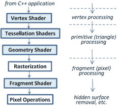

**图2.2** OpenGL管线概览。

#### 2.1.1 C++/OpenGL应用程序

我们的大部分图形应用程序是用C++编写的。根据程序的目的，它可以使用标准C++库与最终用户交互。对于与3D渲染相关的任务，它使用OpenGL调用。如前一章所述，我们将使用几个附加库：GLEW（OpenGL扩展管理器）、GLM（OpenGL数学库）、SOIL2（简单OpenGL图像加载器）和GLFW（图形库框架）。

GLFW库包含一个名为GLFWwindow的类，我们可以在上面绘制3D场景。如前所述，OpenGL还为我们提供了将GLSL程序安装到可编程着色器阶段并进行编译的命令。最后，OpenGL使用*缓冲区*将3D模型和其他相关图形数据发送到管线中。

在我们尝试编写着色器之前，让我们编写一个简单的C++/OpenGL应用程序，它实例化一个GLFWwindow并设置其背景颜色。这样做根本不需要任何着色器！代码如程序2.1所示。程序2.1中显示的main()函数与本教科书中使用的函数相同。main()中的重要操作包括：(a)初始化GLFW库，(b)实例化GLFWwindow，(c)初始化GLEW库，(d)调用一次“init()”函数，(e)重复调用“display()”函数。

“init()”函数是我们放置特定于应用程序的初始化任务的地方。display()方法是我们放置绘制到GLFWwindow的代码的地方。

这些函数的部署机制如下：GLFW和GLEW库分别使用命令glfwInit()和glewInit()进行初始化。GLFW窗口和关联的OpenGL上下文¹是使用glfwCreateWindow()命令创建的，其选项由任何前置的窗口提示设置。我们的窗口提示指定机器必须兼容OpenGL 4.3版本（“major”=4，“minor”=3）。glfwCreateWindow()命令的参数指定窗口的宽度和高度（以像素为单位）以及窗口顶部的标题。（另外两个设置为NULL且我们不使用的参数允许全屏模式和资源共享。）通过使用glfwSwapInterval()和glfwSwapBuffers()命令启用垂直同步（VSync）——GLFW窗口默认是双缓冲的。²请注意，创建GLFW窗口并不会自动使关联的OpenGL上下文成为当前上下文——因此我们还需要调用glfwMakeContextCurrent()。

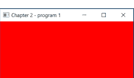

**图2.3** 程序2.1的输出。

我们的main()包含一个非常简单的渲染循环，它重复调用我们的display()函数。它还调用glfwSwapBuffers()（用于绘制屏幕）和glfwPollEvents()（用于处理其他与窗口相关的事件，例如按键）。当GLFW检测到应关闭窗口的事件（例如用户点击右上角的“X”）时，循环终止。请注意，我们在init()和display()调用中包含了GLFW窗口对象的引用；那些函数在某些情况下可能需要访问它。我们还在display()调用中包含了当前时间，这将有助于确保我们的动画无论使用什么计算机都以相同的速度运行。为此，我们使用glfwGetTime()，它返回自GLFW初始化以来经过的时间。

¹ 术语“上下文”指的是OpenGL实例及其状态信息，其中包括颜色缓冲区等项目。

² “双缓冲”意味着有两个颜色缓冲区——一个用于显示，一个用于渲染。在整个帧渲染完成后，缓冲区会进行交换。双缓冲用于减少不理想的视觉伪影。

现在是仔细查看程序2.1中OpenGL调用的适当时机。考虑这一个：

```
glClear(GL_COLOR_BUFFER_BIT);
```

在这种情况下，正在调用的OpenGL函数（如OpenGL参考文档中所述，可在https://www.opengl.org/sdk/docs上找到）是：

```
void glClear(GLbitfield mask);
```

参数引用了一个“GLbitfield”，称为“GL_COLOR_BUFFER_BIT”。OpenGL有许多预定义常量（其中一些称为*枚举*）；这个常量引用*颜色缓冲区*，它包含渲染时的像素。OpenGL有多个颜色缓冲区，此命令会清除它们全部——也就是说，它用预定义的颜色（称为“清除颜色”）填充它们。注意，这里的“clear”并不意味着“透明的颜色”；而是指重置（清除）颜色缓冲区时应用的颜色。

在调用glClear()之前紧接着调用glClearColor()。这允许我们指定清空颜色缓冲区时其中元素的值。这里我们指定了(1,0,0,1)，它对应于RGBA颜色*红色*。

最后，当用户尝试关闭GLFW窗口时，我们的渲染循环退出。此时，我们的main()请求GLFW分别通过调用glfwDestroyWindow()和glfwTerminate()销毁窗口并终止。

#### 2.1.2 顶点着色器和片段着色器

我们的第一个OpenGL程序实际上没有绘制任何东西——它只是用单一颜色填充了颜色缓冲区。要实际绘制东西，我们需要包含一个*顶点着色器*和一个*片段着色器*。

你可能会惊讶地发现，OpenGL只能绘制几种非常简单的对象，例如*点、直线*或*三角形*。这些简单的对象称为*图元*，因此，大多数3D模型由大量图元组成，通常是三角形。

图元由*顶点*组成——例如，三角形由三个顶点组成。顶点可以来自各种来源——它们可以从文件读取，然后由C++/OpenGL应用程序加载到缓冲区中，也可以在C++代码甚至GLSL代码中硬编码。

```cpp
"void main(void) {\n"
" { color = vec4(0.0, 0.0, 1.0, 1.0); }";

GLuint vShader = glCreateShader(GL_VERTEX_SHADER);
GLuint fShader = glCreateShader(GL_FRAGMENT_SHADER);

glShaderSource(vShader, 1, &vShaderSource, NULL);
glShaderSource(fShader, 1, &fShaderSource, NULL);
glCompileShader(vShader);
glCompileShader(fShader);

GLuint vfProgram = glCreateProgram();
glAttachShader(vfProgram, vShader);
glAttachShader(vfProgram, fShader);
glLinkProgram(vfProgram);

return vfProgram;
}

void init(GLFWwindow* window) {
    renderingProgram = createShaderProgram();
    glGenVertexArrays(numVAOs, vao);
    glBindVertexArray(vao[0]);
}

void display(GLFWwindow* window, double currentTime) {
    glUseProgram(renderingProgram);
    glDrawArrays(GL_POINTS, 0, 1);
}

. . . main() same as before
```

程序似乎输出了一个空白窗口（见图2.4）。但仔细检查会发现窗口中央有一个微小的蓝点（假设打印页面分辨率足够高）。OpenGL中点的默认大小是一个像素。

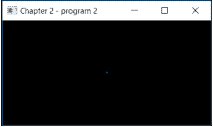

**图2.4** 程序2.2的输出。

程序2.2中有许多重要的细节（为了方便，程序中已用颜色标记）需要我们讨论。首先，注意频繁使用“GLuint”——这是OpenGL提供的“unsigned int”的与平台无关的简写（许多OpenGL构造具有整数引用）。接下来，注意init()不再为空——它现在调用了另一个函数

我们在 `display()` 中、`glDrawArrays()` 调用之前添加以下命令：

```
glPointSize(30.0f);
```

现在，当光栅化器从顶点着色器接收到顶点时，它会设置像素颜色值，从而形成一个大小为 30 像素的点。生成的输出如图 2.5 所示。

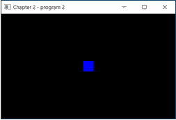

**图 2.5** 修改 glPointSize。

现在让我们继续考察 OpenGL 管线的其余部分。

#### 2.1.3 曲面细分

我们将在第 12 章讨论曲面细分。可编程曲面细分阶段是 OpenGL 中最新加入的功能之一（在 4.0 版中）。它提供了一个曲面细分器，可以生成大量三角形，通常以网格形式生成，还提供了一些工具，可以用多种方式操作这些三角形。例如，程序员可以像图 2.6 所示那样操作细分后的三角形网格。

当原本简单的形状（例如方形区域或曲面）上需要大量顶点时，曲面细分就很有用。它对于生成复杂地形也非常有用，我们后面会看到。在这种情况下，有时让 GPU 中的曲面细分器在硬件中生成三角形网格，比在 C++ 中完成要高效得多。

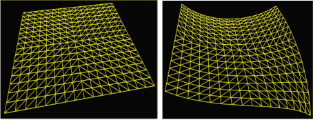

**图 2.6** 曲面细分器生成的网格。

#### 2.1.4 几何着色器

我们将在第 13 章讨论几何着色器阶段。*顶点着色器*让程序员能够一次操作一个*顶点*（即“逐顶点”处理），而*片段着色器*（我们将会看到）允许一次操作一个*像素*（“逐片段”处理），*几何着色器*则提供了一次操作一个*图元*的能力——“逐图元”处理。

回顾一下，最常见的图元是*三角形*。到进入几何阶段时，管线必须已经完成将顶点分组为三角形（这一过程称为*图元装配*）。然后，几何着色器使每个三角形中的全部三个顶点都能同时被程序员访问。

逐图元处理有许多用途。图元可以被修改，例如拉伸或收缩它们。某些图元可以被删除，从而在正在渲染的对象中形成“洞”——这是将简单模型转变为更复杂模型的一种方法。

几何着色器还提供了一种生成额外图元的机制。这同样为将简单模型转变为更复杂模型带来了许多可能性。

几何着色器的一个有趣用途是向对象添加表面纹理，例如凸起或鳞片——甚至“毛发”或“绒毛”。例如，考虑图 2.7 所示的简单环面（我们将在本书后面看到如何生成它）。这个环面的表面由数百个三角形构成。如果我们在每个三角形处使用几何着色器添加朝外的额外三角形，就会得到图 2.8 所示的结果。如果尝试在 C++/OpenGL 应用侧从头开始建模，这个“布满鳞片的环面”在计算上会非常昂贵。

当曲面细分阶段让程序员能够同时访问整个模型中的*所有*顶点时，再提供一个逐图元着色器阶段似乎有些冗余。区别在于，曲面细分只在非常有限的情况下提供这种能力——具体来说，是当模型是由曲面细分器生成的三角形网格时。它并不能同时访问任意模型的全部顶点，例如从 C++ 通过缓冲区传入的任意模型。

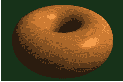

**图 2.7** 环面模型。

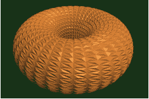

**图 2.8** 在几何着色器中修改后的环面。

#### 2.1.5 光栅化

最终，我们由顶点、三角形、颜色等构成的 3D 世界需要显示在 2D 显示器上。那个 2D 显示器屏幕由一个光栅——即像素组成的矩形阵列——构成。

当 3D 对象被光栅化时，OpenGL 会将对象中的图元（通常是三角形）转换为片段。片段保存与某个像素相关的信息。光栅化确定为了生成由三个顶点指定的三角形而需要绘制的像素位置。

光栅化首先在三角形的三个顶点之间进行两两插值。进行这种插值有一些选项；目前，考虑如图 2.9 所示的简单线性插值就足够了。原始的三个顶点以红色显示。

如果光栅化到此为止，生成的图像将显示为线框。这是 OpenGL 中的一个选项，可通过在 display() 函数中、调用 glDrawArrays() 之前添加以下命令来实现：

```
glPolygonMode(GL_FRONT_AND_BACK, GL_LINE);
```

如果用这行代码渲染前面 2.1.4 节所示的环面，它就会如图 2.10 所示。

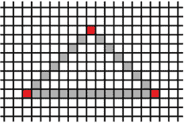

**图 2.9** 光栅化（第 1 步）。

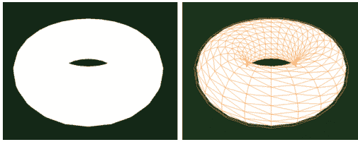

**图 2.12** 完全光栅化图元后的环面（左），以及叠加线框网格后的环面（右）。

使用预定义变量 `gl_Position` 指定。在片段着色器中，程序员可以使用一个类似变量来访问传入片段的坐标，称为 `gl_FragCoord`。我们可以修改程序 2.2 中的片段着色器，使其使用 `gl_FragCoord`（在这里使用 GLSL 的*字段选择器*表示法引用其 x 分量）来根据位置设置每个像素的颜色，如下所示：

```glsl
#version 430
out vec4 color;
void main(void)
{
    if (gl_FragCoord.x < 200) color = vec4(1.0, 0.0, 0.0, 1.0); else color = vec4(0.0, 0.0, 1.0, 1.0);
}
```

假设我们像 2.1.2 节末尾那样增大 `gl_PointSize`，那么现在像素颜色将在渲染出的点上发生变化——x 坐标小于 200 的地方为红色，否则为蓝色，如图 2.13 所示。

#### 2.1.6 像素操作

当场景中的对象使用 `glDrawArrays()` 函数绘制时，我们通常希望前面的对象遮挡住后面的对象。这也延伸到对象自身：我们期望看到对象的正面，但通常不会看到背面。

为了实现这一点，我们需要*隐藏面消除*，即 *HSR*。OpenGL 可以执行多种 HSR 操作，具体取决于我们希望在场景中达到的效果。尽管这个阶段不可编程，但理解它的工作方式极其重要。我们不仅需要正确配置它，之后在向场景添加阴影时，还需要仔细地操控它。

OpenGL 通过巧妙地协调使用两个缓冲区来完成隐藏面消除：*颜色缓冲区*（我们之前已经讨论过）和*深度缓冲区*（有时称为 *Z 缓冲区*）。这两个缓冲区都与光栅大小相同——也就是说，对于屏幕上的每个像素，每个缓冲区中都有一个条目。

当场景中绘制各种对象时，片段着色器会生成像素颜色。像素颜色被放入颜色缓冲区——最终写入屏幕的是颜色缓冲区。当多个对象占据颜色缓冲区中的某些相同像素时，必须根据哪个对象离观察者最近，来确定保留哪个（些）像素颜色。

隐藏面消除按如下方式完成：

- 在渲染场景之前，用表示最大深度的值填充深度缓冲区。
- 当片段着色器输出像素颜色时，计算其与观察者的距离。
- 如果计算出的距离*小于*深度缓冲区中（针对该像素）存储的距离，那么：(a) 该像素颜色替换颜色缓冲区中的颜色；(b) 该距离替换深度缓冲区中的值。否则，丢弃该像素。

这一过程称为 *Z 缓冲区算法*，如图 2.14 所示。

### 2.7 检测 OpenGL 和 GLSL 错误

编译和运行 GLSL 代码的工作流程与标准编码不同，因为 *GLSL 编译发生在 C++ 运行时*。另一个复杂之处是 GLSL 代码不在 CPU 上运行（它在 GPU 上运行），因此*操作

```cpp
Color[][] colorBuf = new Color[pixelRows][pixelCols];
double[][] depthBuf = new double[pixelRows][pixelCols];
for (each row and column)   // initialize color and depth buffers
{
    colorBuf[row][col] = backgroundColor;
    depthBuf[row][col] = far away;
}

for (each shape)    // update buffers when new pixel is closer
{
    for (each pixel in the shape)
    {
        if (depth at pixel < depthBuf value)
        {
            depthBuf[pixel.row][pixel.col] = depth at pixel;
            colorBuf[pixel.row][pixel.col] = color at pixel;
        }
    }
}
return colorBuf;
```

**图 2.14**  
Z 缓冲区算法。

系统并不总能捕获 OpenGL 运行时错误。这使调试变得困难，因为通常很难检测着色器是否失败以及失败的原因。

程序 2.3（如下所示）提供了一些用于捕获和显示 GLSL 错误的模块。它们利用 OpenGL 函数 glGetShaderiv() 和 glGetProgramiv()，这些函数用于提供有关已编译 GLSL 着色器和程序的信息。与它们配套的是之前程序 2.2 中的 createShaderProgram() 函数，但添加了错误检测调用。

程序 2.3 包含以下三个实用工具：

- **checkOpenGLError** – 检查 OpenGL 错误标志是否出现 OpenGL 错误
- **printShaderLog** – 当 GLSL 编译失败时显示 OpenGL 日志的内容
- **printProgramLog** – 当 GLSL 链接失败时显示 OpenGL 日志的内容

第一个 checkOpenGLError() 对于检测 GLSL 编译错误和 OpenGL 运行时错误都很有用，因此强烈建议在开发期间在整个 C++/OpenGL 应用程序中使用它。例如，在前面的示例（程序 2.2）中，对 glCompileShader() 和 glLinkProgram() 的调用可以很容易地用程序 2.3 所示的代码进行扩充，以确保任何拼写错误或其他编译错误都能被捕获并报告其原因。对 checkOpenGLError() 的调用可以添加到运行时 OpenGL 调用之后，例如紧接在调用 glDrawArrays() 之后。

使用这些工具的另一个重要原因是 *GLSL 错误不会导致 C++ 程序停止。* 因此，除非程序员采取措施在错误发生时捕获错误，否则调试将非常困难。

### 程序 2.3 捕获 GLSL 错误的模块

```cpp
void printShaderLog(GLuint shader) {
    int len = 0;
    int chWritten = 0;
    char *log;
    glGetShaderiv(shader, GL_INFO_LOG_LENGTH, &len);
    if (len > 0) {
        log = (char *)malloc(len);
        glGetShaderInfoLog(shader, len, &chWritten, log);
        cout << "Shader Info Log: " << log << endl;
        free(log);
    }
}

void printProgramLog(int prog) {
    int len = 0;
    int chWritten = 0;
    char *log;
    glGetProgramiv(prog, GL_INFO_LOG_LENGTH, &len);
    if (len > 0) {
        log = (char *)malloc(len);
        glGetProgramInfoLog(prog, len, &chWritten, log);
        cout << "Program Info Log: " << log << endl;
        free(log);
    }
}

bool checkOpenGLError() {
    bool foundError = false;
    int glErr = glGetError();
    while (glErr != GL_NO_ERROR) {
        cout << "glError: " << glErr << endl;
        foundError = true;
        glErr = glGetError();
    }
    return foundError;
}
```

### 检查 OpenGL 错误的示例：

```cpp
GLuint createShaderProgram() {
    GLuint vertCompiled;
    GLuint fragCompiled;
    GLuint linked;
    . . .
    // catch errors while compiling shaders

    glCompileShader(vShader);
    checkOpenGLError();
    glGetShaderiv(vShader, GL_COMPILE_STATUS, &vertCompiled);
    if (vertCompiled != 1) {
        cout << "vertex compilation failed" << endl;
        printShaderLog(vShader);
    }

    glCompileShader(fShader);
    checkOpenGLError();
    glGetShaderiv(fShader, GL_COMPILE_STATUS, &fragCompiled);
    if (fragCompiled != 1) {
        cout << "fragment compilation failed" << endl;
        printShaderLog(fShader);
    }

    // catch errors while linking shaders

    glAttachShader(vfProgram, vShader);
    glAttachShader(vfProgram, fShader);

    glLinkProgram(vfProgram);
    checkOpenGLError();
    glGetProgramiv(vfProgram, GL_LINK_STATUS, &linked);
    if (linked != 1) {
        cout << "linking failed" << endl;
        printProgramLog(vfProgram);
    }
    return vfProgram;
}
```

还有其他一些技巧可以推断着色器代码中运行时错误的原因。着色器运行时错误的一个常见结果是输出屏幕完全空白，基本上没有任何输出。即使错误只是着色器中的一个非常小的拼写错误，也可能发生这种情况，但很难判断错误发生在管线的哪个阶段。完全没有输出时，就像大海捞针。

在这种情况下，一个有用的技巧是暂时用程序 2.2 中所示的片段着色器替换片段着色器。回想一下，在那个示例中，片段着色器只是输出一种特定颜色——例如纯蓝色。如果后续输出具有正确的几何形状（但为纯蓝色），则顶点着色器可能正确，而原始片段着色器中存在错误。如果输出仍然是空白屏幕，则错误更可能发生在管线的较早阶段，例如顶点着色器中。

在附录 C 中，我们展示了如何使用另一个有用的调试工具 *Nsight*，该工具可用于配备某些 Nvidia 显卡的机器。

### 2.3 从文件读取 GLSL 源代码

到目前为止，我们的 GLSL 着色器代码一直以内联方式存储在字符串中。随着程序变得越来越复杂，这将变得不切实际。我们应该改为将着色器代码存储在文件中并读取它们。

读取文本文件是一项基本的 C++ 技能，这里不会涵盖。然而，为了实用，程序 2.4 中所示的 `readShaderSource()` 提供了读取着色器的代码。它读取着色器文本文件并返回一个字符串数组，其中每个字符串是文件中的一行文本。然后它根据读入的行数确定该数组的大小。请注意，这里的 `createShaderProgram()` 替换了程序 2.2 中的版本。

在此示例中，顶点和片段着色器代码现在分别放在文本文件“vertShader.glsl”和“fragShader.glsl”中。

### 程序 2.4 从文件读取 GLSL 源代码

*（…… #includes 与之前相同，main()、display()、init() 与之前相同，另加以下内容……）*

```cpp
#include <string>
#include <iostream>
#include <fstream>
. . .
string readShaderSource(const char *filePath) {
    string content;
    ifstream fileStream(filePath, ios::in);
    string line = "";
    while (!fileStream.eof()) {
        getline(fileStream, line);
        content.append(line + "\n");
    }
    fileStream.close();
    return content;
}

GLuint createShaderProgram() {
    (...... as before plus ...)
    string vertShaderStr = readShaderSource("vertShader.glsl");
    string fragShaderStr = readShaderSource("fragShader.glsl");

    const char *vertShaderSrc = vertShaderStr.c_str();
    const char *fragShaderSrc = fragShaderStr.c_str();

    glShaderSource(vShader, 1, &vertShaderSrc, NULL);
    glShaderSource(fShader, 1, &fragShaderSrc, NULL);

    (....etc., building rendering program as before)
}
```

### 2.4 从顶点构建对象

最终，我们想要绘制的不仅仅是单个点。我们希望绘制由*许多*顶点构成的对象。本书的大部分章节都将致力于这个主题。现在，我们只从一个简单的示例开始——我们将定义*三个*顶点，并使用它们绘制一个*三角形*。

我们可以通过对程序 2.2（实际上是程序 2.4 中从文件读取着色器的版本）做两处小改动来实现这一点：(a) 修改顶点着色器，使*三个不同*的顶点输出到管线的后续阶段；(b) 修改 glDrawArrays() 调用，以指定我们正在使用*三个*顶点。

在 C++/OpenGL 应用程序中（具体来说，在 glDrawArrays() 调用中），我们指定 GL_TRIANGLES 而不是 GL_POINTS，并且还指定通过管线发送*三个*顶点。这会导致顶点着色器运行*三次*，并且在每次迭代时，内置变量 gl_VertexID 会自动递增（它最初设置为 0）。通过测试 gl_VertexID 的值，着色器被设计为在它执行的三次中每次输出一个不同的点。回想一下，这三个点随后经过*光栅化*阶段，生成一个填充的三角形。这些修改如程序 2.5 所示（代码的其余部分与程序 2.4 中先前所示相同）。


### 程序 2.5 绘制三角形

**顶点着色器**

```glsl
#version 430
void main(void)
{
    if (gl_VertexID == 0) gl_Position = vec4(0.25, -0.25, 0.0, 1.0);
    else if (gl_VertexID == 1) gl_Position = vec4(-0.25, -0.25, 0.0, 1.0);
    else gl_Position = vec4(0.25, 0.25, 0.0, 1.0);
}
```

**C++/OpenGL 应用程序——在 display() 中**

```cpp
...
glDrawArrays(GL_TRIANGLES, 0, 3);
```

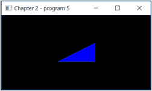

**图 2.15**  
绘制一个简单三角形。

### 2.5 为场景添加动画

本书中的许多技术都可以*动画化*。这指的是场景中的物体正在移动或变化，并且场景会被反复渲染，以实时反映这些变化。

回顾第 2.1.1 节，我们已将 main() 构造为：先对 init() 进行一次调用，然后反复调用 display()。因此，尽管前面的每个示例看起来可能只是一个固定不变的渲染场景，但实际上 main 中的循环一直在使它被一遍又一遍地绘制。

因此，我们的 main() 已经具备支持动画的结构。我们只需设计 display() 函数，使其随着时间改变所绘制的内容。场景的每次渲染称为一个*帧*，调用 display() 的频率称为*帧率*。应用程序逻辑中运动速率的处理，可以通过自上一帧以来经过的时间来控制（这就是将“currentTime”作为 display() 函数参数的原因）。

程序 2.6 展示了一个示例。我们取用程序 2.5 中的三角形并为其添加动画，使它向右移动，然后向左移动，来回往复。在此示例中，我们没有考虑经过的时间，因此三角形的移动速度可能会因计算机速度不同而快慢不一。在后续示例中，我们将使用经过的时间，以确保动画无论在哪台计算机上运行都以相同速度播放。

在程序 2.6 中，应用程序的 display() 方法维护一个变量“x”，用于偏移三角形的 X 坐标位置。每次调用 display() 时，它的值都会改变（因此每一帧的值都不同），并且每当它达到 1.0 或 -1.0 时就会反向。x 的值会被复制到顶点着色器中名为“offset”的对应变量。执行此复制的机制使用了所谓的 uniform 变量，我们将在第 4 章稍后学习它。目前还不需要理解 uniform 变量的细节。现在只需注意，C++/OpenGL 应用程序首先调用 glGetUniformLocation() 获取指向“offset”变量的指针，然后调用 glProgramUniform1f() 将 x 的值复制到 offset。随后，顶点着色器将 offset 加到正在绘制的三角形的 X 坐标上。还要注意，每次调用 display() 时都会清除背景，以避免三角形移动时留下拖尾。图 2.16 展示了三个时间点上的显示情况（当然，运动无法在静态图中展示）。

### 程序 2.6 简单动画示例

**C++/OpenGL 应用程序：**

```cpp
// same #includes and declarations as before, plus the following:
float x = 0.0f;            // location of triangle on x axis
float inc = 0.01f;         // offset for moving the triangle

void display(GLFWwindow* window, double currentTime) {
    glClear(GL_DEPTH_BUFFER_BIT);
    glClearColor(0.0, 0.0, 0.0, 1.0);      // clear the background to black, each time
    glClear(GL_COLOR_BUFFER_BIT);

    glUseProgram(renderingProgram);

    x += inc;                              // move the triangle along x axis
    if(x > 1.0f) inc = -0.01f;             // switch to moving the triangle to the left
    if (x < -1.0f) inc = 0.01f;                      // switch to moving the triangle to the right
    GLuint offsetLoc = glGetUniformLocation(renderingProgram, "offset");   // get ptr to "offset"
    glProgramUniform1f(renderingProgram, offsetLoc, x);        // send value in "x" to "offset"

    glDrawArrays(GL_TRIANGLES, 0, 3);
}   // remaining functions, same as before
```

**顶点着色器：**

```glsl
#version 430
uniform float offset;
void main(void)
{ if (gl_VertexID == 0) gl_Position = vec4(0.25 + offset, -0.25, 0.0, 1.0);
  else if (gl_VertexID == 1) gl_Position = vec4(-0.25 + offset, -0.25, 0.0, 1.0);
  else gl_Position = vec4(0.25 + offset, 0.25, 0.0, 1.0);
}
```

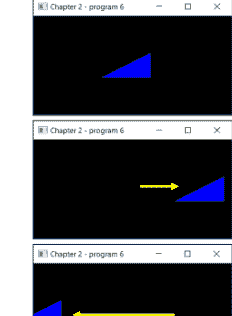

**图 2.16**  
一个带动画的移动三角形。

请注意，除了添加用于为三角形制作动画的代码之外，我们还在 `display()` 函数的开头添加了以下行：

```cpp
glClear(GL_DEPTH_BUFFER_BIT);
```

虽然在这个特定示例中并非严格必需，但我们还是在这里添加了它，并且它将继续出现在我们的大多数应用程序中。回顾第 2.1.7 节中的讨论，*隐藏面消除*需要颜色缓冲区和深度缓冲区。随着我们逐步绘制越来越复杂的三维场景，就有必要每帧初始化（清除）深度缓冲区，尤其是对于带动画的场景，以确保深度比较不会受到旧深度数据的影响。从前面的示例应当可以明显看出，清除深度缓冲区的命令与清除颜色缓冲区的命令基本相同。

### 2.6 组织 C++ 代码文件

到目前为止，我们一直将所有 C++/OpenGL 应用程序代码放在一个名为“main.cpp”的文件中，并将 GLSL 着色器放在名为“vertShader.glsl”和“fragShader.glsl”的文件中。虽然我们承认，将大量应用程序代码塞进 main.cpp 并不是最佳实践，但本书采用了这一约定，以便在每个示例中都绝对清楚地表明哪个文件包含与所讨论示例相关的主要 C++/OpenGL 代码块。在整本教材中，它都将始终被称为“main.cpp”。在实践中，应用程序当然应当模块化，以恰当地反映应用程序所执行的任务。

然而，随着内容推进，我们会遇到一些创建模块的情形，这些模块将在许多不同的应用程序中有用。只要合适，我们就会将这些模块移到单独的文件中，以便于复用。例如，稍后我们将定义一个 Sphere 类，它在许多不同示例中都会有用，因此它将被分离到自己的文件（Sphere.cpp 和 Sphere.h）中。

同样，当我们遇到希望复用的函数时，我们会将它们放入名为“Utils.cpp”的文件（以及关联的“Utils.h”）中。我们已经见过几个适合移入“Utils.cpp”的函数：第 2.2 节描述的错误检测模块，以及第 2.3 节描述的用于读取 GLSL 着色器程序的函数。后者特别适合重载，从而可以为给定应用程序中组装的各种可能的管线着色器组合分别定义“createShaderProgram()”函数：

- `GLuint Utils::createShaderProgram(const char *vp, const char *fp)`
- `GLuint Utils::createShaderProgram(const char *vp, const char *gp, const char *fp)`
- `GLuint Utils::createShaderProgram(const char *vp, const char *tCS, const char *tES, const char *fp)`
- `GLuint Utils::createShaderProgram(const char *vp, const char *tCS, const char *tES, const char *gp, const char *fp)`

上一列表中的第一种情况支持仅使用顶点着色器和片段着色器的着色器程序。第二种支持使用顶点、几何和片段着色器的程序。第三种支持使用顶点、细分和片段着色器的程序。第四种支持使用顶点、细分、几何和片段着色器的程序。每种情况接受的参数都是包含着色器代码的 GLSL 文件的路径名。例如，下面的调用使用其中一个重载函数来编译并链接一个包含顶点着色器和片段着色器的着色器管线程序。完成后的程序被放入变量“renderingProgram”中：

```cpp
renderingProgram = Utils::createShaderProgram("vertShader.glsl", "fragShader.glsl");
```


这些 createShaderProgram() 实现都可以在随附 CD 中找到（在“Utils.cpp”文件中），并且它们都同样集成了第 2.2 节中的错误检测模块。它们并没有什么新内容；只是为了方便而按这种方式组织。随着本书内容的推进，我们还会陆续向 Utils.cpp 中添加其他类似函数。强烈建议读者查看随附 CD 上的 Utils.cpp 文件，甚至根据需要向其中添加内容。其中找到的程序是按照我们在书中学习这些方法的过程构建的，研究它们的组织方式应当有助于加深读者自己的理解。

关于“Utils.cpp”文件中的函数，我们将它们实现为静态方法，因此不必实例化 Utils 类。读者可能更愿意将它们实现为实例方法而不是静态方法，甚至实现为独立函数，这取决于所开发特定系统的架构。

我们所有的着色器都将以“.glsl”扩展名命名。

### 补充说明

本入门章节中，我们没有讨论 OpenGL 管线的许多细节。我们跳过了一些内部阶段，并且完全省略了纹理是如何处理的。我们的目标是尽可能简单地勾勒出我们将编写代码所依托的框架。随着内容推进，我们将继续学习更多细节。

我们还推迟了细分和几何相关代码示例的展示。在后续章节中，我们将构建完整系统，展示如何为每个阶段编写实用的着色器。


有一些更复杂的方式来组织场景动画的代码，尤其是在线程管理方面。一些语言绑定（如用于 Java 的 JOGL 和 LWJGL）提供了支持动画的类。有兴趣为特定应用设计渲染循环（或“游戏循环”）的读者，建议参阅一些更专业的游戏引擎设计书籍（例如 [NY14]），并浏览 gamedev.net [GD20] 上的相关讨论。

我们略过了 `glShaderSource()` 命令的一个细节。第四个参数用于指定一个“长度数组”，其中包含给定着色器程序中每行代码的整数字符串长度。如果像我们所做的那样将该参数设为 `null`，那么当字符串以 null 结尾时，OpenGL 将自动构建该数组。虽然我们一直很小心地确保发送给 `glShaderSource()` 的字符串以 null 结尾（通过在 `createShaderProgram()` 中调用 `c_str()` 函数），但也会遇到一些应用程序手动构建这些数组而不是传入 null 的情况。

在本书中，读者有时可能想知道 OpenGL 的一个或多个上限。例如，程序员可能需要知道几何着色器能产生的最大输出数量，或者渲染一个点时可指定的最大尺寸。许多此类值依赖于具体实现（implementation-dependent），这意味着它们会因机器不同而有所差异。OpenGL 提供了一种使用 `glGet()` 命令检索这些限制的机制，该命令根据所查询参数的类型而采取不同形式。例如，要查找允许的最大点大小，以下调用会将最小值和最大值（针对你机器的 OpenGL 实现）放入名为 `size` 的浮点数组的前两个元素中：

```cpp
glGetFloatv(GL_POINT_SIZE_RANGE, size);
```

类似的查询还有很多。有关的例子请参阅 OpenGL 参考文档 [OP16]。

在本章中，我们尝试描述每次 OpenGL 调用的每个参数。然而，随着本书的深入，这样做会变得冗长繁琐，当我们认为描述某个参数会不必要地使问题复杂化时，有时就不再赘述。这是因为许多 OpenGL 函数拥有大量与我们的示例无关的参数。读者应该习惯在必要时查阅 OpenGL 文档来补充这些细节。

### 练习

- 2.1 修改程序 2.2，添加动画，使所绘制的点循环地变大和变小。提示：使用 `glPointSize()` 函数，并以一个变量作为参数。
- 2.2 修改程序 2.5，使其绘制一个等腰三角形（而不是图 2.15 中所示的直角三角形）。
- 2.3 （项目）修改程序 2.5，加入程序 2.3 中所示的错误检查模块。在使其工作之后，尝试向着色器中插入各种错误，观察由此产生的行为以及生成的错误消息。
- 2.4 修改程序 2.6，使其使用传入 `display()` 函数的 `currentTime` 变量来计算三角形的移动量。提示：`currentTime` 变量包含程序开始以来经过的总时间。你的解决方案需要确定自上一帧以来经过的时间，并据此计算增量。以这种方式计算动画可以确保无论计算机速度如何，动画都以相同的速度移动。

### 参考文献

- [GD20] 游戏开发网络（Game Development Network），访问于2020年7月，https://www.gamedev.net/
- [NY14] R. Nystrom，“游戏循环”，载于《游戏编程模式》（Genever Benning，2014），访问于2020年7月，http://gameprogrammingpatterns.com/game-loop.html
- [OP16] OpenGL 4.5 参考页面，访问于2016年7月，https://www.khronos.org/registry/OpenGL-Refpages/gl4/
- [SW15] G. Sellers、R. Wright Jr. 和 N. Haemel，《OpenGL超级宝典：综合教程与参考》第7版（Addison-Wesley，2015）。

### 3.1 三维坐标系

三维空间通常用三个轴来表示：X、Y 和 Z。这三个轴可以排列成两种配置：*右手系*（right-handed）或 *左手系*（left-handed）。（这个名称源于轴的朝向，就像用右手或左手的拇指和前两根手指以直角指向所构造出的方向一样。）

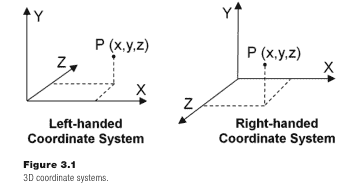

了解你的图形编程环境使用哪种坐标系非常重要。例如，OpenGL 中的大多数坐标系是右手系，而 Direct3D 中的大多数是左手系。在本书中，除非另有说明，否则我们都假定使用右手系。

### 3.2 点

三维空间中的点可以通过列出 X、Y、Z 值来指定，例如用 (2, 8, -3) 这样的记号。然而，使用*齐次*（homogeneous）记号来指定点会更有用，这种表示法最早在19世纪初被描述。齐次记号中的点包含四个值。前三个对应于 X、Y 和 Z，第四个值 W 始终是一个固定的非零值，通常为 1。因此，我们将这个点表示为 (2, 8, -3, 1)。我们很快就会看到，齐次记号将使我们的许多图形计算更加高效。

用于以齐次三维记号存储点的合适 GLSL 数据类型是 `vec4`（“vec”指 *向量*（vector），但也可用于表示点）。GLM 库包含了适用于在 C++/OpenGL 应用程序中创建和存储3元素和4元素（齐次）点的类，分别称为 `vec3` 和 `vec4`。

### 3.3 矩阵

*矩阵*（matrix）是一个矩形的数值数组，其元素通常通过下标来访问。第一个下标指行号，第二个下标指列号，下标从 0 开始。我们用于三维图形计算的大多数矩阵都是 4x4 大小，如图 3.2 所示：

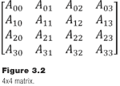

GLSL 语言包含一种名为 `mat4` 的数据类型，可用于存储 4x4 矩阵。类似地，GLM 也包含一个名为 `mat4` 的*类*，用于实例化和存储 4x4 矩阵。

*单位矩阵*（identity matrix）包含所有零，并且对角线上的元素为 1：

$$\begin{bmatrix}1&0&0&0\\0&1&0&0\\0&0&1&0\\0&0&0&1\end{bmatrix}$$

任何点或矩阵乘以单位矩阵后保持不变。在 GLM 中，构造函数调用 `glm::mat4 m(1.0f)` 会在变量 m 中构建单位矩阵。

*转置*（transpose）矩阵是通过交换矩阵的行和列来计算的。例如：

$$\begin{bmatrix}A_{00}&A_{01}&A_{02}&A_{03}\\A_{10}&A_{11}&A_{12}&A_{13}\\A_{20}&A_{21}&A_{22}&A_{23}\\A_{30}&A_{31}&A_{32}&A_{33}\end{bmatrix}=\begin{bmatrix}A_{00}&A_{10}&A_{20}&A_{30}\\A_{01}&A_{11}&A_{21}&A_{31}\\A_{02}&A_{12}&A_{22}&A_{32}\\A_{03}&A_{13}&A_{23}&A_{33}\end{bmatrix}^{T}$$

GLM 库和 GLSL 都有转置函数：分别是 `glm::transpose(mat4)` 和 `transpose(mat4)`。

*矩阵加法*很直观：

\[\begin{bmatrix} A+a & B+b & C+c & D+d \\ E+e & F+f & G+g & H+h \\ I+i & J+j & K+k & L+l \\ M+m & N+n & O+o & P+p \end{bmatrix} = \begin{bmatrix} A & B & C & D \\ E & F & G & H \\ I & J & K & L \\ M & N & O & P \end{bmatrix} + \begin{bmatrix} a & b & c & d \\ e & f & g & h \\ i & j & k & l \\ m & n & o & p \end{bmatrix}\]

在 GLSL 中，`+` 运算符在 `mat4` 上被重载以支持矩阵加法。

在三维图形中，有许多有用的矩阵乘法运算。一般而言，矩阵乘法可以从*左到右*或从*右到左*进行（注意，由于这些操作是不同的，因此矩阵乘法不可交换）。大多数情况下我们会使用从右到左的乘法。

*在三维图形中，用矩阵乘以一个点*在大多数情况下是从右到左进行的，并产生一个点，如下所示：

\[\begin{pmatrix} AX+BY+CZ+D \\ EX+FY+GZ+H \\ IX+JY+KZ+L \\ MX+NY+OZ+P \end{pmatrix} = \begin{bmatrix} A & B & C & D \\ E & F & G & H \\ I & J & K & L \\ M & N & O & P \end{bmatrix} * \begin{pmatrix} X \\ Y \\ Z \\ 1 \end{pmatrix}\]

注意，我们用齐次记号将点 (X,Y,Z) 表示为一个单列矩阵。

GLSL 和 GLM 都支持用 `*` 运算符将点（确切地说是 `vec4`）与矩阵相乘。

*将一个 4x4 矩阵与另一个 4x4 矩阵相乘*的做法如下：

\[\begin{bmatrix} A & B & C & D \\ E & F & G & H \\ I & J & K & L \\ M & N & O & P \end{bmatrix} * \begin{bmatrix} a & b & c & d \\ e & f & g & h \\ i & j & k & l \\ m & n & o & p \end{bmatrix} = \\
\begin{bmatrix} Aa+Be+Ci+Dm & Ab+Bf+Cj+Dn & Ac+Bg+Ck+Do & Ad+Bh+Cl+Dp \\ Ea+Fe+Gi+Hm & Eb+Ff+Gj+Hn & Ec+Fg+Gk+Ho & Ed+Fh+Gl+Hp \\ Ia+Je+Ki+Lm & Ib+Jf+Kj+Ln & Ic+Jg+Kk+Lo & Id+Jh+Kl+Lp \\ Ma+Ne+Oi+Pm & Mb+Nf+Oj+Pn & Mc+Ng+Ok+Po & Md+Nh+Ol+Pp \end{bmatrix}\]


位置移动到另一个位置。在本章中，我们将学习几种有用的变换矩阵：

- *平移*
- *旋转*
- *缩放*
- *投影*
- *注视（Look-At）*

我们的变换矩阵的一个重要性质是它们的大小都是 4x4。这得益于我们决定使用*齐次*表示法。否则，其中一些变换将具有不同且不兼容的维度。正如我们所看到的，确保它们大小相同不仅仅是为了方便；它还使得可以任意组合它们，并预计算变换组以提高性能。

#### 3.4.1 平移

*平移*矩阵用于将物体从一个位置移动到另一个位置。它由一个单位矩阵组成，其中 X、Y 和 Z 移动量分别位于 A₀₃、A₁₃、A₂₃ 位置。图 3.3 展示了平移矩阵的形式及其与齐次点相乘时的效果；结果是一个按平移值“移动”后的新点。

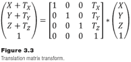

注意，点 (X,Y,Z) 与平移矩阵相乘后，会被平移（或移动）到位置 (X+T_x, Y+T_y, Z+T_z)。还要注意，乘法是按*从右到左*的顺序指定的。

例如，如果我们希望将一组点沿 Y 轴正方向向上移动 5 个单位，可以通过取一个单位矩阵并将值 5 放在 T_y 位置来构建一个平移矩阵。然后，我们只需将希望移动的每个点与该矩阵相乘。

GLM 中有几个用于构建平移矩阵以及将点与矩阵相乘的函数。一些相关操作如下：

- `glm::translate(x, y, z)` — 构建一个按 (x,y,z) 平移的矩阵
- `mat4 * vec4`

#### 3.4.2 缩放

缩放矩阵用于改变对象的大小，或使点朝向或远离原点移动。虽然缩放一个点起初可能显得有些奇怪，但 OpenGL 中的对象是由点组定义的。因此，缩放一个对象涉及扩展或收缩其点集。

缩放矩阵变换由一个单位矩阵组成，其中 X、Y 和 Z 缩放因子分别位于 A₀₀、A₁₁、A₂₂ 位置。图 3.4 展示了缩放矩阵的形式及其与齐次点相乘时的效果；结果是一个按缩放值修改后的新点。

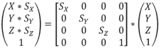

**图 3.4** 缩放矩阵变换。

GLM 中有几个用于构建缩放矩阵以及将点与缩放矩阵变换相乘的函数。一些相关操作如下：

- `glm::scale(x,y,z)` — 构建一个按 (x,y,z) 缩放的矩阵
- `mat4 * vec4`

缩放可用于切换坐标系。例如，给定一组右手坐标，我们可以使用缩放来确定对应的左手坐标会是什么。从图 3.1 中可以看出，对 Z 坐标取负即可在右手系和左手系之间切换，因此实现这一点的缩放矩阵变换为：

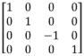

#### 3.4.3 旋转

旋转稍微复杂一些，因为在 3D 空间中旋转一个物体需要指定 (a) 旋转轴和 (b) 以度或弧度表示的旋转量。

在 18 世纪中叶，数学家莱昂哈德·欧拉表明，绕任意所需轴的旋转可以改为指定为绕 X、Y 和 Z 轴旋转的组合 [EU76]。这三个分别绕相应轴的旋转角后来被称为*欧拉角*。这一被称为*欧拉定理*的发现对我们非常有用，因为绕三个轴中每个轴的旋转都可以使用矩阵变换来指定。

分别绕 X、Y 和 Z 轴的三个旋转变换如图 3.5 所示。GLM 中也有几个用于构建和使用旋转矩阵的函数：

- `glm::rotate(mat4, θ, x, y, z)` 构建一个绕轴 x,y,z 旋转角度 θ 的旋转矩阵。
- `mat4 * vec4`

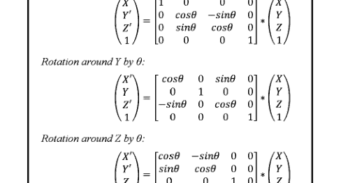

**图 3.5** 旋转变换矩阵。

在实践中，如果直线不经过原点，使用欧拉角在 3D 空间中绕任意直线旋转一个物体会需要几个额外步骤。一般来说：

- 1. 平移旋转轴，使其穿过原点。
- 2. 绕 X、Y 和 Z 轴按适当的欧拉角旋转。
- 3. 撤销第 1 步的平移。

图 3.5 中所示的三个旋转变换都有一个有趣的性质：逆旋转恰好等于矩阵的转置。这可以通过检查前面的矩阵并回想 cos(-θ) = cos(θ) 以及 sin(-θ) = -sin(θ) 来验证。这一性质在后续会变得有用。

欧拉角在某些 3D 图形应用中会引起某些异常现象。因此，通常建议使用*四元数*来计算旋转。对于有兴趣探索四元数的读者，有许多资源（例如 [KU98]）。对于大多数需求，欧拉角已经足够。

### 3.5 向量

向量指定*大小和方向*。它们不绑定到特定位置；向量可以在不改变其所表示内容的情况下被“移动”。

表示向量有多种方式，例如一端带箭头的线段，或一对（大小、方向），或两点之差。在 3D 图形中，向量经常表示为空间中的一个点，其中向量是从原点到该点的距离和方向。在图 3.6 中，向量 V（红色显示）既可以指定为点 P1 和 P2 之差，也可以指定为从原点到 P3 的等价距离。在我们的所有应用中，我们都直接将 V 指定为 (x,y,z)，这与指定点 P3 所用的记号相同。

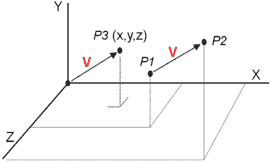

**图 3.6** 向量 V 的两种表示。

将向量与点用相同方式表示很方便，因为我们可以对点或向量互换使用矩阵变换。然而，这也可能令人困惑。因此，我们有时会在向量上方加一个小箭头来表示它（如 V⃗）。许多图形系统根本不区分点和向量，例如 GLSL 和 GLM 提供的数据类型 `vec3/vec4` 可用于保存点或向量。一些系统（例如本书较早的基于 Java 的版本中使用的 graphicslib3D 库）具有独立的点和向量类，并根据所执行的操作强制适当使用其中之一。对于对两者使用一种数据类型还是使用独立的数据类型更清晰，目前仍有争议。

在 3D 图形中经常使用若干向量运算，GLM 和 GLSL 中都有相应的函数可用。例如，假设向量 A(u,v,w) 和 B(x,y,z)：

*加法和减法：*

A ± B = (u ± x, v ± y, w ± z)  
`glm: vec3 ± vec3`  
`GLSL: vec3 ± vec3`

*归一化（变为长度=1）：*

 = A/|A| = A/sqrt(u²+v²+w²)，其中 |A| ≡ 向量 A 的长度  
`glm: normalize(vec3) or normalize(vec4)`  
`GLSL: normalize(vec3) or normalize(vec4)`

*点积：*

A • B = u*x + v*y + w*z  
`glm: dot(vec3,vec3) or dot(vec4,vec4)`  
`GLSL: dot(vec3,vec3) or dot(vec4,vec4)`

*叉积：*

A × B = (v*z - w*y, w*x - u*z, u*y - v*x)  
`glm: cross(vec3,vec3)`  
`GLSL: cross(vec3,vec3)`

其他有用的向量函数包括*模长*（在 GLSL 和 GLM 中均以 length() 形式提供），以及*反射*和*折射*（两者在 GLSL 和 GLM 中均可用）。

现在我们将进一步考察*点积*和*叉积*函数。

#### 3.5.1 点积的用途

在本书中，我们的程序大量使用点积。最重要且最基本的用途是求*两个向量之间的夹角*。考虑两个向量 V⃗ 和 W⃗，假设我们想求它们之间的夹角 θ。

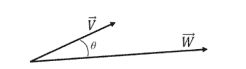

V⃗ · W⃗ = |V⃗| * |W⃗| * cos(θ)

cos(θ) = (V⃗ · W⃗) / (|V⃗| * |W⃗|)

因此，如果 V⃗ 和 W⃗ 已归一化（即具有单位长度——这里我们使用前面所示的“^”记号表示归一化），那么：

cos(θ) = V̂ · Ŵ

θ = arccos(V̂ · Ŵ)

有趣的是，后面我们会看到，通常需要的是 *cos(θ)*，而不是 θ 本身。因此，前面的两个推导都将直接有用。

点积还有许多其他用途：

- 求向量的模长：√(V⃗ · V⃗)
- 判断两个向量是否垂直，若：V⃗ · W⃗ = 0
- 判断两个向量是否平行，若：V⃗ · W⃗ = |V⃗| * |W⃗|
- 判断两个向量是否平行但指向相反方向，若：V⃗ · W⃗ = -|V⃗| * |W⃗|


#### 3.5.2 叉积的用途

- 判断向量之间的夹角是否位于范围 \((-90^\circ..+90^\circ)\) 内：\(\vec{V} \cdot \vec{W} > 0\)
- 求点 \(P=(x,y,z)\) 到平面 \(S=(a,b,c,d)\) 的最小有符号距离。首先，求平面 \(S\) 的单位法向量：  
  \(\hat{n}=(\frac{a}{\sqrt{a^2+b^2+c^2}},\frac{b}{\sqrt{a^2+b^2+c^2}},\frac{c}{\sqrt{a^2+b^2+c^2}})\)，以及从原点到平面的最短距离  
  \(D=\frac{d}{\sqrt{a^2+b^2+c^2}}\)。然后，从 \(P\) 到 \(S\) 的最小有符号距离为：  
  \((\hat{n} \cdot \vec{P})+D\)，该距离的符号决定点 \(P\) 位于平面 \(S\) 的哪一侧。

两个向量叉积的一个重要性质是，它会生成一个与原始两个向量所定义平面*垂直*（法向）的向量；本书通篇都会大量使用这一性质。

任意两个不共线向量 \(\vec{V}\) 和 \(\vec{W}\) 定义一个平面。例如，考虑两个任意向量 \(\vec{V}\) 和 \(\vec{W}\)。由于向量可以在不改变其含义的情况下移动，因此可以移动它们使起点重合。图 3.7 展示了由 \(\vec{V}\) 和 \(\vec{W}\) 定义的平面，以及它们叉积得到的法向量。所得法向量的方向遵循*右手定则*：将右手手指从 \(\vec{V}\) 弯向 \(\vec{W}\) 时，拇指指向法向量 \(\vec{R}\) 的方向。

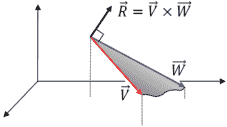

**图 3.7**  
叉积生成法向量。

注意顺序很重要；\(\vec{W}\times\vec{V}\) 将产生与 \(\vec{R}\) 方向相反的向量。

通过叉积求法向量的能力，在之后学习*光照*时将变得极其有用。为了确定光照效果，我们需要知道与所渲染模型相关的*外向法线*。图 3.8 展示了一个由六个点（顶点）构成的简单模型示例，以及使用叉积计算确定其一个面的外向法线的过程。

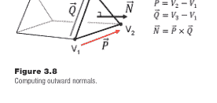

#### 3.6.6 局部空间和世界空间

三维图形（使用 OpenGL 或任何其他框架）最常见的用途是模拟一个三维世界，将对象放入其中，然后在显示器上查看这个模拟世界。放入三维世界中的对象通常被建模为三角形的集合。之后在第 6 章中，我们将深入探讨建模。但现在可以先了解总体过程。

在构建对象的三维模型时，我们通常以最便于描述的方式定向模型。例如，对球体建模时，可以将模型定向为球心位于原点 (0,0,0)，并赋予一个方便的半径，如 1。定义模型的空间称为其*局部空间*，或*模型空间*。OpenGL 文档使用术语*对象空间*。

然后，该球体可作为更大模型的一部分，例如成为机器人头部。当然，机器人会在其自身的局部/模型空间中定义。将球体模型放入机器人模型空间，可以使用缩放、旋转和平移矩阵变换完成，如图 3.9 所示。通过这种方式，可以层次化地构建复杂模型（第 4 章第 4.8 节将使用矩阵栈进一步展开）。

同样，通过确定模拟世界的朝向和尺寸，可将建模对象放入该世界；这个空间称为*世界空间*。将对象定位并定向到世界空间的矩阵称为*模型矩阵*，或 M。

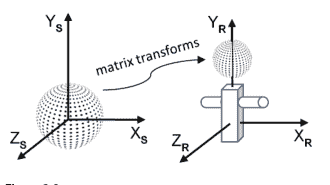

**图 3.9**  
球体和机器人的模型空间。

### 3.7 眼空间与合成相机

到目前为止，我们见过的变换矩阵都在三维空间中操作。然而最终，我们会希望将三维空间——或其一部分——显示在二维显示器上。为此，需要确定一个观察点。正如我们通过眼睛从特定点、沿特定方向观察真实世界一样，我们也必须建立一个位置和朝向，作为进入虚拟世界的窗口。这个观察点称为“视图”空间或“眼”空间，或称“合成相机”。

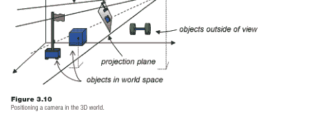

**图 3.10**  
在三维世界中定位相机。

如图 3.10 和 3.12 所示，观察涉及：(a) 将相机放置到某个世界位置；(b) 定向相机，这通常需要维护其自身的一组正交轴 *U/V/N*；(c) 定义*视景体*；(d) 将视景体内的对象投影到*投影平面*上。

OpenGL 包含一个永久固定在原点 (0,0,0) 并朝向负 *Z* 轴的相机，如图 3.11 所示。

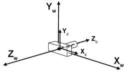

**图 3.11**  
OpenGL 固定相机。

为了使用 OpenGL 相机，我们需要做的一件事是*模拟*将其移动到某个期望的位置和朝向。这通过确定世界中的对象相对于期望相机位置的位置来完成（即，它们在“相机空间”中的位置，该空间由相机的 U、V、N 轴定义，如图 3.12 所示）。给定世界空间位置 P<sub>w</sub> 处的一点，我们需要一个变换将其转换为相机空间中的等效点，使其*看起来*像是从期望的相机位置 C<sub>w</sub> 观察到的。我们通过计算其相机空间位置 P<sub>c</sub> 来实现。已知 OpenGL 相机位置始终固定在 (0,0,0)，什么变换能实现这一点？

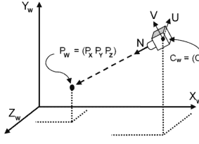

**图 3.12**  
相机朝向。

所需变换确定如下：

- 1. 按期望相机位置的负值平移 \(P_w\)。
- 2. 按期望相机朝向欧拉角的负值旋转 \(P_w\)。

我们可以构建一个单一变换，在一个矩阵中同时完成旋转和平移，称为*观察变换*矩阵，或 **V**。矩阵 **V** 由两个矩阵 **T**（包含期望相机位置负值的平移矩阵）和 **R**（包含期望相机朝向负值的旋转矩阵）连接而成。在这种情况下，从右向左计算，我们首先平移世界点 P，然后旋转它：

\[
P_c = R * (T * P_w)
\]

如之前所见，结合律允许我们改为这样分组运算：

\[
P_c = (R * T) * P_w
\]

如果将连接 **R*T** 保存到矩阵 **V** 中，运算现在如下所示：

\[
P_c = V * P_w
\]

完整计算以及矩阵 **T** 和 **R** 的确切内容如图 3.13 所示（我们省略矩阵 **R** 的推导——推导可在 [FV95] 中找到）。

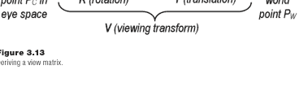

**图 3.13** 推导视图矩阵。

更常见的是，**V** 矩阵与模型矩阵 **M** 连接，形成单个*模型-视图*（MV）矩阵：

\[
MV = V * M
\]

然后，自身模型空间中的点 \(P_M\) 按如下方式一步直接变换到相机空间：

\[
P_C = MV * P_M
\]

当考虑到在复杂场景中，我们不仅需要对一个点执行此变换，而且需要对*场景中的每个顶点*执行此变换时，这种方法的优势就变得明显。通过预计算 MV，将每个点变换到视图空间时，每个顶点只需进行*一次*矩阵乘法，而不是两次。稍后我们将看到，可以扩展此过程来预计算若干矩阵连接，从而显著减少每个顶点的计算量。

### 3.8 投影矩阵

既然已经建立了相机，我们现在可以研究*投影矩阵*。我们现在要研究的两个重要投影矩阵是 (a) *透视*和 (b) *正交*。

#### 3.8.1 透视投影矩阵

透视投影试图通过利用透视概念来模仿我们观察真实世界时所见，使二维图片看起来像三维。近处的物体看起来比远处物体更大，并且在某些情况下，三维空间中平行的线在透视绘制时不再平行。

透视法是 1400—1500 年代文艺复兴时期的伟大发现之一，当时艺术家开始以比前辈更写实的方式绘画。

一个很好的例子可见图 3.14，即卡洛·克里韦利 1486 年绘制的《受胎告知，与圣埃米迪乌斯》（现藏于伦敦国家美术馆 [CR86]）。对透视的强烈运用显而易见——右侧建筑朝左墙面的后退线急剧向彼此倾斜。这营造出深度和三维空间的错觉，并且在此过程中，现实中平行的线在画面中并不平行。此外，前景中的人物比背景中的人物更大。尽管今天我们把这些手法视为理所当然，但要找到实现这一点的变换矩阵仍需要一些数学分析。


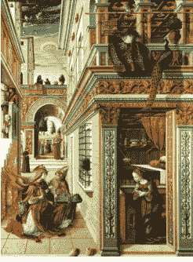

我们通过使用一种矩阵变换来实现这种效果，该变换将平行线转换为适当的非平行线。这样的矩阵称为*透视矩阵*或*透视变换*，它通过定义*视景体*的四个参数来构建。这些参数是：(a) *宽高比*，(b) *视场*，(c) *投影平面*或*近裁剪平面*，以及 (d) *远裁剪平面*。

只有位于*近*裁剪平面和*远*裁剪平面之间的对象才会被渲染。近裁剪平面还充当对象被*投影*到的平面，并且通常放置在靠近眼睛或相机的位置（如图 3.15 左侧所示）。远裁剪平面适当取值的选择将在第 4 章讨论。

**图 3.14**
《圣母领报，与圣埃米迪乌斯》（克里韦利——1486）。

*视场*是可观察空间的垂直角度。*宽高比*是近裁剪平面和远裁剪平面的宽度/高度之比。由这些元素形成并如图 3.15 所示的形状称为*视锥体*。

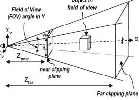

**图 3.15**
透视视景体或视锥体。

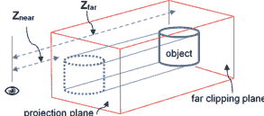

**图 3.17**
正交投影。

对于 $L$、$R$、$T$ 和 $B$，其中 $L$ 和 $R$ 分别对应投影平面左右边界的 X 坐标，$T$ 和 $B$ 分别对应投影平面上下边界的 Y 坐标。如 [WB15] 所推导的正交投影矩阵如图 3.18 所示。

$$\begin{bmatrix}
\frac{2}{R-L} & 0 & 0 & -\frac{R+L}{R-L} \\
0 & \frac{2}{T-B} & 0 & -\frac{T+B}{T-B} \\
0 & 0 & -\frac{2}{Z_{far}-Z_{near}} & -\frac{Z_{far}+Z_{near}}{Z_{far}-Z_{near}} \\
0 & 0 & 0 & 1
\end{bmatrix}$$

**图 3.18**
正交投影矩阵。

并非所有平行投影都是正交投影，但其他类型超出了本教材的范围。

平行投影与眼睛观察现实世界时所看到的不一致。但它们在多种情形下很有用，例如投射阴影、执行 3D 裁剪以及 CAD（计算机辅助设计）中——后者是因为无论对象如何放置，它们都能保持测量值。无论如何，本书中的绝大多数示例都使用透视投影。

### 3.9 观察矩阵

我们将要考察的最后一种变换是*观察*矩阵。当你希望将相机放置在一个位置并朝向另一个特定位置时，这种矩阵很方便，如图 3.19 所示。当然，使用我们已经见过的方法也可以实现这一点，但这是一个非常常见的操作，因此构建一个矩阵变换来完成它通常很有用。

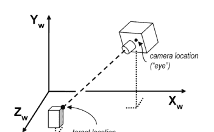

**图 3.19**
观察矩阵的要素。

观察变换仍然需要确定相机朝向。我们通过指定一个近似于期望总体朝向的向量（例如世界 Y̅ 轴）来完成这一点。通常，可以使用一系列叉积来为期望的相机朝向生成一组合适的前向、侧向和上方向向量。图 3.20 展示了这些计算：从相机位置（eye）、目标位置和初始上方向向量 Y̅ 开始，构建观察矩阵，如 [FV95] 所推导。

```text
fwd = normalize(eye - target)
side = normalize(-fwd × Y̅)
up = normalize(side × -fwd)

The look-at matrix then equals:

[ side_x   side_y   side_z   -(side • eye) ]
[ up_x     up_y     up_z     -(up • eye)   ]
[ -fwd_x   -fwd_y   -fwd_z   -(-fwd • eye) ]
[ 0        0        0        1             ]
```

**图 3.20**
观察矩阵。

我们可以将其编码为一个简单的 C++/OpenGL 实用函数，在给定相机位置、目标位置和初始“上”向量 Ỹ 的指定值的情况下构建观察矩阵。由于 GLM 包含用于构建观察矩阵的函数 glm::lookAt()，我们将直接使用它。这个函数在本书后面会很有用，尤其是在第 8 章生成阴影时。

### 3.10 用于构建矩阵变换的 GLSL 函数

尽管 GLM 包含用于执行本章所涵盖的许多 3D 变换的预定义函数，例如平移、旋转和缩放，但 GLSL 只包含基本的矩阵运算，例如加法、连接等。因此，当我们需要在着色器中执行某些 3D 计算时，有时有必要编写自己的 GLSL 实用函数来构建 3D 变换矩阵。在 GLSL 中，保存此类矩阵的合适数据类型是 mat4。

在 GLSL 中初始化 mat4 矩阵的语法按列加载值。前四个值放入第一列，接下来的四个值放入下一列，依此类推，如下例所示：

```glsl
mat4 translationMatrix =
    mat4(1.0, 0.0, 0.0, 0.0, // note this is the leftmost column, not the top row
         0.0, 1.0, 0.0, 0.0,
         0.0, 0.0, 1.0, 0.0,
         tx, ty, tz, 1.0 );
```

这会构建前面图 3.3 中描述的平移矩阵。

程序 3.1 包含五个 GLSL 函数，用于构建 4x4 平移、旋转和缩放矩阵，每个函数都对应本章前面给出的公式。我们将在本书后面使用其中一些函数。

### 程序 3.1 在 GLSL 中构建变换矩阵

```glsl
// builds and returns a translation matrix
mat4 buildTrans(float x, float y, float z)
{  mat4 trans = mat4(1.0, 0.0, 0.0, 0.0,
                     0.0, 1.0, 0.0, 0.0,
                     0.0, 0.0, 1.0, 0.0,
                     x, y, z, 1.0 );
   return trans;
}

// builds and returns a matrix that performs a rotation around the X axis
mat4 buildRotateX(float rad)
{  mat4 xrot = mat4(1.0, 0.0, 0.0, 0.0,
                    0.0, cos(rad), -sin(rad), 0.0,
                    0.0, sin(rad), cos(rad), 0.0,
                    0.0, 0.0, 0.0, 1.0);
    return xrot;
}

// builds and returns a matrix that performs a rotation around the Y axis
mat4 buildRotateY(float rad)
{  mat4 yrot = mat4(cos(rad), 0.0, sin(rad), 0.0,
                    0.0, 1.0, 0.0, 0.0,
                    -sin(rad), 0.0, cos(rad), 0.0,
                    0.0, 0.0, 0.0, 1.0);
    return yrot;
}

// builds and returns a matrix that performs a rotation around the Z axis
mat4 buildRotateZ(float rad)
{  mat4 zrot = mat4(cos(rad), -sin(rad), 0.0, 0.0,
                    sin(rad), cos(rad), 0.0, 0.0,
                    0.0, 0.0, 1.0, 0.0,
                    0.0, 0.0, 0.0, 1.0);
    return zrot;
}

// builds and returns a scale matrix
mat4 buildScale(float x, float y, float z)
{  mat4 scale = mat4(x, 0.0, 0.0, 0.0,
                     0.0, y, 0.0, 0.0,
                     0.0, 0.0, z, 0.0,
                     0.0, 0.0, 0.0, 1.0);
    return scale;
}
```

### 补充说明

在本章中，我们已经看到了将矩阵变换应用于点的示例。稍后，我们还将希望将这些相同的变换应用于向量。为了对向量 V 完成等价于对点应用某个矩阵变换 M 的变换，在一般情况下需要计算 M 的*逆转置*，记作 (M^{-1})^T，并将 V 乘以该矩阵。在某些情况下，M=(M^{-1})^T，此时可以直接使用 M。例如，本章中见过的基本旋转矩阵等于它们自身的逆转置，因此可以直接应用于向量（因而也可应用于点）。因此，本书中的示例在将变换应用于向量时有时使用 (M^{-1})^T，有时则直接使用 M。

本章尚未讨论的一件事是如何让相机在空间中平滑移动。这非常有用，尤其对于游戏和 CGI 电影，也适用于可视化、虚拟现实和 3D 建模。执行此操作的代码称为*相机控制器*，网上有许多关于该主题的资源 [TR15]。

我们没有为所展示的所有矩阵变换提供完整推导（它们可以在其他资料中找到，例如 [FV95]）。相反，我们力求简明扼要地总结进行基础 3D 图形编程所需的点、向量和矩阵运算。随着本书的推进，我们将遇到所介绍方法的许多实际用途。

### 练习

- **3.1** 修改程序 2.5，使顶点着色器包含程序 3.1 中的一个 buildRotate() 函数，并将其应用于构成三角形的点。这应当使三角形从原始朝向发生旋转。你不需要为旋转制作动画。
- **3.2** (*研究*) 在第 3.4 节末尾，我们指出欧拉角在某些情况下可能导致不良伪影。最常见的一种称为“万向节锁”。描述万向节锁，给出一个例子，并解释万向节锁为何会导致问题。
- **3.3** (*研究*) 避免使用欧拉角时可能出现伪影的一种方法是使用*四元数*。我们没有学习四元数；不过，GLM 包含若干四元数类和函数。请自行学习四元数，并熟悉相关的 GLM 四元数功能。


### 参考文献

- **[CR86]** C. Crivelli, *《受胎告知，与圣埃米迪乌斯》*, （英格兰伦敦国家美术馆，1486年），访问于2020年7月，https://www.nationalgallery.org.uk/paintings/carlo-crivelli-the-annunciation-with-saint-emidius

- **[EU76]** L. Euler, *任意刚体平移的通用公式*（任意刚体平移的通用公式），（圣彼得堡科学院新评论 20，1776年）。

- **[FV95]** J. Foley, A. van Dam, S. Feiner, and J. Hughes, *《计算机图形学——原理与实践》*, 第2版（Addison-Wesley，1995年）。

- **[KU98]** J. B. Kuipers, *《四元数与旋转序列》*（普林斯顿大学出版社，1998年）。

- **[TR15]** T. Reed, OpenGL 第 3B 部分：相机控制（博客）。访问于2020年7月，https://www.trentreed.net/blog/qt5-opengl-part-3b-camera-control

- **[WB15]** W. Brown, LearnWebGL（2015年），第8.2章（正交投影），访问于2020年7月，http://learnwebgl.brown37.net/08_projections/projections_ortho.html

## 第 4 章

## 管理 3D 图形数据

- 4.1 *缓冲区与顶点属性* ... 62
- 4.2 *统一变量* ... 65
- 4.3 *顶点属性的插值* ... 66
- 4.4 *模型视图与透视矩阵* ... 67
- 4.5 *我们的第一个 3D 程序——一个 3D 立方体* ... 68
- 4.6 *渲染同一对象的多个副本* ... 78
- 4.7 *渲染场景中的多个不同模型* ... 82
- 4.8 *矩阵栈* ... 85
- 4.9 *对抗“Z-Fighting”伪影* ... 92
- 4.10 *其他图元选项* ... 93
- 4.11 *面向性能的编码* ... 95
- *补充说明* ... 100

使用 OpenGL 渲染 3D 图像通常涉及通过 OpenGL 着色器管线发送多个数据集。例如，要绘制一个简单的 3D 对象，如*立方体*，你至少需要发送以下内容：

- 立方体模型的顶点
- 一些变换矩阵，用于控制立方体在 3D 空间中的朝向外观

稍微复杂一点的是，通过 OpenGL 管线发送数据有*两种*方式：

- 通过*缓冲区*发送到*顶点属性*，或者
- 直接发送到*统一变量*。

准确理解这两种机制的工作方式非常重要，这样才能为我们发送的每一项数据选择合适的方法。

让我们从渲染一个简单的立方体开始。

### 4.1 缓冲区与顶点属性

要绘制一个对象，必须将其顶点发送到顶点着色器。通常的做法是把顶点放入 C++ 端的缓冲区，并将该缓冲区与着色器中声明的顶点属性关联起来。完成这一过程需要几个步骤，其中一些只需执行一次，而另一些——如果场景是动画的——则必须在每一帧都执行：

只需执行一次——通常在 init() 中完成：

- 1. 创建缓冲区
- 2. 将顶点复制到缓冲区中

每帧执行——通常在 display() 中完成：

- 1. 启用包含顶点的缓冲区
- 2. 将缓冲区与顶点属性关联
- 3. 启用顶点属性
- 4. 使用 glDrawArrays(...) 绘制对象

缓冲区通常在程序开始时一次性创建，可以在 init() 中，也可以在 init() 调用的函数中。在 OpenGL 中，缓冲区包含在顶点缓冲对象（Vertex Buffer Object，简称 VBO）中，该对象在 C++/OpenGL 应用程序中声明并实例化。一个场景可能需要许多 VBO，因此通常的做法是在 init() 中生成并填充多个 VBO，以便程序需要绘制其中一个或多个时随时可用。

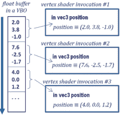

缓冲区与顶点属性以特定方式交互。当 glDrawArrays() 执行时，缓冲区中的数据会从缓冲区开头开始，按顺序流过顶点着色器。如第 2 章所述，顶点着色器对每个顶点执行一次。3D 空间中的一个顶点需要三个值，因此着色器中用于接收这三个值的顶点属性类型应为 vec3。然后，缓冲区中每三个值就会调用一次着色器，如图 4.1 所示。

**图 4.1**  
VBO 与顶点属性之间的数据传输。

我们将模型顶点加载到缓冲区（VBO）中的方式取决于模型顶点值的存储位置。在第 6 章中，我们将看到模型通常如何在建模工具（如 Blender [BL20] 或 Maya [MA16]）中构建、导出为标准文件格式（如 .obj——也在第 6 章中描述），并导入到 C++/OpenGL 应用程序中。我们还将看到如何实时计算模型的顶点，或如何使用细分着色器在管线内部生成顶点。

现在，假设我们希望绘制一个立方体，并假设立方体的顶点在 C++/OpenGL 应用程序中被硬编码在一个数组中。在这种情况下，我们需要将这些值复制到我们先前生成的两个缓冲区之一。为此，我们需要 (a) 使用 OpenGL 的 glBindBuffer() 命令将该缓冲区（比如第 0 个缓冲区）设为“活动”状态，以及 (b) 使用 glBufferData() 命令将包含顶点的数组复制到活动缓冲区（此处为第 0 个 VBO）。假设顶点存储在一个名为 vPositions 的浮点数组中，以下 C++ 代码² 会将这些值复制到第 0 个 VBO 中：

```cpp
glBindBuffer(GL_ARRAY_BUFFER, vbo[0]);
glBufferData(GL_ARRAY_BUFFER, sizeof(vPositions), vPositions, GL_STATIC_DRAW);
```

接下来，我们在 display() 中添加代码，使缓冲区中的值发送到着色器中的顶点属性。我们通过以下三个步骤完成：(a) 像上面一样使用 glBindBuffer() 命令将该缓冲区设为“活动”状态，(b) 将活动缓冲区与着色器中的顶点属性关联，(c) 启用顶点属性。以下代码行完成了这些步骤：

```cpp
glBindBuffer(GL_ARRAY_BUFFER, vbo[0]);        // make the 0th buffer "active"
glVertexAttribPointer(0, 3, GL_FLOAT, GL_FALSE, 0, 0);  // associate 0th attribute with buffer
glEnableVertexAttribArray(0);                 // enable the 0th vertex attribute
```

现在，当我们执行 glDrawArrays() 时，第 0 个 VBO 中的数据将被传输到具有 location 0 布局限定符的顶点属性。这样就将立方体顶点发送到了着色器。

² 请注意，在这里，我们第一次不打算逐一描述一个或多个 OpenGL 调用中的每个参数。如第 2 章所述，鼓励读者在需要时查阅 OpenGL 文档以获取此类细节。

### 4.2 统一变量

要使场景看起来是 3D 的，需要构建适当的变换矩阵（如第 3 章所述），并将其应用于每个模型的顶点。在顶点着色器中应用所需的矩阵运算最为高效，通常的做法是从 C++/OpenGL 应用程序通过统一变量将这些矩阵发送到着色器。

统一变量通过在着色器中使用 “uniform” 关键字来声明。下面的示例声明了用于保存模型视图矩阵和投影矩阵的变量，适用于我们的立方体程序：

```glsl
uniform mat4 mv_matrix;
uniform mat4 proj_matrix;
```

关键字 “mat4” 表示这些是 4x4 矩阵。这里我们将变量命名为 mv_matrix 以保存模型视图矩阵，将变量命名为 proj_matrix 以保存投影矩阵。由于 3D 变换是 4x4 的，mat4 是 GLSL 着色器统一变量中常用的数据类型。

从 C++/OpenGL 应用程序向统一变量发送数据需要以下步骤：(a) 获取统一变量的引用，(b) 将指向所需值的指针与获取的统一变量引用关联。假设链接后的渲染程序保存在名为 “renderingProgram” 的变量中，以下代码行将指定我们将在立方体示例中将模型视图矩阵和投影矩阵发送到两个统一变量 mv_matrix 和 proj_matrix：

```cpp
mvLoc = glGetUniformLocation(renderingProgram,"mv_matrix");  // get locations of uniforms
projLoc = glGetUniformLocation(renderingProgram,"proj_matrix"); // in the shader program
glUniformMatrix4fv(mvLoc, 1, GL_FALSE, glm::value_ptr(mvMat)); // send matrix data to the
glUniformMatrix4fv(projLoc, 1, GL_FALSE, glm::value_ptr(pMat)); // uniform variables
```

上面的示例假设我们使用了 GLM 工具来构建模型视图矩阵和投影矩阵变换 mvMat 和 pMat，稍后将更详细地讨论。它们的类型是 mat4（GLM 类）。GLM 函数调用 value_ptr() 返回矩阵数据的引用，glUniformMatrix4fv() 需要该引用来将这些矩阵值传输到统一变量。


### 4.3 顶点属性的插值

理解 *顶点属性* 在 OpenGL 管线中如何处理，以及 *uniform 变量* 如何处理，这一点很重要。回想一下，紧接在片段着色器之前的是 *光栅化*，在这一阶段，由顶点定义的图元（例如三角形）被转换为片段。光栅化会 *线性插值顶点属性值*，使显示的像素无缝连接建模表面。

相比之下，*uniform* 变量表现得像已初始化的常量，并且在每次顶点着色器调用期间（即对于从缓冲区发送的每个顶点）保持不变。uniform 变量不会被插值；无论顶点数量多少，它始终包含相同的值。

光栅化器对顶点属性进行的插值在许多方面都很有用。稍后，我们将使用光栅化来插值颜色、纹理坐标和表面法线。重要的是要理解，*通过缓冲区发送到顶点属性的所有值都将在管线更下游被插值*。

我们已经看到，在顶点着色器中，顶点属性被声明为 "in"，以表示它们从缓冲区接收值。顶点属性也可以改为声明为 "out"，这意味着它们将值向前发送到管线中的下一个阶段。例如，顶点着色器中的以下声明指定了一个名为 "color" 的顶点属性，它输出一个 vec4：

```glsl
out vec4 color;
```

不必为顶点位置声明 "out" 变量，因为 OpenGL 为此提供了一个名为 gl_Position 的内置 vec4 变量。在顶点着色器中，我们对传入的顶点（之前声明为 position）应用矩阵变换，并将结果赋给 gl_Position：

```glsl
gl_Position = proj_matrix * mv_matrix * position;
```

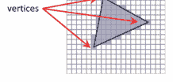

然后，变换后的顶点将被自动输出到光栅化器，相应的像素位置最终会被发送到片段着色器。

图 4.2 展示了光栅化过程。在 glDrawArrays() 函数中指定 GL_TRIANGLES 时，光栅化按三角形进行。插值从连接顶点的线开始，其精度水平与像素显示密度相对应。然后，通过沿连接边缘像素的水平线进行插值，填充三角形内部空间中的像素。

### 4.4 模型-视图矩阵和透视矩阵

在 3D 中渲染对象的一个基本步骤是创建适当的变换矩阵，并将它们发送到 uniform 变量，就像我们在 4.2 节中所做的那样。我们首先定义三个矩阵：

- 1. 一个 *模型* 矩阵
- 2. 一个 *视图* 矩阵
- 3. 一个 *透视* 矩阵

*模型* 矩阵在世界坐标空间中定位和定向对象。每个模型都有自己的模型矩阵，如果模型移动，该矩阵将需要不断重建。

*视图* 矩阵在世界中移动和旋转模型，以模拟相机位于期望位置时的效果。回顾第 2 章，OpenGL 相机位于位置 (0,0,0)，并朝向负 Z 轴。为了模拟该相机以某种方式移动后的外观，我们需要沿相反方向移动对象本身。例如，将相机向右移动会使场景中的对象看起来向左移动；尽管 OpenGL 相机是固定的，但我们可以通过将对象向左移动，使其看起来好像我们将相机向右移动了。

*透视* 矩阵是一种变换，它根据期望的视锥体提供 3D 效果，如第 3 章前面所述。

同样重要的是要理解何时计算每种类型的矩阵。永不改变的矩阵可以在 `init()` 中构建，而那些会改变的矩阵则需要在 `display()` 中构建，以便为每一帧重新构建它们。假设模型是动画的，并且相机是可移动的。那么：

- 需要 *为每个模型* 且 *在每一帧* 创建模型矩阵。
- 视图矩阵需要 *每帧创建一次*（因为相机可以移动），但对于该帧期间渲染的所有对象来说它是相同的。
- 透视矩阵创建一次（在 init() 中），使用屏幕窗口的宽度和高度（以及期望的视锥体参数），并且通常保持不变，除非窗口大小改变。

生成模型和视图变换矩阵随后在 display() 函数中进行，如下所示：

- 1. 根据期望的相机位置和方向构建视图矩阵。
- 2. 对于每个模型，执行以下操作：
    - i. 根据模型的位置和方向构建模型矩阵。
    - ii. 将模型矩阵和视图矩阵连接成一个单一的 "MV" 矩阵。
    - iii. 将 MV 矩阵和投影矩阵发送到对应的着色器 uniform 变量。

从技术上讲，没有必要将模型矩阵和视图矩阵组合成一个矩阵。也就是说，它们可以以各自独立的矩阵发送到顶点着色器。然而，将它们组合起来而将透视矩阵保持分离有一定的优势。例如，在顶点着色器中，模型中的每个顶点都会与这些矩阵相乘。由于复杂模型可能有数百甚至数千个顶点，通过在发送到顶点着色器之前对模型矩阵和视图矩阵进行一次预先相乘，可以提高性能。稍后，我们将看到出于光照目的需要将透视矩阵保持分离。

### 4.5 我们的第一个 3D 程序——一个 3D 立方体

是时候把所有部分组合起来了！为了构建一个完整的 C++/OpenGL/GLSL 系统，在 3D “世界”中渲染我们的立方体，到目前为止描述的所有机制都需要组合在一起并完美协调。我们可以重用一些之前在第二章中见过的代码。具体来说，我们不会重复以下用于读取包含着色器代码的文件、编译和链接它们以及检测 GLSL 错误的函数；事实上，回想一下，我们已经将它们移到了 "Utils.cpp" 文件中：

- createShaderProgram()
- readShaderSource()
- checkOpenGLError()
- printProgramLog()
- printShaderLog()

```cpp
1.0f, -1.0f, -1.0f, 1.0f, -1.0f, 1.0f, 1.0f, -1.0f,
1.0f, -1.0f, 1.0f, 1.0f, 1.0f, 1.0f, -1.0f, 1.0f,
1.0f, -1.0f, 1.0f, -1.0f, -1.0f, 1.0f, 1.0f, 1.0f,
-1.0f, -1.0f, 1.0f, -1.0f, 1.0f, 1.0f, 1.0f, -1.0f,
-1.0f, -1.0f, 1.0f, -1.0f, -1.0f, -1.0f, -1.0f, -1.0f,
-1.0f, 1.0f, -1.0f, -1.0f, 1.0f, -1.0f, 1.0f, 1.0f,
-1.0f, 1.0f, -1.0f, 1.0f, -1.0f, 1.0f, -1.0f, -1.0f,
1.0f, -1.0f, -1.0f, -1.0f, -1.0f, -1.0f, 1.0f, -1.0f,
-1.0f, -1.0f, -1.0f, 1.0f, 1.0f, -1.0f, 1.0f, 1.0f,
1.0f, 1.0f, -1.0f, 1.0f, 1.0f, -1.0f, 1.0f, -1.0f
};

glGenVertexArrays(1, vao);
glBindVertexArray(vao[0]);
glGenBuffers(numVBOs, vbo);

glBindBuffer(GL_ARRAY_BUFFER, vbo[0]);
glBufferData(GL_ARRAY_BUFFER, sizeof(vertexPositions), vertexPositions, GL_STATIC_DRAW);
}

void init(GLFWwindow* window) {
    renderingProgram = Utils::createShaderProgram("vertShader.glsl", "fragShader.glsl");
    cameraX = 0.0f; cameraY = 0.0f; cameraZ = 8.0f;
    cubeLocX = 0.0f; cubeLocY = -2.0f; cubeLocZ = 0.0f;    // shift down Y to reveal perspective
    setupVertices();
}

void display(GLFWwindow* window, double currentTime) {
    glClear(GL_DEPTH_BUFFER_BIT);
    glUseProgram(renderingProgram);

    // get the uniform variables for the MV and projection matrices
    mvLoc = glGetUniformLocation(renderingProgram, "mv_matrix");
    projLoc = glGetUniformLocation(renderingProgram, "proj_matrix");

    // build perspective matrix
    glfwGetFramebufferSize(window, &width, &height);
    aspect = (float)width / (float)height;
    pMat = glm::perspective(1.0472f, aspect, 0.1f, 1000.0f); // 1.0472 radians = 60 degrees

    // build view matrix, model matrix, and model-view matrix
    vMat = glm::translate(glm::mat4(1.0f), glm::vec3(-cameraX, -cameraY, -cameraZ));
    mMat = glm::translate(glm::mat4(1.0f), glm::vec3(cubeLocX, cubeLocY, cubeLocZ));
    mvMat = vMat * mMat;
```


setupVertices() 函数设置 VAO 和两个 VBO（尽管只使用其中一个），并将立方体顶点加载到第 0 个 VBO 缓冲区。

注意，init() 函数执行只需完成一次的任务：读取着色器代码并构建渲染程序，以及将立方体顶点加载到 VBO 中（通过调用 setupVertices()）。注意，它还会在世界中定位立方体和相机。稍后我们将为立方体制作动画，并了解如何移动相机，届时我们可能需要移除这种硬编码的定位。

现在让我们看看 display() 函数。回想一下，display() 可能会被反复调用，其调用速率称为*帧率*。也就是说，动画通过非常快速地连续绘制和重绘场景（或帧）来工作。通常需要在渲染一帧之前清除深度缓冲区，以便正确进行隐藏面消除（有时不清除深度缓冲区会导致所有表面都被移除，从而产生完全黑屏）。默认情况下，OpenGL 中的深度值范围为 0.0 到 1.0。清除深度缓冲区通过调用 glClear(GL_DEPTH_BUFFER_BIT) 完成，该调用会用默认值（通常为 1.0）填充深度缓冲区。

接下来，display() 通过调用 glUseProgram() 启用着色器，将 GLSL 代码安装到 GPU 上。回想一下，这并不会运行着色器程序，但它确实使后续的 OpenGL 调用能够确定着色器的*顶点属性*和*uniform*位置。display() 函数接下来获取 uniform 变量位置，构建透视、视图和模型矩阵³，将视图矩阵和模型矩阵拼接成单个 MV 矩阵，并将透视矩阵和 MV 矩阵分配给它们对应的 uniform。这里还值得注意的是 GLM 调用 translate() 函数的形式：

```cpp
vMat = glm::translate(glm::mat4(1.0f), glm::vec3(-cameraX, -cameraY, -cameraZ));
```

这个看起来有些隐晦的调用通过以下方式构建平移矩阵：(a) 从单位矩阵开始（使用 glm::mat4(1.0f) 构造函数），以及 (b) 以向量形式指定平移值（使用 glm::vec3(x,y,z) 构造函数）。许多 GLM 变换操作都采用这种方法。

³ 细心的读者可能会注意到，不必每次调用 display() 时都构建透视矩阵，因为其值不会改变。这在一定程度上是正确的——如果用户在程序运行时调整窗口大小，则需要重新计算透视矩阵。在第 4.11 节中，我们将更高效地处理这种情况，并在此过程中将透视矩阵的计算从 display() 移到 init() 函数中。

接下来，display() 启用包含立方体顶点的缓冲区，并将其附加到第 0 个顶点属性，为将顶点发送到着色器做准备。

display() 做的最后一件事是通过调用 glDrawArrays() 绘制模型，指定该模型由三角形组成，总共有 36 个顶点。调用 glDrawArrays() 之前通常会有额外的命令，用于调整此模型的渲染设置。⁴ 在此示例中有两个这样的命令，二者都与深度测试相关。回想第 2 章，OpenGL 使用深度测试来执行隐藏面消除。这里，我们启用深度测试，并指定我们希望 OpenGL 使用的特定深度测试。此处显示的设置与第 2 章中的描述相对应；在本书后面，我们将看到这些命令的其他用途。

⁴ 通常，这些调用可以放在 init() 中而不是 display() 中。然而，当绘制具有不同属性的多个对象时，有必要将其中一个或多个调用放在 display() 中。为简单起见，我们总是将它们放在 display() 中。

最后，考虑着色器。首先，注意它们都包含相同的 uniform 变量声明块。尽管这并非总是必需，但在特定渲染程序中的所有着色器中包含相同的 uniform 变量声明块通常是一种好做法。

还要注意，在顶点着色器中，传入的顶点属性 position 上存在布局限定符。由于位置被指定为“0”，display() 函数只需在 glVertexAttribPointer() 函数调用的第一个参数中以及 glEnableVertexAttribArray() 函数调用中使用 0，就可以引用该变量。还要注意，position 顶点属性声明为 vec3，因此需要将其转换为 vec4，以便与将要相乘的 4x4 矩阵兼容。此转换通过 vec4(position,1.0) 完成，它从名为“position”的变量构建一个 vec4，并在新添加的第 4 个位置放入值 1.0。

顶点着色器中的乘法将矩阵变换应用于顶点，将其转换为相机空间（注意从右到左的连接顺序）。这些值被放入内置 OpenGL 输出变量 gl_Position，然后经过管线，并由光栅化器进行插值。

插值后的像素位置（称为片段）随后被发送到片段着色器。回想一下，片段着色器的主要目的是设置输出像素的颜色。与顶点着色器类似，片段着色器逐个处理像素，每个像素都有单独的一次调用。在这种情况下，它输出一个对应于红色的硬编码值。由于前面指出的原因，uniform 变量已包含在片段着色器中，尽管在此示例中并未在那里使用它们。

从 C++/OpenGL 应用程序开始并经过管线的数据流概览如图 4.5 所示。

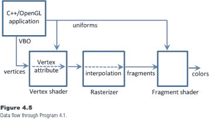

让我们对着色器做一点修改。具体来说，我们将根据每个顶点的位置为其分配颜色，并将该颜色放入输出顶点属性 varyingColor。片段着色器也同样修改为接受传入的颜色（由光栅化器插值），并使用它来设置输出像素的颜色。注意，代码还将位置乘以 1/2，然后加上 1/2，以将值范围从 [-1..+1] 转换为 [0..1]。还要注意，这里使用了常见约定，即将包含单词“varying”的变量名分配给程序员定义的插值顶点属性。每个着色器中的更改都已高亮显示，结果输出如下。

### 修改后的顶点着色器：

```glsl
#version 430

layout (location=0) in vec3 position;
uniform mat4 mv_matrix;
uniform mat4 proj_matrix;

out vec4 varyingColor;

void main(void)
{
    gl_Position = proj_matrix * mv_matrix * vec4(position,1.0);
    varyingColor = vec4(position,1.0) * 0.5 + vec4(0.4, 0.5, 0.5, 0.5);
}
```

### 修改后的片段着色器：

```glsl
#version 430
in vec4 varyingColor;
out vec4 color;
uniform mat4 mv_matrix;
uniform mat4 proj_matrix;

void main(void)
{
    color = varyingColor;
}
```

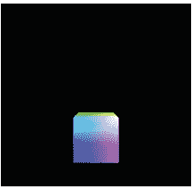

**图 4.6**  
插值颜色的立方体。

注意，由于颜色是通过顶点属性（*varyingColor*）从顶点着色器发送出去的，*它们也会被光栅化器插值*！其效果可以在图 4.6 中看到，从一角到另一角的颜色在整个立方体上明显平滑地插值。

还要注意，顶点着色器中的“out”变量 varyingColor 也是片段着色器中的“in”变量。两个着色器知道顶点着色器中的哪个变量馈送到片段着色器中的哪个变量，因为它们在两个着色器中具有相同的名称“varyingColor”。

由于我们的 main() 包含一个渲染循环，我们可以像在程序 2.6 中那样，通过使用变化的平移和旋转来构建模型矩阵，从而为立方体制作动画

基于时间。例如，程序 4.1 中 `display()` 函数里的代码可以按如下方式修改（改动部分已高亮）：

```cpp
glClear(GL_DEPTH_BUFFER_BIT);
glClear(GL_COLOR_BUFFER_BIT);
...
// use current time to compute different translations in x, y, and z
mat4 m = glm::translate(glm::mat4(1.0f),
    glm::vec3(0.5f*currentTime*2.0f, 0.5f*currentTime*2.0f, 0.0f));
m = glm::rotate(m, 1.75f*float(currentTime), glm::vec3(0.0f, 0.0f, 1.0f));
m = glm::rotate(m, 1.75f*float(currentTime), glm::vec3(0.0f, 1.0f, 0.0f));
// the 1.75 adjusts the rotation speed
mMat = tMat * rMat;
```

在模型矩阵中使用当前时间（以及各种三角函数）会使立方体看起来在空间中翻滚。请注意，添加此动画说明了每次通过 `display()` 时清除深度缓冲区以确保正确隐藏面消除的重要性。这还要求如所示清除颜色缓冲区；否则，立方体移动时会留下拖影。

`translate()` 和 `rotate()` 函数是 GLM 库的一部分。另外，请注意最后一行的矩阵乘法——`tMat` 和 `rMat` 在运算中的列出顺序很重要。它计算两个变换的拼接，其中平移在左侧，旋转在右侧。当随后将一个顶点乘以该矩阵时，计算是从右到左进行的，这意味着先进行旋转，然后进行平移。变换的应用顺序很重要，改变顺序会导致不同的行为。图 4.7 显示了动画立方体之后显示的一些帧。

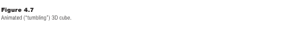

**图 4.7**
动画（“翻滚”）的 3D 立方体。

### 4.6 渲染对象的多个副本

现在我们将所学内容扩展到渲染多个对象。在着手处理在单个场景中渲染各种模型的通用情况之前，让我们先考虑*同一模型的多个实例*这一更简单的情况。例如，假设我们希望扩展上一个示例，使其渲染由 24 个翻滚立方体组成的“一群”立方体。为此，我们可以将 `display()` 中构建 MV 矩阵和绘制立方体的代码部分（如下方蓝色所示）移入一个执行 24 次的循环中。我们将循环变量纳入立方体的旋转和平移中，以便每次绘制立方体时都构建不同的模型矩阵。（我们还将相机沿正 Z 轴进一步后移，以便看到所有立方体。）由所得动画场景生成的一帧如图 4.8 所示。

```cpp
void display(GLFWwindow* window, double currentTime) {
    ...
    for(int i=0;i<24;i++)
    {   tf = currentTime + i;    // tf == "time factor", declared as type float
        tfMat = glm::translate(glm::mat4(1.0f), glm::vec3(sin(35.0f * tf) * 8.0f, cos(52.0f * tf) * 8.0f,
                                                         sin(70.0f * tf) * 8.0f));
        rMat = glm::rotate(glm::mat4(1.0f), 1.75f*tf, glm::vec3(0.0f, 1.0f, 0.0f));
        rMat = glm::rotate(rMat, 1.75f*tf, glm::vec3(1.0f, 0.0f, 0.0f));
        rMat = glm::rotate(rMat, 1.75f*tf, glm::vec3(0.0f, 0.0f, 1.0f));
        mMat = tfMat * rMat;
        mvMat = vMat * mMat;

        glUniformMatrix4fv(mvLoc, 1, GL_FALSE, glm::value_ptr(mvMat));
        glUniformMatrix4fv(projLoc, 1, GL_FALSE, glm::value_ptr(pMat));

        glBindBuffer(GL_ARRAY_BUFFER, vbo[0]);
        glVertexAttribPointer(0, 3, GL_FLOAT, GL_FALSE, 0, 0);
        glEnableVertexAttribArray(0);

        glEnable(GL_DEPTH_TEST);
        glDepthFunc(GL_LEQUAL);
        glDrawArrays(GL_TRIANGLES, 0, 36);
    }
}
```

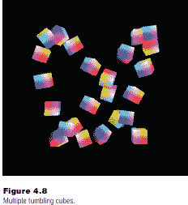

#### 4.6.1 实例化

*实例化*提供了一种机制，可以告诉图形卡仅使用一次 C++/OpenGL 调用就渲染对象的多个副本。这可以带来显著的性能优势，特别是当正在绘制的对象有数千或数百万个副本时——例如渲染田野中的许多花，或军队中的许多僵尸。

我们首先将 C++/OpenGL 应用程序中的 `glDrawArrays()` 调用改为 `glDrawArraysInstanced()`。现在，我们可以要求 OpenGL 绘制任意数量的副本。我们可以如下指定绘制 24 个立方体：

```cpp
glDrawArraysInstanced(GL_TRIANGLES, 0, 36, 24);
```

使用实例化时，顶点着色器可以访问内置变量 `gl_InstanceID`，这是一个整数，表示当前正在处理的是对象的哪个数字实例。

为了使用实例化复现之前翻滚立方体的示例，我们需要将构建不同模型矩阵的计算（之前在 `display()` 中的循环内）移入顶点着色器。由于 GLSL 不提供 `translate` 或 `rotate` 函数，并且我们无法在着色器内部调用 GLM，因此需要使用程序 3.1 中的工具函数。我们还需要通过 uniform 将“时间因子”从 C++/OpenGL 应用程序传递给顶点着色器。由于旋转计算已移至顶点着色器，我们还需要在单独的 uniform 变量中传递视图矩阵。这些修订包括 C++/OpenGL 应用程序中的修订和新顶点着色器中的修订，如程序 4.2 所示。

### 程序 4.2 实例化——二十四个动画立方体

顶点着色器：

```glsl
#version 430
layout (location=0) in vec3 position;
uniform mat4 v_matrix;
uniform mat4 proj_matrix;
uniform float tf;            // time factor for animation and placement of cubes

out vec4 varyingColor;

mat4 buildRotateX(float rad);    // declaration of matrix transformation utility functions
mat4 buildRotateY(float rad);    // (GLSL requires functions to be declared prior to invocation)
mat4 buildRotateZ(float rad);
mat4 buildTranslate(float x, float y, float z);

void main(void)
{  float i = gl_InstanceID + tf;      // value based on time factor, but different for each cube instance
   float a = sin(2.0 * i) * 8.0;      // these are the x, y, and z components for the translation, below
   float b = sin(3.0 * i) * 8.0;
   float c = sin(4.0 * i) * 8.0;

   // build the rotation and translation matrices to be applied to this cube's model matrix
   mat4 localRotX = buildRotateX(1000*i);
   mat4 localRotY = buildRotateY(1000*i);
   mat4 localRotZ = buildRotateZ(1000*i);
   mat4 localTrans = buildTranslate(a,b,c);

   // build the model matrix and then the model-view matrix
   mat4 newM_matrix = localTrans * localRotX * localRotY * localRotZ;
   mat4 mv_matrix = v_matrix * newM_matrix;

   gl_Position = proj_matrix * mv_matrix * vec4(position,1.0);
   varyingColor = vec4(position,1.0) * 0.5 + vec4(0.5, 0.5, 0.5, 0.5);
}
```

```cpp
// utility function to build a translation matrix (from Chapter 3)
mat4 buildTranslate(float x, float y, float z)
{  mat4 trans = mat4(1.0, 0.0, 0.0, 0.0,
                    0.0, 1.0, 0.0, 0.0,
                    0.0, 0.0, 1.0, 0.0,
                    x, y, z, 1.0);
   return trans;
}
// similar functions included for rotation around the X, Y and Z axes (also from Chapter 3)
. . .
```

C++/OpenGL 应用程序（在 `display()` 中）

```cpp
. . .
// computations that build (and transform) mMat have been moved to the vertex shader.
// there is no longer any need to build an MV matrix in the C++ application.
glUniformMatrix4fv(vLoc, 1, GL_FALSE, glm::value_ptr(vMat));        // shader needs the V matrix
timeFactor = ((float)currentTime);                                  // uniform for the time factor
tfLoc = glGetUniformLocation(renderingProgram, "tf");               // (the shader needs that too)
glUniform1f(tfLoc, float(timeFactor));
. . .
glDrawArraysInstanced(GL_TRIANGLES, 0, 36, 24);
```

程序 4.2 的最终输出与上一个示例的输出相同，并可在前面的图 4.8 中看到。

实例化使得大幅扩展对象的副本数量成为可能；在此示例中，即使对于普通的 GPU，对 *100,000* 个立方体进行动画仍然可行。代码的改动——主要只是修改几个常量，让大量立方体分布得更开——如下所示：

顶点着色器：

```glsl
. . .
float a = sin(203.0 * i / 8000.0) * 403.0;
float b = cos(301.0 * i / 4001.0) * 401.0;
float c = sin(400.0 * i / 6003.0) * 405.0;
. . .
```

C++/OpenGL 应用程序

```cpp
. . .
cameraZ = 420.0f;   // move camera further down the Z axis to view the increased number of cubes
. . .
glDrawArraysInstanced(GL_TRIANGLES, 0, 36, 100000);
```


生成的输出如图 4.9 所示。

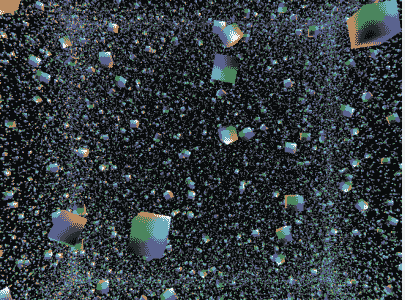

**图 4.9**  
实例化：100,000 个动画立方体。

### 4.7 在场景中渲染多个不同模型

要在单个场景中渲染不止一个模型，一种简单方法是为每个模型使用单独的缓冲区。每个模型都需要自己的模型矩阵，因此对于我们渲染的每个模型，都会生成一个新的模型-视图矩阵。对于每个模型，还需要分别调用 glDrawArrays()。因此，init() 和 display() 中都需要进行更改。

另一个考虑因素是，对于希望绘制的每个对象，我们是否需要不同的着色器——或不同的渲染程序。事实证明，*在许多情况下，我们可以对正在绘制的各种对象使用相同的着色器*（因而使用相同的渲染程序）。通常，只有当各种对象由不同的图元构建（例如用线而不是三角形），或者涉及复杂光照或其他效果时，我们才需要为它们采用不同的渲染程序。目前并非这种情况，因此我们可以重用相同的顶点和片段着色器，只需修改我们的 C++/OpenGL 应用程序，以便在调用 display() 时让每个模型沿管线传递。

接下来，我们添加一个简单的金字塔，这样场景中就同时包含一个立方体和一个金字塔。相关代码修改如程序 4.3 所示。其中突出显示了几个关键细节，例如我们指定使用哪一个缓冲区的位置，以及指定模型中包含的顶点数的位置。注意，金字塔由六个三角形组成——侧面四个，底部两个，总计 6×3=18 个顶点。

生成的场景同时包含立方体和金字塔，如图 4.10 所示。

### 程序 4.3 立方体和金字塔

```cpp
void setupVertices() {
    float cubePositions[108] =
    { -1.0f,  1.0f, -1.0f, -1.0f, -1.0f, -1.0f,  1.0f, -1.0f,
       1.0f, -1.0f,  1.0f,  1.0f,  1.0f, -1.0f,  1.0f,
       ... same as before, for the rest of the cube vertices
    };

    // pyramid with 18 vertices, comprising 6 triangles (four sides, and two on the bottom)
    float pyramidPositions[54] =
    { -1.0f,  1.0f, -1.0f, -1.0f, 0.0f,  1.0f,  0.0f, 0.0f,       // front face
       1.0f, -1.0f, -1.0f,  1.0f, 0.0f,  1.0f,  0.0f, 0.0f,       // right face
       1.0f, -1.0f,  1.0f, -1.0f, 0.0f,  1.0f,  0.0f, 0.0f,       // back face
      -1.0f, -1.0f, -1.0f,  1.0f, 0.0f,  1.0f,  0.0f, 0.0f,       // left face
      -1.0f, -1.0f, -1.0f,  1.0f, 0.0f, -1.0f,  1.0f, 0.0f, 1.0f, // base — left front
       1.0f, -1.0f,  1.0f, -1.0f, 0.0f, -1.0f,  1.0f, 0.0f, 1.0f  // base — right back
    };

    glGenVertexArrays(numVAOs, vao);
    glBindVertexArray(vao[0]);                           // we need at least 1 VAO
    glGenBuffers(numVBOs, vbo);                          // we need at least 2 VBOs

    glBindBuffer(GL_ARRAY_BUFFER, vbo[0]);
    glBufferData(GL_ARRAY_BUFFER, sizeof(cubePositions), cubePositions, GL_STATIC_DRAW);

    glBindBuffer(GL_ARRAY_BUFFER, vbo[1]);
    glBufferData(GL_ARRAY_BUFFER, sizeof(pyramidPositions), pyramidPositions, GL_STATIC_DRAW);
}

void display(GLFWwindow* window, double currentTime) {
    . . .
    // clear the color and depth buffers as before (not shown here)
    // use rendering program and obtain uniform locations as before (not shown here)
    // projection matrix computed as before (not shown here)
    . . .

    // the view matrix is computed once and used for both objects
    vMat = glm::translate(glm::mat4(1.0f), glm::vec3(-cameraX, -cameraY, -cameraZ));

    // draw the cube (use buffer #0)
    mMat = glm::translate(glm::mat4(1.0f), glm::vec3(cubeLocX, cubeLocY, cubeLocZ));
    mvMat = vMat * mMat;

    glUniformMatrix4fv(mvLoc, 1, GL_FALSE, glm::value_ptr(mvMat));
    glUniformMatrix4fv(projLoc, 1, GL_FALSE, glm::value_ptr(pMat));

    glBindBuffer(GL_ARRAY_BUFFER, vbo[0]);
    glVertexAttribPointer(0, 3, GL_FLOAT, GL_FALSE, 0, 0);
    glEnableVertexAttribArray(0);

    glEnable(GL_DEPTH_TEST);
    glDepthFunc(GL_LEQUAL);
    glDrawArrays(GL_TRIANGLES, 0, 36);

    // draw the pyramid (use buffer #1)
    mMat = glm::translate(glm::mat4(1.0f), glm::vec3(pyrLocX, pyrLocY, pyrLocZ));
    mvMat = vMat * mMat;

    glUniformMatrix4fv(mvLoc, 1, GL_FALSE, glm::value_ptr(mvMat));
    glUniformMatrix4fv(projLoc, 1, GL_FALSE, glm::value_ptr(pMat));

    glBindBuffer(GL_ARRAY_BUFFER, vbo[1]);
    glVertexAttribPointer(0, 3, GL_FLOAT, GL_FALSE, 0, 0);
    glEnableVertexAttribArray(0);

    glEnable(GL_DEPTH_TEST);
    glDepthFunc(GL_LEQUAL);
    glDrawArrays(GL_TRIANGLES, 0, 18);
}
```

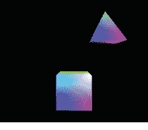

**图 4.10**  
3D 立方体和金字塔。

关于程序 4.3，还有几个其他小细节需要注意：

- 变量 pyrLocX、pyrLocY 和 pyrLocZ 需要声明，然后在 init() 中初始化为期望的金字塔位置，就像为立方体位置所做的那样。
- 视图矩阵 vMat 在 display() 顶部构建，然后用于立方体和金字塔的模型-视图矩阵。
- 顶点和片段着色器未显示——它们与 4.5 节相比没有变化。

### 4.8 矩阵栈

到目前为止，我们渲染的模型每个都由单组顶点构成。然而，人们常常希望通过组装更小、更简单的模型来构建复杂模型。例如，“机器人”模型可以通过分别绘制头、身体、腿和手臂来创建，其中每个部分都是一个单独的模型。以这种方式构建的对象通常称为*层次模型*。构建层次模型的棘手之处在于跟踪所有模型-视图矩阵，并确保它们保持完美协调——否则机器人可能会散架成碎片！

层次模型不仅可用于构建复杂对象——它们还可用于生成复杂场景。例如，考虑我们的行星地球如何绕太阳公转，以及月球又如何绕地球公转。这样的场景如图 4.11 所示。⁵ 计算月球在空间中的实际路径可能很复杂。然而，如果我们能够*组合*表示两条简单圆形路径的变换——月球绕地球的路径和地球绕太阳的路径——就可以避免显式计算月球的轨迹。

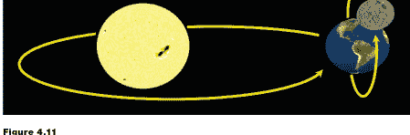

**图 4.11**  
动画行星系统（太阳和地球纹理来自 [HT12]，月球纹理来自 [NA16]）。

⁵ 是的，我们知道月球并不是沿着这种“垂直”轨迹绕地球旋转，而是沿着与地球绕太阳公转更共面的轨迹旋转。我们选择这条轨道是为了让程序的执行更清晰。

事实证明，使用*矩阵栈*可以相当容易地做到这一点。顾名思义，矩阵栈就是变换矩阵的栈。我们将看到，矩阵栈可以轻松创建和管理复杂的层次对象和场景，其中变换可以建立在其他变换之上（并从中移除）。

OpenGL 有一个内置的矩阵栈，但作为较旧的固定功能（不可编程）管线的一部分，它早已被弃用 [OL16]。然而，C++ 标准模板库（STL）有一个名为“stack”的类，通过使用它来构建 mat4 的栈，可以相对直接地将其适配为矩阵栈。我们将看到，复杂场景中通常需要的许多模型矩阵、视图矩阵和模型-视图矩阵，都可以由单个 `stack<glm::mat4>` 实例替代。

我们将首先检查用于实例化和使用 C++ 栈的基本命令，然后使用一个栈来构建复杂的动画场景。我们将按以下方式使用 C++ 栈类：

- push() —— 在栈顶提供一个新条目。我们通常会这样使用该命令：压入当前位于栈顶的矩阵的副本，以便将附加变换拼接到该副本上。
- pop() —— 移除（并返回）栈顶矩阵。
- top() —— 返回栈顶矩阵的引用，但不移除它。
- `<stack>.top() *= rotate(*parameters to build a rotation matrix*)`
- `<stack>.top() *= scale(*parameters to build a scale matrix*)`
- `<stack>.top() *= translate(*parameters to build a translation matrix*)`
- 将变换直接应用到栈顶矩阵。

如前面的列表所示，“\*=”运算符在 mat4 中被重载，因此可用于拼接矩阵。因此，我们通常会以所示形式之一使用它，将平移、旋转等添加到矩阵栈顶的矩阵上。


|  |  |
| --- | --- |
| **设置** | • 实例化矩阵栈。 |
| **相机** | • 将一个新矩阵压入栈中（这会实例化一个空的 VIEW 矩阵）。<br><br>• 对栈顶的视图矩阵应用变换。 |
| **父对象** | • 将一个新矩阵压入栈中（这将是父 MV 矩阵——对于第一个父对象，它会复制视图矩阵）。<br><br>• 应用变换，将父对象的 M 矩阵并入复制得到的视图矩阵中。<br><br>• 将最顶部的矩阵（即使用 `glm::value_ptr()`）发送到顶点着色器中的 MV uniform 变量。<br><br>• 绘制父对象。 |
| **子对象** | • 将一个新矩阵压入栈中。这将是子对象的 MV 矩阵，复制父 MV 矩阵。<br><br>• 应用变换，将子对象的 M 矩阵并入复制得到的父 MV 矩阵中。<br><br>• 将最顶部的矩阵（即使用 `glm::value_ptr()`）发送到顶点着色器中的 MV uniform 变量。<br><br>• 绘制子对象。 |
| **清理** | • 从栈中弹出子对象的 MV 矩阵。<br><br>• 从栈中弹出父对象的 MV 矩阵。<br><br>• 从栈中弹出 VIEW 矩阵。 |

请注意，金字塔（“太阳”）绕其轴线的旋转是在其自身的局部坐标空间中进行的，不应允许它影响“子对象”（本例中为行星和月球）。因此，太阳的旋转（如下图所示）会被压入栈中，但在绘制太阳之后，必须将其从栈中移除（弹出）。

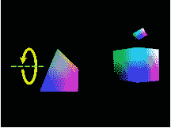

大立方体（行星）绕太阳的公转（下图左图）会影响月球的运动，因此它被压入栈中，并且在绘制月球时也保留在栈中。相比之下，行星绕其轴线的自转（下图右图）是局部变换，不会影响月球，因此在绘制月球之前会将其从栈中弹出。

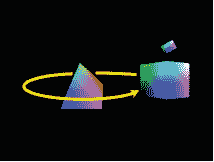

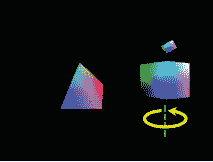

同样，我们会为月球的旋转（绕行星旋转以及绕其自身轴线旋转）将变换压入栈中，如下图所示。

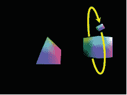

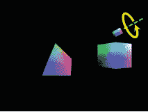

以下是“行星”的步骤序列：

- `push()` 这将是行星 MV 矩阵中也会影响子对象的那一部分。
- `translate(...)` 将行星绕太阳的运动并入行星的 MV 矩阵。在此示例中，我们使用三角函数将行星运动计算为平移。
- `push()` 这将是行星完整的 MV 矩阵，也包括其轴线旋转。
- `rotate(...)` 将行星的轴线旋转并入其中（稍后会将其弹出，不影响子对象）。
- `glm::value_ptr(mvStack.top())` 获取 MV 矩阵，然后将其发送到 MV uniform。
- 绘制行星。
- `pop()` 这将从栈中移除行星 MV 矩阵，露出其下方较早的行星 MV 矩阵副本，该副本不包含行星的轴线旋转（因此只有行星的平移会影响月球）。

现在我们可以编写完整的 display() 例程，如程序 4.4 所示。

### 程序 4.4 使用矩阵栈的简单太阳系

```cpp
stack<glm::mat4> mvStack;
void display(GLFWwindow* window, double currentTime) {
    // setup of background, depth buffer, rendering program, and proj matrices unchanged
    ...
    // push view matrix onto the stack
    vMat = glm::translate(glm::mat4(1.0f), glm::vec3(-cameraX, -cameraY, -cameraZ));
    mvStack.push(vMat);

    // ---------------------- pyramid == sun ----------------------------------
    mvStack.push(mvStack.top());
    mvStack.top() *= glm::translate(glm::mat4(1.0f), glm::vec3(0.0f, 0.0f, 0.0f));  // sun position
    mvStack.push(mvStack.top());
    mvStack.top() *= glm::rotate(glm::mat4(1.0f), (float)currentTime, glm::vec3(1.0f, 0.0f, 0.0f));  // sun rotation
    glUniformMatrix4fv(mvLoc, 1, GL_FALSE, glm::value_ptr(mvStack.top()));
    glBindBuffer(GL_ARRAY_BUFFER, vbo[1]);
    glVertexAttribPointer(0, 3, GL_FLOAT, GL_FALSE, 0, 0);
    glEnableVertexAttribArray(0);
    glEnable(GL_DEPTH_TEST);
    glDepthFunc(GL_LEQUAL);
    glDrawArrays(GL_TRIANGLES, 0, 18);        // draw the sun
    mvStack.pop();                           // remove the sun's axial rotation from the stack

    //--------------- cube == planet -----------------------------
    mvStack.push(mvStack.top());
    mvStack.top() *=
        glm::translate(glm::mat4(1.0f), glm::vec3(sin((float)currentTime)*4.0, 0.0, cos((float)currentTime)*4.0));
    mvStack.push(mvStack.top());
    mvStack.top() *= glm::rotate(glm::mat4(1.0f), (float)currentTime, glm::vec3(0.0, 1.0, 0.0));
                                                              // planet rotation
    glUniformMatrix4fv(mvLoc, 1, GL_FALSE, glm::value_ptr(mvStack.top()));
    glBindBuffer(GL_ARRAY_BUFFER, vbo[0]);
    glVertexAttribPointer(0, 3, GL_FLOAT, GL_FALSE, 0, 0);
    glEnableVertexAttribArray(0);
    glDrawArrays(GL_TRIANGLES, 0, 36);        // draw the planet
    mvStack.pop();                            // remove the planet's axial rotation from the stack

    //--------------- smaller cube == moon -----------------------
    mvStack.push(mvStack.top());
    mvStack.top() *=
        glm::translate(glm::mat4(1.0f), glm::vec3(0.0, sin((float)currentTime)*2.0,
                      cos((float)currentTime)*2.0));
    mvStack.top() *= glm::rotate(glm::mat4(1.0f), (float)currentTime, glm::vec3(0.0, 0.0, 1.0));
                                                              // moon rotation
    mvStack.top() *= glm::scale(glm::mat4(1.0f), glm::vec3(0.25f, 0.25f, 0.25f)); // make the moon smaller
    glUniformMatrix4fv(mvLoc, 1, GL_FALSE, glm::value_ptr(mvStack.top()));
    glBindBuffer(GL_ARRAY_BUFFER, vbo[0]);
    glVertexAttribPointer(0, 3, GL_FLOAT, GL_FALSE, 0, 0);
    glEnableVertexAttribArray(0);
    glDrawArrays(GL_TRIANGLES, 0, 36);        // draw the moon

    // remove moon scale/rotation/position, planet position, sun position, and view matrices from stack
    mvStack.pop(); mvStack.pop(); mvStack.pop(); mvStack.pop();
}
```

矩阵栈操作已高亮显示。有几个细节值得注意：

- 我们在模型矩阵中引入了*缩放*操作。我们希望月球是比行星更小的立方体，因此在为月球构建 MV 矩阵时调用 `scale()`。

这种情况在创建地形或阴影时经常出现。在此类情况下，有时可以预测 Z-fighting，而常见的纠正方法是稍微移动一个对象，使表面不再共面。我们将在第 8 章看到一个示例。

Z-fighting 也可能由于深度缓冲区中数值的精度有限而发生。对于 Z 缓冲区算法处理的每个像素，其深度信息的精度受深度缓冲区中可用于存储该信息的位数限制。用于构建透视矩阵的近裁剪平面和远裁剪平面之间的范围越大，两个对象具有相似（但不相等）实际深度的点就越有可能在深度缓冲区中用相同的数值表示。因此，程序员需要选择近裁剪平面和远裁剪平面的值，以最小化两个平面之间的距离，同时仍确保场景中所有必需的对象都位于视锥体内。

同样重要的是要理解，由于透视变换的效果，改变近裁剪平面值对 Z-fighting 伪影出现可能性的影响，可能比在远裁剪平面上做同等改变更大。因此，建议避免选择离眼睛太近的近裁剪平面。

本书前面的示例只是在调用 `perspective()` 时为近裁剪平面和远裁剪平面使用了 0.1 和 1000 的值。这些值可能需要根据你的场景进行调整。

### 4.10 图元的其他选项

OpenGL 支持多种图元类型——到目前为止我们已经看到两种：`GL_TRIANGLES` 和 `GL_POINTS`。事实上，还有其他几种。OpenGL 支持的所有可用图元类型都属于*三角形、线、点和面片*这几类。以下是完整列表：

### 三角形图元

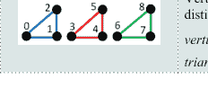

这是本书中最常见的图元类型。经过管线的顶点会构成不同的三角形：

| 顶点： | 0 1 2 | **3 4 5** | 6 7 8 | 等。 |
| --- | --- | --- | --- | --- |
| 三角形： | ✓ | ✓ | ✓ |  |


### GL_TRIANGLE_STRIP

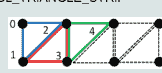

每个通过管线的顶点都会与之前两个顶点高效地构成一个三角形：

| 顶点： | 0 | 1 | 2 | 3 | 4 | 等 |
| --- | --- | --- | --- | --- | --- | --- |
| 三角形： |  | 0-1-2 | 2-3-4 |  |  |  |

### GL_TRIANGLE_FAN

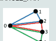

每个通过管线的顶点对都会与最初的顶点构成一个三角形：

| 顶点： | 0 | 1 | 2 | 3 | 4 | 等 |
| --- | --- | --- | --- | --- | --- | --- |
| 三角形： |  | 0-1-2 | 0-2-3 | 0-3-4 |  |  |

### GL_TRIANGLES_ADJACENCY

仅用于几何着色器。允许着色器访问当前三角形中的顶点，以及额外的相邻顶点。

### GL_TRIANGLE_STRIP_ADJACENCY

仅用于几何着色器。与 GL_TRIANGLES_ADJACENCY 类似，不同之处在于三角形顶点像 GL_TRIANGLE_STRIP 那样重叠。

**线图元：**

### GL_LINES

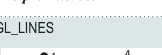

通过管线的顶点构成彼此独立的线段：

| 顶点： | 0 | 1 | 2 | 3 | 4 | 5 | 等 |
| --- | --- | --- | --- | --- | --- | --- | --- |
| 线： |  | 0-1 | 2-3 | 4-5 |  |  |  |

### GL_LINE_STRIP


每个通过管线的顶点都会与前一个顶点高效地构成一条线段：

| 顶点： | 0 | 1 | 2 | 3 | 等 |
| --- | --- | --- | --- | --- | --- |
| 线： |  | 0-1 | 1-2 | 2-3 |  |

### GL_LINE_LOOP

与 GL_LINE_STRIP 相同，不同之处在于最开始的顶点与最后一个顶点之间也会构成一条线段。

|  |  |
| --- | --- |
| `GL_LINES_ADJACENCY` | 仅用于几何着色器。允许着色器访问当前线条中的顶点，以及额外的相邻顶点。 |
| `GL_LINE_STRIP_ADJACENCY` | 与 `GL_LINES_ADJACENCY` 类似，不同之处在于线条顶点会像 `GL_LINE_STRIP` 那样重叠。 |

**点图元：**

|  |  |
| --- | --- |
| `GL_POINTS` | 每个通过管线的顶点都是一个点。 |

**面片图元：**

|  |  |
| --- | --- |
| `GL_PATCHES` | 仅用于细分着色器。表示一组顶点从顶点着色器传递到细分控制着色器，在那里它们通常用于将细分网格塑造成曲面。 |

### 4.11 性能编码

随着3D场景复杂度的增长，我们会越来越关注性能。我们已经见过几个出于速度考虑而做出编码决策的例子，例如使用实例化时，以及将开销高昂的计算移入着色器时。

实际上，我们目前给出的代码也已经包含了一些尚未讨论的额外优化。现在我们来探讨这些优化以及其他重要技术。

#### 4.11.1 尽量减少动态内存分配

就性能而言，我们C++代码的关键部分显然是 `display()` 函数。这个函数在任何动画或实时渲染期间都会被反复调用，因此正是在这个函数（或它调用的任何函数）中，我们必须力求最高效率。

将 display() 函数中的开销保持在最低限度的一个重要方法，是避免任何需要分配内存的步骤。要避免的明显例子包括：

- *实例化对象*
- *声明变量*

鼓励读者回顾我们到目前为止开发的程序，并注意到 display() 函数中使用的几乎每个变量都是在 display() 函数实际被调用*之前*声明并分配空间的。声明或实例化几乎从不出现在 display() 中。例如，程序4.1在其清单的前部包含以下代码块：

```cpp
// allocate variables used in display() function, so that they won't need to be allocated during rendering
GLuint mvLoc, projLoc;
int width, height;
float aspect;
glm::mat4 pMat, vMat, mMat, mvMat;
```

注意，我们特意在该代码块顶部放置了一条注释，表明这些变量是预先分配的，以便后续在 display() 函数中使用（尽管我们现在才明确指出这一点）。

有一个未预先分配的变量示例出现在我们的矩阵栈示例中。通过使用 C++ 的 stack 类，每次“push”操作都会导致一次动态内存分配。有趣的是，在 *Java* 中，JOML 库提供了一个用于 OpenGL 的 MatrixStack 类，允许为矩阵栈预先分配空间！我们在基于 Java 的“姊妹”书 *Computer Graphics Programming in OpenGL with Java, Second Edition* 中使用了它。

还有其他更微妙的例子。例如，将数据从一种类型转换为另一种类型的函数调用，在某些情况下可能会实例化并返回新转换的数据。因此，理解从 display() 调用的任何库函数的行为很重要。数学库 GLM 并非专门以速度为目标设计。因此，其中一些操作可能导致动态分配。我们已尽可能尝试使用直接作用于（或写入）已分配空间变量的 GLM 函数。当性能至关重要时，鼓励读者探索替代方法。

#### 4.11.2 预计算透视矩阵

另一种可减少 display() 函数开销的优化，是将透视矩阵的计算移入 init() 函数。我们在前面第4.5节（嗯，是在一个脚注中）提到过这种可能性。虽然这当然很容易做到，但有一个小麻烦。虽然通常不需要重新计算透视矩阵，但如果运行应用程序的用户调整窗口大小（例如拖动窗口角上的调整大小手柄），就需要重新计算。

幸运的是，GLFW 可以配置为在窗口大小改变时自动回调指定函数。我们在 main() 中、调用 init() 之前添加以下内容：

```cpp
glfwSetWindowSizeCallback(window, window_reshape_callback);
```

第一个参数是 GLFW 窗口，第二个是窗口大小改变时 GLFW 调用的函数名。然后我们将计算透视矩阵的代码移入 init()，并同样复制到一个名为 window_reshape_callback() 的新函数中。

以程序4.1为例。如果我们重新组织代码，以便从 display() 中移除透视矩阵的计算，那么 main()、init()、display() 以及新函数 window_reshape_callback() 的修订版本将如下所示：

```cpp
void init(GLFWwindow* window) {
    ...
    // same as earlier, plus the following three lines:
    glfwGetFramebufferSize(window, &width, &height);
    aspect = (float)width / (float)height;
    pMat = glm::perspective(1.0472f, aspect, 0.1f, 1000.0f);    // 1.0472 radians = 60 degrees
}

void display(GLFWwindow* window, double currentTime) {
    ...
    // same as earlier, except with the following lines removed:
    // build perspective matrix
    glfwGetFramebufferSize(window, &width, &height);
    aspect = (float)width / (float)height;
    pMat = glm::perspective(1.0472f, aspect, 0.1f, 1000.0f);
    // the rest of the function is unchanged
    ...
}
```

```cpp
void window_reshape_callback(GLFWwindow* window, int newWidth, int newHeight) {
    aspect = (float)newWidth / (float)newHeight;    // new width/height provided by the callback
    glViewport(0, 0, newWidth, newHeight);          // sets screen region associated with framebuffer
    pMat = glm::perspective(1.0472f, aspect, 0.1f, 1000.0f);
}

int main(void) {
    ...
    // same as earlier, plus the following additional call:
    glfwSetWindowSizeCallback(window, window_reshape_callback);

    init(window);

    while (!glfwWindowShouldClose(window)) {
        // etc. as before
    }
}
```

从程序4.1的插值颜色版本开始，本书附带文件中的程序实现都按照这种方式组织透视矩阵计算。

#### 4.11.3 背面剔除

提高渲染效率的另一种方法是利用 OpenGL 执行*背面剔除*的能力。当一个3D模型完全“封闭”，即内部永远不可见时（例如立方体和金字塔），那么外表面中背向观察者的那些部分将始终被同一模型的其他部分遮挡。也就是说，那些背向观察者的三角形不可能被看到（无论如何它们都会被隐藏面消除覆盖掉），因此没有理由对它们进行光栅化或渲染。

我们可以用命令 `glEnable(GL_CULL_FACE)` 让 OpenGL 识别并“剔除”（不渲染）背面三角形。我们也可以用 `glDisable(GL_CULL_FACE)` 禁用面剔除。默认情况下，面剔除是禁用的，因此如果希望 OpenGL 剔除背面三角形，必须启用它。

启用面剔除时，默认情况下仅当三角形是*正面朝向*时才会被渲染。同样默认情况下，如果从 OpenGL 相机视角看，一个三角形的三个顶点按*逆时针*方向排列（基于它们在缓冲区中的定义顺序），则该三角形被视为正面朝向。那些其

从 OpenGL 相机视角看，按顺时针方向推进的顶点是*背面朝向*的，不会被渲染。这种将“正面朝向”定义为逆时针方向的做法有时称为*环绕顺序*，可以通过函数调用 glFrontFace(GL_CCW) 显式设置为逆时针（默认值），或通过 glFrontFace(GL_CW) 设置为顺时针。同样，渲染的是正面朝向还是背面朝向的三角形，也可以显式设置。实际上，为此我们指定的是哪些三角形*不*被渲染——也就是哪些三角形被“剔除”。我们可以通过调用 glCullFace(GL_BACK) 指定剔除背面朝向的三角形（尽管这没有必要，因为这是默认值）。或者，我们可以分别将参数 GL_BACK 替换为 GL_FRONT 或 GL_FRONT_AND_BACK，来指定剔除正面朝向的三角形，甚至剔除所有三角形。

正如我们将在第 6 章看到的，3D 模型通常设计为外表面由具有相同环绕顺序的三角形构成——最常见的是逆时针——因此如果启用了剔除，默认情况下会渲染模型外表面中面向相机的部分。由于 OpenGL 默认假定环绕顺序为逆时针，如果模型设计为以*顺时针*环绕顺序显示，那么在启用背面剔除时，程序员需要调用 glFrontFace(GL_CW) 来处理这种情况。

请注意，在 GL_TRIANGLE_STRIP 的情况下，每个三角形的环绕顺序会交替变化。OpenGL 在构建每个后续三角形时通过“翻转”顶点序列来补偿这一点，如下所示：0-1-2，然后是 2-1-3、2-3-4、4-3-5、4-5-6，依此类推。

背面剔除通过确保 OpenGL 不花时间光栅化和渲染那些永远不会被看到的表面来提高性能。我们在本章中见过的大多数示例都非常小，因此几乎没有启用面剔除的动力（一个例外是图 4.9 所示的示例，其中有 100,000 个实例化动画立方体，这可能会在某些系统上造成性能挑战）。在实践中，大多数 3D 模型通常是“封闭的”，因此习惯上会例行启用背面剔除。例如，我们可以通过如下修改 display() 函数，为程序 4.3 添加背面剔除：

```cpp
void display(GLFWwindow* window, double currentTime) {
    …
    glEnable(GL_CULL_FACE);
    // draw the cube
    …
    glEnable(GL_DEPTH_TEST);
    glDepthFunc(GL_LEQUAL);
    glFrontFace(GL_CW);              // the cube vertices have clockwise winding order
    glDrawArrays(GL_TRIANGLES, 0, 36);

    // draw the pyramid
    ...
    glEnable(GL_DEPTH_TEST);
    glDepthFunc(GL_LEQUAL);
    glFrontFace(GL_CCW);            // the pyramid vertices have counter-clockwise winding order
    glDrawArrays(GL_TRIANGLES, 0, 18);
}
```

在使用背面剔除时，正确设置环绕顺序很重要。错误的设置，例如本应为 GL_CCW 却设置为 GL_CW，可能导致渲染对象的内部而不是外部，进而产生类似于透视矩阵不正确时的畸变。

效率并不是进行面剔除的唯一原因。在后续章节中，我们将看到其他用途，例如当我们想要看到 3D 模型的内部时，或在使用透明度时。

### 补充说明

OpenGL/GLSL 中还有大量其他功能和结构可用于管理和利用数据，而我们在本章中只是触及了表面。例如，我们还没有描述*uniform 块*，这是一种组织 uniform 变量的机制，类似于 C 语言中的*结构体*。uniform 块甚至可以设置为从缓冲区接收数据。另一种强大的机制是*着色器存储块*，它本质上是一个着色器可以写入的缓冲区。

关于管理数据的众多选项，一个极好的参考资料是*OpenGL SuperBible* [SW15]，尤其是题为“数据”的一章（第 7 版中的第 5 章）。它还描述了我们所涵盖的各种命令的许多细节和选项。本章的前两个示例程序，程序 4.1 和程序 4.2，受到*SuperBible*中类似示例的启发。

还有其他类型的数据需要学习如何管理，以及如何沿着 OpenGL 管线向下传递。其中之一是*纹理*，它包含彩色图像数据（例如照片中的图像数据），可用于“绘制”场景中的对象。我们将在第 5 章研究纹理图像。另一个我们将进一步研究的重要缓冲区是*深度缓冲区*（或 Z 缓冲区）。当我们在第 8 章研究阴影时，它将变得很重要。关于在 OpenGL 中管理图形数据，我们还有很多东西要学！

### 练习

- **4.1** *（项目）* 修改程序 4.1，将立方体替换为你自己设计的其他简单 3D 形状。请务必在 `glDrawArrays()` 命令中正确指定顶点数量。

- **4.2** *（项目）* 在程序 4.1 中，“视图”矩阵在 display() 函数中简单地定义为相机位置的负值：

  ```cpp
  vMat = glm::translate(glm::mat4(1.0f), glm::vec3(-cameraX, -cameraY, -cameraZ));
  ```

  用图 3.13 所示计算的实现替换这段代码。这将允许你通过指定相机位置和三个朝向轴来定位相机。你会发现有必要存储第 3.7 节描述的向量 U、V、N。然后，尝试不同的相机视点，并观察渲染立方体的最终外观。

- **4.3** *（项目）* 修改程序 4.4，加入第二个“行星”，即你在练习 4.1 中自定义的 3D 形状。确保你的新“行星”与现有行星处于不同的轨道上，以免它们相撞。

- **4.4** *（项目）* 修改程序 4.4，使“视图”矩阵使用“look-at”函数构造（如第 3.9 节所述）。然后尝试将“look-at”参数设置为不同位置，例如看向太阳（在这种情况下场景应显示正常）、看向行星或看向月球。

- **4.5** *（研究）* 提出 `glCullFace(GL_FRONT_AND_BACK)` 的一种实际用途。

### 参考文献

- [BL20] Blender，Blender 基金会，访问于 2020 年 7 月，https://www.blender.org/
- [HT12] J. Hastings-Trew，JHT's Planetary Pixel Emporium，访问于 2020 年 7 月，http://planetpixelemporium.com/
- [MA16] Maya，AutoDesk 公司，访问于 2020 年 7 月，http://www.autodesk.com/products/maya/overview
- [NA16] NASA 3D 资源，访问于 2020 年 7 月，http://nasa3d.arc.nasa.gov/
- [OL16] Legacy OpenGL，访问于 2020 年 7 月，https://www.opengl.org/wiki/Legacy_OpenGL
- [SW15] G. Sellers、R. Wright Jr. 和 N. Haemel，*OpenGL SuperBible: Comprehensive Tutorial and Reference*，第 7 版（Addison-Wesley，2015）。

## 第 5 章：纹理映射

- 5.1 *加载纹理图像文件* … 104
- 5.2 *纹理坐标* … 106
- 5.3 *创建纹理对象* … 108
- 5.4 *构造纹理坐标* … 109
- 5.5 *将纹理坐标加载到缓冲区* … 110
- 5.6 *在着色器中使用纹理：采样器变量和纹理单元* … 111
- 5.7 *纹理映射：示例程序* … 112
- 5.8 *Mipmapping* … 114
- 5.9 *各向异性过滤* … 119
- 5.10 *环绕与平铺* … 120
- 5.11 *透视畸变* … 122
- 5.12 *纹理——更多 OpenGL 细节* … 124
- *补充说明* … 125

纹理映射是将图像覆盖到光栅化模型表面上的技术。它是为渲染场景增加真实感的最基本、最重要的方法之一。

纹理映射如此重要，以至于有专门的硬件支持，可实现非常高的性能，从而实现实时照片级真实感。*纹理单元*是专为纹理处理设计的硬件组件，现代显卡通常包含多个纹理单元。


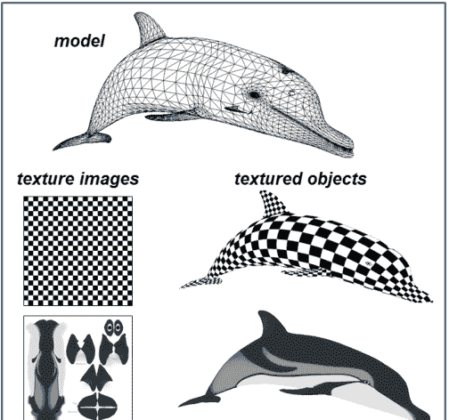

**图 5.1** 使用两幅不同图像为海豚模型贴图 [TU16]。

### 5.1 加载纹理图像文件

要在 OpenGL/GLSL 中高效完成纹理映射，需要协调多个数据集和机制：

- 一个用于保存纹理图像的*纹理对象*（在本章中我们仅考虑二维图像）
- 一个特殊的 uniform *采样器*变量，使顶点着色器能够访问纹理
- 一个用于保存*纹理坐标*的缓冲区
- 一个用于将纹理坐标沿管线传递的顶点属性
- 显卡上的一个*纹理单元*

纹理图像可以是任何事物的图片。它可以是人造物或自然界事物的图片，例如布料、草地或行星表面；也可以是几何图案，例如图 5.1 中的棋盘格。在电子游戏和动画电影中，纹理图像常用于为角色绘制面部和服装，或为生物（如图 5.1 中的海豚）绘制皮肤。

图像通常存储在图像文件中，例如 jpg、png、gif 或 tiff。为了使纹理图像可供 OpenGL 管线中的着色器使用，我们需要从图像中提取颜色，并将其放入 OpenGL *纹理对象*（一种用于保存纹理图像的 OpenGL 内置结构）中。

有许多 C++ 库可用于读取和处理图像文件。常用的选择包括 CImg、Boost GIL 和 Magick++。我们选择使用一个专为 OpenGL 设计的库，名为 SOIL2 [SO20]，它基于非常流行但现已过时的库 SOIL。SOIL2 的安装步骤见附录 A 和附录 B。

将纹理加载到 OpenGL 应用程序中通常采用的步骤是：(a) 使用 SOIL2 实例化一个 OpenGL 纹理对象，并将图像文件中的数据读入其中；(b) 调用 glBindTexture() 使新创建的纹理对象变为活动状态；(c) 使用 glTexParameter() 函数调整纹理设置。结果是一个整数 ID，用于标识现在可用的 OpenGL 纹理对象。

为对象贴图首先需要声明一个 GLuint 类型的变量。正如我们所见，这是 OpenGL 中用于保存引用 OpenGL 对象的整数 ID 的类型。接下来，我们调用 SOIL_load_OGL_texture() 来实际生成纹理对象。SOIL_load_OGL_texture() 函数接受一个图像文件名作为其参数之一（其他一些参数将在后面描述）。这些步骤在以下函数中实现：

```cpp
GLuint loadTexture(const char *texturePath) {
    GLuint textureID;
    textureID = SOIL_load_OGL_texture(texturePath,
        SOIL_LOAD_AUTO, SOIL_CREATE_NEW_ID, SOIL_FLAG_INVERT_Y);
    if (textureID == 0) cout << "could not find texture file" << texturePath << endl;
    return textureID;
}
```

在本示例中，为便于说明，我们特意指定了会导致表面贴图效果异常的纹理坐标。如果仔细观察，还可以看到图像似乎略有拉伸——这是因为纹理图像的宽高比与给定纹理坐标所对应的立方体面的宽高比不匹配。

对于立方体或金字塔等简单模型，选择纹理坐标相对容易。但对于包含大量三角形的更复杂曲面模型，手工确定纹理坐标并不实际。对于球体或环面等曲面几何形状，纹理坐标可以通过算法或数学方法计算。对于使用 Maya [MA20] 或 Blender [BL20] 等建模工具构建的模型，此类工具提供“UV 映射”（超出本书范围）来简化这项任务。

让我们回到渲染金字塔，不过这次用砖块图像为其贴图。我们需要指定：(a) 引用纹理图像的整数 ID；(b) 模型顶点的纹理坐标；(c) 用于保存纹理坐标的缓冲区；(d) 顶点属性，使顶点着色器能够接收纹理坐标并沿管线传递；(e) 显卡上用于保存纹理对象的纹理单元；(f) 一个 uniform 采样器变量，用于在 GLSL 中访问纹理单元，我们很快会看到。这些内容将在接下来的各节中分别描述。

### 5.2 创建纹理对象

假设此处显示的图像存储在名为“brick1.jpg”的文件中 [LU16]。

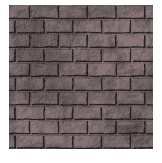

如前所示，我们可以通过调用 loadTexture() 函数来加载此图像，如下所示：

```cpp
GLuint brickTexture = Utils::loadTexture("brick1.jpg");
```

回想一下，纹理对象由整数 ID 标识，因此 brickTexture 的类型为 GLuint。

### 5.3 构建纹理坐标

我们的金字塔有四个三角形侧面和一个正方形底面。尽管从几何上讲这只需要五（5）个点，但我们一直用三角形来渲染它。这需要四个三角形构成侧面，两个三角形构成正方形底面，总共六个三角形。每个三角形有三个顶点，因此模型中必须指定总共 6 × 3 = 18 个顶点。

我们已经在程序 4.3 的 float 数组 pyramidPositions[] 中列出了金字塔的几何顶点。我们可以用许多方式确定纹理坐标的方向，以便将砖块绘制到金字塔上。一种简单（尽管不完美）的方法是让图像顶部中心对应金字塔的顶点，如下所示：


我们可以对全部四个三角形侧面都这样做。我们还需要为金字塔的底部正方形贴图，它由两个三角形组成。一种简单且合理的方法是用图片的整个区域为其贴图（金字塔已被向后倾斜，并侧放着）：


对程序 4.3 中金字塔的前九个顶点使用这种非常简单的策略，相应的顶点和纹理坐标集合如图 5.3 所示。

| 顶点 | 纹理坐标 |
|---|---|
| (-1.0, -1.0, 1.0) | (0, 0) // 正面 |
| (1.0, -1.0, 1.0) | (1, 0) |
| (0, 1.0, 0) | (.5, 1) |
| (1.0, -1.0, 1.0) | (0, 0) // 右侧面 |
| (1.0, -1.0, -1.0) | (1, 0) |
| (0, 1.0, 0) | (.5, 1) |
| (1.0, -1.0, -1.0) | (0, 0) // 背面 |
| (-1.0, -1.0, -1.0) | (1, 0) |
| (0, 1.0, 0) | (.5, 1) |
| 等等。 | |

**图 5.3** 金字塔的纹理坐标（部分列表）。

### 5.4 将纹理坐标加载到缓冲区

我们可以采用与之前加载顶点类似的方式，将纹理坐标加载到 VBO 中。在 setupVertices() 中，我们添加以下纹理坐标值的声明：

```cpp
float pyrTexCoords[36] =
{ 0.0f, 0.0f, 1.0f, 0.0f, 0.5f, 1.0f,   0.0f, 0.0f, 1.0f, 0.0f, 0.5f, 1.0f,   // top and right faces
  0.0f, 0.0f, 1.0f, 0.0f, 0.5f, 1.0f,   0.0f, 0.0f, 1.0f, 0.0f, 0.5f, 1.0f,   // back and left faces
  0.0f, 0.0f, 1.0f, 0.0f, 0.0f, 1.0f,   1.0f, 0.0f, 0.0f, 0.0f, 1.0f, 0.0f }; // base triangles
```

然后，在创建至少两个 VBO（一个用于顶点，一个用于纹理坐标）之后，我们添加以下代码行，将纹理坐标加载到 VBO #1 中：

```cpp
glBindBuffer(GL_ARRAY_BUFFER, vbo[1]);
glBufferData(GL_ARRAY_BUFFER, sizeof(pyrTexCoords), pyrTexCoords, GL_STATIC_DRAW);
```

### 5.5 在着色器中使用纹理：采样器变量和纹理单元

为了最大限度地提高性能，我们希望由硬件执行纹理处理。这意味着我们的片段着色器需要一种方式来访问我们在 C++/OpenGL 应用程序中创建的纹理对象。实现这一点的机制是通过一种特殊的 GLSL 工具，称为 *uniform 采样器变量*。这种变量旨在指示显卡上的纹理单元从已加载的纹理对象中提取或“采样”哪个纹素。

在着色器中声明采样器变量很简单——只需将其添加到 uniform 变量集合中：

```glsl
layout (binding=0) uniform sampler2D samp;
```

我们的变量名为“samp”。声明中的“layout (binding=0)”部分指定此采样器与纹理单元 0 关联。

一个纹理单元（及其关联的采样器）可用于采样你希望的任何纹理对象，并且这可以在运行时更改。你的 display() 函数需要指定当前帧希望纹理单元采样哪个纹理对象。因此，每次绘制对象时，都需要激活一个纹理单元并将其绑定到特定的纹理对象，例如：

```cpp
glActiveTexture(GL_TEXTURE0);
glBindTexture(GL_TEXTURE_2D, brickTexture);
```

可用纹理单元的数量取决于显卡提供多少个纹理单元。根据 OpenGL API 文档，OpenGL 4.5 版本要求每个着色器阶段至少 16 个，所有阶段总计至少 80 个单元 [OP16]。在本示例中，我们通过在 glActiveTexture() 调用中指定 GL_TEXTURE0，使第 0 个纹理单元处于活动状态。

要实际执行纹理处理，我们需要修改片段着色器输出颜色的方式。以前，我们的片段着色器要么输出恒定颜色，要么从顶点属性获取颜色。这次相反，我们需要使用从顶点着色器（经由光栅化器）接收的插值纹理坐标，通过如下调用 texture() 函数来采样纹理对象：

```glsl
in vec2 tc; // texture coordinates
...
color = texture(samp, tc);
```


### 5.6 纹理映射：示例程序


**图 5.4**  
使用砖块图像进行纹理映射的金字塔。

程序 5.1 将前面的步骤组合成一个程序。使用砖块图像进行纹理映射后的金字塔结果如图 5.4 所示。在金字塔的模型矩阵中增加了两次旋转（代码清单中未显示），以露出金字塔的底面。

现在，只需更改 loadTexture() 调用中的文件名，就可以按需将砖块纹理图像替换为其他纹理图像，这很简单。例如，如果将“brick1.jpg”替换为图像文件“ice.jpg”[LU16]，就会得到图 5.5 所示的结果。


**图 5.5**  
使用“ice”图像进行纹理映射的金字塔。

### 程序 5.1 使用砖块纹理的金字塔

C++/OpenGL 应用程序

```cpp
#include <SOIL2/SOIL2.h>
// other includes as before
...
#define numVAOs 1
#define numVBOs 2

// variables for camera and object location, rendering program, VAOs and VBOs as before
...
// variable allocation for display function same as before
...
GLuint brickTexture;

void setupVertices(void) {
    float pyramidPositions[54] = { /* data as listed previously in Program 4.2 */ }

    float pyrTexCoords[36] = {
        0.0f, 0.0f, 1.0f, 0.0f, 0.5f, 1.0f,      0.0f, 0.0f, 1.0f, 0.0f, 0.5f, 1.0f,
        0.0f, 0.0f, 1.0f, 0.0f, 0.5f, 1.0f,      0.0f, 0.0f, 1.0f, 0.0f, 0.5f, 1.0f,
        0.0f, 0.0f, 1.0f, 0.0f, 0.5f, 1.0f,      1.0f, 1.0f, 0.0f, 0.0f, 1.0f, 0.0f
    };

    // . . . generate the VAO as before, and at least two VBOs, then load the two buffers as follows:
    glBindBuffer(GL_ARRAY_BUFFER, vbo[0]);
    glBufferData(GL_ARRAY_BUFFER, sizeof(pyramidPositions), pyramidPositions, GL_STATIC_DRAW);

    glBindBuffer(GL_ARRAY_BUFFER, vbo[1]);
    glBufferData(GL_ARRAY_BUFFER, sizeof(pyrTexCoords), pyrTexCoords, GL_STATIC_DRAW);
}

void init(GLFWwindow* window) {
    // setup of rendering program, camera and object location unchanged
    . . .
    brickTexture = Utils::loadTexture("brick1.jpg");
}

void display(GLFWwindow* window, double currentTime) {
    . . .
    // setup of background color, depth buffer, rendering program, M, V, MV, and PROJ matrices unchanged
    . . .
    glBindBuffer(GL_ARRAY_BUFFER, vbo[0]);
    glVertexAttribPointer(0, 3, GL_FLOAT, GL_FALSE, 0, 0);
    glEnableVertexAttribArray(0);

    glBindBuffer(GL_ARRAY_BUFFER, vbo[1]);
    glVertexAttribPointer(1, 2, GL_FLOAT, GL_FALSE, 0, 0);
    glEnableVertexAttribArray(1);

    glActiveTexture(GL_TEXTURE0);
    glBindTexture(GL_TEXTURE_2D, brickTexture);

    glEnable(GL_DEPTH_TEST);
    glDepthFunc(GL_LEQUAL);

    glDrawArrays(GL_TRIANGLES, 0, 18);
}

// main() same as before
```

### 顶点着色器

```glsl
#version 430
layout(location=0) in vec3 pos;
layout(location=1) in vec2 texCoord;
out vec2 tc;          // texture coordinate output to rasterizer for interpolation
uniform mat4 mv_matrix;
uniform mat4 proj_matrix;
layout(binding=0) uniform sampler2D samp;    // not used in vertex shader

void main(void)
{ gl_Position = proj_matrix * mv_matrix * vec4(pos,1.0);
  tc = texCoord;
}
```

### 片元着色器

```glsl
#version 430
in vec2 tc;          // interpolated incoming texture coordinate
out vec4 color;
uniform mat4 mv_matrix;
uniform mat4 proj_matrix;
layout(binding=0) uniform sampler2D samp;

void main(void)
{ color = texture(samp, tc);
}
```

### 5.7 MIP 映射

纹理映射通常会在渲染图像中产生各种不期望的伪影。这是因为纹理图像的分辨率或宽高比很少与场景中正在应用纹理的区域相匹配。

一种非常常见的伪影出现在图像分辨率*小于*正在绘制区域的分辨率时。在这种情况下，图像需要被拉伸以覆盖该区域，从而变得模糊（并且可能发生畸变）。有时可以根据纹理的性质，通过以不同方式分配纹理坐标来应对这个问题，使应用纹理时需要的拉伸更少。另一种解决方案是使用更高分辨率的纹理图像。

相反的情况是图像纹理的分辨率*大于*正在绘制区域的分辨率。乍看之下，这为什么会造成问题可能并不明显，但它确实会！在这种情况下，会出现明显的*走样*伪影，产生看起来奇怪的虚假图案，或在运动对象中产生“闪烁”效果。

走样由*采样误差*引起。它最常与信号处理相关：在重建时，采样不足的信号看起来会具有与实际不同的属性（例如波长）。图 5.6 展示了一个示例。原始波形以红色显示。沿波形的黄点表示采样点。如果使用这些采样点重建波形，并且采样点不够多，它们就可能定义出另一种波形（以蓝色显示）。


**图 5.6**  
采样不足导致的走样。

类似地，在纹理映射中，当高分辨率（且高度细节化）的图像被稀疏采样时（例如使用 uniform sampler 变量时），检索到的颜色将不足以反映图像中的实际细节，反而可能看起来是随机的。如果纹理图像具有重复图案，走样可能导致产生与原始图像中*不同*的图案。如果正在应用纹理的对象在移动，纹素查找中的舍入误差可能导致给定纹理坐标处采样像素不断变化，从而在正在绘制的对象表面产生不期望的闪烁效果。

图 5.7 展示了一个立方体顶部的倾斜特写渲染，该立方体使用了一张大型高分辨率棋盘格图像作为纹理。


**图 5.7**  
纹理映射中的走样。


在图像顶部附近，走样很明显，棋盘格的欠采样产生了“条纹”效果。虽然我们无法在静态图像中展示这一点，但如果这是一个动画场景，这些图案很可能会在各种不正确图案（例如这一种）之间波动。

**图 5.8**  
纹理映射中的‘闪烁’。

另一个示例出现在图 5.8 中，其中立方体使用了一张月球表面图像[HT12]作为纹理。

乍看之下，这张图像显得清晰且细节丰富。然而，图像右上角的一些细节是虚假的，并且当立方体对象（或相机）移动时会引起“闪烁”。（遗憾的是，我们无法在静态图像中清楚地展示这种闪烁效果。）

这些以及类似的采样误差伪影，可以通过一种称为*MIP 映射*的技术在很大程度上得到纠正；该技术会以各种分辨率创建纹理图像的不同版本。然后，OpenGL 会使用与正在应用纹理的位置的分辨率最匹配的纹理图像。更理想的是，可以在分辨率最接近正在应用纹理区域的那些图像之间对颜色取平均。对图 5.7 和图 5.8 中的图像应用 MIP 映射后的结果如图 5.9 所示。


**图 5.9**  
应用 MIP 映射后的结果。

MIP 映射通过一种巧妙的机制工作：将同一图像的一系列逐级降低分辨率的副本存储在一个比原始图像大三分之一的纹理图像中。具体做法是：将图像的 R、G、B 分量分别存储在纹理图像空间的四分之三中，然后在剩余四分之一图像空间中，以原始分辨率的四分之一对同一图像重复该过程。这种细分会重复进行，直到剩余象限小到无法包含任何有用的图像数据。图 5.10 展示了一个示例图像以及所得 MIP 映射的可视化效果。


**图 5.10**  
对图像进行 MIP 映射。

这种将若干图像塞入小空间（好吧，只比存储原始图像所需的空间大一点）的方法，正是 MIP 映射得名的原因。MIP 代表 *Multum In Parvo* [Wl83]，这是拉丁语，意为“小空间中的大量内容”。

实际为对象应用纹理时，可以通过多种方式对 MIP 映射进行采样。在 OpenGL 中，可以通过将 GL_TEXTURE_MIN_FILTER 参数设置为所需的*缩小*技术来选择 MIP 映射的采样方式，该技术是以下之一：

- **GL_NEAREST_MIPMAP_NEAREST** 选择分辨率与正在应用纹理的像素区域最相似的 MIP 映射图像，然后获取最接近所需纹理坐标的纹素。


- **GL_LINEAR_MIPMAP_NEAREST** 选择分辨率与被纹理化像素区域最相似的 mipmap。然后，它对最接近纹理坐标的四个纹素进行插值。这称为“线性过滤”。
- **GL_NEAREST_MIPMAP_LINEAR** 选择分辨率与被纹理化像素区域最接近的两个 mipmap。然后，它从每个 mipmap 中获取最接近纹理坐标的纹素，并对它们进行插值。这称为“双线性过滤”。
- **GL_LINEAR_MIPMAP_LINEAR** 选择分辨率与被纹理化像素区域最接近的两个 mipmap。然后，它在每个 mipmap 中对最接近的四个纹素进行插值，并对这两个结果进行插值。这称为“三线性过滤”，如图 5.11 所示。


三线性过滤通常更可取，因为较低层级的混合常常会产生伪影，例如 mipmap 层级之间可见的分离。图 5.12 展示了棋盘格的特写，其中启用了 mipmapping 但仅启用了线性过滤。请注意圈出的伪影：在 mipmap 边界处，竖线突然从粗变细。相比之下，图 5.9 中的示例使用了三线性过滤。

OpenGL 对 mipmapping 提供了丰富支持。它提供了用于构建自己的 mipmap 层级或让 OpenGL 为你构建这些层级的机制。大多数情况下，OpenGL 自动构建的 mipmap 就足够了。这可以通过在 Utils::loadTexture() 函数（前面 5.1 节中描述过）中，紧接在 getTextureObject() 函数调用之后添加以下代码行来实现：

```
glBindTexture(GL_TEXTURE_2D, textureID);
glTexParameteri(GL_TEXTURE_2D, GL_TEXTURE_MIN_FILTER, GL_LINEAR_MIPMAP_LINEAR);
glGenerateMipmap(GL_TEXTURE_2D);
```

这告诉 OpenGL 生成 mipmap。通过 glBindTexture() 调用使砖块纹理变为活动状态，然后 glTexParameteri() 函数调用启用前面列出的某个缩小过滤选项，例如上面调用中显示的 GL_LINEAR_MIPMAP_LINEAR，它会启用三线性过滤。

mipmap 构建完成后，可以通过再次调用 glTexParameteri() 来更改过滤选项（尽管很少需要这样做），例如在显示函数中。甚至可以通过选择 GL_NEAREST 或 GL_LINEAR 来禁用 mipmapping。

对于关键应用，可以使用你偏好的任何图像编辑软件自行构建 mipmap。然后，在创建纹理对象时，可以通过为每个 mipmap 层级重复调用 OpenGL 的 glTexImage2D() 函数，将它们作为 mipmap 层级添加。对这种方法的进一步讨论超出了本书范围。

### 5.8 各向异性过滤

mipmap 纹理有时会比非 mipmap 纹理显得更模糊，尤其是当带纹理的对象以严重倾斜的视角渲染时。我们在图 5.9 中见过一个例子，其中使用 mipmapping 减少伪影导致细节减少（与图 5.8 相比）。

这种细节损失之所以发生，是因为当对象倾斜时，其图元沿一个轴（即宽度与高度）看起来比沿另一个轴更小。当 OpenGL 对图元进行纹理化时，它会选择适合两个轴中较小轴的那个 mipmap（以避免“闪烁”伪影）。在图 5.9 中，表面相对于观察者严重倾斜，因此每个渲染的图元将使用适合其缩小后高度的 mipmap，而其分辨率很可能低于适合其宽度的分辨率。

恢复部分丢失细节的一种方法是使用*各向异性过滤*（AF）。标准 mipmapping 以各种正方形分辨率（例如 256x256、128x128 等）对纹理图像进行采样，而 AF 还会以多种矩形分辨率（例如 256x128、64x128 等）对纹理进行采样。这使得可以在各种角度下查看，同时尽可能保留纹理中的细节。

各向异性过滤比标准 mipmapping 的计算开销更大，并且不是 OpenGL 的必需部分。然而，大多数显卡支持 AF（这称为 *OpenGL 扩展*），并且 OpenGL 确实既提供了一种查询显卡是否支持 AF 的方法，也提供了一种在其支持时访问 AF 的方法。代码紧接在生成 mipmap 之后添加：

```cpp
// if mipmapping
glBindTexture(GL_TEXTURE_2D, textureID);
glTexParameteri(GL_TEXTURE_2D, GL_TEXTURE_MIN_FILTER, GL_LINEAR_MIPMAP_LINEAR);
glGenerateMipmap(GL_TEXTURE_2D);

// if also anisotropic filtering
if (glewIsSupported("GL_EXT_texture_filter_anisotropic")) {
    GLfloat anisoSetting = 0.0f;
    glGetFloatv(GL_MAX_TEXTURE_MAX_ANISOTROPY_EXT, &anisoSetting);
    glTexParameterf(GL_TEXTURE_2D, GL_TEXTURE_MAX_ANISOTROPY_EXT, anisoSetting);
}
```


**图 5.13** 各向异性过滤。

对 glewIsSupported() 的调用会测试显卡是否支持 AF。如果支持，我们将其设置为支持的最大采样程度，即使用 glGetFloatv() 获取的值，如下所示。然后使用 glTexParameterf() 将其应用到活动纹理对象。结果如图 5.13 所示。请注意，图 5.8 中丢失的许多细节已经恢复，同时仍然去除了闪烁伪影。

### 5.9 环绕与平铺

到目前为止，我们假设纹理坐标都落在 [0..1] 范围内。然而，OpenGL 实际上支持任意值的纹理坐标。对于纹理坐标落在 [0..1] 范围之外时会发生什么，有几种选项可供指定。所需行为使用 glTexParameteri() 设置，其中一些选项如下：

- **GL_REPEAT**：忽略纹理坐标的整数部分，生成重复或“平铺”图案。这是默认行为。
- **GL_MIRRORED_REPEAT**：忽略整数部分，但当整数部分为奇数时坐标会反转，因此重复图案在正常和镜像之间交替。
- **GL_CLAMP_TO_EDGE**：小于 0 和大于 1 的坐标分别设置为 0 和 1。
- **GL_CLAMP_TO_BORDER**：[0..1] 之外的纹素将被赋予某个指定的边界颜色。

例如，考虑一个金字塔，其纹理坐标定义在 [0..5] 范围内而不是 [0..1] 范围内。使用前面图 5.2 中显示的纹理图像时，默认行为（GL_REPEAT）将导致纹理在表面重复五次（有时称为“平铺”），如图 5.14 所示：


**图 5.14** 使用 GL_REPEAT 的纹理坐标环绕。

要使平铺块的外观在正常和镜像之间交替，我们可以指定以下内容：

```
glTexParameteri(GL_TEXTURE_2D, GL_TEXTURE_WRAP_S, GL_MIRRORED_REPEAT);
glTexParameteri(GL_TEXTURE_2D, GL_TEXTURE_WRAP_T, GL_MIRRORED_REPEAT);
```

要指定分别处理小于 0 和大于 1 的值，可以通过将 GL_MIRRORED_REPEAT 替换为 GL_CLAMP_TO_EDGE 来实现。

### 5.10 纹理——OpenGL 的其他细节

我们在本书中一直使用的 SOIL2 纹理图像加载库的优点是使用起来相对简单直观。然而，在学习 OpenGL 时，使用 SOIL2 会产生一个意想不到的后果：它屏蔽了一些对学习很有用且重要的 OpenGL 细节。在本节中，我们描述程序员在没有 SOIL2 这类纹理加载库的情况下加载和使用纹理时需要了解的一些细节。

可以使用 C++ 和 OpenGL 函数将纹理图像文件数据直接加载到 OpenGL 中。虽然这要复杂得多，但很常见。一般步骤如下：

- 1. 使用 C++ 工具读取图像文件。
- 2. 生成一个 OpenGL 纹理对象。
- 3. 将图像文件数据复制到纹理对象中。

我们不会详细描述第一步——有很多方法。opengl-tutorials.org 很好地描述了一种方法（具体教程页面是 [OT18]），它使用 C++ 函数 fopen() 和 fread() 将 .bmp 图像文件中的数据读入 unsigned char 类型数组。

步骤 2 和步骤 3 更通用，主要涉及 OpenGL 调用。在步骤 2 中，我们使用 OpenGL glGenTextures() 命令创建一个或多个纹理对象。例如，生成单个 OpenGL 纹理对象（带有一个整数引用 ID）可以按如下方式完成：

```
GLuint textureID;             // or an array of GLuint if making more than one texture object
glGenTextures(1, &textureID);
```

在步骤 3 中，我们将步骤 1 中的图像数据关联到步骤 2 中创建的纹理对象。这是使用 OpenGL glTexImage2D() 命令完成的。以下示例将步骤 1 中描述的 unsigned char 数组（此处记为“data”）中的图像数据加载到步骤 2 中创建的纹理对象中：

```
glBindTexture(GL_TEXTURE_2D, textureID);
glTexImage2D(GL_TEXTURE_2D, 0, GL_RGB, width, height, 0, GL_BGR,
             GL_UNSIGNED_BYTE, data);
```

此时，本章前面描述的各种用于设置 mipmap 等的 glTexParameteri() 调用都可以应用于该纹理对象。我们还

现在，以本章通篇所述的方式使用整数引用（textureID）。

### 补充说明

研究人员已经为纹理单元开发了许多用途，而不仅仅是在场景中为模型添加纹理。在后续章节中，我们将看到纹理单元如何用于改变光线从物体反射的方式，使其看起来凹凸不平。我们还可以使用纹理单元存储“高度图”以生成地形，并存储“阴影图”以高效地为场景添加阴影。这些用途将在后续章节中描述。

着色器还可以*写入纹理*，使着色器能够修改纹理图像，甚至将某个纹理的一部分复制到另一个纹理的某个部分中。

Mipmap和各向异性过滤并不是减少纹理中走样伪影的唯一工具。例如，*全场景抗锯齿*（FSAA）和其他超采样方法也可以改善3D场景中纹理的外观。尽管它们不属于OpenGL核心，但许多显卡通过OpenGL的扩展机制 [OE20] 支持它们。

还有一种用于配置和管理纹理与采样器的替代机制。OpenGL 3.3版引入了*采样器对象*（有时称为“*采样器状态*”——不要与采样器变量混淆），可用于保存一组独立于实际纹理对象的纹理设置。采样器对象附加到纹理单元，便于方便、高效地更改纹理设置。本教材中的示例足够简单，因此我们决定省略对采样器对象的介绍。对于感兴趣的读者，采样器对象的用法很容易学习，并且有许多优秀的在线教程（如 [GE11]）。

### 练习

- 5.1 修改程序5.1，按照5.11节所述，为纹理坐标顶点属性添加“noperspective”声明。然后重新运行该程序，并将输出与原始输出进行比较。是否有明显的透视畸变？
- 5.2 使用简单的“画图”程序（如 Windows“画图”或 GIMP [GI16]），绘制一幅自己设计的徒手画。然后使用你的图像为程序5.1中的金字塔添加纹理。
- 5.3（项目）修改程序4.4，使“太阳”“行星”和“月亮”带有纹理。你可以继续使用已有的形状，也可以使用任何你喜欢的纹理。这将需要你为立方体构建纹理坐标。

### 参考文献

- **[BL20]** Blender，Blender基金会，访问于2020年7月，https://www.blender.org/
- **[GE11]** Geeks3D，“OpenGL采样器对象：控制你的纹理单元”，2011年9月8日，访问于2020年7月，http://www.geeks3d.com/20110908/
- **[GI16]** GNU图像处理程序，访问于2018年10月，http://www.gimp.org
- **[HT12]** J. Hastings-Trew，JHT的行星像素商场，访问于2020年7月，http://planetpixelemporium.com/
- **[LU16]** F. Luna，《DirectX 12 3D游戏编程入门》，第2版（Mercury Learning，2016）[随书光盘]。
- **[MA20]** Maya，AutoDesk, Inc.，访问于2020年7月，http://www.autodesk.com/products/maya/overview
- **[OE20]** OpenGL注册表，Khronos Group，访问于2020年7月，https://www.khronos.org/registry/OpenGL/index_gl.php
- **[OP14]** OpenGL图形系统：规范（4.4版），M. Segal 和 K. Akeley，2014年3月19日，访问于2020年7月，https://www.khronos.org/registry/OpenGL/specs/gl/glspec44.core.pdf
- **[OP16]** OpenGL 4.5参考页面，访问于2016年7月，https://www.khronos.org/registry/OpenGL-Refpages/gl4/
- **[OT18]** OpenGL教程，“自行加载BMP图像”，opengl-tutorial.org，访问于2020年7月，http://www.opengl-tutorial.org/beginners-tutorials/tutorial-5-a-textured-cube/#loading-bmp-images-yourself
- **[SO20]** 简单OpenGL图像库2（SOIL2），*SpartanJ*，访问于2020年7月，https://bitbucket.org/SpartanJ/soil2
- **[SP16]** 透视校正插值与顶点属性。Scratchapixel，c.2016，访问于2020年7月。https://www.scratchapixel.com/lessons/3d-basic-rendering/rasterization-practical-implementation
- **[TU16]** J. Turberville，Studio 522 Productions，亚利桑那州斯科茨代尔，www.studio522.com（海豚模型开发于2016年）。
- **[WI83]** L. Williams，“金字塔参数化”，*计算机图形学* 17，第3期（1983年7月）。

## 第6章

## 3D模型

- 6.1 程序化模型——构建球体 ··· 129
- 6.2 OpenGL索引——构建圆环 ··· 138
- 6.3 加载外部生成的模型 ··· 145
- 补充说明 ··· 155

到目前为止，我们只处理了非常简单的3D对象，例如立方体和金字塔。这些对象非常简单，以至于我们能够在源代码中明确列出所有顶点信息，并将其直接放入缓冲区。

然而，大多数有趣的3D场景都包含过于复杂、无法继续像我们之前那样手工构建的对象。在本章中，我们将探讨更复杂的对象模型、如何构建它们，以及如何将它们加载到场景中。

3D建模本身就是一个广阔的领域，我们在此处的讨论必然非常有限。我们将重点关注以下两个主题：

- *程序化构建模型*
- *加载外部生成的模型*

尽管这只是触及3D建模丰富领域的皮毛，但它将使我们能够在场景中包含各种复杂且细节逼真的对象。

### 6.1 程序化模型——构建球体

某些类型的对象，例如球体、圆锥体等，具有适合算法生成的数学定义。例如，考虑一个半径为R的圆——其周长上各点的坐标是明确定义的（图6.1）。


我们可以系统地利用关于圆几何形状的知识，以算法方式构建球体模型。我们的策略如下：

1. 选择一个*精度*，表示球体被划分成的圆形区域数量。在图6.2左侧，球体被切成四个区域。
2. 将每个圆形切片的圆周细分为一定数量的点。参见图6.2右侧。更多的点和水平切片会产生更准确、更平滑的球体模型。在我们的模型中，*每个切片将具有相同数量的点，包括在最顶部和最底部（这些点重合）。*

   
3. 将顶点分组为三角形。一种方法是遍历顶点，在每一步构建两个三角形。例如，当我们沿着图6.3中球体上五个彩色顶点所在的行移动时，对于这五个顶点中的每一个，我们构建以对应颜色显示的两个三角形（下面将更详细地描述这些步骤）。


**图6.7**  
顶点数组及对应的索引数组。

两个三角形形成一个位于其上方和右侧的正方形区域，如前面图6.3所示。因此，处理过程组织为嵌套循环，如下所示：

```
for each horizontal slice i in the sphere (i ranges from 0 through all the slices in the sphere)
{
    for each vertex j in slice i (j ranges from 0 through all the vertices in the slice)
    {
        calculate indices for two triangles which point to neighboring vertices to the right,
        above, and to the above-right of vertex j
    }
}
```

例如，考虑图6.3中的“红色”顶点（在图6.8中重复出现）。所讨论的顶点位于图6.8所示黄色三角形的左下方，并且根据刚才描述的循环，其索引将为 i*n+j，其中 i 是当前正在处理的切片（外层循环），j 是该切片内当前正在处理的顶点（内层循环），n 是每个切片的顶点数。图6.8显示了该顶点（红色）及其三个相关相邻顶点，每个顶点都附有表示其索引方式的公式。

然后，这四个顶点用于构建为该（红色）顶点生成的两个三角形（以黄色显示）。这两个三角形的索引表中的六个条目在图中按数字1到6所示的顺序标出。注意，条目3和6都指向同一个顶点，条目2也是如此


**图6.8**  
为第 i 个切片中的第 j 个顶点生成的索引（n = 每个切片的顶点数）。


以及 4. 当我们到达以红色高亮的顶点（即 vertex[i*n+j]）时，这样定义的两个三角形由以下六个顶点构成——其中一个三角形的索引项标记为 1、2、3，分别引用顶点 vertex[i*n+j]、vertex[i*n+j+1] 和 vertex[(i+1)*n+j]；另一个三角形的索引项标记为 4、5、6，引用顶点 vertex[i*n+j+1]、vertex[(i+1)*n+j+1] 和 vertex[(i+1)*n+j]。

程序6.1 展示了如何将我们的球体模型实现为名为 Sphere 的类。生成的球体中心位于原点。同时展示了使用 Sphere 的代码。注意，每个顶点都存储在包含 GLM 类 vec2 和 vec3 实例的 C++ vector 中（这与之前的示例不同，之前的示例中顶点存储在 float 数组中）。vec2 和 vec3 包含用于以 float 值形式获取所需 x、y、z 分量的方法，这些值随后像之前一样放入 float 缓冲区中。我们将这些值存储在变长的 C++ vector 中，因为其大小取决于运行时指定的切片数量。

注意 Sphere 类中三角形索引的计算，如前文图6.8所述。变量“prec”指的是“精度”（precision），在本例中它同时用于表示球体切片区域的数量和每个切片所需的点的数量。由于纹理映射完全环绕球体，我们需要在纹理映射的左右边缘相交的每个点处额外增加一个重合顶点。因此，顶点总数为 (prec+1)*(prec+1)。由于每个顶点会生成六个三角形索引，因此索引总数为 prec*prec*6。

## 程序6.1 程序化生成的球体

*Sphere 类（Sphere.cpp）*

```cpp
#include <cmath>
#include <vector>
#include <iostream>
#include <glm/glm.hpp>
#include "Sphere.h"
using namespace std;

Sphere::Sphere() {
    init(48);
}

Sphere::Sphere(int prec) {  // prec is precision, or number of slices
    init(prec);
}

float Sphere::toRadians(float degrees) { return (degrees * 2.0f * 3.14159f) / 360.0f; }

void Sphere::init(int prec) {
    numVertices = (prec + 1) * (prec + 1);
    numIndices = prec * prec * 6;
    for (int i = 0; i < numVertices; i++) { vertices.push_back(glm::vec3()); }    // std::vector::push_back()
    for (int i = 0; i < numVertices; i++) { texCoords.push_back(glm::vec2()); }   // inserts new element at
    for (int i = 0; i < numVertices; i++) { normals.push_back(glm::vec3()); }     // the end of a vector and
    for (int i = 0; i < numIndices; i++) { indices.push_back(0); }                // increases the vector size by 1

    // calculate triangle vertices
    for (int i = 0; i <= prec; i++) {
        for (int j = 0; j <= prec; j++) {
            float y = (float)cos(toRadians(180.0f - i * 180.0f / prec));
            float x = -(float)cos(toRadians(360.0f / prec) * (float)j) * (float)abs(cos(asin(y)));
            float z = (float)sin(toRadians(360.0f / prec) * (float)j) * (float)abs(cos(asin(y)));
            vertices[i*(prec + 1) + j] = glm::vec3(x, y, z);
            texCoords[i*(prec + 1) + j] = glm::vec2((float)j / prec, (float)i / prec);
            normals[i*(prec + 1) + j] = glm::vec3(x,y,z);
        }
    }

    // calculate triangle indices
    for (int i = 0; i < prec; i++) {
        for (int j = 0; j < prec; j++) {
            indices[6 * (i*prec + j) + 0] = i*(prec + 1) + j;
            indices[6 * (i*prec + j) + 1] = i*(prec + 1) + j + 1;
            indices[6 * (i*prec + j) + 2] = (i + 1)*(prec + 1) + j;
            indices[6 * (i*prec + j) + 3] = i*(prec + 1) + j + 1;
            indices[6 * (i*prec + j) + 4] = (i + 1)*(prec + 1) + j + 1;
            indices[6 * (i*prec + j) + 5] = (i + 1)*(prec + 1) + j;
        }
    }
}

// accessors
int Sphere::getNumVertices() { return numVertices; }
int Sphere::getNumIndices() { return numIndices; }
std::vector<int> Sphere::getIndices() { return indices; }
std::vector<glm::vec3> Sphere::getVertices() { return vertices; }
std::vector<glm::vec2> Sphere::getTexCoords() { return texCoords; }
std::vector<glm::vec3> Sphere::getNormals() { return normals; }
```

### Sphere 头文件（Sphere.h）

```cpp
#include <cmath>
#include <vector>
#include <glm/glm.hpp>

class Sphere
{
private:
    int numVertices;
    int numIndices;
    std::vector<int> indices;
    std::vector<glm::vec3> vertices;
    std::vector<glm::vec2> texCoords;
    std::vector<glm::vec3> normals;
    void init(int);
    float toRadians(float degrees);

public:
    Sphere(int prec);
    int getNumVertices();
    int getNumIndices();
    std::vector<int> getIndices();
    std::vector<glm::vec3> getVertices();
    std::vector<glm::vec2> getTexCoords();
    std::vector<glm::vec3> getNormals();
};
```

### 使用 Sphere 类

```cpp
...
#include "Sphere.h"
...
Sphere mySphere(48);
...

void setupVertices(void) {
    std::vector<int> ind = mySphere.getIndices();
    std::vector<glm::vec3> vert = mySphere.getVertices();
    std::vector<glm::vec2> tex = mySphere.getTexCoords();
    std::vector<glm::vec3> norm = mySphere.getNormals();

    std::vector<float> pvalues;     // vertex positions
    std::vector<float> tvalues;     // texture coordinates
    std::vector<float> nvalues;     // normal vectors

    int numIndices = mySphere.getNumIndices();
    for (int i = 0; i < numIndices; i++) {
        pvalues.push_back((vert[ind[i]]).x);
        pvalues.push_back((vert[ind[i]]).y);
        pvalues.push_back((vert[ind[i]]).z);

        tvalues.push_back((tex[ind[i]]).s);
        tvalues.push_back((tex[ind[i]]).t);

        nvalues.push_back((norm[ind[i]]).x);
        nvalues.push_back((norm[ind[i]]).y);
        nvalues.push_back((norm[ind[i]]).z);
    }
    glGenVertexArrays(1, vao);
    glBindVertexArray(vao[0]);
    glGenBuffers(3, vbo);

    // put the vertices into buffer #0
    glBindBuffer(GL_ARRAY_BUFFER, vbo[0]);
    glBufferData(GL_ARRAY_BUFFER, pvalues.size()*4, &pvalues[0], GL_STATIC_DRAW);

    // put the texture coordinates into buffer #1
    glBindBuffer(GL_ARRAY_BUFFER, vbo[1]);
    glBufferData(GL_ARRAY_BUFFER, tvalues.size()*4, &tvalues[0], GL_STATIC_DRAW);

    // put the normals into buffer #2
    glBindBuffer(GL_ARRAY_BUFFER, vbo[2]);
    glBufferData(GL_ARRAY_BUFFER, nvalues.size()*4, &nvalues[0], GL_STATIC_DRAW);
}

void display()
{
    glDrawArrays(GL_TRIANGLES, 0, mySphere.getNumIndices());
    ...
}
```

使用 Sphere 类时，每个顶点位置和每个法向量需要三个值，而每个纹理坐标只需要两个值。这一点体现在 Sphere.h 头文件中的向量声明（vertices、texCoords 和 normals）中，数据随后将从这些向量加载到缓冲区。

需要特别注意的是，虽然在构建球体的过程中使用了索引，但最终存储在 VBO 中的球体顶点数据并不使用索引。相反，setupVertices() 在遍历球体索引时，会为每个索引条目在 VBO 中生成单独的（通常是冗余的）顶点条目。OpenGL 确实具备顶点数据索引机制；为了简洁，本示例中我们没有使用它，但在下一个示例中我们将使用 OpenGL 的索引。


**图6.9**  
纹理球体模型。

图6.9显示了程序6.1的输出，精度为48。为了清晰起见，视图略微旋转。来自图6.5的纹理已按第5章所述加载。

许多其他模型也可以通过程序化方式创建，从几何形状到现实世界的物体。其中最著名的一个是“犹他茶壶”[CH20]，它由 Martin Newell 于1975年使用各种 Bézier 曲线和曲面开发。*OpenGL 实用工具包*（或“*GLUT*”）[GL20] 甚至包含绘制茶壶的程序（！）（见图6.10）。本书不涉及 GLUT，但 Bézier 曲面将在第11章中介绍。


**图6.10**  
OpenGL GLUT 茶壶。

### 6.2 OpenGL 索引——构建圆环

#### 6.2.1 圆环

生成*圆环*的算法可以在多个网站上找到。Paul Baker 在他的 OpenGL 凹凸贴图教程 [PP07] 中，逐步描述了如何定义一个圆形切片，然后将该切片绕圆旋转以形成一个甜甜圈。图6.11显示了两个视图，分别为侧视图和俯视图。

圆环顶点位置的生成方式与球体的构建方式截然不同。对于圆环，算法先将一个顶点放置在原点右侧，然后通过绕 Z 轴旋转，使该顶点在 XY 平面上沿圆周运动，形成一个“环”。随后，将这个环向外移动“内半径”的距离。纹理坐标和法向量将针对


**图 6.11**  
构建圆环。

这些顶点逐一构建。每个顶点还会生成一个与圆环表面相切的附加向量（称为*切向量*）。

构成圆环的其他环的顶点是通过将初始环绕 Y 轴旋转而生成的。每个生成顶点的切向量和法向量同样通过将初始环的切向量和法向量绕 Y 轴旋转来计算。创建顶点后，逐环遍历这些顶点，并为每个顶点生成两个三角形。生成构成这两个三角形的六个索引表条目的方式，与我们为球体所做的方式类似。

我们为其余环选择纹理坐标的策略是：使纹理图像的 S 轴绕圆环水平周长缠绕一半，然后在另一半重复。当我们绕 Y 轴旋转生成这些环时，我们指定一个变量 ring，它从 1 开始，增加到指定的精度（同样称为“prec”）。然后我们将 S 纹理坐标值设置为 ring*2.0/prec，使 S 在 0.0 到 2.0 之间变化，然后按照第 5.10 节所述，将纹理的平铺模式设置为 GL_REPEAT。采用这种方法的动机是避免纹理图像在水平方向上显得过度“拉伸”。如果反过来，我们确实想让纹理完全环绕圆环拉伸，只需从纹理坐标计算中移除“*2.0”乘数即可。

在 C++/OpenGL 中构建 Torus 类的方式与 Sphere 类几乎完全相同。然而，我们可以利用 OpenGL 对顶点索引的支持，来充分利用构建圆环时创建的索引（我们本来也可以对球体这样做，但我们没有）。对于包含数千个顶点的非常大的模型，使用 OpenGL 索引可以提高性能，因此我们接下来将介绍如何做到这一点。

#### 6.2.2 OpenGL 中的索引

在球体和圆环模型中，我们都会生成一个整数索引数组，其中的索引指向顶点数组。对于球体，我们使用索引列表构建完整的独立顶点集，并将其加载到 VBO 中，就像我们在前几章的示例中所做的那样。实例化圆环并将其顶点、法向量等加载到缓冲区，可以用与程序 6.1 类似的方式完成，但我们将改用 OpenGL 的索引。

使用 OpenGL 索引时，我们还会将索引本身加载到 VBO 中。我们额外生成一个 VBO 来保存索引。由于每个索引值只是一个整数引用，我们首先将索引数组复制到 C++ 整数向量中，然后使用 glBufferData() 将该向量加载到新增的 VBO 中，并指定该 VBO 的类型为 GL_ELEMENT_ARRAY_BUFFER（这告诉 OpenGL 该 VBO 包含索引）。完成此操作的代码可以添加到 setupVertices() 中：

```cpp
std::vector<int> ind = myTorus.getIndices();  // torus index accessor returns indices as an int vector
. . .
glBindBuffer(GL_ELEMENT_ARRAY_BUFFER, vbo[3]);      // vbo #3 is the additional added vbo
glBufferData(GL_ELEMENT_ARRAY_BUFFER, ind.size()*4, &ind[0], GL_STATIC_DRAW);
```

在 display() 方法中，我们将 glDrawArrays() 调用替换为 glDrawElements() 调用，后者告诉 OpenGL 利用索引 VBO 来查找要绘制的顶点。我们还会使用 glBindBuffer() 绑定包含索引的 VBO，并指定哪个 VBO 包含索引以及它是 GL_ELEMENT_ARRAY_BUFFER。代码如下：

```cpp
numTorusIndices = myTorus.getNumIndices();
glBindBuffer(GL_ELEMENT_ARRAY_BUFFER, vbo[3]);
glDrawElements(GL_TRIANGLES, numTorusIndices, GL_UNSIGNED_INT, 0);
```

有趣的是，用于绘制球体的着色器无需修改即可继续用于绘制圆环，即使我们在 C++/OpenGL 应用程序中为实现索引而进行了更改。OpenGL 能够识别 GL_ELEMENT_ARRAY_BUFFER 的存在，并利用它来访问顶点属性。

程序 6.2 展示了一个名为 Torus 的类，它基于 Baker 的实现。“inner”和“outer”变量分别对应图 6.11 中的内半径和外半径。prec（“precision”）变量的作用与球体中的类似，顶点数和索引数的计算方式也类似。相比之下，

```cpp
// build the ring by rotating points around the origin, then moving them outward
glm::mat4 rMat = glm::rotate(glm::mat4(1.0f), amt, glm::vec3(0.0f, 0.0f, 1.0f));
glm::vec3 initPos(rMat * glm::vec4(0.0f, outer, 0.0f, 1.0f));
vertices[i] = glm::vec3(initPos + glm::vec3(inner, 0.0f, 0.0f));

// compute texture coordinates for each vertex on the ring
texCoords[i] = glm::vec2(0.0f, ((float)i / (float)prec));

// compute tangents and normals -- first tangent is Y-axis rotated around Z
rMat = glm::rotate(glm::mat4(1.0f), amt+(3.141592f/2.0f), glm::vec3(0.0f, 0.0f, 1.0f));
tTangents[i] = glm::vec3(rMat * glm::vec4(0.0f, -1.0f, 0.0f, 1.0f));
sTangents[i] = glm::vec3(glm::vec3(0.0f, 0.0f, -1.0f));    // second tangent is -Z.
normals[i] = glm::cross(tTangents[i], sTangents[i]);       // their X-product is the normal.
}
// rotate the first ring about Y to get the other rings
for (int ring = 1; ring < prec + 1; ring++) {
    for (int vert = 0; vert < prec + 1; vert++) {
        // rotate the vertex positions of the original ring around the Y axis
        float amt = (float) (toRadians(ring * 360.0f / prec));
        glm::mat4 rMat = glm::rotate(glm::mat4(1.0f), amt, glm::vec3(0.0f, 1.0f, 0.0f));
        vertices[ring * (prec + 1) + vert] = glm::vec3(rMat * glm::vec4(vertices[vert], 1.0f));

        // compute the texture coordinates for the vertices in the new rings
        texCoords[(ring * (prec + 1)) + vert] = glm::vec2((float)ring * 2.0f / (float)prec, texCoords[vert].t);

        // rotate the tangent and bitangent vectors around the Y axis
        rMat = glm::rotate(glm::mat4(1.0f), amt, glm::vec3(0.0f, 1.0f, 0.0f));
        sTangents[ring * (prec + 1) + vert] = glm::vec3(rMat * glm::vec4(sTangents[vert], 1.0f));
        rMat = glm::rotate(glm::mat4(1.0f), amt, glm::vec3(0.0f, 1.0f, 0.0f));
        tTangents[ring * (prec + 1) + vert] = glm::vec3(rMat * glm::vec4(tTangents[vert], 1.0f));

        // rotate the normal vector around the Y axis
        rMat = glm::rotate(glm::mat4(1.0f), amt, glm::vec3(0.0f, 1.0f, 0.0f));
        normals[ring * (prec + 1) + vert] = glm::vec3(rMat * glm::vec4(normals[vert], 1.0f));
    }
}

// calculate triangle indices corresponding to the two triangles built per vertex
for (int ring = 0; ring < prec; ring++) {
    for (int vert = 0; vert < prec; vert++) {
        indices[(ring * prec + vert) * 6 + 0] = ring * (prec + 1) + vert;
        indices[(ring * prec + vert) * 6 + 1] = (ring + 1) * (prec + 1) + vert;
        indices[(ring * prec + vert) * 6 + 2] = ring * (prec + 1) + vert + 1;
        indices[(ring * prec + vert) * 6 + 3] = ring * (prec + 1) + vert + 1;
        indices[(ring * prec + vert) * 6 + 4] = (ring + 1) * (prec + 1) + vert;
        indices[(ring * prec + vert) * 6 + 5] = (ring + 1) * (prec + 1) + vert + 1;
    }
}
}
```

## 使用 Torus 类（采用 OpenGL 索引）

```cpp
…
#include "Torus.h"
…
Torus myTorus(0.5f, 0.2f, 48);
…
void setupVertices(void) {
    std::vector<int> ind = myTorus.getIndices();
    std::vector<glm::vec3> vert = myTorus.getVertices();
    std::vector<glm::vec2> tex = myTorus.getTexCoords();
    std::vector<glm::vec3> norm = myTorus.getNormals();

    std::vector<float> pvalues;
    std::vector<float> tvalues;
    std::vector<float> nvalues;

    int numVertices = myTorus.getNumVertices();
    for (int i = 0; i < numVertices; i++) {
        pvalues.push_back(vert[i].x);
        pvalues.push_back(vert[i].y);
        pvalues.push_back(vert[i].z);

        tvalues.push_back(tex[i].s);
        tvalues.push_back(tex[i].t);

        nvalues.push_back(norm[i].x);
        nvalues.push_back(norm[i].y);
        nvalues.push_back(norm[i].z);
    }
    glGenVertexArrays(1, vao);
    glBindVertexArray(vao[0]);
    glGenBuffers(4, vbo);                    // generate VBOs as before, plus one for indices

    glBindBuffer(GL_ARRAY_BUFFER, vbo[0]);                    // vertex positions
    glBufferData(GL_ARRAY_BUFFER, pvalues.size() * 4, &pvalues[0], GL_STATIC_DRAW);

    glBindBuffer(GL_ARRAY_BUFFER, vbo[1]);                    // texture coordinates
    glBufferData(GL_ARRAY_BUFFER, tvalues.size() * 4, &tvalues[0], GL_STATIC_DRAW);

    glBindBuffer(GL_ARRAY_BUFFER, vbo[2]);                    // normal vectors
    glBufferData(GL_ARRAY_BUFFER, nvalues.size() * 4, &nvalues[0], GL_STATIC_DRAW);

    glBindBuffer(GL_ELEMENT_ARRAY_BUFFER, vbo[3]);            // indices
    glBufferData(GL_ELEMENT_ARRAY_BUFFER, ind.size() * 4, &ind[0], GL_STATIC_DRAW);
}
```


```cpp
in display()
...
glBindBuffer(GL_ELEMENT_ARRAY_BUFFER, vbo[3]);
glDrawElements(GL_TRIANGLES, myTorus.getNumIndices(), GL_UNSIGNED_INT, 0);
```

请注意，使用 Torus 类的代码中，`setupVertices()` 循环现在将每个顶点关联的数据存储一次，而不是像球体示例中那样为每个索引条目存储一次。这一差异也反映在传入 VBO 的数据所声明的数组大小上。另外还要注意，在圆环示例中，检索顶点数据时并不使用索引值，而是直接将其加载到 VBO #3 中。由于该 VBO 被指定为 `GL_ELEMENT_ARRAY_BUFFER`，OpenGL 就知道该 VBO 包含顶点索引。

图 6.12 显示了实例化一个圆环并用砖块纹理进行贴图后的结果。


### 6.3 加载外部生成的模型

复杂的 3D 模型（例如电子游戏或计算机生成电影中的角色）通常使用建模工具制作。这类“DCC”（数字内容创作）工具使人们（如艺术家）能够在 3D 空间中构建任意形状，并自动生成顶点、纹理坐标、顶点法线等。此类工具数量众多，无法一一列举，例如 Maya、Blender、Lightwave、Cinema4D 等。Blender 是免费且开源的。图 6.13 显示了在编辑 3D 模型时 Blender 界面的一个示例。

假设我们使用 Blender 构建一个简单的金字塔，例如我们在程序 4.3 中开发的那个。图 6.14 是在 Blender 中创建类似金字塔的截图：


**图 6.14**
在 Blender 中构建的金字塔。

在 Blender 中，如果我们现在*导出*金字塔模型，指定 `.obj` 格式，并设置 Blender 输出纹理坐标和顶点法线，就会生成一个包含所有这些信息的 OBJ 文件。生成的 OBJ 文件如图 6.15 所示。（纹理坐标的实际值可能因模型的构建方式而异。）

我们对 OBJ 文件的重要部分进行了彩色标记，以便参考。顶部以“#”开头的行是 Blender 放置的注释，我们的导入器会忽略这些行。接下来是以“o”开头的行，给出对象的名称。我们的导入器也可以忽略此行。稍后，有一行以“s”开头，指定面不应被平滑处理。我们的代码也会忽略以“s”开头的行。

OBJ 文件中第一组实质性行是以“v”开头的行，颜色为蓝色。它们指定金字塔模型五个顶点相对于原点（此处为金字塔中心）的 X、Y、Z 局部空间坐标。

```cpp
if (line.compare(0, 2, "vt") == 0) {                     // 纹理坐标（“vt”情形）
    stringstream ss(line.erase(0, 2));
    ss >> x; ss >> y;                                    // 提取纹理坐标值
    stVals.push_back(x);
    stVals.push_back(y);
}
if (line.compare(0, 2, "vn") == 0) {                     // 顶点法线（“vn”情形）
    stringstream ss(line.erase(0, 2));
    ss >> x; ss >> y; ss >> z;                           // 提取法向量值
    normVals.push_back(x);
    normVals.push_back(y);
    normVals.push_back(z);
}
if (line.compare(0, 2, "f") == 0) {                      // 三角形面（“f”情形）
    string oneCorner, v, t, n;
    stringstream ss(line.erase(0, 2));
    for (int i = 0; i < 3; i++) {
        getline(ss, oneCorner, ' ');
        stringstream oneCornerSS(oneCorner);
        getline(oneCornerSS, v, '/');
        getline(oneCornerSS, t, '/');
        getline(oneCornerSS, n, '/');

        int vertRef = (stoi(v) - 1) * 3;                 // “stoi”将字符串转换为整数
        int tcRef = (stoi(t) - 1) * 2;
        int normRef = (stoi(n) - 1) * 3;

        triangleVerts.push_back(vertVals[vertRef]);      // 构建顶点向量
        triangleVerts.push_back(vertVals[vertRef + 1]);
        triangleVerts.push_back(vertVals[vertRef + 2]);

        textureCoords.push_back(stVals[tcRef]);          // 构建纹理坐标向量
        textureCoords.push_back(stVals[tcRef + 1]);

        normals.push_back(normVals[normRef]);            // ... 以及法线
        normals.push_back(normVals[normRef + 1]);
        normals.push_back(normVals[normRef + 2]);
    } } } }

int ModelImporter::getNumVertices() { return (triangleVerts.size()/3); }     // 访问器
std::vector<float> ModelImporter::getVertices() { return triangleVerts; }
std::vector<float> ModelImporter::getTextureCoordinates() { return textureCoords; }
std::vector<float> ModelImporter::getNormals() { return normals; }
```

```cpp
void setupVertices(void) {
    std::vector<glm::vec3> vert = myModel.getVertices();
    std::vector<glm::vec2> tex = myModel.getTextureCoords();
    std::vector<glm::vec3> norm = myModel.getNormals();
    int numObjVertices = myModel.getNumVertices();

    std::vector<float> pvalues;              // 顶点位置
    std::vector<float> tvalues;              // 纹理坐标
    std::vector<float> nvalues;              // 法向量

    for (int i = 0; i < numObjVertices; i++) {
        pvalues.push_back((vert[i]).x);
        pvalues.push_back((vert[i]).y);
        pvalues.push_back((vert[i]).z);
        tvalues.push_back((tex[i]).s);
        tvalues.push_back((tex[i]).t);
        nvalues.push_back((norm[i]).x);
        nvalues.push_back((norm[i]).y);
        nvalues.push_back((norm[i]).z);
    }

    glGenVertexArrays(1, vao);
    glBindVertexArray(vao[0]);
    glGenBuffers(numVBOs, vbo);
    // 顶点位置的 VBO
    glBindBuffer(GL_ARRAY_BUFFER, vbo[0]);
    glBufferData(GL_ARRAY_BUFFER, pvalues.size() * 4, &pvalues[0], GL_STATIC_DRAW);
    // 纹理坐标的 VBO
    glBindBuffer(GL_ARRAY_BUFFER, vbo[1]);
    glBufferData(GL_ARRAY_BUFFER, tvalues.size() * 4, &tvalues[0], GL_STATIC_DRAW);
    // 法向量的 VBO
    glBindBuffer(GL_ARRAY_BUFFER, vbo[2]);
    glBufferData(GL_ARRAY_BUFFER, nvalues.size() * 4, &nvalues[0], GL_STATIC_DRAW);
}

in display():
...
glDrawArrays(GL_TRIANGLES, 0, myModel.getNumVertices());
```

### 补充说明

虽然我们讨论了使用 DCC 工具创建 3D 模型，但没有讨论如何使用这些工具。虽然这类指导超出了本文的范围，但对于 Blender 和 Maya 等所有流行工具，都有大量的教程视频资料和文档。

3D 建模本身就是一个丰富的研究领域。本章只做了初步的介绍，重点是它与 OpenGL 的关系。许多大学提供完整的 3D 建模课程，有兴趣进一步学习的读者可以参阅一些提供更详细内容的常用资源（例如 [BL20]、[CH11]、[VA12]）。

我们重申，本章介绍的 OBJ 导入器功能有限，只能处理 OBJ 格式所支持功能的一个子集。虽然足以满足我们的需求，但它在某些 OBJ 文件上会失败。在这种情况下，需要先将模型加载到 Blender（或 Maya 等）中，然后重新导出为符合本章前面所述导入器限制的 OBJ 文件。

### 练习

- 6.1 修改程序 4.4，使“太阳”、“行星”和“月球”成为带纹理的球体，如图 4.11 所示。
- 6.2（项目）修改练习 6.1 中的程序，使从图 6.16 导入的 NASA 航天飞机对象也绕“太阳”运行。您需要试验应用于航天飞机的缩放和旋转，使其看起来更真实。
- 6.3（研究与项目）学习如何使用 Blender 创建自己的 3D 对象。要在 OpenGL 应用程序中充分利用 Blender，您需要学习如何使用 Blender 的 UV 展开工具来生成纹理坐标和相应的纹理图像。然后，您可以将对象导出为 OBJ 文件，并使用程序 6.3 中的代码加载它。

### 参考文献

- [BL20] Blender，Blender 基金会，访问于 2020 年 7 月，https://www.blender.org/
- [CH11] A. Chopine，*《3D 艺术基础：3D 建模、纹理和动画的基本原理》*（Focal Press，2011）。


- [CH20] 计算机历史博物馆，访问于2020年7月，http://www.computerhistory.org/revolution/computer-graphics-music-and-art/15/206

- [GL20] GLUT 和 OpenGL 实用库，访问于2020年7月，https://www.opengl.org/resources/libraries/

- [NA20] NASA 3D 资源，访问于2020年7月，http://nasa3d.arc.nasa.gov/

- [PP07] P. Baker，*Paul 的项目*，2007，访问于2020年7月，www.paulsprojects.net

- [VA12] V. Vaughan，*数字建模*（New Riders，2012）。

- [VE16] 可见地球，NASA 戈达德太空飞行中心图像，访问于2020年7月，http://visibleearth.nasa.gov

## 第7章：光照

- 7.1 光照模型 ..... 159
- 7.2 光源 ..... 161
- 7.3 材质 ..... 164
- 7.4 ADS 光照计算 ..... 166
- 7.5 实现 ADS 光照 ..... 169
- 7.6 组合光照与纹理 ..... 183
- 补充说明 ..... 184
- 历史注记 ..... 186

光照以多样且有时戏剧性的方式影响着我们世界的外观。当手电筒照射物体时，我们预期朝向光源的一侧会显得更亮。我们居住的地球本身在正午面向太阳处被明亮地照亮，但随着它转动，白昼的亮度逐渐消退为傍晚，直到午夜完全变暗。

物体对光的响应也各不相同。除了具有不同颜色外，物体还可以具有不同的反射特性。考虑两个物体，都是绿色，但一个由布料制成，另一个由抛光钢制成——后者会显得更“闪亮”。

### 7.1 光照模型

光是由高能光源发射光子，随后光子四处反弹，直到其中一些光子到达我们眼睛的产物。不幸的是，在计算上模拟这一自然过程是不可行的，因为这需要模拟并追踪大量光子的运动，同时向场景中添加许多对象（和矩阵）。我们需要的是*光照模型*。光照模型有时被称为*着色模型*，不过在存在着色器编程的情况下，这可能有点令人困惑。有时还会使用*反射模型*这一术语，使术语进一步复杂化。我们将尽量坚持使用简单且最实用的术语。

当今最常见的光照模型被称为“ADS”模型，因为它们基于标记为 A、D 和 S 的三种反射：

- **环境反射**模拟一种低强度照明，它同等影响场景中的所有物体。
- **漫反射**根据光的入射角以不同程度照亮物体。
- **镜面反射**通过在物体表面光最直接反射向我们的眼睛处策略性地放置适当大小的高光，来传达物体的光泽感。

ADS 模型可用于模拟不同的光照效果和多种材质。


**图 7.1**
ADS 光照贡献。

图 7.1 展示了位置光源在一个闪亮的金色圆环上的环境、漫反射和镜面反射贡献。

回想一下，场景最终是通过让片段着色器为屏幕上的每个像素输出颜色来绘制的。使用 ADS 光照模型需要指定光照对像素 RGBA 输出值的贡献。因素包括：

- 光源的类型及其环境、漫反射和镜面反射特性
- 物体材质的环境、漫反射和镜面反射特性
- 物体材质指定的“光泽度”
- 光线照射到物体的角度
- 观察场景的角度

### 7.2 光源

有许多类型的光源，每种都有不同的特性，并且需要不同的步骤来模拟其效果。一些类型包括：

- 全局光（通常称为“全局环境光”），因为它只包含环境分量
- 定向光（或“远距离光”）
- 位置光（或“点光源”）
- 聚光灯

*全局环境光*是最简单建模的光源类型。全局环境光没有光源位置——无论物体位于何处，光在场景中每个物体的每个像素处都是相等的。全局环境光照模拟了现实世界中光已经反弹了很多次，以至于其来源和方向无法确定的现象。全局环境光只有一个环境分量，指定为 RGBA 值；它没有漫反射或镜面反射分量。例如，全局环境光可以定义如下：

```
float globalAmbient[4] = { 0.6f, 0.6f, 0.6f, 1.0f };
```

RGBA 值的范围从 0 到 1，因此全局环境光通常建模为暗白色光，其中每个 RGB 值都设置为 0 到 1 之间的相同小数值，并且 alpha 设置为 1。

*定向光*或*远距离光*也没有光源位置，但它有一个*方向*。它适用于光源距离非常远、光线实际上平行的情形，例如来自太阳的光。在许多此类情况下，我们可能只对建模光源本身感兴趣，而不对产生光源的物体感兴趣。定向光对物体的影响取决于光的入射角；物体面向定向光的一侧比切向或相反的一侧更亮。建模定向光需要指定其方向（作为向量）及其环境、漫反射和镜面反射特性（作为 RGBA 值）。一个指向负 Z 轴的红色定向光可以指定如下：

```
float dirLightAmbient[4] = { 0.1f, 0.0f, 0.0f, 1.0f };
float dirLightDiffuse[4] = { 1.0f, 0.0f, 0.0f, 1.0f };
float dirLightSpecular[4] = { 1.0f, 0.0f, 0.0f, 1.0f };
float dirLightDirection[3] = { 0.0f, 0.0f, -1.0f };
```

当我们已经有了全局环境光时，为某个光源再包含一个环境贡献似乎显得多余。然而，将两者分开是有意为之的，并且在光源“开启”或“关闭”时能够察觉到。当光源“开启”时，总的环境贡献会如预期那样增加。在上面的示例中，我们只为该光源包含了一个很小的环境贡献。根据场景的需要平衡这两种贡献是很重要的。

*位置光*在 3D 场景中有一个特定位置。靠近场景的光源，例如台灯、蜡烛等，就是例子。与定向光一样，位置光的效果取决于入射角；然而，它的方向没有被指定，因为对于场景中的每个顶点，方向都不同。位置光还可以包含*衰减因子*，以模拟其强度如何随距离而减弱。与我们见过的其他类型的光源一样，位置光具有指定为 RGBA 值的环境、漫反射和镜面反射属性。

例如，位于位置 (5, 2, -3) 的红色位置光可以指定如下：

```
    float posLightAmbient[4] = { 0.1f, 0.0f, 0.0f, 1.0f };
    float posLightDiffuse[4] = { 1.0f, 0.0f, 0.0f, 1.0f };
    float posLightSpecular[4] = { 1.0f, 0.0f, 0.0f, 1.0f };
    float posLightLocation[3] = { 5.0f, 2.0f, -3.0f };
```

衰减因子可以通过多种方式建模。一种方式是包含可调的非负参数，分别用于*常数*、*线性*和*二次*衰减（分别为 *k*<sub>c</sub>、*k*<sub>l</sub> 和 *k*<sub>q</sub>）。然后结合这些参数，并考虑距光源的距离（*d*）：

attenuationFactor = 1 / (*k*<sub>c</sub> + *k*<sub>l</sub>*d* + *k*<sub>q</sub>*d*<sup>2</sup>)

将此因子乘以光照强度，会使距离光源越远时光强越低。注意，*k*<sub>c</sub> 应始终设置为大于或等于 1.0，并且其他参数中至少有一个大于 0.0，这样衰减因子将始终在 [0..1] 范围内，并且随着距离 *d* 的增加而趋近于 0。

***聚光灯***既有位置又有方向。聚光灯“锥体”的效果可以使用 0° 到 90° 之间的*截止角* θ 来模拟，该角指定光束的半宽；还可以使用*衰减指数*来建模强度随光束角度的变化。如图 7.2 所示，我们确定


聚光灯方向与从聚光灯到像素的向量之间的夹角 ϕ。然后，当 ϕ 小于 θ 时，我们将 ϕ 的余弦值提升到衰减指数（当 ϕ 大于 θ 时，强度因子设为 0），从而计算出一个*强度因子*。结果是一个范围从 0 到 1 的强度因子。衰减指数用于调整强度因子随着 ϕ 增大而趋于 0 的速率。随后将强度因子乘以光的强度，以模拟锥形效果。

一个位于 (5,2,-3)、沿负 Z 轴方向照射的红色聚光灯可以这样指定：

```cpp
float spotLightAmbient[4] = { 0.1f, 0.0f, 0.0f, 1.0f };
float spotLightDiffuse[4] = { 1.0f, 0.0f, 0.0f, 1.0f };
float spotLightSpecular[4] = { 1.0f, 0.0f, 0.0f, 1.0f };
float spotLightLocation[3] = { 5.0f, 2.0f, -3.0f };
float spotLightDirection[3] = { 0.0f, 0.0f, -1.0f };
float spotLightCutoff = 20.0f;
float spotLightExponent = 10.0f;
```

聚光灯也可以包含衰减因子。我们在上述设置中没有展示它们，但定义它们的方式与之前描述的位置光相同。

从历史上看，自皮克斯 1986 年出品的著名动画短片《小台灯》（Luxo Jr.） [DI20] 出现以来，聚光灯一直是计算机图形学中的标志性元素。


在设计一个包含多种类型光的系统时，程序员应考虑创建一个类层次结构，例如定义一个“Light”基类，以及“全局环境光”“方向光”“位置光”和“聚光灯”等子类。由于聚光灯兼具方向光和位置光的特性，值得考虑利用 C++ 的*多重继承*能力，设计一个从方向光和位置光类共同继承的 Spotlight 类。我们的示例足够简单，因此在本版中省略了为光照构建这样的类层次结构。

### 7.3 材质

到目前为止，场景中物体的“外观”完全由颜色和纹理决定。光照的加入让我们还需要考虑表面的*反射*特性。也就是说，物体如何与我们的 ADS 光照模型相互作用。这可以通过将每个物体视为由某种特定*材质*构成来建模。

在 ADS 光照模型中，可以通过指定四个值来模拟材质，其中三个我们已经很熟悉——*环境光、漫反射*和*镜面反射*的 RGB 颜色。第四个称为*光泽度*，正如我们将看到的，它用于为目标材质构建合适的镜面高光。ADS 和光泽度值已经为许多常见材质类型开发好了。例如，“锡镴”（pewter）可以如下指定：

```cpp
float pewterMatAmbient[4] = { .11f, .06f, .11f, 1.0f };
float pewterMatDiffuse[4] = { .43f, .47f, .54f, 1.0f };
float pewterMatSpecular[4] = { .33f, .33f, .52f, 1.0f };
float pewterMatShininess = 9.85f;
```

图 7.3（来自 [BA16]）给出了其他几种材质的 ADS RGBA 值。

有时材质属性中还会包含其他特性。*透明度*在 RGBA 规格的第四个（或“alpha”）通道中处理，该通道指定不透明度；值 1.0 表示完全不透明，0.0 表示完全透明。对于大多数材质，它简单地设为 1.0，尽管某些材质会使用轻微的透明度来发挥作用。例如，在图 7.3 中，注意“翡翠”（jade）和“珍珠”（pearl）材质包含少量透明度（值略小于 1.0）以增加真实感。

*自发光*有时也包含在 ADS 材质规格中。这在模拟自身发光的材质（如磷光材质）时很有用。

这样就很容易指定一个物体具有例如“黄金”材质，无论是在 `init()` 函数中还是在顶层声明中，如下所示：

```cpp
    float* matAmbient = Utils::goldAmbient();
    float* matDiffuse = Utils::goldDiffuse();
    float* matSpecular = Utils::goldSpecular();
    float matShininess = Utils::goldShininess();
```

*请注意，我们到目前为止在这些章节中描述的光照和材质属性代码实际上并没有执行光照计算。它仅仅提供了一种为场景中的元素指定和存储所需光照及材质属性的方式。我们仍然需要自己实际计算光照。这需要在我们的着色器代码中进行一些严肃的数学处理。那么，现在让我们深入探讨在 C++/OpenGL 和 GLSL 图形程序中实现 ADS 光照的具体细节。*

### 7.4 ADS 光照计算

在绘制场景时，请记住每个顶点都会被变换，以便在 2D 屏幕上模拟 3D 世界。像素颜色是光栅化以及纹理和插值的结果。我们现在必须加入额外的步骤，调整那些光栅化后的像素颜色，以实现场景中的光照和材质效果。我们需要执行的基本 ADS 计算是确定每个像素的反射强度（I）。该计算采用以下形式：

$$I_{observed} = I_{ambient} + I_{diffuse} + I_{specular}$$

也就是说，对于每个像素、每个光源，我们需要计算并累加环境光、漫反射和镜面反射的贡献。这当然取决于场景中光的类型以及渲染模型相关材质的类型。

*环境光*贡献是最简单的。它是指定环境光与指定材质环境光系数的乘积：

$$I_{ambient} = Light_{ambient} * Material_{ambient}$$

如果模型不包含法线，则需要根据相邻顶点的位置以几何方式估计 $\vec{N}$。在本章的其余部分，我们将假设要渲染的模型包含每个顶点的法线向量（这在用 Maya 或 Blender 等建模工具构建的模型中很常见）。

事实证明，在这种情况下，没有必要计算 $\theta$ 本身。我们真正需要的是 $\cos(\theta)$，回顾第 3 章，这可以通过点积得到。因此，漫反射贡献可以如下计算：

$$I_{diffuse} = Light_{diffuse} * Material_{diffuse} * (\hat{N} \bullet \hat{L})$$

漫反射贡献仅在表面暴露于光线时才有意义，即当 $-90 \le \theta \le 90$ 时，也就是 $\cos(\theta) \ge 0$ 时。因此，我们必须将前面等式中的最右侧项替换为：

$$\max((\hat{N} \bullet \hat{L}), 0)$$

*镜面反射*贡献决定了正在渲染的像素是否应该变亮，因为它属于“镜面高光”的一部分。它不仅涉及光源的入射角，还涉及光线在表面反射方向与“眼睛”相对于物体表面的观察方向之间的夹角。


**图 7.5**<br>观察角入射。

在图 7.5 中，$\vec{R}$ 表示光线的反射方向，$\vec{V}$（称为*观察向量*）是从像素指向眼睛的向量。注意，$\vec{V}$ 是从眼睛指向像素的向量的相反向量（在相机空间中，眼睛位于原点）。$\vec{R}$ 与 $\vec{V}$ 之间的角度 $\phi$ 越小，眼睛越接近轴向，或者说越“正对”反射方向，该像素对镜面高光的贡献就越大（因此看起来应该越亮）。

使用 φ 计算镜面反射贡献的方式取决于被渲染物体所需的“光泽度”。极其闪亮的物体（如镜子）具有非常小的镜面高光——也就是说，它们将入射光准确地反射到眼睛。光泽度较低的材质具有更“扩散”的镜面高光，因此更多像素成为高光的一部分。

光泽度通常使用*衰减*函数来建模，该函数表示随着角度 φ 增大，镜面反射贡献降低到零的速度。我们可以使用 cos(φ) 来建模衰减，并通过使用余弦函数的幂来增加或减少光泽度，例如 cos(φ)、cos²(φ)、cos⁴(φ)、cos⁸(φ)、cos¹⁶(φ)、cos³²(φ)、cos⁶⁴(φ) 等，如图 7.6 所示。


请注意，指数的值越高，衰减越快，因此反射方向偏离观察角度的像素的镜面反射贡献就越小。

我们将用于 *cos^n(φ)* 衰减函数的指数 *n* 称为指定材质的*光泽度因子*。回顾图 7.3，所列每种材质的光泽度因子在最右列中指定。

我们现在可以给出完整的镜面反射计算公式：

$$ I_{\text{specular}} = \text{Light}_{\text{specular}} * \text{Material}_{\text{specular}} * \max(0, (\hat{R} \cdot \hat{V})^n) $$

注意，我们使用 *max()* 函数的方式与漫反射计算类似。在这种情况下，我们需要确保镜面反射贡献永远不会使用 cos(φ) 的负值，否则可能会产生奇怪的伪影，例如“变暗”的镜面高光。

当然，和之前一样，实际计算涉及红、绿、蓝分量。

### 7.5 实现 ADS 光照

第 7.4 节中描述的计算到目前为止大多是理论性的，因为它们假设我们可以为每个像素执行这些计算。这是


这一过程因法向量（N⃗）通常只对定义模型的顶点可用、而非每个像素可用而变得复杂。因此，我们需要么为每个像素计算法向量（这可能很耗时），要么找到某种方法来估计达到足够效果所需的值。

一种方法称为“分面着色”或“平面着色”。这里我们假设每个渲染图元（即多边形或三角形）中的每个像素具有相同的光照值。因此，我们只需要对模型中每个多边形的一个顶点进行光照计算，然后以逐多边形或逐三角形的方式将这些光照值复制到邻近的渲染像素上。


如今，分面着色已很少使用，因为生成的图像往往不太真实，而且现代硬件使得更精确的计算成为可能。图7.7展示了一个分面着色的圆环体示例，其中每个三角形表现为一个平坦的反射表面。

**图7.7**  
分面着色的圆环体。

尽管分面着色在某些情况下可能已足够（或作为一种刻意效果使用），但通常更好的方法是“平滑着色”，即为每个像素计算光照强度。平滑着色之所以可行，是因为现代显卡的并行处理能力，以及OpenGL图形管线中进行的插值渲染。

我们将研究两种流行的平滑着色方法：*Gouraud着色*和*Phong着色*。

#### 7.5.1 Gouraud着色

法国计算机科学家亨利·高洛德（Henri Gouraud）于1971年发表了一种平滑着色算法，后来被称为*Gouraud着色*[GO71]。该算法特别适用于现代显卡，因为它利用了OpenGL等3D图形管线中可用的自动插值渲染。Gouraud着色的过程如下：

- **1.** 结合光照计算，确定每个*顶点*的颜色。
- **2.** 通过正常的栅格化过程，让这些颜色在中间像素上插值（这实际上也会插值光照贡献）。

在OpenGL中，这意味着大多数光照计算将在顶点着色器中完成。片段着色器仅作为直通，以显示自动插值后的光照颜色。

图7.8概述了我们在OpenGL中实现Gouraud着色器所采用的策略，场景中有一个圆环体和一个位置光源。该策略随后在程序7.1中实现。


**图7.8**  
实现Gouraud着色。

### 程序7.1 带位置光源和Gouraud着色的圆环体

C++/OpenGL应用程序

```cpp
#include "Torus.h"
#include "Utils.h"
. . .

// declarations for building shaders and rendering program, as before.
// declaration of one VAO, and two VBOs, and Torus as before.
// declaration and assignment of torus and camera location as before.
// Utils.cpp now has gold, silver, and bronze material accessors added.
. . .
// allocate variables for display() function
GLuint mvLoc, projLoc, nLoc;

// locations for shader uniform variables
GLuint globalAmbLoc, ambLoc, difLoc, specLoc, posLoc, mAmbLoc, mDifLoc, mSpecLoc, mShiLoc;

glm::mat4 pMat, vMat, mMat, mvMat, invTrMat;
glm::vec3 currentLightPos, lightPosV;  // light position as Vector3f, in both model and view space
float lightPos[3];                     // light position as float array

// initial light location
glm::vec3 initialLightLoc = glm::vec3(5.0f, 2.0f, 2.0f);

// white light properties
float globalAmbient[4] = { 0.7f, 0.7f, 0.7f, 1.0f };
float lightAmbient[4] = { 0.0f, 0.0f, 0.1f, 1.0f };
float lightDiffuse[4] = { 1.0f, 1.0f, 1.0f, 1.0f };
float lightSpecular[4] = { 1.0f, 1.0f, 1.0f, 1.0f };

// gold material properties
float* matAmb = Utils::goldAmbient();
float* matDif = Utils::goldDiffuse();
float* matSpe = Utils::goldSpecular();
float matShi = Utils::goldShininess();

void setupVertices(void) {
    // This function is unchanged from the previous chapter
    // The following portion is repeated for clarity, because we now will actually use the normals:

    . . .
    glBindBuffer(GL_ARRAY_BUFFER, vbo[2]);
    glBufferData(GL_ARRAY_BUFFER, nvalues.size() * 4, &nvalues[0], GL_STATIC_DRAW);
}

void display(GLFWwindow* window, double currentTime) {
    // clear the depth buffer, and load rendering program as in earlier examples

    . . .
    // uniforms for model-view, projection, and inverse-transpose (normal) matrices
    mvLoc = glGetUniformLocation(renderingProgram, "mv_matrix");
    projLoc = glGetUniformLocation(renderingProgram, "proj_matrix");
    nLoc = glGetUniformLocation(renderingProgram, "norm_matrix");

    // setup of projection and view matrices as in earlier examples
    . . .
    // build the MODEL matrix based on the torus location
    mMat = glm::translate(glm::mat4(1.0f), glm::vec3(torLocX, torLocY, torLocZ));
    // rotate the torus to make it easier to see
    mMat *= glm::rotate(mMat, toRadians(35.0f), glm::vec3(1.0f, 0.0f, 0.0f));

    // set up lights based on the current light's position
    currentLightPos = glm::vec3(initialLightLoc.x, initialLightLoc.y, initialLightLoc.z);
    installLights(vMat);

    // build the MODEL-VIEW (MV) matrix by concatenating matrices v and m, as before
    mvMat = vMat * mMat;

    // build the inverse-transpose of the MV matrix, for transforming normal vectors
    invTrMat = glm::transpose(glm::inverse(mvMat));

    // put the MV, PROJ, and inverse-transpose(normal) matrices into the corresponding uniforms
    glUniformMatrix4fv(mvLoc, 1, GL_FALSE, glm::value_ptr(mvMat));
    glUniformMatrix4fv(projLoc, 1, GL_FALSE, glm::value_ptr(pMat));
    glUniformMatrix4fv(nLoc, 1, GL_FALSE, glm::value_ptr(invTrMat));

    // bind the vertices buffer (VBO #0) to vertex attribute #0 in the vertex shader
    glBindBuffer(GL_ARRAY_BUFFER, vbo[0]);
    glVertexAttribPointer(0, 3, GL_FLOAT, false, 0, 0);
    glEnableVertexAttribArray(0);

    // bind the normals buffer (in VBO #2) to vertex attribute #1 in the vertex shader
    glBindBuffer(GL_ARRAY_BUFFER, vbo[2]);
    glVertexAttribPointer(1, 3, GL_FLOAT, false, 0, 0);
    glEnableVertexAttribArray(1);

    glEnable(GL_CULL_FACE);
    glFrontFace(GL_CCW);
    glEnable(GL_DEPTH_TEST);
    glDepthFunc(GL_LEQUAL);

    glBindBuffer(GL_ELEMENT_ARRAY_BUFFER, vbo[3]);
    glDrawElements(GL_TRIANGLES, myTorus.getNumIndices(), GL_UNSIGNED_INT, 0);
}

void installLights(glm::mat4 vMatrix) {
    // convert light's position to view space, and save it in a float array
    lightPosV = glm::vec3(vMatrix * glm::vec4(currentLightPos, 1.0));
    lightPos[0] = lightPosV.x;
    lightPos[1] = lightPosV.y;
    lightPos[2] = lightPosV.z;

    // get the locations of the light and material fields in the shader
    globalAmbLoc = glGetUniformLocation(renderingProgram, "globalAmbient");
    ambLoc = glGetUniformLocation(renderingProgram, "light.ambient");
    diffLoc = glGetUniformLocation(renderingProgram, "light.diffuse");
    specLoc = glGetUniformLocation(renderingProgram, "light.specular");
    posLoc = glGetUniformLocation(renderingProgram, "light.position");
    mAmbLoc = glGetUniformLocation(renderingProgram, "material.ambient");
    mDiffLoc = glGetUniformLocation(renderingProgram, "material.diffuse");
    mSpecLoc = glGetUniformLocation(renderingProgram, "material.specular");
    mShiLoc = glGetUniformLocation(renderingProgram, "material.shininess");
}
```

### （程序7.1，续）

### 顶点着色器

```glsl
#version 430
layout(location=0) in vec3 vertPos;
layout(location=1) in vec3 vertNormal;
out vec4 varyingColor;

struct PositionalLight
{ vec4 ambient;
  vec4 diffuse;
  vec4 specular;
  vec3 position;
};
struct Material
{ vec4 ambient;
  vec4 diffuse;
  vec4 specular;
  float shininess;
};
uniform vec4 globalAmbient;
uniform PositionalLight light;
uniform Material material;
uniform mat4 mv_matrix;
uniform mat4 proj_matrix;
uniform mat4 norm_matrix;  // for transforming normals

void main(void)
{ vec4 color;

  // convert vertex position to view space,
  // convert normal to view space, and
  // calculate view space light vector (from vertex to light)
  vec4 P = mv_matrix * vec4(vertPos,1.0);
  vec3 N = normalize((norm_matrix * vec4(vertNormal,1.0)).xyz);
  vec3 L = normalize(light.position - P.xyz);

  // view vector is equivalent to the negative of view space vertex position
  vec3 V = normalize(-P.xyz);

  // R is reflection of -L with respect to surface normal N
  vec3 R = reflect(-L,N);

  // ambient, diffuse, and specular contributions
  vec3 ambient = ((globalAmbient * material.ambient) + (light.ambient * material.ambient)).xyz;
  vec3 diffuse = light.diffuse.xyz * material.diffuse.xyz * max(dot(N,L), 0.0);
```


```glsl
vec3 specular =
    material.specular.xyz * light.specular.xyz * pow(max(dot(R,V), 0.0f), material.shininess);

// send the color output to the fragment shader
varyingColor = vec4((ambient + diffuse + specular), 1.0);

// send the position to the fragment shader, as before
gl_Position = proj_matrix * mv_matrix * vec4(vertPos,1.0);
```

### 片段着色器

```glsl
#version 430
in vec4 varyingColor;
out vec4 fragColor;

// uniforms match those in the vertex shader,
// but are not used directly in this fragment shader

struct PositionalLight
{ vec4 ambient;
  vec4 diffuse;
  vec4 specular;
  vec3 position;
};
struct Material
{ vec4 ambient;
  vec4 diffuse;
  vec4 specular;
  float shininess;
};
uniform vec4 globalAmbient;
uniform PositionalLight light;
uniform Material material;
uniform mat4 mv_matrix;
uniform mat4 proj_matrix;
uniform mat4 norm_matrix;

void main(void)
{ fragColor = varyingColor;
}
```

程序 7.1 的输出如图 7.9 所示。

顶点着色器包含了我们第一个使用 struct 表示法的示例。GLSL 的“struct”类似一种数据类型；它有一个名称和一组字段。当使用某个 struct 的名称声明变量时，该变量便包含这些字段，并通过“.”表示法访问。例如，变量“light”声明为“PositionalLight”类型，因此之后可以引用其字段 light.ambient、light.diffuse 等。


**图 7.9**  
采用 Gouraud 着色的圆环。

还要注意顶点着色器中多处使用的字段选择符表示法“.xyz”。这是一种快捷方式，用于将 vec4 转换为仅包含其前三个元素的等价 vec3。

顶点着色器是执行大部分光照计算的地方。对于每个顶点，将适当的矩阵变换应用于顶点位置和相关法向量，并计算光照方向向量（L⃗）和反射向量（R⃗）。然后执行第 7.4 节中描述的 ADS 计算，得到每个顶点的颜色（代码中称为 varyingColor）。这些颜色会作为正常光栅化过程的一部分进行插值。片段着色器则只是一个简单的透传。片段着色器中也有那一长串 uniform 变量声明（原因已在第 4 章前面描述过），但其中没有任何一个在那里实际使用。

注意使用了 GLSL 函数 normalize()，它将向量转换为单位长度，这是正确应用点积所必需的；还使用了 reflect()，它计算一个向量关于另一个向量的反射。

图 7.9 所示的输出圆环中存在明显伪影。高光呈现出块状、多面体状的外观。如果物体处于运动状态，这种伪影会更加明显（这里无法展示）。

Gouraud 着色还容易产生其他伪影。如果镜面高光完全包含在模型的一个三角形内——也就是说，如果它不包含至少一个模型顶点——那么它可能会完全消失。镜面分量是按顶点计算的，因此如果不存在具有镜面贡献的模型顶点，那么所有光栅化像素也都不会包含镜面光照。

#### 7.5.2 Phong 着色

裴祥风（Bui Tuong Phong）在犹他大学读研究生期间开发了一种平滑着色算法，并在其 1973 年的博士论文 [PH73] 中描述了该算法，随后在 [PH75] 中发表。该算法的结构与 Gouraud 着色算法类似，不同之处在于光照计算是*逐像素*进行的，而不是逐顶点进行。由于光照计算需要法向量 **N** 和光照向量 **L**，而它们在模型中只能按顶点获得，因此 Phong 着色通常使用一种巧妙的“技巧”来实现：在顶点着色器中计算 **N** 和 **L**，并在光栅化过程中对它们进行*插值*。图 7.10 概述了该策略：


**图 7.10**  
实现 Phong 着色。

C++/OpenGL 代码完全不变。以前在顶点着色器中完成的一些计算现在移到了片段着色器中。法向量插值的效果如图 7.11 所示：


**图 7.11**  
法向量的插值。

现在，我们准备使用 Phong 着色来实现带位置光照的圆环。大部分代码与用于 Gouraud 着色的代码相同。由于 C++/OpenGL 代码未变，我们只给出修改后的顶点着色器和片段着色器，如程序 7.2 所示。查看图 7.12 所示的程序 7.2 输出，Phong 着色纠正了 Gouraud 着色中存在的伪影。


**图 7.12**  
使用 Phong 着色的圆环。

## 程序 7.2 使用 Phong 着色的圆环

### 顶点着色器

```glsl
#version 430
layout (location=0) in vec3 vertPos;
layout (location=1) in vec3 vertNormal;
out vec3 varyingNormal;       // eye-space vertex normal
out vec3 varyingLightDir;     // vector pointing to the light
out vec3 varyingVertPos;      // vertex position in eye space

// structs and uniforms same as for Gouraud shading
...
void main(void)
{  // output vertex position, light direction, and normal to the rasterizer for interpolation
   varyingVertPos=(mv_matrix * vec4(vertPos,1.0)).xyz;
   varyingLightDir = light.position - varyingVertPos;
   varyingNormal=(norm_matrix * vec4(vertNormal,1.0)).xyz;

   gl_Position=proj_matrix * mv_matrix * vec4(vertPos,1.0);
}
```

### 片段着色器

```glsl
#version 430
in vec3 varyingNormal;
in vec3 varyingLightDir;
in vec3 varyingVertPos;
out vec4 fragColor;

// structs and uniforms same as for Gouraud shading
...

void main(void)
{
    // normalize the light, normal, and view vectors:
    vec3 L = normalize(varyingLightDir);
    vec3 N = normalize(varyingNormal);
    vec3 V = normalize(-varyingVertPos);

    // compute light reflection vector with respect to N:
    vec3 R = normalize(reflect(-L, N));
    // get the angle between the light and surface normal:
    float cosTheta = dot(L,N);
    // angle between the view vector and reflected light:
    float cosPhi = dot(V,R);

    // compute ADS contributions (per pixel), and combine to build output color:
    vec3 ambient = ((globalAmbient * material.ambient) + (light.ambient * material.ambient)).xyz;
    vec3 diffuse = light.diffuse.xyz * material.diffuse.xyz * max(cosTheta,0.0);
    vec3 specular =
        light.specular.xyz * material.specular.xyz * pow(max(cosPhi,0.0), material.shininess);

    fragColor = vec4((ambient + diffuse + specular), 1.0);
}
```

尽管 Phong 着色比 Gouraud 着色具有更好的真实感，但这是以性能开销为代价的。James Blinn 于 1977 年提出了一种对 Phong 着色的优化 [BL77]，称为 *Blinn-Phong* 反射模型。它基于这样一个观察：Phong 着色中最昂贵的计算之一就是确定反射向量 **R**。

Blinn 观察到，实际上并不需要向量 **R** 本身——**R** 只是作为确定角度 φ 的一种手段而生成。事实证明，不计算 **R** 也能求出 φ，方法是改为计算 **L** 与 **V** 之间的中间向量 **H**。如图 7.13 所示，**H** 与 **N** 之间的角度 α 通常接近 ½(φ)。尽管 α 与 φ 并不完全相同，但 Blinn 表明，使用 α 代替 φ 可以获得良好的结果。

“中间”向量 **H** 最容易通过求 **L** + **V** 来确定（见图 7.14），然后可以使用点积 **H** • **N** 求出 cos(α)。


这些计算可以在片段着色器中完成，如果为了性能而有必要，甚至可以在顶点着色器中完成（需稍作调整）。图 7.15 显示了使用 Blinn-Phong 着色渲染的圆环；其质量与 Phong 着色基本无法区分，同时显著节省了性能开销。

程序 7.3 给出了将程序 7.2 所示的 Phong 着色示例转换为 Blinn-Phong 着色的修改后的顶点着色器和片段着色器。和之前一样，C++/OpenGL 代码没有任何变化。

## 程序 7.3 使用 Blinn-Phong 着色的圆环

### 顶点着色器

```glsl
...
// half-vector "H" is an additional output varying
out vec3 varyingHalfVector;
...
void main(void)
{
    // computations same as before, plus the following that computes L+V
    varyingHalfVector = (varyingLightDir + (-varyingVertPos)).xyz;

    // (the rest of the vertex shader is unchanged)
}
```

### 片段着色器

```glsl
...
in vec3 varyingHalfVector;
...
```


```cpp
void main(void)
{
    // note that it is no longer necessary to compute R in the fragment shader
    vec3 L = normalize(varyingLightDir);
    vec3 N = normalize(varyingNormal);
    vec3 V = normalize(-varyingVertPos);
    vec3 H = normalize(varyingHalfVector);

    ...
    // get angle between the normal and the halfway vector
    float cosPhi = dot(H,N);

    // halfway vector H was computed in the vertex shader, and then interpolated by the rasterizer
    vec3 ambient = ((globalAmbient * material.ambient) + (light.ambient * material.ambient)).xyz;
    vec3 diffuse = light.diffuse.xyz * material.diffuse.xyz * max(cosTheta,0.0);
    vec3 specular =
        light.specular.xyz * material.specular.xyz * pow(max(cosPhi,0.0), material.shininess*3.0);
        // the multiplication by 3.0 at the end is a “tweak” to improve the specular highlight.
    fragColor = vec4((ambient + diffuse + specular), 1.0);
}
```


图 7.16 展示了两种更复杂的外部生成模型上 Phong 着色效果的示例。顶部图像是由 Jay Turberville 在 Studio 522 Productions 创建的 Dolphin OBJ 模型的渲染结果 [TU16]。底部图像是著名的“斯坦福龙”的渲染结果，该模型是 1996 年对一个实际雕像进行 3D 扫描所得到的 [ST96]。这两个模型均使用我们在 “Utils.cpp” 文件中放置的“金色”材质进行渲染。斯坦福龙因其规模庞大——包含超过 800,000 个三角形——而被广泛用于测试图形算法和硬件。

**图 7.16**  
使用 Phong 着色的外部模型。

### 7.6 结合光照与纹理

到目前为止，我们的光照模型一直假设使用具有指定 ADS 值的光源，来照亮由同样以 ADS 值定义的材质构成的物体。然而，正如我们在第 5 章中看到的，某些物体的表面可能由纹理图像定义。因此，我们需要一种方法来结合采样纹理获得的颜色与光照模型产生的颜色。

我们结合光照与纹理的方式取决于物体的性质及其纹理的用途。有几种情况，其中包括：

- 纹理图像非常接近地反映物体表面的实际外观。
- 物体同时具有材质和纹理。
- 纹理包含阴影或反射信息（在第 8 章和第 9 章中介绍）。
- 涉及多个光源和/或多个纹理。

让我们考虑第一种情况，即我们有一个简单的纹理物体，并希望为其添加光照。在片段着色器中实现这一目标的一种简单方法是完全移除材质规格，并使用纹理采样器返回的纹素颜色来替代材质的 ADS 值。以下是其中一种策略（以伪代码表示）：

```
fragColor = textureColor * ( ambientLight + diffuseLight ) + specularLight
```

这里，纹理颜色对环境光和漫反射计算做出贡献，而镜面颜色则完全由光源定义。通常，镜面高光的贡献仅基于光源颜色设置，尤其对于金属或“闪亮”的表面。然而，一些不太闪亮的表面，例如布料或未上漆的木材（甚至包括金等少数金属），其镜面高光中包含物体表面的颜色。在这些情况下，一个合适的、稍作修改的策略将是：

```
fragColor = textureColor * ( ambientLight + diffuseLight + specularLight )
```

在某些情况下，物体具有 ADS 材质，同时辅以纹理图像，例如由银制成的物体带有添加一些表面锈迹的纹理。在这些情况下，如前面章节所述，标准 ADS 模型同时包含光源和材质，可以通过加权和与纹理颜色组合。例如：

```
textureColor = texture(sampler, texCoord)
lightColor = (ambLight * ambMaterial) + (diffLight * diffMaterial) + specLight
fragColor = 0.5 * textureColor + 0.5 * lightColor
```

这种结合光照、材质和纹理的策略可以扩展到包含多个光源和/或多个纹理的场景。例如：

```
texture1Color = texture(sampler1, texCoord)
texture2Color = texture(sampler2, texCoord)

light1Color = (ambLight1 * ambMaterial) + (diffLight1 * diffMaterial) + specLight1
light2Color = (ambLight2 * ambMaterial) + (diffLight2 * diffMaterial) + specLight2

fragColor = 0.25 * texture1Color
          + 0.25 * texture2Color
          + 0.25 * light1Color
          + 0.25 * light2Color
```

图 7.17 展示了带有 UV 映射纹理图像的 Studio 522 Dolphin（由 Jay Turberville 制作 [TU16]），以及我们在第 6 章前面看到的 NASA 航天飞机模型。这两个带纹理的模型都通过 Blinn-Phong 光照进行了增强，不包含材质，且镜面高光仅利用光源。在这两种情况下，片段着色器中相关的输出颜色计算为：

```
vec4 texColor = texture(sampler, texCoord);
fragColor = texColor * (globalAmbient + lightAmb + lightDiff * max(dot(L,N),0.0))
          + lightSpec * pow(max(dot(H,N),0.0), matShininess*3.0);
```

请注意，确定 fragColor 的计算可能会产生大于 1.0 的值。当发生这种情况时，OpenGL 会将计算值钳制到 1.0。

### 补充说明


**图 7.17**  
结合光照与纹理。

图 7.7 中所示的分面着色圆环是通过在顶点着色器和片段着色器中，为相应的法线向量顶点属性声明添加 “flat” 插值限定符而创建的。这会指示光栅化器不对指定变量执行插值，而是为每个片段分配相同的值（默认情况下，它选择与三角形第一个顶点相关联的值）。在 Phong 着色示例中，可以按如下方式完成：

```
flat out vec3 varyingNormal;    // 在顶点着色器中，以及
flat in vec3 varyingNormal;     // 在片段着色器中。
```

我们尚未讨论的一种重要光源是*分布式光源*或*面光源*，这种光源的特点是其光源

## 第 8 章：阴影

- 8.1 阴影的重要性 ........................................ 189
- 8.2 投影阴影 ................................................ 190
- 8.3 阴影体积 ................................................... 191
- 8.4 阴影映射 ................................................... 192
- 8.5 阴影映射示例 ......................................... 199
- 8.6 阴影映射伪影 ......................................... 205
- 8.7 软阴影 ..................................................... 208
- 补充说明 ................................................... 216

### 8.1 阴影的重要性

在第 7 章中，我们学习了如何为 3D 场景添加光照。然而，我们实际上并没有真正添加光照；而是使用 ADS 模型模拟了光对物体的影响，并相应地修改了物体的绘制方式。

当我们在同一场景中使用这种方法照亮多个物体时，其局限性就变得明显了。考虑图 8.1 中的场景，其中包含我们的砖纹理圆环和一个地面平面（该地面平面是一个带有草地纹理的巨大立方体的顶面，纹理来自 [LU16]）。


乍一看，我们的场景看起来可能合理。然而，仔细观察会发现缺少一些非常重要的东西。特别是，我们无法辨别圆环与下方的大型纹理立方体之间的距离。圆环是漂浮在立方体上方，还是正好静止在立方体顶部？


**图 8.3**  
投影阴影。

### 8.3 阴影体

另一种重要方法由 Crow 于 1977 年提出，其思路是识别被物体遮挡的空间体积，并降低该阴影体与视景体相交区域内多边形的颜色强度 [CR77]。图 8.4 展示了一个位于阴影体内的立方体，因此该立方体将被绘制得更暗。

阴影体的优点是精确度很高，产生的伪影比其他方法更少。然而，即使在现代 GPU 硬件上，计算阴影体以及判断每个多边形是否位于其内部，计算开销也很大。几何着色器可用于生成阴影体，*模板缓冲*¹可用于判断某个像素是否位于该体积内。部分显卡提供了硬件支持，用于优化某些阴影体操作。


**图 8.4**  
阴影体。

¹ *模板缓冲*是除颜色缓冲和 z 缓冲之外的第三个缓冲，可通过 OpenGL 访问。本教材不介绍模板缓冲。

### 8.4 阴影映射

一种最实用、最流行的阴影生成方法称为*阴影映射*。虽然它的精度并不总是像阴影体那样高（而且常常伴随恼人的伪影），但阴影映射实现起来更容易，适用范围更广，并且拥有强大的硬件支持。

如果我们未能澄清上一段中“更容易”一词的含义，那将是不负责任的。尽管阴影映射比阴影体更简单（无论在概念上还是在实践中），但它绝不是“容易”的！学生们常常发现，在 3D 图形课程中，阴影映射是最难实现的技术之一。着色器程序本质上难以调试，而阴影映射要求多个组件和着色器模块完美协作。*请注意，充分利用第 2.2 节前面介绍的调试工具，将极大地有助于成功实现阴影映射。*

阴影映射基于一个非常简单且巧妙的思路：即任何*光源*看不到的东西都处于阴影中。也就是说，如果物体 #1 阻挡了光照到达物体 #2，这等同于光源无法“看到”物体 #2。

这一思路之所以如此强大，是因为我们已经有一种判断某物是否“可见”的方法——即第 2.1.7 节所述的基于 Z 缓冲的隐藏面消除算法（HSR）。因此，寻找阴影的策略是：临时将相机移动到光源位置，应用 Z 缓冲 HSR 算法，然后利用得到的深度信息来找出阴影。

渲染场景需要两次遍历：第一次从光源视角渲染场景（但不实际绘制到屏幕上），第二次从相机视角渲染场景。第一次遍历的目的是生成一个从光源视角观察的 Z 缓冲。完成第一次遍历后，我们需要保留该 Z 缓冲，并在第二次遍历中用它来帮助生成阴影。第二次遍历实际绘制场景。

我们的策略现在变得更精细了：

- *(第 1 次遍历) 从光源位置渲染场景。深度缓冲随后包含每个像素处光源到其最近物体之间的距离。*
- *将深度缓冲复制到一个独立的“阴影缓冲”中。*
- *(第 2 次遍历) 正常渲染场景。对于每个像素，在阴影缓冲中查找对应的位置。如果正在渲染的点的距离大于从阴影缓冲中取出的值，则说明该像素处绘制的物体比离光源最近的物体更远，因此该像素处于阴影中。*

当发现某个像素处于阴影中时，需要将其变暗。一种简单有效的方法是仅渲染其环境光，忽略漫反射和高光分量。

上述方法通常被称为“阴影缓冲”。当我们在第二步中将深度缓冲复制到*纹理*中时，就产生了“阴影映射”这一术语。当纹理对象以这种方式使用时，我们称其为*阴影纹理*，OpenGL 以 sampler2DShadow 类型的形式支持阴影纹理（下文将讨论）。这使我们能够利用硬件对纹理单元和采样器变量（即“纹理映射”）的支持，在片段着色器中快速执行第 2 次遍历中的深度查找。我们修订后的策略现在是：

- *(第 1 次遍历) 与之前相同。*
- *将深度缓冲复制到纹理中。*
- *(第 2 次遍历) 与之前相同，只不过阴影缓冲现在变成了阴影纹理。*

现在让我们来实现这些步骤。

#### 8.4.1 阴影映射（第 1 次遍历）——从光源位置“绘制”物体

第一步，我们先将相机移动到光源位置，然后渲染场景。这里的目标*不是*真正在显示器上绘制场景，而是只完成渲染过程中足够填充深度缓冲的那部分。因此，不需要为像素生成颜色，所以第一次遍历将使用顶点着色器，但片段着色器不执行任何操作。

当然，移动相机需要构建合适的*视图*矩阵。根据场景内容，我们需要决定从光源查看场景的合适*方向*。通常，我们希望这个方向指向最终在第 2 次遍历中渲染的区域。这通常是应用相关的——在我们的场景中，我们通常会将相机从光源指向原点。

第一次遍历需要处理几个重要细节：

- 配置缓冲和阴影纹理。
- 禁用颜色输出。
- 从光源向视野中的物体构建一个 look-at 矩阵。
- 启用 GLSL 第 1 次遍历着色器程序，其中仅包含图 8.5 所示的简单顶点着色器，该着色器期望接收一个 MVP 矩阵。在这种情况下，MVP 矩阵将包含物体的模型矩阵 M、上一步中计算的 look-at 矩阵（作为视图矩阵 V）以及透视矩阵 P。我们将此 MVP 矩阵称为“shadowMVP”，因为它基于光源的视角而非相机的视角。由于从光源观察的视图实际上不会显示，因此第 1 次遍历着色器程序的片段着色器不执行任何操作。
- 对每个物体，创建 shadowMVP 矩阵并调用 glDrawArrays()。第 1 次遍历中不需要包含纹理或光照，因为物体不会渲染到屏幕上。

```glsl
#version 430            // 顶点着色器
layout (location=0) in vec3 vertPos;
uniform mat4 shadowMVP;

void main(void)
{  gl_Position = shadowMVP * vec4(vertPos,1.0);
}
#version 430            // 片段着色器
void main(void) {}
```

**图 8.5**  
阴影映射第 1 次遍历的顶点着色器和片段着色器。

#### 8.4.2 阴影映射（中间步骤）——将 Z 缓冲复制到纹理

OpenGL 提供了两种方法将 Z 缓冲深度数据放入纹理单元。第一种方法是生成一个空的阴影纹理，然后使用命令 glCopyTexImage2D() 将当前深度缓冲复制到阴影纹理中。

第二种方法是在第 1 次遍历时就构建一个“自定义帧缓冲”（而不是使用默认的 Z 缓冲），并使用命令 `glFramebufferTexture()` 将阴影纹理附加到该帧缓冲上。该命令在 OpenGL 3.0 版本中引入，以进一步支持阴影映射。使用这种方法时，无需“复制”Z 缓冲到纹理中，因为缓冲已经附加了纹理，深度信息会由 OpenGL 自动放入纹理中。这就是我们将在实现中使用的方法。

#### 8.4.3 阴影映射（第 2 次遍历）——渲染带阴影的场景

第 2 次遍历的大部分内容与第 7 章中看到的相似。也就是说，正是在这里，我们渲染完整的场景及其中所有物体，包括光照、材质以及装饰场景物体的任何纹理。我们还需要添加必要的代码，以判断每个像素是否处于阴影中。

第 2 次遍历的一个重要特点是它使用了两个 MVP 矩阵。一个是标准的 MVP 矩阵，用于将物体坐标变换为屏幕坐标（如我们之前大多数示例所见）。另一个是第 1 次遍历中生成的 shadowMVP 矩阵，用于从光源视角进行渲染——现在它将在第 2 次遍历中用于从阴影纹理中查找深度信息。

在第 2 次遍历中尝试从纹理贴图中查找像素时会出现一个复杂问题。OpenGL 相机使用 [-1,+1] 坐标空间，而纹理映射使用 [0,1] 空间。一种常见的解决方案是构建一个额外的矩阵变换，通常称为 B，它可以将相机空间转换（或“偏移”，因此得名）到纹理空间。推导 B 相当简单——先缩放二分之一，再平移二分之一。

B 矩阵如下：

```
B =
[0.5 0 0 0.5]
[0 0.5 0 0.5]
[0 0 0.5 0.5]
[0 0 0 1]
```

然后将 B 与 shadowMVP 矩阵拼接，用于第 2 次遍历，如下所示：

shadowMVP2 = [B] [shadowMVP_(第1次遍历)]


假设我们使用这样一种方法：已将阴影纹理附加到自定义帧缓冲区，那么 OpenGL 提供了一些相对简单的工具，用于在我们绘制对象时判断每个像素是否处于阴影中。以下是第二遍中处理的细节摘要：

-   构建用于从光照空间转换到纹理空间的“B”变换矩阵（实际上，在 init() 中做这件事更合适）。
-   启用阴影纹理以进行查找。
-   启用颜色输出。
-   启用 GLSL 第二遍渲染程序，其中包含顶点着色器和片段着色器。
-   根据相机位置（像通常一样）为正在绘制的对象构建 MVP 矩阵。
-   构建 shadowMVP2 矩阵（如前所述，纳入 B 矩阵）——着色器将需要它来查找阴影纹理中的像素坐标。
-   将矩阵变换发送到着色器 uniform 变量。
-   像通常一样，启用包含顶点、法向量和纹理坐标（如果使用）的缓冲区。
-   调用 glDrawArrays()。

除了渲染职责外，顶点着色器和片段着色器还有额外任务：

-   顶点着色器将顶点位置从相机空间转换到光照空间，并将得到的坐标通过顶点属性发送给片段着色器，以便它们被插值。这使得从阴影纹理中检索正确的值成为可能。
-   片段着色器调用 textureProj() 函数，该函数返回 0 或 1，指示像素是否处于阴影中（该机制稍后解释）。如果处于阴影中，着色器通过不包含其漫反射和高光贡献来输出更暗的像素。

阴影映射是一项非常常见的任务，因此 GLSL 提供了一种特殊类型的采样器变量，称为 sampler2DShadow（如前所述），它可以附加到 C++/OpenGL 应用程序中的阴影纹理上。textureProj() 函数用于从阴影纹理中查找值，它类似于我们在第 5 章中见过的 texture()，不同之处在于它使用 vec3 来索引纹理，而不是通常的 vec2。由于像素坐标是 vec4，因此需要将其投影到 2D 纹理空间，以便在阴影纹理贴图中查找深度值。正如我们将在下面看到的，textureProj() 为我们完成了所有这些工作。

顶点和片段着色器代码的其余部分实现了 Blinn-Phong 着色。这些着色器如图 8.6 和图 8.7 所示，其中新增的用于阴影映射的代码已突出显示。

让我们更仔细地研究如何使用 OpenGL 在正在渲染的像素与阴影纹理中的值之间执行深度比较。我们从顶点着色器中的模型空间顶点坐标开始，将其乘以 shadowMVP2，生成与投影到光照空间中的顶点坐标相对应的阴影纹理坐标，这些坐标先前是从光源视角生成的。插值后的（3D）光照空间坐标 (x,y,z) 在片段着色器中按如下方式使用。

```glsl
#version 430
layout (location=0) in vec3 vertPos;
layout (location=1) in vec3 vertNormal;

out vec3 varyingNormal, varyingLightDir, varyingVertPos, varyingHalfVec;
out vec4 shadow_coord;

struct PositionalLight { vec4 ambient, diffuse, specular; vec3 position; };
struct Material { vec4 ambient, diffuse, specular; float shininess; };
uniform vec4 globalAmbient;
uniform PositionalLight light;       // light's position is assumed to be in eye space
uniform Material material;
uniform mat4 mv_matrix;
uniform mat4 proj_matrix;
uniform mat4 norm_matrix;
uniform mat4 shadowMVP2;
layout (binding=0) uniform sampler2DShadow shTex;

void main(void)
{
    varyingVertPos = (mv_matrix * vec4(vertPos,1.0)).xyz;
    varyingLightDir = light.position - varyingVertPos;
    varyingNormal = (norm_matrix * vec4(vertNormal,1.0)).xyz;
    varyingHalfVec = (varyingLightDir + varyingVertPos).xyz;
    shadow_coord = shadowMVP2 * vec4(vertPos,1.0);
    gl_Position = proj_matrix * mv_matrix * vec4(vertPos,1.0);
}
```

**图 8.6**  
阴影映射第二遍顶点着色器。

```glsl
#version 430
in vec3 varyingNormal, varyingLightDir, varyingVertPos, varyingHalfVec;
in vec4 shadow_coord;
out vec4 fragColor;

// same structs and uniforms as in the vertex shader
. . .
void main(void)
{  vec3 L = normalize(varyingLightDir);
   vec3 N = normalize(varyingNormal);
   vec3 V = normalize(varyingVertPos);
   vec3 H = normalize(varyingHalfVec);

   float notInShadow = textureProj(shTex, shadow_coord);
   fragColor = globalAmbient * material.ambient + light.ambient * material.ambient;
   if(notInShadow == 1.0)
   {  fragColor += light.diffuse * material.diffuse * max(dot(L,N),0.0)
         + light.specular * material.specular
         * pow(max(dot(H,N),0.0),material.shininess*3.0);
   }
}
```

**图 8.7**  
阴影映射第二遍：片段着色器。

z 分量表示从光源到该像素的距离。(x,y) 分量用于检索存储在（2D）阴影纹理中的深度信息。这个检索到的值（到最靠近光源的对象的距离）会与 z 进行比较。该比较产生一个“二元”结果，告诉我们正在渲染的像素是否比最靠近光源的对象离光源更远（即该像素是否处于阴影中）。

如果在 OpenGL 中我们像前面所述使用 glFramebufferTexture()，并且启用*深度测试*，那么如片段着色器（图 8.7）所示使用 sampler2DShadow 和 *textureProj()* 将正好完成我们所需的工作。也就是说，*textureProj()* 将根据深度比较输出 0.0 或 1.0。基于这个值，我们随后可以在片段着色器中，当像素比最靠近光源的对象离光源更远时，省略漫反射和高光贡献，从而在适当的时候有效地创建阴影。概览如图 8.8 所示。

现在，我们已准备好构建 C++/OpenGL 应用程序，以配合前面描述的着色器工作。


### 8.8 阴影映射示例

考虑图 8.9 中的场景，其中包括一个圆环体和一个金字塔。一个位置光源已放置在左侧（注意高光）。

金字塔*应该*在圆环体上投下阴影。


为阐明该示例的开发过程，我们的第一步将是*将第一遍渲染到屏幕*，以确保它正常工作。为此，我们将临时向第一遍添加一个简单的片段着色器（它不会包含在最终版本中），该着色器仅输出一种恒定颜色（例如红色）；例如：

```glsl
#version 430
out vec4 fragColor;
void main(void)
{ fragColor = vec4(1.0, 0.0, 0.0, 0.0);
}
```

假设前一个场景的原点位于图形中心，即金字塔和圆环体之间。在第一遍中，我们将相机放置在光源位置（图 8.10 左侧），并将其指向 (0,0,0)。如果我们随后用红色绘制对象，就会产生图 8.10 右侧所示的输出。注意靠近顶部的圆环体——从这个视角看，它部分位于金字塔后面。


**图 8.10**  
第一遍：场景（左）从光源视角看（右）。

包含光照和阴影映射的完整两遍 C++/OpenGL 代码如程序 8.1 所示。

### 程序 8.1 阴影映射

```cpp
// Much is the same as we have seen before. New sections to support shadows are highlighted.
// The imports necessary for lighting, etc., would be included at the start, as are the same as before,
// and are not shown here.

// variable declarations for rendering programs, buffers, shader sources, etc., would go here.
...
ImportedModel pyramid("pyr.obj");            // define the pyramid
Torus myTorus(0.6f, 0.4f, 48);               // define the torus
int numPyramidVertices, numTorusVertices, numTorusIndices;

...
// locations of torus, pyramid, camera, and light
glm::vec3 torusLoc(1.6f, 0.0f, -0.3f);
glm::vec3 pyrLoc(-1.0f, 0.1f, 0.3f);
glm::vec3 cameraLoc(0.0f, 0.2f, 6.0f);
glm::vec3 lightLoc(-3.8f, 2.2f, 1.1f);

// properties of white light (global and positional) used in this scene
float globalAmbient[4] = { 0.7f, 0.7f, 0.7f, 1.0f };
float lightAmbient[4] = { 0.0f, 0.0f, 0.0f, 1.0f };
float lightDiffuse[4] = { 1.0f, 1.0f, 1.0f, 1.0f };
float lightSpecular[4] = { 1.0f, 1.0f, 1.0f, 1.0f };
```


```cpp
// gold material for the pyramid
float* goldMatAmb = Utils::goldAmbient();
float* goldMatDif = Utils::goldDiffuse();
float* goldMatSpe = Utils::goldSpecular();
float goldMatShi = Utils::goldShininess();

// bronze material for the torus
float* bronzeMatAmb = Utils::bronzeAmbient();
float* bronzeMatDif = Utils::bronzeDiffuse();
float* bronzeMatSpe = Utils::bronzeSpecular();
float bronzeMatShi = Utils::bronzeShininess();

// variables used in display() for transferring light to shaders
float curAmb[4], curDif[4], curSpe[4], matAmb[4], matDif[4], matSpe[4];
float curShi, matShi;

// shadow-related variables
int screenSizeX, screenSizeY;
GLuint shadowTex, shadowBuffer;
glm::mat4 lightVMatrix;
glm::mat4 lightPMatrix;
glm::mat4 shadowMVP1;
glm::mat4 shadowMVP2;
glm::mat4 b;

// light and camera view matrix transforms are all declared here (mMat, vMat, etc.) of type mat4.
// Other variables used in display() are also declared here.
    . . .
int main(void) {
    // unchanged from previous examples
}

// The init() routine performs the usual calls to compile shaders and initialize objects.
// It also calls setupShadowBuffers() to instantiate the buffers related to shadow-mapping.
// Lastly, it builds the B matrix for converting from light space to texture space.
void init(GLFWwindow* window) {
    renderingProgram1 = Utils::createShaderProgram("./vert1Shader.glsl", "./frag1Shader.glsl");
    renderingProgram2 = Utils::createShaderProgram("./vert2Shader.glsl", "./frag2Shader.glsl");

    setupVertices();
    setupShadowBuffers(window);

    b = glm::mat4(
        0.5f, 0.0f, 0.0f, 0.0f,
        0.0f, 0.5f, 0.0f, 0.0f,
        0.0f, 0.0f, 0.5f, 0.0f,
        0.5f, 0.5f, 0.5f, 1.0f);
}
```

```cpp
void setupShadowBuffers(GLFWwindow* window) {
    glfwGetFramebufferSize(window, &width, &height);
    screenSizeX = width;
    screenSizeY = height;

    // create the custom frame buffer
    glGenFramebuffers(1, &shadowBuffer);

    // create the shadow texture and configure it to hold depth information.
    // these steps are similar to those in Program 5.2
    glGenTextures(1, &shadowTex);
    glBindTexture(GL_TEXTURE_2D, shadowTex);
    glTexImage2D(GL_TEXTURE_2D, 0, GL_DEPTH_COMPONENT32,
        screenSizeX, screenSizeY, 0, GL_DEPTH_COMPONENT, GL_FLOAT, 0);
    glTexParameteri(GL_TEXTURE_2D, GL_TEXTURE_MIN_FILTER, GL_LINEAR);
    glTexParameteri(GL_TEXTURE_2D, GL_TEXTURE_MAG_FILTER, GL_LINEAR);
    glTexParameteri(GL_TEXTURE_2D, GL_TEXTURE_COMPARE_MODE,
        GL_COMPARE_REF_TO_TEXTURE);
    glTexParameteri(GL_TEXTURE_2D, GL_TEXTURE_COMPARE_FUNC, GL_LEQUAL);
}

void setupVertices(void) {
    // same as in earlier examples. This function creates the VAO, the VBOs, and then
    // loads vertices and normal vectors for the torus and pyramid into the buffers.
}

// The display() function manages the setup of the custom frame buffer and the shadow texture
// in preparation for pass 1 and pass 2 respectively. New shadow-related features are highlighted.

void display(GLFWwindow* window, double currentTime) {
    glClear(GL_COLOR_BUFFER_BIT);
    glClear(GL_DEPTH_BUFFER_BIT);

    // set up view and perspective matrix from the light point of view, for pass 1
    lightVMatrix = glm::lookAt(currentLightPos, origin, up);  // vector from light to origin
    lightPMatrix = glm::perspective(toRadians(60.0f), aspect, 0.1f, 100.0f);

    // make the custom frame buffer current, and associate it with the shadow texture
    glBindFramebuffer(GL_FRAMEBUFFER, shadowBuffer);
    glFramebufferTexture(GL_FRAMEBUFFER, GL_DEPTH_ATTACHMENT, shadowTex, 0);

    // disable drawing colors, but enable the depth computation
    glDrawBuffer(GL_NONE);
    glEnable(GL_DEPTH_TEST);

    passOne();
}
```

```cpp
void passTwo(void) {
    glUseProgram(renderingProgram2);            // pass two vertex and fragment shaders

    // draw the torus - this time we need to include lighting, materials, normals, etc.
    // We also need to provide MVP transforms for BOTH camera space and light space.
    mvLoc = glGetUniformLocation(renderingProgram2, "mv_matrix");
    projLoc = glGetUniformLocation(renderingProgram2, "proj_matrix");
    nLoc = glGetUniformLocation(renderingProgram2, "norm_matrix");
    sLoc = glGetUniformLocation(renderingProgram2, "shadowMVP");

    // the torus is bronze
    curAmb[0] = bronzeMatAmb[0];    curAmb[1] = bronzeMatAmb[1];    curAmb[2] = bronzeMatAmb[2];
    curDif[0] = bronzeMatDif[0];    curDif[1] = bronzeMatDif[1];    curDif[2] = bronzeMatDif[2];
    curSpe[0] = bronzeMatSpe[0];    curSpe[1] = bronzeMatSpe[1];    curSpe[2] = bronzeMatSpe[2];
    curShi = bronzeMatShi;

    vMat = glm::translate(glm::mat4(1.0f), glm::vec3(-cameraLoc.x, -cameraLoc.y, -cameraLoc.z));

    currentLightPos = glm::vec3(lightLoc);
    installLights(renderingProgram2, vMat);

    mMat = glm::translate(glm::mat4(1.0f), torusLoc);
    // slight rotation for visibility
    mMat = glm::rotate(mMat, toRadians(25.0f), glm::vec3(1.0f, 0.0f, 0.0f));

    // build the MV matrix for the torus from the camera's point of view
    mvMat = vMat * mMat;
    invTrMat = glm::transpose(glm::inverse(mvMat));

    // build the MVP matrix for the torus from the light's point of view
    shadowMVP2 = b * lightPMatrix * lightVMatrix * mMat;

    // put the MV and PROJ matrices into the corresponding uniforms
    glUniformMatrix4fv(mvLoc, 1, GL_FALSE, glm::value_ptr(mvMat));
    glUniformMatrix4fv(projLoc, 1, GL_FALSE, glm::value_ptr(pMat));
    glUniformMatrix4fv(nLoc, 1, GL_FALSE, glm::value_ptr(invTrMat));
    glUniformMatrix4fv(sLoc, 1, GL_FALSE, glm::value_ptr(shadowMVP2));

    // set up torus vertices and normals buffers (and texture coordinates buffer if used)
    glBindBuffer(GL_ARRAY_BUFFER, vbo[0]);          // torus vertices
    glVertexAttribPointer(0, 3, GL_FLOAT, GL_FALSE, 0, 0);
    glEnableVertexAttribArray(0);

    glBindBuffer(GL_ARRAY_BUFFER, vbo[2]);          // torus normals
    glVertexAttribPointer(1, 3, GL_FLOAT, GL_FALSE, 0, 0);
    glEnableVertexAttribArray(1);

    glClear(GL_DEPTH_BUFFER_BIT);
    glEnable(GL_CULL_FACE);
    glFrontFace(GL_CCW);
}
```

阴影失真也可能由纹理贴图与深度计算之间的精度差异引起。这同样会导致舍入误差，进而错误判断某个像素是否处于阴影中。

幸运的是，修复阴影失真相当容易。由于阴影失真通常出现在*不*处于阴影中的表面上，一个简单的技巧是在第一遍中将每个像素稍微移近光源，然后在第二遍中将它们移回正常位置。这通常足以补偿上述两种舍入误差。一种简单的方法是在 display() 函数中调用 glPolygonOffset()，如图 8.12（高亮部分）所示。

在 display() 函数中加入这几行代码会显著改善程序的输出，如图 8.13 所示。还要注意，随着伪影消失，我们现在可以看到圆环的内圈在其自身上正确投射出一小块阴影。

```cpp
void display(GLFWwindow* window, double currentTime) {
    // clearing the depth and color buffers as before goes here
    ...
    // setting up matrices for camera and light points of view as before goes here
    ...
    glBindFramebuffer(GL_FRAMEBUFFER, shadowBuffer);
    glFramebufferTexture(GL_FRAMEBUFFER, GL_DEPTH_ATTACHMENT, shadowTex, 0);

    glDrawBuffer(GL_NONE);
    glEnable(GL_DEPTH_TEST);

    // for reducing shadow artifacts
    glEnable(GL_POLYGON_OFFSET_FILL);
    glPolygonOffset(2.0f, 4.0f);

    passOne();

    glDisable(GL_POLYGON_OFFSET_FILL);

    glBindFramebuffer(GL_FRAMEBUFFER, 0);
    glActiveTexture(GL_TEXTURE0);
    glBindTexture(GL_TEXTURE_2D, shadowTex);
    glDrawBuffer(GL_FRONT);

    passTwo();
}
```

**图 8.12**  
消除阴影失真。


**图 8.13**  
带阴影的渲染场景。


**图 8.14**  
“彼得潘效应。”

尽管修复阴影失真很容易，但有时这种修复会产生新的伪影。在第一遍之前移动物体的“技巧”有时会导致物体阴影内部出现间隙。图 8.14 展示了一个例子。这种伪影通常被称为“彼得潘效应”，因为有时它会使静止物体的阴影不恰当地与物体底部脱离（从而使物体阴影的某些部分与阴影的其余部分分离，令人联想到 J. M. Barrie 笔下的角色彼得潘 [PP20]）。修复这种伪影需要调整 glPolygonOffset() 的参数。如果参数太小，可能会出现阴影失真；如果太大，就会发生彼得潘效应。

在阴影映射过程中还可能发生许多其他伪影。例如，由于第一遍中渲染到阴影缓冲区的场景区域与第二遍中渲染的场景区域不同（它们来自不同的观察点），阴影可能会*重复*。由于这种差异，第二遍中渲染的、位于第一遍渲染区域之外的场景部分，会尝试使用 [0..1] 范围之外的纹理坐标访问阴影纹理。回想一下，这种情况下默认行为是 GL_REPEAT，这可能导致阴影被错误地重复。

一种可能的解决方案是在 setupShadowBuffers() 中添加以下代码行，将纹理环绕模式设置为“钳制到边缘”：

```cpp
glTexParameteri(GL_TEXTURE_2D, GL_TEXTURE_WRAP_S, GL_CLAMP_TO_EDGE);
glTexParameteri(GL_TEXTURE_2D, GL_TEXTURE_WRAP_T, GL_CLAMP_TO_EDGE);
```

这会使纹理边缘之外的值被钳制到边缘处的值（而不是重复）。请注意，这种方法本身也可能引入伪影，即当阴影纹理边缘存在阴影时，钳制到边缘可能会产生一条延伸到场景边缘的“阴影条”。


另一个常见错误是 *锯齿状阴影边缘*。当所投射的阴影远大于阴影缓冲区能精确表示的范围时，就会出现这种情况。这通常取决于场景中物体和光源的位置。特别是当光源与相关物体距离相对较远时，这种情况很常见。如图8.15所示。


消除锯齿状阴影边缘不像消除之前的伪影那样简单。一种技术是在第一遍中将光源位置移近场景，然后在第二遍中将其恢复到正确位置。另一种通常有效的方法是采用我们接下来要讨论的“软阴影”方法之一。

### 8.7 软阴影

目前介绍的方法仅限于生成 *硬阴影*。这些阴影具有锐利的边缘。然而，现实世界中的大多数阴影是 *软阴影*。也就是说，它们的边缘有不同程度的模糊。在本节中，我们将探讨现实世界中软阴影的外观，然后介绍一种在OpenGL中模拟软阴影的常用算法。

#### 8.7.1 现实世界中的软阴影

软阴影有很多成因，也有很多类型。自然界中常见的软阴影成因之一，是现实世界的光源很少是点光源——它们更常占据一定的面积。另一个成因是材料和表面缺陷的累积，以及物体本身通过其反射特性在产生环境光方面所起的作用。


图8.16展示了一张物体在桌面上投射软阴影的照片。请注意，这不是3D计算机渲染，而是一张实物照片，拍摄于其中一位作者的家中。

- 阴影离物体越远越“柔和”，离物体越近越“生硬”。比较物体腿部附近的阴影与图像右侧较宽的阴影部分，这一点很明显。
- 阴影离物体越近，看起来略暗。

光源本身的维度也会导致软阴影。如图8.17所示，光源上的各个区域会投射出略有不同的阴影。阴影边缘较亮的区域——那里只有部分光线被物体遮挡——统称为 *半影*。


#### 8.7.2 生成软阴影——百分比渐进过滤（PCF）

在软件中模拟半影效果以生成软阴影有多种方法。其中最简单、最常用的方法之一称为 *百分比渐近过滤*（PCF）。在PCF（由Reeves等人于1987年提出 [RS87]）中，我们对阴影纹理周围的多个位置进行采样，以估计附近位置有多少比例处于阴影中。根据附近位置处于阴影中的数量，我们增加或减少所渲染像素的光照贡献程度。整个计算都可以在片段着色器中完成，这也是唯一需要修改代码的地方。PCF还可以用来减少锯齿状线条伪影。

在我们研究实际的PCF算法之前，先看一个类似的简单示例，以说明PCF的目标。考虑图8.18所示的一组输出片段（像素），其颜色由片段着色器计算。


假设这些变暗的像素处于阴影中（通过阴影映射计算得出）。我们不是简单地按图中所示渲染像素（即包含或不包含漫反射和高光分量），而是假设我们可以访问邻近像素的信息，从而能够看到相邻像素中有多少个处于阴影中。例如，考虑图8.19中以黄色高亮显示的特定像素，根据图8.18，该像素不在阴影中。


**图8.19**  
针对特定像素的PCF采样。

在突出显示像素的九像素邻域中，三个像素处于阴影中，六个不在阴影中。因此，所渲染像素的颜色可以计算为该像素的环境光贡献加上漫反射和高光贡献的九分之六，从而得到一个相当（但并非完全）明亮的像素。在整个网格中重复此过程，将产生近似如图8.20所示的像素颜色。请注意，对于那些邻域完全处于阴影中（或完全不在阴影中）的像素，最终颜色与标准阴影映射相同。


**图8.20**  
软阴影渲染。

与刚才展示的示例不同，PCF的实现并不会对正在渲染的像素周围一定范围内的每个像素进行采样。这有两个原因：（a）我们希望该计算在片段着色器中进行，但片段着色器无法访问其他像素；（b）要获得足够宽的半影效果（比如十到二十像素宽），需要对每个正在渲染的像素采样数百个邻近像素。


**图8.21**  
软阴影渲染——每像素64个采样点。

PCF通过以下方式解决这两个问题。首先，我们不尝试访问邻近像素，而是对阴影贴图中邻近的 *纹素* 进行采样。片段着色器可以做到这一点，因为即使它无法访问邻近的像素值，它也可以访问整个阴影贴图。其次，为了获得足够宽的半影效果，会采样适当数量的邻近阴影贴图纹素，这些纹素与对应于正在渲染像素的纹素保持适度距离。

半影的宽度和采样点的数量可以根据场景和性能要求进行调整。例如，图8.21中显示的图像是使用PCF生成的，每个像素的亮度通过在与该像素的纹素不同距离处采样64个邻近阴影贴图纹素来确定。

软阴影的精度或平滑度取决于所采样的邻近纹素数量。因此，性能和质量之间存在权衡——采样点越多，结果越好，但计算开销也越大。根据场景的复杂度和给定应用所需的帧率，所能达到的质量往往存在相应的实际限制。像图8.21那样每像素采样64个点，通常是不切实际的。

一种常用的实现PCF的算法是每像素采样四个邻近纹素，这些采样点在与该像素对应的纹素周围指定偏移距离处选取。在处理每个像素时，我们改变用于确定采样哪四个纹素的偏移量。以交错方式改变偏移量有时被称为 *抖动*，目的是让软阴影边界看起来不像在采样点数量较少时通常会出现的那样“块状”。

一种常见的方法是采用四种不同的偏移模式之一——我们可以通过计算像素的`glFragCoord mod 2`来选择给定像素使用哪种模式。回想一下，`glFragCoord`的类型为`vec2`，包含像素位置的x和y坐标；`mod`计算的结果是四个值之一：(0,0)、(0,1)、(1,0)或(1,1)。我们用这个结果来在纹素空间（即阴影贴图中）选择四种不同的偏移模式之一。

偏移模式通常在x和y方向上指定，使用-1.5、-0.5、+0.5和+1.5的不同组合（这些值也可以根据需要缩放）。


更具体地说，由 gl_FragCoord mod 2 计算得到的每种情况所对应的四种常用偏移模式为：

| 情况 (0,0) | 情况 (0,1) | 情况 (1,0) | 情况 (1,1) |
|---|---|---|---|
| 采样点： | 采样点： | 采样点： | 采样点： |
| (s_x-1.5, s_y+1.5) | (s_x-1.5, s_y+0.5) | (s_x-0.5, s_y+1.5) | (s_x-0.5, s_y+0.5) |
| (s_x-1.5, s_y-0.5) | (s_x-1.5, s_y-1.5) | (s_x+0.5, s_y-0.5) | (s_x+0.5, s_y-1.5) |
| (s_x+0.5, s_y+1.5) | (s_x+0.5, s_y+0.5) | (s_x+1.5, s_y+1.5) | (s_x+1.5, s_y+0.5) |
| (s_x+0.5, s_y-0.5) | (s_x+0.5, s_y-1.5) | (s_x+1.5, s_y-0.5) | (s_x+1.5, s_y-1.5) |

s_x 和 s_y 指的是阴影贴图中与正在渲染的像素相对应的位置 (s_x, s_y)，在本章各代码示例中标识为 shadow_coord。这四种偏移模式如图 8.22 所示，每种情况用不同颜色表示。在每种情况下，与正在渲染的像素相对应的纹素都位于该情况图形的原点。请注意，当在图 8.23 中一起显示时，偏移的交错/抖动效果就很明显。


让我们完整走一遍某个特定像素的整个计算过程。假设正在渲染的像素位于 gl_FragCoord = (48,13)。我们首先确定该像素在阴影贴图中的四个采样点。为此，我们会计算 vec2(48,13) mod 2，其结果为 (0,1)。据此，我们会选择情况 (0,1) 所示的偏移（在图 8.22 中以绿色显示），而阴影贴图中要采样的具体点（假设未指定偏移的缩放）将是：

- (shadow_coord.x-1.5, shadow_coord.y+0.5)
- (shadow_coord.x-1.5, shadow_coord.y-1.5)
- (shadow_coord.x+0.5, shadow_coord.y+0.5)
- (shadow_coord.x+0.5, shadow_coord.y-1.5)

（回想一下，shadow_coord 是阴影贴图中与正在渲染的像素相对应的纹素位置——在图 8.22 和图 8.23 中显示为白色圆圈。）

接下来，我们对这四个点分别调用 textureProj()；每种情况下，它会根据该采样点是否处于阴影中返回 0.0 或 1.0。我们将四个结果相加并除以 4.0，以确定处于阴影中的采样点百分比。然后，这个百分比被用作乘数，以确定渲染当前像素时要应用的漫反射和高光光照量。


**图 8.23**
抖动四像素 PCF 采样（四种情况一起显示）。

尽管采样规模很小——每像素只有四个样本——这种抖动方法通常仍能产生出奇好的软阴影。图 8.24 是使用四点抖动 PCF 生成的。虽然不如前面图 8.21 所示的 64 点采样版本那么好，但它的渲染速度要快得多。


**图 8.24**
软阴影渲染——每像素四个样本，抖动。

在下一节中，我们将开发生成这种四样本抖动 PCF 软阴影以及前面展示的 64 样本 PCF 软阴影的 GLSL 片段着色器。

#### 8.7.5 软阴影/PCF 程序

如前所述，软阴影计算完全可以在片段着色器中完成。程序 8.2 显示了替换图 8.7 中片段着色器的片段着色器。PCF 新增部分已高亮显示。

### 程序 8.2 百分比渐进过滤（PCF）

片段着色器

```glsl
#version 430
// all variable declarations are unchanged
...
// Returns the shadow depth value for a texel at distance (x,y) from shadow_coord. Recall that
// shadow_coord is the location in the shadow map corresponding to the current pixel being rendered.
float lookup(float ox, float oy)
{
    float t = textureProj(shadowTex,
        shadow_coord + vec4(ox * 0.001 * shadow_coord.w, oy * 0.001 * shadow_coord.w,
        -0.01, 0.0));  // the third parameter (-0.01) is an offset to counteract shadow acne
    return t;
}

void main(void)
{
    float shadowFactor = 0.0;
    vec3 L = normalize(vLightDir);
    vec3 N = normalize(vNormal);
    vec3 V = normalize(-VertPos);
    vec3 H = normalize(vHalfVec);

    // ---- this section produces a 4-sample dithered soft shadow
    float swidth = 2.5;             // tunable amount of shadow spread
    // produces one of 4 sample patterns depending on gl_FragCoord mod 2
    vec2 offset = mod(floor(gl_FragCoord.xy), 2.0) * swidth;
    shadowFactor += lookup(1.5*swidth + offset.x, 1.5*swidth - offset.y);
    shadowFactor += lookup(1.5*swidth + offset.x, -0.5*swidth - offset.y);
    shadowFactor += lookup(-0.5*swidth + offset.x, 1.5*swidth - offset.y);
    shadowFactor += lookup(-0.5*swidth + offset.x, -0.5*swidth - offset.y);
    shadowFactor = shadowFactor / 4.0;  // shadowFactor is an average of the four sampled points

    // ---- this section, if un-commented, produces a 64-sample hi resolution soft shadow
    // float swidth = 2.5;          // tunable amount of shadow spread
    // float endp = swidth*3.0 + swidth/2.0;
    // for (float m=-endp; m<=endp; m+=swidth)
    //    for (float n=-endp; n<=endp; n+=swidth)
    //    {
    //        shadowFactor += lookup(m,n);
    //    }
    // shadowFactor = shadowFactor / 64.0;

    vec4 shadowColor = globalAmbient * material.ambient + light.ambient * material.ambient;
}
```


PCF 软阴影渲染——每像素 4 个样本，抖动（左）；每像素 64 个样本，不抖动（右）。

### 补充说明

在本章中，我们仅对 3D 图形中的阴影世界做了最基础的介绍。即使使用这里介绍的基本阴影贴图方法，如果要用于更复杂的场景，也很可能需要进一步研究。

例如，当向某些对象带纹理的场景添加阴影时，必须确保片段着色器能正确区分阴影纹理和其他纹理。一种简单的方法是将它们绑定到不同的纹理单元，例如：

```glsl
layout (binding = 0) uniform sampler2DShadow shTex;
layout (binding = 1) uniform sampler2D otherTexture;
```

然后，C++/OpenGL 应用程序可以通过其绑定值引用这两个采样器。

当场景使用多个光源时，就需要多个阴影纹理——每个光源一个。此外，每个光源都需要执行一次*第一遍*，并在第二遍中混合结果。

尽管我们在阴影贴图的每个阶段都使用了透视投影，但值得注意的是，当光源遥远且具有方向性时，通常更倾向于使用*正交*投影，而不是我们所使用的位置光源。

生成逼真的阴影是计算机图形学中一个丰富而复杂的领域，许多现有技术超出了本文的范围。有兴趣了解更详细内容的读者，鼓励查阅更专门的资源，例如 [ES12]、[GP10] 和 [M18]。

程序 8.2 的第二个片段着色器包含一个 GLSL 函数示例：lookup()。与 C 语言一样，函数必须在其被调用之前（或“上方”）定义，否则必须提供前向声明。在该示例中，不需要前向声明，因为该函数已在调用它的位置上方定义。

### 练习

- 8.1 在程序 8.1 中，尝试为 glPolygonOffset() 设置不同参数，并观察其对阴影伪影（例如 Peter Panning）的影响。
- 8.2（项目）修改程序 8.1，使光源可以通过移动鼠标来定位，类似于练习 7.1。你可能会注意到，某些光照位置会出现阴影伪影，而其他位置看起来正常。
- 8.3（项目）为程序 8.1 添加动画，使对象或光源（或两者）自行移动——例如一个围绕另一个旋转。如果向场景中添加一个地平面（如图 8.14 所示），阴影效果将更加明显。
- 8.4（项目）修改程序 8.2，将 lookup() 函数中硬编码的值 0.001 替换为更准确的值 1.0/shadowBufferWidth 和 1.0/shadowBufferHeight。观察对于各种窗口尺寸，这一更改在多大程度上产生差异（或不产生差异）。
- 8.5（研究）更复杂的百分比接近过滤（PCF）实现会考虑光源到阴影的距离与光源到遮挡物的距离之间的相对关系。这样做可以让软阴影更逼真，因为当光源靠近或远离遮挡物（或遮挡物靠近或远离阴影）时，其半影大小可以随之变化。研究现有方法以纳入这一能力，并将其添加到程序 8.2 中。

### 参考文献

- [AS14] E. Angel 和 D. Shreiner，*交互式计算机图形学：基于 WebGL 的自顶向下方法*，第 7 版（Pearson，2014）。


- [BL88] J. Blinn，“我和我的（假）影子”，*IEEE计算机图形与应用* 8，第2期（1988年）。
- [CR77] F. Crow，“计算机图形的阴影算法”，*SIGGRAPH '77论文集* 11，第2期（1977年）。
- [ES12] E. Eisemann、M. Schwarz、U. Assarsson和M. Wimmer，*实时阴影*（CRC出版社，2012年）。
- [GP10] *GPU Pro*（系列），Wolfgang Engel编（A. K. Peters出版社，2010-2016年）。
- [KS16] J. Kessenich、G. Sellers和D. Shreiner，*OpenGL编程指南：学习OpenGL的官方指南，版本4.5与SPIR-V*，第9版（Addison-Wesley出版社，2016年）。
- [LO12] *理解OpenGL矩阵*，Learn OpenGL ES（2012年），访问于2020年7月，http://www.learnopengles.com/tag/perspective-divide/
- [LU16] F. Luna，*使用DirectX 12进行3D游戏编程入门*，第2版（Mercury Learning出版社，2016年）。
- [M118] *改进阴影深度图的常用技术*（微软公司，2018年），访问于2020年7月，https://docs.microsoft.com/en-us/windows/win32/dxtecharts/common-techniques-to-improve-shadow-depth-maps
- [PP20] 彼得·潘，维基百科，访问于2020年7月，https://en.wikipedia.org/wiki/Peter_Pan
- [RS87] *使用深度图渲染抗锯齿阴影*，*计算机图形*，第21卷，第4期，1987年7月。

## 第9章：天空和背景

- 9.1 *天空盒* ........................................................ 219
- 9.2 *天空穹顶* ........................................................ 222
- 9.3 *实现天空盒* ........................................... 224
- 9.4 *环境映射* ............................................. 231
- *补充说明* .................................................. 236

三维场景的真实感通常可以通过在远处的地平线上生成逼真的效果来提升。当我们眺望附近的建筑和树木之外时，我们习惯于看到远处的大型物体，如云、山或太阳（或在夜晚看到月亮和星星）。然而，将这些物体作为独立模型添加到场景中可能会带来无法接受的性能成本。*天空盒*或*天空穹顶*提供了一种相对简单的方法来高效生成令人信服的地平线。

### 9.1 天空盒

*天空盒*的概念非常巧妙且简单：

- 1. 实例化一个立方体对象。
- 2. 用所需的环境纹理为立方体贴图。
- 3. 将立方体定位在相机周围。

我们已知如何执行所有这些步骤。不过还有一些额外的细节。

- *我们如何为地平线制作纹理？*

立方体有六个面，我们需要为所有这些面贴图。一种方法是使用六个图像文件和六个纹理单元。另一种常见（且高效）的方法是使用一张包含所有六个面纹理的单个图像，如图9.1所示。


**图9.1**
六面天空盒纹理立方体贴图。

能够使用单个纹理单元为立方体所有六个面贴图的图像是*纹理立方体贴图*的一个例子。立方体贴图的六个部分对应于立方体的顶部、底部、前面、背面和两个侧面。当“包裹”在立方体周围时，它作为放置在立方体内部的相机的水平线，如图9.2所示。


**图9.2**
纹理立方体贴图包裹相机。

使用纹理立方体贴图对立方体贴图需要指定适当的纹理坐标。图9.3显示了依次分配给每个立方体顶点的纹理坐标分布。


- *我们如何让天空盒看起来“遥远”？*

构建天空盒的另一个重要因素是确保纹理看起来像遥远的地平线。起初，人们可能会认为这需要将天空盒制作得非常大。然而，事实证明这并不可取，因为它会拉伸和扭曲纹理。相反，可以通过以下两步技巧使天空盒*看起来*非常大（因此也显得遥远）：

- 禁用深度测试并首先渲染天空盒（在渲染场景中的其他对象时重新启用深度测试）。
- 将天空盒随相机移动（如果相机移动）。

通过在禁用深度测试的情况下先绘制天空盒，深度缓冲区仍将完全填充为1.0（即最大距离）。因此，场景中的所有其他对象都将被完整渲染；也就是说，其他对象不会被天空盒阻挡。这使得天空盒的墙面看起来比任何其他对象都更远，*无论天空盒的实际大小如何*。实际的天空盒立方体本身可以很小，只要它在相机移动时随相机移动即可。图9.4显示了从天空盒内部观看一个简单场景（实际上只是一个砖纹理圆环体）的情况。


天空穹顶的中心。（图9.5中的天空穹顶纹理是使用Terragen [TE19]制作的。）

天空穹顶比天空盒有一些优势。例如，它们更不容易出现变形和接缝（尽管必须考虑纹理图像中的极点球形变形）。天空穹顶的一个缺点是，球形或穹顶是比立方体更复杂的模型，具有更多的顶点，并且根据所需的精度，顶点数量可能不同。

当使用天空穹顶表示室外场景时，通常将其与地面平面或某种地形结合。当使用天空穹顶表示太空场景（如星空）时，通常使用球体更为实用，如图9.6所示（为清晰起见，添加了虚线来可视化球体）。


### 9.3 实现天空盒

尽管天空穹顶有优势，但天空盒仍然更常见。它们在OpenGL中也有更好的支持，这在做*环境映射*（本章后面介绍）时很有优势。因此，我们将重点介绍天空盒的实现。

实现天空盒有两种方法：从头构建一个简单的天空盒，以及使用OpenGL中的立方体贴图工具。每种方法都有其优势，因此我们将介绍这两种方法。

#### 9.3.1 从头构建天空盒

我们已经介绍了构建简单天空盒所需的大部分内容。第4章介绍了立方体模型；我们可以按照本章前面的图9.3分配纹理坐标。我们看到了如何使用SOIL2库读取纹理，以及如何在3D空间中定位对象。我们将看到如何轻松启用和禁用深度测试（只需一行代码）。

程序9.1显示了我们简单天空盒的代码组织，场景仅由一个带纹理的圆环体组成。纹理坐标分配和启用/禁用深度测试的调用已突出显示。

#### 程序9.1 简单天空盒

C++/OpenGL应用程序

```cpp
// all variable declarations, constructor, and init() same as before
...
void display(GLFWwindow* window, double currentTime) {
    // clear color and depth buffers, and create projection and camera view matrix as before
    ...
    glUseProgram(renderingProgram);
    // Prepare to draw the skybox first. The M matrix places the skybox at the camera location
    mMat = glm::translate(glm::mat4(1.0f), glm::vec3(cameraX, cameraY, cameraZ));
    // build the MODEL-VIEW matrix
    mvMat = vMat * mMat;
    // put MV and PROJ matrices into uniforms, as before
    ...

// set up buffer containing vertices
glBindBuffer(GL_ARRAY_BUFFER, vbo[0]);
glVertexAttribPointer(0,3, GL_FLOAT, GL_FALSE, 0, 0);
glEnableVertexAttribArray(0);

// set up buffer containing texture coordinates
glBindBuffer(GL_ARRAY_BUFFER, vbo[1]);
glVertexAttribPointer(1,2, GL_FLOAT, GL_FALSE, 0, 0);
glEnableVertexAttribArray(1);

// activate the skybox texture
glActiveTexture(GL_TEXTURE0);
glBindTexture(GL_TEXTURE_2D, skyboxTexture);

glEnable(GL_CULL_FACE);
glFrontFace(GL_CW);       // cube has CW winding order, but we are viewing its interior
glDisable(GL_DEPTH_TEST);
glDrawArrays(GL_TRIANGLES, 0, 36);       // draw the skybox without depth testing
glEnable(GL_DEPTH_TEST);

// now draw desired scene objects as before
...
glDrawElements( . . . );       // as before for scene objects
}

void setupVertices(void) {
    // cube_vertices defined same as before
    // cube texture coordinates for the skybox as they appear in Figure 9.3
    float cubeTextureCoord[72] = {
        1.00f, 0.66f, 1.00f, 0.33f, 0.75f, 0.33f,       // back face lower right
        0.75f, 0.33f, 0.75f, 0.66f, 1.00f, 0.66f,       // back face upper left
        0.75f, 0.33f, 0.50f, 0.33f, 0.75f, 0.66f,       // right face lower right
        0.50f, 0.33f, 0.50f, 0.66f, 0.75f, 0.66f,       // right face upper left
        0.50f, 0.33f, 0.25f, 0.33f, 0.50f, 0.66f,       // front face lower right
        0.25f, 0.33f, 0.25f, 0.66f, 0.50f, 0.66f,       // front face upper left
        0.25f, 0.33f, 0.00f, 0.33f, 0.25f, 0.66f,       // left face lower right
        0.00f, 0.33f, 0.00f, 0.66f, 0.25f, 0.66f,       // left face upper left
        0.25f, 0.33f, 0.50f, 0.33f, 0.50f, 0.00f,       // bottom face upper right
        0.50f, 0.00f, 0.25f, 0.00f, 0.25f, 0.33f,       // bottom face lower left
        0.25f, 1.00f, 0.50f, 1.00f, 0.50f, 0.66f,       // top face upper right
        0.50f, 0.66f, 0.25f, 0.66f, 0.25f, 1.00f        // top face lower left
    };

    // set up buffers for cube and scene objects as usual
}
// modules for loading shaders, textures, main(), etc. as before
```


**现在场景中的所有对象（包括立方体贴图）都使用标准纹理着色器：**

### 顶点着色器

```glsl
#version 430
layout (location = 0) in vec3 position;
layout (location = 1) in vec2 tex_coord;
out vec2 tc;
uniform mat4 mv_matrix;
uniform mat4 proj_matrix;
layout (binding = 0) uniform sampler2D s;

void main(void)
{  tc = tex_coord;
   gl_Position = proj_matrix * mv_matrix * vec4(position,1.0);
}
```

### 片元着色器

```glsl
#version 430
in vec2 tc;
out vec4 fragColor;
uniform mat4 mv_matrix;
uniform mat4 proj_matrix;
layout (binding = 0) uniform sampler2D s;

void main(void)
{  fragColor = texture(s,tc);
}
```

程序 9.1 的输出如图 9.7 所示，分别对应两种不同的立方体贴图纹理。

如前所述，天空盒容易出现图像失真和接缝。接缝是两张纹理图像相接处有时可见的线条，例如沿着立方体的边缘。图 9.8 展示了图像上部的一处接缝示例，这是运行程序 9.1 产生的伪影。避免接缝需要仔细构建立方体贴图图像并分配精确的纹理坐标。有一些工具可以减少图像边缘的接缝（例如 [GL20]）；该主题超出本书范围。


**图 9.7**  
简单天空盒结果。

#### 9.3.2 使用 OpenGL 立方体贴图

构建天空盒的另一种方法是使用 OpenGL *纹理立方体贴图*。OpenGL 立方体贴图比上一节看到的简单方法稍复杂一些。不过，使用 OpenGL 立方体贴图也有优势，例如减少接缝和支持环境映射。


**图 9.8**  
天空盒“接缝”伪影。

OpenGL 纹理立方体贴图类似于我们稍后将学习的 *3D 纹理*，因为它们使用三个纹理坐标——通常标记为 $(s,t,r)$——进行访问，而不是我们到目前为止一直使用的两个坐标。OpenGL 纹理立方体贴图的另一个独特特征是，其中的图像以纹理坐标 (0,0,0) 位于纹理图像的左上角（而不是通常的左下角）为方向；这常常是混淆的来源。

程序 9.1 中展示的方法读入单张图像来为立方体贴图添加纹理，而程序 9.2 中展示的 loadCubeMap() 函数则读入六个独立的立方体面图像文件。正如我们在第 5 章所学到的，读入纹理图像的方法有很多；我们选择使用 SOIL2 库。在这里，SOIL2 对于实例化和加载 OpenGL 立方体贴图也非常方便。我们确定要读入的文件，然后调用 SOIL_load_OGL_cubemap()。参数包括六个图像文件以及一些附加参数，这些附加参数类似于我们在第 5 章看到的 SOIL_load_OGL_texture() 的参数。对于 OpenGL 立方体贴图，不必垂直翻转纹理，因为 OpenGL 会自动完成。请注意，我们将 loadCubeMap() 放在了“Utils.cpp”文件中。

init() 函数现在包含一个启用 GL_TEXTURE_CUBE_MAP_SEAMLESS 的调用，它告诉 OpenGL 尝试混合立方体的相邻边缘，以减少或消除接缝。在 display() 中，立方体的顶点像之前一样送入管线，但这一次不必发送立方体的纹理坐标。正如我们将看到的，这是因为 OpenGL 纹理立方体贴图通常使用立方体的顶点位置作为其纹理坐标。在禁用深度测试后，绘制立方体。然后为场景的其余部分重新启用深度测试。

完成的 OpenGL 纹理立方体贴图由一个 int 标识符引用。与阴影贴图的情况一样，通过将纹理环绕模式设置为“clamp to edge”，可以减少沿边界的伪影。在这种情况下，它有助于进一步减少接缝。请注意，这是为所有三个纹理坐标设置的：s、t 和 r。

在片元着色器中，使用一种称为 samplerCube 的特殊采样器类型来访问纹理。在纹理立方体贴图中，采样器返回的值是沿着方向向量 $(s,t,r)$ 从原点“看到”的纹素。因此，我们通常可以简单地使用传入的插值顶点位置作为纹理坐标。在顶点着色器中，我们将立方体顶点位置赋给输出的纹理坐标属性，以便它们在到达片元着色器时被插值。还要注意，在顶点着色器中，我们将传入的视图矩阵转换为 3x3，然后再转换回 4x4。这个“技巧”有效地移除了平移分量，同时保留旋转（回想一下，平移值位于变换矩阵的第四列）。这将立方体贴图固定在相机位置，同时仍允许合成相机“环顾四周”。程序 9.2 的输出与程序 9.1 相同。

### 程序 9.2 OpenGL 立方体贴图天空盒

C++/OpenGL 应用程序

```cpp
int brickTexture, skyboxTexture;
int renderingProgram, renderingProgramCubeMap;
...
void init(GLFWwindow* window) {
    renderingProgram = Utils::createShaderProgram("vertShader.glsl", "fragShader.glsl");
    renderingProgramCubeMap = Utils::createShaderProgram("vertShader.glsl", "fragShader.glsl");
    setupVertices();

    brickTexture = Utils::loadTexture("brick1.jpg");       // for the torus in the scene
    skyboxTexture = Utils::loadCubeMap("cubeMap");         // folder containing the skybox textures
    glEnable(GL_TEXTURE_CUBE_MAP_SEAMLESS);
}

void display(GLFWwindow* window, double currentTime) {
    // clear color and depth buffers, projection and camera view matrix as before.
    ...
    // draw cube map first – note that it now requires a different rendering program
    glUseProgram(renderingProgramCubeMap);

    // put the P and V matrices into their corresponding uniforms.
    ...
    // set up vertices buffer for cube (buffer for texture coordinates not necessary)
    glBindBuffer(GL_ARRAY_BUFFER, vbo[0]);
    glVertexAttribPointer(0, 3, GL_FLOAT, GL_FALSE, 0, 0);
    glEnableVertexAttribArray(0);

    // make the cube map the active texture
    glActiveTexture(GL_TEXTURE0);
    glBindTexture(GL_TEXTURE_CUBE_MAP, skyboxTexture);

    // disable depth testing, and then draw the cube map
    glEnable(GL_CULL_FACE);
    glFrontFace(GL_CCW);
    glDisable(GL_DEPTH_TEST);
    glDrawArrays(GL_TRIANGLES, 0, 36);
    glEnable(GL_DEPTH_TEST);

    // draw remainder of the scene
    ...
}
```

```cpp
GLuint Utils::loadCubeMap(const char *mapDir) {
    GLuint textureRef;

    // assumes that the six texture image files are named xp, xn, yp, yn, zp, zn and are JPG
    string xp = mapDir; xp = xp + "/xp.jpg";
    string xn = mapDir; xn = xn + "/xn.jpg";
    string yp = mapDir; yp = yp + "/yp.jpg";
    string yn = mapDir; yn = yn + "/yn.jpg";
    string zp = mapDir; zp = zp + "/zp.jpg";
    string zn = mapDir; zn = zn + "/zn.jpg";

    textureRef = SOIL_load_OGL_cubemap(xp.c_str(), xn.c_str(), yp.c_str(), yn.c_str(),
        zp.c_str(), zn.c_str(), SOIL_LOAD_AUTO, SOIL_CREATE_NEW_ID, SOIL_FLAG_MIPMAPS);
    if (textureRef == 0) cout << "didn't find cube map image file" << endl;
    glBindTexture(GL_TEXTURE_CUBE_MAP, textureRef);

    // reduce seams
    glTexParameteri(GL_TEXTURE_CUBE_MAP, GL_TEXTURE_WRAP_S, GL_CLAMP_TO_EDGE);
    glTexParameteri(GL_TEXTURE_CUBE_MAP, GL_TEXTURE_WRAP_T, GL_CLAMP_TO_EDGE);
    glTexParameteri(GL_TEXTURE_CUBE_MAP, GL_TEXTURE_WRAP_R, GL_CLAMP_TO_EDGE);

    return textureRef;
}
```

### 顶点着色器

```glsl
#version 430
layout (location = 0) in vec3 position;
out vec3 tc;

uniform mat4 v_matrix;
uniform mat4 proj_matrix;
layout (binding = 0) uniform samplerCube samp;

void main(void)
{
    tc = position;                    // texture coordinates are simply the vertex coordinates
    mat4 vrot_matrix = mat4(mat3(v_matrix)); // removes translation from view matrix
    gl_Position = proj_matrix * vrot_matrix * vec4(position, 1.0);
}
```


### 片段着色器

```glsl
#version 430
in vec3 tc;
out vec4 fragColor;

uniform mat4 v_matrix;
uniform mat4 proj_matrix;
layout (binding = 0) uniform samplerCube samp;

void main(void)
{
    fragColor = texture(samp,tc);
}
```

### 9.4 环境映射

当我们研究光照和材质时，我们考虑了物体的“光泽度”。然而，我们从未对*非常*光亮的物体（例如镜子或用铬制成的物体）进行建模。这类物体不仅具有小的镜面高光；它们实际上会反射周围环境。当我们看它们时，会看到房间里的东西，有时甚至看到自己的倒影。ADS光照模型没有提供模拟这种效果的方法。

然而，纹理立方体贴图提供了一种相对简单的方法来模拟反射表面——至少部分如此。诀窍在于*使用立方体贴图为反射物体本身进行纹理映射。* 要使效果看起来逼真，需要找到与我们从观察点应在物体上看到的周围环境哪一部分相对应的纹理坐标。

图9.9说明了使用视图向量和法向量的组合来计算*反射向量*，然后使用该向量从立方体贴图中查找纹素的策略。因此，反射向量可以直接用于访问纹理立方体贴图。当立方体贴图执行此功能时，它被称为*环境贴图*。

我们在学习Blinn-Phong光照时计算过反射向量。这里的概念类似，只是现在我们使用反射向量从纹理贴图中查找值。这种技术称为*环境映射*或*反射映射*。如果立方体贴图使用第二种方法实现

¹ 在那些使用天空穹顶而不是天空盒的情况下，同样的技巧也可行，即用天空穹顶纹理图像为反射物体添加纹理。

结果显示了经过环境映射的“铬”圆环，如图9.10所示。


**图9.10**  
使用环境映射创建反射圆环的示例。

## 程序9.3 环境映射

```cpp
void display(GLFWwindow* window, double currentTime) {
    // the code for drawing the cube map is unchanged.

    // the changes are all in drawing the torus:

    glUseProgram(renderingProgram);

    // uniform locations for matrix transforms, including the transform for normals
    mvLoc = glGetUniformLocation(renderingProgram, "mv_matrix");
    projLoc = glGetUniformLocation(renderingProgram, "proj_matrix");
    nLoc = glGetUniformLocation(renderingProgram, "norm_matrix");

    // build the MODEL matrix, as before
    mMat = glm::translate(glm::mat4(1.0f), glm::vec3(torLocX, torLocY, torLocZ));

    // build the MODEL-VIEW matrix, as before
    mvMat = vMat * mMat;
    invTrMat = glm::transpose(glm::inverse(mvMat));

    // the normals transform is now included in the uniforms:
    glUniformMatrix4fv(mvLoc, 1, GL_FALSE, glm::value_ptr(mvMat));
    glUniformMatrix4fv(projLoc, 1, GL_FALSE, glm::value_ptr(projMat));
    glUniformMatrix4fv(nLoc, 1, GL_FALSE, glm::value_ptr(nrmMat));

    // activate the torus vertices buffer, as before
    glBindBuffer(GL_ARRAY_BUFFER, vbo[1]);
    glVertexAttribPointer(0, 3, GL_FLOAT, GL_FALSE, 0, 0);
    glEnableVertexAttribArray(0);

    // we need to activate the torus normals buffer:
    glBindBuffer(GL_ARRAY_BUFFER, vbo[2]);
    glVertexAttribPointer(1, 3, GL_FLOAT, GL_FALSE, 0, 0);
    glEnableVertexAttribArray(1);

    // the torus texture is now the cube map
    glActiveTexture(GL_TEXTURE0);
    glBindTexture(GL_TEXTURE_CUBE_MAP, skyboxTexture);

    // drawing the torus is otherwise unchanged
    glClear(GL_DEPTH_BUFFER_BIT);
    glEnable(GL_CULL_FACE);
    glFrontFace(GL_CW);
    glDepthFunc(GL_LEQUAL);

    glBindBuffer(GL_ELEMENT_ARRAY_BUFFER, vbo[3]);
    glDrawElements(GL_TRIANGLES, numTorusIndices, GL_UNSIGNED_INT, 0);
}
```

### 顶点着色器

```glsl
#version 430
layout (location = 0) in vec3 position;
layout (location = 1) in vec3 normal;
out vec3 varyingNormal;
out vec3 varyingVertPos;
uniform mat4 mv_matrix;
uniform mat4 proj_matrix;
uniform mat4 norm_matrix;
layout (binding = 0) uniform samplerCube tex_map;

void main(void)
{
    varyingVertPos = (mv_matrix * vec4(position,1.0)).xyz;
    varyingNormal = (norm_matrix * vec4(normal,1.0)).xyz;
    gl_Position = proj_matrix * mv_matrix * vec4(position,1.0);
}
```

### 片段着色器

```glsl
#version 430
in vec3 varyingNormal;
in vec3 varyingVertPos;
out vec4 fragColor;
uniform mat4 mv_matrix;
uniform mat4 proj_matrix;
uniform mat4 norm_matrix;
layout (binding = 0) uniform samplerCube tex_map;

void main(void)
{
    vec3 r = reflect(normalize(-varyingVertPos), normalize(varyingNormal));
    fragColor = texture(tex_map, r);
}
```

尽管此场景需要两套着色器——一套用于立方体贴图，另一套用于圆环——程序9.3只显示了用于绘制圆环的着色器。这是因为用于渲染立方体贴图的着色器与程序9.2相比没有变化。从程序9.2到程序9.3所做的更改总结如下：

*在 init() 中：*

- 为圆环创建法线缓冲区（实际上在 setupVertices() 中完成，由 init() 调用）。
- 不再需要圆环的纹理坐标缓冲区。

*在 display() 中：*

- 创建用于变换法线的矩阵（第7章中称为“*norm_matrix*”），并将其链接到关联的uniform变量。
- 激活圆环法线缓冲区。
- 将纹理立方体贴图激活为圆环的纹理（而不是“砖块”纹理）。

*在顶点着色器中：*

- 添加法向量和*norm_matrix*。
- 输出变换后的顶点和法向量，为计算反射向量做准备，类似于光照和阴影中所做的工作。

在 *片段着色器* 中：

- 以类似于光照处理的方式计算反射向量。
- 从纹理（现在是立方体贴图）中检索输出颜色，查找纹理坐标现在是反射向量。

图9.10中显示的最终渲染是一个很好的例子，说明一个简单的技巧如何实现强大的错觉。通过简单地将背景绘制到物体上，我们使物体看起来具有“金属质感”，而根本没有进行此类ADS材质建模。它还给人一种光线从物体上反射的外观，尽管场景中完全没有加入任何ADS光照。在这个例子中，圆环左下角甚至似乎有一个镜面高光，因为立方体贴图包含了太阳在水面上的倒影。

### 补充说明

正如第5章我们首次研究纹理时的情况一样，虽然使用SOIL2使构建和纹理化立方体贴图变得容易，但它可能产生意想不到的后果，即使用户接触不到一些有用的OpenGL细节。当然，在没有SOIL2的情况下也可以实例化并加载OpenGL立方体贴图。仍然建议使用图像处理库，例如*stb_image.h* [SB20]。基本步骤在[dV14]中详细说明，并总结如下：

- 1. 将*stb_image.h*头文件复制到你的项目目录中。
- 2. 使用`glGenTextures()`为立方体贴图及其整数引用创建纹理。
- 3. 调用`glBindTexture()`，指定纹理的ID和`GL_TEXTURE_CUBE_MAP`。
- 4. 使用`stbi_load()`读取六个图像文件。
- 5. 使用`glTexImage2D()`将图像分配给立方体的各个面。

*stb_image.h*头文件已随SOIL2包含，也可以单独安装。更多细节请参见[dV14]或[GE16]。

本章介绍的环境映射的一个主要限制是，它只能构建反射立方体贴图的物体。场景中渲染的其他物体不会在反射映射物体中得到反射。根据场景的性质，这可能是可接受的，也可能是不可接受的。如果存在必须反射在镜子或铬物体中的其他物体，则必须使用其他方法。一种常见方法利用模板缓冲区（第8章前面提到过），并在各种网络教程中进行了描述（例如[OV12]、[NE14]和[GR16]），但这超出了本文的范围。

我们没有包含天空穹顶的实现，尽管它们在某种程度上可以说比天空盒更简单，并且可能更不容易出现失真。甚至环境映射也更简单——至少数学上如此——但OpenGL对立方体贴图的支持通常使天空盒更实用。

在本教材后面部分涵盖的主题中，天空盒和天空穹顶可以说是概念上最简单的主题之一。然而，让它们看起来逼真可能会耗费大量时间。我们只简要处理了可能出现的一些问题（例如接缝），但根据所使用的纹理图像文件，还可能发生其他问题，需要额外修复。当场景是动画的，或者相机可以交互式移动时，尤其如此。

我们还忽略了生成可用且逼真的纹理立方体贴图图像的问题。有优秀的工具可以做到这一点，其中最流行的工具之一是Terragen [TE19]。本章中的所有立方体贴图（图9.6中的星场除外）均由作者使用Terragen制作。

### 练习

- 9.1（项目）在程序9.2中，添加使用鼠标或键盘移动相机的功能。为此，你需要利用之前在练习4.2中开发的代码来构建视图矩阵。你还需要将鼠标或键盘动作分配给使相机向前和向后移动的函数，以及在相机的一个或多个轴上旋转相机的函数（你也需要编写这些函数）。完成此操作后，你应该能够在场景中“飞行”，并注意到天空盒始终似乎保持在遥远的地平线上。


- **9.2** 在六个立方体贴图图像文件上绘制标签，以确认实现了正确的方向。例如，你可以在图像上绘制坐标轴标签，如下所示：

  

  同时使用“带标签”的立方体贴图来验证环境映射环面中的反射是否被正确渲染。

- **9.3** *(项目)* 修改程序 9.3，使场景中的物体将环境映射与纹理混合。如第 7 章所述，在片段着色器中使用加权和。

- **9.4** *(研究与项目)* 学习使用 Terragen [TE19] 创建简单立方体贴图的基本方法。这通常需要（在 Terragen 中）制作一个具有所需地形和大气模式的“世界”，然后定位 Terragen 的合成摄像机，以保存代表前、后、右、左、顶、底六个视图的图像。在程序 9.2 和 9.3 中使用你的图像，观察它们作为立方体贴图以及环境映射时的效果。Terragen 的免费版本完全足以完成此练习。

### 参考文献

- **[BO11]** P. Bourke, “Representing Star Fields,” 2011 年 10 月，访问于 2020 年 7 月，http://paulbourke.net/miscellaneous/astronomy/

- **[dV14]** J. de Vries, “Learn OpenGL — Cubemaps,” 2014 年，访问于 2020 年 7 月，https://learnopengl.com/Advanced-OpenGL/Cubemaps

- **[GE16]** A. Gerdelan, “Cube Maps: Sky Boxes and Environment Mapping,” 2016 年，访问于 2020 年 7 月，http://antongerdelan.net/opengl/cubemaps.html

- **[GI20]** GNU 图像处理程序，访问于 2020 年 7 月，http://www.gimp.org

- **[GR16]** OpenGL Resources, “Planar Reflections and Refractions Using the Stencil Buffer,” 访问于 2020 年 7 月，https://www.opengl.org/archives/resources/code/samples/advanced/advanced97/notes/node90.html

- **[NE14]** NeHeProductions, “Clipping and Reflections Using the Stencil Buffer,” 2014 年，访问于 2020 年 7 月，http://nehe.gamedev.net/tutorial/clipping___reflections_using_the_stencil_buffer/17004/

- **[OV12]** A. Overvoorde, “Depth and Stencils,” 2012 年，访问于 2020 年 7 月，https://open.gl/depthstencils

- **[SB20]** S. Barrett, stb_image.h，访问于 2020 年 7 月，https://github.com/nothings/stb

- **[TE19]** Terragen, Planetside Software, LLC，访问于 2020 年 7 月，http://planetside.co.uk/

## 第 10 章：增强表面细节

- 10.1 *凹凸映射* — 241
- 10.2 *法线映射* — 243
- 10.3 *高度映射* — 252
- *补充说明* — 256


假设我们要对一个表面不规则的物体进行建模——比如表面凹凸不平的橙子、表面皱巴巴的葡萄干，或者布满陨石坑的月球。我们该如何做到呢？到目前为止，我们学习了两种可能的方法：（a）对整个不规则表面进行建模，这通常是不切实际的（高度坑洼的表面需要大量顶点）；（b）将不规则表面的纹理贴图应用到物体的光滑版本上。第二种方法通常很有效。然而，如果场景中包含光源，并且光源（或摄像机角度）发生移动，那么很快就会发现物体只是静态纹理（且表面光滑），因为纹理上的明暗区域不会像实际凹凸不平的物体那样发生变化。

在本章中，我们将探讨几种相关的方法，利用光照效果使物体*看起来*具有逼真的表面纹理，即使底层的物体模型是光滑的。我们将首先研究*凹凸映射*和*法线映射*，当在物体模型中包含微小的表面细节在计算上过于昂贵时，这两种方法可以为场景中的物体增加相当多的真实感。我们还将研究通过*高度映射*实际扰动光滑表面的顶点的方法，该方法对于生成*地形*（以及其他用途）非常有用。

### 10.1 凹凸映射

在第 7 章中，我们看到了表面法线对于创建令人信服的光照效果是多么关键。像素处的光照强度主要由反射角决定，同时考虑光源位置、摄像机位置以及该像素处的法线向量。因此，如果我们能找到生成相应法线的方法，就可以避免生成与凹凸或褶皱表面对应的详细顶点。


**图 10.1**
用于凹凸映射的扰动法线向量。

图 10.1 展示了对应于单个“凸起”的修改后法线的概念。

因此，如果我们想让一个物体看起来有凸起（或褶皱、陨石坑等），一种方法是计算这种表面上的*法线*。然后，当场景被点亮时，光照就会产生所需的错觉。这一概念最早由 Blinn 于 1978 年提出 [BL78]，并且随着在片段着色器中执行逐像素光照计算能力的出现而变得实用。


**图 10.2**
程序化凹凸映射示例。

程序 10.1 中所示的顶点着色器和片段着色器展示了一个示例，它生成一个具有如图 10.2 所示“高尔夫球”表面的环面。该代码与我们之前在程序 7.2 中看到的几乎相同。唯一显著的变化在片段着色器中——传入的插值法线向量（在原始程序中命名为“varyingNormal”）通过正弦波函数在 X、Y 和 Z 轴上对环面模型的原始（未变换）顶点进行凹凸扰动来改变。请注意，顶点着色器现在需要将这些未变换的顶点传递到渲染管线中。

以这种方式，通过运行时计算的数学函数来改变法线，被称为*程序化凹凸映射*。

### 程序 10.1 程序化凹凸映射

顶点着色器

```glsl
#version 430
// same as Phong shading, but add this output vertex attribute:
out vec3 originalVertex;

. . .
void main(void)
{
    // include this pass-through of original vertex for interpolation:
    originalVertex = vertPos;
    . . .
}
```

片段着色器

```glsl
#version 430
// same as Phong shading, but add this input vertex attribute:
in vec3 originalVertex;

. . .
void main(void)
{
    . . .
    // add the following to perturb the incoming normal vector:
    float a = 0.25;  // a controls height of bumps
    float b = 100.0; // b controls width of bumps
    float x = originalVertex.x;
    float y = originalVertex.y;
    float z = originalVertex.z;
    N.x = varyingNormal.x + a*sin(b*x);  // perturb incoming normal using sine function
    N.y = varyingNormal.y + a*sin(b*y);
    N.z = varyingNormal.z + a*sin(b*z);
    N = normalize(N);
    // lighting computations and output fragColor (unchanged) now utilize the perturbed normal N
    . . .
}
```

### 10.2 法线映射

凹凸映射的一种替代方法是使用查找表来替换法线。这使我们能够构造没有数学函数的凸起，例如对应于月球上陨石坑的凸起。一种常见的方法称为*法线映射*。

要理解其工作原理，我们首先注意到，一个向量可以用三个字节以合理的精度存储，每个字节对应 X、Y 和 Z 分量。这使得将法线存储在彩色图像文件中成为可能，其中 R、G、B 分量分别对应 X、Y、Z。图像中的 RGB 值以字节存储，通常被解释为 [0..1] 范围内的值，而向量分量可以有正值或负值。如果我们将法线向量分量限制在 [-1..+1] 范围内，那么将法线向量 N 存储为图像文件中的像素的简单转换是：

$R = (N_x + 1)/2$

$G = (N_y + 1)/2$

$B = (N_z + 1)/2$

法线映射利用包含与所需表面外观在光照下对应的法线的图像文件（称为*法线贴图*）。在法线贴图中，向量相对于任意 X-Y 平面表示，其 X 和 Y 分量表示与“垂直”方向的偏差，Z 分量设置为 1。严格垂直于 X-Y 平面的向量（即没有偏差）表示为 (0,0,1)，而非垂直向量则具有非零的 X 和/或 Y 分量。我们使用上述公式转换为 RGB 空间；例如，(0,0,1) 将存储为 (.5,.5,1)，因为实际偏移范围是 [-1..+1]，而 RGB 值范围是 [0..1]。

我们可以通过另一种巧妙的纹理单元应用来使用这样的法线贴图：我们不在纹理单元中存储颜色，而是存储所需的法线向量。然后我们可以使用采样器在法线贴图中查找给定片段的法线值，并且不是将返回值应用于输出像素颜色（就像我们在纹理映射中所做的那样），而是将其用作法线向量。


图 10.3 显示了这样一个法线贴图图像文件的示例。它是通过对 [LU16] 中的纹理应用 GIMP 法线映射插件 [GI20] 生成的。法线映射图像文件并非用于查看；我们显示这个示例是为了指出此类图像最终大部分呈现蓝色。这是因为图像文件中的每个条目都有一个 B 值为 1（最大蓝色），如果查看图像，会使其看起来“偏蓝”。

**图 10.3**

法线映射图像文件示例 [LU16]。


**图10.4**  
法线映射示例。

图10.4展示了两个不同的法线贴图图像文件（两者都是由Luna [LU16]的纹理构建的），以及在Blinn-Phong光照下将它们应用于球体的结果。

从法线贴图中获取的法线向量不能直接使用，因为它们如前所述是相对于一个任意的X-Y平面定义的，没有考虑它们在物体上的位置以及在相机空间中的朝向。我们解决此问题的策略是构建一个变换矩阵，将法线转换到相机空间，如下所示。

在物体上的每个顶点，我们考虑一个与该物体相切的平面。该顶点处的物体法线垂直于这个平面。我们在这个平面中定义两个互相垂直且同样垂直于法线的向量，称为*切线*（tangent）和*副切线*（bitangent）（有时称为*次法线*（binormal））。构建我们所需的变换矩阵要求模型为每个顶点包含一个切线向量（副切线可以通过计算切线与法线的叉积来构造）。如果模型尚未定义切线向量，则可以计算它们。对于球体，可以精确计算，如下面对程序6.1的修改所示：

…

```cpp
for (int i=0; i<=prec; i++) {
    for (int j=0; j<=prec; j++) {
        float y = (float)cos(toRadians(180.0f - i*180.0f / prec));
        float x = -(float)cos(toRadians(j*360.0f / prec)) * (float)abs(cos(asin(y)));
        float z = (float)sin(toRadians(j*360.0f / prec)) * (float)abs(cos(asin(y)));
        vertices[i*(prec+1)+j] = glm::vec3(x, y, z);
    }
}

// calculate tangent vector
if (((x==0) && (y==1) && (z==0)) || ((x==0) && (y==-1) && (z==0))) // if north or south pole,
{ tangent[prec+1] = glm::vec3(0.0f, 0.0f, -1.0f); // set tangent to -Z axis
}
else // otherwise, calculate tangent
{ tangent[prec+1] = glm::cross(glm::vec3(0.0f, 1.0f, 0.0f), glm::vec3(x,y,z)); }
... // remaining computations are unchanged
}
```

对于不适合精确解析推导表面切线的模型，可以近似计算切线，例如在构造（或加载）顶点时，从每个顶点指向下一个顶点绘制向量。请注意，这种近似可能导致切线向量并不严格垂直于相应的顶点法线。因此，实现适用于多种模型的法线映射需要考虑这种可能性（我们的解决方案将做到这一点）。

切线向量从缓冲区（VBO）发送到顶点着色器中的一个顶点属性，就像顶点、纹理坐标和法线向量所做的那样。然后，顶点着色器以与法线向量相同的方式处理它们，即应用MV矩阵的逆转置，并将结果沿管线传递，供光栅化器插值，最终送入片段着色器。应用逆转置将法线和切线向量转换到相机空间，之后我们使用叉积构造副切线。

一旦我们在相机空间中有了法线、切线和副切线向量，就可以用它们构造一个矩阵（称为“TBN”矩阵，以其组成分量命名），该矩阵将从法线贴图获取的法线转换为相对于物体表面在相机空间中的对应朝向。

在片段着色器中，新法线的计算在calcNewNormal()函数中完成。函数第三行（包含dot(tangent, normal)的那一行）的计算确保切线向量垂直于法线向量。新的切线与法线的叉积产生副切线。

然后我们把TBN创建为一个3×3的mat3矩阵。mat3构造函数接收三个向量，生成一个矩阵，该矩阵第一行包含第一个向量，第二行包含第二个向量，第三行包含第三个向量（类似于从相机位置构建视图矩阵——参见图3.13）。

着色器使用片段的纹理坐标来提取对应当前片段的法线贴图条目。为此使用了采样器变量“normMap”，在本例中它绑定到纹理单元0（注意：因此C++/OpenGL应用程序必须已将法线贴图图像附加到纹理单元0）。要将颜色分量从存储范围[0..1]转换回其原始范围[-1..+1]，我们将其乘以2.0并减去1.0。

然后将TBN矩阵应用于所得法线，为当前像素生成最终法线。着色器的其余部分与用于Phong光照的片段着色器相同。片段着色器显示在程序10.2中，基于Etay Meiri [ME11]的一个版本。

存在多种工具用于生成法线贴图图像。一些图像编辑工具，如GIMP [GI20]和Photoshop [PH20]，具备此类功能。这些工具分析图像中的边缘，推断出峰和谷，然后生成对应的法线贴图。

图10.5展示了由Hastings-Trew [HT12]基于NASA卫星数据创建的月球表面纹理贴图。相应的法线贴图是通过将GIMP法线贴图插件[GP16]应用于同样由Hastings-Trew创建的黑白缩减图而生成的。


**图10.5**  
月球、纹理和法线贴图。

## 程序10.2 法线映射片段着色器

```glsl
#version 430
in vec3 varyingLightDir;
in vec3 varyingVertPos;
in vec3 varyingNormal;
in vec3 varyingTangent;
in vec3 originalVertex;
in vec2 tc;
in vec3 varyingHalfVector;
out vec4 fragColor;

layout(binding=0) uniform sampler2D normMap;
// remaining uniforms same as before
...
vec3 calcNewNormal()
{
    vec3 normal = normalize(varyingNormal);
    vec3 tangent = normalize(varyingTangent);
    tangent = normalize(tangent - dot(tangent, normal) * normal);  // tangent is perpendicular to normal
    vec3 bitangent = cross(tangent, normal);
    mat3 tbn = mat3(tangent, bitangent, normal); // TBN matrix to convert to camera space
    vec3 retrievedNormal = texture(normMap, tc).xyz;
    retrievedNormal = retrievedNormal * 2.0 - 1.0; // convert from RGB space
    vec3 newNormal = tbn * retrievedNormal;
    newNormal = normalize(newNormal);
    return newNormal;
}

void main(void)
{ // normalize the light, normal, and view vectors:
  vec3 L = normalize(varyingLightDir);
  vec3 V = normalize(-varyingVertPos);
  vec3 N = calcNewNormal();

  // get the angle between the light and surface normal:
  float cosTheta = dot(L, N);

  // compute half vector for Blinn optimization:
  vec3 H = normalize(varyingHalfVector);

  // angle between the view vector and reflected light:
  float cosPhi = dot(H, N);

  // compute ADS contributions (per pixel):
  fragColor = globalAmbient * material.ambient
            + light.ambient * material.ambient
            + light.diffuse * material.diffuse * max(cosTheta,0.0)
            + light.specular * material.specular * pow(max(cosPhi,0.0), material.shininess*3.0);
}
```


**图10.6** 使用月球纹理（左）和法线贴图（右）绘制的球体。

图10.6展示了以两种不同方式渲染月球表面的球体。左侧仅使用原始纹理贴图进行纹理映射；右侧使用图像法线贴图（供参考）。这两种情况都没有应用法线映射。尽管带纹理的“月球”十分逼真，但仔细检查可以发现，纹理图像显然是在月球从左侧被照亮时拍摄的，因为山脊的阴影投射到了右侧（在底部中央附近的陨石坑中最为明显）。如果我们要用Phong着色为此场景添加光照，然后通过移动月球、相机或光源来制作场景动画，这些阴影并不会像我们预期的那样改变。

此外，当光源移动（或相机移动）时，我们期望山脊上会出现许多镜面高光。但是，如图10.6左侧那样的普通纹理球体只会产生一个镜面高光，相当于平滑球体上会出现的高光，这看起来非常不真实。加入法线贴图可以大大改善此类物体上光照的真实感。

如果我们在球体上使用法线映射（而不是应用纹理），就会得到图10.7所示的结果。虽然（目前）还不及标准纹理映射逼真，但它现在确实会对光照变化做出响应。第一幅图像从左侧照亮，第二幅从右侧照亮。注意蓝色和黄色箭头显示了山脊周围漫反射光照的变化以及镜面高光的移动。

图10.8展示了在Phong光照下将法线映射与标准纹理映射相结合的效果。月球的图像通过漫反射光照区域和镜面高光得到增强，这些高光响应……的移动


**图10.7** 月球上的法线贴图光照效果。


**图10.8** 纹理贴图加法线贴图，光照分别来自左侧和右侧。

光源（或摄像机或物体移动）。两幅图像中的光照分别来自左侧和右侧。

现在我们的程序需要两个纹理——一个用于月球表面图像，一个用于法线贴图——因此需要两个采样器。如程序10.3所示，片元着色器使用第7.6节中描述的技术，将纹理颜色与光照计算产生的颜色进行混合。

### 程序10.3 纹理贴图加法线贴图

```c
// 变量和结构体与之前的片元着色器相同，另加：
layout (binding=0) uniform sampler2D s0;      // 法线贴图
layout (binding=1) uniform sampler2D s1;      // 纹理

void main(void)
{ // 计算与之前相同，直到：
    
    vec3 N = calcNewNormal();
    vec4 texel = texture(s1,tc);           // 标准纹理
    . . .
    // 反射计算同前，然后混合结果：
    fragColor = globalAmbient +
        texel * (light.ambient + light.diffuse * max(cosTheta,0.0)
        + light.specular * pow(max(cosPhi,0.0), material.shininess));
}
```

有趣的是，法线贴图可以受益于*mipmapping（多级渐远纹理）*，因为我们在第5章中看到的纹理“锯齿”伪影，在使用纹理图像进行法线贴图时同样会出现。图10.9显示了启用和未启用mipmapping的法线贴图月球。尽管在静态图像中不易展示，但左侧的球体（*未*启用mipmapping）在其边缘周围存在闪烁伪影。

各向异性过滤（AF）效果更好，在保留细节的同时减少了闪烁伪影，如图10.10所示（比较右下角边缘的细节）。结合了等比例纹理、光照以及法线贴图和AF的版本显示在图10.11中。

结果并不完美。原始纹理图像中出现的阴影无论光照如何，仍会显示在渲染结果上。此外，虽然法线贴图可以影响漫反射和镜面反射效果，但它无法投射阴影。因此，当表面特征较小时，这种方法最为适用。


**图10.9** 法线贴图伪影，通过mipmapping修正。


**图10.10** 使用AF的法线贴图。

**图10.11** 使用AF的纹理贴图加法线贴图。

### 10.3 高度贴图

我们现在扩展法线贴图的概念——即使用纹理图像来扰动法线——改为*扰动顶点位置本身*。以这种方式实际修改对象的几何体具有某些优势，例如使表面特征在对象边缘可见，并使特征能够响应阴影贴图。它还可以方便地构建*地形*，我们稍后将看到。

一种实用的方法是使用纹理图像存储*高度*值，然后将其用于升高（或降低）顶点位置。包含高度信息的图像称为*高度贴图*，使用高度贴图来修改对象顶点的过程称为*高度贴图*。高度贴图通常将高度信息编码为灰度颜色：(0,0,0)（黑色）= *低高度*，(1,1,1)（白色）= *高高度*。这使得通过算法或使用“绘画”程序创建高度贴图变得容易。图像的对比度越高，贴图所表达的高度变化就越大。这些概念分别在图10.12（显示随机生成的贴图）和图10.13（显示具有规则图案的贴图）中进行了说明。

修改顶点位置的有效性取决于被修改的模型。顶点操作在顶点着色器中很容易完成，并且当模型顶点具有很高的细节级别时（例如在具有足够

```glsl
uniform mat4 mv_matrix;
uniform mat4 proj_matrix;

layout(binding=0) uniform sampler2D t;      // 用于纹理
layout(binding=1) uniform sampler2D h;      // 用于高度贴图

void main(void)
{  // "p" 是经高度贴图修改后的顶点位置。
   // 由于高度贴图是灰度的，任何颜色分量都可以
   // 使用（我们使用 "r"）。除以 5.0 是为了调整高度。
   vec4 p = vec4(vertexPos, 1.0) + vec4((normal * (texture(h, texCoord).r) / 5.0f), 1.0f);
   tc = texCoord;
   gl_Position = proj_matrix * mv_matrix * p;
}
```

图10.14显示了一个简单的高度贴图（左上），它是在绘画程序中乱涂生成的。高度贴图图像中还绘制了一个白色方块。高度贴图的绿色调版本（左下）用作纹理。当使用程序10.4中所示的着色器将高度贴图应用到100×100的矩形网格模型上时，会生成一种“地形”（右侧所示）。请注意白色方块如何导致右侧出现悬崖。


**图10.14** 地形：在顶点着色器中进行高度贴图。

图10.15显示了在顶点着色器中执行高度贴图的另一个示例。这次高度贴图是世界大陆的轮廓图[HT12]。它被应用到一个球体上，该球体使用高度贴图的蓝色调版本作为纹理。


**图10.15** 基于顶点着色器的高度贴图，应用于球体（见左上角——请注意未显示原始黑白版本），使用*SSBump Generator* [$S15]工具构建的法线贴图（左下角所示）进行Blinn-Phong着色。球体的精度增加到500，以确保有足够的顶点来渲染细节。请注意，抬升的顶点不仅影响光照，还影响轮廓边缘。

图10.14和图10.15中渲染的示例效果尚可，因为这两个模型（网格和球体）都有足够的顶点来采样高度贴图的值。也就是说，它们各自拥有相当多的顶点，而高度贴图相对粗糙，在低分辨率下也能充分采样。然而，仔细观察仍会发现分辨率伪影，例如图10.14中地形右侧凸起方块的左下边缘。凸起方块侧面看起来不是完美的方形，并且包含颜色渐变，原因是底层网格的100×100分辨率无法与高度贴图中的白色方块完美对齐，导致的纹理坐标光栅化沿侧面产生了伪影。

在尝试将高度贴图应用于更复杂的高度图时，顶点着色器中执行高度贴图的局限性进一步显现。考虑前面图10.5中显示的月球图像。法线贴图很好地捕获了图像中的细节（如前面图10.9和图10.11所示），而且由于它是灰度的，似乎很自然地尝试将其用作高度贴图。然而，基于顶点着色器的高度贴图不足以完成此任务，因为顶点着色器中采样的顶点数量（即使是精度=500的球体）相比之下仍远小于图像中的精细细节水平。相比之下，法线贴图能够令人印象深刻地捕获细节，因为法线贴图是在片元着色器中以像素级别采样的。

我们将在后面的第12章重新讨论高度贴图，届时我们将讨论在细分着色器中生成更多顶点的方法。

### 补充说明

凹凸贴图或法线贴图的一个基本限制是，虽然它们能够在渲染对象的内部提供表面细节的外观，但轮廓（外边界）不会显示任何这样的细节（它保持平滑）。高度贴图如果用于实际修改顶点位置，可以修复这一缺陷，但它有自己的局限性。正如我们将在本书后面看到的，有时可以使用几何着色器或细分着色器来增加顶点数量，使高度贴图更加实用和有效。

我们擅自简化了某些凹凸贴图和法线贴图的计算。对于关键应用，有更精确和/或更高效的解决方案可供使用[BN12]。

### 练习

- 10.1 尝试修改程序10.1中的设置和/或片元着色器中的计算，并观察结果。

- 10.2 使用绘画程序生成你自己的高度贴图，并将其用于程序10.4中。尝试找出由于顶点着色器无法充分采样高度贴图而缺失细节的位置。你可能会发现，像图10.14那样用你的高度贴图图像文件（或某种能暴露表面结构的图案，如网格）来为地形添加纹理是很有用的，这样你就能看到所生成地形的丘陵和山谷。

- 10.3 *（项目）* 为程序10.4添加光照，以进一步展现高度贴图地形的表面结构。


10.4（项目）为练习10.3中的代码添加阴影映射，使您的高度图地形能够投射阴影。

### 参考文献

- **[BL78]** J. Blinn，“模拟褶皱表面”，*计算机图形学* 12，第3期（1978年）：286–292。
- **[BN12]** E. Bruneton 和 F. Neyret，“用于高效且准确表面着色的非线性预过滤方法综述”，*IEEE 可视化与计算机图形学汇刊* 18，第2期（2012年）。
- **[GI20]** GNU 图像处理程序，访问于2020年7月，http://www.gimp.org
- **[GP16]** GIMP 插件注册表，*normalmap 插件*，访问于2020年7月，https://code.google.com/archive/p/gimp-normalmap
- **[HT12]** J. Hastings-Trew，*JHT 的行星像素商场*，访问于2020年7月，http://planetpixelemporium.com/
- **[LU16]** F. Luna，*DirectX 12 3D 游戏编程入门*，第2版（Mercury Learning，2016年）。
- **[ME11]** E. Meiri，*OGLdev 教程26*，2011年，访问于2020年7月，http://ogldev.atspace.co.uk/index.html
- **[PH20]** Adobe Photoshop，访问于2020年7月，http://www.photoshop.com
- **[SS15]** SSBump 生成器，访问于2020年7月，https://sourceforge.net/projects/ssbumpgenerator


**图11.2**
参数位置 \(t = 0.75\) 处的点。

通过引入参数 \(t\)，我们可以构建一个定义曲线的参数方程组。\(t\) 表示从当前控制点到下一个控制点连线段上距离的分数。对于线段上的点，\(t\) 的取值在 \([0,1]\) 范围内。图11.2展示了这样一个值 \(t = 0.75\)，分别应用于连接 \(p_0\)-\(p_1\) 和 \(p_1\)-\(p_2\) 的直线。这样就在两条原始直线上定义了两个新点 \(p_{01}(t)\) 和 \(p_{12}(t)\)。我们对连接这两个新点 \(p_{01}(t)\) 和 \(p_{12}(t)\) 的线段重复此过程，在直线 \(p_{01}(t)\)-\(p_{12}(t)\) 上 \(t = 0.75\) 处产生点 \(P(t)\)。\(P(t)\) 是所得曲线上的一个点，因此用大写 \(P\) 表示。


**图11.3**
构建二次贝塞尔曲线。

为不同 \(t\) 值收集多个点 \(P(t)\) 即可生成曲线，如图11.3所示。采样的参数 \(t\) 值越多，生成的 \(P(t)\) 点就越多，所得曲线也越平滑。

现在可以推导二次贝塞尔曲线的解析定义。首先，我们注意到连接两点 \(p_a\) 和 \(p_b\) 的线段 \(p_a p_b\) 上的任意点 \(p\) 可以用参数 \(t\) 表示如下：

\[
P_{ab}(t)=t p_b+(1-t)p_a
\]

利用这一点，我们分别求出 \(p_{01}\) 和 \(p_{12}\)（分别为 \(p_0\)-\(p_1\) 和 \(p_1\)-\(p_2\) 上的点）：

\[
p_{01}(t)=t p_1+(1-t)p_0
\]

\[
p_{12}(t)=t p_2+(1-t)p_1
\]

类似地，这两个点之间连接线段上的点将是：

\[
P(t)=t p_{12}(t)+(1-t)p_{01}(t)
\]

\[
p_{23}(t) = t p_3 + (1-t)p_2
\]

\[
p_{01-12}(t) = t p_{12}(t) + (1-t)p_{01}(t)
\]

\[
p_{12-23}(t) = t p_{23}(t) + (1-t)p_{12}(t)
\]

曲线上的点则为：

\[
P(t) = t p_{12-23}(t) + (1-t)p_{01-12}(t)
\]

代入 \(p_{12-23}\) 和 \(p_{01-12}\) 的定义并整理各项，可得：

\[
P(t) = \sum_{i=0}^3 p_i B_i(t)
\]

其中：

\[
\begin{aligned}
B_0(t) &= (1-t)^3 \\
B_1(t) &= 3t^3 - 6t^2 + 3t \\
B_2(t) &= -3t^3 + 3t^2 \\
B_3(t) &= t^3
\end{aligned}
\]

渲染贝塞尔曲线有许多不同的技术。一种方法是使用固定增量遍历 \(t\) 的连续值，从0.0开始，到1.0结束。例如，如果增量为0.1，那么我们可以使用一个循环，\(t\) 值依次为0.0、0.1、0.2、0.3，依此类推。对于每个 \(t\) 值，计算贝塞尔曲线上对应的点，并绘制连接连续点的一系列线段，如图11.5中的算法所述。

```c
drawBezierCurve(ControlPointVector C)
{   currentPoint = C[0];  // 曲线从第一个控制点开始
    t = 0.0;
    while (t <= 1.0)
    {   // 计算下一个点，作为控制点的加权和，
        // 权重由混合函数在't'处求值得到。
        nextPoint = (0.0);
        for (i=0; i<=3; i++)
            nextPoint = nextPoint + (blending(t,i) * C[i]);
        drawLine(currentPoint, nextPoint);
        currentPoint = nextPoint;
        t = t + increment;
    }   }

blending(t, i)
{   switch (i)
    {   case 0: return ((1-t)*(1-t)*(1-t));    // (1-t)^3
        case 1: return (3*t*(1-t)*(1-t));     // 3t(1-t)^2
        case 2: return (3*t*t*(1-t));         // 3t^2(1-t)
        case 3: return (t*t*t);               // t^3
    }   }
```

**图11.5**
渲染贝塞尔曲线的迭代算法。

另一种方法是使用德卡斯特里奥算法将曲线*递归细分*成两半，每一步递归中 \(t=\frac{1}{2}\)。图11.6展示了左侧细分为新的三次控制点 \((q_0, q_1, q_2, q_3)\)，以绿色显示，由德卡斯特里奥推导得出（完整推导见[AS14]）。

算法如图11.7所示。它反复将曲线段细分为两半，直到每个曲线段足够平直，进一步细分不再产生实际收益。在极限情况下（当控制点生成得越来越近时），曲线段本身实际上等同于第一个和最后一个控制点（\(q_0\) 和 \(q_3\)）之间的直线。因此，判断曲线段是否“足够平直”可以通过比较第一个控制点到最后一个控制点的距离，与连接四个控制点的三条线段的长度之和来实现：

\[
D_1 = |p_0 - p_1| + |p_1 - p_2| + |p_2 - p_3|
\]

\[
D_2 = |p_0 - p_3|
\]

然后，如果 \(D_1-D_2\) 小于足够小的容差，则没有进一步细分的必要。


**图11.6**
细分三次贝塞尔曲线。

德卡斯特里奥算法的一个有趣特性是，可以在不使用前面描述的混合函数的情况下生成曲线上的所有点。另外，注意 \(p(1/2)\) 处的中心点是“共享”的；也就是说，它既是左侧细分中最右边的控制点，又是右侧细分中最左边的控制点。它既可以使用 \(t=1/2\) 处的混合函数计算，也可以使用德卡斯特里奥推导的公式 \((q_2 + r_1)/2\) 计算。

```c
drawBezierCurve(ControlPointVector C)
{  if (C 足够平直)
        绘制从第一个控制点到最后一个控制点的直线
    else
    {  subdivide(C, LeftC, RightC)
        drawBezierCurve(LeftC)
        drawBezierCurve(RightC)
}  }

subdivide(ControlPointVector p, q, r)
{  // 计算左侧细分的控制点
    q(0) = p(0)
    q(1) = (p(0)+p(1)) / 2
    q(2) = (p(0)+p(1)) / 4 + (p(1)+p(2)) / 4
    // 计算右侧细分的控制点
    r(1) = (p(1)+p(2)) / 4 + (p(2)+p(3)) / 4
    r(2) = (p(2)+p(3)) / 2
    r(3) = p(3)
    // 计算t=0.5处的“共享”中心点
    q(3) = r(0) = (q(2)+r(1)) / 2
}
```

**图11.7**
贝塞尔曲线的递归细分算法。

顺便指出，图11.7中显示的subdivide()函数假定传入的参数p、q和r是“引用”参数，因此函数中的计算会修改上述drawBezierCurve()函数调用中的实际参数。

### 11.5 二次贝塞尔曲面

贝塞尔曲线定义的是曲线（在2D或3D空间中），而贝塞尔曲面定义的是3D空间中的曲面。将我们在曲线中看到的概念扩展到曲面，需要将参数方程组从一个参数扩展到两个参数。对于贝塞尔曲线，我们称该参数为 \(t\)。对于贝塞尔曲面，


我们将参数称为 *u* 和 *v*。我们的曲线由点 P(t) 组成，而我们的曲面将由点 P(u,v) 组成，如图 11.8 所示。

对于二次贝塞尔曲面，在 *u* 轴和 *v* 轴上各有三个控制点，总共九个控制点。图 11.9 展示了一组九个控制点（通常称为控制点“网格”）的示例，以蓝色表示，以及相关的对应曲面（红色）。

网格中的九个控制点标记为 p_ij，其中 i 和 j 分别表示 *u* 方向和 *v* 方向上的索引。每组三个相邻控制点，例如 (p_00, p_01, p_02)，定义一条贝塞尔曲线。曲面上的点 P(u,v) 随后定义为两个混合函数之和，一个在 *u* 方向，一个在 *v* 方向。用于构建贝塞尔曲面的这两个混合函数的形式，遵循前面针对贝塞尔曲线给出的方法：

$$
B_0(u) = (1-u)^2
B_1(u) = -2u^2 + 2u
B_2(u) = u^2
B_0(v) = (1-v)^2
B_1(v) = -2v^2 + 2v
B_2(v) = v^2
$$

构成贝塞尔曲面的点 P(u,v) 随后通过将每个控制点 p_ij 与在参数值 *u* 和 *v* 处分别求值的第 i 个和第 j 个混合函数的乘积求和来生成：

$$P(u,v)=∑_{i=0}^{2}∑_{j=0}^{2} p_{ij} * B_i(u) * B_j(v)$$


**图 11.8**  
参数曲面。


**图 11.9**  
二次贝塞尔控制网格及对应曲面。


**图 11.11**
贝塞尔曲面的递归细分。

子象限控制网格中的点与由该网格四个角点中的三个所定义的平面之间处于某个小的允许距离内。点 (x,y,z) 与平面 (A,B,C,D) 之间的距离 \(d\) 为：

\[
d = abs \left( \frac{Ax + By + Cz + D}{\sqrt{A^2 + B^2 + C^2}} \right)
\]

如果 \(d\) 小于某个足够小的容差，则停止细分，并直接使用子象限网格的四个角控制点绘制两个三角形。

OpenGL 管线的*细分*（tessellation）阶段提供了一种有吸引力的替代方法，用于基于图 11.5 中贝塞尔曲线的迭代算法来渲染贝塞尔曲面。其策略是让细分器生成一个大型顶点网格，然后使用混合函数按照三次贝塞尔控制点的指定，将这些顶点重新定位到贝塞尔曲面上。我们将在第 12 章实现这一点。

### 补充说明

本章重点介绍参数化贝塞尔曲线和曲面的数学基础。我们推迟了在 OpenGL 中实现其中任何内容，因为合适的载体是细分阶段，这将在下一章介绍。我们还跳过了一些推导，例如递归细分算法的推导。

在 3D 图形中，使用贝塞尔曲线为物体建模有许多优势。首先，从理论上讲，这些物体可以任意缩放，同时仍保持平滑表面而不会“像素化”。其次，由复杂曲线构成的许多物体可以更高效地存储为贝塞尔控制点集合，而不是存储数千个顶点。

除了计算机图形和汽车之外，贝塞尔曲线在现实世界中还有许多应用。它们也可用于桥梁设计，例如耶路撒冷的弦桥（Chords Bridge）[RG12]。类似技术用于构建 TrueType 字体，因此这些字体可以缩放到任意大小，或放大到任意接近程度，同时始终保持平滑边缘。

### 练习

- 11.1 二次贝塞尔曲线仅限于定义完全“凹”或“凸”的曲线。描述（或绘制）一个曲线示例，其弯曲方式既不完全凹也不完全凸，因此不可能由*二次*贝塞尔曲线近似。
- 11.2 使用钢笔或铅笔在纸上绘制任意四个点，按任意顺序将它们编号为 1 到 4，然后尝试绘制由这四个有序控制点定义的三次贝塞尔曲线的近似。然后重新排列控制点的编号（即改变它们的顺序，但不改变它们的位置），并重新绘制得到的新三次贝塞尔曲线。有许多在线贝塞尔曲线绘制工具可用于检查你的近似结果。

### 参考文献

- [AS14] E. Angel 和 D. Shreiner，*Interactive Computer Graphics: A Top-Down Approach with WebGL*，第 7 版（Pearson，2014）。
- [BE20] S. Bernstein，Wikipedia，访问于 2020 年 7 月，https://en.wikipedia.org/wiki/Sergei_Natanovich_Bernstein
- [BE72] P. Bézier，*Numerical Control: Mathematics and Applications*（John Wiley & Sons，1972）。
- [DC63] P. de Casteljau，*Courbes et surfaces à pôles*，技术报告（A. Citroën，1963）。
- [RG12] R. Gross，“Bridges, String Art, and Bézier Curves”，Plus Magazine，访问于 2020 年 7 月，https://plus.maths.org/content/bridges-string-art-and-bezier-curves

## 显示多个标签页和文件的代码编辑器界面

该图显示了一个深色主题的代码编辑器界面。顶部可见多个标签页：test.py、arithmetic.py、main.py 和 story.json。主窗口显示来自 arithmetic.py 的 Python 代码，并带有语法高亮。

```python
def calculate_average(numbers):
    """Calculate the average of a list of numbers"""
    if not numbers:
        return 0
    
    total = sum(numbers)
    count = len(numbers)
    average = total / count
    
    return average


# Example usage
grades = [85, 92, 78, 90, 88]
result = calculate_average(grades)
print(f"The average grade is: {result}")

# Additional utility functions
def find_min_max(numbers):
    min_val = min(numbers)
    max_val = max(numbers)
    return min_val, max_val

def is_prime(number):
    if number < 2:
        return False
    for i in range(2, int(number ** 0.5) + 1):
        if number % i == 0:
            return False
    return True

numbers = [1, 2, 3, 4, 5]
print(f"Numbers: {numbers}")
print(f"Sum: {sum(numbers)}")
print(f"Max: {max(numbers)}")


def main():
    print("Running main function")

if __name__ == "__main__":
    main()
```

第一阶段和第三阶段是可编程的；介于其间的第二阶段则不是。为了使用细分，程序员通常同时提供控制着色器和评估着色器。

细分器（其全称为*细分图元生成器*，即 *TPG*）是一种由硬件支持的引擎，用于生成固定的三角形网格。^2 控制着色器允许我们配置细分器要构建何种三角形网格。评估着色器随后让我们以各种方式操纵该网格。经过操纵的三角形网格随后成为继续通过管线的顶点来源。回想图 2.2，细分阶段位于管线中顶点着色器和几何着色器阶段之间。

让我们从一个简单应用开始：它仅使用细分器创建一个由顶点组成的三角形网格，然后不加任何操纵地显示它。为此，我们需要以下模块：

- 1. *C++/OpenGL 应用程序：* 创建相机及相关的 mvp 矩阵。视图（v）矩阵和投影（p）矩阵确定相机的朝向；模型（m）矩阵可用于修改网格的位置和朝向。
- 2. *顶点着色器：* 在此示例中基本不做任何事；顶点将在细分器中生成。
- 3. *细分控制着色器（TCS）：* 指定细分器要构建的网格。
- 4. *细分评估着色器（TES）：* 将 mvp 矩阵应用到网格中的顶点。
- 5. *片段着色器：* 简单地为每个像素输出固定颜色。

程序 12.1 显示了完整的应用程序代码。即使像这样的简单示例也相当复杂，因此许多代码元素需要解释。请注意，这是我们第一次必须构建包含顶点着色器和片段着色器之外组件的 GLSL 渲染程序。因此，实现了一个四参数重载版本的 createShaderProgram()。

2 或者线，但我们将重点关注三角形。


## 程序 12.1 基本细分器网格

C++ / OpenGL 应用程序

```cpp
GLuint createShaderProgram(const char *vp, const char *tCS, const char *tES, const char *fp) {
    string vertShaderStr = readShaderSource(vp);
    string tcShaderStr = readShaderSource(tCS);
    string teShaderStr = readShaderSource(tES);
    string fragShaderStr = readShaderSource(fp);

    const char *vertShaderSrc = vertShaderStr.c_str();
    const char *tcShaderSrc = tcShaderStr.c_str();
    const char *teShaderSrc = teShaderStr.c_str();
    const char *fragShaderSrc = fragShaderStr.c_str();

    GLuint vShader = glCreateShader(GL_VERTEX_SHADER);
    GLuint tcShader = glCreateShader(GL_TESS_CONTROL_SHADER);
    GLuint teShader = glCreateShader(GL_TESS_EVALUATION_SHADER);
    GLuint fShader = glCreateShader(GL_FRAGMENT_SHADER);

    glShaderSource(vShader, 1, &vertShaderSrc, NULL);
    glShaderSource(tcShader, 1, &tcShaderSrc, NULL);
    glShaderSource(teShader, 1, &teShaderSrc, NULL);
    glShaderSource(fShader, 1, &fragShaderSrc, NULL);

    glCompileShader(vShader);
    glCompileShader(tcShader);
    glCompileShader(teShader);
    glCompileShader(fShader);

    GLuint vfprogram = glCreateProgram();
    glAttachShader(vfprogram, vShader);
    glAttachShader(vfprogram, tcShader);
    glAttachShader(vfprogram, teShader);
    glAttachShader(vfprogram, fShader);
    glLinkProgram(vfprogram);
    return vfprogram;
}

void init(GLFWwindow* window) {
    ...
    renderingProgram = createShaderProgram("vertShader.glsl",
        "tessCSShader.glsl", "tessEShader.glsl", "fragShader.glsl");
}

void display(GLFWwindow* window, double currentTime) {
    glUseProgram(renderingProgram);
    glPatchParameteri(GL_PATCH_VERTICES, 1);
    glPolygonMode(GL_FRONT_AND_BACK, GL_LINE);
    glDrawArrays(GL_PATCHES, 0, 1);
}
```

### 顶点着色器

```glsl
#version 430
uniform mat4 mvp_matrix;
void main(void) { }
```

### 细分控制着色器

```glsl
#version 430
uniform mat4 mvp_matrix;
layout (vertices = 1) out;

void main(void)
{ gl_TessLevelOuter[0] = 6;
  gl_TessLevelOuter[1] = 6;
  gl_TessLevelOuter[2] = 6;
  gl_TessLevelOuter[3] = 6;
  gl_TessLevelInner[0] = 12;
  gl_TessLevelInner[1] = 12;
}
```

### 细分评估着色器

```glsl
#version 430
uniform mat4 mvp_matrix;
layout (quads, equal_spacing, ccw) in;

void main (void)
{ float u = gl_TessCoord.x;
  float v = gl_TessCoord.y;
  gl_Position = mvp_matrix * vec4(u,0,v,1);
}
```

### 片段着色器

```glsl
#version 430
out vec4 color;
uniform mat4 mvp_matrix;

void main(void)
{ color = vec4(1.0, 1.0, 0.0, 1.0);    // yellow
}
```

生成的输出网格如图 12.1 所示。

细分器生成由两个参数定义的顶点网格：*内部级别*和*外部级别*。在本例中，*内部级别*为 12，*外部级别*为 6——网格的外边缘被分成 6 段，而贯穿内部的线被分成 12 段。


**图 12.1**  
细分器三角形网格输出。

程序 12.1 中具体相关的新构造已突出显示。让我们从第一部分——C++/OpenGL 代码——开始讨论。

编译这两个新着色器的方式与编译顶点着色器和片段着色器完全相同。然后将它们附加到同一个渲染程序，链接调用保持不变。唯一的新增项是用于指定要实例化的着色器类型的常量——新常量如下：

```
    GL_TESS_CONTROL_SHADER
    GL_TESS_EVALUATION_SHADER
```

注意 display() 函数中的新增项。glDrawArrays() 调用现在指定 GL_PATCHES。使用细分时，从 C++/OpenGL 应用程序发送到管线（即 VBO 中）的顶点不会被渲染，而通常是*控制点*，例如我们在贝塞尔曲线中看到的那些。一组控制点称为“面片”，在使用细分的代码部分中，GL_PATCHES 是唯一允许的图元。面片中的顶点数在调用 glPatchParameteri() 时指定。在这个特定示例中，没有发送任何控制点，但我们仍然需要至少指定一个。同样，在 glDrawArrays() 调用中，我们指定起始值为 0、顶点数为 1，尽管实际上并没有从 C++ 程序发送任何顶点。

对 glPolygonMode() 的调用指定网格应如何光栅化。默认值是 GL_FILL。代码中显示的是 GL_LINE，正如我们在图 12.1 中看到的，它只光栅化连接线（这样我们就能看到细分器生成的网格本身）。如果将该行代码改为 GL_FILL（或将其注释掉，从而得到默认行为 GL_FILL），就会得到图 12.2 所示的版本。


现在让我们逐一分析这四个着色器。如前所述，顶点着色器几乎无事可做，因为 C++/OpenGL 应用程序没有提供任何顶点。它只包含一个 uniform 声明（以与其他着色器匹配）和一个空的 main()。无论如何，所有着色器程序都必须包含一个顶点着色器。

细分控制着色器指定细分器要生成的三角形网格的拓扑结构。通过给名为 gl_TessLevelxx 的保留字赋值，设置六个“级别”参数——两个“内部”级别和四个“外部”级别。这是为了细分一个由三角形构成的大矩形网格，称为四边形。^3^ 这些级别告诉细分器在形成三角形时如何细分网格，它们的排列如图 12.3 所示。

注意控制着色器中的这一行：

```
layout (vertices = 1) out;
```


这与前面关于 GL_PATCHES 的讨论有关，并指定从顶点着色器传递到控制着色器（并“输出”到评估着色器）的每个“面片”的顶点数。在这个特定程序中一个也没有，但我们仍然必须至少指定一个，因为它还影响控制着色器执行的次数。稍后这个值将反映控制点的数量，并且必须与 C++/OpenGL 应用程序中 glPatchParameteri() 调用中的值匹配。

^3^ 细分器也能够构建由三角形组成的*三角形*网格，但本教材不涉及此内容。

接下来看看细分评估着色器。它以下面这行代码开始：

```
layout(quads, equal_spacing, ccw) in;
```

这乍看可能与控制着色器中的“out”layout 语句有关，但实际上它们无关。相反，这一行用于指示细分器生成顶点，使它们排列成一个大矩形（一个“四边形”）。它还指定细分（内部和外部）长度相等（稍后我们将看到不等长细分的用途）。“ccw”参数指定细分网格顶点生成的环绕顺序（本例中为逆时针）。

细分器生成的顶点随后被发送到评估着色器。因此，评估着色器*可能*接收*既*来自控制着色器（通常作为控制点）又来自细分器（细分后的网格）的顶点。在程序 12.1 中，只从细分器接收顶点。

评估着色器对细分器生成的每个顶点执行一次。顶点位置可通过内置变量 `gl_TessCoord` 访问。细分网格的朝向使其位于 X-Z 平面，因此 `gl_TessCoord` 的 X 和 Y 分量被应用于网格的 X 和 Z 坐标。网格坐标（因而 `gl_TessCoord` 的值）范围为 0.0 到 1.0（这在稍后计算纹理坐标时会很方便）。然后，评估着色器使用 `mvp` 矩阵确定每个顶点的朝向（在前几章的示例中，这是在顶点着色器中完成的）。

最后，片段着色器简单地为每个像素输出恒定颜色黄色。当然，我们也可以像前面章节中看到的那样，用它为场景应用纹理或光照。

### 12.2 贝塞尔曲面的细分

现在让我们扩展程序，使简单的矩形网格变成贝塞尔曲面。细分后的网格应为我们提供足够多的顶点来采样曲面（如果需要更多顶点，还可以提高内部/外部细分级别）。现在我们需要做的是将*控制点*通过管线发送，然后使用这些控制点执行计算，将细分后的网格转换为所需的贝塞尔曲面。


假设我们希望构建一个三次贝塞尔曲面，就需要 16 个控制点。我们可以通过 VBO 从 C++ 端发送这些控制点，也可以在顶点着色器中将它们硬编码。图 12.4 展示了控制点来自 C++ 端时该过程的概览。

现在适合更精确地解释一下细分控制着色器（TCS）是如何工作的。与顶点着色器类似，TCS 对每个传入顶点执行一次。另外，回顾第 2 章可知，OpenGL 提供了一个名为 `gl_VertexID` 的内置变量，它保存一个计数器，指示当前正在执行的是顶点着色器的哪一次调用。细分控制着色器也有一个类似的内置变量，名为 `gl_InvocationID`。

细分的一个强大特性是，TCS（以及 TES）着色器可以以数组形式同时访问所有控制点顶点。起初，TCS 对每个顶点执行一次，而每次调用又能访问所有顶点，这似乎令人困惑。同样反直觉的是，细分级别是在赋值语句中指定的，而这些语句在每次 TCS 调用时都会被重复设置。尽管这一切看起来可能很奇怪，但之所以这样做，是因为细分架构的设计目标是让 TCS 调用能够并行运行。

OpenGL 提供了若干可在 TCS 和 TES 着色器中使用的内置变量。我们已经提到的有 `gl_InvocationID`，当然还有 `gl_TessLevelInner` 和 `gl_TessLevelOuter`。以下是一些最有用的内置变量的更多细节和说明：

### 细分控制着色器（TCS）内置变量

- `gl_in[]` —— 一个数组，包含每个传入的控制点顶点——每个传入顶点对应一个数组元素。特定顶点属性可以使用“.”表示法作为字段访问。一个内置属性是 `gl_Position`——因此，传入顶点“i”的位置可通过 `gl_in[i].gl_Position` 访问。

在由控制点指定的曲面上重新定位这些顶点，并用纹理图像绘制得到的曲面。它还展示了 C++/OpenGL 应用程序的相关部分，具体是在 display() 函数中。在此示例中，控制点来源于顶点着色器（它们硬编码在那里），而不是从 C++/OpenGL 应用程序进入 OpenGL 管线。代码清单之后还有更多细节。

## 程序 12.2 贝塞尔曲面的细分

### 顶点着色器

```glsl
#version 430
out vec2 texCoord;
uniform mat4 mvp_matrix;
layout (binding = 0) uniform sampler2D tex_color;

void main(void)
{  // this time the vertex shader defines and sends out control points:
   const vec4 vertices[] =
      vec4[] (vec4(-1.0, 0.5, -1.0, 1.0), vec4(-0.5, 0.5, -1.0, 1.0),
              vec4( 0.5, 0.5, -1.0, 1.0), vec4( 1.0, 0.5, -1.0, 1.0),
              vec4(-1.0, 0.0, -0.5, 1.0), vec4(-0.5, 0.0, -0.5, 1.0),
              vec4( 0.5, 0.0, -0.5, 1.0), vec4( 1.0, 0.0, -0.5, 1.0),
              vec4(-1.0, 0.0,  0.5, 1.0), vec4(-0.5, 0.0,  0.5, 1.0),
              vec4( 0.5, 0.0,  0.5, 1.0), vec4( 1.0, 0.0,  0.5, 1.0),
              vec4(-1.0, -0.5, 1.0, 1.0), vec4(-0.5, -0.5, 1.0, 1.0),
              vec4( 0.5, -0.5, 1.0, 1.0), vec4( 1.0, -0.5, 1.0, 1.0));

   // compute an appropriate texture coordinate for the current vertex, shifted from [-1,+1] to [0,1]
   texCoord = vec2((vertices[gl_VertexID].x + 1.0) / 2.0, (vertices[gl_VertexID].z + 1.0) / 2.0);
   gl_Position = vertices[gl_VertexID];
}
```

### 细分控制着色器

```glsl
#version 430

in vec2 texCoord[];
out vec2 texCoord_TCSout[];   // The texture coords output from the vertex shader as scalars arrive
                              // in an array and are then passed through to the evaluation shader

uniform mat4 mvp_matrix;
layout (binding = 0) uniform sampler2D tex_color;
layout (vertices = 16) out;   // there are 16 control points per patch

void main(void)
{   int TL = 32;                        // tessellation levels are all set to this value
    if (gl_InvocationID == 0)
    {   gl_TessLevelOuter[0] = TL; gl_TessLevelOuter[2] = TL;
        gl_TessLevelOuter[1] = TL; gl_TessLevelOuter[3] = TL;
        gl_TessLevelInner[0] = TL; gl_TessLevelInner[1] = TL;
    }

    // forward the texture and control points to the TES
    texCoord_TCSout[gl_InvocationID] = texCoord[gl_InvocationID];
    gl_out[gl_InvocationID].gl_Position = gl_in[gl_InvocationID].gl_Position;
}
```

### 细分求值着色器

```glsl
#version 430
layout(quads, equal_spacing,ccw) in;
uniform mat4 mvp_matrix;
layout(binding = 0) uniform sampler2D tex_color;
in vec2 texCoord_TCSout[];           // texture coordinate array coming in
out vec2 texCoord_TESout;            // scalars going out one at a time

void main(void)
{
    vec3 p00 = (gl_in[0].gl_Position).xyz;
    vec3 p10 = (gl_in[1].gl_Position).xyz;
    vec3 p20 = (gl_in[2].gl_Position).xyz;
    vec3 p30 = (gl_in[3].gl_Position).xyz;
    vec3 p01 = (gl_in[4].gl_Position).xyz;
    vec3 p11 = (gl_in[5].gl_Position).xyz;
    vec3 p21 = (gl_in[6].gl_Position).xyz;
    vec3 p31 = (gl_in[7].gl_Position).xyz;
    vec3 p02 = (gl_in[8].gl_Position).xyz;
    vec3 p12 = (gl_in[9].gl_Position).xyz;
    vec3 p22 = (gl_in[10].gl_Position).xyz;
    vec3 p32 = (gl_in[11].gl_Position).xyz;
    vec3 p03 = (gl_in[12].gl_Position).xyz;
    vec3 p13 = (gl_in[13].gl_Position).xyz;
    vec3 p23 = (gl_in[14].gl_Position).xyz;
    vec3 p33 = (gl_in[15].gl_Position).xyz;

    float u = gl_TessCoord.x;
    float v = gl_TessCoord.y;

    // cubic Bezier basis functions
    float bu0 = (1.0-u) * (1.0-u) * (1.0-u);        // (1-u)^3
    float bu1 = 3.0 * u * (1.0-u) * (1.0-u);        // 3u(1-u)^2
    float bu2 = 3.0 * u * u * (1.0-u);              // 3u^2(1-u)
    float bu3 = u * u * u;                          // u^3
    float bv0 = (1.0-v) * (1.0-v) * (1.0-v);        // (1-v)^3
    float bv1 = 3.0 * v * (1.0-v) * (1.0-v);        // 3v(1-v)^2
    float bv2 = 3.0 * v * v * (1.0-v);              // 3v^2(1-v)
    float bv3 = v * v * v;                          // v^3

    // output the position of this vertex in the tessellated patch
    vec3 outputPosition =
        bu0 * ( bv0*p00 + bv1*p01 + bv2*p02 + bv3*p03 )
      + bu1 * ( bv0*p10 + bv1*p11 + bv2*p12 + bv3*p13 )
      + bu2 * ( bv0*p20 + bv1*p21 + bv2*p22 + bv3*p23 )
      + bu3 * ( bv0*p30 + bv1*p31 + bv2*p32 + bv3*p33 );
    gl_Position = mvp_matrix * vec4(outputPosition,1.0f);

    // output the interpolated texture coordinates
    vec2 tc1 = mix(texCoord_TCSout[0], texCoord_TCSout[3], gl_TessCoord.x);
    vec2 tc2 = mix(texCoord_TCSout[12], texCoord_TCSout[15], gl_TessCoord.x);
    vec2 tc = mix(tc2, tc1, gl_TessCoord.y);
    texCoord_TESout = tc;
}
```

### 片元着色器

```glsl
#version 430
in vec2 texCoord_TESout;
out vec4 color;
uniform mat4 mvp_matrix;
layout (binding = 0) uniform sampler2D tex_color;
void main(void)
{ color = texture(tex_color, texCoord_TESout);
}
```

### C++ / OpenGL 应用程序

```cpp
// This time we also pass a texture to paint the surface.
// Load the texture in init() as usual, then enable it in display()
void display(GLFWwindow* window, double currentTime) {

    glActiveTexture(GL_TEXTURE0);
    glBindTexture(GL_TEXTURE_2D, textureID);
    glFrontFace(GL_CCW);
    glPatchParameteri(GL_PATCH_VERTICES, 16);        // number of vertices per patch = 16
    glPolygonMode(GL_FRONT_AND_BACK, GL_FILL);
    glDrawArrays(GL_PATCHES, 0, 16);                 // total number of patch vertices: 16 x 1 patch = 16
}
```

现在，顶点着色器指定了 16 个控制点（“面片”顶点），表示一个特定的贝塞尔曲面。在此示例中，它们都被归一化到范围 [-1,+1]。顶点着色器还使用这些控制点来确定适合细分网格的纹理坐标，其值在范围 [0,1] 内。需要再次强调，顶点着色器输出的顶点 *不是* 将被光栅化的顶点，而是贝塞尔控制点。使用细分时，面片顶点 *从不* 被光栅化——只有细分后的顶点才会进入光栅化阶段。

控制着色器仍然指定内部和外部细分级别。它现在还承担额外职责：将控制点和纹理坐标转发给求值着色器。请注意，细分级别只需指定一次，因此该步骤仅在第一次调用（第 0 次调用）期间执行（回想一下，TCS 对每个顶点运行一次——因此本例中有 16 次调用）。为方便起见，我们为每个细分级别指定了 32 个细分段。

接下来，求值着色器执行所有贝塞尔曲面计算。`main()` 开头的大段赋值语句从每个传入的 `gl_in` 的传入 `gl_Position` 中提取控制点（注意，这些对应于控制着色器的 `gl_out` 变量）。然后使用从细分器传入的网格点计算混合函数的权重，得到新的 `outputPosition`，随后将模型-视图-投影矩阵应用于该位置，为每个网格点生成输出 `gl_Position`，并形成贝塞尔曲面。

还需要创建纹理坐标。顶点着色器仅为每个控制点位置提供了一个纹理坐标。但被渲染的并不是控制点——我们最终需要为数量多得多的细分网格点提供纹理坐标。有多种方法可以做到这一点——这里我们使用 GLSL 中方便的 *mix* 函数对它们进行线性插值。*mix()* 函数需要三个参数：(a) 起点，(b) 终点，以及 (c) 插值值，其范围为 0 到 1。它返回起点和终点之间与插值值对应的值。由于细分网格坐标的范围也是 0 到 1，因此可以直接用于此目的。

这一次，片元着色器不再输出单一颜色，而是应用标准纹理映射。属性 `texCoord_TESout` 中的纹理坐标是求值着色器中生成的纹理坐标。对 C++ 程序的修改也同样直接——注意现在指定了面片大小为 16。最终输出如图 12.5 所示（应用了来自 [LU16] 的瓷砖纹理）。


### 12.3 地形/高度图的细分

回顾一下，在顶点着色器中执行高度映射可能会因顶点数量不足而无法渲染出所需细节。既然现在我们已有办法生成大量顶点，那就回到 Hastings-Trew 的月球表面纹理图（来自 [HT12]），通过抬升*细分*后的顶点将其用作*高度图*，以生成月球表面细节。正如我们将看到的，这样做的好处是能够获得与月球图像更匹配的顶点几何形状，并改善轮廓（边缘）细节。

我们的策略是修改程序 12.1，在 X-Z 平面中放置一个细分网格，并使用高度映射来设置每个细分网格点的 Y 坐标。为此不需要面片，因为我们可以硬编码细分网格的位置。因此，我们将像程序 12.1 那样，在 glDrawArrays() 和 glPatchParameteri() 中指定每个面片所需的最少 1 个顶点。Hastings-Trew 的月球纹理图像既用于颜色，也用作高度图。

我们通过在细分评估着色器中将细分网格的 gl_TessCoord 值映射到适合顶点和纹理的范围，来生成顶点坐标和纹理坐标。⁴ 高度映射也在细分评估着色器中执行，具体做法是将月球纹理颜色分量的一小部分加到输出顶点的 Y 分量上。着色器的修改如程序 12.3 所示。

⁴ 在某些应用中，纹理坐标是在外部生成的，例如当细分用于为导入的模型提供额外顶点时。在这种情况下，所提供的纹理坐标将需要进行插值。

### 程序 12.3 简单细分地形

**顶点着色器**

```c
#version 430
uniform mat4 mvp_matrix;
layout(binding = 0) uniform sampler2D tex_color;
void main(void) { }
```

**细分控制着色器**

```c
...
layout(vertices = 1) out;    // no control points are necessary for this application
void main(void)
{  int TL=32;
   if (gl_InvocationID == 0)
   {  gl_TessLevelOuter[0] = TL; gl_TessLevelOuter[2] = TL;
      gl_TessLevelOuter[1] = TL; gl_TessLevelOuter[3] = TL;
      gl_TessLevelInner[0] = TL; gl_TessLevelInner[1] = TL;
   }
}
```

**细分评估着色器**

```c
...
out vec2 tes_out;
uniform mat4 mvp_matrix;
layout(binding = 0) uniform sampler2D tex_color;
void main (void)
{  // map the tessellated grid vertices from [0..1] onto the desired vertices [-0.5,+0.5]
   vec4 tessellatedPoint = vec4(gl_TessCoord.x - 0.5, 0.0, gl_TessCoord.y - 0.5, 1.0);
   // map the tessellated grid vertices as texture coordinates by "flipping" the Y values vertically.
   // Vertex coordinates have (0,0) at upper left, texture coordinates have (0,0) at the lower left.
   vec2 tc = vec2(gl_TessCoord.x, 1.0 - gl_TessCoord.y);
   // The image is grayscale, so either component (R, G, or B) can serve as height offset.
   tessellatedPoint.y += (texture(tex_color, tc).r) / 40.0;      // Scale down color values.
   // convert the height-map raised point to eye space
   gl_Position = mvp_matrix * tessellatedPoint;
   tes_out = tc;
}
```

**片元着色器**

```c
...
in vec2 tes_out;
out vec4 color;
layout (binding = 0) uniform sampler2D tex_color;

void main(void)
{
    color = texture(tex_color, tes_out);
}
```

片元着色器与程序 12.2 中的片元着色器类似，仅根据纹理图像输出颜色。C++/OpenGL 应用程序基本上没有变化——它加载纹理（该纹理同时充当纹理和高度图），并为其启用采样器。图 12.6 显示了纹理图像（左侧）以及第一次尝试的最终输出；遗憾的是，它尚未实现正确的高度映射。


最初的结果存在严重缺陷。尽管我们现在能在远处地平线上看到轮廓细节，但那里的隆起与纹理图中的实际细节并不对应。回顾一下，在高度图中，白色应表示“高”，黑色应表示“低”。尤其是右上方的区域显示出巨大的山丘，它们与图像中的明暗颜色毫无关系。

该问题的原因是细分网格的分辨率。细分器可生成的顶点最大数量取决于硬件，而为了符合 OpenGL 标准，每个细分级别至少需要支持最大值为 64。我们的程序指定了一个内部和外部细分级别均为 32 的单一细分网格，因此生成了约 32*32，也就是刚过 1000 个顶点，这不足以准确反映图像中的细节。这在右上方尤其明显（图中已放大）——边缘细节仅沿地平线在 32 个点处采样，因而产生了看起来随机的大型山丘。即使将细分值提高到 64，总计 64*64，也就是刚过 4000 个顶点，对于使用月球图像进行高度映射而言仍然远远不够。

增加顶点数量的一种好方法是使用实例化，我们在第 4 章已经见过。我们的策略是让细分器生成网格，并使用实例化将其重复多次。在顶点着色器中，我们构建一个由四个顶点定义的面片，每个顶点对应细分网格的一个角。在 C++/OpenGL 应用程序中，我们将 glDrawArrays() 调用改为 glDrawArraysInstanced()。在那里，我们指定一个 64×64 的面片网格，每个面片包含一个细分级别大小为 32 的细分网格。这样总共会得到 64*64*32*32，也就是超过四百万个顶点。

顶点着色器首先指定四个纹理坐标 (0,0)、(1,0)、(0,1) 和 (1,1)。使用实例化时，请记住顶点着色器可以访问一个整数变量 gl_InstanceID，它保存与当前正在处理的 glDrawArraysInstanced() 调用相对应的计数器。我们使用这个 ID 值来分配各个面片在较大网格中的位置。面片按行和列定位：第一个面片位于位置 (0,0)，第二个位于 (1,0)，下一个位于 (2,0)，依此类推，第一列的最后一个面片位于 (63,0)。下一列的面片位于 (0,1)、(1,1)，一直到 (63,1)。最后一列的面片位于 (0,63)、(1,63)，一直到 (63,63)。给定面片的 X 坐标是实例 ID 对 64 取模，Y 坐标是实例 ID 除以 64（整数除法）。然后着色器将这些坐标缩放回 [0..1] 范围。

控制着色器没有变化，只是传递顶点和纹理坐标。

接下来，细分评估着色器接收传入的细分网格顶点（由 gl_TessCoord 指定），并将它们移动到传入面片所指定的坐标范围中。它对纹理坐标也做同样的处理。它还应用高度

**细分评估着色器**

```glsl
...
in vec2 tes_out[1];
out vec2 tes_out;
void main(void)
{  // map the texture coordinates onto the sub-grid specified by the incoming control points
   vec2 tc = vec2(tes_out[0].x + (gl_TessCoord.x) / 64.0, tes_out[0].y + (1.0 - gl_TessCoord.y) / 64.0);

   // map the tessellated grid onto the sub-grid specified by the incoming control points
   vec4 tessellatedPoint = vec4(gl_in[0].gl_Position.x + gl_TessCoord.x / 64.0, 0.0,
                                gl_in[0].gl_Position.z + gl_TessCoord.y / 64.0, 1.0);

   // add the height from the height map to the vertex:
   tessellatedPoint.y += (texture(tex_height, tc).r) / 40.0;
   gl_Position = mvp_matrix * tessellatedPoint;
   tes_out = tc;
}
```

既然已经实现了高度映射，我们就可以着手改进它并加入光照。一个挑战是，我们的顶点还没有关联的法向量。另一个挑战是，简单地将纹理图像用作高度图会产生过于“锯齿状”的结果——在这个例子中，是因为纹理图像中的灰度变化并非都源于高度。对于这张特定的纹理图，恰好 Hastings-Trew 已经制作了一幅改进的高度图，我们可以使用它 [HT12]。该图如图 12.8 左侧所示。

为了创建法向量，我们可以在运行时计算它们：生成相邻顶点（或高度图中的相邻纹素）的高度，构建连接它们的向量，并使用叉积求出法向量。这需要根据场景（和/或高度图图像）的精度进行一些调整。在这里，我们改用 GIMP 的“normalmap”插件 [GP16]，基于 Hastings-Trew 的高度图生成法线贴图，如图 12.8 右侧所示。


**图 12.7** 细分地形——第二次尝试，使用实例化。


- *C++/OpenGL 应用程序*  
  我们加载并激活一个额外的纹理来保存法线贴图。我们还会像之前的应用程序那样添加代码来指定光照和材质。
- *顶点着色器*  
  唯一新增的是光照 uniform 变量和法线贴图采样器的声明。通常放在顶点着色器中的光照代码被移到细分求值着色器中，因为顶点直到细分阶段才会生成。
- *细分控制着色器*  
  唯一新增的是光照 uniform 变量和法线贴图采样器的声明。
- *细分求值着色器*  
  Phong 光照的预备代码现在放在求值着色器中：

  ```cpp
  varyingVertPos = (mv_matrix * position).xyz;
  varyingLightDir = light.position - varyingVertPos;
  ```
- *片元着色器*  
  前面描述的用于计算 Phong（或 Blinn-Phong）光照的典型代码段在这里完成，同时还包括从法线贴图中提取法线的代码。然后，光照结果通过加权和与纹理图像组合。


**图 12.9**  
带法线贴图和光照的细分地形（光源分别位于左侧和右侧）。

包含高度映射、法线映射和 Phong 光照的最终结果如图 12.9 所示。地形现在会响应光照。在此示例中，左图中位置光源放在中心偏左处，右图中则放在中心偏右处。

尽管从静态图片中很难看出对光源移动的响应，但读者应该能够辨别漫反射光照变化，以及两幅图中山峰上的镜面高光非常不同。当相机或光源移动时，这当然会更明显。结果仍然不完美，因为输出中融入的原始纹理包含阴影，无论光照如何，这些阴影都会出现在渲染结果中。

### 12.4 控制细节层次（LOD）

像程序 12.4 中那样使用实例化实时生成数百万个顶点，即使对配置良好的现代计算机也可能造成负担。幸运的是，将地形划分为独立面片的策略——正如我们为提高生成的网格顶点数量所做的那样——也为我们提供了一种减轻该负担的良好机制。

在生成的数百万个顶点中，许多并非必要。靠近相机的面片中的顶点很重要，因为我们期望能辨认附近物体的细节。然而，面片离相机越远，光栅化中甚至很可能没有足够的像素来证明我们正在生成的顶点数量是合理的！

根据与相机的距离改变面片中的顶点数量，这种技术称为*细节层次*，或 *LOD*。Sellers 等人描述了一种在实例化细分中通过修改控制着色器来控制 LOD 的方法 [SW15]。程序 12.5 展示了 Sellers 等人方法的简化版本。该策略是利用面片的感知大小来确定其细分级别的值。由于面片的细分网格最终将放置在进入控制着色器的四个控制点所定义的方形内，我们可以利用控制点相对于相机的位置来确定应为该面片生成多少顶点。步骤如下：

- 1. 通过对四个控制点应用 MVP 矩阵来计算它们的屏幕位置。
- 2. 计算由控制点在屏幕空间中定义的方形的边长（即宽度和高度）。请注意，尽管四个控制点构成一个方形，但由于应用了透视矩阵，这些边长可能不同。
- 3. 根据细分级别所需的精度（基于高度图中的细节量），用一个可调常数缩放长度值。
- 4. 将缩放后的长度值加 1，以避免指定细分级别为 0（这会导致不生成任何顶点）。
- 5. 将细分级别设置为计算得到的相应宽度和高度值。

回想一下，在我们的实例化示例中，我们不是只创建一个网格，而是创建 64×64 个网格。因此，前一个列表中的五个步骤会对每个面片执行。因此，细节层次因面片而异。

所有更改都在控制着色器中，并显示在程序 12.5 中，生成的输出随后见图 12.10。请注意，变量 gl_InvocationID 指的是正在处理面片中的哪个顶点（而不是正在处理哪个面片）。因此，告诉细分器要生成多少顶点的 LOD 计算会在处理每个面片的第 0 个顶点期间进行。

### 程序 12.5 细分细节层次（LOD）

**细分控制着色器**

```glsl
    ...
    void main(void)
    {
        float subdivisions = 16.0;                 // tunable constant based on density of detail in height map
        if (gl_InvocationID == 0)
        {
            vec4 p0 = mvp * gl_in[0].gl_Position;      // control pt. positions in screen space
            vec4 p1 = mvp * gl_in[1].gl_Position;
            vec4 p2 = mvp * gl_in[2].gl_Position;
            p0 = p0 / p0.w;
            p1 = p1 / p1.w;
            p2 = p2 / p2.w;
            float width = length(p2.xy - p0.xy) * subdivisions + 1.0;   // perceived "width" of tess grid
            float height = length(p1.xy - p0.xy) * subdivisions + 1.0;  // perceived "height" of tess grid
            gl_TessLevelOuter[0] = height;             // set tess levels based on perceived side lengths
            gl_TessLevelOuter[1] = width;
            gl_TessLevelOuter[2] = height;
            gl_TessLevelOuter[3] = width;
            gl_TessLevelInner[0] = width;
            gl_TessLevelInner[1] = height;
        }
        // forward texture coordinates and control points to TES as before
        tcs_out[gl_InvocationID] = tcs_in[gl_InvocationID];
        gl_out[gl_InvocationID].gl_Position = gl_in[gl_InvocationID].gl_Position;
    }
```

将这些控制着色器更改应用到图 12.7 中场景的实例化（但未加光照）版本，并将高度图替换为图 12.8 中所示的 Hastings-Trew 更精细调整的版本，便产生了图 12.10 所示的改进场景，其地平线细节更逼真。

在此示例中，将求值着色器中的布局限定符从以下内容更改也很有用：

```glsl
    layout (quads, equal_spacing, cw) in
```


**图 12.10**  
带受控细节层次（LOD）的细分月球。

### 练习

- 12.1 修改程序 12.1，试验各种内部和外部细分级别的值，并观察生成的渲染网格。
- 12.2 将求值着色器中的布局限定符设置为 equal_spacing，然后设置为 fractional_even_spacing（如第 12.4 节所述），测试程序 12.5。观察相机移动时对渲染表面的影响。在第一种情况下，你应该能观察到跳变伪影，而在第二种情况下这些伪影大多得到缓解。
- 12.3（项目）修改程序 12.4，以使用你自己设计的高度图（你可以使用之前在练习 10.2 中构建的高度图）。然后添加光照和阴影贴图，使你的细分地形能够投射阴影。这是一个复杂的练习，因为第一和第二个阴影贴图渲染通道中的一些代码需要移到求值着色器中。

### 参考文献

- [GP16] GIMP 插件注册表，*法线贴图插件*，访问于 2020 年 7 月，https://code.google.com/archive/p/gimp-normalmap
- [HT12] J. Hastings-Trew，*JHT 的行星像素商场*，访问于 2020 年 7 月，http://planetpixelemporium.com/
- [LU16] F. Luna，*DirectX 12 3D 游戏编程入门*，第 2 版（Mercury Learning，2016）。
- [SW15] G. Sellers、R. Wright Jr. 和 N. Haemel，*OpenGL 超级宝典：综合教程与参考*，第 7 版（Addison-Wesley，2015）。
- [TS20] Tessellation，维基百科，访问于 2020 年 7 月，https://en.wikipedia.org/wiki/Tessellation


当说一个着色器可以一次操作一个图元时，我们通常是指该着色器一次可以访问*一个三角形的全部三个顶点*。几何着色器允许你：

- 一次访问一个图元中的所有顶点，然后
- 原样输出相同的图元，或者
- 输出顶点位置已修改的相同图元，或者
- 输出不同类型的图元，或者
- 输出额外的图元，或者
- 删除该图元（完全不输出它）。

与细分评估着色器类似，传入的顶点属性在几何着色器中可以作为*数组*访问。然而，在几何着色器中，传入的属性数组只能索引到图元大小。例如，如果图元是三角形，则可用的索引为0、1和2。访问顶点本身是通过预定义的数组`gl_in`完成的，如下所示：

```glsl
gl_in[2].gl_Position   // position of the 3rd vertex
```

与细分评估着色器类似，几何着色器的输出顶点属性都是*标量*。也就是说，输出是构成图元的单个顶点的流（它们的位置以及其他属性变量，如果有的话）。

有一个布局限定符用于设置图元的输入/输出类型和输出大小。

特殊的GLSL命令`EmitVertex()`指定要输出一个顶点。特殊的GLSL命令`EndPrimitive()`表示构建特定图元已完成。

内置变量`gl_PrimitiveIDIn`可用，它保存当前图元的ID。ID编号从0开始，到图元数量减1为止。

我们将探讨四类常见的操作：

- 修改图元
- 删除图元
- 添加图元
- 更改图元类型

### 13.2 修改图元

当形状的改变可以通过对图元（通常是三角形）的独立修改来实现时，几何着色器非常适合用于改变物体的形状。

例如，考虑我们先前在图7.12中渲染的圆环体。假设该圆环体代表一个内胎（例如轮胎的内胎），而我们想要“充气”它。仅仅在C++/OpenGL代码中应用一个缩放因子是无法实现这一点的，因为它的基本形状不会改变。要使其呈现“充气”的外观，还需要在圆环体向空的中心空间伸展时使内孔变小。

一种方法是向每个顶点添加表面法线向量。虽然这也可以在顶点着色器中完成，但为了练习，让我们在几何着色器中完成。程序13.1展示了GLSL几何着色器代码。其他模块与程序7.3相同，只有一些小的更改：片元着色器的输入名称现在需要反映几何着色器的输出（例如，varyingNormal变为varyingNormalG），并且C++/OpenGL应用程序需要在链接之前编译几何着色器并将其附加到着色器程序。新着色器被指定为几何着色器，如下所示：

```cpp
GLuint gShader = glCreateShader(GL_GEOMETRY_SHADER);
```

### 程序13.1 几何着色器：修改顶点

```glsl
#version 430
layout( triangles ) in;
in vec3 varyingNormal[ ];            // inputs from the vertex shader
in vec3 varyingLightDir[ ];
in vec3 varyingHalfVector[ ];
out vec3 varyingNormalG;             // outputs through the rasterizer to the fragment shader
out vec3 varyingLightDirG;
out vec3 varyingHalfVectorG;
layout( triangle_strip, max_vertices=3 ) out;
// matrices and lighting uniforms same as before
...
void main (void)
{ // move vertices along the normal, and pass through the other vertex attributes unchanged
    for (int i=0; i<3; i++)
    {   gl_Position = proj_matrix *
            gl_in[i].gl_Position + normalize(vec4(varyingNormal[i],1.0)) * 0.4;
        varyingNormalG = varyingNormal[i];
        varyingLightDirG = varyingLightDir[i];
        varyingHalfVectorG = varyingHalfVector[i];
        EmitVertex();
    }
    EndPrimitive();
}
```

注意，在程序13.1中，与顶点着色器输出变量对应的输入变量被声明为*数组*。这为程序员提供了一种机制，可以使用索引0、1和2访问三角形图元中的每个顶点及其属性。我们希望沿其表面法线向外移动这些顶点。顶点和法线都已在顶点着色器中变换到视图空间。我们将法线的一部分加到每个传入的顶点位置（`gl_in[i].gl_Position`）上，然后对结果应用投影矩阵，生成每个输出的`gl_Position`。


**图13.1**  
由几何着色器修改顶点后的“膨胀”圆环体。

`EmitVertex()`这个GLSL调用用于指定我们何时已完成输出`gl_Position`及其关联的顶点属性的计算，并准备输出一个顶点。`EndPrimitive()`调用指定我们已经完成了构成一个图元（这里是一个三角形）的一组顶点的定义。结果如图13.1所示。

几何着色器包含两个布局限定符。第一个指定输入图元类型，并且必须与C++端的`glDrawArrays()`或`glDrawElements()`调用中的图元类型兼容。选项如下：

| 几何着色器输入图元 | 来自glDrawArrays()的兼容OpenGL图元 | 每次调用的顶点数 |
|---|---|---|
| points | GL_POINTS | 1 |
| lines | GL_LINES, GL_LINE_STRIP, GL_LINE_LOOP | 2 |
| lines_adjacency | GL_LINES_ADJACENCY, GL_LINE_STRIP_ADJACENCY | 4 |
| triangles | GL_TRIANGLES, GL_TRIANGLE_STRIP, GL_TRIANGLE_FAN | 3 |
| triangles_adjacency | GL_TRIANGLES_ADJACENCY, GL_TRIANGLE_STRIP_ADJACENCY | 6 |

各种OpenGL图元类型（包括“条带”和“扇形”类型）已在第4章中描述。“邻接”类型是OpenGL为几何着色器引入的，它们允许访问与图元相邻的顶点。我们在本书中不使用它们，但为了完整性列出来。

输出图元类型必须是*点*、*线带*或*三角带*。请注意，输出布局限定符还指定了着色器每次调用输出的最大顶点数。

对圆环体的这一特定修改本来可以更容易地在顶点着色器中完成。然而，假设我们不希望沿着每个顶点自身的表面法线向外移动顶点，而是希望沿着每个*三角形*的表面法线向外移动三角形，实际上是让圆环体的三角形“爆炸”向外。顶点着色器无法做到这一点，因为计算三角形的法线需要对三角形的所有三个顶点的顶点法线进行平均，而顶点着色器一次只能访问三角形中一个顶点的顶点属性。不过，我们可以在几何着色器中做到这一点，因为几何着色器*确实*可以访问每个三角形中的全部三个顶点。我们对其法线进行平均以计算三角形的表面法线，然后将该平均法线添加到三角形图元中的每个顶点。图13.2、图13.3和图13.4分别显示了表面法线的平均、修改后的几何着色器`main()`代码以及最终输出。


**图13.2**
将平均后的三角形表面法线应用于三角形顶点。

```glsl
void main (void)
{
    // average the three triangle vertex normals, creating a single triangle surface normal
    vec4 triangleNormal =
        vec4((varyingNormal[0] + varyingNormal[1] + varyingNormal[2]) / 3.0, 1.0);

    // move all three vertices outward along the same normal
    for (int i=0; i<3; i++)
    {
        gl_Position = proj_matrix * (gl_in[i].gl_Position + normalize(triangleNormal) * 0.4);
        varyingNormalG = varyingNormal[i];
        varyingLightDirG = varyingLightDir[i];
        varyingHalfVectorG = varyingHalfVector[i];
        EmitVertex();
    }
    EndPrimitive();
}
```

**图13.3**
用于“爆炸”圆环体的修改后的几何着色器。


**图13.4**
“爆炸”的圆环体。

“爆炸”的圆环体的外观可以通过确保圆环体内部也可见来改善（通常那些三角形因为“背面”而被OpenGL剔除）。一种方法是渲染圆环体两次，一次以正常方式，一次以相反的绕序（反转绕序实际上会互换哪些面是正面、哪些面是背面）。我们还向着色器发送一个标志（在uniform中），以禁用背面三角形上的漫反射和镜面反射光照，使它们不那么突出。代码的更改如下。

*对display()函数的更改：*

```cpp
...
// draw front-facing triangles -- enable lighting
glUniform1i(ILoc, 1);  // location of uniform for enabling/disabling diffuse/specular light component
glFrontFace(GL_CCW);
glDrawElements(GL_TRIANGLES, numTorusIndices, GL_UNSIGNED_INT, 0);

// draw back-facing triangles -- disable lighting
glUniform1i(ILoc, 0);
glFrontFace(GL_CW);
glDrawElements(GL_TRIANGLES, numTorusIndices, GL_UNSIGNED_INT, 0);
```


**图 13.6** 几何着色器，图元删除。

**图 13.7** 显示背面的图元删除。

无需对代码做其他更改。注意 mod 函数的使用——所有顶点都会通过，但每三个图元中的第一个图元内的顶点除外，这些顶点会被忽略。这里同样，渲染背面三角形可以提高真实感，如图 13.7 所示。

### 13.4 添加图元

几何着色器最有趣且最强大的用途之一，可能是向正在渲染的模型添加额外顶点和/或图元。这使得可以实现诸如增加对象细节以改进高度映射，或完全改变对象形状等操作。

考虑以下示例，我们将圆环中的每个三角形改为一个微小的三角锥。

我们的策略与之前“爆炸”圆环示例类似，如图 13.8 所示。传入的三角形图元的顶点用于定义金字塔的底面。金字塔的侧壁由这些顶点以及一个新点（称为“尖点”）构成，该点通过对原始顶点的法线求平均计算得到。然后，通过取从尖点指向底面的两个向量的叉积，为金字塔的三个“侧面”分别计算新的法向量。


程序 13.3 中的几何着色器对圆环中的每个三角形图元执行此操作。对于每个传入三角形，它输出三个三角形图元，总共九个顶点。每个新三角形都在函数 `makeNewTriangle()` 中构建，该函数被调用三次。它计算指定三角形的法线，然后调用函数 `setOutputValues()` 为每个发射的顶点分配适当的输出顶点属性。在发射全部三个顶点后，它调用 `EndPrimitive()`。为确保光照准确执行，会为每个新创建的顶点计算光照方向向量的新值。

### 程序 13.3 几何着色器：添加图元

```glsl
...
vec3 newPoints[9], lightDir[9];
float sLen = 0.01;   // sLen is the "spike length", the height of the small pyramid

void setOutputValues(int p, vec3 norm)
{  varyingNormal = norm;
   varyingLightDir = lightDir[p];
   varyingVertPos = newPoints[p];
   gl_Position = proj_matrix * vec4(newPoints[p], 1.0);
}

void makeNewTriangle(int p1, int p2)
{  // generate surface normal for this triangle
   vec3 c1 = normalize(newPoints[p1] - newPoints[3]);
   vec3 c2 = normalize(newPoints[p2] - newPoints[3]);
   vec3 norm = cross(c1,c2);

   // generate and emit the three vertices
   setOutputValues(p1, norm); EmitVertex();
   setOutputValues(p2, norm); EmitVertex();
   setOutputValues(3, norm); EmitVertex();
   EndPrimitive();
}
void main(void)
{
    // offset the three triangle vertices by the original surface normal
    vec3 sp0 = gl_in[0].gl_Position.xyz + varyingOriginalNormal[0]*sLen;
    vec3 sp1 = gl_in[1].gl_Position.xyz + varyingOriginalNormal[1]*sLen;
    vec3 sp2 = gl_in[2].gl_Position.xyz + varyingOriginalNormal[2]*sLen;

    // compute the new points comprising a small pyramid
    newPoints[0] = gl_in[0].gl_Position.xyz;
    newPoints[1] = gl_in[1].gl_Position.xyz;
    newPoints[2] = gl_in[2].gl_Position.xyz;
    newPoints[3] = (sp0 + sp1 + sp2)/3.0;       // spike point

    // compute the directions from the vertices to the new points
    lightDir[0] = light.position - newPoints[0];
    lightDir[1] = light.position - newPoints[1];
    lightDir[2] = light.position - newPoints[2];
    lightDir[3] = light.position - newPoints[3];

    // build three new triangles to form a small pyramid on the surface
    makeNewTriangle(0,1); // the third point is always the spike point
    makeNewTriangle(1,2);
    makeNewTriangle(2,0);
}
```


结果输出如图 13.9 所示。如果增大尖点长度（sLen）变量，添加的表面“金字塔”会更高。然而，在没有阴影的情况下，它们可能显得不真实。将阴影映射添加到程序 13.3 中留作读者练习。

**图 13.9.** 几何着色器：图元添加。

谨慎应用此技术可以模拟尖刺、荆棘和其他细微表面凸起，也可以模拟相反的效果，例如凹痕和坑洞（[DV20]，[KS16]）。

### 13.5 更改图元类型

OpenGL 允许在几何着色器中切换图元类型。此功能的一个常见用途是将输入三角形转换为一个或多个输出线段，以模拟毛发或头发。尽管头发仍然是较难逼真生成的现实世界对象之一，但在许多情况下，几何着色器有助于实现实时渲染。

程序 13.4 展示了一个几何着色器，它将每个传入的三顶点三角形转换为一条朝外的两顶点线段。它首先通过对三角形顶点位置求平均来计算一缕头发的起点，从而生成三角形的质心。然后，它使用程序 13.3 中相同的“尖点”作为头发的终点。输出图元被指定为包含两个顶点的线条带，第一个顶点是起点，第二个顶点是终点。结果如图 13.10 所示，其中圆环以七十二个切片的维度实例化。


当然，这只是生成完全逼真头发的起点。让头发弯曲或移动需要若干修改，例如为线条带生成更多顶点，并计算它们沿曲线的位置和/或引入随机性。由于线段缺乏明显的表面法线，光照会变得复杂；在此示例中，我们只是将法线指定为与原始三角形的表面法线相同。

### 程序 13.4 几何着色器：更改图元类型

```glsl
layout (line_strip, max_vertices=2) out;
...
void main(void)
{
    vec3 op0 = gl_in[0].gl_Position.xyz;            // original triangle vertices
    vec3 op1 = gl_in[1].gl_Position.xyz;
    vec3 op2 = gl_in[2].gl_Position.xyz;
    vec3 ep0 = gl_in[0].gl_Position.xyz + varyingNormal[0]*sLen;    // offset triangle vertices
    vec3 ep1 = gl_in[1].gl_Position.xyz + varyingNormal[1]*sLen;
    vec3 ep2 = gl_in[2].gl_Position.xyz + varyingNormal[2]*sLen;

    // compute the new points comprising a small line segment
    vec3 newPoint1 = (op0 + op1 + op2)/3.0;          // original (start) point
    vec3 newPoint2 = (ep0 + ep1 + ep2)/3.0;          // end point

    gl_Position = proj_matrix * vec4(newPoint1, 1.0);
    varyingVertPosG = newPoint1;
    varyingLightDirG = light.position - newPoint1;
    varyingNormalG = varyingNormal[0];
    EmitVertex();

    gl_Position = proj_matrix * vec4(newPoint2, 1.0);
    varyingVertPosG = newPoint2;
    varyingLightDirG = light.position - newPoint2;
    varyingNormalG = varyingNormal[1];
    EmitVertex();

    EndPrimitive();
}
```

### 补充说明

几何着色器的吸引力之一在于它们相对易于使用。尽管许多使用几何着色器的应用*本来可以*通过曲面细分实现，但几何着色器的机制通常使其更易于实现和调试。当然，几何着色器与曲面细分相比的相对适用性取决于具体应用。

生成令人信服的头发或毛发具有挑战性，并且根据应用不同会采用多种技术。在某些情况下，简单的纹理映射就足够了，和/或使用曲面细分或几何着色器，例如本章展示的基本技术。当需要更高的真实感时，运动（动画）和光照会变得棘手。用于生成头发和毛发的两个专用工具是 *HairWorks*（NVIDIA GameWorks 套件的一部分 [GW20]）和 *TressFX*（由 AMD 开发 [TR20]）。前者同时适用于 OpenGL 和 DirectX，而后者仅适用于 DirectX。使用 TressFX 的示例可在 [GP14] 中找到。


### 练习

- 13.1 修改程序 13.1，使每个顶点稍微向其图元三角形的中心移动。结果应类似于 *图 13.5* 中炸开的环面，但环面整体尺寸不变。
- 13.2 修改程序 13.2，使其删除每隔一个图元，或每第四个图元（而不是每第三个图元），并观察对最终渲染环面的影响。另外，尝试将实例化环面的维度改为*不是*三的倍数的值（例如 40），同时仍然删除*每第三个*图元。可能产生许多效果。
- 13.3 *（项目）* 修改程序 13.4，额外渲染原始环面。也就是说，渲染*既*有光照的环面（如第 7 章之前所做的那样），*又*渲染向外延伸的线段（使用几何着色器），使“毛发”看起来像是从环面中长出来的。
- 13.4 *（研究与项目）* 修改程序 13.4，使其生成具有*两个以上*顶点的向外朝向线段，并安排它们使线段看起来略微弯曲。

### 参考文献

- [DV20] J. deVries，*学习 OpenGL*（Kendall and Welling，2020），2020 年 7 月访问，http://www.learnopengl.com/
- [GP14] *GPU Pro 5：高级渲染技术*，W. Engel 编（CRC Press，2014）。
- [GW20] NVIDIA GameWorks 套件，2018，2020 年 7 月访问，https://developer.nvidia.com/gameworks
- [KS16] J. Kessenich、G. Sellers 和 D. Shreiner，*OpenGL 编程指南：学习 OpenGL 官方指南，版本 4.5 与 SPIR-V*，第 9 版（Addison-Wesley，2016）。
- [TR20] *TressFX 毛发*，AMD，2018，2020 年 7 月访问，https://www.amd.com/en/technologies/tressfx

## 第 14 章：其他技术

- 14.1 雾 — 311
- 14.2 合成 / 混合 / 透明 — 314
- 14.3 用户定义裁剪平面 — 320
- 14.4 3D 纹理 — 322
- 14.5 噪声 — 328
- 14.6 噪声应用——大理石 — 333
- 14.7 噪声应用——木材 — 337
- 14.8 噪声应用——云 — 342
- 14.9 噪声应用——特殊效果 — 347
- 补充说明 — 349


在本章中，我们将探索各种利用本书所学工具的技术。有些技术会完整展开，而另一些则只作较为粗略的描述。图形编程是一个广阔的领域，本章绝非面面俱到，而只是介绍多年来发展出的少数几种创意效果。

### 14.1 雾

通常，人们想到雾时，会想到能见度很低的清晨薄雾。实际上，大气雾霾（例如雾）比我们大多数人想象的更常见。大多数时候，空气中都存在一定程度的雾霾，尽管我们已经习惯了看到它，但通常并不会意识到它的存在。因此，我们可以通过引入雾——即使量很小——来增强户外场景的真实感。

雾还可以增强深度感。当近处物体比远处物体更清晰时，这就为大脑提供了又一条可用于解读 3D 场景空间结构的视觉线索。


**图 14.1**
基于距离的雾混合。

模拟雾的方法多种多样，从非常简单的方法到包含光散射效果的复杂模型都有。然而，即使非常简单的方法也能奏效。其中一种方法是根据物体到眼睛的距离，将实际像素颜色与另一种颜色（“雾”色，通常为灰色或蓝灰色——也用作背景色）混合。

图 14.1 展示了这一概念。眼睛（相机）位于左侧，两个红色物体置于视锥体中。圆柱体离眼睛更近，因此大部分呈现其原色（红色）；立方体离眼睛更远，因此大部分呈现雾色。对于这种简单实现，几乎所有计算都可以在片段着色器中完成。

程序 14.1 展示了一个非常简单的雾算法的相关代码，该算法根据相机到像素的距离，在物体颜色与雾色之间进行线性混合。具体来说，这个示例为程序 10.4 中的高度映射示例添加了雾。

**程序 14.1 简单雾生成**

*顶点着色器*

```glsl
...
out vec3 vertEyeSpacePos;
...
// Compute vertex position in eye space, without perspective, and send it to the fragment shader.
// The variable "p" is the height-mapped vertex, as described earlier in Program 10.4.
vertEyeSpacePos = (mv_matrix * p).xyz;
```

*片段着色器*

```glsl
...
in vec3 vertEyeSpacePos;
out vec4 fragColor;
...
void main(void)
{  vec4 fogColor = vec4(0.7, 0.8, 0.9, 1.0);   // bluish gray
   float fogStart = 0.2;
   float fogEnd = 0.8;

   // the distance from the camera to the vertex in eye space is simply the length of a
   // vector to that vertex, because the camera is at (0,0,0) in eye space.
   float dist = length(vertEyeSpacePos.xyz);
   float fogFactor = clamp((fogEnd - dist) / (fogEnd - fogStart), 0.0, 1.0);
   fragColor = mix(fogColor, texture(t,tc), fogFactor);
}
```

变量 `fogColor` 指定雾的颜色。变量 `fogStart` 和 `fogEnd` 指定输出颜色从物体颜色过渡到雾色的范围（在眼空间中），并可根据场景需要进行调整。与物体颜色混合的雾百分比在变量 `fogFactor` 中计算，它是顶点距离 `fogEnd` 的远近与过渡区域总长度之比。GLSL 的 `clamp()` 函数用于将该比值限制在 0.0 到 1.0 之间。随后，GLSL 的 `mix()` 函数根据 `fogFactor` 的值返回雾色与物体颜色的加权平均值。图 14.2 展示了在带有高度映射地形的场景中添加雾的效果。（还应用了来自 [LU16] 的岩石纹理。）


**图 14.2**
雾示例。

### 14.2 合成 / 混合 / 透明

我们已经见过几个混合的示例——在第 7 章的补充说明中，以及刚刚在雾的实现中。然而，我们还没有看到如何利用片段着色器之后、像素操作期间的混合（或*合成*）能力（回想图 2.2 所示的管线顺序）。正是在这里处理*透明*，我们现在就来讨论它。

在本书中，我们频繁使用 vec4 数据类型来表示齐次坐标系中的 3D 点和向量。你可能已经注意到，我们也经常使用 vec4 存储*颜色*信息，其中前三个值由红、绿、蓝组成，而第四个元素是——什么？

颜色中的第四个元素称为 *alpha 通道*，它指定颜色的*不透明度*。不透明度衡量像素颜色的*非*透明程度。alpha 值为 0 表示“无不透明度”，即完全透明。alpha 值为 1 表示“完全不透明”，一点也不透明。从某种意义上说，一种颜色的“透明度”为 1-α，其中 α 是 alpha 通道的值。

回想第 2 章，像素操作利用 *Z 缓冲区*，当发现另一个物体在该像素处的位置更近时，就替换现有像素颜色，从而实现隐藏面消除。实际上，我们对该过程有更多控制——我们可以选择*混合*这两个像素。

当某个像素正在被渲染时，它被称为“源”像素。帧缓冲区中已有的像素（大概是由之前的物体渲染而来）被称为“目标”像素。OpenGL 提供了许多选项，用于决定最终将这两个像素中的哪一个、或以何种组合方式放入帧缓冲区。请注意，像素操作步骤不是可编程阶段——因此，用于配置所需合成的 OpenGL 工具位于 C++ 应用程序中，而不是着色器中。

用于控制合成的两个 OpenGL 函数是 `glBlendEquation(mode)` 和 `glBlendFunc(srcFactor, destFactor)`。图 14.3 展示了合成过程的概览。

合成过程如下：

- 1. *源*像素和*目标*像素分别乘以*源因子*和*目标因子*。源因子和目标因子在 `glBlendFunc()` 调用中指定。


**图 14.3** OpenGL 合成概览。

- 2. 随后使用指定的*混合方程*将修改后的源像素与目标像素组合，生成新的目标颜色。混合方程通过 `glBlendEquation()` 调用指定。

`glBlendFunc()` 参数（即 `srcFactor` 和 `destFactor`）最常见的选项如下表所示：

| glBlendFunc() 参数 | 生成的 srcFactor 或 destFactor |
|---|---|
| GL_ZERO | (0,0,0,0) |
| GL_ONE | (1,1,1,1) |
| GL_SRC_COLOR | (R<sub>src</sub>, G<sub>src</sub>, B<sub>src</sub>, A<sub>src</sub>) |
| GL_ONE_MINUS_SRC_COLOR | (1,1,1,1) − (R<sub>src</sub>, G<sub>src</sub>, B<sub>src</sub>, A<sub>src</sub>) |
| GL_DST_COLOR | (R<sub>dest</sub>, G<sub>dest</sub>, B<sub>dest</sub>, A<sub>dest</sub>) |
| GL_ONE_MINUS_DST_COLOR | (1,1,1,1) − (R<sub>dest</sub>, G<sub>dest</sub>, B<sub>dest</sub>, A<sub>dest</sub>) |
| GL_SRC_ALPHA | (A<sub>src</sub>, A<sub>src</sub>, A<sub>src</sub>, A<sub>src</sub>) |
| GL_ONE_MINUS_SRC_ALPHA | (1,1,1,1) − (A<sub>src</sub>, A<sub>src</sub>, A<sub>src</sub>, A<sub>src</sub>) |
| GL_DST_ALPHA | (A<sub>dest</sub>, A<sub>dest</sub>, A<sub>dest</sub>, A<sub>dest</sub>) |
| GL_ONE_MINUS_DST_ALPHA | (1,1,1,1) − (A<sub>dest</sub>, A<sub>dest</sub>, A<sub>dest</sub>, A<sub>dest</sub>) |
| GL_CONSTANT_COLOR | (R<sub>blendColor</sub>, G<sub>blendColor</sub>, B<sub>blendColor</sub>, A<sub>blendColor</sub>) |
| GL_ONE_MINUS_CONSTANT_COLOR | (1,1,1,1) − (R<sub>blendColor</sub>, G<sub>blendColor</sub>, B<sub>blendColor</sub>, A<sub>blendColor</sub>) |
| GL_CONSTANT_ALPHA | (A<sub>blendColor</sub>, A<sub>blendColor</sub>, A<sub>blendColor</sub>, A<sub>blendColor</sub>) |
| GL_ONE_MINUS_CONSTANT_ALPHA | (1,1,1,1) − (A<sub>blendColor</sub>, A<sub>blendColor</sub>, A<sub>blendColor</sub>, A<sub>blendColor</sub>) |
| GL_ALPHA_SATURATE | (f, f, f, 1) 其中 f = min(A<sub>src</sub>, 1 − A<sub>dest</sub>) |

那些指明使用“blendColor”的选项（如 `GL_CONSTANT_COLOR` 等）需要额外调用 `glBlendColor()` 来指定一个常量颜色，用于计算混合函数的结果。还有一些额外的混合函数未在上面的列表中显示。

`glBlendEquation()` 参数（即 mode）的可能选项如下：

| mode | 混合后的颜色 |
|---|---|
| `GL_FUNC_ADD` | `result = source_RGBA + destination_RGBA` |
| `GL_FUNC_SUBTRACT` | `result = source_RGBA - destination_RGBA` |
| `GL_FUNC_REVERSE_SUBTRACT` | `result = destination_RGBA - source_RGBA` |
| `GL_MIN` | `result = min(source_RGBA, destination_RGBA)` |
| `GL_MAX` | `result = max(source_RGBA, destination_RGBA)` |

`glBlendFunc()` 的默认值是 `srcFactor` 为 `GL_ONE (1.0)`，`dstFactor` 为 `GL_ZERO (0.0)`。`glBlendEquation()` 的默认值是 `GL_FUNC_ADD`。因此，默认情况下，源像素保持不变（乘以 1），目标像素被缩放到 0，然后将两者相加——这意味着源像素成为帧缓冲区的颜色。

还有 `glEnable(GL_BLEND)` 和 `glDisable(GL_BLEND)` 命令，可用于告诉 OpenGL 应用指定的混合，或忽略它。

我们不会在这里演示所有选项的效果，但会讲解一些说明性示例。假设我们在 C++/OpenGL 应用程序中指定以下设置：

- `glBlendFunc(GL_SRC_ALPHA, GL_ONE_MINUS_SRC_ALPHA)`
- `glBlendEquation(GL_FUNC_ADD)`

合成将按如下方式进行：

- 1. 源像素按其 alpha 值缩放。
- 2. 目标像素按 1-srcAlpha（源透明度）缩放。
- 3. 将像素值相加。

例如，如果源像素是红色的，不透明度为 75%：[1, 0, 0, 0.75]，而目标像素包含完全不透明的绿色：[0, 1, 0, 1]，那么放入帧缓冲区的结果将是：

```
srcPixel * srcAlpha = [0.75, 0, 0, 0.5625]
destPixel * (1-srcAlpha) = [0, 0.25, 0, 0.25]
resulting pixel = [0.75, 0.25, 0, 0.8125]
```

也就是说，主要是红色，略带一些绿色，并且大部分是不透明的。这些设置的整体效果是让目标颜色根据源像素的透明度穿透显示。在此示例中，帧缓冲区中的像素是绿色，传入的像素是红色，透明度为 25%（不透明度为 75%）。因此，部分绿色可以通过红色显示出来。

事实证明，这些混合函数和混合方程的设置在许多情况下都很好用。让我们将它们应用于一个包含两个 3D 模型的场景的实际示例：一个圆环体和一个位于圆环体前面的棱锥体。图 14.4 显示了这样的场景，左侧是透明的棱锥体（原文如此，应为不透明），右侧是 alpha 值设置为 0.8 的棱锥体。已添加光照。

对于许多应用——例如在房屋模型上创建一个平坦的“窗户”——这种简单的透明度实现可能就足够了。然而，在图 14.4 所示的示例中，存在一个相当明显的不足。尽管棱锥体模型现在实际上是透明的，但一个真实的透明棱锥体不仅应该显示其后面的物体，还应该显示*其自身的背面*。


**图 14.4** alpha=1.0 的棱锥体（左），以及 alpha=0.8 的棱锥体（右）。

实际上，棱锥体的背面没有出现的原因是我们启用了背面剔除。一个合理的想法可能是在绘制棱锥体时禁用背面剔除。然而，这通常会产生其他伪影，如图 14.5（左侧）所示。简单地禁用背面剔除的问题在于，混合的效果取决于表面渲染的顺序（因为这决定了源像素和目标像素），而且我们并不总能控制渲染顺序。通常，先渲染不透明物体以及位于后面的物体（如圆环体）是有利的，然后再渲染透明物体。这对于棱锥体的表面也是如此，在这种情况下，组成棱锥体底部的两个三角形看起来不同的原因是其中一个在棱锥体前面之前渲染，另一个在其之后渲染。此类伪影有时被称为“顺序”伪影，它们会出现在透明模型中，因为我们无法总是预测其三角形被渲染的顺序。

我们可以通过自行分别渲染前表面和后表面来解决棱锥体示例中的问题，先渲染后表面。程序 14.2 显示了执行此操作的代码。我们通过一个 uniform 变量将棱锥体的 alpha 值传递给着色器程序，然后在片段着色器中通过将指定的 alpha 值替换到计算出的输出颜色中来应用它。

还要注意，为了使光照正常工作，在渲染背面时必须翻转法线向量。我们通过向顶点着色器发送一个标志来实现这一点，并在其中翻转法线向量。

## 程序 14.2 用于透明的两遍混合

*C++ / OpenGL 应用程序——在 display() 中渲染棱锥体的代码：*

```cpp
    ...
    ...
    glEnable(GL_CULL_FACE);

    glEnable(GL_BLEND);           // 配置混合设置
    glBlendFunc(GL_SRC_ALPHA, GL_ONE_MINUS_SRC_ALPHA);
    glBlendEquation(GL_FUNC_ADD);

    glCullFace(GL_FRONT);         // 首先渲染棱锥体背面
    glProgramUniform1f(renderingProgram, aLoc, 0.5f);   // 背面非常透明
    glProgramUniform1f(renderingProgram, fLoc, -1.0f);  // 在背面上翻转法线
    glDrawArrays(GL_TRIANGLES, 0, numPyramidVertices);

    glCullFace(GL_BACK);                 // 然后渲染棱锥体前面
    glProgramUniform1f(renderingProgram, aLoc, 0.7f);    // 前面略微透明
    glProgramUniform1f(renderingProgram, fLoc, 1.0f);    // 在正面上不翻转法线
    glDrawArrays(GL_TRIANGLES, 0, numPyramidVertices);

    glDisable(GL_BLEND);
```

### 顶点着色器：

```glsl
...
if (flipNormal < 0) varyingNormal = -varyingNormal;
...
```

### 片段着色器：

```glsl
...
fragColor = globalAmbient * material.ambient + ... 等。    // 与 Blinn-Phong 光照相同。
fragColor = vec4(fragColor.xyz, alpha);    // 将 alpha 值替换为 uniform 变量中发送的值
```

这种“两遍”解决方案的结果如图 14.5 右侧所示。

尽管它在示例中效果很好，但程序 14.2 中所示的两遍解决方案并不总是足够的。例如，一些更复杂的模型可能具有朝前方向的隐藏表面，如果这样的物体被制作为透明的，我们的算法将无法渲染这些模型隐藏的朝前部分。Alec Jacobson 描述了一个在大多数情况下有效的五遍序列 [JA12]。


**图 14.5** 透明与背面：顺序伪影（左）和两遍校正（右）。


### 14.3 用户定义的裁剪平面

OpenGL 能够指定超出视锥体所定义范围的裁剪平面。用户定义裁剪平面的一个用途是剖切模型。这样一来，就可以从一个简单模型开始，通过切下其中的部分来创建复杂形状。

裁剪平面根据平面的标准数学定义来定义：

$$ax + by + cz + d = 0$$

其中，a、b、c 和 d 是参数，用于定义三维空间中相对于 X、Y、Z 轴的特定平面。这些参数表示一个垂直于该平面的向量 (a,b,c)，以及从原点到该平面的距离 d。这样的平面可以在顶点着色器中使用 vec4 指定，如下所示：

```glsl
vec4 clip_plane = vec4(0.0, 0.0, -1.0, 0.2);
```

这对应于平面：

$$(0.0) x + (0.0) y + (-1.0) z + 0.2 = 0$$

然后，同样在顶点着色器中，通过使用内置 GLSL 变量 gl_ClipDistance[ ] 即可实现裁剪，如下例所示：

```glsl
gl_ClipDistance[0] = dot(clip_plane.xyz, vertPos) + clip_plane.w;
```

在此示例中，vertPos 指通过顶点属性（例如来自 VBO）传入顶点着色器的顶点位置；clip_plane 已在上文定义。然后，我们计算从裁剪平面到传入顶点的有符号距离（如第 3 章所示）；如果顶点位于平面上，该距离为 0，否则根据顶点位于平面的哪一侧而为负或正。gl_ClipDistance 数组的下标允许定义多个裁剪距离（即多个平面）。可定义的用户裁剪平面的最大数量取决于显卡的 OpenGL 实现。

然后，必须在 C++/OpenGL 应用程序中*启用*用户定义的裁剪。OpenGL 内置了标识符 GL_CLIP_DISTANCE0、GL_CLIP_DISTANCE1 等，分别对应 gl_ClipDistance[ ] 数组的每个元素。例如，可以按如下方式启用第 0 个用户定义裁剪平面：

```cpp
glEnable(GL_CLIP_DISTANCE0);
```


**图 14.6**<br>裁剪圆环体。


**图 14.7**<br>使用背面裁剪。

将前面的步骤应用于带光照的圆环体，可得到图 14.6 所示的输出，其中圆环体的前半部分已被裁剪。（还应用了旋转，以便更清楚地观察。）

圆环体的底部看起来也可能被裁剪了，但这是因为圆环体的内表面没有被渲染。当裁剪显露出形状的内表面时，也必须渲染这些内表面，否则模型会显得不完整（如图 14.6 所示）。

渲染内表面需要再次调用 `glDrawArrays()`，并反转环绕顺序。此外，在渲染背面三角形时，需要反转表面法向量（如上一节所做的那样）。对 C++ 应用程序和顶点着色器的相关修改见程序 14.3，输出见图 14.7。

### 程序 14.3 使用背面裁剪

C++ / OpenGL 应用程序：

```cpp
void display(GLFWwindow* window, double currentTime) {
    ...
    flipLoc = glGetUniformLocation(renderingProgram, "flipNormal");
    ...
    glEnable(GL_CLIP_DISTANCE0);

    // normal drawing of external faces
    glUniform1f(flipLoc, 0);
    glFrontFace(GL_CW);
    glDrawElements(GL_TRIANGLES, numTorusIndices, GL_UNSIGNED_INT, 0);
```

- 4. 为对象顶点确定合适的 3D 纹理坐标
- 5. 在片段着色器中使用合适的采样器为对象添加纹理

3D 纹理的纹理坐标范围为 0 到 1，与 2D 纹理相同。

有趣的是，第 4 步（确定 3D 纹理坐标）通常比人们最初预想的要简单得多。事实上，它通常比 2D 纹理更简单！这是因为（对于 2D 纹理）由于是用 2D 图像为 3D 对象添加纹理，我们需要决定如何“展平”3D 对象的顶点（例如通过 UV 映射）来创建纹理坐标。但在进行 3D 纹理化时，对象和纹理具有相同的维度（三维）。在大多数情况下，我们希望对象反映纹理图案，就好像它是从纹理中“雕刻”出来的（或浸入其中）一样。因此，顶点位置本身就可以充当纹理坐标！通常只需要应用一些简单的缩放，以确保对象顶点的位置坐标映射到 3D 纹理坐标的范围 [0..1]。

由于我们是程序化生成 3D 纹理，因此需要一种从生成的数据构造 OpenGL 纹理映射的方法。将数据加载到纹理中的过程与我们在第 5.12 节中看到的过程类似。在这种情况下，我们用颜色值填充一个 3D 数组，然后将它们复制到纹理对象中。

程序 14.4 展示了完成前面所有步骤的各个组成部分，以便使用程序化构建的 3D 纹理为对象添加蓝黄相间的水平条纹。所需图案在 generate3Dpattern() 函数中构建，该函数将图案存储在名为“tex3Dpattern”的数组中。然后，在 fillDataArray() 函数中构建“图像”数据，该函数根据图案用与 RGB 颜色 R、G、B 和 A 对应的字节数据填充一个 3D 数组，每个值的范围均为 [0..255]。随后，这些值在 load3DTexture() 函数中被复制到纹理对象中。

### 程序 14.4 3D 纹理：条纹图案

C++ / OpenGL 应用程序：

```cpp
...
const int texWidth = 200;
const int texHeight = 200;
const int texDepth = 200;
double tex3Dpattern[texWidth][texHeight][texDepth];
...

// fill a byte array with RGB blue/yellow values corresponding to the pattern built by generate3Dpattern()
void fillDataArray(GLubyte data[]) {
    for (int i=0; i<texWidth; i++) {
        for (int j=0; j<texHeight; j++) {
            for (int k=0; k<texDepth; k++) {
                if (tex3Dpattern[i][j][k] == 1.0) {
                    // yellow color
                    data[i*(texWidth*texHeight*4) + j*(texHeight*4) + k*4+0] = (GLubyte) 255;  // red
                    data[i*(texWidth*texHeight*4) + j*(texHeight*4) + k*4+1] = (GLubyte) 255;  // green
                    data[i*(texWidth*texHeight*4) + j*(texHeight*4) + k*4+2] = (GLubyte) 0;    // blue
                    data[i*(texWidth*texHeight*4) + j*(texHeight*4) + k*4+3] = (GLubyte) 255;  // alpha
                }
                else {
                    // blue color
                    data[i*(texWidth*texHeight*4) + j*(texHeight*4) + k*4+0] = (GLubyte) 0;    // red
                    data[i*(texWidth*texHeight*4) + j*(texHeight*4) + k*4+1] = (GLubyte) 0;    // green
                    data[i*(texWidth*texHeight*4) + j*(texHeight*4) + k*4+2] = (GLubyte) 255;  // blue
                    data[i*(texWidth*texHeight*4) + j*(texHeight*4) + k*4+3] = (GLubyte) 255;  // alpha
                }
            }
        }
    }
}

// build 3D pattern of stripes
void generate3Dpattern() {
    for (int x=0; x<texWidth; x++) {
        for (int y=0; y<texHeight; y++) {
            for (int z=0; z<texDepth; z++) {
                if ((y%10)%2 == 0)
                    tex3Dpattern[x][y][z] = 0.0;
                else
                    tex3Dpattern[x][y][z] = 1.0;
            }
        }
    }
}

// load the sequential byte data array into a texture object
int load3DTexture() {
    GLuint textureID;
    GLubyte* data = new GLubyte[texWidth*texHeight*texDepth*4];

    fillDataArray(data);

    glGenTextures(1, &textureID);
    glBindTexture(GL_TEXTURE_3D, textureID);
    glTexParameteri(GL_TEXTURE_3D, GL_TEXTURE_MIN_FILTER, GL_LINEAR);
    glTexStorage3D(GL_TEXTURE_3D, 1, GL_RGBA8, texWidth, texHeight, texDepth);
    glTexSubImage3D(GL_TEXTURE_3D, 0, 0, 0, 0, texWidth, texHeight, texDepth,
                    GL_RGBA, GL_UNSIGNED_INT_8_8_8_8_REV, data);
    delete[] data; return textureID;
}
```


```cpp
void init(GLFWwindow* window) {
    ...
    generate3Dpattern();       // 3D pattern and texture only loaded once, so done from init()
    stripeTexture = load3DTexture(); // holds the integer texture ID for the 3D texture
}
void display(GLFWwindow* window, double currentTime) {
    ...
    glActiveTexture(GL_TEXTURE0);
    glBindTexture(GL_TEXTURE_3D, stripeTexture);
    glDrawArrays(GL_TRIANGLES, 0, numObjVertices);
}
```

### 顶点着色器：

```glsl
...
out vec3 originalPosition;     // the original model vertices will be used for texture coordinates
...
layout (binding=0) uniform sampler3D s;
void main(void)
{ originalPosition = position;  // pass original model coordinates for use as 3D texture coordinates
  gl_Position = proj_matrix * mv_matrix * vec4(position,1.0);
}
```

### 片元着色器：

```glsl
...
in vec3 originalPosition;      // receive original model coordinates for use as 3D texture coordinates
out vec4 fragColor;
...
layout (binding=0) uniform sampler3D s;
void main(void)
{ fragColor = texture(s, originalPosition/2.0 + 0.5);    // vertices are [-1..+1], tex coords are [0..1]
}
```

在 C++/OpenGL 应用程序中，load3DTexture() 函数会将生成的数据加载到 3D 纹理中。它没有使用 SOIL2 加载纹理，而是直接进行相关的 OpenGL 调用，方式类似于第 5.12 节前面解释的方法。图像数据应格式化为与 RGBA 颜色分量相对应的字节序列。fillDataArray() 函数完成这项工作，将黄色和蓝色对应的 RGB 值应用于由 generate3Dpattern() 函数构建并保存在 tex3Dpattern 数组中的条纹图案。另请注意 display() 函数中对纹理类型 GL_TEXTURE_3D 的指定。

由于我们希望使用对象的顶点位置作为纹理坐标，因此将它们从顶点着色器传递到片元着色器。然后，片元着色器会对它们进行缩放，使其映射到 [0,1] 范围内，这是纹理坐标的标准范围。最后，3D 纹理通过 sampler3D uniform 访问，它接收三个参数而不是两个参数。我们使用顶点的原始 X、Y 和 Z 坐标，并将其缩放到正确范围，来访问纹理。结果如图 14.9 所示。

通过修改 generate3Dpattern() 可以生成更复杂的图案。图 14.10 展示了一个简单的修改，将条纹图案转换为 3D 棋盘格。所得效果随后如图 14.11 所示。值得注意的是，该效果与使用 2D 棋盘格纹理图案对龙的表面进行纹理映射时的情况非常不同。（见练习 14.3。）


**图 14.9**  
带有 3D 条纹纹理的龙对象。

```c
void generate3Dpattern()
{  int xStep, yStep, zStep, sumSteps;
   for (int x=0; x<texWidth; x++)
   {  for (int y=0; y<texHeight; y++)
      {  for (int z=0; z<texDepth; z++)
         {  xStep = (x / 10) % 2;
            yStep = (y / 10) % 2;
            zStep = (z / 10) % 2;
            sumSteps = xStep + yStep + zStep;
            if (sumSteps % 2 == 0)
               tex3Dpattern[x][y][z] = 0.0;
            else
               tex3Dpattern[x][y][z] = 1.0;
         } } } }
```


**图 14.10**  
生成棋盘格 3D 纹理图案。

### 14.5 噪声


**图 14.11**  
带有 3D 棋盘格纹理的龙。

许多自然现象可以使用随机性，即*噪声*，来模拟。一种常见技术是*Perlin 噪声*[PE85]，它以 Ken Perlin 的名字命名；Ken Perlin 因开发出一种生成和使用 2D 与 3D 噪声的实用方法，于 1997 年获得奥斯卡奖¹。这里描述的过程基于 Perlin 的方法。

噪声在图形场景中有许多应用。几个常见示例包括云、地形、木纹、矿物（例如大理石的纹理）、烟、火、火焰、行星表面以及随机运动。在本节中，我们重点生成包含噪声的 3D 纹理，随后几节将说明如何使用噪声数据生成大理石和木材等复杂材质，以及如何为立方体贴图或天空穹顶模拟动画云纹理。包含噪声的空间数据集合（例如 2D 或 3D）有时称为*噪声图*。

我们首先从随机数据构造 3D 纹理图。这可以使用上一节中展示的函数并稍作修改来完成。首先，我们将程序 14.4 中的 generate3DPattern() 函数替换为以下更简单的 generateNoise() 函数：

```cpp
#include <random>
...
double noise[noiseWidth][noiseHeight][noiseDepth];

void generateNoise() {
    for (int x=0; x<noiseWidth; x++) {
        for (int y=0; y<noiseHeight; y++) {
            for (int z=0; z<noiseDepth; z++) {
                noise[x][y][z] = (double) rand() / (RAND_MAX + 1.0);  // computes a double in [0..1]
            }
        }
    }
}
```

¹ 美国电影艺术与科学学院颁发的技术成就奖。

接下来，修改程序 14.4 中的 fillDataArray() 函数，使其将噪声数据复制到字节数组中，以便加载到纹理对象中，如下所示：

```cpp
void fillDataArray(GLubyte data[]) {
    for (int i=0; i<noiseWidth; i++) {
        for (int j=0; j<noiseHeight; j++) {
            for (int k=0; k<noiseDepth; k++) {
                data[(i*noiseWidth*noiseHeight*4)+(j*noiseHeight*4)+k*4+0] =
                    (GLubyte) (noise[i][j][k] % 256);
                data[(i*noiseWidth*noiseHeight*4)+(j*noiseHeight*4)+k*4+1] =
                    (GLubyte) (noise[i][j][k] % 256);
                data[(i*noiseWidth*noiseHeight*4)+(j*noiseHeight*4)+k*4+2] =
                    (GLubyte) (noise[i][j][k] % 256);
                data[(i*noiseWidth*noiseHeight*4)+(j*noiseHeight*4)+k*4+3] =
                    (GLubyte) 255;
            }
        }
    }
}
```

程序 14.4 中用于将数据加载到纹理对象并将其应用于模型的其余部分保持不变。我们可以通过将此 3D 噪声图应用于简单立方体模型来查看它，如图 14.12 所示。在此示例中，noiseHeight = noiseWidth = noiseDepth = 256。

这是一个 3D 噪声图，尽管它并不是一个非常有用的噪声图。就目前而言，它*太*嘈杂，难以有很多实际应用。为了生成更实用、可调谐的噪声图案，我们将用不同的噪声生成过程替换 fillDataArray() 函数。

假设我们通过“放大”到图 14.12 所示噪声图的一小部分来填充数据数组，并使用整数除法使索引变小。对 fillDataArray() 函数的修改如下所示。根据用于除索引的“缩放”因子，生成的 3D 纹理可以呈现不同程度的“块状”。在图 14.13 中，这些纹理展示了通过将索引分别除以缩放因子 8、16 和 32（从左到右）进行放大的结果。


**图 14.12**  
使用 3D 噪声数据进行纹理映射的立方体。


**图 14.13**  
具有各种“放大”因子的“块状”3D 噪声图。

```cpp
void fillDataArray(GLubyte data[]) {
    int zoom = 8;     // zoom factor
    for (int i=0; i<noiseWidth; i++) {
        for (int j=0; j<noiseHeight; j++) {
            for (int k=0; k<noiseDepth; k++) {
                data[(i*noiseWidth*noiseHeight*4)+j*(noiseHeight*4)+k*4+0] =
                    (GLubyte) (noise[i/zoom][j/zoom][k/zoom] * 255);
                data[(i*noiseWidth*noiseHeight*4)+j*(noiseHeight*4)+k*4+1] =
                    (GLubyte) (noise[i/zoom][j/zoom][k/zoom] * 255);
                data[(i*noiseWidth*noiseHeight*4)+j*(noiseHeight*4)+k*4+2] =
                    (GLubyte) (noise[i/zoom][j/zoom][k/zoom] * 255);
                data[(i*noiseWidth*noiseHeight*4)+j*(noiseHeight*4)+k*4+3] = (GLubyte) 255;
            }
        }
    }
}
```

给定噪声图中的“块状感”可以通过从每个离散灰度颜色值插值到下一个值来*平滑*。也就是说，对于给定 3D 纹理中的每个小“块”，我们通过从该块的颜色插值到相邻块的颜色来设置块内每个纹素的颜色。插值代码如以下 smoothNoise() 函数所示，同时还有修改后的 fillDataArray() 函数。随后，图 14.14 给出了生成的“平滑”纹理（缩放因子为 2、4、8、16、32 和 64——从左到右、从上到下）。注意，缩放因子现在是 double 类型，因为我们需要小数部分来确定每个纹素的插值灰度值。

```cpp
void fillDataArray(GLubyte data[]) {
    double zoom = 32.0;
    for (int i=0; i<noiseWidth; i++) {
        for (int j=0; j<noiseHeight; j++) {
```


```cpp
for (int k=0; k<noiseDepth; k++) {
    data[i*(noiseWidth*noiseHeight*4) + j*(noiseHeight*4) + k*4 + 0] =
        (GLubyte) (smoothNoise(zoom, i/zoom, j/zoom, k/zoom) * 255);
    data[i*(noiseWidth*noiseHeight*4) + j*(noiseHeight*4) + k*4 + 1] =
        (GLubyte) (smoothNoise(zoom, i/zoom, j/zoom, k/zoom) * 255);
    data[i*(noiseWidth*noiseHeight*4) + j*(noiseHeight*4) + k*4 + 2] =
        (GLubyte) (smoothNoise(zoom, i/zoom, j/zoom, k/zoom) * 255);
    data[i*(noiseWidth*noiseHeight*4) + j*(noiseHeight*4) + k*4 + 3] = (GLubyte) 255;
} } } }

double smoothNoise(double zoom, double x1, double y1, double z1) {
    // fraction of x1, y1, and z1 (percentage from current block to next block, for this texel)
    double fracX = x1 - (int) x1;
    double fracY = y1 - (int) y1;
    double fracZ = z1 - (int) z1;

    // indices for neighboring values with wrapping at the ends
    double x2 = x1 - 1; if (x2<0) x2 = round(noiseWidth / zoom) - 1.0;
    double y2 = y1 - 1; if (y2<0) y2 = round(noiseHeight / zoom) - 1.0;
    double z2 = z1 - 1; if (z2<0) z2 = round(noiseDepth / zoom) - 1.0;

    // smooth the noise by interpolating the greyscale intensity along all three axes
    double value = 0.0;
    value += fracX        * fracY        * fracZ        * noise[(int)x1][(int)y1][(int)z1];
    value += (1-fracX)    * fracY        * fracZ        * noise[(int)x2][(int)y1][(int)z1];
    value += fracX        * (1-fracY)    * fracZ        * noise[(int)x1][(int)y2][(int)z1];
    value += (1-fracX)    * (1-fracY)    * fracZ        * noise[(int)x2][(int)y2][(int)z1];

    value += fracX        * fracY        * (1-fracZ)    * noise[(int)x1][(int)y1][(int)z2];
    value += (1-fracX)    * fracY        * (1-fracZ)    * noise[(int)x2][(int)y1][(int)z2];
    value += fracX        * (1-fracY)    * (1-fracZ)    * noise[(int)x1][(int)y2][(int)z2];
    value += (1-fracX)    * (1-fracY)    * (1-fracZ)    * noise[(int)x2][(int)y2][(int)z2];
    return value;
}
```

`smoothNoise()` 函数对给定噪声图的平滑版本中的每个纹素计算灰度值，方法是在相应的原始“块状”噪声图中，对该纹素周围的八个灰度值进行加权平均。也就是说，它对该纹素所在的“小块”的八个顶点上的颜色值进行平均。每个“邻居”颜色的权重基于该纹素到每个邻居的距离，并归一化到 [0, 1] 范围内。边缘处的值平滑环绕，以便于平铺。

接下来，将不同缩放因子的平滑噪声图进行*组合*。在创建新噪声图时，其每个纹素由另一个加权平均形成，这次基于每个“平滑”噪声图中相同位置的纹素之和，并以缩放因子作为权重。Perlin [PE85] 将此效果称为“湍流”，尽管它实际上更接近对多种波形求和所产生的谐波。下面给出了新的 `turbulence()` 函数和修改版 `fillDataArray()`，后者指定了一个将缩放级别 1 到 32（即 2 的幂）相加的噪声图，同时还展示了用生成的噪声图纹理化的立方体图像。


**图14.14**  
三维纹理在不同缩放级别下的平滑效果。

```cpp
double turbulence(double x, double y, double z, double maxZoom) {
    double sum = 0.0, zoom = maxZoom;
    while (zoom >= 1.0) {                 // the last pass is when zoom=1.
        // compute weighted sum of smoothed noise maps
        sum = sum + smoothNoise(zoom, x / zoom, y / zoom, z / zoom) * zoom;
        zoom = zoom / 2.0;                 // for each zoom factor that is a power of two.
    }
    sum = 128.0 * sum / maxZoom;           // guarantees RGB < 256 for maxZoom values up to 64
    return sum;
}
```

```cpp
for (int i=0; i<noiseWidth; i++) {
    for (int j=0; j<noiseHeight; j++) {
        for (int k=0; k<noiseDepth; k++) {
            double xyzValue = (float)i / noiseWidth + (float)j / noiseHeight + (float)k / noiseDepth
                + turbPower * turbulence(i,j,k,maxZoom) / 256.0;
            double sineValue = abs(sin(xyzValue * 3.14159 * veinFrequency));

            float redPortion = 255.0f * (float)sineValue;
            float greenPortion = 255.0f * (float)sineValue;
            float bluePortion = 255.0f * (float)sineValue;

            data[i*(noiseWidth*noiseHeight*4)+j*(noiseHeight*4)+k*4+0] = (GLubyte) redPortion;
            data[i*(noiseWidth*noiseHeight*4)+j*(noiseHeight*4)+k*4+1] = (GLubyte) greenPortion;
            data[i*(noiseWidth*noiseHeight*4)+j*(noiseHeight*4)+k*4+2] = (GLubyte) bluePortion;
            data[i*(noiseWidth*noiseHeight*4)+j*(noiseHeight*4)+k*4+3] = (GLubyte) 255;
        }
    }
}
```

变量 `veinFrequency` 用于调整条纹数量，`turbSize` 调整生成湍流时使用的缩放因子，而 `turbPower` 调整条纹中的扰动程度（将其设为零可使条纹不受扰动）。由于三个（RGB）颜色分量使用相同的正弦波值，因此存储在图像数据数组中的最终颜色是灰度。图14.16 展示了不同 `turbPower` 值（从左到右依次为 0.0、0.5、1.0 和 1.5）下生成的纹理贴图。


**图14.16**  
构建三维“大理石”噪声贴图。

我们可以进一步控制大理石纹理脉络的清晰度和粗细，方法是修改 `turbulence()` 函数，使其使用逻辑斯谛函数。逻辑斯谛（或“S形”）函数具有一条S形曲线，两端都有渐近线。常见的例子有双曲正切函数和 f(x) = 1/(1+e⁻ˣ)。它们有时也被称为“挤压”函数。许多噪声应用利用逻辑斯谛函数将噪声图中的值更多地推向 0.0 或 255.0，而不是中间值。程序14.5 中包含一个 `logistic()` 函数，它实现了 1/(1+e⁻ᵏˣ)，其中 k 用于调整输出被推向 0.0 或 255.0 的程度——在本例中，即调整大理石纹理脉络边缘的锐利度。

由于我们希望大理石具有光泽的外观，我们加入 Phong 着色以使“大理石”纹理对象看起来更逼真。程序14.5 总结了生成大理石龙的代码。顶点着色器和片段着色器与用于 Phong 着色的相同，只是我们还传递原始顶点坐标，用作三维纹理坐标（如前所述）。ADS 光照值与前面第7.1节中指定的相同，光泽度设置为 0.75。片段着色器将噪声结果与光照结果相结合，如前文第7.6节所述。

## 程序14.5 构建大理石龙

C++ / OpenGL 应用程序：

```cpp
...
void init(GLFWwindow* window) {
    ...
    generateNoise();
    noiseTexture = load3DTexture();    // same as in Prog 14.4, and which in turn calls fillDataArray()
}

double logistic(double x) {
    double k = 3.0;
    return (1.0 / (1.0 + pow(2.718, -k*x)));
}

void fillDataArray(GLubyte data[]) {
    double veinFrequency = 2.0;
    double turbPower = 4.0;
    double maxZoom = 32.0;
    for (int i = 0; i < noiseWidth; i++) {
        for (int j = 0; j < noiseHeight; j++) {
            for (int k = 0; k < noiseDepth; k++) {
                double xyzValue = (float) i / noiseWidth + (float) j / noiseHeight + (float) k / noiseDepth
                    + turbPower * turbulence(i, j, k, maxZoom) / 256.0;
                double sineValue = logistic(abs(sin(xyzValue * 3.14159 * veinFrequency)));
                sineValue = max(-1.0, min(sineValue*1.25 - 0.20, 1.0));  // adjust center to make veins thinner
                float redPortion = 255.0f * (float)sineValue;
                float greenPortion = 255.0f * (float)sineValue;
                float bluePortion = 255.0f * (float)sineValue;
                data[i*(noiseWidth*noiseHeight*4) + j*(noiseHeight*4) + k*4 + 0] = (GLubyte)redPortion;
                data[i*(noiseWidth*noiseHeight*4) + j*(noiseHeight*4) + k*4 + 1] = (GLubyte)greenPortion;
                data[i*(noiseWidth*noiseHeight*4) + j*(noiseHeight*4) + k*4 + 2] = (GLubyte)bluePortion;
                data[i*(noiseWidth*noiseHeight*4) + j*(noiseHeight*4) + k*4 + 3] = (GLubyte)255;
            }
        }
    }
}

void display( GLFWwindow* window, double currentTime ) {
  ...
  glActiveTexture(GL_TEXTURE0);
  glBindTexture(GL_TEXTURE_3D, noiseTexture);

  glEnable(GL_CULL_FACE);
  glFrontFace(GL_CCW);
  glEnable(GL_DEPTH_TEST);
  glDepthFunc(GL_LEQUAL);
  glDrawArrays(GL_TRIANGLES, 0, numDragonVertices);
}
```

### 顶点着色器：

```cpp
// unchanged from program 14.4
```

### 片段着色器：

```cpp
...
void main(void)
{
  ...
  // model vertices are [-1.5,+1.5], texture coordinates are [0,1]
  vec4 texColor = texture(s, originalPosition / 3.0 + 0.5);

  fragColor =
    0.7 * texColor * (globalAmbient + light.ambient + light.diffuse * max(cosTheta,0.0))
    + 0.6 * light.specular * pow(max(cosPhi, 0.0), material.shininess);
}
```

模拟不同颜色的大理石（或其他石头）有多种方法。改变大理石“纹理脉络”颜色的一种方法是修改 `fillDataArray()` 函数中 Color 变量的定义；例如，增加绿色分量：

```cpp
float redPortion = 255.0f * (float)sineValue;
float greenPortion = 255.0f * (float)min(sineValue*1.5 - 0.25, 1.0);
float bluePortion = 255.0f * (float)sineValue;
```


我们还可以引入 ADS 材质值（即在 init() 中指定）来模拟完全不同类型的石材，例如“玉石”。

图 14.17 展示了四个示例，前三个使用程序 14.5 中所示的设置，第四个则采用前面图 7.3 中所示的“玉石”ADS 材质值。


**图 14.17**
使用 3D 噪声贴图进行纹理映射的龙——三个大理石和一个玉石。

### 14.7 噪声应用——木材

创建“木材”纹理可以采用与前面“大理石”示例类似的方式。树木以年轮方式生长，正是这些轮纹产生了我们在木制品中看到的纹理。随着树木生长，环境压力会使年轮产生变化，我们也会在木纹中看到这些变化。

我们首先构建一个程序化的“环状”3D 纹理贴图，类似于本章前面介绍的“棋盘格”。然后，我们使用噪声贴图对这些环纹进行扰动，将深棕色和浅棕色插入环状纹理贴图中。通过调整环纹的数量以及扰动环纹的程度，我们可以模拟具有各种木纹的木材。棕色色调可以通过组合相近量的红色和绿色、并减少蓝色来生成。然后，我们应用低“光泽度”的 Phong 着色。

我们可以通过修改 fillDataArray() 函数，在 3D 纹理贴图中生成环绕 Z 轴的环纹，利用三角函数为 X 和 Y 指定与 Z 轴等距的值。我们使用正弦波循环重复此过程，根据该正弦波等量升高和降低红色与绿色分量，以生成不同的棕色色调。变量 sineValue 保存确切的色调，可以通过稍微偏移其中一个分量来调整（在此例中，将红色增加 80，绿色增加 30）。我们可以通过调整 xyPeriod 的值来创建更多（或更少）的环纹。生成的纹理如图 14.18 所示。

```cpp
void fillDataArray(GLubyte data[]) {
    double xyPeriod = 40.0;
    for (int i=0; i<noiseWidth; i++) {
        for (int j=0; j<noiseHeight; j++) {
            for (int k=0; k<noiseDepth; k++) {
                double xValue = (i - (double)noiseWidth/2.0) / (double)noiseWidth;
                double yValue = (j - (double)noiseHeight/2.0) / (double)noiseHeight;
                double distanceFromZ = sqrt(xValue * xValue + yValue * yValue);
                double sineValue = 128.0 * abs(sin(2.0 * xyPeriod * distanceFromZ * 3.14159));
                float redPortion = (float)(80 + (int)sineValue);
                float greenPortion = (float)(30 + (int)sineValue);
                float bluePortion = 0.0f;
                data[(noiseWidth*noiseHeight*4)+(noiseHeight*4*k)+4*j+0] = (GLubyte) redPortion;
                data[(noiseWidth*noiseHeight*4)+(noiseHeight*4*k)+4*j+1] = (GLubyte) greenPortion;
                data[(noiseWidth*noiseHeight*4)+(noiseHeight*4*k)+4*j+2] = (GLubyte) bluePortion;
                data[(noiseWidth*noiseHeight*4)+(noiseHeight*4*k)+4*j+3] = (GLubyte) 255;
            }
        }
    }
}
```

图 14.18 中的木纹环是一个良好的开端，但看起来不太真实——它们过于完美。为了改进这一点，我们使用噪声贴图（更具体地说，是湍流）来扰动 distanceFromZ 变量，使环纹产生细微变化。计算修改如下：

```cpp
double distanceFromZ = sqrt(xValue * xValue + yValue * yValue)
    + turbPower * turbulence(i, j, k, maxZoom) / 256.0;
```


**图 14.18**
为 3D 木材纹理创建环纹。

同样，变量 turbPower 调整应用的湍流量（将其设为 0.0 会得到图 14.18 所示的未扰动版本），maxZoom 指定缩放值（在此例中为 32）。图 14.19 展示了 turbPower 值为 0.05、1.0 和 2.0（从左到右）时生成的木材纹理。

现在我们可以将 3D 木材纹理贴图应用到模型上。通过对用于纹理坐标的 originalPosition 顶点位置应用旋转，可以进一步增强纹理的真实感；这是因为大多数木雕物品并不会与环纹方向完全对齐。为此，我们向着色器发送一个额外的旋转矩阵，用于旋转纹理坐标。我们还添加 Phong 着色，使用合适的木色 ADS 值以及适中的光泽度。创建“木质海豚”的完整新增内容和修改如程序 14.6 所示。


**图 14.19**
环纹受噪声贴图扰动的“木材”3D 纹理贴图。

### 程序 14.6 创建木质海豚

C++ / OpenGL 应用程序：

```cpp
glm::mat4 texRot;

// wood material (brown)
float matAmbient[4] = {0.5f, 0.35f, 0.15f, 1.0f};
float matDiffuse[4] = {0.5f, 0.35f, 0.15f, 1.0f};
float matSpecular[4] = {0.5f, 0.35f, 0.15f, 1.0f};
float matShin = 15.0f;

void init(GLFWwindow* window) {
    ...
    // rotation to be applied to texture coordinates – adds additional grain variation
    texRot = glm::rotate(glm::mat4(1.0f), toRadians(20.0f), glm::vec3(0.0f, 1.0f, 0.0f));
}

void fillDataArray(GLubyte data[]) {
    double xyPeriod = 40.0;
    double turbPower = 0.1;
    double maxZoom = 32.0;
    for (int i=0; i<noiseWidth; i++) {
        for (int j=0; j<noiseHeight; j++) {
            for (int k=0; k<noiseDepth; k++) {
                double xValue = (i - (double)noiseWidth/2.0) / (double)noiseWidth;
                double yValue = (j - (double)noiseHeight/2.0) / (double)noiseHeight;
                double distanceFromZ = sqrt(xValue * xValue + yValue * yValue)
                                      + turbPower * turbulence(i, j, k, maxZoom) / 256.0;
                double sineValue = 128.0 * abs(sin(2.0 * xyPeriod * distanceFromZ * 3.14159));

                float redPortion = (float)(80 + (int)sineValue);
                float greenPortion = (float)(30 + (int)sineValue);
                float bluePortion = 0.0f;

                data[i*(noiseWidth*noiseHeight*4)+j*(noiseHeight*4)+k*4+0] = (GLubyte) redPortion;
                data[i*(noiseWidth*noiseHeight*4)+j*(noiseHeight*4)+k*4+1] = (GLubyte) greenPortion;
                data[i*(noiseWidth*noiseHeight*4)+j*(noiseHeight*4)+k*4+2] = (GLubyte) bluePortion;
                data[i*(noiseWidth*noiseHeight*4)+j*(noiseHeight*4)+k*4+3] = (GLubyte) 255;
            }
        }
    }
}

void display(GLFWwindow* window, double currentTime) {
    ...
    tLoc = glGetUniformLocation(renderingProgram, "texRot");
    glUniformMatrix4fv(tLoc, 1, false, glm::value_ptr(texRot));
    ...
}
```

```glsl
#version 430
in vec2 tc;
out vec4 fragColor;
uniform mat4 mv_matrix;
uniform mat4 proj_matrix;
layout (binding=0) uniform sampler3D s;

void main(void)
{ fragColor = texture(s,vec3(tc.x, tc.y, 0.5));    // constant value in place of tc.z
}
```


**图 14.21**
带有薄雾云层纹理的天空穹顶。

生成的带纹理天空穹顶如图 14.21 所示。尽管相机通常放置在天空穹顶内部，但这里我们将相机置于外部进行渲染，以便可以看到对穹顶本身的效果。当前的噪声贴图会产生“雾蒙蒙的”云层。

尽管我们的雾状云看起来不错，但我们希望能够塑造它们——也就是说，让它们更朦胧或更不朦胧。在这里，我们同样可以利用逻辑函数，就像模拟大理石时那样。修改后的 turbulence() 函数如程序 14.7 所示，同时还给出了相关的 logistic() 函数。完整的程序 14.7 还包含了前面介绍的 smooth()、fillDataArray() 和 generateNoise() 函数。

### 程序 14.7 云纹理生成

C++ / OpenGL 应用程序：

```cpp
double turbulence(double x, double y, double z, double maxZoom) {
    double sum = 0.0, zoom = maxZoom, cloudQuant;
    while (zoom >= 0.9) {
        sum = sum + smoothNoise(x/zoom, y/zoom, z/zoom) * zoom;
        zoom = zoom / 2.0;
    }
    sum = 128. * sum / maxZoom;
    cloudQuant = 130.0;        // tunable quantity of clouds
```


```cpp
sum = 256.0 * logistic(sum - cloudQuant);
return sum;
}

double logistic(double x) {
    double k = 0.2; // tunable laziness of clouds, smaller values are more hazy
    return (1.0 / (1.0 + pow(2.718, -k*x)));
}
```

logistic 函数会使颜色更趋向白色或蓝色，而不是介于两者之间的值，从而产生云边界更清晰的视觉效果。变量 cloudQuant 调整噪声图中白色（相对于蓝色）的相对数量，这反过来会在应用 logistic 函数时导致生成更多（或更少）的白色区域（即清晰的云朵）。最终得到的天空穹顶现在具有更清晰的云层形态，如图 14.22 所示。


最后，真实的云并不是静止的。为了增强云的逼真感，我们应该让云动起来：（a）让它们随时间移动或漂移；（b）让它们在漂移时逐渐改变形状。

让云漂移的一种简单方法是缓慢旋转天空穹顶。这并不是一个完美的方案，因为真实的云往往沿直线方向漂移，而不是围绕观察者旋转。不过，如果旋转速度很慢，并且云只是用于装饰场景，那么这种效果可能就足够了。

让云在漂移时逐渐改变形状看似棘手。然而，鉴于我们已经使用三维噪声图来为云添加纹理，实际上有一种非常简单而巧妙的方法可以实现该效果。回想一下，虽然我们为云构建了三维纹理噪声图，但到目前为止只使用了其中一个“切片”，并结合天空穹顶的二维纹理坐标（我们将纹理查找的“Z”坐标设为常量值）。三维纹理的其余部分迄今尚未使用。

我们的技巧是：将纹理查找中的常量“Z”坐标替换为一个随时间逐渐变化的变量。也就是说，当我们旋转天空穹顶时，逐渐增加深度变量，使纹理查找使用不同的切片。回想一下，在构建三维纹理图时，我们沿三个轴对颜色变化进行了平滑处理。因此，纹理图中相邻的切片非常相似，但略有不同。这样，通过逐渐改变 texture() 调用中的“Z”值，云的外观就会逐渐变化。

使云随时间缓慢移动和变化的代码修改如程序14.8所示。

### 程序 14.8 为云纹理添加动画

*C++ / OpenGL 应用程序：*

```cpp
...
double prevTime = 0.0;
double rotAmt = 0.0;             // Y-axis rotation amount to make clouds appear to drift
float depth = 0.01f;             // depth lookup for 3D noise map, to make clouds gradually change
...
void display(GLFWwindow* window, double currentTime) {
    ...
    // gradually rotate the skydome
    mMat = glm::translate(glm::mat4(1.0f), glm::vec3(domeLocX, domeLocY, domeLocZ));
    rotAmt += (float) ((currentTime - prevTime) * 0.1);
    mMat = glm::rotate(mMat, rotAmt, glm::vec3(0.0f, 1.0f, 0.0f));
    ...
    // gradually alter the third texture coordinate to make clouds change
    dOffsetLoc = glGetUniformLocation(program, "d");
    depth += (float)((currentTime - prevTime) * 0.003f);
    if (depth >= 0.99f) depth = 0.01f;    // wrap-around when we get to the end of the texture map
    glUniform1f(dOffsetLoc, depth);
    ...
}
```

片段着色器：

```glsl
#version 430

in vec2 tc;
out vec4 fragColor;

uniform mat4 mv_matrix;
uniform mat4 proj_matrix;
uniform float d;

layout (binding=0) uniform sampler3D s;

void main(void)
{
    fragColor = texture(s, vec3(tc.x, tc.y, d));    // gradually-changing "d" replaces previous constant
}
```

虽然我们无法在单张静态图像中展示云逐渐漂移和动画变化的效果，但图14.23通过一系列快照展示了三维生成的云在从右向左飘过天空穹顶、并在漂移过程中缓慢改变形状时的此类变化。


**图 14.23**
三维云在漂移过程中发生变化。

### 14.9 噪声应用——特殊效果

噪声纹理可用于各种特殊效果。事实上，其用途如此之多，适用性仅受人的想象力限制。

我们将在这里演示的一种非常简单的特殊效果是溶解效果。在这种效果中，我们让一个物体看起来逐渐分解成小颗粒，直到最终消失。给定三维噪声纹理，只需很少的额外代码就能实现该效果。

为实现溶解效果，我们引入 GLSL 的 discard 命令。该命令仅在片段着色器中合法；执行时，它会使片段着色器丢弃当前片段（即不渲染它）。

我们的策略很简单。在 C++/OpenGL 应用程序中，我们创建一个细粒度噪声纹理图，与前面图14.12所示相同，并创建一个随时间逐渐增大的浮点变量计数器。然后通过 uniform 变量将该变量传入着色器管线，同时将噪声图放入带有相关采样器的纹理图。片段着色器随后使用采样器访问噪声纹理——在此情况下，我们使用返回的噪声值决定是否丢弃片段。我们通过将灰度噪声值与计数器比较来实现这一点，计数器充当一种“阈值”。由于阈值随时间逐渐变化，我们可以设置成逐渐丢弃越来越多的片段。结果是物体看起来逐渐溶解。程序14.9展示了相关代码段，这些代码段被添加到程序6.1中渲染地球的球体上。生成结果如图14.24所示。

### 程序 14.9 使用 discard 命令的溶解效果

*C++ / OpenGL 应用程序：*

```cpp
float threshold = 0.0f;          // gradually-increasing threshold for retaining/discarding fragment
...
```

*在 display 中：*

```cpp
...
Loc = glGetUniformLocation(renderingProgram, "t");
threshold = (float) currentTime * 0.1f;
glUniform1f(Loc, threshold);
...
glActiveTexture(GL_TEXTURE0);
glBindTexture(GL_TEXTURE_3D, noiseTexture);
glActiveTexture(GL_TEXTURE1);
glBindTexture(GL_TEXTURE_2D, earthTexture);
...
glDrawArrays(GL_TRIANGLES, 0, numSphereVertices);
```

片段着色器：

```glsl
#version 430
in vec2 tc;              // texture coordinates for this fragment
in vec3 origPos;          // original vertex positions in the model, for accessing 3D texture
...
layout (binding=0) uniform sampler3D n;       // sampler for noise texture
layout (binding=1) uniform sampler2D e;       // sampler for earth texture
...
uniform float t;          // threshold for retaining or discarding fragment

void main(void)
{
    float noise = texture(n, origPos).x;      // retrieve noise value for this fragment.
    if (noise > t)                           // if the noise value > current threshold value,
    {   fragColor = texture(e, tc);           // render the fragment using the earth texture.
    }
    else
    {   discard;       // otherwise, discard the fragment (do not render it)
    }
}
```


**图 14.24**
使用 discard 着色器的溶解效果。

### 练习

- 14.1 修改程序14.2，使物体的 alpha 值逐渐减小，从而使其逐渐淡出并最终消失。

- 14.2 修改程序14.3，沿水平方向裁剪圆环，形成一个圆形“槽”。

- 14.3 修改程序14.4（包含图14.10中生成三维立方纹理的修改版本），使其改为为 Studio 522 海豚添加纹理。然后观察结果。许多人首次观察结果时（例如龙身上显示的结果，甚至更简单物体上的结果），会认为程序存在某种错误。即使简单情况下，从三维纹理中“雕刻”物体也可能产生意外的表面图案。

- 14.4 用于定义木材“年轮”的简单正弦波（如图14.18所示）生成的环中，亮区和暗区宽度相等。尝试修改相关的 fillDataArray() 函数，目标是使暗环比亮环更窄。然后观察对最终木纹物体效果的影响。

- 14.5（项目）将（程序14.7中的）logistic 函数融入程序14.5的大理石龙中，并试验不同设置以创建更清晰的纹理脉络。

- 14.6 修改程序14.9，纳入前面各节描述的缩放、平滑、湍流和 logistic 步骤。观察所得溶解效果的变化。

### 参考文献

- [AF14] S. Abraham 和 D. Fussell，《Smoke Brush》，*Proceedings of the Workshop on Non-Photorealistic Animation and Rendering (NPAR’14)*，2014，2020年7月访问，https://www.cs.utexas.edu/~theshark/smokebrush.pdf。

- [AS04] D. Astle，《Simple Clouds Part 1》，gamedev.net，2004（Francis Huang 编写的教程），2020年7月访问，http://www.gamedev.net/page/resources/_/technical/game-programming/simple-clouds-part-1-r2085。


- [CC16] 面向 WebGL 游戏的 GLSL 火焰着色器（2016），Clockwork Chilli（博客），访问于 2020 年 7 月，http://clockworkchilli.com/blog/8_a_fire_shader_in_glsl_for_your_webgl_games.
- [GR05] S. Green，〈实现改进的 Perlin 噪声〉，*GPU Gems 2*，NVIDIA，2005，访问于 2020 年 7 月，http://developer.nvidia.com/GPUGems2/gpugems2_chapter26.html.
- [JA12] A. Jacobson，〈OpenGL 透明度的廉价技巧〉，2012，访问于 2020 年 7 月，http://www.alecjacobson.com/weblog/?p=2750.
- [KF03] M. Kilgard 和 R. Fernando，〈高级主题〉，*Cg 教程*（Addison-Wesley，2003），访问于 2020 年 7 月，https://developer.download.nvidia.com/CgTutorial/cg_tutorial_chapter09.html.
- [LU16] F. Luna，*DirectX 12 3D 游戏编程入门*，第 2 版（Mercury Learning，2016）。
- [PE11] M. Persson，〈地形生成，第 1 部分〉，*Notch 的世界*（博客），2011 年 3 月 9 日，访问于 2020 年 7 月，http://notch.tumblr.com/post/3746989361/terrain-generation-part-1.
- [PE85] K. Perlin，〈图像合成器〉，SIGGRAPH '85 第 12 届计算机图形学与交互技术年度会议论文集（1985）。
- [VA04] L. Vandevenne，〈使用随机噪声生成纹理〉，*Lode 的计算机图形教程*，2004，访问于 2020 年 7 月，http://lodev.org/cgtutor/randomnoise.html.

## 第 15 章：模拟水

- 15.1 水池表面与池底几何设置 — 353
- 15.2 添加表面反射与折射 — 358
- 15.3 添加表面波浪 — 369
- 15.4 附加修正 — 372
- 15.5 为水体运动添加动画 — 376
- 15.6 水下焦散 — 378
- 补充说明 — 380


模拟水是一个复杂的主题，因为水出现在许多不同的环境中，并呈现出许多不同的形态。所采用的技术取决于应用场景。水可能从厨房水龙头流出，也可能从草坪喷水器喷出，还可能流淌在河流中，或形成巨大的深蓝色海浪，或在饮水杯中旋动。可能性太多，无法在此全部涵盖，因此在本章中，我们聚焦于一个常见场景：游泳池。我们的设置将支持从水面上方向下观察水面，或从水面下方向上观察，并且我们会相应地倾斜相机。经过少量修改，它也可以改为模拟湖面（或带有小波浪的海洋）。

### 15.1 水池表面与池底几何设置

我们首先建立一个非常简单的场景，其中包括一个平坦（水平）的平面段和一个天空盒。该平面由两个三角形组成一个矩形，并使用一个棋盘格程序化纹理函数进行纹理映射，该函数类似于（但比）第 14 章中描述的 3D 棋盘格纹理更简单。（稍后在程序 15.2 中，我们将把这个平面的外观改为看起来像水，并将棋盘格图案移到游泳池底部的第二个平面上。棋盘格图案将用于模拟瓷砖——如果我们改为建模湖泊，那么当然会为底部使用不同的纹理。）

程序 15.1 展示了代码的组织结构。前面章节中已经介绍过的代码说明在此不再重复。图 15.1 显示了执行结果。

### 程序 15.1 – 水平平面几何（设置）

*C++/OpenGL 应用程序*

```cpp
// includes #defines, variables for camera, rendering programs, matrices, and skybox texture as before,
...
float cameraHeight = 2.0f, cameraPitch = -15.0f;
float planeHeight = 0.0f;

void setupVertices(void) {
    float PLANE_POSITIONS[18] = {
        -128.0f, 0.0f, -128.0f, -128.0f, 0.0f, 128.0f, 128.0f, 0.0f, -128.0f,
        128.0f, 0.0f, -128.0f, -128.0f, 0.0f, 128.0f, 128.0f, 0.0f, 128.0f
    };
    float PLANE_TEXCOORDS[12] = {
        0.0f, 0.0f, 0.0f, 1.0f, 1.0f, 0.0f, 1.0f, 0.0f, 0.0f, 1.0f, 1.0f, 1.0f
    };
    // cube map vertices, building VAO, VBOs, and loading buffers as before
    ...
}

void display(GLFWwindow* window, double currentTime) {
    // code for clearing color buffer, perspective matrix, and rendering skybox as before
    // code for drawing the scene is the same as for Program 4.1, but this time for the plane
    vMat = glm::translate(glm::mat4(1.0f), glm::vec3(0.0f, cameraHeight, 0.0f))
         * glm::rotate(glm::mat4(1.0f), toRadians(cameraPitch), glm::vec3(1.0f, 0.0f, 0.0f));
    ...
    // code for rendering skybox as before
    ...
    // render the scene – in this case it is just a plane
    mMat = glm::translate(glm::mat4(1.0f), glm::vec3(0, planeHeight, 0));
    ...
    glDrawArrays(GL_TRIANGLES, 0, 6);    // plane is 2 triangles, total of 6 vertices
}
... // main() and other components as before
```

*顶点着色器（用于平面段）*

```glsl
// same as Program 5.1
```

*片段着色器（用于平面段）*

```glsl
// Similar to previous fragment shaders, except that a checkerboard texture has been added.
// Incoming texture coordinates are scaled up here to facilitate repeating texture.
#version 430

in vec2 tc;
out vec4 color;

uniform mat4 mv_matrix;
uniform mat4 proj_matrix;

vec3 checkerboard(vec2 tc)
{
    float tileSize = 64.0;
    float tile = mod(floor(tc.x * tileSize) + floor(tc.y * tileSize), 2.0);
    return tile * vec3(1,1,1);
}

void main(void)
{
    color = vec4(checkerboard(tc), 1.0);
}
```

C++/OpenGL 应用程序指定平面高度为 0.0，这意味着它与 XZ 平面齐平。相机位于平面上方 2.0 个单位处，并向下俯仰 -15° 朝向平面。指定该平面需要 18 个浮点值（2 个三角形 × 3 个顶点/三角形 × 3 个坐标/顶点）。其程序化“棋盘格”图案的计算方式与前面第 14.4 节所示 3D 示例类似。每边所需的方格数量由变量 tileSize 指定，然后通过将纹理坐标按 tileSize 放大并对结果取模 2 来生成图案。结果为 0 或 1，然后分别作为颜色 (0,0,0) 或 (1,1,1) 返回——即黑色或白色。


**图 15.1**
平面段表面的几何设置

现在，我们向场景中添加第二个平面，并构建一个游泳池，对水池的上表面和底部都使用同一个平面模型（PLANE_POSITIONS 和 PLANE_TEXCOORDS）。我们将棋盘格图案放在下面的平面（池底）上，而对于上表面平面，我们从纯蓝色开始。我们还添加 ADS Phong 光照（前面第 7 章已介绍）。这些新增内容的 C++/OpenGL 应用程序组织如程序 15.2 所示。

### 程序 15.2 – 水体几何（上表面与底部）

C++/OpenGL 应用程序

```cpp
// modifications to Program 15.1 shown here. Code for lighting not shown (see Chapter 7)
...
float surfacePlaneHeight = 0.0f;
float floorPlaneHeight = -10.0f;
GLuint renderingProgramSURFACE, renderingProgramFLOOR, renderingProgramCubeMap;
...
void setupVertices(void) {
    ...
    // add normal vectors for top surface and floor lighting (all of them point upwards)
    float PLANE_NORMALS[18] = {
        0.0f, 1.0f, 0.0f, 0.0f, 1.0f, 0.0f,
        0.0f, 1.0f, 0.0f, 0.0f, 1.0f, 0.0f,
        0.0f, 1.0f, 0.0f, 0.0f, 1.0f, 0.0f
    };
    ...
    glBindBuffer(GL_ARRAY_BUFFER, vbo[3]);
    glBufferData(GL_ARRAY_BUFFER, sizeof(PLANE_NORMALS), PLANE_NORMALS, GL_STATIC_DRAW);
}
void init(GLFWwindow* window) {
    renderingProgramSURFACE = Utils::createShaderProgram("vertShaderSURFACE.glsl",
        "fragShaderSURFACE.glsl");
    renderingProgramFLOOR = Utils::createShaderProgram("vertShaderFLOOR.glsl",
        "fragShaderFLOOR.glsl");
    renderingProgramCubeMap = Utils::createShaderProgram("vertCShader.glsl", "fragCShader.glsl");
}
void display(GLFWwindow* window, double currentTime) {
    // Code for drawing skybox unchanged. Code for surface geometry now done twice, for top surface and floor
    ...
}
```


```cpp
// draw water top (surface)
glUseProgram(renderingProgramSURFACE);
mMat.translation(0.0f, surfacePlaneHeight, 0.0f); // positions the top plane at the specified height

glBindBuffer(GL_ARRAY_BUFFER, vbo[3]); // also send normals for lighting
glVertexAttribPointer(2, 3, GL_FLOAT, GL_FALSE, 0, 0);
glEnableVertexAttribArray(2);
. . .
// render the top surface twice, so that it can be viewed from both above and below the surface
if (cameraHeight >= surfacePlaneHeight)
    glFrontFace(GL_CCW);
else
    glFrontFace(GL_CW);
glDrawArrays(GL_TRIANGLES, 0, 6);

// draw water bottom (floor)
glUseProgram(renderingProgramFLOOR);
mMat.translation(0.0f, floorPlaneHeight, 0.0f); // positions the bottom plane at the specified height
. . .
glBindBuffer(GL_ARRAY_BUFFER, vbo[3]); // also send normals for lighting
glVertexAttribPointer(2, 3, GL_FLOAT, GL_FALSE, 0, 0);
glEnableVertexAttribArray(2);
. . .
glFrontFace(GL_CCW); // since the previous setting might have been CW, we set it to CCW here
glDrawArrays(GL_TRIANGLES, 0, 6);
}
. . . // main() and other components as before
```

我们现在扩展了之前的程序，使其包含两个平面段：一个用于顶部表面，一个用于底部表面。我们加入了法线，以便在两个表面上都能使用 ADS 光照。我们有两个渲染程序，因为在这个版本中，顶部表面不使用纹理渲染，而底部表面使用棋盘格纹理渲染。此外，顶部表面的绕序设置取决于摄像机位于水面上方还是下方（因为需要渲染该平面的某一侧）。图 15.2 显示了摄像机位于水面上方和下方时的结果。两种情况都明显可见镜面高光。在水下情况下，远处浅色带是透过顶部表面平面可见的天空盒。这个问题将在我们添加“雾”效果后得到解决。


**图 15.2** 水顶部表面和底部地板的几何结构：摄像机位于水面之上（左）和位于水面之下（右）

### 15.2 添加表面反射和折射

水是复杂的，要制作完全逼真的模拟，需要加入水体中通常可见的众多反射和折射。更复杂的是，根据摄像机位于水面上方还是下方，需要不同的效果。

我们将首先聚焦第一种情况：摄像机位于水面上方。在图 15.2（左图）中，我们可以看到目前有 (1) 一个实心蓝色表面，(2) 水面上方的天空盒，以及 (3) 表面上的光照。为了开始让这个看起来更像水，程序 15.3 添加了以下两项：

- *反射*，使得水面之上的物体（如天空盒）能反射到水面上
- *折射*，使视线从顶部表面穿透到底部地板，从而当从水面之上向下看时，能看到水面下的物体（如棋盘格地板）

我们将通过从不同观察点将场景渲染到多个帧缓冲来实现这些效果，然后使用生成的帧缓冲作为纹理，应用到带有 ADS 光照的蓝色水表面。这相当复杂，因此我们将程序 15.3 分为三部分介绍。在第一部分中，我们首先将 `display()` 中的代码重组为多个独立函数：(1) 一个用于准备渲染天空盒的函数，(2) 一个用于准备渲染顶部表面的函数，(3) 一个用于准备渲染地板的函数。然后我们像之前一样渲染每一个。稍后，在第二部分中，我们将这些项目渲染到称为*反射*和*折射*纹理的纹理中，并将它们都应用到顶部表面——但目前我们只是重组代码，以便为这一后续步骤提供便利。

（当摄像机位于水面以下时，这些相同的函数也会很有用。但就目前而言，我们将只专注于摄像机位于水面上方的情况。）

display() 函数的划分，以及反射和折射帧缓冲的创建（但尚未填充），如程序 15.3 所示。请注意，这两个帧缓冲还包括深度附件（我们在第 8 章学习阴影映射时已经见过），这些附件在后续会很有用。

### 程序 15.3——反射和折射（第 1 部分：准备）

C++/OpenGL 应用程序

```cpp
void createReflectRefractBuffers(GLFWwindow* window) { // called once from init()
    GLuint bufferId[1];
    glGenBuffers(1, bufferId);
    glfwGetFramebufferSize(window, &width, &height);

    // initialize refraction framebuffer
    glGenFramebuffers(1, bufferId);
    refractFrameBuffer = bufferId[0];
    glBindFramebuffer(GL_FRAMEBUFFER, refractFrameBuffer);
    glGenTextures(1, bufferId);        // this is for the color buffer
    refractTextureId = bufferId[0];
    glBindTexture(GL_TEXTURE_2D, refractTextureId);
    glTexImage2D(GL_TEXTURE_2D, 0, GL_RGBA, width, height, 0, GL_RGBA, GL_UNSIGNED_BYTE, NULL);
    glTexParameteri(GL_TEXTURE_2D, GL_TEXTURE_MIN_FILTER, GL_LINEAR);
    glTexParameteri(GL_TEXTURE_2D, GL_TEXTURE_MAG_FILTER, GL_LINEAR);
    glFramebufferTexture2D(GL_FRAMEBUFFER, GL_COLOR_ATTACHMENT0, GL_TEXTURE_2D, refractTextureId, 0);
    glDrawBuffer(GL_COLOR_ATTACHMENT0);
    glGenTextures(1, bufferId);        // this is for the depth buffer
    glBindTexture(GL_TEXTURE_2D, bufferId[0]);
    glTexImage2D(GL_TEXTURE_2D, 0, GL_DEPTH_COMPONENT24, width, height, 0, GL_DEPTH_COMPONENT, GL_FLOAT, NULL);
    glTexParameteri(GL_TEXTURE_2D, GL_TEXTURE_MIN_FILTER, GL_LINEAR);
    glTexParameteri(GL_TEXTURE_2D, GL_TEXTURE_MAG_FILTER, GL_LINEAR);
    glFramebufferTexture2D(GL_FRAMEBUFFER, GL_DEPTH_ATTACHMENT, GL_TEXTURE_2D, bufferId[0], 0);

    // initialize reflection framebuffer
    glGenFramebuffers(1, bufferId);
    reflectFrameBuffer = bufferId[0];
    glBindFramebuffer(GL_FRAMEBUFFER, reflectFrameBuffer);
    // (the remainder of this section is identical to the code above for the refraction buffer, but with "reflectTextureID")
...
}

void prepForSkyBoxRender() {
    glUseProgram(renderingProgramCubeMap);

    vLoc = glGetUniformLocation(renderingProgramCubeMap, "v_matrix");
    projLoc = glGetUniformLocation(renderingProgramCubeMap, "p_matrix");

    glUniformMatrix4fv(vLoc, 1, GL_FALSE, glm::value_ptr(vMat));
    glUniformMatrix4fv(projLoc, 1, GL_FALSE, glm::value_ptr(pMat));

    // vbo[0] holds the skybox vertices
    glBindBuffer(GL_ARRAY_BUFFER, vbo[0]);
    glVertexAttribPointer(0, 3, GL_FLOAT, GL_FALSE, 0, 0);
    glEnableVertexAttribArray(0);

    glActiveTexture(GL_TEXTURE0);
    glBindTexture(GL_TEXTURE_CUBE_MAP, skyboxTexture);
}

void prepForTopSurfaceRender() {
    glUseProgram(renderingProgramSURFACE);

    mvLoc = glGetUniformLocation(renderingProgramSURFACE, "mv_matrix");
    projLoc = glGetUniformLocation(renderingProgramSURFACE, "proj_matrix");
    nLoc = glGetUniformLocation(renderingProgramSURFACE, "norm_matrix");

    mMat = glm::translate(glm::mat4(1.0f), glm::vec3(0.0f, surfacePlaneHeight, 0.0f));
    mvMat = vMat * mMat;
    invTrMat = glm::transpose(glm::inverse(mvMat));

    currentLightPos = glm::vec3(lightLoc.x, lightLoc.y, lightLoc.z);
    installLights(vMat, renderingProgramSURFACE);

    // get references to uniform variables
    glUniformMatrix4fv(mvLoc, 1, GL_FALSE, glm::value_ptr(mvMat));
    glUniformMatrix4fv(projLoc, 1, GL_FALSE, glm::value_ptr(pMat));
    glUniformMatrix4fv(nLoc, 1, GL_FALSE, glm::value_ptr(invTrMat));
}
```

```cpp
glFrontFace(GL_CCW);
else
    glFrontFace(GL_CW);
glDrawArrays(GL_TRIANGLES, 0, 6);
// draw water bottom (floor) – most of the code moved to "prepForFloorRender()" function
prepForFloorRender();
glEnable(GL_DEPTH_TEST);
glDepthFunc(GL_LEQUAL);
glFrontFace(GL_CCW);
glDrawArrays(GL_TRIANGLES, 0, 6);
}
```

如前所述，程序 15.3 的代码分为三部分，从上面列出的第一部分开始。到目前为止，程序 15.3 实际上并没有产生任何与程序 15.2 不同的渲染输出。但是，它以一种对我们后续工作有用的方式重组了代码，因为我们 (1) 创建了两个自定义帧缓冲来保存反射和折射信息，(2) 隔离了 display() 中为渲染场景特定部分（天空盒、地板和表面）做准备的部分，从而便于多次渲染。

现在，在程序 15.3 的第二部分中，我们构建反射和折射纹理。我们通过重复 display() 中的一些操作，但使用不同的视图矩阵来实现这一点。该策略如图 15.3 所示。摄像机位于水面上方，略向下看。在摄像机正下方、水面之下，有第二个摄像机略向上看，称为“反射摄像机”。它用于渲染水面之上的物体（如天空盒）以构建反射纹理。它的位置深度等于摄像机在水面以上的高度，即 surfacePlaneHeight - cameraHeight。我们的摄像机旋转实现仅包含俯仰（绕 X 轴旋转），因此对于反射摄像机，我们只需将俯仰值取反。

由于反射摄像机的目的是生成包含从水面反射的物体的纹理，因此当从反射摄像机的视角渲染时，我们只渲染水面之上的物体。因此，在本例中，我们会渲染天空盒，但不会渲染地板、顶部表面或水中的任何物体（例如鱼）。

折射纹理由第三个摄像机生成，称为“折射摄像机”。它使用与主摄像机相同的视图矩阵。折射应渲染透过水看到的一切。也就是说，当主摄像机在


从水面上方俯视水面时，折射应显示出水面下的那些物体（例如鱼，以及本例中的棋盘地板对象）。


程序 15.3（在第 2 部分中）添加了将场景渲染到反射缓冲区和折射缓冲区的代码。这里有两个对 display() 的调用，一个用于填充反射缓冲区，一个用于填充折射缓冲区。（稍后，在第 3 部分中，我们添加第三个对 display() 的调用，从实际相机渲染最终场景，以构建完整场景。请注意，第 2 部分中展示的两个 display() 函数将场景的各个部分渲染到反射和折射场景中，为在第 3 部分中组装最终场景做准备。）在每种情况下，我们在渲染场景中相关的元素之前绑定相应的缓冲区。请注意，我们现在已添加代码，在每种情况下构建适当的视图矩阵代码，并如上所述为反射相机调整俯仰角。我们已包含在组装完整场景之前后续绑定默认帧缓冲区的步骤（这些步骤在第 3 部分中给出）。

## 程序 15.3 – 第 2 部分：填充反射和折射缓冲区

*C++/OpenGL 应用程序*

```cpp
...
void display(GLFWwindow* window, double currentTime) {

    // compute perspective matrix as before

    ...
    // render reflection scene to reflection buffer (if camera above surface)
    if (cameraY >= surfaceLocY) {
        // the reflection view matrix negates the camera Y position and pitch
        vMat = glm::translate(glm::mat4(1.0f), glm::vec3(0.0f, -(surfacePlaneHeight - cameraHeight), 0.0f))
             * glm::rotate(glm::mat4(1.0f), toRadians(-cameraPitch), glm::vec3(1.0f, 0.0f, 0.0f));

        glBindFramebuffer(GL_FRAMEBUFFER, reflectFrameBuffer);
        glClear(GL_DEPTH_BUFFER_BIT);
        glClear(GL_COLOR_BUFFER_BIT);
        prepForSkyBoxRender();
        glEnable(GL_CULL_FACE);
        glFrontFace(GL_CCW);
        glDisable(GL_DEPTH_TEST);
        glDrawArrays(GL_TRIANGLES, 0, 36);
        glEnable(GL_DEPTH_TEST);
    }
    // render refraction scene to refraction buffer
    // the refraction view matrix is the same as for the regular camera
    vMat = glm::translate(glm::mat4(1.0f), glm::vec3(0.0f, -cameraHeight, 0.0f))
        * glm::rotate(glm::mat4(1.0f), toRadians(cameraPitch), glm::vec3(1.0f, 0.0f, 0.0f));

    glBindFramebuffer(GL_FRAMEBUFFER, refractFrameBuffer);
    glClear(GL_DEPTH_BUFFER_BIT);
    glClear(GL_COLOR_BUFFER_BIT);

    // now render the checkerboard floor (and other items below the surface) to the refraction buffer
    prepForFloorRender();
    glEnable(GL_DEPTH_TEST);
    glDepthFunc(GL_EQUAL);
    glDrawArrays(GL_TRIANGLES, 0, 6);

    // now switch back to the standard buffer in preparation for assembling the entire completed scene
    glBindFramebuffer(GL_FRAMEBUFFER, 0);
    . . .
}
```

最后，在第 3 部分中，我们通过将（在第 2 部分中构建的）反射和折射纹理合并到水面顶面，来完成程序 15.3。然而，我们有一个小问题……

当我们渲染反射和折射纹理时，我们以带有三维透视的标准方式进行，就好像它们将要显示给观察者一样。例如，棋盘图案在水平平面中渲染，使靠近相机的方格更大，而远处的方格更小。但我们习惯于应用作为“平面”二维图像的纹理图像（即没有透视的图像）。因此，我们不能使用顶面的纹理坐标以标准方式使用这些反射和折射纹理。

幸运的是，修正这一点出奇地容易。考虑相机位于水面上方的情况。图 15.4 展示了渲染到折射缓冲区（左侧）的场景，其中仅包含水面下的物体（其他所有地方为黑色）；渲染到反射缓冲区（右侧）的场景，其中仅包含水面上的物体（其他所有地方为黑色）；以及图 15.2 中的原始场景（在图 15.4 中央重复），其中包含未贴图的顶面，我们希望在该顶面上组装最终渲染场景。


图 15.4 表明，反射和折射缓冲区中的纹理已经处于所需的屏幕位置。因此，我们只需要使用*被纹理化对象的屏幕坐标*（本例中为水面顶面）作为访问反射和折射缓冲区中纹理的坐标。屏幕坐标已在顶点着色器中计算，并位于变量 gl_Position 的 (x,y) 部分。我们只需将 gl_Position 的副本从顶点着色器传递到片段着色器（作为变化顶点属性），并使用其中的 .xy 部分作为纹理坐标。

这项技术是*投影纹理映射* [E01] 的一个简单案例，可用于场景的某一部分出现在对象上的情况。一个常见示例是构建镜子（从某种意义上说，我们在反射缓冲区的情况下正是这样做的）。它被称为“投影”，因为它类似于将场景投影到像投影屏幕这样的对象上。

我们现在准备完成程序 15.3。在第 3 部分中，反射和折射纹理被合并到水面顶面上。为此，C++/OpenGL 应用程序需要使着色器能够使用反射和折射缓冲区来渲染顶面。水面顶面的片段着色器是应用反射和折射纹理的地方。顶点着色器将 gl_Position 复制到名为 glp 的新顶点属性中，并将其传递给片段着色器，后者随后将其用作应用反射和折射纹理的纹理坐标。请注意，坐标从屏幕坐标范围转换为适合纹理坐标的 [0..1] 范围。还要注意，在反射情况下，Y 纹理坐标从 1 中减去，因为在这种情况下，水面反射需要垂直翻转。

第 3 部分还包含处理主相机位于水面*下方*（即在水下观看场景）情况的代码，我们现在可以讨论该情况。事实证明，它只需要少量添加和修改：

- 如果相机位于水面下方，我们可以忽略反射。
- 当相机位于水面下方并透过顶面向上看时，折射缓冲区（以及纹理）应包含天空盒（以及鸟类和飞机等对象）。
- 向 prepForTopSurfaceRender() 和 prepForFloorRender() 函数添加代码，以通知着色器相机位于水面上方还是下方。这是必要的，因为片段着色器需要知道是否在顶面中包含反射纹理。

因此，在第 3 部分中，仅当相机位于水面上方时，我们才计算反射。

在水面顶面的片段着色器中，反射和折射的混合取决于相机位于水面上方还是下方。如果相机位于水面上方，则包含两种纹理。如果相机在水下，则折射纹理与蓝色水色混合。相机位于水面上方和下方时的输出，均展示在代码之后的图 15.5 中。

## 程序 15.3 – 第 3 部分：应用反射/折射纹理

*C++/OpenGL 应用程序*

```cpp
...
// added to prepForTopSurfaceRender() and prepForFloorRender():
aboveLoc = glGetUniformLocation(renderingProgramSURFACE, "isAbove");
if (cameraHeight >= surfacePlaneHeight)
    glUniform1i(aboveLoc, 1);
else
    glUniform1i(aboveLoc, 0);
...
void display(GLFWwindow* window, double currentTime) {
    ...
    // now render the appropriate items to the refraction buffer
    if (cameraHeight >= surfacePlaneHeight) {
        prepForSkyBoxRender();
        glEnable(GL_CULL_FACE);
        glFrontFace(GL_CCW);
        glDisable(GL_DEPTH_TEST);
        glDrawArrays(GL_TRIANGLES, 0, 36);
        glEnable(GL_DEPTH_TEST);
    }
    else {
        prepForFloorRender();
        glEnable(GL_DEPTH_TEST);
        glDepthFunc(GL_LEQUAL);
        glDrawArrays(GL_TRIANGLES, 0, 6);
    }
    ...
    // now switch back to the standard buffer in preparation for assembling the entire completed scene
    glBindFramebuffer(GL_FRAMEBUFFER, 0);
    glClear(GL_DEPTH_BUFFER_BIT);
    glClear(GL_COLOR_BUFFER_BIT);

    // draw water top (surface)
    prepForTopSurfaceRender();
    glActiveTexture(GL_TEXTURE0);
    glBindTexture(GL_TEXTURE_2D, reflectTextureId);
    glActiveTexture(GL_TEXTURE1);
    glBindTexture(GL_TEXTURE_2D, refractTextureId);

    // the remainder of display() is identical to that shown in part one
    ...
}
```

### 顶点着色器（用于顶面）

```cpp
out vec4 glp;
...
void main(void)
{ ...
```


```glsl
glp = proj_matrix * mv_matrix * vec4(position,1.0);
gl_Position = glp;
}
```

### 片段着色器（用于顶面）

```glsl
...
in vec4 glp;
uniform int isAbove;

void main(void)
{
    // ... 光照计算与之前相同
    vec4 mixColor, reflectColor, refractColor, blueColor;
    if (isAbove == 1)
    {
        refractColor = texture(refractTex, (vec2(glp.x,glp.y)/(2.0*glp.w))+0.5);
        reflectColor = texture(reflectTex, (vec2(glp.x,-glp.y)/(2.0*glp.w))+0.5);
        mixColor = (0.2 * refractColor) + (1.0 * reflectColor);
    }
    else
    {
        refractColor = texture(refractTex, (vec2(glp.x,glp.y)/(2.0*glp.w))+0.5);
        blueColor = vec4(0.0, 0.25, 1.0, 1.0);
        mixColor = (0.5 * blueColor) + (0.6 * refractColor);
    }
    color = vec4((mixColor.xyz * (ambient + diffuse) + 0.75*specular), 1.0);
}
```


**图 15.5**  
反射与折射——摄像机位于水面之上（左），以及水面之下（右）

然后我们将噪声贴图传递给片段着色器，并在其中使用它来对法线进行非常小的偏移修改。代码的新增部分如程序 15.4 所示。最终输出如图 15.6 所示。

### 程序 15.4 — 添加水面波浪

#### C++/OpenGL 应用程序

```cpp
...
GLuint noiseTexture;
const int noiseHeight = 256;
const int noiseWidth = 256;
const int noiseDepth = 256;
double noise[noiseHeight][noiseWidth][noiseDepth];
...
// generateNoise(), buildNoiseTexture(), fillDataArray(), smoothNoise() 与第 14 章相同
// turbulence() 函数如前所述
...
void init(GLFWwindow* window) {
    ...
    generateNoise();
    noiseTexture = buildNoiseTexture();
}

void display(GLFWwindow* window, double currentTime) {
    ...
    // 绘制水的顶面（表面）
    ...
    glActiveTexture(GL_TEXTURE2);
    glBindTexture(GL_TEXTURE_3D, noiseTexture);
    ...
}
```

#### 片段着色器（顶面）

```glsl
...
layout (binding=2) uniform sampler3D noiseTex;
...
vec3 estimateWaveNormal(float offset, float mapScale, float hScale)
{  // 使用噪声纹理中存储的波浪高度值来估计法线。
   // 方法是在该片段周围的指定偏移距离处查找三个高度值。
   // 传入的参数是邻居距离的缩放因子、噪声贴图相对于场景的大小以及高度
   float h1 = texture(noiseTex, vec3(tc.s * mapScale, 0.5, (tc.t + offset) * mapScale)).r * hScale;
   float h2 = texture(noiseTex, vec3((tc.s - offset) * mapScale, 0.5, (tc.t - offset) * mapScale)).r * hScale;
   float h3 = texture(noiseTex, vec3((tc.s + offset) * mapScale, 0.5, (tc.t - offset) * mapScale)).r * hScale;

   // 使用三个相邻高度值构建两个向量。它们的叉积就是估计的法线。
   vec3 v1 = vec3(0, h1, -1);    // 相邻高度值 #1
   vec3 v2 = vec3(-1, h2, 1);    // 相邻高度值 #2
   vec3 v3 = vec3(1, h3, 1);     // 相邻高度值 #3
   vec3 v4 = v2-v1;              // 第一个与期望法线正交的向量
   vec3 v5 = v3-v1;              // 第二个与期望法线正交的向量
   vec3 normEst = normalize(cross(v4,v5));
   return normEst;
}

void main(void)
{
    vec3 L = normalize(varyingLightDir);
    vec3 V = normalize(-varyingVertPos);
    vec3 N = normalize(varyingVertNormal);
    N = estimateWaveNormal(0.002, 32.0, 16.0);
    ...
}
```


**图 15.6**  
通过组合正弦波和噪声贴图添加水面波浪——摄像机位于水面之上（左）和位于水面之下（右）

### 15.1 附加修正

观察图 15.6 中的图像，并注意其中存在的以下“缺陷”：

- 当摄像机位于水面上方时（左图），我们预期地板上可见的“棋盘格”线条会根据水面上的扭曲而变形——但它们是笔直的。
- 当摄像机位于水面下方时（右图），我们预期地板上的光照也会有类似的扭曲，但镜面高光却是完美的圆形。
- 光在水下衰减得更快，但地板无论近处还是远处都同样明亮。
- 菲涅耳效应缺失了。这是一种现象：通过透明介质（例如水）垂直向下看时，折射的贡献占主导；而斜着看表面时，反射的贡献占主导 [B01]。相反，在左图中，反射和折射在整个顶面上看起来是同等明显的。

当摄像机位于水面上方时，扭曲棋盘格线条可以在渲染棋盘格的片段着色器部分完成。着色器需要噪声贴图，因此我们在 C++/OpenGL 应用程序中构建折射缓冲区的部分添加以下代码，以向它传递噪声纹理：

```cpp
glActiveTexture(GL_TEXTURE0);
glBindTexture(GL_TEXTURE_3D, noiseTexture);
```

用于渲染地板的修订版片段着色器如程序 15.5 所示。

### 程序 15.5 – 扭曲水面下的物体

#### 片段着色器（用于地板平面）

```glsl
...
layout (binding=0) uniform sampler3D noiseTex;

vec3 checkerboard(vec2 tc)
{ // 像之前一样使用从噪声贴图推导出的估计法线，但高度要小得多
  vec3 estN = estimateWaveNormal(0.002, 32.0, 0.051); // 这个函数在第 15.3 节中描述过
  // 计算颜色位置查表的扭曲量。
  // 扭曲量可以使用变量 distortStrength 进行调节。
  float distortStrength = 0.1;
  if (isAbove != 1) distortStrength = 0.0;
  vec2 distort = tc + estN.xz * distortStrength;

  // 通过按扭曲量修改坐标轴来调整颜色查表
  float tileScale = 64.0;
  float tile = mod(floor(distort.x * tileScale) + floor(distort.y * tileScale), 2.0);
  return tile * vec3(1,1,1);
}
```

在程序 15.5 中，我们使用较小的高度和扭曲强度缩放因子来扰动棋盘格地板上的法线。通过试验不同的 `distortStrength` 值可以发现，只需要在棋盘格颜色查表中引入非常小的扭曲，就能在棋盘格线条中产生明显的可见扭曲效果。还要注意，`(isAbove != 1)` 的测试确保我们只在摄像机位于表面上方时加入扭曲因子。

当摄像机位于水面下方时，扭曲水下光照也可以在渲染棋盘格的片段着色器中完成。我们只需基于噪声贴图的估计法线来修改地板的法线向量。在这种情况下，实验表明，需要使用比以前扭曲棋盘格线条本身时更大的高度和扭曲强度值。用于渲染地板的修订版片段着色器如程序 15.5 的续篇所示。

包含程序 15.5 中所有更改的输出如图 15.7 所示。

### 程序 15.5（续）– 扭曲水面下的光照

#### 片段着色器（用于地板平面）

```glsl
...
void main(void)
{
    ...
    vec3 N = normalize(varyingNormal);
    vec3 estN = estimateWaveNormal(0.05, 32.0, 0.5);
    float distortStrength = 0.5;
    vec2 distort = estN.xz * distortStrength;
    N = normalize(N + vec3(distort.x, 0.0, distort.y));

    // main() 的其余部分保持不变
}
```


**图 15.7**  
为地板图案及其光照添加扭曲——摄像机位于水面之上（左，地板图案被扭曲），以及位于水面之下（右，光照被扭曲）

使较远的物体变得不那么清晰的内容已在第 14.1 节（“雾”）中介绍过。那里的代码几乎可以原封不动地用于此处，并且只在摄像机位于水面下方时使用。

当摄像机位于顶面上方时，一个简单的菲涅耳效应可以显著增强真实感。该效果可以在片段着色器中实现：计算水面法线与视线方向之间的夹角，然后根据夹角的大小混合反射和折射分量。我们尝试了各种偏移和缩放因子，发现对于这个场景，将菲涅耳因子调整为较小的值（以增加折射贡献）、将范围限制在 [0..1]（以便后续在 `mix()` 函数中使用）并取其三次幂（使效果非线性化，并锐化折射主导与反射主导之间的过渡）产生了令人满意的结果。其他场景可能需要不同的调整。我们还观察到，如果使用原始表面法线（即未经过噪声和波浪扰动的法线），该效果最为清晰。

这两个效果的新增代码如程序 15.6 所示，结果如图 15.8 所示。


### 程序 15.6——添加“雾”和“菲涅尔”效果

*片段着色器（用于顶面）*

```glsl
...
void main(void)
{ // code for determining amount of fog to add - very similar to Section 14.1
  vec4 fogColor = vec4(0.0, 0.0, 0.2, 1.0);
  float fogStart = 10.0;
  float fogEnd = 300.0;
  float dist = length(varyingVertPos.xyz);
  float fogFactor = clamp((fogEnd-dist) / (fogEnd-fogStart), 0.0, 1.0);

...

  // angle between normal vector and view vector (for Fresnel effect)
  vec3 Nfres = normalize(varyingNormal);
  float cosFres = dot(v, Nfres);
  float fresnel = acos(cosFres);
  fresnel = pow(clamp(fresnel-0.3, 0.0, 1.0), 3);  // tuning for this particular application

  if (isAbove == 1)
  { // if above the surface, compute reflection and refraction contributions separately, then mix
    refractColor = texture(refractTex, (vec2(gl_FragCoord.x, gl_FragCoord.y))/(2.0*gl_FragCoord.w)+0.5);
    reflectColor = texture(reflectTex, (vec2(gl_FragCoord.x, gl_FragCoord.y))/(2.0*gl_FragCoord.w)+0.5);
    reflectColor = vec4((reflectColor.xyz * (ambient + diffuse) + 0.75*specular), 1.0);
    color = mix(refractColor, reflectColor, fresnel);
  }
  else
  { // if below the surface, compute only the refractive contribution, and add fog
    refractColor = texture(refractTex, (vec2(gl_FragCoord.x, gl_FragCoord.y))/(2.0*gl_FragCoord.w)+0.5);
    mixColor = (0.5 * blueColor) + (0.6 * refractColor);
    color = vec4((mixColor.xyz * (ambient + diffuse) + 0.75*specular), 1.0);
    color = mix(fogColor, color, pow(fogFactor,5));
  }
}
```

*片段着色器（用于地面）*

```glsl
...
void main(void)
{ // code for determining amount of fog to add - very similar to Section 14.1
  vec4 fogColor = vec4(0.0, 0.0, 0.2, 1.0);
  float fogStart = 10.0;
  float fogEnd = 300.0;
  float dist = length(varyingVertPos.xyz);
  float fogFactor = clamp((fogEnd-dist) / (fogEnd-fogStart), 0.0, 1.0);
  ...
  if (isAbove == 1) color = mix(fogColor, color, pow(fogFactor,5.0));
}
```


**图 15.8**
菲涅尔效果（左，水面上方）和雾效果（右，水面下方）

### 15.5 为水面运动添加动画

为水面添加动画可以采用与云层类似的方式，即利用噪声图中第三维（目前尚未使用）来实现。回顾第 14.8 节中的技巧：将第三维中用于纹理查找的常量替换为一个随时间变化的变量。随着检索到的噪声图“切片”发生变化，噪声细节也会改变。我们在这里可以使用同样的技巧：在查找要应用的噪声图“切片”时，随时间调整沿第三轴的位置，从而移动正弦波。

该修改见程序 15.7。尽管我们无法在此充分展示动画效果，但图 15.9 给出了一些帧，展示了水面和光照随时间的变化，分别从水面上方和水面下方观察。（或者，要查看实际运动效果，请运行随附文件中的代码。）

### 程序 15.7——为水面添加动画

C++/OpenGL 应用程序

```cpp
...
float depthLookup = 0.0f;
GLuint dOffsetLoc;

double turbulence(double x, double y, double z, double maxZoom) {
    double sum = 0.0, zoom = maxZoom;
    sum = sin((1.0/512.0)*(PI*x*z*4.0)) + 1.0;  //this change moves the sine wave through the noise map
    ...
}

void prepForTopSurfaceRenderer() {
    ...
    dOffsetLoc = glGetUniformLocation(renderingProgramSURFACE, "depthOffset");
    glUniform1f(dOffsetLoc, depthLookup);
    ...
}

void prepForFloorRenderer() {
    ...
    dOffsetLoc = glGetUniformLocation(renderingProgramFLOOR, "depthOffset");
    glUniform1f(dOffsetLoc, depthLookup);
    ...
}

void display(GLFWwindow* window, double currentTime) {
    depthLookup += (currentTime - prevTime) * 0.05f;
    prevTime = currentTime;    // prevTime is a global variable initialized to glfwGetTime() in init()
    ...
}
```

*顶点着色器（用于顶面及地面）*

```glsl
...
uniform float depthOffset;
...
```

*片段着色器（用于顶面及地面）*

```glsl
...
uniform float depthOffset;
vec3 estimateWaveNormal(float offset, float mapScale, float hScale)
{
    ...
}

void main(void)
{
    . . .
    color = vec4((mixColor * (ambient + diffuse) + specular), 1.0);

    //add caustics
    if (isAbove >= 1)
    {
        float causticColor = getCausticValue(tc.s, depthOffset, tc.t);
        float colorR = clamp(color.r + causticColor, 0.0, 1.0);
        float colorG = clamp(color.g + causticColor, 0.0, 1.0);
        float colorB = clamp(color.b + causticColor, 0.0, 1.0);
        color = vec4(colorR, colorG, colorB, 1.0);
    }

    // add fog
    if (isAbove >= 1) color = mix(fogColor, color, pow(fogFactor,5.0));
}
```


**图 15.10**
相机位于水面下方时添加的焦散效果

### 补充说明

在实时图形应用程序中模拟水是一个复杂的主题，而我们只是触及了表面。我们也只关注了一种类型的水。要模拟从花园软管中喷出的水或酒杯中飞溅的葡萄酒，则需要完全不同的技术。

甚至我们对游泳池或湖面的模拟也是有限的。例如，使用所述方法只能在水面上产生小波纹。更大的波浪需要修改表面几何形状。一种实现方式是使用细分阶段增加顶点数量，然后使用高度映射根据噪声图中的值移动这些顶点。

我们对地面可见扭曲的模拟存在一个根本性的不准确之处：它们基于对应地面位置正上方表面位置的噪声值。实际上，给定地面位置的扭曲应基于相机与该地面位置之间表面位置的噪声值。不过，这不太可能对感知到的真实感产生影响。在我们的实现中，有许多这样的简化。

“Fresnel”读作“Fre-nel”——其中的“s”不发音。

对于有兴趣更深入研究模拟水和其他流体主题的读者，有大量论文和资源。甚至还有关于该主题的整本书 [315]。

本章描述的技术紧密参考了 Chris Swenson 在加利福尼亚州立大学萨克拉门托分校学习期间作为特别项目一部分所实现的方法。他的贡献极大地促进了我们的讲解，我们感谢他出色的工作，生成了非常连贯的逐步方法。

### 练习

- 15.1 添加一个飞行物体，例如鸟或飞机（甚至 NASA 航天飞机模型）在水面顶面上方飞过。然后，当相机位于水面上方时，将其纳入水面顶面的反射中；当相机位于水面下方时，将其纳入穿过顶面的折射中。
- 15.2 在水面顶面下方添加一个水下移动的物体，例如鱼或潜艇（甚至 Studio 522 海豚）。然后，当相机位于顶面下方时，将其纳入场景中；当相机位于顶面上方时，将其纳入折射中。
- 15.3 在练习 15.2（上述）中，如果你尚未这样做，请为水下物体添加水面焦散效果。

## 第 16 章 光线追踪与计算着色器

- 16.1 计算着色器 . . . . . . . . . . . . . . . . . . . . . . . . . . . . . . . . . . . . . 385
- 16.2 光线投射 . . . . . . . . . . . . . . . . . . . . . . . . . . . . . . . . . . . . . . . . . . . . . . 394
- 16.3 光线追踪 . . . . . . . . . . . . . . . . . . . . . . . . . . . . . . . . . . . . . . . . . . . . . . 424
- 补充说明 . . . . . . . . . . . . . . . . . . . . . . . . . . . . . . . . . . . . . . . . . . . . . 456


在本章中，我们研究一种用于创建高度逼真光照效果的方法，称为*光线追踪*。我们之前在第 7 章研究过光照，然后在第 9 章看到了一种模拟反射的简单方法，称为环境映射。然而，所有这些方法都只能部分模拟光照效果。例如，ADS 光照模型只考虑光源对表面的影响，而不考虑场景中物体之间反射光的影响。同样，环境映射仅限于模拟立方体贴图的反射，而不模拟邻近物体的反射。相比之下，光线追踪更贴近地模拟光在场景中的实际路径，考虑物体之间的反射、阴影，甚至穿过透明物体的折射。光线追踪能够生成高度详细且照片级真实的效果，尽管它需要大量计算资源，并且并不总是能够实时完成。

光线追踪源于一个简单的想法：如果我们能够追踪光线从光源到我们眼睛的路径，就能忠实再现我们所看到的内容。然而，在实践中这是不可行的——光线实在太多，其中大多数甚至最终不会到达我们的眼睛（或者对我们所感知的内容只有边际影响）。

一个非常巧妙的替代方案是反转这一想法。我们不是从光源向眼睛追踪光线，而是从眼睛开始追踪光线，让它们在场景中的物体上“反弹”若干次，累积并组合


以及沿途注意到的任何光照效果。在眼睛与场景之间，我们放置一个像素网格（以期望的分辨率），并在其中存储场景的渲染结果。对于网格中的每个像素，我们生成一条光线，如图 16.1 所示。1968 年，Arthur Appel 首次描述了以这种方式渲染场景的算法，他将其称为光线投射 [A68]。1979 年，Foley 和 Whitted 扩展了这一思想，使其包含对每条光线进行递归反弹，以模拟反射、阴影和折射 [FW79]，这一过程被称为“光线追踪”。如今，光线追踪工具和硬件正被引入消费市场（例如 Nvidia RTX [RTX19]）


**图 16.1**  
光线投射

使用 OpenGL 着色器实现光线追踪颇具挑战性。必须完成的大量计算甚至会给现代 GPU 带来沉重负担。此外，正如我们将看到的，通用光线追踪算法使用递归，而 OpenGL（GLSL）着色器不支持递归。虽然一些简单情况无需递归即可完成，但实现一个相当完整的光线追踪算法将需要我们自行实现递归栈。我们的整体方法将涉及一个两阶段过程：

- （阶段 1）实现光线追踪算法，将像素网格构建为图像
- （阶段 2）渲染所得图像

也就是说，它接受*一个*字符串，用于指定包含计算着色器的文件名。例如：

```
computeShaderProgram = Utils::createShaderProgram("computeShader.glsl");
```

然后将某个计算着色器程序设置为当前执行程序，与之前相同：

```
glUseProgram(computeShaderProgram);
```

随后使用 `glDispatchCompute()` 命令启动计算着色器调用，例如：

```
glDispatchCompute(250, 1, 1);
```

我们将在后续内容中描述 `glDispatchCompute()` 命令上的三个参数。

#### 16.1.2 计算着色器中的并行计算

回顾一下，*顶点*着色器运行（被“调用”）的确切次数通常是每个顶点一次，并由程序员在 `glDrawArrays()` 命令中作为参数显式指定。类似地，计算着色器被调用的次数在 `glDispatchCompute()` 命令的参数中显式指定。

让我们看一个用于执行简单并行计算任务的计算着色器示例。在程序 16.1 中，我们给出一个应用，它*将两个一维矩阵的对应元素相加*。我们选择该任务是因为每次加法都是独立的，因此可以并行完成。为简单起见，我们只考虑大小为六的矩阵。策略是编写一个简单地将两个数相加的计算着色器，并运行该着色器六次，每个矩阵元素一次。这将允许该着色器的六次执行并行运行。它足够简单，我们可以用它轻松说明如何：(1) 将数据传递给计算着色器，(2) 执行简单的并行计算，以及 (3) 将结果传回 C++/OpenGL 应用。代码细节见代码清单之后。

将数据传递给计算着色器有多种方式，包括我们已经学过的许多常规方法，例如统一变量、缓冲区等。然而，从计算着色器中*取出*计算数据只有两种方式。第一种方法是使用一种称为*着色器存储*的特殊缓冲区

```cpp
int main(void) {
    ... // the start of main() is the same as in other examples
    if (glewInit() != GLEW_OK) { exit(EXIT_FAILURE); }
    init();
    computeSum();  // since we don't use the GL window, we call this "computeSum" instead of "display"
    // display the input matrices, and the computed output matrix retrieved from the output SSBO
    std::cout << v1[0] << " " << v1[1] << " " << v1[2] << " " << v1[3] << " " << v1[4] << " " << v1[5] << std::endl;
    std::cout << v2[0] << " " << v2[1] << " " << v2[2] << " " << v2[3] << " " << v2[4] << " " << v2[5] << std::endl;
    std::cout << res[0] << " " << res[1] << " " << res[2] << " " << res[3] << " " << res[4] << " " << res[5]
              << std::endl;
    ... // the end of main() is the same as in other examples
}
```

### 计算着色器

```glsl
#version 430
layout(local_size_x=1) in;    // sets the number of invocations per work group to 1
layout(binding=0) buffer inputBuffer1 { int inVals1[]; };
layout(binding=1) buffer inputBuffer2 { int inVals2[]; };
layout(binding=2) buffer outputBuffer { int outVals[]; };

void main()
{
    uint thisRun = gl_GlobalInvocationID.x;
    outVals[thisRun] = inVals1[thisRun] + inVals2[thisRun];
}
```

首先看计算着色器。声明了三个缓冲区：两个用于输入矩阵，一个用于输出矩阵。接下来考虑前面这行代码：

```glsl
layout(local_size_x=1) in;
```

计算着色器调用被组织成称为*工作组*的结构。在这个简单示例中，我们并未真正利用工作组，而只是希望着色器运行六次。因此，这个 layout 命令将工作组大小设置为 1。我们很快就会进一步了解工作组。

计算着色器实际运行的次数在 C++/OpenGL 应用中指定，具体是在 `glDispatchCompute(6,1,1)` 调用中指定。这里我们指定该着色器将运行六次。注意，这里计算着色器调用的次数使用三个参数（构成一个 `vec3`）来指定，在本例中为 `(6,1,1)`，因此这些调用将编号为 `(0,0,0)`、(1,0,0)、(2,0,0)、(3,0,0)、(4,0,0) 和 (5,0,0)。（我们很快就会看到，着色器调用编号的另外两个维度——这里都设为零——如何在更复杂的情况中使用。）

现在看计算着色器中的 `main()` 函数。每次着色器运行时，它首先通过访问内置 GLSL 变量 `gl_GlobalInvocationID`（它是一个 `vec3`）来获取自己的调用编号。在本例中，`gl_GlobalInvocationID` 的“x”分量将是 0、1、2、3、4 或 5，具体取决于它是六次调用中的哪一次。然后它使用该值作为输入 SSBO 的索引。接着，计算着色器根据自己拥有的调用 ID，从每个输入 SSBO 中取出一个元素相加，并将结果存储到输出 SSBO 的对应元素中。通过这种方式，着色器的每次调用处理六次加法中的一次，因此这六次加法可以并行运行。

C++/OpenGL 应用中的代码主要关注将数据传入和传出计算着色器。输入矩阵 `v1` 和 `v2` 声明为数组，并在代码顶部初始化为一些测试值。输出矩阵声明为数组 `res`。缓冲区本身在 `init()` 函数中设置，与我们创建 VBO 的方式非常相似，只是我们指定类型 `GL_SHADER_STORAGE_BUFFER`。这三个缓冲区分别与 `v1`、`v2` 和 `res` 关联。注意，对于第三个缓冲区，我们指定 `GL_STATIC_READ`（而不是 `GL_STATIC_DRAW`），因为 C++ 程序将从该缓冲区取回数据，而不是向其中发送数据。`init()` 函数还编译并链接着色器。

接下来，调用 `computeSum()` 函数。在激活着色器程序后，它以类似于我们处理 VBO 的方式，将每个 SSBO 与一个整数索引关联起来。在那种情况下，我们使用 `glBindBuffer()` 命令，但由于 SSBO 本身并不带索引，我们必须使用 `glBindBufferBase()` 来同时指定缓冲区和关联索引。可以看到，计算着色器在绑定限定符中使用相同的索引，将每个缓冲区与一个数组变量（`inVals1`、`inVals2` 和 `outVals`）关联起来。

`computeSum()` 函数接下来通过调用 `glDispatchCompute()` 启动计算着色器调用。结果随后将累积在第三个缓冲区（即 `buffer[2]`）中，然后可以通过调用 `glGetBufferSubData()` 将其提取到 `res` 数组中。读者可能也注意到了对 `glMemoryBarrier()` 的略显晦涩的调用——OpenGL 要求这样做，以确保计算着色器调用在后续代码执行之前完全完成。也就是说，它确保 `glDispatchCompute()` 调用生成的数据项在该调用之后全部完全可用。


如果你只想了解如何实现光线追踪，而不关心进一步了解工作组，那么现在可以跳过下一节，直接跳到 16.2 节。

#### 16.4.1 工作组详细信息

更完整地描述工作组，首先要说明：`glDispatchCompute()` 调用将需要并行完成的所需计算分派到工作组中，其中工作组是一组需要共享某些本地数据的调用。如果对于某个特定应用，所有调用都可以完全彼此独立地完成，例如我们的矩阵或光线追踪应用中的情况（即它们都不需要共享任何本地数据），那么工作组大小可以设为 1，在这种情况下，调用数量等于工作组数量。

所有工作组的集合组织在一个抽象三维网格中（如果程序员愿意，可以将一个或多个维度设为 1，从而将工作组网格的维数降至二维或一维）。因此，用于标识特定工作组的编号方案不是单个整数，而是一个三元组。此外，工作组内的调用（即在工作组大小被指定为大于 1 的情况下）也组织在一个三维网格中。因此，程序员必须指定 (1) 工作组网格的大小和维数，以及 (2) 每个工作组的大小和维数（也组织为网格）。这为程序员在组织可能大量的并行计算时提供了极大的灵活性。然后，整个调用集合在 C++/OpenGL 应用中通过调用 `glDispatchCompute(x,y,z)` 来启动，其中 x、y 和 z 参数指定工作组集合的抽象网格的大小和维数。每个工作组内随后执行的计算着色器调用数量（以及它们组织所在的维数）在计算着色器中通过 GLSL 命令 `layout(local_size_x = X, local_size_y = Y, local_size_z = Z)` 指定，其中 X、Y 和 Z 是每个工作组的各维大小。工作组集合的维数和工作组本身的维数不必相同，可以是一维、二维或三维。生成的计算着色器调用随后可以在 GPU 上并行运行。

在执行期间，计算着色器可以通过查询以下一个或多个内置 GLSL 变量来确定已分派多少工作组，以及它正在哪个工作组和哪个调用中运行：

| 变量 | 描述 |
|---|---|
| `gl_NumWorkGroups` | C++ 程序分派的工作组数量 |
| `gl_WorkGroupID` | 当前调用所属的工作组 |
| `gl_LocalInvocationID` | 当前执行代表当前工作组内的哪个调用 |
| `gl_GlobalInvocationID` | 当前执行代表总调用中的哪个调用 |

让我们通过一个示例来说明。假设 C++ 程序调用了 `glDispatchCompute(16,16,4)`。这将使活动计算着色器以总共 16x16x4=1024 个工作组执行。如果计算着色器将工作组大小指定为 `layout(local_size_x=5, local_size_y=5, local_size_z=1)`，那么每个工作组的总大小为 5x5x1=25，因此计算着色器总共执行的次数将是 1024x25=5120。

这样就可以通过其抽象网格索引来引用正在处理的特定工作组和调用。例如，上一个示例中分派的 1024 个工作组将编号为 (0,0,0)、(0,0,1)、(0,0,2)、(0,0,3)、(0,1,0)、(0,1,1) 等，一直计数到 (15,15,3)，计算着色器的每次执行都可以通过查询内置变量 `gl_WorkGroupID` 来确定自己属于这些工作组中的哪一个，该变量将以 vec3 返回该值。类似地，在上面的同一示例中，每个工作组内完成的 25 个调用编号为 (0,0,0)、(0,1,0)、(0,2,0)、(0,3,0)、(0,4,0)、(1,0,0)、(1,1,0)、(1,2,0) 等，一直计数到 (4,4,0)，计算着色器的每次执行都可以通过查询内置变量 `gl_LocalInvocationID` 来确定自己属于这些调用中的哪一个，该变量也返回一个 vec3。请注意对比：顶点着色器中使用简单的内置变量 `gl_VertexID`（或在实例化情况下使用 `gl_InstanceID`）来组织和“计数”调用，而计算着色器中的调用则是多维组织（和编号）的。

计算着色器调用之所以组织成网格（实际上是网格中的网格！），是因为许多并行计算任务在概念上适合细分为一个或多个网格结构。如果不需要三维网格结构，程序员可以简单地将 `glDispatchCompute()` 命令中的 Z 维设为 1，从而将网格缩减为剩余 X 和 Y 维度上的二维网格。而且，如果应用确实只需要一系列简单的计算而完全不需要网格组织，那么可以将 Y 和 Z 维都设为 1，从而沿剩余的 X 维对调用进行一维编号。类似地，在计算着色器中，可以通过省略 Y 和/或 Z 项来降低工作组大小的维数（这正是我们在矩阵示例中所做的，也是我们将在光线追踪应用中所做的）。

读者可能仍想知道，为什么将解决方案细分到多个工作组中可能更有利，而不是简单地将每个工作组大小设为 1 并分派大量工作组（或者反过来，使用一个非常大的工作组）。答案取决于应用。有些问题适合分解成块，例如图像模糊滤波器（在 [SW15] 中描述），其中相邻像素组的颜色会一起取平均。在这种情况下，组内对共享数据的需求就会出现，并由 OpenGL 的 *共享本地内存* 结构支持（本书不涉及该内容）。在某些情况下，选择最能利用特定 GPU 架构的工作组大小可以带来性能收益 [Y10]。

我们的光线追踪应用构建一个二维纹理图像。因此，使用二维维数的抽象网格是合理的。为简单起见，我们将工作组大小设为 1，并为每个像素生成一个工作组。例如，如果我们的光线追踪纹理图像大小为 512×512，我们会调用 `glDispatchCompute(512, 512, 1)`，并在计算着色器中使用 `layout (local_size_x=1) in;` 来表示工作组大小为 (1,1,1)。这将为每个像素生成一个计算着色器调用。或者，我们可以通过调用 `glDispatchCompute(64,64,1)` 将问题细分为大小为 8×8 的工作组，并在计算着色器中使用 `layout (local_size_x=8, local_size_y=8) in;` 来表示工作组大小为 (8,8,1)。这也会为每个像素生成一个计算着色器调用，并产生相同总数的调用。对于这个简单应用，像素计算之间没有依赖关系，GPU 以什么顺序执行它们并不重要（只要在我们尝试显示生成的纹理图像之前它们全部完成），因此两种方法都可以正常工作。为简单起见，我们将选择前者。

#### 16.4.5 工作组限制

工作组数量和工作组大小，以及每个工作组允许的调用数量，都有限制，具体取决于显卡。在某些情况下，这些限制可能会影响工作组大小和维数的选择。可以通过查询内置变量 `GL_MAX_COMPUTE_WORK_GROUP_COUNT`、`GL_MAX_COMPUTE_WORK_GROUP_SIZE` 和 `GL_MAX_COMPUTE_WORK_GROUP_INVOCATIONS` 来确定这些限制。由于这些变量是 vec3 类型，可以使用 `glGetIntegeri_v` 命令访问 X、Y 和 Z 各维中的值。执行此操作的 OpenGL/C++ 函数如图16.2 所示（并已添加到我们的 Utils.cpp 文件中）。

```cpp
void displayComputeShaderLimits() {
    int work_grp_cnt[3];
    int work_grp_siz[3];
    int work_grp_inv;
    glGetIntegeri_v(GL_MAX_COMPUTE_WORK_GROUP_COUNT, 0, &work_grp_cnt[0]);
    glGetIntegeri_v(GL_MAX_COMPUTE_WORK_GROUP_COUNT, 1, &work_grp_cnt[1]);
    glGetIntegeri_v(GL_MAX_COMPUTE_WORK_GROUP_COUNT, 2, &work_grp_cnt[2]);
    glGetIntegeri_v(GL_MAX_COMPUTE_WORK_GROUP_SIZE, 0, &work_grp_siz[0]);
    glGetIntegeri_v(GL_MAX_COMPUTE_WORK_GROUP_SIZE, 1, &work_grp_siz[1]);
    glGetIntegeri_v(GL_MAX_COMPUTE_WORK_GROUP_SIZE, 2, &work_grp_siz[2]);
    glGetIntegerv(GL_MAX_COMPUTE_WORK_GROUP_INVOCATIONS, &work_grp_inv);
    printf("max num of workgroups is: %i %i %i\n", work_grp_cnt[0], work_grp_cnt[1], work_grp_cnt[2]);
    printf("max size of workgroups is: %i %i %i\n", work_grp_siz[0], work_grp_siz[1], work_grp_siz[2]);
    printf("max local work group invocations %i\n", work_grp_inv);
}
```

图16.2  
查询工作组限制

### 16.2 光线投射

我们首先实现一个非常基础的 *光线投射* 算法来开始对光线追踪的研究，如前面图16.1 所示。在光线投射中，我们初始化一个矩形二维纹理（像素网格），然后创建一系列光线，每个像素一条，从相机（眼睛）出发，穿过该像素进入场景。光线击中哪个最近的物体，我们就将该物体的颜色赋给该像素。

当场景包含球体、平面等简单形状时，光线投射（以及我们稍后将研究的光线追踪）最容易实现，但也可以对由三角形网格组成的更复杂物体进行。在这个简要介绍中，我们将场景限制为球体、平面和盒子。稍后，我们还将加入纹理和 ADS 光照，以及反射、折射和阴影。

#### 16.2.1 定义二维纹理图像

光线投射图像生成在一个二维纹理上，该纹理最初在 OpenGL/C++ 应用中定义。C++ 代码如程序 16.2 所示。它首先从……

定义构建（并最终显示）光线投射图像所用纹理的宽度和高度。如前所述，每个像素对应一个工作组，因此工作组抽象网格的 X 和 Y 维度被设置为与纹理维度相等。

init() 函数为纹理分配内存，并将每个条目设置为与粉色对应的颜色值。由于我们的算法旨在向每个像素发射一条光线（从而计算每一个像素的颜色），因此结果图像中如果仍存在任何粉色，就表明我们的实现中很可能存在缺陷。然后，init() 函数创建一个 OpenGL 纹理对象，并将其与已分配的内存关联起来。接下来，定义一个由两个三角形组成的矩形（或“四边形”），用于显示光线投射纹理图像；其顶点和对应的纹理坐标分别加载到各自的缓冲区中。最后，生成两个着色器程序：(1) 光线投射计算着色器程序，以及 (2) 一个简单的着色器程序，用于在矩形四边形上显示光线投射纹理图像。

#### 16.2.2 构建并显示光线投射图像

display() 函数被划分为“阶段 1”和“阶段 2”，如前所述。阶段 1 使用光线投射计算着色器程序，绑定纹理图像，然后如前所述使用 glDispatchCompute() 启动着色器。我们没有像前几章那样将纹理图像绑定到采样器，而是使用 glBindImageTexture() 将纹理图像绑定到 OpenGL 的*图像单元*。图像单元与采样器不同，在本例中，它使从着色器内部访问各个像素更加方便。调用 glMemoryBarrier() 是为了确保如前所述，在光线投射图像完全构建之前，我们不会尝试绘制它。然后，阶段 2 只需使用第 5 章中描述的基本技术，在由两个三角形组成的四边形上绘制该图像。

### 程序 16.2 — 光线投射

C++/OpenGL 应用程序

```cpp
#define RAYTRACE_RENDER_WIDTH  512    //also set window width & height to these values
#define RAYTRACE_RENDER_HEIGHT 512
int workGroupsX = RAYTRACE_RENDER_WIDTH;
int workGroupsY = RAYTRACE_RENDER_HEIGHT;
int workGroupsZ = 1;
```

```cpp
glBindBuffer(GL_ARRAY_BUFFER, vbo[0]); // vertex positions
glBufferData(GL_ARRAY_BUFFER, sizeof(windowQuadVerts), windowQuadVerts,
             GL_STATIC_DRAW);

glBindBuffer(GL_ARRAY_BUFFER, vbo[1]); // texture coordinates
glBufferData(GL_ARRAY_BUFFER, sizeof(windowQuadUVs), windowQuadUVs,
             GL_STATIC_DRAW);

raytraceComputeShader = Utils::createShaderProgram("raytraceComputeShader.glsl");
screenQuadShader = Utils::createShaderProgram("vertShader.glsl", "fragShader.glsl");
}

void display(GLFWwindow* window, double currentTime) {

    // ======== Phase 1 invoke the ray tracing compute shader ==========
    glUseProgram(raytraceComputeShader);

    // bind the screenTextureID texture to an OpenGL image unit as the compute shader's output
    glBindImageTexture(0, screenTextureID, 0, GL_FALSE, 0, GL_WRITE_ONLY, GL_RGBA8);

    // start the compute shader with the specified number of work groups
    glDispatchCompute(workGroupsX, workGroupsY, workGroupsZ);
    glMemoryBarrier(GL_ALL_BARRIER_BITS);

    // ======== Phase 2 draw the resulting texture =====================
    glUseProgram(screenQuadShader);

    glActiveTexture(GL_TEXTURE0);
    glBindTexture(GL_TEXTURE_2D, screenTextureID);

    glBindBuffer(GL_ARRAY_BUFFER, vbo[0]);
    glVertexAttribPointer(0, 3, GL_FLOAT, false, 0, 0);
    glEnableVertexAttribArray(0);

    glBindBuffer(GL_ARRAY_BUFFER, vbo[1]);
    glVertexAttribPointer(1, 2, GL_FLOAT, false, 0, 0);
    glEnableVertexAttribArray(1);

    glDrawArrays(GL_TRIANGLES, 0, 6);
}

// main() as before
```

阶段 2 的着色器随后获取阶段 1 的着色器放入纹理对象中的像素（这些纹理对象随后在 C++/OpenGL 应用程序中绑定到纹理单元 0），并使用它们显示光线投射图像。

### 程序 16.2 – 光线投射（续）

### 顶点着色器

```glsl
#version 430
layout(location=0) in vec3 vert_pos;
layout(location=1) in vec2 vert_uv;
out vec2 uv;

void main(void)
{ gl_Position = vec4(vert_pos, 1.0);
  uv = vert_uv;
}
```

### 片段着色器

```glsl
#version 430
layout(binding=0) uniform sampler2D tex;
in vec2 uv;

void main()
{ gl_FragColor = vec4( texture2D( tex, uv).rgb, 1.0);
}
```

阶段 1 的光线投射计算着色器完成了程序 16.2。这个着色器是光线投射程序的核心。我们先给出代码，随后详细解释算法和实现。

### 程序 16.2 – 光线投射（续）

### 计算着色器

```glsl
#version 430
layout(local_size_x=1) in;
layout(binding=0, rgba8) uniform image2D output_texture;
float camera_pos_z = 5.0;

struct Ray
{ vec3 start;  // origin of the ray
  vec3 dir;    // normalized direction of the ray
};

struct Collision
{ float t;     // distance along ray at which this collision occurs
  vec3 p;      // world position of the collision
  vec3 n;      // surface normal at the collision point
  bool inside;        // whether the ray started inside of the object and collided while exiting
  int object_index;   // index of the object this collision hit
};

float sphere_radius = 2.5;
vec3 sphere_position = vec3(1.0, 0.0, -3.0);
vec3 sphere_color = vec3(0.0, 0.0, 1.0);  // sphere color is blue

vec3 box_mins = vec3(-2.0, -2.0, 0.0);
vec3 box_maxs = vec3(-0.5, 1.0, 2.0);
vec3 box_color = vec3(1.0, 0.0, 0.0);      // box color is red

//
// Checks if Ray r intersects the box
//------------------------------------------------------------
Collision intersect_box_object(Ray r)
{ // Calculate the box's world mins and maxs:
    vec3 t_min = (box_mins - r.start) / r.dir;
    vec3 t_max = (box_maxs - r.start) / r.dir;
    vec3 t_minDist = min(t_min, t_max);
    vec3 t_maxDist = max(t_min, t_max);
    float t_near = max(max(t_minDist.x, t_minDist.y), t_minDist.z);
    float t_far = min(min(t_maxDist.x, t_maxDist.y), t_maxDist.z);

    Collision c;
    c.t = t_near;
    c.inside = false;

    // If the ray didn't intersect the box, return a negative t value
    if (t_near >= t_far || t_far <= 0.0)
    {
        c.t = -1.0;
        return c;
    }

    float intersect_distance = t_near;
    vec3 plane_intersect_distances = t_minDist;

    // If t_near < 0, then the ray started inside the box and left the box
    if (t_near < 0.0)
    {
        c.t = t_far;
        intersect_distance = t_far;
        plane_intersect_distances = t_maxDist;
        c.inside = true;
    }

    // Checking which boundary the intersection lies on
    int face_index = 0;
    if (intersect_distance == plane_intersect_distances.y) face_index = 1;
    else if (intersect_distance == plane_intersect_distances.z) face_index = 2;

    // Create the collision normal
    c.n = vec3(0.0);
    c.n[face_index] = 1.0;

    // If we hit the box from the negative axis, invert the normal
    if (r.dir[face_index] > 0.0) c.n *= -1.0;

    // Calculate the world-position of the intersection:
    c.p = r.start + c.t * r.dir;
    return c;
}

// ----------------------------------------------------------------------
// Checks if Ray r intersects the sphere
// ----------------------------------------------------------------------
Collision intersect_sphere_object(Ray r)
{
    float qa = dot(r.dir, r.dir);
    float qb = dot(2*r.dir, r.start-sphere_position);
    float qc = dot(r.start-sphere_position, r.start-sphere_position) - sphere_radius*sphere_radius;

    // Solving for qa * t^2 + qb * t + qc = 0
    float qd = qb * qb - 4 * qa * qc;

    Collision c;
    c.inside = false;

    if (qd < 0.0)  // no solution in this case
    {
        c.t = -1.0;
        return c;
    }

    float t1 = (-qb + sqrt(qd)) / (2.0 * qa);
    float t2 = (-qb - sqrt(qd)) / (2.0 * qa);
    float t_near = min(t1, t2);
    float t_far = max(t1, t2);
    c.t = t_near;

    if (t_far < 0.0)  // sphere is behind the ray, no intersection
    {
        c.t = -1.0;
        return c;
    }

    if (t_near < 0.0)  // the ray started inside the sphere
    {
        c.t = t_far;
        c.inside = true;
    }
}
```


```cpp
c.p = r.start + c.t * r.dir; // world position of the collision
c.n = normalize(c.p - sphere_position);    // use the world position to compute the surface normal

if (c.inside)  // if collision is leaving the sphere, flip the normal
{
    c.n *= -1.0;
}
return c;
}

//------------------------------------------------------------------------
// Returns the closest collision of a ray
// object_index == -1 if no collision
// object_index == 1 if collision with sphere
// object_index == 2 if collision with box
//------------------------------------------------------------------------
Collision get_closest_collision(Ray r)
{
    Collision closest_collision, cSph, cBox;
    closest_collision.object_index = -1;

    cSph = intersect_sphere_object(r);
    cBox = intersect_box_object(r);

    if ((cSph.t > 0) && ((cSph.t < cBox.t) || (cBox.t < 0)))
    {
        closest_collision = cSph;
        closest_collision.object_index = 1;
    }
    if ((cBox.t > 0) && ((cBox.t < cSph.t) || (cSph.t < 0)))
    {
        closest_collision = cBox;
        closest_collision.object_index = 2;
    }
    return closest_collision;
}

//------------------------------------------------------------------------
// This function casts a ray into the scene and returns the final color for a pixel
//------------------------------------------------------------------------
vec3 raytrace(Ray r)
{
    Collision c = get_closest_collision(r);
    if (c.object_index == -1) return vec3(0.0);       // if no collision, return black
    if (c.object_index == 1) return sphere_color;
    if (c.object_index == 2) return box_color;
}

void main()
{
    int width = int(gl_NumWorkGroups.x);             // one workgroup = one invocation = one pixel
    int height = int(gl_NumWorkGroups.y);
    ivec2 pixel = ivec2(gl_GlobalInvocationID.xy);
```

球体对象和盒子对象（分别通过函数 intersect_sphere_object() 和 intersect_box_object()），并返回具有最短 t 的碰撞。如果没有碰撞对象，则返回特殊值 -1。

#### 16.2.3 射线-球体相交

计算射线与球体的交点使用几何学推导，并有充分文献记载 [Sf86]。虽然推导相对简单，但这里只描述求解方法。交点可能有 0 个、1 个或 2 个，取决于射线是未命中球体、掠过表面，还是从一侧进入并从另一侧射出。给定射线的原点 $r_o$ 和方向 $r_d$，以及球体的位置 $s_p$ 和半径 $s_r$，那么要找到交点沿射线发生的距离 $t$，需要求解以下二次方程：

$$ (r_d \cdot r_d)t^2 + (2r_d \cdot [r_o - s_p])t + |r_o - s_p|^2 - s_r^2 = 0 \qquad [1] $$

首先，计算其判别式$^\dagger$：

$$ \Delta = (2r_d \cdot (r_o - s_p))^2 - 4|r_d|^2 (|r_o - s_p|^2 - s_r^2) $$

如果 $\Delta < 0$，我们可以停止，因为射线未命中球体（并避免尝试对负数开平方）。当 $\Delta$ 不小于零时，方程 [1] 有两个解：

$$ t = \frac{(-2r_d \cdot [r_o - s_p]) \pm \sqrt{\Delta}}{2(r_d \cdot r_d)} $$

得到的两个 $t$ 值中较小者和较大者分别记为 t_near 和 t_far。

- 当 t_near 和 t_far 都为负时，整个球体位于射线后方，没有交点。
- 当 t_near 为负且 t_far 为正时，射线从球体内部开始，第一个交点位于 t_far。
- 当两者都为正时，第一个交点位于 t_near。注意，这也处理了射线掠过球体表面的情况，此时 t_near 和 t_far 都为正且彼此相等（这发生在判别式 $\Delta$ 为零时）。

最后，一旦确定了 *t* 的值，就可以轻松计算对应点：

*碰撞点* = *r_o* + *t* * *r_d*

稍后，我们需要碰撞点处的表面法线，以下称为 *碰撞法线*，它是从球心指向交点的向量：

*碰撞法线* = normalize(*碰撞点* - *s_p*)

注意，如果射线从球体内部开始，则碰撞法线需要取反。

#### 16.2.4 轴对齐射线-盒子相交

计算射线与盒子的交点同样有充分文献记载，并使用几何学推导，最常见的方法由 Kay 和 Kajiya [KK86] 推导。这里再次只描述求解方法，并针对 GPU 向量运算进行了调整 [H98]。与球体一样，射线与盒子会有 0 个、1 个或 2 个交点。

程序 16.2 假设盒子与世界坐标轴对齐（稍后处理其他朝向）。我们使用对角相对的两个点来定义盒子；即 (*x_min*, *y_min*, *z_min*) 和 (*x_max*, *y_max*, *z_max*)。在程序 16.2 中，这两个点分别是位于 (-2, -2, 0) 和 (-0.5, 1, 2) 的 *box_mins* 和 *box_maxs*。然后使用这两个点来确定组成盒子的六个 X/Y/Z 平面。例如，两个“X”平面由平行于 YZ 平面的两个盒子侧面的 X 值指定。使用 GLSL vec3 运算可以高效地求出射线与这六个平面相交的距离 *t*（推导见 [S11]）：

*t_mins* = (*box_mins* - *r_o*)/*r_d*
*t_maxs* = (*box_maxs* - *r_o*)/*r_d*

得到的 *t_mins* 和 *t_maxs* 向量包含到由 X、Y、Z 对齐的盒子侧面所定义平面的最小和最大距离。然后可以按如下方式高效地求出其中每一对的最小值和最大值：

*tminDist* = min(*t_mins*, *t_maxs*)
*tmaxDist* = max(*t_mins*, *t_maxs*)

（在 GLSL 中，两个 vec3 的“min”是一个 vec3，其中包含每对 X、Y、Z 元素中的较小者。）

向量 tminDist 则包含（从 r_o 到 x_min 的距离、从 r_o 到 y_min 的距离、从 r_o 到 z_min 的距离）。

向量 tmaxDist 则包含（从 r_o 到 x_max 的距离、从 r_o 到 y_max 的距离、从 r_o 到 z_max 的距离）。

有些平面碰撞点实际上位于盒子外部。从射线原点到实际位于盒子表面上的最近碰撞点的距离，是 tminDist 各值中的 *最大* 值；而从射线原点到位于盒子表面上的最远碰撞点的距离，是 tmaxDist 各值中的 *最小* 值：

t_near = max(tminDist_x, tminDist_y, tminDist_z)
t_far = min(tmaxDist_x, tmaxDist_y, tmaxDist_z)

于是有三种情况：

- 射线完全不与盒子相交，即 t_near > t_far 或 t_far ≤ 0 的情况。
- 当射线从盒子内部开始并射出盒子时，有一个碰撞点，即 t_near < 0 且 t_far > 0 的情况。
- 否则，有两个碰撞点，分别位于距离 t_near 和 t_far 处。

然后，计算最近碰撞点的世界坐标的方式与球体相同。计算该点处的法线时，根据碰撞发生在哪个表面，法线为 (±1,0,0)、(0,±1,0) 或 (0,0,±1)。

#### 16.2.5 无光照的简单光线投射输出

图 16.3 显示了程序 16.2 的输出。场景右侧有一个红色球体，左侧有一个绿色盒子。盒子是轴对齐的，并且比球体稍微更靠近相机。注意，尚未应用光照，因此表面看起来是平的，球体看起来就像一个圆盘。


图 16.3
程序 16.2 的输出，显示无光照的简单光线投射

#### 16.2.6 添加 ADS 光照

第 7 章介绍了 ADS（“环境-漫反射-镜面反射”）光照。这里，我们通过添加代码在光线投射计算着色器中实现它，这些代码指定全局环境光、位置光源的位置和 ADS 特性、场景中对象的 ADS 材质特性，以及一个以与第 7 章相同的方式计算 ADS 光照的函数。

程序 16.3 展示了对光线投射计算着色器的添加和更改。着色器顶部添加了一些声明，还添加了一个新函数 ads_phong_lighting()。对 raytrace() 函数的更改以红色显示，其中光照结果乘以对象的颜色。在这个简单示例中，


**图 16.4**
程序 16.3 的输出，展示带光照的简单光线投射

#### 16.2.7 添加阴影

光线投射提供了一种非常优雅的方法，通过利用我们已经编写的一些函数来检测某物是否处于阴影中。我们通过定义一条从正在渲染的碰撞点指向光源位置的“阴影探测射线”来实现这一点。然后，我们使用已经开发好的 `get_closest_collision()` 函数来确定该射线最近的碰撞体。如果它比位置光源更近，那么在光源与碰撞点之间必定存在一个物体，该点必定处于阴影中。

回忆第 8 章的内容：我们渲染物体处于阴影中的部分的方式是仅渲染环境光贡献。因此，在我们的计算着色器中，放置阴影检测代码的方便位置是上一节开发的 `ads_phong_lighting()` 函数。在这里，漫反射和镜面贡献被初始化为零，并且只有在确定碰撞点不处于阴影中时才计算。另请注意，阴影探测射线从稍微偏离物体的一点开始（沿法线方向），以避免阴影痤疮（这是因为如果没有这个偏移，一些探测射线会立即撞到物体本身）。新增内容见程序 16.4，并以红色高亮显示。该算法比我们在第 8 章学习的阴影映射要简单得多！图 16.5 展示了程序的输出。盒子现在正在球体上投射阴影。

**程序 16.4 – 添加阴影**

计算着色器

```cpp
vec3 ads_phong_lighting(Ray r, Collision c)
{ // Compute the ambient contribution from the ambient and positional lights
    vec4 ambient = worldAmb_ambient + pointLight_ambient * objMat_ambient;

    // Initialize diffuse and specular contributions
    vec4 diffuse = vec4(0.0);
    vec4 specular = vec4(0.0);

    // Check to see if any object is casting a shadow on this surface
    Ray light_ray;
    light_ray.start = c.p + c.n * 0.01;
    light_ray.dir = normalize(pointLight_position - c.p);
    bool in_shadow = false;

    // Cast the ray against the scene
    Collision c_shadow = get_closest_collision(light_ray);

    // If the ray hit an object and if the hit occurred between the surface and the light
    if(c_shadow.object_index != -1 && c_shadow.t < length(pointLight_position - c.p))
    { in_shadow = true;
    }

    // If this surface is in shadow, don't add diffuse and specular components
    if(in_shadow == false)
    { // Compute the light's reflection on the surface
        vec3 light_dir = normalize(pointLight_position - c.p);
        vec3 light_ref = normalize(reflect(-light_dir, c.n));
        float cos_theta = dot(light_dir, c.n);
        float cos_phi = dot(normalize(-r.dir), light_ref);

        // Compute the diffuse and specular contributions
        diffuse = pointLight_diffuse * objMat_diffuse * max(cos_theta, 0.0);
    }
    specular = pointLight_specular * objMat_specular * pow(max(cos_phi, 0.0), objMat_shininess);
    vec4 phong_color = ambient + diffuse + specular;
    return phong_color.rgb;
}
```


**图 16.5**
程序 16.4 的输出：展示带光照和阴影的简单光线投射

#### 16.2.8 非轴对齐的射线-盒子相交

到目前为止，我们的盒子一直被限制在一种方向上，即它的 X、Y 和 Z 轴与世界坐标轴平行。现在我们将展示如何加入平移和旋转，以便可以按任意方式定向盒子。对盒子应用平移和旋转在概念上类似于构建视图矩阵，正如我们在第 4 章所做的那样，尽管细节略有不同。

我们首先确保 `box_mins` 和 `box_maxs` 变量定义一个以原点为中心的盒子形状。我们还指定：

- 希望将盒子移动到的位置，以 vec3 表示
- 绕盒子原点的 X、Y 和 Z 旋转，以浮点数表示

接下来，我们使用第 3.10 节中描述的 `buildTranslate()` 和 `buildRotate()` 函数构建平移和旋转变换矩阵。然后技巧是使用这些矩阵的逆矩阵来修改射线的起点和方向；具体来说，我们旋转射线的方向，并旋转/平移射线的起点。接下来的计算与之前一样，以生成碰撞距离（当然还要确定射线是否与盒子发生碰撞）。一旦确定了碰撞距离，就根据实际的射线起点和方向，像之前一样用它计算世界空间碰撞点。注意，表面法线也需要根据旋转矩阵进行旋转（实际上是旋转矩阵的逆转置，正如我们在第 7 章学到的）。

对 `intersect_box_object()` 的修改见程序 16.5（以红色显示），以及一组示例盒子参数，用于定义其形状、位置和方向。输出如图 16.6 所示。

**程序 16.5 – 非轴对齐盒子相交**

计算着色器

```cpp
    ...
    vec3 box_mins = vec3(-0.5, -0.5, -1.0);
    vec3 box_maxs = vec3(0.5, 0.5, 1.0);
    vec3 box_pos = vec3(-1, -0.5, 1.0);

    const float DEG_TO_RAD = 3.1415926535/180.0;
    float box_xrot = 10.0;
    float box_yrot = 70.0;
    float box_zrot = 55.0;

    Collision intersect_box_object(Ray r)
    { // Compute the box's local-space to world-space transform matrices and their inverses
        mat4 local_to_worldT = buildTranslate(box_pos.x, box_pos.y, box_pos.z);
        mat4 local_to_worldR =
            buildRotateY(DEG_TO_RAD * box_yrot)
            * buildRotateX(DEG_TO_RAD * box_xrot)
            * buildRotateZ(DEG_TO_RAD * box_zrot);
        mat4 local_to_worldTR = local_to_worldT * local_to_worldR;
        mat4 world_to_localTR = inverse(local_to_worldTR);
        mat4 world_to_localR = inverse(local_to_worldR);

        // Convert the world-space ray to the box's local space:
        vec3 ray_start = (world_to_localTR * vec4(r.start, 1.0)).xyz;
        vec3 ray_dir = (world_to_localR * vec4(r.dir, 1.0)).xyz;

// Calculate the box's world mins and maxs:
vec3 t_min = (box_mins - ray_start) / ray_dir;
vec3 t_max = (box_maxs - ray_start) / ray_dir;
vec3 t1 = min(t_min, t_max);
vec3 t2 = max(t_min, t_max);
float t_near = max(max(t1.x, t1.y), t1.z);
float t_far = min(min(t2.x, t2.y), t2.z);
. . .
// The computations for determining the collision, which surface of the box
// is intersected, and the normal at the collision are unchanged from before.
// There is one addition to the normal vector computation, shown next in red.
. . .
// If we hit the box from the negative axis, invert the normal
if(ray_dir[face_index] > 0.0) c.n *= -1.0;

// now convert the normal back into world space
c.n = transpose(inverse(mat3(local_to_worldR))) * c.n;

// Calculate the world-position of the intersection:
c.p = r.start + c.t * r.dir;

return c;
}
```


**图 16.6** 程序 16.5 的输出，展示使用非轴对齐盒子的简单光线投射

#### 16.2.9 确定纹理坐标

如果我们希望将纹理图像应用到场景中的物体上，就需要计算纹理坐标。在之前的示例中，每个纹理坐标对应于模型中的一个顶点，它们要么通过程序化方式加载到 VBO 中，要么从 .OBJ 文件中读取。我们在这里不能这样做，因为我们没有使用模型——我们甚至没有使用顶点！我们的形状是对数学定义的形状计算射线相交的结果，因此我们需要扩展计算以确定纹理坐标。

这可能很复杂，因为纹理坐标的期望布局会因应用而异。例如，盒子可能代表砖墙，也可能是天空盒，每一种都需要不同的纹理坐标分配。就球体而言，这稍微容易一些，因为我们一直使用的纹理图像布局（例如地球或月球）是迄今为止最常见的。

对于球体，一个巧妙的技巧是使用计算出的表面法线来指定表面上的一个点，并结合标准球坐标方法，找到展平二维空间中对应的点。经典几何中的推导是众所周知的 [§16]，这里不再重复。给定法向量 N，

$$
\text{texCoord}_X = 0.5 + \frac{\arctan(-N_z, N_x)}{2\pi} \\
\text{texCoord}_Y = 0.5 - \frac{\arcsin(-N_y)}{\pi}
$$

对于盒子，我们的第一个示例假设需求只是简单地在所有表面上均匀应用一张纹理图像，因此我们将根据盒子的最长边对其进行缩放。一种实现步骤如下：

1. 使用前面开发的 world_to_local 矩阵计算碰撞点。
2. 确定盒子最大边长。
3. 根据盒子最大边长，将碰撞点的 X、Y 和 Z 坐标转换到 [0..1] 范围。
4. 将每个坐标除以盒子最大尺寸，以免图像沿盒子各边被压缩。
5. 根据碰撞发生在哪个表面，选择 (X,Y)、(X,Z) 或 (Y,Z) 作为纹理坐标。


程序16.6展示了C++程序和计算着色器中的新增与修改。它用地球图像为球体添加纹理，用砖块图像为盒子添加纹理。输出如图16.7所示。

## 程序 16.6 — 添加纹理坐标

### C++/OpenGL 应用程序

```cpp
...
GLuint earthTexture, brickTexture;      // added to the top-level declarations
...
void init(GLFWwindow* window) {
    ...
    earthTexture = Utils::loadTexture("earthmap1k.jpg");
    brickTexture = Utils::loadTexture("brick1.jpg");
}
void display(GLFWwindow* window, double currentTime) {
    glBindImageTexture(0, screenTextureID, 0, GL_FALSE, 0, GL_WRITE_ONLY, GL_RGBA8);
    glActiveTexture(GL_TEXTURE1);
    glBindTexture(GL_TEXTURE_2D, earthTexture);
    glActiveTexture(GL_TEXTURE2);
    glBindTexture(GL_TEXTURE_2D, brickTexture);
    glActiveTexture(GL_TEXTURE0);        // reset of active texture is required when using
                                         // both image store and texture
    glDispatchCompute(workGroupsX, workGroupsY, workGroupsZ);
    ...
}
```

### 计算着色器

```glsl
...
layout(binding=1) uniform sampler2D sampEarth;
layout(binding=2) uniform sampler2D sampBrick;
...
struct Collision
{ float t;          // value at which this collision occurs for a ray
  vec3 p;           // world position of the collision
  vec3 n;           // normal of the collision
  bool inside;      // whether the collision occurs inside of the object
  int object_index; // index of the object this collision hit
```


**图 16.7**
程序16.6的示例纹理和输出，其中添加了纹理坐标

如果该盒子要用作房间盒或天空盒，则纹理坐标的计算方式需要略有不同，以便与第9章中看到的纹理映射方法相匹配。我们可以先在场景中添加第二个盒子，具体来说是一个如程序16.2中所述的*轴对齐*盒子，并使用纯色。图16.8显示了这样一个大小为20x20x20的盒子被添加到场景中。由于相机位于盒子内部，因此只能看到盒子的内表面。还要注意，在这个例子中，场景中的物体会在盒子上投射阴影，就像房间盒的情况一样。


**图 16.8**
添加一个简单的、使用纯色的轴对齐房间盒²

² 注意右下角的接缝。程序16.4中 `light_rayStart` 的 .01 偏移（用于对抗阴影痤疮）在拐角处无效，因为法线与相邻盒面侧相切。这对天空盒来说不是问题，因为不使用阴影。

计算纹理坐标以便应用房间盒或天空盒纹理，取决于我们希望使用单个纹理（例如图9.1中的纹理）还是六个独立纹理（盒子的每个面一个）。程序16.7实现了后一种方法，并增加了一个专门处理房间盒或天空盒的额外求交方法。这里展示了C++应用程序和计算着色器的修改。六个纹理在C++程序中被加载并分配给纹理单元，在计算着色器中被采样，并根据光线与哪个面碰撞进行选择。具体是六个面中的哪一个，可以很容易地从法向量确定，因为每个盒面都有不同的法向量。然后以与程序16.6所示类似的方式计算纹理坐标。最后请注意，随着我们向场景中添加越来越多的物体，确定哪个碰撞最近所需的测试数量会迅速变得更加复杂。

## 程序 16.7 — 为天空盒添加纹理

### C++/OpenGL 应用程序

```cpp
...
GLuint xpTex, xnTex, ypTex, ynTex, zpTex, znTex;        // added to the top-level declarations

void init(GLFWwindow* window) {
    ...
    xpTex = Utils::loadTexture("cubeMap/xp.jpg");
    xnTex = Utils::loadTexture("cubeMap/xn.jpg");
    ypTex = Utils::loadTexture("cubeMap/yp.jpg");
    ynTex = Utils::loadTexture("cubeMap/yn.jpg");
    zpTex = Utils::loadTexture("cubeMap/zp.jpg");
    znTex = Utils::loadTexture("cubeMap/zn.jpg");
}

void display(GLFWwindow* window, double currentTime) {
    ...
    glBindImageTexture(0, screenTextureID, 0, GL_FALSE, 0, GL_WRITE_ONLY, GL_RGBA8);
    glActiveTexture(GL_TEXTURE3);
    glBindTexture(GL_TEXTURE_2D, xpTex);
    glActiveTexture(GL_TEXTURE4);
    glBindTexture(GL_TEXTURE_2D, xnTex);
    glActiveTexture(GL_TEXTURE5);
    glBindTexture(GL_TEXTURE_2D, ypTex);
    glActiveTexture(GL_TEXTURE6);
    glBindTexture(GL_TEXTURE_2D, ynTex);
    glActiveTexture(GL_TEXTURE7);
    glBindTexture(GL_TEXTURE_2D, zpTex);
    glActiveTexture(GL_TEXTURE8);
    glBindTexture(GL_TEXTURE_2D, znTex);
    glActiveTexture(GL_TEXTURE0);
    glDispatchCompute(workGroupsX, workGroupsY, workGroupsZ);
    ⋯
}
```

### 计算着色器

```glsl
⋯
layout (binding=3) uniform sampler2D xpTex;
layout (binding=4) uniform sampler2D xnTex;
layout (binding=5) uniform sampler2D ypTex;
layout (binding=6) uniform sampler2D ynTex;
layout (binding=7) uniform sampler2D zpTex;
layout (binding=8) uniform sampler2D znTex;
⋯
struct Collision
{
    float t;           // value at which this collision occurs for a ray
    vec3 p;             // world position of the collision
    vec3 n;             // normal of the collision
    bool inside;        // whether the collision occurs inside of the object
    int object_index;   // index of the object this collision hit
    vec2 tc;            // texture coordinates for the object at the collision point
    int face_index;     // which box face collides (for textured skybox)
};
⋯
Collision intersect_sky_box_object(Ray r)
{
    ⋯
    // Calculate face index for collision object (assumes that the normal vectors are of length 1)
    if (c.n == vec3(1,0,0)) c.face_index = 0;
    else if (c.n == vec3(-1,0,0)) c.face_index = 1;
    else if (c.n == vec3(0,1,0)) c.face_index = 2;
    else if (c.n == vec3(0,-1,0)) c.face_index = 3;
    else if (c.n == vec3(0,0,1)) c.face_index = 4;
    else if (c.n == vec3(0,0,-1)) c.face_index = 5;

    // Compute texture coordinates
    float totalWidth = skybox_maxs.x - skybox_mins.x;
    float totalHeight = skybox_maxs.y - skybox_mins.y;
    float totalDepth = skybox_maxs.z - skybox_mins.z;
    float maxDimension = max(totalWidth, max(totalHeight, totalDepth));

    // select tex coordinates depending on box face
    float rayStrikeX = ((c.p).x + totalWidth/2.0)/maxDimension;
    float rayStrikeY = ((c.p).y + totalHeight/2.0)/maxDimension;
    float rayStrikeZ = ((c.p).z + totalDepth/2.0)/maxDimension;

    if (c.face_index == 0) c.tc = vec2(rayStrikeZ, rayStrikeY);
    else if (c.face_index == 1) c.tc = vec2(1.0-rayStrikeZ, rayStrikeY);
    else if (c.face_index == 2) c.tc = vec2(rayStrikeX, rayStrikeZ);
    else if (c.face_index == 3) c.tc = vec2(rayStrikeX, 1.0-rayStrikeZ);
    else if (c.face_index == 4) c.tc = vec2(1.0-rayStrikeX, rayStrikeY);
    else if (c.face_index == 5) c.tc = vec2(rayStrikeX, rayStrikeY);
    return c;
}
...
Collision get_closest_collision(Ray r)
{
    Collision closest_collision, cSph, cBox;
    ...
    cBox = intersect_sky_box_object(r);
    ...
    // determine which collision is the closest
    if ((cBox.t > 0) && ((cSph.t < 0) || (cBox.t < cSph.t)))
    {
        closest_collision = cBox;
        closest_collision.object_index = 3;
    }
    return closest_collision;
}

vec3 raytrace(Ray r)
{
    Collision c = get_closest_collision(r);
    if (c.object_index == -1) return vec3(0.0);          // no collision
    if (c.object_index == 1) return ads_phong_lighting(c) * texture(sampEarth, c.tc).xyz;
    if (c.object_index == 2) return ads_phong_lighting(c) * texture(sampBrick, c.tc).xyz;

    if (c.object_index == 3) // this example is a skybox, so we return only the texture, without lighting
    {
        if (c.face_index == 0) return texture(xpTex, c.tc).xyz;      // sample +X face texture image
        else if (c.face_index == 1) return texture(xnTex, c.tc).xyz;  // sample -X face texture image
        else if (c.face_index == 2) return texture(ypTex, c.tc).xyz; // sample +Y face texture image
        else if (c.face_index == 3) return texture(ynTex, c.tc).xyz; // sample -Y face texture image
        else if (c.face_index == 4) return texture(zpTex, c.tc).xyz; // sample +Z face texture image
        else if (c.face_index == 5) return texture(znTex, c.tc).xyz; // sample -Z face texture image
    }
}
...
```

请注意，在程序16.7中，当光线最近的碰撞是天空盒时，我们没有包含ADS光照（这可以在计算着色器的`raytrace()`函数中看到），因为天空盒不应响应光照。对于房间盒，我们会包含ADS光照，但前提是立方体各面的图像严格对应于房间的墙壁。图16.9显示了……的输出

程序 16.7，对天空盒应用和不应用 ADS 光照（ADS 光照应用于其他对象）。比较图 16.8 和图 16.9 可以说明为什么光照效果通常适用于房间盒，而不适用于天空盒。


**图 16.9**
对天空盒应用和不应用 ADS 光照时程序 16.7 的输出

#### 16.2.10 平面相交与程序化纹理

在前面的示例中，纹理是以纹理图像文件的形式提供的。在某些情况下，表面纹理足够简单，可以通过程序化方式创建，其优点是此类纹理不太可能出现与图像相关的伪影。

在程序 16.8 中，我们向场景添加一个平面对象（更准确地说，是一个平面段），作为对象下方类似桌面的表面。阴影投射到平面对象上，但不会投射到天空盒上。该平面使用程序化生成的棋盘格图案进行纹理映射。

计算光线与平面的交点比计算光线与球体和盒体的交点要容易得多，因为平面没有需要考虑的“内部”，所以始终最多只需考虑一个交点。推导过程有详细记载 [§16]。使用标准几何学，从位置 $r_s$ 出发、方向为 $r_d$ 的光线，与以原点为中心、法线为 $n_p=(0,1,0)$ 的水平平面相交时，沿光线的距离 $t$ 为：

$t = (-r_s \cdot n_p)/(r_d \cdot n_p)$

那么交点与之前一样，为

$collision\ point = r_s + t * r_d$

给定平面的宽度 $w$（即沿 $x$ 轴）和深度 $d$（即沿 $z$ 轴），当满足以下条件时，光线会错过该平面段：

$|collisionPoint_x| > \frac{w}{2}$ 或 $|collisionPoint_z| > \frac{d}{2}$

利用前面第 16.2.8 节中描述的非轴对齐方法，可以将这些推广到任意位置和旋转的平面。类似地，如果平面未与 XZ 轴对齐，则碰撞点处的表面法线（迄今为止一直固定为 (0,1,0)）也可以旋转。纹理坐标就是 $collisionPoint$ 的 x 和 z 坐标，并归一化到范围 [0..1]。

计算由白色和黑色组成的程序化棋盘格图案，可以通过将纹理坐标按棋盘格中所需方格数进行缩放，然后对结果取模 2 来实现。结果为 0 或 1 时，分别作为颜色 (0,0,0) 或 (1,1,1) 返回——即黑色或白色。

注意，随着对象数量增加，判断哪个碰撞最近（在 get_closest_collision() 函数中完成）的测试变得越来越复杂；我们稍后会改进这一设计。平面相交和程序化纹理新增的代码都在程序 16.8 中给出，结果输出如图 16.10 所示。所有更改都在计算着色器中。

### 程序 16.8 – 平面相交与程序化纹理

计算着色器

```glsl
...
vec3 plane_pos = vec3(0, -2.5, -2.0);  // position of the plane
float plane_width = 12.0;
float plane_depth = 8.0;
float plane_xrot = 0.0;                 // rotation of the plane
float plane_yrot = 0.0;
float plane_zrot = 0.0;
...
Collision intersect_plane_object(Ray r)
{
   // Compute the plane's local-space to world-space transform matrices and their inverses
   mat4 local_to_worldT = buildTranslate(plane_pos.x, plane_pos.y, plane_pos.z);
   mat4 local_to_worldR = buildRotateY(plane_yrot) * buildRotateX(plane_xrot) *
                           buildRotateZ(plane_zrot);

   mat4 local_to_worldTR = local_to_worldT * local_to_worldR;
   mat4 world_to_localTR = inverse(local_to_worldTR);
   mat4 world_to_localR = inverse(local_to_worldR);

   // Convert the world-space ray to the plane's local space:
   vec3 ray_start = (world_to_localTR * vec4(r.start,1.0)).xyz;
   vec3 ray_dir = (world_to_localR * vec4(r.dir,1.0)).xyz;

   Collision c;
   c.inside = false;  // there is no "inside" of a plane

   // compute intersection point of ray with plane
   c.t = dot((vec3(0,0,0) - ray_start), vec3(0,1,0)) / dot(ray_dir, vec3(0,1,0));

   // Calculate the world-position and plane-space positions of the intersection:
   c.p = r.start + c.t * r.dir;
   vec3 intersectPoint = ray_start + c.t * ray_dir;

   // if the ray didn't intersect the plane object, return a negative t value
   if (abs(intersectPoint.x) > (plane_width/2.0) || abs(intersectPoint.z) > (plane_depth/2.0))
   {  c.t = -1.0;
      return c;
   }

   // Create the collision normal, invert it if the ray hits the plane from underneath,
   // and convert to world space
   c.n = vec3(0, 1, 0);
   if(ray_dir.y > 0.0) c.n *= -1.0;
   c.n = transpose(inverse(mat3(local_to_worldR))) * c.n;

   // Compute texture coordinates
   float maxDimension = max(plane_width, plane_depth);
   c.tc = (intersectPoint.xz + plane_width/2.0)/maxDimension;
   return c;
}

Collision get_closest_collision(Ray r)
{  Collision cPlane;
   cPlane = intersect_plane_object(r);

   . . .

   if((cPlane.t > 0) &&
      ((cPlane.t < cSph.t) || (cSph.t < 0)&&(cPlane.t < cBox.t) || (cBox.t < 0)&&(cPlane.t <= cRBox.t) || (cRBox.t < 0))
   {
      closest_collision = cPlane;
      closest_collision.object_index = 4;    // object index of 4 designates collision with the plane
   }
   ...
}
vec3 checkerboard(vec2 tc)
{
    float tileScale = 24.0;
    float tile = mod(floor(tc.x * tileScale) + floor(tc.y * tileScale), 2.0);
    return tile * vec3(1,1,1);
}
vec3 raytrace(Ray r)
{
    ...
    if (c.object_index == 4) return ads_phong_lighting(r, c) * checkerboard(c.tc).xyz;
    ...
}
```


**图 16.10**
程序 16.8 的输出，展示了添加了一个带有程序化棋盘格纹理的平面

```cpp
// this function is identical to raytrace() from Program 16.7 (see text for explanation)
...
vec3 raytrace(Ray r)
{
    Collision c = get_closest_collision(r);
    if (c.object_index == -1) return vec3(0.0);       // no collision
    if (c.object_index == 1)
    {
        // in the case of the sphere, determine the color by generating a secondary ray
        Ray reflected_ray;
        // compute start point of secondary ray, offset slightly to avoid colliding with the same object
        reflected_ray.start = c.p + c.n * 0.001;
        reflected_ray.dir = reflect(r.dir, c.n);
        vec3 reflected_color = raytrace2(reflected_ray);
        return c.mat.phong_lighting(r) * reflected_color;
    }
    ...
}
```


**图 16.11**
程序 16.9 的输出，显示了球体对象上的单条反射光线

注意，球体现在充当镜子，反射周围的天空盒以及相邻的砖块盒和棋盘格平面。回想第 8 章中，我们使用环境映射模拟了一个反射对象。那里的缺点是，使用环境映射的对象能够反射天空盒，但不能反射相邻对象。相比之下，在这里，光线追踪使反射对象除了天空盒之外，还能反射所有相邻对象。还要注意，天空盒的前面（原本因为位于相机后方而不可见）现在被反射在球体中。

图 16.12 展示了当我们让盒体对象具有反射性，并为球体使用地球纹理时的结果。我们已将盒体对象移到球体后方，以便其反射可见。


**图 16.12**
盒体对象上的单条反射光线

在程序 16.9 所示的代码中，最好完全删除 raytrace2() 函数，并将对 raytrace2() 的调用替换为对 raytrace() 的递归调用。不幸的是，GLSL 不支持递归，因此我们复制了该函数。稍后，随着我们增加次级光线的数量，我们将构建一个迭代版本的 raytrace()，用于跟踪递归光线生成。


#### 16.3.2 折射

当一个物体是透明的时候会发生什么？当然，我们期望看到它背后的东西（至少部分可见）。正如我们在第 14 章中所见，OpenGL 支持使用透明度进行渲染，并且有一些命令可以通过混合颜色来模拟透明度。然而，光线追踪可以为我们提供工具，用来生成透明度中一些更复杂的方面并提高真实感。例如，光线追踪允许我们模拟折射。

折射发生在光线穿过透明物体时发生弯曲，从而导致当一个物体位于另一个透明物体之后时，其位置看起来发生了偏移。光线弯曲的程度取决于透明物体的形状及其制成材料。透明物体有时被称为光线穿过的*介质*，不同的透明介质（如水、玻璃或钻石）会使光线发生不同程度的弯曲。任何曾经透过鱼缸观察的人都知道折射可以有多复杂。我们只会浅尝辄止，看一些非常简单的例子。

给定介质使光线弯曲的程度称为其*折射率*或*IOR*。我们通常用 η 表示折射率。IOR 是一个因子，表示光线射到介质时的角度在光线继续穿过该介质时被改变的程度（实际上是这些角度的正弦值）。真空的 IOR 为 1，玻璃的 IOR 约为 1.5。空气的 IOR 非常接近 1，因此通常被忽略。

对于有厚度的物体（例如我们的球体或盒子，如果是透明的），折射可能在光线进入物体时发生，然后在光线离开时再次发生，并且要正确渲染透明物体后面的物体，这两次折射都需要考虑。因此，将折射添加到我们的场景中（例如，使球体或盒子透明）需要一系列两条连续的次级光线：一条从初始光线折射进入物体，另一条在光线离开物体时发生折射。图 16.14 展示了一个例子，其中当前正在处理的初始光线标记为 I，初始碰撞点处的法线为 N₁，第一条次级光线为 S₁，第二次碰撞点处的法线为 N₂，第二条次级光线为 S₂。在纯透明物体中，最终碰撞点 C 处的颜色就是初始光线 I 的碰撞点最终会渲染出的颜色。


**图 16.14**
通过透明球体、使用两条次级光线的折射
（为清晰起见，角度已夸大。）

计算折射角的推导已有充分文献记载 [F96]：

$$
S = \left( \eta_r (N \cdot I) - \sqrt{1 - \eta_r^2 \left(1 - \operatorname{dot}(N,I)^2\right)} \right) N - \eta_r I
$$

其中 η_r 是源介质与目标介质折射率之比。我们没有直接编写这个公式，而是简单地使用实现该公式的 GLSL refract() 函数。refract() 接受三个参数作为输入：入射向量 I、法线向量 N 和 IOR 比值 η_r。然后它产生折射后的次级光线 S 作为输出。

对于透明实心玻璃球，入射点处的 IOR 为 IOR_air/IOR_glass = 1.0/1.5 ≈ 0.66，而出射点处的 IOR 为 IOR_glass/IOR_air = 1.5/1.0 = 1.5。

程序 16.10 将球体转换为实心透明玻璃，这次使用两条次级光线的序列，以生成其后方砖块盒和天空盒的折射。我们还构建了 raytrace() 函数的第三个副本，以便可以依次生成并追踪两条次级光线：一条进入球体（IOR=0.66），一条离开球体（IOR=1.5）。入射点和出射点都包含光照。由于颜色和光照值都是 [0..1] 范围内的分数，并且我们将它们相乘，因此通常还需要将得到的颜色值放大，否则最终结果会太暗；这里我们将折射颜色放大了 2.0 倍。

还要注意，我们用来避免表面痤疮的技巧在两个函数中都做了轻微修改；我们不是沿法线添加一个小偏移，而是减去该偏移。这是因为次级光线现在继续穿过碰撞点，而不是反弹。因此，对于折射光线，我们必须沿法线的负方向添加一个小偏移。

### 程序 16.10 – 通过球体折射 – 两条次级光线

*计算着色器*

```cpp
...
vec3 raytrace3(Ray r)
{ // this function is identical to raytrace() from Program 16.7

}
...
vec3 raytrace2(Ray r)
{
   ...
   if (c.object_index == 1)  // recall that index==1 indicates collision with the sphere
   {  // generate a second secondary ray for the intersection with the back of the sphere
      Ray refracted_ray;
      refracted_ray.start = c.p - c.n * 0.001;
      refracted_ray.dir = refract(r.dir, c.n, 1.5);   // index of refraction from glass to air: IOR = 1.5
      vec3 refracted_color = raytrace3(refracted_ray);
      return 2.0*ads_phong_lighting(r, c) * refracted_color;
   }
   ...
}
...
vec3 raytrace(Ray r)
{
   if (c.object_index == 1)
   {  // generate a secondary ray for the intersection with the front of the sphere
      Ray refracted_ray;
      refracted_ray.start = c.p - c.n * 0.001;
      refracted_ray.dir = refract(r.dir, c.n, 0.6667);   // index of refraction from air to glass: IOR = 1.0/1.5
      vec3 refracted_color = raytrace2(refracted_ray);
      return 2.0*ads_phong_lighting(r, c) * refracted_color;
   }
   ...
}
...
```

图 16.15 展示了结果。注意，通过透明球体看到的场景视图已经被翻转，并且看起来上下颠倒。球体中还可以看到砖块盒的一个翻转（且严重弯曲）的版本，棋盘平面也是如此。另外，虽然在图 16.15 中不容易看出，但在球体中可见的是天空盒的*背面*，而在图 16.11 中，球体反射的是天空盒的前部。

### 程序 16.11 – 结合反射与折射

*计算着色器*

```cpp
...
vec3 raytrace(Ray r)
{
    if (c.object_index == 1)
    { // generate a refraction ray
        Ray refracted_ray;
        refracted_ray.start = c.p - c.n * 0.001;
        refracted_ray.dir = refract(r.dir, c.n, 0.66667);
        vec3 refracted_color = raytrace2(refracted_ray); // refraction requires two rays, entry and exit
        // generate a reflection ray
        Ray reflected_ray;
        reflected_ray.start = c.p + c.n * 0.001;
        reflected_ray.dir = reflect(r.dir, c.n);
        vec3 reflected_color = raytrace3(reflected_ray); // reflection only requires a single ray
        return clamp(ambient + light*ref*0.3 *
            (0.3 * refracted_color + 0.2 * reflected_color), 0, 1); // weighted sum of raytrace collisions
    }
...
}
```


**图 16.16**
程序 16.11 的输出，展示了反射、折射和纹理的组合：仅带反射的球体（左）、仅带折射的球体（中），以及同时带反射和折射的球体（右）

#### 16.3.4 增加光线数量

如果我们有一个透明物体，而它后面还有另一个透明物体，会怎样？理想情况下，光线追踪器应该为第一个和第二个透明物体生成一系列光线。然后，在第二个物体后面遇到的任何表面就是我们会看到的内容。如果透明物体是盒子（或球体），要让最终物体显现需要多少条光线？图 16.17 展示了一个例子，其中通过两个透明盒子观察一颗绿色星星。由于每个透明物体通常需要两条次级光线（一条进入物体，一条离开物体），我们将总共需要五条光线。


然而，我们目前构建的代码并不会这样做。相反，我们硬编码了 raytrace1()、raytrace2() 和 raytrace3() 函数，它们最多产生三条光线的序列（忽略阴影光线）。因此，在图 16.17 所示的例子中，光线序列会停在第二个透明物体处，我们根本看不到那颗星星。随着对越来越长光线序列的需求增加，我们不能一直创建更多 raytrace() 函数的副本，因为这样的解决方案不可扩展。

另一种类似情况发生在我们有两个高度反射的物体面对面时。任何用两面镜子这样做过的人都知道它们之间来回反射的效果。图 16.18 展示了其中一位作者在他家中生成的一个这样的例子。我们的代码只能进行两次反射，但无法进行后续反射。要实现这种效果，需要长得多的光线序列。


我们实际上在程序 16.11 的前一个例子（图 16.16）中遇到了这种情况，因为盒子和球体都是反射性的。在那个特定例子中，任何额外光线的影响都可以忽略不计，在这种情况下，一两条光线的深度就足够了。然而，在那些需要额外光线来实现逼真结果的情况下，我们需要一种生成更多光线的方法。


该问题的通用解决方案是*递归地*调用 raytrace()，终止递归的条件（即所谓的“基本情况”）是当光线遇到非反射或非透明表面时（或达到预先确定的最大深度时），或者光线没有与任何物体发生碰撞时。不幸的是，GLSL 不支持递归。因此，为了对上述效果进行任何合理的模拟，我们需要自己跟踪递归。

在缺乏原生递归支持的情况下，构建 raytrace() 的递归版本并非易事。我们的解决方案需要一个*栈*，为要压入栈的项定义一个结构，构建适当的*压入*和*弹出*操作，一个包含用于处理光线的主循环的*驱动程序*（使用栈操作），以及一个用于*处理*栈元素的函数（该元素包含单个光线的信息）。

程序 16.12 将这些展示为对之前程序 16.11 中元素的添加（和替换）。有一个名为 Stack_Element 的结构体，它定义了存储在栈中的项，以及用于 raytrace()（即驱动程序）、push()、pop() 和 process_stack_element() 的函数。栈本身存储为 Stack_Elements 的数组。在展示代码之后，将给出更详细的解释。

## 程序 16.12 – 递归光线生成

### 计算着色器

```cpp
...
struct Stack_Element
{
    int type;       // type of ray (1 = reflected, 2 = refracted. Shadow rays are never pushed on stack)
    int depth;      // depth of the recursive raytrace
    int phase;      // which of the five phases of a recursive call is currently being processed
    vec3 phong_color;      // holds the computed ADS color
    vec3 reflected_color;  // holds the reflected color
    vec3 refracted_color;  // holds the refracted color
    vec3 final_color;      // final mixture of all colors (plus texture) for this invocation
    Ray ray;               // the ray for this raytrace invocation
    Collision collision;   // the collision for this raytrace invocation. Starts with null_collision value.
};
const int RAY_TYPE_REFLECTION = 1;
const int RAY_TYPE_REFRACTION = 2;

// "NULL" values for structs are defined to make it easier to tell when a value hasn't been assigned
Ray null_ray = {vec3(0.0), vec3(0.0)};
Collision null_collision = {-1.0, vec3(0.0), vec3(0.0), false, -1, vec2(0.0, 0.0), -1};

Stack_Element null_stack_element = { 0, -1, 0, vec3(0), vec3(0), vec3(0), vec3(0), null_ray, null_collision };

const int stack_size = 100;
Stack_Element stack[stack_size];        // holds the "recursive" stack of raytrace invocations
const int max_depth = 6;                // max sequence of rays, which equals max recursion depth
int stack_pointer = -1;                 // Points to the top of the stack (-1 if empty)
Stack_Element popped_stack_element;     // Holds the last popped element from the stack

// The "push" function, which schedules a new raytrace by adding it to the top of the stack
void push(Ray r, int depth, int type)
{  if (stack_pointer >= stack_size-1)  return;     // if there is no more room on the stack, exit

   Stack_Element element;   // initialize those fields that we already know, and set others to zero or null
   element = null_stack_element;
   element.type = type;
   element.depth = depth;
   element.phase = 0;
   element.ray = r;

   stack_pointer++;
   stack[stack_pointer] = element;      // add this element to the stack
}

// The "pop" function, which removes a raytrace operation that has been completed
Stack_Element pop()
{  // removes and returns the top stack element
   Stack_Element top_stack_element = stack[stack_pointer];
   stack[stack_pointer] = null_stack_element;
   stack_pointer--;
   return top_stack_element;
}

// 5-phase processing of a ray: (1) collision, (2) lighting, (3) reflection, (4) refraction, (5) mixing
void process_stack_element(int index)
{  // if there is a popped_stack_element that was previously processed, it holds reflection/refraction
   // information for the current stack element. Store that info, then clear the popped element reference.

   if (popped_stack_element != null_stack_element)    // GLSL element-wise comparison of structs
   {  if (popped_stack_element.type == RAY_TYPE_REFLECTION)
         stack[index].reflected_color = popped_stack_element.final_color;
      else if (popped_stack_element.type == RAY_TYPE_REFRACTION)
         stack[index].refracted_color = popped_stack_element.final_color;
      popped_stack_element = null_stack_element;
   }
   Ray r = stack[index].ray;           // initialized by the initial call
   Collision c = stack[index].collision;  // starts null, gets set in phase 1

   switch (stack[index].phase)
   {  // ========== PHASE 1 - raytrace collision detection
case 1:
    c = get_closest_collision(r);                  // Cast ray into the scene, store collision result
    if (c.object_index != -1)                       // If the ray didn't hit anything, stop.
        stack[index].collision = c;                 // Otherwise, store the collision result
    break;
// ========== PHASE 2 – Phong ADS lighting computation
case 2:
    stack[index].phong_color = ads_phong_lighting(r, c);
    break;
// ========== PHASE 3 – generate a reflection ray
case 3:
    if (stack[index].depth < max_depth)             // stop if at max depth
    {   if ((c.object_index == 1) || (c.object_index == 2))  // only sphere and box are reflective
        {
            Ray reflected_ray;
            reflected_ray.start = c.p + c.n * 0.001;
            reflected_ray.dir = reflect(r.dir, c.n);
            // add a raytrace for that ray to the stack, and set its type to reflection
            push(reflected_ray, stack[index].depth+1, RAY_TYPE_REFLECTION);
        }
    }
    break;
// ========== PHASE 4 – generate a refraction ray
case 4:
    if (stack[index].depth < max_depth)             // stop if at max depth
    {   if (c.object_index == 1)                    // only the sphere is transparent
        {
            Ray refracted_ray;
            refracted_ray.start = c.p - c.n * 0.001;
            float refraction_ratio = 0.66667;
            if (c.inside) refraction_ratio = 1.5; // 1.0 / refraction_ratio, when ray exits the sphere
            refracted_ray.dir = refract(r.dir, c.n, refraction_ratio);
            // Add a raytrace for that ray to the stack
            push(refracted_ray, stack[index].depth+1, RAY_TYPE_REFRACTION);
        }
    }
    break;
// ========== PHASE 5 – mixing
case 5:
    if (c.object_index == 1)        // for the sphere, blend reflection, refraction, and lighting
    {
        stack[index].final_color = stack[index].phong_color *
            (0.3 * stack[index].reflected_color) + (2.0 * (stack[index].refracted_color));
    }
    if (c.object_index == 2)        // for the box, blend reflection, lighting, and texture
    {
        stack[index].final_color = stack[index].phong_color *
            ((0.5 * stack[index].reflected_color) + (1.0 * (texture(sampMarble, c.tc)).xyz));
    }
        if (c.object_index == 3) stack[index].final_color = stack[index].phong_color * rbox_color;
        if (c.object_index == 4) stack[index].final_color = stack[index].phong_color *
            (checkerboard(c.tc)).xyz;
        break;
// ============ when all five phases are complete, end the recursion
case 6:
    popped_stack_element = pop();
    return;
}
stack[index].phase++;
return;    // only process one phase per process_stack_element() invocation
}

// This is the "driver" function that sends out the first ray,
// and then processes secondary rays until all have completed
vec3 raytrace(Ray r)
{  push(r, 0, RAY_TYPE_REFLECTION);
    while (stack_pointer >= 0) {          // process the stack until it is empty
        int element_index = stack_pointer;     // peek at the topmost stack element
        process_stack_element(element_index);  // process next phase of the current stack element
    }
    return popped_stack_element.final_color;   // final color of the last-popped stack element
}
```

在程序 16.12 中，栈是一个由 Stack_Element 类型结构体组成的数组，因此一个 Stack_Element 实例包含处理任意给定光线所需的全部信息。执行栈压入和弹出的函数——push() 和 pop()——应该很直接。栈的大小必须谨慎选择；如果存在许多既反射又折射的物体，光线的数量可能会呈指数增长。然而，在实践中，许多光线在达到最大递归深度之前就因为与天空盒碰撞而终止。

光线追踪从 raytrace() 开始。尽管所有光线都需要设置其类型（反射或折射），但初始光线的类型并未被使用——我们任意地将其设置为反射。然后我们开始处理栈中的所有光线（通过反复调用 process_stack_element()），在此过程中，次级（以及后续）光线也可能被生成并添加到栈中。当一条光线的所有处理都完成后，其最终计算出的颜色便可供其“父”光线使用，而父光线又可以利用它来计算自己的颜色。

所有这些——光线追踪处理的核心内容——都在 process_stack_element() 中完成，它被组织为五个阶段的一系列操作。每个阶段基本上与本 chapter 早期程序中看到的步骤相同。其中一些

这些阶段不需要生成额外光线（碰撞检测、光照/阴影和纹理化）。然而，反射和折射阶段都需要生成一条新光线，并对新光线执行 `process_stack_element()`。由于 GLSL 中无法进行这种递归调用，我们调整当前栈元素的内容，以记录我们执行到的位置，压入一个包含待处理新光线的新栈元素，然后退出 `process_stack_element()`。驱动函数——新版本的 `rayTrace()`——随后继续迭代调用 `process_stack_element()`，直到每个栈元素（每条光线）都有机会完成全部五个阶段。最终结果与可以使用递归时相同。

Program 16.12 中的代码（声明以及 `push()`、`pop()`、`process_stack_element()` 和 `rayTrace()` 函数）替换了 Program 16.11 中之前的 `rayTrace()` 函数（及其“子”函数 `rayTrace2()` 和 `rayTrace3()`）。Program 16.12 的其余部分与 Program 16.11 相同。

Program 16.12 的输出取决于 `max_depth` 设置。该值越大，可生成的光线序列越长。图 16.19 显示了 `max_depth` 值为 0、1、2、3 和 4 时的输出。


**图 16.19**
Program 16.12 的输出，显示递归深度值 0、1、2、3 和 4（从左到右，从上到下）

```cpp
struct Object {
float radius;        // sphere radius (only relevant if type=sphere)
vec3  mins;          // box corner (if type=box). If type=plane, X and Z values are width and depth
vec3  maxs;          // opposite box corner (if type=box)
float xrot;          // X component of object rotation (only relevant if type=box or plane)
float yrot;          // Y component of object rotation (only relevant if type=box or plane)
float zrot;          // Z component of object rotation (only relevant if type=box or plane)
vec3  position;      // location of center of object
bool  hasColor;      // whether or not the object has a particular color specified
bool  hasTexture;    // whether or not the object includes a texture image in computing its color
bool  isReflective;  // whether or not the object is reflective (generates a secondary ray)
                     // (if the object is a room box, this field is used to enable or disable lighting)
bool  isTransparent; // whether or not the object is refractive (generates a secondary ray)
vec3  color;         // the RGB color specified for the object (only relevant if hasColor is true)
float reflectivity;  // percentage of reflective color to include (only relevant if isReflective is true)
float refractivity;  // percentage of refractive color to include (only relevant if isTransparent)
float IOR;           // Index of Refraction (only relevant if isTransparent is true)
vec4  ambient;       // ADS ambient material characteristic
vec4  diffuse;       // ADS diffuse material characteristic
vec4  specular;      // ADS specular material characteristic
float shininess;     // ADS shininess material characteristic
};

Object[] objects =
{  // object #0 is the room box
   { 0, 0.0, vec3(-20, -20, -20), vec3( 20, 20, 20), 0, 0, 0, vec3(0), true, false, true, false, vec3(0.25,
     1.0, 1.0), 0, 0, vec4(0.2, 0.2, 0.2, 1.0), vec4(0.9, 0.9, 0.9, 1.0), vec4(1.0, 1.0, 1.0, 1.0), 50.0
   },
   // object #1 is the checkerboard ground plane
   { 3, 0.0, vec3(12, 0, 16), vec3(0), 0, 0, 0, vec3(0.0, -1.0, -2.0), false, true, false, false, vec3(0),
     0.0, 0.0, 0.0, vec4(0.2, 0.2, 0.2, 1.0), vec4(0.9, 0.9, 0.9, 1.0), vec4(1.0, 1.0, 1.0, 1.0), 50.0
   },
   // object #2 is the transparent sphere with slight reflection and no texture
   { 1, 1.2, vec3(0), vec3(0), 0, 0, 0, vec3(0.7, 0.2, 2.0), false, true, true, true, vec3(0),
     0.8, 0.8, 1.5, vec4(0.5, 0.5, 0.5, 1.0), vec4(1.0,1.0,1.0,1.0), vec4(1.0, 1.0, 1.0, 1.0), 50.0
   },
   // object #3 is the slightly reflective box with texture
   { 2, 0.0, vec3(-0.25, -0.8, -0.25), vec3(0.25, 0.8, 0.25), 0, 0, 70.0, 0.0, vec3(-0.75, -0.2, 3.4),
     false, true, true, false, vec3(0), 0.5, 0.0, 0.0, vec4(0.5, 0.5, 0.5, 1.0), vec4(1.0, 1.0, 1.0, 1.0),
     vec4(1.0, 1.0, 1.0, 1.0), 50.0
   }
};
int numObjects = 4;
...
vec3 getTextureColor(int index, vec2 tc)
{ // customized for this scene
    if (index==1) return checkerboard(tc).xyz;
    else if (index==3) return texture(sampMarble, tc).xyz;
    else return vec3(1.0, 0.7, 0.7); // return pink if index is for an object other than the plane or box
}

Collision intersect_plane_object(Ray r, Object o)
{
    ...
    mat4 local_to_worldT = buildTranslate(vec3(o.position.x, o.position.y, o.position.z));
    mat4 local_to_worldR =
        buildRotateY(DEG_TO_RAD * o.yrot) * buildRotateX(DEG_TO_RAD * o.xrot) *
        buildRotateZ(DEG_TO_RAD * o.zrot);
    ...
} // similar object references in other intersection functions also changed to 'o.position', 'o.mins', etc.

//------------------------------------------------------------------
// Returns the closest collision of a ray
// object_index == -1 if no collision
// object_index == 0 if collision with room box
// object_index > 0 if collision with another object
//------------------------------------------------------------------
Collision get_closest_collision(Ray r)
{ float closest = 3.402823466e+38; // initialize to a very large number (max value of a float)
    Collision closest_collision;
    closest_collision.object_index = -1;

    for (int i=0; i<numObjects; i++)
    { Collision c;
        if (objects[i].type == 0)
        { c = intersect_room_box_object(r);
            if (c.t <= 0) continue; // ray didn't collide with this skybox object
        }
        else if (objects[i].type == 1)
        { c = intersect_sphere_object(r, objects[i]);
            if (c.t <= 0) continue; // ray didn't collide with this sphere object
        }
        else if (objects[i].type == 2)
        { c = intersect_box_object(r, objects[i]);
            if (c.t <= 0) continue; // ray didn't collide with this box object
        }
        else if (objects[i].type == 3)
        { c = intersect_plane_object(r, objects[i]);
            if (c.t <= 0) continue; // ray didn't collide with this plane object
        }
        else continue;             // in case we have any non-collidable object types
        if (c.t < closest)		// we found a collision, now check if it is closer than the current closest
        {
            closest = c.t;
            closest_collision = c;
            closest_collision.object_index = i;
        }
    }
    return closest_collision;
}
...
void process_stack_element(int index)
{
    ... // phases 1-4 remain unchanged
    // PHASE 5 - Mixing to produce the final color – generalized for any combination of these objects
    if(stack[index].phase == 5)
    {
        if (c.object_index > 0) // we collided with something, and it is not a room box
        {
            // first get texture color if applicable
            vec3 texColor = vec3(0.0);
            if (objects[c.object_index].hasTexture)
                texColor = getTextureColor(c.object_index, c.tc);

            // next, get object color if applicable
            vec3 objColor = vec3(0.0);
            if (objects[c.object_index].hasColor)
                objColor = objects[c.object_index].color;

            // then get reflected and refractive colors, if they are needed later
            vec3 reflected_color = stack[index].reflected_color;
            vec3 refracted_color = stack[index].refracted_color;

            // Now build the mix of colors – if it is the last color, just return it without blending
            vec3 mixed_color = objColor + texColor;
            if ((objects[c.object_index].isReflective) && (stack[index].depth < max_depth))
                mixed_color = mix(mixed_color, reflected_color, objects[c.object_index].reflectivity);
            if ((objects[c.object_index].isTransparent) && (stack[index].depth < max_depth))
                mixed_color = mix(mixed_color, refracted_color, objects[c.object_index].refractivity);
            stack[index].final_color = mixed_color * stack[index].phong_color;
        }

        if (c.object_index == 0)        // room box object is unique because it might have six textures
        {
            vec3 lightFactor = vec3(1.0);        // holds the lighting value if isReflective is true
            if (objects[c.object_index].isReflective) lightFactor = stack[index].phong_color;

            if (objects[c.object_index].hasColor) // here, roomboxes have color or texture (not both)
                stack[index].final_color = lightFactor * objects[c.object_index].color;
            else
            {
                if (c.face_index == 0) stack[index].final_color = lightFactor * getTextureColor(5, c.tc);
```


```cpp
else if (c.face_index == 1) stack[index].final_color = lightFactor * getTextureColor(6, c.tc);
else if (c.face_index == 2) stack[index].final_color = lightFactor * getTextureColor(7, c.tc);
else if (c.face_index == 3) stack[index].final_color = lightFactor * getTextureColor(8, c.tc);
else if (c.face_index == 4) stack[index].final_color = lightFactor * getTextureColor(9, c.tc);
else if (c.face_index == 5) stack[index].final_color = lightFactor * getTextureColor(10, c.tc);
        }
    }
    ... // other parts of this function are unchanged
}
```

程序 16.13 中 objects 数组的定义与之前程序 16.10 和 16.11 中构建的示例相对应，其输出与图 16.18 所示一致。请注意，程序中除了 objects 数组的定义之外，还有一些地方可能需要根据场景略作调整：摄像机位置、光源位置、每个纹理对象所使用的纹理采样器（如果是程序化纹理，则使用相应的函数——这些都在 getTextureColor() 中指定）、递归深度，以及是否需要阴影（禁用阴影只需注释掉 ads_phong_lighting() 函数中的相关测试即可）。当然，程序还可以通过将光线求交和纹理映射等任务封装到对象子类型中来做进一步泛化，这也将使其更容易扩展。

#### 16.3.6 更多示例

现在光线追踪程序已经完成，可用于我们基本对象的各种组合，让我们尝试一下 16.3.4 节开头讨论的一些有趣案例。对于每种配置，我们需要针对特定场景设置以下变量：

- 构成场景的对象（通过填充 objects 数组）
- 对象的数量（通过设置变量 numObjects）
- 摄像机沿 Z 轴的位置（通过设置变量 camera_pos）
- 最大递归深度（通过设置变量 max_depth）
- 递归栈的最大大小（通过设置变量 stack_size）
- 点光源的位置（通过设置变量 pointLight_position）

例如，我们的光线追踪器现在能否看到位于另外两个透明物体后面的物体？我们可以通过定义 objects 数组来测试这一点，数组包含两个薄的折射盒子和放在它们后面的一个实心红球，如程序 16.14 所示。红色球体和透明盒子都居中于 Z 轴正方向上，距离分别为 2.0、3.0、4.0 和 5.0，摄像机同样位于 Z 轴正方向上，距离为 5.0。

### 程序 16.14 – 透过多个透明物体观察

**计算着色器**

```cpp
Object[] objects =
{ // object #0 is the room box – this time the room box is white (or grey depending on the lighting)
  { 0.0, vec3(-20, -20, -20), vec3(20, 20, 20), 0, 0, 0, vec3(0), true, false, true, false, vec3(1.0,
    1.0, 1.0), 0, 0, 0, vec4(0.2, 0.2, 0.2, 1.0), vec4(0.9, 0.9, 0.9, 1.0), vec4(1.0, 1.0, 1.0), 50.0
  },
  // red sphere
  { 1, 0.25, vec3(0), vec3(0), 0, 0, 0, vec3(0, 0, 2), true, false, false, false, vec3(1.0, 0.0, 0.0), 0.0,
    0.0, 0.0, vec4(0.3, 0.3, 0.3, 1.0), vec4(0.7, 0.7, 0.7, 1.0), vec4(1.0, 1.0, 1.0), 50.0
  },
  // transparent box with no texture
  { 2, 0, vec3(-0.5, -0.5, -0.1), vec3(0.5, 0.5, 0.01), 0, 0, 0, vec3(0.0, 0.0, 4.0), true, false, false, true,
    vec3(0.9, 0.9, 0.9), 0.0, 0.95, 1.1, vec4(0.8, 0.8, 0.8, 1.0), vec4(1.0, 1.0, 1.0, 1.0), vec4(1.0,
    1.0, 1.0, 1.0), 50.0
  },
  // transparent box with no texture
  { 2, 0, vec3(-0.5, -0.5, -0.1), vec3(0.5, 0.5, 0.01), 0, 0, 0, vec3(0.0, 0.0, 3.0), true, false, false, true,
    vec3(0.9, 0.9, 0.9), 0.0, 0.95, 1.1, vec4(0.8, 0.8, 0.8, 1.0), vec4(1.0, 1.0, 1.0, 1.0), vec4(1.0,
    1.0, 1.0, 1.0), 50.0
  }
};
int numObjects = 4;
float camera_pos = 5.0;
const int max_depth = 5;
const int stack_size = 100;
vec3 pointLight_position = vec3(-1,1,3);
...
```

程序 16.14 的输出如图 16.20 所示。请注意，在递归深度为 3 时，红色球体不可见，因为光线序列并不


**图 16.21** 构建两面相对的镜子

配置一个能展现“递归隧道”的场景需要一些反复试验（在现实世界中使用真正的镜子也是如此）。我们在程序 16.15 中得到的设置就是这样一组对象位置和角度，能够产生所需效果的清晰示例。

### 程序 16.15 – 两面相对的镜子

*计算着色器*

```cpp
...
Object[] objects =
{  // object #0 is the room box
   { 0, 0, 0, vec3(-20, -20, -20), vec3(20, 20, 20), 0, 0, 0, vec3(0), true, false, true, false, vec3(0.25,
      1.0, 1.0), 0, 0, 0, vec4(0.2, 0.2, 0.2, 1.0), vec4(0.9, 0.9, 0.9, 1.0), vec4(1.0, 1.0, 1.0, 1.0), 50.0
   },
   // red sphere
   { 1, 0.25, vec3(0), vec3(0, 0, 0), vec3(0, -0.33, 3.3), true, false, false, false, vec3(1.0, 0.0,
      0.0), 0.0, 0.0, 0.0, vec4(0.5, 0.5, 0.5, 1.0), vec4(0.9, 0.9, 0.9, 1.0), vec4(1.0, 1.0, 1.0, 1.0), 50.0
   },
   // first mirror - reflective plane behind camera
   { 3, 0, vec3(4, 0, 4), vec3(0), 90.0, -1.0, 0.0, vec3(0, 0, 3.8), true, false, true, false, vec3(1.0, 1.0, 1.0),
      0.9, 0.0, 0.0, vec4(0.5, 0.5, 0.5, 1.0), vec4(0.9, 0.9, 0.9, 1.0), vec4(1.0, 1.0, 1.0, 1.0), 100.0
   },
   // second mirror - reflective plane, behind red sphere
   { 3, 0, vec3(.8, 0, .8), vec3(0), 92.0, 0.0, 0.0, vec3(0, 0, 0.3, 1), true, false, true, false, vec3(1.0, 1.0, 1.0),
      0.9, 0.0, 0.0, vec4(0.5, 0.5, 0.5, 1.0), vec4(0.9, 0.9, 0.9, 1.0), vec4(1.0, 1.0, 1.0, 1.0), 100.0
   } };
int numObjects = 4;
float camera_pos = 3.7;
const int max_depth = 14;
const int stack_size = 100;
vec3 pointLight_position = vec3(-2, 2, 3);
...
```

红色球体、摄像机和两面镜子位于 Z 轴上的不同位置，分别为 3.3、3.7、3.1 和 3.8。红色球体沿 Y 轴略微降低，以便摄像机可以从其上方看过去。镜子被指定为非常浅的灰色，这样它们就不会使反射的内容过度变暗。由于光源具有典型的 ADS 特性，离轴区域变暗的程度会随着每次反射而略微增加（如图 16.18 中的真实照片所示）。光源被放置在球体附近，使得镜子投射的阴影不会使其进一步变暗。球体后面的镜子被非常轻微地向下倾斜（准确地说，是在 X 轴上倾斜 2.0 度），以使球体的反射更加可见。

图 16.22 显示了一系列递归深度下的输出结果。在递归深度为 0 时，场景中只能看到球体和一面镜子。在 depth=1 时，球体在该平面中的反射可见。在 depth=2 时，球体在对面平面中的反射也出现了，“隧道”效果开始成形。继续增加到深度 14，可以看到预期的一长串红色球体，隧道效果已经完全显现。（由于透视畸变，离摄像机最近的球体略微呈椭圆形。）


**图 16.22** 程序 16.15 的输出，展示了两面相对的镜子。最终图像中的递归深度依次为 0、1、2 和 14。

#### 16.3.7 透明对象的颜色混合

到目前为止，我们所有的透明对象（我们一直使用折射次级光线对其建模）都没有颜色（或者被着色为白色）。人们自然会想要制作有色的透明对象，例如有色玻璃窗。尽管我们拥有实现这一目的的工具，但在许多情况下还是会出现一些相当令人惊讶的困难。

要让一个对象既透明又有颜色，是一件很简单的事情：只需为我们想要的任何颜色指定一个 RGB 值（例如红色的 [1,0,0]），然后像之前的示例那样，将此颜色与入射的折射颜色组合即可。然而，结果并不总是如人们所预期的那样！例如，假设我们声明三个分别为红色、黄色和蓝色的玻璃板，并将它们堆叠在场景中，这样我们就可以像之前一直做的那样，观察颜色在重叠处以相等权重混合的结果。结果如图 16.23 所示。如果这些是真正的有色玻璃板，你会期望看到这样的结果吗？


**图 16.23** 三个重叠有色玻璃板的场景，颜色等权混合

图 16.23 是通过定义三个重叠的透明有色玻璃板（红色、黄色和蓝色），并像之前那样使用加权和混合它们的颜色而创建的，例如

```cpp
mixed_color = mix(pane_color, refracted_color, 0.5);
```

在红色和黄色重叠的地方，我们看到橙色；在红色和蓝色重叠的地方，我们看到紫色，这两者很可能符合我们的预期。然而，在黄色和蓝色重叠的地方，我们可能预期看到绿色，但那里却出现了一种灰色。

欢迎来到色彩模型的复杂世界！如果那些是*真正的*玻璃板，我们确实应该在黄色和蓝色玻璃板重叠的地方看到绿色。这是因为当白光穿过黄色玻璃板，再穿过蓝色玻璃板时，原始白光中的部分光谱被移除，只剩下绿色


部分。这被称为*减色*颜色效应，也是例如混合颜料或墨水时颜色混合的方式。

然而，假设这些色板实际上是*发射*颜色，而不是过滤颜色——例如，将黄色光源与蓝色光源组合（*相加*）。在这种情况下，黄色和蓝色色板*不会*组合形成绿色。因此，根据我们要模拟的对象，我们需要以不同的方式混合颜色。

到目前为止，我们所有的颜色都是用 RGB 颜色模型表示的。RGB 是*加色*颜色模型的一个例子，它通过将颜色相加来*混合光源*——尤其是 RGB 计算机显示器的红、绿、蓝三色元素。也就是说，它设计的目的不是像颜料那样“混合”颜色，而是理想地*相加*颜色。混合颜料时，我们期望每一种后续混合的颜色都会使混合物*变暗*（因为每增加一种颜色都会减去一部分光）。然而，在混合光源的加色模型中，每一种后续颜色都会使混合物*变亮*，使其越来越接近白光。

关于 RGB 模型的另一个常见困惑来源是，它使用红、绿、蓝作为原色，而不是我们大多数人小学时学到的颜料或蜡笔的常见红、*黄*、蓝原色。如果我们的三个色板是光源，RGB 原色会很好地工作。例如，假设我们用红/绿/蓝色板替换红/黄/蓝色板，并且简单地*相加*它们的颜色，不带权重，如下所示：

mixed_color = pane_color + refracted_color;

结果如图 16.24 所示。


**图 16.24**  
三个重叠的彩色光源场景，颜色相加在一起

对于大多数刚接触颜色模型的人来说，图 16.24 看起来非常奇怪（如果用红/黄/蓝色板，看起来更奇怪——试试看！）。红色和蓝色色板组合形成一种被称为*品红色*的浅紫色，这可能看起来相当合理——但很少有人会想到红色和绿色组合会形成黄色。然而，如果这些色板是*光源*，信不信由你，这更接近现实世界中实际发生的情况。例如，请注意，在最中心，红/绿/蓝三种原色光被加在一起，产生了全光谱白光。因此，当通过相加来混合颜色时，RGB 加色颜色模型在混合彩色光源时是准确的。

但是，如果我们想要模拟的不是光源，而是响应白色光源的被动彩色物体，比如彩色窗玻璃或一副橙色太阳镜，那该怎么办？事实证明，RGB 加色模型在这种情况下相当笨拙。

如果需要的是彩色透明物体而不是光源，一种选择是改用*减色*颜色模型，例如 CMY（青色/品红色/黄色）。RGB 是为由微小的红、蓝、绿色光发射器组成的计算机显示器设计的，而 CMY 通常用于混合墨水来构造颜色的打印机。在 RGB 中，[0,0,0] 是黑色，[1,1,1] 是白色；而在 CMY 中，[0,0,0] 是白色，[1,1,1] 是黑色。因此，在 CMY 中将颜色相加会使它们变暗。这模拟了现实世界中的观察：当两种颜料（如油漆）混合在一起时，产生的物质会减去更多周围的光并变得更暗。这就是为什么该模型被称为减色法：这些值表示从周围光源中去除的光量，尽管我们仍然通过相加来组合颜色。

通过*反转*颜色（从 [1,1,1] 或白色中减去它们），可以轻松地在 RGB 和 CMY 之间来回转换。使用 CMY 混合颜色的一种方法是将 RGB 颜色反转以生成 CMY 版本，将它们相加，然后再转换回 RGB：

$$\begin{aligned}
color1_{CMY} &= vec3(1,1,1) - color1_{RGB} \\
color2_{CMY} &= vec3(1,1,1) - color2_{RGB} \\
blend_{CMY} &= color1_{CMY} + color2_{CMY} \\
result_{RGB} &= vec3(1,1,1) - blend_{CMY}
\end{aligned}$$

如果我们的色板颜色是品红色（RGB=[1,0,1]）、黄色（RGB=[1,1,0]）和青色（RGB=[0,1,1]），这种方法效果很好。请注意，通常需要将结果缩小，以使最终的 RGB 颜色值不超过 1.0。图 16.25 显示了通过相加 CMY 值所产生的颜色混合结果。


**图 16.25**  
在 CMY 颜色空间中相加青色、品红色和黄色色板

事实证明，如果我们从这些相同的品红色、黄色和青色色板开始，并使用我们本章前面一直在使用的加权和来混合它们的 RGB 值，结果会相当相似，如图 16.26 所示。


**图 16.26**  
在 RGB 颜色空间中混合青色、品红色和黄色色板

总而言之，到目前为止我们已经了解到，对于光源，简单地将 RGB 颜色相加就可以很好地混合 RGB 颜色，但对于透明色板（如同混合颜料），混合 RGB 颜色则更加困难。根据所使用的颜色，某些应用可能只需使用刚才描述的两种方法之一即可：要么将颜色转换为 CMY，相加，再转换回 RGB；要么直接在 RGB 中使用加权和混合这两种颜色。图 16.27 展示了两种方法在三种场景下的效果：红/黄/蓝色板、红/绿/蓝色板和品红/黄/青色板。


**图 16.27**  
在 CMY 颜色空间中相加（上一行）和在 RGB 颜色空间中混合（下一行）

在图 16.27 所示的每种方法中，至少有一种颜色组合在混合颜料（或堆叠玻璃色板）时看起来不正确。因此，如果应用程序需要在整个色谱上进行正确的减色混合，上述方法都不够用，需要另一种方法。

处理彩色色板的第三种方法是将颜色从 RGB 颜色模型转换为基于红/黄/蓝原色的 RYB 减色模型。精确的算法往往很复杂。Sugita 和 Takahashi [ST15] 描述了一种非常简单得令人惊讶的 RGB 与 RYB 转换算法，该算法并不完美，但在整个色谱上效果相当好。程序 16.16 展示了他们转换函数的 GLSL 实现，在许多情况下可能很实用。

## 程序 16.16 – 通过转换为 RYB 进行混合

### 计算着色器

```glsl
...
void process_stack_element(int index)
{
    // during phase 4 blending:
    if ((objects[index].object_index).isTransparent)
    {
        vec3 mixedRYB = rgb2ryb(mixed_color);
        vec3 refractedRYB = rgb2ryb(refracted_color);
        mixed_color = ryb2rgb(mixedRYB + refractedRYB);
    }
    ...
}

vec3 rgb2ryb(vec3 rgb)
{
    float white = min(rgb.r, min(rgb.g, rgb.b)); // compute white and black contributions for input color
    float black = min((1-rgb.r), min((1-rgb.g), (1-rgb.b))); // assumes colors are clamped to the range [0, 1]
    vec3 rgbWhiteRemoved = rgb - white; // remove white from input color before converting to RYB

    // build initial RYB values for the output color
    vec3 buildRYB = vec3(
        rgbWhiteRemoved.r - min(rgbWhiteRemoved.r, rgbWhiteRemoved.g),
        (rgbWhiteRemoved.g + min(rgbWhiteRemoved.r, rgbWhiteRemoved.g)) / 2.0,
        (rgbWhiteRemoved.b + rgbWhiteRemoved.g - min(rgbWhiteRemoved.r,
            rgbWhiteRemoved.g)) / 2.0);

    float normalizeFactor = max(buildRYB.x, max(buildRYB.y, buildRYB.z))
        / max(rgbWhiteRemoved.r, max(rgbWhiteRemoved.g, rgbWhiteRemoved.b));
    buildRYB /= normalizeFactor;          // normalize for similar white level
    buildRYB += black;                    // normalize for similar black level
    return buildRYB;
}
```


```cpp
vec3 ryb2rgb(vec3 ryb)
{
    float white = min(ryb.x, min(ryb.y, ryb.z)); // compute white and black contributions for input color
    float black = min((1-ryb.x), min((1-ryb.y), (1-ryb.z)));
    vec3 rybWhiteRemoved = ryb - white; // remove white from input color before converting to RGB

    // build initial RGB values for the output color
    vec3 buildRGB = vec3(
        rybWhiteRemoved.x + rybWhiteRemoved.y - min(rybWhiteRemoved.y, rybWhiteRemoved.z),
        rybWhiteRemoved.y + 2.0 * min(rybWhiteRemoved.y, rybWhiteRemoved.z),
        2.0 * rybWhiteRemoved.z - min(rybWhiteRemoved.y, rybWhiteRemoved.z));

    float normalizeFactor = max(buildRGB.r, max(buildRGB.g, buildRGB.b))
        / max(rybWhiteRemoved.x, max(rybWhiteRemoved.y, rybWhiteRemoved.z));
    buildRGB /= normalizeFactor;        // normalize for similar white level
    buildRGB += black;                  // normalize for similar black level
    return buildRGB;
}
…
```

RGB与RYB之间的转换函数命名为rgb2ryb()和ryb2rgb()。它们都首先计算输入颜色中白和黑的数量，分别以三个颜色通道（R、G、B或R、Y、B）到[0,0,0]和[1,1,1]的最小距离作为度量。然后去除所有三个通道中的白色部分。接下来，它们各自为另一种颜色模型的三个通道构建等价值。该方法基于一种提出的减色RYB颜色模型，其中白色 = [0,0,0]，黑色 = [1,1,1]，红色 = [1,0,0]，黄色 = [0,1,0]，蓝色 = [0,0,1]，绿色 = [0,1,1]，紫色 = [1,0, .5]，青色 = [0, .5, 1]。用于构建向量buildRGB和buildRYB的代码利用了这些提出的颜色，其基于Sugita和Takahashi推导的方程，此处不详述。最后，对结果进行归一化，以生成与原始输入颜色相似的白、黑水平。

Sugita和Takahashi提出的调色板被设计为减色模型，与CMY类似，其白色和黑色的定义与RGB模型相反。混合颜色仍然只需将它们加在一起，如程序16.16中对process_stack_element()函数的修改所示。

图16.28显示了与图16.27相同的三种场景的结果（即红/黄/蓝、红/绿/蓝和品红/黄/青面板）。在每种情况下，面板的颜色按程序16.13所述以RGB定义，使用程序16.16中的rgb2ryb()函数转换为RYB，相加（也如程序16.16所示），然后使用ryb2rgb()函数将结果转换回RGB后再显示。我们认为，稍作调整后，每种情况的结果都相当接近真实世界中堆叠彩色透明平面（或混合颜料）时所期望看到的效果。


**图16.28**
程序16.16的输出，展示了使用Sugita/Takahashi RGB颜色转换的混合效果。

### 补充说明

即使本章给出的简单示例也需要大量的计算周期，而后面的示例（程序16.13、16.14和16.15）运行得非常慢。在标准笔记本电脑上，读者可以预期它们需要几秒或更长时间才能渲染，特别是在递归深度设置较大时。在某些机器上，显卡的默认设置可能导致OpenGL超时，使程序在有机会完成之前崩溃。在Windows机器上，时间限制通常设置为2秒，但可以通过增加TdrDelay注册表设置来延长。有关操作方法在网络上广泛可用[A19]。作者将其超时时间设置为8秒。合适的值取决于机器和应用程序。请注意，进行此更改也可能使停止失控的图形进程变得稍微困难一些。

我们尽量将计算着色器代码编写为可读性优先而非性能优先；例如，我们大量使用条件语句（“if”语句）可能会降低执行速度。消除条件语句的技巧可在别处找到[H13]。

我们的光线追踪器中还有一些相当明显的功能尚未实现。一个是旋转球体的能力。当然，如果球体是纯色或透明的，这不是问题。然而，如果球体有纹理，例如使用地球纹理的示例中，希望能够将其旋转到不同方向。这种旋转可以以与盒子和平面相同的方式并入。

另一个缺点是，我们只实现了硬阴影。光线追踪中的软阴影被广泛使用，我们只是没有在这里介绍。有兴趣的人可以找到许多资源（例如[K16]）。

可能本章未涉及的最重要技术是如何对由三角形网格构成的3D模型执行光线追踪。计算与三角形的交集类似于平面交集，并且可以对构成模型的所有三角形执行。这需要一些超出我们这里所涵盖范围的设置，以便例如来自.obj文件的三角形可以发送到计算着色器，然后在场景中作为对象进行迭代。这个主题超出了我们入门章节的范围。Scratchapixel [S16] 是那些希望探索这一主题的人的一个不错的起点。

光线追踪是一个非常丰富的主题，有大量提升真实感的技术，我们在这篇简短介绍中没有描述。鼓励读者探索关于光线追踪的众多教科书和在线资源（[S16] 是一个特别好的在线概述）。

正如我们在16.2节中看到的，OpenGL支持混合，包括多种混合颜色的方式。然而，在本章中，我们没有使用渲染管线，因此我们必须自己混合颜色。

本章中的许多代码是由Luis Gutierrez在加州州立大学萨克拉门托分校学习期间作为特别项目的一部分开发的。他的贡献极大地促进了我们的讲解，我们感谢他在将这些主题提炼为可管理大小的代码方面所做的出色工作，特别是他为在GLSL非递归语言中管理递归而进行的代码组织。

### 练习

- 16.1 在程序16.4中，可以通过注释掉一行特定代码来轻松禁用阴影。找出那行代码。
- 16.2 对程序16.5进行以下简单修改：（i）将盒子移动到球体后面，但仍然可见；（ii）将背景颜色从黑色改为浅蓝色；（iii）修改光源的属性和位置。
- 16.3 对程序16.10进行以下修改：（i）将盒子移动到球体前面；（ii）使盒子透明/折射，并使球体反射；（iii）移动棋盘格平面，使其垂直放置在盒子和球体后面。尝试放置对象，使得透明盒子可以同时看到球体和棋盘格平面。
- 16.4 在程序16.12中，将蓝色房间盒子替换为湖景天空盒。不要忘记禁用天空盒上的光照。
- 16.5 修改程序16.13以构建一个具有透明球体和透明盒子的场景，两者颜色不同。在它们后面放置垂直的棋盘格平面作为背景。尝试16.3.6节中描述的颜色混合方法。在你的场景中哪种方法效果最好？
- 16.6 在图16.28（中心图像）中，Sugita/Takahashi混合红色和绿色产生黑色。这是合理的结果吗？如果不是，你能设计一个不影响其他颜色混合的解决方法吗？

### 参考文献

- [A19] AMD论坛（由Pat Densman编辑）（2019），“图形驱动程序停止响应：TDR修复”，AMD论坛讨论，访问于2020年7月，https://community.amd.com/thread/180166
- [A68] A. Appel（1968），*实体渲染的着色技术*，AFIPS会议论文集32，第37-45页。
- [F96] FOLEY, James D. (ed.). (1996), *计算机图形学：原理与实践*，第二版（C语言）。© 1996 Addison-Wesley Professional.
- [FW79] J. D. Foley和T. Whitted（1979），*改进的着色显示光照模型*，第六届计算机图形与交互技术年会论文集。
- [H13] D. Holden（2013），*避免着色器条件语句*，访问于2020年7月，http://theorangeduck.com/page/avoiding-shader-conditionals


- [H89] E. Haines 等（1989），*《光线追踪导论》*，由 A. Glassner 编辑，© 1989 Academic Press。
- [K16] M. Kissner（2016），*《Spellwrath中的实时光线追踪软阴影》*，Imagination Technologies 博客，访问于2020年7月，https://www.imgtec.com/blog/ray-traced-soft-shadows-in-real-time-spellwrath/
- [KK86] T. Kay 和 J. Kajiya（1986），*《光线追踪复杂场景》*，SIGGRAPH ’86 第13届计算机图形学与交互技术年度会议论文集，第269–278页。
- [KR20] OpenCL 概述（2020），Khronos Group。访问于2020年7月，https://www.khronos.org/opencl/
- [NV20] 关于 CUDA（2020），NVIDIA 开发者。访问于2020年7月，https://developer.nvidia.com/about-cuda
- [RTX19] RTX 光线追踪（2019），NVIDIA 公司。访问于2020年7月，https://developer.nvidia.com/rtx/raytracing
- [S11] H. Shen（2011），*《光线追踪基础》*，访问于2020年7月，http://web.cse.ohio-state.edu/~shen.94/681/Site/Slides_files/basic_algo.pdf
- [S16] Scratchapixel（2016，Jean-Colas Prunier），*《一个极简光线追踪器》*，访问于2020年7月，https://www.scratchapixel.com/lessons/3d-basic-rendering/minimal-ray-tracer-rendering-simple-shapes
- [ST15] J. Sugita 和 T. Takahashi（2015），*《基于RYB颜色模型的类绘画合成》*，第42届计算机图形学与交互技术国际会议暨展览会（ACM SIGGRAPH），洛杉矶，2015年。也可在以下地址获取（访问于2020年7月）：http://nishitalab.org/user/EUI/publication/Sugita_IWAIT2015.pdf
- [SW15] G. Sellers、R. Wright Jr. 和 N. Haemel（2015），*《OpenGL超级宝典：综合教程与参考》*，第7版（Addison-Wesley，2015）。
- [Y10] E. Young（2010），*《Direct Compute优化与最佳实践》*，GPU技术大会，加利福尼亚州圣何塞，访问于2020年7月，https://www.nvidia.com/content/GTC-2010/pdfs/2260_GTC2010.pdf

## 第17章：用于3D眼镜和VR头显的立体视觉技术

- 17.1 双眼的视图矩阵和投影矩阵 463
- 17.2 红青立体渲染 465
- 17.3 并排渲染 468
- 17.4 校正头显中的镜头畸变 469
- 17.5 一个简单的测试硬件配置 477
- 补充说明 478


整本教材都是关于3D渲染的。然而，“3D”是一个含义过多的术语。我们一直用它来表示使用3D透视来显示场景，以便我们能真实地感知其中物体所在的位置及其相对大小。然而，“3D”也可以表示通过双目机制观看场景，从而产生更完整的深度错觉，这通常称为*立体视觉*。例如，许多读者在电影院见过这类技术的实际应用，观众会拿到特殊眼镜来观看“3D”电影。在本章中，我们探讨使用OpenGL生成立体渲染的基础知识。

在现实世界中，我们之所以能感受到深度，是因为我们的双眼在物理上位于略有不同的位置。我们的大脑能够将双眼略有不同的视点合并为单一的3D体验。要在机械上复制这种体验，就需要为我们正在渲染的场景向每只眼睛提供类似但略有不同的视图。多年来，人们已经发明了许多实现这一目标的方法。

最早这类设备之一产生于19世纪，它由一个称为“立体镜”的简单支架组成 [WST]。它使人们能够观看专门制作的照片——更具体地说，是成对图像——从而让每只眼睛观看同一拍摄对象，但来自略有不同的视点。这些早期立体镜启发了20世纪中期出现的广受欢迎的View-Master®玩具，以及更近来的虚拟现实头显（见图17.1）。这类设备通常称为“并排式”观看器。

需要特殊技术。¹ *快门式*提供最佳质量，但该技术最昂贵，包括眼镜在内。图17.2展示了一副廉价的纸板红青立体眼镜。


**图17.2**  
用于影院放映的红/青立体3D眼镜

在本章中，我们介绍在OpenGL中生成3D立体图像的基础知识，使用两种技术：（1）*红青立体*和（2）*并排式*。在两种情况下，我们首先都需要了解一些关于视图矩阵和投影矩阵的基础知识，以便为每只眼睛正确生成单独的图像。

### 17.1 双眼的视图矩阵和投影矩阵

我们的双眼如何汇聚到某一特定物体并让我们感知其与我们的距离（*立体视觉*或*深度感知*），这门科学很复杂 [WSS]，完整讨论超出了本书范围。我们的实现仅限于纳入最基本的要素。

让我们考虑每只眼睛的视点。虽然我们的双眼靠得很近，但它们在空间中处于不同的位置。一种常见的方法是决定

在非对称情形下，给定我们一直在使用的视场角、宽高比以及近裁剪面和远裁剪面，可以用一点几何知识求出投影平面的边界。图17.4定义了一个用于完成此操作的OpenGL/C++函数 computePerspectiveMatrix()。参数 leftRight 在左眼时设为−1，在右眼时设为+1。出于效率原因，所有其他变量都像之前一样全局分配。结果放入变量 pMat 中。

```cpp
    void computePerspectiveMatrix(float leftRight) {
        float top = tan(fov/2.0f) * near;
        float bottom = -top;
        float frustumShift = (IOD / 2.0f) * near / far;
        float left = -aspect * top - frustumShift * leftRight;
        float right = aspect * top - frustumShift * leftRight;
        pMat = glm::frustum(left, right, bottom, top, near, far);
    }
```

**图17.4**  
用于计算*非对称*透视矩阵的C++/OpenGL函数

¹ 红青立体和偏振技术被称为*被动式*，因为眼镜除了过滤颜色外不需要在物理上做任何事情。相比之下，快门眼镜需要与投影图像同步动态开合，因此被称为*主动式*技术。

### 17.2 红青立体渲染

渲染场景的红青立体3D版本以便用红蓝或红青眼镜观看，基本上与我们一直以来的做法相同，只是我们需要将场景渲染*两次*：一次为左眼，一次为右眼。其中一次渲染只使用RGB调色板的红色部分（*红色通道*），另一次渲染绿色和蓝色通道（在RGB颜色空间中组合绿色和蓝色会产生青色）。这两次渲染还各自采用自己的视图矩阵和透视矩阵。当通过红青眼镜观看时，大脑会将两幅图像融合成一个3D场景。步骤概述如下：

- 1. 清除深度缓冲区和颜色缓冲区。
- 2. 设置OpenGL颜色掩码，仅启用红色通道。
- 3. 调用 display() 渲染场景，使用左眼的视图矩阵和透视矩阵。
- 4. 清除深度缓冲区（但不清除颜色缓冲区）。
- 5. 设置OpenGL颜色掩码，仅启用绿色和蓝色通道。
- 6. 调用 display() 渲染场景，使用右眼的视图矩阵和透视矩阵。

上述步骤发生在 main() 的渲染循环中，方式与我们在本书中一直使用的类似。注意第2步和第5步——OpenGL提供了命令 glColorMask()，这很方便；该命令可用于限制写入颜色缓冲区的颜色通道。

我们使用14.1节中的雾效示例来说明红青立体渲染（场景持续旋转，这张特定图像是在与之前图14.2所示不同的时间点捕获的）。虽然我们几乎可以使用前面章节中的任何示例，但我们选择使用一个包含雾的场景，因为纳入略微遮挡远处物体的方法可以进一步增强3D体验。

程序17.1展示了对程序14.1的更改和新增内容。说明紧随代码之后。

**程序17.1——雾效示例的红青立体渲染**

C++/OpenGL应用程序

```cpp
// includes, #defines, variables for display, rendering programs, init(), matrices, as before.
. . .
float IOD = 0.01f;    // tunable interocular distance – we arrived at 0.01 for this scene by trial-and-error
. . .
void computePerspectiveMatrix(float leftRight) {
    // as shown previously in Figures 17.3 and 17.4
}

void display(GLFWwindow* window, double currentTime, int leftRight) {
    . . .
    computePerspectiveMatrix(leftRight);
    vMat = glm::translate(glm::mat4(1.0f), glm::vec3(-cameraX + (leftRight * IOD / 2.0f), -cameraY,
        -cameraZ));
    . . .
}

int main(void) {
    . . .
    // window setup same as before – all changes are in the render loop as follows:
    while (!glfwWindowShouldClose(window)) {
        glColorMask(true, true, true, true);    // all color channels enabled for background color
```


```cpp
glClear(GL_DEPTH_BUFFER_BIT);
glClearColor(0.7f, 0.8f, 0.9f, 1.0f);      // the fog color is bluish-grey
glClear(GL_COLOR_BUFFER_BIT);

glColorMask(true, false, false, false);   // enables only the red channel
display(window, glfwGetTime(), 1);        // render left eye's view

glClear(GL_DEPTH_BUFFER_BIT);
glColorMask(false, true, true, false);    // enables only the green and blue channels
display(window, glfwGetTime(), 0);        // render right eye's view

glfwSwapBuffers(window);
glfwPollEvents();
}
...
// other components same as before. Shaders are also unchanged.
}
```

对原始程序14.1所做的改动非常少。瞳距被设为0.01，这是按照第17.1节所述通过试错法得到的。请注意，main()中的渲染循环现在调用display()两次，并增加了一个参数leftRight，该参数依次设为-1和+1，分别对应左眼和右眼。然后，display()函数使用该值将用于构建视图矩阵的相机位置向左或向右偏移半个瞳距。

程序17.1的输出如图17.5所示。请注意，该输出包含雾示例的两次渲染，其中一次为红色，另一次为青色，并在水平方向上略有偏移。通过红/青眼镜观看此图，可看到由此产生的3D立体效果。


**图17.5**  
程序17.1（雾示例）的补色立体渲染（最好通过红/青3D眼镜观看）

视口区域的宽度和高度（以像素为单位）。我们将变量sizeX和sizeY定义为现代笔记本电脑屏幕的常见尺寸；应设置它们以匹配所使用的机器。然后，我们使用这些值将屏幕分成两半，每只眼睛对应一侧。得到的输出如图17.6所示。在此示例中，我们还像在程序17.1中那样将清除颜色设置为雾色。


**图17.6**  
程序17.2（雾示例）的并排渲染。  
（最好通过立体头戴式设备观看）

通过比较图17.5和图17.6，我们可以看到图17.6中的图像明显在水平方向上被压缩了。由于每幅图像只有一半的屏幕宽度可用于渲染，应用程序需要通过更改视场角或宽高比来考虑这一点。在这个简单示例中，我们忽略了这一点。

### 17.4 校正头戴式设备中的镜头畸变

用于观看并排图像的头戴式设备采用高视场角镜头，这类镜头常常存在镜头畸变。镜头中两种重要的畸变类型是*枕形畸变*，即周边物体向外弯曲，以及*桶形畸变*，即周边物体向内弯曲。图17.7展示了一个简单网格，以及同一网格分别经过枕形畸变和桶形畸变后的样子。


**图17.7**
简单网格（左），以及同一网格带有枕形畸变（中）和桶形畸变（右）的样子

大多数头戴式设备采用存在枕形畸变的高视场角镜头。例如，考虑流行的立体头戴式设备Google Cardboard® [GC20]，用户将手机放入带有—对镜片的纸板框架中。如果手机显示并排立体图像，就可以通过Google Cardboard以3D方式观看。图17.8展示了一个Google Cardboard头戴式设备，以及图17.7中最左侧的网格，但该网格实际上是通过Google Cardboard的一个镜头拍摄的。可以清楚地观察到枕形畸变。


**图17.8**
Google Cardboard®头戴式设备（左）以及通过其一个镜头观看的简单网格（右），表现出枕形畸变

由于头戴式设备倾向于使用会产生枕形畸变的镜头，面向虚拟现实头戴式设备的应用程序通常会尝试预先考虑枕形畸变，并通过应用反向畸变（具体为桶形畸变）来校正它。由于不同的头戴式设备镜头可能具有不同的特性，理想情况下，这种*畸变校正*应可针对不同的头戴式设备进行调整。

```cpp
glGenBuffers(1, bufferId);
glfwGetFramebufferSize(window, &width, &height);

// Initialize Framebuffer for rendering a screen half
glGenFramebuffers(1, bufferId);
leftRightBuffer = bufferId[0];
glBindFramebuffer(GL_FRAMEBUFFER, leftRightBuffer);
glGenTextures(1, bufferId);          // this is for the color buffer
leftRightTexture = bufferId[0];
glBindTexture(GL_TEXTURE_2D, leftRightTexture);
glTexImage2D(GL_TEXTURE_2D, 0, GL_RGBA, width/2, height, 0, GL_RGBA, GL_UNSIGNED_BYTE,
             NULL);

glTexParameteri(GL_TEXTURE_2D, GL_TEXTURE_MIN_FILTER, GL_LINEAR);
glTexParameteri(GL_TEXTURE_2D, GL_TEXTURE_MAG_FILTER, GL_LINEAR);
glTexParameteri(GL_TEXTURE_2D, GL_TEXTURE_WRAP_S, GL_CLAMP_TO_BORDER);
glTexParameteri(GL_TEXTURE_2D, GL_TEXTURE_WRAP_T, GL_CLAMP_TO_BORDER);
float blackColor[4] = {0.0f, 0.0f, 0.0f, 1.0f};
glTexParameterfv(GL_TEXTURE_2D, GL_TEXTURE_BORDER_COLOR, blackColor);
glFramebufferTexture2D(GL_FRAMEBUFFER, GL_COLOR_ATTACHMENT0,
                       GL_TEXTURE_2D, leftRightTexture, 0);
glDrawBuffer(GL_COLOR_ATTACHMENT0);
glGenTextures(1, bufferId);          // this is for the depth buffer
glBindTexture(GL_TEXTURE_2D, bufferId[0]);
glTexImage2D(GL_TEXTURE_2D, 0, GL_DEPTH_COMPONENT24, width/2, height, 0,
             GL_DEPTH_COMPONENT, GL_FLOAT, NULL);
glTexParameteri(GL_TEXTURE_2D, GL_TEXTURE_MIN_FILTER, GL_LINEAR);
glTexParameteri(GL_TEXTURE_2D, GL_TEXTURE_MAG_FILTER, GL_LINEAR);
glFramebufferTexture2D(GL_FRAMEBUFFER, GL_DEPTH_ATTACHMENT,
                       GL_TEXTURE_2D, bufferId[0], 0);
}

void init(GLFWwindow* window) {

    distCorrectionProgram = Utils::createShaderProgram("vertDisCorrShaders.glsl", "fragDisCorrShaders.glsl");

}

void copyFramebufferToViewport(GLFWwindow* window, int leftRight) {
    glUseProgram(distCorrectionProgram);

    // the "leftRight" uniform which side is being rendered, winSizeX and winSizeY are window dimensions
    leftRightLoc = glGetUniformLocation(distCorrectionProgram, "leftRight");
    sizeXLoc = glGetUniformLocation(distCorrectionProgram, "winSizeX");
    sizeYLoc = glGetUniformLocation(distCorrectionProgram, "winSizeY");
    glUniform1i(leftRightLoc, leftRight);
    glUniform1f(sizeXLoc, (float)sizeX/2.0f);
    glUniform1f(sizeYLoc, (float)sizeY);

    // vbo[3] contains the vertices for the rectangular region (two triangles)
    glBindBuffer(GL_ARRAY_BUFFER, vbo[3]);
    glVertexAttribPointer(0, 3, GL_FLOAT, false, 0, 0);
    glEnableVertexAttribArray(0);

    // the texture containing the rendered scene is sent to the shaders,
    // which will apply lens distortion correction
    glActiveTexture(GL_TEXTURE0);
    glBindTexture(GL_TEXTURE_2D, leftRightTexture);

    glEnable(GL_DEPTH_TEST);
    glDepthFunc(GL_LEQUAL);
    glDrawArrays(GL_TRIANGLES, 0, 6);
}

void clearDisplay() {
    // this is for clearing the actual screen display buffer
    glClearColor(0, 0, 0, 1);
    glBindFramebuffer(GL_FRAMEBUFFER, 0);
    glClear(GL_DEPTH_BUFFER_BIT);
    glClear(GL_COLOR_BUFFER_BIT);
}

void clearBuffer() {
    // this is for clearing the framebuffer texture where the scene is initially rendered
    glClearColor(0.7f, 0.8f, 0.9f, 1.0f);
    glBindFramebuffer(GL_FRAMEBUFFER, leftRightBuffer);
    glClear(GL_DEPTH_BUFFER_BIT);
    glClear(GL_COLOR_BUFFER_BIT);
}

int main(void) {
    ...
    setupLeftRightBuffer(window);

    while (!glfwWindowShouldClose(window)) {
        clearDisplay();

        // draw left viewport to framebuffer texture
        clearBuffer();
        glBindFramebuffer(GL_FRAMEBUFFER, leftRightBuffer);
        glViewport(0, 0, sizeX/2, sizeY);
        display(window, glfwGetTime(), -1);

        // transfer left viewport framebuffer to the screen
        glBindFramebuffer(GL_FRAMEBUFFER, 0);
```


```cpp
glViewport(0, 0, sizeX/2, sizeY);
copyFramebufferToViewport(window, 0.0f);

// draw right viewport to framebuffer texture
clearBuffer();
glBindFramebuffer(GL_FRAMEBUFFER, leftRightBuffer);
glViewport(0, 0, sizeX/2, sizeY);
display(window, glfwGetTime(), 1);

// transfer right viewport framebuffer to the screen
glBindFramebuffer(GL_FRAMEBUFFER, 0);
glViewport(sizeX/2, 0, sizeX/2, sizeY);
copyFramebufferToViewport(window, 1.0f);

glViewport(0, 0, sizeX, sizeY);
glfwSwapBuffers(window);
glfwPollEvents();
}
glfwDestroyWindow(window);
glfwTerminate();
exit(EXIT_SUCCESS);
}
```

### 顶点着色器（"vertDistCorrShader.glsl"）

```glsl
// these shaders are for the final rendering of the completed framebuffer texture
// the vertex shader is just a simple pass-through to the fragment shader
#version 430
layout(location=0) in vec3 position;
uniform int leftRight;
uniform float winSizeX;
uniform float winSizeY;
layout(binding=0) uniform sampler2D lensTex;

void main(void)
{ gl_Position = vec4(position, 1.0);
}
```

### 片元着色器（"fragDistCorrShader.glsl"）

```glsl
// The fragment shader does all of the lens distortion correction computations
#version 430
out vec4 fragColor;
uniform int leftRight;        // -1 for left, +1 for right
uniform float winSizeX;
uniform float winSizeY;
layout (binding=0) uniform sampler2D lensTex;    // this is the previously rendered framebuffer texture

void main(void)
{ float K1 = -0.55; // distortion parameters for Google Cardboard
  float K2 = 0.34;

  // compute the location in the half window scaled to (-0.5,+0.5) with (0,0) center
  float xd = (gl_FragCoord.x-winSizeX*leftRight) / winSizeX - 0.5;
  float yd = gl_FragCoord.y / winSizeY - 0.5;

  // compute the distance to the center of the half window
  float ru = sqrt(pow(xd,2.0) + pow(yd,2.0));

  // tune conversion from screen units to physical millimeters
  float mmRatio = 1.3; // ratio of ru/d, where d is the distance to the lens
  float m = ru * mmRatio;

  // compute the undistorted corresponding location
  float distortionFactor = 1 + K1 * pow(m,2.0) + K2 * pow(m,4.0);
  float xu = xd / distortionFactor;
  float yu = yd / distortionFactor;

  // move the resulting point by (+0.5, +0.5) to convert to texture space
  fragColor = texture(lensTex, vec2(xu+0.5, yu+0.5));
}
```

在程序17.3中，具体来说是在C++/OpenGL应用程序中，帧缓冲纹理的创建（即设置leftRightBuffer及其关联的纹理leftRightTexture）与程序15.3中的水面示例完全相同。在那里，该缓冲用于存储反射（之后第二个缓冲用于存储折射）。在这里，它用于存储整个场景，其尺寸与半屏窗口视口相同。我们创建了第二个渲染程序（称为distCorrectionProgram）用于将该缓冲显示到屏幕上，这发生在函数copyFramebufferToViewport()中，该函数先为左眼调用一次，再为右眼调用一次。其余大部分C++代码保持不变，包括渲染场景的display()函数。main()函数被扩展为管理两个帧缓冲（屏幕缓冲或leftRightBuffer）中哪一个处于激活状态。

实际的失真校正发生在distCorrectionProgram的片元着色器中。该GLSL着色器代码实现了（1）计算当前渲染位置到半屏视口中心的距离，（2）镜头失真校正计算，以及（3）在leftRightTexture中进行的最终纹素查找。


**图17.9**
程序17.3的并排渲染效果，包含镜头失真校正（最好通过立体头戴设备观看）

### 17.5 一个简单的测试硬件配置

如今有许多方式可以观看并排场景，例如程序17.3渲染的那种。虽然现代头戴设备可能价格不菲，但作者在准备本章示例时使用的一种简单方法是采用以下一组技术：

- 一部连接电脑的较新的智能手机（如Android或iPhone）
- WiredXDisplay [WX20]（手机应用），可将电脑屏幕内容复制到手机上
- 用Google Cardboard [GC20] 以分屏方式查看手机显示

对于已经拥有智能手机的读者来说，上述方案的总成本不到20美元。手机可以通过USB数据线连接到电脑。WiredXDisplay应用随后将电脑屏幕内容传输到手机上，基本上就是把手机变成电脑显示器。然后将手机放入Google Cardboard头戴设备中，该设备假定显示屏的左半部分用于左眼，右半部分用于右眼。图17.10展示了为程序17.3部署此配置的情况。


**图17.10**
程序17.3使用Google Cardboard的并排输出

用于测试红/青立体（anaglyph）示例（如程序17.1中的示例）的硬件则要简单得多。我们使用的是一副廉价的纸板红/青眼镜，可以在网上购买。

### 补充说明

本章所述的立体技术仅仅是一个非常基础的介绍。用于电影院和VR游戏及应用程序的专业系统通常会采用更复杂的模型，并且会针对所用硬件进行更细致的调校。我们还忽略了一些重要的相关主题，例如用于景深渲染的视网膜模糊，这在完全专业的部署中会包含。话虽如此，使用这里展示的简单方法来体验整本教材中各种具有完整3D深度感的示例，还是很有趣的。

在少数情况下，会遇到一些障碍。教材中的一些示例出于各种目的使用用户自定义帧缓冲或渲染到纹理，例如构建阴影、生成水面效果或进行光线追踪。在这些情况下，需要进一步修改C++代码来管理缓冲。这在第15章的水面示例中尤其棘手，因为那里的反射和折射缓冲大多是估算出来的，在不进行修改的情况下，很难在两只眼睛之间准确分割。

我们选择雾效示例进行渲染，是因为雾效进一步增强了立体效果，而且该示例受红/青立体观看的色彩限制影响不大。教材中其他一些示例的颜色在红/青立体模式下观看时效果不会那么好。

读者无疑已经注意到，我们的并排渲染在水平方向被压缩了。我们没有对此进行校正，以尽可能保持代码简单。一个更完整的解决方案还应校正视锥体，使宽高比不至于发生如此显著的改变。并排观看的一个缺点是渲染场景时会损失一半的屏幕可用区域。

关于用于校正镜头失真的*顶点位移*方法的详细信息，可在别处找到[K16]，该方法的性能优于本章介绍的基于简单片元着色器的方法。

尽管我们已经介绍了应用于虚拟现实系统的基本立体渲染（和观看）方法，但仍有一大批VR主题我们完全没有讨论。一个完整的VR系统不仅以立体3D方式显示，还包含传感器，使用户能够更自然地移动和交互，例如转头或用手够取物体。我们只专注于图形方面。

本章也没有涵盖如何为偏振或快门技术进行渲染（尽管在章节开头简要提到了它们）。这些技术需要更专门的硬件，其解决方案超出了本入门介绍的范畴。

### 练习

- 17.1 修改程序17.1，尝试多种不同的IOD值。你认为对于这个场景，哪个值范围效果最好？如果IOD设置得太小会发生什么？随着IOD增大会观察到什么？当IOD设置得过大时又会发生什么？
- 17.2 将程序4.2（特别是修改后的包含100,000个立方体的版本）同时转换为红/青立体和并排立体。


17.3 将程序12.5（镶嵌化月球表面）转换为红蓝立体和并排立体渲染两种形式。为相机运动制作动画，使其贴近月球表面掠过。

### 参考文献

- [B66] D. Brown（1966），*透镜偏心畸变*，Photogrammetric Engineering 32 (3)。
- [BS16] B. Smus（2016），*VR镜头畸变的三种方法*。博客文章，访问于2020年7月。https://smus.com/vr-lens-distortion/
- [C19] A. Conrady（1919），*偏心透镜系统*，Monthly Notices of the Royal Astronomical Society 79（1919）。
- [GC20] Google Cardboard——访问于2020年7月。https://arvr.google.com/cardboard
- [K16] B. Kehrer（2016），使用顶点位移进行VR畸变校正（博客），访问于2020年7月。https://www.ustwo.com/blog/vr-distortion-vertex-displacement
- [N10] S. Gateau、S. Nash（2010），*在应用程序中实现立体3D*，NVIDIA，GPU技术大会，加利福尼亚州圣何塞，访问于2020年7月，https://www.nvidia.com/content/GTC-2010/pdfs/2010_GTC2010.pdf
- [S16] Scratchapixel 2.0（2016），*透视与正交投影矩阵*，访问于2020年7月，https://www.scratchapixel.com
- [W20] G. Wetzstein（2020），*头戴式显示器光学1*，访问于2020年7月，https://stanford.edu/class/ee267/lectures/lecture7.pdf
- [WSE] 维基百科——立体视觉，访问于2020年7月，https://en.wikipedia.org/wiki/Stereoscopy
- [WSS] 维基百科——双眼立体视觉，访问于2020年7月，https://en.wikipedia.org/wiki/Stereopsis
- [WST] 维基百科——立体镜，访问于2020年7月，https://en.wikipedia.org/wiki/Stereoscope
- [WX20] WiredXDisplay（手机应用）——Splashtop.com，访问于2020年7月，https://www.splashtop.com/wiredxdisplay

## 附录A

## PC（Windows）的安装与设置

- A.1 *安装库与开发环境* ......... 481
- A.2 *在MS Visual Studio中开发和部署OpenGL项目* ......... 485

如第1章所述，为了在您的机器上使用OpenGL和C++，必须完成许多安装和设置步骤。这些步骤因您希望使用的平台而异。本书中的代码示例设计为在PC（Windows）上按原样运行；本附录提供Windows平台的设置说明。库和工具经常变化，因此这些步骤可能过时。我们在以下网址维护更新的安装和设置说明：http://ecs.csus.edu/~gordonsv/textC2E.html。

### A.1 安装库与开发环境

#### A.1.1 安装开发环境

由于我们在本书过程中实现多个项目，并且OpenGL中有如此多的库需要协调，因此以最小化每个新建项目所需配置步骤数量的方式设置C++开发环境将很有用。这里，我们假设使用*Visual Studio 2019* [VS20]；其他IDE可能可以采取类似步骤。

第一步是在您的机器上下载并安装Visual Studio 2019。完成此操作后，我们的方法是将尽可能多的库安装到一个共享位置，然后创建Visual Studio *自定义模板*，这样我们创建的每个新项目都已具备必要的库和依赖项，而无需重新定义。我们在A.2.1节描述创建此类模板。

#### A.5.4 准备GLEW

第1章概述了GLEW“扩展管理”库。从glew.sourceforge.net [GE17]下载64位二进制文件。我们特别需要获取的项目是：

- **glew32.lib**（位于“lib”文件夹中）——是的，名称包含“32”，但目前这些仍是64位安装的正确文件
- **glew32.dll**（位于“release”文件夹中）
- **GL** 文件夹，其中包含若干头文件（位于“include”文件夹中）

#### A.5.5 准备GLM

第1章概述了数学库GLM。访问glm.g-truc.net/0.9.9/index.html [GM20]并下载包含发行说明的最新版本。下载文件夹解压缩后包含一个名为“glm”的文件夹。该文件夹（及其内容）就是我们需要使用的项目。

#### A.5.6 准备SOIL2

第1章概述了图像加载库SOIL2。安装SOIL2 [SO20]需要使用一个名为“premake”的工具 [PM20]。尽管该过程涉及若干步骤，但它们相对直接：

- 1. 下载并解压缩“premake”。其中唯一的文件是“premake4.exe”。
- 2. 下载SOIL2（使用左侧面板底部的“downloads”链接），并解压缩。
- 3. 将“premake4.exe”文件复制到soil2文件夹中。
- 4. 打开命令窗口，导航到soil2文件夹，并输入：

```
premake --platform=x64 vs2012
```

它应显示随后创建的一些文件。

- 5. 在soil2文件夹中，打开“make”文件夹，然后打开“windows”文件夹。双击SOIL2.sln。
- 6. 如果Visual Studio提示升级库，请点击“ok”进行升级。
- 7. 使用顶部附近的下拉框从x86切换到x64，然后在右侧面板中右键单击“soil2-static-lib”并选择“build”。

一旦库安装完毕且自定义模板就位，创建新的OpenGL C++项目就很直接：

- 1. 启动Visual Studio，并点击“创建新项目”。
- 2. 在左上角选择您的OpenGL模板，然后点击“下一步”。
- 3. 为项目命名，然后点击“创建”。
- 4. 使用顶部的下拉框从“x86”切换到“x64”。
- 5. 回到Windows，导航到VS创建的、与新创建项目名称匹配的文件夹。其中应有另一个同名子文件夹。
- 6. 将构成应用程序的任何文件复制到该子文件夹中。这包括应用程序使用的任何 **.cpp** 源文件、**.h** 头文件、**.glsl** 着色器文件、纹理图像文件和 **.obj** 3D模型文件。无需指定模板中已内置的任何头文件。
- 7. 还将“**glew32.dll**”文件放入同一子文件夹。
- 8. 在右侧的解决方案资源管理器中，右键单击“源文件”并选择 *添加 ▶ 现有项* 以加载您的 **main.cpp** 文件。对其他.cpp文件重复该过程。
- 9. 同样在右侧的解决方案资源管理器中，右键单击“头文件”并选择 *添加 ▶ 现有项* 以加载应用程序中的任何头文件（**.h**）。
- 10. 现在您可以构建并执行程序了。

在开发、测试和调试应用程序之后，可以通过以“*发布*”模式构建项目，然后将以下文件放入单个文件夹，将其部署为独立可执行文件：

- 构建项目生成的 **.exe** 文件
- 应用程序使用的所有着色器文件
- 应用程序使用的所有纹理图像和模型文件
- **glew32.dll**

### 参考文献

- [CM20] CMake主页，访问于2020年7月，https://cmake.org
- [GE17] OpenGL扩展管理库（GLEW），访问于2020年7月，http://glew.sourceforge.net/
- [GF20] 图形库框架（GLFW），访问于2020年7月，http://www.glfw.org/
- [GM20] OpenGL数学库（GLM），访问于2020年7月，https://glm.g-truc.net/0.9.9/index.html
- [GV20] GLView，realtech-vr，访问于2020年7月，https://www.realtech-vr.com/home/glview
- [PM20] premake主页，访问于2020年7月，https://premake.github.io/
- [SO20] 简单OpenGL图像库2（SOIL2），*SpartanJ*，访问于2020年7月，https://github.com/SpartanJ/SOIL2
- [SW15] G. Sellers、R. Wright Jr. 和 N. Haemel，*OpenGL超级宝典：综合教程与参考*，第7版（Addison-Wesley，2015）。
- [VS20] Microsoft Visual Studio——下载，访问于2020年7月，https://www.visualstudio.com/downloads/


我们先安装 GLEW 和 GLFW。安装这些库的最简单方法可能是使用“Homebrew”工具。Homebrew 是一个包管理器，旨在尽可能轻松地在 Mac 上安装常用工具。安装 Homebrew 的步骤如下：

- 1. 打开 Safari 浏览器，访问 Homebrew 网站（**https://brew.sh**）。
- 2. 按照 Homebrew 页面上的安装说明操作。具体来说，复制页面中央给出的那行代码，在 Mac 上打开一个终端窗口，将复制的命令粘贴进去，然后按回车。你可能需要输入 Mac 密码。
- 3. 让终端窗口保持打开；我们将在接下来的步骤中再次使用它。

接下来，使用新安装的 Homebrew 工具安装 GLEW 和 GLFW，如下所示：

- 1. 仍在终端提示符下，输入命令：brew install glfw3
- 2. 仍在终端提示符下，输入命令：brew install glew
- 3. 注意，**/usr/local/include** 中已添加两个文件夹，分别名为 **GL** 和 **GLFW**。

接下来我们安装数学库 GLM。在这四个库中，这是最简单的。由于 GLM 是一个仅头文件库，只需：(a) 按照前面 A.1.5 节所述下载并解压该库，然后 (b) 将生成的“glm”文件夹及其内容复制到 **/usr/local/include**。

安装 SOIL2 可能是这四个库中最棘手的。我们成功使用过的步骤如下：

- 1. 下载 **SOIL2** 和 **premake**（版本 5）的 Mac 版本。
- 2. 解压 **premake**。其中唯一的文件是一个 premake 可执行文件。
- 3. 将 **premake** 可执行文件复制到 SOIL2 文件夹中。
- 4. 在终端窗口中，进入 SOIL2 文件夹并输入：
    ```
    ./premake5 gmake
    ```
- 5. 仍在 SOIL2 文件夹中，输入 cd make/macosx 进入 make 文件夹，然后输入：
    ```
    make
    ```
- 6. **SOIL2** 应能成功构建——测试文件可能无法构建（没关系，它们对我们不重要）。构建应生成一个包含若干 .h 文件的“**src/SOIL2**”文件夹，以及一个包含名为“**libsoil2-debug.a**”的库文件的“**lib**”文件夹。
- 7. 将包含 .h 文件的 **SOIL2** 文件夹复制到 **/usr/local/include**。
- 8. 将 **“libsoil2-debug.a”** 文件放置在你希望其永久所在的任意位置。

#### B.1.2 准备开发环境

截至本文写作时，Visual Studio 2019 的 Mac 版本（在 Windows 平台上运行本书程序的说明中所使用的开发环境）不支持 C++。有一个名为 *Visual Studio Code* 的相关产品确实包含 C++，但我们使用 Mac 上更广泛使用的 IDE *Xcode* 时更顺利。如果你的 Mac 尚未包含 Xcode，安装它是一个常见且直接（尽管相当慢）的操作 [XC20]。为了安装最新版本的 Xcode，你可能需要更新操作系统。

安装 Xcode 后，你需要配置它，使其与 OpenGL 以及我们正在使用的库配合工作。以下是我们为 C++/OpenGL 应用程序成功设置 Xcode 所使用的步骤：

- 1. 运行 Xcode，并让它创建一个类型为“*macOS 命令行工具*”的项目。将语言设置为 C++。
- 2. 将创建一个默认的 **main.cpp**，其中包含一个简单的“hello world”程序。在 Xcode 编辑器中，用我们某个 C++/OpenGL 应用程序中所需的 main.cpp 代码覆盖该代码。
- 3. 按如下方式设置 *头文件搜索路径*：
  - a. 点击项目名称（位于最左侧面板顶部）。
  - b. 在主面板顶部中央选择 **“构建设置”** 标签页。
  - c. 向下滚动到 **“搜索路径”** 部分。
  - d. 在 **“头文件搜索路径”** 下，添加以下路径：/usr/local/include
- 4. 将包含你的“libsoil2-debug.a”文件的文件夹路径添加到 *库搜索路径*。这也在“构建设置”下，靠近上一步使用的头文件搜索路径部分。你可能需要将此添加到“release”和“debug”两个类别中。
- 5. 按如下方式设置 *链接阶段* 的二进制文件：
  - a. 如有必要，点击项目名称（位于最左侧面板顶部，蓝色）。
  - b. 在主面板顶部中央选择 **“构建阶段”** 标签页。
  - c. 点击“*链接二进制文件与库*”旁边的小三角形以展开该部分。
  - d. 在“拖动以重新排序框架”旁边应该有一个“+”。点击“+”。
  - e. 应打开一个搜索框。搜索“opengl”。“OpenGL Framework”应出现。选择它并点击“添加”（注意：此 OpenGL 框架已存在于 Mac 中）。
  - f. 再次点击“+”，这次搜索“core”。“CoreFoundation Framework”应出现。选择它并点击“添加”（此库也已存在于 Mac 中）。
  - g. 再次点击“+”，这次点击左下角的“添加其他”框。
  - h. 当浏览器窗口打开时，输入 CMD-SHIFT-G。应打开一个前往文件夹框；输入 /usr/local 并点击“前往”。
  - i. 在显示的文件夹结构中，依次进入“Cellar”、“glew”、显示的任何版本号，然后进入“lib”。应出现一些扩展名为“.dylib”的库文件。
  - j. 选择适当的“.dylib”库文件。它应命名为类似：libGLEW.2.1.0.dylib（其中不含“mx”，也不带快捷方式箭头）。选择后，点击“打开”将其插入。
  - k. 对适当的 glfw 库重复步骤 [g] 到 [j]。它也会位于 /usr/local 中，在 Cellar 中，然后进入“glfw”、其版本号，再进入“lib”。它应命名为类似 libglfw.3.3.dylib（不带快捷方式箭头）。点击“打开”将其插入。
  - l. 对 SOIL2 库文件（我们之前在 B.1.1 节创建的那个文件）重复此过程。也就是说，点击“+”，点击“添加其他”，然后进入你放置 libsoil2-debug.a 文件的文件夹。选择该文件，并点击“打开”将其插入。
- 6. 按如下方式设置工作目录：在“产品”菜单中，依次进入“方案”–“编辑方案”，然后在“选项”下，勾选标有“使用自定义目录”的复选框。在相邻字段中，复制项目源代码文件夹（包含“main.cpp”文件的文件夹）的路径。
- 7. 将你的支持文件（纹理图像、着色器文件，以及我们在本书过程中生成的其他支持文件，如 Utils.cpp 和 Utils.h 文件）复制到与“main.cpp”文件所在的同一工作目录中。
- 8. 在最左侧面板中，将属于你的 C++/OpenGL 应用程序的任何其他“.cpp”和“.h”文件（如 Utils.cpp、Utils.h、Sphere.cpp 等）添加到项目中，使它们与“main.cpp”一起出现在左侧面板中。

### B.2 为 Mac 修改 C++/OpenGL/GLSL 应用程序代码

在大多数情况下，本教材中描述的 C++ 程序本身将按原样运行。但是，必须进行少量更改。大多数更改针对“main.cpp”内的“main()”函数；你可以构建一次，然后将该修改版 main() 复制到其他每个项目中。其余更改很小，可以按需完成。

在学习正文中相应的编程章节之前，其中一些更改可能不太容易理解。读者可以选择跳过本节的部分内容，待学习相关材料后再回来阅读。尽管承认可能带来混淆的风险，我们还是决定将所有 Macintosh 的代码更改放在这里，以便集中在一处。

#### B.2.1 修改 C++ 代码

让我们从必须对“main.cpp”文件所做的更改开始：

- Xcode 有时会生成大量“文档”警告消息。这些消息会使查找更实质性的错误消息变得不方便。有几种方法可以阻止这些消息；最简单的方法之一是将以下两行添加到“main.cpp”的顶部：
    ```
    #pragma clang diagnostic push
    #pragma clang diagnostic ignored "-Wdocumentation"
    ```
- Homebrew 在 Mac 上将 GLEW 安装为静态库，因此你需要添加：
    ```
    #define GLEW_STATIC
    ```
  在程序顶部，紧挨着 `#include <GL/glew.h>` 命令上方。
- 在 glfwWindowHint 命令中，将“major”上下文版本设置为 4，将“minor”设置为 1。你需要在已有的两条命令之后立即再添加两条 glfwWindowHint 命令。它们是：
    ```
    glfwWindowHint(GLFW_OPENGL_PROFILE, GLFW_OPENGL_CORE_PROFILE);
    glfwWindowHint(GLFW_OPENGL_FORWARD_COMPAT, GL_TRUE);
    ```
  这些行是必要的，因为许多 Mac 默认使用更早版本的 OpenGL。它们强制 Mac 使用硬件上可用的最新版本 OpenGL。


在 C++ 的 `display()` 函数中，紧接在 `glBindTexture()` 命令之后调用 `glUniform1i(glGetUniformLocation(renderingProgram, "samp"), 0);`，其中 "samp" 是 uniform 采样器变量的名称，而前一个示例中的 "0" 是先前已删除的绑定命令中指定的纹理单元。

#### B.2.6 补充说明

- 你的 Macintosh 必须支持 OpenGL 4.1 版，才能运行本书中的程序。如果你不知道你的机器支持哪个 OpenGL 版本，可以在 Apple 网站 [AP20] 上找到列表。
- 第 16 章展示的光线追踪程序无法在 Macintosh 上运行，因为它们使用计算着色器，而计算着色器直到 OpenGL 4.3 版才引入。
- 在某些使用 *Retina Display* 的 Mac 上，像素计数可能不一致。例如，在第 2.1.6 节描述的代码中（结果如图 2.13 所示），`gl_FragCoord.x` 返回的值是基于 `main()` 中指定的窗口尺寸所预期值的两倍。在该示例中，将测试值 295 改为 590，以获得所需结果。

### 参考文献

- **[AP20]** 使用 OpenCL 和 OpenGL 图形的 Mac 电脑，” 访问于 2020 年 7 月，https://support.apple.com/en-us/HT202823
- **[GE17]** OpenGL 扩展加载库 (GLEW)，访问于 2020 年 7 月，http://glew.sourceforge.net/
- **[GF20]** 图形库框架 (GLFW)，访问于 2020 年 7 月，http://www.glfw.org/
- **[GM20]** OpenGL 数学库 (GLM)，访问于 2020 年 7 月，http://glm.g-truc.net/0.9.8/index.html
- **[PM20]** premake 主页，访问于 2020 年 7 月，https://premake.github.io/
- **[SO20]** Simple OpenGL 图像库 2 (SOIL2)，*SpartanJ*，访问于 2020 年 7 月，https://github.com/SpartanJ/SOIL2
- **[XC20]** Xcode 的 Apple 开发者网站，访问于 2020 年 7 月，https://developer.apple.com/xcode

只需在启用 Nsight 的情况下运行现有程序。Nsight 允许在运行时检查着色器，例如查看着色器的 uniform 变量的当前内容。某些版本甚至允许在运行时更改着色器代码。

Nsight 有适用于 Windows 和 Linux/MacOS 的版本，可以与 Microsoft 的 Visual Studio (VS) 和 Eclipse IDE 交互。我们将讨论限制在 Windows 和 Visual Studio 上。（在我们的“姊妹”书 *《使用 Java 的 OpenGL 计算机图形编程》* 中，我们描述了如何将 Nsight 与基于 Java 的程序一起使用。）

Nsight 仅适用于兼容的 NVIDIA 显卡；它不适用于 Intel 或 AMD 显卡。受支持显卡的完整列表可在 NVIDIA 网站 [NS20] 上找到。

Nsight 变化很快，我们上一版（第一版）教材中的描述已经过时。读者应仅将这份简短介绍视为起点，因为 Nsight 在不久的将来可能会有更多令人兴奋的变化和发展。

### C.1 设置 Nsight

有多种方法可以设置 Nsight 并将其集成到 Visual Studio 中。根据你安装的版本，Nsight 菜单要么会添加到 VS 最顶层的菜单中，要么作为“扩展”菜单的子菜单添加。我们按如下方式安装 Nsight：

- 1. 安装 NVIDIA **Nsight Graphics**，可从 *https://developer.nvidia.com/nsight-graphics* 获取。我们安装了 2020.4 版。
- 2. 在 Visual Studio 中，使用 *扩展 ▶ 管理扩展* 搜索并安装 **Nsight Integration**。“Nsight”菜单应出现，要么在顶部菜单栏中，要么作为“扩展”下的子菜单。

### C.2 在 Nsight 中运行 C++/OpenGL 应用程序

- 1. 如果尚未加载，请加载要运行的程序。在“Nsight”菜单中，通过选择“帧调试器”或“开始图形调试”（取决于你的版本和安装）来运行程序，如下所示：


- 4. 程序运行后，在你想检查的任何区域与其交互。此时，你需要暂停执行。在某些安装中，可通过在 Nsight 菜单中选择“暂停并捕获帧”来完成；而在其他版本中，则通过按 CTRL-Z，然后单击“暂停以进行实时分析”按钮，从运行窗口本身完成。


- 5. 应出现帧调试器屏幕，以及 HUD 工具栏和称为“刷选器”的水平选择工具。此时你的程序可能会冻结。调试器屏幕中央是一个左侧栏，其中包含每个着色器阶段的按钮。例如，你可以高亮“VS”表示“顶点着色器”，并在其右侧较大的中央框中向下滚动，查看 uniform 变量的内容（假设你在其上方选择了“API 检查器”）。在下图中，“proj_matrix”右侧的小框已打开，显示 4x4 投影矩阵的内容。


- 6. 出现的另一个有趣窗口看起来与你正在运行的程序相似。该窗口底部有一条时间线，允许你单击并查看该帧上绘制的项目序列。下面是一个示例。请注意，光标已在时间线的左侧区域单击，它显示了到该点为止已绘制的项目。


有关如何充分利用 Nsight 工具的详细信息，请查阅 Nsight 文档。

### 参考文献

**[NS20]** Nsight Visual Studio Edition 支持的 GPU（完整列表） https://developer.nvidia.com/nsight-visual-studio-edition-supported-gpus-full-list，访问于 2020 年 7 月。

- 反射向量，231、232、235、236
- 着色器，232、235、236
- 纹理立方体贴图，231、232、235、237
- 错误的自阴影。参见阴影痤疮
- 错误检测模块
  - checkOpenGLError()，23、24、68
  - printProgramLog，23、24、68
  - printShaderLog，23、24、68
- 欧拉角，42、43、49
- 欧拉定理，42
- 眼空间，48–51、313

## F

- 分面着色，170
- 远裁剪平面，52、53、69、93、465
- 视场，52、69、469
- 平面着色。参见分面着色
- 雾，311–314、349、374–376、466–469、471、479
- 片段着色器，12–18、20–22、26、31、32
- 帧，28–30
- 帧缓冲，3、195、471–476
- 帧率，28、73
- FreeImage，5
- 菲涅耳效应，372–376
- 视锥体，52、67、68、93、312、320、464、465
- 全场景抗锯齿 (FSAA)，125

## G

- GameWorks (NVIDIA)，308
- 几何着色器
  - 添加图元，298、304–307
  - 修改图元，298–303
  - 更改图元类型，298、307–308
  - 删除图元，298、303–304
  - OpenGL 中的逐图元处理，297–298
- GL3W，4
- GLAD，4
- Glee，4
- GLEW，4、9、11、483、484、490、492
  - 安装，4、483、484、490、492
- GLFW，3、9、11、12、97、482、484、490、492
  - 安装，482、484、490、492
- glfwWindow，9
- GLI，5
- GLLoader，4
- GLM，4、5、9、36–39、41、42、44、45、53、56、65、69、73、77、79、96、134、151、483、484、490
  - 安装，5
- 全局环境光，161、162
- GLOW，3
- glRAW，5
- GLSL
  - 错误检测模块
    - checkOpenGLError()，23、24、68
    - printProgramLog，23、24、68
    - printShaderLog，23、24、68
  - GLSL 着色器代码、文件，8、9、26、493–495
  - 矩阵变换函数，56–57
  - 着色器语言，1、8
- GLUI，3
- GLUT，3、138
- GLView，3、482
- GNU 图像处理程序 (GIMP)，126、244、247、289
- 金，160、166、182、183

- SOIL2，5、9、105、124、224、228、236、326、483、490
- 光照
  - ADS 光照计算
    - 环境光贡献，160、162、166
    - 漫反射贡献，160、167、168
    - 镜面反射贡献，160、168、169、177、183
  - ADS 模型，160、183、189
  - 组合光照与纹理，183–185
  - 定向/远距离光，161–164、216
  - 全局环境光，161–163
  - 实现 ADS 光照
    - 分面着色，170、184
    - 平滑着色，170、178、186
  - 材质，164–166
  - 位置光，160–164、171–177、179、199、205、216、291
  - 用于光线追踪，406–408
  - 反射模型，160
  - 着色模型，160
  - 阴影，190
  - 聚光灯，161–164
  - 类型，161
- 线性过滤，118、119
- 局部空间。参见模型空间
- LOD。参见细节层次
- 逻辑斯谛函数，343–344
- 观察矩阵，5、40、54–56、194、205
- Luxo Jr.，163
- LWJGL，33

## M

- Macintosh，2–4、6、489–495
  - Xcode，2、491–495
- 管理 3D 图形数据
  - 背面剔除，98–100
  - 缓冲区类型，62
  - 对抗 Z 冲突伪影，92–93
  - 实例化，79–82
  - 矩阵栈
    - 层次模型，85
    - 行星系统，85、87
    - 栈类 (C++ STL) 的使用，86
  - 视图矩阵，87
  - 模型矩阵，67、68、76–78、80、82、87、91
  - 模型视图矩阵，50、65、67–68、82、85–87
  - 透视矩阵，67–69、73、93、97–98、100
  - 图元
    - 线，94–95
    - 面片，95
    - 点，95
    - 三角形，93–94
      - 三角形扇，94
      - 三角形带，94
  - 渲染多个不同模型，82–85
  - 渲染多个对象，78–82
  - 3D 立方体
    - 3D 立方体程序，69
    - display() 函数，73、74、77
    - 片段着色器，72、74–76
    - 帧率，73
    - rotate() 函数，77
    - translate() 函数，73、77
    - 顶点位置，72
  - uniform 变量，65
  - 顶点属性
    - 插值，66–67
    - 顶点着色器，62、63、66、76
  - 视图矩阵，65、67、68、82、85、87


- 大理石，322, 328, 333–337, 349
- 大理石噪声贴图，334
- 材质，164–169, 182–184, 333–341
- 数学基础
  - 构建矩阵变换的 GLSL 函数，56–57
  - 眼空间，48–51
  - 局部空间与世界空间，47–48
  - 观察矩阵，54–56
  - 矩阵
    - 加法，38
    - 单位矩阵，37
    - 逆矩阵，39
    - 乘法，38, 39
    - 变换，39–43
    - 转置，37
  - 点，36
  - 投影矩阵
    - 正交投影，53–54
    - 透视投影，51–53
  - 合成相机，48–51
  - 3D 坐标系，36
  - 向量
    - 叉积，46–47
    - 点积，45–46
- 矩阵
  - 加法，38
  - 单位矩阵，37
  - 逆矩阵，39
  - 观察矩阵，54–56
  - 乘法，38, 39, 51, 57
  - 投影矩阵
    - 正交投影，53–54
    - 透视投影，51–53
  - 变换
    - 旋转，42–43
    - 缩放，41
    - 平移，40–41
  - 转置，37
- 矩阵乘法，38, 39, 51, 77
- 矩阵栈
  - 层次模型，85
  - 行星系统，85, 87
  - 栈类（C++ STL），使用，86
  - 视图矩阵，87
- Maya，64, 108, 145, 156, 168
- 多级渐远纹理（Mipmapping）
  - 锯齿伪影，114, 125, 251
  - 各向异性过滤（AF），119–120
  - 缩小，117, 119
  - OpenGL 支持，119
  - 三线性过滤，118, 119
- mix() 函数，283, 313, 374
- 建模，*参见* 3D 模型
- 模型矩阵，47, 50, 67, 68, 76–78, 80, 82, 87, 91, 112, 194
- 模型空间，47, 48, 51, 197
- 模型视图矩阵，50, 65, 67–68, 82, 85–87

## N

- NASA，151, 184, 247
- 近裁剪平面，*参见* 投影平面
- Newell, Martin，138
- 噪声
  - 云，342–346
  - 使用噪声的立方体贴图，329–334
  - 大理石，333–337
  - 噪声贴图，328
  - Perlin, Ken，328
  - 平滑噪声贴图，330–332
  - 特效，347–349
  - 3D 噪声数据，329
  - 水，369–371
  - 木材，337–341
  - 缩放因子，329–331
- 法线贴图
  - 各向异性过滤，251, 252
  - Blinn-Phong 光照，245
  - 片元着色器，246–248
  - 图像文件，244, 245
  - 多级渐远纹理，251
  - 月球表面，247, 249, 250
  - 物体法线，245
  - 切线与副切线向量，245
  - TBN 矩阵，246, 247
  - 纹理单元，应用，244
  - 水，369–371
- 法线向量，46, 131, 132, 137–139, 141, 148–151, 167, 168, 170, 174, 177, 178, 184, 196, 231, 235, 242, 244–246, 289, 294, 299, 304, 318, 321, 369
  - 估计，370–373, 377
- Nsight，26, 497–502
- NVIDIA
  - GameWorks，308
  - Nsight，26, 497–502
  - RTX，384

## **O**

- OBJ，*参见* Wavefront OBJ
- Oculus Quest，462
- 不透明度，10, 16, 164, 314, 317
- OpenCL，385
- OpenGL
  - 历史，2
  - 立即模式（固定功能管线），3, 86
  - 着色器编程，3
  - 版本，2–3
- OpenGL 架构审查委员会（ARB），3
- OpenGL 相机，49, 67, 98, 99, 195
- OpenGL 上下文，11
- OpenGL 扩展，120
- OpenGL 管线
  - C++/OpenGL 应用
    - 颜色缓冲区，11, 12
    - glfwWindow，9
  - 错误检测模块，31, 32
  - 片元着色器，20–21
  - 几何着色器，18–19
  - 硬件端，7
  - 概述，9
  - 像素操作，21–22
  - 光栅化，19–20
  - 着色器阶段，8
  - 软件端，7
  - 细分，268
  - 顶点与片元着色器
    - glUseProgram()，15
    - 图元，12
    - RGB 颜色，16
- OpenGL 着色语言，*参见* GLSL
- 正交投影，53–54, 216

## **P**

- 并行计算，385–387, 389–392
- 参数曲面
  - 三次贝塞尔曲线
    - 解析定义，261
    - de Casteljau 算法，262, 263
    - 递归细分算法，262, 264
  - 三次贝塞尔曲面，266–268
  - 二次贝塞尔曲线，259–261
  - 二次贝塞尔曲面，264–266
- 面片，93, 95, 266, 275, 276, 279, 283, 284, 287, 291, 292, 294
- PCF，*参见* 百分比更近过滤
- 珍珠，164
- 百分比更近过滤（PCF），209–217
- Perlin, Ken，328, 332
- Perlin 噪声，*参见* 噪声
- 透视校正，123
- 透视畸变，122–123
- 透视矩阵，52, 53, 67–69, 73, 93, 97–98, 100, 194, 292, 464
- 透视投影，51–54, 122, 216, 464
- 透视变换，52, 53, 93, 464
- 彼得潘现象，207
- 锡镴，164
- Phong, Bui Tuong，178, 186
- Phong 着色
  - Blinn-Phong 着色，181–182, 197, 255
  - 外部模型使用，182
  - 实现 Phong 着色，178
  - 斯坦福龙，182
- Photoshop，222, 247
- 枕形畸变，469, 470
- 管线，*参见* OpenGL 管线
- Pixar，163
- 点，12–17, 21, 33, 36, 38–41, 95
- 突跳，87, 294
- 位置光源，160, 162–164, 171–177, 179, 199, 205, 216, 291
- 图元，12, 13, 15, 16, 18, 19, 21, 66, 82, 93–95, 119, 170, 272, 275, 297–308
- 图元装配，18
- 过程式凹凸贴图，242, 243
- 过程式纹理，327, 353–355, 420–423
- 投影矩阵，464
  - 正交投影，53–54
  - 透视投影，51–53
- 投影平面，48, 52–54, 464–465
- 投影阴影，190–191
- 投影纹理映射，365

## Q

- 四元数，4, 43, 58

## R

- 光栅化，16, 19–20, 27, 66, 123, 166, 171, 177, 178, 255, 283, 292, 297
- 射线-盒相交，404, 405, 410–412
- 光线投射，383, 384, 394–423
- 射线-平面相交，420–423
- 射线-球相交，403, 404
- 光线追踪，383, 384, 424–456
- 反射，358–367, 424–427, 433
- 反射映射，*参见* 环境映射
- 反射光线，424–427, 446–448
- 折射，358–367, 428–431, 433, 444
- 折射光线，428–431, 433
- RGB（红/绿/蓝），449–456
- 房间盒，416–420

## S

- samplerCube，228, 232
- sampler2D，11, 193, 196, 198, 216, 494
- sampler3D，327
- 采样器变量，104, 108, 111, 115, 125, 193, 196, 247, 494, 495
- 缩放矩阵，41, 86
- 次级光线，424
- 自阴影，*参见* 阴影粉刺
- 着色器编程，1, 3, 160
- 着色器存储缓冲对象（SSBO），387–389
- 着色模型，160
- 阴影
  - 重要性，189–190
  - 百分比更近过滤（PCF），209–217
  - 投影阴影，190–191
  - 光线追踪，408–410
  - 阴影映射
    - 伪影，205–208
    - 自定义帧缓冲，195
    - HSR 算法，192
    - C++/OpenGL 实现，196, 198, 200–205
    - 从光源位置绘制物体，193–194
    - sampler2DShadow，193, 196, 198
    - 阴影缓冲，192, 193, 207, 208
    - 阴影纹理，193, 194, 196–198
    - shadowMVP 矩阵，194, 195
  - 阴影体，191, 192
- 软阴影
  - 百分比更近过滤（PCF），209–217
  - 现实世界，208–209
- 阴影粉刺，205–207
- 阴影缓冲，193
- 阴影探测光线，408–409
- 阴影映射伪影
  - 锯齿状阴影边缘，208
  - 彼得潘现象，207
  - 阴影粉刺，205–207
  - 阴影条纹，207
- 阴影纹理，193–198, 205, 207, 209, 215, 216
- 阴影体，191, 192
- 光泽度，160, 164, 169, 231, 338
- 并排立体显示，468–477
- 银色，183
- 天空盒
  - 概念，219
  - 实现
    - 纹理坐标，224
    - 纹理图像，223, 226, 237
  - 使用 OpenGL 立方体贴图，227–231
  - 光线追踪，416–420
  - 纹理立方体贴图，220–222, 227, 228
- 天空穹顶
  - 优缺点，223, 224
  - 使用球体，223, 342
- 平滑着色
  - Blinn-Phong 着色，181–182, 197, 255
  - Gouraud 着色，170–177
  - Phong 着色，178–182
- 软阴影
  - 百分比更近过滤（PCF），209–217
  - 现实世界，208–209
- SOIL，*参见* SOIL2
- SOIL2，5, 9, 105, 124, 224, 228, 236, 326, 483–484, 490–491
  - 安装，483–484, 490–491
- 高光，164, 168, 169, 177, 183, 184, 186, 199, 231, 236, 249, 291, 357
- 镜面反射，160, 166
- 聚光灯，161–164
- 斯坦福龙，182
- 星空，223
- 模板缓冲，191, 237
- 立体显示，463–478
- Studio 522 海豚，182, 184
- 减色模型，449


- 表面痤疮，427
- 合成相机，48–51, 229, 238

## T

- 切向量，139, 141, 245, 246
- 犹他茶壶，138
- Terragen，222, 223, 237, 238
- 地形，17, 93, 125, 223, 241, 252, 254, 255, 284–291, 294, 313, 328, 349
- 细分
  - Bézier 曲面，用于 C++/OpenGL 应用程序，288–289
  - 控制着色器（TCS），278–281, 283
  - 评估着色器（TES），277–279, 281–282
  - 概述，278
  - 顶点着色器，278–280
  - 控制细节层次（LOD），291–294
  - OpenGL
    - 指定内部和外部层级，283, 287
    - 补丁，275, 276
    - 管线阶段，271
    - 三角网格输出，275
  - 用于地形/高度图
    - C++/OpenGL 应用程序，286, 288
    - 控制着色器（TCS），285, 288, 290
    - 评估着色器（TES），285, 289, 290, 298
  - 使用 Phong 着色，290
  - 顶点着色器，284, 285, 287, 288, 290
- 细分控制着色器（TCS），95, 271, 272, 276, 278–279, 283, 290
- 细分评估着色器（TES），271, 272, 277–279, 290, 298
- 细分层级，276, 278, 279, 283, 287, 292–294
- 细分图元生成器（TPG），272
- 纹素，106, 107, 111, 115, 117, 118, 121, 131, 183, 210–213, 228, 231, 232, 289, 323, 330–332, 471, 476
- 纹理坐标
  - 构建，109–110
  - 立方体模型，107
  - 曲面几何形状中的，108
  - 由光栅化器插值，246
  - 与光线追踪，413–416
  - 3D 模型，324, 327, 335
- 纹理立方体贴图。*参见* 立方体贴图
- 纹理图像，5, 100, 104–108, 112, 114–117, 120–122, 124, 125, 131, 139, 151, 183, 184, 223, 226, 228, 231, 237, 249, 251, 252, 280, 284, 286, 289, 290, 486, 492
- 纹理映射
  - 各向异性过滤（AF），119–120, 125
  - 使用 C++ 函数，124
  - 创建纹理对象，108–109
  - mipmapping
    - 走样伪影，114, 125, 251
    - 各向异性过滤（AF），119–120
    - 缩小，117, 119
    - OpenGL 对其的支持，119
    - 三线性过滤，118, 119
  - OpenGL 纹理对象，105–107
  - 透视畸变，122–123
  - 程序化纹理，327, 353–355, 420–423
  - 金字塔模型，108, 109
  - 采样器变量，111
  - 使用 SOIL2，105
  - 纹理坐标
    - 构建，109–110
    - 立方体模型，107
    - 曲面几何形状中的，108
    - 由光栅化器插值，246
    - 与光线追踪，413–416
    - 3D 模型，324, 327, 335
  - 纹理单元，103, 105, 108, 111, 125
  - 环绕与平铺，120–122
- 纹理对象，104–109, 111, 119, 120, 124, 125, 193, 322–324, 329, 397
- 纹理单元，103, 105, 108, 111, 125, 193, 194, 216, 219, 220, 244, 247, 494, 495
- 3D 模型
  - 加载外部生成的模型
    - Assimp，5
    - Blender，145–147, 150, 156
    - DCC 创建的模型，145, 146, 155
    - ImportedModel 类，151–154
    - ModelImporter 类，150–154
    - OBJ 文件，146–148, 150, 151, 154, 156
    - tinyobjloader，5
  - OpenGL 索引
    - 内部和外部变量，140
    - 圆环，138–145
    - VBO，140, 145
  - 程序化模型
    - 对象类型，129
    - 球体，129–138
- 3D 电影，462, 463
- 3D 纹理
  - 棋盘格图案，327, 328
  - C++/OpenGL 应用程序，324–326
  - 条纹图案，323–327
- 平铺。*参见* 环绕
- tinyobjloader，5
- 平移矩阵，40, 50, 56, 73, 86
- 透明度
  - alpha 通道，164, 314
  - C++/OpenGL 应用程序，318–319
  - 合成过程，314
  - glBlendEquation() 参数，314–316
  - glBlendFunc() 参数，314–316
  - 不透明度，314
  - 与光线追踪，428–429, 433, 444, 445, 448–456
  - 与 Z 缓冲区，314
- TressFX，308
- 三角带，94, 99, 301
- 三线性过滤，118, 119
- Jay Turburville，182, 184
- 湍流，332–335, 339, 340, 342, 343

## U

- uniform 采样器变量，104, 108, 111, 115, 494, 495
- uniform 变量，29, 61, 65–67, 73–75, 92, 100, 174, 177, 196, 235, 318, 347, 498, 501
- 用户定义裁剪平面。*参见* 裁剪平面
- UV 映射，108, 151, 184, 324

## V

- VAO。*参见* 顶点数组对象
- VBO。*参见* 顶点缓冲区对象
- vmath，4
- 向量
  - 叉积，44–47, 55, 141, 245, 246, 289, 304
  - 点积，44–46, 168, 177, 180
- 顶点，9, 13, 15–18, 51, 62–64, 66, 68, 72, 130–134, 137–139, 145–147, 149–151, 162, 277
- 顶点数组对象（VAO），16, 63, 73
- 顶点属性
  - 插值，66–67
  - 在顶点着色器中指定，62, 63, 66, 76, 108, 123
- 顶点缓冲区对象（VBO），62–64, 110
- 顶点位移，471, 479
- 观察变换矩阵，50
- View-Master，461, 462
- 视图矩阵，50, 65, 67, 68, 80, 82, 85, 87, 193, 194, 228, 246, 362, 363, 410, 464, 467
- 视图空间。*参见* 眼空间
- 虚拟现实，461, 470, 479
- Visual Studio，2, 481, 485, 486, 491, 498–501
  - 安装，481
- VSync，11

## W

- 水，353–380
- 水焦散，378–380
- Wavefront OBJ，146
- 绕序，99, 100, 277, 302, 321
- WiredXDisplay，477–478
- 线框渲染，20
- 工作组，390–395
- 世界空间，47
- 木材，183, 328, 333, 337–341, 349
- 环绕，120–122, 220

## X

- Xcode，2, 361, 363

## Z

- Z 缓冲区，22, 92, 101, 191, 192, 194–195, 314, 347
- Z 缓冲区算法，22, 23, 92, 93
- Z 冲突，92–93

