# Java OpenGL 计算机图形学编程

---

基于OpenGL ES，而OpenGL ES又基于标准OpenGL，本书中*确实*涵盖的大部分内容都可以直接迁移到这些OpenGL变体的学习中。

3D图形这一主题本身就容易产生令人印象深刻甚至漂亮的图像。事实上，许多关于该主题的流行教材都充满了令人惊叹的场景，让人忍不住翻阅其中的图集。虽然我们承认这类示例具有激励作用，但我们的目标是教学，而不是炫技。本书中的图像只是示例程序的输出，并且由于这是一本入门教材，所生成的场景不太可能令专家印象深刻。然而，所介绍的技术确实构成了生成当今惊艳3D效果的基础元素。

我们也没有试图创建一本OpenGL或JOGL的“参考手册”。我们对OpenGL和JOGL的覆盖只是其能力的一小部分。相反，我们的目标是利用OpenGL和JOGL作为教学工具，教授现代基于着色器的3D图形编程基础，并为读者提供足够深入的理解以供进一步学习。如果在这个过程中，本书能帮助提高人们对JOGL和其他JogAmp技术的认识，那也不错。

## 本版新增内容

在《*使用OpenGL与Java的计算机图形编程*》的第3版中，我们新增了三章：

- 第15章 – *模拟水*
- 第16章 – *光线追踪*
- 第17章 – *立体显示*

尤其是光线追踪最近变得非常“热门”，因此我们特别高兴它现在被收录在书中。这也是一个庞大的主题，因此尽管我们的覆盖只是基础性介绍，第16章仍然是全书最长的一章。第16章还包含对*计算着色器*的介绍——计算着色器是在OpenGL 4.3中引入的——以及加色法和减色法颜色混合的介绍，这扩展了第14.2节中引入的主题。

多年来，我们自己的学生们反复表达了对模拟水的兴趣。然而，水的形态多种多样，以至于为这一主题编写入门章节颇具挑战性。最终，我们决定以补充书中地形、天空等相关主题的方式来呈现水，因此在第15章中，我们专注于利用第14章中的噪声贴图来生成湖泊和海洋中常见的水面。

新增的立体显示章节是受虚拟现实日益普及的推动。然而，它也适用于“3D电影”动画的开发，我们努力对这两种用途提供同等的入门介绍。

由于这些新增内容，第3版比前一版篇幅更大。

除了新内容外，全书还进行了重要修订。例如，我们修复了第6章中*Torus*类的错误，并对第14章的噪声贴图函数做了重大改进。另一个小而重要的修改是，将所有光照计算从相机空间改为在世界空间中进行——这使得开发需要能够移动相机的应用程序更为容易。我们还扩展了`Utils.java`工具类，使其能够处理计算着色器的加载。

每一章都有数十个小改动，读者甚至可能不会注意到：修复拼写错误、清理代码不一致之处、更新安装说明、调整措辞、美化插图、更新参考文献等等。在一本涵盖不断变化、技术丰富的主题的书中，完全消除错别字几乎是不可能的，但我们已尽力而为。

## 目标读者

本书面向计算机科学专业的学生。这可以指攻读理学学士学位的本科生，也可以指任何学习计算机科学的人。因此，我们假设读者至少具备扎实的面向对象编程背景，其水平相当于大三或大四的计算机科学专业学生。

还有一些我们在本书中使用但未加介绍的内容，因为我们假定读者已经具备足够的相关背景。具体包括：

- Java及其抽象窗口工具包（AWT）或Swing库，尤其是用于GUI构建
- Java配置细节，例如操作CLASSPATH
- 基本数据结构和算法，例如链表、栈和队列等
- 递归
- 事件驱动编程概念
- 基本矩阵代数和三角学
- 基本解析几何，例如定义点、线、向量、平面和圆
- 了解颜色模型，例如RGB、RGBA等
- 基本熟悉C或C++（某些着色器语法基于C）

这新第3版的目标读者也有望通过其“姊妹”教材《*使用OpenGL与C++的计算机图形编程*》第2版的类似更新而扩大。具体来说，我们设想了这样的学习环境：在同一个课堂上，学生可以自由选择使用Java或C++，选择其中一本书。这两本书以足够同步的方式涵盖相关内容，我们已经以这种方式成功开设了图形编程课程。

## 如何使用本书

本书设计为从头到尾阅读。也就是说，后面章节的内容经常依赖于前面章节学到的信息。因此，在章节间来回跳跃可能行不通；相反，应该循序渐进地学习。

这主要还是作为一本实践性、动手操作的指南。虽然书中包含大量理论材料，但读者应将本书视为一种“工作手册”，通过自己实际编程来学习基本概念。我们为所有示例提供了代码，但要真正掌握这些概念，你需要“摆弄”这些示例——扩展它们以构建自己的3D场景。

每章末尾都有一些练习需要解决。有些练习非常简单，只需对提供的代码做简单修改。然而，标有“(PROJECT)”的题目，预计需要一些时间来解决，并且需要编写大量代码，或结合各种示例中的技术。还有一些标有“(RESEARCH)”的题目——这些题目鼓励独立研究，因为本书没有提供足够的细节来解决它们。

OpenGL调用，无论是在C中还是通过JOGL在Java中进行，通常都涉及一长串参数。在撰写本书时，作者们讨论了是否要在每种情况下都描述所有参数。我们决定在前几章中描述每个细节。但随着主题的深入，我们决定避免陷入OpenGL调用中每一处细枝末节（而且这些细节很多），以免读者忽略大局。因此，在完成示例时，必须随时能够查阅Java、OpenGL和JOGL的参考资料。

为此，我们推荐一些优秀的参考资料与本书配合使用。Java和JOGL的*javadocs*绝对必不可少，可以在线访问或下载。读者应将它们加入书签，以便于

可在浏览器中访问，并*预期会持续访问它们*，用于查阅参数和构造函数详情等内容。Java 和 JOGL javadoc 的 URL 是：

https://docs.oracle.com/en/java/javase/11/docs/api
https://jogamp.org/deployment/jogamp-next/javadoc/jogl/javadoc

JOGL javadoc 中的许多条目只是指向 OpenGL 文档中对应条目的指针，可在此处获取：

https://www.khronos.org/registry/OpenGL-Refpages/gl4/

我们的示例使用一个名为 JOML 的数学库。这是一个 Java 库，也有自己的一套 javadoc。安装 JOML（在附录中描述）后，读者应找到随附的 javadoc 链接并将其加入书签。截至本书付印时，当前链接为：

https://joml-ci.github.io/JOML/apidocs

还有许多其他关于 3D 图形编程的书，我们推荐与本书并行阅读（例如用于解决“研究”问题）。以下是我们经常参考的五本：

-   （Sellers 等）*OpenGL超级宝典* [SW15]
-   （Kessenich 等）*OpenGL编程指南* [KS16]（“红宝书”）
-   （Wolff）*OpenGL 4 着色语言手册* [WO18]
-   （Angel 和 Shreiner）*交互式计算机图形学* [AS20]
-   （Luna）*DirectX 12 3D 游戏编程入门* [LU16]

## 配套文件

本书附带一张配套光盘，包含以下内容：

-   本书中介绍的所有 Java/OpenGL 程序及相关工具类文件和 GLSL 着色器代码
-   各种程序和示例中使用的模型与纹理文件
-   用于制作天空和地平线的立方体贴图与天空穹顶图像文件
-   用于光照和表面细节效果的法线贴图与高度贴图
-   本书中的所有插图（以图像文件形式提供）

购买本书电子版的读者可通过 info@merclearning.com 联系出版商获取这些文件。

## 教师辅助资源

鼓励高校教师获取本书提供的*教师辅助资源包*，其中包含以下附加内容：

-   涵盖本书所有主题的完整 PowerPoint 幻灯片
-   各章末尾大多数练习的解答，并在适用处包含代码
-   基于本书的课程示例教学大纲
-   逐章展示教学材料的额外提示

可通过 info@merclearning.com 联系出版商获取该教师辅助资源包。

## 致谢

本书的早期草稿（第1版之前）于2016年为加州州立大学萨克拉门托分校的 CSc-155（高级计算机图形学编程）课程编写。当年许多 CSc-155 学生积极贡献了建议和错误修复，包括 Mitchell Brannan、Tiffany Chiapuzio-Wong、Samson Chua、Anthony Doan、Kian Faroughi、Cody Jackson、John Johnston、Zeeshan Khalid、Raymond Rivera、Oscar Solorzano、Darren Takemoto、Jon Tinney、James Womack 和 Victor Zepeda。次年，我们的同事 Pinar Muyan-Özçelik 博士首次教授 CSc-155 时使用了本书，并持续记录每章的问题和更正，这为后续版本带来了许多改进。

2020 年春季，我们测试了一个想法：允许学生（在我们的 CSc-155 课程中）选择 Java 或 C++，并使用本教材相应的版本。这算是对我们“姊妹”教材想法的一次严峻考验，我们对进展感到满意。自那以后，我们一直以这种方式教授该课程。

第15章和第16章中的大部分代码分别由我们最优秀的两名学生 Chris Swenson 和 Luis Gutierrez 开发。两人都非常出色地将这些复杂主题提炼为条理清晰的解决方案，他们的贡献帮助促成了这两个新章节的诞生。

我们持续收到来自世界各地采用我们教材授课的教师，以及专业人士和爱好者的大量宝贵反馈——仅举几例：Mauricio Papa 博士（塔尔萨大学）、Dan Asimov（NASA Ames）、Sean McCrory、Michael Hiatt、Scott Anderson、Reynaldo Hernandez 和 Bill Crupi。

从2020年初开始的几个月里，Alan Mills 博士在研读我们的第2版时，从笔记中给我们发来了两百多条建议和更正。在他的许多发现中，有一项是对圆环模型纹理坐标的重要更正。Alan 对细节的关注令人惊叹，我们非常感谢他的努力对我们书籍产生的积极影响（他的许多建议也适用于 C++ 版）。

位于（亚利桑那州）斯科茨代尔的 Studio 522 Productions 的 Jay Turberville 制作了封面所示并在我们所有书中使用的海豚模型。我们的学生很喜欢它。Studio 522 Productions 从事极高质量的 3D 动画和视频制作，以及定制 3D 建模。我们很高兴 Turberville 先生慷慨地提出专门为这些书制作这样一个精美的模型。

我们非常感谢 JogAmp 的引擎支持维护者 Julien Gouesse 持续提供的帮助。Gouesse 先生提供了有关 JOGL 纹理、立方体贴图、缓冲区处理、动画、着色器源文件的正确加载以及各种其他主题的技术信息。他的帮助使每个版本都有了显著改进。

JOML 数学库的首席开发者 Kai Burjack 自我们在第2版中改用 JOML 以来，一直极其慷慨地付出时间和提供帮助。他审阅了我们书中的关键部分，并帮助指导我们（希望如此！）正确使用 JOML。

我们还要感谢另外几位艺术家和研究人员，他们慷慨地允许我们使用其模型和纹理。Planet Pixel Emporium 的 James Hastings-Trew 提供了许多行星表面纹理。我们感谢 Crackershell 的 Jochum Skoglund 允许我们使用他美丽的“MIRAMAR”天空盒，并允许我们将其纳入随附的辅助文件。Paul Bourke 允许我们使用他美妙的星场。斯坦福大学的 Marc Levoy 博士准许我们使用著名的“Stanford Dragon”模型。Paul Baker 的凹凸贴图教程构成了我们在许多示例中使用的“圆环”模型的基础。我们还感谢 Mercury Learning 允许我们使用 [L16] 中的一些纹理。

已故的 Danny Kopec 博士将我们与 Mercury Learning 联系起来，并介绍我们认识了其出版商 David Pallai。作为一名国际象棋爱好者，Gordon 博士（作者之一）最初认识 Kopec 博士，是因为他是一位著名的国际象棋大师和多产的国际象棋书籍作者。他也是一位计算机科学教授，他的教材 *21世纪人工智能* 启发我们考虑将 Mercury Learning 作为本书项目的出版方。我们曾与 Kopec 博士进行过几次电话交谈，收获颇丰。我们对 Kopec 博士于2016年英年早逝深感悲痛，并遗憾他未能看到他帮助启动的我们的书籍最终问世。

最后，我们感谢 Mercury Learning 的 David Pallai 和 Jennifer Blaney 对本项目持续的热情和支持，并感谢他们指导我们完成教材出版流程。

## 勘误

如果你发现本书中的任何错误，请告诉我们！尽管我们尽了最大努力，本书几乎肯定仍存在错误。我们将在收到错误报告后尽快发布更正。我们已建立一个网页，用于收集勘误并发布更正：

http://ecs.csus.edu/~gordonsv/text3E.html

出版商 Mercury Learning 也维护着指向我们勘误页面的链接。因此，如果我们的勘误页面 URL 发生变化，请查看 Mercury Learning 网站以获取最新链接。

## 作者简介

**V. Scott Gordon 博士** 在加州州立大学系统担任教授超过二十五年，目前在加州州立大学萨克拉门托分校教授高级图形学和游戏工程课程。他撰写或合著了三十多篇出版物，涉及人工智能、神经网络、进化计算、计算机图形学、软件工程、视频与策略游戏编程以及计算机科学教育等多个领域。Gordon 博士在科罗拉多州立大学获得博士学位。他也是一名爵士鼓手和竞技乒乓球运动员。

**John Clevenger 博士** 拥有四十多年教授各种课程的经验，包括高级图形学、游戏架构、操作系统、VLSI 芯片设计、系统仿真及其他主题。他开发了多个用于教授图形学和游戏架构的软件框架和工具，包括我们基于 Java 的教材第1版中使用的 graphicslib3D 库。他是国际大学生程序设计竞赛（ICPC）的技术总监，并负责监督 PC^2 的持续开发，PC^2 是世界上使用最广泛的程序设计竞赛支持系统。Clevenger 博士在加州大学戴维斯分校获得博士学位。他也是一名爵士音乐表演者，并在山间小屋度过暑假。


## 培训材料

本文档为内部培训材料，仅供学习交流使用。

培训内容涵盖以下部分：

- 产品概述
- 功能特性
- 使用方法
- 注意事项

以下是产品的主要参数表：

| 模块 | 参数 | 说明 | 备注 |
| --- | --- | --- | --- |
| 模块A | 10.0 | 核心模块 | 必需 |
| 模块B | 20.5 | 扩展模块 | 可选 |
| 模块C | 15.3 | 辅助模块 | 建议 |

如需更多信息，请联系培训部门。

感谢参与本次培训。

# 第 1 章

# 入门

- 1.1 语言与库 — 1
- 1.2 安装与配置 — 4


图形编程素有“计算机科学中最难学的主题之一”的名声。如今，图形编程基于着色器——也就是说，程序的一部分用 Java 或 C++ 等标准语言编写，在 CPU 上运行；另一部分用专用着色器语言编写，直接在显卡（GPU）上运行。着色器编程的学习曲线很陡峭，因此即便绘制简单内容，也需要一套复杂的步骤将图形数据沿“管线”向下传递。现代显卡能够并行处理这些数据，所以图形程序员即使绘制简单形状，也必须理解 GPU 的并行架构。

然而，回报是非凡的能力。电子游戏中惊艳虚拟现实的蓬勃发展，以及好莱坞电影中日益逼真的特效，很大程度上都可归功于着色器编程的进步。如果阅读本书是你进入 3D 图形领域的入口，那么你正在接受一项个人挑战：它不仅会以精美的画面回报你，还会让你对机器拥有超乎想象的控制力。欢迎来到激动人心的计算机图形编程世界！

## 1.1 语言与库

现代图形编程通过图形库完成。也就是说，程序员编写的代码会调用一个预定义库（或一组库）中的函数，这些库为底层图形操作提供支持。如今使用的图形库有很多，但用于平台无关图形编程的最常见库称为 OpenGL（Open Graphics Library，开放图形库）。本书介绍如何在 Java 中使用 OpenGL 进行 3D 图形编程。

在 Java 中使用 OpenGL 需要配置多个库。本节将说明需要哪些库、每个库的一些常见选项，以及本书将全程使用的选项。有关如何针对你的特定平台安装和配置这些库的详细信息，可参见附录。

运行本书中的程序需要以下语言和库：

- Java
- OpenGL / GLSL
- JOGL
- JOML

读者很可能需要完成一些准备步骤，以确保上述各项均已安装并在自己的系统上可正确访问。以下小节将简要介绍每一项；有关如何安装和/或配置它们以供使用的详细信息，请参见附录。

### 1.1.1 Java

Java 由 Sun Microsystems 于 20 世纪 90 年代初开发，开发工具包（JDK）的第一个稳定版本于 1995 年发布。2010 年，Oracle 公司收购了 Sun，并自此一直维护 Java [OR21]。本书假定使用 Java 11 版本，该版本于 2018 年发布。

### 1.1.2 OpenGL / GLSL

OpenGL 1.0 版本于 1992 年问世，作为计算机图形领域厂商专用应用程序编程接口（API）的“开放”替代方案。其规范和开发由 OpenGL 架构审查委员会（ARB）管理和控制，该委员会是当时新成立的行业参与者团体。2006 年，ARB 将 OpenGL 规范的控制权移交给 Khronos Group，这是一个非营利性联盟，不仅管理 OpenGL 规范，还管理多种其他开放行业标准。

自诞生以来，OpenGL 一直定期修订和扩展。2004 年，2.0 版本引入了 OpenGL 着色语言（GLSL），允许“着色器程序”安装并直接在图形管线阶段运行。2009 年，3.1 版本移除了大量已弃用的功能，以强制使用着色器编程，而非早期方法（称为“立即模式”）¹。在较新的功能中，4.0 版本（2010 年）向可编程管线添加了 *细分* 阶段。

本教材假定用户使用的机器配备的显卡至少支持 OpenGL 4.3 版本。如果你不确定自己的 GPU 支持哪个 OpenGL 版本，网上有一些免费应用程序可用于查询。其中一个应用是 GLView，由名为“realtech VR”的公司提供 [GV21]。

### 1.1.3 JOGL

JOGL（以及相关工具 GlueGen）是一组 OpenGL *绑定*（有时称为“包装器”），提供从 Java 代码调用基于 C 的 OpenGL 函数的机制。JOGL 最早于 2003 年出现，发布在 java.net 网站上。自 2010 年以来，它一直是一个独立开源项目，属于由 *JogAmp* [JO21] 维护的一套 Java 绑定，*JogAmp* 是一个在线开发者社区。随着 OpenGL 和/或 Java 新版本的发布，JOGL 也会开发新版本以支持持续兼容。本书假定至少使用 JOGL 2.4 版本。

### 1.1.4 JOML

3D 图形编程大量使用向量和矩阵代数。因此，配套的函数库或类包可以极大地便利 OpenGL 的使用，以支持常见数学任务。例如，广受欢迎的 *OpenGL 超级宝典* [SW15] 使用了一个名为“math”的 C 库；在本书中，我们使用一个名为 Java OpenGL Math Library（简称 JOML）的 Java 库。

JOML 提供与图形概念相关的类和基础数学函数，例如 *向量*、*矩阵* 和 *四元数*。它还包含多种实用类，用于创建和使用常见 3D 图形结构，例如用于构建层次结构的栈、透视矩阵和观察矩阵，以及矩形和球体等少量基本形状。

¹ 尽管如此，许多显卡制造商（尤其是 NVIDIA）仍继续支持已弃用的功能。

## 美国国内收入署

### 表格 1099-NEC（2023 年 1 月修订版）

非员工报酬

将此表格提交给付款对象。**有关 1099-NEC 表格的说明，请参阅单独的说明。**

#### 财年期间的付款人信息

1. 在 2023 年支付的劳务报酬（不包括律师费）  $
2. 在 2023 年支付的律师费  $
3. 在 2023 年支付的替代付款（仅限商品或服务）  $
4. 在 2023 年直接销售 $5,000 美元或以上的消费品  $

#### 收款人信息

5. 2023 年支付的客户账户利息  $
6. 2023 年支付的州税预扣（赌博收入）  $

**收款人信息（完整填写）**

收款人的姓名、地址和电话号码（隐藏）

付款人的纳税人识别号

收款人的纳税人识别号

2. 付款人的姓名、地址和电话号码

3. 收款人的姓名、地址和电话号码（隐藏）

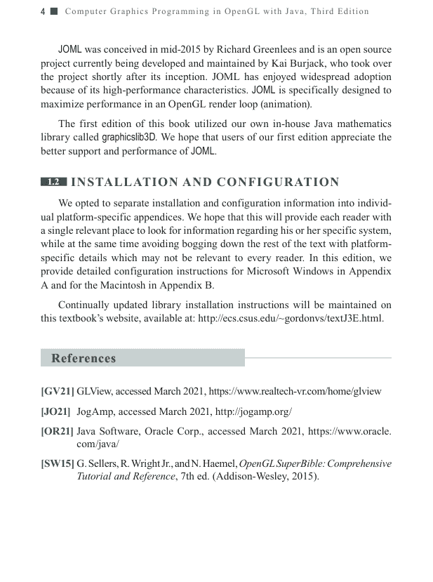

# 第 2 章

# OpenGL 图形管线

- 2.1 OpenGL 管线 . . . . . . . . . . . . . . . . . . . . . . . . . . . . . . . . . 6
- 2.2 检测 OpenGL 和 GLSL 错误 . . . . . . . . . . . . . . . . . . . . . . . 21
- 2.3 从文件读取 GLSL 源代码 . . . . . . . . . . . . . . . . . . . . . 26
- 2.4 从顶点构建对象 . . . . . . . . . . . . . . . . . . . . . . . . . . . 27
- 2.5 为场景设置动画 . . . . . . . . . . . . . . . . . . . . . . . . . . . . . . . 28
- 2.6 组织 Java 代码文件 . . . . . . . . . . . . . . . . . . . . . . . . . . . 32
- 补充说明 . . . . . . . . . . . . . . . . . . . . . . . . . . . . . . . . . . . . . . . 33


OpenGL（Open Graphics Library，开放图形库）是一种多平台 2D 和 3D 图形 API，同时涉及硬件和软件。使用 OpenGL 需要一块支持足够新版本 OpenGL 的显卡（GPU）（如第 1 章所述）。

在硬件方面，OpenGL 提供多阶段的 *图形管线*，可使用名为 *GLSL*（OpenGL 着色语言）的语言进行部分编程。

在软件方面，OpenGL 的 API 用 C 编写，因此这些调用可直接与 C 和 C++ 兼容。不过，对于十多种其他流行语言（Java、Perl、Python、Visual Basic、Delphi、Haskell、Lisp、Ruby 等），都有稳定的语言 *绑定*（或“包装器”），性能几乎相当。本教材使用流行的 Java 包装器 **JOGL**（Java OpenGL）。使用 JOGL 时，程序员编写的 Java 程序在 CPU 上运行（更具体地说，在 Java 虚拟机 JVM 上运行），并包含 JOGL（因而也包含 OpenGL）调用。我们将包含 JOGL 调用的 Java 程序称为 *Java/JOGL 应用程序*。Java/JOGL 应用程序的一项重要任务是将程序员的 GLSL 代码安装到 GPU 上。

图 2.1 展示了基于 JOGL 的图形应用程序的概览，其中软件组件以粉色突出显示。


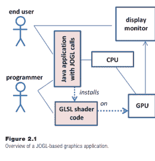

**图 2.1**  
基于 JOGL 的图形应用程序概述。

我们将编写的一些代码将使用 Java 并包含 JOGL 调用，另一些将使用 GLSL 编写。我们的 Java/JOGL 应用程序将与 GLSL 模块和硬件协同工作，以生成 3D 图形输出。应用程序完成后，最终用户将与 Java 应用程序交互。

GLSL 是*着色器语言*的一个例子。着色器语言旨在图形管线的上下文中在 GPU 上运行。还有其他着色器语言，例如 HLSL，它与微软的 3D 框架 *DirectX* 配合使用。GLSL 是与 OpenGL 兼容的特定着色器语言，因此除了 Java/JOGL 应用程序代码外，我们还将使用 GLSL 编写着色器代码。

在本章剩余部分，我们将简要“游览”OpenGL 管线。并不要求读者彻底理解每一个细节，只需体会各个阶段如何协同工作。

## 2.1 OPENGL 管线

现代 3D 图形编程利用*管线*，其中将 3D 场景转换为 2D 图像的过程被分解为一系列步骤。OpenGL 和 DirectX 都使用类似的管线。

OpenGL 图形管线的简化概述如图 2.2 所示（并未显示每个阶段，只显示我们将要研究的主要阶段）。Java/JOGL 应用程序将图形数据发送到顶点着色器，处理过程沿管线推进，最终像素输出到显示器上显示。

蓝色阴影阶段（顶点、细分、几何和片段）在 GLSL 中是*可编程*的。Java/JOGL 应用程序的职责之一是将 GLSL 程序加载到这些着色器阶段，如下所示：

- 1. 它使用 Java 获取 GLSL 着色器代码，可以从文本文件中获取，也可以硬编码为字符串。

(1,0,0,1)，对应红色颜色的 RGB 值，外加一个表示不透明度分量的“1”。然后我们使用 OpenGL 调用 glClear(GL_COLOR_BUFFER_BIT) 实际用该颜色填充颜色缓冲区。

### 程序 2.1 第一个 Java/JOGL 应用程序

```java
import javax.swing.*;
import static com.jogamp.opengl.GL4.*;
import com.jogamp.opengl.*;
import com.jogamp.opengl.awt.GLCanvas;

public class Code extends JFrame implements GLEventListener
{  private GLCanvas myCanvas;

   public Code()
   {  setTitle("Chapter2 - program1");
      setSize(600, 400);
      setLocation(200, 200);
      myCanvas = new GLCanvas();
      myCanvas.addGLEventListener(this);
      this.add(myCanvas);
      this.setVisible(true);
   }

   public void display(GLAutoDrawable drawable)
   {  GL4 gl = (GL4) GLContext.getCurrentGL();
      gl.glClearColor(1.0f, 0.0f, 0.0f, 1.0f);
      gl.glClear(GL_COLOR_BUFFER_BIT);
   }

   public static void main(String[] args)
   {  new Code();
   }

   public void init(GLAutoDrawable drawable) { }
   public void reshape(GLAutoDrawable drawable, int x, int y, int width, int height) { }
   public void dispose(GLAutoDrawable drawable) { }
}
```

在 Microsoft Windows 机器上运行 Java/JOGL 应用程序（例如程序 2.1）时，建议添加命令行选项以禁用 Direct3D 加速并禁用 UI 缩放，如下所示：

```bash
java -Dsun.java2d.d3d=false -Dsun.java2d.uiScale=1 Code
```

这些函数的部署机制如下：当 GLCanvas 被设为“可见”时（通过我们对包含它的 JFrame 调用“setVisible(true)”），它会初始化 OpenGL，而 OpenGL 又会创建一个“GL4”对象，我们的应用程序可以使用该对象进行 OpenGL 函数调用。然后 OpenGL 执行“回调”，调用 init()，并向它传递一个“可绘制”对象（在本例中，可绘制对象就是 GLCanvas，尽管从代码中并不明显）。在这个特定示例中，init() 不执行任何操作——在大多数应用程序中，我们会在这里读入 GLSL 代码、加载 3D 模型等。接下来，OpenGL（实际上是 JOGL）调用 display()，同样向它发送可绘制对象。通常的做法是立即获取 GL4 对象并将其放入名为“gl”的变量中（实际上，GL4 是一个接口——在实践中，我们不需要知道实际的 GL 对象类）。

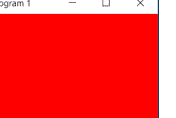

**图 2.3**  
程序 2.1 的输出。

稍后我们会看到，如果我们希望场景具有动画效果，Java/JOGL 应用程序将需要告诉 JOGL 额外调用 display()。

现在是仔细查看程序 2.1 中 JOGL 调用的合适时机。考虑下面这个调用：

```java
gl.glClear(GL_COLOR_BUFFER_BIT);
```

由于 JOGL 是 OpenGL 的 Java 绑定，这意味着对 JOGL 的调用会转而生成对 OpenGL 的 C 函数库的调用。在本例中，被调用的 C 函数如 OpenGL 参考文档（可在 https://www.khronos.org/registry/OpenGL-Refpages/gl4/ 查阅）所述，是：

```c
void glClear(GLbitfield mask);
```

首先要注意的是，JOGL 函数的名称与原始 OpenGL C 函数相同，只是前面加上了“gl”——这是 GL4 对象的名称。“gl”后面的句点“.”很重要，因为“gl”是我们调用 OpenGL 函数所依托的对象。

重申一下，GL4 是 OpenGL 函数的 Java 接口。我们可以通过两种方式之一获得它：(a) 调用 drawable.getGL()，利用当 OpenGL 调用（回调）各种 GLEventListener 函数时自动提供的“GLAutoDrawable”对象；或者 (b) 像程序 2.1 中那样调用 GLContext.getCurrentGL()。获取当前 GL4 对象很重要，因为一般来说，OpenGL 文档中描述的任何 OpenGL 函数都可以通过在其前面加上相应 GL4 对象的名称（例如这里的“gl.”）来从 JOGL 中调用。

该参数引用一个名为“GL_COLOR_BUFFER_BIT”的“GLbitfield”；OpenGL 有许多预定义常量（其中一些称为枚举），而这个常量引用的是包含渲染时像素的颜色缓冲区。OpenGL 有多个颜色缓冲区，此命令会清除所有这些缓冲区——也就是说，它用称为“清除色”的预定义颜色填充它们。请注意，此上下文中的“清除”并不意味着“一种透明的颜色”；相反，它指的是重置（清除）颜色缓冲区时应用的颜色。

紧接在调用 glClear() 之前的是对 glClearColor() 的调用。同样，这指定了颜色缓冲区被清除时放入其元素中的值。这里我们指定了 (1.0, 0.0, 0.0, 1.0)，它对应 RGBA 颜色红色。如果未指定“清除色”，默认值为黑色。

最后，除了 display() 和 init() 之外，我们还必须实现 reshape() 和 dispose()。当 GLCanvas 调整大小时会调用 reshape() 函数，应用程序退出时会调用 dispose()。在程序 2.1 中，我们将它们都留空了。

### 2.1.2 顶点着色器和片段着色器

我们的第一个 JOGL 程序实际上没有绘制任何东西——它只是用一种颜色填充了颜色缓冲区。要实际绘制一些东西，我们需要包含一个*顶点着色器*和一个*片段着色器*。

你可能会惊讶地发现，OpenGL 只能绘制少数几种非常简单的东西，例如*点*、*线*或*三角形*。这些简单的东西称为*图元*，因此，大多数 3D 模型由许许多多*图元*组成，通常是三角形。

*图元*由*顶点*组成——例如，一个三角形由三个*顶点*组成。*顶点*可以来自多种来源——它们可以从文件中读取，然后由 Java/JOGL 应用程序加载到缓冲区中，也可以硬编码在 Java 代码甚至 GLSL 代码中。

在这一切发生之前，Java/JOGL 应用程序必须编译并链接适当的 GLSL 顶点着色器和片段着色器程序，然后将它们加载到管线中。我们很快就会看到执行此操作的命令。

应用程序还负责告诉 OpenGL 构造三角形。我们通过使用 JOGL 调用以下 OpenGL 函数来完成此操作：

```c
glDrawArrays(GLenum mode, GLint first, GLsizei count);
```

mode 是图元类型——对于三角形，我们使用 GL_TRIANGLES。参数“first”指示从哪个顶点开始（通常是编号为 0 的顶点，即第一个顶点），而 count 指定要绘制的顶点总数。

调用 glDrawArrays() 时，管线中的 GLSL 代码开始执行。现在让我们向该管线添加一些 GLSL 代码。

无论顶点来自何处，所有顶点都会经过顶点着色器。它们*逐个*经过；也就是说，着色器*每个顶点执行一次*。对于具有大量顶点的大型复杂模型，顶点着色器可能会执行数百次、数千次甚至数百万次，而且常常是并行执行。

让我们编写一个简单程序，其中只有一个顶点，并硬编码在顶点着色器中。这不足以绘制一个三角形，但足以绘制一个点。为了让它显示出来，我们还需要提供一个*片段着色器*。为简单起见，我们将把这两个着色器程序声明为字符串数组。

### 程序 2.2 着色器，绘制一个点

```java
(...imports as before)
public class Code extends JFrame implements GLEventListener
{
    private int renderingProgram;
    private int vao[] = new int[1];   // new declarations

    public Code() { (.....constructor as before) }
    public void display(GLAutoDrawable drawable)
    {   GL4 gl = (GL4) GLContext.getCurrentGL();
        gl.glUseProgram(renderingProgram);
        gl.glDrawArrays(GL_POINTS, 0, 1);
    }

    public void init(GLAutoDrawable drawable)
    {   GL4 gl = (GL4) GLContext.getCurrentGL();
        renderingProgram = createShaderProgram();
```


```java
gl.glGenVertexArrays(vao.length, vao, 0);
gl.glBindVertexArray(vao[0]);
}
private int createShaderProgram()
{  GL4 gl = (GL4) GLContext.getCurrentGL();

   String vshaderSource[] =
   {  "#version 430  \n",
      "void main(void)  \n",
      "{  gl_Position = vec4(0.0, 0.0, 0.0, 1.0); }  \n",
   };

   String fshaderSource[] =
   {  "#version 430  \n",
      "out vec4 color;  \n",
      "void main(void)  \n",
      "{  color = vec4(0.0, 0.0, 1.0, 1.0); }  \n",
   };

   int vShader = gl.glCreateShader(GL_VERTEX_SHADER);
   gl.glShaderSource(vShader, 3, vshaderSource, null, 0); // 3 is the count of lines of source code
   gl.glCompileShader(vShader);

   int fShader=gl.glCreateShader(GL_FRAGMENT_SHADER);
   gl.glShaderSource(fShader, 4, fshaderSource, null, 0); // 4 is the count of lines of source code
   gl.glCompileShader(fShader);

   int vfProgram = gl.glCreateProgram();
   gl.glAttachShader(vfProgram, vShader);
   gl.glAttachShader(vfProgram, fShader);
   gl.glLinkProgram(vfProgram);

   gl.glDeleteShader(vShader);
   gl.glDeleteShader(fShader);
   return vfProgram;
}
```

……main()、reshape() 和 dispose() 与之前相同

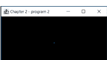

**图 2.4**
程序 2.2 的输出。

该程序似乎输出了一个空白画布。但仔细观察会发现窗口中心有一个微小的蓝点（假设打印页面分辨率足够高）。OpenGL 中点的默认大小为一个像素。

程序 2.2 中有许多重要细节（为方便起见，程序中用颜色进行了标记）需要讨论。首先，注意 init() 不再是空的——它现在调用了另一个名为“createShaderProgram()”的函数（由我们编写）。该函数首先声明两个着色器，分别作为名为 vshaderSource 和 fshaderSource 的字符串数组。然后调用 glCreateShader()，它会生成所需类型的着色器（注意预定义值 GL_VERTEX_SHADER，以及后面的 GL_FRAGMENT_SHADER）。OpenGL 创建着色器对象（初始为空），并返回一个整数 ID，作为之后引用它的索引——代码将该 ID 存储在变量 vShader（以及 fShader）中。接着调用 glShaderSource()，它将 GLSL 代码从字符串数组加载到空的着色器对象中。glShaderSource() 有五个参数：(a) 用于存储该着色器的着色器对象，(b) 着色器源代码中的字符串数量，(c) 包含源代码的字符串数组，以及两个我们未使用的附加参数（它们将在后面的补充章节说明中解释）。另请注意，蓝色部分中高亮参数值 3 和 4 的两行注释代码，指的是每个着色器中的代码行数（其中的 \n 分隔着色器源代码中的每一行）。然后使用 glCompileShader() 分别编译每个着色器。

然后应用程序创建一个名为 vfprogram 的 *程序* 对象，并保存指向它的整数 ID。OpenGL “程序”对象包含一系列已编译的着色器，这里我们看到 glCreateProgram() 命令用于创建程序对象，glAttachShader() 用于将每个着色器附加到它上面，然后 glLinkProgram() 用于请求 GLSL 编译器确保它们兼容。

init() 完成后，display() 会自动调用（回忆一下，这也是一个 JOGL 回调）。display() 首先要做的事情之一就是调用 glUseProgram()，它会将包含两个已编译着色器的程序加载到 OpenGL 管线阶段（到 GPU 上！）。请注意，glUseProgram() *不会运行着色器*；它只是将它们加载到硬件上。

正如我们将在第 4 章后面看到的，通常此时 Java/JOGL 程序会准备正在绘制的模型顶点，以便发送到管线中。但本例不是这样，因为对于我们的第一个着色器程序，我们只是在顶点着色器中硬编码了一个顶点。因此，在这个示例中，display() 函数接下来执行 glDrawArrays() 调用，从而启动管线处理。图元类型是 GL_POINTS，并且只有一个点要显示。

现在让我们看看着色器本身，前面以绿色显示（并在后面重复）。如我们所见，它们在 Java/JOGL 程序中声明为字符串数组。这种编码方式很笨拙，但在这个非常简单的例子中已经足够。顶点着色器是：

```
#version 430
void main(void)
{  gl_Position = vec4(0.0, 0.0, 0.0, 1.0);  }
```

第一行指示 OpenGL 版本，这里是 4.30。后面是一个“main”函数（我们将看到，GLSL 的语法有点类似 Java）。任何顶点着色器的主要目的都是将一个顶点沿管线发送下去（如前所述，它对每个顶点都这样做）。内置变量 gl_Position 用于设置顶点在 3D 空间中的坐标位置，并发送到管线中的下一阶段。GLSL 数据类型 vec4 用于保存适合此类坐标的四元组，相关的四个值分别表示 X、Y、Z，以及这里设为 1.0 的第四个值（我们将在第 3 章学习第四个值的作用）。在本例中，顶点被硬编码到原点位置 (0,0,0)。

顶点经过管线到达光栅化器，在那里被转换为像素位置（或者更准确地说，转换为片段——稍后描述）。最终，这些像素（片段）到达片段着色器：

```
#version 430
out vec4 color;
void main(void)
{  color = vec4(0.0, 0.0, 1.0, 1.0);  }
```

任何片段着色器的目的都是设置要显示的像素的 RGB 颜色。在本例中，指定的输出颜色 (0, 0, 1) 是蓝色（第四个值 1.0 指定不透明度）。注意“out”标签表示变量 color 是一个输出。（在顶点着色器中不必为 gl_Position 指定“out”标签，因为 gl_Position 是预定义的输出变量。）

代码中还有一个我们尚未讨论的细节，位于 init() 函数的最后两行（以红色显示）。它们可能看起来有点隐晦。正如我们将在第 4 章看到的，当准备将数据集发送到管线时，它们会被组织到缓冲区中。这些缓冲区又会被组织到顶点数组对象（VAO）中。在我们的示例中，我们在顶点着色器中硬编码了一个点，因此不需要任何缓冲区。然而，只要使用着色器，OpenGL 仍然要求至少创建一个 VAO，即使应用程序没有使用任何缓冲区。因此这两行创建了所需的 VAO。

最后，还有一个问题：从顶点着色器输出的 *顶点* 如何变成片段着色器中的 *像素*。回忆图 2.2，顶点处理和像素处理之间是 *光栅化* 阶段。正是在那里，图元（例如点或三角形）被转换为像素集合。OpenGL “点”的默认大小为一个像素，这就是为什么我们的单个点被渲染为单个像素。

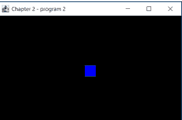

**图 2.5**
更改 glPointSize。

让我们在 `display()` 中、`glDrawArrays()` 调用之前添加以下命令：

```java
gl.glPointSize(30.0f);
```

现在，当光栅化器从顶点着色器接收到顶点时，它将设置像素颜色值，形成一个大小为 30 像素的点。结果输出如图 2.5 所示。

现在让我们继续检查 OpenGL 管线的其余部分。

### 2.1.5 细分

我们在第 12 章讨论细分。可编程细分阶段是 OpenGL 最新的新增功能之一（在 4.0 版中）。它提供了一个细分器，可以生成大量三角形（通常作为网格），还提供了一些以多种方式操作这些三角形的工具。例如，程序员可以操作如图 2.6 所示的三角形细分网格。

当简单形状（例如方形区域或曲面）上需要大量顶点时，细分非常有用。它对于生成复杂地形也非常有用，我们稍后会看到。在此类情况下，有时让 GPU 中的细分器在硬件中生成三角形网格，比在 Java 中完成要高效得多。


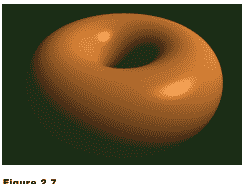

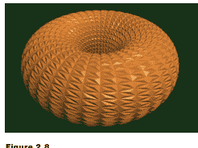

**图 2.7**
环面模型。

**图 2.8**
在几何着色器中修改后的环面。

当细分阶段让程序员能够同时访问整个模型中的*所有*顶点时，提供逐图元着色器阶段似乎显得多余。区别在于，细分仅在非常有限的情况下提供这种能力——具体来说，是当模型是由细分器生成的三角形网格时。它并不能同时访问例如通过缓冲区从 Java 传入的任意模型的所有顶点。

### 2.1.6 光栅化

最终，我们由顶点、三角形、颜色等构成的 3D 世界需要显示在 2D 显示器上。那个 2D 显示器屏幕由*光栅*组成——一个矩形的像素阵列。

当一个 3D 对象被*光栅化*时，OpenGL 会将对象中的图元（通常是三角形）转换为*片段*。片段保存与像素关联的信息。光栅化确定为了生成由其三个顶点指定的三角形而需要绘制的像素位置。

光栅化首先在三角形的三个顶点之间两两进行插值。进行这种插值有一些选项；目前考虑如图 2.9 所示的简单线性插值就足够了。原始三个顶点以红色显示。

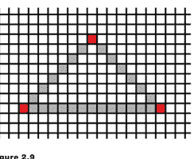

**图 2.9**
光栅化（第 1 步）。

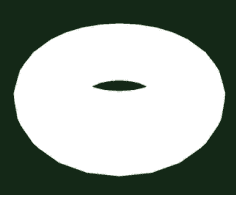

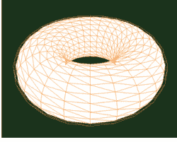

**图 2.12**
图元完全光栅化后的环面（左）以及叠加线框网格后的环面（右）。

### 2.1.7 片段着色器

如前所述，片段着色器的目的是为光栅化后的像素分配颜色。我们已经在程序 2.2 中看到了一个片段着色器示例。在那里，片段着色器只是将其输出硬编码为特定值，因此每个生成的像素都具有相同颜色。然而，GLSL 赋予我们几乎无限的创造力，可以用其他方式计算颜色。

一个简单示例是根据像素的位置来确定其输出颜色。回想一下，在顶点着色器中，顶点的输出坐标使用预定义变量 gl_Position 指定。在片段着色器中，程序员可以使用一个类似变量来访问传入*片段*的坐标，称为 gl_FragCoord。我们可以修改程序 2.2 中的片段着色器，使其使用 gl_FragCoord（在此例中使用 GLSL *字段选择器*表示法引用其 x 分量）根据每个像素的位置设置其颜色，如下所示：

```glsl
#version 430
out vec4 color;
void main(void)
{
    if (gl_FragCoord.x < 200) color = vec4(1.0, 0.0, 0.0, 1.0); else color = vec4(0.0, 0.0, 1.0, 1.0);
}
```

假设我们像第 2.1.2 节末尾那样增大 gl_PointSize，那么现在渲染点上的像素颜色将发生变化——x 坐标小于 200 处为红色，否则为蓝色，如图 2.13 所示。

### 2.1.8 像素操作

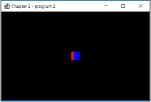

**图 2.13**
片段着色器颜色变化。

当场景中的对象在 display() 函数中使用 glDrawArrays() 命令绘制时，我们通常期望前面的对象遮挡住后面的对象。这也适用于对象自身：我们期望看到对象的正面，但通常看不到背面。

为了实现这一点，我们需要*隐藏面消除*，即 HSR。OpenGL 可以执行多种 HSR 操作，具体取决于我们希望在场景中获得的效果。尽管这个阶段不可编程，但理解其工作原理极其重要。我们不仅需要正确配置它；之后在向场景添加阴影时，还需要仔细操纵它。

OpenGL 通过巧妙协调地使用两个缓冲区来完成隐藏面消除：*颜色缓冲区*（我们之前讨论过）和*深度缓冲区*（有时称为*Z 缓冲区*）。这两个缓冲区都与光栅大小相同——也就是说，屏幕上的每个像素在每个缓冲区中都有一个条目。

当场景中绘制各种对象时，片段着色器生成像素颜色。像素颜色被放入颜色缓冲区——最终写入屏幕的是颜色缓冲区。当多个对象占据颜色缓冲区中某些相同像素时，必须根据哪个对象离观察者最近来确定保留哪些像素颜色。

隐藏面消除按如下方式进行：

- 在渲染场景之前，深度缓冲区被填充表示最大深度的值。
- 当片段着色器输出像素颜色时，计算其与观察者的距离。
- 如果计算出的距离*小于*深度缓冲区中（针对该像素）存储的距离，则 (a) 像素颜色替换颜色缓冲区中的颜色，并且 (b) 该距离替换深度缓冲区中的值。否则，丢弃该像素。

此过程称为 Z 缓冲区算法，如图 2.14 所示。

```java
Color[][] colorBuf = new Color[pixelRows][pixelCols];
double[][] depthBuf = new double[pixelRows][pixelCols];
for (each row and column)    // initialize color and depth buffers
{   colorBuf[row][col] = backgroundColor;
    depthBuf[row][col] = far away;
}

for (each shape)    // update buffers when new pixel is closer
{   for (each pixel in the shape)
    {   if (depth at pixel < depthBuf value)
        {   depthBuf[pixel.row][pixel.col] = depth at pixel;
            colorBuf[pixel.row][pixel.col] = color at pixel;
        }
    }
}
return colorBuf;
```

**图 2.14**
Z 缓冲区算法。

## 2.2 检测 OPENGL 和 GLSL 错误

编译和运行 GLSL 代码的工作流程与标准编码不同，因为 *GLSL 编译发生在 Java 运行时*。另一个复杂之处是 GLSL 代码不在 CPU 上运行（而是在 GPU 上运行），因此*操作系统并不总能捕获 OpenGL 运行时错误*。这使调试变得困难，因为通常很难检测着色器是否失败以及失败原因。

程序 2.3（如下所示）提供了一些用于捕获和显示 GLSL 错误的模块。它们使用了来自“GLU”库 [GL21] 的错误字符串查找工具 gluErrorString()，以及 OpenGL 函数 glGetShaderiv() 和 glGetProgramiv()，这些函数用于提供已编译 GLSL 着色器和程序的信息。与之配套的是前面程序 2.2 中的 createShaderProgram() 函数，但添加了错误检测调用。

程序 2.3 包含以下三个实用工具：

- **checkOpenGLError**——检查 OpenGL 错误标志是否出现 OpenGL 错误
- **printShaderLog**——在 GLSL 编译失败时显示 OpenGL 日志的内容
- **printProgramLog**——在 GLSL 链接失败时显示 OpenGL 日志的内容

第一个 checkOpenGLError() 对于检测 GLSL 编译错误和 OpenGL 运行时错误都很有用，因此强烈建议在开发期间在整个 Java/JOGL 应用程序中使用它。例如，在前面的示例（程序 2.2）中，可以很容易地用程序 2.3 所示的代码增强对 glCompileShader() 和 glLinkProgram() 的调用，以确保任何拼写错误或其他编译错误都会被捕获并报告其原因。可以在运行时 OpenGL 调用之后添加对 checkOpenGLError() 的调用，例如紧接在调用 glDrawArrays() 之后。

使用这些工具很重要的另一个原因是，*GLSL 错误不会导致 JOGL 程序停止。*因此，除非程序员采取措施在错误发生时捕获错误，否则调试将非常困难。

### 程序 2.3 捕获 GLSL 错误的模块

```java
...
import com.jogamp.opengl.GL4;
...
private void printShaderLog(int shader)
{
   GL4 gl = (GL4) GLContext.getCurrentGL();
   int[] len = new int[1];
   int[] chWrittn = new int[1];
   byte[] log = null;
   // determine the length of the shader compilation log
   gl.glGetShaderiv(shader, GL_INFO_LOG_LENGTH, len, 0);
   if (len[0] > 0)
   {
      log = new byte[len[0]];
      gl.glGetShaderInfoLog(shader, len[0], chWrittn, 0, log, 0);
      System.out.println("Shader Info Log: ");
      for (int i = 0; i < log.length; i++)
      {  System.out.print((char) log[i]);
      }
   }
}
```


```java
void printProgramLog(int prog)
{  GL4 gl = (GL4) GLContext.getCurrentGL();
   int[] len = new int[1];
   int[] chWritten = new int[1];
   byte[] log = null;

   // determine the length of the program linking log
   gl.glGetProgramiv(prog,GL_INFO_LOG_LENGTH,len,0);
   if (len[0] > 0)
   {  log = new byte[len[0]];
      gl.glGetProgramInfoLog(prog, len[0], chWritten,0,log,0);
      System.out.println("Program Info Log: ");
      for (int i = 0; i < log.length; i++)
      {  System.out.print((char) log[i]);
      }  }  }

boolean checkOpenGLError()
{  GL4 gl = (GL4) GLContext.getCurrentGL();
   boolean foundError = false;
   GLU glu = new GLU();
   int glErr = gl.glGetError();
   while (glErr != GL_NO_ERROR)
   {  System.err.println("glError: " + glu.gluErrorString(glErr));
      foundError = true;
      glErr = gl.glGetError();
   }
   return foundError;
}
```

### 检查 OpenGL 错误的示例

```java
private int createShaderProgram()
{  GL4 gl = (GL4) GLContext.getCurrentGL();
   // arrays to collect GLSL compilation status values.
   // note: one-element arrays are used because the associated JOGL calls require arrays.
   int[] vertCompiled = new int[1];
   int[] fragCompiled = new int[1];
   int[] linked = new int[1];

   ....

   // catch errors while compiling shaders
   gl.glCompileShader(vShader);
   checkOpenGLError();
   gl.glGetShaderiv(vShader, GL_COMPILE_STATUS, vertCompiled, 0);
if (vertCompiled[0] != 1)
{
    System.out.println("vertex compilation failed.");
    printShaderLog(vShader);
}

gl.glCompileShader(fShader);
checkOpenGLError();
gl.glGetShaderiv(fShader, GL_COMPILE_STATUS, fragCompiled, 0);
if (fragCompiled[0] != 1)
{
    System.out.println("fragment compilation failed.");
    printShaderLog(fShader);
}

if ((vertCompiled[0] != 1) || (fragCompiled[0] != 1))
{
    System.out.println("\nCompilation error; return-flags:");
    System.out.println(" vertCompiled = " + vertCompiled[0] + " - fragCompiled = " + fragCompiled[0]);
}
. . . .
// catch errors while linking shaders
gl.glLinkProgram(vfprogram);
checkOpenGLError();
gl.glGetProgramiv(vfprogram, GL_LINK_STATUS, linked,0);
if (linked[0] != 1)
{
    System.out.println("linking failed.");
    printProgramLog(vfprogram);
}
. . . .
}
```

另一组有助于追踪 OpenGL 和 GLSL 错误来源的工具是 JOGL 的*可组合管线*机制。DebugGL 和 TraceGL JOGL 类中提供了一组丰富的功能，分别提供调试和跟踪支持。在简单情况下，利用这些能力的一种方式是添加以下一个或两个命令行选项：

- `-Djogl.debug.DebugGL`
- `-Djogl.debug.TraceGL`

例如，可以按如下方式在同时启用这两种能力的情况下运行应用程序：

```
java -Dsun.java2d.d3d=false -Dsun.java2d.uiScale=1 -Djogl.debug.DebugGL -Djogl.debug.TraceGL Code
```

启用调试会导致在每次 OpenGL 调用时调用 glGetError()。尽管生成的所有错误消息往往不如程序 2.3 中所示检索错误代码时那样信息丰富，但它可以快速缩小错误可能发生位置的范围。

启用跟踪会导致每执行一次 OpenGL 调用，命令窗口就显示一行输出——包括应用程序直接调用的那些调用，以及由 JOGL 调用的其他调用。例如，程序 2.2 的跟踪会产生以下输出，它反映了典型运行中的调用顺序：

```
glFinish()
glCreateShader(<int> 0x8B31) = 1
glShaderSource(<int> 0x1, <int> 0x3, <[Ljava.lang.String;>, <java.nio.IntBuffer> null)
glCompileShader(<int> 0x1)
glCreateShader(<int> 0x8B30) = 2
glShaderSource(<int> 0x2, <int> 0x4, <[Ljava.lang.String;>, <java.nio.IntBuffer> null)
glCompileShader(<int> 0x2)
glCreateProgram() = 3
glAttachShader(<int> 0x3, <int> 0x1)
glAttachShader(<int> 0x3, <int> 0x2)
glLinkProgram(<int> 0x3)
glDeleteShader(<int> 0x1)
glDeleteShader(<int> 0x2)
glGenVertexArrays(<int> 0x1, <[I>, <int> 0x0)
glBindVertexArray(<int> 0x1)
glGetError() = 0
glViewport(<int> 0x0, <int> 0x0, <int> 0x180, <int> 0xA2)
glUseProgram(<int> 0x3)
glDrawArrays(<int> 0x0, <int> 0x0, <int> 0x1)
```

尽管在调试期间极其有用，但与大多数调试工具一样，可组合管线会带来相当大的开销，因此不应在生产代码中启用。

还有其他技巧可以推断着色器代码中运行时错误的原因。着色器运行时错误的一个常见结果是输出屏幕完全空白，基本上没有任何输出。即使错误只是着色器中的一个很小的拼写错误，也可能发生这种情况，但可能很难判断错误发生在管线的哪个阶段。完全没有输出时，就像大海捞针。

在这种情况下，一个有用的技巧是暂时将片元着色器替换为程序 2.2 中所示的片元着色器。回想一下，在那个示例中，片元着色器只是输出一种特定颜色——例如纯蓝色。如果随后的输出是正确的几何形状（但为纯蓝色），则顶点着色器可能是正确的，而原始片元着色器中存在错误。如果输出仍然是空白屏幕，则错误更可能发生在管线的较早阶段，例如顶点着色器中。

在附录 C 中，我们展示了如何使用另一种称为 *Nsight* 的有用调试工具，该工具可在配备某些 Nvidia 显卡的机器上使用。

## 2.3 从文件读取 GLSL 源代码

到目前为止，我们的 GLSL 着色器代码一直内联存储在字符串中。随着程序变得越来越复杂，这将变得不切实际。我们应该改为将着色器代码存储在文件中并读取它们。

读取文本文件是 Java 的基本技能，这里不再介绍。然而，为了实用起见，程序 2.4 中提供了用于读取着色器的代码 `readShaderSource()`。它读取着色器文本文件并返回一个字符串数组，其中每个字符串都是文件中的一行文本。然后，它根据读取了多少行来确定该数组的大小。请注意，这里的 `createShaderProgram()` 替换了程序 2.2 中的版本。

在此示例中，顶点和片元着色器代码现在分别放在文本文件“vertShader.glsl”和“fragShader.glsl”中。

### 程序 2.4 从文件读取 GLSL 源代码

```java
    (...imports as before, plus the following...)
    import java.io.File;
    import java.io.IOException;
    import java.util.Scanner;

    public class Code extends JFrame implements GLEventListener
    {  (... declarations same as before, display() as before)
        private int createShaderProgram()
        {  (... as before plus...)
            vshaderSource = readShaderSource("vertShader.glsl");
            fshaderSource = readShaderSource("fragShader.glsl");

            gl.glShaderSource(vertexShader, vshaderSource.length, vshaderSource, null, 0);
            gl.glShaderSource(fragmentShader, fshaderSource.length, fshaderSource, null, 0);
(...etc., building rendering program as before)
}
(..... main, constructor, reshape, init, dispose as before)
private String[] readShaderSource(String filename)
{ Vector<String> lines = new Vector<String>();
  Scanner sc;
  String[] program;
  try
  { sc = new Scanner(new File(filename));
    while (sc.hasNext())
    { lines.addElement(sc.nextLine());
    }
    program = new String[lines.size()];
    for (int i = 0; i < lines.size(); i++)
    { program[i] = (String) lines.elementAt(i) + "\n";
    }
  }
  catch (IOException e)
  { System.err.println("IOException reading file: " + e);
    return null;
  }
  return program;
} }
```

## 2.4 从顶点构建对象

最终，我们想要绘制的不仅仅是单个点。我们希望绘制由*许多*顶点构造的对象。本书的很大一部分将致力于这个主题。现在，我们从一个简单的示例开始——我们将定义*三个*顶点，并使用它们绘制一个*三角形*。

我们可以通过对程序 2.2（实际上是程序 2.4 中从文件读取着色器的版本）做两处小修改来实现这一点：(a) 修改顶点着色器，使*三个不同*的顶点输出到管线的后续阶段；(b) 修改 glDrawArrays() 调用，以指定我们使用*三个*顶点。

在 Java/JOGL 应用程序中（具体是在 glDrawArrays() 调用中），我们指定 GL_TRIANGLES（而不是 GL_POINTS），并且还指定通过管线发送*三个*顶点。这会导致顶点着色器运行*三次*，并且在每次迭代中，内置变量 *gl_VertexID* 会自动递增


（它最初被设为 0）。通过测试 gl_VertexID 的值，着色器被设计为在三次执行中每次输出一个不同的点。回顾一下，这三个点随后经过光栅化阶段，生成一个填充的三角形。修改如程序 2.5 所示（代码的其余部分与前面程序 2.4 中所示相同）。

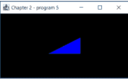

图 2.15 绘制一个简单三角形。

### 程序 2.5 绘制一个三角形

*顶点着色器*

```glsl
#version 430
void main(void)
{
    if (gl_VertexID == 0) gl_Position = vec4(0.25, -0.25, 0.0, 1.0);
    else if (gl_VertexID == 1) gl_Position = vec4(-0.25, -0.25, 0.0, 1.0);
    else gl_Position = vec4(0.25, 0.25, 0.0, 1.0);
}
```

*Java/JOGL 应用程序——在 display() 中*

```java
. . .
gl.glDrawArrays(GL_TRIANGLES, 0, 3);
```

## 2.5 场景动画

本书中的许多技术都可以进行动画化。这是指场景中的物体正在移动或变化，并且场景被反复渲染以实时反映这些变化。

回顾第 2.1 节，OpenGL 在初始化时会调用一次 init()，然后调用 display()。此后，如果场景发生变化，程序员需要负责让 OpenGL 再次调用 display()。这可以通过从 Java/JOGL 应用程序中调用 GLCanvas 的 display() 函数来完成，如下所示：

```java
myCanvas.display();
```

也就是说，GLCanvas 有自己的 display() 函数。如果我们调用它，GLCanvas 随后会回调我们 Java/JOGL 应用程序中的 display() 函数。从技术上讲，这两个 display() 是完全不同的函数，但它们是相互交织的。

一种方法是在场景发生变化时调用 display()。在复杂场景中，这可能变得难以处理。更好的方法是反复进行此调用，而不考虑场景中是否有任何变化，并让我们的 display() 函数随时间改变其绘制内容。虽然这起初可能看起来效率低下，但实际上会带来更高效、响应更快的程序。这样，场景的每次渲染称为一个*帧*，调用 display() 的频率则是*帧率*。

组织场景动画代码的方法有很多。一种方法是在 Java 中创建一个“动画器”类，使用 Timer、Thread.sleep()，或者更好的是使用 ScheduledThreadPoolExecutor。

构建动画器更简单的方法是使用 JOGL 专用的动画器类之一：

- Animator
- FPSAnimator

这些类专门用于为 3D 场景添加动画。FPSAnimator（“FPS”代表“每秒帧数”）在实例化后，会以指定的帧率反复调用可绘制对象的 display() 函数。Animator（不带“FPS”）在实例化后，会反复调用 display() 函数，但不按任何特定帧率调用。JOGL 的开发者建议使用 Animator（而不是 FPSAnimator），并在应用程序逻辑中根据自上一帧以来经过的时间来处理移动速率。因此，我们将按这种方式编写带动画的程序。

程序 2.6 展示了一个示例。我们采用程序 2.5 中的三角形，并为其添加动画，使其向右移动，然后向左移动，来回往复。Animator 由 Java/JOGL 应用程序在其构造函数中实例化；Animator 构造函数调用中的参数指定可绘制对象。此后，应用程序可以在 display() 函数中自由修改场景。在此示例中，我们不考虑经过的时间，因此三角形的移动速度可能会因计算机速度而有所不同（在后续示例中，我们将使用经过的时间来确保无论计算机速度如何，它们都以相同速度运行）。

在程序 2.6 中，应用程序的 display() 方法维护一个变量“x”，用于偏移三角形的 X 坐标位置。它的值在每次调用 display() 时都会变化（因此每一帧都不同），并且每次达到 1.0 或 -1.0 时都会反转方向。x 中的值会被复制到顶点着色器中名为“offset”的对应变量。执行此复制的机制使用了所谓的*统一变量*，我们将在第 4 章后面学习它。目前还不需要理解统一变量的细节。现在只需注意，Java/JOGL 应用程序首先调用 glGetUniformLocation() 获取指向“offset”变量的指针，然后调用 glProgramUniform1f() 将 x 的值复制到 offset 中。随后，顶点着色器将 offset 加到正在绘制的三角形的 X 坐标上。还要注意，每次调用 display() 时都会清除背景，以避免三角形移动时留下拖尾。图 2.16 展示了三个时间点上的显示情况（当然，移动无法在静态图中显示）。

### 程序 2.6 简单动画示例

*Java/JOGL 应用程序：*

```java
    // same imports and declarations as before, plus the following:
    import com.jogamp.opengl.util.*;

    public class Code extends JFrame implements GLEventListener
    {  // same declarations as before, plus:
       private float x = 0.0f;        // location of triangle
       private float inc = 0.01f;     // offset for moving the triangle

       public Code()
       {  // same constructor as before, plus this at the end, after the call to setVisible(true).
          Animator animr = new Animator(myCanvas);
          animr.start();
       }

       public void display(GLAutoDrawable drawable)
       {  GL4 gl = (GL4) GLContext.getCurrentGL();
          gl.glClear(GL_DEPTH_BUFFER_BIT);
          gl.glClear(GL_COLOR_BUFFER_BIT);  // clear the background to black, each time
          gl.glUseProgram(renderingProgram);

          x += inc;                         // move the triangle along x axis
          if (x > 1.0f) inc = -0.01f;       // switch to moving the triangle to the left
          if (x < -1.0f) inc = 0.01f;       // switch to moving the triangle to the right
          int offsetLoc = gl.glGetUniformLocation(renderingProgram, "offset");  // retrieve pointer to "offset"
          gl.glProgramUniform1f(renderingProgram, offsetLoc, x); // send value in "x" to "offset"
          gl.glDrawArrays(GL_TRIANGLES, 0, 3);
       } ... // remaining functions, same as before
    }
```

顶点着色器：

```glsl
#version 430
uniform float offset;
void main(void)
{ if (gl_VertexID == 0) gl_Position = vec4( 0.25 + offset, -0.25, 0.0, 1.0);
  else if (gl_VertexID == 1) gl_Position = vec4(-0.25 + offset, -0.25, 0.0, 1.0);
  else gl_Position = vec4( 0.25 + offset,  0.25, 0.0, 1.0);
}
```

请注意，除了添加使三角形动起来的代码外，我们还在 display() 函数的开头添加了以下代码行：

```java
gl.glClear(GL_DEPTH_BUFFER_BIT);
```

虽然在这个特定示例中并非严格必要，但我们在这里添加了它，并且它将继续出现在我们的大多数应用程序中。回顾第 2.1.7 节中的讨论，隐藏面消除需要颜色缓冲区和深度缓冲区。随着我们逐步绘制越来越复杂的 3D 场景，每帧都需要初始化（清除）深度缓冲区，尤其是对于带动画的场景，以确保深度比较不受旧深度数据的影响。从上面的示例中应该可以明显看出，清除深度缓冲区的命令与清除颜色缓冲区的命令基本相同。

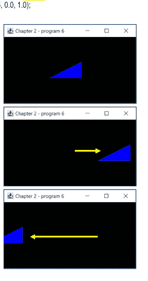

## 2.6 组织 Java 代码文件

到目前为止，我们一直将所有 Java/JOGL 应用程序代码放在一个名为“Code.java”的类文件中，并将 GLSL 着色器放在名为“vertShader.glsl”和“fragShader.glsl”的文件中。虽然我们坦率地承认，将任何代码模块命名为“Code”几乎是一种可笑的不良实践，但我们在本书中采用了这种命名约定，以便在每个示例中都绝对清楚哪个文件包含与所讨论示例相关的主要 Java/JOGL 代码块。在整本教材中，它将始终被称为“Code.java”。在实践中，当然应该选择一个能够恰当描述应用程序所执行任务的名称。

然而，随着我们的推进，在某些情况下，我们会创建将在许多不同应用程序中有用的模块。只要合适，我们就会将这些模块移到单独的文件中，以便复用。例如，稍后我们将定义一个 Sphere 类，它将在许多不同示例中有用，因此它将被分离到自己的文件中。

同样，当我们遇到希望复用的*函数*时，我们会将它们放在一个名为“Utils.java”的类文件中。我们已经看到几个适合移入“Utils.java”的函数：第 2.2 节中描述的错误检测模块，以及第 2.3 节中描述的用于读取 GLSL 着色器程序的函数。后者特别适合重载，从而可以为给定应用程序中组装的每种可能的管线着色器组合定义一个“createShaderProgram()”函数：

- public int createShaderProgram(String vS, String fS)
- public int createShaderProgram(String vS, String gS, String fS)
- public int createShaderProgram(String vS, String tCS, String tES, String fS)
- public int createShaderProgram(String vS, String tCS, String tES, String gS, String fS)

第一种情况（如上）支持仅使用顶点着色器和片段着色器的着色器程序。第二种支持使用顶点、几何和片段着色器的程序。第三种支持使用顶点、细分和片段着色器的程序。第四种支持使用顶点、细分、几何和片段着色器的程序。每种情况接受的参数是包含着色器代码的 GLSL 文件的路径名。例如，下面的调用使用其中一个重载函数来编译并链接一个着色器管线程序，该程序


它包含一个顶点着色器和一个片段着色器。完整程序被存放在变量“renderingProgram”中：

```
renderingProgram = Utils.createShaderProgram("vertShader.glsl", "fragShader.glsl");
```

这些 `createShaderProgram()` 的实现都可以在随书光盘（“Utils.java”文件）中找到，而且它们也都整合了第 2.2 节中的错误检测模块。它们本身没有新内容，只是为了方便而以这种方式组织。随着本书后续内容的推进，我们还会陆续向 Utils.java 中增添其他类似函数。强烈建议读者查看随书光盘中的 Utils.java 文件，甚至可以根据需要自行添加内容。其中的程序都是按照我们在书中学到的方法构建的，研究它们的组织结构有助于加深读者自身的理解。


关于“Utils.java”文件中的函数，我们将其实现为静态方法，这样就不必实例化 Utils 类。读者也可以根据所开发系统的具体架构，选择将它们实现为实例方法而非静态方法。

我们所有的着色器文件都将使用“.glsl”扩展名命名。

## 补充说明

在本导论章节中，我们没有讨论 OpenGL 管线的许多细节。我们跳过了若干内部阶段，也完全没有讨论纹理是如何处理的。我们的目标是尽可能简明地勾勒出后续编写代码所基于的框架。随着内容的推进，我们将继续学习更多细节。

我们也推迟了曲面细分与几何（着色器）代码示例的展示。在后面的章节中，我们将构建完整的系统，展示如何为每个阶段编写实用的着色器。

组织场景动画代码还有更高级的方式，尤其是在线程管理方面。如果有兴趣为特定应用设计渲染循环（或“游戏循环”），建议参阅一些更专业的游戏引擎设计书籍（例如 [NY14]），并细读 gamedev.net [GD21] 上的相关讨论。

在 JOGL 中。在这种情况下，JOGL 版本改用数组，后跟一个数组内的整数偏移量。凡是 JOGL 调用与原始 C 调用之间存在差异的地方，请查阅 JOGL Javadoc，以了解修订后参数的详细信息。

在本章中，我们尽量描述了每次 OpenGL 调用的每一个参数。然而，随着本书的推进，这会变得非常繁琐；有时，如果我们认为描述某个参数会不必要地使问题复杂化，就不再赘述。这是因为许多 OpenGL 函数有大量与我们的示例无关的参数。读者应习惯在必要时使用 JOGL/OpenGL 文档来补充这类细节。

## 练习

- 2.1 修改程序 2.2，添加动画使绘制的点循环地增大和缩小。提示：使用 `glPointSize()` 函数，并以变量作为参数。
- 2.2 修改程序 2.5，使其绘制一个等腰三角形（而不是图 2.15 中所示的直角三角形）。
- 2.3 （项目）修改程序 2.5，加入程序 2.3 中展示的错误检查模块。待其正常运行后，尝试向着色器中插入各种错误，并观察由此产生的行为以及生成的错误消息。
- 2.4 修改程序 2.6，使三角形移动量基于经过的时间进行计算，而不是像当前实现那样使用常量移动量。一种做法是从 Java 获取当前时间，并用它计算自上次调用 `display()` 以来经过的时间。以这种方式计算动画，可以确保无论特定计算机的速度如何，动画都以相同速度移动。

## 参考文献

- [GD21] 游戏开发网络，2021年3月访问，https://www.gamedev.net/
- [GL21] GLUT 与 OpenGL 工具库，2021年3月访问，https://www.opengl.org/resources/libraries/
- [NY14] R. Nystrom，*游戏编程模式——游戏循环*（Genever Benning，2014），2021年3月访问，http://gameprogrammingpatterns.com/game-loop.html
- [OP21] OpenGL 4.5 参考页面，2021年3月访问，https://www.khronos.org/registry/OpenGL-Refpages/gl4/

## 3.1 三维坐标系

三维空间通常用 X、Y、Z 三个轴来表示。这三个轴可以排列为两种构型：*右手系*或*左手系*。（该名称源于坐标轴的朝向，就像用右手或左手的拇指、食指和中指互成直角伸出时所形成的方向。）

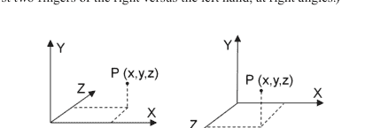

了解图形编程环境使用哪种坐标系十分重要。例如，OpenGL 中的大多数坐标系是右手系，而 Direct3D 中大多数是左手系。在本书中，除非另有说明，否则我们都默认采用右手系。

## 3.2 点

三维空间中的点可以通过列出 X、Y、Z 值来指定，例如 (2, 8, -3)。然而，事实证明，使用*齐次*表示法来指定点要有用得多，这种表示法最早在 19 世纪初提出。齐次表示法中的点包含四个值，前三个分别对应 X、Y、Z，第四个值 W 总是一个固定的非零值，通常为 1。因此，我们将这个点表示为 (2, 8, -3, 1)。我们很快会看到，齐次表示法将使许多图形计算更加高效。

在 GLSL 中，用于以齐次三维表示法存储点的合适数据类型是 vec4（“vec”指*向量*，但也可用于表示点）。JOML 库中包含适用于在 Java 应用程序中创建和存储三元素与四元素（齐次）点的类，分别称为 Vector3f 和 Vector4f。在某些情况下（我们稍后会看到），JOML 会在需要执行齐次运算时，向 Vector3f 添加第四个元素（设为 1.0）。

## 3.3 矩阵

矩阵是一个由数值组成的矩形阵列，其元素通常通过下标访问。第一个下标对应行号，第二个下标对应列号，下标从 0 开始。我们用于三维图形计算的大多数矩阵都是 4x4 大小，如图 3.2 所示。

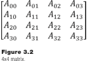

GLSL 语言包含一个名为 mat4 的数据类型，可用于存储 4x4 矩阵。类似地，JOML 包含一个名为 Matrix4f 的类，用于实例化和存储 4x4 矩阵。

单位矩阵除对角线上的元素为 1 外，其余均为 0：

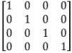

任何点或矩阵乘以单位矩阵后都保持不变。在 JOML 中，可通过 Matrix4f.identity() 函数获得单位矩阵。

矩阵的转置是通过交换其行与列来计算的。例如：

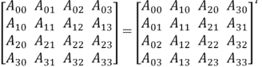

$\begin{bmatrix} Aa+Be+Ci+Dm & Ab+Bf+Cj+Dn & Ac+Bg+Ck+Do & Ad+Bh+Cl+Dp \\ Ea+Fe+Gi+Hm & Eb+Ff+Gj+Hn & Ec+Fg+Gk+Ho & Ed+Fh+Gl+Hp \\ Ia+Je+Ki+Lm & Ib+Jf+Kj+Ln & Ic+Jg+Kk+Lo & Id+Jh+Kl+Lp \\ Ma+Ne+Oi+Pm & Mb+Nf+Oj+Pn & Mc+Ng+Ok+Po & Md+Nh+Ol+Pp \end{bmatrix}$

矩阵乘法通常被称为**级联**，因为正如稍后将要看到的，它用于将一组矩阵变换合并为单个矩阵。这种组合矩阵变换的能力之所以可行，是因为矩阵乘法具有**结合律**。考虑以下操作序列：

New Point = Matrix₁ * (Matrix₂ * (Matrix₃ * Point))

这里，我们将一个点乘以 Matrix₃，再将结果乘以 Matrix₂，最后将结果乘以 Matrix₁。最终得到一个新的点。结合律保证上述计算等价于：

New Point = (Matrix₁ * Matrix₂ * Matrix₃) * Point

这里我们先让三个矩阵相乘，形成 Matrix₁、Matrix₂、Matrix₃ 的*级联*（它本身也是一个 4x4 矩阵）。如果我们将这个级联结果称为 Matrix_c，就可以将上述操作改写为：

New Point = Matrix_c * Point

这样做的好处在于（我们将在第 4 章看到），我们经常需要对场景中的每个点应用相同的矩阵变换序列。通过预先一次性计算所有这些矩阵的级联结果，我们可以大幅减少所需的矩阵运算总次数。

GLSL 和 JOML 都支持矩阵乘法：GLSL 使用重载的 * 运算符，JOML 使用 Matrix4f.mul(Matrix4f) 函数。

一个 4x4 矩阵 M 的*逆矩阵*是另一个 4x4 矩阵，记为 M⁻¹，它在矩阵乘法下具有如下性质：

M*(M⁻¹) = (M⁻¹)*M = *单位矩阵*

这里我们不介绍计算逆矩阵的细节。但值得了解的是，求矩阵的逆在计算上可能相当复杂。


昂贵；幸运的是，我们很少需要用到它。在少数需要的情况下，JOML 中提供了 `Matrix4f.invert()` 函数，GLSL 中则提供了 `mat4.inverse()` 函数。

## 3.4 变换矩阵

在图形学中，矩阵通常用于对物体执行*变换*。例如，矩阵可以用来将点从一个位置移动到另一个位置。本章我们将学习几种有用的变换矩阵：

- *平移（Translation）*
- *旋转（Rotation）*
- *缩放（Scale）*
- *投影（Projection）*
- *观察（Look-At）*

我们的变换矩阵有一个重要性质，即它们都是 4×4 的。这得益于我们采用了*齐次*表示法。否则，某些变换的维度会不同且不兼容。正如我们所见，确保它们尺寸相同不仅仅是为了方便；它还使得我们可以任意组合变换，并预先计算变换组以提升性能。

### 3.4.1 平移

*平移*矩阵用于将物体从一个位置移动到另一个位置。它由一个单位矩阵构成，X、Y、Z 的移动量分别放在 A₀₃、A₁₃、A₂₃ 的位置。图 3.3 展示了平移矩阵的形式，以及它与*齐次*点相乘后的效果；结果是一个被*平移量*“移动”的新点。

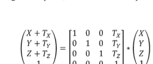

注意，点 (X,Y,Z) 在与平移矩阵相乘后，被平移（或移动）到位置 (X + Tₓ, Y + Tᵧ, Z + Tz)。还要注意乘法是按*从右到左*的顺序指定的。

例如，如果我们希望将一组点沿 Y 轴正方向向上移动 5 个单位，可以取一个单位矩阵，将值 5 放入上图所示的 Tᵧ 位置，从而构建一个平移矩阵。然后，我们只需将每个需要移动的点与该矩阵相乘即可。

JOML 中有若干函数用于构建平移矩阵以及将点与矩阵相乘，包括以下相关函数：

- `Matrix4f.setTranslation(Tx, Ty, Tz)`
- `Vector4f.mul(Matrix4f)` 或 `Vector3f.mulPosition(Matrix4f)`

### 3.4.2 缩放

*缩放*矩阵用于改变物体的大小，或将点移向或远离原点。虽然缩放一个点最初可能看起来有些奇怪，但 OpenGL 中的物体是由一组点定义的。因此，缩放物体实际上就是扩展或收缩其点集。

缩放矩阵变换由一个单位矩阵构成，X、Y、Z 的比例因子分别放在 A₀₀、A₁₁、A₂₂ 的位置。图 3.4 展示了缩放矩阵的形式，以及它与齐次点相乘后的效果；结果是一个被缩放值修改的新点。

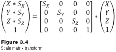

JOML 中有若干函数用于构建缩放矩阵以及将点与缩放矩阵变换相乘，包括以下相关函数：

- `Matrix4f.scaling(Sx, Sy, Sz)`
- `Vector4f.mul(Matrix4f)`

缩放可用于切换坐标系。例如，给定一组右手坐标，我们可以使用缩放来确定其对应的左手坐标是什么。从图 3.1 可以看出，对 Z 坐标取反即可在右手系和左手系之间切换，因此实现这一目的的缩放矩阵变换为

```
[
  1  0  0  0
  0  1  0  0
  0  0 -1  0
  0  0  0  1
]
```

### 3.4.3 旋转

旋转稍微复杂一些，因为在 3D 空间中旋转一个物体需要指定 (a) 旋转轴，以及 (b) 以度或弧度表示的旋转量。

在 18 世纪中叶，数学家莱昂哈德·欧拉证明，绕任意所需轴的旋转都可以表示为绕 X、Y、Z 轴旋转的组合 [EU76]。这三个分别绕相应轴的旋转角后来被称为*欧拉角*。这一发现被称为*欧拉定理*，对我们非常有用，因为绕三个轴中每一个轴的旋转都可以用矩阵变换来指定。

绕 X、Y、Z 轴旋转的三个旋转变换分别如图 3.5 所示。JOML 中同样有若干函数用于构建和使用旋转矩阵：

- `Matrix4f.rotateX(radians)`
- `Matrix4f.rotateY(radians)`
- `Matrix4f.rotateZ(radians)`
- `Matrix4f.rotateXYZ(θx, θy, θz)`
- `Vector4f.mul(Matrix4f)` 或 `Vector3f.mulPosition(Matrix4f)`

在实践中，如果旋转轴不经过原点，使用欧拉角将物体绕 3D 空间中的任意直线旋转还需要额外的几个步骤。一般来说：

- 1. 平移旋转轴，使其通过原点。
- 2. 绕 X、Y、Z 轴按适当的欧拉角旋转。
- 3. 撤销第 1 步的平移。

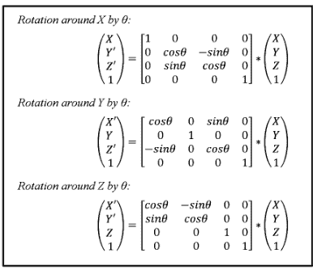

**图 3.5**
旋转变换矩阵。

图 3.5 中所示的三个旋转变换都有一个有趣的性质：逆旋转恰好等于矩阵的转置。这一点可以通过检查上述矩阵来验证，同时回忆 cos(θ) = cos(−θ) 且 sin(−θ) = −sin(θ)。这个性质稍后会变得有用。

欧拉角在某些 3D 图形应用中会引起一些伪影。因此，通常建议使用*四元数*来计算旋转。对于有兴趣探索四元数的读者，已有许多资料可供参考（例如 [KU98]）。对于我们的大多数需求，欧拉角已经足够了。

## 3.5 向量

向量指定了*大小*和*方向*。它们不绑定到特定位置；向量可以被“移动”而不会改变其所代表的意义。

表示向量的方式有多种，例如一端带箭头的线段，或 (大小, 方向) 对，或两个点之间的差。在 3D 图形中，向量通常表示为一个空间中的点，此时向量是从原点到该点的距离和方向。在图 3.6 中，向量 V（以红色显示）既可以表示为点 P1 和 P2 之间的差，也可以表示为从原点到 P3 的等效距离。在我们所有的应用中，我们将 V 简单表示为 (x,y,z)，与表示点 P3 的记号相同。

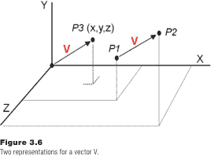

将向量与点用同样的方式表示很方便，因为我们可以互换地对点或向量使用矩阵变换。然而，这也可能造成混淆。因此，有时我们会在向量上方加一个小箭头（例如 V⃗）来标记它。许多图形系统根本不区分点和向量，例如 GLSL 和 JOML，它们分别提供了 vec3/vec4 数据类型和 Vector3f/Vector4f 类，既可以存放点也可以存放向量。有些系统（例如本书前一版本中使用的 graphicslib3D 库）则有独立的点和向量类，并根据所执行的操作强制使用其中一种。究竟是使用同一数据类型来同时表示两者，还是使用分开的数据类型更清晰，这是一个开放性的争论。

3D 图形中经常使用若干向量运算，JOML 和 GLSL 中都有相应的函数。例如，假设有向量 A(u,v,w) 和 B(x,y,z)：

**加法与减法：**

- A ± B = (u ± x, v ± y, w ± z)
- JOML：`Vector3f.add(Vector3f)` 和 `Vector3f.sub(Vector3f)`
- GLSL：`vec3 ± vec3`

**归一化（变为长度=1；注意 `A` 上方的 `^` 记号）：**

- Â = A/|A| = A/sqrt(u²+v²+w²)，其中 |A| ≡ 向量 A 的长度
- JOML：`Vector3f.normalize()`
- GLSL：`normalize(vec3)` 或 `normalize(vec4)`

**点积：**

- A • B = ux + vy + wz
- JOML：`Vector3f.dot(Vector3f)`
- GLSL：`dot(vec3,vec3)` 或 `dot(vec4,vec4)`

**叉积：**

- A × B = (vz − wy, wx − uz, uy − vx)
- JOML：`Vector3f.cross(Vector3f)`
- GLSL：`cross(vec3,vec3)`

其他有用的向量函数包括*长度*（JOML 和 GLSL 中均以 `length()` 提供），以及*反射*和*折射*（两者在 GLSL 中均可用；JOML 仅包含反射）。

现在我们更仔细地看看*点积*和*叉积*这两个函数。

### 3.5.1 点积的用途

在本书中，我们的程序大量使用点积。其最重要、最基本的用途是*求两个向量之间的夹角*。考虑两个向量 V⃗ 和 W⃗，假设我们希望求出它们之间的夹角 θ。

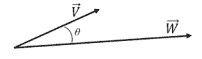

V⃗ • W⃗ = |V⃗| * |W⃗| * cos(θ)

cos(θ) = (V⃗ • W⃗) / (|V⃗| * |W⃗|)


因此，如果 \(\vec{V}\) 和 \(\vec{W}\) 是归一化的（即单位长度——如前所示，我们使用“^”符号表示归一化），那么：

\[\cos(\theta) = \hat{V} \bullet \hat{W}\]

\[\theta = \arccos(\hat{V} \bullet \hat{W})\]

有趣的是，我们后面会看到，通常我们需要的是 \(\cos(\theta)\)，而不是 \(\theta\) 本身。因此上述两个推导都将直接有用。

点积还有其他多种用途：

- 求向量的模长：\(\sqrt{\vec{V} \bullet \vec{V}}\)
- 判断两个向量是否垂直：若 \(\vec{V} \bullet \vec{W} = 0\)
- 判断两个向量是否平行：若 \(\vec{V} \bullet \vec{W} = |\vec{V}| \bullet |\vec{W}|\)
- 判断两个向量是否平行但方向相反：\(\vec{V} \bullet \vec{W} = -|\vec{V}| \bullet |\vec{W}|\)
- 判断向量间夹角是否在 [-90°..+90°] 范围内：\(\vec{V} \bullet \vec{W} > 0\)
- 求点 \(P = (x,y,z)\) 到平面 \(S = (a,b,c,d)\) 的最小有符号距离（首先，求平面 \(S\) 的单位法向量 \(\hat{n} = (\frac{a}{\sqrt{a^2+b^2+c^2}}, \frac{b}{\sqrt{a^2+b^2+c^2}}, \frac{c}{\sqrt{a^2+b^2+c^2}})\)，以及原点到平面的最短距离 \(D = \frac{d}{\sqrt{a^2+b^2+c^2}}\)；那么点 \(P\) 到平面 \(S\) 的最小有符号距离为 \((\hat{n} \bullet \vec{P}) + D\)，该距离的符号决定点 \(P\) 位于平面 \(S\) 的哪一侧）

### 3.5.2 叉积的用途

两个向量叉积的一个重要性质是，它会生成一个垂直于原始两个向量所定义平面的向量，本书将广泛使用这一性质。

任意两个不共线的向量定义一个平面。例如，考虑两个任意向量 \(\vec{V}\) 和 \(\vec{W}\)。由于向量可以在不改变其含义的情况下移动，因此可以移动它们使原点重合。图 3.7 展示了由 \(\vec{V}\) 和 \(\vec{W}\) 定义的平面，以及它们叉积得到的法向量。所得法向量的方向遵循右手定则，即右手手指从 \(\vec{V}\) 弯向 \(\vec{W}\) 时，拇指指向法向量 \(\vec{R}\) 的方向。

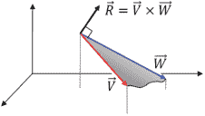

**图 3.7**  
叉积产生法向量。

注意顺序很重要；\(\vec{W} \times \vec{V}\) 将产生与 \(\vec{R}\) 方向相反的向量。

通过叉积求法向量的能力在后续研究*光照*时会极其有用。为了确定光照效果，我们需要知道与所渲染模型相关的*外向法线*。图 3.8 展示了一个由六个点（顶点）组成的简单模型示例，以及使用叉积计算来确定其某个面外向法线的过程。

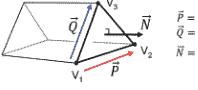

**图 3.8**  
计算外向法线。

## 3.6 局部空间和世界空间

3D 图形（使用 OpenGL 或任何其他框架）最常见的用途是模拟一个三维世界，在其中放置物体，然后在显示器上查看这个模拟世界。放置在 3D 世界中的物体通常被建模为三角形的集合。稍后在第 6 章中，我们将深入探讨建模。但现在我们可以先看看整体流程。

在为物体构建 3D 模型时，我们通常以最方便描述的方式来确定模型的方向。例如，在建模球体时，我们可能将球体中心置于原点 (0,0,0)，并赋予一个方便的半径，例如 1。定义模型所在的空间称为其*局部空间*或*模型空间*。OpenGL 文档使用术语*物体空间*。

这个球体随后可能作为更大模型的一部分使用，例如成为机器人的头部。当然，机器人将在其自己的局部/模型空间中定义。将球体模型定位到机器人模型空间中，可以使用缩放、旋转和平移的矩阵变换来完成，如图 3.9 所示。通过这种方式，可以分层地构建复杂模型（第 4 章第 4.8 节将使用矩阵栈进一步展开）。

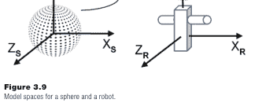

以同样的方式，通过确定模拟世界的朝向和尺寸（称为*世界空间*），将建模物体放置到模拟世界中。将物体定位并定向到世界空间中的矩阵称为*模型矩阵*，或 **M**。

## 3.7 眼睛空间和合成相机

到目前为止，我们看到的变换矩阵都在 3D 空间中操作。然而，最终我们希望将 3D 空间——或其一部分——显示在 2D 显示器上。为此，我们需要确定一个观察点。正如我们通过眼睛从特定点、特定方向观察现实世界一样，我们也必须为虚拟世界建立一个位置和方向，作为观察窗口。这个观察点称为“视图”空间或“眼睛”空间，或“合成相机”。

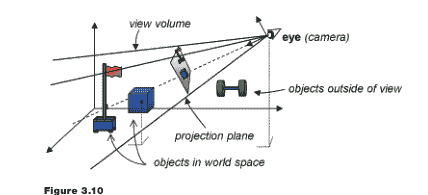

如图 3.10 和图 3.12 所示，观察涉及 (a) 将相机放置在世界中的某个位置；(b) 确定相机朝向，这通常需要维护其自身的一组正交轴 U/V/N；(c) 定义*视景体*；(d) 将视景体内的物体投影到*投影平面*上。

OpenGL 包含一个相机，它永久固定在原点 (0,0,0)，并朝向负 Z 轴，如图 3.11 所示。

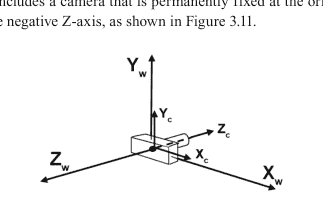

为了使用 OpenGL 相机，我们需要做的事情之一是*模拟*将其移动到某个期望的位置和朝向。这通过确定世界中的物体相对于期望相机位置的位置来实现（即，它们位于由图 3.12 所示相机 U、V、N 轴定义的“相机空间”中的位置）。给定世界空间位置 P_w 处的点，我们需要一个变换将其转换为相机空间中的等效点，使其*看起来*像是从期望的相机位置 C_w 观察它。我们通过计算其相机空间位置 P_c 来实现这一点。已知 OpenGL 相机位置始终固定在 (0,0,0)，什么变换可以实现这一点？

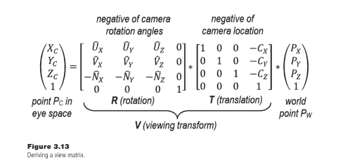

更常见的是，V 矩阵与模型矩阵 M 连接形成单个*模型-视图*（MV）矩阵：

MV = V * M

然后，位于自身模型空间中的点 P_M 通过一步直接变换到相机空间，如下所示：

P_C = MV * P_M

这种方法的优势在考虑复杂场景时会变得明显：我们不仅需要对一个点执行这种变换，还需要对*场景中的每个顶点*执行。通过预先计算 MV，将每个点变换到视图空间时，每个顶点只需进行*一次*矩阵乘法，而不是两次。稍后我们将看到，可以将这一过程扩展为预先计算多个矩阵连接，从而显著减少每个顶点的计算量。

## 3.8 投影矩阵

现在我们已经建立了相机，可以研究*投影矩阵*了。我们接下来要研究的两个重要投影矩阵是 (a) *透视*和 (b) *正交*。

### 3.8.1 透视投影矩阵

透视投影试图通过利用透视概念来模仿我们观察现实世界时所见，使 2D 图像看起来像 3D。近处的物体看起来比远处的物体大，并且在某些情况下，3D 空间中平行的线在透视绘制时不再平行。

透视是 1400–1500 年代文艺复兴时期的伟大发现之一，当时艺术家开始比前辈绘制出更具真实感的画作。

一个极好的例子可见于图 3.14，卡洛·克里韦利于 1486 年绘制的*《圣母领报，与圣埃米迪乌斯》*（目前藏于伦敦国家美术馆 [CR86]）。透视的强烈运用显而易见——右侧建筑朝左墙面的后退线条戏剧性地相互倾斜。这创造了深度和 3D 空间的错觉，并在此过程中使现实中平行的线在画面中不再平行。此外，前景中的人物比背景中的人物更大。虽然今天我们视这些手法为理所当然，但找到实现这一效果的变换矩阵需要一些数学分析。

我们通过使用将平行线转换为适当非平行线的矩阵变换来实现这一效果。这种矩阵称为*透视矩阵*或*透视变换*，通过定义*视景体*的四个参数来构建。这些参数是 (a) *宽高比*，(b) *视场角*，(c) *投影平面*或*近裁剪面*，以及 (d) *远裁剪面*。

只有位于*近*裁剪面和*远*裁剪面之间的物体才会被渲染。近裁剪面也用作物体*投影*到的平面，通常放置在靠近眼睛或相机的位置（如图 3.15 左侧所示）。远裁剪面适当值的选择将在第 4 章讨论。*视场角*是可观察空间的垂直角度。*宽高比*是近裁剪面和远裁剪面的宽度/高度比。这些元素形成的形状如图 3.15 所示，称为*视锥体*。

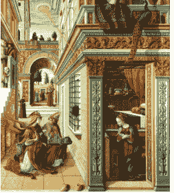

**图 3.14**  
克里韦利的*《圣母领报，与圣埃米迪乌斯》*（1486 年）。


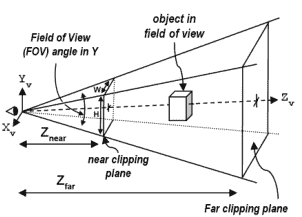

**图 3.15**  
透视视景体或视锥体。

透视矩阵用于将 3D 空间中的点变换到它们在近裁剪平面上的适当位置，其构建过程是首先计算 q、A、B 和 C 的值，然后使用这些值构造矩阵，如图 3.16 所示（并在 [WB15] 中推导）。

$$
q = \frac{1}{\tan\left(\frac{\text{FieldOfView}}{2}\right)}
$$

$$
A = \frac{q}{\text{aspectRatio}}
$$

$$
B = \frac{Z_{\text{near}} + Z_{\text{far}}}{Z_{\text{near}} - Z_{\text{far}}}
$$

$$
C = \frac{2 \cdot (Z_{\text{near}} \cdot Z_{\text{far}})}{Z_{\text{near}} - Z_{\text{far}}}
$$

$$
\begin{bmatrix}
A & 0 & 0 & 0 \\
0 & q & 0 & 0 \\
0 & 0 & B & C \\
0 & 0 & -1 & 0
\end{bmatrix}
$$

**图 3.16**  
构建透视矩阵。

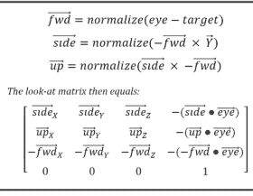

我们可以将其编码为一个简单的 Java/JOGL 工具函数，该函数在给定相机位置、目标位置和初始“上”向量 Ŷ 的指定值的情况下构建一个观察矩阵。由于 JOML 包含了用于构建观察矩阵的函数 Mat4f.setLookAt()，我们只需使用它。该函数在本教材后面会很有用，尤其是在第 8 章生成阴影时。

## 3.10 用于构建矩阵变换的 GLSL 函数

尽管 JOML 包含了用于执行本章所述许多 3D 变换（例如平移、旋转和缩放）的预定义函数，但 GLSL 只包含基本的矩阵运算，例如加法、串联等。因此，当我们需要在着色器中执行某些 3D 计算时，有时必须编写自己的 GLSL 工具函数来构建 3D 变换矩阵。在 GLSL 中，保存此类矩阵的合适数据类型是 mat4。

在 GLSL 中初始化 mat4 矩阵的语法是按列加载值的。前四个值放入第一列，接下来四个值放入下一列，依此类推，如下例所示：

```glsl
mat4 translationMatrix =
    mat4( 1.0, 0.0, 0.0, 0.0,    // note this is the leftmost column, not the top row
           0.0, 1.0, 0.0, 0.0,
           0.0, 0.0, 1.0, 0.0,
           tx, ty, tz, 1.0 );
```

该代码构建了前面图 3.3 中描述的平移矩阵。

程序 3.1 包含五个 GLSL 函数，用于构建 4x4 平移、旋转和缩放矩阵，每个函数分别对应本章前面给出的公式。我们将在本书后面使用其中一些函数。

### 程序 3.1 在 GLSL 中构建变换矩阵

```glsl
// builds and returns a translation matrix
mat4 buildTranslate(float x, float y, float z)
{
    mat4 trans = mat4(1.0, 0.0, 0.0, 0.0,
                      0.0, 1.0, 0.0, 0.0,
                      0.0, 0.0, 1.0, 0.0,
                      x, y, z, 1.0 );
    return trans;
}

// builds and returns a matrix that performs a rotation around the X axis
mat4 buildRotateX(float rad)
{
    mat4 xrot = mat4(1.0, 0.0, 0.0, 0.0,
                     0.0, cos(rad), -sin(rad), 0.0,
                     0.0, sin(rad), cos(rad), 0.0,
                     0.0, 0.0, 0.0, 1.0 );
    return xrot;
}

// builds and returns a matrix that performs a rotation around the Y axis
mat4 buildRotateY(float rad)
{
    mat4 yrot = mat4(cos(rad), 0.0, sin(rad), 0.0,
                     0.0, 1.0, 0.0, 0.0,
                     -sin(rad), 0.0, cos(rad), 0.0,
                     0.0, 0.0, 0.0, 1.0 );
    return yrot;
}

// builds and returns a matrix that performs a rotation around the Z axis
mat4 buildRotateZ(float rad)
{
    mat4 zrot = mat4(cos(rad), -sin(rad), 0.0, 0.0,
                     sin(rad), cos(rad), 0.0, 0.0,
                     0.0, 0.0, 1.0, 0.0,
                     0.0, 0.0, 0.0, 1.0 );
    return zrot;
}

// builds and returns a scale matrix
mat4 buildScale(float x, float y, float z)
{ mat4 scale = mat4(x, 0.0, 0.0, 0.0,
                    0.0, y, 0.0, 0.0,
                    0.0, 0.0, z, 0.0,
                    0.0, 0.0, 0.0, 1.0 );
  return scale;
}
```

## 补充说明

在本章中，我们已经看到了将矩阵变换应用于点的示例。稍后，我们还需要将这些相同的变换应用于向量。为了实现对向量 V 的变换，使其等价于对点应用某个矩阵变换 M，在一般情况下需要计算 M 的*逆转置*，记为 (M⁻¹)ᵀ，并将 V 与该矩阵相乘。在某些情况下，M=(M⁻¹)ᵀ，此时可以直接使用 M。例如，本章中看到的基本旋转矩阵就等于其自身的逆转置，因此也等于（对点的变换）。因此，本书中的示例在将变换应用于向量时有时会使用 (M⁻¹)ᵀ，有时则直接使用 M。

本节描述的许多 JOML 函数会修改指定的矩阵，并且（有点违反直觉地）返回对同一矩阵的引用，而不是构建并返回一个新矩阵。这是出于性能原因，将在第 4 章中更详细地讨论。

本章尚未讨论的一个问题是让摄像机在空间中平滑移动的技术。这些技术非常有用，尤其是在游戏和 CGI 电影中，而且在可视化、虚拟现实和 3D 建模中也很重要。实现这一功能的代码被称为*摄像机控制器*，关于这一主题有许多在线资源 [TR15]。

我们没有为所介绍的所有矩阵变换提供完整的推导过程（可以在其他资料中找到，例如 [FV95]）。我们力求简明扼要地总结进行基本 3D 图形编程所必需的点、向量和矩阵运算。随着本书内容的推进，我们将遇到所介绍方法的许多实际用途。

## 练习

- 3.1 修改程序 2.5，使顶点着色器包含程序 3.1 中的一个 buildRotate() 函数，并将其应用于构成三角形的各点。这将使三角形从其原始方向旋转。你不需要让旋转动画化。

- 3.2 *（研究）* 在 3.4 节末尾，我们指出欧拉角在某些情况下会导致不良的伪影。最常见的一种称为“万向节锁”。请描述万向节锁，给出一个示例，并解释为什么万向节锁会引发问题。

- 3.3 *（研究）* 避免使用欧拉角时可能出现伪影的一种方法是使用*四元数*。我们没有学习四元数；不过，JOML 包含一个 Quaternionf 类。请对四元数进行一些独立研究，并熟悉相关的 JOML Quaternionf 类。

## 参考文献

- [CR86] C. Crivelli，*天使报喜与圣埃米迪乌斯*（1486 年），藏于英国伦敦国家美术馆，访问于 2020 年 7 月，https://www.nationalgallery.org.uk/paintings/carlo-crivelli-the-annunciation-with-saint-emidius

- [EU76] L. Euler，*Formulae generales pro translatione quacunque corporum rigidorum*（任意刚体平移的一般公式），Novi Commentarii academiae scientiarum Petropolitanae 20，1776 年。

- [FV95] J. Foley、A. van Dam、S. Feiner 和 J. Hughes，*计算机图形学——原理与实践*，第 2 版（Addison-Wesley，1995 年）。

- [KU98] J. B. Kuipers，*四元数与旋转序列*（普林斯顿大学出版社，1998 年）。

- [TR15] T. Reed，OpenGL 第 3B 部分：摄像机控制（博客）。访问于 2021 年 3 月，https://www.trentreed.net/blog/qt5-opengl-part-3b-camera-control

- [WB15] W. Brown，LearnWebGL（2015），第 8.2 章（正交投影），访问于 2021 年 3 月，http://learnwebgl.brown37.net/08_projections/projections_ortho.html

OpenGL 中的一个相关结构称为*顶点数组对象*，或 *VAO*。VAO 是在 OpenGL 3.0 版本中引入的，提供了一种组织缓冲区并在复杂场景中简化缓冲操作的方式。OpenGL 要求至少创建一个 VAO，就我们的目的而言，一个就足够了。

例如，假设我们希望显示两个对象。在 Java/JOGL 端，我们可以通过声明一个 VAO 和一组关联的两个 VBO（每个对象一个）来实现，如下所示：

```java
private int vao[] = new int[1];    // OpenGL requires these values be specified in arrays
private int vbo[] = new int[2];
...
gl.glGenVertexArrays(1, vao, 0);
gl.glBindVertexArray(vao[0]);
gl.glGenBuffers(2, vbo, 0);
```

这两个 OpenGL 命令 glGenVertexArrays() 和 glGenBuffers() 分别创建 VAO 和 VBO，并为这些项目生成整数 ID，这些 ID 存储在数组 vao 和 vbo 中。glBindVertexArray() 的目的是使指定的 VAO 处于“活动”状态，以便生成的缓冲区¹与该 VAO 关联。

缓冲区需要在顶点着色器中声明一个对应的*顶点属性*变量。顶点属性通常是着色器中声明的第一批变量。

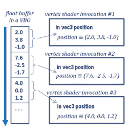

¹ 在整个示例中，声明了两个缓冲区，以强调*通常*我们会使用多个缓冲区。稍后，我们将使用额外的缓冲区来存储与顶点相关联的其他信息，例如颜色。在当前情况下，我们只使用已声明缓冲区中的一个，因此只需声明一个 VBO 就足够了。


从 Java/JOGL 应用程序向 uniform 变量发送数据需要以下步骤：(a) 获取指向该 uniform 变量的指针；(b) 将包含所需值的 Java 浮点缓冲区与所获取的 uniform 指针关联起来。假设链接后的渲染程序保存在名为“renderingProgram”的变量中，则以下代码行将指定：在立方体示例中，我们要把模型-视图矩阵和投影矩阵发送到两个 uniform 变量 mv_matrix 和 p_matrix：

```
mvLoc = gl.glGetUniformLocation(renderingProgram, "mv_matrix");  // get the locations of uniforms
pLoc = gl.glGetUniformLocation(renderingProgram, "p_matrix");    // in the shader program
gl.glUniformMatrix4fv(mvLoc, 1, false, mvMat.get(vals));         // send matrix data to the
gl.glUniformMatrix4fv(pLoc, 1, false, pMat.get(vals));           // uniform variables
```

上述示例假设我们已利用 JOML 工具构建了模型-视图矩阵变换 mvMat 和投影矩阵变换 pMat，稍后将更详细地讨论这一点。它们的类型为 Matrix4f（一个 JOML 类）。JOML 函数调用 get() 会将这些矩阵值复制到参数指定的浮点缓冲区中（在本例中为“vals”），并返回对该浮点缓冲区的引用，glUniformMatrix4fv() 需要该引用来将这些矩阵值传输到 uniform 变量。

## 4.3 顶点属性的插值

理解*顶点属性*在 OpenGL 管线中的处理方式与 *uniform 变量*的处理方式有何不同很重要。回想一下，紧接在片段着色器之前的是*光栅化*，其中由顶点定义的图元（例如三角形）被转换为片段。光栅化会*对顶点属性值进行线性插值*，以便显示的像素无缝连接建模表面。

相比之下，*uniform* 变量的行为类似于已初始化的常量，并且在每次顶点着色器调用（即，对于从缓冲区发送的每个顶点）期间保持不变。uniform 变量不会被插值；无论顶点数量多少，它始终包含相同的值。

光栅化器对顶点属性执行的插值在许多方面都很有用。稍后，我们将使用光栅化来插值颜色、纹理坐标和表面法线。重要的是要理解，*通过缓冲区发送到顶点属性的所有值都将在管线后续阶段被插值*。

我们已经看到，顶点着色器中的顶点属性被声明为“in”，以表示它们从缓冲区接收值。顶点属性也可以改为声明为“out”；这意味着它们将自己的值向前发送到管线的下一阶段。例如，顶点着色器中的以下声明指定了一个名为“color”的顶点属性，它输出一个 vec4：

```
out vec4 color;
```

不必为顶点位置声明“out”变量，因为 OpenGL 为此提供了一个名为 gl_Position 的内置 out vec4 变量。在顶点着色器中，我们对传入顶点（之前声明为 position）应用矩阵变换，并将结果赋给 gl_Position：

```
gl_Position = p_matrix * mv_matrix * position;
```

然后，变换后的顶点将自动输出到光栅化器，相应的像素位置最终发送到片段着色器。

图 4.2 展示了光栅化过程。在 glDrawArrays() 函数中指定 GL_TRIANGLES 时，光栅化按三角形逐个进行。插值从连接顶点的边线开始，其精度级别对应于像素显示密度。然后，通过沿连接边缘像素的水平线进行插值，填充三角形内部空间中的像素。

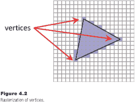

## 4.4 模型-视图矩阵与透视矩阵

在 3D 中渲染对象的一个基本步骤是创建合适的变换矩阵，并像第 4.2 节那样将它们发送到 uniform 变量。我们首先定义三个矩阵：

- 1. 一个*模型*矩阵
- 2. 一个*视图*矩阵
- 3. 一个*透视（投影）*矩阵

*模型*矩阵在世界坐标空间中定位和定向对象。每个模型都有自己的模型矩阵，如果模型移动，该矩阵将需要不断重建。

*视图*矩阵在世界中移动和旋转模型，以模拟相机位于所需位置的效果。回想第 2 章，OpenGL 相机位于位置 (0,0,0)，并朝向负 Z 轴方向。为了模拟该相机以某种方式移动后的外观，我们需要以相反方式移动对象本身。例如，将相机向右移动会使场景中的对象看起来向左移动；尽管 OpenGL 相机是固定的，但我们可以通过将对象向左移动，使它看起来好像我们将相机向右移动了。

*透视*矩阵是一种变换，它根据所需视锥体提供 3D 效果，如第 3 章前面所述。

同样重要的是要理解每种矩阵应在何时计算。永不变化的矩阵可以在 *init()* 中构建，而变化了的矩阵则需要在 *display()* 中构建，以便为每一帧重新构建。假设模型是动画的，且相机可移动。那么：

- 需要*为每个模型*、*在每一帧*创建模型矩阵。
- 视图矩阵需要*每帧创建一次*（因为相机可以移动），但对于该帧中渲染的所有对象都是相同的。
- 透视矩阵创建一次（在 *init()* 中），使用屏幕窗口的宽度和高度（以及所需的视锥体参数），并且通常保持不变，除非窗口大小改变。

生成模型和视图变换矩阵随后在 *display()* 函数中进行，如下所示：

- 1. 根据所需的相机位置和方向构建视图矩阵。
- 2. 对每个模型执行以下操作：
  - i. 根据模型的位置和方向构建模型矩阵。
  - ii. 将模型矩阵和视图矩阵连接成单个“MV”矩阵。
  - iii. 将 MV 矩阵和投影矩阵发送到对应的着色器 uniform 变量。

从技术上讲，不必将模型矩阵和视图矩阵合并成单个矩阵。也就是说，它们可以以各自独立的矩阵发送到顶点着色器。然而，将它们合并、同时保持透视矩阵独立有一定优势。例如，在顶点着色器中，模型中的每个顶点都会与这些矩阵相乘。由于复杂模型可能有数百甚至数千个顶点，通过在发送到顶点着色器之前先对模型矩阵和视图矩阵进行一次预乘，可以提高性能。稍后，我们将看到出于光照目的需要保持透视矩阵独立。

## 4.5 我们的第一个 3D 程序——一个 3D 立方体

现在该把所有部分组合起来了！为了构建一个完整的 Java/JOGL/GLSL 系统，以在 3D“世界”中渲染我们的立方体，需要将目前描述的所有机制组合起来并完美协调。我们可以重用第 2 章中之前见过的一些代码。具体来说，我们不会重复以下用于读取包含着色器代码的文件、编译和链接它们以及检测 GLSL 错误的函数；事实上，回想一下，我们已经将它们移到了“Utils.java”文件中：

- createShaderProgram()
- readShaderSource()
- checkOpenGLError()
- printProgramLog()
- printShaderLog()

我们还需要一个实用函数来构建透视矩阵，给定 Y 轴指定的视场角、屏幕宽高比以及所需的近裁剪面和远裁剪面（第 4.9 节讨论了如何为近裁剪面和远裁剪面选择合适的值）。虽然我们可以轻松地自己编写这样的函数，但 JOML 已经包含了一个：

```
Matrix4f.setPerspective(<field of view>, <aspect ratio>, <near plane>, <far plane>);
```

现在，我们构建完整的 3D 立方体程序，如程序 4.1 所示。

### 程序 4.1 纯红色立方体

Java/JOGL 应用程序

```
import java.nio.*;
import javax.swing.*;
import java.lang.Math;
```


```java
import static com.jogamp.opengl.GL4.*;
import com.jogamp.opengl.*;
import com.jogamp.opengl.awt.GLCanvas;
import com.jogamp.common.nio.Buffers;
import com.jogamp.opengl.GLContext;
import org.joml.*;

public class Code extends JFrame implements GLEventListener
{
    private GLCanvas myCanvas;

    private int renderingProgram;
    private int vao[] = new int[1];
    private int vbo[] = new int[2];
    private float cameraX, cameraY, cameraZ;
    private float cubeLocX, cubeLocY, cubeLocZ;

    // allocate variables used in display() function, so that they won’t need to be allocated during rendering
    private FloatBuffer vals = Buffers.newDirectFloatBuffer(16);  // utility buffer for transferring matrices
    private Matrix4f pMat = new Matrix4f();            // perspective matrix
    private Matrix4f vMat = new Matrix4f();            // view matrix
    private Matrix4f mMat = new Matrix4f();            // model matrix
    private Matrix4f mvMat = new Matrix4f();           // model-view matrix
    private int mLoc, pLoc;
    private float aspect;

    public Code()
    {
        setTitle("Chapter4 - program1a");
        setSize(600, 600);
        myCanvas = new GLCanvas();
        myCanvas.addGLEventListener(this);
        this.add(myCanvas);
        this.setVisible(true);
    }

    public void init(GLAutoDrawable drawable)
    {
        GL4 gl = (GL4) GLContext.getCurrentGL();
        renderingProgram = Utils.createShaderProgram("vertShader.glsl", "fragShader.glsl");
        setupVertices();
        cameraX = 0.0f; cameraY = 0.0f; cameraZ = 8.0f;
        cubeLocX = 0.0f; cubeLocY = -2.0f; cubeLocZ = 0.0f;  // shifted down the Y-axis to reveal perspective
    }

    // main(), reshape(), and dispose() are unchanged
    public static void main(String[] args) { new Code(); }
    public void reshape(GLAutoDrawable drawable, int x, int y, int width, int height) { }
    public void dispose(GLAutoDrawable drawable) { }
}
```

```java
-1.0f, -1.0f, 1.0f, -1.0f, 1.0f, 1.0f, 1.0f, 1.0f, 1.0f,
-1.0f, -1.0f, 1.0f, -1.0f, -1.0f, -1.0f, 1.0f, 1.0f,
-1.0f, -1.0f, -1.0f, -1.0f, 1.0f, -1.0f, -1.0f, -1.0f, 1.0f,
-1.0f, -1.0f, 1.0f, 1.0f, -1.0f, 1.0f, 1.0f, -1.0f, -1.0f,
1.0f, -1.0f, -1.0f, -1.0f, -1.0f, -1.0f, -1.0f, -1.0f, 1.0f,
-1.0f, 1.0f, -1.0f, 1.0f, 1.0f, -1.0f, 1.0f, 1.0f, 1.0f,
1.0f, 1.0f, 1.0f, -1.0f, 1.0f, 1.0f, -1.0f, 1.0f, -1.0f
};
gl.glGenVertexArrays(vao.length, vao, 0);
gl.glBindVertexArray(vao[0]);
gl.glGenBuffers(vbo.length, vbo, 0);

gl.glBindBuffer(GL_ARRAY_BUFFER, vbo[0]);
FloatBuffer vertBuf = Buffers.newDirectFloatBuffer(vertexPositions);
gl.glBufferData(GL_ARRAY_BUFFER, vertBuf.limit()*4, vertBuf, GL_STATIC_DRAW);
    }
}
```

#### 顶点着色器（文件名："vertShader.glsl"）

```glsl
#version 430

layout (location=0) in vec3 position;

uniform mat4 mv_matrix;
uniform mat4 p_matrix;

void main(void)
{
  gl_Position = p_matrix * mv_matrix * vec4(position, 1.0);
}
```

#### 片段着色器（文件名："fragShader.glsl"）

```glsl
#version 430

out vec4 color;

uniform mat4 mv_matrix;
uniform mat4 p_matrix;

void main(void)
{
  color = vec4(1.0, 0.0, 0.0, 1.0);
}
```


**图 4.3**
程序 4.1 的输出：位于 (0,-2,0) 的红色立方体，从 (0,0,8) 处观察。

让我们仔细看看程序 4.1 中的代码。重要的是我们要理解*所有*部分如何工作，*以及它们如何协同工作*。

从检查 Java/JOGL 清单接近末尾的函数 `setupVertices()` 开始，它由 `init()` 调用。在该函数的开头，声明了一个名为 `vertexPositions` 的数组，其中包含构成立方体的 36 个顶点。起初你可能会想，为什么这个立方体有 36 个顶点，而逻辑上一个立方体应该只需要八个。答案是，我们需要用三角形来构建立方体，因此立方体的六个面中的每一个都需要由两个三角形构成，总共为 6×2=12 个三角形（见图 4.4）。由于每个三角形由三个顶点指定，因此总共为 36 个顶点。由于每个顶点有三个值（x,y,z），所以数组中共有 36×3=108 个值。确实，每个顶点会参与多个三角形，但我们仍然分别指定每个顶点，因为目前我们是分别把每个三角形的顶点沿管线向下传递。

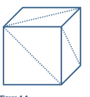

立方体在其自身的坐标系中定义，(0,0,0) 位于其中心，其各个角沿 x、y、z 轴的范围为 -1.0 到 +1.0。`setupVertices()` 函数的其余部分设置 VAO、两个 VBO（尽管只使用了一个），并将立方体顶点加载到第 0 个 VBO 缓冲区中。

请注意，`init()` 函数执行只需要完成一次的任务：读入着色器代码并构建渲染程序，以及通过调用“`setupVertices()`”将立方体顶点加载到缓冲区中。请注意，它还将立方体和相机定位在世界中；稍后我们将为立方体制作动画，并了解如何移动相机，届时我们可能需要移除这种硬编码的定位。

现在让我们看看 `display()` 函数。回想一下，`display()` 可能会被反复调用，其调用速率称为*帧率*。也就是说，动画通过非常快速地不断绘制和重绘场景（或*帧*）来工作。通常有必要在渲染一帧之前清除深度缓冲区，以便正确进行隐藏面消除（有时不清除深度缓冲区会导致所有表面都被移除，从而产生完全黑屏）。默认情况下，OpenGL 中的深度值范围为 0.0 到 1.0。清除深度缓冲区通过调用 `glClear(GL_DEPTH_BUFFER_BIT)` 完成，它用默认值（通常为 1.0）填充深度缓冲区。

接下来，`display()` 通过调用 `glUseProgram()` 启用着色器，将 GLSL 代码安装到 GPU 上。回想一下，这并不会运行着色器程序，但它确实使后续的 OpenGL 调用能够确定着色器的*顶点属性*和*统一变量*位置。`display()` 函数接下来获取统一变量位置；构建透视矩阵、视图矩阵和模型矩阵；^3 将视图矩阵和模型矩阵连接成单个 MV 矩阵；并将透视矩阵和 MV 矩阵分配给它们对应的统一变量。

接下来，`display()` 启用包含立方体顶点的缓冲区，并将其附加到第 0 个顶点属性，以准备将顶点发送到着色器。

`display()` 做的最后一件事是通过调用 `glDrawArrays()` 绘制模型，指定该模型由三角形组成并且总共有 36 个顶点。对 `glDrawArrays()` 的调用之前通常会有额外的命令，用于调整该模型的渲染设置。^4 在这个例子中，有两个这样的命令，它们都与深度测试有关。回想第 2 章，OpenGL 使用深度测试来执行隐藏面消除。这里我们启用深度测试，并指定我们希望 OpenGL 使用的特定深度测试。所示设置与第 2 章中的描述相对应；在本书后面，我们将看到这些命令的其他用途。

最后，考虑着色器。首先，请注意它们都包含相同的统一变量声明块。尽管这并不总是必需的，但在特定渲染程序中的所有着色器中包含相同的统一变量声明块通常是一种好做法。

还要注意，在顶点着色器中，传入的顶点属性 position 上存在布局限定符。由于位置被指定为“0”，`display()` 函数可以简单地通过在 `glVertexAttribPointer()` 函数调用的第一个参数中使用 0，以及在 `glEnableVertexAttribArray()` 函数调用中使用 0 来引用该变量。还要注意，position 顶点属性被声明为 `vec3`，因此需要将其转换为 `vec4`，以便与将要与之相乘的 4×4 矩阵兼容。此转换通过 `vec4(position,1.0)` 完成，它从名为“position”的变量构建一个 `vec4`，并在新添加的第四个位置放入值 1.0。

^3 细心的读者可能会注意到，不应该在每次调用 `display()` 时都构建透视矩阵，因为它的值不会改变。这在一定程度上是正确的——如果用户在程序运行时*调整*窗口大小，透视矩阵*确实*需要重新计算。在 4.11 节中，我们将更高效地处理这种情况，并在此过程中将透视矩阵的计算从 `display()` 移到 `init()` 函数中。

^4 通常，这些调用可以放在 `init()` 中而不是 `display()` 中。然而，当绘制具有不同属性的多个对象时，有必要将其中一个或多个调用放在 `display()` 中。为简单起见，我们总是将它们放在 `display()` 中。


#### 修订后的顶点着色器：

```glsl
#version 430

layout (location=0) in vec3 position;
uniform mat4 mv_matrix;
uniform mat4 p_matrix;

out vec4 varyingColor;

void main(void)
{
    gl_Position = p_matrix * mv_matrix * vec4(position,1.0);
    varyingColor = vec4(position,1.0) * 0.5 + vec4(0.5, 0.5, 0.5, 0.5);
}
```

#### 修订后的片元着色器：

```glsl
#version 430

in vec4 varyingColor;

out vec4 color;
uniform mat4 mv_matrix;
uniform mat4 p_matrix;

void main(void)
{
    color = varyingColor;
}
```

请注意，由于颜色是通过顶点属性（varyingColor）从顶点着色器输出的，*它们也会被光栅化器插值*！其效果可以在图4.6中看到，其中从一角到另一角的颜色在整个立方体上明显被平滑地插值。

还要注意，顶点着色器中的“out”变量 varyingColor 也是片元着色器中的“in”变量。两个着色器知道顶点着色器中的哪个变量供给片元着色器中的哪个变量，因为它们在两个着色器中具有相同的名称——“varyingColor”。

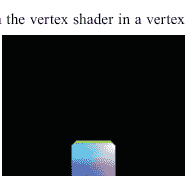

**图4.6**
带插值颜色的立方体。

我们可以像程序2.6中那样使用Animator类来为立方体制作动画，方法是基于经过的时间，使用变化的平移和旋转来构建模型矩阵。例如，程序4.1中display()函数里的代码可以按如下方式修改（更改部分已突出显示）：

```
gl.glClear(GL_DEPTH_BUFFER_BIT);
gl.glClear(GL_COLOR_BUFFER_BIT);

// use system time to generate slowly-increasing sequence of floating-point values
elapsedTime = System.currentTimeMillis() - startTime;  // elapsedTime, startTime, and tf
tf = elapsedTime / 1000.0;  // would all be declared of type double.
...
// use tf (time factor) to compute different translations in x, y, and z
mMat.identity();
mMat.translate((float)Math.sin(.35f*tf)*2.0f, (float)Math.sin(.52f*tf)*2.0f, (float)Math.sin(.7f*tf)*2.0f);
mMat.rotateXYZ(1.75f*(float)tf, 1.75f*(float)tf, 1.75f*(float)tf);  // the 1.75 adjusts the rotation speed
```

在模型矩阵中使用经过的时间（以及各种三角函数）会使立方体看起来在空间中翻滚。请注意，添加此动画说明了每次通过display()时清除深度缓冲区以确保正确隐藏面消除的重要性。这也需要像所示那样清除颜色缓冲区；否则，立方体在移动时会留下拖尾。

translate()和rotateXYZ()函数是JOML库的一部分。请注意，在代码中，translate()在rotate()之前调用。这导致两个变换的连接，其中平移在左侧，旋转在右侧。当顶点随后乘以该矩阵时，计算是从右到左的，这意味着先进行旋转，然后进行平移。变换的应用顺序很重要，改变顺序会导致不同的行为。图4.7显示了为立方体制作动画后显示的一些帧。

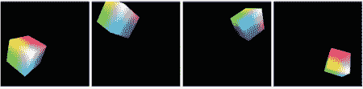

**图4.7**
动画（“翻滚”）3D立方体。

## 4.6 渲染对象的多个副本

在我们处理在单个场景中渲染各种模型的一般情况之前，先考虑同一模型的*多次出现*这一更简单的情况。例如，假设我们希望扩展前面的示例，使其渲染由24个翻滚立方体组成的“蜂群”。我们可以通过将`display()`中构建MV矩阵和绘制立方体的代码部分（如下所示）移入一个执行24次的循环来实现。我们将循环变量纳入立方体的旋转和平移中，以便每次绘制立方体时构建不同的模型矩阵。（我们还将相机沿正Z轴进一步下移，以便看到所有立方体，并将乘数从2.0增加到8.0以将它们分散开。）得到的动画场景如图4.8所示。

```java
public void display(GLAutoDrawable drawable)
{
   ...
   timeFactor = elapsedTime/1000.0;

   for (i=0; i<24; i++)
   {
      x = timeFactor * i;
      mMat.identity();
      mMat.translate((float)Math.sin(.35f*i)*8.0f, (float)Math.sin(.52f*i)*8.0f, (float)Math.sin(.70f*i)*8.0f);
      mMat.rotateXYZ(1.75f*(float)i, 1.75f*(float)i, 1.75f*(float)i);

      mvMat.identity();
      mvMat.mul(vMat);
      mvMat.mul(mMat);

      gl.glUniformMatrix4fv(mvLoc, 1, false, mvMat.get(vals));
      gl.glUniformMatrix4fv(pLoc, 1, false, pMat.get(vals));

      gl.glBindBuffer(GL_ARRAY_BUFFER, vbo[0]);
      gl.glVertexAttribPointer(0, 3, GL_FLOAT, false, 0, 0);
      gl.glEnableVertexAttribArray(0);

      gl.glEnable(GL_DEPTH_TEST);
      gl.glDepthFunc(GL_LEQUAL);
      gl.glDrawArrays(GL_TRIANGLES, 0, 36);
   }
}
```

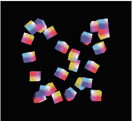

**图4.8**
多个翻滚的立方体。

### 4.6.1 实例化

实例化提供了一种机制，可以只使用一次Java调用就告诉图形卡渲染对象的多个副本。这可以带来显著的性能优势，特别是当正在绘制的对象有数千或数百万个副本时——例如渲染田野中的许多花朵，或军队中的许多僵尸。

我们首先将Java/JOGL应用程序中的glDrawArrays()调用更改为glDrawArraysInstanced()。现在我们可以要求OpenGL绘制任意数量的副本。我们可以如下指定绘制24个立方体：

```
glDrawArraysInstanced(GL_TRIANGLES, 0, 36, 24);
```

使用实例化时，顶点着色器可以访问一个内置变量gl_InstanceID，这是一个整数，表示当前正在处理的是对象的哪个数字实例。

要使用实例化复现我们之前的翻滚立方体示例，我们需要将构建不同模型矩阵的计算（之前位于display()中的循环内）移到顶点着色器中。由于GLSL不提供translate或rotate函数，并且我们不能在着色器内部调用JOML，我们将需要使用程序3.1中的实用函数。我们还需要通过uniform将“时间因子”变量从Java/JOGL应用程序传递到顶点着色器。我们还需要在单独的uniform变量中传递视图矩阵，因为旋转计算已移到顶点着色器。这些修订，包括Java/JOGL应用程序中的修订和新顶点着色器中的修订，如程序4.2所示。

### 程序4.2 实例化：24个动画立方体

*顶点着色器：*

```glsl
#version 430
layout (location=0) in vec3 position;

uniform mat4 v_matrix;             // only the P and V matrices are sent from the application
uniform mat4 p_matrix;
uniform float tf;                  // time factor for animation and placement of cubes

out vec4 varyingColor;

mat4 buildRotateX(float rad);      // declaration of matrix transformation utility functions
mat4 buildRotateY(float rad);      // (GLSL requires functions to be declared prior to invocation)
mat4 buildRotateZ(float rad);
mat4 buildTranslate(float x, float y, float z);

void main(void)
{
    float x = gl_InstanceID + tf;  // value based on time factor, but different for each cube instance

    float a = sin(.35 * x) * 8.0;  // these are the x, y, and z components for the translation, below
    float b = sin(.52 * x) * 8.0;
    float c = sin(.70 * x) * 8.0;

    // build the rotation and translation matrices to be applied to this cube’s model matrix
    mat4 localRotX = buildRotateX(1.75*x);
    mat4 localRotY = buildRotateY(1.75*x);
    mat4 localRotZ = buildRotateZ(1.75*x);
    mat4 localTrans = buildTranslate(a,b,c);

    // build the model matrix and then the model-view matrix
    mat4 newM_matrix = localTrans * localRotX * localRotY * localRotZ;
    mat4 mv_matrix = v_matrix * newM_matrix;

    gl_Position = p_matrix * mv_matrix * vec4(position, 1.0);
    varyingColor = vec4(position,1.0) * 0.5 + vec4(0.5, 0.5, 0.5, 0.5);
}

// utility function to build a translation matrix (from Chapter 3)
mat4 buildTranslate(float x, float y, float z)
{  mat4 trans = mat4( 1.0, 0.0, 0.0, 0.0,
```


最终输出如图 4.9 所示。

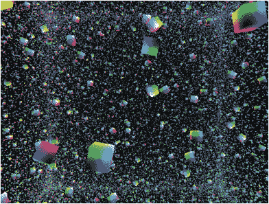

**图 4.9**  
实例化 100,000 个动画立方体。

## 4.7 在场景中渲染多个不同模型

要在单一场景中渲染多个模型，一种简单的方法是为每个模型使用独立的缓冲区。每个模型都需要自己的模型矩阵，因此每渲染一个模型都会生成一个新的模型视图矩阵。此外，每个模型还需要分别调用 `glDrawArrays()`。这些改动同时涉及 `init()` 和 `display()`。

另一个需要考虑的问题是，对于我们要绘制的每个对象，是否需要不同的着色器或不同的渲染程序。事实证明，*在许多情况下，我们可以为正在绘制的各种对象使用相同的着色器*（以及相同的渲染程序）。通常，只有当对象由不同的图元构成（例如线段而非三角形），或者涉及复杂光照或其他效果时，我们才需要为不同对象使用不同的渲染程序。目前情况并非如此，因此我们可以复用相同的顶点着色器和片段着色器，只需修改 Java/JOGL 应用程序，使 `display()` 被调用时能将每个模型送入渲染管线。

接下来，我们添加一个简单的金字塔，使场景中同时包含一个立方体和一个金字塔。代码如程序 4.3 所示。其中突出显示了几个关键细节，例如在何处指定某一个缓冲区，以及在何处指定模型包含的顶点数量。请注意，金字塔由六个三角形组成——四个侧面和两个底面，总计 6×3=18 个顶点。

同时包含立方体和金字塔的最终场景如图 4.10 所示。

### 程序 4.3 立方体与金字塔

```java
private void setupVertices()
{
    GL4 gl = (GL4) GLContext.getCurrentGL();

    float[] cubePositions =
    { -1.0f,  1.0f, -1.0f, -1.0f, -1.0f,  1.0f, -1.0f,
       1.0f, -1.0f, -1.0f,  1.0f, -1.0f, -1.0f,
       ... 与之前相同，其余立方体顶点
    };

    // 金字塔有 18 个顶点，组成 6 个三角形（四个侧面，两个底面）
    float[] pyramidPositions =
    {
       -1.0f, -1.0f,  1.0f,  1.0f, -1.0f,  1.0f,  0.0f, 0.0f,       // 前面
        1.0f, -1.0f,  1.0f,  1.0f, -1.0f, -1.0f,  0.0f, 1.0f,       // 右面
        1.0f, -1.0f, -1.0f, -1.0f, -1.0f, -1.0f,  0.0f, 1.0f,       // 后面
       -1.0f, -1.0f, -1.0f, -1.0f, -1.0f,  1.0f,  0.0f, 0.0f,       // 左面
       -1.0f, -1.0f,  1.0f,  1.0f, -1.0f,  1.0f, -1.0f, -1.0f, 1.0f, // 底面 – 左前
        1.0f, -1.0f,  1.0f, -1.0f, -1.0f, -1.0f,  1.0f, -1.0f, 1.0f, // 底面 – 右后
    };
    gl.glGenVertexArrays(vao.length, vao, 0);
    gl.glBindVertexArray(vao[0]);
    gl.glGenBuffers(vbo.length, vbo, 0);

    gl.glBindBuffer(GL_ARRAY_BUFFER, vbo[0]);
    FloatBuffer cubeBuf = Buffers.newDirectFloatBuffer(cubePositions);
    gl.glBufferData(GL_ARRAY_BUFFER, cubeBuf.limit()*4, cubeBuf, GL_STATIC_DRAW);

    gl.glBindBuffer(GL_ARRAY_BUFFER, vbo[1]);
    FloatBuffer pyrBuf = Buffers.newDirectFloatBuffer(pyramidPositions);
    gl.glBufferData(GL_ARRAY_BUFFER, pyrBuf.limit()*4, pyrBuf, GL_STATIC_DRAW);
}

public void display(GLAutoDrawable drawable)
{
    // ... 清除颜色和深度缓冲区，与之前相同（此处未显示）
    // ... 使用渲染程序并获取 uniform 位置，与之前相同（此处未显示）

    // 设置投影矩阵和视图矩阵
    aspect = (float) myCanvas.getWidth() / (float) myCanvas.getHeight();
    pMat.setPerspective((float) Math.toRadians(60.0f), aspect, 0.1f, 1000.0f);

    vMat.translation(-cameraX, -cameraY, -cameraZ);

    // 绘制立方体（使用缓冲区 #0）
    mMat.translation(cubeLocX, cubeLocY, cubeLocZ);

    mvMat.identity();
    mvMat.mul(vMat);
    mvMat.mul(mMat);

    gl.glUniformMatrix4fv(mvLoc, 1, false, mvMat.get(vals));
    gl.glUniformMatrix4fv(pLoc, 1, false, pMat.get(vals));

    gl.glBindBuffer(GL_ARRAY_BUFFER, vbo[0]);
    gl.glVertexAttribPointer(0, 3, GL_FLOAT, false, 0, 0);
    gl.glEnableVertexAttribArray(0);

    gl.glEnable(GL_DEPTH_TEST);
    gl.glDepthFunc(GL_LEQUAL);

    gl.glDrawArrays(GL_TRIANGLES, 0, 36);

    // 绘制金字塔（使用缓冲区 #1）
    mMat.translation(pyrLocX, pyrLocY, pyrLocZ);

    mvMat.identity();
    mvMat.mul(vMat);
    mvMat.mul(mMat);

    gl.glUniformMatrix4fv(mvLoc, 1, false, mvMat.get(vals));
    gl.glUniformMatrix4fv(pLoc, 1, false, pMat.get(vals));
                     //（为清晰起见重复）
    gl.glBindBuffer(GL_ARRAY_BUFFER, vbo[1]);
    gl.glVertexAttribPointer(0, 3, GL_FLOAT, false, 0, 0);
    gl.glEnableVertexAttribArray(0);

    gl.glEnable(GL_DEPTH_TEST);
    gl.glDepthFunc(GL_LEQUAL);

    gl.glDrawArrays(GL_TRIANGLES, 0, 18);
}
```

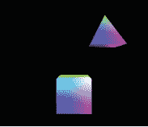

**图 4.10**  
3D 立方体和金字塔。

关于程序 4.3，还有其他一些细节需要注意：

- 变量 `pyrLocX`、`pyrLocY` 和 `pyrLocZ` 需要在类中声明，并在 `init()` 中初始化为所需的金字塔位置，方法与立方体位置相同。
- 视图矩阵 `vMat` 在 `display()` 的开头构建，然后同时用于立方体和金字塔的模型视图矩阵。
- 顶点着色器和片段着色器未显示——它们与第 4.5 节相比没有变化。

## 4.8 矩阵堆栈

到目前为止，我们渲染的每个模型都由单一的一组顶点构成。然而，我们通常希望通过组合较小的简单模型来构建复杂模型。例如，一个“机器人”模型可以通过分别绘制头部、身体、腿部和手臂来创建，其中每个部分都是一个独立的模型。以这种方式构建的对象通常称为*层次模型*。构建层次模型的棘手之处在于跟踪所有的模型视图矩阵，并确保它们完美协调——否则机器人可能会飞散成碎片！

层次模型不仅可用于构建复杂对象，还可用于生成复杂场景。例如，考虑我们的地球如何围绕太阳公转，以及月球如何围绕地球公转。这样的场景如图 4.11 所示。⁵ 计算月球在空间中的实际路径可能很复杂。然而，如果我们能够*组合*代表两条简单圆形路径的变换——月球围绕地球的路径和地球围绕太阳的路径——就可以避免显式计算月球的轨迹。

⁵ 是的，我们知道月球并不是以这种“垂直”轨迹围绕地球公转，而是以与地球围绕太阳公转更共面的方式。我们选择这个轨道是为了让程序的执行更清晰。

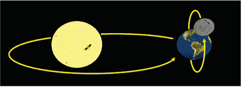

**图 4.11**  
动画行星系统。  
*来源：* 太阳和地球纹理来自 [HT12]；月球纹理来自 [NA21]。

事实证明，我们可以利用*矩阵堆栈*相当轻松地做到这一点。顾名思义，矩阵堆栈就是一组变换矩阵的堆栈。我们将看到，矩阵堆栈使得创建和管理复杂的层次对象与场景变得容易，在这些对象和场景中，变换可以建立在其他变换之上（也可以从中移除）。

OpenGL 内置了矩阵堆栈，但作为旧式固定功能（不可编程）管线的一部分，它早已被弃用。它设计巧妙且使用方便，令人高兴的是，JOML 中提供了一个类似的 Java 类，名为 `Matrix4fStack`，其模式仿照旧版 OpenGL 中流行的那个类 [OL16]。我们将看到，复杂场景中通常需要的许多模型、视图和模型视图矩阵，都可以替换为单一的 `Matrix4fStack` 实例。

我们首先考察实例化并使用矩阵堆栈的基本命令，然后使用 `Matrix4fStack` 来构建一个复杂的动画场景。一些重要的 `Matrix4fStack` 函数包括：

- `pushMatrix()`——复制栈顶矩阵并将副本压入堆栈
- `popMatrix()`——移除并返回栈顶矩阵
- `get(v)`——将最顶层矩阵的值复制到缓冲区 `v` 中，并返回该缓冲区的引用（最顶层矩阵不会从堆栈中移除）
- `rotate(x,y,z)`
- `scale(x,y,z)`
- `translate(x,y,z)`——直接应用于堆栈中的最顶层矩阵


Matrix4fStack 被设计为 Matrix4f 的子类，因此继承了 Matrix4f 中定义的所有函数。如果在 Matrix4fStack 上调用其中某个函数，它会作用于栈顶的矩阵（事实上，上面列出的 get()、rotate()、scale() 和 translate() 函数就是这种机制的示例，许多其他 JOML 矩阵函数也是如此，例如矩阵拼接）。

现在，我们不再通过创建 Matrix4f 实例来构建变换，而是使用 pushMatrix() 命令在栈顶创建新矩阵。然后，根据需要将所需的变换应用到栈顶新创建的矩阵上。

压入栈中的第一个矩阵通常是 VIEW 矩阵。它上面的矩阵是复杂度递增的模型-视图矩阵；也就是说，应用到这些矩阵上的模型变换数量越来越多。这些变换既可以直接应用，也可以先拼接其他矩阵再应用。

在我们的行星系统示例中，紧挨着 VIEW 矩阵上方的矩阵将是太阳的 MV 矩阵。再上方的矩阵将是地球的 MV 矩阵，*它由太阳 MV 矩阵的副本应用地球模型矩阵变换后构成。* 也就是说，地球的 MV 矩阵是通过将行星的变换并入太阳的变换而构建的。类似地，月球的 MV 矩阵位于行星 MV 矩阵的上方，是通过将月球的模型矩阵变换应用到紧邻其下方的行星 MV 矩阵而构建的。

渲染完月球后，可以通过将第一个月球的矩阵从栈中“弹出”（将栈顶恢复为行星的模型-视图矩阵），然后对第二个月球重复该过程，来渲染第二个“月球”。

基本方法如下：

- 1. 当相对于父对象引入一个新对象时，执行一次“pushMatrix()”调用。
- 2. 应用新对象的变换；即，将一个变换乘到栈顶矩阵上。
- 3. 当一个对象或子对象绘制完成后，调用“popMatrix()”将其模型-视图矩阵从矩阵栈顶移除。

在后面的章节中，我们将学习如何创建球体，并让它们看起来像行星和月球。目前，为了保持简单，我们将使用我们的金字塔和几个立方体来构建一个“行星系统”。

下面是使用矩阵栈的 display() 函数通常如何组织的概述：

| 阶段 | 步骤 |
|---|---|
| **设置** | - 实例化矩阵栈。 |
| **相机** | - 将一个新矩阵压入栈中。（这将实例化一个空的 VIEW 矩阵。）<br>- 对栈顶的视图矩阵应用变换。 |
| **父对象** | - 将一个新矩阵压入栈中（这将是父对象的 MV 矩阵——对于第一个父对象，它会复制视图矩阵）。<br>- 应用变换，将父对象的 M 矩阵并入复制后的视图矩阵。<br>- 将最顶部的矩阵（“get”）发送到顶点着色器中的 MV uniform 变量。<br>- 绘制父对象。 |
| **子对象** | - 将一个新矩阵压入栈中。这将是子对象的 MV 矩阵，复制父对象的 MV 矩阵。<br>- 应用变换，将子对象的 M 矩阵并入复制后的父对象 MV 矩阵。<br>- 将最顶部的矩阵（“get”）发送到顶点着色器中的 MV uniform 变量。<br>- 绘制子对象。 |
| **清理** | - 将子对象的 MV 矩阵从栈中弹出。<br>- 将父对象的 MV 矩阵从栈中弹出。<br>- 将 VIEW 矩阵从栈中弹出。 |

请注意，金字塔（“太阳”）绕其轴线的旋转位于其自身的局部坐标空间中，不应影响“子对象”（本例中为行星和月球）。因此，太阳的旋转（如下图所示）会被压入栈中，但在绘制完太阳后，必须将其从栈中移除（弹出）。

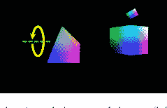

大立方体（行星）绕太阳的公转（下方左图）会影响月球的运动，因此它被压入栈中，并且在绘制月球时也保留在栈中。相比之下，行星绕其轴线的自转（下方右图）是局部的，不会影响月球，因此在绘制月球之前会将其从栈中弹出。

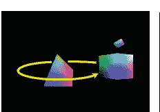

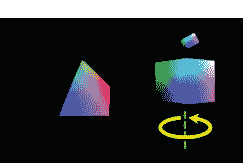

类似地，我们会将月球旋转（绕行星旋转和绕自身轴线旋转）的变换压入栈中，如下列图片所示。

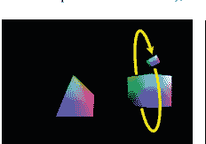

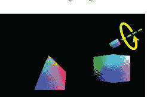

下面是“行星”的步骤序列：

- **pushMatrix()**——这将是行星 MV 矩阵中也会影响子对象的部分。
- **translate(...)**——这会将行星绕太阳的运动并入行星的 MV 矩阵。在本例中，我们使用三角函数将行星运动计算为一个平移。
- **pushMatrix()**——这将是行星完整的 MV 矩阵，也包括其轴线旋转。
- **rotate(...)**——这会将行星的轴线旋转并入（稍后会被弹出，不会影响子对象）。
- **get()**——这将获取 MV 矩阵，然后将其发送到 MV uniform。
- 绘制行星。
- **popMatrix()**——这将把行星 MV 矩阵从栈中移除，露出其下方较早的行星 MV 矩阵副本，该副本不包含行星的轴线旋转（因此只有行星的平移会影响月球）。

现在我们可以编写完整的 display() 例程，如程序 4.4 所示。

### 程序 4.4 使用矩阵栈的简单太阳系

```java
private Matrix4fStack mvStack = new Matrix4fStack(5);
public void display(GLAutoDrawable drawable)
{ // setup of background, depth buffer, rendering program, and proj matrices unchanged

    tf = elapsedTime/1000.0;  // time factor, as before
    . . .
    // push view matrix onto the stack
    mvStack.pushMatrix();
    mvStack.translate(-cameraX, -cameraY, -cameraZ);

    // ---------------- pyramid == sun -------------------------------
    mvStack.pushMatrix();
    mvStack.translate(0.0f, 0.0f, 0.0f);              // sun’s position
    mvStack.pushMatrix();
    mvStack.rotate((float)tf, 1.0f, 0.0f, 0.0f);     // sun’s rotation on its axis
    gl.glUniformMatrix4fv(mvLoc, 1, false, mvStack.get(vals));
    gl.glBindBuffer(GL_ARRAY_BUFFER, vbo[1]);
    gl.glVertexAttribPointer(0, 3, GL_FLOAT, false, 0, 0);
    gl.glEnableVertexAttribArray(0);
    gl.glEnable(GL_DEPTH_TEST);
```

顶点着色器和片段着色器未显示——它们与上一个示例相比没有变化。我们还移动了金字塔（太阳）和相机的初始位置，以使场景在屏幕上居中。

## 4.9 应对“Z-FIGHTING”伪影

回想一下，在渲染多个对象时，OpenGL 使用*Z 缓冲区算法*（前面图 2.14 所示）来执行隐藏面消除。通常，它通过将像素颜色选择为最接近相机的对应片段的颜色，来解决哪些对象表面可见并渲染到屏幕，以及哪些表面位于其他对象之后因而不应渲染的问题。

然而，有时场景中的两个对象表面会重叠并位于重合平面上，使 Z 缓冲区算法难以确定应渲染这两个表面中的哪一个（因为两者都不“最接近”相机）。发生这种情况时，浮点舍入误差可能导致渲染表面的某些部分使用其中一个对象的颜色，而其他部分使用另一个对象的颜色。这种伪影称为*Z 冲突*或*深度冲突*，因为该效果是渲染片段在 Z 缓冲区中相互对应的像素条目上“争夺”的结果。图 4.12 显示了两个具有重叠重合（顶部）面的盒子之间发生 Z 冲突的示例。

这类情况在创建地形或阴影时经常发生。在这类情况下通常可以预测 Z 冲突，而一种常见的纠正方法是稍微移动一个对象，使表面不再共面。我们将在第 8 章看到一个示例。

Z 冲突也可能由于深度缓冲区中数值的精度有限而发生。对于 Z 缓冲区算法处理的每个像素，其深度信息的精度受限于可用于存储的位数

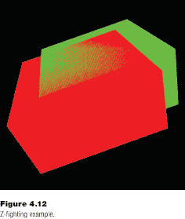


它在深度缓冲区中。用于构建透视矩阵的近裁剪面和远裁剪面之间的范围越大，两个对象的点（实际深度相似但不相等）就越有可能在深度缓冲区中被表示为相同的数值。因此，程序员需要选择近裁剪面和远裁剪面的值，以最小化两个平面之间的距离，同时确保场景中所有必要的对象都位于视锥体内。

同样重要的是要理解，由于透视变换的效果，改变近裁剪面的值比等效地改变远裁剪面的值，对 Z-fighting 伪影出现可能性的影响更大。因此，建议避免选择离眼睛太近的近裁剪面。

本书前面的示例在调用 perspective() 时，对近、远裁剪面简单地使用了 0.1 和 1000 这两个值。这些值可能需要根据你的场景进行调整。

## 4.10 图元的其他选项

OpenGL 支持多种图元类型——到目前为止，我们已经看到了两种：GL_TRIANGLES 和 GL_POINTS。实际上，还有其他几种。OpenGL 支持的所有可用图元类型都属于三角形、线段、点和补丁（patch）这几类。以下是完整列表：

### 三角形图元

| 图元 | 描述 |
|---|---|
| **GL_TRIANGLES**<br> | 本书中最常用的图元类型。经过管线的顶点构成独立的三角形：<br>`vertices:` 0 1 2 3 4 5 6 7 8 等。<br>`triangles:` ✓ ✓ ✓ |
| **GL_TRIANGLE_STRIP**<br> | 经过管线的每个顶点会与前面两个顶点高效地构成一个三角形：<br>`vertices:` 0 1 2 3 4 等。<br>`triangles:` ✓ ✓ ✓ |
| GL_TRIANGLE_FAN | [示意图：顶点 0、1、2、3、4 构成三角形扇形] 经过管线的每一对顶点都会与第一个顶点构成一个三角形：<br><br>*vertices:* 0 1 2 3 4 等。<br><br>*triangles:* [三角形示意图] |
| GL_TRIANGLES_ADJACENCY | 仅用于几何着色器。允许着色器访问当前三角形的顶点，以及额外的相邻顶点。 |
| GL_TRIANGLE_STRIP_ADJACENCY | 仅用于几何着色器。与 GL_TRIANGLES_ADJACENCY 类似，不同之处在于三角形顶点像 GL_TRIANGLE_STRIP 一样重叠。 |

### 线段图元

| 图元 | 描述 |
|---|---|
| GL_LINES | [示意图：两组独立线段] 经过管线的顶点构成独立的线段：<br><br>*vertices:* 0 1 2 3 4 5 等。<br><br>*lines:* [线段示意图] |
| GL_LINE_STRIP | [示意图：由连续顶点构成的线段] 经过管线的每个顶点会与前面的顶点高效地构成一条线段：<br><br>*vertices:* 0 1 2 3 等。<br><br>*lines:* [线段示意图] |
| GL_LINE_LOOP | 与 GL_LINE_STRIP 相同，只是在第一个顶点和最后一个顶点之间也会形成一条线段。 |
| GL_LINES_ADJACENCY | 用于几何着色器。允许着色器访问当前线段的顶点，以及额外的相邻顶点。 |
| GL_LINE_STRIP_ADJACENCY | 与 GL_LINES_ADJACENCY 类似，不同之处在于线段顶点像 GL_LINE_STRIP 一样重叠。 |

### 点图元

| 图元 | 描述 |
|---|---|
| GL_POINTS | 经过管线的每个顶点都是一个点。 |

### 补丁图元

| 图元 | 描述 |
|---|---|
| GL_PATCHES | 仅用于曲面细分着色器（tessellation shaders）。它表示一组顶点从顶点着色器传递到曲面细分控制着色器，在那里它们通常用于将细分网格塑造成曲面。 |

## 4.11 性能编码

随着 3D 场景复杂度的增加，我们会越来越关注性能。我们已经看到过一些为了速度而做出编码决策的例子，例如使用实例化（instancing）以及将开销较大的计算移入着色器。

实际上，我们呈现的代码已经包含了一些我们尚未讨论的额外优化，其中部分优化得益于 JOML 数学库。现在我们探讨这些优化以及其他重要技术。

### 4.11.1 尽量减少动态内存分配

在 Java/JOGL 应用程序中，与性能相关的关键模块显然是 display() 函数。这是在任何动画或实时渲染期间被反复调用的函数，因此我们必须在这个函数（或它调用的任何函数）中力求最高效率。

将 display() 函数中的开销保持在最低限度的一个重要方法是避免任何需要内存分配的步骤。因此，需要避免的典型例子包括：

- 实例化对象
- 声明变量
- 分配缓冲区

我们鼓励读者回顾一下到目前为止开发的每个程序，并注意在 display() 函数实际被调用之前，display() 函数中使用的每个变量（除了 GL4 变量 gl）都已声明并分配了空间。另一个例子是 Matrix4fStack，JOML 要求预先分配最大栈大小，这样整个栈就会提前分配完毕，因此在 display() 中执行的“压栈”操作不会动态分配空间。实际上，我们现在尽量减少 display() 中出现的任何类型的声明或实例化。例如，程序 4.1 在其清单的开头包含了以下代码块：

```
    // allocate variables used in display(), so they aren't allocated during rendering
    private FloatBuffer vals = Buffers.newDirectFloatBuffer(16);   // for transferring matrices
    private Matrix4f pMat = new Matrix4f();    // perspective matrix
    private Matrix4f vMat = new Matrix4f();    // view matrix
    private Matrix4f mMat = new Matrix4f();    // model matrix
    private Matrix4f mvMat = new Matrix4f();   // model-view matrix
    private int mvLoc, pLoc;
    private float aspect;
```

请注意，我们特意在代码块顶部添加了一条注释，表明这些变量是为在 display() 函数中稍后使用而预先分配的（尽管我们只是现在才明确指出来）。

还有其他更微妙的例子。例如，将数据从一种类型转换为另一种类型的函数调用，在某些情况下可能会实例化并返回转换后的新数据。因此，理解从 display() 调用的任何库函数的行为非常重要。

幸运的是，我们使用的数学库 JOML 经过精心设计，可以消除（或至少尽量减少）调用其函数所导致的内存分配，同时仍然提供 OpenGL 所需的功能。它的大多数函数直接作用于调用该函数的对象，或作用于其参数之一（而不是构建一个结果并返回它），因此在这两种情况下，都可以预先分配保存结果的空间。

JOML 在以这种方式最大化性能方面的巧妙设计，可以从对 glUniformMatrix4fv() 的调用中看出。让我们仔细看看这样一个调用，它将模型视图矩阵传输到一个 uniform 变量：

```
    gl.glUniformMatrix4fv(mvLoc, 1, false, mvMat.get(vals));
```

回想一下，变量 mvMat 的类型是 Matrix4f，我们希望将该矩阵中的值发送到由 mvLoc 指向的着色器 uniform。不出所料，JOML 库提供了一个 get() 函数来获取矩阵值。我们通常可能会期望这样的“get”函数将那些值返回到一个对象（例如数组）中（就像其他数学库如 glm 或 graphicslib3D 所做的那样）。然而，JOML 却要求在调用 get() 时包含一个参数，然后将该参数用作放置检索到的矩阵值的目的地。巧妙之处在于，JOML 的 get() 函数还会返回一个对用户提供的目的地对象的引用，因此可以直接将对 get() 的调用放入 glUniformMatrix4fv() 的调用中（该调用期望这样的引用）。还要注意，我们已经在 display() 外部的声明块中声明并分配了这个目的地变量“vals”（以及 display() 中使用的所有其他变量）。从某种意义上说，get() 实际上是在做一种“put”，但以这种方式实现时，显然能够满足 OpenGL 环境中“get”函数的需求，而且效率要高得多。

按照 JOML 开发人员的建议，我们使用了期望 FloatBuffer 作为目的地参数形式的 get()。JOGL 允许将缓冲区或数组传输到结构化 uniform 变量（例如 mat4 或 vec4）。但使用缓冲区时性能稍好一些，尤其是在这里，因为 JOML 强制使用直接 NIO 缓冲区，而不是作为 Java 基本类型包装器的缓冲区。

### 4.11.2 预计算透视矩阵

另一个可以减少 display() 函数开销的优化措施，是将透视矩阵的计算移到 init() 函数中。我们之前在 4.5 节中（嗯，在一个脚注中）提到过这种可能性。虽然这当然很容易做到，但有一个小问题。虽然通常不需要重新计算透视矩阵，但如果运行应用的用户*调整*了窗口大小（例如通过拖动窗口角落的调整大小手柄），那么就有*必要*重新计算。

幸运的是，每当窗口大小调整时，JOGL 都会自动调用 reshape()。到目前为止，我们一直将 reshape() 函数留空——现在我们可以利用它了。我们只需将计算透视矩阵的代码移到 init() 中，并同时将其复制到 reshape()。


例如，考虑程序4.1。如果我们重新组织代码，将透视矩阵的计算从 display() 中移除，那么 init()、display() 和 reshape() 函数的修订版本将如下所示：

```java
public void init(GLAutoDrawable drawable)
{
    // same as earlier, plus the following two lines:
    aspect = (float) myCanvas.getWidth() / (float) myCanvas.getHeight();
    pMat.setPerspective((float) Math.toRadians(60.0f), aspect, 0.1f, 1000.0f);
}

public void display(GLAutoDrawable drawable)
{
    // same as earlier, except with the following lines removed:
    // build perspective matrix
    // aspect = (float) myCanvas.getWidth() / (float) myCanvas.getHeight();
    // pMat.setPerspective((float) Math.toRadians(60.0f), aspect, 0.1f, 1000.0f);
    // the rest of the function is unchanged
}

public void reshape(GLAutoDrawable drawable, int x, int y, int width, int height)
{
    GL4 gl = (GL4) GLContext.getCurrentGL();
    aspect = (float) width / (float) height;    // new window width & height are provided by the callback
    gl.glViewport(0, 0, width, height);         // sets region of screen associated with the frame buffer
    pMat.setPerspective((float) Math.toRadians(60.0f), aspect, 0.1f, 1000.0f);
}
```

### 4.11.3 背面剔除

提高渲染效率的另一种方法是利用 OpenGL 执行*背面剔除*的能力。当一个 3D 模型完全“封闭”时，即其内部永远不可见（例如立方体和棱锥），那么结果表明，外表面中那些背向观察者成角度的部分总是会被同一模型的某个其他部分遮挡。也就是说，那些背向观察者的三角形不可能被看到（无论如何它们都会被隐藏面消除覆盖掉），因此没有理由对它们进行光栅化或渲染。

我们可以通过命令 glEnable(GL_CULL_FACE) 要求 OpenGL 识别并“剔除”（不渲染）背面朝向的三角形。我们也可以使用 glDisable(GL_CULL_FACE) 禁用面剔除。默认情况下，面剔除是禁用的，因此如果你希望 OpenGL 剔除背面朝向的三角形，就必须启用它。

启用面剔除后，默认情况下只渲染*正面朝向*的三角形。同样默认情况下，如果从 OpenGL 相机观察时，一个三角形的三个顶点按*逆时针*方向排列（基于它们在缓冲区中定义的顺序），则该三角形被视为正面朝向。顶点按顺时针方向排列的三角形（从 OpenGL 相机观察）是*背面朝向*的，不会被渲染。这种将“正面朝向”定义为逆时针的做法有时称为*环绕顺序*，并且可以通过函数调用 glFrontFace(GL_CCW) 显式设置为逆时针（默认），或通过 glFrontFace(GL_CW) 设置为顺时针。类似地，也可以显式设置渲染的是正面朝向还是背面朝向的三角形。实际上，为此我们指定哪些三角形*不*渲染——也就是哪些被“剔除”。我们可以通过调用 glCullFace(GL_BACK) 指定剔除背面朝向的三角形（尽管这没有必要，因为这是默认行为）。或者，我们可以通过分别将参数 GL_BACK 替换为 GL_FRONT 或 GL_FRONT_AND_BACK，来指定改为剔除正面朝向的三角形，甚至剔除所有三角形。

正如我们将在第6章看到的，3D 模型通常被设计为其外表面由具有相同环绕顺序的三角形构成——最常见的是逆时针——因此如果启用了剔除，默认情况下会渲染模型外表面中面向相机的部分。由于 OpenGL 默认假定环绕顺序为逆时针，如果某个模型被设计为以*顺时针*环绕顺序显示，那么在启用背面剔除时，程序员需要调用 glFrontFace(GL_CW) 来处理这种情况。

注意，对于 GL_TRIANGLE_STRIP 的情况，每个三角形的环绕顺序会交替变化。OpenGL 通过如下方式在构建每个后续三角形时“翻转”顶点序列来补偿这一点：0-1-2，然后是 2-1-3、2-3-4、4-3-5、4-5-6，依此类推。

背面剔除通过确保 OpenGL 不会花时间光栅化和渲染那些永远不打算被看到的表面来提高性能。我们在本章中看到的大多数示例都非常小，因此几乎没有启用面剔除的动力（一个例外是图4.9所示的示例，其中有 100,000 个实例化动画立方体，这可能在某些系统上带来性能挑战）。在实践中，大多数 3D 模型通常是“封闭”的，因此习惯上会常规启用背面剔除。例如，我们可以通过如下修改 display() 函数，将背面剔除添加到程序4.3中：

```java
public void display(GLAutoDrawable drawable)
{
  . . .
  gl.glEnable(GL_CULL_FACE);

  // draw the cube

  gl.glEnable(GL_DEPTH_TEST);
  gl.glDepthFunc(GL_LEQUAL);
  gl.glFrontFace(GL_CW);         // the cube vertices have clockwise winding order
  gl.glDrawArrays(GL_TRIANGLES, 0, 36);

  // draw the pyramid

  . . .
  gl.glEnable(GL_DEPTH_TEST);
  gl.glDepthFunc(GL_LEQUAL);
  gl.glFrontFace(GL_CCW);        // the pyramid vertices have counter-clockwise winding order
  gl.glDrawArrays(GL_TRIANGLES, 0, 18);
}
```

使用背面剔除时，正确设置环绕顺序很重要。错误的设置（例如本应为 GL_CCW 时却设为 GL_CW）可能导致渲染对象的内部而不是外部，进而产生类似于错误透视矩阵所造成的失真。

效率并不是进行面剔除的唯一原因。在后续章节中，我们将看到其他用途，例如当我们想看到 3D 模型的*内部*时，或在使用透明度时。

## 补充说明

JOML 拥有种类繁多的函数，用于执行平移、旋转和缩放。例如，JOML 的函数“translate()”和“translation()”略有不同。前者将平移连接到现有矩阵上，而后者构建一个平移矩阵。我们在示例中已经使用了这两个函数，还有许多其他函数可供选择。读者应仔细复核所使用的 JOML 函数确实执行了期望的操作。

正如本章所提到的，在使用 Java 缓冲区时，建议确保只使用直接缓冲区。例如，很容易想用 Java 的 FloatBuffer.wrap() 函数将存储在数组中的顶点数据放入缓冲区。然而，wrap() 生成的是*非直接*缓冲区，其中得到的缓冲区只是对仍存储在数组中的数据的包装。⁶ 将数据复制到*直接*缓冲区的一种方法是：分配一个直接 ByteBuffer，使用 ByteBuffer.asFloatBuffer() 将其视为 FloatBuffer，然后使用带 put() 命令的循环逐个复制数据。如前所述，JOGL 的 com.jogamp.common.nio.Buffers 类提供了便捷方法，可将数组数据加载到多种缓冲区类型中，从而更容易填充直接缓冲区：

- `newDirectByteBuffer(byte[ ])`
- `newDirectCharBuffer(char[ ])`
- `newDirectDoubleBuffer(double[ ])`
- `newDirectFloatBuffer(float[ ])`
- `newDirectIntBuffer(int[ ])`
- `newDirectLongBuffer(long[ ])`
- `newDirectShortBuffer(short[ ])`

使用上述 JOGL 方法用顶点数据（即打算供 JOGL 应用程序使用的数据）填充缓冲区，还能确保正确的本机字节序。它还能确保正确的容量分配，并且无需进行显式分配。

在 OpenGL/JOGL/GLSL 中，还有大量其他功能和结构可用于管理和利用数据，而本章只是触及了表面。例如，我们还没有介绍*统一块*，这是一种用于组织统一变量的机制，类似于 C 语言中的*结构体*。统一块甚至可以设置为从缓冲区接收数据。另一种强大的机制是*着色器存储块*，它本质上是一个着色器可以写入的缓冲区。

关于管理数据的众多选项，一个很好的参考资料是 *OpenGL 超级宝典* [SW15]，特别是其中题为“数据”的一章（第七版第5章）。它还描述了许多细节和选项

⁶ 在 JOGL 中实际上允许使用非直接缓冲区。但是，当把非直接缓冲区传递给 JOGL 方法时，JOGL 会将其转换为直接缓冲区，而这种转换会带来性能损失。


针对我们已经介绍过的各种命令。本章的前两个示例程序——程序4.1和程序4.2——受到 *SuperBible* 中类似示例的启发。

还有其他类型的数据，我们需要学习如何管理它们，以及如何将它们沿 OpenGL 管线向下传递。其中之一是 *纹理*，它包含彩色图像数据（例如照片中的图像数据），可用于“绘制”场景中的对象。我们将在第5章研究纹理图像。另一个我们将进一步研究的重要缓冲区是 *深度缓冲区*（或 Z 缓冲区）。当我们在第8章研究阴影时，它将变得很重要。关于在 OpenGL 中管理图形数据，我们还有很多要学习！

## 练习

- 4.1（*项目*）修改程序4.1，将立方体替换为你自己设计的其他简单 3D 形状。确保在 glDrawArrays() 命令中正确指定顶点数量。

- 4.2（*项目*）在程序4.1中，“视图”矩阵在 display() 函数中仅被定义为相机位置的负值：

  ```
  vMat.translation(-cameraX, -cameraY, -cameraZ);
  ```

  将这段代码替换为图3.13所示计算的实现。这样你就可以通过指定相机位置和三个朝向轴来定位相机。你会发现有必要存储第3.7节中描述的向量 U、V、N。然后，尝试不同的相机视点，并观察渲染出的立方体最终呈现的外观。

- 4.3（*项目*）修改程序4.4，加入第二个“行星”，即你在练习4.1中自定义的 3D 形状。确保你的新“行星”位于与现有行星不同的轨道上，以免它们相撞。

- 4.4（*项目*）修改程序4.4，使“视图”矩阵使用“look-at”函数构造（如第3.9节所述）。然后尝试将“look-at”参数设置为各种位置，例如看向太阳（在这种情况下场景应显示正常）、看向行星或看向月球。

- 4.5（*研究*）为 glCullFace(GL_FRONT_AND_BACK) 提出一种实际用途。

## 参考文献

- [BL21] Blender，Blender 基金会，访问于2021年3月，https://www.blender.org/
- [HT12] J. Hastings-Trew，*JHT 的行星像素商场*，访问于2021年3月，http://planetpixelemporium.com/
- [MA21] Maya，AutoDesk, Inc.，访问于2021年3月，http://www.autodesk.com/products/maya/overview
- [NA21] NASA 3D 资源，访问于2021年3月，http://nasa3d.arc.nasa.gov/
- [OL16] 旧版 OpenGL，访问于2020年7月，https://www.khronos.org/opengl/wiki/Legacy_OpenGL
- [SW15] G. Sellars、R. Wright Jr. 和 N. Haemel，*OpenGL SuperBible：综合教程与参考*，第7版（Addison-Wesley，2015）。


**图 5.1**  
使用两幅不同图像为海豚模型添加纹理 [TU16]。

## 5.1 加载纹理图像文件

在 JOGL/GLSL 中高效完成纹理映射，需要协调若干数据集和机制：

- 一个用于保存纹理图像的 *纹理对象*（本章仅讨论 2D 图像）
- 一个特殊的 *统一采样器* 变量，以便顶点着色器可以访问纹理
- 一个用于保存 *纹理坐标* 的缓冲区
- 一个用于将纹理坐标沿管线向下传递的顶点属性
- 显卡上的一个 *纹理单元*

纹理图像可以是任何事物的图片。它可以是人造物或自然界事物的图片，例如布料、草地或行星表面，也可以是几何图案，例如图5.1中的棋盘格。在电子游戏和动画电影中，纹理图像通常用于为角色绘制面部和服装，或为生物绘制皮肤，例如图5.1中的海豚。

图像通常存储在图像文件中，例如 .jpg、.png、.gif 或 .tiff。为了使纹理图像可供 OpenGL 管线中的着色器使用，我们需要从图像中提取颜色，并将其放入 OpenGL *纹理对象*（一种用于保存纹理图像的 OpenGL 内置结构）中。

Java 在其 imageio 和 awt 包中提供了一些有用的图像文件工具，可用于读取纹理图像。步骤如下：(a) 使用我们在第4章见过的 JOGL 缓冲区工具，将图像数据读入 ByteBuffer；(b) 使用 glGenTextures() 实例化一个纹理对象，并为其分配一个整数 ID；(c) 调用 glBindTexture() 使新创建的纹理对象处于活动状态；(d) 使用 glTexImage2D() 命令将先前读入的图像数据加载到纹理对象中；(e) 使用 glTexParameter() 函数调整纹理设置。结果是一个整数 ID，它引用现在可用的 OpenGL 纹理对象。我们将在本章末尾逐步讲解这些步骤。

然而，JOGL 包含自己的纹理处理工具，这些工具使将纹理图像文件加载到 OpenGL 纹理对象中变得简单得多。这些工具位于 JOGL 的 Texture、TextureIO 和 TextureData 类中。

为对象添加纹理，首先要声明一个 Texture 类型的变量。这是一个 JOGL 类；JOGL 的 Texture 对象充当 OpenGL 纹理对象的包装器。接下来，我们调用 newTexture()——TextureIO 类中的一个静态方法——来实际生成纹理对象。newTexture() 函数接受一个图像文件名作为其参数之一（支持多种标准图像文件类型，包括上面提到的四种）。这些步骤在以下函数中实现：

```java
public static int loadTexture(String textureFileName)
{
    Texture tex = null;
    try { tex = TextureIO.newTexture(new File(textureFileName), false); }
    catch (Exception e) { e.printStackTrace(); }
    int textureID = tex.getTextureObject();
    return textureID;
}
```

我们会经常使用这个函数，因此将其添加到 Utils.java 工具类中。随后，Java/JOGL 应用程序只需调用上面的 loadTexture() 函数，即可如下创建 OpenGL 纹理对象：

```java
int myTexture = Utils.loadTexture("image.jpg");
```

其中 image.jpg 是纹理图像文件，myTexture 是生成的 OpenGL 纹理对象的整数 ID。

## 5.2 纹理坐标

现在我们已经有了将纹理图像加载到 OpenGL 中的方法，接下来需要指定希望如何将纹理应用到对象的渲染表面。为此，我们为模型中的每个顶点指定 *纹理坐标*。

纹理坐标是对（通常是 2D）纹理图像中像素的引用。纹理图像中的像素称为 *纹素*，以便与屏幕上正在渲染的像素区分开。纹理坐标用于将 3D 模型上的点映射到纹理中的位置。模型表面上的每个点除了具有将其置于 3D 空间中的 (x,y,z) 坐标外，还具有纹理坐标 (s,t)，用于指定纹理图像中哪个纹素提供其颜色。因此，对象表面由纹理图像“绘制”。纹理在对象表面上的朝向由纹理坐标到对象顶点的分配决定。

为了使用纹理映射，*必须为要添加纹理的对象中的每个顶点提供纹理坐标*。OpenGL 将使用这些纹理坐标，通过查找图像中被引用纹素处存储的颜色，来确定模型中每个光栅化像素的颜色。为了确保渲染模型中的每个像素都用纹理图像中合适的纹素绘制，*纹理坐标被放入一个顶点属性中，以便它们也由光栅化器进行插值。*这样，纹理图像就会随模型顶点一起被插值或填充。

对于每一组经过顶点着色器的顶点坐标 (x,y,z)，都会伴随一组纹理坐标 (s,t)。因此，我们将设置两个缓冲区：一个用于顶点（每个条目包含三个分量 x、y 和 z），另一个用于对应的纹理坐标（每个条目包含两个分量 s 和 t）。这样，每次顶点着色器调用都会接收一个顶点，该顶点现在既包含其空间坐标，也包含其对应的纹理坐标。


纹理坐标通常是二维的（OpenGL 确实支持其他维度，但本章不涉及）。通常假设图像是矩形的，其左下角为 (0,0)，右上角为 (1,1)。¹ 因此，纹理坐标的理想取值范围是 (0,1)。

请考虑图 5.2 所示的示例。回想一下，立方体模型是由三角形构成的。立方体一个侧面的四个角被突出显示，但请记住，每个正方形侧面需要两个三角形来指定。该立方体侧面的六个顶点（其中左上角和右下角的角各包含一对顶点）的纹理坐标与四个角一起列出。图中还显示了一幅纹理图像。纹理坐标（由 s 和 t 索引）已将图像的一部分（纹素）映射到模型前表面光栅化后的像素上。请注意，顶点之间的所有中间像素都被图像中相应的中间纹素所填充。这是因为纹理坐标以*顶点属性*的形式发送到片元着色器，因此*也同样被插值*，就像顶点本身一样。

在此示例中，为了便于说明，我们特意指定了纹理坐标，使表面呈现出一种奇特的绘制效果。如果仔细观察，你还会发现图像似乎被轻微拉伸——这是因为纹理图像的宽高比与给定纹理坐标下立方体表面的宽高比不匹配。

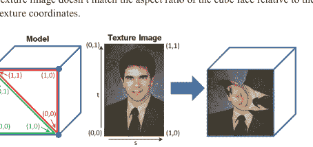

**图 5.2**
纹理坐标。

¹ 这是 OpenGL 纹理对象所采用的朝向。然而，这与许多标准图像文件格式中存储的图像的朝向不同，这些格式的原点在左上角。通过垂直翻转图像来重新调整其方向，使其符合 OpenGL 预期的格式，是我们从 loadTexture() 函数调用的 JOGL newTexture() 所执行的操作之一。

对于像立方体或棱锥这样的简单模型，选择纹理坐标相对容易。但对于包含大量三角形的更复杂的曲面模型，手工确定它们就不太实际了。对于曲面几何形状，如球体或圆环，可以通过算法或数学方式计算纹理坐标。对于使用 Maya [MA21] 或 Blender [BL21] 等建模工具构建的模型，此类工具提供了“UV 映射”（这不在本书范围内）来简化这一任务。

让我们回到棱锥的渲染，不过这次要用砖块图像对其进行纹理映射。我们需要指定 (a) 一个用于保存纹理图像的 OpenGL 纹理对象，(b) 模型顶点的纹理坐标，(c) 一个用于保存纹理坐标的缓冲区，(d) 顶点属性，以便顶点着色器能够接收纹理坐标并将其沿管线转发，(e) 显卡上用于保存纹理对象的纹理单元，以及 (f) 一个用于在 GLSL 中访问纹理单元的 *uniform 采样器* 变量，我们稍后将看到。这些内容将在接下来的各节中分别描述。

## 5.3 创建纹理对象

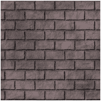

假设这里显示的图像存储在一个名为 “brick1.jpg” [LU16] 的文件中。

如前所示，我们可以通过调用 loadTexture() 函数来加载该图像，如下所示：

```java
int brickTexture = Utils.loadTexture("brick1.jpg");
```

回想一下，纹理对象通过整数 ID 来标识，因此 brickTexture 的类型是 int。

## 5.4 构建纹理坐标

我们的棱锥有四个三角形侧面和一个正方形底面。虽然从几何上讲这只需要五个 (5) 点，但我们一直使用三角形来渲染它。这需要四个三角形组成侧面，两个三角形组成正方形底面，总共六个三角形。每个三角形有三个顶点，因此模型中必须指定总共 6*3=18 个顶点。

我们已经在程序 4.3 的 float 数组 pyramidPositions[] 中列出了棱锥的几何顶点。有很多方法可以调整纹理坐标的方向，以便将砖块绘制到棱锥上。一种简单（尽管不完美）的方法是将图像顶部中心对应到棱锥的顶点，如下所示：

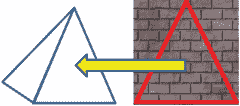

我们可以对全部四个三角形侧面都这样做。我们还需要绘制棱锥的底面正方形，它由两个三角形组成。一种简单且合理的方法是使用图片中的整个区域对其进行纹理映射（棱锥已被向后倾斜，并侧放在一边）：

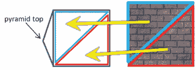

对于程序 4.3 中棱锥的前九个顶点，使用这种非常简单的策略，相应的顶点和纹理坐标集如图 5.3 所示。

| 顶点 | 纹理坐标 | 注释 |
|---|---|---|
| (-1.0, -1.0, 1.0) | (0, 0) | // 前面 |
| (1.0, -1.0, 1.0) | (1, 0) | |
| (0, 1.0, 0) | (.5, 1) | |
| (1.0, -1.0, 1.0) | (0, 0) | // 右面 |
| (1.0, -1.0, -1.0) | (1, 0) | |
| (0, 1.0, 0) | (.5, 1) | |
| (1.0, -1.0, -1.0) | (0, 0) | // 后面 |
| (-1.0, -1.0, -1.0) | (1, 0) | |
| (0, 1.0, 0) | (.5, 1) | |
| 等等。 | | |

**图 5.3**
棱锥的纹理坐标（部分列表）。


**图 5.5**
使用“冰”图像进行纹理映射的棱锥。

### 程序 5.1 带砖块纹理的棱锥

#### JAVA/JOGL 应用程序

```java
// the following additional imports will be necessary for the texture functions:
import java.io.*;
import java.nio.*;
import com.jogamp.opengl.util.texture.*;

public class Code extends JFrame implements GLEventListener
{ // previous declarations and constructor code applies. We just need to add declarations for the texture:
    ...
    private int brickTexture;
    ...
    public Code()
    { // unchanged ...
    }

    public void display(GLAutoDrawable drawable)
    { GL4 gl = (GL4) GLContext.getCurrentGL();
        ...
        // setup of background color, depth buffer.
        // PROJ matrix moved to init() and reshape() as described in Chapter 2
        ...
        // this time we are drawing only the pyramid.
        // setup of M and MV matrices is unchanged.
        ...
        // activate buffer #0, which contains the vertices
        gl.glBindBuffer(GL_ARRAY_BUFFER, vbo[0]);
        gl.glVertexAttribPointer(0, 3, GL_FLOAT, false, 0, 0);
        gl.glEnableVertexAttribArray(0);

        // activate buffer #1, which contains the texture coordinates
        gl.glBindBuffer(GL_ARRAY_BUFFER, vbo[1]);
        gl.glVertexAttribPointer(1, 2, GL_FLOAT, false, 0, 0);
        gl.glEnableVertexAttribArray(1);

        // activate texture unit #0 and bind it to the brick texture object
        gl.glActiveTexture(GL_TEXTURE0);
        gl.glBindTexture(GL_TEXTURE_2D, brickTexture);

        gl.glEnable(GL_DEPTH_TEST);
        gl.glDepthFunc(GL_LEQUAL);
        gl.glDrawArrays(GL_TRIANGLES, 0, 18);
    }

    public void init(GLAutoDrawable drawable)
    { // setup of rendering program, camera and object location unchanged
        ...
        brickTexture = Utils.loadTexture("brick1.jpg");
    }

    private void setupVertices()
    { GL4 gl = (GL4) GLContext.getCurrentGL();
      float[] pyramidPositions = { /* data as listed previously in Program 4.2 */ };
      float[] pyrTextureCoordinates =
      { 0.0f, 0.0f, 1.0f, 0.0f, 0.5f, 1.0f,
        0.0f, 0.0f, 1.0f, 0.0f, 0.5f, 1.0f,
        0.0f, 0.0f, 1.0f, 0.0f, 0.5f, 1.0f,
        0.0f, 0.0f, 1.0f, 0.0f, 0.5f, 1.0f };
      // ... generate the VAO as before, and at least two VBOs, then load the two buffers as follows:
      gl.glBindBuffer(GL_ARRAY_BUFFER, vbo[0]);
      FloatBuffer pyrBuf = Buffers.newDirectFloatBuffer(pyramidPositions);
      gl.glBufferData(GL_ARRAY_BUFFER, pyrBuf.limit()*4, pyrBuf, GL_STATIC_DRAW);

      gl.glBindBuffer(GL_ARRAY_BUFFER, vbo[1]);
      FloatBuffer pTexBuf = Buffers.newDirectFloatBuffer(pyrTextureCoordinates);
      gl.glBufferData(GL_ARRAY_BUFFER, pTexBuf.limit()*4, pTexBuf, GL_STATIC_DRAW);
    }
      // ... remainder of the class definition and utility functions here
}
```

#### 顶点着色器

```glsl
#version 430
layout(location=0) in vec3 pos;
layout(location=1) in vec2 texCoord;
out vec2 tc;       // texture coordinate output to rasterizer for interpolation
```


```glsl
uniform mat4 mv_matrix;
uniform mat4 p_matrix;
layout (binding=0) uniform sampler2D samp;    // not used in vertex shader
void main(void)
{
    gl_Position = p_matrix * mv_matrix * vec4(pos, 1.0);
    tc = texCoord;
}
```

#### 片段着色器

```glsl
#version 430
in vec2 tc;          // interpolated incoming texture coordinate
out vec4 color;
uniform mat4 mv_matrix;
uniform mat4 p_matrix;
layout (binding=0) uniform sampler2D samp;
void main(void)
{
    color = texture(samp, tc);
}
```

## 5.8 MIP映射

纹理映射通常会在渲染图像中产生各种不理想的伪影。这是因为纹理图像的分辨率或宽高比很少与场景中被纹理映射区域的分辨率或宽高比相匹配。

一种非常常见的伪影出现在图像分辨率*低于*被绘制区域的分辨率时。在这种情况下，图像需要被拉伸以覆盖该区域，从而变得模糊（并且可能发生畸变）。根据纹理的性质，有时可以通过以不同方式分配纹理坐标来缓解这一问题，使得应用纹理时需要的拉伸更少。另一种解决方案是使用更高分辨率的纹理图像。

相反的情况是图像纹理的分辨率*高于*被绘制区域的分辨率。乍一看可能完全不明显为什么这会成为问题，但它确实会！在这种情况下，会出现明显的*走样*伪影，产生看起来奇怪的虚假图案，或在运动物体中产生“闪烁”效果。

走样由*采样误差*引起。它最常与信号处理相关联：采样不足的信号在重建时，会显得具有与实际不同的属性（例如波长）。图5.6展示了一个例子。原始波形以红色显示。波形上的黄点表示采样点。如果使用这些采样点重建波形，并且采样点数量不足，它们就可能定义出另一种波形（以蓝色显示）。


类似地，在纹理映射中，当高分辨率（且高度细节化）的图像被稀疏采样时（例如使用 uniform 采样器变量时），所取回的颜色将不足以反映图像中的实际细节，反而可能看起来是随机的。如果纹理图像具有重复图案，走样可能导致产生与原始图像中*不同*的图案。如果被纹理映射的物体正在运动，纹素查找中的舍入误差可能导致给定纹理坐标处采样像素不断变化，从而在被绘制物体表面产生不需要的闪烁效果。

图5.7展示了一个倾斜的近景渲染：一个立方体的顶部使用一张大型高分辨率棋盘格图像进行了纹理映射。


在图像顶部附近，走样很明显：棋盘格的欠采样产生了“条纹”效果。尽管我们无法在这里的静态图像中展示，但如果这是一个动画场景，这些图案很可能会在诸如此类的各种错误图案之间起伏变化。

另一个例子出现在图5.8中，其中立方体使用了一张月球表面图像进行纹理映射 [HT21]。乍看之下，这张图像显得清晰且充满细节。然而，图像右上方的一些细节是虚假的，并且当立方体对象（或相机）移动时会造成“闪烁”。（遗憾的是，我们无法在静态图像中清楚地展示闪烁效果。）


**图5.8**  
纹理映射中的“闪烁”。

这些以及类似的采样误差伪影，可以通过一种称为*MIP映射*的技术在很大程度上得到纠正。该技术会以各种分辨率创建纹理图像的不同版本。然后，OpenGL 会使用与正在纹理映射的位置处分辨率最匹配的纹理图像。更进一步，可以在与正在纹理映射区域的分辨率最接近的图像之间对颜色进行平均。将 MIP映射应用于图5.7和图5.8中的图像后，结果如图5.9所示。


**图5.9**  
MIP映射后的结果。

MIP映射的工作机制很巧妙：它将同一图像的一系列分辨率依次降低的副本存储在一张比原始图像大三分之一的纹理图像中。具体做法是：将图像的 R、G、B 分量分别存储在纹理图像空间四分之三的区域中，然后在剩余四分之一大小的图像空间中，以原始分辨率的四分之一重复同一过程。这种细分会一直重复，直到剩余象限小到无法包含任何有用的图像数据。图5.10展示了一张示例图像及其生成的 MIP映射可视化结果。


**图5.10**
对图像进行MIP映射。

这种将多张图像塞入很小空间（好吧，只是比存储原始图像所需空间稍大一点）的方法，正是 MIP映射得名的由来。MIP 代表 *小空间中的大量内容*（拉丁语 *multum in parvo*）[WI83]。

实际对物体进行纹理映射时，可以通过多种方式对 MIP映射进行采样。在 OpenGL 中，可以通过将 GL_TEXTURE_MIN_FILTER 参数设置为所需的*缩小*技术来选择 MIP映射的采样方式，具体为以下之一：

- **GL_NEAREST_MIPMAP_NEAREST** 选择与正在纹理映射的像素区域分辨率最相似的 MIP映射。然后获取最接近所需纹理坐标的纹素。
- **GL_LINEAR_MIPMAP_NEAREST** 选择与正在纹理映射的像素区域分辨率最相似的 MIP映射。然后对最接近纹理坐标的四个纹素进行插值。这称为“线性过滤”。
- **GL_NEAREST_MIPMAP_LINEAR** 选择与正在纹理映射的像素区域分辨率最接近的两个 MIP映射。然后从每个 MIP映射中获取最接近纹理坐标的纹素，并对它们进行插值。这称为“双线性过滤”。
- **GL_LINEAR_MIPMAP_LINEAR** 选择与正在纹理映射的像素区域分辨率最接近的两个 MIP映射。然后对每个 MIP映射中最接近的四个纹素进行插值，再对这两个结果进行插值。这称为“三线性过滤”，如图5.11所示。


**图5.11**  
三线性过滤。


三线性过滤通常更可取，因为较低层次的混合常常会产生伪影，例如 MIP映射层级之间可见的分界。图5.12展示了仅启用线性过滤并使用 MIP映射时棋盘格的近景。请注意被圈出的伪影：在 MIP映射边界处，竖直线突然从粗变细。相比之下，图5.9中的示例使用了三线性过滤。

**图5.12**  
线性过滤伪影。

OpenGL 对 MIP映射提供了丰富支持。它提供了用于自行构建 MIP映射层级或让 OpenGL 为你构建的机制。在大多数情况下，OpenGL 自动构建的 MIP映射已经足够。为此，在调用 getTextureObject() 函数之后，立即将以下代码行添加到 Utils.loadTexture() 函数（前面第5.1节中所述）中：

```
gl.glBindTexture(GL_TEXTURE_2D, textureID);
gl.glTexParameteri(GL_TEXTURE_2D, GL_TEXTURE_MIN_FILTER, GL_LINEAR_MIPMAP_LINEAR);
gl.glGenerateMipmap(GL_TEXTURE_2D);
```

这会告诉 OpenGL 生成 MIP映射。通过 glBindTexture() 调用使砖块纹理变为活动状态，然后 glTexParameteri() 函数调用启用上面列出的缩小因子之一，例如上述调用中展示的 GL_LINEAR_MIPMAP_LINEAR，它会启用三线性过滤。

MIP映射构建完成后，可以再次调用 glTexParameteri() 来更改过滤选项（尽管很少需要这样做），例如在显示函数中。甚至可以通过选择 GL_NEAREST 或 GL_LINEAR 来禁用 MIP映射。

对于关键应用，可以使用你偏好的图像编辑软件自行构建 MIP映射。然后，在创建纹理对象时，通过对每个 MIP映射层级反复调用 OpenGL 的 glTexImage2D() 函数或 JOGL 的 updateSubImage() 函数，将它们作为 MIP映射层级添加进去。对这种方法的进一步讨论超出了本书范围。

## 5.9 各向异性过滤

MIP映射纹理有时看起来比非 MIP映射纹理更模糊，尤其是当被纹理映射的物体以严重倾斜的视角渲染时。我们在前面的图5.9中见过一个例子：与图5.8相比，使用 MIP映射减少伪影导致了细节减少。

这种细节损失之所以发生，是因为当物体倾斜时，其图元沿一个轴（即宽度与高度）看起来会比沿另一个轴更小。当 OpenGL 对图元进行纹理映射时，它会选择适合两个轴中较小轴的那个 MIP映射（以避免“闪烁”伪影）。在图5.9中，表面相对于观察者严重倾斜，因此每个渲染图元都会使用适合其缩小后高度的 MIP映射，而该 MIP映射的分辨率很可能低于适合其宽度的分辨率。


恢复部分丢失细节的一种方法是使用*各向异性过滤*（AF）。标准 mipmapping 会在各种正方形分辨率（例如 256x256、128x128 等）下对纹理图像进行采样，而 AF 还会在若干矩形分辨率下对纹理进行采样，例如 256x128、64x128 等。这使得在从各种角度观察时，能够尽可能多地保留纹理中的细节。

各向异性过滤比标准 mipmapping 的计算开销更大，并且不是 OpenGL 的必需部分。然而，大多数显卡支持 AF（这被称为 *OpenGL 扩展*），并且 OpenGL 确实提供了查询显卡是否支持 AF 的方法，以及在其支持时访问 AF 的方法。相关代码紧接在生成 mipmap 之后添加：

```
...
// if mipmapping
gl.glBindTexture(GL_TEXTURE_2D, textureID);
gl.glTexParameteri(GL_TEXTURE_2D, GL_TEXTURE_MIN_FILTER, GL_LINEAR_MIPMAP_LINEAR);
gl.glGenerateMipmap(GL_TEXTURE_2D);

// if also anisotropic filtering
if (gl.isExtensionAvailable("GL_EXT_texture_filter_anisotropic"))
{
    float anisoSetting[] = new float[1];
    gl.glGetFloatv(GL_MAX_TEXTURE_MAX_ANISOTROPY_EXT, anisoSetting, 0);
    gl.glTexParameterf(GL_TEXTURE_2D, GL_TEXTURE_MAX_ANISOTROPY_EXT, anisoSetting[0]);
}
```


调用 gl.isExtensionAvailable() 会测试显卡是否支持 AF。如果支持，我们就将其设置为受支持的最大 mipmapping 程度，该值通过所示的 glGetFloatv() 获取。然后使用 glTexParameterf() 将其应用到活动纹理对象。结果如图 5.13 所示。注意，图 5.8 中丢失的许多细节已经恢复，同时还去除了闪烁伪影。

**图 5.13**
各向异性过滤。

## 5.10 环绕与平铺

到目前为止，我们一直假设纹理坐标都落在范围 (0,1) 内。然而，OpenGL 实际上支持任意值的纹理坐标。有若干选项可用于指定当纹理坐标落在范围 (0,1) 之外时会发生什么。所需行为通过 glTexParameteri() 设置，其中一些选项如下：

- **GL_REPEAT**：纹理坐标的整数部分被忽略，生成重复或“平铺”图案。这是默认行为。
- **GL_MIRRORED_REPEAT**：整数部分被忽略，但当整数部分为奇数时坐标会反转，因此重复图案会在正常和镜像之间交替。
- **GL_CLAMP_TO_EDGE**：小于 0 和大于 1 的坐标分别被设置为 0 和 1。
- **GL_CLAMP_TO_BORDER**：(0,1) 之外的纹素将被赋予某个指定的边框颜色。

例如，考虑一个金字塔，其纹理坐标定义在范围 (0,5) 而不是范围 (0,1)。使用前面图 5.2 所示的纹理图像时，默认行为（GL_REPEAT）会导致纹理在表面上重复五次（有时称为“平铺”），如图 5.14 所示。


**图 5.14**
使用 GL_REPEAT 的纹理坐标环绕。

要使平铺块的外观在正常和镜像之间交替，我们可以指定以下内容：

```
gl.glTexParameteri(GL_TEXTURE_2D, GL_TEXTURE_WRAP_S, GL_MIRRORED_REPEAT);
gl.glTexParameteri(GL_TEXTURE_2D, GL_TEXTURE_WRAP_T, GL_MIRRORED_REPEAT);
```

指定小于 0 和大于 1 的值分别设置为 0 和 1，可以通过将 **GL_MIRRORED_REPEAT** 替换为 **GL_CLAMP_TO_EDGE** 来完成。

指定小于 0 和大于 1 的值产生“边框”颜色，可以按如下方式完成：

```
gl.glTexParameteri(GL_TEXTURE_2D, GL_TEXTURE_WRAP_S, GL_CLAMP_TO_BORDER);
gl.glTexParameteri(GL_TEXTURE_2D, GL_TEXTURE_WRAP_T, GL_CLAMP_TO_BORDER);
float[] redColor = new float[] { 1.0f, 0.0f, 0.0f, 1.0f };
gl.glTexParameterfv(GL_TEXTURE_2D, GL_TEXTURE_BORDER_COLOR, redColor, 0);
```

这些选项（镜像重复、钳制到边缘和钳制到边框）在纹理坐标范围为 −2 到 +3 时的效果，分别（从左到右）如图 5.15 所示。


在中间示例（钳制到边缘）中，纹理图像边缘的像素会向外复制。注意，作为一个副作用，金字塔面的左下和右下区域分别从纹理图像的左下和右下像素获得颜色。

### 5.5.1 透视畸变

我们已经看到，当纹理坐标从顶点着色器传递到片段着色器时，它们会在经过光栅化器时被插值。我们还看到，这是始终对顶点属性执行的自动线性插值的结果。

然而，对于纹理坐标而言，线性插值会在使用透视投影的 3D 场景中导致明显的畸变。

考虑一个由两个三角形组成、贴有棋盘图像并面向相机的矩形。当矩形绕 *X* 轴旋转时，矩形的顶部会向远离相机的方向倾斜，而矩形的下部会向更靠近相机的方向摆动。因此，我们会预期顶部的方格变小，底部的方格变大。然而，纹理坐标的线性插值反而会使*所有*方格的高度相等。沿着构成矩形的两个三角形的对角线，畸变会加剧。由此产生的畸变如图 5.16 所示。

幸运的是，存在用于校正透视畸变的算法，并且默认情况下，OpenGL 会在光栅化期间应用*透视校正*算法 [OP14, SP16]。图 5.17 展示了同一个旋转棋盘由 OpenGL 正确渲染的结果。


**图 5.16**
纹理透视畸变。


**图 5.17**
OpenGL 透视校正。

虽然不常见，但可以通过在包含纹理坐标的顶点属性声明中添加关键字“noperspective”来禁用 OpenGL 的透视校正。这必须在顶点着色器和片段着色器中都完成。例如，程序 5.1 的顶点着色器中的顶点属性将按如下方式声明：

```
    noperspective out vec2 tc;
```

片段着色器中对应的属性将声明为：

```
    noperspective in vec2 tc;
```

实际上，正是使用了第二种语法来生成图 5.16 中的畸变棋盘。

## 5.12 使用 JAVA AWT 类加载纹理图像文件

在本教材的其余部分，我们使用本章前面所述的 JOGL Texture、TextureIO 和 TextureData 类，将纹理图像数据加载到 OpenGL 纹理对象中。然而，也可以使用 Java AWT 类和一些额外的 OpenGL 命令，直接将纹理图像文件数据加载到 OpenGL 纹理中。这个过程要复杂得多，因此为了简单和清晰，本书将尽可能使用 JOGL 类。不过，了解可以替代 JOGL 纹理类使用的过程（以及特定命令）是有用的。例如，JOGL 纹理类不支持 3D 纹理，因此正如我们稍后将看到的，构建 OpenGL 3D 纹理对象将需要在 Java 中自行完成许多步骤。在构建天空盒时，我们也会使用其中一些步骤，如第 9 章所述。

程序 5.2 展示了一个不使用 JOGL 类、类似于程序 5.1 中的纹理加载函数。为避免混淆，我们将其称为 loadTextureAWT()。² 它首先调用两个实用函数（也一并展示）。第一个是 getBufferedImage()，它读取指定的图像文件（假定为 .jpg 或 .png 等可识别格式），并返回包含该图像文件数据的 Java BufferedImage。第二个实用函数 getRGBAPixelData() 从指定的 BufferedImage 中提取 RGBA 像素颜色，并以 OpenGL 所期望的形式组织在字节数组中返回。正是在这个函数中，我们可能会也可能不会像前面所述那样垂直翻转图像（由布尔参数指定），具体取决于应用。

然后，loadTextureAWT() 函数继续使用第 4 章所述的 JOGL Buffers.newDirectByteBuffer() 方法，将从 getRGBAPixelData() 返回的字节数组复制到 Java ByteBuffer 中。接着，它以类似于我们创建 VBO 的步骤的方式创建纹理对象。纹理与缓冲区一样，通过调用 glGenTextures() 被赋予整数 ID。这里，变量 textureID 用于保存生成的纹理对象的 ID。接下来，通过调用 glBindTexture() 使纹理对象变为活动状态，然后我们使用 glTexImage2D() 命令将先前读入的图像数据加载到活动纹理对象中。注意，此调用的第一个参数指定纹理对象的类型——在本例中为 GL_TEXTURE_2D（稍后我们将使用此命令创建其他类型的

OpenGL纹理，例如第9章中的纹理立方体贴图和第14章中的3D纹理。下一个命令glTexParameteri()可用于调整一些纹理设置，例如生成mipmap。当loadTextureAWT()完成时，它返回现在可用的OpenGL纹理对象的整数ID，正如我们在程序5.1中所做的那样。

假设我们已经将所有相关代码放在Utils.java工具类中，那么下面这一行对loadTextureAWT()的单次调用就会创建OpenGL纹理对象的整数ID：

```java
int brickTexture = Utils.loadTextureAWT("brick1.jpg");
```

### 程序5.2 用于加载纹理图像的Java AWT例程

```java
public static int loadTextureAWT(String textureFileName)
{   GL4 gl = (GL4) GLContext.getCurrentGL();
    BufferedImage textureImage = getBufferedImage(textureFileName);
    byte[] imgRGBA = getRGBAPixelData(textureImage, true);
    ByteBuffer rgbaBuffer = Buffers.newDirectByteBuffer(imgRGBA);

    int[] textureIDs = new int[1];                              // array to hold generated texture IDs
    gl.glGenTextures(1, textureIDs, 0);
    int textureID = textureIDs[0];                              // ID for the 0th texture object
    gl.glBindTexture(GL_TEXTURE_2D, textureID);                 // specifies the active 2D texture
    gl.glTexImage2D(GL_TEXTURE_2D, 0, GL_RGBA,                   // MIPMAP level, color space
        textureImage.getWidth(), textureImage.getHeight(), 0,   // image size, border (ignored)
        GL_RGBA, GL_UNSIGNED_BYTE,                              // pixel format and data type
        rgbaBuffer);                                            // buffer holding texture data
    gl.glTexParameteri(GL_TEXTURE_2D, GL_TEXTURE_MIN_FILTER, GL_LINEAR);
    return textureID;
}

private static BufferedImage getBufferedImage(String fileName)
{   BufferedImage img;
    try { img = ImageIO.read(new File(fileName)); }
    catch (IOException e)
    {   System.err.println("Error reading " + fileName + ""); throw new RuntimeException(e); }
    return img;
}

private static byte[] getRGBAPixelData(BufferedImage img, boolean flip)
{   byte[] imgRGBA;
    int height = img.getHeight(null);
    int width = img.getWidth(null);

    WritableRaster raster =
        Raster.createInterleavedRaster(DataBuffer.TYPE_BYTE, width, height, 4, null);
    ComponentColorModel colorModel = new ComponentColorModel(
        ColorSpace.getInstance(ColorSpace.CS_sRGB),
        new int[] { 8, 8, 8, 8 }, true, false,
        ComponentColorModel.TRANSLUCENT,          // bits, has Alpha, isAlphaPremultiplied
        DataBuffer.TYPE_BYTE);                    // transparency
                                                  // data transfer type

    BufferedImage newImage = new BufferedImage(colorModel, raster, false, null);
    Graphics2D g = newImage.createGraphics();

    // use an affine transform to "flip" the image to conform to OpenGL orientation.
    // In Java the origin is at the upper left. In OpenGL the origin is at the lower left.
    if (flip)
    {   AffineTransform gt = new AffineTransform();
        gt.translate(0, height);
        gt.scale(1, -1d);
        g.transform(gt);
    }
    g.drawImage(img, null, null);
    g.dispose();

    DataBufferByte dataBuf = (DataBufferByte) raster.getDataBuffer();
    imgRGBA = dataBuf.getData();
    return imgRGBA;
}
```

## 补充说明

研究人员已经开发出纹理单元的多种用途，而不仅仅是在场景中为模型添加纹理。在后续章节中，我们将看到如何使用纹理单元来改变光线在物体上的反射方式，使其看起来凹凸不平。我们还可以使用纹理单元存储“高度图”以生成地形，以及存储“阴影图”以高效地在场景中添加阴影。这些用途将在后续章节中描述。

着色器也可以写入纹理，从而允许着色器修改纹理图像，甚至将一个纹理的一部分复制到另一个纹理的某个部分。

Mipmap和各向异性过滤并不是减少纹理中锯齿伪影的唯一工具。例如，全场景抗锯齿（FSAA）和其他超采样方法也可以改善3D场景中纹理的外观。虽然它们不是OpenGL核心的一部分，但许多显卡通过OpenGL的扩展机制[OE21]支持它们。

还有一种配置和管理纹理与采样器的替代机制。OpenGL 3.3版本引入了*采样器对象*（有时称为“*采样器状态*”——不要与采样器变量混淆），它可以用来保存一组与实际纹理对象无关的纹理设置。采样器对象附加到纹理单元上，可以方便高效地更改纹理设置。本教科书中的示例足够简单，因此我们决定不介绍采样器对象。对于感兴趣的读者，采样器对象的使用很容易学习，而且有许多优秀的在线教程（例如[GE11]）。

JOGL的Texture类直接提供了许多与OpenGL纹理相关的函数，而不需要像本章那样提取实际的OpenGL纹理对象。例如，其中有bind()和setTexParameter()函数，它们会调用OpenGL函数glBindTexture()和glTexParameter()。在本书后面研究立方体贴图和3D纹理时，我们将进一步探索JOGL纹理类中的更多功能。关于JOGL的Texture、TextureIO和TextureData类，其详尽的Javadoc页面是一个很好的信息来源。

## 习题

- **5.1** 修改程序5.1，按照5.11节的描述，向纹理坐标顶点属性添加“noperspective”声明。然后重新运行程序，并将输出与原始程序进行比较。是否存在明显的透视失真？
- **5.2** 使用简单的“画图”程序（如Windows“画图”或GIMP [G16]），绘制一幅自己设计的手绘图。然后使用你的图像为程序5.1中的金字塔添加纹理。
- **5.3** *（项目）* 修改程序4.4，使“太阳”、“行星”和“月亮”具有纹理。你可以继续使用已有的形状，也可以使用任何你喜欢的纹理。这将要求你为立方体构建纹理坐标。

## 参考文献

- [BL21] Blender，Blender基金会，访问于2021年3月，https://www.blender.org/
- [GE11] Geeks3D，“OpenGL采样器对象：控制你的纹理单元”，2011年9月8日，访问于2021年3月，http://www.geeks3d.com/20110908/
- [GI21] GNU图像处理程序，访问于2021年3月，http://www.gimp.org
- [HT12] J. Hastings-Trew，*JHT的行星像素商场*，访问于2021年3月，http://planetpixelemporium.com/
- [LU16] F. Luna，*DirectX 12 3D游戏编程入门*，第2版（Mercury Learning，2016）。
- [MA21] Maya，AutoDesk公司，访问于2021年3月，http://www.autodesk.com/products/maya/overview
- [OE21] OpenGL注册表，Khronos集团，访问于2021年3月，https://www.khronos.org/registry/OpenGL/index_gl.php
- [OP14] OpenGL图形系统：规范（4.4版），M. Segal 和 K. Akeley，2014年3月19日，访问于2021年3月，https://www.khronos.org/registry/OpenGL/specs/gl/glspec44.core.pdf
- [OP21] OpenGL 4.5参考页面，访问于2021年3月，https://www.khronos.org/registry/OpenGL-Refpages/gl4/
- [SP16] 透视校正插值与顶点属性。Scratchapixel，©2016，访问于2021年3月。https://www.scratchapixel.com/lessons/3d-basic-rendering/rasterization-practical-implementation
- [TU18] J. Turberville，Studio522 Productions，亚利桑那州斯科茨代尔，www.studio522.com（海豚模型开发于2021年3月）。
- [WI83] L. Williams，“金字塔参数化”，*计算机图形学* 17卷，第3期（1983年7月）。

# 第6章：3D模型

- **6.1** *程序化模型——构建球体* ... 134
- **6.2** *OpenGL索引——构建环面* ... 142
- **6.3** *加载外部生成的模型* ... 148
- *补充说明* ... 158

到目前为止，我们只处理了非常简单的3D对象，例如立方体和金字塔。这些对象非常简单，以至于我们可以在源代码中显式列出所有顶点信息，并直接将其放入缓冲区。

然而，大多数有趣的3D场景包含的对象过于复杂，无法继续像我们之前那样手工构建。在本章中，我们将探索更复杂的对象模型、如何构建它们，以及如何将它们加载到我们的场景中。

3D建模本身就是一个广泛的领域，我们在这里的讨论必然非常有限。我们将重点关注以下两个主题：

- *程序化构建模型*
- *加载外部生成的模型*

虽然这只是触及了3D建模这一丰富领域的皮毛，但它将使我们能够将各种复杂且具有真实细节的对象包含到场景中。


## 6.1 程序化模型——构建球体

某些类型的对象（例如球体、圆锥体等）具有便于算法生成的数学定义。以半径为 R 的圆为例；其圆周上各点的坐标是明确定义的（图 6.1）。


**图 6.1**  
圆上的点。

我们可以系统地利用关于圆几何性质的知识，以算法方式构建球体模型。策略如下：

- 1. 选择一个*精度*，表示球体被划分成的圆形区域数量。在图 6.2 左侧，球体被切成四个区域。
- 2. 将每个圆形切片的圆周细分为若干点。见图 6.2 右侧。更多的点和水平切片会生成更精确、更平滑的球体模型。在我们的模型中，*每个切片将具有相同数量的点，包括最顶部和最底部（在这些位置，这些点是重合的）。*


**图 6.2**  
为球体构建顶点。

- 3. 将顶点组织成三角形。一种方法是遍历顶点，在每一步构建两个三角形。例如，当我们沿着图 6.3 中球体上五个彩色顶点所在的行移动时，对于这五个顶点中的每一个，我们构建以对应颜色显示的两个三角形（具体步骤将在下文更详细地描述）。


- 4. 根据纹理图像的性质选择纹理坐标。对于球体，存在许多地形纹理图像，例如图 6.4 [VE21] 所示的地球纹理图像。如果我们采用这类纹理图像，那么通过想象该图像如图 6.5 所示“包裹”在球体上，我们就可以根据图像中纹素最终对应的位置，为每个顶点分配纹理坐标。


- 5. 通常还希望为每个顶点生成*法向量*——即*垂直于模型表面*的向量。我们将在第 7 章中很快把它们用于*光照*。

确定法向量可能很棘手，但对于球体而言，从球心指向某个顶点的向量恰好等于该顶点的法向量！图 6.6 说明了这一性质（球心用“星号”标出）。


**图 6.6**  
球体顶点法向量。

一些模型使用*索引*来定义三角形。请注意，在图 6.3 中，每个顶点会出现在多个三角形中，这会导致每个顶点被多次指定。我们不必这样做，而是只存储每个顶点一次，然后为三角形的每个角指定索引，以引用所需的顶点。由于我们将存储顶点的位置、纹理坐标和法向量，因此对于大型模型而言，这有助于节省内存。

顶点存储在一维数组中，从最底部的水平切片中的顶点开始。使用索引时，关联的索引数组包含每个三角形角的一个条目。其内容是顶点数组的整数引用（具体而言是下标）。假设每个切片包含 *n* 个顶点，则顶点数组将如图 6.7 所示，同时图中还给出了对应索引数组的示例部分。


图 6.7  
顶点数组及对应的索引数组。

然后，我们可以从球体底部开始，以环形方式遍历每个水平切片上的顶点。当我们访问每个顶点时，构建两个三角形，形成一个位于该顶点上方和右侧的正方形区域，如图 6.3 所示。因此，处理过程被组织为如下嵌套循环：

```
for each horizontal slice i in the sphere (i ranges from 0 through all the slices in the sphere)
{
    for each vertex j in slice i (j ranges from 0 through all the vertices in the slice)
    {
        calculate indices for two triangles which point to neighboring vertices to the right,
        above, and to the above-right of vertex j
    }
}
```

例如，考虑图 6.3 中的“红色”顶点（图 6.8 中再次给出）。所讨论的顶点位于图 6.8 所示黄色三角形的左下角；按照刚才描述的循环，它的索引将是 `i*n+j`，其中 i 是当前正在处理的切片（外层循环），j 是该切片内当前正在处理的顶点（内层循环），n 是每个切片的顶点数。图 6.8 显示了该顶点（红色）及其三个相关相邻顶点，并给出了它们各自如何被索引的公式。


图 6.8  
为第 i 个切片中的第 j 个顶点生成的索引（n = 每个切片的顶点数）。

然后，这四个顶点用于构建为该（红色）顶点生成的两个三角形（以黄色显示）。这两个三角形在索引表中的六个条目在图中按数字 1 到 6 所示的顺序标出。注意，条目 3 和 6 都指向同一个顶点，条目 2 和 4 也是如此。因此，当我们处理到以红色高亮的顶点（即 `vertex[i*n+j]`）时，所定义的两个三角形由这六个顶点构建而成——一个三角形的条目标记为 1、2、3，引用顶点 `vertex[i*n+j]`、`vertex[i*n+j+1]` 和 `vertex[(i+1)*n+j]`；另一个三角形的条目标记为 4、5、6，引用三个顶点 `vertex[i*n+j+1]`、`vertex[(i+1)*n+j+1]` 和 `vertex[(i+1)*n+j]`。

程序 6.1 将我们的球体模型实现为一个名为 Sphere 的类。所得球体的中心位于原点。还展示了使用 Sphere 的代码。注意，每个顶点都存储为一组 JOML 类 Vector2f 和 Vector3f 的实例（这与之前的示例不同，之前顶点存储在 float 数组中）。Vector2f 和 Vector3f 包含以 float 值获取顶点 x、y、z 分量的方法，然后像以前一样将这些值放入 float 缓冲区。

注意 Sphere 类中三角形索引的计算，如前文图 6.8 所述。变量“prec”指“精度”，在此既用于球体切片数，也用于每个切片的顶点数。由于纹理映射会完全环绕球体，因此在纹理图左右边缘相接的每个位置，我们都需要一个额外的重合顶点。因此，顶点总数为 `(prec+1)*(prec+1)`。由于每个顶点生成六个三角形索引，所以索引总数为 `prec*prec*6`。

### 程序 6.1 程序化生成的球体

#### Sphere 类

```java
import org.joml.*;
import static java.lang.Math.*;

public class Sphere
{
    private int numVertices, numIndices, prec;   // prec = precision
    private int[] indices;
    private Vector3f[] vertices;
    private Vector2f[] texCoords;
    private Vector3f[] normals;

    public Sphere(int p)
    {
        prec = p;
        initSphere();
    }

    private void initSphere()
    {
        numVertices = (prec+1) * (prec+1);
        numIndices = prec * prec * 6;
        indices = new int[numIndices];
        vertices = new Vector3f[numVertices];
        texCoords = new Vector2f[numVertices];
        normals = new Vector3f[numVertices];
        for (int i=0; i<numVertices; i++) {
            vertices[i] = new Vector3f();
            texCoords[i] = new Vector2f();
            normals[i] = new Vector3f();
        }

        // calculate triangle vertices
        for (int i=0; i<=prec; i++) {
            for (int j=0; j<=prec; j++) {
                float y = (float)Math.cos(toRadians(180-i*180/prec));
                float x = -(float)Math.cos(toRadians(360/(float)prec)*j) * (float)Math.abs(Math.asin(y));
                float z = (float)Math.sin(toRadians(360/(float)prec)*j) * (float)Math.abs(Math.asin(y));
                vertices[i*(prec+1)+j].set(x,y,z);
                texCoords[i*(prec+1)+j].set((float)j/prec, (float)i/prec);
                normals[i*(prec+1)+j].set(x,y,z);
            }
        }

        // calculate triangle indices
        for(int i=0; i<prec; i++) {
            for(int j=0; j<prec; j++) {
                indices[6*(i*prec+j)+0] = i*(prec+1)+j;
                indices[6*(i*prec+j)+1] = i*(prec+1)+j+1;
                indices[6*(i*prec+j)+2] = (i+1)*(prec+1)+j;
                indices[6*(i*prec+j)+3] = i*(prec+1)+j+1;
                indices[6*(i*prec+j)+4] = (i+1)*(prec+1)+j+1;
                indices[6*(i*prec+j)+5] = (i+1)*(prec+1)+j;
            }
        }
    }

    public int getNumIndices() { return numIndices; }
    public int getNumVertices() { return numVertices; }
    public int[] getIndices() { return indices; }
    public Vector3f[] getVertices() { return vertices; }
    public Vector2f[] getTexCoords() { return texCoords; }
    public Vector3f[] getNormals() { return normals; }
}
```


```
in display()
...
gl.glDrawArrays(GL_TRIANGLES, 0, numSphereVerts);
...
```

使用 Sphere 类时，每个顶点位置和法向量需要三个值，而每个纹理坐标只需要两个值。这反映在数组（pvalues、tvalues 和 nvalues）的声明中，这些数组随后由调用 Sphere 函数获得的值填充，并加载到缓冲区中。

需要注意的是，尽管在构建球体过程中使用了索引，但最终存储在 VBO 中的球体顶点数据并不使用索引。相反，当 setupVertices() 遍历球体索引时，它会为每个索引条目在 VBO 中生成单独的（通常是冗余的）顶点条目。OpenGL 确实有一种用于索引顶点数据的机制；为简单起见，我们在本例中没有使用它，但将在下一个示例中使用 OpenGL 的索引。

图 6.9 显示了程序 6.1 的输出，精度为 48。为清晰起见，视图已略微旋转。图 6.5 中的纹理已按第 5 章所述加载。


**图 6.9** 带纹理的球体模型。


**图 6.10** OpenGL GLUT 茶壶。

## 6.2 OpenGL 索引——构建圆环体

### 6.2.1 圆环体

生成*圆环体*的算法可以在各种网站上找到。Paul Baker 在其 OpenGL 凹凸贴图教程 [PP07] 中逐步描述了如何定义一个圆形切片，然后让该切片绕一个圆旋转以形成甜甜圈。图 6.11 展示了两个视图——从侧面和从上方。


**图 6.11** 构建圆环体。

圆环体顶点位置的生成方式与构建球体时采用的方式相当不同。对于圆环体，该算法将一个顶点放置在原点右侧，然后使用绕 Z 轴的旋转，在 XY 平面上将该顶点旋转成一个圆，从而形成“环”。然后，将该环向外移动“内半径”的距离。在构建每个顶点时，会计算其纹理坐标和法向量。还会为每个顶点生成一个与圆环体表面相切的附加向量（称为*切向量*）。

其他圆环体环的顶点通过将原始环绕 Y 轴旋转形成。每个所得顶点的切向量和法向量也通过将原始环的切向量和法向量绕 Y 轴旋转来计算。创建顶点后，从一个环到另一个环遍历它们，并为每个顶点生成两个三角形。组成这两个三角形的六个索引表条目的生成方式与我们为球体所做的类似。

我们为剩余环选择纹理坐标的策略是：安排它们，使纹理图像的 S 轴绕圆环体水平周长的一半，然后对另一半重复。当绕 Y 轴旋转生成环时，我们指定一个变量 ring，它从 1 开始，增加到指定精度（再次称为“prec”）。然后，将 S 纹理坐标值设置为 ring*2.0/prec，使 S 的范围在 0.0 到 2.0 之间，接着按第 5.10 节所述将纹理的平铺模式设置为 GL_REPEAT。这种做法的动机是避免纹理图像在水平方向上显得过度“拉伸”。反之，如果我们确实希望纹理完全绕圆环体拉伸，只需从纹理坐标计算中移除“*2.0”乘数。

在 Java/JOGL 中构建圆环体类可以采用与 Sphere 类几乎相同的方式。然而，我们可以利用 OpenGL 对顶点索引的支持，来利用构建圆环体时创建的索引（我们本也可以对球体这样做，但没有）。对于具有数千个顶点的大型模型，使用 OpenGL 索引可以提高性能，因此我们接下来将描述如何做到这一点。

### 6.2.2 OpenGL 中的索引

在我们的球体和圆环体模型中，都会生成一个整数索引数组，用于引用顶点数组。对于球体，我们使用索引列表来构建一整套独立顶点，并将它们加载到 VBO 中，就像前面章节中的示例那样。实例化圆环体并将其顶点、法向量等加载到缓冲区中，可以采用与程序 6.1 类似的方式完成，但我们将改用 OpenGL 的索引。

使用 OpenGL 索引时，我们还会将索引本身加载到 VBO 中。我们会额外生成一个 VBO 来保存索引。由于每个索引值只是一个整数引用，我们首先将索引数组复制到 Java IntBuffer 中，然后使用 glBufferData() 将 IntBuffer 加载到新增的 VBO 中，并指定该 VBO 的类型为 GL_ELEMENT_ARRAY_BUFFER（这告诉 OpenGL 该 VBO 包含索引）。执行此操作的代码可以添加到 setupVertices() 中：

```java
int[] indices = myTorus.getIndices();      // the torus index accessor returns the indices as an int array
...
gl.glBindBuffer(GL_ELEMENT_ARRAY_BUFFER, vbo[3]);   // vbo #3 is the additional added vbo
IntBuffer idxBuf = Buffers.newDirectIntBuffer(indices);
gl.glBufferData(GL_ELEMENT_ARRAY_BUFFER, idxBuf.limit()*4, idxBuf, GL_STATIC_DRAW);
```

在 display() 方法中，我们将 glDrawArrays() 调用替换为对 glDrawElements() 的调用，这会告诉 OpenGL 利用索引 VBO 来查找要绘制的顶点。我们还通过使用 glBindBuffer() 启用包含索引的 VBO，指定哪个 VBO 包含索引，以及它是 GL_ELEMENT_ARRAY_BUFFER。代码如下：

```java
int numTorusIndices = myTorus.getNumIndices();
gl.glBindBuffer(GL_ELEMENT_ARRAY_BUFFER, vbo[3]);
gl.glDrawElements(GL_TRIANGLES, numTorusIndices, GL_UNSIGNED_INT, 0);
```

有趣的是，用于绘制球体的着色器在圆环体上仍然无需更改即可工作，即使我们在 Java/JOGL 应用程序中为实现索引做了更改。OpenGL 能够识别 GL_ELEMENT_ARRAY_BUFFER 的存在，并利用它来访问顶点属性。

程序 6.2 展示了一个基于 Baker 实现、名为 Torus 的类。“inner”和“outer”变量分别对应图 6.11 中相应的内半径和外半径。prec（“precision”）变量的作用与在球体中类似，顶点数量和索引数量的计算也类似。相比之下，确定法向量比球体要复杂得多。我们采用了 Baker 描述中给出的策略，其中计算两个切向量（Baker 称之为 sTangent 和 tTangent，尽管更常称为“切线”和“副切线”）；它们的叉积形成法向量。

在本教材其余部分的许多示例中，我们将使用这个圆环体类（以及前面描述的球体类）。

### 程序 6.2 程序化生成的圆环体

*Torus 类*

```java
public class Torus
{
   private int numVertices, numIndices, prec;
   private int[] indices;
   private Vector3f[] vertices;
   private Vector2f[] texCoords;
   private Vector3f[] normals;
   private float inner, outer;
   private Vector3f[] sTangents, tTangents;

   public Torus()
   {  prec = 48;
      inner = 0.5f;
```


```java
outer = 0.2f;
initTorus();
}

public Torus(float innerRadius, float outerRadius, int precision)
{
    inner = innerRadius; outer = outerRadius; prec = precision;
    initTorus();
}

private void initTorus()
{
    numVertices = (prec+1) * (prec+1);
    numIndices = prec * prec * 6;
    indices = new int[numIndices];
    vertices = new Vector3f[numVertices];
    texCoords = new Vector2f[numVertices];
    normals = new Vector3f[numVertices];
    sTangents = new Vector3f[numVertices];
    tTangents = new Vector3f[numVertices];

    for (int i=0; i<numVertices; i++)
    {
        vertices[i] = new Vector3f();
        texCoords[i] = new Vector2f();
        normals[i] = new Vector3f();
        sTangents[i] = new Vector3f();
        tTangents[i] = new Vector3f();
    }

    // calculate first ring.
    for (int i=0; i<prec+1; i++)
    {
        float amt = (float) toRadians(i * 360.0f / prec);

        // build the ring by rotating points around the origin, then moving them outward
        Vector3f ringPos = new Vector3f(0.0f, outer, 0.0f);
        ringPos.rotateAxis(amt, 0.0f, 0.0f, 1.0f);
        ringPos.add(new Vector3f(inner, 0.0f, 0.0f));
        vertices[i].set(ringPos);

        // compute texture coordinates for each vertex in the ring
        texCoords[i].set(0.0f, ((float)i/(float)prec));

        // compute tangents and normal vectors for each vertex in the ring
        tTangents[i] = new Vector3f(0.0f, -1.0f, 0.0f);    // The first tangent vector starts as the -Y axis,
        tTangents[i].rotateAxis(amt+(3.14159f/2.0f), 0.0f, 0.0f, 1.0f);
                                                            // and is then rotated around the Z axis.
        sTangents[i].set(0.0f, 0.0f, -1.0f);               // The second tangent is -Z in each case.
        normals[i] = tTangents[i].cross(sTangents[i]);     // The cross product produces the normal
    }

    // rotate the first ring about the Y axis to get the other rings
    for (int ring=1; ring<prec+1; ring++)
    {
        for (int vert=0; vert<prec+1; vert++)
        {
            // rotate the vertex positions of the original ring around the Y axis
            float amt = (float)toRadians((float)ring*360.0f/prec);
            Vector3f vp = new Vector3f(vertices[vert]);
            vp.rotateAxis(amt, 0.0f, 1.0f, 0.0f);
            vertices[ring*(prec+1)+vert].set(vp);

            // compute the texture coordinates for the vertices in the new rings
            texCoords[ring*(prec+1)+vert].set((float)ring*2.0f/(float)prec, texCoords[vert].y());

            // rotate the tangent and bitangent vectors around the Y axis
            sTangents[ring*(prec+1)+vert].set(sTangents[vert]);
            sTangents[ring*(prec+1)+vert].rotateAxis(amt, 0.0f, 1.0f, 0.0f);
            tTangents[ring*(prec+1)+vert].set(tTangents[vert]);
            tTangents[ring*(prec+1)+vert].rotateAxis(amt, 0.0f, 1.0f, 0.0f);

            // rotate the normal vector around the Y axis
            normals[ring*(prec+1)+vert].set(normals[vert]);
            normals[ring*(prec+1)+vert].rotateAxis(amt, 0.0f, 1.0f, 0.0f);
        }
    }

    // calculate triangle indices corresponding to the two triangles built per vertex
    for(int ring=0; ring<prec; ring++)
    {
        for(int vert=0; vert<prec; vert++)
        {
            indices[((ring*prec+vert)*2) *3+0]= ring*(prec+1)+vert;
            indices[((ring*prec+vert)*2) *3+1]=(ring+1)*(prec+1)+vert;
            indices[((ring*prec+vert)*2) *3+2]= ring*(prec+1)+vert+1;
            indices[((ring*prec+vert)*2+1)*3+0]= ring*(prec+1)+vert+1;
            indices[((ring*prec+vert)*2+1)*3+1]=(ring+1)*(prec+1)+vert;
            indices[((ring*prec+vert)*2+1)*3+2]=(ring+1)*(prec+1)+vert+1;
        }
    }
}

// accessors for the torus indices and vertices
int getNumIndices() { return numIndices; }
public int[] getIndices() { return indices; }
public int getNumVertices() { return numVertices; }
public Vector3f[] getVertices() { return vertices; }
public Vector2f[] getTexCoords() { return texCoords; }
public Vector3f[] getNormals() { return normals; }
public Vector3f[] getSTangents() { return sTangents; }
public Vector3f[] getTTangents() { return tTangents; }
}
```

```java
IntBuffer idxBuf = Buffers.newDirectIntBuffer(indices);
gl.glBufferData(GL_ELEMENT_ARRAY_BUFFER, idxBuf.limit()*4, idxBuf, GL_STATIC_DRAW);
}

in display()
...
gl.glBindBuffer(GL_ELEMENT_ARRAY_BUFFER, vbo[3]);
gl.glDrawElements(GL_TRIANGLES, numTorusIndices, GL_UNSIGNED_INT, 0);
```

注意，在使用 Torus 类的代码中，setupVertices() 里的循环现在对每个顶点关联的数据只存储一次，而不是像球体示例那样为每个索引条目各存储一次。这种差异也反映在要输入 VBO 的数据所声明的数组大小上。另请注意，在圆环体示例中，检索顶点数据时并没有使用索引值，而是直接将它们加载到 VBO #3 中。由于该 VBO 被指定为 GL_ELEMENT_ARRAY_BUFFER，OpenGL 知道该 VBO 包含顶点索引。

图 6.12 展示了实例化一个圆环体并用砖块纹理对其进行贴图的结果。


**图 6.12** 程序化生成的圆环体。

## 6.3 加载外部生成的模型

复杂的三维模型（例如视频游戏或计算机生成电影中的角色）通常使用建模工具制作。此类“DCC”（数字内容创作）工具使人们（例如艺术家）能够在三维空间中构建任意形状，并自动生成顶点、纹理坐标、顶点法线等。这类工具多得不胜枚举，但一些例子包括 Maya、Blender、Lightwave 和 Cinema4D 等。Blender 是免费且开源的。图 6.13 展示了编辑三维模型时 Blender 界面的一个示例。


为了让我们能在 OpenGL 场景中使用由 DCC 创建的模型，该模型需要以我们能够读取（导入）到程序中的格式保存（导出）。有几种标准的三维模型文件格式；同样，数量太多无法一一列举，但几个例子包括 Wavefront（.obj）、3D Studio Max（.3ds）、Stanford Scanning Repository（.ply）和 Ogre3D（.mesh）等。可以说最简单的是 Wavefront（通常称为 OBJ），因此我们将研究这一种。

OBJ 文件足够简单，因此我们可以相对容易地开发一个基本的导入器。在 OBJ 文件中，文本行指定顶点几何数据、纹理坐标、法线和其他信息。它有一些限制——例如，OBJ 文件无法指定模型动画。

OBJ 文件中的行以一个字符标签开头，指示该行上是什么类型的数据。一些常见标签包括

- v – 几何（顶点位置）数据
- vt – 纹理坐标
- `vn` – 顶点法线
- `f` – 面（通常是三角形中的顶点）

其他标签可以存储对象名称、其使用的材质、曲线、阴影以及许多其他细节。我们将讨论限制在上面列出的四个标签上，它们足以导入各种复杂模型。

假设我们使用 Blender 构建一个简单的金字塔，就像我们为程序 4.3 开发的那个一样。图 6.14 是在 Blender 中创建类似金字塔的截图。


**图 6.14** 在 Blender 中构建的金字塔。

在 Blender 中，如果我们现在*导出*金字塔模型，指定 .obj 格式，并设置 Blender 输出纹理坐标和顶点法线，就会创建一个包含所有这些信息的 OBJ 文件。生成的 OBJ 文件如图 6.15 所示。（纹理坐标的实际值可能因模型的构建方式而异。）

我们对 OBJ 文件的重要部分进行了颜色编码，以供参考。顶部以“#”开头的行是 Blender 放置在那里的注释，我们的导入器会忽略它们。其后是一行以“o”开头的内容，给出对象名称。我们的导入器也可以忽略这一行。再往后，有一行

有些顶点会参与不止一个三角形，在这些情况下可能会使用不同的纹理坐标。

绿色（以“vn”开头）的值是各种法向量。这个列表通常也比顶点列表长（尽管本例中并非如此），同样是因为有些顶点参与不止一个三角形，在这些情况下可能会使用不同的法向量。

文件底部附近紫色（以“f”开头）的值指定三角形（即“面”）。在本例中，每个面（三角形）有三个元素，每个元素包含三个用“/”分隔的值（OBJ 也允许其他格式）。每个元素的值分别是指向顶点列表、纹理坐标列表和法向量列表的索引。例如，第三个面是

```
f 2/7/3 5/8/3 3/9/3
```

这表示顶点列表（蓝色部分）中的第二个、第五个和第三个顶点组成一个三角形（注意 OBJ 索引从 1 开始）。对应的纹理坐标是红色部分纹理坐标列表中的第七个、第八个和第九个。三个顶点具有相同的法向量，即绿色部分法向量列表中的第三个。

OBJ 格式的模型不要求包含法向量，甚至不要求包含纹理坐标。如果模型没有纹理坐标或法向量，面值将只指定顶点索引：

```
f 2 5 3
```

如果模型有纹理坐标但没有法向量，格式将如下：

```
f 2/7 5/8 3/9
```

并且，如果模型有法向量但没有纹理坐标，格式将是

```
f 2//3 5//3 3//3
```

一个模型拥有数万个顶点并不罕见。互联网上有数百个此类模型可供下载，几乎涵盖所有能想到的应用，包括动物、建筑、汽车、飞机、神话生物、人物等模型。

互联网上有各种复杂程度的程序可以导入 OBJ 模型。另外，编写一个非常简单的 OBJ 加载器函数也相对容易，它可以处理我们已经见过的基本标签（v、vt、vn 和 f）。程序6.3 展示了一个这样的加载器，尽管它*非常*受限。它包含一个用于保存任意导入模型的类，该类又调用导入器。

在描述这个简单 OBJ 导入器的代码之前，我们必须提醒读者它的局限性：

-   它仅支持包含*全部三种*面属性字段的模型。也就是说，顶点位置、纹理坐标和法向量*必须全部*存在，并且格式为 f ###/###/###。
-   材质标签通常用于指定纹理文件，这里会被忽略——纹理化必须使用第5章所述的方法完成。
-   仅支持由单个三角形网格组成的 OBJ 模型（OBJ 格式支持由多个网格组成的模型，但我们这个简单导入器不支持）。
-   它假设每一行上的元素之间恰好用一个空格分隔。

如果你有一个不满足上述所有条件的 OBJ 模型，并且希望使用程序6.3 中的简单加载器导入它，这样做*可能*仍然可行。通常可以将此类模型加载到 Blender 中，然后将其导出为另一个符合该加载器限制的 OBJ 文件。例如，如果模型不包含法向量，可以让 Blender 在导出修改后的 OBJ 文件时生成法向量。

我们 OBJ 加载器的另一个局限与索引有关。观察前面的描述，“face”标签允许混合匹配顶点位置、纹理坐标和法向量。例如，两个不同的“face”行可能包含指向同一条 v 条目但不同 vt 条目的索引。不幸的是，OpenGL 的索引机制不支持这种程度的灵活性——OpenGL 中的索引条目只能指向某个特定顶点*及其属性*。这使编写 OBJ 模型加载器稍微复杂一些，因为我们不能简单地将三角形面条目中的引用复制到索引数组中。相反，使用 OpenGL 索引需要确保一个面条目中的 v、vt 和 vn 值的整个*组合*在索引数组中都有各自的引用。一个更简单但效率较低的替代方案是为每个三角形面条目创建一个新顶点。为了清晰起见，我们在这里选择这种更简单的方法，尽管使用 OpenGL 索引具有节省空间的优势（尤其是在加载较大模型时）。

ModelImporter 类包含一个 parseOBJ() 函数，它逐行读取 OBJ 文件的每一行，分别处理 v、vt、vn 和 f 四种情况。在每种情况下，都会提取该行中后续的数字：首先使用 substring() 跳过开头的 v、vt、vn 或 f 字符，然后使用 split() 函数返回的迭代器提取每个后续参数值，并将它们存储到 ArrayList 中。处理面（f）条目时，会构建顶点，并在并行数组中为顶点位置、纹理坐标和法向量保存对应条目。

ModelImporter 类嵌入在 ImportedModel 类中，后者通过将导入的顶点放入 Vector3f 和 Vector2f 对象数组，简化了 OBJ 文件顶点的加载和访问。回想一下，这些是 JOML 类；我们在这里用它们存储顶点位置、纹理坐标和法向量。然后，ImportedModel 类中的访问器以与 Sphere 和 Torus 类中大致相同的方式，使这些数据可供 Java/JOGL 应用程序使用。

在 ModelImporter 和 ImportedModel 类之后，是一段示例调用序列，用于加载 OBJ 文件，然后将顶点信息传输到一组 VBO 中以便后续渲染。

图6.16 展示了一个渲染后的航天飞机模型，该模型以 OBJ 文件形式从 NASA 网站 [NA21] 下载，使用程序6.3 中的代码导入，并使用程序5.1 中的代码配合相关的 NASA 纹理图像文件进行纹理化，且启用了各向异性过滤。这个纹理图像是*UV映射*应用的一个示例，其中模型中的纹理坐标被仔细映射到纹理图像的特定区域。（正如*第5章*所述，*UV映射*的细节超出了本书范围。）


**图6.16**
带纹理的 NASA 航天飞机模型。

### 程序6.3 简单（受限）OBJ 加载器

#### ImportedModel 类

```java
public class ImportedModel
{
  private Vector3f[] vertices;
  private Vector2f[] texCoords;
  private Vector3f[] normals;
  private int numVertices;

  public ImportedModel(String filename)
  {
    ModelImporter modelImporter = new ModelImporter();
    try
    {
      modelImporter.parseOBJ(filename);    // uses modelImporter to get vertex information
      numVertices = modelImporter.getNumVertices();
      float[] verts = modelImporter.getVertices();
      float[] tcs = modelImporter.getTextureCoordinates();
      float[] norms = modelImporter.getNormals();

      vertices = new Vector3f[numVertices];
      texCoords = new Vector2f[numVertices];
      normals = new Vector3f[numVertices];

      for(int i=0; i<vertices.length; i++)
      {
        vertices[i] = new Vector3f();
        vertices[i].set(verts[i*3], verts[i*3+1], verts[i*3+2]);
        texCoords[i] = new Vector2f();
        texCoords[i].set(tcs[i*2], tcs[i*2+1]);
        normals[i] = new Vector3f();
        normals[i].set(norms[i*3], norms[i*3+1], norms[i*3+2]);
      }
    } catch (IOException e)
    {
      e.printStackTrace();
    }
  }

  public int getNumVertices() { return numVertices; }    // accessors
  public Vector3f[] getVertices() { return vertices; }
  public Vector2f[] getTexCoords() { return texCoords; }
  public Vector3f[] getNormals() { return normals; }
}
```

#### ModelImporter 嵌套类

```java
private class ModelImporter
{  // values as read in from OBJ file
   private ArrayList<Float> vertVals = new ArrayList<Float>();
   private ArrayList<Float> stVals = new ArrayList<Float>();
   private ArrayList<Float> normVals = new ArrayList<Float>();
```


```java
// values stored for later use as vertex attributes
private ArrayList<Float> triangleVerts = new ArrayList<Float>();
private ArrayList<Float> textureCoords = new ArrayList<Float>();
private ArrayList<Float> normals = new ArrayList<Float>();

public void parseOBJ(String filename) throws IOException
{
    InputStream input = new FileInputStream(new File(filename));
    BufferedReader br = new BufferedReader(new InputStreamReader(input));
    String line;
    while ((line = br.readLine()) != null)
    {
        if(line.startsWith("v"))                                      // vertex position ("v" case)
        {
            for(String s : (line.substring(2)).split(" "))
            {
                vertVals.add(Float.valueOf(s));                        // extract the vertex position values
            }
        }
        else if(line.startsWith("vt"))                                // texture coordinates ("vt" case)
        {
            for(String s : (line.substring(3)).split(" "))
            {
                stVals.add(Float.valueOf(s));                          // extract the texture coordinate values
            }
        }
        else if(line.startsWith("vn"))                                // vertex normals ("vn" case)
        {
            for(String s : (line.substring(3)).split(" "))
            {
                normalVals.add(Float.valueOf(s));                      // extract the normal vector values
            }
        }
        else if(line.startsWith("f"))                                 // triangle faces ("f" case)
        {
            for(String s : (line.substring(2)).split(" "))
            {
                String v = s.split("/")[0];                           // extract triangle face references
                String vt = s.split("/")[1];
                String vn = s.split("/")[2];

                int vertRef = (Integer.valueOf(v)-1)*3;
                int tcRef = (Integer.valueOf(vt)-1)*2;
                int normRef = (Integer.valueOf(vn)-1)*3;

                triangleVerts.add(vertVals.get(vertRef));              // build array of vertices
                triangleVerts.add(vertVals.get(vertRef+1));
                triangleVerts.add(vertVals.get(vertRef+2));

                textureCoords.add(stVals.get(tcRef));                  // build array of
                textureCoords.add(stVals.get(tcRef+1));                // texture coordinates.

                normals.add(normalVals.get(normRef));                    // ... and normals
                normals.add(normalVals.get(normRef+1));
                normals.add(normalVals.get(normRef+2));
            }
        }
    }
    input.close();
}

// accessors for retrieving the number of vertices, the vertices themselves,
// and the corresponding texture coordinates and normals (only called once per model)

public int getNumVertices() { return (triangleVerts.size()/3); }

public float[] getVertices()
{
    float[] p = new float[triangleVerts.size()];
    for(int i = 0; i < triangleVerts.size(); i++)
    {
        p[i] = triangleVerts.get(i);
    }
    return p;
}
// similar accessors for texture coordinates and normal vectors go here
}
```

### 使用模型导入器

```java
...
myModel = new ImportedModel("shuttle.obj");              // in init()
...
private void setupVertices()
{   GL4 gl = (GL4) GLContext.getCurrentGL();

    numObjVertices = myModel.getNumVertices();
    Vector3f[] vertices = myModel.getVertices();
    Vector2f[] texCoords = myModel.getTexCoords();
    Vector3f[] normals = myModel.getNormals();

    float[] pvalues = new float[numObjVertices*3];        // vertex positions
    float[] tvalues = new float[numObjVertices*2];        // texture coordinates
    float[] nvalues = new float[numObjVertices*3];        // normal vectors

    for (int i=0; i<numObjVertices; i++)
    {
        pvalues[i*3]   = (float) (vertices[i].x());
        pvalues[i*3+1] = (float) (vertices[i].y());
        pvalues[i*3+2] = (float) (vertices[i].z());
        tvalues[i*2]   = (float) (texCoords[i].x());
        tvalues[i*2+1] = (float) (texCoords[i].y());
        nvalues[i*3]   = (float) (normals[i].x());
        nvalues[i*3+1] = (float) (normals[i].y());
        nvalues[i*3+2] = (float) (normals[i].z());
    }
    gl.glGenVertexArrays(vao.length, vao, 0);
    gl.glBindVertexArray(vao[0]);
    gl.glGenBuffers(vbo.length, vbo, 0);
}
```

## 练习

- 6.1 修改程序4.4，使“太阳”“行星”和“月亮”成为带纹理的*球体*，例如图4.11所示的球体。

- 6.2 *（项目）* 修改练习6.1中的程序，使图6.16中导入的NASA航天飞机对象也绕“太阳”运行。你会希望尝试对航天飞机应用缩放和旋转，使其看起来更真实。

- 6.3 *（研究与项目）* 学习如何使用Blender创建自己的3D对象的基础知识。要在OpenGL应用程序中充分利用Blender，你会希望学习如何使用Blender的UV展开工具生成纹理坐标和关联的纹理图像。然后可以将对象导出为OBJ文件，并使用程序6.3中的代码加载它。

## 参考文献

- **[BL21]** Blender，Blender基金会，访问于2021年3月，https://www.blender.org/

- **[CH11]** A. Chopin，*3D艺术基础：3D建模、纹理与动画基础*（Focal Press，2011）。

- **[CH21]** 计算机历史博物馆，访问于2021年3月，http://www.computerhistory.org/revolution/computer-graphics-music-and-art/15/206

- **[GL21]** GLUT与OpenGL实用库，访问于2021年3月，https://www.opengl.org/resources/libraries/

- **[NA21]** NASA 3D资源，访问于2021年3月，http://nasa3d.arc.nasa.gov/

- **[PP07]** P. Baker，*保罗的项目*，2007，访问于2021年3月，www.paulsprojects.net

- **[VA12]** V. Vaughan，*数字建模*（New Riders，2012）。

- **[VE21]** Visible Earth，NASA戈达德太空飞行中心图像，访问于2021年3月，http://visibleearth.nasa.gov

光照模型有时被称为*着色模型*，尽管在有着色器编程的情况下，这可能有点令人困惑。有时会使用*反射模型*这一术语，使术语更加复杂。我们将尽量坚持使用最简单、最实用的术语。

当今最常见的光照模型被称为“ADS”模型，因为它们基于标记为A、D和S的三类反射：

- 环境反射模拟一种低强度照明，它同等地影响场景中的所有物体。

- 漫反射根据光的入射角以不同程度照亮物体。

- 镜面反射通过在物体表面将大小合适的高光策略性地放置在光线最直接反射向观察者眼睛的位置，来表现物体的光泽度。


图7.1
ADS光照贡献。

ADS模型可用于模拟不同的光照效果和多种材质。

图7.1展示了位置光对一个闪亮金色圆环的环境、漫反射和镜面反射贡献。

回想一下，场景最终是通过片段着色器为屏幕上的每个像素输出颜色来绘制的。使用ADS光照模型需要指定光照对像素RGBA输出值的贡献。影响因素包括：

- 光源类型及其环境、漫反射和镜面反射特性

- 物体材质的环境、漫反射和镜面反射特性

- 物体材质指定的“光泽度”

- 光线照射到物体的角度

- 场景被观察的角度

## 7.2 光源

光源有许多类型，每种类型具有不同特性，并且模拟其效果需要不同的步骤。一些类型包括：

- 全局光（通常称为“全局环境光”），因为它只包含环境分量

- 定向光（或“远距离光”）

- 位置光（或“点光源”）

- 聚光灯

*全局环境光*是最容易建模的光源类型。全局环境光没有光源位置——无论物体位于何处，场景中每个物体的每个像素处的光都相同。全局环境光模拟现实世界中的一种现象：光经过多次反弹后，其来源和方向无法确定。全局环境光只有环境分量，以RGBA值指定；它没有漫反射或镜面反射分量。例如，全局环境光可以定义如下：

```java
float[] globalAmbient = new float[] { 0.6f, 0.6f, 0.6f, 1.0f };
```

RGBA值的范围是0到1，因此全局环境光通常建模为暗白光，其中每个RGB值都设置为0到1之间的相同小数值，alpha设置为1。

*定向光*或*远距离光*也没有光源位置，但它有一个*方向*。它适用于光源距离很远、光线实际上平行的情况，例如来自太阳的光。在许多此类情况下，我们可能只对光源建模感兴趣，而不对产生光的物体建模。定向光对物体的影响取决于光的照射角度；物体面向定向光的一侧比切向或相反的一侧更亮。对定向光建模需要指定其方向（作为向量）及其环境、漫反射和镜面反射特性（作为RGBA值）。一个指向负Z轴方向的红色定向光可以如下指定：

```java
float[] dirLightAmbient = new float[] { 0.1f, 0.0f, 0.0f, 1.0f };
float[] dirLightDiffuse = new float[] { 1.0f, 0.0f, 0.0f, 1.0f };
float[] dirLightSpecular = new float[] { 1.0f, 0.0f, 0.0f, 1.0f };
float[] dirLightDirection = new float[] { 0.0f, 0.0f, -1.0f };
```


当我们已经有全局环境光时，再为某个光源加入环境光贡献，似乎显得多余。然而，将两者分开是有意为之的，并且当光源“开启”或“关闭”时这种区分会很明显。当处于“开启”状态时，总环境光贡献会如预期那样增加。在上面的示例中，我们只为该光源加入了很小的环境光贡献。重要的是根据场景的需要平衡这两种贡献。

*位置*光源在 3D 场景中具有特定位置。靠近场景的光源，例如台灯、蜡烛等，就是例子。与定向光一样，位置光源的效果取决于入射角；但是，它的方向并未指定，因为在我们场景中每个顶点的方向都不同。位置光源还可以包含*衰减因子*，以模拟其强度如何随距离而减弱。与我们见过的其他类型光源一样，位置光源具有以 RGBA 值指定的环境光、漫反射和高光属性。例如，位于 (5,2,-3) 的红色位置光源可以按如下方式指定：

```java
float[] posLightAmbient = new float[] { 0.1f, 0.0f, 0.0f, 1.0f };
float[] posLightDiffuse = new float[] { 1.0f, 0.0f, 0.0f, 1.0f };
float[] posLightSpecular = new float[] { 1.0f, 0.0f, 0.0f, 1.0f };
float[] posLightLocation = new float[] { 5.0f, 2.0f, -3.0f };
```

衰减因子可以通过多种方式建模。一种方式是为*常量*、*线性*和*二次*衰减分别包含可调的非负参数（分别为 \(k_c\)、\(k_l\) 和 \(k_q\)）。然后结合这些参数，并考虑距光源的距离（\(d\)）：

$$\text{attenuationFactor} = \frac{1}{k_c + k_l d + k_q d^2}$$

将此因子乘以光强，会使距离光源越远的光强越低。请注意，\(k_c\) 应始终设置为大于或等于 1.0，并且其他参数中至少有一个大于 0.0，这样衰减因子将始终处于 [0..1] 范围内，并随着距离 \(d\) 的增加而趋近于 0。

*聚光灯*同时具有位置和方向。聚光灯“锥形”的效果可以通过 0° 到 90° 之间的*截止角*（指定光束的半宽）以及*衰减指数*（模拟强度随光束角度变化的情况）来模拟。如图 7.2 所示，我们确定聚光灯方向与从聚光灯指向像素的向量之间的角度 ϕ。然后，当 ϕ 小于 θ 时，我们通过将 ϕ 的余弦提高到衰减指数来计算*强度因子*（当 ϕ 大于 θ 时，强度因子设为 0）。结果是一个范围从 0 到 1 的强度因子。衰减指数调整强度因子随着角度 ϕ 增大而趋于 0 的速率。然后，将强度因子乘以光源强度，以模拟锥形效果。

位于 (5,2,-3)、指向负 Z 轴的红色聚光灯可以按如下方式指定：

```java
float[] spotLightAmbient = new float[] { 0.1f, 0.0f, 0.0f, 1.0f};
float[] spotLightDiffuse = new float[] { 1.0f, 0.0f, 0.0f, 1.0f};
float[] spotLightSpecular = new float[] { 1.0f,0.0f, 0.0f, 1.0f};
float[] spotLightLocation = new float[] { 5.0f, 2.0f, -3.0f };
float[] spotLightDirection = new float[] { 0.0f, 0.0f, -1.0f };
float spotLightCutoff = 20.0f;
float spotLightExponent = 10.0f;
```

聚光灯也可以包含衰减因子。我们在上述设置中没有展示它们，但可以按照前面针对位置光源所述的方式定义它们。

从历史上看，自从皮克斯广受欢迎的动画短片*《小台灯》*于 1986 年问世以来，聚光灯在计算机图形学中一直具有标志性地位 [D12]。


**图 7.2**
聚光灯组件。

在设计包含多种光源的系统时，程序员应考虑创建类层次结构，例如定义一个“Light”类，以及“Global Ambient”“Directional”“Positional”和“Spotlight”子类。由于聚光灯同时具有定向光和位置光的特征，而且 Java 缺少多重继承，因此在确定类层次结构时可能会有些棘手。在本书的上一版中，我们使用了一个名为 graphicslib3D 的库，其中包含针对每种光源类型的容器类，其中 SpotLight 是 PositionalLight 的子类。我们的示例足够简单，因此本版中省略了为光照构建这样的类层次结构。

## 7.3 材质

到目前为止，我们场景中对象的“外观”一直仅通过颜色和纹理来处理。加入光照后，我们还可以考虑表面的反射特性。我们指的是对象如何与我们的 ADS 光照模型相互作用。这可以通过将每个对象视为由某种材质“制成”来建模。

在 ADS 光照模型中，可以通过指定四个值来模拟材质，其中三个值我们已经熟悉——环境光、漫反射和高光 RGB 颜色。第四个值称为光泽度；正如我们将看到的，它用于为预期材质构建合适的高光反射。人们已经为许多不同类型的常见材质开发了 ADS 和光泽度值。例如，“白镴”可以按如下方式指定：

```java
float[] pewterMatAmbient = new float[] { .11f, .06f, .11f, 1.0f }; 
float[] pewterMatDiffuse = new float[] { .43f, .47f, .54f, 1.0f }; 
float[] pewterMatSpecular = new float[] { .33f, .33f, .52f, 1.0f }; 
float pewterMatShininess = 9.85f;
```

其他一些材质的 ADS RGBA 值在图 7.3 中给出（来自 [BA16]）。

有时，材质属性中还会包含其他属性。透明度通过 RGBA 规范中的第四个（或“alpha”）通道处理，该通道指定不透明度；值 1.0 表示完全不透明，0.0 表示完全透明。对于大多数材质，它通常被简单地设为 1.0，不过对于某些材质，轻微透明度会起作用。例如，在图 7.3 中，请注意“翡翠”和“珍珠”材质包含少量透明度（值略小于 1.0），以增加真实感。

自发光有时也会包含在 ADS 材质规范中。这在模拟自身发光的材质（例如磷光材质）时很有用。

| 材质 | 环境光 RGBA<br>漫反射 RGBA<br>高光 RGBA | 光泽度 |
| --- | --- | --- |
| 金 | 0.2473, 0.1995, 0.0745, 1.0<br>0.7516, 0.6065, 0.2265, 1.0<br>0.6283, 0.5558, 0.3661, 1.0 | 51.200 |
| 翡翠 | 0.1350, 0.2225, 0.1575, 0.95<br>0.5400, 0.8900, 0.6300, 0.95<br>0.3162, 0.3162, 0.3162, 0.95 | 12.800 |
| 珍珠 | 0.2500, 0.2073, 0.2073, 0.922<br>1.0000, 0.8290, 0.8290, 0.922<br>0.2966, 0.2966, 0.2966, 0.922 | 11.264 |
| 银 | 0.1923, 0.1923, 0.1923, 1.0<br>0.5075, 0.5075, 0.5075, 1.0<br>0.5083, 0.5083, 0.5083, 1.0 | 51.200 |

**图 7.3**
材质 ADS 与光泽度系数。

当渲染一个没有纹理的对象时，通常希望指定材质特征。因此，准备一些预定义材质会非常方便。于是，我们在“Utils.java”工具程序中添加以下几行代码：

```java
// GOLD material - ambient, diffuse, specular, and shininess
public static float[] goldAmbient() { return new float[] { 0.2473f, 0.1995f, 0.0745f, 1 }; }
public static float[] goldDiffuse() { return new float[] { 0.7516f, 0.6065f, 0.2265f, 1 }; }
public static float[] goldSpecular() { return new float[] { 0.6283f, 0.5558f, 0.3661f, 1 }; }
public static float goldShininess() { return 51.2f; }

// SILVER material - ambient, diffuse, specular, and shininess
public static float[] silverAmbient() { return new float[] { 0.1923f, 0.1923f, 0.1923f, 1 }; }
public static float[] silverDiffuse() { return new float[] { 0.5075f, 0.5075f, 0.5075f, 1 }; }
public static float[] silverSpecular() { return new float[] { 0.5083f, 0.5083f, 0.5083f, 1 }; }
public static float silverShininess() { return 51.2f; }

// BRONZE material - ambient, diffuse, specular, and shininess
public static float[] bronzeAmbient() { return new float[] { 0.2125f, 0.1275f, 0.0540f, 1 }; }
public static float[] bronzeDiffuse() { return new float[] { 0.7140f, 0.4284f, 0.1814f, 1 }; }
public static float[] bronzeSpecular() { return new float[] { 0.3935f, 0.2719f, 0.1667f, 1 }; }
public static float bronzeShininess() { return 25.6f; }
```

这使得在 init() 函数或顶层声明中指定对象具有（例如）“金色”材质变得非常容易，如下所示：

```
float[] matAmbient = Utils.goldAmbient();
float[] matDiffuse = Utils.goldDiffuse();
float[] matSpecular = Utils.goldSpecular();
float matShininess = Utils.goldShininess();
```

*注意，我们在本节到目前为止所述的光照和材质属性代码实际上并不执行光照。* 它仅提供一种方式来指定和存储场景中元素所需的光照与材质属性。我们仍然需要自己实际计算光照。这将需要在我们的着色器代码中进行相当繁重的数学处理。因此，现在让我们深入探讨在 Java/JOGL 和 GLSL 图形程序中实现 ADS 光照的具体细节。

## 7.4 ADS 光照计算

在绘制场景时，请回忆，每个顶点都会经过变换，以便在二维屏幕上模拟三维世界。像素颜色是光栅化以及纹理映射和插值的结果。现在我们必须加入额外步骤，调整这些光栅化后的像素颜色，以实现场景中的光照和材质效果。我们需要执行的基本 ADS 计算是确定场景中每个像素的反射强度（I）。该计算采用以下形式：

$I_{observed} = I_{ambient} + I_{diffuse} + I_{specular}$

也就是说，我们需要针对每个光源、为每个像素计算环境光、漫反射和镜面反射贡献并求和。这当然取决于场景中光源的类型以及与渲染模型关联的材质类型。

**环境光**贡献最简单。它是指定环境光与材质指定环境系数的乘积：

$I_{ambient} = Light_{ambient} * Material_{ambient}$

请记住，光和材质强度通过 RGB 值指定，因此计算更精确地表示为

$$
I_{\text{ambient}}^{\text{red}} = Light_{\text{ambient}}^{\text{red}} * Material_{\text{ambient}}^{\text{red}}
$$

$$
I_{\text{ambient}}^{\text{green}} = Light_{\text{ambient}}^{\text{green}} * Material_{\text{ambient}}^{\text{green}}
$$

$$
I_{\text{ambient}}^{\text{blue}} = Light_{\text{ambient}}^{\text{blue}} * Material_{\text{ambient}}^{\text{blue}}
$$

漫反射贡献更复杂，因为它取决于光与表面之间的入射角。朗伯余弦定律（发表于 1760 年）指出，表面反射的光量与光入射角的余弦成正比。可如下建模：

$$
I_{\text{diffuse}} = Light_{\text{diffuse}} * Material_{\text{diffuse}} * \cos(\theta)
$$

如前所述，实际计算涉及红、绿、蓝分量。

确定入射角 $\theta$ 需要我们 (a) 找到从正在绘制的像素指向光源的向量（或类似地，与光照方向相反的向量），以及 (b) 找到与正在渲染的物体表面垂直的法向向量。我们分别将这些向量记为 $\vec{L}$ 和 $\vec{N}$，如图 7.4 所示。


根据场景中光源的性质，$\vec{L}$ 可以通过对光照方向向量取负来计算，也可以通过计算从像素位置到光源位置的向量来得到。确定向量 $\vec{N}$ 可能更棘手——正在渲染的模型中的顶点可能已有法向向量，但如果模型不包含法线，则需要根据相邻顶点的位置以几何方式估计 $\vec{N}$。在本章余下部分，我们将假设正在渲染的模型为每个顶点包含法向向量（这在用 Maya 或 Blender 等建模工具构建的模型中很常见）。

事实证明，在这种情况下，不必计算 θ 本身。我们真正需要的是 cos(θ)，并且回忆第 3 章可知，这可以使用*点积*求得。因此，漫反射贡献可如下计算：

$I_{diffuse} = Light_{diffuse} * Material_{diffuse} * (\hat{N} \cdot \hat{L})$

漫反射贡献仅在表面受到光照时才有意义，这发生在 -90 ≤ θ ≤ 90 时——即 cos(θ) ≥ 0 时。因此，我们必须将上式最右侧项替换为

$\max((\hat{N} \cdot \hat{L}), 0)$

*镜面反射*贡献决定正在渲染的像素是否应被提亮，因为它是“镜面高光”的一部分。它不仅涉及光源的入射角，还涉及光在表面上的反射方向与“眼睛”相对于物体表面的观察角之间的夹角。


在图 7.5 中，$\vec{R}$ 表示光的反射方向，$\vec{V}$（称为*视线向量*）是从像素指向眼睛的向量。注意，$\vec{V}$ 是从眼睛指向像素的向量的负向量（在世界空间中，即视图向量的平移分量减去像素位置所得结果的负值）。$\vec{R}$ 与 $\vec{V}$ 之间的夹角 φ 越小，眼睛就越处于轴线上，或者说越“正对”反射方向，该像素对镜面高光的贡献就越大（因此它应显得越亮）。

使用 φ 计算镜面反射贡献的方式取决于正在渲染物体所需的“光泽度”。极光亮（例如镜子）的物体具有非常小的镜面高光——也就是说，它们将入射光精确地反射到眼睛。光泽度较低的材料，其镜面高光更“分散”，因此更多像素成为高光的一部分。

光泽度通常用*衰减*函数建模，该函数表示随着角度 φ 增大，镜面反射贡献多快降至零。我们可以使用 *cos(φ)* 来建模衰减，并通过使用余弦函数的幂来提高或降低光泽度，例如 cos(φ)、cos²(φ)、cos³(φ)、cos¹⁰(φ)、cos⁵⁰(φ) 等，如图 7.6 所示。


**图 7.6** 以余弦指数建模的光泽度。

注意，指数值越高，衰减越快，因此光反射偏离观察轴的像素的镜面反射贡献越小。

我们将用于 *cosⁿ(φ)* 衰减函数中的指数 *n* 称为指定材质的*光泽因子*。回顾图 7.3 可知，所列每种材质的光泽因子均在最右列中指定。

现在可以给出完整的镜面反射计算：

$I_{specular} = Light_{specular} * Material_{specular} * \max(0, (\hat{R} \cdot \hat{V})^n)$

注意，我们以与漫反射计算类似的方式使用 max() 函数。在这种情况下，我们需要确保镜面反射贡献绝不使用 cos(φ) 的负值，否则可能产生奇怪的伪影，例如“变暗的”镜面高光。

当然，如前所述，实际计算涉及红、绿、蓝分量。

## 7.5 实现 ADS 光照

到目前为止，7.4 节描述的计算大多仍是理论上的，因为它们假设我们可以对每个像素执行这些计算。复杂之处在于，法向（$\vec{N}$）向量通常只能从定义模型的顶点获得，而不能从每个像素获得。因此，我们要么需要为每个像素计算法线（这可能很耗时），要么找到某种方法来估计所需值，以达到足够的效果。

一种方法称为“分面着色”或“平面着色”。这里我们假设每个渲染图元（即多边形或三角形）中的每个像素都具有相同的光照值。因此，我们只需对模型中每个多边形的一个顶点执行光照计算，然后以逐多边形或逐三角形的方式将这些光照值复制到附近渲染的像素上。


**图 7.7** 采用分面着色的圆环。

如今分面着色很少使用，因为生成的图像往往看起来不太真实，而且现代硬件使更精确的计算变得可行。图 7.7 展示了一个分面着色的圆环示例，其中每个三角形都表现为平面反射表面。

尽管分面着色在某些情况下可能足够（或被用作刻意的效果），但通常更好的方法是“平滑着色”，即对每个像素计算光照强度。平滑着色之所以可行，是因为现代图形卡上进行了并行处理，并且 OpenGL 图形管线中进行了插值渲染。

我们将考察两种流行的平滑着色方法：*Gouraud 着色*和 *Phong 着色*。

### 7.5.1 Gouraud 着色

法国计算机科学家 Henri Gouraud 于 1971 年发表了一种平滑着色算法，后来被称为 *Gouraud 着色* [GO71]。它特别适合现代图形卡，因为它利用了 OpenGL 等 3D 图形管线中可用的自动插值渲染。Gouraud 着色的过程如下：

- 1. 确定每个*顶点*的颜色，并结合光照计算。


- 2. 允许这些颜色通过常规光栅化过程在中间像素之间进行插值（这实际上也会插值光照贡献）。

在OpenGL中，这意味着大部分光照计算将在顶点着色器中完成。片段着色器将仅作为直通，以显示出自动插值后的光照颜色。

图7.8概述了我们将用于在OpenGL中实现Gouraud着色器的策略，该场景包含一个圆环和一个位置光。该策略随后在程序7.1中实现。


**图7.8** 实现Gouraud着色。

### 程序7.1 带位置光和Gouraud着色的圆环

```java
public class Code extends JFrame implements GLEventListener
{  private GLCanvas myCanvas;
   // declarations for building shaders and rendering program, as before.
   // declaration of one VAO, two VBOs, Torus object, and Torus and camera location as before.
   // Utils.java class now has gold, silver, and bronze material accessors added.
   ...
   // allocate variables for display() function
   private FloatBuffer vals = Buffers.newDirectFloatBuffer(16);
   private Matrix4f pMat = new Matrix4f();     // perspective matrix
   private Matrix4f vMat = new Matrix4f();     // view matrix
   private Matrix4f mMat = new Matrix4f();     // model matrix
   private Matrix4f invTrMat = new Matrix4f(); // inverse-transpose matrix for converting normals

   private int mLoc, vLoc, pLoc, nLoc;
   private int globalAmbLoc, ambLoc, diffLoc, specLoc, posLoc,
               mAmbLoc, mDiffLoc, mSpecLoc, mShiLoc; // locations of shader uniform variables

// build the inverse-transpose of the MV matrix, for transforming normal vectors
mMat.invert(invTrMat);
invTrMat.transpose(invTrMat);

// put the MV, PROJ, and inverse-transpose(normal) matrices into the corresponding uniforms
gl.glUniformMatrix4fv(mLoc, 1, false, mMat.get(vals));
gl.glUniformMatrix4fv(vLoc, 1, false, vMat.get(vals));
gl.glUniformMatrix4fv(pLoc, 1, false, pMat.get(vals));
gl.glUniformMatrix4fv(nLoc, 1, false, invTrMat.get(vals));

// bind the vertices buffer (VBO #0) to vertex attribute #0 in the vertex shader
gl.glBindBuffer(GL_ARRAY_BUFFER, vbo[0]);
gl.glVertexAttribPointer(0, 3, GL_FLOAT, false, 0, 0);
gl.glEnableVertexAttribArray(0);

// bind the normals buffer (in VBO #2) to vertex attribute #1 in the vertex shader
gl.glBindBuffer(GL_ARRAY_BUFFER, vbo[2]);
gl.glVertexAttribPointer(1, 3, GL_FLOAT, false, 0, 0);
gl.glEnableVertexAttribArray(1);

gl.glEnable(GL_CULL_FACE);
gl.glFrontFace(GL_CCW);
gl.glEnable(GL_DEPTH_TEST);
gl.glDepthFunc(GL_LEQUAL);
gl.glBindBuffer(GL_ELEMENT_ARRAY_BUFFER, vbo[3]);
gl.glDrawElements(GL_TRIANGLES, numTorusIndices, GL_UNSIGNED_INT, 0);
}

private void installLights()
{
  GL4 gl = (GL4) GLContext.getCurrentGL();

  // save the light position in a float array
  lightPos[0]=currentLightPos.x();
  lightPos[1]=currentLightPos.y();
  lightPos[2]=currentLightPos.z();

  // get the locations of the light and material fields in the shader
  globalAmbLoc = gl.glGetUniformLocation(renderingProgram, "globalAmbient");
  ambLoc = gl.glGetUniformLocation(renderingProgram, "light.ambient");
  diffLoc = gl.glGetUniformLocation(renderingProgram, "light.diffuse");
  specLoc = gl.glGetUniformLocation(renderingProgram, "light.specular");
  posLoc = gl.glGetUniformLocation(renderingProgram, "light.position");
  mAmbLoc = gl.glGetUniformLocation(renderingProgram, "material.ambient");
  mDiffLoc = gl.glGetUniformLocation(renderingProgram, "material.diffuse");
  mSpecLoc = gl.glGetUniformLocation(renderingProgram, "material.specular");
  mShiLoc = gl.glGetUniformLocation(renderingProgram, "material.shininess");

    // set the uniform light and material values in the shader
    gl.glProgramUniform4fv(renderingProgram, globalAmbLoc, 1, globalAmbient, 0);
    gl.glProgramUniform4fv(renderingProgram, ambLoc, 1, lightAmbient, 0);
    gl.glProgramUniform4fv(renderingProgram, diffLoc, 1, lightDiffuse, 0);
    gl.glProgramUniform4fv(renderingProgram, specLoc, 1, lightSpecular, 0);
    gl.glProgramUniform3fv(renderingProgram, posLoc, 1, lightPos, 0);
    gl.glProgramUniform4fv(renderingProgram, mAmbLoc, 1, matAmb, 0);
    gl.glProgramUniform4fv(renderingProgram, mDiffLoc, 1, matDiff, 0);
    gl.glProgramUniform4fv(renderingProgram, mSpecLoc, 1, matSpec, 0);
    gl.glProgramUniform1f(renderingProgram, mShiLoc, matShi);
}
// init(), constructor, main(), dispose() and reshape() are all the same as before.
}
```

程序7.1中的大部分元素应该都很熟悉。圆环、光源和材质属性均已定义。圆环顶点及其关联的法线被加载到缓冲区中。display()函数与之前程序中的类似，不同之处在于它还将光源和材质信息发送到顶点着色器。为此，它调用installLights()，将光源位置以及光源和材质的ADS特性加载到相应的uniform变量中，以供着色器使用。注意，出于性能原因，我们提前声明了这些uniform位置变量。

一个重要的细节是，用于将顶点位置变换到世界空间的变换矩阵M并不总能正确地将*法向量*调整到世界空间。简单地将M矩阵应用于法线并不能保证它们仍然垂直于物体表面。正确的变换是M的*逆转置*，如第3章补充说明中所述。在程序7.1中，这个额外的矩阵名为“invTrMat”，通过uniform变量发送到着色器。

变量lightPos包含光源的位置，但以float数组形式存在。这便于将光源的世界位置作为uniform发送到顶点着色器。

着色器代码见下面的程序7.1续。顶点着色器使用了一些我们尚未见过的记号。例如，注意顶点着色器末尾的向量加法——向量加法（和减法）在第3章中介绍过，在GLSL中可如此使用。在展示着色器之后，我们将讨论其他一些记号。

```glsl
vec3 diffuse = light.diffuse.xyz * material.diffuse.xyz * max(dot(N,L), 0.0);
vec3 specular =
    material.specular.xyz * light.specular.xyz * pow(max(dot(R,V), 0.0f), material.shininess);

// send the color output to the fragment shader
varyingColor = vec4((ambient + diffuse + specular), 1.0);

// send the position to the fragment shader, as before
gl_Position = p_matrix * v_matrix * m_matrix * vec4(vertPos,1.0);
}
```

#### 片段着色器

```glsl
#version 430
in vec4 varyingColor;
out vec4 fragColor;

// uniforms match those in the vertex shader,
// but are not used directly in this fragment shader
struct PositionalLight
{  vec4 ambient;
   vec4 diffuse;
   vec4 specular;
   vec3 position;
};
struct Material
{  vec4 ambient;
   vec4 diffuse;
   vec4 specular;
   float shininess;
};

uniform vec4 globalAmbient;
uniform PositionalLight light;
uniform Material material;
uniform mat4 m_matrix;
uniform mat4 v_matrix;
uniform mat4 p_matrix;
uniform mat4 norm_matrix;

void main(void)
{  fragColor = varyingColor;
}
```

程序7.1的输出如图7.9所示。


**图7.9** 带Gouraud着色的圆环。

顶点着色器中包含了我们第一次使用struct记法的示例。GLSL的“struct”类似于数据类型；它有一个名称和一组字段。当使用struct的名称声明变量时，该变量将包含这些字段，并可通过“.”记法访问。例如，变量“light”被声明为“PositionalLight”类型，因此我们可以随后引用其字段light.ambient、light.diffuse等。

还要注意顶点着色器多处使用的字段选择器记法“.xyz”。这是将vec4转换为仅包含前三个元素的等价vec3的快捷方式。

顶点着色器是执行大部分光照计算的地方。对于每个顶点，将适当的矩阵变换应用于顶点位置和关联的法线向量，并计算光方向(L⃗)和反射(R⃗)向量。然后执行7.4节所述的ADS计算，为每个顶点生成一个颜色（在代码中称为varyingColor）。颜色作为常规光栅化过程的一部分进行插值。片段着色器随后只是一个简单的直通。片段着色器中同样有长长的uniform变量声明列表（原因见第4章前述），但其中没有一个在该着色器中实际使用。

注意GLSL函数normalize()的使用，该函数将向量转换为单位长度，并且是正确应用点积所必需的；还有reflect()，它计算一个向量关于另一个向量的反射。

在图7.9所示的输出圆环中可以看到明显的人工痕迹。镜面高光呈现出块状、分面的外观。如果物体处于运动状态，这种人工痕迹会更加明显（我们在这里无法展示这一点）。

Gouraud着色还容易出现其他人工痕迹。如果镜面高光完全包含在模型的一个三角形内——也就是说，如果它不包含至少一个模型顶点——那么它可能会完全消失。镜面反射分量是逐顶点计算的，因此如果不存在具有镜面反射贡献的模型顶点，则任何光栅化像素也都不会包含镜面反射光。


### 7.5.2 Phong 着色

裴祥风在犹他大学攻读研究生期间开发了一种平滑着色算法，并在其 1973 年的学位论文 [PH73] 中进行了描述，随后又在 [PH75] 中发表。该算法的结构与 Gouraud 着色算法类似，不同之处在于光照计算是*逐像素*而不是逐顶点进行的。由于光照计算需要法向量 **N** 和光向量 **L**，而这些向量在模型中仅在逐顶点基础上可用，因此 Phong 着色通常使用一种巧妙的“技巧”来实现：**N** 和 **L** 在顶点着色器中计算，并在光栅化期间*插值*。图 7.10 概述了这一策略。


**图 7.10**  
实现 Phong 着色。

Java/JOGL 代码完全没有改变。先前在顶点着色器中完成的一些计算现在移到了片元着色器中。法向量插值的效果如图 7.11 所示。


**图 7.11**  
法向量的插值。


这些计算可以在片元着色器中完成，甚至可以在顶点着色器中完成（稍加调整），如果出于性能需要的话。图 7.15 显示了使用 Blinn-Phong 着色渲染的圆环；其质量与 Phong 着色基本无法区分，同时还显著节省了性能开销。

程序 7.3 展示了将程序 7.2 所示的 Phong 着色示例转换为 Blinn-Phong 着色的修订版顶点着色器和片元着色器。与之前一样，Java/JOGL 代码没有变化。

### 程序 7.3 使用 Blinn-Phong 着色的圆环

顶点着色器

```glsl
…
// half-vector "H" is an additional output varying
out vec3 varyingHalfVector;
…
void main(void)
{
    // computations same as before, plus the following that computes L+V
    varyingHalfVector = normalize(normalize(varyingLightDir) + normalize(-varyingVertPos)).xyz;
    // (the rest of the vertex shader is unchanged)
}
```

片元着色器

```java
…
in vec3 varyingHalfVector;
…
void main(void)
{
    // note that it is no longer necessary to compute R in the fragment shader
    vec3 L = normalize(varyingLightDir);
    vec3 N = normalize(varyingNormal);
    vec3 V = normalize(-v_matrix[3].xyz - varyingVertPos);
    vec3 H = normalize(varyingHalfVector);
    ...
    // get angle between the normal and the halfway vector
    float cosPhi = dot(H,N);

    // halfway vector H was computed in the vertex shader, and then interpolated by the rasterizer
    vec3 ambient = ((globalAmbient * material.ambient) + (light.ambient * material.ambient)).xyz;
    vec3 diffuse = light.diffuse.xyz * material.diffuse.xyz * max(cosTheta,0.0);
    vec3 specular =
        light.specular.xyz * material.specular.xyz * pow(max(cosPhi,0.0), material.shininess*3.0);
        // the multiplication by 3.0 at the end is a “tweak” to improve the specular highlight
    fragColor = vec4((ambient + diffuse + specular), 1.0);
}
```


**图 7.16**  
使用 Phong 着色的外部模型。

图 7.16 展示了 Phong 着色对更复杂的外部生成模型所产生的两个示例效果。顶部图像是 Jay Turberville 在 Studio 522 Productions 创建的海豚 OBJ 模型的渲染结果 [TU18]。底部图像是著名的“斯坦福龙”的渲染结果，它来自 1996 年对一个真实小雕像进行的 3D 扫描 [ST14]。两个模型都使用了我们在“Utils.java”类中放置的“金色”材质进行渲染。斯坦福龙因其规模而广泛用于测试图形算法和硬件——它包含超过 800,000 个三角形。

## 7.6 组合光照与纹理

到目前为止，我们的光照模型一直假设我们使用具有指定 ADS 值的光源，来照亮由同样以 ADS 值定义的材质制成的物体。然而，正如我们在第 5 章中所见，有些物体的表面可能改由纹理图像定义。因此，我们需要一种方法，将通过对纹理采样获取的颜色与光照模型生成的颜色组合起来。

我们组合光照与纹理的方式取决于物体的性质及其纹理的用途。有几种场景，包括以下：

- 纹理图像非常接近地反映物体表面的实际外观。
- 物体同时具有材质和纹理。
- 纹理包含阴影或反射信息（在第 8 章和第 9 章中讨论）。
- 涉及多个光源和/或多个纹理。

让我们考虑第一种情况：一个简单的带纹理物体，我们希望为它添加光照。在片元着色器中实现这一目标的一种简单方法是完全移除材质规格，并使用纹理采样器返回的纹素颜色来代替材质的 ADS 值。以下就是这样一种策略（用伪代码表示）：

```text
fragColor = textureColor * ( ambientLight + diffuseLight ) + specularLight
```

在这里，纹理颜色对环境光和漫反射计算有贡献，而镜面反射颜色完全由光源定义。通常，镜面反射分量会完全基于光源颜色来设置，尤其是对于金属或“闪亮”的表面。然而，一些不太闪亮的表面，例如布料或未上漆的木材（甚至少数金属，如黄金），其镜面高光中会包含物体表面的颜色。在这些情况下，合适的策略稍作修改如下：

```text
fragColor = textureColor * ( ambientLight + diffuseLight + specularLight )
```

还有一些情况，物体拥有 ADS 材质，同时还以纹理图像作为补充，例如一个银制物体带有纹理，在表面增加了一些锈迹。在这些情况下，可以将前面章节中描述的、同时包含光源和材质的标准 ADS 模型与纹理颜色进行加权组合。例如：

```text
textureColor = texture(sampler, texCoord)
lightColor = (ambLight * ambMaterial) + (diffLight * diffMaterial) + specLight
fragColor = 0.5 * textureColor + 0.5 * lightColor
```

这种组合光照、材质和纹理的策略可以扩展到涉及多个光源和/或多个纹理的场景。例如：

```text
texture1Color = texture(sampler1, texCoord)
texture2Color = texture(sampler2, texCoord)
light1Color = (ambLight1 * ambMaterial) + (diffLight1 * diffMaterial) + specLight1
light2Color = (ambLight2 * ambMaterial) + (diffLight2 * diffMaterial) + specLight2
fragColor   = 0.25 * texture1Color
             + 0.25 * texture2Color
             + 0.25 * light1Color
             + 0.25 * light2Color
```

图 7.17 显示了带有 UV 映射纹理图像的 Studio 522 海豚（由 Jay Turberville 制作 [TU8]），以及我们在第 6 章之前看到的 NASA 航天飞机模型。这两个带纹理模型都通过 Blinn-Phong 光照进行了增强，不包含材质，且镜面高光仅使用光源。在这两种情况下，片元着色器中相关的输出颜色计算为：

```text
vec4 texColor = texture(sampler, texCoord);
fragColor = texColor * (globalAmbient + lightAmb + lightDiff * max(dot(L,N),0.0))
              + lightSpec * pow(max(dot(H,N),0.0), matShininess*3.0);
```

请注意，用于确定 fragColor 的计算有可能产生大于 1.0 的值。发生这种情况时，OpenGL 会将计算出的值钳制到 1.0。

## 补充说明

图 7.7 中所示的分面着色圆环，是通过在顶点着色器和片元着色器中为对应的法向量顶点属性声明添加“flat”插值限定符而创建的。这会指示光栅化器对指定变量*不*执行插值，而是分配相同的值。


**图 7.17** 组合光照与纹理。

对于每个片段（默认情况下，它选择与三角形第一个顶点关联的值）。在冯氏着色示例中，可以这样做：

```
flat out vec3 varyingNormal;        // 在顶点着色器中
flat in vec3 varyingNormal;         // 在片段着色器中
```

我们尚未讨论的一种重要光源是*分布式光源*或*面光源*，其特点是光源占据一个区域，而不是一个单独的点位置。现实世界中的一个例子是办公室或教室中常见的荧光灯管式照明。感兴趣的读者可以在[MH18]中了解此类光照细节。

## 历史注记

在本章中，我们冒昧地简化了部分术语，特别是关于Gouraud和Phong的贡献。Gouraud 的贡献是*Gouraud 着色*——通过在顶点处计算光照强度并让光栅器插值这些值来生成平滑曲面外观的概念（有时称为“平滑着色”）。Phong 的贡献是*Phong 着色*，这是另一种平滑着色形式，它改为插值法线并逐像素计算光照。Phong 还率先将高光反射成功融入到平滑着色中。因此，ADS 光照模型在应用于计算机图形学时，通常被称为*Phong 反射模型*。所以，我们的 Gouraud 着色示例更准确地说是带有 Phong 反射模型的 Gouraud 着色。由于 Phong 反射模型在 3D 图形编程中已经非常普遍，因此在 Phong 反射存在的情况下演示 Gouraud 着色是很常见的，尽管这有点误导，因为 Gouraud 在 1971 年的原始工作并没有包含任何镜面反射分量。

## 练习

- 7.1 （*项目*）修改程序 7.1，使光源可以通过移动鼠标来定位。完成后，移动鼠标并注意镜面高光的移动以及 Gouraud 着色伪影的表现。你可能会发现在光源位置渲染一个点（或小物体）会很方便。

- 7.2 重复练习 7.1，但将其应用于程序 7.2。这应该只需要将 Phong 着色的着色器替换到你对练习 7.1 的解决方案中即可。在光源被移动时，从 Gouraud 到 Phong 着色的改进应该更加明显。

- 7.3 （*项目*）修改程序 7.2，使其包含两个位置光，放置在不同的位置。片段着色器需要混合每个光源的漫反射和镜面反射贡献。尝试使用加权和，类似于第 7.6 节中所示的加权和。你也可以尝试简单地将它们相加，并将结果限制在最大光照值以内。

- *7.4 （研究与项目）* 将程序 7.2 中的位置光替换为第 7.2 节中描述的“聚光灯”。试验*截止角度*和*衰减指数*的设置，并观察效果。

## 参考文献

- [BA20] N. Barradeau, 访问于 2021 年 3 月, http://www.barradeau.com/nicoptere/dump/materials.html
- [BL77] J. Blinn, "Models of Light Reflection for Computer Synthesized Pictures," *Proceedings of the 4th Annual Conference on Computer Graphics and Interactive Techniques*, 1977.
- [DI21] *Luxo Jr.* (Pixar, © Disney), 访问于 2021 年 3 月, https://www.pixar.com/luxo-jr
- [GO71] H. Gouraud, "Continuous Shading of Curved Surfaces," *IEEE Transactions on Computers* C-20, no. 6 (June 1971).
- [MH18] T. Akenine-Möller, E. Haines, N. Hoffman, A. Pesce, M. Iwanicki, and S. Hillaire, *Real-Time Rendering*, 4th ed. (A. K. Peters / CRC Press 2018).
- [PH73] B. Phong, "Illumination of Computer-Generated Images" (PhD thesis, University of Utah, 1973).
- [PH75] B. Phong, "Illumination for Computer Generated Pictures," *Communications of the ACM* 18, no. 6 (June 1975): 311–317.
- [ST14] The Stanford 3D Scanning Repository, 访问于 2021 年 3 月, http://graphics.stanford.edu/data/3Dscanrep/
- [TU18] J. Turberville, Studio 522 Productions, Scottsdale, AZ, www.studio522.com (dolphin model developed March 2021).

# 第 8 章

# 阴影

- 8.1 阴影的重要性 ····································· 191
- 8.2 投影阴影 ··········································· 192
- 8.3 阴影体 ·············································· 193
- 8.4 阴影贴图 ··········································· 194
- 8.5 阴影贴图示例 ····································· 201
- 8.6 阴影贴图伪影 ····································· 208
- 8.7 软阴影 ············································· 210
- 补充说明 ··············································· 218

## 8.1 阴影的重要性

在第 7 章中，我们学习了如何为 3D 场景添加光照。然而，我们实际上并没有添加光——我们只是使用 ADS 模型模拟了光线对物体的影响，并相应修改了绘制这些物体的方式。

当我们使用该方法在同一场景中照亮多个物体时，其局限性就会变得明显。考虑图 8.1 中的场景，其中包含我们的砖纹理圆环和一个地面平面（地面平面是一个带有[LU16]草纹理的巨大立方体的顶部）。


乍一看，我们的场景似乎合理。然而，仔细观察会发现缺少了一些非常重要的东西。特别是，无法辨别圆环与下方大型纹理立方体之间的距离。圆环是悬浮在立方体上方，还是放置在立方体顶部？

**图 8.1** 没有阴影的场景。

我们无法回答这个问题的原因是场景中缺乏*阴影*。我们期望看到阴影，而我们的大脑会利用阴影来帮助我们构建所看到的物体及其位置的更完整的心理模型。

考虑图 8.2 所示的同一场景，其中加入了阴影。现在很明显，在左侧示例中，圆环位于地面平面上，而在右侧示例中，它悬浮在上方。


## 8.2 投影阴影

已经设计了各种有趣的方法来为 3D 场景添加阴影。一种非常适合在地面平面上绘制阴影（例如图 8.1 中我们的图像）且计算成本相对较低的方法称为*投影阴影*。给定点光源位置 (X_L, Y_L, Z_L)、要渲染的物体以及物体阴影投射到的平面，可以推导出一个变换矩阵，将物体上的点 (X_W, Y_W, Z_W) 转换为平面上对应的阴影点 (X_S, 0, Z_S)。然后绘制生成的“阴影多边形”，通常作为与地面平面纹理混合的暗色物体，如图 8.3 所示。

投影阴影投射的优点是效率高且实现简单。然而，它只能在平坦平面上工作——该方法不能用于在曲面或其他物体上投射阴影。它对于涉及户外场景的性能密集型应用仍然有用，例如在许多视频游戏中。

投影阴影变换矩阵的推导在[AS14]、[BL88]和[KS16]中讨论。


## 8.3 阴影体

另一种重要的方法由 Crow 于 1977 年提出，即识别物体遮挡的空间体积，并降低阴影体与视锥体相交区域内多边形的颜色强度[CR77]。图 8.4 显示了一个位于阴影体中的立方体，因此该立方体将绘制得较暗。

阴影体的优点是精度高，伪影比其他方法少。然而，找到阴影体，然后计算每个多边形是否在其内部，即使在现代 GPU 硬件上也是计算密集型的。几何着色器可用于生成阴影体，而*模板缓冲区*<sup>1</sup> 可用于确定像素是否在体积内。某些显卡包含硬件支持以优化某些阴影体操作。


<sup>1</sup> *模板缓冲区*是第三个缓冲区——连同颜色缓冲区和 z 缓冲区——可通过 OpenGL 访问。本教科书不介绍模板缓冲区。


## 8.4 阴影映射

投射阴影最实用且流行的方法之一称为*阴影映射*。尽管它并不总是像阴影体那样精确（而且常常伴随恼人的伪影），但阴影映射更容易实现，可用于多种情形，并且拥有强大的硬件支持。

如果我们没有澄清上一段中*更容易*一词的用法，那就是失职了。尽管阴影映射比阴影体更简单（无论在概念上还是实践中），但它绝不是“容易”的。学生常常发现阴影映射是3D图形课程中最难实现的技术之一。着色器程序本质上难以调试，而阴影映射需要多个组件和着色器模块完美协调。*请注意，充分使用前面第2.2节中描述的调试工具，将极大地促进阴影映射的成功实现。*

阴影映射基于一个非常简单而巧妙的思路——即任何*光源*看不到的东西都处于阴影中。也就是说，如果物体#1阻挡了光线到达物体#2，那就等同于光源无法“看到”物体#2。

这个思路之所以如此强大，是因为我们已经有一种方法来判断某物是否可以被“看到”——即第2.1.7节中描述的、使用Z缓冲的隐藏面消除（HSR）算法。因此，寻找阴影的一种策略是：临时将相机移动到光源位置，应用Z缓冲HSR算法，然后使用得到的深度信息来寻找阴影。

渲染场景需要两遍：一遍从光源视角渲染场景（但实际上不绘制到屏幕），另一遍从相机视角渲染。第一遍的目的是从光源视角生成一个Z缓冲。完成第一遍后，我们需要保留该Z缓冲，并用它在第二遍中帮助生成阴影。第二遍实际绘制场景。

现在我们的策略变得更加细化：

- （第一遍）从光源位置渲染场景。此时深度缓冲区包含每个像素处光源到其最近物体的距离。
- 将深度缓冲区复制到一个单独的“阴影缓冲区”。
- （第二遍）正常渲染场景。对于每个像素，在阴影缓冲区中查找对应位置。如果到正在渲染的点的距离大于从阴影缓冲区中取回的值，那么此像素处绘制的物体比最靠近光源的物体离光源更远，因此该像素处于阴影中。

当发现某像素处于阴影中时，我们需要让它更暗。一种简单而有效的方法是只渲染其环境光照，忽略其漫反射和镜面反射分量。

上述方法通常称为“阴影缓冲”。当在第二步中改为将深度缓冲区复制到*纹理*中时，就出现了“阴影映射”这个术语。以这种方式使用纹理对象时，我们将其称为*阴影纹理*，而OpenGL以sampler2DShadow类型（下文讨论）的形式支持阴影纹理。这使我们能够在片段着色器中利用纹理单元和采样器变量（即“纹理映射”）的硬件支持能力，快速执行第二遍中的深度查找。现在我们的策略修订为：

- （第一遍）同前。
- 将深度缓冲区复制到*纹理*中。
- （第二遍）同前，只是阴影缓冲区现在是一个*阴影纹理*。

现在让我们实现这些步骤。

### 8.4.1 阴影映射（第一遍）——从光源位置“绘制”对象

在第一步中，我们首先将相机移动到光源位置，然后渲染场景。这里的目标*不是*真正将场景绘制到显示器上，而是仅完成足够多的渲染过程，使深度缓冲区被正确填充。因此不必为像素生成颜色，所以我们的第一遍将使用顶点着色器，而片段着色器什么都不做。

当然，移动相机涉及构造一个合适的*视图矩阵*。根据场景内容，我们需要决定从光源观察场景的合适*方向*。通常，我们会希望这个方向朝向最终将在

第二种方法是在第一遍中构建一个“自定义帧缓冲区”（而不是使用默认的Z缓冲），并使用命令glFramebufferTexture()将阴影纹理附加到它上面。该命令在OpenGL 3.0中引入，以进一步支持阴影映射。使用这种方法时，不必将Z缓冲“复制”到纹理中，因为该缓冲区已经附加了纹理，因此OpenGL会自动将深度信息放入纹理中。这就是我们将在实现中使用的方法。

### 8.4.2 阴影映射（第二遍）——渲染带阴影的场景

第二遍的大部分内容将与我们在第7章看到的内容相似。也就是说，我们在这里渲染完整场景及其所有项目，以及光照、材质和装饰场景中物体的任何纹理。我们还需要添加必要代码，以确定每个像素是否处于阴影中。

第二遍的一个重要特征是它使用两个MVP矩阵。一个是标准MVP矩阵，将对象坐标变换到屏幕坐标（正如我们之前大多数示例中所见）。另一个是在第一遍中生成的shadowMVP矩阵，用于从光源视角进行渲染——现在将在第二遍中使用它从阴影纹理中查找深度信息。

第二遍中尝试在纹理贴图中查找像素时会出现一个复杂问题。OpenGL相机使用[-1,+1]坐标空间，而纹理贴图使用[0,1]空间。常见的解决方案是构建一个额外的矩阵变换，通常称为*B*，它从相机空间转换（或“偏置”，因此得名）到纹理空间。推导*B*相当简单——先缩放二分之一，再平移二分之一。

*B*矩阵如下：

$$B = \begin{bmatrix}0.5 & 0 & 0 & 0.5 \\ 0 & 0.5 & 0 & 0.5 \\ 0 & 0 & 0.5 & 0.5 \\ 0 & 0 & 0 & 1\end{bmatrix}$$

然后，将*B*连接到shadowMVP矩阵上，以供第二遍使用，如下所示：

$$shadowMVP2 = [B] [shadowMVP_{(pass1)}]$$

假设我们使用将阴影纹理附加到自定义帧缓冲区的方法，OpenGL提供了一些相对简单的工具，可在绘制物体时确定每个像素是否处于阴影中。以下是第二遍中处理的细节摘要：

- 构建用于从光源到纹理空间转换的“B”变换矩阵（实际上这更适合在init()中完成）。
- 启用阴影纹理以进行查找。
- 启用颜色输出。
- 启用包含顶点和片段着色器的GLSL第二遍渲染程序。
- 根据相机位置构建正在绘制对象的MVP矩阵（像平常一样）。
- 构建shadowMVP2矩阵（如前所述，并入B矩阵）——着色器需要用它来查找阴影纹理中的像素坐标。
- 将矩阵变换发送到着色器uniform变量。
- 像平常一样启用包含顶点、法向量和纹理坐标（如果使用）的缓冲区。
- 调用glDrawArrays()。

除了渲染职责外，顶点和片段着色器还有额外任务：

- 顶点着色器将顶点位置从相机空间转换到光源空间，并将结果坐标通过顶点属性发送给片段着色器，以便它们被插值。这使得从阴影纹理中取回正确值成为可能。
- 片段着色器调用textureProj()函数，该函数返回0或1，指示该像素是否处于阴影中（此机制稍后解释）。如果处于阴影中，着色器通过不包含其漫反射和镜面反射贡献来输出更暗的像素。

阴影映射是如此常见的任务，以至于GLSL提供了一种特殊类型的采样器变量，称为sampler2DShadow（如前所述），它可以在Java/JOGL应用程序中附加到阴影纹理上。textureProj()函数用于从阴影纹理中查找值，它类似于我们之前在第5章见到的texture()，不同之处在于它使用vec3来索引


纹理，而不是通常的 vec2。由于像素坐标是 vec4，因此有必要将其投影到二维纹理空间，以便在阴影纹理贴图中查找深度值。如下文所示，textureProj() 会为我们完成所有这些工作。

顶点和片段着色器代码的其余部分实现了 Blinn-Phong 着色。这些着色器如图 8.6 和图 8.7 所示，其中新增的阴影映射代码已突出显示。

让我们更仔细地考察如何使用 OpenGL 在正在渲染的像素与阴影纹理中的值之间执行深度比较。我们从顶点着色器中的模型空间顶点坐标开始，将其乘以 shadowMVP2，以生成与投影到光照空间的顶点坐标相对应的阴影纹理坐标，这些坐标先前是从光源视角生成的。插值后的（三维）光照空间坐标 (x,y,z) 在片段着色器中按如下方式使用。

```glsl
#version 430
layout (location=0) in vec3 vertPos;
layout (location=1) in vec3 vertNormal;

out vec3 varyingNormal, varyingLightDir, varyingVertPos, varyingHalfVec;
out vec4 shadow_coord;

struct PositionalLight { vec4 ambient, diffuse, specular; vec3 position; };
struct Material { vec4 ambient, diffuse, specular; float shininess; };
uniform vec4 globalAmbient;
uniform PositionalLight light;        // light's position is assumed to be in eye space
uniform Material material;
uniform mat4 m_matrix;
uniform mat4 v_matrix;
uniform mat4 p_matrix;
uniform mat4 norm_matrix;
uniform mat4 shadowMVP2;
layout (binding=0) uniform sampler2DShadow shTex;

void main(void)
{
    varyingVertPos = (m_matrix * vec4(vertPos,1.0)).xyz;
    varyingLightDir = light.position - varyingVertPos;
    varyingNormal = (norm_matrix * vec4(vertNormal,1.0)).xyz;
    varyingHalfVec = (varyingLightDir - varyingVertPos).xyz;
    shadow_coord = shadowMVP2 * vec4(vertPos,1.0);
    gl_Position = p_matrix * v_matrix * m_matrix * vec4(vertPos,1.0);
}
```

**图 8.6**  
阴影映射第 2 遍顶点着色器。

```glsl
#version 430
in vec3 varyingNormal, varyingLightDir, varyingVertPos, varyingHalfVec;
in vec4 shadow_coord;
out vec4 fragColor;
// same structs and uniforms as in the vertex shader

void main(void)
{
    vec3 L = normalize(varyingLightDir);
    vec3 N = normalize(varyingNormal);
    vec3 V = normalize(varyingVertPos);
    vec3 H = normalize(varyingHalfVec);

    float inShadow = textureProj(shadow_coord);

    fragColor = globalAmbient * material.ambient + light.ambient * material.ambient;
    if (inShadow != 0.0)
    {
        fragColor += light.diffuse * material.diffuse * max(dot(L,N),0.0)
            + light.specular * material.specular
            * pow(max(dot(H,N),0.0),material.shininess*3.0);
    }
}
```

**图 8.7**  
阴影映射第 2 遍片段着色器。

z 分量表示从光源到像素的距离。(x,y) 分量用于检索存储在（二维）阴影纹理中的深度信息。这个检索到的值（到离光源最近物体的距离）会与 z 进行比较。该比较会产生一个“二元”结果，告诉我们正在渲染的像素是否比离光源最近的物体离光源更远（即该像素是否处于阴影中）。

如果在 OpenGL 中我们像前面所述那样使用 glFramebufferTexture()，并且启用*深度测试*，那么使用 `sampler2DShadow` 和 `textureProj()`（如片段着色器图 8.7 所示）将完全实现我们所需的功能。也就是说，`textureProj()` 将根据深度比较输出 0.0 或 1.0。基于该值，当像素比离光源最近的物体离光源更远时，我们便可以在片段着色器中省略漫反射和高光贡献，从而在适当的时候有效地创建阴影。图 8.8 给出了概述。

现在我们已准备好构建 JOGL 应用程序，以便与前面描述的着色器配合工作。


## 8.8 阴影映射示例

考虑图 8.9 中包含一个圆环体和一个棱锥体的场景。一个位置光源已放置在左侧（注意高光——棱锥体*应当*在圆环体上投下阴影）。


为阐明该示例的开发过程，我们的第一步将是*将第一遍渲染到屏幕*，以确保其正常工作。为此，我们会暂时向第一遍添加一个简单的片段着色器（它不会包含在最终版本中），该着色器仅输出一种恒定颜色（例如红色）；例如：

```glsl
#version 430
out vec4 fragColor;
void main(void)
{
    fragColor = vec4(1.0, 0.0, 0.0, 0.0);
}
```

假设上述场景的原点位于图形中心，即棱锥体和圆环体之间。在第一遍中，我们将相机放置在光源位置（图 8.10 左侧），并将其指向 (0,0,0)。如果我们随后用红色绘制这些物体，就会产生图 8.10 右侧所示的输出。注意靠近顶部的圆环体——从这个视点看，它部分位于棱锥体后面。


**图 8.10**  
第一遍：场景（左）从光源视角看（右）。

带有光照和阴影映射的完整两遍 JOGL 代码如程序 8.1 所示。

**程序 8.1 阴影映射**

```java
// Much is the same as we have seen before. New sections to support shadows are highlighted.
// The imports necessary for lighting, etc., would be included at the start, are the same as before,
// and are not shown here.

public class Code extends JFrame implements GLEventListener
{  // variable declarations for rendering programs, buffers, shader sources, etc., would go here.
   . . .
   private ImportedModel pyramid = new ImportedModel("pyr.obj");  // define the pyramid
   private Torus myTorus = new Torus(0.6f, 0.4f, 48);              // define the torus
   private int[] numPyramidVertices, numTorusVertices, numTorusIndices;
   . . .
   // locations of torus, pyramid, camera, and light
   private Vector3f torusLoc = new Vector3f(1.6, 0.0, -0.3);
   private Vector3f pyrLoc = new Vector3f(-1.0, 0.1, 0.3);
   private Vector3f cameraLoc = new Vector3f(0.0, 0.2, 6.0);
   private Vector3f lightLoc = new Vector3f(-3.8f, 2.2f, 1.1f);

   // properties of white light (global and positional) used in this scene
   private float[] globalAmbient = new float[] { 0.7f, 0.7f, 0.7f, 1.0f };
   private float[] lightAmbient = new float[] { 0.0f, 0.0f, 0.0f, 1.0f };
   private float[] lightDiffuse = new float[] { 1.0f, 1.0f, 1.0f, 1.0f };
   private float[] lightSpecular = new float[] { 1.0f, 1.0f, 1.0f, 1.0f };

   // gold material for the pyramid
   private float[] goldMatAmb = Utils.goldAmbient();
   private float[] goldMatDif = Utils.goldDiffuse();
   private float[] goldMatSpe = Utils.goldSpecular();
   private float goldMatShi = Utils.goldShininess();

   // bronze material for the torus
   private float[] bronzeMatAmb = Utils.bronzeAmbient();
   private float[] bronzeMatDif = Utils.bronzeDiffuse();
   private float[] bronzeMatSpe = Utils.bronzeSpecular();
   private float bronzeMatShi = Utils.bronzeShininess();

   // variables used in display() for transferring light to shaders
   private float[] curAmb, curDif, curSpe, matAmb, matDif, matSpe;
   private float curShi, matShi;

   // shadow-related variables
   private int screenSizeX, screenSizeY;
   private int[] shadowTex = new int[1];
   private int[] shadowBuffer = new int[1];
   private Matrix4f lightVmat = new Matrix4f();
   private Matrix4f lightPmat = new Matrix4f();
   private Matrix4f shadowMVP1 = new Matrix4f();
   private Matrix4f shadowMVP2 = new Matrix4f();
   private Matrix4f b = new Matrix4f();

   // light and camera view matrix transforms are all declared here (mMat, vMat, etc.) of type Matrix4f;
   // Other variables used in display() are also declared here.
. . .
public Code()
{  // The constructor is unchanged from Program 7-3, and so it is not shown here.
   // This example assumes that Animator() is being used.
}

// The init() routine performs the usual calls to compile shaders and initialize objects.
// It also calls setupShadowBuffers() to instantiate the buffers related to shadow-mapping.
// Lastly, it builds the B matrix for converting from light space to texture space.

public void init(GLAutoDrawable drawable)
{  GL4 gl = (GL4) GLContext.getCurrentGL();

   renderingProgram1 = Utils.createShaderProgram("code/vert1shader.glsl", "code/frag1shader.glsl");
}
```


```java
setupVertices();
setupShadowBuffers();
b.set(
    0.5f, 0.0f, 0.0f, 0.0f,
    0.0f, 0.5f, 0.0f, 0.0f,
    0.0f, 0.0f, 0.5f, 0.0f,
    0.5f, 0.5f, 0.5f, 1.0f);

}

private void setupShadowBuffers()
{ GL4 gl = (GL4) GLContext.getCurrentGL();
  screenSizeX = myCanvas.getWidth();
  screenSizeY = myCanvas.getHeight();

  // create the custom frame buffer
  gl.glGenFramebuffers(1, shadowBuffer, 0);

  // create the shadow texture and configure it to hold depth information.
  // these steps are similar to those in Program 5.2
  gl.glGenTextures(1, shadowTex, 0);
  gl.glBindTexture(GL_TEXTURE_2D, shadowTex[0]);
  gl.glTexImage2D(GL_TEXTURE_2D, 0, GL_DEPTH_COMPONENT32,
                  screenSizeX, screenSizeY, 0, GL_DEPTH_COMPONENT, GL_FLOAT, null);
  gl.glTexParameteri(GL_TEXTURE_2D, GL_TEXTURE_MIN_FILTER, GL_LINEAR);
  gl.glTexParameteri(GL_TEXTURE_2D, GL_TEXTURE_MAG_FILTER, GL_LINEAR);
  gl.glTexParameteri(GL_TEXTURE_2D, GL_TEXTURE_COMPARE_MODE,
                     GL_COMPARE_REF_TO_TEXTURE);
  gl.glTexParameteri(GL_TEXTURE_2D, GL_TEXTURE_COMPARE_FUNC, GL_LEQUAL);

}

private void setupVertices()
{ // same as in earlier examples. This function creates the VAO, the VBOs, and then
  // loads vertices and normal vectors for the torus and pyramid into the buffers.

}

// The display() function manages the setup of the custom frame buffer and the shadow texture
// in preparation for pass 1 and pass 2 respectively. New shadow-related features are highlighted.
public void display(GLAutoDrawable drawable)
{ GL4 gl = (GL4) GLContext.getCurrentGL();
  gl.glClear(GL_COLOR_BUFFER_BIT);
  gl.glClear(GL_DEPTH_BUFFER_BIT);

  // set up perspective matrix for the camera, either here or in init()
  // set up view and perspective matrix from the light point of view, for pass 1
  lightVmat.identity().setLookAt(lightloc, origin, up);          // vector from light to origin
  lightPmat.identity().setPerspective((float) Math.toRadians(60.0f), aspect, 0.1f, 1000.0f);

  // make the custom frame buffer current, and associate it with the shadow texture
  gl.glBindFramebuffer(GL_FRAMEBUFFER, shadowBuffer[0]);
  gl.glFramebufferTexture(GL_FRAMEBUFFER, GL_DEPTH_ATTACHMENT, shadowTex[0], 0);

  // disable drawing colors, but enable the depth computation
  gl.glDrawBuffer(GL_NONE);
  gl.glEnable(GL_DEPTH_TEST);

  passOne();

  // restore the default display buffer, and re-enable drawing
  gl.glBindFramebuffer(GL_FRAMEBUFFER, 0);
  gl.glActiveTexture(GL_TEXTURE0);
  gl.glBindTexture(GL_TEXTURE_2D, shadowTex[0]);
  gl.glDrawBuffer(GL_FRONT);              // re-enables drawing colors

  passTwo();
}
// What follows now are the methods for the first and second passes.
// They are largely identical to things we have seen before.
// Shadow-related additions are highlighted.

public void passOne()
{
    GL4 gl = (GL4) GLContext.getCurrentGL();

    // renderingProgram1 includes the pass one vertex and fragment shaders
    gl.glUseProgram(renderingProgram1);

    // the following blocks of code render the torus to establish the depth buffer from the light
    // point of view

    mMat.identity();
    mMat.translate(torusLoc.x(), torusLoc.y(), torusLoc.z());
    mMat.rotateX((float)Math.toRadians(25.0f));        // slight rotation for viewability

    // we are drawing from the light's point of view, so we use the light's P and V matrices
    shadowMVP1.identity();
    shadowMVP1.mul(lightPmat);
    shadowMVP1.mul(lightVmat);
    shadowMVP1.mul(mMat);
    int sLoc = gl.glGetUniformLocation(renderingProgram1, "shadowMVP");
    gl.glUniformMatrix4fv(sLoc, 1, false, shadowMVP1.get(vals));

    // we only need to set up torus vertices buffer – we don't need its textures or normals for
    // pass one
    gl.glBindBuffer(GL_ARRAY_BUFFER, vbo[0]);
    gl.glVertexAttribPointer(0, 3, GL_FLOAT, false, 0, 0);
    gl.glEnableVertexAttribArray(0);

    gl.glClear(GL_DEPTH_BUFFER_BIT);
    gl.glEnable(GL_CULL_FACE);
    gl.glFrontFace(GL_CCW);
    gl.glEnable(GL_DEPTH_TEST);
    gl.glDepthFunc(GL_LEQUAL);

    gl.glBindBuffer(GL_ELEMENT_ARRAY_BUFFER, vbo[4]);    // vbo[4] contains torus indices
    gl.glDrawElements(GL_TRIANGLES, numTorusIndices, GL_UNSIGNED_INT, 0);

    // repeat for the pyramid (but don’t clear the GL_DEPTH_BUFFER_BIT).
    // The pyramid is not indexed, so we use glDrawArrays() rather than glDrawElements()
    ...
    gl.glDrawArrays(GL_TRIANGLES, 0, numPyramidVertices);
}

public void passTwo()
{
    GL4 gl = (GL4) GLContext.getCurrentGL();

    // renderingProgram2 includes the pass two vertex and fragment shaders
    gl.glUseProgram(renderingProgram2);

    // draw the torus - this time we need to include lighting, materials, normals, etc.
    // We also need to provide MVP transforms for BOTH camera space and light space.
    mLoc = gl.glGetUniformLocation(renderingProgram2, "m_matrix");
    vLoc = gl.glGetUniformLocation(renderingProgram2, "v_matrix");
    pLoc = gl.glGetUniformLocation(renderingProgram2, "p_matrix");
    nLoc = gl.glGetUniformLocation(renderingProgram2, "norm_matrix");
    sLoc = gl.glGetUniformLocation(renderingProgram2, "shadowMVP");
    curAmb = bronzeMatAmb;        // the torus is bronze
    curDif = bronzeMatDif;
    curSpe = bronzeMatSpe;
    curShi = bronzeMatShi;

    vMat.identity().setTranslation(-cameraLoc.x(), -cameraLoc.y(), -cameraLoc.z());
    currentLightPos.set(lightLoc);
    installLights(renderingProgram2);

    mMat.identity();
    mMat.translate(torusLoc.x(), torusLoc.y(), torusLoc.z());
    mMat.rotateX((float)Math.toRadians(25.0f));        // slight rotation for visibility

    mMat.invert(invTrMat);
    invTrMat.transpose(invTrMat);

    // build the MVP matrix for the torus from the light's point of view
    shadowMVP2.identity();
    shadowMVP2.mul(b);
    shadowMVP2.mul(lightPmat);
    shadowMVP2.mul(lightVmat);
    shadowMVP2.mul(mMat);

    // put the MV and PROJ matrices into the corresponding uniforms
    gl.glUniformMatrix4fv(mLoc, 1, false, mMat.get(vals));
    gl.glUniformMatrix4fv(vLoc, 1, false, vMat.get(vals));
    gl.glUniformMatrix4fv(pLoc, 1, false, pMat.get(vals));
    gl.glUniformMatrix4fv(nLoc, 1, false, invTrMat.get(vals));
    gl.glUniformMatrix4fv(sLoc, 1, false, shadowMVP2.get(vals));

    // set up torus vertices and normals buffers (and texture coordinates buffer if used)
    gl.glBindBuffer(GL_ARRAY_BUFFER, vbo[0]);                 // torus vertices
    gl.glVertexAttribPointer(0, 3, GL_FLOAT, false, 0, 0);
    gl.glEnableVertexAttribArray(0);

    gl.glBindBuffer(GL_ARRAY_BUFFER, vbo[2]);                 // torus normals
    gl.glVertexAttribPointer(1, 3, GL_FLOAT, false, 0, 0);
    gl.glEnableVertexAttribArray(1);

    gl.glClear(GL_DEPTH_BUFFER_BIT);
    gl.glEnable(GL_CULL_FACE);
    gl.glFrontFace(GL_CCW);
    gl.glEnable(GL_DEPTH_TEST);
    gl.glDepthFunc(GL_LEQUAL);

    gl.glBindBuffer(GL_ELEMENT_ARRAY_BUFFER, vbo[4]);         // vbo[4] contains torus indices
    gl.glDrawElements(GL_TRIANGLES, numTorusIndices, GL_UNSIGNED_INT, 0);

    // repeat for the pyramid (but don’t clear the GL_DEPTH_BUFFER_BIT)

    // The pyramid is not indexed, so we use glDrawArrays() rather than glDrawElements()
    gl.glDrawArrays(GL_TRIANGLES, 0, numPyramidVertices);
}
```

程序 8.1 展示了 Java/JOGL 应用程序中与前面详述的第一遍和第二遍着色器交互的相关部分。未展示的是用于读取和编译着色器、构建模型及其相关缓冲区、在着色器中安装位置光的 ADS 特性，以及执行透视和 look-at 矩阵计算的常见模块。这些内容与之前的示例相比没有变化。

## 8.6 阴影映射伪影

尽管我们已经实现了向场景添加阴影的所有基本要求，但运行程序 8.1 会产生好坏参半的结果，如图 8.11 所示。


好消息是，我们的金字塔现在正在圆环体上投射阴影！不幸的是，这一成功伴随着一个严重的伪影。场景中的许多表面都布满了波浪线。这是阴影映射常见的副产物，称为*阴影痤疮*，或*错误的自阴影*。

阴影痤疮是由深度测试期间的舍入误差引起的。在阴影纹理中查找深度信息时计算出的纹理坐标通常与实际坐标并不完全匹配。因此，查找可能返回相邻像素的深度，而不是正在渲染的像素的深度。如果到相邻像素的距离更远，那么我们的像素即使不在阴影中，也会显得处于阴影中。

阴影痤疮也可能由纹理贴图与深度计算之间的精度差异引起。这同样可能导致舍入误差，并随后错误地判断像素是否处于阴影中。

幸运的是，修复阴影痤疮相当容易。由于阴影痤疮通常出现在*不*处于阴影中的表面上，一个简单的技巧是在第一遍中将每个像素稍微向光源移动，然后在第二遍中将它们移回正常位置。这通常足以补偿任一类型的舍入误差。一种简单的方法是在 display() 函数中调用 glPolygonOffset()，如图 8.12 所示（高亮部分）。

将这几行代码添加到 display() 函数中，可以显著改善程序的输出，如图 8.13 所示。另请注意，随着伪影消失，我们现在可以看到圆环体的内圈在其自身上显示了正确投射的小阴影。

尽管修复阴影痤疮很容易，但有时修复会带来新的伪影。在第一遍之前移动对象的“技巧”有时会导致对象阴影内部出现间隙。图 8.14 展示了这种情况的一个示例。这种

在阴影映射过程中，还可能出现许多其他伪影。例如，由于第一遍渲染（渲染到阴影缓冲区）的场景区域与第二遍渲染的场景区域不同（它们来自不同视角），阴影可能会*重复*。由于这种差异，第二遍渲染中那些落在第一遍渲染区域之外的场景部分，会尝试使用范围 [0..1] 之外的纹理坐标访问阴影纹理。回想一下，这种情况下默认行为是 GL_REPEAT，这可能导致错误地重复阴影。

一种可能的解决方案是向 setupShadowBuffers() 添加以下代码行，以将纹理环绕模式设置为“钳制到边缘”：

```
gl.glTexParameteri(GL_TEXTURE_2D, GL_TEXTURE_WRAP_S, GL_CLAMP_TO_EDGE);
gl.glTexParameteri(GL_TEXTURE_2D, GL_TEXTURE_WRAP_T, GL_CLAMP_TO_EDGE);
```

这会使纹理边缘之外的值被钳制到边缘处的值（而不是重复）。请注意，这种方法可能引入其自身的伪影；也就是说，当阴影纹理边缘存在阴影时，钳制到边缘可能会产生一条延伸到场景边缘的“阴影条”。


另一种常见错误是*锯齿状阴影边缘*。当投射的阴影明显大于阴影缓冲区能够准确表示的范围时，就可能发生这种情况。这通常取决于场景中物体和光源的位置。特别是，当光源与相关物体相对较远时，这种情况经常发生。图 8.15 展示了一个示例。

消除锯齿状阴影边缘并不像前面的伪影那样简单。一种技术是在第一遍中将光源位置移近场景，然后在第二遍中将其返回到正确位置。另一种通常有效的方法是采用我们接下来将讨论的“软阴影”方法之一。

## 8.7 软阴影

到目前为止介绍的方法仅限于生成*硬阴影*。这些阴影具有锐利的边缘。然而，现实世界中大多数阴影都是*软阴影*。也就是说，它们的边缘会有不同程度的模糊。在本节中，我们将探讨软阴影在现实世界中的外观，然后描述一种在 OpenGL 中模拟它们的常用算法。

### 8.7.1 现实世界中的软阴影

软阴影有许多成因，也有许多类型。自然界中造成软阴影的一个常见原因是，现实世界的光源很少是点光源——它们通常占据一定面积。另一个原因是材料和表面缺陷的累积，以及物体本身通过自身反射特性产生环境光所起的作用。

图 8.16 展示了一张物体在桌面上投下软阴影的照片。请注意，这*不是*三维计算机渲染图，而是一张实际物体的照片，拍摄于其中一位作者的家中。

关于图 8.16 中的阴影，有两点需要注意：

-   阴影离物体越远就越“软”，离物体越近就越“硬”。比较物体腿附近的阴影与图像右侧区域更宽的阴影部分时，这一点很明显。
-   阴影离物体越近，看起来就越暗一些。

光源本身的维度也可能导致软阴影。如图 8.17 所示，光源上不同区域投下的阴影略有不同。阴影边缘那些较亮的区域——在这些区域中，只有一部分光被物体遮挡——统称为*半影*。


### 8.7.2 生成软阴影——百分比靠近过滤（PCF）

在软件中模拟半影效果以生成软阴影有多种方法。其中最简单、最常见的一种称为*百分比靠近过滤*（PCF）。在 PCF 中（由 Reeves 等人于 1987 年提出 [RS87]），我们在阴影纹理的多个周围位置进行采样，以估计附近位置中有多少百分比处于阴影中。根据附近位置中有多少处于阴影中，我们提高或降低正在渲染像素的光照贡献程度。整个计算都可以在片段着色器中完成，而这也是我们唯一需要修改代码的地方。PCF 还可用于减少锯齿状线条伪影。


**图 8.18** 硬阴影渲染。

在研究实际的 PCF 算法之前，我们先看一个简单的类似示例，以说明 PCF 的目标。考虑图 8.18 中展示的一组输出片元（像素），它们的颜色正由片段着色器计算。

假设变暗的像素处于阴影中，这是使用阴影映射计算得出的。与其简单地按所示方式渲染像素（即包含或不包含漫反射和高光分量），不如假设我们能够访问相邻像素的信息，从而可以看出相邻像素中有多少处于阴影中。例如，考虑图 8.19 中以黄色高亮显示的那个特定像素，根据图 8.18，它并未处于阴影中。

在高亮像素的九像素邻域中，有三个像素处于阴影中，六个像素不处于阴影中。因此，渲染像素的颜色可以计算为该像素环境光贡献之和，再加上九分之六的漫反射和高光贡献，从而得到一个相当（但并非完全）明亮的像素。在整个网格中重复此过程，将产生大致如图 8.20 所示的像素颜色。请注意，对于那些邻域完全处于阴影中（或完全不在阴影中）的像素，所得颜色与标准阴影映射相同。


**图 8.19** 对特定像素进行 PCF 采样。


与刚才展示的示例不同，PCF 的实现并不会对正在渲染像素的某个邻域内的每个像素都进行采样。原因有两个：(a) 我们希望这项计算在片段着色器中执行，但片段着色器无法访问其他像素；(b) 要获得足够宽的半影效果（例如 10 到 20 像素宽），就需要为每个正在渲染的像素采样数百个附近像素。

PCF 通过以下方式解决这两个问题。首先，我们不去尝试访问附近的像素，而是采样阴影贴图中附近的纹素。片段着色器之所以能做到这一点，是因为尽管它无法访问附近像素的值，却可以访问整个阴影贴图。其次，为了获得足够宽的半影效果，我们会采样数量适中的附近阴影贴图纹素，每个纹素都与正在渲染像素对应的纹素保持一定适中的距离。

半影宽度和采样点数量可以根据场景和性能要求进行调整。例如，图 8.21 所示的图像是使用 PCF 生成的，其中每个像素的亮度通过在与该像素纹素不同距离处采样 64 个附近的阴影贴图纹素来确定。

我们软阴影的准确性或平滑度取决于所采样的附近纹素数量。因此，性能与质量之间存在权衡——采样的点越多，结果越好，但产生的计算开销也越大。取决于场景的复杂度和给定应用所需的帧率，质量通常也会受到相应的实际限制。


这是可以实现的。如图 8.21 所示，每像素采样 64 个点通常是不切实际的。

实现 PCF 的一种常用算法是每像素采样四个相邻纹素，所选采样点位于与像素对应的纹素周围的指定偏移距离处。在处理每个像素时，我们更改用于确定采样哪四个纹素的偏移量。以交错方式更改偏移量有时称为*抖动*（*dithering*），其目的是让软阴影边界在采样点较少的情况下看起来不像通常那样“块状”。

一种常见的方法是假定四种不同的偏移模式之一——我们可以通过计算像素的 `gl_FragCoord` mod 2 来选择给定像素使用哪种模式。回顾一下，`gl_FragCoord` 的类型为 `vec2`，包含像素位置的 x 和 y 坐标；mod 计算的结果将是四个值之一：(0,0)、(0,1)、(1,0) 或 (1,1)。我们使用这个结果来在纹素空间（即阴影贴图中）选择四种不同的偏移模式之一。

偏移模式通常在 x 和 y 方向上由 −1.5、−0.5、+0.5 和 +1.5 的不同组合指定（也可以按需要缩放）。更具体地说，对于 `gl_FragCoord` mod 2 计算得到的每种情况，常用的四种偏移模式为：

| 情况 (0,0) | 情况 (0,1) | 情况 (1,0) | 情况 (1,1) |
|---|---|---|---|
| *采样点：*<br>(sₓ − 1.5, sᵧ + 1.5)<br>(sₓ − 1.5, sᵧ − 0.5)<br>(sₓ + 0.5, sᵧ + 1.5)<br>(sₓ + 0.5, sᵧ − 0.5) | *采样点：*<br>(sₓ − 1.5, sᵧ + 0.5)<br>(sₓ − 1.5, sᵧ − 1.5)<br>(sₓ + 0.5, sᵧ + 0.5)<br>(sₓ + 0.5, sᵧ − 1.5) | *采样点：*<br>(sₓ − 0.5, sᵧ + 1.5)<br>(sₓ − 0.5, sᵧ − 0.5)<br>(sₓ + 1.5, sᵧ + 1.5)<br>(sₓ + 1.5, sᵧ − 0.5) | *采样点：*<br>(sₓ − 0.5, sᵧ + 0.5)<br>(sₓ − 0.5, sᵧ − 1.5)<br>(sₓ + 1.5, sᵧ + 0.5)<br>(sₓ + 1.5, sᵧ − 1.5) |

sₓ 和 sᵧ 指的是阴影贴图中与待渲染像素对应的位置 (sₓ, sᵧ)，在本章的所有代码示例中记为 `shadow_coord`。这四种偏移模式如图 8.22 所示，每种情况以不同颜色显示。在每种情况下，与待渲染像素对应的纹素位于该情况坐标图的原点。注意，当它们在图 8.23 中一起显示时，偏移的交错/抖动效果就很明显了。

让我们为一个特定像素遍历整个计算过程。假设待渲染像素位于 `gl_FragCoord = (48,13)`。我们首先确定该像素的四个阴影贴图采样点。为此，我们计算 `vec2(48,13) mod 2`，结果等于 (0,1)。然后我们选择情况 (0,1) 所示的偏移量（在图 8.22 中以绿色显示），并在阴影贴图中采样特定点（假设未指定偏移缩放），这些点为：


**图 8.22** 抖动四像素 PCF 采样情况。

- `(shadow_coord.x−1.5, shadow_coord.y+0.5)`
- `(shadow_coord.x−1.5, shadow_coord.y−1.5)`
- `(shadow_coord.x+0.5, shadow_coord.y+0.5)`
- `(shadow_coord.x+0.5, shadow_coord.y−1.5)`

（回顾一下，`shadow_coord` 是阴影贴图中与待渲染像素对应的纹素位置——在 图 8.22 和图 8.23 中以白色圆圈显示。）


**图 8.23** 抖动四像素 PCF 采样（四种情况一起显示）。

接下来，我们对这四个点中的每一个调用 `textureProj()`，根据采样点是否处于阴影中，每次调用返回 0.0 或 1.0。我们将四个结果求和并除以 4.0，以确定处于阴影中的采样点百分比。然后使用该百分比作为乘数，以确定渲染当前像素时要应用的漫反射和镜面反射光照量。

尽管采样量很小——每像素仅 4 个采样点——这种抖动方法通常也能产生出奇好的软阴影。图 8.24 是使用 4 点抖动 PCF 生成的。虽然不如前面图 8.21 中显示的 64 点采样版本那么好，但它的渲染速度要快得多。


**图 8.24** 软阴影渲染——每像素四个采样点，抖动。

### 8.7.3 软阴影/PCF 程序

如前所述，软阴影计算可以完全在片段着色器中完成。程序 8.2 显示了替换图 8.7 中着色器的片段着色器。PCF 新增部分已突出显示。

### 程序 8.2 百分比靠近过滤（PCF）

片段着色器

```glsl
#version 430
// all variable declarations are unchanged
...

// Returns the shadow depth value for a texel at distance (x,y) from shadow_coord. Recall that
// shadow_coord is the location in the shadow map corresponding to the current pixel being rendered.
float lookup(float ox, float oy)
{
    float t = textureProj(shadowTex,
        shadow_coord + vec4(ox * 0.001 * shadow_coord.w, oy * 0.001 * shadow_coord.w,
            -0.01, 0.0)); // the third parameter (-0.01) is an offset to counteract shadow acne
    return t;
}

void main(void)
{
    float shadowFactor = 0.0;
    vec3 L = normalize(vLightDir);
    vec3 N = normalize(vNormal);
    vec3 V = normalize(-v_matrix[3].xyz - varyingVertPos);
    vec3 H = normalize(vHalfVec);

    // ----- this section produces a 4-sample dithered soft shadow
    float swidth = 2.5;       // tunable amount of shadow spread
    // produces one of 4 sample patterns depending on gl_FragCoord mod 2
    vec2 offset = mod(floor(gl_FragCoord.xy), 2.0) * swidth;
    shadowFactor += lookup(-1.5*swidth + offset.x, 1.5*swidth - offset.y);
    shadowFactor += lookup(-1.5*swidth + offset.x, -0.5*swidth - offset.y);
    shadowFactor += lookup(0.5*swidth + offset.x, 1.5*swidth - offset.y);
    shadowFactor += lookup(0.5*swidth + offset.x, -0.5*swidth - offset.y);
    shadowFactor = shadowFactor / 4.0;  // shadowFactor is an average of the four sampled points

    // ----- this section, if un-commented, produces a 64-sample hi resolution soft shadow
    // float swidth = 2.5;       // tunable amount of shadow spread
    // float endp = swidth*3.0 + swidth/2.0;
    // for (float m=-endp; m<=endp; m=m+swidth)
    // {
    //     for (float n=-endp; n<=endp; n=n+swidth)
    //     {
    //         shadowFactor += lookup(m,n);
    //     }
    // }
    // shadowFactor = shadowFactor / 64.0;

    vec4 shadowColor = globalAmbient * material.ambient + light.ambient * material.ambient;

    vec4 lightedColor = light.diffuse * material.diffuse * max(dot(L,N),0.0)
                      + light.specular * material.specular
                      * pow(max(dot(H,N),0.0),material.shininess*3.0);

    fragColor = vec4((shadowColor.xyz + shadowFactor*(lightedColor.xyz)),1.0);
}
```

程序 8.2 中显示的片段着色器包含 4 采样点和 64 采样点 PCF 软阴影的代码。首先定义了一个 `lookup()` 函数，使采样过程更加方便。它调用 GLSL 函数 `textureProj()` 在阴影纹理中进行查找，但偏移了指定量 (ox,oy)。偏移量乘以 1/windowSize，这里我们简单地将 .001 硬编码为 1/窗口大小，假设窗口大小为 1000×1000 像素。²

4 采样点抖动计算在 `main()` 中以突出显示的方式出现，并遵循上一节描述的算法。添加了一个缩放因子 `swidth`，可用于调整阴影边缘“柔和”区域的大小。

64 采样点代码在下方，并且已被注释掉。它可以替代 4 采样点计算，方法是将 64 采样点代码取消注释，并改为注释掉 4 采样点代码。64 采样点代码中的 `swidth` 缩放因子用作嵌套循环中的步长，该循环在各种距离处采样点。

² 我们还偏移量乘以了阴影坐标的 w 分量，因为 OpenGL 在纹理查找期间会自动将输入坐标除以 w。这个操作称为*透视除法*（*perspective divide*），到目前为止我们一直忽略了它。在这里必须考虑它。有关*透视除法*的更多信息，请参阅 [LO12]。


然后，JOGL 应用程序可以通过两个采样器的绑定值来引用它们。

当一个场景使用多个光源时，就需要多个阴影纹理——每个光源一个。并且需要对每个光源执行一次*第一遍*，然后在第二遍中混合结果。

尽管我们在阴影映射的每个阶段都使用了透视投影，但值得注意的是，当光源遥远且为定向光时，通常更倾向于使用*正交*投影，而不是我们所采用的位置光。

生成逼真的阴影是计算机图形学中一个内容丰富而复杂的领域，许多现有技术超出了本书的讨论范围。有兴趣了解更多细节的读者，建议查阅更专门的资料，例如 [ES12]、[GP10] 和 [MI18]。

程序 8.2 的第二个片段着色器包含一个 GLSL *函数*示例，即 `lookup()`。与 C 语言一样，函数必须在其被调用之前（或“上方”）定义，否则必须提供前向声明。在示例中，不需要前向声明，因为该函数已在调用它的位置上方定义。

## 练习

- 8.1 在程序 8.1 中，尝试为 `glPolygonOffset()` 设置不同的参数，并观察其对阴影伪影（例如彼得潘效应）的影响。
- 8.2 *（项目）* 修改程序 8.1，使*光源*可以通过移动鼠标来定位，类似于练习 7.1。你可能会注意到，某些光照位置会出现阴影伪影，而另一些位置看起来正常。
- 8.3 *（项目）* 为程序 8.1 添加动画，使物体或光源（或两者）自行运动——例如其中一个围绕另一个旋转。如果向场景中添加一个地平面（如图 8.14 所示），阴影效果将更加明显。
- 8.4 *（项目）* 修改程序 8.2，将 `lookup()` 函数中硬编码的值 0.001 替换为更精确的 `1.0/shadowBufferWidth` 和 `1.0/shadowBufferHeight`。观察这一改动在不同窗口大小下会产生多大程度的影响（或没有影响）。
- 8.5（研究）更复杂的百分比接近过滤（PCF）实现会考虑光源与阴影之间相对于光源与遮挡物之间的距离。这样做可以通过允许半影大小随光源靠近或远离遮挡物（或遮挡物靠近或远离阴影）而变化，使软阴影更加真实。研究现有的纳入该能力的方法，并将其添加到程序 8.2 中。

## 参考文献

- [AS14] E. Angel 和 D. Shreiner，*交互式计算机图形学：基于 WebGL 的自顶向下方法*，第 7 版（Pearson，2014）。
- [BL88] J. Blinn，“我和我的（假）影子”，*IEEE 计算机图形学与应用* 8，第 2 期（1988）。
- [CR77] F. Crow，“计算机图形学中的阴影算法”，*SIGGRAPH '77 会议录* 11，第 2 期（1977）。
- [ES12] E. Eisenmann、M. Schwarz、U. Assarsson 和 M. Wimmer，*实时阴影*（CRC Press，2012）。
- [GP10] *GPU Pro*（丛书），Wolfgang Engel 编（A. K. Peters，2010–2016）。
- [KS16] J. Kessenich、G. Sellers 和 D. Shreiner，*OpenGL 编程指南：学习 OpenGL 4.5 与 SPIR-V 的官方指南*，第 9 版（Addison-Wesley，2016）。
- [LO12] *理解 OpenGL 的矩阵*，Learn OpenGL ES（2012），2021 年 3 月访问，http://www.learnopengles.com/tag/perspective-divide/
- [LU16] F. Luna，*DirectX 12 3D 游戏编程入门*，第 2 版（Mercury Learning，2016）。
- [MI18] *改进阴影深度贴图的常用技术*（Microsoft Corp.，2018），2021 年 3 月访问，https://docs.microsoft.com/en-us/windows/win32/dxtecharts/common-techniques-to-improve-shadow-depth-maps
- [PP21] 彼得·潘，维基百科，2021 年 3 月访问，https://en.wikipedia.org/wiki/Peter_Pan
- [RS87] W. Reeves、D. Salesin 和 R. Cook，*使用深度贴图渲染抗锯齿阴影*，Computer Graphics，第 21 卷，第 4 期，1987 年 7 月。

# 第 9 章

# 天空与背景

- 9.1 天空盒 — 221
- 9.2 天空穹顶 — 224
- 9.3 实现天空盒 — 226
- 9.4 环境映射 — 234
- 补充说明 — 239


3D 场景的真实感通常可以通过在遥远地平线处生成逼真的效果来提升。当我们越过附近的建筑和树木望去时，我们习惯于看到远处的大型物体，例如云、山脉或太阳（夜晚则是月亮和星星）。然而，将此类物体作为独立模型添加到场景中，可能会带来不可接受的性能开销。*天空盒*或*天空穹顶*提供了一种相对简单的方法，可以高效地生成令人信服的地平线。

## 9.1 天空盒

*天空盒*的概念非常巧妙且简单：

- 1. 实例化一个立方体对象。
- 2. 用所需的环境为立方体贴图。
- 3. 放置该立方体，使其包围相机。

我们已经知道如何完成所有这些步骤。不过，还有一些额外细节。

- *我们如何为地平线制作纹理？*

立方体有六个面，我们需要为所有面贴纹理。一种方法是使用六个图像文件和六个纹理单元。另一种常见（且高效）的方法是使用一张包含全部六个面纹理的单一图像，如图 9.1 所示。


**图 9.1**
六面天空盒纹理立方体贴图。

一张能够用单个纹理单元为立方体全部六个面贴图的图像，就是*纹理立方体贴图*的一个例子。立方体贴图的六个部分分别对应立方体的顶面、底面、前面、后面和两个侧面。当它被“包裹”在立方体周围时，对于放置在立方体内部的相机来说，它就充当了地平线，如图 9.2 所示。


**图 9.2**
纹理立方体贴图环绕相机。

使用纹理立方体贴图为立方体贴图，需要指定合适的纹理坐标。图 9.3 显示了纹理坐标的分布，这些坐标随后被分配给立方体的每个顶点。


- *我们如何让天空盒看起来“遥远”？*

构建天空盒的另一个重要因素是确保纹理看起来像是遥远的地平线。起初，人们可能会认为这需要把天空盒做得非常大。然而，事实证明这并不可取，因为这会拉伸并扭曲纹理。相反，可以通过以下由两部分组成的技巧，让天空盒看起来非常大（因而显得遥远）：

- 禁用深度测试，并首先渲染天空盒（在渲染场景中的其他对象时重新启用深度测试）。
- 让天空盒随相机移动（如果相机移动）。

通过在禁用深度测试的情况下首先绘制天空盒，深度缓冲区仍会被 1.0 完全填充（即最大深度距离）。因此，场景中的所有其他对象都会被完整渲染；也就是说，其他对象都不会被天空盒遮挡。这使得天空盒的墙壁看起来比所有其他对象都更远，*无论天空盒的实际大小如何*。实际的天空盒立方体本身可以相当小，只要每当相机移动时它都随相机一起移动即可。图 9.4 展示了从天空盒内部观察一个简单场景（实际上只是一个砖块纹理的圆环体）。


**图 9.4**
从天空盒内部观察场景。

结合前面的图 9.2 和图 9.3 仔细查看图 9.4 是很有启发性的。请注意，场景中可见的天空盒部分，是立方体贴图最右侧的区域。这是因为相机被置于默认朝向，面向负 Z 方向，因此它看到的是天空盒立方体的*背面*（图 9.3 中也如此标注）。还要注意，立方体贴图的这个背面部分在场景中渲染时看起来水平反转了，因为立方体贴图是从立方体内部观看的。例如，可以看到立方体贴图的“背面”（-Z）部分是如何围绕相机折叠的，因而看起来左右翻转了，如图 9.2 所示。

- 我们如何构建纹理立方体贴图？

从美术作品或照片构建纹理立方体贴图图像时，需要小心避免立方体面交界处的“接缝”，并创建正确的透视，以便天空盒看起来逼真且不失真。有许多工具可以在这方面提供帮助：Terragen、Autodesk 3ds Max、Blender 和 Adobe Photoshop 都有用于构建或处理立方体贴图的工具。还有许多网站提供各种现成的立方体贴图——有些收费，有些免费。

## 9.2 天空穹顶

构建地平线效果的另一种方法是使用*天空穹顶*。基本思路与天空盒相同，区别在于我们使用带纹理的*球体*（或半球），而不是带纹理的立方体。与天空盒的做法一样，我们首先渲染天空穹顶（禁用深度测试），并保持相机位于


天空穹顶的中心。（图9.5中的天空穹顶纹理是使用 Terragen [TE19] 制作的。）

天空穹顶相对于天空盒有一些优势。例如，它们更不容易出现失真和接缝（尽管必须在纹理图像中考虑极点的球形失真）。天空穹顶的一个缺点是，球体或穹顶是比立方体更复杂的模型，具有更多的顶点，并且根据所需的精度，顶点数量可能会变化。

当使用天空穹顶来表现户外场景时，通常会将它与地面平面或某种地形结合。当使用天空穹顶来表现太空场景（如星空）时，通常更实用的做法是使用球体，如图9.6所示（为了清晰地可视化球体，添加了一条虚线）。


## 9.3 实现天空盒

尽管天空穹顶有诸多优点，天空盒仍然更为常见。而且天空盒在 OpenGL 中的支持也更好，这在做*环境映射*（本章后面会介绍）时很有优势。因此，我们将重点介绍天空盒的实现。

实现天空盒有两种方法：从头构建一个简单的天空盒，或者使用 OpenGL 中的立方体贴图功能。每种方法各有优点，所以我们都会介绍。

### 9.3.1 从头构建天空盒

我们已经涵盖了构建简单天空盒所需的大部分内容。第4章介绍了一个立方体模型；我们可以像本章前面图9.3所示的那样分配纹理坐标。我们知道了如何读取纹理以及如何在3D空间中定位对象。我们将会看到如何轻松地启用和禁用深度测试（只需一行代码）。

程序9.1展示了一个简单天空盒的代码组织，场景仅由一个带纹理的圆环组成。纹理坐标分配以及启用/禁用深度测试的调用都进行了高亮显示。

***程序9.1 简单的天空盒***

```java
public class Code extends JFrame implements GLEventListener,
{
   // all variable declarations, constructor, and init() same as before
   ...
   public void display(GLAutoDrawable drawable)
   {  // clear color and depth buffers, and create projection and camera view matrix as before
      ...
      gl.glUseProgram(renderingProgram);
      // Prepare to draw the skybox first. The M matrix places the skybox at the camera location
      mMat.identity(); setTranslation(cameraLoc.x(), cameraLoc.y(), cameraLoc.z());
      // build the MODEL-VIEW matrix
      mvMatrix.identity();
      mvMat.mul(vMat);
      mvMat.mul(mMat);
      // put MV and PROJ matrices into uniforms, as before
      ...
    // set up buffer containing vertices
    gl.glBindBuffer(GL_ARRAY_BUFFER, vbo[0]);
    gl.glVertexAttribPointer(0, 3, GL_FLOAT, false, 0, 0);
    gl.glEnableVertexAttribArray(0);

    // set up buffer containing texture coordinates
    gl.glBindBuffer(GL_ARRAY_BUFFER, vbo[1]);
    gl.glVertexAttribPointer(1, 2, GL_FLOAT, false, 0, 0);
    gl.glEnableVertexAttribArray(1);

    // activate the skybox texture
    gl.glActiveTexture(GL_TEXTURE0);
    gl.glBindTexture(GL_TEXTURE_2D, skyboxTexture);
    gl.glEnable(GL_CULL_FACE);
    gl.glFrontFace(GL_CCW);        // cube has CW winding order, but we are viewing its interior
    gl.glDisable(GL_DEPTH_TEST);
    gl.glDrawArrays(GL_TRIANGLES, 0, 36);  // draw the skybox without depth testing
    gl.glEnable(GL_DEPTH_TEST);

    // now draw desired scene objects as before
    ...
    gl.glDrawElements(...);        // as before for scene objects

}

private void setupVertices()
{  // cube_vertices defined same as before
   // cube texture coordinates for the skybox as they appear in Figure 9.3
   float[] cubeTextureCoord =
   {  1.00f, 0.66f, 1.00f, 0.33f, 0.75f, 0.33f,    // back face lower right
      0.75f, 0.33f, 0.75f, 0.66f, 1.00f, 0.66f,    // back face upper left
      0.75f, 0.33f, 0.50f, 0.33f, 0.75f, 0.66f,    // right face lower right
      0.50f, 0.33f, 0.50f, 0.66f, 0.75f, 0.66f,    // right face upper left
      0.50f, 0.33f, 0.25f, 0.33f, 0.50f, 0.66f,    // front face lower right
      0.25f, 0.33f, 0.25f, 0.66f, 0.50f, 0.66f,    // front face upper left
      0.25f, 0.33f, 0.00f, 0.33f, 0.25f, 0.66f,    // left face lower right
      0.00f, 0.33f, 0.00f, 0.66f, 0.25f, 0.66f,    // left face upper left
      0.25f, 0.33f, 0.50f, 0.33f, 0.50f, 0.00f,    // bottom face upper right
      0.50f, 0.00f, 0.25f, 0.00f, 0.25f, 0.33f,    // bottom face lower left
      0.25f, 1.00f, 0.50f, 1.00f, 0.50f, 0.66f,    // top face upper right
      0.50f, 0.66f, 0.25f, 0.66f, 0.25f, 1.00f     // top face lower left
   };

   // set up buffers for cube and scene objects as usual
}
// modules for loading shaders, textures, etc. as before
}
```

*现在，场景中的所有对象（包括立方体贴图）都使用标准纹理着色器：*

#### 顶点着色器

```glsl
#version 430
layout (location = 0) in vec3 position;
layout (location = 1) in vec2 tex_coord;
out vec2 tc;
uniform mat4 mv_matrix;
uniform mat4 p_matrix;
layout (binding = 0) uniform sampler2D s;

void main(void)
{  tc = tex_coord;
   gl_Position = p_matrix * mv_matrix * vec4(position, 1.0);
}
```

#### 片元着色器

```glsl
#version 430
in vec2 tc;
out vec4 fragColor;
uniform mat4 mv_matrix;
uniform mat4 p_matrix;
layout (binding = 0) uniform sampler2D s;

void main(void)
{  fragColor = texture(s,tc);
}
```

程序9.1的输出如图9.7所示，分别使用了两种不同的立方体贴图纹理。

如前所述，天空盒容易产生图像失真和*接缝*。*接缝*是两张纹理图像相交处有时可见的线条，例如沿着立方体的边缘。图9.8显示了图像上部的一个接缝示例，这是运行程序9.1时产生的伪影。避免接缝需要精心构造立方体贴图图像并分配精确的纹理坐标。有一些工具可以减少图像边缘的接缝（例如 [G21]）；但是，这个主题超出了本书的范围。


**图9.7** 简单的天空盒结果。

### 9.3.2 使用OpenGL立方体贴图

另一种构建天空盒的方法是使用OpenGL的*纹理立方体贴图*。OpenGL立方体贴图比我们在前一节中看到的简单方法要复杂一些。然而，使用OpenGL立方体贴图有一些优点，例如减少接缝和支持环境映射。


**图9.8** 天空盒“接缝”伪影。

OpenGL纹理立方体贴图与我们稍后将学习的3D纹理类似，它们使用三个纹理坐标（通常标记为 (s,t,r)）来访问，而不是我们目前一直使用的两个坐标。OpenGL纹理立方体贴图的另一个独特特征是，其中的图像以纹理坐标 (0,0,0) 位于纹理图像的左上角（而不是通常的左下角）；这常常令人困惑。

程序9.1中所示的方法读取单个图像来为立方体贴图提供纹理，而程序9.2中所示的 loadCubeMap() 函数则读取六个单独的立方体面图像文件。我们可以使用两种方法来读取六个图像文件并构建立方体贴图。我们可以像第5章中那样使用JOGL的TextureIO和TextureData类，也可以使用第5章末尾描述的AWT工具。在本章中，我们选择后一种方法，因为它在是否垂直翻转纹理以适应上述纹理坐标方向差异方面提供了更大的灵活性。

在 loadCubeMap() 函数中，六个纹理图像文件通过第5.12节中描述的 getRGBApixelData() 函数读取。我们将其第二个参数设置为 false，这样它就不会垂直翻转纹理——这是因为OpenGL会自动对纹理立方体贴图进行垂直翻转。

读取纹理并将其转换为 ByteBuffer 之后，我们生成一个 GL_TEXTURE_CUBE_MAP 类型的纹理。OpenGL要求我们使用 glTexStorage2D() 函数指定纹理图像的大小——在本例中它们为1024×1024（它们必须是正方形）。最后，loadCubeMap() 函数使用 glTexSubImage2D() 将每个纹理分配给一个立方体面。

init() 函数现在包含一个启用 GL_TEXTURE_CUBE_MAP_SEAMLESS 的调用，它告诉OpenGL尝试混合立方体相邻边缘以减少或消除接缝。在 display() 中，立方体的顶点像以前一样被发送到管线，但这次不需要发送立方体的纹理坐标。我们将会看到，这是因为OpenGL纹理立方体贴图通常使用立方体的顶点位置作为其纹理坐标。禁用深度测试后，绘制立方体。然后为场景的其余部分重新启用深度测试。

完整的OpenGL纹理立方体贴图由一个 int 标识符引用。与阴影映射的情况一样，可以通过将纹理环绕模式设置为“clamp to edge”来减少边框上的伪影。在这种情况下，它有助于进一步减少接缝。请注意，这是为所有三个纹理坐标 (s, t, r) 设置的。


```java
// set up vertices buffer for cube (buffer for texture coordinates not necessary)
gl.glBindBuffer(GL_ARRAY_BUFFER, vbo[0]);
gl.glVertexAttribPointer(0, 3, GL_FLOAT, false, 0, 0);
gl.glEnableVertexAttribArray(0);

// make the cube map the active texture
gl.glActiveTexture(GL_TEXTURE0);
gl.glBindTexture(GL_TEXTURE_CUBE_MAP, skyboxTexture);

// disable depth testing, and then draw the cube map
gl.glEnable(GL_CULL_FACE);
gl.glFrontFace(GL_CCW);
gl.glDisable(GL_DEPTH_TEST);
gl.glDrawArrays(GL_TRIANGLES, 0, 36);
gl.glEnable(GL_DEPTH_TEST);

// draw remainder of the scene
...
}
```

```java
public int loadCubeMap(String dirName)
{  GL4 gl = (GL4) GLContext.getCurrentGL();

   // assumes that the six file names are xp, xn, yp, yn, zp, and zn and are JPG format
   String topFile = dirName + File.separator + "yp.jpg";
   String leftFile = dirName + File.separator + "xn.jpg";
   String backFile = dirName + File.separator + "zn.jpg";
   String rightFile = dirName + File.separator + "xp.jpg";
   String frontFile = dirName + File.separator + "zp.jpg";
   String bottomFile = dirName + File.separator + "yn.jpg";

   BufferedImage topImage = getBufferedImage(topFile);
   BufferedImage leftImage = getBufferedImage(leftFile);
   BufferedImage frontImage = getBufferedImage(frontFile);
   BufferedImage rightImage = getBufferedImage(rightFile);
   BufferedImage backImage = getBufferedImage(backFile);
   BufferedImage bottomImage = getBufferedImage(bottomFile);

   // getRGBAPixel is from Chapter 5. This time image NOT flipped because OpenGL does it for us
   byte[] topRGBA = getRGBAPixelData(topImage, false);
   byte[] leftRGBA = getRGBAPixelData(leftImage, false);
   byte[] frontRGBA = getRGBAPixelData(frontImage, false);
   byte[] rightRGBA = getRGBAPixelData(rightImage, false);
   byte[] backRGBA = getRGBAPixelData(backImage, false);
   byte[] bottomRGBA = getRGBAPixelData(bottomImage, false);

   ByteBuffer topWrappedRGBA = ByteBuffer.wrap(topRGBA);
   ByteBuffer leftWrappedRGBA = ByteBuffer.wrap(leftRGBA);
   ByteBuffer frontWrappedRGBA = ByteBuffer.wrap(frontRGBA);
   ByteBuffer rightWrappedRGBA = ByteBuffer.wrap(rightRGBA);
   ByteBuffer backWrappedRGBA = ByteBuffer.wrap(backRGBA);
   ByteBuffer bottomWrappedRGBA = ByteBuffer.wrap(bottomRGBA);

   int[] textureIDs = new int[1];
   gl.glGenTextures(1, textureIDs, 0);
   int textureID = textureIDs[0];

   gl.glBindTexture(GL_TEXTURE_CUBE_MAP, textureID);
   gl.glTexStorage2D(GL_TEXTURE_CUBE_MAP, 1, GL_RGBA8, 1024, 1024);

   // attach the image texture to each face of the currently active OpenGL texture ID
   gl.glTexSubImage2D(GL_TEXTURE_CUBE_MAP_POSITIVE_X, 0, 0, 0, 1024, 1024,
           GL_RGBA, GL.GL_UNSIGNED_BYTE, rightWrappedRGBA);
   gl.glTexSubImage2D(GL_TEXTURE_CUBE_MAP_NEGATIVE_X, 0, 0, 0, 1024, 1024,
           GL_RGBA, GL.GL_UNSIGNED_BYTE, leftWrappedRGBA);
   gl.glTexSubImage2D(GL_TEXTURE_CUBE_MAP_NEGATIVE_Y, 0, 0, 0, 1024, 1024,
           GL_RGBA, GL.GL_UNSIGNED_BYTE, bottomWrappedRGBA);
   gl.glTexSubImage2D(GL_TEXTURE_CUBE_MAP_POSITIVE_Y, 0, 0, 0, 1024, 1024,
           GL_RGBA, GL.GL_UNSIGNED_BYTE, topWrappedRGBA);
   gl.glTexSubImage2D(GL_TEXTURE_CUBE_MAP_POSITIVE_Z, 0, 0, 0, 1024, 1024,
           GL_RGBA, GL.GL_UNSIGNED_BYTE, frontWrappedRGBA);
   gl.glTexSubImage2D(GL_TEXTURE_CUBE_MAP_NEGATIVE_Z, 0, 0, 0, 1024, 1024,
           GL_RGBA, GL.GL_UNSIGNED_BYTE, backWrappedRGBA);

   // to help reduce seams
   gl.glTexParameteri(GL_TEXTURE_CUBE_MAP, GL_TEXTURE_WRAP_S, GL_CLAMP_TO_EDGE);
   gl.glTexParameteri(GL_TEXTURE_CUBE_MAP, GL_TEXTURE_WRAP_T, GL_CLAMP_TO_EDGE);
   gl.glTexParameteri(GL_TEXTURE_CUBE_MAP, GL_TEXTURE_WRAP_R, GL_CLAMP_TO_EDGE);

   return textureID;
}
```

#### 顶点着色器

```glsl
#version 430
layout (location = 0) in vec3 position;
out vec3 tc;

uniform mat4 v_matrix;
uniform mat4 p_matrix;
layout (binding = 0) uniform samplerCube samp;

void main(void)
{
    tc = position;                               // texture coordinates are simply the vertex coordinates
    mat4 rot_mat = mat4(v_matrix);               // removes translation from view matrix
    gl_Position = p_matrix * rot_mat * vec4(position, 1.0);
}
```

#### 片段着色器

```glsl
#version 430
in vec3 tc;
out vec4 fragColor;

uniform mat4 v_matrix;
uniform mat4 p_matrix;
layout (binding = 0) uniform samplerCube samp;

void main(void)
{ fragColor = texture(samp,tc);
}
```

## 9.4 环境映射

在讨论光照和材质时，我们考虑了物体的“光泽度”。然而，我们从未模拟过*非常*光滑的物体，例如镜子或铬合金制成的物品。这类物体不仅仅具有小的镜面高光；它们实际上会反射周围的环境。当我们看向它们时，我们会看到房间里的东西，有时甚至看到自己的倒影。ADS 光照模型无法提供模拟这种效果的方法。

不过，纹理立方体贴图提供了一种相对简单的方法来模拟反射表面——至少是部分模拟。诀窍在于*使用立方体贴图来为反射物体本身进行纹理贴图*！要实现逼真的效果，需要找到与环境中的特定部分相对应的纹理坐标，而这些部分正是我们从观察点应当在物体中反射出来的周围环境。

图 9.9 展示了使用视线向量和法向量的组合来计算*反射向量*的策略，然后使用该反射向量从立方体贴图中查找纹素。因此，反射向量可以直接用于访问纹理立方体贴图。当立方体贴图执行此功能时，它被称为*环境贴图*。

1 同样的技巧也适用于使用天空穹顶代替天空盒的情况，只需用天空穹顶的纹理图像对反射物体进行纹理贴图即可。


我们之前在研究 Blinn-Phong 光照时已经计算过反射向量。这里的概念类似，只不过现在我们使用反射向量来从纹理贴图中查找值。这种技术被称为*环境映射*或*反射映射*。如果立方体贴图使用我们描述过的第二种方法（在第 9.3.2 节中——即作为 OpenGL 的 `GL_TEXTURE_CUBE_MAP`）实现，那么 OpenGL 可以以与对立方体贴图本身进行纹理贴图相同的方式来执行环境映射查找。我们使用视线向量和表面法线来计算视线向量在物体表面上的反射。随后，反射向量可用于直接采样纹理立方体贴图图像。该查找过程由 OpenGL 的 `samplerCube` 简化；请回顾前一节，`samplerCube` 是通过视线方向向量进行索引的。因此，反射向量非常适合用于查找所需的纹素。

该实现只需要相对较少的额外代码。程序 9.3 展示了为使用环境映射渲染“反射”圆环而对 `display()` 和 `init()` 函数及相关着色器所做的修改。修改部分已突出显示。值得注意的是，如果存在 Phong 光照，这些新增内容中的许多可能已经存在。唯一真正新增的代码段位于片段着色器（在 `main()` 方法中）。

实际上，乍一看，程序 9.3 中突出显示的代码（即黄色部分）似乎并不算什么新内容。确实，我们在研究光照时已经见过几乎相同的代码。然而，在这种情况下，法向量和反射向量被用于完全不同的目的。此前，它们被用于

```java
// build the MODEL-VIEW matrix, as before
mvMat.identity();
mvMat.mul(vMat);
mvMat.mul(mMat);
mMat.invert(invTrMat);
invTrMat.transpose(invTrMat);

// the normals transform is now included in the uniforms:
gl.glUniformMatrix4fv(mvLoc, 1, false, mvMat.get(vals));
gl.glUniformMatrix4fv(pLoc, 1, false, pMat.get(vals));
gl.glUniformMatrix4fv(nLoc, 1, false, invTrMat.get(vals));

// activate the torus vertices buffer, as before
gl.glBindBuffer(GL_ARRAY_BUFFER, vbo[1]);
gl.glVertexAttribPointer(0, 3, GL_FLOAT, false, 0, 0);
gl.glEnableVertexAttribArray(0);

// we need to activate the torus normals buffer:
gl.glBindBuffer(GL_ARRAY_BUFFER, vbo[2]);
gl.glVertexAttribPointer(1, 3, GL_FLOAT, false, 0, 0);
gl.glEnableVertexAttribArray(1);

// the torus texture is now the cube map
gl.glActiveTexture(GL_TEXTURE0);
gl.glBindTexture(GL_TEXTURE_CUBE_MAP, skyboxTexture);

// drawing the torus is otherwise unchanged
gl.glClear(GL_DEPTH_BUFFER_BIT);
gl.glEnable(GL_CULL_FACE);
gl.glFrontFace(GL_CCW);
gl.glDepthFunc(GL_LEQUAL);

gl.glBindBuffer(GL_ELEMENT_ARRAY_BUFFER, vbo[3]);
gl.glDrawElements(GL_TRIANGLES, numTorusIndices, GL_UNSIGNED_INT, 0);
}
```

#### 顶点着色器

```glsl
#version 430
layout (location = 0) in vec3 position;
layout (location = 1) in vec3 normal;
out vec3 varyingNormal;
out vec3 varyingVertPos;
uniform mat4 mv_matrix;
uniform mat4 p_matrix;
uniform mat4 norm_matrix;
layout (binding = 0) uniform samplerCube tex_map;
```


```glsl
void main(void)
{
    varyingVertPos = (mv_matrix * vec4(position, 1.0)).xyz;
    varyingNormal = (norm_matrix * vec4(normal, 0.0)).xyz;
    gl_Position = p_matrix * mv_matrix * vec4(position, 1.0);
}
```

#### 片段着色器

```glsl
#version 430
in vec3 varyingNormal;
in vec3 varyingVertPos;
out vec4 fragColor;
uniform mat4 mv_matrix;
uniform mat4 p_matrix;
uniform mat4 norm_matrix;
layout (binding = 0) uniform samplerCube tex_map;

void main(void)
{
    vec3 r = -reflect(normalize(-varyingVertPos), normalize(varyingNormal));
    fragColor = texture(tex_map, r);
}
```

尽管此场景需要两套着色器——一套用于立方体贴图，另一套用于圆环体——但程序9.3中只展示了用于绘制圆环体的着色器。这是因为用于渲染立方体贴图的着色器与程序9.2相比没有变化。从程序9.2到程序9.3所做的修改总结如下：

- *在`init()`中：*
  - 创建圆环体的法线缓冲区（实际上是在`setupVertices()`中完成，由`init()`调用）。
  - 不再需要圆环体的纹理坐标缓冲区。
- *在`display()`中：*
  - 创建用于变换法线的矩阵（第7章中称为“norm_matrix”），并将其链接到关联的uniform变量。
  - 激活圆环体法线缓冲区。
  - 激活纹理立方体贴图作为圆环体的纹理（而不是“砖块”纹理）。
- *在**顶点着色器**中：*
  - 添加法线向量和norm_matrix。
  - 输出变换后的顶点和法线向量，为计算反射向量做准备，类似于为光照和阴影所做的处理。
- *在**片段着色器**中：*
  - 以类似于光照处理的方式计算反射向量。
  - 从纹理（现在是立方体贴图）中检索输出颜色，其中用于查找的纹理坐标现在是反射向量。

图9.10所示的最终渲染是一个绝佳例子，说明一个简单的技巧如何实现强大的错觉。通过简单地将背景绘制到物体上，我们让物体看起来具有“金属质感”，而实际上根本没有进行这样的ADS材质建模。它还给人一种光线从物体上反射的外观，尽管场景中完全没有加入任何ADS光照。在此示例中，圆环体左下方甚至似乎有一个镜面高光，因为立方体贴图包含了太阳在水面上的反射。

## 补充说明

在本章中，我们在构建立方体贴图时避免了使用JOGL的纹理工具。然而，为此使用JOGL的TextureIO和TextureData类可以大幅缩短`loadCubeMap()`函数中的代码。具体做法是首先创建立方体贴图纹理：

```
Texture tex = new Texture(GL_TEXTURE_CUBE_MAP);
```

加载六个纹理图像文件中的每一个，例如如下：

```
TextureData leftFile = TextureIO.newTextureData(glProfile, new File("code/left.jpg"), false, "jpg");
```

然后，将每个纹理分配给一个立方体面：

```
tex.updateImage(gl, leftFile, GL_TEXTURE_CUBE_MAP_NEGATIVE_X);
```

这种方法的缺点是不太容易控制纹理图像是否被垂直翻转，因为我们在任何地方都无法直接访问构成立方体贴图的各个纹理对象。在某些情况下，需要提供原始六个纹理图像的垂直翻转版本。

如本章所述，环境映射的一个主要限制是它只生成对立方体贴图的反射。场景中渲染的其他物体不会在采用反射映射的物体中形成反射。根据场景的性质，这可能可以接受，也可能不可接受。如果存在必须反射在镜子或镀铬物体中的其他物体，则必须使用其他方法。一种常见方法利用模板缓冲区（第8章前面提到过），并在各种网络教程中有所描述（例如[GR97]、[NE14]和[OV12]），但超出了本书的范围。

我们没有包含天空穹顶的实现，尽管在某些方面它们可以说比天空盒更简单，并且可能更不容易出现畸变。甚至环境映射也更简单——至少数学上如此——但OpenGL对立方体贴图的支持通常使天空盒更实用。我们将在第14章稍后模拟云时生成天空穹顶。

在本书后面部分涵盖的主题中，天空盒和天空穹顶可以说是概念上最简单的主题之一。然而，让它们看起来逼真可能会耗费大量时间。我们只简要讨论了一些可能出现的问题（例如接缝），但根据所使用的纹理图像文件，还可能出现其他问题，需要额外修复。当场景是动画的或相机可以交互移动时，尤其如此。

我们也一笔带过了如何生成可用且逼真的纹理立方体贴图图像。有很好的工具可以做到这一点，其中最受欢迎的工具之一是Terragen [TE19]。本章中的所有立方体贴图都是由作者使用Terragen制作的（图9.6中的星空除外）。

## 练习

- **9.1**（*项目*）在程序9.2中，添加使用鼠标或键盘移动相机的功能。为此，你需要利用之前在练习4.2中开发的代码来构造视图矩阵。你还需要将鼠标或键盘动作分配给使相机向前和向后移动的函数，以及在相机的一个或多个轴上旋转相机的函数（你也需要编写这些函数）。完成此操作后，你应该能够在场景中“飞行”，并注意天空盒始终看起来保持在遥远的地平线上。
- **9.2** 在六个立方体贴图图像文件上绘制标签，以确认正在实现正确的方向。例如，你可以在图像上绘制坐标轴标签，如下所示：

  

  同时使用你的“带标签”立方体贴图来验证环境映射圆环体中的反射是否被正确渲染。
- **9.3** *（项目）* 修改程序9.3，使场景中的物体将环境映射与纹理混合。在片段着色器中使用加权和，如第7章所述。
- **9.4** *（研究与项目）* 学习如何使用Terragen [TE19]创建简单立方体贴图的基础知识。这通常需要在Terragen中制作具有所需地形和大气图案的“世界”，然后定位Terragen的合成相机以保存代表前、后、右、左、上、下视图的六张图像。在程序9.2和9.3中使用你的图像，看看它们作为立方体贴图以及使用环境映射时的效果。Terragen的免费版本足以完成此练习。

## 参考文献

- **[BO11]** P. Bourke，“表示星场”，2011年10月，访问于2021年3月，http://paulbourke.net/miscellaneous/astronomy/
- **[GI21]** GNU图像处理程序，访问于2021年3月，http://www.gimp.org
- **[GR97]** OpenGL资源，“使用模板缓冲区的平面反射和折射”，访问于2021年3月，https://www.opengl.org/archives/resources/code/samples/advanced/advanced97/notes/node90.html
- **[NE14]** NeHe Productions，“使用模板缓冲区的裁剪和反射”，2014年，访问于2021年3月。http://nehe.gamedev.net/tutorial/clipping___reflections_using_the__stencil_buffer/17004/
- **[OV12]** A. Overvoorde，“深度与模板”，2012年，访问于2021年3月，https://open.gl/depthstencils
- **[TE19]** Terragen，Planetside Software有限责任公司，访问于2021年3月，http://planetside.co.uk/

# 第10章 增强表面细节

| 节 | 页码 |
| --- | --- |
| 10.1 **凹凸映射** | 243 |
| 10.2 **法线映射** | 245 |
| 10.3 **高度映射** | 254 |
| 补充说明 | 258 |


假设我们想要为一个表面不规则的物体建模——比如橙子凹凸不平的表面、葡萄干皱缩的表面，或月球布满陨石坑的表面。我们会怎么做？到目前为止，我们学习了两种可能的方法：(a) 我们可以对整个不规则表面建模，这通常不切实际（高度坑洼的表面需要大量顶点），或者 (b) 我们可以将不规则表面的纹理贴图图像应用到物体的光滑版本上。第二种选择通常很有效。然而，如果场景包含灯光并且灯光（或相机角度）移动，很快就会明显看出物体是静态贴图（且光滑）的，因为纹理上的亮区和暗区不会变化，而如果物体实际上是凹凸不平的，它们就会变化。

在本章中，我们将探讨几种相关方法，利用光照效果使物体*看起来*具有逼真的表面纹理，即使底层物体模型是光滑的。我们将首先研究*凹凸映射*和*法线映射*，当在物体模型中包含微小表面细节的计算成本过高时，它们可以为场景中的物体增加相当多的真实感。我们还将研究通过*高度映射*实际扰动光滑表面顶点的方法，这对于生成*地形*（以及其他用途）很有用。

## 10.1 凹凸映射

在第7章中，我们了解了表面法线对于创建令人信服的光照效果有多么关键。像素处的光照强度在很大程度上由反射角决定，同时考虑光源位置、相机位置和该像素处的法线向量。因此，我们可以避免生成与凹凸不平或


**图 10.1**  
用于凹凸贴图的扰动法线向量。

如果我们能找到生成相应法线的方法，就能得到皱褶表面。

图 10.1 展示了与单个“凹凸”相对应的修改法线的概念。

因此，如果我们想让一个对象看起来具有凹凸（或皱纹、陨石坑等），一种方法是计算这种表面上会存在的*法线*。然后，当场景被照亮时，光照会产生所需的错觉。这由 Blinn 于 1978 年首次提出 [BL78]，并随着在片元着色器中执行逐像素光照计算的能力的出现而变得实用。


**图 10.2**  
程序化凹凸贴图示例。

程序 10.1 中展示的顶点和片元着色器给出了一个示例，它生成一个具有如图 10.2 所示“高尔夫球”表面的圆环体。该代码与之前程序 7.2 中所见几乎相同。唯一显著的变化在片元着色器中——传入的插值法线向量（在原程序中名为“varyingNormal”）被修改为凹凸，这些凹凸通过将正弦波函数沿 X、Y 和 Z 轴应用于圆环模型的原始（未变换）顶点来计算。注意，因此顶点着色器现在需要将这些未变换的顶点沿管线向下传递。

以这种方式使用运行时计算的数学函数来修改法线，称为*程序化凹凸贴图*。

### 程序 10.1 程序化凹凸贴图

**顶点着色器**

```glsl
#version 430
// same as Phong shading, but add this output vertex attribute:
out vec3 originalVertex;
...
void main(void)
{ // Include this pass-through of original vertex for interpolation:
    originalVertex = vertex;
    ...
}
```

**片元着色器**

```glsl
#version 430
// same as Phong shading, but add this input vertex attribute:
in vec3 originalVertex;
...
void main(void)
{
    ...
    //add the following to perturb the incoming normal vector:
    float a = 0.25;                 // a controls height of bumps
    float b = 100.0;                // b controls width of bumps
    float x = originalVertex.x;
    float y = originalVertex.y;
    float z = originalVertex.z;
    N.x = varyingNormal.x + a*sin(b*x);  // perturb incoming normal using sine function
    N.y = varyingNormal.y + a*sin(b*y);
    N.z = varyingNormal.z + a*sin(b*z);
    N = normalize(N);
    // lighting computations and output fragColor (unchanged) now utilize the perturbed normal N
    ...
}
```

## 10.2 法线贴图

凹凸贴图的一种替代方法是使用查找表替换法线。这使我们能够构造没有数学函数的凹凸，例如与月球陨石坑对应的凹凸。一种常见方法称为*法线贴图*。

为了理解其工作原理，我们首先注意到，一个向量可以以合理精度存储在三个字节中，X、Y、Z 分量各占一个字节。这使得可以将法线存储在彩色图像文件中，其中 R、G、B 分量分别对应 X、Y、Z。图像中的 RGB 值以字节存储，通常解释为范围 [0,1] 内的值，而向量的分量值可以为正或负。如果我们将法线向量分量限制在范围 [-1,+1] 内，那么一种可将法线向量 N 作为像素存储在图像文件中的简单转换是

R = (N_x + 1) / 2  
G = (N_y + 1) / 2  
B = (N_z + 1) / 2

法线贴图利用一个图像文件（称为*法线贴图*），其中包含与光照下所需表面外观相对应的法线。在法线贴图中，向量相对于任意 X-Y 平面表示，其 X 和 Y 分量表示相对于“垂直”的偏差，Z 分量设为 1。严格垂直于 X-Y 平面的向量（即没有偏差）将表示为 (0,0,1)，而非垂直向量将具有非零的 X 和/或 Y 分量。我们使用上述公式转换到 RGB 空间；例如，(0,0,1) 将存储为 (.5,.5,1)，因为实际偏移范围为 [-1,+1]，而 RGB 值范围为 [0,1]。

我们可以通过纹理单元的另一种巧妙应用来利用这种法线贴图：不在纹理单元中存储颜色，而是存储所需的法线向量。然后，我们可以使用采样器为给定片元查找法线贴图中的值，并且不是将返回的值应用于输出像素颜色（如我们在纹理贴图中所做的那样），而是将其用作法线向量。

这种法线贴图图像文件的一个示例如图 10.3 所示。它是通过将 GIMP 法线贴图插件 [GI21] 应用于来自 Luna [LU16] 的纹理而生成的。法线贴图图像文件并非供观看；我们展示这个示例是为了指出此类图像最终大部分呈蓝色。这是因为图像文件中的每个条目都有 B 值 1（最大蓝色），如果观看图像，会使其显得“偏蓝”。


**图 10.3**  
法线贴图图像文件示例 [LU16]。

图 10.4 展示了两个不同的法线贴图图像文件（二者均由 Luna [LU16] 的纹理构建）以及在 Blinn-Phong 光照下将它们应用于球体的结果。


从法线贴图中获取的法线向量不能直接使用，因为如上所述，它们是相对于任意 *X-Y* 平面定义的，没有考虑其在对象上的位置及其在世界空间中的方向。我们解决此问题的策略是构建一个变换矩阵，以将法线转换到世界空间，如下所示。

在对象上的每个顶点处，我们考虑一个与该对象相切的平面。该顶点处的对象法线垂直于该平面。我们在该平面中定义两个相互垂直且也垂直于法线的向量，称为*切线*和*副切线*（有时称为*副法线*）。构建所需变换矩阵要求我们的模型为每个顶点包含一个切线向量（副切线可以通过计算切线与法线的叉积来构建）。如果模型尚未定义切线向量，则可以计算它们。对于球体，可以精确计算它们，如下面对程序 6.1 的修改所示：

```
...
for (int i=0; i<=prec; i++)
{
  for (int j=0; j<=prec; j++)
  {
    float y = (float)cos(toRadians(180-i*180/prec));
    float x = -(float)cos(toRadians(i*360/prec)) * (float)abs(cos(asin(y)));
    float z = (float)sin(toRadians(i*360/prec)) * (float)abs(cos(asin(y)));
    vertices[i*(prec+1)+j].set(x,y,z);
  }
}
```

着色器使用片元的纹理坐标来提取与当前片元对应的法线贴图条目。采样器变量“normMap”用于此目的，在此情况下绑定到纹理单元 0（注意，因此 Java/JOGL 应用程序必须已将法线贴图图像附加到纹理单元 0）。为了将颜色分量从存储范围 [0..1] 转换回其原始范围 [-1..+1]，我们乘以 2.0 并减去 1.0。

然后将 TBN 矩阵应用于所得法线，以生成当前像素的最终法线。着色器的其余部分与用于 Phong 光照的片元着色器相同。片元着色器如程序 10.2 所示，基于 Etay Meiri [ME11] 的版本。

存在多种用于开发法线贴图图像的工具。一些图像编辑工具，例如 GIMP [GI21] 和 Photoshop [PH21]，具有此类功能。此类工具分析图像中的边缘，推断峰和谷，并生成相应的法线贴图。

图 10.5 展示了由 Hastings-Trew [HT12] 基于 NASA 卫星数据创建的月球表面纹理贴图。相应的法线贴图是通过将 GIMP 法线贴图插件 [GN12] 应用于同样由 Hastings-Trew 创建的黑白简化图而生成的。


**图 10.5**  
月球、纹理和法线贴图。


### 程序 10.2 法线贴图片元着色器

```glsl
#version 430
in vec3 varyingLightDir;
in vec3 varyingVertPos;
in vec3 varyingNormal;
in vec3 varyingTangent;
in vec3 originalVertex;
in vec2 tc;
out vec4 fragColor;

layout (binding=0) uniform sampler2D normMap;
// remaining uniforms same as before
...
vec3 calcNewNormal()
{
    vec3 normal = normalize(varyingNormal);
    vec3 tangent = normalize(varyingTangent);
    tangent = normalize(tangent - dot(tangent, normal) * normal);  // tangent is perpendicular to normal
    vec3 bitangent = cross(tangent, normal);
    mat3 tbn = mat3(tangent, bitangent, normal);                  // TBN matrix to convert to camera space
    vec3 retrievedNormal = texture(normMap,tc).xyz;
    retrievedNormal = retrievedNormal * 2.0 - 1.0;                // convert from RGB space
    vec3 newNormal = tbn * retrievedNormal;
    newNormal = normalize(newNormal);
    return newNormal;
}

void main(void)
{
    // normalize the light, normal, and view vectors:
    vec3 L = normalize(varyingLightDir);
    vec3 V = normalize(-v_matrix[3].xyz - varyingVertPos);
    vec3 N = calcNewNormal();

    // get the angle between the light and surface normal:
    float cosTheta = dot(L,N);

    // compute light reflection vector with respect to N:
    vec3 R = normalize(reflect(-L, N));

    // angle between the view vector and reflected light:
    float cosPhi = dot(V,R);

    // compute ADS contributions (per pixel):
    fragColor = globalAmbient * material.ambient
    + light.ambient * material.ambient
    + light.diffuse * material.diffuse * max(cosTheta,0.0)
    + light.specular * material.specular * pow(max(cosPhi,0.0), material.shininess);
}
```


**图 10.6**  
使用月球纹理（左）和法线贴图（右）贴图的球体。

图 10.6 展示了一个球体，其月球表面以两种不同方式渲染：左侧仅使用原始纹理贴图进行贴图；右侧使用图像法线贴图进行贴图（供参考）。两种情况下都未应用法线映射。尽管贴图后的“月球”看起来很逼真，但仔细观察会发现，纹理图像显然是在月球从左侧受光时拍摄的，因为山脊阴影投向右方（最明显的是底部中央的环形山）。如果我们使用 Phong 着色向该场景添加光照，然后通过移动月球、相机或光源来制作动画，这些阴影不会像我们预期的那样变化。

此外，当光源移动（或相机移动）时，我们预期山脊上会出现许多高光。但如图 10.6 左侧那样仅使用普通纹理的球体只会产生一个高光，对应于光滑球体上会出现的高光，这会显得非常不真实。引入法线贴图可以显著提高此类对象光照的真实感。

如果我们在球体上使用法线映射（而不是应用纹理），就会得到图 10.7 所示的结果。尽管（还）不如标准纹理贴图那样逼真，但它现在确实会响应光照变化。第一幅图从左侧受光，第二幅图从右侧受光。注意蓝色和黄色箭头，它们显示了山脊周围漫反射光照的变化以及高光的移动。


**图 10.7**  
月球上的法线贴图光照效果。


**图 10.8**  
纹理贴图加法线映射，光照分别来自左侧和右侧。

图 10.8 显示了在 Phong 光照下将法线映射与标准纹理贴图结合的效果。月球图像通过漫反射受光区域和响应光源移动（或相机/对象移动）的高光得到增强。两幅图中的光照分别来自左侧和右侧。

我们的程序现在需要两个纹理——一个用于月球表面图像，一个用于法线贴图——因此需要两个采样器。片元着色器将纹理颜色与光照计算产生的颜色混合，如程序 10.3 所示，使用之前第 7.6 节描述的技术。

### 程序 10.3 纹理贴图加法线贴图

```glsl
// variables and structs as in previous fragment shader, plus:
layout (binding=0) uniform sampler2D s0;        // normal map
layout (binding=1) uniform sampler2D s1;        // texture

void main(void)
{
    // computations same as before, until:

    vec3 N = calcNewNormal();
    vec4 texel = texture(s1,tc);  // standard texture
    . . .
    // reflection computations as before, then blend results:
    fragColor = globalAmbient +
        texel * (light.ambient + light.diffuse * max(cosTheta,0.0)
        + light.specular * pow(max(cosPhi,0.0), material.shininess));
}
```

有趣的是，法线映射可以从*多级渐远纹理映射*中受益，因为我们在第 5 章中看到的纹理贴图的相同“走样”伪影，在使用纹理图像进行法线映射时也会出现。图 10.9 显示了应用法线贴图的月球，分别使用和不使用多级渐远纹理映射。虽然很难在静态图像中展示，但左侧（*未*使用 mipmap）的球体在其周边存在闪烁伪影。

各向异性过滤（AF）效果更好，可在保留细节的同时减少闪光伪影，如图 10.10 所示（比较右下边缘处的细节）。图 10.11 同时展示了将等量的纹理与光照同法线映射和 AF 结合的版本。

结果并不完美。原始纹理图像中出现的阴影仍会显示在渲染结果中，而与光照无关。此外，虽然法线


**图 10.9**  
法线映射伪影，已通过多级渐远纹理映射校正。


**图 10.15**  
基于顶点着色器的高度映射，应用于球体。

工具 SSBump Generator [SS15]。球体精度提高到 500，以确保有足够的顶点来渲染细节。注意凸起的顶点不仅影响光照，还影响轮廓边缘。

图 10.14 和图 10.15 所示的渲染示例效果尚可，因为两个模型（网格和球体）都有足够数量的顶点来采样高度图值。也就是说，它们各自都有相当多的顶点，而高度图相对粗糙，并以低分辨率得到了充分采样。然而，仔细观察仍会发现分辨率伪影，例如图 10.14 中地形右侧凸起盒子的左下边缘处。凸起盒子的侧面看起来并非完美的方形，并且颜色存在渐变，原因是底层网格的 100×100 分辨率无法与高度图中的白色盒子完全对齐，由此产生的纹理坐标光栅化会沿侧面产生伪影。

当尝试将顶点着色器中的高度映射用于要求更高的高度图时，其局限性进一步显现。回想图 10.5 中所示的月球图像。法线映射在捕捉图像细节方面表现出色（如前面图 10.9 和图 10.11 所示），并且由于它是灰度图，尝试将其用作高度图似乎很自然。然而，基于顶点着色器的高度映射对于这项任务来说并不够用，因为在顶点着色器中采样的顶点数量（即使对于精度 = 500 的球体）与图像中的精细细节水平相比仍然很少。相比之下，法线映射能够令人印象深刻地捕捉细节，因为法线贴图是在片元着色器中按像素级别采样的。

我们将在第 12 章稍后讨论在*细分着色器*中生成更多顶点的方法时，再次讨论高度映射。

## 补充说明

凹凸映射或法线映射的一个基本局限是，虽然它们能够在渲染对象内部提供表面细节的外观，但轮廓（外边界）不会显示任何此类细节（仍保持光滑）。高度映射如果用于实际修改顶点位置，可以弥补这一缺陷，但有其自身的局限性。正如我们将在本书后面看到的，有时可以使用*几何着色器或细分着色器*来增加顶点数量，使高度映射更加实用和有效。

我们冒昧地简化了一些凹凸映射和法线映射计算。对于关键应用，有更准确和/或更高效的解决方案 [BN12]。

## 练习

- 10.1 通过修改片元着色器中的设置和/或计算并观察结果，对程序 10.1 进行实验。
- 10.2 使用绘图程序生成你自己的高度图，并在程序 10.4 中使用它。看看你能否找出由于顶点着色器无法充分采样高度图而导致细节缺失的位置。你可能会发现，还使用你的高度图图像文件（如图 10.14 所示）对地形进行纹理贴图（或使用某种能显露表面结构的图案，例如网格）会很有用，这样你就能看到生成地形的山丘和山谷。
- 10.3 *（项目）* 向程序 10.4 添加光照，以便进一步显露高度映射地形的表面结构。
- 10.4 *（项目）* 将阴影映射添加到你在练习 10.3 中编写的代码，以便你的高度映射地形能够投射阴影。


## 参考文献

- **[BL78]** J. Blinn，“皱褶表面的模拟”，*Computer Graphics* 12，第 3 期（1978）：286–292。
- **[BN12]** E. Bruneton 和 F. Neyret，“面向高效准确表面着色的非线性预滤波方法综述”，*IEEE Transactions on Visualization and Computer Graphics* 18，第 2 期（2012），第 242–260 页。
- **[GI21]** GNU 图像处理程序，访问于 2021 年 3 月，http://www.gimp.org
- **[GN12]** GIMP *法线贴图插件*，访问于 2021 年 3 月，https://code.google.com/archive/p/gimp-normalmap/
- **[HT12]** J. Hastings-Trew，*JHT 的行星像素商店*，访问于 2021 年 3 月，http://planetpixelemporium.com/
- **[LU16]** F. Luna，*DirectX 12 3D 游戏编程入门*，第 2 版（Mercury Learning，2016）。
- **[ME11]** E. Meiri，*OGLdev 教程 26*，2011，访问于 2021 年 3 月，http://ogldev.atspace.co.uk/index.html
- **[PH21]** Adobe Photoshop，访问于 2021 年 3 月，http://www.photoshop.com
- **[SS15]** SSBump Generator，访问于 2021 年 3 月，https://sourceforge.net/projects/ssbumpgenerator/

# 参数化曲面

- 11.1 *二次贝塞尔曲线* ...... 261
- 11.2 *三次贝塞尔曲线* ...... 263
- 11.3 *二次贝塞尔曲面* ...... 266
- 11.4 *三次贝塞尔曲面* ...... 268
- *补充说明* ...... 270

20 世纪 50 年代和 60 年代，Pierre Bézier 在雷诺公司工作期间，开发了用于设计汽车车身的软件系统。他的程序利用了 Paul de Casteljau 早先开发的数学方程组，后者当时为竞争对手雪铁龙汽车制造商工作 [BE72, DC63]。de Casteljau 方程仅用少数标量参数来描述曲线，并配有一种巧妙的递归算法，称为“de Casteljau 算法”，用于以任意精度生成曲线。如今，这些方法被称为“贝塞尔曲线”和“贝塞尔曲面”，常用于高效建模多种曲面三维物体。

## 11.1 二次贝塞尔曲线

*二次贝塞尔曲线*由一组参数方程定义，这些方程使用三个*控制点*来指定特定的弯曲形状，每个控制点都是二维空间中的一个点。¹ 例如，考虑图 11.1 中所示的一组三个点 [p₀,p₁,p₂]。


¹ 当然，曲线可以存在于三维空间中。然而，二次曲线完全位于一个二维平面内。


**图 11.2** 参数位置 t = 0.75 处的点。

通过引入参数 t，我们可以建立一组定义曲线的参数方程。t 表示沿连接一个控制点到下一个控制点的线段距离的比例。对于线段上的点，t 的值在 [0,1] 范围内。图 11.2 展示了这样一个值 t = 0.75，分别应用于连接 p0-p1 和 p1-p2 的直线。这样做在两条原始直线上定义了两个新点 p01(t) 和 p12(t)。我们对连接两个新点 p01(t) 和 p12(t) 的线段重复此过程，沿直线 p01(t)-p12(t) 产生 t = 0.75 处的点 P(t)。P(t) 是所得曲线上的一个点，因此用大写 P 表示。


**图 11.3** 构建二次贝塞尔曲线。

对不同的 t 值收集许多点 P(t) 会生成一条曲线，如图 11.3 所示。采样的 t 参数值越多，生成的 P(t) 点就越多，所得曲线也越平滑。

现在可以推导二次贝塞尔曲线的解析定义。首先，我们注意到，连接两点 p_a 和 p_b 的线段 p_a p_b 上的任意点 p 可以用参数 t 表示如下：

$$p_{ab}(t) = t p_b + (1 - t) p_a$$

利用此式，我们求出点 p01 和 p12（分别是 p0-p1 和 p1-p2 上的点）如下：

$$p_{01}(t) = t p_1 + (1 - t) p_0$$
$$p_{12}(t) = t p_2 + (1 - t) p_1$$

类似地，连接这些点的线段上的一个点将是

$$P(t) = t p_{12}(t) + (1 - t) p_{01}(t)$$

代入 \(p_{12}\) 和 \(p_{01}\) 的定义可得

$$P(t)=t[t\mathbf{p}_2+(1-t)\mathbf{p}_1]+(1-t)[t\mathbf{p}_1+(1-t)\mathbf{p}_0]$$

因式分解并合并同类项可得

$$P(t)=(1-t)^2\mathbf{p}_0+(-2t^2+2t)\mathbf{p}_1+t^2\mathbf{p}_2$$

或

$$P(t)=\sum_{i=0}^{2}\mathbf{p}_i B_i(t)$$

其中

$$B_0(t)=(1-t)^2,\quad B_1(t)=-2t^2+2t,\quad B_2(t)=t^2$$

因此，我们通过控制点的加权和来求得曲线上的任意点。权重函数 *B* 通常称为“混合函数”（尽管名称 *B* 实际上源自 Sergei Bernstein [BE21]，他首次刻画了该多项式族）。注意，这些混合函数的形式都是二次的，这就是所得曲线被称为二次贝塞尔曲线的原因。

## 11.2 三次贝塞尔曲线

现在我们将模型扩展到*四个*控制点，从而得到如图 11.4 所示的*三次*贝塞尔曲线。三次贝塞尔曲线能够定义比二次曲线丰富得多的形状集合，而二次曲线仅限于凹形。


**图 11.4** 构建三次贝塞尔曲线。

与二次情况类似，我们可以推导三次贝塞尔曲线的解析定义：

$$\mathbf{p}_{01}(t)=t\mathbf{p}_1+(1-t)\mathbf{p}_0,\quad \mathbf{p}_{12}(t)=t\mathbf{p}_2+(1-t)\mathbf{p}_1$$

$$p_{23}(t) = t p_3 + (1 - t)p_2$$

$$p_{01-12}(t) = t p_{12}(t) + (1 - t)p_{01}(t)$$

$$p_{12-23}(t) = t p_{23}(t) + (1 - t)p_{12}(t)$$

曲线上的一个点则将是

$$P(t) = t p_{12-23}(t) + (1 - t)p_{01-12}(t)$$

代入 $p_{12-23}$ 和 $p_{01-12}$ 的定义并合并同类项可得

$$P(t) = \sum_{i=0}^{3} p_i B_i(t)$$

其中

$$B_0(t) = (1 - t)^3$$

$$B_1(t) = 3t^3 - 6t^2 + 3t$$

$$B_2(t) = -3t^3 + 3t^2$$

$$B_3(t) = t^3$$

渲染贝塞尔曲线有许多不同的技术。一种方法是使用固定增量，从 0.0 开始到 1.0 结束，迭代 t 的连续取值。例如，如果增量为 0.1，那么我们可以使用 t 值为 0.0、0.1、0.2、0.3 等的循环。对于每个 t 值，将计算贝塞尔曲线上对应的点，并绘制连接连续点的一系列线段，如图 11.5 中的算法所述。

```c
drawBezierCurve (controlPointVector C)
{   currentPoint = C[0];  // curve starts at first control point
    t = 0.0;
    while (t <= 1.0)
    {   // compute next point as the sum of the Control Points,
        // weighted by the blending function evaluated at 't'.
        nextPoint = (0,0);
        for (i=0; i<=3; i++)
            nextPoint = nextPoint + (blending(i,t) * C[i]);
        drawLine(currentPoint,nextPoint);
        currentPoint = nextPoint;
        t = t + increment;
    }
}

blending(i,t)
{   switch (i)
    {   case 0: return ((1-t)*(1-t)*(1-t));   // (1-t)^3
        case 1: return (3*t*(1-t)*(1-t));     // 3t(1-t)^2
        case 2: return (3*t*t*(1-t));         // 3t^2(1-t)
        case 3: return (t*t*t);               // t^3
    }
}
```

**图 11.5** 用于渲染贝塞尔曲线的迭代算法。

另一种方法是使用 de Casteljau 算法递归地将曲线对半细分，其中每个递归步骤中 t = 1/2。图 11.6 展示了左侧细分为新的三次控制点（$q_0, q_1, q_2, q_3$），以绿色显示，这是由 de Casteljau 推导得到的（完整推导见 [AS14]）。

该算法如图 11.7 所示。它反复将曲线段对半细分，直到每个曲线段足够直，进一步细分不会产生明显收益。在极限情况下（随着控制点生成得越来越接近），曲线段本身实际上等同于首末控制点（$q_0$ 和 $q_3$）之间的直线。因此，可以通过比较首控制点到末控制点的距离与连接四个控制点的三条线段长度之和，来判断一个曲线段是否“足够直”：

$$D_1 = |p_0-p_1| + |p_1-p_2| + |p_2-p_3|$$

$$D_2 = |p_0-p_3|$$

然后，如果 D1-D2 小于一个足够小的容差，则进一步细分没有意义。

de Casteljau 算法的一个有趣性质是，可以在实际不使用前述混合的情况下生成曲线上的所有点。


**图 11.6** 细分三次贝塞尔曲线。


```text
drawBezierCurve(ControlPointVector C)
{ if (C is "straight enough")
    draw line from first to last control point
  else
  { subdivide(C, LeftC, RightC)
    drawBezierCurve(LeftC)
    drawBezierCurve(RightC)
  } }

subdivide(ControlPointVector p, q, r)
{ // compute left subdivision control points
  q(0) = p(0)
  q(1) = (p(0)+p(1)) / 2
  q(2) = (p(0)+p(1)) / 4 + (p(1)+p(2)) / 4
  // compute right subdivision control points
  r(1) = (p(1)+p(2)) / 4 + (p(2)+p(3)) / 4
  r(2) = (p(2)+p(3)) / 2
  r(3) = p(3)
  // compute "shared" center point at t=0.5
  q(3) = r(0) = (q(2)+r(1)) / 2
}
```

**图 11.7** 贝塞尔曲线的递归细分算法。

函数。另外，注意 p(½) 处的中心点是“共享”的；也就是说，它既是左细分中最右侧的控制点，也是右细分中最左侧的控制点。它既可以使用 t = ½ 处的混合函数计算，也可以使用 de Casteljau 推导出的公式 (q₂ + r₁)/2 计算。

作为附注，我们指出，图 11.7 中所示的 subdivide() 函数假定传入参数 p、q 和 r 是“引用”参数（例如 Java 对象），因此该函数中的计算会修改其上方的 drawBezierCurve() 函数调用中的实际参数。

## 11.3 二次贝塞尔曲面

贝塞尔曲线定义弯曲的*线*（在二维或三维空间中），而贝塞尔*曲面*则定义三维空间中的弯曲*曲面*。将我们在曲线中看到的概念扩展到曲面，需要将参数方程系统从一个参数扩展到两个参数。对于贝塞尔曲线，我们将该参数称为 t。对于贝塞尔曲面，我们将参数称为 **u** 和 **v**。我们的曲线由点 P(t) 组成，而我们的曲面将由点 P(u,v) 组成，如图 11.8 所示。


对于二次贝塞尔曲面，u 轴和 v 轴上各有三个控制点，总共*九*个控制点。图 11.9 展示了一组九个控制点（通常称为*控制点“网格”*）的示例（蓝色），以及相关联的对应曲面（红色）。


网格中的九个控制点标记为 \(p_{ij}\)，其中 \(i\) 和 \(j\) 分别表示 u 方向和 v 方向上的索引。每一组三个相邻控制点，例如 (\(p_{00}\), \(p_{01}\), \(p_{02}\))，定义一条贝塞尔曲线。曲面上的点 P(u,v) 随后定义为两个混合函数之和，一个在 u 方向上，一个在 v 方向上。用于构建贝塞尔曲面的两个混合函数的形式，随后由前面给出的贝塞尔曲线方法得出：

$$
\begin{align*}
B_0(u) &= (1 - u)^2 \\
B_1(u) &= -2u^2 + 2u \\
B_2(u) &= u^2 \\
B_0(v) &= (1 - v)^2 \\
B_1(v) &= -2v^2 + 2v \\
B_2(v) &= v^2
\end{align*}
$$

组成贝塞尔曲面的点 \(P(u,v)\) 则通过将每个控制点 \(p_{ij}\) 与分别在参数值 \(u\) 和 \(v\) 处求值的第 \(i\) 个和第 \(j\) 个混合函数之积求和来生成：

$$P(u,v) = \sum_{i=0}^{2} \sum_{j=0}^{2} P_{ij} * B_i(u) * B_j(v)$$

基于图 11.5 中用于贝塞尔曲线的迭代算法，OpenGL 管线的*曲面细分*阶段为渲染贝塞尔曲面提供了一种有吸引力的替代方法。策略是让细分器生成一个大型顶点网格，然后使用混合函数根据三次贝塞尔控制点的指定，将这些顶点重新定位到贝塞尔曲面上。我们将在第 12 章实现这一点。

## 补充说明

本章重点介绍参数化贝塞尔曲线和曲面的数学基础。我们推迟了在 OpenGL 中给出其中任何一项的实现，因为合适的载体是下一章将介绍的曲面细分阶段。我们还跳过了一些推导，例如递归细分算法的推导。

在三维图形中，使用贝塞尔曲线为对象建模有许多优点。首先，这些对象在理论上可以任意缩放，并且仍能保持平滑表面而不会“像素化”。其次，许多由复杂曲线组成的对象可以更高效地存储为贝塞尔控制点集合，而不是存储数千个顶点。

除计算机图形学和汽车外，贝塞尔曲线在现实世界中还有许多应用。它们还可用于桥梁设计，例如耶路撒冷的弦桥 [RG12]。类似技术用于构建 TrueType 字体，因此这些字体可以缩放到任意大小，或放大到任意近距离，同时始终保持平滑边缘。

## 练习

- 11.1 二次贝塞尔曲线仅限于定义完全“凹”或“凸”的曲线。描述（或绘制）一个弯曲方式既不完全凹也不完全凸的曲线示例，因此不可能用*二次*贝塞尔曲线近似。
- 11.2 使用钢笔或铅笔在纸上绘制任意一组四个点，按任意顺序将它们编号为 1 到 4，然后尝试绘制由这四个有序控制点定义的三次贝塞尔曲线的近似。然后重新排列控制点的编号（即改变它们的顺序，但不改变它们的位置），并重新绘制新得到的三次贝塞尔曲线。有许多用于绘制贝塞尔曲线的在线工具，你可以用来检查你的近似。

## 参考文献

- [AS14] E. Angel and D. Shreiner, *Interactive Computer Graphics: A Top-Down Approach with WebGL*, 第 7 版 (Pearson, 2014).
- [BE21] S. Bernstein, Wikipedia，2021 年 3 月访问，https://en.wikipedia.org/wiki/Sergei_Natanovich_Bernstein
- [BE72] P. Bézier, *Numerical Control: Mathematics and Applications* (John Wiley & Sons, 1972).
- [RG12] R. Gross, “Bridges, String Art, and Bézier Curves”, Plus Magazine，2012 年 3 月，https://plus.maths.org/content/bridges-string-art-and-bezier-curves
- [DC63] P. de Casteljau, *Courbes et surfaces à pôles*, 技术报告 (A. Citroën, 1963).

# 第 12 章 曲面细分

- 12.1 *OpenGL 中的曲面细分* ................................................ 273
- 12.2 *贝塞尔曲面的曲面细分* ..................................... 279
- 12.3 *地形/高度图的曲面细分* ................................ 286
- 12.4 *控制细节层次（LOD）* ................................... 293
- *补充说明* ....................................................... 296

英语术语*镶嵌*指的是一大类设计活动，其中各种几何形状的瓷砖相邻排列以形成图案，通常是在平面上。其目的可以是艺术性的或实用性的，例子可追溯到数千年前 [TS21]。

在三维图形学中，*曲面细分*指的是稍有不同的东西，但无疑受到其经典对应概念的启发。这里的曲面细分指的是生成和操纵大量三角形，以渲染复杂形状和曲面，最好是在硬件中完成。曲面细分是 OpenGL 核心中相当新近的增补，直到 2010 年的 4.0 版本才出现。^1

## 12.1 OpenGL 中的曲面细分

OpenGL 通过三个管线阶段提供对硬件曲面细分的支持：

- 1. *细分控制着色器*
- 2. *细分器*
- 3. *细分评估着色器*

1. OpenGL 实用库（GLU）早先曾包含一个更早的、名为 gluTess 的曲面细分实用工具。2001 年，Radeon 发布了第一款支持曲面细分的商用显卡，但当时几乎没有工具能够利用它。


第一阶段和第三阶段是可编程的；中间的第二阶段则不是。为了使用细分，程序员通常同时提供控制着色器和评估着色器。

细分器（其全称为*细分图元生成器*，即*TPG*）是一种硬件支持的引擎，可生成固定的三角形网格。² 控制着色器允许我们配置细分器要构建何种三角形网格。随后，评估着色器让我们以多种方式操纵该网格。然后，经过操纵的三角形网格成为继续通过管线的顶点来源。回想图2.2，细分位于管线中顶点着色器与几何着色器阶段之间。

让我们从一个应用程序开始：它仅使用细分器创建由顶点组成的三角形网格，然后不加任何操作地显示它。为此，我们需要以下模块：

- **1. Java/JOGL 应用程序：** 创建相机及关联的 mvp 矩阵。视图（v）矩阵和投影（p）矩阵确定相机的朝向；模型（m）矩阵可用于修改网格的位置和方向。
- **2. 顶点着色器：** 在本例中基本不执行任何操作；顶点将在细分器中生成。
- **3. 曲面细分控制着色器（TCS）：** 指定细分器要构建的网格。
- **4. 曲面细分评估着色器（TES）：** 将 mvp 矩阵应用到网格中的顶点。
- **5. 片段着色器：** 仅为每个像素输出固定颜色。

程序12.1展示了完整的应用程序代码。即便是这样简单的示例也相当复杂，因此许多代码元素需要解释。注意，这是我们第一次必须构建包含顶点着色器和片段着色器之外组件的 GLSL 渲染程序。因此实现了`createShaderProgram()`的四参数重载版本。

### 程序12.1 基本细分器网格

#### Java / JOGL 应用程序

```java
public int createShaderProgram(String vs, String cs, String es, String fs)
{  GL4 gl = (GL4) GLContext.getCurrentGL();

   String vshaderSource[] = Utils.readShaderSource(vs);
   String tcsShaderSource[] = Utils.readShaderSource(cs);
   String tesShaderSource[] = Utils.readShaderSource(es);
   String fshaderSource[] = Utils.readShaderSource(fs);

   int vShader = gl.glCreateShader(GL_VERTEX_SHADER);
   int tcShader = gl.glCreateShader(GL_TESS_CONTROL_SHADER);
   int teShader = gl.glCreateShader(GL_TESS_EVALUATION_SHADER);
   int fShader = gl.glCreateShader(GL_FRAGMENT_SHADER);

   gl.glShaderSource(vShader, vshaderSource.length, vshaderSource, null, 0);
   gl.glShaderSource(tcShader, tcsShaderSource.length, tcsShaderSource, null, 0);
   gl.glShaderSource(teShader, tesShaderSource.length, tesShaderSource, null, 0);
   gl.glShaderSource(fShader, fshaderSource.length, fshaderSource, null, 0);

   gl.glCompileShader(vShader);
   gl.glCompileShader(tcShader);
   gl.glCompileShader(teShader);
   gl.glCompileShader(fShader);

   int vtfprogram = gl.glCreateProgram();
   gl.glAttachShader(vtfprogram, vShader);
   gl.glAttachShader(vtfprogram, tcShader);
   gl.glAttachShader(vtfprogram, teShader);
   gl.glAttachShader(vtfprogram, fShader);
   gl.glLinkProgram(vtfprogram);
   return vtfprogram;
}

public void init(GLAutoDrawable drawable)
{  ...
   renderingProgram = createShaderProgram("vertShader.glsl",
      "tessCShader.glsl", "tessEShader.glsl", "fragShader.glsl");
}

public void display(GLAutoDrawable drawable)
{  ...
   gl.glUseProgram(renderingProgram);
   ...
   glPatchParameteri(GL_PATCH_VERTICES, 1);
   glPolygonMode(GL_FRONT_AND_BACK, GL_LINE);
   glDrawArrays(GL_PATCHES, 0, 1);
}
```

#### 顶点着色器

```glsl
#version 430
uniform mat4 mvp;
void main(void) { }
```

#### 曲面细分控制着色器

```glsl
#version 430
uniform mat4 mvp;
layout (vertices = 1) out;

void main(void)
{ gl_TessLevelOuter[0] = 6;
  gl_TessLevelOuter[1] = 6;
  gl_TessLevelOuter[2] = 6;
  gl_TessLevelOuter[3] = 6;
  gl_TessLevelInner[0] = 12;
  gl_TessLevelInner[1] = 12;
}
```

#### 曲面细分评估着色器

```glsl
#version 430
uniform mat4 mvp;
layout (quads, equal_spacing, ccw) in;

void main (void)
{ float u = gl_TessCoord.x;
  float v = gl_TessCoord.y;
  gl_Position = mvp * vec4(u,0,v,1);
}
```

#### 片段着色器

```glsl
#version 430
out vec4 color;
uniform mat4 mvp;
void main(void)
{ color = vec4(1.0, 1.0, 0.0, 1.0);     // yellow
}
```

生成的输出网格如图12.1所示。


**图12.1**
细分器三角形网格输出。

细分器生成由两个参数定义的顶点网格：*内层级别*和*外层级别*。在本例中，*内层级别*为12，*外层级别*为6——网格的外边缘被分成6段，而贯穿内部的线被分成12段。

程序12.1中具体相关的新构造已突出显示。我们先讨论第一部分——Java/JOGL代码。

编译这两个新着色器的方式与编译顶点着色器和片段着色器完全相同。然后它们被附加到同一个渲染程序，链接调用保持不变。唯一新增的内容是指定所实例化着色器类型的常量——新常量名为

```
GL_TESS_CONTROL_SHADER
GL_TESS_EVALUATION_SHADER
```

注意`display()`函数中的新内容。`glDrawArrays()`调用现在指定了`GL_PATCHES`。使用细分时，从 Java/JOGL 应用程序发送到管线中的顶点（即 VBO 中的顶点）*不会被渲染*，而通常是*控制点*，例如我们为贝塞尔曲线所看到的那种。一组控制点称为一个*面片*，并且在使用细分的那些代码部分中，`GL_PATCHES`是唯一允许的图元。面片中的顶点数在调用`glPatchParameteri()`时指定。在这个特定示例中，并没有发送任何控制点，但我们仍然必须至少指定一个。同样，在`glDrawArrays()`调用中，我们指示起始值为0、顶点数为1，即使我们实际上并没有从 JOGL 程序发送任何顶点。

对`glPolygonMode()`的调用指定网格应如何光栅化。默认值为`GL_FILL`。代码中显示的是`GL_LINE`，正如我们在图12.1中看到的，它只光栅化连接线（这样我们就能看到细分器生成的网格本身）。如果将那一行代码改为`GL_FILL`（或将其注释掉，从而得到默认行为`GL_FILL`），就会得到图12.2所示的版本。


现在让我们逐一分析这四个着色器。如前所述，顶点着色器几乎没有事情可做，因为 Java/JOGL 应用程序没有提供任何顶点。它只包含一个 uniform 声明（以便与其他着色器匹配）和一个空的`main()`。无论如何，所有着色器程序都必须包含一个顶点着色器。

曲面细分控制着色器指定细分器要生成的三角形网格的拓扑。通过为名为`gl_TessLevelxx`的保留字赋值，设置了六个“级别”参数——两个“内层”级别和四个“外层”级别。这是为了细分一个大的*矩形*三角形网格，称为*四边形*。³ 这些级别告诉细分器在形成三角形时如何细分网格，其排列如图12.3所示。

注意控制着色器中的这一行：

```glsl
layout (vertices=1) out;
```


这与前面关于`GL_PATCHES`的讨论有关，并指定从顶点着色器传递给控制着色器（并“输出”给评估着色器）的每个“面片”的顶点数。在这个特定程序中没有这样的顶点，但我们仍然必须至少指定一个，因为它也会影响着色器执行多少次。后面这个值将反映控制点的数量，并且必须与 Java/JOGL 应用程序中`glPatchParameteri()`调用中的值相匹配。

³ 细分器也能够构建由三角形构成的*三角形*网格，但本教材不涉及此内容。


接下来让我们看看细分求值着色器。它开头有一行代码：

```glsl
layout (quads, equal_spacing, ccw) in;
```

这乍看可能与控制着色器中的 “out” 布局语句有关，但实际上二者无关。相反，这一行是指示细分器生成顶点，使它们排列成一个大矩形（一个“四边形”）。它还指定细分段（内部和外部）等长（稍后我们将看到不等长细分段的用途）。“ccw”参数指定生成细分网格顶点时的绕序（此处为逆时针）。

细分器生成的顶点随后被发送到求值着色器。因此，求值着色器*可能*既从控制着色器（通常作为控制点）接收顶点，又从细分器（细分网格）接收顶点。在程序 12.1 中，仅从细分器接收顶点。

求值着色器对细分器生成的每个顶点执行一次。可使用内置变量 gl_TessCoord 访问顶点位置。细分网格的朝向使其位于 X-Z 平面，因此 gl_TessCoord 的 X 和 Y 分量被应用在网格的 X 和 Z 坐标上。网格坐标（因而 gl_TessCoord 的值）范围为 0.0 到 1.0（稍后在计算纹理坐标时会很方便）。求值着色器随后使用 mvp 矩阵来确定每个顶点的朝向（在之前章节的示例中，这是由顶点着色器完成的）。

最后，片段着色器对每个像素仅输出恒定颜色黄色。当然，我们也可以像前几章看到的那样，用它为场景应用纹理或光照。

## 12.2 贝塞尔曲面的细分

现在让我们扩展程序，使简单的矩形网格变成贝塞尔曲面。细分网格应为我们提供足够多的顶点来采样曲面（如果想要更多顶点，可以提高内部/外部细分级别）。现在我们需要做的是将*控制点*送入管线，然后使用这些控制点执行计算，把细分网格转换为所需的贝塞尔曲面。

## 需要带原子单位的乳白色背景容器图

### 实验目的：

通过本实验了解IR基团频率与分子结构之间的关系，掌握红外光谱图的解析方法。

### 实验原理：

红外光谱是一种分子吸收光谱，当样品受到频率连续变化的红外光照射时，分子吸收其中某些频率的辐射，引起分子振动和转动能级的跃迁，通过记录透过率或吸光度随波数或波长的变化，得到红外光谱图。

### 实验仪器与药品：

- 傅里叶变换红外光谱仪
- 压片机
- 溴化钾（KBr）
- 苯甲酸样品

### 实验步骤：

- 1. 将少量干燥的溴化钾粉末置于玛瑙研钵中研磨均匀。
- 2. 加入少量苯甲酸样品，继续研磨使其与溴化钾充分混合。
- 3. 将混合物装入压片模具中，在压片机上压成透明薄片。
- 4. 将薄片放入红外光谱仪样品室，在4000～400 cm⁻¹范围内扫描。
- 5. 记录红外光谱图，分析主要吸收峰对应的官能团。

将这些顶点重新定位到由控制点指定的曲面上，并用纹理图像绘制所得曲面。它还展示了 Java/JOGL 应用程序的相关部分，具体是在 display() 函数中。在本例中，控制点源自顶点着色器（它们在顶点着色器中硬编码），而不是从 Java/JOGL 应用程序进入 OpenGL 管线。代码清单之后还有更多细节。

### 程序 12.2 贝塞尔曲面的细分

#### 顶点着色器

```glsl
#version 430
out vec2 texCoord;
uniform mat4 mvp;
layout (binding = 0) uniform sampler2D tex_color;

void main(void)
{
    // this time the vertex shader defines and sends out control points:
    const vec4 vertices[] = {
        vec4(-1.0, 0.5, -1.0, 1.0), vec4(-0.5, 0.5, -1.0, 1.0),
        vec4( 0.5, 0.5, -1.0, 1.0), vec4( 1.0, 0.5, -1.0, 1.0),
        vec4(-1.0, 0.0, -0.5, 1.0), vec4(-0.5, 0.0, -0.5, 1.0),
        vec4( 0.5, 0.0, -0.5, 1.0), vec4( 1.0, 0.0, -0.5, 1.0),
        vec4(-1.0, 0.0,  0.5, 1.0), vec4(-0.5, 0.0,  0.5, 1.0),
        vec4( 0.5, 0.0,  0.5, 1.0), vec4( 1.0, 0.0,  0.5, 1.0),
        vec4(-1.0, -0.5,  1.0, 1.0), vec4(-0.5, 0.3,  1.0, 1.0),
        vec4( 0.5, 0.3,  1.0, 1.0), vec4( 1.0, 0.3,  1.0, 1.0) };

    // compute an appropriate texture coordinate for the current vertex, shifted from [-1,+1] to [0..1]
    texCoord = vec2((vertices[gl_VertexID].x + 1.0) / 2.0, (vertices[gl_VertexID].z + 1.0) / 2.0);

    gl_Position = vertices[gl_VertexID];
}
```

#### 细分控制着色器

```glsl
#version 430
in vec2 texCoord[];                 // The texture coords output from the vertex shader as scalars arrive
out vec2 texCoord_TCSout[];          // in an array and are then passed through to the evaluation shader

uniform mat4 mvp;
layout (binding = 0) uniform sampler2D tex_color;
layout (vertices = 16) out;          // there are 16 control points per patch
```

```glsl
float bu2 = 3.0 * u * u * (1.0-u);                 // 3u^2(1-u)
float bu3 = u * u * u;                             // u^3
float bv0 = (1.0-v) * (1.0-v) * (1.0-v);           // (1-v)^3
float bv1 = 3.0 * v * (1.0-v) * (1.0-v);           // 3v(1-v)^2
float bv2 = 3.0 * v * v * (1.0-v);                 // 3v^2(1-v)
float bv3 = v * v * v;                             // v^3

// output the position of this vertex in the tessellated patch
vec3 outputPosition =
    bu0 * ( bv0*p00 + bv1*p01 + bv2*p02 + bv3*p03 )
  + bu1 * ( bv0*p10 + bv1*p11 + bv2*p12 + bv3*p13 )
  + bu2 * ( bv0*p20 + bv1*p21 + bv2*p22 + bv3*p23 )
  + bu3 * ( bv0*p30 + bv1*p31 + bv2*p32 + bv3*p33 );
gl_Position = mvp * vec4(outputPosition, 1.0f);

// output the interpolated texture coordinates
vec2 tc1 = mix(texCoord_TCSout[0], texCoord_TCSout[3], gl_TessCoord.x);
vec2 tc2 = mix(texCoord_TCSout[2], texCoord_TCSout[1], gl_TessCoord.x);
vec2 tc = mix(tc2, tc1, gl_TessCoord.y);
texCoord_TESout = tc;
}
```

#### 片段着色器

```glsl
#version 430
in vec2 texCoord_TESout;
out vec4 color;
uniform mat4 mvp;
layout (binding = 0) uniform sampler2D tex_color;

void main(void)
{   color = texture(tex_color, texCoord_TESout);
}
```

#### Java / JOGL 应用程序

```java
// This time we also pass a texture to paint the surface.
// Load the texture in init() as usual, then enable it in display()

public void display(GLAutoDrawable drawable)
{   ...
    gl.glActiveTexture(GL_TEXTURE0);
    gl.glBindTexture(GL_TEXTURE_2D, textureID);
    ...
    gl.glFrontFace(GL_CCW);
    gl.glPatchParameteri(GL_PATCH_VERTICES, 16);    // number of vertices per patch = 16
    gl.glPolygonMode(GL_FRONT_AND_BACK, GL_FILL);
    gl.glDrawArrays(GL_PATCHES, 0, 16);             // total number of patch vertices: 16 x 1 patch = 16
}
```

顶点着色器现在指定 16 个控制点（“补片”顶点），表示一个特定的贝塞尔曲面。在本例中，它们都被归一化到范围 [-1..+1]。顶点着色器还使用控制点来确定适合细分网格的纹理坐标，其值在范围 [0..1] 内。需要再次强调，顶点着色器输出的顶点**并非**将被光栅化的顶点，而是贝塞尔控制点。使用细分时，补片顶点**绝不**会被光栅化——只有细分后的顶点会进入光栅化。

控制着色器仍然指定内部和外部细分级别。它现在还有额外的职责：将控制点和纹理坐标转发给求值着色器。注意，细分级别只需指定一次，因此该步骤仅在第一次调用（第 0 次调用）期间完成（回想一下，TCS 对每个顶点运行一次——因此本例中有 16 次调用）。为方便起见，我们为每个细分级别指定了 32 个细分段。

接下来，求值着色器执行所有贝塞尔曲面计算。main() 开头的大段赋值语句从每个传入的 gl_in 的传入 gl_Positions 中提取控制点（注意，这些对应于控制着色器的 gl_out 变量）。然后使用从细分器传入的网格点计算混合函数的权重，得到新的 outputPosition；随后对其应用模型-视图-投影矩阵，为每个网格点生成输出 gl_Position，从而形成贝塞尔曲面。

还必须创建纹理坐标。顶点着色器仅为每个控制点位置提供了一个纹理坐标。但正在渲染的并不是控制点——我们最终需要为数量多得多的细分网格点提供纹理坐标。实现这一点有多种方法——这里我们使用 GLSL 中方便的 *mix* 函数对它们进行线性插值。*mix()* 函数需要三个参数：(a) 起点，(b) 终点，以及 (c) 插值，其范围为 0 到 1。它返回起点和终点之间与插值对应的值。由于细分网格坐标的范围也是 0 到 1，因此可以直接用于此目的。


### 程序12.3 简单曲面细分地形

#### 顶点着色器

```glsl
#version 430
uniform mat4 mvp;
layout (binding = 0) uniform sampler2D tex_color;
void main(void) { }
```

#### 曲面细分控制着色器

```glsl
...
layout (vertices = 1) out;    // no control points are necessary for this application

void main(void)
{ int TL=32;
  if (gl_InvocationID == 0)
  { gl_TessLevelOuter[0] = TL; gl_TessLevelOuter[2] = TL;
    gl_TessLevelOuter[1] = TL; gl_TessLevelOuter[3] = TL;
    gl_TessLevelInner[0] = TL; gl_TessLevelInner[1] = TL;
  }
}
```

#### 曲面细分评估着色器

```glsl
...
out vec2 tes_out;
uniform mat4 mvp;
layout (binding = 0) uniform sampler2D tex_color;
void main (void)
{ // map the tessellated grid vertices from [0..1] onto the desired vertices [-0.5,+0.5]
  vec4 tessellatedPoint = vec4(gl_TessCoord.x - 0.5, 0.0, gl_TessCoord.y - 0.5, 1.0);

  // map the tessellated grid vertices as texture coordinates by "flipping" the Y values vertically.
  // Vertex coordinates have (0,0) at upper left, texture coordinates have (0,0) at the lower left.
  vec2 tc = vec2(gl_TessCoord.x, 1.0 - gl_TessCoord.y);

  // The image is grayscale, so either component (R, G, or B) can serve as height offset.
  tessellatedPoint.y += (texture(tex_color, tc).r) / 40.0;    // Scale down color values.

  // convert the height-map raised point to eye space
  gl_Position = mvp * tessellatedPoint;
  tes_out = tc;
}
```

#### 片段着色器

```glsl
...
in vec2 tes_out;
out vec4 color;
layout (binding = 0) uniform sampler2D tex_color;
void main(void)
{ color = texture(tex_color, tes_out);
}
```

片段着色器与程序12.2中的类似，只是简单地将纹理图像作为颜色输出。Java/JOGL 应用程序基本没有变化——它加载纹理（同时作为纹理和高度图）并为其启用采样器。图12.6显示了纹理图像（左侧）以及第一次尝试的最终输出，不幸的是，它还没有实现正确的高度映射。

初次结果存在严重缺陷。虽然我们现在可以在远处的地平线上看到轮廓细节，但那里的凹凸与纹理贴图中的实际细节并不对应。回想一下，在高度图中，白色应该表示“高”，黑色应该表示“低”。尤其是右上方区域显示出与图像中明暗颜色无关的大片山丘。


**图12.6**  
曲面细分地形——第一次尝试失败，顶点数量不足。

以程序12.3中相同的方式进行映射。片段着色器保持不变。

每个组件的更改如程序12.4所示。结果如图12.7所示。请注意，现在高低起伏与图像的明暗部分对应得更加紧密。

### 程序12.4 实例化曲面细分地形

#### Java / JOGL 应用程序

```java
// same as for Bezier surface example, with these changes:
gl.glPatchParameteri(GL_PATCH_VERTICES, 4);
gl.glDrawArraysInstanced(GL_PATCHES, 0, 4, 64);
```

#### 顶点着色器

```glsl
...
out vec2 tc;

void main(void)
{
    vec2 patchTexCoords[] = { vec2(0,0), vec2(1,0), vec2(0,1), vec2(1,1) };

    // compute an offset based on which instance this is
    int x = gl_InstanceID % 64;
    int y = gl_InstanceID / 64;

    // tex coords are distributed across 64 patches, normalized to [0..1]. Flip Y coordinates.
    tc = vec2((x+patchTexCoords[gl_VertexID].x) / 64.0, (63 - y+patchTexCoords[gl_VertexID].y) / 64.0);

    // vertex locations are the same as texture coordinates, except they range from -0.5 to +0.5.
    gl_Position = vec4(tc.x - 0.5, 0.0, (1.0 - tc.y) - 0.5, 1.0);  // Also un-flip the Y's
}
```

#### 曲面细分控制着色器

```glsl
...
layout (vertices = 4) out;
in vec2 tc[];
out vec2 tcs_out[];
...
void main(void)
{
    // tessellation level specification the same as the previous example
    ...
    tcs_out[gl_InvocationID] = tc[gl_InvocationID];
    gl_out[gl_InvocationID].gl_Position = gl_in[gl_InvocationID].gl_Position;
}
```

#### 曲面细分评估着色器

```glsl
#version 400
in vec2 tcs_out[];
out vec2 tes_out;

void main (void)
{
    // map the texture coordinates onto the sub-grid specified by the incoming control points
    vec2 tc = vec2(tcs_out[0].x + gl_TessCoord.x / 64.0, tcs_out[0].y + (1.0 - gl_TessCoord.y) / 64.0);

    // map the tessellated grid onto the sub-grid specified by the incoming control points
    vec4 tessellatedPoint = vec4(gl_in[0].gl_Position.x + gl_TessCoord.x / 64.0, 0.0,
                                 gl_in[0].gl_Position.z + gl_TessCoord.y / 64.0, 1.0);

    // add the height from the height map to the vertex:
    tessellatedPoint.y += (texture(tex_height, tc).r) / 40.0;

    gl_Position = mvp * tessellatedPoint;
    tes_out = tc;
}
```

既然我们已经实现了高度映射，就可以着手改进它并加入光照。一个挑战是我们的顶点还没有关联的法线向量。另一个挑战是，仅将纹理图像用作高度图会产生过于“锯齿状”的结果——在这种情况下，是因为纹理图像中并非所有灰度变化都源于高度。对于这张特定的纹理贴图，碰巧 Hastings-Trew 已经生成了一张改进的高度图，我们可以使用 [HT12]。如图12.8（左侧）所示。


要创建法线，我们可以即时计算：生成相邻顶点（或高度图中相邻纹素）的高度，构建连接它们的向量，并使用叉积来求法线。这需要根据场景（和/或高度图图像）的精度进行一些调整。这里我们改用 GIMP 的“normalmap”插件 [GN12]，基于 Hastings-Trew 的高度图生成法线贴图，如图12.8（右侧）所示。

现在，我们代码的大部分更改都只是为了实现 Phong 着色的标准方法：

- *Java / JOGL 应用程序*  
    我们加载并激活一个额外的纹理来保存法线贴图。我们还添加了代码来指定光照和材质，就像之前在应用程序中所做的那样。
- *顶点着色器*  
    唯一的补充是光照 uniform 变量和法线贴图采样器的声明。通常在顶点着色器中完成的光照代码被移到了曲面细分评估着色器中，因为顶点直到曲面细分阶段才会生成。
- *曲面细分控制着色器*  
    唯一的补充是光照 uniform 变量和法线贴图采样器的声明。
- *曲面细分评估着色器*  
    现在，Phong 光照的准备代码被放在评估着色器中：

生成的网格顶点数量，也为我们提供了一种减少该负载的良好机制。

在生成的数百万个顶点中，有许多是不必要的。靠近相机的补丁中的顶点*确实*重要，因为我们期望能分辨附近物体的细节。然而，补丁离相机越远，光栅化中就越可能没有足够的像素来证明我们生成的顶点数量是合理的！

根据与相机的距离改变补丁中顶点的数量，这种技术称为*细节层次*，即 *LOD*。Sellers 及其同事描述了一种通过修改控制着色器来在实例化曲面细分中控制 LOD 的方法 [SW15]。程序12.5展示了这种方法的简化版本。其策略是利用补丁的感知大小来确定其曲面细分级别的值。由于一个补丁的曲面细分网格最终会被放置在输入到控制着色器的四个控制点所定义的方形区域内，我们可以利用控制点相对于相机的位置来确定应为该补丁生成多少个顶点。步骤如下：

1. 将 MVP 矩阵应用于四个控制点，计算它们的屏幕位置。
2. 计算由控制点定义的方形（在屏幕空间中）的边长（即宽度和高度）。请注意，即使四个控制点形成一个正方形，这些边长也可能不同，因为已经应用了透视矩阵。
3. 根据曲面细分级别所需的精度（基于高度图中的细节量），用一个可调常数缩放长度值。
4. 在缩放后的长度值上加 1，以避免出现指定曲面细分级别为 0 的情况（这会导致不生成任何顶点）。
5. 将曲面细分级别设置为相应的计算出的宽度和高度值。

回想一下，在我们的实例化示例中，我们不仅仅创建一个网格，而是创建 64\*64 个。因此，上面列出的五个步骤会对每个补丁执行。这样，细节层次会随补丁不同而变化。

所有的更改都在控制着色器中，如程序12.5所示，生成的输出见图12.10。注意，变量 gl_InvocationID 指的是正在处理的补丁中的哪个顶点（而不是哪个补丁正在


处理完成）。因此，LOD 计算（它告诉细分器要生成多少个顶点）会在每个面片的第 0 个顶点处理期间进行。

### 程序 12.5 细分的细节层次（LOD）

细分控制着色器

```glsl
...
void main(void)
{
    float subdivisions = 16.0;    // tunable constant based on density of detail in height map
    if (gl_InvocationID == 0)
    {
        vec4 p0 = mvp * gl_in[0].gl_Position;    // control pt. positions in screen space
        vec4 p1 = mvp * gl_in[1].gl_Position;
        vec4 p2 = mvp * gl_in[2].gl_Position;
        p0 = p0 / p0.w;
        p1 = p1 / p1.w;
        p2 = p2 / p2.w;
        float width = length(p2.xy - p0.xy) * subdivisions + 1.0;    // perceived "width" of tess grid
        float height = length(p1.xy - p0.xy) * subdivisions + 1.0;   // perceived "height" of tess grid
        gl_TessLevelOuter[0] = height;    // set tess levels based on perceived side lengths
        gl_TessLevelOuter[1] = width;
        gl_TessLevelOuter[2] = height;
        gl_TessLevelOuter[3] = width;
        gl_TessLevelInner[0] = width;
        gl_TessLevelInner[1] = height;
    }
    // forward texture coordinates and control points to TES as before
    tcs_out[gl_InvocationID] = tcs[gl_InvocationID];
    gl_out[gl_InvocationID].gl_Position = gl_in[gl_InvocationID].gl_Position;
}
```

将这些控制着色器更改应用到图 12.7 中场景的实例化（但未光照）版本，并将高度图替换为图 12.8 所示的 Hastings-Trew 调校得更精细的版本，就会生成图 12.10 所示的改进场景，其地平线细节更加逼真。

在这个示例中，将评估着色器中的布局限定符从

```glsl
layout(quads, equal_spacing, ccw) in;
```

改为

```glsl
layout(quads, fractional_even_spacing, ccw) in;
```

也很有用。


**图 12.10** 具有受控细节层次（LOD）的细分月球。

这种修改的原因很难用静态图像说明。在动画场景中，当细分对象在 3D 空间中移动时，如果使用了 LOD，有时可以*看到*对象表面细分级别的变化，表现为称为“跳变”的抖动伪影。从*等间距*改为*小数间距*可以减弱这种效果，因为它使相邻面片实例的网格几何结构更加相似，即使它们的细节层次不同。（参见练习 12.2 和 12.3。）

采用 LOD 可以显著降低系统负载。例如，在动画运行时，与不控制 LOD 的情况相比，场景更不容易显得卡顿或出现延迟。

将这种简单的 LOD 技术应用到包含 Phong 着色的版本（即程序 12.4）会稍微棘手一些。这是因为相邻面片实例之间的 LOD 变化又会引起相关法向量的突然变化，从而在光照中造成跳变伪影！与往常一样，构建复杂 3D 场景时需要考虑权衡和折中。

## 补充说明

将细分与 LOD 结合使用，在实时虚拟现实应用中特别有用，因为这些应用既需要复杂细节来实现真实感，又需要频繁的物体移动和/或相机位置变化，例如计算机游戏。在本章中，我们展示了细分和 LOD 在实时地形生成中的用法，尽管它也可以应用于其他领域，例如 3D 模型的位移映射（其中将细分顶点添加到模型表面，然后移动这些顶点以增加细节）。它在计算机辅助设计应用中也有用。

Sellers 及其同事将 LOD 技术（如程序 12.5 所示）扩展到了我们介绍的范围之外，他们还消除了*位于相机后方*的面片中的顶点（他们通过将内部和外部级别设置为零来实现这一点）[SW15]。这是*剔除*技术的一个示例，而且它非常有用，因为实例化细分仍可能给系统带来负载。

程序 12.1 中使用的 createShaderProgram() 四参数版本已添加到 Utils.java 文件中。稍后，我们将添加其他版本以支持几何着色器阶段。

## 练习

- 12.1 修改程序 12.1，试验不同的内部和外部细分级别值，并观察生成的渲染网格。
- 12.2 按第 12.4 节所述，测试程序 12.5，将评估着色器中的布局限定符设置为 equal_spacing，然后设置为 fractional_even_spacing。观察相机移动时对渲染表面的影响。在第一种情况下应能观察到跳变伪影，而在第二种情况下这些伪影大多得到缓解。
- 12.3 *（项目）* 修改程序 12.4，使用你自己设计的高度图（你可以使用之前在练习 10.2 中构建的高度图）。然后添加光照和阴影映射，使你的细分地形能够投射阴影。这是一个复杂的练习，因为第一和第二个阴影映射通道中的一些代码需要移到评估着色器中。

## 参考文献

- [GN12] GIMP 法线贴图插件，访问于 2021 年 3 月，https://code.google.com/archive/p/gimp-normalmap/
- [HT12] J. Hastings-Trew，*JHT 的行星像素商场*，访问于 2021 年 3 月，http://planetpixelemporium.com/
- [LU16] F. Luna，*《DirectX 12 3D 游戏编程导论》*，第 2 版（Mercury Learning，2016 年）。
- [SW15] G. Sellers、R. Wright Jr. 和 N. Haemel，*《OpenGL 超级宝典：综合教程与参考》*，第 7 版（Addison-Wesley，2015 年）。
- [TS21] 曲面细分，维基百科，访问于 2021 年 3 月，https://en.wikipedia.org/wiki/Tessellation

# 第 13 章：几何着色器

- **13.1** *OpenGL 中的逐图元处理* … 299
- **13.2** *修改图元* … 301
- **13.3** *删除图元* … 305
- **13.4** *添加图元* … 306
- **13.5** *更改图元类型* … 309
- *补充说明* … 310

在 OpenGL 管线中，紧接在细分曲面之后的是*几何阶段*。在这里，程序员可以选择包含*几何着色器*。这个阶段实际上早于细分曲面出现；它在 2009 年的 3.2 版中成为 OpenGL 核心的一部分。

与细分曲面类似，几何着色器使程序员能够以顶点着色器中不可能做到的方式操作顶点的*组*。在某些情况下，某项任务既可以使用细分着色器完成，也可以使用几何着色器完成，因为它们的能力在某些方面有重叠。

## 13.1 OpenGL 中的逐图元处理

几何着色器阶段位于细分曲面和光栅化之间，处于管线中专门用于*图元处理*的部分中（请回顾图 2.2）。顶点着色器支持一次操作一个顶点，片元着色器支持一次操作一个片元（本质上是一个像素），而*几何着色器支持一次操作一个图元*。

回想一下，图元是 OpenGL 中绘制对象的基本构建块。可用的图元类型只有少数几种；我们将主要关注操作三角形的几何着色器。因此，当我们说几何着色器可以一次操作一个图元时，通常是指该着色器可以一次访问*三角形的全部三个顶点*。几何着色器允许你：

- 一次访问一个图元中的所有顶点，然后
- 原样输出同一个图元，或者
- 输出同一个图元但修改顶点位置，或者
- 输出不同类型的图元，或者
- 输出额外的图元，或者
- 删除该图元（完全不输出它）。

与细分评估着色器类似，传入的顶点属性在几何着色器中可作为*数组*访问。然而，在几何着色器中，传入属性数组的索引范围仅到图元大小。例如，如果图元是三角形，则可用索引为 0、1 和 2。访问顶点本身通过预定义数组 `gl_in` 完成，如下所示：

```glsl
gl_in[2].gl_Position   // position of the 3rd vertex
```

同样与细分评估着色器类似，几何着色器的输出顶点属性都是*标量*。也就是说，输出是一系列形成图元的单个顶点（它们的位置和其他属性变量，如果有的话）。

有一个布局限定符用于设置图元输入/输出类型和输出大小。

特殊 GLSL 命令 `EmitVertex()` 指定要输出一个顶点。特殊 GLSL 命令 `EndPrimitive()` 表示完成构建特定图元。

内置变量 `gl_PrimitiveID` 可用，它保存当前图元的 ID。ID 编号从 0 开始，一直计数到图元数量减 1。

我们将探讨四类常见操作：

- 修改图元
- 删除图元
- 添加图元
- 更改图元类型


## 13.2 修改图元

当物体形状的变化可以通过对图元（通常是三角形）进行单独修改来实现时，几何着色器会很方便。

例如，考虑我们之前在 Figure 7.12 中渲染的圆环。假设该圆环表示一个内胎（例如轮胎的内胎），而我们想把它“充气”。简单地在 Java/JOGL 代码中应用缩放因子无法实现这一点，因为它的基本形状不会改变。要让它看起来像被“充气”，还需要在圆环向中心空白区域伸展时缩小内孔。

一种方法是把表面法线向量加到每个顶点上。虽然这确实可以在顶点着色器中完成，但为了练习，我们还是在几何着色器中实现。程序 13.1 给出了 GLSL 几何着色器代码。其他模块与程序 7.3 相同，只有少量细微改动：片元着色器的输入名称现在需要反映几何着色器的输出（例如，varyingNormal 变为 varyingNormalG），并且 Java/JOGL 应用程序需要在链接之前编译几何着色器并将其附加到着色器程序。新着色器按如下方式指定为几何着色器：

```java
int gShader = gl.glCreateShader(GL_GEOMETRY_SHADER);
```

### 程序 13.1 几何着色器：修改顶点

```glsl
#version 430

layout (triangles) in;

in vec3 varyingNormal[];    // inputs from the vertex shader
in vec3 varyingLightDir[];
in vec3 varyingHalfVector[];

out vec3 varyingNormalG;    // outputs through the rasterizer to the fragment shader
out vec3 varyingLightDirG;
out vec3 varyingHalfVectorG;

layout (triangle_strip, max_vertices=3) out;

// matrices and lighting uniforms same as before
...
void main (void)
{  // move vertices along the normal, and pass through the other vertex attributes unchanged
    for (int i=0; i<3; i++)
    {
        gl_Position = p_matrix * v_matrix *
            gl_in[i].gl_Position + normalize(vec4(varyingNormal[i],1.0)) * 0.4;
        varyingNormalG = varyingNormal[i];
        varyingLightDirG = varyingLightDir[i];
        varyingHalfVectorG = varyingHalfVector[i];
        EmitVertex();
    }
    EndPrimitive();
}
```

请注意，在程序 13.1 中，对应于顶点着色器输出变量的输入变量被声明为数组。这为程序员提供了一种机制，可以使用索引 0、1 和 2 访问三角形图元中的每个顶点及其属性。我们希望沿这些顶点的表面法线将它们向外移动。顶点和法线都已经在顶点着色器中被变换到世界空间。我们将法线的一部分加到每个输入顶点位置（gl_in[i].gl_Position）上，然后对结果应用透视矩阵和视图矩阵，生成每个输出的 gl_Position。


注意使用了 GLSL 调用 EmitVertex()，它指定了我们何时已完成输出 gl_Position 及其关联顶点属性的计算，并准备好输出一个顶点。EndPrimitive() 调用指定我们已经完成了一组构成图元（在本例中为三角形）的顶点的定义。结果如图 13.1 所示。

几何着色器包含两个布局限定符。第一个指定输入图元类型，并且必须与 Java 端 glDrawArrays() 或 glDrawElements() 调用中的图元类型兼容。选项如下：

| 几何着色器输入图元 | 由 glDrawArrays() 发送的兼容 OpenGL 图元 | 每次调用顶点数 |
|---|---|---:|
| points | GL_POINTS | 1 |
| lines | GL_LINES, GL_LINE_STRIP, GL_LINE_LOOP | 2 |
| lines_adjacency | GL_LINES_ADJACENCY, GL_LINE_STRIP_ADJACENCY | 4 |
| triangles | GL_TRIANGLES, GL_TRIANGLE_STRIP, GL_TRIANGLE_FAN | 3 |
| triangles_adjacency | GL_TRIANGLES_ADJACENCY, GL_TRIANGLE_STRIP_ADJACENCY | 6 |

各种 OpenGL 图元类型（包括“strip”和“fan”类型）已在第 4 章中描述。“邻接”（Adjacency）类型是在 OpenGL 中为配合几何着色器而引入的，允许访问与图元相邻的顶点。本书中不使用它们，但为完整起见仍将其列出。

输出图元类型必须是 points、line_strip 或 triangle_strip。注意，输出布局限定符还指定了着色器在每次调用中输出的最大顶点数。

对圆环的这种特定修改原本可以更容易地在顶点着色器中完成。然而，假设我们不想沿每个顶点自己的表面法线将其向外移动，而是希望沿每个三角形的表面法线将其向外移动，实际上就是把圆环的三角形向外“炸开”。顶点着色器无法做到这一点，因为计算三角形的法线需要对三个三角形顶点的顶点法线求平均，而顶点着色器一次只能访问三角形中一个顶点的顶点属性。不过，我们可以在几何着色器中做到这一点，因为几何着色器确实可以访问每个三角形中的所有三个顶点。我们对它们的法线求平均，以计算该三角形的表面法线，然后将该平均法线加到三角形图元的每个顶点上。图 13.2、13.3 和 13.4 分别展示了对表面法线求平均、修改后的几何着色器 main() 代码以及最终输出。


```glsl
void main (void)
{  // average the three triangle vertex normals, creating a single triangle surface normal
    vec4 triangleNormal =
        vec4(((varyingNormal[0] + varyingNormal[1] + varyingNormal[2]) / 3.0), 1.0);

    // move all three vertices outward along the same normal
    for (i=0; i<3; i++)
    {
        gl_Position = p_matrix * v_matrix * (gl_in[i].gl_Position + normalize(triangleNormal) * 0.4);
        varyingNormalG = varyingNormal[i];
        varyingLightDirG = varyingLightDir[i];
        varyingHalfVectorG = varyingHalfVector[i];
        EmitVertex();
    }
    EndPrimitive();
}
```

**图 13.3**
用于“炸开”圆环的修改后几何着色器。


**图 13.4**
“炸开”的圆环。

通过确保圆环内部也可见，可以改善“炸开”圆环的外观（通常这些三角形会因为“背面朝向”而被 OpenGL 剔除）。一种方法是渲染圆环两次，一次按正常方式，另一次反转绕序（反转绕序实际上会交换哪些面是正面、哪些面是背面）。我们还通过 uniform 向着色器发送一个标志，以禁用背向三角形的漫反射和高光光照，使它们不那么显眼。代码修改如下：

*对 display() 函数的修改：*

```java
...
// draw front-facing triangles -- enable lighting
gl.glUniform1i(enableLightingLoc, 1);
gl.glFrontFace(GL_CCW);
gl.glDrawElements(GL_TRIANGLES, numTorusIndices, GL_UNSIGNED_INT, 0);

// draw back-facing triangles -- disable lighting
gl.glUniform1i(enableLightingLoc, 0);
gl.glFrontFace(GL_CW);
gl.glDrawElements(GL_TRIANGLES, numTorusIndices, GL_UNSIGNED_INT, 0);
```

*对片元着色器的修改：*

```glsl
if (enableLighting == 1)
{ fragColor = ... // when rendering front faces, use normal lighting computations
}
else // when rendering back faces, enable only the ambient lighting component
{ fragColor = globalAmbient * material.ambient + light.ambient * material.ambient;
}
```

包含背面的最终“炸开”圆环如图 13.5 所示。


**图 13.5**
*“炸开”的圆环，包括背面。*

## 13.5 删除图元

几何着色器的一个常见用途是通过有选择地删除一些图元，从简单物体构建出装饰性丰富的物体。例如，从我们的圆环中移除一些三角形，可以把它变成一种复杂的网格结构，而这种结构从头建模会更困难。实现这一功能的几何着色器如程序 13.2 所示，输出如图 13.6 所示。

### 程序 13.2 几何着色器：删除图元

```glsl
// inputs, outputs, and uniforms as before
. . .
void main (void)
{ if (gl_PrimitiveIDIn % 3 == 0)
  { for (int i=0; i<3; i++)
    { gl_Position = p_matrix * v_matrix * gl_in[i].gl_Position;
      varyingNormalG = varyingNormal[i];
      varyingLightDirG = varyingLightDir[i];
      varyingHalfVectorG = varyingHalfVector[i];
      EmitVertex();
    }
    EndPrimitive();
  }
}
```


**图13.6** 几何着色器：图元删除。


**图13.7** 显示背面的图元删除。

无需对代码做其他更改。注意 mod 函数的使用——所有顶点都会通过，但每三个图元中的第一个图元内的顶点除外，它们会被忽略。这里同样，渲染背面三角形可以提高真实感，如图13.7所示。

## 13.4 添加图元

也许几何着色器最有趣且最强大的用途，是向正在渲染的模型添加额外的顶点和/或图元。这使得可以实现诸如增加对象细节以改进高度映射，或完全改变对象形状等操作。

考虑下面的示例，其中我们将圆环中的每个三角形改为一个微小的三棱锥。

我们的策略与之前“爆炸”圆环示例类似，如图13.8所示。传入的三角形图元的顶点用于定义棱锥的底面。棱锥的侧壁由这些顶点以及一个新点（称为“尖点”）构成，该点通过对原始顶点的法线取平均计算得到。然后，通过取从尖点到基座的两个向量的叉积，为棱锥的三个“侧面”分别计算新的法向量。

程序13.3中的几何着色器对圆环中的每个三角形图元执行此操作。对于每个传入的三角形，它输出三个三角形图元，总共九个顶点。每个新三角形都在函数 makeNewTriangle() 中构建，该函数被调用三次。它计算指定三角形的法线，然后调用函数 setOutputValues() 为发出的每个顶点分配合适的输出顶点属性。发出所有三个顶点后，它调用 EndPrimitive()。为确保光照准确执行，会为每个新创建的顶点计算光照方向向量的新值。


**图13.8** 将三角形转换为棱锥。

### 程序13.3 几何着色器：添加图元

```
...
vec3 newPoints[9], lightDir[9];
float sLen = 0.01;  // sLen is the "spike length", the height of the small pyramid

void setOutputValues(int p, vec3 norm)
{
    varyingNormal = norm;
    varyingLightDir = lightDir[p];
    varyingVertPos = newPoints[p];
    gl_Position = p_matrix * v_matrix * vec4(newPoints[p], 1.0);
}

void makeNewTriangle(int p1, int p2)
{  // generate surface normal for this triangle
    vec3 c1 = normalize(newPoints[p1] - newPoints[3]);
    vec3 c2 = normalize(newPoints[p2] - newPoints[3]);
    vec3 norm = cross(c1,c2);

    // generate and emit the three vertices
    setOutputValues(p1, norm); EmitVertex();
    setOutputValues(p2, norm); EmitVertex();
    setOutputValues(3, norm); EmitVertex();
    EndPrimitive();
}

void main(void)
{ // offset the three triangle vertices by the original surface normal
  vec3 sp0 = gl_in[0].gl_Position.xyz + varyingOriginalNormal[0]*sLen;
  vec3 sp1 = gl_in[1].gl_Position.xyz + varyingOriginalNormal[1]*sLen;
  vec3 sp2 = gl_in[2].gl_Position.xyz + varyingOriginalNormal[2]*sLen;

  // compute the new points comprising a small pyramid
  newPoints[0] = gl_in[0].gl_Position.xyz;
  newPoints[1] = gl_in[1].gl_Position.xyz;
  newPoints[2] = gl_in[2].gl_Position.xyz;
  newPoints[3] = (sp0 + sp1 + sp2)/3.0;              // spike point

  // compute the directions from the vertices to the light
  lightDir[0] = light.position - newPoints[0];
  lightDir[1] = light.position - newPoints[1];
  lightDir[2] = light.position - newPoints[2];
  lightDir[3] = light.position - newPoints[3];

  // build three new triangles to form a small pyramid on the surface
  makeNewTriangle(0,1);  // the third point is always the spike point
  makeNewTriangle(1,2);
  makeNewTriangle(2,0);
}
```


**图13.9** 几何着色器，图元添加。

所得输出如图13.9所示。如果增大尖点长度（sLen）变量，则添加的表面“棱锥”会更高。然而，在没有阴影的情况下，它们可能显得不真实。将阴影映射添加到程序13.3中留作读者的练习。

谨慎应用此技术可以模拟：

```
vec3 op1 = gl_in[1].gl_Position.xyz;
vec3 op2 = gl_in[2].gl_Position.xyz;
vec3 ep0 = gl_in[0].gl_Position.xyz + varyingNormal[0]*sLen;    // offset triangle vertices
vec3 ep1 = gl_in[1].gl_Position.xyz + varyingNormal[1]*sLen;
vec3 ep2 = gl_in[2].gl_Position.xyz + varyingNormal[2]*sLen;

// compute the new points comprising a small line segment
vec3 newPoint1 = (op0 + op1 + op2)/3.0;    // original (start) point
vec3 newPoint2 = (ep0 + ep1 + ep2)/3.0;    // end point

gl_Position = p_matrix * v_matrix * vec4(newPoint1, 1.0);
varyingVertPosG = newPoint1;
varyingLightDirG = light.position - newPoint1;
varyingNormalG = varyingNormal[0];
EmitVertex();

gl_Position = proj_matrix * vec4(newPoint2, 1.0);
varyingVertPosG = newPoint2;
varyingLightDirG = light.position - newPoint2;
varyingNormalG = varyingNormal[1];
EmitVertex();

EndPrimitive();
}
```

## 补充说明

几何着色器的吸引力之一在于它们相对易于使用。尽管许多使用几何着色器的应用可以通过曲面细分实现，但几何着色器的机制通常使其更易于实现和调试。当然，几何着色器与曲面细分的相对适用性取决于具体应用。

生成令人信服的头发或毛发具有挑战性，并且根据应用不同会采用多种技术。在某些情况下，简单的纹理贴图就足够了，和/或使用曲面细分或几何着色器，例如本章展示的基本技术。当需要更高真实感时，运动（动画）和光照会变得棘手。两个专用的头发和毛发生成工具是 *HairWorks*（它是 NVIDIA GameWorks 套件的一部分 [GW21]）和 *TressFX*（由 AMD 开发 [TR21]）。前者同时适用于 OpenGL 和 DirectX，而后者仅适用于 DirectX。使用 TressFX 的示例可在 [GP14] 中找到。

## 练习

- 13.1 修改程序13.1，使每个顶点略微向其图元三角形的中心移动。结果应类似于图13.5中的爆炸圆环，但圆环整体尺寸不变。
- 13.2 修改程序13.2，使其删除每隔一个图元，或每隔四个图元（而不是每隔三个图元），并观察对最终渲染圆环的影响。此外，尝试将实例化圆环的维度改为*不是*三的倍数（例如40），同时仍然删除每隔三个图元。可能会产生许多效果。
- 13.3（*项目*）修改程序13.4，额外渲染原始圆环。也就是说，同时渲染*两者*：一个受光照的圆环（如第7章之前所做的那样）和向外发出的线段（使用几何着色器），使“毛发”看起来像是从圆环中长出来的。
- 13.4（*项目*）修改程序13.4，使其生成具有*多于两个*顶点的朝外线段，并进行排列，使线段看起来略微弯曲。

## 参考文献

- **[DV20]** J. deVries，*LearnOpenGL*（Kendall and Welling，2020），访问于2021年3月，http://www.learnopengl.com/
- **[GP14]** *GPU Pro 5：高级渲染技术*，W. Engel 编（CRC Press，2014）。
- **[GW21]** NVIDIA GameWorks 套件，2018，访问于2021年3月，https://developer.nvidia.com/gameworks
- **[KS16]** J. Kessenich、G. Sellers 和 D. Shreiner，*OpenGL 编程指南：学习 OpenGL 的官方指南，版本 4.5 与 SPIR-V*，第9版（Addison-Wesley，2016）。
- **[TR13]** P. Trettner，*原型草*（博客），2013，访问于2016年7月，https://upvoid.com/devblog/2013/02/prototype-grass/
- **[TR21]** TressFX Hair，AMD，2018，访问于2021年3月，https://www.amd.com/en/technologies/tressfx


**图 14.1**  
雾：基于距离的混合。

模拟雾的方法多种多样，从非常简单的方法到包含光散射效应的复杂模型。然而，即使是非常简单的方法也可能很有效。其中一种方法是将物体的像素颜色与另一种颜色（“雾”的颜色，通常是灰色或蓝灰色——也用作背景颜色）进行混合，混合程度取决于物体与眼睛之间的距离。

图 14.1 展示了这一概念。眼睛（相机）显示在左侧，两个红色物体放置在视锥体内。圆柱体离眼睛较近，因此其颜色大部分是原始颜色（红色）；立方体离眼睛较远，因此其颜色大部分是雾的颜色。对于这个简单的实现，几乎所有计算都可以在片段着色器中完成。

程序 14.1 展示了一个非常简单的雾算法的相关代码，该算法基于相机到像素的距离，使用从物体颜色到雾颜色的线性混合。具体来说，该示例将雾添加到程序 10.4 中的高度映射示例中。

### 程序 14.1 简单的雾生成

#### 顶点（或细分控制）着色器

```glsl
…
out vec3 vertEyeSpacePos;
…
// 计算顶点在眼空间中的位置（无透视），并将其发送到片段着色器。
// 变量“p”是高度映射后的顶点，如前文程序 10-4 所述。
vertEyeSpacePos = (mv_matrix * p).xyz;
```

#### 片段着色器

```glsl
...
in vec3 vertEyeSpacePos;
out vec4 fragColor;
...
void main(void)
{
    vec4 fogColor = vec4(0.7, 0.8, 0.9, 1.0);        // 蓝灰色
    float fogStart = 0.2;
    float fogEnd = 0.8;

    // 在眼空间中，相机到顶点的距离就是到该顶点的向量的长度，
    // 因为相机在眼空间中位于(0,0,0)。
    float dist = length(vertEyeSpacePos.xyz);
    float fogFactor = clamp(((fogEnd - dist) / (fogEnd - fogStart)), 0.0, 1.0);
    fragColor = mix(fogColor, texture(t,tc), fogFactor);
}
```

变量 `fogColor` 指定雾的颜色。变量 `fogStart` 和 `fogEnd` 指定输出颜色从物体颜色过渡到雾颜色的范围（在眼空间中），可以根据场景需求进行调整。与物体颜色混合的雾的百分比在变量 `fogFactor` 中计算，该变量是顶点距离 `fogEnd` 的距离与过渡区域总长度的比值。GLSL 的 `clamp()` 函数用于将该比值限制在 0.0 到 1.0 之间。然后，GLSL 的 `mix()` 函数根据 `fogFactor` 的值返回雾颜色和物体颜色的加权平均值。图 14.2 显示了在具有高度映射地形的场景中添加雾的效果。（还应用了来自 [LU16] 的岩石纹理。）


## 14.2 合成/混合/透明

我们已经看到了一些混合的示例——在第 7 章的补充说明中，以及刚才的雾实现中。然而，我们还没有看到如何在片段着色器之后的像素操作阶段利用混合（或*合成*）能力（回顾图 2.2 中所示的管线顺序）。正是在那里处理*透明*，我们现在来讨论这个问题。

在本书中，我们经常使用 `vec4` 数据类型，在齐次坐标系中表示 3D 点和向量。您可能已经注意到，我们也经常使用 `vec4` 来存储*颜色*信息，其中前三个值是红色、绿色和蓝色，那么第四个元素是——什么？

颜色中的第四个元素称为*Alpha 通道*，它指定颜色的*不透明度*。不透明度是衡量像素颜色的“非透明”程度。Alpha 值为 0 表示“无不透明度”，即完全透明。Alpha 值为 1 表示“完全不透明”，即一点也不透明。从某种意义上说，颜色的“透明度”是 1-α，其中 α 是 Alpha 通道的值。

回顾第 2 章，像素操作利用 *Z 缓冲区*，当一个物体在该像素处的位置被发现更近时，它会替换现有的像素颜色，从而实现隐藏面消除。实际上，我们可以对这个过程进行更多控制——我们可以选择*混合*这两个像素。

当一个像素被渲染时，它被称为“源”像素。帧缓冲区中已有的像素（通常是从先前物体渲染出来的）被称为“目标”像素。OpenGL 提供了许多选项来决定这两个像素中的哪一个，或它们的某种组合，最终被放入帧缓冲区。请注意，像素操作步骤不是可编程阶段——因此，用于配置所需合成的 OpenGL 工具可在 Java/JOGL 应用程序中找到，而不是在着色器中。

控制合成的两个 OpenGL 函数是 `glBlendEquation(mode)` 和 `glBlendFunc(srcFactor, destFactor)`。图 14.3 显示了合成过程的概述。

合成过程如下：

- 1. *源*和*目标*像素分别乘以*源因子*和*目标因子*。源因子和目标因子在 `glBlendFunc()` 函数调用中指定。


**图 14.3**  
OpenGL 合成概述。

- 2. 然后使用指定的 *混合方程* 组合修改后的源像素和目标像素，以生成新的目标颜色。混合方程在 `glBlendEquation()` 调用中指定。

`glBlendFunc()` 参数（即 *srcFactor* 和 *destFactor*）最常用的选项如下表所示：

| `glBlendFunc()` 参数 | 由此产生的 srcFactor 或 destFactor |
| --- | --- |
| `GL_ZERO` | (0,0,0,0) |
| `GL_ONE` | (1,1,1,1) |
| `GL_SRC_COLOR` | (R\_Src,G\_Src,B\_Src,A\_Src) |
| `GL_ONE_MINUS_SRC_COLOR` | (1,1,1,1) − (R\_Src,G\_Src,B\_Src,A\_Src) |
| `GL_DST_COLOR` | (R\_Dst,G\_Dst,B\_Dst,A\_Dst) |
| `GL_ONE_MINUS_DST_COLOR` | (1,1,1,1) − (R\_Dst,G\_Dst,B\_Dst,A\_Dst) |
| `GL_SRC_ALPHA` | (A\_Src,A\_Src,A\_Src,A\_Src) |
| `GL_ONE_MINUS_SRC_ALPHA` | (1,1,1,1) − (A\_Src,A\_Src,A\_Src,A\_Src) |
| `GL_DST_ALPHA` | (A\_Dst,A\_Dst,A\_Dst,A\_Dst) |
| `GL_ONE_MINUS_DST_ALPHA` | (1,1,1,1) − (A\_Dst,A\_Dst,A\_Dst,A\_Dst) |
| `GL_CONSTANT_COLOR` | (R\_ConstantColor,G\_ConstantColor,B\_ConstantColor,A\_ConstantColor) |
| `GL_ONE_MINUS_CONSTANT_COLOR` | (1,1,1,1) − (R\_ConstantColor,G\_ConstantColor,B\_ConstantColor,A\_ConstantColor) |
| `GL_CONSTANT_ALPHA` | (A\_blendColor, A\_blendColor, A\_blendColor, A\_blendColor) |
| `GL_ONE_MINUS_CONSTANT_ALPHA` | (1, 1, 1, 1) − (A\_blendColor, A\_blendColor, A\_blendColor, A\_blendColor) |
| `GL_ALPHA_SATURATE` | (f, f, f, 1) 其中 f = min(A\_src, 1) |

那些指明“blendColor”的选项（`GL_CONSTANT_COLOR` 等）需要额外调用 `glBlendColor()` 来指定一个常量颜色，该颜色将用于计算混合函数的结果。还有一些上面未列出的额外混合函数（此处不做描述）。

`glBlendEquation()` 参数（即 mode）的可能选项如下：

| mode | 混合后的颜色 |
| --- | --- |
| `GL_FUNC_ADD` | result = source(RGBA) + destination(RGBA) |
| `GL_FUNC_SUBTRACT` | result = source(RGBA) − destination(RGBA) |
| `GL_FUNC_REVERSE_SUBTRACT` | result = destination(RGBA) − source(RGBA) |
| `GL_MIN` | result = min(source(RGBA), destination(RGBA)) |
| `GL_MAX` | result = max(source(RGBA), destination(RGBA)) |

`glBlendFunc()` 的默认值是 srcFactor 为 `GL_ONE` (1.0)，destFactor 为 `GL_ZERO` (0.0)。`glBlendEquation()` 的默认值是 `GL_FUNC_ADD`。因此，默认情况下，源像素保持不变（乘以 1），目标像素被缩放为 0，然后将两者相加——这意味着源像素成为帧缓冲区颜色。

还有命令 `glEnable(GL_BLEND)` 和 `glDisable(GL_BLEND)`，它们可用于告诉 OpenGL 应用指定的混合或忽略它。

我们不会在此说明所有选项的效果，但会通过一些说明性示例进行讲解。假设我们在 Java/JOGL 应用程序中指定以下设置：

- `glBlendFunc(GL_SRC_ALPHA, GL_ONE_MINUS_SRC_ALPHA)`
- `glBlendEquation(GL_FUNC_ADD)`

合成过程将如下进行：

- 1. 源像素按其 Alpha 值缩放。
- 2. 目标像素按 1-srcAlpha（*源透明度*）缩放。
- 3. 像素值相加。


例如，如果源像素为红色，不透明度为 75%（[1, 0, 0, 0.75]），而目标像素包含完全不透明的绿色（[0, 1, 0, 1]），那么放入帧缓冲的结果将是

```
srcPixel * srcAlpha = [0.75, 0, 0, 0.5625]
destPixel * (1-srcAlpha) = [0, 0.25, 0, 0.25]
resulting pixel = [0.75, 0.25, 0, 0.8125]
```

也就是说，主要是红色，带有一些绿色，并且大部分为实色。这些设置的整体效果是让目标像素按照源像素透明度所对应的程度透出。在此示例中，帧缓冲中的像素是绿色，而传入的像素是红色，透明度为 25%（不透明度为 75%）。因此，一些绿色得以透过红色显示出来。

事实证明，这些混合函数和混合方程设置在多种情况下都能很好地工作。让我们把它们应用到一个实际示例中：场景包含两个 3D 模型，一个圆环体以及位于圆环体前方的一个棱锥。图 14.4 展示了这样的场景，左侧是不透明的棱锥，右侧是将棱锥的 alpha 值设为 0.8 的效果。场景中添加了光照。

对于许多应用——例如在房屋模型中创建一扇平面的“窗户”——这种简单的透明实现可能已经足够。然而，在图 14.4 所示的示例中，存在一个相当明显的不足。尽管棱锥模型现在实际上已透明，但真正透明的棱锥不仅应显示出其后面的物体，还应显示出自身的背面。


**图 14.4**
alpha=1.0（左）和 alpha=0.8（右）的棱锥。

实际上，棱锥的背面没有出现，是因为我们启用了背面剔除。一个合理的想法可能是在绘制棱锥时禁用背面剔除。然而，这通常会产生其他伪影，如图 14.5（左侧）所示。简单禁用背面剔除的问题在于，混合效果取决于表面渲染的顺序（因为这决定了源像素和目标像素），而我们并不总能控制渲染顺序。通常有利的做法是，先渲染不透明对象以及位于后面的对象（例如圆环体），然后再渲染任何透明对象。这对棱锥的表面同样成立；在此情况下，构成棱锥底面的两个三角形看起来不同的原因是，其中一个在棱锥正面之前渲染，另一个在之后渲染。此类伪影有时称为“顺序”伪影，并且会在透明模型中显现，因为我们无法总是预测其三角形的渲染顺序。

我们可以通过自行分别渲染正面和背面，并从背面开始，来解决棱锥示例中的问题。程序 14.2 展示了实现这一点的代码。我们通过 uniform 变量将棱锥的 alpha 值传递给着色器程序，然后在片元着色器中将其应用：把指定的 alpha 代入计算出的输出颜色中。

另请注意，为使光照正常工作，在渲染背面时必须翻转法线向量。我们通过向顶点着色器发送一个标志来实现这一点，然后在顶点着色器中翻转法线向量。

### 程序 14.2 用于透明效果的两遍混合

*JOGL/Java 应用程序——在 display() 中渲染棱锥：*

```java
...
gl.glEnable(GL_CULL_FACE);
...
gl.glEnable(GL_BLEND);             // configure blend settings
gl.glBlendFunc(GL_SRC_ALPHA, GL_ONE_MINUS_SRC_ALPHA);
gl.glBlendEquation(GL_FUNC_ADD);

gl.glCullFace(GL_FRONT);
gl.glProgramUniform1f(renderingProgram, alphaLoc, 0.3f); // back faces very transparent
gl.glProgramUniform1f(renderingProgram, flipLoc, -1.0f); // flip normals on back faces
gl.glDrawArrays(GL_TRIANGLES, 0, numPyramidVertices);
```

## 14.3 用户定义的裁剪平面

OpenGL 具备指定超出视图视锥所定义范围的裁剪平面的能力。用户定义裁剪平面的一个用途是剖切模型。这样，可以从一个简单模型开始，并从中切掉若干部分，从而创建复杂形状。

裁剪平面根据平面的标准数学定义来定义：

ax + by + cz + d = 0

其中 a、b、c 和 d 是参数，用于定义 3D 空间中相对于 X、Y、Z 轴的一个特定平面。这些参数表示一个垂直于该平面的向量 (a, b, c)，以及从原点到该平面的距离 d。这样的平面可以在顶点着色器中使用 vec4 来指定，如下所示：

```
vec4 clip_plane = vec4(0.0, 0.0, -1.0, 0.2);
```

这对应于平面

(0.0) x + (0.0) y + (-1.0) z + 0.2 = 0

然后，同样可以在顶点着色器中，通过使用内置 GLSL 变量 gl_ClipDistance[] 来实现裁剪，如下例所示：

```
gl_ClipDistance[0] = dot(clip_plane.xyz, vertPos) + clip_plane.w;
```

在此示例中，vertPos 指通过顶点属性（例如来自 VBO）传入顶点着色器的顶点位置；clip_plane 已在上面定义。然后，我们计算从裁剪平面到传入顶点的有符号距离（第 3 章中已展示）；如果顶点位于平面上，则该距离为 0，否则根据顶点位于平面的哪一侧而为负或为正。gl_ClipDistance 数组上的下标允许定义多个裁剪距离（即多个平面）。可定义的用户裁剪平面最大数量取决于显卡的 OpenGL 实现。

然后，必须在 Java/JOGL 应用程序中启用用户定义裁剪。OpenGL 内置了标识符 GL_CLIP_DISTANCE0、GL_CLIP_DISTANCE1 等，分别对应于每个 gl_ClipDistance[] 数组元素。例如，可以按如下方式启用第 0 个用户定义裁剪平面：

```
gl.glEnable(GL_CLIP_DISTANCE0);
```


将上述步骤应用到带光照的圆环体后，得到的输出如图 14.6 所示，其中圆环体的前半部分已被裁剪。（还应用了旋转，以提供更清晰的视图。）

看起来圆环体的底部似乎也被裁剪了，但这是因为圆环体的内表面没有被渲染。当裁剪露出形状的内表面时，也必须渲染这些内表面，否则模型会显得不完整（如图 14.6 所示）。

渲染内表面需要第二次调用 glDrawArrays()，并反转绕序。此外，在渲染背面三角形时，必须反转表面法线向量（如上一节所做的那样）。对 Java 应用程序和顶点着色器的相关修改如程序 14.3 所示，输出如图 14.7 所示。

### 程序 14.3 带背面的裁剪

Java/JOGL 应用程序：

```java
public void display(GLAutoDrawable drawable)
{
  ...
  flipLoc = gl.glGetUniformLocation(renderingProgram, "flipNormal");
  ...
  gl.glEnable(GL_CLIP_DISTANCE0);

  // normal drawing of external faces
  gl.glUniform1i(flipLoc, 0);
  gl.glFrontFace(GL_CCW);
  gl.glDrawElements(GL_TRIANGLES, numTorusIndices, GL_UNSIGNED_INT, 0);

  // rendering of back faces with normals reversed
  gl.glUniform1i(flipLoc, 1);
  gl.glFrontFace(GL_CW);
  gl.glDrawElements(GL_TRIANGLES, numTorusIndices, GL_UNSIGNED_INT, 0);
}
```

顶点着色器：

```glsl
...
vec4 clip_plane = vec4(0.0, 0.0, -1.0, 0.5);
uniform int flipNormal;        // flag for inverting normal
...
void main(void)
{
...
if(flipNormal==1) varyingNormal = -varyingNormal;
...
gl_ClipDistance[0] = dot(clip_plane.xyz, vertPos) - clip_plane.w;
...
}
```

## 14.4 3D 纹理

2D 纹理包含由两个变量索引的图像数据，而 3D 纹理包含相同类型的图像数据，但位于由三个变量索引的 3D 结构中。前两个维度仍然表示纹理贴图中的*宽度*和*高度*；第三个维度表示*深度*。

由于 3D 纹理中的数据以与 2D 纹理相似的方式存储，因此人们很容易把 3D 纹理看作某种 3D“图像”。然而，我们通常不把 3D 纹理源数据称为 3D 图像，因为这类结构没有常用的图像文件格式（也就是说，没有类似 3D JPEG 的东西，至少没有真正三维的此类格式）。相反，我们建议把 3D 纹理看作一种物质，我们将要为其贴图的对象浸入（或“蘸入”）其中，从而使对象的表面点从纹理中的对应位置获得颜色。或者，可以这样想象也很有用：对象是从 3D 纹理“立方体”中“雕刻”出来的，很像雕塑家从一整块实心大理石中雕刻出一个人像。

OpenGL 支持 3D 纹理对象。为了使用它们，我们需要学习如何构建 3D 纹理，以及如何使用它为对象贴图。


与可通过标准图像文件构建的2D纹理不同，3D纹理通常是通过*程序化*方式生成的。正如之前对2D纹理所做的，我们决定一个分辨率——即每个维度上的纹素数量。根据纹理中的颜色，我们可能构建一个包含这些颜色的三维数组。或者，如果纹理包含一个可配合各种颜色使用的“图案”，我们也可以构建一个存储该图案的数组，例如使用0和1。

例如，我们可以通过使用与所需条纹图案对应的0和1填充数组来构建表示水平条纹的3D纹理。假设所需纹理分辨率为200x200x200纹素，且纹理由每条高度为10纹素的交替条纹组成。一个简单的函数通过嵌套循环用适当的0和1填充数组来构建这样的结构（假设在这种情况下，宽度、高度和深度变量均设置为200），如下所示：

```cpp
void generate3Dpattern()
{
    for (int x=0; x<texWidth; x++)
    {
        for (int y=0; y<texHeight; y++)
        {
            for (int z=0; z<texDepth; z++)
            {
                if ((y/10) % 2 == 0)
                    tex3Dpattern[x][y][z] = 0.0;
                else
                    tex3Dpattern[x][y][z] = 1.0;
            }
        }
    }
}
```

存储在tex3Dpattern数组中的图案如图14.8所示，其中0渲染为蓝色，1渲染为黄色。

使用上述条纹图案对物体进行纹理贴图需要以下步骤：

1. 如前所示生成图案
2. 使用图案填充所需颜色的字节数组
3. 将字节数组加载到纹理对象中


**图14.8**
条纹3D纹理图案。

4. 为物体顶点决定合适的3D纹理坐标
5. 在片段着色器中使用合适的采样器对物体进行纹理贴图

3D纹理的纹理坐标范围从0到1，与2D纹理的方式相同。

有趣的是，第4步（确定3D纹理坐标）通常比人们最初想象的要简单得多。事实上，它通常比2D纹理更简单！这是因为（对于2D纹理的情况），由于我们要用2D图像对3D物体进行纹理贴图，所以需要决定如何“展平”3D物体的顶点（例如通过UV映射）来创建纹理坐标。但在3D纹理贴图中，物体和纹理具有相同的维度（三维）。在大多数情况下，我们希望物体反映出纹理图案，就好像它是从纹理中“雕刻”出来（或浸入其中）的一样。因此，顶点位置本身就可以作为纹理坐标！通常所需要做的只是应用一些简单的缩放，以确保物体的顶点位置坐标映射到3D纹理坐标的范围[0,1]。

由于我们以程序化方式生成3D纹理，我们需要一种从生成的数据中构建OpenGL纹理映射的方法。将数据加载到纹理中的过程类似于我们在前文5.12节中看到的内容。在这种情况下，我们用颜色值填充一个3D数组，然后将其复制到纹理对象中。

程序14.4展示了实现上述所有步骤所需的各种组件，以便使用程序化构建的3D纹理为物体添加蓝色和黄色水平条纹。所需图案在generate3Dpattern()函数中构建，该函数将图案存储在一个名为tex3Dpattern的数组中。然后，“图像”数据在fillDataArray()函数中构建，该函数根据图案用与RGB颜色R、G、B和A（每个范围在[0..255]）对应的字节数据填充一个3D数组。然后，这些值在load3DTexture()函数中被复制到纹理对象中。

### 程序14.4 3D纹理：条纹图案

*Java/JOGL应用程序：*

```java
...
private int texWidth = 256;
private int texHeight = 256;
private int texDepth = 256;
private double[][][] tex3Dpattern = new double[texWidth][texHeight][texDepth];
...

// fill a byte array with RGB blue/yellow values corresponding to the pattern built by generate3Dpattern()
private void fillDataArray(byte data[])
{
    for (int i=0; i<texWidth; i++)
    {
        for (int j=0; j<texHeight; j++)
        {
            for (int k=0; k<texDepth; k++)
            {
                if (tex3Dpattern[i][j][k] == 1.0)
                { // yellow color
                    data[i*(texWidth*texHeight*4) + j*(texHeight*4)+ k*4+0] = (byte) 255;       // red
                    data[i*(texWidth*texHeight*4) + j*(texHeight*4)+ k*4+1] = (byte) 255;       // green
                    data[i*(texWidth*texHeight*4) + j*(texHeight*4)+ k*4+2] = (byte) 0;         // blue
                    data[i*(texWidth*texHeight*4) + j*(texHeight*4)+ k*4+3] = (byte) 255;       // alpha
                }
                else
                { // blue color
                    data[i*(texWidth*texHeight*4) + j*(texHeight*4)+ k*4+0] = (byte) 0;         // red
                    data[i*(texWidth*texHeight*4) + j*(texHeight*4)+ k*4+1] = (byte) 0;         // green
                    data[i*(texWidth*texHeight*4) + j*(texHeight*4)+ k*4+2] = (byte) 255;       // blue
                    data[i*(texWidth*texHeight*4) + j*(texHeight*4)+ k*4+3] = (byte) 255;       // alpha
                }
            } } } }
}

// build 3D pattern of stripes
void generate3Dpattern()
{
    for (int x=0; x<texWidth; x++)
    {
        for (int y=0; y<texHeight; y++)
        {
            for (int z=0; z<texDepth; z++)
            {
                if ((y/10)%2 == 0)
                    tex3Dpattern[x][y][z] = 0.0;
                else
                    tex3Dpattern[x][y][z] = 1.0;
            } } }
}

// load the sequential byte data array into a texture object
private int load3DTexture()
{
    GL4 gl = (GL4) GLContext.getCurrentGL();

    byte[] data = new byte[texWidth * texHeight * texDepth * 4];
    fillDataArray(data);
    ByteBuffer bb = Buffers.newDirectByteBuffer(data);

    int[] textureIDs = new int[1];
    gl.glGenTextures(1, textureIDs, 0);
    int textureID = textureIDs[0];

    gl.glBindTexture(GL_TEXTURE_3D, textureID);
    gl.glTexStorage3D(GL_TEXTURE_3D, 1, GL_RGBA8, texWidth, texHeight, texDepth);
    gl.glTexSubImage3D(GL_TEXTURE_3D, 0, 0, 0, 0,
                       texWidth, texHeight, texDepth,
                       GL_RGBA, GL_UNSIGNED_INT_8_8_8_8_REV, bb);
    gl.glTexParameteri(GL_TEXTURE_3D, GL_TEXTURE_MIN_FILTER, GL_LINEAR);
    return textureID;
}

public void init(GLAutoDrawable drawable)
{
    . . .
    generate3Dpattern();                 // 3D pattern and texture only loaded once, so done from init()
    stripeTexture = load3DTexture();     // holds the integer texture ID for the 3D texture
}

public void display(GLAutoDrawable drawable)
{
    . . .
    gl.glActiveTexture(GL_TEXTURE0);
    gl.glBindTexture(GL_TEXTURE_3D, stripeTexture);
    gl.glDrawArrays(GL_TRIANGLES, 0, numObjVertices);
}
```

#### 顶点着色器：

```
. . .
out vec3 originalPosition;        // the original model vertices will be used for texture coordinates
. . .
layout (binding=0) uniform sampler3D s;

void main(void)
{
    originalPosition = position;    // pass original model coordinates for use as 3D texture coordinates
    gl_Position = p_matrix * mv_matrix * vec4(position, 1.0);
}
```

#### 片段着色器：

```
. . .
in vec3 originalPosition;        // receive original model coordinates for use as 3D texture coordinates
out vec4 fragColor;
. . .
layout (binding=0) uniform sampler3D s;

void main(void)
{
    fragColor = texture(s, originalPosition/2.0 + 0.5);    // vertices are [-1..+1], tex coords are [0..1]
}
```

在Java/JOGL应用程序中，load3DTexture()函数类似于前面程序5.2中展示的Java AWT loadTexture()函数。和之前一样，它期望图像数据被格式化为对应于RGBA的字节序列。


颜色分量。fillDataArray() 函数完成这一操作，它为黄色和蓝色应用 RGB 值，这些颜色对应于由 generate3Dpattern() 函数构建并保存在 tex3Dpattern 数组中的条纹图案。另请注意 display() 函数中指定的纹理类型 GL_TEXTURE_3D。


由于我们希望将对象的顶点位置用作纹理坐标，因此我们将它们从顶点着色器传递到片元着色器。然后，片元着色器对它们进行缩放，使其映射到 [0..1] 范围，这是纹理坐标的标准做法。最后，3D 纹理通过 sampler3D uniform 访问，该 uniform 接受三个参数而不是两个。我们使用顶点原始的 X、Y 和 Z 坐标（缩放到正确范围）来访问纹理。结果如图 14.9 所示。

通过修改 generate3Dpattern() 可以生成更复杂的图案。图 14.10 展示了一个简单的改动，该改动将条纹图案转换为 3D

```
void generate3Dpattern() {
    int xStep, yStep, zStep, sumSteps;
    for (int x=0; x<texWidth; x++) {
        for (int y=0; y<texHeight; y++) {
            for (int z=0; z<texDepth; z++) {
                xStep = (x / 10) % 2;
                yStep = (y / 10) % 2;
                zStep = (z / 10) % 2;
                sumSteps = xStep + yStep + zStep;
                if ((sumSteps % 2) == 0)
                    tex3Dpattern[x][y][z] = 0.0;
                else
                    tex3Dpattern[x][y][z] = 1.0;
            }
        }
    }
}
```


**图 14.13**  
具有各种“放大”因子的“块状”3D 噪声图。分别通过将索引除以放大因子 8、16 和 32（从左到右）进行放大的结果。

```
private void fillDataArray(byte data[ ])
{
    int zoom = 8;        // zoom factor
    for (int i=0; i<noiseWidth; i++)
    {
        for (int j=0; j<noiseHeight; j++)
        {
            for (int k=0; k<noiseDepth; k++)
            {
                data[i*(noiseWidth*noiseHeight*4)+j*(noiseHeight*4)+k*4+0] =
                    (byte)(noise[i/zoom][j/zoom][k/zoom] * 255);
                data[i*(noiseWidth*noiseHeight*4)+j*(noiseHeight*4)+k*4+1] =
                    (byte)(noise[i/zoom][j/zoom][k/zoom] * 255);
                data[i*(noiseWidth*noiseHeight*4)+j*(noiseHeight*4)+k*4+2] =
                    (byte)(noise[i/zoom][j/zoom][k/zoom] * 255);
                data[i*(noiseWidth*noiseHeight*4)+j*(noiseHeight*4)+k*4+3] = (byte) 255;
            }
        }
    }
}
```

给定噪声图中的“块状感”可以通过从每个离散灰度颜色值插值到下一个值来*平滑*。也就是说，对于给定 3D 纹理中的每个小“块”，我们通过从该块的颜色向其相邻块的颜色插值，来设置该块内每个纹素的颜色。插值代码如下面的 smoothNoise() 函数所示，同时还给出了修改后的 fillDataArray() 函数。随后，图 14.14 展示了得到的“平滑”纹理（放大因子为 2、4、8、16、32 和 64——从左到右、从上到下）。请注意，放大因子现在是一个 double，因为我们需要小数部分来确定每个纹素的插值灰度值。

```cpp
private void fillDataArray(byte data[])
{
    double zoom = 32.0;
    for (int i=0; i<noiseWidth; i++)
    {
        for (int j=0; j<noiseHeight; j++)
        {
            for (int k=0; k<noiseDepth; k++)
            {
                data[(i*noiseWidth*noiseHeight*4) + j*(noiseHeight*4) + k*4 + 0] =
                    (byte) (smoothNoise(zoom, i/zoom, j/zoom, k/zoom) * 255);
                data[(i*noiseWidth*noiseHeight*4) + j*(noiseHeight*4) + k*4 + 1] =
                    (byte) (smoothNoise(zoom, i/zoom, j/zoom, k/zoom) * 255);
                data[(i*noiseWidth*noiseHeight*4) + j*(noiseHeight*4) + k*4 + 2] =
                    (byte) (smoothNoise(zoom, i/zoom, j/zoom, k/zoom) * 255);
                data[(i*noiseWidth*noiseHeight*4) + j*(noiseHeight*4) + k*4 + 3] = (byte) 255;
            }
        }
    }
}

double smoothNoise(double zoom, double x1, double y1, double z1)
{
    // fraction of x1, y1, and z1 (percentage from current block to next block, for this texel)
    double fracX = x1 - (int) x1;
    double fracY = y1 - (int) y1;
    double fracZ = z1 - (int) z1;

    // indices for neighboring values with wrapping at the ends
    double x2 = x1 - 1; if (x2<0) x2 = (Math.round(noiseWidth / zoom)) - 1.0;
    double y2 = y1 - 1; if (y2<0) y2 = (Math.round(noiseHeight / zoom)) - 1.0;
    double z2 = z1 - 1; if (z2<0) z2 = (Math.round(noiseDepth / zoom)) - 1.0;

    // smooth the noise by interpolating the grayscale intensity along all three axes
    double value = 0.0;
    value += fracX        * fracY        * fracZ        * noise[(int)x1][(int)y1][(int)z1];
    value += (1-fracX)    * fracY        * fracZ        * noise[(int)x2][(int)y1][(int)z1];
    value += fracX        * (1-fracY)    * fracZ        * noise[(int)x1][(int)y2][(int)z1];
    value += (1-fracX)    * (1-fracY)    * fracZ        * noise[(int)x2][(int)y2][(int)z1];

    value += fracX        * fracY        * (1-fracZ)    * noise[(int)x1][(int)y1][(int)z2];
    value += (1-fracX)    * fracY        * (1-fracZ)    * noise[(int)x2][(int)y1][(int)z2];
    value += fracX        * (1-fracY)    * (1-fracZ)    * noise[(int)x1][(int)y2][(int)z2];
    value += (1-fracX)    * (1-fracY)    * (1-fracZ)    * noise[(int)x2][(int)y2][(int)z2];
    return value;
}
```

smoothNoise() 函数通过计算对应原始“块状”噪声图中围绕该纹素的八个灰度值的加权平均，来为给定噪声图的平滑版本中的每个纹素计算灰度值。也就是说，它对纹素所在小“块”的八个顶点处的颜色值求平均。这些“邻居”颜色各自的权重基于纹素到其每个邻居的距离，并归一化到 [0..1] 范围。两端的值会平滑环绕，以便于平铺。

我们首先生成一个与本章前面“条纹”示例有些相似的条纹图案——新条纹与之前的条纹不同，首先因为它们是对角线方向的，还因为它们由正弦波生成，因此边缘模糊。然后，我们使用噪声图来扰动这些线条，并将它们存储为灰度值。对 fillDataArray() 函数的修改如下：

```java
private void fillDataArray(byte data[])
{
  double veinFrequency = 2.0;
  double turbPower = 1.5;
  double maxZoom = 64;
  for (int i=0; i<noiseWidth; i++)
  {
    for (int j=0; j<noiseHeight; j++)
    {
      for (int k=0; k<noiseDepth; k++)
      {
        double xyzValue = (float) i / noiseWidth + (float) j / noiseHeight + (float)k / noiseDepth
            * turbPower * turbulence(j,k,maxZoom) / 256.0;
        double sineValue = Math.abs(Math.sin(xyzValue * 3.14159 * veinFrequency));
        Color c = new Color(sineValue, sineValue, sineValue);
        data[(noiseWidth*noiseHeight*4*i)+(noiseHeight*4*j)+4*k+0] = (byte) c.getRed();
        data[(noiseWidth*noiseHeight*4*i)+(noiseHeight*4*j)+4*k+1] = (byte) c.getGreen();
        data[(noiseWidth*noiseHeight*4*i)+(noiseHeight*4*j)+4*k+2] = (byte) c.getBlue();
        data[(noiseWidth*noiseHeight*4*i)+(noiseHeight*4*j)+4*k+3] = (byte) 255;
      } } }
}
```

变量 veinFrequency 用于调整条纹数量，maxZoom 调整生成湍流时使用的放大因子，turbPower 调整条纹中的扰动程度（将其设置为零会使条纹不受扰动）。由于三个（RGB）颜色分量都使用相同的正弦波值，因此图像数据数组中存储的最终颜色是灰度：图 14.16


**图 14.16**
构建 3D“大理石”噪声图。


展示了 turbPower 取不同值（0.0、0.5、1.0 和 1.5，从左到右）时生成的纹理贴图。

我们可以通过修改 turbulence() 函数使其使用*逻辑斯谛*函数，进一步控制大理石纹脉的清晰度和厚度。逻辑斯谛（或“S 形”）函数具有一条两端带渐近线的 S 形曲线。常见例子是双曲正切和 f(x) = 1/(1+e^-x)。它们有时也被称为“压缩”函数。许多噪声应用利用逻辑斯谛函数将噪声贴图中的值更多地推向 0.0 或 255.0，而不是中间值。程序 14.5 包含一个 logistic() 函数，实现 1/(1+e^-kx)，其中 k 用于调节输出被推向 0.0 或 255.0 的程度——在此例中用于调节大理石纹脉边缘的锐利度。

由于我们希望大理石呈现闪亮的外观，因此采用 Phong 着色，使带有“大理石”纹理的物体看起来逼真。程序 14.5 汇总了生成大理石龙的代码。顶点着色器和片段着色器与 Phong 着色所用的相同，只是我们还传入原始顶点坐标以用作 3D 纹理坐标（如前所述）。ADS 光照值与前面第 7.1 节指定的相同，光泽度设为 0.75。片段着色器将噪声结果与光照结果结合，如前面第 7.6 节所述。

### 程序 14.5 构建大理石龙

*Java / JOGL 应用程序：*

```java
...
public void init(GLAutoDrawable drawable)
{
   ...
   generateNoise();
   noiseTexture = load3DTexture();    // same as in Prog 14.4, and which in turn calls fillDataArray()
}

private double logistic(double x)
{  double k = 3.0;
   return (1.0 / (1.0 + pow(2.718, -k*x)));
}

private void fillDataArray(byte data[])
{  double veinFrequency = 2.0;
   double turbPower = 3.0;
   double maxZoom = 32.0;
   for (int i = 0; i < noiseWidth; i++)
   {  for (int j = 0; j < noiseHeight; j++)
    {
        for (int k = 0; k < noiseDepth; k++)
        {
            double xyzValue = (float) i / noiseWidth + (float) j / noiseHeight + (float) k / noiseDepth
                    + turbPower * turbulence(i, j, k, maxZoom) / 256.0;
            double sineValue = log10(Math.abs(Math.sin(xyzValue * 3.14159 * veinFrequency)));
            sineValue = Math.max(-1.0, Math.min(sineValue*1.25 - 0.20, 1.0)); // make veins thinner
            Color c = new Color((float)sineValue,
                    (float)Math.min(sineValue*1.5-0.25, 1.0),
                    (float)sineValue);
            data[i*(noiseWidth*noiseHeight*4) + j*(noiseHeight*4) + k*4+0] = (byte) c.getRed();
            data[i*(noiseWidth*noiseHeight*4) + j*(noiseHeight*4) + k*4+1] = (byte) c.getGreen();
            data[i*(noiseWidth*noiseHeight*4) + j*(noiseHeight*4) + k*4+2] = (byte) c.getBlue();
            data[i*(noiseWidth*noiseHeight*4) + j*(noiseHeight*4) + k*4+3] = (byte) 255;
        } } } }

public void display(GLAutoDrawable drawable)
{
    gl.glActiveTexture(GL_TEXTURE0);
    gl.glBindTexture(GL_TEXTURE_3D, noiseTexture);
    gl.glEnable(GL_CULL_FACE);
    gl.glFrontFace(GL_CCW);
    gl.glEnable(GL_DEPTH_TEST);
    gl.glDepthFunc(GL_LEQUAL);
    gl.glDrawArrays(GL_TRIANGLES, 0, numDragonVertices);
}
```

#### 顶点着色器：

```glsl
// unchanged from program 14-4
```

#### 片段着色器：

```glsl
void main(void)
{
    // model vertices are [-1.5, +1.5], texture coordinates are [0..1]
    vec4 texColor = texture(s, originalPosition / 3.0 + 0.5);

    fragColor =
        0.7 * texColor * (globalAmbient + light.ambient + light.diffuse * max(cosTheta,0.0))
        + 0.5 * light.specular * pow(max(cosPhi, 0.0), material.shininess);
}
```

有多种方法可以模拟不同颜色的大理石（或其他石材）。改变大理石中“纹脉”颜色的一种方法是通过

## 14.7 噪声应用——木材

创建“木材”纹理可以采用与前面“大理石”示例类似的方法。树木以*年轮*方式生长，正是这些年轮产生了我们在木制品中看到的“纹理”。随着树木生长，环境压力会使年轮产生变化，我们也能在木纹中看到这些变化。

我们首先构建程序化“年轮”3D 纹理贴图，类似于本章前面所述的“棋盘格”。然后使用噪声贴图扰动这些年轮，将深棕色和浅棕色插入年轮纹理贴图。通过调整年轮数量以及扰动年轮的程度，我们可以模拟具有各种木纹的木材。棕色色调可以通过组合相近量的红色和绿色、并减少蓝色来生成。然后应用低“光泽度”的 Phong 着色。

我们可以通过修改 fillDataArray() 函数，在 3D 纹理贴图中生成环绕 Z 轴的年轮，利用三角函数指定与 Z 轴等距的 X 和 Y 值。我们使用正弦波循环重复此过程，基于该正弦波等量升高和降低红色与绿色分量，以产生不同的棕色色调。变量 sineValue 保存确切的色调，可通过略微偏移其中一个分量来调整（在此例中，红色增加 80，绿色增加 30）。我们可以通过调整 xyPeriod 的值来创建更多（或更少）年轮。生成的纹理如图 14.18 所示。

```java
private void fillDataArray(byte data[])
{  double xyPeriod = 40.0;
   for (int i=0; i<noiseWidth; i++)
   {  for (int j=0; j<noiseHeight; j++)
      {  for (int k=0; k<noiseDepth; k++)
         {  double xValue = (i-(double)noiseWidth/2.0) / (double)noiseWidth;
            double yValue = (j-(double)noiseHeight/2.0) / (double)noiseHeight;
            double distanceFromZ = Math.sqrt(xValue * xValue + yValue * yValue);
            double sineValue = 128.0 + Math.abs(Math.sin(2.0 * xyPeriod * distanceFromZ * 3.14159));
            Color c = new Color((int)(60+(int)sineValue), (int)(10+(int)sineValue), 0);
            data[i*(noiseWidth*noiseHeight*4)+j*(noiseHeight*4)+k*4+0] = (byte) c.getRed();
            data[i*(noiseWidth*noiseHeight*4)+j*(noiseHeight*4)+k*4+1] = (byte) c.getGreen();
            data[i*(noiseWidth*noiseHeight*4)+j*(noiseHeight*4)+k*4+2] = (byte) c.getBlue();
            data[i*(noiseWidth*noiseHeight*4)+j*(noiseHeight*4)+k*4+3] = (byte) 255;
         }  }  }
}
```

图 14.18 中的木年轮是一个不错的起点，但看起来不太真实——它们过于完美。为改进这一点，我们使用噪声贴图（更具体地说，是 turbulence）扰动 distanceFromZ 变量，使年轮产生细微变化。计算修改如下：

```java
maxZoom = 32.0;
double distanceFromZ = Math.sqrt(xValue * xValue + yValue * yValue)
    + turbPower * turbulence(i, j, k, maxZoom) / 256.0;
```


**图 14.18**  
为 3D 木材纹理创建年轮。

同样，变量 turbPower 调整应用多少湍流（将其设为 0.0 会得到图 14.18 所示未受扰动的版本），而 maxZoom 指定缩放值（此例中为 32）。图 14.19 展示了 turbPower 值为 0.05、1.0 和 2.0（从左到右）时生成的木材纹理。

现在我们可以将 3D 木材纹理贴图应用到模型上。纹理的真实感可以进一步提高：对用作纹理坐标的 originalPosition 顶点位置应用旋转；这是因为大多数木雕物品并不会与年轮方向完全对齐。为实现这一点，我们向着色器添加一个额外的旋转矩阵，用于旋转纹理坐标。我们还添加 Phong 着色，使用合适的木材颜色 ADS 值以及适中的光泽度。创建“木海豚”的完整新增和修改如程序 14.6 所示。


**图 14.19**  
年轮受噪声贴图扰动的“木材”3D 纹理贴图。


#### 顶点着色器：

```glsl
...
uniform mat4 texRot_matrix;
void main(void)
{
    ...
    originalPosition = vec3(texRot_matrix * vec4(position,1.0)).xyz;
    ...
}
```

#### 片段着色器：

```glsl
...
void main(void)
{
    ...
    uniform mat4 texRot_matrix;
    ...
    // combine lighting with 3D texturing
    fragColor =
        0.5 * (...)
        +
        0.5 * texture(s,originalPosition / 2.0 + 0.5);
}
```


**图 14.20**
使用“wood”3D 噪声贴图添加纹理的海豚。

最终得到的带 3D 纹理的木纹海豚如图 14.20 所示。片段着色器中还有一个值得注意的额外细节。由于我们在 3D 纹理中旋转模型，有时这种旋转会导致顶点位置超出纹理坐标通常的 [0..1] 范围。如果发生这种情况，我们可以通过将原始顶点位置除以一个更大的数（例如用 4.0 而不是 2.0），然后再加上一个稍大的数（例如 0.6）使其在纹理空间中居中，来针对这种可能性进行调整。由于我们的噪声贴图会环绕，超出 [0..1] 范围的顶点坐标不会造成问题。

## 14.8 噪声应用——云

前面在图 14.15 中构建的“湍流”噪声贴图已经看起来有点像云了。当然，它的颜色并不合适，因此我们首先把它从灰度改为浅蓝色和白色的适当混合。一种直接的方法是：根据噪声贴图中的值，为蓝色分量分配最大值为 1.0 的颜色，并为红色和绿色分量分配在 0.0 到 1.0 之间变化（但彼此相等）的值。新的 fillDataArray() 函数如下：

```java
private void fillDataArray(byte data[])
{
    double maxZoom = 32.0;
    for (int i=0; i<noiseWidth; i++)
    {
        for (int j=0; j<noiseHeight; j++)
        {
            for (int k=0; k<noiseDepth; k++)
            {
                float brightness = 1.0f - (float)(turbulence[i, j, k, maxZoom]) / 256.0f;
                Color c = new Color(brightness, brightness, 1.0f, 1.0f);
                data[i*(noiseWidth*noiseHeight*4)+j*(noiseHeight*4)+k*4+0] = (byte) c.getRed();
                data[i*(noiseWidth*noiseHeight*4)+j*(noiseHeight*4)+k*4+1] = (byte) c.getGreen();
                data[i*(noiseWidth*noiseHeight*4)+j*(noiseHeight*4)+k*4+2] = (byte) c.getBlue();
                data[i*(noiseWidth*noiseHeight*4)+j*(noiseHeight*4)+k*4+3] = (byte) 255;
            }
        }
    }
}
```


得到的蓝色版噪声贴图现在可用于给天空穹顶添加纹理。回想一下，天空穹顶是一个球体或半球体，它带有纹理、在禁用深度测试的情况下渲染，并被放置为包围相机（类似于天空盒）。

构建天空穹顶的一种方式是像处理其他 3D 纹理那样，使用顶点坐标作为纹理坐标来给它添加纹理。然而，在这种情况下，改用天空穹顶的 2D 纹理坐标反而会生成更像云的图案，因为球面畸变会稍微水平拉伸纹理贴图。我们可以通过将 GLSL texture() 调用中的第三维设置为常量值，从噪声贴图中获取一个 2D 切片。假设天空穹顶的纹理坐标具有

```java
private double logistic(double x)
{ double k = 0.2;        // tunable haziness of clouds, smaller values are more hazy
  return (1.0 / (1.0 + Math.pow(2.718, -k*x)));
}
```


**图 14.22**
带有指数云纹理的天空穹顶。

logistic 函数使颜色更倾向于白色或蓝色，而不是介于两者之间的值，从而产生云层边界更分明的视觉效果。变量 cloudQuant 调整噪声贴图中白色（相对于蓝色）的相对量，进而在应用 logistic 函数时生成更多（或更少）白色区域（即明显的云）。

最终得到的天空穹顶现在具有更明显的云层形态，如图 14.22 所示。

最后，真实的云并非静止不动。为了增强云的真实感，我们应该让它们动起来：(a) 使它们随时间移动或“漂移”，以及 (b) 在漂移时逐渐改变其形态。

让云“漂移”的一种简单方法是缓慢旋转天空穹顶。这并不是完美的解决方案，因为真实的云倾向于沿直线方向漂移，而不是围绕观察者旋转。不过，如果旋转很慢，而且云只是用于装饰场景，那么这种效果可能就足够了。

让云在漂移时逐渐改变形态，乍看之下可能很棘手。然而，鉴于我们已使用 3D 噪声贴图来给云添加纹理，实际上有一种非常简单而巧妙的方法来实现这种效果。回想一下，尽管我们为云构建了 3D 纹理噪声贴图，但到目前为止只使用了其中一个“切片”，并结合天空穹顶的 2D 纹理坐标（我们将纹理查找的“Z”坐标设置为常量值）。3D 纹理的其余部分到目前为止一直未被使用。

我们的技巧是用一个随时间逐渐变化的变量替换纹理查找中的常量“Z”坐标。也就是说，当我们旋转天空穹顶时，逐渐递增深度变量，使纹理查找使用不同的切片。回想一下，当我们构建 3D 纹理贴图时，我们对

```glsl
layout(binding=0) uniform sampler3D s;
void main(void)
{ fragColor = texture(s, vec3(tc.x, tc.y, 0));    // gradually-changing "d" replaces previous constant
}
```

随附 CD 上的完整实现还包括对 turbulence() 函数的一些额外细微修改，以增强云的漂移效果。虽然我们无法在单张静态图像中展示逐渐变化、漂移且动态的云的效果，但图 14.23 通过一系列快照展示了这种变化：3D 生成的云从右向左飘过天空穹顶，并在漂移时缓慢改变形状。


**图 14.23**
漂移时不断变化的 3D 云。

## 14.9 噪声应用——特殊效果

噪声纹理可用于各种特殊效果。事实上，其可能用途如此之多，以至于它的适用性只受想象力的限制。

我们将在此演示的一个非常简单的特殊效果是*溶解效果*。在这种效果中，我们让一个物体看起来逐渐溶解成小颗粒，直到最终消失。给定 3D 噪声纹理，只需很少的额外代码即可实现这种效果。

为了方便实现溶解效果，我们引入 GLSL discard 命令。该命令仅在片段着色器中合法；执行时，它会使片段着色器丢弃当前片段（即不渲染它）。

我们的策略很简单。在 Java/JOGL 应用程序中，我们创建一个细粒度噪声纹理贴图，与前面图 14.12 所示的贴图相同，并创建一个随时间逐渐递增的 float 变量 counter。然后，该变量通过 uniform 变量传入着色器管线，噪声贴图也被放入带有相关采样器的纹理贴图中。随后，片段着色器使用采样器访问噪声纹理——在这种情况下，我们使用返回的噪声值来决定是否丢弃该片段。我们通过将灰度噪声值与 counter 进行比较来实现这一点，counter 充当一种“阈值”值。由于阈值随时间逐渐变化，我们可以这样设置，使得越来越多的片段被逐渐丢弃。结果是物体看起来逐渐溶解。程序 14.9 展示了相关代码段，这些代码段被添加到程序 6.1 中渲染地球的球体上。生成的输出如图 14.24 所示。

### 程序 14.9 使用 discard 命令的溶解效果

*Java / JOGL 应用程序：*

```java
float threshold = 0.0f;    // gradually-increasing threshold for retaining/discarding fragment
```

```java
in display():
…
glC = gl.glGetUniformLocation(renderingProgram, "...");
threshold += (System.currentTimeMillis() - prevTime) * 0.0001f;
prevTime = System.currentTimeMillis();
…
gl.glActiveTexture(GL_TEXTURE0);
```


```java
gl.glBindTexture(GL_TEXTURE_3D, noiseTexture);
gl.glActiveTexture(GL_TEXTURE1);
gl.glBindTexture(GL_TEXTURE_2D, earthTexture);
...
gl.glDrawArrays(GL_TRIANGLES, 0, numSphereVertices);
```

#### 片元着色器：

```glsl
#version 430
in vec2 tc;             // texture coordinates for this fragment
in vec3 origPos;        // original vertex positions in the model, for accessing 3D texture
...
layout(binding=0) uniform sampler3D n;      // sampler for noise texture
layout(binding=1) uniform sampler2D e;      // sampler for earth texture
...
uniform float t;        // threshold for retaining or discarding fragment

void main(void)
{
    float noise = texture(n, origPos).x;    // retrieve noise value for this fragment.
    if (noise > t)                          // if the noise value > current threshold value,
    { fragColor = texture(e, tc);           //   render the fragment using the earth texture.
    }
    else
    { discard;                              // otherwise, discard the fragment (do not render it)
    }
}
```


**图 14.24**
使用丢弃着色器的溶解效果。

# 第15章

# 模拟水

- 15.1 水池表面与池底几何设置 — 355
- 15.2 添加表面反射与折射 — 360
- 15.3 添加表面波浪 — 371
- 15.4 附加修正 — 374
- 15.5 水运动动画 — 379
- 15.6 水下焦散 — 381
- 补充说明 — 383


模拟水是一个复杂的主题，因为水存在于许多不同的环境中，并呈现出许多不同的形态。所采用的技术取决于具体应用。水可能从厨房水龙头流出，也可能从草坪洒水器喷出，还可能在河流中流动，或形成深蓝色的大海浪，或在饮水杯中旋动。可能性太多，无法在此全部涵盖，因此本章聚焦于一个常见场景：游泳池。我们的设置将支持从水面上方向下观察水体，或从水面下方向上观察，并会相应地倾斜相机。经过少量修改，它也可以改为模拟湖面（或带有小波浪的海洋）。

## 15.1 水池表面与池底几何设置

我们首先设置一个非常简单的场景，其中包含一个平坦（水平）的平面片段和一个天空盒。该平面由两个三角形组成一个矩形，并使用棋盘格程序纹理函数进行纹理化，该函数类似于第14章所述的3D棋盘格纹理（但更简单）。（稍后在程序15.2中，我们会将该平面的外观改为看起来像水，并将棋盘格图案移到游泳池底部的第二个平面上。棋盘格图案将用于模拟瓷砖——如果我们改为对湖泊建模，那么当然会为底部使用不同的纹理。）

程序15.1展示了代码的组织方式。前面章节已经介绍过的代码说明在此不再重复。图15.1显示了执行结果。

### 程序15.1 水平平面几何（设置）

**Java/JOGL 应用程序**

```java
// imports, variables for camera, rendering programs, matrices, and skybox texture as before.
...
private float cameraHeight = 2.0f, cameraPitch = 15.0f;
private float planeHeight = 0.0f;

private void setupVertices()
{
    float[] PLANE_POSITIONS =
    {
        -128.0f, 0.0f, -128.0f, -128.0f, 0.0f, 128.0f, 128.0f, 0.0f, -128.0f,
        128.0f, 0.0f, 128.0f, -128.0f, 0.0f, 128.0f, 128.0f, 0.0f, 128.0f
    };
    float[] PLANE_TEXCOORDS =
    {
        0.0f, 0.0f, 0.0f, 1.0f, 0.0f, 0.0f, 1.0f, 0.0f, 0.0f, 1.0f, 1.0f, 1.0f
    };
    // cube map vertices, building VAO, VBOs, and loading buffers as before
    ...
}

public void display(GLAutoDrawable drawable)
{
    // code for clearing color buffer, perspective matrix, and rendering skybox as before
    // code for drawing the scene is the same as for Program 4.1, but this time for the plane
    vMat.translation(0.0f, -cameraHeight, 0.0f);
    vMat.rotateX((float)(Math.toRadians(cameraPitch)));
    ...
    // code for rendering skybox as before
    ...
    // render the scene – in this case it is just a plane
    mMat.translation(0, planeHeight, 0);
    ...
    gl.glDrawArrays(GL_TRIANGLES, 0, 6);    // plane is 2 triangles, total of 6 vertices
}
... // init() and other components as before
```

#### 顶点着色器（用于平面片段）

```glsl
// same as Program 5.1
```

```java
public void display(GLAutoDrawable drawable)
{  // code for drawing skybox unchanged. Code for surface geometry now done twice, for top surface and floor
    ...
    // draw water top (surface)
    glUseProgram(renderingProgramSURFACE);
    mMat.translation(0, surfacePlaneHeight, 0);        // positions the top plane at the specified height
    ...
    gl.glBindBuffer(GL_ARRAY_BUFFER, vbo[0]);         // also send normals for lighting
    gl.glVertexAttribPointer(0, 3, GL_FLOAT, false, 0, 0);
    gl.glEnableVertexAttribArray(0);

    // render the top surface twice, so that it can be viewed from both above and below the surface
    if (cameraHeight >= surfacePlaneHeight)
        gl.glFrontFace(GL_CCW);
    else
        gl.glFrontFace(GL_CW);
    gl.glDrawArrays(GL_TRIANGLES, 0, 6);

    // draw water bottom (floor)
    glUseProgram(renderingProgramFLOOR);
    mMat.translation(0, floorPlaneHeight, 0);         // positions the bottom plane at the specified height
    ...
    gl.glBindBuffer(GL_ARRAY_BUFFER, vbo[0]);         // also send normals for lighting
    gl.glVertexAttribPointer(0, 3, GL_FLOAT, false, 0, 0);
    gl.glEnableVertexAttribArray(0);
    ...
    gl.glFrontFace(GL_CCW);                           // since the previous setting might have been CW, we set it to CCW here
    gl.glDrawArrays(GL_TRIANGLES, 0, 6);
}
... // init() and other components as before
```

我们现在已将之前的程序扩展为包含两个平面片段：一个用于上表面，一个用于下表面。我们加入了法线，以便可以在两个表面上使用 ADS 光照。我们有两个渲染程序，因为在这个版本中，上表面不进行纹理渲染，而下表面使用棋盘格纹理渲染。此外，上表面的绕序设置取决于相机位于水面上方还是下方（因为随后需要渲染该平面的某一面）。图15.2显示了相机位于水面上方和下方时的结果。两种情况中都可以明显看到镜面高光。在水下情况中，远处浅色条带是上表面平面之外可见的天空盒。这个问题将在之后添加“雾”效果时解决。


**图 15.2**
水面上表面和底部池底的几何结构，相机位于水面上方（左）和下方（右）。

## 15.2 添加表面反射与折射

水很复杂，要做出完全逼真的模拟，就需要添加水体中通常可见的许多反射和折射。进一步复杂的是，根据相机位于水面上方还是下方，需要不同的效果。

我们将首先聚焦于第一种情况：相机位于水面上方。在图15.2（左图）中可以看到，目前我们有（1）一个纯蓝色表面，（2）水面上方的天空盒，以及（3）表面上的光照。为了让其开始看起来更像水，程序15.3添加以下两项：

- *反射*，使水面上的物体（如天空盒）反射到水面上
- *折射*，使视线穿过上表面到达底部池底，从而当从水面上方向下看时，可以看到水下的物体（如棋盘格池底）

我们将通过从多个视点将场景渲染到多个帧缓冲区，然后将得到的帧缓冲区用作纹理来实现这些效果


以应用到采用 ADS 光照的蓝色水面。这相当复杂，因此我们将程序 15.3 分三部分介绍。在第 1 部分中，我们首先将 display() 中的代码重新组织为几个独立函数：（1）一个为渲染天空盒做准备的函数，（2）一个为渲染顶部表面做准备的函数，（3）一个为渲染地板做准备的函数。然后像之前一样渲染其中每一项。稍后，在第 2 部分中，我们将这些项渲染到名为 *反射* 和 *折射* 纹理的纹理中，并将它们都应用到顶部表面——但眼下我们只是重新组织代码，以便于后续步骤。

（当相机位于水面以下时，这些函数同样会很有用。但眼下我们只关注相机位于水面以上的情况。）

display() 函数的拆分，以及反射和折射帧缓冲区的创建（但尚未填充），如程序 15.3 所示。请注意，这两个帧缓冲区还包含深度附件（我们之前在第 8 章研究阴影映射时见过），这将在后面有用。

### 程序 15.3 反射与折射（第 1 部分：准备工作）

Java/JOGL 应用程序

```java
...
private void createReflectRefractBuffers()        // called once from init()
{  GL4 gl = (GL4) GLContext.getCurrentGL();

    // initialize reflection framebuffer
    gl.glGenFramebuffers(1, bufferId, 0);
    reflectFrameBuffer = bufferId[0];
    gl.glBindFramebuffer(GL_FRAMEBUFFER, reflectFrameBuffer);
    gl.glGenTextures(1, bufferId, 0);
    reflectTextureId = bufferId[0];
    gl.glBindTexture(GL_TEXTURE_2D, reflectTextureId);
    gl.glTexImage2D(GL_TEXTURE_2D, 0, GL_RGBA, myCanvas.getWidth(), myCanvas.getHeight(), 0,
        GL_RGBA, GL_UNSIGNED_BYTE, null);
    gl.glTexParameteri(GL_TEXTURE_2D, GL_TEXTURE_MIN_FILTER, GL_LINEAR);
    gl.glTexParameteri(GL_TEXTURE_2D, GL_TEXTURE_MAG_FILTER, GL_LINEAR);
    gl.glFramebufferTexture2D(GL_FRAMEBUFFER, GL_COLOR_ATTACHMENT0, GL_TEXTURE_2D,
        reflectTextureId, 0);
    gl.glDrawBuffer(GL_COLOR_ATTACHMENT0);
    gl.glGenTextures(1, bufferId, 0);
    gl.glBindTexture(GL_TEXTURE_2D, bufferId[0]);
    gl.glTexImage2D(GL_TEXTURE_2D, 0, GL_DEPTH_COMPONENT24, myCanvas.getWidth(),
        myCanvas.getHeight(), 0, GL_DEPTH_COMPONENT, GL_FLOAT, null);
    gl.glTexParameteri(GL_TEXTURE_2D, GL_TEXTURE_MIN_FILTER, GL_LINEAR);
    gl.glTexParameteri(GL_TEXTURE_2D, GL_TEXTURE_MAG_FILTER, GL_LINEAR);
    gl.glFramebufferTexture2D(GL_FRAMEBUFFER, GL_DEPTH_ATTACHMENT, GL_TEXTURE_2D,
        bufferId[0], 0);
    // initialize refraction framebuffer
    gl.glGenFramebuffers(1, bufferId, 0);
    refractFrameBuffer = bufferId[0];
    gl.glBindFramebuffer(GL_FRAMEBUFFER, refractFrameBuffer);
    (the remainder of this section is identical to the code above for the reflection buffer, but with
        “refractTextureID”)

    . . .
}

private void prepForSkyBoxRender() {
    GL4 gl = (GL4) GLContext.getCurrentGL();
    gl.glUseProgram(renderingProgramCubeMap);

    vLoc = gl.glGetUniformLocation(renderingProgramCubeMap, "v_matrix");
    pLoc = gl.glGetUniformLocation(renderingProgramCubeMap, "p_matrix");

    gl.glUniformMatrix4fv(vLoc, 1, false, vMat.get(vals));
    gl.glUniformMatrix4fv(pLoc, 1, false, pMat.get(vals));

    // vbo[0] holds the skybox vertices
    gl.glBindBuffer(GL_ARRAY_BUFFER, vbo[0]);
    gl.glVertexAttribPointer(0, 3, GL_FLOAT, false, 0, 0);
    gl.glEnableVertexAttribArray(0);

    gl.glActiveTexture(GL_TEXTURE0);
    gl.glBindTexture(GL_TEXTURE_CUBE_MAP, skyboxTexture);
}

private void prepForTopSurfaceRender() {
    GL4 gl = (GL4) GLContext.getCurrentGL();
    gl.glUseProgram(renderingProgramSURFACE);

    mLoc = gl.glGetUniformLocation(renderingProgramSURFACE, "m_matrix");
    vLoc = gl.glGetUniformLocation(renderingProgramSURFACE, "v_matrix");
    pLoc = gl.glGetUniformLocation(renderingProgramSURFACE, "p_matrix");
    nLoc = gl.glGetUniformLocation(renderingProgramSURFACE, "norm_matrix");

    mMat.translation(0.0f, surfacePlaneHeight, 0.0f);

    mMat.invert(invTrMat);
    invTrMat.transpose(invTrMat);

    currentLightPos.set(initialLightLoc);
    installLights(renderingProgramSURFACE);

    // get references to uniform variables
    gl.glUniformMatrix4fv(mLoc, 1, false, mMat.get(vals));
    gl.glUniformMatrix4fv(vLoc, 1, false, vMat.get(vals));
    gl.glUniformMatrix4fv(pLoc, 1, false, pMat.get(vals));
    gl.glUniformMatrix4fv(nLoc, 1, false, invTrMat.get(vals));

    // VBOs 1, 2, and 3 contain the plane vertices, texcoords, and normals
    gl.glBindBuffer(GL_ARRAY_BUFFER, vbo[1]);
    gl.glVertexAttribPointer(0, 3, GL_FLOAT, false, 0, 0);
    gl.glEnableVertexAttribArray(0);

    gl.glBindBuffer(GL_ARRAY_BUFFER, vbo[2]);
    gl.glVertexAttribPointer(1, 2, GL_FLOAT, false, 0, 0);
    gl.glEnableVertexAttribArray(1);

    gl.glBindBuffer(GL_ARRAY_BUFFER, vbo[3]);
    gl.glVertexAttribPointer(2, 3, GL_FLOAT, false, 0, 0);
    gl.glEnableVertexAttribArray(2);
}

private void prepForFloorRender()
{  GL4 gl = (GL4) GLContext.getCurrentGL();
   gl.glUseProgram(renderingProgramFLOOR);

   mLoc = gl.glGetUniformLocation(renderingProgramFLOOR, "m_matrix");
   vLoc = gl.glGetUniformLocation(renderingProgramFLOOR, "v_matrix");
   pLoc = gl.glGetUniformLocation(renderingProgramFLOOR, "p_matrix");
   nLoc = gl.glGetUniformLocation(renderingProgramFLOOR, "norm_matrix");
   aboveLoc = gl.glGetUniformLocation(renderingProgramFLOOR, "isAbove");

   mMat.translation(0.0f, floorPlaneHeight, 0.0f);

   mMat.invert(invTrMat);
   invTrMat.transpose(invTrMat);

   currentLightPos.set(initialLightLoc);
   installLights(renderingProgramFLOOR);

   // getting the uniform references and preparing plane VBOs - same as prepForTopSurfaceRender()
}

public void display(GLAutoDrawable drawable)
{  GL4 gl = (GL4) GLContext.getCurrentGL();
   ...
   gl.glBindFramebuffer(GL_FRAMEBUFFER, 0);  // enable the default framebuffer to render scene

   // draw cube map – most of the code moved to the "prepForSkyBoxRender()" function
   prepForSkyBoxRender();
   gl.glEnable(GL_CULL_FACE);
   gl.glFrontFace(GL_CW); // cube is CW, but we are viewing the inside
   gl.glDisable(GL_DEPTH_TEST);
   gl.glDrawArrays(GL_TRIANGLES, 0, 36);
   gl.glEnable(GL_DEPTH_TEST);

   // draw water top (surface) – most of the code moved to "prepForTopSurfaceRender()" function
   prepForTopSurfaceRender();
   gl.glEnable(GL_DEPTH_TEST);
   gl.glDepthFunc(GL_LEQUAL);

   if (cameraHeight >= surfacePlaneHeight)
       gl.glFrontFace(GL_CCW);
   else
       gl.glFrontFace(GL_CW);
   gl.glDrawArrays(GL_TRIANGLES, 0, 6);

   // draw water bottom (floor) – most of the code moved to "prepForFloorRender()" function
   prepForFloorRender();
   gl.glEnable(GL_DEPTH_TEST);
   gl.glDepthFunc(GL_LEQUAL);
   gl.glFrontFace(GL_CCW);
   gl.glDrawArrays(GL_TRIANGLES, 0, 6);
}
```

如前所述，程序 15.3 的代码分为三部分，从上面列出的第 1 部分开始。到目前为止，程序 15.3 实际上并未产生与程序 15.2 不同的任何渲染输出。不过，它以对后续操作有用的方式重新组织了代码，因为我们（1）创建了两个自定义帧缓冲区，用于保存反射和折射信息；（2）将 display() 中为渲染场景特定部分（天空盒、地板和水面）做准备的代码段分离出来，便于多次渲染。

现在，在（程序 15.3 的）第 2 部分中，我们构建反射和折射纹理。我们通过重复 display() 中的一些操作但使用不同的视图矩阵来实现。该策略如图 15.3 所示。相机位于水面上方，略微向下看。在相机正下方且位于水面之下，有第二个相机略微向上指，它被称为

已经包含了在组装完整场景之前对默认帧缓冲区的后续绑定（这些步骤在第 3 部分给出）。

### 程序 15.3 第 2 部分：填充反射和折射缓冲区

Java/JOGL 应用程序

```java
...
public void display(GLAutoDrawable drawable)
{
    ...
    // render reflection scene to reflection buffer (if camera above surface)
    if (cameraHeight >= surfacePlaneHeight)
    {
        vMat.translation(0.0f, cameraHeight-surfacePlaneHeight, 0.0f);
        vMat.rotateX((float)Math.toRadians(-cameraPitch));

        gl.glBindFramebuffer(GL_FRAMEBUFFER, reflectFrameBuffer);
        gl.glClear(GL_DEPTH_BUFFER_BIT);
        gl.glClear(GL_COLOR_BUFFER_BIT);
        prepForSkyBoxRender();
        gl.glEnable(GL_CULL_FACE);
        gl.glFrontFace(GL_CW);             // cube is CW, but we are viewing the inside
        gl.glDisable(GL_DEPTH_TEST);
        gl.glDrawArrays(GL_TRIANGLES, 0, 36);
        gl.glEnable(GL_DEPTH_TEST);
    }

    // render refraction scene to refraction buffer using view matrix for the regular camera
    vMat.translation(0.0f, -cameraHeight, 0.0f);
    vMat.rotateX((float)Math.toRadians(cameraPitch));

    gl.glBindFramebuffer(GL_FRAMEBUFFER, refractFrameBuffer);
    gl.glClear(GL_DEPTH_BUFFER_BIT);
    gl.glClear(GL_COLOR_BUFFER_BIT);

    // now render the checkerboard floor (and other items below the surface) to the refraction buffer
    prepForFloorRender();
    gl.glEnable(GL_DEPTH_TEST);
    gl.glDepthFunc(GL_LEQUAL);
    gl.glDrawArrays(GL_TRIANGLES, 0, 6);

    // now switch back to the standard buffer in preparation for assembling the entire completed scene
    gl.glBindFramebuffer(GL_FRAMEBUFFER, 0);
    ...
}
```


最后，在第三部分中，我们通过将（第二部分构建的）反射和折射纹理合并到水面顶部，完成了程序15.3。然而，我们有一个小问题……

当我们渲染反射和折射纹理时，采用的是带3D透视的标准方式，就好像它们将要展示给观看者一样。例如，棋盘图案在水平面中渲染，使靠近相机的方格更大，而远处的方格更小。但我们习惯应用“平坦”的2D图像纹理（即没有透视的纹理）。因此，我们不能以标准方式使用顶面的纹理坐标来应用这些反射和折射纹理。

幸运的是，对此进行修正出乎意料地容易。考虑相机位于水面之上的情况。图15.4显示了渲染到折射缓冲区（左侧）中的场景，其中只包含水面以下的物体（其他位置均为黑色）；显示了反射缓冲区（右侧），其中只包含水面以上的物体（其他位置均为黑色）；还显示了来自图15.2的原始场景（在图15.4中央重复），其中包含尚未贴图的顶面，我们希望在它上面组合最终渲染场景。


**图15.4** 折射和反射缓冲区（左/右）以及渲染场景（中）。

图15.4说明，反射和折射缓冲区中的纹理已经处于所需的屏幕位置。因此，我们需要做的只是使用*被贴图对象的屏幕坐标*（本例中为水面的顶面），作为访问反射和折射缓冲区中纹理所用的坐标。屏幕坐标已经在顶点着色器中计算出来，并存在于变量 gl_Position 的 (x,y) 部分中。我们只需将 gl_Position 的副本从顶点着色器传递到片段着色器（作为 varying 顶点属性），并使用其中的 xy 部分作为纹理坐标。

这项技术是*投影纹理映射* [E01] 的一个简单案例，可用于场景的某一部分出现在某个对象上的情况。一个常见示例是构建镜子（从某种意义上说，我们在这里处理反射缓冲区时就是在这样做）。它被称为“投影”，因为它类似于将场景投影到投影屏幕之类的对象上。

现在，我们准备完成程序15.3。在第三部分中，反射和折射纹理被合并到水面顶面上。为此，Java/JOGL 应用程序需要使反射和折射缓冲区可供着色器用于渲染顶面。水面顶面的片段着色器是应用反射和折射纹理的地方。顶点着色器将 gl_Position 复制到名为 glp 的新顶点属性中，并将其传递给片段着色器，后者随后将其用作纹理坐标来应用反射和折射纹理。注意，坐标会从屏幕坐标范围转换为适合纹理坐标的 [0..1] 范围。还要注意，在反射的情况下，Y 纹理坐标要从1中减去，因为在这种情况下，水面上的反射需要垂直翻转。

第三部分还包括处理主相机位于水面*之下*（即在水下观察场景）情况的代码，现在我们可以讨论该情况。事实证明，它只需要少量小的补充和修改：

- 如果相机位于水面之下，我们可以忽略反射。
- 当相机位于水面之下并透过顶面向上看时，折射缓冲区（以及纹理）应包含天空盒（以及鸟、飞机等物体）。
- 在 prepForTopSurfaceRender() 和 prepForFloorRender() 函数中添加了代码，告知着色器相机位于水面之上还是之下。这是必要的，因为片段着色器需要知道是否要在顶面中包含反射纹理。

因此，在第三部分中，我们仅在相机位于水面之上时才计算反射。

在水面顶面的片段着色器中，反射和折射的混合取决于相机位于水面之上还是之下。如果相机位于水面之上，则包含两种纹理。如果相机在水下，则折射纹理与蓝色水色混合。相机位于水面之上和之下时的输出都显示在代码之后，见图15.5。

#### 程序15.3 第3部分：应用反射/折射纹理

Java/JOGL 应用程序

```java
...
// added to prepForTopSurfaceRender() and prepForFloorRender():
    aboveLoc = gl.glGetUniformLocation(renderingProgramFLOOR, "isAbove");
    if (cameraHeight >= surfacePlaneHeight)
        gl.glUniform1i(aboveLoc, 1);
    else
        gl.glUniform1i(aboveLoc, 0);
...
public void display(GLAutoDrawable drawable)
{   ...
    // now render the appropriate items to the refraction buffer
    if (cameraHeight >= surfacePlaneHeight)
    {   prepForFloorRender();
        gl.glEnable(GL_DEPTH_TEST);
        gl.glDepthFunc(GL_LEQUAL);
        gl.glDrawArrays(GL_TRIANGLES, 0, 6);
    }
    else
    {   prepForSkyBoxRender();
        gl.glEnable(GL_CULL_FACE);
        gl.glFrontFace(GL_CCW);        // cube is CW, but we are viewing the inside
        gl.glDisable(GL_DEPTH_TEST);
        gl.glDrawArrays(GL_TRIANGLES, 0, 36);
        gl.glEnable(GL_DEPTH_TEST);
    }
    ...
    // now switch back to the standard buffer in preparation for assembling the entire completed scene
    gl.glBindFramebuffer(GL_FRAMEBUFFER, 0);
    gl.glClear(GL_DEPTH_BUFFER_BIT);
    gl.glClear(GL_COLOR_BUFFER_BIT);
    ...
    // draw water top (surface)
    prepForTopSurfaceRender();
    gl.glActiveTexture(GL_TEXTURE0);
    gl.glBindTexture(GL_TEXTURE_2D, refractTextureId);
    gl.glActiveTexture(GL_TEXTURE1);
    gl.glBindTexture(GL_TEXTURE_2D, reflectTextureId);

    // the remainder of display() is identical to that shown in part one
    ...
}
```

顶点着色器（用于顶面）

```glsl
...
out vec4 glp;
...
void main(void)
{
    ...
    glp = p_matrix * v_matrix * m_matrix * vec4(position,1.0);
    gl_Position = glp;
}
```

片段着色器（用于顶面）

```glsl
...
in vec4 glp;
uniform int isAbove;

void main(void)
{
    ... // lighting computations are unchanged from before
    vec4 mixColor, reflectColor, refractColor, blueColor;
    if (isAbove == 1)
    {
        refractColor = texture(refractTex, (vec2(glp.x,glp.y)/(2.0*glp.w)+0.5));
        reflectColor = texture(reflectTex, (vec2(glp.x,glp.y)/(2.0*glp.w)+0.5));
        mixColor = (0.2 * refractColor) + (1.0 * reflectColor);
    }
    else
    {
        refractColor = texture(refractTex, (vec2(glp.x,glp.y)/(2.0*glp.w)+0.5));
        blueColor = vec4(0.0, 0.25, 1.0, 1.0);
        mixColor = (0.5 * blueColor) + (0.6 * refractColor);
    }
    color = vec4((mixColor.xyz * (ambient + diffuse) + 0.75*specular), 1.0);
}
```


**图15.5** 反射与折射——相机位于水面之上（左）和水面之下（右）。

## 15.5 添加表面波浪

到目前为止，我们模拟的水面一直完全静止。现在，我们为水面添加运动。实现这一点的方法有很多，具体取决于我们是想模拟微小的涟漪、风产生的随机效果、水流还是海浪。在我们的示例中，我们通过将第10章中先前介绍的*法线映射*技术与*噪声图*相结合，来模拟微风拂过时可能出现的那种适度波浪。由于波浪并非完全随机，我们为水面构建的噪声图将是对第14章中先前生成的噪声与正弦波的规律性进行组合的结果。然后，噪声图将充当一种高度图，但请注意，我们*不会*像高度映射中通常所做的那样实际修改水面几何体；相反，我们会修改法线向量（以类似于法线映射的方式），使其看起来像是那样。（确实存在实际修改表面几何体的技术；例如，可以使用几何着色器，正如我们之前在第13章中所研究的那样。）


噪声图是使用第 14.5 节的代码构建的，并对 turbulence() 函数做了轻微修改。具体来说，我们添加了一个沿 XZ 平面对角方向延伸的正弦波：

```java
private double turbulence(double x, double y, double z, double maxZoom)
{  double sum = 0.0, zoom = maxZoom;
   sum = Math.sin(1/512.0*PI*(x+z) + 1) * 8.0;
   while(zoom >= 0.9)
   {  sum = sum + smooth(zoom, x/zoom, y/zoom, z/zoom) * zoom;
      zoom = zoom / 2.0;
   }
   sum = 128.0 * sum/maxZoom;
   return sum;
}
```

对角正弦波通过 sin(x+z) 实现，并加入用于缩放的附加因子（假设噪声图在 X 和 Z 维度上的大小为 256，则使用 1/512），确保 x+z 的取值范围跨越 PI 的整数倍，从而使正弦波在边缘边界处平滑环绕；再加 1 将正弦波从 -1..+1 转换为 0..2，然后将高度缩放到所需幅度（本例中乘以 8）。请注意，由于我们一直大量使用平铺，因此在此应用中尤其重要的是使用 2 的幂作为噪声图维度，这样噪声也能在边缘边界处平滑环绕。

然后，我们将噪声图传递给片段着色器，在片段着色器中使用它通过一个非常小的偏移量来改变法线。代码中新增的内容如程序 15.4 所示。生成的输出如图 15.6 所示。

### 程序 15.4 添加表面波

*Java/JOGL 应用程序*

```java
...
private int noiseTexture;
private int noiseHeight = 256;
private int noiseWidth = 256;
private int noiseDepth = 256;
private double[][][] noise = new double[noiseWidth][noiseHeight][noiseDepth];
...
// buildNoiseTexture(), fillDataArray(), smoothNoise() same as in Chapter 14
// turbulence() function as described above
...
```

```java
public void init(GLAutoDrawable drawable)
{
    ...
    noiseTexture = buildNoiseTexture();
}

public void display(GLAutoDrawable drawable)
{
    ...
    // draw water top (surface)
    ...
    gl.glActiveTexture(GL_TEXTURE2);
    gl.glBindTexture(GL_TEXTURE_3D, noiseTexture);
    ...
}
```

**片段着色器（用于顶面）**

```glsl
...
layout (binding=2) uniform sampler3D noiseTex;

vec3 estimateWaveNormal(float offset, float mapScale, float hScale)
{ // estimate the normal using the wave height values stored in the noise texture.
  // Do this by looking up three height values at the specified offset distance around this fragment.
  // parameters are an offset for neighbors, size of map relative to scene, and height.
  float h1 = (texture(noiseTex, vec3((tc.s)*mapScale, 0.5, (tc.t)+offset)*wScale)).r * hScale;
  float h2 = (texture(noiseTex, vec3(((tc.s)+offset)*mapScale, 0.5, ((tc.t)-offset)*mapScale))).r * hScale;
  float h3 = (texture(noiseTex, vec3(((tc.s)+offset)*mapScale, 0.5, ((tc.t)+offset)*mapScale))).r * hScale;

  // build two vectors using neighboring heights. The cross product estimates the normal.
  vec3 v1 = vec3(0, h1, -1);          // neighboring height value #1
  vec3 v2 = vec3(-1, h2, 1);          // neighboring height value #2
  vec3 v3 = vec3(1, h3, 1);           // neighboring height value #3
  vec3 v4 = v2-v1;                    // first vector orthogonal to desired normal
  vec3 v5 = v3-v1;                    // second vector orthogonal to desired normal
  vec3 normEst = normalize(cross(v4,v5));
  return normEst;
}

void main(void)
{ vec3 L = normalize(varyingLightDir);
  vec3 V = normalize(-v_matrix[3].xyz - varyingVertPos);
  vec3 N = normalize(vNormal);
  N = estimateWaveNormal(0.002, 32.0, 16.0);
  ...
}
...
```


**图 15.6** 通过组合正弦波和噪声图来添加表面波——相机位于水面之上（左图）和水面之下（右图）。

## 15.4 其他修正

请查看图 15.6 中的图像，并观察其中以下“缺陷”：

- 当相机位于水面之上（左图）时，我们本应预期地面上可见的“棋盘格”线条会根据水面上的畸变而发生畸变——但它们却是直的。
- 当相机位于水面之下（右图）时，我们预期地面上的光照也会以类似方式发生畸变，但镜面高光却完全是圆形的。
- 光在水下衰减得更快，但无论近距离还是远距离，地面都一样明亮。
- 缺少菲涅尔效应。这是一种现象：垂直向下穿过透明介质（如水）观察时，折射贡献更占主导；而横向掠过表面观察时，反射更占主导 [B01]。相反，在左图中，整个顶面上的反射和折射都同样明显。

当相机位于水面之上时，可以通过片段着色器中渲染棋盘格的那部分来使棋盘格线条发生畸变。用于渲染地面的修订后片段着色器如程序 15.5 的续篇所示。

包含程序 15.5 中所示所有更改的输出如图 15.7 所示。

### 程序 15.5（续）使水面之下的光照发生畸变

**片段着色器（用于地面平面）**

```glsl
...
void main(void)
{
   ...
   vec3 N = normalize(varyingNormal);
   vec3 estN = estimateWaveNormal(0.5, 32.0, 0.5);
   float distortStrength = 0.5;
   vec2 distort = estN.xz * distortStrength;
   N = normalize(N + vec3(distort.x, 0.0, distort.y));
   ...
   // the rest of the main() is unchanged
}
```


**图 15.7** 为地面图案及其光照添加畸变——相机位于水面之上（左图，地面图案发生畸变），以及水面之下（右图，光照发生畸变）。

让更远的物体变得不那么可见，这一点之前在第 14.1 节（“雾”）中已经介绍过。那里给出的代码在这里几乎可以原样使用，并且仅在相机位于水面之下时使用。

当相机位于顶面之上时，简单的菲涅尔效应可以显著增强真实感；它可以在片段着色器中通过计算水面法线与视线方向之间的夹角来实现，然后根据夹角大小混合反射和折射分量。我们尝试了各种偏移量和缩放因子，发现对于这个场景，将菲涅尔因子调整为更小的值（以增加折射贡献）、将范围限制在 [0..1]（以便后续在 mix() 函数中使用）并将其提高到 3 次幂（使效果非线性，并锐化折射主导与反射主导之间的过渡），产生了令人满意的结果。其他场景可能需要不同的调整。我们还观察到，如果使用原始表面法线，即不使用被噪声和波浪扰动过的法线，效果最清晰。两种效果的新增内容如程序 15.6 所示，结果如图 15.8 所示。

### 程序 15.6 添加“雾”和“菲涅尔”效果

*片段着色器（用于顶面）*

```glsl
...
void main(void)
{  // code for determining amount of fog to add -- very similar to Section 14.1
   vec4 fogColor = vec4(0.0, 0.0, 0.2, 1.0);
   float fogStart = 10.0;
   float fogEnd = 300.0;
   float dist = length(varyingVertPos.xyz);
   float fogFactor = clamp((fogEnd-dist) / (fogEnd-fogStart), 0.0, 1.0);

   ...
   // angle between normal vector and view vector (for Fresnel effect)
   vec3 Nfres = normalize(varyingNormal);
   float cosFres = dot(V,Nfres);
   float fresnel = acos(cosFres);
   fresnel = pow(clamp(fresnel-0.3, 0.0, 1.0), 3);        // tuning for this particular application

   ...
   if (isAbove == 1)
   {  // if above the surface, compute reflection and refraction contributions separately, then mix
      refractColor = texture(refractTex, (vec2(gl_p.x,gl_p.y))/(2.0*gl_p.w)+0.5);
      reflectColor = texture(reflectTex, (vec2(gl_p.x,gl_p.y))/(2.0*gl_p.w)+0.5);
   }
}
```


```glsl
reflectColor = vec4((reflectColor.xyz * (ambient + diffuse) + 0.75 * specular), 1.0);
color = mix(refractColor, reflectColor, fresnel);
}
else
{
    // if below the surface, compute only the refractive contribution, and add fog
    refractColor = texture(refractTex, (vec2(gl_P...gl_P...) / (2.0 * gl.w) + 0.5));
    mixColor = (0.5 * blueColor) + (0.6 * refractColor);
    color = vec4((mixColor.xyz * (ambient + diffuse) + 0.75 * specular), 1.0);
    color = mix(fogColor, color, pow(fogFactor, 5.0));
}
```

#### 片段着色器（用于地板平面）

```glsl
...
void main(void)
{
    // code for determining amount of fog to add – very similar to Section 14.1
    vec4 fogColor = vec4(0.0, 0.0, 0.2, 1.0);
    float fogStart = 10.0;
    float fogEnd = 300.0;
    float dist = length(varyingVertPos.xyz);
    float fogFactor = clamp((fogEnd - dist) / (fogEnd - fogStart), 0.0, 1.0);
    ...
    if (isAbove != 1) color = mix(fogColor, color, pow(fogFactor, 5.0));
}
```


**图 15.8**  
菲涅耳效应（左图，位于水面之上）和雾效（右图，位于水面之下）。

## 15.5 为水面运动添加动画

为水面添加动画可以采用与云朵类似的方式，利用噪声图中的第三维（目前尚未使用）。回想第 14.8 节中的技巧：将第三维中的纹理查找常量替换为随时间变化的变量。随着检索到的噪声图“切片”发生变化，噪声细节也会变化。我们在这里可以使用同样的技巧，在查找要应用噪声图的哪个“切片”时，通过随时间调整沿第三轴的位置来移动正弦波。

这一修改在程序 15.7 中给出。虽然我们无法在此充分展示动画，但图 15.9 给出了一些帧，展示了表面和光照随时间的变化，分别从水面上方和水面下方观看。（或者，要查看实际运动，请运行随附磁盘上的代码。）

### 程序 15.7 为水面添加动画

Java/JOGL 应用程序

```java
…
private float depthLookup = 0.0f;
private int dOffsetLoc;

private double turbulence(double x, double y, double z, double maxZoom)
{
    double sum = 0.0, zoom = maxZoom;
    sum = sin((1.0/512.0)*(8*PI)*(x+z-4*y) + 1) * 8.0;
                      // this change moves the sine wave through the noise map
    …
}

private void prepForTopSurfaceRender() {
    …
    dOffsetLoc = gl.glGetUniformLocation(renderingProgram.SURFACE, "depthOffset");
    gl.glUniform1f(dOffsetLoc, depthLookup);
    …
}

private void prepForFloorRender()
{
    …
    dOffsetLoc = gl.glGetUniformLocation(renderingProgram.FLOOR, "depthOffset");
    gl.glUniform1f(dOffsetLoc, depthLookup);
    …
}
```


**图 15.9** 水面之上和水面之下的水体效果动画。在上方三幅图中，相机位于水面顶部之上。在下方三幅图中，相机位于水面之下。

## 15.6 水下焦散

在水下地板上经常可以观察到弯曲的光带，因为来自水面上方的光会经由波浪表面的各种起伏透射到地板上。这些光带有时被称为*水焦散* [W19]，添加它们可以使水下场景更明显地呈现出水下效果。在本节中，我们只在相机位于水面之下时将它们添加到场景中（相机位于水面之上的情况见练习 15.4）。

模拟水焦散可以通过多种方式完成。使用光线追踪可以相当准确地实现它们，尽管这可能很复杂且计算开销很大 [G07]。然而，在大多数情况下，并不需要焦散完全准确，即使是粗略的模拟也足以传达水下效果。在大多数情况下，生成以与水面波浪一致的方式弯曲的白色线条就足够了。

我们可以直接在片段着色器中根据噪声图生成一种焦散图案，方法如下。首先计算噪声值的正弦；噪声值（范围为 0 到 1）先乘以 2π，使正弦值平滑循环。这会得到一个在 -1.0 和 1.0 之间循环的值。其绝对值在 0.0 和 1.0 之间循环，但在 0.0 附近斜率很陡，在 1.0 附近斜率较缓。然后从 1.0 中减去这个绝对值进行反转，从而在 0.0 附近产生长而平坦的区域，并在 1.0 附近产生尖峰。可以通过将其提升到一个可调指数来放大，使用名为 strength 的可调变量。结果是一个通常输出接近 0 的值、但偶尔会有输出值接近 1.0 的小区域的函数。当将其应用于给定世界坐标处的顶部表面颜色值时，它会生成跟随顶部表面波浪的周期性图案，然后我们可以将其合并到底部表面颜色中。程序 15.8 展示了添加到片段着色器中的这段代码，以及将计算得到的值添加到渲染到地板的颜色中的结果。输出如图 15.10 所示。

请注意，添加焦散后的地板颜色分量会被钳制到 [0..1] 范围，以确保它们处于 RGB 值的有效范围内。

### 程序 15.8 添加水下焦散

片段着色器（用于地板）

```glsl
...

float getCausticValue(float x, float y, float z)
{
    float w = 8;             // frequency of caustic curved bands
    float strength = 4.0;
    float PI = 3.14159;
    float noise = texture(noiseTex, vec3(x*w, y, z*w)).r;
    return pow((1.0-abs(sin(noise*2*PI))), strength);
}

void main(void)
{
    { ...
        color = vec4((mixColor * (ambient + diffuse) + specular), 1.0);

        // add caustics
        if (isAbove != 1)
        {
            float causticColor = getCausticValue(tc.s, depthOffset, tc.t);
            float colorR = clamp(color.x + causticColor, 0.0, 1.0);
            float colorG = clamp(color.y + causticColor, 0.0, 1.0);
```

相机和地板位置。不过，这不太可能对感知到的真实感产生影响。我们的实现中还有许多诸如此类的简化。

“Fresnel”读作“Fre-nel”——其中的“s”不发音。

对于有兴趣更深入地研究水和其他流体模拟主题的读者，有大量论文和资源可供参考。甚至还有关于该主题的整本书 [B15]。

本章描述的技术密切参照了 Chris Swenson 在加州州立大学萨克拉门托分校就读期间作为特别项目一部分所实现的一个方案。他的贡献极大地方便了我们的讲解，我们感谢他完成了出色的工作，形成了一套连贯且条理清晰的逐步方法。

## 练习

- 15.1 添加一个飞行的物体，例如一只鸟或一架飞机（甚至 NASA 航天飞机模型），让它在水面上方飞过。然后，当相机位于水面之上时，将其纳入水面顶部的反射中；当相机位于水面之下时，将其纳入穿过水面顶部的折射中。

- 15.2 添加一个在水下移动的物体，例如一条鱼或一艘潜艇（甚至 Studio 522 的海豚），位于水面顶部之下。然后，当相机位于水面顶部之下时，将其纳入场景中；当相机位于水面顶部之上时，将其纳入折射中。

- 15.3 在练习 15.2（上文）中，如果你还没有这样做，请为水下物体添加水焦散。

- 15.4 修改程序 15.8 中的片段着色器，使得当相机位于水面顶部*之上*时也能渲染水焦散。你认为在这种情况下包含焦散后，场景看起来更真实还是更不真实？如果是后者，请尝试找到一种调整焦散的方法，使其增强真实感而不是削弱真实感。


# 第16章：光线追踪与计算着色器

- 16.1 *计算着色器* . . . . . . . . . . . . . . . . . . . . . . . . . . . . . . . . . . . . . . . . . . . 389
- 16.2 *光线投射* . . . . . . . . . . . . . . . . . . . . . . . . . . . . . . . . . . . . . . . . . . . . . . 399
- 16.3 *光线追踪* . . . . . . . . . . . . . . . . . . . . . . . . . . . . . . . . . . . . . . . . . . . . . . 430
- *补充说明* . . . . . . . . . . . . . . . . . . . . . . . . . . . . . . . . . . . . . . . . . . . . . . 463

在本章中，我们研究一种用于创建高度逼真光照效果的方法，称为*光线追踪*。我们之前在第7章研究了光照，随后在第9章看到了一种用于模拟反射的简单方法，称为环境映射。然而，所有这些方法都只是部分地模拟光照效果。例如，ADS光照模型只考虑光源对表面的影响，而不考虑场景中物体之间反射光的影响。同样，环境映射仅限于对立方体贴图的反射进行建模，而不包括相邻物体的反射。相比之下，光线追踪能够更精确地模拟光线在场景中的实际路径，考虑物体之间的反射、阴影，甚至穿过透明物体的折射。光线追踪能够生成高度精细且照片级真实的效果，尽管它需要大量计算资源，并且并不总能实时完成。

光线追踪源于一个简单的想法：如果我们能够追踪光线从光源到我们眼睛的路径，就能忠实地再现我们所看到的内容。然而，在实践中这是不可行的——光线实在太多，其中大多数甚至最终不会到达我们的眼睛（或者对我们所感知到的内容只有微弱影响）。

一个非常巧妙的替代方案是反转这个想法。我们不再追踪从光源到眼睛的光线，而是从眼睛开始追踪光线，让它们在场景中的物体上“反弹”若干次，并累积和组合

- （阶段1）实现光线追踪算法，将像素网格构建为图像
- （阶段2）渲染生成的图像

阶段2将极其简单，因为我们已经知道如何将图像渲染为纹理。所有困难的工作都在阶段1中完成，因此为了帮助实现合理的性能，我们将在此步骤中使用*计算着色器*。

## 16.1 计算着色器

GPU提供非凡的并行计算能力。现代CPU可能只有4个或8个核心，而GPU可以拥有数千个核心。因此，它们常被用于计算密集型非图形任务。实现这一点的一种方法是使用专用语言，例如CUDA [NV20]或OpenCL [KR20]。另一种方法是使用*计算着色器*，它是我们已经了解的图形管线着色器的一种变体。OpenGL计算着色器使用GLSL编程，因此我们在前面各章中迄今学到的大多数相同编程技术都可以直接应用。

计算着色器有许多用途。*OpenGL SuperBible* 描述了几种用途，包括并行化矩阵计算、构建专用图像滤波器（例如添加景深）以及模拟鸟群或粒子系统 [SW15]。计算着色器这一主题非常广泛，而我们只关注将其用于光线追踪。因此，本章既介绍光线追踪，也介绍计算着色器。

### 16.1.1 编译和使用计算着色器

计算着色器与我们见过的其他着色器类似，不同之处在于它们*不是*图形管线的一部分。它们独立运行；也就是说，它们不与顶点着色器或片元着色器（举例而言）交互，也没有预定义的输入或输出。然而，它们可以接受传递给它们的数据，例如以uniform变量传递的数据，并且可以在内存中生成或修改数据。计算着色器的编译使用glCompileShader()，链接使用glLinkProgram()，并通过glUseProgram()激活，与其他任何着色器一样，只是要使用预定义常量GL_COMPUTE_SHADER来指定着色器类型。我们扩展Utils.java文件，加入一个用于编译计算着色器并由此构建渲染程序的函数。该函数的格式与其他编译着色器的函数格式一致，如下所示：

```java
public static int createShaderProgram(String cS)
```

也就是说，它接受*一个*字符串，指定包含计算着色器的文件名。例如：

```java
computeShaderProg = Utils.createShaderProgram("code/computeShader.glsl");
```

然后，将某个计算着色器程序设置为当前执行程序，与之前相同：

```java
gl.glUseProgram(computeShaderProg);
```

随后使用glDispatchCompute()命令启动计算着色器调用，例如：

```java
gl.glDispatchCompute(250, 1, 1);
```

glDispatchCompute()命令上的三个参数将在后续内容中描述。

### 16.1.2 计算着色器中的并行计算

回想一下，*顶点*着色器运行（被“调用”）的确切次数通常是每个顶点一次，并且由程序员在glDrawArrays()命令中作为参数显式指定。类似地，计算着色器被调用的次数在glDispatchCompute()命令的参数中显式指定。

让我们看一个计算着色器示例，它执行一个简单的并行计算任务。在程序16.1中，我们展示一个应用程序，它*将两个一维矩阵的对应元素相加*。我们选择这个任务，是因为每个加法都是独立的，因此可以并行完成。为简单起见，我们只考虑大小为6的矩阵。策略是编写一个计算着色器，简单地相加两个数，然后运行该着色器六次，每个矩阵元素一次。这将使着色器的六次执行能够并行运行。它足够简单，我们可以用它轻松说明如何：（1）将数据传递给计算着色器，（2）执行简单的并行计算，以及（3）将结果传回Java/JOGL应用程序。代码细节见代码清单之后。

将数据传递给计算着色器有多种方式，包括我们已经学过的许多常规方法，例如uniform、缓冲区等。然而，从计算着色器中取出计算数据只有两种方式。第一种方式是使用一种称为*着色器存储缓冲区对象*（SSBO）的特殊缓冲区，它是在OpenGL 4.3版本中引入的，便于数学应用，例如矩阵运算。第二种方式是使用*图像加载/存储*，它对于图像处理或图形应用更为方便。对于这个将两个矩阵相加的简单应用，我们将使用SSBO。稍后，在第16.2节研究光线追踪时，我们将使用第二种方法（图像加载/存储）。

#### 程序16.1 简单计算着色器示例

Java/JOGL应用程序

```java
// imports for JOGL, Java, and Utils are the same as in previous examples
...
private int buffer[ ] = new int[3];
private int computeShaderProgram;
private float[ ] v1 = { 10, 12, 16, 18, 50, 17 };
private float[ ] v2 = { 30, 14, 80, 20, 51, 12 };
private float res[ ] = new float[6];

public void init(GLAutoDrawable drawable)
{
    GL4 gl = (GL4) GLContext.getCurrentGL();
    computeShaderProgram = Utils.createShaderProgram("code/computeShader.glsl");
    gl.glGenBuffers(3, buffer, 0);  // note that each buffer is an SSBO (Shader Storage Buffer) of size 6
    gl.glBindBuffer(GL_SHADER_STORAGE_BUFFER, buffer[0]);
    FloatBuffer v1Buf = Buffers.newDirectFloatBuffer(v1);
    gl.glBufferData(GL_SHADER_STORAGE_BUFFER, v1Buf.limit()*4, v1Buf, GL_STATIC_DRAW);
    gl.glBindBuffer(GL_SHADER_STORAGE_BUFFER, buffer[1]);
    FloatBuffer v2Buf = Buffers.newDirectFloatBuffer(v2);
    gl.glBufferData(GL_SHADER_STORAGE_BUFFER, v2Buf.limit()*4, v2Buf, GL_STATIC_DRAW);
    gl.glBindBuffer(GL_SHADER_STORAGE_BUFFER, buffer[2]);
}
```


首先看计算着色器。声明了三个缓冲区，两个用于输入矩阵，一个用于输出矩阵。接下来，让我们考虑前面那行代码：

```glsl
layout (local_size_x=1) in;
```

计算着色器的调用被组织成称为*工作组*的结构。在这个简单示例中，我们实际上并未利用工作组，而只是希望着色器运行六次。因此，这个布局命令将工作组大小设置为 1。稍后我们将进一步了解工作组。

计算着色器实际运行的次数由 Java/JOGL 应用程序指定，具体来说是在 `glDispatchCompute(6,1,1)` 调用中指定。这里我们指定着色器运行六次。注意，计算着色器调用的数量是通过三个参数指定的，它们构成一个维度为 6×1×1 的 `vec3`，因此这些调用将被编号为 (0,0,0)、(1,0,0)、(2,0,0)、(3,0,0)、(4,0,0) 和 (5,0,0)。（我们很快就会看到，着色器调用编号的另外两个维度——这里都设为 0——如何在更复杂的情况下使用。）

现在来看计算着色器中的 `main()` 函数。每次着色器运行时，它首先通过访问内置 GLSL 变量 `gl_GlobalInvocationID`（一个 `vec3`）获取自己的调用编号。在这种情况下，`gl_GlobalInvocationID` 的 “x” 分量将是 0、1、2、3、4 或 5，具体取决于它是六个调用中的哪一个。然后它将该值用作输入 SSBO 的索引。接下来，计算着色器根据其拥有的调用 ID，从每个输入 SSBO 中各取一个元素相加，并将结果存储到输出 SSBO 的对应元素中。这样，着色器的每次调用处理六次加法之一，因此六次加法可以并行执行。

Java/JOGL 应用程序中的代码主要关注于将数据传入和传出计算着色器。输入矩阵 `v1` 和 `v2` 被声明为数组，并在代码开头初始化为一些测试值。输出矩阵被声明为数组 `res`。缓冲区本身在 `init()` 函数中设置，方式与我们创建 VBO 时非常相似，只是我们指定类型为 `GL_SHADER_STORAGE_BUFFER`。三个缓冲区分别与 `v1`、`v2` 和 `res` 关联。注意，对于第三个缓冲区，我们指定 `GL_STATIC_READ`（而不是 `GL_STATIC_DRAW`），因为 Java 程序将从该缓冲区读取数据，而不是向其中发送数据。`init()` 函数还负责编译和链接着色器。

接下来调用 `display()`，它进而调用 `computeSum()`。在激活着色器程序后，它将以与我们处理 VBO 类似的方式，将每个 SSBO 与一个整数索引关联起来。在 VBO 的情况下，我们使用 `glBindBuffer()` 命令；但由于 SSBO 本身没有索引，我们必须使用 `glBindBufferBase()` 来同时指定缓冲区和关联索引。注意，计算着色器在绑定限定符中使用相同的索引，将每个缓冲区与一个数组变量（`inVals1`、`inVals2` 和 `outVals`）关联。

接着，`computeSum()` 方法通过调用 `glDispatchCompute()` 启动计算着色器的调用。然后结果将累积在第三个缓冲区（即 `buffer[2]`）中，可通过调用 `glGetBufferSubData()` 将其提取到浮点缓冲区 `resBuf` 中。随后我们将结果复制到数组 `res` 中。读者可能也注意到了 `glFinish()` 这个相当费解的调用——这是 OpenGL 所必需的，用来确保后续代码执行前计算着色器的调用完全完成。也就是说，它确保 `glDispatchCompute()` 调用产生的所有结果在该调用之后完全可用。

最后，`display()` 打印所有三个数组。注意，我们实际上从未使用 `JFrame`。运行时，输出为：

```
10 12 16 18 50 17
30 14 80 20 51 12
40 26 96 38 101 29
```

正如预期，第三行包含前两行数值之和。

### 16.1.3 工作组

在前面的简单示例中，我们将矩阵加法并行化为六次独立的整数加法。我们通过 `glDispatchCompute(6,1,1)` 调用指定计算着色器运行六次来实现这一点。着色器的编写方式使得六次调用各自处理矩阵的一个不同元素。

然而，`glDispatchCompute()` 函数的灵活性远不止于此。它的三个参数使计算可以分布在 1D、2D 或 3D 网格上。在矩阵示例中，矩阵的维度是 6x1，因此将调用分布在一个维度为 6x1 的 1D 矩阵上是合理的（我们正是这样做的）。不过，很快我们将编写一个使用光线追踪生成显示图像的计算着色器，在那个应用中我们将并行处理每个像素。用于标识特定工作组的值不是单个整数，而是三个值的*元组*。此外，工作组*内部*的调用（即工作组大小被指定为大于 1 的情况）也组织在 3D 网格中。因此，程序员必须指定 (1) 工作组网格的大小和维度，以及 (2) 每个工作组的大小和维度（同样组织为网格）。这为程序员在组织可能规模很大的并行计算时提供了极大的灵活性。随后，整个调用集在 Java/JOGL 应用程序中通过调用以下命令启动：

```
gl.glDispatchCompute(x,y,z)
```

其中 x、y、z 参数指定工作组集合的抽象网格的大小和维度。随后在每个工作组*内部*执行的计算着色器调用数量（以及它们组织时的维度）由计算着色器中的 GLSL 命令指定：

```glsl
layout (local_size_x = X, local_size_y = Y, local_size_z = Z)
```

其中 X、Y、Z 是每个工作组的维度。工作组集合的维度与工作组本身的维度不必相同，可以是 1D、2D 或 3D。由此产生的计算着色器调用随后可以在 GPU 上并行运行。

在执行期间，计算着色器可以通过查询以下一个或多个内置 GLSL 变量，来确定已派发了多少工作组，以及当前运行在哪个工作组和哪个调用中：

| 变量 | 描述 |
|---|---|
| `gl_NumWorkGroups` | Java/JOGL 程序派发的工作组数量 |
| `gl_WorkGroupID` | 当前调用所属的工作组 |
| `gl_LocalInvocationID` | 本次执行对应当前工作组内的哪个调用 |
| `gl_GlobalInvocationID` | 本次执行对应全部调用中的哪个调用 |

让我们来看一个示例。假设 Java/JOGL 程序调用了 `gl.glDispatchCompute(16,16,4)`。这将导致计算着色器以总共 16 × 16 × 4 = 1024 个工作组执行。如果计算着色器将工作组大小指定为 `layout (local_size_x=5, local_size_y=5, local_size_z=1)`，那么每个工作组的总大小为 5 × 5 × 1 = 25，因此计算着色器的总执行次数将是 1024 × 25 = 5120。

然后就可以通过抽象网格索引来引用正在处理的特定工作组和调用。例如，上一个示例中派发的 1024 个工作组将按 (0,0,0)、(0,0,1)、(0,0,2)、(0,0,3)、(0,1,0)、(0,1,1) 等顺序编号，一直到 (15,15,3)；计算着色器的每次执行都可以通过查询内置变量 `gl_WorkGroupID` 来确定自己属于哪个工作组，该变量将以 `vec3` 形式返回该值。类似地，在上面的同一个示例中，每个工作组内执行的 25 个调用按 (0,0,0)、(0,1,0)、(0,2,0)、(0,3,0)、(0,4,0)、(1,0,0)、(1,1,0)、(1,2,0) 等顺序编号，一直到 (4,4,0)；计算着色器的每次执行都可以通过查询内置变量 `gl_LocalInvocationID` 来确定自己属于这些调用中的哪一个，该变量同样返回 `vec3`。请注意这里的对比：在顶点着色器中，调用通过简单的内置 `int` 变量 `gl_VertexID`（或在实例化时使用 `gl_InstanceID`）进行组织和“计数”；而在计算着色器中，调用则是多维组织（和编号）的。

计算着色器的调用之所以被组织成网格（实际上是网格中的网格！），是因为许多并行计算任务在概念上适合被细分为一个或多个网格结构。如果不需要 3D 网格结构，程序员只需将 `glDispatchCompute()` 命令中的 Z 维度设为 1，即可将网格缩减为 X 和 Y 维度上的 2D 网格。而且，如果应用程序实际上只需要一系列简单的计算，根本不需要网格组织，则可以将 Y 和 Z 维度都设为 1，从而在剩余的 X 维度上产生一维的调用编号。类似地，在计算着色器中，可以通过省略 Y 和/或 Z 项来降低工作组大小的维度（这正是我们在矩阵示例中所做的，也是我们将在光线追踪应用中采用的做法）。

读者可能仍然会想，为什么将解决方案细分到多个工作组中是有利的，而不是简单地将每个工作组的大小设为 1 并派发大量工作组（或者反过来，只设一个非常大的工作组）。答案取决于具体的应用。有些问题适合分解为多个块，例如图像模糊滤镜（见 [SW15]），其中相邻像素组的颜色会被一起平均。


```java
public static void displayComputeShaderLimits()
{
    GL4 gl = (GL4) GLContext.getCurrentGL();
    int[] work_grp_cnt = new int[3];
    int[] work_grp_siz = new int[3];
    int[] work_grp_inv = new int[3];
    gl.glGetIntegeri_v(GL_MAX_COMPUTE_WORK_GROUP_COUNT, 0, work_grp_cnt, 0);
    gl.glGetIntegeri_v(GL_MAX_COMPUTE_WORK_GROUP_COUNT, 1, work_grp_cnt, 1);
    gl.glGetIntegeri_v(GL_MAX_COMPUTE_WORK_GROUP_COUNT, 2, work_grp_cnt, 2);
    gl.glGetIntegeri_v(GL_MAX_COMPUTE_WORK_GROUP_SIZE, 0, work_grp_siz, 0);
    gl.glGetIntegeri_v(GL_MAX_COMPUTE_WORK_GROUP_SIZE, 1, work_grp_siz, 1);
    gl.glGetIntegeri_v(GL_MAX_COMPUTE_WORK_GROUP_SIZE, 2, work_grp_siz, 2);
    gl.glGetIntegeri_v(GL_MAX_COMPUTE_WORK_GROUP_INVOCATIONS, work_grp_inv, 0);
    System.out.println("maximum number of workgroups is: \n" +
        work_grp_cnt[0] + " " + work_grp_cnt[1] + " " + work_grp_cnt[2]);
    System.out.println("maximum size of workgroups is: \n" +
        work_grp_siz[0] + " " + work_grp_siz[1] + " " + work_grp_siz[2]);
    System.out.println("max local work group invocations is " + work_grp_inv[0]);
}
```

**图 16.2**
查询工作组限制。

## 16.2 光线投射

我们通过首先实现一个非常基础的*光线投射*算法来开始对光线追踪的研究，如前文图 16.1 所示。在光线投射中，我们初始化一个矩形二维纹理（一个像素网格），然后创建一系列光线，每个像素一条，从相机（眼睛）出发，穿过该像素进入场景。光线击中的最近物体是哪个，我们就将该物体的颜色赋给该像素。

当场景包含球体、平面等简单形状时，光线投射（以及我们稍后将研究的光线追踪）最容易实现，但也可以对由三角形网格组成的更复杂物体进行。在这个简要介绍中，我们将场景限制为球体、平面和盒子。稍后，我们还将加入纹理和 ADS 光照，以及反射、折射和阴影。

### 16.2.1 定义二维纹理图像

光线投射图像生成在一个二维纹理上，该纹理最初在 Java/JOGL 应用程序中定义。Java 代码如程序 16.2 所示。它首先定义用于构建（并最终显示）光线投射图像的纹理的宽度和高度，并为大小为 width*height 的纹理分配一个字节数组。如前所述，每个像素有一个工作组，因此工作组抽象网格的 X 和 Y 维度被设置为等于纹理维度。

init() 方法将每个条目设置为对应于粉色的颜色值。由于我们的算法意图是让一条光线穿过每个像素（从而计算每个像素的颜色），因此结果图像中若残留任何粉色，就表明我们的实现中可能存在错误。然后，init() 方法创建一个 OpenGL 纹理对象，并将其与已分配的内存关联。接下来，定义一个由两个三角形组成的矩形（或“四边形”），用于显示光线投射纹理图像；其顶点和相应的纹理坐标分别加载到各自的缓冲区中。最后，生成两个着色器程序：(1) 光线投射计算着色器程序，以及 (2) 一个简单的着色器程序，用于在矩形四边形上显示光线投射纹理图像。

### 16.2.2 构建并显示光线投射图像

display() 方法分为“阶段 1”和“阶段 2”，如前所述。阶段 1 使用光线投射计算着色器程序，绑定纹理图像，然后如前所述用 glDispatchCompute() 启动着色器。我们不像前几章那样将纹理图像绑定到采样器，而是使用 glBindImageTexture() 将纹理图像绑定到 OpenGL 图像单元。图像单元与采样器不同，在这种情况下，它使从着色器内部访问各个像素更加方便。调用 glFinish() 是为了确保，如前所述，在光线投射图像完全构建之前不会尝试绘制它。然后，阶段 2 使用第 5 章所述的基本技术，简单地在两个三角形的四边形上绘制该图像。

**程序 16.2 光线投射**

*Java/JOGL 应用程序*

```java
private int screenQuadShader, rayTraceComputeShader;

private int rayTraceRenderWidth = 512; // also set window width & height to these values
private int rayTraceRenderHeight = 512;
private int workGroupsX = rayTraceRenderWidth;
private int workGroupsY = rayTraceRenderHeight;
private int workGroupsZ = 1;

private int[] screenTextureID = new int[1];        // The texture ID for the render area
private byte[] screenTexture = new byte[rayTraceRenderWidth * rayTraceRenderHeight * 16];

// other variable declarations for VAOs, VBOs, etc., as before
. . .

public void init(GLAutoDrawable drawable)
{  GL4 gl = (GL4) GLContext.getCurrentGL();

   // set the initial texture pixel colors to pink – if pink appears, there might be an error at that pixel
   for (int i=0; i<rayTraceRenderHeight; i++)
   {  for (int j=0; j<rayTraceRenderHeight; j++)
      {  screenTexture[i*rayTraceRenderWidth * 4 + j * 4 + 0] = (byte) 250;
         screenTexture[i*rayTraceRenderWidth * 4 + j * 4 + 1] = (byte) 128;
         screenTexture[i*rayTraceRenderWidth * 4 + j * 4 + 2] = (byte) 255;
         screenTexture[i*rayTraceRenderWidth * 4 + j * 4 + 3] = (byte) 255;
      }
   }
   ByteBuffer screenTextureBuffer = Buffers.newDirectByteBuffer(screenTexture);

   // create the OpenGL Texture on which to ray cast the scene
   gl.glGenTextures(1, screenTextureID, 0);
   gl.glBindTexture(GL_TEXTURE_2D, screenTextureID[0]);
   gl.glTexParameteri(GL_TEXTURE_2D, GL_TEXTURE_MIN_FILTER, GL_NEAREST);
   gl.glTexParameteri(GL_TEXTURE_2D, GL_TEXTURE_MAG_FILTER, GL_NEAREST);
   gl.glTexImage2D(GL_TEXTURE_2D, 0, GL_RGBA, rayTraceRenderWidth, rayTraceRenderHeight,
      0, GL_RGBA, GL_UNSIGNED_BYTE, screenTextureBuffer);

   // create quad vertices and texture coordinates for rendering the finished texture to the window
   float[] fullscreenQuadVerts =
   {  -1.0f, 1.0f, 0.0f, -1.0f, -1.0f, 0.0f, 1.0f, -1.0f, 0.0f,
      1.0f, -1.0f, 0.0f, 1.0f, 1.0f, 0.0f, -1.0f, 1.0f, 0.0f
   };

   float[] fullscreenQuadUVs =
   {  0.0f, 1.0f, 0.0f, 0.0f, 1.0f, 0.0f,
      1.0f, 0.0f, 1.0f, 1.0f, 0.0f, 1.0f
   };

   gl.glGenVertexArrays(vao.length, vao, 0);
   gl.glBindVertexArray(vao[0]);
   gl.glGenBuffers(vbo.length, vbo, 0);

   gl.glBindBuffer(GL_ARRAY_BUFFER, vbo[0]); // vertex positions
   FloatBuffer quadVertsBuf = Buffers.newDirectFloatBuffer(fullscreenQuadVerts);
   gl.glBufferData(GL_ARRAY_BUFFER, quadVertsBuf.limit()*4, quadVertsBuf, GL_STATIC_DRAW);
```

**程序 16.2 光线投射（续）**

**顶点着色器**

```glsl
#version 430
layout (location=0) in vec3 vert_pos;
layout (location=1) in vec2 vert_uv;
out vec2 uv;

void main(void)
{ gl_Position = vec4(vert_pos, 1.0);
  uv = vert_uv;
}
```

**片元着色器**

```glsl
#version 430
layout (binding=0) uniform sampler2D tex;
in vec2 uv;

void main()
{ gl_FragColor = vec4( texture2D( tex, uv).rgb, 1.0);
}
```

阶段 1 的光线投射计算着色器完成了程序 16.2。该着色器是光线投射程序的核心。我们先给出代码，然后详细解释算法和实现。

**程序 16.2 – 光线投射（续）**

**计算着色器**

```glsl
#version 430
layout (local_size_x=1) in;
layout (binding=0, rgba8) uniform image2D output_texture;
float camera_pos_z = 5.0;

struct Ray
{  vec3 start;    // origin of the ray
   vec3 dir;      // normalized direction of the ray
};

struct Collision
{  float t;       // distance along ray at which this collision occurs
   vec3 p;        // world position of the collision
   vec3 n;        // surface normal at the collision point
```


```cpp
bool inside;       // whether the ray started inside of the object and collided while exiting
int object_index;  // index of the object this collision hit
};

float sphere_radius = 2.5;
vec3 sphere_position = vec3(1.0, 0.0, -3.0);
vec3 sphere_color = vec3(0.0, 0.0, 1.0);        // sphere color is blue

vec3 box_mins = vec3(-2.0, -2.0, 0.0);
vec3 box_maxs = vec3(0.5, 1.0, 2.0);
vec3 box_color = vec3(1.0, 0.0, 0.0);           // box color is red

//---------------------------------------------------------
// Checks if Ray r intersects the box
//---------------------------------------------------------
Collision intersect_box_object(Ray r)
{  // Calculate the box's world mins and maxs:
    vec3 t_min = (box_mins - r.start) / r.dir;
    vec3 t_max = (box_maxs - r.start) / r.dir;
    vec3 t_minDist = min(t_min, t_max);
    vec3 t_maxDist = max(t_min, t_max);
    float t_near = max(max(t_minDist.x, t_minDist.y), t_minDist.z);
    float t_far = min(min(t_maxDist.x, t_maxDist.y), t_maxDist.z);

    Collision c;
    c.t = t_near;
    c.inside = false;

    // If the ray didn't intersect the box, return a negative t value
    if (t_near >= t_far || t_far <= 0.0)
    {   c.t = -1.0;
        return c;
    }

    float intersect_distance = t_near;
    vec3 plane_intersect_distances = t_minDist;

    // if t_near < 0, then the ray started inside the box and left the box
    if (t_near < 0.0)
    {   c.t = t_far;
        intersect_distance = t_far;
        plane_intersect_distances = t_maxDist;
        c.inside = true;
    }

    // Checking which boundary the intersection lies on
    int face_index = 0;
    if (intersect_distance == plane_intersect_distances.y) face_index = 1;
    else if (intersect_distance == plane_intersect_distances.z) face_index = 2;
}

// Create the collision normal
c.n = vec3(0.0);
c.n[face_index] = 1.0;

// If we hit the box from the negative axis, invert the normal
if (r.dir[face_index] > 0.0) c.n *= -1.0;

// Calculate the world-position of the intersection
c.p = r.start + c.t * r.dir;
return c;
}

//-----------------------------------------------------------------------
// Checks if Ray r intersects the sphere
//-----------------------------------------------------------------------
Collision intersect_sphere_object(Ray r)
{
    float qa = dot(r.dir, r.dir);
    float qb = dot(2 * r.dir, r.start - sphere_position);
    float qc = dot(r.start - sphere_position, r.start - sphere_position) - sphere_radius * sphere_radius;

    // Solving for qa * t^2 + qb * t + qc = 0
    float qd = qb * qb - 4 * qa * qc;

    Collision c;
    c.inside = false;

    if (qd < 0.0)    // no solution in this case
    {
        c.t = -1.0;
        return c;
    }

    float t1 = (-qb + sqrt(qd)) / (2.0 * qa);
    float t2 = (-qb - sqrt(qd)) / (2.0 * qa);
    float t_near = min(t1, t2);
    float t_far = max(t1, t2);
    c.t = t_near;

    if (t_far < 0.0)    // sphere is behind the ray, no intersection
    {
        c.t = -1.0;
        return c;
    }
    if (t_near < 0.0)    // the ray started inside the sphere
    {
        c.t = t_far;
        c.inside = true;
    }

    c.p = r.start + c.t * r.dir;    // world position of the collision
    c.n = normalize(c.p - sphere_position);    // use the world position to compute the surface normal

    if (c.inside)   // if collision is leaving the sphere, flip the normal
    {
        c.n *= -1.0;
    }
    return c;
}

//------------------------------------------------------------------------
// Returns the closest collision of a ray
// object_index == -1 if no collision
// object_index == 1 if collision with sphere
// object_index == 2 if collision with box
//------------------------------------------------------------------------

Collision get_closest_collision(Ray r)
{
    Collision closest_collision, cSph, cBox;
    closest_collision.object_index = -1;

    cSph = intersect_sphere_object(r);
    cBox = intersect_box_object(r);

    if ((cSph.t > 0) && ((cSph.t < cBox.t) || (cBox.t < 0)))
    {
        closest_collision = cSph;
        closest_collision.object_index = 1;
    }
    if ((cBox.t > 0) && ((cBox.t < cSph.t) || (cSph.t < 0)))
    {
        closest_collision = cBox;
        closest_collision.object_index = 2;
    }
    return closest_collision;
}

//------------------------------------------------------------------------
// This function casts a ray into the scene and returns the final color for a pixel
//------------------------------------------------------------------------
vec3 raytrace(Ray r)
{
    Collision c = get_closest_collision(r);
    if (c.object_index == -1) return vec3(0.0);       // if no collision, return black
    if (c.object_index == 1) return sphere_color;
    if (c.object_index == 2) return box_color;
}

void main()
{
    int width = int(gl_NumWorkGroups.x);  // one workgroup = one invocation = one pixel
    int height = int(gl_NumWorkGroups.y);
    ivec2 pixel = ivec2(gl_GlobalInvocationID.xy);

    // convert this pixel's screen space location to world space
    float x_pixel = 2.0 * pixel.x / width - 1.0;
    float y_pixel = 2.0 * pixel.y / height - 1.0;

    // Get this pixel's world-space ray
    Ray world_ray;
    world_ray.start = vec3(0.0, 0.0, camera_pos_z);
    vec4 world_ray_end = vec4(x_pixel, y_pixel, camera_pos_z - 1.0, 1.0);
    world_ray.dir = normalize(world_ray_end.xyz - world_ray.start);

    // Cast the ray out into the world and intersect the ray with objects
    vec3 color = raytrace(world_ray);
    imageStore(output_texture, pixel, vec4(color, 1.0));
}
```

计算着色器顶部的声明首先将工作组大小设为 1，如前所述。然后定义用于输出纹理图像的 uniform 变量，以及相机位置（本例中我们限制相机位于 Z 轴上，朝向负 Z 方向）。接着声明结构体，用于定义*射线*（其起点和方向）和*碰撞*。碰撞包含射线与物体相交的信息，例如沿射线的距离、世界坐标中的碰撞位置、击中的物体，以及碰撞表面点处的法线，后续添加光照时会用到。声明最后创建变量，用于表示我们要绘制的物体的位置和颜色（本例中为一个盒子和一个球体）。

代码清单底部所示的 main() 函数首先使用工作组的 invocationID 确定像素在屏幕空间网格中的 X/Y 位置，然后将其从范围 [0..width] 转换为范围 [-1..+1]，以对应像素在场景世界坐标系中的位置。然后创建一条从相机位置出发并穿过该点的射线，假设渲染网格位于相机前方距离 1.0 处（沿 Z 轴）。接着 main() 调用 raytrace()，该函数接受一条射线并返回该射线击中的最近物体的颜色。然后 main() 将该颜色存储到图像中。

raytrace() 函数调用 get_closest_collision()，该函数返回一个 Collision 对象，其中包含射线碰撞的第一个物体的索引；然后 raytrace() 返回该物体的颜色。如果射线未与场景中任何物体碰撞，raytrace() 返回默认颜色（本例中设为黑色）。get_closest_collision() 函数通过分别使用 intersect_sphere_object() 和 intersect_box_object() 函数找到与球体对象和盒子对象的碰撞点，并返回沿射线距离最短的碰撞。如果没有碰撞物体，则返回特殊值 -1。

### 16.2.3 射线与球体相交

计算射线与球体的交点可利用几何推导，并且已有充分文档 [S16]。虽然推导相对简单，这里只描述解。根据射线是错过球体、擦过表面，还是从一侧进入并从另一侧穿出，交点可能有 0、1 或 2 个。给定射线起点 r_s 和方向 r_d，以及球体位置 s_p 和半径 s_r，求交点在射线上发生的距离 t，需要解以下二次方程：

$$ (r_d \cdot r_d)t^2 + 2(r_d \cdot [r_s - s_p])t + [r_s - s_p]^2 - s_r^2 = 0 \quad [1] $$

首先，我们计算其判别式¹：

$$ \Delta = (2r_d \cdot [r_s - s_p])^2 - 4|r_d|^2(|r_s - s_p|^2 - s_r^2) $$

如果 Δ < 0，我们可以停止，因为射线错过球体（同时避免尝试对负数开平方）。当 Δ 不小于零时，方程 [1] 有两个解：

$$ t = \frac{(-2r_d \cdot [r_s - s_p]) \pm \sqrt{\Delta}}{2(r_d \cdot r_d)} $$

所得两个 t 值中较小者和较大者分别记为 t_near 和 t_far。

- 当 t_near 和 t_far 均为负数时，整个球体位于射线后方，没有交点。

¹ 在代码中，出于性能原因，我们有时通过计算 V⃗ • V⃗ 来计算向量 V⃗ 长度的平方。


- 当 $t_{near}$ 为负且 $t_{far}$ 为正时，射线从球体内部开始，第一个交点在 $t_{far}$ 处。
- 当两者均为正时，第一个交点在 $t_{near}$ 处。注意，这也处理了射线掠过球体表面的情况，此时 $t_{near}$ 和 $t_{far}$ 均为正且彼此相等（这发生在判别式 Δ 为零时）。

最后，一旦确定 $t$ 的值，对应点便可轻松计算：

$$collision\ point = r_s + t * r_d$$

稍后，我们需要碰撞点处的表面法线，以下称为*碰撞法线*，它是从球心指向交点的向量：

$$collision\ normal = normalize(collision\ point - s_p)$$

注意，如果射线从球体内部开始，则碰撞法线需要取反。

### 16.2.4 轴对齐射线-盒相交

计算射线与盒子的交点同样有充分文档记录，并利用几何学推导；最常见的方法由 Kay 和 Kajiya [K86] 推导。我们同样只描述针对 GPU 向量运算调整后的解法 [H69]。与球体一样，射线与盒子会在 0、1 或 2 个点相交。

程序 16.2 假设盒子与世界坐标轴对齐（稍后我们会处理其他朝向）。我们使用对角相对的两个点来定义盒子；即 $(x_{min}, y_{min}, z_{min})$ 和 $(x_{max}, y_{max}, z_{max})$。在程序 16.2 中，这两个点分别是位于 (2, -2, 0) 和 (-0.5, 1, 2) 的 $box\_mins$ 和 $box\_maxs$。然后使用这两个点确定构成盒子的六个 X/Y/Z 平面。例如，两个“X”平面由平行于 YZ 平面的两个盒子侧面的 X 值指定。利用 GLSL vec3 运算可以高效地求出射线与这六个平面相交的距离 $t$（推导见 [S11]）：

$$t_{mins} = (box_{mins} - r_s) / r_d$$
$$t_{maxs} = (box_{maxs} - r_s) / r_d$$

得到的 $t_{mins}$ 和 $t_{maxs}$ 向量包含到由 X、Y、Z 对齐的盒子侧面所定义平面的最小和最大距离。然后可以按如下方式高效地求出每一对中的较小值和较大值：

$$t_{minDist} = \min(t_{mins}, t_{maxs})$$
$$t_{maxDist} = \max(t_{mins}, t_{maxs})$$

（在 GLSL 中，两个 vec3 的“min”是一个 vec3，包含每对 X、Y、Z 元素中的较小者。）

向量 $t_{minDist}$ 随后包含（$r_s$ 到 $x_{min}$ 的距离、$r_s$ 到 $y_{min}$ 的距离、$r_s$ 到 $z_{min}$ 的距离）。

向量 $t_{maxDist}$ 随后包含（$r_s$ 到 $x_{max}$ 的距离、$r_s$ 到 $y_{max}$ 的距离、$r_s$ 到 $z_{max}$ 的距离）。

有些平面碰撞点实际上在盒子外部。从射线原点到实际位于盒子表面上的最近碰撞点的距离，是 $t_{minDist}$ 各值中的*最大值*；而从射线原点到位于盒子表面上的最远碰撞点的距离，是 $t_{maxDist}$ 各值中的*最小值*：

$$t_{near} = \max(t_{minDist,x}, t_{minDist,y}, t_{minDist,z})$$
$$t_{far} = \min(t_{maxDist,x}, t_{maxDist,y}, t_{maxDist,z})$$

于是有三种情况：

- 射线完全不与盒子相交，即 $t_{near} > t_{far}$ 或 $t_{far} \leq 0$ 的情况。
- 当射线从盒子内部开始并离开盒子时，有一个碰撞点，即 $t_{near} < 0$ 且 $t_{far} > 0$ 的情况。
- 否则，有两个碰撞点，分别位于距离 $t_{near}$ 和 $t_{far}$ 处。

然后，与球体一样计算最近碰撞点的世界坐标。接着，根据碰撞发生在哪个表面，计算该点处的法线，其为 (±1,0,0)、(0,±1,0) 或 (0,0,±1)。

### 16.2.5 无光照的简单光线投射输出

图 16.3 展示了程序 16.2 的输出。场景右侧有一个红色球体，左侧有一个绿色盒子。该盒子是轴对齐的，并且比球体稍微更靠近相机。注意，未应用光照，因此表面看起来是平的，球体看起来就像一个圆盘。


**图 16.3**  
程序 16.2 的输出，展示了无光照的简单光线投射。

### 16.2.6 添加 ADS 光照

ADS（“环境光-漫反射-镜面反射”）光照已在第 7 章中介绍。这里，我们通过在光线投射计算着色器中添加代码来实现它，这些代码指定全局环境光、位置光源的位置和 ADS 特性、场景中对象的 ADS 材质特性，以及一个以与第 7 章相同的方式计算 ADS 光照的函数。

```
    if (c.object_index == -1) return vec3(0,0,0);      // if no collision, return black
    if (c.object_index == 1) return ads_phong_lighting(c);   // sphere color
    if (c.object_index == 2) return ads_phong_lighting(r);   // box color
    }
```


**图 16.4**  
程序 16.3 的输出，展示了带光照的简单光线投射。

### 16.2.7 添加阴影

光线投射提供了一种非常优雅的方法来检测某物是否处于阴影中，它利用了我们已经编写的一些函数。为此，我们定义一条“阴影探测射线”，从正在渲染的碰撞点出发，指向光源位置。然后，我们使用已经开发好的 get_closest_collision() 函数来确定该射线最近的碰撞体。如果它比位置光源更近，那么在光源与碰撞点之间必定存在一个对象，因此该点必定处于阴影中。

回顾第 8 章，我们渲染对象处于阴影中的部分的方法是仅渲染环境光贡献。因此，在我们的计算着色器中，放置阴影检测代码的便利位置是上一节开发的 ads_phong_lighting() 函数。在这里，漫反射和镜面反射贡献初始化为零，并且仅在确定碰撞点不处于阴影中时才计算。另请注意，阴影探测射线从距对象（沿法线）略有偏移的位置开始，以避免阴影痤疮（这是因为如果没有此偏移，一些探测射线会立即撞到对象自身）。新增内容在程序 16.4 中展示并高亮显示。该算法比我们在第 8 章学习的阴影映射要简单得多！图 16.5 展示了该程序的输出。盒子现在正在球体上投射阴影。

### 程序 16.4 添加阴影

计算着色器

```
...
vec3 ads_phong_lighting(Ray r, Collision c)
{
    // Compute the ambient contribution from the ambient and positional lights
    vec4 ambient = worldAmb_ambient + pointLight_ambient * objMat_ambient;

    // Initialize diffuse and specular contributions
    vec4 diffuse = vec4(0.0);
    vec4 specular = vec4(0.0);

    // Check to see if any object is casting a shadow on this surface
    Ray light_ray;
    light_ray.start = c.p + c.n * 0.01;
    light_ray.dir = normalize(pointLight_position - c.p);
    bool in_shadow = false;

    // Cast the ray against the scene
    Collision c_shadow = get_closest_collision(light_ray);

    // If the ray hit an object and if the hit occurred between the surface and the light
    if (c_shadow.object_index != -1 && c_shadow.t < length(pointLight_position - c.p))
    {
        in_shadow = true;
    }

    // If this surface is in shadow, don't add diffuse and specular components
    if (in_shadow == false)
    {
        // Compute the light's reflection on the surface
        vec3 light_dir = normalize(pointLight_position - c.p);
        vec3 light_ref = normalize(reflect(-light_dir, c.n));
        float cos_theta = dot(light_dir, c.n);
        float cos_phi = dot(normalize(-r.dir), light_ref);

        // Compute the diffuse and specular contributions
        diffuse = pointLight_diffuse * objMat_diffuse * max(cos_theta, 0.0);
        specular = pointLight_specular * objMat_specular * pow(max(cos_phi, 0.0), objMat_shininess);
    }
    vec4 phong_color = ambient + diffuse + specular;
    return phong_color.rgb;
}
```


**图 16.5**  
程序 16.4 的输出，展示了带光照和阴影的简单光线投射。

### 16.3.3 非轴对齐射线-盒相交

到目前为止，我们的盒子仅限于其 X、Y、Z 轴与世界坐标轴平行的朝向。现在我们展示如何加入平移和旋转，以便可以按任意方式确定盒子的朝向。对盒子应用平移和旋转在概念上类似于构建视图矩阵，正如我们在第 4 章所做的那样，尽管细节略有不同。

我们首先确保 `box_mins` 和 `box_maxs` 变量定义一个以原点为中心的盒子形状。我们还指定：


- 我们希望将盒子移动到的位置，以 vec3 表示
- 绕盒子原点的 X、Y 和 Z 旋转，以浮点数表示

接下来，我们使用第 3.10 节中描述的 buildTranslate() 和 buildRotate() 函数来构建平移和旋转变换矩阵。然后，技巧是使用这些矩阵的逆矩阵来修改光线的起点和方向；具体来说，我们旋转光线的方向，并旋转/平移光线的起点。接下来的计算与之前一样，以生成碰撞距离（当然还要确定光线是否与盒子发生碰撞）。一旦确定碰撞距离，就基于实际的光线起点和方向，像之前一样用它来计算世界空间中的碰撞点。注意，表面法线也需要根据旋转矩阵（实际上是旋转矩阵的逆转置，如我们在第 7 章所学）进行旋转。

对 intersect_box_object() 的更改如程序 16.5（高亮部分）所示，同时还给出了盒子的形状、位置和方向的一组示例参数。输出如图 16.6 所示。

### 程序 16.5 非轴对齐盒子求交

计算着色器

```glsl
...
vec3 box_mins = vec3(-0.5, -0.5, -1.0);
vec3 box_maxs = vec3(0.5, 0.5, 1.0);
vec3 box_pos = vec3(-1, -0.5, 1.0);

const float DEG_TO_RAD = 3.1415926535 / 180.0;
float box_xrot = 10.0;
float box_yrot = 70.0;
float box_zrot = 55.0;

Collision intersect_box_object(Ray r)
{
    // Compute the box's local-space to world-space transform matrices and their inverses
    mat4 local_to_worldT = buildTranslate(box_pos.x, box_pos.y, box_pos.z);
    mat4 local_to_worldR =
        buildRotateY(DEG_TO_RAD * box_yrot)
        * buildRotateX(DEG_TO_RAD * box_xrot)
        * buildRotateZ(DEG_TO_RAD * box_zrot);
    mat4 local_to_worldTR = local_to_worldT * local_to_worldR;
    mat4 world_to_localTR = inverse(local_to_worldTR);
    mat4 world_to_localR = inverse(local_to_worldR);

    // Convert the world-space ray to the box's local space:
    vec3 ray_start = (world_to_localTR * vec4(r.start, 1.0)).xyz;
    vec3 ray_dir = (world_to_localR * vec4(r.dir, 0.0)).xyz;

    // Calculate the box's world mins and maxs:
    vec3 t_min = (box_mins - ray_start) / ray_dir;
    vec3 t_max = (box_maxs - ray_start) / ray_dir;
    vec3 t1 = min(t_min, t_max);
    vec3 t2 = max(t_min, t_max);
    float t_near = max(max(t1.x, t1.y), t1.z);
    float t_far = min(min(t2.x, t2.y), t2.z);

    // The computations for determining the collision, which surface of the box
    // is intersected, and the normal at the collision are unchanged from before.
    // There is one addition to the normal vector computation, highlighted below.

    // If we hit the box from the negative axis, invert the normal
    if (ray_dir[face_index] > 0.0) c.n *= -1.0;

    // now convert the normal back into world space
    c.n = transpose(inverse(mat3(local_to_worldR))) * c.n;

    // Calculate the world-position of the intersection:
    c.p = r.start + c.t * r.dir;
    return c;
}
```


**图 16.6**
程序 16.5 的输出，展示了使用非轴对齐盒子的简单光线投射。

### 16.2.9 确定纹理坐标

如果我们希望将纹理图像应用到场景中的对象上，就需要计算纹理坐标。在之前的示例中，每个纹理坐标对应于模型中的一个顶点，它们要么通过程序生成，要么从 .OBJ 文件读入，然后加载到 VBO 中。这里无法这样做，因为我们没有使用模型——我们甚至没有使用顶点！我们的形状是对数学定义的形状进行光线求交计算的结果，因此我们需要扩展计算以确定纹理坐标。

这可能很复杂，因为所需的纹理坐标布局会因应用而异。例如，盒子可能表示砖墙，也可能表示天空盒，二者都需要不同的纹理坐标分配。对于球体来说，这会稍微容易一些，因为我们一直使用的纹理图像（例如用于地球或月球的图像）的布局是迄今为止最常见的。

对于球体，一个巧妙的技巧是使用计算得到的表面法线来指定表面上的一个点，并结合标准球面坐标方法，在展平的二维空间中找到对应点。来自经典几何的推导是众所周知的 [S16]，此处不再重复。给定法向量 N，

$$\mathit{texCoord}_x = 0.5 + \frac{\arctan(-N_z,\,N_x)}{2\pi}$$

$$\mathit{texCoord}_y = 0.5 - \frac{\arcsin(-N_y)}{\pi}$$

对于盒子，我们的第一个示例假设需要简单地将纹理图像均匀应用到所有表面，因此我们将基于盒子最长边对其进行缩放。实现这一目标的一组步骤如下：

- 1. 使用前面开发的 world_to_local 矩阵计算碰撞点。
- 2. 确定盒子的最大边长。
- 3. 基于盒子的最大边长，将碰撞点的 X、Y 和 Z 坐标转换到 [0..1] 范围。
- 4. 将每个坐标除以盒子的最大尺寸，以免图像沿盒子各边被压缩。
- 5. 根据碰撞发生在哪个表面，选择 (X,Y)、(X,Z) 或 (Y,Z) 作为纹理坐标。

程序 16.6 展示了对 Java/JOGL 程序和计算着色器的添加与更改。它用地球图像为球体添加纹理，用砖块图像为盒子添加纹理。输出如图 16.7 所示。

### 程序 16.6 添加纹理坐标

**Java/JOGL 应用程序**

```java
...
private int earthTexture, brickTexture;                    // added to the top-level declarations
...
public void init(GLAutoDrawable drawable)
{
    ...
    brickTexture = Utils.loadTexture("code/brick1.jpg");
    earthTexture = Utils.loadTexture("code/earthmap1k.jpg");
}

public void display(GLAutoDrawable drawable)
{
    ...
    gl.glBindImageTexture(0, screenTextureID[0], 0, false, 0, GL_WRITE_ONLY, GL_RGBA8);

    gl.glActiveTexture(GL_TEXTURE1);
    gl.glBindTexture(GL_TEXTURE_2D, earthTexture);
    gl.glActiveTexture(GL_TEXTURE0);
    gl.glBindTexture(GL_TEXTURE_2D, brickTexture);
    gl.glActiveTexture(GL_TEXTURE0);             // reset of active texture is required when using
                                                // both image store and texture
    gl.glDispatchCompute(workGroupsX, workGroupsY, workGroupsZ);
    ...
}
```

**计算着色器**

```glsl
...
layout (binding=1) uniform sampler2D sampEarth;
layout (binding=2) uniform sampler2D sampBrick;

...
struct Collision
{
    float t;    // value at which this collision occurs for a ray
    vec3 p;     // world position of the collision
    vec3 n;                         // normal of the collision
    bool inside;                    // whether the collision occurs inside of the object
    int object_index;               // index of the object this collision hit
    vec2 tc;                        // texture coordinates for the object at the collision point
};

. . .

Collision intersect_sphere_object(Ray r)
{
    c.tc.x = 0.5 + atan(-c.n.z, c.n.x) / (2.0*PI);
    c.tc.y = 0.5 - asin(-c.n.y) / PI;
    return c;
}

. . .

Collision intersect_box_object(Ray r)
{
    // Compute texture coordinates.
    // Start by computing the position in the box space that the ray collides with
    vec3 cp = (world_to_localTR * vec4(c.p,1.0)).xyz;

    // now compute largest box dimension
    float totalWidth = box_maxs.x - box_mins.x;
    float totalHeight = box_maxs.y - box_mins.y;
    float totalDepth = box_maxs.z - box_mins.z;
    float maxDimension = max(totalWidth, max(totalHeight,totalDepth));

    // convert X/Y/Z coordinates to range [0, 1] and divide by largest box dimension
    float rayStrikeX = (cp.x + totalWidth/2.0)/maxDimension;
    float rayStrikeY = (cp.y + totalHeight/2.0)/maxDimension;
    float rayStrikeZ = (cp.z + totalDepth/2.0)/maxDimension;

    // finally, select (X,Y), (X,Z), or (Y,Z) as tex coordinates depending on box face
    if (face_index == 0)
        c.tc = vec2(rayStrikeZ, rayStrikeY);
    else if (face_index == 1)
        c.tc = vec2(rayStrikeZ, rayStrikeX);
    else
        c.tc = vec2(rayStrikeY, rayStrikeX);
    return c;
}

. . .

vec3 raytrace(Ray r)
{  Collision c = get_closest_collision(r);
   if (c.object_index == -1) return vec3(0.0);  // no collision
```


```glsl
if (c.object_index == 1) return ads_phong_lighting(r,c) * (texture(sampEarth, c.tc).xyz);
if (c.object_index == 2) return ads_phong_lighting(r,c) * (texture(sampBrick, c.tc).xyz);
}
```


图16.7  
示例纹理以及程序16.6的输出，其中添加了纹理坐标。

如果该长方体要作为房间盒或天空盒使用，就需要以略有不同的方式计算纹理坐标，以便与我们第9章中看到的纹理映射方法相匹配。我们可以先在场景中添加第二个长方体，具体来说是一个*轴对齐盒*，如程序16.2中所描述的那样，并采用纯色。图16.8展示了这样一个大小为20x20x20的长方体被添加到场景中。由于摄像机位于长方体内部，因此只有长方体的内侧面可见。另外请注意，在本示例中，场景中的物体会在长方体上投射阴影，就像房间盒的情况一样。


计算纹理坐标以应用房间盒或天空盒纹理，取决于我们希望使用单一纹理（如图9.1所示）还是六个单独的纹理（长方体的每个面对应一个）。程序16.7实现了后一种方法，并增加了一个专门用于处理房间盒或天空盒的求交方法。这里展示了Java/JOGL应用程序和计算着色器两方面的改动。在Java程序中，六个纹理被加载并分配到纹理单元；在计算着色器中，它们被采样，并根据射线与哪个面碰撞而被选择。具体是六个面中的哪一个，可以通过法向量轻松确定，因为每个长方体面的法向量不同。随后，纹理坐标的计算方式与程序16.6所示类似。最后请注意，随着场景中物体越来越多，确定最近碰撞所需的测试数量会迅速增加。

² 请注意右下角的接缝。程序16.4中light_ray_start的.01偏移量（用于消除阴影粉刺）在角落处无效，因为法线与相邻的长方体侧面相切。对于不使用阴影的天空盒来说，这不是问题。

### 程序16.7 为天空盒添加纹理

#### Java/JOGL 应用程序

```java
...
private int xpTex, xnTex, ypTex, ynTex, zpTex, znTex;        // added to the top-level declarations

public void init(GLAutoDrawable drawable)
{
    ...
    xpTex = Utils.loadTexture("code/cubeMap/xp.jpg");
    xnTex = Utils.loadTexture("code/cubeMap/xn.jpg");
    ypTex = Utils.loadTexture("code/cubeMap/yp.jpg");
    ynTex = Utils.loadTexture("code/cubeMap/yn.jpg");
    zpTex = Utils.loadTexture("code/cubeMap/zp.jpg");
    znTex = Utils.loadTexture("code/cubeMap/zn.jpg");
}

public void display(GLAutoDrawable drawable)
{
    gl.glBindImageTexture(0, screenTextureID[0], 0, false, 0, GL_WRITE_ONLY, GL_RGBA8);
    gl.glActiveTexture(GL_TEXTURE3);
    gl.glBindTexture(GL_TEXTURE_2D, xpTex);
    gl.glActiveTexture(GL_TEXTURE4);
    gl.glBindTexture(GL_TEXTURE_2D, xnTex);
    gl.glActiveTexture(GL_TEXTURE5);
    gl.glBindTexture(GL_TEXTURE_2D, ypTex);
    gl.glActiveTexture(GL_TEXTURE6);
    gl.glBindTexture(GL_TEXTURE_2D, ynTex);
    gl.glActiveTexture(GL_TEXTURE7);
    gl.glBindTexture(GL_TEXTURE_2D, zpTex);
    gl.glActiveTexture(GL_TEXTURE8);
    gl.glBindTexture(GL_TEXTURE_2D, znTex);
    gl.glActiveTexture(GL_TEXTURE0);
    gl.glDispatchCompute(workGroupsX, workGroupsY, workGroupsZ);
    ...
}
```

#### 计算着色器

```glsl
...
layout (binding=3) uniform sampler2D xpTex;
layout (binding=4) uniform sampler2D xnTex;
layout (binding=5) uniform sampler2D ypTex;
layout (binding=6) uniform sampler2D ynTex;
layout (binding=7) uniform sampler2D zpTex;
layout (binding=8) uniform sampler2D znTex;
...
struct Collision
{
    float t;                 // value at which this collision occurs for a ray
    vec3 p;                  // world position of the collision
    vec3 n;                  // normal of the collision
    bool inside;             // whether the collision occurs inside of the object
    int object_index;        // index of the object this collision hit
    vec2 tc;                 // texture coordinates for the object at the collision point
    int face_index;          // which box face collides (for textured skybox)
};

...
Collision intersect_sky_box_object(Ray r)
{
    // Calculate face index for collision object (assumes that the normal vectors are of length 1)
    if (c.n == vec3(1,0,0)) c.face_index = 0;
    else if (c.n == vec3(-1,0,0)) c.face_index = 1;
    else if (c.n == vec3(0,1,0)) c.face_index = 2;
    else if (c.n == vec3(0,-1,0)) c.face_index = 3;
    else if (c.n == vec3(0,0,1)) c.face_index = 4;
    else if (c.n == vec3(0,0,-1)) c.face_index = 5;

    // Compute texture coordinates
    float totalWidth = skybox_maxs.x - skybox_mins.x;
    float totalHeight = skybox_maxs.y - skybox_mins.y;
    float totalDepth = skybox_maxs.z - skybox_mins.z;
    float maxDimension = max(totalWidth, max(totalHeight, totalDepth));

    // select tex coordinates depending on box face
    float rayStrikeX = ((c.p).x + totalWidth/2.0)/maxDimension;
    float rayStrikeY = ((c.p).y + totalHeight/2.0)/maxDimension;
    float rayStrikeZ = ((c.p).z + totalDepth/2.0)/maxDimension;

    if (c.face_index == 0) c.tc = vec2(rayStrikeZ, rayStrikeY);
    else if (c.face_index == 1) c.tc = vec2(1.0-rayStrikeZ, rayStrikeY);
    else if (c.face_index == 2) c.tc = vec2(rayStrikeX, rayStrikeZ);
    else if (c.face_index == 3) c.tc = vec2(1.0-rayStrikeX, rayStrikeZ);
    else if (c.face_index == 4) c.tc = vec2(1.0-rayStrikeX, rayStrikeY);
    else if (c.face_index == 5) c.tc = vec2(rayStrikeX, rayStrikeY);
    return c;
}

...
Collision get_closest_collision(Ray r)
{ ...
    Collision closest_collision, cSph, cBox, cSBox;
...
    cSBox = intersect_sky_box_object(r);
...
    // determine which collision is the closest
    if ((cBox.t > 0) && ((cSph.t < cBox.t) || (cSph.t < 0)) && ((cSBox.t < cBox.t) || (cBox.t < 0)))
    {
        closest_collision = cSBox;
        closest_collision.object_index = 3;
    }
    return closest_collision;
}

vec3 raytrace(Ray r)
{  Collision c = get_closest_collision(r);
   if (c.object_index == -1) return vec3(0.0); // no collision
   if (c.object_index == 1) return ads_phong_lighting(r,c) * (texture(sampEarth, c.tc).xyz);
   if (c.object_index == 2) return ads_phong_lighting(r,c) * (texture(sampBrick, c.tc).xyz);
   if (c.object_index == 3)      // this example is a skybox, so we return only the texture, without lighting
   {  if (c.face_index == 0) return texture(xnTex, c.tc).xyz; // sample -X face texture image
      else if (c.face_index == 1) return texture(xpTex, c.tc).xyz; // sample +X face texture image
      else if (c.face_index == 2) return texture(ynTex, c.tc).xyz; // sample -Y face texture image
      else if (c.face_index == 3) return texture(ypTex, c.tc).xyz; // sample +Y face texture image
      else if (c.face_index == 4) return texture(znTex, c.tc).xyz; // sample -Z face texture image
      else if (c.face_index == 5) return texture(zpTex, c.tc).xyz; // sample +Z face texture image
   }
}
```

请注意，在程序16.7中，当射线最近的碰撞对象是天空盒时，我们没有包含ADS光照（这可以在计算着色器的raytrace()函数中看到），因为天空盒不应响应光照。对于房间盒，我们会包含ADS光照，但前提是立方体各面的图像严格对应房间的墙壁。图16.9展示了程序16.7的输出，其中天空盒分别应用了ADS光照和未应用ADS光照（ADS光照应用于其他物体）。对比图16.8和图16.9，可以说明为什么光照效果通常适用于房间盒，而不适用于天空盒。


**图16.9**  
程序16.7的输出，对天空盒应用和不应用ADS光照。

### 16.7.10 平面求交与程序化纹理

在之前的示例中，纹理以纹理图像文件的形式提供。在某些情况下，表面纹理非常简单，可以通过程序化方式生成，其优点是此类纹理不太可能出现与图像相关的伪影。

在程序16.8中，我们向场景中添加了一个平面对象（更准确地说，是一个平面段），用作物体下方的一种桌面表面。阴影投射到平面对象上，但不投射到天空盒上。该平面使用程序化生成的棋盘格图案进行了纹理映射。

计算射线与平面的交点比计算射线与球体和长方体的交点要简单得多，因为平面没有需要考虑的“内部”，因此最多只有一个交点需要考虑。推导过程有充分的文献记载[S16]。使用标准几何，从位置r_s出发、方向为r_d的射线，在原点为中心、法线为n_p = (0,1,0)的水平平面上相交时，沿射线的距离t为

$$ t = \frac{(-r_s \cdot n_p)}{(r_d \cdot n_p)} $$


那么，交点如前所述，

$$\text{collision point} = r_s + t * r_d$$

给定平面的宽度 $w$（即沿 x 轴）和深度 $d$（即沿 z 轴），当

$$|collisionPoint_x| > \frac{w}{2} \quad\text{or}\quad |collisionPoint_z| > \frac{d}{2}$$

时，光线错过该平面片段。

使用前面第 16.2.8 节中描述的非轴对齐方法，可以将这些推广到任意位置和旋转的平面。同样，碰撞点处的表面法线迄今一直固定为 (0,1,0)，如果平面未与 xz 轴对齐，则该法线可能需要旋转。纹理坐标就是 *collisionPoint* 的 x 和 z 坐标，并归一化到范围 [0,1]。

计算黑白颜色的程序化棋盘格图案，可以通过将纹理坐标按棋盘中所需方格数放大，然后对结果取模 2 来完成。然后，将结果为 0 或 1 分别作为颜色 (0,0,0) 或 (1,1,1)——即黑色或白色——返回。

请注意，随着对象数量增加，判断哪个碰撞点最近（在 get_closest_collision() 函数中完成）的测试变得越来越复杂；我们稍后会改进这一设计。平面相交和程序化纹理的新增代码见程序 16.8，结果输出如图 16.10 所示。所有更改都在计算着色器中。

### 程序 16.8 平面相交与程序化纹理

计算着色器

```cpp
…
vec3 plane_pos = vec3(0, -2.5, -2.0);  // position of the plane
float plane_width = 12.0;
float plane_depth = 8.0;
float plane_xrot = 0.0;                 // rotation of the plane
float plane_yrot = 0.0;
float plane_zrot = 0.0;

...
Collision intersect_plane_object(Ray r)
{ // Compute the plane's local-space to world-space transform matrices and their inverses
  mat4 local_to_worldT = buildTranslate(plane_pos.x, plane_pos.y, plane_pos.z);
  mat4 local_to_worldR = buildRotateY(plane_yrot) * buildRotateX(plane_xrot) *
                          buildRotateZ(plane_zrot);

  mat4 local_to_worldTR = local_to_worldT * local_to_worldR;
  mat4 world_to_localTR = inverse(local_to_worldTR);
  mat4 world_to_localR = inverse(local_to_worldR);

  // Convert the world-space ray to the plane's local space
  vec3 ray_start = (world_to_localTR * vec4(r.start,1.0)).xyz;
  vec3 ray_dir = (world_to_localR * vec4(r.dir,1.0)).xyz;

  Collision c;
  c.inside = false; // there is no "inside" of a plane

  // compute intersection point of ray with plane
  c.t = dot((vec3(0,0,0) - ray_start),vec3(0,1,0)) / dot(ray_dir, vec3(0,1,0));

  // Calculate the world-position and plane-space positions of the intersection
  c.p = r.start + c.t * r.dir;
  vec3 intersectedPoint = ray_start + c.t * ray_dir;

  // If the ray didn't intersect the plane object, return a negative t value
  if ((abs(intersectedPoint.x) > (plane_width/2.0)) || (abs(intersectedPoint.z) > (plane_depth/2.0)))
  {  c.t = -1.0;
     return c;
  }

  // Create the normal, invert if the ray hits the plane from underneath, and convert to world space
  c.n = vec3(0, 1, 0);
  if(ray_dir.y > 0.0) c.n *= -1.0;
  c.n = transpose(inverse(mat3(local_to_worldR))) * c.n;

  // Compute texture coordinates
  float maxDimension = max(plane_width, plane_depth);
  c.tc = (intersectedPoint.xz + plane_width/2.0)/maxDimension;
  return c;
}

Collision get_closest_collision(Ray r)
{  Collision cPlane;
   cPlane = intersect_plane_object(r);
   ...
   if ((cPlane.t > 0) &&
       (cPlane.t < cSph.t || cSph.t < 0) && (cPlane.t < cBox.t || cBox.t < 0) && (cPlane.t < cRBox.t || cRBox.t < 0))
   { if (closest_collision == cPlane)
       closest_collision_object_index = 4;    // object_index of 4 designates collision with the plane
   }
   ...
}
vec3 checkerboard(vec2 tc)
{
    float tileScale = 24.0;
    float tile = mod(floor(tc.x * tileScale) + floor(tc.y * tileScale), 2.0);
    return tile * vec3(1,1,1);
}
vec3 raytrace(Ray r)
{
    ...
    if(c.object_index == 4) return ads_phong_lighting(r, e) * (checkerboard(c.tc).xyz);
    ...
}
```


**图 16.10**
程序 16.8 的输出，展示了添加一个带有程序化棋盘格纹理的平面。

## 16.5 光线追踪

到目前为止，我们从程序 16.2 到 16.8 看到的所有结果，都可以使用本书前面描述的基于模型和缓冲区的方法完成（而且可能更高效）。现在，我们扩展光线投射程序以进行完整的光线追踪，这将把光照和反射能力扩展到我们迄今为止所能实现的范围之外。

第 16.2 节描述的光线投射算法为每个像素发射一条光线，判断它是否（以及在何处）首次遇到场景中的对象，然后相应地绘制像素。然而，我们可以选择从交点生成一条新光线（例如模拟从表面反射的光线，我们可以使用表面法线生成它），然后观察这条新光线通向何处。这些反弹光线称为*二次光线*，它们可用于生成反射、折射和其他效果。实际上，我们已经见过一个二次光线的例子：在程序 16.4 中，当我们测试某个对象是否处于阴影中时，我们从碰撞点向光源生成一条二次光线，并检查该二次光线是否与中间的遮挡物体发生碰撞。

### 16.5.1 反射

二次光线最明显的用途或许是生成对象之间的相互反射。如果我们仅根据二次反射光线为对象着色，它就会表现得像一面纯镜子。或者，根据我们试图模拟的材质特性，我们可能选择将对象颜色与反射光线获得的颜色混合。我们已经见过 GLSL 的 reflect() 函数，它在这里很有用。回想一下，reflect() 函数接收入射向量和表面法线，并返回反射向量的方向。

在程序 16.9 中，我们扩展程序 16.8，以便在初始光线与球体碰撞时生成一条二次反射光线。然后将球体颜色设置为二次光线所遇到的颜色（同时结合 ADS 光照）。结果如图 16.11 所示。

### 程序 16.9 添加单条二次反射光线

*计算着色器*

```cpp
...
vec3 raytrace2(Ray r)
{ // this function is identical to raytrace() from Program 16.7 (see text for explanation)
...
}

vec3 raytrace(Ray r)
{  Collision c = get_closest_collision(r);
   if (c.object_index == -1) return vec3(0.0); // no collision
   if (c.object_index == 1)
   { // in the case of the sphere, determine the color by generating a secondary ray
      Ray reflected_ray;
      // compute start point of secondary ray, offset slightly to avoid colliding with the same object
      reflected_ray.start = c.p + c.n * 0.001;
      reflected_ray.dir = reflect(r.dir, c.n);
      vec3 reflected_color = raytrace2(reflected_ray);
      return ads_phong_lighting(c) + reflected_color;
   }
...
}
```


**图 16.11**
程序 16.9 的输出，显示球体对象上的单条反射光线。

请注意，球体现在充当镜子，反射周围的天空盒*以及*相邻的砖块盒子和棋盘格平面。回想一下，在第 8 章中，我们使用环境映射模拟了一个反射对象。当时的缺点是，环境映射对象能够反射天空盒，但不能反射相邻对象。相比之下，这里的光线追踪使反射对象除了天空盒之外，还能反射所有相邻对象。另请注意，天空盒的*正面*（否则由于位于相机后方而不可见）现在被反射在球体中。

图 16.12 展示了当我们使盒子对象具有反射性并为球体使用地球纹理时的结果。我们已将盒子对象移到球体后方，以便其反射可见。


**图 16.12** 盒子对象上的单条反射光线。

在程序 16.9 所示的代码中，最好完全删除 raytrace2() 函数，并将所有对 raytrace2() 的调用替换为对 raytrace() 的递归调用。不幸的是，GLSL 不支持递归，因此我们复制了该函数。稍后，随着二次光线数量增加，我们将构建一个迭代版本的 raytrace()，用于跟踪递归光线生成。


另外，有一点值得指出，即在程序16.9的代码中有一个重要细节。初始光线的碰撞点会成为次级光线的起点，因此自然会期待如下写法：

```glsl
reflected_ray.start = c.p;
```

然而，代码中却包含下面这一行：

```glsl
reflected_ray.start = c.p + c.n * 0.001;
```

这会使次级光线从刚碰撞物体的表面沿碰撞点法线方向移动一小段距离后开始。这样调整的目的是避免一种与第8章中看到的阴影粉刺非常相似的瑕疵。如果我们真的将反射光线的起点精确地设在c.p处，那么在构建反射光线时，舍入误差有时会导致它立即与同一个物体再次碰撞（几乎在完全相同的点）。图16.13展示了与图16.12相同的场景，只是没有进行修正。此时反射盒体物体上明显出现了表面粉刺。


**图16.13**
表面粉刺

### 16.3.2 折射

当物体透明时会发生什么？当然，我们希望看到它背后的东西（至少部分看到）。正如我们在第14章中看到的，OpenGL支持透明度渲染，并且有混合颜色的命令来模拟透明。然而，光线追踪可以为我们提供工具，以生成透明中更复杂的方面并提高真实感。例如，光线追踪允许我们模拟折射。

当光线穿过透明物体时会发生弯曲，从而使置于另一透明物体之后的物体的位置看起来发生偏移，这就是折射。光线的弯曲程度取决于透明物体的形状及其材质。透明物体有时被称为光线穿过的*介质*，不同的透明介质（如水、玻璃或钻石）对光的弯曲程度不同。任何透过鱼缸看过的人都知道折射可能有多复杂。这里我们只触及表面，看一些非常简单的例子。

给定介质对光的弯曲程度称为其*折射率*或*IOR*。我们通常用η表示折射率。IOR是一个因子，表示光线在穿过介质时，其入射角被改变的程度（实际上是这些角度的正弦值）。真空的IOR为1，玻璃的IOR约为1.5。空气的IOR非常接近1，通常可以忽略。

对于有厚度的物体（例如我们的球体或盒子，如果是透明的），折射可能发生在光线进入物体时，也可能在光线离开时再次发生。为了正确渲染透明物体后面的物体，这两次折射都需要考虑。因此，为场景添加折射（例如，使球体或盒子透明）需要连续两条次级光线：一条是初始光线进入物体时的折射光线，另一条是光线离开物体时的折射光线。图16.14展示了一个示例，其中当前正在处理的初始光线标为I，初始碰撞点的法线为N₁，第一条次级光线为S₁，第二个碰撞点的法线为N₂，第二条次级光线为S₂。对于完全透明的物体，最终碰撞点C的颜色就是最终应在初始光线I的碰撞点处渲染的颜色。


**图16.14**
通过透明球体的两条次级光线折射（角度为清晰起见被夸大）。

计算折射角的推导过程已有完备记载[F96]：

$$S = \left(\eta_r (N \cdot I) - \sqrt{1 - \eta_r^2\left(1 - \operatorname{dot}(N,I)^2\right)}\right)N - \eta_r I$$

其中ηᵣ是源介质和目标介质折射率的比率。与其手动编写这个公式，我们直接使用实现了该公式的GLSL refract()函数。refract()接收三个输入参数：入射向量I、法线向量N和折射率比率ηᵣ，然后输出折射后的次级光线S。

对于透明的实心玻璃球，入射点的IOR为 $IOR_{air}/IOR_{glass}=1.0/1.5\approx0.66$，出射点的IOR为 $IOR_{glass}/IOR_{air}=1.5/1.0=1.5$。

程序16.10将球体转换为实心透明玻璃，这次使用连续两条次级光线来生成其后方砖盒和天空盒的折射。我们还构建了raytrace()函数的第三个副本，以便能够连续生成并追踪两条次级光线：一条进入球体（IOR=0.66），一条离开球体（IOR=1.5）。在入射点和出射点都包含了光照。由于颜色和光照值都是[0..1]范围内的分数，并且我们将它们相乘，通常还需要将结果颜色值放大，否则最终结果会太暗；这里我们将折射颜色放大了2.0倍。

另请注意，我们在两个函数中用来避免表面粉刺的技巧做了轻微修改；不再沿法线方向添加一个小偏移，而是减去该偏移。这是因为次级光线现在是穿过碰撞点继续前进，而不是反弹。因此，对于折射光线，我们必须沿法线的负方向添加一个小偏移。

### 程序16.10 球体折射——两条次级光线

计算着色器

```glsl
...
vec3 raytrace3(Ray r)
{
    // (this function is identical to raytrace() from Program 16.7
    ...
}

vec3 raytrace2(Ray r)
{
    ...
    if (c.object_index == 1)    // recall that index==1 indicates collision with the sphere
    {
        // generate a second secondary ray for the intersection with the back of the sphere
        Ray refracted_ray;
        refracted_ray.start = c.p - c.n * 0.001;
        refracted_ray.dir = refract(r.dir, c.n, 1.5);    // index of refraction from glass to air: IOR = 1.5
        vec3 refracted_color = raytrace3(refracted_ray);
        return 2.0 * ads_phong_lighting(r, c) * refracted_color;
    }
    ...
}

vec3 raytrace(Ray r)
{
    ...
    if (c.object_index == 1)
    {
        // generate a secondary ray for the intersection with the front of the sphere
        Ray refracted_ray;
        refracted_ray.start = c.p - c.n * 0.001;
        refracted_ray.dir = refract(r.dir, c.n, .66667); // index of refraction from air to glass: IOR=1.0/1.5
        vec3 refracted_color = raytrace2(refracted_ray);
        return 2.0 * ads_phong_lighting(r, c) * refracted_color;
    }
    ...
}
```

图16.15显示了结果。注意，通过透明球体看到的场景视图被翻转并显得上下颠倒。球体中还可以看到砖盒的翻转（且严重弯曲）版本以及棋盘格平面。此外，虽然在图16.15中不易看出，但球体中可见的是天空盒的*背面*，而在图16.11中，球体反射的是天空盒的前部。


**图16.15**
程序16.10的输出，展示了通过实心透明球体的折射。

### 16.3.3 组合反射、折射和纹理

透明物体通常也带有轻微反射。组合反射和折射（以及纹理）可以采用与第7章中组合光照和纹理类似的方式进行。也就是说，我们可以简单地对物体所包含的各元素构建加权和。

在程序16.11中，raytrace()函数同时生成反射光线和折射光线，并使用加权和将它们组合在一起。物体是偏反射还是偏透明的程度可以通过调整权重来改变，从而获得各种效果。在本例中，我们还将天空盒替换为蓝色房间盒，以使反射和折射的具体效果更加清晰


### 16.3.4 增加光线数量

如果我们有一个透明物体，而它后面还有另一个透明物体，会怎样？理想情况下，光线追踪器应为第一个和第二个透明物体生成一系列光线。然后，在第二个物体后方遇到的表面就是我们会看到的表面。如果这些透明物体是盒子（或球体），要让最终物体显现出来需要多少条光线？图 16.17 展示了一个示例，其中透过两个透明盒子观察一颗绿色星星。由于每个透明物体通常需要两条次级光线（一条进入物体，一条离开物体），我们总共需要五条光线。


**图 16.17**  
通过一系列透明物体返回物体的颜色。

然而，我们目前构建的代码并不会这样做。相反，我们硬编码了函数 raytrace()、raytrace2() 和 raytrace3()，它们最多只能产生三条光线的序列（忽略阴影光线）。因此，在图 16.17 所示的示例中，光线序列会在第二个透明物体处停止，我们根本看不到那颗星星。随着对越来越长光线序列的需求增加，我们不能不断复制 raytrace() 函数，因为这样的解决方案不可扩展。

另一种类似情况是，我们有两个高度反射的物体彼此相对。任何用两面镜子这样做过的人都知道它们相互来回反射的效果。图 16.18 展示了其中一位作者在自己家中生成的这样一个示例。我们的代码只能进行两次反射，无法进行后续反射。要实现这种效果，需要长得多的光线序列。


**图 16.18**  
两面相对的镜子

在程序 16.11（图 16.16）的前一个示例中，我们实际上遇到了这种情况，因为盒子和球体都是反射性的。在那个特定示例中，任何额外光线的影响都可以忽略不计，在这种情况下，一到两条光线的深度就足够了。然而，在需要额外光线来实现逼真效果的情况下，我们需要一种生成更多光线的方法。

该问题的通用解决方案是递归调用 raytrace()，其终止递归的条件（即所谓的“基本情况”）是：光线遇到非反射或非透明表面（或达到预先确定的最大深度），或者光线没有与任何物体相交。不幸的是，GLSL 不支持递归。因此，为了对上述效果进行任何合理的模拟，我们需要自己跟踪递归过程。

在缺乏原生递归支持的情况下构建 raytrace() 的递归版本并非易事。我们的解决方案需要一个栈，定义一个用于压入栈的项的结构，构建相应的入栈和出栈操作，一个包含处理光线主循环的驱动程序（使用栈操作），以及一个处理栈元素的函数（该元素包含单条光线的信息）。

程序 16.12 将这些内容展示为对前一个程序 16.11 中元素的添加（和替换）。有一个名为 Stack_Element 的结构体，它定义了存储在栈中的项，以及用于 raytrace()（即驱动程序）、push()、pop() 和 process_stack_element() 的函数。栈本身存储为 Stack_Elements 的数组。在给出代码之后，会有更详细的解释。

### 程序 16.12 递归光线生成

**计算着色器**

```glsl
...
struct Stack_Element
{
    int type;                 // type of ray (1 = reflected, 2 = refracted; shadow rays are never pushed on stack)
    int depth;                // depth of the recursive raytrace
    int phase;                // which of the five phases of a recursive call is currently being processed
    vec3 phong_color;         // holds the computed ADS color
    vec3 reflected_color;     // holds the reflected color

// Five-phase processing of a given ray: (1) collision, (2) lighting, (3) reflection, (4) refraction, (5) mixing
void process_stack_element(int index)
{
    // If there is a popped_stack_element that was previously processed, it holds reflection/refraction
    // information for the current stack element. Store that info, then clear the popped element reference.
    if (popped_stack_element != null_stack_element) // GLSL element-wise comparison of structs
    {
        if (popped_stack_element.type == RAY_TYPE_REFLECTION)
            stack[index].reflected_color = popped_stack_element.final_color;
        else if (popped_stack_element.type == RAY_TYPE_REFRACTION)
            stack[index].refracted_color = popped_stack_element.final_color;
        popped_stack_element = null_stack_element;
    }
    Ray r = stack[index].ray;                 // initialized by the initial call
    Collision c = stack[index].collision;     // starts null, gets set in phase 1

    switch (stack[index].phase)
    {
        // ========== PHASE 1 - raytrace collision detection
        case 1:
            c = get_closest_collision(r);                    // Cast ray into the scene, store collision result
            if (c.object_index != -1)                        // If the ray didn't hit anything, stop.
                stack[index].collision = c;                  // otherwise, store the collision result
            break;
        // ========== PHASE 2 - Phong ADS lighting computation
        case 2:
            stack[index].phong_color = ads_phong_lighting(r, c);
            break;
        // ========== PHASE 3 - generate a reflection ray
        case 3:
            if (stack[index].depth < max_depth)              // stop if at max depth
            {
                if ((c.object_index == 1) || (c.object_index == 2)) // only sphere and box are reflective
                {
                    Ray reflected_ray;
                    reflected_ray.start = c.p + c.n * 0.001;
                    reflected_ray.dir = reflect(r.dir, c.n);
                    // add a raytrace for that ray to the stack, and set its type to reflection
                    push(reflected_ray, stack[index].depth + 1, RAY_TYPE_REFLECTION);
                }
            }
            break;
        // ========== PHASE 4 - generate a refraction ray
        case 4:
            if (stack[index].depth < max_depth)              // stop if at max depth
            {
                if (c.object_index == 1)                     // only the sphere is transparent
                {
                    Ray refracted_ray;
                    refracted_ray.start = c.p - c.n * 0.001;
                    float refraction_ratio = 0.66667;
                    if (c.inside) refraction_ratio = 1.5;    // 1.0 / refraction_ratio, when ray exits the sphere
                    refracted_ray.dir = refract(r.dir, c.n, refraction_ratio);
                    // Add a raytrace for that ray to the stack
                    push(refracted_ray, stack[index].depth + 1, RAY_TYPE_REFRACTION);
                }
            }
            break;
        // ========== PHASE 5 - mixing
        case 5:
            if (c.object_index == 1) // for the sphere, blend reflection, refraction, and lighting
            {
                stack[index].final_color = stack[index].phong_color *
                    ((0.3 * stack[index].reflected_color) + (2.0 * stack[index].refracted_color));
            }
            if (c.object_index == 2) // for the box, blend reflection, lighting, and texture
            {
                stack[index].final_color = stack[index].phong_color *
                    ((0.5 * stack[index].reflected_color) + (1.0 * texture(sampMarble, c.tc).xyz));
            }
            if (c.object_index == 3) stack[index].final_color = stack[index].phong_color * rbox_color;
            if (c.object_index == 4) stack[index].final_color = stack[index].phong_color *
                checkerboard(c.tc).xyz;
            break;
        // ========== when all five phases are complete, end the recursion
        case 6:
            popped_stack_element = pop();
            return;
    }
    stack[index].phase++;
    return; // only process one phase per process_stack_element() invocation
}

// This is the "driver" function that sends out the first ray,
// and then processes secondary rays until all have completed
vec3 traceRay(Ray r)
{
    push(r, 0, RAY_TYPE_REFLECTION);
    while (stack_pointer >= 0) // process the stack until it is empty
    {
        int element_index = stack_pointer; // peek at the topmost stack element
        process_stack_element(element_index); // process next phase of the current stack element
    }
    return popped_stack_element.final_color; // final color of the last-popped stack element
}
```


在程序 16.12 中，栈是一个由 StackElement 类型结构体组成的数组，其中每个 StackElement 实例都包含处理任意给定光线所需的全部信息。负责栈压入和弹出的函数——push() 和 pop()——应当很直接。栈的大小必须谨慎选择；如果存在许多同时具有反射和折射特性的对象，光线数量可能会呈指数增长。不过在实践中，许多光线会在达到最大递归深度之前因与天空盒碰撞而终止。

光线追踪从 raytrace() 开始。尽管所有光线都需要设置类型（反射或折射），但初始光线的类型并不会被使用——我们随意地将其设为反射。然后，我们开始处理栈中的所有光线（通过反复调用 process_stack_element()），在此过程中，可能会生成次级（以及后续）光线并同样加入栈中。当一条光线的全部处理完成后，其最终计算出的颜色会提供给它的“父”光线，后者则可能利用该颜色来计算自身的颜色。

所有这些——光线追踪处理的核心内容——都在 process_stack_element() 中完成，该函数被组织为五个阶段的一系列操作。每个阶段基本上都与本章前面程序中看到的步骤相同。其中一些阶段不需要生成额外光线（碰撞检测、光照/阴影和纹理）。然而，反射和折射阶段都需要生成一条新光线，并对新光线运行 process_stack_element()。由于 GLSL 无法进行这种递归调用，我们调整当前栈元素的内容，以记录我们停在了哪里，压入一个包含待处理新光线的新栈元素，然后退出 process_stack_element()。驱动函数——即 raytrace() 的新版本——随后会继续迭代调用 process_stack_element()，直到每个栈元素（每条光线）都有机会完成全部五个阶段。最终结果与具备递归能力时相同。

程序 16.12 中的代码（声明以及 push()、pop()、process_stack_element() 和 raytrace() 函数）取代了程序 16.11 中先前的 raytrace() 函数（及其“子”函数 raytrace2() 和 raytrace3()）。程序 16.12 的其余部分与程序 16.11 相比没有变化。

程序 16.12 的输出取决于 max_depth 设置。该值越大，可生成的光线序列就越长。图 16.19 展示了 max_depth 值为 0、1、2、3 和 4 时的输出。


**图 16.19** 程序 16.12 的输出，展示了递归深度值 0、1、2、3 和 4（从左到右、从上到下）。

在深度为零时，只能看到直接纹理和光照（而且由于球体没有纹理，它没有颜色）。在深度为一时，可以看到直接反射，并且球体发生了第一次折射，但影响很小，因为其光线在球体内部终止。在深度为二时，结果基本上等同于我们先前在程序 16.11 中硬编码的输出（如图 16.16 所示）。在深度为三和四时，球体中会出现额外的反射，并且可以在球体内侧后壁上隐约看到盒子的第二次反射。对于这个特定场景，深度 3 和深度 4 之间的任何差异都可以忽略不计。

```glsl
bool   hasTexture;     // whether or not the object includes a texture image in computing its color
bool   isReflective;  // whether or not the object is reflective (generates a secondary ray)
                      // (if the object is a room box, this field is used to enable or disable lighting)
bool   isTransparent; // whether or not the object is refractive (generates a secondary ray)
vec3   color;         // the RGB color specified for the object (only relevant if hasColor is true)
float  reflectivity;  // percentage of reflective color to include (only relevant if isReflective is true)
float  refractivity;  // percentage of refractive color to include (only relevant if isTransparent)
float  IOR;           // Index of Refraction (only relevant if isTransparent is true)
vec4   ambient;       // ADS ambient material characteristic
vec4   diffuse;       // ADS diffuse material characteristic
vec4   specular;      // ADS specular material characteristic
float  shininess;     // ADS shininess material characteristic
};

Object[] objects =
{
    { // object #0 is the room box
      { 0, 0, 0, vec3(-20, -20, -20), vec3(20, 20, 20), 0, 0, 0, vec3(0), true, false, true, false, vec3(0.25, 1.0, 1.0),
        0, 0, 0, vec4(0.2, 0.2, 0.2, 1.0), vec4(0.9, 0.9, 0.9, 1.0), vec4(1.0, 1.0, 1.0, 1.0), 50.0
    },
    { // object #1 is the checkerboard ground plane
      { 3, 0, 0, vec3(12, 0, 16), vec3(0), 0, 0, 0, vec3(0.0, -1.0, -2.0), false, true, false, false, vec3(0),
        0, 0, 0, vec4(0.2, 0.2, 0.2, 1.0), vec4(0.9, 0.9, 0.9, 1.0), vec4(1.0, 1.0, 1.0, 1.0), 50.0
    },
    { // object #2 is the transparent sphere with slight reflection and no texture
      { 1, 1.2, vec3(0), vec3(3), 0, 0, 0, vec3(0.7, 0.2, 2.0), false, false, true, true, vec3(0),
        0.8, 0.8, 1.5, vec4(0.5, 0.5, 0.5, 1.0), vec4(1.0, 1.0, 1.0, 1.0), vec4(1.0, 1.0, 1.0, 1.0), 50.0
    },
    { // object #3 is the slightly reflective box with texture
      { 2, 0, vec3(-0.25, -0.8, -0.25), vec3(0.25, 0.8, 0.25), 0, 0, 70.0, 0.0, vec3(-0.75, -0.2, 3.4),
        false, true, true, false, vec3(0), 0.5, 0.0, 0.0, vec4(0.5, 0.5, 0.5, 1.0), vec4(1.0, 1.0, 1.0, 1.0),
        vec4(1.0, 1.0, 1.0, 1.0), 50.0
    }
};
int numObjects = 4;
...
vec3 getTextureColor(int index, vec2 tc)
{
    // customized for this scene
    if (index==1) return (checkerboard(tc)).xyz;
    else if (index==3) return texture(sampMarble, tc).xyz;
    else return vec3(1.0, 0.7, 0.7);  // return pink if index is for an object other than the plane or box
}

...
Collision intersect_plane_object(Ray r, Object o)
{
    mat4 local_to_worldT = BuildTranslate((o.position).x, (o.position).y, (o.position).z);
    mat4 local_to_worldR =
        BuildRotateY(DEG_TO_RAD*o.yrot) * BuildRotateX(DEG_TO_RAD*o.xrot) *
                                              BuildRotateZ(DEG_TO_RAD*o.zrot);
}
// similar object references in other intersection functions also changed to "o.position", "o.bmins", etc.
//-----------------------------------------------------------------------------
// Returns the closest collision of a ray
// object_index == -1 if no collision
// object_index == 0 if collision with room box
// object_index > 0 if collision with another object
//-----------------------------------------------------------------------------
Collision get_closest_collision(Ray r)
{  float closest = 3.402823466e+38;  // initialize to a very large number (max value of a float)
   Collision closest_collision;
   closest_collision.object_index = -1;

   for (int i=0; i<numObjects; i++)
   {  Collision c;
      if (objects[i].type == 0)
      {  c = intersect_room_box_object(r);
         if (c.t <= 0) continue;             // ray didn't collide with this skybox object
      }
      else if (objects[i].type == 1)
      {  c = intersect_sphere_object(r, objects[i]);
         if (c.t <= 0) continue;             // ray didn't collide with this sphere object
      }
      else if (objects[i].type == 2)
      {  c = intersect_box_object(r, objects[i]);
         if (c.t <= 0) continue;             // ray didn't collide with this box object
      }
      else if (objects[i].type == 3)
      {  c = intersect_plane_object(r, objects[i]);
         if (c.t <= 0) continue;             // ray didn't collide with this plane object
      }
      else continue;        // in case we have any non-collidable object types
      if (c.t < closest)    // we found a collision, now check if it is closer than the current closest
```


```cpp
    {
        closest = c.t;
        closest_collision = c;
        closest_collision.object_index = i;
    }
}
return closest_collision;
}
...
void process_stack_element(int index)
{
    // ... phases 1-4 remain unchanged
    // PHASE 5 - Mixing to produce the final color – generalized for any combination of these objects
    if(stack[index].phase == 5)
    {
        if (c.object_index > 0) // we collided with something, and it is not a room box
        {
            // first get texture color if applicable
            vec3 texColor = vec3(0.0);
            if (objects[c.object_index].hasTexture)
                texColor = getTextureColor(c.object_index, c.t);

            // next, get object color if applicable
            vec3 objColor = vec3(0.0);
            if (objects[c.object_index].hasColor)
                objColor = objects[c.object_index].color;

            // then get reflected and refractive colors, if they are needed later
            vec3 reflected_color = stack[index].reflected_color;
            vec3 refracted_color = stack[index].refracted_color;

            // Now build the mix of colors – if it is the last color, just return it without blending
            vec3 mixed_color = objColor + texColor;
            if ((objects[c.object_index].isReflective) && (stack[index].depth<max_depth))
                mixed_color = mix(mixed_color, reflected_color, objects[c.object_index].reflectivity);
            if ((objects[c.object_index].isTransparent) && (stack[index].depth<max_depth))
                mixed_color = mix(mixed_color, refracted_color, objects[c.object_index].index_of_refraction);
            stack[index].final_color = mixed_color * stack[index].phong_color;
        }

        if (c.object_index == 0)        // room box object is unique because it might have six textures
        {
            vec3 lightFactor = vec3(1.0);        // holds the lighting value if isReflective is true
            if (objects[c.object_index].isReflective) lightFactor = stack[index].phong_color;

            if (objects[c.object_index].hasColor) // here, roomboxes have color or texture (not both)
                stack[index].final_color = lightFactor * objects[c.object_index].color;
            else
                if (c.face_index == 0) stack[index].final_color = lightFactor * getTextureColor(5, c.t);
                else if (c.face_index == 1) stack[index].final_color = lightFactor * getTextureColor(6, c.t);
                else if (c.face_index == 2) stack[index].final_color = lightFactor * getTextureColor(7, c.t);
                else if (c.face_index == 3) stack[index].final_color = lightFactor * getTextureColor(8, c.t);
                else if (c.face_index == 4) stack[index].final_color = lightFactor * getTextureColor(9, c.t);
                else if (c.face_index == 5) stack[index].final_color = lightFactor * getTextureColor(10, c.t);
        }
    }
    ... // other parts of this function are unchanged
}
```

程序 16.13 中 objects 数组的定义与之前程序 16.10 和 16.11 中构建的示例相对应，其输出与图 16.18 所示一致。请注意，程序中仍然有一些地方（除了 objects 数组的定义之外）可能需要根据场景稍作调整：相机位置、光源位置、每个带纹理对象所使用的纹理采样器（如果是程序化纹理，则是要使用的函数——这些都在 getTextureColor() 中指定）、递归深度，以及是否需要阴影（要禁用阴影，只需在 ads_phong_lighting() 函数中注释掉相关测试即可）。当然，还可以通过将光线求交和纹理化等任务封装到对象子类型中，进一步泛化该程序，这也会使其更容易扩展。

### 16.3.6 其他示例

现在光线追踪程序已经完成，并可用于我们基本对象的各种组合，让我们尝试第 16.3.4 节开头讨论的一些有趣情况。对于每种配置，我们需要设置适合特定场景的以下变量：

- 构成场景的对象（通过填充 objects 数组）
- 对象的数量（通过设置变量 numObjects）
- 沿 Z 轴的相机位置（通过设置变量 camera_pos）
- 最大递归深度（通过设置变量 max_depth）
- 递归栈的最大大小（通过设置变量 stack_size）
- 位置光源的位置（通过设置变量 pointLight_position）

例如，我们的光线追踪器现在能否看到一个位于另外两个透明物体之后的对象？我们可以通过定义 objects 数组来测试：其中包含两个薄折射盒和一个放在它们后面的实心红球，如程序 16.14 所示。红球和透明盒都位于正 Z 轴上，距离分别为 2.0、3.0、4.0 和 5.0，相机也位于正 Z 轴上，距离为 5.0。

**程序 16.14 透过多个透明物体观察**

计算着色器

```cpp
...
Object[] objects =
{
    // object #0 is the room box – this time the room box is white (or grey depending on the lighting)
    { 0, 0, vec3(-20, -20, -20), vec3(20, 20, 20), 0, 0, 0, vec3(0), true, false, true, false, vec3(1.0, 1.0, 1.0),
      0, 0, 0, vec4(0.2, 0.2, 0.2, 1.0), vec4(0.9, 0.9, 0.9, 1.0), vec4(1.0, 1.0, 1.0, 1.0), 50.0
    },
    // red sphere
    { 1, 0.25, vec3(0), vec3(0), 0, 0, 0, vec3(0, 0, 2), true, false, false, false, vec3(1.0, 0.0, 0.0), 0.0, 0.0, 0.0,
      vec4(0.3, 0.3, 0.3, 1.0), vec4(0.7, 0.7, 0.7, 1.0), vec4(1.0, 1.0, 1.0, 1.0), 50.0
    },
    // transparent box with no texture
    { 2, 0, vec3(-0.5, -0.5, -0.1), vec3(0.5, 0.5, 0.01), 0, 0, 0, vec3(0, 0, 0.4), true, false, false, true,
      vec3(0.9, 0.9, 0.9), 0.0, 0.95, 1.1, vec4(0.8, 0.8, 0.8, 1.0), vec4(1.0, 1.0, 1.0, 1.0), vec4(1.0,
      1.0, 1.0, 1.0), 50.0
    },
    // transparent box with no texture
    { 2, 0, vec3(-0.5, -0.5, -0.1), vec3(0.5, 0.5, 0.01), 0, 0, 0, vec3(0, 0, 0.3), true, false, false, true,
      vec3(0.9, 0.9, 0.9), 0.0, 0.95, 1.1, vec4(0.8, 0.8, 0.8, 1.0), vec4(1.0, 1.0, 1.0, 1.0), vec4(1.0,
      1.0, 1.0, 1.0), 50.0
    }
};
int numObjects = 4;
float camera_pos = 5.0;
const int max_depth = 5;
const int stack_size = 100;
vec3 pointLight_position = vec3(-1,1,3);
...
```

程序 16.14 的输出如图 16.20 所示。请注意，当递归深度为 3 时，红球不可见，因为光线序列不足以穿过两个盒子的两侧并到达球体。然而，当递归深度为 5 时，球体变得可见。


**图 16.20**
程序 16.14 的输出，显示红球透过两个薄透明盒。左图的递归深度为 3，右图的递归深度为 5。

第 16.3.4 节中讨论的另一个示例是两面镜子相对的情况。如图 16.18 所示，当两面镜子与观察者之间的相对角度恰好合适时，会出现一种“递归隧道”。我们的光线追踪器能复现这种效果吗？

我们通过创建两个反射平面（用作镜子），并在它们之间放置一个红球和相机来测试这一点。图 16.21 显示了这些对象的布局，它们都沿 Z 轴放置（某些情况下略有偏移），相机朝负 Z 方向观察。尽管相机（以绿色显示）无法看到位于其后面的平面，但它应该能够看到前方的镜子、红球，以及当反射在两面镜子之间来回反弹时红球的额外影像。程序 16.15 设置了这些对象如此朝向的场景。


**图 16.21**
构建两面相对的镜子。


配置一个能呈现“递归隧道”的场景需要一些试错（现实世界中的真实镜子也是如此！）。我们在程序16.15中得到的设置，就是这样一组能够清晰产生所需效果的物体位置和角度。

### 程序16.15 – 两面相对的镜子

*计算着色器*

```cpp
Object[] objects =
{ // object #0 is the room box
  { 0, 0.0, vec3(-20, -20, -20), vec3(20, 20, 20), 0, 0.0, vec3(0), true, false, true, false, vec3(0.25,
    1.0, 1.0), 0, 0, 0, vec4(0.2, 0.2, 0.2, 1.0), vec4(0.9, 0.9, 0.9, 1.0), vec4(1.0, 1.0, 1.0, 1.0), 50.0
  },
  // red sphere
  { 1, 0.25, vec3(0), vec3(0), 0, 0, vec3(0, -0.33, 3.3), true, false, false, false, vec3(1.0, 0.0,
    0.0), 0.0, 0.0, 0.0, vec4(0.5, 0.5, 0.5, 1.0), vec4(0.9, 0.9, 0.9, 1.0), vec4(1.0, 1.0, 1.0, 1.0), 50.0
  },
  // first mirror - reflective plane behind camera
  { 3, 0, vec3(4, 4, 0), vec3(90.0, -1.0, 0.0), vec3(0, 0, 3.8), true, false, true, false, vec3(1.0, 1.0, 1.0),
    0.9, 0.0, 0.0, vec4(0.5, 0.5, 0.5, 1.0), vec4(0.9, 0.9, 0.9, 1.0), vec4(1.0, 1.0, 1.0, 1.0), 100.0
  },
  // second mirror - reflective plane, behind red sphere
  { 3, 0, vec3(8, 0, 8), vec3(0), 92.0, 0.0, 0.0, vec3(0, 0, 3.1), true, false, true, false, vec3(1.0, 1.0, 1.0),
    0.9, 0.0, 0.0, vec4(0.5, 0.5, 0.5, 1.0), vec4(0.9, 0.9, 0.9, 1.0), vec4(1.0, 1.0, 1.0, 1.0), 100.0
  }
};
int numObjects = 4;
float camera_pos = 3.7;
const int max_depth = 14;
const int stack_size = 100;
vec3 pointLight_position = vec3(-2, 2, 3);
...
```

红色球体、相机和两面镜子分别位于 Z 轴上 3.3、3.7、3.1 和 3.8 的位置。红色球体沿 Y 轴稍微下移，以便相机能越过它观察。镜面被指定为非常浅的灰色，这样它们不会过度压暗所反射的内容。由于光线具有典型的 ADS 特性，离轴区域的变暗程度会随着每次反射而略有增加（正如现实世界中的

### 16.3.7 为透明物体混合颜色

到目前为止，我们所有的透明物体（一直用折射次级光线来建模）都没有颜色（或者被着色为白色）。很自然地，我们会想要制作有颜色的透明物体，例如有色玻璃窗。尽管我们已有实现这一点的工具，但在许多情况下仍可能遇到一些相当令人意外的困难。

声明一个物体是透明的并且具有颜色很简单：只需为我们想要的任意颜色指定一个 RGB 值（例如用 [1,0,0] 表示红色），然后像之前示例中那样，将这个颜色与入射的折射颜色组合起来。然而，结果并不总是如人所愿！例如，假设我们声明三个分别涂成红色、黄色和蓝色的平面，并将它们堆叠在场景中，以便观察像之前那样混合颜色的结果，重叠处采用相等权重。结果如图16.23所示。如果这些是现实世界中的彩色玻璃板，你会期望看到这样的结果吗？


**图16.23** 三个重叠的彩色窗格场景，颜色以相等权重混合。

结果如图16.24所示。


**图16.24** 三个重叠的彩色光源场景，颜色相加在一起。

对于大多数刚接触颜色模型的人来说，图16.24看起来非常奇怪（如果用红/黄/蓝窗格，看起来会更奇怪——试试看！）。红色和蓝色平面组合成一种称为*品红色*的浅紫色，这也许看起来相当合理——但很少有人会预料到红色和绿色组合会变成黄色。然而，如果这些窗格是*光源*，信不信由你，这反而更接近现实世界中实际会发生的情况。例如，请注意在最中心处，红/绿/蓝三种原色光已经加在一起，形成了全光谱白光。因此，当我们用 RGB 加色模型通过相加来混合彩色光源时，它是准确的。

但是，如果我们想建模的不是光源，而是对白光源作出响应的被动彩色物体，例如有色窗玻璃或一副橙色太阳镜，那该怎么办？事实证明，加色 RGB 模型对于这项任务相当笨拙。

如果需要的是彩色透明物体，而不是光源，一种选择是改用*减色*颜色模型，例如 CMY（青色/品红色/黄色）。RGB 是为由微小红、蓝、绿光发射器组成的计算机显示器设计的，而 CMY 常用于通过混合墨水来构建颜色的打印机。在 RGB 中，[0,0,0] 是黑色，[1,1,1] 是白色；而在 CMY 中，[0,0,0] 是白色，[1,1,1] 是黑色。因此，在 CMY 中把颜色相加会使它们变暗。这模拟了现实世界中的观察结果：当两种颜料（例如油漆）混合在一起时，生成物会减去更多周围光线并变得更暗。这就是该模型被称为减色的原因：这些值表示从周围光源中移除的光量，尽管我们仍然通过相加来组合颜色。

通过*反转*颜色（从 [1,1,1] 或白色中减去它们），可以很容易地在 RGB 和 CMY 之间来回转换。使用 CMY 混合颜色的一种方法是：反转 RGB 颜色以生成对应的 CMY 版本，将它们相加，然后再转换回 RGB：

color1_CMY = vec3(1,1,1) − color1_RGB
color2_CMY = vec3(1,1,1) − color2_RGB
blend_CMY = color1_CMY + color2_CMY
result_RGB = vec3(1,1,1) − blend_CMY

如果我们的窗格颜色是品红色（RGB=[1,0,1]）、黄色（RGB=[1,1,0]）和青色（RGB=[0,1,1]），这种方法效果相当好。请注意，通常需要将结果按比例缩小，以使最终 RGB 颜色值不超过 1.0。图16.25展示了通过相加其 CMY 值所产生的颜色混合结果。


**图16.25** 在 CMY 色彩空间中叠加青色、品红色和黄色窗格。

事实证明，如果我们从这些相同的品红色、黄色和青色窗格开始，并像本章前面一直做的那样，用加权和来混合它们的 RGB 值，结果也相当相似，如图16.26所示。


**图16.26** 在 RGB 色彩空间中混合青色、品红色和黄色窗格。

总结一下，到目前为止我们了解到：对于光源，简单地相加 RGB 颜色来混合效果很好；但对于透明窗格（就好像在混合颜料），混合 RGB 颜色则问题更多。取决于所使用的颜色，某些应用使用刚才描述的两种方法之一可能就足够了，即要么将颜色转换为 CMY、相加后再转换回 RGB，要么直接在 RGB 中用加权和混合两种颜色。图16.27展示了两种方法在三种场景下的效果：红/黄/蓝、红/绿/蓝，以及品红/黄/青窗格。

### 程序16.16 – 通过转换为 RYB 进行混合

*计算着色器*

```cpp
void process_stack_element(int index)
{
    ...
    // during phase 4 blending:
    if (objects[i].object_index.isTransparent)
    {
        vec3 mixedRYB = rgb2ryb(mixed_color);
        vec3 refractedRYB = rgb2ryb(refracted_color);
        mixed_color = ryb2rgb(mixedRYB + refractedRYB);
    }
    ...
}

vec3 rgb2ryb(vec3 rgb)
{
    float white = min(rgb.r, min(rgb.g, rgb.b)); // compute white and black contributions for input color
    float black = min((1-rgb.r), min((1-rgb.g), (1-rgb.b))); // assumes colors are clamped to the range [0,1]
    vec3 rgbWhiteRemoved = rgb - white; // remove white from input color before converting to RYB

    // build initial RYB values for the output color
    vec3 buildRYB = vec3(
        rgbWhiteRemoved.r - min(rgbWhiteRemoved.r, rgbWhiteRemoved.g),
        (rgbWhiteRemoved.g + min(rgbWhiteRemoved.r, rgbWhiteRemoved.g)) / 2.0,
        (rgbWhiteRemoved.b + rgbWhiteRemoved.g - min(rgbWhiteRemoved.r, rgbWhiteRemoved.g)) / 2.0);

    float normalizeFactor = max(buildRYB.x, max(buildRYB.y, buildRYB.z))
        / max(rgbWhiteRemoved.r, max(rgbWhiteRemoved.g, rgbWhiteRemoved.b));
    buildRYB /= normalizeFactor;        // normalize for similar white level
    buildRYB += black;                  // normalize for similar black level
    return buildRYB;
}

vec3 ryb2rgb(vec3 ryb)
{
    float white = min(ryb.x, min(ryb.y, ryb.z)); // compute white and black contributions for input color
    float black = min((1-ryb.x), min((1-ryb.y), (1-ryb.z)));
    vec3 rybWhiteRemoved = ryb - white; // remove white from input color before converting to RGB
```


```glsl
// build initial RGB values for the output color
vec3 buildRGB = vec3(
    rybWhiteRemoved.x + rybWhiteRemoved.y - min(rybWhiteRemoved.y, rybWhiteRemoved.z),
    rybWhiteRemoved.y + 2.0 * min(rybWhiteRemoved.y, rybWhiteRemoved.z),
    2.0 * rybWhiteRemoved.z - min(rybWhiteRemoved.y, rybWhiteRemoved.z));
float normalizeFactor = max(buildRGB.r, max(buildRGB.g, buildRGB.b));
// max(rybWhiteRemoved.x, max(rybWhiteRemoved.y, rybWhiteRemoved.z));
buildRGB /= normalizeFactor;        // normalize for similar white level
buildRGB += black;                  // normalize for similar black level
return buildRGB;
}
...
```

在 RGB 和 RYB 之间转换的函数名为 rgb2ryb() 和 ryb2rgb()。它们都首先计算输入颜色中白色和黑色的量，即对于三个颜色通道（R、G、B 或 R、Y、B）中的任一通道，取到 [0,0,0] 和 [1,1,1] 的最小距离。然后，它们从所有三个通道中去除白色部分。接着，它们分别为另一种颜色模型的三个通道构建等效值。该方法基于一种提出的减色 RYB 颜色模型，其中白色 = [0,0,0]，黑色 = [1,1,1]，红色 = [1,0,0]，黄色 = [0,1,0]，蓝色 = [0,0,1]，绿色 = [0,1,1]，紫色 = [1.0, 0, .5]，水绿色 = [0, .5, 1]。使用这些建议颜色构建向量 buildRGB 和 buildRYB 的代码基于杉田和高桥推导的方程，此处不详述。最后，对结果进行归一化，以生成与原始输入颜色相似的白色和黑色水平。

杉田和高桥提出的调色板被设计为减色式，并且与 CMY 一样，其白色和黑色定义与 RGB 模型相反。颜色混合仍然通过简单地将它们相加来完成，如程序 16.16 中 process_stack_element() 函数的更改所示。

图 16.28 展示了与图 16.27 所示相同三个场景的结果（即红/黄/蓝、红/绿/蓝和品红/黄/青色面板）。在每种情况下，面板颜色都按程序 16.13 所述在 RGB 中定义，使用程序 16.16 中的 rgb2ryb() 函数转换为 RYB，相加（也如程序 16.16 所示），然后在显示结果之前使用 ryb2rgb() 函数将结果转换回 RGB。我们认为，经过轻微调整后，每种情况下的结果都非常接近人们在现实世界中堆叠彩色透明平面（或混合颜料）时所期望看到的效果。


**图 16.28**

程序 16.16 的输出，显示使用杉田/高桥 RYB 颜色转换进行混合的结果。

## 补充说明

即使本章给出的简单示例也需要大量计算周期，而后面的示例（程序 16.13、16.14 和 16.15）运行得非常慢。在标准笔记本电脑上，读者可以预期它们需要数秒或更长时间来渲染，尤其是在递归深度设置较大时。在某些机器上，显卡的默认设置可能导致 OpenGL 超时，使程序在有机会完成之前崩溃。在 Windows 机器上，时间限制通常设为 2 秒，但可以通过增大 TdrDelay 注册表设置来提高。有关操作说明在网上广泛可得 [A19]。作者将其超时设为 8 秒。合适的值取决于机器和应用。请注意，进行此更改也可能使停止失控的图形进程变得稍微困难一些。

我们尽量以可读性而非性能为目标来编写计算着色器代码；例如，我们大量使用条件语句（“if”语句）会拖慢执行速度。消除条件语句的技巧可在其他地方找到 [H13]。

有几件相当明显的事情我们尚未在光线追踪器中实现。其中之一是能够旋转球体。当然，如果球体是纯色或透明的，这不是问题。但是，如果它带有纹理，例如在使用地球纹理的示例中，能够将其旋转到不同方向将是可取的。这种旋转可以按照为盒子和平面所做的方式并入。

另一个不足是我们只实现了硬阴影。光线追踪的软阴影被广泛使用，我们只是没有在这里涵盖它们。有兴趣的读者可以找到许多资源（例如 [K16]）。

本章未涵盖的最重要技术可能是如何对以三角形网格构建的 3D 模型执行光线追踪。计算三角形上的交点类似于平面交点，并且可以对构成模型的所有三角形执行。这需要一些超出我们此处所涵盖内容的设置，以便来自（例如）.obj 文件的三角形可以发送到计算着色器，然后作为场景中的对象进行迭代。该主题超出了我们入门章节的范围。对于希望探索该主题的人，Scratchapixel [S16] 是一个不错的起点。

光线追踪是一个非常丰富的主题，有许多增强真实感的技术我们未在这篇简要介绍中描述。鼓励读者探索关于光线追踪的众多教科书和在线资源（[S16] 是一份特别不错的在线概述）。

正如我们在第 16.2 节中所看到的，OpenGL 支持混合，包括各种各样的颜色混合方式。然而，在本章中，我们没有利用渲染管线，因此不得不自己混合颜色。

本章中的许多代码由路易斯·古铁雷斯在加州州立大学萨克拉门托分校学习期间作为特别项目的一部分开发。他的贡献极大地促进了我们的讲解，我们感谢他将这些主题提炼为大小可控的代码所做的出色工作，尤其是他为在 GLSL 这种非递归语言中管理递归而进行的代码组织。

## 练习

- 16.1 在程序 16.4 中，只需注释掉某一行特定代码即可非常容易地禁用阴影。请找出那一行代码。
- 16.2 对程序 16.5 进行以下简单更改：(i) 移动盒子，使其位于球体后面但仍然可见；(ii) 将背景颜色从黑色改为浅蓝色；(iii) 修改光源的属性和位置。
- **16.3** 对程序 16.10 进行以下更改：(i) 移动盒子，使其位于球体前面；(ii) 使盒子透明/可折射，并使球体反射；(iii) 移动棋盘平面，使其垂直放置在盒子和球体后面。尝试放置这些对象，使球体和棋盘平面都能透过透明盒子看到。
- **16.4** 在程序 16.12 中，将蓝色房间盒替换为湖泊场景天空盒。不要忘记禁用天空盒上的光照。
- **16.5** 修改程序 16.13，构建一个包含透明球体和透明盒子的场景，二者颜色不同。将垂直棋盘平面放在它们后面作为背景。试验第 16.3.6 节中描述的颜色混合方法。哪种方法在你的场景中效果最好？
- **16.6** 在图 16.28（中间图像）中，杉田/高桥方法对红色和绿色的混合产生了黑色。这是一个合理的结果吗？如果不是，你能设计一种不影响其他颜色混合的变通方法吗？

## 参考文献

- **[A19]** AMD 论坛（由 Pat Densman 编辑）（2019），“*图形驱动程序停止响应：TDR 修复*”，AMD 论坛讨论，访问于 2020 年 7 月，https://community.amd.com/thread/180166
- **[A68]** A. Appel（1968），*对实体机器渲染进行着色的一些技术*，AFIPS 会议论文集 32，第 37-45 页。
- **[F96]** Foley, James D.（编）（1996），*计算机图形学：原理与实践*，C 语言第二版。© 1996 Addison-Wesley Professional。
- **[FW79]** J. D. Foley 和 T. Whitted（1979），*一种改进的着色显示光照模型*，第 6 届计算机图形学与交互技术年会论文集。
- **[H13]** D. Holden（2013），*避免着色器条件语句*，访问于 2020 年 7 月，http://theorangeduck.com/page/avoiding-shader-conditionals
- **[H89]** E. Haines 等（1989），*光线追踪导论*，A. Glassner 编辑，© 1989 Academic Press。


-   [K16] M. Kissner（2016），*Spellwrath 中的实时光线追踪软阴影*，Imagination Technologies 博客，访问于2020年7月，https://www.imgtec.com/blog/ray-traced-soft-shadows-in-real-time-spellwrath/
-   [K86] T. Kay 和 J. Kajiya（1986），*光线追踪复杂场景*，SIGGRAPH '86 第13届计算机图形与交互技术年度会议论文集，第269-278页。
-   [K20] OpenCL 概述（2020），Khronos Group。访问于2020年7月，https://www.khronos.org/opencl/
-   [NV20] 关于 CUDA（2020），NVIDIA 开发者。访问于2020年7月，https://developer.nvidia.com/about-cuda
-   [RTX19] RTX 光线追踪（2019），NVIDIA 公司。访问于2020年7月，https://developer.nvidia.com/rtx/raytracing
-   [S11] H. Shen（2011），*光线追踪基础*，访问于2020年7月，http://web.cse.ohio-state.edu/~shen.94/681/Site/Slides_files/basic_algo.pdf
-   [S16] Scratchapixel（2016，Jean-Colas Prunier），*一个极简光线追踪器*，访问于2020年7月，https://www.scratchapixel.com/lessons/3d-basic-rendering/minimal-ray-tracer-rendering-simple-shapes
-   [ST15] J. Sugita 和 T. Takahashi（2015），*基于 RYB 颜色模型的绘画式合成*，第42届计算机图形与交互技术国际会议暨展览（ACM SIGGRAPH），洛杉矶，2015年。也可在以下地址获取（访问于2020年7月）：http://nishitalab.org/user/UEI/publication/Sugita_IWAIT2015.pdf
-   [SW15] G. Sellers、R. Wright Jr. 和 N. Haemel（2015），*OpenGL 超级宝典：全面教程与参考*，第7版（Addison-Wesley，2015）。
-   [Y10] E. Young（2010），*Direct Compute 优化与最佳实践*，GPU 技术大会，加利福尼亚州圣何塞，访问于2020年7月，https://www.nvidia.com/content/GTC-2010/pdfs/2260_GTC2010.pdf

它们曾是20世纪中期出现的广受欢迎的 View-Master® 玩具的灵感来源，最近又成为虚拟现实头戴设备的灵感来源（见图17.1）。这类设备通常称为“并排式”观看器。


**图 17.1**
并排式观看器，从左到右：1800年代的立体镜、1960年代的 View-Master® 和 2016 年的 Oculus Quest® VR 头戴设备。
1800年代 Holmes 立体镜照片，摄影：Dave Pape。
https://commons.wikimedia.org/wiki/File:Holmes_stereoscope.jpg
Oculus Quest 照片由 Bryan Cloverger 拍摄，经许可使用。

并排式观看能产生极佳效果，但它有一个主要缺点：仅适用于小尺寸图像，例如个人头戴设备上的图像。

在更大范围内实现立体视觉，例如在电影院银幕上，需要不同的方法。通常的方法是同时投影包含左眼和右眼图像的图像，然后提供一副特殊眼镜，只允许左眼和右眼看到各自的图像。有多种技术可以实现这一点；目前流行的三种是：

-   *色差式*——眼镜镜片是两种不同颜色，通常是红色和青色；左眼看到图像的红色分量，右眼看到青色分量。图像投影时使左眼视图以红色渲染，右眼视图以青色渲染。
-   *偏振式*——眼镜被分割成一侧垂直偏振、另一侧水平偏振。图像投影时使每只眼睛的视图以其中一种方式偏振。
-   *快门式*——投影图像交替显示左眼和右眼图像。眼镜交替让左右侧通过，使图像透过。

每种技术都有其优点和缺点。*色差式*最简单且成本最低；早期3D电影使用了这种方法。然而，最终颜色常常受到影响。*偏振式*则不存在颜色问题，

在非对称情况下，给定我们一直使用的视场角、宽高比以及近裁剪面和远裁剪面，可以通过一点几何知识找到投影平面的边界。图17.4定义了完成此事的 Java/JOGL 函数 `computePerspectiveMatrix()`。参数 `leftRight` 对左眼设为 -1，对右眼设为 +1。所有其他变量（和之前一样）都出于效率考虑进行全局分配。结果放入变量 `pMat` 中。

```java
private void computePerspectiveMatrix(float leftRight)
{
    float top = (float)Math.tan(fov/2.0f) * (float)near;
    float bottom = -top;
    float frustumShift = (IOD / 2.0f) * near / far;
    float left = -aspect * top - frustumShift * leftRight;
    float right = aspect * top - frustumShift * leftRight;
    pMat.setFrustum(left, right, bottom, top, near, far);
}
```

**图 17.4**  
用于计算非对称透视矩阵的 Java/JOGL 函数。

## 17.2 色差式渲染

渲染场景的色差式3D版本，以便用红蓝或红青眼镜观看，基本上与我们一直做的一样，只是我们需要将场景渲染*两次*，一次用于左眼，一次用于右眼。其中一次渲染仅使用 RGB 调色板中的红色部分（即*红色通道*），另一次渲染绿色和蓝色通道（在 RGB 颜色空间中组合绿色和蓝色会产生青色）。这两次渲染还各自采用自己的视图矩阵和透视矩阵。通过红青眼镜观看时，大脑会将两幅图像融合成一个单一的3D场景。display() 中各步骤概述如下：

1.  清除深度缓冲区和颜色缓冲区。
2.  设置 OpenGL 颜色掩码，仅启用红色通道。
3.  使用左眼的视图矩阵和透视矩阵渲染场景。
4.  清除深度缓冲区（但不清除颜色缓冲区）。
5.  设置 OpenGL 颜色掩码，仅启用绿色和蓝色通道。
6.  使用右眼的视图矩阵和透视矩阵渲染场景。

上述步骤在 display() 中执行，只是我们将渲染步骤移到了名为 scene() 的独立函数中，因为两个渲染器几乎相同。注意步骤 #2 和 #5——OpenGL 提供了命令 glColorMask()，它可以用来限制写入颜色缓冲区的颜色通道，这很方便。

我们使用第14.1节中的雾效示例来说明色差式渲染（场景不断旋转，这张特定图像是在与前面图14.2所示不同的时间点捕获的）。虽然我们几乎可以使用前面章节中的任何示例，但我们选择使用包含雾效的场景，因为采用稍微遮挡远处物体的方法可以进一步增强3D体验。

程序17.1展示了对程序14.1的修改和新增内容。说明紧随代码之后。

**程序17.1 雾效示例的色差式渲染**

*Java/JOGL 应用程序*

```java
// imports, variables for display, rendering programs, init(), matrices, as before.
...
private float IOD = 0.01;
...
private void computePerspectiveMatrix(float leftRight)
{  // as shown previously in Figures 17.3 and 17.4
}
public void display(GLAutoDrawable drawable)
{  GL4 gl = (GL4) GLContext.getCurrentGL();
   gl.glColorMask(true, true, true, true);                  // all color channels enabled for background color
   gl.glClear(GL_DEPTH_BUFFER_BIT);
   gl.glClearColor(0.7f, 0.8f, 0.9f, 1.0f);                 // the fog color is bluish-grey
   gl.glClear(GL_COLOR_BUFFER_BIT);
   gl.glColorMask(true, false, false, false);               // enables only the red channel
   scene(1.0f);                                             // render left eye's view
   gl.glClear(GL_DEPTH_BUFFER_BIT);
   gl.glColorMask(false, true, true, false);                // enables only the green and blue channels
   scene(1.0f);                                             // render right eye's view
}
```


屏幕分成两半，每只眼睛对应一侧。最终输出如图 17.6 所示。在本示例中，我们还像在程序 17.1 中那样，将清除颜色设置为雾的颜色。


**图 17.6** 程序 17.2（雾示例）的并排渲染。（最好通过立体头显观看）。

通过比较图 17.5 和图 17.6，我们可以看到图 17.6 中的图像明显在水平方向被压缩了。由于每幅图像只有一半的屏幕宽度可用于渲染，应用程序需要通过改变视场或宽高比来考虑这一点。在这个简单示例中，我们忽略了这一点。

## 17.6 校正头显中的镜头畸变

用于观看并排图像的头显采用高视场角镜头，这类镜头通常会产生镜头畸变。镜头中两种重要的畸变类型是*桶形畸变*，即直线向外凸出；以及*枕形畸变*，即直线向内收缩。图 17.7 展示了一个简单网格，以及同一网格在枕形畸变和桶形畸变下的效果。


**图 17.7** 简单网格（左），以及同一网格在枕形（中）和桶形（右）畸变下的效果。

大多数头显使用会产生枕形畸变的高视场角镜头。例如，考虑流行的立体头显 Google Cardboard® [GC20]，用户将手机放入带有两个镜片的纸板框架中。如果手机显示并排立体图像，就可以通过 Google Cardboard 以 3D 方式观看。图 17.8 展示了 Google Cardboard 头显，以及图 17.7 中最左侧的网格，但该网格实际上是通过 Google Cardboard 的一个镜头拍摄的。可以清楚地观察到枕形畸变。


**图 17.8** Google Cardboard 头显（左）以及通过其一个镜头观察到的简单网格（右），显示出枕形畸变。

由于头显通常使用会产生枕形畸变的镜头，面向虚拟现实头显的应用通常试图预先考虑枕形畸变，并通过施加反向畸变（具体而言是桶形畸变）来校正它。由于不同头显的镜头可能具有不同特性，这种*畸变校正*最好能针对不同头显进行调校。

测量和校正镜头畸变很复杂，完整研究超出了本书的范围。相反，我们逐步讲解一个典型示例的步骤。具体来说，我们对雾示例应用桶形畸变校正，并大致针对 Google Cardboard 头显进行调校。我们还会沿途指出一些可调参数。更全面的内容可在互联网上找到 [BS16]。

对渲染场景应用畸变校正可以通过多种方式完成。最高效的方法之一称为*顶点位移*，其中场景中的每个元素在渲染时都对顶点应用所需的畸变校正 [BS16]。为简单起见，本章使用一种更简单但效率较低的*基于片段着色器*的方法。步骤如下：

- 1. 从左眼视角将整个场景渲染到帧缓冲纹理。
- 2. 使用该纹理将一个矩形区域渲染到屏幕左半部分（此步骤中片段着色器应用桶形畸变）。
- 3. 对右眼重复该过程，渲染到屏幕右半部分。

我们已经研究过如何将场景渲染到帧缓冲纹理，例如在学习阴影时。我们刚刚学习了如何使用 `glViewport()` 渲染到屏幕的左半部分和右半部分。现在我们需要学习如何获取帧缓冲纹理，并在渲染它的同时对其中包含的图像进行畸变。

渲染（并为其添加纹理）一个矩形对象现在应该很简单，使用六个顶点组成两个三角形即可。然后，通常会在片段着色器中使用 `texture()` 函数应用相应的纹理，该函数需要 *X* 和 *Y* 纹理坐标参数。由于我们的矩形填满整个视口，*无畸变*渲染只需将纹理坐标缩放到视口尺寸即可实现，例如

```
fragColor = texture(gl_FragCoord.x / (sizeX/2), gl_FragCoord.y / sizeY);
```

相反，我们需要修改 *X* 和 *Y* 纹理查找值，使它们访问不同的纹素，具体来说，就是如果纹理经过桶形畸变后位于该位置 (X,Y) 的纹素。桶形畸变的数学推导可追溯到 100 多年前 Conrady [C19] 的工作，后由 Brown [B66] 进一步完善。VR 系统中常用的一种简化模型（来自 [W20]）如下：

$$x_u = x_d / (1 + K_1 r^2 + K_2 r^4)$$

$$y_u = y_d / (1 + K_1 r^2 + K_2 r^4)$$

其中 $(x_d, y_d)$ 是原始（畸变）纹理坐标位置，$(x_u, y_u)$ 是场景未畸变（校正后）版本中对应的纹理坐标，$r$ 是从 $(x_d, y_d)$ 到图像中心的直线距离，$K_1$ 和 $K_2$ 是可调常数。即使在这个简单模型中，$r$、$K_1$ 和 $K_2$ 的取值也需要根据观看设备进行调校，有时甚至需要根据观看者本人进行调校。Google Cardboard 的常用取值为 $K_1$ 取 -0.55，$K_2$ 取 0.34。对于 $r$，我们直接使用勾股定理计算距离，然后通过反复试验缩放该距离，以得到相当有效的结果。此后，我们将这种桶形畸变称为*镜头畸变校正*。

程序 17.3 展示了对程序 17.2 所做的修改，以便在带镜头畸变校正的情况下渲染每个半屏，并大致针对 Google Cardboard 调校。请注意，现有着色器（未更改）现在渲染到帧缓冲纹理，并且新增了第二组着色器，用于将这些帧缓冲纹理最终进行镜头畸变校正后输出到各自的半屏。代码之后还有补充讨论。最终输出如图 17.9 所示。

### 程序 17.3 带镜头畸变校正的并排渲染

Java/JOGL 应用程序

```java
// only the changes to Program 17.2 are shown here
...
// the 4th VBO (vbo[3]) is the rectangular region for drawing the texture buffer to half of the screen
private int vbo[] = new int[4];

private int renderingProgram, distCorrectionProgram;
private int leftRightBuffer, leftRightTexture;

private void setupVertices() {
    …
    // rectangular region for drawing half of the screen (these vertices are placed in vbo[3])
    float[] lensQuad =
    {
        -1.0f, 1.0f, 0.0f, -1.0f, -1.0f, 0.0f, 1.0f, 1.0f, 0.0f,
         1.0f, 1.0f, 0.0f, -1.0f, -1.0f, 0.0f, 1.0f, -1.0f, 0.0f
    };
    gl.glBindBuffer(GL_ARRAY_BUFFER, vbo[3]);
    FloatBuffer quadBuf = Buffers.newDirectFloatBuffer(lensQuad);
    gl.glBufferData(GL_ARRAY_BUFFER, quadBuf.limit()*4, quadBuf, GL_STATIC_DRAW);
}

private void setupLeftRightBuffer() {
    GL4 gl = (GL4) GLContext.getCurrentGL();

    // Initialize Framebuffer for rendering a screen half
    gl.glGenFramebuffers(1, bufferId, 0);
    leftRightBuffer = bufferId[0];
    gl.glBindFramebuffer(GL_FRAMEBUFFER, leftRightBuffer);
    gl.glGenTextures(1, bufferId, 0);      // this is for the color buffer
    leftRightTexture = bufferId[0];
    gl.glBindTexture(GL_TEXTURE_2D, leftRightTexture);
    gl.glTexImage2D(GL_TEXTURE_2D, 0, GL_RGBA, myCanvas.getWidth() / 2, myCanvas.getHeight(),
        0, GL_RGBA, GL_UNSIGNED_BYTE, null);
    gl.glTexParameteri(GL_TEXTURE_2D, GL_TEXTURE_MIN_FILTER, GL_LINEAR);
    gl.glTexParameteri(GL_TEXTURE_2D, GL_TEXTURE_MAG_FILTER, GL_LINEAR);
    gl.glTexParameteri(GL_TEXTURE_2D, GL_TEXTURE_WRAP_S, GL_CLAMP_TO_BORDER);
    gl.glTexParameteri(GL_TEXTURE_2D, GL_TEXTURE_WRAP_T, GL_CLAMP_TO_BORDER);
    float[] blackColor = { 0.0f, 0.0f, 0.0f, 1.0f };
    gl.glTexParameterfv(GL_TEXTURE_2D, GL_TEXTURE_BORDER_COLOR, blackColor, 0);
    gl.glFramebufferTexture2D(GL_FRAMEBUFFER, GL_COLOR_ATTACHMENT0, GL_TEXTURE_2D,
        leftRightTexture, 0);
    gl.glDrawBuffer(GL_COLOR_ATTACHMENT0);
    gl.glGenTextures(1, bufferId, 0);      // this is for the depth buffer
    gl.glBindTexture(GL_TEXTURE_2D, bufferId[0]);
    gl.glTexImage2D(GL_TEXTURE_2D, 0, GL_DEPTH_COMPONENT24, myCanvas.getWidth() / 2,
        myCanvas.getHeight(), 0, GL_DEPTH_COMPONENT, GL_FLOAT, null);
    gl.glTexParameteri(GL_TEXTURE_2D, GL_TEXTURE_MIN_FILTER, GL_LINEAR);
    gl.glTexParameteri(GL_TEXTURE_2D, GL_TEXTURE_MAG_FILTER, GL_LINEAR);
    gl.glFramebufferTexture2D(GL_FRAMEBUFFER, GL_DEPTH_ATTACHMENT, GL_TEXTURE_2D,
        bufferId[0], 0);
}
```


#### 片段着色器（"fragDistCorrShader.glsl"）

```glsl
// The fragment shader does all of the lens distortion correction computations
#version 430
out vec4 fragColor;
uniform float leftRight; // -1 for left, +1 for right
uniform float winSizeX;
uniform float winSizeY;
layout(binding=0) uniform sampler2D lensTex; // this is the previously rendered framebuffer texture

void main(void)
{ float K1 = -0.55; // distortion parameters for Google Cardboard
  float K2 = 0.34;

  // compute the location in the half window scaled to (-0.5,+0.5) with (0,0) center
  float xd = (gl_FragCoord.x - winSizeX*leftRight) / winSizeX - 0.5;
  float yd = gl_FragCoord.y / winSizeY - 0.5;

  // compute the distance to the center of the half window
  float ru = sqrt(pow(xd,2.0) + pow(yd,2.0));

  // tune conversion from screen units to physical millimeters
  float mmRatio = 1.3; // ratio of ru/d, where d is the distance to the lens
  float rn = ru * mmRatio;

  // compute the undistorted corresponding location
  float distortionFactor = 1 + K1 * pow(rn,2.0f) + K2 * pow(rn,4.0f);
  float xu = xd / distortionFactor;
  float yu = yd / distortionFactor;

  // move the resulting point by (+0.5, +0.5) to convert to texture space
  fragColor = texture(lensTex, vec2(xu+0.5, yu+0.5));
}
```

在程序17.3中，具体是Java/JOGL应用程序，帧缓冲纹理的设置（即设置leftRightBuffer及其关联的名为leftRightTexture的纹理）与程序15.3中的水示例完全相同。在那里，该缓冲区用于存储反射（后来，第二个缓冲区用于存储折射）。这里，它用于存储整个场景，尺寸与半屏窗口视口相同。创建第二个渲染程序（称为distCorrectionProgram）用于将此缓冲区显示到屏幕，这发生在函数copyFrameBufferToViewport()中，该函数为左眼调用一次，然后为右眼再次调用。其余大部分Java代码保持不变，包括渲染场景细节的scene()函数。display()函数被扩展以管理启用两个帧缓冲（屏幕缓冲或leftRightBuffer）中的哪一个处于活动状态。

手机，本质上将手机变成计算机显示器。然后将手机放入Google Cardboard头显中，该头显假定显示屏左半部分用于左眼，右半部分用于右眼。图17.10展示了为程序17.3部署此配置的情况。


**图17.10**  
使用Google Cardboard时程序17.3的并排输出。

测试立体图（anaglyph）示例（例如程序17.1中的示例）的硬件要简单得多。我们使用一套廉价的纸板红/青眼镜，可在网上购买。

## 补充说明

本章描述的立体视觉技术仅构成非常基础的介绍。电影院和VR游戏及应用的专业系统通常使用更复杂的模型，并针对所用硬件进行更仔细的调校。我们还忽略了重要的相关主题，例如用于景深渲染的视网膜模糊，这些主题会在完整的专业部署中纳入。尽管如此，使用这里展示的简单方法来以完整的3D深度感知体验教科书中的各种示例仍然很有趣。

在少数情况下，存在一些障碍。教科书中的一些示例出于各种目的使用用户定义的帧缓冲，或渲染到纹理，例如用于构建阴影、生成水效果或进行光线追踪。在这些情况下，需要进一步修改Java代码以管理缓冲区。这在第15章的水示例中尤其棘手，因为反射和折射缓冲区在很大程度上是估算的，如果不加修改，就不适合在两只眼睛之间准确分割。

我们选择雾示例进行渲染，因为雾进一步有助于立体效果，而且该示例没有因红/青立体观看的颜色限制而受到过度妨碍。教科书中的其他一些示例的颜色在红/青立体观看时效果不会那么好。

读者无疑已经注意到，我们的并排渲染在水平方向上被压扁了。为了尽可能保持代码简单，我们没有对此进行校正。更完整的解决方案还会校正视图视锥体，使宽高比不会发生如此剧烈的变化。并排观看的一个缺点是，渲染场景时会损失一半的屏幕实际面积。

关于校正镜头畸变的*顶点位移*方法的细节（其性能优于本章介绍的基于片段着色器的简单方法）可在其他地方找到[K16]。

尽管我们介绍了用于虚拟现实系统等的基本立体渲染（和观看）方法，但还有相当大的一组VR主题我们完全没有讨论。完整的VR系统不仅以立体3D显示，还包括传感器，使用户能够更自然地移动和交互，例如通过转头或伸手。我们仅关注图形。

本章也没有涵盖如何为偏振或快门技术进行渲染（尽管在本章开头简要提到了它们）。这些需要更专门的硬件，其解决方案超出了本入门的范围。

## 练习

- 17.1 修改程序17.1，尝试各种不同的IOD值。你认为哪种取值范围最适合此场景？如果IOD设置得太小会发生什么？当IOD增大时你观察到什么，然后当IOD设置得太大时又会发生什么？
- 17.2 将程序4.2（具体是包含100,000个立方体的修改版）转换为立体图和并排立体渲染。
- 17.3 将程序12.5（镶嵌的月球表面）转换为立体图和并排立体渲染。为相机移动设置动画，使其贴近月球表面掠过。

## 参考文献

- [B66] D. Brown（1966），*镜头偏心畸变*，Photogrammetric Engineering 32 (3)。
- [BS16] B. Smus（2016），*VR镜头畸变的三种方法*。博客文章，访问于2020年7月。https://smus.com/vr-lens-distortion/
- [C19] A. Conrady（1919），*偏心镜头系统*，Monthly Notices of the Royal Astronomical Society 79（1919）。
- [GC20] Google Cardboard——访问于2020年7月。https://arvr.google.com/cardboard
- [K16] B. Kehrer（2016），使用顶点位移进行VR畸变校正（博客），访问于2020年7月。https://www.ustwo.com/blog/vr-distortion-vertex-displacement
- [N10] S. Gateau, S. Nash（2010），*在应用程序中实现立体3D*，NVIDIA，GPU Technology Conference，San Jose CA，访问于2020年7月，https://www.nvidia.com/content/GTC-2010/pdfs/2010_GTC2010.pdf
- [S16] Scratchapixel 2.0（2016），*透视与正交投影矩阵*，访问于2020年7月。https://www.scratchapixel.com
- [W20] G. Wetzstein（2020），*头戴式显示器光学1*，访问于2020年7月，https://stanford.edu/class/ee267/lectures/lecture7.pdf
- [WSE] Wikipedia——立体视觉术（Stereoscopy），访问于2020年7月，https://en.wikipedia.org/wiki/Stereoscopy
- [WSS] Wikipedia——立体视觉（Stereopsis），访问于2020年7月，https://en.wikipedia.org/wiki/Stereopsis
- [WST] Wikipedia——立体镜（Stereoscope），访问于2020年7月，https://en.wikipedia.org/wiki/Stereoscope
- [WX20] WiredXDisplay（手机应用程序）——Splashtop.com，访问于2020年7月，https://www.splashtop.com/wiredxdisplay

# PC（Windows）安装与设置

A.1 *安装库和开发环境* . . . . . . . . . . . . . . . . . . . . . . . . . . . . . . . . . 487

如第1章所述，要在你的机器上使用OpenGL和Java，必须完成许多安装和设置步骤。这些步骤因你希望使用的平台而异。本书中的代码示例设计为在PC（Windows）上按原样运行；本附录提供Windows平台的设置说明。库和工具经常变化，因此这些步骤可能会过时。我们在以下地址维护更新的安装和设置说明：*http://ecs.csus.edu/~gordonsv/text/J3E.html*。

## A.1 安装库和开发环境

### A.1.1 安装Java

要将Java用于本书中的示例，你将需要JRE（Java运行时环境）和JDK（Java开发工具包）。要安装它们，请使用Oracle的下载站点*http://www.oracle.com/java/technologies*，并在“Newest Downloads”下单击“Java SE 11 (LTS)”链接。在那里你可以找到下载最新JDK的说明，其中包含Java编译器和JRE。我们假设读者具有Java编程经验，并使用版本11。

### A.1.2 安装OpenGL/GLSL

不需要“安装”OpenGL或GLSL，但有必要确保你的显卡至少支持OpenGL 4.3版。如果你不知道

要了解您的机器支持哪个版本的 OpenGL，您可以使用各种免费应用程序（例如 GLView [GV21]）来查明。

### A.1.3 安装 JOGL

要安装 JOGL，请访问 JogAmp 网站 [JO21]，*http://jogamp.org*。截至撰写本文时（2021 年 4 月），在 Builds/Downloads 部分中可以找到当前版本 2.4 的 JOGL——请查看 Archives 下并点击[发行版]。随后，JOGL 各个版本的存档会显示在名为 /deployment/archive/rc 的文件夹中。向下滚动并打开版本 2.4。然后打开名为 Archive 的文件夹并下载以下内容：

- jogamp-all-platforms.7z
- jogl-javadoc.7z

请将这些文件解压到您希望存放 JOGL 系统的机器文件夹中。例如，在 Windows 中，常见的位置可以是 C 盘根目录下名为“JOGL”的文件夹。

解压后的 jogamp-all-platforms 文件包含一个名为 jar 的文件夹，其中包含应用程序将使用的两个重要文件：

- jogl-all.jar
- gluegen-rt.jar

将这两个文件的完整路径名添加到您的 CLASSPATH 环境变量中。

将上述文件复制到您的机器后，进入 jogl-javadoc 文件夹，双击名为 index.html 的文件。这会在浏览器中打开 JOGL javadocs，您应将其加入书签以便日后参考。

### A.1.4 安装 JOML

要安装 JOML，请访问 JOML GitHub 页面并点击“Releases”，或直接进入 Releases 页面 [JR21]。您可能需要下载最新版本（撰写本文时为 1.10.0），特别是名为 joml-1.10.0.jar 的 .jar 文件（在“assets”下找到）。此文件也随本书附带的 DVD 提供。

下载 jar 文件后，将其移动到您希望存放 *JOML* 的位置——例如，在 Windows 中，常见的位置可以是 C 盘根目录下名为“JOML”的文件夹。然后将 jar 文件的完整路径名添加到您的 CLASSPATH 环境变量中。

关于 *JOML* 以及如何最有效地使用它，有大量有用的参考资料。请特别注意以下两个页面，绝对值得加入书签：

- 将 *JOML* 与 JOGL 结合使用的 readme [JJ21]
- *JOML* 的 Wiki [JW20]

库和工具变化频繁，因此这些步骤可能会过时。我们在 *http://ecs.csus.edu/~gordonsv/texJ3E.html* 维护更新的安装和设置说明。

## 参考文献

- [GV21] GLView，访问于 2021 年 3 月，https://www.realtech-vr.com/home/glview
- [JJ21] *JOML*，“与 JOGL 一起使用”，访问于 2021 年 3 月，https://github.com/JOML-CI/JOML#using-with-jogl
- [JO21] JogAmp，访问于 2021 年 3 月，http://jogamp.org/
- [JR21] *JOML*，发行版，访问于 2021 年 3 月，https://github.com/JOML-CI/JOML/releases
- [JW20] *JOML*，维基，访问于 2021 年 3 月，https://github.com/JOML-CI/JOML/wiki

# 附录 B

# Macintosh 的安装与设置

- **B.1** 安装库 . . . . . . . . . . . . . . . . . . . . . . . . . . . . . . . . . . . 491
- **B.2** 修改适用于 Mac 的 Java/OpenGL/GLSL 应用程序代码 . . . . . . . . . . . . . . 493

如第 1 章所述，要在您的机器上使用 OpenGL 和 Java，必须完成许多安装和设置步骤。这些步骤因您希望使用的平台而异。本附录提供了 Macintosh 平台的设置说明。库和工具变化频繁，因此这些步骤可能会过时。我们在 *http://ecs.csus.edu/~gordons/texi3E.html* 维护更新的安装和设置说明。

过去几年里，Apple 对 Macintosh 上 OpenGL 的支持一直停滞不前。例如，截至撰写本文时，现代 Mac 仍然只支持 OpenGL 4.1 版本。不过，只需稍作修改，仍然可以运行本书中的示例。至于准备必要的库，第 1 章中描述的所有库都是跨平台的，并且适用于 Apple Macintosh。我们首先介绍如何安装这些库。

此外，由于本书中的代码示例设计为在带有 OpenGL 4.3 的 *Windows 平台*上（按原样）运行，因此本附录提供了转换代码示例的详细信息，使其能够在 Macintosh 上正确运行。

## B.1 安装库

### B.1.1 安装 Java

要使用 Java 运行本书中的示例，您将需要 JRE（Java 运行时环境）和 JDK（Java 开发工具包）。要安装它们，请使用 Oracle 的下载站点 *http://www.oracle.com/java/technologies*，并点击 Java

### B.2.2 修改 GLSL 代码

由于 Mac 中存在的 OpenGL 版本稍旧（具体为 4.1），我们需要在 GLSL 着色器代码（以及一些相关的 Java/OpenGL 代码）的各个位置进行一些更改：

- 着色器中指定的版本号必须更改。假设您的 Mac 支持版本 4.1，请在每个着色器的顶部找到以下行：

    ```
    #version 430
    ```

    并将其改为：

    ```
    #version 410
    ```

- 版本 4.1 不支持纹理采样器变量的布局绑定限定符。这会影响到从第 5 章开始的内容。您需要删除布局绑定限定符，并用另一条能实现相同功能的命令替换它们。具体来说，请查找着色器中具有以下格式的行：

    ```
    layout (binding=0) uniform sampler2D samp;
    ```

    binding 子句中指定的纹理单元编号可能不同（此处为“0”），采样器变量的名称也可能不同（此处为“samp”）。无论如何，您都需要删除 layout 子句并简化该命令，使其仅显示为：

    ```
    uniform sampler2D samp;
    ```

    然后，对于每个启用的纹理，您需要在 Java 程序中添加以下命令：

    ```
    glUniform1i(glGetUniformLocation(renderingProgram, "samp"), 0);
    ```

    紧接着 Java display() 函数中的 glBindTexture() 命令之后，其中 samp 是 uniform 采样器变量的名称，上面示例中的 0 是先前删除的绑定命令中指定的纹理单元。

### B.2.3 编译和运行程序

要编译程序，请打开终端窗口，导航到 java 文件的父文件夹（如果使用随附 DVD 上的代码，您可以通过父文件夹中包含为 PC 使用的 compile.bat 和 run.bat 文件来识别该父文件夹），然后输入

```
javac code/*.java
```

要运行编译后的程序，请输入

```
java code.Code
```

### B.2.4 补充说明

- 第 16 章中展示的光线追踪程序无法在 Macintosh 上运行，因为它们使用了计算着色器，而计算着色器直到 OpenGL 4.3 才引入。

- 在某些使用 *Retina 显示屏* 的 Mac 上，像素数可能不一致。例如，在第 2.1.6 节描述的代码中（结果见图 2.13），`gl_FragCoord.x` 返回的值是基于 `main()` 中指定的窗口尺寸所预期值的两倍。在该示例中，请将测试值 295 改为 590，以产生所需结果。

## 参考文献

- [AP20] “使用 OpenCL 和 OpenGL 图形的 Mac 计算机”，访问于 2021 年 3 月，https://support.apple.com/en-us/HT202823
- [JJ21] JOML，“与 JOGL 一起使用”，访问于 2021 年 3 月，https://github.com/JOML-CI/JOML#using-with-jogl
- [JO21] JogAmp，访问于 2021 年 3 月，http://jogamp.org/
- [JR21] JOML，发行版，访问于 2021 年 3 月，https://github.com/JOML-CI/JOML/releases
- [JW20] JOML 维基，访问于 2021 年 3 月，https://github.com/JOML-CI/JOML/wiki
- [OR18] “支持可选包的扩展机制”（Oracle），访问于 2018 年 9 月，https://docs.oracle.com/javase/8/docs/technotes/guides/extensions/index.html

# 附录 C

# 使用 Nsight 图形调试器

- **C.1** 关于 NVIDIA Nsight ..................................................... 497
- **C.2** 为 JOGL 设置 Nsight ............................................. 498
- **C.3** 在 Nsight 中运行 Java/JOGL 应用程序 ........................ 498


调试 GLSL 着色器代码是出了名的困难。与使用 Java 或 C++ 等典型语言编程不同，通常不清楚着色器程序究竟在何处失败。通常，着色器错误表现为空白屏幕，对错误的性质没有任何线索。更令人沮丧的是，在运行时无法打印着色器变量的值，而这在追踪难以捉摸的 bug 时是常用的方法。

我们在第 2.2 节中列出了一些检测 OpenGL 和 GLSL 错误的技术。尽管这些技术有所帮助，但缺乏简单的着色器变量显示能力仍是一个严重的障碍。

出于这个原因，显卡制造商有时会在硬件中提供在运行时从着色器提取信息的能力，然后构建工具，以图形调试器的形式访问这些信息。每个制造商的调试工具只在该制造商的显卡存在时才能工作。NVIDIA 的图形调试器是名为 Nsight 的更大工具套件的一部分，AMD 也有一个类似的工具套件，名为 CodeXL。本附录介绍如何在 PC（Windows）机器上开始将 Nsight 与 Java/JOGL 一起使用。

## C.1 关于 NVIDIA Nsight

Nsight 是 NVIDIA 的一套工具，其中包括图形调试器，可以在程序运行时查看 OpenGL 图形管线的着色器阶段内部。完全不需要更改代码，也不需要添加

任何代码。只需使用 Nsight 应用程序运行现有程序。Nsight 允许在运行时检查着色器，例如查看着色器 uniform 变量的当前内容。它还允许查看由 JOGL 包装的程序正在进行的 C 调用。

Nsight 有适用于 Windows 和 Linux 的版本，包括在 Microsoft Visual Studio 和 Eclipse IDE 下运行的版本。我们将讨论范围限制在适用于 Windows 的独立 Nsight Graphics 应用程序。

Nsight 仅适用于兼容的 NVIDIA 显卡；它不能用于 Intel 或 AMD 显卡。支持的显卡完整列表可在 NVIDIA 网站 [NS21] 上获取。

Nsight 变化很快，本教材上一版（第二版）中的描述已经过时。读者应把这篇简要介绍仅视为起点，因为在不久的将来，Nsight 很可能还会有许多更令人兴奋的变化和发展。

## C.2 为 JOGL 设置 Nsight

与撰写本书前两版时相比，现在将 Nsight 与 Java/JOGL 一起使用已经容易得多。在前几版中，我们介绍了将 Nsight 集成到 Visual Studio 中，并把 Java/JOGL 程序作为“外部程序”运行。现在已经不再需要这样做，因为现在有一个名为 **Nsight Graphics** 的独立 Nsight 图形调试工具，它完全消除了使用 Visual Studio 的需要。

首先安装 Nsight Graphics，可从 *https://developer.nvidia.com/nsight-graphics* 获取。那里提供了 Nsight Graphics 历史中的许多版本。我们安装了 2020.4 版，它对我们来说运行良好。

## C.3 在 Nsight 中运行 Java/JOGL 应用程序

- 1. 运行 Nsight Graphics。会弹出一个菜单，如下所示。选择“快速启动”（Quick Launch）或“新建项目”（New Project）。两者都可以正常工作——创建新项目将允许你保存设置。在本例中，我们选择了“快速启动”（Quick Launch）。


- 4. 程序运行后，在你希望检查的任何区域与其交互。此时，你需要暂停执行。在某些安装版本中，可通过 Nsight 菜单选择“暂停并捕获帧”（Pause and Capture Frame）来完成；而在其他版本中，则可在运行窗口本身中按 CTRL-Z，然后单击“暂停以进行实时分析”（Pause for Live Analysis）按钮来完成。


- 5. 应会出现帧调试器屏幕，以及 HUD 工具栏和一个称为“擦洗条”（scrubber）的水平选择工具。此时你的程序很可能会冻结。调试器屏幕中央是一个左侧栏，其中每个着色器阶段都有对应按钮。例如，你可以高亮“VS”（表示“顶点着色器”），然后在其右侧更大的中央框中向下滚动，查看 uniform 变量的内容（假设你在其上方选择了“API 检查器”）。在下面的截图中，“proj_matrix”右侧的小框已被打开，显示出 4×4 投影矩阵的内容。


- 6. 出现的另一个有趣的窗口看起来与你正在运行的程序相似。该窗口底部有一条时间轴，你可以单击它并查看该帧上绘制项的序列。下面是一个示例——请注意，光标已在时间轴左侧区域单击，并显示了到该点为止已绘制的那些项：


有关如何充分利用 Nsight 工具的详细信息，请查阅 Nsight 文档。

## 参考文献

[NS21] Nsight Graphics 要求，访问于 2021 年 5 月，https://developer.nvidia.com/nsight-graphics-requirements

# 索引

- 3D 模型
  - 加载外部生成的模型，148–158
    - Blender，149、150、153
    - DCC 创建的模型，149
    - ImportedModel 类，154、155
    - ModelImporter 类，154
    - OBJ 文件，149–151、153、154
  - OpenGL 索引
    - 圆环，142–148
    - VBO，143、144
  - 程序化模型，134–141
    - 对象类型，134
    - 球体，134–138
    - 圆环，142
- 3D 电影，467–468
- 3D 纹理，324–330
  - 棋盘格图案，329、330
    - Java/JOGL 应用程序，326–328
  - 条纹图案，325–329

## A

- ADS 光照模型
  - 计算，168–171
- 环境光贡献，168–169
  - 漫反射贡献，169
  - 镜面反射贡献，170
- 实现，171–184
  - 面片着色，172
  - 平滑着色，*参见* 平滑着色
  - 光线投射，应用于，411–413
- 走样，118–119
- Alpha 通道，166、316
- 环境反射，162
- AMD
  - CodeXL，497
  - TressFX，310
- 红蓝立体视觉，468
- 动画，75、79
- 动画器，29
- 各向异性过滤（AF），123–124
  - 法线贴图，用于，253–254
- Appel, Arthur，388
- 应用程序编程接口（API），2
- 宽高比，54
- 非对称视锥体，470–471
- 衰减因子，164、165

## B

- 背面剔除。*参见* 剔除
- 桶形畸变，475–476
- Bernstein, Sergei，263
- Bézier 曲线，261–266
- Bézier 曲面
  - 三次，268–270
  - 二次，266–268
  - 曲面细分，268
- Bézier, Pierre，261
- 双线性过滤，122
- 副切线向量，248
- Blender，149、150、153
- 混合函数，263
- 混合。*参见* 透明
- Blinn, James，182
- Blinn-Phong 着色，183–184
- 青铜，167、173、203、206
- 凹凸贴图，243–245
  - 用于凹凸贴图的扰动法线向量，244
  - 程序化凹凸贴图，244

## C

- 相机空间。*参见* 眼空间
- 相机，50–53
- 焦散，*参见* 水焦散
- 裁剪平面，54、322
- 云，344–348
- CMY（青/品红/黄），457
- CodeXL，497
- 碰撞法线，409
- 颜色缓冲区，10、20
- 颜色模型，456–463
- 合成。*参见* 透明
- 计算机辅助设计，57
- 计算着色器，389–399
- 连接，41
- 叉积，47–49
- Crow, Frank，193
- 立方体贴图
  - 相机置于内部，222
  - 六面天空盒纹理，222
  - 纹理坐标，223
  - 使用 OpenGL，229–234
- CUDA，389
- 剔除
  - 背面剔除，100–102、320
  - 细节层次（LOD），用于，297
  - 绕序，101、102

## D

- de Casteljau, Paul，261
- de Casteljau 算法，261、264
- 调试，25、26
  - 使用 Nsight，497–503
- 深度缓冲区。*参见* Z 缓冲区
- 深度冲突。*参见* Z 冲突
- 漫反射，162
- 数字内容创作（DCC），148
- 直接缓冲区，103
- 平行光，163
- discard（GLSL 命令），349–351
- 溶解效果，349–350
- 远距离光。*参见* 平行光
- 点积，47–48

## E

- 自发光，166
- 增强表面细节，243–258
- 环境映射，234–239
  - 概述，235
  - 反射向量，234、235、239
  - 着色器，235、238
  - 纹理立方体贴图，234–235、238
- 错误自阴影。*参见* 阴影痤疮
- 欧拉角，44、45

- 3D 立方体程序，71–74
- display() 函数，75
- 片元着色器，77、78
- 帧率，75
- rotate() 函数，79
- translate() 函数，79
- 顶点位置，75、76
- 背面剔除，100–102
- 缓冲区类型，67
- 对抗 Z 冲突伪影，94–95
- 实例化，81
- 矩阵栈
  - 层次模型，87
  - JOML，88、89
  - 行星系统，88–89
  - 视图矩阵，87–89
- 模型矩阵，70
- 模型视图矩阵，69–71
- 透视矩阵，69–71
- 图元
  - 线，96
  - 面片，97
  - 点，96
  - 三角形，95
  - 三角形扇，96
  - 三角形带，95
- 渲染多个不同模型，84–87
- 渲染多个对象，94
- uniform 变量，67–68
- 顶点属性
  - 其插值，68–69
- 顶点着色器，76
- 视图矩阵，70
- 大理石，335–339
- 大理石噪声贴图，336
- 数学基础
  - 3D 坐标系，38
  - 构建矩阵变换的 GLSL 函数，58–60
- 眼空间，50–53
- 局部空间和世界空间，49–50
- look-at 矩阵，57–58
- 矩阵
  - 加法，40
  - 单位矩阵，39
  - 逆，41
  - 乘法，41
  - 变换，42–45
  - 转置，39
- 点，38–39
- 投影矩阵
  - 正交投影，56–57
  - 透视投影，53–56
- 合成相机，50–53
- 向量
  - 叉积，47–49
  - 点积，47–48
- 材质，166–168
- 矩阵
  - 加法，40
  - 单位矩阵，39
  - 逆，41
  - look-at 矩阵，57–58
  - 乘法，41
  - 投影矩阵
    - 正交投影，56–57
    - 透视投影，53–56
  - 变换
    - 旋转，44–45
    - 缩放，43–44
    - 平移，42–43
  - 转置，39
- 矩阵乘法，41
- 矩阵栈
  - 层次模型，87
  - JOML，88、89
  - 行星系统，88–89
  - 视图矩阵，87–88
- Maya，66、112
- Macintosh，4、491


- 多级渐远纹理映射, 118–123
  - 走样伪影, 118
  - 各向异性过滤 (AF), 123–124
  - 缩小, 121, 123
  - OpenGL 支持, 123
  - 三线性过滤, 122, 123
- mix() 函数, 285, 377
- 建模，*参见* 3D 建模
- 模型矩阵, 70, 89
- 模型空间, 50, 53
- 模型视图矩阵, 67, 84, 98

## N

- NASA, 154, 186, 249
- 近裁剪平面。*参见* 投影平面
- Newell, Martin, 141
- 噪声
  - 3D 噪声数据, 331
  - 云, 344–348
  - 用其进行纹理贴图的立方体, 331, 334
  - 大理石, 335–339
  - 噪声图, 332, 334, 335, 336
  - Perlin, Ken, 330, 334
  - 平滑噪声图, 334
  - 特效, 349–351
  - 湍流, 334, 336, 341
  - 水, 371–372
  - 木材, 340–343
  - 缩放因子, 331
- 法线贴图
  - 各向异性过滤, 253, 254
  - Blinn-Phong 光照, 247
  - 片段着色器, 244, 245, 248–250, 252
  - 图像文件, 245, 246
  - 多级渐远纹理映射, 253
  - 月球表面, 251, 252
  - 物体法线, 247
  - 切向量和副切向量, 248
  - TBN 矩阵, 248, 249
  - 纹理单元的应用, 246
  - 水, 371–372
- 法向量, 49, 234, 246, 371
- Nsight, 26, 497–503
- NVIDIA
  - GameWorks, 310
  - Nsight, 497–503
  - RTX, 388

## O

- OBJ，*参见* Wavefront OBJ
- Oculus Quest, 468
- 不透明度, 316, 319
- OpenCL, 389
- OpenGL
  - 历史, 3
  - 立即模式, 3, 88
  - 着色器编程, 3
  - 版本, 3
- OpenGL 架构审查委员会 (ARB), 2
- OpenGL 相机, 51, 70, 101, 197
- OpenGL 扩展, 124
- OpenGL 管线
  - 错误检测模块
    - 启用调试支持, 24
    - 启用跟踪支持, 24
  - 片段着色器, 19
  - 几何着色器, 16–19
  - 硬件侧, 5
  - Java/JOGL 应用程序
    - 颜色缓冲区, 10
    - 禁用 Direct3D 加速, 8
    - GL4, 9, 10
    - GLCanvas, 7–10
    - 概述, 6

- 反射, 430–433
- 反射映射，*参见* 环境映射
- 反射光线, 430, 433
- 折射, 434–437
- 折射光线, 434–435
- RGB（红/绿/蓝）, 455–462
- 房间盒, 421–426

## S

- 采样器变量, 114, 119, 198, 249, 494
- sampler2D, 114, 494
- sampler3D, 329
- samplerCube, 231, 235
- 缩放矩阵, 43, 44
- 次级光线, 430
- 自阴影，*参见* 阴影痤疮
- 着色器编程, 1, 162
- 着色器存储缓冲区对象 (SSBO), 391
- 着色模型, 162
- 阴影
  - 重要性, 91–92
  - 百分比接近过滤 (PCF), 212–216
  - 投影阴影, 192–193
  - 光线追踪与, 413–415
  - 阴影映射
    - 伪影, 208–210
    - 自定义帧缓冲区, 197, 198
    - HSR 算法与, 194
    - Java/JOGL 实现, 198
    - 从光源位置绘制物体, 195–196
    - sampler2Dshadow, 195, 198, 200
    - 阴影缓冲区, 210
    - 阴影纹理, 195–200, 208, 210, 212, 217, 218
  - shadowMVP 矩阵, 196, 197
  - 阴影体, 193, 194
  - 软阴影
    - 百分比接近过滤 (PCF), 212–216
    - 真实世界, 210
- 阴影痤疮, 208, 209, 433
- 阴影缓冲, 195
- 阴影探测光线, 413
- 阴影映射伪影
  - 锯齿状阴影边缘, 210
  - 彼得潘效应, 209
  - 阴影痤疮, 208–209
  - 阴影条带, 210
- 阴影纹理, 195–200, 208, 210, 212, 217, 218
- 阴影体, 193, 194
- 光泽度, 166, 171, 234, 340, 341
- 并排立体视觉, 474–484
- 并排查看器, 468
  - 雾示例, 474–475
  - glViewport() 函数, 474
  - 测试硬件配置, 483–484
- 银, 189
- 天空盒, 221–224
  - 概念, 221
  - 实现, 226–234
    - 纹理坐标, 226, 228, 230, 231
    - 纹理图像, 228, 230
    - 使用 OpenGL 立方体贴图, 229–231
  - 光线追踪与, 421–426
  - 纹理立方体贴图, 222
- 天空穹顶, 224–225
  - 优缺点, 225
  - 使用球体, 224–225
- 平滑着色, 172, 180, 188
  - Gouraud 着色, 171–179, 181, 182, 188
  - Phong 着色, 180–184, 292
  - Blinn-Phong 着色, 183–184
- 软阴影
  - 百分比接近过滤 (PCF), 212–216
  - 光线追踪与, 464
  - 真实世界, 210
- 镜面高光, 166, 170, 179, 251, 359, 374, 376
- 镜面反射, 162
- 聚光灯, 164, 165
- 斯坦福龙, 184
- 星空, 225, 240
- 模板缓冲区, 193, 240
- 立体视觉, 467
  - 红蓝立体渲染, 471–473
  - 影院投影
    - 红蓝立体, 468–469
    - 偏振, 468
    - 快门, 468–469
  - 镜头畸变, 475–483
  - 并排渲染, 474–483
  - 视图矩阵和投影矩阵, 469–470
    - computePerspectiveMatrix() 函数, 471
  - 瞳距 (IOD), 469
  - 标准和非对称视锥体, 470
- Studio 522 dolphin, 186
- Sugita, J., 460
- 表面痤疮，*参见* 阴影痤疮
- 合成相机, 50–53

## T

- Takahashi, T., 460
- 切向量, 142, 247, 248
- 犹他茶壶, 141
- Terragen, 224, 225, 240
- 地形, 15, 94, 130, 225, 243, 254, 256, 257, 286, 293, 351
- 细分曲面, 15
  - 用于贝塞尔曲面, 279–286
  - 控制着色器 (TCS), 280–282
  - 评估着色器 (TES), 281, 283
  - Java/JOGL 应用程序, 282
  - 概述, 280
  - 顶点着色器, 280–282, 285
  - 细节层次 (LOD) 控制, 293–297
  - OpenGL, 273–279
    - 指定内部和外部级别, 277
    - 补丁, 277, 278
    - 管线阶段, 273–274
    - 三角形网格输出, 277
  - 用于地形/高度图, 286–293
    - 控制着色器 (TCS), 287, 290, 292
    - 评估着色器 (TES), 287, 291, 292
    - Java/JOGL 应用程序, 288, 289, 292
    - 使用 Phong 着色, 292
    - 顶点着色器, 292
- 细分控制着色器 (TCS), 280–282, 287, 290, 292
- 细分评估着色器 (TES), 281, 283, 287, 291, 292
- 细分级别, 276–278
- 细分图元生成器 (TPG), 274
- 纹素, 110, 111, 213, 214, 325, 334, 477, 482
- 纹理坐标, 110–112
  - 3D 模型, 110
  - 构建, 112–113
    - 立方体模型, 111
    - 在曲面几何形状中, 112
    - 由光栅化器插值, 110
    - 光线追踪与, 418–421
- 纹理立方体贴图。*参见* 立方体贴图
- 纹理图像, 108–112, 118–120, 126, 128, 135, 142, 143, 154
- 纹理映射
  - 各向异性过滤 (AF), 123–124
  - 创建纹理对象, 112
  - 使用 Java AWT 类, 128–131
  - 使用 JOGL, 108–109
  - 多级渐远纹理映射, 118–123
    - 走样伪影, 118
    - 各向异性过滤 (AF), 123–124
    - 缩小, 121, 123
    - OpenGL 支持, 123
    - 三线性过滤, 122, 123
  - OpenGL 纹理对象, 109, 110, 112, 129
  - 透视畸变, 126–127
  - 程序纹理, 325–326, 426–429
  - 金字塔模型, 113, 115, 116, 126
  - 采样器变量, 114–115
  - 纹理坐标, 110–112
    - 3D 模型, 110
    - 构建, 112–113
    - 立方体模型, 111
    - 在曲面几何形状中, 112
    - 由光栅化器插值, 110
    - 光线追踪与, 418–421
- Texture 类, 109
- 纹理单元, 107, 114–115, 130
- 环绕和平铺, 124–126
- 纹理对象, 112, 114–115
- 纹理单元, 107, 114–115, 130, 494
- 平铺。*参见* 环绕

- 跟踪, 24–25
- 平移矩阵, 42–43
- 透明度, 316–321
  - alpha 通道, 166, 316
  - 合成过程, 316–317
  - glBlendEquation() 参数, 318
  - glBlendFunc() 参数, 317
  - Java/JOGL 应用程序, 316, 318
  - 不透明度, 316, 319
  - 光线追踪与, 434–437, 439, 450–452, 455
  - Z 缓冲区与, 316
- TressFX, 310
- 三角形带, 95, 101, 303
- 三线性过滤, 122, 123
- Turbeyville, Jay, 184, 186
- 湍流, 334, 336, 341

## U

- 统一采样器变量, 112, 114, 494
- 统一变量, 30, 67–68, 498, 502
- 用户定义裁剪平面。*参见* 裁剪平面
- UV 映射, 112, 154

## V

- VAO。*参见* 顶点数组对象
- VBO。*参见* 顶点缓冲区对象
- vmath, 3
- 向量
  - 叉积, 47–49
  - 点积, 47–48
- 顶点, 10, 11, 13, 15, 27–28, 75, 136–138, 142, 168, 230, 231
- 顶点数组对象 (VAO), 65
- 顶点属性
  - 插值, 68–69


## W

- 顶点着色器，指定于，69
- 顶点缓冲区对象（VBO），64
- 顶点位移，477、485
- View-Master®，468、474
- 视图矩阵，70、470、473
- 视图空间。参见眼空间
- 观察变换矩阵，52
- Visual Studio，498

- 水，355–384
  - 制作动画，379–381
  - 雾和菲涅耳效果，374–378
  - 反射和折射
    - 摄像机，365
  - 表面波，371–374
  - 水下焦散，381–383
- 水焦散，381–383
- Wavefront OBJ，149
- Whitted, T.，388
- 环绕顺序，101、102、279、304
- WiredXDisplay，483–484
- 线框渲染，18
- 工作组，394–399
- 世界空间，49–51
- 木材，340–343
- 环绕，124–126

## Z

- Z 缓冲区算法，11、94
- Z 缓冲区，20、104、194、196–197、316
- Z 冲突，94–95
