# 计算机编程与软件开发：C#、Python、JavaScript、React、Angular和TypeScript编码


## 免责声明

本书力求真实准确，但不提供任何保证。作者对因本书所含信息而造成的任何个人或实体损失或损害不承担责任或义务。以下页面的信息被广泛认为是对事实的真实和准确描述，读者对所提及信息的任何疏忽、使用或误用所产生的后果完全由其自行承担。

关于 Richie Miller

## Introduction

Angular 是一个用于构建大型和小型的 Web 应用的框架。使用 Angular，你可以构建一个网站，也可以构建一个产品管理和库存应用。本书提供了开始构建 Angular 应用所需的基础知识。随着我们阅读本书的旅程，我们将发现 Angular 的众多功能并找到关键问题的答案；例如什么是组件，我们把用户界面的 HTML 放在哪里，何时使用数据绑定，为什么我们需要服务，以及如何构建 Angular 应用？本书引导你走上正确的道路，让你与 Angular 的旅程更加愉快和高效。

Angular 是一个用于构建应用的 JavaScript 框架。这些应用完全在用户的浏览器中运行。我们使用已知的技术，包括 HTML 和 CSS 来构建用户界面，并使用 TypeScript 编写代码，TypeScript 是 JavaScript 的增强版本。为什么选择 Angular 而不是其他 JavaScript 框架？好吧，还有很多其他 JavaScript 框架，但 Angular 让我们的 HTML 更具表达力。我们可以直接在 HTML 中嵌入功能，例如 if 条件、for 循环和局部变量。

组件的额外数据，因此一个组件具有用模板定义的 UI、由类定义的关联代码，以及由元数据定义的其他信息。如果这些术语此时仍然有点抽象，请坚持下去。在接下来的章节中，我们将重新审视这些术语，使用 HTML 构建模板，使用 TypeScript 为类编写代码，并指定组件元数据。

现在，让我们看看如何从本书中获得最大收益的一些提示。首先，谈谈先决条件。这是一本书，但本书假设你对 JavaScript 编程代码、HTML 构建用户界面以及层叠样式表或 CSS 样式有一定的基础知识。你不需要有太多经验，但对每项都有工作知识将有助于你从本书中获得最大收益。虽然不是必需的，但如果你对编程概念有一些了解，例如通过 C++、`C#`、`Java` 或 PHP 编程会有所帮助。但如果你对 OOP 没有任何了解也没关系。你不需要任何关于 Angular 或 TypeScript 的先前知识。我们将在本书中涵盖你需要的内容。

在构建 Web 应用时，无论使用什么技术，通常都有很多步骤和可能出错的地方。这时一个好的清单就派上用场了。沿途编码是充分利用本书的另一种好方法。虽然不是必需的，但尝试运行所展示的代码通常很有帮助。

Angular 应用由一组组件和服务组成，这些服务在组件之间提供数据和逻辑。考虑到这一点，让我们将示例应用分解为组件和服务。对于欢迎页面，我们将构建一个欢迎组件。对于产品列表页面，我们构建一个产品列表组件。基本上，我们为每个网页，例如我们的欢迎页面和产品列表页面构建一个组件，并为任何可重用的 UI 元素构建一个组件。我们可能会构建一个可重用的搜索组件，包含文本框和搜索按钮，或者也许是一个密码确认密码组件，包含文本框和验证逻辑。然后我们可以将这些组件在其他组件中重用。

单击产品列表页面中的产品会显示产品详情，因此我们也将为其构建一个组件，并在产品详情组件中重用星级组件。然后我们需要一个应用组件来将我们的应用各部分连接起来。应用组件通常具有菜单、工具栏和其他功能，并提供链接以导航到应用的其他页面。

由于我们的应用获取数据，我们想要一个可重用的数据服务。此服务可以访问服务器以检索要显示的产品数据。最后，我们需要一个 `index.html` 文件。这是当用户访问我们的应用时浏览器下载的文件。我们将在本书后面更详细地讨论该流程。我们将在本书的旅程中构建这些部分的各个基础。

现在让我们以本书其余部分的路线图结束本次介绍。我们将讨论将使用的工具，然后逐步介绍如何设置和运行 Angular 应用。接下来，我们深入组件。我们将使用简单的模板和最少的组件代码和元数据构建应用组件。我们将看到如何使用模板、插值和指令为我们的应用构建用户界面。我们将使用数据绑定为该用户界面提供动力，并使用管道很好地格式化我们的数据。

然后我们处理一些额外的组件技术。我们将定义称为接口的东西，封装样式，并利用生命周期钩子来构建更好的组件。我们将看到如何构建设计为嵌套在其他组件中的组件，以及如何在嵌套组件与其容器之间进行通信。我们经常有在组件之间需要的逻辑或数据。我们将学习如何为此目的专门构建服务，并使用依赖注入将这些服务注入到需要它们的组件中。

大多数 Web 应用需要与服务器通信以获取我们的帖子数据并执行业务逻辑。在本章中，我们将利用 HTTP 来检索应用的数据。我们的示例应用显示多个视图。我们将看到如何设置路由在这些视图之间导航。接下来是 Angular 模块。我们将在本书中了解并使用根 Angular 模块。但随着应用的增长，我们希望分离其关注点。本书回顾了 Angular 模块的基础知识，并将我们的应用重构为使用多个 Angular 模块的逻辑块。

在本书的大部分时间里，我们手动创建组件和其他代码。但有更简单的方法。我们将学习如何使用 Angular CLI 来构建、测试和部署我们的应用。我们涵盖了很多内容，但到我们旅程结束时，你将拥有构建自己的 Angular 应用所需的基础知识。让我们开始我们的 Angular 之旅。

## Chapter 1 TypeScript, Code Editor & npm Installation

在我们开始使用 Angular 编码之前，有一些准备步骤。在本章中，我们设置了使用 Angular 所需的内容。少量的准备工作对成功的冒险大有帮助。在我们踏上与 Angular 之旅的第一步之前，我们需要收集工具并做好一切准备。

首先，我们介绍 TypeScript，即我们将使用的编程语言。我们安装所需的工具，设置并运行我们的示例 Angular 应用，并逐步介绍如何使用 angular CLI 创建 Angular 应用。

TypeScript 是我们在使用 Angular 时使用的语言。因为我们将在本书中始终使用 TypeScript，让我们花点时间了解一下 TypeScript 是关于什么的。但首先，让我们谈谈 JavaScript。

JavaScript 是 Web 的语言，并由所有浏览器执行。JavaScript 语言规范标准正式称为 ECMAScript，或 ES。直到最近，ES 版本由顺序编号定义。`ES3` 由旧浏览器支持。`ES5` 由大多数现代浏览器支持。`ES6` 规范更名为 `ES 2015` 并引入了许多关键新功能，例如类和箭头函数，我们稍后会看到。从那时起，每年都会发布规范的新版本。我们使用的任何较新的 JavaScript 功能如果浏览器不支持，则必须先进行转译。这是什么意思？我们代码中的较新 JavaScript 功能必须由工具编译，该工具将较新的 JavaScript 语法转换为可比较的旧在浏览器执行它之前需要语法。

TypeScript 是微软开发的一种语言。它是 JavaScript 的超集，这意味着所有 JavaScript 都是有效的 TypeScript。TypeScript 代码会被转译为纯 JavaScript。这是什么意思？使用 TypeScript 开发的代码必须先编译并转换为可比较的 JavaScript 语法，然后浏览器才会执行它。这样，我们作为开发者在开发过程中可以获得 TypeScript 功能的好处，而浏览器仍然能理解代码。

TypeScript 的关键优势之一是其强类型，这意味着一切都有数据类型。正因为这种强类型，TypeScript 具有强大的工具支持，包括内联文档、语法检查、代码导航和高级重构，因此 TypeScript 有助于我们更好地推理代码。而且 TypeScript 实现了 ES 2015 的面向对象特性，此外还有更多。它实现了类、接口和继承。因此，如果你有 C#、`C++` 或 Java 等编程语言的经验，使用 TypeScript 可能会感觉非常自然。

本书不需要任何 TypeScript 的先前知识。我们会在需要时讲解你需要的内容。但如果你想了解更多关于 TypeScript 的信息，请查看 TypeScript Playground。该网站允许你实时使用 TypeScript 编码，查看转译后的 JavaScript 并运行结果，而无需安装任何东西。

现在，让我们安装开始构建 Angular 应用所需的内容。我们旅程的第一步是安装所需的东西，从代码编辑器开始。有许多编辑器支持 TypeScript，要么开箱即用，要么通过插件。我们将选择 Angular 开发者最常用的编辑器之一，Visual Studio Code，通常简称为 VS Code。你可以使用你选择的编辑器，但请记住，如果你选择一个理解 TypeScript 的编辑器，你使用 TypeScript 的体验会愉快得多。

如果你的项目需要使用 Visual Studio，请考虑先使用 VS Code 学习 Angular，然后再将技能迁移到 Visual Studio。你会很高兴这么做的。但我们需要安装 npm，但我们不能直接安装 npm。我们通过安装 Node 来安装它，使用 https://nodejs.org/en/download。按照此链接会带我们进入 Node 的下载页面，该页面会安装 npm。Angular 最低需要 npm 6.11 版本。然后选择适合你操作系统的安装程序。如果还没有，现在就安装 Node。安装 Node 会安装 npm。

在继续之前，让我们检查一下 npm 版本。打开一个命令窗口并输入 `npm --version`。确保你至少有 npm 6.11 版本。

我们现在已经安装了代码编辑器和所需版本的 npm。既然我们已经安装了 npm，我们就可以用它来安装我们需要的所有其他东西。那么，我们还需要什么呢？嗯，我们需要构成 Angular 框架的 Angular 库。我们想要 Angular CLI，它是 Angular 的命令行界面。我们可以使用 CLI 生成代码、执行应用程序、部署到生产环境等等。我们需要 TypeScript，这是我们与 Angular 一起使用的语言，我们还想要测试工具、linter 和其他支持库。但是，我们需要手动使用 npm 安装每一个这些吗？幸运的是，答案是否定的，至少不是直接的。更常见的做法是定义一个 `package.json` 文件，其中列出了我们 Angular 应用所需的每个包。

### package.json

```json
"dependencies": {
  "@angular/animations": "^14.0.0",
  "@angular/common": "^14.0.0",
  "@angular/compiler": "^14.0.0",
  "@angular/core": "^14.0.0",
  "@angular/forms": "^14.0.0",
  "@angular/platform-browser": "^14.0.0",
  "@angular/platform-browser-dynamic": "^14.0.0",
  "@angular/router": "^14.0.0",
  "rxjs": "~7.5.0",
  "tslib": "^2.3.0",
  "zone.js": "~0.11.4"
},
"devDependencies": {
  "@angular-devkit/build-angular": "^14.0.3",
  "@angular/cli": "~14.0.3",
  "@angular/compiler-cli": "^14.0.0",
  "@types/jasmine": "~4.0.0",
  "jasmine-core": "~4.1.0",
  "karma": "~6.3.0",
  "karma-chrome-launcher": "~3.1.0",
  "karma-coverage": "~2.2.0",
  "karma-jasmine": "~5.0.0",
  "karma-jasmine-html-reporter": "~1.7.0",
  "typescript": "~4.7.2"
}
```

正如你所见，它们有很多。我们还可以指定每个包的期望版本。然后我们告诉 npm 使用 `package.json` 文件安装所有定义的包及其依赖项。在 `package.json` 文件中，包列表分为两部分。`dependencies` 列表是用于开发且必须部署的包。`devDependencies` 列表是仅用于开发的包。`dependencies` 列表包括主要的 Angular 包，以及支持包，例如用于处理数据的 RxJS。`devDependencies` 包括 Angular CLI。TypeScript 在 `devDependencies` 中，因为我们在部署前将代码转译为 JavaScript，并且其中许多是用于单元测试的。

通过为我们的 Angular 应用定义 `package.json` 文件，我们确保团队中的每个人都安装了适当的包和版本。我们将在下一步设置 Angular 应用时了解如何安装 `package.json` 文件中的所有包。

## 第 2 章 如何设置和运行 Angular 应用

在设置和执行我们的示例 Angular 应用之前，让我们先看看我们将遵循的步骤。我们首先导航到项目文件夹。项目文件夹是包含 `package.json` 文件的文件夹。此文件包含应用程序所需的所有包的列表。然后，我们运行 `npm install` 以安装 `package.json` 文件中定义的包。如果安装成功，我们通过运行 `npm start` 来执行应用程序。

我已经为我们将在本书中构建的 Angular 应用生成了 `package.json` 文件。我还创建了支持文件、样式表和数据文件。使用示例应用作为起点可以让我们快速开始构建 Angular 应用，因为它已经有我们可以操作的数据和准备好的样式表。但不用担心，我们在让这个示例应用运行起来后，马上就会从头创建一个 Angular 应用。

我已使用 VS Code 打开了 APM 工作文件夹。首先，让我们谈谈目录结构。

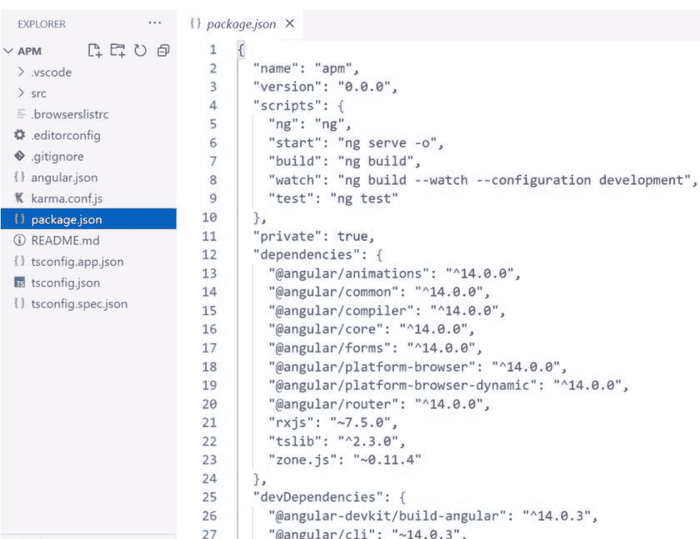

此文件包含应用程序所有依赖项的列表。

此文件的顶部有一组脚本。我们可以使用 npm 执行这些脚本。

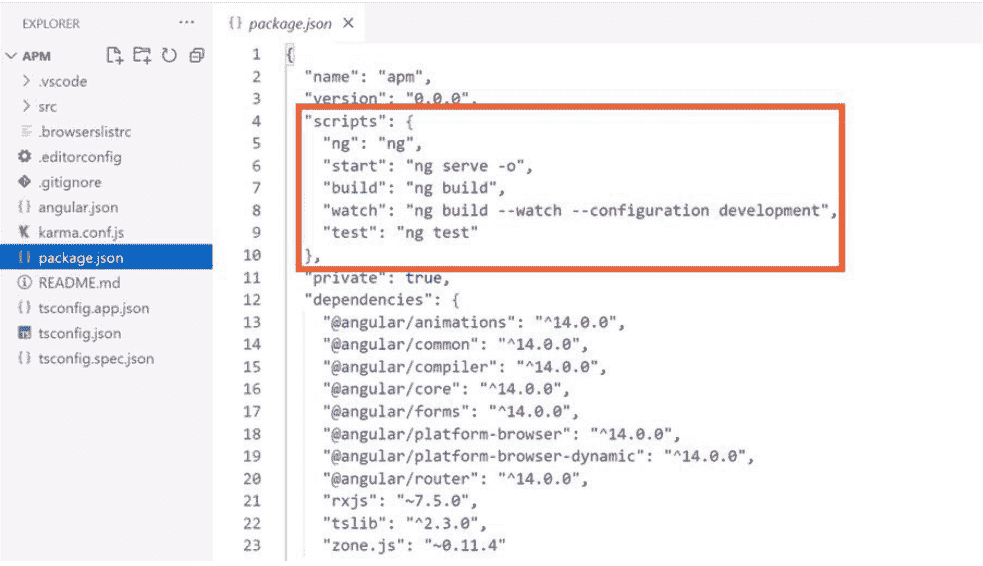

我们将在本书中了解更多关于这些脚本的信息。现在，让我们安装所有这些库。首先，打开一个命令提示符或终端。VS Code 有一个集成的终端可以使用。View, Terminal。接下来，导航到包含 `package.json` 文件的文件夹。VS Code 已经为我们完成了这一步。然后输入 `npm install`。这会安装 `package.json` 文件中定义的所有依赖项以及它们的任何依赖项。请注意，在此安装过程中你可能会看到一些警告和消息。在大多数情况下，你可以忽略它们。如果你在最后看到类似这样的内容，安装就成功完成了。

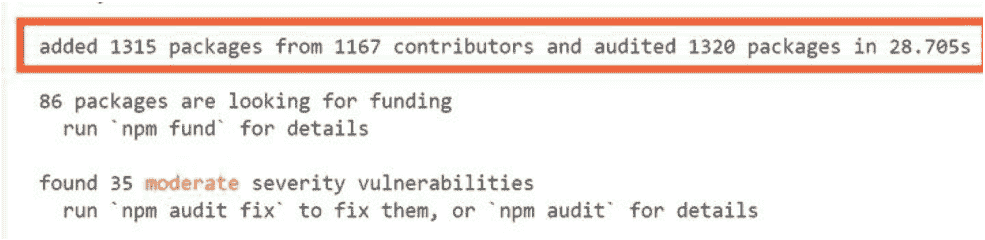

如果你看到一条消息告诉你运行 fix，不要这样做。运行 fix 会尝试更新某些包的版本而不更新所有包，这会在你尝试运行应用程序时导致错误。此 fix 消息告诉你存在漏洞和永远不会部署的库，例如测试库，因此忽略此消息。请注意，我们现在在这里有一个 `node_modules` 文件夹。这是 npm 安装所有包的位置。此文件夹很大，因此当你将文件检入源代码控制系统时，你可能希望将其排除。

现在我们已经为示例应用安装了库，让我们尝试运行它。到目前为止，我们已经导航到项目文件夹并成功运行 `npm install` 以安装 `package.json` 文件中定义的包。现在我们准备启动示例应用。还记得我们 `package.json` 文件中的 scripts 区域吗？这是 start 脚本。

package.json

```json
{
  "name": "apm",
  "version": "0.0.0",
  "scripts": {
    "ng": "ng",
    "start": "ng serve -o",
    "build": "ng build",
    "watch": "ng build --watch --configuration development",
    "test": "ng test"
  },
  "private": true,
  "dependencies": {
    "@angular/animations": "^14.0.0",
```

部署它。`--open` 是一个命令选项，用于在默认浏览器中打开 URL。CLI 还有许多其他命令和选项。随着我们逐步深入，会看到更多。准备好让它运行了吗？让我们试试这个启动脚本。回到命令提示符或终端，输入 `npm start`。这会执行启动脚本。如果你是第一次使用 Angular CLI，系统会询问你是否愿意与 Angular 团队共享匿名使用数据。这有助于团队更好地了解你的使用场景。我会回答 y，但你可以选择任何你喜欢的选项。

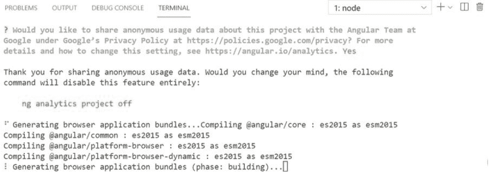

随后 CLI 会构建应用程序，启动 Web 服务器，并在默认浏览器中打开 URL——在我的情况下是 Chrome。请注意，Angular 不支持 Internet Explorer（IE）。请使用其他浏览器。如果一切正常，应用程序会出现在浏览器中并显示一些文本，如下所示。如果文本没有出现，或者你在控制台中看到错误，请确保你成功运行了 `npm install`。我们的应用程序看起来不怎么样，但我们会在 Angular 之旅中逐步改进它。


我调整了窗口的位置，以便我们能够同时看到编辑器、浏览器和终端窗口。让我们看看当我们修改代码时会发生什么。在编辑器中，打开 `app.component.html` 文件。


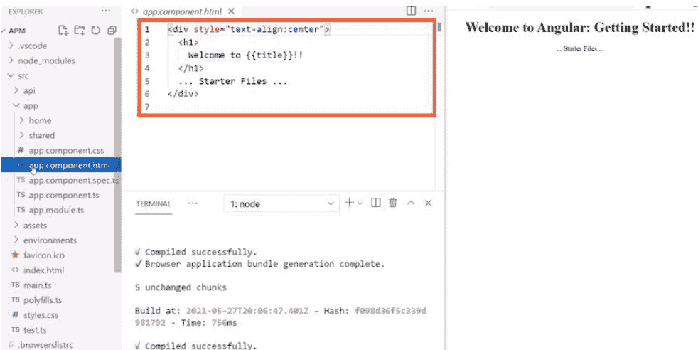

现在不要太担心这里的语法。我们很快会讨论它。目前，我们只需更改`Welcome`文本。我们立刻看到代码被重新编译，浏览器刷新，更新后的文本出现了。因此，每当我们对应用程序进行更改时，我们都能立即看到更改的效果。这会很有帮助。当我们处理完文件后，可以关闭浏览器，但服务器会继续运行。要停止它，请回到命令提示符或终端，按`Ctrl+C`并输入`y`确认，然后就可以退出了。任何时候你想运行应用程序并保持其运行以观察代码更改的效果，只需打开终端并再次使用`npm start`。现在我们知道如何构建和运行代码了。你可能已经注意到，我在修改代码后没有保存文件。使用 VS Code 时，我们可以将其设置为自动保存更改。在 File、Preferences、Settings、Workspace settings 下，我已将其设置为在短暂延迟后自动保存。

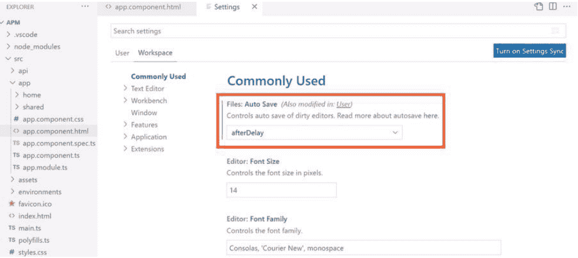

既然我们已将示例应用程序启动并运行起来，接下来看看如何创建一个新的 Angular 应用程序。

它目前不是一个全局命令，所以我们无法使用它来创建新的 Angular 应用程序。要直接使用`ng`命令，我们需要全局安装它。让我们关闭 VS Code 并打开命令提示符。在命令提示符下，我们使用`npm install`全局安装 Angular CLI：`@angular/cli`。如果安装成功，你应该会看到类似这样的消息。

```
added 219 packages, and audited 220 packages in 5s
```

CLI 全局安装后，我们就可以在任何地方使用`ng`命令了。我们现在准备创建一个新的 Angular 应用程序。导航到新应用程序的目标文件夹。然后输入`ng`（Angular CLI 命令）、`new`（创建新的 Angular 应用程序），接着是新应用程序的名称。我们把它命名为`apm-new`，以免与我们之前安装的 APM 示例应用程序混淆。我们使用命令定义一个前缀`pm`，代表产品管理。我们稍后会详细讨论前缀的用处。CLI 随后会询问我们几个问题。它询问我们是否要添加 Angular 路由。我们会在本书后面讨论路由，所以现在先选择`no`。最后，它询问我们想使用哪种样式表格式。方向键可以移动选择。我们坚持使用`CSS`。按 Enter 继续。

```
? Would you like to add Angular routing? No
? Which stylesheet format would you like to use? CSS
CREATE apm-new/angular.json (2926 bytes)
CREATE apm-new/package.json (1038 bytes)
CREATE apm-new/README.md (1060 bytes)
CREATE apm-new/tsconfig.json (863 bytes)
CREATE apm-new/.editorconfig (274 bytes)
CREATE apm-new/.gitignore (548 bytes)
CREATE apm-new/.browserslistrc (600 bytes)
CREATE apm-new/karma.conf.js (1424 bytes)
CREATE apm-new/tsconfig.app.json (287 bytes)
CREATE apm-new/tsconfig.spec.json (333 bytes)
CREATE apm-new/.vscode/extensions.json (130 bytes)
CREATE apm-new/.vscode/launch.json (474 bytes)
CREATE apm-new/.vscode/tasks.json (938 bytes)
CREATE apm-new/src/favicon.ico (948 bytes)
CREATE apm-new/src/index.html (290 bytes)
CREATE apm-new/src/main.ts (372 bytes)
CREATE apm-new/src/polyfills.ts (2338 bytes)
CREATE apm-new/src/styles.css (80 bytes)
CREATE apm-new/src/test.ts (749 bytes)
CREATE apm-new/src/assets/.gitkeep (0 bytes)
CREATE apm-new/src/environments/environment.prod.ts (51 bytes)
CREATE apm-new/src/environments/environment.ts (658 bytes)
CREATE apm-new/src/app/app.module.ts (314 bytes)
CREATE apm-new/src/app/app.component.html (23332 bytes)
CREATE apm-new/src/app/app.component.spec.ts (959 bytes)
CREATE apm-new/src/app/app.component.ts (210 bytes)
CREATE apm-new/src/app/app.component.css (0 bytes)
- Installing packages (npm)...
```

Angular CLI 开始生成 Angular 应用程序所需的所有设置和配置文件。我们会在本书后面的 Angular CLI 模块中逐一介绍这些文件。它还会为应用程序创建`package.json`文件，然后自动安装所有包文件。让我们导航到 Angular CLI 为应用程序创建的文件夹。如果我们列出这个目录，就会看到 CLI 生成的文件和文件夹。

```text
06/28/2022  03:43 PM    <DIR>          .
06/28/2022  03:43 PM    <DIR>          ..
06/28/2022  03:43 PM               600 .browserslistrc
06/28/2022  03:43 PM               274 .editorconfig
06/28/2022  03:43 PM               548 .gitignore
06/28/2022  03:43 PM    <DIR>          .vscode
06/28/2022  03:43 PM             2,926 angular.json
06/28/2022  03:43 PM             1,424 karma.conf.js
06/28/2022  03:43 PM    <DIR>          node_modules
06/28/2022  03:43 PM           810,217 package-lock.json
06/28/2022  03:43 PM             1,038 package.json
06/28/2022  03:43 PM             1,060 README.md
06/28/2022  03:43 PM    <DIR>          src
06/28/2022  03:43 PM               287 tsconfig.app.json
06/28/2022  03:43 PM               863 tsconfig.json
06/28/2022  03:43 PM               333 tsconfig.spec.json
                  11 File(s)        819,570 bytes
                   5 Dir(s)  1,235,352,477,696 bytes free
```

输入`code .`在 VS Code 中打开项目。进入 VS Code 后，打开终端并输入`npm start`来启动应用程序。由于这是我们第一次为此项目使用 CLI，它会再次询问我们是否要共享使用数据。我会选择`yes`。然后它会编译应用程序并生成应用程序包。

```text
Local setting: enabled
Effective status: enabled
✔ Browser application bundle generation complete.

Initial Chunk Files | Names     | Raw Size
vendor.js           | vendor    | 1.73 MB
polyfills.js        | polyfills | 315.31 kB
styles.css, styles.js | styles   | 207.35 kB
main.js             | main      | 48.30 kB
runtime.js          | runtime   | 6.51 kB

                    | Initial Total | 2.29 MB

Build at: 2022-06-28T22:45:15.289Z - Hash: 32eb575df8bded9d - Time: 10304ms

** Angular Live Development Server is listening on localhost:4200, open your browser on http://localhost:4200/ **

✔ Compiled successfully.
```

按住 Ctrl 并点击这个链接，在浏览器中打开应用程序。好了，这就是我们的新 Angular 应用程序。

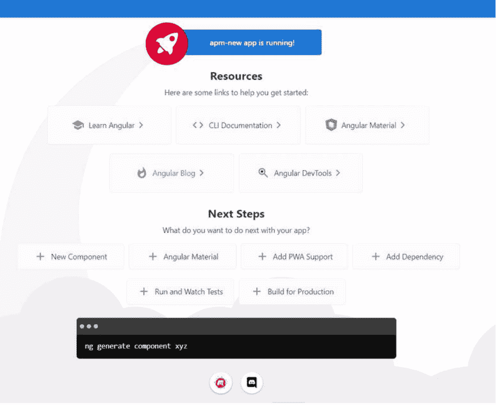

等你读完本书后，可以随时回到这个应用程序，尝试其中的一些链接。但现在，让我们回到之前安装的示例应用程序。在 VS Code 中，使用 File、Open Recent，并选择原始的 APM 示例应用程序。

```json
{
  "name": "apm",
  "version": "0.0.0",
  "scripts": {
    "ng": "ng",
    "start": "ng serve -o",
    "build": "ng build",
    "watch": "ng build --watch --configuration development",
    "test": "ng test"
  },
  "private": true,
  "dependencies": {
    "@angular/animations": "^14.0.0"
  }
}
```

本示例应用程序包含我们将在本书其余部分的演示中需要的额外文件，例如应用程序的样式和数据。总而言之，我们介绍了 TypeScript。TypeScript 具有新版 JavaScript 的所有生产力功能，同时还提供强类型以获得更好的工具支持。接下来，我们安装了所需的内容。我们将 VS Code 安装为代码编辑器，并安装了 Node，这也安装了`npm`，即 Node 包管理器。然后我们看到了如何在 VS Code 中打开示例应用程序并使用`npm`脚本来运行该应用程序。最后，我们全局安装了 Angular CLI 并从头开始创建了一个新的 Angular 应用程序。我们全局安装 Angular CLI，以便可以从任何文件夹访问`ng`命令。随着新版本的 Angular 发布，我们可以更新全局安装的 Angular CLI。Angular 会在每个 Angular 项目中安装 CLI。这确保了本地安装的 CLI 版本随着时间的推移与项目版本保持一致。还记得我们正在构建的示例应用程序的架构吗？由于我使用 Angular CLI 创建了启动文件，CLI 创建了

如果我们想显示和隐藏一张图片，我们会将逻辑写在类方法中。组件还具有元数据，它为 Angular 提供有关组件的额外信息。正是有了这个元数据，才将此类定义为 Angular 组件。元数据是通过装饰器定义的。装饰器是一个为类、其成员或其方法参数添加元数据的函数。组件是由模板定义的视图，其关联代码由类定义，元数据由装饰器定义。想看看 TypeScript 中的组件是什么样子的吗？这里有一个简单的组件。

```typescript
import { Component } from '@angular/core';

@Component({
    selector: 'pm-root',
    template: `
        <div><h1>{{pageTitle}}</h1>
            <div>My First Component</div>
        </div>
    `
})
```

乍一看可能看起来很复杂，所以让我们将这个组件拆分为几个部分，从底部开始。这是我们的类。它定义了视图所需的属性和方法。这是定义元数据的组件装饰器。元数据包括由该组件管理的视图的布局模板。我们还导入了所需的成员。让我们更详细地检查这些部分中的每一个，从底部开始的类开始。如果你曾经用 C#、VB.NET、Java 或 C++ 等语言进行过编程，这段代码应该看起来很熟悉。

```typescript
export class AppComponent {
  pageTitle: string = 'Acme Product Management';
}
```

类是一种构造，允许我们创建一个类型，其中属性定义数据元素，方法提供功能。我们使用`class`关键字后跟类名来定义一个类。常见的 Angular 约定是为每个组件类命名为功能名称，然后后缀加上`component`。并且按惯例，应用程序的根组件称为`AppComponent`。当组件在代码中被引用时，此类名用作组件名称。这里前面的`export`关键字导出此类，从而使其可供应用程序的其他组件使用。在类的主体中是属性和方法。在此示例中，我们只有一个属性，没有方法。属性定义与类关联的数据元素。我们从属性名开始，按惯例属性名是一个描述数据元素的名词，并且采用驼峰命名法，名称的首字母小写。在此示例中，它是页面的标题。使用 TypeScript 的强类型，我们在属性名后跟冒号及其数据类型。在此示例中，`pageTitle`属性是一个字符串。我们可以为属性可选地分配默认值。方法通常在类主体中所有属性之后定义。方法名通常是描述方法执行的操作的动词。方法名也采用驼峰命名法，名称的首字母小写。这就是类的全部内容。但仅靠类是不够的来定义组件。我们需要定义与此组件类关联的模板。我们如何向 Angular 提供这些额外信息？通过元数据。

## 第 4 章 如何使用装饰器定义元数据

当我们为其提供组件元数据时，一个类就成为 Angular 组件。Angular 需要这些元数据来理解如何实例化组件、构建视图以及与组件交互。我们使用 Angular 组件函数来定义组件的元数据。

```typescript
@Component({
  selector: 'pm-root',
  template: `
    <div><h1>{{pageTitle}}</h1>
      <div>My First Component</div>
    </div>
  `
})
export class AppComponent {
  pageTitle: string = 'Acme Product Management';
}
```

在 TypeScript 中，我们将该函数作为装饰器附加到类。装饰器是一个为类、其成员或其方法参数添加元数据的函数。装饰器是 JavaScript 语言特性，在 TypeScript 中实现。装饰器的作用域仅限于其装饰的功能。装饰器始终以`@`符号为前缀。Angular 有多个装饰器供我们使用，以向 Angular 提供额外信息。我们通过将其定位在我们要装饰的功能正前方来应用装饰器。

装饰类时，如本示例所示，我们在类签名正上方定义装饰器。请注意，这里没有分号。此语法与其它编程语言中使用的属性类似。我们使用`@Component`装饰器来标识该类为组件。由于装饰器是一个函数，我们始终添加括号。我们将一个对象传递给组件函数，如大括号所示。我们传递的对象具有许多属性。这里我们只使用了其中两个。如果我们计划在任何 HTML 中引用组件，我们指定一个选择器。选择器定义组件的指令名称。指令只是一个自定义 HTML 标签。每当在 HTML 中使用此指令时，Angular 都会渲染此组件的模板。组件应始终具有模板。这里我们定义了由该组件管理的用户界面片段或视图的布局。双大括号表示数据绑定。我们将`h1`元素的值绑定到类的`pageTitle`属性。因此，当此 HTML 被渲染时，`h1`元素会显示`Acme Product Management`。在我们的组件完成之前还有一个关键任务，导入。在我们可以使用未在此文件中明确定义的功能或类之前，我们需要标识编译器可以在何处找到该功能或类。我们通过`import`语句来完成此操作。`import`语句是 ES 2015 的一部分，并在 TypeScript 中实现。它在概念上类似于 Java 中的`import`语句或 C# 中的`using`语句。`import`语句允许我们使用应用程序中、Angular 框架中或其它外部 JavaScript 库中的其它文件导出的类和函数。在我们的示例中，我们使用 Angular 中的`Component`装饰器函数来将我们的类定义为组件。我们需要告诉 Angular 在哪里可以找到此函数。因此我们添加一个`import`语句并从`@angular/core`导入`Component`。

```typescript
import { Component } from '@angular/core';
```


我们从`import`关键字开始。我们在大括号内标识我们需要的成员的名称。在这种情况下，我们需要`Component`装饰器函数。我们定义包含该成员的库或文件的路径，在本例中为`angular/core`库。如果我们需要从同一库或文件导入多个成员，我们将它们全部列在导入列表中，用逗号分隔。

```
import { Component } from '@angular/core';

@Component({
  selector: 'pm-root',
  template: `
    <div><h1>{{pageTitle}}</h1>
      <div>My First Component</div>
    </div>
  `
})
export class AppComponent {
  pageTitle: string = 'Acme Product Management';
}
```

这是一个组件。现在让我们为我们的示例应用程序构建第一个组件。

## 第 5 章 如何创建 App 组件

在本章中，我们构建我们的应用组件，它是我们应用程序的根组件。这里我们在编辑器中打开了`APM`文件夹。这是我们在之前设置的文件夹。让我们打开`src`文件夹，然后打开其中的`app`文件夹。

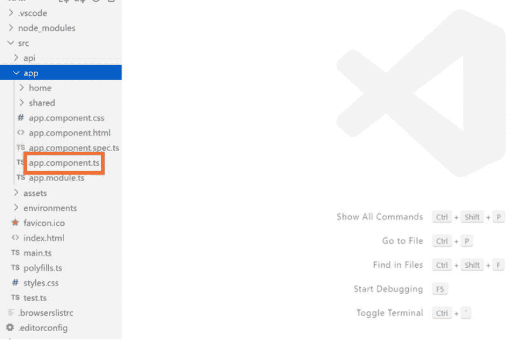

由于我使用 Angular CLI 创建了启动文件，它创建了根 app 组件。它将文件命名为`app.component.ts`。我们在整本书中将遵循的文件命名约定是以功能名称开头。这是我们的根应用程序组件，因此按惯例，它称为`app`，然后是一个点，然后是文件类型，在本例中为`component`，再一个点，最后是扩展名。由于我们使用的是理解 TypeScript 的编辑器，如 VS Code，我们可以获得导入语句的帮助。

```
TS app.component.ts ×

1  import { Component } from '@angular/core';

2

3  @Component({

4

5  })

6  export class AppComponent {

7    pageTitle: string = 'Acme Product Management';

8  }
```

让我们倒退一步。我将删除导入语句，下划线重新出现。单击下划线的名称，你会看到一个快速修复图标。单击它以获取建议的修复。单击条目以应用修复并插入导入语句。

```
TS app.component.ts ×

1  import { Component } from "@angular/core";

2

3  @Component({

4

5  })

6  export class AppComponent {

7    pageTitle: string = 'Acme Product Management';

8  }
```

在许多情况下，我们甚至可以在更早的时候应用修复。让我们删除导入语句和`Component`装饰器。然后，重新开始输入装饰器。

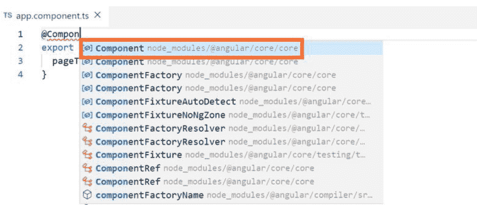

列出了`Component`装饰器。单击它或使用 Tab 键选择条目。编辑器完成语句并自动添加关联的导入语句。请确保添加回函数的小括号和用于定义对象的花括号。在组件元数据中，我们指定一个选择器，用于在 HTML 中作为指令使用组件时使用的名称。现在我们已经导入了适当的库，我们可以获得这些属性的 IntelliSense。我们将选择器设置为当前惯例是以某些内容作为每个选择器的前缀，以标识它是我们应用程序的一部分。因此我们选择了`pm`代表产品管理。

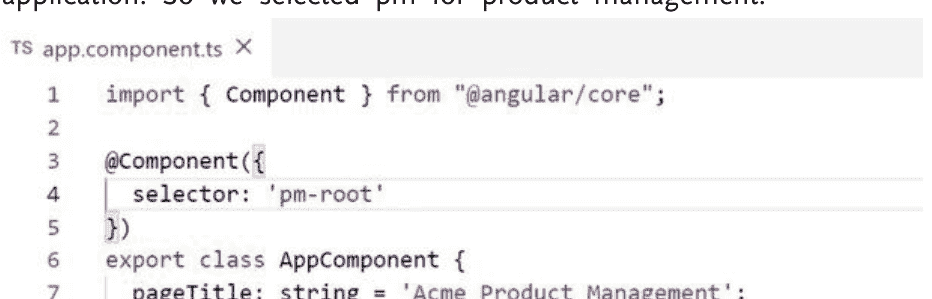

这是使用 Angular CLI 创建应用程序时指定的前缀。选择器以表示此组件的名称结尾。因此我们使用了`root`，因为这是我们的根 app 组件。接下来，我们定义模板。可以在模板中指定任何有效的 HTML。我们稍后会更深入地探讨模板。对于此示例，我只需粘贴一些 HTML，然后就完成了。

```
TS app.component.ts ×

1  import { Component } from "@angular/core";

2

3  @Component({

4    selector: 'pm-root',

5    template: `

6  <div><h1>{{pageTitle}}</h1>

7      <div>My First Component</div>

8  </div>

9  `

10 })

11 export class AppComponent {

12   pageTitle: string = 'Acme Product Management';

13 }
```

我们现在为我们的应用程序创建了第一个组件。但现在我们有了它，我们如何使用它？我们如何显示其模板？

## 第 6 章 如何引导 App 组件

现在我们需要告诉 Angular 通过一个称为引导的过程加载我们的根组件。我们首先设置`index.html`文件来托管我们的应用程序。然后我们定义我们的根 Angular 模块来引导我们的根组件。让我们查看这两个步骤。web 应用程序通常是这样工作的。用户访问特定 URL。关联该 URL 的服务器被定位并发送请求。服务器通过返回其默认网页`index.html`来响应。浏览器接收并处理该`index.html`文件。对于 Angular 应用程序，`index.html`文件包含引用已转译并捆绑成几个 JavaScript 文件的应用程序文件的脚本标签。这些应用程序文件随后被下载到浏览器并由浏览器处理，应用程序的主页面出现。`index.html`文件包含应用程序的主页面。这个`index.html`文件通常是应用程序的唯一真正的网页。因此，应用程序通常被称为应用程序或 SPA。但不用担心。它看起来对用户来说就像我们有很多页面。我们所做的是将 HTML 片段插入到一个 HTML 页面中以找到一个`index.html`。

```
import { Component } from '@angular/core';

@Component({
  selector: 'pm-root',
  template:
    <div><h1>{{pageTitle}}</h1>
      <div>My First Component</div>
    </div>
})
export class AppComponent {
  pageTitle: string = 'Acme Product Management';
}
```

这里再次是我们的 app 组件。回想一下，选择器是我们将组件用作 HTML 中的指令时的名称，模板定义了我们想要显示的 HTML。因此在`index.html`文件中，我们只需在我们想要显示模板的位置添加选择器。这里在模板中，我们称之为指令。指令基本上是一个自定义元素。一旦加载完成，组件模板中定义的 HTML 将插入到选择器元素标签之间并出现在页面上。但 Angular 编译器如何知道这个自定义 HTML 元素？它在 Angular 模块中查找。Angular 模块帮助我们将应用程序组织成功能一致的块，并在应用程序内提供边界。它们还提供模板解析环境。这是什么意思？当 Angular 编译器看到指令和模板时，它会查找 Angular 模块以获取定义。因此我们将`AppComponent`声明在 Angular 模块中，以便编译器可以找到它。我们还使用模块，浏览器应用程序必须导入。`BrowserModule`注册重要的应用程序服务提供者，例如错误处理。`bootstrap`数组定义应用程序的启动组件，即我们的`AppComponent`。启动组件应包含我们在`index.html`文件中使用的选择器，在本例中确实如此。现在让我们在示例应用程序中查看它。接下来，我们将设置`index.html`以托管我们的应用程序并检查引导我们的 app 组件的根 Angular 模块。这里我们回到我们的示例应用程序，就像我们离开它时一样。由于我使用 Angular CLI 创建了这些启动文件，`index.html`文件已经托管了我们的 app 组件，并且`app.module.ts`文件已经引导了我们的 app 组件。

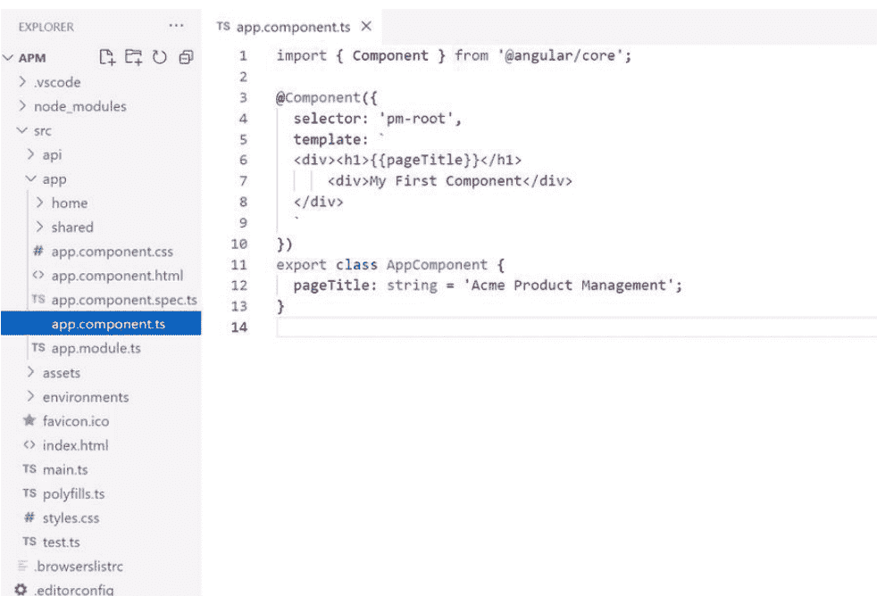

让我们从`index.html`文件开始。为了托管我们的应用程序，我们使用组件选择器作为指令在这里在`body`元素内。我们可以将指令视为简单地自定义 HTML 标签。

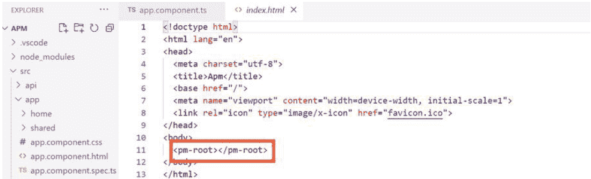

由于我使用 Angular CLI 创建了启动文件，指令已包含在这里。现在让我们打开`app.module.ts`文件。这里是类，这里是`@NgModule`装饰器将此类定义为 Angular 模块。`declarations`数组声明 app 组件，以便 Angular 可以找到其选择器。

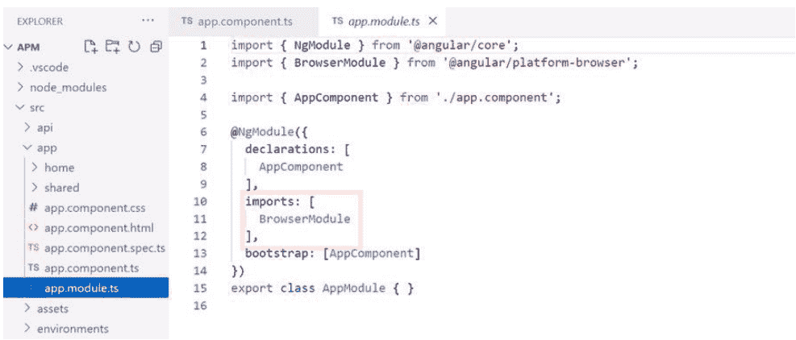

`imports`数组包含`BrowserModule`，以便应用程序在浏览器中正确运行。并且`bootstrap`数组将我们的`AppComponent`列为应用程序的起始组件。看起来我们准备好运行了。我们在上一章中看到了如何通过在终端或命令窗口中输入`npm start`来启动应用程序。当根 app 组件加载时，我们组件中的 HTML 出现，并且该 HTML 中的绑定被我们的`pageTitle`属性的值替换。我们现在有一个可工作的，尽管非常小的，应用程序。在关闭浏览器之前，让我们花点时间查看浏览器开发者工具。在 Chrome 中，我将按 F12。

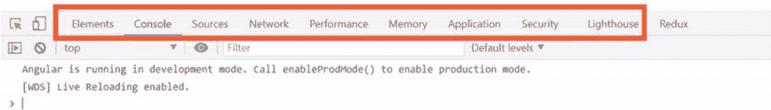

你在这里看到的确切工具取决于你使用的浏览器。我使用的是 Chrome。大多数现代浏览器都提供控制台标签作为开发工具的一部分。这是如果页面未按预期出现或根本不出现时首先要查看的地方。错误、警告和其他信息在这里显示。使用 Elements 标签或 DOM Explorer 查看页面中显示的 HTML。

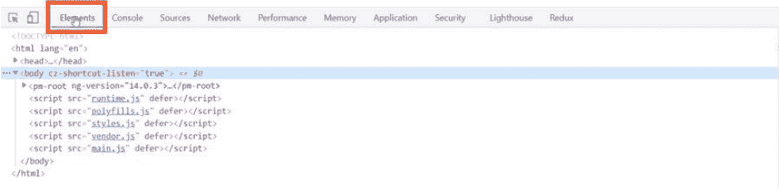

这是对 DOM，即文档对象模型的描述。文档对象模型是一个加载到浏览器中的文档模型，它将我们的 HTML 表示为节点树，其中每个节点都是我们 HTML 的一部分。请注意这里列出的这些脚本。它们不在我们的源`index.html`文件中。我们将在本书后面的《使用 CLI 构建、测试和部署》章节中讨论这些 bundle，它们是什么，以及它们是如何出现的。这里是我们的选择器标签。打开选择器标签，我们可以看到在组件模板中定义的 HTML。

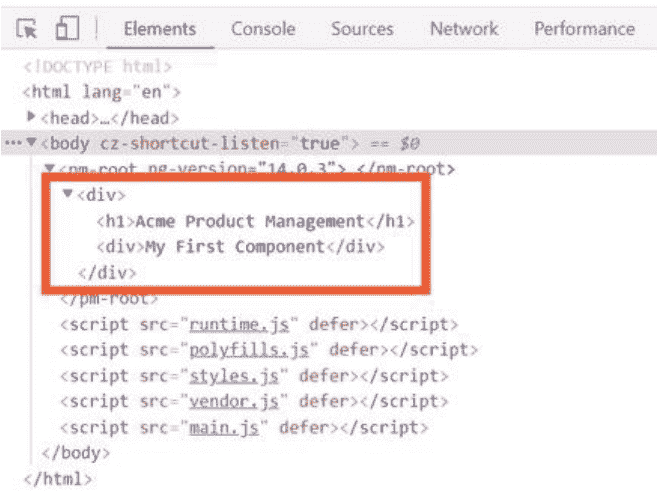

这个视图是查看渲染页面 HTML 的绝佳方式。这里在 Sources 选项卡上还提供了一个调试器选项，可用于查看和调试我们的代码。

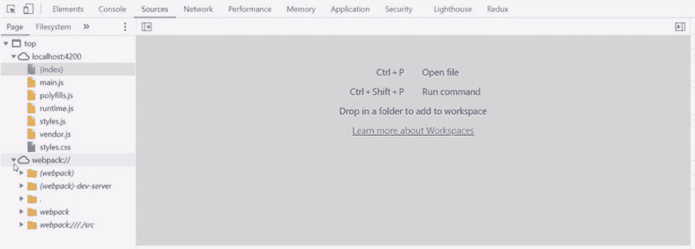

由于 Angular CLI 使用 webpack，我们的 TypeScript 文件列在 webpack 节点下。而且由于 Angular CLI 的`serve`功能会生成映射文件，我们可以直接调试 TypeScript 代码。

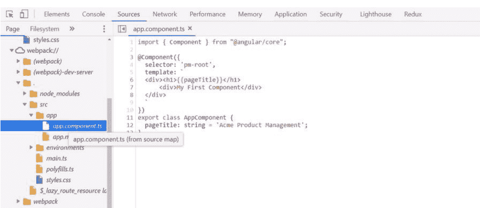

我们可以设置断点，刷新浏览器，它就会命中该断点。

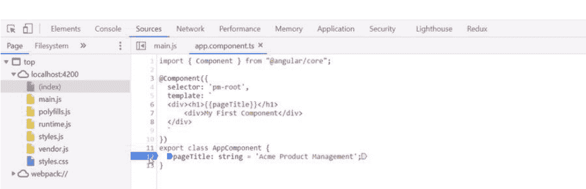

随时使用这些调试功能。在继续之前，让我们谈谈如果出现问题该怎么办。因为浏览器无法理解我们构建的组件和模板，Angular 应用程序需要一个编译过程来将我们的模板和 TypeScript 代码转换为 JavaScript。如果编译器发现任何它不理解的 HTML 元素或代码，它会显示语法错误。在此示例中，我拼错了`string`。在 Angular 和 TypeScript 中，大写字母都很重要。这意味着以小写 p 声明的属性变量`pagetitle`与以大写 P 声明的属性`pageTitle`不同。

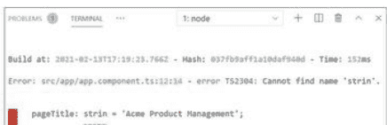

```
export class AppComponent {
  pageTitle = 'Acme PM';
  PageTitle = 'Something else';
}
```

对于所有关键字、类和函数名称、装饰器、指令等也同样适用。组件必须在 Angular 模块中声明。你可以将 Angular 模块视为引用应用程序所有组件部分的项目文件。如果在添加组件时出现问题，请重新检查你的模块并确保已引用该组件。你的代码编辑器通常是应用程序无法工作时开始的最佳位置。VS Code 会在任何它不理解的语法下添加波浪线。悬停在该行上以查看错误详情。单击下划线文本将显示快速修复图标（如果有）。打开 VS Code 终端以查看显示的编译器消息。

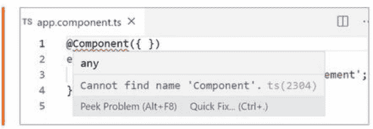

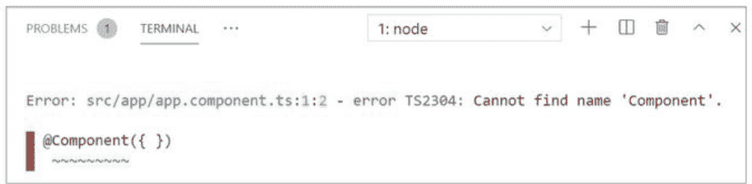

如果终端中有多个消息，请滚动到最后一次编译后的第一条消息。通常，第一个错误是问题的根源，导致其他错误出现。如果看到错误且不知道如何修复，请查看 Angular 文档中常见错误及其解决方案的列表。有时停止并重新启动编译器会有所帮助。使用`Ctrl+C`停止并使用`npm start`重新启动。浏览器的开发者工具也很有帮助。控制台会显示错误、消息和调试信息。同样，滚动到最后一次编译后的第一条消息，因为该错误通常是问题的根源。

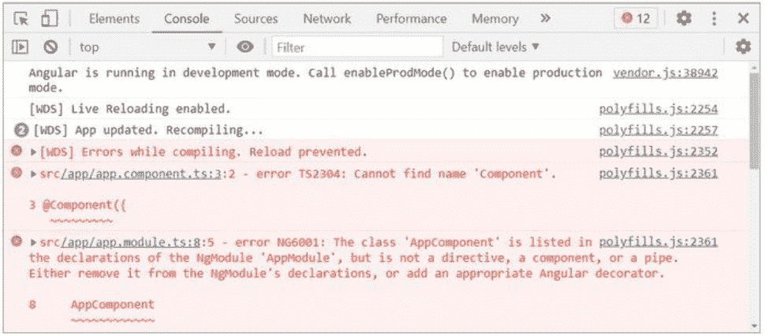

如果在浏览器中看到`Cannot GET`，这通常意味着错误阻止了编译器完成。它没有创建浏览器所需的 JavaScript 文件，因此浏览器无法获取它们。如果发生这种情况，请使用 VS Code 终端窗口查看错误。如果看到错误或应用程序只是无法工作，重新检查最近编写的代码会很有帮助。对于任何 HTML，请确保标签已正确关闭，并且所有 Angular 指令都拼写和大小写正确。对于 TypeScript 代码，请确保所有大括号都已正确关闭。就像 JavaScript 一样，TypeScript 区分大小写，因此请确保一切都具有适当的 case。遵循这些建议应该能让你重回 Angular 的成功之路。现在让我们用一些清单来收尾，我们可以在构建自己的组件时使用。Angular 全部都是关于组件的，所以我们第一组清单是用于构建组件的。我们为组件创建一个类，其中包含支持视图的代码，我们使用装饰器来定义组件元数据，其中包括组件模板的 HTML，并且我们导入所需的内容。在创建组件类时，我们为其提供一个清晰的名称。这不仅是类的名称，也是组件的名称。确保注意大小写，因为 JavaScript 区分大小写。根据惯例，使用 PascalCasing，即名称的每个单词都大写。常见的做法是在类名末尾附加`Component`，以明确它是一个组件类。确保在类签名上包含`export`关键字。还记得`export`关键字的作用吗？它使类可被应用程序的其他部分导入。如果组件视图显示数据，例如标题，则数据元素定义为类的属性。为了利用 TypeScript 的强类型，请确保为每个属性设置适当的数据类型，并在适当时设置默认值。对于属性名称，使用 camelCase，第一个字母小写。如果组件视图具有功能，例如隐藏和显示图像，则逻辑定义为类中的方法。对于方法名称，使用 camelCase，第一个字母小写。我们如何定义组件的元数据？如果你说`Component`装饰器，你是对的。没有`Component`装饰器的类就不是组件。确保装饰器前面加上`@`。由于装饰器是一个函数，请添加括号并传入适当的属性对象。使用`selector`属性来定义组件在 HTML 中用作指令时的名称。确保为选择器加上前缀以提高清晰度。

```
@Component({
  selector: 'pm-root',
  template: `
    <div><h1>{{pageTitle}}</h1></div>
  `
})
```


请注意，如果组件未在任何 HTML 中使用，则不需要 `selector` 属性。在组件元数据中使用 `template` 属性来定义视图的 HTML。由于我们在字符串字面量中定义 HTML，我们通常得不到 IntelliSense 或语法检查。因此，请注意定义正确的 HTML 语法。我们将在下一章看到创建组件模板的其他方法。但为什么我们需要使用 `import`？`import` 语句告诉 Angular 在哪里找到此组件所需的成员。`import` 语句需要 `import` 关键字，后跟成员名称和路径。请注意定义成员名称时区分大小写。文件路径必须用引号括起来，并且也区分大小写。并且请记住，我们不需要指定文件扩展名。总结一下，我们重建了 `AppComponent`，并且应用程序的最基本功能已经运行。接下来，让我们更仔细地看看模板，以及 Angular 如何通过绑定和指令为其提供支持，因为我们开始构建 `ProductList` 组件。

## 第 7 章 如何构建模板和组件

要在 Angular 中为我们的应用程序构建用户界面，我们使用 HTML 创建模板。为了增强该用户界面，我们需要 Angular 的数据绑定和指令。在接下来的几章中，我们将使用模板、指令和数据绑定创建用户界面。Web 应用程序都与用户界面有关，而 Angular 使构建丰富而强大的用户界面变得更容易。Angular 为我们提供数据绑定，以便我们可以轻松显示信息并响应用户操作。通过 Angular 指令，我们向 HTML 添加逻辑，例如 if 语句和 for 循环。通过 Angular 组件，我们构建嵌套的用户界面片段，例如图像旋转器或评分星标。我们已经看到，Angular 组件是一个使用模板定义的视图，其关联的代码使用类定义，以及使用组件装饰器设置并使用元数据定义的其他信息。我们将重点关注构建模板的技术。我们评估为组件构建模板的不同方式，并演示如何为视图创建链接模板。然后我们将构建与该模板关联的组件并将其用作指令。我们将详细介绍如何使用插值设置数据绑定，并在视图中显示组件类属性的值。模板中需要一些基本逻辑，因此我们将利用 Angular 的指令。我们还将查看其他数据绑定技术。查看我们的应用程序架构，我们目前拥有 `index.html` 文件和根 `app` 组件。因此，我们有一个可工作的示例应用程序，但它看起来并不多。我们真正想要的是产品列表。我们将开始

`work on the product list component to display that list of products.` Previously, we built an inline template for our app component. We use the `template` property to define the template directly in the component's metadata. But this is not the only way we can build a template for our components.

```typescript
template:
"<h1>{{pageTitle}}</h1>"
```

We can use the `template` property and define an inline template using a simple quoted string with single or double quotes, or we can define an inline template with a multiline string by enclosing the HTML in ES 2015 backticks.

```typescript
template: `
<div>
  <h1>{{pageTitle}}</h1>
  <div>
    My First Component
  </div>
</div>
`
```

The backticks allow composing a string over several lines, making the HTML more readable. We used this technique to build our template before. There are some advantages to defining an inline template using one of these two techniques. The template is directly defined within the component, keeping the view and the code for that view in one file. It is then easy to match up our data bindings with the class properties, such as the page title in this example. However, there are disadvantages as well. When defining the HTML in a string, most development tools don't provide IntelliSense, automatic formatting, and syntax checking. Especially as we define more HTML in the template, these issues become challenges. In many cases, the better option is to define a linked template with the HTML in its own file.

```typescript
templateUrl:
'./product-list.component.html'
```

We can then use the `templateUrl` property in the component metadata to define the URL of our HTML file. Let's use this technique and build a linked template for our product list view. The view has a nice heading. A Filter by box at the top allows the user to enter a string. The string is displayed, and the list of products is filtered to only those with a product name containing that string. The products are listed in a neat table with a nicely formatted header. To make this page look nice with very little effort, we use the Twitter Bootstrap styling framework. If you want to find out more about Bootstrap, check out https://getbootstrap.com. And for the stars, we use the Font Awesome icon set and toolkit. To find out more about Font Awesome, check out https://fontawesome.com. Now let's start building the template for our product list view. First, let's install Bootstrap and Font Awesome so we can use them in our templates. Open the integrated terminal or command window. I still have the application running in this window, so I'll click plus to open another command window. Then type `npm install bootstrap` This installs both packages.

```
added 3 packages, removed 1 package, and audited 941 packages in 2s

109 packages are looking for funding
  run `npm fund` for details

found 0 vulnerabilities
```

Installing the packages does not provide access to their style sheets. For that, we import the styles for these packages into our global application style sheet, which is the `style.css` file. We'll import the minimized version of the styles from the `bootstrap/dist/css` folder and the minimized version of the styles from the folder. These style sheets are then available to any template in our application.

```css
/* You can add global styles to this file, and also import other style files */
@import "~bootstrap/dist/css/bootstrap.min.css";
@import "~font-awesome/css/font-awesome.min.css";

div.card-header {
  font-size: large;
}

div.card {
  margin-top: 10px
}

.table {
```

Now we are ready to add an external template file for the product list component. By convention, each feature of the application has its own folder under the `app` folder. So let's add a new folder here and name it `products`. In that folder, we'll create the template for our product list component. By convention, the name of the template is the same name as the component with an HTML extension. We'll call our product list component Now we are ready to create the

```html
<div class='row'>
  <div class='col-md-6'>
    <h4>Filtered by: </h4>
  </div>
</div>

<div class='table-responsive'>
  <table class='table'>
    <thead>
      <tr>
        <th>
          <button class='btn btn-primary'>
            Show Image
          </button>
        </th>
        <th>Product</th>
        <th>Code</th>
        <th>Available</th>
        <th>Price</th>
        <th>5 Star Rating</th>
      </tr>
    </thead>
    <tbody>
    </tbody>
  </table>
</div>
</div>
```

The first column header is a button to show the product image, and here is the table body. We definitely don't want to hard code in the products here, so let's leave the table body empty for now. So we have the start of a template defined for our component.

Remember the steps for building a component that we covered previously? We define a class, we add a Component decorator to define the metadata and specify the template, and we import what we need.

```typescript
import { Component } from '@angular/core';

@Component({
    selector: 'pm-products',
    templateUrl: './product-list.component.html'
})
export class ProductListComponent {
  pageTitle: string = 'Product List';
}
```

The only thing that's really different from the component we created is the `template` property. Here we are using `templateUrl` to define the location of our linked template instead of defining an HTML string. Notice the syntax of the path. If we follow the convention of defining the template HTML file in the same folder as the associated component, we can use a relative path by specifying `./` Let's give this a try.

```typescript
import { Component } from "@angular/core";

@Component({

})
export class ProductListComponent {

}
```


We are back with the sample application exactly where we left it, and we are ready to build a new component. We start by creating a new file in the products folder. We'll name it using the component naming convention, `.component` because it is an Angular component and `.ts` for the extension. Then we create the class `export class ProductListComponent`. We're exporting this class so it is available to other parts of the application. Next, we decorate the class with a `Component` decorator. It is the `Component` decorator that makes this class a component. And we know what that underline means. We need the import statement. Let's pass an object into the `Component` decorator with the appropriate properties. For the `selector`, we'll set We'll use the same prefix as in the `AppComponent` to distinguish the `selector` as part of the product management application. Then we define the `templateUrl`. Here, we provide the path to our HTML file. Since we defined the HTML file in the same folder as the component, we can use the `./` relative path syntax here. So now we have our `template` defining our view, our `class` which defines are associated code, and the `Component` decorator that defines the metadata.

```typescript
import { Component } from '@angular/core';

@Component({
  selector: 'pm-products',
  templateUrl: './product-list.component.html'
})
export class ProductListComponent {
}
```

Our component is complete, and we're ready to use it.

Here is our newly created `ProductListComponent` and below is the `AppComponent` we created earlier.

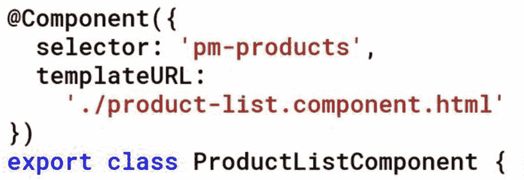

```typescript
@Component({
  selector: 'pm-root',
  template: `
<div><h1>{{pageTitle}}</h1>
  <div>My First Component</div>
</div>`
})
export class AppComponent { }
```

Note that I've excluded some of the code here, such as the import statements and class details for a better fit. We'll see the complete code. When a component has a `selector` defined, as we have here, we can use the component as a directive. This means that we can insert this component's template into any other component's template by using the `selector` as an HTML tag. The `ProductListComponent`'s template is then inserted into this location in the `AppComponent`'s template. So this is the first step when using a component as a directive. Use the name defined in the `selector` as an HTML tag in another component's template. When this template is displayed, Angular looks for a component that has a `selector` with this name. We could have hundreds of components in our application. How does our application know where to look for this `selector`? The application looks to the Angular module that owns this component to find all of the directives that are visible to this component. Every Angular application must have at least one Angular module, the root application module, commonly called `AppModule`. Currently, our `AppModule` declares our root application component, `AppComponent`. A component must belong to one and only one Angular module. The `AppModule` bootstraps the application with this component so it is the first component that is loaded for our application.

Our `AppModule` 还导入了系统的 `BrowserModule`，以获取在浏览器中运行此应用所需的功能。所以这就是我们 `AppModule` 目前的样子。Angular 模块定义了组件解析其指令和依赖关系的边界或上下文。因此，当组件包含指令时，Angular 会查看该组件的模块，以确定哪些指令对该组件可见。这对我们意味着什么？为了让 Angular 找到在 `AppComponent` 中使用的指令，`ProductListComponent` 也必须在此 Angular 模块中声明。这是将组件用作指令时的第二步。我们需要确保该指令对任何使用它的组件可见。在 Angular 模块中暴露指令有两种方式：我们可以直接在 Angular 模块中声明该组件；或者，如果该组件已在另一个 Angular 模块中声明，我们可以导入该模块，就像这里导入 `BrowserModule` 一样。现在让我们试一试。我们回到示例应用。我们在这里为 `ProductListComponent` 定义了一个 `selector`，以便可以在任何其他组件中将其用作指令。让我们在 `AppComponent` 中使用它。

```typescript
import { Component } from '@angular/core';

@Component({
  selector: 'pm-root',
  template: `
    <div><h1>{{pageTitle}}</h1>
      <div>My First Component</div>
    </div>
  `
})
export class AppComponent {
  pageTitle: string = 'Acme Product Management';
}
```

因此，我们将在这里显示我们的新产品列表模板，而不是显示 “My First Component”。用新的模板替换 `div` 标签。回到代码，让我们打开终端窗口。如果你打开了多个终端窗口，请使用此选项选择正在运行应用的窗口。这里我们看到错误：不是一个已知的元素。

```typescript
import { Component } from '@angular/core';

@Component({
  selector: 'pm-root',
  template: `
    <div><h1>{{pageTitle}}</h1>
      <pm-products></pm-products>
    </div>
  `
})
export class AppComponent {
  pageTitle: string = 'Acme Product Management';
}
```

```text
Build at: 2021-05-31T17:58:07.155Z - Hash: 40495755b6d6466aba7f6 - Time: 245ms

Error: src/app/app.component.ts:7:7 - error NG8001: 'pm-products' is not a known element:

1. If 'pm-products' is an Angular component, then verify that it is part of this module.
2. If 'pm-products' is a Web Component then add 'CUSTOM_ELEMENTS_SCHEMA' to the '@NgModule.schemas' of this component to suppress this message.

<pm-products></pm-products>
```

面对这个错误，Angular 给了我们一个解决方案。如果它是一个 Angular 组件，在我们的例子中确实如此，那么请确认它是该模块的一部分。我们没有执行第二步，即在我们应用的 Angular 模块中声明它。我们将打开 `AppModule`，并将 `ProductListComponent` 添加到 `declarations` 数组中。

```typescript
import { NgModule } from '@angular/core';
import { BrowserModule } from '@angular/platform-browser';
import { AppComponent } from './app.component';

@NgModule({
  declarations: [
    AppComponent,
    ProductListComponent
  ],
  imports: [
    BrowserModule
  ]
```

嗯，这里有一条波浪线。这意味着我们遇到了错误。猜猜哪里出了问题？如果你说我们缺少导入，那你就说对了。我们声明的所有内容都必须被导入。

```typescript
import { NgModule } from '@angular/core';
import { BrowserModule } from '@angular/platform-browser';
import { AppComponent } from './app.component';
import { ProductListComponent } from './products/product-list.component';

@NgModule({
  declarations: [
    AppComponent,
    ProductListComponent
  ],
  imports: [
    BrowserModule
  ]
```

现在语法错误消失了，让我们再试一次。这就是我们的页面。它还不完整，也还不能交互，但基本框架已经就位。请注意，在编译错误之后，你可能需要刷新浏览器页面或重新启动编译器，才能在浏览器中看到更改。

## Acme 产品管理

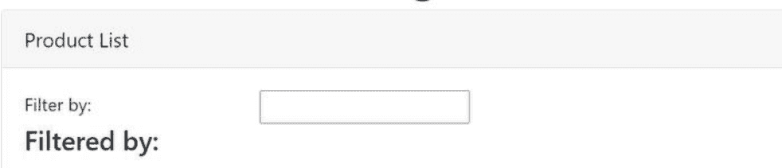

因此，我们成功地将 `ProductListComponent` 用作指令。我们将 `selector` 作为指令添加到包含组件的模板中。我们将该组件声明到应用的 Angular 模块中。现在，我们准备用数据绑定和一些 Angular 指令来增强我们的用户界面。

## 第 8 章 如何使用插值绑定

在 Angular 中，绑定协调组件类与其模板之间的通信，通常涉及传递数据。我们可以从类中提供值给模板进行显示，而模板则触发事件将用户操作或值传回给类。绑定语法始终在模板中定义。Angular 提供了几种类型的绑定，我们将逐一介绍。首先，我们介绍插值。其余的数据绑定技术将在后面介绍。表示插值的双花括号非常容易识别。本例中的 `pageTitle` 绑定到组件类中的一个属性。

```typescript
export class AppComponent {
  pageTitle: string = 'Acme Product Management';
}
```

插值是从类属性到模板的绑定，因此该值会显示在这里。

```html
<h1>{{pageTitle}}</h1>
```

插值不仅仅支持简单的属性。我们可以执行操作，例如拼接或简单计算。我们使用插值将插值字符串插入到 HTML 元素之间的文本中。

```html
<h1>{{pageTitle}}</h1>
```

```html
{{'Title: ' + pageTitle}}
```

```html
{{2*20+1}}
```

或者，我们可以像这个例子一样，将插值与元素属性赋值一起使用。

```html
<h1 innerText={{pageTitle}}></h1>
```

在这里，我们将 `h1` 元素的 `innerText` 属性赋给一个绑定值。这两个例子显示的结果相同。插值花括号之间的语法称为模板表达式。Angular 以组件为上下文评估该表达式。Angular 会查看组件以获取属性值或调用方法。然后 Angular 将模板表达式的结果转换为字符串，并将该字符串赋给元素或指令属性。因此，每当我们想要显示数据时，我们就在类中为该数据定义一个属性，并使用插值在模板中显示该数据。查看我们示例应用中的产品列表模板，我们在标题中硬编码了 `pageTitle`。将标题绑定到类中的属性而不是在 HTML 中硬编码，在编写代码时更容易查看和修改，而且我们以后可以从文件或数据库中检索此文本。

```html
<div class='card'>
  <div class='card-header'>
    Product List
  </div>
  <div class='card-body'>
    <div class='row'>
      <div class='col-md-2'>Filter by:</div>
      <div class='col-md-4'>
        <input type='text' />
      </div>
    </div>
    <div class='row'>
      <div class='col-md-6'>
        <h4>Filtered by: </h4>
      </div>
    </div>
    <div class='table-responsive'>
      <table class='table'>
        <thead>
          <tr>
            <th>
              <button class='btn btn-primary'>
                Show Image
              </button>
            </th>
            <th>Product</th>
            <th>Code</th>
            <th>Available</th>
          </tr>
        </thead>
      </table>
    </div>
  </div>
</div>
```

```typescript
import { Component } from "@angular/core";

@Component({
  selector: 'pm-products',
  templateUrl: './product-list.component.html'
})
export class ProductListComponent {
}
```

我们将其命名为 `pageTitle`。由于我们使用的是 TypeScript，因此我们为该属性定义类型。最后，我们分配一个默认值 `Product List`。


```typescript
import { Component } from "@angular/core";

@Component({
  selector: 'pm-products',
  templateUrl: './product-list.component.html'
})
export class ProductListComponent {
  pageTitle: string = 'Product List';
}
```

有了 `pageTitle` 属性，我们现在可以在模板中绑定到 `pageTitle` 属性。我们用插值替换这里硬编码的 “Product List”，并指定属性名。现在，当这个模板显示时，Angular 将 `pageTitle` 属性的字符串值赋给这个 `div` 元素的 `innerText` 属性，然后就会显示 “Product List”。

```html
<div class='card'>
  <div class='card-header'>
    {{pageTitle}}
  </div>
  <div class='card-body'>
```

让我们在浏览器中查看结果。通过我们的绑定，`pageTitle` 像之前一样显示出来。为了确认它能正常工作，我重新排列了窗口，以便我们同时看到代码和浏览器。

## Acme 产品管理


任何时候我们想要显示组件属性的值，只需使用插值即可。现在，我们准备向模板中添加一些逻辑。

# 第9章 如何使用指令添加逻辑：ngIf

我们可以把指令看作是一种自定义的 HTML 元素或属性，用来增强和扩展我们的 HTML。我们可以构建自己的自定义指令，也可以使用 Angular 内置的指令。之前，我们已经看到了如何构建一个组件并将其用作自定义指令。我们使用该指令来显示产品列表模板。除了构建我们自己的自定义指令外，我们还可以使用 Angular 的指令。我们将要学习的 Angular 指令是结构型指令。结构型指令通过添加、删除或操作元素及其子元素来修改视图的结构或布局。它们帮助我们利用 if 逻辑和 for 循环来增强 HTML。注意指令名称前面的星号。


这个星号标志着该指令是结构型指令。让我们先来看看 `ngIf`。`ngIf` 是一种结构型指令，它根据表达式来决定移除或重新创建文档对象模型树的一部分。

```typescript
TS product-list.component.ts ×
1  import { Component } from "@angular/core";
2
3  @Component({
4    selector: 'pm-products',
5    templateUrl: './product-list.component.html'
6  })
7  export class ProductListComponent {
8    pageTitle: string = 'Product List';
9    products
10 }
```

但是这个属性的类型是什么呢？嗯，我们需要一个产品实例的数组，但目前我们还没有定义“产品”是什么。稍后我们会有一个更好的解决方案。但现在，我们只需将 `products` 定义为 `any` 类型的数组。在 TypeScript 中，当我们不知道或不关心具体数据类型时，我们使用 `any` 作为数据类型。

```typescript
TS product-list.component.ts ×
1  import { Component } from "@angular/core";
2
3  @Component({
4    selector: 'pm-products',
5    templateUrl: './product-list.component.html'
6  })
7  export class ProductListComponent {
8    pageTitle: string = 'Product List';
9    products: any[];
10 }
```

我们需要填充数组，但数据从哪里来？在许多情况下，我们会与服务器通信来获取这些数据。我们将在本书后面介绍如何做到这一点。目前，我们只需硬编码一组产品。有了 `products` 属性，我们就可以在 HTML 中使用它了。我们想把它放在 `table` 元素上，因为这是我们想要从 DOM 中添加或移除的元素。输入 `*ngIf=`，然后跟上用引号括起来的表达式。

```html
<h4>Filtered by: </h4>
</div>
</div>
<div class='table-responsive'>
<table class='table' *ngIf='products'>
```

我们只想在产品列表包含一些元素时才显示表格。让我们注释掉产品数据。再次打开浏览器，我们看到表格消失了。

## Acme 产品管理


现在，如果我们取消注释产品数据，再次查看浏览器，表格就会重新出现。使用 `ngIf`，关联的元素及其子元素会被真正地从 DOM 中添加或移除。但我们仍然没有用产品填充表格。另一个结构型指令是 `ngFor`。`ngFor` 会对可迭代列表中的每一项重复渲染 DOM 树的一部分。因此，我们定义一个 HTML 块，描述如何显示单个项目，并告诉 Angular 使用该块来显示列表中的每一项。

```html
<tr *ngFor='let product of products'>
  <td></td>
  <td>{{ product.productName }}</td>
  <td>{{ product.productCode }}</td>
  <td>{{ product.releaseDate }}</td>
  <td>{{ product.price }}</td>
  <td>{{ product.starRating }}</td>
</tr>
```

例如，假设我们想要在表格的一行中显示每个产品。我们定义一个表格行及其子表格数据元素。然后，对于产品列表中的每个产品，该表格行元素及其子元素都会被重复渲染。这里的 `let` 关键字创建了一个名为 `product` 的变量。我们可以在这个元素上、任何兄弟元素上或任何子元素上引用这个变量。注意这里使用的是 `of` 而不是 `in`。我们稍后会详细讨论这一点。现在，让我们回到演示中。我们再次查看 `ProductListComponent` 及其模板。

```html

</div>

<div class='table-responsive'>

  <table class='table' *ngIf='products.length'>

    <thead>

      <tr>

        <th>

          <button class='btn btn-primary'>

            Show Image

          </button>

        </th>

        <th>Product</th>

        <th>Code</th>

        <th>Available</th>

        <th>Price</th>

        <th>5 Star Rating</th>

      </tr>

    </thead>

    <tbody>

    </tbody>

  </table>

</div>

</div>

/div>
```

在表格主体中，我们希望为产品列表中的每个产品重复渲染一个表格行。在表格主体中，我们将添加一个 `tr` 元素作为表格行。在 `tr` 元素中，我们将指定 `ngFor`，即 `*ngFor = 'let product of products'`。接下来，我们将添加子元素。我们将为要在表格中显示的每个产品属性插入一个 `td` 或表格数据元素。我们需要将它们与表头元素对应起来。第一列显示产品图片。

```html

<tr *ngFor='let product of products'>

  <td></td>

</tr>
```

我们先跳过图片，稍后再添加，但我们仍然添加 `td` 元素作为占位符。下一个表头是“Product”。因此，在这一列中，我们需要产品名称。我们将使用插值，通过局部变量 `product` 和点号来深入访问产品属性，从而绑定到产品名称。

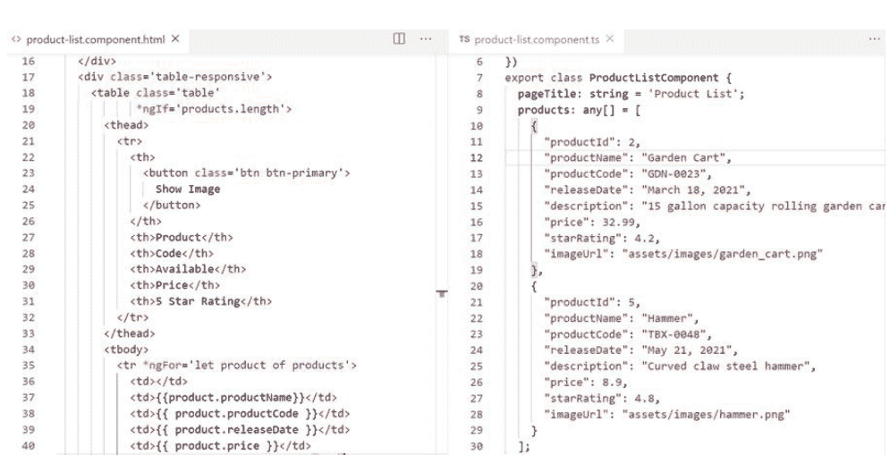

我们在这里需要产品名称。我们怎么知道那个属性名称的呢？看这里的 `ProductListComponent`，我们看到了产品属性名，所以这些名称就是我们用在插值模板表达式中的名称。接下来，我将为一些其他产品属性添加 `td` 元素。因此，对于产品列表中的每个产品，我们将得到一个 `tr` 元素作为表格行，以及 `td` 元素作为表格数据。回看组件，我们为产品列表定义了一个数组。在模板中，我们布置了 HTML 来显示一个产品。该产品显示在表格行中，产品属性放在相应的列中。使用 `ngFor` 结构型指令，我们为产品列表中的每个产品重复这个表格行及其列。

那么，为什么 `ngFor` 的语法是 `product of products` 而不是 `product in products` 呢？这样做的原因与 ES 2015 的 for 循环有关。ES 2015 同时有 `for of` 循环和 `for in` 循环。`for of` 循环类似于普通循环，它遍历一个可迭代对象，比如数组。例如，假设我们有一个人员昵称数组。如果我们使用 `for of` 遍历这个列表，我们会看到每个昵称被记录到控制台。`for in` 循环遍历对象的属性。当处理像这样的数组时，数组索引是可枚举的属性，具有整数名称，除此之外与一般的对象属性相同。所以我们会看到每个数组索引被记录到控制台。为了帮助记住区别，可以把“in”想象成遍历索引。由于 `ngFor` 指令遍历的是可迭代对象，而不是它们的属性，Angular 选择了在 `ngFor` 表达式中使用 `of` 关键字。现在让我们用一些清单来结束本节，这些清单可以在我们使用模板、插值和指令时参考。清单是重新检查我们理解和工作的好方法。让我们从模板开始。构建较短的模板时，使用内联模板。然后在 `Component` 装饰器中指定 `template` 属性。使用双引号或单引号来定义模板字符串，或者使用 ES 2015 的反引号将 HTML 布局在多行。使用内联模板时，通常没有设计时的语法检查，所以要特别注意语法。对于较长的模板，使用链接模板。在 `Component` 装饰器中指定 `templateUrl` 属性，并定义外部模板文件的路径。构建完模板后，我们构建其组件，并学习如何将该组件用作指令。还记得我们的步骤吗？首先，我们在任何其他组件的模板中将该指令用作元素。我们使用指令组件的选择器作为指令名称。然后，我们声明该组件，使其可用于与此 Angular 模块关联的任何模板。我们将该组件添加到传递给 Angular 模块的 `NgModule` 装饰器的 `declarations` 数组。本模块通过插值介绍了 Angular 的数据绑定。插值是将组件类属性绑定到元素属性。插值用花括号和模板表达式定义。该表达式可以是简单属性、拼接、计算。注意使用插值时不需要引号。

```html
<td>{{ product.productName }}</td>
```

我们了解了如何使用 Angular 的两个结构型指令：`ngIf` 和 `ngFor`。使用这些结构型指令时，务必在其前面加上星号，并将它们赋给带引号的字符串表达式。使用 `ngIf` 根据表达式向 DOM 添加或移除元素及其子元素。如果所赋表达式求值为真值，则将该元素添加到 DOM；如果为假，则从 DOM 中移除该元素。使用 `ngFor` 对可迭代列表中的每个元素在 DOM 中重复渲染该元素及其子元素。定义局部变量时使用 `let`，并在定义 `ngFor` 表达式时使用 `of` 而不是 `in`。这里再次展示我们的应用架构。接下来，让我们探索更多 Angular 的数据绑定特性，并为产品列表模板添加交互功能。

# 第10章 如何构建属性绑定

数据绑定不仅仅用于显示组件属性。在本章中，我们将探索更多数据绑定特性，并使用管道转换绑定的数据。为了提供出色的交互式用户体验，我们希望将 DOM 元素绑定到组件属性，以便组件能够根据需要改变外观和感觉。我们可以使用绑定根据数据值更改元素颜色或样式，根据用户偏好更新字体大小，或从数据库字段设置图像源。我们还希望获得用户操作和 DOM 其他事件的通知，以便组件能够做出相应响应。例如，我们响应按钮点击来隐藏或显示图像。有时我们希望两全其美：使用绑定设置元素属性，并接收用户对该属性更改的事件通知。我们将使用 Angular 的属性绑定来设置 DOM 中的 HTML 元素属性。我们将逐步了解如何使用事件绑定处理用户事件（如按钮点击），以及如何使用绑定处理用户输入。最后，我们将了解如何使用管道转换绑定的数据。我们已经有了 `ProductListComponent` 的初版，但它没有任何交互性。因此，我们将使用数据绑定特性为 `ProductListComponent` 添加交互性。属性绑定允许我们将元素的属性设置为模板表达式的值。我们将图像的源属性绑定到产品的 `imageUrl`，从而根据组件中的信息定义图像源。使用属性绑定时，元素属性用方括号括起来，模板表达式用引号括起来。

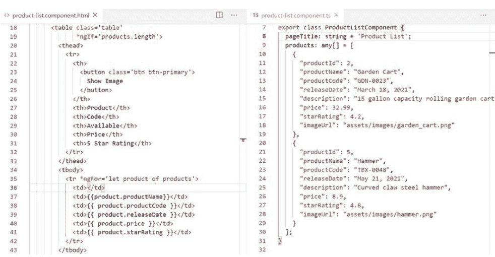

让我们使用属性绑定来绑定产品图像的源。我们使用图像元素来显示产品图像，并使用属性绑定来绑定图像的 source 或 `src` 属性。因此，我们将 `src` 放在方括号中。在等号右侧，我们用引号定义模板表达式。我们想要绑定来自 `ProductListComponent` 类的产品的 `imageUrl` 属性。我们还要使用属性绑定将图像的 `title` 属性绑定到产品名称。

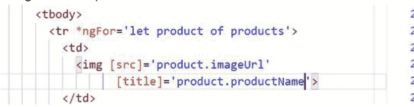

如果将鼠标悬停在图像上，我们会看到图像标题。但此图像对于在表格中显示来说太大了。让我们使用属性绑定来设置一些样式属性。让我们为组件类添加图像宽度和图像边距属性。`imageWidth` 是一个数字，因此我们用冒号指定其类型，然后写 `number`。我们将其设置为 50。`imageMargin` 也是一个数字，我们将其设置为 2。回到模板中，我们使用属性绑定来绑定图像样式。我们想要绑定以像素为单位的 `style` 属性 `width`。我们将其绑定到组件类中的 `imageWidth` 属性。注意，我们没有用 `product` 作为此前缀，因为 `imageWidth` 是组件类的属性，而不是 `product` 对象的属性。

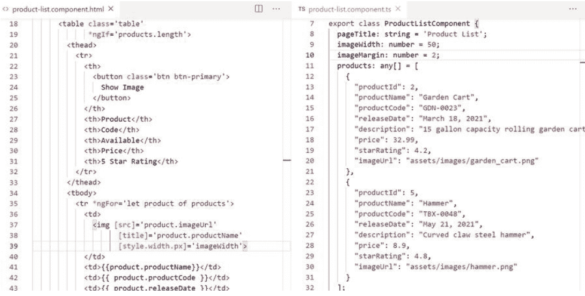

我们对以像素为单位的 `style margin` 做同样处理，将其设置为 `imageMargin` 类属性。现在我们已经了解了如何使用属性绑定将图像元素的多个属性绑定到组件类的属性。

```html
<tbody>
  <tr *ngFor='let product of products'>
    <td>
      
    </td>
  </tr>
</tbody>
```

在查看结果之前，让我们谈谈 TypeScript 的类型推断。为了学习 TypeScript 的强类型，我们一直在为属性添加数据类型。然而，如果我们设置一个属性的

# 第11章 如何使用事件绑定处理事件

到目前为止，我们所有的数据绑定都是单向的，从组件到模板。但有时我们需要反向发送信息以响应用户操作，例如在用户点击按钮时执行某些代码。组件使用事件绑定来监听用户操作。事件绑定允许我们将事件连接到组件中的方法。这是一个 HTML 按钮元素。我们将按钮的 `click` 事件绑定到组件中的 `toggleImage` 方法。当用户点击按钮时，绑定会执行 `toggleImage` 方法中的代码。

```html
<h1>{{pageTitle}}</h1>

<button (click)='toggleImage()'>
```

使用事件绑定时，事件名称用括号括起来。方法名后面跟着左右括号，并用引号括起来。现在我们要实现 `showImage` 按钮。首先，我们定义一个类属性来跟踪当前是否显示图像。我们称该属性为 `showImage`。由于该属性为 true 或 false，我们将其类型定义为 `boolean`。

```typescript
7  export class ProductListComponent {
8  |  pageTitle: string = 'Product List';
9  |  imageWidth: number = 50;
10 |  imageMargin: number = 2;
11 |  showImage: boolean = false;
12 |  products: any[] = [
13 |  {
```


让我们将其默认值设置为 `false`，这样页面首次加载时不会显示图像。接下来，我们构建事件绑定将调用的方法。按照惯例，方法通常在定义所有属性之后创建。所以我们把它放在下面。我们将方法命名为 `toggleImage`。注意，TypeScript 不需要任何关键字，例如 `function`。方法名后跟左右括号即可将其标识为方法。我们的方法没有返回类型，因此我们将返回类型指定为 `void`。方法体只是切换 `showImage` 属性的状态。这里使用的感叹号是逻辑非运算符。如果其操作数（此处为 `showImage`）为 `true`，则返回 `false`；如果 `showImage` 为 `false`，则返回 `true`，基本上将值从 `true` 切换为 `false`，或从 `false` 切换为 `true`。

```
toggleImage(): void {
|  this.showImage = !this.showImage;
}
```

回到模板中，我们准备设置事件绑定。在 `button` 元素上，我们通过将 `click` 括在括号中来将其定义为目标事件。我们将其赋值给用引号括起来的方法。当用户点击按钮时，绑定会调用我们的方法。

```
<th>
  <button class='btn btn-primary'
    (click)='toggleImage()'>
    Show Image
  </button>
```

所以剩下的唯一事情就是实际隐藏或显示图像。还记得我们如何添加逻辑来向 DOM 添加或移除 HTML 元素吗？如果你说是 `ngIf` 指令，那就对了。我们将 `ngIf` 添加到图像元素上。只有当 `showImage` 标志为 `true` 时，我们才需要这个图像元素。因此，只有当 `showImage` 为 `true` 时，图像元素才会被添加到 DOM 中。

```
<tbody>
  <tr *ngFor='let product of products'>
    <td>
      
    </td>
  </tr>
```

当图像显示时，按钮文本应更改为 Hide Image。因此，在按钮文本处，让我们使用插值。当 `showImage` 为 `true` 时，我们希望按钮文本显示 Hide Image。当 `showImage` 为 `false` 时，我们希望按钮文本显示 Show Image。

```
<thead>
  <tr>
    <th>
      <button class='btn btn-primary'
        (click)='toggleImage()'>
        {{showImage ? 'Hide' : 'Show'}} Image
      </button>
    </th>
  </tr>
```

我们使用 JavaScript 条件运算符来实现这一点。我们指定条件，即 `showImage`，以及一个问号。然后指定真值表达式。因此，当 `showImage` 为 `true` 时，我们希望显示 Hide Image。然后添加冒号和假值表达式。因此，当 `showImage` 为 `false` 时，我们希望它显示 Show Image。基本上，我们可以将此语法理解为：如果 `showImage` 为 `true`，则显示 Hide；否则显示 Show。我们的按钮文本现在显示

显示图片。如果我们点击它，它会显示隐藏图片。这更友好一些。在继续之前，让我们先谈一会儿 Angular 的变更检测。默认情况下，Angular 不断监视任何绑定属性的变化并监听事件。在我们的示例应用程序中，我们有一个按钮用于显示或隐藏图片。在按钮的 HTML 中，我们将其点击事件绑定到组件中的一个方法，并使用插值根据组件中属性的值来更改按钮的文本。

```
<button class='btn btn-primary'
    (click)='toggleImage()'>
    {{showImage ? 'Hide' : 'Show'}} Image
</button>
```

```
export class ProductListComponent {
    pageTitle = 'Product List';
    showImage = false;

    toggleImage(): void {
        this.showImage = !this.showImage;
    }
}
```

我们使用 `ngIf` 结构指令来添加或移除 DOM 中的图片元素。

```
Filter by:</div>

<div class='col-md-4'>

    <input type='text' />

</div>

```

我们将默认的 `listFilter` 设置为 `'cart'`。如果用户更改过滤器，我们也希望 `listFilter` 属性随之更改。此过程需要使用 `ngModel` 指令进行绑定。我们用方括号将 `ngModel` 括起来以表示从组件属性到输入元素的属性绑定，并用圆括号表示事件绑定以将文本通知发送回组件。

```html

<div class='col-md-2'>Filter by:</div>

<div class='col-md-4'>

    <input type='text'

           [(ngModel)]='listFilter'/>

</div>

```

我们将此指令分配给组件属性。为了帮助我们记住两组括号的顺序，可以想象一个盒子里的香蕉，外面的方括号代表盒子，里面的圆括号代表香蕉。回想一下，指令是 Angular 提供的自定义语法，用于增强我们的 HTML。`ngModel` 是一个 Angular 指令。每次在模板中使用 Angular 指令时，我们都需要考虑如何使该指令对 Angular 编译器可见。记得怎么做吗？如果你说 Angular 模块，你是对的。我们想在 `ProductListComponent` 中使用 `ngModel` 指令，该组件属于 `AppModule`。因此在 `AppModule` 中，我们需要导入暴露 `ngModel` 指令的适当系统模块。由于 `ngModel` 指令最常在构建数据输入表单时使用，`ngModel` 是 `FormsModule` 的一部分。因此我们导入它。现在 `ngModel` 指令以及其他任何 Angular 表单指令都对 `AppModule` 声明的任何组件可见，包括我们的 `ProductListComponent`。回到编辑器，查看 `ProductListComponent` 及其关联的模板；回想一下，我们在这里定义了一个 Filter by 输入框并在这里显示了输入的过滤器。我们稍后将使用该过滤器来过滤产品列表。

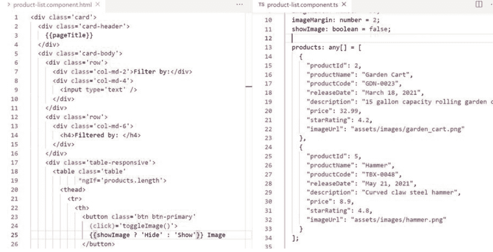

让我们先为 `listFilter` 添加一个组件类属性。此属性是一个字符串，我们将为其设置一个默认初始值以过滤产品列表。我们在这里硬编码了过滤器字符串，但你可以想象我们存储用户上次输入的过滤器并将其用作默认值即可。


那作为默认值。与此同时，我们可以设置绑定。在 `input` 元素上，我们画一个盒子里的香蕉，然后指定 `ngModel` 指令。我们绑定到组件类 `listFilter` 属性。我们想在这里显示 `listFilter`，所以我们使用插值。回想一下，插值没有引号。我们做完了吗？还不完全。让我们打开终端窗口。我们看到一个错误。Can't bind to `ngModel` since it isn't a known property of `input`。这是在告诉我们 Angular 找不到 `ngModel` 指令。

```
Error: src/app/products/product-list.component.html:10:15 - error NG8002: Can't bind to 'ngModel' since it isn't a known property of 'input'.
```

`ngModel` 指令是 Angular 用于表单的模块 `FormsModule` 的一部分。为了将此指令暴露给我们的 `ProductListComponent`，我们需要在拥有 `ProductListComponent` 的模块中导入 `FormsModule`，即我们的 `AppModule`。我们首先从 `angular/forms` 导入 `FormsModule`。然后我们将 `FormsModule` 添加到 `ngModule` 装饰器的 `imports` 数组中。为什么是 `imports` 数组而不是 `declarations`？我们的指令、组件和管道在这里在 `declarations` 数组中声明。我们从其他来源，如 Angular 本身或第三方使用的指令、组件和管道，则定义在我们添加到此处的 `imports` 数组中的外部 Angular 模块中。

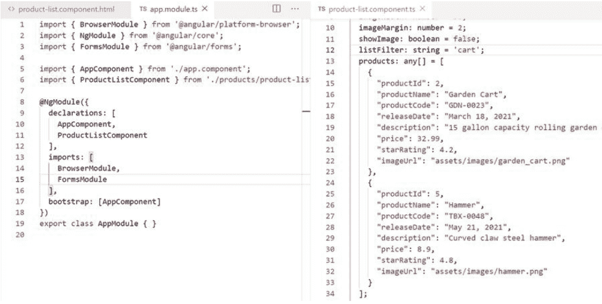

页面显示时，我们看到 `cart` 作为默认值。如果我们修改条目，注意到显示的过滤器文本也被更新了。这是因为我们使用了绑定。产品列表尚未被过滤。我们将在下一章中完成。还有一件事我们现在也想解决，那就是数据格式化。价格应该看起来像价格并显示适当的货币符号。

## 第 13 章 如何使用管道转换数据

使用 Angular 的数据绑定，显示数据很容易。只需将元素属性绑定到类属性，我们就完成了。好吧，并不总是如此。有时数据格式不适合显示。这时管道就派上用场了。管道在显示之前转换绑定属性，因此我们可以更改属性值，使其更用户友好或更符合本地化。Angular 提供了一些用于格式化值的管道，例如 `date`、`number`、`decimal`、`percent`、`currency`、`uppercase`、`lowercase` 等。Angular 还提供了一些用于处理对象的管道，例如 `json` 管道，用于将对象的内容作为 JSON 字符串显示，这在调试时很有帮助。我们也可以构建自己的自定义管道，正如我们将在下一章中看到的那样。让我们从一个简单的例子开始。假设我们想以小写显示产品代码。

```
{{ product.productCode | lowercase }}
```

我们可以在模板表达式中属性后添加管道字符，然后指定 `lowercase` 管道。产品代码在显示前会被转换为小写。我们也可以在属性绑定中使用管道。

```

```

在模板表达式中属性后添加管道，并指定所需管道。在此示例中，我们指定了 `uppercase` 管道，因此图片标题将以全大写显示。如果需要，我们可以链接管道。

```
{{ product.price | currency | lowercase }}
```

在此示例中，价格被转换为货币。默认情况下，货币管道会在金额后添加本地货币的缩写。如果我们想以小写显示该缩写，我们可以再次转换它，只需添加另一个管道即可。某些管道支持参数。参数是通过指定冒号和参数值来定义的。

```
{{ product.price | currency:'USD':'symbol':'1.2-2' }}
```

例如，`currency` 管道有三个参数，所需的货币代码、定义如何显示货币符号的字符串以及数字信息。数字信息由整数位的最小位数、小数位的最小位数和小数位的最大位数组成。这里的值为 表示小数点左侧至少 1 位数字，右侧至少 2 位数字且不超过 2 位数字，有效地定义了 2 位小数。我们在模板中指定管道，因此我们正在查看模板。让我们为产品代码添加一个 `lowercase` 管道，为价格添加一个 `currency` 管道。对于产品代码，我们只需在模板表达式中属性后插入管道字符并输入 `lowercase`。对于价格，我们插入一个管道字符和 `currency`。就这些了。但让我们尝试一些参数。我们将指定 `USD`，

双花括号且不加引号。属性绑定将一个 HTML 元素属性设置为模板表达式的值。元素属性必须用方括号括起来，模板表达式则必须用引号括起来。事件绑定监听来自用户界面的事件，并在事件发生时执行组件方法。事件名称必须用圆括号括起来，事件发生时调用的方法也必须用引号括起来。双向绑定显示组件属性，并在用户在输入元素中进行更改时更新该属性。使用盒子里的香蕉语法配合 `ngModel` 指令。模板表达式必须用引号括起来。


使用 `ngModel` 时需要注意一些事项。在“盒子里的香蕉”语法中定义 `ngModel` 以实现双向绑定。

```html
<div class='col-md-4'>
  <input type='text'
         [(ngModel)]='listFilter' />
</div>
```

确保将 Angular 表单包中的 `FormsModule` 添加到适当的 Angular 模块（此处为 `AppModule`）的 `imports` 数组中。

```typescript
@NgModule({
  imports: [
    BrowserModule,
    FormsModule ],
  declarations: [
    AppComponent,
    ProductListComponent ],
  bootstrap: [ AppComponent ]
})
export class AppModule { }
```

这样可以确保 `ngModel` 指令可用于与该模块关联的任何组件中定义的模板。我们将在本书后面更详细地讨论 Angular 模块。组件中的数据类型可能不是我们想要显示的格式。我们可以在模板中使用管道（pipe）将数据转换为更合适的格式。要使用管道，请指定管道符号、管道名称以及任何管道参数，并用冒号分隔。在本章中，我们完成了更多 `ProductListComponent` 的内容，但它还可以更好。接下来，我们将看到几种改进组件的方法。接下来，我们学习几种改进组件的方法。组件是应用程序的关键构建块之一。我们让这些构建块更干净、更强壮、更耐用，应用程序就会更好，但如何让组件变得更好呢？强类型通过更好的语法检查和工具支持帮助减少错误。

## 第14章 如何定义接口

使用 TypeScript 的好处之一是其强类型。每个属性都有类型，每个方法都有返回类型，每个方法参数也都有类型。这种强类型通过更好的语法检查和工具支持帮助减少错误。然而，在某些情况下，我们的属性或方法没有预定义类型，比如这里的 `products` 数组。我们将 `products` 数组定义为 `any`，这削弱了强类型的好处。

```typescript
export class ProductListComponent {
  pageTitle: string = 'Product List';
  showImage: boolean = false;
  listFilter: string = 'cart';
  message: string;

  products: any[] = [...];

  toggleImage(): void {
    this.showImage = !this.showImage;
  }

  onRatingClicked(message: string): void {
    this.message = message;
  }
}
```

要指定自定义类型，我们可以定义一个接口。接口是一个规范，用于标识一组相关的属性和方法。

回想一下，属性是与类关联的数据元素，而方法执行类所需的逻辑。接口主要有两种使用方式。我们使用接口来标识特定类型的属性。在此示例中，我们定义了一个产品的属性。

```typescript
export interface IProduct {
  productId: number;
  productName: string;
  productCode: string;
  releaseDate: string;
  price: number;
  description: string;
  starRating: number;
  imageUrl: string;
}
```

然后我们可以将此接口指定为数据类型，以强化我们的代码类型。

```typescript
products: IProduct[] = [];
```

为任何需要的独特数据类型定义接口是一个好习惯。接口的第二种使用方式是标识一个功能集。

```typescript
export interface DoTiming {
  count: number;
  start(index: number): void;
  stop(): void;
}
```

我们声明实现特定功能所需的属性和方法。仅声明，不包含代码。在此示例中，我们定义了一个计时功能，包含 `count` 属性以及 `start` 和 `stop` 方法。要在组件中利用此功能，我们使用 `implements` 关键字指定接口。

```typescript
export class myComponent
    implements DoTiming {
  count: number = 0;
  start(index: number): void {
    ...
  }
  stop(): void {
    ...
  }
}
```

然后，我们为每个已定义的属性和方法编写代码。可以将此接口视为一个实现模式，详细说明特定功能所需的属性和方法。Angular 提供了一些接口形式的功能，我们通过实现这些接口来使用它们。实现接口的概念起初可能看起来有点令人生畏，但我们在本书的剩余部分会看到多个示例。现在，让我们专注于将接口用作数据类型。下面是一个 TypeScript 接口的示例。

```typescript
export interface IProduct {
    productId: number;
    productName: string;
    productCode: string;
    releaseDate: Date;
    price: number;
    description: string;
    starRating: number;
    imageUrl: string;
}
```

我们使用 `interface` 关键字定义接口，后面跟上接口名称，接口名称通常就是该接口所描述事物的名称。按照某些命名约定，接口会加上 `I` 前缀表示 `interface`（接口），不过许多 TypeScript 开发者会省略这个前缀。开头的 `export` 关键字导出了这个接口，从而使其可在应用程序的任何地方使用。接口的主体定义了这一类型适用的属性集。此示例定义了一个产品的属性。对于每个属性，接口都包含属性名、冒号和属性数据类型。一旦定义了接口，就可以将其用作数据类型。我们导入接口，然后将接口名称用作数据类型，就像使用 `string` 或 `boolean` 等其他数据类型一样。我们回到示例应用程序，查看 `ProductListComponent`。在这里，我们看到产品数组被定义为 `any`。那么让我们创建一个接口来定义产品到底是什么。我们将接口放到 `products` 文件夹中自己的文件里，并将该文件命名为 `product.ts`。首先输入 `export` 关键字，以确保应用程序的其他部分可以使用此接口。毕竟，这就是我们创建它的目的。接下来，输入 `interface` 关键字，然后是接口名称。我们正在定义一个产品，所以命名为 `IProduct`。在接口内部，我们定义属性。对于每个属性，我们定义属性名、冒号和属性类型。注意，我们将 `releaseDate` 类型设为 `string`。如果以后需要将此值作为日期对象处理，我们可以将该类型改为 `date`。

```typescript
export interface IProduct {
  productId: number;
  productName: string;
  productCode: string;
  releaseDate: string;
  price: number;
  description: string;
  starRating: number;
  imageUrl: string;
}
```

定义接口就这么简单。现在我们可以在 `ProductListComponent` 中使用此接口作为数据类型。不过，在这样做之前，我们先在产品数组中引入一个拼写错误。没有检测到错误。直到我们在浏览器中看到应用程序才发现错误。我们注意到其中一个产品没有显示图像。可以想象，这类错误可能会引发 bug。现在，我们用 `IProduct` 替换 `any`。出现了一个语法错误。我们遗漏了什么？嗯，我们需要一个导入语句。现在我们的产品数组已被强类型化，系统会通知我们在产品数组属性中犯了一个错误。我们甚至不必在浏览器中查看就能发现

```typescript
@Component({
  selector: 'pm-products',
  templateUrl: './product-list.component.html',
  styleUrls: ['./product-list.component.css']
})
```

通过将样式封装在组件内部，任何定义的选择器或样式类仅适用于组件的模板，并且不会泄漏到应用程序的其他任何部分。在更改任何代码之前，让我们再次在浏览器中查看我们的产品列表视图。表格标题可以使用一点颜色。所以让我们为我们的 `ProductListComponent` 构建一个外部样式表。我们将在 `products` 文件夹中添加一个新文件。由于此文件仅包含 `ProductListComponent` 的样式，我们将其命名为 `product-list.component.css`。在此样式表中，我们添加一个表格标题样式。我们可以直接修改 `thead` 元素的样式，因为此样式表封装在此组件中，并且在此处定义的样式不会影响应用程序中的任何其他组件。我们可以根据需要添加任何其他样式来美化我们的 `ProductListComponent`。要使用此新的样式表，我们修改 `ProductListComponent`。在 `Component` 装饰器中，我们指定我们唯一的样式表。我们添加 `styleUrls` 属性并传递一个数组。在数组的第一个元素中，我们指定样式表的路径。由于我们将 CSS 文件定义在与组件相同的目录中，我们可以使用 `./` 相对路径语法。我们可以在此处添加更多样式表，用逗号分隔。

```typescript
@Component({
  selector: 'pm-products',
  templateUrl: './product-list.component.html',
  styleUrls: ['./product-list.component.css']
})
```

我们可以看到表格标题现在是漂亮的蓝色。

在 Angular 销毁组件之前。要使用生命周期钩子，我们实现生命周期钩子接口。我们正在使用 Angular 中的 `OnInit` 接口。有人猜到我们的下一步是什么吗？好吧，我们需要导入生命周期钩子接口。然后我们可以编写钩子方法。每个生命周期钩子接口都定义一个方法，其名称为接口名称加上 Angular 的前缀 `ng`。

```typescript
import { Component, OnInit } from '@angular/core';

export class ProductListComponent implements OnInit {
  pageTitle: string = 'Product List';
  showImage: boolean = false;
  listFilter: string = 'cart';
  products: IProduct[] = [...];

  ngOnInit(): void {
    console.log('In OnInit');
  }
}
```

例如，`OnInit` 接口钩子方法名为 `ngOnInit`。在我们应用程序的这个阶段，我们不需要实现任何生命周期钩子，但我们将在后面的模块中使用它们，所以让我们现在尝试一下。我们正在查看 `ProductListComponent`。我们将向此组件添加 `OnInit` 生命周期钩子。首先，通过将其添加到类签名来实现接口。输入 `implements` 和接口名称 `OnInit`。接口名称显示错误，我们知道为什么。我们没有导入。


```typescript
import { Component } from '@angular/core';
import { IProduct } from './product';

@Component({
  selector: 'pm-products',
  templateUrl: './product-list.component.html',
  styleUrls: ['./product-list.component.css']
})
export class ProductListComponent implements OnInit {
```

```
Add 'OnInit' to existing import declaration from "@angular/core"
Import 'OnInit' from module "@angular/core"
Learn more about JS/TS refactorings
```

现在我们这里又有另一个语法错误。

```typescript
import { Component, OnInit } from '@angular/core';
import { IProduct } from './product';

@Component({
  selector: 'pm-products',
  templateUrl: './product-list.component.html',
  styleUrls: ['./product-list.component.css']
})
export class ProductListComponent implements OnInit {
```

```
Class 'ProductListComponent' incorrectly implements interface 'OnInit'.
Property 'ngOnInit' is missing in type 'ProductListComponent' but required in type 'OnInit'. ts(2420)
core.d.ts(4950, 5): 'ngOnInit' is declared here.
Peek Problem (Alt+F8)  Quick Fix... (Ctrl+.)
```

类 `ProductListComponent` 错误地实现了接口 `OnInit`。正如消息所述，现在我们已经实现了接口，我们必须为该接口中的每个属性和方法编写代码。`OnInit` 接口仅定义一个方法 `ngOnInit`，因此我们需要编写 `ngOnInit` 方法的代码。我们将在其他方法旁边添加它。由于我们目前不需要对它做任何事情，我们将只使用 `console.log` 将消息记录到控制台。

```typescript
ngOnInit(): void {
  console.log('In OnInit');
}
```

我们可以在浏览器中查看应用程序并使用 F12 开发工具打开控制台以查看记录的消息。

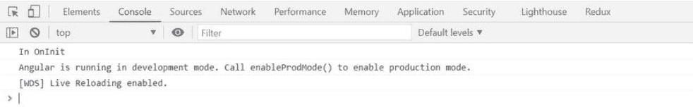

我们将在本书后面使用 `ngOnInit`。接下来，我们将构建一个自定义管道。

## 第 16 章 如何构建自定义管道

正如我们之前看到的，我们使用管道在视图中显示之前转换绑定属性。有转换单个值或可迭代数据列表的管道。在本章中，我们想构建自己的自定义管道。对于我们的示例应用程序，产品代码以破折号存储并以这种方式显示，但用户更希望看到产品代码中用空格代替。我们可以构建一个自定义管道来用空格替换破折号，但让我们构建一个更通用的自定义管道，将字符串中任何指定的字符转换为空格。构建自定义管道所需的代码看起来在这一点上可能有些熟悉。

```typescript
import { Pipe, PipeTransform } from '@angular/core';

@Pipe({
    name: 'convertToSpaces'
})
export class ConvertToSpacesPipe implements PipeTransform {
    transform(value: string,
        character: string): string {
    }
}
```

它使用与我们在本书中创建的其他代码相似的模式。这里是类。我们向类添加管道装饰器以将其定义为管道。与我们使用过的其他装饰器类似，这是一个函数，因此我们添加括号。我们向函数传递一个对象，指定管道的名称。这是管道在

`AppModule` 中使用的名称。但如果我们有多个模块，我们会将其添加到声明需要该管道的组件的模块中。在我们的示例中，`ProductListComponent` 的模板需要该管道。因此我们将其声明添加到声明 `ProductListComponent` 的同一 Angular 模块中。我们在 `NgModule` 装饰器的 `declarations` 数组中定义管道。

```typescript
@NgModule({
  imports: [
    BrowserModule,
    FormsModule
  ],
  declarations: [
    AppComponent,
    ProductListComponent,
    ConvertToSpacesPipe
  ],
  bootstrap: [ AppComponent ]
})
export class AppModule { }
```

现在让我们构建我们的自定义管道。由于我们的自定义管道比较通用，我们将其添加到 `shared` 文件夹。我们将创建一个新文件并将其命名为 `convert-to-spaces.pipe.ts`，遵循我们的命名约定。首先，让我们编写类的代码：`export` 以便我们可以在需要的地方导入此管道，`class`，以及类名。我们将其命名为 `ConvertToSpacesPipe`。我们用 `Pipe` 装饰器装饰类并从 `@angular/core` 导入 `Pipe`。我们设置传递给 `Pipe` 装饰器的对象的 `name` 属性，定义管道的名称。这就是我们在 HTML 中引用管道时使用的名称。接下来，我们将实现 `PipeTransform` 接口。此语法错误是因为我们没有导入语句，所以让我们接下来添加它。

我们仍然有语法错误，因为当我们实现 `PipeTransform` 接口时，我们需要实现该接口中定义的所有属性和方法。

```typescript
import { Pipe, PipeTransform } from "@angular/core";

@Pipe({
  name: 'convertToSpaces'
})
export class ConvertToSpacesPipe implements PipeTransform {

}
```

对于 `PipeTransform` 接口，只有一个方法 `transform`。我们将要转换的字符串值定义为第一个参数，将用于转换的字符字符串定义为第二个参数。我们可以添加一个 `return` 语句来消除这个最后一个语法错误。

```typescript
import { Pipe, PipeTransform } from "@angular/core";

@Pipe({
  name: 'convertToSpaces'
})
export class ConvertToSpacesPipe implements PipeTransform {

  transform(value: string, character: string): string {
    return '';
  }
}
```

现在我们希望 `transform` 方法做什么？我们的目标是用空格替换字符串中指定的任何字符。我们将使用 JavaScript 字符串 `replace` 方法将指定的字符替换为空格。就这样。

现在我们准备使用我们的管道了。在模板中，我们将管道添加到 `productCode` 上。但 `productCode` 本身已经有一个管道。没关系。我们可以添加任意数量的管道。首先指定管道名称，然后是任何管道参数。在本例中，我们想用空格替换破折号，所以我们在这里将破折号作为参数传入。

```html
<th>Product</th>
<th>Code</th>
<th>Available</th>
<th>Price</th>
<th>5 Star Rating</th>
</tr>
</thead>
<tbody>
<tr *ngFor="let product of products">
  <td>
    
  </td>
  <td>{{product.productName}}</td>
  <td>{{ product.productCode | lowercase | convertToSpaces:'-' }}</td>
  <td>{{ product.releaseDate }}</td>
  <td>{{ product.price | currency:'USD':'symbol':'1.2-2' }}</td>
  <td>{{ product.starRating }}</td>
</tr>
</tbody>
</table>
</div>

</div>
```

我们做完了吗？请记住，我们需要告诉 Angular 关于我们新的管道。我们通过在 Angular 模块中声明该管道来做到这一点。我们的 `ProductListComponent` 的模板想要使用 `convertToSpaces` 管道。所以我们打开声明了 `ProductListComponent` 的 Angular 模块，在我们的示例中是 `AppModule`。然后我们将 `ConvertToSpacesPipe` 添加到 `declarations` 中并添加所需的 `import`。

```typescript
import { BrowserModule } from '@angular/platform-browser';
import { NgModule } from '@angular/core';
import { FormsModule } from '@angular/forms';

import { AppComponent } from './app.component';
import { ProductListComponent } from './products/product-list.component';
import { ConvertToSpacesPipe } from './shared/convert-to-spaces.pipe';

@NgModule({
  declarations: [
    AppComponent,
    ProductListComponent,
    ConvertToSpacesPipe
  ],
  imports: [
    BrowserModule,
    FormsModule
  ],
  bootstrap: [AppComponent]
})
export class AppModule { }
```

现在 `AppModule` 中声明的任何组件都可以使用 `ConvertToSpacesPipe`。我们的产品代码现在显示为带空格而不是破折号。只要你需要执行数据转换，就构建一个自定义管道。然而，请注意，我们的页面交互性仍然不完整。产品列表尚未根据过滤条件进行过滤。让我们接下来看看这个问题。我们在这里有一个输入框供用户输入过滤字符串。然后产品列表应根据输入的字符串进行过滤。

## Acme 产品管理

### 产品列表

按以下过滤：cart

已过滤：cart

显示图片

|  | Product | Code | Available | Price | 5 Star Rating |

|---|---|---|---|---|---|

|  | Garden Cart | gdn 0023 | March 18, 2021 | $32.99 | 4.2 |

|  | Hammer | tbx 0048 | May 21, 2021 | $8.90 | 4.8 |

我们如何做到这一点？在回答这个问题之前，让我们花点时间谈谈 JavaScript 的 getter 和 setter。在 JavaScript 中，因此在 TypeScript 中，有两种方式在类中定义属性。

```ts
amount: number = 0;
```

我们可以像在这本书中之前所做的那样声明一个简单的变量作为属性。比喻地说，把这个简单变量属性想象成一个储蓄罐。我们可以直接把钱放进储蓄罐或从储蓄罐里取出钱。

```ts
get amount(): number {
    // process the amount
    // return amount from private storage
}
set amount(value: number) {
    // process the amount
    // retain amount in private storage
}
```

另一种定义属性的方式是使用 JavaScript getter 和 setter。把 getter 和 setter 想象成银行。我们把钱存入账户，银行处理金额，并把钱存放在某个私人的保险库中。当我们想要获取该金额时，银行需要先从私有存储中取出钱，然后才能返回该金额。在创建 getter 和 setter 时，我们通常会定义一个私有存储变量，称为 backing variable，用来存储由 getter 和 setter 管理的值。

```ts
private _amount: number = 0;
```

```ts
get amount(): number {
  // process the amount
  // return amount from private storage
  return this._amount;
}
set amount(value: number) {
  // process the amount
  // retain amount in private storage
  this._amount = value;
}
```

我们使用 `private` 关键字表示这个 backing variable 是私有的，只能由 getter 和 setter 管理。为了帮助我们识别这个变量为私有，按惯例我们用下划线作为前缀。在 getter 中，我们从私有存储返回金额，可选择在返回前处理该金额。例如，我们可以将值转换为另一种货币或格式化值。在 setter 中，我们将金额设置到私有存储中，可选择处理该金额。例如，我们可以记录金额或更新总余额。关键在于，通过使用 getter 和 setter 而不是简单变量作为属性，我们可以在获取或设置值时编写代码来处理该值。我们像访问简单变量属性一样访问这些属性，使用 `this` 引用类，然后是属性名。这里的代码将 200 设置到 `amount` 中，而这段代码获取 `amount` 并将其记录到控制台。这对我们和我们的过滤字符串意味着什么？如果我们为列表过滤器使用 getter 和 setter，我们就可以在每次设置过滤字符串时编写代码来过滤产品列表。因此，在实现列表过滤的第一步中，让我们将我们的 `listFilter` 属性改为 getter 和 setter。这里是我们的 `listFilter` 属性分配给默认值。我们希望在设置此属性时执行代码。让我们删除这个简单变量，改为构建一个 getter 和 setter。首先，我们声明一个私有 backing variable 来保存由 getter 和 setter 管理的值。我们在属性名前加上下划线以表示它是私有变量，并将其初始化为空字符串。接下来，我们定义 getter。getter 以 `get` 关键字开头，后跟属性名，放在括号中，并指定属性数据类型。getter 的主体可以包含在返回前处理属性值的代码。getter 然后返回处理后的值。由于我们不需要在获取时处理 `listFilter`，我们将返回 backing variable 的值。setter 以 `set` 关键字开头，后跟属性名。setter 有一个参数，即分配给属性的值。setter 没有返回值。setter 在任何时候为关联属性分配值时都会执行，因此我们可以使用 setter 的主体在属性更改时执行操作，例如过滤我们的产品列表。最小情况下，我们将值设置到私有 backing variable 中。我们将在下一步添加过滤列表的代码。现在，让我们只记录该值。请记住，我们原来的简单变量属性被分配了一个默认值。

```typescript
@Component({
  selector: 'pm-products',
  templateUrl: './product-list.component.html',
  styleUrls: ['./product-list.component.css']
})
export class ProductListComponent implements OnInit {
  pageTitle: string = 'Product List';
  imageWidth: number = 50;
  imageMargin: number = 2;
  showImage: boolean = false;

  private _listFilter: string = '';
  get listFilter(): string {
    return this._listFilter;
  }
  set listFilter(value: string) {
    this._listFilter = value;
    console.log('In setter:', value);
  }
}
```


我们现在在哪里设置默认值？让我们使用我们之前定义的`ngOnInit()`方法。在这里，我们将`listFilter`属性设置为`cart`。

```typescript
ngOnInit(): void {
  this.listFilter = 'cart';
}
```

在浏览器中检查并打开开发者工具，我们看到 setter 最初被分配为默认值`cart`。

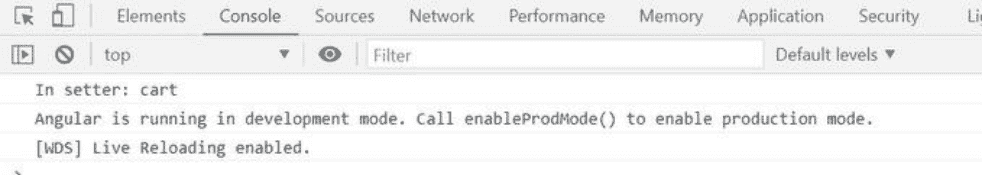

如果我们删除过滤器，setter 会显示一个空值。输入 **am**，我们会看到 setter 首先设置 **a**，然后设置 **am**。

Acme 产品管理

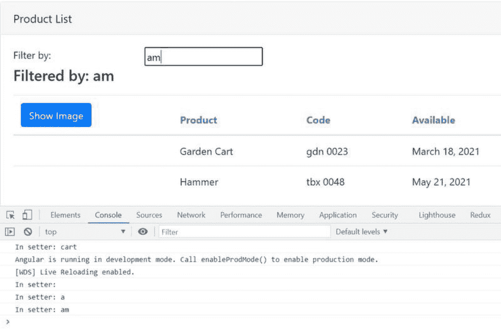

每次用户输入时，值都会被设置，并且 setter 会被执行，将文本框中的值作为参数传入。只要你想在属性被获取或设置时执行代码，就可以使用 getter 和 setter。现在让我们看看如何利用这一知识来过滤我们的产品列表。

## Chapter 17 Filtering and Arrow Functions

我们正在朝着使用输入的过滤字符串来过滤产品列表的目标努力。我们的产品列表被定义为一个数组，因此我们可以使用 JavaScript 数组方法来处理我们的产品列表。

```
products: IProduct[] = [...];
```

要过滤我们的数组，我们使用 JavaScript 的`filter()`方法。`filter()`方法会创建一个新数组。`filter()`方法随后会评估原始数组中的每个产品，以确定是否将其包含在新数组中。`filter()`方法然后返回新数组，只包含已过滤的产品。

```
performFilter(): IProduct[] {
  return this.products.filter();
}
```

不知如何，我们需要告诉`filter()`方法我们希望用于确定产品是否满足过滤条件的逻辑。`filter()`方法期望我们的逻辑在产品应包含在过滤列表中时返回`true`，否则返回`false`。我们使用箭头函数来定义该逻辑。箭头函数是定义函数的紧凑语法。可以将其视为定义经典命名函数的更简短方式。它最常在向另一个函数或方法传递逻辑时使用。以下是将产品名称大写并返回的经典命名函数。

```
capitalizeName(product: IProduct): string {
  return product.productName.toUpperCase();
}
```

要将此代码写成箭头函数，我们忽略函数名，因为箭头函数不需要名称即可找到参数，然后是一个箭头。

```
(product: IProduct) => product.productName.toUpperCase();
```

这就是箭头函数得名的原因。我们忽略大括号和`return`关键字。具有单个语句的箭头函数具有隐含的主体和返回。然后我们编写所需的逻辑。如果箭头函数需要在函数主体中使用多个语句，则需要使用大括号和`return`关键字。

```
(product: IProduct) => {
  console.log(product.productName);
  return product.productName.toUpperCase();
}
```

只要你需要将一个函数传递给另一个函数或方法，就使用箭头函数。我们将在本书后面看到更多箭头函数。

```
performFilter(): IProduct[] {
  return this.products.filter((product: IProduct) =>
    product.productName.includes(this.listFilter));
}
```

现在让我们编写`performFilter()`方法。我们将在下面与其它方法一起添加它。`performFilter()`方法接收`listFilter`，它是一个字符串。该方法返回已过滤的产品数组。此代码首先将过滤条件转换为小写。为什么？这样我们在过滤产品列表时可以进行苹果对苹果的比较。我们想要一个比较。然后我们返回已过滤的产品列表。

我们从原始的完整产品列表开始，它是一个数组，因此我们可以使用任何 JavaScript 数组方法。我们想要使用`filter()`。我们将一个处理每个产品的箭头函数传递给`filter()`方法。在箭头函数的主体中，我们检查`productName`。由于我们将`listFilter`字符串小写了，我们也会将`productName`小写，以确保我们执行检查。然后我们调用字符串`includes()`方法，将过滤字符串作为参数传入。`includes()`方法如果`productName`包含定义的过滤字符串则返回`true`。因此，此代码将我们的产品列表过滤为仅产品名称包含列表过滤字符串的产品。如果列表过滤字符串为空，则返回所有产品。

```typescript
performFilter(filterBy: string): IProduct[] {
  filterBy = filterBy.toLocaleLowerCase();
  return this.products.filter((product: IProduct) =>
    product.productName.toLocaleLowerCase().includes(filterBy));
}
```

还有最后一步。我们需要更改我们的模板以绑定到我们的`filteredProducts`属性而不是我们的`products`属性。

```html
<tbody>
  <tr *ngFor='let product of filteredProducts'>
    <td>
      
    </td>
```

## 一、翻译的标准

翻译是把一种语言所表达的思想内容用另一种语言准确、完整地重新表达出来的语言活动。翻译标准是翻译实践所遵循的准则，也是衡量译文好坏的尺度。翻译标准的确立对于翻译实践具有重要的指导意义。

我国近代翻译家严复提出了“信、达、雅”的翻译标准，对后世影响很大。“信”是指译文要忠实于原文的内容，“达”是指译文要通顺流畅，“雅”是指译文要典雅优美。这三者相互联系，不可分割。

## 二、翻译的方法

翻译的方法包括直译和意译两种。直译是既保持原文内容，又保持原文形式的翻译方法；意译是只保持原文内容，不保持原文形式的翻译方法。在实际翻译中，应根据不同的文体和语境灵活运用。

## 三、翻译的常用技巧

常用的翻译技巧包括增词法、减词法、词性转换法、分译法、合译法等。在具体翻译时，要结合上下文，灵活选用合适的技巧，使译文既忠实又通顺。

将`implements`关键字和接口名称添加到类的签名中。然后确保为接口中声明的每个属性和方法编写代码，以完全实现该功能。我们可以将组件的样式封装在组件本身中。

```
@Component({
  selector: 'pm-products',
  templateUrl: './product-list.component.html',
  styleUrls: ['./product-list.component.css']
})
```

这样，组件所需的样式就与组件本身相关联，不会泄漏到应用程序的其它部分。使用`@Component`装饰器的`styles`属性来指定模板样式作为字符串数组。使用组件装饰器的`styleUrls`属性来标识外部样式表路径的数组。指定的样式随后会被封装在组件中。生命周期钩子允许我们深入组件的生命周期以执行操作。

```
import { Component, OnInit } from '@angular/core';

export class ProductComponent implements OnInit {
  ngOnInit(): void {
    console.log('In OnInit');
  }
}
```

使用生命周期钩子的步骤是：导入生命周期钩子接口，在组件类中实现生命周期钩子接口，然后为生命周期钩子接口中定义的钩子方法编写代码。

```
import { Pipe, PipeTransform } from '@angular/core';

@Pipe({
    name: 'spacePipe'
})
export class SpacePipe implements PipeTransform {
    transform(value: string,
        character: string): string { ... }
}
```

要构建自定义管道，创建一个实现`PipeTransform`接口的类。此接口有一个方法。确保导出该类，以便管道可以从其它组件导入。在`transform()`方法中编写代码以执行所需的转换，并用`@Pipe`装饰器装饰该类。我们可以在任何模板中使用自定义管道，只要我们可以在其中指定管道。在 Angular 模块中，元数据在`declarations`数组中声明管道。然后与该 Angular 模块中声明的组件关联的任何模板都可以使用该管道。

```
@NgModule({
    imports: [...],
    declarations: [
        AppComponent,
        ProductListComponent,
        SpacePipe ],
    bootstrap: [ AppComponent ]
})
export class AppModule { }
```

在模板中，在要转换的属性之后立即输入管道字符，指定管道名称，并输入管道参数（如果有），以冒号分隔。

```
{{ product.productCode | spacePipe:'-' }}
```

我们现在已完成产品列表组件。接下来，我们将了解如何构建嵌套组件并构建星级组件。

## Chapter 18 How to Build Nested Components

我们的用户界面设计可能包含复杂到足以成为独立组件或在我们的视图中重复使用的功能。在本章中，我们将了解如何构建设计为嵌套在其它组件内的组件，并将发现如何建立嵌套组件与其容器组件之间的通信。就像套娃一样，我们可以嵌套我们的组件。我们可以将一个组件嵌套在另一个组件内，并将该组件嵌套在另一个组件内，以此类推。由于每个组件都是完全封装的，我们会为嵌套组件与其容器之间通信公开特定的输入和输出，使它们能够在两者之间传递数据。有两种方法可以使用组件并显示组件的模板。我们可以将组件用作指令。请回想一下，指令是我们用来增强 HTML 的自定义语法。当将组件用作指令时，我们使用组件选择器作为自定义 HTML 标签。我们在`index.html`文件中显示`AppComponent`模板时看到了如何将组件用作指令。指令被定义为`AppComponent`选择器。然后模板在指令标签内显示。我们对嵌套组件使用相同的技术。或者，我们可以将组件用作路由目标，这样用户看起来像是前往了另一个视图。然后模板在完整视图中显示。我们将在本书后面使用此技术路由到我们的产品列表视图。我们的产品列表视图目前用作指令，但这只是因为我们尚未涵盖路由。

我们将专注于构建一个嵌套组件。那么，什么使得一个组件可以被嵌套？从技术上讲，如果某个组件在`Component`装饰器中定义了`selector`，它就可以被嵌套。但将一个大视图（例如我们的产品列表）嵌套起来真的合理吗？就我们的目的而言，如果一个组件的模板只管理更大视图的一部分，并且它有`selector`可以用作指令，并且（可选）它与容器进行通信，那么我们定义它为可嵌套的。

我们将构建一个嵌套组件。然后，我们会回顾如何在容器组件中将其作为指令使用。我们将研究如何使用带`Input`装饰器的属性将数据传入嵌套组件，以及如何通过引发一个用`Output`装饰器定义的事件将数据传出嵌套组件。

在我们的示例应用中，为了改善用户体验，我们希望将`ProductListComponent`中显示的评分数字替换为星星。我们将构建`StarComponent`并将其嵌套在`ProductListComponent`中。我们把外部组件称为容器或父组件，把内部组件称为嵌套或子组件。

在我们的示例应用中，我们想改变评分的显示方式。使用可视化表示（如星星）来显示评分数字，使用户能更快、更容易地理解这个数字的含义。这就是我们要构建的嵌套组件。

让我们直接开始构建`StarComponent`。上次看到示例应用时，我们已完成`ProductListComponent`。现在，我们当然想改变它。这里不再显示评分数字，而是显示星星。

```html
</td>
<td>{{product.productName}}</td>
<td>{{ product.productCode | lowercase | convertToSpaces:'-' }}</td>
<td>{{ product.releaseDate }}</td>
<td>{{ product.price | currency:'USD':'symbol':'1.2-2'}}</td>
<td>{{ product.starRating }}</td>
</tr>
```

我们不想在`ProductListComponent`中添加显示星星的代码，而是将其构建为一个独立的组件。这样该功能的模板和逻辑可以被封装，并使其可复用。

所以我们开始创建一个`StarComponent`。`StarComponent`可以被应用的任何功能使用，因此它并不真正属于我们的`products`文件夹。我们将把它放在一个共享文件夹中，我们所有的共享组件都会放在那里。

让我们快速看一下样式表。注意这里有一个样式可以帮助我们裁剪星星。

现在我们准备构建`StarComponent`。首先创建一个新文件。我们将其命名为`star.component.ts`。

```typescript
import { Component } from "@angular/core";

@Component({
  selector: 'pm-star',
  templateUrl: "./star.component.html",
  styleUrls: ['./star.component.css']
})
export class StarComponent {

}
```

然后我们像创建任何其他组件一样创建这个组件，从类开始，`export class StarComponent`。接下来我们用`Component`装饰器装饰这个类。回想一下，正是这个`Component`装饰器使这个类成为一个组件。这里会显示一个语法错误，因为我们缺少导入语句。

是时候设置`Component`装饰器的属性了。对于`selector`，我们将其设置为`pm-star`。对于`templateUrl`，我们提供随起始文件提供的 HTML 文件的路径。我们将添加`styleUrls`属性，并在数组中，将第一个元素设置为同样提供的样式表的路径。由于这两个文件与组件位于同一文件夹中，我们可以使用相对路径。

让我们看一下`StarComponent`的模板。

```html
<div class="crop"
  [style.width.px]="cropWidth"
  [title]="rating">
  <div style="width: 75px">
    <span class="fa fa-star"></span>
    <span class="fa fa-star"></span>
    <span class="fa fa-star"></span>
    <span class="fa fa-star"></span>
    <span class="fa fa-star"></span>
  </div>
</div>
```

这里使用 Font Awesome 的星形图标（来自我们在本书前面导入的样式表）显示了五颗星。`div`元素将显示五颗星的尺寸设置为 75 px。外部的`div`元素再根据定义的`cropWidth`裁剪这个 75 px。通过设置`cropWidth`只显示 4.5 颗星，这种技术可以显示部分星星，例如五颗星中的 4.5 颗。

还记得这个语法叫什么吗？这是属性绑定。我们在这里使用它来绑定`title`属性以显示数字评分值。为了让这些绑定生效，组件类中需要两个属性：`rating`数字和`cropWidth`。

回到`StarComponent`，我们将添加这两个属性。

我们需要一个`rating`属性，它是一个数字，定义实际的评分值。由于我们还没有办法从容器获取这个值，我们先硬编码为 4，这样我们能看到一些星星。

还需要`cropWidth`。我们将其默认设置为 75，即模板中定义的五颗星的宽度。然后根据评分重新计算这个值。

我们在哪里放置这个计算？我们希望只要容器改变评分数字，就重新计算`cropWidth`。让我们像上个模块中讨论的那样，进入`OnChanges`生命周期钩子。我们将实现`OnChanges`接口，导入`OnChanges`，并编写`OnChanges`接口中标识的`ngOnChanges()`方法的代码。

在这个方法中，我们将使用`rating`来赋值`cropWidth`。五颗星的总大小为 75 px。所以每颗星大约为 75 除以 5 px。我们将其乘以评分数字得到`cropWidth`。例如，如果评分是 4，那么 4 乘以 75 除以 5 等于 60 像素。因此我们将星星的显示裁剪为 60 px，实际上只显示 4 颗星。


```typescript
import { Component, OnChanges } from "@angular/core";

@Component({
  selector: 'pm-star',
  templateUrl: './star.component.html',
  styleUrls: ['./star.component.css']
})
export class StarComponent implements OnChanges {
  rating: number = 4;
  cropWidth: number = 75;

  ngOnChanges(): void {
    this.cropWidth = this.rating * 75/5;
  }
}
```

我们的组件已完成，可以将其嵌套到另一个组件中。我们准备将新组件嵌套在另一个组件中。

```typescript
@Component({
  selector: 'pm-products',
  templateUrl: './product-list.component.html'
})
export class ProductListComponent { }
```

这是容器组件及其模板的代码的简化形式，这是我们刚刚创建的嵌套组件。我们不想显示 `starRating` 数字，而是想显示星星，因此我们使用星星组件的 `selector` 作为自定义 HTML 标签，将 `StarComponent` 嵌套在模板中。

```typescript
@Component({
  selector: 'pm-star',
  templateUrl: './star.component.html'
})
export class StarComponent {
  rating: number;
  cropWidth: number;
}
```

这指定了在容器中放置嵌套组件模板的位置。有了自定义 HTML 标签，我们现在就将嵌套组件用作指令。

当我们将组件用作指令时，需要告诉 Angular 如何找到该指令。我们通过在 Angular 模块中声明嵌套组件来做到这一点。我们怎么知道是哪个 Angular 模块？好吧，我们仍然只有一个 Angular 模块，即 `AppModule`。在我们的示例中，`ProductList` 组件的模板想使用 `StarComponent`，因此我们将其声明添加到声明 `ProductList` 组件的同一个 Angular 模块中。

```typescript
...
import { StarComponent } from './shared/star.component';

@NgModule({
  imports: [
    BrowserModule,
    FormsModule
  ],
  declarations: [
    AppComponent,
    ProductListComponent,
    ConvertToSpacesPipe,
    StarComponent
  ],
  bootstrap: [AppComponent]
})
export class AppModule { }
```

我们在 `@NgModule` 装饰器的 `declarations` 数组中定义嵌套组件，并且像往常一样，通过添加导入语句来定义我们需要的内容。我们的 `star.component` 现在在右侧显示。我们想在左侧的 `ProductList` 模板中使用我们的 `star.component`。

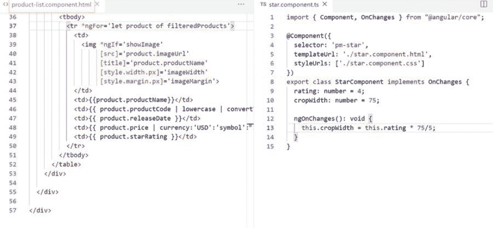

在表格数据元素中，我们希望用我们的 `StarComponent` 替换 `starRating` 数字的显示方式。为此，我们只需用我们的指令替换绑定。现在我们的 `ProductList` 模板将显示我们的星星。接下来我们需要告诉 Angular 在哪里可以找到这个指令。由于我们只有一个 Angular 模块，我们将在其中添加嵌套组件的声明。将 `StarComponent` 添加到传递给 `@NgModule` 装饰器的 `declarations` 数组中。

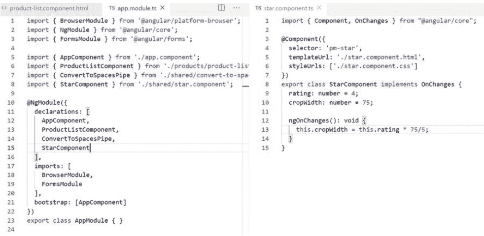

这些是我们本书记载在前面使用组件作为指令时所遵循的相同步骤。到目前为止没有什么新东西。我们在 `OnChanges` 生命周期事件发生时在 `ngOnChanges` 方法中设置 `cropWidth` 属性。但 `OnChanges` 生命周期事件从未发生，因为 `OnChanges` 只会监视输入属性的变化。我们没有任何输入属性，所以我们有两个问题。我们的 `OnChanges` 事件不会触发，而且我们目前没有办法从容器中获取正确的评分。

```typescript
export class StarComponent implements OnChanges {
  rating: number = 4;
  cropWidth: number = 75;

  ngOnChanges(): void {
    this.cropWidth = this.rating * 75/5;
  }
}
```

让我们看看输入属性如何能解决这两个问题。在构建交互式应用程序时，嵌套组件通常需要与其容器通信。嵌套组件使用输入属性从其容器接收信息。为了使 `StarComponent` 显示正确数量的星星，容器必须将产品的评分作为输入传递给我们的 `StarComponent`。嵌套组件通过发出事件将信息输出回其容器。在我们的示例中，如果用户点击星星，我们希望发出一个事件来通知容器。让我们先关注输入属性。如果嵌套组件想要从其容器接收输入，它必须使用恰如其名的 `@Input` 装饰器为此目的标识一个属性。我们使用 `@Input` 装饰器来装饰嵌套组件类中的任何属性。这适用于任何属性类型，包括对象。在本例中，我们希望将 `rating` 传递给嵌套组件，因此我们用 `@Input` 装饰器标记该属性。

```typescript
@Component({
  selector: 'pm-star',
  templateUrl: './star.component.html'
})
export class StarComponent {
  @Input() rating: number;
  cropWidth: number;
}
```

容器模板然后使用属性绑定将数据传递给嵌套组件。还记得如何使用属性绑定吗？我们用方括号括起嵌套组件的属性，并将其分配给用引号括起来的表达式。

```html
<td>
  <pm-star [rating]='product.starRating'>
  </pm-star>
</td>
```

在本例中，模板使用属性绑定将产品的 `starRating` 传递给 `StarComponent`。容器组件只能绑定到用 `@Input` 装饰器标记的嵌套组件属性。因此在本例中，模板绑定到 `rating` 但未绑定到 `cropWidth`。让我们试试看。以下是 `StarComponent` 和模板。`StarComponent` 希望其容器传入 `rating`。正如我们所见，我们将 `@Input` 装饰器添加到我们想要传入的任何属性上。它是一个装饰器，所以我们指定 @ 符号。`@Input` 装饰器是一个函数，所以我们添加括号并添加相关的导入。我们不需要向此函数传递任何内容，所以就这样。

```typescript
import { Component, Input, OnChanges } from "@angular/core";

@Component({
  selector: 'pm-star',
  templateUrl: './star.component.html',
  styleUrls: ['./star.component.css']
})
export class StarComponent implements OnChanges {
  @Input() rating: number = 4;
  cropWidth: number = 75;

  ngOnChanges(): void {
    this.cropWidth = this.rating * 75/5;
  }
}
```

然后我们将默认值重置为 0。

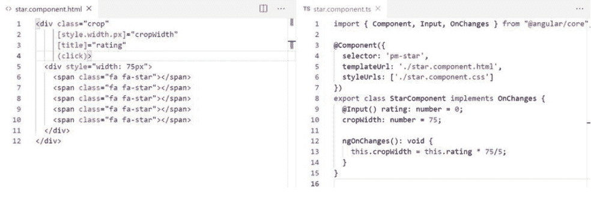

我们通过在括号内指定事件来定义事件绑定。我们将其绑定到组件中的一个方法，我们称之为 `onClick`。接下来，我们在组件中编写 `onClick` 方法。该方法没有返回类型，因此我们指定 `void`。现在，让我们在每次用户点击星星时向控制台记录一条消息。在这里，我使用 ES2015 反引号来指定 JavaScript 模板字面量。模板字面量允许我们使用占位符在字符串中插入表达式。在此表达式中，我们显示产品评分。

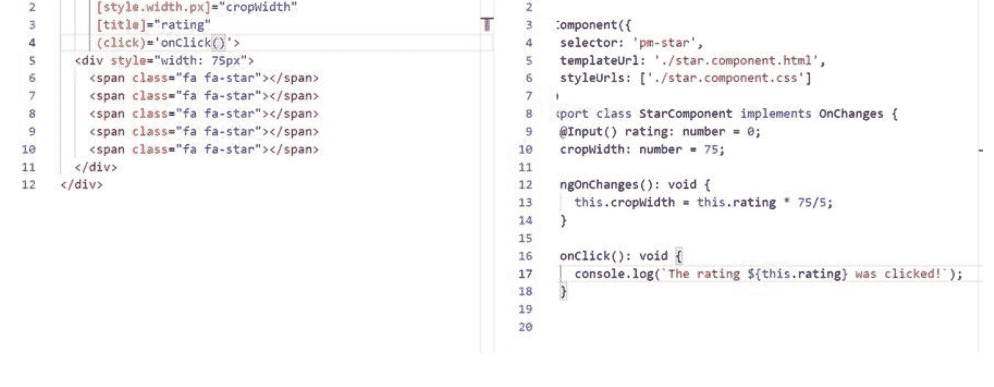

打开浏览器并打开开发者工具。然后让我们清除默认的 Filter by，以便我们拥有更多产品。点击一个产品，我们会看到星级评分记录到控制台。点击另一个产品，我们会看到其星级评分。

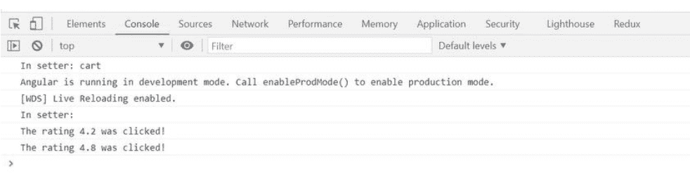

我们的嵌套组件现在可以在用户点击评分时做出反应，但如果我们想将该事件传递给容器组件怎么办？

我们看到容器如何通过绑定到用 `Input` 装饰器装饰的嵌套组件属性来向嵌套组件传递数据。如果嵌套组件想要将数据发送回其容器，它可以发出一个事件。嵌套组件必须使用恰如其名的 `Output` 装饰器为此目的标识一个属性。我们可以使用 `Output` 装饰器来装饰嵌套组件类的任何属性，然而，该属性必须是事件。嵌套组件将数据传回其容器的唯一方式是通过发出事件。在 Angular 中，事件是使用 `EventEmitter` 对象定义的。所以在这里，我们创建一个 `EventEmitter` 的新实例。注意这里的语法。TypeScript 支持泛型。如果您不熟悉泛型，此语法允许我们标识对象将使用的特定类型。

```typescript
@Component({
  selector: 'pm-star',
  templateUrl: './star.component.html'
})
export class StarComponent {
  @Input() rating: number;
  cropWidth: number;
  @Output() notify: EventEmitter<string> =
    new EventEmitter<string>();
}
```

创建 `EventEmitter` 时，泛型参数标识随事件传递的数据类型。如果我们想在事件中向容器传递一个字符串值，我们在这里定义 `string`。如果我们想传递多个值，我们可以在这里指定一个对象。在本例中，我们定义了一个带有字符串数据的 `notify` 事件。当用户点击星星时，只有 `StarComponent` 接收到该点击事件。

```typescript
@Component({
  selector: 'pm-star',
  templateUrl: './star.component.html'
})
export class StarComponent {
  @Input() rating: number;
  cropWidth: number;
  @Output() notify: EventEmitter<string> =
    new EventEmitter<string>();

  onClick() {

  }
}
```

与其自行处理点击事件，`StarComponent` 可以向其容器发出新事件并选择性地传递一些数据。

```typescript
@Component({
  selector: 'pm-star',
  templateUrl: './star.component.html'
})
export class StarComponent {
  @Input() rating: number;
  cropWidth: number;
  @Output() notify: EventEmitter<string> =
    new EventEmitter<string>();

  onClick() {
    this.notify.emit('clicked!');
  }
}
```

在本例中，`onClick` 方法发出 `notify` 事件并传递一个字符串消息。在容器组件的模板中，我们使用事件绑定绑定到 `StarComponent` 的 `notify` 事件，然后在该事件发生时调用容器组件中的一个方法。

```html
<td>
  <pm-star [rating]='product.starRating'
           (notify)='onNotify($event)'>
  </pm-star>
</td>
```

我们使用 `$event` 访问事件数据。由于事件数据是一个字符串，此方法接收一个字符串。

```
@Component({
  selector: 'pm-products',
  templateUrl: './product-list.component.html'
})
export class ProductListComponent {
  onNotify(message: string): void { }
}
```

我们的目标是什么？当用户点击其中一个星级评分时，我们希望在产品列表组件的标题中显示该评分。此功能可能并不非常有用，但它演示了如何将事件从嵌套的子组件传递到父容器组件。我们已向嵌套组件添加了事件绑定。当用户点击星星时，它会记录一条消息。我们反而希望将该字符串消息作为事件发送给容器组件。我们回到示例应用程序，查看 `star.component` 组件和模板。

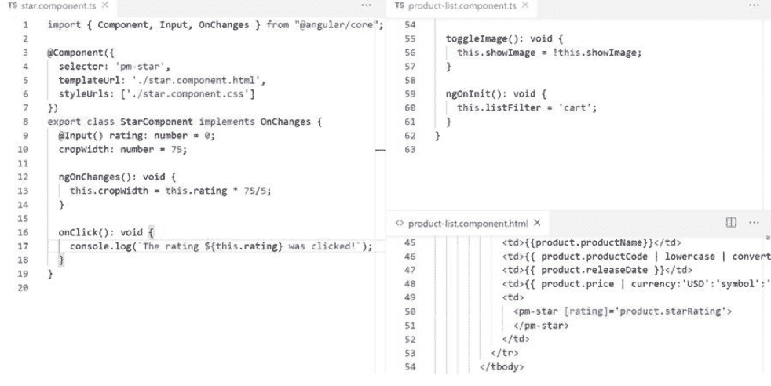

回想一下嵌套组件如何向其容器发送数据，它使用带有 `Output` 装饰器的事件。让我们定义一个 `ratingClicked`

`Output` 装饰器是一个函数，因此我们添加括号。我们再次使用快速修复将 `output` 添加到 import 语句中。在此示例中，我们仅使用 `Output` 装饰器装饰嵌套组件的一个属性，但我们并不限于一个。我们可以根据需要公开多个输出属性。

```
import { Component, EventEmitter, Input, OnChanges, Output }

@Component({
  selector: 'pm-star',
  templateUrl: './star.component.html',
  styleUrls: ['./star.component.css']
})
export class StarComponent implements OnChanges {
  @Input() rating: number = 0;
  cropWidth: number = 75;
  @Output() ratingClicked: EventEmitter<string> =
    new EventEmitter<string>();

  ngOnChanges(): void {
    this.cropWidth = this.rating * 75/5;
  }

  onClick(): void {
    console.log(`The rating ${this.rating} was clicked!`);
  }
}
```

在我们的 star 组件的 `onClick` 方法中，我们不想再记录此消息，而是希望发出我们的 `ratingClicked` 事件并将消息传递给容器组件。我们使用事件属性并调用其 `emit` 方法，将期望的字符串传入。

```
onClick(): void {
  this.ratingClicked.emit(`The rating ${this.rating} was clicked!`);
}
```

现在我们已向容器发出此 `ratingClicked` 事件，容器如何监听并响应该事件？它使用事件绑定。在模板中，我们使用事件绑定将 `StarComponent` 发出的事件绑定起来。对于事件绑定，我们使用括号并指定要监听的事件名称。我们要监听 `StarComponent` 的 `ratingClicked` 事件。

事件发生时，我们调用一个方法。让我们称之为 `onRatingClicked`。回想一下我们在引发此事件时传递了一个字符串，因此让我们将该字符串传递给我们的 `onRatingClicked` 方法。我们使用 `$event` 来做到这一点，`$event` 会传递与生成的事件关联的任何数据。

```
<> product-list.component.html ×
45   <td>{{product.productName}}</td>
46   <td>{{ product.productCode | lowercase | convert
47   <td>{{ product.releaseDate }}</td>
48   <td>{{ product.price | currency:'USD':'symbol':''
49   <td>
50     <pm-star [rating]='product.starRating'
      (ratingClicked)='onRatingClicked($event)'>
     </pm-star>
   </td>
   </tr>
```

接下来，我们需要在类中编写此方法代码。我们的模板期望我们有一个名为 `onRatingClicked` 的方法，并且会将事件的字符串消息传递给它。我们的方法不返回值，因此我们将返回类型定义为 `void`。现在我们已从事件中获取了消息，我们想用它做什么？我们的目标是在页面标题上显示它，因此我们将修改 `pageTitle` 以显示 Product List 和来自嵌套 `StarComponent` 的消息。


```typescript
toggleImage(): void {
  this.showImage = !this.showImage;
}

ngOnInit(): void {
  this.listFilter = 'cart';
}

onRatingClicked(message: string): void {
  this.pageTitle = "Product List: " + message;
}
```

这并不是一个非常现实的示例，但我想尽可能保持简单。让我们用一些清单来收尾，我们可以在构建可嵌套组件时使用。我们刚刚看到容器如何通过绑定到用`@Input`装饰器装饰的嵌套组件属性来向嵌套组件传递数据，以及嵌套组件如何使用用`@Output`装饰器装饰的事件属性来引发事件。我们可以将用`@Input`或`@Output`装饰器装饰的属性视为可嵌套组件的公共 API。

```typescript
export class StarComponent {
  @Input() rating: number;
}
```

组件中的其他所有内容都被封装起来，只能由组件的模板和类访问。只要嵌套组件属性需要从其容器获取输入数据，就用`@Input`装饰器装饰它。任何类型的组件属性都可以用`@Input`装饰器装饰。不要忘记`@`前缀，并且由于`@Input`装饰器是一个函数，请在其后加上打开和关闭的括号。只要嵌套组件属性需要发出事件并可选地将数据传递给其容器，就用`@Output`装饰器装饰它。仅应将类型为`EventEmitter`的属性标记为`@Output`。使用`EventEmitter`的泛型参数指定事件数据的类型，并使用 new 关键字创建新的事件。

```typescript
export class StarComponent {
  @Output() notify: EventEmitter<string> =
      new EventEmitter<string>();
}
```

不要忘记`@`前缀，并且由于`@Output`装饰器是一个函数，请在其后加上打开和关闭的括号。在容器组件的模板中，将嵌套组件用作指令。

```html
<pm-star [rating]='product.starRating'
    (notify)='onNotify($event)'>
</pm-star>
```

对于指令的名称，使用嵌套组件的选择器。使用属性绑定将数据传递给嵌套组件。使用事件绑定响应来自嵌套组件的事件，并使用`$event`访问从嵌套组件传递的事件数据。总结一下，我们构建了`Star`组件并将其嵌套在`Product List`组件中。我们可以在应用程序的任何其他组件中重用此组件，例如`Product Detail`组件。接下来，让我们看看如何构建 Angular 服务，这样我们就不需要在组件中存放产品数据了。

## 第 19 章 如何构建服务

组件很好，但对于与特定视图无关或我们希望在组件之间共享的数据或逻辑，我们该怎么办？我们构建服务。在本章中，我们创建一个服务并使用依赖注入将该服务注入到任何需要它的组件中。应用程序通常需要诸如产品数据服务或日志服务之类的服务。我们的组件依赖这些服务来完成繁重的工作。如果 Angular 能把这些服务端上来就好了？嗯，是的，它可以，但服务到底是什么？服务是一个具有专注目的的类。我们经常创建服务来实现独立于任何特定组件的功能、在组件之间共享数据或逻辑，或封装外部交互，例如数据访问。通过将这些职责从组件转移到服务，代码更易于测试、调试和重用。

在本章中，我们首先概述 Angular 中服务和依赖注入的工作原理。然后我们将构建一个服务，注册该服务，并检查如何在组件中使用该服务。我们目前已在应用程序中实现了几个部分，但我们的数据直接在产品列表组件中。我们将把提供产品数据的责任转移到产品数据服务。在我们开始构建服务之前，让我们先看看 Angular 中服务和依赖注入的工作原理。

我们的组件有两种方式可以与此服务配合工作。组件可以创建服务类的实例并使用它。这很简单，而且有效。但实例是 local to the component, so we can't share data or other resources. And it will be more difficult to mock the service for testing. That's why we don't normally use the technique when working with services.

Alternatively, we can register the service with Angular. Angular then creates a single instance of the service class, called a singleton, and holds onto it. Specifically, Angular provides a injector. We register our services with the Angular injector, which maintains a container of created service instances. The injector creates and manages the single instance, or singleton, of each registered service as required. In this example, the Angular injector is managing instances of three different services, `log`, `math`, and `myService`, which is abbreviated `svc`.

If our component needs a service, the component class defines the service as a dependency. The Angular injector then provides, or injects, the service class instance when the component class is instantiated. This process is called dependency injection. Since Angular manages the single instance, any data or logic in that instance is shared by all of the classes that use it. This technique is the recommended way to use services because it provides better management of service instances, it allows sharing of data and other resources, and it's easier to mock the services for testing purposes.

Now let's look at a more formal definition of dependency injection. Dependency injection is a coding pattern in which a class receives the instances of objects it needs, called its dependencies, from an external source rather than creating them itself. In Angular, this external source is the Angular injector. Now that we've got a general idea of how services and dependency injection work in Angular, let's build a service.

Are we ready to build a service? Here are the steps. Create the service class, define the metadata with a decorator, and import what we need. These are the same basic steps we followed to build our components and our custom pipe. Let's look at the code for a simple service. Here is the class. We export it so the service can be used from any other parts of the application. This class currently has one method, `getProducts`. This method returns an array of products. Next we add a decorator for the service metadata.

```typescript
import { Injectable } from '@angular/core'

@Injectable()
export class ProductService {
  getProducts(): IProduct[] {
  }
}
```

When building services, we use the `Injectable` decorator. Lastly, we import what we need, in this case `Injectable`. Now let's build our service. Since our service will only provide product data, we'll add it to the products folder. We'll create a new file and call it `product.service.ts` to follow our naming conventions. We're then ready to create the service class. Export class and the class name. Since this service provides products, we'll call it `ProductService`. Next, we decorate the class with the `Injectable` decorator, and we'll add the import statement for that decorator. Now that we have the structure in place, we can add properties or methods to the class as needed. Unless marked private or protected, the properties and methods defined in the class are accessible to any class that uses this service. For our `ProductService`, we want a `getProducts` method that returns the list of products. We strongly typed this return value using our `IProduct` interface. So we need to import this interface.

```typescript
import { Injectable } from "@angular/core";
import { IProduct } from "./product";

@Injectable()
export class ProductService {
  getProducts(): IProduct[] {
  }
}
```

Next, we'll see how to retrieve the products using HTTP. For now, we'll hard code them in here.

```typescript
import { Injectable } from "@angular/core";
import { IProduct } from "./product";

@Injectable()
export class ProductService {
  getProducts(): IProduct[] {
    return [
      {
        "productId": 2,
        "productName": "Garden Cart",
        "productCode": "GDN-0023",
        "releaseDate": "March 18, 2021",
        "description": "15 gallon capacity rolling garden cart",
        "price": 32.99,
        "starRating": 4.2,
        "imageUrl": "assets/images/garden_cart.png"
      },
      {
        "productId": 5,
        "productName": "Hammer",
        "productCode": "TBX-0048",
        "releaseDate": "May 21, 2021",
        "description": "Curved claw steel hammer",
        "price": 8.9,
        "starRating": 4.8,
        "imageUrl": "assets/images/hammer.png"
      }
    ];
  }
}
```

Notice that we have no properties defined in this class. So we are not using this particular service to share data. We are using it to encapsulate the data access features. By using the service to provide the list of products, we take the responsibility for managing the data away from the individual component. That makes it easier to modify or reuse this logic. A service is just really an ordinary class until we register it with an Angular injector.

## Chapter 20 How to Register the Service


We register the service with the Angular injector, and the injector provides the service instance to any component that injects it using the constructor. The injector represented is the root application injector. In addition to the root application injector, Angular has an injector for each component, mirroring the component tree. A service registered with the root application injector is available to any component or other service in the application. A service registered with a specific component is only available to that component and its child or nested components. For example, if a service is registered with the `ProductListComponent`'s injector, the service is only available for injection in the `ProductListComponent` and its child, the star component. Note that a service does not need to be defined in an Angular module. When should you register your service with the root injector versus a component injector? Registering a service with the root injector ensures that the service is available throughout the application. In most scenarios, you'll register the service with the root injector. If you register a service with the component injector, the service is only available to that component and its child or nested components. This isolates a service that is used by only one component and its children, and it provides multiple instances of the service for multiple instances of the component. For example, we have multiple instances of the star component on the product list page, one for each row. If we had a service that tracks some settings for each star component instance, we would want multiple instances of the service, one for each instance of the component.

But this is not a common scenario. With that, the next question is how do we register a service? That depends on which injector we use. We register the service with the root application injector in the service. We pass an object into the `Injectable` decorator and set the `providedIn` property to `root`. We can then access the service from any component or other service in the application. We want to use our `ProductService` in several components, so we'll register it with the root application injector.

```
import { Injectable } from '@angular/core'

@Injectable({
  providedIn: 'root'
})
export class ProductService {
  getProducts(): IProduct[] {
  }
}
```

In the service, we add the `providedIn` property to the `Injectable` decorator and set it to `root`. An instance of the `ProductService` is then available for injection anywhere in the application. But what if we only wanted to access the service from one component instead?

```
@Injectable({
  providedIn: 'root'
})
export class ProductService { }
```

For most scenarios, we'll register our service in this service using the `providedIn` property. The service is then available to the entire

application. 要为特定组件（如 `ProductListComponent`）注册我们的服务，我们在该组件中这样注册服务。

```typescript
@Component({
  templateUrl: './product-list.component.html',
  providers: [ProductService]
})
export class ProductListComponent { }
```

服务随后可供该组件及其子组件使用。请注意，`providedIn` 功能是在 Angular 版本 6 中新增的。在旧代码中，你会看到服务在模块中这样注册。

```typescript
@NgModule({
  imports: [ BrowserModule ],
  declarations: [ AppComponent ],
  bootstrap: [ AppComponent ],
  providers: [ProductService]
})
export class AppModule { }
```

此语法仍然有效。然而，推荐的做法是改用服务中的新 `providedIn` 功能。这提供了更好的 tree shaking。Tree shaking 是一种过程，通过该过程 Angular 编译器会摇掉未使用的代码以获得更小的部署包。我们将在本书后面更详细地讨论 tree shaking。现在我们已经注册了服务，让我们看看如何注入服务以便使用它。我们看到了如何使用 Angular 注入器注册服务。现在我们只需要将其定义为依赖项，这样注入器就会在需要它的类中提供实例。那么，我们如何在 Angular 中进行依赖注入呢？

```
@Component({
  selector: 'pm-products',
  templateUrl: './product-list.component.html'
})
export class ProductListComponent {
  constructor() {
  }
}
```

嗯，更好的问题是，我们如何在 TypeScript 中进行依赖注入？答案在构造函数中。每个类都有一个在类实例创建时执行的构造函数。如果没有为类显式定义构造函数，则使用隐式构造函数。但如果我们想注入诸如服务实例之类的依赖项，我们需要显式构造函数。在 TypeScript 中，构造函数使用构造函数函数定义。通常什么类型的代码会进入构造函数函数？尽可能少。因为构造函数函数在组件创建时执行，它主要用于初始化，而不是用于有副作用或执行时间长的代码。我们通过将它们指定为构造函数函数的参数来标识我们的依赖项，如下所示。

```
import { ProductService } from './product.service';

@Component({
  selector: 'pm-products',
  templateUrl: './product-list.component.html'
})
export class ProductListComponent {
  private _productService;
  constructor(productService: ProductService) {
    this._productService = productService;
  }
}
```

在这里，我们定义一个私有变量来保存注入的服务实例。我们创建另一个变量作为构造函数参数。当此类被构造时，Angular 注入器将此参数设置为所请求服务的注入实例。然后我们将注入的服务实例分配给我们的局部变量。然后我们可以在类的任何位置使用此变量来访问服务属性或方法。这是一个如此常见的模式，以至于 TypeScript 为所有这些代码定义了简写语法。我们只需向构造函数参数添加访问器关键字，例如这里的 `private`。然后，这就是声明此变量、定义参数并将变量设置为参数的快捷方式。

```typescript
import { ProductService } from './product.service';

@Component({
  selector: 'pm-products',
  templateUrl: './product-list.component.html'
})
export class ProductListComponent {

  constructor(private productService: ProductService) { }

}
```

你会在 Angular 文档和其它代码示例中看到这种技术的使用。我们想在 `ProductListComponent` 中使用我们的服务来获取产品。因此我们将在 `ProductListComponent` 中将产品服务定义为依赖项。我们只需要一个构造函数。我们将使用简写语法来定义依赖项，`private productService`。然后，因为我们使用的是 TypeScript，我们键入冒号和类型，即 `ProductService`。

```typescript
constructor(private productService: ProductService) { }
```

请注意，访问器不必是 `private`。简写语法也适用于 `public` 和 `protected`。因此，现在我们这里有一个语法错误。我们需要导入 `ProductService` 才能将其用作此处的数据类型。当组件实例被创建时，Angular 注入器会注入 `ProductService` 的一个实例。我们现在处于可以实际使用 `ProductService` 的阶段。首先，让我们删除 products。我们将改为从服务获取它们。现在的问题是，我们应该把调用服务的代码放在哪里？一个想法可能是将其放在构造函数中，但最终我们的 `ProductService` 将会向服务器发出请求以获取数据。我们不希望所有这些都在构造函数中执行。还记得我们关于生命周期钩子的讨论吗？本书前面我们说过，`OnInit` 生命周期钩子提供了一个执行任何组件初始化的位置，并且是检索模板数据的绝佳位置。让我们使用 `OnInit` 生命周期钩子。我们想将 `products` 属性设置为从服务返回的产品。要调用服务，我们使用包含注入服务实例的私有变量，然后键入点和我们想要调用的方法名称。注意 IntelliSense 如何帮助我们完成所有这些操作。此时我们的代码有一个小问题。

```
ngOnInit(): void {
  this.products = this.productService.getProducts();
  this.listFilter = 'cart';
}
```

我们没有绑定到 `products` 属性。我们绑定到 `filteredProducts` 属性，而 `filteredProducts` 属性要等到输入过滤字符串后才会被设置。因此在应用程序初始化时，让我们将 `filteredProducts` 属性设置为我们的完整产品列表。

```
ngOnInit(): void {
  this.products = this.productService.getProducts();
  this.filteredProducts = this.products;
  this.listFilter = 'cart';
}
```

让我们再做一个小改动。让我们删除默认的 `listFilter` 值，这样我们就可以在列表中看到所有产品。

```
ngOnInit(): void {
  this.products = this.productService.getProducts();
  this.filteredProducts = this.products;
}
```

我们应该准备好在浏览器中看到结果了，这里是我们的产品。请注意，现在显示的产品更多了，因为我将更多产品硬编码到了服务中。尝试我们的过滤功能，它仍然可以正常工作。让我们用一些我们可以用来构建服务的检查清单来结束。我们构建服务使用的技术与构建组件和自定义管道时相同。我们首先创建服务类。

```
import { Injectable } from '@angular/core';
@Injectable({
  providedIn: 'root'
})
export class ProductService {...}
```

我们指定一个清晰的类名，适合服务提供的功能，使用 PascalCasing 每个单词首字母大写，将 `Service` 附加到名称后面，并且不要忘记 `export` 关键字。然后我们用 `injectable` 装饰器装饰服务类。不要忘记 `@` 前缀。并且由于装饰器是一个函数，请在后面加上打开和关闭的括号。并确保定义适当的导入。注册服务的第一个步骤是选择注入器层次结构中服务应注册的适当级别。如果服务在整个应用程序中共享，请使用根应用程序注入器。如果只有某个组件及其子组件需要该服务，请将其与该组件的注入器一起注册。选择其一，不要两者都选。使用服务的 `injectable` 装饰器将服务与根注入器注册。

```
@Injectable({
  providedIn: 'root'
})
export class ProductService {...}
```

将 `providedIn` 属性设置为 `root`。使用其组件装饰器为特定组件及其子组件注册服务。使用 `providers` 属性注册服务。

```
constructor(private productService: ProductService) { }
```

在任何需要服务的类中，将服务指定为依赖项。使用构造函数参数定义依赖项。Angular 注入器将在组件实例化时注入服务的实例。总结一下，我们构建了产品数据服务，因此我们的产品列表组件不再有硬编码的产品。接下来，我们将看到如何修改服务以使用 HTTP 检索数据。

## 第21章 可观察对象与响应式扩展

我们应用程序的数据位于某个服务器上，在云端或办公室。如何将这些数据获取到我们的视图中呢？在本章中，我们将学习如何使用 HTTP 与可观察对象一起检索数据。大多数 Angular 应用程序都是使用 HTTP 获取数据的。应用程序向 Web 服务发出 HTTP GET 请求。该 Web 服务检索数据，通常使用数据库，并以 HTTP 响应形式将其返回给应用程序。然后应用程序处理这些数据。

我们首先介绍可观察对象和响应式扩展。然后我们研究如何发送 HTTP 请求并将结果映射到数组。我们添加一些异常处理，并查看如何订阅可观察对象以获取视图所需的数据。我们完成了产品数据服务的初版，但它仍然包含硬编码数据。我们将用 HTTP 调用替换这些硬编码数据。

要理解我们即将编写的 HTTP 代码，了解 Reactive Extensions 和 Observable 的基础知识非常重要。所以让我们稍微深入技术细节一下，然后再解释其含义。

Reactive Extensions for JavaScript，或 `RxJS`，是一个用于使用 Observable 序列组合数据并使用一组操作符转换数据的库。如果你熟悉 .NET，这些操作符类似于 LINQ 操作符。Angular 使用 Reactive Extensions 来处理数据，特别是异步数据，例如 HTTP 请求，这就是我们在这里介绍它的原因。

那么这到底意味着什么？让我们先从异步开始，然后介绍 Observable 序列和操作符。

同步通信就像电话通话。你说话，我立即处理信息并作出回应。对于同步数据，应用程序请求一个值并等待它到达，就像调用我们的 `getProducts` 方法来获取产品列表一样。


异步通信不期望立即响应。当我发送电子邮件时，我不必等待回复。我可以做其他事情。当稍后收到回复通知时，我可以决定何时处理它。从我们应用程序的角度来看，HTTP 请求是异步的。这里有一个应用程序，这里有一个 Web 服务器。应用程序想要显示产品，因此我们向 Web 服务器发送请求，要求获取产品数据。然后我们设置在数据返回时收到通知，并继续进行。在稍后的某个时间点，HTTP 返回包含所请求产品的响应，我们的应用程序通知我们产品已返回。因此，这个请求和响应的过程是异步的。我们提交请求，不等待它，并在稍后某个时间收到响应。

在 Angular 中，我们使用 HTTP 发出 `get` 请求，但我们用什么来设置通知呢？这就是 RxJS `Observable` 序列发挥作用的地方。`Observable` 序列，有时称为 `Observable` 流，或简称 `Observable`，是随时间推移的一组项目。所以它是一个集合，但与数组不同，它不会保留项目。相反，发出项目可以在随时间推移被观察到。例如，这里有一个字母数组。我们可以遍历字母，对字母排序，或请求第三个字母。`Observable` 更像是这样，随时间到达的字母。我们无法遍历它们，对它们排序，或在它们已经发出后请求第三个字母。将这些字母想象成鼠标移动、按钮点击或用户输入字符。移动、点击或按键会随时间发生。

`Observable` 会做什么？`Observable` 在我们订阅之前什么都不做。可以把订阅想象成流媒体服务。在你订阅之前，你不会收到最新的剧集。当我们订阅时，`Observable` 开始发出通知。

有三种类型的通知。最常见的是 `next` 通知，当下一个项目被发出时发生，并提供已发出的项目。例如，想象跟踪按键。每次按下键时，`Observable` 发出 `next` 通知，并提供按下的字符。如果发生错误，`Observable` 发出 `error` 通知，并提供错误信息。`Observable` 然后完成，不再发出项目。如果没有更多项目可发出，`Observable` 发出 `complete` 通知。一旦订阅，`Observable` 会发出 `next`、`error` 或 `complete` 通知。

有了这些知识，让我们更详细地回顾一下上一章的内容。为了获取用于显示的产品数据，代码调用 `http.get()`。`Http.get()` 返回一个 `Observable`，它将发出通知，因此我们知道何时响应到达。然后我们订阅以启动 `Observable`，并发送 `get` 请求。请回忆，`Observable` 在我们订阅之前什么都不做。代码不会等待响应；它只是继续进行。在稍后的某个时间点，服务器返回响应。`Observable` 发出 `next` 通知，让我们知道我们已获得数据。然后我们可以处理发出的响应。请注意，使用 `http.get()` 时，`Observable` 将整个响应作为一个发出项目发出。因此，如果我们请求产品，HTTP 响应包含产品，并且

## 第22章 如何使用 Observable

在 Angular 应用程序中，使用可观察对象的一种常见方式是首先使用 `subscribe` 启动可观察对象，然后通过一组操作符 `pipe` 传输每个发出项目以修改或转换该项目。然后我们处理来自可观察对象的通知。请回忆可观察对象发出的三种通知？`Next`、`error` 和 `complete`。最后，我们通过取消订阅来停止可观察对象。

以下是一些示例代码来巩固这些概念。可以在 `rxjs` 包中找到可用于创建可观察对象的可观察对象操作符和方法。

```
import { Observable, range, map, filter } from 'rxjs';

const source$: Observable<number> = range(0, 10);

source$.pipe(
    map(x => x * 3),
    filter(x => x % 2 === 0)
).subscribe(x => console.log(x));
```

我们使用名为 `range` 的可观察对象创建函数来创建一个可观察对象，该可观察对象发出从 0 开始的 10 个数字，以便我们有一些数据可供使用。我们在此使用泛型参数来定义此可观察对象将发出的数据类型。按照惯例，我们为引用可观察对象的变量添加美元后缀。这使得更容易快速区分可观察对象。

我们使用 `pipe` 方法将发出项目通过多个操作符管道传输。在此示例中为 `map` 和 `filter`。我们在此只包含两个操作符，但我们可以定义任意数量的操作符，用逗号分隔。

`map` 操作符允许我们转换每个发出项目。我们使用箭头函数定义转换逻辑。箭头函数的参数是发出项目。在此示例中，每个发出数字乘以 3，然后传递给下一个操作符。

`filter` 操作符决定哪些项目通过，哪些被过滤掉。我们使用箭头函数定义过滤逻辑。箭头函数的参数是从前一个操作符发出的项目。在此示例中，我们将结果过滤为序列中的偶数，即除以 2 余数为 0 的那些数字。

如何启动可观察对象呢？我们调用 `subscribe` 方法。可观察对象随后发出数字范围。我们使用箭头函数定义想要对管道中发出的每个项目做什么操作。在这里我们只是记录它。我们稍后会更详细地讨论 `subscribe` 语法以及如何取消订阅。

你认为会记录什么到控制台？源发出 0。0 乘以 3 得到 0。0 除以 2 余数为 0，因此它包含在最终结果中。源发出 1，1 乘以 3 得到 3。3 除以 2 余数为 1，因此它不包含在最终结果中，以此类推。

## 第23章 如何设置 HTTP 请求

我们通常将应用程序的数据访问封装到数据服务中，任何组件或其他需要它的服务都可以使用它。我们已经这样做了，但我们的产品数据服务仍然包含硬编码的产品列表。我们希望改为发送 HTTP 请求从 Web 服务器获取产品。

Angular 提供了一个 HTTP 服务，允许我们使用熟悉的 HTTP 请求和响应协议与 Web 服务器通信。例如，我们调用 `HttpClient` 服务的 `get` 方法，它返回一个可观察对象。当我们订阅该可观察对象时，`HttpClient` 服务向 Web 服务器发送 `get` 请求。Web 服务器响应返回到 `HttpClient` 服务，可观察对象发出 `next` 通知，提供响应。

这在代码中看起来如何？这是我们之前构建的 `ProductService`。

```
import { HttpClient } from '@angular/common/http';

@Injectable({
  providedIn: 'root'
})
export class ProductService {
  private productUrl = 'www.myWebService.com/api/products';

  constructor(private http: HttpClient) { }

  getProducts() {
    return this.http.get(this.productUrl);
  }
}
```

首先，我们指定 Web 服务器上产品的 URL。这定义了我们发送 HTTP 请求的位置。请注意，此 URL 仅用于说明目的，并不是真实的 URL。接下来我们添加一个构造函数。回想一下，我们使用构造函数来注入依赖项。在这种情况下，我们需要 Angular 的 HTTP 服务，因此在此处注入它。由于我们将此变量强类型为 `HttpClient`，因此在此处导入 `HttpClient`。还请记住，在我们将服务作为依赖项注入之前，需要将该服务的提供程序注册到 Angular 的注入器中。HTTP 服务提供程序的注册已在 `HttpClientModule` 中为我们完成。为了将此外部包的功能包含到我们的应用程序中，我们将其添加到应用程序的 Angular 模块 `AppModule` 的 `imports` 数组中。回想一下，`declarations` 数组用于声明属于此模块的组件、指令和管道。`imports` 数组用于引入外部模块。我们声明我们的组件，我们声明这些组件所需的指令和管道，并导入我们需要的外部模块。回到 `product.service`，在 `getProducts` 中，我们使用注入的 HTTP 服务实例并调用 `get` 方法，传入所需的 URL。

```typescript
...
import { HttpClient } from '@angular/common/http';

@Injectable({
    providedIn: 'root'
})
export class ProductService {
    private productUrl = 'www.myWebService.com/api/products';

    constructor(private http: HttpClient) { }

    getProducts() {
        return this.http.get(this.productUrl);
    }
}
```

我们通过设置 `get` 方法的泛型参数来指定响应的预期类型。回想一下，泛型参数允许我们为此方法处理的数据定义一个类型。由于我们期望一个产品数组，因此我们将泛型参数设置为 `IProduct` 数组。`get` 方法然后自动将从服务器返回的响应映射到定义的类型，因此我们无需手动处理。我们还没有完全完成。我们的 方法现在返回什么？由于我们使用强类型，我们应该有一个函数返回值。这里我们将 `get` 方法的泛型参数定义为 `IProduct` 数组，所以我们会得到这个吗？不完全是。`http.get` 方法返回一个 `observable`，因此当响应从服务器返回时我们会收到通知。由于此方法返回 `http.get` 的结果，而 `http.get` 返回一个 `observable`，因此我们的方法返回一个 `observable`。由于我们告诉 `HttpClient` 服务将响应映射为产品数组，我们的 `observable` 会发出该产品数组。我们用泛型参数来表示这一点。因此我们的 `getProducts` 不再返回产品数组。相反，它返回一个 `observable`，当响应从 Web 服务器返回时，该 `observable` 会发出产品数组。这段代码会发送 `http.get` 请求吗？不会。你知道为什么吗？这段代码返回一个 `observable`，而该 `observable` 在我们订阅之前不会执行任何操作。

## 第 24 章 异常处理

正如你所想象的，在与服务通信时可能会出现许多问题，从无效请求到连接丢失。因此让我们添加一些异常处理。我们需要两个关键的 `observable` 操作符。`tap` 会接入 `observable` 流并允许我们在不转换流的情况下查看流中发出的值。因此 `tap` 对于调试或日志记录非常有用。

```typescript
...
import { HttpClient, HttpErrorResponse } from '@angular/common/http';
import { Observable, catchError, tap } from 'rxjs';
...

getProducts(): Observable<IProduct[]> {
  return this.http.get<IProduct[]>(this.productUrl).pipe(
    tap(data => console.log('All: ', JSON.stringify(data))),
    catchError(this.handleError)
  );
}

private handleError(err: HttpErrorResponse) {
}
```

`catchError` 会捕获任何错误。我们都从 RxJS 导入它们。正如我们在本书前面讨论的那样，要使用这些操作符，我们访问 `observable` 的 `pipe` 方法。然后我们传入操作符，用逗号分隔。在这里，`tap` 操作符将检索到的数据记录到控制台。这样我们可以验证它是否已正确检索。并且 `catchError` 操作符接收一个错误处理方法。错误处理方法接收一个参数，即错误响应对象。在错误处理方法中，我们可以根据需要处理错误。我们可以将错误信息发送到远程日志记录基础设施或向调用代码抛出错误。现在让我们为我们的产品服务添加异常处理。我们回到编辑器中的产品服务，就像我们离开时一样。如果没有异常处理，这段代码并不完整，因此我们将添加 `catchError` 和 `tap` 操作符的适当导入。

```typescript
import { HttpClient } from "@angular/common/http";
import { Injectable } from "@angular/core";
import { Observable, catchError, tap } from "rxjs";

import { IProduct } from "./product";

@Injectable({
  providedIn: 'root'
})
export class ProductService {
  private productUrl = 'api/products/products.json';

  constructor(private http: HttpClient) {}

  getProducts(): Observable<IProduct[]> {
    return this.http.get<IProduct[]>(this.productUrl);
  }
}
```

回想一下，HTTP GET 返回一个 `observable`。我们调用 `observable` 的 `pipe` 方法来指定一组操作符，首先是 `tap` 操作符，用于在不修改它的情况下访问发出的项目。`tap` 操作符接收一个箭头函数。参数是发出的数据，函数定义了我们想要对该数据做什么。在这种情况下，我们将其记录到控制台。这里我们使用 `JSON.stringify`。`JSON.stringify` 是一个 JavaScript 方法，它将对象或对象数组转换为 JSON 字符串。这使得在控制台中显示更容易。我们想要添加第二个操作符，因此我们插入一个逗号，然后是 `catchError` 操作符。`catchError` 也接收一个函数，但这次我们将传入一个命名函数或命名方法，而不是箭头函数。

```typescript
import { HttpClient } from "@angular/common/http";
import { Injectable } from "@angular/core";
import { Observable, catchError, tap } from "rxjs";

import { IProduct } from "./product";

@Injectable({
  providedIn: 'root'
})
export class ProductService {
  private productUrl = 'api/products/products.json';

  constructor(private http: HttpClient) {}

  getProducts(): Observable<IProduct[]> {
    return this.http.get<IProduct[]>(this.productUrl).pipe(
      tap(data => console.log('All', JSON.stringify(data))),
      catchError(this.handleError)
    );

  }
}
```

我将粘贴 `handleError` 方法，并且我们需要 `HttpErrorResponse` 和 `throwError` 的导入。

```typescript
private handleError(err: HttpErrorResponse) {
  // in a real world app, we may send the error to some remote logging infrastructure
  // instead of just logging it to the console
  let errorMessage = '';
  if (err.error instanceof ErrorEvent) {
    // A client-side or network error occurred. Handle it accordingly.
    errorMessage = `An error occurred: ${err.error.message}`;
  } else {
    // The backend returned an unsuccessful response code.
    // The response body may contain clues as to what went wrong.
    errorMessage = `Server returned code: ${err.status}, error message is: ${err.message}`;
  }
  console.error(errorMessage);
  return throwError(() => errorMessage);
}
```

在此方法中，我们可以按我们想要的方式处理错误日志记录。对于我们的示例应用程序，我们只需记录到控制台并向调用代码抛出错误。因此我们的 `getProducts` 方法已完成。我们也可以在此处添加其他方法来发布或放置数据，但我们仍然有这个语法错误，而且由于我们尚未订阅 `observable`，因此我们看不到我们辛苦工作的成果。

## 第 25 章 如何订阅 Observable


Observable 是惰性的。就像报纸或新闻通讯一样，observable 在我们订阅之前不会发出值。因此，当我们准备好在组件中开始接收值时，我们调用 `subscribe`。`subscribe` 方法接收一个可选参数，即 Observer 对象。顾名思义，Observer 对象观察流并响应三种类型的通知：`next`、`error` 和 `complete`。我们使用 Observer 对象来定义在这些通知上执行的处理函数。第一个处理函数通常称为 next 函数，因为它处理下一个发出值。由于 observable 可以随时间处理多个值，因此 `nextFn` 会为 observable 发出的每个值调用。第二个是错误处理函数，如果发生错误则执行。在某些情况下，我们想知道 observable 何时完成，因此 observable 提供第三个处理程序，在完成时执行。`subscribe` 函数返回订阅。我们使用该订阅来调用 `unsubscribe` 并在需要时取消订阅。

```typescript
getProducts(): Observable<IProduct[]> {
  return this.http.get<IProduct[]>(this.productUrl).pipe(
    tap(data => console.log('All: ', JSON.stringify(data))),
    catchError(this.handleError)
  );
}
```

现在我们的产品数据服务返回一个 observable，任何需要产品数据的类，例如我们的类，都可以调用我们的服务并

```typescript
ngOnInit(): void {
  this.productService.getProducts().subscribe({
    next: products => this.products = products,
    error: err => this.errorMessage = err
  });
}
```

这一行代码调用产品数据服务的 `getProducts` 方法，并且由于我们进行了订阅，它会触发 HTTP get 请求。然后它会异步接收来自 observable 的数据和通知。我们将一个 Observer 对象传递给 `subscribe`。这个语法定义了一个键值对，其中键是函数名，值是函数，这里使用箭头函数语法指定。第一个 Observer 函数指定了在 observable 发出项目时要采取的操作。方法参数是该发出的项目。由于 HTTP 调用是单次异步操作，只会发出一个项目，即在服务中映射为产品数组的 HTTP 响应对象。因此参数就是我们的产品数组。这段代码随后将本地 `products` 属性设置为返回的产品数组。第二个函数在 observable 失败时执行。在此示例中，它将本地错误消息变量设置为返回的错误。第三个函数未在此使用，指定在 observable 以完成通知结束时要采取的操作。当使用 HTTP 请求时，第三个函数很少使用，因为它们在发出单个响应后会自动完成。始终取消订阅我们订阅的任何 observable 都是良好的实践。有几种取消订阅的方法。首先，将 observable 订阅存储在变量中。然后实现在组件从显示中移除并销毁时执行的 `OnDestroy` 生命周期钩子。最后，使用订阅变量来取消订阅。在 `ngOnInit` 中，我们将 observable 订阅分配给一个变量，然后使用该变量和 `ngOnDestroy` 来取消订阅。在我们能够使用 Angular 的 HTTP Client 服务之前，需要进行一些设置。我们需要确保服务提供者已在 Angular 注入器中注册。此注册在 `HttpClientModule` 中为我们完成。

```
@NgModule({
  imports: [
    BrowserModule,
    FormsModule,
    HttpClientModule ],
  declarations: [...],
  bootstrap: [ AppComponent ]
})
export class AppModule { }
```

因此我们需要做的就是将 `HttpClientModule` 引入我们的应用程序。我们通过将 `HttpClientModule` 添加到应用程序的其中一个 Angular 模块的 `imports` 数组来实现这一点。

```
export class ProductService {
  private productUrl = 'www.myService.com/api/products';

  constructor(private http: HttpClient) { }

  getProducts(): Observable<IProduct[]> {
    return this.http.get<IProduct[]>(this.productUrl);
  }
```

构建一个数据访问服务来封装 HTTP 请求。在该数据服务中，使用构造函数参数定义对 Angular HTTP Client 服务的依赖。为每个 HTTP 请求创建一个方法。在方法中，调用所需的 HTTP 方法，例如 `get`，并传入到所需服务器的 URL。使用泛型指定响应返回类型。这将把原始 HTTP 响应转换为指定类型。

```
getProducts(): Observable<IProduct[]> {
  return this.http.get<IProduct[]>(this.productUrl).pipe(
    tap(data => console.log(JSON.stringify(data))),
    catchError(this.handleError)
  );
}

private handleError(err: HttpErrorResponse) {
}
```

根据需要使用 `catchError` 操作符在服务中添加错误处理。在需要从数据服务获取数据的任何组件中，调用 `subscribe` 方法来订阅 observable。提供一个在 observable 发出项目时执行的函数。

```
ngOnInit(): void {
  this.productService.getProducts().subscribe({
    next: products => this.products = products,
    error: err => this.errorMessage = err
  });
}
```

这通常会将属性分配给返回的数据，如果该属性绑定到模板，则检索到的数据会出现在视图中。并添加一个错误函数来处理任何返回的错误。组件应取消订阅其订阅的任何 observable。将订阅存储在变量中，实现 `OnDestroy` 生命周期钩子，并在 `ngOnDestroy` 方法中使用订阅变量来取消订阅。我们现在已从产品数据服务中移除了硬编码数据，而是使用 HTTP 检索数据。在我们的示例应用程序中，我们使用 HTTP 从本地 JSON 文件检索数据，但从服务检索数据的技术是相同的。

# BOOK 2

## PYTHON MACHINE LEARNING

## ALGORITHM DESIGN & PRACTICAL CODE EXECUTION

RICHIE MILLER

## Introduction

拥有合适的工具可以决定成败之间的差异，是成功、发布新闻稿并登上报纸头版，还是在昂贵的失败中化为灰烬，并因错误的原因上新闻。但即使你拥有所有工具，有时你可能不知道哪个是解决你需要解决的问题的正确工具。将工具替换为机器学习算法，你今天将迎来一段相当刺激的旅程，我将解释如何为工作选择合适的工具，也就是算法，为问题，也就是问题。以下是它的运作方式。本书不解释基础数学或基础机器学习概念，而是根据你拥有的数据，给你一个解决问题的方向感，使用基于数据特征和该问题要求的不同的学习风格，该问题你刚刚遇到，那个任务可能刚刚落在你的办公桌上，你不太确定从哪里开始。但在继续之前，有件事我需要解释一下，以确保我们在机器学习是什么这个问题上达成一致。在常规编程中，你有一个初始数据集——那是输入，然后你指定一组要执行的指令或步骤，即你的代码，执行后会产生输出，新的输入将经过这些步骤，并创建新的输出，完全可以预期，因为算法的离散特性，它会产生可重复的结果。难怪当你学习如何编码时，有些人告诉你算法就像烹饪食谱，但这并不是机器学习的工作方式。我假设你阅读这本书，你已经知道机器学习的工作原理。如果我的假设正确，那么我就可以按计划继续；然而，如果你对机器学习一无所知，不用担心，继续阅读，因为你可能会发现我今天演示的场景之一看起来与你需要解决的问题非常相似，从而给你一个如何处理和解决问题的想法。机器学习的工作方式与常规编程略有不同。通常发生的情况是，你有一个输入数据集和输出；输出在某些情况下可以称为标签、连续值或目标。你向机器展示输入和输出，它学会如何对新输入进行分类或预测以创建新输出，通过创建机器学习模型；这里的关键词是学习。学习在此上下文中指什么？学习意味着算法理解或在多维空间中找到数据中的趋势，通俗地说，机器学习模型找到解释输入如何变为输出的模式。但是，算法和模型之间的关系是什么？算法是如何从输入产生新输出的，而模型是一个经过训练的算法，具有参数并等待。好吧，它有点超出这个范围，但你明白机器学习与常规编程不同。是时候更深入地了解机器学习了。让我们进入技术层面，看看一些伟大思想家对人工智能和机器学习的看法。卡内基梅隆大学机器学习系前主席 Tom Mitchell 将机器学习定义为研究可以通过经验使用数据自动改进的计算机算法的研究。这可以说是一种机器学习算法在数据中寻找模式并构建该模式的表示以进行预测。机器学习算法的工作是找到这种关系。由于并非所有机器学习算法都以相同的方式找到这些关系，因此了解什么使算法在某些容易出错、噪声和偏差的数据下适用于特定场景非常重要。可以用来选择特定算法的常见模式，例如如果预测的值是连续值——那是一个数字，或者如果它是一个类——一个标签。还有其他分类可以帮助识别算法，例如算法是参数化的还是非参数化的，这将对性能产生影响，无论是在训练期间还是推理期间。训练是指创建机器学习算法的过程，而推理是指使用训练好的机器学习算法进行预测的过程。机器学习项目通常分为不同的阶段，收集数据，清理和转换数据，特征选择，也就是特征工程，模型选择，模型训练，模型性能评估，以及模型部署。本书重点关注模型选择、训练和评估，这将帮助你确定算法对我们特定场景的适用性。至关重要的是，它们通常取决于收集的数据质量和所选算法的正确性，垃圾进，

垃圾进垃圾出这一说法非常适用。还有一点关于常规编程与机器学习的区别，使用传统的编程技术，如分而治之、动态规划或贪心算法，建立了离散且可预测的结果的前提，这些结果并不总是能适应数据中不断变化的条件；这意味着对于特定的输入，在常规编程中你很可能总是得到相同的输出。但在机器学习中，算法被扩展为概率型、随机型、动态型和几何型方法，即使数据的形状不断演变，也能以不同的方式拟合数据。简单来说，随着你获得更多优质数据，算法在预测正确输出方面的能力可能会变得更好，通常来说，数据越多越好。有几种方法可以对不同类型的机器学习算法进行分类；例如，你可以根据学习方式或算法类型对它们进行分组。让我们从学习类型开始，例如，有监督学习或无监督学习。在本书中，我将重点关注有监督学习和无监督学习。在有监督学习中，模型学习的数据包含期望的解决方案，例如，一组带有标签的电子邮件，垃圾邮件或正常邮件，或根据房产特征或位置给出的房屋价格。在无监督学习中，数据没有任何标签或分配的值，但模型必须在它们之间找到模式以预测最适合每个数据的标签，例如，线上商店的客户分类或社交网络中人群的聚类。甚至还有其他类型，如强化学习，其中学习由一个必须与环境交互的智能体执行，并且根据观察到的内容执行特定操作；智能体使用有监督和无监督学习来最大化目标，例如收集垃圾的自主船只、打乒乓球的机械臂，或汽车、或机器人吸尘器的情况。另一种对机器学习算法进行分组的方式是根据特定算法解决某些类型问题的能力。总体而言，可以将这些算法分为回归、分类、降维、聚类、时间序列、预测、自然语言处理、异常检测、排序、推荐、数据生成、优化、目标检测等。在本书中，我将主要关注回归、分类、降维和聚类；然而，我也会讨论其他问题及其与机器学习算法的关系。

### 第1章 平台与库

你可以利用已经构建并经过测试的东西；外面有很多聪明的头脑在开发一些技术深厚、美妙的东西。当你能做到时，借鉴现有成果是一个很好的建议。让我解释一下原因，然后我会告诉你本书中我将使用的一些平台和库。

$$y = \beta_0 + \beta_1 x$$

$$\min_{\beta_0, \beta_1} Q(\beta_0, \beta_1), \quad \text{for } Q(\beta_0, \beta_1) = \sum_{i=1}^{n} \hat{\varepsilon}_i^2 = \sum_{i=1}^{n} (y_i - \beta_0 - \beta_1 x_i)^2$$

$$\beta_1 = \frac{\sum (x_i - \bar{x})(y_i - \bar{y})}{\sum (x_i - \bar{x})^2} \qquad \beta_0 = \bar{y} - \beta_1 \bar{x}$$

不用深入细节，这是用于线性回归在特定场景下进行预测的公式。在这种情况下，这是一个预测一个人是否会患上糖尿病的练习。为了做出这种预测，需要进行大量的数学计算和相当多的处理，但

这并不是我想表达的重点。我的观点如下，有很多库，比如已经包含了你可能需要的算法，你所做的只是调用一个方法或函数来完成所有繁重的工作，像这样，`LinearRegression().fit(x, y)`。这可能是我能给你的最好建议之一，如果有一个库已经实现了你需要的功能，并且你确信它能充分发挥作用，那么就使用它。它们经过社区验证，高效且文档完善。在本书中，我将利用其中一些库，尽管有大量可用于机器学习的库。其中我将使用的库包括 `numpy`、`pandas`、`SciPy`、`TensorFlow`、`PyTorch`、`matplotlib` 等。还有许多服务已经可用，其中一些值得注意的是来自你喜爱的云服务提供商，如 `AWS`、`Azure` 和 `GCP`。有很大可能你需要的东西已经可用。关于我将用于运行所有示例的内容，有几种可能性。事实上，这些很可能就是你在作为机器学习从业者日常生活中最终会使用到的。首先是 `Jupyter Notebook`，它是处理数据时的首选之一。它是一个免费的交互式网络工具，有些人称之为计算笔记本，允许开发者将软件代码、计算输出、解释性文本和多媒体资源组合到一个文档中。它主要用于 Python。事实上，它最初是 IPython 的一个分支，IPython 就像 Python 的 REPL 命令外壳，但更好；然而，现在我们也可以在 `Jupyter Notebook` 中使用其他语言，如 Julia。你可以导入库并开始处理数据，你可以连接到多个不同的内核，而且，我可以继续告诉你所有好处，但也许最好你亲自尝试一下。你会喜欢的。它与 Apache Zeppelin 有点相似，以及其他可用的选项，例如 Cloudera Machine Learning，它是 CDP、Cloudera 数据平台的一部分。鉴于你可以在本地使用 `Jupyter Notebook`，这非常方便；然而，有时你需要多一点东西，尤其是当你需要 GPU 而手边没有时。在这种情况下，Google Colab，或 Colaboratory，是 Google Research 的一个产品，允许你使用 Google 的基础设施以 Jupyter Notebook 的形式编写和执行代码。你可以获得一定量的 GPU 小时和处理能力，它存储笔记本并可以从 Google Drive 读取数据。另一个来自 Google 的选项是 Kaggle，它更进一步，成为数据科学家和机器学习从业者的在线社区。会发布竞赛，其中一些有大奖，并提供工作台，允许你使用其基础设施，包括 GPU。还有许多其他选项可用，尽管这些是一些无需高成本即可轻松获得的选项。

你使用哪些平台和库取决于你的特定需求和限制或可能性。但归根结底，记住这一点，你应该专注于利用手头的工具交付最好的结果。目标不是努力工作，而是聪明工作。现在我已经阐明了参与规则，也就是说，我已经明确本书的重点是如何为解决问题选择合适的机器学习算法，而不是技术细节，让我告诉你我将涵盖的主题。这不仅仅是为工作选择合适的工具，而是知道应该使用哪种合适的工具。

我将向你展示多个示例并解释这些场景各自的特点，以便你能确定采用哪种方法。机器学习是一个庞大的主题。某些类型的算法比其他算法更常用于解决问题。因此，在本书中，我将重点关注回归、分类、降维和聚类。

### 第2章 回归与线性回归

我们人类是预测机器。你不信吗？想象一下你来到一个政府办公室，前面有一大群人在排队。你看一下钟表，再看一下队伍并大致数一下前面的人数，然后决定是否值得排队等待，刚才发生了什么？好吧，大致上，你估计了政府工作人员帮助每个人所需的时间，并根据办公室关闭前剩余的时间或你拥有的时间进行了快速计算。基于这个结果，你决定，应该留下，还是离开？好吧，但这听起来不像预测。这不是人工智能。这听起来像一些普通的旧数学，但视角就是一切。想象一下如果这个过程不同，比如这样，你拿出 iPhone，打开并拍下你前面队伍的照片，应用程序告诉你是否值得排队等待；这听起来像机器学习和人工智能，对吧？好吧，是的，这是同样的过程，只是我们加入了一点计算机视觉。实际上，很多时候，机器学习就是这样，基于可用信息预测结果。在统计学中，回归是一种估计响应变量 `y` 与描述 `y` 的一组变量 `x` 之间关系的过程，`y` 是连续的，如温度、房屋价格或过程所需的时间。我将告诉你这些类型的算法，回归算法，我将介绍构建时需要考虑的一些因素

机器学习模型使用回归预测数值型值，以及何时应使用每种类型的算法。这绝非详尽的列表，但足以让你入门。让我们从简单的线性回归开始。线性回归很可能是你在探索机器学习时应该学习的第一种算法类型，主要是因为其简单性以及在问题中广泛使用。线性回归是我们估计一个或多个解释变量与标量响应之间线性关系的过程。我将它们称为 `x`；这些是自变量，而 `y` 是因变量，表示为标量响应。要使用线性回归，需要假设描述每个条目的变量或特征与要预测的值之间存在线性关系。以房价为例，一条直线可以用来解释房屋价格与其大小之间的关系：房子越大，价格越高就越有可能。非常常见的是有多个变量或特征会影响这种关系。要使用线性回归，这里是你需要考虑的事情。


## 线性回归概述

- 线性回归仅预测连续值，例如，温度、房价或电池寿命衰减。
- 线性回归假设自变量 `x` 与响应变量 `y` 之间的关系是线性的。
- 线性回归对异常值敏感；从数据集中移除迈克尔·杰克逊的房子可能会提高准确性。
- 线性回归期望仅有数值特征；诸如性别之类的特征需要转换，例如，使用编码。

关于线性回归需要提及的一件重要事情是，它是一种参数算法，它从数据中获得一些参数来拟合一条线，从而概括数据。幸运的是，线性回归是一种其参数来自数学公式的算法。其他机器学习算法无法以这种方式获得这些参数；它们需要优化算法来收集它们。现在，不要担心这个问题。让我们在更高层面检查线性回归公式。在不深入技术细节的情况下，因为这在其他课程中已详细涵盖，要进行预测，我们使用以下公式：`y`，即因变量，等于 `beta` 系数乘以 `x` 值之和。`β₀` 是截距，即直线与 `y` 轴相交处，并乘以 `1`。所需的 `beta` 系数由下一个公式获得，我们使用最小二乘法来找到原始响应 `y` 与预测响应 `y-hat` 之间的差异。目标是最小化 `J(β)`，就这样。它不仅易于实现，而且非常高效。

只要记住，我不会在本次培训中深入细节；这更多是为了向你展示在每种场景下使用哪种类型的算法。话虽如此，让我们看一个快速演示：线性回归。我们将从工具箱中最简单但最有用的算法线性回归开始进入 ML 算法之旅。目前，我将使用 Kaggle 的一个示例，在其中我实现了一个能够基于其他已知特征预测任何鱼重量的模型。

```python
In [2]: import pandas as pd
import numpy as np

fish = pd.read_csv("Fish.csv")
fish.head()
```

|   | Species | Weight | Length1 | Length2 | Length3 | Height | Width |
|---|---------|--------|---------|---------|---------|--------|-------|
| 0 | Bream | 242.0 | 23.2 | 25.4 | 30.0 | 11.5200 | 4.0200 |
| 1 | Bream | 290.0 | 24.0 | 26.3 | 31.2 | 12.4800 | 4.3056 |
| 2 | Bream | 340.0 | 23.9 | 26.5 | 31.1 | 12.3778 | 4.6961 |
| 3 | Bream | 363.0 | 26.3 | 29.0 | 33.5 | 12.7300 | 4.4555 |
| 4 | Bream | 430.0 | 26.5 | 29.0 | 34.0 | 12.4440 | 5.1340 |

列说明：

- `Species`: 鱼的物种名称
- `Weight`: 鱼的重量，单位为克 `g`
- `Length1`: 垂直长度，单位为厘米
- `Length2`: 对角长度，单位为厘米
- `Length3`: 交叉长度，单位为厘米
- `Height`: 高度，单位为厘米
- `Width`: 对角宽度，单位为厘米

对于每个个体，我有物种、重量（克）、垂直长度、对角长度、交叉长度、高度和宽度。所有这些测量值都是数值型（数字、定量、连续），除了物种。它们都与目标鱼重量高度相关，并且遵循正态分布，这使它们非常适合线性回归模型。

### 相关性

```python
In [5]: import seaborn as sns
import matplotlib.pyplot as plt

sns.heatmap(fish.corr(), annot=True);
```


对于这个入门示例，我想将鱼的高度和宽度作为鱼重量的特征或预测因子。


如果我在三维中绘制，我可以看到特征与目标之间确实存在线性关系。然后我准备数据，将训练数据与测试数据分开，并创建我的模型。在这种情况下，我使用 `sklearn`，我调用 `LinearRegression.fit` 并传递我的训练数据。

```python
In [76]: from sklearn.linear_model import LinearRegression
from sklearn.model_selection import train_test_split

X = np.column_stack((x_height, x_width))
y = y_weight

X_train, X_test, y_train, y_test = train_test_split(X, y, test_size=0.30, random_state=42)

model = LinearRegression().fit(X_train, y_train)

y_pred_train = model.predict(X_train)
y_pred_test = model.predict(X_test)

fig = plt.figure(figsize=(10,10))
ax = fig.add_subplot(111, projection='3d')
ax.scatter(x_height,x_width,y_weight,c='blue', marker='o', alpha=0.5, label="training set")
ax.scatter(X_test[:,0], X_test[:,1], y_pred_test, c='magenta', marker='+', s=80, label="test set")
ax.set_xlabel('Height')
ax.set_ylabel('Width')
ax.set_zlabel('Weight')
ax.legend()
```

我使用我的模型并用训练和测试数据绘制图，很明显模型工作得相当不错。


即使每个物种都有自己的线性模型，我们的广义回归也能很好地调整输入数据。但模型从未见过的数据会怎样？让我们做一个预测。


嗯，这个预测看起来合理。再次，线性回归效果很好。图是查看模型性能的好工具，但它们局限于我们的世界，所以我们必须信任其他指标，比如 `RMSE`，即偏差，或者在我们的例子中，`MAE`，均值绝对误差。

#### 模型质量

```python
In [84]: from sklearn.metrics import mean_absolute_error

training_set_MAE = mean_absolute_error(y_train, y_pred_train)
test_set_MAE = mean_absolute_error(y_test, y_pred_test)

print('Training set MAE', training_set_MAE)
print('Test set MAE', test_set_MAE)
```

Training set MAE 116.58749280928038  
Test set MAE 110.74140162429484

我可以看到模型没有过拟合，因为它在测试集和训练集上的表现相当。平均而言，我们的模型预测重量时的不确定性为 ±116 克。记住，我没有向你展示实现细节。我只是想指引你正确的方向。

## 第 3 章 多项式回归 & Lasso 回归

线性回归在某些场景下效果相当好；然而，它假设特征与响应变量 `x` 和 `y` 之间存在线性关系，这并不常见。还有其他场景需要更能适应的东西，比如多项式回归。线性回归用一条直线解释数据，这并不总是如此，有时数据更像一条曲线。我们可以通过添加 `n` 次多项式来为我们使用线性方程绘制的直线增加一些灵活性。何时应使用多项式回归？以下是你需要考虑的：多项式回归是线性回归的扩展情况，其中 `x` 和 `y` 之间的关系是 `n` 次多项式；这意味着会出现一条曲线。曲线函数 `y = β₀ + β₁x + β₂x²` 可能会显示 `x` 与 `x²` 之间的相关性；这是有意为之以修改函数拟合。用更少的话说，我们使用线性模型，但我们添加了 `x` 的平方作为特征；我们创建了一条曲线，可能有助于更好地适应数据。绘图有助于识别数据是否显示线性或曲线关系。使用代价函数 `J(β)` 来最小化误差在多维使用且函数无法绘制时是基础的。在不深入技术细节的情况下，要进行预测，我们使用以下公式：`y`，即因变量，等于 `beta` 系数乘以 `x` 值之和，但在这种情况下，我们包含了多项式。所需的 `beta` 系数由下一个公式获得，我们使用最小二乘法来找到原始响应 `y` 与预

预测响应 `$\hat{y}$`。目标是使 `$J(\beta)$` 最小化，仅此而已。实现起来并不难，但非常高效。在前面的例子中，我们能够做出良好的预测，但仍远未达到最佳效果。如何改进这个模型？只要快速看一下这张图，尽管线性回归似乎能提供不错的预测，但我能看出数据看起来更像一条曲线，而不是直线。


为了更清楚地说明这一点，我回到数据，选取更少的特征，然后绘图。确实，现在更明显的是，曲线能做得更好。


同时使用训练数据和测试数据来检查。看这条曲线，预测现在更好地拟合了输入数据。现在，用新数据做出的预测更加准确。

#### 模型质量

```python
In [97]: from sklearn.metrics import mean_absolute_error

y_pred_train = model.predict(np.array(X_train).reshape(-1,1))
y_pred_test = model.predict(np.array(X_test).reshape(-1,1))

training_set_MAE = mean_absolute_error(y_train, y_pred_train)
test_set_MAE = mean_absolute_error(y_test, y_pred_test)

print('Training set MAE', training_set_MAE)
print('Test set MAE', test_set_MAE)
```

Training set MAE 85.605640636258  
Test set MAE 70.89259587638183

我检查了平均绝对误差，我们的误差指标降低了近 20%，与之前的指标相比，准确度提高了很多。

简单线性回归和多项式回归都表现良好；然而，在某些情况下，你可能需要更多的功能。在这里，让我介绍 Lasso。Lasso 是线性回归的一种扩展。简单线性回归会尽最大努力为模型拟合一条直线，该模型会考虑所有数据点，即特征；但是，如果数据中存在离群值，它们会使线性回归线向离群值移动。例如，如果你有大量中等收入房屋的价格列表，同时还有迈克尔·乔丹的房屋，那么预测就不会太准确。为了改进预测，可以添加一个惩罚项，即正则化项，来找到最佳的 `beta` 参数，以防止这种情况发生。关于 Lasso 回归，需要了解的一些重要事项是：它有助于减少数据集中的特征数量；它会将其中一些特征变为 0。L1 正则化可以对抗过拟合，并会创建一个更松散的模型。L1 提高了泛化能力。L1 正则化适用于线性回归和多项式回归。让我们在较高层面上简要探讨 Lasso（即 L1）正则化。还记得我们的线性回归方程吗？


我们可以这样重写它，并重用线性回归的代价函数 `$J(\beta)$`，加上 L1 惩罚项。如果 `$\lambda$` 等于 0，那么这就是简单线性回归；这意味着我们可以通过调整 `lambda` 的值来调整拟合。请记住，有些库将变量 `lambda` 称为 `alpha`。当 `lambda` 取较小值（例如 0.0001）时，L1 惩罚项会导致某些 `beta` 系数变为 0；这也会导致某些 `$x_j\beta_j$` 多项式项变为 0。换句话说，Lasso 会自动进行特征选择，通过移除（即变为 0）那些对模型拟合没有贡献的特征。多项式回归提高了我们模型的准确性，我们可以尝试使用更大的多项式次数，但在新数据上可能效果不佳，因为模型可能过拟合。

```python
In [19]: from sklearn.preprocessing import PolynomialFeatures
from sklearn.model_selection import train_test_split
from sklearn.pipeline import make_pipeline
from sklearn import linear_model

degree = 3

X_train, X_test, y_train, y_test = train_test_split(x_width, y_weight, test_size=0.30, random_state=42)
model = make_pipeline(PolynomialFeatures(degree), linear_model.Lasso(alpha=1.5, max_iter=1500, tol=0.01))

x_tr = np.array(X_train).reshape(-1,1)
y_tr = np.array(y_train).reshape(-1,1)
model.fit(x_tr, y_tr)

#predict
x_ts = np.array(X_test).reshape(-1,1)
y_ts = np.array(y_test).reshape(-1,1)

y_pred = model.predict(x_ts)

plt.title('Test Set - Polynomial Degree 3')
plt.xlabel('Width (X)')
plt.ylabel('Weight (y)')
plt.scatter(X_test, y_test)
plt.scatter(x_ts, y_pred, c="green", marker='.')
plt.show()
```

对于这些场景，我们还可以做其他事情，例如使用 Lasso 回归。让我们看看在鱼类样本中如何使用 Lasso。我们将 `alpha` 的值设置为 1.5；这样，我们可以使用所有特征和一个多项式次数。该算法会自行丢弃特征。


你可以看到，我们的预测并非完全线性，但也不是多项式形式。该算法找到了一个中间状态，既能良好预测，又不会过于复杂。

## 第 4 章 岭回归与感知机回归

岭回归与 Lasso 一样，也是线性回归的一种扩展。从宏观角度来看，Lasso（即 L1 正则化）会使一些系数变为 0，从而完全移除它们。当只有少数参数显著而其余参数不显著时，即只有少数预测变量影响响应时，这种技术效果很好。如果有一些参数不应该被移除，而应该被缩小，那么你应该使用岭回归。对于 L2（即岭回归），`beta` 系数可以取一些值，但不会完全为 0。换句话说，L1 移除系数，而 L2 保留它们，但以最小的值使它们留在方程中。关于岭回归需要记住的一些重要事项：它保留模型中的所有特征，不像 Lasso 那样进行特征选择，当你需要保留所有特征时非常有用。L2 公式是什么样的？如果你还记得我们的线性回归方程，我们可以将其重写如下，然后使用线性回归的代价函数 `$J(\beta)$`，并加上 L2 惩罚项。如果 `$\lambda$` 等于 0，那么这就是简单线性回归。可以通过调整 `lambda` 的值来调整它。

$$\hat{y} = \beta_0 \cdot 1 + \beta_1 x_1 + \beta_2 x_2 + \dots + \beta_k x_k$$

$$\hat{y}_i = \beta_0 + \sum_{j=1}^{m} x_j \beta_j$$

$$J(\beta) = \sum_{i=1}^{n} (y_i - \hat{y}_i)^2 + \lambda \sum_{j=1}^{m} (\beta_j)^2$$

当 `lambda` 取较小值（例如 0.0001）时，L2 惩罚项会使一些 `beta` 系数非常接近 0，但不会等于 0。换句话说，这就是岭回归如何保留模型中的所有特征，即使它们非常小。


```python
In [4]: from sklearn.preprocessing import PolynomialFeatures
from sklearn.model_selection import train_test_split
from sklearn.pipeline import make_pipeline
from sklearn.linear_model import Ridge

degree = 3

X_train, X_test, y_train, y_test = train_test_split(x_width, y_weight, test_size=0.30, random_state=42)
model = make_pipeline(PolynomialFeatures(degree), Ridge(alpha=1.5, max_iter=1500, tol=0.01))

x_tr = np.array(X_train).reshape(-1,1)
y_tr = np.array(y_train).reshape(-1,1)
model.fit(x_tr, y_tr)

#predict
x_ts = np.array(X_test).reshape(-1,1)
y_ts = np.array(y_test).reshape(-1,1)

y_pred = model.predict(x_ts)

plt.title('Test Set - Polynomial Degree 3')
plt.xlabel('Width (X)')
plt.ylabel('Weight (y)')
plt.scatter(X_test, y_test)
plt.scatter(x_ts, y_pred, c="green", marker='.')
plt.show()
```

如前所述，岭回归的工作原理与 Lasso 非常相似，但主要区别在于 Lasso 可以通过将系数设为 0 来将某个特征归零或忽略。岭回归不会使系数变为 0。它不会移除特征。相反，它会为不太重要的特征分配非常低的系数，这在自变量高度相关时非常有用。下面是你如何在 `sklearn` 中使用岭回归。

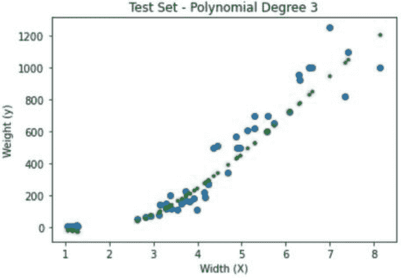

预测线既不是线性的，也不是多项式的，但预测结果可能会比其他更简单的方法有所改进。当然，这完全取决于你的数据。

之前的算法效果不错，但故事并未就此结束。还有其他算法可以使用，例如感知机，它是在 20 世纪 50 年代和 60 年代发展起来的。你可以在 1969 年 Marvin Minsky 和 Seymour Papert 所著的《感知机》一书中了解它。感知机是一种具有单个隐藏层的简单神经网络。最初，感知机被用作二元分类器，但如果不对特征和权重的点积应用激活函数，感知机算法的行为与线性回归非常相似。

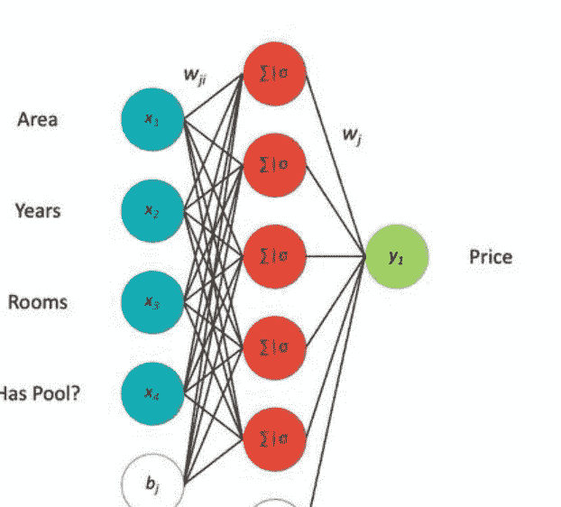

我们得到两个矩阵的点积，其中一个是线性回归中的系数，称为 `beta`。在神经网络中，我们称它们为权重，另一个是特征 `x`。感知器用于分类而回归之间的区别在于，前者在输出节点使用 `sigmoid` 或 `softmax` 等激活函数来为每个类别定义概率。在回归中，我们在最后一层移除该激活函数。现在让我们先关注回归。这个网络展示了一个简单的感知器。我们有代表矩阵的圆圈。它们是面积、年份、房间数、是否有泳池等。这些是特征。然后在中间我们有一个层。这是隐藏层，其中每个节点执行 `x` 与系数矩阵的点积。最后，输出层只有一个节点，将所有内容求和以得到最终输出，这是一个连续值。关于感知器回归，有一些重要的事情需要记住。第一，它需要矩阵乘法，而不是像简单线性回归中那样使用数组。感知器可以被转换为分类器。与线性回归使用最小二乘法不同，感知器中的权重 `w` 通常是通过优化算法获得的。在输出节点，感知器的工作方式与线性回归完全相同。计算使用以下公式进行。隐藏层输入计算如下。


然后是隐藏层输出计算。它使用 `sigmoid`。而最终节点的预测与线性回归类似。对于最后一个算法，我有一个使用 `keras` 的感知器。它仍然是鱼的例子。


到目前为止，过程非常相似，这里是我使用 `keras` 的地方。在这种情况下，网络仅由两层组成，输入、输出以及它们之间的连接。

### Train Predict and Plot

```
In [120]: model = keras.Sequential(
    [
        layers.Flatten(input_shape=(1,)),
        layers.Dense(1, activation="linear"),
    ]
)

optimizer = keras.optimizers.SGD(learning_rate=0.1)
model.compile(loss='mse', optimizer=optimizer, metrics=['accuracy'])
history = model.fit(x_width, y_weight, epochs=10, verbose=1, validation_split=0.1, shuffle=False)
y_pred = model.predict(x_width)
```

Epoch 1/10

5/5 [==============================] - 0s 26ms/step - loss: 0.1850 - accuracy: 0.0000e+00 - val_loss: 1.5773 - val_accuracy: 0.0000e+00

Epoch 2/10

5/5 [==============================] - 0s 6ms/step - loss: 0.1162 - accuracy: 0.0000e+00 - val_loss: 1.3276 - val_accuracy: 0.0000e+00

Epoch 3/10

5/5 [==============================] - 0s 7ms/step - loss: 0.1036 - accuracy: 0.0000e+00 - val_loss: 1.2179 - val_accuracy: 0.0000e+00

Epoch 4/10

5/5 [==============================] - 0s 6ms/step - loss: 0.1008 - accuracy: 0.0000e+00 - val_loss: 1.1671 - val_accuracy: 0.0000e+00

这些是权重。我训练了网络 10 个 `epoch`，现在准备开始进行预测。使用神经网络需要更复杂的调优。例如，你可以尝试向网络添加更多隐藏层以改善预测。有一点，神经网络在准确性方面远优于其他更传统的算法，但它们也需要更多的工作。总结一下，我们已经学习了什么是线性回归以及它解决什么类型的问题。回归算法预测连续值，例如温度、股价或电动汽车的电池寿命。回归容易过拟合，因此请记住，数据转换、归一化和特征选择可以帮助改善拟合。正则化是处理过拟合的好方法。你可能想尝试 `L1` 或 `L2`，如果简单的线性回归似乎不够用。`Lasso` `L1` 正则化会留下少量显著参数。`Ridge` `L2` 会保留所有参数，但在我们需要所有参数都进入线性方程时应使用，即所有特征都是必要的。这是一个理论性陈述。我的建议是测试两者，看看哪一个能改善你的模型拟合。移除异常值。数据集中的某些数据点可能会影响回归模型，即使使用了正则化。绘制数据有助于理解数据形状。了解关系是线性的还是非线性的可以帮助确定正确的算法。接下来，我将介绍下一类算法，分类算法。如果你好奇它们的区别，回归预测数字，而分类预测标签，例如好、坏或中性。

### Chapter 5 Classification Algorithms & Logistic Regression

当我们思考机器学习时，我们可能想要解决的两类问题。第一，预测连续值的问题，例如温度或股价。第二，预测类别值的问题，例如高、中、低；健康或生病；鸟、猫或狗。第二类问题，即我们要预测类别的问题，使用分类算法解决。在执行分类时，我们希望识别出一种算法来分隔数据，以便每个条目，即数据样本，都能被正确分类。分类算法从标记的数据集学习。这就是所谓的监督学习。在数据集中，每个条目都已用正确的类别标记。算法从数据中学习并可以推断出新呈现的数据。值得注意的一点是，正确的标记至关重要。数据越多越好。如果标签上有错误，那么预测就不会很好；垃圾进，垃圾出同样适用。数据形状也是考虑分类算法时的重要因素。例如，在对胸部图像进行分类以确定患者是否患有特定肺部问题时，并非所有算法都能处理大图像、高维数据。基于数据形状选择合适的算法也是一个好的分类器的关键要素。让我们看一些问题，以及它们如何使用分类算法解决。

逻辑回归是我最喜欢的分类算法之一。它是神经网络最基本的形式之一，这将帮助我们在以后理解这个概念。逻辑回归通常用于二元分类，即真或假、癌症或无罪或有罪等问题。逻辑回归也可以用于分类，但在这种情况下你需要使用 `softmax` 层进行分类。现在，让我们先关注二元分类。逻辑回归不是回归问题，但它在其主要算法中使用了相同的线性回归公式。逻辑回归激活线性回归函数以创建概率。该概率位于 0 和 1 阈值之间，其中 0.5 用于确定一个值属于 1 类还是 0 类，大致如此。将 0.5 想象成中间地带，所以当你有两个选项时，就是一件事或另一件事。我住的地方有句俗话；要么是鸡，要么是公鸡。听起来可能有点好笑，但重点是二元分类器你只有两个选择。例如，如果我们训练逻辑回归来识别我是否根据我的月收入获得贷款，则使用的函数应预测 0 到 1 之间的数字，任何高于 0.5 的都被批准，任何低于则被拒绝。如果预测是 .75，那么我自动获得批准。事实上，关于 WMDs 或数学毁灭武器的讨论很多，但那是另一个讨论主题。这很有趣，所以如果我们有机会在同一个地方，问我关于这个，我们可以聊上几个小时。没有过多细节，在高层次上，逻辑回归算法的工作方式如下。首先我们以与线性回归相同的方式估计线性函数。得到的值现在将作为参数设置给 `sigmoid` 激活函数，即估计 0 到 1 之间概率的函数。这两个函数的组合，一个是

一部分处理参数 `X` 并计算 `theta` 参数，另一部分激活函数，在本例中为 `sigmoid` 函数，以计算概率。这就是神经网络中每个节点所做的事情。唯一的区别是，在逻辑回归中，我们使用的是只有一个节点的神经网络。然后我们用以下函数激活 `h_θ(X)`：

\[
h_\theta(X) = w_0 + \sum_{j=1}^{m} X_{ij} w_j
\]

\[
\hat{y}_i = \sigma(h_\theta(X)) = \frac{1}{1 + e^{-h_\theta(X)}}
\]

现在我们可以得到一些预测。问题在于我们不知道这些预测有多好。为了找到逻辑函数最优的参数 `θ`，我们需要使用另一个公式来计算函数的成本，即预测结果与实际结果之间的误差。因此，很明显，`sigmoid` 函数的最佳参数使成本函数最小化。逻辑回归算法的成本函数如下所示：

\[
J(\theta) = -\frac{1}{m} \sum_{i=1}^{m} \left[ y^{(i)} \log(h_\theta(x^{(i)})) + (1 - y^{(i)}) \log(1 - h_\theta(x^{(i)})) \right]
\]

该成本函数寻找的是平均差异，即真实结果、标记数据与预测值之间的误差。逻辑回归算法以及许多其他参数算法都需要优化算法来帮助找到能降低成本函数的最佳 `theta` 参数。这些优化算法是创造性的过程，违背了使用暴力方法根据成本函数的输出来寻找最佳参数。我们可以使用一些非常棒的优化算法来帮助逻辑回归找到这些 `theta` 参数，例如 `SGD` 或 `Adam`。好消息是，所有主要机器学习框架，如 `Keras`、`TensorFlow`、`Caffe` 和 `PyTorch` 都已包含它们可供使用，因此只是一个测试问题，看哪个框架表现最好。

以下是使用逻辑回归时你需要记住的一些最重要的要点：

- 我们使用逻辑回归进行二元分类，例如，批准或拒绝，好或坏，生病或健康。
- 你可以使用逻辑回归进行分类；然而，它将是一个分类器。其他算法可以更好地进行分类。
- 请记住，与许多其他 ML 算法一样，输入数据必须是数值型的，因此需要使用编码来编码标签和分类数据。
- 为了获得最佳性能，即分类准确率，输入特征必须尽可能具有正态或高斯分布。
- 逻辑回归假设所有变量，即特征，都是独立的，因此请检查协变量并在可能的情况下将其消除。

我将向你展示我通常使用特定 ML 算法解决问题的步骤。也许我即将展示的内容中的某些东西可以帮助你解决你的问题。

```python
import pandas as pd
import numpy as np

stroke = pd.read_csv("healthcare-dataset-stroke-data.csv")
stroke.dropna(inplace=True)
stroke.head()
```

|   | id | gender | age | hypertension | heart_disease | ever_married | work_type | Residence_type | avg_glucose_level | bmi | smoking_status |
|---|---|---|---|---|---|---|---|---|---|---|---|
| 0 | 9046 | Male | 67.0 | 0 | 1 | Yes | Private | Urban | 228.69 | 36.6 | formerly smoked |
| 1 | 31112 | Male | 80.0 | 0 | 1 | Yes | Private | Rural | 105.92 | 32.5 | never smoked |
| 2 | 60182 | Male | 49.0 | 0 | 0 | Yes | Private | Urban | 171.23 | 34.4 | never smoked |
| 3 | 1665 | Female | 79.0 | 1 | 0 | Yes | Self-employed | Rural | 174.12 | 24.0 | never smoked |
| 4 | 56669 | Male | 81.0 | 0 | 0 | Yes | Private | Urban | 186.21 | 29.0 | formerly smoked |

对于第一个分类示例，我将检查逻辑回归算法是否可以根据性别、年龄、各种疾病和吸烟状况等特征预测患者是否可能中风。


作为良好的实践，始终检查输入数据是否存在异常值、空值或脏数据非常重要。最简单的方法是通过描述数据集。一旦我了解了数据集，我就会进行一些特征工程，删除不相关的列，然后对每个分类特征进行编码。

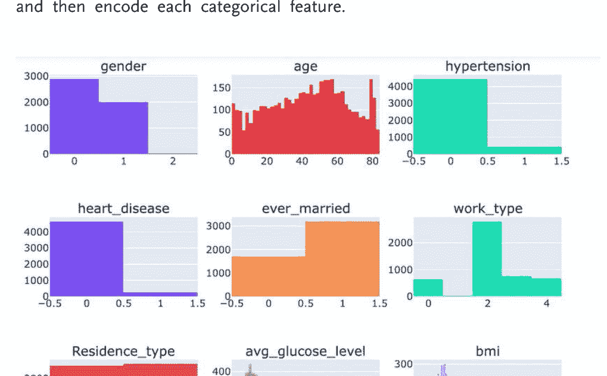

你需要记住的一件事是，逻辑回归假设所有变量都是独立的，因此检查特征之间的相关性很重要。特别是当数据遵循正态分布时，该算法的工作效果更好，即执行时间和收敛性。因此，我使用直方图验证特征的分布。

#### Normalization

```python
In [7]: from sklearn.preprocessing import StandardScaler

age_scaler = StandardScaler()
stroke['age'] = age_scaler.fit_transform(stroke[['age']])

avg_glucose_level_scaler = StandardScaler()
stroke['avg_glucose_level'] = avg_glucose_level_scaler.fit_transform(stroke[['avg_glucose_level']])

bmi_scaler = StandardScaler()
stroke['bmi'] = bmi_scaler.fit_transform(stroke[['bmi']])
```

```python
In [8]: from sklearn.preprocessing import PowerTransformer
#pt = PowerTransformer()
#pt_data['body_mass_power_trans'] = pt.fit_transform(pt_data[['body_mass_g']])
```

拟合模型前的最后一步是归一化特征，使所有特征具有相似的范围。我现在准备 `X` 和 `y`。

#### 2. Feature Selection

```python
In [9]: X = stroke.drop(['stroke'], axis=1)
y = stroke['stroke']
```

```python
In [10]: from sklearn.model_selection import train_test_split

X_train, X_test, y_train, y_test = train_test_split(X, y, test_size=0.20, random_state=42)
```

#### 3. Algorithm


```python
In [12]: from sklearn.linear_model import LogisticRegression

model = LogisticRegression(class_weight='balanced', penalty='l2', solver='liblinear', max_iter=1000)
model.fit(X_train, y_train)
Out[12]: LogisticRegression(class_weight='balanced', max_iter=1000, solver='liblinear')
```


在这种情况下，散点代表样本所属的真实目标或类别。轮廓代表模型预测。每个标记的颜色代表实际类别，符号代表预测的正确性。点表示样本被正确预测，x 表示样本被错误预测。

# Chapter 6 Naive Bayes & Support Vector Machines

机器学习算法的好处之一是，它们是完美的例子，说明你可以用多种不同的方法解决一个问题。在这种情况下，让我们谈谈朴素贝叶斯分类器，这是一类基于贝叶斯定理并对特征之间存在强，即朴素，独立性假设的简单概率分类器。让我用一个快速的例子来解释。如果我问你，如果你抽一张牌，黑桃 A 在一副牌中出现的频率是多少？好吧，这是一个直接的答案。得到黑桃 A 的概率是已知的，因为每副 52 张牌中只有 1 张。但，如果我们在抽出红桃 A 后抽牌，得到黑桃 A 的概率是多少？好吧，这是一个典型的条件概率示例。它是在我们已经抽出红桃 A 的情况下得到黑桃 A 的概率。我们使用贝叶斯定理求解这种条件概率。贝叶斯定理说明了如果事件`B`首先发生，事件`A`发生的概率。我们这样写公式。

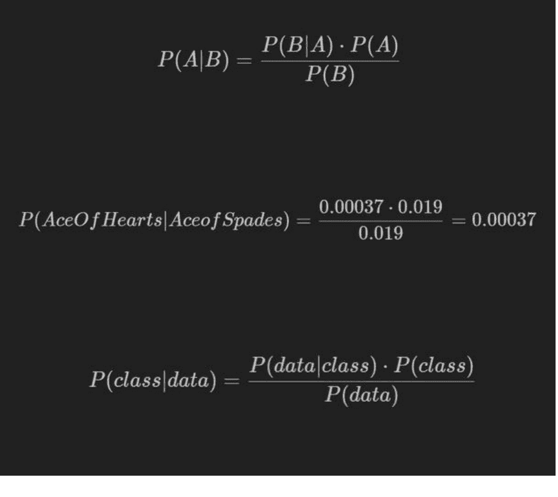

`A`将是红桃 A，`B`为黑桃 A。让我们现在求解在我们已经抽到红桃 A 的前提下，抽到黑桃 A 的概率。这里是数学推导。如果有 52 张牌，那么抽 1 张牌后还剩 51 张牌。第一张牌的概率是 52 分之 1。第二张牌的概率则是 51 分之 1。所以，抽到红桃 A 和黑桃 A 的概率是 52 分之 1 乘以 51 分之 1。在这种情况下，就是 0.00037。仅抽到红桃 A 或黑桃 A 的概率是 52 分之 1，即 0.019。所以，如果我们把贝叶斯公式组合起来，这就是结果。在这种情况下，红桃 A 的概率和黑桃 A 的概率相互抵消。所以，在抽到红桃 A 之后抽到黑桃 A 的概率是 0.00037。不要押注这个条件概率。对你不利。这就是在非常高的层面上的贝叶斯定理。

好吧，在机器学习中，我们重用相同的公式来估计一个数据样本属于某个类别的概率，例如鸟、狗或猫。所以，我们这样写公式。我们牌堆的例子和这个公式之间的唯一区别是`P(data|class)`的概率是从高斯概率分布、概率密度函数中估计出来的。其余的工作方式相同。

朴素贝叶斯易于实现和理解，但它也是朴素的。为什么？因为它假设我们数据集中所有事件或项目都是独立的，而这可能并非如此。认为这一点是天真的，但不要低估黑暗面的力量。我是说朴素贝叶斯通常效果非常好，大多数时候都如此。以下是使用朴素贝叶斯进行分类的一些条件。

- 输出数据，即预测结果，必须是分类的或标签，例如狗、猫、牛、正面、负面、中性。

- 输入数据，即预测因子，必须是数值且连续，例如体重、年龄、薪水、距离。如果存在定性变量，如分类数据，它们必须使用编码器转换为数字，例如序数编码器或编码。

- 关于分布，输入变量必须根据算法遵循某种分布，如高斯或伯努利。

- 关于独立性，所有输入变量必须彼此独立非常重要。

## Naive Bayes

### When and How to use Naive Bayes

#### Data

```python
In [1]: import pandas as pd
import numpy as np

airplane = pd.read_csv("Airline Passenger Satisfaction.csv", index_col=0)

airplane.dropna()
airplane.drop(['id'], axis=1, inplace=True)

airplane.head()
```

Out[1]: 

| Gender | Customer Type | Age | Type of Travel | Class | Flight Distance | Inflight wifi service | Departure/Arrival time convenient | Ease of Online booking | Gate location | ... | Inflight entertainment | On board service |

|--------|---------------|-----|----------------|-------|-----------------|----------------------|-----------------------------------|------------------------|---------------|-----|------------------------|------------------|

| Male | Loyal Customer | 13 | Personal Travel | Eco Plus | 460 | 3 | 4 | 3 | 1 | ... | 5 | |

在这个分类示例中，我将确定朴素贝叶斯算法能否根据乘客对航班的一些问题预测乘客、客户满意度。

#### Feature Engineering

```python
In [3]: from sklearn.preprocessing import OrdinalEncoder, LabelEncoder

Gender_encoder = OrdinalEncoder()
airplane['Gender'] = Gender_encoder.fit_transform(airplane[['Gender']])

customer_encoder = OrdinalEncoder()
airplane['Customer Type'] = customer_encoder.fit_transform(airplane[['Customer Type']])

travel_encoder = OrdinalEncoder()
airplane['Type of Travel'] = travel_encoder.fit_transform(airplane[['Type of Travel']])

class_encoder = OrdinalEncoder()
airplane['Class'] = class_encoder.fit_transform(airplane[['Class']])

label_encoder = OrdinalEncoder()
airplane['satisfaction'] = label_encoder.fit_transform(airplane[['satisfaction']])
### enc.fit_transform
### enc.categories_
```

像往常一样，我先描述数据集，绘制相关性图，然后绘制直方图，因为贝叶斯假设所有变量都是独立的，并且输入数据必须遵循正态分布。


我对一些特征进行归一化，因为它们的范围相比其他特征太高，并将`X`定义为除满意度以外的每个特征，因为满意度将是`Y`。

#### Normalization

```python
In [6]: from sklearn.preprocessing import StandardScaler

age_scaler = StandardScaler()
airplane['Age'] = age_scaler.fit_transform(airplane[['Age']])

flight_distance_scaler = StandardScaler()
airplane['Flight Distance'] = flight_distance_scaler.fit_transform(airplane[['Flight Distance']])
### departure_scaler = StandardScaler()
### airplane['Departure Delay in Minutes'] = departure_scaler.fit_transform(airplane[['Departure
### arrival_scaler = StandardScaler()
### airplane['Arrival Delay in Minutes'] = arrival_scaler.fit_transform(airplane[['Arrival Delay

airplane['Departure Delay in Minutes'] = airplane['Departure Delay in Minutes'].apply(lambda x

airplane['Arrival Delay in Minutes'] = airplane['Arrival Delay in Minutes'].apply(lambda x : 1
```

这是标签。记住这是监督学习。我创建我的模型并拟合数据。

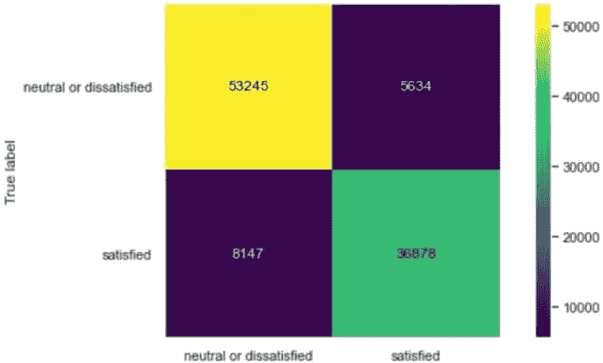

始终重要的是不仅要关注准确率。还请记住使用混淆矩阵和分类报告。

```python
for i in X_val.index:
    print(i)

    for col in X_val.columns:
        print(f"{col} = {X_val[col][i]}")

    print(f"y_real = {y_val[i]}, y_pred = {y_pred[i]}, error = {y_val[i] - y_pred[i]}")

    print()
```

```
91691
Gender = 0.0
Customer Type = 0.0
Age = 0.17335842271161097
Type of Travel = 0.0
Class = 0.0
Flight Distance = 2.05114135755668508
Inflight wifi service = 4
Departure/Arrival time convenient = 4
Ease of Online booking = 3
Gate location = 4
Food and drink = 5
Online boarding = 5
Seat comfort = 4
Inflight entertainment = 5
On-board service = 5
Leg room service = 5
Baggage handling = 5
Checkin service = 3
Inflight service = 5
```

我现在可以使用我最喜欢的散点轮廓图来可视化结果。


散点代表真实目标，轮廓代表模型预测。因为贝叶斯使用高斯或正态分布，所以我还可以得到每个类别的平均乘客特征，中性/不满意和满意。

```python
print()

neutral or dissatisfied
    Gender: Female
    Customer Type: Loyal Customer
    Age: 37.53748462875793
    Type of Travel: Business travel
    Class: Business
    Flight Distance: 928.3213967688619
    Inflight wifi service: 2.4031293728533267
    Departure/Arrival time convenient: 3.12506890556757
    Ease of Online booking: 2.5505660857397277
    Gate location: 2.9776957978204637
    Food and drink: 2.958550650892592
    Online boarding: 2.65377602521028284
    Seat comfort: 3.034198362277487
    Inflight entertainment: 2.893631005385235
    On-board service: 3.021540940507993
    Leg room service: 2.9956748505279225
    Baggage handling: 3.375015901284824
    Checkin service: 3.0452868591782214
    Inflight service: 3.3890726370690754
    Cleanliness: 2.9342958911080017
    Departure Delay in Minutes: yes
    Arrival Delay in Minutes: yes

satisfied
    Gender: Female
    Customer Type: Loyal Customer
    Age: 41.70753956114228
    Type of Travel: Business travel
    Class: Business
    Flight Distance: 1530.1657535389454
    Inflight wifi service: 3.1591623327863836
    Departure/Arrival time convenient: 2.9696025808604722
    Ease of Online booking: 3.0317323469699917
    Gate location: 2.9783352337514253
    Food and drink: 3.5201768779375366
    Online boarding: 4.024584920877715
    Seat comfort: 3.9636232166198515
    Inflight entertainment: 3.959942756153183
    On-board service: 3.8590538699001584
    Leg room service: 3.823177684456434
    Baggage handling: 3.9635119726339796
    Checkin service: 3.6478571627221403
    Inflight service: 3.967461134132436
    Cleanliness: 3.7381872792502153
    Departure Delay in Minutes: yes
    Arrival Delay in Minutes: yes
```

这就是我如何使用朴素贝叶斯执行二元分类的方法。

## Support Vector Machines

支持向量机是一种使用直线或多维超平面来分离数据的算法。想象一下用一张纸片将一堆弹珠分成两个类别。SVM 是一种分类器，如逻辑回归。因此，它非常适合二元分类。为什么它被称为支持向量机？好吧，让我们先关注支持向量部分。使用弹珠示例在 3D 空间中分割弹珠，即三个轴，一些弹珠应被用作焦点元素，以创建最佳间隙，即分离，以便可以插入一张纸片。那些被选中的弹珠被称为支持向量。SVM 是一个支持 vector classifier，这意味着它使用这些边界来尽可能最好地分割数据。但是，SVM 中的 machine 部分又如何呢？像用纸片一样线性地分隔数据并不总是可行的，因为数据呈现出多种形状。SVM 允许你定义分隔符可以有多灵活。用于在 SVM 中分隔数据的算法称为核，它代表你想要对数据应用的灵活性水平。有许多种核类型，但最常见的是线性，用直线或超平面分隔数据；多项式，用曲线或曲面分隔数据；径向，它使用数据来估计与固定点的距离，因此能够以圆形、椭圆形或波浪形模式分隔数据。它也称为径向基函数，或 RBF。SVM 与逻辑回归一样，是一个需要优化的参数化算法，才能将分类器拟合到数据上。因此，可以预期像 sklearn 这样的库需要开发者设置分类器收敛所需的迭代次数。SVM 最大的优势之一是对异常值的抵抗力，因为它只使用有限数量的示例，即最接近类别边界的那些示例来进行拟合。这也使你的模型更容易升级。由于它支持多种核，甚至是非线性核，模型允许对训练数据进行不同程度的自由拟合。

使用 SVM 时的一些建议。使用 SVM 作为二元分类器。你也可以将 SVM 用作多类分类器，但它将采用一对多分类策略。当维度很高时，使用降维算法可以帮助你更好地理解数据，从而选择最佳的核和超参数。使用带交叉验证的网格搜索来测试几种核和参数值，以测试拟合和数据可分性。请注意，这取决于数据大小，可能需要花费大量时间。

```
In [ ]:
```

1. 我们想要预测什么变量？

   mushroom `classes`

2. 数据的类型是什么？

   分类，定性，名义。 edible=e, poisonous=p

3. 我们将使用哪些数据来预测它？

   所有列都是（分类，定性，名义）并且需要编码。

现在我对分类算法有了初步了解，我将拟合一个支持向量机算法，根据一些特征，如气味、颜色、形状等，预测蘑菇是否可食用。在你打算使用 ML 解决的每个问题中，预处理都占了很大一部分工作。我通常使用`describe()`或其他数据框技术进行检查。

#### 相关性


```python
In [3]: import plotly.express as px

fig = px.imshow(
    mushrooms.corr(),
    x=mushrooms.columns,
    y=mushrooms.columns
)

fig.update_layout(height=1000, width=1000)

fig.update_yaxes(showticklabels=False)

fig.update_xaxes(showticklabels=False)

fig.show()
```

我还可以探索特征之间以及特征与标签之间的相关性。

### 直方图

```python
In [4]: import plotly.graph_objects as go
from plotly.subplots import make_subplots

fig = make_subplots(
    rows=(mushrooms.shape[1]//3)+1,
    cols=3,
    subplot_titles=mushrooms.columns
)

for i, col in enumerate(mushrooms.columns):
    fig.add_trace(go.Histogram(x=mushrooms[col], name=col), row=(i//3)+1, col=(i%3)+1)

fig.update_layout(height=2000, showlegend=False)

fig.show()
```

我绘制直方图来查看我拥有的分布，并确定它们是否需要归一化。

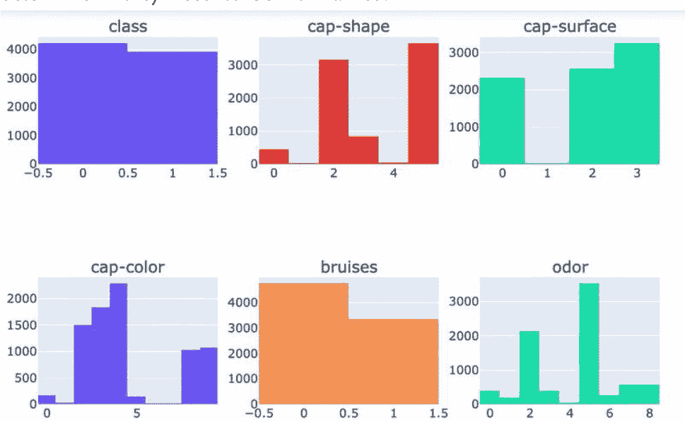

经过所有这些可视化和探索后，我可以执行转换、缩放和归一化，如果需要的话。

#### 4. 预测

```python
from sklearn.metrics import accuracy_score, f1_score, log_loss
```

```python
y_pred = model.predict(X_train)

acc = accuracy_score(y_train, y_pred)
f1 = f1_score(y_train, y_pred)
ll = log_loss(y_train, y_pred)

print(f"(train) accuracy_score: {acc}")
print(f"(train) f1_score: {f1}")
print(f"(train) log_loss: {ll}")

(train) accuracy_score: 0.9898445914756117
(train) f1_score: 0.9893719806763286
(train) log_loss: 0.35075587635849087
```

在这种情况下，一个极其简单的支持向量分类器，在几乎没有任何数据预处理的情况下，就能相当好地预测蘑菇是否可食用，使用支持向量机。


我可以使用预测轮廓来理解我的模型如何进行预测。在这种情况下，预测相当准确。

### 第 7 章 K 最近邻

`KNN`是最直接的分类算法之一，但它有一个缺点。它必须在每次预测时使用所有数据，如果数据集太大，这可能会很麻烦。让我解释一下原因。`KNN`使用欧几里得或曼哈顿等距离算法来衡量数据集中一个特定条目与所有其他条目之间的距离。例如，如果我们选择`K = 3`的值，我们会说被分析的元素属于`K`个最近邻居中最常见的类别，在本例中为`3`，因为每个元素都需要与每个`K`个邻居进行分析。随着数据集中元素的数量增加，所需的分析次数也会增加，呈指数级增长。要衡量元素之间的距离，有几种不同的方法。


正如我提到的，欧几里得距离是其中之一。这是公式，给出了两点之间的直线距离。另一方面，曼哈顿，这个公式在这里，寻找最短的实际路径。例如，在棋盘上，有直线和路径。曼哈顿可以考虑所有这些。你可能还想查看的其他距离公式有`Chebyshev`、`WMinkowski`、`SEuclidean`、`Mahalanobis`等。使用`KNN`时需要牢记的一些重要事项。`KNN`如此简单，无需优化算法。它直接且易于解释。它在分类设置中效果非常好。它可用于分类和回归。你可能想要选择合适的距离算法。如果不确定，欧几里得可能就能解决问题，但建立对其他算法的直觉并尝试它们是个好主意。`KNN`在数据很多时很慢，并且没有最佳`K`的配方，但如果你可以尝试偶数，如果类别数为奇数，并且`KNN`对异常值非常敏感。如果可能，请将其删除。`KNN`在不平衡的数据集上表现不佳，因为最近的邻居很可能总是属于示例最多的类别。

#### K-最近邻

#### 何时以及如何使用 K 最近邻

#### 1. 数据

```python
In [1]: import pandas as pd
import numpy as np
import seaborn as sns
import matplotlib.pyplot as plt
```

```python
In [2]: recruitment = pd.read_csv("Placement_Data_Full_Class.csv")
recruitment.drop(['sl_no', 'salary'], axis=1, inplace=True)
recruitment.dropna(inplace=True)
recruitment.head()
```

下一个分类算法是`KNN`，对于这个示例，我将预测学生在特定校园的安置情况。这些是我数据中包含的列。

列描述：

- `gender` : 性别- 男性=`'M'`，女性=`'F'`
- `ssc_p` : 中学教育百分比- 10 年级
- `ssc_b` : 教育委员会- 中央/其他
- `hsc_p` : 高中教育百分比- 12 年级
- `hsc_b` : 教育委员会- 中央/其他
- `hsc_s` : 高中教育专业
- `degree_p` : 学位百分比
- `degree_t` : 本科（学位类型）- 学位教育领域
- `workex` : 工作经验
- `etest_p` : 就业能力测试百分比（由学院进行）
- `specialisation` : 研究生（MBA）- 专业
- `mba_p` : MBA 百分比
- `status` : 安置状态- 已安置/未安置
- `salary` : 企业向候选人提供的薪资

现在，让我们开始预测`status`，它是名义且分类的。

1. 我们想要预测什么变量？

   学生的状态

我将执行归一化，因为`KNN`是一个几何算法。

#### 归一化

```python
In [6]: from sklearn.preprocessing import StandardScaler

ssc_p_scaler = StandardScaler()
recruitment['ssc_p'] = ssc_p_scaler.fit_transform(recruitment[['ssc_p']])

hsc_p_scaler = StandardScaler()
recruitment['hsc_p'] = hsc_p_scaler.fit_transform(recruitment[['hsc_p']])

degree_p_scaler = StandardScaler()
recruitment['degree_p'] = degree_p_scaler.fit_transform(recruitment[['degree_p']])

mba_p_scaler = StandardScaler()
recruitment['mba_p'] = mba_p_scaler.fit_transform(recruitment[['mba_p']])
```

这意味着它对不同范围内的异常值很敏感。然后我进行了一点特征选择。

#### 3. 算法

```python
In [10]: from sklearn.neighbors import KNeighborsClassifier
```

```python
In [11]: model = KNeighborsClassifier(n_neighbors=3, weights='distance')
model.fit(X, y)
Out[11]: KNeighborsClassifier(n_neighbors=3, weights='distance')
```

最后，我现在使用`KNN`算法创建模型，将值设置为`3`。这就是分析时将使用的邻居数量。

#### 4. 预测

```python
In [12]: from sklearn.metrics import accuracy_score, f1_score, log_loss
```

```python
In [13]: y_pred = model.predict(X_train)
acc = accuracy_score(y_train, y_pred)
f1 = f1_score(y_train, y_pred)
ll = log_loss(y_train, y_pred)
print(f"(train) accuracy_score: {acc}")
print(f"(train) f1_score: {f1}")
print(f"(train) log_loss: {ll}")
(train) accuracy_score: 1.0
(train) f1_score: 1.0
(train) log_loss: 9.992007221626413e-16
```

```python
In [14]: y_pred = model.predict(X_test)
acc = accuracy_score(y_test, y_pred)
f1 = f1_score(y_test, y_pred)
ll = log_loss(y_test, y_pred)
print(f"(test) accuracy_score: {acc}")
print(f"(test) f1_score: {f1}")
```

邻居的数量起着非常重要的作用，如果这个数字有点高并且数据集相对较大，则分析的数量可能会爆炸，并且过程会相当缓慢。正如我刚才向你展示的那样，两类元素的彼此之间非常相似，因此我们可以准确预测某人是否会被安置，只要根据其他人的状态信息即可。

### 第 8 章 决策树和随机森林

决策树是一种决策支持工具，它使用决策及其可能后果的模型。例如，我们可以使用决策树来确定今天是否可以打网球。我们做出的每个决定都会让我们更接近是或否。在每个阶段，都有多种方式来分割树。那么，算法如何确定分割条件呢？选择分割的方法有很多。其中两种最流行的方法是基尼系数和信息熵。两个公式都计算数据上的分布，并找到哪个条件产生最高的 不平等。换句话说，我们查看应用基尼或熵，以查看集合中哪个元素的公式值最低。这是不平等最高。元素随后被认为是分割条件。有几件事会影响分割，例如所需的高度，即深度，叶子的数量或分割函数。这可能导致一棵树可以转变为许多不同的树。单个决策树被认为是一个弱分类器，因为只有一种方法可以分离树。那么，如果你使用不同的标准创建多个树，比如函数或分割条件来生成同一棵树的 100 个变体，会发生什么？这就引出了一个新的概念，随机森林。随机森林是生成了 n 次的决策树。最后，我们将所有生成树的 结果组合起来，每棵树为每个元素投票给特定类别。所有树投票的组合使随机森林成为一个强分类器。随机森林只是一堆普通的决策树投票以

#### 相关性

```python
In [3]: import seaborn as sns
import matplotlib.pyplot as plt

sns.set(rc = {'figure.figsize':(15, 10)})

sns.heatmap(water.corr(), annot=True);
```


一如既往，探索数据是一个良好的实践，了解特征之间的相关性及其分布，使用直方图。


值得注意的是，这些特征具有相当正常的分布。然而，算法对脏数据集非常有抵抗力。在这种情况下，一切看起来都不错。

#### 3. 算法

```python
In [7]: from sklearn.ensemble import RandomForestClassifier
model = RandomForestClassifier()
model.fit(X_train, y_train)

Out[7]: RandomForestClassifier()
```

我分割了数据集并训练随机森林分类算法。让我们看看它的表现如何。

```python
In [9]: y_pred = model.predict(X_train)

acc = accuracy_score(y_train, y_pred)
f1 = f1_score(y_train, y_pred)
ll = log_loss(y_train, y_pred)

print(f"(train) accuracy_score: {acc}")
print(f"(train) f1_score: {f1}")
print(f"(train) log_loss: {ll}")
```

(train) accuracy_score: 1.0

(train) f1_score: 1.0

(train) log_loss: 9.992007221626413e-16

```python
In [10]: y_pred = model.predict(X_test)

acc = accuracy_score(y_test, y_pred)
f1 = f1_score(y_test, y_pred)
ll = log_loss(y_test, y_pred)

print(f"(test) accuracy_score: {acc}")
print(f"(test) f1_score: {f1}")
print(f"(test) log_loss: {ll}")
```

(test) accuracy_score: 0.652605459057072

(test) f1_score: 0.49640287769784175

(test) log_loss: 11.998655782611447

为此，我检查了训练和测试的准确率分数。训练分数为 1，但测试为 0.65。的确，正如我刚才提到的，这种算法很容易过拟合。

#### 分类报告

```python
from sklearn.metrics import classification_report

y_pred = model.predict(X)

print(classification_report(y, y_pred, target_names=['Safe for Human', 'Not Potable'], zero_division=0))
```

|  | precision | recall | f1-score | support |
|---|---:|---:|---:|---:|
| Safe for Human | 0.92 | 0.97 | 0.94 | 1200 |
| Not Potable | 0.95 | 0.87 | 0.91 | 811 |
| accuracy |  |  | 0.93 | 2011 |
| macro avg | 0.93 | 0.92 | 0.93 | 2011 |
| weighted avg | 0.93 | 0.93 | 0.93 | 2011 |

这里也发生了这种情况，这可能表明我可以尝试另一种算法，考虑到所涉及的风险，这可能是有意义的。基本上，如果模型预测水不安全而实际上是安全的，没人会受伤。但另一方面，如果我们的模型说你可以喝水而实际上不安全，有人可能会生病，甚至更糟，死亡。


查看最终的图，可饮用和不安全的水样彼此非常接近。我们可以从算法中获得的最有用的信息之一是特征重要性。在这里，我们可以观察到一些特征对于确定一个样本是否属于类别 A 或类别 B 更相关。

### 第 9 章 神经网络

当我向你展示逻辑回归时，我向你展示了一个单节点神经网络。与人类神经元相比，我们假设一组输入，我们称之为 `X` 值，结合一组权重，我们称之为 `W`，将产生一个信号，该信号可以被一个函数放大或减弱。这个函数称为激活函数。

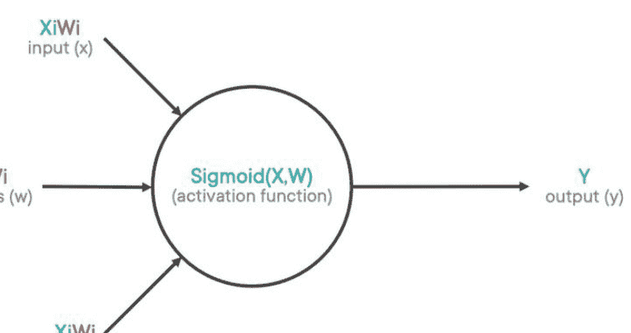

正如你在这个图中看到的，我们可能有一个单节点神经网络，它会将所有 `X` 值乘以 `W` 权重，就像线性回归中一样，此操作的 结果然后传递给激活函数。在这种情况下，激活函数是 S 形函数，计算 `X` 值属于类别 0 或 1 的概率。虽然这是最直接的神经网络，但它并不强大。当添加更多神经元和层时，神经网络可以发展出非常灵活的决策边界和强大的分类能力。这就引出了深度学习的概念。

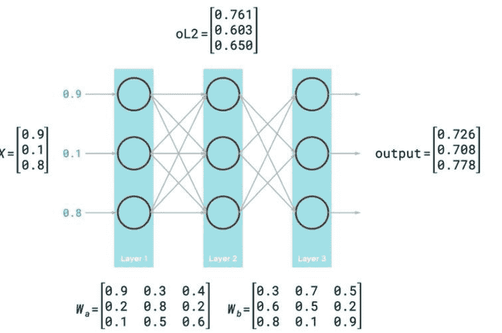

深度学习不过是具有多于一层且具有多个节点的神经网络。看下面的图作为示例。正如你所观察到的，添加更多节点会增加复杂性，其背后的数学并不复杂，但如果与神经网络相比，它会很棘手。以下是你需要从深度学习架构中了解的一些事情，例如图中所示的架构。神经网络是参数化的，因此 `W` 权重相当于逻辑回归中的 `theta` 参数。这意味着你需要一个优化算法来帮助你获得这些参数，例如随机梯度下降或 `Adam`。没有关于你可以添加多少层的配方。这是试错，或者也许我们可以称之为实验。深度学习神经网络使用两种主要算法，前向传播来计算神经网络的输出，也就是最终的概率，以及反向传播，它学习真实类别与预测类别之间的误差。反向传播在每次迭代中调整 `W` 权重以减少误差。顺便说一下，神经网络中的每次训练迭代称为一个 `epoch`。


TensorFlow 团队为你创建了以下 Web 应用程序，以便你了解层、激活函数类型和节点在不同分类设置中的影响。请务必充分使用它，这是一个很棒的工具，将帮助你建立对神经网络和决策边界灵活性的直觉。只是作为背景信息，神经网络的概念并非新事物。它可以追溯到 1944 年，当时 Warren McCulloch 和 Walter Pitts 移到 MIT 从事认知科学工作时做出的努力。深度学习自 2013 年以来才变得新颖，得益于 Geoffrey Hinton、Yann LeCun 和 Yoshua Bengio。机器学习和人工智能的世界已经呈指数级增长，可以做我们以前从未想象过的事情。深度网络增加了其容量，从而允许新的解决方案，例如 Siri、Google Maps 和特斯拉汽车。诸如 Keras、PyTorch 和 TensorFlow 之类的框架允许你创建自己的神经网络，或为你的分类任务重用一些流行的架构及其权重。这称为迁移学习。在使用神经网络时，有一些特殊考虑。以下是其中一些。神经网络的层数和形状没有固定的配方。要有创意。有时，使用预训练的神经网络可以提高分类准确率。寻找现有的神经网络架构，例如 ResNet、AlexNet 或 RetinaNet，等等。创建深度学习网络很容易。调优它并不容易。许多、许多因素会影响网络性能。确保你了解正在测试的算法的超参数。神经网络喜欢归一化值。确保你的数据已转换为 0 到 1 的范围。否则，可能需要永远才能收敛。深度学习需要大量数据。我们说的是每个类别数百到数千个示例。确保你也处理类别不平衡问题。深度学习可能需要很长时间来训练。确保你有一种方法来检查训练性能。在 TensorFlow 中，我们有 TensorBoard，它是一个仪表板，可以帮助你可视化损失、准确率和其他指标。在没有工具或在每个 epoch 或每个步骤都能获得反馈的方式的情况下，不要开始训练。

# Neural Network

何时以及如何使用神经网络

## 1. Data

```python
In [1]: import pandas as pd
import numpy as np
from tensorflow import keras
from tensorflow.keras import layers
from tensorflow.keras.models import Sequential
from tensorflow.keras.layers import Dense

wine = pd.read_csv("winequality-red.csv")
wine.dropna(inplace=True)
wine['quality'] = wine['quality'] - 3
wine.head()
```

我们可以使用的一种算法类型是神经网络分类器。

- 1. 我们想要预测哪个变量？
- Wine quality
- 2. 数据类型是什么？
- Categorical, quantitative, ordinal. From 0 to 10.
- 3. 我们将使用哪些数据来预测它？
- 所有其他特征都是数值型，连续型。

在这种特定情况下，我将使用一个简单的神经网络来根据酒精、pH、酸度等一些特征预测葡萄酒质量。这种类型的数据是分类的、定量的、有序的，从 0 到 10。这种神经网络分类器能否超越葡萄酒专家？

## Normalization

```python
In [5]: from sklearn.preprocessing import PowerTransformer
cols = [
    'fixed acidity', 'residual sugar', 'chlorides', 'free sulfur dioxide', 'total sulfur dioxid
]
pt = PowerTransformer()
wine[cols] = pt.fit_transform(wine[cols])
```

由于算法的性质，神经网络要求数据被归一化和缩放，最好在 0 到 1 之间。

## 3. Algorithm

```python
In [9]: model = keras.Sequential(
    [
        keras.Input(shape=X.shape[1]),
        layers.Flatten(),
        layers.Dense(64, activation="relu"),
        layers.Dense(256, activation="relu"),
        layers.Dense(1024, activation="relu"),
        layers.Dense(num_classes, activation="softmax"),
    ]
)
```

为了确保这两个条件，我们将使用幂变换器。然后我创建我的模型，编译并让它运行。它设置为 100 个 epoch，如果你没有 GPU，可能会花费一些时间。另一种选择是使用 Google Colab 或 Kaggle 进行训练。一旦完成，我可以检查预测。

```python
y_pred = np.argmax(model.predict(X_train), axis=1)

acc = accuracy_score(np.argmax(y_train, axis=1), y_pred)

### f1 = f1_score(y_train, y_pred)

### ll = log_loss(y_train, y_pred)

print(f"(train) accuracy_score: {acc}")

### print(f"(train) f1_score: {f1}")

### print(f"(train) log_loss: {ll}")
```

(train) accuracy_score: 0.9311962470680218

```python
y_pred = np.argmax(model.predict(X_test), axis=1)

acc = accuracy_score(np.argmax(y_test, axis=1), y_pred)

### f1 = f1_score(y_test, y_pred)

### ll = log_loss(y_test, y_pred)

print(f"(test) accuracy_score: {acc}")

### print(f"(test) f1_score: {f1}")

### print(f"(test) log_loss: {ll}")
```

(test) accuracy_score: 0.609375

训练的准确率相当不错。测试可能需要通过调整层和修改参数做一些额外的工作，而这正是机器学习中最困难的事情之一。定义你的层很容易，但使用正确的参数才是关键所在。


最后，我通过散点轮廓图可视化结果，以显示多种葡萄酒质量。

# Chapter 10 Convolutional Neural Networks

普通的神经网络，包括深度网络，对于分类来说很棒，但它们通常需要大量数据，并且数据维度很高。让我们以一个二元分类器为例来区分狗和猫的图像。用于这些二元分类器的神经网络期望输入是一个数组，其维度为图片的高度乘以宽度乘以通道。例如，一张 300 像素 x 300 像素的全彩图像最终会被转换为一个包含 270,000 个元素的数组。这对于单张图像来说是大量数据。当图像变大时，分类准确率会受到影响，但网络需要永远才能训练。幸运的是，有一种很好的方法来处理这些庞大的图像或任何其他适合张量的数据。解决方案是卷积层。没有深入探讨其背后的数学，卷积网络是普通的神经网络或深度网络，其顶部有一些层。这些卷积层减少了数据大小或例如图像大小，并提取与图像相关的像素或特征，以便神经网络可以用合适的数据量执行分类。这听起来是个好主意。让卷积层减小图像大小，将其转换为猫或狗的代表性表示，并将其发送到神经网络进行训练和分类。然后，通过添加多个卷积层，我们可以将 300 x 300 像素的图像缩小到 32 x 32 像素的图像大小，将其从 270,000 个元素压缩到 32 乘以 32 乘以 1 个通道的图像，即 1,024 个元素。这是一个更易于管理的大小。卷积网络通过自动选择图像中看起来至关重要的内容，例如阴影、线条、轮廓、形状等，并将其用作神经网络的输入来进行特征工程，就这样。简而言之，卷积网络中有两个关键过程。第一个是卷积层，它提取与图像相关的特征。第二个是池化层，它通常在卷积层之后应用，以缩小图像大小而不损失质量。

在我们用 Python 和 Keras 看一个示例之前，让我们检查一下使用卷积神经网络时的一些有用提示。与任何神经网络一样，CNN 需要大量数据。确保处理类别不平衡问题，并且每个类别至少有 100 个示例。CNN 的训练需要时间。拥有一个仪表板或日志来告诉你训练过程的损失、准确率和整体性能。迁移学习可用于 CNN。你可以使用已有的网络来提高分类准确率。查看你喜欢的框架模型以获取更多详细信息。如果数据不足，例如图像，你可能需要执行数据增强。这包括通过旋转、裁剪、缩放或翻转现有图像来创建新图像以获得更多示例。调优 CNN 是一项困难的任务。检查并测试关键超参数的多个值，例如 epoch、steps、学习率、优化算法、损失函数和激活函数等。

```python
import numpy as np
import os
import pandas as pd
import matplotlib.pyplot as plt

import tensorflow as tf
from tensorflow import keras
from tensorflow.keras import layers
```

```python
print(tf.__version__)
```

在上一个分类模型中，你可能已经注意到，这里不是 Jupyter Notebook，而是 Kaggle，因为我需要的处理能力超出了我这台机器所能提供的。

```python
PATH = '/kaggle/input/stanford-dogs-dataset/images/Images/'
CATEGORIES = os.listdir(PATH)
NUM_CLASSES = len(CATEGORIES)
SIZE = 299
BATCH_SIZE = 32
EPOCHS = 30
```

```python
train_ds = tf.keras.preprocessing.image_dataset_from_directory(
    PATH,
    validation_split=0.2,
    subset="training",
    seed=1337,
    image_size=(SIZE, SIZE),
    batch_size=BATCH_SIZE,
    class_names=CATEGORIES,
    label_mode='categorical',
)
val_ds = tf.keras.preprocessing.image_dataset_from_directory(
    PATH,
    validation_split=0.2,
    subset="validation",
    seed=1337,
    image_size=(SIZE, SIZE),
    batch_size=BATCH_SIZE,
```

在这里，我将使用卷积神经网络，通过迁移学习来预测犬种。加载数据是最初的步骤之一。请记住，在 Kaggle 中你是在云端，而不是在你的机器上，因此这个过程可能略有不同。有些数据集可能已经存在于 Kaggle 中，而另一些则需要你通过其他机制（如 Google Drive）上传。在这种特定场景下，我以每批 32 个的方式加载数据。我会避免一次性加载所有图像。

找到 20580 个文件，属于 120 个类别。

使用 16464 个文件进行训练。

找到 20580 个文件，属于 120 个类别。

使用 4116 个文件进行验证。

这个数据集包含 20580 张图像，分属 100 个不同类别。每个类别都是一个犬种。让我们看一些图像示例。


直接跳到预测部分，这个使用迁移学习的模型在预测犬种时非常准确。总之，逻辑回归通常用于二分类，也就是这种问题：真或假、癌症或非癌症、有罪或无罪。当我们使用 softmax 层进行分类时，逻辑回归也可以用于分类。朴素贝叶斯分类器是一族简单的概率分类器，它基于贝叶斯定理，并假设特征之间具有强朴素独立性。支持向量机是一种算法，它试图使用一条线或一个多维超平面来分隔数据。KNN 使用距离算法（如欧几里得距离或曼哈顿距离）来衡量数据集中某个特定条目与所有其他条目之间的距离。决策树是一种决策支持工具，它使用决策模型及其可能的结果来进行预测。神经网络在使用带标签的数据集进行训练时，帮助我们进行分类。卷积神经网络（CNN）是一类深度学习神经网络，其顶部带有若干层网络。第一层是卷积层，用于提取与图像相关的特征；第二层是池化层，通常在卷积之后应用，以便在不损失质量的情况下缩小图像。现在让我们继续前进，进入降维部分。

# 第11章 降维与线性判别分析

想象一下，你被要求创建一个算法，根据汽车的特征来预测汽车的销量。这看起来像是一个容易的任务吗？嗯，并不是。问题首先在于每辆车都有大量特征，例如颜色、马力、扭矩、车门数量等等。这个列表可能非常庞大。有些特征对买家来说可能很重要，比如价格和保修条款；但其他特征并不那么重要，比如挡风玻璃玻璃的纯净度、安全带的颜色、杯架所用塑料的类型。的确，其中一些特征对于销售更多汽车相当重要，但并非所有特征都重要。如果你数一数，可以用 1000 个特征来描述一辆车。那么，你会使用全部 1000 个左右的特征，还是会选择最能代表汽车且对买家重要的最重要特征？这是一个简单的问题。确实，变量太多会带来问题，并可能影响算法的准确性。机器学习中的一些问题是由一个数据集中特征过多引起的。当特征很多时，数据会变得稀疏。分类器很难将数据分组在一起，这会导致机器学习算法失败，或者更糟的是，纯靠运气才能正确分类。这就是所谓的“维度灾难”。降维提供了一组我们可以应用于数据的技术来应对这些数据。之前，一些算法使用了降维技术，即神经网络中的卷积层和池化层。通过缩小图像并进行自动特征选择，我们进行了压缩。

为了使 LDA 工作，数据必须服从正态分布。可以考虑使用数据转换技术，如对数变换和幂变换。LDA 假设每个特征 X1 在均值周围具有相同的方差，这是一个朴素假设，但这是算法要求的一部分。在这个例子中，我将使用四种不同类型天气的图像：多云、下雨、晴天和日出。

```python
for folder in os.listdir(root):
    print(folder)
    for image_name in os.listdir(f"{root}/{folder}"):

        img = Image.open(f"{root}/{folder}/{image_name}").convert('RGB')

        arr = np.array(img)

        arr = np.concatenate(
            (
                arr.reshape(arr.shape[0]*arr.shape[1]*arr.shape[2]),
                np.array([labels.index(folder)])
            )
        )

        weather.append(arr)
```


这些图像的大小为 200 x 200 x 3。

**列描述：**

- 1. 我们想要预测哪个变量？
- 天气 `Label1`
- 2. 这是什么类型的数据？
- 分类、定性数据。0（多云），1（下雨），2（晴天），3（日出）
- 3. 我们打算用哪些数据来预测它？
- 图像的 200 x 200 x 3 个像素

输入数据的大小为 120,000。所以现在，我使用线性判别分析进行降维。我进行拟合和变换。

```python
In [7]: lda = LinearDiscriminantAnalysis(n_components=2)
lda.fit(X, y)

X_reduced = lda.transform(X)
```

**第二个用途：** 可视化

绘制 1 维、2 维甚至 3 维的图，远比同时尝试探索数千个特征及其关系要好。

这可能看起来有点疯狂，但让我向你展示当映射到 2D 并用简单散点图表示时的情况。这看起来相当不错。


这确实是降维的优势之一。我可以使用 LDA 来降低维度，也就是特征，并且可以在任意数量的维度上进行可视化。正如你所看到的，晴天（黄色）和日出（红色）可以很容易地被分开；多云（蓝色）和下雨（绿色）则彼此相当接近。LDA 也可以用作模型，做出非常好的预测，同时也可以作为其他算法的特征选择器。在这个例子中，我们将所有像素映射为两个值，并将每一对值交给朴素贝叶斯算法，该算法获得了更好的结果。尽管多云和下雨对于模型来说可能看起来非常相似，但它确实设法区分了其中一些图片。


主成分分析（PCA）是最流行、使用最广泛的降维算法之一。`PCA` 与 `LDA` 相似。主要区别在于 `PCA` 是无监督的。换句话说，它可以在不需要响应变量 `y`（即标签）的情况下减少数据集的维度。`PCA` 与 `LDA` 相似，但不完全相同。`LDA` 只能用于监督学习，并且为了让其按预期工作，需要做出许多假设。`PCA` 更稳健，在噪声更大、统计假设更少的情况下，可用于监督学习和无监督学习。如果可能，建议两者都测试一下，不过 `PCA` 通常结果更好。`PCA` 是一种统计过程。它执行正交变换，将多个维度合并为多个主成分。这些新主成分就是数据集的新变量。你可以使用 `PCA` 在 `1D`、`2D` 以及多维空间中绘图，使你的数据更易于聚类和分类。`PCA` 的一个优点是，一旦你降低维度，新主成分就能处理共线性，并保留旧特征中的方差，从而使得新主成分与预测任务高度相关。使用 `PCA`，我们可以将数据集转换为一个新的数据集，并且还可以检查每个新主成分保留了原始数据中多少方差。主成分分析（`PCA`），它基于特征向量和特征值，执行一种数学变换，使我们能够在不丢失太多信息的情况下降低维度。

```python
In [1]: import pandas as pd
import numpy as np
```

```python
In [2]: zoo = pd.read_csv("zoo.csv")

zoo.dropna(inplace=True)

zoo.drop('animal_name', axis=1, inplace=True)

class_types = ['Mammal', 'Bird', 'Reptile', 'Fish', 'Amphibian', 'Bug', 'Invertebrate']
zoo.head()
```

在这个示例中，我将取多种动物不同的特征，例如腿的数量，是否有尾巴、毛发、羽毛，并将它们减少到只有两个。

**列说明：**

有 16 个变量，用各种特征来描述动物：

- `hair` : boolean
- `feathers` : boolean
- `eggs` : boolean
- `milk` : boolean
- `airborne` : boolean
- `aquatic` : boolean
- `predator` : boolean
- `toothed` : boolean
- `backbone` : boolean
- `breathes` : boolean
- `venomous` : boolean
- `fins` : boolean
- `legs` : boolean
- `tail` : boolean
- `domestic` : boolean
- `catsize` : boolean

以及 7 种类别类型：`Mammal`, `Bird`, `Reptile`, `Fish`, `Amphibian`, `Bug` 和 `Invertebrate`

该数据集的目的是能够根据变量预测动物的分类。

这样我就可以可视化数据，然后做出预测。

这种类型的输入数据是分类的和定量的。

```python
from sklearn.decomposition import PCA

pca = PCA(2)

X_reduced = pca.fit_transform(X)
```

### 第二种用途：可视化

绘制 1、2 甚至 3 个维度，远比同时尝试探索成千上万个特征及其关系要好。

```python
import plotly.graph_objects as go
from plotly.subplots import make_subplots

fig = make_subplots(rows=1, cols=1)

fig.add_trace(go.Scatter(
    x=X_reduced[:,0],
    y=X_reduced[:,1],
    mode='markers',
    marker=dict(
        color=y
    )
), row=1, col=1)
```

我导入 `PCA`，指定维度数，拟合，并转换。


现在我可视化减少后的特征数量，很明显我们的数据中存在一些簇。`PCA` 帮助我们以一种方式可视化数据。现在这个数据可以用作另一个算法的输入，例如我们的 `RandomForestClassifier`。

```python
from sklearn.ensemble import RandomForestClassifier

model = RandomForestClassifier(max_depth=10, random_state=0)

model.fit(X_train, y_train)
```

```
RandomForestClassifier(max_depth=10, random_state=0)
```

我现在可以使用具有更少特征的新数据进行预测。

```python
from sklearn.metrics import accuracy_score, f1_score, log_loss
```

```python
y_pred = model.predict(X_train)

acc = accuracy_score(y_train, y_pred)
### f1 = f1_score(y_train, y_pred)
### LL = log_loss(y_train, y_pred)

print(f"(train) accuracy_score: {acc}")
### print(f"(train) f1_score: {f1}")
### print(f"(train) log_loss: {LL}")
```

```
(train) accuracy_score: 1.0
```

```python
y_pred = model.predict(X_test)

acc = accuracy_score(y_test, y_pred)
### f1 = f1_score(y_test, y_pred)
### LL = log_loss(y_test, y_pred)

print(f"(test) accuracy_score: {acc}")
### print(f"(test) f1_score: {f1}")
### print(f"(test) log_loss: {LL}")
```

```
(test) accuracy_score: 1.0
```

和往常一样，我绘制图表以可视化预测结果。


然后我查看 `PCA` 分量，它告诉我每个特征在每个主成分中的占比是多少。

```python
PCA(0) =
(hair * 0.1) +
(feathers * -0.04) +
(eggs * -0.06) +
(milk * 0.06) +
(airborne * 0.01) +
(aquatic * -0.09) +
(predator * -0.03) +
(toothed * -0.04) +
(backbone * -0.08) +
(breathes * 0.08) +
(venomous * 0.0) +
(fins * -0.11) +
(legs * 0.97) +
(tail * -0.07) +
(domestic * 0.01) +
(catsize * 0.02)
```

例如，`PCA` 的第一个分量有 97% 的腿部特征，11% 的鳍部特征，但只有 1% 的家养特征，0% 的其他特征。

## 第 12 章 t-分布随机邻域嵌入

`t-SNE`，或 t-分布随机邻域嵌入，是一个很长的名字，是一种降维技术。`t-SNE` 可以在语音、图像、`NLP` 甚至基因组数据中降低维度。`PCA` 在某些数据上可能会做得不好，因为它假设线性关系，而这并不总是成立的。`t-SNE` 完全是概率性的。它计算不同维度空间中点的相似度。`t-SNE` 使用高斯密度函数计算每个点成为其他数据点的邻居的概率。正如你所想象的，这很慢。它可能比 `PCA` 工作得更好，但计算成本很高。`t-SNE` 将多维数据映射到低维空间，并尝试通过根据多个特征的数据点的相似性识别簇来寻找模式。对于中小型数据集测试，推荐使用 `PCA` 和 `t-SNE`。如果数据集太大，可以使用 `t-SNE`，但请考虑到该算法执行降维将花费大量时间。相比之下，`PCA` 可能在几秒钟内降低维度。在使用此算法之前，请注意由于其概率性质，多次运行可能会产生不同的结果。如果将其与其他算法进行比较，`PCA` 不能处理多项式数据。`t-SNE` 可以，但计算可能需要一些时间。超参数也可能极大地改变算法的结果。在测试之前，请务必查看您喜欢的框架的文档。我们的最后一个，也是最不重要的降维技术是 `t-SNE`。

```python
import pandas as pd
import numpy as np
import os
```

```python
sentiment_tweets3 = pd.read_csv("sentiment_tweets3.csv")

sentiment_tweets3.dropna(inplace=True)

sentiment_tweets3.columns = ['Index', 'Message', 'Label']

sentiment_tweets3.head()
```

| Index | Message | Label |
|---:|---|---:|
| 106 | just had a real good moment. i missssssssss hi... | 0 |
| 217 | is reading manga http://plurk.com/p/mzp1e | 0 |

现在，我将使用 `NLP` 方法预处理一些推文，这给我带来了来自词袋的海量特征。

```python
from sklearn.feature_extraction.text import CountVectorizer
from nltk.tokenize import RegexpTokenizer

### tokenizer para eliminar elementos no deseados de los datos como símbolos y números
token = RegexpTokenizer(r'[a-zA-Z]+')

cv = CountVectorizer(
    lowercase=True,
    stop_words='english',
    ngram_range = (1,1),
    tokenizer = token.tokenize,
    max_features=2000
)

text_counts = cv.fit_transform(sentiment_tweets3['Message'])
```

目标是确定一个人是否患有抑郁症，基于推文。这称为情感分析。我将把这大量的词减少到只有三个分量，这就是我这样做的方式。

```python
In [7]: X_embedded = TSNE(n_components=3, verbose=1)
X_reduced = X_embedded.fit_transform(X)
```

```text
[t-SNE] Computing 91 nearest neighbors...
[t-SNE] Indexed 10314 samples in 0.001s...
[t-SNE] Computed neighbors for 10314 samples in 2.045s...
[t-SNE] Computed conditional probabilities for sample 1000 / 10314
[t-SNE] Computed conditional probabilities for sample 2000 / 10314
[t-SNE] Computed conditional probabilities for sample 3000 / 10314
[t-SNE] Computed conditional probabilities for sample 4000 / 10314
[t-SNE] Computed conditional probabilities for sample 5000 / 10314
[t-SNE] Computed conditional probabilities for sample 6000 / 10314
[t-SNE] Computed conditional probabilities for sample 7000 / 10314
[t-SNE] Computed conditional probabilities for sample 8000 / 10314
[t-SNE] Computed conditional probabilities for sample 9000 / 10314
[t-SNE] Computed conditional probabilities for sample 10000 / 10314
[t-SNE] Computed conditional probabilities for sample 10314 / 10314
[t-SNE] Mean sigma: 0.000000
[t-SNE] KL divergence after 250 iterations with early exaggeration: 92.351349
[t-SNE] KL divergence after 950 iterations: 2.907870
```

### 第二种用途：可视化

绘制 1、2 甚至 3 个维度，远比同时尝试探索成千上万个特征及其关系要好。

我定义分量数，拟合，并转换。这需要一段时间。它为所有样本计算条件概率。然后，我创建可视化。

```python
In [8]: import plotly.graph_objects as go
from plotly.subplots import make_subplots

fig = make_subplots(rows=1, cols=1)

fig.add_trace(go.Scatter(
    x=X_reduced[:,0],
    y=X_reduced[:,1],
    mode='markers',
    marker=dict(
        color=y,
        colorscale='portland'
    )
), row=1, col=1)

fig.show()
```

我绘制第一和第二分量，可以很明显地看到减少后的数据集如何将每个类别的推文分开。

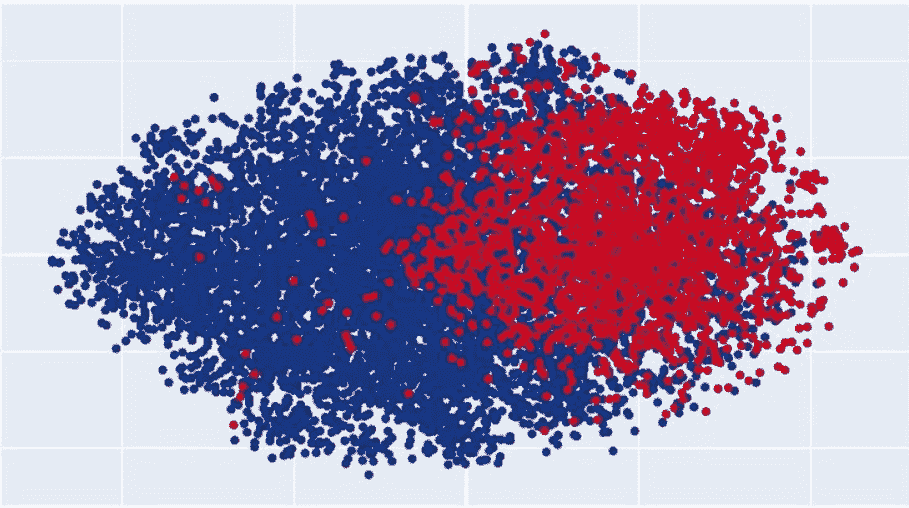

转换后的数据可能被用作另一个算法的输入。

```python
from sklearn.model_selection import train_test_split

X_train, X_test, y_train, y_test = train_test_split(X_reduced, y, test_size=0.20, random_state=42)
```

```python
from sklearn.naive_bayes import GaussianNB

model = GaussianNB()
model.fit(X_train, y_train)
```

GaussianNB()

```python
from sklearn.svm import SVC

model = SVC(C=10, class_weight={0:1, 1:10})
model.fit(X_train, y_train)
```

SVC(C=10, class_weight={0: 1, 1: 10})

```python
from sklearn.neural_network import MLPClassifier

model = MLPClassifier(tol=1e-10, hidden_layer_sizes=(25,50,100))
```

在这种情况下，我可以使用朴素贝叶斯、支持向量机或多层感知机进行拟合，所有方法都具有很高的准确率。总结一下，我们学习了维度灾难，即算法特征过多时面临的问题。并且我们学习了如何使用三种算法来处理这个问题，`LDA`、`PCA`，以及降维对于算法更快收敛是必需的，并且有助于在监督学习和无监督学习中创建可视化。还有其他降维技术你可以探索，例如 `TruncateSVD`、`Isomap` 嵌入、线性嵌入、多维缩放和因子分析等。好消息是它们与你已知的非常相似，所以选择它们很直接。现在，让我们继续我们的机器学习之旅，进入下一个模块，该模块探讨聚类，这是一种用于无监督学习的算法类型。聚类受益于降维。

## 第13章 聚类算法与 K 均值

之前，我讲解了分类算法，它们用于需要预测分类值的问题，例如高、中、低；健康或生病；鸟、猫或狗，而且非常重要，输入数据包含标签，告诉算法正确答案是什么。这就是所谓的监督学习。在接下来的章节中，我将谈论聚类，它是分类的一种变体，用于标签 `y` 缺失的数据集，即算法不知道正确答案是什么。这就是所谓的无监督学习。通过聚类，机器学习算法可以在不知道有多少类或存在哪些类或分组的情况下预测每个元素或个体属于哪个类别或组。要解决这些问题，我们只需要数据组中每个个体的特征，但事先没有正确答案或标签来训练算法对数据进行分类。事实上，根据你提供的某些参数，数据在每次迭代中都可能被划分为不同的组，因为你的算法对数据了解得更多。聚类的一个例子是查看你的客户的购买情况，然后创建如白金客户或 VIP 卡持有者等分组。简而言之，聚类使未标记的数据集变得有标记。


K-Means 是我们的第一个算法。它的目标是将数据分组为 k 种类型。可以定义数据应被划分为多少个组。这就是 k。为了更好地解释，想象一下我有一个仅包含两个变量的数据集，体重和身高。我从朋友那里收集了数据，我想将他们分为两个类别，0 和 1 或 A 和 B。因为我想将数据分为两个类别，所以我设置 `k = 2`，这意味着将定义两个随机质心。我将选择或创建两个任意的体重和身高的点，例如 150 磅，5.7 英尺，和 100 磅，6.7 英尺。值应是随机的，但在体重和身高的最小值/最大值范围内。选定的质心将作为我们聚类的初始点。任务是使用距离方法，例如欧几里得距离，来评估未标记数据集中每个条目，并检查它们更接近点 A 还是点 B。如果它们更接近点 A 而不是 B，则该条目将被标记为类别 A。一旦数据集中每个条目都被标记，我需要将质心 A 和 B 移动到新位置。A 质心的新坐标将居中于所有被分类为类型 A 的条目的距离。对质心 B 也需要做完全相同的事情。这将使质心向每个组的平均距离移动。完成此操作后，我需要再次重新计算距离，标记条目并移动质心。正如你所见，这是一个迭代过程。当两次迭代之间位置的变化非常接近 0 时，我就停止移动质心。然后，我们会看到数据已被分组为两个稳定的组。K-Means 是一种基于质心的聚类算法，质心会向被标记邻居的均值移动。就这样。因为 K-Means 使用距离方法，在使用它之前必须注意一些事情。以下是一些建议。`k` 的数量是你想要的类别数量。因为 `k` 是随机选择的，组在每次迭代中可能不同。K-Means 对异常值非常敏感。因为这些组基于距离方法，它们可能会影响组的创建。有些点离得太远。

考虑在需要时删除异常值。欧几里得距离在数据标准化时效果最好。考虑使用数据缩放以使算法更快收敛。该算法不适用于分类数据，因此使用哑变量或编码来处理这种情况是推荐的。对于聚类的第一个示例，我将找到具有相似特征的商场客户群体。

```python
import pandas as pd
import numpy as np

mall_customers = pd.read_csv("Mall_Customers.csv")
mall_customers.dropna(inplace=True)
mall_customers.head()
```

|   | CustomerID | Gender | Age | Annual Income (k$) | Spending Score (1-100) |
|---:|---:|---|---:|---:|
| 0 | 1 | Male | 19 | 15 | 39 |
| 1 | 2 | Male | 21 | 15 | 81 |
| 2 | 3 | Female | 20 | 16 | 6 |
| 3 | 4 | Female | 23 | 16 | 77 |
| 4 | 5 | Female | 31 | 17 | 40 |

这就是我的数据看起来像。我有性别、年龄、收入和消费评分。像这样的大规模分析变得越来越常见，因为公司试图通过更好地了解客户来增加销售额。

1. 我们想要获得什么？

K 个客户群体及其特征描述。

2. 数据类型是什么？

分类，定性。客户类型 1、2、3、... k

类型 1 客户喜欢... 大多是...

3. 我们将使用哪些数据来创建聚类？

- Gender : (Numerical, qualitative, nominal)
- Age : (Numerical, quantitative continuous)
- Annual Income (k$) : (Numerical, quantitative continuous)
- Spending Score (1-100) : (Numerical, quantitative continuous)

在这种情况下，我想要获得 k 个客户群体。输入数据是分类的和定性的。

```
In [3]:
mall_customers['Gender'] = mall_customers['Gender'].map({"Male":0,"Female":1})

mall_customers.drop(['CustomerID'], axis=1, inplace=True)
```

像往常一样，我首先进行一些特征工程，在这种情况下删除不必要的数据并为男性和女性创建类别。

```
In [4]: import seaborn as sns
import matplotlib.pyplot as plt
#sns.set(rc = {'figure.figsize':(15, 10)})

sns.heatmap(mall_customers.corr(), annot=True);
```


然后我查看相关性和数据。这很标准。然后，我进入有趣的部分，我将使用客户的性别、年龄、年收入和消费评分拟合一个无监督模型。

```
In [7]: from sklearn.cluster import KMeans

model = KMeans(n_clusters=5, random_state=0)

model.fit(X)

Out[7]: KMeans(n_clusters=5, random_state=0)
```

记住，在这种情况下，我不知道客户属于哪个群体。更进一步，我甚至不知道应该存在多少个群体。对于这个特定示例，我将把客户分为五个群体。我从哪里得到这五个？


Group 0

Gender (mean): 0.6086956521739131

Age (mean): 45.21739130434783

Annual Income (k$) (mean): 26.304347826086982

Spending Score (1-100) (mean): 20.913043478260867

Group 1

Gender (mean): 0.5384615384615384

Age (mean): 32.6923076923077

Annual Income (k$) (mean): 86.53846153846155

Spending Score (1-100) (mean): 82.12820512820511

Group 2

Gender (mean): 0.5822784810126582

Age (mean): 43.088607594936704

Annual Income (k$) (mean): 55.29113924050634

Spending Score (1-100) (mean): 49.56962025316456

Group 3

Gender (mean): 0.47222222222222215

Age (mean): 40.666666666666664

Annual Income (k$) (mean): 87.50000000000001

Spending Score (1-100) (mean): 17.583333333333314

Group 4

Gender (mean): 0.6086956521739131

Age (mean): 25.52173913043478

Annual Income (k$) (mean): 26.304347826086982

但在你的问题中，你可能需要进行一些实验。在这里，你可以看到不同颜色的预测以及使用的质心。得益于聚类算法，我能够利用每个群体客户的平均年龄、平均年收入等对数据进行特征描述。

The from group 0:

39% are males, 60% are females

Their age is between 19 and 67

Their Annual Income (k$) is between 15 and 39

The from group 4:

39% are males, 60% are females

Their age is between 18 and 35

Their Annual Income (k$) is between 15 and 39

The from group 2:

41% are males, 58% are females

Their age is between 18 and 70

Their Annual Income (k$) is between 40 and 76

The from group 1:

46% are males, 53% are females

Their age is between 27 and 40

Their Annual Income (k$) is between 69 and 137

The from group 3:

52% are males, 47% are females

Their age is between 19 and 59

Their Annual Income (k$) is between 70 and 137

现在，我可以通过使用这个模型来预测一些新商场购物者的购物特征。

### Chapter 14 Gaussian Mixtures & Hierarchical Clustering

另一种你可以用来自解决聚类问题的类型是高斯混合。想象一下，我手头的问题是我需要解释大学学生体重和身高的趋势，并且我希望能够确定一个数据点是男性还是女性。我可以用正态分布来描述数据。如果学生的平均体重是 70 kg，那么我可以观察到数据围绕均值聚集，并在高斯分布的两个方向上缓慢扩散。从这个描述中，我可以突出几点。我在统计上思考。我假设单一分布无法解释数据，并且我已经知道男性女性都在数据集中。但我不能确定性别，因为数据集没有这个标签。它是无监督的。我如何在数据中找到这些类别，男性或女性？好吧，用高斯混合。 高斯混合背后的主要思想是数据由高斯分布组成。在大学学生体重的例子中，我可以安全地假设 `k=2`。存在两个分布来解释男性和女性的体重。当选择 `k=2` 时，我有 2 个均值、2 个标准差和 2 个混合概率来帮助估计这些正态分布。下面的公式给出了混合在一起的两个分布的概率。

$p(x) = \pi_1\mathcal{N}_1\left(x|\mu_1,\sigma_1\right) + \pi_2\mathcal{N}_2\left(x|\mu_2,\sigma_2\right)$

$\pi_{i,1} = \frac{\hat{\pi}_{i,1}\mathcal{N}\left(x_i|\mu_1,\sigma_1\right)}{\hat{\pi}_{i,1}\mathcal{N}\left(x_i|\mu_1,\sigma_1\right)+\hat{\pi}_{i,2}\mathcal{N}\left(x_i|\mu_2,\sigma_2\right)}$

$\mu_1 = \frac{\sum_{i=1}^N x_i\pi_{i,1}}{\sum_{i=1}^N \pi_{i,1}}$

$\sigma_1^2 = \frac{\sum_{i=1}^N \pi_{i,1}\left(x_i-\mu_1\right)^2}{\sum_{i=1}^N \pi_{i,1}}$

该分布包含两个正态分布，并且很容易计算。我需要另一种算法或方法来帮助找到 `mu`、`sigma` 和 `pi` 的值。`Pi` 是每个点属于特定分布的期望或概率。期望最大化算法是帮助收集我需要的参数的方法。最后，我需要的是找到某个特定体重属于男性或女性分布的概率。简而言之，高斯混合模块或 GMMs 在数据混合并且可以用正态分布解释时是有益的。许多情况包括音频和语音识别的分离、医学数据集中图像的分离、基因表达分离。幸运的是，有很多库可以帮助我们用几行代码做到这一点。对于我们的目的，让我们看看使用 `sklearn mixtures` 的示例，这个例子是如何工作的。在这个第二个例子中，我有

民意调查的结果，人们表示他们更喜欢在家工作还是在公司工作。

```python
import pandas as pd

import numpy as np

WFH_WFO = pd.read_csv("WFH_WFO_dataset.csv")

WFH_WFO.dropna(inplace=True)

WFH_WFO.head()
```

|   | ID | Name | Age | Occupation | Gender | Same_office_home_location | kids | RM_save_money | RM_quality_time | RM_better_slee... |
|---|---:|---|---:|---|---|---|---|---|---|---|
| 0 | 1 | Bhavana | 45 | Tutor | Female | Yes | Yes | Yes | Yes | Yes |
| 1 | 2 | Harry | 24 | Tutor | Male | No | No | No | No | No |
| 2 | 3 | Banditaa | 53 | HR | Female | Yes | Yes | Yes | Yes | Yes |
| 3 | 4 | Neetha | 26 | Engineer | Female | Yes | No | Yes | Yes | No |
| 4 | 5 | Ram | 26 | Recruiter | Male | Yes | No | No | Yes | No |

这可能是由于很多因素。这是我的数据，特征很多，例如他们是否有宠物、孩子、职业等。

- 1. 我们想要获得什么？
- K 个客户群体及其特征描述。
- 2. 数据的类型是什么？
- 分类，定性。客户类型 1、2、3、... k
- 类型 1 客户喜欢... 大多是...
- 3. 我们将使用哪些数据来创建聚类？
- Gender : (Numerical, qualitative, nominal)
- Age : (Numerical, quantitative continuous)
- Annual Income (k$) : (Numerical, quantitative continuous)
- Spending Score (1-100) : (Numerical, quantitative continuous)

所以，我们想要获得可能更喜欢在家或办公室工作的人。我将拟合一个高斯混合模型，以便分析哪些员工更喜欢在家工作以及原因。

```python
### Yes / No Encoding

yes_no_cols = [

    'Same_office_home_location', 'kids', 'RM_save_money', 'RM_quality_time', 'RM_better_sleep',

    'digital_connect_sufficient', 'RM_job_opportunities'

]

for col in yes_no_cols:

    WFH_WFO[col] = WFH_WFO[col].map({'Yes': 1, 'No': 0})

from sklearn.preprocessing import OrdinalEncoder

occupation_encoder = OrdinalEncoder()

WFH_WFO['Occupation'] = occupation_encoder.fit_transform(WFH_WFO[['Occupation']])

gender_encoder = OrdinalEncoder()

WFH_WFO['Gender'] = gender_encoder.fit_transform(WFH_WFO[['Gender']])

calmer_stressed_encoder = OrdinalEncoder()

WFH_WFO['calmer_stressed'] = calmer_stressed_encoder.fit_transform(WFH_WFO[['calmer_stressed']])
```

```python
oldest = WFH_WFO['Age'].max()

WFH_WFO['Age'] = WFH_WFO['Age'] / oldest
```

```python
WFH_WFO.drop(['ID', 'Name'], axis=1, inplace=True)
```

数据大多是分类的，这意味着我们需要对数据集进行一些处理。

```python
from sklearn.decomposition import PCA

pca = PCA(2)

data_reduced = pca.fit_transform(WFH_WFO)
```

```python
import plotly.graph_objects as go

from plotly.subplots import make_subplots

fig = make_subplots(rows=1, cols=1)

fig.add_trace(go.Scatter(

    x=data_reduced[:,0],

    y=data_reduced[:,1],

    mode='markers',

    marker=dict(

        colorscale='portland'

    )

), row=1, col=1)

fig.show()
```

我使用 PCA 进行降维，但仅用于可视化。


该模型会将样本分为三个不同的群体。

```
In [10]: from sklearn.mixture import GaussianMixture
```


`GROUPS = 3`

`model = GaussianMixture(n_components=GROUPS, covariance_type='full')`

`model.fit(X)`

Out[10]: `GaussianMixture(n_components=3)`

```
这就是我使用高斯混合模型的地方，定义三个群体，然后进行拟合。
```


训练之后，我就能观察到员工是如何被分类或分组的。

```
In [12]: for i, cluster in enumerate(model.means_):

    print(f"Group {i}")

    for j, col in enumerate(X.columns):

        print(f"{col} (mean): {round(cluster[j], 2)}")

    print("")
```

Group 0
Age (mean): 0.45
Occupation (mean): 4.04
Gender (mean): 0.61
Same_ofiice_home_location (mean): 0.33
kids (mean): 0.17
RM_save_money (mean): 0.75
RM_quality_time (mean): 0.4
RM_better_sleep (mean): 0.32
calmer_stressed (mean): 0.68
RM_professional_growth (mean): 3.51
RM_lazy (mean): 3.56
RM_productive (mean): 3.54
digital_connect_sufficient (mean): 0.38
RM_better_work_life_balance (mean): 2.25
RM_improved_skillset (mean): 3.31
RM_job_opportunities (mean): 0.24
Target (mean): 0.25

另外，我还可以进行画像分析，以了解某人为何会属于某个群体或另一个群体。例如，有孩子的群体更倾向于在家办公。


使用图表总是有助于我们理解分类。最后，我可以将算法执行的分类可视化，将具有相似性的样本归组。

层次聚类是另一种无监督聚类技术，它使用诸如欧几里得距离之类的距离方法来创建簇。例如，我有一个数据集，其中包含学生在 2 次测试中的最新成绩，分数在 0 到 10 之间。

### 成绩


数据看起来是这样的。我想区分好学生和普通学生。因此，我设 `k=2`。我将使用层次聚类来构建簇。让我们看看这个算法是如何工作的。你从数据集中选择任意一个点，例如 `(2, 6)`。你计算 `(2, 6)` 到所有其他点的欧几里得距离或任何其他距离方法。然后，你选择最近的邻居，例如 `(2, 5)`，并将 `(2, 6)` 和 `(2, 5)` 组成一个新的簇 `Q1`。然后，你回到第 1 步，重复这个过程，直到数据集中有 `k` 个簇。为什么它被称为层次聚类？嗯，因为创建的簇可以用树状图来解释。是的，树状图，一种描述所有数据点如何合并的树状结构，就像左图那样。层次聚类很简单，但有一些事情你需要考虑。首先，它对离群点敏感。考虑使用标准化来缩放值。距离方法必须根据情况选择。例如，欧几里得距离适用于基于成绩的学生聚类，但欧几里得距离可能不推荐用于地图上的地点聚类，因为地点之间的距离是按街道距离而不是直线距离来测量的。所以，曼哈顿距离在这种情况下可能是更好的选择。

对于层次聚类，我有一个包含多个国家信息的数据集，例如儿童死亡率、出口、健康、进口、收入等等。

列描述：

- `country` : 国家名称
- `child_mort` : 每 1000 例活产中 5 岁以下儿童的死亡人数
- `exports` : 人均货物和服务出口额。以人均 GDP 的百分比表示。
- `health` : 人均卫生总支出。以人均 GDP 的百分比表示。
- `imports` : 人均货物和服务进口额。以人均 GDP 的百分比表示。
- `income` : 人均净收入
- `inflation` : 国内生产总值的年增长率衡量指标
- `life_expec` : 如果当前的死亡率模式保持不变，新生儿预期可活到的平均年数
- `total_fer` : 如果当前年龄别生育率保持不变，每位妇女将生育的孩子数。
- `gdpp` : 人均 GDP。按国内生产总值除以总人口计算。

我打算将国家分成几个不同的组，实际上是三个簇，然后找出它们具有哪些相似之处。

1. 我们想要得到什么？

`K` 个国家组及其特征。

2. 数据是什么类型？

分类的、定性的。国家类型 1、2、... k

类型 1 国家的收入为……它们的平均预期寿命为……

3. 我们将使用哪些数据来创建簇？

- `country` :（文本，定性，名义型）
- `child_mort` :（数值，定量连续型）
- `exports` :（数值，定量连续型）
- `health` :（数值，定量连续型）
- `imports` :（数值，定量连续型）
- `income` :（数值，定量连续型）
- `inflation` :（数值，定量连续型）
- `life_expec` :（数值，定量连续型）
- `total_fer` :（数值，定量连续型）
- `gdpp` :（数值，定量连续型）

在特征工程部分，我将删除国家名称，因为它不是一个数据点。

```
In [3]: country_names = countries['country']

countries.drop(['country'], axis=1, inplace=True)
```

它是一个标签。然后，像往常一样，我使用相关矩阵进行分析，并用一些直方图查看数据的分布形态。

```python
import seaborn as sns
import matplotlib.pyplot as plt
sns.heatmap(countries.corr(), annot=True);
```


它们总能给我关于数据的有用信息。

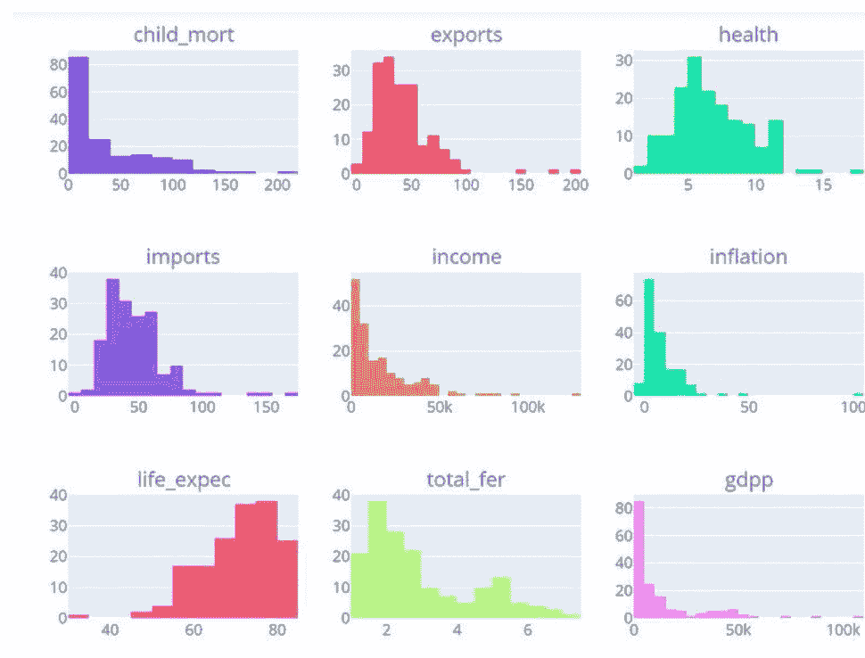

接下来，我使用三个组作为簇数量来拟合一个凝聚层次聚类模型。

```
In [7]: from sklearn.cluster import AgglomerativeClustering
GROUPS = 3
model = AgglomerativeClustering(n_clusters=GROUPS)
y_pred = model.fit_predict(X)
```

最后，我使用地图来可视化这些簇。


我根据每个国家所属的簇在地图上为其着色。颜色相同的国家具有相似的指标，例如进口、出口和儿童死亡率。你几乎可以立刻分辨出哪些是较发达的国家，哪些是发展中国家。

## 第 15 章 亲和传播及其他机器学习算法

亲和传播是一种无监督聚类算法，不需要预先确定簇的数量。该算法计算四种类型的矩阵。第一个是相似矩阵，将数据集中的所有数据行相互比较，构建一个矩阵，其相似度值由负平方和计算得出。相似矩阵构建完成后，会创建责任矩阵，用于量化矩阵中一个元素与另一个元素的适配程度。然后，责任矩阵构建可用性矩阵。与责任矩阵类似，在这里我们将每一行与其他每一行进行比较，以确定它们之间的合适程度。最后，由可用性矩阵和责任矩阵之和生成准则矩阵。这个最终矩阵将显示每行的聚类中心（exemplar）或最高值，作为簇。这是一个迭代过程，可以执行 n 次。亲和传播更适合特定场景，如计算机视觉和计算生物学任务，例如人脸图像的聚类和识别受调控的转录本。使用 `sklearn` 进行亲和传播非常简单。作为最后一个示例，我将使用亲和传播，根据星巴克会员的性别、年龄、注册时间和收入对他们进行分组。

```python
In [1]: import pandas as pd
import numpy as np
starbucks = pd.read_csv("profile.csv", index_col=0)
starbucks.dropna(inplace=True)
starbucks['became_member_on'] = pd.to_datetime(starbucks['became_member_on'], format='%Y%m%d')
starbucks.head()
```

Out[1]:

| index | gender | age | id | became_member_on | income |
|---|---|---|---|---|---|
| 1 | F | 55 | 0610b486422d4921ae7d2bf64640c50b | 2017-07-15 | 112000.0 |
| 3 | F | 75 | 78afa995795e4d85b5d9ceeca43f5fef | 2017-05-09 | 100000.0 |
| 5 | M | 68 | e2127556f4f64592b11af22de27a7932 | 2018-04-26 | 70000.0 |
| 8 | M | 65 | 389bc3fa690240e798340f5a15918d5c | 2018-02-09 | 53000.0 |
| 12 | M | 58 | 2eeac8d8feae4a8cad5a6af0499a211d | 2017-11-11 | 51000.0 |

Columns description:

- gender : Gender of the customer (note some entries contain 'O' for other rather than M or F)
- age : Age of the customer
- id : Customer id
- became_member_on : Date when customer created an app account
- income : Customer's income

The main difference between these models and our first three clustering models is that we do not specify how many clusters we want.

1. What do we want to obtain?

   `K` groups of customers and their characterization.

2. What type of data is?

   Categorical, qualitative. Client Type 1, 2, 3, ... k

   Type 1 Clients like to... are mostly ...

3. Which data are we going to use to create the clusters?

   - gender : (qualitative, nominal)
   - age : (Numerical, quantitative continuous)
   - became_member_on : (Numerical, quantitative continuous)
   - income : (Numerical, quantitative continuous)

The type of data used for this algorithm is going to be categorical and qualitative, which means that I need to perform feature engineering as some of my data is not presented in this way.

```python
In [3]: starbucks['days_as_member'] = (starbucks['became_member_on'].max() - starbucks['became_member_on']).dt.days
starbucks.drop(['became_member_on'], axis=1, inplace=True)
```

```python
In [4]: # Yes / No Encoding
starbucks['gender'] = starbucks['gender'].map({'F': 1, 'M': 0})
```

```python
In [5]: starbucks.drop(['id'], axis=1, inplace=True)
```

```python
In [6]: #
from sklearn.preprocessing import StandardScaler
scaler = StandardScaler()
starbucks[['age', 'income', 'days_as_member']] = scaler.fit_transform(starbucks[['age', 'income', 'days_as_member']])
```

```python
In [7]: starbucks.fillna(0, inplace=True)
```

And again, I'm going to use PCA for visualization.

```python
from sklearn.decomposition import PCA
pca = PCA(2)
data_reduced = pca.fit_transform(starbucks)
```

```python
import plotly.graph_objects as go
from plotly.subplots import make_subplots
fig = make_subplots(rows=1, cols=1)
fig.add_trace(go.Scatter(
    x=data_reduced[:,0],
    y=data_reduced[:,1],
    mode='markers',
    marker=dict(
        colorscale='portland'
    )
), row=1, col=1)
fig.show()
```

Dimensional reduction is very useful. And then I use affinity propagation.

```python
In [12]: import plotly.graph_objects as go
fig = go.Figure()
fig.add_trace(go.Scatter(
    x=data_reduced[:,0],
    y=data_reduced[:,1],
    mode='markers',
    name='data',
    marker=dict(color=model.predict(X))
))
fig.update_layout(
    title="Gaussian Mixtures Analysis",
    xaxis_title="PCA(0)",
    yaxis_title="PCA(1)"
)
fig.show()
```


I fit the data, and please notice that nowhere I specify how many clusters to use, the algorithm itself figures this out. Now I plot the result.


These are the generated clusters. In summary, clustering is an essential application of unsupervised learning. I explored multiple different clustering algorithms, including which groups data into a number of types. It creates centroids and calculates distances between all points and then classifies all points. Once classification is complete, it performs additional iterations where it recalculates the mean of each cluster. Iterations continue until all points have the shortest distance to the centroid of their particular cluster. Next, we are going to look at Gaussian mixture models, which are quite useful when data is mixed up, but can be explained in terms of normal distributions. Another algorithm, hierarchical clustering, uses distance methods to create clusters in a structure. Affinity propagation, which is an algorithm that does not require to specify the number of clusters. It finds data points that are representative of the entire cluster and classifies similar data points.

So far, I covered many types of algorithms focusing on the most common ones. Now let me expand on other types of algorithms that may be of interest to you. Transfer learning is a special case of neural networks where we take the weights, that's the coefficients of a trained network, for example, one that's used to detect people's faces, and we take it as a base model and use them to train another network for another purpose, for example, to detect animal faces. The whole idea is to reduce fitting and training time or avoid wasting resources in the design of complex architectures, especially convolutional layers. Next up, sound classification. By using sound as inputs, we can train models that are capable of classifying voice commands, translating complete sentences, or detecting species by their sound. Algorithms that solve these kind of problems are exactly the same as those that we have seen in this book, just that they are more complex neural networks. However, the biggest difference lies in the data since we must convert the audios, that's the sound, from time domain to frequency domain using different transformations and/or signal processing to obtain audio spectrograms. Once they're transformed, we can adjust the models as if it were a simple classification. Moving on, object detection, which classifies an image into specific classes or labels, also specifying the exact position where objects are located inside the picture. To solve these kinds of problems, a variety of networks have been proposed. Many of them are quite different from regular neural networks, not only in depth, but connections between layers. One of the most popular and powerful frameworks for object detection is YOLO. Time series analysis, which is a regression and/or classification problem type, in which seasonality or periodicity must be added. That is, it can behave in repetitive or specific ways in certain time intervals, like seasons, months, days of the week, hours of the day, and more. The most common examples are prediction of natural phenomena, stock prices, historical prices, growth over time, and more. One of the most popular libraries is Facebook's Prophet. Moving on, Natural Language Processing, or NLP, as it's known in artificial intelligence, is the branch of ML that allows machines to understand and communicate using languages; written, spoken, or visual. In this field, we can find applications like sentiment analysis, text prediction, language translation, transcription, and more. However, for many of these applications, there are already a large number of available APIs from Amazon, Google, Microsoft, Mozilla, and more. Next, we have video classification. Unlike image classification where each example has a width, a length, and a number of channels, that's great for RGB, the videos are an arrangement of images. That is, they have a width, length, and channels, but also a temporal dimension. Temporality gives new characteristics, such as continuity, that helps to classify actions, tasks, sports, among others. The most important difference of neural networks that focus on this type of problem is that they must store the information about what happened before and what will happen after a specific example is being analyzed in the neural network for backpropagation stage. Several frames feed the network in each iteration. Applications such as monitoring, activity control, security, among others, are extremely popular examples of video classification. Generative AI is one that seems to be in the news all the time. One of the most recent applications of ML is the generation of multimedia content that did not exist before. Thanks to GANs, and now transformers. If it can be stored in bits, it can be generated. The most common media generation applications include images, for example, art, people, animals; sounds, like voice, music, and effects; videos, like landscapes, filters, scenes, animations, simulations; and finally, text. The only drawback of this kind of model is the time that they need to fit themselves, as well as the large amount of resources they consume. I am talking about RAM, hard disk, and especially GPUs. Reinforcement learning is a type of learning in which an agent, like a vehicle, interacts with an environment, for example, a highway, and reacts accordingly. For example, to accelerate, brake, or turn, given a determined interaction like signals, traffic lights, pedestrians, or other vehicles. Depending on the action the agent takes, it can be rewarded or punished. In this way, the agent learns to make decisions that increase the reward or decrease the punishment. Reinforcement learning is one of the most complex applications, both to implement and to apply in the real world, not only because it is difficult to understand how machines or computers learn, but because their actions or predictions may

变得无法解释。机器学习的世界非常庞大。但更重要的是，在许多情况下，并没有正确的解决方案，也没有像传统编程那样的工作配方。你还记得区别吗？在传统编程中，你得到一个输入数据集，你编写一些指令，然后得到输出。对于新的输入，指令会被执行，并创建新的输出。在机器学习中，你有一个输入数据集和一个输出数据集。你把两者都展示给机器，机器会创建一个模型，对于新的输入，它会根据所学内容创建相应的输出。总结来说，我主要介绍了四种不同的算法。首先，我谈到了回归算法，它估计响应变量 `y` 与描述 `y` 的一组变量 `x` 之间的关系，`y` 是连续的，例如温度、房屋价格或流程所需的时间。接下来，我谈到了分类，它预测一个类别，如生病或健康、鸟、猫或狗，并且它使用标记数据集。这是监督学习。接下来，我谈到了降维，它提供了一组我们可以应用于数据的技术来处理数据。也就是说，我们减少用于做出预测的特征数量。接下来，我谈到了聚类，它是分类的一种变体，用于标签 `y` 缺失的数据集。也就是说，算法不知道哪个是正确答案。这就是所谓的无监督学习。最后，我简要提到了你可能会遇到的一些其他类型的机器学习。我希望你喜欢这本书，我在其中描绘了机器学习算法的概览，你可以在生命中的某个时刻使用其中每一个。

# BOOK 3

## REACT

## JAVASCRIPT VULNERABILITIES

## *CONSTRUCTING SECURE ReactJS CODE*

RICHIE MILLER

## Introduction

在这本书中，我将教你如何保护你的 React 应用。`React` 是开发中最受欢迎的库之一。它允许软件工程师创建使用起来令人愉悦的丰富用户界面。Web 应用通常在处理敏感信息，例如用户凭据或信用卡数据。鉴于每天几乎都有数据泄露的新闻报道，保护我们 Web 应用存储的用户数据非常重要。在这本书中，你将学习如何提高 React 应用的安全性。首先，你将探索如何使用 React 功能来防止脚本攻击。接下来，你将了解如何在 React 组件中安全地渲染动态 HTML。最后，你将学习在使用渲染时如何防止代码注入漏洞。当你完成这本书时，你将具备 React 安全最佳实践所需的技能和知识，以更好地保护你的用户。首先，我们将专注于理解 React 安全。这将帮助你理解哪些安全问题需要由你的 React 代码解决，哪些需要在 Web 应用的其他组件中修复。脚本，或简称为 XSS，是在浏览器中运行的代码最普遍的安全问题。成功攻击的影响可能非常严重。我们将检查成功 XSS 攻击可能产生的负面后果。脚本攻击是利用浏览器机制进行的，称为执行 sink。我们将讨论最常用于引入 XSS 漏洞的 sink。我们还将看到 React 如何在渲染期间自动对内容应用上下文转义。使用此机制将保护你的代码免受各种攻击。渲染 URL 需要特别注意，即使 React 自动应用了安全措施。我们将通过学习如何在 React 组件中安全地使用 URL 来结束这一部分。

一家公司计划发布其新的软件缺陷跟踪产品。该新产品的一个关键功能是使用 React 实现的丰富用户界面。公司的开发团队距离最终发布已经非常接近。在发布前需要完成的最后活动之一是安全审查。审查将重点关注用户界面代码的三个方面。首先，我们将重点关注查找和修复脚本漏洞。这种类型的错误很容易在代码中引入，我们需要特别注意我们的代码对这种类型的攻击具有鲁棒性。其中一个屏幕允许用户在内容中使用 HTML 标签。这通常会导致代码注入问题，我们将特别关注此功能。应用程序的大部分代码在浏览器中运行，但一些配置数据以 JSON 格式呈现。我们也将对此进行安全问题的审查。`React` 组件负责实现应用程序逻辑并与浏览器环境交互。`React` 代码可以使用任何浏览器 API。这可能包括网络、媒体，甚至与主机设备的交互。`React` 组件可以完全访问文档对象模型，即 DOM。`React` 本身封装了大部分 DOM 交互，但它提供了直接访问 DOM 节点的 API。最后，现代 Web 应用在浏览器中存储数据。在许多情况下，这些数据具有敏感性，可能包括个人信息或访问令牌。恶意行为者可以篡改输入数据来对应用程序发起攻击。精心制作的有效载荷或 URL 可以利用安全漏洞并迫使我们的应用程序执行不需要的操作。在某些情况下，`React` 组件中的安全漏洞可能会允许攻击者窃取存储在浏览器中的敏感信息。是时候看看我们将要审查的项目了。我们将演示应用程序的所有屏幕以及实现用户界面的 React 组件。我们还将检查应用程序如何在浏览器内部管理数据，我们将看到它在浏览器本地存储中存储了一个秘密令牌。我们将演示的所有攻击都将试图窃取此秘密令牌。现在，让我们看看 Company Bug Tracker 的代码。


代码组织在两个主要文件夹中：`public` 和 `src`。`public` 文件夹包含静态资源，如 HTML 和 CSS。`src` 文件夹包含 React 组件和其他 JavaScript 代码文件。应用程序完全在浏览器中运行，但需要开发服务器和构建工具。我们使用 Snowpack，一个轻量级构建工具。`Snowpack` 配置存储在 `snowpack.config.js` 文件中。在这里，我们将 `public` 目录配置为挂载到根 URL，将 `src` 目录配置为挂载到 `dist` 路径。我们可以使用 `npm start` 命令启动开发服务器。为了更好地演示用户界面的结构，我安装了 React Developer Tools 浏览器扩展。

```html

```


<!DOCTYPE html>

<html lang="en">

  <head>

    <meta charset="utf-8" />

    <meta name="viewport" content="width=device-width, initial-scale=1" />

    <meta name="description" content="Starter Snowpack App" />

    <link rel="stylesheet" type="text/css" href="/index.css" />

    <title>Globonantics Bug Tracker</title>

  </head>

  <body>

    <h1 class="title">Find Bugs</h1>

    <h3 class="navLink">

      <a href="/new.html">New Bug</a>

    </h3>

    <div id="root">

    </div>

    <script type="module" src="/dist/BugSearch.js"></script>

    <script type="module" src="/dist/secrets.js"></script>

  </body>

</html>

```
现在，让我们检查其中一个页面的组织。每个页面都包含对编译后的 React 组件的引用，该组件是该页面的根组件。每个页面还包含对 `secret.js` 文件的引用，该文件处理存储在 `localStorage` 中的敏感令牌。我们对令牌处理的实现非常简单，仅用于确保应用程序的每个页面都出于演示目的存储令牌。
```

```javascript

function matchesTitle(item, query) {

  return item.title.toLowerCase().includes(query.toLowerCase());

}

export class Database {

  constructor() {

    const serializedData = window.localStorage.getItem('bugs');

    this.data = JSON.parse(serializedData);

  }

  search(query) {

    return this.data.filter(item => hasId(item, query) || matchesTitle(item, query));

  }

  find(id) {

    return this.data.find(item => item.id === id);

  }

  insert(bug) {

    const copy = { ...bug };

    copy.id = this.data.push(copy).toString();

    window.localStorage.setItem('bugs', JSON.stringify(this.data));

    return copy.id;

  }

  update(id, bug) {

    Object.assign(this.find(id), bug);

    window.localStorage.setItem('bugs', JSON.stringify(this.data));

  }

}

```

错误列表存储在 `data` 属性中的一个数组中。该数组随后被序列化为 JSON 并持久化在 `localStorage` 中。其他页面也是以非常相似的方式实现的。我们将在发现并修复应用程序中的安全漏洞时深入研究其他页面和组件。

这种情况发生时，浏览器会解析并执行该代码。脚本攻击是最严重的攻击之一，其对应用程序的影响可能非常显著。在应用程序内执行的恶意代码很可能能够访问该应用程序存储在浏览器中的任何数据。得益于同源策略，这是 Web 最基本的安全机制之一，影响范围被限制在单个源，而非浏览器中存储的所有数据。为了窃取数据，攻击者必须有一种方法将数据从浏览器发送出去。XSS 允许攻击者发出网络请求，例如使用 `fetch` API。这是对攻击者从受害者浏览器中泄露数据的一种简单方式。脚本攻击不必立即发动。它们也可能安装恶意软件，例如键盘记录器，以监视用户在应用程序内的活动并收集有关受害者的更多信息。XSS 有效载荷以与受害者相同的权限运行。这意味着恶意代码可以代表用户运行并执行操作，可能导致账户接管。脚本还可能允许攻击者修改受攻击页面的 DOM，包括进行任意布局和修改。这可能是欺骗用户并发起社会技术攻击例如钓鱼的一种有力方式。能够修改 DOM 的另一个影响是脚本有效载荷能够规避其他安全机制，例如窃取为防止请求伪造攻击而生成的唯一令牌。一个脚本漏洞通常足以完全破坏在浏览器中运行的应用程序的整个部分。在评估针对您应用程序的 XSS 攻击风险时请考虑这一点。公司的错误跟踪器存在一个 DOM XSS 漏洞。首先，我们将识别一个源，并会看到没有执行任何数据验证或清理。然后，我们将追踪数据到执行 sink，并演示一次基础攻击。最后，我们将利用发现的脚本漏洞窃取存储在浏览器中的 `secret` 令牌。

打印视图页面看起来与其他页面非常相似，但有一个不同之处。它是用纯 JavaScript 而不是 React 实现的。`print.js` 文件中的代码非常简单。它从查询字符串中读取有关错误的数据。然后，`title`、`severity` 和 `description` 字段被用来动态构建错误的简单 HTML 表示。

```javascript

const container = document.getElementById("root");

const qs = new URLSearchParams(window.location.search);

const bug = {

  title: decodeURIComponent(qs.get("t")),

  severity: decodeURIComponent(qs.get("s")),

  description: decodeURIComponent(qs.get("d"))

}

container.innerHTML = "<h1>" + bug.title + "</h1>" +

  "<h3>" + bug.severity + "</h3>" +

  "<p>" + bug.description + "</p>";

```

此 HTML 标记是通过直接将其分配给页面根容器的 `innerHTML` 属性来渲染的。查询字符串是一个 DOM XSS 源，可以很容易被攻击者操纵。参数直接传递给 `innerHTML`，即 DOM XSS sink，而没有任何数据验证或清理。


现在，让我们尝试发起一次攻击。让我们找到一个错误，并进入打印视图。我们将使用 `image` 标签向浏览器投递可执行代码。无效的 `source` 属性将迫使浏览器运行 `onerror` 事件处理程序。这就是我们传递恶意代码的地方。我们将使用 `alert` 函数来显示从本地存储中获取的 `secret` 值。我们的攻击已成功。如果攻击者想要窃取此信息，他们可以强制浏览器导航到他们的站点并将 `secret` 值作为请求参数之一附加。

## Chapter 2 Cross-site Scripting Sinks

DOM XSS 攻击完全发生在浏览器中。可以在此类攻击中使用的源也是浏览器机制。服务器不参与其中。DOM XSS 最常见的源是 URL。攻击者可以制作包含恶意有效载荷的链接并诱骗受害者点击它。`Cookie` 可用于在浏览器中存储数据。如果攻击者能够影响受害者 `Cookie` 的内容，它可能是将恶意有效载荷带入易受攻击应用程序的途径。最后，浏览器应用程序使用浏览器存储机制如本地存储或会话存储来保存数据。这些数据可能受攻击者通过钓鱼等攻击先行影响，然后可用于利用 DOM XSS 漏洞。还有更多可能被滥用的源，如 Web 消息和浏览器历史记录 API。所有这些源的共同点是它们可以被攻击者操纵。其中有几个被特别频繁使用。URL 的查询字符串部分对攻击者来说非常容易操纵，并且被应用程序广泛使用。片段是 URL 的另一个组件，常用于发起 DOM XSS 攻击。它具有相同的属性。它很容易被操纵并且被广泛使用。`Referrer` 是一个 HTTP 头，包含导致用户进入当前页面的页面的地址。这个也很容易被攻击者操纵，例如通过发送钓鱼邮件或意外重定向到易受攻击的页面。为了使攻击成功，不受信任的数据需要从源读取并在未经验证或清理的情况下传递到 sink。在此示例中，我们使用 `window.location.hash` 属性读取 URL 的片段组件。此属性的值可以很容易被攻击者操纵，我们应将此数据视为不受信任。

```javascript

// Source

const untrustedData = window.location.hash;

```

接下来，我们将此不受信任的数据直接传递给 `document.write` 和 `document.writeln` 方法。这些方法将字符串直接写入文档流，而浏览器正在渲染该文档流。传递给这两种方法的参数被视为 HTML 标记。如果攻击者传递的标记包含带有恶意 JavaScript 代码的 `script` 标签，该代码将被浏览器执行。

```javascript

// Sinks

document.write(untrustedData);

document.writeln(untrustedData);

```

这样，`document.write` 就可能成为执行 sink。攻击者可以利用的直接调用 `document.write` 在应用程序中相对较少。开发人员更常见的是使用 DOM API 来操作页面的结构和内容。在此示例中，我们将使用 `document.getElementById` 方法获取具有标识符 `container` 的 `div` 节点的引用。

```javascript

const div = document.getElementById("container");

```

与 `document.write` 类似，DOM API 的某些方法和属性会将传入的参数视为 HTML 标记并会将这段标记即时转换为 DOM 节点。如果该标记包含恶意 JavaScript 代码，它将会被执行，攻击从而得逞。

```
div.innerHTML = untrustedData;
div.outerHTML = untrustedData;
```

`innerHTML` 和 `outerHTML` 就是具有此类行为的属性示例。许多攻击和利用尝试都可以通过分析服务器日志检测到。这给了安全团队响应攻击并从中恢复的机会。不幸的是，对于 DOM XSS 攻击来说，这几乎是不可能的。此类攻击被限制在受害者的浏览器中，通常不会在日志中留下任何痕迹。这使得通过被动方式防范此类攻击变得极其困难。最好的方法是从一开始就防止脚本漏洞被引入到你的代码中。

或者操作可能将 URL 解释为数据甚至可执行代码。使用 `data` 或 `JavaScript` 伪协议的 URL 就有这种行为，攻击者经常利用它们。要防止这种情况，需要解析 URL 并且只允许诸如 HTTP 或 HTTPS 之类的安全协议。让我们看一个使用 React 创建 HTML 段落的简短代码片段。这个片段将让我们看到 React 在渲染内容时如何自动应用 HTML 转义。

```
React.createElement("p", {}, "Just text");
```

我们使用 `React.createElement` 方法。我们传入 `"p"` 作为要创建的元素类型，传入一个空的 JavaScript 对象作为 props，并将 `"Just text"` 作为段落元素的内容。

```
<p>Just text</p>
```

生成的元素被渲染为一个带有文本内容的简单段落 HTML 标签。现在，我们使用同样的 `React.createElement` 方法，但传入一个脚本载荷作为内容。

```
React.createElement("p", {},
"<script>alert(document.domain)</script>");
```

该载荷包含一个带有 `alert` 函数调用的恶意 `script` 标签。这一次，渲染出的 HTML 代码看起来不同了。段落标签与之前示例中完全相同，但内容已经经过了 React 的处理。

```
<p>&lt;script&gt;alert(document.domain)&lt;/script&gt;</p>
```

围绕 `script` 标签的所有尖括号都被替换成了 HTML 实体。这使得浏览器可以安全地处理它们，而不会有意外运行 `alert` 函数的风险。JSX 是一种构建在 JavaScript 之上的声明式语法，它允许在 React 组件中混合标记和逻辑。在底层，JSX 使用与 `React.createElement` 相同的自动转义机制，可以安全地将不可信数据渲染为 HTML 标签内容。让我们回到我们的示例。

```javascript

const input =

  "<script>alert(...)</script>";

return React.createElement(

  "p",

  {},

  input

);

```

在这段代码中，我们再次使用 `React.createElement` 方法来安全地渲染包含脚本载荷的 `input` 值。我们已经看到了恶意输入如何被净化并变得可以安全渲染。

```javascript

const input =

  "<script>alert(...)</script>";

return (

  <p>{input}</p>

);

```

等价的 JSX 代码使用标记语法替代了 `React.createElement`。尽管存在语法差异，它执行了与命令式版本相同的转义操作。现在我们有了修复 DOM XSS 漏洞所需的一切。我们将用一个新的 React 组件替换易受攻击的代码。然后，我们将使用 JSX 语法，并依赖其自动 HTML 转义来安全渲染内容。最后，我们将看到这个新的 React 组件如何阻止攻击者从浏览器中窃取秘密令牌。我们将通过把打印视图页面转换为 React 组件来修复该安全漏洞。

```
import React from 'react';
import ReactDOM from 'react-dom';
function Print() {
  const qs = new URLSearchParams(window.location.search);
  const bug = {
    title: decodeURIComponent(qs.get("t")),
    severity: decodeURIComponent(qs.get("s")),
    description: decodeURIComponent(qs.get("d"))
  }
  return (
    <div>
      <h1>{bug.title}</h1>
      <h3>{bug.severity}</h3>
      <p>
        {bug.description}
      </p>
    </div>
  );
}
ReactDOM.render(
  <Print />,
  document.getElementById("root")
);
const container = document.getElementById("root");
container.innerHTML = "<h1>" + bug.title + "</h1>" +
  "<h3>" + bug.severity + "</h3>" +
  "<p>" + bug.description + "</p>";
```


首先，让我们导入所需模块。接下来，我们可以在根容器中渲染组件。现在，我们可以创建一个名为 `Print` 的新 React 组件。我们可以在新组件中复用从查询字符串读取数据的代码。之前的实现与 React 实现的主要区别在于数据的渲染方式。我们不再拼接字符串并将 HTML 代码赋给 `innerHTML` 属性，而是使用 JSX 让 React 为我们渲染 DOM 节点。作为最后一步，我们可以移除原始实现中遗留的代码。我们回到浏览器中。让我们再次找到这个漏洞，然后进入打印视图。它看起来与之前相同。


现在我们可以再次尝试攻击。我们将使用带有 `onerror` 处理程序的同一个无效图片标签，其中包含恶意代码。这一次，React 自动应用的 HTML 转义正确生效了。载荷没有被解释为 HTML 代码，而是作为要显示在页面上的内容。这样一来，漏洞已被修复，攻击也被阻止了。

## 第 4 章 安全地渲染 URL

URL 是允许在 Web 应用中导航和引用资源的基本机制。在 React 应用中，它常用于 HTML 标签属性，例如 `source`、`location` 或 `action`。浏览器会以不同方式解释多种不同类型的 URL。最常用的 URL 类型是通过 HTTP 或 HTTPS 等协议引用网络资源的类型。这些 URL 通常使用起来是安全的。URL 允许指定两种伪协议。第一种，`data`，允许直接在 URL 中嵌入数据。有时，这对于在 HTML 文档中嵌入小文件而不需要浏览器执行额外的网络请求来说是可取的。`Data URL` 可能导致脚本攻击。第二种伪协议是 `JavaScript`。这种类型的 URL 允许将内联代码传递给事件处理器和导航请求。这通常用于最小化需要从服务器请求的代码量。`JavaScript URL` 是常见的 XSS 载荷类型。通过将适当的编码应用于渲染内容，可以防止 HTML 上下文中的脚本执行。React 会自动执行此操作。不幸的是，同样的策略对于使用 URL 上下文执行的脚本攻击不起作用。这个示例 React 组件使用锚点标签渲染了一个超链接。`href` 属性的内容根据 `URL` 变量动态渲染。如果这个 URL 变量是从攻击者可以操纵的来源读取的，攻击者就可以提交一个使用 `JavaScript` 伪协议的值。在这个示例中，该值是一个 URL，调用时会执行 `alert` 函数来显示文档的域名。当文档被渲染时，React 会读取 `URL` 变量，并将 `JavaScript URL` 直接放入 `href` 属性中。当用户点击该链接时，浏览器会执行提供的内联 `JavaScript` 代码，从而使 XSS 攻击成功。转义特殊字符并不是对付 `JavaScript URL` 的有效防御手段，我们必须使用其他技术。`JavaScript URL` 的主要用例是内联事件处理器。阻止使用此类内联事件处理器，并将其替换为以 `JavaScript` 函数形式实现的适当事件处理器，是防止使用此攻击向量的最佳方法。有时，确实存在需要处理不可信 URL 并将其渲染到 HTML 属性中的合法情况。有助于在这些情况下防止 XSS 的一种技术是在渲染之前解析 URL，并阻止已知危险的伪协议，如 `data` 和 `JavaScript`。以全面的方式阻止不安全值可能很困难。解析 URL 并只允许我们确定在应用中需要且安全的 URL，是一种更健壮的策略。在绝大多数情况下，我们只需要支持 HTTP 和 HTTPS 协议。`Company bug tracker` 存在一个 XSS 漏洞，可通过提供恶意的 `JavaScript URL` 加以利用。我们将看到 React 的自动转义被应用了，但无法阻止攻击。然后，我们将演示如何构造一个窃取秘密令牌的恶意 URL。最后，我们将应用严格的 URL 协议验证来净化 URL 并修复该漏洞。让我们回到 `Company bug tracker` 的代码。`BackLink` 组件在 bug 详情页面中使用，用于导航回搜索页面。该组件在 `href` 属性中渲染 URL 时正确使用了 JSX 自动转义。

React 这次应用的自动转义并没有阻止攻击。修复安全漏洞需要添加适当的输入验证。首先，我们需要准备处理解析错误。然后，我们使用 `URL` 类来解析 URL。我们的应用程序只使用 HTTP 协议，我们可以添加代码检查来强制执行此规则。

```javascript
export function getId() {
  const qs = new URLSearchParams(window.location.search);
  const id = qs.get('id');
  return id;
}

export function getBackUrl() {
  const qs = new URLSearchParams(window.location.search);
  let backUrl = qs.get('backUrl');
  try {
    const url = new URL(backUrl);
    if (url.protocol.toLowerCase() !== 'http:') {
      backUrl = null;
    }
  } catch {
    backUrl = null;
  }
  return backUrl;
}

export function navigateToBug(id) {
  window.location = '/bug.html?id=' + id;
}
```

如果协议不是 HTTP，我们返回 `null`。这会阻止返回链接组件渲染链接。如果我们根本无法解析 URL，我们也返回 `null`。让我们查看错误详情并再次尝试攻击。

## 第 5 章 安全的动态内容渲染

在前几章中，我们了解了 A 公司 bug 跟踪器及其基于 React 的新用户界面。我们看到了如何直接从 JavaScript 代码中使用浏览器 API 可能会导致脚本漏洞，并且我们学习了如何安全地处理 URL。我们还了解到，使用 React 内置的自动输出转义可以防止许多 XSS 攻击。在本章中，我们将重点关注在没有脚本漏洞风险的情况下渲染动态内容。我们将学习如何轻松识别有问题的代码结构以及如何清理渲染的标记。我们还将看到绕过 React 直接访问 DOM 如何导致安全漏洞，以及动态解析 React 组件如何允许攻击者将代码注入到您的应用程序中。

某些应用程序功能需要在浏览器中根据用户输入动态渲染 HTML 标记。DOM 通过 `innerHTML` 等属性允许轻松实现此类功能。正如我们在上一模块中看到的，使用不受信任的输入的 `innerHTML` 可能会导致 XSS 错误。React 通过将 `innerHTML` 属性暴露在特殊名称下向开发人员发出警告：`dangerouslySetInnerHTML`。如果我们无法从代码中消除此功能，我们需要清理渲染的标记以删除或解除潜在危险元素并防止安全漏洞。

React 可以通过包装浏览器 DOM 来保护开发人员免受许多错误的影响。某些 React 功能，例如 `refs`，允许开发人员直接访问 DOM 节点。这使开发人员重新负责其代码的安全性。

动态从服务器获取的解析 React 组件可能允许我们编写非常灵活和动态的代码，但它也为在浏览器中运行的代码注入攻击打开了一条路径。

在浏览器代码中动态渲染 HTML 标记可能在两种主要场景中有用。第一个是我们希望允许应用程序用户提交富内容然后将该内容作为 HTML 呈现。经济上这种功能的例子是网络电子邮件客户端或论坛系统中的富文本编辑器。我们通常不想允许所有 HTML 标签。我们希望允许可用于设置文本样式和嵌入媒体的标签，但我们希望避免可以轻松用于启动 XSS 攻击的标签，例如 `script`。

```javascript
// Create HTML markup based on untrusted data
function untrustedMarkup() {
  const title = window.location.hash;
  return { __html: `<h1>${title}</h1>` };
}
```

第二个场景是集成。有时我们与其他系统和应用程序交换数据，并且可能需要向用户显示此类数据。如果此显示数据是 HTML 且来自不受信任的来源或基于不受信任的数据构建，我们就会面临 XSS 攻击的风险。React 包装了 DOM API，有时它会在不同名称下公开此 API 的熟悉元素。一个例子是 `dangerouslySetInnerHTML`。首先，让我们看一下有漏洞的代码片段。`untrustedMarkup` 函数返回一个包含 `html` 属性的对象，其中包含简单的 HTML 标题标签 `h1`。此标签的内容来自 URL 片段，我们知道这是一个众所周知的 DOM XSS 源。在 React 组件中呈现此内容需要使用 `dangerouslySetInnerHTML` 属性并使用对 `untrustedMarkup` 函数的调用的返回值。

```jsx
// ... and render it directly in JSX
function BuggyComponent() {
  return (
    <div dangerouslySetInnerHTML={untrustedMarkup()}></div>
  );
}
```

如果此接收器用于传递包含可执行代码的有效负载，则可能导致脚本攻击。`dangerouslySetInnerHTML` 的名称是故意选择的，目的是警告开发人员不要使用它并使其更容易在代码审查中发现潜在的安全漏洞。`The Company bug tracker` 在错误详情屏幕上呈现动态 HTML，这导致了 DOM XSS 漏洞。首先，我们将找到 XSS 接收器。得益于精心选择的名称，这是一项简单的任务。然后，我们将找到相应的源并传递有效负载以窃取存储在浏览器中的 `secret token`。


`The Company bug tracker` 开发人员在 Bug Details 屏幕上实现了富内容支持。现在，让我们在错误描述中使用一些 HTML。我们可以看到 HTML 标记已在浏览器中正确呈现。让我们回到源代码。让我们打开 `DisplayBugDetails.jsx` 组件。

```jsx
<form onSubmit={props.handleEdit}>
  <ul>
    <li>
      <label htmlFor="bug_no">Bug #</label>
      <input id="bug_no" type="text" readOnly="readonly" value={props.bug.id} />
    </li>
    <li>
      <label htmlFor="title">Title</label>
      <input id="title" type="text" readOnly="readonly" value={props.bug.title} />
    </li>
    <li>
      <label htmlFor="severity">Severity</label>
      <input id="severity" type="text" readOnly="readonly" value={props.bug.severity} />
    </li>
    <li>
      <label htmlFor="description">Description</label>
      <output id="description"
        dangerouslySetInnerHTML={{__html: props.bug.description}}>
      </output>
    </li>
    <li className="button">
      <button type="submit">Edit</button>
    </li>
    <li className="button">
      <button type="button" onClick={handlePrint}>Print</button>
    </li>
  </ul>
</form>
```

我们可以看到攻击已成功，XSS 有效负载能够窃取 `secret token`。

## 第 6 章 使用 DOMPurify 进行清理

实现 HTML 清理以使其在使用 `dangerouslySetInnerHTML` 时安全渲染是一项非常困难的任务，建议使用受信任的库来为我们完成此操作。`DOMPurify` 是该领域最受欢迎的库之一。它由一群专家创建并经过广泛测试。`DOMPurify` 的核心功能是获取任何不受信任的 HTML 标记并将其转换为安全呈现的 HTML，而不会面临脚本攻击的风险。它具有非常简单的 API。它将字符串作为输入参数并返回另一个字符串作为结果。浏览器支持是清理成为一个难题的原因之一。`DOMPurify` 已在所有现代浏览器上进行测试并保持兼容性。如果您需要在服务器上清理标记，Node.js 也受支持。您可以在 `jsdom` 上运行 `DOMPurify`，`jsdom` 是 DOM API 的纯 JavaScript 实现。使用 `DOMPurify` 清理数据会带来最小的性能开销，但在大多数情况下可以忽略不计。原型污染是一种在 JavaScript 代码中普遍存在的漏洞类型。它可能允许攻击者修改 JavaScript 环境并禁用其他安全保护。即使在受此类攻击影响的应用程序中，`DOMPurify` 也很安全。清理所有动态渲染的 HTML，请使用 `DOMPurify` 等库。理想情况下，在代码审查清单和 linting 规则中强制执行此规则。这很可能会使您免受 DOM XSS 漏洞的影响。现在，我们可以修复 `Company bug tracker` 中的脚本漏洞。首先，我们将向我们的应用程序添加 `DOMPurify`。然后，我们将使用它来清理动态渲染的 HTML 内容。这样，我们修复了 bug 并保持功能完整。

```
$ npm install --save dompurify
added 1 package, and audited 29 packages in 2s
6 packages are looking for funding
  run `npm fund` for details
found 0 vulnerabilities
$
```

现在，让我们修复漏洞。第一步是使用 `npm install` 安装 `DOMPurify`。现在我们准备在 `DisplayBugDetails` 组件中使用 `DOMPurify`。

```jsx
import React from 'react';
import DOMPurify from 'dompurify';

export function DisplayBugDetails(props) {
  function handlePrint(e) {
    e.preventDefault();

    const printUrl = `/print.html?t=${props.bug.title}&s=${props.bug.severity}&d=${props.bug.description}`
    window.location = printUrl;
  }

  return (
    <form onSubmit={props.handleEdit}>
      <ul>
        <li>


现在，我们准备对 bug 描述中的 HTML 进行清理。让我们再次找到描述中带有 XSS 载荷的 bug。我们回到了 Bug 详情屏幕，但 XSS 攻击不再成功。

描述中仍然包含 XSS 载荷。`DOMPurify` 已成功清理内容以移除恶意代码执行。

## Bug Details

Find Bugs

Back


让我们尝试 HTML 内容，这会更温和一些。我们可以看到一些 HTML 标签仍然被允许。

## Chapter 7 Risks of Direct DOM Manipulation Using Refs

`React` 的核心部分在于它如何接管应用程序用户界面的渲染。它通过让应用程序组件无需直接管理 DOM 节点来实现这一点。`React` 强制实施了若干规则和组件来实现这一点。管理 DOM 节点的 `React` 元素是不可变的。一旦交出，就不会被修改。如果需要 UI 更改，则元素会再次渲染。为了使渲染快速，只有发生变化的元素才会被重新渲染。组件形成层次结构。更复杂的组件由更简单的组件和元素组成。渲染一个组件会导致其子组件被渲染，但反之则不然。坚持这些规则可以让 `React` 在管理 DOM 节点方面非常有效。`React` 组件很少需要以编程方式操作 DOM 节点。有时 `React` 组件需要跳出 `React` 的做法，以命令式方式管理 DOM，而不渲染子组件和元素。有两种方法可以做到这一点。Refs 是 `React` 的一种构造，允许组件为特定 DOM 节点创建引用对象。这些引用可用于从事件处理程序调用 DOM API。`FindDOMNode` 是 `React` API，它返回与作为输入参数传递的 `React` 组件对应的原生 DOM 元素。与 DOM 直接交互的 `React` 组件存在引入脚本的风险，因为它们无法依赖 `React` 提供的自动转义。A Company bug tracker 应用程序在其中一个屏幕上使用了 Refs。


首先，我们找到它，并发现它使用了一个执行 sink，从而导致 DOM XSS 漏洞。然后我们将修复漏洞，并且我们将通过重构代码以使用惯用的 `React` 数据流来完成。A Company bug tracker 的其中一个屏幕是使用 refs 实现的。首先，让我们找到任何 bug。bug ID 会反映在查询字符串中。让我们尝试使用无效的标识符。我们可以看到无效的 bug ID 在此错误屏幕上被反射。让我们尝试在这里注入 XSS 载荷。它成功了！我们的攻击已成功。


XSS 载荷起作用了，我们能够窃取 secret token。现在，让我们修复 bug。让我们进入 `BugNotFound.jsx` 组件。

```jsx
import React from 'react';

export class BugNotFound extends React.Component {

    constructor(props) {

        super(props);

        this.containerRef = React.createRef();

    }

    componentDidMount() {

        const container = this.containerRef.current;

        container.innerHTML = `Bug "${this.props.id}" not found`;

    }

    render() {

        return (

            <h2 ref={this.containerRef}></h2>

        );

    }

}
```

如你所见，此组件使用 `innerHTML` 来渲染内容。`InnerHTML` 是一个 DOM XSS sink，很容易导致脚本漏洞。此组件使用 refs 来渲染内容。我们可以摆脱 refs 并使用更惯用的 `React` 构造来消除此漏洞。首先，让我们删除所有 refs 的使用。

```jsx
import React from 'react';

export class BugNotFound extends React.Component {

  constructor(props) {

    super(props);

  }

  render() {

    return (

      <h2>Bug "{this.props.id}" not found</h2>

    );

  }

}
```

接下来，让我们将内容渲染移动到 `render` 方法。看起来我们也不再需要 `ComponentDidMount` 方法了。现在，让我们看看我们的修复是否有效。让我们再次找到任何 bug，并尝试注入相同的 XSS 载荷。


这次攻击已被阻止。现在我们可以看到，由于 `React` 应用的自动转义，XSS 载荷已被正确渲染。

## Chapter 8 Dynamic Parsing of React Components

向 `React` 应用程序添加灵活性和动态性有许多不同的方法。使用 `dangerouslySetInnerHTML` 的一种替代方案是从 HTML 标记中创建 `React` 组件。在此模式中，父组件从服务器获取 HTML 标记。然后，它解析该 HTML 标记并使用 `React` API 即时创建 `React` 组件和元素。这样，父组件就能渲染新的子 `React` 组件。它还可以将其连接到应用程序的其余基础设施，包括事件处理程序。HTML 标记可能包含 script 标签或事件处理程序中的可执行 JavaScript 代码。如果攻击者能够影响此 HTML 标记的内容，则很容易导致诸如脚本之类的安全漏洞。防止通过即时解析 `React` 组件带来的风险的最好方法是不要即时解析 `React` 组件。如果你在应用程序中使用此模式并且无法更改它，就没有太多可以做的事情来完全防止安全漏洞的出现。你可以做两件事来降低攻击的可能性。首先是仅在你完全控制的静态内容上使用 `React` 组件解析。如果可以保证解析的 HTML 标记不包含恶意可执行代码，此技术是安全的。如果你没有从不可信来源获取标记，并且可以对所有可能的数据进行全面审查，则此模式可能是安全的。第二种选择是在解析之前使用 `DOMPurify` 等库清理 HTML 内容。如果标记是纯 HTML 而没有 JavaScript 代码，这也可能是一个可行的解决方案。总之，动态渲染 HTML 内容可能对于提供良好的用户体验是必要的，但它也可能带来风险并导致脚本漏洞。`DOMPurify` 是一个强大的清理库，可以显著降低 XSS 攻击的风险。Refs 是 `React` 中的一种高级机制，可让开发人员直接访问 DOM API。它阻止 `React` 保护你的代码免受漏洞侵害。从 HTML 解析 `React` 组件是另一种容易受到 XSS 攻击的模式，应避免使用。

## Chapter 9 Preventing Code Injection through JSON Data

到目前为止，我们专注于动态 HTML 渲染，我们了解了 `dangerouslySetInnerHTML` React API，并且我们还研究了如何使用 `DOMPurify` 清理渲染的 HTML 标记以减轻引入脚本漏洞的风险。我们还看到了如何使用 refs 访问原生 DOM API 以及即时解析 `React` 组件可能导致 XSS 攻击。现在，我们将学习 `React` 应用程序中使用渲染时可能存在的其他类型的脚本漏洞。我们还将研究流行的模式，即 `React` 应用程序状态或配置作为 JSON 对象在服务器上呈现。如果没有一致地应用适当的输出清理技术，这可能是对我们 `React` 组件的危险攻击的另一个来源。`React` 组件通常在浏览器中渲染到 DOM，但此过程也可以在服务器端发生。我们将探讨这种方法的潜在好处。让服务器参与渲染内容可能会导致我们尚未在以前模块中看到的两种脚本漏洞，即存储型和反射型。JSON 是一种在 JavaScript 代码中非常方便使用的数据表示格式。应用程序经常使用它在服务器和浏览器组件之间交换数据。我们将看看浏览器如何解析 HTML 标记和 JavaScript 代码。我们将看到这两种解析器之间的交互如何使我们面临将 XSS 漏洞引入代码的风险。最常用的 `React` 渲染 API，`ReactDOM.render`，将 `React` components and element tree into DOM nodes directly in the browser. This is convenient and allows developers to implement all the application logic in JavaScript code. `React` also provides an alternative API that allows developers to render DOM components on the server side, then send the rendered representation to the client, turn it into DOM nodes, and attach event handlers. This technique is called rendering, or SSR for short. First, the HTML markup is generated on the server and sent to the client. Then the browser turns the markup into DOM nodes, as it normally would. `React` turns the DOM nodes back into `React` components representation and attaches event handlers to make the `React` component functionality working again. This process is known as hydration. Rendering `React` components on the server requires a bit of extra effort, but it has some benefits. The first potential benefit is performance. For applications with complex user interface code and deep component hierarchies, it might be more efficient to perform initial rendering on the server, especially for scenarios where the browser environment is resource constrained, as might be the case of mobile devices. The second potential benefit is faster load time of the page. rendering allows embedding initial data along with the markup, allowing the browser to build the final DOM representation of the user interface in one go. An alternative is to let the browser build the component hierarchy, render the initial user interface, and only then fetch data from the server. The user interface might need to be rendered once again after the data has been fetched from server. This architecture may perform slowly on the initial rendering of the application user interface, leading to poor user experience. We will enable rendering for the New Bug screen on the Company Bug Tracker application. Our build tool, `Snowpack`, has great support for SSR, and people will use it to enhance the application. Once SSR has been set up, we will use it to render configuration data for the New Bug screen as a JSON object. The Company Bug Tracker developers have implemented SSR for one of the application screens. We are still using `Snowpack`, but one of the screens will be rendered by a different application on server side. To do this, we introduced a new element to `Snowpack` configuration, routes.

```js
import proxy from 'http2-proxy';

/** @type {import("snowpack").SnowpackUserConfig} */

export default {

  mount: {

    public: '/',

    src: '/dist'

  },

  plugins: [

  ],

  routes: [

    {

      match: "routes",

      src: "/new.html",

      dest: (req, res) => proxy.web(req, res, { port: 8081 })

    }

  ],

  optimize: {

  },

  packageOptions: {

  },

  devOptions: {

    open: "none"

  },

  buildOptions: {

  }

};
```

Here, we specify that every requested to `new.html` file will be routed to a different destination. In our cases, all we will do is to proxy that request to port 8081 instead of 8080. That is the standard for the `Snowpack` development server. This simple proxy is implemented using the library. Now, let's go to the `server.mjs` file that implements the service that listens on port 8081. This short code snippet does quite a lot.

```js
import express from 'express';
import { loadConfiguration, startServer } from 'snowpack';
import React from 'react';
import ReactDOMServer from 'react-dom/server.js';

const app = express();

app.set('view engine', 'ejs');

async function main() {

    const config = await loadConfiguration({}, 'snowpack.config.mjs');

    const devServer = await startServer({ config: config });

    const runtime = devServer.getServerRuntime();

    app.get('/new.html', async (req, res) => {

        const importedComponent = await runtime.importModule('/dist/NewBug.js');

        const reactComponent = importedComponent.exports.NewBug;

        const element = React.createElement(reactComponent, null);

        const markup = ReactDOMServer.renderToString(element);

        const config = {

            navigateToBug: req.query.ntb || true

        };

        res.render('new', { req, markup, config });

    });

    app.listen(8081);
```


First, it creates an express application with the EJS templating engine that we will use it just the second to render the new.html file. Then we load Snowpack configuration and start the Snowpack development server. Then we obtain the reference to the Snowpack runtime object to get access to compile the React components. Then we add one route to the express application to serve the new.html file. First, we obtain access to the compiled React component. Then we instantiated. Finally, we use `ReactDOMServer` API to render it to a string. We also create a configuration object. We will look at the

not referencing the dist/NewBug.js file, but NewBugSSR.js. Let's take a look at that.

```javascript
import React from 'react';
import ReactDOM from 'react-dom';
import { NewBug } from './NewBug';
ReactDOM.hydrate(
  <NewBug />,
  document.getElementById('root')
);
```

Previously, we used to `ReactDOM.render` to render the component in the browser. This time, we're using `ReactDOM.hydrate` to parse the HTML markup and build the React component on the fly. Let's go to the New Bug screen. It looks the same as before, but let's take a look at the page source.


We can see that the container div contains the markup that we have rendered on the server side. We can also see that the script section contains an assignment to the `CONFIG` variable. Let's get back to the screen. Let's add a new bug.

## Bug Details

Find Bugs

Back


We can see that the rendered version of the New Bug screen works exactly the same way as the client side one.

## Chapter 10 Stored and Reflected Cross-site Scripting

So far, we have encountered one type of scripting vulnerabilities - the DOM XSS. This is natural, as our React components were running entirely in the browser, and they only interacted with the DOM API. When the content is rendered on the server, we need to pay attention to two more types of XSS. Stored XSS attacks occur when the application reads untrusted data from a persistent datastore and uses this data to render HTML without validation or sanitization. This HTML is then sent to the browser, and if the attacker managed to deliver malicious payload to the datastore that was used to render the content, we have a possible scripting bug. Bear in mind that it is the data that is not trusted, not the data storage. The application may be using a private and database, but if the attacker can submit their own content through other legitimate application features, the attack may still be successful. Reflected XSS attacks happen when the application reads data from the incoming HTTP request without proper validation and uses this data to render the response without adequate sanitization. This type of attack is usually quite a bit simpler for attackers to carry out, as HTTP request parameters are easy to tamper with and some of them are XSS sources. scripting vulnerabilities are dangerous regardless of their type. XSS attacks allow attackers to execute arbitrary code in victim's browser and may lead to the same severe consequences. We should put the same effort into protecting our React applications against stored, reflected, and DOM XSS vulnerabilities. The A Company backtracker application has a reflected XSS bug. First, we will find a vulnerability, it uses the

URL query string as the source. Then, we will demonstrate how to exfiltrate secret token from localStorage using this type of XSS attack. Finally, we will apply proper output escaping to fix the issue.

```html
<!DOCTYPE html>
<html lang="en">
  <head>
    <meta charset="utf-8" />
    <meta name="viewport" content="width=device-width, initial-scale=1" />
    <meta name="description" content="Starter Snowpack App" />
    <link rel="stylesheet" type="text/css" href="/index.css" />
    <title>Globomantics Bug Tracker</title>
  </head>
  <body>
    <h1 class="title">New Bug</h1>
    <h3 class="navLink">
      <a href="/">Find Bugs</a>
    </h3>
    <div id="root"><!-- markup --></div>
    <script type="module" src="/dist/NewBugsSSR.js"></script>
    <script type="module" src="/dist/secrets.js"></script>
    <script>
      window.CONFIG = <%= JSON.stringify(config) %>;
    </script>
    <% if (req.query.footnote) { %>
      <footer><%= req.query.footnote %></footer>
    <% } %>
  </body>
</html>
```

One new feature of the rendered New.HTML page is the footer. The template contains some logic to render it. It checks if the query string contains the footnote parameter, and if it does, it renders it in the footer tag. Let's see how that works. Let's get back to the browser and let's get back to the New Bug screen.

让我们尝试将脚注参数添加到查询字符串中。现在，让我们看看是否可以用它来注入 XSS 攻击载荷。攻击再次成功了。我们可以利用这个向量来窃取 secret token。幸运的是，修复这个漏洞非常简单。我们在这里应用的 EJS 语法不会自动应用 HTML 转义。

```html
<body>
  <h1 class="title">New Bug</h1>
  <h3 class="navLink">
    <a href="/">Find Bugs</a>
  </h3>
  <div id="root"><%- markup %></div>
  <script type="module" src="/dist/NewBugSSR.js"></script>
  <script type="module" src="/dist/secrets.js"></script>
  <script>
    window.CONFIG = <%= JSON.stringify(config) %>;
  </script>
  <% if (req.query.footnote) { %>
    <footer><%= req.query.footnote %></footer>
  <% } %>
</body>
</html>
```

幸运的是，我们可以使用另一种语法，它会执行转义。现在，让我们回到浏览器，看看这是否有帮助。让我们回到 New Bug 屏幕，并尝试在页脚中应用相同的 XSS 攻击载荷。

New Bug

Find Bugs

```html

```

我们可以看到，这次 XSS 攻击载荷已被正确转义，攻击已被阻止。

## Chapter 11 Sanitization of JSON Data

现在，让我们看看如何在配置不当的渲染和 HTML 模板中，如何以可被 React 应用利用的方式使用渲染。下面的代码片段包含一个 HTML 模板。我们使用 JavaScript 模板字面量来保持简单，但在其他模板引擎中看起来会非常相似。HTML 变量存储要渲染的 HTML 标记。

```javascript
const html = ...;
const configuration = {...};
const template = `
<html>
  ...
  <body>
    <div id="root">${html}</div>
    <script>
      window.CONFIG = ${JSON.stringify(configuration)};
    </script>
  </body>
</html>`;
```

在 React 应用中，这将被组件替换。`configuration` 变量存储应用级别的状态或配置。我们希望将其提供给 JavaScript 代码。`template` 变量将用于生成应用最终发送到浏览器的内容。为了使状态对 React 代码可用，我们将其存储在全局 `window` 对象的 `CONFIG` 属性中。此模板渲染一个赋值。bug 在于正确清理渲染的 JSON 对象。我们的目标是防止对象的字符串内容被解释为 HTML 标记。我们已经看到，这可能被用来欺骗浏览器执行攻击者提供的代码。最简单的解决方案是用其在 JavaScript 中的 unicode 编码替换特殊字符，例如分隔 HTML 标签的角度括号。这将保留其在 JavaScript 中的含义，但会阻止其破坏 HTML 解析。与 DOMPurify 类似，您可能希望使用强大的专用库而不是自己实现解决方案。Snowpack 就是该领域的示例库。Snowpack dev server 使用渲染，并渲染一个 JSON 对象。在这种情况下，它也导致了代码注入漏洞。我们将通过清理渲染的 JSON 对象来修复漏洞。在这种情况下，我们将使用简单的替换技术。让我们再看一次我们如何渲染配置。

```javascript
import express from 'express';
import { loadConfiguration, startServer } from 'snowpack';
import React from 'react';
import ReactDOMServer from 'react-dom/server.js';
const app = express();
app.set('view engine', 'ejs');
async function main() {
  const config = await loadConfiguration({}, 'snowpack.config.mjs');
  const devServer = await startServer({ config: config });
  const runtime = devServer.getServerRuntime();
  app.get('/new.html', async (req, res) => {
    const importedComponent = await runtime.importModule('/dist/NewBug.js');
    const reactComponent = importedComponent.exports.NewBug;
    const element = React.createElement(reactComponent, null);
    const markup = ReactDOMServer.renderToString(element);
    const config = {
      navigateToBug: req.query.ntb || true
    };
    res.render('new', { req, markup, config });
  });
  app.listen(8081);
}
```

`config` 对象是一个普通的 JavaScript 对象。它有一个名为 `navigateToBug` 的属性。该属性的值要么是 `ntb` 查询字符串参数的值，要么是 `true`，如果 `ntb` 参数缺失。现在，让我们回到模板文件。传递给模板引擎的 `config` 参数首先传递给 `JSON.stringify` 方法。这将 JavaScript 转换为字符串。然后该字符串用于渲染对 `window.CONFIG` 变量的赋值。

```html
<!DOCTYPE html>
<html lang="en">
<head>
<meta charset="utf-8" />
<meta name="viewport" content="width=device-width, initial-scale=1" />
<meta name="description" content="Starter Snowpack App" />
<link rel="stylesheet" type="text/css" href="/index.css" />
<title>Globomantics Bug Tracker</title>
</head>
<body>
```


```html
<h1 class="title">New Bug</h1>

<h3 class="navLink">

<a href="/">Find Bugs</a>

</h3>

<div id="root"><%- markup %></div>

<script type="module" src="/dist/NewBugSSR.js"></script>

<script type="module" src="/dist/secrets.js"></script>

<script>

window.CONFIG = <%= JSON.stringify(config) %>;

</script>

<% if (req.query.footnote) { %>

<footer><%= req.query.footnote %></footer>

<% } %>

</body>

</html>
```

现在，让我们回到浏览器，看看我们是否可以用它来发起 XSS 攻击。让我们进入 New Bug 屏幕。我们可以使用 `ntb` 参数尝试注入 XSS 攻击载荷。首先，让我们关闭 `script` 标签。然后打开一个新的 `script` 标签，并在其中注入 XSS 攻击载荷。现在，我们可以关闭第二个 `script` 标签。


再次，攻击成功了，我们能够从浏览器中窃取 secret 数据。我们可以应用简单的替换技术来清理渲染的 JSON 对象。我们需要将开头的角度括号替换为其 unicode 等价物。

```html
<!DOCTYPE html>
<html lang="en">
  <head>
    <meta charset="utf-8" />
    <meta name="viewport" content="width=device-width, initial-scale=1" />
    <meta name="description" content="Starter Snowpack App" />
    <link rel="stylesheet" type="text/css" href="/index.css" />
    <title>Globomantics Bug Tracker</title>
  </head>
  <body>
    <h1 class="title">New Bug</h1>
    <h3 class="navLink">
      <a href="/">Find Bugs</a>
    </h3>
    <div id="root"><%- markup %></div>
    <script type="module" src="/dist/NewBugSSR.js"></script>
    <script type="module" src="/dist/secrets.js"></script>
    <script>
      window.CONFIG = <%= JSON.stringify(config).replace(/</g, "\\u003c") %>;
    </script>
    <% if (req.query.footnote) { %>
      <footer><%= req.query.footnote %></footer>
    <% } %>
  </body>
</html>
```

现在，让我们看看这是否修复了漏洞。让我们回到 New Bug 屏幕，并注入相同的 XSS 攻击载荷。这次，没有任何反应。


攻击已被阻止。让我们查看页面源代码，看看发生了什么。正如你所见，开头的角度括号和 `script` 标签已被替换为其 unicode 编码。

```html
<!DOCTYPE html>
<html lang="en">
  <head>
    <meta charset="utf-8" />
    <meta name="viewport" content="width=device-width, initial-scale=1" />
    <meta name="description" content="Starter Snowpack App" />
    <link rel="stylesheet" type="text/css" href="/index.css" />
    <title>Globomantics Bug Tracker</title>
  </head>
  <body>
    <h1 class="title">New Bug</h1>
    <h3 class="navLink">
      <a href="/">Find Bugs</a>
    </h3>
    <div id="root"><form data-reactroot=""><ul><li><label for="title">Title</label><input type="text" id="title" name="title" /></li><li><label for="severity">Severity</label></li></ul></form></div>
    <script type="module" src="/dist/NewBugSSR.js"></script>
    <script type="module" src="/dist/secrets.js"></script>
    <script>
      window.CONFIG = { "navigateToBug": "\u003cscript\u003ealert(window.localStorage.getItem('secret'))\u003c/script\u003e" };
    </script>
  </body>
</html>
```

浏览器中的 HTML 解析器不再将其视为 HTML 标签。脚本漏洞的类型不仅仅是 DOM XSS。我们还了解了存储型和反射型 XSS 攻击。当涉及渲染并且数据不仅来自浏览器 XSS 源，还来自其他地方，例如数据库和外部服务时，这些类型的攻击就会发挥作用。渲染，或简称 SSR，是一种有用的 React 模式，可以在某些场景下提高应用性能和加载时间。它非常流行，但如果使用不当，可能会导致 XSS bug。使用 SSR 渲染配置数据作为 JSON 对象通常被使用，并可能导致反射型 XSS。适当的清理对于安全地渲染 JSON 对象以供 React 代码在浏览器中消费是必要的。

宏观层面。我的目标是传达 C# 的风格，而不是提供大量你可以自己机器上运行的代码。因为我是一个怀疑主义者，相信关于 C# 的那些大胆声明需要有证据支持，所以我要稍微揭开一些帷幕，揭示 C# 一些最强大的功能是如何实现的。如果你是志向成为 C# 开发者的人，我希望帮助你认识到 C# 是如何应对语言随时间的必然演进的。如果你确实想尝试本书中看到的任何内容，以下是写作时使用的工具。我使用的是当前正式发布的最新版 C# 编译器。也许有 C# 下一版本的预览版可用，但本书未使用。这是与我所用编译器配套的底层运行时和基础类库。至于集成开发环境，我使用的是免费版 Visual Studio，任何人都可以下载安装。如果你下载并安装此版本的 Visual Studio，你会得到这三个组件，开箱即用，并且我们能够复现你在本书中看到的一切。

不止一条语句应被视为处于同一作用域，支持诸如命名空间、类、方法和属性等构造。此外，在处理数组时还会使用索引。与 C++ 和 Java 一样，C# 是一种强类型语言，或者如果你愿意，也可以说是静态类型语言。因此，在 C# 中，方法返回值、方法参数和局部变量等事物的类型必须在代码中声明。虽然松散类型语言的爱好者认为强类型语言使用起来有些繁琐，但这种付出是值得的，因为它能在编译期和运行期防止错误，这是一个显著的好处，我们很快会再次提到。话虽如此，C# 编译器通常能够通过分析用法上下文来推断变量或参数的类型。在这种情况下，变量 `n` 的类型可以被无歧义地推断为与 `args` 参数的 `Length` 属性类型相同，而这里该类型就是 `int`。在 C# 中，开发者通过使用 `var` 关键字而不是指定具体类型，来表示希望编译器推断某个事物的类型。只要类型推断表达式没有歧义，C# 编译器在编译你的代码时就会替换为具体类型，在这个例子中就是 `int`。

```csharp
class Program
{
    static int Main(string[] args)
    {
        Console.WriteLine("Hello, world!");
        for (var n = 0; n < args.Length; n++)
        {
            Console.WriteLine("arg[{0}] = {1}", n, args[n]);
        }
        return 0;
    }
}
```

如果我们在 Visual Studio 中打开这段代码，可以通过几种方式验证编译器是否按照预期正确推断 `n` 的类型。首先，如果我们将鼠标悬停在 `args.Length` 上，Visual Studio 会告诉我们该属性是 `int`；如果将鼠标悬停在 `n` 上，我们会看到 Visual Studio 已经正确推断出 `n` 也应该是 `int`。其次，我们可以通过在调试器中检查相关信息，确认类型信息在运行时可获得。为此，我将运行到 `for` 循环开始的位置，然后使用调试器的即时窗口来计算一些运行时可用的类型信息。例如，对 `args` 数组的 `Length` 属性调用 `GetType()`，然后计算其 `FullName` 属性，可以确认 `args.Length` 在技术上确实是标准 `System.Int32` 类型的一个实例。


对循环变量 `n` 执行同样的操作，可以确认它也是 `System.Int32` 类型的实例。在这个程序中，我们刚刚获得的编码便利实际上毫无差别，因为 `int` 和 `var` 都恰好需要输入三个字母。但是，在使用自定义类型时，类型推断会带来更大的好处，尤其是在使用所谓的泛型时。稍后你还会看到更多类型推断的例子，并且贯穿全书。这种类型信息在运行时可用（不仅仅是编译时）的事实，使得 C# 的下一项关键功能成为可能。C# 是强类型语言，这为我认为的 C# 最大特性之一奠定了基础，即它展现出更松散类型的动态语言所具有的变更适应性和运行时安全性，同时拥有静态类型、原生编译代码的性能特征。

那句补充说明是我之前提到的那些大胆声明之一，应该会让你这个怀疑主义者的天线抖动起来。但证明起来有些复杂，所以我想先做一些铺垫，暂时把原生性能的声明搁置一下，在这里聚焦于安全性和韧性特征。考虑一下我们基础 C# 程序的这个细微变体。该程序所做的就是声明一个整数数组，其中包含数字 1 到 5；声明一个名为 `sum` 的变量，并初始化为整数值 0；然后循环遍历该数字数组，将数组每个元素的内容加到我们的 `sum` 变量上。

```csharp
{
    static void Main()
    {
        var numbers = new int[] { 1, 2, 3, 4, 5 };
        var sum = 0;
        for (var n = 0; n < numbers.Length; n++)
        {
            sum += numbers[n];
        }
        System.Console.WriteLine(sum);
    }
}
```

请注意，我们使用 `numbers` 变量的 `Length` 属性来确定 `for` 循环应该迭代多少次。这是大多数强类型的原生编译语言无法提供的生产效率和安全性特性之一。循环结束后，我们在 `sum` 变量中累计的总数会显示到控制台上。

让我们切换到 Visual Studio，用它来探讨一个我所说的安全的例子。我已经切换到 Visual Studio，并准备了一个简单的 C# 项目，可以重现上一屏显示的代码。不出所料，如果我编译并运行这个程序，输出是 15。同样，如果我修改循环，使其只迭代四次，输出是 10，符合预期。

```text
c:\demo\bin\Debug\net5.0>safety
Unhandled exception. System.IndexOutOfRangeException: Index was outside the bounds of the array.
   at Program.Main() in C:\demo\Program.cs:line 10
```

但是，如果我现在改变 `numbers` 变量的初始化方式，使其只包含三个值，会发生什么呢？如果你有 C++ 背景，你可能会说结果是未定义的，或者程序会崩溃，因为 C++ 编译器会生成机器代码，从 `numbers` 变量占用的位置开始，对内存中出现的四个连续整数值求和。但如果你有 Java 背景，你可能会猜测，或者至少希望，这种错误会导致某种异常，表明你的程序试图在无效位置访问给定的数组。值得庆幸的是，C# 在这方面和 Java 一样，会发生索引异常。这实际上是一件好事。就这个简单程序而言，这种运行时类型安全防止了错误输出，但如果我们是在往数组里写入数据，并且使用的是像 C++ 这样的原生语言，这样的错误会导致内存损坏。如果你是一位幸运的 C++ 程序员，这种损坏仍然会导致异常；但如果你不走运（这更常见），这种损坏可能长时间不被发现，导致程序行为未定义，而且极难定位。这是 C# 安全性的一个例子。现在，让我们看一下我所说的韧性是什么意思。

要说明我所说的弹性是什么意思，我创建了一个新应用程序，它使用一个非常简单的点结构，该结构定义在单独的库中。目前，重要的是点结构的定义和实现位于单独的二进制文件中，这使得它可以在多个应用程序中重用，包括此应用程序。应用程序所做的一切就是初始化一个名为 `pt` 的局部变量，将其 `X` 和 `Y` 字段设置为初始值，然后将调用点结构的 `ToString()` 方法的结果显示到控制台。

```csharp
{
    public int X;
    public int Y;
    public override string ToString()
    {
        return $"({X}, {Y})";
    }
}
```

```csharp
class Program
{
    static void Main()
    {
        var pt = new Point { X = 30, Y = 12 };
        Console.WriteLine(pt.ToString());
    }
}
```

请注意，当运行此版本的程序时，`ToString()` 的实现返回一个字符串，该字符串以标准括号表示法显示点的 `X`、`Y` 坐标。

现在让我们使用这个简单的设置来复制软件系统中非常常见的一种情况，即我们使用的库已更新到较新版本，但部署到了仍在使用原始调用应用程序版本的系统上。在此演示中，部署只是将 `point` 库的一个版本复制到主应用程序可执行文件所在的目录。我们将通过将点更改为 `point3d` 来复制该场景，通过添加一个新字段来保存点的 `Z` 坐标。我们将只重建库，然后将更新后的库“部署”到我们的应用程序安装的位置。如果我们重新运行应用程序，我们没有更改或重新编译以意识到新字段的存在，应用程序仍然按预期运行，只是 `Z` 字段为 0。这证明了 C# 代码对变化的弹性。当应用程序开发人员准备选择加入以利用库中可用的新功能时，他们当然可以重建并重新部署其应用程序，现在可以使用扩展功能。

```text
C:\demo>app
(30, 12)
C:\demo>copy .\deployedLibraries\point3d\point.dll .
Overwrite .\point.dll? (Yes/No/All) y
        1 file(s) copied.
C:\demo>app
(30, 12, 0)
C:\demo>app
(30, 12, 42)
C:\demo>
```

在依赖项发生变化的情况下保持弹性是 C# 以及其他托管语言的标志。并且为了重申之前关于安全性的观点，如果库开发人员对类型定义做出某种破坏性更改，我将

## 第 2 章 面向对象与函数式特性

现在，让我们转到我们最初的发现之旅的转角，并触及 C# 对编程的支持。再次考虑我们简单的数字数组程序。为了演示 C# 内在的面向对象特性，我将放弃定义某种基类和派生类层次结构。

```csharp
{
    static void Main()
    {
        var numbers = new int[] { 1, 2, 3, 4, 5 };
```


相反，我只是指出，在 C# 中每种类型都派生自或扩展了名为 `System.Object` 的标准 .NET 类型，该类型在其他方面提供了名为 `GetType` 的方法，您可以在运行时调用它来询问任何对象有关其类型的信息。这是通过调用 `GetType` 方法完成的，我们之前已经利用过它。完成此操作后，我们可以通过访问其 `FullName` 属性将对象的名称显示到控制台，在本例中，它最终是一个名为 `System.Int32` 的类型，后面跟着数组括号。这表示它是一个有符号整数数组。这是 C# 语言关键字或构造被映射到 .NET 基类库中的标准类型的示例，这是 C# 努力让熟悉其他编程语言的程序员更容易上手的方式之一。

### int (C#) : System.Int32 (.NET)

C# 中有许多此类语言映射。我们还可以更进一步。事实证明，不仅可以使用类型引用来确定此类型的名称，我们还可以使用任何对象的 `BaseType` 属性来确定该类型是否派生自或扩展了其他类型。如果我们像这样在循环中执行此操作，我们就可以遍历整个继承树，直到到达 `numbers` 数组的类型层次结构的根，当运行时会产生此输出。现在，让我们来看看我所说的函数式特性是什么意思。

```csharp
{
    static void Main()
    {
        var numbers = new int[] { 1, 2, 3, 4, 5 };
        var sum = 0;
        for (var n = 0; n < numbers.Length; n++)
        {
            sum += numbers[n];
        }
        System.Console.WriteLine(sum);
    }
}
```

让我们回到我们原始的数字数组程序的版本，该程序计算并显示数组中整数的总和。我们的原始实现使用标准的 `for` 循环遍历数组的每个元素，将当前数组元素的值添加到存储在 `sum` 变量中的运行总数中。虽然这是一种完全可行的实现此算法的方法，双关语在此处成立，但 C# 也允许开发人员如果他们选择的话，采用更函数式的编程范式。

```csharp
{
    static void Main()
    {
        var numbers = new int[] { 1, 2, 3, 4, 5 };
        Console.WriteLine(sum);
    }
}
```

在函数式编程语言中，可执行表达式或函数是语言语法中的一等实体，可以像任何其他类型化对象一样对待，包括被变量引用并作为参数传递给其他函数以及作为返回值返回。在 C# 中，之前实现的函数式等价物看起来像这样。不是编写传统的 `for` 循环，我们将简单地在数字数组上调用 `Aggregate` 方法。

```csharp
{
    static void Main()
    {
        var numbers = new int[] { 1, 2, 3, 4, 5 };
        var sum = numbers.Aggregate(
            0,
            (total, num) => total + num
        );
        Console.WriteLine(sum);
    }
}
```

`Aggregate` 方法作为输入接受两个参数。第一个参数只是累加器的初始值，在我们的例子中只是 `0`。第二个参数是我们希望 `Aggregate` 方法为 `numbers` 数组中的每个元素调用的函数的表达式。如果你查阅 `Aggregate` 方法的文档，你会发现此表达式有三个元素，参数列表表达式，后跟胖箭头运算符，然后是我们希望为输入数组中的每个元素执行的语句集。这行代码一起构成了 C# 所称的表达式 lambda。`Aggregate` 方法的文档指出，它将使用两个输入参数调用我们的函数式表达式，第一个是累加器的当前值，第二个是输入数组中当前元素的值。虽然这些参数的顺序由 `Aggregate` 函数定义，但我们可以为这些参数命名任何我们喜欢的名称，在本例中，`total` 和 `num` 是这两个参数的合适名称。

我们的匿名方法的主体然后简单地返回当前值与运行总和相加的结果。由于我们的匿名方法只包含单个语句，我们不需要实际使用 `return` 关键字，在这种情况下它是隐含的。由于这种语法实际上只是定义一个匿名方法的简写，该方法包含所需参数列表和包含您想要执行的内容的方法体，如果您需要执行涉及多个语句的操作，您可以使用标准的一对大括号来表示您希望构成该匿名方法的语句集合。请注意，使用这种变体时，官方称为语句 lambda，`return` 关键字是必需的。这是因为大括号内的代码可以任意复杂，包括使用多个 `return` 语句，因此编译器将不再假设哪个语句应导致函数式表达式的返回值。

```csharp
{
    static void Main()
    {
        var numbers = new int[] { 1, 2, 3, 4, 5 };
        var sum = numbers.Aggregate(
            0,
            (total, num) => {
                Console.WriteLine("total = {0}, num = {1}", total, num);
                return total + num;
            }
        );
        Console.WriteLine(sum);
    }
}
```

这里显示的 `Aggregate` 方法实际上定义在另一个名为 `System.Linq` 的命名空间中，其中 `LINQ` 实际上是一个首字母缩写词，代表 Language Integrated Query。迄今为止我们所看到的是只是比喻中冰山最顶端的很小一部分。虽然我在这里坚持使用语言的 ABC，并且只使用基础的控制台应用程序来演示，但 C# 比你在这里看到的要大得多、功能也更强大得多。但自 2014 年以来，C# 已作为开源项目提供，并支持开发针对 Windows、macOS 和 Linux 的控制台应用和 Web 应用。C# 也相当通用，可以用来构建从桌面应用到 Android 和 iOS 的移动应用，再到 Web 应用，甚至是游戏和来自微软 PowerShell 技术的自动化插件。总之 C# 相当易于上手，尽管主要面向有 C++ 或 Java 背景的开发者，而这正是出于其诞生背景的设计考虑。而且与 C++ 和 Java 一样，C# 是强类型或静态类型的，这有助于更早地捕获编程错误并确保程序的正确性。并且其强类型与运行时类型安全相结合，使得 C# 对变化非常有韧性，即使在引入编码错误或破坏性变更时也保持安全。虽然 C# 的根源是一种语言并完全支持经典设计，但它也已演进以支持更函数式的编程方法，所有这些都作为开源项目进行，并且可以用于满足各种应用开发需求。

目标机器上的系统本质上可以直接将原生可执行映像的内容馈送给 CPU，CPU 然后执行它。如果应用程序有一个被调用 1,000 次的函数，CPU 只是执行该方法二进制编码 1,000 次。绝对不会花费时间准备该代码以便执行，因为源代码到机器代码的转换早在该应用程序部署和运行之前就由编译器处理了。话虽如此，这种架构有几个缺点，包括我们上一个模块中看到的对变化缺乏韧性、缺乏可移植性以及需要使用多个编译器构建代码以生成可在不同平台上运行的应用版本，以及要求程序员手动管理程序生命周期内使用的内存和其他资源的分配和释放，这可以说是一个艰巨的任务。遵循本书的主题，我在这里大大简化了过程，但希望这能让你大致了解使用编译语言时代码如何被执行。相比之下，解释型或动态语言位于代码执行模型光谱的完全另一端。解释型语言往往是松散类型的，从完全没有类型到语言中实体的类型在运行时确定并且随着程序运行而可能发生变化。而且虽然程序员的内存管理负担减轻了，可移植性和生产力通常很好，但性能通常是解释型语言最明显的权衡，其次是由于类型宽松而导致的错误。这是因为尽管开发过程以使用编辑器或 IDE 创建包含类似 Python 源代码的文本文件的方式开始，其余涉及将源代码转换为指令的所有工作都在解释器中进行，解释器是在目标机器上运行的程序，通常按语句为基础将语言语句转换为机器代码。因此，如果应用程序有一个被调用 1,000 次的方法，解释器对该方法源代码到机器代码的转换可能发生 1,000 次。有些解释器比这更聪明，会寻求检测何时可以更高效地将源代码转换为机器代码。但语言本身的设计，在功能和语法方面，往往限制了可以实现的效率提升。而正是这种架构使得像 Python 的 REPL 或 loop 以及可移植的 Jupyter Notebook 用于处理等交互式编码体验成为可能。这就把我们带到了一个某种程度上混合的系统，我在模块标题中称之为托管语言。托管语言如 C# 倾向于强类型，与其编译语言的表亲相似。但与编译语言不同，托管语言使在编码时可供开发者使用的所有类型信息在运行时也可用。这种类型信息的运行时可用性允许进行更强大的安全检查，通过类似垃圾收集器的自动内存管理的便利，这更接近解释型语言的体验，同时也使得实现更快的性能特征成为可能。对于托管语言，开发者通过类似于编译语言系统的编译器运行代码。然而，托管编译器不会产生可直接由机器处理的机器代码。相反，托管编译器会产生一个包含源代码中间表示的二进制文件，在 C# 的情况下称为中间语言，或简称为 IL。Java 编译器工作方式类似，只是其输出被称为字节码。在 C# 的情况下，编译器产生的 `.exe` 文件称为程序集，它包含开发者源代码的完整、无损二进制编码。因为 .NET 程序集不包含原生机器代码，所以它们不能被 CPU 直接执行。因此，为了被执行，某种执行引擎必须存在于目标机器上，该引擎在将代码传递给 CPU 执行之前，按即时或 JIT 方式将 IL 转换为 CPU 可理解的机器代码。该架构的关键部分是该系统的性质。机器代码生成步骤仅在给定方法首次被调用时执行一次。生成的代码随后被缓存并用于所有后续调用。但托管语言系统的整个设计是语言、中间语言二进制表示以及执行引擎本身都是从一开始就设计为仅在代码确实需要执行时才高效生成机器代码的，因此得名。因此，如果给定方法从未被调用，就不会花费任何时间和资源生成其中间语言表示的机器等价物。但如果给定方法被调用，则该方法的 IL 到机器代码的转换会在执行引擎内触发，随后该引擎会从所有后续调用的调用链中移除。换句话说，如果该函数被调用 1,000 次，IL 到机器代码的转换只发生一次，然后另外 999 次调用在执行引擎无需进一步参与的情况下完成。而 JIT 编译器也有助于运行时类型安全，因为 IL 到机器代码转换过程的一部分涉及验证正在编译的函数的类型安全并编码诸如数组访问尝试之类的其他安全检查。这使得托管语言能够表现出编译语言的性能特征，同时仍提供我们之前看到的自动内存管理、安全性和对变化的韧性等便利。

话虽如此，如果你从未见过这些东西也没关系。本演示的重点不是让你理解这些东西，而是证明 C# 作为托管语言既可以安全且对变化有韧性，同时仍能表现出原生代码的性能特征这一说法。然而，如果你愿意相信我的话或不想知道 CLR 究竟如何实现 JIT 编译的魔术，请随意跳过。你可以放心，你不会错过关于 C# 的大局观，只是缺少本书和其他地方所做的最大主张之一确实为真的一些证明。对于喜欢冒险的人，让我们深入研究一下。为了向你展示编译的实际效果，我创建了一个非常简单的 C# 应用程序，它将两个数字相加并将结果显示到控制台。

```csharp
{
    static void Main()
    {
        Console.WriteLine("Main called. Press ENTER when ready to call Add.");
        Console.ReadLine();
        var sum = Add(30, 12);
        Console.WriteLine(sum);
        Console.WriteLine("Press ENTER to exit program.");
        Console.ReadLine();
    }
    static int Add(int a, int b)
    {
        return (a + b);
    }
}
```

然而，为了让我们有机会观察编译前后的方面，我调用了一个名为 `Add` 的单独方法来执行该算术运算。同样，我在调用该 `Add` 方法之前和之后都策略性地放置了 `console.readline` 调用，以便暂停应用程序并给我一个机会来附加

```csharp
static void Main()
{
    Console.WriteLine("Main");
    Console.ReadLine();
    var sum = Add(30, 12);
    Console.WriteLine(sum);
    Console.WriteLine("Press...");
    Console.ReadLine();
}
```

我们将利用这一时机，在 JIT 编译触发该方法之前，先看看我们应用程序的状态。我使用 `WinDbg` 进行此演示，因为它附带了一个非常特殊的调试器扩展，该扩展由构建 CLR 的同一团队开发，这意味着它知道 CLR 内部数据结构的位置和形状。此调试器扩展称为 SOS，即 Son of Strike 的缩写。我就不讲它名字的历史了，但你会看到我输入 SOS 来访问其专用命令，所以我想提一下。例如，如果我输入 `!sos.help`，SOS 扩展将显示它在 WinDbg 环境中为我们提供的所有命令。

名为 `jitviawindbg`，我想要查找的实体是 `Program` 类的 `Add` 方法。请注意，此命令确认我们的 `Add` 方法尚未从 IL 转换为机器代码。

```text
0:001> !sos.name2ee jitviawindbg Program.Add
Module:             00007ffd565e2870
Assembly:           jitviawindbg.dll
Token:              0000000006000002
MethodDesc:         00007ffd565e49d0
Name:               Program.Add(Int32, Int32)
JIT:                Not JITTED yet. Use !bpmd -md 00007FFD565E49D0 to break on run.
0:001> !sos.u 00007ffd565e49d0
Not jitted yet
```

此外，如果我尝试使用 SOS 命令反汇编或检查 `Add` 方法的机器代码，它也会告诉我 `Add` 方法尚未被 JIT 编译，因此它无法将该方法的机器代码转换回更易读的汇编语言视图。然而，如果 JIT 编译按我所说的那样工作，我们应该预期下一次使用同一命令时，即在调用 `Add` 之后且理论上已触发编译之后，我们会看到不同的结果。同样，如果我反汇编我们的 `Main` 方法，我们可以看到两件事。首先，`Main` 本身已经编译，这是有道理的，因为我们目前在 `Main` 的第一次调用 `Console.ReadLine` 时暂停。其次，我们可以看到 `Main` 内部对我们 `Add` 方法的调用。

编译步骤。现在我们已经确认 `Add` 方法的 JIT 编译尚未触发，我将使用 SOS 在 `Add` 方法的开头设置一个断点。

```text
00007ffd`56345f42 90              nop
00007ffd`56345f43 488d6500          lea     rsp,[rbp]
00007ffd`56345f47 5d               pop     rbp
00007ffd`56345f48 c3               ret
0:009> ? 1Eh
Evaluate expression: 30 = 00000000`0000001e
0:009> ? 0Ch
Evaluate expression: 12 = 00000000`0000000c
0:009> !sos.u 00007ffd`0563c768
Unmanaged code
00007ffd`0563c768 e8d3c8b65f        call    coreclr!PrecodeFixupThunk (00007ffd`b5ea9040)
```


进入`/path/to/xxx`目录，找到`xxx.json`。

在表达式`cvar = avar + bvar`中，加法运算符（`+`）将`avar`与`bvar`相加，得到它们的和`cvar`

在`List.of(arg0, arg1, arg2)`中，`List`接口的工厂方法`of()`接受一系列的元素，返回包含它们的只读列表。

之后我们这样调用`cmd`命令：`cmd arg0 arg1 arg2`。

```
if (condVar > someVal) {console.log("xxx")}
```

这是使用`bpmd`命令完成的，该命令根据其方法描述符地址在方法上设置断点，该数据结构我在反汇编命令中也引用过。当我们的主入口点在`CLR`为我们的`Add`方法生成机器代码后调用`Add`方法时，此断点将被触发，这将使我们有机会在`JIT`编译过程发生后进行查看。完成此操作后，我们就可以让应用程序全速运行，直到该断点被命中。应用程序再次运行时，我们现在可以在控制台中按`Enter`，这将导致`main`继续执行对`Add`的调用，这应该会触发我们刚刚设置的断点。此时，`WinDbg`已指示我们触发了该断点，这意味着`Add`方法的编译现已发生。我们可以通过重复之前的反汇编命令来验证这一点，以查看`CLR`生成的机器代码的汇编语言视图。这里有很多内容，但不用担心细节。关键在于，这三行代码是`CLR`编译器为将传递给`Add`方法的两个参数相加然后将和返回给调用者而生成的指令。如果我们重新访问`Main`内部对`Add`的调用，在那里我们之前看到对一个神秘地命名为`PrecodeFixupThunk`的函数的调用，现在我们看到的是不同的内容。不是调用`PrecodeFixupThunk`来触发编译，我们现在看到`Main`对`Add`的调用直接进入`Add`方法机器代码的开头。这证实`CLR`已从`Main`和`Add`之间的调用序列中移除自身，这意味着应用程序中任何地方对`Add`方法的所有后续调用，而不仅仅是来自`Main`，都可以在没有任何`CLR`引入的开销的情况下运行。`C#`编译器生成`IL`，而`CLR`则在基础上将其编译为机器代码，这种架构设计实现了托管执行的所有类型安全性和弹性，同时保留了原生编译代码的性能特征。

## 第 5 章 .NET 基类库

关于`C#`中托管执行的最后一块拼图是库的作用，特别是作为`.NET`安装的一部分包含的标准库集合。`CLR`提供了`JIT`编译和垃圾回收等运行时关键服务，这些服务对于所有`.NET`应用程序的正确执行至关重要，而其他更实用且通常但并非总是必需的代码，则存在于作为给定机器上`.NET`安装的一部分的库套件中，应用程序和库开发人员可以根据需要利用这些库。这些库称为基类库，并提供用于处理文本、执行文件`I/O`以及众多集合类（如列表、队列和哈希表）以及许多其他类型的类。`CLR`和`BCL`一起为使用任何`.NET`语言构建的应用程序提供了基础。如果你需要一些实用代码甚至整个应用程序框架，很可能由`BCL`中的一个或多个类型提供。我刚才所说的内容的含义突出了我们迄今为止所看到的一个额外的全局方面，即由于所有托管`.NET`代码共享一种通用语言，即它们的中间语言表示形式，你在掌握使用类库的各个方面方面所做的任何投资，无论是构建控制台应用程序、Web 应用程序还是移动应用程序，都是对技能发展的投资，这种投资超越了`C#`，因为学习`C#`的一个副作用是，你学习了更广泛的`.NET`平台。这也意味着你将能够为工作选择合适的语言工具。选择大型应用程序或应用程序套件将要构建的语言的“全有或全无”决策的时代已经过去。如果`C#`是给定工作的最佳工具或给定团队最擅长的语言，那么你就可以使用该工具。另一方面，如果`VB`或`F#`是给定工作的最佳工具或不同团队更喜欢的语言，那么你的大部分技能都可以转移，因为虽然从一种语言到另一种语言存在你需要理解的语法差异，但你在掌握`BCL`中定义的各种类和应用程序框架方面所做的任何投资都是可转移的。现在，我将通过编写一个利用用`F#`编写的数学库的`C#`应用程序来演示这种通用语言能力，该库使用相同的`BCL`类型进行通信。如同之前的演示一样，我创建了一个非常简单的`C#`应用程序，该应用程序调用`Add`方法来计算两个整数值的总和，然后将结果显示到控制台。

```csharp
var a = 30;
var b = 12;
var sum = fscalc.Calculator.Add(a, b);
System.Console.WriteLine($"{a} + {b} = {sum}");
```

不同之处在于，我已在名为`calc`的单独库中实现了此`Add`方法，我使用`F#`而不是`C#`实现它，因为`F#`是一种特别适用于数学问题领域的函数式语言。

正如其他所有受管理的`.NET`语言编译器所生成的那样，中间语言是`.NET`的通用语言，而`CLR`会在运行时将其转换为代码。而且由于生成的机器代码会被缓存并在后续所有调用中重复使用，因此在`JIT`编译步骤之后，它表现出原生的性能特征。正是这个`JIT`编译过程强制执行了代码的运行时类型安全，确保应用程序在执行时的完整性。支持你的代码的是基类库，它们提供了一组基本类型和复杂的应用程序框架。现在我们已经了解了`C#`语言的关键特性以及它与通用语言运行时和基类库的关系，我想让你对接下来语言持续演进和改进时你会看到的内容有一个大致的了解。

## 第 6 章 C# 的持续演进

作为一名开发者或有志成为开发者的你，面临的现实之一就是应对持续变化。炙手可热的新技术几乎每天都会出现，其中一些被广泛采用，除了那些一开始就注定失败的糟糕想法之外，其余的都会随着时间演进，然后最终淡出人们的视野，被下一个新潮事物所取代。作为一种技术，`C#`也不例外。它于`2001`年正式发布，此后一直在不断变化，未来也无疑会继续发生变化。我不会对`C#`的演进提供详尽的历史课，但我想向你展示一些`C#`多年来所经历的精选变化示例，这样你就能对未来如果决定投入时间学习更多关于`C#`的知识时可以期待什么有一个概念，因为虽然我不知道五年后`C#`会是什么样子，但我有信心它会与今天看起来不同，却又熟悉。与每个股票经纪人告诉你的相反，过去实际上是未来的一个相当好的指标，至少就技术演进而言是如此。所以在我通过展示一些`C#`如何演进的具体示例来完善`C#`的这一方面之前，我想分享一些我在`C#`演进的`20`多年里观察到的真理，这样你就能对未来可以期待什么有一个概念，并 hopefully 安心地知道`C#`未来的演进很可能会如何展开。首先，变化往往是增量式的或演进式的，而不是脱节的。而且随着这些新功能变得可用，你可以选择是否以及何时在你的代码中采用它们，这意味着新语言特性往往不会具有破坏性。通常，变化源于更广泛的`C#`开发者社区所采用的当前惯用法和最佳实践，并在工具的未来版本中以语言特性的形式出现。最后，如果你确实采用了新功能，结果通常会是更简单、更快、更安全的代码，或者可能是所有这些。对于这些原因，我更本应该将本模块命名为`C#`的常规演进，因为更广泛的`C#`社区有机形成的惯例在`C#`语言随时间变化的方式中发挥着重要作用。

## 第 7 章 顶层程序

有了这些关于`C#`演进的原则在 mind 中，让我们来看看`C#`历史上的一些示例，直到包括当今。我们将从开发者在学习新语言时通常创建的经典第一个应用程序开始。在这种情况下，我们本质上有一个`C#`应用程序，它以语法和历史正确的方式向控制台显示 Hello, world，除了它实际上是一个程序。

```
{
    static void Main()
    {
        System.Console.WriteLine("Hello, world!");
    }
}
```

这是因为`C#`不支持全局函数的概念。相反，函数始终作为类型上的方法存在。因此，最简单的`C#`应用程序形式需要一个类型，本例中的`Program`类，虽然你可以随意命名封闭类型，只要其中包含一个方法，而对于应用程序主入口点而言，该方法必须是一个名为`Main`的静态方法。只要编译器在应用程序的所有源文件中只找到一个与入口点方法所需形状匹配的方法，它就会选择该方法作为主入口点。虽然我技术上可以将此代码压缩到一行以移除换行符，但这样做并不会传达我试图表达的观点。虽然有人可能会争辩说这个特定的语言特性迟到了很久，但`C#`从版本`9`开始支持所谓的语句，可以用只有一行实际代码来实现程序。因此，只要你的项目中只包含一个利用语句的源文件，编译器就会愉快地生成封闭类型，并且你的源文件中的所有内容都将简单地包含在编译器为你生成的 main 入口点中。话虽如此，以类的一部分形式编写 main 入口点的原始样式仍然受支持。而且如果你的程序接受像这个变体这样的参数，你可以简单地假设存在一个名为`args`的变量并像平常一样引用它，以便访问程序启动时传递给它的任何参数。

```
Console.WriteLine("Hello, world!");
for (var n = 0; n < args.Length; n++)
{
    Console.WriteLine($"args[{n}] = {args[n]}");
}
return 0;
```

`C#`编译器只是在幕后声明它，就好像你手动完成了一样。然而，我也偷偷加入了一个额外的变化，即我现在利用了`C#`在几个版本前于版本`6`中引入的一个特性，称为字符串插值。插值字符串可以通过美元符号在字符串文字之前以及该字符串内部花括号内的可执行表达式来识别。当遇到插值字符串时，`C#`编译器只需生成执行嵌入花括号内操作的代码，然后使用这些语句的结果值来组合字符串，在本例中，该字符串随后传递给`Console.WriteLine`。虽然字符串插值特性不是新的，但它是另一个可以按需选择的语言演进特性的示例。换个话题，这里有一个极其简单的`Point`类的示例。这个类类似于前面展示的点结构，只是我们在这里使用了一个类，使用两个私有字段`_x`和`_y`来保存点的`x`和`y`坐标，以及两个公共属性`X`和`Y`，允许调用者读取和写入这些值。

```
private int _x;
private int _y;
public int X
{
    get { return _x; }
    set { _x = value; }
}
public int Y
{
    get { return _y; }
    set { _y = value; }
}
public override string ToString() {
    return $"({X}, {Y})";
}
}
```

这是一个人为的示例以保持简单。但在实践中，这通常是为了在将值传递给属性 setter 时进行参数验证，以便在对象内部保持完整性。重点是这种方法很快成为设计类型的公认最佳实践。因此，`C#`语言设计者采取了措施通过实现一些语法增强来促进这种类型的设计。这就是从`C#`版本`3`开始实现该模式成为可能的方式。

```
public int X { get; set; }
public int Y { get; set; }
public override string ToString() {
    return $"({X}, {Y})";
}
}
```

这个版本的`Point`类利用了自动属性，这意味着我们不需要显式定义私有支持字段来保存我们想要存储的值。相反，我们可以简单地声明我们的公共可访问属性，让编译器在幕后处理它，而且我们也不需要为每个属性实现 getter 和 setter 的规范主体。编译器也会以你期望的方式实现它们，尽管没有参数验证。结果肯定比以前干净得多，而且如果你觉得这不适合你的特定需求，始终可以使用原始语法。更近期的，`C# 9`规范化了涉及希望定义一个属性的常见模式，该属性的值最初由调用者在类型实例最初构造时设置，但此后只能由外部调用者读取。只能初始化一次，然后只能由类型本身之外的调用者以后续方式访问的属性，是通过使用`init`关键字而不是`set`关键字来定义 setter 实现的。像这样的`init`属性在

other members of the point type itself, just not from the outside. While we're exploring the intricacies of Point class design, I'll show you one last enhancement we might make to this class definition.

### 第 8 章 表达式体成员与可释放类型

从`C# 6`开始，就可以使用一种称为表达式体成员的语言特性来定义类型的成员体。

```
public int X { get; init; }
public int Y { get; init; }
public override string ToString() => $"({X}, {Y})";
}
```

在这种情况下，我利用此特性来消除实现虚拟`ToString`方法相关的部分结构语法。这只有在`ToString`的实现仅由单个表达式组成时才可能实现。但每当这种情况发生时，这相当常见，表达式体成员允许与定义单个表达式成员体相关的结构语法被省略并替换为简单的胖箭头语法。我接下来想分享的下一个演进示例是`C#`演进方法如何倾向于按需支持新特性采用的又一个很好的例子。然而，此示例假定你至少大致了解在大多数现代编程语言中通常如何工作的一种称为异常处理的东西。它还暗示了在垃圾回收执行引擎中编写托管代码时所带来的复杂性，该引擎与未由垃圾回收器管理的原生操作系统资源进行交互。如果这两种情况都不熟悉你，就让这个例子

```
var w = new Widget();
try
{
    w.DoSomething();
}
finally
{
    w.Cleanup();
}
```

这可以通过利用`C#`的构造来实现。如果在`try`块的主体中发生异常，`CLR`将确保`finally`块的主体仍会被执行。虽然现在这个版本的代码已经健壮，并且将正确满足`Widget`类设计者的使用要求，但成为一个好的 widget 客户变得很繁琐。对此模式的演进改进是双重的。首先，widget 开发者可以通过实现一个名为`IDisposable`的标准`BCL`接口来正式声明其期望的使用方式。`IDisposable`接口仅定义一个名为`Dispose`的无参数方法，并且返回值为 void。因此，我们将`Widget`类上的原始`Cleanup`方法重命名为`Dispose`，这满足了实现`IDisposable`接口的唯一要求。

```
{
    public void DoSomething()
    {
        // useful code not shown
    }
    public void Dispose()
    {
        // useful code not shown
    }
}
```

其次，widget 用户现在可以通过利用此处所示的`using`构造来向编译器发出信号，表示希望自动生成刚才展示的必需异常处理构造。

```
public interface IDisposable
{
    void Dispose();
}
```

要利用此构造，先前在`try`块上方实例化的可释放类型被重新定位到括号内，而先前封闭在`try`块中的代码则简单地位于此新的`using`构造的大括号内。

```
using (var w = new Widget())
{
    w.DoSomething();
}
```

虽然有些人可能会争辩说，在这种上下文中使用`using`关键字的重载含义令人困惑，因为它与使用`using`指令作为便利完全无关，但其他人认为这里使用`using`是恰当的，因为这种语法本质上将用户的感受形式化为。至于我自己，我会把我对这个话题的 2 美分牢牢地留在口袋里。然而，这确实说明了`C#`新特性策略的另一个常见方面，即通过实现接口，使你自己的自定义类型能够插入并利用新的语言特性，在本例中为`IDisposable`。但还有许多其他例子采用了这种方法并取得了巨大成效。示例包括一种称为`foreach`的 for 循环变体，以及`C#`的一个非常惊人的特性，称为语言集成查询或`LINQ`。

### 第 9 章 关系模式

就记录而言，强迫你眯眼是这里我要表达的一部分。我们左边看到的是一个`Person`类，它定义了一个名为`Generation`的属性，该属性返回一个也称为`Generation`的枚举类型。

```
public int BirthYear { get; set; }
public Generation Generation
{
    get
    {
        if ((BirthYear >= 1946) && (BirthYear <= 1964))
        {
            return Generation.BabyBoomer;
        }
        else if ((BirthYear >= 1965) && (BirthYear <= 1980))
        {
            return Generation.GenX;
        }
        else if ((BirthYear >= 1981) && (BirthYear <= 1996))
        {
            return Generation.Millenial;
        }
        else if ((BirthYear >= 1997) && (BirthYear <= 2012))
        {
            return Generation.GenZ;
        }
        else
        {
            return Generation.GenA;
        }
    }
```

`Generation`枚举表示美国目前定义的每个世代队列昵称。由于世代队列是基于某人的出生年份而不是年龄来确定的，因此`Generation`属性的实现执行一系列简单测试，以识别某人的出生年份落入哪个范围，从而被标记为每个定义的昵称。

```
var p = new Person { BirthYear = 1950 };
System.Console.WriteLine(p.Generation);
```


例如，1946 年至 1964 年出生的人被称为婴儿潮一代。1965 年至 1980 年出生的人被称为 X 世代成员，依此类推，直到 2013 年至今出生的一代，被称为 Gen A。以这种方式实现这种关系模式相当费力且肯定不愉快地阅读。值得庆幸的是，这是今天可以实现相同逻辑的方式。

```csharp
public Generation Generation =>
    BirthYear switch
    {
        (>= 1946) and (<= 1964) => Generation.BabyBoomer,
        (>= 1965) and (<= 1980) => Generation.GenX,
        (>= 1981) and (<= 1996) => Generation.Millenial,
        (>= 1997) and (<= 2012) => Generation.GenZ,
        _ => Generation.GenA
    };
```

这个版本的 `Generation` 属性首先利用了我们之前查看的表达式体成员语法。这里使用的表达式称为 `switch` 表达式，它指定要测试的值，后跟 `switch` 关键字，这是一个用一对标准大括号封闭的块构造。在 `switch` 表达式的主体内部，我们可以简单地指定应应用于该被测试值的关系测试。因为 `switch` 表达式定义了被测试的值，所以我们不需要像之前使用标准 `if/else` 构造时那样重复包含要测试的值名称。我们还使用了一种新的连词 `and` 逻辑模式来测试多个测试是否匹配。对于给定的模式或模式组合，要返回的值指定在胖箭头运算符的右侧。最后，我们通过使用在 C# 7 中引入的所谓的丢弃运算符来指定当没有任何关系测试匹配时要返回的值。与我们查看过的其他演进改进一样，你不必利用这种新语法。然而，这些新特性导致代码编写起来要少得多，也在多方面更易于阅读，同时具有与经典方法相同的性能特征。虽然过去 2 多年中 C# 特性演进的方法还有很多其他例子，但我希望我们探索的小样本能让你对如果你选择 C# 作为下一个编程语言可以期待什么有所了解。可以公平地说，你可以期待语言的持续改进，这种改进不会破坏你的生产力，并让你控制在代码库中采用新特性的时机，从而产生越来越简单、安全，在某些情况下更快的代码。这就结束了我们对 C# 关键特性的巡览。我希望你觉得这本书富有信息量、发人深省，更重要的是，有助于你理解 C# 及其运行时环境的核心特征，并或许为你继续踏上通往 C# 个人熟练度的学习之旅做好准备，同时对 C# 持续演进时可以期待什么有所了解。祝你一切顺利！

# BOOK 5

## C#

## PROGRAMMING BASICS

## WRITE, RUN, AND DEBUG CONSOLE APPLICATIONS

## RICHIE MILLER

## Introduction

在开始之前，先快速检查一下版本。为了准备这份培训，我使用的是 C# 9 以及这些版本的 Microsoft .NET 和 Visual Studio。这里所说的几乎所有内容对旧版本也同样有效，C# 8 或更早版本，仅有少数例外。我们会遇到一两个在旧版 C# 中缺失的 C# 特性，但我会在发生时告诉你，而且这些特性都是可选的，并非本书的必备内容。如果你在运行 C# 10 或更高版本呢？好吧，即使那样你也应该没问题。再次说明，你可能会看到一些小的差异，尤其是在 Visual Studio 菜单之类的东西上，但很有可能你不会遇到太多麻烦来绕过这些差异。本书中的大部分信息都是 C# 工作方式的基础，所以我认为它很快不会过时。然而，如果你运行的是 C# 10 或更高版本，有一件事你必须做得不同，我会在结束前告诉你。这是对 C# 新手进行的培训，当你从零开始学习一种新语言时，你通常最想看到的第一个程序就是 Hello World，对吧？一个在屏幕上打印一些东西的程序。在大多数语言中，这是一个非常短的程序。它可能看起来像这样，但 C# 不同。

```
print("Hello World!")
```

准备好了吗？这是 C# 中的 Hello World。

```csharp
using System;

namespace MyFirstProgram
{
    class Program
    {
        static void Main(string[] args)
        {
            Console.WriteLine("Hello World!");
        }
    }
}
```

这里有很多东西。在 C# 的最近版本中，你可以让这个程序更短，我们稍后会看到，但这是适用于每个版本的传统 Hello World 版本。它有十二行，而其中大部分行被称为样板代码，它们存在的唯一目的就是支持真正做事的那几行。实际上只有这一行会在屏幕上打印。所以，你看着它可能会想，如果打印点东西就需要这么多代码，那么一个真正的应用程序需要多少代码呢？好吧，我希望随着你学习 C#，甚至在本次培训中，你会确信是的，C# 很冗长，但并不总是这么冗长。而且当它冗长时，可能是有好处的。信不信由你，所有这些代码实际上在很多情况下让语言更容易使用，但我会在本次培训的结尾为此辩护。现在，让我们开始深入研究这段代码。我们将如何查看这段代码呢？好吧，许多 C# 教程会说，好吧，基本的 C# 程序很复杂，让我们忽略大部分内容，只关注真正做事的部分，你会在适当的时候理解其余部分。但我不会撒谎。我不喜欢这种只理解一半东西然后继续前进的想法，所以我向你提出本书的另一个目标，那就是让我们正面迎战 Hello World。让我们理解像这样一个简单程序中发生的一切，包括样板代码。毕竟，这将是你学习 C# 的第一步，所以我们可以利用这个机会在你进入更复杂的代码之前不放过任何石头。所以，计划如下。首先，从零开始，设置我们的开发环境，并生成一个 Hello World 程序。然后我们在下一个模块中围绕 Hello World 思考，全部或几乎全部。我们会把一两个细节留到下一个模块，但下一个模块主要会集中在 Hello World 上。一路上，你将熟悉 C# 的基本构建块。我认为会是令人惊讶的大量内容。然后，随着我们完成对 Hello World 的理解，我们也会开始更改该程序，让它做比在屏幕上打印更有用的事情。我们会取另一个文件并更改基本的 Hello World 框架以使用该文件中的功能，结果将是一个有点有用的玩具程序。没有什么大不了的，但仍然是一个真正的程序。一旦我们有了它，我们就可以谈论调试，这是在你入门时，或实际上即使你是一名专家时，一个必不可少的实用技能。最后，我们将总结本次培训，回头看看 C# 的总体方法、这种语言的编程哲学。本次培训的大部分内容都是关于查看代码并理解它，但这并不意味着我们不会也写几行代码或更常见地编辑代码。当然，如果你想在自己的系统上跟随，请这样做。有些人需要触摸示例才能理解它们。我就是这样的人，所以如果你像我一样，你可能想在自己的电脑上运行代码并自己做一些实验。

Visual Studio 是一个 IDE，即集成开发环境。这里的关键词是集成。它将你在 C# 开发中需要的几乎所有工具都包装在一起，一个非常复杂的编辑器、编译器、调试器等等。你可以构建一个复杂的 C# 应用程序而从不离开 Visual Studio。相比之下，Visual Studio Code 更轻量。大多数人会称它为文本编辑器，但不要把它想成基本的文本编辑器。这不是记事本，它本身就是一个强大的环境。事实上，Visual Studio Code 和 Visual Studio 之间有很多重叠，但 Visual Studio Code 更轻量、灵活、可通过插件配置，而 Visual Studio 更重、更集成、开箱即用更完整。对于我大部分的编程，我使用 Visual Studio Code，这个更轻量的工具。然而，一些编程语言确实受益于紧密集成的 IDE，我相信 C# 就是其中之一。我们将在本书中看到一些 Visual Studio 在你用像 C# 这样的语言编码时如何真正帮助你的例子。底线是，Visual Studio Code 这个文本编辑器很棒，但当我用 C# 编写时，我个人更喜欢 Visual Studio 或市场上其他可用的 C# IDE 这样的完整 IDE。所以，让我们安装 Visual Studio。我正在启动我们下载的 Visual Studio 安装程序，我已授权它将东西放在这台电脑上，现在它正在安装。

## Visual Studio

## Sign in to Visual Studio

- Sync settings across devices
- Collaborate in real time with LiveShare
- Integrate seamlessly with Azure Services

Sign in

No account? Create one!

Not now, maybe later.

我们还有几个步骤要完成安装。Visual Studio 正在询问我是否要连接到 Microsoft 服务。然后它让我选择一个主题。到此为止，安装完成。


现在我们有了 Visual Studio 以及我们开发堆栈的其余部分，C# 和 .NET 平台。为了尽快进入代码，我们可以创建一个新项目。并使其成为控制台应用程序，一个从命令行启动的程序。


并检查它是一个 C# 控制台应用程序。你应该在这里看到这个标签。现在我们必须为这个项目命名，这里有一个可能看起来令人困惑的细节。像一个好的 IDE 一样，Visual Studio 有项目的概念，但它也有解决方案这个概念。第一次看到它时，我想知道解决方案是什么以及它与项目有什么不同。事实证明，项目和解决方案的定义有点模糊，有一些特殊情况，但为了简化一点，项目是产生单一事物、单一程序集的东西。程序集是一个可执行文件或一个 DLL 文件。而解决方案包含多个项目，每个项目产生自己的程序集。所以，你可以有一个解决方案，其中包含一个 Web 应用程序项目，例如，还有一个被 Web 应用程序使用的 DLL 库项目，以及一个用于 Web 应用程序的一堆测试的第三个项目，每个项目都会产生一个程序集并且项目可以相互依赖。所以解决方案包含项目并跟踪项目之间的依赖关系。在我们的例子中，项目和解决方案之间的区别有点过度。我们正在创建一个解决方案来仅包含一个项目，因为我们只需要一个可执行程序。Visual Studio 使处理这种简单情况变得容易。当我们为项目命名时，让我们称之为 `MyFirstProgram`，解决方案默认会使用相同的名称，我们可以将解决方案和项目放在同一个目录中。我会选择默认位置，但如果你愿意可以更改它。所以在这种情况下，解决方案和项目之间的区别并不太相关。我们的解决方案只包含一个项目，但我们随时可以决定稍后在同一个解决方案中创建另一个项目。下一步，我们可以决定要定位哪个版本的 .NET。默认情况下，它是已安装的最新支持版本，但让我们走在前沿并选择这个更新的版本。我们在这次培训中不会使用很多需要此版本的可视化内容，但我们至少会提到一个。


然后我确认，Visual Studio 就生成了一个包含控制台应用程序占位符的项目。看一下，这个占位符实际上就是 C# 版的 Hello World。有一点需要注意。

```csharp
namespace MyFirstProgram
{
    class Program
    {
        static void Main(string[] args)
        {
            Console.WriteLine("Hello World!");
        }
    }
}
```

还记得我开头说我在用 Visual Studio 2019 吗，如果你使用的是更新版本的 Visual Studio，那么你会得到一个不同版本的 Hello World，一个更短的版本，使用了 C# 的现代特性。所以，也许你看不到这一行，或者你甚至会得到一个超短的 Hello World 版本，它只有一行，没有类也没有主方法，而我们并不想要这个。我是说，得到更短的代码是件好事，但这个更短的 Hello World 版本隐藏了大量样板代码。

```csharp
Console.WriteLine("Hello World!");
```

总体来说这是好的，但在本次培训中我们希望看到样板代码，因为这段代码能教会我们很多关于 C# 基础特性的知识。现在我们有一个基本的 C# 程序。现在，看看这里这个小小的绿色箭头？当我点击它时，Visual Studio 会编译程序并在 .NET 上运行它。它还会打开控制台来显示结果。这里就是，字符串 Hello World！所以，你看，Visual Studio 为我们处理了一切。它生成了这个小程序，编译它，运行它，并向我们展示了输出。我们可以抛开 Visual Studio，通过命令行来完成这个过程，在文本编辑器中编写代码，将代码传递给 C# 编译器，然后生成可执行文件并运行它，但使用 Visual Studio 来完成所有事情实在太实用了。


我们不必折腾环境，我们只需编写代码并运行它。如果我们想调整这个流程，我们可以在这里进入项目菜单，打开项目的属性，例如更改我们要定位的 .NET 版本。一切都很方便且集成在一起。


所以，我们已经开始看到使用像 Visual Studio 这样的 IDE 的优势了。所以，我们设置了系统并生成了 Hello

## Chapter 2 Exploring C#'s Building Blocks

这里我们来理解一个最小的 C# 程序的含义。我们将以 Hello World 为例，但这不会仅仅关于 Hello World。相反，我们将进行一次短暂的 C# 基础语法的徒步旅行。Hello World 将是我们的基地营，就像我们出发的地方，也是我们最终返回的地方。在这次徒步旅行中，我们会学到一些东西。当我们回到基地营时，我们将学到足够多的知识来理解 Hello World 中的一切，除了下一章才会涉及的几个细节。而我们将从这一行开始我们的徒步旅行。

```csharp
Console.WriteLine("Hello World!");
```

无论你来自哪种语言，你可能都认出这个东西是某种函数调用，它接受这个字符串并将其打印到屏幕上。准确地说，它并不是真正的函数。C# 没有函数，但它有类似的东西。让我们先忘掉 C#，回顾一下函数在大多数编程语言中的一般样子。

```text
function_name(argument1, argument2, …)
```

它通常有一个名字和一堆参数，即函数的输入。当你调用函数时，你为参数提供值。

```text
}
```

然后，有函数的函数体。不同的语言使用不同的方式来界定函数体。我在这里使用大括号。函数体包含使用参数做某事的代码，有时计算一个结果并将该结果返回给调用者。并非所有函数都返回值。

```text
function_name(argument1, argument2, …) {
    result = …
    return result
}
```

有些函数执行某些操作但不返回任何内容。但在一般情况下，函数也会返回值。所以这就是我们在一个通用、未指定的编程语言中期望函数的外观。让我们仍然使用这种通用编程语言写一个函数，一个将温度从华氏度转换为摄氏度的函数。让我们给它一个描述性的名字，`fahrenheit_to_celsius`。

```text
fahrenheit_to_celsius(temperature_fahrenheit) {
    temperature_celsius = (temperature_fahrenheit - 32) / 1.8
    return temperature_celsius
}
```

这个函数将有一个参数。那就是华氏温度。函数的函数体将用这个公式计算摄氏温度。请注意，我们通常需要这些括号，因为否则在大多数编程语言中，除法会优先于减法。所以我们需要指定这个公式中减法先进行。就这样，我们得到了摄氏温度，并且可以将其返回给函数的调用者。所以这就是 `fahrenheit_to_celsius` 函数在一种假设编程语言中的样子。现在，让我们看看它在 C# 中具体会是什么样子。现在我们将把这个函数从我们迄今为止使用的假设通用编程语言转换为实际的 C# 代码，分步骤进行，因为即使在这样一小段 C# 代码中也有很多需要了解的知识。让我们从函数名开始。

```csharp
FahrenheitToCelsius(temperatureFahrenheit)
{
    temperatureCelsius = (temperatureFahrenheit - 32) / 1.8;
    return temperatureCelsius;
}
```


这在技术上是 C# 中的一个有效名称。编译器会接受它，但它不是惯用的。它不是有经验的 C# 开发者会使用的名称。相反，惯例是用单词连接起来并将它们的首字母大写来写函数名。这称为 PascalCase，因为它在 Pascal 编程语言中使用，也称为 CamelCase，因为那些大写字母据说就像骆驼的驼峰。使用 CamelCase 是一个惯例，但在 C# 中惯例很重要。

然后是函数的参数，在本例中是一个参数。它放在括号中，所以这些括号是可以的。这里也有一个惯例，即参数名与函数名类似，只是第一个字母保持小写，如此。这有时称为 lower camelCase。相同的惯例也适用于像这样一个变量名。所以让我们把它改为 lower camelCase。函数的函数体在 C# 中用大括号括起来，所以我们可以保留这些大括号。这就是 C# 开发者认为不错的缩进风格。我们也可以保留这个 `return`。它是 C# 中的一个有效关键字。有一件事是缺失的，然而在 C# 中每个语句都以分号结束，像这样。所以，到目前为止，我们除了命名惯例和分号等小事之外，并没有对原始通用函数做太多改变。继续进行更实质性的内容。我说我们正在把这个函数转换为 C#，但我也告诉过你 C# 实际上没有函数。它拥有的是类似函数的东西，称为方法。C# 实际上有不同种类的

```csharp
class Temperature
{
    static FahrenheitToCelsius(temperatureFahrenheit)
    {
        temperatureCelsius = (temperatureFahrenheit - 32) / 1.8;
        return temperatureCelsius;
    }
}
```

所以回顾一下，这是类的定义。这是类的主体，注意再次出现的花括号。而在类内部，这是方法的定义，即 C# 对函数的独特实现。现在这段代码还无法编译。它仍然不是有效的 C#。它缺少一个重要的东西，我们稍后会看到。但最终，一旦我们让它成为有效的 C#，我们就可以通过写这样的方式来调用这个方法，类名 点 方法名 然后是括号中的参数，比如 32。并且这个调用，例如，会得到 0 摄氏度的温度。我得在此给你一点提示。从这个例子中，你可以看到我们创建了这个 `Temperature` 类只是为了包含 `FahrenheitToCelsius` 方法，因为方法不能脱离类而存在。但请注意，这并不是关于类的全部故事。事实证明，类远不止是静态方法的集合。它们实际上是 C# 中的核心概念之一。它们是编程的基础。但那是另一个话题。我们不想在本次培训中打开这个潘多拉魔盒，所以我们将类视为只是包含静态方法的容器。只要知道，随着你学习更多 C#，你也会解锁类的全部威力。所以回到我们的例子，我们采取了步骤将这个函数转换为 C#，但我告诉过你这还不是有效的 C# 语法。让我们实际试试。我这里有之前的 Hello World 示例。

代码与之前相同。我只是改变了字体的大小以使其更易读。如果我复制这个方法并粘贴到 Visual Studio 中，直接粘贴到我们已经在这里的类里面，就在这里。看到这些红色波浪线了吗？

```csharp
static FahrenheitToCelsius(temperatureFahrenheit)
{
    temperatureCelsius = (temperatureFahrenheit - 32) / 1.8;
    return temperatureCelsius;
}
```

它们意味着这段代码对 C# 编译器无效，而原因就是这段代码仍然缺少一样东西。

## Chapter 3 Juggling Types

这段代码还不能工作，因为它缺少一个关键的信息，那就是类型的信息。C# 非常在意类型，所以让我们修复这段代码中的类型。首先，我们说这个静态方法接受一个名为 `temperatureFahrenheit` 的参数，但我们没有指定这个参数的类型。

```csharp
static FahrenheitToCelsius(float temperatureFahrenheit)
{
    float temperatureCelsius = (temperatureFahrenheit - 32) / 1.8;
    return temperatureCelsius;
}
```

它是字符串，还是数字？如果是数字，是整数还是浮点数？我们需要决定。在这种情况下，我们谈论的温度可能包含小数位，所以我们可能想要一个浮点数。C# 有两种浮点类型，`float` 和 `double`。`float` 是常规的，姑且这么说，而 `double` 占用两倍的字节并提供额外的精度。这两种类型都基于 .NET 平台定义的类型。C# 中的所有类型都依赖于 .NET 类型。所以不要惊讶，如果你在其他 .NET 语言中看到类似的一组类型，也许名字不同。所以，回到这段代码，这个参数应该是 `float` 还是 `double`？在我们的情况下，我们可能不需要额外的精度，所以 `float` 就足够了。我们可以声明这个参数是 `float`，像这样。你会看到参数下面的红色波浪线消失了。同样，这个变量也有类型。它也应该是 `float`，所以让我们指定它。少了一个错误。而且，这个整个方法也有一个类型。

```csharp
float temperatureCelsius = (temperatureFahrenheit - 32) / 1.8;
```

你看，如果我把光标悬停在方法名上，Visual Studio 会告诉我方法必须有一个返回类型，而目前没有。方法的类型与从方法返回的值的类型相同。所以在这种情况下，它是 `float`。我们必须像这样在方法名前声明它。这修复了几个错误。我们需要在 C# 中声明所有方法类型的例外是不返回任何内容的方法。在这种情况下，我们使用关键字 `void` 像这样来表示这个方法没有类型，因为它不返回值。但一般来说，像这种情况下，我们确实有类型。这段代码中还有一个最后的错误，再次，它是类型问题。这个问题相当微妙。让我们看看这个计算中涉及的类型。这个值是 `float`，记住，我们从中减去 32。如果我们像这样写 32，这个数字没有小数部分，所以它是一个整数值。在 C# 中，整数的类型称为 `int`。所以我们在从 `float` 中减去一个 `int`。这是可以的，因为 C# 只是把 `int` 转换为 `float`，所以它变成 `32.0`。C# 可以自动完成这个转换，因为我们不会通过将 `int` 升级为 `float` 而丢失任何信息。这是一种安全的转换。

```csharp
static float FahrenheitToCelsius(float temperatureFahrenheit)
{
    double temperatureCelsius = (temperatureFahrenheit - 32) / 1.8;
    return temperatureCelsius;
}
```

所以我们在对 `float` 减去 `float`，结果是另一个 `float`。但现在，我们用这个其他数字除这个 `float`。而我们遇到的问题是，这个像这样写的数字不是 `float`。它是一个 `double`，你会记得 `double` 比 `float` 更精确，包含更多信息。`float` 已经足够精确地表示这个数字，但这并不重要。C# 的语法规则说，当我像这里这样写一个十进制数字时，它默认是一个 `double`。这个 `1.8` 是 `double` 的字面量，叫做字面量。所以现在我们有一个 `float` 除以一个 `double`，结果是一个 `double`，而我们试图把这个 `double` 赋给一个 `float`。这时错误就发生了。我们不能把 `double` 赋给 `float`，因为这样做可能会丢失信息，所以这种转换不能自动发生。注意我说的是可能。它并不重要涉及哪些确切的数字以及我们是否真的会丢失精度。C# 不会让我们把更精确的类型硬塞进较不精确的类型，句号。那么我们如何修复这个问题？有几种方法。一种是像这样把这个变量升级为 `double`。但如果我们这样做，我们只是把问题转移到另一个地方，因为现在我们不能从这个方法返回这个变量，因为我们说这个方法是 `float`。所以现在我们必须把整个方法升级为 `double`，这样才能彻底解决问题。

```csharp
static double FahrenheitToCelsius(float temperatureFahrenheit)
{
    double temperatureCelsius = (temperatureFahrenheit - 32) / 1.8;
    return temperatureCelsius;
}
```

另一种修复这个问题的方法，让我把方法和变量再改回 `float`。另一种方法就是强制这种转换并说好吧 C#，我知道我在做什么。照我说的做。只是强制把这个表达式从 `double` 转换为 `float`。这叫做强制转换。

```csharp
static float FahrenheitToCelsius(float temperatureFahrenheit)
{
    float temperatureCelsius = (temperatureFahrenheit - 32) / 1.8;
    return temperatureCelsius;
}
```

事实上，如果我悬停在这个错误上并要求 C# 显示错误修复列表，它会提出这个建议。添加显式强制转换。你会在 C# 类型系统培训中学习强制转换的工作原理。但现在，我们不这样做。我们不使用强制转换，因为我们还有另一种修复这段代码的方法，比添加强制转换或将方法升级为返回 `double` 更快更简单。那就是，让我们回到问题的根源。那就是这个数字被解释为 `double` 的事实。让我们说，看，C#，这个数字不是 `double`。它是 `float`。我们可以通过简单地在这个数字后面加上 `f` 来做到这一点。现在这就是 `float` 1.8 的字面值，而不是 `double` 1.8。所以现在我们用 `float` 除以 `float`。那会得到一个 `float`。我们可以把它赋给一个 `float` 变量。最后，这段代码是 100% 有效的 C#。没有剩余的错误。

```csharp
static float FahrenheitToCelsius(float temperatureFahrenheit)
{
    float temperatureCelsius = (temperatureFahrenheit - 32) / 1.8f;
    return temperatureCelsius;
}
```

那是我们为让 C# 编译器满意所做的许多工作。

首先，我们必须把这个静态方法包装在一个类中，因为方法不能脱离类单独存在，而且我们必须经历这些繁琐的步骤来在方法中声明类型，并在类型没有完全吻合时修复它们。我保证，随着你使用 C#，对类型的关注会变得自然而然。到了某个阶段，你会在不思考的情况下就理清所有类型。但第一次经历这些繁琐步骤教会了我们关于 C# 和类型的一般性观点。

## Chapter 4 Static Typing & Built-in Types

我们刚刚了解到 C# 对类型很挑剔。它希望在开始前就知道一切的类型，变量、方法的参数、返回值。并非所有语言都这样工作。例如，如果你把这个方法转换成 JavaScript，它非常相似。

```csharp
static float FahrenheitToCelsius(float temperatureFahrenheit)
{
    float temperatureCelsius = (temperatureFahrenheit - 32) / 1.8f;
    return temperatureCelsius;
}
```

```javascript
function FahrenheitToCelsius(temperatureFahrenheit)
{
    temperatureCelsius = (temperatureFahrenheit - 32) / 1.8;
    return temperatureCelsius;
}
```

几乎只有细微差别。但如果你标记出这些差异，你会发现它们大多与类型有关。像 JavaScript 这样不需要声明类型的语言被称为动态类型语言。而像 C# 这样必须声明类型的语言被称为静态类型语言。你也可以简称为静态和动态。哪一个更好，静态类型还是动态类型？这是编程界的争论，我将谨慎避开这个争论，因为我认为这取决于你想做什么。动态和静态语言在各自的方式上都有用。然而，我们已经数字。我们已经提到过常规的 `int`，但 C# 还有许多对同一概念的变体。

| Type | Size and range |
|---|---|
| `sbyte` | 8 bits (from -128 to 127) |
| `short` | 16 bits (from -32,768 to 32,767) |
| `int` | 32 bits (from -2,147,483,648 to 2,147,483,647) |
| `long` | 64 bits (from -9,223,372,036,854,775,808 to 9,223,372,036,854,775,807) |

`long` 就像范围更大的 `int`，而 `short` 的范围更小，但占用内存更少。最后，`sbyte`，即有符号字节，是最小的，只有 8 位长。然后还有所有这些类型的无符号版本，只能包含正数：`byte`、`ushort` 表示无符号 `short`、`uint` 和 `ulong`。

| Type | Size and range |
|---|---|
| `byte` | 8 bits (from 0 to 255) |
| `ushort` | 16 bits (from 0 to 65,535) |
| `uint` | 32 bits (from 0 to 4,294,967,295) |
| `ulong` | 64 bits (from 0 to 18,446,744,073,709,551,615) |

为了更全面，还有两种原生的整数类型，称为 `nint` 表示原生 `int` 和 `nuint` 表示原生无符号 `int`，它们的尺寸取决于你运行的平台。它们仅在非常特殊的情况下才有用，比如编程。

| Type | Size |
|---|---|
| `nint` | It depends on the platform. |
| `nuint` | It depends on the platform. |

选择如此之多，你可能会感到不知所措，但事情是这样的，不必太担心选择正确的类型。通常当你选择变量的类型时，内存不是大问题，所以在大多数情况下，如果数字不是太大，你就使用 `int`，如果你有理由认为数字可能会超过 20 亿左右，那么你就选择 `long`。其他类型留给特殊情况，比如当你需要表示本质上是 8 位的东西时使用 `byte`。然后还有十进制类型，我们的选择更少。有我们已经提到的两种浮点类型 `float` 和 `double`，还有 `decimal` 是一种定点类型，这意味着本质上它是那些你不想近似而应为精确数字的数字的最佳选择。经典的例子是金钱。如果你做金钱计算，最后得到 99.99999 等奇怪的近似值，等等，分，这很可能是因为你应该对金钱使用 `decimal` 而不是 `float` 或 `double`。

| Type | Size and range |
|---|---|
| `float` | 32 bits, floating point (~6-9 digits) |
| `double` | 64 bits, floating point (~15-17 digits) |
| `decimal` | 128 bits, fixed point (from ±1.0 x 10⁻²⁸ to ±7.9228 x 10²⁸) |

最后，还有其他基本类型：字符串，即字符序列；字符，即单个 Unicode 字符；和布尔值，即布尔值，只能为 `true` 或 `false`。到此为止，我们已经对 C# 中的所有基本类型做了表面上的介绍。


没有了。然而，C# 中还有更多类型，只是它们不是基本类型。事实上，C# 中有无限多种类型，因为你可以创建自己的类型，而这正是编程的全部内容。但我承诺过在这本书中我们不会过多谈论编程，所以只要知道就语言类型而言，当谈到这个世界时，你刚刚看到了整个列表。

```csharp
string[] interestingAnimals;
```

所以，这个变量是一个字符串数组。这是 C# 中声明字符串数组的语法，与许多其他语言中的数组类似。你也可以有任何其他类型的数组。让我们为这个数组赋值，像这样。大括号表示数组，在这种情况下，其中的值必须是字符串并用逗号分隔。

```csharp
string[] interestingAnimals = { "Aardvark", "Binturong", "Pangolin" };
```

不要忘记末尾的分号。稍后，我们可以用这种语法引用此数组中的元素，即单个字符串，方括号和索引。遵循编程传统，数组的索引从 0 开始，所以这是第一个元素，这是第二个，这是第三个。

```csharp
string[] interestingAnimals = { "Aardvark", "Binturong", "Pangolin" };
string anInterestingAnimal = interestingAnimals[0];
```

这就是你需要了解数组的全部内容。我们终于可以回到大本营，回到“Hello World！”，看看我们已经理解了多少。

## Chapter 6 Back to the Base Camp

终于，我们回到了我们开始的地方，基本的 Hello World 程序。所以我们又回来了。我移除了我们复制到这里的另一个方法，现在它又只是基本的 Hello World。


```csharp
using System;

namespace MyFirstProgram
{
    class Program
    {
        static void Main(string[] args)
        {
            Console.WriteLine("Hello World");
        }
    }
}
```

让我们看看我们现在理解了这个程序的多少。这不是对你知识的测试。我们还没有完全解释一些东西，所以你可能需要做一些猜测或依赖你从其他编程语言获得的知识，但仍然，如果你愿意，这将是一个有趣的练习。你知道 `Console.WriteLine` 吗。`WriteLine` 是一个静态方法。定义在名为 `Console` 的这个类上的静态方法。实际上，如果我们用鼠标指针悬停在 `WriteLine` 上，Visual Studio 会向我们显示有关此方法的信息，甚至是

程序，`.NET` 会将这些参数打包成一个字符串数组并将其传递给 `main` 方法，而 `main` 方法可以决定对这些字符串做些什么。在我们的例子中，程序忽略了这些参数，我们也没有向此程序传递任何参数，所以这个数组将有 0 个元素，但它在需要时就在这里。回顾一下，现在我们理解了 `Hello World` 的大部分内容，这些行，直到你考虑到我们为达到这一点学了多少 C#，可能看起来并不多。我们学习了静态方法，如何将它们包含在类中，我们大量谈论了类型，C# 是一种类型安全语言的整体思想，如何修复一些类型相关的错误，我们浏览了 C# 中的类型，我们顺便提到了类型推断，我们涉及了数组，最后我们提到了 `main` 方法及其工作原理。我们没有深入探讨这些主题中的任何一个，但我们至少必须对它们有一个大致的了解，并且走得足够远以理解它是如何工作的，甚至还不完全。

```csharp
using System;

namespace MyFirstProgram
{
```

我们没有谈论这里的几行，因为这些行把我们带到了一个稍微不同的世界，即比这个简单东西更复杂的真实程序的世界，它们通常由不止一个类和一个方法组成。而这就是下一章的主题。

# 第7章 组装一个 C# 程序

到目前为止，我们只看到过 C# 的一些片段，一段文件中的几行代码。更有趣的程序通常由许多文件组成，所以在本章中让我们提升一下水平，专注于从多个文件构建一个程序。而且，如果你还记得，“Hello, World!” 中有几行我们还没有解释，因为这些行在你学会如何用多于一个文件编写程序后更容易理解。在本章中我们也会讲解这些行，所以我们将最后再看一次 “Hello, World!” 。我们刚刚添加到项目中的文件包含一个与文件名相同的类。把一个文件对应一个类，并且文件名与类名相同，这是一种常见做法。

```csharp
namespace MyUtilities
{
    class WeatherUtilities
    {
        static float FahrenheitToCelsius(float temperatureFahrenheit)
        {
            var temperatureCelsius = temperatureFahrenheit - 32 / 1.8f;
            return temperatureCelsius;
        }
        static float CelsiusToFahrenheit(float temperatureCelsius)
        {
            var temperatureFahrenheit = temperatureCelsius * 1.8f + 32;
            return temperatureFahrenheit;
        }
        static float ComfortIndex(float temperatureFahrenheit, float humidityPercent)
        {
            var comfortIndex = (temperatureFahrenheit + humidityPercent) / 4;
            return comfortIndex;
        }
    }
}
```

这当然不是强制性的，但这是一种方便的默认方式来在文件中组织类。而这个类包含几个静态方法，一个、两个、四个方法。它就像一个做天气计算的小型库。

```csharp
static float FahrenheitToCelsius(float temperatureFahrenheit)
{
    var temperatureCelsius = temperatureFahrenheit - 32 / 1.8f;
    return temperatureCelsius;
}
static float CelsiusToFahrenheit(float temperatureCelsius)
{
    var temperatureFahrenheit = temperatureCelsius * 1.8f + 32;
    return temperatureFahrenheit;
}
static float ComfortIndex(float temperatureFahrenheit, float humidityPercent)
{
    var comfortIndex = (temperatureFahrenheit + humidityPercent) / 4;
    return comfortIndex;
}
static void Report(string location, float temperatureCelsius, float humidity)
{
    var temperatureFahrenheit = CelsiusToFahrenheit(temperatureCelsius);
    Console.WriteLine("Comfort Index for " + location + ": " + ComfortIndex(temperatureFahrenheit
```

这些方法建立在我们之前的示例之上。所以我们有从华氏度到摄氏度的转换，你可能还记得这个，还有反过来，从摄氏度到华氏度。我还添加了这个计算称为 `ComfortIndex` 的方法。它接受温度和湿度百分比作为输入，所以是一个 0 到 100 的数字。它返回一个任意的指数，本质上告诉你在这种温度和湿度下进行身体锻炼是否舒适。舒适这个概念很模糊。有很多可能的计算舒适度或体感温度以及类似指数的方法。我在网上找到的这个公式只是温度加湿度除以 4，指数越低，进行身体锻炼就越舒适。这当然不是一个非常可靠的指数，但它很简单，对于平均温度和湿度来说也算凑合，所以暂时就用它了。最后，我们有这个 `Report()` 方法。它接受一个字符串，应该是地点的名称，以及它的温度和湿度，并在屏幕上打印一份简短的报告，显示该地点的舒适指数。`+` 运算符作用于字符串意味着连接这些字符串。所以这是字符串 `Comfort Index for`，后跟地点的名称，然后是冒号，然后是这个其他方法计算的 `ComfortIndex`。注意 `ComfortIndex` 不是一个字符串；它是一个 `float`。但当我们把它连接到一个字符串时，C# 会自动把它从 `float` 转换为字符串。我们知道 C# 对类型很挑剔，所以它不会让我们隐式转换类型，除非是安全的转换，而这就是一种安全的转换。你总能把浮点数转换为字符串而不会出错，所以把一个 `float` 连接到一个字符串是可以的，就像这里一样。所以，这就是我设计的类。我称它为库类。但说到这个，我们需要关于库这个概念做一个小 digression。我告诉你我写了这个包含实用方法的类，它就像一个小库。我把这个类添加到项目中，以便从我们的程序中使用它。只是为了说清楚，我不想给你错误的暗示，鼓励你这样编码。在大多数情况下，当你想要共享像库这样的功能时，你导入编译好的库，而不是库的源代码。如果你习惯于编译型语言，你会想，当然了。但如果你更习惯于解释型语言，那么花一点时间在这个区别上是值得的。你还记得我早些时候告诉过你，一个 C# 项目会生成一个 `assembly`，一个文件或有时是一小堆文件吗？所以，假设我们有一个项目交付一个 Windows 可执行文件，并且这个项目依赖于一个库，一个 `DLL`。一般来说，你不需要库的源代码；你只需要拿编译好的库，一个 `DLL` 文件，把它放到项目中，并告诉 Visual Studio 该项目依赖于这个 `DLL`。然后当你编译项目时，Visual Studio 会把可执行文件和 `DLL` 放在同一个目录下，这样可执行文件在运行时可以看到 `DLL`，一切都能正常工作。并且在 Visual Studio 中让 `DLL` 对项目可见还有其他方法。你可以把 `DLL` 放在机器上的一个全局区域，使其对任何项目可见，或者使用 `NuGet` 包管理器从互联网安装库，所有这些都超出了本书的范围。但有一点对所有这些情况都是共同的：你不需要源代码。你通常共享编译好的代码，而不是源代码。我在我们这种情况下使用源代码的原因是，我们想要修改这段代码，而这正是我们接下来要做的。在我们继续在程序中使用它之前，我们可以在这个类中改进几件小事，虽然小，但它们会累积起来。首先，我们可以添加注释。我确实尝试让这段代码使用显式的变量名，比如这里等等，但有时你确实需要注释。例如，我们说过计算舒适指数的这个公式可能不是最准确的方法，所以让我们写一个关于它的注释。如果你输入双斜杠，后面所有内容都是注释，直到行尾。说实话，这就是我最终会后悔的那种注释，因为过一段时间我再回来看我的代码，我本应该修复这段代码，而不是评论它不怎么样。但在这种情况下，我计划在完成本书写作后就不再更新这段代码，所以也许这次我能蒙混过关。另一个值得注释的事情是，当我们调用 `ComfortIndex()` 时，我们需要记住指数越高舒适度越低。这并不直观。很容易弄错。所以让我们写一个关于它的注释。我们见过用双斜杠的注释，但 C# 中还有其他类型的注释。

```csharp
// This is a comment until the end of the line

/*
 * This is a comment that
 * spans multiple lines.
 */

/// <summary>This is a <i>formatted</i> comment.</summary>
```

你可以写一个跨越多行的注释，以斜杠星序列开头，以星斜杠序列结尾。许多人也会再加几个星号让它看起来更漂亮。你也可以写带高级格式的注释，用于生成类和方法等的文档。但双斜杠可能是注释代码最常见的方式。除了注释之外，我们还可以对这个类做另一个小的改进，这个方法定义了一个变量然后返回它，但我们不需要这个中间变量。我们可以直接计算并立即返回结果。这是一种小重构，正如他们所说的，不改变代码行为的内部更改，因为这个方法返回的结果与之前相同。但大多数程序员会觉得它更易读。这两个方法也创建了我们可以删除的临时变量，但这次，与其手工做，让我们请 Visual Studio 来帮我们做。

```csharp
static float FahrenheitToCelsius(float temperatureFahrenheit)
{
    var temperatureCelsius = temperatureFahrenheit - 32 / 1.8f;
    return temperatureCelsius;
}
static float CelsiusToFahrenheit(float temperatureCelsius)
{
    var temperatureFahrenheit = temperatureCelsius * 1.8f + 32;
    return temperatureFahrenheit;
}

// The higher the index, the lower the comfort.
static float ComfortIndex(float temperatureFahrenheit, float humidityPercent)
{
    // Probably not a very reliable formula:
    return (temperatureFahrenheit + humidityPercent) / 4;
}
```

你可以在一个变量上操作并选择快速操作和重构，然后内联临时变量。这意味着我们刚才做的，移除变量并用其值替换它。看，Visual Studio 显示了它将要执行的操作。这是我们现在拥有的代码，这是在重构后我们将拥有的代码。


我点击一下，就完成了。变量已被内联。我们也可以在这里做同样的事情。自动重构功能非常强大。

```csharp
static float CelsiusToFahrenheit(float temperatureCelsius)
{
    return temperatureCelsius * 1.8f + 32;
}

// The higher the index, the lower the comfort.
static float ComfortIndex(float temperatureFahrenheit, float humidityPercent)
```


在不同的上下文中，你有不同的重构可用，有些远远超出了内联变量的范围。你可以让 Visual Studio 以多种方式弯曲和扭曲你的代码。例如，这个字符串连接。用所有这些拼接在一起的字符串片段看起来有点碍眼。


C# 有一种更优雅的组合字符串的方法，称为字符串插值。如果你打开重构菜单，Visual Studio 会提供将此连接转换为插值字符串，让我们这样做。


这个 `$` 前缀意味着这是一个插值字符串，这意味着它包含在花括号中的代码片段。所以 C# 会评估这些片段，评估这个变量，并调用这个方法并将结果嵌入到字符串中。代码更漂亮，可读性更强，而且我们不必手工编写。Visual Studio 为我们完成了。我们改进了这个类。它当然还不完美。例如，一个令人困惑的细节是 `ComfortIndex()` 以华氏度接收温度，而 `Report()` 以摄氏度接收它，然后在调用 `ComfortIndex()` 之前将其转换为华氏度。所以，这段代码比它本可以的更复杂。现在我们的项目中有两个文件。一个包含 `WeatherUtilities` 类，另一个包含来自上一模块的“Hello, World!”程序。让我们同时在屏幕上保留这两个文件。我可以拖动这个标签并将其放置，现在我可以同时看到两个文件。


让我们编写一个程序，使用 `Report()` 方法比较不同城市的舒适指数。首先，我将转到我们的 `Main()` 方法并删除打印到屏幕的那一行。相反，让我们调用 `WeatherUtilities.Report`。此方法的第一个参数应该是地点的名称。


然后我们需要报告的温度和湿度，所以我查阅了五月份的温度和湿度作为示例。平均温度很不错，大约 23 °C。那是 73 或 74 °F。而且有点潮湿，大约 65% 的湿度。让我在这里加上一个注释，说明相当于华氏度的温度，大约 73，以防你不习惯摄氏度。所以我们编写了调用此方法的代码，但现在 Visual Studio 抱怨了一些事情。我们在这里的这个类名下有一个红色波浪线。我可以将光标悬停在错误上，它说这个名称在这里不可见。


类名不可见的原因是，当我编写这个类时，我将其包装在称为命名空间的东西中。命名空间存在于一个务实的原因上，以避免名称冲突。大多数项目由许多文件和类组成，而且大多数还使用添加了更多类的库。所以在一个大型项目中，你最终可能会有数千个类，很可能你会有两个同名类。例如，如果你正在编写一个用于管理文档档案的应用程序，你的应用程序中可能有一个名为 `Document` 的类，但你可能还使用了解析 XML 的库，该库也包含一个名为 `Document` 的类，在这种情况下指的是 XML 文档，所以你有冲突。当你说 `Document` 时，C# 不知道你指的是哪两个类中的哪一个。这就是命名空间的作用。如果两个类属于不同的命名空间，那么它们可以同名，因为你可以通过它们的限定名引用它们，所谓的限定名，即命名空间、点、类名，然后你就不会有名称冲突。如果你有两个包含同名类的同名命名空间，你仍然可能有冲突，但在实践中不太可能发生，因为开发人员倾向于使用项目或库的名称作为命名空间，例如 `MyCoolArchive`，在这种情况下，或者有时使用他们工作的公司的名称，而这些名称往往是唯一的。而且你还可以有嵌套命名空间，命名空间内的命名空间，例如 `google.XML`，例如，这些嵌套命名空间使名称冲突更不可能。所以这就是命名空间的原因。当我编写这个类时，我将其包装在命名空间中。当 Visual Studio 生成主程序时，它也将该程序放在其自己的命名空间中，其名称为项目名称。


你可能会想知道为什么 Visual Studio 在这里创建了一个看起来不必要的命名空间，因为如果你想想，这个类只是为了包含 `Main()` 方法，而 `Main()` 方法将由 .NET 平台调用，而不是我们。我们永远不会编写 `MyFirstProgram.Program.Main()`，例如。所以如果我们甚至不使用这个类的名称，为什么还要费心使用命名空间呢？这不是过度设计吗？事情是，首先，将一个类放在没有命名空间中被认为是不好的形式。其次，如果你有一个没有命名空间的类，C# 仍然会将该类分配给一个默认的匿名命名空间。所以最终，你仍然有一个命名空间，所以为什么不现在就明确它呢？顺便说一下，我们在这里，这个类，让我们将其重命名为更合适的名字，比如 `CheckComfort`。


现在我们知道了命名空间，让我们修复这个错误。

## 第 8 章 导入命名空间

这个类属于这个命名空间，这个类属于另一个命名空间。如果它们在同一个命名空间中，它们会相互看到，但它们不在，所以我们不能只在这里使用简短名称 `WeatherUtilities`。我们必须使用它的完全限定名，像这样。现在错误消失了。


我们现在又有一个错误，但之前关于无法看到类的那个错误已经修复了。另一方面，在 C# 中你经常使用类名，你可能不希望每次都使用限定类名。那样会使代码非常冗长。相反，你可以在文件顶部写这样的东西。这个 `using` 指令意味着，每当我在这个文件中使用这个名称 `WeatherUtilities` 时，我实际指的是这个限定名。


本质上，这就是这个的别名，现在我可以使用别名而不是完全限定名。我们可以让它更短。

与其为我们想要使用的每个类都这样做，我们可以只说导入这个命名空间中的所有类，像这样，现在我们就可以通过简短名称使用 `MyUtilities` 中的类。在这种情况下，该命名空间中只有一个类，我们可以直接使用它的名称。


所以，这就是在大多数情况下处理命名空间的方法。如果你只需要一个命名空间中的一个类，你只需导入整个命名空间，像这样。有时你可能会遇到冲突。也许你在同一个文件中同时使用来自不同命名空间的两个同名类。在这种情况下，你会得到一个错误，你可以通过使用类的完全限定名来修复问题，也许有时导入你需要的特定类而不是像我们在这里做的那样导入整个命名空间。但在大多数情况下，你只需导入整个命名空间。关于命名空间的最后一件事。`using System` 这行在这里做什么？`System` 命名空间是什么？这个问题的答案也是一个机会，可以勾掉我们很久以来清单上的一个项目，完成我们对“Hello, World!”程序的了解。之前，我们逐行检查了“Hello, World!”程序，除了几行。现在你知道了命名空间，我们可以回到那几行并完成工作。“Hello, World!”中的类，像任何类一样，被包装在命名空间中。

```csharp
using System;

namespace MyFirstProgram
{
    class Program
    {
        static void Main(string[] args)
        {
            Console.WriteLine("Hello World!");
        }
    }
}
```

当 Visual Studio 生成这段代码时，它也为这个命名空间起了一个名字，与项目同名。然后这里有一个 `using` 指令。它导入了一个名为 `System` 的命名空间。`System` 是 .NET 中最有用的命名空间。.NET 附带了许多核心库，其中之一就是 `System`，它包含了最重要的类，可以说是在大多数程序中你希望随时可用的那些类。其中一个类就是 `Console`，它提供了从程序输入和输出数据的方法。所以如果我们想调用 `Console.WriteLine` 并在屏幕上打印一个字符串，我们需要导入 `System` 命名空间。那里就是 `Console` 类所在的位置。所以，最开始我告诉你我们的第一个目标是理解 “Hello, World!” 的全部内容，现在我们终于做到了。花了很长时间。我们本可以在两分钟内解释清楚，真的，但前提是我们跳过所有细节。而现在我们花时间解释了这些细节，我希望你同意这些细节很重要。在大多数语言中你看到 “Hello, World!” 的代码就直接跳过去了。但在 C# 中，像我们这样逐步讲解 “Hello, World!” 会教会你很多东西，而不仅仅是如何在屏幕上打印一行。那是容易的部分。是的，它只是 “Hello, World!” ，但现在你知道了它是如何工作的，你也知道了 C# 的很多构建基块。所以，我们终于要和 “Hello, World!” 说再见了，但我会用这段代码最后告诉你一件事。

```csharp
using System;

namespace MyFirstProgram
{
    class Program
    {
        static void Main(string[] args)
        {
            Console.WriteLine("Hello World!");
        }
    }
}
```

当我们在本书开头查看这段代码时，我说看看我们打印屏幕上的东西需要多少代码；然而，只要你运行的是 C# 9 或更高版本，你可以用更少的代码编写这个程序。C# 9 引入了一个名为语句的功能。这意味着你可以从这个程序中删除所有样板代码，只像这样写它，而不需要把它包装在 `main` 方法、类和命名空间中。

```csharp
using System;

Console.WriteLine("Hello World!");
```

你导入 `System` 命名空间以获取 `Console` 类，你调用 `Console.WriteLine`，就这样。顺便说一下，C# 10 引入了另一个名为全局 `using` 指令的功能，允许你跳过这一行，使这段代码更短，a 现在你说，你在开玩笑吗？我们花了两个模块讨论写 Hello World 需要多少代码，现在却发现现代 C# 中所有这些代码都是不必要的。而且，嗯，事实是，是的，如今的 C# 有功能允许你写更少的代码，但这些功能是语法糖，就像他们说的。它们只是代码的更漂亮语法，但它们并没有改变 C# 在底层的工作方式。在底层，C# 仍然将对 `Console.WriteLine` 的调用包装在 `Main` 方法中，将方法包装在类中，将类包装在命名空间中并导入 `System` 命名空间，只是它会自动为你生成所有这些东西。像语句这样的功能很好，它们让短程序看起来更好，但它们并没有改变 C# 代码的本质。一旦你开始超越短程序，你仍然需要了解类和命名空间。所以当你在学习时，从更冗长的 Hello World 版本开始仍然是有意义的，这就是为什么我们到目前为止有点忽略像语句这样的功能。好了，不再有 Hello World 了，永远不再。回到修复编译错误。早些时候，我们在这里有一个错误，因为我们看不到这个类。我们通过导入这个命名空间修复了那个错误，但现在这个方法中又有另一个错误。为什么会发生？

`WeatherUtilities.Report(`

我用另一个例子来解释。想象一个类，它使用在线翻译服务将文本从英语翻译成日语，也许吧。所以它有两个方法叫做 `JapaneseToEnglish` 和

`EnglishToJapanese`，它们在两个方向上进行翻译。而且也许这些方法在调用在线服务之前和之后有很多工作要做。也许它们将符号从日语语音系统转换为书写字母，或反之亦然。然后假设在某个时候，它们都调用另一个名为 `CallOnlineService` 的方法来完成将数据推送到在线翻译服务并获取响应的工作。所以这个类中有三个方法，但只有两个是打算从类外部调用的。它们是 `public`，是类的接口的一部分。第三个方法只从同一个类内的其他方法调用。它对类是 `private` 的，是一个实现细节，你想把它隐藏在外部世界之外。回到我们的 `WeatherUtilities` 类，这里有四个方法，其中大多数应该是 `public`。它们存在就是为了从类外部调用。在 C# 中，有两个关键字，`public` 和 `private`，用来决定方法应该具有什么种类的可访问性。所以你可以像这样说该方法是 `public` 的。实际上我们必须这样做，因为默认情况下，如果我们不指定方法的可访问性，那么它将是 `private`。所以，我们应该明确地将这些方法设为 `public`。我们可以为舒适指数方法做一个例外。我们现在不需要从类外部调用它，只需要从类内部调用。所以，就目前而言，我们可以把它保持为 `private`，甚至为了清晰起见明确地把它设为 `private`，像这样。如果我们以后需要从外部调用它，我们随时可以稍后将其更改为 `public`。

`static private float ComfortIndex(float temperatureFahrenheit, float ...`

现在我们有四个方法，但只有三个是这个类的接口的一部分。C# 还有其他访问修饰符

更专业，例如，`internal` 意味着方法对同一程序集内的任何类可见，但对其他程序集不可见，还有更多，但你在需要时学习它们。`Public` 和 `private` 是最常见的，远远超过其他。顺便说一下，从我们将 `report` 方法设为 `public` 的那一刻起，我们主程序中的错误就消失了。我们这里不再有错误了。我们终于可以运行这个程序了。点击运行按钮，瞧，我们有舒适指数了。我们一步一步来，但现在我们有一个由两个独立类组成的可用程序。让我们再充实一点。这个调用报告了五月的舒适指数。现在，假设我和一群朋友一起寻找明年五月要去的地方。让我在这里打印一个小标题，`Where should we go next May?` 我们想比较几个不同城市的舒适指数，这个城市和其他城市。在这里的快速操作菜单中，Visual Studio 给了我们一堆修复这个问题的建议。也许你在谈论一个叫做 `Consolle` 的新东西，两个 l？


我应该为你生成它吗？或者也许你的意思是只有一个 l 的 `Console` 类，我应该修正拼写以引用那个类？最后一个建议是我们想要的，所以让我们选择它，Visual Studio 会为我们更正这个类名的拼写。我们想比较这个城市和其他城市的天气。所以我在这里添加对 `report` 方法的第二次调用。请注意，我们不必在这里逐字母输入类名和方法名。我们可以在 Visual

Studio 中像在任何好的现代开发环境中一样使用它。所以我只在这里输入 `W`，选择 `WeatherUtilities`，从这个列表中，选择 `Report` 方法，当我输入左括号时，Visual Studio 会自动输入右括号，并向我显示 `Report()` 方法的定义，以便我可以检查参数列表。


首先是位置，我们说旧金山。然后是温度和湿度。我在 Google 上查了一下。五月，旧金山的平均温度约为华氏 65 度，平均湿度为 73。然而，让我们不要混淆。


这里的文档提醒我们，这个方法需要摄氏温度，而不是华氏温度。这个约定对我自己的城市很有效，因为我在欧洲网站上找到了这个平均温度，但对于旧金山，我在 Google 上找到的温度是华氏，所以让我们把它转换为摄氏，因为我们也有转换方法。

```csharp
Console.WriteLine("Where should we go in May?");

WeatherUtilities.Report("San Francisco", WeatherUtilities.FahrenheitToCelsius(65), 73);
```

最后，另一个我们想去游览的城市，比如丹佛，另一座美国城市。我查到那里的华氏温度为77，这段代码将其转换为摄氏度。据我的笔记，丹佛五月的平均湿度是55%。

```csharp
10  Console.WriteLine("Where should we go in May?");
11  WeatherUtilities.Report("San Francisco", WeatherUtilities.FahrenheitToCelsius(65), 73);
12  WeatherUtilities.Report("Denver", WeatherUtilities.FahrenheitToCelsius(77), 55); // ~25°C
13  void WeatherUtilities.Report(string location, float temperatureCelsius, float humidity)
```


那么，让我们进行这次比较，最后运行我们的程序！舒适指数更好，比旧金山或丹佛都要低。

请注意，我们不能在任何地方设置断点。我不能在类声明上设置断点。我们需要一行的可执行代码，一条执行某些操作的语句，程序才能停在那里。所以我们在第一条语句上设置了断点。如果我们以通常的方式启动程序，程序会在执行该语句之前启动并暂停。运行按钮变成了继续按钮，并且我们得到了一堆专门用于调试的新工具栏和窗口。让我们使用它们。现在我们要单步执行代码，看看发生了什么，变量的值等等。


若要前进到下一行，我可以像这样使用这个按钮。这会移动到下一行。实际上，我也会单步跳过这一行，以及下一行，然后转到对`report`方法的第三次调用，因为那一行看起来可疑。现在我们已经到了这里，如果我再次单步跳过，程序将完成并退出。相反，我想单步进入这个方法的代码，看看`report`方法内部发生了什么。我可以使用那个按钮做到这一点，如果我点击它，我们就进入了`report`方法内部。现在我们可以检查从这段代码可见的变量的值。在这些窗口中，有一个局部变量窗口，显示代码中此时可见的所有变量，但有时这里的变量可能太多。


本例中不会出现这种情况，但如果发生了，还有一个名为自动窗口的窗口，它只显示Visual Studio认为与当前代码行更相关的变量。通常这意味着在这一行或附近几行使用的变量。


在本例中，我认为自动窗口中已经有了我们需要的所有变量，即传递给这个方法的参数、当前位置、以摄氏度为单位的温度和湿度。让我们再次单步执行代码来计算华氏温度，结果略高于73华氏度。


作为23摄氏度的转换，这看起来是合理的。所以到目前为止这个转换是有道理的。我没有看到任何明显错误。那么也许这个舒适指数的计算有问题。我们可以执行这一行看看会发生什么，或者另一种方法，只是为了向你展示，是切换到监视窗口，并为这段代码添加一个永久监视，这样它就一直停留在那里，在我们单步执行代码时始终更新。

```csharp
{
    return temperatureFahrenheit - 32 / 1.8f;
}
```

我们可以在这里再设置一个断点并按继续，但有一种更快捷的方法。我们可以直接说“运行到光标处”，执行会继续，直到到达光标所在的行。那么让我们检查这一行。我们得到了65华氏度的温度，它写在自动窗口里，或者我们也可以将鼠标悬停在该变量上来检查它的值，是65。


但是这个整个表达式的值是什么呢？我们可以用几种不同的方式来检查。我们可以像之前那样为它添加监视，但还有另一种方式。我在这里用多种不同的方式来操作，是为了向你展示调试器的功能。这里有一个半隐藏的窗口，名为即时窗口，它有点类似于在其他一些语言中用于调试的命令行解释器。


有时命令行在C#中也是最简单的调试方式。我们可以写出变量的名字，或者一个表达式、一次方法调用，任何东西，它都会被求值。那么让我们把这一行复制过来，粘贴到即时窗口中，我们得到结果47.2度，什么？这不对。即使我对华氏温度的直觉有限，我也知道65华氏度是一个相当正常的温度，而47.2摄氏度则是炙热难耐的，绝对不是美国城市五月份的正常气温。


这一行一定有什么问题，现在你可能已经发现了这个错误。当我写这段代码时，我忘了这里的括号。


所以除法的优先级高于减法，结果完全错误。让我们按向上箭头取回上一行，看看如果加上括号会发生什么，然后，现在65华氏度给我们18摄氏度，这是一个合理的结果。


所以这就是我们的bug。让我们停止执行，加上括号，然后再次点击这里移除断点。这三个城市的舒适指数之间已经没有那么大的差异了，但丹佛略好一些，而且这些结果比博洛尼亚更好更有意义，尽管我非常喜欢那座城市。美食很棒，但天气不是最好！我想说明一点，那就是像Visual Studio这样复杂的IDE中的调试器是一种探索程序并理解其全部内容的方式。我们做到了。而且我们也把那个小程序变成了更真实的东西，一个由多个文件组成的小型应用程序，我们看到了如何使用调试器来查找并修复该应用程序中的bug。一路上我们还涵盖了不少细节，从C#的类型到方法、类、命名空间、像`public`和`private`这样的访问修饰符。事实上，我们涉及了相当多的内容。然而，这里最后一点是我真正想告诉你的，这关系到C#的哲学，以及我个人认为它不仅是一种非常流行的语言，而且是一种非常适合工作的语言的原因。所以下一章更少地是客观地看待C#的特性，更多是一种倡导。

## 第10章 C#与智能IDE

我们这次培训开始时有点消极。我说道，看看你在C#中要写多少代码，即使是做简单的事情。我们看到了几个导致这种冗长代码的原因。一是C#要求你遵守相当多的正式规则。把你的代码放进方法中，方法放进类中，类放进命名空间中，大量样板代码。我们看到你有时可以跳过一些样板代码，但只是有时。所以通常你会有很多代码。另一个代码过剩的原因是C#是一种静态类型语言，与Java或C等其他静态语言同属一个家族，静态语言要求你声明类型，而所有这些类型声明最终会累积起来。所以自然的结果是，C#源代码通常看起来不像JavaScript或Python代码那样精简。我们也都说过，嗯，另一方面，静态语言往往更安全。那些类型声明帮助你捕获一些错误。现在，这在一定程度上是正确的。类型安全是静态语言的一个优点，但有比类型安全更令人信服的理由去喜欢C#处理类型和整体代码的方式。这才是真正的另一面，拥有所有这些额外代码和类型声明的真正好处。C#中所有严格规则和类型声明的最重要好处是，一旦你的代码遵循了这些规则，理解代码就会变得更容易，不仅对你或其他开发人员如此，对你的IDE也是如此，比如Visual Studio。C#中所有额外的代码意味着，即使是软件也能分析你的程序并理解很多正在发生的事情，然后给你提供强大的工具来

`manipulate that code`, tools that tend to work better in C# than they do in many other languages. And indeed, throughout this book, I casually slipped in little moments when I used those automated tools. For example, I used features like AutoComplete to write code, or AutoCorrect to fix errors in the code, and AutoCorrect is not just about fixing errors. It can also fix the style of your code. For example, I just realized that I declare that this methods says static public, but the officially recommended style for method declarations is that access modifiers like public should come first. It should be public static float, and the same for these other methods, but I don't have to remember these details.

```csharp
static public float FahrenheitToCelsius(float temperatureFahrenheit)
{
```

```

I can ask Visual Studio to reorder the modifiers for me. So it helps me fix errors and also to keep a uniform coding style.


Small things, but especially important on large projects with many developers. And besides AutoComplete and AutoCorrect, Visual Studio has other features that take advantage of the IDE understanding the code, like navigation features to jump from a method to its declaration quickly, and so on. We also saw how smart the debugger is in Visual Studio, and that's also in part because Visual Studio understands your code, so it can do things like only show you the most interesting, most relevant variables at a given time. And also

the refactorings we did. Remember when we asked Visual Studio to remove temporary variables, or replace a string concatenation with the string interpolation, and that was only basic refactorings.


There are plugins for Visual Studio or other C# IDEs that give you amazingly powerful automated refactorings. Sometimes I can go on coding for minutes and I barely ever type code. I just use refactorings to change code like I want it.


And Visual Studio sometimes can even generate snippets of code for you. In the beginning, we generated a Hello World program. That was a terrible example, maybe, but you might remember that at some point, Visual Studio said, what's this console with two l's saying? Maybe you want me to generate it for you? We did not use that feature, but it was there. So yes, you have to write a lot of code in C#, but you often don't type all that code yourself. Your IDE

# c#
## 编码基础
## 控制流语句和表达式
RICHIE MILLER

## 引言

程序流程是我在开发中最喜欢的话题之一，因为在很多方面它确实描述了编程的核心。你每天都在实践程序流程，即使你还没有意识到。假设有位鲍勃，他有一个例行公事，就像我们所有人一样。每天早上醒来时，他的生活会根据各种因素以不同的方式展开。他当天处理的任务以及完成的顺序在一周内会不断变化。周一，鲍勃醒来，去上班，然后回家吃晚饭放松。他在整个星期重复这种基本的活动例行公事。当然，他吃的东西或在工作中的事情会有细微变化，但那个核心循环保持不变。周末，鲍勃的例行公事则完全不同。不是去上班，他会带着狗去公园，周末晚上和朋友外出。这里的关键概念是，鲍勃的活动以及他完成的顺序会根据各种因素而改变。每一天都是由常量和变量组成的例行公事。每天都会起床。工作日每天都会去上班。每天都会吃晚饭，但食物选择不同。有些任务每天完全不同。随着时间的推移，我们被编程去执行这类例行公事以实现更大的目标。好吧，这些同样的想法也适用于我们的应用程序。当很多人想到一个应用时，他们通常会想象许多行代码简单地按顺序执行并产生某种结果。在某些情况下这是真的，但就像我们自己的例行公事一样，随着应用程序的成熟和复杂性增长，事情并不总是这么简单。大多数重要的应用必须根据各种条件以不同的顺序执行不同的代码片段。也许前几行会执行，然后接下来的几行执行只有管理员才被允许执行的任务。代码不会立即运行，而是跳转到另一个文件来判断该用户是否有权限执行此操作。如果没有，该代码段将被跳过，而不同逻辑会运行，告诉用户他们没有访问权限。这是一个简单的程序流程示例。程序流程管理应用程序代码的不同部分在何种顺序和条件下被执行。它为我们的应用何时以及如何采取某些行动或做出决策、处理重复性任务等提供了结构。如果你正在阅读这本书，你可能已经具备了一些基本的 C# 技能，比如知道如何创建和使用变量。你了解代码文件是什么，并且可能熟悉 C# 程序的总体结构。这些是入门的关键构建块，也是我们将开始用程序流程来控制的部分。本书将帮助你利用这一基础开始构建更有意义、更复杂的应用程序。我们将解决 C# 中常见的程序流程挑战。我们将回答诸如我的应用如何根据特定数据做出决策、我的程序如何多次重复一个任务，或者更一般地说，我的程序还能采取哪些其他类型的操作来影响程序流程等问题。好吧，在开始回答这些问题之前，让我们先设置一个简单的应用程序来做实验。

## 第 1 章 如何设置示例项目

让我们探索一下我们将在整个课程中用来学习 C# 程序流程的示例应用。假设一家公司是一家不断发展的区域连锁咖啡店。为了优化增长，他们希望了解产品和服务在消费者中的反响如何。市场团队快速制作了一份季度客户调查来实现这一目标。调查已发送给客户，随着时间的推移，大多数结果终于回来了。不幸的是，调查工具非常基础，只能以简化的数据格式导出结果，因此市场团队要求开发人员分析这些数据以寻找关注点并回答某些问题。而这就是我们要做的。我们将使用一个简单的 C# 控制台应用程序，并利用控制流、语句和 C# 逻辑来处理这些数据。在 Visual Studio 中我打开了我们的项目，你应该能看到这个解决方案节点。解决方案基本上只是一个项目的容器，我们有一个项目，即我们的报告应用程序。该项目中目前有几个感兴趣的文件。第一个是我们的 Program.cs，这应该有点熟悉，所以让我们快速打开它。

```csharp
class Program
{
    static void Main(string[] args)
    {
        Console.WriteLine("Hello world!");
    }
}
```

Program.cs 是我们 C# 应用的主要入口点。当我们启动应用程序时，这里 `main` 方法将执行其中的内容。目前，我们只有一些代码用于在控制台显示 Hello world。就程序流程而言，一切都将从这里开始。为了确保应用程序能够正确编译和运行，让我们按下 Visual Studio 顶部的开始按钮来启动应用。于是我们应该很快看到 Hello world 消息打印到控制台。这意味着一切设置正常，让我们关闭这里并返回到我们的项目。


现在在我们的解决方案资源管理器中，我们还有一个名为 Q1Results 的文件。该文件包含一个类，用于保存一些示例调查结果数据。在 C# 中，类代表我们代码中的对象或概念，并且可以使用属性为我们保存数据，比如我们在这里看到的 CoffeeScore 或 FoodScore。

```csharp
public static double PriceScore { get; set; } = 6.0;

public static double FoodScore { get; set; } = 7.5;

public static double WouldRecommend { get; set; } = 7.5;

public static string FavoriteProduct { get; set; } = "Cappucino";

public static string LeastFavoriteProduct { get; set; } = "Granola mix";

// Aggregate counts
public static double NumberSurveyed { get; set; } = 500;

public static double NumberResponded { get; set; } = 325;

public static double NumberRewardsMembers { get; set; } = 130;
```


为了简化操作，我在这里硬编码了一些值来表示汇总后的调查数据。不过，你并不需要理解类也能读这本书。你只需要知道这个文件中包含了一些基本的调查结果数据。在真实的应用程序中，你通常会从其他来源读取这类数据，比如数据库、Web 服务或文本文件。我们跳过了这一步，以便把精力集中在语句和程序流程上。这个项目中的最后一个文件叫做 `SurveyExample.html`。这个文件实际上只是用来说明问题。我们在整本书中都不会实际动手操作它。例如，如果我选择“打开包含文件夹”，这会在文件系统中打开我们的项目。这会显示一个示例调查，其中包含公司向客户提出的问题类型。


这些问题的答案就体现在我们刚才在 `Q1Results` 中查看的数据里。为了开始使用我们的数据，

```csharp
// declare and assign a variable

string greeting = "hello world";

// add two numbers and store the result

int sum = 2 + 2;

// Log an error to the console

Console.WriteLine("Something went wrong.");

// Run method to get the current user

var user = getCurrentUser();
```

一条语句可以简单到只是声明一个变量并为其赋值。基本的数学计算也是通过语句完成的。如果你曾经向控制台写过字符串或值，那也是一条语句。我们还可以通过语句执行几乎任何函数或方法。像这样的简单语句必须以分号结尾，就像句子以句号结尾一样，这也是一种识别它们的简单方法。由于程序流程是由不同类型的语句组成的，所以这些语句在被处理时也会影响流程。像我们刚才看到的简单语句通常只是一行一行地按顺序执行；但是，某些特殊类型的语句也可以在代码中的其他语句或函数之间创建分支路径。其他类型的语句甚至可以让一段代码连续运行多次。所以，举个例子，之前我们讨论过一些常见问题，比如：我如何根据某些条件决定运行哪段代码？在这种情况下，我们可以使用选择语句，也就是通常所说的 `if/else` 语句。

```csharp
if (todayIsMonday)
{
    sendPhoneReminder();
}
else
{
    sendTextReminder();
}
```

选择语句允许我们使用花括号定义多个代码块，然后根据某些条件决定执行哪一个。所以，如果今天是星期一，我们就发送一个更显眼的电话提醒，而在其他日子则只发送一条短信。这是语句改变程序流程的一个例子，因为只有一个代码块会运行。我们还问过一个问题：我如何用最少的工作一再重复同一项任务？这正是迭代语句派上用场的地方，迭代语句通常被称为循环。

```csharp
// Sends an email to every customer
on the list
foreach (customer in mailingList)
{
    sendEmail(customer);
}
```

循环定义一个会重复执行的代码块，直到满足某个条件为止，例如向邮件列表中的每一位客户发送电子邮件，直到所有客户都发送完。在循环结束之前，程序流程不会继续越过这一点，这同样是通过语句控制程序流程的一种方式。选择语句和迭代语句只是语句中的两种，我们稍后会深入探讨它们，但除此之外还有很多其他类型。我们已经看到了声明语句的例子，它可以用来创建变量。表达式语句则处理常见的任务，比如计算值或执行方法。

| 选择语句 | `if (condition) { // do something }` |
| 迭代语句 | `foreach (item in list) { // do something }` |
| 声明语句 | `string greeting;` |
| 表达式语句 | `int sum = 50 + 50;` |
| 异常处理语句 | `try { // risky code } catch { // fallback }` |

异常处理语句允许我们捕获并解决代码中的问题。同样，语句是在 C# 语言中实际执行操作的完整指令，除了这里列出的基本类型之外，还有其他选择。你可能已经注意到，语句在应用程序中可以跨一行或多行。

```csharp
public decimal GetSalesTax(product item)
{
    var price = item.Price;
    var salesTax = price * 1.06;
    return salesTax;
}
```

单行语句很简单。它们只是一行执行任务并以分号结尾的代码。这里的每一行都是一条语句，它们共同构成了一个完整函数的逻辑。多行语句或复合语句则更有趣一些。

```csharp
if (todayIsMonday)
{
    sendReminderEmails();
    submitTimesheets();
    orderMoreCoffee();
```

这些语句会利用额外嵌入的语句或代码块来执行，这些代码块用左花括号和右花括号定义。在 C# 中，花括号用于标记作用域或定义（如方法或类）的开始和结束。这些代码块可以包含一系列嵌套语句来执行额外的逻辑。复合语句通常会借助特殊的 C# 关键字，这一点我们稍后会介绍。语句有很多类型。在这本书中，我们关注的是那些能显著影响程序流程的最核心语句。首先，我们主要关注较简单的语句类型和相关表达式。接下来，我们将探讨这些概念如何与选择语句结合以影响程序流程，之后还会针对迭代语句做同样的探讨。最后，我们会将许多这些概念汇集起来，探讨管理流程的其他方法。那么，让我们先更仔细地看看一些更简单的单行语句吧。

## 第3章 如何编写简单语句

让我们先通过在应用程序中解决一个简单的任务来熟悉如何编写语句。回到 Visual Studio，让我们重新看看这里的 `Main` 方法。


现在，这个方法只是像我们之前看到的那样向控制台输出一条简单的消息。在整本书中，我们都会使用我们的调查结果数据，所以让我们看看如何通过语句开始处理这些数据。举一个简单的例子，假设市场团队想知道参与调查的受访者所占的百分比。他们还希望了解未回答调查的具体数量，以便开始跟踪目标数字，为后续改进提供依据。在我们的数据集中并没有直接提供这些具体值，但我们可以用几条语句轻松计算出来。在我们的 `Main` 方法中，让我们先草拟出几个变量来保存这些所需的值。


```csharp
double responseRate;
double unansweredCount;
responseRate = Q1Results.NumberResponded / Q1Results.NumberSurveyed;
unansweredCount = Q1Results.NumberSurveyed - Q1Results.NumberResponded;
Console.WriteLine($"Response Percentage: {responseRate}");
Console.WriteLine($"Unanswered Surveys: {unansweredCount}");
```

首先，让我们创建一个 `double` 类型的变量，对于必须支持小数的数字来说，这是一个简单易用的选择，就把它叫作 `responseRate`。同时确保用分号结束这条语句。在下一行，让我们再创建一个名为 `unansweredCount` 的 `double` 变量，当然结尾也要加上分号。变量是用来保存数据的，所以让我们计算想要存储的值。在新的一行，我们写上 `responseRate =`，请记住在 C# 中单个等号表示赋值，因此我们需要一个值赋给这个变量。为此，让我们访问调查数据。我会输入 `Q1Results` 来访问那个类或数据集，然后我们可以使用点语法来访问它的属性，也就是那个类上的数据。Visual Studio 会显示所有可访问的属性，所以我们选择 `NumberResponded`。要得到平均值，我们必须用它除以受访人数，并且和往常一样，确保用分号结束语句。这个计算结果会存储在我们的变量中，供之后使用。我们想用同样的步骤来找出未回答调查的数量。让我们在下一行处理这个，以加深对这种模式的印象。所以让我们输入 `unansweredCount = Q1Results.NumberSurveyed - Q1Results.NumberResponded` 可以为我们提供第二个值。接下来，我们只需在应用运行时将这些值显示给用户。再往下，我们还有第三条语句在应用运行时打印 Hello world，让我们把它改得更实用一些。在 C# 中，我们可以用美元符号作为字符串前缀，这样处理变量会更方便。这个特殊字符允许我们使用花括号将变量直接注入字符串。所以我们把文本改为 Response Percentage 加一个冒号，然后添加一对花括号并传入 `responseRate` 变量。由于美元符号前缀，C# 在打印字符串时会自动从该变量中取出对应的值。接下来，我们复制这行代码并粘贴到下一行，然后把文本改为 Unanswered Surveys，并将变量改为 `unansweredCount`。这样我们现在有六条语句。前两条是声明语句，用于声明新变量。接下来两条是表达式语句，用于计算并给这些变量赋值。最后这两条也是表达式语句，用于打印存储在变量中的值。稍后我们会更详细地讨论表达式语句，但它们是你在 C# 中编写的最常见的语句类型，尤其是像这样简单的单行语句。语句设置完成后，让我们运行应用，看看会发生什么。Visual Studio 需要一点时间来编译并启动我们的程序，然后过一会儿，我们应该会看到完成调查的人的百分比数字，以及未响应人数。


我确实想说明一下，这段代码故意写得冗长，以便清晰地展示不同类型的语句，但实际上它可以用几种方式优化。例如，我们可以在初始化变量的同时进行加法运算。我们可以删掉计算值的语句，直接将它们与上面的声明语句合并，一步完成所有工作，就像这样：

```csharp
double responseRate = Q1Results.NumberResponded / Q1Results.NumberSurveyed;
double unansweredCount = Q1Results.NumberSurveyed - Q1Results.NumberResponded;
Console.WriteLine($"Response Percentage: {responseRate}");
Console.WriteLine($"Unanswered Surveys: {unansweredCount}");
}
```

这种风格更接近你在大多数 C# 应用中实际看到的写法，而且更加简洁。所以我们有了一个良好的开端。我们已经使用了几条简单语句来检索、存储和显示一些基本数据。接下来，让我们更深入地探讨这类语句的结构。

## 第4章 如何探索语句和表达式

让我们以更具技术性的思路来研究语句，以更好地理解它们的结构。之前，我们看到了语句的概念性定义。现在，让我们将其扩展为更具体的 C# 语言术语。语句是使用 C# 关键字和表达式的组合编写的完整指令。你已经接触过 C# 关键字。这些是 C# 语言本身的保留字，具有特殊含义，例如 `public`、`int`、`bool` 或 `new`。某些特定类型的语句也有自己的保留关键字，例如我们稍后会探讨的 `if/else` 选择语句。现在，让我们专注于定义中的表达式部分，它是语句的核心构建块。表达式就是操作数和运算符的序列。这个定义听起来比实际要吓人得多。表达式实际上只是一小段代码，通常会产生一个值，如果我们看一些示例，会更容易理解。举个简单的例子，`2 x 3` 是一个表达式，结果为 6。在这种情况下，2 和 3 被称为操作数，乘号是运算符。`HighScore +1` 是一个表达式，因为它有两个操作数：变量 `highScore` 和数字 1，以及一个加法运算符。`New Survey` 也是一个表达式，因为 `new` 是运算符，`Survey` 类型是操作数。甚至单独的数字 5 在技术上也是一个表达式，因为简单的数字就是一个操作数，并且会产生一个值。因此，运算符只是对操作数应用某种类型的运算来产生结果。你可以宽松地把它们想象成名词和动词：操作数是名词，运算符是作用于该名词的动词。

| 算术 | `+` | `/` | `-` |
| 比较 | `>` | `<` | `>=` |
| 布尔逻辑 | `!` | `&&` | `\|\|` |

C# 中有几十个运算符可用于构建语句，这里列出了其中的一小部分。运算符可以包括从加法数学符号到大于或小于比较，再到判断条件为真或假的逻辑运算符等各种符号。退一步说，理解表达式本身并不是语句这一点很重要。语句使用表达式，但表达式不能单独作为完整指令存在。这个区别非常重要，所以让我们比较一些表达式和语句。`2 + 2` 是一个表达式，但我们不能在没有上下文的情况下直接在 C# 程序中单独写 `2 + 2`。应用甚至无法编译这段代码。表达式语句会使用这个表达式，但会将结果存储在变量中，并用我们信赖的分号结束，从而形成一条完整指令。计算 `true` 或 `false` 布尔值也是表达式的常见用途，但完整的语句同样需要赋值和分号。有些表达式大多可以独立存在，例如创建新对象或执行方法，但它们仍然需要结尾的分号才能形成完整语句。这本书当然不是对表达式的深入探讨。就我们的目标而言，我们只需要在语句的上下文中理解几个关键概念。语句由 C# 关键字和表达式组成，并以分号或花括号结尾。表达式是运算符和操作数的组合，通常会产生一个值。运算符作用于操作数以产生该值。当我们开始处理其他类型的语句时，表达式将变得更加重要。但现在，让我们练习编写不同类型的简单表达式语句。在此过程中，只要你记住这些概念并开始识别代码中的一些通用模式，你将会在前进的道路上处于更好的位置。

让我们扩展之前用 C# 语句所做的练习，尝试一些不同的表达式。在我们的 `Main` 方法中，前两条语句都明显使用了表达式。例如，第一条语句使用除法运算符作用于这两个操作数，以计算平均值。第二条语句使用减法运算符再次作用于两个值（或操作数），以计算差值。

```csharp
double responseRate = Q1Results.NumberResponded / Q1Results.NumberSurveyed;
double unansweredCount = Q1Results.NumberSurveyed - Q1Results.NumberResponded;
Console.WriteLine($"Response Percentage: {responseRate}");
Console.WriteLine($"Unanswered Surveys: {unansweredCount}");
```

等号运算符也被用来将计算出的值赋给变量。好了，让我们切换到调查数据，探索另一种可以使用表达式语句完成任务的情景。

```csharp
double responseRate = Q1Results.NumberResponded / Q1Results.NumberSurveyed;
double unansweredCount = Q1Results.NumberSurveyed - Q1Results.NumberResponded;
double overallScore = (Q1Results.ServiceScore + Q1Results.CoffeeScore + Q1Results.FoodScore + Q1Results.Price
Console.WriteLine($"Response Percentage: {responseRate}");
Console.WriteLine($"Unanswered Surveys: {unansweredCount}");
Console.WriteLine($"Overall Score: {overallScore}");
```


假设市场部门想知道所有四个主要类别的总体平均分。目前我们只有单个分数，如果能有一个总体平均值来跟踪，那就太好了。那么，让我们切换回`Program.cs`中的`Main`方法。在现有计算的下方，我们先声明另一个变量。这个变量也需要存储一个小数值，所以让我们再次使用`double`数据类型，并将其命名为`overallScore`。要计算总体得分，我们必须将四个单独分数相加，然后除以总类别数，就像任何其他标准数学平均值一样。因此，在`overallScore`的分号前，让我们开始访问不同的类别。让我们输入`Q1Results.ServiceScore`，然后使用加号运算符加上`Q1.CoffeeScore`，再加`Q1.FoodScore`，最后加上`Q1.PriceScore`。我们还必须将这些项目的总和除以`4`，才能得到平均值。C#遵循数学运算顺序，就像任何其他编程语言一样。因此在这种情况下，除法实际上会先执行，然后其他所有分数才会相加。这肯定不是我们想要的结果。我们可以通过简单地将加法括在一组括号中来修复这个问题，这将确保分数在除法之前相加。最后，让我们复制一条`Console.WriteLine`语句并粘贴到底部。我们可以将标签改为 Overall Score，然后传入匹配的变量。一切就绪后，让我们运行应用，看看会得到什么结果。

```
Response Percentage: 0.65
Unanswered Surveys: 175
Overall Score: 7.5
```

We should quickly see the output for all three statement calculations printed in our console. This gives us a good idea of how to work with simple statements and expressions; however, there are some larger concepts at work here as well.

```
// Calculated Values:
double responseRate = QIResults.NumberResponded / QIResults.NumberSurveyed;
double unansweredCount = QIResults.NumberSurveyed - QIResults.NumberResponded;
double overallScore = (QIResults.ServiceScore + QIResults.CoffeeScore + QIResults.FoodScore + QIResults.

Console.WriteLine($"Response Percentage: {responseRate}");
Console.WriteLine($"Unanswered Surveys: {unansweredCount}");
Console.WriteLine($"Overall Score: {overallScore}");
```

What we've done so far is created three different statements that produce calculated values. In fact, at the top of our statements here, I'll just add in a comment that groups these as calculated values. As we'll see throughout the book, arithmetic expressions like these can impact program flow in a really big way by helping us make decisions or triggering branching paths and so on. For example, maybe if the response rate of our survey is above a certain percentage, we take one action versus another. Next, let's explore statements that use other types of expressions and build on these concepts.

### Chapter 5 How to Make Logical Comparisons with Statements

Let's look at how to write statements that perform different types of logical comparisons. So let's say the marketing team sent over some additional questions for us about the survey data. They would like to know if the coffee quality score was higher than the food score since that's really the heart of the business. They would also like to know whether customers are likely to recommend the Company to their friends and family. Finally, the director personally would like to know if the least favorite product is granola and the favorite product is cappuccino since those are her personal preferences as well. You may have noticed that all of these questions involve comparisons, and you'd be right. Comparisons can be done using expressions, and they're critical building blocks of program flow and statements. For this chapter, I have stubbed out a bit of starting code for us below our previous work.

```
bool higherCoffeeScore;
bool customersRecommend;
bool noGranolaYesCappucino;

Console.WriteLine($"Coffee Score Higher Than Food: {higherCoffeeScore}");
Console.WriteLine($"Customers Would Recommend Us: {customersRecommend}");
Console.WriteLine($"Hate Granola, Love Cappucino: {noGranolaYesCappucino}");
```

We simply have a few variables declared to highlight the task objectives and a few lines to print out the results of those variables. Visual Studio will complain at the moment that our variables have no value using these red squiggly lines, but that's okay for us at the moment. By now, we already know how to write these types of statements, so let's focus instead on writing statements with new types of expressions. So first, let's check if the coffee score is higher than the food score.

```
bool higherCoffeeScore = QIResults.CoffeeScore > QIResults.FoodScore;
bool customersRecommend = QIResults.WouldRecommend >= 7;
bool noGranolaYesCappucino = QIResults.LeastFavoriteProduct == "Granola" && QIResults.FavoriteProduct == "Cappuccino";
```

For this, we can simply type an equal sign out and then `QIResults.CoffeeScore` and then use the greater than comparison operator and add `QIResults.FoodScore` on the other side. The greater than operator ensures this expression will evaluate to `true` or `false` depending on if the coffee score was indeed higher. Comparison operators are a powerful tool for influencing program flow, as we'll see later. Next, let's check if the customers are likely to recommend the Company to their friends. We're going to say that a score of 7 or higher means yes since it's ranked out of 10. For this, we can use another familiar type of comparison operator called the greater than or equal to. So for this statement, let's add an equals after our `WouldRecommend` variable and then say `QIResults.RecommendScore` is greater than or equal to 7. Finally, let's check the least and most popular products. So after our third variable, let's access the `QIResults.LeastFavorite` product and then add the double equals operator, which performs comparison and not assignment like our single equals operator, and then just type out a string of `Granola`. We also want to verify that the most popular product is `Cappuccino`. To check that two conditions are true, we can use the double ampersand sign, which represents and logic. After that, we can type out another comparison, so `QIResults.FavoriteProduct == Cappuccino`. Now we have a statement that performs multiple comparison checks at once. So if both sides of an and operator are true, the statement will assign a true value to our variable. However, if one or both sides of an and comparison are false, the statement will assign a value of false to the variable. We already have our `Console.WriteLine` statements defined at the bottom of our method that print out these variables, so let's just run the app and see what happens. After a moment, we should see our complete result set, including our new comparison values down at the bottom.

```
Response Percentage: 0.65
Unanswered Surveys: 175
Overall Score: 7.5
Coffee Score Higher Than Food: True
Customers Would Recommend Us: False
Hate Granola, Love Cappuccino: True
```


All of these variables hold true or false values since the expressions we used evaluate to Booleans instead of numbers like our previous work. Back in our code, I want to reiterate that the statements and expressions we have written here are another core building block for program flow. Later, we'll see how true and false computations can influence flow in a big way. So just like we labeled this first set of statements as calculated values, we can also label the second set as logical comparisons. Together, these are two essential building blocks for manipulating program flow, as we'll see in a moment. As a side note, I also do want to mention that there are better ways to check for equality between strings and C# than this simplistic approach. I have chosen this approach because it more clearly depicts different types of operators and expressions. Next, let's revisit our work thus far more specifically in the context of program flow.

We have spent quite a bit of time working with statements in the last several chapters. As we start to transition into the next module, let's return our focus specifically to program flow. So, let's make sure we understand the current flow of our app statements and how that will evolve ahead. We now have a dozen or so statements that execute in order from top to bottom without any variability. Our program flow is entirely sequential, and we can actually prove that using the Visual Studio debugging tools. I am going to assume you have at least basic familiarity with debugging in an IDE like Visual Studio. As a quick reminder, the debugger allows us to step through our code one line at a time as it executes. It also lets us inspect the state of variables and other context data along the way. We'll be using this tool throughout the book to walk through our program flow, so let's place a breakpoint to the left of line 10, which will tell the debugger where to initially pause so we can inspect our code.


Next, let's run our app, and after this launches, we should land on the line of code where we set that point. This yellow highlighted bar indicates the next line of code that will be executed in our program flow.


At the top of Visual Studio, we use our debugging controls to step through our app one line at a time. So as I click the step over arrow, we will slowly move from one line to the next in order.


如果我们暂停在第15行，此时只有响应率被写入控制台。我们可以快速检查一下应用窗口来确认这一点。响应百分比确实打印出来了，但其他值尚未显示。这让我们确信，这些行是应用按顺序处理并逐行输出的。回到调试控件，让我们继续逐行单步执行，直到没有更多行需要处理。然后我们可以再次检查应用窗口，看看其余结果是否已经打印出来——当然，它们都在那里。

```
Response Percentage: 0.65

Unanswered Surveys: 175

Overall Score: 7.5

Coffee Score Higher Than Food: True

Customers Would Recommend Us: False

Hate Granola, Love Cappucino: True
```

所以，这也许是程序流最简单的示例。我们的代码只是按顺序逐行执行，直到没有剩余行需要处理为止。此外，这些都是单行语句，因此我们处理的每一行代码也都代表一条语句。在接下来的几章中，我们将探讨专门用于影响程序流的多行块语句。这将使我们能够创建比目前观察到的有趣得多的程序流。随着我们深入本书，理解几个关键概念非常重要。程序流表示代码或语句执行的顺序。简单程序通常从头到尾顺序执行代码，而复杂程序包含基于各种条件的分支路径。语句是应用程序最小而完整的指令。它们是简单的构建块，我们可以用各种方式组合它们来完成复杂任务。语句还可以影响程序流，以及影响其他语句运行时的顺序或条件。这些语句使用C#关键字和表达式的组合编写。某些特殊类型的语句甚至拥有自己的保留关键字，例如 `if` 和 `else`。表达式由运算符和操作数组成，例如当两个变量相加时，变量就是操作数，加号就是作用于它们的运算符。语句可以直接或间接地控制程序流。单行语句通常通过计算值和进行逻辑比较来间接影响程序流。多行语句则让我们能够更直接地操纵程序流，所以在下一章中，让我们从选择语句开始，更仔细地研究它们。

## 第6章 如何探索选择语句

到目前为止，我们已经编写了一些简单语句，并且理解了它们与程序流的关系。现在，让我们开始探索能够更直接控制程序流的特殊类型语句，首先从选择语句开始。选择语句是你在控制程序流时最常用的语句类型。这些语句允许你根据特定条件执行不同的代码分支。C#中有两种选择语句。第一种是 `if/else` 语句，它可以根据布尔表达式的结果选择要执行的代码块。第二种是 `switch` 语句，它会根据与给定表达式的模式匹配来执行代码段。`if/else` 语句相对更直接一些，所以我们先讨论它们。`if/else` 语句是C#中用于决策的最关键工具。

```
if (currentDay == "Monday")
{
    sendEmailReminder();
}
```

之前我们讨论过，语句是由关键字和表达式编写而成的，选择语句也不例外。该语句以特殊的 `if` 关键字开头，后面跟着一个用括号括起来的表达式。该表达式的计算结果必须是布尔值 `true` 或 `false`。然后我们定义一个代码块，当表达式为 `true` 时执行。请记住，像这样的多行语句可以使用左花括号和右花括号来定义代码块的开始和结束。如果结果为 `false`，花括号内的代码将永远不会执行，程序流会继续前进。之前，我们研究了不同类型的表达式，它们可以计算值或得出 `true/false` 的布尔结果。

```
if (priceScore > serviceScore)
{
    // Do something
}
if (productCategory == "Coffee")
{
    // Do something
}
if ((responseCount / surveyCount) > .5)
{
    // Do something
}
```

好了，现在我们可以看到这些表达式如何在选择语句和程序流中真正发挥作用。`if` 语句可以使用比较表达式来决定是否执行某个代码块。它们也可以使用相等性检查来做决策，因为这些表达式同样会得出布尔值。它们甚至可以使用表达式来计算值，以做出更具体的决策。`if` 语句还可以选择性地与 `else` 块配对。

```text
if (productCategory == "Coffee")
{
    // Do something
}
else
{
    // Otherwise do something else
}
```

`else` 块只会在第一个 `if` 表达式计算结果为 `false` 时执行。你可以把它想成一种二选一式的决策。在这个例子中，如果 `productCategory` 中保存的值是 `Coffee`，第一个 `if` 块才会执行；否则，`else` 块内的语句将改而执行。我们还可以使用 `else/if` 语法为这些语句添加额外的逻辑分支。

```
if (productCategory == "Coffee")
{
    // Do something
}
else if (productCategory == "Food")
{
    // Do something
}
else
{
    // Do something else
}
```

因此，在此示例中，如果产品类别是 `Coffee`，则第一个块执行，程序流将跳过其下方的块。如果产品类别不是 `Coffee`，则将改而计算 `else/if` 表达式。如果类别是 `Food`，则第二个块执行，底部的 `else` 块将再次被跳过。但假如产品类别既不是 `Coffee` 也不是 `Food`，那么无论类别值是什么，最终的 `else` 块都会作为回退执行。让我们看一个如何在代码项目中使用这些类型语句的示例。让我们看看如何开始使用选择语句来控制应用中的程序流。我们创建了各种表达式来计算有趣的数据点或回答某些问题。与其仅仅计算并将这些值输出到控制台，不如开始重构这段代码，使其真正做出决策。假设市场团队希望根据其中的一些值和比较，为员工创建一份待办任务清单。

```
class Program
{
    static void Main(string[] args)
    {
        // Calculated Values
        double responseRate = QIResults.NumberResponded / QIResults.NumberSurveyed;
        double unansweredCount = QIResults.NumberSurveyed - QIResults.NumberResponded;
        double overallScore = (QIResults.ServiceScore + QIResults.CoffeeScore + QIResults.FoodScore + QIResults.Price...)

        Console.WriteLine($"Response Percentage: {responseRate}");
        Console.WriteLine($"Unanswered Surveys: {unansweredCount}");
        Console.WriteLine($"Overall Score: {overallScore}");

        // Logical comparisons
        bool isCoffeeScoreLower = QIResults.CoffeeScore < QIResults.FoodScore;
        bool customersRecommend = QIResults.WouldRecommend >= 7;
        bool noGranolaYesCappucino = QIResults.LeastFavoriteProduct == "Granola" && QIResults.FavoriteProduct == "Ca..."

        Console.WriteLine($"Coffee Score Higher Than Food: {isCoffeeScoreLower}");
        Console.WriteLine($"Customers Would Recommend Us: {customersRecommend}");
        Console.WriteLine($"Hate Granola, Love Cappucino: {noGranolaYesCappucino}");
    }
}
```

因此，首先，我们不再需要这些仅仅向控制台输出值的代码行，让我们把它们全部删除。

```
class Program
{
    static void Main(string[] args)
    {
        // Calculated Values
        double responseRate = QIResults.NumberResponded / QIResults.NumberSurveyed;
        double unansweredCount = QIResults.NumberSurveyed - QIResults.NumberResponded;
        double overallScore = (QIResults.ServiceScore + QIResults.CoffeeScore + QIResults.FoodScore + QIResults.Price...)

        // Logical comparisons
        bool isCoffeeScoreLower = QIResults.CoffeeScore < QIResults.FoodScore;
    }
}
```

接下来，尽管所有这些变量都为表达式提供了有用的示例，但我们并不需要这么多变量来构建几个。

`selection statements`. 让我们删除底部两个，然后我们将剩下一個比較示例繼續使用。然後在我們計算的值集合中，讓我們刪除 `unansweredCount` 計算。這樣就剩下三個更有趣的表達式語句，可以作為我們選擇語句的起點。接下來我們需要一個地方來存儲任務列表，這些任務將為市場部門調查創建。在 C# 中實現這一點的一個簡單選項是使用 `list` 類型。所以在我們 `main` 方法的最頂部，讓我們輸入 `var tasks = new List`，然後指定一個 `string` 和尖括號後跟括號。我們也可以將滑鼠懸停在我們的 `list` 上以引入正確的命名空間。作為提醒，命名空間本質上只是 .NET 類型所在的容器，因此當我們開始使用框架中的額外類型時，有時必須向它們添加新的引用。如果你對 C# 或編程一般還很陌生，並且還不理解這一行，這本書完全沒問題。

```
using System.Collections.Generic;

namespace WiredBrainCoffeeSurveys.Reports
{
    class Program
    {
        static void Main(string[] args)
        {
            var tasks = new List<string>();

            // Calculated Values
            double responseRate = QIResults.NumberResponded / QIResults.NumberSurveyed;
            double overallScore = (QIResults.ServiceScore + QIResults.CoffeeScore + QIResults.FoodScore + QIResults.Pr

            // Logical comparisons
            bool isCoffeeScoreLower = QIResults.CoffeeScore < QIResults.FoodScore;
        }
    }
}
```


`list` 只是一個允許我們在其中存儲多個項目的類型。我們使用這些尖括號指定它應該保存什麼樣的數據，對於我們來說，這些將只是代表市場團隊新任務的字符串。`new` 關鍵字實際上為我們創建了要使用的列表，然後它被分配給我們的 `tasks` 變量以供應用程序在整個過程中使用。接下來，讓我們編寫將創建任務的語句。所以，讓我們假設如果咖啡得分低於食物得分，市場團隊希望有一個任務來調查食譜和原料質量。我們可以使用簡單的 `if` 語句來實現這一點。在底部，我們已經使用布林值計算了這個問題的答案，所以讓我們利用它來做出決策。往下幾行，讓我們寫出 `if (isCoffeeScoreLower)` 然後使用我們的花括號搭建一個代碼塊。在塊內，讓我們說 `tasks.add`，這將使用我們之前創建的列表，並傳入一個字符串，說類似 `Investigate coffee recipes and ingredient quality`。

```csharp
using System.Collections.Generic;

namespace WiredBrainCoffeeSurveys.Reports
{
    class Program
    {
        static void Main(string[] args)
        {
            var tasks = new List<string>();

            // Calculated Values
            double responseRate = QIResults.NumberResponded / QIResults.NumberSurveyed;
            double overallScore = (QIResults.ServiceScore + QIResults.CoffeeScore + QIResults.FoodScore + QIResults.Pric

            // Logical comparisons
            bool isCoffeeScoreLower = QIResults.CoffeeScore < QIResults.FoodScore;

            if (isCoffeeScoreLower)
            {
                tasks.Add("Investigate coffee recipes and ingredients.");
            }
        }
    }
}
```

因為 `isCoffeeScoreLower` 變量已經保存了布林 `true` 或 `false` 值，所以這實際上就是我們需要做的所有事情。如果分數較低，將添加一個任務來調查此事。如果不是，我們的程序流程將跳過此邏輯並繼續。這也凸顯了選擇語句的一個重要點。我們可以在決策中使用這樣的變量，或者我們也可以將比較表達式直接放在我們的括號內。舉個例子，我可以複製這個處理我們比較的表達式，然後直接粘貼到我們的 `if` 語句括號內。而且，這意味著我們實際上可以刪除上面更遠的那一行。


這兩個選項的效果相同，所以它真的只是取決於可讀性以及你是否需要在多個地方重用相同的值。我們不需要在任何地方重用此比較，因此在沒有變量的情況下這種方法完全可行。現在讓我們使用我們的調試工具來驗證此代碼的行為以及它對程序流程的影響。所以讓我們在我們的 `if` 語句旁邊放置一個斷點，然後單擊運行。


如預期，我們將在該斷點結束。當我們將滑鼠懸停在我們的 `CoffeeScore` 和 `FoodScore` 上時，我們可以看到 `CoffeeScore` 實際上是兩者中較高的，所以如果我單擊 `Step Over` 來逐步執行此代碼，我們實際上直接跳過了會添加新任務的那一行並跳到方法末尾。如果我們將滑鼠懸停在我們的 `task` 變量上，我們可以看到計數仍然為 `0`。我們的 `if` 表達式評估為 `false`，因此此代碼塊未執行。有趣的是，這是我們第一次運行應用程序，其中某些代碼行未執行。我們已成功改變了程序的流程。讓我們停止應用程序，快速地，如果你想看到情況的逆轉，你可以通過更改 `Q1Results` 文件中的值來做到這一點。所以，讓我們稍後切換過去。

```csharp
public static class Q1Results
{
    // Aggregate ratings
    public static double ServiceScore { get; set; } = 8.0;
    public static double CoffeeScore { get; set; } = 8.5;
    public static double PriceScore { get; set; } = 6.0;
    public static double FoodScore { get; set; } = 7.5;
    public static double WouldRecommend { get; set; } = 6.5;
    public static string FavoriteProduct { get; set; } = "Cappucino";
    public static string LeastFavoriteProduct { get; set; } = "Granola";
    // Aggregate counts
    public static double NumberSurveyed { get; set; } = 500;
```

對於 `CoffeeScore`，你只需將其更改為低於 `FoodScore` 的值，例如 `4` 或 `5`，然後再次單擊運行。`Visual Studio` 將跳回我們的斷點，現在當我們使用調試器逐步執行時，這次我們實際上進入了我們的 `if` 代碼塊並向我們的列表添加了一個任務。


讓我們再向前逐步執行幾次以確保該行執行，然後如果我們再次將滑鼠懸停在我們的任務列表上，`Visual Studio` 將確認字符串已添加。


接下來，讓我們看一個使用 `if/else` 語句進行分支路徑的示例。

## Chapter 7 How to Create Branching Selection Statement

讓我們探討如何使用 `if/else` 語句來處理分支決策邏輯。所以讓我們說市場團隊希望使用這個整體評分來做出一些決定。如果整體分數高於 `8`，他們希望聯繫其他領導並找出如何獎勵公司各地的員工。

```csharp
static void Main(string[] args)
{
    var tasks = new List<string>();
    // Calculated Values
    double responseRate = Q1Results.NumberResponded / Q1Results.NumberSurveyed;
    double overallScore = (Q1Results.ServiceScore + Q1Results.CoffeeScore + Q1Results.FoodScore + Q1Results.PriceScore) / 4;
    if (Q1Results.CoffeeScore < Q1Results.FoodScore)
    {
        tasks.Add("Investigate coffee recipes and ingredients.");
    }
}
```

否則，如果分數低於 `8`，他們希望與員工聯繫以獲取提高此分數的想法。在我們目前的 `if` 語句下方，讓我們向下移動幾行以添加另一個選擇語句。所以讓我們再次說 `if`，對於表達式我們可以說 `overallScore > 8` 並創建我們的嵌套代碼塊。

對於我們的 `if` 表達式，讓我們檢查我們的響應率是否低於 `.33` 或 `33%`。然後在我們的代碼塊中，讓我們說 `tasks.add` 和類似研究提高響應率的選項。在我們的閉合大括號之後，讓我們然後使用這些特殊關鍵字添加一個 `else if` 場景。對於我們的表達式，讓我們說響應率大於 `.33` 且響應率小於 `.66`。這個 `else if` 場景是變量如何讓我們重用先前的計算並使新計算更簡單、更易讀的一個很好的例子。沒有變量的使用，這種組合和邏輯將非常冗長。讓我們也在這裡添加一個新任務，說類似 `reward respondents with a free coffee to match our directions for marketing`。最後，在末尾，讓我們添加一個簡單的 `else` 塊，並在其中添加另一個任務，讀取 `rewards respondents with a discount coupon` 或類似的內容。我們不需要為此 `else` 指定任何表達式，因為如果代碼到達此點，唯一的可能響應率將高於 `.66`。接下來，讓我們在這個新 `if else` 語句的開頭添加一個斷點，然後運行應用程序看看會發生什麼。在我們命中第一個斷點後，我們可以將滑鼠懸停在我們計算的響應率上，該值為 `.65`。

```csharp
if (responseRate < .33)
{
    tasks.Add("Research options to improve response rate.");
}
else if (responseRate > .33 && responseRate < .66)
{
    tasks.Add("Reward participants with free coffee coupon.");
}
else
{
    tasks.Add("Rewards participants with discount coffee coupon.");
}
```

這意味着當我們逐步執行條件語句時，第一個 `if` 塊将被跳過，因為它檢查的是響應率小于 `.33`。然而，如果我們繼續向前執行，我們將進入 `else if` 塊，並且會添加一個任務來向參與者發送免費咖啡。這也意味着如果我們繼續向前執行，我們最後的 `else` 塊将被跳過。記住，最後的 `else` 只有在它上面的所有條件都評估為 `false` 時才會執行，而這並不是發生情況。所以我們只是向下移動到主方法末尾。這樣我們就對如何處理包含多個表達式和條件的選擇語句有了一些了解。為了進一步練習，我鼓勵你在这里尝试使用 `Q1` 结果调查数据文件中的值，看看是否能使用不同的数据触发其中一些其他条件。接下来，让我们开始探索一种替代 `if else` 语句来处理不同类型场景的方法。

## 第 8 章 如何探索 Switch 语句

`Switch` 語句是另一種可以控制程序流程的語句。虽然 `if else` 語句使用得更常見，但在某些情況下，`switch` 語句提供了強大的替代方案。`Switch` 語句允許我們根據表達式模式匹配來執行代碼段。這聽起來可能比實際更抽象或更複雜，所以讓我們看幾個例子。這裡，我們有一個標準的 `switch` 語句。

```csharp
switch (productCategory)
{
    case "Coffee":
    Console.WriteLine("The Coffee category");
    // Do other stuff
    break;
    case "Food":
    Console.WriteLine("The Food category");
    break;
    case "Merchandise":
    Console.WriteLine("The Merch category");
    break;
}
```

在語句開始時，我們使用 `switch` 關鍵字，然後在括號中定義一個表達式。在此示例中，我們的 `switch` 表達式將評估為存儲在 `product category` 變量中的字符串值。然後該字符串值將與下面的每個 `case` 模式進行比較，如果找到匹配項，則關聯的代碼塊将被執行。所以如果產品類別是 `food`，只有第二個 `case` 部分中的語句会被執行，而它上面的和下面的 `case` 則会被忽略。我們還必須在 `switch` 部分內包含 `break` 關鍵字。這讓 `C#` 知道它可以退出 `switch` 語句並恢復正常的程序流程。

```csharp
switch (leastFavoriteProduct)
{
    case "Granola":
        // Your logic
        break;
    case "Fruit":
        // Your logic
        break;
}
```

重要的是要理解 `switch` 表達式可以評估為任何值，例如字符串、數字和其他 `C#` 類型。這與 `if else` 語句非常不同，在 `if else` 語句中，表達式必須評估為布爾 `true` 或 `false`。

```csharp
switch (dayOfWeek)
{
    case "Monday":
        // Run the Monday report
        break;
}
```

模式通常是一個常量，例如 `int` 或字符串值以及我們使用過的其他簡單類型。`C#` 將強制執行你輸入的 `case` 模式的類型可以與 `switch` 表達式評估的結果進行比較。所以在此示例中，我們不能將布爾值設置為我們的 `case` 模式，因為我們的 `switch` 表達式評估為一周中的某一天的字符串。我還想提到，從 `C# 7` 及更高版本開始，我們也可以利用類型來創建更複雜的模式匹配。然而，這是一個更高级的主題，需要對類型系統有深入的理解，所以我們不會在本书中涵蓋这种情况，但在你继续学习的过程中，了解这一点是好的。`Switch` 語句還可以定義一個 `default case`，如果匹配表達式與任何其他 `case` 都不匹配，則會執行該 `case`。`default case` 有點类似于我们在之前看到的 `if else` 語句中的最后 `else` 块，它只是作为一种后备部分，如果没有其他匹配项则执行。`Switch` 語句的另一個有用功能是可以將多個 `case` 值堆疊在一起，這可以防止我們為多個應產生相同邏輯的值重複代碼。例如，假設

我們有一個價格評分，從差到好不等。我們可以堆疊其中一些值來分組整體情緒，而不必為每個可能的值都寫出一個 `case`。讓我們接下來嘗試實現一些這些概念。讓我們使用 `switch` 語句來完成我們應用程序中的另一個任務。對於此示例，讓我們簡要回顧一下客戶調查表，並記住，這只是調查的概念性表示，該調查將通過電子郵件發送給客戶，以便我們可以可視化某些概念，它實際上並不連接到我們的 `C#` 代碼。所以假設市場營銷團隊希望關注這個問題，即詢問客戶 `Wired Brain` 在哪方面最需要改進。該問題包含多種可供選擇的選項，例如價格、獎勵等。根據客戶選擇最多的項目，市場營銷團隊希望採取不同的行動。


我們的結果數據已經彙總了用戶選擇最多的選項，以便我們可以對該結果採取行動。好吧，在 `Visual Studio` 中，讓我們重新訪問我們的方法。需要改進的區域數據點是 `switch` 語句的一個很好的用例，因為我們希望根據單個項目的價值採取很多不同的行動。

```csharp
switch (Q1Results.AreaToImprove)
{
    case "RewardsProgram":
        tasks.Add("Revisit the rewards deals.");
        break;
    case "Cleanliness":
        tasks.Add("Contact the cleaning vendor.");
        break;
    case "MobileApp":
        tasks.Add("Contact consulting firm about app.");
        break;
    default:
        tasks.Add("Investigate individual comments for ideas.");
        break;
}
```


所以在我们代码的底部，让我们开始输入 `switch` 关键字，然后在随后的括号中，让我们访问我们的 `Q1Results.AreaToImprove`。这意味着我们所有的嵌套 `case` 值都将与此 `AreaToImprove` 属性中存储的值进行比较。所以让我们在这里加上大括号，然后开始添加几个 `case` 模式。首先，让我们说 `case RewardsProgram:` 后面加上冒号，然后向下移动到下一行。这里，让我们添加一个任务，说类似 `Revisit the rewards deals`。让我们也记得在该语句之后下一行添加 `break` 关键字。`Break` 告诉我们的 C# 程序流程在匹配的 `case` 执行后退出 `switch` 语句。接下来，让我们在这里添加另一个 `case` 模式用于 `cleanliness`，并在其下方添加另一个任务，也许是类似联系清洁供应商关于当前流程的内容。让我们再添加一个 `mobile app` 的第 3 个 `case`。在其下方，让我们再添加一个待办事项，联系构建原生应用的咨询商店，提出一些问题或想法。最后，让我们说对于该下拉列表中的所有其他选项，市场营销团队还不知道他们想做什么。所以在我们的 `switch` 语句的最后，让我们包含一个 `default case`，并在其下方添加一个任务来调查响应评论以获取想法。记住，用户也可以在该调查中提交杂项评论，所以在本书后面的部分，我们将看到如何开始分析这些个人回复，以便在这种情况下，而不是总是使用我们汇总的或总体评分。所以目前我们的 `switch` 语句就完成了。让我们在该语句的第一行旁边放置一个断点，然后点击启动我们的应用。这次，我们的调试器将停在 `switch` 语句上，当我们将鼠标悬停在需要改进的区域上时，我们可以看到它当前设置为 `mobile app`。这意味着它是用户从下拉列表中选择的最常见的需要改进的项目。这也意味着只有第三个 `case` 应该执行。


所以让我们使用调试工具进一步逐步执行代码，我们会看到确实如此。如果我们继续向前执行，我们将命中断点并跳出 `switch` 语句，回到我们的标准程序流程。所以每当我们需要根据匹配的表达式选择要执行的代码段时，`switch` 语句都是一个很好的选择。接下来，让我们看看如何重新构建我们的应用，以支持随着其不断增长而添加更多语句。在我们进一步探索语句之前，让我们看看如何改进我们应用的现有设置，以便于未来的开发。此时，我们实际上已经在 `main` 方法内部编写了相当多的语句。如果我们继续沿着这条确切的路径进行整本书，`main` 方法将变得非常庞大且难以管理。虽然 `Main` 将始终继续充当我们应用的入口点，但我们可以开始

创建额外的能够将我们的逻辑提取到更易于管理的片段中的方法。方法是一个可重用的语句块，可选择性地接受输入并返回我们的输出值。因此，为了改进此设置，我们可以将语句提取到 `main` 之外的其他可重用方法中。这些方法中的每一个都可以被执行来为营销团队或其他想要运行它们的人创建不同类型的报告，我们稍后会更深入地探讨。例如，我们 `main` 方法中当前的所有语句都可以被分组到一个创建待办任务报告的方法中。`Visual Studio` 提供了一些快速操作，可以非常轻松地帮助我们将此代码重构为单独的方法。


首先，让我们像这样突出显示 `app` 中这些语句，然后调出上下文菜单。在这里，让我们选择顶部的快速操作选项，然后选择提取方法。

这将自动把我们的代码移动到一个方法中，并为我们预先设置好所有必需的占位。


让我们将其重命名为 `GenerateTasksReport` 然后按 `Enter`。让我们也将此方法的 `private` 访问修饰符更改为 `public`。现在，每当我们想要运行生成任务报告的一组语句时，我们只需按名称调用或执行此方法即可。`Visual Studio` 甚至已经为我们处理了这部分。


在 `main` 方法内部，我们可以看到对 `GenerateTasksReport` 的调用，其中包含方法名加上括号集。我们的 方法不接受任何输入或参数，因此括号为空。让我们在 `main` 方法中设置一个断点，然后在 `GenerateTasksReport` 方法内部也设置一个断点，然后看看运行 `app` 时会发生什么。嗯，首先我们会进入 `main` 方法，因为它将继续作为应用程序的入口点，该功能已内置到 `.NET` 中。然而，随着我们逐步执行代码，我们的新方法将按名称执行，我们会跳到该代码块中。那些语句然后会像书中一直那样正常执行。


如果你不确定这些 `public static void` 关键字的作用，对于本书的范围来说完全没问题。简而言之，`public` 和 `static` 基本上允许此方法被 `app` 中的其他组件轻松访问。`Void` 表示此方法不会向调用它的代码返回或输出任何值。当然，`GenerateTasksReport` 是方法名，也是我们在 `app` 中的其他地方（如 `main` 方法中）执行它的方式。一起，这行代码共同构成了方法的签名，它本质上描述了方法的输入、输出和可访问性。所有方法都必须包含一个大致遵循此结构的签名。随着我们在书中继续深入，我们将向我们的 `app` 添加更多类型的报告，并学习如何在不同方法之间控制程序流程。接下来，我们将准备在书中后面查看新的语句类型。选择语句是 C# 应用程序和程序流程的基本构建块。这些语句允许我们根据特定条件选择要执行的代码段。`If/else` 语句是一种选择语句，根据布尔表达式的结果执行不同的代码块。我们可以组合使用 `if/else` 和 `else/if` 关键字在我们的 `app` 中创建分支路径。`Switch` 语句是另一种选择语句。它可以根据与 `switch` 表达式匹配的不同 `case` 模式选择要执行的代码块。当我们需要将许多可能的值与单个表达式进行比较时，`switch` 语句是一个很好的选择。接下来，让我们开始探索可以影响我们程序流程的新类型语句。

## Chapter 9 Understanding Iteration Statements

随着我们开始构建更复杂的应用程序，我们很快会遇到想要重复同一任务很多次的情况。好吧，幸运的是，计算机在非常快速地重复做同一件事方面非常擅长。所以在本章中，我们将探索如何在 C# 中做到这一点。在本书开始时，我们探索了 Bob 的日常例行程序，他每周七天几乎做同样的事情。他起床，去工作，做晚饭，然后他享受晚上的方式略有不同。这个例行程序，或循环，每一天都会继续，直到周末，然后例行程序会改变。如果有人问我们 Bob 在工作日的例行程序是什么，我们不会重复列出任务五次。相反，我们会说类似这样的话，在工作日 Bob 执行这些任务，但周末他会做别的事情。我们称这个例行程序为循环，并且循环不会停止或改变，直到某些特定条件发生变化，例如周末的开始。这一概念可以在我们的应用程序的各个地方找到。很多时候，我们希望程序重复某些任务多次。也许我们想要遍历网站上的所有评论，或者也许我们必须遍历购物车中的所有产品，或者也许我们必须遍历联系人列表以向他们发送电子邮件或短信。尝试手动逐行处理这些类型的任务在某些情况下会很乏味，在其他情况下则根本不可能。

```
EmailCustomer("123@sample.com");

EmailCustomer("456@sample.com");

EmailCustomer("789@sample.com");

EmailCustomer("101@sample.com");

EmailCustomer("155@sample.com");

// What if we have thousands?
```

即使我们看到这里所有的代码，我们仍然只会给少数客户发送电子邮件，覆盖数千人。这根本行不通。我们需要一种更好的方法来处理大量数据并快速重复执行相同的任务。C# 允许我们使用迭代语句来实现这一点。迭代语句，或通常称为循环，使我们能够反复执行一段代码，直到满足某个条件。换句话说，它们遍历一组数据或语句以实现结果。有几种类型的循环，但最标准的示例称为 `for` 循环。`for` 语句只要某个条件评估为 `true`，就会重复执行一段代码。书中后面，我们将查看一些其他类型的循环，它们以略有不同的方式实现相同的功能。现在，让我们从最经典的 `for` 循环示例开始。

```
for( int i = 0; i < 100; i++)
{

GeneratePromoCode();

}
```

所以，假设我们想使用循环生成 100 个折扣码。我们以 `for` 关键字开始语句。然后，在一组括号中，我们定义三个控制循环行为的部分。首先，我们有初始化器，它只在语句开始时运行一次，通常创建一个用于计数迭代的局部变量。下一个部分定义一个条件，并且在循环即将运行时每次都会被评估。只要条件评估为 `true`，循环就会继续运行。此条件通常使用我们在第一部分中初始化的数字，例如检查它是否小于 100，在本例中。最后，我们有一个迭代器部分，每次循环运行时都会增加该初始化的数字。`for` 循环还定义了一个代码块，该代码块将在循环的每次迭代中运行。在本例中，一旦变量达到 100，条件将为 `false`，程序流程将移动到循环之外。所以作为另一个例子，让我们将 Bob 的工作日例行程序重构为一个循环，假设一周从星期一开始。

```
for ( int i = 1;  i < 6;  i++ )
{
    WakeUp();
    GoToWork();
    MakeDinner();
    Relax();
}
```


这将使天数。所以，首先我们将一个整数初始化为 1 来表示星期一。然后我们检查该整数是否小于 6，以确保我们尚未达到周末或星期六。我们还每次重复一天的活动时将 `i` 变量增加一。所以在运行 5 次后，`i` 将变为 6，这意味着循环条件将评估为 `false`，循环将停止。让我们看看如何将这些类型的概念应用到我们自己的 `app` 中。

让我们探索如何使用标准的 `for` 循环在我们的 `app` 中处理一组数据。对于本章，`Q1Results` 数据集有一些更改，所以让我们片刻重访该文件。到目前为止，我们一直在使用聚合分数和数据。换句话说，这些是所有对调查做出回应的人的总平均分数。然而，当使用循环和迭代时，这种类型的数据并不是那么有用。

```
public static List<SurveyResponse> Responses = new List<SurveyResponse>()
{
    new SurveyResponse()
    {
        EmailAddress = "test1@sample.com",
        CoffeeScore = 8.0,
        FoodScore = 9.0,
        PriceScore = 7.0,
        ServiceScore = 8.5,
        AreaToImprove = "MobileApp",
        FavoriteProduct = "Latte",
        LeastFavoriteProduct = "Fruit",
        WouldRecommend = 8.0,
        Comments = "Coffee and service are great!"
    },
    new SurveyResponse()
    {
        EmailAddress = "test2@sample.com",
        CoffeeScore = 10.0,
        FoodScore = 6.0,
        PriceScore = 7.0,
        ServiceScore = 7.5,
        AreaToImprove = "MobileApp",
        FavoriteProduct = "Cappucino",
        LeastFavoriteProduct = "Fruit",
```

循环旨在重复执行代码块并处理一组数据中的许多项。因此在本文件中更下方的位置，我们有了一组新的数据可供处理。我们的结果集现在包含了调查中所有个人的回复列表。请记住，`list` 只是一种 C# 类型，可以容纳许多不同的数据项，就像我们之前在任务中看到的那样。每个单独的调查结果几乎与我们的汇总分数具有相同的数据点，但是在单个客户层面。这意味着我们还获得了他们的电子邮件地址，可以用于后续跟进。我们还收到了他们个人的评论，可以用来发现更具体或其他反馈见解。所以对于我们的第一个示例，假设公司希望获得一份评论列表或报告，来自那些不太可能向朋友和家人推荐咖啡店的人。目前，我们这里只有少数几个回复，但你可以想象，如果有数百甚至数千个回复，手动筛选会多么困难。嗯，这正是循环变得非常有价值的情况，所以让我们看看如何在主方法中处理这个目标。在调用 `GenerateTasksReport` 之后，让我们开始使用 `for` 循环来处理一种新型的报告。

```
class Program
{
    static void Main(string[] args)
    {
        GenerateTasksReport();

        for (var i = 0; i < Q1Results.Responses.Count; i++)
        {
            var currentResponse = Q1Results.Responses[i];

            if (currentResponse.WouldRecommend < 7.0)
            {
                Console.WriteLine(currentResponse.Comments);
            }
        }
    }
}
```

所以让我们添加 `for` 关键字，然后打开一对括号和下面将运行的关联代码块。然后在括号内部，我们必须设置我们之前查看过的那三个部分。首先，让我们创建一个初始化器，通常称为 `i` 代表增量或索引。然后让我们设置一个条件来评估是否实际运行循环。对于这一点，我们可以说只要 `i` 小于，嗯，小于什么？我们不想在这里放置一个任意数字。我们实际上希望它等于我们数据集中回复的数量。这样我们的循环就会一直迭代回复，直到处理完所有项目为止。获取回复数量的一种简单方法是说 `Q1Results.Responses.Count`。`Count` 是 `list` 类型上一个非常有用的属性，可以轻松给出它包含的项目数。然后在条件之后，我们可以简单地输入 `i++`。这段小代码会在每次循环运行后将 `i` 增加一，然后 `i` 会在条件表达式中再次检查，以查看是否应再次运行。在我们的循环代码块内部，让我们思考一下现在想在这里做什么。本质上，我们想要从我们正在迭代的列表中获取当前项目或调查回复，然后获取其评论，但仅当 `WouldRecommend` 分数小于七时。所以首先，让我们获取当前项目并将其分配给一个变量以便操作。我们可以说 `var currentResponse = Q1Results.Responses`。然后紧接着，我们可以使用一对方括号并传入数字 `i`。方括号是 C# 中一种字典语法，允许我们使用索引或换句话说这个变量数字从列表或集合中获取项目。在这种情况下，`i` 迭代器变量工作得很好，因为我们可以用它来引用我们正在遍历的列表中的当前项目。在下一行，让我们使用条件来检查当前项目的推荐分数是否小于七，然后创建一个新的代码块。这是一个很好的例子，说明我们如何实际上可以组合不同类型的语句，以获得对程序流程更精细的控制。我们本质上是使用选择语句来过滤迭代语句的工作。最后，在 `if` 块内部，目前我们可以简单地使用 `Console.WriteLine` 并传入 `currentResponse.Comments`。这样它将在应用程序窗口中显示出来时运行。这就完成了我们的 `for` 循环。此代码将打印出我们调查回复中所有可能有顾虑的客户的个人评论。现在，`for` 循环实际上非常有趣，可以使用调试器逐步执行，所以让我们在循环开始处设置一个断点，然后启动应用程序并查看其工作原理。首先我们会像预期一样停在循环的开始处，但请注意，整行没有像通常那样高亮为黄色。相反，只有这个循环的初始化部分被高亮。记住，初始化器只在循环开始时运行一次，以创建并分配这个变量。当我们再次单击下一步时，我们会移动到条件表达式。C# 总是在每次循环运行之前检查此条件是否仍然为真。


我们的数据中有超过 0 条评论，所以这将结果为真。所以让我们逐步进入我们的代码块。那段代码将执行，之后我们会回到顶部的增量器部分。这会在每次循环结束后运行，以增加我们的变量，以便我们继续遍历项目。


所以如果我们继续逐步执行，该条件将被再次评估，然后代码块将再次运行。此模式将继续进行我们所有的回复项目，直到到达列表末尾。请注意，有时我们会进入 `if` 块，有时不会，这取决于推荐分数。最终，我们将到达数据集的末尾，我们的应用程序逻辑将结束。如果我们检查控制台，我们可以看到已打印出几条评论。所有这些评论都包含来自不满意客户的改进建议。虽然设置工作正常，但 C# 提供了其他处理循环的选项，在某些情况下可以大大简化此过程。让我们接下来看看这些其他类型的循环。

## 第 10 章 如何探索不同类型的循环


现在我们对循环有了工作知识，让我们开始探索这些语句的一些变体或替代类型。我简要提到过有四种类型的循环。我们已经查看了标准的 `for` 循环，所以现在让我们探索这另外三种。所有这些选项基本上实现相同的事情，它们重复运行代码块，但每个在特定情况下都有优势。

```
foreach (var customer in mailingList)
{
    SendEmail(customer);
}
```

首先，让我们看看 `foreach` 循环，这 arguably 是在 C# 中使用最简单的循环类型。此选项使用特殊的 `foreach` 关键字简化了我们在上一章中查看的 `for` 循环。无需初始化变量并使用特定的增量器，这种类型的循环会为我们处理所有这些。我们只需指定我们在遍历集合时正在处理的当前项目的名称。它然后为集合中的每个项目执行代码块。所以在这个示例中，我们希望向邮件列表中的每个客户发送调查邮件。需要注意的一个怪癖是

`foreach` 循环的一个问题是，在遍历集合时我们无法修改原始集合的大小。因此，如果我们开始遍历 100 个客户，就必须保持这 100 个集合不变。因为计数和递增在 C# 后台为我们处理，所以它不会适应集合大小的变化。这本身就是一个相当不常见的需求，但了解这一点是好的。下一个类型的循环称为 `while` 循环，并且它也带有匹配的关键字。

```
while ((line = file.ReadLine()) != null)
{

WriteToProductTable(line);

}
```

`while` 循环只要某个布尔表达式求值为 `true`，就会一遍又一遍地执行一段代码。当你完全不知道代码块必须运行多少次时，这类循环非常有用。例如，假设我们必须读取一个文本文件，其中包含未知数量的产品数据行。我们可以使用 `while` 循环在处理另一行时每次检查是否已到达文件末尾。`while` 循环在界面或游戏中也很常用。例如，只要按下控制器按钮，游戏角色可能会继续向前跑，或者只要按住方向键，图表就会逐步绘制更多信息。这些是代码执行次数非常动态或不断变化的场景。最后一种类型的循环称为 `do-while` 循环。这种类型的循环几乎与 `while` 循环相同，只有一个重要的区别。`do-while` 循环总会至少执行一次，即使被评估的条件结果为 `false`，因为该条件检查是在循环运行之后进行的。对于标准的 `while` 循环，该检查是在循环运行之前进行的。

```
do {
    // Statements to execute
}
while (someValue == true)
```

这种类型的循环在某些特定情况下很有用，但在应用程序中看到的频率相当低，因此我们将在本书中不会花费太多时间讨论它。循环的另一个需要注意的功能是 `break` 关键字。你可能还记得我们在 `switch` 语句中用过这个词。`break` 允许我们短路一个循环并跳出该语句并返回到正常的程序流程，而不管是否已达到循环条件。

```
foreach (var customer in mailingList)
{
    break;
    SendEmail(customer);
}
```

因此，在此示例中，我们的客户永远不会收到电子邮件，因为代码在调用它下面的该方法之前就已跳出循环。我还想非常快速地提及 LINQ，以防你可能听说过它。LINQ 代表 language integrated query，它为在 C# 中过滤和迭代数据提供了一些强大的选项。我们其中的一些示例可以通过 LINQ 轻松实现，然而，LINQ 本身是一个庞大的主题，并且有其他 C# 书籍详细讨论此主题，因此我们将不在本初学者级别课程中讨论它。LINQ 是我个人最喜欢的 C# 功能，不过，我鼓励你自行探索这个很棒的主题。暂时，让我们开始探索如何在我们的应用中使用其他类型的循环。

让我们看看如何使用 `foreach` 循环作为处理数据集的简单选项。在上一模块中，我们简要探索了这一领域，以改进我们的数据集上的属性。这是大多数用户选择的最需要改进的领域移动应用价值。为了提出可行的想法，我们希望找到所有选择移动应用作为改进领域的人的评论。因此回到我们的 `Program` 文件，让我们看看如何使用 `foreach` 循环来实现这一点。让我们在 `for` 循环下方再向下移动几行，然后使用 `foreach` 关键字创建一个第二个循环。在我们的括号内，我们可以简单地输入 `var response in Q1Results.Responses`。在幕后，C# 将自动遍历 `responses` 列表中的每个项目，并将当前迭代项分配给此 `response` 变量。接下来，让我们在代码块中向下移动，在这里我们可以添加另一个嵌套的 `if` 语句。这次我们可以说 `if response.AreaToImprove == Q1Results.AreaToImprove`，这将 将我们的响应过滤为仅与汇总 `AreaToImprove` 分数匹配的那些项目。然后在我们的嵌套代码块中，让我们再次将这些评论写入控制台。


对于此示例，我有意选择了一个与我们之前的循环非常相似的场景，以便我们可以欣赏 `foreach` 语法有多么简单。我们不必担心管理递增变量或使用索引访问字典项或手动创建 `CurrentItem` 变量以提高可读性或任何此类任务。在 C# 应用中，`foreach` 循环是你会看到的最常见的循环类型，因为它们对于简单地遍历集合来说极其易于使用。让我们暂时注释掉第一个循环，这样我们就可以单独调试新的循环。你可以使用 Visual Studio 顶部的注释按钮或使用键盘快捷键 `Ctrl+K/Ctrl+C` 来完成。注释掉的代码在应用运行时不会执行。然后让我们在新循环的开头设置一个断点并启动应用。

```
foreach (var response in Q1Results.Responses)
{
    if (response.AreaToImprove == Q1Results.AreaToImprove)
    {
        Console.WriteLine(response.Comments);
    }
}

public static void GenerateTasksReport()
{
    var tasks = new List<string>();
```

过了一会儿，我们将在新的 `foreach` 循环上暂停。当我们逐步执行此代码时，我们首先登陆我们的集合，然后为该列表中的第一个项目设置一个局部变量。随着我们继续逐步执行，该 `response` 变量会不断重新分配给我们列表中的下一个项目。其中一些响应与我们正在寻找的改进领域匹配，并且这些项目将在我们迭代时写入控制台。因此，只需点击浏览剩余项目或删除断点并点击继续以跳到前面并查看应用中打印的最终结果。因此，我们现在已经了解了如何使用 `foreach` 循环来简化迭代。为了保持代码的有序性，让我们将这些查找有问题评论的循环打包到自己的方法中，就像我们对任务报告所做的那样。因此，让我们突出显示这两个循环，然后选择操作，提取方法。然后，让我们将此新方法命名为类似 `GenerateCommentsReport`，这将有助于在我们继续时使我们的方法更易于管理。

```
class Program
{
    static void Main(string[] args)
    {
        GenerateTasksReport();
        GenerateCommentsReport();
    }

    private static void GenerateCommentsReport()
    {
        for (var i = 0; i < Q1Results.Responses.Count; i++)
        {
            var currentResponse = Q1Results.Responses[i];

            if (currentResponse.WouldRecommend < 7.0)
            {
                Console.WriteLine(currentResponse.Comments);
            }
        }
    }
```

在下一章中，让我们继续使用循环的工作，但让我们看看如何使用不同类型的循环来解决不同类型的问题。

## Chapter 11 Working with While Statements

让我们看看如何使用 `while` 循环来实现我们应用的另一个目标。假设营销团队希望挑选两个人赠送免费礼品卡。本月饮品是卡布奇诺，所以他们想挑选前两个将其选为最喜欢产品的回复。因此，本质上，我们希望遍历我们的调查回复，直到找到符合此标准的第一个两个人。此标准与我们之前的循环略有不同。我们只想在满足特定标准之前遍历我们的响应，然后我们可以忽略其余项目。对于我们之前的循环，我们特别希望处理每个项目。C# 中有多种方法可以实现这一点，但让我们看看如何使用 `while` 循环来做到这一点。在现有代码上方，让我们用几行新代码创建一些空格，然后开始输入我们的新循环，使用 `while` 关键字。

```
static void Main(string[] args)
{
    var selectedEmails = new List<string>();
    int counter = 0;
    while (selectedEmails.Count < 2 && counter < Q1Results.Responses.Count)
    {
        var currentItem = Q1Results.Responses[counter];
        if (currentItem.FavoriteProduct == "Cappuccino")
        {
            selectedEmails.Add(currentItem.EmailAddress);
            Console.WriteLine(currentItem.EmailAddress);
        }
        counter++;
    }
    GenerateTasksReport();
    GenerateCommentsReport();
```

我们还需要通常的一组括号，以及下面的一个代码块。为了使用这个循环挑选出我们的两位获奖者，我们需要使用两个变量。第一个是一个简单的列表，用于保存获奖者的电子邮件地址。因此在循环上方，让我们创建一个名为 `selectedEmails` 的变量，然后为其分配一个空的新字符串类型列表。我们还需要一个计数器变量来跟踪我们在遍历该循环时处于哪个响应项，所以让我们设置一个整数并将其命名为 `counter` 并将其设为 0。这个整数的使用方式与我们在标准 `for` 循环中的增量变量类似。对于我们的循环表达式，让我们说 `selectedEmails.Count` 小于二，因为一旦我们有了两位获奖者，这将返回 `false`。而且，让我们也确保 `counter` 小于 `Q1Results.Responses.Count`。这个表达式将会在两位获奖者被选中时终止我们的循环，或者如果我们到达了可用响应的末尾，即使我们还没有找到两位获奖者。这将给我们期望的结果，同时防止错误。在我们的花括号内部，让我们创建一个变量来保存循环中的当前项。那就是 `var currentItem = Q1Results.Responses` 并传入 `counter`，与我们在 `for` 循环中所做的类似。然后让我们添加一个简单的条件，说明如果 `currentItem.FavoriteProduct == "Cappuccino"`，然后在条件内部，让我们也将 `currentItem.EmailAddress` 添加到获奖者列表中。如果您愿意，您也可以在下面添加一行代码将响应写入控制台，这将使查看结果更容易，所以我也会在这里添加。 我们还需要一行代码来实际递增计数器变量。记住，这不是 `for` 循环或 `foreach` 循环或直接为我们处理的；我们必须自己管理。在我们的代码块最底部，然后，让我们只写 `counter++`，这是 C# 增加数字一的简写。现在每次循环运行时，它将访问结果中的下一项。让我们在 `while` 循环上设置一个断点，然后单击启动应用程序。

```csharp
static void Main(string[] args)
{
    var selectedEmails = new List<string>();
    int counter = 0;

    while (selectedEmails.Count < 2 && counter < Q1Results.Responses.Count)
    {
        var currentItem = Q1Results.Responses[counter];

        if (currentItem.FavoriteProduct == "Cappuccino")
        {
            selectedEmails.Add(currentItem.EmailAddress);
            Console.WriteLine(currentItem.EmailAddress);
        }

        counter++;
    }
}
```

过了一会儿，我们将停在 `while` 循环的开头。我们的 `counter` 变量设置为 0，并且还没有获奖者，所以我们的表达式当然应该返回 `true`。当我们逐步进入代码块时，值得指出的是，这是我们使用过的第一种循环，其整个起始行一次性执行，而不是分段执行。这是因为 `while` 循环只是检查一个表达式是否为真，如果为真，则继续运行。因此，当我们在这里逐步执行几次时，我们的 `counter` 将手动递增，并且那条顶部的代码行将作为一个整体不断执行。然而，真正有趣的是，我们的循环实际上只在运行了几次后就会停止。我们遍历这个循环的次数远少于列表中的项目数。好吧，如果我们检查控制台窗口，我们可以看到已经找到了两位获奖者。


这意味着我们的 `while` 循环条件被评估为 `false`，并且循环简单地停止运行。这说明了 `while` 循环实际上并不关心你的数据集中有多少项，或你初始化了哪些变量，甚至当前项是什么。它只关心你提供的表达式是否评估为真，并据此决定是否继续运行。接下来，让我们开始结束本模块，通过更深入地探索变量与这些循环结构之间的关系。

到目前为止，我们已经处理了几种使用代码块的语句类型，所以让我们探索一些关于这些代码块的变量作用域需要注意的概念或想法。我们创建了这个 `while` 循环，并且它使用了我们自己创建的几个变量。当我们开始混合不同类型的变量语句和方法时，了解变量作用域的基础知识变得很重要。因此需要意识到一个概念是，默认情况下，变量的作用域限定于它们被创建的当前代码块以及任何嵌套的代码块。

```csharp
class Program
{
    static void Main(string[] args)
    {
        var selectedEmails = new List<string>();
        int counter = 0;

        while (selectedEmails.Count < 2 && counter < Q1Results.Responses.Count)
        {
            var currentItem = Q1Results.Responses[counter];

            if (currentItem.FavoriteProduct == "Cappuccino")
            {
                selectedEmails.Add(currentItem.EmailAddress);
                Console.WriteLine(currentItem.EmailAddress);
            }

            counter++;
        }

        GenerateTasksReport();

        GenerateCommentsReport();
    }
}
```

例如，我们的月度获奖者列表是在 `Main` 方法的根部创建的。这意味着 `Main` 方法内部的任何代码以及任何嵌套的代码块，如我们的 `while` 语句，都能够使用该 `List` 变量。然而，只有在变量定义位置下面的代码才能使用这些项。因此，例如，如果我们将这两个变量剪切出来然后粘贴到 `while` 循环下方，Visual Studio 会立即抱怨这不可接受。我们会在代码的某些部分下看到这些红色波浪线，如果我们将它们移回原位，这些警告就会消失。另一个例子是，我们在循环中定义了这个 `currentItem` 变量。这意味着嵌套的 `if` 代码块可以访问该 `currentItem`。然而，在循环下方，如果我们尝试访问同一个 `currentItem`，Visual Studio 和 C# 又会抱怨我们。所以如果我开始输入 `currentItem.`，我们不会得到 IntelliSense 建议，如果我们在此手动输入其一个属性，整行仍然显示为红色。`CurrentItem` 仅在循环的上下文中可用。说到循环上下文，同样重要的是要意识到我们在循环内部创建的任何变量都会在每次循环运行时重新创建，所以我们不能把月度获奖者列表或计数器变量放在循环内部，否则它们会在每次迭代时都回到 0。这就是为什么我们在循环外部创建它们，然后从内部递增它们或向它们添加内容。我还想提到，这些相同的概念也适用于我们的选择语句。


```csharp
public static void GenerateTasksReport()
{
    var tasks = new List<string>();

    double responseRate = Q1Results.NumberResponded / Q1Results.NumberSurveyed;
    double overallScore = (Q1Results.ServiceScore + Q1Results.CoffeeScore + Q1Results.FoodScore) / 3;

    if (Q1Results.CoffeeScore < Q1Results.FoodScore)
    {
        tasks.Add("Investigate coffee recipes and ingredients.");
    }

    if (overallScore > 8.0)
    {
        tasks.Add("Work with leadership to reward staff");
    }
    else
    {
        tasks.Add("Work with employees for improvement ideas.");
    }

    if (responseRate < .33)
    {
        tasks.Add("Research options to improve response rate.");
    }
    else if (responseRate > .33 && responseRate < .66)
```

任务列表在我们的 `Main` 方法中不可用，因为那是一个完全独立的方法，有其自己的作用域。现在如果我们把任务列表剪切出来然后粘贴回我们其中一个嵌套的 `if` 块中，马上我们就会看到同样的类型的问题和红线。因为该列表现在是在我们的第一个 `if` 块内部创建的，所以它在兄弟或父代码块中无法访问。我们的其他选择语句不再能向其添加任务，所以让我们快速撤销它。因此，当你开始编写更复杂的代码时，你需要仔细考虑在哪里定义你的变量。作用域和数据上下文可能是一个相当复杂的话题，但这给了我们一个良好的起点。变量应始终在最小所需的作用域中创建。

```csharp
class Program
{
    static void Main(string[] args)
    {
        var selectedEmails = new List<string>();
        int counter = 0;

        while (selectedEmails.Count < 2 && counter < Q1Results.Responses.Count)
        {
            var currentItem = Q1Results.Responses[counter];

            if (currentItem.FavoriteProduct == "Cappuccino")
            {
                selectedEmails.Add(currentItem.EmailAddress);
                Console.WriteLine(currentItem.EmailAddress);
            }

            counter++;
        }

        GenerateTasksReport();
        GenerateCommentsReport();
    }
}
```

把所有内容都放在代码块中是一种不良做法，因为这会导致可读性问题，并且当太多代码片段修改相同的变量时，会产生意外的错误。我们将在下一章开始探索这些关注点或想法。在此之前，让我们先通过回顾几个关键概念来收尾。让我们回顾一下对应用程序做出的一些小改动，这些改动将使其在本书的剩余部分中组织得更有效率。到目前为止，我们一直使用控制台输出和列表的组合来管理我们正在处理的数据项。

```
{
    var comments = new List<string>();

    Console.WriteLine(Environment.NewLine + "Comments Output:");
    for (var i = 0; i < Q1Results.Responses.Count; i++)
    {
        var currentResponse = Q1Results.Responses[i];

        if (currentResponse.wouldRecommend < 7.0)
        {
            Console.WriteLine(currentResponse.Comments);
            comments.Add(currentResponse.Comments);
        }
    }

    foreach (var response in Q1Results.Responses)
    {
        if (response.AreaToImprove == Q1Results.AreaToImprove)
        {
            Console.WriteLine(response.Comments);
            comments.Add(response.Comments);
        }
    }

    File.WriteAllLines("CommentsReport.csv", comments);
}
```

在本模块的最终状态下，我对项目做了一些小的清理更改，以在我们的方法中标准化这些方法，因此如果我们仔细查看，这里每个报告现在都会将其结果输出到控制台，并附带该报告的标题描述。每个报告还将把任何相关项存储在一个列表中，例如任务列表或评论列表，就像我们之前开始的那样。这样，当我们运行报告时，我们可以在控制台中看到结果输出，但我们也有一份这些项目的列表可以操作。第二点很重要，因为它使我们能够对数据做其他事情。在每个报告中，我在底部添加了一行代码，写着 `File.WriteAllLines`，然后我提供一个文件名，以及该报告的项目列表。这行代码使用 C# 文件助手类将此数据写入我们文件系统上的文件。处理文件并不是本书的重点，因此我们不需要花费大量时间在这段代码上，除了理解它做的基础知识之外。这种设置对我们很有价值，因为它意味着我们的报告的输出可以在应用程序之外被其他人访问。例如，有人可以运行此报告，然后将生成的文本文件发送给其他人。文件以 CSV 格式保存，因此它们可以轻松地在 Excel 等程序中以行形式打开。本书后面我们将看到如何根据用户输入控制生成哪些报告。

```
class Program
{
    static void Main(string[] args)
    {
        GenerateWinnerEmails();

        GenerateTasksReport();

        GenerateCommentsReport();
    }

    public static void GenerateWinnerEmails() { ... }

    public static void GenerateCommentsReport() { ... }

    public static void GenerateTasksReport() { ... }
}
```

因此，如果我折叠我们所有的三个报告，你也可以使用 Ctrl+M、O 键盘快捷键来做到这一点，我们仍然有一个干净的 `Main` 方法来处理，只需按顺序运行这些报告，但现在我们将在所有报告中获得一致的输出。让我们在 Visual Studio 顶部启动我们的应用程序，看看现在会发生什么。因此，片刻之后，我们应该会看到数据结果输出到控制台，这在我们工作时确实很有帮助。我们可以看到在早期模块中设置的任务、改进概念和选定的奖励成员。然而，我们的应用程序现在也将这些结果作为文件输出。这些文件位于我们项目目录的文件系统上。因此，在我们的解决方案资源管理器中，让我们在项目节点上并说打开文件资源管理器中的文件夹，这是一个有用的快捷方式。在这里的根目录中，让我们导航到 `bin` 文件夹，然后一直进入我们的 `.net5.0` 文件夹。这是我们的应用程序实际执行所在的目录，我们可以在这里看到我们的 `Reports.exe` 文件。然而，我们现在也有三个报告文件，例如这个 `TasksReport.csv`。让我们在 Excel 中打开它，我们会发现人们应该从我们的应用程序中采取行动的任务列表。这些文件可以随后发送并按需使用。我们也可以在未来向我们的应用程序添加更多报告，输出其他文件，并完善它们内部的格式和数据等等。因此，再次，管理文件输出并不是我们应用程序的巨大重点，因为我们更感兴趣的是达到那一点的程序流程；然而，这种通用设置为本书后面的一些概念提供了一个干净的起点，也是我们结束本模块的好地方。

迭代语句是控制程序流程的强大工具。它们允许我们多次重复一段代码，通常是为了遍历一组数据。C# 中有几种不同类型的循环，每种循环都提供不同的功能来处理不同的情况或目标。`for` 循环可能是最经典的循环类型。它们通常初始化一个递增变量，该变量用于条件检查中，以重复执行一段代码指定的次数。`foreach` 循环提供了一种比 `for` 循环更简化的替代方案，具有略微减少的功能集，但语法更简单。`while` 循环是一种非常灵活、更手动的循环方法。它们允许我们只要给定表达式计算结果为 `true`，就重复执行一段代码。我们还有 `do while` 循环，它是 `while` 循环的一个变体，保证至少执行一次。最后，了解变量作用域的细微差别很重要。在最基本层面上，只需记住变量可以在它们被声明的代码块内使用，以及任何嵌套的代码块中。它们还必须在利用它们的代码之上声明。在下一章，让我们探索语句的更多高级功能以及额外的应用程序程序流程考虑。

## 第 12 章 如何探索额外的程序流程

让我们开始将本书的许多概念结合起来，以实现一些更大的目标。我们真正想要关注的两个主要领域是。首先，我们将探索更多控制整个应用程序程序流程的方法。到目前为止，我们已经编写了相当多的代码，因此我们想要退一步，探索如何开始管理这个更大的设置。然后稍后，我们将通过讨论选择语句的几个更高级功能及其与程序流程的关系来结束本书。这些更高级的功能在特定情况下非常有用。为了扩展我们的第一个目标，我们在本书中对程序流程的大部分工作都集中在单个方法或特定的语句示例上，创建此任务，或打印此消息，以及其他任务。随着我们开始构建更实质性的应用程序，我们必须了解如何在应用程序的更大部分之间以及在更广泛的各种情况下控制程序流程。我们希望在多个方法和代码文件或类之间在宏观层面上影响程序流程。我们还希望我们的程序流程能够适应用户输入和更动态的数据。让我们开始探索如何实现这些目标。

### 通过用户输入控制流程

让我们看看如何通过收集用户输入并利用它来影响程序流程，使我们的应用程序更具交互性。回到 Visual Studio，现在在 `Main` 方法中，我们只是按顺序调用我们的三个报告方法。

```
static void Main(string[] args)
{
    GenerateWinnerEmails();
    GenerateTasksReport();
    GenerateCommentsReport();
}
```

尽管这些方法内部有分支逻辑，但在应用程序级别它们仍然一个接一个地执行。那么，如果我们想让它更动态呢？如果我们想让应用程序的用户能够选择要运行哪个报告呢？这在 C# 控制台应用程序中使用基本的选择语句很容易做到。因此，在我们的 `Main` 方法顶部，让我们添加几条语句来捕获用户输入并将其存储在变量中。

```
Console.WriteLine("Please specify a report to run (rewards, comments, tasks):");
var selectedReport = Console.ReadLine();

switch (selectedReport)
{
    case "rewards":
        GenerateWinnerEmails();
        break;
    case "comments":
        GenerateCommentsReport();
        break;
    case "tasks":
        GenerateTasksReport();
        break;
    default:
        Console.WriteLine("Sorry, that's not a valid option.");
        break;
}
```

首先，让我们告知用户他们实际上可以选择报告，因此我们可以说类似 `Console.WriteLine`，Please specify a report to run，然后在括号中给出 them some options that loosely map to our methods such as rewards, comments, and tasks. Then on the next line let's say `var selectedReport = Console.ReadLine();` `ReadLine` prompts the user to type something in and captures their input, versus `WriteLine`, which just prints something out to them. `ReadLine` is built into the .NET console app itself, so that's actually all we have to do to capture their input when they hit Enter. Next, we can use a `switch` statement to actually run a report based on whatever they pick. A `switch` statement is a good option for this scenario, because we are matching many possible values against one expression. As our app grows, there could be a huge number of reports we want to run, so an `if/else` type conditional would become very verbose compared to our `switch` statement. I'm just going to paste in the completed `switch` statement here since we already know how to write these. We are simply mapping each of the values the user can enter to a `switch` section that will run the corresponding report. I've also included a `default` case just to let the user know that what they entered isn't a valid option, in case they try to run a report that does not exist in our list. Let's set a breakpoint at the start of our `switch` statement and then launch the app with our debugger. We should see the console boot up, and it displays our message asking for which report to run. The available options are also shown in parentheses. So let's enter in tasks as our `selectedReport`, and then hit Enter to run it. This will cause us to jump over to our `switch` statement breakpoint. When we hover over our `selectedReport` variable, Visual Studio will confirm that our console input was captured correctly and stored for us. And if we step through the `switch` statement, we'll land inside of our TaskReport case which matches the `selectedReport`.

```
switch (selectedReport)
{
    case "rewards":
        GenerateWinnerEmails();
        break;
    case "comments":
        GenerateCommentsReport();
        break;
    case "tasks":
        GenerateTasksReport();
        break;
    default:
        Console.WriteLine("Sorry, that's not a valid option.");
        break;
}
```


Let's click Continue to finish out the `Main` method execution. When we look at our console again, we can now see a list of tasks printed out for us. This is the first time that we, as a user, were able to dynamically or interactively change the flow of our program.


Many sophisticated applications are built on this idea of orchestrating code execution based on user interaction. It's great that we were able to run this report, but the end result is a little bit awkward, as the app just stops. What if we wanted to be able to run multiple different reports one after the other in the same user session? Well, let's see how to make that happen next.

## Chapter 13 How to Enhance Program Flow Using Loops

Let's enhance our program flow to allow the user to run multiple reports without having to restart the app. So at this point, you might already have an idea of how we can improve our user experience. If not, just ask yourself what type of statement would allow the user to repeatedly run different reports based on some criteria. Well, if you guessed a loop, you are correct. More specifically, we could actually use a `do while` loop to accomplish this. We always want the user to be able to select a report at least once and then have them run additional reports as long as they don't quit the app. You could also achieve this using a more standard `while` loop, but let's try a `do while` since we haven't used that option yet. First, let's enable the user to be able to keep running reports until they explicitly say they want to quit out of the app. At the top of our `Main` method, let's create a variable to track whether the user has chosen to quit.

```
do
{
    Console.WriteLine("Please specify a report to run (rewards, comments, tasks, quit):");
    var selectedReport = Console.ReadLine();

    switch (selectedReport)
    {
        case "rewards":
            GenerateWinnerEmails();
            break;
        case "comments":
            GenerateCommentsReport();
            break;
        case "tasks":
            GenerateTasksReport();
            break;
        case "quit":
            quitApp = true;
            break;
        default:
            Console.WriteLine("Sorry, that's not a valid option.");
            break;
    }
}
while (!quitApp);
```

So let's type `bool quitApp = false`. As long as this variable is `false`, we want our app to keep prompting the user to run another report. Next, let's wrap our existing code in a loop to make it repeat. So above our console interactions, let's type the `do` keyword and create a pair of curly braces. With a `do while` loop, whatever we put inside of these braces, it's guaranteed to run once. So let's actually move all of our previous code inside of this `do` code block through a simple cut and paste. We now have the `do` part of our statement in place, but we also need that `while` check at the bottom. The `while` condition is evaluated each time after the code block runs. So let's type `while`, and then what do we want to put inside of these parentheses? Well, that's where our `quitApp` variable comes into play. We can simply type `!quitApp`. The exclamation point (`!`) is called a logical negation operator, and it flips the current value of a boolean. So as long as the user has not said they want to quit, the `quitApp` variable will continue to be `false`. However, our negation operator (`!`) will cause it to register as `true` for our loop and will keep prompting them to run a report. The last thing we need to do is add a `case` section to our `switch` statement that allows the user to quit. So above our `default` case, let's add another `case` label, and this will check for a value of `quit`. Below that, we can simply set our `quitApp` variable to `true` and then add our `break`. When the user types `quit`, the boolean will switch to `true`, and that means our `while` check will evaluate to `false` since the negation operator (`!`) will flip the value, and our app will exit. Let's also remember to add `quit` as an option to our initial prompt just so the user knows they can actually type that. As a side note, for this example, I intentionally wanted to highlight the use of the negation operator (`!`) since we haven't used it yet. This operator (`!`) can also be used in other selection or iteration statement expressions and checks. However, you could, of course, set up this example using the inverse where the `quitApp` variable is instead called something like keep running, and it defaults to `true`. That inner `switch` statement you could explicitly set it to `false` to make the app stop, and a negation operator (`!`) would not be required. This type of decision comes down to readability and personal preference. The last thing we could do as a simple UI enhancement is to add an empty `WriteLine` statement at the bottom of our `do` block. That way, when the prompt repeats, there will be some decent spacing between our runs. Once that's in place, let's start up the app and see what happens here. Once the console loads, everything should look the same.

```
Please specify a report to run (rewards, comments, tasks, quit):
tasks

Tasks Output:
Investigate coffee recipes and ingredients.
Work with employees for improvement ideas.
Reward participants with free coffee coupon.
Contact the consulting firm about app.

Please specify a report to run (rewards, comments, tasks, quit):
rewards

Selected Winners Output:
test2@sample.com
test4@sample.com

Please specify a report to run (rewards, comments, tasks, quit):
```

And this time, let's again start by typing `tasks`. We should see our familiar report printed out, except this time, we are now prompted to run another report instead of the app just awkwardly ending. So let's type `rewards` and hit Enter, and now a different report will be displayed in the same session. Of course, we can also type `quit`, and the app will stop, and then we can hit any key to close out of the .NET console itself. Our app's program flow is now controlled almost entirely by the user. However, one aspect of the setup is still very static. We're always running reports against the same set of data. Next, let's explore options for introducing more dynamic datasets into our program flow.

## 第 14 章 使用动态数据时的程序流程考量

让我们探讨如何更新我们的应用和程序流程，以便处理更动态的数据集。在本书中，我们一直使用一个名为 `Q1Results` 的静态或数据集。这代表了 Wired Brain 会从其简单的调查工具中收到的第一季度导出数据。然而，随着时间的推移，他们希望能够分析第二季度、第三季度和第四季度的结果。目前，我们的应用无法轻松适应这种情况，所以让我们看看如何改善这种情况。在一个设计用于处理调查结果的真实应用中，我们当然不会仅仅接收一个包含值的 C# 类。像这样使用全局可用的静态值在许多情况下实际上是一种不良做法。相反，我们会从 Web 服务或数据库中检索该数据，或者在更简单的情况下通过导出的文件获取。

```
public static class Q1Results
{
    // Aggregate ratings
    public static double ServiceScore { get; set; } = 8.0;
    public static double CoffeeScore { get; set; } = 4.0;
    public static double PriceScore { get; set; } = 6.0;
    public static double FoodScore { get; set; } = 7.5;
    public static double WouldRecommend { get; set; } = 6.5;
    public static string FavoriteProduct { get; set; } = "Cappuccino";
    public static string LeastFavoriteProduct { get; set; } = "Granola";
    public static string AreaToImprove { get; set; } = "MobileApp";

    // Aggregate counts
    public static double NumberSurveyed { get; set; } = 500;
}
```

该数据也应更谨慎地限定在需要使用它的所需方法范围内，并由我们的程序流程管理。让我们采用使用文件导出来获取数据的方案。其中每个文件都代表一年中不同季度的导出调查结果，当然，随着时间的推移，还会添加更多文件，例如 Q3 和 Q4，以及未来的年份。如果你不熟悉 JSON 或 JavaScript Object Notation，其正式名称是，它是一种非常常见的数据格式类型。尽管名称中提到了 JavaScript，但它是一种相当不错的在不同应用之间定义和传输数据的方式。所以让我们打开 `Q1Results.json`，马上就能看到在结构上它与我们原来的 `Q1Results` C# 文件非常接近。JSON 使用对象、数组和键值对来保存数据集。


```
{
  "serviceScore": 8.0,
  "coffeeScore": 5.0,
  "priceScore": 6.0,
  "foodScore": 7.5,
  "wouldRecommend": 6.5,
  "favoriteProduct": "Cappuccino",
  "leastFavoriteProduct": "Granola",
  "areaToImprove": "MobileApp",
  "numberSurveyed": 500.0,
  "numberResponded": 325.0,
  "numberRewardsMembers": 130.0,
  "responses": [
    {
      "serviceScore": 8.5,
      "coffeeScore": 8.0,
      "priceScore": 7.0,
      "foodScore": 9.0,
      "wouldRecommend": 8.0,
      "favoriteProduct": "Latte",
      "leastFavoriteProduct": "Fruit",
      "areaToImprove": "MobileApp",
      "isRewardsMember": false,
      "emailAddress": "test1@sample.com",
      "comments": "Your mobile app is too slow."
    },
    {
```

事实上，我可以并排打开它们以便比较。所以，我会快速重新排列一下，当然，我们可以看到它们非常相似。

```
"coffeeScore": 5.0,
"priceScore": 6.0,
"foodScore": 7.5,
"wouldRecommend": 6.5,
"favoriteProduct": "Cappuccino",
"leastFavoriteProduct": "Granola",
"areaToImprove": "MobileApp",
"numberSurveyed": 500.0,
"numberResponded": 325.0,
"numberRewardsMembers": 130.0,
"responses": [
{
"serviceScore": 8.5,
"coffeeScore": 8.0,
"priceScore": 7.0,
"foodScore": 9.0,
"wouldRecommend": 8.0,
"favoriteProduct": "Latte",
"leastFavoriteProduct": "Fruit",
"areaToImprove": "MobileApp",
"isRewardsMember": false,
"emailAddress": "test1@sample.com",
"comments": "Your mobile app is t
}
{
public static class Q1Results
{
// Aggregate ratings
public static double ServiceScore { get; set; } = 8.0;
public static double CoffeeScore { get; set; } = 4.0;
public static double PriceScore { get; set; } = 6.0;
public static double FoodScore { get; set; } = 7.5;
public static double WouldRecommend { get; set; } = 6.5;
public static string FavoriteProduct { get; set; } = "Cappuccino"
public static string LeastFavoriteProduct { get; set; } = "Granola"
public static string AreaToImprove { get; set; } = "MobileApp"
// Aggregate counts
public static double NumberSurveyed { get; set; } = 500;
```

我们在顶部有聚合分数，例如咖啡分数或服务分数等等，以及下面带有评论的个人回复。在 JSON 中，这些评论由一个数组表示，就像我们在 C# 代码中使用列表一样，如果我们打开第二季度的 JSON 文件，当然可以看到相同的结构，但值是更新或更近期的。好吧，我们希望更新后的应用能够动态读取这些 JSON 文件。因为我们的 JSON 键具有与此类的 C# 属性相同的名称和结构，我们可以将它们映射到我们的类以在整个应用中使用。我们还可以让用户选择要从哪个文件提取数据以运行我们的报告，就像我们之前允许他们选择要运行哪个报告一样。所以首先，让我们准备这个 `Q1Results` 类使其更具可重用性并能够处理来自 JSON 文件的映射。首先，让我们逐步删除所有值赋值。我们不再需要这些值，因为它们将从我们新的数据集中提取并映射到这些属性。所以花点时间逐一处理，在底部也确保删除个人回复的列表。你可以用像上面其他属性那样的 get 和 set 访问器替换该列表，这样我们就可以映射来自 JSON 的响应数组。让我们也在这个文件中到处去掉 `static` 关键字。简而言之，`static` 使这些属性在整个应用中全局可用，将它们与 `Q1Results` 类直接关联，而不是该类的对象实例。如果你还不完全确定这意味着什么，没关系，只需现在确保将其删除即可。我们需要做的最后一件事是重命名这个类。所以我只是将其更改为更具可重用性或更通用的名称，如 `SurveyResults`。确保也在解决方案资源管理器中重命名调查结果文件，这是一个很容易忘记的步骤。

```
public class SurveyResults
{
    // Aggregate ratings
    public double ServiceScore { get; set; }
    public double CoffeeScore { get; set; }
    public double PriceScore { get; set; }
    public double FoodScore { get; set; }
    public double WouldRecommend { get; set; }
    public string FavoriteProduct { get; set; }
    public string LeastFavoriteProduct { get; set; }
```

完成后，如果我们尝试构建应用，我们会在控制台中得到大量错误，因为我们破坏了对 `Q1Results` 类的引用。接下来，让我们看看如何通过动态选择和加载 JSON 数据来完成此设置。让我们完成增强应用程序流程以能够动态处理不同数据集的工作。回到程序的主方法中，让我们利用 JSON 数据和新的 `SurveyResults` 类来改进我们的设置。目前，我们收集用户输入以选择要运行的报告，但我们没有询问他们希望从哪个时间段提取数据。

```
do
{
    Console.WriteLine("Please specify a report to run (rewards, comments, tasks, quit):");
    var selectedReport = Console.ReadLine();

    Console.WriteLine("Please specify which quarter of data: (q1, q2)");
    var selectedData = Console.ReadLine();

    var surveyResults = JsonConvert.DeserializeObject<SurveyResults>
        (File.ReadAllText($"data/{selectedData}.json"));

    switch (selectedReport)
    {
```

所以在第一个输入下方，让我们添加另一个 `Console.WriteLine` 语句，内容为请指定要使用的数据季度，并再次在括号中提供一些示例，如 `(q1, q2)` 等。在其下方，让我们添加另一个名为 `selectedData` 的变量，并将其设置为另一个 `Console.ReadLine`，以便他们输入的内容。接下来，我们需要读取 JSON 文件并将其映射到 `SurveyResults` 类。对于这一点，我只是粘贴了一行代码供你参考，因为它确实需要一些超出我们讨论范围的概念。此代码使用我们之前查看过的 .NET 文件帮助程序类来读取原始 JSON 数据文件。我们还将 `selectedData` 变量作为文件路径的一部分传递，以获取用户选择的数据文件。然后我们使用 `JsonConvert` 类，该类也由 .NET 提供，将宽泛数据映射到 `SurveyResults` 类的实例或可用对象。该对象存储在 `surveyResults` 变量中，我们可以像之前使用 `Q1Results` 类一样访问我们的调查数据。现在，由于调查结果现在存储在一个变量中，该变量是

在我们的主方法中定义的变量会自动限定在这个方法的作用域内。记住，默认情况下，变量只能在其创建的代码块以及任何嵌套块中使用。我们下面的报告方法是完全不同的方法，而不仅仅是嵌套代码块。因此，为了让它们能够使用这个变量，我们必须将它作为参数传递。所以，让我们将调查结果复制并粘贴到每个括号中，像这样。起初，Visual Studio 会提示我们这样写不可接受。这是因为这些方法的签名目前不接受参数。所以，在下面的报告方法中，我们需要在方法定义中添加这个新参数。在这个 `GenerateWinner` 报告中，让我们添加 `SurveyResults` 作为参数，并将该参数命名为 `results` 或类似的名称。

```
public static void GenerateWinnerEmails(SurveyResults results)...
public static void GenerateCommentsReport(SurveyResults results)...
public static void GenerateTasksReport(SurveyResults results)...
```

一旦我们完成这些操作，就可以将其复制并添加到另外两个方法的参数中。这将会消除顶部原本的错误，但我们的应用程序中仍然存在一些错误，这些旧的 `Q1Results` 引用下都有红色波浪线。

```
Console.WriteLine(Environment.NewLine + "Selected Winners Output:");
while (selectedEmails.Count < 2 && counter < Q1Results.Responses.Count)
{
    var currentItem = Q1Results.Responses[counter];
```

我们必须将这些引用全部改为使用传入方法的 `results` 变量。请记住，我们不再使用这些静态数据。我们要对以参数形式动态提供的调查结果执行逻辑。实现这一点的简单方法就是使用查找和替换。所以，让我们按 `Ctrl+F` 调出搜索框，然后点击左侧的箭头展开以包含替换功能。在第一个输入框中，我们输入 `Q1Results.`，这将找到我们旧类的所有引用，然后在替换框中，输入 `results.`，这样当我们点击替换时，所有引用都会更新为使用新的变量。我们的程序文件现在设置得更加合理。我们不再使用硬编码的数据。相反，我们动态地从文件读取数据，将其存储在变量中，并将其传递给方法，由方法使用它来执行逻辑。这种设置更接近你在真实应用中想要使用的方案。如果你不能理解这个过程的所有细节或步骤，对于这本书来说完全没关系。


```csharp
class Program
{
    static void Main(string[] args)
    {
        bool quitApp = false;

        do
        {
            Console.WriteLine("Please specify a report to run (rewards, comments, tasks, quit):");
            var selectedReport = Console.ReadLine();

            Console.WriteLine("Please specify which quarter of data: (q1, q2)");
            var selectedData = Console.ReadLine();

            var surveyResults = JsonConvert.DeserializeObject<SurveyResults>
                (File.ReadAllText($"data/{selectedData}.json"));

            switch (selectedReport)
            {
                case "rewards":
                    GenerateWinnerEmails(surveyResults);
                    break;
                case "comments":
                    GenerateCommentsReport(surveyResults);
                    break;
            }
        }
    }
}
```

这里的关键概念是，我们现在可以使用用户输入来控制程序流程，并选择要读取的文件，随着更多结果的到来，将其应用到我们的应用程序中，用户也可以继续运行不同的报告。这是一个比我们之前更灵活、更有用的解决方案。接下来，让我们开始讨论一些更高级的选择语句特性。

## 第15章 如何探索高级选择语句特性

当你开始更深入地使用选择语句时，你会发现这些语句及其使用的表达式有一些替代语法或附加特性。假设我们有一个简单的 `if/else` 语句，用于根据条件给折扣码变量赋值。

```
double discountRate;

if (product.Category == "Coffee")
{
    discountRate = .25
}
else
{
    discountRate = .33
}
```

如果类别是 `Coffee`，折扣率是 `.25` 或 25%，对于其他类别，则是 33%。虽然这段代码在技术上是正确的，但这样一个简单的条件赋值却需要大约 10 行代码。这些场景可以使用 C# 中称为三元语句的特性来简化。三元语句允许我们在变量赋值的右侧放置一个布尔表达式，后面跟一个条件运算符。

```
var discountRate = product.Category == "Coffee" ? .25 : .33;
```

条件运算符是一对问号和冒号符号，也称为三元运算符。如果布尔表达式为真，则将问号后的值赋给变量；如果为假，则将冒号后的值赋给变量。你也可以将静态值替换为方法的调用。

```
var discountRate = product.Category == "Coffee" ?
GetDiscount("Coffee") : GetDiscount("Other");
```

这实质上允许我们用一行代码编写简单的 `if/else` 语句。这里我们提到了关于三元语句的一个重要一点。这些语句主要用于赋值或选择值，而不是传统的程序流程控制。虽然它们可以有条件地选择执行某个方法，但这些方法也必须返回一个值以供赋值。三元语句不能像传统 `if/else` 语句那样选择更复杂或分支的代码块来执行。`Switch` 语句在给变量赋值时也提供了一些快捷方式。所以在这种情况下，我们使用 `switch` 语句来检查产品的友好名称，然后为其分配一个类别 id 并赋给变量。

```
int categoryId;
switch (productName)
{
    case "Granola":
        categoryId = 1;
        break;
    case "Latte":
        categoryId = 2;
        break;
}
```

这个索引可以使用 `switch` 表达式语法大大简化。这个选项定义了一个表达式，用于匹配一组模式。这些模式使用 C# 的 lambda 语法在找到匹配时返回一个值，例如这里的 `productName` 匹配 `Granola`。这段代码更简单、更紧凑，这使得它很容易在应用程序的不同部分使用。

```
int discountId = 25;
switch (discountId)
{
    case int id when id < 10:
        // returns false
        break;
    case int id when id < 10 && id > 20:
        // returns false
        break;
    case int id when id > 20 && id < 30:
        // returns true, code section would execute
        break;
}
```


我们可以为那个 `case` 语句声明一个局部变量，该变量复制 `switch` 表达式的值。所以在这种情况下，`discountId` 会被复制到 `id`，然后我们将其用作另一个表达式的一部分。如果该嵌套表达式评估为真，相应的 `switch` 部分将执行。我想提到的最后一个 `switch` 语句特性是它们对类型匹配的支持。这个话题有点高级，需要对 `C#` 类型系统有深入的理解，所以我们在这本书中会花很少的时间来讨论它。

```
Shape myShape = new Rectangle() { width = 20 };
switch (myShape)
{
    case Square s when shape.width < 10:
    // returns false
    break;
    case Rectangle r when shape.width > 10:
    // returns true
    break;
    case Circle c when c.diameter > 10:
    // returns false
    break;
}
```

现在，只需了解我们可以测试一个 `switch` 表达式是否能转换为某个特定类型。例如，这里我们验证一个形状是否属于某种类型，以及它的尺寸是否达到某个大小。在你以后探索更高级的 `C#` 特性时，记住这个特性即可。让我们开始探索其中的一些概念。在我们的任务报告底部，我们创建了这个 `switch` 语句，它根据最需要改进的区域来创建任务。

```csharp

switch (results.AreaToImprove)

{

    case "RewardsProgram":

        tasks.Add("Revisit the rewards deals.");

        break;

    case "Cleanliness":

        tasks.Add("Contact the cleaning vendor.");

        break;

    case "MobileApp":

        tasks.Add("Contact the consulting firm about app.");

        break;

    default:

        tasks.Add("Investigate individual comments for ideas.");

        break;

}

```

好吧，如果我们思考一下这段语句，基本上所有 `case` 都在做同样的事情。它们只是为我们的列表创建或分配一个新的任务。我们可以用 `switch` 表达式语法来简化这个场景。为了便于比较，让我们重新创建几行上面的同一语句。所以让我们创建一个名为 `improveTask` 的新任务。

```csharp
var improveTask = results.AreaToImprove switch
{
    "RewardsProgram" => "Revisit the rewards deals.",
    "Cleanliness" => "Contact the cleaning vendor.",
    "MobileApp" => "Contact the consulting firm about the app.",
    _ => "Investigate individual comments for ideas."
};
```

然后在赋值这边，让我们添加想要比较的值，也就是 `results.AreaToImprove`，就像下面一样。然后我们会跟上我们的 `switch` 关键字和一个空的代码块。记住，使用这种语法风格时，`switch` 关键字是在我们要比较的项目之后。接下来，我们可以简单地针对该改进区域创建检查

并使用 `lambda` 运算符返回对应的值。例如，我们可以说 `RewardsProgram` 作为第一个选项，然后是 `lambda` 运算符，然后说 `Revisit the rewards deals.`。所以如果 `RewardsProgram` 与 `AreaToImprove` 值匹配，那么 `Revisit the rewards deals` 将被分配给我们的任务变量。我们也可以继续添加其他场景，所以我会快速演示一下 `cleanliness` 场景，然后在下面演示 `mobile app` 场景，只是参考我们之前的语句。

```
{
    tasks.Add("Research options to improve response rate.");
}
else if (responseRate > .33 && responseRate < .66)
{
    tasks.Add("Reward participants with free coffee coupon.");
}
else
{
    tasks.Add("Rewards participants with discount coffee coupon.");
}

tasks.Add(results.AreaToImprove switch
{
    "RewardsProgram" => "Revisit the rewards deals.",
    "Cleanliness" => "Contact the cleaning vendor",
    "MobileApp" => "Contact the consulting firm about the app.",
    _ => "Investigate individual comments for ideas."
});

Console.WriteLine(Environment.NewLine + "Tasks Output:");
foreach(var task in tasks)
{
    Console.WriteLine(task);
}

File.WriteAllLines("TasksReport.csv", tasks);
```

无论这些值中的哪一个匹配，对应的任务将被分配。我还想强调，我们可以使用 `C#` 的 `_` `discard` 语法作为默认情况，如果没有其他匹配的话。然后我们就可以返回我们的通用任务，比如 `Investigate individual comments` 或类似的内容。并且别忘了用分号结束整个语句。现在我们已经将任务分配给了一个变量，在下一行，我们当然可以说 `tasks.Add` 并传入我们的新 `improveTask`，就像平常一样。这个 `switch` 语句现在大约只有原来的一半长度了。然而，我们实际上可以更进一步。记住，我们这里的 `switch` 是作为表达式写的。这意味着我们实际上可以直接将整个内容传递给我们的 `tasks.Add` 方法，而不需要这个额外的变量。所以让我们在这里删除赋值，然后粘贴到下面的括号中。这是一种有效的语法，并且进一步简化了我们的代码。我们也可以在这里删除旧的 `switch` 语句，现在我们已经成功简化了程序流程。这里还有另一个场景，我们可以利用另一种类型的 `switch` 语句。更上面，我们有这个分支的 `if else` 条件，它检查 `response rate` 然后执行不同的任务。这种方法没问题，但如果我们有超过三个场景，这种方法会很快变得非常冗长。例如，假设我们想为 `.1`、`.2`、`.3`、`.4` 等等之间的每个场景采取不同的行动。那么更简单的方法是使用带有额外 `when` 逻辑的 `switch` 语句。所以，对于这个例子，我只是直接粘贴一个完成的示例，因为代码与我们刚才处理的非常相似，只有一个新特性。在这个 `switch` 语句中，我们使用 `response rate` 作为另一组嵌套表达式或比较的起点。我们通过使用 `when` 关键字来实现这一点，它让我们可以将 `response rate` 复制到一个局部变量中以在另一个表达式中使用。如果这些嵌套表达式中的任何一个返回 `true`，那么对应的值就会从我们的 `switch` 表达式中返回。

```
if (results.CoffeeScore < results.FoodScore)
{
    tasks.Add("Investigate coffee recipes and ingredients.");
}

if (overallScore > 8.0)
{
    tasks.Add("Work with leadership to reward staff");
}
else
{
    tasks.Add("Work with employees for improvement ideas.");
}

tasks.Add(responseRate switch
{
    var rate when rate < .33 => "Research options to improve response rate.",
    var rate when rate > .33 && rate < .66 => "Reward participants with free coffee coupon.",
    var rate when rate > .66 => "Rewards participants with discount coffee coupon."
});

tasks.Add(results.AreaToImprove switch
{
    "RewardsProgram" => "Revisit the rewards deals.",
```

在这种情况下，我们将 `if else` 语句从 12 行减少到了大约 6 行。然而，在这种情况下，我个人认为原始语句实际上更容易阅读和理解，所以我更愿意在需要更复杂的逻辑或更多 `case` 之前保留它。这些就是你在尝试设置应用程序的程序流程以尽可能可读时必须做出的个人决策。现在，我只是删除这里的新 `switch` 语句，但我鼓励你自己进一步探索这些不同的语法选项。现在让我们看看如何使用三元运算符来简化代码，并在过程中讨论一些相关的特性和最佳实践注意事项。三元运算符提供了一种非常紧凑的方式在代码中添加额外的赋值或选择。这些三元运算符在应用于标准的 `if/else` 类型场景时效果最好。在我们的 `tasks report` 中，我们的第二个选择语句目前就是这样设置的。

```csharp

if (overallScore > 8.0)

{

    tasks.Add("Work with leadership to reward staff");

}

else

{

    tasks.Add("Work with employees for improvement ideas.");

}

if (responseRate < .33)

{

    tasks.Add("Research options to improve response rate.");

}

else if (responseRate > .33 && responseRate < .66)

{

{

```
```

让我们重写这段代码为三元运算符，以便并排查看。所以在该语句上方，让我们定义一个变量来保存我们三元运算的结果。所以，我会输入 `var newTask =`，然后让我们说 `overallScore > 8`，它仍然会像下面一样充当我们的条件。然后我们可以使用我们的三元运算符作为 `true` 场景，这将导致一个值为 `Work with leadership to reward staff` 的值。

```csharp

tasks.Add(overallScore > 8.0 ? "Work with leadership" : "Work with employees for ideas.");

```

然后我们可以添加运算符的另一半，使用冒号作为 `else` 条件并提供一个值为 `Work with employees for improvement ideas` 的值。现在在评估完这个表达式后，它会将一个任务分配给我们的变量。在下一行，我们可以然后说 `tasks.Add(newTask)`，并将其添加到我们的列表中。这段代码现在产生的结果与下面八行相同，但只用了两行。然而，我们实际上可以进一步简化它，只需将整个三元表达式传递给 `tasks.Add` 方法，就像我们之前对 `switch` 表达式所做的那样。所以如果我把这个语句的右侧剪切出来，我们就可以把它粘贴到我们的 `new task` 位置，然后删除这个额外的变量。我们现在已经将我们的 `if/else` 语句从八行减少到只有一行代码。虽然这段代码在技术上是正确的，但在使用三元运算符时你应该谨慎。许多开发人员实际上不喜欢使用三元运算符，因为很容易忽略小细节或产生古怪的行为。如果你开始在代码的每个地方都添加这种类型的逻辑，事情可能会变得有点混乱。另一方面，在你只想要一个快速简单的条件而不需要使用多个代码块的场景中，三元运算符可以是一个很好的解决方案。还有一个关于 `if/else` 语句的简写特性你应该了解，但要谨慎使用。

```csharp
if (results.CoffeeScore < results.FoodScore)
    tasks.Add("Investigate coffee recipes and ingredients.");

tasks.Add(overallScore > 8.0 ? "Work with leadership" : "Work with employees for ideas.");
```

在 `C#` 中，花括号在 `if/else` 语句上 technically 是可选的。例如，我们可以从上面的 `if` 语句中删除它们，就像这样，这段代码仍然可以编译并且实际上工作得很好。然而，我强烈建议你在代码中不要使用这种方法。大多数开发人员会同意，在 `C#` 的几乎所有场景中，这都是一个坏习惯。没有开始和结束大括号，很容易不小心移动代码行并忘记对齐或将错误的内容分组到这个 `if` 语句下，从而产生 `bug`。我只介绍这种方法是为了让你理解语法，以防你在其他现有应用程序中看到它。接下来，让我们开始收尾，回顾几个必备的

所以如果我们向下导航到我们的 `TasksReportService`，我们可以通过并选择 `Go To Implementation` 来做到这一点，我们会找到我们之前构建的相同的 `GenerateTasksReport` 方法。然而，这个方法现在属于 `Service` 类而不是主要的 `Program` 类。我们现在可以在整个应用程序中使用此方法，只要它作为参数提供调查数据即可。

```csharp
public static class TasksReportService
{
    public static void GenerateTasksReport(SurveyResults results)
```

此时，我们仍然主要使用静态类，这意味着我们的方法在任何地方都广泛可用。然而，随着你深入编程和 `C#` 类型系统，你也会学到如何使用类的实例而不是总是直接依赖静态类本身。我鼓励你继续学习更多关于这些类型的概念，以便构建具有卓越架构的应用程序。让我们最后再一次回顾我们的方法。如果您不理解所有这些类术语和围绕类型的概念，那完全没问题。这里的关键要点只是我们可以将我们的逻辑和方法提取到单独的类或文件中，以便在整个应用程序中重用。我们的程序流程和选择语句可以控制这些类何时被使用以及它们可以执行什么类型的操作。只要在你继续 `C#` 之旅时牢记这些类型的概念，你就将在设计更高级的应用程序的道路上。 当我们结束时，让我们回顾一下关于程序流程和语句的几个关键概念。程序流程可以在我们的应用程序中在宏观和微观层面进行控制。条件和迭代语句可用于在单个代码块内执行几条语句或

## AGENTS 101

AI 代理和代理工作流的简要介绍。

### 什么是代理？

**AI 代理**是一个使用大型语言模型（LLM）来推理问题、决定行动并使用外部工具执行这些行动的系统。与标准聊天机器人不同，代理可以与其环境交互、检索信息并自主执行任务以实现目标。

### 核心组件

- **模型**：提供推理能力的底层 LLM（例如，`GPT-4`、`Claude`、`Llama`）。
- **工具**：代理可以调用的函数或 API，例如网络搜索、计算器或数据库查询。
- **记忆**：存储和回忆过去交互或上下文的机制。
- **编排**：管理代理推理、工具使用和响应生成的循环。

### 代理与工作流

| **方面** | **代理** | **工作流** |
| --- | --- | --- |
| **自主性** | 高，自适应动态 | 低，遵循预定义路径 |
| **灵活性** | 处理开放式任务 | 仅限于脚本化流程 |
| **用例** | 复杂问题解决 | 例行、定义明确的任务 |
| **示例** | 研究助理 | 文档发票解析器 |

# BOOK 7

## C# 类型类基础

## 内置数据类型、类、接口和继承

RICHIE MILLER

语言，并且因此整个时间都会一直使用控制台。虽然我们并不是真正构建一个完整的应用程序，但我们创建的所有示例都与同一个业务案例相关。在本书中，我们将编写的代码与 HR 相关，即我们将为一家商店创建的人力资源软件。因此，你会看到我经常提到员工、工资等概念。那么你需要跟上本书的进度吗？好消息是也很简单。你只需要 `Visual Studio 2019`，这就是我整本书中使用的版本。对于我在这里做的事情，任何版本都可以，包括免费的社区版。`Visual Studio` 存在于 Windows 上，并且也有 Mac 版本。如果你不能使用 `Visual Studio`，`Visual Studio Code`，一个轻量级编辑器，也足够用来跟进。 在排除此问题后，我们现在完全准备好开始学习 *C#* 中的类型，这正是我们将在第一章开始的内容，我会在那里向你展示有关数据类型的所有内容。

## 第 1 章 如何使用内置 C# 数据类型


C# 带有许多已知的数据类型，你将在使用该语言构建的几乎每个应用程序中都使用它们。在本章中，我们将通过查看最基本的类型，即随语言一起提供的类型，来开始学习数据类型。这将使我们编写代码，并且实际上包含相当多的有趣主题。我们一直在谈论类型，好像它们是最平凡的概念，但事实上，我还没有解释 C# 中的类型是什么，所以让我们从那里开始。然后，正如所说，我会向你展示数据类型，你可能会认出其中一些，也许来自你已经使用过的其他语言。特别提到 `DateTime` 类型，所以我们也会在这里查看它。一旦我们更多地了解数据类型，我们将开始探索如何在不同数据类型之间进行转换，这是一项你可能比现在想象的更频繁的操作。我们将以使用 `var` 进行隐式类型化的概念作为结束。是时候确保我们都理解 C# 中的类型了。一旦我们确切知道它们是什么，我们就可以开始使用它们。让我们从一个重要声明开始：C# 是一种强类型语言。这意味着我们使用的所有变量在使用时都会指定类型。而且，还有一个保护措施。当我们编写代码时，编译器会确保我们在其生命周期内为变量使用的类型保持不变。类型用于指定将存储在变量中的数据，是整数值、字符串还是自定义类型。我们将编写表达式，正如我们很快就会学到的。这些表达式，实际上是代码，通常会返回一个值，而该值也是给定类型的。这里编译器也会检查类型是否匹配。通过为变量指定数据类型，我们指定了 C# 或通常 .NET 将为变量在内存中保留的大小。此外，我们使用的的数据类型将决定数据存储的位置。我们很快就会学到，取决于数据类型，一些数据存储在堆上，一些数据存储在栈上。数据类型也会为我们提供有关可以存储的数据范围的信息。数据类型通常具有最小值和最大值。还基于数据类型，我们能够对其执行某些操作。例如，我可以把两个整数加在一起，但我不能直接把两个对象加在一起。如果这听起来有点令人困惑，不用担心，很快就会变得清晰。最后，我们在表达式中使用的的数据类型或类型也会在返回值的类型上发挥重要作用。同样，我们很快就会看到实际操作。基本上，我们可以说 C# 中的数据类型分为两组。我们有随 C# 提供的称为预定义类型的类型。它们内置于语言中，可以直接使用。我们将在本章开始使用它们。接下来我们有创建自定义类型的能力。创建和使用自定义类型是非常常见的事情，我们将在本书后面开始这样做。如所说，让我们现在先使用数据类型。

C# 带有许多内置类型。`bool` 数据类型用于存储布尔值，即 `true` 或 `false`。`Int` 用于整数，即整数，在 `C#` 中，`int` 基本上是一个 `Int32`，使用 4 个字节存储数据。`float`、`double` 和 `decimal` 类型用于存储浮点数，其中 `decimal` 应该是我们在需要最高精度时的选择。然后是 `char` 数据类型，用于存储 Unicode 字符，例如字母 A。我们还没有结束。`byte` 类型用于存储小整数，基本上将其限制在 0 到 255 之间的值。确实，只有正值，否则你需要查看 `sbyte`。`short` 类型用于整数，可以存储稍大的值。接下来是 `object` 类型，也是预定义的。我们将在开始构建自己的自定义类型时大量使用此 `object` 类型。最后，还有一个类型是 `string` 类型。这是一个有点特殊的情况。甚至值得一整章，所以我们将在下一章探索字符串。

取决于变量的数据类型，C# 会以不同的方式处理它。值将存储在不同的内存位置。我们将在本书后面更详细地探索这一点，但我想在这里先提一下这一点，只是为了确保你现在已经听说过它。基本上，数据类型可以是值数据类型或引用数据类型。值数据类型存储在栈上，我们稍后会学习。但在这种情况下，我们使用的变量将直接包含其值，因此得名。在值数据类型下，我们可以找到一些预定义的类型，例如整数和布尔类型。自定义类型也可以是值数据类型。我们稍后会学习这些，其中包括枚举和结构体。不要担心如果你不知道这些是什么。我们会花很多时间在它们上面。引用类型在引用上工作，这解释了它们的名称。在引用类型的情况下，实际数据存储在堆上。在引用类型下，我们也可以找到预定义的和 这包括 `string`、数组和自定义类，以及接口。引用类型也将在后面介绍。C# 中的所有类型都处于一种层级结构中。我们稍后会更深入地探讨这一点，但在这里你已经可以初步了解这些类型之间的关系。我们刚才看到的所有类型，如 `float`、`Int32` 等，都位于名为 `ValueType` 的父数据类型之下。其他引用类型显示在左侧的图中。最终，所有类型都是名为 `object` 的基类型的子类型。

在开始使用类型之前，还有一点要说明。在 C# 中，值类型有对应的关键字。原因很简单：我们使用它们的频率太高了，所以提供了一种简写形式来创建新值。所以 C# 认识全小写的 `int`；但在幕后，当我们创建一个 `int` 值时，实际上创建的是 `Int32` 类型的实例。`float`、`decimal` 以及我们刚才看到的几乎所有基元类型也都是如此。

现在你已经理解了什么是数据类型，以及它们如何与 C# 这门语言相关联，让我们开始使用数据类型吧。比如说，当我们决定要存储一个整数值时，可以创建一个 `int` 变量，并给它一个名称。

```
int a = 2;
int b = a + 3;
```

这里我正是这样做的：写下 `int a = 2`。这样就创建了一个名为 `a`、值为 2 的整数数据类型新变量。我们也可以把表达式写在右侧，就像这里第二行代码那样。这里我指定的是，`a + 3` 的结果（同样是一个整数值）应存储在一个新的 `int` 类型变量中，这个变量名为 `b`。这行代码还向我们展示，表达式会返回某个值。

它基本上决定了返回值是什么，而这个返回值需要由左侧来接收。假设你想创建一个名为 `c` 的 Boolean 值。那么，我们可以创建一个 `bool c`，并将它设置为 `true` 或 `false`。这里我把它设置为 `true`。在 C# 中，声明变量时需要包含数据类型。一旦定义，变量之后就不能更改类型，因此，从一种类型变到另一种类型根本不可能。由于 C# 是类型安全的语言，它会在任何时候都确保类型被遵守；这一点即使在编译时，也就是当你编译应用程序时，也会得到验证。

看一下这里的代码片段。

```
int c = 3;
c = true;
```

我们首先创建了一个名为 `c` 的整数值，并将它设置为 3。在下一行，我又试图将它设置为 `true`，编译器根本不会允许。这是为什么？因为这里右侧的 `true` 是一个 Boolean 值，它不能存储在 `c` 中；`c` 被声明为 `int`，而且它将永远是 `int`。在编译时进行这些检查，会帮你避免许多运行时问题；这些问题会出现在没有类型安全的语言中。

## 第 2 章 如何使用基元类型

在第一个演示中，让我们进入 Visual Studio，使用基元数据类型。在这个第一个演示中，我将展示如何使用这些数据类型（即 C# 自带的基元类型）创建变量。


那么，我们将在 Visual Studio 中创建一个新项目，选择控制台应用程序。请务必选择 .NET Core 控制台应用程序，因为本书通篇使用 .NET Core。你在本书中看到的内容在较旧版本的 .NET 上同样可以正常运行，因此你在本书中看到的常规 .NET Framework C# 代码在那里也能正常运行。但我们将在 .NET Core Framework 上完成操作。选择 Next，然后输入应用程序的名称。单击 Next，Visual Studio 会询问你想使用哪个版本的 .NET。当时 .NET 5 是最新版本，但对于我们在本书中所做的事情来说，较旧版本也完全没问题。

### 补充信息

控制台应用程序 C# Linux macOS Windows 控制台

目标框架


因此，如果你想在较旧版本的 .NET 上运行它，那也没问题。单击 Create，Visual Studio 会继续创建我们的新应用程序。这是一个控制台应用程序，它有一个 `Program` 类和一个 `static void Main` 方法。我会先把这里的 `Console.WriteLine` 替换成 `Console.ReadLine`，这样当我们运行应用程序时，控制台窗口会在最后等待。

```
class Program
{
    static void Main(string[] args)
    {
        int monthlyWage = 1234;
        int months = 12, bonus = 1000;

        bool isActive = true;
        double rating = 99.25;
        //byte numberOfEmployees = 300;

        monthlyWage = true;

        Console.ReadLine();
    }
}
```

一个整数。假设我们想给出 99.25 的评分。这是一个很好的评分，那一定是一位非常优秀的员工。C# 不仅会检查我在这里右侧赋的值是否与我在这里左侧定义的类型匹配，还会检查该值是否在某个范围内。比如，用 `byte` 类型的变量就很容易检查这一点。`byte` 只能表示 0 到 255 之间的值。假设店铺在扩张，我们最初创建了一个变量 `numberOfEmployees`；如我所说，`byte` 只能包含 0 到 255 之间的值。如果我赋值为 300，说明店铺确实在扩张，你会立刻看到 Visual Studio 用红色波浪线提示我，这个值实际上超出了范围。所以 300 这个值无法转换为 `byte`。因此我必须把这行注释掉，否则我的应用程序将无法编译。

我说过，C# 是类型安全的语言。一旦我决定 `monthlyWage` 是整数，我就不能在下一行或应用程序的其他地方突然决定让它包含 Boolean 值。所以我不能这样做：不能写 `monthlyWage = true`。同样，Visual Studio 会给出红色波浪线，表示我这里写的内容不是可以赋给 `monthlyWage` 的值；因为 `monthlyWage` 确实是 `int` 类型，而 `true` 是 Boolean 值，它会提示我这里不能将其转换为整数值。类型安全会在编译时检查我的变量是否获得了正确的类型，而且它始终都会这样做。

## 第 3 章 C# 表达式

仅仅声明值并不能让我们走多远。我们需要用数据执行操作。表达式基本上就是等号右侧的内容。它们可以非常简单，只是赋一个值；也可以复杂得多。

```
int a, b, c;

a = 3;

b = 10;

c = a++;

b = a + b * c;
```

在这些表达式中，我们经常会用到运算符。C# 提供了大量运算符，你已经可以在截图中看到几个正在使用的运算符。如前所述，可用的运算符相当多。本书并非要解释所有运算符，但我们会看其中一部分，而且你会看到它们在整本书中不断被使用。

首先，我们有算术运算符，它们用于执行计算。相等运算符用于比较值，逻辑运算符用于对 Boolean 值执行逻辑运算。赋值运算符用于赋值，正如你可能从名称中猜到的那样。

| 运算符 | 示例 |
| --- | --- |
| `+` | `a + b` |
| `-` | `a - 3` |
| `*` | `a * b * c` |
| `/` | `a / 10` |
| `++` | `a++` |
| `--` | `b--` |

你可以在这里看到几个算术运算符，我相信你大部分都在数学课上学过。这里的双加号值得一提。它用于将操作数的值加 1。它通常与循环结合使用，为计数器加 1，以统计迭代次数。

| 运算符 | 示例 |
| --- | --- |
| `==` | `if(a == b)` |
| `!=` | `if(a != b)` |
| `>` or `<` | `if(a > 10)` |
| `>=` or `<=` | `if(a <= 5)` |

当我们想让 C# 检查两个值是否相等时，可以使用双等号。如果 `a` 和 `b` 的值相等，这将返回 Boolean 值 `true`。如果我们想检查 `a` 和 `b` 是否不相等，可以使用不等运算符，即感叹号后跟等号。如果 `a` 和 `b` 不相等，这将返回 `true`。还有一些运算符用于检查一个值是否小于或大于另一个值。如果在其中加入一个等号，它就会检查该值是否小于或等于。

| 运算符 | 示例 |
| --- | --- |
| `=` | `a = b + c` |
| `+=` | `a += 3` |
| `-=` | `a -= b` |

我们已经见过单个等号，它是默认的赋值运算符。但截图中还有另一个有趣的运算符，即 `+=`。这个运算符基本上表示将这里的 3 加到 `a` 的当前值上。所以它等同于写 `a = a + 3`，但它是经常使用的简写形式。

现在让我们回到 Visual Studio，开始使用这些运算符。在 Visual Studio 中，我还会向你展示，根据给定的数据类型会分配一个默认值。那么现在让我们来使用运算符。为此，我会创建几个额外的变量。我想计算一名员工的月工资，所以我会引入 `ratePerHour`（`double` 类型）和另一个变量 `numberOfHoursWorked`，其值为 165，我认为这大约是普通月份的典型工时。这名员工的工资会是多少呢？

```csharp
class Program
{
    static void Main(string[] args)
    {
        int monthlyWage = 1234;
        int months = 12, bonus = 1000;

        bool isActive = true;
        double rating = 99.25;

        double ratePerHour = 12.34;
        int numberOfHoursWorked = 165;

        double currentMonthWage = ratePerHour * numberOfHoursWorked;
        Console.WriteLine(currentMonthWage);

        Console.ReadLine();
    }
}
```

我将创建另一个变量，命名为`currentMonthWage`，并将其赋值为`ratePerHour`和`numberOfHoursWorked`的乘积。你可以看到，IntelliSense会自动提示我使用`ratePerHour`，我将其与`numberOfHoursWorked`相乘。现在右侧是一个简单的算术运算，其结果被赋给这个变量。所以我们并不总需要立即指定值；它也可以是赋值运算符右侧的一个计算结果，一个算术运算的结果。这里我们同样使用了一个运算符，之前我们已经不知不觉地用过它。现在，我可以通过`Console.WriteLine`看到结果，我将输出`currentMonthWage`。如果我们运行这段代码，就会看到结果，我认为结果会是正确的。根据你所在的位置和设置，其格式可能会有所不同。C#非常聪明。例如，如果我在这里添加一个`+ bonus`，它会知道必须先计算这两个数的乘积，然后再加上 `bonus`。如果我们再次运行，应该会看到多了1000。这似乎是正确的。

还有其他赋值运算符。我特别喜欢的一个如下。假设我想给`ratePerHour`加上3，也就是增加每小时费率。我可以这样做：输入`+=`，然后写3。这等同于说`ratePerHour =`当前值`ratePerHour`加上3的结果。这个赋值运算符是我经常使用的快捷方式。它是一种简单地将`ratePerHour`变量的当前值增加3的方法。

我们也可以在C#中使用相等运算符。例如，我可以使用`currentMonthWage`的值，通过`if`语句检查该值是否大于2000。基于此，我将再次向控制台输出一些内容。另一个常用运算符是双加号或双减号。

```csharp
namespace BethanysPieShopHRM
{
    class Program
    {
        static void Main(string[] args)
        {
            int monthlyWage = 1234;
            int months = 12, bonus = 1000;

            bool isActive = true;
            double rating = 99.25;

            double ratePerHour = 12.34;
            int numberOfHoursWorked = 165;

            double currentMonthWage = ratePerHour * numberOfHoursWorked + bonus;

            Console.WriteLine(currentMonthWage);

            Console.ReadLine();
        }
    }
}
```

假设我们有`numberOfEmployees`，这次我将其设置为整数类型，因为我认为我们可以增长很多。假设我们目前有15名员工。如果你想增加或减少这个值，可以使用双加号或双减号。假设有人离开了公司，我们都为此感到难过，我们可以在`numberOfEmployees`后面加上双减号。这将减少`numberOfEmployees`的当前值。如果我在这里设置一个断点，你还会看到如何操作，我可以在调试器中查看`numberOfEmployees`的值。我们试试。现在Visual Studio会命中断点，注意`numberOfEmployees`现在是14。该值减少了1。


```csharp
static void Main(string[] args)
{
    int monthlyWage = 1234;
    int months = 12, bonus = 1000;

    bool isActive = true;
    double rating = 99.25;

    double ratePerHour = 12.34;
    int numberOfHoursWorked = 165;

    double currentMonthWage = ratePerHour * numberOfHoursWorked + bonus;

    Console.WriteLine(currentMonthWage);

    ratePerHour += 3; // ratePerHour = ratePerHour + 3;

    if (currentMonthWage > 2000)
    {
        Console.WriteLine("Top paid employee");
    }

    int numberOfEmployees = 15;
    numberOfEmployees--;

    bool a;
    int b;

    Console.ReadLine();
}
```

每种类型都有其默认值，对于布尔类型是`false`，对于整数类型是`0`。这些原始类型都内置了默认值，如果我们不赋值，就会使用默认值。我们现在已经看到了如何执行非常简单的操作，但我们对数据类型能做的事情远不止这些。

```csharp
int intMaxValue = int.MaxValue;

int intMinValue = int.MinValue;

double doubleMaxValue = double.MaxValue;
```

它们实际上非常巧妙。例如，当我们想要使用整数能容纳的最大值时，可以使用一个成员。你可能会问，什么是成员？这是个好问题。记得我说过，当我们使用`int`这个已知关键字时，C#中内置了一个类型`Int32`。这是一个内置了许多功能的类型。成员是类型上数据和行为的统称。在类型名称后面加一个点，这里的`int`，我们就可以访问其成员。当我们在`int`上这样做时，就可以访问`int.MaxValue`和`int.MinValue`。这将把一个变量赋值为整数类型能容纳的最大值或最小值。记住，数据类型也定义了值的可能范围，你在这里看到的就是如此。所有类型都有类似的成员，比如最后一行的`double`。

```csharp
char myChar = 'a';

bool isWhiteSpace = char.IsWhiteSpace(myChar);

bool isDigit = char.IsDigit(myChar);

bool isPunctuation = char.IsPunctuation(myChar);
```

我们还没有经常使用它，但`char`是一个非常有趣的类型，如前所述，用于存储单个Unicode字符。在`char`类型上定义了许多成员。假设我们希望在应用程序中接受输入，并检查用户输入了什么。我们可以使用`char.IsWhiteSpace`，传入字符变量，来检查给定值是否为空白。注意，我将`char`变量`myChar`传递给`IsWhiteSpace`成员（顺便说一下，这是一个方法），而`myChar`中包含的值是`a`。类似地，我们可以检查该值是数字还是标点字符。还有其他成员。在Visual Studio中花点时间尝试一下可用的成员吧。我现在将回到Visual Studio，向你展示`int`和`char`类型的一些成员。

```csharp
int monthlyWage = 1234;
int months = 12, bonus = 1000;

bool isActive = true;
double rating = 99.25;

double ratePerHour = 12.34;
int numberOfHoursWorked = 165;

double currentMonthWage = ratePerHour * numberOfHoursWorked + bonus;

Console.WriteLine(currentMonthWage);

ratePerHour += 3; // ratePerHour = ratePerHour + 3;

if (currentMonthWage > 2000)
{
    Console.WriteLine("Top paid employee");
}

int numberOfEmployees = 15;
numberOfEmployees--;

int intMaxValue = int.MaxValue;
int intMinValue = int.MinValue;

Console.ReadLine();
```

我们现在还在`static void Main`中，接下来我要看看整数类型以及`char`类型包含哪些成员。假设我想检查整数类型可以容纳的最大值。我将创建一个变量，命名为`intMaxValue`，将其设置为`int`，然后不再创建变量，而是添加一个点，Visual Studio的IntelliSense会向我建议整数类型上可用的选项、成员。这些内容在本书后面会变得清晰，但这些是整数类型所知道的。例如，我可以问它：嘿，你的最大值是多少？同样，我也可以对最小值做同样的事情。这将是大数字。让我们运行应用程序，在调试器中看看它们有多大、多小。所以这是整数变量可以容纳的最大值，这是它的负数版本。这个整数关键字实际上表示`Int32`类型，它是一个结构体，我们稍后会学习结构体。但这实际上是一个快捷方式，避免我们总是键入`System.Int32`。但我仍然可以这样做。实际上我可以写`Int32`，它与`int`关键字具有相同的成员，因为它们指向的是完全相同的东西。这是第一个。我还使用另一种类型，即`char`。`char`通常用于表示一个字符。它只能包含一个Unicode字符。假设我想允许用户输入一个选择，我将捕获它。为简单起见，我将在这里创建一个变量，并为其赋值，`char`总是用单引号分隔。记住这一点，下一章我们学习字符串时会用到。我们总是将`char`与单引号结合使用。假设我想看看用户选择的字符的大写形式是什么。

```csharp
bool isActive = true;
double rating = 99.25;

double ratePerHour = 12.34;
int numberOfHoursWorked = 165;

double currentMonthWage = ratePerHour * numberOfHoursWorked + bonus;

Console.WriteLine(currentMonthWage);

ratePerHour += 3; // ratePerHour = ratePerHour + 3;

if (currentMonthWage > 2000)
{
    Console.WriteLine("Top paid employee");
}

int numberOfEmployees = 15;
numberOfEmployees--;

int intMaxValue = int.MaxValue;
int intMinValue = Int32.MinValue;

char userSelection = 'a';
char upper = userSelection.ToUpper(userSelection);
bool isDigit = char.IsDigit(userSelection);
bool isLetter = char.IsLetter(userSelection);

Console.ReadLine();
```

与我们对`int`类型所做的方式相同，我可以通过使用`ToUpper`成员将其转换为大写。在这里，我需要传递我的`userSelection`变量，它基本上会将小写的 a 在本例中转换为大写的 A。让我再粘贴一些其他选项。我可以让 C# 检查用户是否输入了数字或用户输入的内容是否有效地是一个字母。让我们再次运行应用程序，看看这会做什么。所以`userSelection`是 a，注意它还添加了这个 97。那是与小写 a 对应的 Unicode 值。`upperVersion`变量现在包含，嗯，大写的 A。它不是一个数字，但它是一个字母，所以我们可以要求 C# 提供所有这些类型的信息以及更多信息。我挑战你在此刻查看`char`类型并尝试在此`userSelection`上添加一些额外的选项。

### 第 4 章 如何使用 DateTime

在本章中，我还想谈论另一种特殊数据类型，那就是`DateTime`及其兄弟`TimeSpan`。在应用程序中处理日期是非常常见的。我们需要存储销售发生的时间，我们需要创建一个日志，记录系统中的某个操作发生的时间，等等。因为它们非常常见，C# 带有一种用于处理它们的数据类型，那就是`DateTime`类型。它也是一个值类型，是的。一个`DateTime`用于表示某个日期、某个时间或两者的组合。所以它可能是我们为 2021 年 3 月 28 日晚上 8 点创建一个`DateTime`。

```csharp
DateTime someDateTime = new DateTime(2021, 03, 28);
DateTime today = DateTime.Today;
DateTime twoDaysLater = someDateTime.AddDays(2);
DayOfWeek day = someDateTime.DayOfWeek;
bool isDST = someDateTime.IsDaylightSavingTime();
```

另一种相关的类型是`TimeSpan`。这也用于工作，但它用于表示一段时间内的时间，例如三个小时。并且为了了解我们如何使用`DateTime`，`DateTime`在内部被称为 struct。暂时不用担心这一点。然而，它确实要求我们以稍微不同方式实例化`DateTime`，使用构造函数。这样做需要使用`new`关键字，这就是你在第一行看到的。我正在创建一个新的`DateTime`实例，我正在传递日期值，2021 是年份，03 是月份，28 是日期。暂时不要太担心语法，只关注类型即可，其余的很快就会变得清晰。`DateTime`也有很多有趣的成员。现在你还记得成员是什么吗？像`DateTime`这样的类型有很多功能和数据，它们被称为`DateTime`类型的成员。例如，`DateTime.Today`返回，嗯，当前日期。并且我们可以对日期执行添加操作，例如添加两天，然后返回新的日期。`DayOfWeek`可用于确定星期几。所以星期一、星期二，对我来说很有用，因为我经常倾向于忘记今天是星期几。也可以检查特定日期是否落在夏令时期间。让我们返回到 Visual Studio 并开始使用`DateTime`数据类型处理日期和时间。让我们在这里创建几个 DateTimes，我们也会查看`TimeSpent`类，但首先是 DateTimes。现在`DateTime`用于表示，嗯，任何时间点。我将通过授予`DateTime`来创建一个`DateTime`，那就是类型，我将在这里创建一个日期来表示某人在 Shop 被聘用的日期。我将我的变量称为`hireDate`。现在我将使用一种不同的赋值方式。我将使用构造函数，不用担心，我们稍后会详细讨论构造函数，但我必须以这种方式创建一个新的`DateTime`。我正在创建一个新的实例，也就是说，然后我需要在这里传递一些参数，值，来创建那个`DateTime`。

```csharp
int intMaxValue = int.MaxValue;
int intMinValue = Int32.MinValue;

char userSelection = 'a';
char upperVersion = char.ToUpper(userSelection);
bool isDigit = char.IsDigit(userSelection);
bool isLetter = char.IsLetter(userSelection);

DateTime hireDate = new DateTime(2021, 3, 28, 14, 30, 0);

Console.WriteLine(hireDate);

DateTime exitDate = new DateTime(2021, 12, 11);

Console.ReadLine();
```

在 Visual Studio 中，我可以看到一些选项，那些是重载。同样，我们稍后会讨论。并且这些是我可以用来创建我的新`DateTime`的参数组合。所以让我们在 2021 年创建一个`DateTime`，然后我写一个逗号，然后是月份，让我们取三月，并将日期取为 28 日。我可以省略小时、分钟和秒。我也可以将它们设置为值，也可以将它们设置为 0，这意味着午夜，但让我们在这里选择 2 点半，所以那将是 14 小时，30 分钟，招聘不是精确到秒，所以我们将它留为 0。所以现在我创建了我的第一个`DateTime`。我也可以要求 C# 将该`DateTime`写入控制台。


让我们看看这会做什么。瞧，我们看到了日期，2021 年 3 月 28 日下午 2 点半。这是欧洲格式。这将取决于你的区域设置，这个日期在这里如何显示。现在正如你所看到的，有其他选项可以创建`DateTime`。例如，假设员工在特定时间离开公司，那么我们可以使用另一个重载来创建`DateTime`。正如你所看到的，它使用更少的参数，我在这里传递的参数更少。现在数据是一个非常聪明的类型。它还会检查我试图创建的日期是否确实存在。现在我在这里创建一个日期，我使用的是 15 月。有些年份看起来比其他年份更长，但我从未遇到过 15 个月的年份。让我们看看运行时会发生什么。正如你所看到的，没有编译时错误，但我遇到了运行时异常。C# 说它遇到了一个无效的、无法表示的`DateTime`，这是有道理的。第 15 个月仍然不存在。所以让我们把这个注释掉，因为它会阻止我们做其他任何事情。现在使用`DateTime`类型，我也可以进行日期计算。假设我想表示员工将开始的时间，或者我应该说员工将开始的日期，是在签署合同后 15 天。所以我将把开始日期创建为`hireDate`加上 15 天，并且我可以使用`AddDays`方法来做到这一点。对了，还把`startDate`输出到控制台，并查看结果。现在，确实添加了 15 天。

```csharp
int intMaxValue = int.MaxValue;
int intMinValue = Int32.MinValue;

char userSelection = 'a';
char upperVersion = char.ToUpper(userSelection);
bool isDigit = char.IsDigit(userSelection);
bool isLetter = char.IsLetter(userSelection);

DateTime hireDate = new DateTime(2021, 3, 28, 14, 30, 0);

Console.WriteLine(hireDate);

DateTime exitDate = new DateTime(2021, 12, 11);

//DateTime invalidDate = new DateTime(2021, 15, 11);

DateTime startDate = hireDate.AddDays(15);

Console.WriteLine(startDate);

Console.ReadLine();
}
}
```

`DateTime`类型有很多成员。例如，我可以对`DateTime`类型说，给我当前的`DateTime`。这将给我返回当前日期和时间，它还能做更多。例如，我可以询问`DateTime`类型我们是否处于夏令时时间，为此我可以使用`currentDate.IsDaylightSavingTime`。让我们看看我们当前是否处于夏令时。看起来我们不在。当前`DateTime`是 2021 年 3 月 22 日。

```csharp
int intMaxValue = int.MaxValue;
int intMinValue = Int32.MinValue;

char userSelection = 'a';
char upperVersion = char.ToUpper(userSelection);
bool isDigit = char.IsDigit(userSelection);
bool isLetter = char.IsLetter(userSelection);

DateTime hireDate = new DateTime(2021, 3, 28, 14, 30, 0);

Console.WriteLine(hireDate);

DateTime exitDate = new DateTime(2021, 12, 11);

//DateTime invalidDate = new DateTime(2021, 15, 11);

DateTime startDate = hireDate.AddDays(15);

Console.WriteLine(startDate);

DateTime currentDate = DateTime.Now;
bool areWeInDst = currentDate.IsDaylightSavingTime();

Console.ReadLine();
```


我提到 `DateTime` 类型通常用于表示某个具体的时间点，但如果我们想要表达一个时间跨度、一段持续时间，那么就可以使用 `TimeSpan`。假设我创建了 `DateTime` `startHour` 并将其设置为 `DateTime.Now`。如果我想表达一个工作日的持续时间，我可以用 `TimeSpan` 来做到这一点。我在这里创建 `TimeSpan`，并称之为 `workTime`，并将其设置为一个新的 `TimeSpan`，我们也必须以这种方式初始化时间跨度，并将其设置为 8 小时 35 分钟 0 秒。现在我可以计算该员工何时停止工作。所以 `endHour` 将是 `startHour`，然后我将向其添加一个 `TimeSpan`，那就是我的 `workTime`。现在注意这里的区别。这里我使用了 `AddDays`，它期望一个 `double` 值。这里我使用的是 `Add` 方法，它期望一个 `TimeSpan`。那么让我们来看一下 `startHour` 和 `endHour` 的值。


所以 `startHour` 是 3 月 22 日，20 点 56 分，而 `endHour` 将在第二天大约凌晨 5:30 左右，所以 C# 实际上在这里添加了这个 `TimeSpan`。现在我在调试器中向你展示这些值，但我也可以使用 `TimeSpan` 和 `DateTime` 的漂亮字符串表示形式。这些类型自带大量内置功能。这里我使用 `startHour` 上的 `ToLongDateString` 和 `endHour` 上的 `ToShortTimeString`。这些是 `DateTime` 类型的成员，我可以用它们以可读的格式表示日期。现在你可以看到，它确实向我展示了一个可读的 `DateTime` 和一天中可读的时间。在这一部分，我想谈谈如何在 C# 中在不同类型之间进行转换。

```csharp
int a = 3;
a = "Hello world";
```

你可能会想，我刚才不是说过变量的类型一旦确定就无法更改吗？那你为什么又提这个问题呢？好吧，让我来解释一下。在这里，截图上显示的内容根本行不通。它实际上会导致编译时错误。我们首先声明 `a` 为整数值并赋值为 3，然后在下一行我将一个字符串赋给我们的变量。错误，错误到处都是，至少在这一行。尽管我们不能在声明后更改变量的类型，但可以将值从一种类型转换为另一种类型，然后将该值赋给目标类型的新变量。为此，我们使用转换，实际上有几种选项可以用来转换。我们可以进行隐式转换、显式转换，也称为强制转换，或者使用一个帮助器。让我们来看一下。

```csharp
int a = 123456789;

long l = a;

double d = 123456789.0;
int a = (int) d;

double d = 12345.0;
int a =
(int)Convert.ChangeType(d, typeof(int));
```

首先，让我向你展示隐式转换，也称为隐式强制转换。假设我们创建一个整数变量并赋予它一个值。如果我们现在创建一个 `long` 类型的另一个变量并将 `a` 赋给它，基本上我们在这里做的是取出 `a` 的值并将其传递给我们的新变量。我们确实是在处理值。C# 不会对此抱怨，因为数据转换，嗯，只是可以正常工作。`Long` 可以包含比整数更大的数字，所以不会丢失任何东西。实际上不需要特殊的语法来进行隐式强制转换。其次，让我们尝试做同样的事情，从 `double` 到 `integer`。如果我们以同样的方式尝试这样做，C# 编译器会抱怨，因为现在可能会丢失数据。确实，`double` 可以包含比整数更多的内容；因此，我们需要告诉 C#，嗯，我们知道自己在做什么，并且需要指定我们希望值被转换成的类型。这是通过在 `d` 之前加上目标类型放在括号中来完成的。现在你会看到并非所有转换基本上都能工作，因此它们可能会导致运行时异常，从而使复制简单地崩溃。最后，如前所述，可以使用帮助器。C# 提供了 `Convert.ChangeType`，这是一种允许在类型之间进行转换的方法。在这里你可以看到我正在使用 `Convert.ChangeType` 将 `d` 的值更改为整数值。在下一个演示中，让我向你展示如何在类型之间进行转换。C# 类型系统会检查我们分配的值是否与类型匹配并且也在允许的范围内。但它也会在我们从一种类型转换到另一种类型时检查该转换是否会自动进行，或者是否存在可能的数据丢失。在这里我们创建了 `numberOfHoursWorked`。那是一个整数值。

```csharp
class Program
{
    static void Main(string[] args)
    {
        int monthlyWage = 1234;
        int months = 12, bonus = 1000;

        bool isActive = true;
        double rating = 99.25;

        double ratePerHour = 12.34;
        int numberOfHoursWorked = 165;

        long veryLongMonth = numberOfHoursWorked;

        double currentMonthWage = ratePerHour * numberOfHoursWorked + bonus;

        //Console.WriteLine(currentMonthWage);

        ratePerHour += 3;//ratePerHour = ratePerHour + 3;

        if (currentMonthWage > 2000)
        {
            //Console.WriteLine("Top paid employee");
        }
    }
}
```

假设我创建一个 `long` 变量。`long` 类型的变量可以包含比整数大得多的值，所以我实际上可以说我要创建一个变量 `veryLongMonth`，并将 `numberOfHoursWorked` 赋给它。所以我现在将 `numberOfHoursWorked` 转换为 `long`。

```csharp
class Program
{
    static void Main(string[] args)
    {
        int monthlyWage = 1234;
        int months = 12, bonus = 1000;

        bool isActive = true;
        double rating = 99.25;

        double ratePerHour = 12.34;
        int numberOfHoursWorked = 165;

        long veryLongMonth = numberOfHoursWorked;
        double d = 123456789.0;
        int x = (int)d;

        double currentMonthWage = ratePerHour * numberOfHoursWorked + bonus;

        //Console.WriteLine(currentMonthWage);

        ratePerHour += 3; //ratePerHour = ratePerHour + 3;

        if (currentMonthWage > 2000)
        {
            //Console.WriteLine("Top paid employee");
        }

        int numberOfEmployees = 15;
        numberOfEmployees--;
    }
}
```

由于 `long` 变量实际上可以包含比整数更大的值，C# 会允许此操作自动进行。没有数据丢失的风险。但假设我做以下操作。我将创建一个 `double`，并暂时称之为 `d`，并将其赋值为这里的值。现在如果我现在创建一个整数值，暂时称之为 `x`，并说，嗯，我将把这个 `x` 设置为 `d`，那么在这种情况下，我将把 `d` 中当前的值赋给 `x`。但现在，注意红色波浪线。Visual Studio 会说它无法进行隐式转换，这就是它在这里实际所做的。它无法为我们进行此转换，因为我们必须明确同意可能会发生一些数据丢失，而为此我需要进行显式强制转换。通过在转换前在类型前加上括号，我基本上是在告诉 C#，嗯，我知道我要将其转换为整数，我可以接受可能发生的任何数据丢失。但是，隐式和显式强制转换在 C# 中是非常常见的事情。让我们在这里再做一个。假设我做一个 `int` `intVeryLongMonth`，然后我再次将 `long` 版本赋给它。你认为会发生什么？

```csharp
class Program
{
    static void Main(string[] args)
    {
        int monthlyWage = 1234;
        int months = 12, bonus = 1000;

        bool isActive = true;
        double rating = 99.25;

        double ratePerHour = 12.34;
        int numberOfHoursWorked = 165;

        long veryLongMonth = numberOfHoursWorked;
        double d = 123456789.0;
        int x = (int)d;

        int intVeryLongMonth = veryLongMonth;

        double currentMonthWage = ratePerHour * numberOfHoursWorked + bonus;

        //Console.WriteLine(currentMonthWage);

        ratePerHour += 3;//ratePerHour = ratePerHour + 3;

        if (currentMonthWage > 2000)
        {
            //Console.WriteLine("Top paid employee");
        }

        int numberOfEmployees = 15;
    }
}
```

好吧，你可能已经看到 Visual Studio 再次说它不会自动执行此操作。可能会发生数据丢失，`long` 变量可以包含比整数更大的值。所以如果我真的想这样做，我需要再次在 `long` 之前加上 `int` 类型放在括号中。除了转换之外，还有

还有一个叫做解析的东西。现在解析允许我们取一个字符串值并将其转换，或者我应该说解析它，转换为另一种类型。这是一个非常常见的操作，但它与字符串更相关，因此我们将在下一章中查看它。

## 第5章 隐式类型化基础

现在，我想简要讨论与类型相关的另一件事，那就是隐式类型化。我已经多次提到，一旦为变量设置了类型，就确定了，到目前为止我们一直对这一点很明确，这意味着我们在声明中包含了类型名称，例如 `int` 或 `bool`。这是 C# 中做事的正常方式。

```
int a = 123;

bool b = true;

double d = 11.0;
```

自 C# 3 以来，也就是已经有相当多个版本了，C# 支持隐式类型化。顾名思义，隐式类型化允许我们要求 C# 根据等号右侧的内容自行推断类型。我们为此使用 `var` 关键字，基本上是在说，嘿 C#，这里有一个变量，请你自己推断类型。看这里。我这里有 `var a = 123`。`123` 是一个整数值，因此 C# 会将 `a` 创建为整数类型。如果我们写 `var b = true`，C# 会理解 `true` 是一个布尔值，因此 `b` 将是 `bool` 类型。你可能会想，C# 是否允许我们省略类型？

```
var a = 123;//a will be an integer
var b = true;//b will be a boolean
var d = 11.0;//d will be a double
```

嗯，这是一个很好的问题，答案是否定的。它仍然会使用找到的数据类型创建变量。数据类型是在编译时决定的，因此在应用程序运行之前就已经知道我们的 `a`、`b` 和 `d` 会是什么。就像以前一样，我们也不能之后再更改类型。类型仍然是固定的。使用 `var` 的意思是类型被推断。C# 会查看等号一侧的表达式，并根据该结果知道变量的类型会是什么。你几乎可以在我们迄今为止使用显式类型化的任何地方使用隐式类型化，尽管有一些例外。然而，它会降低代码的可读性，因为更难理解变量的类型会是什么；不过，这超出了本书的范围，在 C# 中有一些地方隐式类型化几乎是唯一的选择。当你在这个学习路径中稍后学习 LINQ 时，你会看到在相当多的情况下使用 `var` 是必需的。让我们再一次回到 Visual Studio，看看如何使用 `var`。到目前为止，我们做的是我们通常会做的事情。我们指定类型，然后指定变量的名称，并可选择分配一个值。但是，在 C# 中我们也可以使用隐式类型化。不是写类型，我也可以在这里使用 `var` 代替。`var` 关键字实际上可以在我定义变量的任何地方使用，例如一个整数值，它可以被替换为 `bool`，或者我也可以将这个 `double` 替换掉。我在这里所做的是使用了隐式类型化。这实际上可以让 C# 推断出类型。因此不是我显式指定类型，而是让 C# 通过查看右侧来推断出来。这意味着如果我将鼠标悬停在这个 `monthlyWage` 上，它仍然知道它将是什么类型，因为 C# 查看了赋值运算符右侧的内容。这对于 `isActive` 也是如此，对于这个 `rating` 也是如此。因此，通过使用 `var`，我突然

使得更改类型成为可能。我仍然不能说 `monthlyWage` 在下一行突然变成布尔值。那仍然不起作用，因为类型安全。

```
class Program
{
    static void Main(string[] args)
    {
        var monthlyWage = 1234;
        int months = 12, bonus = 1000;

        var isActive = true;
        var rating = 99.25;

        //monthlyWage = true;

        double ratePerHour = 12.34;
        int numberOfHoursWorked = 165;

        long veryLongMonth = numberOfHoursWorked;
        double d = 123456789.0;
        int x = (int)d;

        int intVeryLongMonth = (int)veryLongMonth;

        double currentMonthWage = ratePerHour * numberOfHoursWorked + bonus;

        //Console.WriteLine(currentMonthWage);

        ratePerHour += 3;//ratePerHour = ratePerHour + 3;

        if (currentMonthWage > 2000)
```

你可能会想，这真的值得吗？在我看来，这往往是个人偏好。有些人实际上喜欢总是写 `var`，有些人，包括我，实际上更喜欢更明确。我通常倾向于在创建变量时始终指定类型。这使代码更易读，但这是个人偏好。不过，在 C# 中确实存在一些情况，我们在编译时无法知道类型，那么你就必须始终使用隐式类型化。让我们总结一下你所看到的。可能最重要的一个教训是 C# 是一种强类型语言。C# 会确保类型得到尊重。其他一些语言不这样做，使用 C# 时这绝对是一个优势。我们在本章中主要查看了使用原始数据类型，它们是值类型。对于这些原始数据类型，C# 提供了许多关键字，例如 `int` 和 `bool`。然后我们还查看了将数据从一种类型转换为另一种类型的不同选项，并看到了对此存在的不同选项。在下一章中，我们将查看另一个非常重要的数据类型，那就是字符串。

## 第6章 如何创建和使用字符串

文本，书面文字，没有它我们会怎样？平均而言，我们每天看到成千上万个词，在报纸上，在手机上，在驶过的公交车上，也在应用程序中。文字和书面文本非常常见。可以理解的是，像 C# 这样主要的编程语言也提供了很多帮助，让我们能够在应用程序中有效地处理文本。首先，我们需要稍微了解一下字符串类型，因为它与我们迄今为止看到的不同。一旦我们完成了这个简短的介绍，我们就开始处理字符串。正如所说，字符串的行为不同，有时甚至会让你惊讶。它们在 C# 中有趣的一点是它们是不可变的。我会解释这意味着什么，以及为什么这对你作为 C# 开发者来说很重要。最后，正如上一章所承诺的，我们将看看如何将一段文本转换，或者我应该说解析，转换为另一种类型。让我们深入了解一下字符串及其在 C# 中的具体细节。C# 中的字符串由一系列字符组成，确实是字符。把它想象成一个字符数组。它们一起代表一段文本。这可以是一段简短的文本，甚至只是一个空格或一个空字符串，也可以包含一整本书。在创建字符串时，正如你一会儿会看到的，实际文本始终用双引号包围。这与我们在上一章中看到的 `char` 不同，后者使用单引号。在 C# 中创建字符串时，我们得到的类型是 `string`，你通常会使用小写的关键字作为类型来创建字符串。就像我们已经看到的那样，实际类型是 `String`，所以是大写的。小写的 `string` 再次只是类型的别名，也就是大写的那个。在本章中，我们将查看 `string` 类型提供的许多方法。你可能还记得上一章中 C# 有值类型和引用类型。我们在上一章中查看的类型确实是值类型。字符串 however 不同，因为它们存储在堆上，因此实际上是引用类型。然而，字符串类型的大部分行为实际上与原始类型相似，正如你很快会看到的那样。


```
string s1 = "Hello world";
string s2 = string.Empty;
var s3 = "I am a string too!";
string s4 = null;
string s5;
```

我们将在本书后面更详细地探讨作为引用类型在字符串类型行为方面真正意味着什么。你可以看到我声明了一些字符串。在第一行，我使用了`string`类型，并创建了一个名为`s1`的字符串，并用计算机历史上最常用的短语之一 Hello world 初始化它。请注意字符串是用双引号包围的，这表示字符串的开始和结束。字符串可以为空。我们可以使用一对双引号，中间真的没有任何内容来创建一个字符串。那就是一个空字符串。但正如所说，`string`类型包含许多方法，使我们能够轻松地处理字符串，其中一个帮助方法就是`string.Empty`。这将创建一个新的空字符串并且 assign it to `s2`.

`S3` is using something we've learned in the previous chapter, the `var` keyword. Can you remember what this was called? Indeed, it's called implicit typing. I create `var s3`, and on the right hand side I've put a string. C# will infer that `s3` should be a string. A string will be stored on the heap, so the mass memory, because we can put a lot of data into it. So really, a string is pointing to a memory location. And if it's pointing to nowhere yet, its actual value will be `null`, nothing. It's pointing to nowhere. We'll discuss `null` and pointing to values on the heap later. `S5` and, in fact, `s4` are the same. When we create a new string like `s5` and we don't point it to a string, it'll be `null`.

Let us head to Visual Studio and create a few strings. So, let's create one, and it's actually pretty similar to what we've done so far. We start with the type, so that will be `string`. Then we specify the name of our string, so let's say that we want to create the first name of our employee. Then, on the side, we are going to create a string, and that needs to be delimited using double quotes, and let's set that. And the semicolon goes at the end. Let's create another one, and let's use `lastName`, and that's going to be Smith. So we create string variables using pretty much the same format here. We specify the type, `string`. In this case, I'm also using the lowercase `string`, which is also the keyword for the backing type, so `string` with an uppercase. Then I specify the name of the variable and then the actual string between double quotes. So I set this `string` as actually a shortcut for typing `System.String`. That is the actual `string` class. And I can also do a `fullName`. IntelliSense in Visual Studio is actually saying you could actually simplify this to be just `string`. And I must confess I almost never type `System.String`.

We can also make a string without an initial value. I can say, for example, `string noValueString = null`. We'll come later to what `null` really means, but for now, it's enough to know that we have defined the variable of type `string`, so `noValueString`, but we haven't specified an actual string as its value yet. And this will actually be the same as saying `string s` without specifying a value. This line actually also shows us something else. I can create a variable first and then somewhere in my code say that `s` equals the `firstName`. So I don't have to always assign a value. I can also assign it later on. And just like with any type, `var`, implicit typing, that is, can also be used to work with strings. So if I say, for example, `var`, let's say `userName`, I can also use a `var` for that, and because of the fact that I've specified a string on the side, C# will automatically know that this needs to be a string.

Now that you know how to create strings, let's start exploring what we can do with them. Since a string is really a bit of an array, we can ask a string for its length. For that, we have the `Length` member, and it's actually a property.

```
int l = myString.Length;

string upper = myString.ToUpper();

string lower = myString.ToLower();

bool b = myString.Contains("Hello");

string s = myString.Replace("a","b");

string sub = myString.Substring(1, 3);
```

Notice that I'm calling the `Length` on the string, and I have called `myString`. The returned value we store in an `int`. Next, I can also ask C# to convert a string to all uppercase characters by taking our string and calling `ToUpper` on it. This is a method. Again, but note the difference. This one has brackets at the end. Similarly, we have `ToLower`, which will take all characters and replace them with their lowercase version. I can also ask C# if a string contains a certain other string that we pass in. Within the `Contains` method, indeed, again, a method, I can ask if my string contains the string here Hello. The latter one, so the Hello, I'm passing in here as a parameter. This will return `true` if the exact string can be found.

We can also ask C# to replace values in our string. Say that we want to replace all As by Bs. Well, then we'd use the `Replace` method, passing in the value we want to replace in a second argument, so `b` is the value we want to replace `a` with. This will return a new string with the replaced value, and that I'm assigning here to a new string, `s`. In the last snippet, I'm asking C# to take part of the string. And remember, strings behave like an array and thus are I'm asking here for the substring that starts with the second and ends with the fourth character since, arrays are in C#.

A frequently used operation on strings is concatenating variables, so taking one string and attaching another one to it, or another one and another one. You get the idea. It is so common that there are actually different ways to perform this task. The first option is very simple and probably the one you'll use most frequently. Here I have declared two strings, and now I'm using the plus operator to add them together. The result, so the concatenated string, is a new string, and that I store in `s3`, a new variable. We'll see soon that this has to do with string immutability. But for now, let's focus on the way we bring strings together. Notice that with the plus operator we can add as many strings together as we want. Another option is using another method called `Concat`, `String.Concat` to be exact. To this method, we pass the string variables, in this case, `s1` and `s2`. Again, the result is a new string, `s3`, so the result is indeed the same thing. With the plus operator is, like I said, very commonly used, if we have a longer string, it can become a bit harder to read. Take a look here where I'm creating a greeting. I have an `employeeName` variable of type `string` and an integer `age`, and I want to create a greeting. And as you can see, I'm now using several concatenated strings, and I'm


including the variables in the code. Notice that I always have to close the string, write a plus sign, and then open it again. It works, but there are easier, say more elegant methods in C#. A first solution is using `string.Format` to `string.Format` and passing our, let's say, original string as the first argument. In this string though, notice I have now 0 and 1 between curly braces where I want to put the variable value. Secondly, I have the list of variables I want to substitute. The first one, so index 0, will be replacing the 0th parameter in the string. The second one will be placed where the 1 is written, and so the result is, the same, but I find this much more readable. And there is another, even more elegant solution, which was added with C# 6, and it's called string interpolation. It works by adding a dollar sign in front of the string first. Note that it's outside of the string, so not between the double quotes. Then, in between curly braces, we now use the variable names instead of 0 and 1 we saw when using `string.Format`. At runtime, C# will replace the placeholders with their value, and again, the result is the same. We have already covered quite a lot of ground to learn about strings. Let's go and try this out in Visual Studio. I'm going to show you how we can work with strings, perform concatenation and string interpolation. And the string type is a very rich type when it comes to functionality. There's a lot of stuff built into the string type. Let's use that here. So, I'm starting here again with the firstName and the lastName, and I'm going to create the fullName. And I want this to be the concatenation, so the combination of firstName and lastName with a space in the middle. So, how can I do that? I can say firstName, and I have to have the plus operator. Then I want to include a space, as said, so that's another string, so delimited using double quotes. And then I do lastName, again with the plus sign. Now I have created my fullName to be the concatenated version of firstName, a space, and a lastName. This is a very commonly used

way to create concatenated strings. It is possible to also use the `string.Concat`. I can actually say that I create an employeeIdentification. That's a difficult word to type, but I think I need it correctly. And that would then be `string.Concat`, and then I can specify the argument strings that I want to concatenate in the `string.Concat` method, so that would be firstName and lastName. Again, while this works, I often don't use that. I typically will use the plus operator here. There's a lot of other options that we can do on the string. For example, I can say string empId, that's a shorter name of the variable, and I'm going to set that to firstName.ToLower. ToLower works on the string that we use this on, and it will convert it into the lowercase version of this string. Say that we want to use firstName, then the plus, then a dash, and then also the lastName.ToLower. That would then be the lowercase version of my first name and last name with a dash in the middle. And if ToLower exists, well, you may have guessed, ToUpper also exists. And let's put this back to lower.

``` 
string fullName = firstName + " " + lastName;
string employeeIdentification = string.Concat(firstName, lastName);
```

A lot of these methods do support what is known as chaining. Let me explain. ToLower will actually return a string, a copy of the string in lowercase, but a lot of other methods that work on the string type also do this. For example, I could also say here .Trim. Trim will actually remove the trailing and leading white spaces around the string. That is also going to return a string, and that I then pass to ToLower. That makes sure that I then have a lowercase string without any spaces in front or behind it. We can also ask a string how long

it is. 如屏幕截图中所说，你可以将一个字符串看作实际上是一个字符数组，而这正是我要问它的。我要问的是亲爱的字符串，你有多长？例如，对于这个 empId，我可以问它有多长？这个符号不同。这实际上是一个属性，我可以用它来获取字符串的长度，所以它后面不需要任何括号。如果我们运行它，我们会看到这些值是什么。所以我们看到 fullName 确实是拼接后的版本，然后我们也看到了 employeeIdentification，它没有空格，但这是有意为之的。我们有 empId，我们也有长度，它是 13。我认为这是正确的。


我们对字符串类型的探索还远未结束。还有很多其他事情可以做。我们可以问 fullName，也就是这里的这个版本，是否包含 beth 或大写的 Beth。如果是这样，那么我们就会向控制台写入一些内容，我们正在进行中，在我再次运行之前，我还会对我的字符串做另一件事。我要取子字符串。在这种情况下，我指定我们需要开始的位置。C# 是从零开始的，所以这实际上将从第二个字符开始。然后我要求取一个长度为三个字符的子字符串，我把它放在这个子字符串中。让我们运行它。所以这确实显示了它是 Bethany，而字符 2 到 4 确实是 eth。现在最后，我想向你展示另一种拼接字符串的方法，那就是字符串插值，而且事实上这是我最喜欢的方式。它是在 C# 的后期版本中添加的。让我向你展示字符串插值。


使用字符串插值，我实际上可以输入一个美元符号，然后再次使用双引号包围字符串。在这个字符串内部，我现在可以使用花括号之间我想要包含在字符串中的变量的名称。所以如果我说，例如，在这里我想要再次创建我拼接字符串的这个版本，我是这样做的。我说 firstName，我把它放在花括号之间。然后我在不打开和关闭字符串的情况下在这里添加我的破折号。


然后我对 lastName 做同样的操作。现在这与这个做的是同样的事情，但在这种情况下没有 ToLower 和 Trim，但我也可以添加它们。但在我看来，这干净得多。如果你有更长的拼接字符串，字符串插值会帮助你很多。

## Chapter 7 Escaping Text Basics

我们到目前为止使用的字符串，嗯，相当基础。它们以双引号开始和结束，中间只是一些常规字符。但如果你想包含，比如说，一个新行呢？或者如果我们想让我们的字符串包含字符串本身的双引号呢？当然，用我们到目前为止看到的东西是行不通的。

```
Console.WriteLine("Here are the employee details:\nBethany\tSmith");
```

为此目的，C# 可以包含转义字符，这实际上是反斜杠和一个字符的组合，它们一起具有特殊含义。有时也被称为转义序列。看看我们在这里片段中的字符串。我想在新行上显示字符串的一部分，即员工的名字。我可以用转义字符 `\n` 来实现这一点。在名字和姓氏之间，有一个 `\t`，这也是另一个转义字符。它会添加一个制表符。在演示中，我们将使用这些和其他转义字符，但在首先，一个使用字符串的更方便的小技巧。

```
string escapedFilePath = "C:\\Documents\\readme.txt";
```

假设我们想在 C# 字符串中表示一个文件路径。文件路径本身通常包含反斜杠。我们刚刚了解到反斜杠实际上是一个特殊字符，用来告诉 C#，现在来了一个转义字符 C#。下一个字符应该以特殊方式处理。为了表示包含反斜杠的文件路径，我们因此需要转义反斜杠本身，我们可以通过添加双反斜杠来做到这一点。第一个表示现在来了一个转义字符，第二个是实际被转义的那个，所以这个实际上会被显示，你可以在屏幕截图上看到结果。既然这可行，我想这并不容易阅读。它在更复杂的文件路径中肯定不是更易读的。一般来说，包含大量转义字符的字符串往往会有这种情况。所有这些转义使阅读变得更困难。有一种方法可以告诉 C#，好吧，对于这个字符串，只要忽略任何转义字符，所以不要把反斜杠看作转义序列的开始，只要把它当作常规字符使用。

```
string escapedFilePath = "C:\\Documents\\readme.txt";
string verbatimFilePath = @"C:\Documents\readme.txt";
```

这就是逐字字符串的用武之地。如果我们在字符串前加上 @ 符号，C# 就不会把反斜杠看作特殊的东西。它只是会忽略它们。看看第二行。你不觉得这看起来干净得多吗？我们有新东西可以尝试。让我们回到 Visual Studio 并引入转义字符，然后我们也会尝试逐字字符串。假设我想创建一个 displayName，并且我再次使用字符串插值将其设置为以下内容。我想创建一个欢迎文本，但现在我想在我的控制台上也添加一些新行的文本。我可以通过包含转义字符 `\n` 来做到这一点。这将创建一个新行。然后我将使用字符串插值指定 firstName。然后，我想包含一个制表符，这也是一个转义字符 `\t`，然后我使用 lastName。让我们把它写到控制台。

```
0 references
class Program
{
    0 references
    static void Main(string[] args)
    {
        string firstName = "Bethany";
        string lastName = "Smith";

        string fullName = firstName + " " + lastName;
        string employeeIdentification = string.Concat(firstName, lastName);

        string displayName = $"Welcome!\n{firstName}\t{lastName}";

        Console.WriteLine(displayName);

        Console.ReadLine();
    }
}
```

所以现在我们确实看到，一个新行被开始了，而制表符有点难看，但它实际上是在 Bethany 和 Smith 之间。现在，如果我在我的字符串中也需要包含一个反斜杠怎么办？假设我们想要一份所有员工的列表，他们在 Excel 文件中，我想表示 Excel 文件在我磁盘上的路径，而文件路径通常包含反斜杠。那么我们将如何做到这一点呢？好吧，让我们看一下。

```
string displayName = $"Welcome!\n{firstName}\t{lastName}";

Console.WriteLine(displayName);

string invalidFilePath = "C:\\data\\employeelist.xlsx";

string marketingTagLine = "Baking the \"best pies\" ever";

Console.ReadLine();
}
}
```

现在我们也可以对这些更复杂的字符串使用所谓的逐字字符串。我可以使用原来的 invalidFilePath，但现在我在它前面加上一个 @ 符号，然后我就不需要转义我的反斜杠了。这个逐字字符串基本上说在这个字符串中根本不要使用转义字符。我们在学习字符串的旅程上进展顺利。我们还没有做的一件事是测试字符串的相等性。让我们接下来看一下。

```
string firstName = "Bethany";

bool b1 = firstName == "Bethany";//true

bool b2 = firstName == "bethany";//false

bool b3 = firstName.Equals("Bethany");//true
```

在 C# 中，我们可以使用双等号比较两个字符串是否相等。看看屏幕截图上的这个片段。我有一个字符串 Bethany，B 大写。我可以检查，并且我就是在第二行做的，如果 firstName 等于 Bethany，再次大写。当我们运行它时，这将返回 true。所以我们在这里使用了双等号。如果我们在第三行与小写的 bethany 比较，那么默认情况下，这将返回 false。我说默认情况下，因为这是 C# 会做的。它会比较字符串中的每个字符，如果它们不完全相同，它将返回 false。双等号实际上是重载的。我们稍后会学习重载是什么意思。在 C# 中使用字符串上的 equals 方法传递你想要比较的字符串与之完全相同。所以两种方法都被使用，并且事实上做完全相同的事情。它们只是比较值。假设你现在想要比较一个字符串，但忽略大小写。有不同的方式可以做到这一点，但这里有一个我通常使用的方法。我在这里做的是我将我比较的两个字符串都变成大写。

```
bool b = firstName.ToUpper() == anotherString.ToUpper();
```

然后，无论大小写如何，你都在比较完全相同的值。ToLower 也同样适用。让我们看看如何在实际操作中比较 C# 中的字符串。所以让我们比较字符串。我在这里创建了两个名字字符串，name1 大写 B 和全大写的 name2。让我们做几个相等性测试。


我要检查 `name1` 是否等于 `name2`，检查一个变量是否等于另一个变量。所以我们在 C# 中使用双等号进行常规相等性检查，而在这里对于字符串。所以你在这里看到我使用了双等号。这个操作将返回一个布尔值，你可能已经猜到结果会是 `false`。所以我在这里做的是相等性检查，C# 会进行比较，并且默认情况下还会考虑该字符是小写还是大写。所以在这种情况下，这两个字符串是不相等的。如果我要检查 `name1` 是否等于另一个字符串 `Bethany`，让我们把这一行注释掉，结果确实是 `True`。因此，尽管我在比较两个不同的字符串，但它们是相等的。在这种情况下，我现在检查 `name2` 是否等于大写的 `Bethany`。但在这种情况下，我没有使用双等号，而是使用了 `.Equals` 方法。

```csharp
//Console.WriteLine("Are both names equal? " + (name1 == name2));
//Console.WriteLine("Is name equal to Bethany? " + (name1 == "Bethany"));
//Console.WriteLine("Is name equal to BETHANY? " + name2.Equals("BETHANY"));
Console.WriteLine("Is lower name equal to bethany? " + (name1.ToLower() == "bethany"));

Console.ReadLine();
```

结果确实是相同的，因为双等号和 `.Equals` 方法做的事情一样。如果我想进行不区分大小写的比较，我可以再次使用 `ToLower` 或 `ToUpper`。在这种情况下，我只需在两边都使用 `ToLower` 或 `ToUpper`，然后就可以在不考虑大小写的情况下进行比较。在这种情况下，我将检查 `name1.ToLower()` 是否等于 `bethany`（也是小写）。这将返回 `True`。假设我们有一个包含单词 `Hello` 的字符串。然后我创建一个新字符串 `b`，并在下一行将它设置为 `a`。然后在下一行，我使用 `+=` 向 `b` 添加空格和 `world`。然后，我们询问 `a` 是什么。

看一下截图中的这个代码片段。我正在创建一个新的 `StringBuilder`。不要担心这里的新东西。这又是构造函数，我们稍后会学习它。然后，在我的 `StringBuilder` 上，我调用 `Append` 方法来追加字符串。我多次使用 `AppendLine`，它会在新的一行上追加我传入的字符串。使用 `StringBuilder`，这些操作都不会导致字符串被多次复制，而对于普通字符串来说情况并非如此。最后，我可以让 `StringBuilder` 返回实际的字符串值，我们可以使用 `StringBuilder` 类的 `ToString` 方法来实现。

## 第8章 字符串是不可变的

是时候回到 Visual Studio，确保我们理解字符串不可变性和 `StringBuilder`。到目前为止，我们一直在使用字符串，而且在不知不觉中，我们实际上已经遇到了字符串不可变性。因为我们目前使用的所有这些方法，比如 `ToLower`，它们实际上并不作用于原始字符串。它们返回原始字符串的一个副本。好吧，让我向你展示字符串是不可变的，无论我们做什么，我们都在处理一个不同的字符串。假设我再次创建一个字符串 `name`，并将其设置为 `Bethany`。我创建另一个变量，称之为 `anotherName`，并将其设置为 `name`。所以现在我有两个变量 `name` 和 `anotherName`，它们都指向一个字符串 `Bethany`。

```csharp
class Program
{
    static void Main(string[] args)
    {
        string name = "Bethany";
        string anotherName = name;

        Console.ReadLine();
    }
}
```

字符串是引用类型。我不期望你已经完全理解引用类型，但这实际上意味着字符串 `Bethany` 存储在堆上的某个位置，也就是主内存中。我有两个“指针”指向该字符串，即 `name` 和 `anotherName`。如果我说，让我的 `name` 字符串附加另一个字符串，我将在这里使用这个增量运算符，它将用（在这种情况下，比如说 `Smith`）扩展原始字符串。让我们在前面加一个空格。我所做的是创建了另一个字符串 `Smith`，并将其附加到 `Bethany`，但我没有将它附加到原始的 `name` 字符串。不，事实上，创建了一个新字符串，`name` 现在指向一个新创建的字符串。如果我现在将 `name` 和 `anotherName` 写入控制台，让我们看看输出。看看会发生什么。


`Name` 现在指向拼接后的字符串 `Bethany Smith`，但 `anotherName` 仍然显示只是 `Bethany`。这是正确的。因为我将 `anotherName` 设置为等于 `name`，这意味着它们最初都指向 `Bethany`。`name` 变量已经改变。它指向拼接后的新字符串，但 `anotherName` 仍然指向原始字符串 `Bethany`，该字符串未被修改。字符串不可变性是一件总会发生的事情。例如，如果我说我想要小写的 `name`，我说，好吧，对 `name` 执行 `ToLower`，这不会影响原始字符串，它会返回原始字符串的一个副本，每个字符都被转换为其对应的小写形式。原始字符串 `name` 保持不变。我们总是得到一个副本。由于这种字符串不可变性，某些操作实际上会导致创建大量字符串，这实际上可能对应用程序中的内存消耗不利。假设我有一个非常简单的循环，我将循环 2500 次。我总是将 `i` 的值连接到 `indexes`（最初是一个空字符串）上。现在，通过这种方式，我们将创建该字符串的 2500 个副本。每次我们追加到原始字符串时，我们都会得到一个新字符串。原始字符串每次都保持不变。

```csharp
name += " Smith";

Console.WriteLine("Name: " + name);
Console.WriteLine("Another name: " + anotherName);

string lowerCaseName = name.ToLower();

string indexes = string.Empty;
for (int i = 0; i < 2500; i++)
{
    indexes += i.ToString();
}

Console.ReadLine();
```

虽然我说这实际上可能会使用更多内存，但不要开始恐慌。这实际上仍然是处理字符串的典型方式。但是，如果你必须在应用程序中进行大量拼接，例如在循环中，使用 `StringBuilder` 实际上可能是有益的。让我们使用 `StringBuilder`。我将创建一个新的 `StringBuilder`。当你开始输入 `StringBuilder` 这个词时，你会看到 Visual Studio 会给这个词加上波浪线。它不知道 `StringBuilder`。那是因为它位于不同的命名空间中，你必须将其引入。你实际上可以将鼠标悬停在 `StringBuilder` 上，然后 Visual Studio 会给你一些帮助，它会说你应该引入一个名为 `System.Text` 的命名空间。好吧，我们先接受这个建议，我们稍后会讨论版本。让我们看看结果，让我们注释掉这里的这些行。现在我们确实看到所有内容都在一行上。

```csharp
26  string firstName = "Bethany";
27  string lastName = "Smith";
28
29  StringBuilder builder = new StringBuilder();
30
31  builder.Append("Last name: ");
32  builder.Append(lastName);
33  builder.Append("First name: ");
34  builder.Append(firstName);
35  string result = builder.ToString();
36
37  Console.ReadLine();
38
39  }
40 }
41
```

那是因为我使用了 `Append`。我实际上应该使用 `AppendLine`，这会在末尾包含一个换行符。我们研究了从一种类型转换为另一种类型。现在对于字符串，我们实际上可以做更多事情，我们可以将字符串值解析为另一种类型。让我们看看。假设我们允许用户使用我们的控制台应用程序输入员工的工资值。捕获的值实际上始终是一个字符串。

```csharp
string w = Console.ReadLine();

double wage = double.Parse(w);

bool active = bool.Parse("true");
```

而且我们可能想要使用输入的值进行一些计算，因此我们需要根据输入的值创建一个 `double`。所以我们需要将其从字符串转换为 `double`。我们将在这里将字符串解析为 `double`，这可以使用 `double` 上的 `Parse` 方法来完成。如果该值可以被解析，并且它可以读入一个 `double`，`wage` 现在将包含输入字符串的 `double` 等价值。不仅 `double` 具有这种能力。例如，我们也可以对 `bool` 做同样的事情，就像最后一行所示的那样。现在用户可能输入了错误的值，即无法解析为例如 `bool` 的值。为此，我们有 `TryParse` 方法。因此，如果我们不确定解析是否会成功，最好使用 `TryParse`，让 C# 先尝试解析。如果一切顺利，值将可用于传递给 `TryParse` 的变量，即这里的 `b` 参数。我将在下一章解释这里的 `out` 是做什么的。`TryParse` 是你的安全网。请记住，对无法解析为所请求类型的值调用 `parse` 会导致运行时异常。而使用 `TryParse` 则不会有这种情况。让我们练习解析并同时为 `TryParse` 提供支持。假设我们有以下内容。我们要求用户输入工资，以便稍后在计算中使用，我使用的是 `Console.ReadLine`。

```csharp
string enteredText = "true";

if (bool.TryParse(enteredText, out bool b))
{
    Console.WriteLine($"The value is {b}");
}
```

现在输入将作为字符串传入。现在我不能在计算中使用字符串。我实际上需要 `int` 或 `double` 等类型。现在我可以解析该值。我将在这里创建一个整数，并将其命名为 `wageValue`，我将说我希望让 C# 使用 `int.Parse` 解析该值，再次，这是 `int` 类型，即整数类型上的一个方法，我将把 `wage` 字符串传递给它。

```csharp
class Program
{
    static void Main(string[] args)
    {
        Console.WriteLine("Enter the wage:");
        string wage = Console.ReadLine();
        wage = "1234";

        int wageValue = int.Parse(wage);

        Console.ReadLine();
    }
}
```

这将尝试解析用户输入的值，并尝试将其放入这个 `wageValue` 中。让我们看看实际效果。我指定值为 `1234`，我按 Enter，现在 `wage` 是字符串 `1234`，而 `wageValue` 是一个整数 `1234`。C# 已将字符串输入解析为整数。如果我输入了 `abc`，事情就会出错，因为解析会失败。因此，我们通常会使用 `TryParse`。使用 `int.TryParse`，我们将要求 C#，好吧，这里是值；尝试将其解析为此整数值。它确实需要在这里使用 `out` 关键字，我将在下一章介绍。此时你需要关注的是，我现在传入的是原始字符串，并将查看该值是否可以实际解析。我将要求 C# 尝试，如果成功，那么我就显示这个字符串，否则显示 `Parsing has failed`。让我们运行它，然后尝试输入 `abc`，这绝对不可能解析为整数。确实，我们看到解析失败了。

现在解析也可以对其他类型执行。例如，对 `datetimes`。假设我在 UI 中输入了雇佣员工的日期，12 月 12 日。然后我将使用 `DateTime.Parse`，传入该字符串，然后 C# 将尝试将其解析为有效日期。看起来它成功了。它已成功解析该值。我希望你理解了字符串在 C# 中的重要性，以及它们是不同的。它们是引用类型，因此存储在堆上。字符串也是不可变的，意味着它们不能被更改。当我们对任何字符串执行操作时，它会产生一个新字符串并返回。这在某些情况下会导致大量字符串值的复制，这就是 `StringBuilder` 出现的原因。我已经多次提到方法的概念，其中一个就是这样。在下一章，我们将开始在 C# 中使用方法。

## Chapter 9 How to Work with Methods

将所有代码写在一个大块中，在构建应用程序时可读性不会很好。对于小型演示可能还可以，但一旦超过那个阶段，就肯定有更好的方法，就像本章中一样，Understand Methods in C#，一种对代码语句进行分组和重用的方式。首先，我将简要概述方法并向你展示我们拥有的不同选项。在几乎没有注意的情况下，我们已经使用了相当多的

方法体的结尾。通过添加这一行，返回 `a + b`，这将是这种情况，并且编译器再次满意。

```csharp
public int AddTwoNumbers(int a, int b)
{
    return a + b;
}
```

`Return` 是 C# 的关键字，本质上会停止方法的执行并将值返回给调用者。当方法定义返回一个 `int` 时，所有代码执行路径都应执行此操作。同样，否则你会得到编译时错误。假设我们包含一个 `if` 语句。

```csharp
public int AddTwoNumbers(int a, int b)
{
    if (a > b)
    {
        return a + b;
    }
    //no value returned if we get here → compile time error
}
```

存在一种可能，即没有值从方法返回。C# 的编译器不会允许这种情况通过，并会引发错误。你还应该在此处包含代码，以便在 `a` 小于 `b` 的情况下返回一个值。但如果方法中的代码只是执行一个任务，例如在控制台上显示文本。那么它会返回什么呢？好问题。方法并不需要返回任何内容。C# 唯一的要求是我们对此进行说明。为此我们有 `void` 返回类型。这是一个表示调用者不应该期望从方法返回任何内容，并且方法现在也不包含 `return` 语句。一旦我们定义了方法，我们也可以调用它。此时，我将从我们迄今为止使用的 `main` 方法中调用该方法。

```csharp
static void Main(string[] args)
{
    DisplaySum(3, 52);
}
```

实际上，在不知道的情况下，`main` 也是一种方法，但它是 C# 所知的一种特殊方法。当你默认运行应用程序时，此 `main` 方法会被调用。如果你有 `DisplaySum` 方法，即我刚刚向你展示的 `void` 方法，我们现在可以通过调用 `DisplaySum` 来调用它，然后在括号之间，我们现在需要传入两个 `int` 类型的值，因为那是在方法签名中。我想指出这里的 `static` 关键字，我将在演示中对此进行说明。我们的 `DisplaySum` 具有 `void` 返回类型，因此它不会向调用者返回任何内容。

```csharp
static void Main(string[] args)
{
    DisplaySum(3, 52);
    int result = AddTwoNumbers(55, 44);
}
```

对于 `AddTwoNumbers` 方法则不同，它会以整数值返回两个参数的和。因此我们可以将调用 `AddTwoNumbers` 方法返回的值赋给一个新变量，这里是 `result`。执行后 `Result` 将包含值 `99` 并且可以在本地使用。我们已经对方法有了基本的了解，因此我们将利用它来创建一些方法。我将向你展示如何添加参数并返回值。仅仅创建方法并不会做很多事情。我们还需要调用它们，我将在这里向你展示如何做到这一点，并特别注意 `static` 关键字。所以到目前为止，我已经在 `static void main` 中编写了功能，我的代码，实际上。虽然可行，但这不会是编写应用程序的可行方式。我们将开始将应用程序代码分解为几个方法。


我可能想要计算某人的工资，我的一名员工的工资。好吧，与其直接在 `main` 中执行，我将把它放在一个方法中，因为我可能想从应用程序内的多个地方调用该功能。然后如果代码位于此 `main` 中，我就无法做到。我实际上必须在方法中执行此操作，然后它可以从应用程序内的几乎任何地方调用。因此，我将移出 `static void main`，在这里我将创建我的第一个方法，它将是 `CalculateYearlyWage` 方法。所以我要做的是我将首先编写访问修饰符。它将是一个 `public` 方法。我也需要在此处引入 `static` 关键字。我会解释我为什么需要这里的 `static`。它是因为我需要从我的 `static void main` 中调用它，但同样，我稍后再谈。现在我还将为此方法赋予返回类型 `void`，因为此时我还不会让它返回任何内容。所以 `void` 在这里是返回类型。这是调用者最终可以从此方法获得的。并且如果我不需要返回任何内容，我将使其为 `void`。


```
int monthlyWage = 1234;
int months = 12;

CalculateYearlyWage(monthlyWage, months);

Console.ReadLine();

public static void CalculateYearlyWage(int monthlyWage, int numberOfMonthsWorked)
{
    Console.WriteLine($"Yearly wage: {monthlyWage * numberOfMonthsWorked}");
}
```

我想要创建的方法将被称为 `CalculateYearlyWage`，并且我需要在其后加上两个括号。可选地，我可以在这里放置参数。然后方法的实际主体，即我们将在其中编写的功能，将位于这些大括号之间。我确实需要这些括号；即使我没有参数，它们也始终需要存在。我的方法将计算年薪，因此我需要知道月薪是多少，以及我们的员工为我们工作了多少个月。所以，我要做的是

我将把 `monthlywage` 作为参数引入。注意我在这里做什么。我首先再次写下参数的类型，然后是该参数的名称。我将对 `numberOfMonthsWorked` 做同样的事情。所以现在我的方法有两个参数。我可以在此方法中使用这两个参数。它们在此方法内部已知，但在外部未知。方法块是这些参数可知的范围。

所以现在，我将保持简单。我只会将 `monthlywage` 乘以 `numberOfMonthsWorked` 的乘积写入控制台。所以现在我有这些方法。仅仅因为它存在，并不会被执行。实际上，我现在可以从 `main` 调用调用，比如说，这个方法。我将如何做到这一点？好吧，首先我需要准备一些值传递给我的方法。假设月薪是 $1234，月份是 12。所以这些是我的 `static void main` 的局部变量。它们不会自动在 `CalculateYearlyWage` 方法中已知。我们需要传递它们，并且它们将作为参数传递给我们的方法。

所以让我们现在调用我们的方法。我将调用 `CalculateYearlyWage`，现在 Visual Studio 会建议当我调用方法时我需要传入两个参数，即方法签名上定义的参数的具体值。参数的类型必须与参数的类型兼容，所以这将是 `monthlywage` 作为第一个参数，然后 `months` 作为第二个参数。这将如何执行？好吧，我要做的是我将在这里设置一个断点，我也将在这里设置一个断点，并且在这里也设置一个断点。让我们运行我们的应用程序，然后我们将看到这些操作执行的顺序。你看到我们首先，命中 `CalculateYearlyWage`。让我跳转到我们的 `CalculateYearlyWage` 方法，然后我们到达这里的 `Console.ReadLine`。那是执行的顺序，它现在正从 `main` 方法返回。方法可以做的事情远不止包含一行代码。它们通常会大得多。举个小例子，所以我在这里做的是我将检查 `numberOfMonthsWorked` 是否等于 12，然后我将为我的员工支付额外一个月，所以我将 `numberOfMonthsWorked` 增加 1。

```
class Program
{
    static void Main(string[] args)
    {
        int monthlyWage = 1234;
        int months = 12;

        int yearlyWage = CalculateYearlyWage(monthlyWage, months);

        Console.WriteLine($"Yearly wage (from main): {yearlyWage}");

        Console.ReadLine();
    }

    public static int CalculateYearlyWage(int monthlyWage, int numberOfMonthsWorked)
    {
        //Console.WriteLine($"Yearly wage: {monthlyWage * numberOfMonthsWorked}");
        if (numberOfMonthsWorked == 12)//let's add a bonus month
            return monthlyWage * (numberOfMonthsWorked + 1);

        return monthlyWage * numberOfMonthsWorked;
    }
}
```

如果不是，那么我就返回原始值。所以你在这里看到的只是我们可以包含更多逻辑在我们的方法内部。

### 第10章 如何找到正确的方法

我们已经初步了解了如何使用参数将数据传递给方法，但在这方面还有一些额外的选项，所以接下来我们来看看。我们已经知道，方法需要名称、返回类型以及0个或多个参数。当我们请求C#调用某个方法时，它会开始搜索对应的方法。为了找到正确的方法，它不仅仅使用名称。事实上，确实要考虑几个因素来定位正确的方法。方法名称是第一个。然后它还会检查对方法的调用是否传递了与方法要求相同的参数类型。方法可能声明需要一个字符串参数，但如果我们尝试传入一个整数实参，C#就不会匹配它。这是一件好事。C#的类型安全机制会确保在编译时不仅名称匹配，而且参数类型也匹配。此外，在搜索正确方法时也会考虑参数数量。总之，我们可以说，有三个因素用于找到正确的方法：方法名称、参数类型和参数数量。只有当这个组合被找到时，C#才会调用该方法。这还带来了另一件事：需要唯一的是这个组合，而不仅仅是名称。确实，我们可以有多个同名方法。只要该组合在类内保持唯一，那就没问题。在同一个类中可以存在多个同名方法，这一事实称为方法重载。

```
static void Main(string[] args)
{
    DisplaySum(3, 52);
}
```

名称可以相同，但我们需要定义不同数量的参数，或者不同的参数类型，或者这两者的组合。我有两个同名的方法。它们都叫 `DisplaySum`。第一个变体有两个整数参数。

```
public static void DisplaySum
(int a, int b)
{ ... }

public static void DisplaySum
(int a, int b, int c)
{ ... }
```

第二个有三个。C#会接受这一点。这些现在就是重载方法。然后我们现在从 `Main` 中调用 `DisplaySum`，正如你在这里看到的，只用了两个参数。高亮显示的版本被选中。C#会匹配这个方法，而且只匹配这一个，因为参数数量匹配。让我们回到 Visual Studio，看看方法重载的实际运行。当我们要求C#调用 `CalculateYearlyWage` 方法时，它实际上会搜索一个方法，该方法具有那个特定的名称，并且具有相同数量的参数，参数类型也需要匹配。实际上是可以创建重载方法的，也就是具有相同名称的方法，但它们需要包含不同数量的参数或不同类型的参数。这仍然能让C#区分你想要使用哪个方法。那么让我为你演示一下方法重载。

```
static void Main(string[] args)
{
    int monthlyWage = 1234;
    int months = 12;

    int yearlyWage = CalculateYearlyWage(monthlyWage, months);

    Console.WriteLine($"Yearly wage (from main): {yearlyWage}");

    Console.ReadLine();
}

public static int CalculateYearlyWage(int monthlyWage, int numberOfMonthsWorked)
{
    //Console.WriteLine($"Yearly wage: {monthlyWage * numberOfMonthsWorked}");
    if (numberOfMonthsWorked == 12)//Let's add a bonus month
        return monthlyWage * (numberOfMonthsWorked + 1);

    return monthlyWage * numberOfMonthsWorked;
}

public static int CalculateYearlyWage(int monthlyWage, int numberOfMonthsWorked, int bonus)
{
    Console.WriteLine($"The yearly wage is: {monthlyWage * numberOfMonthsWorked + bonus}");
    return monthlyWage * numberOfMonthsWorked + bonus;
}
```

我要引入一个同名方法。正如你在这里看到的，它也叫做 `CalculateYearlyWage`。它也接受 `monthlyWage` 和 `numberOfMonthsWorked`，但现在这个方法接受第三个参数 `bonus`。参数类型是相同的，所以我们不能就这样做然后让 Visual Studio 说：“嗯，我已经有一个带有这些参数的方法了，所以你不能这样做。”


我无法区分这两个方法。但这并不是我计划要做的；我实际上是添加了第三个参数，这对C#来说没问题。所以现在只是包含一个整数类型的第三个参数，这里是 `bonus`，然后我在方法内部使用了它。所以这两个方法现在就是重载方法。它们有相同的名称，但参数数量不同。但我也可以做同样的事情，但现在不同之处在于参数类型不同，所以它们现在是 `double` 类型。


所以在这一点上，C#仍然可以根据参数、参数数量或我传递给它的参数类型来区分这三个方法。那么我要去这里，引入一个 `bonus`。我们把它设置为1000。我将像之前一样修改方法调用，并添加 `bonus`。你会自动看到 Visual Studio 正在向我显示这些重载。

```
0 references
public static int CalculateYearlyWage(int monthlyWage, int numberOfMonthsWorked)
{
    //Console.WriteLine($"Yearly wage: {monthlyWage * numberOfMonthsWorked}");
    if (numberOfMonthsWorked == 12)//let's add a bonus month
        return monthlyWage * (numberOfMonthsWorked + 1);

    return monthlyWage * numberOfMonthsWorked;
}

1 reference
public static int CalculateYearlyWage(int monthlyWage, int numberOfMonthsWorked, int bonus)
{
    Console.WriteLine($"The yearly wage is: {monthlyWage * numberOfMonthsWorked + bonus}");
    return monthlyWage * numberOfMonthsWorked + bonus;
}

0 references
public static double CalculateYearlyWage(double monthlyWage, double numberOfMonthsWorked, double bonus)
{
```

这些是同一个方法的不同重载，但参数组合不同，正如你在这里看到的。那么接下来会发生什么？好吧，我要展示实际调用的是哪一个，所以我会设置几个断点，然后运行应用程序，看看哪个会被命中。

```
//int yearlyWage = CalculateYearlyWage(monthlyWage, months, bonus);

//Console.WriteLine($"Yearly wage (from main): {yearlyWage}");

double monthlyWageDouble = 1500.0;
double monthsDouble = 12;
double bonusDouble = 1000;
double yearlyWageWithBonusDouble = CalculateYearlyWage(monthlyWageDouble, monthsDouble, bonusDouble);

Console.ReadLine();
}

0 references
public static int CalculateYearlyWage(int monthlyWage, int numberOfMonthsWorked)
{
    //Console.WriteLine($"Yearly wage: {monthlyWage * numberOfMonthsWorked}");
    if (numberOfMonthsWorked == 12)//let's add a bonus month
        return monthlyWage * (numberOfMonthsWorked + 1);

    return monthlyWage * numberOfMonthsWorked;
}

0 references
public static int CalculateYearlyWage(int monthlyWage, int numberOfMonthsWorked, int bonus)
{
    Console.WriteLine($"The yearly wage is: {monthlyWage * numberOfMonthsWorked + bonus}");
    return monthlyWage * numberOfMonthsWorked + bonus;
}

1 reference
public static double CalculateYearlyWage(double monthlyWage, double numberOfMonthsWorked, double bonus)
```

你会看到，确实是具有整数参数类型的方法被选中、被使用，那是因为我在那边传递了整数值。现在让我在这里加入一点额外的代码。我已经引入了原始参数的 `double` 变体，现在我也要计算年工资，但这次传入这些 `double` 类型的变量。你能猜到会调用哪一个吗？我想你猜到了。让我们看看。确实，根据参数类型以及参数数量，C#已经决定需要调用这个方法。

### 第11章 如何按值和按引用传递参数

在C#中，可以通过两种方式向方法传递参数。到目前为止，我们实际上一直使用的是默认方式，也就是按值传递。第二种选项是按引用传递参数，这需要我们在想要以这种方式传递的参数上使用一个新关键字，即 `ref` 关键字。让我们更详细地探讨这两个选项。如前所述，默认的传递参数方式是按值传递，这正是我们目前一直在使用而没有真正关注的方式。使用这种方法时，当我们调用方法并向它传递实参（即参数值）时，会创建一个副本供方法使用。方法可以在这些值上任意操作。这些值是工作副本，因此调用者中的值不会被更改，它们不会被触及。假设我们再次拥有 `AddTwoNumbers` 方法，并且我定义 `a` 为33，`b` 为44。

```
int a = 33;
int b = 44;

AddTwoNumbers(a, b);
```

我将这些值传递给 `AddTwoNumbers` 方法。本质上，会创建这些值的副本，然后传递给方法。如果方法现在修改这些值，比如这里给 `b` 参数加上10，那么调用者中 `b` 的原始值不会受到影响，它仍然是44。方法是在副本上操作的。这就是按值传递。第二种传递方式是按引用传递。

```
public int AddTwoNumbers(int a, int b)
{
    b += 10;
    int sum = a + b;
    return sum;
}
```

正如名称所示，我们传递的不是副本，而是对原始值的引用，也就是从调用方法处保存的那个值。在这种情况下不会创建副本。这对行为产生了很大影响。如果我们在被调用的方法中修改参数值，原始值也会被修改，因为我们确实传递了它的引用。要实现这一点，我们需要使用 `ref` 关键字，告诉 C# 你想按引用传递。所以按引用传递显然是刻意为之。当方法确实需要操作原始值时，你会希望这样做。注意，我现在添加了 `ref` 关键字，而且在两个地方添加了它。在方法声明中，我在 `int b` 之前添加了 `ref` 关键字。我们的方法现在只能通过按引用传递 `b` 来调用。这样做时，也就是当我们调用方法时，我们还需要在这里指定 `ref` 关键字。执行该方法，它会将当前的值 `b` 加上 10，这将对调用方中的值产生影响。通常，一个方法只能返回一个值。使用 `ref`，还可以让方法处理不同的值并修改参数的原始值。还有一点，在方法被调用之前，所有 `ref` 参数都必须已初始化。在接下来的演示中，我将展示按值调用和按引用调用之间的区别。首先我们会看到，我们默认的工作方式不会改变原始值，所以那是使用按值传递。然后我们会使用按引用参数，并看到这会改变调用方中的值。从现在开始，我不再在主方法中做所有事情，而是会使用单独的方法，从主方法中调用它们，它们又会调用其他方法。这实际上是一种非常正常的工作方式。


```
{
    UsingValueParameters();
    Console.ReadLine();
}

public static void UsingValueParameters()
{
    int monthlyWage1 = 1234;
    int monthlyWage2 = 2000;
    int months1 = 12;
    int months2 = 8;
    int bonus = 300;

    int yearlyWageForEmployee1 = CalculateYearlyWage(monthlyWage1, months1, bonus);
    Console.WriteLine($"Yearly wage for employee 1 (Bethany): {yearlyWageForEmployee1}");

    int yearlyWageForEmployee2 = CalculateYearlyWage(monthlyWage2, months2, bonus);
    Console.WriteLine($"Yearly wage for employee 2 (John): {yearlyWageForEmployee2}");
}

public static int CalculateYearlyWage(int monthlyWage, int numberOfMonthsWorked, int bonus)
{
    if (monthlyWage < 2000)
```

我已经稍微准备了一些东西。如你所见，我创建了使用值参数的方法，并在主方法中调用它。它是一个 `void` 方法，所以不返回任何内容。在这个方法中，我将展示如何按值传递参数。你会发现这与我们目前所做的几乎没有什么区别。事实上，我们已经使用了按值传递参数。所以我再次有了一些局部变量，然后又有了 `CalculateYearlyWage` 方法。我稍微修改了一下，所以它再次接收 `monthlyWage`、`numberOfMonthsWorked` 和 `bonus`，

```csharp
public static int CalculateYearlyWage(int monthlyWage, int numberOfMonthsWorked, int bonus)
{
    return monthlyWage * numberOfMonthsWorked + bonus;
}

private static void UsingRefParameters()
{
    int monthlyWage1 = 1234;
    int monthlyWage2 = 2000;
    int months1 = 12;
    int months2 = 8;
    int bonus = 300;

    int yearlyWageForEmployee1ByRef = CalculateYearlyWageByRef(monthlyWage1, months1, ref bonus);
    Console.WriteLine($"Yearly wage for employee 1 (Bethany): {yearlyWageForEmployee1ByRef}");
    Console.WriteLine($"Employee 1 received a bonus of {bonus}");

    int yearlyWageForEmployee2ByRef = CalculateYearlyWageByRef(monthlyWage2, months2, ref bonus);
    Console.WriteLine($"Yearly wage for employee 2 (John): {yearlyWageForEmployee2ByRef}");
    Console.WriteLine($"Employee 2 received a bonus of {bonus}");
}

public static int CalculateYearlyWageByRef(int monthlyWage, int numberOfMonthsWorked, ref int bonus)
{
    if (monthlyWage < 2000)
    {
        bonus *= 2;
        Console.WriteLine("Bonus doubled!! Yay!!");
    }

    Console.WriteLine($"The yearly wage is: {monthlyWage * numberOfMonthsWorked + bonus}");
    return monthlyWage * numberOfMonthsWorked + bonus;
}
```

注意，现在我有一个参数，即 `bonus` 参数，它的前面有 `ref` 关键字。这个 `ref` 关键字实际上会导致该参数以引用的形式传入。我们在方法中得到的是对原始值的引用，也就是调用方中的那个值。在方法内部，我再次检查月薪是否低于 2000，如果是，我就将奖金加倍。但那个奖金现在是原始值的引用。所以原始值现在被一个方法改变了。当我调用方法时，我也需要在这里添加 `ref` 关键字，所以我需要在参数列表和方法声明中的形参列表中都添加 `ref` 关键字。我们确实看到，第一次时奖金已经加倍了，但现在原始方法中的值 300 被覆盖了。这就是我们在这里看到的。确实，奖金值在这里被改变了，而我们的第二个雇员，嗯，他今天很幸运，因为他的奖金本来应该是 300。他的月薪实际上是 2000，所以不应该被加倍，但传入方法的值已经被加倍了。我需要用调用方中的值来初始化我按引用传递的变量。

```
Bonus doubled!! Yay!!
The yearly wage is: 15408
Yearly wage for employee 1 (Bethany): 15408
Employee 1 received a bonus of 600
The yearly wage is: 16600
Yearly wage for employee 2 (John): 16600
Employee 2 received a bonus of 600
```

所以在我调用我的方法之前，`bonus` 必须已经接收到一个值。我不能在没有值的情况下传递它。现在我们确实看到 C# 编译器在抱怨。我不能按引用传递一个未初始化的变量。

## 第12章 如何使用out关键字

除了 `ref`，在这个领域还有另一个关键字，那就是 `out` 关键字。它与 `ref` 非常相似，因为它也是按引用传递。

```csharp
public static int AddTwoNumbers(int a, out int b, out int c)
{
    b = 10;

    int sum = a + b;

    c = sum / 10;

    return sum;
}
```

`ref` 要求我们确保变量已初始化。然而，使用 `out` 则不是这样。我们实际上可以传递一个未初始化的变量，而 `out` 的要求是，在方法退出之前，`out` 参数必须被初始化。由于它也是按引用传递，原始值（如果有的话）也可以从方法内部被修改。这与 `ref` 非常相似，当你希望方法向调用方返回多个值时，你经常使用 `out`。默认情况下，一个方法只能返回一个值。使用 `out` 关键字，就可以返回多个值了。是的，`ref` 也可以做到这一点。但请记住，使用 `ref` 时，参数必须已初始化。让我们回到 Visual Studio，看看 `out` 关键字是如何工作的。现在让我展示如何将 `out` 关键字与参数结合使用。这将允许我也使用一个按引用传递的参数，传给调用方。因为我在这里添加了 `out` 关键字，那个值也会改变这里 `bonus` 的原始值。所以 `out` 也是按引用传递，但它不必初始化。我实际上可以在被调用的方法内部初始化该值，而这就是我在这里所做的。所以这个值在调用方中也会被改变。注意，在调用方中我也需要指定 `out` 关键字，然后这里的值将被改变。让我们运行应用程序。我已经运行了我们的方法。年工资被打印出来了，虽然我在这里没有指定 `bonus` 的值，但它在调用方中确实获得了值。这是因为它在我们的被调用方法中被设置了。然后那个值通过 `out` 关键字返回给调用方。所以我们的确向调用方返回了多个值，如果你愿意，你可以拥有任意多个以 `out` 作为前缀的参数。在本章的最后一部分，我们将看看关于方法及其参数的一些杂项主题。首先，我将展示 `params` 关键字。然后我们会看看可选参数和命名参数。最后，我将展示 C# 6 引入的语法。所以首先是 `params` 关键字。这到底是怎么回事？

```csharp
public int AddNumbers(params int[] values)
{
    for (int i = 0; i < values.Length; i++)
    {
        //Add values to calculate total
    }
}
```

到目前为止，我们传递给方法的实参数量（也就是调用方法时）与方法签名中定义的形参数量是相同的。这就是我之前告诉你要做的。这仍然是正确的，也是默认行为。但我们可以引入 `params` 关键字，这样就能接受可变数量的实参。换句话说，一旦我们在方法形参上添加了 `params` 关键字，调用方传入的所有实参都会传递给这个 `params` 形参。因此，我们添加该关键字的形参必须是一个数组。请看这里的代码片段。你可以看到 `params` 关键字被添加到了 `values` 形参上，其类型是整数数组。现在我们可以用 0、1、2 甚至 20 个实参来调用这个方法。所有值都会存储在 `params` 形参中，而在方法内部，我现在可以对该数组进行循环等操作。因此，与其创建多个重载方法，每个方法接受不同数量的整数形参，我们如今已经通过使用 `params` 关键字解决了这个问题。你可以使用多个形参，但只有一个能包含 `params` 关键字。而且如果你确实有多个形参，带 `params` 的那个应该始终是最后一个。否则，C# 无法确定实际上应该有多少个实参进入这个 `params` 形参。现在是时候看看 `params` 关键字实际应用了。我将添加 `params`，然后展示如何使用可变数量的参数来调用手头的方法。如果我们事先不知道调用方会向我们的方法传递多少个实参，我们实际上可以使用 `params` 关键字。假设我们想要计算若干工资的平均值，并且我想在 `CalculateAverageWage` 方法中完成这件事。与其创建多个重载，分别有 1、2、3、甚至 50 个形参，我可以只创建一个方法并使用 `params` 关键字。

```
private static int CalculateAverageWage(params int[] wages)
{
    int total = 0;
    int numberOfWages = wages.Length;

    for (int i = 0; i < numberOfWages; i++)
    {
        total += wages[i];
    }
}
```

这个 `params` 关键字需要与数组结合使用。在本例中，我将传入整数值，所以我把形参类型设置为整数数组。这允许我调用方法时传入任意数量的实参，所有这些值、所有这些实参，都会被放入这个数组中。这就是你在这里看到的情况。我正在调用 `CalculateAverageWage`，并传入 `monthlyWage 1、2、3 和 4`。如我所说，与 `params` 关键字结合使用的形参必须是数组，这样我就可以在方法内部捕获这些实参。例如，我可以对 `wages` 进行循环，然后求出平均值。然后就是你在这里看到的。实际上可以将其与其他参数结合使用。事实上，可以这样说：我先接收 `wage 1`，然后仍然包含 `params` 关键字。这样做会确保 `monthlyWage 1` 进入第一个形参，而所有剩余的实参都会进入 `wages` 数组。正因为如此，带有 `params` 关键字的形参必须是方法签名中的最后一个。还有一点，与 `out` 和 `ref` 不同，使用 `params` 在调用 `CalculateAverageWage` 方法时不需要额外的关键字。

## 第13章 命名实参与可选参数

我们能否在调用方法时随意省略一个实参？嗯，既可以说可以，也可以说不可以。让我解释一下。使用可选参数，我们在创建方法时可以在参数列表中为一个或多个形参指定默认值。当我们随后调用该方法时，可以选择省略那些可选参数，然后方法将使用我们定义的默认值。让我展示一个包含可选参数的小片段。在左侧的片段中，我定义了一个可选参数。

```
public int AddNumbers
    (int a, int b, int c = 100)
{
    int sum = a + b + c;
    return sum;
}
```

注意，我为第三个形参（即 `c`）添加了一个默认值。现在这就是一个可选参数。我们不需要在这里添加另一个关键字或什么来使它成为可选的。只需添加一个默认值，C# 就知道如果我们省略它，就使用默认值。这里，我正在调用这个方法。

```
AddNumbers(10, 20);//no third parameter
AddNumbers(10, 20, 30);
```

在第一次调用中，我只传入了两个值，这意味着将使用 `c` 的默认值。在第二行，我们正常调用它，所以传入三个实参。同时，我还想解释命名实参。命名实参也已经存在相当长一段时间了。它们是在 C# 4 中引入的。那么它们是什么呢？嗯，通常调用方法时，我们指定实参的顺序与方法声明中形参定义的顺序一致。实参 1 匹配形参 1，实参 2 匹配形参 2，依此类推。然而，我们也可以在使用实参时指定形参的名称，那么顺序就不再重要了。匹配将基于命名实参进行。让我实际展示一下。在左侧的片段中，我们又一次看到了普通方法，没什么特别之处，而在右侧我正在调用该方法。

```
public static int AddNumbers
    (int a, int b)
{
    ...
}

AddNumbers(b: 10, a: 20);
```

注意，我现在首先指定形参的名称 `b`，然后是冒号，接着是 `b` 的值。因此要首先传入 `b`，我只能通过在方法调用中明确说明来实现。这里对 `a` 也是一样。那么为什么要这样做呢？如果你的方法有很多参数，这确实可以提高代码的可读性。回到 Visual Studio，我们现在将实际看看这些功能。首先，我将展示如何使用可选参数，然后展示如何使用命名实参。假设我们有以下情况：我再次有了我的 `CalculateYearlyWage` 方法。现在它叫做 `CalculateYearlyWageWithOptional`，它再次接收 `monthlyWage`、`numberOfMonthsWorked` 和 `bonus`。

```csharp
public static int CalculateYearlyWageWithOptional(int monthlyWage, int numberOfMonthsWorked, int bonus)
{
    Console.WriteLine($"The yearly wage is: {monthlyWage * numberOfMonthsWorked + bonus}");
    return monthlyWage * numberOfMonthsWorked + bonus;
}
```

但假设 `bonus` 的默认值为 0。也许不应该要求使用此方法的用户总是传入这个值。嗯，这可以通过可选参数来实现。我可以为 `bonus` 形参添加一个默认值。现在这就是一个可选参数。当我使用这个方法时，它已经自动变为可选。所以现在我可以使用两个或三个参数来调用这个方法。我在这里调用它，这仍然有效，但我也可以移除最后一个实参，它仍然有效。在我们现在调用该方法的地方，这个值实际上将默认为 0。让我们试一试。确实，`bonus` 是 0。

```csharp
int yearlyWageForEmployee1 = CalculateYearlyWageWithOptional(monthlyWage1, months1);
Console.WriteLine($"Yearly wage for employee 1 (Bethany): {yearlyWageForEmployee1}");

public static int CalculateYearlyWageWithOptional(int monthlyWage, int numberOfMonthsWorked, int bonus = 0)
{
    Console.WriteLine($"The yearly wage is: {monthlyWage * numberOfMonthsWorked + bonus}");
    return monthlyWage * numberOfMonthsWorked + bonus;
}
```

所以可选参数使得省略一个或多个形参的值成为可能，可选参数需要放在方法签名中参数列表的末尾。让我顺便也展示一下命名实参。我再次有了我原始方法的变体 `CalculateYearlyWage`，现在我将使用命名实参来调用它。使用命名实参，我不需要修改原始方法。我将在指定方法调用的实参时使用形参的名称。


```csharp
static void Main(string[] args)
{
    //UsingValueParameters();
    //UsingRefParameters();
    //UsingOutParameters();
    //UsingParams();
    //UsingOptionalParameters();
    UsingNamedArguments();

    Console.ReadLine();
}

private static void UsingNamedArguments()
{
    int monthlyWage = 1234;
    int months = 12;
    int bonus = 500;
}
```

我将调用我的方法，而不是只在这里传入值，我还会声明我为哪个形参指定值。所以，例如，我可以在这里使用 `bonus`，然后指定一个冒号，这样这个 `bonus` 就指向这个 `bonus` 形参，而我传入的是 `bonus`（局部变量）的值。然后我可以做同样的事情，例如指定 `numberOfMonthsWorked`，再次使用冒号，并将其设置为 `months`。最后，我还需要指定 `monthlyWage`，冒号，然后那将是 `monthlyWage`。


And we show that value again on the console. So what you see here is that we are invoking the original method, and I can still invoke it as before. But with any method, I can now use named arguments, which is going to allow me to change the order of passing in my parameters. In the very last demonstration of this chapter, I'm going to show you a syntax, a syntax to make short methods, well, even shorter. But I can imagine the first time you see this it might be confusing, so I do want to include it here. Let me now show you the syntax, which can be a bit confusing, well, the first time you encounter it.

```csharp
UsingExpressionBodiedSyntax();
Console.ReadLine();
}

private static void UsingExpressionBodiedSyntax()
{
    int monthlyWage = 1234;
    int months = 12;
    int bonus = 500;

    int yearlyWageForEmployee1 = CalculateYearlyWageExpressionBodied(monthlyWage, months, bonus);
    Console.WriteLine($"Yearly wage for employee 1 (Bethany): {yearlyWageForEmployee1}");
}

public static void UsingValueParameters()...
public static int CalculateYearlyWage(int monthlyWage, int numberOfMonthsWorked, int bonus)...
private static void UsingRefParameters()...
public static int CalculateYearlyWageByRef(int monthlyWage, int numberOfMonthsWorked, ref int bonus)...
private static void UsingOutParameters()...
```

The method syntax basically can be used for methods where the body consists of one single line. If the method is a void method, it can just be one operation. If the method does have a return type, that single line must also return the value of that given return type. Let's write it together here. I have a method here that will call the `CalculateYearlyWageExpressionBodied`. That will be the one that I'll need to write, so let's do that now. So I'm going to create first the method signature. That hasn't changed. But now instead of writing the method body between curly braces, I'm going to introduce a fat arrow. A fat arrow consists of an equals sign and then a greater-than sign, and then no curly braces. I can just write my code. In our case, the method needs to return an integer type, so my single expression, my single operation I write here, should also be returning an integer value. So what I'm going to return here is a calculation we've already used quite a few times.

constructs we can use when using a .NET language, including C#. And since multiple .NET languages follow this standard, entities created with one language can also be used from another language. Indeed, when I very soon will start creating a class in C#, this class can be used from an application written with VB.NET, so Visual Basic .NET. This is because the different languages follow the same standard defined in the CTS. What the CTS also does is defining the two categories for all types. A type in C# falls in either of these categories, and we have touched on them already before. Indeed, a type in C# can be a value type or a reference type. Instances of value types will directly contain the value, hence the name. Instances of reference types do not contain a value. They point to the value, they reference it, hence they're called reference types. Whatever the type you're using, it will always fit somewhere in the type hierarchy of .NET. Every type in .NET does so, really. At the very top of the hierarchy, you have the `object` type, and basically every other type will derive from that. When we look at inheritance later in this book, this will all become a lot clearer. In the object we have many types built into .NET, and thus usable from C# are types such as `string`, which we looked at already, `array`, exception type, file types, and many, many more. All of these are types. A value type is itself also a type, and it's the parent of the value types we looked at already in this book, such as `double`, `byte`, `float`, `Boolean`, and so on. The latter two are types, but we often use them through the keywords `double`, `bool`, and so on. And, yes, keep in mind that everything within .NET and C# is an object. That will come in handy very soon. As said, the CTS, the Common Type System, defines a framework, a standard, that languages can rely on to be able to interact with one another. Part of this standard is the different categories of types that are possible to create and use in C# and .NET. There are five categories of types, enumerations, structs, classes, interfaces, and delegates.

This can be a bit confusing, as we're dealing with a lot of new things here, but bear with me, it will all become clear very soon. That's a promise. The different categories of types fall in one of the two large buckets of types you have looked at, value types and reference types. Enumerations, which I will cover in this chapter, and structs, also covered in this chapter, will be value types. They will indeed contain their value and are created on a stack. The three other categories, classes, interfaces, and delegates, are reference types. Classes are so important, we need two separate chapters to cover them, and we will start doing that in the next chapter. Interfaces are covered near the end of the book. Delegates, they fall outside of the scope for this book. For now, remember that the CTS knows about these different categories of types, and they either behave as a value type or a reference type. It is not something that you can choose. When you create a `struct`, it will always be a value type. So far, what I have used in this book are types. We've used integers, bools, strings, and more. Those are all types that come with .NET. Indeed the .NET Framework itself is a huge collection of types. Both predefined value types and predefined reference types are included, quite a lot of them really, literally thousands. Very soon we'll see how we can also create our own types. Before we go that route, I want to be 100% sure you're clear on the behavior of a value type and a reference type.

```csharp
int a = 1;

int b = 5;
```


# 值类型与引用类型

Remember, all primitive types that we used are value types, so they can be used to learn more about the behavior of value types. If we create a few integer values, `a = 1`, `b = 5`, what essentially is happening is that these variables are created on the stack, and they immediately contain their value. If we could look in the memory of our C# application, think of them like a box with the label `a` on it, and when you look in that box, it'll contain the value `1`. When working with reference types, we'll see a different behavior. Let's create an object. An object will be a reference type. When doing so, the actual object will be created on the heap. The variable doesn't contain the actual object; rather, it contains a reference to the actual object on the heap. If you have been working with, for example, C++, this will look very similar to a pointer, and that's exactly what it is. However, C# is what is known as a managed language, meaning that we don't need to clean up our objects manually to free up memory space. More on that later, when we look at the garbage collection. With a really good understanding of reference types and value types, you're now ready to start working with custom types. Let us dive in and learn what they are and how we will create them.

# 自定义类型

So far what we have used is mostly variables, `int a = 3`. That's a first step. But just regular variables won't get us to the moon and back. They are pretty loose. We need a way to represent structures, models that we have in real life. What we will need is to bring together data and functionality on that data to represent a structure, and for that we'll have to create custom types. Creating custom types is a very common thing to do in C#. In fact, almost all of our code will live inside of a class, the most commonly used custom type in C#. Classes are reference types, and they are, as said, very common. All code we've written so far actually lived in a class, the `Program` class which was called when our program is executed. Next to the class, the `struct` is also another custom type that we'll look at. It's very

类似于类但有一些特定的属性我们需要讨论。在 .NET Core 中，我们有基类库，或 BCL。基类库是一个大型库，我们在编写 C# 应用程序时可以使用它。它包含大量自定义类型，主要是类，我们可以从自己的应用程序代码中使用。BCL 提供了各种已经内置的功能，这样我们就不需要再次编写，从处理文件、在屏幕上绘图、循环遍历列表中的项目、连接到数据库等等。顾名思义，我们在 C# 中需要自定义类型是为了表示一种结构，用来在屏幕上绘图的画刷，或连接到数据库。所有这些都是映射到结构的自定义类型。通常，自定义类型会包含数据并定义自己的功能。数据和功能构成了自定义类型。.NET 附带了许多内置的自定义类型，我们会经常使用。同时，我们也会不断创建新的自定义类型，如果我们愿意，也可以与其他程序共享。所有类型，无论是我们定义的还是来自 .NET 的，都将存在于程序集中，这是一种打包、分发和使用类型的方式。我们将在即将到来的演示中查看如何使用自定义程序集。

现在由于 .NET 中有如此多的类型，如果把它们全部扔进一个大桶里会非常混乱。可能还会出现命名冲突。多个 .NET 中的类型可能共享相同的名称，默认情况下这是不允许的。这就是为什么类被分组在被称为命名空间的东西中，这是使用 C# 时另一个使用频率很高的概念。这是一种将类型按组组织的方式。你可以把它想象成一个带有子文件夹的文件夹，类型就存放在文件夹和子文件夹中。由于这种组织方式，我们可以拥有多个同名类型，只要它们位于不同的命名空间中。看看这个层次结构，因为命名空间就是这样组织的。

## System


在最顶层我们有 `System` 命名空间。`System` 本身可以包含类型，但随后还有其他命名空间，其名称也以 `System` 开头，然后是一个点，再例如 `Web`。在该命名空间中会有各种与功能相关的类型。而且嵌套可以更深，实际上可以深得多，就像你在 `System.Data` 命名空间中看到的那样。.NET 中的类型被放置在命名空间中，但我们的自定义类型稍后也会被放置在自定义命名空间中。使用命名空间，我们避免了不同同名类型之间的命名冲突。

```
using System;

using System.Data;

DataTable dataTable = new DataTable();//available through System.Data namespace
```

当使用位于给定命名空间中的类型时，我们需要指出 .NET 在哪里查找该类型。我们可以通过在文件顶部引入该类型命名空间的 `using` 语句来做到这一点。通过为我们刚才在上一张截图中看到的命名空间之一添加 `using` 语句，`System.Data`，所有该命名空间内的类型现在都可以在我们的代码中使用，就像这里看到的 `DataTable`，它位于 `System.Data` 命名空间中。Visual Studio 有一个方便的工具来查看现有类型，称为对象浏览器。很容易看到存在哪些类型以及它们位于哪些命名空间中。我将向你展示如何使用位于基类库中的类型，我还将向你展示如何引入一个库，再次包含自定义类型。我们随 .NET Core 得到的类库非常庞大，有时很难真正理解其中包含的内容。


此外，当你的应用程序变得庞大时，也很难理解其中有哪些类型。为了对此有一个概览，我们可以使用对象浏览器。转到 `View` 然后选择 `Object Browser`。


对象浏览器将为我提供 .NET Core 中所有命名空间及其中的类的概览。我们很快就会详细讨论类。在对象浏览器的顶部，你可以选择要浏览的 .NET Framework 或 .NET Core 版本。如你所见，这里有相当长的选项列表可以查看。当你将此选项设置为 `My Solution` 时，它将显示你在应用程序中使用的命名空间列表，以及你引入的自定义命名空间。我们的应用程序也显示在这里，这里有任何命名空间，以及这里有任何类都显示在此视图中。这里有许多视图可以使用。你可以在

对象浏览器中，然后说查看命名空间。现在我看到的是命名空间列表，我们也可以深入到这些命名空间中的类。我们在这里点击 `System`，并看到 `System` 命名空间中的类。让我们来看看我们的 `Console` 类。


现在我们在这里右边看到 `Console` 类上可用的成员，例如 `Beep` 方法、`Clear` 方法，以及 `WriteLine` 方法的不同重载。我们已经相当频繁地使用过 `WriteLine`。我在那上面，底部可以看到方法的描述、摘要，以及参数的描述。此方法可能抛出的可选异常也会在此列出。但我们也可以在这里使用搜索。例如，我们可以搜索集合类。当我搜索 `collections` 时，我也会在这里看到名称中包含 `collections` 词的命名空间。我们

经常会使用泛型集合。它们位于 `System.Collections.Generic` 命名空间中。我们不会在本书中详细讲解集合。还有其他书籍深入介绍这一点，但让我们不要关注这一点。让我们展开这里的内容。例如，我们在这里有 `List`。


泛型列表，即 `List`，是一个非常常用的列表类型，它位于 `System.Collections.Generic` 命名空间中。我实际上可以点击这里的链接，这将带我回到命名空间，它说这里是 `System.Collections` 的成员，我点击它。我实际上看到这是一个程序集的一部分。程序集可以说是 .NET 中打包代码的单元。它是 .NET 5 框架的一部分 DLL，会自动被我们的应用程序引用。这意味着 `System.Collections` 中的命名空间以及类开箱即用。这意味着当我回到我的代码这里时，我可以使用泛型列表。现在正如你所见，Visual Studio 不知道 `List`，虽然 `List` 就像我说的那样在 `System.Collections.Generic` 命名空间中，该命名空间在自动被应用程序识别的 DLL 中。它没有在这里显示。

```
class Program
{
    static void Main(string[] args)
    {
        List<string>

        Console.ReadLine();
    }
}
```

我的编译器说我不知道 `List`。现在我可以点击这里的光泡，然后说为 `System.Collections.Generic` 命名空间引入一个 `using` 语句。这现在使该命名空间内的所有类在此类中可用，我可以继续编写，这将很好地编译。.NET Framework 中有大量命名空间和类，因此 Microsoft 已经为你开箱即用地提供了很多可以在 C# 应用程序中使用的东西，但并非所有内容都在其中。这就是为什么我们也可以使用外部 DLL、外部库，并从我们的应用程序中使用它们。

```
class Program
{
    static void Main(string[] args)
    {
        List<string> list = new List<string>();

        Console.ReadLine();
    }
}
```

为了引入这些功能，Visual Studio 中有一个名为 `NuGet` 的工具，我们可以通过右键单击项目，然后选择“管理 NuGet 包”来访问它。`NuGet` 是 Visual Studio 内置的包管理器，它可以让你浏览 NuGet 源上提供的众多包。例如，假设你想处理 JSON。我可以点击这个 `Newtonsoft.Json` 库，然后将其安装到我的应用程序中。这会将 DLL 下载到我的应用程序中。


现在我将展开应用程序中的依赖项。我可以看到在“包”下，`Newtonsoft.Json` 实际上已被引用。我回到对象浏览器，你会看到 `Newtonsoft.Json` 现在也列在这里，因为它是我解决方案的一部分。我可以在对象浏览器中浏览它，并查看其中有哪些类。这里有非常多类，当你开始使用这个库来序列化或反序列化 JSON 时，你会用到它们。我不打算深入讲解，但我想向你展示的是，通过添加一个 NuGet 包，实际上就是添加一个引用，我现在也可以在应用程序中使用这些类了。


假设我想使用这个 `JsonConvert` 类。我现在只需在应用程序中再次写上 `JsonConvert`。默认情况下，Visual Studio 会说，嗯，我不认识 `JsonConvert`，但同样，点击这里的小灯泡，并为它添加一条 `using` 语句。现在，我就可以在应用程序中使用它了。


现在你了解了对象浏览器，它可以让你浏览库以及外部库中的许多内容，这些外部库在本例中是通过 NuGet 引入的。`NuGet` 是 Visual Studio 自带的包管理器，它允许你通过外部库引入许多功能，供你的 C# 应用程序使用。

# 枚举

```
enum EmployeeType
{
    Sales,
    Manager,
    Research,
    StoreManager
}
```

自定义枚举就是我在上一张截图中所提到的 `EmployeeType` 枚举。如果我们需要引用员工类型，可以创建一个包含一个或多个枚举成员的枚举。创建枚举使用 `enum` 关键字，后跟枚举的名称，在这里是 `EmployeeType`。成员是类型的不同值，即不同的选项，它们是字符串。这里我定义了 `Sales`、`Manager`、`Research` 和 `StoreManager`。

```
enum EmployeeType
{
    Sales, // 0
    Manager, // 1
    Research, // 2
    StoreManager // 3
}
```

在幕后，C# 实际上会给不同的枚举成员分配 `int` 类型的默认值，从 0 开始，每次递增 1。因此，在我们的枚举中，`Sales` 实际获得值 0，`Manager` 获得 1，依此类推。你也可以定义自己的值。也许你想映射到数据库或文件中已有的数字。

```
Console.WriteLine(EmployeeType.Sales);
```

默认情况下，枚举映射到整数值，但我们也可以更改，例如映射到 `short` 类型。我们还可以询问命名常量背后的值。只需询问，在我们的例子中，`Employee.Sales` 的字符串表示形式将得到 0。现在我们将创建第一个枚举。然后我会向你展示如何以有用的方式实际使用它。最后，我还会向你展示如何访问枚举值背后的值。我将再次尝试为我的员工计算工资，但在 Shop 中，我们有多种类型的员工，基于这些类型，他们的工资可能会有所不同。

```
class Program
{
    static void Main(string[] args)
    {
        Console.ReadLine();
    }
}
```

假设我们这些员工类型可能存储在数据库中，在数据库中，它们可能被表示为 `EmployeeType 1`、`EmployeeType 2`，等等。在代码中使用类型 1 和类型 2，虽然可行，但并不方便，因为以后你不会记得类型 1 或类型 2 实际指的是什么。为此，我们可以引入一个枚举，这就是我接下来要做的。注意，现在我会在类外部创建一个枚举，它以关键字 `enum` 开头。

```
enum EmployeeType
{
    Sales,//0
    Manager,//1
    Research,//2
    StoreManager//3
}

enum StoreType
{
    PieCorner = 10,
    Seating = 20,
    FullPieRestaurant = 100,
    Undefined = 99
}
```


所以我要创建一个自定义枚举类型，这是我们在 C# 应用程序中可以创建的一类类型。我将把它命名为 `EmployeeType`，这就是类型的名称，枚举的主体仍然放在花括号之间。在内部，我要写枚举值。假设我们有一个 `EmployeeType` 的 `Sales`。嗯，我直接写 `Sales`，这个 `EmployeeType` 就是一个已知类型了。默认情况下，它表示值 0。如果我再加上一个，例如 `Manager`，那么现在我有两个可能的 `EmployeeType`：`Sales` 和 `Manager`，接着还可以加上 `Research`，最后是 `StoreManager`。所以我在应用程序中真正创建的是 4 个具有名称的值，因为默认从 0 开始，但我不必用值 0 来表示销售员，我可以使用 `Sales` 这个 `EmployeeType`。这个代表 1，这个代表 2，这个代表 3。现在假设这些值比如说存储在数据库中，我可能希望这些枚举值与数据库中的实际值对应。它们可能不是 0、1、2、3，我可能想自己定义这些值。让我们为 `StoreType` 再做另一个枚举。正如你在这里看到的，现在我已经自己定义了值。所以这些值可以与数据库中的值对应。现在我所拥有的是自定义类型，我可以将它们作为命名值在应用程序中使用。让我们试试看。我将再次创建 `CalculateWage` 方法的一个新版本，但现在我将在这个方法中使用我们的自定义类型（即枚举类型）。好的，我们开始吧。我将在 `Program` 类内部再次创建一个 `private static void CalculateWage` 方法，但这次在参数中，你会看到一些不同的东西。让我们看看。我将传入 `baseWage`，它是一个整数，但接下来，我将传入一个 `EmployeeType` 类型的变量。所以，枚举现在已经成为一个自定义类型，我可以使用它来创建一个变量，并将其称为 `EmployeeType`。类似地，我将使用 `StoreType` 来创建一个 `StoreType` 类型的变量。这里重要的是，就像我使用内置类型一样，我现在可以使用自己的类型来创建变量。这又是一个普通方法，我会把方法体放在花括号之间。在这里，我将计算工资，并创建一个 `int` 类型的局部变量，将其设置为 0。

```
private static void UsingEnumerations()
{
    EmployeeType employeeType = EmployeeType.Manager;
    StoreType storeType = StoreType.Seating;
    int baseWage = 1000;

    CalculateWage(baseWage, employeeType, storeType);
}

private static void CalculateWage(int baseWage, EmployeeType employeeType, StoreType storeType)
{
    int calculatedWage = 0;

    if (employeeType == EmployeeType.Manager)
    {
        calculatedWage = baseWage * 3;
    }
    else
    {
        calculatedWage *= 2;
    }

    if (storeType == StoreType.FullPieRestaurant)//Larger retail point so give a bonus
        calculatedWage += 500;

    Console.WriteLine($"The calculated wage is {calculatedWage}");
```

现在在我的方法中，我还可以检查传入的 `EmployeeType` 是否等于 manager 类型。所以不必在这里写 1，我可以直接说，检查它是否确实是经理。这使我的代码更易读，而且以后如果需要回来看，也很容易知道值 1 对应的是经理。如果是这样，那我就用 `baseWage` 乘以 3，否则就乘以 2。我也可以对 `StoreType` 做同样的事情。如果 `StoreType` 等于 `FullPieRestaurant`，那我就添加另一笔奖金，最后我将——

way to describe a model, a structure with data. Structs are typically used for lightweight structures, so with limited amount of data. Behind the scenes, a `struct` is still a value type. We can instantiate a `struct` using the `new` keyword. Basically it means that from the structure we can create a new instance. A `struct` can contain data but can also contain methods and even other members. If you're familiar with classes, you'll see that they are very similar to classes, but they have less options. While it's technically not correct, you could say that they are lightweight classes. As said, using a `struct`, we can wrap data to represent a structure.

```
struct Employee
{
    public string Name;
    public string Department;
}
```

If you want to represent in our code, say, an employee, what would we need? Well, an employee has a name and works in a given department. Those two pieces of data and probably quite a few more can be grouped together to represent that employee. And that we can do by using a `struct`, as you can see here. To create a `struct`, we'll first write the `struct` keyword, followed by the name we want to use. Here that would be `Employee`. The body of the `struct` is again between curly braces, and inside the `struct` I have defined two fields of type `string`, `Name` and `Department`. I use the term fields here, not variables. What's the difference, you may ask? The field is a variable defined on the `struct` root level, and the `Name` will also be used in working with classes, as we'll see in the next chapter. So now we have defined a `struct`. The `struct` is a template to represent employees. We can now create a variable of our new type called `Employee`. So `Employee` now becomes a custom type, and I can create a variable of that type. Then I give a value to the fields of my newly created `Employee`. The `Name` field and the `Department` field are both receiving a value here. At this point we have created a new employee and its fields have been initialized. Now a `struct` is more than just a wrapper to group together some fields of data. Indeed, to a `struct` I can also add a method. This method adds functionality to the `struct` and typically in the code inside the method we will work with the data of the `struct`.

```
struct Employee
{
    public string Name;
    public string Department;
    public void GetPaid()
    {
        //Code to pay out wage
    }
}
```

I won't go too far in this yet. We will see more on methods when we look at classes in the next chapter. I want to give a discussion on structs a bit shorter, though. While `struct` can be used, you'll more often use custom classes, which we'll learn about in the next chapter. In the final demonstration of this chapter we'll learn how we can create a `struct` and use it from our application. Up until now, we've always just used loose variables to work with our employees.

```
static void Main(string[] args)
{
    //UsingEnumerations();

    UsingAStruct();

    Console.ReadLine();
}

private static void UsingAStruct()
{
    throw new NotImplementedException();
}

private static void UsingEnumerations()...

private static void CalculateWage(int baseWage, EmployeeType employeeType, StoreType storeType)...
}
```

```
struct Employee
{
    public string Name;
    public int Wage;
}
```

That has to change because I want to be able to represent in my C# code an employee as a set, as a type, really, and I can do that using a `struct`. Again, outside of the main class, let's create a `struct`. And we can create a `struct`, as a structure, that is, by using the keyword `struct`. What I'm going to do is I'm going to represent in code the concept of an employee. So I will call my struct here `Employee`. Just like before, the entire body goes between curly braces. Do know I can also put this, it a separate file, but just for the sake of simplicity, I'm going to put it here in our original file. We'll come to creating multiple files in the next chapters. Inside of this `Employee` `struct`, I want to, as said, represent the employee. What does an employee have? Well, an employee will typically have, I hope, a name, so I'm going to create a variable `Name`. It is actually

```
{ //UsingEnumerations(); UsingAstruct(); Console.ReadLine(); } 1 reference private static void UsingAstruct() { Employee employee; employee.Name = "Bethany"; employee.Wage = 1250; employee.Work(); } 0 references private static void UsingEnumerations(...) 1 reference private static void CalculateWage(int baseWage, EmployeeType employeeType, StoreType storeType)... } 1 reference struct Employee { public string Name; public int Wage; } 1 reference public void Work() { Console.WriteLine($"{Name} is now doing work!");
```

I've created an employee of type `Employee`, and then I have access to the variables that I've defined on the `struct`, and I've given them a value. And I can now also on that employee call the work method, and that will then ask the employee to perform work. So now I have, inside of this `struct`, captured functionality as well as data that represents an employee, and I've created one, I've given them values, and then also ask it to execute that functionality. That is the output of the `Work` method. So Bethany's probably baking a delicious pie for us because we've done a good job. A deep understanding of types is essential to understanding C#. As said, everything is a type. We've looked at the CTS, which is a standard to define which type categories can be defined. We've then already looked at two of these custom types, enumerations and structs. While this chapter was crucial to progressing with C#, I think the next one, too, is really important. We'll learn about creating classes and objects, the most commonly used custom type in C#.

## Chapter 16 How to Create First Class & Objects


C# 是面向对象的语言。这意味着在语言中很容易表示结构，并让我们的代码表示模型及其交互。在上一章中，我们看到了 `struct`，而 `struct` 确实可以用来表示这些模型，但它们不能用于我们所需的一切。这就是为什么类被使用得更频繁的原因。欢迎来到本章，我将教你如何创建你的第一个类和对象。在编写 C# 代码时，你会一直这样做。所以首先，我想给你一些关于类的背景知识。然后，在本章的其余部分，我们将创建 `Employee` 类。创建它是一回事。我们还需要使用它，这就是我们接下来要做的。在本章的最后一部分，我将向你解释类上的属性。

如前所述，在开始使用类之前，我们需要理解它们，所以让我们先做这个。那么什么是类？就像 `struct` 一样，类可以用来表示概念或模型。想想汽车、员工或狗。要在代码中表示这些，你几乎总是依赖类。类实际上是对象的蓝图。当你不熟悉编程概念时，请记住这句话。类是对象的蓝图。这是什么意思？我们将创建表示概念的类，并从该类实例化一个对象，该对象表示单个实例。`Employee` 将是一个类，但 `Bob` 和 `George` 是我们的对象，它们是真实的员工实例。类包含表示结构的数据，它还定义了暴露类功能的方法。

创建类是通过 `class` 关键字完成的。如你所猜测，我们很快就会看到它的用法。是的，类确实是 C# 中几乎任何东西的构建块。类是面向对象编程的基础，也称为 `OO`。`OO` 是关于创建类，而这正是我们在 C# 中通常要做的事情。我将在后面多次提到这一点。我们通常编写的代码，或者更准确地说几乎所有代码，都将生活在类内部。事实上，在 C# 中，你不能把方法随意放在代码中的任何地方。它必须在类内部。变量也一样。我不能随意把它放在我想放的地方。它必须在类内部。你可能会想，我到目前为止不是在类外部编写变量吗？也许你没有注意到，我们编写的所有代码都在 `Program` 类中的 `main` 方法内部。到目前为止，我们所有的代码都在那一个类中。尝试把方法放在类外部，你会很快看到 Visual Studio 抱怨。编译器会注意到你在做不允许的事情。

类是引用类型。当我们创建对象时，很快你就会学到这些对象是在堆上创建的，而不是在栈上。类是相对于 `struct` 而言用于更重的工作的，是的，我刚刚告诉你的大多数事情如果使用 `struct` 也会起作用。`Struct` 确实包含方法和变量。但请记住，`struct` 是值类型，在构建 C# 应用程序时并不常用。大多数时候，无论你做什么，你都会使用类。

那么类看起来是什么样的呢？让我展示它的结构。

```
public class MyClass
{
    public int a;
    public string b;

    public void MyMethod()
    {
        Console.WriteLine("Hello world");
    }
}
```

首先，我们使用 `class` 关键字后跟类名来定义类。在这里，类名就是 `MyClass`。我给 `MyClass` 加了一个访问修饰符，这里是 `public`，这使得该类几乎可以从任何地方访问。然后，再次在花括号之间，是类的主体。在那里，我们将放置类的代码。花括号也创建了作用域。当在类内部创建字段（比如 `a` 或 `b`）时，该字段在类的主体中都是可用的。在类的主体内部，我们可以编写代码，可以使用字段。我在上一章介绍了字段。它们基本上是保存数据的变量。我们还会包含方法，这些方法将包含功能并处理类的数据。在本章稍后的部分，我们将了解到数据通常通过属性来访问，这些属性会包装字段数据，但稍后再详细讨论。此外，类还可以包含事件。事件用于让类通知其他类发生了某些有趣的事情，例如按钮点击。我相信你现在已经理解了类的大致概念。让我们现在开始实际操作并创建一个类。我将带你逐步创建我们的第一个类——`employee` 类。

在 Shop HRM 的上下文中，我们的应用程序将处理员工。如果你考虑现实生活中的员工，他们会有很多定义他们的特征。员工会有身份标识，姓名就是典型的东西。员工还会有其他属性来定义他们，比如年龄、工资，可能还有更多。此外，员工还会做一些事情；他们希望会工作并因此获得报酬。我相信你能想出员工的许多其他行为和属性，但让我们先保持简单。所以让我们应用所学，创建一个类来表示该员工。

```
public class Employee
{
    //类代码将放在这里
}
```

合乎逻辑的选择是使用 `class` 关键字创建一个类，我认为 `employee` 是类名的不错选择。在类中，我们需要存储其数据。为此，我们将使用字段，它们只是类级别的变量。我们可以在其中存储值。目前，我们只用字段来存储数据，但很快，你会看到我开始使用属性，一旦我们这样做，我们还将讨论这些字段如何最终变为 `private`，但稍后马上会讲到。让我们先添加几个字段。在这里，你看，我现在引入了包含员工属性的字段。这里我使用了 `CamelCase` 作为命名约定，这意味着字段名以小写字母开头，然后每个后续单词的首字母大写。这几乎是

```
public class Employee
{
    public string firstName;
    public int age;
    public void PerformWork()
    {
        //方法代码放在这里
    }
}
```

稍后当我们了解更多关于类和对象的知识时，我会解释这是为什么。我们的方法也接收了 `public` 访问修饰符。`Public` 将使这个方法可以在外部使用。这意味着当我们在使用这个类时，可以在此类的对象上调用该方法。它是类的公共 API 的一部分。回想一下我已经用过几次的另一个类比——汽车。汽车会向你展示驾驶功能。这是一个公共功能。`Private` 意味着方法或字段只能从类内部访问。你永远无法直接从外部与之交互。它通常用于你不希望任何人直接使用的方法。这是类的内部工作机制。在汽车中，这将是汽车内部的东西。汽车本身知道如何将燃料注入发动机，所以这是它的功能，但通常你不会在驾驶时直接调用它。如果那样的话，驾驶会变得非常困难。最后，我们有 `protected`。这意味着该功能对该类及其继承类可用。我们将在本书后面更详细地了解继承，届时我们会重新讨论这个 `protected` 访问修饰符。我将去创建类，引入字段，并添加方法。所以，为了演示的目的，我将创建一个新项目。

### 附加信息


点击 `Next`，然后在 `Target Framework` 中我会选择 `.NET 5`，但其他版本也可以正常工作。所以到目前为止，我们有 `Program` 类，我们一直在使用它，但现在我要开始创建我自己的新类了，我会像通常那样在一个新文件中进行。

```
9  class Employee
10 {
11 }
12 }
```

所以我将在项目上做这个，然后选择 `New Item`。在这里，我将在 `Code` 下选择 `New Class`。通常这不是必需的，但通常我会给类和文件名起相同的名字。这在大型项目中很容易找到东西。所以我将在这里创建 `Employee` 类，因为那正是我们要创建的类。所以点击 `Add`，然后 Visual Studio 会创建一个新类。它将是一个非常简单的模板，它只是为我创建了一个新类。我们可以看到，Visual Studio 确实执行了这个模板，它创建了一个新类，一个非常简单的类。它只有 `class` 关键字和 `Employee`，所以那将是类名。而实际的代码，即我们类的主体，将再次放在这对花括号之间。我实际上会把这个类变成 `public` 类。这意味着该类在此应用程序中是可访问的，但如果我在另一个应用程序中使用这份代码，如果我引用它，这个类也将可用。通过将其设为 `public`，它在程序集内部和外部都可用。

现在谈谈程序集，作为一个小补充说明，如果你在 `Properties` 这里，你实际上会看到这里的 `Assembly name`。那实际上是我们应用程序编译后，它将变成一个可执行应用程序，可执行文件的程序集名称就是那个。它默认也是 Visual Studio 给定的默认命名空间。实际上，正如你在这里看到的，这个类所在的命名空间，但我们稍后会更详细地讨论命名空间。

现在，如果你考虑一个员工，我们应该存储关于员工的哪些数据？嗯，我们在上一章已经用 `struct` 做过了，但现在我们会做得更详细一些。所以我将首先引入 `firstName`、`lastName` 和 `email`。正如你所看到的，我现在在我的类中定义了三个公共变量，同样，这些被称为字段，因为它们是类级别的变量。我使用 `CamelCase`，这是命名类变量或类字段的典型方式。这些变量将用于存储关于员工的数据。


我将引入更多字段。我还认为，在处理员工时，我们将需要员工的工作小时数、工资和时薪，所以我也会为这些创建字段。我还要引入一个 `DateTime` 字段。这个 `DateTime` 将存储员工的生日，我也想存储这个信息。我可能想给我的员工送礼物，所以我肯定也需要存储员工的这条数据。所以我只是在这里将其作为另一个字段添加。

记住上一章我们创建了枚举 `EmployeeType`。这是存储员工类型信息的一种方式，并为该信息创建了自定义类型。我可以做的另一件事是在这里创建另一个变量、另一个 `EmployeeType` 字段，让我们称它为 `employeeType`。这将是一个使用我们创建的那个其他自定义类型（即枚举）的变量，然后它将用于存储给定员工的员工类型信息。有一件很酷的事情是，你可以让 Visual Studio 将其移动到单独的文件中。我倾向于把不同的类型放在不同的文件中。好了，现在它被移动到一个单独的文件中，但我们不需要做任何更改。`EmployeeType` 仍然可以找到。

```
{
    0 references
    public class Employee
    {
        public string firstName;
        public string lastName;
        public string email;
        public int numberOfHoursWorked;
        public double wage;
        public double hourlyRate;
        public DateTime birthDay;
        public EmployeeType employeeType;
    }
}
```

此时，类中只包含字段，它只包含数据，可以用来实际创建一个数据容器。但我们经常也会在类上引入功能，让它来操作这些数据，所以我在这里也会这样做。我将创建一些方法来封装这些功能。例如，我将创建一个方法 `PerformWork`，这是员工通常会做的事情。我希望至少是这样。所以我要创建一个方法，并且我也将把它设为 `public`，并命名为 `PerformWork`。就像我们之前做的那样，我们在方法名后面加上括号。

```csharp
public void PerformWork()
{
    numberOfHoursWorked++;

    Console.WriteLine($"{firstName} {lastName} is now working!");
}

public void StopWorking()
{
    Console.WriteLine($"{firstName} {lastName} has stopped working!");
}

public double ReceiveWage()
{
    wage = numberOfHoursWorked * hourlyRate;

    Console.WriteLine($"The wage for {numberOfHoursWorked} hours of work is {wage}.");
    numberOfHoursWorked = 0;

    return wage;
}

public void DisplayEmployeeDetails()
{
    Console.WriteLine($"\nFirst name: {firstName}\nLast name: {lastName}\nEmail: {email}\nBirthday: {birthday.ToShortDateString()}\nEmployee type: {employeeType}\n");
}
```


当员工工作时，当他们执行工作时，我们会将工作小时数增加 1，并且我还会向控制台写入员工正在工作的信息。我应该注意一下，我这里没有使用 `static` 关键字。同样，我们很快就会了解到 `static` 的含义。让我在我的类上添加一些其他功能。我现在引入了一些员工需要的其他功能。我们肯定需要一种让员工停止工作的方式。我还希望我的员工能够领取工资，所以我们会给他们提供这样一个功能。你在这里看到的就是这个。它会查看工作小时数，将其乘以小时费率，并计算出工资。它还会将该员工的工作小时数重置为 0，然后返回工资。最后，我还有一个名为 `DisplayEmployeeDetails` 的方法，它会向控制台写入名字、姓氏、电子邮件、出生日期和员工类型。所以准备就绪后，我们就创建了员工类。它现在包含数据，也包含功能。这是我们创建的第一个真正的类。

## 第 17 章 如何使用类

我们现在是类的自豪拥有者，一个真正的 C# 自定义类型。很棒，但我们还没有用它做任何事情。本章名为创建你的第一个类和对象，所以现在是时候开始使用类并开始创建对象了。类是一个概念结构的蓝图。它就像建筑师绘制的房屋计划。在类上我们可能定义了一个名为 `Color` 的字段，但那是在类上。现在我们想基于该类的蓝图创建一个实例。实例就是一个对象，它可以为颜色赋一个具体的值，比如橙色。我们可以基于一个类创建多个对象，因此第二个实例或对象的 `Color` 值可能为蓝色。它在物理上是一个不同的对象，它们在内存中是不同的空间，我们可以继续这样做，例如为第三个对象将颜色设为绿色。重要的是要看到类和对象之间的区别。

```
Employee employee = new Employee();
```

类是蓝图，对象是真正的实例，它们会为类中定义的字段赋不同的值。创建对象是在编写 C# 应用程序时非常常见的任务。对象通常被称为实例，你会听到我交替使用对象和实例这两个词。说我们正在创建一个对象等同于说我们在创建一个实例，因此该过程也常被称为实例化。那么我们如何创建实例或对象呢？由于这是非常常见的操作，让我们将其分解为几个步骤，以便你完全清楚。我们将使用 `new` 关键字，如你在这里所见，我们告诉 `new` 关键字我们想要从哪个类创建对象，或者换句话说，我想在这里实例化哪个类。我们在这里 `new` 一个 `employee`，因为我们要创建的类型就是 `Employee`。换句话说，`new employee` 会创建一个类型为 `Employee` 的新对象。请注意这里末尾的括号。在括号之间，目前我没有像方法那样定义任何值，但正如你很快会看到的，我们经常会这样做。所以赋值运算符右侧的路径现在已经创建了对象。现在让我们关注它左侧的路径。嗯，这将做我们已经做过几次的事情，它会创建名为 `employee` 的变量，即小写形式，并且该变量的类型为 `Employee` 或一个新创建的类。那么这个变量包含什么呢？对于 `int` 等值类型，变量包含值本身。类是引用类型，所以变量包含对对象的引用，如果你愿意，可以理解为指针。一旦我们创建了对象，我们就可以在其上调用成员，我稍后会向你展示。实际上我们使用的是构造函数。它是一种特殊的类型的方法，用于创建实际对象。当我们 `new` 一个实例时，它会通过构造函数完成。我稍后会向你展示如何使用它们。C# 在生成新对象时总是使用构造函数，并且为此它可以使用所谓的默认构造函数。这意味着即使没有定义构造函数，它也会生成一个。很常见的是，我们也会创建自己的构造函数，正如我稍后也会向你展示的那样。当我们创建新的 `employee` 时，我们必须编写更多代码来为第一次设置值。构造函数经常被用来为新实例设置初始值。让我们更深入地看一下。以下是我们的 `Employee` 类再次出现，如你所见，看起来我添加了另一个方法。但仔细看。它没有返回类型，还有其他特别之处。它的名称与类名相同。确实，这两个特征是构造函数的特征：没有返回类型且名称与类名相同。

```csharp
public class Employee
{
    public string firstName;
    public int age;

    public Employee(string name, int agevalue)
    {
        firstName = name;
        age = agevalue;
    }
}
```

它可以接受参数，但不是必需的，并且通常也会指定一个访问修饰符。所以这里高亮的代码就是构造函数，它在创建对象并设置其初始值时被调用。在构造函数体中，你可以看到我确实在使用构造函数参数值来为字段 `firstName` 和 `age` 设置初始值。那么，当我说构造函数在用 `new` 关键字创建对象时被调用时，我们如何调用该构造函数呢？`new` 一个实例总是会使用构造函数。你不会像调用方法那样通过名称显式调用构造函数。根据我们传递的参数列表，会调用正确的构造函数。确实，构造函数也可以重载。你还记得什么是重载吗？我们学习过创建名称相同但参数数量或参数类型不同的不同方法。我希望你还记得。那是方法重载。嗯，我们也可以对构造函数这样做。我们可以创建多个参数组合不同的构造函数。在这里你可以看到我正在使用 `new` 关键字再次生成 `Employee` 类型的新的对象。现在我向该构造函数传递了两个参数，即 `firstName` 和 `age` 的值。为了确保，这里就是该构造函数在这种情况下的职责。从包含构造函数的 `Employee` 类中，我实际上正在创建新的对象，并且这些对象是在我调用 `new` 时使用构造函数创建的。正在创建不同的对象，因此一个对象的名称是 Bethany，另一个是 George，还有一个是 Mohammed。不同的对象，因此是基于同一个类派生的内存中的不同实例，该类提供了这个新的构造函数。但等等，最初我们并没有这个构造函数，我们仍然能够创建一个新的 `employee`？很高兴你注意到了。

```csharp
public class Employee
{
    public Employee()
    { }
}
```

我们是否实际上总是在创建给定类型对象之前都需要包含一个构造函数？嗯，是也不是。让我解释一下。事实上，构造函数总是存在的，但我们不必自己创建它。如果我们完全省略类型的构造函数，C# 会生成所谓的默认构造函数，就基本上是你在这里看到的代码，包含，嗯，几乎什么都没有。它是一个无参数的构造函数，什么都不做，但实际上就是在 C# 用 `new` 创建该类型的新对象时被调用的东西。而且我们也可以自己包含它，甚至在主体中加入一些代码。需要明确的是，你不会在代码中看到这个构造函数出现。这发生在幕后。请注意，C# 只有在你没有定义其他构造函数时才会生成默认构造函数。一旦你包含任何构造函数，无论是否有参数，C# 就不会再生成默认构造函数了。所以并不是总会有空的无参数构造函数为你生成。那只有在你的类中没有任何其他构造函数时才会发生。

所以无论是 `public`、私有还是 `protected`，一些成员将无法被使用。只有 `public` 的成员才能从外部使用。我们已经学习了很多关于对象的内容，现在是时候回到 Visual Studio 了。首先我们将创建一个构造函数，然后开始实例化对象。我们将使用点运算符在这些对象上调用成员。很棒的是我们现在有一个宏伟的类，但我们还没有使用它。所以，我们将创建一个对象来开始使用该类。在我创建，在我构造，姑且这么说，一个对象之前，我们需要一个构造函数。事实上，这里有一个，你能看到它吗？

```csharp
public class Employee
{
    public Employee()
    {
    }

    public string firstName;
    public string lastName;
    public string email;

    public int numberOfHoursWorked;
    public double wage;
    public double hourlyRate;
    public DateTime birthDay;

    public EmployeeType employeeType;

    public void PerformWork()
    {
        numberOfHoursWorked++;

        Console.WriteLine($"{firstName} {lastName} is now working!");
    }

    public void StopWorking()
    {
        Console.WriteLine($"{firstName} {lastName} has stopped working!");
    }
}
```

好吧，我不能因为你看不到它，但总有一个默认构造函数为你提供。事实上，它看起来是这样的。我实际上可以创建这个构造函数，这确实是 C# 在我们不创建自己的构造函数时将创建的默认构造函数。所以这个构造函数总是存在的，因此即使我们的类不包含构造函数，我们仍然可以实例化它，但我们稍后再做。我将先添加一个完整的构造函数，我们将用它来初始化数据。那么构造函数一般是什么样子的呢？嗯，它需要与类名相同，所以在我们通常写方法名的地方，我们现在再次写类名。这就是成为构造函数的必要条件，姑且这么说。然后没有返回类型，正如我们在这里看到的，构造函数也可以包含访问修饰符。通常，就像我说的当你创建自定义构造函数时，你会引入几个参数，以便你可以使用它们来初始化你的对象。所以我要在这里引入一些参数，让我先做这个。所以现在我的构造函数包含一个 `first`、一个 `last` 和一个 `em` 字符串，一个 `DateTime` 用于生日，一个 `employeeType`，以及一个 `rate` double。我将把这些值传递给我的局部字段。


这意味着传递给构造函数的那个值，所以在第一个参数中，将被用作 `firstName` 字段的值，我将对其他字段及其对应的参数做同样的事情。我将把我的构造函数向下移动一点。我倾向于把字段放在构造函数之前，但这只是我工作的方式，但你看到很多人都是这样做的。所以，让我们遵循这个约定。也可以创建多个构造函数。我可以引入第二个构造函数，让我先做这个。所以现在我创建了第二个构造函数，注意这个是，姑且说，缺少 `rate` 参数。我实际上正在创建所谓的重载构造函数。我们之前见过方法重载。如果你回想方法重载，它又是什么呢？嗯，它是多个同名的方法，但参数列表不同，所以可以是不同的类型，或不同的参数数量等等。现在，对于构造函数，我可以做同样的事情，我有 2 个版本的构造函数，一个有 1、2、3、4、5、6 个参数，一个有 5 个参数。现在我在这里实际做的事情是我在截图中没有提到过的，我还将基本上从这个构造函数调用另一个构造函数，并且我为此使用 `this` 关键字。


这里的 `this` 关键字将告诉 C# 它需要调用另一个构造函数，即带 6 个参数的那个，并且它将为 `rate` 传入值 0。到这一点，我的类处于更好的状态。我现在有一个构造函数，现在蓝图已准备就绪。所以现在我们可以实际开始创建这个蓝图的对象。我们可以创建对象。我将从 `Program` 类中这样做。的确，我们现在可以从 `Program` 类创建 `employee` 类型的对象。这就是我要在这里做的，所以让我们再次用 `Console.ReadLine` 替换它，以便控制台不会自动关闭，现在我们终于准备好迎接大时刻了，让我们创建一个新员工。我将使用我的 `Employee` 类型，我将创建 Bethany，这将是我要创建的第一个员工。对 Shop 来说很正常。无论如何，我将创建它，现在我将使用 `new` 关键字。`new` 关键字是向 C# 发出的信号，表示好吧，我将实例化 `Employee` 类型的新的对象，这然后将在幕后调用构造函数。我们有几个构造函数，我们创建了 2 个构造函数，正如你在这里看到的。Visual Studio 说你有 2 个重载的构造函数，一个带 5 个参数，一个带 6 个参数。我将在这里使用带 6 个参数的那个来实际创建我的第一个员工。所以我现在传入了 Bethany 作为名字，Smith 作为姓氏，电子邮件，生日，`EmployeeType` 是 `Manager`，`rate` 是 25，别忘了分号。


所以现在这真的是我创建的一个对象。我之前谈到过那个默认构造函数，它还在吗？嗯，让我们看看。例如，我现在可以尝试做以下事情，但现在 Visual Studio 会开始抱怨。它说，嗯，我找不到接受 0 个参数的重载。的确，如果我们回顾一下，我们创建了 2 个构造函数，一个带 5 个参数，一个带 6 个参数。默认构造函数不见了，所以那个隐藏的、不可见的我之前向你展示的，它不见了。好吧，只要你创建任何其他构造函数，那个默认构造函数就不再存在，也不可用了。


所以，一旦我们创建了一个，我们就需要使用我们自己的，并且我们确实可以把那个构造函数带回来，所以那个没有参数的，由你决定。让我们再次删除它。我们有那个对象，让我们对那个员工做一些事情。所以我要使用我的对象。在那个对象上，我现在可以调用功能，即在类上定义的、在蓝图上定义的功能。我可以使用点运算符访问它。所以我现在可以使用点在对象后面调用 `DisplayEmployeeDetails` 方法。这是一个 `void` 方法，所以我可以直接调用它，它是即发即忘，并且这将在我们的对象上执行操作。我也将要求我的员工执行一些工作。我将调用 `PerformWork`，我可以多次这样做。然后为了感谢 Bethany，我们也将支付她的工资。所以我要对员工调用 `ReceiveWage` 方法。所以现在我们创建了一个对象，一旦我们有那个对象，我们就可以开始对它做事情。所以我在这里添加了一些文本行，我们将在控制台上看到。所以现在我们准备好运行我们的应用程序，创建一个员工，然后对其执行几个任务。好了，我们开始吧，员工已创建。

```
class Program
{
    static void Main(string[] args)
    {
        Console.WriteLine("Creating an employee");
        Console.WriteLine("-----------------------\n");

        Employee bethany = new Employee("Bethany", "Smith", "bethany@snowball.be", new DateTime(1979, 1, 16), EmployeeType.Manager, 25);
        bethany.DisplayEmployeeDetails();
        bethany.PerformWork();
        bethany.PerformWork();
        bethany.PerformWork();
        bethany.PerformWork();
        bethany.ReceiveWage();

        Console.ReadLine();
    }
}
```

这是 `DisplayEmployeeDetails`，然后我们看到我们多次调用了 `PerformWork`，然后我们看到员工已收到工资。所以我希望你现在真的理解对象和类之间的联系。类实际上是蓝图，它定义了可以做什么，但它并没有真正定义值。当我创建一个对象时，我实际上会为这些字段赋予值，一旦我有了对象，即员工，我也可以在该对象上调用在类上定义的功能、方法研究。到目前为止，我们只使用了一个对象。现在让我们在下一个演示中使用多个对象。一旦类、蓝图准备就绪，我们就可以创建任意多的对象。所以为什么只创建一个员工呢？我们可以再创建一个员工。让我们创建 George。所以这里我们有另一个员工。我把对象命名为 `george`，它也使用构造函数为其字段设置初始值。现在我们有了对象，所以现在我可以在 George 上也要求显示详细信息。让 George 执行一些工作，然后也为 George 执行的工作支付报酬

通过调用 `ReceiveWage` 方法。所以这里我们看到我们在之前创建的 Bethany，然后我创建了 George，现在 George 正在工作，他也因此获得报酬。要在对象上调用方法，我使用对象的名称，然后是一个点，然后输入我想调用的方法名称。可选地，我也可以传递参数，但我们目前还没有这些。

```
22
23     george.DisplayEmployeeDetails();
24     george.PerformWork();
25     george.PerformWork();
26     george.PerformWork();
27     george.PerformWork();
28     george.PerformWork();
29     george.ReceiveWage();
30
31     Console.ReadLine();
32 }
33 }
34 }
```

到目前为止，我们使用方法让员工执行任务，但也可以从这里访问数据、字段。我可以拥有我的对象 `bethany`，例如，改变名字并简单地说对象 `bethany` 现在的名字值为 John。我可以在一次操作中也改变小时费率。并将其设置为 10 而不是 25。如果我现在再次运行应用程序，你会看到我们的对象 `bethany` 的名字不再是 Bethany。而是 John。由于小时费率的降低，我把它从 25 改为 10，Bethany，或者我应该说 John，现在获得的钱也更少了。所以总结一下我们在这里看到的内容是，，我们可以创建多个对象，我们不仅可以调用方法，还可以更改对象字段的数据、值。

## Demonstration: Classes Are Reference Types


如果我问你，类是引用类型还是值类型，你会怎么说？我确实希望你想到的是引用类型。否则，我到目前为止的解释就做得不好。以下是你可以轻松看出它们是引用类型并且实际对象存储在堆上，也就是主内存中的方法。我首先创建一个新实例，然后设置 `firstName`。`Employee1` 是一个指向堆上实际创建对象的变量。我然后创建一个第二个变量 `employee2`，并将其设置为等于 `employee1`。


此时，我们有两个变量指向同一个对象，我可以证明这一点。如果我现在通过 `employee2` 变量更改我们对象的 `firstName` 并将其设置为 George，然后使用 `employee1.firstName` 通过 `employee1` 变量获取我们对象 `firstName` 字段的值，我们会得到 George。为什么会这样？想一想这个问题一分钟。我们所做的是我们在堆上有一个对象，你有两个变量指向同一个对象，如果这个改变了字段的值，它就是在实际对象上改变的。类确实存储在堆上。

```csharp
Employee employee1 = new Employee();
employee1.firstName = "Bethany";

Employee employee2 = employee1;
employee2.firstName = "George";

string check = employee1.firstName; //check will be George
```

## Chapter 18 How to Add Properties

我们现在将扩展我们的类属性，通过这样做，我们将应用一个更好的设计。让我们看看它们到底是什么。此时，我们的类看起来有点像这样。我有字段，它们是公开的。

```csharp
public class Employee
{
    public string firstName;
    public int age;
    public Employee(string name, int ageValue)
    {
        firstName = name;
        age = ageValue;
    }
}
```

我们类的数据存储在公共字段中。现在，由于这些字段是公开的，我们可以在创建对象后，从几乎任何地方更改字段的值，就像我们之前所做的那样。所以肯定可以从类外部更改，就像我们在这里看到的。我有一个类型为 `Employee` 的对象，在我的应用程序中的某个地方，我正在设置 `firstName`。我们之前做过这个。但虽然这，，可行，但这不是一个很好的设计选择。让我们的类具有公开可访问的字段意味着每个人都可以从任何地方更改其数据。这就像你坐在车里以每小时 70 英里的速度在高速公路上行驶，然后改变注入发动机中的燃料量。我不是汽车专家，但我的直觉告诉我这样做可能不是一个好主意。你的汽车至少应该在允许更改之前检查该值。

```csharp
public class Employee
{
    private string firstName;

    public string FirstName
    {
        get { return firstName; }
        set
        {
            firstName = value;
        }
    }
}
```

出于这个原因，我们通常会使用属性。属性是类的成员，就像围绕类的私有数据的方法一样。它们构成了所谓的访问器。它们通常会公开我们之前的数据，但可以包含逻辑来验证传递的值是否有效。无论是获取实际值还是设置值，都可以包含逻辑。

通过属性，类可以公开数据，但包含隐藏的逻辑，内部工作以验证或更改实际值。

它们可以有特殊的语法，如你在这里看到的。我有我的 `FirstName` 字段，现在它变成了私有。然后我有 PascalCase 格式的 `firstName` 属性。它的类型设置为 `string`，并且包含 get 和 set 访问器。在 get 中，我们通常会包含返回实际数据的逻辑。所以这里是私有的 `firstName`。在 set 中，我们可以包含设置值的逻辑，我们通过另一个新关键字 `value` 访问值。这里我们可以包含验证值的逻辑，例如。属性非常常见，事实上，使用频率远高于公共数据字段。它们包装字段并赋予我们仍然公开我们想要公开数据的能力，同时这样做，我们的类的使用者不会知道围绕我们字段的逻辑是什么。这种实现是隐藏的。

```csharp
Employee employee = new Employee();
employee.FirstName = "Bethany";
int empFirstName = employee.FirstName;
```

`firstName` 字段的值。所以它将是公开的。它的类型与它包装的字段相同，所以它也将是 `string`。然后，现在我使用 PascalCase，我将使用 `FirstName`。这是一个约定，不一定相同，但当我为 `FirstName` 字段创建属性时，我通常也会将其命名相同，但现在使用 PascalCase。然后，我不需要包含记录。它不能接受参数。它只是打开和关闭大括号。这就是 C# 知道这实际上是属性的方式，并且它在这里再次快速显示。那是因为我需要引入 get 和 set。get 将包含返回它包装的字段值的代码，这意味着在这里，我将返回 `firstName`，即我的字段，我的实际数据。在 setter 中，我将获取 `value`，我还可以选择包含验证数据是否有效代码。目前，我只是简单地设置 `firstName = value`。而 `value` 是与属性结合使用的另一个关键字。它将包含传递给此属性的值。你可能在此时有点困惑，因为我现在仍然有一个公共属性和一个公共字段。我仍然可以访问这个 `firstName` 字段，但我将要做的是我将把它变成一个私有字符串。区别在于从外部我不能再询问 `bethany.firstName`，小写，因为该字段现在是私有的。这通常是你会做的事情。类将保护其数据。数据应该是私有的。我们仍然可以更改数据，但它将通过该属性进行，而该属性然后可以在 setter 中包含代码来验证传入的数据是否确实有效。请注意，你通常只为应该从外部使用的数据添加属性。如果你有纯粹对我们的类内部的字段，就不需要为这些创建属性。作为练习，尝试对所有其他字段也这样做。我会带着一个更新的示例回来。将你的解决方案与我的进行比较。我已将所有数据字段更改为私有，并且然后我创建了不同的属性。注意，对于工资，我添加了一点逻辑，因为我认为给某人负工资是非常不公平的。所以我会检查传入的工资值是否小于 0，如果是，我就简单地将其设为 0。否则，让该值通过。这就是你可以在属性中放入的典型验证逻辑，我之前提到过。对于 `HourlyRate` 我也做了同样的处理。注意我们的属性是公开的。在剩余的代码中，我仍然在使用私有字段而不是属性。嗯，实际上最佳实践是在引入属性后也在类中使用这些属性。这意味着我不再在这里使用 `firstName`，而是使用属性 `FirstName`。我会对 `LastName` 做同样的处理。我会对 `Email`、`BirthDay`、`EmployeeType` 和 `HourlyRate` 也做同样的处理。你可能会问，为什么我要这样做？工资就是一个很好的例子。如果我始终使用属性而不是私有字段，那么在设置值时我将始终拥有这个验证逻辑。

```csharp
public Employee(string first, string last, string em, DateTime bd, EmployeeType empType, double rate)
{
    FirstName = first;
    LastName = last;
    Email = em;
    BirthDay = bd;
    EmployeeType = empType;
    HourlyRate = rate;
}
```

所以我实际上建议在整个类中都这样做。让我快进并向你展示结果。所以这是我的示例。`PerformWork` 现在使用 `NumberOfHoursWorked` 属性，并且在 `Console.WriteLine` 中也使用 `FirstName` 和 `LastName`，其他方法也一样。我现在始终使用属性。正如前面提到的，如果你处理的数据纯粹是类内部的，我们就不会创建一个与内部私有字段配合使用的属性。在本部分的后面，决策部分，

```
1: Register employee
2: Register work hours for employee
3: Pay employee
9: Quit application
```

现在使用控制台，我们可以调用应用程序中的不同函数。例如，我可以先注册一个员工。我需要输入名字、姓氏和时薪。员工已被创建，我们再次看到开始菜单。我会为第二个员工做同样的操作。第二个员工也被创建了。我可以选择为员工注册工作时间。应用程序现在向我显示当前在应用程序中注册的员工列表，我可以选择第一个员工。我可以说这个用户工作了 20 小时。我也可以对 Bethany 做同样的操作。所以我再次选择选项 2，我选择员工 2，并且我指定该员工工作了 15 小时。最后，我现在可以要求员工领取工资。我再次选择一个员工，我看到该用户现在工作了 20 小时并获得 500 的工资。小时数也被重置了。我选择选项 9，应用程序将退出。那么我是如何构建这个的？，应用程序再次使用 `Employee` 类。出于简单起见，我省略了一些在此情况下不相关的字段和属性。所以再次，我们有 `Employee` 类。它有几个私有字段，`firstName`、`lastName`、`numberOfHoursWorked`、`wage` 和 `hourlyRate`。

```csharp
public class Employee
{
    private string firstName;
    private string lastName;
    private int numberOfHoursWorked;
    private double wage;
    private double hourlyRate;

    public string FirstName
    {
        get { return firstName; }
        set
        {
            firstName = value;
        }
    }

    public string LastName
    {
        get { return lastName; }
        set
        {
            lastName = value;
        }
    }
}
```

然后我又有几个属性。这与我们之前看到的非常相似。然后我还有一个构造函数，它接受名字、姓氏和费率，然后将本地属性设置为这些值。这与我们之前看到的非常相似。然后我又省略了几个方法，只保留了 `PerformWork` 和 `ReceiveWage` 方法。但我对它们做了一些修改。`PerformWork` 接受工作小时数作为参数，并且它还会返回总工作小时数。我们也可以将该值公开到公共属性 `NumberOfHoursWorked`。我还创建了 `ReceiveWage` 方法的一个变体，它也有一个参数，但它是 out 参数。我们之前见过这些。out 参数也会返回给调用者。在 `ReceiveWage` 方法中，我然后计算工资，就像我们之前做的那样，我重置工作小时数，然后我还将值赋给 out 参数。我也返回工资。所以在这里你可以看到，使用 out，我可以将两个值返回给我的调用者。这些员工在 `Program` 类中使用。在 `Program` 类中，我将员工存储在一个列表中。我们还没有详细研究列表。路径中更后面的另一本书将详细介绍泛型列表。现在简单地认为这是一种数组类型，我们可以在其中存储无限数量的员工。这是我们在这里要使用的员工集合。在 `Main` 中，我会显示一些输出，然后我创建了一个 do while，它会显示你看到的那个菜单。基于用户选择，我然后会调用不同的方法，这就是你在这里看到的。在现实生活中，我们还应该验证输入是否有效。为了简单起见，我在这里省略了。让我们来看看你的 `RegisterEmployee` 方法。在 `RegisterEmployee` 方法中，我进行一些输出以捕获数据。这就是你在这里看到的。我们现在关注的最相关部分是这部分。在这里我创建一个新员工。我调用一个构造函数。然后我将该员工添加到员工列表中。那就是那个本地员工列表。所以当我们第一次调用此方法时，将添加一个新员工，当我们第二次调用它时，将创建一个新的 `Employee` 对象，并将其存储在该列表中。当用户想要注册工作时，你看到应用程序显示了当前在该列表中注册的所有员工的列表。我实际上在这里使用 for 循环来完成此操作。我遍历所有员工并使用字符串插值显示 `FirstName` 和 `LastName`。然后用户可以从该列表中进行选择。同样，为了简单起见，我们假设用户会做出有效选择。然后用户可以输入工作小时数。然后我们看到一些我们还没有真正研究过的东西。然后我创建一个变量，`selectedEmployee`，并将该变量指向列表中已有的一个员工。

```csharp
Console.WriteLine("Creating an employee");
Console.Write("Enter the first name: ");
string firstName = Console.ReadLine();

Console.Write("Enter the last name: ");
string lastName = Console.ReadLine();

Console.Write("Enter the hourly rate: ");
string hourlyRate = Console.ReadLine();
double rate = double.Parse(hourlyRate);//we will assume here that input is in the correct format
```

并且它基于用户所做的选择。在该 `selectedEmployee` 上，我们然后调用 `PerformWork`，这将指向一个实际上是我们 `selectedEmployee` 对象的对象，并且我们在其上调用 `PerformWork` 方法。该方法现在接受工作小时数，因此我将在这里传递该小时数作为变量。这个变体也返回工作小时数，所以我可以在这里的本地变量 `numberOfHoursWorked` 中捕获它。这是一个本地变量，然后在该输出中使用。`PayEmployee` 方法也非常相似。这部分，嗯，几乎完全相同。唯一真正不同的就是你在这里看到的 out 参数。我不初始化工作小时数，但我确实将其作为 out 参数传入。当我在 `selectedEmployee` 上调用 `ReceiveWage` 方法时，我然后将该值作为 double 返回，但我也获得了一个工作小时数的值，并且它随后在这里在输出中使用。你现在应该对类和对象有很好的理解，所以现在是自己构建一些东西的好时机。我建议你在此阶段做一个练习。鉴于我们刚刚查看的应用程序，尝试扩展它。首先，扩展应用程序，使其可以更改我们最初使用构造函数为所选员工传入的时薪。其次，添加为员工分配奖金的选项，并更改 `ReceiveWage` 方法，使其现在也将此奖金作为工资计算的一部分。类确实是 C# 的基石。在本章中，创建了一些类，并向其中添加了字段来存储数据，以及围绕这些字段的属性和方法。类是创建对象的蓝图。在创建对象时，我们看到构造函数被使用。

## 第 19 章 如何在命名空间中对类进行分组


到本书的这个阶段，我在开头关于 `C#` 中类型非常重要的大胆论断 hopefully 已经得到证实。我们在 `C#` 中编写的几乎所有代码都将生活在类或其他自定义类型内部。是的，鉴于我们对类给予了大量关注，很明显它们是 `C#` 中最重要的自定义类型。`.NET Core` 框架，基类库本身主要由类型构建，我们在编写 `C#` 时会不断创建自定义类。在本章中，我们将在上一章学到的基础上继续学习，并了解更多关于自定义类型的信息。

## 本章我们将看什么

首先，我们将学习为应用程序中的类创建命名空间。我们已经看过使用命名空间，但现在我将向你展示如何创建自己的命名空间。接下来，我将解释我们已经大量使用但我一直避免深入详细说明的 `static` 关键字。我会解释它做什么。现在你对类和对象有清晰的认识后就很容易理解了。然后，我们将讨论 `null` 值。同样是使用自定义类型时一个重要方面。最后，与 `null` 也有关系，我们将学习垃圾回收。它是 `C#` 的一个神奇特性，我将在本章末尾详细解释。

## 命名空间

现在让我们再次从不同角度来看命名空间。我们将看到如何将我们自己的类和其他类型分组到命名空间中。还记得我们不久前学到的吗？`.NET Framework` 主要由自定义类组成，为了避免命名冲突，这些自定义类被组织成一个类似于文件夹结构的结构。由于它是虚拟组织，不需要真实文件夹，但这是一个容易类比的想法。

所以，命名空间用于允许我们创建多个同名类。如果没有命名空间，每个类型或每个类都应该有一个唯一名称，以便 `C#` 唯一标识该类。现在，使用命名空间，只有在命名空间内部，类型名称才需要唯一。`.NET` 本身一直在大量使用它们。我们已经看到了。但我们作为 `C#` 开发人员也可以并且应该将我们的类组织在自定义命名空间中。

我们可以轻松创建命名空间。它本质上只是一个字符串。一旦创建，类就属于该命名空间。从那时起，全限定名，即命名空间和类名，标识该类，并且该标识应该是唯一的。经常你会使用组织名称的一部分作为命名空间的一部分，因为它应该是唯一的。

当我想使用某个命名空间的一部分的类时，我们可以通过在代码中使该命名空间可用来访问它。为此，我将在代码中添加 `using` 语句，这些 `using` 语句位于代码顶部。

这里你可以看到我创建了一个自定义命名空间。这就是全部。我们只需使用 `namespace` 关键字然后定义命名空间的名称，它就像我说的，只是一个字符串。通常，你会使用点来指示 `Visual Studio` 通常会创建所谓的根命名空间，默认情况下是复制名称。然后，这里我添加了 `HR`，这是一个自定义命名空间，在其中我放置了与应用程序 `HR` 部分相关的所有类。`Employee` 类现在完全包裹在该命名空间内。

让我们第一次在本章中进入 `Visual Studio`，看看如何创建更多类并将它们分组到命名空间中。然后，我们将使用这些类，为此我们需要通过 `using` 语句引入命名空间。请注意，我们在这里继续使用常规演示应用程序。我们没有使用上章关闭的独立应用程序。所以我们正在查看 `Employee` 类，它在命名空间中。

还记得我之前向你展示过，如果你进入项目的属性，有这个默认命名空间，它设置为，并且自动地，我们在该项目的根目录中添加的所有类都将成为该命名空间的一部分。但应用程序实际上会有相当多的类，所以我们通常会开始将它们分成文件夹并在命名空间中划分。让我展示给你。我要做的是在这里添加一个新文件夹，并将其命名为 `HR`。我将简单地将这个类移动到这个文件夹中，顺便说一下，我也会对 `EmployeeType` 做同样的操作。我已经更好地组织了我的项目。项目结构更清晰，但我的代码还没有。

通常，我也会更改命名空间。我也会在此后缀 `.HR`。它不必与文件夹名称相同，但 `Visual Studio` 实际上会自动执行，正如我稍后会向你展示的那样。这里重要的收获是，我现在拥有 `Employee` 类生活在这个 `.HR` 命名空间中。这意味着我现在可以拥有多个同名 `Employee` 的类，只要它们生活在不同的命名空间中。我也应该对 `EmployeeType` 做同样的处理，可能。是的，我想确保它也生活在 `HR` 命名空间中。

如果你进入 `Program` 类，我们现在会在这里看到一些错误出现。`Visual Studio` 说，我不再知道 `Employee` 了。我找不到它。那是因为这个 `Program` 类生活在命名空间中。它不知道 `.HR` 命名空间。所以再次，像我们之前做过的那样，我将单击灯泡并为 `HR` 命名空间添加 `using` 语句。


通过引入这个 `using` 语句，从而引入命名空间，这些类现在再次在我们的 `Program` 类中被知晓。让我们在这里添加几个更多类。假设在我们的应用程序中我们还需要与会计相关的类。所以我可能会将它们放在一个文件夹中。让我们称之为 `Accounting`。在其中，我将放置所有与会计相关的类。我们现在将添加一个新类，让我们称之为 `Account`。


请注意，`Visual Studio` 的默认行为实际上是我之前做过的。它确实在命名空间中添加了 `.Accounting`。让我们让这个类更有用一些。我将放入一点代码来在私有字段中存储账号并再次创建属性。与此同时，让我们也引入 `Customer` 类。让我快速做一下。我将向你展示结果。这是 `Customer` 类，它现在也是 `Accounting` 命名空间的一部分。让我们现在回到程序并创建一个新客户。

现在我有两个选项。再次，我可以引入 `using` 语句，但我也可以使用所谓的完全

可以在类上包含一个变量，例如 `Employee` 类上的 `name`。当我们创建几个实例时，它们将使用蓝图，并且每个对象、每个实例可以对字段具有不同的值。我有三个员工，每个员工的 `name` 值都不同。它们在数据值方面实际上没有共享任何东西。然而，我们也可以在类上定义一个成员，例如将字段定义为 `static`。让我举个例子。

假设我们计划给员工发放奖金，并且该奖金将基于固定百分比计算，因此对所有员工都相同。如果我们为每个员工创建一个奖金百分比，每个对象都会得到这个值并且可以更改它。想象一下能够调整你自己的奖金百分比。那有多棒？所以这就是为什么我们实际上使用 `static` 定义该值。值不会被实例化。它在类级别定义，并且对给定类型的对象共享。我们仍然可以更改值，但在这种情况下值对所有对象都会更改。

使用 `static` 定义值基本上意味着它在类级别定义而不是在对象级别定义。这解释了为什么我只能在你对对象和类有良好理解时向你解释 `static`。那么我们在代码中如何将值定义为 `static` 呢？好吧，我们可以在代码中使用 `static` 关键字创建我们的 `bonusPercentage`。在这一点上，当我们现在创建一个员工时，它不会接收 `bonusPercentage` 字段，因为它现在在类上定义，而不是在对象上定义。

```csharp
public class Employee
{
    public static double bonusPercentage = 0.15;
}
```

一个重要的旁注，静态字段不能通过对象访问。你必须始终通过类来访问。我会在演示中向你展示这一点。创建静态成员并不仅限于静态字段，所以我们可以做的不止于静态变量。

```csharp
public class Employee
{
    public static double bonusPercentage = 0.15;
    public static void IncreaseBonusPercentage(double newPercentage)
    {
        bonusPercentage = newPercentage;
    }
}
```

在这里你可以看到我正在创建一个静态方法。这是一个有趣的方面。为什么我们要这样做呢？好吧，记住我之前说过的关于 `static` 的，它是定义在类上，而不是定义在对象上。这意味着该方法本身可以直接通过类使用，所以我不需要实例化一个对象来访问这个方法，我可以直接在类上调用它。这就是这里发生的事情。我现在正在调用静态方法，并且请注意，我是在 `Employee` 上调用它的，也就是类名、类型，而没有先实例化对象。这不是我们迄今为止所做的事情。通常，我们首先创建类型的对象。

```csharp
class Program
{
    static void Main(string[] args)
    {
        PrintAllEmployeeList();
    }
    public static void PrintAllEmployeeList()
    {
        ...
    }
}
```

在定义静态方法时，你直接在类上调用该方法。我确实答应过你一个解释，关于为什么我们在本书前面使用的那些方法使用了 `static`。好吧，这里就是了。我们创建了可以从 `Main` 调用的方法。请注意，`Main` 方法，也就是由 `C#` 自动调用的那个方法，也是静态的。这其实相当合乎逻辑。该方法需要在没有创建对象的情况下由运行时调用。

从静态方法中，你不能调用方法。原因相同，没有对象可以调用它。所以我们有静态的 `Main`，并且从中我们直接调用了一些方法。由于 `Main` 是静态的，我们在 `Program` 类上调用的方法也必须为静态。从静态方法中，我们可以直接调用其他静态方法。或者，正如我们在本书中经常做的那样，我们也可以创建一个对象并在这些对象上调用方法。`static` 可能有点令人困惑，所以让我们回到 `Visual Studio` 看看实际效果。我将向你展示如何添加静态字段以及静态方法。然后我们将使用这些静态成员。`Static` 意味着共享。它指向存储在类级别而不是对象级别的数据。它在该类的所有对象之间共享。例如，想想 `taxRate`。`taxRate` 并不是绑定到某个特定员工的。它绑定到所有员工。是一样的。

```csharp
public class Employee
{
    private string firstName;
    private string lastName;
    private string email;

    private int numberOfHoursWorked;
    private double wage;
    private double hourlyRate;
    private DateTime birthDay;

    private EmployeeType employeeType;

    public string FirstName
    {
        get
        {
            return firstName;
        }
        set
        {
            firstName = value;
        }
    }

    public string LastName
    {
```

它在所有员工之间共享。让每个 `Employee` 实例都包含该值是没有用的。我们更希望该值在类级别共享，而这正是我们可以做到的。它是静态的。所以我要引入一个 `public static double taxRate`，并将其设置为 `0.15`。我将更新 `ReceiveWage` 方法。在 `ReceiveWage` 中，我现在不是直接计算工资，我将引入一个本地的 `wageBeforeTax`。然后我将计算 `taxAmount`。最后，我说 `Wage`，也就是属性，等于是 `wageBeforeTax` 减去 `taxAmount`。`ReceiveWage` 方法现在使用了该 `taxRate`。所以这是静态数据，我们在这里定义的静态 `double` 值。

它已经在类级别定义，并且在对象之间共享。我还将更新 `DisplayEmployeeDetails` 方法。我将更新它，使其也显示 `taxRate`。我会在一分钟后向你展示原因。现在让我们回到 `Program` 类。在这里，我们仍然有大约两个对象，`Bethany` 和 `George`，我们在 `Bethany` 对象上调用 `PerformWork` 几次，然后调用 `ReceiveWage`，然后执行 `DisplayEmployeeDetails`。

```csharp
private EmployeeType employeeType;
public static double taxRate = 0.15;

public string FirstName
{
    get
    {
        return firstName;
    }
    set
    {
        firstName = value;
    }
}
```

`ReceiveWage` 也将使用该 `taxRate`，而该 `taxRate` 在所有对象之间共享，即在 `Bethany` 和 `George` 之间。这些对象将使用同一个 `taxRate`，它存储在类上。我不会在员工本身上指定 `taxRate`。所以让我们运行它，我们现在确实看到 `Bethany` 和 `George` 的 `taxRate` 都是 `0.15`，并且在 `Wage` 计算中，这个值也被使用了。

静态数据如我所说，是定义在类上，而不是在对象上，这意味着我不能说 `bethany.taxRate`。你会看到，这个字段 `taxRate` 不能通过对象使用。如果我想更改它，我仍然可以这样做，如果它是 `public` 的，这种数据可以被更改。如果我想这样做，我需要调用 `employee.taxRate`。`Employee` 是类型的名称，并且确实证明静态数据是定义在类型上的。所以我现在将 `taxRate` 设置为 `0.02`。这现在适用于所有对象，对 `Bethany`、`George` 以及其他员工都适用。所以，如果我引入一点代码，它会再次要求 `Bethany` 和 `George` 执行一些工作，我们会看到这个新的 `taxRate` 在设置后立即对他们两人适用。所以让我们再次运行应用程序。最初，`taxRate` 是 `0.15`，然后我更改它，现在对两个对象都是 `0.02`。

静态数据如前所述，是存储在类上而不是对象上，但它也可以包含静态方法。静态方法也基本上可以通过类类型使用。让我们再次引入一个静态方法。我们之前见过它们，对吧？所以在这里，我引入了一个静态方法，如你所见，它只是一个普通方法，但它再次具有 `static` 关键字。在这种情况下，它只是返回 `void`，并且不接受任何参数。它只会向控制台写入一些内容。在静态方法中，我可以使用静态数据。如你所见，我正在访问 `taxRate`。然而，我不能访问例如 `firstName`。这里是因为这是一个静态方法。它是定义在类上而不是在对象上。可能没有对象可以查看其 `firstName`。我不能在这里使用对象数据。我只能使用静态数据。但是我现在可以做的，是通过类调用这个静态方法。所以我可以调用 `Employee.DisplayTaxRate`，并且它可以在没有创建对象的情况下被调用。所以你会看到，在不使用 `Bethany` 或 `George` 对象的情况下，我仍然可以访问静态方法。静态方法只能使用静态数据，并且它也只能调用静态方法，这现在可能让你想起一件事。如果你回顾 `Program` 类，在这里，我们有 `Static void Main`。这对 `C#` 来说是一个已知的方法，并且它实际上是静态的，因为此时实际上还没有对象。


当应用程序启动时，`Main` 将在 `Program` 类上被调用。它实际上是一个在没有对象实例的情况下被调用的静态方法。从这里，我实际上只能调用其他静态方法。这就是为什么，在本书前面，当我们从静态的 `Main` 调用方法时，这些方法需要是静态的。在这里，我们创建对象。并且在这些对象上，我们可以调用我们的常规方法。

在 `C#` 中我们也可以声明一个常量变量值。常量字段确实如其名所示，是一个变量，其值不能被更改。值需要在声明时设置。你之后不能指定值。这样的变量可以使用 `const` 关键字创建。

```csharp
public class Employee
{
    public const double bonusPercentage = 0.15;//We never want this to change!
}
```

我在这里提到这些的原因是 `const` 字段在隐式上也是静态的。它们也在类级别声明，因此在类的所有实例之间共享。在这里你可以看到我如何定义一个常量值。定义常量与静态变量非常相似，但现在我们使用 `const` 关键字。一旦

一旦定义，现在就无法从任何地方更改它的值。如果你试图更改这个值，甚至会出现编译器错误。让我们快速回到 `Visual Studio`，看看如何处理 `const` 值。让我快速展示一下 `const` 的用法。让我们回到 `Employee` 类型，我在这里引入一个 `const`：`const maxAmountHoursWorked`，我将其设置为 `1000`。由于这是一个 `const`，我需要在此处创建字段时指定值。我不能在之后初始化其值。当我移除初始值时，`Visual Studio` 会开始报错，提示 `const` 字段需要提供一个值，所以我必须设置这个值。因为它是 `const`，我无法从任何地方更改这个值。例如，我不能在构造函数中说最大工作小时数是 `800`。同样，`Visual Studio` 会显示红色波浪线，表示我们不能更改它的值，因为它是 `const`。

## 第 20 章 如何处理 null

到目前为止，在我们的应用程序中还没有遇到过 `null` 值。然而，`null` 的概念是你在 `C#` 中每天都会遇到的东西。让我们理解 `null`，并看看如何处理它。让我们再次引入 `Employee` 类。我将编写以下代码：`Employee employee`。我现在创建了一个 `employee` 变量，但请注意我还没有实例化任何东西。该变量已在栈上声明，但由于 `employee` 是引用类型，它不包含值。

```csharp
//employee is null
```


此时它是 `null`。它还没有指向堆上的对象。只有当我们有一个对象时，才能真正开始在该对象上调用方法。一旦我们实例化该类，就会使用构造函数在堆上创建一个新对象，并且 `employee` 引用现在指向堆上的实际对象。当实际对象尚未创建时，我们不能在其上调用任何方法——因为没有对象可供调用。你在屏幕上看到的这段代码实际上会编译，但会导致运行时异常。我再次创建一个 `employee` 类型的变量，然后在该变量上调用 `PerformWork`。由于没有对象，运行应用程序时会得到异常。C# 会抛出一个异常，事实上你会看到一个异常。确实，我们对对象的引用是 `null`。

```csharp
Employee employee = null;
employee.PerformWork();//runtime error
```

我们不能在一个根本不存在的对象上调用任何东西。如前所述，默认情况下编译器不会给出编译时错误，只有在运行应用程序时才会出错。不过，从 C# 8.0 开始，可以使用可空引用类型，这也会让编译器在认为你对 `null` 对象调用成员时引发错误。这是一个特性。我们在此不会深入讨论，因为那超出了本书的范围。还有可能，当我们不再需要该对象时，我们将引用设置为 `null`。这样做会有效地断开引用与实际对象之间的链接，其结果与未初始化对象相同。你不能再在 `employee` 上调用任何方法，因为它为 `null`。该对象本身甚至可能不再可达。实际上，它现在已成为垃圾回收的目标，我们将在后面的演示之后讨论这一点。还有一件事。我们已经在引用类型的上下文中讨论了 `null`，例如在我们的例子中的类，但我们还没有在值类型的上下文中涉及 `null`。它们真的可以是 `null` 吗？嗯，这将是一个很好的问题。

```csharp
int? a = 10;

int? b = null;

if (b.HasValue)
{
    Console.WriteLine("We have a value");
}
```

### 值类型与引用类型的区别

再想一想值类型和引用类型之间的区别。值类型可以直接包含它们的数据。引用类型指向堆上的对象，因此可以为 `null`。但是，值类型实际上也可以是 `null`。让我解释一下。C# 支持可空值类型的概念。可空值类型基本上表示实际的基础类型加上一个额外的 `null` 值。假设我们要创建一个 `int` 类型的变量，但可能我们没有值，因此在这种情况下将其设置为 `null` 实际上就是我们所需要的。通过可空值类型（在这种情况下是 `int` 可空值类型），这实际上是可能的。为了让 C# 知道我们确实需要这样的类型，我们需要给类型（这里是 `int`）加上问号后缀。我们既可以将变量设置为整数值，也可以设置为 `null`。常规的 `int` 总是有一个值，但现在我们不再确定这一点了。因此，在可空值类型上，我们还会得到一些辅助成员，正如你在这里看到的。我现在可以通过使用 `HasValue` 来检查 `b` 是否为 `null`，或者它是否确实包含一个值。在这个演示中，我将向你们展示如何在运行时处理 `null` 以及可空类型。那么，让我向你们展示，在真正使用变量之前，我们确实需要实例化它，因为否则根本不会创建对象。让我们再创建一个 `Employee` 变量，称之为 `mysteryPerson`，并将其设置为 `null`。在 `mysteryPerson` 上，我将调用 `DisplayEmployeeDetails`，让我们再次运行应用程序，看看会发生什么。


正如你所看到的，应用程序会抛出一个异常，这里显示的是 `NullReferenceException`。确实，我的 `mysteryPerson`，正如你在这里看到的，为 `null`，而我在对 `null` 做某些操作——显示员工详细信息。对象根本不存在，所以我无法使用它。我不能通过其属性访问数据，也不能在其上调用方法。我们得到了一个 `NullReferenceException`。我们首先需要初始化对象，然后才能对其进行操作。省略初始化并将其设为 `null` 实际上会产生相同的结果。这样做有完全相同的结果，尽管 C# 编译器实际上会给你一个错误，表明它知道该对象将为 `null`，而你在尝试对其调用方法。这是它不允许的。虽然这样一来，我们无法对未初始化（即为 `null`）的对象做很多事情，但 `null` 和某些东西可为 `null` 的概念在 C# 中非常重要。例如，考虑一个数据库，在数据库中我们有一个包含员工的表。可能 `HourlyRate` 在数据库中是可空的。它可能只是未知的，我们在数据库中没有该值。可能我们也希望在代码中表示这一点。


所以我这里的 `rate` 实际上是 `double` 类型。这是一种基元类型，而基元类型不能包含 `null`。它们只能包含 `double` 值，即在一定范围内。在 C# 中，可以让基元类型变为可空，这样它仍然可以包含所有原始值以及 `null`。我可以通过在这个 `double rate` 后面加上一个问号来实现这一点。所以现在这里的 `rate` 值是可空的，而我试图将其赋值给一个不可空的 `double` 属性。我需要也让这个属性变为可空。现在 Visual Studio 也会说这也需要是可空的，确实如此。我也需要用问号来表明这一点。因此，通过添加这个问号，它变成了可空的基元类型，使其能够包含任何 `double` 值或 `null`。当你处理例如 `HourlyRate` 可能未知的数据库时，这肯定会派上用场。然而，我们可以在这里看到，Visual Studio 仍然在底部给我们一个错误。它这里说的是，我们在一个操作中使用了 `HourlyRate`（也就是可空的 `double`），而操作符另一侧期望的是 `double` 值。这样不行，因为 `HourlyRate` 肯定可能是 `null`。我要做的是从 `HourlyRate`（即可空的 `double`）中提取值。这会返回实际的 `double` 值，然后它就不会报错了。可能会发生失败，因为我之前说过 `HourlyRate` 可能是 `null`，而现在我在提取值。它可能根本没有值。所以我要做的是回到构造函数，并确保如果没有为 `rate` 提供值（也就是说，如果传入 `null`），我将在这里使用一个默认值，为此我将使用所谓的空合并运算符。

```csharp
public double ReceiveWage()
{
    double wageBeforeTax = NumberOfHoursWorked * HourlyRate.Value;
    double taxAmount = wageBeforeTax * taxRate;

    Wage = wageBeforeTax - taxAmount;

    Console.WriteLine($"The wage for {NumberOfHoursWorked} hours of work is {Wage}.");
    NumberOfHoursWorked = 0;

    return Wage;
}
```

我会说如果 `rate` 为 `null`，那么就使用这个双问号运算符旁边的默认值，也就是空合并运算符。所以如果 `rate` 为 `null`，那么 `HourlyRate` 将被设置为 `10`。

```csharp
public Employee(string first, string last, string em, DateTime bd, EmployeeType empType, double? rate)
{
    FirstName = first;
    LastName = last;
    Email = em;
    BirthDay = bd;
    EmployeeType = empType;
    HourlyRate = rate ?? 10;
}
```

否则它只接受一个 `double` 值。我们关于 `null` 的讨论实际上很好地引出了本章的最后一个主题，即垃圾回收。这到底是怎么回事呢？在处理对象时，我们有一个指向实际对象的变量。在真实的应用中，会不断创建大量对象。C# 会帮你跟踪这些引用。，引用会在某个时刻变为 `null`。也许我们显式地将其设为 `null`，或者变量 `simply` 超出作用域。此时，对象本身仍存在于内存中，但链接已断开。而我刚才说的话应该会让你有点担心。对象仍然存在。的确，它仍然留在内存中。而且这种情况会经常发生。链接

```csharp
class Program
{
    static void Main(string[] args)
    {
        Console.WriteLine("Creating a lot of employees!");
        Console.WriteLine("--------------------------\n");
        List<Employee> employees = new List<Employee>();
        for (int i = 0; i < 1000000; i++)
        {
            Employee randomEmployee = new Employee(Guid.NewGuid().ToString(), Guid.NewGuid().ToString(),
                Guid.NewGuid().ToString(), new DateTime(1979, 1, 16), EmployeeType.StoreManager, null);
            employees.Add(randomEmployee);
        }
        employees.Clear();
        employees = null;
        Console.ReadLine();
    }
}
```

即使你调用它，也不能保证它会运行。是否在此时运行由 CLR 根据多个参数决定，例如系统负载。在本章的最后一次演示中，让我们来看看垃圾回收。虽然这是一个你通常看不到的过程，但我会在这个领域向你展示一些东西。为了这次演示，我移除了 `Program` 类中我们之前的大部分代码，并用你在这里看到的内容替换了它。我现在要创建大量员工，以尝试向你展示 C# 或 .NET 如何与垃圾回收结合工作。我正在创建一个员工列表。列表类型是一种类型，我们之前已经提到过，它随 C# 提供。尝试在顶部引入 `system collections generic using` 语句，它用于存储对象列表。在 `for` 循环中，我将创建大量员工并将它们添加到该列表中。在下面，我将清空列表并将 `employees` 设回 `null`。现在让我们运行这个应用程序，看看它如何表现。W doing this I'm going to open the Diagnostic Tools in Visual Studio. You can find them under

Debug, Windows, Show Diagnostic Tools. I'm going to let this run, and you'll see what happens with the memory on my machine.


此时，应用程序已执行完毕，我们在这里看到的是应用程序开始时内存的快速增长。创建了大量对象，但请注意这里顶部的黄色标记。这些都是垃圾回收器的运行。.NET 运行时实际上触发了垃圾回收器多次运行，以查看我们的对象是否真的都需要。但由于这些对象仍然被引用，列表的一部分，内存，无法被回收。但你在这里看到，在清空该列表之后，对象仍然没有被移除。这是有可能的。垃圾回收也不是总在运行。它不会被 .NET 运行时不断触发。我可以手动触发它，然后你就会看到内存下降。我们实际上会在最后看到一次额外的运行，这将清除内存，因为我们的对象在该列表中，但该列表随后被清空。然后对象不再被引用，对象将被清除，因此我们又获得了大量可用内存。让我们再次运行它，看看添加此操作后的结果。所以现在你可以看到我强制垃圾回收在最后运行，然后垃圾收集器能够从内存中移除大量不再被引用的对象，因此，我的应用程序的内存再次大幅下降，这就是你在这里看到的。现在，请记住，很少需要自己调用它。在正常情况下，.NET 运行时会处理内存管理和为你清理未使用的对象。我们又完成了一个章节，我们对类的知识有了很大扩展。我们查看了命名空间，并了解到它们的首要目标是分组类以避免名称冲突。我们也看到了静态成员。使某物变为静态意味着它是类级别而不是对象级别，因此我们也可以通过类访问它。我们最后大量研究了 `null`。我们理解到，除非实际引用了对象，否则我们无法调用方法或访问属性；否则，我们会得到运行时异常。我们也看到了垃圾回收过程，它会清理内存中未使用的对象。

### 继承

为公司工作，他们所有的员工都有诸如姓名之类的属性，但员工在公司内会有不同的角色。虽然他们仍然都是员工，但有些人是店长，可能有一些特定的功能，有些人是经理，也可能有销售人员，为了研究新的派口味，我们还会有一些研究人员在为我们工作。由于角色不同，他们将有不同的任务，也许作为一家公司，我们也会为他们存储不同的数据。但他们都是员工，他们都有名字，是的，他们可能也共享相当多的功能。他们都为我们工作，他们都需要获得报酬，等等。我在这里介绍的是继承，所有不同的角色，比如 Shop 中的经理、销售人员、研究人员等等，最终都是员工，我们也可以将它们视为员工。正因为如此，他们也会共享很多功能。当我们转向 C# 时，继承是在应用面向对象时一个非常重要的概念。我们将创建一个新类，通常它将包含基础功能。在我们的例子中，就是员工类。不同的其他类将继承自这个基类，并且由于这个原因，它们将与员工类共享此功能。的确，经理也是员工，许多功能是相同的，但可能并非全部。经理需要做决策，需要参加管理会议等等。这就是特定的功能，只属于经理的功能。这个树，这个继承树，我们也将在我们的应用程序中建模。继承使用父类和派生类。父类或基类是包含共享功能的类，而派生类或子类将添加特定功能。你会听到基类和父类这两个术语被交替使用，因为它们实际上是同一个概念。在我们的例子中，员工是父类，而经理、研究人员，

它需要指向其直接父类，我们可以通过在类名后面加一个冒号，然后写上基类的名称来实现。冒号加基类名称，就是在 C# 中创建继承的方式。这样做会带来不少影响，你之后会逐渐明白。当我们将此应用到当前业务场景时，`Employee` 将是基类，而此刻我们不需要对该类做任何修改。然后，我们再引入另一个类 `Manager`，它将继承自 `Employee`。

```csharp
public class Employee
{

}
```

它的基类型写法是冒号后跟 `Employee`。`Manager` 现在是派生类，而 `Employee` 是基类。如前所述，引入基类会带来一系列影响，这正是我们添加继承的原因。

```csharp
public class Manager: Employee
{

}
```

`Employee` 类将包含一项所有继承类型都能通过继承获得的功能。这意味着在 `Employee` 上定义的 `name` 字段和 `PerformWork` 方法将对 `Manager` 可用，就好像它们是 `Manager` 自身的一部分。你在这里看到的就是这样。`Manager` 本身现在包含一个名为 `DisplayManagerData` 的方法，目前它只用来显示经理的名字。但请注意，`Manager` 并不包含 `name` 字段。不，它定义在 `Employee` 上。

```csharp
public class Employee
{
    public string name;
    public void PerformWork()
    {
    }
}
```

```csharp
public class Manager: Employee
{
    public void DisplayManagerData()
    {
        Console.WriteLine(name);
    }
}
```

但我们可以在 `Manager` 上使用它，因为我们继承了 `Employee`。定义在基类上的成员现在将可供派生类访问。不过，最后这句话确实需要进一步解释。派生类可以访问基类的某些成员，这时访问修饰符开始发挥重要作用。记住三个最重要的修饰符：`public` 和 `private` 我们已经简单了解过，还有另外一个，`protected`。使用继承时，派生类可以访问父类的 `public` 成员，这一点毫无疑义。然而，在基类中定义为 `private` 的成员是不可访问的；它们属于类内部，甚至无法被继承类型访问。所以，如果你希望派生类永远无法访问某个字段、属性或方法，只需在基类中将它设为 `private`。`protected` 则介于两者之间。使用继承时，基类的 `protected` 成员可以被继承类型访问。因此，对于派生类来说，`public` 和 `protected` 含义相同：它们可以像访问 `public` 成员一样访问 `protected` 成员。不过，`protected` 成员不能从任何其他地方访问。所以，对于其他类型，`protected` 成员是私有的。在我们回到 Visual Studio 之前，先看看这些访问修饰符的实际作用。请注意，现在我已经将 `Employee` 上的 `name` 设为 `private`。`private` 意味着它只属于我，而且只属于我，其他任何人都不能查看或使用这个成员。我们信赖的 `Manager` 类，尽管它继承自 `Employee`，现在也无法再访问 `name` 字段了。你甚至还会得到一个编译错误，提示 `name` 是 `private` 的，不能从派生类访问。然而，把 `name` 重新设为 `protected` 后，`Manager` 类就可以访问它了。对于继承类型，`protected` 表现得像 `public`；对于其他任何类型，它表现得像 `private`，因此该成员将不可访问。关于继承，我们已经谈了不少，是时候实际看看了。让我们回到 Visual Studio，看看如何将 `Employee` 变成基类。然后，我们将创建一个继承类，最后了解访问修饰符及其影响。到目前为止，我们使用 `employeeType` 变量和 `EmployeeType` 属性来区分员工可能属于的不同类型。

```csharp
public enum EmployeeType
{
    Sales,
    Manager,
    Research,
    StoreManager
}
```


我们为此使用的是 `EmployeeType` 枚举。但在本次演示中，我们将引入不同的类型，也就是不同的类，来表示不同类型的员工，比如经理、销售人员等等。所以，我要先重构我的类。重构的意思是做一些改动，这样我就不再需要 `employeeType` 变量了。那会给我带来一些错误。

```csharp
public Employee(string first, string last, string em, DateTime bd, double? rate)
{
    FirstName = first;
    LastName = last;
    Email = em;
    BirthDay = bd;
    HourlyRate = rate ?? 10;
}

public void PerformWork()
{
    NumberOfHoursWorked++;
    Console.WriteLine($"{FirstName} {LastName} is now working!");
}

public void StopWorking()
{
    Console.WriteLine($"{FirstName} {LastName} has stopped working!");
}

public double ReceiveWage()
{
    double wageBeforeTax = NumberOfHoursWorked * HourlyRate.Value;
    double taxAmount = wageBeforeTax * taxRate;
    Wage = wageBeforeTax - taxAmount;
```

如你所见，我还需要移除这里的 `EmployeeType`，并且还要从构造函数中移除它。最后，我也要在这里移除它。我似乎在 `DisplayEmployeeDetails()` 中的 `date` 部分还有另一个错误。我也需要移除对 `EmployeeType` 属性的引用。

```csharp
public void DisplayEmployeeDetails()
{
    Console.WriteLine($"\nFirst name: {FirstName}\nLast name: {LastName}\nEmail: {Email}\nBirthday: {BirthDay.ToShortDateString()}\n");
}

public enum EmployeeType
{
    Sales,
    Manager,
    Research,
    StoreManager
}
```

Visual Studio 现在提示，`EmployeeType` 枚举已经不再使用了，所以我可以直接删除它，然后代码应该就能正常编译了。现在我已经有了 `Employee` 类，我打算用不同的类来表示不同类型的员工。为此，我将使用继承。那么，在这个 HR 文件夹中，我要添加一个新类，也就是 `Manager`。事实上，`Manager` 与 `Employee` 非常相似。我们目前定义的许多功能，例如 `hourlyRate`、`firstName`，以及 `PerformWork()`、`ReceiveWage()`、`StopWorking()` 这些方法，也适用于 `Manager`。这就是我在这里引入继承的原因。我要让 `Manager` 类继承自 `Employee` 类。我会通过写一个冒号，然后写上基类的名称来实现。我还要把这个类设为 `public`。


Visual Studio 现在确实在这里抛出了一个小错误，提示没有给出与 `Employee.Employee` 所需形参 `first` 对应的参数，后面还有几个类型。这个错误有点令人困惑。但如果你看这里，它实际上指向的是构造函数。我需要做的是，在 `Manager` 类型中也提供一个构造函数，由它将数据传递给基类构造函数；因为事实上，如果没有 `Employee`，我是无法创建 `Manager` 的，因为每个 `Manager` 实际上都是一个 `Employee`。所以，我要在这里引入一个构造函数，做法和之前一样。它将由访问修饰符 `public` 和类名组成。我还会传入几个参数，先把这些参数添加进来，然后再引入花括号。

```csharp
{
    public class Manager: Employee
    {
        public Manager(string first, string last, string em, DateTime bd, double? rate)
        {
        }
    }
}
```

这里仍然有一个错误，而且内容基本相同。它仍然提示我们，在拥有 `Manager` 之前需要先创建一个 `Employee`。所以，我实际上需要调用基类构造函数，这可以通过 `base` 关键字来完成。`base` 关键字允许我调用基类构造函数，将当前为 `Manager` 传入的值传递给基类型。所以，现在我可以在这里调用 `Employee` 的基类构造函数，传入 `first` 这个值，也就是这个，我将把它传递给基类，即 `Employee` 构造函数。对于 `last`，我也做同样的操作。对于 `em`，我也做同样的操作。对于 `bd`，也就是出生日期，我也做同样的操作。我还会传入一个 `rate`。现在，如你所见，Visual Studio 不再报错了，它接受了我所做的修改。所以，我引入 `base` 关键字所做的基本上就是调用基类（即 `Employee`）的构造函数，并将用于创建 `Manager` 的值传递给基类。

```csharp
public class Manager: Employee
{
    public Manager(string first, string last, string em, DateTime bd, double? rate):base(first, last, em, bd, rate)
    { }
}
```

此时，我的 `Manager` 类已经存在，并且由于它继承自 `Employee`，我已经可以用它做很多事情了。让我们来试试看。我们仍然可以像之前那样创建一个 `Employee`，这就是这里看到的。我正在创建一个新的 `Employee`，同样是 Bethany。而我现在可以以非常相似的方式创建一个新的 `Manager`。那是我的新类型，我们就叫它 Mary。我现在将简单地通过调用 `Manager` 构造函数来创建一个新的 `Manager` 对象，它接受的参数，嗯，几乎相同，所以我需要为这些参数传递值。现在我们已经创建了一个新的 `Manager` 对象，一个新的 `Manager` 实例，并且我们将该对象命名为 Mary。在原来的 `Employee` 类型上，我们可以像之前那样做。我们可以显示员工详情。我们可以要求我们的 Bethany 对象执行工作，并且我们也可以在其上调用 `ReceiveWage()` 方法。但现在，由于每个经理实际上都是一个员工，我也可以在 Mary 对象上拥有该经理，也就是说，例如，调用 `DisplayEmployeeDetails()`。如果我现在在此处执行转到定义，它将显示与 `Employee` 类中相同的 `DisplayEmployeeDetails()`，正如你在这里看到的那样。

```csharp
public double ReceiveWage()
{
    double wageBeforeTax = NumberOfHoursWorked * HourlyRate.Value;
    double taxAmount = wageBeforeTax * taxRate;
    Wage = wageBeforeTax - taxAmount;
    Console.WriteLine($"The wage for {NumberOfHoursWorked} hours of work is {Wage}.");
    NumberOfHoursWorked = 0;
    return Wage;
}

public void DisplayEmployeeDetails()
{
    Console.WriteLine($"\nFirst name: {FirstName}\nLast name: {LastName}\nEmail: {Email}\nBirthday: {BirthDay.ToShortDateString()}\n");
}
```

此方法现在可用。它现在也可以在 `Manager` 类上被知晓。并且以非常相似的方式，我们也可以要求执行工作。我们也可以调用 `ReceiveWage()` 方法。如果运行它，我们将看到 Bethany 执行了一些工作，并且我们可以看到 Mary 的详情。Mary 做了一些工作，现在 Mary 领取工资。你可能在此时想，嗯，这没问题，但有什么附加价值呢？Mary 可以做与 Bethany 完全相同的事，我们的员工，所以经理在此时与员工并没有什么不同。正确，但我现在可以扩展我的 `Manager` 类型。我可以在 `Manager` 类上添加员工所没有的东西。经理做什么呢？例如，一个封装在方法内的附加功能，那就是参加管理会议。可能是我们的经理需要执行员工不可用的操作，例如参加管理会议。管理会议往往会开得很长，所以我将把工作小时数增加 10。通过这样做，我引入了一些你可能还没有注意到的东西。

`NumberOfHoursWorked` 现在在 `Manager` 类型中使用，但它也在基类上可用，也就是 `Employee`。

```csharp
{
public class Manager : Employee
{
    public Manager(string first, string last, string em, DateTime bd, double? rate) : base(first, last, em, bd, rate)
    { }
    public void AttendManagementMeeting()
    {
        NumberOfHoursWorked += 10;
    }
}
```

并且由于 `Employee` 类中它是 `public`，我可以直接在 `Manager` 类型中与之交互，就像它定义在 `Manager` 本身上一样。让我们在这里添加一些控制台输出以显示我们的经理正在参加管理会议。我在这里对 `FirstName` 和 `LastName` 做的事情也差不多。这两个是在基 `Employee` 类上定义的。我可以回到 `Program` 类，并且我实际上可以让我们的经理，也就是 Mary，参加一次管理会议。那是现在仅对经理可用的功能。的确，我不能要求 Bethany 参加管理会议。正如你在这里看到的，Visual Studio 会抱怨并说，嗯，`Employee` 不知道 `AttendManagementMeeting()`。的确，这仅在派生类型上可用，也就是 `Manager` 类型上。让我再回到 `Manager`，并让我们多谈谈访问修饰符。在这里，我可以直接访问 number of hours worked。那是一个 `public` 属性，我可以从派生类型中与之交互。在 `Employee` 上，我也有 `firstName`、`lastName`、`email`，以及 `numberOfHoursWorked` 的私有字段。我不能在派生类型中访问这些私有字段。所以如果我想访问

```csharp
public class Manager : Employee
{
    public Manager(string first, string last, string em, DateTime bd, double? rate) : base(first, last, em, bd, rate)
    {
    }

    public void AttendManagementMeeting()
    {
        NumberOfHoursWorked += 10;
        numberOfHoursWorked
    }
}
```

但仍然从 `Program` 类中，我无法访问它。如果我现在再次回到我的 `bethany` 类型并想要访问 `NumberOfHoursWorked`，你会看到我只能得到大写的那个，也就是作为 `public` 属性。受保护的数据仍然不可访问。我现在已将我的 `numberOfHoursWorked` 设置回 `private`，因为我可以通过属性在我的派生类型中工作。使用这些访问修饰符也适用于方法。

```csharp
class Program
{
    static void Main(string[] args)
    {
        Employee bethany = new Employee("Bethany", "Smith", "bethany@snowball.be", new DateTime(1979, 1, 16), 25);

        Manager mary = new Manager("Mary", "Jones", "mary@snowball.be", new DateTime(1965, 1, 16), 30);

        bethany.DisplayEmployeeDetails();
        bethany.PerformWork();
        bethany.PerformWork();
        bethany.ReceiveWage();

        mary.DisplayEmployeeDetails();
        mary.PerformWork();
        mary.PerformWork();
        mary.ReceiveWage();

        mary.AttendManagementMeeting();
        bethany.numberOfHoursWorked;

        Console.ReadLine();
    }
}
```

假设我希望 `StopWorking()` 不对派生类型可用，那么我可以将其设为 `private`，这会很奇怪。但假设我现在想从 `Manager` 类型访问 `StopWorking()` 方法。我将无法再访问它，因为它是私有的，Visual Studio 也会在这里说。


由于其保护级别而无法访问。如果我将其设为 `public` 或 `protected`，那么它在我的草稿类型上再次可用。让我们将其设置回 `public`。

## 第 22 章 Is-A 关系基础

C# 中的继承带来的就是有时被称为关系的东西。的确，即使在口语中，我们也会说经理是一个员工。关系正是继承带给我们的，也体现在我们的 C# 代码行为中。

```csharp
Manager m1 = new Manager();//Manager derives from Employee

Researcher r2 = new Researcher();//Researcher derives from Employee

m1.PerformWork(); //will call PerformWork() on the base Employee class

r2.PerformWork(); //will call PerformWork() on the base Employee class
```

当我们定义一个 `Manager` 实例，其中 `Manager` 类派生自 `Employee` 时，基 `Employee` 类上定义的所有 `public` 或 `protected` 成员都将对 `Manager` 可用。如果 `PerformWork()` 是 `Employee` 类上的 `public` 或 `protected` 方法，由于经理是一个员工，它就对经理可用。`Manager` 类可以像我们在演示中所见的那样添加新功能，这仅对 `Manager` 实例可用，而不对 `Employee` 实例可用。并且多个类型可以从基 `Employee` 类继承。如果 `Researcher` 2 继承自基 `Employee` 类，每个 `Researcher` 2 都是一个 `Employee`，因此 `Researcher` 实例也会获得对 `PerformWork()` 的访问权限。

```csharp
public class StoreManager : Employee
{
    public StoreManager(string first, string last, string em, DateTime bd, double? rate) : base(first, last, em, bd, rate)
    {
    }
}
```

让我们回到 Visual Studio 并使用多个将继承自 `Employee` 基类的类。因为它们继承了，我们可以使用这种关系并访问该基功能。我现在已经在这里添加了一些额外的类型。让我展示给你看。我现在添加了 `Developer` 类型，它非常简单。它也是直接派生自 `Employee` 的。我还添加了 `StoreManager`。这表明我们可以实际上拥有多个从同一个基类 `Employee` 派生的类。但我们可以更进一步。让我再添加一个。我将引入 `Researcher` 类。这是我的 `Researcher` 类，它增加了研究新派口味的能力。

```csharp
public void ResearchNewPieTastes(int researchHours)
{
    NumberOfHoursWorked += researchHours;
    Console.WriteLine($"Researcher {FirstName} {LastName} has invented a new pie taste!");
}


它将接受投入研究的时间数并将其添加到工作时间数中。因此从这个角度来看，它与我们之前对经理的处理仍然非常相似。我们在派生类型 `Researcher` 上添加了一个新功能和新方法。现在我们可以使用继承深入多个层级。例如，我可以引入另一个类 `JuniorResearcher`，它不是直接继承自 `Employee`，而是继承自派生的 `Researcher` 类型。因此我现在有 `JuniorResearcher`，它继承自 `Researcher`，而 `Researcher` 又继承自 `Employee`。

```csharp
JuniorResearcher bobJunior = new JuniorResearcher("Bob", "Spencer", "bob@snowball.be", new DateTime
(1988, 1, 23), 17);
```

所以它确实可以深入多个层级。我们可以以非常相似的方式使用 `JuniorResearcher`。让我们回到 `Program` 类，我将在这里引入另一个对象。我将它命名为 `bobJunior`，这就是我们的 `JuniorResearcher`。我再次通过其构造函数初始化它，如你所见。由于 `bobJunior` 是一个 `JuniorResearcher`，我可以要求他研究新的派口味，而这是一个接受 `int` 类型参数的方法，所以我可以要求他投入 10 小时的研究工作。而且由于 `bobJunior` 是一个员工，他可以像员工一样领取工资。事实上，`public` 和 `protected` 成员会通过层次结构级联。它不会在继承的第一层就停止。让我们运行应用程序看看一切是否正常工作。这里我们现在看到 Bob 发明了一种新的派口味。他为此工作了 10 小时并因调用 `receive wage` 而获得工资。现在我们对 C# 中的继承有了很好的理解，让我们来看多态性，面向对象另一个重要的支柱。我们现在创建了一些类并应用了继承。

派生类型可以提供自己的实现。为了使用它，我们将在此上下文中开始使用两个新关键字，`virtual` 和 `override`。让我们看看它们在实际中的效果。这里我们再次有示例。由于经理可能需要执行特定任务，`PerformWork` 的实现可能与我们之前在 `Employee` 类上编写的通用实现不同。我们现在应该在 `Employee` 声明中认识到这一点。我们应该说，嗯，这里有一个所有继承类型都可以使用实现，但你可以为继承类型提供不同的实现。

```csharp
public class Employee
{
    public virtual void PerformWork()
    { ... }
}

public class Manager : Employee
{
    public override void PerformWork()
    { ... }
}
```

我们通过将 `Employee` 上的 `PerformWork` 方法标记为 `virtual` 来做到这一点。这是对 C# 编译器的一个信号，表示类型可以提供自己的实现，并且如果可用则应使用它。在右侧的代码片段中，你可以看到 `Manager`，它需要一种不同的 `PerformWork` 形式。为了创建它，我们现在将使用 `override` 关键字，明确指出此 `Manager` 类型的版本定义了一个新版本。每当我们在应用程序中的任何地方使用 `Manager` 时，这个特定版本将被使用。你可以在图表中再次看到所有这些。我们有 `Employee`，它定义了虚拟的 `PerformWork`，并且我们又有两个继承类型 `Researcher` 和 `Manager`。`Manager` 定义了 `override`，即它自己的版本，而 `Researcher` 没有。让我们现在通过多态行为看看当我们有一个实例列表时调用哪个方法版本。假设我们有一个 `employee` 实例。在这种情况下，将调用 `Employee` 上的虚拟 `PerformWork`。接下来，我们有一个 `Manager`。C# 会看到 `Manager` 类有自己的版本，所以它会使用那个。而且当我们使用这个实例时，我们不必指出这一点。C# 总是会采用最具体的版本。如果我们在 `Researcher` 实例上调用 `PerformWork`，你能想到会使用哪一个吗？确实是 `Employee` 上的那个，因为它只是被继承了。多态性带来的另一个好处是，我们可以通过基类型引用引用派生类型的实例。让我解释一下。看一下屏幕截图上这里看到的第一行代码。我正在创建一个新的 `Manager` 对象，因为这是右侧负责创建实际对象的部分。但然后在左侧，我创建了一个 `Employee` 类型的变量。我使用基类型引用指向一个更派生类型的对象，这也是多态性所允许的。在第二行，我对另一个类型 `Researcher` 做了同样的操作，我们现在知道它也继承自 `Employee` 类型。我们现在可以在 `Employee` 引用上调用在 `Employee` 类上定义的方法，例如 `PerformWork`。

```csharp
Employee e1 = new Manager();
Employee e2 = new Researcher();
e1.PerformWork();//will call the most specific version, so the one on Manager
e2.PerformWork();//will call the most specific version, so the one on Researcher
e1.AttendManagementMeeting(); //error if defined on Manager derived type
```

但同样，通过多态性，最具体的版本将被调用。所以如果 `Manager` 类为 `PerformWork` 定义了 `override`，那么即使我们通过基类型引用访问它，也会调用那个版本。如果 `AttendManagementMeeting` 在 `Manager` 类上定义，我们就不能通过基类型引用访问它，因为 `Employee` 类型根本不知道它。你可能会问，这有什么用？为什么我要使用基类型来处理我的更派生实例？如果你有一组 `Managers`、`Employees`、`Researchers` 等，我们实际上可以用它们的基类型，即 `Employee` 来处理它们所有。假设我们把这组放入一个数组，然后我们想在所有这些上调用 `PerformWork`。我们可以简单地遍历数组并在它们上调用我们的 `PerformWork` 方法。C# 总是会根据实际对象的类型采用最具体的实现。如果我们的 `Employee` 引用指向的实际对象是一个 `Employee`，则使用虚拟基实现。如果指向的是一个实际的 `Manager`，则再次使用该实现。这与我们之前的情况非常相似，但现在我们使用基类型引用处理所有对象。让我们回到我们的示例并引入 `virtual` 和 `override`。然后我们将使用多个实例来查看多态性使用哪个版本。此时，我们的所有派生类型都继承自 `Employee`。`Shop` 已决定所有员工都有资格获得奖金。我们可以在基类型上定义该功能。但也许根据他们的职位，他们可能会获得不同类型的奖金。让我们看看如何使用继承和多态性来解决这个问题。我可以，例如，说在基类型上，我将创建一个，假设，默认实现，这可能适用于几乎所有员工类型。让我们先这样做。我以与我们已经拥有的非常相似的方式引入了 `GiveBonus` 方法，它为该员工提供奖金。

```csharp
public void GiveBonus()
{
    Console.WriteLine($"{FirstName} {LastName} received a generic bonus of 100");
}
```

这与其它方法一样，使此 `GiveBonus` 功能对所有派生类型可用。而这个 `GiveBonus` 现在在任何地方都可用。例如，我可以给 Mary 发奖金。但正如我所说，`GiveBonus` 对所有派生类型可能并不相同。所以我可能希望让派生类型，例如 `Manager`，提供自己的实现。我还没有做到这一点。到目前为止，所有派生类型中的功能都相同。如果我想这样做，我需要将此方法设为 `virtual`。`Virtual` 基本上表示这是 `GiveBonus` 的默认实现。如果一个类型，即派生类型，没有给出不同的实现，就会使用这个 `GiveBonus`。否则，如果有更具体的实现可用，就会使用那个实现。所以本身来说，`virtual` 并不会使 `GiveBonus` 对派生类型不可用。它在此时仍然以相同的方式工作。但让我们现在转到 `Manager`。并让 `Manager` 重写 `GiveBonus` 功能。我将在 `Manager` 类型上为 `GiveBonus` 方法创建一个不同的实现。我们要如何做到这一点？好吧，我可以在这里写 `public`，然后重写 `void GiveBonus`，在这里我可以为 `GiveBonus` 编写自己的实现。我们现在为经理专门提供了 `GiveBonus` 方法的实现。并且根据我们要调用 `GiveBonus` 方法的对象的类型，将使用不同的实现。如果我们对象的类型是 `manager`，就会使用这个 `GiveBonus`。否则，将使用在 `Employee` 上定义的默认实现。这就是多态性。多态性允许我们为同一个方法提供不同的形式。并且根据我们调用它的对象的类型，将使用默认的或更具体的实现。让我们在行动中看看这一点。让我们回到我们的程序。`Bethany` 是一个员工。

```csharp
public class Manager : Employee
{
    public Manager(string first, string last, string em, DateTime bd, double? rate) : base(first, last, em, bd, rate)
    {
    }
    public void AttendManagementMeeting()
    {
        NumberOfHoursWorked += 10;
        Console.WriteLine($"Manager {FirstName} {LastName} is now attending a long meeting that could have been an email!");
    }
    public override void GiveBonus()
    {
        if (NumberOfHoursWorked > 5)
            Console.WriteLine($"Manager {FirstName} {LastName} received a management bonus of 500!");
        else
            Console.WriteLine($"Manager {FirstName} {LastName} received a management bonus of 250!");
    }
}
```

所以，`Bethany` 做得很好，所以我要给她发奖金。然后，我也会在我们的经理 `Mary` 上调用 `GiveBonus`。最后，让我们也给我们的店长 `Kate` 发奖金。现在，虽然我们会看到不同的输出，但我要设置几个断点。我要在 `Manager` 实现的 `GiveBonus` 中设置一个断点，一个在 `Employee` 实现中，并且让我们在这里也设置几个断点，看看执行流程。

```csharp
bethany.GiveBonus();
mary.GiveBonus();
kate.GiveBonus();
Console.ReadLine();
```

然后我们进入第一个断点，`Bethany`。她是一个员工。很容易理解这将调用基类型上的 `GiveBonus`。我们将对 `Mary` 调用 `GiveBonus`。`Mary` 是一个经理。所以现在 C# 注意到，嘿，我们正在对 `Manager` 调用 `GiveBonus`。它有一个不同的实现，`GiveBonus` 的不同形式，因此，我将调用那个。这就是多态性。现在我们对 `Kate` 调用 `GiveBonus`。`Kate` 是一个店长。我们没有为 `StoreManager` 类型添加 `GiveBonus` 的重写。


确实，我们没有它。所以我们填写应用程序。继续执行。我们看到基 `Employee` 类型中的 `GiveBonus` 被调用了。因此，通过多态性，使用 `virtual` 和 `override`，我们可以为同一个方法提供不同的形式，从而在继承层次结构中为同一个方法提供不同的实现。让我们尝试其他东西。让我们回到这里的 `Program` 类，我要暂时删除这里的所有代码。我要创建一个员工数组，即基类型的数组，并且在其中，我不会只放置员工对象。

```csharp
Employee[] employees = new Employee[5];
employees[0] = bethany;
employees[1] = mary;
employees[2] = bobJunior;
employees[3] = kevin;
employees[4] = kate;
foreach (var employee in employees)
{
    employee.PerformWork();
    employee.ReceiveWage();
    employee.DisplayEmployeeDetails();
    employee.GiveBonus();
    //employee.AttendManagementMeeting();
}
Console.ReadLine();
}
```

不，我要把 `Bethany`，即一个员工，放进去。但我们的经理 `Mary` 也被添加到这个数组中，以及 `bobJunior`，即初级研究员，和 `Kevin` 和 `Kate`，我们的店长。这里发生的事情是再次通过多态性，我可以使用基引用，即 `employee` 基类型的变量，来指向派生类型的实例。接下来，我现在可以遍历这个数组，并在这些实例中的每一个上调用在基类型上定义的方法，如你在这里所见。这包括 `PerformWork`、`ReceiveWage`、`DisplayEmployeeDetails` 和 `GiveBonus`。这些都在 `employee` 基类型上定义。注意我在这里也有 `AttendManagementMeeting`，但已注释掉了。为什么呢？好吧，这对 `Employee` 类型来说是未知的。它只对 `Manager` 类型已知。因此，我不能通过 `employee` 引用调用它。应该让你有点惊讶的是，将被调用的 `GiveBonus` 方法将取决于对象的类型，尽管我们是通过 `employee` 引用调用它。所以，对于 `Mary` 对象，将调用 `manager` 上的那个。C# 总是会调用最具体的版本，即使我们通过基类型引用调用它。让我们试试。`GiveBonus` 被调用为 `Employee`，即 `Bethany`。接下来，`GiveBonus` 被调用为 `Manager` 对 `Mary`。嘿，C# 注意到 `Mary` 是一个经理，并调用了这个重写。当我们继续时，所有其他实例都将导致对基类型上的 `GiveBonus` 的调用，即 `employee` 上的那个。因此，通过多态性，我们也可以通过基类型引用处理更派生的对象。像我们在这里做的那样遍历它们，然后 C# 会知道应该调用哪个版本，我应该说重写。到目前为止，我们使用常规类来处理继承。我想在这里强调其他选项，即 `sealed` 和 `abstract` 类。我将直接在演示中向你展示 `sealed` 类，因为这是一个相当简单的概念。在这样做的同时，我们将尝试从 `sealed` 类继承，这不会取得很大成功，正如你将看到的那样。假设由于某种原因我们不允许使用我们类的其他人从类派生，例如开发者。他们总是很特别。所以假设没有人可以实际从 `Developer` 类型派生。我实际上可以使类 `sealed`。这禁止任何人创建派生自 `Developer` 的类型。

```csharp
public sealed class Developer : Employee
{
    public Developer(string first, string last, string em, DateTime bd, double? rate) : base(first, last, em, bd, rate)
    {
    }
}
```


我不能，例如，现在创建`JuniorDeveloper`类。我可以尝试看看。我将创建一个类，`JuniorDeveloper`，并说它继承自`Developer`。正如你所见，我们得到一个红色波浪线，这是因为基类型`Developer`是`sealed`的，不可能从`sealed`类继承。这在你例如创建 UI 组件时可能会很有用，它也将是一个类，例如，并且你不希望任何人从中派生并重新包装你的类。那么`sealed`真的有意义。你阻止其他开发者从你的类、你的类型派生并基于此创建自己的实现。

到目前为止我们已经介绍了继承，并且我们对层次结构进行了建模，以便我们可以将某些功能移动到基类`Employee`。这是一个非常常见的做法。并且可能是基类变得抽象的东西，更像是一个概念。也许员工作为一个概念并不真正存在，我们不希望我们类的用户直接实例化一个员工对象。这也很常见。在这种情况下，我们仍然有`Employee`类，它仍然包含`Name`属性，因为这是共享的，并且它可能包含不止于此，但我们可能希望我们类的用户只实例化经理、研究员等。`Employee`可能太抽象而无法使用。在这种情况下，我们可以考虑在 C# 中使用`abstract`类。现在`abstract`类是什么呢？C# 中的`abstract`类用于表示我们正在建模一个概念，一些抽象的东西。抽象类可以包含实现，即方法，但也可以包含没有实现的方法。这就是我所说的抽象。也许我们根本无法给出默认实现，因为它不够具体。也许 get paid 根本无法以通用方式完成。好吧，那么我们可以创建一个`abstract`方法，即没有实现的方法。所以继承的类型然后需要提供一个。这正是`abstract`类背后的想法。出于这个原因，

正因如此，并非所有内容都已实现，所以它们无法被实例化。C# 编译器根本不允许你这样做。那么，我们该如何使一个类成为抽象类呢？这一次，我们需要在类声明中添加一个关键字，也就是`abstract`关键字。从那一刻起，我们就不能再实例化这个类了。一旦它是抽象的，我们就可以提供没有实现的方法，正如你在这里看到的。同样，我们也必须添加`abstract`关键字。由于它不包含实现，我们需要在末尾添加一个分号。记住，我们仍然可以包含方法，普通方法或虚方法，这一点没有改变。因此，对于任何我们认为可以提供默认实现的地方，我们仍然可以在抽象基类中这样去做。如前所述，因为我们的`Employee`类被标记为抽象，所以我们不能再创建`Employee`实例了。C# 编译器不会让这个通过。记住，抽象类缺少部分实现。因此，如果你调用了未实现的方法，那将会非常烦人，C# 不知道该怎么办。相反，我们可以继承抽象基类。这里，你可以再次看到`Manager`类，它和以前一样只是继承了`Employee`。

```csharp
public abstract class Employee
{
    public abstract void ReceiveWage();

    public virtual void PerformWork()
    {
        ...
    }
}
```

同时，它也和以前一样，使用`override`为抽象方法提供了实现。这是必须的。当你继承一个抽象基类时，你必须为所有抽象成员提供实现。或者，你的派生类也可以成为抽象类，这样它的子类就能成为真正的实现。让我们回到 Visual Studio，引入一个抽象类，包括一个抽象方法。然后我们将继承这个类。

```csharp
Employee employee = new Employee(); // won't compile
```

在这一点上，我们可以创建员工、门店经理、开发者等，就像我们到目前为止在`Program`类中所做的那样。我们创建了`Bethany`作为员工，`Mary`作为经理，等等。但也许让`Employee`被创建、被实例化并不真正合理。

```csharp
public abstract class Employee
{
    public abstract void ReceiveWage();
}

public class Manager : Employee
{
    public override void ReceiveWage()
    {
        ...
    }
}
```

也许“员工”是一个概念，而不是某种真实的东西，因为每个人都会比单纯的员工更具体，而这实际上可以通过将`Employee`类设为抽象类来建模。然后，我们就不能再创建员工了，只能创建派生类型，这在某些情况下可能是有意义的。也许“员工”过于抽象，无法建模，但我们用它来在基类型上归纳公共功能。但那样我们就不能再实例化它了，只能实例化派生类型。

```csharp
public abstract class Employee
{
    private string firstName;
    private string lastName;
    private string email;
    private int numberOfHoursWorked;
    private double wage;
    private double? hourlyRate;
    public static double taxRate = 0.15;
    private DateTime birthDay;

    public string FirstName
    {
        get { return firstName; }
        set
        {
            firstName = value;
        }
    }

    public string LastName
```

让我们回到`Employee`类型，现在让这个类成为抽象类。抽象是在对 C# 说：你不能再创建这个类型的新实例了。换句话说，它太抽象了。它只是一个用来建模概念的类，而不是我们能真正实例化的东西。Shop 中的每个人都比员工更具体。如果我们再看一下`Program`类，Visual Studio 会给我一个错误，提示无法创建抽象类型`Employee`的实例。因为我将它设为抽象类，所以我不能再创建它的新实例了。在这种情况下，我只能使用派生类型，它们不是抽象的。我们的抽象基类实际上没有改变。它仍然包含`PerformWork`、`StopWorking`、`ReceiveWage`等方法的默认实现。但可能无法给出默认实现，例如`ReceiveWage`，因为工资或工资计算可能因每个员工类型而异。所以，我可能无法直接提供默认实现，我也可以通过将方法本身设为抽象类来在抽象类中建模。我可以认为无法创建这个默认实现，所以我要把这个方法设为抽象。


现在 Visual Studio 又开始抱怨了，说它不能声明方法体，因为它是抽象的。确实，我必须移除默认实现。这正是我所说的，我给不出实现，然后我在末尾加上分号，Visual Studio 就又满意了。此时，我们在基类型中指定了任何`Employee`类型都应该领取工资，但我们无法给出默认实现。通过在这里放置`abstract`，所有派生类型（如 manager）现在都会给我一个错误，提示我们仍然需要实现`ReceiveWage`方法。确实，当我们把基类中的一个方法设为抽象时，所有派生类型都需要给出自己的实现。如果一个派生自抽象类的类没有为基类上定义的所有抽象方法提供实现，那么它也需要成为抽象类；否则，你的代码将无法编译。因此，它也不能被实例化。顺便说一下，这是常见的情况。换句话说，可以有多层抽象类。只有当所有抽象成员都有实现时，该类才能再次成为普通类。实际上，我们可以在 Visual Studio 中点击这里的灯泡，然后选择实现抽象类。它会生成一段代码来实现`ReceiveWage`方法。

```csharp
public class Manager : Employee
{
    public Manager(string first, string last, string em, DateTime bd, double? rate) : base(first, last, em, bd, rate)
    { }

    public void AttendManagementMeeting()
    {
        NumberOfHoursWorked += 10;
        Console.WriteLine($"Manager {FirstName} {LastName} is now attending a long meeting that could have been an email!");
    }

    public override void GiveBonus()
    {
        if (NumberOfHoursWorked > 5)
            Console.WriteLine($"Manager {FirstName} {LastName} received a management bonus of 500!");
        else
            Console.WriteLine($"Manager {FirstName} {LastName} received a management bonus of 250!");
    }
}
```

注意，它这样做也使用了`override`关键字，表示从现在开始，当使用`Manager`时，将会使用这个`ReceiveWage`方法，这很合乎逻辑。我们甚至不再有默认实现了。我现在可以在这里实现这个方法，这就是`Manager`类型对`ReceiveWage`的具体实现。其他类型如`developer`现在也会开始报错，因为它们也缺少`ReceiveWage`的实现。让我在这里快速添加。

```csharp
//mary.AttendManagementMeeting();
//bobJunior.ResearchNewPieTastes(10);
//bobJunior.ReceiveWage();
//bethany.GiveBonus();
//mary.GiveBonus();
//kate.GiveBonus();

Employee[] employees = new Employee[5];
employees[0] = bethany;
employees[1] = mary;
employees[2] = bobJunior;
employees[3] = kevin;
employees[4] = kate;

foreach (var employee in employees)
{
    employee.PerformWork();
    employee.ReceiveWage();
    employee.DisplayName();
    employee.GiveBonus();
    //employee.AttendManagementMeeting();
}

Console.ReadLine();
```

我现在已经在`developer`、`Researcher`和`StoreManager`类中添加了`ReceiveWage`。所有派生自抽象类的类型都需要为`ReceiveWage`方法提供实现。最后，让我们回到`Program`类。我们在这里仍然有一个错误，因为我们试图将`Bethany`实例化为`Employee`，而现在这已不可能了。也许我们应该将`Bethany`升职，让她也成为一名`Manager`。如果我们再次查看之前演示中的数组，它仍然是一个`Employee`实例数组，我们确实在它上面调用了`ReceiveWage`方法。同样，通过多态行为，当我们调用`ReceiveWage`方法时，现在会调用派生类型上的方法。基类型上反正已经没有这个方法了。所以。

让我们运行应用程序，看看一切是否恢复正常。我们看到所有员工确实都收到了工资。现在调用的是类型本身上的方法。当你想要建模一个无法真正实例化的概念，但用它来分组已有的公共功能时，就会使用抽象类。所有你无法提供默认实现的方法，都像我们在`Employee`上对`ReceiveWage`方法所做的那样，将它们标记为`abstract`。所有派生类都需要提供实现。你可以将抽象类视为基类型与派生类型之间的契约。通过从基类派生，我们需要提供实现，而这正是契约。通过将方法设为抽象，你就知道所有派生类型都会为`ReceiveWage`提供实现。在本章的最后一节，我们将了解`System.Object`如何成为 C# 和 .NET 中所有内容的基类。实际上，所有类型都派生自另一个类，即`System.Object`。的确，每个类型，以及我们创建的每个类型，都继承自这个根类型。但我们并没有到处写`: Object`。事实上，这就是默认的基类型，并不需要显式写出来。你可以加上它，但这不是必需的，而且大多数情况下你也不会这么做。如果我们查看`System.Object`类，就会发现它实际上只是另一个带有构造函数和其他成员的普通类。

```csharp
object a = new Employee();
```

`System.Object`上的成员可用于任何类型，因为归根结底所有类型都继承自该类型。这意味着在我们创建的任何实例上，都可以调用例如`ToString`方法，它会给出该类型的字符串表示。`GetType`方法会返回你调用时所用对象的类型。这在代码中动态处理不同类型的对象时非常有用，你可以根据类型触发不同的实现。由于`System.Object`实际上是所有内容的基类型，这也意味着我们可以通过`object`引用来引用我们能够创建的任何对象。让我们再次回到 Visual Studio，理解实际上一切皆继承自`System.Object`。我们创建的所有没有显式定义特定基类的类型都继承自`System.Object`。让我来证明给你看。这是我们的`Employee`类。我们可以点击它并选择“转到基类”。Visual Studio 会看到我们没有自定义类型作为基类，因此它继承自`System.Object`基类。该类定义了许多成员，例如构造函数和几个方法，正如你在这里看到的。

```csharp
namespace System
{
    public class Object
    {
        public Object();
        ~Object();
        public static bool Equals(Object? objA, Object? objB);
        public static bool ReferenceEquals(Object? objA, Object? objB);
        public virtual bool Equals(Object? obj);
        public virtual int GetHashCode();
        public Type GetType();
        public virtual string? ToString();
        protected Object MemberwiseClone();
    }
}
```

这里最常用的成员是`ToString`。当你在 C# 中稍微接触过后，可能已经见过`ToString`方法，它实际上会创建一个`ToString`实现。它是`object`基类上的虚方法，因此我们创建的任何对象都可以调用`ToString`。这里又出现了我们的员工。假设对于每位员工，我还想将`ToString`实现写入控制台。

```csharp
39 Employee[] employees = new Employee[5];
40 employees[0] = bethany;
41 employees[1] = mary;
42 employees[2] = bobJunior;
43 employees[3] = kevin;
44 employees[4] = kate;

46 foreach (var employee in employees)
47 {
48     employee.PerformWork();
49     employee.ReceiveWage();
50     employee.DisplayEmployeeDetails();
51     employee.GiveBonus();
52     Console.WriteLine(employee.ToString());
53     //employee.AttendManagementMeeting();
54 }

58 Console.ReadLine();
```


## ToString 实现

这个 `ToString` 实现是我们免费获得的。它定义在基类 `System.Object` 上，任何继承自 `System.Object` 的类型都可以访问此方法。所以我可以直接调用 `ToString`，它会给我一个字符串表示。让我们来看一看。诸如 `StoreManager` 这样的类型的 `ToString` 实现正如你在这里所见。默认情况下，C# 会显示类型的名称。


这就是为什么这里对于 Kevin 和 Kate 显示 `StoreManager`，对于 Bob 显示 `JuniorResearcher`，对于 Mary 显示 `Manager`，对于 Bethany 也显示 `Manager`。由于每个类型都继承自 `System.Object`，所以一切都是对象。这意味着，就像下面这样写，我可以使用 `Object` 类型的引用（让我们称之为 `o1`），并将其指向一个新的 `Manager`。的确，一切都是对象，包括我们的 `Manager`，因为我可以使用对象引用来指向 `Manager`。现在，由于 `o1` 是 object 类型的引用，我只能使用基对象类型上定义的成员。例如，我不能在 `o1` 上调用 `GiveBonus` 方法，因为该方法定义在 `Manager` 上，而不是在 object 上。通过对象引用只能使用 object 上可用的成员。这是一个很长的章节，但我们已经涵盖了很多内容。继承是一个非常重要的概念，在创建 C# 应用程序时一直都在使用。通过继承，我们极大地改进了代码。它让我们能够实现复用。我们已经看到，访问修饰符可以用来决定哪些成员可以被继承类型使用。通过多态，我们还可以在这些继承类型中提供新的实现。你已经看到了 `virtual` 关键字如何在基类中使用，以及 `override` 如何在派生类型中使用。最后，我们看到了实际上每个类型本身都已经在使用继承，因为一切都派生自 `System.Object`。

## 第 23 章 如何使用接口

在本章中，我将向你介绍 C# 中的另一类类型：接口。本章将作为接口的入门介绍。首先，我们需要理解接口是什么，以及它们的用途。接下来，我会向你展示 C# 和 .NET 中的一些接口，我们看看如何使用它们。最后，你会看到接口和多态也是相辅相成的。在我们开始研究接口之前，重要的是你要理解它们是什么，所以让我们先来做这件事。几章之前，我们深入讨论了 CTS，即公共类型系统。这是 .NET 生态系统中不同语言使用的一组标准，这些构造为所有语言所熟知，正因如此，我们可以在它们之间交换代码。你已经见过枚举、结构体、类，而在本章中我们将探讨接口。确实，接口是不同类型的类型，所以理解它们绝对重要。如前所述，本书不会讨论委托。那么接口到底是什么，为什么它们在 C# 中如此重要？让我来解释。接口就是契约。想一想现实生活中的契约。它是做什么的？当你与某人签订合同时，它会约束你和另一方遵循一套规则。我们都熟悉这个概念。而接口也差不多，只不过它是在代码中。它通常包含一组相关功能的声明。例如，这可以是一个方法列表。一个类可以表明它将实现该接口。在这种情况下，契约中所有没有默认实现的成员都必须按照契约来实现。那么我们现在想使用实现了该接口的类。我们知道这些方法确实被实现了，这就是契约。我们可以依赖它们已经获得实现这一事实，并围绕这一点构建我们的代码。创建接口实际上非常简单，一切都围绕着 `interface` 关键字展开。接口是契约。它们包含一组相关功能的定义。通常，接口不包含实现代码，由实现类来提供这些代码。接口可以提供默认实现，如果类没有提供实现，则会使用默认实现。然而，这个特性还涉及其他问题，本书中不做讨论。这个特性是在 C# 8 中引入的。这一切听起来是不是有点熟悉？确实。抽象类也包含没有实现的方法。就像抽象类一样，接口也不能被实例化，这看起来合乎逻辑。它们可能包含没有实现的成员，因此不可能在实例上调用这些方法，因为这些实现可能根本不存在。最后，接口的名称通常以字母 `I` 开头。这是 .NET 中的一个约定，如果你给接口起的名字不以 `I` 开头，也能正常工作。这样做主要是为了仅通过名称就能轻松看出哪个是接口，哪个是类。这里有一个名为 `IEmployee` 的第一个接口。

```csharp
public interface IEmployee
{
    void PerformWork();
}
```

尽管这只是一小段代码，你已经能看到我刚刚提到的各种不同的东西。我们使用了 `interface` 关键字，并且接口名称以 `I` 开头。接口不过是一种契约。所有实现该接口的类型都需要遵守它，都需要为接口中声明的方法提供实现。在接口体中，我们看到它只包含一个方法 `PerformWork`。就像抽象类中的抽象方法一样，这里的 `PerformWork` 不包含实现，但同样请注意末尾的分号。我说实现接口到底是什么意思呢？好吧，让我们来看一看。

```csharp
public class Manager : IEmployee
{
    public void PerformWork()
    {
        ...
    }
}
```

实现接口与继承基类非常相似。同样，通过冒号，你可以让一个类实现接口。这里我们看到了 `Manager` 类，如果我想确保这个类实现契约，即 `IEmployee` 接口，你可以像这样实现接口，所以契约也会将你绑定到契约所规定的内容。我们的类现在承担了这个契约，这意味着必须为接口中每一个没有实现的方法提供实现，否则 C# 编译器会报错。不过，方法实现只是一个普通方法。在进入演示之前还有一件事。你可能会想，这个接口的概念让我想起了很多抽象类的内容，这是正确的。抽象类和接口都是抽象概念，两者都不能被实例化。就像抽象类一样，接口可以包含（而且通常都会包含）没有实现的成员。所以，是的，它们非常相似。但有一个我还没有提到的重要区别。在 C# 中，只支持单一继承，这意味着一个类一次只能继承一个类，不能继承更多。如果你曾经使用过 C++，你一定会觉得这有所不同；然而，使用接口时，可以在一个类上实现多个接口。是时候回到 Visual Studio，看看如何创建和实现接口了。在上一章中，我们使用了这个员工数组，遍历数组，并调用每个员工实例上的方法，即 `PerformWork`、`ReceiveWage` 等等。我们之所以能做到这一点，是因为所有东西都继承自 `Employee`。因此，我们知道所有这些功能都是可用的。在 C# 中还有另一种实现方式，那就是通过接口。接口就是契约。

```csharp
Employee[] employees = new Employee[5];
employees[0] = bethany;
employees[1] = mary;
employees[2] = bobJunior;
employees[3] = kevin;
employees[4] = kate;

foreach (var employee in employees)
{
    employee.PerformWork();
    employee.ReceiveWage();
    employee.DisplayEmployeeDetails();
    employee.GiveBonus();
}

Console.ReadLine();
```

我们定义一个接口，实现该接口的类型需要为契约提供实现。因此，我们也会知道这些成员在实现类型上是可用的。让我们创建一个接口。在这个 HR 文件夹中，我将创建我们的第一个接口，即 `IEmployee` 接口。你可以在这里直接使用类类型，或者也可以搜索 interface，因为它有不同的模板。我在这里使用类类型，然后将其替换为使用 `interface` 关键字的接口。让我们将接口设为 public，注意，事实上我遵循了约定。

```csharp
public interface IEmployee
{
    double ReceiveWage();
    void GiveBonus();
    void PerformWork();
    void StopWorking();
    void DisplayEmployeeDetails();
}
```

接口通常以 `I` 开头。如前所述，接口就是契约，我们之前也讨论过契约。确实，抽象类也是一种契约。继承抽象基类的类型需要为抽象基类中定义的抽象方法提供实现。而接口与这种情况非常相似。不过，对于接口，我们通常不提供默认实现，这一点与抽象类不同。让我们创建一个接口。正如你所看到的，创建接口实际上与创建类非常相似。现在让我们在接口中添加一个成员，一个没有实现的方法，这通常是我们会做的。我将创建一个方法 `ReceiveWage`，我们不会给它实现。它会有一个返回类型，可以是 `void`，并且可以定义参数。由于我们没有实现，这一行将以分号结束，因此没有花括号。这同样与我们之前在抽象基类中看到的非常相似。让我们在这里添加更多成员。在我的接口中，我现在添加了几个其他方法，这些方法是我们已经从之前的示例中知道的。现在让我们转到我们的员工类。为了本次演示，我再次使用 `Employee` 类，而不是我们之前演示中使用的抽象基类。我已经在 `Employee` 基类中再次将 `ReceiveWage` 定义为一个方法。

```csharp
public void PerformWork()
{
    NumberOfHoursWorked++;
    Console.WriteLine($"{FirstName} {LastName} is now working!");
}

public void StopWorking()
{
    Console.WriteLine($"{FirstName} {LastName} has stopped working!");
}

public double ReceiveWage()
{
    double wageBeforeTax = NumberOfHoursWorked * HourlyRate.Value;
    double taxAmount = wageBeforeTax * taxRate;
    Wage = wageBeforeTax - taxAmount;
    Console.WriteLine($"The wage for {NumberOfHoursWorked} hours of work is {Wage}.");
    NumberOfHoursWorked = 0;
    return Wage;
}

public void DisplayEmployeeDetails()
{
```

我可以做的是让 `Employee` 实现 `IEmployee` 接口。这现在意味着 `Employee` 类需要为接口中至少所有没有默认实现的成员提供实现。我们没有任何默认实现，所以我们在 `IEmployee` 接口中定义的所有方法都需要在这里实现。

```csharp
public class Employee: IEmployee
{
    private string firstName;
    private string lastName;
    private string email;
    private int numberOfHoursWorked;
    private double wage;
    private double? hourlyRate;
    public static double taxRate = 0.15;
    private DateTime birthDay;
    public string FirstName
    {
        get { return firstName; }
        set
        {
            firstName = value;
        }
    }
    public string LastName
```

此时，情况确实如此，因为我已在接口中定义了所有在 `Employee` 上已有的方法，但现在让我们在接口中添加另一个方法。让我们对员工友好一点，因为这非常重要，让我们加入 `GiveCompliment`。当他们表现出色时，我们需要给予他们赞美。此时，Visual Studio 会抱怨说，`IEmployee` 尚未实现。你没有在你的 `Employee` 类上实现 `IEmployee` 中定义的契约。你需要为 `GiveCompliment` 方法提供实现。如果你点击这里的“显示可能的修复”，你可以让 Visual Studio 实现接口，现在通常在底部某处，它已经为 `GiveCompliment` 添加了这个默认实现。

```csharp
public void GiveCompliment()
{
    throw new NotImplementedException();
}
```

我不会让它抛出一个异常说它尚未实现。我会在这里添加自己的实现，传入 `FirstName`，并说“你做得很好”。接口是 C# 和 .NET 基类库中非常常用的概念。让我们来看看一些可以说是 C# 中著名的接口。在构建 .NET 和 C# 应用程序时，你会经常遇到一些接口。提到的这些接口是一个非常常用的概念。这些接口的存在通常是为了让我们提供实现，基于此，某些功能就会变得可用。`IComparable` 接口定义了一个方法，通常用于比较特定类型的两个对象，例如用于排序。`IEquatable` 接口用于提供检查两个对象相等性的功能。`ICloneable` 接口是另一个常用的接口，用于提供克隆对象的方法。`IEnumerable` 用于提供枚举列表中项的方法，与之相关的是 `IList` 接口，集合类可以实现它来允许使用索引访问元素。`IDisposable` 接口用于提供释放非托管资源的方法。这些接口存在于 .NET 中，我们可以将它们实现到我们自己的类型上。某些功能，如排序或克隆，将依赖于我们实现接口并为接口中定义的一个或多个方法提供实现。

```csharp
namespace System
{
    public interface ICloneable
    {
        object Clone();
    }
}
```

大多数这些接口都非常简单。正如你在这里看到的，例如 `ICloneable`。接口仅定义了一个我们需要实现的方法 `Clone`。当在其他地方调用实现此接口的对象的克隆时，我们的代码将被调用。让我们回到 Visual Studio 并实现其中一个常用的接口 `IComparable`。然后我会向你展示通过实现此接口我们获得了什么额外行为。我又稍微更改了 `Employee` 类。

```csharp
public class Employee: IEmployee
{
    private int id;
    private string firstName;
    private string lastName;
    private string email;
    private int numberOfHoursWorked;
    private double wage;
    private double? hourlyRate;
    public static double taxRate = 0.15;
    private DateTime birthDay;
    public int Id
    {
        get { return id; }
        set
        {
            id = value;
        }
    }
    public string FirstName
    {
        get { return firstName; }
        set
        {
            firstName = value;
        }
    }
```

我添加了 id 过滤器和一个 id 属性。现在我想做的是我想启用排序。当我提供一个员工列表时，我希望能够基于此 id 的值对他们进行排序。C#，或者更确切地说，我应该说 .NET，附带了相当多的接口，其中之一就是 `IComparable` 接口。`IComparable` 接口带有 `CompareTo` 方法。在此方法中，我可以编写逻辑来比较当前对象与另一个对象。我需要在该方法中编写自己的逻辑。

```csharp
public void DisplayEmployeeDetails()
{
    Console.WriteLine($"\nFirst name: {FirstName}\nLast name: {LastName}\nEmail: {Email}\nBirthday: {BirthDay.ToShortDateString()}\n");
}

public virtual void GiveBonus()
{
    Console.WriteLine($"{FirstName} {LastName} received a generic bonus of 100!");
}

public void GiveCompliment()
{
    Console.WriteLine($"You've done a great job, {FirstName}");
}

public int CompareTo(object obj)
{
    var otherEmployee = (Employee)obj;
    if (Id > otherEmployee.Id)
        return 1;
    else if (Id < otherEmployee.Id)
        return -1;
    else
        return 0;
}
```


我正在实现契约，然后 C# 可以用它来比较两个对象。我将回到我的 `Employee` 类，并实现 `IComparable` 接口。`IComparable` 接口如前所述有一个方法，即 `CompareTo` 方法，我已要求 Visual Studio 为我生成它。在此 `CompareTo` 方法中，我现在将编写逻辑来比较我的当前对象与作为参数传递给这里的对象。让我现在添加它。我在这里编写逻辑来比较当前员工与另一个对象，但我会假设那也是一个员工。所以我会将该对象强制转换为员工，然后比较 `id` 值。我将检查 `id` 是否大于传入的那个，然后返回 `1`。如果小于，则返回 `-1`，如果它们相同，则返回 `0`。这个 `+1`、`-1` 或 `0` 实际上是 C# 理解传入的对象是较大还是较小的标志。C# 知道这些值，所以我需要提供逻辑来得出 `+1`、`-1` 或 `0`。现在，通过让我的员工实现 `IComparable` 并提供 `CompareTo` 方法，我签署了契约，表明我的类型实际上可以被排序，这打开了大门。让我现在向你展示 `Program` 类。

```
class Program
{
    static void Main(string[] args)
    {
        Employee bethany = new StoreManager(55156, "Bethany", "Smith", "bethany@snowball.be", new DateTime(1979, 1, 16), 25);
        Manager mary = new Manager(748, "Mary", "Jones", "mary@snowball.be", new DateTime(1965, 1, 16), 30);
        JuniorResearcher bobJunior = new JuniorResearcher(11231, "Bob", "Spencer", "bob@snowball.be", new DateTime(1988, 1, 23), 17);
        Employee kevin = new StoreManager(81131, "Kevin", "Marks", "kevin@snowball.be", new DateTime(1953, 12, 12), 10);
        Employee kate = new StoreManager(100, "Kate", "Greggs", "kate@snowball.be", new DateTime(1993, 8, 8), 10);

        List<Employee> employees = new List<Employee>();
        employees.Add(bethany);
        employees.Add(mary);
        employees.Add(bobJunior);
        employees.Add(kevin);
        employees.Add(kate);

        employees.Sort();

        foreach (var employee in employees)
        {
            employee.DisplayEmployeeDetails();
        }

        Console.ReadLine();
    }
}
```

我稍微更改了一下，以便在 `StoreManager`、`Manager` 等的构造函数中，我现在也传入 `id`。让我们看看 `Manager` 构造函数。它现在带有 `id` 参数，因为基构造函数，即 `Employee` 上的那个，也现在带有 `Employee` 的 `id`。我定义了一些员工，并将它们放在这里的列表中。

```
public class Manager : Employee
{
    public Manager(int id, string first, string last, string em, DateTime bd, double? rate) : base(id, first, last, em, bd, rate)
    {
    }

    public void AttendManagementMeeting()
    {
        NumberOfHoursWorked += 10;
        Console.WriteLine($"Manager {FirstName} {LastName} is now attending a long meeting that could have been an email!");
    }

    public override void GiveBonus()
    {
        if (NumberOfHoursWorked > 5)
            Console.WriteLine($"Manager {FirstName} {LastName} received a management bonus of 500!");
        else
            Console.WriteLine($"Manager {FirstName} {LastName} received a management bonus of 250!");
    }
}
```

这是一个泛型列表，它具有排序的能力。如果我要求 C# 对员工列表进行排序，它不知道如何做。它不知道我是否想按名字、姓氏排序，因此，我在 `Employee` 类型上实现了 `IComparable`，并提供了自己的比较逻辑。

```
List<Employee> employees = new List<Employee>();
employees.Add(bethany);
employees.Add(mary);
employees.Add(bobJunior);
employees.Add(kevin);
employees.Add(kate);

employees.Sort();

foreach (var employee in employees)
{
    employee.DisplayEmployeeDetails();
}

Console.ReadLine();
```

换句话说，我签署了契约，表明我的类型知道如何被排序。这就是接口重要的原因。因此，在员工列表上调用 `Sort` 方法将调用 `CompareTo` 方法来对我的列表进行排序。

```
public int CompareTo(object obj)
{
    var otherEmployee = (Employee)obj;

    if (Id > otherEmployee.Id)
        return 1;
    else if (Id < otherEmployee.Id)
        return -1;
    else
        return 0;
}
```

让我们在 `Employee` 的 `CompareTo` 中设置一个断点，然后我们会看到当 `Sort` 方法在我的列表上运行时，此 `CompareTo` 方法会自动被调用。它被调用多次以对所有项目进行排序，一旦排序完成，我们会看到员工 `1` 是 `id` 为 `100` 的那个，这是最低的 `id`，第二名是 `748`，最后一个列表中的那个具有最高的 `id`。所以排序确实基于 `id` 工作。通过实现 `IComparable` 接口并提供自己的 `CompareTo` 方法，我签署了契约，说明我定义了一个方法来指定排序需要如何工作。接口可用于强制类型实现某些数字。在本书的最后部分，我想向你展示接口与多态性的关系。通过使用接口，例如 `IEmployee` 接口，我们也在接口和实现接口的类型之间建立了关系。就像继承一样，实现接口时会建立关系。

```
IEmployee e1 = new Manager();
e1.PerformWork();
```

尽管我们不能实例化接口类型，但你在屏幕截图上看到的代码是完全有效的。我使用一个具有 `IEmployee` 类型的变量，即接口。但通过多态行为，我们可以使用它指向实现 `IEmployee` 接口的任何内容。更进一步，我们可以在该实例上调用在契约中定义的方法，这里是 `PerformWork`。在本书的最后一次演示中，让我们再看看 C# 中接口的多态行为。

接口也提供多态行为。由于 `Employee` 实现了 `IEmployee` 接口，每个员工，但每个 `Manager`、每个 `Researcher` 都是一个 `IEmployee`。所以如果我回到 `Program` 类，我可以在我使用 `Employee` 的任何地方也使用 `IEmployee`。每个 `StoreManager` 如前所述都是一个 `IEmployee`，每个 `Manager` 也是，每个 `JuniorResearcher` 也是。由于基类型 `Employee` 实现了 `IEmployee` 接口，每个 `Manager` 也是一个 `IEmployee`，可以这样寻址。我在这里得到一个异常，因为我的 `Employee` 列表在这里期望员工。

```
static void Main(string[] args)
{
    IEmployee bethany = new StoreManager(55156, "Bethany", "Smith", "bethany@snowball.be", new DateTime(1979, 1, 16), 25);
    IEmployee mary = new Manager(748, "Mary", "Jones", "mary@snowball.be", new DateTime(1965, 1, 16), 30);
    IEmployee bobJunior = new JuniorResearcher(11231, "Bob", "Spencer", "bob@snowball.be", new DateTime(1988, 1, 23), 17);
    IEmployee kevin = new StoreManager(81131, "Kevin", "Marks", "kevin@snowball.be", new DateTime(1953, 12, 12), 10);
    IEmployee kate = new StoreManager(100, "Kate", "Greggs", "kate@snowball.be", new DateTime(1993, 8, 8), 10);

    List<Employee> employees = new List<Employee>();
    employees.Add(bethany);
    employees.Add(mary);
    employees.Add(bobJunior);
    employees.Add(kevin);
    employees.Add(kate);

    employees.Sort();

    foreach (var employee in employees)
    {
        employee.DisplayEmployeeDetails();
    }

    Console.ReadLine();
}
```

我还需要把它改成 `List<IEmployee>`，然后我就可以再次遍历该列表，并对列表中的每个 `IEmployee` 调用 `DisplayEmployeeDetails`。同样，不可能对 Mary 调用 `AttendManagementMeeting`，因为 Mary 现在是一个 `IEmployee` 变量，而在 `IEmployee` 上我们只有这些可用的成员。`AttendManagementMeeting` 是在 `Manager` 类型上添加的，在 `IEmployee` 类型上不可用。至此，我们已经到达了最后一章的结尾。我们初步了解了接口，并且看到接口用于定义一种契约，实现该接口的类必须遵循此契约。这意味着接口中定义的所有方法都必须在类中实现。我们还了解到接口与抽象类相似，但接口有一个额外优势：一个类可以实现多个接口。接口是 C# 和 .NET 中非常常见的概念，许多接口已经内置。请查看 C# 教程系列中的其他书籍，以获取本章所涵盖概念的更多信息。现在我们也已经到达了本书的结尾。本书是 C# 教程系列的一部分，你可以继续学习之旅，成为 C# 专家。此时我唯一要做的就是祝贺你完成本书，并希望你已经学到了很多新东西。

## 第 8 册

### C# 编程

### 显式接口实现

里奇·米勒

## 引言

我们都希望代码灵活、易于维护和测试。C# 中的接口一直是帮助我实现这一目标的出色工具，它们也能帮助你。我曾使用接口创建插件架构来快速添加功能。我曾使用接口为业务应用程序构建规则引擎。我曾使用接口隔离代码以进行单元测试。我还曾使用接口将我的代码与可能发生变化的工具分离开来。

作为开发人员，我们希望代码易于维护，能够灵活应对变化而不是崩溃。我们希望代码易于扩展，能够快速响应新需求。我们还希望代码易于测试。接口可以帮助我们为应用程序增添这些品质。

当我第一次遇到接口时，它们对我来说是个谜。我理解技术细节，也知道它们很重要，但我不明白为什么要使用它们。这种情况持续了相当长一段时间。当我去参加会议并有一个关于接口的讲座时，我非常兴奋。我想，这太好了。我要在这里坐 75 分钟，然后我终于能明白在哪里使用这些东西了。于是演讲者站起来说，假设你有一个 `IFoo` 接口，并用 `Bar` 类实现它。我在心里呐喊：不，别给我举 foo bar 的例子。我需要一个使用它们的理由。不用说，那天我没有得到我需要的见解。但随着时间推移，我确实阅读了大量资料。

我与一些非常聪明且乐于助人的人进行了交流。我花时间试图理解抽象的优点和缺点。在此过程中我也犯了很多错误。我发现接口真的很棒。对我来说，这是一段漫长而令人沮丧的旅程。我不想让其他开发人员也经历同样的挫折，所以我们将研究实际应用部分，以便理解如何利用这个出色的工具。我们将探讨接口的“是什么”、“为什么”、“怎么做”和“在哪里用”。首先，我们从“是什么”开始。这包括定义和一些技术细节。然后我们将进入“为什么”，看看接口如何使我们的代码更易于维护、扩展和测试。当我们看“怎么做”时，我们将创建自己的接口并实现它们。这是我在自己代码中看到最大好处的地方。在此过程中，我们还会看到“在哪里用”。这是关于我们应该在哪些实际场景中使用接口，以及接口如何为探索依赖注入和单元测试等主题提供良好的切入点。等我们完成时，你将能够自如地使用和实现接口，无论它们是包含在 .NET 库中还是由其他人编写的。你还将能够创建自己的接口，为代码添加一层抽象，所有这一切都以实现更易于维护、扩展和测试的代码为目标。

本书假设你对 C# 语言有基本了解，包括类、继承、属性和方法等内容。示例中包含特定技术，如 ASP.NET MVC、Web 服务和 Entity Framework，但你不需要理解这些细节也能从本书中获得最大收益。我们将在本书中使用几个不同的示例项目。我使用的是安装了 ASP.NET 和 Web 开发工作负载的 Visual Studio 2019 Community 版。示例项目使用 .NET 5.0 和 C# 9。所示代码也适用于 .NET Core 3.1（当前受支持的 .NET 版本），也适用于即将推出的 .NET 6。如果你选择使用 Visual Studio Code，所有项目也都可以在其中运行。

关于周长的一个好处是，我们可以对每个多边形以相同的方式计算周长。这是边数乘以每条边的长度。正多边形的另一个特征是面积。这是形状内部的空间。要计算正方形的面积，我们将长度乘以长度。要计算等边三角形的面积，我们将长度乘以长度，然后乘以 3 的平方根除以 4。面积的计算因多边形而异。我们需要在代码中考虑到这一点，所以让我们看一些代码。现在我们将看一个快速示例。我们将使用具体类、抽象类和接口为正多边形编写代码。这将让我们了解这些工具之间的差异。在 Visual Studio 中，对于这个示例，我们使用 `Polygons` 解决方案。它有两个项目。`Polygons` 项目是一个控制台应用程序，我们将用它来显示一些输出，而 `Polygons.Library` 是一个类库，其中包含我们应用程序代码的细节。


我们的目标是让对象使用具体类、抽象类和接口来表示正多边形。那么让我们从具体类 `ConcreteRegularPolygon` 开始。什么是具体类？它只是一个类。我用“具体”这个词是为了区别于我们稍后会看到的抽象类。

```csharp
namespace Polygons.Library
{
    public class ConcreteRegularPolygon
    {
        public int NumberOfSides { get; set; }
        public int SideLength { get; set; }

        public ConcreteRegularPolygon(int sides, int length)
        {
            NumberOfSides = sides;
            SideLength = length;
        }

        public double GetPerimeter()
        {
            return NumberOfSides * SideLength;
        }

        public virtual double GetArea()
        {
            throw new NotImplementedException();
        }
    }
}
```


我们的 `ConcreteRegularPolygon` 将充当基类，以便我们可以创建特定的多边形。这个类有两个属性：一个整数表示 `NumberOfSides`，一个整数表示 `SideLength`。这些属性是所谓的自动属性。这是一种简化的语法。为了说明这一点，让我们创建一个完整的属性。我们将注释掉 `SideLength`，然后使用 Visual Studio 中的一个代码片段。我将输入 `propfull`，这是一个带后备字段的属性的代码片段，然后按两次 Tab 键，它会为我们填充一个模板。

```csharp
namespace Polygons.Library
{
    public class ConcreteRegularPolygon
    {
        public int NumberOfSides { get; set; }
        //public int SideLength { get; set; }
        private int sideLength;
        public int SideLength
        {
            get { return sideLength; }
            set { sideLength = value; }
        }
        public ConcreteRegularPolygon(int sides, int length)
        {
            NumberOfSides = sides;
            SideLength = length;
        }
        public double GetPerimeter()
    }
}
```

这将是一个整数，所以我会按 Tab 键。我将使用小写的 `sideLength` 作为后备字段，再按一次 Tab 键，使用大写的 `SideLength` 作为属性名，然后按 Enter 键完成代码片段。这是一个带有后备字段的完整属性，所以如果我们看 getter，它返回私有字段中的值。我们的 setter 将设置该私有字段的值。当我们不需要对属性做任何特殊处理时，这是一种常见情况，因此就有了简化语法，即自动属性。那么让我们把这部分代码恢复原样。

```csharp
namespace Polygons.Library
{
    public class Square : ConcreteRegularPolygon
    {
        public Square(int length) :
            base(4, length)
        { }
        public override double GetArea()
        {
            return SideLength * SideLength;
        }
    }
}
```

我指出这一点的原因是，稍后我们会看到一些语法，它们看起来像是自动属性，但实际上意味着别的东西。目前，最好理解我们在这个具体类中拥有的属性是自动属性。接下来，我们有一个构造函数。它使用参数设置我们的两个属性：`NumberOfSides` 和 `SideLength`。然后我们有 `GetPerimeter` 方法。提醒一下，`GetPerimeter` 的计算是相同的，无论多边形有多少条边，都是 `NumberOfSides` 乘以 `SideLength`。因为它是相同的，我们可以把它放在基类中。我们的 `GetArea` 方法有点不同。面积的计算根据边数的不同而变化，因此将由子类来提供计算方法。在我们的基类中，我们抛出一个 `NotImplementedException`。所以如果子类没有提供实现，我们就会得到一个异常。为了看看这个类的实际效果，我们来看一下 `Square` 类。我们看到 `Square` 继承自 `ConcreteRegularPolygon`，因此它拥有基类中的所有属性和方法。`Square` 有自己的构造函数，接受一个 `length` 参数，然后我们把它传递给基类构造函数，指定 `NumberOfSides`（对于 `Square` 来说是 4）以及传入 `Square` 构造函数的 `length`。这确保我们的属性被正确设置。我们还通过覆盖基类来提供我们自己的 `GetArea` 方法实现，`Square` 面积的计算是 `SideLength` 乘以 `SideLength`。那么现在，让我们转到 `program.cs` 文件中的控制台应用程序。这里有一段代码创建了一个 `SideLength` 为 5 的 `Square` 新实例，然后我们显示它的属性。我们不会查看 `DisplayPolygon` 方法的细节。如果你感兴趣，可以自己查看源代码。我将按 F5 启动应用程序，我们看到 `Square` 的输出：边数、边长、周长和面积。

```csharp
using Polygons.Library;
using System;
namespace Polygons
{
    class Program
    {
        static void Main(string[] args)
        {
            var square = new Square(5);
            DisplayPolygon("Square", square);
            //var triangle = new Triangle(5);
            //DisplayPolygon("Triangle", triangle);
            //var octagon = new Octagon(5);
            //DisplayPolygon("Octagon", octagon);
            Console.Read();
        }
        public static void DisplayPolygon(string polygonType, dynamic polygon)
        {
            ...
        }
    }
}
```

关于使用具体基类，有一点是没有任何东西强制我们提供 `GetArea` 方法的覆盖，这意味着在我们的 `Square` 类中，我们可以注释掉这段代码，不提供我们自己的计算。为了注释掉代码块，我使用键盘快捷键 Ctrl+K, Ctrl+C。现在我们将使用 F6 键重新生成应用程序，我们看到构建成功。但是当我们使用 F5 运行应用程序时，我们得到一个运行时错误。当我们试图从 `GetArea` 方法获取值时，我们得到一个 `NotImplementedException`，这是基类抛出的异常。所以这向我们展示的是，当我们使用具体基类时，没有任何东西强制我们提供任何实现代码。

```csharp
public class Square : ConcreteRegularPolygon
{
    public Square(int length) :
        base(4, length)
    {
    }
    //public override double GetArea()
    //{
    //    return SideLength * SideLength;
    //}
}
```

现在，让我们使用 Ctrl+K, Ctrl+U 取消注释代码块，把 `GetArea` 方法放回去，然后重新运行应用程序，以确保一切恢复如初。既然我们已经看到了具体类，让我们看看抽象类，了解它有何不同。抽象类的定义是什么？嗯，它是一个具有一个或多个抽象成员的类，这个定义不是很好，但当我们查看代码时，我们会明白它的含义。那么首先，我们有和具体类相同的属性，`NumberOfSides` 和 `SideLength`，就像在具体类中一样，有方法。在这种情况下，计算方式跟我们在 `Square` 中看到的相当不同。所以让我们回到控制台应用程序，看看这是如何工作的。我将取消注释这块代码，这里我们创建了一个 `SideLength` 为 5 的新 `Triangle`，然后我们显示它的值。

```csharp
using System;
namespace Polygons.Library
{
    public class Triangle : AbstractRegularPolygon
    {
        public Triangle(int length) :
            base(3, length)
        { }
        public override double GetArea()
        {
            return SideLength * SideLength * Math.Sqrt(3) / 4;
        }
    }
}
```

当我们运行应用程序时，我们看到 `Square` 和 `Triangle` 都能得到值。所以表面上看起来，无论我们继承的是具体类还是抽象类，目前情况都差不多。但让我们看一个主要的区别。如果我回到 `Triangle` 类，注释掉 `GetArea` 方法，然后尝试生成应用程序，我们会遇到生成失败。如果我们查看这条消息，会看到它显示：`Triangle` 未实现继承的抽象成员 `GetArea`。

```csharp
using Polygons.Library;
using System;
namespace Polygons
{
    class Program
    {
        static void Main(string[] args)
        {
            var square = new Square(5);
            DisplayPolygon("Square", square);
            var triangle = new Triangle(5);
            DisplayPolygon("Triangle", triangle);
            //var octagon = new Octagon(5);
            //DisplayPolygon("Octagon", octagon);
            Console.Read();
        }
        public static void DisplayPolygon(string polygonType, dynamic polygon)...
    }
}
```

因此在这种情况下，`Triangle` 类被迫为 `GetArea` 提供实现。如果我们决定不提供它，代码将无法生成。与具体类相比，我喜欢这一点：我得到的是编译时错误而不是运行时错误。如果让我在编译时错误和运行时错误之间选择，我会每次都选择编译时错误。那么到目前为止，我们已经看到了一个具体基类和一个抽象基类。

```csharp
using System;
namespace Polygons.Library
{
    public class Triangle : AbstractRegularPolygon
    {
        public Triang
            base(3, l
        { }
        //public over
        //{
        //    return SideLength * SideLength * Math.Sqrt(3) / 4;
        //}
    }
}
```

让我们来看一个接口。为此，我们将查看 `IRegularPolygon` 接口。需要注意的一点是，我们的接口名称以大写字母 I 开头。这是惯例。没有任何东西强迫你这样做，但 .NET 库中的所有接口都以大写字母 I 开头，所以我遵循同样的惯例。我们的接口很有趣，因为在这种情况下，它只包含声明。它不包含实现代码，这就是事情变得有点混乱的地方。还记得我一直提到的自动属性吗？好吧，如果我们查看这里关于 `NumberOfSides` 和 `SideLength` 的代码，它看起来确实像一个自动属性，但并非如此。这是一个声明，任何实现此接口的人都必须提供这两个属性。通常，接口不包含实现代码。提供实现是由实现类来完成的。接口可以提供默认实现，如果类没有提供，则将使用该默认实现；但是，此功能还有一些额外的问题。我们将在本书的最后一章探讨这一点。在此之前，我们示例中的接口将没有任何实现，特别是对于属性，没有办法放置一个接口内部的自动属性。对于我们这两种方法，`GetPerimeter` 和 `GetArea`，它们也只是声明。因此，提供 `NumberOfSides`、`SideLength`、`GetPerimeter` 方法和 `GetArea` 方法的实现是实现类的责任。

```csharp
namespace Polygons.Library
{
    public interface IRegularPolygon
    {
        int NumberOfSides { get; set; }
        int SideLength { get; set; }
        double GetPerimeter();
        double GetArea();
    }
}
```

你可能会注意到，这个接口的成员没有任何访问修饰符，`public`、`protected`、`private` 或 `internal`。我们如果愿意可以为成员添加访问修饰符。如果我们不提供它们，它们默认是 `public`。并且为了让你了解其中的区别，对于类，我们的具体类和抽象类，默认是 `private`。所以如果我们在类的成员上不提供访问修饰符，它默认为 `private`。如果我们在接口的成员上不提供，它默认为 `public`。你经常会看到接口成员没有显式修饰符，这意味着它们是 `public`。其原因是在 C# 8 之前，接口中的所有内容都是自动公开的。我们将在最后一章更详细地讨论其他访问修饰符。现在，重要的是要理解接口的默认值与类的默认值不同。为了看到接口的实际使用，我们来看 `Octagon` 类，在这里，我们可以看到 `Octagon` 实现了 `IRegularPolygon` 接口。注意，我说的是实现了接口，而不是继承自接口。关于 C# 需要记住的一点是，如果我们没有提供基类，一切都继承自 `Object`。所以我可以更新语法，说 `Octagon` 继承自 `Object` 并实现 `IRegularPolygon`。这件好事之一是，一个类可以实现它需要的任意多个接口。因为我们的接口没有提供任何实现代码，我们必须在 `Octagon` 类中提供所有这些。因此我们有两个属性，`NumberOfSides` 和 `SideLength`，只是为了让人困惑，这些在这里是自动属性，因为它是一个类。我真的希望这两种东西的语法不同，但不幸的是，这就是我们目前拥有的。除属性外，我们还有一个构造函数来填充这些值，我们有 `GetPerimeter` 方法，还有 `GetArea` 方法，所有这些都有实现代码。如果我们回到控制台应用程序，我们可以添加一个 `Octagon`。这创建了我们的 `Octagon` 类的一个实例，`SideLength` 为 5，并且当我们运行应用程序时，我们会看到所有值都输出。抽象类和接口之间一个很大的相似之处是，我们必须为任何尚未提供实现的内容提供实现。

```csharp
using System;
namespace Polygons.Library
{
    public class Octagon : Object, IRegularPolygon
    {
        public int NumberOfSides { get; set; }
        public int SideLength { get; set; }
        public Octagon(int length)
        {
            NumberOfSides = 8;
            SideLength = length;
        }
        public double GetPerimeter()
        {
            return NumberOfSides * SideLength;
        }
        public double GetArea()
        {
            return SideLength * SideLength * (2 + 2 * Math.Sqrt(2));
        }
    }
}
```


这意味着，在我们的 `Octagon` 类中，我们必须提供所有这些实现。如果我注释掉 `GetPerimeter` 方法并尝试构建应用程序，我们会得到一个构建错误。并且如果我们查看错误，它会说，`'Octagon'` 未实现接口成员 `GetPerimeter()`。所以就像抽象类中的抽象成员一样，如果我们不提供接口所需实现，我们会得到编译器错误。


这只是一个快速概述，以便我们可以了解具体类、抽象类和接口的工作方式。抽象类和接口之间有几个相似之处，但也有相当多的不同之处。我们将在本书后面更详细地研究这些差异。

## 第 2 章 面向抽象编程

现在我们已经看到了接口是什么，是时候开始了解为什么我们想要使用它们了。一个很大的优势是接口可以使我们的代码更灵活。这在面对变化时提供了弹性，而应用程序不断变化以满足用户需求。这种弹性意味着当我们在应用程序的一个部分进行更改时，我们减少或消除了在应用程序其他部分进行更改的需求。我们的代码会弯曲而不是断裂。这也使我们的代码与实现细节隔离。我们可以通过关注功能的结果而不是深入功能本身的细节来在更高层次处理代码。当然，如果需要，我们可以深入这些细节，但它们被放在一边，这样我们只有在需要时才这样做。有一种通用的建议在许多情况下都适用，即面向抽象编程而不是面向具体类型。当我们处理抽象时，我们处理的是更高层次的代码，我们可以避免陷入细节。在我们的示例中，我们将这种建议翻译为面向接口编程而不是面向具体类。接口是一种抽象，它为我们的代码添加了一个缝隙，这就是我们可以专注于更高层次功能的方式。我们可以盲目地遵循这一建议，但这会导致麻烦。最好理解其背后的原因，然后我们就可以决定何时遵循建议以及何时可以安全地忽略它。接口是工具，有时它们有用，有时它们没有用。我们之前看到具体类只是我们每天使用的常规类。这些可以是我们自己创建的类，也可以是各种库中的类。对于下一个示例，我们将使用 .NET 集合类。这里是我们可用的不同类型的集合列表。

`List<T>`

`Array`

`ArrayList`

`SortedList<TKey, TValue>`

`HashTable`

`Queue` / `Queue<T>`

`Stack` / `Stack<T>`

`Dictionary<TKey,TValue>`

`ObservableCollection<T>`

我们有 `List<T>`，它给我们一个对象集合。我们有 `HashTable`，它是一个无序的对象包。这可以为我们提供对单个项目的非常快速的访问。我们还有队列，它提供先进先出的集合。我们有栈，它提供后进先出的集合。有很多选择。集合有一系列接口来表示不同的功能。`List<T>` 实现了七个不同的接口。`IList<T>`、`IList`、`ICollection<T>`、`IReadOnlyList<T>`、`IReadOnlyCollection<T>`、`IEnumerable<T>` 和 `IEnumerable`。

开发者或不同团队在应用程序的各个部分工作。这个应用程序是该场景的一个缩小版本。我们的责任是网站的用户交互代码。另一个团队正在处理提供我们显示数据的库。对于此示例，我们使用解决方案。如果我们运行应用程序，我们会看到我们有一个网站，有两个链接，一个用于使用具体类型获取人员，一个用于使用抽象类型获取人员。


## 请选择

- 使用具体类型获取人员
- 使用抽象类型获取人员

这是一个 ASP.NET MVC 应用程序，我故意让事情有点无聊。这样我们可以专注于接口，而不是陷入如何构建一个好网站的细节中。这些链接目前什么都不做，所以让我们回到代码并填入一些内容。但在我们这样做之前，让我们先看看我们现有的项目。`PeopleViewer` 项目是一个 ASP.NET MVC 应用程序。这是我们负责的代码。我们将从 `People.Library` 项目获取数据。


这是一个类库，由另一个团队负责管理，该团队负责为我们提供所需的数据。`People.Service` 项目是一个服务，它提供类库使用的数据；`Common` 项目则存放所有项目之间共享的一些文件。如果你不熟悉 ASP.NET MVC，不用担心。我们只会查看这个项目中的几个文件，并确保这些文件易于找到。在编写我们的代码之前，我想看看另一个团队为我们提供的代码。这些代码位于 `People.Library` 项目中的 `PersonReader` 类里。既然另一个团队管理着这些细节，我们就不去操心了。相反，我想看看他们提供的方法签名。他们为我们提供了一个 `GetPeople` 方法，返回 `Person` 对象数组；以及一个 `GetPerson` 方法，接收一个 `id` 参数，返回单个人员。

```csharp
namespace People.Library
{
    public class PersonReader
    {
        Service initializers
        public Person[] GetPeople() [...]
        public Person GetPerson(int id) [...]
    }
}
```

让我们来看看这个 `Person` 类长什么样。我会选择“速览定义”，这样就会显示一个包含六个属性的类——这些属性就是我们的数据形态——以及一个对 `ToString` 方法的重写。

```csharp
{
    public class Person
    {
        public int Id { get; set; }
        public string? GivenName { get; set; }
        public string? FamilyName { get; set; }
        public DateTime StartDate { get; set; }
        public int Rating { get; set; }
        public string? FormatString { get; set; }
        public override string ToString()
        {
            if (string.IsNullOrEmpty(FormatString))
                FormatString = "{0} {1}";
            return string.Format(FormatString, GivenName, FamilyName);
        }
    }
}
```

那么，让我们在自己的代码中使用这个 `GetPeople` 方法。为此，我们将进入 `PeopleViewer` 项目，打开 `Controllers` 文件夹，找到 `PeopleController` 类。这是我们负责编写的其中一个类。

```csharp
namespace PeopleViewer.Controllers
{
    public class PeopleController : Controller
    {
        PersonReader reader = new PersonReader();
        public IActionResult UseConcreteType()
        {
            // TODO: Get data
            ViewData["Title"] = "Using Concrete Type";
            return View("Index", null);
        }
        public IActionResult UseAbstractType()
        {
            // TODO: Get data
            ViewData["Title"] = "Using Abstract Type";
            return View("Index", null);
        }
    }
}
```

在这个类的顶部，有一个字段，用于保存一个新的 `PersonReader` 对象。这个对象就是我们刚才看到的那个类库中的类。然后我们有两个方法：`UseConcreteType` 和 `UseAbstractType`，它们与网站上的链接一一对应。那么，让我们先来填充 `UseConcreteType` 方法的代码。为此，我会查看类库返回了什么。如果我说 `reader.GetPeople` 然后把鼠标悬停在这个方法上，可以看到它返回一个 `Person` 对象数组。由于我们在 `UseConcreteType` 方法中，所以会创建一个名为 `people` 的 `Person` 数组，然后将它赋值为该方法返回的内容。

```csharp
reader.GetPeople();
ViewData["Title"]
return View("Index", null);
Person[] PersonReader.GetPeople()
```

所以我们的 `people` 变量是一个 `Person` 数组，一种具体的集合类型。要使用这个变量，我们会把它传入视图，稍后我们就会看到它的工作方式。这段代码已经足以让它运行起来。我会按 `F5` 来生成并运行应用程序，然后会看到两个窗口弹出，接着是浏览器。

```csharp
namespace PeopleViewer.Controllers
{
    public class PeopleController : Controller
    {
        PersonReader reader = new PersonReader();
        public IActionResult UseConcreteType()
        {
            Person[] people = reader.GetPeople();
            ViewData["Title"] = "Using Concrete Type";
            return View("Index", people);
        }
        public IActionResult UseAbstractType()
        {
            // TODO: Get data
            ViewData["Title"] = "Using Abstract Type";
            return View("Index", null);
        }
    }
}
```

弹出的那两个控制台窗口，一个代表提供数据的 Web 服务，另一个代表我们正在开发的 `PeopleViewer` 应用程序。Visual Studio 中的解决方案已设置为让这两者自动启动。但是这个 `people` 变量在视图内部是如何使用的呢？为此，我们将转到另一个文件。在 `PeopleViewer` 项目的 `Views` 文件夹中，我们可以进入 `People` 文件夹，然后查看 `Index.cshtml`。`Index.cshtml` 是一个 Razor 视图，它结合了 C# 和 HTML 两种语言。

```csharp
@using Common
@model IEnumerable<Person>
<h1>Commanders - @ViewData["Title"]</h1>
<section>
    @foreach (Person person in Model)
    {
        <div data="@person.StartDate.Year.ToString()[2]">
            <span class="name">@person.ToString()</span>
            <span class="year">@person.StartDate.Year</span>
            <span class="rating">@person.Rating/10 stars</span>
        </div>
    }
</section>
```

当我们传递 `people` 变量时，它会以 `Model` 属性的形式出现在视图中。所以如果我们查看 `foreach` 语句，可以看到我们正在遍历模型中的每一项并显示数据。我们对这个模型所做的唯一事情就是使用 `foreach` 遍历它。我们不尝试索引它，也不尝试修改其中的任何内容，因此让我们看看 `foreach` 到底需要什么。如果我点击 `foreach` 并按 `F1`，它就会打开帮助，告诉我们 `foreach` 适用于任何实现了 `IEnumerable` 或 `IEnumerable<T>` 接口的对象，而这个接口是一种我们可以在代码中引用的抽象。事实上，如果我们查看视图代码，在我设置的顶部，模型是一个 `IEnumerable`，因此视图本身只引用了接口，而不是任何特定的具体集合类型。我们可以在 `PeopleController` 代码中做同样的事情。因此，让我们通过填充 `UseAbstractType` 方法来实现这一点。我在这里使用的变量类型将是 `IEnumerable`，所以我们将使用抽象类型而不是具体类型。我们将其命名为 `people`，然后调用 `reader.GetPeople`。

如果我们把 `people` 变量改为使用 `var`，那么我们的代码会以相同的方式工作，但在处理代码的方式上有一个根本性的区别。当我们使用 `var` 时，我们实际上是在说：给我这个方法返回的任何类型。在这种情况下，如果我们将鼠标悬停在 `var` 上，会看到它是一个 `List<T>`，其中 `T` 为 `Person`，所以这个 `people` 变量是一个 `List`。当我们使用 `IEnumerable` 时，我们是在说：给我这个方法返回的任何类型，只要它具有我所需要的行为。如果我们没有指定所需的行为，那么以后可能会遇到问题。在本书后面讨论显式实现和默认接口实现时，我们会看到相关示例。就我个人而言，在很多情况下我都会使用 `var`，在接下来的更多示例中，你会看到它的身影；但当我关心某个特定功能时，我会确保指定我需要的类型或接口。

到目前为止，我们已经了解了接口是什么以及为什么需要接口。接口是一种约定。当一个类实现了接口时，它就承诺将以属性、方法、事件和索引器的形式提供一组特定的功能。我们讨论了使用具体类、抽象类和接口时的区别。在多边形示例中，我们看到，如果子类没有重写 `getArea` 方法，具体类可能会给我们带来运行时错误。而使用抽象类或接口时，我们则被迫提供 `getArea` 的实现。否则，我们的代码将无法编译。我们还看到了如何将公共功能放入抽象基类中。在后面的章节中，我们将更深入地了解接口和抽象类之间的异同。然后我们看到了接口如何让我们的代码更加灵活。当我们使用具体类进行编程时，代码是脆弱的。当底层集合发生变化时，我们的代码就会崩溃。当我们使用抽象（即接口）进行编程时，我们指定我们只关心……

关于一组特定的功能，而不是任何具体的实现。这使我们的代码能够接受不同的集合类型，而无需修改。在下一章中，我们将通过创建和实现自己的接口来深入探讨具体做法，这将使我们的应用程序易于扩展。

## 第3章 如何创建接口以增加可扩展性

我们已经看到接口如何帮助我们让代码经得起未来的考验。现在，是时候看看接口如何让我们的代码易于扩展了。如果我们制定一个核心应用程序可以使用的契约，那么我们就可以接入任意数量的符合该契约的不同实现。为此，我们将探讨接口的具体做法。首先，我们将看到如何创建自己的接口。在这种情况下，是一个仓储接口，帮助我们连接不同的数据源。然后我们将看到如何通过编写多个仓储来实现这个接口。这些仓储将让我们能够从Web服务、文本文件和SQL数据库获取数据。在创建了这些不同的实现之后，我们将通过使用工厂方法来消除重复代码。这将把具体细节移到项目的不同部分，这样我们就可以专注于正在处理的代码的重要功能。在我自己的工作中，我创建了一个规则引擎，允许轻松添加不同的规则类型。我还组装了自定义工作流，允许完全控制每一步，我还使用过一个授权客户端，它可以连接到不同类型的用户存储。这些可扩展的应用程序都是通过接口实现的。

假设我们有一个将部署到多个客户端站点的应用程序。每个客户端对于存储和检索数据都有自己的偏好。我们的应用程序需要从各种来源获取数据。可能是一个Web服务，它给我们返回数据的表示形式，其中`JSON`代表`JavaScript Object Notation`，或者是一个包含值的`CSV`文本文件，或者是一个关系数据库，如`Microsoft SQL Server`或`SQLite`。也可能是一个文档数据库，或者是一个云中的服务，如`Amazon AWS`，或者是一个`Azure`函数调用，为我们提供所需的数据。与每个数据源交互都有特定的方式。当我们使用Web服务时，我们通过网络进行`HTTP`调用。对于文本文件，我们使用文件输入/输出操作。但是我们不希望核心应用程序代码处理这些细节。相反，我们将建立一个仓储。以下是`Martin Fowler`对仓储模式的描述。仓储模式使用一个用于访问领域对象的接口，在领域层和数据映射层之间进行中介。让我们探讨一下这意味着什么。仓储模式让我们将应用程序代码与特定的数据存储技术分离。我们不希望应用程序代码需要知道如何进行`HTTP`调用或打开文件系统上的文件。相反，仓储负责这些细节。然后，仓储将数据作为应用程序可以使用的标准C#对象公开。在我们的案例中，我们将创建几个不同的仓储。服务仓储将知道如何向返回`JSON`数据的Web服务发出`HTTP`调用，这些数据使用`JavaScript Object Notation`格式化。`CSV`仓储将知道如何打开文件系统上的文件并解析值。`SQL`仓储将知道如何使用`Entity Framework`连接到`SQLite`数据库。那么这些如何接入我们的应用程序呢？通过接口。我们将创建一个仓储接口，作为我们的契约，其中包含与数据交互的方法。

```csharp


```csharp
private IActionResult PopulatePeopleView(string readerType)
{
    IPersonReader reader = readerFactory.GetReader(readerType);
    IEnumerable<Person> people = reader.GetPeople();
    ViewData["ReaderType"] = reader.GetType().ToString();
    return View("Index", people);
}
```

对于仓储，有几种不同的方法。我们将从CRUD仓储开始，其中CRUD代表创建、读取、更新和删除。这些是我们获取和更新数据对象所需的基本操作。CRUD仓储描述了读和写操作。但是当我们查看使用数据的代码时，我们只有读取操作。有一个关于接口的实践，可以让我们的代码更易于维护。这个实践是让我们的接口只包含客户端使用的方法。因此，如果我们的客户端代码只读取数据，那么我们的接口也应该只包含读取操作。所以我们将创建一个只包含读取操作的仓储接口。

```csharp
public interface IPersonReader
{
    IEnumerable<Person> GetPeople();
    Person GetPerson(int id);
}
```

我们将使用术语“数据读取器”而不是“仓储”，因为它更好地描述了实际功能。我们的接口有两个成员。`GetPeople`返回`Person`对象的`IEnumerable<Person>`，这允许我们获取整个数据集合。此外，我们有一个`GetPerson`方法，它接受一个`id`作为参数并返回单个`Person`记录。在下面的演示中，我使用Visual Studio 2019。在Visual Studio Code中运行项目略有不同。首先，我们将创建一个实现我们接口的数据读取器。具体来说，我们将创建一个服务数据读取器。我们最终会得到多个数据读取器。除了服务读取器，我们还将有一个使用文本文件的CSV读取器和一个使用SQLite数据库的SQL读取器。一旦应用程序开始使用这些数据读取器，我们将移除重复代码。我们的接口将使这变得更容易。那么，让我们直接看代码吧。现在我们来到了Visual Studio，打开了Extensibility解决方案。这里有三个项目。`PersonReader.Interface`项目包含我们的接口。`People.Service`项目是一个提供数据的Web服务。`PeopleViewer`项目是一个向用户展示数据的Web应用程序。在查看代码之前，让我们运行应用程序看看我们有什么。当我按F5启动项目时，你会看到两个控制台窗口打开。这是因为我们的解决方案设置为同时启动Web服务和Web应用程序。在我们的Web应用程序中，我们有三个链接，一个用于从Web服务获取数据，一个用于从CSV文本文件获取数据，一个用于从SQL数据库获取数据。

```csharp
using System.Collections.Generic;

namespace PersonReader.Interface
{
    public interface IPersonReader
    {
        IEnumerable<Person> GetPeople();
        Person GetPerson(int id);
    }
}
```

这包含了我们将要实现的接口，其中有两个方法：`GetPeople`返回`IEnumerable<Person>`，以及根据ID返回单个`Person`记录的`GetPerson`。让我们看一下`Person`对象。我只需右键单击并选择“查看定义”（Peek Definition），这会显示我们的`Person`类有六个属性和一个对`ToString`方法的重写。这些属性与服务返回的字段相匹配。

```csharp
public class Person
{
    public int Id { get; set; }
    public string? GivenName { get; set; }
    public string? FamilyName { get; set; }
    public DateTime StartDate { get; set; }
    public int Rating { get; set; }
    public string? FormatString { get; set; }
    public override string ToString()
    {
        if (string.IsNullOrEmpty(FormatString))
            FormatString = "{0} {1}";
        return string.Format(FormatString, GivenName, FamilyName);
    }
}
```

那么现在让我们创建一个实现此接口的服务读取器。对于这个示例，我们将把它放在一个单独的项目中。我将右键单击`Readers`文件夹，选择“添加”->“新建项目”，然后当对话框出现时，我会选择“类库”，我们将看到这是一个用于创建面向.NET Standard或.NET Core的类库的项目。尽管描述中没有提到，但它也面向.NET 5。我们单击“下一步”，在项目名称中选择`PersonReader.Service`，再单击“下一步”。对于目标框架，我们选择.NET 5.0，然后我们就创建项目。在我们的新项目中，会看到一个`Class1.cs`文件，我将右键单击它并选择“重命名”，将其命名为`ServiceReader`。我喜欢重命名文件，因为当我重命名文件时，Visual Studio会询问我是否也要重命名类。当我选择“是”时，我们现有的`Class1`将变为`ServiceReader`。

```csharp
using System;

namespace PersonReader.Service
{
    public class ServiceReader
    {
    }
}
```

我们的`ServiceReader`需要实现`IPersonReader`接口，所以我将写`: IPersonReader`。你会注意到我在这里没有得到任何IntelliSense，因为我没有添加到接口项目的项目引用，而且文件顶部也没有`using`语句。但Visual Studio在这里可以帮助我们。如果我按Ctrl+.，其中一个选项是添加对`PersonReader.Interface`项目的引用，它也会在文件顶部添加`using`语句。


你还会看到另一个选项，即显式实现所有成员，我们稍后在书中会谈到显式实现。现在，我们选择Implement interface，Visual Studio会为我们创建`GetPeople`方法和`GetPerson`方法。如果我使用F6再次构建，此时我们的构建成功了。我们在技术上履行了契约，因为我们有这两个方法。

```csharp
using PersonReader.Interface;
using System;
using System.Collections.Generic;

namespace PersonReader.Service
{
    public class ServiceReader : IPersonReader
    {
        public IEnumerable<Person> GetPeople()
        {
            throw new NotImplementedException();
        }

        public Person GetPerson(int id)
        {
            throw new NotImplementedException();
        }
    }
}
```

我们的这些方法目前没有任何有用的功能，但契约中并没有说我们的方法必须有用。它们只需要被实现即可。因此，对于这个`ServiceReader`，我们确实需要进行一次Web服务调用，为此，我将使用`WebClient`。我在这里没有得到IntelliSense，这正是因为我需要一个`using`语句。同样，我按Ctrl+点，Visual Studio会主动为我添加`using`语句。`WebClient`是一种较旧的技术。通常建议我们使用HTTP客户端来发起服务调用，但HTTP客户端的所有方法都是异步的。对于本示例，我不想使用异步代码，因为我想确保我们可以专注于接口本身。

```csharp
using PersonReader.Interface;
using System;
using System.Collections.Generic;
using System.Net;

namespace PersonReader.Service
{
    public class ServiceReader : IPersonReader
    {
        WebClient client = new WebClient();

        public IEnumerable<Person> GetPeople()
        {
            throw new NotImplementedException();
        }

        public Person GetPerson(int id)
        {
            throw new NotImplementedException();
        }
    }
}
```

异步编程是C#中一个极其重要的主题，你肯定会想深入研究它。但现在，我们将跳过异步代码，以便专注于接口的工作方式。接下来，我将添加一个字段来保存服务的`baseUri`，这将是`http://localhost:9874`。在实际应用中，我会从配置中获取它，但对于我们的示例，我们将硬编码它。我还要再添加一个字段用于`JsonSerializerOptions`。同样，按Ctrl+点来引入引用。这些选项将帮助把JSON数据转换为我们的C#对象。我在这里想要的设置是`PropertyNameCaseInsensitive`，并将其设为`true`。

```csharp
using PersonReader.Interface;
using System;
using System.Collections.Generic;
using System.Net;
using System.Text.Json;

namespace PersonReader.Service
{
    public class ServiceReader : IPersonReader
    {
        WebClient client = new WebClient();
        string baseUri = "http://localhost:9874";
        JsonSerializerOptions options = new JsonSerializerOptions { PropertyNameCaseInsensitive = true };

        public IEnumerable<Person> GetPeople()
        {
            throw new NotImplementedException();
        }

        public Person GetPerson(int id)
        {
            throw new NotImplementedException();
        }
    }
}
```

之所以需要这个选项，是因为返回的JSON数据具有小写的属性名，而我们的C#对象具有大写的名称，这样可以确保它们能够匹配。现在有了它，我们就可以实现`GetPeople`方法了。我将先创建一个更具体的地址，这将是我们上面的`baseUri`，然后我们加上`/people`。这样就能到达我们`GetPeople`方法的特定位置。`WebClient`有一个`DownloadString`选项，使用时传入地址。可以想象，这会返回一个字符串，所以我们将创建一个变量来保存该字符串`reply`。

```csharp
public IEnumerable<Person> GetPeople()
{
    string address = $"{baseUri}/people";
    string reply = client.DownloadString(address);
}
```

该`reply`采用JSON格式，因此最后一步是将它反序列化为C#对象。为此，我们使用`JsonSerializer`，并调用`Deserialize`方法。`Deserialize`有一个泛型类型参数，这是我们希望将JSON数据转换成的类型。在本例中，我们将指定`IEnumerable`。`Deserialize`有两个参数，一个是JSON字符串，即我们的`reply`，另一个是可选的`JsonSerializerOptions`。所以从中返回的是一个`IEnumerable`，我们可以从`GetPeople`方法返回它。

```csharp
public IEnumerable<Person> GetPeople()
{
    string address = $"{baseUri}/people";
    string reply = client.DownloadString(address);
    return JsonSerializer.Deserialize<IEnumerable<Person>>(reply, options);
}

public Person GetPerson(int id)
{
    string address = $"{baseUri}/people/{id}";
    string reply = client.DownloadString(address);
    return JsonSerializer.Deserialize<Person>(reply, options);
}
```

`GetPerson`方法类似，所以我将先复制粘贴代码，然后再做一些修改。对于Web服务地址，我们写`people/{id}`，因此我们会传入`id`参数。对于`Deserialize`方法，我们不再使用`IEnumerable`，而是使用`Person`。如果此时构建，我们应该能得到成功的构建。我们的构建成功了，我们实现了`IPersonReader`接口。再次说明，这意味着我们的`ServiceReader`同时具有`GetPeople`和`GetPerson`方法，在本例中它使用`WebClient`发起服务调用，然后将其转换为我们可以使用的C#对象。那么让我们在应用程序中使用新的`ServiceReader`。为此，我将进入`PeopleViewer`项目，在查看代码之前，我将添加对我们新的DataReader的引用。所以我将在Dependencies上，选择Add Project Reference，然后添加对`PersonReader.Service`的引用，即我们刚刚创建的项目。我们想要使用它的地方是在`PeopleController`中，它位于应用程序的`Controllers`文件夹中。所以让我们打开`PeopleController.cs`来看看我们有什么。在`PeopleController`中，我们有三个动作，对应于网页上的链接。如果我们查看`UseService`动作，它目前有两行代码。第一行在`ViewData`中设置一个title值。`ViewData`是一组键值对，我们可以在视图中使用该值并向用户显示。在本例中，我们将标题设置为`Using a Web Service`。第二行创建并返回视图。第一个参数是视图的名称，在本例中为`Index`。第二个参数是我们传递的模型。在我们的例子中，我们的模型是`people`数据。让我们添加一些代码来使用我们新的`ServiceReader`。我将先声明一个变量，其类型为`IPersonReader`，名为`reader`，并将其设为`new ServiceReader`。同样，我按Ctrl+点来引入`using`语句。接下来，我想在该数据读取器上调用`GetPeople`方法。根据接口，我知道它返回一个`IEnumerable`，所以我们创建一个名为`people`的变量，并将其设为`reader.GetPeople`方法返回的内容。我还将设置另一项`ViewData`，即`ReaderType`。这是一种在UI上显示特定读取器类型的方式，以确保我们使用的是正确的读取器。

```csharp
using Microsoft.AspNetCore.Mvc;
using PersonReader.Interface;
using System.Collections.Generic;

namespace PeopleViewer.Controllers
{
    public class PeopleController : Controller
    {
        public IActionResult UseService()
        {
            ViewData["Title"] = "Using a Web Service";
            return View("Index", new List<Person>());
        }

        public IActionResult UseCSV()
        {
            ViewData["Title"] = "Using a CSV File";
```


```csharp
return View("Index", new List<Person>());

}

public IActionResult UseSQL()

{

ViewData["Title"] = "Using a SQL Database";

return View("Index", new List<Person>());

}

}
}
```

为此，我们将写 `reader.GetType` 然后 `.ToString`，以便将其存储在我们的 `ViewData` 中。最后一件事是我需要将模型传递给视图，所以不要使用空列表，我们将把 `IEnumerable` 传递过去。这样应该就能让我们的应用程序运行起来。

```csharp
namespace PeopleViewer.Controllers
{
    public class PeopleController : Controller
    {
        public IActionResult UseService()
        {
            IPersonReader reader = new ServiceReader();
            IEnumerable<Person> people = reader.GetPeople();
            ViewData["ReaderType"] = reader.GetType().ToString();
            ViewData["Title"] = "Using a Web Service";
            return View("Index", new List<Person>());
        }
        public IActionResult UseCSV()
        {
            ViewData["Title"] = "Using a CSV File";
            return View("Index", new List<Person>());
        }
    }
}
```

我会按 `F5` 运行我们的应用程序，然后点击“从 Web 服务获取人员”的链接，这里可以看到数据返回。在数据的顶部，我们可以看到字符串 `Using a Web Service`，这来自我们的 `ViewData`。然后在底部我们有一个 `Reader Type`，这也来自我们的 `ViewData`。我们可以看到类型为 `PersonReader.Service.ServiceReader`。这是我们创建的 `ServiceReader` 的完全限定类型名。这给了我们第一步。我们创建了一个连接到 Web 服务的读取器，接下来我们将查看一个从文本文件读取的 CSV 读取器和一个连接到数据库的 SQL 读取器。

## 第 4 章 如何使用 CSV 和 SQL 数据读取器

除了 `ServiceReader` 之外，我们还希望有一个可以读取 CSV 文件的读取器，以及一个可以与 SQL 数据库通信的读取器。我已经创建了这些读取器，所以我们可以将它们添加到我们的应用程序中，看看如何使用接口来整合我们的代码。让我们先添加 `CSVReader`。为此，我将在 `Readers` 文件夹上点击 `Add`，`Existing Project`，然后我们将导航到我们的 `Solution` 文件夹，它已经打开了。然后我们进入 `PersonReader.CSV` 并打开 `PersonReader.CSV.csproj` 文件。让我们进入我们的 `PersonReader.CSV` 项目并打开 `CSVReader` 类。然后让我们折叠到定义，以便更容易查看。这里我们可以看到我们的 `CSVReader` 类实现了 `IPersonReader` 接口，这意味着它确实有我们的两个方法，`GetPeople` 和 `GetPerson`。

```csharp
using [...]
namespace PersonReader.CSV
{
    public class CSVReader : IPersonReader
    {
        public ICSVFileLoader FileLoader { get; set; }
        public CSVReader()[...]
        public IEnumerable<Person> GetPeople()[...]
        public Person GetPerson(int id)[...]
        private List<Person> ParseData(IReadOnlyCollection<string> csvData)[...]
    }
}
```

如果我们查看 `GetPeople` 方法，它看起来与我们在 `ServiceReader` 中的方法大不相同。它实际上是在加载一个文件然后解析数据。如果我们查看 `ParseData` 方法，我们可以看到它做了很多事情来将值文件转换为我们在代码中使用的 C# 对象。

```csharp
using ...
namespace PersonReader.CSV
{
    public class CSVReader : IPersonReader
    {
        public ICSVFileLoader FileLoader { get; set; }
        public CSVReader()...
        public IEnumerable<Person> GetPeople()
        {
            var fileData = FileLoader.LoadFile();
            var people = ParseData(fileData);
            return people;
        }
        public Person GetPerson(int id)...
        private List<Person> ParseData(IReadOnlyCollection<string> csvData)
        {
            var people = new List<Person>();
            foreach (string line in csvData)
            {
```
```

但细节对于我们的应用程序并不重要。我们的应用程序只关心它是否实现了 `IPersonReader` 接口并且具有 `GetPeople` 方法。所以让我们回到我们的 `people viewer` 项目并使用它。我们将进入依赖项，并添加对我们刚刚添加的 `PersonReader.CSV` 项目的项目引用，然后我们将返回到我们的 `PeopleController` 类。我们的 `UseCSV` 方法将与我们的 `UseService` 方法非常相似。我只需要做几次更新。首先，我需要将 `ServiceReader` 更改为 `CSVReader`。

`using` 语句，然后将 `people` 变量传递到我们的视图中。让我们再次运行我们的应用程序。

```
}
public IActionResult UseCSV()
{
    IPersonReader reader = new CSVReader();
    IEnumerable<Person> people = reader.GetPeople();

    ViewData["ReaderType"] = reader.GetType().ToString();
    ViewData["Title"] = "Using a CSV File";
    return View("Index", people);
}

public IActionResult UseSQL()
{
    IPersonReader reader = new SQLReader();
    IEnumerable<Person> people = reader.GetPeople();

    ViewData["ReaderType"] = reader.GetType().ToString();
    ViewData["Title"] = "Using a SQL Database";
    return View("Index", people);
}
}
```

当我们点击第三个链接时，现在我们从 SQL 数据库获取数据，查看底部的读取器类型，我们可以看到我们正在使用 `PersonReader.SQL.SQLReader`。所以现在我们的应用程序可以从 SQL 数据库、CSV 文本文件或 Web 服务获取数据。但我真的不喜欢我们代码中的所有代码重复。当我们查看我们的三个 `action` 时，实际上只有两个区别。

`Reader Type: PersonReader.SQL.SQLReader`

一个是我们 `new` 出的读取器类型，无论是 `ServiceReader`、`CSVReader` 还是 `SQLReader`，另一个是我们作为标题传递给视图的字符串。我真的很想整合一些这段代码。为了整合代码，我们将重构 `UseSQL` 方法。我们将把独特的东西移到方法顶部。所以我们的 `ViewData` 中的标题将放在最顶部，然后我们有我们的 `IPersonReader` 变量，在其中我们专门 `new` 了 `SQLReader`。这另外三行我将提取到另一个方法。所以我会高亮它并按 `Ctrl + .`，Visual Studio 会提供为我们提取方法，我们将调用它 `PopulatePeople view`，因为这就是我们想要做的。我向你展示的所有重构工具都内置于 Visual Studio 中。我目前没有使用任何第三方工具。所以你看到的一切都是你可以在没有安装任何特殊内容的情况下自己完成的事情。重构此方法的一个有趣之处在于，工具为我们创建了一个参数，`IPersonReader`，这是因为它识别出我们在代码中调用了 `GetPeople` 方法。所以现在我们有了它，让我们与我们的其他方法共享它。到目前为止，`CSVReader`，我们将标题移到顶部，然后用对我们新的 `PopulatePeopleView` 方法的调用替换这三行。我们对 `serviceReader` 做同样的事情，将标题移到顶部，然后用对 `PopulatePeopleView` 方法的调用替换这三行。

```csharp
ViewData["ReaderType"] = reader.GetType().ToString();
ViewData["Title"] = "Using a CSV File";
return View("Index", people);
}

public IActionResult UseSQL()
{
    ViewData["Title"] = "Using a SQL Database";
    IPersonReader reader = new SQLReader();
    return PopulatePeopleView(reader);
}

private IActionResult PopulatePeopleView(IPersonReader reader)
{
    IEnumerable<Person> people = reader.GetPeople();

    ViewData["ReaderType"] = reader.GetType().ToString();
    return View("Index", people);
}
}
}
```

作为健全性检查，让我们重新运行我们的应用程序并确保它仍然以相同的方式运行。所以如果我点击 Web 服务，我们会看到我们正在使用 `ServiceReader`。如果我们选择 CSV 文本文件，我们会看到我们正在使用 `CSVReader`。如果我们使用 SQL 数据库，我们会看到我们正在使用 `SQLReader`。所以我们的代码仍然以相同的方式工作。我有点更满意，因为我们删除了一些重复，但我有点想更进一步。为了准备这一点，我将内联一些这些变量。所以我将在 `UseService` 方法中点击 `reader` 变量，按 `Ctrl + .`，我们的一个选项是内联临时变量。这将消除 `reader` 变量并将 `new ServiceReader` 调用直接放入 `PopulatePeopleView` 方法的参数中。我们也会对我们的其他方法执行此操作。此代码看起来有点奇怪，通常情况下，我不会在我的生产代码中这样做。我倾向于拥有中间变量以增强可读性。但在我们的下一步中，我们将对其进行很大更改。我喜欢的是

我们现在拥有的代码是 `PopulatePeopleView` 方法只关心接口。它需要一个具有 `GetPeople` 方法的对象，但它不关心具体的 `data reader`，只要它实现了该接口即可。

```
{
    public IActionResult UseService()
    {
        ViewData["Title"] = "Using a Web Service";
        IPersonReader reader = new ServiceReader();
        return PopulatePeopleView(reader);
    }

    public IActionResult UseCSV()
    {
        ViewData["Title"] = "Using a CSV File";
        IPersonReader reader = new CSVReader();
        return PopulatePeopleView(reader);
    }

    public IActionResult UseSQL()
    {
        ViewData["Title"] = "Using a SQL Database";
        IPersonReader reader = new SQLReader();
        return PopulatePeopleView(reader);
    }

    private IActionResult PopulatePeopleView(IPersonReader reader)
    {
        IEnumerable<Person> people = reader.GetPeople();
```

我不喜欢这段代码的一点是，我们的 UI 在实例化数据读取器。


这超出了我们 UI 代码的职责范围，所以我们真的应该把它移到别处。为此，我们将使用工厂方法来创建适当的数据读取器。让我们快速了解一下工厂方法是什么，然后再更新代码。为了继续前进，我们将为数据读取器使用一个工厂方法。工厂方法负责为我们提供一个对象的实例。在我们的例子中，工厂将返回一个实现了我们的 `IPersonReader` 接口的对象。所以让我们来看一下这段代码。`GetReader` 方法返回一个 `IPersonReader`。

```
public IPersonReader GetReader(string readerType)
{
    switch (readerType)
    {
        case "Service": return new ServiceReader();
        case "CSV": return new CSVReader();
        case "SQL": return new SQLReader();
        default: throw new ArgumentException(...);
    };
}
```

控制器中的 UI 代码可以调用此方法，而不是自己承担创建对象的责任。工厂方法将字符串作为参数。字符串将指示我们想要哪种类型的读取器。根据参数的值，我们会实例化一个 `ServiceReader`、一个 `CSVReader` 或一个 `SQLReader`。现在我们将付诸实践。我们将添加工厂方法来创建读取器，然后在 UI 代码中使用它。这意味着我们可以从 `Controller` 类中的 UI 代码中删除对特定读取器的引用。核心应用程序将只知道接口。这使 UI 代码与它不应该关心的细节隔离开来。这就是我们刚刚处理的扩展性项目。我们将把工厂方法放到一个单独的项目中。这样我们的 `PeopleViewer` 项目就可以只引用工厂，而不需要知道任何特定的数据读取器或其项目。所以让我们在 `Readers` 文件夹上，依次选择 `Add`、`New Project`，我们将像之前一样选择一个类库，并将其命名为 `PersonReader.Factory`。和之前一样，我们将选择 `.NET 5.0` 项目。接下来，我将添加对我们数据读取器的引用，所以我将点击 `Dependencies`，选择 `Add Project Reference`，然后我们将选择 `PersonReader.CSV`、`PersonReader.Service` 和 `PersonReader.SQL`，我们还需要对接口 `PersonReader.Interface` 的引用。然后，接下来，我们将把文件从 `Class1` 重命名为 `ReaderFactory`。所以我们的 `ReaderFactory` 是一个 `public` 类，它将有一个 `public` 方法返回 `IPersonReader`。我再次使用 `Control+.` 来引入 `using` 语句，并将其命名为 `GetReader`。

```
using PersonReader.Interface;
using System;

namespace PersonReader.Factory
{
    public class ReaderFactory
    {
        public IPersonReader GetReader(string readerType)
        {
            switch
        }
    }
}
```


它将以一个字符串作为参数，我们称之为`readerType`。有几种方法可以实现代码。我将使用`switch`语句。其他选项包括`switch`表达式和`also` members。C# 有很多选项。我将让 Visual Studio 帮我一点点。如果我输入`switch`，Visual Studio 会为我提供一个代码片段，说按两次 Tab 插入。所以我这样做，它问你想在什么上进行`switch`？在这种情况下，我将选择`readerType`。当我按 Enter 时，它会关闭片段。让我们填入一些`case`。我们从`Service`开始。所以如果有人把`Service`作为参数发送给我们，我们将返回一个新的`ServiceReader`，我将大量使用`Ctrl+.`来引入`using`语句。如果有人要求 CSV 读取器，那么我们将返回一个新的`CSVReader`。如果有人要求 SQL 读取器，我们将返回一个新的`SQLReader`。如果我们命中`default` case，出了问题，所以我们将抛出一个新的`ArgumentException`。我们传回的消息是`Invalid reader type`，然后我们将传入作为参数收到的`readerType`。

```csharp
using PersonReader.CSV;
using PersonReader.Interface;
using PersonReader.Service;
using PersonReader.SQL;
using System;

namespace PersonReader.Factory
{
    public class ReaderFactory
    {
        public IPersonReader GetReader(string readerType)
        {
            switch (readerType)
            {
                case "Service": return new ServiceReader();
                case "CSV": return new CSVReader();
                case "SQL": return new SQLReader();
                default:
                    throw new ArgumentException($"Invalid reader type: {readerType}");
            }
        }
    }
}
```

所以这里我们有一个工厂方法，根据传入的参数，它会给我们返回一个实现了`IPersonReader`接口的类。我们当前的选项是`ServiceReader`、`CSVReader`或`SQLReader`，但我们可以轻松扩展它。所以让我们回到我们的`PeopleViewer`应用程序并使用它。在`PeopleViewer`项目中，我将添加对我们刚刚创建的项目`PersonReader.Factory`的引用。然后我们将返回到`Controllers`文件夹并打开我们的`PeopleController`。在我的`PeopleController`类的顶部，我将为我们的新`ReaderFactory`添加一个私有字段。然后我们将在我们的`PopulatePeopleView`方法中使用它。所以与其让`IPersonReader`作为参数传入，我们将要求读取器工厂为我们提供它。所以我们将调用`factory.GetReader`并将其分配给一个`IPersonReader`变量。我们确实需要向`GetReader`传递一个参数来指定读取器类型。所以让我们为`PopulatePeopleView`方法添加一个参数，我们称之为`readerType`。由于我们更改了`PopulatePeopleView`中的方法签名，我们也需要更新所有其他方法。所以在我们的`UseService`方法中，我们传入字符串`Service`。对于`UseCSV`，我们传入`CSV`，对于`UseSQL`，我们传入`SQL`。所以现在我们已经更新了代码，让我们运行并确保一切仍然正常工作。

```csharp
public IActionResult UseService()
{
    ViewData["Title"] = "Using a Web Service";
    return PopulatePeopleView("Service");
}

public IActionResult UseCSV()
{
    ViewData["Title"] = "Using a CSV File";
    return PopulatePeopleView("CSV");
}

public IActionResult UseSQL()
{
    ViewData["Title"] = "Using a SQL Database";
    return PopulatePeopleView("SQL");
}

private IActionResult PopulatePeopleView(string readerType)
{
    IPersonReader reader = factory.GetReader(readerType);
    IEnumerable<Person> people = reader.GetPeople();
    ViewData["ReaderType"] = reader.GetType().ToString();
    return View("Index", people);
}
```

如果我们点击`Service`链接，我们会看到我们的类型是`PersonReader.Service.ServiceReader`。如果我们返回主页并点击`CSV`，我们会看到我们正在从 CSV 读取器获取数据。如果我们返回并点击`SQL`链接，我们会看到我们从 SQL 读取器获取数据。所以我们的应用程序仍然以相同的方式运行，但我们对代码做了非常有趣的事情。如果我们回到我们的`PeopleController`类，该类指定了我们应用程序的 UI 功能，我们会发现其中几个`using`语句变灰了

`out.` 对 CSV 读取器、`Service`读取器和 SQL 读取器的项目引用未被使用。这意味着我们可以去掉它们。作为一种快捷方式，我会使用`Ctrl+点`，你会看到有一个删除不必要的`using`的选项。剩下的就是我们的`PeopleController`只引用接口和工厂。它不关心任何特定的数据读取器。


我们可以在项目中更进一步。我可以进入项目引用并删除对`CSV`、`Service`和`SQL`项目的链接。这意味着我们的`PeopleViewer`项目对任何特定的数据读取器都没有直接了解。如果我们再次运行应用程序，我们会看到它仍然可以工作。我们仍然可以从我们的 Web 服务、文本文件或 SQL 数据库中获取数据。我们在这个项目中只关心接口。我们拥有我们需要的功能，即调用`GetPeople`方法的能力。我们不关心我们拥有什么对象，只要它具有`GetPeople`方法即可。这给了我们更好的关注点分离，并将职责放在它们应该在的地方。对于一个应用程序来说，引用我们这里的三个不同数据源并没有多大意义。最有可能的是，我们的应用程序将根据客户的需求需要访问一个数据源，我们将在未来的演示中讨论这一点。通过使用我们的数据读取器接口，我们能够在调用代码中删除对任何特定数据读取器的引用。

```csharp
private IActionResult PopulatePeopleView(string readerType)
{
    IPersonReader reader = readerFactory.GetReader(readerType);
    IEnumerable<Person> people = reader.GetPeople();
    ViewData["ReaderType"] = reader.GetType().ToString();
    return View("Index", people);
}
```

`PopulatePeopleView`方法引用`IPersonReader`，并要求工厂方法提供一个实现该接口的对象。当我们调用`GetPeople`方法时，我们知道我们会得到一个`IEnumerable`，因为接口就是这样指定的。我们不关心这是如何发生的细节。我们只关心它确实会发生。细节可以是别人的责任。这也意味着如果我们需要切换到不同的 SQL 技术，例如使用`Oracle`或`MySQL`数据库，我们只需要更新工厂方法以创建正确的数据读取器。我们的调用代码不需要关心这一点。我曾经不得不从`Microsoft SQL Server`数据库更改为`Oracle`数据库，我将在下一章中更详细地讨论这个问题。在本章中，我们专注于接口的如何。具体来说，我们看到了如何创建一个存储库接口。我们将 CRUD 操作简化为我们需要的仅读取操作，并且接口代表我们与数据交互的方式。我们看到了如何实现接口。我们创建了一个服务读取器，并看到了 Visual Studio 如何轻松地为我们 stub 出接口的所有成员。除了服务读取器之外，我们还使用数据读取器访问文本文件和 SQL 数据库。有了接口，就很容易消除代码重复。接口成为我们可以用来创建合并方法的参数。然后我们更进一步创建了一个工厂方法。这将细节移出了我们的主应用程序，以便我们可以专注于重要的功能，即获取一组`person`对象以供用户显示。如前所述，我们可能只想从应用程序访问单个数据源，但我们可能需要更改该数据源。在下一章中，我们将研究接口如何帮助我们在运行时选择应用程序将使用的功能。

## 第 5 章 动态加载和单元测试

我们创建了几个不同的数据读取器来实现我们的接口。每当我们使用它们时，我们都有对具体类的编译时引用，但我们可以更进一步。我们可以更新我们的应用程序，使其在编译时不知道任何特定的数据读取器类。相反，我们在应用程序运行时动态加载数据读取器。这去除了我们应用程序与任何特定数据读取器实现之间的连接，并且也使我们的代码更易于单元测试。这次，我们将研究更多接口的如何和为什么。我们将通过查看一些场景来实现这一点。第一个是在无需重新编译或重新部署的情况下更改内部应用程序的数据读取器。第二个场景将我们的应用程序交到多个客户手中，每个客户都有自己的数据存储方式。通过仅使用接口，我们可以专注于重要的功能，而不必担心细节。我们将通过更新代码在应用程序运行时做出决策，而不是在编译时做出决策来实现这一点。这意味着我们可以更改应用程序的行为而无需重新编译。由于我们不需要重新编译即可进行这些更改，因此我们的应用程序更容易维护和部署，并且也使单元测试更容易。单元测试在我的开发工作中带来了巨大的好处。我们将看到接口如何使我们的单元测试易于阅读、编写和理解。所以让我们继续看看如何获得所有这些好处。第一个场景是我在担任企业开发人员时遇到的。其中一个应用程序连接到数据库以获取一些数据。最初，数据库运行在`Microsoft SQL Server`上，但后来系统正在进行更新，其中包括将数据库迁移到`Oracle`服务器，并且新数据库还具有不同的表和字段布局。我可以采用的一种过渡方式是用`Oracle`代码替换`Microsoft SQL Server`代码。我不喜欢这种方法的原因是我需要安排我的应用程序部署以匹配应用程序部署，所以我采取了不同的方法。我向应用程序添加了一些配置来指定应用程序应使用`Microsoft SQL`数据库还是`Oracle`数据库。在测试期间，我可以来回更改配置，要么连接到测试`Microsoft SQL`数据库，要么连接到测试`Oracle`数据库。这让我可以确保应用程序在任一环境中的功能都相同。一旦我的更新代码准备就绪，我就通过我们的部署流程将应用程序部署到生产服务器，并将配置指向`Microsoft SQL Server`数据库。然后在系统部署期间，我所要做的就是更改配置以指向新的`Oracle`数据库。这大大简化了该应用程序的部署过程，幸运的是，一切都很顺利。对于下一个示例，我们将对示例应用程序做类似的事情。我们将添加代码，让我们根据配置选择使用哪个数据读取器。通过设置配置，我们可以使用服务数据读取器、CSV 数据读取器或 SQL 数据读取器，并且我们可以通过更改配置来做到这一点。我们不需要重新编译或重新部署应用程序，正如我们将看到的那样，数据读取器接口在使其成为可能方面发挥了关键作用。在以下演示中，我使用了`Visual Studio 2019`。在`Visual Studio Code`中运行项目有点不同。现在让我们进入代码。在

这个示例中，我们将更新我们的应用程序以查看`Configuration`来决定使用哪个数据读取器，在代码中，我们将更新控制器以使用新的`Configuration`，并将更新用户界面，即视图，以添加屏幕上的新链接。这将使我们能够在不重新编译应用程序的情况下切换到不同的数据读取器。我们只需要更新`Configuration`以使用新的数据读取器。这里我们回到`Visual Studio`，扩展性解决方案已打开。此代码处于我们在上一个演示中离开的状态，有三个链接使用三个不同的数据读取器获取数据。

```csharp
using PersonReader.CSV;
using PersonReader.Interface;
using PersonReader.Service;
using PersonReader.SQL;
using System;
namespace PersonReader.Factory
{
    public class ReaderFactory
    {
        public IPersonReader GetReader(string readerType)
        {
            switch (readerType)
            {
                case "Service": return new ServiceReader();
                case "CSV": return new CSVReader();
                case "SQL": return new SQLReader();
                default:
                    throw new ArgumentException($"Invalid reader type: {readerType}");
            }
        }
    }
}
```

我们将更改它，使数据读取器基于`Configuration`文件中的内容进行选择。这将使我们能够在不重新编译的情况下更改应用程序的行为，所以让我们开始添加`Configuration`。我们确实需要知道有效值是什么，对于这一点，我们可以查看我们的工厂方法。所以让我们进入`PersonReader.Factory`项目并打开`ReaderFactory`。这向我们展示了我们目前的三个有效值，`Service`、`CSV`和`SQL`。所以让我们去

到我们的`PeopleViewer`项目中并为此添加一个设置。因此我们将打开`PeopleViewer`项目并进入`appsettings.json`文件。对于我们的配置，我们将添加一个新的键和值。对于键，我将使用`PersonReader type`，对于值，我们先使用`Service`。你可能会注意到我们的`appsettings.json`上出现了绿色波浪线，它告诉我们模式有问题。这实际上是`Visual Studio`的一个已知`bug`。

```csharp
using Microsoft.AspNetCore.Mvc;
using Microsoft.Extensions.Configuration;
using PersonReader.Factory;
using PersonReader.Interface;
using System.Collections.Generic;
namespace PeopleViewer.Controllers
{
    public class PeopleController : Controller
    {
        private ReaderFactory readerFactory = new ReaderFactory();
        IConfiguration Configuration;
        public PeopleController(IConfiguration configuration)
        {
            Configuration = configuration;
        }
        public IActionResult UseService()
        {
            ViewData["Title"] = "Using a Web Service";
            return PopulatePeopleView("Service");
        }
    }
}
```

如果我们保存并关闭文件，绿色波浪线就会消失。现在，让我们在使用代码中使用此配置。我们将在`PeopleController`类中使用此设置。因此在`PeopleViewer`项目中，我们将进入`Controllers`文件夹并打开`PeopleController.cs`文件。从`Configuration`读取是内置的功能，所以我可以引用一些已存在的类。在`PeopleController`类中，我将创建一个私有字段来保存我们的`Configuration`，它的类型为`IConfiguration`，并使用`Ctrl+点`来引入

`using`语句，我们将其命名为`Configuration`。我将在构造函数中填充它。


```
public PeopleController(IConfiguration configuration)
{
    Configuration = configuration;
}

public IActionResult UseConfiguredReader()
{
    string readerType = Configuration["PersonReaderType"];
    ViewData["Title"] = "Using Configured Reader";
    return PopulatePeopleView(readerType);
}

public IActionResult UseService()
{
    ViewData["Title"] = "Using a Web Service";
    return PopulatePeopleView("Service");
}

public IActionResult UseCSV()
{
    ViewData["Title"] = "Using a CSV File";
    return PopulatePeopleView("CSV");
}
```

我喜欢代码片段，所以我会输入`ctor`，这是构造函数的代码片段，当我按两次 Tab 时，Visual Studio 会为我生成它。对于此构造函数，我将添加一个参数，即`IConfiguration`，我们将其命名为`Configuration`。在构造函数的正文中，我们将私有字段设置为传入的值。需要注意的是，`IConfiguration`参数是由 ASP.NET MVC 内置的依赖注入容器自动填充的，我们将在后面的演示中更具体地看到其工作原理。我将创建一个新的 action 来保存我们的功能，因此我们将创建一个返回`IActionResult`的新方法，我们将其命名为`UseConfiguredReader()`。


在这里，我将从`Configuration`中获取`readerType`设置，对于此，我们可以使用我们的私有`Configuration`字段并告诉它我们想要`PersonReaderType`设置。当前设置下，这将给我们字符串 service。接下来，我想设置`Title`和`ViewData`，我将从另一个方法复制一行代码以使其更简单，我们将此字符串设置为 Using Configured Reader，最后一步是调用我们现有的`PopulatePeopleView()`方法并将`readerType`作为参数传入。现在我们有了新的 Use Configured Reader action，我们需要在屏幕上添加一个链接来使用它，为此我们将进入 Views，所以我将打开 Views 文件夹并点击 Home 文件夹然后打开`Index.cshtml`。现在，重要的是我们进入 Home 文件夹，因为该文件夹中的`Index.cshtml`是显示我们链接的文件，让我们添加一个新链接。我将先为其创建一个自己的部分，无序列表，然后我将复制我们已有的一个链接。在`ActionLink()`方法中，第一个参数是屏幕上显示的内容，所以我们说 Get people using Reader from Configuration；第二个参数是我们想要调用的 action 方法。在这种情况下，我们说`UseConfiguredReader()`，这与我们刚刚创建的新 action 相匹配；第三个参数是我们想要使用的控制器，在这种情况下，我们使用`PeopleController`。因此有了新的链接，让我们运行我们的应用程序。如果我点击使用 Reader from Configuration 的链接，我们可以看到数据来自`ServiceReader`。

```
appsettings.json - Notepad
File Edit Format View Help
{
  "PersonReaderType": "CSV",
  "Logging": {
    "LogLevel": {
      "Default": "Information",
      "Microsoft": "Warning",
      "Microsoft.Hosting.Lifetime": "Information"
    }
  },
  "AllowedHosts": "*"
}
```

这与我们之前的情况并没有太大不同，但让我们看看一个有趣的地方。我将回到我们的项目，在项目本身上，单击 Open Folder in File Explorer。这会将我们带到代码的项目文件夹，但我想导航到输出文件夹。因此我们将进入`bin`、`Debug`和`net.o`，在此文件夹中，我们有一个`appsettings.json`文件，我将使用记事本打开它。然后对于设置，我将把`Service`改为`CSV`并保存文件。现在，我将回到我的文件夹并在`PeopleViewer.exe`文件上单击，这将启动我们的应用程序。由于我是在调试器之外运行，所以我必须自己导航到此位置。一种简单的方法是突出显示该值并在上面单击，这会将其复制到剪贴板。然后我们可以使用 Windows 键与 R 运行并粘贴该值，然后单击确定，它将打开浏览器到该位置。现在当我点击 Reader from Configuration 的链接时，我们从 CSV 文件获取数据。因此通过使用`Configuration`，我们可以在不重新编译应用程序的情况下决定使用哪个数据读取器。

Reader Type: `PersonReader.CSV.CSVReader`

让我们关闭它，以及应用程序并将其更改为 SQL 读取器，我们将保存该文件，在`PeopleViewer.exe`上，然后再次导航到该 localhost 位置。现在如果我们点击 Reader from Configuration，我们将从 SQL 数据库获取数据。这在我的场景中对我来说效果很好。

Reader Type: `PersonReader.SQL.SQLReader`

我的应用程序对旧的 Microsoft SQL 数据库和新的 Oracle 数据库都有数据读取器。我可以使用`Configuration`文件在两者之间切换以确保测试环境中的一切正常。一旦测试完成，我就可以部署我的应用程序。然后在数据库正式切换的那一天，我所需要做的就是更新`Configuration`。我不需要协调构建和部署，因为我的代码已经构建、测试并部署好了。第二个场景是我在为一家初创公司工作时遇到的，这与我们之前为示例应用程序描述的场景类似。在这种情况下，我们有一个为多个客户端部署的应用程序。每个客户端都有自己的数据存储技术。我们可以使用配置来选择数据读取器，就像我们刚才看到的那样，但当前方法还有另一个缺点，整个应用程序是编译在一起的。这意味着如果我们需要更改数据读取器中的代码，我们需要重新编译整个应用程序。如果我们需要添加新的数据读取器，我们需要重新编译应用程序。正如我们将看到的，这可能导致支持问题，但我们可以通过一种方法解决这个问题，即动态加载。我们已经看到过我们的建议，即编程到抽象而不是具体类型。在我们的世界中，这意味着编程到接口而不是具体类。我们在一定程度上已经这样做了。在我们的应用程序代码中，我们使用工厂方法获取实现我们接口的对象，`IPersonReader`。

```csharp
public IActionResult PopulatePeopleView(string readerType)
{

    IPersonReader reader = readerFactory.GetReader(readerType);

    IEnumerable<Person> people = reader.GetPeople();

    ViewData["ReaderType"] = reader.GetType().ToString();

    return View("Index", people);

}
```

```
public IPersonReader GetReader(string readerType)
{
    switch (readerType)
    {
        case "Service": return new ServiceReader();
        case "CSV": return new CSVReader();
        case "SQL": return new SQLReader();
        default: throw new ArgumentException(...);
    };
}
```

如果我们迎来一个新客户，而该客户使用不同的数据存储技术，那么我们就需要重新编译整个应用程序。如果现有客户决定改变其数据存储方式，我们也需要重新编译整个应用程序。这带来的另一个副作用是，每个客户端应用程序都包含了所有数据读取器的代码，尽管它们只需要其中一个。接着就是支持问题。如果我们不断需要为客户端重新编译应用程序，那就意味着不同的客户端可能拥有不同版本的应用程序，每个版本都有一组需要修复的bug。这使得支持变得非常困难，尤其是在客户数量众多的情况下。我们的动态读取器工厂将不会对数据读取器有任何编译时引用。相反，它会在运行时从文件系统加载相应的数据读取器程序集。这意味着我们可以将核心应用程序与任何数据读取器分开编译。这也意味着每个数据读取器都可以单独编译。这样，我们就可以只为每个客户端提供他们需要的那一个数据读取器。一个重要的效果是，每个客户端都可以拥有相同版本的核心应用程序，这使得支持变得更加容易。我们的动态工厂方法使用反射在运行时加载相应的数据读取器程序集。以下是基本步骤。首先，我们检查配置，看看需要加载哪种类型的数据读取器以及可以在哪个程序集中找到它。接下来，我们从文件系统加载程序集。然后，我们在该程序集中查找特定的数据读取器类型。有了这些信息，我们就可以创建数据读取器的实例，然后从工厂返回该实例。如果你不理解这段代码的细节，不用担心。展示这段代码的主要原因是让你对使用接口时可以实现的功能有一个清晰的认识。我发现这项技术非常有用，但确实花了我一段时间才完全掌握其中的细节。

## 第6章 动态读取器工厂

在本示例中，我们将回顾已添加到应用程序中的动态加载代码。有了这些代码，我们的应用程序将不会对任何特定的数据读取器产生编译时引用。这意味着我们可以在不重新编译应用程序的情况下更改应用程序所使用的数据读取器。这将使我们能够轻松支持具有不同数据源的多个客户端，而不会陷入部署和支持的噩梦。这一次，我们在 Visual Studio 中打开了动态加载解决方案。这个应用程序与我们之前处理的略有不同。让我们运行它，然后查看代码。在这种情况下，我们只有一个链接用于使用运行时读取器。此时，我们的应用程序设置为使用服务读取器。那么让我们回去看看我们的项目。在我们的`Readers`文件夹中，我们只有接口和工厂的项目。这里没有任何具体的数据读取器。我们确实有一个`ReadersForCompile`文件夹，其中包含我们所有的数据读取器。尽管这些项目包含在解决方案中，但我们的其他项目都没有直接引用它们。

```
using PersonReader.Interface;
using System.Collections.Generic;

namespace PeopleViewer.Controllers
{
    public class PeopleController : Controller
    {
        private ReaderFactory readerFactory;

        public PeopleController(IConfiguration configuration)
        {
            readerFactory = new ReaderFactory(configuration);
        }

        public IActionResult UseRuntimeReader()
        {
            IPersonReader reader = readerFactory.GetReader();
            IEnumerable<Person> people = reader.GetPeople();

            ViewData["Title"] = "Using a Runtime Reader";
            ViewData["ReaderType"] = reader.GetType().ToString();
            return View("Index", people);
        }
    }
}
```

这些文件放在这里是为了让相应的文件能够自动复制到我们应用程序的输出文件夹中。这是设置此环境的最简单方式，以便你可以自己尝试代码，而无需执行太多步骤。那么让我们转到`PeopleViewer`项目，打开`Controllers`文件夹，查看我们的`PeopleController`。与我们上一个示例类似，`PeopleController`构造函数接受一个`IConfiguration`参数。但与之前的示例不同，它没有直接使用配置，而是将其传递给`ReaderFactory`的构造函数。稍后我们将看到`ReaderFactory`如何使用它。如果我们查看`UseRuntimeReader()`操作，我们会调用`readerFactory`上的`GetReader()`方法，但请注意`GetReader()`方法不带任何参数。我们其余的代码看起来与之前看到的相同。大多数有趣的代码都发生在`ReaderFactory`中，所以让我们转到`PersonReader.Factory`项目并打开`ReaderFactory`文件。现在我们不会详细讨论这段代码的所有细节。这超出了本书的范围。我们将概述每个部分的作用。

```csharp
{

    public class ReaderFactory

    {

        private IConfiguration Configuration;

        public ReaderFactory(IConfiguration configuration)

        {

            Configuration = configuration;

        }

        private IPersonReader? reader;

        public IPersonReader GetReader()

        {

            if (reader != null)

                return reader;

            // Check configuration

            string? readerAssemblyName = Configuration["DataReader:ReaderAssembly"];

            string readerLocation = AppDomain.CurrentDomain.BaseDirectory

                                   + "ReaderAssemblies"

                                   + Path.DirectorySeparatorChar

                                   + readerAssemblyName;

            // Load the assembly

}
```

在`ReaderFactory`的构造函数中，我们获取了对配置的引用，并将其存储在私有字段中，然后在`GetReader()`方法中使用它。在“检查配置”部分，我们获取`DataReader:ReaderAssembly`的配置值。让我们转到 appsettings 文件看看它的样子，因此我们将在`PeopleViewer`项目中打开`appsettings.json`。

```json
{

  "DataReader": {

    "ReaderAssembly": "PersonReader.Service.dll",

    "ReaderType": "PersonReader.Service.ServiceReader"

  },

  "Logging": {

    "LogLevel": {

      "Default": "Information",

      "Microsoft": "Warning",

      "Microsoft.Hosting.Lifetime": "Information"

    }

  },

  "AllowedHosts": "*"

}
```

这里我们有一个`DataReader`配置项，它有两个值，一个用于`ReaderAssembly`，一个用于`ReaderType`。`ReaderAssembly`是文件系统上 DLL 的名称，在本例中是`PersonReader.Service.dll`。`ReaderType`是`DataReader`的类型名称。目前，它设置为`PersonReader.Service.ServiceReader`。回到我们的工厂方法，我们从`Configuration`中获取程序集的名称，然后设置位置，当我们运行应用程序时，我们将看到该位置在文件系统上的样子。下一步是加载程序集。这会从文件系统加载文件，并使程序集对我们的应用程序可用。下一步是查找类型。这使用反射来查看已加载的程序集，并尝试找到我们正在寻找的类型，在本例中是名为`PersonReader.Service.ServiceReader`的东西。


```
public IPersonReader GetReader()

{

    if (reader != null)

        return reader;

    // Check configuration

    string readerAssemblyName = Configuration["DataReader:ReaderAssembly"];

    string readerLocation = AppDomain.CurrentDomain.BaseDirectory

                          + "ReaderAssemblies"

                          + Path.DirectorySeparatorChar

                          + readerAssemblyName;

    // Load the assembly

    ReaderLoadContext loadContext = new ReaderLoadContext(readerLocation);

    AssemblyName assemblyName = new AssemblyName(Path.GetFileNameWithoutExtension(readerLocation));

    Assembly readerAssembly = loadContext.LoadFromAssemblyName(assemblyName);

    // Look for the type

    string? readerTypeName = Configuration["DataReader:ReaderType"];

    Type readerType = readerAssembly.ExportedTypes

        .First(t => t.FullName == readerTypeName);

}
```

一旦我们有了类型，就可以创建读取器。这使用`Activator`类来创建我们的数据读取器的实例。最后一步是返回我们的读取器。那么让我们再次构建并运行应用程序，然后仔细查看文件。根据我们应用程序当前的配置方式，如果我们点击“运行时读取器”链接，我们会使用`ServiceReader`获取数据。但现在让我们转到文件系统，仔细看看这是如何工作的。为此，我将右键单击`PeopleViewer`项目，然后选择“在文件资源管理器中打开文件夹”。然后我们将转到输出文件夹`bin`、`Debug`、`net5.0`。我想指出的第一件事是`ReaderAssemblies`文件夹。其中包含数据读取器所需的所有DLL。如果我们查看，可以看到`PersonReader.CSV.dll`、`PersonReader.Service.dll`和`PersonReader.SQL.dll`的文件。所有其他文件都是支持程序集。

```
{
  "DataReader": {
    "ReaderAssembly": "PersonReader.CSV.dll",
    "ReaderType": "PersonReader.CSV.CSVReader"
  },
  "Logging": {
    "LogLevel": {
      "Default": "Information",
      "Microsoft": "Warning",
      "Microsoft.Hosting.Lifetime": "Information"
    }
  },
  "AllowedHosts": "*"
}
```

我们将更改配置，保存文件，然后重启我们的应用程序。现在当我们点击链接时，我们将从 SQL 数据库获取数据。这里有很多代码，如果你不熟悉反射的话会让人困惑，所以如果你不理解具体细节也不用担心。这主要是为了展示当我们将接口和动态加载结合使用时可以实现的有趣功能。这对我们的客户端意味着什么。当我们将应用程序部署到客户端时，他们会获得核心应用程序程序集以及配置和他们特定数据读取器的程序集。如果客户端想要更改为不同的数据源，我们只需要给他们新的数据读取器程序集并更新配置即可。无需重建或重新部署核心应用程序。这也意味着我们的核心应用程序不需要经过构建、测试、打包和部署系统，只有数据读取器需要经过此流程。对于我们的场景，这简化了支持，因为我们的所有客户端都可以使用同一版本的 core 应用程序。这种方法也有缺点。这个应用程序有点脆弱。如果配置不正确或数据读取器文件不在正确的位置，我们会得到运行时错误。这使得调试变得更加困难。但在我需要这种方式的情况下，好处远远大于缺点，但这也说明我们需要了解自己的工具，以便在自己的环境中有效地使用它们。

单元测试是我开发流程中的重要部分。我看到了许多好处，结果是我现在成为了一名更快的开发者。有不同种类的测试。今天，我们专门处理单元测试，即在隔离状态下测试功能片段。隔离是该定义的重要部分。当我们测试一个小功能片段时，我们希望对与测试无关的任何内容进行伪造。在我们的例子中，这意味着创建一个假的数据读取器，可以为测试提供记录。好消息是接口可以帮助我们隔离代码以便于单元测试。

接口是我们代码的插件点。我们可以拔掉真实的功能并插入一个测试对象。这里是我想要测试的代码，我们的`PeopleController`类中的 action。我们希望确保它从数据读取器获取数据并按预期提供给视图，但我们确实在尝试测试这段代码时遇到了一些问题。现在，控制器负责使用`readerFactory`获取数据读取器。我想把这个责任移到其他地方。为此，我们将使用依赖注入。

依赖注入是一组软件设计原则和模式，使我们能够开发代码。松耦合为我们带来了许多优势，例如使应用程序更易于维护、扩展和测试。这听起来很熟悉吗？那是因为松耦合也是使用接口的优势之一。我喜欢把依赖注入看作是把事情变成别人问题的精妙艺术。在我们的例子中，我不想在控制器本身处理 reader factory。

```csharp
public class PeopleController : Controller

{

    public IActionResult UseRuntimeReader()

    {

        IPersonReader reader = readerFactory.GetReader();

        IEnumerable<Person> people = reader.GetPeople();

        ViewData["Title"] = "Using a Runtime Reader";

        ViewData["ReaderType"] = reader.GetType().ToString();

        return View("Index", people);

    }

}
```

那么，让我们把它变成别人的问题。为此，我们将更新控制器。我们将创建一个构造函数，该构造函数将`dataReader`作为参数。创建此控制器的任何人都有责任为我们提供可用的数据读取器。构造函数将设置一个私有字段来保存`dataReader`。这样我们的代码就可以继续像以前一样使用数据读取器，通过调用`GetPeople`方法。这移除了控制器中 reader factory 的所有引用。那现在是别人的问题了。数据读取器如何进入构造函数参数？通过我们在 ASP.NET MVC 中拥有的依赖注入容器。我们需要一点代码来设置容器，我们将在演示中看到这一点。当控制器被创建时，构造函数参数将被自动提供。

```csharp
public class PeopleController : Controller

{

    private IPersonReader reader;

    public PeopleController(IPersonReader dataReader)

    {

        reader = dataReader;

    }

    public IActionResult UseRuntimeReader()

    {

        IEnumerable<Person> people = reader.GetPeople();

        ... (some code left out here)

        return View("Index", people);

    }

}
```

这将责任从控制器移开，并且还使控制器更容易进行单元测试。一旦我们将 reader factory 移出控制器，测试就会变得容易得多。在我们的单元测试中，我们可以创建一个具有特定测试数据的假数据读取器，然后将其传递给测试中的控制器构造函数。

```csharp
[TestMethod]
public void PeopleController_OnRuntimeReaderAction_ModelIsPopulated()

{

    IPersonReader reader = new FakeReader();

    var controller = new PeopleController(reader);

    ViewResult? result = controller.UseRuntimeReader() as ViewResult;

    Assert.IsNotNull(result, "Controller action failed.");

    var model = result?.Model as IEnumerable<Person>;

    Assert.IsNotNull(model, "Model is not populated");

    Assert.AreEqual(2, model?.Count(), "Unexpected number of items");

}
```

这意味着我们的单元测试不需要担心运行时配置、单独的数据读取器程序集或反射。我们将查看一些代码，了解接口如何帮助我们进行依赖注入和单元测试。首先，我们将向控制器添加一个构造函数，该构造函数将数据读取器作为参数。然后我们将配置依赖注入容器，使其自动向控制器提供数据读取器。然后我们就可以对控制器进行单元测试了。为此，我们将使用一个假数据读取器来为我们提供一些测试数据。这意味着我们不必依赖任何真实的数据读取器。当我们拥有假数据读取器时，我们可以用几行代码对控制器功能进行单元测试。这里我们回到 Visual Studio，这次打开的是单元测试解决方案。这与我们上一个示例中的动态加载解决方案类似，但它有一个新的`PeopleViewer.Test`项目，我们稍后会查看一下。但在我们能够对控制器功能进行单元测试之前，我们首先需要将数据读取器注入到控制器中，这是一种依赖注入形式。所以让我们进入`PeopleViewer`项目并打开`Controllers`文件夹，然后进入我们的`PeopleController`类。

```csharp
using ...

namespace PeopleViewer.Controllers

{

    public class PeopleController : Controller

    {

        private ReaderFactory readerFactory;

        public PeopleController(IConfiguration configuration)

        {

            readerFactory = new ReaderFactory(configuration);

        }

        public IActionResult UseRuntimeReader()

        {

            IPersonReader reader = readerFactory.GetReader();

            IEnumerable<Person> people = reader.GetPeople();

            ViewData["Title"] = "Using a Runtime Reader";

            ViewData["ReaderType"] = reader.GetType().ToString();

            return View("Index", people);

        }

    }

}
```

我们将不再使用`ReaderFactory`自己获取数据读取器。相反，我们将依赖其他人为我们提供一个准备就绪的数据读取器。正如我们将看到的，依赖注入容器可以为我们处理这些细节中的大部分。首先，我会删除对`ReaderFactory`的引用。所以我们将删除私有字段、构造函数的正文，以及调用`GetReader`方法的那一行。现在我们仍然需要一个数据读取器，所以我将为其添加一个私有字段，`IPersonReader`，我们将调用它`reader`。现在我们将更新我们的构造函数以需要它。所以我们将为`IPersonReader`创建一个参数，我们将调用它`dataReader`。

```

namespace PeopleViewer.Controllers

{

    public class PeopleController : Controller

    {

        private IPersonReader reader;

        public PeopleController(IPersonReader dataReader)

        {

            reader = dataReader;

        }

        public IActionResult UseRuntimeReader()

        {

            IEnumerable<Person> people = reader.GetPeople();

            ViewData["Title"] = "Using a Runtime Reader";

            ViewData["ReaderType"] = reader.GetType().ToString();

            return View("Index", people);

        }

    }

}
```

然后在构造函数体内，我们可以设置私有字段。现在，我们的`PeopleController`类期望被提供一个数据读取器。数据读取器通过作为参数传递给构造函数来提供，这就是所谓的构造函数注入。下一步是在启动时将数据读取器添加到依赖注入容器中。然后它会自动被传递给构造函数。要配置依赖注入容器，我们需要进入项目的启动文件，然后查看`ConfigureServices`方法。让我们添加`ReaderFactory`。为此，我们会写`services.AddSingleton`，并使用泛型类型参数`ReaderFactory`。如果还没有相应的`using`语句，别忘了添加。这样做的效果是在依赖注入容器中添加一个对`ReaderFactory`的引用。因此，如果我们的代码需要`ReaderFactory`，依赖注入容器会负责为我们创建它。`AddSingleton`意味着我们只想创建一次`ReaderFactory`；如果应用程序需要多次使用它，容器每次都会提供同一个实例。为了获得我们所需的数据读取器，我们需要在该工厂上调用`GetReader`方法，所以让我们添加更多配置。我们写`services.AddSingleton`，这次使用`IPersonReader`作为类型。同样，我们需要为此添加一个`using`语句。当我们有一个接口（即抽象）时，需要告诉依赖注入容器如何为该抽象获取具体类型。如前所述，我们希望从`ReaderFactory`中获取。现在我要在这里添加一个 lambda 表达式，如果这个语法看起来有点吓人，请不要害怕。我要做的第一件事是使用`GetService`方法获取对`ReaderFactory`的引用。一旦我有了`ReaderFactory`的引用，就可以在它上面调用`GetReader`方法。`GetReader`方法将提供我们应用程序所需的`IPersonReader`。

```

services.AddControllersWithViews();

services.AddSingleton<ReaderFactory>();

services.AddSingleton<IPersonReader>(

    s => s.GetService<ReaderFactory>()!.GetReader());
```


你可能注意到这里有一些绿色波浪线，这是因为该项目启用了可为空引用类型。启用此设置后，如果某些内容可能为`null`，我们会收到警告。在这种情况下，我知道它不会为`null`，因为我已经添加了对`ReaderFactory`的引用。为了让编译器知道我对此很有信心，我可以在点号前添加一个感叹号，警告就会消失。让我们回顾一下。在这段代码中，我们创建了抽象类型`IPersonReader`与具体类型之间的映射。在这种情况下，我们告诉依赖注入容器，它应该调用`ReaderFactory`上的`GetReader`方法，这将为我们提供一个实现了`IPersonReader`接口的类实例。所以实际上，这等于在说：如果有人请求`IPersonReader`，我希望你将从`ReaderFactory`的`GetReader`方法返回的任何内容提供给他们。这就是将数据读取器注入控制器所需的全部代码。当控制器被创建时，依赖注入容器会自动为我们提供正确的数据读取器。如果我们现在运行应用程序，会看到与之前相同的行为。当我们点击“运行时读取器”链接时，它会根据配置使用相应的读取器。

读取器类型：`PersonReader.Service.ServiceReader`

在这种情况下，它是一个`ServiceReader`。好消息是，我们现在可以很容易地测试我们的控制器了。在测试中，我们不必担心`ReaderFactory`所需的配置和文件。我们可以在测试中创建控制器时直接插入我们自己的`IPersonReader`，这正是我们接下来要做的。

## 第7章 单元测试

我们的控制器做的事情不多，但有几件事我们可以测试。首先，我们期望视图的模型会被填充。这是我们在代码最后一行传入的`people`对象。接下来，我们可以检查设置在`ViewData`中的`ReaderType`值。在我们的测试中，它应该被设置为假数据读取器的类型。

```csharp
using [...]

namespace PeopleViewer.Controllers

{

    public class PeopleController : Controller

    {

        private IPersonReader reader;

        public PeopleController(IPersonReader dataReader)

        {

            reader = dataReader;

        }

        public IActionResult UseRuntimeReader()

        {

            IEnumerable<Person> people = reader.GetPeople();

            ViewData["Title"] = "Using a Runtime Reader";

            ViewData["ReaderType"] = reader.GetType().ToString();

            return View("Index", people);

        }

    }

}
```

我们已经设置了一个测试项目`PeopleViewer.Test`。这个项目是使用 Visual Studio 中的单元测试项目创建的，并使用 MSTest 测试框架。此外，我已经添加了我们所需项目的引用：`PeopleViewer`项目，其中包含我们要测试的控制器，以及`PersonReader.Interface`项目，其中包含我们数据所需的接口。如果我们转到`PeopleController.Tests`文件，可以看到几个已经搭建好的单元测试。这给了我们一个起点。但在添加测试之前，让我们看看可以用于测试的假数据读取器。它位于`FakeReader.cs`文件中。让我们折叠定义，看看我们有什么。与我们其他的数据读取器一样，假数据读取器实现了`IPersonReader`接口，并且有两个方法：`GetPeople`和`GetPerson`。`GetPeople`方法为我们提供了一些可用于测试的值。这里我们有两条人员记录。

```csharp
using [...]

namespace PeopleViewer.Test

{

    public class FakeReader : IPersonReader

    {

        public IEnumerable<Person> GetPeople()...

        public Person GetPerson(int id)...

    }

}
```

那么让我们回到`PeopleControllerTests`类，看看我们这里有哪些测试。我喜欢让测试名称说明它们的作用。对于第一个测试，我们有`PeopleController`，这是我们要测试的对象；`OnRuntimeReaderAction`，这是我们正在执行的操作；以及`ModelIsPopulated`，这是我们期望的最终输出。对于单元测试，我喜欢使用 Arrange、Act、Assert（安排、执行、断言）的布局。Arrange 部分包含我们需要设置测试的所有内容。Act 部分是我们执行的操作，Assert 部分是我们的断言。在 Arrange 部分，我们将进行设置，从假数据读取器开始。所以我们写`IPersonReader reader = new FakeReader`，然后我想创建我们要测试的控制器实例。所以我们写`var controller = new PeopleController`，然后将假数据读取器作为参数传入。在 Act 部分，我们将调用`UseRuntimeReader`方法。我会写`var result = controller.UseRuntimeReader`，然后我将鼠标悬停在`var`上看看返回什么。注意，这里显示它是一个接口`IActionResult`。如果我们回到`PeopleController`文件，会看到这就是我们方法返回的类型。

```csharp
namespace PeopleViewer.Test

{

    [TestClass]

    public class PeopleControllerTests

    {

        [TestMethod]

        public void PeopleController_OnRuntimeReaderAction_ModelIsPopulated()

        {

            // Arrange

            IPersonReader reader = new FakeReader();

            var controller = new PeopleController(reader);

            // Act

            var result = controller.UseRuntimeReader();

            // interface Microsoft.AspNetCore.Mvc.IActionResult

            // Defines a contract that represents the result of an action method.

        }

        [TestMethod]

        public void PeopleController_OnRuntimeReaderAction_ReaderTypeIsPopulated()

        {

```
但为了检查模型，我们需要一个更具体的类型。如果查看我们代码的最后一行，会看到这个`View`方法返回一个`ViewResult`，这是一个实现了`IActionResult`的具体类型，该方法返回的就是`IActionResult`。在单元测试中，我将使用这个更具体的类型，因此我要将`UseRuntimeReader`返回的内容转换为`ViewResult`。现在，如果我将鼠标悬停在`var`上，可以看到这是一个`ViewResult`。

```csharp
// Act
var result = controller.UseRuntimeReader() as ViewResult;
class Microsoft.AspNetCore.Mvc.ViewResult
表示一个将视图渲染到响应的 ActionResult。
```

在继续之前，我要做一点合理性检查，以确保 result 已被赋值。所以我会调用 `Assert.IsNotNull`，然后检查这个 result 变量。如果它出于某种原因是 null，我们会添加一条消息，提示“Controller action failed”。这实际上意味着在我们专门测试的范围之外出了什么问题。现在既然有了这个 result，让我们从中取出 model。所以我会为 model 创建一个变量，将它设置为 `result.model`，然后将其转换为 `IEnumerable<Person>`，因为我知道这正是我们要处理的类型。

```csharp
// Act
var result = controller.UseRuntimeReader() as ViewResult;
Assert.IsNotNull(result, "Controller action failed");

// Assert
Assert.Inconclusive();
}
```

你会注意到这里有一些绿色波浪线，这是因为它在警告我们 result 可能为 null。不过，我们在前一行中的断言确保了它不是 null，所以我可以加上感叹号来表示：我知道这不是 null。

```csharp
// Act
var result = controller.UseRuntimeReader() as ViewResult;
Assert.IsNotNull(result, "Controller action failed");
var model = result.Model as IEnumerable<Person>;

// Assert
Assert.Inconcl
```

（局部变量）`ViewResult? result`
“result”可能在此处为 null。
`CS8602`：取消对可能为 null 的引用的操作。
显示潜在修复（Alt+Enter 或 Ctrl+.）

`TestMethod1`

现在我们有了 model，让我们确保它已被赋值，并且包含我们期望的内容。所以我们会检查它是否为 null，如果是，我们会提示“Model property is not populated”，然后我们会确保其中有两个条目。所以我们会使用 `Assert.AreEqual`，传入数字 2（我们的期望值）和 `model.Count`（它会告诉我们 model 中有多少个条目）。同样，我收到一个 model 可能为 null 的警告。由于我刚才检查过它，我会说我知道它不是 null。那么让我们保存并运行测试。为此，我们会进入“测试资源管理器”。如果你还没有打开它，可以进入“测试”菜单，然后选择“测试资源管理器”，它就会为你打开窗口。我会点击“全部运行”按钮，这会重新编译我们的项目并运行我们的单元测试。

```csharp
// Arrange
IPersonReader reader = new FakeReader();
var controller = new PeopleController(reader);

// Act
var result = controller.UseRuntimeReader() as ViewResult;
Assert.IsNotNull(result, "Controller action failed");
var model = result!.Model as IEnumerable<Person>;

// Assert
Assert.IsNotNull(model, "Model property is not populated");
Assert.AreEqual(2, model!.Count());
}
```

这向我们展示了一个测试通过了，就是我们刚刚做的那个，还有一个测试被跳过了。而被跳过的原因是我们测试中有一个 `Assert.Inconclusive`。

```
}
[TestMethod]
public void PeopleController_OnRuntimeReaderAction_ReaderTypeIsPopulated()
{
    Assert.Inconclusive();
}
}
```

那么让我们来看第二个测试 `PeopleController_OnRuntimeReaderAction_ReaderTypeIsPopulated`。在这种情况下，我会走同样的流程，但我会期望 reader 类型被填入我们假读取器的值。首先，我会从之前的测试中复制一些代码，然后做一些修改。这里，我会取整个 Arrange 部分以及 Act 部分的前两行。我们将这些内容复制到剪贴板，然后粘贴到我们的测试中。

```csharp
[TestMethod]

public void PeopleController_OnRuntimeReaderAction_ReaderTypeIsPopulated()

{

    // Arrange

    IPersonReader reader = new FakeReader();

    var controller = new PeopleController(reader);

    var expectedType = "PeopleViewer.Test.FakeReader";

    // Act

    var result = controller.UseRuntimeReader() as ViewResult;

    Assert.IsNotNull(result, "Controller action failed");

}
```


另外提醒一下，Arrange 部分会创建一个假数据读取器，并将其传递给我们的`PeopleController`构造函数。Act 部分会调用我们的`UseRuntimeReader`方法，将其转换为`ViewResult`，并确保结果不为 null。在 Arrange 部分，我会再添加一行，这是用于存放期望值的变量，我会将它命名为`expectedType`，把它设置为`PeopleViewer.Test.FakeReader`，这就是我们`FakeReader`类的类型名称。现在在 Act 部分，我想从控制器中获取实际类型。所以我们会说`var actualType`，并将它设置为`result.ViewData`，然后传入我们的`ReaderType`字符串。另外提醒一下，如果我们回到`PeopleController`类，这就是我们要查找的值。和其他测试一样，我需要告诉它`result`不是 null，现在我们可以进行断言了。首先，我们可以检查它是否为 null。如果为 null，我们会得到错误消息：ReaderType is not populated。

```csharp
// Act
var result = controller.UseRuntimeReader() as ViewResult;
Assert.IsNotNull(result, "Controller action failed");
var actualType = result!.ViewData["ReaderType"];

// Assert
Assert.IsNotNull(actualType, "ReaderType is not populated");
Assert.AreEqual(expectedType, actualType);
}
```

至于第二个断言，我们会确保两个值相等。也就是说，将`expectedType`与`actualType`进行比较。那么让我们回到测试资源管理器，重新运行测试。现在我们可以看到两个测试都通过了。我喜欢这些测试的地方在于，它们都相当小，而且易于阅读和编写。当我们拥有易于阅读和编写的单元测试时，我们更有可能去使用它们。而接口正是帮助我们实现这一点的绝佳工具。总而言之，我们看到了几个接口非常有用的场景：首先，通过配置更改内部应用程序中的数据读取器；其次，创建一个动态工厂，从而更容易支持具有不同数据存储需求的多个客户端。我们依赖接口来提供重要的功能。在我们的例子中，就是从数据源获取人员数据。但在这一过程中，我们去掉了与任何特定数据源交互的细节。只要实现了我们的接口，我们的应用程序就可以与任何数据读取器协作。我们还看到了如何在不重新编译的情况下改变应用程序的行为。基于配置，我们可以从文件系统上的程序集中取出一个数据读取器。这对于我们有多个客户端的场景来说非常合适，因为我们可以不重新编译就更换数据读取器。

这样维护起来更容易，因为我们可以让应用程序的主体保持不变。如果某个客户端切换到了不同的数据源，我们不必重新部署整个应用程序，只需部署与新数据源相关的部分即可。我们还看到了接口如何让单元测试变得更简单。它们允许我们将代码与真实的数据读取器隔离开来。相反，我们可以提供自己的假数据读取器，这能给我们带来一致的测试数据。接下来，我们将看看显式实现接口是什么意思。这是一个相当冷门的特性，但我们会看到，当我们查看最后一章中的默认接口实现时，这些概念会对我们有所帮助。

## 第 8 章 显式实现接口

显式接口实现是一个我经常被问到的主题，通常是因为 Visual Studio 会弹出提示，建议显式实现所有成员。你可能不会经常遇到显式实现，但至少有一种情况下我们必须使用它，而且它还能帮助我们理解下一章中将会看到的接口的另一个特性。我们来看一下显式实现是什么，以及为什么我们可能需要使用它。我们将会看到，显式实现通过强制我们引用接口，限制了接口成员的使用方式。我们还会看到，显式实现如何解决实现具有冲突方法的接口的问题，例如两个方法同名但返回类型不同。这在接口继承时尤其有用。我们将会通过查看`IEnumerable`和`IEnumerable`接口来了解这一点。我们将构建自己的`IEnumerable`实现，并看到显式实现对于解决冲突方法是必要的。这也是为默认接口实现所做的准备。对显式实现成员的限制同样适用于具有默认实现的成员。在讨论显式实现之前，我们先回顾一下标准接口实现。在这种情况下，我们有一个`ISaveable`接口，其中有一个方法`Save`，还有一个实现了`ISaveable`接口的`Catalog`类。

```csharp
public interface ISaveable {
    void Save();
}

public class Catalog : ISaveable
{
    public void Save()
    {
        Console.Write("Saved");
    }
}
```

当我们创建`Catalog`类型的变量并调用`Save`时，会得到预期的输出。如果我们创建接口类型`ISaveable`的变量，也会得到相同的输出。无论变量类型是什么，调用`Save`方法时都会得到相同的结果。

```csharp
Catalog catalog = new Catalog();

catalog.Save();

// "Saved"

ISaveable saveable = catalog;

saveable.Save();

// "Saved"
```

显式实现会带来一些变化。当我们提供显式实现时，该实现属于接口而不是类；这意味着我们只能通过接口类型访问显式实现的成员。如果我们尝试使用类类型，将会得到错误。另一个区别是，显式实现的成员没有访问修饰符。如果我们尝试将显式实现标记为`public`或`private`，将会出现编译器错误。下面是一个显式实现的接口成员的示例。

```csharp
public interface ISaveable {
    void Save();
}

public class Catalog : ISaveable
{
    void ISaveable.Save()
    {
        Console.Write("Saved");
    }
}
```

我们看到了与之前相同的`ISaveable`接口，但`Catalog`类中的实现不同。主要区别在于实现使用了接口名称。所以这里我们看到`ISaveable.Save`；这表明该实现属于`ISaveable`接口而不是`Catalog`类。此外，此方法没有访问修饰符。如果我们尝试将其标记为`public`或`private`，将会出现编译器错误。

那么使用显式实现有什么效果呢？我们的类行为会有所不同。如果我们创建`Catalog`类型的变量并尝试调用`Save`方法，会出现编译器错误。这是因为这个`Save`方法明确属于接口；只有当我们使用接口类型时才能访问它。如果我们创建`ISaveable`类型的变量，那么就可以调用`Save`方法，并且它会正常工作。此外，如果我们将`Catalog`类型的变量强制转换为`ISaveable`，那么`Save`也可以正常工作。

```csharp
Catalog catalog = new Catalog();

catalog.Save();

// *** COMPILER ERROR ***

ISaveable saveable = catalog;

saveable.Save();

// "Saved"

((ISaveable)catalog).Save();

// "Saved"
```

这里的关键是，如果我们进行显式实现，就必须通过接口来调用该成员。实际上，显式实现的成员对类来说是隐藏的。如果我们在 Visual Studio 中使用 IntelliSense 检查该类变量的成员，我们将看不到显式实现的成员。这迫使开发人员如果想要访问该功能，就必须使用接口。在接下来的演示中，我使用的是 Visual Studio 2019。在 Visual Studio Code 中运行项目会略有不同。让我们快速看一下 Visual Studio 中的一些代码。交互式环境将帮助我们更好地理解正在发生的事情。我们将显式实现刚刚看到的`ISaveable`接口，并将使用该实现来更好地理解我们如何以及在哪里可以调用显式实现的成员。在这里，我们在 Visual Studio 中打开了显式实现解决方案。对于这个示例，我们将查看`catalog saver`项目，这是一个控制台应用程序。

```csharp
using System;

namespace CatalogSaver
{
    public interface ISaveable
    {
        void Save();
    }

    public class Catalog
    {
    }
}
```

那么让我们打开`library.cs`看看我们有什么。这里我们有一个带有单个`Save`方法的`ISaveable`接口，还有一个`Catalog`类。让我们更新`Catalog`类，使其实现`ISaveable`接口，这里我让 Visual Studio 来帮助。我按`Ctrl+dot`，而不是选择“实现接口”，而是选择“显式实现所有成员”，这样我们就得到了`Save`方法的显式实现。

```csharp
using System;

namespace CatalogSaver
{
    public interface ISaveable
    {
        void Save();
    }

    public class Catalog : ISaveable
    {
        void ISaveable.Save()
        {
            Console.WriteLine("Saved");
        }
    }
}
```

注意方法名是`ISaveable.Save`。让我们添加一些代码来写入控制台。我们只需要写`Console.WriteLine`，然后写`Save`。有一点需要注意，`Save`方法上没有访问修饰符，事实上，如果我们尝试添加一个，比如`public`，并查看这些红色波浪线上的提示，它会显示“The modifier public is not valid for this item.”。因此，当我们使用显式实现时，不允许在成员上放置访问修饰符。现在让我们转到`program.cs`文件，看看接口和类的行为。

```csharp
namespace CatalogSaver
{
    class Program
    {
        static void Main(string[] args)
        {
            Catalog catalog = new Catalog();
            catalog.
        }
    }
}

Equals    bool object.Equals(object? obj)

GetHashCode  Determines whether the specified object is equal to the current object.

GetType  Note: Tab twice to insert the 'Equals' snippet.

ToString
```

当我说`catalog.`时，注意我们在这里看不到`Save`成员。如果我手动输入`Save`，我们会得到一个错误，提示这不是`Catalog`类型的一部分。这向我们表明，显式实现的成员对类本身不可用。让我们尝试使用接口变量`ISaveable`，并将它设置为一个新的`Catalog`。如果我们说`saveable.`，注意`Save`出现了。因此，即使我们实例化的是相同的`Catalog`类型，也只有在变量使用接口类型时才能访问`Save`方法。

```csharp
namespace CatalogSaver
{
    class Program
    {
        static void Main(string[] args)
        {
            Catalog catalog = new Catalog();
            //catalog.Save();
            ISaveable saveable = new Catalog();
            saveable.Save();
        }
    }
}
```

我们也可以使用强制转换，所以我可以使用上面已有的`catalog`变量，并将其强制转换为`ISaveable`。如果我们这样做并输入点，注意`Save`方法对我们可用。同样，要访问`Save`方法，唯一的方法就是引用`ISaveable`接口。我还想展示另一个重要的事情，即使用`var`，因为这是一个常见的做法。我们将其命名为`implicitCatalog`，并将它设置为一个新的`Catalog`。如果我们尝试使用这个变量，我们会发现`Save`不可用，当我们思考`var`的工作原理时，原因就变得清晰了。当我们使用`var`时，`implicitCatalog`变量仍然是强类型的，它会根据我们赋值的内容来确定该类型。

```csharp
namespace CatalogSaver
{
    class Program
    {
        static void Main(string[] args)
        {
            Catalog catalog = new Catalog();
            //catalog.Save();
            ISaveable saveable = new Catalog();
            saveable.Save();
            ((ISaveable)catalog).Save();
            var implicitCatalog = new Catalog();
            implicitCatalog.Save();
        }
    }
}
```

因此，如果将鼠标悬停在`var`上，我们会看到`implicitCatalog`的类型是`Catalog`。在前面的章节中，我提到我通常使用显式接口类型而不是`var`来声明变量，这就是原因之一。如果某个类型显式实现了接口，那么我将无法访问那些接口成员。实际上，这并没有造成太大问题，因为显式实现相当少见，但正如我们将在下一章中看到的，默认接口实现的行为与此非常相似，因此了解接口类型变得更加重要。

### 第9章 如何使用显式实现的成员

让我们回顾一下演示中与显式实现相关的部分。如果我们使用接口类型创建一个变量，我们可以调用显式实现的`Save`方法。如果我们使用不同的类型创建变量，例如`Catalog`，我们就不能调用`Save`方法。

```csharp
ISaveable saveable = new Catalog();

saveable.Save();

// "Saved"

Catalog catalog = new Catalog();

catalog.Save();

*** COMPILER ERROR ***

var varCatalog = new Catalog();

varCatalog.Save();

*** COMPILER ERROR ***

((ISaveable)catalog).Save();

// "Saved"
```

如果我们使用`var`关键字，编译器会根据分配给变量的内容自动选择类型。由于它是一个`Catalog`，因此该变量的类型就是`Catalog`，所以调用`Save`在这里不起作用，原因与前一个示例相同。但是我们可以将我们的`Catalog`变量强制转换为接口。强制转换会成功，因为`Catalog`实现了该接口，并且在我们强制转换变量后，我们可以调用

```csharp
public interface ISaveable {
    void Save();
}

public class Catalog : ISaveable
{
    public void Save()
    {
        Console.Write("Saved (catalog)");
    }

    void ISaveable.Save()
    {
        Console.Write("Saved (interface)");
    }
}
```

`Save`方法成功。也可以混合使用方法，尽管这可能会有点令人困惑。这里我们有相同的接口`ISaveable`，但我们的`Catalog`类有两个不同的`Save`方法。

```csharp
Catalog catalog = new Catalog();

catalog.Save();

// "Saved (catalog)"

ISaveable saveable = catalog;

saveable.Save();

// "Saved (interface)"

((ISaveable)catalog).Save();

// "Saved (interface)"
```


其中一个是标准方法，另一个是 `ISaveable` 接口的显式实现。如果我们这样做，那么行为就会根据变量的类型而不同。如果我们的变量指定为 `catalog`，则会得到标准的 `Save` 方法。如果我们的变量指定为 `ISaveable`，则会得到接口的 `Save` 方法。如果我们将 `catalog` 变量强制转换为 `ISaveable`，则会得到接口的 `Saved` 方法。你可能会问为什么要这样做。答案是我不会这样做，很容易错误地使用该类。但这个示例确实非常清楚地表明，显式实现的成员属于接口而不是类。那么为什么我们要使用显式实现呢？简短的答案是，你可能不需要使用它。到目前为止我们看到的代码主要是为了让我们理解显式实现是什么。通常，我们不希望将接口实现从类中隐藏起来。这样做的理由涉及相当具体的问题。但有一个情况我们被迫使用显式实现，

那就是当我们需要实现具有冲突方法签名的多个接口时。以下是两个接口具有不同的返回类型且方法名相同的示例。

```csharp
public interface ISaveable {

    void Save();

}

public interface IDbSaver {

    string Save();

}
```

我们可以通过指定不同的参数在 C# 中重载方法，但不允许通过指定不同的返回类型来重载它们。这意味着如果我们想同时实现这两个接口，我们需要显式实现其中一个方法，以便编译器知道我们想要使用哪个方法。下面是一个显式实现其中一个接口的 `Catalog` 类。

```csharp
public class Catalog : ISaveable, IDbSaver

{

    public void Save()      // Catalog & ISaveable

    {

        Console.Write("Saved from ISaveable interface");

    }

    string IDbSaver.Save()  // IDbSaver (explicit)

    {

        return "Saved from IDbSaver interface";

    }

}
```

在这种情况下，`Save` 方法对 `catalog` 和 `ISaveable` 接口都可用。`IDbSaver.Save` 方法仅对 `IDbSaver` 可用。我们也可以反过来实现，即 `ISaveable` 为显式，而标准 `Save` 方法对 `Catalog` 和

`IDbSaver` 可用。或者我们可以显式实现两个接口。在这种情况下，每个接口都会得到其指定的方法，并且两者都不会直接对 `Catalog` 类可用。这可能会有点令人困惑，但如果我们有冲突的方法，我们就需要显式实现至少一个接口。显式实现更常见的一个地方是当我们有接口继承时。为了探索这一点，我们将查看 `IEnumerable` 接口。如果我们查看 `IEnumerable` 接口的定义，我们会看到它继承自 `IEnumerable` 接口。这有点令人困惑，因为我们通常认为接口的实现，而不是继承。但这意味着 `IEnumerable` 包含来自 `IEnumerable` 的所有成员，外加它自己指定的任何成员。但为什么我们在本应谈论显式实现时要提到 `IEnumerable` 和接口继承呢？

```csharp
public interface IEnumerable<T> : IEnumerable
```

这是因为 `IEnumerable` 中包含的方法的签名。`IEnumerable` 接口有一个单一方法 `GetEnumerator`。它返回一个 `IEnumerator` 对象。`IEnumerable` 接口也只有一个方法 `GetEnumerator`，但它返回一个 `IEnumerator<T>` 对象。

```csharp
public interface IEnumerable

{

    IEnumerator GetEnumerator();

}

public interface IEnumerable<T>

{

    IEnumerator<T> GetEnumerator();

}
```

不同的返回类型意味着这些是冲突的方法，就像我们之前看到的那样。而且由于接口继承，任何想要实现 `IEnumerable` 的人必须实现这两个方法，这意味着我们需要使用显式实现。我们将进行一个快速演示来查看一些代码的实际运行情况。我们将使用显式接口实现创建一个实现 `IEnumerable` 和 `IEnumerable` 的类。我们的类将生成奇数。

```csharp
using System.Collections;

using System.Collections.Generic;

namespace OddNumbers

{

    public class OddGenerator

    {

    }

}
```

它并不复杂，但它能让我们专注于接口实现。我们在之前看到的同一个显式实现解决方案中，但这次我们查看的是 `OddNumbers` 项目。这是一个控制台应用程序，将奇数输出到屏幕上。为此，我们将创建一个实现 `IEnumerable` 的类。然后在我们的程序中，我们可以使用 `foreach` 循环输出数字。如果我们打开 `Program.cs` 文件，我们会看到目前大部分都是占位符。

```csharp
using System.Collections;

using System.Collections.Generic;

namespace OddNumbers

{

    public class OddGenerator : IEnumerable<int>

    {

        public IEnumerator<int> GetEnumerator()

        {

            throw new System.NotImplementedException();

        }

        IEnumerator IEnumerable.GetEnumerator()

        {

            throw new System.NotImplementedException();

        }

    }

}
```

我们确实有一个对 `OddGenerator` 类的引用，这就是我们需要填充的代码。所以让我们进入 `OddGenerator.cs` 文件并实现一些接口。为此，我们想要实现 `IEnumerable` 接口，和往常一样，我将使用 `Ctrl+.` 让 Visual Studio 帮我们完成。 我将选择标准的实现接口，但请注意 Visual Studio 的操作。Visual Studio 识别出我们有冲突的方法。对于 `IEnumerable` 接口，它为我们提供了标准实现，但对于

`IEnumerator` 接口，它显式实现了该方法。请注意方法名写的是 `IEnumerable.GetEnumerator`，并且没有访问修饰符。所以现在让我们实现 `GetEnumerator` 方法，对于这个方法，我想提供奇数。所以我将从一个起始值为 `1` 的变量开始，然后我将使用 `yield return i`。

```csharp
using System.Collections;

using System.Collections.Generic;

namespace OddNumbers

{

    public class OddGenerator : IEnumerable<int>

    {

        public IEnumerator<int> GetEnumerator()

        {

            int i = 1;

            yield return i;

            while (true)

            {

                i += 2;

                yield return i;

            }

        }

        IEnumerator IEnumerable.GetEnumerator()

        {

            throw new System.NotImplementedException();

        }

    }

}
```

如果你不熟悉 `yield return`，没关系，让我们先完成这个方法，然后它会更有意义。所以我将添加一个 `while (true)` 循环，然后将我们的变量递增 `2`，这将给我们下一个奇数，然后我们再做一次 `yield return`。执行 `yield return` 会给我们一个 `IEnumerator`，这就是使 `foreach` 循环工作的东西。所以你可以认为它

这样，如果我对这个 `OddGenerator` 进行 `foreach` 遍历，第一次循环会给我们数字 `1`，这就是我们的第一个 `yield return`。第二次循环时，它会回到 `yield` 之后的位置。于是它会进入 `while` 循环并将值增加 `2`，然后返回给我们新的值，也就是 `3`。第三次循环时，它会从 `while` 循环中上次离开的地方继续，因此它会再次迭代并给我们一个 `5`。对于我们另一个方法，我们需要大致相同的代码，但区别在于我们并不关心它是否强类型。我们的第一个方法必须返回一个 `IEnumerator`。我们的第二个方法只是返回一个 `IEnumerator`，所以我们不关心任何特定类型。这意味着我可以返回来自另一个方法的返回值。所以我们可以说 `return this.GetEnumerator`。 这里的 `"this"` 关键字严格来说不是必需的，这就是为什么它在 Visual Studio 中显示为灰色，但我喜欢在这种情况下使用它，因为代码可能会有点令人困惑。当我说 `this.GetEnumerator` 时，我知道我正在调用属于该类的 `GetEnumerator` 方法，也就是那个没有显式实现的方法。现在我们已经实现了 `IEnumerable`，让我们在代码中使用它。

```
Odd Numbers:
1
3
5
7
9
11
13
15
17
19
21
23
25
27
29
31
33
35
37
39
41
43
45
47
49
```

这是一个小例子，但它展示了当我们有冲突的成员时显式实现的工作方式，而且 Visual Studio 足够智能，能够知道其中一个方法需要显式实现。当我们从显式方法中调用非显式方法时，这种模式在处理 `IEnumerable` 以及其他同时具有泛型和非泛型版本的接口时相当常见。总结一下，通过查看显式实现，我们对接口的“是什么”和“为什么”有了更多的了解。当我们
显式实现一个接口成员时，我们限制了该成员的使用方式。它对类本身是隐藏的，只能通过引用接口来访问。此外，我们还看到了显式实现如何帮助我们解决冲突的方法，例如当方法仅在其返回类型上不同时，我们在 `IEnumerable<T>` 上具体看到了这一点。由于它继承自 `IEnumerable`，因此必须同时提供泛型和非泛型版本的 `GetEnumerator` 方法。这意味着 `IEnumerable` 版本需要显式实现。这也为我们准备了下一个主题，默认接口实现。与显式实现一样，默认实现属于接口而不是实现类，这意味着我们以与显式实现类似的方式调用接口成员。

# Chapter 10 How to Change Interfaces & Default Implementation

接口自 C# 1.0 以来基本保持不变。到目前为止，我们看到的所有代码都反映了这些原始特性。接口在 C# 8 中获得了重要的新选项。在本章中，我们将介绍其中一个主要特性，默认接口实现。我们还将快速浏览一些其他更改，并看看它们如何影响我们使用接口的方式。我们将更深入地了解接口的“如何”。我们可能会遇到的问题是如何更新一个接口。我们将研究向现有接口添加或删除成员的问题。添加成员的一种方法是使用默认接口实现。我们将看到如何添加一个包含声明和实现的新接口成员，并了解使用默认实现时需要处理的一些事情。添加成员的另一种方法是使用接口继承。这在技术上并不是更改现有接口，但它是处理该用例的另一种方式。我们还将查看 C# 8 中接口的其他一些更改的特性。这些包括诸如访问修饰符、静态成员等内容。考虑到所有这些接口特性，我们将回到起点并将接口与抽象类进行比较。这将帮助我们根据应用程序的需求选择合适的选项。

```csharp
public interface ISaveable {
    void Save();
    void Save(string message); // Added Member
}
```

```csharp
public class Catalog : ISaveable
{
    public void Save()
    {
        Console.Write("Saved (catalog)");
    }
}
```

*** ERROR Save(string) is missing ***

让我们谈谈如果我们想通过添加或删除成员来更改现有接口会发生什么。首先要记住的是，接口是一个契约。契约的条款对双方都很明确，即实现者和客户端。如果我们开始更改契约条款，那么现有的协议就会失效。向接口添加成员会破坏实现者。假设我们有一个 `ISaveable` 接口，其中包含一个 `Save` 方法。我们还有一个实现该接口的 `Catalog` 类。

```csharp
public interface ISaveable {
    void Save();
    // void Save(string message) REMOVED
}
```

```csharp
public class InventoryItem
{
    ISaveable saver = new SQLSaver();
    saver.Save("Added inventory"); *** ERROR ***
}
```

如果我们向接口添加第二个 `Save` 方法，那么我们的 `Catalog` 类就会失效。它没有第二个方法，因此不再满足接口。我们的代码被破坏了，并且会出现编译器错误。从接口中删除成员会破坏客户端。假设我们有一个包含两个 `Save` 方法的 `ISaveable` 接口。我们还有一个客户端通过接口调用其中一个方法。如果我们从接口中删除该方法，那么客户端就会失效。它试图调用接口上已不存在的方法。我们确实需要牢记接口是一个契约。一旦它被实现者和客户端使用，我们真的不应该更改契约条款。话虽如此，我们有几种方法可以向接口添加成员。我们可以通过默认实现向接口添加成员。这使我们能够向接口添加成员以及实现代码。由于实现是接口的一部分，现有类可以保持不变。如果一个类没有提供自己的实现，则使用接口的默认实现。处理这种情况的另一种方法是使用接口继承。不是向现有接口添加成员，而是创建一个继承自原始接口的新接口。新接口包含新成员，以及原始接口的所有成员。这两种方法各有利弊。所以让我们更详细地看看它们，首先是默认实现。

```csharp
interface ILogger
{
    void Log(LogLevel level, string message);
}

class ConsoleLogger : ILogger
{
    public void Log(LogLevel level, string message) { ... }
}
```

默认实现允许我们向接口的成员添加实现代码。以下是其工作原理的基础。首先，接口可能包含其一些或全部成员的实现或默认值。实现接口的类可以提供自己的实现，这将替代默认值。如果类没有提供自己的实现，则将使用默认实现。有很多现有的 C# 代码。由于接口在近 20 年内保持不变，因此了解我们可以在哪里使用默认实现以及在何处不能使用它非常重要。默认实现是在 C# 8 中添加的。因此它适用于 C# 8 或更高版本编写的任何内容。对于当前的 .NET 版本，这包括 .NET 5.0 及更高版本、.NET Core 3.0 和 3.1 以及 .NET Standard 2.1。对于更早的 .NET 版本，默认实现不可用。这包括所有版本的 .NET Framework，以及 .NET Core 2.2 及更早版本，以及 .NET Standard 2.0 及更早版本。以下是一个示例向我们展示默认实现的样子。

```csharp
interface ILogger
{
    void Log(LogLevel level, string message);
    void LogException(Exception ex) {        // New method
        Log(LogLevel.Error, ex.ToString());
    }
}

class ConsoleLogger : ILogger
{
    public void Log(LogLevel level, string message) { ... }
    // LogException(ex) uses default implementation
}
```


这里我们有一个名为`ILogger`的现有接口，它有一个方法`Log`。此外，我们有一个名为`ConsoleLogger`的类实现了该接口，因此它具有`Log`方法。使用默认实现，我们可以向`ILogger`接口添加一个新成员。这里我们添加了一个`LogException`方法。请注意，除了添加方法的声明外，我们还包含了实现，即方法体。在这种情况下，它使用特定参数调用现有的`Log`方法。使用默认实现，`ConsoleLogger`类可以保持不变。由于`ConsoleLogger`没有提供自己的`LogException`方法实现，因此使用默认实现。这意味着我们做

在接口中添加新方法后，不会出现编译错误。

## 第11章 如何添加默认实现

让我们看看默认实现的实际效果。为此，我们将修改一个现有的接口并使用默认实现。这将帮助我们更好地理解当我们向接口添加成员时编译器的行为。然后，我们将在类本身中提供一个实现。当我们运行应用程序时，该实现将替换默认实现，这有助于我们了解默认实现在哪里被使用，在哪里没有被使用。这一次，我们在 Visual Studio 中打开了默认实现解决方案。该解决方案包含一个用于日志记录的接口和两个实现该接口的类。让我们看看代码。我们将从`People.Library`项目开始，查看`IPeopleLogger.cs`文件。`IPeopleLogger`接口目前只有一个成员，即`Log`方法。如果我们转到`ConsoleLogger.cs`文件，会看到实现该接口的类之一。`ConsoleLogger`实现了`IPeopleLogger`接口，因此它也有相同的`Log`方法，在本例中，它将消息输出到控制台。在`FileLogger.cs`文件中，我们有另一个实现。

```csharp
using Common;
using System;
using System.Collections.Generic;
using System.IO;
namespace People.Library
{
    public class FileLogger : IPeopleLogger
    {
        private string logPath;
        public FileLogger()
        {
            logPath = AppDomain.CurrentDomain.BaseDirectory + "Log.txt";
        }
        public void Log(PeopleLogLevel level, string message)
        {
            using var writer = new StreamWriter(logPath, true);
            writer.WriteLine($"{DateTimeOffset.Now:T} - {level}: {message}");
        }
    }
}
```

`FileLogger`类实现了`IPeopleLogger`接口，并提供了一个写入文件的`Log`方法。这两个记录器都在我们的`PeopleController`类中使用。因此，让我们转到`PeopleViewer`项目，打开`Controllers`文件夹，然后打开`PeopleController.cs`文件。如果我们向下滚动到`GetPeople`方法，可以看到它接受一个`IPeopleLogger`作为参数，并调用`Log`方法来让我们知道操作何时完成。如果我们向上滚动并查看`UseConsoleLogger`方法，会发现它实例化了`ConsoleLogger`类并将其传递给`GetPeople`方法。

```csharp
private IActionResult GetPeople(IPeopleLogger logger)
{
    PersonReader reader = new PersonReader();
    var people = reader.GetPeople();
    ViewData["ReaderType"] = reader.GetType().ToString();
    logger?.Log(PeopleLogLevel.Information, "GetPeople action finished");
    return View("Index", people);
}
```

在`UseFileLogger`方法中，我们做的事情基本相同，只是使用`FileLogger`类。在运行应用程序之前，我将打开`PeopleViewer`项目的输出文件夹。因为文件日志会出现在那里。所以我将右键单击`PeopleViewer`项目，然后选择“在文件资源管理器中打开文件夹”。

```csharp
public IActionResult UseFileLogger()
{
    IPeopleLogger logger = new FileLogger();
    try
    {
        ViewData["Title"] = "Using FileLogger";
        return GetPeople(logger);
    }
}
```

然后从这里，我们将点击`bin`、`Debug`、`net5.0`，这就是我们的输出文件夹。我们要查找的文件是`Log.txt`，而该文件目前并不存在。那么让我们运行应用程序，看看日志是如何工作的。我将点击`Console Logger`链接，然后转到运行我们应用程序的控制台窗口。与我们之前的应用程序一样，我们打开了两个控制台窗口，一个用于服务，一个用于应用程序。我们要找的是显示`localhost:5000`的那个。那就是我们的应用程序。如果我们查看控制台，会看到`GetPeople`操作已完成的信息。现在让我们回到应用程序，点击`File Logger`链接。然后我们切换回显示项目输出的文件资源管理器窗口。我们看到有一个新的`Log.txt`文件，打开它后，会看到我们的消息。那么现在让我们关闭日志文件和应用程序，回到代码中。在我的`UseConsoleLogger`方法中，我有一个捕获异常的代码块，以防出错，我希望能够记录该异常。这就是我们要添加到`IPeopleLogger`接口中的方法。让我们回到接口并添加一个新方法。我首先只放入声明，所以我们会写`public void LogException`，它接受一个异常作为参数。现在如果我此时进行编译，会遇到编译器错误，这是因为我们的记录器不再满足接口要求。如果我们查看`ConsoleLogger`，它会告诉我们缺少`LogException`，查看`FileLogger`时也是如此。但不修复这些类，而是向接口添加一个实现，这只需要为该方法添加一个方法体即可。

```
8:35:09 AM - Information: GetPeople action finished
```

所以在这种情况下，我们将调用现有的`Log`方法。我们传入`Error`日志级别，然后还会发送异常消息。现在我们已经有了这个实现，如果我重新编译应用程序，不会出现编译错误。我们的`FileLogger`和`ConsoleLogger`类仍然满足接口要求，因为默认实现对`LogException`可用。那么让我们在代码中使用它。我将回到`PeopleController`类，填充这个`TODO`部分。在这里我们将调用`logger.LogException`，然后传入异常，并且我会对下面的`UseFileLogger`方法做同样的事情。现在我将重新编译应用程序，以确保一切都能编译通过。


我没有按`F5`启动应用程序，而是以稍微不同的方式操作。在这种情况下，我将在`PeopleViewer`项目上，转到“调试”，然后选择“启动新实例”。这样做会启动我们的 Web 应用程序，但不会启动服务。这意味着当我点击这两个链接中的任何一个时，都会收到错误，因为服务不可用。让我们点击`Console Logger`链接，这会比平时花费更长的时间。在这里我们会看到错误屏幕。如果我回到控制台窗口，会看到异常已记录，异常信息显示“无法建立连接，因为目标计算机主动拒绝了连接”。这就是当我们的服务未运行时会收到的错误。让我们对文件记录器做同样的事情。我们将点击`Use File Logger`，然后回到输出文件夹。这一次，当我们打开`Log.txt`文件时，会在文件日志中看到相同的错误消息。那么让我们关闭日志文件和应用程序，回到 Visual Studio。我们已经看到，如果接口提供了默认实现，那么当类没有提供自己的实现时，就会使用该默认实现。但让我们看看当类确实提供了实现时会发生什么。为此，我们将回到`ConsoleLogger`。

```csharp
namespace People.Library
{
    public enum PeopleLogLevel
    {
        Critical,
        Error,
        Warning,
        Information,
        Debug,
        Trace
    }
    public interface IPeopleLogger
    {
        public void Log(PeopleLogLevel level, string message);
        public void LogException(Exception ex)
        {
            Log(PeopleLogLevel.Error, ex.Message);
        }
    }
}
```

一件很有诱惑力的事情是转到`IPeopleLogger`并使用`Ctrl+.`尝试实现该接口。不幸的是，Visual Studio 在这里帮不了我们。Visual Studio 工具会为尚未实现的接口成员提供帮助。由于`LogException`方法已在接口中实现，Visual Studio 认为它对于控制台记录器来说不是必需的，所以不会提供该选项。因此，我们需要自己添加。为了简单一点，我将从接口中复制粘贴。对于方法体，我会向控制台写入一条独特的消息。

### 错误

处理你的请求时发生错误。

## 开发模式

切换到开发环境将显示有关所发生错误的更详细信息。

**不应为已部署的应用程序启用开发环境。** 它可能会导致向最终用户显示异常中的敏感信息。对于本地调试，可通过将`ASPNETCORE_ENVIRONMENT`环境变量设置为`Development`并重新启动应用来启用开发环境。

在这段代码中，我向控制台输出了三行内容，这样我们就能得到关于异常的更详细消息。那么，让我们构建应用程序，然后像之前一样启动它。我会在`PeopleViewer`中先进入“调试”菜单，再选择“启动新实例”。

```csharp
using System;
namespace People.Library
{
    public class ConsoleLogger : IPeopleLogger
    {
        public void Log(PeopleLogLevel level, string message)
        {
            Console.WriteLine($"{DateTimeOffset.Now:T} - {level}: {message}");
        }
    }
}
```

同样，在这种情况下，服务不会启动，所以我们会看到一个错误。然后我们点击“Use Console”链接。当错误页面出现后，我们回到控制台，就能看到更详细的错误消息。如果我们查看`FileLogger`的输出，会发现它和之前看到的一样，因为它仍然使用默认实现。那么，让我们回到我们的接口。我们刚刚看到的是，我们可以提供一个带默认实现的新方法。有了默认实现，我们就无需修改现有的`ConsoleLogger`或`FileLogger`。我们的代码可以继续构建，`LogException`将使用默认实现。但我们也可以为`LogException`方法提供自己的实现。当我们这样做时，默认实现就不会被使用。如果确实想提供自己的实现，我们需要自己添加这些方法。遗憾的是，Visual Studio 的工具帮不了我们。

## 第 12 章 如何调用默认实现的成员

我们已经了解了如何添加带默认实现的接口成员，现在让我们更仔细地看看如何调用该成员。调用带默认实现的接口成员，与调用显式实现的接口成员类似。

```csharp
interface ILogger
{
    void Log(LogLevel level, string message);
    void LogException(Exception ex) {        // New method
        Log(LogLevel.Error, ex.ToString());
    }
}
class ConsoleLogger : ILogger
{
    public void Log(LogLevel level, string message) { ... }
    // LogException(ex) uses default implementation
}
```

这意味着我们希望使用接口类型的变量，而不是具体类类型的变量。当我们拥有默认实现（比如`LogException`方法这种情况）时，该实现属于接口，而不是属于实现该接口的任何类。如果这听起来很熟悉，那是因为我们在显式实现中见过类似的情况。当接口成员被显式实现时，它属于接口类型，而不是类类型。这种相似性意味着，调用带默认实现的成员与调用显式实现的成员，工作方式相同。

```csharp
ILogger logger = new ConsoleLogger();
logger.LogException(ex);
// Exception logged successfully
ConsoleLogger consoleLogger = new ConsoleLogger();
consoleLogger.LogException(ex);
// COMPILER ERROR: default implementation not accessible
var varLogger = new ConsoleLogger();
varLogger.LogException(ex);
// COMPILER ERROR: default implementation not visible
((ILogger)consoleLogger).LogException(ex);
// Exception logged successfully
```

如果我们使用接口类型`ILogger`，就能成功调用`LogException`方法，并且会使用默认实现。但如果使用具体类型`ConsoleLogger`，就会得到编译器错误。在这种情况下，`ConsoleLogger`类没有`LogException`方法；接口才有。但因为我们没有引用接口，所以无法访问该方法。使用`var`也是一样。提醒一下，`var`是简写形式。在这种情况下，`varLogger`变量的类型是`ConsoleLogger`。因此，我们无法访问接口上的`LogException`方法。但就像显式实现一样，我们可以使用强制转换。如果我们将`ConsoleLogger`变量转换为接口类型，就可以访问`LogException`方法了。要访问带默认实现的接口成员，我们必须使用

接口类型。有趣的是，我们可能不知道某个类是否依赖默认实现。因此，为了安全起见，在需要接口功能时，我们应该始终引用接口。让我们继续探索一些代码。为此，我们将调用一个带默认实现的接口成员。这有助于我们了解，当尝试以不同方式访问它时，编译器会有什么行为。现在，我们回到 Visual Studio，打开的还是之前那个默认实现解决方案。为了探索调用带默认实现的方法的不同方式，我们来看看`PeopleController`。让我们进入`PeopleViewer`项目、`Controllers`文件夹，然后打开`PeopleController.cs`；具体来说，我们是在看调用`LogException`方法的不同方式。现在，如果我点击`LogException`并按`F12`，它会带我跳到接口；在这里的`PeopleLogger`接口中，我们可以看到`LogException`确实有默认实现。

```csharp
public interface IPeopleLogger
{
    public void Log(PeopleLogLevel level, string message);
    public void LogException(Exception ex)
    {
        Log(PeopleLogLevel.Error, ex.Message);
    }
}
```

现在，让我们回到控制器，看一下`FileLogger`。同样，我会点击`FileLogger`并按`F12`。在这种情况下，`FileLogger`类没有`LogException`方法，因此它依赖接口提供的默认实现。

```csharp
namespace People.Library
{
    public class FileLogger : IPeopleLogger
    {
        private string logPath;
        public FileLogger()
        {
            logPath = AppDomain.CurrentDomain.BaseDirectory + "Log.txt";
        }
        public void Log(PeopleLogLevel level, string message)
        {
            using var writer = new StreamWriter(logPath, true);
```


进入`/path/to/xxx`目录，找到`xxx.json`。

在表达式`cvar = avar + bvar`中，加法运算符（`+`）将`avar`与`bvar`相加，得到它们的和`cvar`

在`List.of(arg0, arg1, arg2)`中，`List`接口的工厂方法`of()`接受一系列的元素，返回包含它们的只读列表。

之后我们这样调用`cmd`命令：`cmd arg0 arg1 arg2`。

```
if (condVar > someVal) {console.log("xxx")}
```

```
writer.WriteLine($"{DateTimeOffset.Now:T} - {level}: {message}");

}
}
}
```

那么，让我们回到`PeopleController`类，修改几个变量类型。目前，`logger`变量的类型指定为接口`IPeopleLogger`，所以我们调用`LogException`是有效的。如果我将这个变量类型改为`FileLogger`，对`LogException`的调用就不起作用了，错误会告诉我们`FileLogger`类不包含`LogException`的定义；如果我们使用`var`，也会得到同样的结果。

```csharp
var logger = new FileLogger();

try
{
    ViewData["Title"] = "Using FileLogger";
    return GetPeople(logger);
}
catch (Exception ex)
{
    logger.LogException(ex);
    return View(...);
}
```

`CS1061: 'FileLogger' does not contain a definition for 'LogException' and no accessible extension method 'LogException' accepting a first argument of type 'FileLogger' could be found (are you missing a using directive or an assembly reference?)`

提醒一下，当我们使用`var`时，最终得到的类型就是赋给变量的类型，在本例中即`FileLogger`类型。正因如此，我们在`LogException`方法上会遇到同样的错误。

与显式实现一样，我们可以使用强制转换。因此，我们可以将`logger`变量强制转换为`IPeopleLogger`，现在就可以访问`LogException`方法了。所以，就像接口具有显式实现时那样，我们需要使用接口类型才能调用带默认实现的接口成员。但遗憾的是，事情可能会变得令人困惑。让我们看看`useConsoleLogger`方法，它使用的是`ConsoleLogger`类。

```csharp
namespace PeopleViewer.Controllers
{
    public class PeopleController : Controller
    {
        public IActionResult UseConsoleLogger()
        {
            ConsoleLogger logger = new ConsoleLogger();
            try
            {
                ViewData["Title"] = "Using Console Logger";
                return GetPeople(logger);
            }
            catch (Exception ex)
            {
                logger.LogException(ex);
                return View("Error", new ErrorViewModel());
            }
        }
        public IActionResult UseFileLogger()
        {
            var logger = new FileLogger();
            try
```

看看如果我们把这个变量类型改成`ConsoleLogger`会发生什么。在这种情况下，调用`LogException`时不会出现错误；如果我按 F12 查看`ConsoleLogger`类，就能明白原因。`ConsoleLogger`确实有自己的`LogException`实现，这意味着我们既可以通过类访问它，也可以通过接口访问它。无论哪种情况，它都不依赖默认实现。

实现。这有点令人困惑，因为有时具体类型有效，有时却无效。这取决于类是依赖于默认实现，还是提供自己的实现。确保每次都能正常工作的唯一方法是引用接口类型。我们已经看到了如何向接口添加新方法并提供默认实现。这意味着实现该接口的现有类无需更改，但我们需要考虑一些事情。其中重要的一点是，我们需要意识到对类将如何实现接口所做的假设。不幸的是，我遇到过一篇博客文章，其中有人对接口的实现方式做出了错误的假设，这可能导致意外的行为。下面是一个默认实现做出错误假设的示例。

```csharp
public interface IPeopleLogger
{
    public void Log(PeopleLogLevel level, string message);
    public void LogException(Exception ex)
    {
        Console.WriteLine($"{this.GetType()} - Exception: {ex.Message}");
    }
}
```

假设我们有一个现有的`IPeopleLogger`接口，它只有一个实现者，即控制台记录器。如果我们添加一个新方法，很容易直接写入控制台，因为控制台记录器就是这样做的，但这假设所有记录器都会使用控制台。如果我们有记录到文件或进行操作系统级跟踪日志的记录器，此实现将无法按预期工作。这个简单示例似乎显而易见，但编程时，我们很容易只关注当前拥有的实现，而不考虑其他实现，包括可能用于单元测试的实现。

这里有一种可以避免错误假设的方法：使用现有的接口成员。

```csharp
public interface IPeopleLogger
{
    public void Log(PeopleLogLevel level, string message);
    public void LogException(Exception ex)
    {
        Log(PeopleLogLevel.Error, ex.Message);
    }
}
```

在此示例中，我们有一个带默认实现的`LogException`方法，但在实现内部，我们调用了现有的日志方法。这意味着如果记录器记录到控制台，新方法也会记录到控制台。如果它记录到文件，新方法将记录到文件，因此这在一定程度上保护了我们。如果我们局限于接口的现有成员，那么也限制了我们扩展接口的方式。在此示例中，我们有一个包含`GetPeople`和`GetPerson`方法的存储库接口。

```csharp
public interface IPersonRepository
{
    IReadOnlyCollection<Person> GetPeople();
    Person GetPerson(int id);
    void SavePerson(Person person)
    {
        // ???
    }
}
```

如果我们想通过添加`save`方法来扩展此接口，实际上无法安全地添加一个只使用现有成员的默认实现，因为功能并不存在。因此，默认实现的使用方式存在一些限制，并且我们需要注意可能影响功能或性能的假设。如果我们牢记这些要点，那么我们可以安全地使用默认实现。

因此，我将右键单击`PeopleViewer`，选择“在文件资源管理器中打开文件夹”，然后转到`bin`、`Debug`、`net5.0`。这里我们有`Log.txt`文件。我将打开它并删除其内容，所以现在该文件是空的。然后关闭此文件并返回 Visual Studio。像之前一样，我将仅启动`PeopleViewer`应用程序，因此右键单击`PeopleViewer`项目，选择“调试”和“启动新实例”。同样，这会启动我们的应用程序，但不会启动它所需的 Web 服务。

## 错误。

处理您的请求时发生错误。

## 开发模式

切换到开发环境将显示有关所发生错误的更详细信息。

开发环境不应为已部署的应用程序启用。它可能导致向最终用户显示异常中的敏感信息。对于本地调试，可通过将`ASPNETCORE_ENVIRONMENT`环境变量设置为`Development`并重启应用来启用开发环境。

因此，让我们首先单击控制台记录器，等待错误消息。如果我们转到控制台窗口，会看到我们的日志条目，这是之前示例中的详细条目。这来自`ConsoleLogger`类本身的`LogException`方法。

```
System.Net.WebException - Exception: No connection could be made because the target machine actively refused it. [::ffff:127.0.0.1]:9874 (localhost:9874)
```

这里没有使用默认实现。因此，让我们回到应用程序并单击文件记录器链接。现在我们有了错误屏幕，让我们回到文件资源管理器并打开`Log.txt`文件。我们会看到这个日志文件仍然是空的，所以我们的日志没有写入正确的位置。现在让我们回到控制台窗口。

在我们的控制台窗口中，还有一条额外的消息，这来自接口本身的`LogException`方法。由于我们在接口中做出的假设，这条消息被写入了错误的位置。`LogException`方法正在写入控制台，这不是一个好的假设，因为记录器会写入各种位置。这个例子表明，在向接口添加默认实现时，我们需要小心。接口可以通过多种不同的方式实现。我们需要确保默认实现尊重这一点。我们无法总是避免默认实现的问题，但如果我们坚持使用现有的接口成员，我们的代码更有可能按预期工作。向接口添加成员的另一个解决方案是使用接口继承。当接口继承另一个接口时，该接口包含它定义的所有成员，以及父接口的所有成员。因此，这是在不更改原始接口的情况下扩展接口功能的一种方式。这不是 C# 8 新增的功能。它从一开始就存在，因此我们可以在任何 C# 应用程序中使用它。之前，在查看`IEnumerable`接口时，我们看到了接口继承。`IEnumerable<T>`接口继承自`IEnumerable`接口。

```csharp
public interface IEnumerable<T> : IEnumerable
```

因此，`IEnumerable<T>`包含它定义的所有成员，以及`IEnumerable`中定义的所有成员。我们可以做类似的事情。对于我们的示例代码，我们一直在使用一个存储库。我们的`IPersonReader`接口有`GetPeople`方法和`GetPerson`方法，但没有任何更改数据的方法。

```csharp
public interface IPersonReader
{
    IEnumerable<Person> GetPeople();
    Person GetPerson(int id);
}
```

如果我们想添加更新功能怎么办？一种方法是使用接口继承。这里有一个`IPersonRepository`接口，它同时具有读写功能。写功能来自接口中的`AddPerson`、`UpdatePerson`和`DeletePerson`方法。它继承了`IPersonReader`接口。

```csharp
public interface IPersonRepository : IPersonReader
{
    void AddPerson(Person newPerson);
    void UpdatePerson(int id, Person updated);
    void DeletePerson(int id);
}
```

这意味着它还包括读操作`GetPeople`和`GetPerson`。当一个类实现`IPersonRepository`接口时，它必须实现所有方法。这里我们有一个实现`IPersonRepository`接口的`SQLRepository`类。

在类中，我们为两个接口的所有成员提供了实现。我喜欢使用接口继承的一点是，它能让我们的接口保持专注。

```csharp
public interface IPersonReader
{
    IEnumerable<Person> GetPeople();
    Person GetPerson(int id);
}
public interface IPersonRepository :
    IPersonReader
{
    void AddPerson(...);
    void UpdatePerson(...);
    void DeletePerson(...);
}
```

如果代码的某部分只需要读操作，它可以使用`IPersonReader`接口。如果代码的某部分需要读写操作，可以使用`IPersonRepository`接口。对于实现接口的类也是如此。例如，如果一个类无法更新数据，它访问的 Web 服务只有读操作，那么它可以实现该接口。如果一个类可以支持读写操作，那么它可以扩展为实现更新的读/写接口。

## 第14章 附加功能与抽象类

到目前为止，我们使用的方法具有默认实现，但我们也可以将其用于其他接口成员，例如属性。默认实现可以与属性一起使用，但它实际上只对计算属性有意义，也就是说属性只有`getter`，没有`setter`。接口不允许有字段，因此很难在具有默认实现的`property`上使用`setter`。我们设置什么值呢？

```csharp
public class ConcreteRegularPolygon
{
    public int NumberOfSides { get; set; }
    public int SideLength { get; set; }
    //...
}
public interface IRegularPolygon
{
    int NumberOfSides { get; set; }
    int SideLength { get; set; }
    //...
}
```

因此，最好只将默认实现考虑在属性的`get`部分上。另一个限制与自动属性有关。在本书开头我们的第一个示例中，我们看到一个具体的正多边形，它有两个属性，具有空的`get`和`set`块。这些是自动属性，意味着编译器为我们创建了`backing field`和默认行为。但当我们查看`IRegularPolygon`接口时，我们有相同的语法，但含义不同。在接口中，当我们有空的`get`和`set`块时，这是一个声明，意味着实现类必须具有这些属性，并且同时具有`getter`和`setter`，但实现类必须提供它们。不幸的是，没有办法使用默认实现在接口中创建自动属性。从功能角度来看，我希望有这个功能，但接口是抽象的，而属性需要属于类特定实例的数据。因此，即使它很有用，它也不符合接口提供的抽象。

接口的另一个功能是我们可以对成员使用访问修饰符。在 C# 8 之前，访问修饰符是不允许的。一切都是自动公开的。这就是为什么常见的是看到接口成员上没有访问修饰符。它们是不允许的。现在接口可以具有明确标记为`public`的成员。这是默认值。因此，较旧的接口在没有访问修饰符的情况下继续以相同的方式工作。`Public`成员对任何有权访问接口的人都是可见的。接口成员也可以标记为`private`。这些成员仅在接口内部可见。正因为如此，它们必须具有默认实现。如果实现没有在接口内部提供，就没有其他方式提供它。好消息是编译器会强制你为私有成员提供实现。接口成员也可以标记为`protected`或`internal`或各种组合。你可能只想在接口继承和默认实现的特定组合中使用这些。在这些情况下事情可能会很快变得混乱。如果你想深入研究，你可能需要更详细地研究这些功能。我给出了一些关于如何使用默认实现与属性的建议。你可能想了解其背后的原因。访问修饰符也是如此。我展示了一些基本规则，但你可能想查找一些代码示例。

C# 8 中添加的另一件事是接口上可以有静态成员的能力。接口上的静态成员的工作方式与类上的相同，因此我们不会花时间查看具体细节。而且还有一篇关于在接口中使用静态成员的文章。除了文章之外，随着 .NET 和 C# 的新版本发布，附加资源将包含更新的代码示例，因此请务必查看它们。

在本书开头，我们使用正多边形来探索接口和抽象类之间的相似性和差异。它们共享共同的特性，例如具有抽象成员并允许实现代码。现在我们对接口有了更多的了解，让我们比较具体的方面。从概念上讲，接口的主要目的是它定义了一个契约。抽象类的目的是具有一些共享实现以及一些定义的抽象。一个类可以实现任意数量的接口。之前，我们看到`List of T`实现了七个不同的接口。相比之下，一个类只能从单个基类继承。当我们使用抽象类时，它填补了该继承槽。接口具有有限的实现代码。我们可以使用默认实现，但我们不能创建与类特定实例相关的自动属性或引用字段。抽象类对实现代码没有限制。

抽象类实现可以具有我们在具体类中拥有的任何实现。接口不能定义自动属性，它只能声明属性存在。由实现类提供这些属性。抽象类可以具有自动属性，并且这些属性对所有其后代类自动可用。最后的区别是关于我们允许使用哪些类型的成员。接口仅限于属性、方法、事件和索引器。抽象类可以具有属性、方法、事件、索引器、字段、构造函数和析构函数。

其中一些差异很微妙，那么我们如何决定使用接口还是抽象类呢？当我需要选择时，我会问自己有多少实现代码是共享的。如果有大量共享代码，那么我倾向于使用抽象类。如果共享代码很少或没有，我倾向于使用接口。我喜欢在可能的情况下使用接口，因为一个类可以实现多个接口，并且它也使继承槽保持开放，以便我可以从另一个类继承。让我们再看一下我们的一些示例。这里是我们第一次看到的正多边形。让我们思考一下所有不同形状——正方形、三角形、八边形等——共享多少代码。`NumberOfSides`属性由所有形状共享。

```
// Polygon
public int NumberOfSides {...}
```


```csharp
public int SideLength {...}
public double GetPerimeter()
public double GetArea()
```

`SideLength` 属性也是共享的。`GetPerimeter` 方法也是共享的。周长的计算无论多边形有多少条边都相同。`GetArea` 方法不是共享的。每个形状的面积计算都不同。根据我们拥有的共享代码量，如果我需要创建一个正多边形，我会选择抽象类。

```csharp
public IEnumerable<Person> GetPeople() {
    var address = $"{baseUri}/people";
    string reply = client.DownloadString(address);
    return JsonSerializer.Deserialize<List<Person>>(reply, options);
}

public IEnumerable<Person> GetPeople() {
    var fileData = FileLoader.LoadFile();
    var people = ParseData(fileData);
    return people;
}

public IEnumerable<Person> GetPeople() {
    using var context = new PersonContext(options);
    return context.People!.ToList();
}
```

我们的数据读取器有点不同。这里，我们有三个数据读取器的 `GetPeople` 实现，服务读取器、CSV 读取器和 SQL 读取器。这些实现没有任何共享代码，它们都以非常不同的方式执行操作。正因为如此，我会使用接口来创建这些数据读取器。这也使继承槽保持开放。作为示例，我可以有多个访问关系型数据库的数据读取器，例如 Microsoft SQL Server、Oracle 和 MySQL。这些很可能具有共同的元素，例如连接字符串，我可以将它们放入共享基类中。通过为数据读取器功能使用接口，我使基类作为选项保持开放。

在本章中，我们查看了接口的更多如何。有一个问题是如何更新接口。接口是一个契约。如果我们向接口添加或删除成员，它会改变契约并可能破坏代码。我们确实看到了两种如果需要向接口添加成员的选项。一种添加成员的方法是通过默认接口实现。这是一个接口成员，其中包含声明和实现代码。这使我们能够在不破坏已实现该接口的现有类的情况下添加成员。我们还看到必须使用接口类型来调用默认实现，就像我们对显式实现所做的那样。另一种添加成员的方法是通过接口继承。我们不更改现有接口。相反，我们创建一个具有新成员的新接口并继承自原始接口。我们需要为此选项更改更多代码，但它也为我们如何拆分代码提供了更多选择。我们还看到了 C# 8 中接口更改的其他功能，包括访问修饰符、静态成员和一个 few others.

As the last stop, we looked at the differences between interfaces and abstract classes. As a general rule, when I have shared code, I use an abstract class. When I have little or no shared code, I use an interface. As with most of our tools, we need to look at the needs of a specific application in order to make the best choice. I hope that you have learned a lot and that you are better able to use interfaces effectively in your code.

# BOOK 9: C# Generics Performance and Type Safety

RICHIE MILLER

## Introduction

In this book, you will learn the basics about generics and their advantages, such as type safety and code reuse. First, I will show you how this book is structured, and you will learn about the scenario that we will use in this book. After that, you will implement a stack class that can store `double` values. Then you will get a new requirement to make the stack class work not only with `double` values, but with any type. You will learn different approaches on how to achieve this. First, you will use the `object` type instead of `double` to make the stack class work with any type. But this approach has some disadvantages, like, for example, no type safety. The next approach is to copy and paste the stack class for every new type that needs to be supported. That approach has type safety, but it leads to code duplication. Finally, you will create a generic stack class that will be type safe and that will avoid code duplication. Beside creating your own generic type, you will also learn in this chapter how to use existing generic classes that are available in .NET. Now let's start and let me explain how this book is structured. In this book, we will use a scenario where a company runs several coffee shops around the world. Now they want a .NET console application to load and save employees and organizations that visit their coffee shops. This application will be a prototype for their developers and it should show how to write C# code that will work with any data storage. The great thing is, they want you and me as a team to build this .NET console application, but before we start building that application, I will ensure in this chapter that you understand the need for generics in C#. So in this chapter, I will prepare you for the project at a Company. In the next three chapters, you will build the .NET console application together with me for a Company. While building that .NET application, you will learn how to implement and use generic classes, you will learn how to build and use generic interfaces, and you will learn how to create and use generic methods and generic delegates. Then, after we have built the .NET console application for a Company, I will ensure in the last chapter of this book that you know the special cases with generics; for example, how static members behave if you define them in a generic class. Now let's begin implementing a stack class to store `double` values.

## Chapter 1 How to Implement Stack Class for Doubles

In this chapter, you will create a class called `SimpleStack` that has a `Push` method to push a `double` value into it. As you can see, the `double` values are stacked on top of each other. You will also create a `Count` property that returns how many values are stored in the stack, and you will create a `Pop` method that reads and removes the value from the top of the stack. Before we start implementing this `SimpleStack` class, I want to mention that .NET contains already a `Stack` class. So, you might ask yourself, why are you implementing another `Stack` class? That's a great question, and there are two reasons why we do this in this chapter. The first reason is that implementing a `Stack` class is a great exercise for you as a C# developer. The second, and more important reason, is that it will help you to understand the need for generics in C#. Now in this demonstration, you will learn how to implement a `SimpleStack` class for `double`s. Here I've opened Visual Studio 2019. Let's go to File, New, Project. In the new project dialog, I have selected here already C#. Now let's select here the Console Application project template and let's click the Next button. I keep here .NET 5 as a target framework, and I click the Create button to create the console application.

### Additional information

Console Application  C#  Linux  macOS  Windows  Console

Target Framework: .NET 5.0 (Current)

Now let's remove here the `Console.WriteLine` statement and let's create here a `stack` variable and let's initialize it with a `SimpleStack` instance. I press Ctrl+dot, and now you can see Visual Studio suggests here to generate a class, `SimpleStack`, in a new file. Let's hit Enter, and now you can see here in the Solution Explorer the new `SimpleStack` C# file.

```csharp
{
    class Program
    {
        static void Main(string[] args)
        {
            var stack = new SimpleStack();
        }
    }
}
```

Now on that `stack`, let's call a `Push` method and let's pass in a `double` value. I press Ctrl+C and Ctrl+V, and again Ctrl+V, to copy this line two times. Let's also push in the `double` value 2.8, and let's also push in the `double` value 3.0. Now I press Ctrl+dot again to generate this `Push` method in the `SimpleStack` class. Let's hit Enter, and now let's go to the `SimpleStack` C# file that contains the `SimpleStack` class. First, let's make the class public, and let's also make the `Push` method a public method. Now let's also give here the parameter the name `item`.

```csharp
{
    public class SimpleStack
    {
        public SimpleStack()
        {
        }

        public void Push(double item)
        {
            throw new NotImplementedException();
        }
    }
}
```

Now we need to store that `item` in our `SimpleStack` class. To do this, I initialize here in the constructor an `_items` field with a new `double` array that has a length of 10 items. Let's press Ctrl+dot to generate a `_items` field in our `SimpleStack` class. This means now that our `SimpleStack` class will work with a maximum 10 items, which is okay for our scenario. Now let's implement the `Push` method. Here, let's use our `_items` array.

```csharp
{
    public class SimpleStack
    {
        private readonly double[] _items;
        private int _currentIndex = -1;

        public SimpleStack()
        {
            _items = new double[10];
        }

        public void Push(double item)
        {
            _currentIndex += 1;
            _items[_currentIndex] = item;
        }
    }
}
```


Let's just wrap here index 0 and let's assign the item to index 0. This works actually only for the first item. For the second item, we should use index 1, and for the third item, we should use index 2, and so on. This means we need to know the current index of our stack. So let's create another private field in the class of type `int`, and let's call it `_currentIndex`, and I initialize it with `-1`. This means if no item is in our `SimpleStack`, the current index is `-1`. Now we can use, instead of `0`, this `currentIndex` field. But before using it, we need to increment it by `1`. So before this assignment, let's use the `currentIndex` field and let's add `1` to that field. Instead of writing it like this, you can also write it like this with `+= 1`. And instead of writing it like this, you can use the increment operator to increment the `currentIndex` field by `1`. This means we don't need this extra statement here and you can directly increment the `currentIndex` field here. But writing the increment operator after this field means that the field is incremented after this statement. This means when you call the `push` method for the first item, that item is assigned to the index instead of the index `0`. Using the index will throw an exception. So, instead of incrementing the `currentIndex` field after this statement, you should increment it before this statement. To do this, you write the increment operator before the field.

```csharp
public class SimpleStack
{
    private readonly double[] _items;
    private int _currentIndex = -1;

    public SimpleStack()
    {
        _items = new double[10];
    }

    public void Push(double item)
    {
        _items[_currentIndex++] = item;
    }
}
```

Now when the `push` method is called for the first item, the `currentIndex` field is incremented from `-1` to `0` and the first item is stored at index `0`. Now let's get rid here of the using for the `System` namespace as we don't need that using directive. Next, as we have only single statements in the constructor and in the `push` method, let's use expression bodies. So here in the constructor, let's use an expression, and now we can remove the curlies and now we have an expression body for the constructor. Let's do the same with the `Push`

方法。我们还要去掉花括号，现在就有了一个简洁干净的 `Push` 方法。


接下来，让我们为栈实现 `Count` 属性。`Count` 属性只是返回 `currentIndex + 1`。这意味着如果 `currentIndex` 为 `-1`，`Count` 将为 `0`。我们的栈中没有元素。现在，我们需要的最后一部分是 `Pop` 方法。它应该返回栈顶的元素，并且还应该移除该元素。所以这里我们也使用表达式主体。让我们从 `items` 数组中获取 `currentIndex` 处的元素。在该语句之后，你需要将 `currentIndex` 字段减 `1`，所以让我们在 `currentIndex` 字段后面写两个减号，也就是递减运算符。

`SimpleStack` 类已经实现，我们可以将其用于 `Program.cs` 文件中。那么，让我们转到 `Program` C# 文件。这里我们已经使用了那个 `SimpleStack` 类，并向其中推入了三个 `double` 值。现在让我们从栈中读取这些 `double` 值，并将它们输出到控制台。让我们在此创建一个 `while` 循环，写成 `while(stack.Count > 0)`，然后我们只需调用 `Pop` 方法来获取元素。这里我没有使用 `var`，而是显式写成 `double`，以便你能看到类型。现在让我们使用这里的 `cw` 代码片段。你可以按两次 `Tab` 键来插入一条 `Console.WriteLine` 语句。我按两次 `Tab` 键，现在你在这里看到了 `Console.WriteLine`。让我们向控制台输出 `Item:`，然后输出这个 `double` 值。另外，我还想计算这些 `double` 值的总和。所以让我们在这里创建一个变量 `double sum`，并用 `0.0` 初始化它。在这个 `while` 循环中，我们编写 `sum += item`，将弹出的 `double` 值加到 `sum` 变量上。`while` 循环结束后，让我们再创建一条 `Console.WriteLine`，将总和输出到控制台。在程序末尾，我还添加了 `Console.ReadLine` 语句，以便控制台保持打开状态，直到用户按下 `Enter` 键。

```csharp

private static void StackDoubles()

{

    var stack = new SimpleStack();

    stack.Push(1.2);

    stack.Push(2.8);

    stack.Push(3.0);

    double sum = 0.0;

    while (stack.Count > 0)

    {

        double item = stack.Pop();

        Console.WriteLine($"Item: {item}");

        sum += item;

    }

    Console.WriteLine($"Sum: {sum}");

}

```

现在让我们运行应用程序，看看实际效果。正如你所看到的，这三个 `double` 值按照它们添加到栈中的相反顺序输出到控制台。`3.0` 在栈顶，接着是 `2.8`，然后是 `1.2`，总和为 `7`。因此，你现在已经实现了一个适用于 `double` 值的 `SimpleStack` 类。在下一章中，你将了解新的需求：让 `SimpleStack` 类也能处理 `string` 值。

把那个方法从这里剪切出来，粘贴到 `StackDoubles` 方法下面，这样这些方法的定义顺序就与它们在 `main` 方法中的调用顺序一致。并非必须按照这种方式排列方法，但我认为这样做代码可读性更好。所以现在当你查看 `StackDoubles` 方法时，可以看到我们之前做的一切。现在在 `StackStrings` 方法中，让我们也创建一个新的 `SimpleStack` 实例。在这个栈上，我们调用 `Push` 方法，推入两个字符串。


现在，当你将鼠标悬停在这些代码行上时，会看到“无法从 `string` 转换为 `double`”的提示，因为我们的 `SimpleStack` 类只适用于 `double`。接下来，让我们看看有哪些不同的方法可以让 `SimpleStack` 类也适用于 `string` 和任何其他类型。在本演示中，你将学习让 `SimpleStack` 类适用于任何类型的不同方法。第一种方法是在 `SimpleStack` 类中使用 `object` 而不是 `double`。但这种方法有一些缺点，比如没有类型安全性。你将学习的下一种方法是为每个需要支持的新类型复制并粘贴 `SimpleStack` 类。这种方法具有类型安全性，但缺点是会导致代码重复。最后，你将学习如何创建一个泛型 `SimpleStack` 类，它可以适用于任何类型，具有类型安全性，并允许你复用代码。现在让我们从 `object` 方法开始，这里我已经打开了应用程序的 `Program.cs` 文件，你可以看到 `StackStrings` 方法，我们试图在其中将 `SimpleStack` 类与 `string` 一起使用。

```csharp

public class SimpleStack

{

    private readonly double[] _items;

    private int _currentIndex = -1;

    public SimpleStack() => _items = new double[10];

    public int Count => _currentIndex + 1;

    public void Push(double item) => _items[++_currentIndex] = item;

    public double Pop() => _items[_currentIndex--];

}

```

当我将鼠标悬停在一个 `string` 上时，你会看到这里出现的错误提示“无法从 `string` 转换为 `double`”。现在，让我们转到解决方案资源管理器，打开这里的 `SimpleStack` 类。当我选中 `double` 时，你会看到 `SimpleStack` 类中有四处使用了 `double` 类型。现在，让我们改用 `object` 类型而不是 `double`。所以我在这里复制 `object`，并将其他出现 `double` 的地方替换为 `object`。这样，我们就有了一个可以处理任何对象的简单栈实现。

```csharp

public class SimpleStack

{

    private readonly object[] _items;

    private int _currentIndex = -1;

    public SimpleStack() => _items = new object[10];

    public int Count => _currentIndex + 1;

    public void Push(object item) => _items[++_currentIndex] = item;

    public object Pop() => _items[_currentIndex--];

}

```

那么，让我们回到 `Program.cs` 文件。正如你所看到的，这两个 `string` 下方的红色波浪线消失了。这意味着我们现在也可以将这个栈用于字符串。让我们也在这里创建一个 `while` 循环，写成 `while(stack.Count > 0)`，然后我们只需调用 `Pop` 方法从栈中取出字符串，并用 `Console.WriteLine` 输出它。但现在当我转到 Visual Studio 的“错误列表”时，你会在这里看到一个错误：“无法将 `object` 类型隐式转换为 `double`”。当我点击它时，你会看到这个错误位于 `StackDoubles` 方法中。


由于 `Pop` 方法现在返回 `object`，你需要显式地将该 `object` 转换为 `double`。现在让我们运行 `StackApp`，看看一切是否正常。一切正常。这里你可以看到包含 `double` 值的 `SimpleStack`，而下方是包含两个 `string` 值的 `SimpleStack`。但是，这种 `object` 方法有两个很大的缺点。第一是装箱和拆箱。当你将鼠标悬停在 `Push` 方法上时，可以看到它现在接收一个 `object`。`object` 是引用类型，而这里的这些 `double` 值是值类型。

```csharp

private static void StackDoubles()

{

    var stack = new SimpleStack();

    stack.Push(1.2);

    stack.Push(2.8);

    stack.Push(3.0);

    double sum = 0.0;

    while (stack.Count > 0)

    {

        double item = (double)stack.Pop();

        Console.WriteLine($"Item: {item}");

        sum += item;

    }

    Console.WriteLine($"Sum: {sum}");

}

```

这意味着这些 `double` 值现在被装箱为 `object`，而在下方你又将 `object` 强制转换回 `double` 时，它们又被拆箱。装箱和拆箱意味着在 `.NET` 内存中，`double` 值需要被复制到另一个地方，这会损耗性能。当你像我们这里的应用一样仅仅处理三个 `double` 值时，你可能不会注意到这一点，但如果你处理大量数据，那么你应该避免装箱和拆箱，因为它确实会影响性能。实际上，当你查看生成的中间语言代码时，可以看到装箱和拆箱。让我演示如何做到这一点。转到“工具”->“命令行”，打开“开发人员命令提示符”。在命令提示符中，我输入 `ildasm`，它代表 Intermediate Language Disassembler（中间语言反汇编程序）。按回车，这个工具就会启动。现在

让我们在 Visual Studio 中打开解决方案资源管理器，打开我们的项目，并从上下文菜单中选择在文件资源管理器中打开文件夹。


在这里，在此项目文件夹中，让我们导航到 `bin/Debug/net5.0`，这里你可以看到包含我们应用程序代码的 `.StackApp.dll` 文件。现在让我再次打开中间语言反汇编窗口，我只是把这个 `.dll` 文件拖放到中间语言反汇编器中。让我们在这里展开 `StackApp` 命名空间，让我把这个窗口稍微放大一点，并在这里展开 `Program` 类，这里你可以看到 `StackDoubles` 方法。当你选中此方法时，会弹出另一个窗口显示中间语言代码。所以让我最大化这个窗口。这里你可以看到 `SimpleStack` 类的构造函数调用。然后你在这里看到第一个 `double` 值 `1.2`，你在这里看到它被装箱到一个对象容器中，然后在 `SimpleStack` 实例上调用 `push` 方法。接下来，你会看到这里的 `2.8` `double` 值。正如你所见，这个值在这里是 `2.7999`，等等。`double` 类型在 `.NET` 中的精度为 `15` 到 `16` 位。

```
IL_0006: stloc.0
IL_0007: ldloc.0
IL_0008: ldc.r8 1.2
IL_0011: box [System.Runtime]System.Double
```

当你数这里的位数时，你会注意到这些是 `16` 位，第 `17` 位数字不再精确。如果需要更高的精度，你可以使用 `.NET` 的 `decimal` 类型。但现在，让我们再次关注装箱和拆箱。在创建了 `2.8` `double` 值之后，它也被装箱到一个对象中，然后传递给 `SimpleStack` 实例的 `Push` 方法。这里是 `3.0` `double` 值。它被装箱到一个对象容器中并推入 `SimpleStack`。

当我向下滚动时，你可以看到这里调用了 `SimpleStack` 实例的 `Pop` 方法，这里 `double` 值再次被拆箱为值类型。

```
IL_001d:  ldc.r8      2.7999999999999998
IL_0026:  box         [System.Runtime]System.Double
```

所以，这种装箱到对象容器是这种对象方法的缺点。这意味着像这些 `double` 值这样的值类型会在 `.NET` 内存中被复制到一个对象容器中，这会带来性能影响，而这种影响在处理大量数据时尤其重要。现在让我关闭这些窗口。

```
IL_0059:  unbox.any  [System.Runtime]System.Double
IL_005e:  stloc.2
IL_005f:  ldstr      "Item: {0}"
IL_0064:  ldloc.2
```


```text
IL_0065:  box         [System.Runtime]System.Double
IL_006a:  call        string [System.Runtime]System.String::Format(string, object)
IL_006f:  call        void [System.Console]System.Console::WriteLine(string)
IL_0074:  nop
IL_0075:  ldloc.1
IL_0076:  ldloc.2
```

除了装箱之外，对象方法的另一个缺点是 `SimpleStack` 类不再是类型安全的。所以在这里，除了将 `double` 推入我们的栈之外，你也可以推入例如一个 `bool` 值，或者我可以直接推入一个新对象，因为它适用于任何对象。原来的想法是你只能将 `double` 值推入此 `SimpleStack` 实例，但现在使用对象方法，你可以推入任何内容。所以，对象方法的优点是你能够重用现有的 `SimpleStack` 类用于 `double` 和字符串以及任何其他类型。但它有两个缺点。值类型在这里被装箱了，并且 `SimpleStack` 类也不再是类型安全的。

接下来，让我们看看复制和粘贴的方法来使 `SimpleStack` 类适用于不同类型。之前，你学习了如何通过使用这里的对象而不是 `double` 来使 `SimpleStack` 类适用于任何类型。这种方法允许你重用现有的代码。但正如你所知，它有两个很大的缺点。让我们转到 `Programs.cs` 文件。这里，当你将 `double` 值推入 `SimpleStack` 时，这些 `double` 值会被装箱到对象容器中，因为 `Push()` 方法接受一个对象。所以这种装箱是第一个缺点，第二个缺点是我们的栈不再是类型安全的。这里我们想使用一个带有 `double` 值的 `SimpleStack`，但正如你在这里所见，你可以把任何东西推入该栈。现在让我们看看另一种使 `SimpleStack` 类适用于任何类型的方法，而这种方法就是复制和粘贴。

```csharp
private static void StackDoubles()
{
    var stack = new SimpleStack();
    stack.Push(1.2);
    stack.Push(2.8);
    stack.Push(3.0);
    stack.Push(true);
    stack.Push(new object());
}
```

让我们转到 `SimpleStack` C# 文件。这里我将 `SimpleStack` 类命名为 `SimpleStackDouble`。让我复制它，并让我们也像这样调用构造函数。现在，我将所有 `object` 的出现替换为 `double`，以便该类仅适用于 `double` 值。现在，我们需要另一个适用于字符串的 `SimpleStack` 实现，所以让我复制这个类并再次将其粘贴到此文件中。我将新类命名为 `SimpleStackString`。让我们也将构造函数重命名为 `SimpleStackString`。现在这个类使用的是字符串而不是 `double`。所以让我们将 `double` 替换为 `string`。我在所有出现的地方都这样做。

```csharp
{
    public class SimpleStack
    {
        private readonly double[] _items;
        private int _currentIndex = -1;

        public SimpleStack()
        {
            _items = new double[10];
        }

        public void Push(double item)
        {
            _items[++_currentIndex] = item;
        }
    }
}
```

现在让我们回到 `Program.cs` 文件。这里在 `StackDoubles()` 方法中，让我们使用 `SimpleStackDouble` 类。

```csharp
public class SimpleStack
{
    private readonly double[] _items;
    private int _currentIndex = -1;

    public SimpleStack() => _items = new double[10];

    public void Push(double item) => _items[++_currentIndex] = item;
}
```

现在，由于 `Push()` 方法接受 `double`，这些 `double` 值不再被装箱到对象容器中。并且在下面，你也可以看到你不能将除 `double` 值之外的任何东西推入该栈。所以当我悬停时，例如字符串 `Thomas`，你可以看到这里的错误：无法从 `string` 转换为 `double`。所以让我删除这里这些无效的语句。接下来的一件事是 `Pop()` 方法现在也返回一个 `double`。这意味着这里的强制转换不再需要。

```csharp
public class SimpleStack
{
    private readonly double[] _items;
    private int _currentIndex = -1;

    public SimpleStack() => _items = new double[10];

    public int Count => _currentIndex + 1;

    public void Push(double item) => _items[++_currentIndex] = item;

    public double Pop() => _items[_currentIndex--];
}
```

现在让我们向下到 `StackStrings()` 方法。这里在这个方法中，让我们使用 `SimpleStackString` 类。当我悬停此类的 `Push()` 方法时，你可以看到它接受一个字符串。

```csharp
static void Main(string[] args)
{
    var stack = new SimpleStack();
    stack.Push(1.2);
    stack.Push(2.8);
    stack.Push(3.0);

    double sum = 0.0;

    while (stack.Count > 0)
    {
        double item = stack.Pop();
        Console.WriteLine($"Item: {item}");
        sum += item;
    }

    Console.WriteLine($"Sum: {sum}");
    Console.ReadLine();
}
```

所以在这里，如果你尝试将其他任何东西推入该 `SimpleStackString`，例如一个 `bool` 值，你会得到一个错误，如这里所示：无法从 `bool` 转换为 `string`。


所以现在我们恢复了类型安全和性能，因为没有装箱或拆箱发生。但问题是现在对于每种新类型你都需要复制这里的 `SimpleStack` 类。这意味着你无法重用现有的代码。在下一章中，你将学习如何通过实现一个泛型 `SimpleStack` 类来重用你的代码。

## Chapter 3 How to Create Generic Stack Class

之前，你学习了复制和粘贴的方法来使 `SimpleStack` 类适用于不同类型。我们在这里复制了这个 `SimpleStackDouble` 类并创建了 `SimpleStackString` 类。唯一的区别是我们在这里使用类型 `string` 而不是 `double`。其余的代码完全相同。所以这种复制和粘贴方法会导致代码重复。你无法重用现有的代码。现在让我向你展示如何通过创建泛型 `SimpleStack` 类来重用现有代码。所以让我们删除这里的 `SimpleStackString` 类。现在让我们向上滚动到 `SimpleStackDouble` 类，并将这个类命名为只是 `SimpleStack`。我也重命名构造函数。

```csharp
class Program
{
    static void Main(string[] args)
    {
        StackDoubles();
        Console.ReadLine();
    }

    private static void StackDoubles()
    {
        var stack = new SimpleStack();
        stack.Push(1.2);
        stack.Push(2.8);
        stack.Push(3.0);
        double sum = 0.0;
```

现在，我们面临的问题是：我们想要替换 `SimpleStack` 类中这四次出现的 `double` 类型。我们不想将 `double` 类型硬编码到这个类中。我们实际上需要某种类型占位符，可以在使用 `SimpleStack` 类时指定。因此，我用 `TypePlaceholder` 替换所有这些 `double` 类型。好消息是，通过泛型你完全可以做到这一点，这正是泛型的作用。要定义 `TypePlaceholder`，只需在类名后添加一对尖括号，然后使用 `TypePlaceholder` 名称。


现在，你会看到这个类不再有任何错误。这是一个泛型类型参数，当你使用 `SimpleStack` 类时需要传递给该类。但在使用之前，我想再告诉你一些关于如何命名这个 `TypePlaceholder` 的注意事项。你可以给它起任何你想要的名字，但建议直接叫 `T`；或者如果你想指定一个更具体的名称，可以比如在这个场景中叫 `TItem`。如你所见，你总是以大写字母 `T` 开头。

```csharp
public class SimpleStack<T>
{
    private readonly T[] _items;
    private int _currentIndex = -1;

    public SimpleStack() => _items = new T[10];

    public int Count => _currentIndex + 1;

    public void Push(T item) => _items[++_currentIndex] = item;

    public T Pop() => _items[_currentIndex--];
}
```

在这种情况下，我认为 `T` 的含义是显而易见的，所以我们就称它为 `T`。因此在代码中，我到处使用 `T` 而不是 `TypePlaceholder`。但是，它是一个类型占位符，用于表示在使用 `SimpleStack` 类时需要指定的类型。现在你已经创建了一个泛型 `SimpleStack` 类。你可以将类名理解为 `SimpleStack of T`（也就是 `SimpleStack<T>`）。现在，如果你使用这个类，例如使用 `double` 类型，那么所有出现的 `T` 都将是 `double` 类型。如果你使用 `string` 类型，那么你在这里看到的所有 `T` 都将是字符串。现在让我们回到 `Program.cs` 文件，使用泛型 `SimpleStack` 类。

```csharp
public class SimpleStack
{
    private readonly double[] _items;
    private int _currentIndex = -1;

    public SimpleStack() => _items = new double[10];

    public int Count => _currentIndex + 1;

    public void Push(double item) => _items[++_currentIndex] = item;

    public double Pop() => _items[_currentIndex--];
}
```

所以在 `StackDoubles()` 方法中，让我们创建一个 `SimpleStack` 实例，并添加一个左尖括号，将泛型类型实参传递给 `SimpleStack` 类。这里，我们想使用带 `double` 类型的 `SimpleStack` 类。

```csharp
public class SimpleStack<TypePlaceholder>
{
    private readonly TypePlaceholder[] _items;
    private int _currentIndex = -1;

    public SimpleStack() => _items = new TypePlaceholder[10];

    public int Count => _currentIndex + 1;

    public void Push(TypePlaceholder item) => _items[++_currentIndex] = item;

    public TypePlaceholder Pop() => _items[_currentIndex--];
}
```

现在如你所见，`StackDoubles()` 方法中的代码没有任何错误。当你悬停在 `Push()` 方法上时，会看到它接受一个 `double`。

```csharp
public class SimpleStack<T>
{
    private readonly T[] _items;
    private int _currentIndex = -1;

    public SimpleStack() => _items = new T[10];

    public int Count => _currentIndex + 1;

    public void Push(T item) => _items[++_currentIndex] = item;

    public T Pop() => _items[_currentIndex--];
}
```

这意味着不会发生装箱，而且 `SimpleStack` 实例也是类型安全的。例如，当你试图将一个 `bool` 值推入 `SimpleStack<double>` 时，你会在这里看到错误：无法从 `bool` 转换为 `double`。让我们再次删除它。另外，当你悬停在 `Pop()` 方法上时，会看到它返回一个 `double`，所以一切都是类型化的。

```csharp
private static void StackDoubles()
{
    var stack = new SimpleStack<double>();
    stack.Push(1.2);
    stack.Push(3.4);
    stack.Push(5.6);

    double sum = 0.0;

    while (stack.Count > 0)
    {
        double item = stack.Pop();
        Console.WriteLine($"Item: {item}");
        sum += item;
    }

    Console.WriteLine($"Sum: {sum}");
}
```

现在让我们向下滚动到 `StackStrings()` 方法。在 `StackStrings()` 方法中，我们需要一个可以处理字符串的 `SimpleStack`。因此，让我们在这里创建一个 `SimpleStack<string>`。现在，当你悬停在这里的 `Push()` 方法上时，会看到它接受一个字符串。同样，`Pop()` 方法返回一个字符串，所以一切都是类型安全的。

```csharp
private static void StackDoubles()
{
    var stack = new SimpleStack<double>();
    stack.Push(1.2);
    stack.Push(2.8);
    stack.Push(3.0);
    stack.Push(true);

    double sum = 0;

    while (stack.Count > 0)
    {
        double item = stack.Pop();
        Console.WriteLine($"Item: {item}");
        sum += item;
    }
}
```

```text
readonly struct System.Boolean

Represents a Boolean (true or false) value.

CS1503: Argument 1: cannot convert from 'bool' to 'double'

Show potential fixes (Alt+Enter or Ctrl+.)
```


现在让我们运行应用程序，看看它是否仍然工作。


是的，程序启动了，你可以看到这里来自`SimpleStack<double>`的输出，以及这里来自`SimpleStack<string>`的输出。在下一章，让我们总结一下泛型`SimpleStack`实现的优势。

## 第4章 泛型的优势

为了让我们`SimpleStack`类不仅支持`double`，还能支持任何类型，你之前已经了解了几种不同的方法。首先，你了解了`object`方法。使用`object`类型代替`double`意味着我们可以重用现有代码。但这种方法让我们失去了两个重要特性。

```csharp
public class SimpleStack
{
    public void Push(object item) { }
}
```

我们的`SimpleStack`类不再类型安全，我们能够将任何类型推入堆栈。我们还失去了性能，因为值类型（如`double`值）被装箱到`object`容器中，当你从堆栈中读取它们时，需要再次通过强制转换拆箱。这种装箱和拆箱意味着在 .NET 内存中，需要执行复制操作，而这些复制操作会消耗性能，尤其当你处理大量数据时更为重要。所以，在`object`方法之后，我们使用了复制粘贴。对于我们想要支持的每种类型（如`double`和`string`），我们都复制粘贴了`SimpleStack`类。这意味着我们获得了类型安全和性能，但无法像`object`方法那样重用代码。所以，你看，这两种方法都有各自的优势，但通过这两种方法你无法获得全部三个优点。而这就是泛型登场的地方。

```csharp
public class SimpleStackDouble
{
    public void Push(double item) { }
}

public class SimpleStackString
{
    public void Push(string item) { }
}
```

使用泛型，你可以获得这里看到的这些全部优点。你可以重用代码。我们在本章只编写了一个`SimpleStack`类，由于它是泛型的，所以适用于任何类型。它也是类型安全的。例如，当你创建一个`SimpleStack<double>`并尝试将`string`或其他非`double`类型推入该堆栈时，你的代码无法编译。同时，它也具有高性能。

```csharp
var stack = new SimpleStack<double>();

stack.Push("Thomas"); // Does not compile
```

当你创建`SimpleStack<double>`时，`Push`方法接受一个`double`，这意味着`double`不必被装箱到`object`容器中。

```csharp
var stack = new SimpleStack<double>();

stack.Push(2.8); // No boxing
```

以上就是 C# 中泛型的优势。现在让我们使用 .NET 中的泛型`Stack`类。.NET 包含许多泛型类，也许最有名的泛型类就是`System.Collections.Generic`命名空间中的集合类。这个命名空间包含几个泛型类，包括`List<T>`类、`Queue<T>`类、`Stack<T>`类，以及具有两个泛型类型参数`TKey`和`TValue`的泛型字典类。要创建这个泛型字典的实例，你需要使用带有两个类型实参的类，它们用逗号分隔，就像这里一样，`int`和`string`。

```csharp
var dictionary = new Dictionary<int, string>();
```

所以，这里的`dictionary.Add`方法接受一个整数和一个字符串作为参数。但现在，在本章中，让我们关注泛型`Stack<T>`类。`Stack<T>`类与我们在本章中实现的`SimpleStack<T>`类一样，具有`Push`方法、`Count`属性和`Pop`方法。这意味着在我们构建的控制台应用程序中，你可以使用`Stack<T>`类代替我们的`SimpleStack`类，而无需更改其他任何代码，因为它们的用法完全相同。现在，在这个演示中，让我们这样做。让我们使用 .NET 中的`Stack<T>`类。这里我已经打开了控制台应用程序的`Program.cs`文件。现在，在下面的`StackDoubles`方法中，我们创建了`SimpleStack<double>`，让我们从类名中删除 Simple，然后使用`Stack`类。


我按下`Ctrl+.`，你可以看到 Visual Studio 在这里建议我为`System.Collections.Generic`命名空间添加一个`using`指令。


让我们按`Enter`，现在我们在这里看到了 Program C# 文件中的`using`指令，你可以看到泛型`Stack`类已被找到。


当你现在查看时，例如`Push`方法，你可以看到它接受一个`double`。当你查看`Pop`方法时，你可以看到它返回一个`double`。而且还有`Count`属性，它的类型也是`int`，就像我们的`SimpleStack`类一样。现在让我们也向下滚动到`StackStrings`方法，并在这里也使用 .NET 的`Stack`类。现在让我们运行应用程序，看看一切是否仍然正常工作。是的，它可以工作。首先，你在这里看到来自`double`的`Stack`的`double`值，然后在这里看到来自这个`string`的`Stack`实例的两个字符串。现在让我们总结一下你迄今为止学到的内容。你学习了实现一个`SimpleStack`类的不同方法，该类可作为任何类型的存储。第一种方法是通过使用`object`类型来实现`SimpleStack`类，但这种方法没有类型安全，并且性能也不好，因为值类型被装箱到对象中。下一个方法是对需要支持的每种类型复制并粘贴`SimpleStack`类。这种方法具有类型安全，但会导致代码重复。最后，你学习了如何创建一个泛型`SimpleStack<T>`类，该类是类型安全的并且可用于任何类型。你还学习了泛型的优点，即代码重用、类型安全以及性能，因为值类型不会发生装箱。在上一章中，我向你展示了如何使用 .NET 中可用的现有泛型`Stack<T>`类。现在你了解了为什么 C# 中需要泛型。在下一章中，你将和我一起开始为一家公司构建 .NET 控制台应用程序，在构建该应用程序的同时，你将学习更多关于实现泛型类的内容。

## 第 5 章 如何创建 .NET 控制台应用程序

在本章中，你将学习如何使用单个和多个泛型类型参数以及泛型类型约束来构建泛型类。首先，我会确保你理解我们将在本章中使用的场景。你将为一家公司构建一个 .NET 控制台应用程序。在你熟悉场景后，你将学习如何实现一个泛型类，你还将学习如何从泛型类继承，以及如何在泛型类上使用多个类型参数。最后，你将学习如何向泛型类添加泛型类型约束。泛型类型约束允许你确保泛型类型参数满足特定要求。现在让我们开始，让我向你展示场景。在本章中，你将开始为一家公司工作，该公司在世界各地经营多家咖啡店。他们想要一个 .NET 控制台应用程序来加载和保存访问其咖啡店的员工和组织。该应用程序将是他们开发人员的原型，并且应该展示如何编写适用于任何数据存储的 C# 代码。因此，你可能会问自己，如何编写适用于任何数据存储的 C# 代码呢？这是一个很好的问题。让我解释一下计划。我们将创建一个 .NET 控制台应用程序，在该应用程序中我们将创建一个`Employee`类。为了将员工保存到数据存储，例如数据库或文件，你可以在控制台应用程序的主方法中编写数据代码。但这意味着整个应用程序将是数据存储。因此，与其这样做，我们将创建一个`EmployeeRepository`类来封装存储访问细节。它将包含一个用于添加员工的`add`方法和一个用于将员工保存到数据存储的`save`方法。这意味着你将在`EmployeeRepository`类中实现所有数据代码，而其余的 .NET 控制台应用程序则可以使用任何数据存储，因为它只依赖于存储库。现在，除了公司的员工之外，还有其他组织访问他们的咖啡店，这些组织也需要被存储。为此，你可以创建一个`OrgaRepository`类，其中包含`Add`和`Save`方法，将组织保存到数据存储。但现在你可以看到`EmployeeRepository`和`OrgaRepository`非常相似。只有`Add`方法的参数不同。在一种情况下它是员工，在另一种情况下它是组织。因此，与创建两个单独的存储库类不同，你将创建一个`GenericRepository`类。它将有一个`Add`方法，接受类型为`T`的项，并且将有一个`Save`方法来存储项。作为数据存储，在本章中你将使用一个简单的`List<T>`来仅在内存中存储数据。但在创建这个泛型`repository<T>`类之前，你将创建一个带有`EmployeeRepository`类的 .NET 控制台应用程序。这个`EmployeeRepository`类将把员工存储在`List<Employee>`中。在此演示中，你将创建一个 .NET 控制台应用程序，并向其中添加一个`Employee`类，并学习如何构建一个将员工存储在`List`中的`EmployeeRepository`类。在这里，在 Visual Studio 中，让我们转到 文件，新建，项目。在此对话框中，我已将筛选器设置为 C#。让我们选择控制台应用程序的项目模板，然后单击下一步按钮。让我们单击下一步按钮。我在这里保留 .NET 5.0 作为目标框架，然后单击创建按钮。现在让我们转到解决方案资源管理器，右键单击项目，然后从上下文菜单中选择 添加，新建，文件夹。我将此文件夹命名为`Entities`。接下来，我右键单击此文件夹，然后从上下文菜单中选择 添加，类。让我们将类命名为`Employee`，然后单击添加按钮。首先，我将光标放在这里的`usings`上，然后按`Ctrl+.`以删除不必要的`usings`。


接下来，让我们使这个`Employee`类为`public`。现在，让我们在这里使用`prop`片段。我按两次`Tab`键插入一个类型为`int`的属性，并且属性名应为`Id`。现在让我们再次使用`prop`片段，并创建一个类型为`string`且名称为`FirstName`的属性。现在我想做一件额外的事情。让我们转到解决方案资源管理器，并右键单击项目以打开`csproj`文件。在这里，在`csproj`文件中，我添加一个`nullable`元素，并将其设置为`enable`。这将启用可空引用类型。这意味着你将获得额外的编译器警告，有助于避免空引用异常。让我们保存`csproj`文件并关闭它。


现在回到`Employee`类，你可以看到`FirstName`属性用绿色下划线标出。当你将鼠标悬停在其上时，你可以在工具提示中看到一个警告，提示`FirstName`属性必须在构造函数退出时包含一个值。考虑将属性声明为可空。


这意味着在构造函数中，或直接在这里，你必须分配一个值，或者必须将属性类型标记为可空。让我们这样做。在`string`之后，让我们添加一个问号来将此属性标记为可空。这意味着当你使用此`FirstName`属性时，C# 编译器现在知道此属性可以为空，并且它会为你提供额外的提示以避免空引用异常。


现在除了这两个属性之外，让我们重写`ToString`方法。不要在这里使用带方法体的花括号，让我们使用表达式体，并作为字符串，写出`{Id}`，并也写出`{FirstName}`属性的值。


现在我们创建了一个简单的`Employee`类。接下来，让我们创建一个员工存储库。因此让我们再次转到解决方案资源管理器。让我们右键单击我们的项目，然后从上下文菜单中选择 添加，新建，文件夹。让我们将此文件夹命名为`Repositories`。我按`Enter`，然后右键单击此文件夹，并从上下文菜单中选择 添加，类。让我们将类命名为`EmployeeRepository`，然后单击添加按钮。现在，在这个类中，我将光标放在`usings`上，然后按`Ctrl+.`以删除不必要的`usings`。


也将这个类设为`public`类。现在，在这个存储库类中，让我们创建一个`Add`方法，该方法接受一个`employee`作为参数。我按`Esc`关闭 Intellisense，然后按`Ctrl+.`以添加`using`指令，为包含`Employee`类的`Entities`命名空间添加`using`指令。让我们将这个参数命名为`employee`，然后在`Add`方法内部，我们将`employee`添加到一个列表。所以在这里，在我们的类中，让我们定义一个`List`类型的私有只读字段，并给这个字段命名为`_employees`。我按`Ctrl+.`来为`System.Collections.Generic`命名空间添加`using`指令，这样我们就能获得`List`类。现在，让我们在这里用`new List`初始化这个字段。现在你可以看到，等号左侧是泛型类，右侧也是泛型类。


因此，你可能想在这里尝试使用`var`关键字，但你可以看到它被红色下划线标出。当你悬停在其上时，可以看到关键字`var`只能出现在局部变量声明中或脚本代码中。


该关键字对字段无效，所以让我按`Ctrl+.`再次使用`List`类。但是从 C# 9.0 开始，你可以使用目标类型`new`表达式，如果类名已经定义在等号左侧，就可以省略等号右侧的类名，就像我们这里这样。这意味着你可以在这里省略`List`。

```csharp
public class EmployeeRepository
{
    private readonly List<Employee> _employees = new();

    public void Add(Employee employee)
    {
    }
}
```

所以对于泛型类，你也可以省略泛型类型实参，比如这里的`Employee`类。我们来移除它，这样你就有了更简短的字段初始化。现在在`Add`方法中，让我们使用这个`employees`字段，并将`employee`添加到该`List`。

## 第6章 如何实现泛型类

之前，你创建了一个包含`Employee`和`EmployeeRepository`类的 .NET 控制台应用程序。现在，除了公司的员工之外，还有其他组织也会光顾他们的咖啡店，这些组织也需要被存储。为此，你可以创建一个带有`Add`和`Save`方法的`OrganizationRepository`类。但与其创建另一个仓库类，你不如将`EmployeeRepository`类改为`GenericRepository`类。这样，`Add`方法接受的就不是员工，而是类型为`T`的项。这意味着你不仅可以将这个`GenericRepository`类用于员工，还可以用于组织以及任何其他类型。因此，在本演示中，你将学习如何实现`GenericRepository`类。首先，让我们添加`Organization`类。


`class Organization`。它没有`FirstName`，只有一个`Name`属性。因此，在`ToString`方法中，我们也做相应调整。让我们在这里使用`Name`属性。现在我将光标放在`Organization`类后面，按下`Ctrl+.`，你可以看到 Visual Studio 建议我将此类型移动到`Organization.cs`文件中。我们按`Enter`键来完成这个操作。当你现在转到解决方案资源管理器时，可以看到这里有这个新文件。现在让我们打开`EmployeeRepository`类。让我们在这里把类名改为`GenericRepository`。我按`Ctrl+.`，同时将文件重命名为`GenericRepository.cs`。

```csharp
public class GenericRepository<T>
{
    private readonly List<T> _items = new();

    public void Add(T item)
    {
        _items.Add(item);
    }

    public void Save()
    {
        foreach (var item in _items)
        {
            Console.WriteLine(item);
        }
    }
}
```


现在在这个类上，让我们定义一个名为`T`的泛型类型参数。让我们往下一点。这里我们创建一个`List`。由于我们现在是一个泛型类，这实际上应该是一个类型为`T`的`List`。让我们把光标放在字段上，按 Ctrl+RR 重命名该字段，并将其命名为`_items`。现在，`Add`方法不应该再接受`employee`，而应该接受一个类型为`T`的对象。让我们将这个参数命名为`item`，而不是`employee`。我按 Ctrl+. 重命名它。最后，在下面的`foreach`循环中，让我们也将变量名命名为`item`，然后按 Ctrl+. 重命名它。现在你看到了一个`GenericRepository`类。让我们看一下这个内部`List`中的对象。因此，当你将它与`employee`类型一起使用时，它将是一个`employee`列表，这个参数也将是`employee`类型。当你将其与`organization`一起使用时，它将包含一个`organization`列表，这个参数也将是`organization`类型。现在让我们在`Program.cs`文件中使用这个类。这里我们仍然引用着已经不再存在的`EmployeeRepository`类。现在把它改成`GenericRepository`。在这个代码块之后，我们再创建一个`organizationRepository`。用`new GenericRepository`来初始化它。当你对它调用`Add`方法时，可以看到它接受一个`Organization`。所以让我们在这里添加一个新的`organization`，并设置`Name`。我按 Ctrl+C 复制这一行，然后再次粘贴。再添加另一个`organization`。最后，让我们在`organizationRepository`上调用`Save`方法。现在你已经实现了一个适用于任意数据类型的`GenericRepository`类。接下来，你将学习更多关于泛型类和继承的知识。

在本演示中，你将学习如何从泛型类继承。之前你已经创建了`GenericRepository`类。现在假设你想创建这个仓库类的一个子类，并且它还有一个`Remove`方法。所以首先，让我们把这里的`items`字段改为受保护字段，这样你就可以从子类中访问它。现在向下滚动，让我们在这个文件中创建一个子类。

```csharp
public class EmployeeRepositoryWithRemove : GenericRepository<Employee>
{

    public void Remove(Employee employee)
    {
        _items.Remove(employee);
    }
}
```

所以这里我们创建一个具体的`EmployeeRepositoryWithRemove`。现在让我们从`GenericRepository`继承。我按 Escape 关闭 IntelliSense，按 Ctrl+. 为包含`Employee`类的`Entities`命名空间添加 using 指令。在这个仓库中，让我们在这里创建`Remove`方法，假设这个方法就是用来从仓库中移除员工的。在内部，让我们使用基类中的`items`列表，并在其上移除该员工。


现在我们创建了一个继承自泛型类`GenericRepository`的类。除了创建子类，你还可以创建一个泛型子类，因为也许你在其他类型上也需要`Remove`方法。所以，让我们把这里的名字改为`GenericRepositoryWithRemove`，并在这里定义一个泛型类型参数。现在你把这个泛型类型参数传递给基类。


因此，当这个子类与具体类型（如`employee`）一起使用时，该类型也会传递给基类。现在你可以看到，`Remove`方法中的`employee`被加了下划线。当你悬停时，可以看到错误：“无法将`Employee`转换为`T`”。因为现在我们将`T`传递给基类，基类的`items`列表变成了`T`的列表，所以`Remove`方法接受的是`T`而不是`employee`。

```csharp
public class GenericRepositoryWithRemove<T> : GenericRepository<T>
{

    public void Remove(T item)
    {
        _items.Remove(item);
    }
}
```

这意味着，与其在这里接受`Employee`，不如接受一个类型为`T`的项，我们把参数命名为`item`。我按 Ctrl+. 重命名它。现在一切看起来都很好。让我们转到`Program.cs`文件，在这里你可以使用`GenericRepositoryWithRemove`，而不是`GenericRepository`。

```csharp
namespace WiredBrainCoffee.StorageApp
{
    class Program
    {
        static void Main(string[] args)
        {
            var employeeRepository = new GenericRepositoryWithRemove<Employee>();
            employeeRepository.Add(new Employee { FirstName = "Julia" });
            employeeRepository.Add(new Employee { FirstName = "Anna" });
            employeeRepository.Add(new Employee { FirstName = "Thomas" });
            employeeRepository.Save();
            var organizationRepository = new GenericRepository<Organization>();
```

这意味着，现在在这个`employeeRepository`上，你也可以找到这个接受`employee`参数的`Remove`方法。接下来，你将学习如何在泛型类上使用多个泛型类型参数。在本演示中，你将学习如何在泛型类上使用多个泛型类型参数。

```csharp
public class GenericRepository<T>
{
    public int Key { get; set; }

    protected readonly List<T> _items = new();

    public void Add(T item)
    {
        _items.Add(item);
    }

    public void Save()
    {
        foreach (var item in _items)
        {
            Console.WriteLine(item);
        }
    }
}
```

到目前为止，我们只在泛型类上定义了一个泛型类型参数。但现在，假设你想在这个`GenericRepository`类中创建一个名为`Key`的新属性，用来在运行时标识`GenericRepository`实例。也许在这里，你不想将类型硬编码为`int`。你希望`Key`可以是使用`Repository`类时指定的任何内容，因此你需要第二个泛型类型参数来实现这一点。要在此处定义第二个类型参数，你添加一个逗号，然后是第二个类型参数的名称，例如`TKey`。你可以添加任意数量的泛型类型参数，并用逗号分隔。现在，这里可以将`Key`属性的类型设为`TKEY`。

```csharp
public class GenericRepositoryWithRemove<T> : GenericRepository<T>
{

    public void Remove(T item)
    {
        _items.Remove(item);
    }
}
```

正如你所见，`Key`属性现在用绿色下划线标出，因为我们已启用了可空引用类型。当你悬停时，可以看到警告，属性`'Key'`必须在退出构造函数时包含一个值。考虑将属性声明为可空。让我们通过在此处在类型`TKey`后添加一个问号来将属性声明为可空。现在，这个类有两个泛型类型参数。

```csharp
public class GenericRepositoryWithRemove<T,T SuperKey> : GenericRepository<T,T SuperKey>
{

    public void Remove(T item)
    {
        _items.Remove(item);
    }
}
```

让我们滚动到子类。这里，使用单个泛型类型参数是行不通的。因此，在子类中也让我们定义第二个泛型类型参数。注意，子类中的类型参数可以有不同的名称。我建议你使用与基类相同的名称。但在这里，例如，你可以说`TSuperKey`，然后将类型`TSuperKey`传递给基类。这意味着现在，当创建这个`GenericRepositoryWithRemove`类时，这两个类型会传递给基类。

假设第二个是`int`，现在你可以看到这个`employee` repository 现在有一个`Key`属性，其类型为`int`。同样，下面的`GenericRepository`也需要第二个类型参数。让我们在这里使用例如 GUID，现在你可以看到`organizationRepository`的`Key`属性类型为`Guid`。现在，让我再展示你一件事。


让我们回到`GenericRepository` C# 文件。在子类中，你也可以定义比基类更少或更多的泛型类型参数。例如，你可以在这里添加一个`TSecret`类型参数，在子类中使用它，但不传递给基类。你也可以在这里将具体类型传递给基类。例如，而不是`TKey`，你可以在这里使用`string`，然后在这个`GenericRepositoryWithRemove`类上，你就不再需要额外的`TKey`类型参数了。这意味着，现在`GenericRepositoryWithRemove`类将始终具有类型为`string`的`Key`属性。因此，当你回到`Program.cs`文件时，你会看到对于`GenericRepository`，你仍然需要两个类型参数，但对于`GenericRepositoryWithRemove`类，你只需要一个类型参数。现在，当你查看这个 class 时，它有一个`Key`属性，这个`Key`属性的类型为`string`，因为这是直接传递给基类的类型。

```csharp
public class GenericRepository<T,TKey>
{
    public TKey? Key { get; set; }

    protected readonly List<T> _items = new();

    public void Add(T item)
    {
        _items.Add(item);
    }

    public void Remove(T item)
    {
        _items.Remove(item);
    }

    public void Save()
    {
        foreach (var item in _items)
```

现在，让我把它改回仅`GenericRepository`，并回到`GenericRepository` C# 文件。这里，我只是剪切了`Remove`方法，我们实际上并不需要子类。所以让我们删除这个子类。它只是在这里解释一些关于继承的内容。现在，在`GenericRepository`类中，让我们粘贴这里的`Remove`方法。此外，在这个类中，让我们删除`Key`属性，并删除第二个类型参数`TKey`。我们只需要`T`参数。现在，由于我们没有子类，我们可以将这个`items`字段再次设为 private。现在我们有了这个`GenericRepository`类，具有`Add`方法、`Remove`方法和`Save`方法。让我们运行程序看看一切是否仍然正常工作。


这里，你可以看到错误，使用泛型类型`'GenericRepository'`需要 1 个类型参数。让我们修复它，现在我们在这里`Program.cs`文件中，你可以看到，这里我仍然使用`Repository`带有两个类型参数。

```csharp
var organizationRepository = new GenericRepository<Organization, Guid>();
```

让我们把它改回一个类型参数，并在这里删除空行。现在，让我们再次运行应用程序，它应该可以构建并运行。这里，你可以看到 employees 和 organizations。到目前为止，我们的`GenericRepository` of `T`类具有`Add`、`Remove`和`Save`方法。现在让我们实现一个`GetById`方法，按 ID 返回一个项目。所以，在这个演示中，你将学习如何创建`GetById`方法。并且为了在我们的泛型类中实现它，你将学习如何添加泛型类型约束。


这里我打开了`GenericRepository`类。现在让我们在这里创建一个新的公共方法，返回类型为`T`的项目，并将其命名为`GetById`。在这个方法中，有一个类型为`int`的参数，我在这里称之为`id`。在这个方法中，让我们写一个 return 语句，并使用我们的`items`列表，在该列表上，我调用`Single`方法。我按 Ctrl+. 来添加对包含`Single`扩展方法的`System.Linq`命名空间的 using 指令。现在向此方法传递一个函数，其中我们获取`item`，现在在该`item`上，我想检查 id。但正如你所见，没有 id 属性。`item`只有在`object`类型上可用的方法。当你悬停`item`时，你可以看到它是类型`T`，而类型`T`可以是任何类型，当使用这个泛型 repository of `T`时。

```csharp
{

    public class Organization
    {
        public int Id { get; set; }

        public string? Name { get; set; }

        public override string ToString() => $"Id: {Id}, Name: {Name}";
    }
}
```

所以你在这里看到只是`object`类型的成员。但我想在这里做的是获取`Id`属性并将其与作为参数传入该方法的`Id`进行比较。但正如你所见，我无法访问这里的这个`Id`属性。我只有`object`类型的成员。现在让我们改变它。让我们转到 Solution Explorer，并在这里打开`Employee` C# 文件。正如你所见，这个类有一个`Id`属性，当我打开`Organization`类时，你可以看到它也有一个`Id`属性。这意味着你可以创建一个包含该`Id`属性的基类。所以让我从这里剪切`Id`属性，并直接在这个文件中创建一个我称之为`EntityBase`的新类，在该类中，我指定`Id`属性。现在让我们让`Organization`类继承自`EntityBase`，这样它再次具有现在来自基类的`Id`属性。


我将光标放在`EntityBase`类上，并按 Ctrl+. 将此类型移动到`EntityBase` C# 文件。让我们按 Enter，现在当你查看 Solution Explorer 时，你会看到这里这个`EntityBase` C# 文件。现在让我们转到`Employee`类，并从这个类中也删除`Id`属性，并让这个类继承自`EntityBase`。现在让我们回到`GenericRepository` of `T`类。为了在这里获取 ID 属性，我们需要说`T`必须是`EntityBase`的类型。为此，你添加泛型类型约束。你在类名之后使用关键字`where`定义这样的类型约束。所以这里你说`where T`，现在你使用与继承相同的语法。

```csharp
{

    public class GenericRepository<T> where T:EntityBase
    {
        private readonly List<T> _items = new();

        public T GetById(int id)
        {
            return _items.Single(item => item. == id);
        }

        public void Add(T item)
        {
            _items.Add(item);
        }
    }
}
```

你使用冒号，并且可以说`T`必须是`EntityBase`类型。当我在本文件中向上滚动时，你可以看到我在这里已经为实体的命名空间添加了 using 指令，因此可以找到`EntityBase`。现在在代码中，很清楚`T`是`EntityBase`类型，所以当我在这里写一个点时，你可以看到我们在这里得到了这个`Id`属性，因为它是在`EntityBase`类中定义的。所以我可以在这里使用它，现在我们已经在这个泛型类中实现了这个`GetById`方法。


# 泛型仓库与类型约束

```csharp
public class GenericRepository<T> where T:EntityBase

{

    private readonly List<T> _items = new();

    public T GetById(int id)

    {

        return _items.Single(item => item. == id);

    }

    public void Add(T item)

    {

        _items.Add(item);

    }

    public void Remove(T item)

    {

        _items.Remove(item);

    }
```

让我在这里按 `Ctrl+K+D` 格式化这份文档，现在让我们也设置当一个项目被添加到仓库时其 `Id` 属性。所以当一个项目被添加时，你现在也可以访问该项目上的 `Id` 属性，因为我们在这里定义了一个泛型类型约束。让我们将 `Id` 属性设置为 `items.Count + 1`。所以第一个项目得到 `Id` 1。当你移除并添加项目时，这种方法可能导致 `Id` 重复。如果你想实现更稳健的方法，你可以从 `items` 列表中获取最大 `Id` 并加 1。但让我们在这里保持简单，采用这种 `Count + 1` 方法，这对我们的需求已足够。现在让我们在 `Program.cs` 文件中使用这个 `GetById` 方法。

```csharp
public class GenericRepository<T> where T : EntityBase
{
    private readonly List<T> _items = new();

    public T GetById(int id)
    {
        return _items.Single(item => item.Id == id);
    }

    public void Add(T item)
    {
        item.Id = _items.Count + 1;
        _items.Add(item);
    }

    public void Remove(T item)
    {
        _items.Remove(item);
    }
}
```

首先，我选中这里这三行 `organizationRepository`，并按 `Ctrl+.` 来提取方法。让我们把方法命名为 `AddOrganizations`。我也选中这里这四行 `employeeRepository`，并按 `Crtl+.` 来提取方法，我把它命名为 `AddEmployees`，然后按 `Enter` 确认。添加员工后，让我们在这里调用一个方法 `GetEmployeeById`，并将 `employeeRepository` 传递给该方法。让我们按 `Ctrl+.` 在我们的 `Program` 类中生成这个静态方法。在这个方法中，让我们创建一个 `employee` 变量，并在 `employeeRepository` 上调用 `GetById` 方法返回一个员工。

```csharp
class Program
{
    static void Main(string[] args)
    {
        var employeeRepository = new GenericRepository<Employee>();
        AddEmployees(employeeRepository);

        var organizationRepository = new GenericRepository<Organization>();
        AddOrganizations(organizationRepository);

        Console.ReadLine();
    }

    private static void AddEmployees(GenericRepository<Employee> employeeRepository)
{
```

我们就取 `Id` 为 2 的员工。在仓库的 `Add` 方法中，我们设置了员工的 `Id` 属性，`Id` 为 2 的员工应该是 `Anna`。现在让我们使用 `cw` 片段做一个 `Console.WriteLine`，并在控制台写入 `Employee with Id 2`，然后我们就取员工的 first name。现在让我们运行应用程序，看看是否会把 `Anna` 打印到控制台。是的，这里你可以看到 `employee with Id 2 Anna`。所以我们的 `GetById` 方法现在已经实现，并且之所以可行是因为我们在这里为这个泛型仓库的 `T` 类添加了一个泛型类型约束。这个类型约束允许我们访问在这里在 `EntityBase` 类中定义的 `Id` 属性。这意味着现在你也不能用 `GenericRepository` 类来使用其他不是 `EntityBase` 类型的类型。所以当你使用这里，例如类型 `object` 时，你会得到一个错误，提示类型 `'object'` 不能用作泛型类型或方法 `'GenericRepository.'` 中的类型参数 `'T'`。不存在从 `object` 到 `EntityBase` 的隐式转换。所以让我们按 `Ctrl+Z` 把它改回 `Employee`。在下一章，你将学习关于类约束的内容。

## 第 7 章 如何使用类约束

在本演示中，你将学习如何使用类约束。之前，你在这里为我们的泛型仓库的 `T` 类创建了这个类型约束，以便我们可以访问类型为 `T` 的项目上的 `Id` 属性。代替依赖像这里这样的具体类，你也可以依赖一个接口。

```csharp
public class GenericRepository<T> where T : EntityBase
{
    private readonly List<T> _items = new();

    public T GetById(int id)
    {
        return _items.Single(item => item.Id == id);
    }

    public void Add(T item)
    {
        item.Id = _items.Count + 1;
        _items.Add(item);
    }

    public void Remove(T item)
    {
        _items.Remove(item);
    }
}
```

这使得 `GenericRepository` 类松耦合，并且可用于更多类型。所以让我们创建一个带有这个 `Id` 属性的接口。为此，我转到解决方案资源管理器，并打开这里的 `EntityBase` C# 文件。让我们把光标放在类名上，并按 `Ctrl+.`，你可以看到 Visual Studio 在这里建议提取一个接口。让我们按 `Enter`，在此对话框中你可以为接口定义一个名称。让我们只把它命名为 `IEntity`。

```csharp
public class EntityBase : IEntity
{
    public int Id { get; set; }
}
```

让我们把文件名命名为 `IEntity.cs`，我们需要将 `Id` 属性添加到接口中。我点击 `OK` 确认此对话框，现在你可以看到 `EntityBase` 类实现了这个 `IEntity` 接口。当你转到解决方案资源管理器时，你可以看到这里现在这个新的 `IEntity` C# 文件，其中包含带有 `Id` 属性的 `IEntity` 接口。这意味着现在，在 `GenericRepository` 类中，你可以额外定义该接口，或者你只能在这里使用接口，因为该接口定义了所需的 `Id` 属性。所以当你悬停在这里的 `Id` 属性时，你可以看到它来自于该 `IEntity` 接口。现在，有一个有趣的事情。当你在这里定义一个基类像 `EntityBase` 时，很清楚 `T` 必须是该类型，因此它是一个引用类型。但如果你不定义这个类，`T` 必须只是 `IEntity`，它可以是值类型或引用类型。

```csharp
public class GenericRepository<T> where T : IEntity
{
    private readonly List<T> _items = new();

    public T GetById(int id)
    {
        return _items.Single(item => item.Id == id);
    }

    public void Add(T item)
    {
        item.Id = _items.Count + 1;
        _items.Add(item);
    }

    public void Remove(T item)
    {
        _items.Remove(item);
    }
}
```

这意味着现在，例如，当你从这个 `GetById` 方法返回 `null` 时，你可以看到 `null` 被红色下划线标出。当你悬停它时，你可以看到 `Cannot convert null to type parameter 'T' because it could be a value type. Consider using 'default(T)' instead.` 所以这里你可以使用 `default(T)`，你也可以省略 `T`，因为从返回值来看这里很清楚。这被绿色下划线标出，因为它可以为引用类型为 `null`，所以我们必须将返回值标记为可空。现在这里的 `default` 关键字如果 `T` 是数值类型，如 `int` 或 `double`，将创建 `0`，如果 `T` 是引用类型，将创建 `null`。你也可以在这里显式写入 `null`。

```csharp
public class GenericRepository<T> where T : IEntity
{
    private readonly List<T> _items = new();

    public T GetById(int id)
    {
        //return _items.Single(item => item.Id == id);
        return default;
    }

    public void Add(T item)
    {
        item.Id = _items.Count + 1;
        _items.Add(item);
    }

    public void Remove(T item)
    {
```

现在你可以看到它再次被红色下划线标出，现在你可以在这里指定类约束，它表示 `T` 是一个引用类型，因此它实际上可以为 `null`。还需要注意的重要一点是，当你已为项目启用可空引用类型时，类约束的行为如何。所以当你转到解决方案资源管理器，并在这里打开项目的 `csproj` 文件时，你可以看到我们已启用 `Nullable reference types`。

```xml
<PropertyGroup>
    <OutputType>Exe</OutputType>
    <TargetFramework>net5.0</TargetFramework>
    <Nullable>enable</Nullable>
</PropertyGroup>
</Project>
```

这意味着现在 `T` 默认情况下不可为空。让我们实际操作一下。让我们打开 `Programs.cs` 文件，并尝试在这里使用 `GenericRepository` 并传入一个可空的 `Employee`。你可以看到它被绿色下划线标出，因为你在这里会得到一个警告。当你悬停时，你可以看到类型 `Employee` 不能用作泛型类型 `'GenericRepository'` 中的类型参数 `'T'`。类型参数的可空性与 `'class'` 约束不匹配。`IEntity` 约束也存在同样的警告。所以，让我们回到 `GenericRepository`。你也可以在这里为类约束添加一个问号，表示 `T` 可以是一个可空引用类型。此外，你也可以为 `IEntity` 接口添加问号，表示它可以是一个可空的 `IEntity`。现在，当你再次查看 `Program.cs` 文件时，你可以看到这个可空的 `Employee` 引用类型现在可以作为 `GenericRepository` 类的类型参数使用了。

```csharp
public class GenericRepository<T> where T : class?, IEntity?
{
    private readonly List<T> _items = new();

    public T? GetById(int id)
    {
        //return _items.Single(item => item.Id == id);
        return null;
    }

    public void Add(T item)
    {
        item.Id = _items.Count + 1;
        _items.Add(item);
    }

    public void Remove(T item)
    {
```

现在让我们在这里再次移除问号，让我们保存这个文件并关闭它。当你查看 `Add` 方法中的 `item` 时，你也可以看到它被绿色下划线标出，因为编译器在这里警告你 `item` 可能为 `null`，因为你已将 `T` 标记为可空引用类型。但你不想在 `GenericRepository` 中存储 `null` 值，所以让我们在这里从 `IEntity` 约束和 `class` 约束中移除问号。

```csharp
public void Add(T item)
{
    item.Id = _items.Count + 1;
    _items.Add(item);
}
```

现在 `T` 是一个引用类型，你可以看到这里的 `item` 参数不再被绿色下划线标出了。除了 `class` 约束之外，你也可以在这里定义 `struct` 约束，表示 `T` 必须是一个值类型，你还可以定义其他基类，例如 `System.Enum`，表示 `T` 是一个枚举。但现在让我们移除它，并说在我们的情况下，`T` 应该是一个类。

```csharp
public class GenericRepository<T> where T : class, IEntity
{
    private readonly List<T> _items = new();

    public T? GetById(int id)
    {
        //return _items.Single(item => item.Id == id);
        return null;
    }

    public void Add(T item)
    {
        item.Id = _items.Count + 1;
        _items.Add(item);
    }

    public void Remove(T item)
    {
```

现在让我们在这里从 `GetById` 方法中移除这个 `return null`，并取消注释我们的 `Single` 调用，返回值现在不能再为 `null` 了。

```csharp
public class GenericRepository<T> where T : class, IEntity
{
    private readonly List<T> _items = new();

    public T GetById(int id)
    {
        return _items.Single(item => item.Id == id);
    }

    public void Add(T item)
    {
        item.Id = _items.Count + 1;
        _items.Add(item);
    }

    public void Remove(T item)
    {
        _items.Remove(item);
    }
}
```


到此为止是关于 `class` 约束的内容。在下一章，你将学习关于允许你调用无参构造函数的新的约束。

## 第 8 章 如何使用 `new()` 约束

在本演示中，你将学习如何使用 `new()` 约束来调用你的泛型类型参数的无参构造函数。这里，我打开了 `GenericRepository` 类。让我们在这个 `GenericRepository` 类中创建一个我称之为 `CreateItem` 的方法，并从该方法返回类型 `T` 的新实例。正如你所见，这行代码被红色下划线标出。当你悬停其上时，你可以看到这里的错误，无法创建变量类型 `"T"` 的实例，因为它没有 `new()` 约束。


要调用构造函数，你必须确保类型 `T` 实际上有一个无参构造函数。为了确保这一点，你将添加 `new()` 约束。此约束必须是最后定义的约束。顺序与 C# 中的正常继承方式相同。你在这里定义类名如 `EntityBase`，或者使用关键字 `class` 或 `struct`。然后你定义泛型类型参数所需的所有接口，最后，如果你需要通过调用无参构造函数来创建类型 `T` 的实例，你可以定义 `new()` 约束。现在有了这个 `new()` 约束和这个 `CreateItem` 方法，这意味着现在在 `Program.cs` 文件中那个 `GenericRepository` 你现在有了这个 `CreateItem` 方法，它返回新的 employee 实例。


现在让我们看看当你为 `Employee` 类添加一个带参数的构造函数时会发生什么。所以让我们打开这里的 `Employee` 类，并在这里使用 `ctor` 片段创建一个构造函数。我按两次 Tab 键，并为该构造函数添加 `firstName` 参数。现在让我们回到 `Program.cs` 文件。正如你所见，`Employee` 被红色下划线标出。当你悬停其上时，你可以看到错误，employee 必须是一个具有公共无参构造函数的类型，才能将其用作泛型类型或方法 `GenericRepository` 中的参数 `"T"`。

```csharp
static void Main(string[] args)
{
    var employeeRepository = new GenericRepository<Employee>();
    AddEmployees(employeeRepository);
    GetEmployeeById(employeeRepository);
    var organizationRepository = new GenericRepository<Organization>();
    AddOrganizations(organizationRepository);
    Console.ReadLine();
}

private static void GetEmployeeById(GenericRepository<Employee> employeeRepository)
{
    var employee = employeeRepository.GetById(2);
    Console.WriteLine($"Employee with Id 2: {employee.FirstName}");
}
```

当你回到 `GenericRepository` 类，并移除这里的 `new()` 约束时，这意味着你无法实现这里的 `CreateItem` 方法，因为不存在无参构造函数，所以让我们移除它，现在让我们回到 `Program.cs` 文件，现在你可以看到一切又正常了，即使 `Employee` 类中有那个构造函数。让我们在这里移除这个空行，并再次从 `Employee` 类中移除构造函数；我们不需要它。现在让我们回到 `GenericRepository` 类，让我再展示你一件事。当你有多个类型参数时，让我们在这里添加另一个名为 `TKey` 的参数，然后你可以为不同的类型参数定义多个 `where`。

```csharp
public class Employee : EntityBase
{
    public string? FirstName { get; set; }
    public override string ToString() => $"Id: {Id}, FirstName: {FirstName}";
}
```

所以在这里，我可以例如说 `TKey` 需要是一个 `struct`。你甚至可以做更高级的事情。你可以例如说 `TKey` 需要是 `T` 的子类型。你看，你可以围绕这些泛型类型约束进行操作，以确保传递给你的类的泛型类型参数具有你需要的形状。

```csharp
public class GenericRepository<T, TKey>
    where T : class, IEntity
    where TKey : T
{
    private readonly List<T> _items = new();
    public T GetById(int id)
    {
        return _items.Single(item => item.Id == id);
    }
    public void Add(T item)
    {
        item.Id = _items.Count + 1;
        _items.Add(item);
    }
    public void Remove(T item)
    {
```

在我们的情况下，你只需要确保 `T` 是 `IEntity` 类型，因为我们在类中需要 `Id` 属性。所以让我们在这里移除其余部分，并同时移除第二个泛型类型参数。现在让我们运行应用程序并看看一切是否仍然正常工作。我们这里有三个员工，我们这里是否有 `Id` 为 2 的员工，然后我们这里有两家组织。现在让我们总结一下你在本章中学到的内容。你在本章中学到如何实现泛型类。我向你展示了如何从泛型类继承一个类，你还学习了如何从泛型类继承一个泛型类。你还学习了如何在泛型类上使用多个类型参数。之后，我向你展示了如何为泛型类添加泛型类型约束。类型约束允许你确保泛型类型参数具有特定的形状。你学习了如何确保类型参数具有具体类的类型，在本章中就是具有 `Id` 属性的 `EntityBase` 类。你还学习了如何使用 `class` 和 `struct` 约束来确保类型参数是引用类型或值类型。我还向你展示了如何使用 `new` 约束调用泛型类型参数的构造函数。除此之外，你还了解了 `default` 关键字，它允许你用默认值初始化 `T` 类型的变量。对于引用类型，默认值是 `null`；对于数值类型，默认值例如是 0。现在你知道如何实现泛型类了。在下一章中，你将继续处理一个公司的控制台应用程序。你将实现另一个泛型仓库，它不是将员工和组织放在列表中，而是放在数据库中。为了使我们的控制台应用程序的现有代码也能与该新的泛型仓库类一起使用，你将学习如何使用泛型接口。

## 第 9 章 如何使用泛型接口

在本章中，你将学习如何通过使用泛型接口来编写松散耦合的代码。首先，我会确保你理解为什么要使用泛型接口。在你知道这一点之后，你将学习如何创建泛型接口，以及如何使用泛型接口。在本章中，我还会确保你理解什么是协变，以及在使用泛型接口时它如何帮助你。我也会确保你理解什么是逆变。最后，你将学习在使用泛型接口时如何处理接口继承。现在，让我们确保你理解为什么要使用泛型接口。之前，你创建了 `StorageApp`，这是一个 .NET 控制台应用程序。在此应用程序中，你创建了 `GenericRepository` 类，它将员工和组织存储在 `List` 中。在本章中，你将继续处理这个 .NET 应用程序。你要做的第一件事是将 `GenericRepository` 类重命名为 `ListRepository`，以使它的作用更明显。然后，你将实现另一个泛型类，名为 `SqlRepository`。在这个类中，你将使用 Entity Framework Core 将项目存储在数据库中。但我不希望你在本书中必须设置数据库。这就是为什么你将使用带内存提供程序的 Entity Framework Core 数据库。该数据提供程序仅用于测试，因为它缺乏真实的数据库功能，例如引用完整性。但因为它设置非常简单，并且也足以满足我们的需求，所以我们将使用它。需要知道的重要一点是，你在 `SqlRepository` 类中编写的代码与你在访问真实数据库（如 SQLite 或 SQL Server）时编写的代码完全相同。所以现在你会看到我们有两个不同的仓库实现，但是当你查看我们的 .NET 控制台应用程序的 `Program` 类时，你会看到像 `AddEmployees` 和 `GetEmployeeById` 这样的方法。这些方法有一个 `ListRepository` 参数。这意味着你不能将 `SqlRepository` 实例传递给这些方法。但是作为开发人员，公司希望你让 `Program` 类中的这些方法同时适用于列表仓库和 SQL 仓库。为了实现这一点，你将引入泛型 `IRepository` 接口，该接口将由 `ListRepository` 类和 `SqlRepository` 类实现。引入此接口后，你可以将 `Program` 类中方法的参数类型从 `ListRepository` 改为 `IRepository`。这意味着这些方法将适用于任何 `IRepository` 实现，例如 `ListRepository` 或 `SqlRepository`。因此，这些方法现在依赖于泛型 `IRepository` 接口，这是一种抽象，而不依赖于具体实现。这实际上是我们在软件开发中使用的一个原则，称为依赖倒置原则。它指出，像 `Program` 类中的静态方法这样的组件必须依赖抽象，而不是依赖实现。而这正是我们所做的。`Program` 类中的方法依赖于 `IRepository` 接口，这是一种抽象。现在让我们来实现它。在你创建这个 `IRepository` 接口之前，你将构建泛型 `SqlRepository` 类。在此演示中，你将学习如何构建泛型 `SqlRepository` 类。在这个类中，你将使用 Entity Framework Core，并将数据存储在数据库中。这里，我已经打开了你之前创建的 `StorageApp` 项目。让我们在这里选择 `GenericRepository.cs` 文件，并将该文件重命名为 `ListRepository`。我按下 Enter，Visual Studio 在这里询问我是否还要重命名代码元素 `GenericRepository`。是的，我要这样做。

```csharp
namespace WiredBrainCoffee.StorageApp.Repositories
{
    public class ListRepository<T> where T : IEntity
    {
        private readonly List<T> _items = new();
        public T GetById(int id)
        {
            return _items.Single(item => item.Id == id);
        }
        public void Add(T item)
        {
            item.Id = _items.Count + 1;
            _items.Add(item);
        }
    }
}
```

现在你可以在这里看到，该类也已更名为 `ListRepository`。现在在 C# 文件中，让我们折叠这个类。让我们选中它。我按下 Ctrl+C 复制它，然后再次粘贴到这个文件中。现在让我们向上滚动，并将新类命名为 `SqlRepository` 而不是 `ListRepository`。现在，我按下 Ctrl+.，你会看到 Visual Studio 建议在此处将类型移动到 `SqlRepository.cs` 文件。让我们按 Enter 执行此操作。让我们回到解决方案资源管理器，现在你会看到这个新的 `SqlRepository.cs` 文件，其中包含 `SqlRepository` 类。

```csharp
public class ListRepository<T> ...

public class SqlRepository<T> where T : IEntity
{
    private readonly List<T> _items = new();
    public T GetById(int id)
    {
        return _items.Single(item => item.Id == id);
    }
    public void Add(T item)
    {
        item.Id = _items.Count + 1;
        _items.Add(item);
    }
    public void Remove(T item)
    {
```

这里找不到 `Single` 方法，因为缺少 `System.Linq` 命名空间。让我们将光标放在此方法上，然后按 Ctrl+. 为 `System.Linq` 添加 `using`。与将项目存储在此处的 `List` 中不同，你应该使用 Entity Framework Core 将它们存储到数据库中。这意味着你必须设置一个 Entity Framework `DbContext`。让我们在我们的项目中执行此操作。我右键单击项目，然后从上下文菜单中选择“添加”->“新建文件夹”。让我们将新文件夹命名为 `Data`。现在我右键单击此文件夹，然后从上下文菜单中选择“添加”->“类”。让我们将这个类命名为 `StorageAppDbContext`。这将是我们 Entity Framework Core 的 `DbContext`。让我们将它添加到 `Data` 文件夹中。现在我们需要 Entity Framework Core，所以让我们右键单击“依赖项”，然后在这里选择“管理 NuGet 包”。


正如你所看到的，我已经在这里选择了“浏览”，所以让我们在这里搜索 `EntityFrameworkCore.InMemory`，并在这里选择 `Microsoft.EntityFrameworkCore.InMemory` NuGet 包，然后点击“安装”按钮。包含更改的预览会出现，我在此对话框中点击“确定”，并且我也在此处接受许可。这个 `EntityFrameworkCore.InMemory` NuGet 包已安装，所以让我们关闭此选项卡。你也可以通过在解决方案资源管理器中右键单击项目来打开 `cs.proj` 文件，然后你会看到包引用，你也可以手动在 `cs.proj` 文件中添加。现在让我们关闭 `cs.proj` 文件。


让 `StorageAppDbContext` 类继承自 `DbContext`。我按 Esc 关闭 IntelliSense，并按 Ctrl+. 为 `Microsoft.EntityFrameworkCore` 添加 `using`。现在，我们还要把这个类设为公共类，并让光标停留在这里的 `using` 语句上，然后按 Ctrl+. 删除不必要的 `using`。现在，在这个类中，我们需要一个 `Employees` 属性。在 Entity Framework Core 中，这是一个 `DbSet`。如你所见，这是一个泛型类，它接受实体类型作为泛型类型参数。所以让我们在这里创建一个 `DbSet`。我按 Ctrl+. 为包含 `Employee` 类的 `Entities` 命名空间添加 `using`。现在，让我们把这个属性命名为 `Employees`。如你所见，它带有绿色下划线，因为我们在 `.csproj` 文件中启用了可空引用类型。当你将鼠标悬停在它上面时，你会看到警告：属性 `Employees` 在退出构造函数时必须包含一个值。请考虑将该属性声明为可空。所以你可以在这里用问号将该属性声明为可空，然后警告就会消失。但在 `DbContext` 上，`DbSet` 属性通常不为 `null`，因为它是在 `DbContext` 基类的构造函数中初始化的。


与其在这里使用问号，你可以换一种做法。你可以在这里使用表达式主体，并使用 `DbContext` 基类中定义的泛型 `Set` 方法；你会看到这个方法返回一个 `TEntity` 的 `DbSet`。要使用这个泛型 `Set` 方法，你必须传入一个泛型类型参数。在这种情况下，让我们传入 `Employee` 类型，然后这个 `Set` 方法就会返回一个 `DbSet`，正是这个属性所需要的。


我复制这个 `DbSet` 属性，并为 organizations 也创建一个。所以这里我们把属性命名为 `Organizations`，并让这个泛型 `Set` 方法使用 `Organization` 类型。除了这两个属性之外，我们还要在这里重写 `OnConfiguring` 方法。在 `optionsBuilder` 上，你会找到一个名为 `UseInMemoryDatabase` 的扩展方法。你必须用这个方法指定数据库名称。我们把这个数据库命名为 `StorageAppDb`。现在，这个 Entity Framework `DbContext` 已经设置好了，你可以实现 `SqlRepository` 类了，所以让我们打开这个类。首先，让我移除这里的 `_items` 字段，因为我们不需要那个列表。

```csharp
public class StorageAppDbContext : DbContext
{
    public DbSet<Employee> Employees => Set<Employee>();
    public DbSet<Organization> Organizations => Set<Organization>();
```


```csharp
    protected override void OnConfiguring(DbContextOptionsBuilder optionsBuilder)

    {

        base.OnConfiguring(optionsBuilder);

        optionsBuilder.UseInMemoryDatabase("StorageAppDb");

    }

}
```

> ▲ 1 / 2 ▼（扩展）`DbContextOptionsBuilder` `DbContextOptionsBuilder.UseInMemoryDatabase(string databaseName, [System.Action<Microsoft.EntityFrameworkCore.Infrastructure.InMemoryDbContextOptionsBuilder>] inMemoryOptionsAction = null)`
> 配置上下文以连接到有名称的内存数据库。只要 `databaseName` 相同，内存数据库就会在任何位置共享
> `databaseName`：内存数据库的名称。这样可以控制内存数据库的作用范围

接下来，让我们创建一个构造函数，该构造函数接受一个 `DbContext` 实例作为参数。我按 `Ctrl+.` 为 `Microsoft.EntityFrameworkCore` 添加 `using`。让我们把这个参数命名为 `dbContext`，然后按 `Ctrl+.` 创建并分配一个 `_dbContext` 字段。此外，我还想从 `dbContext` 中获取 `DbSet`，并将其存储到 `_dbSet` 字段中。所以在 `dbContext` 上，我使用我们已经用过的泛型 `Set<T>()` 方法，并将实体指定为 `T` 类型。现在按 `Ctrl+.` 在我们的类中创建该 `DbSet` 字段。这就是创建出来的 `_dbSet` 字段，但如你所见，它带有红色下划线。当你将鼠标悬停在它上面时，你会看到错误：类型 `T` 必须是引用类型，才能用作泛型类型或方法 `DbSet<TEntity>` 中的参数 `TEntity`。

```csharp
public class SqlRepository<T> where T : IEntity

{

    private readonly DbContext _dbContext;

    public SqlRepository(DbContext dbContext)

    {

        _dbContext = dbContext;

    }

    public T GetById(int id)

    {

        return _items.Single(item => item.Id == id);

    }

}
```

这意味着我们需要调整泛型类型约束，因为 `T` 必须是引用类型，才能与 Entity Framework Core 一起使用。为此，让我们在这里使用 `IEntity` 接口之前的 `class` 约束。现在你会看到错误消失了。接下来，你现在可以实现这些方法了。`GetById()` 非常简单。在 `dbSet` 上，你可以使用 `id` 调用 `Find()` 方法，它会按 ID 返回该对象。`Add()` 方法也很简单。在 `dbSet` 上，你可以使用 `T` 类型的项调用 `Add()` 方法。

```csharp
public class SqlRepository<T> where T : class, IEntity

{

    private readonly DbContext _dbContext;

    private readonly DbSet<T> _dbSet;

    public SqlRepository(DbContext dbContext)

    {

        _dbContext = dbContext;

        _dbSet = _dbContext.Set<T>();

    }

    public T GetById(int id)

    {

        return _items.Single(item => item.Id == id);

    }

    public void Add(T item)
```

`Remove()` 方法也很简单。在 `dbSet` 上，你可以使用该项调用 `Remove()` 方法。在 `Save()` 方法中，你不需要 `foreach` 循环。相反，你使用 `dbContext` 实例，并调用它的 `SaveChanges()` 方法。就这样。现在你已经实现了一个泛型 `SqlRepository` 类，它使用 Entity Framework `DbContext` 来存储项。现在让我们前往解决方案资源管理器，打开 `Program.cs` 文件，在这里我们使用 `SqlRepository` 而不是 `ListRepository`。

```csharp
public void Add(T item)

{

    _dbSet.Add(item);

}

public void Remove(T item)

{

    _dbSet.Remove(item);

}

public void Save()

{

    _dbContext.SaveChanges();

}
```

`SqlRepository` 的构造函数接受一个 `DbContext` 实例，所以让我们在这里创建 `StorageAppDbContext` 类的一个新实例。我按 `Ctrl+.` 为包含此类的 `Data` 命名空间添加 `using`。所以现在你有了一个 `SqlRepository` 实例，但如你所见，它在这里带有红色下划线，因为它不是这两个方法的有效参数。这是因为这些方法接受的是 `ListRepository` 类型，而不是 `SqlRepository` 类型。因此，当你将鼠标悬停在此处的 `employeeRepository` 参数上时，会看到错误：无法将 `SqlRepository` 转换为 `ListRepository`。让我们在下一章通过创建泛型接口来解决这个问题。

## 第 10 章 如何创建泛型接口

在本演示中，你将学习如何创建泛型接口。这里，我已经打开了 `StorageApp` 的 `Program.cs` 文件。此前，你已经创建了 `SqlRepository` 类，但它无法与这些方法一起使用，因为这些方法的参数是 `ListRepository`。现在，让我们引入一个泛型 `IRepository` 接口，使这些方法不仅能处理列表仓库，还能处理 SQL 仓库。为此，让我们打开 `SqlRepository` 类。首先，让我把光标放在 `using` 语句上，然后按 `Ctrl+.` 删除不必要的 `using`。现在，把光标放在 `SqlRepository` 类名上，按 `Ctrl+.`，你可以看到 Visual Studio 建议在这里提取接口。


按 Enter 选择此选项。在这个对话框中，我们将新接口命名为 `IRepository`，并希望将其创建在新的文件 `IRepository.cs` 中。接下来，你可以在这里选择用于构成接口的公共成员。我让所有成员保持选中状态，然后点击“确定”按钮。现在你可以看到 `SqlRepository` 类实现了这个泛型 `IRepository` 接口。让我们前往解决方案资源管理器，你可以在这里看到 `IRepository.cs` 文件。让我们打开这个 `.cs` 文件，直到你看到泛型 `IRepository` 接口。与泛型类一样，它在这里有一个泛型类型参数，并且还有一个针对该类型参数的类型约束。然后，该类型参数被用于这个接口中定义的方法。当你像这样定义类型约束时，意味着实现此接口的泛型类也必须为其泛型类型参数定义这些类型约束。让我在 `ListRepository` 类上实现该接口，以向你说明这一点。让我们展开这个类，然后在这里实现新的 `IRepository` 接口。


```csharp
public interface IRepository<T> where T : class, IEntity

{

    void Add(T item);

    T GetById(int id);

    void Remove(T item);

    void Save();

}
```

如你所见，`ListRepository` 类带有红色下划线。当我把鼠标悬停在它上面时，你会看到类型 `T` 必须是引用类型，才能用作泛型类型或方法 `IRepository` 中的参数 `T`。这意味着，在这个类中，我们现在也需要这个 `class` 类型约束，但这也许不太合理，因为这是 `ListRepository` 类的一个实现细节，而这个实现细节是不需要的。所以我们就保持这样。回到 `IRepository` 接口，让我们从这个接口中移除类约束。

```csharp
public class ListRepository<T> : IRepository<T> where T : IEntity
```

现在，当你回到 `ListRepository`，你可以看到这个类现在只需要 `IEntity` 约束就一切正常了。好的，现在这个接口已经在 `ListRepository` 和 `SqlRepository` 类上实现。接下来，让我们回到 `IRepository` 接口，因为我还想提一点。这里的接口上的 `IEntity` 类型约束也不是必须的，因为这个接口中没有任何实现需要该类型约束。所以，你可能会问，为什么接口上要有类型约束呢？接口通常是没有实现的。在 `IRepository` 接口上保留这个 `IEntity` 类型约束意味着，如果你将 `IRepository` 接口与一个不是 `IEntity` 类型的泛型类型参数一起使用，就会收到编译错误。我认为这对这个 `IRepository` 接口是有意义的，尤其是在我们有这个 `GetById()` 方法的情况下。这个方法只有对具有 `Id` 属性的 `IEntity` 实例才有意义。

```csharp
{

  public interface IRepository<T> where T : IEntity

  {

    void Add(T item);

    T GetById(int id);

    void Remove(T item);

    void Save();

  }

}
```

所以，让我们在这里保留这个 `IEntity` 约束，这使得 `IRepository` 接口只能用于实现了 `IEntity` 接口的类型。既然这个 `IRepository` 接口已经被 `ListRepository` 和 `SqlRepository` 类实现，你就可以在 `Program` 类中使用它了。让我们导航到 `Program.cs` 文件。在下面这里，我们有 `GetEmployeeById()` 方法，现在让我们把参数类型改为 `IRepository`。如你所见，这里的错误消失了。我们再把 `AddEmployees()` 方法的参数类型改为 `IRepository`，你会看到这里的错误也消失了。让我们向下滚动，也把 `AddOrganizations()` 方法的参数类型改为 `IRepository`。


现在我们引入了这个泛型接口，这意味着 `Program` 类中所有的静态方法都可以用于 SQL 仓库、列表仓库或任何其他 `IRepository` 实现。让我们运行应用程序，看看代码是否仍然正常工作。

```
Employee with Id 2: Anna
```

是的，你可以在这里看到 `Id` 为 2 的员工，也就是 Anna。这个员工是从 `SqlRepository`，也就是从数据库中读取的。


接下来，你会在这里看到来自 `ListRepository` 的两个组织。如你所见，所有员工都没有被打印到控制台，因为 `SqlRepository` 在其 `Save()` 方法中不会这么做。接下来，你将在 `IRepository` 接口中添加一个 `GetAll()` 方法，并在 `Program` 类中使用它来读取所有员工和所有组织，以便将它们写到控制台。之前，你已经创建了泛型 `IRepository` 接口。你可以调用它的 `GetById()` 方法来通过 `Id` 获取单个项。现在，你将在 `IRepository` 接口中添加一个返回所有项的 `GetAll()` 方法。如你所见，返回类型是 `IEnumerable`。`IEnumerable` 是 .NET 中来自 `System.Collections.Generic` 命名空间的一个现有泛型接口。你可以使用 `foreach` 循环遍历 `IEnumerable` 实例中的项。该接口由诸如 `List` 或 `Stack` 之类的泛型集合以及所有 C# 数组实现。所以你看，它是一个表示项序列的核心接口。此外，所有 LINQ 方法都是这个泛型接口的扩展方法，这意味着你可以对 `IEnumerable` 实例运行 C# 查询。

现在，在本演示中，你将学习如何在我们的项目的 `Repository` 类中添加和实现 `GetAll()` 方法，并学习如何使用 .NET 现有的 `IEnumerable` 接口。这里，在 `.StorageApp` 项目中，让我们打开 `IRepository` 接口。首先，让我选中 `Add()` 方法，剪切它，然后粘贴到 `GetById()` 方法下面。方法的顺序并不重要，但我喜欢这样排列，因为 `GetById()` 是从仓库读取数据的方法，而 `Add()` 和 `Remove()` 是向仓库写入数据的方法。

```csharp
{

    public interface IRepository<T> where T : IEntity

    {

        IEnumerable< GetAll();

        T GetById(int id);

        void Add(T item);

        void Remove(T item);

        void Save();

    }

}
```

现在，让我们在这里添加一个 `GetAll()` 方法，并设置返回类型为 `IEnumerable`。我按 `Ctrl+dot` 来为包含该 `IEnumerable` 接口的 `System.Collections.Generic` 命名空间添加 `using` 指令。现在，我们有了这个新的 `GetAll()` 方法，可以用来从仓库获取所有项。因为你在 `ListRepository` 和 `SqlRepository` 中都实现了这个接口，所以你现在需要在所有这些实现中添加这个 `GetAll()` 方法。让我们从 `ListRepository` 开始。如你所见，这里的接口被标红了。当你将鼠标悬停在它上面时，你会看到“`ListRepository`”未实现接口成员“`IRepository.GetAll()`”。让我们将光标放在接口上，按 `Ctrl+dot`，然后在这里你可以选择“实现接口”选项。这个选项会将缺失的 `GetAll()` 方法添加到 `ListRepository` 类中。你可以在底部看到它。

```csharp
{

    public class ListRepository<T> : IRepository<T> where T : IEntity

    {

        private readonly List<T> _items = new();

        public IEnumerable<T> GetAll()

        {

            return _items;

        }

        public T GetById(int id)

        {

            return _items.Single(item => item.Id == id);

        }

        public void Add(T item)

        {

            item.Id = _items.Count + 1;

            _items.Add(item);

        }

    }

}
```

我把它从这里剪切出来，然后粘贴到这个类的顶部。现在，从这个方法中，你可以返回存储在 `items` 字段中的列表，因为这个列表实现了 `IEnumerable` 接口。但是直接返回列表意味着仓库的使用者可以访问这个内部存储。与其直接返回列表，不如返回一个副本。你可以通过调用 `ToList()` 方法来实现这一点，这是来自 `System.Linq` 命名空间的一个扩展方法，我已经在这里包含了它。现在，让我们只复制这个 `GetAll()` 方法，然后转到解决方案资源管理器，打开 `SqlRepository` 类。在这个类中，我直接粘贴这个方法。在这种情况下，你没有 `items` 字段。相反，你会在这里使用 `dbSet`。我将光标放在 `ToList()` 方法上，按 `Ctrl+dot` 为 `System.Linq` 添加 `using` 指令。我还将光标放在 `IEnumerable` 接口上，按 `Ctrl+dot` 为 `System.Collections.Generic` 命名空间添加 `using` 指令。

```csharp
public class SqlRepository<T> : IRepository<T> where T : class, IEntity

{

    private readonly DbContext _dbContext;

    private readonly DbSet<T> _dbSet;

    public SqlRepository(DbContext dbContext)

    {

        _dbContext = dbContext;

        _dbSet = _dbContext.Set<T>();

    }

    public IEnumerable<T> GetAll()

    {

        return _dbSet.ToList();

    }

    public T GetById(int id)

    {

        return _dbSet.Find(id);

    }
```


现在，你也已经在 `SqlRepository` 类中实现了 `IRepository<T>` 接口的这个 `GetAll` 方法。现在，让我们在应用程序中使用这个 `GetAll` 方法。让我们打开 `Program.cs` 文件。在调用 `GetEmployeeById` 方法之后，让我们调用一个新方法，名为 `WriteAllToConsole`。作为参数，让我们传入 `employeeRepository`。我按 `Ctrl+dot` 在 `Program` 类中生成这个方法。让我们将参数类型从 `SqlRepository` 改为 `IRepository`，以便它也可以与 `ListRepository<Employee>` 一起使用。现在，在这个方法中，让我们从仓库中获取所有员工。

```csharp
static void Main(string[] args)
{
    var employeeRepository = new SqlRepository<Employee>(new StorageAppDbContext());
    AddEmployees(employeeRepository);
    GetEmployeeById(employeeRepository);
    WriteAllToConsole(employeeRepository);
    var organizationRepository = new ListRepository<Organization>();
    AddOrganizations(organizationRepository);
    Console.ReadLine();
}

private static void WriteAllToConsole(SqlRepository<Employee> employeeRepository)
{
    throw new NotImplementedException();
}

private static void GetEmployeeById(IRepository<Employee> employeeRepository)
{
```

所以，让我们在这里创建一个 `items` 变量，并在 `employeeRepository` 上调用 `GetAll` 方法。你可以看到，它返回一个 `IEnumerable<Employee>`。现在，你已经在 `items` 变量中有了这个 `IEnumerable<Employee>` 实例，你可以创建一个 `foreach` 循环来遍历这些项。我按两次 `Tab` 键来插入 `foreach` 代码片段，然后写 `foreach item in items`。在 `foreach` 循环内部，让我们创建一条 `Console.WriteLine` 语句，并将该项写到控制台。

```csharp
var employeeRepository = new SqlRepository<Employee>(new StorageAppDbContext());
AddEmployees(employeeRepository);
GetEmployeeById(employeeRepository);
WriteAllToConsole(employeeRepository);
var organizationRepository = new ListRepository<Organization>();
AddOrganizations(organizationRepository);
Console.ReadLine();
}

private static void WriteAllToConsole(IRepository<Employee> employeeRepository)
{
    var items = employeeRepository.GetAll();
    foreach (var item in items)
    {
        Console.WriteLine(item);
    }
}
```

这意味着现在，在我们通过 Id 打印出一个 `Employee` 之后，你应该能在控制台看到所有员工被写入。让我们实际看看，并运行应用程序。这里，你可以看到 Id 为 2 的 `Employee`，她是 Anna，然后你会看到使用 `GetAll` 方法从 `SqlRepository` 获取到的所有员工。

```
Employee with Id 2: Anna
Id: 1, FirstName: Julia
Id: 2, FirstName: Anna
Id: 3, FirstName: Thomas
```

在下一章，让我向你展示你也可以对组织使用 `WriteAllToConsole` 方法。

## 第 11 章 协变基础

在本演示中，我会确保你理解协变，在创建泛型接口时知道这一点很重要。这里，我打开了 `StorageApp` 的 `Program.cs` 文件。之前，我们创建了这个 `WriteAllToConsole` 方法，它有一个 `Employee` 的 `IRepository` 参数。它在仓库上调用 `GetAll` 方法，并将所有项写入控制台。

```
AddEmployees(employeeRepository);
GetEmployeeById(employeeRepository);
WriteAllToConsole(employeeRepository);
var organizationRepository = new ListRepository<Organization>();
AddOrganizations(organizationRepository);
Console.ReadLine();
}
private static void WriteAllToConsole(IRepository<Employee> employeeRepository)
{
    var items = employeeRepository.GetAll();
    foreach (var item in items)
    {
        Console.WriteLine(item);
    }
}
```

现在，假设你也想用这个方法处理组织。所以在这里，在向 `ListRepository` 添加组织之后，让我们用 `organizationRepository` 调用这个 `WriteAllToConsole` 方法。参数用红色下划线标出。当你悬停时，你可以看到错误 `cannot convert from ListRepository of Organization to IRepository of Employee`。但正如你所知，`Organization` 类和 `Employee` 类都实现了 `IEntity` 接口。所以与其在这里接收 `IRepository of Employee`，你可以接收这里一个 `IRepository of IEntity`，这样它就能同时适用于员工和组织。让我们把参数命名为 `repository`。我按 `Ctrl+点` 将其从 `employeeRepository` 重命名为 `repository`。


但现在，你会看到这个方法既不能用于 `employeeRepository`，也不能用于 `organizationRepository`。其原因是接口的参数默认是不变的。这意味着它们必须与实现接口的类上使用的类型完全相同。这到底是什么意思？这意味着，如果你有一个 `IRepository<Organization>` 变量，我们就叫它 `repo`，并为其分配 `ListRepository<Organization>`，你会看到在接口上使用的类型参数与类上完全相同。这当然是可行的，因为 `ListRepository<Organization>` 是一个 `IRepository<Organization>`。但这个泛型 `IRepository` 接口的泛型类型参数默认是不变的。

```
IRepository<Organization> repo = new ListRepository<Organization>();
Console.ReadLine();
}
```

这意味着，在接口上，你不能使用像 `IEntity` 接口这样更不具体的泛型类型参数。当你指定它时，你可以看到 `ListRepository` 类被红色下划线标出。当你悬停时，你可以看到，`Cannot implicitly convert type ListRepository of Organization to IRepository of IEntity`。但实际上，当你看这个 `repo` 变量时，让 `GetAll` 方法返回一个 `IEnumerable of IEntity` 是可以的，因为实现返回的是更具体的类型。所以你仍然可以将 `IEntities` 转换为 `organizations`。对于 `GetById` 方法，返回这种更不具体的类型也是可以的。但对于传入项的方法来说，不可以传入一个 `IEntity`，因为 `ListRepository` 实际上需要一个 `Organization`。这意味着，对于从仓库读取的方法，你可以使用更不具体的类型，而这就是协变所关心的。

```
IRepository<IEntity> repo = new ListRepository<Organization>();
repo.
Add
Equals
GetAll
GetById
GetHashCode
GetType
private
{
var i
forea
{
void IRepository<IEntity> Add(IEntity item)
WriteAllToConsole(IRepository<IEntity> repository)
ory.GetAll();
n items)
```

所以让我们暂时保留这一行，然后转到 `IRepository` 接口。如你所见，这里我们有两个返回类型 `T` 的方法，我们可以在这里使用更不具体的类型。但对于 `Add` 和 `Remove` 方法，它们接收类型 `T` 作为输入，你不能使用更不具体的类型。如我所说，默认情况下，泛型类型参数是不变的。你可以通过在泛型类型参数前使用 `out` 关键字将其定义为协变的。如你所见，使用 `out` 关键字将泛型类型参数定义为协变对于类型流出、即被返回的方法是可以的，但对于类型流入的方法是不可以的。当你悬停在这里的 `T` 时，错误提示 `Invalid variance: The type parameter 'T' must be contravariantly valid on 'IRepository.Add(T).' 'T' is covariant.`

```
public interface IRepository<T> where T : IEntity
{
    IEnumerable<T> GetAll();
    T GetById(int id);
    void Add(T item);
    void Remove(T item);
    void Save();
}
```

这意味着，换句话说，你不能在该接口上使用 `out` 关键字将泛型类型参数定义为协变，但你可以定义一个单独的接口，只包含这两个返回类型 `T` 的方法。让我们直接在这个文件中做。我在这里创建一个 `public` 接口，我称它为 `IReadRepository`，然后我把这里的两个方法 `GetAll` 和 `GetById` 剪切下来，粘贴到这个新接口中。现在，让 `IRepository` 接口继承自这个 `IReadRepository` 接口 `of T`，这样这个接口也拥有 `GetAll` 和 `GetById` 方法。现在，让我们回到 `Program.cs` 文件。到目前为止，什么都没有改变。但我可以在这里使用，例如，这个 `IReadRepository`，但我们仍然有同样的错误，因为这个接口的类型参数也是不变的。现在，让我们更改它。


让我们转到 `IRepository` C# 文件，现在让我们在这个接口上为类型参数添加 `out` 关键字。这现在使类型参数变为协变，这意味着可以使用更不具体的类型。当你回到 `Program.cs` 文件时，你会看到，现在这一行不再有错误了。


将 `ListRepository of Organization` 分配给 `IReadRepository of IEntity` 是可以的。由于这个 `IReadRepository` 接口上没有泛型类型约束，你甚至可以在这里说类型是 `object`，这样也同样可行。这意味着，现在，让我们删除这一行。你可以在这个 `WriteAllToConsole` 方法中使用 `IReadRepository` 接口，现在你会看到，这里的错误消失了，你可以传入任何 `IReadRepository of IEntity` 的实现。

```
AddEmployees(employeeRepository);
GetEmployeeById(employeeRepository);
WriteAllToConsole(employeeRepository);
var organizationRepository = new ListRepository<Organization>();
AddOrganizations(organizationRepository);
WriteAllToConsole(organizationRepository);
Console.ReadLine();
}
private static void WriteAllToConsole(IReadRepository<IEntity> repository)
{
var items = repository.GetAll();
foreach (var item in items)
{
Console.WriteLine(item);
}
```

现在，让我们运行应用程序，你应该能看到所有员工被打印到控制台，以及所有组织。让我们再次停止应用程序，并调整 `ListRepository` 类。让我们打开这个类，并向下滚动到 `safe` 方法，并删除这里写入控制台的 `for each` 循环。我在这里添加一个注释，`Everything is saved already in the list of T`。好的，所以在这个 `safe` 方法中不需要做任何事情。

```csharp
public void Remove(T item)
{
    _items.Remove(item);
}
public void Save()
{
    // Everything is saved already in the List<T>
}
}
```

现在，我们只需要查看 `Program` 类的 `WriteAllToConsole` 方法的输出。你会看到所有的员工，这里你会看到所有的组织。现在你学习了协变，它允许你为泛型接口使用一个不太具体的泛型类型参数。在下一章，你将学习关于逆变。

## 第 12 章 逆变基础

在本演示中，我会确保你理解逆变。这里在 `StorageApp` 项目中，让我们打开 `Employee` 类，并从该类创建一个名为 `Manager` 的子类。所以我让它继承自 `Employee`。在这个子类中，让我们重写 `ToString` 方法。我在这里也使用表达式体，并调用基类的 `ToString` 方法，也就是这里 `Employee` 类的那个，然后我只是给这个 `ToString` 结果加上 `Manager` 后缀。

```
public class Employee : EntityBase
{
    public string? FirstName { get; set; }
    public override string ToString() => $"Id: {Id}, FirstName: {FirstName}";
}
public class Manager : Employee
{
    public override string ToString() => base.ToString() + " (Manager)";
}
```

现在，我们有一个更具体的类继承自 `Employee`。让我们把光标放在 `Manager` 类名上，我按 `Ctrl + .` 将此类型移动到 `Manager` C# 文件。让我们按 `Enter`。现在让我们回到解决方案资源管理器。这里，你可以看到新的 `Manager` C# 文件。现在让我们打开 `Program.cs` 文件。在 `Main` 方法中，在调用 `AddEmployees` 方法之后，让我们调用一个名为 `AddManagers` 的新方法。我传入 `employeeRepository` 作为参数。现在你可以再次按 `Ctrl + .` 在 `Program` 类中生成这个 `AddManagers` 方法。这里，你可以看到它。首先，让我把参数类型从 `SqlRepository` 改为 `IRepository`，这样这个方法也能与 `Employee` 的列表存储库一起工作。现在，在这个方法中，让我们向存储库添加两个经理。所以让我们调用 `Add` 方法，并在这里传入一个 `first name` 为 `Sara` 的经理。我按 `Ctrl + C` 复制这一行，然后再次粘贴。


```csharp
private static void AddManagers(SqlRepository<Employee> employeeRepository)
{
    throw new NotImplementedException();
}
```


让我们再创建一个 `first name` 为 `Henry` 的经理。之后，让我们在 `employeeRepository` 上调用 `Save` 方法。但正如你可能注意到的，`employeeRepository.Add` 方法接收一个 `Employee`，所以在此 `AddManagers` 方法中传入 `Employee` 而不是 `Manager` 也是有效的。但现在，也许在这个 `AddManagers` 方法内部，你只想允许添加经理。要做到这一点，你可以在此 `IRepository` 接口上的泛型类型参数从 `Employee` 改为 `Manager`。现在你会看到 `Employee` 对 `Add` 方法来说不再是有效选项。当你悬停时，你会看到这里的错误，无法从 `Employee` 转换为 `Manager`。现在，由于我们更改了接口，这里 `Add` 方法只接受经理，而不再接受员工。

```csharp
var organizationRepository = new ListRepository<Organization>();

AddOrganizations(organizationRepository);

WriteAllToConsole(organizationRepository);

Console.ReadLine();

}

private static void AddManagers(IRepository<Manager> employeeRepository)

{

    employeeRepository.Add(new Manager { FirstName = "Sara" });

    employeeRepository.Add(new Manager { FirstName = "Henry" });

    employeeRepository.Save();

}

private static void WriteAllToConsole(IReadRepository<IEntity> repository)

{

    var items = repository.GetAll();

    foreach (var item in items)
```

让我们把这里的参数从 `employeeRepository` 重命名为 `managerRepository`。我按 `Ctrl + R R`，然后输入 `managerRepository`，并按 `Enter` 键应用更改。好的，现在在这个方法内部，你只能向存储库添加经理。这很棒。但当你向上滚动时，你会看到这里一个错误，即你将 `SqlRepository<Employee>` 传递给 `AddManagers` 方法。当你悬停在这里的参数时，你会看到错误，无法从 `SqlRepository<Employee>` 转换为 `IRepository<Manager>`。

```csharp
Console.ReadLine();

}

private static void AddManagers(IRepository<Manager> managerRepository)

{

    managerRepository.Add(new Manager { FirstName = "Sara" });

    managerRepository.Add(new Manager { FirstName = "Henry" });

    managerRepository.Save();

}

private static void WriteAllToConsole(IReadRepository<IEntity> repository)

{

    var items = repository.GetAll();

    foreach (var item in items)
```

是的，你知道这个 `IRepository` 接口的泛型类型参数是不变的。我现在会向你展示这意味着什么。让我复制这里带有 `SqlRepository` 的行，并再次粘贴在这里，让我们把变量命名为 `repo`。现在让我们在这里显式写出 `IRepository<Employee>` 接口。这是可以的，因为我们在这里有完全相同的类型参数，就像在另一边，这里是一个 `IRepository<Employee>` 实现。但现在，如果你在这里对接口使用 `IRepository<Manager>`，这就不再起作用了。当你悬停 `SqlRepository` 时，你会看到这里的错误，无法将类型 `SqlRepository<Employee>` 隐式转换为 `IRepository<Manager>`。这是因为 `Manager` 是比 `Employee` 更具体的类型，但你可以通过在 `IRepository` 接口上将泛型类型参数定义为逆变来支持它。

```csharp
var employeeRepository = new SqlRepository<Employee>(new StorageAppDbContext());

AddEmployees(employeeRepository);

AddManagers(employeeRepository);

GetEmployeeById(employeeRepository);

WriteAllToConsole(employeeRepository);

IRepository<Employee> repo = new SqlRepository<Employee>(new StorageAppDbContext());

var organizationRepository = new ListRepository<Organization>();

AddOrganizations(organizationRepository);

WriteAllToConsole(organizationRepository);

Console.ReadLine();

}

private static void AddManagers(IRepository<Manager> managerRepository)

{

    managerRepository.Add(new Manager { FirstName = "Sara" });

}
```

让我们转到解决方案资源管理器，并打开 `IRepository` C# 文件。之前，你在这里定义了这个接口，带有协变的 `type` 参数。这意味着类型可以在接口上更不具体。但现在有了 `manager`，我们需要一个更具体的类型或分别是一个逆变类型。要创建逆变类型参数，你在类型参数前写 `in` 关键字。这在类型参数未在泛型接口中用作返回值时有效。但现在，正如你所见，`T` 被红色下划线标记。当你悬停它时，你会看到这里的错误 `Invalid variance: The type parameter 'T' must be covariantly valid on IReadRepository. T is defined here as contravariant.`。


这里 `IReadRepository` 需要一个协变类型参数，而在这里我们将类型参数定义为逆变。这不起作用。这意味着我们必须将这些方法拆分为单独的接口。所以让我们从这个 `IRepository` 接口的泛型类型参数中移除 `in` 关键字。现在让我们在这个文件中创建一个新的 `public` 接口，并将其命名为 `IWriteRepository`。现在，我只是抓取这个 `IRepository` 接口的所有方法，并将它们粘贴到这个新的 `IWriteRepository` 接口中。我也在这里包含了 `Save` 方法，因为这个方法也属于 `IWriteRepository`。

```csharp
public interface IWriteRepository<T>

{

    void Add(T item);

    void Remove(T item);

    void Save();

}

public interface IReadRepository<out T>

{

    IEnumerable<T> GetAll();

    T GetById(int id);

}

public interface IRepository<T> : IReadRepository<T> where T : IEntity

{

}
```

现在下面，让我们让这个 `IRepository` 接口也继承自 `IWriteRepository`。我为类型约束添加一个换行。现在，在我们将这个类型参数定义为逆变之前，让我们回到 `Program.cs` 文件。这里，让我们现在改用 `IWriteRepository` 而不是 `IRepository`。正如你所见，`SqlRepository` 仍然被红色下划线标记。现在让我们再次转到 `IRepository` C# 文件，并将这里的类型参数定义为逆变。现在让我们回到 `Program.cs` 文件。

```csharp
var employeeRepository = new SqlRepository<Employee>(new StorageAppDbContext());

AddEmployees(employeeRepository);

AddManagers(employeeRepository);

GetEmployeeById(employeeRepository);

WriteAllToConsole(employeeRepository);

IWriteRepository<Manager> repo = new SqlRepository<Employee>(new StorageAppDbContext());

var organizationRepository = new ListRepository<Organization>();

AddOrganizations(organizationRepository);

WriteAllToConsole(organizationRepository);

Console.ReadLine();

}

private static void AddManagers(IRepository<Manager> managerRepository)

{

    managerRepository.Add(new Manager { FirstName = "Sara" });

}
```

正如你所见，这里 `SqlRepository` 类的错误消失了。现在，当你使用这个 `repo` 变量时，你在这里有接受一个 `Manager` 的 `Add` 方法，还有也接受一个 `Manager` 的 `Remove` 方法。所以，当你例如用一个新 `Manager` 调用 `Add` 方法时，这个 `Manager` 会被传递给 `SqlRepository` 的 `Add` 方法，而该方法可以处理员工。由于经理是员工的一种，这可以正常工作。

```csharp
var employeeRepository = new SqlRepository<Employee>(new StorageAppDbContext());

AddEmployees(employeeRepository);

AddManagers(employeeRepository);

GetEmployeeById(employeeRepository);

WriteAllToConsole(employeeRepository);

var organizationRepository = new ListRepository<Organization>();

AddOrganizations(organizationRepository);

WriteAllToConsole(organizationRepository);

Console.ReadLine();

}

private static void AddManagers(IRepository<Manager> managerRepository)

{

    managerRepository.Add(new Manager { FirstName = "Sara" });

    managerRepository.Add(new Manager { FirstName = "Henry" });

    managerRepository.Save();

}
```

现在让我们再次删除这里的代码行。让我们继续下面的 `AddManagers` 方法。与其现在接受一个 `Manager` 的 `IRepository`，不如在这里接受一个 `Manager` 的 `IWriteRepository`，你现在会看到错误消失了。你现在可以传递一个 `Employee` 的 `SqlRepository` 或也传递一个 `Employee` 的 `list repository` 给这个 `AddManagers` 方法，它就能正常工作。但在这个方法内部，你只能添加经理，因为 `managerRepository` 参数这里的泛型类型参数是 `Manager`。

```csharp
var employeeRepository = new SqlRepository<Employee>(new StorageAppDbContext());

AddEmployees(employeeRepository);

AddManagers(employeeRepository);

GetEmployeeById(employeeRepository);

WriteAllToConsole(employeeRepository);

var organizationRepository = new ListRepository<Organization>();

AddOrganizations(organizationRepository);

WriteAllToConsole(organizationRepository);

Console.ReadLine();

}

private static void AddManagers(IWriteRepository<Manager> managerRepository)

{

    managerRepository.Add(new Manager { FirstName = "Sara" });

    managerRepository.Add(new Manager { FirstName = "Henry" });

    managerRepository.Save();

}
```

现在让我们实际看看这个效果，并运行我们的应用程序。你可以看到三个员工，这里可以看到两个经理。正如你所见，经理没有按其 ID 排序。

```
Employee with Id 2: Anna
Id: 1, FirstName: Julia
Id: 2, FirstName: Anna
Id: 3, FirstName: Thomas
Id: 5, FirstName: Henry (Manager)
Id: 4, FirstName: Sara (Manager)
```

现在让我们更改这个。我在这里打开 `SqlRepository` 类，并向下滚动到 `GetAll` 方法。这里，在 `dbSet` 上，在调用 `ToList` 方法之前，让我们使用来自 `System.Linq` 命名空间的 `OrderBy` 方法。

```csharp
public class SqlRepository<T> : IRepository<T> where T : class, IEntity

{

    private readonly DbContext _dbContext;

    private readonly DbSet<T> _dbSet;

    public SqlRepository(DbContext dbContext)

    {

        _dbContext = dbContext;

        _dbSet = _dbContext.Set<T>();

    }

    public IEnumerable<T> GetAll()

    {

        return _dbSet.OrderBy(item => item.Id).ToList();

    }

    public T GetById(int id)

    {

        return _dbSet.Find(id);

    }

}
```

让我们传入一个从 `item` 获取 `ID` 的函数。你可以在这里使用 `ID`，因为我们在这里有这个带 `IEntity` 接口的泛型类型约束。这意味着现在你将按 `ID` 获取已排序的项目。让我们运行应用程序，现在你会看到所有员工和经理现在都按其 `ID` 排序了。在下一章，你将学习更多关于如何使用接口继承的知识。

## 第 13 章 如何使用接口继承

在这个演示中，你将学习如何使用接口继承。之前，你已经学习了如何让这个 `IRepository` 接口继承自这两个泛型接口。所以你可以看到，就像类继承一样，你只需将泛型类型参数传递给基接口。你也可以在子接口上定义更多泛型类型参数，或者你也可以让一个接口继承自一个泛型接口。现在让我在这个文件中向你展示更多内容。让我们在这里创建另一个接口，并将其命名为 `ISuperRepository`，并让它继承自 `IRepository`。

```csharp
public interface IWriteRepository<in T>

{

    void Add(T item);

    void Remove(T item);

    void Save();

}

public interface IReadRepository<out T>

{

    IEnumerable<T> GetAll();

    T GetById(int id);

}

public interface IRepository<T> : IReadRepository<T>, IWriteRepository<T>

    where T : IEntity

{

}
```


正如你所见，它用红色下划线标出，当你悬停时，你会看到这里的错误，类型`T`不能用作泛型类型或方法`IRepository`中的类型参数`T`。从`T`到`IEntity`没有转换。这是因为在`IRepository`中，`T`必须是`IEntity`，所以你也必须在这里添加这个类型约束`where T`是`IEntity`。现在，你当然也可以做的是在子接口上定义其他类型参数。所以在这里，我可以例如在这个接口中创建一个`Key`属性，其类型为`TKey`。但你也可以做的是，你也可以让一个接口继承自一个泛型接口。所以让我们在这里移除类型约束，并假设你想要继承自`IRepository`。


然后接口可能命名为`IEmployeeRepository`。所以你可以看到，你可以让泛型接口继承自泛型接口，你也可以让接口继承自泛型接口。当然，你也可以让泛型接口继承自接口。当你例如查看`IEnumerable`接口时，你会看到这一点。让我们打开这个接口，并从上下文菜单中选择“转到定义”。正如你所见，这个泛型接口有一个协变类型参数，并继承自`IEnumerable`接口。现在让我们再次关闭它。

```csharp
public interface IRepository<T> : IReadRepository<T>, IWriteRepository<T>
    where T : IEntity
{
}

public interface IEmployeeRepository : IRepository<Employee>
{
}
```

相同的概念也适用于类。所以让我们在这里将接口更改为实现泛型`IRepository`接口的`EmployeeRepository`类。当你把光标放在这个`IRepository`接口上时，你可以按`Ctrl+.`，Visual Studio 会在这里建议你实现接口。让我们这样做。现在你可以看到你在这里有一个接受`Employee`的`Add`方法，一个返回`IEnumerable`的`GetAll`方法，等等。现在让我再次从这个`Employee`仓库类中移除成员。

```csharp
namespace System.Collections.Generic
{
    public interface IEnumerable<out T> : IEnumerable
    {
        IEnumerator<T> GetEnumerator();
    }
}
```

让我们删除它们，现在类又是空的。与其在类上实现接口，你也可以创建一个`GenericSuperRepository`类。让我们在这里添加一个类型参数，并继承自`IRepository`。你再次需要泛型类型约束。现在再次在这里，你可以把光标放在接口上，我按`Ctrl+.`来实现接口，你现在可以看到这里有一个带有`T`参数的`Add`方法，一个返回`IEnumerable`的`GetAll`方法，等等。

```csharp
public class EmployeeRepository : IRepository<Employee>
{
    public void Add(Employee item)
    {
        throw new System.NotImplementedException();
    }

    public IEnumerable<Employee> GetAll()
    {
        throw new System.NotImplementedException();
    }

    public Employee GetById(int id)
    {
        throw new System.NotImplementedException();
    }

    public void Remove(Employee item)
    {
        throw new System.NotImplementedException();
    }
}
```

你也可以在这里在泛型类上定义多个类型参数，如果你需要的话，然后你只需将`IRepository`接口所需的那一个传递给该接口。现在让我们再次删除这个类。


到此为止，我们已经介绍了泛型接口的继承。现在让我们总结一下本章所学的内容。在本章中，你学习了如何创建和使用泛型接口，使应用程序中的代码既能处理列表仓库，也能处理 SQL 仓库。你还学习了泛型接口的泛型类型参数默认是不变的。然后，你学习了如何在泛型接口上将泛型类型参数声明为协变。方法是在类型参数前加上 `out` 关键字。只有当 `T` 在泛型接口中仅用于方法和属性的返回值时，这才有效。协变允许你在使用泛型接口时使用更不具体的泛型类型实参。你还学习了如何将泛型类型参数声明为逆变。方法是在类型参数前加上 `in` 关键字。只有当 `T` 在接口中仅用于输入参数时，这才有效。逆变允许你在使用泛型接口时使用更具体的泛型类型实参。你还学习了如何处理接口继承。你可以从泛型接口继承其他泛型接口，也可以在泛型类和非泛型类上实现泛型接口。现在你知道了如何使用泛型接口。在下一章中，你将继续开发一个公司的 .NET 控制台应用程序，并学习如何创建泛型方法和泛型委托。

## 第 14 章 如何创建泛型方法和泛型委托

在本章中，你将学习如何通过将方法和委托设为泛型来使它们可复用。首先，你将学习如何使用泛型方法。你会从一个普通方法开始，然后创建一个泛型方法，使其可用于不同的类型。最后，你将为泛型接口构建一个泛型扩展方法。在本章的第二部分，你将学习如何使用泛型委托。你会从一个委托开始，然后创建一个泛型委托，使其可用于不同的类型。你还将学习如何使用 .NET 中的泛型 `Action` 委托，并且会学习如何使用 .NET 中的泛型 `EventHandler` 委托来创建事件。现在让我们开始吧，为我们的 .NET 控制台应用程序添加一个方法。在本演示中，让我们为控制台应用程序添加一个提供新功能的方法。这里我打开了之前创建的 `StorageApp`。


现在让我们打开`Program.cs`文件，并向下滚动到这个文件中的`AddOrganizations`方法。在该方法中，你为每个组织调用仓库的`Add`方法。现在假设你还希望能够将组织的数组添加到仓库中。那么，我们在这里创建一个新变量，命名为`organizations`，并用一个新数组初始化它。现在让我们把这两个组织移入这个`organizations`数组，并移除这里对`Add`方法的调用。现在，为了将该数组中的组织添加到仓库中，让我们创建一个新方法，我把它命名为`AddBatch`。作为第一个参数，我们把`organizationRepository`传给这个方法；作为第二个参数，传入`organizations`数组。我按下`Ctrl+.`在`Program`类中生成`AddBatch`方法。


在该方法中，我们创建一个`foreach`循环。假设对于这个`organizations`数组中的每一项，你都想在`organizationRepository`上调用`Add`方法来添加该项。之后，你应该像我们在这里所做的那样，在仓库上调用`Save`方法。那么，让我们把这条包含`Save`方法调用的语句剪切掉。我按下`Ctrl+X`，然后把它粘贴到`AddBatch`方法中。


现在，这个`AddBatch`方法允许你将组织的数组添加到仓库中。其内部会为每个组织调用`Add`方法。现在让我们运行`StorageApp`，看看它是否仍然有效。在本演示中，你将学习如何创建泛型方法。之前，你创建了这个`AddBatch`方法，用于将组织的数组添加到组织仓库中。现在让我们也把这个方法用于员工。那么，让我们向上滚动，你会在这里看到`AddEmployees`方法。首先，让我们也创建一个`employees`变量，并用一个新数组初始化它。我把光标放在`employeeRepository`之前，然后按住`Shift`键，同时按下`Alt`键。这样可以选中包含`Add`方法的所有三行，然后你可以按删除键。现在让我们剪切这三个 employee 对象，然后粘贴到数组中。最后，我需要删除分号和括号，并添加逗号。让我们添加一个分号，并稍微缩进一下，现在看起来不错了。

```csharp
private static void AddEmployees(IRepository<Employee> employeeRepository)
{
    var employees = new[]
    {
        new Employee { FirstName = "Julia" },
        new Employee { FirstName = "Anna" },
        new Employee { FirstName = "Thomas" }
    };

    employeeRepository.Save();
}
```

现在，让我们移除这里对`Save`方法的调用。取而代之，让我们用`employeeRepository`和我们的`employees`数组来调用`AddBatch`方法。正如你所看到的，这当然不行。当你将鼠标悬停在其上时，会看到：无法从`IRepository<Employee>`转换为`IRepository<Organization>`。那么，让我们向下滚动到`AddBatch`方法。现在，你可能会想，或许可以在这里使用`IEntity`接口，因为`Organization`类和`Employee`类都实现了这个接口。但正如你所看到的，这里的`organizationRepository`带有红色下划线。当你悬停它时，会看到这个错误：无法从`IRepository<Organization>`转换为`IRepository<IEntity>`。这个`IRepository`接口上的泛型类型参数是不变的。


在`IReadRepository`上，我们将其定义为协变，所以这里本来是可以工作的，但`IReadRepository`没有`Add`方法，也没有`Save`方法。在`IWriteRepository`接口上，你有`Add`和`Save`方法，但泛型类型参数被定义为逆变。这意味着，这里的泛型类型实参可以更具体，但不能更不具体。但在这里，`IEntity`接口比`Organization`更不具体。这意味着，当你尝试像这样将一个`IWriteRepository<Organization>`传递给`IWriteRepository<IEntity>`时，会得到一个编译错误。所以，你会看到所有这些方案在这里都行不通。让我按`Ctrl+set`重新获取`Organization`的`IRepository`接口。但你在这里要对`employee`做的是，把这里的`Organization`类型以及另一处的类型都替换掉。实际上，你可以通过将`AddBatch`方法定义为泛型方法来实现这一点。

要做到这一点，你需要在方法名后面创建一个泛型类型参数。

```csharp
private static void AddBatch<T>(IRepository<Organization> organizationRepository,
    Organization[] organizations)
{
    foreach (var item in organizations)
    {
        organizationRepository.Add(item);
    }

    organizationRepository.Save();
}
```

现在你可以将这个类型参数用于方法参数，如果愿意，也可以用于方法的返回类型。那么，让我们把这里的`Organization`替换为`T`，并把`Organization`数组替换为`T`数组。现在让我也把这里的`organizationRepository`重命名为`repository`。我按下`Ctrl+RR`，输入`repository`，然后按`Enter`。让我们再把参数`organizations`重命名为`items`。我再次按下`Ctrl+RR`，在这里输入`items`。现在，我们还可以删除这里的换行，因为这个参数很短。但正如你现在所看到的，`repository`带有红色下划线。当你悬停它时，会看到这个错误：类型`T`不能作为类型参数`T`用于泛型类型或泛型方法`IRepository`。

```csharp
private static void AddBatch<T>(IRepository<T> repository, T[] items)
    where T : IEntity
{
    foreach (var item in items)
    {
        repository.Add(item);
    }

    repository.Save();
}
```

不存在从`T`到`IEntity`的转换。在`IRepository`接口上，我们有一个类型约束，要求`T`必须是`IEntity`。因此，你也必须为这个类型参数添加类型约束。你也可以在方法上使用`where`关键字来做到这一点。在这里你可以写`where T implements IEntity`。现在你会看到错误消失了。不过，与其在这里使用`IRepository`接口，你可以使用更不具体的`IWriteRepository`接口，因为这个接口有`Add`和`Save`方法。这个接口没有类型约束，这意味着你也可以从泛型方法中移除类型约束。

现在，当我向上滚动时，你会看到你可以将`AddBatch`方法用于员工，也可以用于组织。实际上，让我再次删除这一行。当你调用`AddBatch`方法时，你可以看到它是一个泛型方法，因为这里有这些尖括号。IntelliSense 还会显示它有一个泛型类型参数，并且它接收一个`IWriteRepository<T>`和一个`T`数组。

```cs
};

AddBatch<Employee>(employeeRepository, employees);

}

private static void AddOrganizations(IRepository<Organization> organizationRepository)
{

var organizations = new[]
{

```

现在你可以说，在这种情况下，你想以`Employee`类型来使用它。然后你会看到它接收一个`IWriteRepository<Employee>`以及一个`Employee`数组。这意味着你可以传入`employeeRepository`和`employees`数组。现在，C# 编译器足够聪明，能够根据方法参数检测出你想以`Employee`类型调用`AddBatch`方法，因为这里比如传入的就是一个`IWriteRepository<Employee>`。这意味着，在这种情况下，泛型类型实参是可选的，你可以将其移除。当你悬停在`AddBatch`方法上时，你会看到编译器使用的是`AddBatch<Employee>`。

在下一个演示中，你将学习如何构建泛型扩展方法。之前你已经创建了一个泛型`AddBatch`方法，它可以将一个`T`数组添加到`IWriteRepository`中。如果这个方法能用在所有`IWriteRepository`实例上，那不是很好吗？实际上，你可以通过将这个方法实现为`IWriteRepository`接口的扩展方法来做到这一点。现在让我们在本次演示中这样做。首先，我选中这个方法，并将它剪切出来。接下来，我们打开解决方案资源管理器，右键单击`Repositories`，然后从上下文菜单中选择“添加”->“类”。让我们在此创建一个新类，我称之为`RepositoryExtensions`，并将这个类添加到`Repositories`文件夹中。首先，按`Ctrl+.`删除不必要的`using`指令。接下来，我将这个类设置为`public static`类。`static`意味着它只能包含静态成员。

```cs
public static class RepositoryExtensions
{
    private static void AddBatch<T>(IWriteRepository<T> repository, T[] items)
    {
        foreach (var item in items)
        {
            repository.Add(item);
        }

        repository.Save();
    }
}
```


现在，让我们把静态的 `AddBatch` 方法粘贴到这个类中。让我们把这里的访问修饰符从 `private` 改为 `public`，以便其他类可以看到它。到目前为止，这还只是 `RepositoryExtensions` 类中的一个普通静态方法。这意味着，在 `Program.cs` 文件中，你不能只调用 `AddBatch`，而必须调用 `RepositoryExtensions.AddBatch`。让我们向上滚动，并在 `AddEmployees` 方法中也这样做。但现在，让我们回到 `RepositoryExtensions` 这个 C# 文件。要将此方法改为扩展方法，你需要在第一个参数前添加 `this` 关键字。这意味着，现在 `AddBatch` 方法成了 `IWriteRepository` 实例的扩展方法。

```cs
private static void AddEmployees(IRepository<Employee> employeeRepository)
{
    var employees = new[]
    {
        new Employee { FirstName = "Julia" },
        new Employee { FirstName = "Anna" },
        new Employee { FirstName = "Thomas" }
    };

    employeeRepository
}
```

现在让我在 `Program.cs` 文件中演示这一点。这里不再使用 `RepositoryExtensions` 类名来调用静态的 `AddBatch` 方法，你可以将其作为 `employeeRepository` 上的扩展方法来调用，因为这个仓库是 `IWriteRepository<Employee>`。所以当你在这里输入点时，你会看到这个扩展方法 `AddBatch`，它接收一个 `Employee` 数组。你可以看到，这个方法扩展了 `IWriteRepository` 接口。所以现在，你只需在 `employeeRepository` 对象上调用这个方法，并传入 `employees` 数组。在下面这里，对于组织，你同样可以这样做。在 `organizationRepository` 上，你也会找到这个接收组织数组的 `AddBatch` 方法。因此，让我们调用 `AddBatch` 方法，并传入 `organizations` 数组。

## 第 15 章 如何编写带返回值的泛型方法

在本演示中，你将学习如何编写一个带返回值的泛型扩展方法，用于复制实体。在我们这个 StorageApp 项目中，请右键单击 Entities 文件夹，然后从上下文菜单中选择“添加”->“类”。我们将这个类命名为 `EntityExtensions`，并将它添加到该文件夹中。首先，删除不必要的 `using` 指令，并将这个类设置为 `public static` 类。


现在，在这个类中，让我们创建静态的复制方法。目前先返回 `object`，并且它接收一个 `object` 参数 `itemToCopy`。现在，你已经可以看到，你可以把它变成一个泛型方法，然后用泛型类型参数替换你的 `object`。我们来这样做。在这里定义一个泛型类型参数，并用类型 `T` 替换 `object`。另外，让我们通过在参数前使用 `this` 关键字，将它改成扩展方法。在这个方法内部，让我们从对象创建一个 JSON 字符串。因此，在这里创建一个 `json` 变量，并使用 `JsonSerializer` 类。按 Ctrl+.，并在这里为 `System.Text.Json` 添加 `using`。`JsonSerializer` 类有一个泛型 `Serialize` 方法。我们想要序列化一个类型为 `T` 的对象，并将 `itemToCopy` 参数传递给该方法。为了复制对象，我们再将 JSON 反序列化为一个对象。因此，让我们返回 `JsonSerializer` 的 `Deserialize` 方法的结果。我们想要将 JSON 字符串反序列化为类型 `T` 的对象。


让我们传入 `json` 字符串。正如你所见，这个方法带有绿色下划线，当你悬停它时，会看到这里的警告：“可能返回 `null` 引用”。这是因为我已启用了可空引用类型。因此，让我们将返回类型标记为可空，现在你会看到这里不再有警告了。还要注意，编译器可以在这里根据你传给 `Serialize` 方法的参数推断出泛型类型实参。所以在这种情况下，泛型类型实参是可选的。但我仍然保留它，因为与 `Deserialize` 方法放在一起时看起来更好。

现在让我们在 `Program` 类中使用这个扩展方法。打开 `Program.cs` 文件。我向下滚动到 `AddManagers` 方法，我想在这里复制这个 `FirstName` 为 Sara 的 `Manager`。所以首先，在这里选中 `Manager`，然后按 Ctrl+.，Visual Studio 会在这里建议为这个 manager 引入一个局部变量。按 Enter 来执行此操作。我们将这个 `Manager` 命名为 `saraManager`，然后按 Enter 应用更改。

```cs
private static void AddManagers(IWriteRepository<Manager> managerRepository)
{
    var saraManager = new Manager { FirstName = "Sara" };

    var saraManagerCopy = saraManager.Copy();

    managerRepository.Add(saraManager);

    if(saraManagerCopy is not null)
    {
        saraManagerCopy.FirstName += "_Copy";
        managerRepository.Add(saraManagerCopy);
    }

    managerRepository.Add(new Manager { FirstName = "Henry" });
    managerRepository.Save();
}

private static void WriteAllToConsole(IReadRepository<IEntity> repository)
{
```

同样，在左侧我会使用 `var` 关键字。现在，在创建了 `Manager` 之后，让我们在这个 `Manager` 上调用你在这里看到的 `Copy` 扩展方法。由于我们已经有了一个 manager，编译器已经检测到你想调用返回 `Manager` 对象的 `Copy` 方法。所以，在这里泛型类型实参也是可选的。你可以省略它，因为编译器可以根据这个变量类型推断出来。因此，让我们创建另一个变量 `saraManagerCopy`，并将副本赋值给该变量。现在，在添加了原始的 `saraManager` 之后，我在这里检查 `saraManagerCopy` 是否不为 `null`。如果确实不为 `null`，我从该副本中取出 `FirstName` 属性，并直接追加字符串“Copy”。之后，让我们在 `managerRepository` 上调用 `Add` 方法，也把该副本添加到仓库中。

这看起来不错，但我还想再向你展示一件事。例如，当你有一个类型为 `object` 的变量时，你也会在这个变量上看到这个泛型扩展方法。但实际上，你只希望这个扩展方法

to be available on your entities. All the entities in our project implement the IEntity interface.


这意味着你可以前往 `EntityExtensions` 类，在这里的 `Copy` 方法上添加一个泛型类型约束，说明 `T` 是 `IEntity`。现在让我们回到 `Program.cs` 文件。现在，当你尝试在这个对象上调用扩展方法时，你会发现它不再出现在 IntelliSense 中，但它仍然出现在你的实体上，例如在 `Manager` 上。这里，由于 `Manager` 是一个 `IEntity` 实例，你可以使用该扩展方法。


到目前为止关于泛型方法。你只需在方法名之后定义泛型类型参数，然后你就可以将这些类型用于方法参数以及方法的返回类型。

接下来，你将开始学习委托。在下一个演示中，你将学习如何添加和使用一个委托。这里在 `Program` 类的 `Main` 方法中，我们使用了 `Employee` 的 `SqlRepository`。

现在假设你希望能够向 `SqlRepository` 构造函数传递一个方法，每当添加一个员工时就会调用该方法。为此，你需要一个委托。所以现在让我们前往 `SqlRepository` C# 文件，并在其中实现此功能。首先，让我们在此文件中创建一个返回 `void` 的公共委托，并将其命名为 `ItemAdded`。让我们添加一个类型为 `object` 的参数，并将其命名为 `item`。

```cs
{
    public delegate void ItemAdded(object item);

    public class SqlRepository<T> : IRepository<T> where T : class, IEntity

    {
        private readonly DbContext _dbContext;

        private readonly DbSet<T> _dbSet;

        public SqlRepository(DbContext dbContext)
        {
            _dbContext = dbContext;
            _dbSet = _dbContext.Set<T>();
        }

        public IEnumerable<T> GetAll()
        {
            return _dbSet.OrderBy(item => item.Id).ToList();
        }
    }
}
```

委托就像一个方法指针。此委托可以指向一个返回 `void` 且具有 `object` 参数的方法。现在在 `SqlRepository` 构造函数上，让我们添加一个 `ItemAdded` 参数，并将其命名为 `ItemAddedCallback`。我将其初始化为 `null`。因此，让我们也为此参数添加一个问号以将其标记为可空。现在，让我们按 Ctrl+点来创建并将此参数分配给字段 `_itemAddedCallback`。你可以在这里看到创建的字段，并在构造函数中进行赋值。现在让我们向下滚动到 `Add` 方法。这里在 `Add` 方法中，你使用 `_itemAddedCallback`。你可以用问号检查它是否不为 `null`，然后你可以调用该回调并传入 `item`。所以让我们在这里传入已添加的 `item`。这意味着委托将调用它所指向的方法。


现在让我们回到 `Program.cs` 文件并使用该功能。这里在 `SqlRepository` 之前，让我们创建一个 `ItemAdded` 委托实例。让我们将其指向名为 `EmployeeAdded` 的方法。你可以按 Ctrl+点，Visual Studio 会建议你创建此 `EmployeeAdded` 方法。


现在你可以将此 `itemAdded` 委托传递给 `SqlRepository` 类的构造函数。这意味着现在每当向 `SqlRepository` 添加一个员工时，`EmployeeAdded` 方法将被调用。现在让我们向下，并实现此方法。假设你想将员工的 first name 写入控制台。所以首先，让我们在这里创建一个 `employee` 变量，并将这里类型为 `object` 的 `item` 强制转换为 `Employee`。然后，让我们创建 `Console.WriteLine` 语句，并在其中写入 Employee added，并打印出员工的 `FirstName`。但现在，如果你能在这里直接获得 `employee` 类型就好了，因为该类型已在此 `SqlRepository` 上定义。你将在接下来通过泛型委托学习如何做到这一点。在下一个演示中，你将学习如何创建一个泛型委托。之前，你创建了此 `itemAdded` 委托，它指向此 `EmployeeAdded` 方法。如果这里能得到 `employee` 而不是 `object` 就好了。那么你就不需要将 `object` 强制转换为 `employee` 才能使用其 first name。所以让我们将参数类型从 `object` 改为 `Employee`。

```cs
var itemAdded = new ItemAdded(EmployeeAdded);

var employeeRepository = new SqlRepository(itemAdded);

AddEmployees(employeeRepository);

AddManagers(employeeRepository);

GetEmployeeById(employeeRepository);

WriteAllToConsole(employeeRepository);

var organizationRepository = new ListRepository<Organization>();

AddOrganizations(organizationRepository);

WriteAllToConsole(organizationRepository);

Console.ReadLine();

}

private static void EmployeeAdded(Employee employee)
{
    Console.WriteLine($"Employee added => {employee.FirstName}");
}

// Error tooltip: CS0123: No overload for 'EmployeeAdded' matches delegate 'ItemAdded'
// Signature shown: void Program.EmployeeAdded(Employee employee)
```


让我们删除这一行，并直接从该 `Employee` 中取出 `FirstName` 属性。让我们也通过按 `Ctrl+R+R` 重命名该参数，并将其命名为 `employee`。但现在你可以看到，委托在这里被红色下划线标记。当你悬停其上时，你会看到这里的错误，`No overload for 'EmployeeAdded' matches delegate 'ItemAdded'`。该方法与委托签名不匹配，因为我们在这里定义了一个 `employee` 参数。但当你查看 `SqlRepository` C# 文件中的委托时，你可以看到委托接受一个 `object`。但现在，就像泛型方法一样，你也可以通过在委托名后使用泛型类型参数来定义泛型委托。所以在这里，你可以定义类型参数，然后用类型 `T` 的 `item` 代替 `object`。


这意味着在 `SqlRepository` 中，你可以创建这里的 `ItemAdded` 委托，并将其作为构造函数参数接收。当你向下滚动到使用委托的 `Add` 方法时，你会看到一切正常，因为 `Invoke` 方法接受类型 `T` 的 `item`，而我们这里也有类型 `T` 的 `item`。所以让我们传入该 `item`。现在让我们回到 `Program.cs` 文件。如你所见，`ItemAdded` 委托仍然被红色下划线标记，但现在当你悬停其上时，你会看到不同的错误。错误说，`Using the generic type ItemAdded requires 1 type arguments`。


所以在这种情况下，类型是 `Employee`。让我们将其指定为类型参数。当你实际悬停在 `SqlRepository` 类的构造函数上时，你会看到它接受一个 `ItemAdded` 委托。这意味着现在我们可以将 `employee` 作为参数传入，这将正常工作。


使用泛型接口，你可以在泛型委托上将类型参数定义为协变或逆变。所以，让我们前往解决方案资源管理器，并打开包含 `ItemAdded` 委托的 `SqlRepository.cs` 文件。你可以在这里使用 `in` 关键字将此类型参数指定为逆变。这意味着现在当你回到 `Program.cs` 文件时，将此 `ItemAdded` 委托分配给 `ItemAdded` 变量是完全可以的。


所以，当你现在调用此 `managerAdded` 委托时，你必须传入一个 `Manager`。而由于 `Manager` 实际上是一个 `Employee`，将 `Manager` 传递给由委托包装的 `EmployeeAdded` 方法是可行的。现在让我们回到 `SqlRepository.cs` 文件。你也可以将泛型类型参数作为返回值。所以，如果你在这里返回类型 `T` 而不是 `void`，它会被红色下划线标记。当你悬停时，你会得到错误，`Invalid variance: The type parameter 'T' must be covariantly valid on 'ItemAdded'.Invoke(T).'T' is contravariant`。是的，我们在这里使用 `in` 关键字将其定义为逆变。你只能在类型参数未用作返回类型时将其定义为逆变。如果它用作输入和输出，你必须将类型参数定义为不变。

```csharp
static void Main(string[] args)
{
    ItemAdded<Employee> itemAdded = new ItemAdded<Employee>(EmployeeAdded);

    var employeeRepository = new SqlRepository<Employee>(new StorageAppDbContext(),
        itemAdded);

    ItemAdded<Employee> managerAdded = itemAdded;

    AddEmployees(employeeRepository);
    AddManagers(employeeRepository);
    GetEmployeeById(employeeRepository);
    WriteAllToConsole(employeeRepository);

    var organizationRepository = new ListRepository<Organization>();

    AddOrganizations(organizationRepository);
    WriteAllToConsole(organizationRepository);

    Console.ReadLine();
}
```

现在，还有一种情况是 `T` 不作为输入使用，而仅作为输出使用。那么你就可以使用 `out` 关键字将类型参数定义为协变的。这意味着当你查看 `Program.cs` 文件时，你仍然可以将一个 `ItemAdded<Employee>` 委托赋值给一个 `ItemAdded<Employee>` 变量，当然，因为它就是该类型。但你现在也可以使用一个更不具体的类型，例如 `ItemAdded<object>`。
