# 初学者的计算机编程：五合一——Python 编程 + SQL + Arduino + C# + JavaScript，助你更快掌握技能

## 引言

Python 是当今最强大且对初学者最友好的编程语言之一。近年来，它作为机器学习、深度学习和数据科学等领域的首选技术，获得了越来越多的关注。现在正是开始学习使用 Python 编程的最佳时机。

*Python 编程：终极初学者指南，通过实战练习逐步掌握 Python 编程* 的目标是让这门神奇的编程语言尽可能普及，无论你目前的编程技能和知识如何。借助本指南，即使你对该主题毫无了解，也能很快上手。

本书每一章的编排方式都是为了让你循序渐进地掌握每一个核心编程概念。此外，你不仅会学习理论和那些让你昏昏欲睡的晦涩定义。你将并行地经历大量实际示例和练习，并实践你所学的所有内容。请记住，如果不练习每一个概念并编写自己的代码，你将无法取得太大进展。编程不需要任何特殊天赋。你所需要的只是练习、练习、再练习。所以让这本书引导你，并确保你时不时停下来去尝试并编写属于你自己的小程序。Python 就是未来！

然而，只要真正需要，你就能随时享受面向对象编程的巨大好处。如果你正在编写一个基本程序，就没有必要使用它。Python 为你提供了你所需的所有功能和灵活性。

- 4. 对计算机友好：你可以在任何类型的计算机上运行 Python。你不需要强大的中央处理器和大量内存就可以开始编程。你甚至可以使用像树莓派这样信用卡大小的计算机。事实上，Python 对硬件要求极低，以至于它是在由 5 美元计算机驱动的微型机器人中最常用的语言之一。此外，Python 可以在任何操作系统上运行，无论是 Linux、Windows 还是 Mac。你编写的程序不依赖于平台。你可以在运行 Windows 的计算机上开发一个应用程序，然后切换到 Mac 上使用。例如，如果你完成了一个程序的创建并需要 Beta 测试人员，你可以将项目通过电子邮件发送给使用 Linux 的朋友和另一个使用 Windows 的朋友。程序都会正常运行。
- 5. 语言适应性：如果你曾经用另一种语言编写程序，你可以将 Python 集成到其中。换句话说，你可以在用 Java 编写的程序中使用 Python。此外，你还可以将 Python 与另一种语言结合，以利用两者提供的优势。例如，你可以集成 C 或 C++，以获得它们所提供的系统优化和速度优势。
- 6. 免费：每个人都喜欢免费的东西，而 Python 不会让你花一分钱。你可以随时免费下载和安装，次数不限。此外，Python 是一种开源语言，这意味着许可证甚至允许你修改源代码。这意味着你可以修改 Python，然后出售你自己的版本。你可能目前对这些功能不感兴趣，但这也是它如此受欢迎的原因之一。
- 7. 社区：作为一种强大且多才多艺的开源编程语言，社区是其带来的好处之一。有许多在线社区致力于教授和学习有关 Python 的一切知识。你可以在在线论坛上提问，或寻求资深程序员的建议。你也可以找到同学与你一起做项目。Python 的受欢迎程度吸引了大量人群，你应该好好利用这一点。

### 安装 Python

在开始编程之前，你需要在你的机器上下载并安装 Python。无论你运行的是什么操作系统，安装过程都非常简单，但你确实需要注意一些事项。

首先，你需要访问 Python 主页 www.python.org，并进入“Downloads”部分。在那里你会看到许多不同的安装程序，每个都有不同的版本。请务必下载与你计算机操作系统相匹配的正确安装程序，并选择最新版本。

下载完成后，运行安装程序并按照步骤操作。你只需接受标准设置，安装完成后，就可以开始使用了。

如果出于某种原因你不想安装 Python，你可能会注意到网站首页上有某种控制台。这是 Python 在线控制台，你可以使用它来练习编码技能，或者尝试本书中的一些示例。建议你自己输入代码，即使是从书中复制的，然后尝试发挥创意。你需要练习以记住语法和特定命令，而在线控制台对于快速练习非常方便。

### 使用文本编辑器

Python 编程几乎可以使用任何纯文本编辑器完成。你可以使用 Notepad、Notepad++、gedit 等程序。请记住，其中一些文本编辑器带有对程序员有用的各种功能。例如，其中一些如 Notepad++ 提供语法高亮，可以立即显示你犯的任何错误。如果你在像纯 Notepad 这样基本编辑器中输入代码，程序不会告诉你何时忘记分号或是否添加了多余的空格。有许多程序可供选择，所以选择任何你觉得舒服的编辑器。

考虑到这一点，请避免使用 Microsoft Word 或 OpenOffice 等文字处理器。它们不适合编程用途。它们可以用来编写代码，但问题是保存时程序会自动添加一些额外的代码行。这些代码是文字处理器特有的，可能会影响程序的速度，甚至更糟，导致程序根本无法运行。

### 使用 IDE


IDE 代表集成开发环境，是一种设计有许多对程序员有用功能的程序。它具有图形界面，并且借助自动补全和历史记录功能，使代码输入快得多。无论你使用文本编辑器还是 IDE，编程本身都是一样的；不过使用 IDE 时，你将受益于许多快捷键、提醒、错误提示和代码自动纠正。许多 IDE 甚至包含如何修复错误的建议。

有许多 IDE 可供选择，但最受欢迎的之一就是 IDLE。它与 Python 捆绑在同一个安装包中，因此无需执行任何额外步骤。请记住，它可以以两种模式运行，即交互模式和脚本模式。如果你希望 Python 立即响应你输入的任何命令，请使用交互模式。

### 你的第一个程序

既然你的工具包已经准备好，现在是时候编写你的第一个程序了。在这个示例中，我们将使用 IDLE，因为从一开始就习惯 IDE 很重要，这样可以避免将来产生挫败感。如果你更喜欢使用文本编辑器或在线 Python 控制台，那就去吧，代码的运行结果是一样的。

现在，以交互模式启动 IDLE。你会看到一个称为 Python shell 的窗口。在命令提示符处输入以下行：

```
print("Hello World!")
```

现在你应该会在屏幕上看到如下显示的结果：Hello World!

就是这样！恭喜你，现在你可以称自己为程序员了。现在让我们简要讨论一下这段代码。你会注意到的第一件事是，Python 代码就是平实的英语，易于阅读和理解。即使没有编程知识，你也可能知道这行代码会做什么，因为它不言自明。这就是使用 Python 的美妙之处。

至于我们使用的命令，“print()”是一个函数，用于显示写在括号中的文本。请记住，这一行文本需要用引号括起来，否则你会遇到错误。此外，注意你输入该函数的方式，因为在 Python 中一切都区分大小写。命令“print”可以正常工作；但是，如果你把它输入为“Print”，就不行。

现在，让我们创建同样的程序，但这次使用 IDLE 的脚本模式。

别忘了，交互模式会给你即时结果。它的工作方式与在线 Python shell 相同。但是，你无法保存程序以便之后继续处理。为了保存并在之后编辑它，你需要在脚本模式下工作。只需点击“File”并选择“New Window”，就可以在脚本模式下运行 IDLE。现在再次输入同一行：

```
print("Hello World!")
```

按 Enter 键。你会注意到什么也没有发生。这是因为你正在编写一系列指令，这些指令将在以后运行程序时执行。首先，你需要通过点击“File”菜单中的“Save As”来保存应用程序。你会注意到，文件默认带有 .py 扩展名。务必确保你的脚本以这种方式保存，以便被识别为 Python 程序。现在，如果你运行该程序，IDLE 将打开交互模式窗口并显示结果。

目前，你已经使用 IDLE 运行了“Hello World”程序。然而，你通常希望自己的应用程序像当前正在使用的那些程序一样运行。这意味着你想要一个可执行文件，双击它就能运行。目前，如果你点击这个 Python 文件，会打开一个窗口，然后突然关闭。你可能认为程序没有工作，因为什么也没发生；然而，确实发生了什么。只是它太快了，你无法观察到任何具体内容。程序执行了它的所有指令，这意味着它在不到一秒的时间内显示了消息，然后终止了自身。你需要做的是，在程序执行完所有命令后让它保持运行，以便你可以看到结果并与它们交互。但在你这样做之前，让我们花点时间讨论如何注释代码，使其可读且易于理解。

### 代码注释与你的程序

打开你的脚本并输入以下行：

```
 Hello World!

 This is a demonstration of the "print" function.
```

如果再次运行该程序，你会看到没有任何变化。你添加的这些行不会作为代码执行。它们被称为注释，其目的是让应用程序的代码更易于理解。你可能认为输入这类信息是浪费时间，因为作为程序员，你已经知道自己的代码是做什么的。这也许没错；然而，当你编写了一个复杂的程序，然后把它搁置一两周，你就会在理解每个函数和变量的用途时遇到一些麻烦。当然，你可以阅读自己的代码，最终弄清楚一切，但这不是对时间的恰当利用。代码注释用于标记和解释复杂的函数，这样你就不必深入代码本身。如果另一位程序员以后要处理你的程序，它们尤其有用。想象一个陌生人必须解读你开发应用程序的个人方式。在一个大型项目中，他可能会浪费数周时间，而不是做一些能推动进展的工作。

注释由行首的井号定义。你打算作为注释的每一行都需要有自己的标记；否则，你会遇到错误。如果你担心成百上千条注释会影响程序的效率，那你不必担心。它们对计算机没有影响，因为代码执行时，机器会忽略所有注释，并且不占用额外资源。

此外，为了让注释和代码更易读，你可以留出空行。但是，不要在每一行代码后都这样做。你在代码块或代码段之间使用空白。程序会忽略空白，因此使用空白不会影响任何东西。现在让我们回到你的第一个程序。在 print 函数之后添加以下行：

```
input("\n\n Hit the Enter key to exit")
```

这一行将显示控制台，其中会打印“Hello World!”这一行，然后显示“Hit the Enter key to exit”这一行。最后，程序会保持打开并等待你，直到你按下 Enter 键。这是一种让程序保持运行直到用户执行操作的简单方法。

### 小结

在本章中，我们介绍了 Python。你了解了这种编程语言的优势以及可以用它做什么。此外，你在计算机上安装了 Python，并通过创建每位未来程序员都会构建的第一个程序，简单地试用了一下。你学习了如何使用 Python shell 或 IDE，以及如何在编写代码后立即测试它。现在你知道如何使用创建程序所需的基本工具，也了解了注释代码的重要性。你已经准备好开始 Python 学习之旅，所以让我们为你的开发工具包添加更多工具吧！

## 第 2 章：软件设计周期

在我们继续探索 Python 的语法、数据类型和函数之前，我们将暂时绕开一下，学习程序的设计周期。这个主题常常被大多数编程书籍和课程忽略，这是一个错误。了解如何从头到尾设计和开发一个程序，是所有程序员都应该具备的技能。此外，如果你对程序员职业感兴趣，你应该知道，与这个主题相关的问题在面试中经常出现。

在本章中，你将学习如何拿一个问题入手，并弄清楚如何创建一个解决它的程序。开发周期的第一个阶段是处理应用程序的设计方面。你将学习如何把你所有的想法转化为一个个小的、可实现的目标，探索你需要解决的所有问题，并制定一系列能产生最佳结果的操作。在本章第一节中，你将识别问题并开始设计解决方案。在这个阶段你问自己的所有问题，都会汇成设计一个粗略程序所需的所有信息，之后你可以对它进行优化和细化。在本章第二部分，你将把设计转化为实际的代码；代码写好后，你可以经历一个测试和细化的循环，直到获得无错误的结果。

此外，你将学习使用伪代码的技巧，它被称为设计语言。它不是实际的代码；然而，它可以作为指南，向你展示接下来需要实现哪个目标以及你打算如何实现它。这是另一个在其他学习材料中经常缺失的主题，但对于把你变成一名高效且有组织的程序员至关重要。

### 解决问题

编程就是用最合乎逻辑的方式解决问题。你将编写许多程序，同时练习从本书以及其他来源学到的东西，然后你将自行开发它们。无论你是为了娱乐还是作为职业来创建应用程序，你这样做都是为了解决某种问题，因为没有其他应用程序能满足你的需求。即使你创建的是另一个程序的克隆，你仍然可以加入自己的风格，按照自己的喜好改进它。你可能已经知道

既然你已经迈出了拿起一本关于编程的书这一重要步骤，你想解决什么问题？也许你有一个绝妙的游戏创意，想与全世界分享；也许你想到了一个能提供独一无二服务的应用；又或者你热衷于机器人，想打造一支机器人军队来占领世界（Python 完全可以帮你做到）。无论你的目标是什么，第一步都是开始提出问题。但为什么不直接写代码呢？因为程序是复杂的，你很容易在开发过程中迷失方向。例如，想象一下 J. R. R. 托尔金在写*《指环王》*时，如果没有问自己一系列关于那个世界、文化和居民的问题，会怎样？如果没有大纲，他怎么可能创造出如此宏大而复杂的作品？程序也是一样。如果你坐下来先把设计写出来，你的项目会进展得快得多，过程中遇到的问题更少，排查问题和维护代码也会更容易。

“我为什么要这样做？”可能是你审视自己的项目创意、函数、模块等时，脑海中浮现的第一个问题。如今，几乎所有你能想到的事情都有对应的程序，这意味着你可以找到类似的东西并添加到项目中，而不必从头编写所有内容。找到别人编写并分享的代码相当容易，你也会经常考虑去改编它。

接下来你脑海中浮现的问题会是：“有没有更简单的方法？”大多数程序员不喜欢从零开始，也不喜欢把所选编程语言的所有知识都背下来。幸运的是，编程并不在于学习所有的理论、定义和代码。简化是关键。大多数程序员会在设计过程中应用 KISS 原则，这个缩写恰如其分地代表了“Keep it simple, stupid”（保持简单，傻瓜）。你的第一个障碍，就是在通往目标的路上找到一条复杂度最低的路径。

## 问题识别

在开始编码之前，你需要有一个想法。想出想法的最简单方式，是思考一项你经常执行的任务。任何重复性的工作都可以通过编写脚本来自动化。一旦你有了想法，就遇到了第一个问题：你需要找到一种方法，用 Python 向计算机传达一系列指令，然后接收返回的信息。带着这个想法，让我们来看一下程序的基本开发周期。请记住，你不必遵循任何僵化的结构。你可以为这个大纲增添自己的个人风格。如果没有一个结构作为起点，起步可能会很困难，而且随着项目推进不断添加脚本也会变成一团乱麻。幸运的是，你不需要成为专业开发人员也能执行接下来的步骤：

- 1. **软件的目的：** 开始规划项目时，先写下你想解决的问题，以及你的程序需要具备哪些能力。由于此时你可能几乎没有编程知识，你可以从一些非常基础的任务开始。例如，假设你需要一个向用户打印某些消息的程序。现在你已经知道了问题，就可以开始集思广益，寻找解决方案。
- 2. **用户类型：** 下一步是弄清楚你的目标受众是谁。即使你是在做一个用于练习的个人项目，也应该走完每一个步骤。那么，除了你之外，还有谁会使用这个程序？你的朋友和家人？客户？用户与程序的交互程度如何？用户是否需要具备技术知识才能使用它？你提出的所有答案都将决定程序的设计。如果你的用户只是懂得浏览互联网、观看视频、在文字处理器中打字的普通人，你就必须限制设计，以适配目标受众。
- 3. **计算机系统：** 你需要考虑的最后一个方面是目标受众最可能使用的操作系统。如果你打算让程序在 Linux 和 Windows 等多个系统上运行，就可能需要进行修改并执行额外的测试。你可能还需要考虑他们可能正在使用的其他设备或软件。此时，你应该从总体层面弄清这些问题，以便了解在开发过程中接下来可能面临什么。

所有这些问题都会影响你对程序设计所做的决策。现在回答这些问题，你会因为知道接下来会发生什么，而使整个开发之旅顺畅得多。另一方面，如果你目前无法回答其中一些问题，也完全没关系。当你开始开发项目，并对项目最终会变成什么样有了更清晰的认识时，你会找到其中一些答案。

## 寻找解决方案

既然你已经掌握了一些信息，就可以继续设计过程了。如果你觉得花费的时间超出了应有的范围，不用担心。许多开发者花在设计程序上的时间比实际编码还要多。下一步是补充更多关于目标用户需求的信息。一旦你确定了受众，就需要理解他们的需求。作为专业开发者，这一阶段会涉及你与客户之间达成的协议。目前，你只需要审视问题，确保自己理解了所有需要解决的内容。有时候解决方案并不那么明显，而且你会在此过程中遇到各种复杂情况。然而，如果你用人类语言尽可能详细地写下这些信息，你就会更容易地将这些信息转化为代码，并避免潜在问题。以下是你此时需要考虑的一些事项：

- 1. **功能需求：** 换句话说，你要找出程序需要做的一切事情。例如，你需要软件打印一条像“Hello World!”这样的消息。以你之前开发的第一个程序为例，你会意识到它的主要功能需求是系统向显示器打印一条消息。
- 2. **结果：** 在某个阶段，你需要测试程序，看它的行为是否符合预期。一开始，只要运行应用程序并确保它能工作可能就够了；但随着程序的发展和日趋复杂，你也需要改进自己的测试方法。在大多数情况下，用预定数据创建测试就足以观察程序的行为，并判断它是否给出预期结果。在其他情况下，只需编写一个包含数值的表格，然后查看程序的每次操作结果是否与这些数值匹配，也就足够了。一般来说，你会希望在开发过程中不断测试软件。不要等到项目完成后再测试。如果那样做，当测试暴露出某种错误或给出令人困惑的结果时，你会花大量时间找出问题的根源。不过，就目前而言，可能只需运行程序，看看它是否产生你计划好的输出就够了。
- 3. **维护：** 在设计程序时，你需要考虑它是会被多次使用，还是会被长期使用。打算在数年内定期使用的软件将需要支持与维护。一般来说，在维护方面，你需要考虑两件事：你需要为更新、变更和扩展做好规划，并找到一种方法来跟踪任何已报告的问题。此外，如果你正在开发基于 Web 的应用，就需要找到一种在程序仍在运行时集成更改的方法。为了让维护尽可能简单直接，你应该专注于以任何人都能一眼看懂的方式编写程序。许多程序的创建者，也是在其整个生命周期中维护和更新它的人。然而，在某些情况下，会有其他人替你处理这一环节，或者至少在一定程度上参与其中。此外，不要重复自己，以保持代码更清晰。编程中有一条不成文的规则：如果你不得不把某些信息重复一次以上，就需要停下来重新审视程序的设计。请记住，简化会让一切变得更加容易，包括维护。

下面是一个基于你的“Hello World”程序的软件设计文档示例：

- 问题：系统需要向用户的显示器显示一条消息。
- 用户：我
- 操作系统：Windows / Linux
- 界面：命令行终端
- 功能需求：打印一行文本
- 测试：执行应用程序运行测试，确保文本能够显示。

## 开始设计

现在你已经准备好迈出设计应用程序的第一个实际步骤。最简单快捷的方法是用伪代码编写程序，之后你可以将伪代码转换为真正的编程代码。伪代码就是用你自己的语言来表达一系列逻辑语句和操作，程序需要执行这些语句和操作，以便向用户提供预期结果。此外，它还能让你针对这个具体项目的编码方式集思广益。例如，它可以帮助你理解需要编写哪些函数、数据类型和变量，程序才能正常工作。

请记住，目前你可以用自己的话，以任何你喜欢的方式编写伪代码。不过，当你与其他程序员合作时，你将会


### 改进你的伪代码

如前所述，可读性是编写代码时最重要的因素之一。编写伪代码时同样如此。改进代码的最佳方法之一是使用缩进。但请记住，Python 将空格和制表符都视为缩进，但它们的解释方式不同。它们不可互换，所以不要混用。例如，你可以留出整个空行来分隔代码块或代码段，这样你就能毫不费力地识别每个函数。伪代码也是如此。缩进可用于判断哪些逻辑语句或操作属于同一组。

请记住，在编写伪代码时，你始终需要将其注释掉。这意味着你可以使用任何你喜欢的缩进方式，因为它不会影响代码。然而，缩进也用于实际代码中，并且有一些需要遵循的规则，否则你的程序将无响应或遇到错误。你将在后面的章节中了解更多相关内容。现在你应该只专注于设计和伪代码。

代码块的第一行可以不缩进。但属于它的每个操作都应缩进为子部分。这样，在编写 Python 代码时，你就会知道如何按逻辑遵循每一步。目前，你可以任意构建结构，但随着你学习 Python 代码和语法，你也会开始按照同样的规则编写伪代码。现在，让我们看一个改进后的伪代码块：

```text
 执行第一个任务

    # 输入第一个值

    # 验证该值是否为文本

    # 打印该值
```

如你所见，在编写伪代码时使用缩进会让你的目标更加清晰。接下来，你可以添加一个空行，将此块与下一块分隔开，并用同样的方式编写。就是这样！现在，你可以按照为自己设定的每个目标开始编写设计代码了。

### 本章小结

在本章中，你了解了软件设计周期以及如何开始创建 Python 程序的过程。在此过程中，你还认识到如何发现问题并通过对问题进行拆分，将其分解为一组目标和任务来进行分析。此外，你学习了伪代码在开发过程中的重要性，以及如何构建伪代码以实现最大可读性。本章的目的是让你认识到规划和梳理想法的重要性，以避免在编写程序时出现问题或造成混乱。现在，你已经掌握了进一步学习 Python 本身及其语法所需的知识和工具。

## 第 3 章：变量与数据类型

变量用于存储计算机处理的数据值。每个值可以是不同的数据类型，例如整数、列表、字符串、字典等。在本章中，你将学习可用于创建应用程序的多种变量。它们对任何程序都至关重要，这意味着如果没有它们，你实际上就无法编写代码。

此外，你将通过实际示例学习如何更改文本字符串或执行数学运算。在编程中，许多任务都是借助变量来解决的。例如，你可以在预先不知道某些变量所引用值的情况下，确定一个实现结果的操作。你输入计算机的任何数据实际上都会转换为变量，然后你可以将其用作具有多种功能的程序的一部分。

### Python 标识符

在编写代码时，你需要能够仅通过查看标识符或标签，就清楚理解并识别每种类型的数据。你可以将标识符定义为：未被注释掉或未用引号括起来以变为纯文本的单词。标识符用于命名，以便代码可读，前提是你使用了与项目和变量相关的适当名称。请确保不要尝试对多个变量和函数使用相同的标识符，否则会导致代码冲突，产生混乱的结果。始终注意使用唯一的标识符。

请记住，你几乎可以使用任何你能想到的单词，但 Python 保留了许多单词，你不能将它们用作标识符。这些单词是编程语言本身的一部分，不能用作标签。这些单词被称为关键字。以下是其中的一些单词：`False`、`lambda`、`class`、`import`、`global`、`while`、`yield`、`continue` 等等。幸运的是，你不必马上开始学习所有这些单词。通过实践你最终会记住它们，但在那之前，Python 会帮助你。如果你使用某个关键字作为标识符，Python 会警告你，并要求你更改该名称。

考虑到这一点，让我们来看看如何准确命名变量。当你为变量设置标签时，应始终以下划线或字母开头。这并非一成不变的规则，但它是大多数程序员遵循的通用命名约定。请记住，只要数字不在开头，你也可以在标识符中使用数字。此外，Python 是一种区分大小写的编程语言，因此在使用小写或大写字母时务必留意，因为它们是有区别的。例如，你可以将变量命名为 `newVariable`、`NewVariable`、`NEWVARIABLE` 和 `_newVariable`，它们会被视为四个完全独立的变量。此外，在整个项目中，你应该坚持使用其中一种命名方法。如果你选择使用下划线来命名变量，那么所有其他变量也应采用同样方式命名。这样，当你和其他程序员阅读代码时，就不会产生任何混淆。

### 变量简介

在大多数编程语言中，定义变量分两个阶段进行。第一阶段称为初始化阶段，涉及创建一个容器，并用适当的标识符为其命名。第二阶段是赋值，涉及放入一个值。实际上，这两个阶段可以一次操作完成。表现形式如下：

```
variable = value
```

如你所见，初始化和赋值都是通过等号完成的。

能够实现某项功能的代码块称为语句。赋值就是其中的一个例子。另一方面，我们还有表达式，它是指可以求值以获得结果的代码。下面是一个示例，其中包含一组赋值语句中的表达式。

```
number = 0

product_weight = 2.1

price_per_kilogram = 10

filename = 'file.txt'

trace = False

sentence = "this is an example"

total_price = product_weight * price_per_kilogram
```

在编程时，你需要尽可能有条理。将每条语句写在单独一行。在这个示例中，我们有一个简单的列表。它看起来很像购物清单。编写程序时，你需要做的第一件事就是定义将要使用的变量。定义好之后，就可以用它们执行各种任务了。

目前你应该知道，变量有不同的形态。它们可以是字符串（文本）、列表、数字、字典或布尔值。这些类型构成了程序。它们是你“配方”中的原料。然而，在开始探索每种变量类型之前，让我们先暂时岔开话题，讨论一下动态类型。

### Python 与动态类型

在 Python 中，变量的值会自动确定，这意味着在编写代码时你不必自己定义它。这被称为动态类型。请记住，这与你打字的速度无关。其他编程语言要求你声明变量是数字、列表还是字典。这意味着你可以专注于代码，而不必考虑正在使用什么数据类型。你唯一需要关心的是如何使用它，并确保它能实现你的需求。

请记住，由于没有被强制声明变量，你有时可能会在不知不觉中在代码中混淆各种变量。动态类型的缺点是，Python 不会提醒你，除非你没有为某个变量声明任何值。初学者常常难以跟踪变量以及变量的赋值位置。幸运的是，当你拥有大量变量时，你可以通过两种方法来避免这种耗时的状况。第一，你应该在使用变量的代码块开头声明它们的值。这样，你就可以将所有变量及其值集中在一个部分中。第二种方法是完善你的设计文档。如果你处理大量变量，可以创建一个表格，在其中声明所有变量及其值。这样，你就可以随时跟踪它们。通过这两种方法彻底了解你的变量，你以后就能解决任何错误并维护代码，而不必因剖析代码而感到烦恼。

动态类型的另一个优点是，它使 Python 能够标记任何使用了错误值类型的变量。如果对它们执行了无效操作，你会收到“TypeError”。下面是一个示例：


```text
x = 2
y = 'text'
trace = False
x + y
Traceback (most recent call last):
File "<stdin>", line 1, in <module>
TypeError: unsupported operand type(s) for +: 'int' and 'str'
y - trace
Traceback (most recent call last):
File "<stdin>", line 1, in <module>
TypeError: unsupported operand type(s) for -: 'str' and 'bool'
```

虽然你可能还不理解其中一些代码，但你会注意到 x 变量是数字，而 y 变量是文本。声明它们之后，我们尝试计算这两个变量的和。结果当然是一个错误。你不能在单词和数字之间进行数学运算。你可以把单词甚至句子相加，也可以对数字进行算术运算，但不能把它们混在一起。因此，在这个示例中，你会看到所谓的 traceback（回溯）。这是 Python 在让你知道程序背后的逻辑有问题。请记住，traceback 只是 Python 可以提醒你的 TypeError 之一。这类警报告诉你，你需要回到代码并重写它，才能使该操作成为可能。你需要确保数据类型表示的是真实数据，这些数据可以与其他数据一起使用，而不会违反任何现实世界规则。

在上面的示例中，我们有一个整数（int）类型变量，它表示整数，以及一个字符串（str）类型变量，它表示文本。这些是最基本的数据类型，你在任何项目中都会经常使用它们。Python 确实让你能够组合这些变量类型以形成更复杂的数据类型，不过我们会在后面的章节中讨论它们。现在，你需要通过赋值和操作不同类型的基本信息来构建你的编程基础。

## 基本文本操作

字符串是 Python 以及一般编程中最常见的数据类型之一。你在创建第一个程序时已经使用过它。在“Hello World”示例中，你学习了如何使用 print 函数将一行文本打印到显示器上。请记住，你可以使用同一个函数来打印变量所赋的值，以及字符组成的字符串。不过，在你的程序中，你只有一个 print 语句。现在的问题是，如何在一行中打印多个语句？如果你采用程序中用过的基本方法，你会发现需要将每个语句打印在各自的行上。让我们向你介绍字符串拼接的概念。这里的拼接简单来说就是把文本字符串连接在一起。你可以用几种方法做到这一点。下面是一个通过用逗号分隔值来实现的示例：

```python
characterClass = "warrior"

characterGender = "male"

print(characterGender, characterClass)
```

输出将是“male warrior”。

还有其他方法可以将文本片段连接到一行中。例如，如果你拼接的是字符串本身而不是表示它们的变量，甚至可以省略逗号。方法如下：

```python
print("male" "warrior")
```

输出将是“malewarrior”。请记住，当你使用这种方法时，如果需要空格，就必须在字符串本身中包含一个空格，否则两个字符串会像这个示例中那样在没有空格的情况下合并。下面是添加空格的方法：

```python
print("male " "warrior")
```

现在结果将是“male warrior”。但是，如果你尝试以这种方式将字符串与变量拼接，就会遇到问题。下面是会发生的情况：

```python
print(characterGender "warrior")
```

结果看起来会像这样：

```text
File "<stdin>", line 1
print(characterGender "warrior")
^
SyntaxError: invalid syntax
```

如你所见，如果你尝试在没有任何分隔的情况下将字符串与变量拼接，就会得到语法错误。使用这种方法，你只能将两个单独的字符串写成一个，因为这基本上等同于写一个字符串。

另一种组合字符串的方法是使用运算符，即加号。在这种情况下，它被称为拼接运算符，其工作方式类似于方程中使用的算术运算符。下面是一个示例：

```python
x = "male"
y = "warrior"
x + y
```

结果将是“malewarrior”。

请记住，由于加号用于解决数学问题，如果你以这种方式拼接字符串，就会迫使 Python 在后台更加费力地工作。这意味着，如果你的项目相当大，并且你使用这个运算符执行大量字符串拼接，你的程序将需要从计算机获取更多资源。这是一个完美的例子，说明了为什么需要在编码前考虑项目的设计。如果你需要拼接许多字符串，就应该使用任何其他不涉及此类运算的方法。

## 引号

在 Python 中，引号有重要的用途。你可能已经从之前所有示例中得出结论，它们用于将字符和单词标记为文本。字符被定义为任何单个字母、标点符号、数字，甚至空格。文本实际上是一串字符，因此这种变量类型被称为“字符串”（string）。为了将文本与 Python 命令和关键字区分开，你需要将其括在引号中。到目前为止，你使用的是双引号，不过在 Python 中，你有不止一种方法可以达到相同的效果。

你可以像在“Hello World”程序中那样，用双引号括起单行字符串，也可以改用单引号。下面是两个示例：

```python
print("double quote string")
print('single quote string')
```

这两个示例的读取方式相同。Python 看不出这两种方法之间有什么区别，因此你可以使用自己喜欢的任何一种。但是，当你有一段文本作为字符串并且它占用大量行时，你该怎么办？在 Python 中，你可以使用包含多行的块引号，其中包括换行和其他空白。你有两个选项：

```python
x = '''    this is a long line of text

    that requires multiple lines'''
y = """ this is another long line of strings

    but this time we're using double quotes

    because they're cooler """
```

如你所见，两种方法都能达到相同的目的。就像单行示例一样，你可以使用双引号或单引号。这完全取决于偏好，只要你在字符串开始处使用三个引号，并在字符串结束处再使用三个引号即可。

现在的问题是，当你必须在文本字符串中使用实际的引号时，该怎么办？简单来说，你必须使用不同的引号。例如，你可以使用双引号来标记字符串，并在其中使用单引号来标记实际的引号。它看起来会像这样：

```python
x = "She told me to 'quote' like this"
```

在这个示例中，看起来我们有一种引号层级关系：双引号标记字符串的结束，而不是单引号。单引号之间的文本成为主字符串的子字符串。这种引号被称为嵌套引号。但是，如果你想要引号中套引号再套引号，该怎么办？这可能是种不太可能发生的情况，不过，当你用三引号标记多行字符串时，可以同时使用单引号和双引号。

## 开发文本应用程序

现在你已经对软件设计有所了解，并且对文本和字符串有了基本理解，是时候将你的知识付诸实践了。我们将创建一个简单的脚本，用于生成角色扮演游戏中若干角色的信息。我们将为他们的姓名、性别、种族和描述设置几个变量，这些变量将保存字符串值。然后，这些值将被打印到显示器上。

你已经具备了独立完成所有这些工作所需的知识，因此，在浏览示例之前，你应该尝试开发自己的程序。考虑到这一点，它看起来会像这样：

```text
myFile.py

Problem: Generate information on roleplaying characters

Target audience: Personal / Friends and family

System: Windows / Linux

Interface: Command Line

Functional requirements: Print a character sheet.

User will input name, gender, race and description.

Test: Basic execute test.
```

```python
Name = ''

Gender = ''

Race = ''

Description = ''

 Prompt user for information

Name = input('what is your name? ')
Gender = input('what gender are you? (male / female / not sure): ')
Race = input('what race are you? (Human / Elf / Orc / Dwarf / Gnome): ')

 Output character sheet

cool_line = '<_==|#=--+--+*$/*+--+--=#|==_>'
```


- 1. 整数：在编程以及数学中，完整的数字有一个名称，即整数。如果带有小数点，那它就不再是整数。不过，它们可以是负数、正数或零。整数在许多运算中经常使用。
- 2. 浮点数：这些数字带有小数点。如果 1 是整数，那么 1.1 就是浮点数。和整数一样，它们可以是负数或正数。它们以相同方式赋值给变量。简而言之，只要任何数字带有小数点，Python 就会自动将其视为浮点数，你无需再做其他事情。
- 3. 布尔值：这是最基本的数值类型，与计算机的工作方式相关。布尔值只能有两个值：True（1）或 False（0）。程序员会将它们与“and”、“or”和“not”等逻辑运算符一起使用。我们将在另一节更详细地讨论这一点。变量通过使用 Python 的 True 或 False 关键字来分配布尔值。确保首字母始终大写，否则含义将无法保留。

### 基本运算

你知道如何给变量赋值，所以现在让我们执行一些运算来操作它们。数值数据通过使用你在小学学过的相同运算来操作。你可以加（+）、减（-）、乘（*）和除（/）。执行这些运算中的任何一个都会创建一个表达式，即计算机为了得到结果（值）而需要处理的代码。表达式可以通过语句赋值给变量。以下是几个示例：

```python
strength = 10 + 2

dexterity = 10 - 4

endurance = 6 * 2

awesomeness = strength + dexterity * endurance

awesomeness

84
```

你看到这个输出时可能眨了两次眼，因为你原本以为结果是 216。12 + 6 = 18，再乘以 12 不就是 216 吗？答案是否定的，因为计算过程是这样的：(10 + 2) + ((10 - 4) * (6 * 2))。Python 知道处理每个运算时应遵循的规则。

这个示例演示了 Python 如何计算某个表达式，然后决定其中哪些部分与其他部分组合在一起。那么你怎么知道它的内部决策过程呢？简而言之，运算是有顺序的，这称为运算符优先级。你可以把它理解为告诉 Python 哪个运算符先执行的规则。如果你不想让 Python 使用其默认的运算符规则，就应该以不同方式编写代码。下面是一个示例：

```python
awesomeness = (strength + dexterity) * endurance
```

现在结果是 216。

到目前为止，我们在示例中只使用了整数值，不过你可以直接用浮点数替换它们，一切都会以完全相同的方式工作。

使用 Python，你还可以将一种数值类型转换为另一种。以下是最重要的几种：

- 1. 将任意数字转换为整数：int(x)
- 2. 将任意数字转换为浮点数：float(x)
- 3. 将任意值转换为字符串：str(object)

如你所见，现在我们处理的是函数而不是运算符，你可以从语法的变化中看出来。这里，我们操作的值位于由括号确定的容器中，而该容器是函数的一部分。以下是一些实际应用这些转换的示例：

```python
float(12)

12.0

int(10.4)

10

float(int(15.5))
```

现在你已经对数值数据有了足够的了解，让我们创建一个简单的数字应用程序，并应用你到目前为止学到的所有知识。

### 开发一个数字应用程序

如果你期待继续开发角色生成程序，那还需要再等一等，因为你需要学习如何比较值和存储数据。换句话说，你需要学习条件语句如何工作，并操作比字符串和数字稍微复杂一些的数据类型。不过，在追求这些知识之前，你首先需要理解如何使用简单的数学数据类型。

现在让我们在一个简单的示例中运用数学。假设你想购买材料，为你幻想中的家制作一些定制窗帘。你的第一个问题是知道需要多少材料。

你需要做的第一件事是确定确切问题，也就是弄清楚你需要多少材料，这可以根据窗户尺寸来计算。然后你需要确立功能需求，即你需要输入窗户尺寸，并据此得到需要购买的材料量以及花费。下一步是做调研。请记住，作为软件开发人员或程序员，你经常需要研究自己一无所知的领域。在这种情况下，你必须运用在线调研技能，了解窗帘材料用量是如何计算的。此外，你可以去出售面料的商店，与专家交流。一旦所有调研结束，并且你掌握了所需的所有信息，就应该创建软件设计文档。要养成始终为应用程序创建这份大纲的习惯。未来的你会对此心存感激。在这个案例中，它大致如下：

- 提示用户输入以厘米为单位的窗户尺寸
- 考虑误差余量，并将其加到尺寸中
- 计算面料的宽度
- 并计算一幅窗帘所需材料的长度
- 你需要两幅窗帘，因此材料数量加倍

```python
 and divide by 10 to have the dimensions in meters

 Calculate the price of everything

 Print result
```

首先你需要一些关于材料宽度和每米价格的信息。假设宽度为 150 厘米，每米成本为 10 个货币单位。接下来，程序需要能够询问有关窗户高度和宽度的一些信息。这些数据将来自用户，而要实现此功能，我们将使用 input 函数。该函数将返回字符串，不过我们必须将其转换为浮点数。然后我们就可以开始计算了。程序应该如下所示：

```python
 One roll of material is 150 cm in width

 One meter of material costs 10 units of currency

material_width = 150

price_meter = 10

 Prompt the user to input the window measurements in cm

window_height = input(' What is the height of your window (cm): ')

window_width = input(' What is the width of your window (cm): ')

 Extra material is needed for the hems

 Convert the string to a float

 Without the conversion you will not be able to do the math

curtain_width = float(window_width) * 0.75 + 20

curtain_length = float(window_height) + 15

 Calculate how much material you need

 The calculation is done in widths

 Calculate the total length of material needed for every curtain (stick to cm)

widths_of_cloth = curtain_width / material_width

total_length = curtain_length * widths_of_cloth
```

### 小结

在本章中，你学习了变量以及如何给它们赋值。你探索了字符串、整数、浮点数等基本数据类型，并练习了若干数学运算。此外，你学习了如何组合字符串以及将一种值转换为另一种值。现在你已有足够的信息来创建一个简单程序，该程序从用户那里获取信息以执行任务。这类应用程序可能非常基础，但随着你不断进步，你可以扩展得越来越多。在下一章中，你将学习如何比较值，并教程序基于这些比较自行做出决策。

## 第 4 章：Python 中的决策

到目前为止，你学习了使用 Python 和设计应用程序的基础知识。你已具备足够的编程知识来操作数字和文本字符串，并且可以使用这些简单的数据类型创建有趣的小程序。更重要的是，你现在知道如何设计程序，以及如何从一开始就组织好程序结构，以便在开发阶段始终有可达成的里程碑。接下来，你需要学习如何改进设计，并为程序添加急需的功能，而这些功能只有通过 Python 提供的更复杂特性才能实现。

你对使用 Python 编程了解得越多，就越能扩展设计更复杂程序的能力，从而解决更复杂的问题。随着不断进步，你应该经常回顾旧应用程序，看看能做些什么来改进它们。更新和改进程序是任何程序员技能的一部分，但最重要的是，你会注意到自己的进步，以及思维方式的变化。

考虑到这一点，在本章中我们将探索一些方法，以改进你到目前为止所做的一切。你将学习如何比较值，然后指示程序基于此做出决策。每个决策都会导致执行不同的操作。这将使你能够创建灵活得多的程序，让它们具备一点自主思考的能力。它们将能够评估情况，并在可用的多个选择中做出选择。然而，选择也带来复杂性。这意味着随着代码不断增长为更大的脚本，你需要调整管理代码的方式。此外，到本章结束时，你还将学习如何使用循环的强大功能。

### 条件语句

我们之前讨论的应用程序可能有用，但目前它并不准确，而且缺少某些功能。此外，代码中还有一些逻辑问题，我们需要解决它们以改进程序。获得更高准确性结果的最佳方法之一是使用值比较。如果我们能够比较值，就可以指示程序根据结果采取不同的操作。这就是条件语句的用途。

条件语句为程序增加了一层复杂性。到目前为止，我们所做的所有

这里列出了一组会产生特定结果的命令。不过，条件语句能让你的脚本更上一层楼，赋予它有限的自主思考能力。换句话说，如果满足某个条件，程序就会执行一个动作。整个过程用伪代码表示如下：

如果条件为真：

执行这些动作；

如果这个条件为真：

执行另一组动作；

如果这个条件为假：

什么也不做；

听起来很有逻辑，对吧？把你的想法写成伪代码会非常有帮助，你应该始终养成这个习惯。此外，这个示例中的伪代码与 Python 代码以及少数其他编程语言中条件语句的写法非常相似。如你所见，条件语句遵循一个简单的逻辑结构：如果 x，那么 y。

不过，在我们深入使用条件语句之前，你应该知道有几种方式可以强制实施条件。你可以使用任何可用的比较运算符来比较值，即：

- 1. 小于：<
- 2. 小于或等于：<=
- 3. 大于：>
- 4. 大于或等于：>=
- 5. 等于：==
- 6. 不等于：!=

所有这些运算符对数据的影响各不相同，你可以用多种方式使用它们。你甚至可以通过简单地改变逻辑，用不同的运算符写出相同的条件语句。请记住，条件语句给出的答案要么为真，要么为假。让我们用数字看几个例子：

5 < 9

True

-10 >= 10

False

5.5 != 5.5

False

23.56 > 78.2

False

现在，我们先给变量赋值，再看一个条件表达式：

myVariable = 10

myVariable == 10

True

注意等号，因为如果只有一个等号，就意味着我们给变量赋值。当我们连续使用两个等号时，我们是在比较两个值。结果要么是 True，要么是 False，取决于这两个值是否相等。许多程序员在刚开始学习时会混淆这两个符号的用途。幸运的是，如果你用错了，比如本该使用比较运算符却用了赋值运算符，Python 会抛出语法错误，你就知道该怎么做了。不过，请记住，如果你本该使用赋值运算符却用了比较运算符，你的程序可能仍会运行且不显示任何错误。这种情况下的问题在于，你很可能会得到错误的值，这可能导致整个程序受损并给出错误结果。

## 控制流

在大多数情况下，开发应用程序时，你需要能够根据满足的条件做出选择。因此，你只需要“if”语句。此外，你可以编写任意多个“if”语句来包含更多选项。

现在，请注意我们示例中的缩进。在 Python 中，缩进很重要，如果你不遵守缩进规则，运行代码时就会出错。与其他依赖花括号的编程语言不同，Python 不使用任何形式的标点符号来建立代码块。如果你不遵守缩进规则，就会从解释器得到类似这样的错误：

```text
if x:

    print (x)

    x + 1

indent = "terrible"

File "<stdin>", line 4

indent = "terrible"
        ^

IndentationError: unindent does not match any outer indentation level
```

条件语句的重要性不容忽视。它们让程序能够验证数据，并确保数据符合开发者预期的方式。这种检查被称为验证。想象一下，程序在查看一个项目时有一份内部检查清单。它会查看每个特征和特性，如果一切正常就勾选它。使用条件语句来验证是否提供了所有数据、数字是否在特定范围内、数据类型是否是我们需要的，等等。进行检查是编程中最重要的部分之一，因此无论你用哪种编程语言编写代码，都会因为这个原因使用条件语句。

## 错误处理

到目前为止，你的 Python 脚本一直很简单，除了基本的运行测试之外不需要做更多事情。然而，随着程序变得越来越复杂，你需要改进测试，以确保你的设计能够正常工作。最常用的方法之一是使用跟踪表来查找项目中的问题。跟踪表用于测试你的算法或程序是否存在任何类型的逻辑错误。它们的作用基本上是模拟应用程序执行的每一步。每条语句都会逐步求值。一个简单的跟踪表看起来大致如下：

| 步骤 | 语句 | 备注 | 变量1 | 变量2 | 条件1 | 条件2 |
|---|---|---|---|---|---|---|
| 1 |  |  |  |  |  |  |
| 2 |  |  |  |  |  |  |
| 3 |  |  |  |  |  |  |

现在，我们要回到窗帘应用程序，看看我们做错了什么。我们将跟踪应用程序整个执行过程中的变量值和语句。我们的跟踪表表头将替换为程序中的变量名和条件名。理想情况下，你会希望用不同的数据集执行多次跟踪，以尝试找出每一种替代情况和可能性。请记住，在大多数应用程序中，一些最棘手、最耗时的错误是由异常值（也称为临界值）造成的。应用程序不支持这些值，因此不能使用它们。这就是为什么你应该尽早测试这个常见问题，以便暴露任何重大的设计缺陷。

以我们的窗帘为例，最重要的值是布料宽度，它被设定为 150 厘米。如果我们预留 20 厘米做下摆，那么用于一扇窗帘的单幅布料最大宽度就是 130 厘米。对于任何比这更大的尺寸，我们需要将两幅或更多幅布料拼接在一起。根据我们的估算，窗帘需要占据窗户宽度的四分之三，这意味着单幅布料最多只能覆盖 170 厘米。这意味着对于更大的窗户，我们需要计算多幅宽度。此外，你需要问自己：如果窗户的宽度大于深度会怎样？这意味着你可以旋转布料，从而提供 15 厘米的下摆余量。不过，窗户的高度必须小于 125 厘米。如你所见，我们有若干条件需要考虑。为了验证它们，最简单的方法是为可能的窗户尺寸创建一组设定值，例如 100×100、100×200 等等。此外，你还需要手动计算结果，以确保程序输出有效结果。让我们来算一下：

- 1. 从第一种情况开始，我们以 100×100 作为尺寸，出于显而易见的原因，我们不必担心宽度或高度。如果考虑下摆，我们需要 115×95 厘米的布料。现在请记住，这里还有两种情况，因为你可以沿宽度或长度测量布料。两种情况会得到不同的值。如果沿长度测量，你大约需要 230 厘米布料；但如果改为沿宽度测量，你只需要 190 厘米。
- 2. 在第二个例子中，如果窗户是 100×200 厘米，窗帘的宽度需要为 150 厘米。由于这个尺寸正好是我们布料的宽度，我们需要为下摆（20 厘米）以及布料拼接（另外 20 厘米）计算额外的布料量。这样总量就达到 190 厘米，使窗帘尺寸为 115×190 厘米。同样，如果沿长度测量布料，我们会比沿宽度测量需要更多布料。

你可以自己继续计算其他情况并算出这些值。话虽如此，这次快速检查揭示了我们的设计中的几个问题。如果你继续计算其他情况，你会注意到，如果我们交换窗户尺寸，就会遇到布料问题。在这些情况下，如果沿宽度测量，除非宽度大于深度，否则我们根本不会获益。另一个条件是深度小于 125 厘米。此时，需要由程序员做出重要的设计决策。你是应该实现考虑沿宽度测量布料的选项，还是只关注长度？第二个潜在问题是准确性。理想情况下，你会希望结果向上取整到下一个半米。请记住，这涉及最终输出，而不是执行过程中的计算。

现在我们已经掌握了一些信息，让我们创建一个跟踪表并比较数据。只需使用打印函数，它看起来会类似这样：

```python
 add headers to the trace table

print()

print('\twidth\theight\twidths\ttotal\tprice')

 take the hems into account

 Before anything else, you need to convert the string to a number variable
```


```python
 If you don’t, you will get an error due to using mathematical operators on text
curtain_width = (float(window_width) * 0.75) + 20
print('\t', curtain_width)
curtain_length = float(window_height) + 15
print('\t\t', curtain_length)
 Next, you need to figure out the number of widths of material you need
 and calculate the length of cloth needed for every curtain.
 keep all measurements in centimeters
widths = curtain_width / roll_width
print('\t\t\t', widths)
total_length = curtain_length * widths
print('\t\t\t\t', total_length)
 Don’t forget you have two curtains.
 Double the material and divide by ten for result in meters instead of centimeters
total_length = (total_length * 2) / 10
print('\t\t\t\t', total_length)
 Now we need the price in total
price = total_length * price_per_metre
print('\t\t\t\t', price)
```

目前就到这里。请记住，我们使用了一些制表符空白“\t”来分隔变量列并排列我们的跟踪表。现在我们已经拥有了所需的一切，可以对设计进行测试了。结果应该如下所示：

```text
Enter the height of the window (cm): 100

Enter the width of the window (cm): 100
```

| 宽度 | 高度 | 宽度数 | 总长度 | 价格 |
|-------|--------|--------|-------|-------|
| 95.0 | | | | |
| | 115 | | | |
| | | 0.678571428571 | | |
| | | | 78.0357142857 | |
| | | | 15.6071428571 | |
| | | | | 78.0357142857 |

你需要 15.6071428571 米布料，价格为 78.0357142857。

现在有了第一次测试，我们能看到几个问题。首先，我们的结果有偏差，因为换算成米的转换不准确。你应该能轻松解决这个问题。此外，我们的小数位太多了，因为在窗帘和布料方面，我们真的不需要数字那么精确。为了解决这个小问题，我们应该使用“round”函数。它将接受两个参数：需要去掉若干小数位的数字，以及我们想要的小数位数。在这种情况下，我们真的不需要超过两位小数。但请记住，我们四舍五入的是显示的数字，而不是程序内部执行的实际计算。我们不想改变实际值，因为那可能导致其他问题和更多错误。现在，如果你用这些小修改再执行一次测试，结果应该类似这样：

你需要 2.92 米布料，价格为 14.59。

我们已设法改进了结果，然而如果我们真的去购买这些数量的材料，最终可能会有些不够。出于某种原因，结果比应有的要小。总之，我们需要确切知道应该预期什么样的值，才能确认程序运行正常并提供准确结果。如果不多次运行测试，几乎不可能让计算足够准确，从而对某人真正有用。然而，尽管我们的发现结果令人沮丧，但看到结果与预期之间的这些差异可以帮助我们弄清楚发生了什么。你现在应该花几分钟，通读程序，再运行几次测试，并试着找出哪里没有按预期工作。该应用的设计需要一些微调，所以我们看看能做些什么。

## 添加条件语句

改进程序的下一步是应用条件语句。理想情况下，我们需要让应用能够以不止一种方式测量布料。例如，如果窗帘的长度小于材料卷的宽度，那么我们可以将其翻转，直接使用一幅材料宽度。但如果窗帘需要比布料卷允许的更长且更宽呢？假设我们需要的材料量相当于小于一卷宽度的一半。这意味着我们得再买一卷同样长度的材料。然而，如果我们需要超过一半，就得额外买两卷。我们刚描述的情况就是需要编码到程序中的条件。像往常一样，我们开始把所有这些想法写成伪代码，但这次模仿实际的 Python 语法：

```text
if curtain width < roll width:
    total_length = curtain width
else:
    total_length = curtain length
```

```text
if (curtain width > roll width) and (curtain length > roll width):
    if extra material < (roll width / 2):
        width += 1
    if extra material > (roll width / 2):
        width += 2
```

下一步是计算窗帘宽度中包含多少个布卷宽度，以及确定整个宽度需要多少布料。下面是一种执行计算的简单方法：

```text
widths = int(curtain_width / roll_width)
additional_material = curtain_width % roll_width
```

我们只需要一个整数函数来去掉小数，然后借助取模运算符算出我们有多少额外材料。现在你可以运用到目前为止学到的所有知识，把这些部分拼在一起并改进程序。

此外，你应该考虑通过应用不同的值来重复整个过程，不过你可能不想手动写完所有内容。编程的目的是通过自动化大多数任务并避免重复，使一切尽可能顺畅高效。所有这些都可以借助循环实现，这意味着某个特定任务会被重复执行多次。在 Python 以及一般编程中，创建循环有两种方式。你可以使用“while”语句或“for”语句。

## “While” 循环

“while”循环会验证某个条件是否为真，然后只要该条件保持为真，就执行语句。下面是一个简单示例：

```python
x = 1

while x < 10:
    print(x)
    x += 1
```

这个简单循环验证 x 是否小于十。只要该条件为真，循环就会继续执行。在每次迭代中，x 的值增加一。当 x 达到十时，条件将不再满足，这意味着循环将停止执行，程序的其余部分将继续。顺便说一句，迭代不过是一组语句的重复，比如这个例子中的语句。

构造“while”循环时，你需要考虑两件事。在循环执行之前，条件语句中使用的变量需要先初始化。此外，你需要确保变量在每次循环执行时都会更新，否则最终会创建一个无限循环。请记住，无限循环可能相当麻烦，尤其是因为 Python 在创建无限循环时不会提醒你。当程序陷入无限循环时，你需要终止它，但取决于程序的复杂性，仅尝试关闭应用可能不起作用。虽然它们不会损坏你的系统或造成任何此类严重问题，但应该尽量避免无限循环。

编写条件语句时，你可以使用任何类型的变量。让我们看一个程序的例子，该程序需要计算用户输入的多个值的平均值。这样的应用应该关注什么问题？我们需要考虑用户的输入，因为我们不知道他会使用多少个值，也不知道这些值是否为正数。解决方案很简单。我们需要一个包含所谓哨兵值的循环。哨兵值用于在测试到该特殊值时通知应用应跳出循环。程序需要验证用户输入的数字是否属于脚本应接受的值类型。例如，当值为正数时，循环继续迭代；然而当引入负数时，程序将跳出循环。下面是这一点的代码示例：

```python
offset = 0

total = 0

x = 0

while x >= 0:
    x = int(input("Enter a positive value: "))
    total += x
    offset += 1

mean = total / offset

print(mean)
```

如前所述，问题之一是不了解用户插入的值类型。为了解决这个问题，我们自动将用户的输入转换为整数。如果用户尝试输入字符串，程序将因值错误而终止。

关于循环的下一个问题是，如何退出循环。有几种方法可以跳出循环而不引起任何问题，它们借助“break”和“continue”关键字。例如，如果你希望在某个时刻退出循环，而不经过更多条件语句，你需要使用“break”。然而，如果你只想离开某一次特定迭代，你可以使用“continue”关键字，循环将继续进行下一次迭代。

在另一种情况下，你可能希望程序验证一个……的有效性

条件，然而你并不希望它以任何方式执行。这时你应该改用“pass”关键字。它本质上会形成一个空语句。这意味着程序会知道跳过这个循环，并继续执行下一段代码。下面是一个示例：

```python
while True:
    my_input = int (input ("$? : >> "))
    if my_input > 0:
        pass
    else:
        print ("This input is negative")
```

现在让我们看一个使用 break 和 continue 的示例：

```python
offset = 0
total = 0
while True:
    my_input = float (input ("$? : >> "))
    if my_input < 0:
        if offset == 0:
            print ("You need to enter some values!")
            continue
        break
    total += my_input
    offset += 1
    print (offset, ':', total)
```

值得一提的是，在 Python 中你可以嵌套多个循环以及条件语句。事实上，你可以拥有无限层级的循环结构，但不建议走这种极端。嵌套太多循环很快就会变得令人困惑，并可能导致许多错误，因为程序员无法理清层层嵌套中的十几个循环。要从大量选项中知道程序试图遵循哪个条件并非易事。记住，始终保持简单。此外，缩进也可能导致可读性问题。每个循环和条件语句都需要缩进，而大量复杂的代码块在任何程序员看来都会非常可怕，无论其技能水平如何。这里普遍的不成文规则是：如果你的程序需要超过两层循环，就应该重新审视设计。没有必要进行这么多嵌套。总有一个更简单的解决方案可以大幅改进你的代码。

### “for” 循环

创建循环的另一种流行方式是使用“for”语句。它的结构类似于“while”循环。事实上，在大多数情况下，你可以用任一语句编写相同的循环。对许多程序员来说，这实际上只是风格问题，不过当你需要遍历一个序列（列表、字典、字符串等）时，“for”循环最为适用。在第一次迭代中，序列的第一个元素可用，然后在第二次迭代中取第二个元素，依此类推。

要理解“for”循环如何工作，你应该了解一些关于序列的基础知识。虽然它们留到后面的章节讲解，但你已经使用过一种序列，即字符串。字符串是最简单的形式，因为它们实际上就是字符序列。同时还有列表，它们是可按多种方式编辑和操作的数据序列。此外还有元组，它们与列表非常相似，只是其数据元素不能被编辑。话虽如此，下面是一个基本“for”循环的示例。

```python
buildings = ["store", "house", "hospital", "school"]

for x in buildings:
    print (x)
```

列表中的每个元素都会被打印出来。同时，你也可以遍历字符串：

```python
for x in "store":
    print (x)
```

单词“store”中的每个字符都会被单独打印出来。

从“for”循环中跳出与从“while”循环中跳出方式相同。你可以像下面这个示例一样使用 break 语句：

```python
buildings = ["store", "house", "hospital", "school"]

for x in buildings:
    print (x)
    if x == "hospital":
        break
```

这让我们可以在到达第三次迭代（包括打印单词“hospital”）时跳出循环。请记住，在这种情况下，break 发生在我们指定的元素被打印之后。下面是一个略有不同的情况：

```python
buildings = ["store", "house", "hospital", "school"]

for x in buildings:
    if x == "hospital":
        break
    print (x)
```

在这个示例中，我们会在打印单词“hospital”之前跳出循环。接下来，我们可以使用“continue”语句退出当前迭代，实际上就是跳过它。下面是一个示例：

```python
buildings = ["store", "house", "hospital", "school"]

for x in buildings:
    if x == "hospital":
        continue
    print (x)
```

该循环将遍历每一个可能的迭代，但包含元素“hospital”的那次迭代除外。

## 小结

在本章中，你学习了如何让你的应用程序更智能，并真正自行执行各种任务。许多基本操作要求你将逻辑运算符、比较运算符和赋值运算符与决策的各个方面结合起来使用。此外，你学习了如何利用循环和条件语句赋予程序选择的能力。

知道如何用条件语句和循环改进程序的设计，是编程中最重要的基础方面之一。从现在开始，始终考虑这些强大的工具，以改进你的程序设计。此外，你还学习了跟踪表的力量，以及它们如何帮助你发现并解决逻辑错误，从而提高结果的准确性。应用程序的开发实际上就是一个循环：你进行设计、编程、测试和迭代，直到拥有一个能解决问题的有效程序。

在下一章中，你将进一步学习 Python 数据结构，其中包括复杂数据类型。学习如何操作和编辑数据序列，是 Python 拼图中的另一块。

## 第 5 章：Python 数据结构

在本章中，你将学习如何处理序列中的数据。数据结构是编程的基础要素之一，你将探索使用列表、元组、字典和字符串的基础知识。所有这些数据类型都可以用多种方式操作，你将通过在学习理论的同时完成一个项目来了解自己可以做什么。

在本章中，我们将专注于创建一个更复杂的程序，即一个角色扮演游戏。游戏非常适合涵盖这个主题，因为我们需要使用数据结构来确定角色的属性和物品栏。此外，我们需要计算战斗结果，然后将其转换为文本数据。对于这个项目，你将使用从前面章节中获得的知识，所以希望你花了一些时间练习循环和条件语句，因为我们会大量使用它们。

此外，我们将继续讨论设计与开发，因为复杂程序会带来自身的问题。在创建像游戏这样具有挑战性的东西时，你通常需要大量计算和数学运算，以及文本数据，而 Python 非常擅长消除随之而来的重复性障碍。目前，你主要关注的是能产生基本结果的数据示例。通常，当你为现实世界开发程序时，就不会这么幸运了。数据以复杂结构成组出现，这需要程序员编写大量语句。然而，如果你熟悉 Python 的数据类型，就可以简化整个过程。元组、列表、字典和字符串正是为此而生。它们是数据结构，能帮助你为大量数据元素建立秩序。

### 序列

如前所述，字符串、列表和元组都是序列类型。访问其中数据的方法有多种，不过，我们首先应该从另一个角度分析它们。序列能否被修改？这称为可变性。字符串和元组不能被修改，因此它们是不可变的，但它们仍然可以用来构成新的元组和字符串。另一方面，列表是可变的序列，因为我们可以通过添加或删除其中的元素来编辑它们。

现在的问题是，我们如何访问序列中的元素？最简单的方法是使用每个项的索引。索引表示元素在序列中的位置。它是一个写在方括号内并位于变量之后的整数。下面是一个示例：

```python
building = "hospital"
```

```python
building[0]
```

```text
"b"
```

下面是使用列表的另一个示例：

```python
buildings = ["store", "house", "hospital", "school"]
```

```python
buildings[2]
```

```text
"hospital"
```

在两个示例中，你会注意到索引从零开始。在编程中，零代表第一个元素，而不是一。一切都从零开始。因此，索引二将访问列表中的第三个元素。顺便提一下，你也可以使用负整数来访问项。下面是一个示例：

```python
buildings[-1]
```

```text
"school"
```

负索引将从列表或字符串的末尾开始计数。

但如果你想同时访问多个元素呢？你可以使用所谓的切片。通过编写两个用冒号分隔的索引，你可以切取序列的一部分。第一个索引作为起点，第二个作为终点。因此，[0:3] 的切片意味着将访问从索引 0 到索引 3 的元素。但请记住，索引三的位置不包括在内，所以你只会访问元素 0、1 和 2。如果需要，你也可以反向访问这些元素。此外，你可以省略起始索引，这样切片默认会从第一个元素开始。如果省略结束索引，情况也是如此。

请记住，当你对序列进行切片时，实际上创建了一个新序列。然而，其中的数据不会改变。你仍然处理包含相同信息的相同元素。这意味着，如果你编辑其中一个

在父序列或切片序列中，两者中的数据都会发生变化。

## 序列检查

有时你需要创建一个序列检查，以验证某一项是否属于某个序列。这可以借助“in”关键字来完成，它是一个布尔值，会根据某条数据的成员关系返回 true 或 false。下面是一个使用前面代码的简单示例：

```
"pear" in buildings
False
```

如果你想要得到相反的结果，也可以加上“not”关键字：

```
"pear" not in buildings
True
```

此外，你还可以使用其他运算符来进行序列组合：

```
"sun" + "flower"
"sunflower"
```

你还可以使用 join() 方法来组合字符串。如你所见，我们有不同的方式来组合不同类型的数据。这也适用于我们执行的其他操作。根据数据类型的不同，所需的函数、方法和运算符也必须进行相应调整。不过，在大多数情况下，你要么使用加号和减号之类的数学运算符，要么使用“in”“or”等关键字。

虽然我们还没有介绍方法，但你应该知道，访问方法的方式是在某个变量后加一个句点。方法还在圆括号内包含参数。在我们的例子中，这种方法的一个示例是 `separator.join(seq)`。join 是方法本身，如你所见，它与函数相当相似。但是，它们绑定到特定对象，例如某种数据类型。我们将在后面的章节中更详细地讨论对象和方法。现在你应该知道，对象是数据类型的各种实例。

对于字符串而言，使用 join 方法时，序列将作为参数传入。结果将是一个单独的字符串，其中包含序列中的所有项，并与初始字符串的副本组合在一起。下面是它在代码中的样子：

```
", ".join(buildings)
"store, house, hospital, school"
```

如果这看起来有点令人困惑，你可以通过添加 `sep = ", "` 然后调用 join 方法来改变它，以提高可读性。

接下来，我们可以将字符串划分为各个元素，从而创建一个列表。这可以通过“split”方法完成，看起来会像这样：

```
string.split(separator, max)
```

如你所见，拆分时必须指定第二个参数，它表示我们可以拆分字符串多少次。

```
buildings = "store, house, hospital, school, church"
buildings = buildings.split(", ")
buildings
['store', 'house', 'hospital', 'school', 'church']
```

现在我们将字符串拆分为元素，就可以根据需要处理或操作它们了。我们甚至可以将序列转换为其他类型的序列。例如，我们可以使用 list 方法将一个序列转换为列表。下面是一个将字符串转换为字符列表的示例：

```
list('house')
['h', 'o', 'u', 's', 'e']
```

现在让我们改为将一个序列转换为元组：

```
tuple(buildings)
('store', 'house', 'hospital', 'school', 'church')
```

你也可以像下面的示例那样，将列表转换为字符串：

```
str(buildings)
"['store', 'house', 'hospital', 'school', 'church']"
```

另一个有用的指令是“len”，它允许你查明某个序列有多少个元素。这对我们的短序列来说可能并不重要，但想象一下一个包含数百甚至数千个元素的列表。你不会开始逐个计数。下面是它的工作方式：

```
len(buildings)
5
```

另外两个有用的命令是“max”和“min”，它们会获取序列中排序最高的元素和最低的元素。下面是它们的工作方式：

```
max(buildings)
'store'
min(buildings)
'church'
```

你可能以为 max 关键字会返回索引最高的项，而 min 关键字会做相反的事，对吧？事实并非如此。序列是有顺序的，你现在可能会注意到，它们是按字母顺序选择的。即使我们没有特意对元素排序，它们也有默认顺序。由于这种排序顺序，你也可以使用比较运算符来比较多个序列。假设我们有第二个名为“jobs”的序列，它也包含五个元素。如果你比较它们，Python 会判定其中一个大于另一个。它在代码中看起来会像这样：

```
jobs > buildings
False
buildings == jobs
False
```

请记住，如果你尝试与空序列进行比较，结果将始终显示 `False`。

## 元组

你之前了解到，元组是不可变数据结构之一，包含按特定顺序排列的若干元素。事实上，它们与列表几乎相同，只是不能被修改。本质上，它们是包含锁定在内部的信息的数据包。

元组是用逗号分隔并包含在圆括号之间的值列表。请注意，圆括号并不总是必需的，但尽管如此，你仍应使用它们，以避免任何混淆和可能的错误。元组的另一个特征是，它包含的值不必是相同的数据类型。元组甚至可以包含其他元组，或者完全不包含元素。下面是一个空元组的示例：

```
emptyTuple = ()
```

下面是一个包含一个元素的元组：

```
lonelyTuple = ('element',)
```

元组像列表一样以序列形式出现。但是，你不能更改它们的值。元组的目的不是为你提供可编辑的数据。它们被密封起来，因为其用途是在需要将某个值传递给其他对象而不改变其状态时使用。如果你需要操作任何数据，应该改为创建一个列表。

## 列表

与元组类似，列表包含若干用逗号分隔的元素，但它们放在方括号之间，而不是圆括号之间。列表也可以包含各种数据类型，包括其他列表。此外，我们可以对它们执行许多操作，例如连接、索引、切片等。本质上，你可以对其他类型的序列做的任何事情，都可以对列表做。然而，与其中一些不同，列表是可变结构，这意味着你可以编辑和操作其中包含的元素。你还可以对它们进行切片，然后为这些片段赋值或分配数据，从而大幅改变列表本身。下面是一个用 Python 编写列表的简单示例：

```
character_inventory = ['sword', ['more', 'lists'], 'bag of gold', '2 healing potions']
```

要编辑列表并添加新项，你可以借助索引执行以下操作：

```
character_inventory[1] = 'leather armor'
character_inventory
['sword', 'leather armor', 'bag of gold', '2 healing potions']
```

接下来，你甚至可以用另一个序列替换列表的一部分。方法如下：

```
character_inventory[::2] = ['spell scroll', 'healing herb', 'pet rock']
character_inventory
['spell scroll', 'leather armor', 'healing herb', 'bag of gold', 'pet rock']
```

当我们定义新切片时，没有说明它应该从哪里开始或结束。唯一提到的是它的步长应等于 2。这意味着列表中每隔一个项都会受到这次修改的影响。

接下来，我们有一些方便的方法，可以将新元素引入列表。例如，我们有“append”和“extend”。第一个选项只是添加新元素，而第二个选项会添加在其他列表中找到的项。下面是同时使用这两个方法的示例：

```
character_inventory.append('raw meat')
character_inventory
['spell scroll', 'leather armor', 'healing herb',
 'bag of gold', 'pet rock', 'raw meat']
character_inventory.extend(['mace', 'flask'])
character_inventory
['spell scroll', 'leather armor', 'healing herb',
 'bag of gold', 'pet rock', 'raw meat', 'mace', 'flask']
```

现在让我们删除一些元素。这就是“del”关键字的用途，但你需要记住，此操作不会从列表中删除数据本身。它只会移动对某个项的引用；如果该项在另一个数据结构中使用，内部不会有任何变化。下面是一个示例：

```
del character_inventory[4:]
character_inventory
['spell scroll', 'leather armor', 'healing herb', 'bag of gold']
```

如你所见，从第四个元素开始，列表的一整段被删除了。现在，让我们通过输入以下命令向列表添加一个元素：


```
character_inventory.insert(2, 'staff')
```

```
character_inventory
```

```
['spell scroll', 'leather armor', 'staff', 'healing herb', 'bag of gold']
```

在这种情况下，我们在索引为 2 的项之后添加了一个新元素。接下来，让我们用下面一行代码从列表中删除一个特定元素：

```
character_inventory.remove('leather armor')
```

```
character_inventory
```

```
['spell scroll', 'staff', 'healing herb', 'bag of gold']
```

但是，如果你想删除一个元素并同时返回它的值，该怎么办？当然，你可以发出两条单独的指令，但这可以用一条命令完成。记住，如果有办法让你的代码更简单、更易读，就应该采用它。此操作通过“pop”方法完成，它接受元素的位置作为参数。请记住，如果不指定索引，默认会选择最后一个元素。它在代码中如下所示：

```
character_inventory.pop(-2)
```

```
'healing herb'
```

```
character_inventory
```

```
['spell scroll', 'staff', 'healing herb', 'bag of gold']
```

如你所见，我们选择了一个负索引位置，这导致倒数第二个元素被删除，随后返回了它的值。

最后，让我们看看如何对列表进行排序。有两种常见方法。第一，你可以使用“sort”方法，它直接对列表进行修改。第二，你可以改用“sorted”方法，它会返回一个新的已排序列表，而不修改原列表。这两种方法非常相似，所以尽量不要把它们混淆。下面是一个示例：

```
sorted(character_inventory)
```

```
['bag of gold', 'healing herb', 'staff', 'spell scroll']
```

```
character_inventory.sort()
```

现在，让我们借助“reverse”方法反转原列表的顺序：

```
reversed(character_inventory)
```

```
<listreverseiterator object at 0x81abf0c>
```

```
character_inventory.reverse()
```

```
character_inventory
```

```
['spell scroll', 'staff', 'healing herb', 'bag of gold']
```

请注意，当我们使用某些方法和函数改变序列时，有时响应中不会得到一个新序列，而是返回一个对象。例如，在我们的示例中，我们有一个迭代器对象。它会在“for”循环中像序列一样使用。因此，当我们使用“reversed”函数时，我们获得了一个反转的迭代器对象。它的工作方式如下：

```
for element in reversed(character_inventory):
    print element
```

```
spell scroll
staff
healing herb
bag of gold
```

## 进入矩阵

不，不是那部电影，而是多维列表！这是一种花哨的说法，意思是我们可以在其他列表内部嵌套列表，从而形成矩阵或多维列表。这样，我们就可以用列表以表格形式保存数据。下面是一个将嵌套列表赋值给变量的示例：

```
my_matrix = [[11, 12, 13], [21, 22, 23], [31, 32, 33]]
```

这是一个三乘三矩阵。如果你还记得小学数学课，它可能看起来很熟悉。

遍历列表时，你大概应该使用“for”循环，因为这被视为标准做法。为什么？因为如果你不确定列表包含多少个元素，你的系统知道。计算机就是这样神奇。然而，如果你处理的是矩阵，则应在“for”循环中使用“for”循环。换句话说，你需要嵌套循环，而且列表的每一维都需要嵌套循环。接下来，你可以使用“enumerate”函数来获取索引值。让我们先看一个列表示例，然后看一个矩阵示例：

```
for x, value in enumerate(character_inventory):
    print x, value
```

```
0 spell scroll
1 staff
2 healing herb
3 bag of gold
```

现在让我们看看矩阵版本：

```
for row in my_matrix:
    for x, value in enumerate(row):
        print x, value,
    print
```

```
0 11 1 12 2 13
0 21 1 22 2 23
0 31 1 32 2 33
```

### 字典

这类数据序列类似于黄页。只要有一个名字可供搜索，你就能找到他的电话号码和其他信息。在这个示例中，人的名字称为键，数据以值的形式出现。键本身不可变，这意味着它只能是字符串、元组或数字，而值可以是任何类型的数据。然而，字典是可变结构。这意味着你可以编辑若干值。这包括添加和删除它们，以及更改键。顺便说一句，字典也称为映射，因为它们的键被映射到特定对象。这使它们与其他序列显著不同，这也是它们还有一个替代名称的原因。

如果你熟悉其他编程语言，可能会注意到，与字典结构类似的数据类型称为哈希或关联数组。这些差异很重要，因为决定键的值实际上是哈希值。这意味着什么？哈希键可用于存储较大的键，因为它们实际上是由键定义的小值。现在这一切可能听起来非常令人困惑，然而 Python 会根据哈希键来排列字典内部的数据，而不是按字母顺序排列。因此，如果你修改值，由它产生的哈希也会被修改，于是程序将无法找到存储在其中的值。这就是键不可变的原因。

现在让我们把理论放在一边，看看字典在代码中是什么样子。请记住，它们由键值对定义。它们用冒号分隔，并包含在花括号中。确保不要将花括号与方括号和圆括号混淆，因为如果把它们弄混，应用程序将无法正确响应。话虽如此，下面是一个示例：

```
character_profile = {'Name':'','Description':'', 'Race':'',
'Sex':'','Strength':0,'Intellect':0,'Dexterity':0,'Charisma':0}
```

```
character_profile['Name'] = "Player"
```

```
print character_profile['Name'], "has", character_profile['Intellect'], "Intellect"
```

```
Player has 0 Intellect
```

当你传入对字典内部某个元素的引用时，需要使用方括号。然而，请记住，它的工作方式与列表不同，在列表中我们可以使用表示元素位置的索引值。字典项没有位置。相反，我们有键以及与之匹配的值。这意味着我们需要调用键来引用其值。语法大致如下“dictionary[key] = value”。请记住，键的名称必须位于引号之间，否则它将被视为变量。在字典元素中导航的另一种方法是使用‘for’循环。如你所见，循环在多种情况下都非常方便。下面是一个示例：

```
for key in character_profile:
    print key,
```

```
Intellect Name Sex Race Charisma Strength Dexterity Description
```

如果你需要访问值，需要输入“profile[key]”，但如果你需要检查某个键是否存在，则需要在 profile 中查找该键。检查的结果要么为 true，要么为 false。唯一的其他可能性是错误。然而，假设你不确定某个键是否已经存在。在这种情况下，你可以使用以下方法：

```
get(key, default)
```

这里我们需要使用参数。第一个表示你感兴趣的键。第二个参数表示键不存在时的默认值。现在，让我们看一些代码：

```
character_profile.get('Name')
```

```
'Player'
```

```
character_profile.get('Sex', 'unknown')
```

```
''
```

```
character_profile.get('Health', 'not found')
```

```
'not found'
```

你会注意到我们有这个键，但只有一个空值，而不是一条消息。现在，让我们看看如何从字典中删除一个元素：

```
character_profile
{'Name': 'Player', 'Sex': '', 'Race': '',
'Charisma': 0, 'Strength': 0, 'Dexterity': 0, 'Description': ''}
```

```
del character_profile['Sex']
```

```
character_profile
{'Name': 'Player', 'Race': '', 'Charisma': 0, 'Strength': 0, 'Dexterity': 0,
'Description': ''}
```

如你所见，与其他序列一样，为了删除一个元素，我们必须使用“del”方法。此外，如果你需要从字典中删除一个值，可以像前面演示的那样使用“pop”方法。

### 排序


这与列表的处理方式类似，通过使用“sorted”方法。

本质上，字典是一种重要的数据结构，因为任何需要存储大量属性和值的程序都需要它。例如，你甚至可以定义一个字典来简单统计某个对象的不同状态。之所以可行，是因为每个键实际上都是唯一的，因此你不会为同一个键得到重复的值。这意味着键可以用来存储输入数据，而值则用来存储我们执行任何操作后的结果。例如，如果你想了解某个字母在某个句子中出现的频率，可以遍历所有字符，并将每个字符分配给一个键。

## 创建基础游戏

正如本章开头所述，我们将创建一个非常基础的游戏，在游戏中你将运用之前学到的关于序列的所有知识。这实际上是我们之前编写的简易角色生成器的延续。现在，在开始编码之前，让我们从设计的最初阶段开始。

代码将分为三大块。你需要能够生成角色属性、购买装备并进入战斗。让我们进一步展开这些想法：

- 1. 首先，我们需要存储角色属性。由于需要一个容器，字典可能是理想的选择。玩家将能够决定自己的角色名称、描述、性别和种族。而角色属性，即力量、敏捷、魅力和金币，则将是随机的。我们还会引入一些次要属性，如生命值、法力和护甲。为了生成这些数值，我们将使用 random 模块。我们还没有讨论过这个话题，但你只需要知道，模块是可供调用以执行特定任务的函数集合。Python 模块在使用之前必须先导入到程序中。不过，一旦导入，它们的使用方式与普通方法和函数完全相同。你可以把它们看作是 Python 能力的扩展。

- 2. 在代码的下一个部分，我们将定义“商人”，玩家将在这里花费金币购买各种物品。同样，理想的容器是字典。商人提供的物品会有各自的键，我们将价格（值）与这些键关联起来。

- 3. 最后但同样重要的是，我们将实现战斗系统。角色可以在轮到自己时选择武器并攻击对手。此外，我们不想只看到一些数字，因此还会添加文本来描述造成的伤害量。为此，我们需要使用多个元组。下一个问题是如何处理武器伤害计算。我们在这里稍微“取巧”，为“商人”引入两个额外元素。一个是“攻击伤害”，另一个是“攻击速度”。此外，我们将有一个包含价格、攻击伤害和攻击速度的元组。请记住，这些元素的数值不会改变，因此我们会在程序开头就把它们定义好，尽快解决掉这个麻烦。最后，我们需要让战斗阶段进入循环，直到其中一个角色死亡。

现在我们已经有了程序的总体设计，开始进入开发阶段 2：伪代码！

```text
 declare the constant variables that don’t change their values

 define the trader = {}

#1 while characters < 2

#1.1 declare character profile dictionary

#1.2 Ask the user to insert the following information about their character
 ('Name', 'Description', 'Sex', 'Race')

#1.3 Confirm data

#1.4 Implement random stats generation
 ('Strength', 'Intellect', 'Dexterity', 'Charisma')

#1.5 Implement secondary character stats
 ('health', 'mana', 'armor', 'gold')

 Allow the user to modify certain stats

#1.6 Confirm the character stats

#1.7 Display character stats document

#1.8 Ask the player to buy some gear from the trader

#1.9 loop while purchase not equal to 'no'.

#1.9.1 Display trader’s item list with prices.

#1.9.2 Ask the user to buy items.

#1.9.3 If the player has enough gold and
 the trader has the item available, buy the item.

#1.10 Introduce another player

 Combat section

 Prepare the lists with descriptive text.

 hits = (), misses = (), damage_taken = (), health_update = ()

#2 Player enters battle.

 Player decides which weapon to use.

 As long as the weapon is in his inventory.

 If selected weapon doesn’t exist, player will use his fists.

#3 Loop while opponent [health] > 0 and target[health] > 0:

#3.1 for player in battle:

#3.1.1 Calculate the attack speed

#3.1.2 Calculate the attack damage

#3.1.3 Print damage taken

#3.1.4 if opponent [health] > 0 and target [health] > 0: break

#3.2 Print player progress

#4 Print winner
```

如你所见，这个程序比我们目前设计过的都要复杂一些。在继续之前，请务必注意伪代码的结构和缩进。设计越复杂，你就越应该投入时间做准备。不要把一个应用程序看作是一项需要不知道多少工时才能完成的艰巨任务。相反，把它拆分成更小的任务，整理好代码块和需要解决的问题，然后你可以逐一着手处理。

话虽如此，我们目前拥有的伪代码可以轻松地翻译成 Python 代码。首先有常量变量，然后是 import random 语句。我们将使用 random 的方法。接下来是第一部分，我们在名为“trader”的字典中确定物品。每个元素包含三个元组，分别表示价格、攻击伤害和攻击速度。然后是一组元素，即角色可以购买的物品，如护甲和武器，之后还有额外的四个元组。它们将存放描述武器命中、未命中、伤害报告和生命值更新的文本。毕竟这是一款游戏，你应该花点时间设计描述性文本。它需要符合你的游戏氛围以及你为角色设定的任何目标。

接下来，我们有一个空列表，用于保存玩家档案，它被直观地命名为“players”。这些档案中的每一个随后都会临时存放在一个 character_profile 字典中。其中有四个独立的字段，用户可以在这些字段中输入关于其角色的一些信息。然后我们开始使用 random 模块中的“random.randint(start, end)”来自动生成玩家属性。这本质上是一个随机数生成器，相当于掷骰子。然后根据这些数字生成次要属性，并进行校验，确保它们的值位于 1 到 100 之间，以保持简单和可读性。如果数字不在此范围内，我们就再次掷骰子，直到获得有效结果。在此代码块的末尾，我们打印玩家的角色属性表。

接下来是购买物品的部分，我们实际上可以把它附加到角色生成器上。这样能在一定程度上简化编码，并让设计更加紧凑。此外，我们可以使用“for”循环来遍历玩家可以购买的物品列表。然后通过索引从元组中获取价格。此时，玩家可以做出决定，并将所选物品添加到自己的背包中，同时扣除相应数量的金币作为交换。接着，玩家会被要求选择一件武器；如果角色的背包中没有武器，则默认使用拳头。在幕后实际发生的是，玩家从 trader 字典中访问元组，并将其转换为武器数值。角色的护甲值也采用同样方式处理。根据所有这些数据，构建出一份角色档案。最后，战斗发生在一个 while 循环中，该循环会持续执行，直到其中一方失去全部生命值。循环内部还有另一个循环，用于交换每位玩家的回合。请记住，这个示例中的战斗机制是基于回合制的。概念很简单：嵌套循环借助“enumerate”函数访问玩家索引，然后将其转换为布尔值。一位玩家行动后，“not”运算符会反转该值。这意味着我们有一个攻击者索引和一个目标索引，它们在两名玩家之间互换。

接下来是攻击速度的计算。只要玩家掷出的数字为正数，就能命中目标；负数则视为未命中。我们将数值设置在 0 到 7 之间，但必须加以限制，否则会出现一些意想不到的行为。然后，该数值会在 misses 和 hits 元组中进行校验，并根据结果显示相应的描述文本。消息取决于攻击是成功命中对手还是落空了。该数值也用于伤害计算。请记住，这些数值是在一定限制范围内随机设定的，目的是为游戏提供趣味性，而不是死板的结果。

在最后一部分，我们根据目标受到的伤害，定义从目标生命池中扣除多少生命值。然后更新目标的生命值。只要生命值不等于零或负数，游戏就会继续。当生命值降到零时，我们跳出循环，并判定获胜者。程序在达到最终结果后结束运行。

## 编程练习

至此，你已经学到了大量关于 Python 和编程本身的知识。我们已经为游戏制定了计划，编写了伪代码，并对其进行了详细解释。现在，剩下的事情就交给你了！你已拥有自己编写代码所需的一切。你不需要使用到目前为止所学之外的内容。尤其是，在本次练习中，你应该把重点放在本章所学的内容上。


你可能会对这个练习感到畏惧，但如果没有独立练习，初学者程序员会忍不住直接复制代码，看看它能不能运行。这并不是学习编程的方式。你需要深入实战，靠自己坚持下去，或者借助一些帮助。即使你没能把这个游戏写出来、遇到错误或卡在某个地方，研究也是程序员工具箱的一部分。如果你卡住了，就利用众多在线 Python 编程社区并提问。每一次尝试都会让你学到新东西。

## 总结

在本章中，希望你已积累了大量信息，有时甚至可能让人应接不暇。你继续在先前章节打下的基础上构建，现在已能开始独立迈出第一步。你学会了使用最重要的 Python 数据结构，如字典、元组和列表，现在可以通过创建更复杂的应用程序来好好利用它们。

此外，你探索了可变序列与不可变序列之间的差异，并学会了如何通过索引或切片访问多个元素。借助各种方法和函数，你现在可以编辑列表，或通过 for 和 while 循环遍历各种序列。在编程中，几乎不可能避免使用循环。利用它们的力量，让你的程序更智能，并构建更简单、更合乎逻辑的设计来处理信息。

最后，你使用迄今积累的所有知识，完成了一个相对复杂的程序的开发。你通过编写自己的代码并研究沿途遇到的问题，独立迈出了第一步。这个挑战是你学习 Python 之旅中的重要一步，因为这是你第一次体验真实世界的编程——它有起有落，也有那些美妙的“啊哈！”时刻。

## 第 6 章：函数

到目前为止，你一直专注于使用变量、执行基本算术运算、比较，并让程序具备有限的选择能力。你已经拥有足够的 Python 编程知识，可以将技能提升到下一个层次。

目前，你可以用所学知识编写按从上到下精确顺序执行的基本脚本，但你能做的远不止这些。你现在面临的最大问题是，如果程序需要重复某个部分，它就必须把整个部分再走一遍。反过来，这又会导致另一个更严重的问题。如果你需要修改代码，除非你检查整个脚本，否则很可能会破坏一切。这使得维护和更新成为耗时的苦差事，而事情本不必如此。理想情况下，你希望把代码划分为不同部分，每个部分只处理一项任务。这正是函数的用途，在本章中我们将专门聚焦函数，以编写最优代码。

### 创建函数

到目前为止，你的程序不过是一系列逐条执行的指令。它们运行得很好，但随着程序不断增大，你越来越难以跟上其全部复杂性。这就是为什么你需要学会利用函数并简化工作。

你已经使用过许多 Python 内置函数。然而，在开发任何具有一定复杂度的东西时，默认函数并不够用。幸运的是，Python 和其他编程语言一样，允许你构建自己的函数。一旦创建了一个函数，它的使用方式与你已经可以使用的函数完全相同。

定义新函数有一系列优势：

- 1. 通过使用函数，你可以把代码划分为任意数量的小块。这样，你以后就能修改代码而不破坏整个程序。更新和维护小块代码比必须通读整个应用程序要容易得多。
- 2. 自定义函数将消除任何重复。虽然没有关于重复代码的成文规则，但普遍观点是：如果你必须写某样东西超过两次，就应该把它转换成一个函数。你希望代码尽可能简单、高效、可读。因此，你应该编写包含程序中需要多次使用的代码的函数。当需要执行它时，你不必再写一遍该部分，只需调用函数即可。
- 3. 另一个优势体现在程序员团队协作中。通过把应用程序拆分为可管理的部分，每个程序员都可以独立处理其中一个部分。这样你就能以快得多的速度完成项目，因为最后你可以轻松地把所有部分连接起来。

现在，让我们看一个在函数帮助下编写的新项目。

如你所知，最好的学习方式就是面前有一个项目。在本节中，我们将制作一个简单的井字棋游戏，用户将与电脑对战。我们将从游戏说明开始，它被写成一个单独的程序。我们会分析代码，以便更好地理解用户定义函数。开始吧！代码如下：

```python
 game guide
 illustrating user defined functions
def gameGuide():
    '''Display instructions.'''
    print('''
    Welcome to most epic game you will ever play!

    This will be a battle of wits between you, the fleshy creature
    Against I, the all-knowing computer!
    You will start by entering a number from 0 to 8,
which will correspond to the following positions on the game board:
0 | 1 | 2
3 | 4 | 5
Prepare for battle! \n''')

 main
print("This is the game guide for Tic Tac Toe: ")
gameGuide()
print("Review them once more:")
gameGuide()
print("Surely you understand how it works.")
input("\n\n Press the enter key to quit.")
```

现在让我们在下面的小节中分析代码，看看函数如何工作。

### 函数定义

为了创建自己的函数，你需要使用“def”关键字来定义它。在上面的示例中，这是我们做的第一件事：

```python
def gameGuide():
```

那么定义是什么意思？我们输入的代码告诉计算机，后面所有的语句都将属于这个函数。本质上，我们是在声明一个代码块并给它命名。这样，我们只需调用函数，就总能访问函数内的代码。函数内部的信息定义了它的用途以及它执行什么操作。当 Python 看到函数定义时，它就知道该函数在程序中，并且你可以在任何需要的地方调用它。请记住，这意味着函数在定义时本身不会执行任何任务。你需要在应用程序的某个位置调用它。

要调用它，你只需输入函数名及其括号。在我们的示例中，我们用下面这一行做了几次：

```python
gameGuide()
```

现在系统知道它需要初始化并执行该函数。在我们的示例中，每当我们调用该函数时，程序就会打印游戏指南。

至于语法，你可以看到它相当简单。你只需要以“def”关键字开头，输入一个描述该函数的直观/有提示性的名称，后面跟括号（括号中可以包含参数），最后是冒号。然后，你可以根据函数的用途编写任何类型的语句。

### 函数文档

用户定义函数允许你借助文档字符串（documentation string，也称为 docstring）为它们编写文档。下面是我们在小游戏指南中的写法：

```python
'''Display instructions.'''
```

如你所见，我们需要使用三引号，就像注释掉一块文本时可以做的那样。然而，当你编写文档字符串时，它必须是定义函数后的第一行。在我们的示例中，我们只写了一个描述函数用途的简单句子。请记住，文档并不是必需的，但如果你创建了大量函数，可能希望确保以后知道它们的用途，尤其是在与其他程序员合作时。之后可以在 IDLE 中访问文档字符串，你可以像查看默认带文档的函数那样查看自己创建的函数。

### 使用参数

在使用 Python 默认函数时，你可能已经注意到，可以设置它们的值，并让它们向你返回值。例如，你可以使用“len”函数设置一个序列，它将返回其长度值。用户定义函数也可以做同样的事。

接下来，我们将看另一个小程序，其中定义了三个新函数。你将学习如何组合出获取值和返回值的不同方式。换句话说，我们会让一个函数接收值，让另一个函数返回值。最后，第三个函数将能够两者兼顾。代码如下：

```python
 Parameters and Values
 Exploring the use of parameters
def show(message):
    print(message)
```


```python
def show(message):
    print(message)

def return_me_ten():
    ten = 10
    return ten

def ask_yes_or_no (question):
    """Ask a yes or no question."""
    response = None
    while response not in ("y", "n"):
        response = input(question).lower()
    return response

 main
show("You have a message.\n")
number = return_me_ten()
print("This is what I received from return_me_ten():", number)
answer = ask_yes_or_no ("\nPlease enter 'y' or 'n': ")
print("Thank you:", answer)
input("\n\nPress the enter key to quit.")
```

在这个示例中，我们定义了“show”函数，它只是打印通过其参数接收到的值。如果你对参数仍然有些困惑，不妨把它们看作函数内部的变量。参数的作用只是获取通过函数调用传入的值。这意味着在我们的第一个函数中，有一个“message”参数，它被赋予了一个值，即字符串“You have a message.\n”。这个字符串随后由 message 参数接收，然后函数会把它当作自身内部的变量来运行。如果参数没有被赋予任何值，我们就会收到错误。请记住，在这种情况下，我们的“show”函数只有一个参数，但这并不意味着所有函数都必须只有一个参数。事实上，函数可以有很多参数。你只需要用逗号分隔并列出所有参数即可。

这个脚本中的第二个函数是“return_me_ten”，它通过恰如其名的“return”语句返回一个值。当执行“return ten”语句时，函数会把值发送到应用程序中调用它的部分。请注意，函数在到达“return”语句时就会终止。请记住，一个函数可以包含多个值，并且可以通过用逗号分隔来返回它们。

第三个函数恰如其名地命名为“ask_yes_or_no”，它会接收一个问题，并返回用户给出的答案，即简单的“是”（y）或“否”（n）。问题通过函数定义中的参数获得。然后，问题会接收传递给该函数的实参值。在这个脚本中，我们有字符串“\nPlease enter 'y' or 'n': ”。在函数的下一部分，我们使用这个实参来要求用户给我们一个答案：

```python
response = None

while response not in ("y", "n"):
    response = input(question).lower()
```

请记住，我们需要用循环反复执行这一部分，直到用户向程序提供一个答案。一旦输入了响应，就会通过函数将实参发送回调用它的应用程序部分。答案被返回，函数终止，然后程序将其打印出来。

## 重用函数

让我们暂时从所有理论和编码中抽身，来注意一下用户定义函数的可重用性。

创建自己的函数最大的好处之一，就是你可以保存它们，并在其他脚本中使用，而不仅限于当前项目。例如，在我们的示例中，我们提示用户对一个问题给出肯定或否定的答案。这是一个常见任务，许多其他程序也会执行，即使目的并不完全相同。你可以在许多其他场景中重用这个函数。这将节省你的时间，并让你的编码工作轻松许多。

重用函数最简单的方法之一，就是将它们从旧脚本复制到新脚本中。然而，这并不是处理此过程最有效的方式。还记得我们之前讨论过 Python 模块吗？你可以导入这些模块来扩展自己的能力。那么，你可以开发自己的模块，并用它们将自定义函数导入到其他程序中。它的工作方式与使用标准模块完全相同。我们将在后面的章节中更详细地讨论这一点。现在，你可以继续使用老式的复制粘贴方法。

在学习过程中，你几乎可以做任何事情，因为没有什么真正的后果，优化也并不真正重要。然而，当你在现实世界中编程时，你会希望尽可能高效。编码需要时间，你不想浪费它。这就是为什么你不应该试图重新发明轮子。大多数软件开发公司往往非常注重可重用代码，以及开发将旧事物实现到新事物中的新技术。如果你选择把编程作为职业，以下是代码可重用性如此重要的原因：

- 1. 提高你以及你团队的生产力。以更快的速度完成项目，并创建新的构建模块，从而进一步加快未来任何项目的速度。
- 2. 它让你保持一致，并让你对自己的开发环境感到舒适。人类或许有适应能力，但切换构建项目的方式会浪费你宝贵的时间。即使只是使用不同的用户界面这样的小事，也足以显著拖慢你的速度，甚至让你困惑。

## 全局变量

到目前为止我们创建和使用的函数彼此封闭，完全独立。这就是它们如此有用的原因。你总是可以移动它们，并将它们连接到你想要的任何组件。然而，为了访问它们内部的数据，你需要通过分配给它们的参数来进行。为此，它们需要返回一个值。虽然这通常是常见情况，但还有另一种方式。

在应用程序的各个部分之间共享数据，也可以借助全局变量来完成。然而，为了理解全局变量，你首先需要了解作用域。

## 作用域

正如你从更复杂的示例中已经知道的那样，将程序划分为可以彼此单独访问的各个部分是很正常的。这就是我们所说的作用域。我们创建的每一个函数都有一个作用域。这就是为什么一个函数不能直接访问另一个函数的变量。一个简单的表示大致如下：

```python
def function_1 ():
    variable_1
#End of the first function’s scope
def function_2 ():
    variable2
#End of second function’s scope
#This represents the global scope for the entire application
variable()
```

如你所见，在这种情况下，一个程序中有三个作用域。默认情况下，所有程序都有一个全局作用域，而在我们的示例中，还有两个由这两个函数定义的其他作用域。这一切到底意味着什么？

当你不在两个函数中的任何一个内部操作时，你就处于全局作用域中。我们在这里定义的变量称为全局变量。我们在某个函数块内定义的任何其他变量都将属于该函数，并被称为局部变量。例如，在我们的示例中，第一个函数内有“variable1”。这意味着它是一个局部变量，因此我们无法从另一个作用域（例如第二个函数）访问它。此外，我们也不能从全局部分更改该变量。

把作用域想象成一辆带有有色玻璃的汽车。如果你在车内，你可以看到车内的一切。然而，如果你在外面，你就看不到里面。这本质上也是函数的工作方式。你只有在函数内部时才能访问它的变量；如果你处于全局空间中，这些变量对你来说就是不可见的。此外，如果我们有多个名称相同但属于不同函数的变量，它们将是各自的实体，彼此之间没有联系。例如，如果我们在示例的第一个函数中添加“variable2”，它将包含与第二个函数内部的“variable2”完全不同的数据。

## 处理全局变量

我们将编写一个简短的程序，演示如何使用函数读取和编辑全局变量。让我们创建这个应用程序，然后分析它的每个特性：

```python
#Playing with global variables

def read_global ():
    print("From within read_global(), value is:", value)

def shadow_global ():
    value = -10
    print("From within shadow_global(), value is:", value)

def change_global ():
    global value
    value = -10
    print("From within change_global(), value is:", value)

#main
#From here on we are inside the global scope
#Value becomes a global variable
value = 10
print("Within the global scope, value is: ", value, "\n")

read_global ()
print("Within the global scope, value is set to: ", value, "\n")

shadow_global ()
print("Within the global scope, value is set to: ", value, "\n")

change_global ()
print("Within the global scope, value is now: ", value, "\n")
```


```python
input("\n\nPress the enter key to quit.")
```

## 读取全局变量

我们讨论了局部变量和全局变量，以及如何根据它们的作用域来访问它们。现在是稍微把你弄糊涂的最佳时机。无论作用域如何，都可以读取全局变量。你可以在全局作用域中读取函数的变量，反之亦然。让我们回到贴了膜的车这个类比。当你在车内时，你可以看到车内的一切，但也可以通过窗户看到外面。这意味着当你在函数中时，你可以读取全局变量的值。

我们之前创建的简短程序演示了这种可读性。我们定义了一个名为“read_global”的新函数，它会打印全局变量的值。这些指令运行完全正常，没有任何错误。不过请记住，虽然你可以读取函数外部的内容，但不能进行任何类型的更改，至少不能直接更改。因此，如果我们把下面这行写在 read_global 函数内部，就会看到 Python 报错：

```python
value += 1
```

## 遮蔽全局变量

你一定读过上面示例中我们某个函数的名称，并问自己“什么遮蔽？”遮蔽具体指的是将局部变量命名为与全局变量相同的名称。它们可以同名，但是不要陷入认为可以编辑全局变量值的陷阱。唯一发生变化的是局部变量。之所以称为“遮蔽”，是因为我们实际上是在用新变量隐藏全局变量。以下是我们示例中为 shadow_global 函数赋值时所做的：

```python
value = -10
```

全局值没有改变。然而，函数内部定义了同一值的局部版本，而该版本的值为 -10。你可以观察其工作原理的演示，因为我们已指示程序打印该值的全局版本。

请记住，在函数内遮蔽全局变量很少是个好主意。为什么？嗯，你大概已经知道了。你是否被我们的示例和刚刚读到的解释弄糊涂了？如果是，并且你需要一些额外时间来弄清楚什么是什么，那么你大概应该避免使用它们。你可能实现了遮蔽，然后当你想使用全局变量的值时，却改用了另一个变量。

## 修改全局变量

你可以通过使用“global”关键字来访问全局变量。你可以在我们的示例中看到我们如何使用它把值改为 -10。当我们执行程序时，将打印新值。

现在的问题是何时使用全局变量。你显然可以随时使用它们，但这样做明智吗？在编程中，仅仅因为你能以某种方式做某事，并不意味着你实际上应该这样做。你需要权衡各种选择，因为并非每种可能性都适合你的项目。全局变量就是一个有问题决策的例子。如前所述，它们会造成混乱，因为值会变化，然后你就不再清楚自己到底在处理什么。这是你只应极少利用它们的主要原因。

另一方面，你可以选择将全局变量转换为常量，跟踪常量并没有那么困难。例如，如果你开发一个税务计算器，你自然会有一系列函数，但出于某种原因，它们都使用 .45 作为值。这意味着我们可以改为将这个值放入一个全局常量中。这样我们就不再需要在每个函数中调用该值本身。这看起来可能不是什么大变化，但当你在处理一个复杂项目时，拥有清晰的变量而不是对你毫无意义的数字，会让你的编程生活轻松得多。

## 编写井字棋

本章前面我们讨论了开发一个新游戏，即井字棋。既然你已经学习了大量关于函数的知识，你就可以迎接一个更复杂的程序了。不过，我们不要马上直接开始写代码。复杂程序需要比迄今为止你处理过的任何项目都更周密的规划。

始终从规划开始！是的，你在本书中已经多次读到这个提示、建议，甚至命令。这是因为对任何项目而言，规划阶段都占了工作的一半。这可能很无聊，但你需要一张带有指针的地图来为你指路。没有它，你就会跌跌撞撞，花费一个

```
3 | 4 | 5
6 | 7 | 8
```

别忘了从位置零而不是一开始计数元素。棋盘的每个区域都会被指定一个从零到八的数字。玩家所做的移动也将用数字表示，因为他们每回合只能移动一格。至于表示两个玩家，人类可以是“X”，计算机可以是“O”。那么我们只需要一个表示轮到谁的变量。

### 添加函数

到目前为止，我们只有部分设计。这个游戏很复杂，我们现有的伪代码只代表总体轮廓。我们需要的是在实际开始编写函数之前，先创建一个函数列表。这样我们就能集思广益，确定实际需要什么以及它们应接收哪些参数。以下是我们需要的：

- 1. game_guide()：显示游戏规则和说明。
- 2. ask_yes_or_no(question)：向玩家提出一个可以用是或否回答的问题。
- 3. ask_number(question, low, high)：要求玩家输入一个范围内的数字。如你所见，我们有一个用户会收到的 question 参数，并会返回一个数字。这个数字将处于从 low 到 high 的范围内。
- 4. game_piece()：这个函数将表示棋盘上的两个棋子。一个属于人类玩家，另一个属于 AI。
- 5. empty_board()：创建一个新棋盘。
- 6. display_board(board)：在屏幕上显示棋盘。
- 7. allowed_moves(board)：在棋盘返回后，这将返回一个允许的移动列表。
- 8. winner(board)：宣布获胜者。
- 9. player_move(board, player)：从人类玩家处获取移动。接收棋盘和玩家的棋子，并返回移动。
- 10. computer_move(board, computer, player)：计算 AI 的移动、棋盘和两个棋子。返回 AI 的移动。
- 11. next_turn(turn)：交换回合。
- 12. announce_winner(winner, computer, player)：宣布获胜者以及平局。

 设置与练习

你需要做的第一件事是定义全局常量。它们将被大多数函数使用，而且由于它们的值不会改变，你可以在开头就声明它们。这样你的函数将更容易编写和管理，因为一切都已准备好。以下代码可以帮助你开始：

```python
# global constants

X = "X"

O = "O"

EMPTY = " "

TIE = "TIE"

NUM_POSITIONS = 9
```

X 和 O 代表属于玩家和计算机的两个棋子。“EMPTY”常量指棋盘上的空位置。它的值是一个空格，因为当我们打印它时，它需要看起来像一个空位。“TIE”常量表示计算机和玩家之间可能出现的平局，并且不宣布获胜者。最后，我们有“NUM_POSITIONS”，它表示棋盘上的所有方格。

现在你已经拥有构建井字棋游戏所需的一切。你在本章学到的所有内容都已为这个项目做好了准备。你有一份详细的计划，你知道需要创建哪些函数以及它们的用途应该是什么，而且你已经完成了游戏设置，并准备好了它所需的所有全局常量。其中一些函数你已经有了，因为我们在本书本节前面已经将它们用作示例。运用你掌握的技能来组装所有


创建程序所需的组件。这正是函数的真正目的。它们让程序员可以轻松地分别编写和处理，然后再将它们连接起来构建应用程序。

## 小结

在本章中，你学习了用户定义函数的基础知识以及如何编写它们。你了解了什么是作用域，以及全局变量和局部变量之间的区别。此外，你研究了为函数编写文档以及限制全局常量使用频率的重要性。最后，你学习了如何将所有函数组合在一起，构建一个高效、易于阅读和维护的程序。现在，你可以使用组件开发方法创建新项目，而不是编写冗长凌乱的脚本。

## 第 7 章：面向对象编程简介

Python 可以被视为一种面向对象编程语言，但这意味着什么呢？

简称 OOP 是一种相对较新的编程方法。近年来，它已成为软件和游戏开发行业的标准，如今大多数程序都是使用这种方法创建的。定义面向对象编程的是对象本身，在本章中，你将重点学习其背后的基本概念。以下是你将探讨的一些内容：

- 定义对象并创建类。
- 编写方法并声明对象的属性。
- 多态。
- 创建模块。

### 类

到目前为止，你已经掌握了一些关于使用基本方法的有限知识。然而，OOP 中最重要的概念之一就是类。类本质上是一个模板，允许你构建自己的数据类型。在这种情况下，不要把数据类型想成数字或文本。一种新的数据类型可以是，例如，一辆汽车，它会具有许多独特的属性，例如品牌、型号、颜色等。

类是面向对象编程的基础，因为它们是用于塑造项目中使用的对象的模板。它们是你调整编程风格的下一步。你从基本的自上而下脚本编写开始，进阶到使用函数，现在通过关注类达到了顶峰。类的作用是允许你将所有内容放在一个地方，也就是你自己创建的对象中。这意味着它将包含以属性形式存在的数据，以及以方法形式存在的命令。

虽然编程旅程中的所有这些变化可能看起来令人不知所措，但你最终应该努力采用面向对象编程。当你必须处理冗长、复杂的程序时，面向对象将大大减少你需要完成的工作量。OOP 允许你大量复用代码，因为对象可以从不同类继承许多属性和方法。这意味着你可以轻松修改一个对象，或创建一个包含来自其他对象的一些数据的新对象。这得益于 OOP 特有的继承概念。它意味着我们可以从一个通用对象构建对象，然后创建由它衍生出的整个对象家族。它看起来有点像一棵家族树。

例如，假设我们有 Flora、Fauna 和 Minerals 作为基础类。它们将具有许多属性，这些属性可以传递给属于任一类的任何对象。这意味着你可以创建子类。例如，Fish 和 Bird 是 Fauna 父类的子类，它们将从它继承许多属性。此外，它们将拥有自己的独特属性，这些属性不属于父类。然后你可以再创建一轮子类，例如 Chicken 和 Raven，它们将从 Bird 类继承属性。然后我们可以再深入一点。假设我们有一个程序，其中我们想使用 Fauna 类，并从中创建一个 Raven 的实例，我们将其称为 Charlie。这只特定的乌鸦将继承所有乌鸦都会拥有的“caw()”方法。因此，当我们编写代码时，可以通过输入“charlie.caw()”来调用该方法，结果将打印字符串“Caw! Caw!”。

如你所见，在处理对象、类和方法时，我们使用与真实世界完全相同的方式思考。这是面向对象编程在软件开发中如此流行的主要原因之一。它允许程序员自然地思考和编写代码，而无需编写大量函数。

### Python 命名空间

在我们开始探索类以及如何定义它们之前，你需要了解命名空间，以便理解面向对象编程的完整概念。

命名空间允许将名称映射到对象。默认情况下，它们以 Python 字典的形式存在，你可能甚至不会注意到它们。命名空间的一个例子是包含各种函数（例如“abs”）的默认名称集合。它还包括模块名或局部函数调用。甚至类的属性也会形成一个命名空间。你应该从中领会到的是，属于多个命名空间的相同名称彼此之间没有任何关系。让我们以模块为例。我们可以有两个不同的模块，它们定义了一个同名函数，但是它们不会彼此混淆。它们是唯一且独立的。

Python 在运行解释器时就会创建命名空间，不过其中一些会在不同时间启用，并持续特定时间段。例如，内置于 Python 的命名空间永远不会被删除。此外，当一个模块被读入时，会为它定义一个全局命名空间，然而当我们关闭解释器时，它就会消失。

请记住，虽然某些命名空间是预定义的，但我们不一定能够从任何地方访问它们。这时作用域再次发挥作用。在这种情况下，作用域也表示应用程序中我们可以直接访问命名空间的部分。虽然在前一章中我们讨论了全局作用域和局部作用域，但这里一般来说有三种作用域。第一个作用域是函数的，它有一个局部命名空间。第二个是模块，它创建一个全局命名空间。最后，我们有第三个，即包含所有预构建默认命名空间的通用作用域。

### 定义类

让我们从类语法开始。下面是最基本的一种类的示例：

```
class Raven:
    <myStatement1>
    <myStatement2>
    <myStatementN>
```

在某种程度上，定义类与定义函数的工作方式几乎相同。类定义会在我们看到实际效果之前执行。然而，请记住，定义内部的语句通常采用函数定义的形式。

关于语法，如你所见，我们需要使用关键字“class”，后面跟上该类的名称。此外，你可能已经注意到名称以大写字母开头。类的命名标准不遵循变量和函数的命名约定规则。请记住，这并不是 Python 以某种方式强制执行的固定规则。如果类名以下划线开头，你不会得到错误。然而，这是程序员和软件开发人员普遍认同的约定，并且全球大多数公司都遵循它。

现在让我们使用我们创建的类来构建一个对象：

```
myObject = Raven()
print(myObject.x)
```

我们创建了一个名为“myObject”的对象，并打印了它的值“x”。

### 定义方法

对象可以包含方法，而方法实际上是属于对象的函数。让我们看一个示例：

```
class Man:
    def __init__(self, name, age):
        self.name = name
        self.age = age

    def myfunction(self):
        print("Hi, I am " + self.name)

x = Man("Thomas", 25)
x.myfunction()
```

请注意，我们有一个“self”参数，它指的是我们类的当前实例。它用于访问属于该实例的任何变量。请记住，这并不意味着你必须将其命名为“self”；它并不是关键字。不过，拥有它是很重要的，因为我们需要它作为属于类的函数的第一个参数。

你可能已经注意到，这个示例与基本语法示例之间的另一个区别是，我们使用了一个名为“__init__”的函数。这类函数被称为构造函数。Python 中还有其他构造函数，你可以通过名称开头和结尾的下划线来识别它们。


基础类和对象在实际应用中并没有那么有用，但借助这个函数，我们可以赋予它们意义。`__init__` 函数会在类初始化时执行，用于为对象分配若干值。此外，你还可以分配对象创建时需要执行的任何其他操作。

## Python 继承

继承是编程中最强大的概念之一。它允许你定义一个类，通过继承其功能来定义一个新类。请记住，你对新类或子类所做的修改不必很大。如果需要，你甚至可以创建多个完全相同的子类。

从主类派生出的新类称为子类。了解了这一点，我们来看看继承语法：

```python
class MainClass:

    # add functions and statements

class ChildClass(MainClass):

    # add functions and statements
```

这就是在 Python 中复用代码的方式。按照这种结构，你可以通过从主类创建子类来添加或修改主类的功能。

请注意，Python 提供多种继承类型：

- 单继承：这就是我们到目前为止使用的方式。当只有一个子类继承其父类的功能时，就称为单继承。
- 多继承：与 C++ 等某些编程语言不同，Python 允许多继承。这指的是可以创建一个子类，继承多个父类的功能。语法只略有变化，你需要声明所有父类，并用逗号分隔它们。
- 多层继承：假设我们有一个子类继承其父类的功能。多层继承是指我们还有第二个子类继承第一个子类的功能。有时这种类也被称为孙类。
- 层次继承：当我们使用一个父类构造多个子类时，就是层次继承。
- 混合继承：当我们组合多种继承类型时，就称为混合继承。

## 多态

这个词意味着具有多种形式。在编程中，多态表示语言根据对象的类或数据类型来处理对象的能力。在这一概念下，对象可以重定义派生类的方法，从而使其代码适应正在处理的数据类型。

由于多态对初学者来说通常更难掌握，因为这是一个有些高级的主题，让我们通过一个非编程的类比来更好地理解。想象你让某个人去给你买点午餐。如果你对一个 12 岁孩子说这句话，他可能会跳上自行车，用现金买几个汉堡和薯条。与此同时，如果你对妻子说完全相同的话，她可能会开车去商店，给你买些小牛肉和蔬菜，并用信用卡付款。本质上这就是多态。你提出一个笼统的指令，比如去商店买食物。然后你让不同的对象以不同方式实现你的请求。请记住，这个类比相当简单；当你把这一指令转换到编程中时，它需要比我们示例中更详细。不过，原理是一样的。

多态在面向对象编程中很重要，有两个重要原因。第一，它允许一个对象根据其参数执行方法的不同实现。第二，你为一种数据类型编写的代码可以用于另一种相关类型。多态是掌握 Python 编程的关键。

多态另一个试图模仿现实世界的重要方面，是编程语言能够沿类层次结构传递。换句话说，它做一些它习惯于经常执行的事情，因为它在过去的某个时刻学会了它。

用另一个类比来描述，这就像你知道如何读书，因为这是你小时候已经学会的事情。

根据面向对象编程的规则，你是一个对象，你可以与书交互、翻页，并识别字母背后的含义。然而，如果你能够读一本书，你也能读网页，网页与书页相同，但不需要翻页和物理交互。你还可以读路牌，或许也能读其他语言的文本。所有这些例子都是读书的专门化版本。如果你能读一本书，而在这里书可以被视为基础对象或通用对象，那么你也能读其他东西。

在编程语言中，上述示例表明，多态允许为某一类型编写的代码也用于派生的不同类型。

## 创建模块

你已经有一些使用 Python 模块的经验，主要是导入它们。然而，Python 最强大的特性之一是能够编写自己的模块。

编写自定义模块是复用或重新利用代码的另一种方式，因此可以在未来节省大量时间。例如，你可以使用已经定义的若干常见类并复用它们。假设你开发过某种纸牌游戏，并且必须创建某些类，比如牌和牌堆。当你需要开发另一个纸牌游戏时，即使它不同，它仍然需要所有这些游戏都包含的通用类，比如牌和牌堆。

创建自己的模块的另一个好处是程序管理。程序变大时很容易在其中迷失。因此，你应该借助模块将其拆分成小块。假设你正在开发一个商业项目，有数千行代码要处理。对于专业软件来说这是意料之中的，不过，这正是你最能利用模块的时候。此外，如果程序以这种方式划分，你可以与其他程序员分担各个部分并同时处理它们，从而节省大量时间。

除了所有这些优点之外，你还能够与朋友和程序员同行分享你的模块。无论你想通过电子邮件发送模块，还是将其上传到社区论坛，都可以这样做。任何人都可以像下载和导入默认模块一样下载并导入你的模块。

## 编写模块

本节我们将编写一个可在简单游戏中使用的模块。请记住，编写模块与编写任何其他脚本或程序没有区别。不过，在规划模块时，你应该考虑需要定义的所有函数和类。此外，一旦你有了它们，就需要将它们放在一个文件中，之后可以将其导入到新项目中。

了解了这一点，我们来创建一个名为“game”的简单模块。我们将实现一个类和两个函数，以完成你在基础游戏中可能遇到的常见任务。我们来看看代码：

```python
 game

 Example of writing a custom module

class Player(object):
    """ A basic player. """

    def __init__(self, name, score=0):
        self.name = name
        self.score = score

    def __str__(self):
        rep = self.name + ":\t" + str(self.score)
        return rep

def ask_yes_or_no(question):
    """Ask a yes or no question."""
    response = None
    while response not in ("y", "n"):
        response = input(question).lower()
    return response

def ask_number(question, low, high):
    """Ask for a number within a range."""
    response = None
    while response not in range(low, high):
        response = int(input(question))
    return response

if __name__ == "__main__":
    print("This module was executed directly without importing.")
    input("\n\nPress the enter key to quit.")
```

我们创建的这个模块将被称为“game”，因为默认情况下模块会以其文件名命名。如果你查看代码本身，你会认出几乎全部内容，因为我们已经实现了在其他示例中使用过的一些函数。我们有一个“Player”类，它定义了一个对象。该对象有两个属性，并在构造函数中设置。不过，这个模块有一个我们之前没有探索过的独特方面。我们有一个“if”语句，用于验证程序是否被直接执行。这意味着，如果该语句检查为真，应用程序将直接运行；但如果为假，那么它将作为模块被导入。

## 总结

本章你学习了 Python 最重要的方面之一，即面向对象编程。请记住，本章的目的是向你介绍 OOP。对于初学者来说，这个主题相当高级，所以如果你没有完全掌握术语或理论，不应该感到沮丧。

在这篇简短的 OOP 入门章节中，你还学习了类、多态和继承。当你计划开发复杂程序时，所有这些概念都很重要。此外，你还进一步了解了模块以及如何编写自己的模块。不要忘记，让代码可复用是程序员的首要任务之一。如果你编写了一个好的函数或模块，请保存它，因为有一天你会需要它。


## 第 8 章：异常

无论你多么熟练、准备得多么充分、抱有多么大的期望，项目都绝不会像你预期的那样一帆风顺。作为一名程序员，你需要预料到可能遇到异常。

在 Python 中，异常是代码出现问题时产生的错误，程序无法越过出问题的那一行继续执行。修复错误将是你经常需要做的事情，因此本章将重点学习如何处理异常。

### 当事情失控时

简单程序几乎从不表现出异常行为，因为代码很简单。看看你最早的应用之一，比如“Hello World”。它背后的编程非常简单，以至于只要你运行程序且它能正常工作，你就可以保证无论执行多少次测试，它都会一直正常工作。然而，你已经积累了足够的知识来扩展程序，它们正变得越来越复杂。你编写了更多行代码，并开始接触更高级的编程概念，比如面向对象编程。随着项目复杂度提高，遇到异常和错误的概率也会急剧增加。仅仅看一眼代码就断定它在每个执行周期都会按预期工作，已经不再足够了。

这里有一个常见问题的简单例子。如果你的应用程序配置文件没有正确的设置，会发生什么？或者它可能完全缺失。请记住，包含数百甚至数千行代码的复杂程序，在某个时候会包含损坏的数据，这些数据不再准确，甚至无法使用。此外，如果代码和数据都完美无缺，但你的应用程序设计为连接 Web 服务器以收集某些信息，而连接不可用，那又会怎样？在某些情况下，错误本身并不那么重要，甚至可以忽略；然而当它确实重要时，你就需要处理它。

当 Python 遇到阻止指令正常执行的异常情况时，你就会看到一个异常。目前，如果你确实遇到了异常，你可能会想深入代码，开始编写一些额外的代码行来处理该事件。然而，这会带来繁琐的工作，并且是对时间的糟糕利用。幸运的是，Python 提供了一种易于编写和维护、且不会花费你太多时间的异常处理方法。这个概念很简单，虽然处理异常还有其他方式，但你很快会意识到，除了异常处理之外，你很少需要其他东西。

### 基本异常

为了演示异常处理，我们将从最基本的错误开始，即尝试除以零。这是一个简单的错误，你大概不会犯，因为它太明显了；不过，它足以触发 Python 的异常处理系统。只需输入下面这一行，然后分析结果：

```
1 / 0
```

```
Traceback (most recent call last):

File "<stdin>", line 1, in <module>

ZeroDivisionError: int division or modulo by zero
```

如果回想一下，在前面某一章中你遇到过一个错误，它生成的报告与这个非常相似。我们先分析这个算术运算。你应该已经知道，除法需要被除数和除数。它是最基本的运算之一，然而在它内部深处，Python 会进行一系列内部验证。它会检查两个参数是否都是数字，以及除数是否不为零。当条件满足时，我们就会得到预期的结果。然而，当其中某项检查失败导致验证不通过时，该运算符就会依赖 Python 的异常处理。除数为零的结果就是名为“ZeroDivisionError”的类，它会生成一个异常对象。用编程术语来说，这意味着该运算引发了一个异常。

注意“引发（raised）”这个词的含义，因为它指的是某个问题按照层级顺序向上传递。实际情况是，第一个函数调用第二个函数，而第二个函数中包含除以零的运算，因此该运算符会在其中引发异常。由于第二个函数无法自行处理该异常，它就把异常向上引发给第一个函数。最终，这个异常无论如何都无法被处理，于是解释器就把异常引发给你。幸运的是，这个异常和任何 Python 代码一样容易阅读和理解。我们在示例末尾看到的报告被称为回溯（traceback）。

请记住，在某些编程语言中没有“引发异常”这一说法。相反，它们会抛出或捕获异常。这意味着异常被抛给第二个函数，但如果它未能捕获，就会把异常带到第一个函数。基本上，过程是一样的，只是术语不同。

当你遇到异常时，处理它最简单的方法之一就是在脚本中实现“try”语句。“try”块的作用是查找错误，然后由“except”块来处理它。下面是一个会引发错误的基本语句示例：

```python
print(x)
```

由于我们没有定义“x”，这会引发错误；如果没有“try”语句来引发它，程序就会直接崩溃。现在让我们用下面几行来处理这个异常：

```python
try:
    print(x)
except:
    print("An exception occurred")
```

如果你想捕获多个错误，也可以定义多个异常语句。下面是一个例子：

```python
try:
    print(x)
except NameError:
    print("There is no definition for variable x")
except:
    print("Something else went wrong")
```

如果我们的 try 语句引发 NameError 异常，程序将打印第一条消息；但如果发生任何其他错误，我们就会看到第二条消息。

通过“try”语句处理异常时，你还可以使用“else”关键字来指定：如果没有错误，就执行你希望运行的代码。下面是一个例子：

```python
try:
    print("Hello World")
except:
    print("An error occurred")
else:
    print("Everything is fine")
```

### 异常类

在 Python 中，有一定数量的异常类，它们会告诉程序员代码执行期间到底出了什么问题。请注意，这些内置类实际上是主异常类“BaseException”的子类。这意味着你将处理的每一个异常都基于该类。

在下一个示例中，我们将引发若干异常，以查明它们从哪些类继承了特性。为此，我们将使用一个数组来存储并处理这些异常，然后调查它们的主要类。代码如下所示：

```python
store = []
 Create a number of different exceptions and handle them
try: {}["foo"]
except KeyError as e: store.append(e)
try: 1 / 0
except ZeroDivisionError as e: store.append(e)
try: "".bar()
except AttributeError as e: store.append(e)
 Loop through the errors and print the class ladder
for exception_object in store:
    ec = exception_object.__class__
    print(ec.__name__)
    indent = "+-"
    while ec.__bases__:
        # Assign ec's superclass to itself and increase
        ec = ec.__bases__[0]
        print(indent + ec.__name__)
        indent = " " + indent
```

结果应该类似这样：

```
+   KeyError
+   +-LookupError
+   +-Exception
+   +-BaseException
+   +-object
+   ZeroDivisionError
+   +-ArithmeticError
+   +-Exception
+   +-BaseException
+   +-object
+   AttributeError
+   +-Exception
+   +-BaseException
+   +-object
```

现在，我们有了每个异常从主类派生出的类层级结构。如果你想进一步了解其中每一个异常，可以在 Python 的文档库中找到所有这些异常。然而，你很少需要手边放着一个异常列表来工作。通常，你会尝试捕获某个特定异常并单独处理它，或者为所有异常创建一个通用的捕获。

虽然 Python 的每个异常类都可以在这个层级结构中找到，但你需要注意，这也包括任何自定义异常。是的，你甚至可以创建自己的异常类，从父类继承各种特性。我们不会展开这个话题，因为在大多数场景下，初学者程序员不会用到它们。

### 断言错误

这类错误的目的是告诉程序员：出现了某种程序无法恢复的错误。它们本不应显示类似“变量未定义”的报告，因为那种报告通常会允许你采取行动。断言本质上是代码内部的一种自检。它们验证你的程序是否包含任何不可能成立的条件。如果在程序执行期间遇到任何这类条件，应用程序就会因断言错误而崩溃，该错误会告诉你哪个不可能成立的条件是

其原因。

断言错误是一种很好的工具，可以让你知道存在 bug，并且需要尽快修复。要放置断言，你需要使用“assert”关键字。通常，程序员会将断言语句放在函数开头以检查输入，或放在函数末尾以检查输出。当 Python 检测到 assert 语句时，它会分析与之关联的表达式。如果求值结果为“真”，那么函数就可以正常运行。然而，如果得到“假”的结果，你就会遇到断言错误异常。

语法如下：

```
assert Expression [, Arguments]
```

请记住，断言错误的处理方式与其他任何异常完全相同。只需使用“try / except”语句。但一定要捕获该断言，否则程序只会崩溃。

## 总结

在本章中，你了解了基本错误、异常以及处理它们最常用的技术。在项目开发阶段添加异常处理，并利用“try / except”语句。此外，你还了解了断言错误，这是一个稍微复杂的问题，但解决方式与其他异常基本相同。

## 参考文献

- Barry, P. (2016). 深入浅出 Python：一本对大脑友好的指南. Beijing: O'Reilly.
- Beazley, D., & Jones, B. K. (2013). *Python 食谱：掌握 Python 3 的配方*. Beijing: O'Reilly.
- Gray, W. (2019). 学习 Python 编程：以清晰简洁的方式从头编写代码，并配有完整的基础课程。从初学者到中级，通过一个带示例的动手项目，一步一步地学习。
- Rees, J. (2019). Python 编程：为完全初学者准备的 Python 编程实用入门. The Pragmatic Bookshelf.
- Ramalho, L. (2016). 流畅的 Python：清晰、简洁、有效的编程. Beijing: O'Reilly.
- Lutz, M. (2018). 学习 Python：强大的面向对象编程. Beijing: O'Reilly.

# SQL

## 循序渐进学习 SQL 编程的终极初学者指南

© 版权所有 2018 - 保留所有权利。

未经作者或出版者书面许可，不得复制、转载或传播本书中的内容。

在任何情况下，对于因本书中信息直接或间接造成的任何损害、赔偿或资金损失，出版者或作者均不承担任何责任或法律责任。

## **法律声明：**

本书受版权保护。本书仅供个人使用。未经作者或出版者同意，你不得修改、分发、出售、使用、引用或改写本书的任何部分或内容。

## **免责声明：**

请注意，本文档包含的信息仅供教育和娱乐目的使用。我们已尽一切努力提供准确、最新、可靠且完整的信息。不声明或不暗示任何形式的保证。读者承认作者并未参与提供法律、财务、医疗或专业建议。本书内容来源于多种渠道。在尝试本书中概述的任何技术之前，请咨询持证专业人士。

阅读本文档即表示读者同意，在任何情况下，作者均不对因使用本文档所载信息而产生的任何直接或间接损失负责，包括但不限于错误、遗漏或不准确之处。

## 目录

- 引言
  - 1. 数据库的优势
  - 2. SQL 查询的类型
- 第 1 章：数据定义语言（DDL）
  - 3. 用于创建数据库和表的 DDL
  - 4. 用于添加外键的 ALTER DDL
  - 5. 表中的外键 DDL
  - 6. 表中的唯一约束 DDL
  - 7. 表中的删除和移除 DDL
  - 8. 创建视图的 DDL
- 第 2 章：SQL 连接与并集
  - 1. SQL 内连接
  - 2. SQL 右连接
  - 3. SQL 左连接
  - 4. SQL UNION 命令
  - 5. SQL UNION ALL 命令
- 第 3 章：如何确保数据完整性
  - 完整性约束 – 基础
  - 非空约束
  - 唯一约束
  - 主键约束
  - 外键约束
  - 检查约束
- 第 4 章：如何创建 SQL 视图
  - 如何向数据库添加视图
  - 如何创建可更新的视图
  - 如何删除视图
  - 数据库安全
  - SQL 的安全模型
  - 创建和删除角色
  - 授予和撤销权限
- 第 5 章：数据库创建
  - 创建数据库
  - 删除数据库
  - 模式创建
  - 创建表并向表中插入数据
  - 如何创建表
  - 基于现有表创建新表
  - 向表中插入数据
  - 用新数据填充表
  - 向特定列插入数据
  - 插入 NULL 值
  - 查询结构和 SELECT 语句
  - WHERE 子句
  - 使用 ORDER BY
  - 数据定义语言（DDL）
  - 应用 DDL 语句
  - 运行 DDL 脚本
  - 数据操作语言（DML）
  - 运行 DML 脚本
- 第 6 章：数据库管理
  - 恢复模式
  - 数据库备份方法
  - 数据库还原
  - 准备还原数据库
  - 数据库还原类型
  - 附加和分离数据库
  - 附加/分离 AdventureWorks2012 数据库
  - 分离数据库
  - 附加数据库
  - 查询结构和 SELECT 语句
  - WHERE 子句
  - 使用 ORDER BY
- 第 7 章：SQL 事务
  - 什么是 SQL 事务？
  - 提交
  - 回滚
  - 保存点
  - 释放保存点
  - 设置事务
  - 开始事务
  - 设置约束
- 第 8 章：登录名、用户和角色
  - 服务器登录名
  - 服务器级角色
  - 分配服务器角色
  - 数据库用户
  - 数据库级角色
  - 分配数据库角色和创建用户
  - LIKE 子句
  - SQL 函数
  - SQL AVG 函数
  - SQL ROUND 函数
  - SQL SUM 函数
  - SQL MAX() 函数
  - SQL MIN() 函数
- 第 9 章：修改和控制表
  - 修改列属性
  - 重命名列
  - 删除列
  - 添加新列
  - 在不更改名称的情况下修改现有列
  - 使用 ALTER TABLE 时要记住的规则
  - 删除表
  - 合并和连接表
  - 使用外连接
  - 结果如下：
  - SQL 字符函数
  - 注意：
  - SQL 约束
  - NOT NULL 约束
  - 默认约束
  - 唯一约束
  - 主键
  - 外键
  - CHECK 约束
  - INDEX 约束
  - ALTER TABLE 命令
- 结论与后续步骤
  - 产品评价与反馈
  - 更多数据库示例
  - 继续学习
  - 更多参考资料
  - 参考书目

## 引言

> “能说的时候绝不要写；能点头的时候绝不要说；也绝不要把任何东西写进电子邮件。”——埃利奥特·斯皮策

在硬盘上，数据可以以不同的文件格式存储。它可以以文本文件、Word 文件、mp4 文件等形式存储。然而，需要一种统一接口，以健壮且高效的方式在同一个框架下访问不同类型的数据。此时，数据库的作用便显现出来。

数据库的定义是：“一种存储在计算机中的信息集合，其存储方式使其易于访问、管理和操作。”

数据库以表的集合形式存储数据，其中每个表存储关于一个特定实体的数据。我们想要存储的关于学生的信息将用表的列来表示。表中的每一行将包含一个特定学生的记录。每条记录将通过一个特定列来区分，该列对每一行都包含唯一值。

假设你要存储学生的 ID、姓名、年龄、性别和院系。数据库中用于存储该学生数据的表将如下所示：

| SID | SName | SAge | SGender | SDepartment |
| --- | --- | --- | --- | --- |
| 1 | Tom | 14 | Male | Computer |
| 2 | Mike | 12 | Male | Electrical |
| 3 | Sandy | 13 | Female | Electrical |
| 4 | Jack | 10 | Male | Computer |
| 5 | Sara | 11 | Female | Computer |

学生表

这里，每个列名都加上了前缀字母“S”。这只是用于表示列名的约定之一。你可以为列指定任意名称。（我们将在接下来的章节中介绍如何创建表及其中的列。）以这种形式存储的数据更容易访问、操作和管理。可以对以与其他表存在关系的表形式存储的数据执行 SQL 查询。

数据库并不只包含一张表。相反，它包含多个相互关联的表。关系维护了数据库完整性，并防止数据冗余。例如，如果学校决定将计算机系从“Computer”改名为“Comp & Soft”，你将要更新所有学生的记录

在计算机系。你将需要更新学生表中的第 1、4 和 5 条记录。

更新三条记录很容易；然而，在现实场景中，有成千上万名学生，更新他们所有人的记录是一项艰巨的任务。在这种情况下，数据表之间的关系就变得很重要。例如，为了解决上述冗余问题，我们可以创建另一个名为 Department 的表，并将所有部门的记录存储在该表中。该表如下所示：

| DID | DName | DCapacity |
|---|---|---|
| 101 | 电气 | 800 |
| 102 | 计算机 | 500 |
| 103 | 机械 | 500 |

部门表

现在，在学生表中，将不再存储部门名称，而是存储部门 ID。学生表将更新如下：

| SID | SName | SAge | SGender | DID |
|---|---|---|---|---|
| 1 | Tom | 14 | 男 | 102 |
| 2 | Mike | 12 | 男 | 101 |
| 3 | Sandy | 13 | 女 | 101 |
| 4 | Jack | 10 | 男 | 102 |
| 5 | Sara | 11 | 女 | 102 |

学生表

你可以看到，部门名称列已被部门 ID 列取代，该列由“DID”表示。之前被分配为“Computer”部门的第 1、4 和 5 行现在包含该部门的 ID，即 102。现在，如果部门名称从“Computer”改为“Comp & Soft”，则只需在部门表的一条记录中进行此更改，所有关联的学生都将自动引用更新后的部门名称。

## 数据库的优势

以下是数据库的一些主要优势：

- 数据库维护数据完整性。这意味着数据更改在单一位置执行，所有访问数据的实体都能获得数据的最新版本。
- 通过复杂查询，可以高效地访问、修改和操作数据库。SQL 正是为此目的而设计的。
- 数据库避免数据冗余。通过表和关系，数据库避免数据冗余，属于特定实体的数据在数据库中只驻留在一个位置。
- 数据库提供更好且更可控的安全性。例如，用户名和密码可以存储在具有极高安全级别的表中。

## SQL 查询的类型

根据功能，SQL 查询可大致分为以下几大类：

- **数据定义语言（DDL）**

  数据定义语言（DDL）查询用于创建和定义数据库的模式。以下是一些属于此类的查询：

  1. CREATE – 用于在数据库中创建表和其他对象
  2. ALTER – 用于更改数据库结构，主要是表。
  3. DROP - 从数据库中删除对象，主要是表

- **数据操纵语言**

  数据操纵语言（DML）查询用于操纵数据库内的数据。以下是 DML 查询的一些示例。

  1. SELECT – 从数据库的表中选择数据
  2. UPDATE - 更新表中的现有数据
  3. DELETE - 删除表中的所有行，但记录的空间仍然保留

## 第 1 章：数据定义语言（DDL）

> “每个人都有权拥有自己的观点，但没有人有权在事实方面出错。” -- 伯纳德·曼尼斯·巴鲁克

SQL 数据定义语言用于定义新数据库、数据表，删除数据库、删除数据表，以及更改数据表结构，并使用以下关键字：create、alter 和 drop。本章将以实用风格详细讨论 SQL 数据定义语言。

### 用于数据库和表创建的 DDL

数据库创建语言用于在数据库管理系统中创建数据库。该语言的语法如下所述：

```sql
CREATE DATABASE my_Database
```

例如，要在你的数据库管理系统中创建 customer_details 数据库，请使用以下 SQL DDL 语句：

```sql
CREATE DATABASE customer_details
```

请记住，SQL 语句不区分大小写。接下来，我们需要在之前创建的 'customer_details' 数据库中创建各种客户表，这些表将保存相关的客户记录。这就是该系统被称为关系数据库管理系统的原因，因为所有表都是相关的，以便于记录检索和信息处理。要在 customer_details 数据库中创建不同但相关的客户表，我们应用以下 DDL 语法：

```sql
CREATE TABLE my_table
(
table_column-1 data_type,
table_column-2 data_type,
table_column-3 data_type,
table_column-n data_type
)
```

```sql
CREATE TABLE customer_accounts
(
acct_no INTEGER PRIMARY KEY,
acct_bal DOUBLE,
acct_type INTEGER,
acct_opening_date DATE
)
```

属性“PRIMARY KEY”确保名为‘acct_no’的列在整个表中具有唯一值，且没有空值。每个表都应有一个主键列，以唯一标识表中的每条记录。其他列属性包括‘NOT NULL’，它确保该列不接受空值；以及‘FOREIGN KEY’，它确保另一个表中的相关记录不会被错误或无意删除。带有‘FOREIGN KEY’属性的列是另一个相关表中主键列的副本。例如，我们可以在‘customer_details’数据库中创建另一个表‘customer_personal_info’，如下所示：

```sql
CREATE TABLE customer_personal_info
(
cust_id          INTEGER PRIMARY KEY,
first_name       VARCHAR(100) NOT NULL,
second_name      VARCHAR(100),
lastname         VARCHAR(100) NOT NULL,
sex              VARCHAR(5),
date_of_birth    DATE,
address          VARCHAR(200)
)
```

新创建的‘customer_personal_info’表有一个名为‘cust_id’的主键列。‘customer_accounts’表需要在其字段中包含一个名为‘cust_id’的列，以链接到‘customer_personal_info’表，从而访问该表以获取有关给定账号客户的更多信息。

因此，确保两个表之间数据完整性、使表中的活动记录永远不会被删除的最佳方法，是在‘customer_accounts’表中插入一个名为‘cust_id’的键作为外键。这确保‘customer_personal_info’中与‘customer_accounts’表中另一条记录相关的记录永远不会被意外删除。我们将在下一节讨论如何实现这一点。

### 用于添加外键的 ALTER DDL

由于‘customer_accounts’表已经创建，我们需要更改该表以容纳新的外键。为此，我们使用如下所述的 SQL 数据定义语言语法：

```sql
ALTER TABLE *mytable*
ADD FOREIGN KEY (targeted_column)
REFERENCES related_table(related_column)
```

现在，要将外键添加到‘customer_accounts’表，并使其引用表‘customer_personal_info’的键列‘cust_id’，我们使用以下 SQL 语句：

```sql
ALTER TABLE customer_accounts
ADD FOREIGN KEY (cust_id)
REFERENCES customer_personal_info(cust_id)
```

### 表中的外键 DDL

在创建新表时需要创建外键的情况下，我们使用以下 DDL 语法：

```sql
CREATE TABLE my_table
(
Column-1 data_type FOREIGN KEY, REFERENCES (related column)
)
```

### 表中的唯一约束 DDL

唯一约束可以放在表列上，以确保存储在该列中的值是唯一的，就像主键列一样。唯一的区别是，一个表中只能有一个主键列，但可以有任意多个唯一列。创建唯一表列或字段的 DDL 语法如下所述：

```sql
CREATE TABLE my_table
(
Column-1 data_type UNIQUE
)
```

### 表中的 DELETE 和 DROP DDL

```sql
DROP TABLE *my_table*
```

必须注意，此操作不可逆，执行前必须格外小心。此外，可以使用以下 DDL 语法删除数据库：

```sql
DROP DATABASE *my_database*
```

此操作也是不可逆的。在原子级别，你可能决定从数据表中删除一列。为此，我们使用‘Delete’ DDL 而不是‘DROP’。语法如下：

```sql
DELETE column_name FROM data_table
```

### 用于创建视图的 DDL

```sql
CREATE VIEW virtual_table AS
SELECT column-1, column-2, …, column-n
FROM data_table

WHERE column-n operator value
```

例如，给定如下所示的表（customer_personal_info）：

| cust_id | first_nm | second_nm | lastname | sex | Date_of_birth |
|---|---|---|---|---|---|
| 03051 | Mary | Ellen | Brown | 女 | 1980-10-19 |
| 03231 | Juan | John | Maslow | 女 | 1978-11-18 |
| 03146 | John | Ken | Pascal | 男 | 1983-07-12 |
| 03347 | Alan | Lucas | Basal | 男 | 1975-10-09 |

表 2.1 customer_personal_info

要从表中创建女性客户的视图，我们使用以下 SQL Create View 语句：

```sql
CREATE VIEW [Female Depositors] AS
SELECT cust_id, first_nm, second_nm, lastname, sex, date_of_birth
FROM customer_personal_info
WHERE sex = ‘Female’
```


要查询并显示所创建视图的记录，请使用以下 select 语句：

```sql
SELECT * FROM [Female Depositors]
```

执行上述 select 语句将生成以下视图：

| cust_id | first_nm | second_nm | lastname | sex | Date_of_birth |
|---|---|---|---|---|---|
| 03051 | Mary | Ellen | Brown | Female | 1980-10-19 |
| 03231 | Juan |  | Maslow | Female | 1978-11-18 |

然而，必须注意，视图从不存储在内存中，而是在需要时重新创建。视图可以像处理真实表一样进行处理。

表 4.2 customer_personal_info

```sql
SELECT a.acct_no, b.first_nm AS first_name, b.lastname AS surname, b.sex,
a.acct_bal
FROM customer_accounts AS a
INNER JOIN customer_personal_info AS b
ON b.cust_id = a.cust_id
```

上述 SQL 查询将产生下面表 4.3 中的结果集：

| acct_no | first_name | surname | sex | acct_bal |
|---|---|---|---|---|
| 0411003 | Juan | Maslow | Female | 2540.33 |
| 0412007 | John | Pascal | Male | 10350.02 |
| 0412010 | Alan | Basal | Male | 7500.00 |

表 4.3

### SQL RIGHT JOIN

当与 SQL SELECT 语句一起使用时，“RIGHT JOIN”关键字会包含右数据表中的所有记录，即使在左数据表中找不到匹配记录也是如此。使用语法如下所述：

```sql
SELECT column-1, column-2… column-n
FROM left-data_table
RIGHT JOIN right-data_table
ON left-data_table.keyColumn = right-data_table.foreign_keycolumn
```

例如，要跨两个表（customer_accounts 和 customer_personal_info）选择客户的 acct_no、first_name、surname、sex 和 account_bal 详细信息，并显示客户个人信息，无论他们是否有活跃账户。我们使用以下 SQL“RIGHT JOIN”查询：

```sql
SELECT a.acct_no, b.first_nm AS first_name, b.lastname AS surname, b.sex,
a.acct_bal
FROM customer_accounts AS a
RIGHT JOIN customer_personal_info AS b
ON b.cust_id = a.cust_id
```

上述 SQL RIGHT JOIN 查询的执行结果展示在

### SQL UNION 命令

两个或更多 SQL select 语句的结果集可以通过“UNION”命令连接。使用语法如下所述：

```sql
SELECT column-1, column-2… column-n
FROM data_table-1
UNION
SELECT column-1, column-2… column-n
FROM data_table-2
```

来源⁸

例如，要显示我们虚拟银行在英国和美国分行的客户列表，你可以根据下面表 4.6 和表 4.7，为在两个分行都有账户的客户只显示一条记录：

| acct_no | first_name | surname | sex | acct_bal |
|---|---|---|---|---|
| 0411003 | Juan | Maslow | Female | 2540.33 |
| 0412007 | John | Pascal | Male | 10350.02 |
| 0412010 | Alan | Basal | Male | 7500.00 |

表 4.6 London_Customers

| acct_no | first_name | surname | sex | acct_bal |
|---|---|---|---|---|
| 0413112 | Deborah | Johnson | Female | 4500.33 |
| 0414304 | John | Pascal | Male | 13360.53 |
| 0414019 | Rick | Bright | Male | 5500.70 |
| 0413014 | Authur | Warren | Male | 220118.02 |

表 4.7 Washington_Customers

我们使用以下 SQL 查询：

```sql
SELECT first_name, surname, sex, acct_bal
FROM London_Customers
UNION
SELECT first_name, surname, sex, acct_bal
FROM Washington_Customers²
```

以下是上述 SQL 查询执行得到的结果集：

| first_name | surname | sex | acct_bal |
|---|---|---|---:|
| Juan | Maslow | Female | 2540.33 |
| John | Pascal | Male | 10350.02 |
| Alan | Basal | Male | 7500.00 |
| Deborah | Johnson | Female | 4500.33 |
| Rick | Bright | Male | 5500.70 |
| Authur | Warren | Male | 220118.02 |

表 4.8 SQL UNION

请注意，客户（John Pascal）的记录只列出一次，即使他是两个分行的客户。这是因为 UNION 命令只列出各表中不重复的记录。因此，要显示关联表中的所有记录，请改用“UNION ALL”。

### SQL UNION ALL 命令

UNION ALL 命令与 UNION 命令基本相同，不同之处在于它会显示联合表中的所有记录，如前所述。使用语法如下所述：

```sql
SELECT column-1, column-2… column-n
FROM data_table-1
UNION
SELECT column-1, column-2… column-n
FROM data_table-2
```

使用以下 SQL 查询对“London_Customers”和“Washington_Customers”两个表的数据应用“UNION ALL”命令：

```sql
SELECT first_name, surname, sex, acct_bal
FROM London_Customers
UNION ALL
SELECT first_name, surname, sex, acct_bal
FROM Washington_Customers
```

记录随后将显示在两个表中，如下所示：

| first_name | surname | sex | acct_bal |
|---|---|---|---:|
| Juan | Maslow | Female | 2540.33 |
| John | Pascal | Male | 10350.02 |
| Alan | Basal | Male | 7500.00 |
| Deborah | Johnson | Female | 4500.33 |
| John | Pascal | Male | 13360.53 |
| Rick | Bright | Male | 5500.70 |
| Authur | Warren | Male | 220118.02 |

表 4.9

## 第 3 章：如何确保数据完整性

> “拥有事实是知识，运用事实是智慧。”——托马斯·杰斐逊

SQL 数据库不只是存储信息。如果信息的完整性受到损害，其可靠性就变得可疑。如果数据不可靠，包含它的数据库也会变得不可靠。

为确保数据完整性，SQL 提供了多种规则，可限制表所能容纳的值。这些规则称为“完整性约束”，作用于列和表。本章将解释每一种约束。

### 完整性约束——基础

SQL 用户将完整性约束分为以下类别：

- 断言（Assertions）——你需要在单独的定义（称为“断言定义”）中定义此约束。这意味着你无需在表定义中指明断言。在 SQL 中，可以将断言应用于多个表。
- 与表相关的约束（Table-Related Constraints）——这是需要在表定义内部定义的约束。你可以将约束定义为表或列定义的一个组成部分。
- 域约束（Domain Constraints）——与断言类似，你需要在单独的定义中创建域约束。这种约束作用于你在相关域内声明的列。

表相关约束提供了多种约束选项。因此，如今它是最流行的一类完整性约束。你可以将这一类分为两种：列约束和表约束。前者属于列的定义，后者则作为表的元素起作用。

表和列约束可与不同种类的约束配合使用。然而，域约束和断言只能与一种约束类型配合使用。

### NOT NULL 约束

在上一章中，你了解到“null”表示未知/未定义的值。请记住，未定义/未知不同于零、空白、默认值和空字符串。相反，它表示缺少值。你可以将此值视为一个“标志”（即表示某列相关数据的位、数字或字符）。如果你将某列留空，因而该值为 null，系统会放置该“标志”以表明它是未知值。

列有一个称为“可空性”的属性。此属性表明列是否可以接受未知值。在 SQL 中，列被设置为可接受 null 值。不过，你可以根据需要更改此属性。要禁用列的可空性，只需使用 NOT NULL 约束。此约束告知 SQL，该列不接受任何 null 值。

在这种语言中，你需要在列上使用 NOT NULL。这意味着你不能在断言、域约束或基于表的约束上使用此约束。使用 NOT NULL 的过程很简单。只需将以下语法添加到列定义中：

```sql
(name of column) [ ( domain) | (data type) ] NOT NULL
```

例如，假设你需要生成一个名为 FICTION_NOVEL_AUTHORS 的表。此表需要有三列：AUTHOR_ID、AUTHOR_NAME 和 AUTHOR_DOB。你需要确保添加的每个条目都具有 AUTHOR_ID 和 AUTHOR_NAME 的值。为此，你必须将 NOT NULL 约束插入到这两列的定义中。代码如下：

```sql
CREATE TABLE FICTION_NOVEL_AUTHORS
(
  AUTHOR_ID     INT          NOT NULL,
  AUTHOR_NAME   CHARACTER(50) NOT NULL,
  AUTHOR_DOB    CHARACTER(50)
);
```

如你所见，此代码没有为 AUTHOR_DOB 列设置 NOT NULL。因此，如果新条目没有 AUTHOR_DOB 的任何值，系统将在该列中插入 null 值。

### UNIQUE 约束

表和列约束接受唯一约束。在 SQL 中，唯一约束属于以下两种类型之一：

-   1. UNIQUE


### 主键（PRIMARY KEY）

重要提示：本书这一部分将重点讨论第一种类型。你稍后会学习第二种类型。

基本上，你可以使用 UNIQUE 来确保某一列不接受重复值。该约束会阻止你输入该列中已存在的值。

假设你想将此约束应用于 AUTHOR_DOB 列。这样，你就能确保该列内的值全部唯一。现在，假设你意识到要求出生日期唯一并不是好主意，因为人们可能出生在同一天。你可以调整方法，将 UNIQUE 约束放在 AUTHOR_NAME 和 AUTHOR_DOB 上。此时，表将阻止你重复 AUTHOR_NAME/AUTHOR_DOB 对。你可以在 AUTHOR_NAME 和 AUTHOR_DOB 列中重复值。但是，你不能重新输入表中已存在的完全相同的对。

请记住，你可以将 UNIQUE 约束标记为表约束或列约束。要生成列约束，请将其添加到列定义中。语法如下：

```text
(name of column) [ ( domain) | (data type) ] UNIQUE
```

如果需要在表上使用 UNIQUE 约束，必须将其作为元素插入表定义中。代码如下：

```text
{ CONSTRAINT (name of constraint) }
UNIQUE < (name of column) { [, (name of column) ] ... } >
```

如上述语法所示，在表上使用 UNIQUE 比在列上使用该约束更复杂。但是，你可以将 UNIQUE 应用于多个列。无论你如何使用此约束（即作为表约束还是列约束），都可以在每个表定义中定义任意数量的 UNIQUE 约束。

让我们将此约束应用于列级：

```sql
CREATE TABLE BOOK_LIBRARY
(
  AUTHOR_NAME   CHARACTER (50),
  BOOK_TITLE    CHARACTER (70) UNIQUE,
  PUBLISHED_DATE INT
);
```

你也可以在其他列上使用 UNIQUE。但是，其结果会与我们在多个列上使用表约束时不同。以下代码将说明这一思路：

```sql
CREATE TABLE BOOK_LIBRARY
( AUTHOR_NAME    CHARACTER (50),
  BOOK_TITLE    CHARACTER (70),
  PUBLISHED_DATE INT,
      CONSTRAINT UN_AUTHOR_BOOK UNIQUE ( AUTHOR_NAME,
BOOK_TITLE ) );
```

现在，要让表接受新条目，AUTHOR_NAME 和 BOOK_TITLE 列必须具有唯一值。

正如你之前读到的，UNIQUE 约束确保一个或多个列没有重复值。这是需要记住的重要规则。但是，你也应该知道 UNIQUE 对“null”不起作用。因此，即使你在某一列上设置了 UNIQUE 约束，该列也会接受任意数量的 null 值。

如果你想让列不接受 null 值，必须使用 NOT NULL。让我们将 NOT NULL 应用于 BOOK_TITLE 的列定义：

```sql
CREATE TABLE BOOK_LIBRARY
( AUTHOR_NAME    CHARACTER (50),
  BOOK_TITLE    CHARACTER (70)    UNIQUE NOT NULL,
  PUBLISHED_DATE INT );
```

在 SQL 中，你也可以将 NOT NULL 插入到表级约束所指向的列定义中：

```sql
CREATE TABLE BOOK_LIBRARY
( AUTHOR_NAME    CHARACTER (50),
  BOOK_TITLE    CHARACTER (70) NOT NULL,
  PUBLISHED_DATE INT,
  CONSTRAINT UN_AUTHOR_BOOK UNIQUE (BOOK_TITLE) );
```

来源 [https://www.w3schools.com/sql/sql_notnull.asp](https://www.w3schools.com/sql/sql_notnull.asp)

在两种情况下，BOOK_TITLE 列都会获得该约束。这意味着 BOOK_TITLE 将不接受 null 或重复值。

### PRIMARY KEY 约束

PRIMARY KEY 约束与 UNIQUE 约束几乎相同。你可以使用 PRIMARY KEY 来防止重复条目。此外，你可以将其应用于多个列，并将其用作表约束或列约束。唯一的区别是 PRIMARY KEY 有两个不同的限制。这些限制是：

- 如果你将 PRIMARY KEY 应用于某一列，该列将不接受任何 null 值。基本上，你不必在具有 PRIMARY KEY 的列上使用 NOT NULL 约束。
- 一个表不能有多个 PRIMARY KEY 约束。

这些限制之所以存在，是因为主键（也称为“唯一标识符”）在每个表中都起着重要作用。如第一章所述，表不能有重复行。这条规则至关重要，因为 SQL 语言无法识别冗余行。如果你更改了一行，它的所有重复行也会受到影响。

你需要从数据库的候选键中选择一个主键。基本上，候选键是以唯一方式标识行的列组。你可以使用 UNIQUE 或 PRIMARY KEY 来强制候选键的唯一性。但是，即使你没有定义任何唯一约束，也必须在每个表上放置一个主键。此要求可确保每个数据行的唯一性。

要定义主键，你需要指明要使用的列。你可以通过 PRIMARY KEY（即 SQL 关键字）完成此任务。此过程与上一节讨论的过程类似。要将 PRIMARY KEY 应用于新列，请使用以下语法：

```sql
(name of column) [ (domain) | (data type) ] PRIMARY KEY
```

要在表上使用 PRIMARY KEY，必须将其作为正在处理的表的元素输入。请查看以下语法：

```sql
{ CONSTRAINT (name of constraint) }
PRIMARY KEY < (name of column) {, (name of column) } ... >
```

SQL 允许你使用列约束定义主键。但是，你只能在单个列上使用此功能。分析以下示例：

```sql
CREATE TABLE FICTION_NOVEL_AUTHORS
(AUTHOR_ID INT,
AUTHOR_NAME CHARACTER (50) PRIMARY KEY ,
PUBLISHER_ID INT ) ;
```

如果要将 PRIMARY KEY 应用于多个列（或将其存储为另一个定义），可以在表级使用它：

```sql
CREATE TABLE FICTION_NOVEL_AUTHORS
(AUTHOR_ID INT,
AUTHOR_NAME CHARACTER (50) ,
PUBLISHER_ID INT,
CONSTRAINT PK_AUTHOR_ID PRIMARY KEY (AUTHOR_ID,
AUTHOR_NAME ) ) ;
```

此方法将主键放在两列（即 AUTHOR_ID 和 AUTHOR_NAME）上。这意味着两列的成对值必须唯一。但是，任何一列内部都可能存在重复值。有经验的数据库用户将这种主键称为“超键”。“超键”这一术语意味着主键超出了所需列的数量。

在大多数情况下，你需要同时在表上设置 UNIQUE 和 PRIMARY KEY 约束。为此，你只需像往常一样定义相关约束即可。例如，下面给出的代码同时应用了这两种约束：

```sql
CREATE TABLE FICTION_NOVEL_AUTHORS
(AUTHOR_ID INT,
AUTHOR_NAME CHARACTER (50) PRIMARY KEY ,
PUBLISHER_ID INT,
CONSTRAINT UN_AUTHOR_NAME UNIQUE (AUTHOR_NAME) ) ;
```

以下代码将得到相同的结果：

```sql
CREATE TABLE FICTION_NOVEL_AUTHORS
(AUTHOR_ID INT,
AUTHOR_NAME CHARACTER (50) UNIQUE,
PUBLISHER_ID INT,
```

要将此 FOREIGN KEY 用作表级约束，需要将其作为表元素插入。语法如下：

```text
{ CONSTRAINT (name of constraint) }
FOREIGN KEY < (the referencing column) { [, (the referencing column) ] ... } >
REFERENCES (the referenced table) { < (the referenced column/s) > }
{ MATCH [ SIMPLE | FULL | PARTIAL ] }
{ (the referential action) }¹⁸
```

你可能已经注意到，FOREIGN KEY 比到目前为止看到的约束更复杂。这种复杂性源于该约束充满选项的语法。但是，生成这种约束既容易又简单。让我们先分析一个基本示例：

```sql
CREATE TABLE PRODUCT_NAMES
(
  PRODUCT_NAME_ID INT,
  PRODUCT_NAME CHARACTER (50),
  MANUFACTURER_ID INT REFERENCES PRODUCT_MANUFACTURERS
);
```

此代码将约束应用于 MANUFACTURER_ID 列。要在表上应用此约束，你只需键入 REFERENCES 并指明被引用表的名称。另外，该外键的列与被引用表的主键列相同。如果你不想引用目标的主键，需要指定要使用的列。例如，REFERENCES PRODUCT_MANUFACTURERS (MANUFACTURER_ID)。

**重要提示：** FOREIGN KEY 约束要求存在被引用的表。此外，该表必须具有 PRIMARY KEY 或 UNIQUE 约束。

对于第二个示例，你将把 FOREIGN KEY 用作表级约束。下面看到的代码指定了被引用列的名称，即使该信息不是必需的。

```sql
CREATE TABLE PRODUCT_NAMES
(
  PRODUCT_NAME_ID INT,
  PRODUCT_NAME CHARACTER (50),
  MANUFACTURER_ID INT,
```


```
CONSTRAINT TS_MANUFACTURER_ID FOREIGN KEY
(MANUFACTURER_ID)
REFERENCES PRODUCT_MANUFACTURERS (MANUFACTURER_ID) ); ¹⁹
```

你可以将底部两行视为该约束的定义。约束的名称 TS_MANUFACTURER_ID，位于关键字 CONSTRAINT 之后。你不需要为约束指定名称，因为如果缺少此信息，SQL 会为你生成一个名称。另一方面，你可能希望手动设置约束名称，因为该值会出现在错误中（即当 SQL 命令违反现有约束时）。此外，你提供的名称比系统生成的名称更易识别。

接下来，你应设置要使用的约束类型。然后，输入引用列的名称（当前示例中为 MANUFACTURER_ID）。随后，你将把约束放在该列上。如果要处理多个列，必须用逗号分隔名称。之后，输入 REFERENCES 以及被引用表的名称。最后，输入被引用列的名称。

就是这样。定义此约束后，PRODUCT_NAMES 的 MANUFACTURER_ID 列将不接受除 PRODUCT_MANUFACTURERS 表主键中已列出的值之外的值。如你所见，外键不需要保存唯一值。你可以在外键中随意重复这些值，除非你为所操作的列设置了 UNIQUE 约束。

现在，让我们将此约束应用于多个列。在学习约束语法的其余元素之前，你应掌握此技术。对于此示例，让我们使用两个表：BOOK_AUTHORS 和 BOOK_GENRES。

名为 BOOK_AUTHORS 的表在 AUTHOR_NAME 和 AUTHOR_DOB 列中定义了主键。下面的 SQL 语句生成一个名为 BOOK_GENRES 的表。该表有一个由 AUTHOR_DOB 和 DATE_OF_BIRTH 列组成的外键。

```
CREATE TABLE BOOK_GENRES
(AUTHOR_NAME CHARACTER(50),
DATE_OF_BIRTH DATE,
GENRE_ID INT,
CONSTRAINT TS_BOOK_AUTHORS FOREIGN KEY (AUTHOR_NAME,
DATE_OF_BIRTH) REFERENCES BOOK_AUTHORS (AUTHOR_NAME, AUTHOR_DOB) );
```

这段代码有一对被引用列（即 AUTHOR_NAME、AUTHOR_DOB）和一对引用列（即 AUTHOR_NAME 和 DATE_OF_BIRTH）。数据表中名为 AUTHOR_NAME 的列包含相同类型的数据。DATE_OF_BIRTH 列的数据类型与 AUTHOR_DOB 的数据类型相同。如本例所示，被引用列的名称不必与其对应引用列的名称匹配。

### MATCH 部分

现在，让我们讨论约束语法的另一部分：

```
{ MATCH [ SIMPLE | FULL | PARTIAL ] }
```

花括号表示此子句是可选的。此子句的主要功能是让你选择如何处理外键列中的空值，同时考虑你可能添加到引用列中的值。此子句不适用于不接受空值的列。

语法的这一部分提供三种选择：

- **SIMPLE（简单）** – 如果选择此选项，并且你的至少一个引用列具有空值，则可以在其余引用列上放置任意值。如果你未指定 FOREIGN KEY 定义的 MATCH 部分，系统将自动触发此选项。
- **FULL（完全）** – 此选项要求你的所有引用列都接受空值；否则，它们都不能接受空值。
- **PARTIAL（部分）** – 使用此选项，如果其他引用列包含与其各自被引用列匹配的值，则可以在引用列上放置空值。

### （引用动作）部分

这是 FOREIGN KEY 语法的最后一部分。与 MATCH 部分一样，“引用动作”完全是可选的。你可以使用此子句指定在更新或删除一个或多个被引用列中的信息时要采取的操作。

例如，假设你想从表的主键中删除一个条目。如果外键引用了你正在处理的主键，则你期望的操作将违反该约束。因此，你应始终确保引用列的数据包含在被引用列中。

使用此子句时，你将为一个引用表的定义设置特定操作。一旦被引用表发生更改，此操作就会发生。

```
ON UPDATE (the referential action) { ON DELETE (the referential action) } |
ON DELETE (the referential action) { ON UPDATE (the referential action) }
(the referential action) ::=
RESTRICT | SET NULL | CASCADE | NO ACTION | SET DEFAULT
```

根据此语法，你可以设置 ON DELETE、ON UPDATE，或两者都设置。这些子句可以接受以下操作之一：

- **RESTRICT（限制）** – 此引用动作阻止你执行可能违反 FOREIGN KEY 约束的更新或删除。引用列中的信息不能违反 FOREIGN KEY。
- **SET NULL（设为空值）** – 如果引用列对应的被引用列被删除或更新，此操作会将引用列的值更改为“null”。
- **CASCADE（级联）** – 使用此引用动作，你应用于被引用列的更改也将应用于其引用列。
- **NO ACTION（无操作）** – 与 RESTRICT 一样，NO ACTION 会阻止你执行将违反 FOREIGN KEY 的操作。主要区别在于，NO ACTION 允许在你执行 SQL 命令期间发生数据违规。但是，一旦命令执行完毕，外键中的信息将不会被违反。
- **SET DEFAULT（设为默认值）** – 使用此选项，你可以通过更新或删除对应被引用列中的数据，将引用列设置为其默认值。如果你的引用列没有默认值，此引用动作将不起作用。

要使用此子句，你只需将其插入 FOREIGN KEY 定义的最后部分。下面是一个示例：

```
CREATE TABLE AUTHORS_GENRES
(AUTHOR_NAME    CHARACTER(50),
 DATE_OF_BIRTH   DATE,
 GENRE_ID        INT,
 CONSTRAINT TS_BOOK_AUTHORS FOREIGN KEY (AUTHOR_NAME,
 DATE_OF_BIRTH) REFERENCES BOOK_AUTHORS ON DELETE
 RESTRICT ON UPDATE RESTRICT);
```

### CHECK 约束

你可以将此约束应用于表、列、域或断言内部。此约束让你设置要在列中放置哪些值。你可以使用不同条件（例如值范围）来定义列可以保存哪些值。

根据 SQL 程序员的说法，CHECK 约束是当前可用的最复杂、最灵活的约束。但是，此约束的语法很简单。要将 CHECK 用作列约束，请将以下语法添加到列定义中：

```
(name of column) [ (domain) | (data type) ] CHECK < (the search condition) >
```

如果要在表上使用此约束，请将以下语法插入表定义中：

```
{ CONSTRAINT (name of constraint) } CHECK < (the search condition) >
```

重要说明：你稍后将学习如何在断言和域上使用此约束。

如该语法所示，CHECK 很容易理解。但是，其搜索条件可能涉及复杂且广泛的值。对于试图更改受 CHECK 保护的列中信息的 SQL 命令，此约束会测试所指定的搜索条件。如果测试结果为 TRUE，命令将运行；如果结果为 false，系统将取消命令并显示错误消息。

你需要分析示例才能掌握此子句。但是，搜索条件的几乎所有组成部分都涉及谓词。谓词是作用于值的表达式。在 SQL 中，你可以使用谓词比较不同的值（例如 COLUMN_3 < 5）。“小于”谓词检查 COLUMN_3 中的值是否小于 5。

搜索条件的大多数组成部分还使用子查询。基本上，子查询是充当其他表达式组成部分的表达式。如果表达式需要访问或计算不同层的信息，则使用子查询。例如，表达式可能需要访问 TABLE_X 以将信息插入 TABLE_Z。

在下面的示例中，CHECK 定义了你可能……的最高值和最低值


在列中输入。这个表定义会生成一个 CHECK 约束和三列：

```sql
CREATE TABLE BOOK_TITLES
( BOOK_ID     INT,
  BOOK_TITLE  CHARACTER (50) NOT NULL,
  STOCK_AVAILABILITY  INT,
  CONSTRAINT TS_STOCK_AVAILABILITY ( STOCK_AVAILABILITY < 50
  AND STOCK_AVAILABILITY > 1 ) ); ²¹
```

生成的表将拒绝超出 1-50 范围的值。下面是编写该表的另一种方式：

```sql
CREATE TABLE BOOK_TITLES
( BOOK_ID     INT,
  BOOK_TITLE  CHARACTER (50) NOT NULL,
  STOCK_AVAILABILITY  INT CHECK ( STOCK_AVAILABILITY < 50
  AND STOCK_AVAILABILITY > 1 ) );
```

现在，让我们分析这些语句的条件子句。该子句告诉 SQL，添加到 STOCK_AVAILABILITY 列的所有值都必须小于 50。关键字 AND 告知 SQL，还有另一个必须应用的条件。最后，该子句告诉 SQL，添加到上述列的每个值都应大于 1。简而言之，每个值都应小于 50 且大于 1。

这个约束还允许你简单地列出你的“可接受的值”。对于不会经常更改的值，SQL 用户认为这是一个强大的选项。在下一个示例中，你将使用 CHECK 约束来定义图书的体裁：

```sql
CREATE TABLE BOOK_TITLES
( BOOK_ID     INT,
  BOOK_TITLE  CHARACTER (50) ,
  GENRE       CHAR (10) ,
  CONSTRAINT TS_GENRE CHECK ( GENRE IN ( 'DRAMA', 'HORROR',
  'SELF HELP', 'ACTION', 'MYSTERY', 'ROMANCE' ) ) ); ²²
```

GENRE 列中的每个值都应包含在条件所列出的体裁中。如你所见，这条语句使用了 IN（即一个 SQL 运算符）。基本上，IN 确保 GENRE 中的值都包含在所列出的条目中。

这个约束可能会极其令人困惑，因为它涉及大量括号。你可以通过将 SQL 代码分成多行来简化它们。作为示例，让我们重写上面给出的代码：

```sql
CREATE TABLE BOOK_TITLES
(
BOOK_ID      INT,
BOOK_TITLE   CHAR (50) ,
GENRE        CHAR (10) ,
CONSTRAINT TS_GENRE CHECK
(
GENRE IN
( 'DRAMA', 'HORROR', 'SELF HELP', 'ACTION', 'MYSTERY', 'ROMANCE'
)
)
) ;
```

这种编写 SQL 命令的风格可确保代码可读性。在这里，你需要缩进括号及其内容，以便它们清楚地显示其在 SQL 语句不同层级中的位置。通过使用这种风格，你可以快速识别每一对括号中的子句。此外，这条语句的作用与前一条相同。这种风格唯一的缺点是你需要使用大量空格。

让我们分析另一个示例：

```sql
CREATE TABLE BOOK_TITLES
( BOOK_ID      INT,
  BOOK_TITLE   CHAR (50) ,
  STOCK_AVAILABILITY  INT,
  CONSTRAINT TS_STOCK_AVAILABILITY_CHECK ( ( STOCK_AVAILABILITY BETWEEN 1 AND 50 ) OR ( STOCK_AVAILABILITY BETWEEN 79 AND 90 ) ) );
```

这段代码使用 BETWEEN（即另一个 SQL 运算符）来设置一个包含最低点和最高点的范围。由于它有两个范围，因此使用括号分隔范围规范。关键字 OR 连接这些范围规范。基本上，OR 告诉 SQL 需要满足其中一个条件。因此，你在名为 STOCK_AVAILABILITY 的列中输入的值应来自 1 到 50 或 79 到 90。

### 如何定义断言

断言是可以应用于多个表的 CHECK 约束。因此，你不能在定义表时创建断言。下面是创建断言时必须使用的语法：

```sql
CREATE ASSERTION (name of constraint) CHECK (the search conditions)
```

定义断言类似于定义表级 CHECK 约束。输入 CHECK 后，你需要指定搜索条件。

让我们分析一个新示例。假设 BOOK_TITLES 表有一列保存库存图书数量。该表的总计应始终低于你期望的库存量。这个示例使用断言来检查 STOCK_AVAILABILITY 列的总和是否低于 3000。

```sql
CREATE ASSERTION LIMIT_STOCK_AVAILABILITY CHECK ( ( SELECT SUM (STOCK_AVAILABILITY) FROM BOOK_TITLES ) < 3000 ) ;
```

这条语句使用子查询（即“SELECT SUM (STOCK_AVAILABILITY) FROM BOOK_TITLES”）并将其与 3000 进行比较。子查询以 SQL 关键字 SELECT 开头，它从任意表中查询信息。名为 SUM 的 SQL 函数会将 STOCK_AVAILABILITY 中的所有值相加。另一方面，关键字 FROM 指定包含该列的表。然后系统会将子查询的结果与 3000 进行比较。如果你向 STOCK_AVAILABILITY 列添加一个使总和超过 3000 的条目，就会收到错误消息。

### 如何创建域和域约束

如前所述，你也可以将 CHECK 约束插入到域定义中。这种约束与你之前见过的约束类似。唯一的区别是，你不会将域约束附加到特定的表或列。实际上，域约束在引用为该域指定的列中的值时，会使用另一个 SQL 关键字 VALUE。现在，让我们讨论生成新域所需的语法：

```sql
CREATE DOMAIN (name of domain) {AS} (type of data)
{ DEFAULT (the default value) }
{ CONSTRAINT (name of constraint) } CHECK < (the search condition) >
```

这种语法包含你之前见过的元素，因为你在第三章中已经见过默认子句和数据类型。另一方面，约束的定义与最近几节中讨论的约束有一些相似之处。

在下面的示例中，你将生成一个 INT 类型的域。这个域只能接受 1 到 50 之间的值：

```sql
CREATE DOMAIN BOOK_QUANTITY AS INT CONSTRAINT TS_BOOK_QUANTITY CHECK (VALUE BETWEEN 1 AND 50);
```

这个示例涉及一个新项目，即 VALUE 关键字。如前所述，该关键字使用 BOOK_QUANTITY 域来引用列的指定值。因此，如果你输入不满足指定条件的值（即每个值必须在 1 到 50 之间），就会收到错误消息。

格式。你将在后面学习第三行。

你需要在定义的第一部分设置视图的名称。此外，如果你遇到以下任一情况，应命名视图的列：

- 如果你需要执行操作来获取列的值，而不是仅从表中复制这些值。
- 如果你要处理重复的列名。这种情况在组合表时会发生。

即使你不需要，也可以为列设置名称。例如，你可以为列分配逻辑名称，以便即使是没有经验的用户也能理解它们。

格式的第二部分有一个必需的关键字（即 AS）和一个查询占位符。尽管它看起来很简单，但查询占位符可能涉及执行不同操作的复杂 SQL 语句结构。

让我们分析一个基本示例：

```sql
CREATE VIEW BOOKS_IN_STOCK
( BOOK_TITLE, AUTHOR, STOCK_AVAILABILITY ) AS
SELECT BOOK_TITLE, AUTHOR, STOCK_AVAILABILITY

FROM BOOK_INVENTORY¹²
```

这个示例是你可以创建的最简单的视图之一。它从表中获取三列。请记住，SQL 在换行和空格方面并不严格。例如，在创建视图时，你可以将列名（如果适用）列在单独的一行上。数据库管理系统不会在意你使用哪种编码技术。但是，你可以通过采用一种编码风格来确保代码的可读性。

现在，让我们剖析上面给出的示例代码。第一部分将 BOOKS_IN_STOCK 设置为视图的名称。第二部分设置列的名称，并包含 SQL 关键字 AS。

如果你不指定要使用的名称，视图的列将直接复制表的列名。最后两行包含搜索表达式，它是一个 SELECT 语句。如下所示：

```sql
SELECT BOOK_TITLE, AUTHOR, STOCK_AVAILABILITY
```


```
FROM BOOK_INVENTORY
```

SELECT 灵活且功能广泛：它允许你编写复杂查询，从而准确获得所需的信息。

本示例中的 SELECT 语句很基础。它只有两个子句：SELECT 和 FROM。第一个子句设置要返回的列。第二个子句则设置将从哪个表提取信息。一旦调用 BOOKS_IN_STOCK 视图，实际上就会调用该视图内嵌的 SELECT 命令。此操作会从正确的表中获取信息。

第二个示例中，我们来创建一个带有额外子句的视图：

```
CREATE VIEW BOOKS_IN_STOCK_80s
( BOOK_TITLE, YEAR_PUBLISHED, STOCK_AVAILABILITY ) AS
SELECT BOOK_TITLE, YEAR_PUBLISHED, STOCK_AVAILABILITY
FROM BOOK_INVENTORY
WHERE YEAR_PUBLISHED > 1979 AND YEAR_PUBLISHED < 1990;
```

最后一个子句设置一个条件，系统必须满足该条件才能检索数据。唯一区别在于，它不是提取作者信息，而是根据每本书的出版年份筛选搜索结果。

重要说明：最后一个子句的内容不会以任何方式影响源表。它们只作用于视图返回的信息。

你可以在 SELECT 语句中使用 WHERE 来设置不同类型的条件。例如，你可以用这个子句来合并表。请查看以下代码：

```
CREATE VIEW BOOK_PUBLISHERS
(BOOK_TITLE, PUBLISHER_NAME ) AS
SELECT BOOK_INVENTORY.BOOK_TITLE, TAGS.PUBLISHER_NAME
FROM BOOK_INVENTORY, TAGS
WHERE BOOK_INVENTORY.TAG_ID = TAGS.TAG_ID;²⁴
```

这段代码创建一个名为 BOOK_PUBLISHERS 的视图。BOOK_PUBLISHERS 视图包含两列：BOOK_TITLE 和 PUBLISHER_NAME。使用此视图，你将获得来自两个不同来源的数据：(1) BOOK_INVENTORY 表的 BOOK_TITLE 列，以及 (2) TAGS 表的 PUBLISHER_NAME 列。

目前，让我们重点关注第三个子句（即 SELECT 语句）。此子句根据各列所属表的名称来限定列（例如 BOOK_INVENTORY.BOOK_TITLE）。如果要联接表，则需要指定每个表的名称以避免混淆。显然，如果列名重复，列可能会非常容易混淆。不过，如果你处理的是简单列名，可以省略表名。例如，你的 SELECT 子句可能如下所示：

```
SELECT BOOK_TITLE, PUBLISHER_NAME
```

现在，我们来讨论该语句的 FROM 部分。合并表时，需要命名要使用的所有表，并用逗号分隔各个条目。除了重复名称的问题外，此子句与前面示例中的子句相同。

WHERE 是该语句的最后一个子句，它将数据行匹配在一起。这个子句很重要，因为如果不使用它，就无法匹配从不同表中收集到的值。在当前示例中，BOOK_INVENTORY 表 TAG_ID 列中的值应与名为 TAGS 的表中 TAG_ID 列中的值匹配。

SQL 允许你通过扩展查询的 WHERE 子句来限定查询。在下一个示例中，WHERE 将返回行限制为 BOOK_INVENTORY 表的 TAG_ID 列中值为“999”的那些行：

```
CREATE VIEW BOOK_PUBLISHERS
(BOOK_TITLE, BOOK_PUBLISHER ) AS
SELECT BOOK_INVENTORY.BOOK_TITLE, TAGS.BOOK_PUBLISHER
FROM BOOK_INVENTORY, TAGS
WHERE BOOK_INVENTORY.TAG_ID = TAGS.TAG_ID
AND BOOK_INVENTORY.TAG_ID = 999;
```

我们来看另一个示例。与你之前看到的示例类似，这个视图从单个表收集信息。不过，这个视图会执行计算，返回经过修改的信息。语句如下：

```
CREATE VIEW BOOK_DISCOUNTS
(BOOK_TITLE, ORIGINAL_PRICE, REDUCED_PRICE ) AS
SELECT BOOK_TITLE, ORIGINAL_PRICE, REDUCED_PRICE * 0.8
FROM BOOK_INVENTORY;
```

此语句创建一个包含三列的视图：BOOK_TITLE、ORIGINAL_PRICE 和 REDUCED_PRICE。这里，SELECT 指明包含所需信息的列。该语句使用前面示例中讨论的方法定义 BOOK_TITLE 和 ORIGINAL_PRICE。系统将复制 BOOK_INVENTORY 表中 BOOK_TITLE 和 ORIGINAL_PRICE 列内的数据。然后，系统会将数据粘贴到 BOOK_DISCOUNTS 视图中同名的列。

不过，最后一列不同。除了从对应列取值外，它还会将收集到的值乘以 0.8（即 80%）。这样，系统将确定在视图的 REDUCED_PRICE 列中显示的正确的值。

SQL 还允许你在 SELECT 语句中插入 WHERE 子句。下面是一个示例：

```
CREATE VIEW BOOK_DISCOUNTS
( BOOK_TITLE, ORIGINAL_PRICE, REDUCED_PRICE ) AS
SELECT BOOK_TITLE, ORIGINAL_PRICE, REDUCED_PRICE * 0.8
FROM BOOK_INVENTORY
WHERE STOCK_AVAILABILITY > 20;²⁶
```

这个 WHERE 子句将搜索限制为 STOCK_AVAILABILITY 值高于 20 的条目。如本例所示，你可以对视图中包含的列进行比较。

### 如何创建可更新视图

在 SQL 语言中，有些视图允许你执行更新。简而言之，你可以使用视图来更改正在处理的表中的信息（即添加新行和/或更改现有信息）。视图的“可更新性”取决于其 SELECT 语句。通常，涉及简单 SELECT 语句的视图更有可能成为可更新视图。

请记住，SQL 没有用于创建可更新视图的语法。相反，你需要编写符合特定标准的 SELECT 语句。这是创建可更新视图的唯一方法。

本章中你已经看到的示例表明，SELECT 语句充当 CREATE VIEW 命令的搜索表达式。准确地说，查询表达式可能属于不同种类的表达式。作为 SQL 用户，大多数时候你将处理查询规范。查询表达式是以 SELECT 开头并包含不同元素的 SQL 表达式。为简单起见，我们假设 SELECT 是一种查询规范。数据库产品也采用这一假设，因此它当然是有效的。

- 你不能汇总、合并或自动删除视图内的信息。
- 你正在处理的表应至少有一个可更新列。
- 视图中的每一列都应指向表中的单个列。
- 视图中的每一行都应指向表中的单个行。

### 如何删除视图

在某些情况下，你需要从数据库中删除视图。为此，你需要使用以下语法：

```
DROP VIEW (name of the view);
```

运行此语句后，系统将立即删除该视图。不过，此过程不会影响底层信息（即存储在实际表中的数据）。删除视图后，你可以重新创建它，或使用其名称生成另一个视图。我们来分析一个基本示例：

```
DROP VIEW BOOK_PUBLISHERS;
```

此命令将从数据库中删除 BOOK_PUBLISHERS 视图。不过，底层信息不会受到影响。

### 数据库安全性

安全性是每个数据库的重要组成部分。你需要确保数据库免受可能查看或更改数据的未经授权用户的侵害。同时，你还需要确保授权用户能够毫无问题地访问和/或更改数据。解决此问题的最佳方案是为每个用户提供完成其工作所需的权限。

为了保护数据库，SQL 提供了一种安全方案，让你可以指定哪些数据库用户可以查看特定信息。此方案还允许你设置每个用户可以执行的操作。这种安全方案（或模型）依赖于授权标识符。正如你在第二章所学，授权标识符是表示一个或多个可访问/修改数据库中信息的用户的对象。


#### SQL 的安全模型

数据库的安全性依赖于授权标识符。你可以使用这些标识符允许其他人访问和/或修改数据库条目。如果某个授权标识符缺少修改特定对象所需的权限，用户将无法更改该对象中的信息。此外，你可以为每个标识符配置各种类型的权限。

在 SQL 中，授权标识符可以是用户标识符（即“用户”）或角色名（即“角色”）。“用户”是一种安全配置文件，可以代表程序、人员或服务。SQL 对用户的创建没有具体规则。你可以将标识符绑定到数据库系统运行所在的 OS（即操作系统）。或者，你可以在数据库系统内部创建用户标识符。

角色是一组访问权限，你可以将其分配给用户或其他角色。如果某个角色有权访问某个对象，那么你已为其分配该角色的所有用户都可以访问该对象。

SQL 用户经常利用角色向其他授权标识符提供统一的访问权限集。角色提供的主要好处之一是，它可以在没有任何用户标识符的情况下存在。这意味着你可以在创建用户之前创建角色。此外，即使你已删除所有用户标识符，角色仍会保留在数据库中。此功能允许你实施灵活的访问权限管理流程。

SQL 语言有一个名为 PUBLIC 的特殊授权标识符。此标识符涵盖所有数据库用户。与其他标识符类似，你可以为 PUBLIC 配置文件分配访问权限。

**重要提示：** 在为 PUBLIC 标识符分配访问权限时需要小心，因为用户可能会将该标识符用于未经授权的目的。

### 创建和删除角色

生成新角色是一个简单的过程。该语法包含两个子句：一个可选子句和一个必需子句。

```sql
CREATE ROLE (name of role)
{ WITH ADMIN [ CURRENT_ROLE | CURRENT_USER ] }
```

如你所见，CREATE ROLE 是此语句中唯一必需的部分。你不需要设置语句的 WITH ADMIN 部分。实际上，SQL 用户很少设置该子句。仅当你当前的角色名/用户标识符对没有任何空值时，WITH ADMIN 才变得重要。

让我们使用该语法创建一个角色：

```sql
CREATE ROLE READERS;
```

就是这样。创建此角色后，你将能够将其授予用户或其他角色。

要删除（或移除）角色，只需使用以下语法：

```sql
DROP ROLE (name of role)
```

此语法只有一个要求：要删除的角色的名称。

## 第 5 章：数据库创建

> “改进就是改变；要做到完美，就要经常改变。”——温斯顿·丘吉尔爵士

数据存储在表中，并建立索引以提高查询效率。在创建表之前，你需要一个数据库来容纳表。如果你从零开始，就必须学习如何创建和使用数据库。

### 创建数据库

> “我们是什么，取决于我们假装自己是什么，所以我们必须小心自己假装成什么。”——库尔特·冯内古特

要创建数据库，你将使用 CREATE 命令并指定数据库名称。

以下是语法：

```sql
CREATE DATABASE database_name;
```

为演示起见，假设你想创建一个数据库并将其命名为 xyzcompany：

```sql
CREATE DATABASE xyzcompany;
```

使用该语句，你刚刚创建了 xyzcompany 数据库。在使用此数据库之前，你需要将其指定为活动数据库。你必须使用数据库名称运行 USE 命令，以激活新数据库。

语句如下：

```sql
USE xyzcompany;
```

在后续会话中，你只需键入语句“USE xyzcompany”即可访问该数据库。

### 删除数据库

如果需要删除现有数据库，可以使用以下语法轻松完成：

```sql
DROP DATABASE database_name;
```

因此，使用 DROP 命令删除数据库时必须谨慎。删除数据库还需要管理员权限。

### 创建模式

CREATE SCHEMA 语句用于定义模式。在同一条语句中，你还可以创建对象并授予这些对象的权限。

CREATE SCHEMA 命令可以嵌入应用程序中。同样，它也可以使用动态 SQL 语句发出。例如，如果你具有数据库管理员权限，可以发出以下语句，创建一个名为 USER1 的模式，并以 USER1 作为其所有者：

```sql
CREATE SCHEMA USER1 AUTHORIZATION USER1
```

以下语句创建一个包含 inventory 表的模式。它还将 inventory 表的权限授予 USER2：

```sql
CREATE SCHEMA INVENTORY

    CREATE TABLE ITEMS (IDNO INT(6) NOT NULL,
                       SNAME VARCHAR(40),
                       CLASS INTEGER)
    GRANT ALL ON ITEMS TO USER2
```

### MySQL 5.7

如果你使用的是 MySQL 5.7，CREATE SCHEMA 与 CREATE DATABASE 命令同义。

语法如下：

```sql
CREATE {DATABASE | SCHEMA} [IF NOT EXISTS] db_name [create_specification]…

create_specification:
[DEFAULT] CHARACTER SET [=] charset_name | [DEFAULT] COLLATE [=] collation_name
```

### Oracle 11g

在 Oracle 11g 中，你可以在 CREATE SCHEMA 语句中的一个事务内创建多个视图和表，并执行多项授权。为了成功执行 CREATE SCHEMA 命令，Oracle 会运行块中的每条语句，并在未遇到错误时提交事务。如果某条语句返回错误，所有语句都会回滚。

CREATE VIEW、CREATE TABLE 和 GRANT 语句可以包含在 CREATE SCHEMA 语句中。因此，你不仅必须具有创建模式的特权，还必须具有发出其中语句所需的特权。

语法如下：²⁸

```text
{ create_table_statement
| create_view_statement
| grant_statement
} …;
```

### SQL Server 2014

在 SQL Server 2014 中，CREATE SCHEMA 语句用于在当前数据库中创建模式。此事务还可以在新创建的模式内创建视图和表，并针对这些对象设置 GRANT、REVOKE 或 DENY 权限。

此语句创建一个模式并为每个参数设置规范：²⁹

```text
CREATE SCHEMA schema_name_clause [ <schema_element> [ …n ] ]
<schema_name_clause> ::= 
{
schema_name
| AUTHORIZATION owner_name
| schema_name AUTHORIZATION owner_name
}
<schema_element> ::= 
{
table_definition | view_definition | grant_statement |
revoke_statement | deny_statement
}
```

### PostgreSQL 9.3.13

CREATE SCHEMA 语句用于将新模式加入数据库。模式名在当前数据库中应当唯一。³⁰

语法如下：

```sql
CREATE SCHEMA schema_name [AUTHORIZATION user_name][schema_element[…]]
CREATE SCHEMA AUTHORIZATION user_name [schema_element[…]]
CREATE SCHEMA IF NOT EXISTS schema_name [AUTHORIZATION user_name]
CREATE SCHEMA IF NOT EXISTS AUTHORIZATION user_name
```

### 创建表并将数据插入表中

表是数据库中信息的主要存储形式。创建表意味着为表指定名称、定义其列以及每一列的数据类型。

### 如何创建表

关键字 CREATE TABLE 用于创建新表。其后跟一个唯一标识符和一个列表，该列表定义每一列及其将保存的数据类型。

```sql
CREATE TABLE table_name
(
  column1 datatype [NULL | NOT NULL],
  column2 datatype [NULL | NOT NULL],
  …
);
```

这是创建表的基本语法：

参数

- table_name：这是表的标识符。
- column1、column2：这些是你希望表具有的列。所有列都应具有数据类型。列定义为 NULL 或 NOT NULL。如果未指定，数据库将假定其为 NULL。

以下问题集可在创建新表时作为指南：

- 此表最合适的名称是什么？
- 我将使用哪些数据类型？
- 每一列最合适的名称是什么？


- 应将哪一列（或多列）用作主键？
- 可以为每一列分配什么类型的数据？
- 每一列的最大宽度是多少？
- 哪些列可以为空，哪些列不应为空？

以下示例在 xyzcompany 数据库中创建一个新表。该表将命名为 EMPLOYEES：

```sql
CREATE TABLE EMPLOYEES(
ID INT(6) AUTO_INCREMENT NOT NULL,
FIRST_NAME VARCHAR(35) NOT NULL,
LAST_NAME VARCHAR(35) NOT NULL,
POSITION VARCHAR(35),
SALARY DECIMAL(9,2),
ADDRESS VARCHAR(50),
PRIMARY KEY (ID)
);
```

这段代码创建了一个包含 6 列的表。ID 字段被指定为主键。第一列是 INT 数据类型，精度为 6。它不接受 NULL 值。第二列 FIRST_NAME 是 VARCHAR 类型，最大范围为 35 个字符。第三列 LAST_NAME 也是 VARCHAR 类型，最多 35 个字符。第四列 POSITION 是 VARCHAR 类型，设置为最多 35 个字符。第五列 SALARY 是 DECIMAL 类型，精度为 9、小数位为 2。最后，第六列 ADDRESS 是 VARCHAR 类型，最多 50 个字符。ID 列被指定为主键。

### 基于现有表创建新表

可以通过将 CREATE TABLE 关键字与 SELECT 一起使用，基于现有表创建新表。

语法如下：³¹

```sql
CREATE TABLE new_table_name AS
(
SELECT [column_name1, column_name2, ..., column_nameN]
FROM existing_table_name
[WHERE]
);
```

执行此代码将创建一个新表，其列定义与原表相同。你可以复制所有列，或为新表选择特定列。新表将由原表中的值填充。

为了演示，在 xyzcompany 中基于现有的 EMPLOYEES 表创建一个名为 STOCKHOLDERS 的副本表。代码如下：

```sql
CREATE TABLE STOCKHOLDERS AS
SELECT ID, FIRST_NAME, LAST_NAME, POSITION, SALARY, ADDRESS
FROM EMPLOYEES;
```

### 向表中插入数据

SQL 的数据操作语言（DML）用于对数据库执行更改。你可以使用 DML 子句用新数据填充表并更新现有表。

#### 用新数据填充表

用新信息填充表有两种方式：手动输入，或通过计算机程序自动输入。

手动填充数据涉及使用键盘进行数据录入，而自动输入涉及从外部源加载数据。它还可能包括将数据从一个数据库传输到目标数据库。

与不区分大小写的 SQL 关键字或子句不同，数据区分大小写。因此，在使用或引用数据时必须确保一致性。例如，如果你将员工的名字存储为‘Martin’，那么以后应始终以‘Martin’来引用它，绝不要写成‘MARTIN’或‘martin’。

#### INSERT 关键字

INSERT 关键字用于向表中添加记录。它将新的数据行插入现有表。

使用 INSERT 关键字添加数据有两种方式。在第一种格式中，只需为每个字段提供值，这些值将按顺序分配给表的列。如果需要向所有列添加数据，通常使用这种形式。

第一种形式将使用以下语法：

```sql
INSERT INTO table_name
VALUES ('value1', 'value2', [NULL]);
```

在第二种形式中，必须包含列名。值将根据列出现的顺序进行分配。如果希望向特定列添加记录，通常使用这种形式。

语法如下：

```sql
INSERT INTO table_name (column1, column2, column3)
VALUES ('value1', 'value2', 'value3');
```

请注意，在两种形式中，都使用逗号分隔列和值。此外，必须将字符/字符串和日期/时间数据括在引号内。

假设你有以下员工记录：

- 名：Robert
- 姓：Page
- 职位：文员
- 薪资：5,000.00
- 地址：282 Patterson Avenue, Illinois

要将这些数据插入 EMPLOYEES 表，可以使用以下语句：

```sql
INSERT INTO EMPLOYEES (FIRST_NAME, LAST_NAME, POSITION,
SALARY, ADDRESS)
VALUES ('Robert', 'Page', 'Clerk', 5000.00, '282 Patterson Avenue, Illinois');
```

要查看更新后的表，语法如下：

```sql
SELECT * FROM table_name;
```

要显示存储在 EMPLOYEES 表中的数据，请使用以下语句：

```sql
SELECT * FROM EMPLOYEES;
```

通配符（*）字符告诉数据库系统选择表中的所有字段。

结果截图如下：

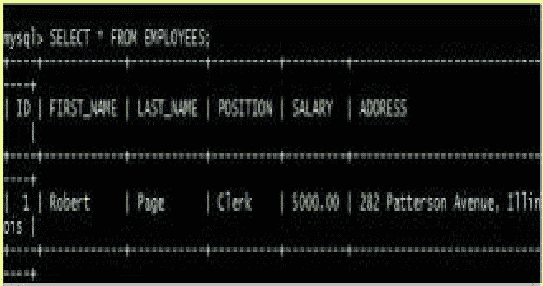

现在，尝试为另一组员工录入以下数据：

| 名 | 姓 | 职位 | 薪资 | 地址 |
| --- | --- | --- | ---: | --- |
| John | Malley | 主管 | 7,000.00 | 5 Lake View, New York |
| Kristen | Johnston | 文员 | 4,500.00 | 25 Jump Road, Florida |
| Jack | Burns | 代理 | 5,000.00 | 5 Green Meadows, California |

你将不得不重复使用 INSERT INTO 关键字，将每位员工的数据输入数据库。这些语句如下所示：

```sql
INSERT INTO EMPLOYEES(FIRST_NAME, LAST_NAME, POSITION, SALARY, ADDRESS)
VALUES('John', 'Malley', 'Supervisor', 7000.00, '5 Lake View New York');

INSERT INTO EMPLOYEES(FIRST_NAME, LAST_NAME, POSITION, SALARY, ADDRESS)
VALUES('Kristen', 'Johnston', 'Clerk', 4000.00, '25 Jump Road, Florida');

INSERT INTO EMPLOYEES(FIRST_NAME, LAST_NAME, POSITION, SALARY, ADDRESS)
VALUES('Jack', 'Burns', 'Agent', 5000.00, '5 Green Meadows, California');
```

要获取更新后的 EMPLOYEES 表，请使用带有通配符的 SELECT 命令。

```sql
SELECT * FROM EMPLOYEES;
```

结果截图如下：

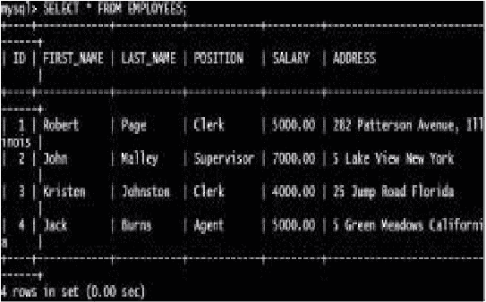

请注意，SQL 为你输入的每组数据分配了一个 ID 编号。这是因为你使用 auto_increment 属性定义了 ID 列。此属性会阻止你在插入数据时使用第一种形式。因此，你必须在 INSERT INTO table_name 行中指定其余列。

#### 向特定列插入数据

也可以向特定列插入数据。可以通过在 INSERT INTO 语句的列列表中指定列名，并在 VALUES 列表中指定对应值来实现。例如，如果你只想输入员工的全名和职位，需要在列列表中指定列名 FIRST_NAME、LAST_NAME 和 SALARY，并在 VALUES 列表中指定名、姓和薪资的值。

要了解其工作方式，请尝试将以下数据输入 EMPLOYEES 表：

| 名 | 姓 | 职位 | 薪资 | 地址 |
| --- | --- | --- | ---: | --- |
| James | Hunt |  | 7,500.00 |  |

更新后的 EMPLOYEES 表截图如下。

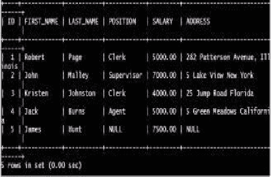

#### 插入 NULL 值

在某些情况下，你可能必须向列中输入 NULL 值。例如，你可能没有现成数据来输入新员工的薪资。随便提供任何薪资数字都可能产生误导。

语法如下：

```sql
INSERT INTO schema.table_name
VALUES ('column1', NULL, 'column3');
```

你需要这份答案表来检查每个练习中的语法，以确保其正确。如果你在某个练习中卡住了，也非常欢迎使用它。在每个练习结束时，我鼓励你检查答案。

每个练习都会在你开始应用各节所学内容之前，提供概述和示例。

下面是接下来几个练习中将要使用的 Product 表示例。

| 产品 ID | 名称 | 产品编号 | 颜色 | 标准成本 | 列表价格 | 尺寸 |
| --- | --- | --- | --- | ---: | ---: | --- |
| 317 | LL Craniums | CA-5965 | 黑色 | 0 | 0 | NULL |
| 318 | ML Craniums | CA-6738 | 黑色 | 0 | 0 | NULL |
| 319 | HL Cranium | CA-7457 | 黑色 | 0 | 0 | NULL |
| 320 | Churning Balls | TB-2903 | 银色 | 0 | 0 | NULL |
| 321 | Churning Nut | CN-6817 | 银色 | 0 | 0 | NULL |

### 查询结构与 SELECT 语句

理解语法及其结构将来会对你非常有帮助。让我们深入了解最常见语句之一的基础知识：SELECT 语句，它仅用于检索数据。

```sql
SELECT Column_Name1, Column_Name2
FROM Table_Name
```

在上述查询中，你从整个表中选择两列和所有行。由于只选择两列，该查询的执行速度将比像下面这样选择所有列快得多：

```sql
SELECT *
FROM Table_Name
```

从 Production.Product 表中选择所有列。

使用同一个表，仅选择 ProductID、Name、Product Number、Color 和 Safety Stock Level 列。

*（提示：表中的列名不包含空格！）*

#### WHERE 子句

WHERE 子句用于筛选查询返回的行数。该子句通过使用条件来工作，例如某列等于、大于

大于、小于某个值。

编写语法时，务必记住 WHERE 条件位于 FROM 语句之后。可使用的运算符类型因你筛选的数据类型而异。

-   **等于（EQUALS）** — 这用于查找精确匹配项。下面的语法对包含精确字符串“Value”的列使用 WHERE 子句。请注意，字符串两侧需要单引号，而数值不需要。

```sql
SELECT Column_Name1, Column_Name2
FROM Table_Name
WHERE Column_Name3 = 'Value'
```

-   **介于（BETWEEN）** — 通常用于查找某个数字范围或日期范围之间的值。需要注意的是，BETWEEN 比较运算符中的第一个值应小于右侧的值。请注意下面在 10 和 100 之间进行比较的示例。

```sql
SELECT Column_Name1, Column_Name2
FROM Table_Name
WHERE Column_Name3 BETWEEN 10 AND 100
```

-   **大于、小于、小于或等于、大于或等于** — SQL Server 提供了可用于比较特定值的比较运算符。

```sql
SELECT Column_Name1, Column_Name2
FROM Table_Name
WHERE Column_Name3 <= 1000 --Note that you can also use <, >, >= or even <> for not equal to
```

-   **LIKE（模糊匹配）** — 这会搜索列中包含的值或字符串。你仍然要使用单引号，但需包含百分号，以指示字符串位于开头、末尾还是字符串范围之间的任意位置。

```sql
SELECT Column_Name1, Column_Name2
FROM Table_Name
WHERE Column_Name3 LIKE '%Value%' --Searches for the word 'value' in any field
```

```sql
SELECT Column_Name1, Column_Name2
FROM Table_Name
WHERE Column_Name3 LIKE 'Value%' --Searches for the word 'value' at the beginning of the field
```

```sql
SELECT Column_Name1, Column_Name2
FROM Table_Name
WHERE Column_Name3 LIKE '%Value' --Searches for the word 'value' at the end of the field
```

-   **IS NULL 和 IS NOT NULL（为空和不为空）** — 如前所述，NULL 是包含无数据的空单元格。在数据库中，你将使用确实包含 NULL 值的表，可以通过几种方式处理这些值。

```sql
SELECT Column_Name1, Column_Name2
FROM Table_Name
WHERE Column_Name3 IS NULL --Filters any value that is NULL in that column, but don't put NULL in single quotes since it's not considered a string.
```

```sql
SELECT Column_Name1, Column_Name2
FROM Table_Name
WHERE Column_Name3 IS NOT NULL --Filters any value that is not NULL in that column.
```

再次使用 Production.Product 表，选择 Product ID、Name、Product Number 和 Color。筛选颜色为银色的产品。

### 使用 ORDER BY

ORDER BY 子句仅用于按升序或降序对数据排序，并通过你要排序的列来指定。此命令默认也按升序排序，因此如果要按降序排序，请在命令中使用 DESC。

```sql
SELECT Column_Name1, Column_Name2
FROM Table_Name
WHERE Column_Name3 = 'Value'
ORDER BY Column_Name1, Column_Name2 --Sorts in ascending order, but you can also include ASC to sort in ascending order.
```

```sql
SELECT Column_Name1, Column_Name2
FROM Table_Name
WHERE Column_Name3 = 'Value'
ORDER BY Column_Name1, Column_Name2 DESC --This sorts the data in descending order by specifying DESC after the column list.
```

从 Production.Product 表中选择 Product ID、Name、Product Number 和 List Price，其中 List Price 介于 $100.00 和 $400.00 之间。然后，按 List Price 从小到大对结果排序。

（提示：查询中不会使用 $；如有需要，可以回顾你刚刚复习过的排序选项。）

### 数据定义语言（DDL）

> “没有什么比咄咄逼人的愚蠢更糟糕的了。”——约翰·沃尔夫冈·冯·歌德

DDL 是用于在实例或数据库本身中创建、修改或删除对象的 SQL 语法。以下是一些示例，可帮助你入门。DDL 分为三类命令：

-   **创建（CREATE）** — 这将在数据库或实例中创建对象，例如其他数据库、表、视图等。

```sql
--Creates a Database
CREATE DATABASE DatabaseName
--Creates a schema (or container) for tables in the current database
CREATE SCHEMA SchemaName
--Creates a table within the specified schema
CREATE TABLE SchemaName.TableName
(
Column1 datatype PRIMARY KEY,
Column2 datatype(n),
Column3 datatype
)
--Creates a View
CREATE VIEW ViewName
AS
SELECT
Column1,
Column2
FROM TableName
```

-   **修改（ALTER）** — 此命令允许你修改现有对象，例如向表中添加额外的列或更改数据库名称。

```sql
--Alters the name of the database
ALTER DATABASE DatabaseName MODIFY NAME = NewDatabaseName
```

```sql
--Alters a table by adding a column
ALTER TABLE TableName

ADD ColumnName datatype(n)
```

-   **删除（DROP）** — 此命令允许你删除数据库中的对象或数据库本身。它可用于删除表、触发器、视图、存储过程等。请注意，这些项将不再存在于你的数据库中——或者，如果你删除数据库，该数据库将不复存在。

```sql
--Drops a Database - use the master db first
USE master
GO
```

```sql
--Then drop the desired database
DROP DATABASE DatabaseName
GO
```

```sql
--Drops a table; should be performed in the database where the specified table exists
DROP TABLE Table_Name
```

```sql
--Drops a view from the current database
DROP VIEW ViewName
```

#### 应用 DDL 语句

在你的计算机上单击“New Query”按钮打开一个新的查询窗口，并确保你使用的是“master”数据库。

你可以通过查看下方并使用下拉菜单来确认当前使用的数据库，并在数据库之间切换。

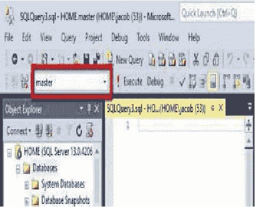

回到[编写 T-SQL 语法指南](#)部分，你学习了“USE”语句以及使用“GO”拆分代码批次。

你将在下一个练习中使用这些内容。因此，在练习之前或练习期间，请随时回顾该部分。

创建一个名为 Company 的数据库。别忘了在使用 master 数据库和创建新数据库之间使用 GO 语句！

执行此操作后，你现在将拥有一个可以开始向其添加表的数据库。下面是一系列练习，你将在其中开始在此数据库中创建第一个架构和表。

创建一个名为 Dept 的架构。你将在下一个练习中创建的表将与此架构关联。

创建一个名为 Department 的表。该表应有两列：Department_Id，应为整数数据类型并作为主键。另一列应为 Department_Name，其数据类型应为 30 字节的 VARCHAR。

将你的数据库名称从 Company 更改为 Company_Db。

#### 运行 DDL 脚本

现在，该下载以下 DDL 脚本，以创建你将使用的其余表了。别担心，我已编写好该脚本，单击“Execute”按钮即可成功运行。只需确保你已正确完成练习，否则它不会工作。

完成此操作后，你将开始运用 DML 知识来添加和检索数据。

### 数据操纵语言（DML）

DML 或数据操纵语言正如其名；它操纵数据。作为 DML 一部分的语句允许你修改现有数据、创建新数据，甚至删除数据。

请注意，DML 并不专门针对修改表结构或数据库设置之类的对象，而是处理这些对象中的数据。

-   **选择（SELECT）** — 这条语句是最常见的 SQL 语句，它允许你检索数据。它也用于许多报表场景。

```sql
--Selects two columns from a table
SELECT

Column_Name1,

Column_Name2

FROM Table_Name
```

-   **插入（INSERT）** — 这条语句允许你将数据插入特定数据库的表中。

```sql
--Inserts three rows into the table
INSERT INTO Table_Name

(Column_Name1, Column_Name2) --These two items are the columns

VALUES
```


```sql
('Value1', 1), -- Here, I'm inserting Value1 into Column_Name1 and the number 1 in Column_Name2.
('Value2', 2),
('Value3', 3)
```

现在，该向你的部门表中插入数据了。按如下所示插入这些值。例如，市场营销的部门名称必须对应部门 ID 为 1，依此类推。

- 部门ID：1，部门名称：市场营销
- 部门ID：2，部门名称：开发
- 部门ID：3，部门名称：销售
- 部门ID：4，部门名称：人力资源
- 部门ID：5，部门名称：客户支持
- 部门ID：6，部门名称：项目管理
- 部门ID：7，部门名称：信息技术
- 部门ID：8，部门名称：财务/薪资
- 部门ID：9，部门名称：研究与开发

UPDATE - 允许你更新现有数据。例如，你可以将表中的一条现有数据更改为另一个值。

建议在更新表中的值时谨慎操作。如果你没有在 WHERE 子句中指定条件，就可能会把某一列中的所有行都赋予相同的值。

```sql
-- Updating a value or set of values in one column of a table
UPDATE Table_Name
SET
    Column_Name1 = 'New Value 1', -- Specify what your new value should be here
    Column_Name2 = 'New Value 2'
WHERE
    Column_Name1 = 'Old Value' -- Using the WHERE clause as a condition

-- Updates all rows in the table with the same value for one specific column
UPDATE Table_Name
SET Column_Name1 = 'Value'⁴⁹
```

现在，你将更新表中的其中一个部门名称。假设你认为“Finance/Payroll”这个名称行不通，因为薪资由员工通过在线 Web 门户处理。这样一来就只剩下财务，但考虑到该部门人员的职责，最好将这个部门改称为“Accounting”。

根据 ID 更新部门表，将值从“Finance/Payroll”改为“Accounting”。

DELETE - 这个操作不言自明；它会从指定对象（例如表）中删除数据。运行 DELETE 语句时最好谨慎操作。

如果你在查询中不使用 WHERE 子句，最终会删除表中的所有数据。因此，在 DELETE 语句中始终最好使用 WHERE 子句。

*注意：与 UPDATE 语句非常相似，你也可以在语句中将 DELETE 换成 SELECT，以查看你将删除哪些数据，只要你在查询中使用了 WHERE 子句。与 UPDATE 语句一样，当你删除一个值时，最好在 WHERE 子句中使用主键作为条件！*

```sql
-- Uses a condition in the DELETE statement to only delete a certain value or set of values
DELETE FROM Table_Name
WHERE Column_Name1 = 'Some Value'

-- Deletes all of the data within a table since the WHERE clause isn't used
DELETE FROM Table_Name
```

假设这家公司实际上没有研究与开发（R&D）部门。也许他们还没有发展到足够规模，或者不需要该部门。

在本练习中，根据 ID 从部门表中删除“Research and Development”部门。

#### 运行 DML 脚本

现在，该你下载以下 DML 脚本，以便用数据填充 Company_Db 数据库了。再次提醒，请确保你已经正确完成练习，否则它将无法运行。

这些数据将用于“转换数据”部分的后续练习中。因此，请记住，除非另有说明，每个练习都引用 Company_Db 数据库。

## 第 6 章：数据库管理

> “法律过于温和，很少被遵守；过于严苛，很少被执行。” —— 本杰明·富兰克林

为了踏上数据库管理员、数据库开发人员甚至数据分析师的道路，你需要知道如何备份、还原和管理数据库。这些是维护数据库必不可少的组成部分，也绝对是重要的职责。

### 恢复模型

SQL Server 中的每个数据库都可以使用几种不同的恢复模型。恢复模型是数据库的一种选项或模型，它决定了可以备份和还原的信息类型。

根据你的情况，例如如果你无法承受丢失关键数据，或者想要镜像生产环境，你可以将恢复模型设置为所需类型。另外，请记住，你选择的恢复模型还可能影响备份或还原数据库和日志所需的时间，具体取决于它们的大小。

以下是这些恢复模型及每种模型的简要说明。每种模型末尾的 SQL 语句示例就是可用于设置恢复模型的语句。

#### 完整

此模型涵盖数据库中的所有数据以及事务日志历史记录。

使用此模型并执行数据库还原时，它提供“时点”恢复。这意味着，例如，如果在还原过程中数据库曾经出现数据丢失，它允许你回滚并恢复该数据。

如果你无法承受丢失任何数据，这是理想的恢复模型。

根据数据大小，备份和还原可能需要更多时间。

- 可以执行完整备份、差异备份和事务日志备份。

```sql
ALTER DATABASE DatabaseName SET RECOVERY FULL
```

#### 简单

此模型也涵盖数据库中的所有数据，但会循环使用事务日志。数据库还原后，事务日志将为空，并会记录后续的新活动。

与“完整”恢复模型不同，事务日志将被重新用于新事务，因此如果数据意外丢失或删除，无法回滚以恢复数据。

如果你有一台空白服务器，需要相当快速且轻松地还原数据库，或者只是想镜像另一个环境并将其用作测试实例，这是一个很好的选项。

- 只能执行完整备份和差异备份，因为按照此恢复模型，事务日志会被循环使用。

```sql
ALTER DATABASE DatabaseName SET RECOVERY SIMPLE
```

#### 大容量日志

此特定模型的工作方式是放弃 SQL Server 中的大容量操作，例如 BULK INSERT、SELECT INTO 等，并且不将这些操作存储在事务日志中。这将有助于释放事务日志，并使备份和还原过程更轻松、更快速。

使用此方法，你可以使用“时点”恢复，因为它与“完整”恢复模型的工作方式非常相似。

如果你的数据至关重要，并且你的数据库流程经常使用大容量语句，那么此恢复模型是理想选择。但是，如果你的数据库不经常使用大容量语句，则建议使用“完整”恢复模型。

- 可以执行完整备份、差异备份和事务日志备份。

```sql
ALTER DATABASE DatabaseName SET RECOVERY BULK_LOGGED
```

假设你正在进行一个大型数据库项目，需要备份数据库。使用 SQL 语法（以及上面的示例）将 Company_Db 的恢复模型设置为“完整”，以便为备份过程做好准备。

### 数据库备份方法

在 SQL Server 中，有几种主要备份方法可用于备份数据库，每种方法都取决于所使用的恢复模型。在上一节关于恢复模型的内容中，每种模型的最后一个要点讨论了可以执行的备份类型，即完整备份、差异备份和事务日志备份。

**注意：** *如果你不记得每种恢复模型可以执行哪些类型的备份，就给自己一些时间！最终你会记住它们的！*

每种备份方法都将执行以下操作：

#### 完整：

完整备份整个数据库以及事务日志（如适用）。

如果需要将同一数据库添加到新服务器进行测试，这是理想选择。

如果数据库较大，备份可能需要较长时间，此外它还会备份整个数据库和事务日志。

- 但是，由于你备份的是整个数据库，因此不需要像差异备份那样频繁执行此操作。

```sql
BACKUP DATABASE DatabaseName TO DISK = 'C:\SQLBackups\DatabaseName.BAK'
```

#### 差异：

它依赖于完整备份，因此必须先执行完整备份。不过，它会备份上一次完整备份与执行差异备份之间发生的任何数据更改。

它在任何情况下都很理想，但由于数据库中会频繁添加新数据，因此必须更频繁地执行。

它备份起来比完整备份快得多，并且占用更少的存储空间。

- 但是，它并不能完整捕获数据库，因此必须定期执行。

```sql
BACKUP DATABASE DatabaseName TO DISK = 'C:\SQLBackups\DatabaseName.BAK' WITH DIFFERENTIAL
```

#### 事务日志：

- 与差异备份类似，它依赖于完整备份。
- 备份数据库中发生的所有活动。
- 在某些情况下有用且必要，例如完整还原数据库时。
- 由于它们保存数据库历史中的活动，明智的做法是频繁备份，以免日志体积变得过大。
- 有些日志最初体积较大，但随着备份更频繁地进行，体积可能变小（取决于数据库中的活动）。
- 因此，如果数据库活动极少并且频繁备份，日志的备份和还原可能很快。

```sql
BACKUP LOG DatabaseName TO DISK = 'C:\SQLBackups\DatabaseName.TRN'
```

在上一个练习中，你将 Company_Db 的恢复模型设置为“完整”。现在在这个练习中，你将备份该数据库。

首先，使用完整备份方法对数据库进行完整备份。

接下来，删除 Sales.Product_Sales 表中的所有数据（旨在模拟丢失数据。）

最后，查询你刚刚删除数据的表，以确保数据不存在。稍后，你将还原数据库，并确保数据位于 Sales.Product_Sales 表中。

### 数据库还原

在数据库领域，你可能会听说，还原数据库最重要的部分是使用可靠的备份。这完全正确！这就是为什么确保使用正确的恢复模式很重要。

#### 准备还原数据库

需要注意的重要一点是，.bak 文件通常包含其中的文件组或文件。每个文件可以是完整备份或差异备份。了解你正在还原的是哪一种很重要，但你也可以指定希望还原哪些文件。不过，如果不指定，SQL Server 将选择默认文件，即文件 1。这通常是完整备份。

首先，使用 RESTORE HEADERONLY 识别 .BAK 文件中的文件。这是你在还原数据库之前应该做的事情。

#### 查看数据库备份文件

```sql
RESTORE HEADERONLY FROM DISK =
'C:\SQLBackups\DatabaseName.BAK'
```

运行上述查询后，查看“BackupType”列中的数字。1 表示完整备份，而 5 表示差异备份。

此外，你需要使用的文件编号在“Position”列中。在下面的示例中，请注意文件编号 8 是完整备份，文件编号 9 是差异备份。

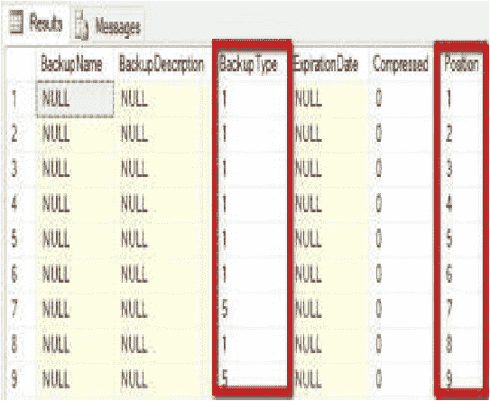

此外，在还原之前，你必须先使用“master”数据库，然后将所需数据库设置为非活动状态（SINGLE_USER），以便只允许一个到数据库的打开连接。

在下面的语法中，WITH ROLLBACK IMMEDIATE 表示将回滚（未完成）任何未完成的事务，以便将数据库设置为单一打开连接状态。

```sql
--Sets the database to allow only one open connection
--All other connections to the database must be closed, otherwise the restore
fails
ALTER DATABASE DatabaseName SET SINGLE_USER WITH ROLLBACK
IMMEDIATE
```

还原完成后，你可以将数据库重新设置为活动状态（MULTI_USER），如下所示。此状态允许多个用户连接到数据库，而不只是一个用户。

```sql
--Sets the database to allow multiple connections
ALTER DATABASE DatabaseName SET MULTI_USER
```

#### 数据库还原类型

以下概述了你可以根据情况/需求执行的还原类型。

#### 完整还原

- 还原整个数据库，包括其文件。
- 如果数据库已存在，则使用 WITH REPLACE 选项覆盖它。
- 如果恢复模式设置为“完整”，则需要使用 WITH REPLACE 选项。
- 使用 FILE = 参数选择要还原的文件（可以是完整备份或差异备份）。
- 如果恢复模式设置为“简单”，则不需要 WITH REPLACE 选项。
- 如果数据库不存在，它将创建数据库，包括其文件和数据。
- 从 .BAK 文件还原。

```sql
--If the recovery model is set to Full - also choosing the file # 1 in the backup set
RESTORE DATABASE DatabaseName FROM DISK =
'C:\SQLBackups\DatabaseName.BAK' WITH FILE = 1, REPLACE
--If recovery model is set to Simple
RESTORE DATABASE DatabaseName FROM DISK =
'C:\SQLBackups\DatabaseName.BAK'
```

#### 差异还原

使用 RESTORE HEADERONLY 查看你可用的备份文件，即完整备份和差异备份文件类型。

你必须先使用 NORECOVERY 选项对 .BAK 文件执行完整还原，因为 NORECOVERY 选项表示还需要还原其他文件。

指定要还原的完整备份文件并使用 WITH NORECOVERY 后，你可以还原差异备份。

最后，在最后一次差异文件还原中应包含 RECOVERY 选项，以表示没有更多文件需要还原。

作为参考，下面的语法使用之前 RESTORE HEADERONLY 截图中的文件。

**--首先执行完整数据库备份文件的还原**

```sql
RESTORE DATABASE DatabaseName FROM DISK =
'C:\SQLBackups\DatabaseName.BAK' WITH FILE = 8, NORECOVERY
```

**--现在执行差异备份文件的还原**

```sql
RESTORE DATABASE DatabaseName FROM DISK =
'C:\SQLBackups\DatabaseName.BAK' WITH FILE = 9, RECOVERY
```

#### 日志还原

这是执行完整数据库还原的最后一步。

你必须先还原数据库的“完整”或“差异”副本，然后还原日志。

- 最后，在还原数据库备份时必须使用 NORECOVERY 选项，以便数据库保持还原状态，并允许你还原事务日志。

由于你已经执行了数据库备份，并且 Sales.Product_Sales 表中的数据已“丢失”，现在是时候完整还原数据库了。

为此，你首先需要使用“master”数据库，然后将数据库设置为单用户状态，执行还原，最后将其重新设置为多用户状态。

还原数据库后，从 Sales.Product_Sales 表中检索所有数据，以验证数据再次存在。

### 附加和分离数据库

如你所知，因为你已经学过这一部分，附加和分离数据库的方法与备份和还原类似。

本质上，此方法的细节如下：

- 允许你将 .MDF 文件和 .LDF 文件复制到新磁盘或服务器。
- 表现得像备份和还原过程，但根据情况有时可能更快。
- 数据库被脱机，任何用户或应用程序都无法访问。它将在重新附加之前一直保持脱机。

那么，你应该选择哪一个？尽管备份是理想选择，但在某些情况下，附加/分离数据库可能是你唯一的选择。

考虑以下场景：

你的数据库包含许多文件组。附加它可能相当麻烦。

最佳解决方案是备份数据库，然后将其还原到所需目标，因为这样会在备份过程中将所有文件组合在一起。

根据数据库的大小，备份/还原过程需要很长时间。但是，如果需要尽快完成，附加/分离数据库可能会快得多。

- 在这种情况下，你可以将数据库脱机，分离它，然后重新附加到新目标。

如你所知，按照附加数据库的方法，有两个主要文件组。这些文件是 .MDF 和 .LDF。.MDF 文件是数据库的主数据文件，保存其结构和数据。.LDF 文件保存事务日志活动和历史记录。

但是，备份数据库时创建的 .BAK 文件会将所有文件组合在一起，你可以从单个备份集还原不同的文件版本。


在采用任一选项之前，请先考虑你的具体情况，但同时也要将备份和还原视为首选方案，然后再考虑附加/分离方法作为下一个选项。此外，在继续处理真实数据之前，请务必先进行测试！

### 附加/分离 AdventureWorks2012 数据库

既然你已经附加了这个数据库，现在让我们将它从服务器上分离。之后，你将使用 SQL 语法再次附加它。

#### 分离数据库

在 SQL Server 中，有一个存储过程可以为你分离数据库。这个特定的存储过程位于 `master` 数据库中。在底层，你可以通过以下步骤查看该存储过程的复杂性：

- 单击展开 Databases 文件夹
- 单击 System Databases，然后选择 Master 数据库
- 单击 Programmability
- 单击 Stored Procedures，然后选择 System Stored Procedures
- 找到 `sys.sp_detach_db`，右键单击它，并在 SSMS 中选择“Modify”。随后你将看到它的语法。

为此，只需按原样执行该存储过程。

语法如下：

```
USE master
GO

ALTER DATABASE DatabaseName SET SINGLE_USER WITH ROLLBACK IMMEDIATE
GO

EXEC master.dbo.sp_detach_db @dbname = N'DatabaseName', @skipchecks = 'false'
GO
```

为了进一步说明正在发生的事情，你需要使用 `master` 数据库来修改将要分离的数据库，并将其设置为单用户模式而不是多用户模式。

最后，`@dbname` 后面的值允许你指定数据库的名称。

下面是 `Production.Product` 表的一个示例，你将在接下来的几个练习中使用该表。

| Product ID | Name | Product Number | Color | StandardCost | List Price | Size |
| --- | --- | --- | --- | --- | --- | --- |
| 317 | LL Crankarm | CA-5965 | Black | 0 | 0 | NULL |
| 318 | ML Crankarm | CA-6738 | Black | 0 | 0 | NULL |
| 319 | HL Crankarm | CA-7457 | Black | 0 | 0 | NULL |
| 320 | Chainring Bolts | CB-2903 | Silver | 0 | 0 | NULL |
| 321 | Chainring Nut | CN-6137 | Silver | 0 | 0 | NULL |

### 查询结构与 SELECT 语句

理解语法及其结构对你今后会非常有帮助。让我们深入了解最常用的语句之一——SELECT 语句的基础，该语句专门用于检索数据。

```
SELECT Column_Name1, Column_Name2
FROM Table_Name
```

在上面的查询中，你从整个表中选择了两列和所有行。由于你只选择了两列，因此查询速度比选择所有列要快得多，如下所示：

```
SELECT *
FROM Table_Name
```

从 `Production.Product` 表中选择所有列。

使用同一张表，仅选择 `ProductID`、`Name`、`Product Number`、`Color` 和 `Safety Stock Level` 列。

*(提示：表中的列名不包含空格！)*

#### WHERE 子句

WHERE 子句用于筛选查询返回的行数。该子句通过使用条件来工作，例如某列等于、大于、小于、介于某个值之间，或类似于某个值。

在编写语法时，务必记住 WHERE 条件应放在 FROM 语句之后。

EQUALS（等于）——用于查找精确匹配。下面的语法对包含确切字符串 `'Value'` 的列使用 WHERE 子句。请注意，字符串需要用单引号括起来，而数值则不需要。

```
SELECT Column_Name1, Column_Name2
FROM Table_Name
WHERE Column_Name3 = 'Value'
```

BETWEEN（介于）——通常用于查找某个数值范围或日期范围内的值。需要注意的是，BETWEEN 比较运算符中的第一个值应小于右侧的值。请注意下面的示例，比较的是 10 到 100 之间的值。

```
SELECT Column_Name1, Column_Name2
FROM Table_Name
WHERE Column_Name3 BETWEEN 10 AND 100
```

GREATER THAN（大于）、LESS THAN（小于）、LESS THAN OR EQUAL TO（小于或等于）、GREATER THAN OR EQUAL TO（大于或等于）——SQL Server 提供了比较运算符，可用于比较特定值。

```
SELECT Column_Name1, Column_Name2
FROM Table_Name
WHERE Column_Name3 <= 1000 --Note that you can also use <, >, >= or even <> for not equal to
```

LIKE（类似）——该运算符用于搜索列中包含的值或字符串。你仍然使用单引号，但需要加上百分号，以表示字符串位于字段的开头、结尾或任意中间位置。

```
SELECT Column_Name1, Column_Name2
FROM Table_Name
WHERE Column_Name3 LIKE '%Value%' --Searches for the word 'value' in any field
```

```
SELECT Column_Name1, Column_Name2
FROM Table_Name
WHERE Column_Name3 LIKE 'Value%' --Searches for the word 'value' at the beginning of the field
```

```
SELECT Column_Name1, Column_Name2
FROM Table_Name
WHERE Column_Name3 LIKE '%Value' --Searches for the word 'value' at the end of the field
```

IS NULL 和 IS NOT NULL——如前所述，NULL 是一个不包含任何数据的空单元格。最终，你会处理包含 NULL 值的表，你可以通过几种方式处理它们。

```
SELECT Column_Name1, Column_Name2
FROM Table_Name
WHERE Column_Name3 IS NULL --Filters any value that is NULL in that column, but don't put NULL in single quotes since it's not considered a string.
```

```
SELECT Column_Name1, Column_Name2
FROM Table_Name
WHERE Column_Name3 IS NOT NULL --Filters any value that is not NULL in that column.
```

再次使用 `Production.Product` 表，选择 `Product ID`、`Name`、`Product Number` 和 `Color`。筛选出银色的产品。

#### 使用 ORDER BY

ORDER BY 子句用于按升序或降序对数据进行排序，具体取决于你想要从哪一列开始。该命令默认也按升序排序，因此如果你想要按降序排序，请在命令中使用 `DESC`。

```
SELECT Column_Name1, Column_Name2
FROM Table_Name
WHERE Column_Name3 = 'Value'
ORDER BY Column_Name1, Column_Name2 --Sorts in descending order, but you can also include ASC to sort in ascending order.
```

```
SELECT Column_Name1, Column_Name2
FROM Table_Name
WHERE Column_Name3 = 'Value'
ORDER BY Column_Name1, Column_Name2 DESC --This sorts the data in descending order by specifying DESC after the column list.
```

然后，按标价从最小到最大对结果进行排序。

> *提示：在查询中不要使用 $ 符号，如果需要，可以回顾一下你刚刚复习的排序选项。*

## 第 7 章：SQL 事务

> *“一件东西没能按照你的计划发挥作用，并不代表它毫无用处。”* ——托马斯·爱迪生

### 什么是 SQL 事务？

事务是按逻辑顺序对数据库执行的一系列任务。我们将每个事务视为一个单一的工作单元。事务让你能够更好地控制 SQL 行为，这对于持续维护数据完整性或避免数据库错误至关重要。

在第 3 章中，我们详细讨论了数据完整性，以及可以确保这种完整性存在的各种方法。然而，这基于一个事实，即多个用户不会同时访问同一数据。

但实际上，情况可能并非如此。

在许多用户试图修改数据的情况下，有可能会发生操作重叠。在很多情况下，一个用户对可能无效的数据执行了特定操作。她或他并没有意识到数据已经被破坏，因为另一个用户在同一时间执行了操作。由于两个用户都不会立即意识到发生的任何变化，数据可能会在相当长的一段时间内持续不一致。

考虑到这一点，所有用户都会继续认为数据完好无损，并且没有需要他们管理的问题。

让我们通过一个例子来理解上述场景。假设有两个用户，用户 A 和用户 B，他们同时在一个客户的数据上工作。

用户 A 可能会注意到客户的姓氏不正确，并开始更改姓名，在更改后立即保存数据。用户 B 可能正在处理客户数据的另一部分，例如客户的地址或电话号码。然而，用户 A 的更改可能不会反映到用户 B 这边。用户 B 可能仍在使用旧的、错误的姓氏处理客户数据，并在保存数据时无意中将姓氏改为了错误的条目。


现在两位用户都没有意识到他们工作中的不一致之处，这个问题可能会在很长一段时间内不被发现。考虑到只发生了一个错误，这似乎有些微不足道。然而，想象一下这种情况随着时间不断重复，在大量数据上造成不一致。到那时，你将被迫查看你拥有的所有数据。如果你的数据库很大，这可能会耗费你相当多的时间。

借助 SQL 事务，连续的操作或更改不会影响另一位用户所看到数据的有效性。

SQL 事务让你能够提交 SQL 语句，从而将这些语句应用到数据库中。或者，你也可以执行回滚，从而撤销数据库中的语句。

在 SQL 事务中，一个操作如果成功满足四项特性，就会转化为一个事务，这四项特性用缩写 ACID 表示。

#### 原子性

该特性侧重于事务的“全有或全无”原则。它确保事务中所有操作都得到执行。如果某个操作在任一时刻失败，整个事务将被中止。此外，如果只执行了少数语句，事务会回滚到之前的状态。要成功完成事务并将其应用到数据库，所有操作都应当正确，且一个都不能缺少。

#### 一致性

有了这一特性，数据库不仅在事务开始时必须保持一致，在事务完成后也必须保持一致。因此，如果一组操作在执行过程中的任一时刻产生了改变一致性的动作，那么事务将被恢复到其原始状态。

#### 隔离性

当某个特定事务正在进行时，数据可能是不一致的。这种不一致有可能影响数据库，因此在该事务完成之前，这些数据不会对其他操作可用。它将不受任何外部影响。换句话说，它将被隔离。此外，其他任何事务都不能以任何方式影响或作用于这个被隔离的事务，从而确保完整性不受损害。

#### 持久性

当所有事务完成后，任何更改或修改都必须被保留和维护。在发生硬件或应用程序错误时，不应有数据丢失；数据应当可靠且一致地可用。这一特性确保在此类情况下你的数据仍然可用。

必须注意的是，无论操作是完成还是回滚，事务在任何时候都会维护数据库的完整性。

有七个命令可用于管理事务。它们是：

- **COMMIT:** 保存更改并将其提交到数据库。
- **ROLLBACK:** 将更改回滚到特定的 SAVEPOINT，或回滚到事务的开始处。更改不会应用到数据库。
- **SAVEPOINT:** 在事务中创建一个保存点——一种标记形式。执行 ROLLBACK 时，你可以到达此点，而不是回到事务的开始处。
- **RELEASE SAVEPOINT:** 移除或释放保存点。执行此命令后，任何 ROLLBACK 都会将事务恢复到其原始状态。
- **SET TRANSACTION:** 为特定事务的执行创建特性。
- **START TRANSACTION:** 设置事务的特性并开始事务。
- **SET CONSTRAINTS:** 在事务中建立约束模式。约束会创建一个条件，决定是在数据修改一开始发生时就立即应用约束，还是将约束的应用延迟到事务完成时。

再看另一个示例。

重要的是要记住，当你即将开始一个事务时，数据库处于其原始状态。在此状态下，你可以预期数据是一致的。一旦执行事务，这些事务中的 SQL 语句就开始处理。如果处理成功，就使用 COMMIT 命令。该命令会使 SQL 语句更新数据库并结束事务。如果更新过程不成功，那么 ROLLBACK 命令就会发挥作用。这一过程让你对这些命令有一个简要了解。不过，我们将深入探讨它们的功能。

#### 提交

当特定事务中的所有语句都完成时，下一步就是终止该事务。终止事务的推荐方法之一，是将到目前为止对数据库所做的所有更改提交。当你对目前已执行的更改有信心时，就可以使用 COMMIT 命令。请参见下面可用于提交语句的语法语句：

```sql
COMMIT [WORK] [AND CHAIN]
COMMIT [WORK] [AND NO CHAIN]
```

你必须记住，WORK 条目的使用不是强制性的。仅使用 COMMIT 关键字就足以处理 COMMIT 命令。实际上，COMMIT 和 COMMIT WORK 条目具有相同目的。较早版本的 SQL 曾包含 WORK 关键字，一些用户可能更熟悉它。但是，如果你不习惯使用它，那么执行 COMMIT 命令时不必包含它。

AND CHAIN 子句是 COMMIT 语句中的另一个可选包含项。它在 SQL 实现中不是常用语句。AND CHAIN 子句只是告诉系统在当前事务一结束时就立即开始一个新事务。使用该子句，你无需使用 SET TRANSACTION 或 START TRANSACTION 语句，而把工作留给系统自动继续下一步。

然而，这可能被证明是缺点而非便利。由于你需要对事务拥有完全控制，最好使用替代方案。与其在 COMMIT 语句中使用 AND CHAIN，不如尝试使用 AND NO CHAIN 参数。这实质上让你的系统知道，它不应以与当前事务相同的设置开始新事务。如果两个参数（AND CHAIN 或 AND NO CHAIN）都未提及，那么 AND NO CHAIN 将是系统采用的默认子句。

你的 COMMIT 语句可能如下所示：

```sql
COMMIT;
```

我们没有包含上述两个子句中的任何一个。不过，要知道，如果你希望系统自动开始一个新事务，请使用下面的语句：

```sql
COMMIT AND CHAIN;
```

假设你有一个名为 EMPLOYEES 的表，其中包含“names”和“salaries”列。

| 姓名 | 薪资 |
|---|---:|
| 约翰 | 5,000 |
| 玛丽 | 7,000 |
| 珍妮弗 | 9,000 |
| 马克 | 10,000 |
| 亚当 | 7,000 |

如果你想删除薪资为 7,000 的记录，那么只需使用下面的语句：

```sql
SQL> DELETE FROM EMPLOYEES
    WHERE SALARIES = 7000;
SQL> COMMIT;
```

现在，如前所述，如果你希望下一个事务在当前事务执行后开始，那么你的语句将类似如下：

```sql
SQL> DELETE FROM EMPLOYEES
    WHERE SALARIES = 7000;
SQL> COMMIT AND CHAIN;
```

#### 回滚

人为错误在任何过程中都不可避免。因此，如果你遇到需要回滚的情况，那么该语句赋予你执行此类操作的能力。

通过使用 ROLLBACK，你将撤销到目前为止已执行的语句，要么将它们带回到特定的保存点——如果你已建立这样的保存点——要么将它们送回到事务的开始处。

让我们看看 ROLLBACK 语句的一些参数或包含项：

```sql
ROLLBACK [WORK] [AND CHAIN]
```

```sql
ROLLBACK [WORK] [AND NO CHAIN]
```

当用户对数据做出更改但未使用 COMMIT 语句时，这些更改会以称为事务日志的临时格式存储。用户可以查看这些未保存的数据，对其进行分析，以检查它是否满足特定要求。如果这些更改没有体现用户所期望的结果，他们可以执行 ROLLBACK，确保数据不被保存，然后可以重新处理。

用户还可以在发生硬件故障或应用程序崩溃时，使用 ROLLBACK 功能将数据库恢复到保存点或事务的开始处。如果断电中断了你的工作，那么系统一重启，ROLLBACK 功能就会检查所有待处理事务，并回滚所有语句。

与 COMMIT 语句不同，ROLLBACK 可以选择包含 TO SAVEPOINT 参数。使用 TO SAVEPOINT 子句时，系统不会取消事务。你只是会被带到某个特定点，从那里可以继续你的工作。

如果你希望取消事务，只需从语句中移除 TO SAVEPOINT 参数。

以下是 ROLLBACK 语句最基本形式的示例：

```sql
ROLLBACK;
```

请注意，我们没有使用 AND CHAIN 参数。这是因为，正如前面在 COMMIT 命令部分提到的，系统默认使用 AND NO CHAIN 命令。或者，如果你希望在当前事务结束后启动一个新事务，也可以使用 AND CHAIN 命令。但是，请记住，你不能同时使用 TO SAVEPOINT 和 AND CHAIN 参数。这是因为 TO SAVEPOINT 命令要求终止当前事务。

包含 TO SAVEPOINT 参数时，请确保添加保存点的名称。请参见下面这一过程的示例：

```sql
ROLLBACK TO SAVEPOINT;
```

SAVEPOINT 值会被保存点的名称替换，如下例所示：

```sql
BEGIN
    SELECT customer_number, customer_lastname, purchases
    DELETE FROM customer_number WHERE purchases < 10000;
    SAVEPOINT section_1;
    ROLLBACK TO section_1;
END;
```

虽然上面的示例只是该命令的一种相当简单的形式，但其目的是让你清楚了解 SAVEPOINT 的用法和命名。请注意，你可以在 SAVEPOINT 命令和 ROLLBACK 子句之间输入任意多个参数。

如果你指定了保存点名称，那么 rollback 命令会带你回到那个特定的保存点，而不管中间是否可能存在其他保存点。

```sql
BEGIN
SELECT customer_number, customer_lastname, purchases
DELETE FROM customer_number WHERE purchases < 10000;
SAVEPOINT section_1;
SAVEPOINT section_2;
SAVEPOINT section_3;
SAVEPOINT section_4;
ROLLBACK TO section_1;
END;
```

请注意，尽管你有名为 section_2 到 section_4 的 SAVEPOINTS，但你要求系统回滚到 section_1。这样做时，系统将忽略所有其他保存点。

### 保存点

既然我们正在讨论保存点，那么让我们看看这些命令为什么重要，以及如何使用它们。

本质上，你将处理一组复杂的事务。为了更容易理解事务，你会将不同的部分分组为单元。以这种方式分解事务，可以让你轻松识别问题，并知道为了解决问题应到达哪个部分。

但问题来了：如何在不更改整个事务的情况下到达这些部分？

当然，你可以使用 SAVEPOINT 命令！

此时，你应该注意一个重要点。MySQL 和 Oracle 支持 SAVEPOINT 参数，但如果你使用的是 SQL Server，则可能改用 SAVE TRANSACTION 查询。

不过，SAVEPOINT 和 SAVE TRANSACTION 这两个参数的功能是相同的。

让我们看一个示例，以了解保存点功能是如何工作的。

- 步骤 1：开始事务
- 步骤 2：SQL 语句
- 步骤 3：如果 SQL 语句成功，则开始执行。如果 SQL 语句不成功，则回滚到事务的开头
- 步骤 4：输入 SAVEPOINT 1
- 步骤 5：SQL 语句
- 步骤 6：如果 SQL 语句成功，则开始执行。如果 SQL 语句不成功，则回滚到 SAVEPOINT 1
- 步骤 7：输入 SAVEPOINT 2
- 步骤 8：SQL 语句
- 步骤 9：如果 SQL 语句成功，则开始执行。如果 SQL 语句不成功，则回滚到 SAVEPOINT 2
- 步骤 10：COMMIT

在上面的示例中，我们在处理完 SQL 语句后设置保存点。执行此流程时，我们会先处理特定的 SQL 语句，然后再跳到下一组语句。这确保我们正确执行所有语句，并且如果语句中有错误，我们可以重新处理它们。一旦系统认为语句完全成功，我们就可以使用保存点并继续下一组操作。这样做可以保存第一组操作的完整性。在保存点之后，我们可以继续推进，因为知道第一批语句不会发生任何更改。

这成为一种方便的方法，可以处理一组操作，而不必担心先前操作的完整性。

创建保存点的过程相当简单。你只需使用以下命令：

```text
SAVEPOINT <name of the savepoint>
```

保存点名称不一定要是“SECTION_1”。那只是为了示例目的而选择的名称。你可以选择自己的名称，最好是在需要时容易回想起来的名称。

### 释放保存点

在事务中完成某些操作后，你可能不再需要之前建立的保存点。为了移除它们，你可以使用 RELEASE SAVEPOINT 命令。

不过，请注意，一旦释放保存点，你就无法再次回滚到它。因此，释放保存点的理想方式是检查你是否对目前为止的工作感到满意。尽职尽责可能是一项额外的任务，但它会让你能够自信地完成工作。

要释放保存点，只需输入以下命令：

```text
RELEASE SAVEPOINT <name of the savepoint>
```

让我们举一个示例，假设你有以下保存点：

```text
SAVEPOINT section_1;
SAVEPOINT section_2;
SAVEPOINT section_3;
SAVEPOINT section_4;
```

为了释放所有保存点，你必须逐一指定它们。因此，过程如下所示：

```text
RELEASE SAVEPOINT section_1;
RELEASE SAVEPOINT section_2;
RELEASE SAVEPOINT section_3;
RELEASE SAVEPOINT section_4;
```

你可以一次性释放所有保存点，也可以选择释放其中一个保存点而保留其余保存点。这是可以接受的。你只需确保使用正确的保存点名称。另一个要记住的要点是，你不必按照创建保存点的顺序使用释放命令。你可以选择在任何时间、以任何顺序释放任何保存点。

### 设置事务

此命令允许你处理事务的不同属性。这些属性可能是以下之一：

- 只读
- 读写
- 指定隔离级别
- 将其附加到回滚属性

SET TRANSACTION 操作的任何影响只作用于你的事务。其他用户不会注意到他们那边有任何变化。

你可以使用以下命令建立 SET TRANSACTION：

```text
SET TRANSACTION <mode>
```

在上面的命令中，`<mode>` 指的是你想指定的选项类型。在 SET TRANSACTION 中可以使用三种模式。它们是：

- 访问级别
- 隔离级别
- 诊断大小

你可以将多个事务模式添加到 `<mode>` 占位符中。如果你希望这样做，请用逗号分隔不同的模式。但是，你不能再次重复相同的模式。

示例：你可以包含一个隔离级别并设置诊断大小。但是，你不能包含两个诊断大小模式。

现在让我们尝试分别查看每种模式。

#### 访问级别

在 SET TRANSACTION 中，有两种访问级别：READ ONLY 和 READ WRITE。如果选择 READ ONLY 选项，系统将不允许你对数据库进行任何更改。但是，如果选择 READ WRITE 访问级别，你将能够在事务中添加语句来修改数据，甚至修改数据库结构。

#### 隔离级别

你还记得我们如何讨论隔离事务，以便在你处理事务时任何事物都无法影响它吗？那么，这里我们将讨论设置隔离级别。

对于 SET TRANSACTION，你可以使用四种隔离级别，如下面的语法所示：

```sql
SET TRANSACTION ISOLATION LEVEL
    READ UNCOMMITTED
    READ COMMITTED
    REPEATABLE READ
    SERIALIZABLE
```

这些隔离级别按其有效性排序，其中 READ UNCOMMITTED 是你可以使用的最低隔离级别，SERIALIZABLE 是最高隔离级别。如果你未指定隔离级别，系统将假定为 SERIALIZABLE 级别，从而为你的事务提供最大程度的隔离。

#### 诊断大小

SET TRANSACTION 允许你指定诊断大小。你包含的大小会让系统知道为你的条件分配多少空间。在 SQL 语句中，条件是由语句引发的消息、警告或其他通知。如果你未指定诊断大小，那么你的数据库会自动为你分配一个。这个数字不是固定的。它因数据库而异。

### 开始事务

在数据库中，你可以在开始执行命令时显式或自动地启动事务。

例如，当你使用 DELETE、CREATE TABLE 等命令时，可以启动事务。

或者，你可以使用 START TRANSACTION 语句来开始事务。

与 SET TRANSACTION 一样，你可以在此指定一个或多个模式，如下：

好的。这些是我们之前提到的访问级别、隔离级别和诊断大小模式。

下面是一个 START TRANSACTION 命令的示例：

```sql
START TRANSACTION
    READ ONLY
    ISOLATION LEVEL SERIALIZABLE
    DIAGNOSTICS SIZE 10;
```

输入上述语法后，START TRANSACTION 将执行该语句及其操作。

#### 设置约束

处理事务时，你可能会遇到工作情况与数据库中已建立的约束相冲突的场景。让我们举个例子。

假设你有一个包含 NOT NULL 约束的表。现在，当你处理该表时，你意识到在那个时间点可能没有值可以用来替代 NOT NULL 约束。但你又不能不在输入值的情况下离开。这迫使你向该列插入随机值。

为避免这种情况，你可以将约束定义为可延迟的。

此操作的语法如下所示：

```sql
SET CONSTRAINTS {constraint names} DEFERRED/IMMEDIATE
```

要指定多个约束名，需要用竖线将它们分隔开。例如：

```sql
(constraint_1 | constraint_2 | constraint_3)
```

然而，如果你希望选择所有约束——当数据库中有大量约束时，这可能很有用——那么你只需使用 ALL 一词。

下面是一个示例：

```sql
SET CONSTRAINTS ALL DEFERRED/IMMEDIATE
```

另一点需要注意的是，你不必同时指定 DEFERRED 和 IMMEDIATE。你必须选择适合当时活动的那个。

例如，如果你正在处理数据库，你会选择延迟约束，在这种情况下，你的语句应如下所示：

```sql
SET CONSTRAINTS ALL DEFERRED
```

完成数据库上的操作后，你可以选择应用更改。在这种情况下，语句将如下所示：

```sql
SET CONSTRAINTS ALL IMMEDIATE
```

因此，通过本章，你已经理解了 SQL 事务背后的思想，以及为什么它们在使用 SQL 编程时至关重要。

## 第 8 章：登录名、用户和角色

> “首先要看清设计是否明智而公正；一旦确定，就坚决执行。”——威廉·莎士比亚

### 服务器登录名

服务器登录名是在 SQL Server 中创建的用户账户，使用 SQL Server 身份验证，这需要输入密码和用户名才能登录到 SQL Server 实例。SQL Server 身份验证与 Windows 身份验证不同，因为 Windows 不会提示你输入密码。

可以授予这些登录名访问权限，使其能够登录到 SQL Server，但根据所分配的权限，它们不一定拥有数据库访问权限。还可以为它们分配某些服务器级角色，这些角色提供 SQL Server 内的某些服务器权限。

### 服务器级角色

服务器级角色将权限封装到登录名中。服务器级角色决定用户拥有哪些类型的权限。

预定义的服务器级角色有九种：

- Sysadmin——可在服务器上执行任何操作，本质上是最高访问级别。
- Serveradmin——可更改服务器配置并关闭 SQL Server。
- Securityadmin——如果用户有权访问数据库，则可授予（GRANT）、拒绝（DENY）和撤销（REVOKE）服务器级和数据库级权限。Securityadmin 还可以重置 SQL Server 密码。
- Processadmin——提供结束 SQL Server 实例中正在运行的进程的能力。
- Setupadmin——可通过使用 SQL 命令添加或删除链接服务器。
- Diskadmin——此角色用于管理 SQL Server 中的磁盘文件。
- Dbcreator——提供使用 DDL 语句的能力，例如 CREATE、ALTER、DROP，甚至 RESTORE 数据库。
- Public——所有登录名都属于‘public’角色；如果登录名没有特定的服务器或数据库对象权限，则会继承‘public’角色的权限。

如果你确实想更深入地探讨这个主题（当然，我鼓励你这样做），那就继续 [点击此链接](#)，通过 Microsoft 网站获取有关服务器角色的更多信息。

下面是一个可用于创建服务器登录名的语法示例。为登录名分配服务器级角色时，你可以将‘dbcreator’替换为上述任意角色。

你还会注意到，例如围绕‘master’和‘User Name’的方括号 []。这些是分隔标识符，我们之前已经讨论过。

- 首先，使用 master 数据库

  ```sql
  USE [master]
  GO
  ```

- 创建登录名——将 'User A' 替换为你想要使用的登录名

- 在 'Password' 字段中输入密码——建议使用强密码

- 同时为其提供默认数据库 'master'

  ```sql
  CREATE LOGIN [User A] WITH PASSWORD= N'123456',
  DEFAULT_DATABASE=[master]
  GO¹
  ```

创建一个登录名为 Server User 的用户。为此用户设置简单密码 123456，并授予其默认数据库‘master’的访问权限。

### 分配服务器角色

在 SQL Server 中，有几种不同的方法可以为用户登录名分配这些角色。其中一种选择是使用 Management Studio 中的界面，另一种是使用 SQL 语法。

下面是向用户授予特定服务器角色的语法。如果你还记得我们之前用来为‘User A’创建登录名的语法，那么下面这条语句将为‘User A’授予 dbcreator 服务器角色。

- 为用户登录名授予 'dbcreator' 角色（默认情况下它具有 public 角色）

  ```sql
  ALTER SERVER ROLE dbcreator ADD MEMBER [User A]
  GO
  ```

对于你上面创建的名为 Server User 的用户，为其授予 serveradmin 服务器角色。

成功完成练习后，你将收到一条消息，告知你的命令已成功完成。现在你可以使用该账户登录 SQL Server 了！

要登录，只需在对象资源管理器窗口中导航到‘连接对象资源管理器’按钮并单击它，以打开连接窗口。

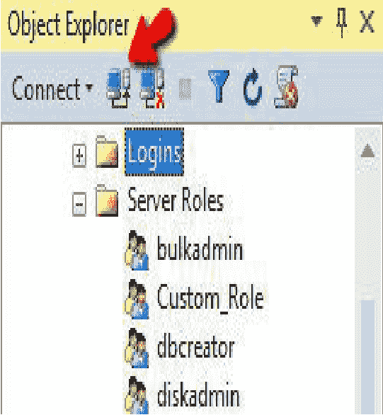

当登录窗口出现时，选择显示‘Windows 身份验证’的下拉菜单，并改选‘SQL Server 身份验证’。只需输入用户名和密码并登录即可！

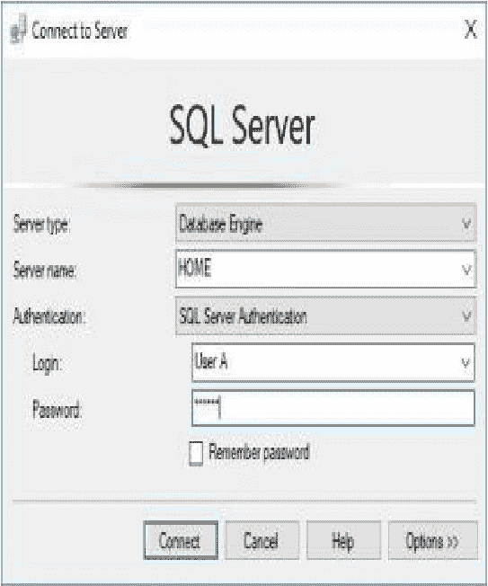

一旦你能够使用此用户登录，请尝试在对象资源管理器中打开数据库（系统数据库除外）。它应该看起来像下面这样；当你尝试展开某个数据库时，它反而会显示为空白。

### 对象资源管理器

连接

- HOME (SQL Server 13.0.4206 - HOME\jacob)
- HOME (SQL Server 13.0.4206 - User A)
  - 数据库
    - 系统数据库
    - 数据库快照
    - AdventureWorks2012
    - Company
    - ReportServer
    - ReportServerTempDB
    - Sample2
    - testdb
  - 安全性
  - 服务器对象
  - 复制
  - 管理


你应当无法做到这一点，因为此用户没有任何数据库访问权限。我们将在下一节更详细地介绍这一点。

### 数据库用户

数据库用户通常是与登录名关联并映射到一个数据库或一组数据库的用户。此数据库用户的目的是提供对服务器自身内部数据库的访问权限。你还可以限制对其他数据库的访问。

在许多情况下，一个服务器实例上有多个数据库，而你并不希望将所有数据库的访问权限都授予所有用户。

### 数据库级角色

与服务器级角色非常相似，也有数据库级角色可以分配给用户，以控制其在特定数据库中的权限。

预定义的数据库角色有九种：

- Db_owner——提供在数据库上执行所有配置和维护作业的能力。此角色还允许用户 DROP 数据库——这是一条强大的命令！
- Db_securityadmin——提供修改角色成员身份和管理权限的能力。
- Db_accessadmin——提供为 Windows 登录名、Windows 组和 SQL 登录名添加或移除数据库访问权限的能力。
- Db_backupoperator——允许用户备份数据库。
- Db_ddladmin——提供在 SQL Server 中运行任何 DDL 语句的能力。
- Db_datawriter——提供在任何用户表中添加、删除或修改数据的能力。
- Db_datareader——提供查看用户表中任何数据的能力。
- Db_denydatawriter——不能在任何用户表中添加、删除或修改数据。
- db_denydatareader——不能查看用户表中的任何数据。

### 分配数据库角色和创建用户

与分配服务器角色和创建登录名一样，你可以使用 Management Studio 或 SQL 语法来创建数据库用户，并为该特定用户分配数据库级角色。你还可以将该用户映射到登录名，以便两者……

相关的。

下面是一些示例语法，用于将数据库用户关联到登录名，并为其分配数据库角色。这可能有点繁琐，但我已将其分解为四个部分，以便更容易理解。

```sql
--Using the database that we'd like to add the user to
USE [AdventureWorks2012]
GO
--Creating the user called 'User A' for the login 'User A'
CREATE USER [User A] FOR LOGIN [User A]
GO
--Using AdventureWorks2012 again, since the database level role needs to be properly
--mapped to the user
USE [AdventureWorks2012]
GO
--Altering the role for db_datawriter and adding the database user 'User A' so
--the user can add, delete or modify existing data within AdventureWorks2012
ALTER ROLE [db_datawriter] ADD MEMBER [User A]
GO
```

### LIKE 子句

SQL 为我们提供了 LIKE 子句，它可以帮助我们使用通配符将某个值与相似的值进行比较。

与 LIKE 子句一起使用的通配符包括百分号（%）和下划线（_）。

这些符号的语法如下：

```sql
SELECT * FROM tableName
WHERE column LIKE 'XXX%'
```

或者以下语法：

```sql
SELECT * FROM tableName
WHERE column LIKE '%XXX%'
```

或者以下语法：

```sql
SELECT * FROM tableName
WHERE column LIKE 'XXX_'
```

或者以下语法：

```sql
SELECT * FROM tableName
WHERE column LIKE '_XXX'
```

或者以下语法：

```sql
SELECT * FROM tableName
WHERE column LIKE '_XXX_'
```

如果有多个条件，请使用连接运算符（AND、OR）将它们组合起来。上述情况中的 XXX 代表任何字符串或数值。

下面描述一些可以使用 LIKE 子句创建的语句的含义：

- 1. `WHERE SALARY LIKE '300%'`

  返回任何以 300 开头的值。

- 2. `WHERE SALARY LIKE '%300%'`

  这将返回任何位置包含 300 的值。

- 3. `WHERE SALARY LIKE '_00%'`

  这将查找第二个和第三个位置为 00 的值。

- 4. `WHERE SALARY LIKE '4_%_%'`

  这将查找以 4 开头且长度至少为 3 个字符的值。

- 5. `WHERE SALARY LIKE '%3'`

  这将查找以 3 结尾的值。

- 6. `WHERE SALARY LIKE '_3%4'`

  这将查找第二个位置为 3 且以 4 结尾的值。

- 7. `WHERE SALARY LIKE '3_____4'`

  这将查找一个 5 位数字中以 3 开头、以 4 结尾的值。

现在，我们需要演示如何使用这个子句。我们将使用 EMPLOYEES 表，其数据如下所示：

| ID | NAME | ADDRESS | AGE | SALARY |
|---:|---|---|---:|---:|
| 2 | Mercy | Mercy32 | 25 | 3500.00 |
| 3 | Joel | Joel42 | 30 | 4000.00 |
| 4 | Alice | Alice442 | 31 | 2500.00 |
| 5 | Nicholas | nichol442 | 45 | 5000.00 |
| 6 | Milly | mil342 | 32 | 2000.00 |
| 7 | Grace | gra361 | 35 | 4000.00 |

让我们运行一条命令，显示薪水以 400 开头的所有记录：

```sql
SELECT * FROM EMPLOYEES
WHERE SALARY LIKE '400%';
```

该命令返回以下结果：

```
mysql> SELECT * FROM EMPLOYEES
    -> WHERE SALARY LIKE '400%';
```

| ID | NAME | ADDRESS | AGE | SALARY |
|---:|---|---|---:|---:|
| 3 | Joel | Joel42 | 30 | 4000.00 |
| 7 | Grace | gra361 | 35 | 4000.00 |

```
2 rows in set (0.13 sec)
```

### SQL 函数⁶³

语法如下：

```sql
SELECT COUNT(<expression>)
FROM table_name;
```

| ID | EMP_NAME | SALES | BRANCH |
|---|---|---|---|
| 1001 | ALAN MARSCH | 3000.00 | NEW YORK |
| 1098 | NEIL BANKS | 5400.00 | LOS ANGELES |
| 2005 | RAIN ALONZO | 4000.00 | NEW YORK |
| 3008 | MARK FIELDING | 3555.00 | CHICAGO |
| 4356 | JENNER BANKS | 14600.00 | NEW YORK |
| 4810 | MAINE ROD | 7000.00 | NEW YORK |
| 5783 | JACK RINGER | 6000.00 | CHICAGO |
| 6431 | MARK TWAIN | 10000.00 | LOS ANGELES |
| 7543 | JACKIE FELTS | 3500.00 | CHICAGO |
| 8934 | MARK GOTH | 5400.00 | AUSTIN |

10 rows in set (0.00 sec)

在此语句中，表达式可以指算术运算或列名。如果要计算表中存储的总记录数，也可以指定 (*)。¹

要执行简单的计数操作，例如计算 SALES_REP 表中有多少行，请输入：

```sql
SELECT COUNT(EMP_NAME)
FROM SALES_REP;
```

结果如下：

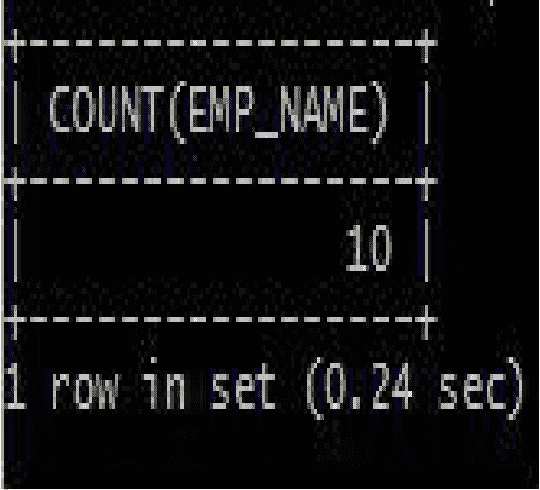

你也可以使用 (*) 而不是指定列名。

```sql
SELECT COUNT(*)
FROM SALES_REP;
```

该语句将产生相同的结果，因为 EMP_NAME 字段没有 NULL 值。但是，假设 EMP_NAME 字段中的某个值包含 NULL 值，那么这个 NULL 值不会包含在指定 EMP_NAME 的语句中，但如果你使用 * 符号作为参数，它将会包含在 COUNT() 结果中。

```sql
SELECT BRANCH, COUNT(*) FROM SALES_REP
GROUP BY BRANCH;
```

输出如下：

| BRANCH | COUNT(*) |
| --- | ---: |
| AUSTIN | 1 |
| CHICAGO | 3 |
| LOS ANGELES | 2 |
| NEW YORK | 4 |

4 rows in set (0.04 sec)

COUNT() 函数可以与 DISTINCT 一起使用，以查找不同条目的数量。例如，如果你想了解 SALES_REP 表中保存了多少个不同的分公司，请输入以下语句：

```sql
SELECT COUNT (DISTINCT BRANCH)
FROM SALES_REP;
```

| COUNT(DISTINCT BRANCH) |
|---:|
| 4 |

1 row in set (0.15 sec)

#### SQL AVG 函数⁴

语法如下：

```sql
SELECT AVG(<expression>)
FROM table_name;
```

| ID | EMP_NAME | SALES | BRANCH |
|---:|---|---:|---|
| 1001 | ALAN MARSCH | 3000.00 | NEW YORK |
| 1098 | NEIL BANKS | 5400.00 | LOS ANGELES |
| 2005 | RAIN ALONZO | 4000.00 | NEW YORK |
| 3008 | MARK FIELDING | 3555.00 | CHICAGO |
| 4356 | JENNER BANKS | 14600.00 | NEW YORK |
| 4810 | MAINE ROD | 7000.00 | NEW YORK |
| 5783 | JACK RINGER | 6000.00 | CHICAGO |
| 6431 | MARK TWAIN | 10000.00 | LOS ANGELES |
| 7543 | JACKIE FELTS | 3500.00 | CHICAGO |
| 8934 | MARK GOTH | 5400.00 | AUSTIN |

10 rows in set (0.00 sec)

在上述语句中，表达式可以指算术运算或列名。算术运算可以包含单列或多列。

在第一个示例中，你将使用 AVG() 函数计算平均销售额。可以输入以下语句：

```sql
SELECT AVG(Sales) FROM Sales_Rep;
```

结果如下：

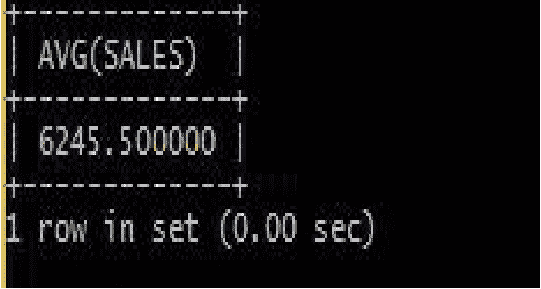

https://docs.microsoft.com/en-us/sql/t-sql/statements/create-function-transact-sql?view=sql-server-2017

数字 6245.500000 是 Sales_Rep 表中所有销售数据的平均值，其计算方法是将 Sales 字段相加，并将结果除以记录数（在本示例中为 10 行）。

AVG() 函数可用于算术运算。例如，假设销售税为销售额的 6.6%，你可以使用以下语句计算平均销售税额：

```sql
SELECT AVG(Sales*.066) FROM Sales_Rep;
```

结果如下：

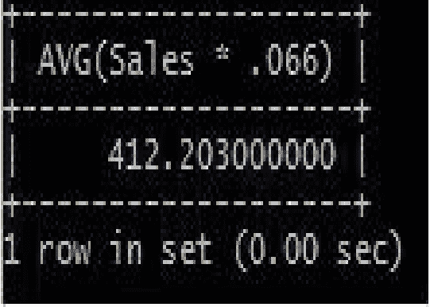

https://docs.microsoft.com/en-us/sql/t-sql/statements/create-function-transact-sql?view=sql-server-2017

为了获得该结果，SQL 必须先计算算术运算 `Sales *.066` 的结果，然后再应用 AVG 函数。

```sql
SELECT Branch, AVG(Sales) FROM Sales_Rep
GROUP BY Branch;
```

结果如下：

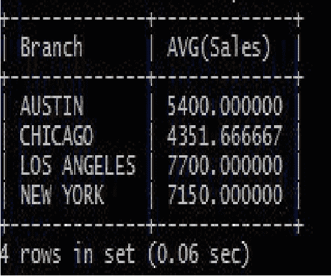

| Branch | AVG(Sales) |
|---|---:|
| AUSTIN | 5400.000000 |
| CHICAGO | 4351.666667 |
| LOS ANGELES | 7700.000000 |
| NEW YORK | 7150.000000 |

4 rows in set (0.06 sec)

https://docs.microsoft.com/en-us/sql/t-sql/statements/create-function-transact-sql?view=sql-server-2017

#### SQL ROUND 函数

以下是 SQL ROUND() 函数的语法：

```sql
ROUND (expression, [decimal place])
```

在上述语句中，decimal place（小数位数）指定将返回的小数点位数。例如，指定 -1 将把数字四舍五入到最接近的十位数。


本节示例将使用 Student_Grade 表，其数据如下：

| ID | Name | Grade |
|---|---:|
| 1 | Jack Knight | 87.6498 |
| 2 | Daisy Poult | 98.4359 |
| 3 | James McDuff | 97.7853 |
| 4 | Alicia Stone | 89.9753 |

要将成绩四舍五入到十分位，请输入以下语句：

```sql
SELECT Name, ROUND(Grade, 1) Rounded_Grade FROM Student_Grade;
```

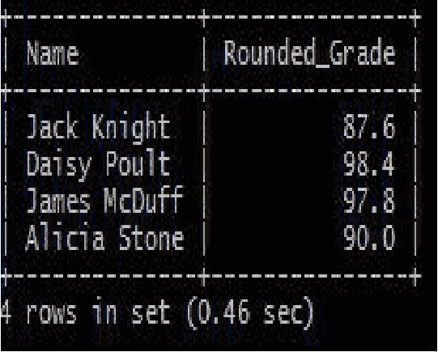

结果如下：

假设你想将成绩四舍五入到十位，则可以在 ROUND() 函数中使用负数参数：

| Name | Rounded_Grade |
|---|---|
| Jack Knight | 90 |
| Daisy Poult | 100 |
| James McDuff | 100 |
| Alicia Stone | 90 |

4 行记录（0.04 秒）

```sql
SELECT Name, ROUND(Grade, -1) Rounded_Grade FROM Student_Grade;
```

结果如下：

#### SQL SUM 函数

SUM() 函数用于返回表达式总和。

以下是 SUM() 函数的语法：

```sql
SELECT SUM(<expression>)
FROM "table_name";
```

expression 参数可以是一个算术运算或列名。算术运算可以包含一个或多个列。同样，在 SELECT 语句中，除了 SUM() 函数中指定的列外，还可以包含多个列。这些列也应构成 GROUP BY 子句的一部分。语法如下：11

| ID | EMP_NAME | SALES | BRANCH |
|---|---|---|---|
| 1001 | ALAN MARSCH | 3000.00 | NEW YORK |
| 1098 | NEIL BANKS | 5400.00 | LOS ANGELES |
| 2005 | RAIN ALONZO | 4000.00 | NEW YORK |
| 3008 | MARK FIELDING | 3555.00 | CHICAGO |
| 4356 | JENNER BANKS | 14600.00 | NEW YORK |
| 4810 | MAINE ROD | 7000.00 | NEW YORK |
| 5783 | JACK RINGER | 6000.00 | CHICAGO |
| 6431 | MARK TWAIN | 10000.00 | LOS ANGELES |
| 7543 | JACKIE FELTS | 3500.00 | CHICAGO |
| 8934 | MARK GOTH | 5400.00 | AUSTIN |

10 行记录（0.00 秒）

```sql
SELECT column1, column2, … columnN, SUM("columnN+1")
FROM table_name;
GROUP BY column1, column2, … columnN;
```

本节示例将使用 SALES_REP 表，其数据如下：12

要计算 Sales_Rep 表中所有销售额的总和，请输入以下语句：

```sql
SELECT SUM(Sales) FROM Sales_Rep;
```

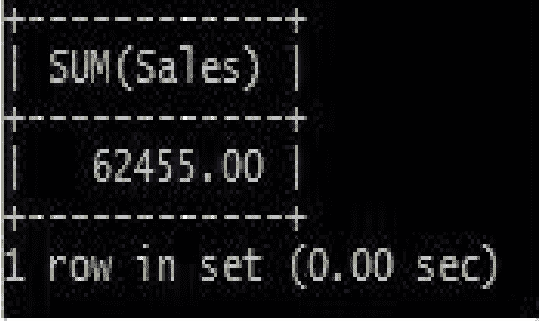

结果如下：

数字 62455.00 表示 Sales 列中所有条目的总和。为了说明如何将算术运算用作 SUM() 函数的参数，假设你需要对销售额征收 6.6% 的销售税。以下是计算总销售税额的语句：

```sql
SELECT SUM(Sales*.066) FROM Sales_Rep;
```

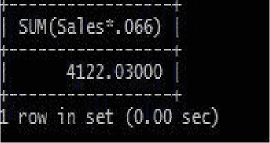

你将得到以下结果：

在本示例中，你将结合 SUM() 函数与 GROUP BY 子句来计算每个分公司的总销售额。你可以使用以下语句：

```sql
SELECT Branch, SUM(Sales) FROM Sales_Rep
GROUP BY Branch;
```

| Branch | SUM(Sales) |
|---|---:|
| AUSTIN | 5400.00 |
| CHICAGO | 13055.00 |
| LOS ANGELES | 15400.00 |
| NEW YORK | 28600.00 |

4 行记录（0.00 秒）

结果如下：⁵³

#### SQL MAX() 函数

MAX() 函数用于获取给定表达式中的最大值。

语法如下：

```sql
SELECT MAX(<expression>)
FROM table_name;
```

expression 参数可以是一个算术运算或列名。算术运算可以包含多个列。

除了 MAX() 函数中指定的列之外，SELECT 语句还可以包含一个或多个列。在这种情况下，这些列必须构成 GROUP BY 子句的一部分。

语法如下：

```sql
SELECT column1, column2, ... "columnN", MAX(<expression>)
FROM table_name;
```

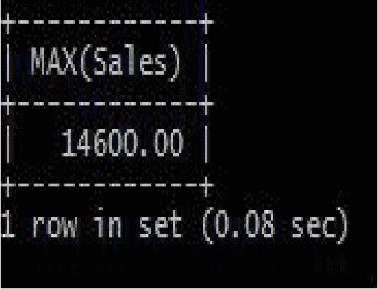

为了说明 MAX() 函数如何应用于算术运算，假设你需要对销售额计算 6.6% 的销售税。要获得最高销售税额，请使用以下语句：

```sql
SELECT MAX(Sales*0.066) FROM Sales_Rep;
```

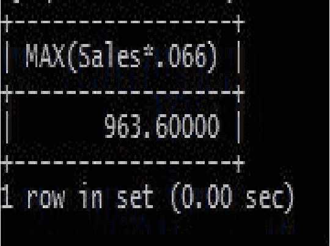

输出如下：

你可以将 MAX() 函数与 GROUP BY 子句结合使用，以获取每个分公司的最大销售额。为此，请输入以下语句：

| Branch | MAX(Sales) |
|---|---:|
| AUSTIN | 5400.00 |
| CHICAGO | 6000.00 |
| LOS ANGELES | 10000.00 |
| NEW YORK | 14600.00 |

4 行记录（0.00 秒）

```sql
SELECT Branch, MAX(Sales) FROM Sales_Rep GROUP BY Branch;^36
```

#### SQL MIN() 函数

MIN() 函数用于获取给定表达式中的最小值。语法如下：

```sql
SELECT MIN(<expression>)
FROM table_name;
```

expression 参数可以是一个算术运算或列名。算术运算也可以包含多个列。

除了 MIN() 函数中指定的列之外，SELECT 语句还可以包含一个或多个列。在这种情况下，这些列必须构成 GROUP BY 子句的一部分。

语法如下：

```sql
SELECT column1, column2, ... "columnN", MIN(<expression>)
FROM table_name;
GROUP BY column1, column2, ... "columnN";
```

为了演示 MIN() 函数在 SQL 中的用法，请使用包含以下数据的 Sales_Rep 表：

| ID | EMP_NAME | SALES | BRANCH |
|---:|---|---:|---|
| 1001 | ALAN MARCH | 3000.00 | NEW YORK |
| 1098 | NEIL BANKS | 5400.00 | LOS ANGELES |
| 2005 | RAIN ALONZO | 4000.00 | NEW YORK |
| 3008 | MARK FIELDING | 3555.00 | CHICAGO |
| 4356 | JENNER BANKS | 14600.00 | NEW YORK |
| 4810 | MAINE ROD | 7000.00 | NEW YORK |
| 5783 | JACK RINGER | 6000.00 | CHICAGO |
| 6431 | MARK TWAIN | 10000.00 | LOS ANGELES |
| 7543 | JACKIE FELTS | 3500.00 | CHICAGO |
| 8934 | MARK GOTH | 5400.00 | AUSTIN |

10 行记录（0.00 秒）

要获取最低销售额，请使用以下语句：

```sql
SELECT MIN(Sales) FROM Sales_Rep;
```

输出如下：

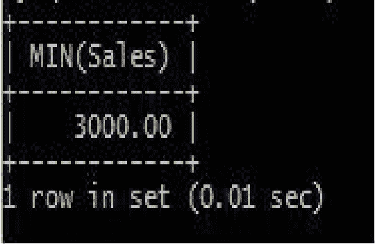

为了演示 MIN() 函数在算术运算上的用法，假设你需要对销售额计算 6.6% 的销售税。要获取最低销售税额，请使用以下语句：

```sql
SELECT MIN(Sales*0.066) FROM Sales_Rep;
```

输出如下：

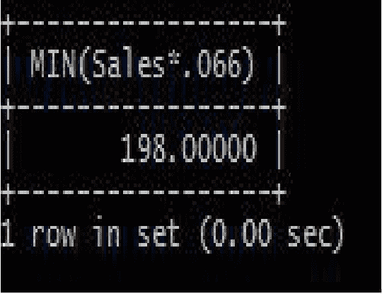

你还可以将 MIN() 函数与 GROUP BY 子句结合使用，以计算每个分公司的最低销售额。为此，请输入以下语句：

```sql
SELECT Branch, MIN(Sales) FROM Sales_Rep GROUP BY Branch;
```

| Branch | MIN(Sales) |
|---|---:|
| AUSTIN | 5400.00 |
| CHICAGO | 3500.00 |
| LOS ANGELES | 5400.00 |
| NEW YORK | 3000.00 |

4 行记录（0.00 秒）

结果如下：

## 第 9 章：修改和控制表

> “问题不在于存在困难。问题在于期望情况相反，并认为存在困难就是一个问题。”——西奥多·鲁宾

以下是修改表的基本语法：

```sql
ALTER TABLE TABLE_NAME [MODIFY] [COLUMN COLUMN_NAME] [DATATYPE | NULL | NOT NULL]
[RESTRICT | CASCADE]
    [DROP]      [CONSTRAINT CONSTRAINT_NAME]
    [ADD]       [COLUMN] COLUMN DEFINITION
```

### 修改表名

ALTER TABLE 命令可以与 RENAME 函数一起使用来更改表名。

为了演示此语句的用法，请使用包含以下记录的 EMPLOYEES 表：

| ID | FIRST_NAME | LAST_NAME | POSITION | SALARY | ADDRESS |
|---|---|---:|---|
| 1 | Robert | Fine | Clerk | 5000.00 | 28 Patterson Avenue, … |
| 2 | John | … | Supervisor | 7000.00 | 5 Lake View, New York |
| 3 | Krysten | Johnston | Clerk | 4000.00 | 23 …, Florida |
| 4 | Larry | Burns | Agent | 5000.00 | 5 Green …, California |
| 5 | … | … | … | 7500.00 | NULL |

要将 EMPLOYEES 表名更改为 INVESTORS，请使用以下语句：

```sql
ALTER TABLE EMPLOYEES RENAME INVESTORS;
```

你的表现在名为 INVESTORS。

### 修改列属性

列属性指的是输入到列中的数据的属性和行为。通常，在创建表时设置列属性。但是，你仍然可以使用 ALTER TABLE 命令更改一个或多个属性。

你可以修改以下内容：

- 列名
- 分配给列的数据类型
- 列的小数位数、长度或精度
- 列中是否使用 NULL 值

### 重命名列

你可能希望修改列名以反映其包含的数据。例如，既然你将 EMPLOYEES 数据库重命名为 INVESTORS，SALARY 列将不再合适。你可以将列名改为类似于 CAPITAL 的名称。同样，你可能希望将其数据类型从 DECIMAL 改为最多十位的 INTEGER 类型。

为此，请输入以下语句：

```sql
ALTER TABLE INVESTORS CHANGE SALARY CAPITAL INT(10);
```

结果如下：


| ID | 名 | 姓 | 职位 | 资金 | 地址 |
| --- | --- | --- | --- | --- | --- |
| 1 | Robert | Page | 职员 | 5000 | 282 Patterson Avenue, Illinois |
| 2 | John | Nalley | 主管 | 7000 | 5 Lake View New York |
| 3 | Kristen | Johnston | 职员 | 4000 | 25 Jump Road Florida |
| 4 | Jack | Burns | 代理人 | 5000 | 5 Green Meadows California |
| 5 | James | Hunt | NULL | 7500 | NULL |

已选择 5 行。

### 删除列

此时，Position 列不再适用。你可以使用以下语句删除该列：

```sql
ALTER TABLE INVESTORS
DROP COLUMN Position;
```

以下是更新后的 INVESTORS 表：

| ID | 名 | 姓 | 资金 | 地址 |
| --- | --- | --- | --- | --- |
| 1 | Robert | Page | 5000 | 282 Patterson Avenue, Illinois |
| 2 | John | Nalley | 7000 | 5 Lake View New York |
| 3 | Kristen | Johnston | 4000 | 25 Jump Road Florida |
| 4 | Jack | Burns | 5000 | 5 Green Meadows California |
| 5 | James | Hunt | 7500 | NULL |

结果集中有 5 行（0.00 秒）

### 添加新列

由于你现在处理的是另一组数据，你可能会决定再添加一列，使 INVESTORS 表中的数据更具相关性。你可以添加一列，用于存储每位投资者持有的股票数量。你可以将新列命名为 STOCKS。该列将接受最多 9 位的整数。

你可以使用以下语句添加 STOCKS 列：

```sql
ALTER TABLE INVESTORS ADD STOCKS INT(9);
```

以下是更新后的 INVESTORS 表：

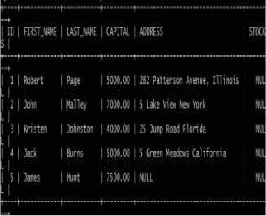

| ID | 名 | 姓 | 资金 | 地址 | 股票 |
| --- | --- | --- | --- | --- | --- |
| 1 | Robert | Page | 5000.00 | 282 Patterson Avenue, Illinois | NULL |
| 2 | John | Nalley | 7000.00 | 5 Lake View New York | NULL |
| 3 | Kristen | Johnston | 4000.00 | 25 Jump Road Florida | NULL |
| 4 | Jack | Burns | 5000.00 | 5 Green Meadows California | NULL |
| 5 | James | Hunt | 7500.00 | NULL | NULL |

### 在不更改名称的情况下修改现有列

你还可以将 ALTER TABLE 命令与 MODIFY 关键字结合使用，以更改表的数据类型和规格。为演示这一点，你可以使用以下语句将 CAPITAL 列的数据类型从 INT 类型修改为最多 9 位、包含两位小数的 DECIMAL 类型。

```sql
ALTER TABLE INVESTORS MODIFY CAPITAL DECIMAL(9,2) NOT NULL;
```

此时，你可能想查看 INVESTORS 表的列名和属性。你可以使用 ‘SHOW COLUMNS’ 语句显示表结构。输入以下语句：

```sql
SHOW COLUMNS FROM INVESTORS;
```

以下是结果的截图。

| 字段 | 类型 | 空 | 键 | 默认值 | 额外 |
| --- | --- | --- | --- | --- | --- |
| ID | int(6) | 否 |  | 0 |  |
| FIRST_NAME | varchar(32) | 否 |  | NULL |  |
| LAST_NAME | varchar(32) | 否 |  | NULL |  |
| CAPITAL | decimal(9,2) | 否 |  | NULL |  |
| ADDRESS | varchar(50) | 是 |  | NULL |  |
| STOCKS | int(9) | 是 |  | NULL |  |

结果集中有 6 行（0.00 秒）

### 使用 ALTER TABLE 时要记住的规则

- 向数据库表添加列

添加新列时，请记住，不能向已有数据的表添加具有 NOT NULL 属性的列。你通常会将列指定为 NOT NULL，以表示该列将保存值。如果现有数据在新列中没有值，添加 NOT NULL 列将与该约束冲突。

- 修改字段/列

  - 1. 你可以轻松修改列的数据类型
  - 2. 你可以增加数值数据类型可容纳的位数，但只有当表中存储的最大位数等于或小于所需位数时，才能减少位数。
  - 3. 只要不超过允许的最大小数位数，你就可以增加或减少数值数据类型的小数位数。

如果处理不当，删除和修改表可能会导致有价值的信息丢失。因此，在执行 ALTER TABLE 和 DROP TABLE 语句时要格外小心。

### 删除表

删除表还会移除其数据、关联索引、触发器、约束和权限数据。使用此语句时应小心。

以下是语法：

```sql
DROP TABLE table_name;
```

例如，如果你想从 xyzcompany 数据库中删除 INVESTORS 表，可以使用以下语句：

```sql
DROP TABLE INVESTORS;
```

DROP TABLE 命令已从当前数据库中有效移除 INVESTORS 表。

如果你尝试使用以下命令访问 INVESTORS 表：

```sql
SELECT * FROM INVESTORS;
```

SQL 将返回如下错误：


[https://docs.microsoft.com/en-us/sql/relational-databases/tables/delete-tables-database-engine?view=sql-server-2017](https://docs.microsoft.com/en-us/sql/relational-databases/tables/delete-tables-database-engine?view=sql-server-2017)

### 合并和连接表

如果多个表之间存在公共字段，你可以合并这些表中的数据。为此，请使用 JOIN 语句。

SQL 支持多种类型的 JOIN 操作：

#### 内连接（INNER JOIN）

INNER JOIN（或简称为 JOIN）是最常用的 JOIN 类型。当要连接的表具有匹配字段时，它会显示这些行。

以下是语法：⁵

```sql
SELECT column_name(s)
FROM table1
INNER JOIN table2
ON table1.column_name=table2.column_name;
```

在此变体中，使用 JOIN 子句代替 INNER JOIN。

```sql
SELECT column_name(s)
FROM table1
JOIN table2
ON table1.column_name=table2.column_name;
```

#### 左连接（LEFT JOIN）

LEFT JOIN 操作返回左表的所有行以及与右表匹配的行。如果未找到匹配项，右侧返回 NULL。

以下是 LEFT JOIN 的语法：

```sql
SELECT column_name(s)
FROM table1
LEFT JOIN table2
ON table1.column_name=table2.column_name;
```

在某些数据库系统中，使用关键字 LEFT OUTER JOIN 代替 LEFT JOIN。以下是此变体的语法：

```sql
SELECT column_name(s)
FROM table1
LEFT OUTER JOIN table2
ON table1.column_name=table2.column_name;
```

#### 右连接（RIGHT JOIN）

此 JOIN 操作返回右表的所有行以及与左表匹配的行。

以下是此操作的语法：

```sql
SELECT column_name(s)
FROM table1
RIGHT JOIN table2
ON table1.column_name=table2.column_name;
```

在某些数据库系统中，使用 RIGHT OUTER JOIN 代替 RIGHT JOIN。以下是此变体的语法：

```sql
SELECT column_name(s)
FROM table1
RIGHT OUTER JOIN table2
ON table1.column_name=table2.column_name;
```

[http://www.sql-join.com/sql-join-types/](http://www.sql-join.com/sql-join-types/)

#### 全外连接（FULL OUTER JOIN）

当至少一个表满足条件时，此 JOIN 操作会显示所有行。它结合了 RIGHT 和 LEFT 连接操作的结果。

以下是语法：

```sql
SELECT column_name(s)
FROM table1
FULL OUTER JOIN table2
ON table1.column_name=table2.column_name;
```

为了演示 SQL 中的 JOIN 操作，请使用 Branch_Sales 和 Branch_Location 表：

Branch_Sales 表

| 分支 | 产品ID | 销售额 |
| --- | --- | --- |
| 纽约 | 101 | 7500.00 |
| 洛杉矶 | 102 | 6450.00 |
| 芝加哥 | 101 | 1560.00 |
| 费城 | 101 | 1980.00 |
| 丹佛 | 102 | 3500.00 |
| 西雅图 | 101 | 2500.00 |
| 底特律 | 102 | 1450.00 |

Location 表

| 地区 | 分支 |
| --- | --- |
| 东 | 纽约市 |
| 东 | 芝加哥 |
| 东 | 费城 |
| 东 | 底特律 |
| 西 | 洛杉矶 |
| 西 | 丹佛 |
| 西 | 西雅图 |

目标是按地区获取销售额。Location 表包含地区和分支的数据，而 Branch_Sales 表保存每个分支的销售数据。要查找每个地区的销售额，你需要合并 Location 表和 Branch_Sales 表中的数据。注意，这些表有一个公共字段 Branch，它是连接两个表的字段。

以下语句将演示如何使用表别名连接这两个表：

```sql
SELECT A1.Region Region, SUM(A2.Sales) Sales
FROM Location A1, Branch_Sales A2
WHERE A1.Branch = A2.Branch
GROUP BY A1.Region;
```

结果将如下所示：


| 地区 | 销售额 |
| --- | ---: |
| 东部 | 4990.00 |
| 西部 | 12450.00 |

2 行记录（0.12 秒）

在前两行中，该语句告诉 SQL 从 Location 表中选择 ‘Region’ 字段，并从 Branch_Sales 表中选择 ‘Sales’ 字段的总和。该语句使用了表别名。‘Region’ 字段被别名为 Region，而 SALES 字段的总和被别名为 SALES。

表别名是为表或表列使用临时名称的做法。使用别名有助于使语句更易读、更简洁。例如，如果你选择不为第一行使用表别名，你将使用以下语句来获得相同的结果：

```sql
SELECT Location.Region,
SUM(Branch_Sales.Sales) SALES
```

或者，你可以通过使用 JOIN 和 ON 关键字来指定两个表之间的连接。例如，使用这些关键字，查询将如下所示：

```sql
SELECT A1.Region REGION, SUM(A2.Sales) SALES
FROM Location A1
JOIN Branch_Sales A2
ON A1.Branch = A2.Branch
GROUP BY A1.Region;
```

该查询将产生相同的结果：


### 使用内连接

当两个表之间存在一个或多个匹配项时，内连接会显示行。为了演示这一点，请使用以下表：

Branch_Sales 表

| 分支 | 产品 ID | 销售额 |
| --- | ---: | ---: |
| 纽约 | 101 | 7500.00 |
| 费城 | 101 | 1980.00 |
| 丹佛 | 102 | 3500.00 |
| 西雅图 | 101 | 2500.00 |
| 底特律 | 102 | 1450.00 |

Location 表

| 地区 | 分支 |
| --- | --- |
| 东部 | 纽约 |
| 东部 | 芝加哥 |
| 东部 | 费城 |
| 东部 | 底特律 |
| 西部 | 洛杉矶 |
| 西部 | 丹佛 |
| 西部 | 西雅图 |

你可以通过使用 INNER JOIN 语句来实现这一点。

你可以输入以下内容：

```sql
SELECT A1.Branch BRANCH, SUM(A2.Sales) SALES
FROM Location A1
INNER JOIN Branch_Sales A2
ON A1.Branch = A2.Branch
GROUP BY A1.Branch;
```

²¹这将得到以下结果：

| 分支 | 销售额 |
| --- | ---: |
| 丹佛 | 3500.00 |
| 底特律 | 1450.00 |
| 纽约 | 7500.00 |
| 费城 | 1980.00 |
| 西雅图 | 2500.00 |

5 行记录（0.00 秒）

请注意，通过使用 INNER JOIN，结果中只包含在 Branch_Sales 表中有记录的分支，即使你实际上是在对 Location 表应用 SELECT 语句。‘芝加哥’和‘洛杉矶’分支被排除，因为 Branch_Sales 表中没有这些分支的记录。

### 使用外连接

在上一个示例中，你已经使用内连接来组合表，

TOP 命令帮助我们仅从表中检索前 TOP 数量的记录。但是，你必须注意，并非所有数据库都支持 TOP 命令。有些支持 LIMIT，而另一些支持 ROWNUM 子句。

以下是在 SELECT 语句上使用 TOP 命令的语法：

```sql
SELECT TOP number|percent columnName(s)
FROM tableName
WHERE [condition]
```

我们想使用 EMPLOYEES 表来演示如何使用该子句。该表有以下数据：

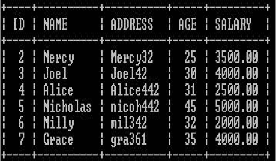

以下查询将帮助我们获取表中的前 2 行：

```sql
SELECT TOP 2 * FROM EMPLOYEES;
```

请注意，上面给出的命令仅在 SQL Server 中有效。如果你使用的是 MySQL Server，请使用如下所示的 LIMIT 子句：

```sql
SELECT * FROM EMPLOYEES

LIMIT 2;
```

```text
mysql> SELECT * FROM EMPLOYEES
    -> LIMIT 2;
+----+------+---------+-----+----------+
| ID | NAME | ADDRESS | AGE | SALARY   |
+----+------+---------+-----+----------+
|  2 | Mercy| Mercy32 |  25 | 3500.00  |
|  3 | Joel | Joel42  |  30 | 4000.00  |
+----+------+---------+-----+----------+
2 rows in set (0.37 sec)

mysql>
```

只返回表中的前两条记录。

如果你使用的是 Oracle Server，请将 ROWNUM 与 SELECT 子句一起使用，如下所示：

```sql
SELECT * FROM EMPLOYEES
WHERE ROWNUM <= 2;
```

### ORDER BY 子句

该子句帮助我们按升序或降序对数据进行排序。可以依赖一个或多个列来完成排序。在大多数数据库中，结果默认按升序排序。

ORDER BY 子句使用以下语法：

```sql
SELECT columns_list
FROM tableName
[WHERE condition]
```

在 ORDER BY 子句中，你可以使用一个或多个列。但是，你必须确保你选择用于排序数据的列在列列表中。再次，我们将使用具有如下所示数据的 EMPLOYEES 表：

| ID | 姓名 | 地址 | 年龄 | 薪资 |
| ---: | --- | --- | ---: | ---: |
| 2 | Mercy | Mercy32 | 25 | 3500.00 |
| 3 | Joel | Joel42 | 30 | 4000.00 |
| 4 | Alice | Alice442 | 31 | 2500.00 |
| 5 | Nicholas | nicol442 | 45 | 5000.00 |
| 6 | Milly | mi1342 | 32 | 2000.00 |
| 7 | Grace | gra361 | 35 | 4000.00 |

现在，我们需要使用 NAME 和 SALARY 列按升序对数据进行排序。以下命令将帮助我们实现这一点：

```sql
SELECT * FROM EMPLOYEES
ORDER BY NAME, SALARY;
```

该查询将返回以下结果：

| ID | 姓名 | 地址 | 年龄 | 薪资 |
| ---: | --- | --- | ---: | ---: |
| 4 | Alice | Alice442 | 31 | 2500.00 |
| 7 | Grace | gra361 | 35 | 4000.00 |
| 3 | Joel | Joel42 | 30 | 4000.00 |
| 2 | Mercy | Mercy32 | 25 | 3500.00 |
| 6 | Milly | mi1342 | 32 | 2000.00 |
| 5 | Nicholas | nicol442 | 45 | 5000.00 |

6 行记录（0.32 秒）

我们还可以使用 SALARY 列按降序对数据进行排序：

```sql
SELECT * FROM EMPLOYEES
ORDER BY SALARY DESC;
```

结果如下：

```text
mysql> SELECT * FROM EMPLOYEES
    -> ORDER BY SALARY DESC;
```

| ID | 姓名 | 地址 | 年龄 | 薪资 |
| ---: | --- | --- | ---: | ---: |
| 5 | Nicholas | nicol442 | 45 | 5000.00 |
| 3 | Joel | Joel42 | 30 | 4000.00 |
| 7 | Grace | gra361 | 35 | 4000.00 |
| 2 | Mercy | Mercy32 | 25 | 3500.00 |
| 4 | Alice | Alice442 | 31 | 2500.00 |
| 6 | Milly | mi1342 | 32 | 2000.00 |

6 行记录（0.05 秒）

mysql>

[https://www.tutorialspoint.com/sql/sql-top-clause.htm](https://www.tutorialspoint.com/sql/sql-top-clause.htm)

### GROUP BY 子句

该子句与 SELECT 语句一起使用，将相关的数据分组，创建组。在 SELECT 语句中，GROUP BY 子句应位于 WHERE 子句之后，并应位于 ORDER BY 子句之前。

以下是语法：

```sql
SELECT column_1, column_2
FROM tableName
WHERE [ conditions ]
GROUP BY column_1, column_2
ORDER BY column_1, column_2
```

让我们使用具有如下所示数据的 EMPLOYEES 表：

| ID | 姓名 | 地址 | 年龄 | 薪资 |
| ---: | --- | --- | ---: | ---: |
| 2 | Mercy | Mercy32 | 25 | 3500.00 |
| 3 | Joel | Joel42 | 30 | 4000.00 |
| 4 | Alice | Alice442 | 31 | 2500.00 |
| 5 | Nicholas | nicol442 | 45 | 5000.00 |
| 6 | Milly | mi1342 | 32 | 2000.00 |
| 7 | Grace | gra361 | 35 | 4000.00 |

如果你需要获取每个客户的总 SALARY，只需运行以下命令：

```sql
SELECT NAME, SALARY, SUM(SALARY) FROM EMPLOYEES
GROUP BY NAME;
```

### DISTINCT 关键字

该关键字与 SELECT 语句一起使用，帮助消除重复项，并允许选择唯一记录。

这是因为有时表中会有多个重复记录，而你的目标只是选择唯一的记录。DISTINCT 关键字可以帮助你实现这一点。该关键字可与以下语法一起使用：

```sql
SELECT DISTINCT column_1, column_2,.....column_N
FROM tableName
WHERE [condition]
```

我们将使用 EMPLOYEES 表来演示如何使用该关键字。该表有以下数据：

| ID | 姓名 | 地址 | 年龄 | 薪资 |
| ---: | --- | --- | ---: | ---: |
| 2 | Mercy | Mercy32 | 25 | 3500.00 |
| 3 | Joel | Joel42 | 30 | 4000.00 |
| 4 | Alice | Alice442 | 31 | 2500.00 |
| 5 | Nicholas | nicol442 | 45 | 5000.00 |
| 6 | Milly | mi1342 | 32 | 2000.00 |
| 7 | Grace | gra361 | 35 | 4000.00 |

上表的 SALARY 列中有一个重复条目 4000。这可以在我们运行以下查询后看到：

```sql
SELECT DISTINCT SALARY FROM EMPLOYEES
ORDER BY SALARY;
```


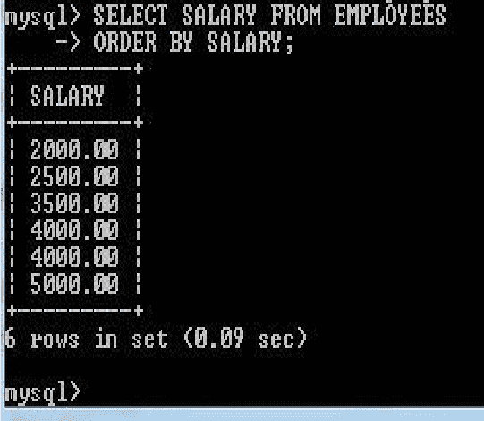

现在我们可以将查询与 DISTINCT 关键字结合，看看查询返回什么结果：

```sql
Select * From Student
where StudentAge >
(Select StudentAge from Student
where StudName = 'Stacy'
)
```

注意，在查询1中，我们在“where”子句里使用了圆括号来附加一个子查询。上述查询将检索“Student”表中所有年龄大于“Stacy”年龄的学生记录。“Stacy”的年龄是 20，因此在输出结果中，你会看到所有年龄大于 20 的学生记录。输出结果如下：

| StudID | StudName | StudentAge | StudentGender | DepID |
|--------|----------|-----------:|---------------|-------|
| 1 | Alice | 21 | 男 | 2 |
| 4 | Jacobs | 22 | 男 | 5 |
| 6 | Shane | 22 | 男 | 4 |
| 7 | Linda | 24 | 女 | 4 |
| 9 | Wolfred | 21 | 男 | 2 |
| 10 | Sandy | 25 | 女 | 1 |
| 14 | Mark | 23 | 男 | 5 |
| 15 | Fred | 25 | 男 | 2 |
| 16 | Vic | 25 | 男 | NULL |
| 17 | Nick | 25 | 男 | NULL |

类似地，如果你想将所有属于“English”系的学生姓名更新，可以通过以下子查询来实现：

#### 查询2

```sql
Update Student
Set StudName = StudName + ' Eng'
where Student.StudID in (
Select StudID
from Student
Join Department
On Student.DepID = Department.DepID
where DepName = 'English'
)
```

在以上查询中，通过子查询中的 JOIN 语句检索了 English 系所有学生的学生 ID。然后，使用 UPDATE 语句，通过在他们姓名末尾追加字符串“Eng”来更新所有这些学生的姓名。WHERE 语句用于匹配通过子查询检索到的学生 ID。

现在，如果你显示学生姓名及其所在的系名，你会看到属于 English 系的学生姓名末尾附有“Eng”。

### 练习9

#### 任务

删除“Student”表中所有学生 ID 小于“Linda”的ID的学生记录。

#### 解决方案

```sql
Delete From Student
where StudID <
(Select StudID from Student
where StudName = 'Linda'
)
```

### SQL 字符函数

SQL 字符函数用于修改检索数据的显示形式。字符函数并不修改实际数据，而是对数据的表示方式执行某些修改。SQL 字符函数作用于字符串类型的数据。在本章中，我们将介绍一些最常用的 SQL 字符函数。

#### 注意

- **连接（+）**

  连接函数用于连接两个或多个字符串。在 SQL 中，使用‘+’运算符连接两个字符串。例如，我们可以从学生列中取出学生姓名和学生性别，并将它们显示在同一列中，如下所示：

  ```sql
  Select StudName +' '+StudentGender as NameAndGender
  from Student
  ```

- **替换（Replace）**

  替换函数用于替换输出字符串中的字符。例如，以下查询将所有学生姓名中的“ac”替换为“rs”。

  ```sql
  Select StudName, REPLACE(StudName, 'ac', 'rs') as ModifiedColumn
  From Student
  ```

  替换函数的第一个参数是你想要替换其值的列；第二个参数是你想要替换的字符序列；紧随其后的第三个参数表示你希望用来替换旧序列的字符序列。

- **子串（Substring）**

  子串函数返回从指定位置开始的指定数量的字符。以下查询显示学生姓名的前三个字符。

  ```sql
  Select StudName, substring(StudName, 1, 3) as SubstringColumn
  From Student
  ```

- **长度（Length）**

  长度函数用于获取特定列值的长度。例如，要获取“Student”表中学生姓名的长度，可以执行以下查询：

  ```sql
  Select StudName, Len(StudName) as NameLength
  from Student
  ```

  请注意，在以上查询中，我们使用了 Len() 函数来获取姓名的长度；这是因为在 SQL Server 中，Len() 函数用于计算任何字符串的长度。

- **IFNULL**

  IFNULL 函数检查特定表列中是否存在 Null 值。如果存在 NULL 值，则用传递给 IFNULL 函数的第二个参数的值替换该 NULL 值。例如，以下查询将把院系 ID 为 NULL 的学生的院系 ID 显示为 50。

  ```sql
  Select Student.DepID, IFNULL(Student.DepID, 50)
  from Student
  ```

- **LTRIM**

  LTRIM 函数会去除作为参数传递给 LTRIM 函数的列值中的所有前导空格。例如，如果你想删除“Student”表中学生姓名前的所有空格，可以使用如下 LTRIM 查询：

  ```sql
  Select Student.StudName, LTRIM(Student.StudName)
  from Student
  ```

- **RTRIM**

  RTRIM 函数会去除作为参数传递给 RTRIM 函数的列值中的所有尾随空格。例如，如果你想删除“Student”表中学生姓名后的所有空格，可以使用如下 RTRIM 查询：

  ```sql
  Select Student.StudName, RTRIM(Student.StudName)
  from Student
  ```

### SQL 约束

约束是指应用于数据库表列上的规则。它们帮助我们限制可以保存在该表中的数据类型。这样，我们可以确保数据库中的数据具有可靠性和准确性。

约束可以在列级别或表级别上施加。列约束只能施加在单个列上，而表级约束则应用于整个表。

#### NOT NULL 约束

SQL 中的默认设置是列可以包含 null 值。如果你不希望某列没有值，可以指定此约束。

请注意，NULL 表示未知数据，而不是没有数据。此约束可以在创建表时定义。让我们通过创建一个示例表来演示：

```sql
CREATE TABLE MANAGERS(
    ID   INT NOT NULL,
    NAME VARCHAR (15) NOT NULL,
    DEPT VARCHAR(20)  NOT NULL,
    SALARY  DECIMAL (20, 2),
    PRIMARY KEY (ID)
);
```

上面，我们创建了一个名为 MANAGERS 的表，包含 4 列，并且在这 4 列中的 3 列上施加了 NOT NULL 约束。这意味着你必须为每个带有此约束的列指定一个值；否则，将引发错误。

请注意，我们没有对表中的 SALARY 列施加 NOT NULL 约束。即使该列已经创建，我们仍然可以对它施加此约束。

```sql
ALTER TABLE MANAGERS
    MODIFY SALARY DECIMAL (20, 2) NOT NULL;
```

```text
mysql> ALTER TABLE MANAGERS
    -> MODIFY SALARY DECIMAL (20, 2) NOT NULL;
Query OK, 0 rows affected (0.23 sec)
Records: 0 Duplicates: 0 Warnings: 0

mysql>
```

现在，该列不能再接受 null 值。

#### 默认约束

如果在 INSERT INTO 语句中没有为某列指定值，此约束将为该列提供一个默认值。

请考虑下面的示例：

```sql
CREATE TABLE SUPPLIERS(
    ID INT NOT NULL,
    NAME VARCHAR (15) NOT NULL,
    ADDRESS CHAR (20),
    ARREARS DECIMAL (16, 2) DEFAULT 6000.00,
    PRIMARY KEY (ID)
);
```

假设你已经创建了表，但需要在 ARREARS 列上添加一个默认约束。你可以这样做：

```sql
ALTER TABLE SUPPLIERS
MODIFY ARREARS DECIMAL (16, 2) DEFAULT 6000.00;
```

这将更新表，并为该列创建一个默认约束。

如果你不再需要这个默认约束，可以通过运行以下命令将其删除：

```sql
ALTER TABLE SUPPLIERS
```


```sql
ALTER COLUMN ARREARS DROP DEFAULT;
```

### 唯一约束

该约束帮助我们避免在同一列中出现两条或更多具有相似值的记录。例如，在“employees”表中，我们可能需要防止两名或更多员工共享同一个ID。

以下SQL查询展示了如何创建名为“STUDENTS”的表。我们将对“ADMISSION”列施加UNIQUE约束：

```sql
CREATE TABLE STUDENTS(
    ADMISSION INT NOT NULL UNIQUE,
    NAME VARCHAR (15) NOT NULL,
    AGE INT NOT NULL,
    COURSE CHAR (20),
    PRIMARY KEY (ADMISSION)
);
```

```sql
mysql> CREATE TABLE STUDENTS(
    -> ADMISSION INT NOT NULL UNIQUE,
    -> NAME VARCHAR (15) NOT NULL,
    -> AGE INT NOT NULL,
    -> COURSE CHAR (20),
    -> PRIMARY KEY (ADMISSION)
    -> );
Query OK, 0 rows affected (0.11 sec)

mysql>
```

正确创建的索引能提高大型数据库的效率。选择在哪些字段上创建索引，取决于你频繁使用的SQL查询。

也许你已经创建了没有UNIQUE约束的STUDENTS表。可以通过运行以下命令在ADMISSION列上添加该约束：

```sql
ALTER TABLE STUDENTS
MODIFY ADMISSION INT NOT NULL UNIQUE;
```

如下所示：

```sql
ALTER TABLE STUDENTS
ADD CONSTRAINT uniqueConstraint UNIQUE(ADMISSION, AGE);
```

该约束被命名为“uniqueConstraint”，并指定了两个列：ADMISSION和AGE。

任何时候需要删除该约束，可以运行以下同时使用ALTER和DROP命令的命令：

```sql
ALTER TABLE STUDENTS
DROP CONSTRAINT uniqueConstraint;
```

该约束将从这两个列中删除。对于MySQL用户，上述命令不起作用。只需运行下面的命令：

```sql
ALTER TABLE STUDENTS
DROP INDEX uniqueConstraint;
```

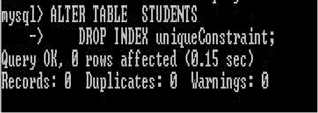

### 主键

主键约束帮助我们唯一标识每一行。被指定为主键的列必须具有唯一值。此外，该列不允许有NULL值。

每个表只允许有一个主键，它可以由单个或多个字段组成。当我们使用多个字段作为主键时，这些字段被称为复合键。如果表的某一列被声明为主键，那么该字段中就不会有两条记录具有相同的值。

主键是唯一标识符。在STUDENTS表中，我们可以将ADMISSION定义为主键，因为它能唯一标识每个学生。不应有两个学生拥有相同的ADMISSION编号。以下是创建该属性的方法：

```sql
CREATE TABLE STUDENTS(
    ADMISSION INT NOT NULL,
    NAME VARCHAR (15) NOT NULL,
    AGE INT NOT NULL,
    PRIMARY KEY (ADMISSION)
);
```

ADMISSION已被设置为该表的主键。如果我们描述该表，你会发现该字段是主键，如下所示：

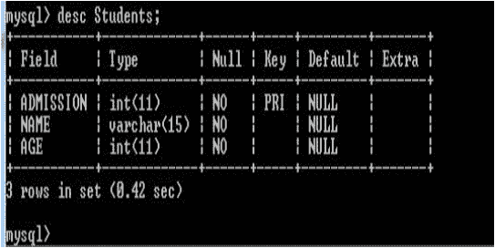

在上面的“Key”字段中，“PRI”表示ADMISSION字段是主键。

你可能希望在一个已存在的表上施加主键约束。可以通过运行以下命令来完成：

```sql
ALTER TABLE STUDENTS
    ADD CONSTRAINT PK_STUDADM PRIMARY KEY (ADMISSION, NAME);
```

在上述命令中，主键约束被命名为“PK_STUDADM”，并指定给两列：ADMISSION和NAME。这意味着这两列的值在任意两行中都不会相同。

可以通过执行以下命令从表中删除主键约束：

```sql
ALTER TABLE STUDENTS DROP PRIMARY KEY;
```

运行上述命令后，你可以描述STUDENTS表，查看它是否还有主键：

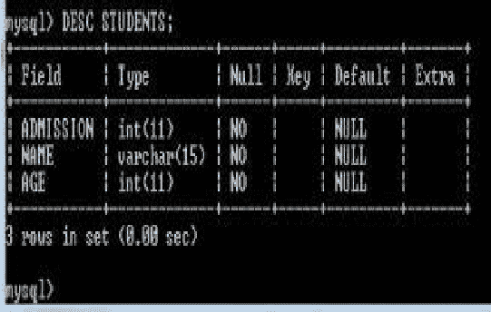

这表明主键已成功删除。

### 外键

该约束用于将两个表链接在一起。有时也被称为引用键。外键是一个列或一组列，与另一个表中的主键匹配。

请考虑下面给出结构的表：

STUDENTS表：

```sql
CREATE TABLE STUDENTS(
    ADMISSION INT NOT NULL,
    NAME VARCHAR (15) NOT NULL,
    AGE INT NOT NULL,
    PRIMARY KEY (ADMISSION)
);
```

FEE表：

```sql
CREATE TABLE FEE (
    ID INT NOT NULL,
    DATE DATETIME,
    STUDENT_ADM INT references STUDENTS (ADMISSION),
    AMOUNT float,
    PRIMARY KEY (ID)
);
```

在FEE表中，STUDENT_ADM字段引用了STUDENTS表中的ADMISSION字段。这使得FEE表的STUDENT_ADM列成为外键。

如果我们创建FEE表时没有包含外键，我们仍然可以通过以下命令添加它：

```sql
ALTER TABLE FEE
ADD FOREIGN KEY (STUDENT_ADM) REFERENCES STUDENTS (ADMISSION);
```

外键将被添加到表中。如果需要删除外键，请运行以下命令：

```sql
ALTER TABLE FEE
DROP FOREIGN KEY;
```

然后外键将从表中删除。

### CHECK 约束

该约束用于创建一个条件，以验证输入到记录中的值。如果条件为假，则该记录违反了约束，因此不会输入到表中。

我们想要创建一个名为STUDENTS的表，并且不希望有任何年龄在12岁以下的学生。如果学生不满足此约束，他们将不会被添加到表中。该表可以按如下方式创建：

```sql
CREATE TABLE STUDENTS (
    ADMISSION INT NOT NULL,
    NAME VARCHAR (15) NOT NULL,
    AGE INT NOT NULL CHECK (AGE >= 12),
    PRIMARY KEY (ADMISSION)
);
```

```sql
mysql> CREATE TABLE STUDENTS (
    -> ADMISSION INT NOT NULL,
    -> NAME VARCHAR (15) NOT NULL,
    -> AGE INT NOT NULL CHECK (AGE >= 12),
    -> PRIMARY KEY (ADMISSION)
    -> );
Query OK, 0 rows affected (0.57 sec)

mysql>
```

表已成功创建。

如果你已经创建了没有该约束的STUDENTS表，但后来需要实现它，请运行下面的命令：

```sql
ALTER TABLE STUDENTS
    MODIFY AGE INT NOT NULL CHECK (AGE >= 12);
```

该约束将成功添加到AGE列。

你也可以为约束指定一个名称。可以使用以下语法完成：

```sql
ALTER TABLE STUDENTS
    ADD CONSTRAINT checkAgeConstraint CHECK(AGE >= 12);
```

### 索引约束

索引帮助我们快速从数据库中检索数据。要创建索引，我们可以依赖数据库表中的一列或一组列。一旦创建了索引，系统会在排序数据之前为每一行分配一个ROWID。

```sql
mysql> ALTER TABLE STUDENTS
    ->        DROP INDEX age_idx;
Query OK, 1 row affected (0.13 sec)
Records: 1  Duplicates: 0  Warnings: 0

mysql>
```

### ALTER TABLE 命令

SQL为我们提供了ALTER TABLE命令，可用于添加、删除和修改表列。该命令还帮助我们向表添加和移除约束。

假设你有一个包含以下数据的STUDENTS表：

| ADMISSION | NAME | AGE |
| --- | --- | --- |
| 3420 | NICHOLAS | 10 |
| 1234 | john | 32 |
| 3456 | mercy | 23 |

```sql
mysql> ALTER TABLE STUDENTS ADD COURSE VARCHAR(10);
Query OK, 3 rows affected (0.15 sec)
Records: 3  Duplicates: 0  Warnings: 0

mysql>
```

当我们查询表的内容时，得到以下结果：

| ADMISSION | NAME | AGE | COURSE |
| --- | --- | --- | --- |
| 3420 | NICHOLAS | 10 | NULL |
| 1234 | john | 32 | NULL |
| 3456 | mercy | 23 | NULL |

这表明该列已被添加，并且每条记录在该列中被分配了一个NULL值。

要将COURSE列的数据类型从VarChar更改为Char，请执行以下命令：

```sql
ALTER TABLE STUDENTS MODIFY COLUMN COURSE Char(1);
```

```sql
mysql> ALTER TABLE STUDENTS MODIFY COLUMN COURSE Char(1);
Query OK, 3 rows affected (0.13 sec)
Records: 3  Duplicates: 0  Warnings: 0

mysql>
```

我们可以将ALTER TABLE命令与DROP TABLE命令结合使用。


要从表中删除列。要从 STUDENTS 表中删除 COURSE 列，我们运行以下命令：

```
ALTER TABLE STUDENTS DROP COLUMN COURSE;
```

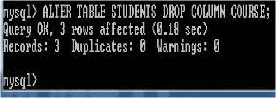

然后，我们可以通过 describe 命令查看表详细信息，以确认该列是否已成功删除。

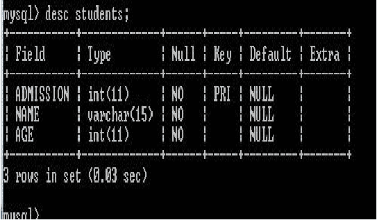

上图显示该列已成功删除。

关于授权标识符。正如你在第二章所学，授权标识符是表示一个或多个可访问/修改数据库内信息的用户的对象。

### 更多参考资料

#### MTA 98-364 认证

你可以在此处找到该认证的信息：[https://www.microsoft.com/en-us/learning/exam-98-364.aspx](https://www.microsoft.com/en-us/learning/exam-98-364.aspx)。到达该页面后，请务必展开“技能考核范围”部分中的主题，因为你在这些领域的数据库知识将会受到检验。

暂时就到这里。

### 参考文献

- 1keydata.com. (2019). *SQL - CREATE VIEW 语句 | 1Keydata。* [在线] 可访问于：https://www.1keydata.com/sql/sql-create-view.html [访问于 2019 年 2 月 3 日]。
- Chartio. (2019). *如何在 SQL Server 中将列从 Null 改为 Not Null。* [在线] 可访问于：https://chartio.com/resources/tutorials/how-to-alter-a-column-from-null-to-not-null-in-sql-server/ [访问于 2019 年 2 月 3 日]。
- Docs.microsoft.com. (2019). *主键和外键约束 - SQL Server。* [在线] 可访问于：https://docs.microsoft.com/en-us/sql/relational-databases/tables/primary-and-foreign-key-constraints?view=sql-server-2017 [访问于 2019 年 2 月 3 日]。
- Sites.google.com. (2019). *DDL 命令 - Create - Drop - Alter - Rename - Truncate - 编程语言。* [在线] 可访问于：https://sites.google.com/site/prgmr/sql/ddl-commands---create---drop---alter [访问于 2019 年 2 月 3 日]。
- Techonthenet.com. (2019). *SQL：UNION ALL 运算符。* [在线] 可访问于：https://www.techonthenet.com/sql/union_all.php [访问于 2019 年 2 月 3 日]。
- 1keydata.com. (2019). *SQL - RENAME COLUMN | 1Keydata。* [在线] 可访问于：https://www.1keydata.com/sql/alter-table-rename-column.html [访问于 2019 年 2 月 3 日]。
- Docs.microsoft.com. (2019). *创建检查约束 - SQL Server。* [在线] 可访问于：https://docs.microsoft.com/en-us/sql/relational-databases/tables/create-check-constraints?view=sql-server-2017 [访问于 2019 年 2 月 3 日]。
- Docs.microsoft.com. (2019). *创建主键 - SQL Server。* [在线] 可访问于：https://docs.microsoft.com/en-us/sql/relational-databases/tables/create-primary-keys?view=sql-server-2017 [访问于 2019 年 2 月 3 日]。
- Docs.microsoft.com. (2019). *删除表（数据库引擎）- SQL Server。* [在线] 可访问于：https://docs.microsoft.com/en-us/sql/relational-databases/tables/delete-tables-database-engine?view=sql-server-2017 [访问于 2019 年 2 月 3 日]。
- Docs.microsoft.com. (2019). *修改列（数据库引擎）- SQL Server。* [在线] 可访问于：https://docs.microsoft.com/en-us/sql/relational-databases/tables/modify-columns-database-engine?view=sql-server-2017 [访问于 2019 年 2 月 3 日]。
- query?, H., M, D., K., R., Singraul, D., Singh, A. and kor, p. (2019). *如何使用 SQL 查询更改表名？* [在线] Stack Overflow。可访问于：https://stackoverflow.com/questions/886786/how-to-change-a-table-name-using-an-sql-query [访问于 2019 年 2 月 3 日]。
- SQL Joins Explained. (2019). *SQL 连接类型 — SQL 连接详解*。 [在线] 可访问于：http://www.sql-join.com/sql-join-types/ [访问于 2019 年 2 月 3 日]。
- Techonthenet.com. (2019). *SQL：ALTER TABLE 语句*。 [在线] 可访问于：https://www.techonthenet.com/sql/tables/alter_table.php [访问于 2019 年 2 月 3 日]。
- Techonthenet.com. (2019). *SQL：GROUP BY 子句*。 [在线] 可访问于：https://www.techonthenet.com/sql/group_by.php [访问于 2019 年 2 月 3 日]。
- www.tutorialspoint.com. (2019). *SQL DEFAULT 约束*。 [在线] 可访问于：https://www.tutorialspoint.com/sql/sql-default.htm [访问于 2019 年 2 月 3 日]。
- www.tutorialspoint.com. (2019). *SQL INDEX 约束*。 [在线] 可访问于：https://www.tutorialspoint.com/sql/sql-index.htm [访问于 2019 年 2 月 3 日]。
- www.tutorialspoint.com. (2019). *SQL INNER JOIN*。 [在线] 可访问于：https://www.tutorialspoint.com/sql/sql-inner-joins.htm [访问于 2019 年 2 月 3 日]。
- www.tutorialspoint.com. (2019). *SQL LIKE 子句*。 [在线] 可访问于：https://www.tutorialspoint.com/sql/sql-like-clause.htm [访问于 2019 年 2 月 3 日]。
- www.tutorialspoint.com. (2019). *SQL NOT NULL 约束*。 [在线] 可访问于：https://www.tutorialspoint.com/sql/sql-not-null.htm [访问于 2019 年 2 月 3 日]。
- www.tutorialspoint.com. (2019). *SQL TOP、LIMIT 或 ROWNUM 子句*。 [在线] 可访问于：https://www.tutorialspoint.com/sql/sql-top-clause.htm [访问于 2019 年 2 月 3 日]。
- W3schools.com. (2019). *SQL INNER JOIN 关键字*。 [在线] 可访问于：https://www.w3schools.com/sql/sql_join_inner.asp [访问于 2019 年 2 月 3 日]。
- W3schools.com. (2019). *SQL LEFT JOIN 关键字*。 [在线] 可访问于：https://www.w3schools.com/sql/sql_join_left.asp [访问于 2019 年 2 月 3 日]。
- W3schools.com. (2019). *SQL NOT NULL 约束*。 [在线] 可访问于：https://www.w3schools.com/sql/sql_notnull.asp [访问于 2019 年 2 月 3 日]。
- W3schools.com. (2019). SQL PRIMARY KEY 约束。 [在线] 可访问于：https://www.w3schools.com/sql/sql_primarykey.asp [访问于 2019 年 2 月 3 日]。
- W3schools.com. (2019). SQL RIGHT JOIN 关键字。 [在线] 可访问于：https://www.w3schools.com/sql/sql_join_right.asp [访问于 2019 年 2 月 3 日]。
- W3schools.com. (2019). SQL UNION 运算符。 [在线] 可访问于：https://www.w3schools.com/sql/sql_union.asp [访问于 2019 年 2 月 3 日]。
- W3schools.com. (2019). SQL UNION 运算符。 [在线] 可访问于：https://www.w3schools.com/sql/sql_union.asp [访问于 2019 年 2 月 3 日]。
- W3schools.com. (2019). SQL UNIQUE 约束。 [在线] 可访问于：https://www.w3schools.com/sql/sql_unique.asp [访问于 2019 年 2 月 3 日]。
- www.tutorialspoint.com. (2019). SQL 主键。 [在线] 可访问于：https://www.tutorialspoint.com/sql/sql-primary-key.htm [访问于 2019 年 2 月 3 日]。

# ARDUINO 编程

## 学习 Arduino 编程的分步终极初学者指南

Ryan Turner

## © 版权所有 2019 - Ryan Turner - 保留所有权利。

未经作者或出版商的直接书面许可，不得复制、翻印或传播本书中包含的内容。

在任何情况下，出版商或作者均不对因本书所含信息而直接或间接导致的任何损害、赔偿或金钱损失承担任何责任或法律责任。

## 法律声明

本书受版权保护。本书仅供个人使用。未经作者或出版商同意，你不得修改、分发、销售、使用、引用或转述本书的任何部分或本书中的内容。

## 免责声明

请注意，本文档中包含的信息仅用于教育和娱乐目的。我们已尽一切努力提供准确、最新、可靠且完整的信息。我们不作任何明示或暗示的保证。读者知悉，作者不提供法律、财务、医疗或专业建议。本书中的内容来自各种来源。在尝试本书中概述的任何技术之前，请咨询持证专业人士。

阅读本文档即表示读者同意：在任何情况下，作者均不对因使用本文档中包含的信息而招致的任何直接或间接损失负责，包括但不限于——错误、遗漏或不准确之处。

## 目录

- [Arduino 简介](#introduction-to-arduino)
- [什么是 Arduino？](#what-is-arduino)
  - [Arduino 的历史](#history-of-arduino)
  - [但 Arduino 到底是什么？](#but-what-is-arduino)
  - [谁在使用 Arduino？](#who-uses-arduino)
- [Arduino 的 6 大优势](#the-6-advantages-of-arduino)
- [理解 Arduino 的关键术语](#key-terms-in-understanding-arduino)


-   Arduino 开发板剖析
-   使用 Arduino 的其他术语
-   了解各种选择
    -   Uno
    -   Leonardo
    -   101
    -   Esplora
    -   Mega 2560
    -   Zero
    -   Due
    -   Mega ADK
    -   Arduino Pro (8 MHz)
    -   Arduino Pro (16 MHz)
    -   Arduino M0
    -   Arduino M0 Pro
    -   Arduino YÚN（基于 ATmega32U4）
    -   Arduino Ethernet
    -   Arduino Tian
    -   Industrial 101
    -   Arduino Leonardo ETH
    -   Gemma
    -   Lilypad Arduino USB
    -   Lilypad Arduino Main Board
    -   Lilypad Arduino Simple
    -   Lilypad Arduino Simple Snap
-   其他开发板
-   选择并设置 Arduino
    -   选择开发板
        -   要实现我期望的功能，需要多少数字和模拟引脚？
        -   我希望这是一个可穿戴设备吗？
        -   我想连接到物联网吗？如果是，如何连接？
    -   开始使用 Arduino IDE
    -   为你的 Arduino 编写程序
    -   连接到 Arduino 板
    -   上传到 Arduino 板
    -   用你的程序运行 Arduino
    -   为 Arduino 编程
-   结构
    -   控制结构
    -   语法
    -   算术运算符
    -   比较运算符
    -   数据类型
        -   Void
        -   Boolean
        -   Char
        -   Unsigned Char
        -   Byte
        -   Int
        -   Unsigned Int
        -   Word
        -   Long
        -   Unsigned Long
        -   Short
        -   Float
        -   Double
-   将你的 Arduino 变成一台机器
    -   有用的常量
    -   串口初始化
    -   初始化数字引脚并将其关闭
    -   读取传感器温度
    -   将传感器值传输到 PC
    -   将传感器读数转换为电压
    -   在上传到 PC 之前将电压转换为温度
    -   低温时关闭 LED
    -   打开 LED 以产生低温指示
    -   要产生中等温度指示，请打开两个 LED
-   C 语言基础与函数
    -   内存映射
-   逻辑语句
-   For 循环
-   数组
-   运算符
    -   算术运算符
    -   布尔运算符
    -   决策
        -   if 语句
        -   输入、输出和传感器
        -   步骤
-   计算机与 Arduino 的接口
-   回顾（复习）
    -   Arduino
    -   Arduino 的结构
    -   C 语言编程基础
    -   使用变量和值
    -   赋值和数学运算
    -   数组
-   更深入的计算机科学主题
-   Arduino API 函数
-   使用 Stream 类（以及处理字符串）
-   结论
-   参考文献

## Arduino 简介

如果你以前从未听说过 Arduino，它是一个开源的电子接口，由两部分组成：第一部分是可编程电路板，另一部分是你选择在计算机上运行的编程程序。Arduino 有多种形式，包括 Arduino Uno、LilyPad Arduino、Redboard、Arduino Mega、Arduino Leonardo，以及其他我们稍后会解释的型号。

如果你对编程不熟悉，这是一个很好的起点。Arduino 可以用多种编程语言进行编程，其丰富的 Arduino 选项可以让你获得更多编程经验。Arduino 带有额外的附件，有些是传感器形式的，其他的可以在任何地方获得，并且可以连接到 Arduino 上的各种端口。Arduino 是理解编程和传感器交互的绝佳踏脚石。

在编程语言中，总是有一个著名的“Hello World”程序显示在屏幕上。在我们所处的微控制器世界中，这个阶段或第一个程序是通过灯光的“开”和“关”闪烁来表示的，以表明你设置的一切都正常工作。

我们将完整地查看这些草图，并在解释代码后说明细节。如果你遇到看不懂的地方，请继续阅读，它会变得清晰。

让我们看看这个程序，以展示我们将如何分解代码。

```
const int PinK_L = 13;

void setup ()

{ pinMode (PinK_L, OUTPUT); }

void loop ()

{digitalWrite(PinK_L, HIGH);

delay (600);

digitalWrite(PinK_L, LOW);

delay(600); }
```

第一部分

```
const int PinK_L = 13;
```

这行代码用于定义一个常量，该常量在整个程序中用于指定特定值。建议为所有引脚都这样定义，因为如果电路保持不变，它便于软件修改。在 Arduino 编程中，常量通常以字母“k”开头命名。

第二部分

```
void setup ()

{pinMode (PinK_L, OUTPUT);}
```

OUTPUT 对应引脚 13。这使得 Arduino 控制向引脚写入信号，而不是从引脚读取。

第三部分

```
void loop()

{digitalWrite (PinK_L, HIGH);

delay(600);

digitalWrite(PinK_L, LOW);

delay(600);}
```

这是代码的核心部分。向引脚写入 HIGH 会使 LED 点亮。当你设置 HIGH 时，意味着引脚的输出为 5V。我们还有另一个选项 LOW，表示你输出 0V。

调用 delay() 来延时指定的毫秒数。由于我们发送 600，所以会延时 0.6 秒。LED 熄灭，这是因为引脚被写入了 LOW 输出。

将激活 600 毫秒的延时。这个序列将一直重复，直到 Arduino 关闭或断电。

在开始消化更多内容之前，请先尝试运行这个程序，确保它工作正常。要测试你的 LED 是否接反，可能会出现以下情况。在 UNO 板上，引脚 13 连接了一个发光二极管（LED）。如果板上 LED 闪烁而面包板上的 LED 不闪烁，那么你可能把 LED 接反了。如果你看到它每秒闪烁一次，那么程序可能没有成功发送到 Arduino。

当你完成编程后，在代码行中加上注释来指示 Arduino。这些注释可以指示你的 Arduino 间歇地或以各种序列闪烁 LED。

我们通常编写的程序是给计算机看的，而不是为了让人们在打开后能理解。有一个很好的机制可以让我们人类轻松阅读程序，而计算机对此毫不知情。在这个程序中有两种注释方式：

1. 块注释风格以两个字符 /* 开始，直到出现 */ 结束。可以跨越多行，这里有几个例子。

```
/* This is the first line*/

/* the program was successful*/

/* we

*are

*going

*far */
```

2. 可以在带有双斜杠 // 的行上进行注释。这部分是为人类而不是机器准备的。这是另一种插入注释的方式。

当你在程序中添加注释时，你会得到类似上面语句的代码。

在接下来的页面中，你会发现，如果代码行旁边没有编号，则表示它是上面一行的注释延续。由于本书篇幅有限，我们可能无法完美地展示这一点。你会发现行尾有一个连字符表示继续，续行处也有一个连字符。这只是我们处理问题的方式，但在 IDE 中你不会看到它，也不需要输入它们。

```
/*
* Program Name: Blink123
*Author: James Aden
* Date written: 24 July 2017
*Description:
* Turns an LED on for a six-tenths of a second, then for another six-tenths of a second on a continuous repetitive session
*/
/* Pin Definitions */
const int PinK_L = 13;
/*
*Functions Name: setup
*Purpose: Run once after system power up
*/
void setup(){pinMode(PinK_L,OUTPUT);}

/*

void loop()
{digitalWrite(PinK_L,HIGH);delay(600);digitalWrite(PinK_L,LOW);delay(600);}
```

## 注意事项

如果你发现程序无法编译，或者得到的结果与预期不同，以下是一些人们常感到困惑的地方：

编程语言通常对字母大小写敏感。例如，myVar 和 MyVar 被认为是不同的。

制表符、空行和空白字符等同于单个空格，这使代码更易于阅读。

代码块通常使用花括号分组，即“{”和“}”。

所有左括号都有对应的右括号，即“(”和“)”。

数字中不应有逗号。因此，不要写 1,000，而应写 1000。

所有程序语句都必须以分号结尾。这意味着每条语句都要如此，但以下两种情况除外：

-   在注释中
-   在放置右花括号“}”之后

任务练习，测试你所学的内容：

1. 将 LED 再次点亮前的延时改为 1.5 秒。LED 的点亮时间保持 600 毫秒。
2. 将 LED 的连接从引脚 13 改为引脚 2。请记住，电路和程序都需要相应改变。


这只是 Arduino 基础编程的一个基础。在本书的其余部分，我们将探讨如何针对不同功能对 Arduino 进行编程。如果你是编程新手，不要让上面的代码吓到你。编程需要练习，但它相对容易学习，就像学习一门新语言一样。

在 Arduino 商标确立过程中出现一些问题，导致公司分裂了几年之后，Arduino 现在是一家单一公司，致力于开发普通大众或爱好者可用的硬件和软件，同时又足够灵活，能够引起专业工程师的兴趣。

## 但 Arduino 是什么？

Arduino 的这段历史听起来可能和这项技术在你看来一样错综复杂。其中充满许多令人费解和困惑的元素，你可能会被“微控制器”“环境”和“语言”这些说法弄得不知所措。不过，本书旨在揭开 Arduino 的神秘面纱。我们将从这里开始，先从 Arduino 的定义讲起。

其工作原理如下：人们购买适合自己用途的硬件，然后在一台性能更强的 Windows、Macintosh OSX 或 Linux 计算机上为开发板编写指令，并通过线缆上传这些指令。代码随后存储在微控制器上，微控制器按照指令运行，例如当光线透过打开的门照进来时触发蜂鸣声。光线会激活连接到微控制器的传感器，就像警报器一样。

## 谁在使用 Arduino？

各种各样的人将 Arduino 用于各种项目和爱好，也用于专业用途。它以简单直接、对初学者足够友好，同时又有足够的深度和丰富性让初学者成长，并且具备足够潜力供更高级的用户使用而闻名。

教师和学生使用 Arduino，事实上他们也是这些产品的目标消费群体，因为 Arduino 提供了一种低成本构建科学仪器的方式。这使教师和学生能够练习和演示化学与物理原理，并开始学习编程和搭建机器人。

设计师和建筑师可能会使用 Arduino 技术来构建交互式模型，以及他们希望按完整规模开发的原型。音乐家和艺术家也会使用 Arduino 微控制器来试验其艺术中的新乐器或新技术。几乎任何人都可以使用 Arduino，包括想要开始摆弄编程和计算机硬件的孩子，以及只想了解一点软件和微计算机知识的爱好者。

## Arduino 的 6 个优势

- 创造 Arduino 微控制器的驱动力是成本效益。预组装的 Arduino 开发板价格不到 50 美元，而不是其他一些开发板所需的 100 美元；可以手动组装的开发板价格甚至更低。
- Arduino 环境 IDE 可跨不同平台工作。这意味着你可以使用 Windows 计算机——其他微控制器板可能并不具备这种灵活性——也可以使用 Macintosh OSX 计算机或运行 Linux 的计算机，并且同样轻松地使用 Arduino 软件。这向 Apple 用户和开源 Linux 用户开放了微控制器的使用。
- Arduino 的软件是开源的。用于指示微控制器完成特定功能的工具或代码字符串，任何人都可以获取。你不必购买许可证即可使用这些工具，因此教师可以向学生教授这些工具，学生也可以在没有额外成本的情况下学习它们。
- 这些开源工具还可以通过 C++ 库和 AVR-C 编程语言进行扩展，这意味着对代码有更深入了解的人也能从使用这些技术中受益。该软件和编程功能具有足够的深度，让更专注的人可以深入研究，同时它又是一种足够直白的编程语言，让爱好者也能动手尝试。
- 人们为微控制器编写代码的环境简单明了。这意味着你将用来为微控制器编写指令的计算机程序 IDE 直截了当且易于理解。这使使用该软件成为一种顺畅的体验。
- 开源硬件。Arduino 开发板技术以知识共享许可协议发布。任何有此意愿并具备相关知识的人都可以找到并创建自己的硬件，以便在 IDE 环境中配合 Arduino 软件编程使用。即使是没有经验的电路设计者，也可以使用面包板创建自己的 Arduino 电路板。

## 理解 Arduino 的关键术语

在使用 Arduino 技术时，理解 Arduino 的术语会很有帮助。你需要理解这些术语，才能选择开发板、编写编码指令、设置微控制器以供使用，并最终使用 Arduino 开发板。在本章中，你会找到一些关键术语，它们将极大地帮助你在成为 Arduino 用户的过程中不断前进。

如前所述，Arduino 是开源的，这意味着你可以使用它并将其教授给他人，而不会违反任何版权法。它基于易于使用的硬件（即你将实际使用的物理计算机板）和直截了当的软件（即你用来指示硬件执行你所选择任务的编码指令）。该软件也称为代码，而单条指令称为工具。

## Arduino 开发板的构造

开发板本身包含许多部件。数字引脚沿大多数 Arduino 微控制器的边缘排列，用于输入（即感测某种状态）和输出（即控制器对输入作出的响应）。例如，输入可能是光传感器感测到黑暗，也就是缺乏光线。然后它会闭合电路点亮一个灯泡作为输出：一盏给孩子用的夜灯。

在大多数开发板上，会有一个引脚 LED，它与特定引脚相关联，例如 Arduino Uno 上的引脚 13。这个引脚 LED 是开发板内置的唯一输出可能，它将帮助你完成第一个项目“闪烁草图”，该项目将在后面解释。引脚 LED 还用于调试或修正你编写的代码，使其没有错误。电源 LED 顾名思义：当开发板接收电源或“开启”时，它就会亮起。这也有助于调试代码。

每块开发板上都有微控制器本身，称为 ATmega 微控制器，它是整块开发板的大脑。它接收你的指令并据此执行。没有它，整块开发板将没有任何功能。

在 Arduino Uno 上，模拟输入引脚位于与数字引脚相对的另一边。它们是 Arduino 系统的输入。模拟意味着输入的信号不是恒定的，而是随时间变化，例如音频输入。在音频输入的例子中，房间里的听觉输入会随着房间里的人说话以及从房间外渗入的噪声而变化。

GND 和 5V 引脚用于为电路和微控制器提供额外的 5V 电源。电源接口通常位于 Arduino 开发板的边缘，用于在微控制器未插入 USB 时为其供电。USB 端口也可以用作电源，但其主要功能是将你的草图（即你编写的一组指令）从计算机上传或传输到 Arduino。

TX 和 RX LED 用于指示正在发生信息传输。当你将草图从计算机上传到 Arduino 时，就会出现这种通信指示，因此它们会在交换期间快速闪烁。

复位按钮顾名思义：它将微控制器重置为出厂设置，并擦除你上传到 Arduino 的任何信息。

## 使用 Arduino 的其他术语

Arduino 系统中有三种类型的内存。内存是存储信息的空间。

闪存是存储你所编写程序代码的地方。它也称为“程序空间”，因为当你将程序上传到 Arduino 时，它会自动用于该程序。这种内存会在断电或 Arduino 关闭时保持不变。

SRAM（静态随机存取存储器）是你创建的草图或程序用来创建、存储和处理来自输入的信息的空间

用于创建输出的来源。这种类型的存储在断电后便会消失。

EEPROM 就像一个小型硬盘，允许程序员在 Arduino 关闭时存储程序本身以外的信息。EEPROM 有单独的指令，用于读取、写入和擦除，以及其他功能。

某些数字引脚会被指定为 PWM 引脚，这意味着它们可以使用数字方式产生模拟信号。我们记得，模拟意味着输入（或输出）是变化的，而不是恒定的。通常，数字引脚只能产生恒定的能量流。然而，PWM 引脚可以在 0 到 5 伏之间改变能量的“脉冲”。你编程的某些任务只能由 PWM 引脚执行。

此外，在比较微控制器板时，你会希望关注时钟速度，即微控制器运行的速度。速度越快，板的响应越灵敏，但消耗的电池电量或能量也越多。

UART 衡量设备可以处理的串行通信线路数量。串行通信线路是串行传输数据的线路，也就是按线路传输，而不是并行或同时传输。串行处理事务比并行处理所需的硬件少得多。

有些项目会让你将设备连接到物联网，物联网本质上描述的是除台式机和笔记本电脑之外的设备与各种网络互联以共享信息。从智能冰箱到智能手机再到智能电视，一切都在连接到物联网。

## 了解各种选择

既然我们已经了解了 Arduino 微控制器板的一些基础知识，现在让我们看看购买 Arduino 板时可用的各种选择。我们将考察价格、功能、内存容量和其他特性，帮助您尽可能轻松、直接地做出决定。

### Uno

这是大多数人开始 Arduino 之旅所用的板。它的内存偏小，但功能非常灵活，是初学者以及想要动手动脑尝试 Arduino 的人的绝佳工具。该型号有一个 mini-USB 端口，允许你直接上传到板子，而无需使用转接板或其他额外硬件。

| 规格 | 值 |
| --- | --- |
| 价格 | $24.95 |
| 闪存 | 32kB |
| SRAM | 2kB |
| EEPROM | 1kB |
| 处理速度 | 16MHz |
| 数字引脚 | 14 个引脚 |
| PWM 引脚 | 6 个引脚 |
| 模拟输入 | 6 个引脚 |
| 工作电源 | 5V |
| 输入电源 | 7-12V |

### Leonardo

Leonardo 微控制器板开箱即可使用：你只需要一根 micro-USB 线和一台电脑即可开始。此外，得益于其 ATmega32U4 处理器，电脑可以将 Leonardo 识别为鼠标或键盘。

| 规格 | 值 |
| --- | --- |
| 价格 | $19.80 |
| 闪存 | 32kB |
| SRAM | 2.5kB |
| EEPROM | 1kB |
| 处理速度 | 16MHz |
| 数字引脚 | 20 个引脚 |
| PWM 引脚 | 7 个引脚 |
| 模拟输入 | 12 个引脚 |
| 工作电源 | 5V |
| 输入电源 | 7-12V |

### 101

这款微控制器包含许多其他初学者型号所没有的功能。例如，你可以通过手机的低功耗蓝牙连接与板子连接。此外，它内置加速度计和陀螺仪，凭借六轴灵敏度识别各个方向的运动。它还可以识别手势。

综合起来，这些功能让你可以将设备自身或周围的运动作为输入，微控制器则以此输出作为响应。

| 规格 | 值 |
| --- | --- |
| 价格 | $30.00 |
| 闪存 | 196kB |
| SRAM | 24kB |
| EEPROM | 0kB |
| 处理速度 | 32MHz |
| 数字引脚 | 14 个引脚 |
| PWM 引脚 | 4 个引脚 |
| 模拟输入 | 6 个引脚 |
| 工作电源 | 3.3V |
| 输入电源 | 7-12V |

### Esplora

这款板基于 Leonardo，但内置了更多技术，因此你不必学习太多电子知识就能上手运行。相反，你可以在观察过程自行展开的同时进行学习。

内置的输入传感器包括操纵杆、滑块、温度传感器、麦克风、加速度计和光传感器。它还包括一些声音和光输出。它可以通过两个 TinkerKit 输入/输出连接，连接称为 TFT LCD 屏幕的其他技术来扩展其能力。

| 规格 | 值 |
| --- | --- |
| 价格 | $43.89 |
| 闪存 | 32kB |
| SRAM | 2.5kB |
| EEPROM | 1kB |
| 处理速度 | 16MHz |
| 数字引脚 | 不适用 |
| PWM 引脚 | 不适用 |
| 模拟输入 | 不适用 |
| 工作电源 | 5V |
| 输入电源 | 7-12V |

### Mega 2560

这款微控制器专为机器人技术和 3D 打印机等大型项目而设计。它的数字引脚和模拟输入引脚数量多出许多倍，PWM 引脚数量也几乎是三倍。再加上成倍增加的闪存、SRAM 和 EEPROM，使得需要更多指令的项目成为可能。这款 Arduino 板为更高的复杂性和特异性提供了空间。

| 规格 | 值 |
| --- | --- |
| 价格 | $45.95 |
| 闪存 | 256kB |
| SRAM | 8kB |
| EEPROM | 4kB |
| 处理速度 | 16MHz |
| 数字引脚 | 54 个引脚 |
| PWM 引脚 | 15 个引脚 |
| 模拟输入 | 16 个引脚 |
| 工作电源 | 5V |
| 输入电源 | 7-12V |
| UART | 4 路 |

### Zero

这是已开发的 Arduino Uno 技术的扩展。它是 Uno 的 32 位扩展，通过大幅提高的处理速度、16 倍的 SRAM 容量以及成倍增加的闪存来提升性能。你需要为这些扩展付费，价格几乎是 Uno 的两倍，但借助这款硬件，你获得的能力远超两倍。

Zero 的另一个优势是它有一个名为 Atmel 嵌入式调试器（缩写为 EDBG）的内置功能，可帮助你在不使用额外硬件的情况下调试代码，从而提高软件编码效率。

| 规格 | 值 |
| --- | --- |
| 价格 | $42.90 |
| 闪存 | 256kB |
| SRAM | 32kB |
| EEPROM | 不适用 |
| 处理速度 | 48MHz |
| 数字引脚 | 14 个引脚 |
| PWM 引脚 | 10 个引脚 |
| 模拟输入 | 6 个引脚 |
| 模拟输出 | 1 个引脚 |
| 工作电源 | 3.3V |
| 输入电源 | 7-12V |
| UART | 2 路 |
| USB 端口 | 2 个 micro-USB 端口 |

### Due

这在微控制器板领域是一个新奇事物，因为它基于 32 位 ARM 内核微控制器构建，赋予它强大的能力和丰富的功能。它有一个极快的处理器和 4 个 UART，赋予它很大的灵活性和可用性来执行多种功能。它用于规模较大的 Arduino 项目；虽然它可能不是你的第一块板，但对于你今后要进行的任何更大项目，最好考虑它。

| 规格 | 值 |
| --- | --- |
| 价格 | $37.40 |
| 闪存 | 512kB |
| SRAM | 96kB |
| EEPROM | 不适用 |
| 处理速度 | 84MHz |
| 数字引脚 | 54 个引脚 |
| PWM 引脚 | 12 个引脚 |
| 模拟输入 | 12 个引脚 |
| 模拟输出 | 2 个引脚 |
| 工作电源 | 3.3V |
| 输入电源 | 7-12V |
| UART | 4 路 |
| USB 端口 | 2 个 micro-USB 端口 |

### Mega ADK

它基于 Mega2560 Arduino 板，具有惊人的内存容量和大量可用的输入输出。Mega2560 和 Mega ADK 的区别在于，Mega ADK 特别兼容 Android 技术，例如三星手机和平板电脑、华硕技术，以及其他使用 Android 的非 iOS、非 Windows 移动设备。它的价格高达近 50 美元，但如果你打算将 Android 融入项目，这就会是你想要使用的板。

| 规格 | 值 |
| --- | --- |
| 价格 | $47.30 |
| 闪存 | 256kB |
| SRAM | 8kB |
| EEPROM | 4kB |
| 处理速度 | 16MHz |
| 数字引脚 | 54 个引脚 |
| PWM 引脚 | 15 个引脚 |
| 模拟输入 | 16 个引脚 |
| 工作电源 | 5V |
| 输入电源 | 7-12V |
| UART | 4 路 |

### Arduino Pro (8 MHz)

这是 SparkFun 公司对 ATmega328 板的版本。它基本上是面向专业人士的 Uno，旨在半永久性地安装到某个物体或技术中。8MHz 版本的性能比 Uno 低一半，但也便宜不少。要让这款板工作，需要更多硬件知识，因为它没有 USB 端口，也没有通过 USB 为板供电的方式，因此必须连接 FTDI 线缆或转接板才能与板通信并上传草图。不过，一旦你解决了将这块板连接到电脑的技术细节，它的功能就像一块半功率的 Uno。与 16MHz 的 Arduino Pro 不同，这款 8MHz Pro 可由锂电池供电。

| 规格 | 值 |
| --- | --- |
| 价格 | $14.95 |
| 闪存 | 16kB |


- 模拟输入：6 引脚
- 工作电源：5 V
- 输入电源：5-12 V
- UART：1 路

### Arduino M0

该板是 Arduino Uno 的扩展，为 Uno 带来 ARM Cortex M0 内核的 32 位处理能力。这不会是你的第一块板，但可能是你最令人兴奋的项目。它能让富有创造力的人开发可穿戴技术、制作具有高科技自动化功能的物品、创造前所未见的机器人、为物联网提出新想法，或开展许多其他精彩项目。这是对 Uno 简洁技术的有力扩展，因此具有几乎可以成为你能想象到的任何东西的灵活性。

价格：$22.00

- 闪存：256 kB
- SRAM：32 kB
- 处理速度：48 MHz
- 数字引脚：20 引脚
- PWM 引脚：12 引脚
- 模拟输入：6 引脚
- 工作电源：3.3 V
- 输入电源：5-15 V

### Arduino M0 Pro

它与 Arduino M0 一样，是对 Uno 的扩展技术，但增加了通过集成在板上的 Atmel 嵌入式调试器（EDBG）调试自身软件的功能和能力。这创建了一个可与板进行调试的接口；换言之，这是一种与板交互的方式，你可以借此发现所提供代码中的问题并修复它们。

价格：$42.90

- 闪存：256 kB
- SRAM：32 kB
- 处理速度：48 MHz
- 数字引脚：20 引脚
- PWM 引脚：12 引脚
- 模拟输入：6 引脚
- 工作电源：3.3 V
- 输入电源：5-15 V

### Arduino YÚN（基于 ATmega32U4）

Arduino YÚN 是连接物联网时非常适合使用的一块板。如果你想设计一个连接到网络（如互联网或数据网络）的设备，它非常完美。它内置以太网支持，可让你有线连接到网络；还具备 Wi-Fi 功能，可让你无线连接到互联网。YÚN 的处理器支持 Linino OS 这一操作系统（或代码语言）中的 Linux 代码。这赋予了它额外的性能与能力，同时保留了 Arduino 的易用性。

价格：$68.20

- 闪存：32 kB
- SRAM：2.5 kB
- EEPROM：1 kB
- 处理速度：16 MHz
- 数字引脚：20 引脚
- PWM 引脚：7 引脚
- 模拟输入：12 引脚
- 工作电源：5 V
- UART：1 路

### Arduino Ethernet

这款 Arduino 板基于 ATmega328，与 Arduino Uno 使用相同的微控制器。引脚 10 到 13 保留用于与以太网交互，因此该板的输入/输出能力比 Uno 和其他 Arduino 微控制器板要少。它不通过 USB 连接，而是通过以太网线连接，并且以太网线还可以选择为微控制器供电。与其他板不同，该板提供了通过 microSD 读卡器扩展存储的选项。向该板上传草图的方法与 Arduino Pro 类似，即通过 FTDI USB 线缆或通过 FTDI 转接板。这款 Arduino 型号比我们研究过的许多板都更复杂，但它也具有其他板无法实现的功能。

价格：$43.89

- 闪存：32 kB
- SRAM：2 kB
- EEPROM：1 kB
- 处理速度：16 MHz
- 数字引脚：14 引脚
- PWM 引脚：4 引脚
- 模拟输入：6 引脚
- 工作电源：5 V
- 输入电源：7-12 V

### Arduino Tian

Tian 是一台微型计算机，在微控制器之上还内置了微处理器。它具备像 Arduino YÚN 一样的 Wi-Fi 功能，以及 YÚN 和 Ethernet 型号的以太网功能。为增强的功能和性能，你需要支付高昂的价格，但它往往物有所值。这是一个快速处理器，时钟速度为 560 MHz，而且除此之外还具备蓝牙功能。该板还使用 Linino OS，它基于 Linux 操作系统和 OpenWrt。

价格：$95.70

- 闪存：256 kB（+ 微处理器提供的 16 MB 闪存 + 微处理器提供的 4 GB eMMC）
- SRAM：32 kB（+ 微处理器提供的 64 MB DDR2 RAM）
- 处理速度：48 MHz（微处理器为 560 MHz）
- 数字引脚：20 引脚
- 模拟输入：6 引脚
- 工作电源：3.3 V
- 输入电源：5 V

### Industrial 101

Industrial 101 本质上是一个更小、功能较弱的 YÚN，价格略高于其一半。它面向“产品集成”，换言之，旨在用于长期项目。它旨在在你所构建的任何东西中发挥半永久性的作用。该板内置 Wi-Fi 功能。

- 闪存：32 kB（引导程序使用 4 kB，因此仅 28 kB 可供使用）
- SRAM：2.5 kB
- 处理速度：16 MHz
- 数字引脚：20 引脚
- PWM 引脚：7 引脚
- 模拟输入：12 引脚
- 工作电源：5 V
- 输入电源：7-12 V

### Gemma

这款 Arduino 由美国的 Adafruit Technologies 制造。Arduino Gemma 是一块微型微控制器板，旨在供穿戴使用。与不可穿戴的板相比，它的空间和功能余地确实更少，但对于许多可穿戴项目而言，你并不需要其他一些 Arduino 微控制器板那样的强健性。该板上有 micro-USB 连接，因此你不需要转接板或 FTDI 线缆。相反，你只需通过 micro-USB 连接上传草图，然后通过 micro-USB 或电池连接为微控制器供电。

价格：$9.95

- 闪存：8 kB
- SRAM：0.5 kB
- EEPROM：0.5 kB
- 处理速度：8 MHz
- 数字引脚：3 引脚
- PWM 引脚：2 引脚
- 模拟输入：1 引脚
- 工作电源：3.3 V
- 输入电源：4-16 V

### LilyPad Arduino USB

该板为圆形，基于 ATmega32U4 Arduino 微控制器。它包含一个 micro-USB 连接器，便于上传草图并为板供电。它还内置 JST 连接，因此如果你决定用电池为板供电，可以连接 3.7 V 锂聚合物电池。LilyPad Arduino USB 与其他 LilyPad Arduino 型号的区别在于，USB 型号标配 micro-USB 端口，无需转接板或 FTDI 适配器。此外，该板还可以被计算机识别为鼠标或键盘等设备。

该板像 Gemma 一样旨在供穿戴使用。它可以缝入衣物或以其他方式附着在人体上，以执行你编程设定的任何功能。

价格：$24.95（可在 SparkFun 购买）

- 闪存：32 kB
- SRAM：2.5 kB
- EEPROM：1 kB
- 处理速度：8 MHz
- 数字引脚：9 引脚
- PWM 引脚：4 引脚
- 模拟输入：4 引脚
- 工作电源：3.3 V
- 输入电源：3.8-5 V

### LilyPad Arduino Main Board

这是另一块可穿戴 Arduino 微控制器板。它可以缝入一块织物，或与其他传感器、执行器和电源组合，成为你随身携带、具备你自己编程功能的东西。它需要转接板和 FTDI 线缆才能将草图上传到微控制器的闪存，但一旦处理好这一点，你就拥有了一个自己制作的廉价可穿戴设备。

价格：$19.95（可在 SparkFun 购买）

- 闪存：16 kB（引导程序使用 2 kB，因此编程者可用的仅 14 kB）
- SRAM：1 kB
- EEPROM：0.512 kB
- 处理速度：8 MHz
- 数字引脚：14 引脚
- PWM 引脚：6 引脚
- 模拟输入：6 引脚
- 工作电源：2.7-5.5 V
- 输入电源：2.7-5.5 V

### LilyPad Arduino Simple

这款 Arduino 微控制器板型号与 LilyPad Arduino Main Board 的不同之处在于，它只有 9 个数字输入/输出引脚，约为主板引脚数的 2/3。对于不需要那么多输入和输出的较简单项目来说，这是一块好板。它也比主板更强大，闪存、SRAM 和 EEPROM 都是主板的两倍。这是 LilyPad Arduino Main Board 的一个功能更强但功能数量更少的版本，旨在作为可携带设备穿戴。

- 价格：$19.95（可在 SparkFun 购买）
- 闪存：32 kB
- SRAM：2 kB
- EEPROM：1 kB
- 处理速度：8 MHz
- 数字引脚：9 引脚
- PWM 引脚：5 引脚
- 模拟输入：4 引脚
- 工作电源：2.7-5.5 V
- 输入电源：2.7-5.5 V

### LilyPad Arduino Simple Snap

这是 LilyPad Arduino Simple 的更昂贵版本，同样旨在用于制作可穿戴设备和电子纺织品。它解决了先前版本的一个关键问题：清洗嵌入该板的纺织品。使用其他 LilyPad Arduino 型号以及 Gemma 时，需要先取下电源，然后手洗嵌入或缝有微控制器的材料。然后必须等待整个电路干燥后才能重新通电，否则可能发生短路并损坏该技术。

使用 LilyPad Arduino Simple Snap 时，9 个输入/输出引脚是可按扣的按钮，因此可以将微控制器板从最初附着的材料上取下。然后可以清洗材料，再将板放回其在织物上的位置。


Lilypad Arduino Simple Snap 还内置锂聚合物电池（LiPo 电池），可通过将电源接入充电电路来充电。该板的设计方式使其具有可拆卸并安装到新项目中的优势。

- *价格：* $29.95（可在 SparkFun 购买）
- 闪存：32kB
- *SRAM：* 2kB
- EEPROM：1kB
- 处理速度：8MHz
- 数字引脚：9 个引脚
- PWM 引脚：5 个引脚
- 模拟输入：4 个引脚
- 工作电压：2.7-5.5V
- 输入电压：2.7-5.5V

### 其他板

还有其他板，例如 Arduino Mini、Pro Mini、Arduino Robot Control、Arduino Robot Motor、Arduino BT 以及许多其他板，可选种类正在快速增加。

如果你是一名初学者，建议从 UNO 这样的基础板开始。一旦你准备好进行一些更高级的项目，这些其他型号可能值得进一步研究！选择 Arduino 板取决于每块板的功能和便利性。如上所述，UNO 通常被认为是适合初学者的板，但也要考虑电压、电流和电阻在你的选择中如何发挥作用。每个项目的输入电源取决于你将如何使用该板。

现在，让我们了解如何开始使用 Arduino。

## 选择和设置 Arduino

设置 Arduino 微控制器的第一步是选择你想要使用的 Arduino 板。

### 选择板

在查看 Arduino 板的各种选项时，在做出选择之前，有几个因素需要考虑。在决定使用某块板之前，请问自己以下问题：

- 运行我设想的应用需要多少处理能力？

你可能不知道项目所需的闪存和处理能力的确切数值，但一个会变色的简单夜灯与一个有许多活动部件的机械手在功能上有明显差异。后者需要更强大的 Arduino 微控制器板，相比更简单的夜灯方案，它需要更快的处理速度、更多的闪存和更多的 SRAM。

- 为了实现我想要的功能，需要多少个数字引脚和模拟引脚？

同样，你不需要有极其具体的想法，但知道你需要更多还是更少的引脚，会对你选择哪块板产生很大影响。如果你要做一个简单的第一个项目，使用较少的数字引脚、PWM 引脚和模拟引脚也可以应付；而如果你想做更复杂的事情，通常应考虑引脚数量较多的板。

- 我希望这是一个可穿戴设备吗？

可穿戴设备有几种选择，因此这个问题当然不会完全替你做出决定。不过，它有助于缩小选择范围并为你指明方向，其中 Lilypad、Gemma 或其他类似技术是最佳选择。

- 我希望连接到物联网吗？如果是，如何连接？

如果你希望连接物联网，YÚN、Tian、Ethernet、Leonardo ETH 或 Industrial 101 会让你的工作轻松很多。这些板具备以太网连接能力和 Wi-Fi 能力，因此你可以连接到互联网之类的网络，并共享数据，或与物联网中的其他设备交互并控制它们。

### 开始使用 Arduino IDE

Arduino 软件在称为 IDE 的环境中运行。这意味着你要么需要下载桌面 IDE 来编写代码，要么在在线 IDE 中在线编写代码。

你可能访问 IDE 的第一种方式是下载桌面应用程序，它有几个选项来适配你可能使用的各种设备。首先是 Windows 桌面应用程序。你也可以通过 Windows 应用程序从 Windows 平板电脑或 Windows 手机访问它。接下来是 Macintosh OSX 版本，它允许 IDE 在 Apple 笔记本电脑和台式机上运行，但不能在 iPhone 和 iPad 等 Apple 移动设备上运行。最后，在 Linux 上运行 Arduino IDE 有三个选项：32 位、64 位和 Linux ARM 版本。如果你比起浏览器选项更喜欢这种方式，只需访问 Arduino IDE 网站 https://www.arduino.cc/en/Main/Software 即可。

在那里，你可以下载相应版本的桌面 IDE。接下来，运行安装应用程序，依次点击出现的选项，几分钟内就应该能拥有可运行的 Arduino IDE 环境。

这样，你也可以从 Android 设备和 Apple 移动设备访问 IDE 软件，因为它基于 Web 浏览器，运行在自己的平台上，而不是运行在 Android 或 iOS 平台上。你还可以在各种计算机类型上运行 Web 浏览器，包括 Linux、Microsoft Windows 和 Apple Macintosh。这将允许你将草图上传到云端，也就是将你编写的信息存储在安全位置，之后你可以通过互联网连接从另一台设备重新访问。

### 为 Arduino 编写程序

接下来，你将为你希望 Arduino 板运行的程序编写代码。我们将在下一章介绍如何为 Arduino 板编写代码，但现在请务必理解，代码是在计算机、平板电脑或手机上的 IDE 中编写的，无论是桌面应用程序还是 Web 应用程序。这样可以让你一次看到整个代码，从而更容易调试或消除错误。

编写代码后，你会希望运行它，并排查或调试发现的任何错误。最好的办法是将编写好的程序应用到 Arduino 板上，看看它是否运行。为此，你需要进入下一步：上传草图。

### 连接到 Arduino 板

有些板内置 USB、mini-USB 或 micro-USB 端口。例如 Uno 和 Leonardo，适合 Arduino 生涯中较为初级的阶段。只需将 USB 线的一端插入计算机，另一端插入你所拥有的板上相应的 USB 端口，Arduino IDE 软件就应该能识别出板的类型。如果无法识别，你始终可以从下拉菜单中选择正确的板。

有时你需要使用 FTDI 线缆或转接板，才能使 Arduino 与计算机兼容。这意味着你要将 FTDI 插入 Arduino 微控制器板上的 FTDI 端口，然后将其连接到计算机或另一块板。如果你将 FTDI 线缆连接到转接板，操作方式与使用 USB 兼容板时相同：将线缆合适的一端插入转接板，另一端插入计算机。同样，计算机上的 Arduino IDE 软件程序应该能识别你的 Arduino 板；如果无法识别，你始终可以从下拉菜单中选择。

### 上传到 Arduino 板

要上传草图（即你刚刚用代码创建的程序），你需要选择要上传到的正确板和端口。选择正确的板应该很容易，因为只需查找与你所用板类型名称匹配的板标题即可。

要选择正确的串口，你可以选择以下选项：

### Mac

- Uno、Mega2560 或 Leonardo 使用 */dev/tty.usbmodem241*。
- Duemilanove 或更早的 Arduino 板使用 */dev/tty.usbserial-1B1*。
- 其他通过 USB 转串口适配器连接的设备使用 */dev/tty.USA19QW1b1P1.1*。

### Windows

- 串口板使用 *COM1* 或 *COM2*。
- USB 连接的板使用 *COM4、COM5 或 COM7* 或更高端口。
- 在 Windows 设备管理器中查看，以确定你正在使用的设备占用了哪个端口。

### Linux

- 串口使用 */dev/ttyACMx*。
- USB 端口使用 */dev/ttyUSBx* 或类似端口。

选择正确的板和端口后，点击 *上传*，并从出现的菜单中选择要上传的草图。如果你使用的是较新的 Arduino 板，就可以直接上传新草图；但对于较旧的板，必须在上传新草图前重置板子，否则板子内存中会出现两个可能相互冲突的草图，导致其崩溃。

### 使用程序运行 Arduino

将编写的程序上传到 Arduino 后，有几种为其供电的方式。首先，可以通过 USB 连接到另一台带电设备（例如计算机）来供电。其次，在具备该功能的板上，可以通过以太网供电。这意味着，通过连接到网络，你将通过以太网连接到电源。最后，大多数 Arduino 可通过锂聚合物电池供电。


一旦接通电源，并将指定的输入送入微控制器，它就会执行其预期功能。

## 为 Arduino 编写代码

为 Arduino 编写程序意味着学习一门新语言，但它并没有你想象的那么难。正如数学有自己的一套符号来表示加法、减法和乘法等各种运算一样，为 Arduino 编写代码时也会使用不同的符号和术语。如果你过去有过编程经验，学习一门新语言会很容易。对于从未学过编程的人来说，将一种代码形式转换为另一种代码形式，就像把一种语言翻译成另一种语言。尽管这看起来可能很难，但编程的理念是让将来为其他程序编写代码变得更容易。下面列出了 Arduino IDE 编程中使用的术语和词汇，以及如何使用它们。

### 结构

#### setup()

这是草图启动时调用的函数，在启动或复位后只运行一次。你可以用它来初始化变量、引脚模式，或使用库（可下载以获得额外功能的特定术语）。

#### loop()

loop 函数要求 Arduino 微控制器板多次重复执行某个函数，可以连续重复，直到满足某个变量或条件为止。你可以设置让它停止循环的条件，也可以让它持续循环，直到你将 Arduino 与电源断开或将其关闭。

### 控制结构

控制结构说明输入将如何被接收。顾名思义，与控制相关的各种输入决定了你的数据将如何被读取。在数据分析中也会考虑临时语言。下面介绍常见且多样的控制结构。

#### 如果（If）

它把条件或输入与输出联系起来。这意味着，如果满足某个条件，微控制器就会产生特定的输出或响应。例如，*如果*与微控制器相连的温度计测得的温度超过 75 华氏度，你可能会编写代码，指示 Arduino 向空调设备发送信号以将其开启，从而把温度降回 75 华氏度。

#### 如果…否则（If…Else）

这类似于 *If* 条件语句，但它规定了当第一个动作的条件不满足时微控制器将采取的另一个动作。这让你可以用一段代码在两种不同情况下执行两种不同的动作。

#### 当型循环（While）

这是一个会无限持续下去的循环，直到与它相连的表达式变为假。也就是说，它会执行某个函数，直到满足某个参数，并且被设为条件的语句变为假。

#### 执行…当型循环（Do… While）

这类似于 *while* 语句，但它至少会运行一次，因为它在函数末尾而不是开头测试变量。

#### 中断（Break）

这可以说是微控制器某个函数的一种紧急出口。它用于在未满足退出该部分功能所必需的条件时，退出 *do*、*for* 或 *while* 循环。

#### 继续（Continue）

#### 返回（Return）

这是停止函数的一种方式，它会将函数终止时产生的值返回给调用函数或请求该信息的函数。

#### 转到（Goto）

这段代码告诉微控制器在已编码的程序中跳转到另一个位置，而不是相邻位置。它把执行流程转移到程序中的另一个位置。C 语言程序员通常不鼓励使用它，但它确实可以简化程序。

### 语法

#### ;（分号）

它的作用类似于英语中的句号：它结束一条语句。不过，要确保由分号结束的语句是完整的，否则你的代码将无法正常运行。

#### {}（花括号）

它们有许多复杂的功能，但你必须知道的是，当你插入一个左花括号时，后面必须跟一个右花括号。这被称为保持括号配对，对让程序正常工作至关重要。

#### //（单行注释）

如果你想提醒自己或告诉别人有关代码如何运行的信息，请使用该符号开始注释，并确保它只占一行。这不会传输到微控制器的处理器，而是会保留在代码中，供你和任何手动阅读代码的人参考。

#### /* */（多行注释）

这种注释由 /* 开始，并跨越多行。它本身可以包含单行注释，但不能包含另一个多行注释。务必用 */ 结束注释，否则代码的其余部分将被视为注释而不会被执行。

#### #define

这会将某个变量定义为常量值。它为那个值指定一个名称，作为该值的一种简写。这些定义不会占用芯片上的任何内存空间，因此有助于节省空间。一旦代码被编译或作为程序整体处理，编译器就会把该常量的所有实例替换为用于定义它的值。

注意：此语句末尾不使用分号。

#### `#include`

它用于在草图中包含其他库，也就是说，在你的草图中包含原本不会包含的其他词汇和编程语言。例如，你可以包含 AVR C 库，或来自各种 C 库的许多工具或代码片段。

注意：不要在此语句末尾添加分号，就像在 #define 语句中也不添加分号一样。如果你确实添加了分号来结束语句，就会收到错误消息，程序将无法运行。

### 算术运算符

顾名思义，算术运算符通过使用数学符号来完成代码运算。每个符号将一行代码与另一行代码连接起来。当寻找产生测量值的输出时，务必检查你的 Arduino 设置。将导线连接到 Arduino 上错误的电压接口可能会导致负值或无关值。

#### =（赋值运算符）

它会将一个值赋给变量，并在该变量出现的整个运算过程中用所赋的值代表该变量。这与 == 不同，== 用于判断两个变量，或一个变量与一个设定值是否相等。双等号的作用更像数学和代数中的单等号，而不像 Arduino IDE 中的单等号。

#### +（加法）

它的作用正如你可能预期的那样：将两个值相加，或将一个值与变量相加，或将 2 加到一个固定常量上。你必须考虑的一点是，在 C 编程语言中，变量的值有最大值限制。这意味着，如果你的变量最大值为 32,767，那么给该变量加 1 会得到一个负结果 -32,768。如果你预计这些值会超过允许的绝对最大值，你仍然可以执行这些运算，但必须指示微控制器在出现负结果时该怎么做。此外，在加法以及减法、乘法和除法中，你要把结果变量放在左侧，把运算放在 = 或 == 的右侧。

另外还要记住，你输入运算中的数据类型将决定运算输出的数据类型。我们稍后会讨论数据类型，但举例来说，如果你输入整数（即不带小数部分的数），你将得到四舍五入到最接近整数的结果。

#### -（减法）

这个运算和加号一样，作用符合你的预期：它将两个值相减，无论这两个值都是变量，还是其中一个是常量值。同样，你必须注意超过最大整数值的情况。记住，把结果变量放在等号（一个或两个）的左侧，把运算放在右侧。

#### *（乘法）

尤其是在乘法中，你需要谨慎定义：如果运算得到的值超过某个数据所允许的最大值，会发生什么。这是因为乘法尤其会使数字增长到非常大的值。

#### /（除法）

记住，把结果变量放在运算的左侧，把要相除的值放在运算的右侧。

#### %（取模）

这个运算给出一个整数除以另一个整数时的余数。例如，如果你执行 y = 7 % 5，y 的结果将是 2，因为 5 除 7 得 1 次，余数为 2。记住，这种运算必须使用整数值。

### 比较运算符


比较运算符将等式左侧的值与右侧的值进行比较。如果左操作数与右操作数的单位不同，仍然可以使用这些运算符，但结果可能不可预测（Arduino.cc）。

#### ==（等于）

此运算符检查双等号左侧的数据是否与右侧的数据匹配，也就是它们是否相等。例如，你可以让连接到温度计的引脚判断 `t = 75` 是否成立，如果温度恰好为75度，那么微控制器将执行某项任务，无论是关闭加热或冷却，还是关闭风扇。

#### !=（不等于）

这是前一个运算的镜像。你也可以轻松编写程序来测试 `t != 75`，并设置微控制器在该语句为真时打开加热灯、打开风扇或点燃壁炉中的木柴。借助 `==` 和 `!=`，你可以覆盖输入可能提供给微控制器的所有可能条件。

#### <（小于）

如果该语句为真，那么你可以对微控制器的某种响应进行编程，换言之，就是为此类输入编写输出程序。

#### >（大于）

## INPUT（输入）

在输入状态下，数字引脚几乎不需要微控制器和电池提供多少处理能力和能量。相反，它只是进行测量，并将测量结果指示给微控制器。

## OUTPUT（输出）

这些引脚非常适合为LED供电，因为它们处于低阻抗状态，这意味着它们让能量自由流过，而不会遇到太大阻力。一旦微控制器处理完输入引脚提供的信息，输出引脚便从微控制器接收指令，并为将执行预期任务的任何机构供电。

## INPUT_PULLUP（输入上拉）

这是连接按钮或开关时你会想要使用的模式。INPUT_PULLUP状态涉及很大的电阻。这意味着它最适合类似布尔值的情形，例如开关要么开启要么关闭。当只有两种状态且中间状态不多时，请使用INPUT_PULLUP。

## LED_BUILTIN

## true（真）

在布尔意义上，任何非零整数都为真。1为真，200为真，-3为真，等等。当语句与现实相符时，情况就是如此。你的某个引脚可能正在测试一个值，而该语句试图匹配 `y != 35`，因此如果引脚收到的信息表明 `y` 的值为25，那么语句 `25 != 35` 为真。

## false（假）

这是布尔常量的一部分，意味着语句为假，或其逻辑与现实不符。例如，你可以有一条语句 `x > 7`，而微控制器收到的x值为3。这会使该语句为 `false`。随后它会被定义为0（零）。

## 整型常量

这些是草图直接使用的常量，采用十进制形式，也就是整数形式。例如，你可以在整数前加上表示二进制记法（基2）、八进制记法（基8）或十六进制记法（基16）的特殊符号，从而改变整型常量的书写形式。

## 浮点常量

它们通过为科学记数法中的长数字创建简写来节省程序空间。每次出现浮点常量时，都会按你在代码中指定的值对其进行求值。

### 数据类型

数据类型指的是在你应用的每种编程设置中接收到的数据类型。Arduino接收到的数据会被发送到你选择的程序，以确定各种结果。下面列出了一些示例。

#### Void（无返回值）

它用于函数声明中，告诉微控制器此函数不应返回任何信息。例如，你会将它用于 `setup()` 或 `loop()` 函数。

#### Boolean（布尔型）

布尔型数据保存两个值之一：true或false。对于任何算术运算符函数或其他函数，这都可能成立。如果你希望两个条件同时为真才能使布尔值为真，你会使用 `&&`；如果你希望满足两个条件之一，任一条件都会触发输出响应，你会使用 `||`；而 `!` 表示非真，意味着如果运算符不为真，则布尔值为真。

#### Char（字符型）

这是一个字符，例如一个字母。它也有数值，因此你可以对字母和字符执行算术运算。如果你想按字面使用字符，单个字符使用单引号，如 `'A'`，多个字符使用双引号，如 `"ABC"`，这样所有字符都括在引号中。这意味着如果满足给定条件，微控制器将原样输出这些字符。数字-128到127用于表示各种有符号字符。

#### Unsigned Char（无符号字符型）

它与字符型相同，但使用0到255的数字来表示字符，而不是包含负数的“有符号”字符。这与byte数据类型相同。

#### Byte（字节型）

这种数据类型在8位二进制系统中存储0到255的数字。例如，`B10010` 是数字18，因为它使用基2系统。

#### Int（整型）

在大多数情况下，你将使用整数来存储数字。由于大多数Arduino采用16位系统，最小值为-32,768，整数的最大值为32,767。Arduino Due和其他少数板卡采用32位系统，因此可以承载从-2,147,483,648到2,147,483,647的整数。在尝试用程序进行算术运算时请记住这些数字，因为任何高于或低于这些值的数字都会导致代码出错。

#### Unsigned Int（无符号整型）

这使你能够在可能使用的8位板卡上存储0到65,535的数字。如果你的值高于有符号整数允许的范围，你可以改用无符号整数，获得相同的范围大小，但全部位于正数范围，因此该范围的绝对值更大。

#### Word（字）

在Uno以及你可能使用的其他板卡上，word存储16位无符号数。使用Due和Zero时，你将使用word存储32位数字。word本质上是存储整数和数字的方式。

#### Long（长整型）

如果你需要存储更长的数字，可以使用long变量来访问4字节存储，换言之即32位存储。你只需在代码中的数学整数后加上大写字母 `L`。这样将得到从-2,147,483,648到2,147,483,647的数字。

#### Unsigned Long（无符号长整型）

要获得尽可能大的数字并存储尽可能大的整数，可以使用unsigned long变量指示微控制器。这同样为你提供32位或4字节可用空间，但由于是无符号的，第32位不再用于表示正负号，从而使你能够访问0到4,294,967,295的数字。

#### Short（短整型）

这只是表示16位数据类型的另一种方式。在每种Arduino上，你都可以使用short来表示你预期使用从-32,768到32,767的整数。这有助于在Due或Zero上释放空间，因为它不会为一个小数字浪费0占用的空间，并将存储该数字所用的位数减半。

#### Float（浮点型）

浮点数是一个个位数后跟6到7位小数，再乘以10的幂，最高可达38次方。它可用于存储更精确的数字或只是更大的数字。浮点数在计算和处理时需要多得多的处理能力，而且它们只有6到7位小数精度，因此并非在所有情况下都有用。许多程序员实际上会尝试尽可能多地将浮点数学转换为整数数学，以加快处理速度。此外，它们需要32位存储，而正常为16位，因此如果存储空间不足，请尝试将浮点数转换为整数。

#### Double（双精度浮点型）

这仅在Due上真正相关，在Due上使用double可获得浮点数的双倍精度。对于所有其他Arduino板卡，浮点数始终占用32位，因此使用浮点并不会提高精度或准确性。


## 将你的 Arduino 变成一台机器

尽管开关和按钮是非常好的东西，但除了打开和关闭之外，还有很多事情可做。虽然 Arduino 是数字设备，但它可以接收来自模拟传感器的信息，从而测量光照、温度等。不同的输入和编程语言会产生不同结果，因此输出取决于编码和你选择的传感器。要查找更多传感器，请访问 Arduino 网站。要实现这一点，需使用 Arduino 内置的模数转换器。

你将使用温度传感器来判断皮肤的温度。该设备会根据检测到的温度输出变化的电压。它有三个引脚：第一个引脚接地，另一个引脚接电源。第三个引脚将可变电压传输到 Arduino。

本项目有一个 sketch，可帮助解读传感器，并通过显示温度水平来打开和关闭 LED。温度传感器有多种类型。TMP36 是一个合适的型号，因为它能显示随摄氏温度变化的电压。

Arduino IDE 具有串口监视器设备，可让人记录来自微控制器的结果。使用串口监视器有助于发现与传感器状态相关的信息，并了解电路及其运行的代码。

### 搭建电路

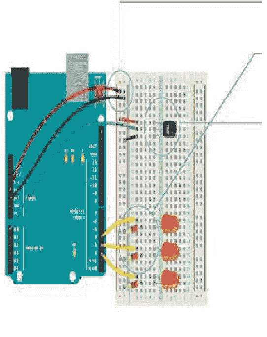

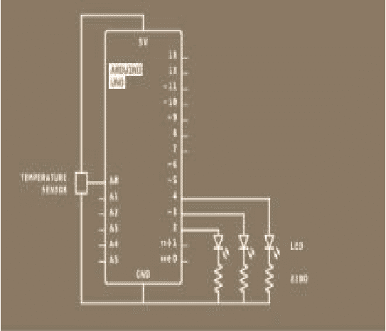

现在，你是手动完成这件事，但你可以通过校准来实现。你可以使用按钮来定义参考温度，或者让 Arduino 在 loop() 开始前采集一个样本，并将其作为参考点。

- 1. 首先，将你的面包板接地。
- 2. 用电阻将每个 LED 的阴极接地。将 LED 的阳极连接到引脚 2 至 4。这些是项目指示灯。

将 TMP36 安装到面包板上，使圆角部分背对 Arduino。接下来，将左侧引脚的平面朝向侧接电源，右侧引脚接地。将中间引脚连接到 Arduino 的 A0。

为传感器构建一个接口，以帮助人们使用它。你可以使用一个类似手形的纸片作为良好的指示器。如果你愿意，可以制作一对嘴唇供人亲吻，并注意其外观。你可能还想标记 LED，以便它们能传达一些含义。


- 1. 在第一幅图中，取一张纸并裁剪，使其能放在面包板上。在将要放置传感器的位置制作一对嘴唇，并制作几个圆孔，让 LED 穿过。
- 2. 将剪好的纸片覆盖在面包板上，使嘴唇围绕传感器，并让 LED 进入孔中。按压嘴唇，感受一下效果。

让我们检查一下代码。

### 有用的常量

常量允许人们为程序中的事物赋予唯一名称。这与变量类似，不同之处在于它们不能更改。为模拟输入分配名称以便于引用，并创建一个唯一常量来存储参考温度。每超过参考温度 2 度，LED 就会点亮。温度以浮点数写入和存储。浮点数是带有小数点的数。

### 初始化串口

在 setup 中，你将使用一个名为 Serial.begin() 的新命令。该命令将启动 Arduino 与计算机之间的连接。该连接将帮助人们在计算机屏幕上读取模拟输入的值。

参数 9600 表示 Arduino 的通信速度。你将使用 Arduino IDE 的串口监视器来观察你选择从微控制器发送的信息。

### 初始化数字引脚并将其关闭

接下来是 for() 循环，它将几个引脚设置为输出。这些引脚之前已连接到 LED。与其为每个引脚分配唯一名称并使用 pinMode() 函数，你可以选择使用 for() 循环，这样效率高得多。如果你在程序中需要重复处理许多事情，这是一个巧妙的技巧。

### 读取传感器温度

在 loop() 中，使用名为 sensorValue 的变量保存传感器读数。如果要读取传感器，请调用 analogRead()，它接受一个参数。

### 将传感器值传输到 PC

Serial.print() 函数将数据从 Arduino 传输到 PC。你可以在串口监视器中查看此信息。如果给 Serial.print() 传入引号中的参数，它会显示所输入的文本。此外，如果使用变量作为参数，它将显示该特定变量的值。以下是该程序的代码：

程序的一部分。

```cpp
// convert the ADC reading to voltage
float voltage = (sensorValue / 1023.0) * 5.0;

Serial.print("Volts = ");
Serial.println(voltage);

Serial.print(" degrees C ");
// convert the voltage to temperature in degrees
float temperature = (voltage - .5) * 100;
Serial.println(temperature);

if (temperature < baselineTemp) {
  digitalWrite(2, LOW);
  digitalWrite(3, LOW);
  digitalWrite(4, LOW);
}
```

来源：数据库

### 点亮 LED 以表示低温

&& 运算符在逻辑意义上表示“与”。它允许检查多个条件。

### 要表示中等温度，请点亮两个 LED

当温度处于基线以上 2 到 4 度之间时，该代码块将点亮引脚 3 上的 LED。

## C 语言基础与函数

创建 Arduino 程序时，了解计算机系统的工作原理至关重要。尽管 C 编程是一种接近机器的语言，但程序运行时某些事情如何完成将会变得清晰。为 Arduino 工作并与其配合的仪器（如传感器和 LED）依赖于特定的输入和输出。许多编程语言都具备这种能力，但 C 是我们的选择。

一个基本系统由称为 CPU 或微控制器的控制设备组成。其中一些存在一些差异。我们稍后将深入探讨这一点。顺便提一下，与标准微处理器相比，微控制器可能没有那么强大。然而，它仍然包含输入端口、输出端口以及硬件功能。

微处理器连接到外部存储器。通常，微控制器包含足够数量的板载存储器。然而，应注意我们指的并不是大容量；对于简单应用，微控制器可能只有几百字节左右的存储器。不要忘记，一个内存字节有 8 位，每一位可以是真或假、高或低以及 I/O。

寄存器是唯一可以执行逻辑和数学运算的地方。例如，如果你想对两个变量执行加法，变量的值必须移到寄存器中。

### 内存映射

计算机系统中的每个内存字节都有一个关联地址。现在，如果没有地址，处理器将无法识别特定内存。通常，内存地址从 0 开始递增。尽管我们有带有私有或唯一系统的特定地址，但某个特定地址可能并不指向外部通信的输入和输出端口。

大多数时候，你会发现有必要映射内存。这只是一个巨大的内存槽数组。有些人会开发内存映射，并将值最小的地址放在顶部，而另一些人则


### 逻辑语句

我们的第一个电路相当基础，它只有一个输出，而且用户完全无法改变触发条件。当输入开始影响输出时，我们就进入了逻辑语句的世界。逻辑语句是检查变量值与另一个值之间关系的有效方式。另一个值可以是已知量，也可以是可变量。使用逻辑语句，你就能控制草图中接下来发生的事情。接下来，让我们看一个类似的草图，它处理的是会影响输出的输入。

要在 Arduino IDE 中跟着操作，路径为：

- 文件 → 示例 → 02.Digital → Button

注意到这段代码与上一段有多么相似了吗？我相信到现在，借助这种可读性很强的代码，你已经相当了解正在发生什么了，但让我们拆解一下你尚未见过的新元素。

其中一个变量与按钮的引脚有关，另一个与按钮的状态（开或关）有关。在 setup 中，我们看到再次使用 *pinMode* 来初始化引脚，但这一次按钮引脚的方向为 INPUT，以告诉芯片这里将有电流“流入”，而不是“流出”。

现在进入 loop 部分，我们开始接触真正的程序，第一行引入了另一个函数 *digitalRead()*，它与我们在上一个草图中提到的 *digitalWrite()* 相对应。不过，这个函数只有一个参数：要读取的引脚编号。

好的，接下来我们遇到第一段布尔代码，也就是逻辑语句。这个花哨的说法意思是，逻辑表达式的结果会根据是否满足某些条件而变化。注释已经完美地告诉我们条件是什么：检查按钮状态是否被按下。按下时，它应显示 HIGH。这个表达式是一个“if”语句，只有当括号中的条件为真时，这段代码才会执行其花括号内的代码。在我们的示例 *if (buttonState == HIGH) {* 中，我们告诉编译器：当变量 *buttonState* 被按下时，就执行下一对花括号 { } 中的内容。双等号表示“等于它的值”。当你连续使用两个等号时，你是在要求编译器检查某个变量中是否记录了特定值。在我们的示例中，就是检查 buttonState 是否为 HIGH，换句话说，按钮是否被按下？当该条件为真时，就会使用现在已熟悉的 *digitalWrite()* 函数来点亮 LED。

接下来，我们看到一个带有自己花括号的“else”语句。else 的意思是，如果上一个语句不为真，那么它将执行花括号中包含的代码。在当前的示例中，它再次使用 *digitalWrite()* 告诉芯片关闭 LED，与我们上一段代码相同。请注意，虽然这个草图有一个 else 语句，但 if 语句并不要求必须提供 else 语句。相反，如果条件不满足，它就不会运行那段代码，而是会跳过它，继续执行下一条指令。

就是这样！只需按下按钮就能让 LED 闪烁，所需的全部内容就在这里。好了，我们已经完成了一些相当简单的电路。

要跟着操作，请打开：

- 文件 → 示例 → 05.Control → WhileStatementConditional

这个草图的第一部分对你来说会相当熟悉。我们声明所需的变量，初始化它们，并将引脚设置为正确的设置，即输入或输出。一旦进入程序的主循环，我们就会看到第一个 while 语句。现在让我们来看一看：

```cpp
while (digitalRead(buttonPin) == HIGH) {

  calibrate();

}
```

这个语句相当复杂，所以我们逐部分拆解。首先，只要我的条件为真，while 语句就会执行花括号内的操作。那么，首先我们的条件是什么？按钮是否正在被按下。因此，我们检查与按钮关联的引脚，看它是否为高电平或是否被按下。如果为真，它就会调用 *calibrate()*，这是用户稍后会定义的一个函数。这意味着，当程序看到 *calibrate()* 时，它会跳转到该函数的指令，执行它们，然后返回到代码中的那个位置。

既然这个函数被调用了，现在让我们看看它：

```cpp
void calibrate() {
```

没错，所以这可能看起来相当熟悉。它与我们已经使用的 *setup()* 和 *loop()* 函数极其相似。这行代码告诉编译器：你想定义一个名为 calibrate 的函数，它将返回“void”，并且不接受任何“参数”。所有这些术语到底是什么意思？首先，定义 calibrate 意味着，如果我们在代码的其他地方键入这个词，编译器就会搜索同名函数，然后像我们现在这样运行它的代码。那么返回 void 又是怎么回事？那是什么名堂？

我们其实还没有真正涉及这一点，只是把 void 当作理所当然，而且 setup 前面就带着“void”这个词。这个函数也确实能工作，但并非总是如此。当一个函数完成其花括号中包含的指令后，它会向最初调用该函数的位置返回一个值。这个值可以是 void 或无返回值的形式，但也完全可以是一个整数或一次计算得出的数字。假设这个函数改为计算公司员工的周收入。它很可能返回一个“float”（浮点数/小数），其中包含那些收入的值，以便在程序的其他地方使用。那样的函数会是什么样子？下面是一个虚构的示例，展示一个可能实现此功能的函数。

```cpp
float weeklyPay (name, hours, rate) {}
```

好的，所以它会返回一个 float，那个数字去了哪里，我们又如何获取它的数据？这与调用函数有关。现在让我们来看一看。

```cpp
employeeEarnings = weeklyPay (employeeName, hoursWorked, payRate);
```

下面是我们如何调用这个任意的员工薪资示例。注意到我们如何将函数 *weeklyPay()* 赋值给变量 employeeEarnings 了吗？函数运行后，那个浮点数将存储在该变量中。然后，我们可以将该变量用作之前在 *weeklyPay* 函数中所做计算的存储值。我们将在后面的草图中进一步讲解函数，所以如果这对你来说不够直观，不用担心；接下来我们还会看到更多示例。

回到我们的 *WhileStatementConditional* 示例，现在让我们拆解 calibrate 在做什么。它点亮 *indicatorLED*，告诉用户正在进行校准。然后，我们将位于 *sensorPin* 上的传感器的值存储到变量 *sensorValue* 中。接下来，我们想看看这个新值是否高于或低于我们之前记录的任何结果。我们通过 if 语句来完成这一点。注意到这些 if 语句没有对应的 else 语句了吗？我们的许多读数很可能落在已经记录的范围内，因此我们只需要在更高或更低时记录最大值或最小值。这些语句只是在检查该条件是否为真。完成所有这些之后，函数完成校准并返回 void，或者说没有返回任何值。

好的，在 calibrate 函数完成后，我们跳回代码中之前的位置，也就是 while 语句之后。由于校准已经停止，我们使用 *digitalWrite* 关闭 *indicatorLED*。接下来，我们读取传感器，并使用 *analogRead* 检查连接到传感器的引脚，将其值赋给 *sensorValue*。现在，下一行引入了一个我们以前没见过的新函数。

在 Arduino IDE 中打开：*帮助 → 参考*

将打开一个网页，其中以快速、便捷的方式汇集了 Arduino 为你使用的所有关键字、布尔逻辑符号、函数和重要信息。利用这个资源，找到“map”并点击它。诚然，这不是世界上最容易理解的函数，但让我们看看它做什么。描述说，它把一个数字从一个范围映射到另一个范围。它接受五个参数：一个值、当前范围的下限、当前范围的上限、目标范围的下限和目标范围的上限。借助这些信息，它会通过数学运算将值缩放到目标范围内的另一个值，使其符合我们理想的刻度范围。

实际上，这有什么用？对于我们的传感器，我们不知道它会返回什么值，也并不真正知道我们的数据集会落在什么范围内。我们确实知道的是，Arduino 芯片可以增量地改变其某个引脚的输出。这个增量范围是一位，或者说数字范围 0-255。这意味着，我们的传感器读数需要处于 0-255 范围内，芯片才能以我们希望的方式响应。因此，我们执行这个校准程序，查看数据集中的高值和低值以及当前值，然后将这些值缩放到 0 到 255 之间。

现在，map 函数表示它不会改变指定范围之外的值，因为这可能有预期用途。为此，你还必须在之前或之后使用“constrain()”函数，对可能的值施加约束。


让我们来看下一行代码中的一个约束函数。这个函数更容易理解。它接受一个值、一个最小值和一个最大值。如果该值在范围内，就保持不变；如果超出范围，则根据它最接近哪一端，将其设置为最小值或最大值。同样，Arduino 芯片的引脚输出强度使用 0-255，因此我们将数据集限制在 0-255 之间。

```cpp
do {
    // Some code to execute goes between the curly braces
} while (conditional statement);
```

这里的区别在于，该语句直到“do”块已经运行后才会检查条件。这些“do while”语句适用于当你想要一个 while 语句，但需要其中的代码至少运行一次时。

### for 循环

这对于诸如计算遍历序列的次数，甚至初始化芯片上的一组引脚之类的事情非常有用，正如你在这里将看到的那样。现在，for 循环有一个独特属性：创建它们时，它们会创建自己的变量。它们还会修改该变量，以便每次循环时改变条件。让我们先看一个空的 for 循环。

```cpp
for (variable; condition; increment/decrement) {}
```

该变量通常是整数，并且应根据它的用途命名。如果它要遍历芯片上的引脚，'thisPin' 是一个很好的名字，因为它能表明其用途。不过，如果你正在遍历数组（我们稍后会介绍），这个名字就不合理了。在这种情况下，变量名 index 可能更合适。这里的要点是根据 for 循环迭代（循环遍历）正在执行或更改的内容来命名变量。接下来是条件语句。它采用布尔比较的形式。所谓布尔，我们指的是 >、<、>=、<=、==。你将要求循环将你创建的变量与某个值进行比较。在我们的示例中，这个值是 8。

最后，我们来到 for 循环的递增或递减部分。在 Arduino 编程语言（基于 C++）中，你可以用符号 ++ 将变量的值增加 1，并用符号 -- 将变量的值减少 1。现在让我们在一个单独的例子中看看。

```cpp
int pizzaSlices = 1;  // We only have one slice of pizza

pizzaSlices--;        // we ate a slice, and now pizzaSlices will be 0

pizzaSlices++;        // our friend gave us their slice; now we have 1
```

希望这能说明递增和递减如何工作。关于 ++ 和 -- 这种表示法，唯一还要提到的是，它们可以放在变量名之前或之后，而其位置对 for 循环的结果有重要影响。如果符号在变量名之前，例如 `++thisPin`，它会在执行花括号中的代码之前更改变量。当符号位于变量之后，例如 `thisPin++`，它会在*执行花括号中的代码之后*更改变量。说到这里，对于 for 循环来说，非常非常重要的一点是确保它们会终止，或者说会根据你设置的条件结束。否则，程序只会卡在那里，一遍遍运行相同的代码行，直到断电。

例如，如果你编写了这样的 for 循环：

```cpp
for (int index = 2; index > 1; index++) {
```

这个 for 循环中的条件将永远为真，因此它永远不会终止。如果你在构思如何终止某个 for 循环时遇到困难，试试改用相反类型的变量变化，例如把递增改为递减，或者反过来。通常，从另一个方向来处理计数过程，就能解决你在 for 循环中遇到的任何计数问题。

关于在 for 循环内创建的变量，还有一件关键事项需要了解：它们只在 for 循环运行期间存在。它们在 for 循环期间创建，然后在循环完成后释放。为什么这很重要？通常你不能有两个同名变量。但在这里，你会看到我们在这段代码中三次初始化 'thisPin'，每个单独的 for 循环各一次。这是因为这些名称仍然有意义，但它们在每个循环结束运行后就不再存在。

要跟随操作，请打开：

- 文件 → 示例 → 05.Control → ForLoopIteration

在这个示例程序的开头，我们为定时器初始化一个变量，这一点到现在我们已经见过很多次了。然后进入 setup 部分，我们看到了第一个 for 循环。

我们声明一个整型变量 'thisPin'，将在条件语句中使用它。我们检查它的条件是否仍然为真，然后在完成一次遍历后，将 'thisPin' 递增 1。

好的，接下来在示例代码中，我们遇到了与 setup 中相同的 for 循环，但这一次不是将引脚设置为输出，而是让引脚在 'timer' 时长内开启，在我们的例子中是 100 毫秒。

这里我们遇到另一个 for 循环，所以现在让我们仔细看看它：

```cpp
for (int thisPin = 7; thisPin >= 2; thisPin--) {
```

同样，我们的变量是 'thisPin'，它被初始化为 7。这次我们的条件是当 'thisPin' 大于或等于 2 时。另外，这次我们使用递减，因此将从 7 倒数，直到这个引脚值达到 2。现在，当你运行这个电路时，LED 会按相反顺序点亮，因为我们在另一个方向上运行‘for’循环。另外，注意这个 for 循环有一个*会*终止的条件语句，我真的无法强调这有多重要。其余部分与我们之前看到的让 LED 在 'timer' 时长内点亮的代码相同。

接下来，我们讨论数组，并看看它们如何也能与 for 循环相关。

### 数组

在我们查看 Arduino IDE 中的任何代码之前，先来说说数组是什么。如果你熟悉数学，你很可能以前见过它，也许名称是“矩阵”。如你所知，矩阵和数组以信息组的形式工作，这些信息组合在一个公共变量下。假设我们有一组事物，比如名字，我们想要记录它们。理解哪个名字适合哪个类别——例如，给定两个学生班级，我们可能假设 A 班的所有名字都属于 A 类别，B 班的所有名字都属于 B 类别——决定了将每个名字放入哪个数组。但是，为了简化，我们假设每个名字都是一个变量，隶属于它所在的矩阵或数组。我们可以为每个名字分别创建变量，但这会使回忆这些信息变得繁琐且难以跟踪。

```cpp
datatype variableName[] = {};
```

在这里，这个数据类型可以是你已经见过的任何变量类型，比如 int、float、name 等。变量名应使用你已经见过的其他变量的相同命名约定。现在我们看到一对尚未遇到的新符号：方括号。

方括号用于表明这将是一个数据数组。在这些方括号内，你可以分配与放入该方括号中的数字相同数量的不同变量。这意味着你可以拥有那么多独立的信息块。

假设我们有 5 个 LED 分别接在引脚 2、7、4、6、5 和 3 上，并且我们想按这个顺序引用它们。我们可以把它写成一个数组。

```cpp
int ledPins[5] = {2, 7, 4, 6, 5};
```

在这里，我们告诉编译器预留五个 int 变量，并通过立即提供这些值来初始化数组。那么如何访问数组中的引脚 2 呢？Arduino 使用所谓的‘零索引’，这意味着访问数组元素（数据）时总是从零开始。因此，我们会这样访问引脚 2：

```cpp
ledPins[0]
```

尽管这看起来可能违反直觉，但编程中使用零索引有一些有用的理由。因此，如果引脚 2 的索引为零（方括号中的数字称为索引），那么引脚 7 的索引是一，引脚 4 的索引是二，引脚 6 的索引是三，引脚 5 的索引是四。这需要一些时间才能熟悉，当你无法访问正确的元素时，可能需要回来查阅这一点，并记住零索引。

因此，作为使用数组中数据的一个例子，一个基本的例子是：

```cpp
digitalWrite(ledPins[0], HIGH);  // Turn on Pin 2
```

我们也可以声明一个数组，不立即放入数据，而是决定稍后再初始化它。让我们使用同一个例子，看看一种可行的做法：

```cpp
int ledPins[6];

ledPins[0] = 2;

ledPins[1] = 7;

ledPins[2] = 4;

ledPins[3] = 6;

ledPins[4] = 5;

ledPins[5] = 6;
```

也可以声明数组时不指定数组大小，而是直接填充数据集。但是，以这种方式声明数组时，你必须立即初始化数组：

接下来，让我们看一个实际示例程序中的数组，看看在实际例子中拥有它们有多大用处。

要跟随操作，请打开：

文件 → 示例 → 05.控制 → 数组

在这段代码的开头，我们看到了一个定时器变量和刚才我们看到的同一个数组。在这个示例中，该数组是我们的 LED 所连接的引脚。然后，我们有一个名为 *pinCount* 的变量，用于表示所使用的 LED 引脚数量，也就是数组的长度。稍后你会明白为什么使用这个变量。

我们继续来看 *setup()*。这里有一个用于初始化引脚的“for”循环。与之前一样，我们为要访问的引脚创建了一个计数器变量 *thisPin*，并将其初始化为 0。然后，只要 *thisPin* 小于 *pinCount*（即数组的大小），我们就继续执行 for 循环。当它达到 *pinCount* 的值 6 时，递增并结束“for”循环。

看看我们如何利用 *ledPins* 数组和 *thisPin* 计数器，在 *pinMode* 函数中遍历数组的索引，并将 LED 引脚设置为 OUTPUT。数组和“for”循环配合得非常好，在编程中你会经常看到它们一起使用。

事实上，在同一个草图中你还会再看到两次。在某个循环中，我们使用了另一个 for 循环配合 *ledPin* 数组，按照从左到右的顺序 2、7、4、6、5、3 将 LED 点亮，持续时间为“timer”。然后在第二段代码中，我们将改用递减计数器，按相反的顺序从右到左将引脚点亮：3、5、6、4、7、2。

### 运算符

运算符只是用于执行操作的符号。这些操作可以是算术、逻辑、按位等。让我们来探索一些 Arduino 运算符：

#### 算术运算符

正如我们上面看到的，它们用于执行数学运算。例如：

```cpp
void loop () {

  int k = 8, l = 2, m;

  m = k + l;

  m = k - l;

  m = k * l;

  m = k / l;

  m = k % l;

}
```

#### 布尔运算符

Arduino 支持的各种布尔运算符包括 &&（与）、||（或）和 !（非）。例如：

```cpp
void loop () {

  int k = 8, l = 2;
  bool m = false;

  if((k > 1)&& (1 < k))
    m = true;
  else
    m = false;

  if ((k == 1) || (1 < k))
    m = true;
  else
    m = false;

  if (!(k == 1) && (1 < k))
    m = true;
  else
    m = false;
}
```

### 决策

在决策中，程序员指定要通过编程方式评估和测试的条件。程序员指定在条件为真时要执行的语句，也可以指定在条件为假时要执行的语句。让我们来探索各种决策语句。

#### If 语句

表达式放在圆括号内，后面跟一条或多条语句。如果表达式为真，则执行这些语句；否则，什么都不发生。

语法：

```cpp
if (your_expression)
statement;
```

对于多条语句，语法如下：

```cpp
if (your_expression) {
    statement(s);
}
```

示例：

```cpp
int K = 4 ;

int L = 8;

void setup () {

}

void loop () {
    if (K > L)
        A++;

    if (( K < L ) && ( L != 0 )) {
        K += L;
        L--;
    }
}
```

我们定义了两个全局变量 K 和 L。在第一个“if”条件中，如果条件为真，我们只需要运行一条语句，因此没有使用花括号来表示代码块。在第二个“if”条件中，如果条件为真，我们需要运行多条语句，因此我们将它们括在花括号（{}）中。

## 将传感器值映射到某个频率

声明一个名为 pitch 的变量；pitch 变量中存储的值从 sensorValue 映射而来。将 sensorLow 和 sensorHigh 定义为接收值的边界，而你可以将 50 到 4000 作为起始输出。

## 播放频率

接下来要做的是调用 tone() 函数，以便播放声音。tone() 函数接受三个参数：代表声音的引脚、要播放的频率以及播放音调的持续时间。最后，你可以调用 delay() 函数来延迟 10 毫秒，为声音播放留出时间。

当你打开 Arduino 时，会有 5 秒的间隔来调整传感器。要做到这一点，请确保你在光敏电阻周围移动双手，改变照射到其上的光线强度。让你的手部动作靠近仪器；这将改善校准效果。

5 秒后，校准结束，Arduino 的 LED 熄灭。接下来你应该听到的是来自压电蜂鸣器的声音。当照射到传感器的光线强度变化时，压电蜂鸣器的频率也会随之变化。

```cpp
void loop() {
  sensorValue = analogRead(A0);

  if (sensorValue > sensorLow && sensorValue < sensorHigh) {
    pitch = map(sensorValue, sensorLow, sensorHigh, 50, 4000);
  }

  tone(8, pitch, 20);

  ...

  delay(10);
}
```

map() 函数将 pitch 的范围定义得很宽，你可以尝试改变频率，以找到最适合你音乐风格的那个频率。

tone() 函数的工作方式与 analogWrite() 函数中的 PWM 相同，但有一个主要区别。analogWrite() 具有固定的频率。然而，使用 tone() 时，你可以在改变频率的同时持续发送脉冲。

tone() 函数允许你在驱动压电蜂鸣器或扬声器时定义频率。如果你将传感器接入分压电路，你将无法获得完整的数值范围。然而，对传感器进行校准后，你可以将输入映射到一个特定的范围内。

## 输入、输出和传感器

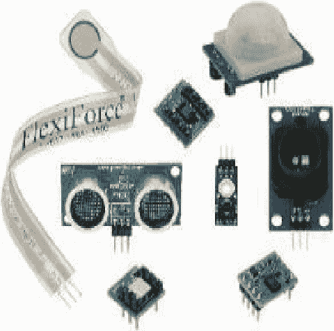

正如我们上面提到的，Arduino 传感器的用途和功能多种多样。

Arduino 旨在兼容多种类型的传感器，这些传感器反过来又可以用 C 语言编程。Arduino 能够与这些传感器配合工作，而且它们可以从 Arduino 官方或其他网站上以相对便宜的价格购买。Arduino 传感器的一些示例包括：

- 超声波模块
- 红外避障传感器模块
- 土壤湿度检测模块 土壤湿度传感器
- 麦克风传感器
- 数字气压传感器板
- 光敏电阻传感器模块 光检测灯
- 数字热敏传感器模块 温度传感器模块
- 旋转编码器模块 积木传感器开发板
- MQ-2 气体传感器模块 烟雾、甲烷、丁烷检测
- 运动传感器模块 振动开关报警
- 湿度和雨滴检测传感器模块
- 速度传感器模块
- 红外火焰检测传感器模块
- 加速度模块
- Wi-Fi 模块

虽然还有很多其他传感器，但这些只是其中的一部分。有些传感器比其他传感器更容易与不同的 Arduino 板连接，所以要注意哪种传感器最适合你的 Arduino。

本章你将学到：

- [ ] 信号简介
- [ ] 使用传感器
- [ ] 理解 PWM

本章你将需要：

- [ ] Arduino UNO 开发板
- [ ] 传感器
- [ ] 万用表
- [ ] 电阻

信号有两种类型：


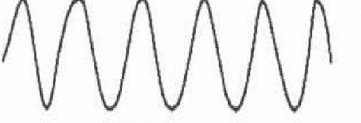

### 为什么模拟信号很重要？

模拟输入（例如某些传感器的电压）是某些因素变化的结果。例如：

光敏电阻：一种电阻，其阻值随光照量而变化。


我们可以使用万用表测量该电阻上的电压。

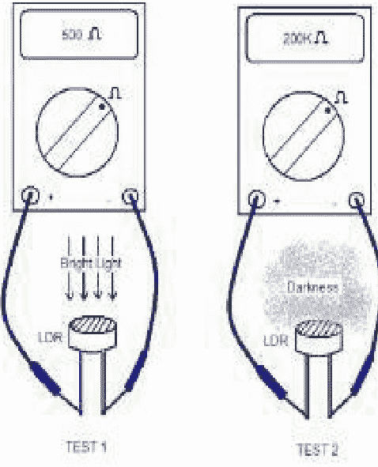

- 我们可以利用这种现象，通过合适的传感器来测量任何其他环境因素，这些传感器将光、温度、湿度、功率等因素转换为模拟信号。

- 在 Arduino UNO（ATMega 328p）上，有六个输入引脚用于


模拟信号从 A0 到 A5 开始，它可以测量 4.8 毫伏的电压，这意味着在测量许多应用时非常准确。

- A0
- A1
- A2
- A3
- A4
- A5

无电压指示


## 传感器如何产生模拟信号？

让我们以温度传感器为例：温度传感器包含一个由硅制成的非常敏感的晶体管。众所周知，硅受温度影响很大。

温度传感器具有以下部分：

- 1. 输入 *Vin*（2.2v 到 5.5v）。
- 2. 信号脚 *Vout* 用于获取测量值。
- 3. 接地脚 *GND* 用于将其连接到任何接地点。

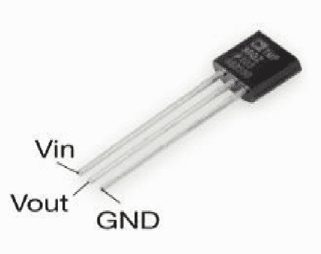

此示例所需的组件：

- 万用表
- AAA 1.5v 电池（2 节）
- 温度传感器（TMP35 或 TMP36 或 LM35）

### 步骤

- 拿出两节 AAA 电池，将它们一起放入电池盒中，这样你将得到 3 伏电压。


- 将电池盒的红线连接到温度传感器的 Vin 脚。
- 将电池盒的黑线连接到温度传感器的 GND 脚。
- 将万用表调到电压模式，如下所示：


EXTECH

- 与任何传感器一样，温度传感器以相同方式工作，它根据环境因素表现并改变其内部电阻，因此它会改变输出电压，该电压可由模拟传感器测量。

## 示例 4：使用电位器控制光量（接线）

### 示例组件

- Arduino UNO 板
- 面包板
- LED
- 560 欧姆电阻
- 10 k 欧姆电位器
- 导线

按图示连接组件：

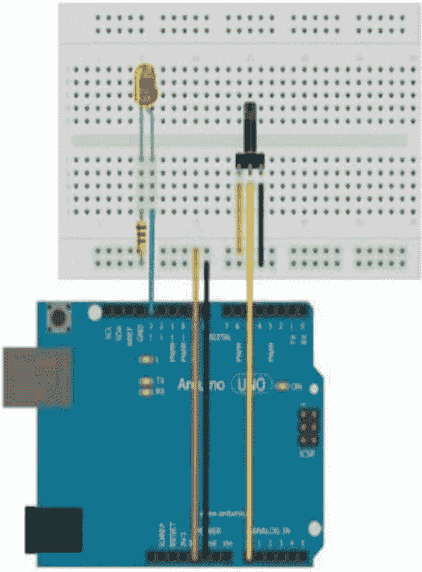

## 示例 4：使用电位器控制光量（编码）

```cpp
// create new file from the Arduino IDE and write the following code:

const int sensorPin = A0;

const int LedPin = 13;

int sensorValue;

void setup()
{
  pinMode(LedPin, OUTPUT);
}

void loop()
{
  sensorValue = analogRead(sensorPin);

  digitalWrite(LedPin, HIGH);
  delay(sensorValue);

  digitalWrite(LedPin, LOW);
  delay(sensorValue);
}
```

*analogRead(pin number).* 此函数将电压作为模拟信号读取（微控制器可以测量从 4.8 毫伏到 5 伏的电压），并且它还会将这些值转换为从 0 到 1,024 的数字值。这种转换称为 *模数转换（ADC）。*

例如：

如果输入到 A0 的电压等于以下值：

| 输入到 A0 的电压 | 数字值 |
| --- | --- |
| 4.8 毫伏 | 1 |
| 48 毫伏 | 10 |
| 480 毫伏 | 100 |
| 1 伏 | 208.33 |
| 2 伏 | 416.66 |
| 5 伏 | 1024 |

```cpp
sensorValue = analogRead(sensorPin);
```

- 在此语句中，微控制器将把传感器读数的值存储在 sensor value 变量中，然后微控制器将根据此变量（sensorValue）的值打开/关闭 LED 一段时间。
- 在此示例中，我们使用了可变电阻器，因此我们可以改变电阻值。

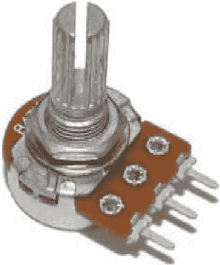

## 示例 5：光敏电阻作为光传感器（组件）

- Arduino UNO 板
- 面包板
- LED
- 560 欧姆电阻
- 光敏电阻
- 导线

## 示例 5：光敏电阻作为光传感器（接线）

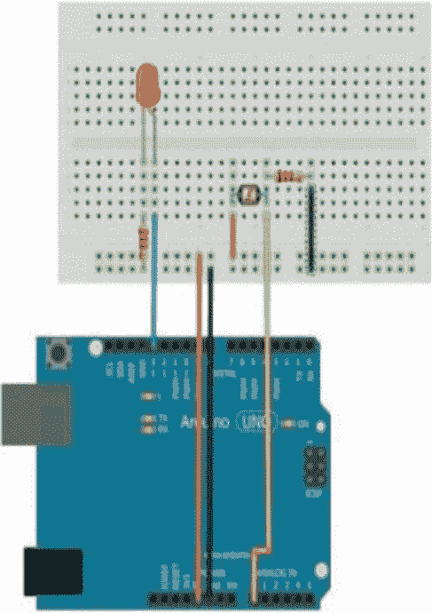

- *现在*你可以将此代码上传到你的 Arduino 板上，看看将光聚焦到光敏电阻上后 LED 会发生什么。然后把手放在光敏电阻上，看看 LED 会发生什么。
- `analogWrite(pin number, value);` 此函数生成模拟输出，并且此函数可应用于所有具有脉冲宽度调制（PWM）的引脚。

它们是引脚 3、引脚 5、引脚 6、引脚 9、引脚 10 和引脚 11（任何带有 ~ 符号的引脚）。

```
AREF
GND
13
12
~11
~10
~9
8
DIGITAL (PWM~)
7
~6
~5
4
~3
2
TX→1
RX←0
```


## 我们如何使用它？

许多电子元件处理不同的电压值。

例如，当你向 LED 施加 3 伏电压时，你会得到非常少量的光，如果将电压提高到 4 伏，你会发现光会更亮，以此类推。如果你使用电机，例如，当你增加电压时，电机的速度会更快。

## 示例 6：带 PWM 的 LED（接线）

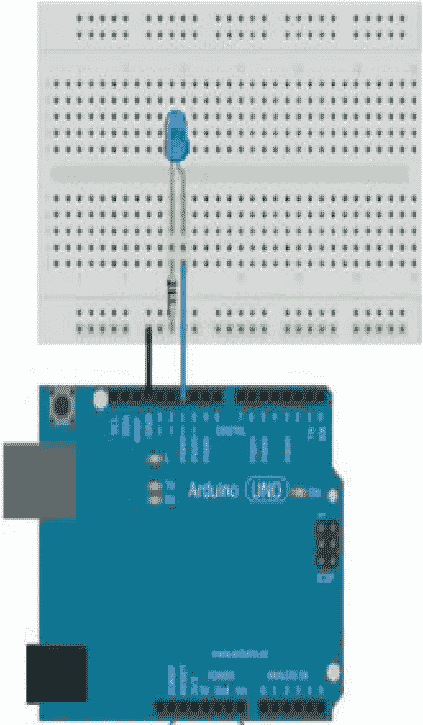

按图示连接组件：

## 示例 6：带 PWM 的 LED（编码）

```cpp
// open the Arduino IDE and select new file then write the following code:

const int ledPin = 11;

int i = 0;

void setup()
{
  pinMode(ledPin, OUTPUT);
}

void loop()
{
  for (i = 0; i < 255; i++) // LED will be lighter
  {
    analogWrite(ledPin, i);
    delay(10);
  }

  for (i = 255; i > 0; i--) // LED will be darker
  {
    analogWrite(ledPin, i);
    delay(10);
  }
}
```

```cpp
for (i = 0; i < 255; i++)
```

- `i = 0` → 初始值
- `i < 255` → 设置你的条件
- `i++` → 是迭代器；在此示例中它将加 1
- `i++` → `i = i + 1`

## 问题

为了检查理解，回答以下每个问题。

- 1. 描述数字信号和模拟信号之间的区别。
- 2. 什么是脉冲宽度调制？
- 3. 设计一个按顺序打开/关闭五个 LED 的电路。
- 4. 编写示例 3 的代码。

## 计算机与 Arduino 接口

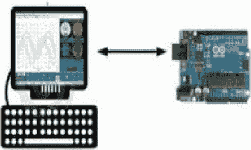

你如何选择与计算机接口取决于你可用的电缆类型。请记住，每个 Arduino 都可以简单地通过 USB 端口连接到计算机。将 Arduino 与计算机连接取决于你使用的编程语言以及需要合并的附加组件，以使 Arduino 与计算机顺利接口。

本章你将学到：

- 如何将 Arduino 与计算机连接

本章你将需要：

- 一个 Arduino UNO 板
- 面包板
- 传感器
- 导线

## FTDI 芯片

- 除 Mini 和 Lilypad Arduino 板外，所有 Arduino 板都具有通过 USB 端口直接向计算机发送数据和从计算机接收数据的能力。但你也可以使用 FTDI 接口将这些板与计算机连接，FTDI 是一个小芯片，用于在 Arduino 或任何微控制器与计算机之间交换数据。


- *在最后几个示例中*，我们使用 Arduino 读取一些传感器值，例如光和温度，以在 LED 上显示结果。
- *在本章中*，串行接口将把传感器值发送到计算机，我们可以轻松获得计算结果。

## 示例 7：带串行接口的温度传感器（组件）

- 一个 Arduino UNO 板
- 面包板
- 温度传感器（TMP36 或 LM35）
- A–B USB 电缆

## 示例 7：带串行接口的温度传感器（接线）

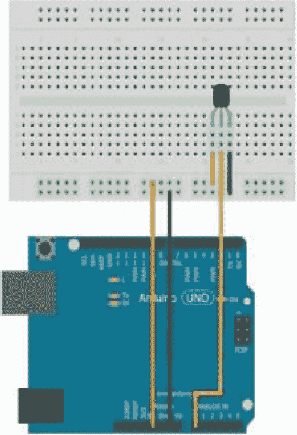

## 示例 7：带串行接口的温度传感器（编码）

```cpp
const int sensorPin = A0;

int reading;

float voltage;

float temperatureC;

void setup()
{
  Serial.begin(9600);
}

void loop()
{
  reading = analogRead(sensorPin);
  voltage = reading * 5.0 / 1024;
  Serial.print(voltage);
  Serial.println(" volts");

  temperatureC = (voltage - 0.5) * 100;
  Serial.println("Temperature is: ");
  Serial.print(temperatureC);
  Serial.println(" degrees C");

  delay(1000);
}
```

- *验证并上传代码后，单击串行监视器，如下所示：*

```cpp
int sensorPin = A0;
int reading;
float voltage;
float temperature;

void setup() {
  Serial.begin(9600);
}

void loop() {
  reading = analogRead(sensorPin);
  voltage = reading * 5.0;
  voltage /= 1024.0;
  Serial.print("voltage: ");
  Serial.println(voltage);
  temperature = (voltage - 0.5) * 100;
  Serial.print(temperature);
  Serial.println(" degrees C");
  delay(1000);
}
```

- 你将看到这个菜单，其中显示温度传感器的读数。

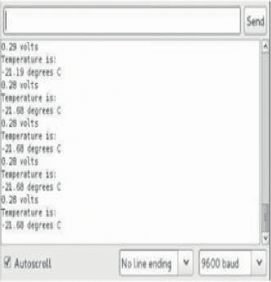

- *现在尝试使用任何热源升高温度。*
- 你应该知道这个传感器可以承受 150 摄氏度。
- (-) 这个符号并不表示负数，而是临时的编程错误。

 2026年1月

| 一 | 二 | 三 | 四 | 五 | 六 | 日 |
|-----|-----|-----|-----|-----|-----|-----|
|  |  |  | 1 | 2 | 3 | 4 |
| 5 | 6 | 7 | 8 | 9 | 10 | 11 |
| 12 | 13 | 14 | 15 | 16 | 17 | 18 |
| 19 | 20 | 21 | 22 | 23 | 24 | 25 |
| 26 | 27 | 28 | 29 | 30 | 31 |  |

再次。

## 示例 8：在串口监视器上显示 LED 灯的亮度（接线）

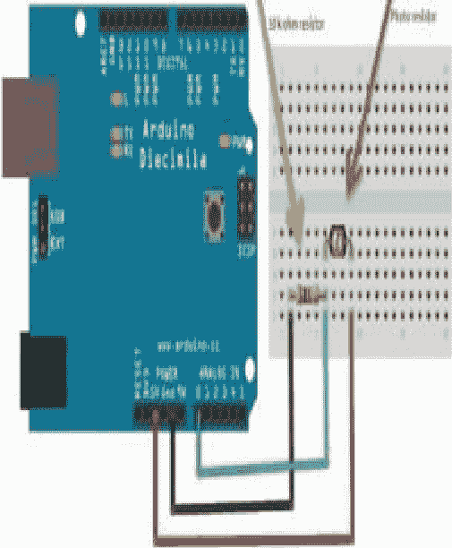

## 示例 8：在串口监视器上显示 LED 灯的亮度（编码）

```cpp
const int photocellPin = A0;
int photocellReading;

void setup(void)
{
  Serial.begin(9600);
}

void loop(void)
{
  photocellReading = analogRead(photocellPin);
  Serial.print("Analog reading = ");
  Serial.print(photocellReading);

  if (photocellReading < 10) {
    Serial.println(" - Dark");
  } else if (photocellReading < 200) {
    Serial.println(" - Dim");
  } else if (photocellReading < 500) {
    Serial.println(" - Light");
  } else if (photocellReading < 800) {
    Serial.println(" - Bright");
  } else {
    Serial.println(" - Very bright");
  }
  delay(1000);
}
```

将代码上传到 Arduino 后，点击串口监视器。

```cpp
int photocellPin = A0;
int photocellReading = 0;

void setup(void)
{
  Serial.begin(9600);
}

void loop(void)
{
  photocellReading = analogRead(photocellPin);
  Serial.print("Analog reading = ");
  Serial.println(photocellReading);

  if (photocellReading < 10) {
    Serial.println(" - Dark");
  } else if (photocellReading < 200) {
    Serial.println(" - Dim");
  } else if (photocellReading < 600) {
    Serial.println(" - Light");
  } else if (photocellReading < 800) {
    Serial.println(" - Bright");
  } else {
    Serial.println(" - Very bright");
  }
  delay(1000);
}
```

- *现在尝试*执行以下操作：
  - 将光线聚焦在光敏电阻上
  - 用任何透明衣物遮盖光敏电阻
  - 用手遮住光敏电阻，并确保没有光线照到它

- *你将看到以下内容：*

- 模拟读数 = 325 - 有光
- 模拟读数 = 325 - 有光
- 模拟读数 = 325 - 有光
- 模拟读数 = 118 - 暗
- 模拟读数 = 76 - 暗
- 模拟读数 = 55 - 暗
- 模拟读数 = 75 - 暗
- 模拟读数 = 64 - 暗
- 模拟读数 = 100 - 暗
- 模拟读数 = 11 - 暗
- 模拟读数 = 0 - 暗
- 模拟读数 = 13 - 暗
- 模拟读数 = 0 - 暗
- 模拟读数 = 0 - 暗
- 模拟读数 = 0 - 暗

发送  
自动滚动  
无行尾符  
9600 波特

- *微暗* → 光照量会很小！
- *暗* → 没有光
- *有光* → 光照量适中
- *强光* → 光的亮度非常高

## 示例 9：使用计算机打开/关闭 LED（组件）

- 一块 Arduino UNO 板
- 面包板
- LED
- 560 欧姆电阻
- 导线

*在这个示例中*，我们将使用计算机控制 LED，而不是使用开关，Arduino 将通过 USB 端口使用串口监视器接收命令。

## 示例 9：使用计算机打开/关闭 LED（接线）

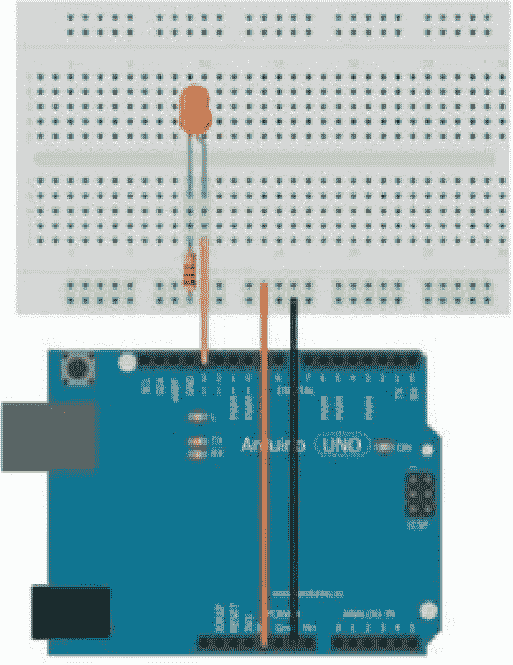

## 示例 9：使用计算机打开/关闭 LED（编码）

```cpp
int ledPin = 13;
int value;

void setup()
{
  Serial.begin(9600);
  pinMode(ledPin, OUTPUT);
}

void loop()
{
  value = Serial.read();
  if (value == '1') {
    digitalWrite(ledPin, HIGH);
  } else if (value == '0') {
    digitalWrite(ledPin, LOW);
  }
}
```

将代码上传到 Arduino 后，点击串口监视器图标，你会找到一个搜索栏。在其中输入“1”，然后点击发送。接着输入“0”，观察 LED 会发生什么。

发送  
自动滚动  
无行尾符  
9600 波特

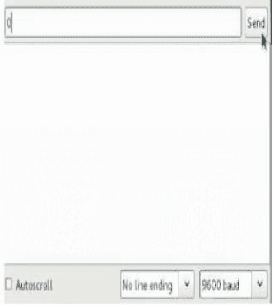

- 在这个示例中，我们使用了 *Serial.read();* 指令来读取通过 USB 从计算机发送到 Arduino 的数据，此外我们还添加了变量“value”来存储数据。

然后我们使用了 if-else 语句。

- 如果 value == 1，微控制器将打开 LED
- 如果 value == 0，微控制器将关闭 LED

## 问题

1. 如何让 Arduino 与计算机通信？
2. FTDI 芯片是什么，如何使用它？
3. 设计一个将 Arduino 与温度传感器和 LED 连接的电路。
4. 编写示例 3 的代码，并根据温度传感器的读数控制 LED。

## 回顾（重温）

在 Arduino 系列的上一篇文章中，我们涵盖了不少有助于你作为程序员入门 Arduino 的内容。虽然我们不会花太长时间，但会花一两分钟回顾其中许多概念，以防这是你读过的本系列第一本书。到本章结束时，你会觉得自己已经牢牢掌握了与 Arduino 相关的所有基础知识以及所有相关底层概念——如果你此前尚未掌握的话。如果你已经掌握，请随意跳到第二章，我们将在那里开始进一步拆解与 Arduino 微处理器相关的更多信息。

## Arduino

我们首先要讨论的是 Arduino 是什么。Arduino 是一块最初在意大利开发的微处理器板。Arduino 的硬件全部是开源的，并且围绕它发展出了一个庞大的开发者社区。因此，它已成为一块极其受欢迎的电路板，被用于世界各地的大量动手项目中。这些动手项目遍布各种不同的行业和概念。

Arduino 的目标是让人们能够以简单的方式理解和动手实践计算与基于计算机的硬件的基础知识，而无需支付普通计算所带来的高昂成本。

## Arduino 的结构

Arduino 具有极强的可扩展性，有许多不同的硬件模块可与 Arduino 板配合使用。这些外设连接到 Arduino，并通过所谓的引脚与 Arduino 之间收发数据。引脚有两种：数字引脚和模拟引脚。

它们通过运行在 Arduino 上的程序进行控制。这些程序称为草图（sketches）。虽然 Arduino 程序可以用许多不同的语言编写，但本书特别关注编写 Arduino 代码最常用的语言——C。

C 是一种历史上非常流行的编程语言，而且它也非常适合实现 Arduino 提出的非常具体的硬件要求。Arduino 本质上没有很强的处理能力，因此重要的是有一种足够接近硬件层的语言，能够非常轻松地处理 Arduino 所要求的非常底层的数据，因为 Arduino 需要的是几乎不占用处理能力或内存的程序。

通过可以连接到 Arduino 的模块和配件，人们能够完成许多不同的事情。这就是为什么 Arduino 是动手爱好者的梦想；你可以以非常低的价格做很多事情。

## C 编程基础

为了正确使用 Arduino，你需要对 C 编程有一点了解。正如我所说，我们不会在本章花特别长的时间逐一讲解所有内容，但为了后续学习，有一些必要内容我们必须涵盖。我们将讨论构成 C 编程的基本概念，以便你能够非常轻松地使用它，并在探索 Arduino 编程时感到比较自然。

### 使用变量和值

对计算机而言，值就是可以对其执行数学运算的任何东西。如果你对计算机有所了解，就会知道这几乎指计算机上的一切。计算机上的一切最终都归结为使用变量和值。

值指任何最终由计算机以数学方式解析、或能够由计算机以数学方式解析的东西。这些是文本字符、数字，或计算机原生理解的东西，比如二进制。所有这些都是值，因为它们最终对计算机而言都表示一个数学值。

这些值具有类型，类型指的是数据在被处理为计算机硬件可以处理的原始数据之前的值。在 Arduino 编程中，有些类型的使用频率会远高于其他类型，因为 Arduino 编程的核心就是效率。尽管如此，我们还是要花一点


花些时间逐一梳理所有类型，以便你对这些类型是什么以及如何有效使用它们有牢固而扎实的认识。

- *字节* — 它表示 0 到 255 之间的整数值。它只占用 1 字节数据，在 Arduino 编程中可能特别有用，因为 Arduino 编程中很多东西本来就处于 0 到 255 的序列上。

- *整数* — 它表示平均大小的整数值，大约四字节。它可以容纳相对较大的值，但要小心，因为如果你进入两百万左右的范围，你会发现自己远远超出了整数变量的缓冲区上限，这意味着它们会从整数能表示的最小值重新开始。

- *浮点数* — 它表示浮点数或小数。它们在 Arduino 编程中并不非常常见，但比双精度浮点数更常见。它们最多可容纳约 5 位小数，数值可大到约 32,000。

- *双精度浮点数* — 它表示双精度浮点数。就系统内存而言，它们是浮点数的两倍大小，但比普通浮点数精确得多，并且能比浮点数拥有更大的非小数部分。

- *无符号值* — 它们与对应的普通值大小相同，例如无符号整数和浮点数，但不能表示负数。这意味着它们从 0 开始，可以存储比普通整数和浮点数大两倍的正数，代价是不能存储任何负数。当你处理非负数时，它们是很适合起步的选择。

- *短整型* — 它们是整数值大小的一半，但字节值大小的两倍。它们可以容纳三万多以内的数字，但不能超过这个范围。如果你处理较小的数字，可能更愿意使用它们而不是整数，因为它们占用的内存更少。

- *长整型* — 它们是普通整数大小的两倍，这意味着它们可以容纳远超二十亿范围的数字，但除了无符号长整型（大约可容纳四十五亿）之外，没有默认值类型大到足以容纳比这更大的任何数字。

- *字符* — 它们表示 ASCII 字符值。它们本质上是计算机能够解析的任何符号，通常用于存储和打印字符。字符可以是数字的符号表示，如 '7'，也可以是字母字符，如 'a'，或符号，如 '?'。基本上，如果你的计算机能打印它，它很可能就是一个字符。

至此，我们已经涵盖了 C 和 Arduino 中可供你使用的所有主要数据类型。不要误解，还有更多类型，但这些是你目前需要理解的主要类型。

## 赋值与数学运算

给变量赋值非常简单。使用赋值运算符 = 即可。如下所示：

```
int myVariable = 6;
```

你也可以用同样的方式操作变量。

```
myVariable = 7;
```

你可以执行数学运算来创建新值。为此，你要使用数学运算符，也称为算术运算符。C 中的算术运算符如下：

- `b + c` — 当然，这表示加法。
- `b - c` — 这表示减法。
- `b * c` — 这表示乘法。
- `b / c` — 这表示除法。
- `b % c` — 这表示取模。模是给定除法问题的余数。例如，5 % 2 的结果为 1，因为 5 / 2 = 2，余数为 1。

还有一些简写赋值运算符。你可以通过给上述任意运算符加上等号来改变单个变量的值，如下所示：

```
a += 1
```

这等同于“a = a + 1”。其他所有符号的含义也一致。

`a += 1` 和 `a -= 1` 本身还有简写形式：`a++` 或 `a--`。`++` 和 `--` 分别表示我们要将变量增加 1 或减少 1。

至此，我们已经涵盖了 C 的数学运算符，可以继续学习其他概念了。

## 数组

有时，你需要一次存储多个值。等我们开始讨论字符串时，会更多地讨论数组；但现在，我们可以先介绍数组最基本的要点。我们在本书前面已经顺带讲过它们，所以现在其实并不打算建立关于数组的百科全书式知识。无论如何，我们会讲到足够让你复习它们的程度。

那么，数组是什么？数组提供了一种方法，让你本质上可以按共同的概念把值分组。正如我们已经确定的，值存储在计算机内存中的随机位置，然后在需要时从内存中访问。于是，数组在这个领域有两个作用。

第一，它们告诉计算机：“嘿，这些东西是相似的，而且经常会在大约同一时间被引用，所以我们应该把它们放在彼此附近，这样从一个值到另一个值的总时间就更少。”

然后，作为其结果，它们告诉计算机这些值应该在计算机内存中彼此靠近。这确保在计算机内存中从一个值到下一个值的移动和检索时间最小。它还使我们能够执行通常不会执行的操作，比如以过程式方式处理内存中的数据片段，我们稍后会讨论这一点。

数组本质上会建立连续或相连的内存区域，其大小为数组的 n 个元素乘以一个数据类型的大小。因此，如果一个数据类型占用 4 字节内存，而数组有四个元素，它就会清理并分配 16 字节的内存，且这些内存彼此紧邻。

然后，可以根据数组的数据类型分别给这些位置赋值。因此，如果你创建了一个整数数组，就可以给该数组中的元素赋整数值。

你可以像这样声明一个数组：

```
dataType arrayName[size];
```

你也可以在声明数组后，通过在花括号中列出值来填充它（或至少部分填充它）。

```
int myArray[3] = {0, 2, 7};
```

数组的索引从 0 开始计数。你通过引用索引来引用数组中的给定元素。因此，如果你想引用数组的第二个元素，可以像这样：

```
myArray[1];
// this would be 2, since 2 is the element at index 1, which is position 2, within the array.
```

你可以看到，数组实际上相对容易理解，但如果你想成为一名优秀的 Arduino 程序员，它们仍然是你需要运用并尽可能牢固掌握的基本概念。在编写 Arduino 草图的过程中，你不可避免地会经常遇到这个概念，所以你需要了解它。

## 真值与逻辑

这些被称为*比较运算符*。C 中以及由此延伸的 Arduino 中的比较运算符如下：

- `s == t` — 检查 s 和 t 是否相等。
- `s < t` — 检查 s 是否小于 t。
- `s <= t` — 检查 s 是否小于或等于 t。
- `s > t` — 检查 s 是否大于 t。
- `s >= t` — 检查 s 是否大于或等于 t。
- `s != t` — 检查 s 是否*不等于* t。

这些比较中的每一个都有两个名称：*语句*和*表达式*。在编程中，它们通常被称为表达式，以免与计算机科学中的“语句”概念混淆；但你实际上可以同时求值多个这样的表达式。这被称为*语句演算*，它通过使用所谓的*逻辑运算符*来实现。

逻辑运算符有很多，但你在 C 中最需要了解的逻辑运算符如下：

- `A && B` — 检查表达式 A 和表达式 B 是否都为真。


`A || B`

`!A`

检查语句 A 是否为假。如果 A 为假，那么“非 A”这个语句为真，因此我们返回真。

如果你对离散数学或符号逻辑有所了解，你会发现许多概念很容易迁移过来。不过，即使你不熟悉这些，理解起来也依然非常轻松。

## 条件语句

既然我们已经讨论了逻辑和真值，就可以在此基础上进一步了解所谓的*条件语句*。条件语句是控制流的重要组成部分。控制流在计算机科学中极其常见，几乎所有你使用过的应用程序都内置了某种程度的控制流。毕竟，如果我们把“智能”定义为根据给定数据做出决策的能力，那么控制流就是赋予程序某种“智能”的基本方式。

条件语句有两种形式：被动条件语句和主动条件语句。被动条件语句是最基本的形式，所以我们先介绍它。

被动条件语句之所以被称为“被动”，是因为程序没有义务执行条件语句中的代码。例如，当程序执行到条件语句时，如果条件不满足，整段代码就会被跳过，程序继续执行后续部分。

被动条件语句通过 *if* 语句实现。if 语句只判断给定条件是否为真，如果为真则执行 if 语句代码块内的代码；否则，整个代码块将被跳过。if 语句的语法如下：

```c
if(condition) {

// code goes within

}
```

与之对应的是*主动条件语句*。主动条件语句与被动条件语句相对，因为它强制程序即使语句不为真也要执行某些代码。因此，本质上，如果条件为真，则执行该代码块内的代码；否则，执行已编写的另一个备用代码块。这是通过 *else* 语句实现的。

```c
if(condition) {

// code goes within

} else {

// back-up code is here

}
```

不过，你可能会意识到，有时需要测试多个条件。这可以通过 *else if* 语句实现，它应该放在 if 和 else 语句之间。如果最初测试的条件不为真，你可以提供额外的条件进行测试。它会按顺序测试条件，如果所有条件都不为真，则执行 else 语句。if 语句的语法如下：

```c
if(condition) {

} else if (condition) {

} else if (condition) {

} else {

}
```

你可以根据需要添加任意数量的 else if 语句，没有上下限，所以不必过多担心。

## 循环

循环是编程中不可或缺的一部分。在第一本书中，我们只真正介绍了 for 循环，但在本书中，我们将同时介绍 for 循环和 while 循环。循环逻辑是我们日常生活中的重要组成部分，但很多时候我们忽略了它对每天所做的事情有多么重要。

例如，考虑从 1 数到 5 这个动作。你从数字 1 开始；你将嘴巴张成正确的形状并呼出空气，大声说出这个数字，然后给数字加 1；如此重复，直到你数到 6。当数到 6 时，你会发现已经大于 5，于是不再大声说出这个数字。

这是一个相对简单的例子，但同样非常重要，因为它确实展示了循环逻辑有多么无处不在和重要。

在 C 语言中，你需要掌握两种主要的循环形式：for 循环和 while 循环。我们先介绍 while 循环，因为它的概念简单得多。

while 循环相对容易理解，但更难的是知道何时准确使用它们。很多时候，你会使用 for 循环，因为与 while 循环相比，for 循环似乎有更明显、更直接的应用。

使用 for 循环时，边界非常明确，而 while 循环则不然。因此，while 循环最适合那些循环运行次数没有明确上限的情况。

while 循环只是检查一个条件，只要条件满足，就反复执行循环体内的代码。如果条件不再满足，循环就会退出。就这么简单！

while 循环的语法如下：

```c
while (condition) {

// loop’s internal code

}
```

while 循环最适合“游戏循环”这一概念。这类循环当然不仅限于游戏；它们只是很好地表达了游戏的思想，因为游戏会一遍又一遍地做同样的事情，直到达到胜利或失败的条件。当这些条件满足时，游戏就结束了。

游戏循环基于这样一个想法：使用一个真或假的变量，当某个条件满足时，该变量切换为相反的值。例如，代码可能是：

```c
#define TRUE 1
#define FALSE 0

int bHasWon = FALSE;

while (bHasWon == FALSE) {

// code goes here

}
```

然后，当玩家获胜时，会有某个操作将 bHasWon 改为 TRUE。这将表示循环应终止，因为胜利条件已经满足。当然，这种逻辑——同样——可以用于游戏之外的许多事情。任何有中央主菜单的程序都可能会使用这种循环逻辑。

另一种循环是 *for* 循环。for 循环的主要用途是让你轻松地遍历给定的数据集。for 循环首先创建一个迭代变量，你可以任意命名它。迭代步长可以是多种形式，但通常是 1（*iterator++* 或 *iterator--*，分别表示每次 +1 或 -1）。

for 循环的语法如下：

```c
for (iterator declaration; condition; iteration step) {

// code goes within

}
```

因此，要打印数组中的每个数字，我们可以这样做：

```c
for (int i = 0; i < (sizeof(myArray)/sizeof(myArray[0])); i++)
{
    printf("%d\n", myArray[i]);
}
```

其中 sizeof(myArray)/sizeof(myArray[0]) 得到数组中元素的总数。

## 函数

在进入下一章之前，我们需要讨论和复习的最后一件事是*函数*的概念。函数是 C 语言及 Arduino 编程中的基础概念。你会经常遇到它们，因此准确理解它们的工作方式非常重要。幸运的是，它们并不是一个非常难以理解的概念！函数的核心思想就是把某些任务拆解成可以反复使用的代码。

你可能通过过去的数学课对函数有所了解，比如 f(x) = y。X 是参数，函数对 x 进行操作以得到值 y。计算机科学中的函数与此相对类似（而且与数学中的高阶函数非常相似，但我不想假设所有读者都已经接触过那些内容，所以这里就不再深入了。）

函数有几个基本部分。首先，它们有声明。在 C 语言中，你必须在文件开头声明新函数，这称为原型声明，或者将其放在主函数之前。为了简化，我们就在文件开头对它们进行原型声明，并把它们放在草图的主要函数之后。

函数还有返回类型。这是函数在结束时*返回*的值的类型。例如，一个名为 *convertTemp* 的函数可能会返回一个小数。因此，该函数的类型应该是 *float* 或 *double*。


也可以编写*没有*返回类型的函数。这类函数称为 *void* 函数。它们是有效的，尤其适用于执行某些需要反复进行、但本身并不特别具有数学性质的操作，比如向串口打印文本、转动电机或类似操作。

函数也有*参数*。函数并不*一定*要有参数，但你可以*给*函数一个参数。函数的参数在其声明中定义。你可以看出参数的类型以及占位符名称。然后，你可以把参数当作函数体内的变量来使用，并在程序后面调用该函数时传入实际值。

不过，再次说明，函数并不一定*必须*有参数。这并不是一个函数能正常工作的必要条件。继续学习时请记住这一点！

函数原型的语法如下：

```c
functionType functionName(arguments, if any);
```

实际编写函数的语法如下：

```c
functionType functionName(arguments, if any) {

// code within the function

// return valueName if necessary;

}
```

那么，我们来做一个函数，它将返回圆锥的体积，类型为 double。这个函数需要两个参数：半径和高度。返回类型将是 double，因为我们要用到 pi，并希望结果尽可能精确。我们也会以 double 作为参数传入。

我们可以在程序开头附近像这样为函数写原型：

```c
double volumeOfCone(double radius, double height);
```

然后在程序后面的某个位置，但不要在其他函数内部，我们


对较新的程序员来说，这可能有点难以掌握。事实上，它难到在第一本书中你就被警告要特别远离它。这是因为它是一个相对高级的主题。毕竟，指针这个概念本身就涉及一些相当底层的编程内容，而你很可能从未有过相关经验。

让我们回想一下之前关于数据和数据类型的讨论。我们谈到了如何创建变量，以及可以用变量做的各种事情。然而，有一件事我们并没有真正谈到，那就是这些变量在计算机内存中是如何工作的。

计算机在进程运行期间将变量存储在一种称为*随机存取存储器*的存储器中。你可以把随机存取存储器看作一种空间，它可以根据程序当前的需求动态地按需分配。程序员和程序所处理的所有值，在某种程度上都存储在随机存取存储器中。可以定义变量，这会分配一块固定大小的随机存取存储器空间，其大小等于所定义变量的大小。

变量本身从本质上说，也只是对值在计算机内存中所处位置的引用。不过，当你引用一个变量时，你实际上并不一定是在直接处理那个*值*。例如，当你把变量传递给函数时，你发送的并不是变量*本身*。相反，你发送的是该变量值的一份*副本*，供新的函数操作。函数执行完毕后，这份副本就会被丢弃。

在早期的计算时代，这样做有一定道理。毕竟，你并不一定希望每次把某些变量传给函数时都*改变*这些变量的值。在这种情况下，不把这种行为设为默认做法是合理的。此外，函数在计算机内存中也以某种方式存储，这使得直接向它们发送值比向它们发送指向内存中其他位置值的引用更有意义。可以说，这会让它们运行得更高效。

然而，确实有些情况你会希望引用变量本身的值，而不仅仅是该变量*所指向*的值。对于这些情况，你会想使用指针。同时请注意，完全可以在大多数 Arduino 草图中从头到尾都不使用指针。然而，有时你会处理某种数据结构，或者需要*创建*数据结构，在这些情况下，掌握指针的实用知识非常有用。

更不用说，无论我们讨论的是一般编程还是专门针对 Arduino 编程，指针都是你*需要*了解的内容，因为它们是*内存管理*中的一个重要概念。为了编写高效的程序，你必须理解内存管理；至少你需要理解这个概念——如果不是为了 Arduino，那么也是为了你想编写程序的任何其他东西。

那么，从所有这些内容中要掌握的关键点是什么？首先，什么是指针？指针提供了一种方法，让你通过值在内存中的位置来引用该值，而不是仅通过该值的副本。为什么这很重要？因为它允许你传递并处理直接的值，而不是仅仅处理你可能通过变量获得的那些值的副本。这是 C 编程的基础，而且在 Arduino 程序中有时也可能会遇到。虽然一般来说，你完全可以编写整个草图而根本不使用指针，但当你查看别人的草图并从他们编写的代码中学习时，掌握这些知识仍然很有好处。

那么，指针如何工作？指针通过一组称为*引用*和*解引用*运算符的组合来工作。你可以使用它们来创建新的指针变量，并让它们指向一个已存在的变量。

你要做的第一件事是创建一个新指针，指向你希望指向的值类型。你通过使用引用运算符 * 来完成这件事。例如，假设我们有下面这段代码：

```c
int apples = 3;
```

而我们想创建一个指向该变量的指针。我们要做的第一件事就是创建一个新指针：

```c
int *ptr;
```

引用运算符可以放在任何位置。大多数人喜欢把它紧挨着变量名，但也有人喜欢把它和类型放在一起。还有人把它放在两者正中间，两边各留一个空格。这取决于你所使用的编码约定，但一般来说，把它放在变量名旁边是比较稳妥的做法。

接下来，你要做的是定义希望它指向的地址。你通过*解引用*运算符：& 来完成这件事。你把指针变量*本身*设置为这个地址，而不是把带引用运算符的指针变量设置为它。像这样：

```c
int *ptr;
ptr = &apples;
```

然后，每当我们通过引用运算符修改 ptr 变量时，它就会改变我们让它指向的地址处所存储的*值*。像这样：

```c
*ptr = 4;
printf("%d", apples);
// this would print out *four* since we changed the value at the address referred to by the variable *apples* to be 4 rather than 3.
```

你可以很清楚地看出，当你尝试在函数之间传递变量并以复杂方式处理变量时，这对你作为程序员会有多大用处。能够像这样直接操作指针，也有很多有用的好处。当你使用的平台内存既像 Arduino 这样有限又至关重要时，你至少会希望拥有直接操作内存的*能力*。还有一些更重要的东西你可能会想了解，但它们属于高级主题，不在本书范围内。它们对 Arduino 编程本身也不是特别有用，例如通过 *malloc* 函数进行直接内存分配。

无论如何，知道如何使用指针会推动你作为 Arduino 程序员向前进步，因为当你确实在实际中遇到指针，或者必须创建需要传递并直接修改变量的函数时，你就能轻松做到，而不会困惑得抓狂。

## 栈

栈是另一个极其重要的计算机科学概念。它们之所以重要，主要是因为它们与指针和数组等内容以非常关键且不可或缺的方式协同工作。那么，它们是什么呢？

这部分比 Arduino 稍微深入一些，但在 Arduino 编程的讨论中，你仍然不可避免地会遇到基本的栈术语，因此，扎实理解栈是什么以及它如何使用是很重要的。


栈实际上是一个相对多用途的术语。“栈”这个概念正如其名——一叠值。你可以向这个栈中添加变量。想象一座积木塔。栈的工作原理基本上就是这样。

你可以把东西放到栈顶，而这些东西也会最先从栈中移除。这在算法编程中特别有用，但在 Arduino 编程中也有一定用途。为什么？因为当你处理复杂且有限的内存结构时，不可避免地会遇到许多情况，此时最佳做法就是使用栈。这是因为栈非常节省内存。除了栈中最后一项的位置和栈中当前项的位置之外，它不需要任何其他东西，而且这些东西都很容易使用。

它还为你提供了一种极其简便的方式来回溯已经使用过的数据，所以这本身就相当巧妙。本质上，栈对任何程序员来说都是极其有用的工具，而且有些 Arduino IDE 函数实际上引用了栈的概念，并在此基础上构建。

栈由两个基本操作构成：入栈和出栈。两者都极易理解，所以我们不必花太多时间解释它们究竟是什么。

入栈指将某个东西添加到栈中。这个概念非常直截了当。你可以将一个值压入栈中，以便将其保存起来供以后使用，并能立即回忆它，而不必担心诸如栈顶变量的*名称*或其值之类的事情。

出栈指从栈中*取出*某个东西。当你从栈中弹出一个值时，你会移除最近添加到栈中的东西并取得它的值。然后你可以按自己的需要使用这个值。如果你想把该值放回栈中，只需记住你必须再次将它*压入*栈中。当你从栈中弹出并移除某个东西后，倒数第二个被压入的东西现在就成了第一个将被弹出的东西。

再次说明，栈是一个相对简单的概念，但它对计算机科学的整体理念，以及拓展你的视野从而在整体上更擅长编程，仍然极其重要。

## 结构体

Arduino 编程以及一般 C 语言编程中有一个细微之处，许多新手程序员并不花时间去学习，那就是*结构体*的概念。结构体是一个相对鲜为人知的秘密，但它们可以极其有用。

也许你听说过*面向对象编程*这个术语。C 语言中的结构体在许多方面是面向对象编程思想的前身。虽然它们远不能像面向对象概念那样进行广泛的编程，但它们确实为程序员提供了一种绝佳方式，将某些概念组合到一个单一结构中。

那么，结构体究竟是什么？为它提供一些定义将有助于你更好地理解如何使用它。很多时候，编程中的一些概念如果通过把它们组合在一起来打包，会合理得多。一个很好的例子是想象一只猫。你的程序中可能需要处理一只猫的几个不同*概念*，为此，你会定义各种不同的变量，尽管它们都有许多共同特征。所以，不要这样做：

```c
cat1Legs = 4;
cat2Legs = 4;
cat3Legs = 4;
cat1Color = "brown";
cat2Color = "black";
cat3Color = "white with black spots";
cat1Breed = "tabby";
cat2Breed = "persian";
cat3Breed = "american shorthair";
```

你只需用一种方式定义所有这些内容，然后在稍后通过访问它们的*成员数据*来使用它们。你通过使用句点来完成这一点。在 C 中定义结构体的语法如下：

```c
struct NameOfStruct {
    // data within struct
};
```

因此，使用猫的例子：

```c
struct MyCat {
    int numberOfLegs;
    String color;
    String breed;
};
```

然后你可以像这样定义猫：

```c
MyCat cat1 = {4, "brown", "tabby"};
MyCat cat2 = {4, "black", "persian"};
MyCat cat3 = {4, "white with black spots", "american shorthair"};
```

你可以看到，这为程序员提供了一种更简单的方式来将重要数据组合在一起。你很可能不会*非常*频繁地使用这些数据，但它确实让你有这样一种方式来*做到这一点*。了解它是什么很重要，因为你最终会看到它。

所有这些概念对 Arduino 都很重要，因为 Arduino 在内存和处理能力方面远比你家里的计算机受限。了解如何使用这些概念很重要，这样你才能充分利用 Arduino 的处理能力，并编写出比原本更简单、更优雅的草图。例如，你可以创建一个结构体，其中包含名为 r、g、b 的三字节变量，以便以简单的方式按照同样的思路为 RGB 颜色编程。你可以通过这样做来定义新颜色，以便稍后在程序中轻松访问它们，如下所示：

```c
struct color {
    byte r, g, b;
};

color blue = {0, 0, 255};
```

看，这有多简单？但这样做的实用性显而易见！

在本章中，我们涵盖了三个主要编程概念，当你在处理别人的 Arduino 代码并向他们编写的内容学习时，不可避免地会遇到这些概念，因此培养你解析和处理这些思想的能力很重要。

### Arduino API 函数

在本章中，我们将开始详细介绍 Arduino API 提供的函数。第一本书主要涉及编程的基本原理。这固然很好，但我们并没有真正获得太多关于 Arduino API 本身的经验。我们现在的目标是熟悉 Arduino 接口为程序员提供的众多函数。

Arduino API 是一套丰富多样的内容，提供给有抱负的 Arduino 程序员，让他们在编程中有更多选择。Arduino 团队做得非常出色，提供了一个功能齐全的 API，使程序员能够在 Arduino 折腾过程中做大量不同的事情。

我们将按章节划分这些内容，并详细介绍每个函数，所以请坐稳。你从本章中获得的是关于 Arduino 编程的完整参考，你可以在需要时随时回看。

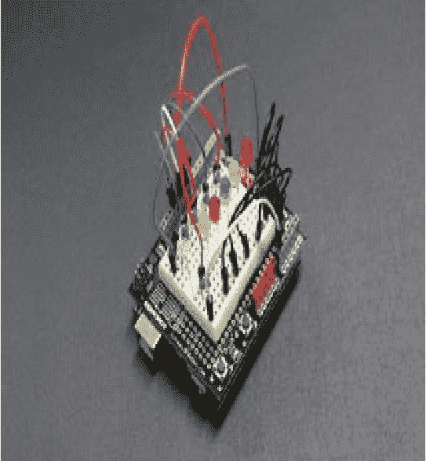

#### 数字输入和输出

Arduino API 定义了许多函数，以便你处理数字引脚。本节专门介绍这些函数，尤其是其中三个。

- *pinMode*(pin, INPUT, OUTPUT 或 INPUT_PULLUP)

这会停止由 tone 函数生成的音调。

- *pulseIn*(pin, value)

    这将允许你读取给定引脚的脉冲。如果引脚在高电平和低电平之间波动，那么它将返回高电平和低电平之间的时间（以微秒为单位）。由于脉冲可能并不完全均匀，你实际上可以指定希望它读取 HIGH 脉冲（HIGH 值变为 LOW 的时间）还是 LOW 脉冲（LOW 值变为 HIGH 的时间）。

- *pulseInLong*(pin, value)

    这与前一个函数类似，但它返回的不是整数微秒数，而是*long* 型微秒数，这实质上为你接收数据提供了大得多的时间范围。

- *shiftIn*(dataPin, clockPin, bitOrder)

    这将向给定引脚逐位发送一个字节的数据。数据引脚是你将发送每一位的引脚，时钟引脚是指示 dataPin 已读取数据的引脚，而 bitOrder 可以是 MSBFIRST 或 LSBFIRST（分别为最高有效位优先或最低有效位优先）。

- *shiftOut*(dataPin, clockPin, bitOrder, value)

    这与前一个函数非常相似，但它允许你一次一位地向引脚*发送*数据。其他一切相同，但你可以使用 *value* 参数发送数据。value 参数必须是 *byte* 类型。

#### 时间

这些函数旨在帮助你在 Arduino 范围内处理对时间敏感的事务。

- *delay*(value)

    这允许你将草图暂停由整数 *value* 指定的时间，单位为毫秒。

- *delayMicroseconds*(value)


#### sq(number)

该函数将返回给定数字的平方。它是 *pow(number, 2)* 的简写。

#### sqrt(number)

该函数将计算给定数字的平方根。

#### cos(angle)

该函数将计算给定角度的余弦值，角度需以弧度指定。

#### sin(angle)

该函数将计算给定角度的正弦值，角度需以弧度指定。

#### tan(angle)

该函数将计算给定角度的正切值，角度需以弧度指定。

### 字符

虽然这些函数很少用到，但当你处理字符集时，拥有一组随时可用的函数很重要。

#### isAlpha(character)

该函数将返回该字符是否为字母。

#### isAlphaNumeric(character)

该函数将返回该字符是否为字母或数字。

#### isAscii()

该函数将返回该字符是否为 ASCII 字符。

#### isControl()

该函数将返回某个字符是否为控制字符。

#### isDigit()

该函数将返回某个字符是否为数字。

#### isGraph()

该函数将返回该字符是否属于具有可视数据的字符。例如，空格就没有可视数据。

#### isHexadecimalDigit()

该函数将返回该字符是否为十六进制数字。

#### isLowerCase()

该函数将返回该字符是否为小写。

#### isPrintable()

该函数将返回该字符是否可以打印到控制台。

#### isPunct()

该函数将返回该字符是否为标点符号。

#### isSpace()

该函数将返回该字符是否为空格。

#### isUpperCase()

该函数将返回该字符是否为大写。

#### isWhiteSpace()

该函数将返回该字符是否为空白字符，例如制表符、空格或换行符。

### 随机数

这些函数允许你在程序中生成随机数。请注意，计算机永远不可能真正随机和自发；一切事物都基于输入，在计算机中没有什么能脱离这些输入。因此，随机函数*必须*设置种子。

#### randomSeed(number)

该函数用于启动随机数生成器。你输入一个数字，它便从伪随机数生成器数值序列中的某个随机点开始。

#### random(OPTIONAL minimum, maximum)

该函数将作为随机数生成的边界。最大值是你允许的最高随机数，最小输入值是你允许的最低值。如果你不指定最小值，则最小值将被假定为 0。

### 按位函数

这些函数允许你处理位和字节，它们是计算机处理的最小数据单位。理论上，你可以处理更小的值（就所需的总体计算能力而言），但在为 Arduino 编程时，这些是你将会用到的最小实用值。

#### bit(bitNum)

该函数将返回给定位的值。

#### bitClear(variable, bit)

该函数将把指定数值*变量*的给定*位*设置为 0。

#### bitRead(variable, bit)

该函数将返回指定数值*变量*的*位*。

#### bitSet(variable, bit)

该函数将把给定*变量的位*在由*位*表示的位置设置为 1。

#### bitWrite(variable, bit, 0 or 1)

该函数将根据你的指定，把*变量*内给定位置上的*位*设置为 0 或 1。

#### highByte(value)

该函数将返回给定值的最高字节。

#### lowByte(value)

该函数将返回给定值的*最低*字节。

### 使用 Stream 类（以及处理字符串）

这部分内容值得单独成章。虽然它也大量涉及如何高效使用 Arduino API，但这一课的内容非常广泛，我们确实需要将其拆分为独立的一章，以便充分讨论。


Stream 类是一个相对容易理解的概念。Stream 类本身基于从某个来源读取信息，并在你的 sketch 中使用这些信息。由于流的核心是读取数据，因此本章也有必要讨论键盘和鼠标的使用，尽管它们与 Stream 类并没有*本质*上的关联。

在处理数据时，尤其是读入数据时，你不可避免地会遇到需要处理字符集合的情况，例如单词、句子或任何类似的内容。*字符串*这一概念为你提供了这样做的机会。

字符串基本上就是作为数组链接在一起的一组字符值。因此，它们在内存中是连续的，计算机将它们视为一个大型且相互连接的整体。处理字符串意味着学习尽你所能操作这些单元。

就其本身而言，这非常简单。字符串本质上只是*字符数组*。这意味着从技术上说，我们处理的是所谓的*C 风格字符串*，它们基本上是抽象层次非常低的字符串。例如，在许多更现代、更高级的语言中，字符串并不会以字符数组的形式显露其字符本质；它们更多被视为一种更抽象的对象，即使它们在核心上*是*字符数组。

一个字符串由 *n+1* 个字符组成，其中 *n* 通常表示字符串中的字母数量。例如，单词 "hello" 的字符串大小会是*六*个字符。之所以是 n+1，是因为字符串以空终止字符 \0 结尾，它表示已经到达数组末尾，并正确地终止了该字符串。

你可以像定义数组一样定义字符串。你也可以让它们大于将要包含的字符串。定义数组时，你可以一开始就赋予它一个值，但也可以只定义其大小，并在之后扩展它们。这也在某种程度上使字符串具有动态性，并能在程序后续通过重写字符串内的数据来更改。

这些信息对程序员非常有用，因为字符串是任何处理信息的程序的基础组成部分，尤其是处理文件输入和输出的程序。

我们已经花了一些时间重述本书前面的内容，但为了清楚起见，我们继续定义一个字符串：

```c
char myString[6] = "hello";
```

之后，你可以通过字符数组的名称来引用整个字符串。Arduino 处理的大多数数据都将以字节为单位处理，而大多数实际文本数据将以 C 字符串的形式处理，因为字符非常容易解析。

覆盖所有这些内容很重要，这样我们才能真正形成在 Arduino 编程语境中处理字符串的思路，并与本书将要处理的所有内容结合起来。

### Serial（串口）

虽然你不一定能实现 Stream 类本身，但你可以实现它的派生类，而这时你就会开始发现大量实用功能。Serial 类是 Stream 类的扩展，允许 Arduino 板与计算机等其他设备通信。

Serial 通过 Arduino 上的串口以及与计算机的 USB 连接来实现。在本节中，我们将概述构成 Serial 类的所有不同函数，以便你最大限度地利用这一宝贵资源。

```c
if(Serial)
```

```c
Serial.begin(rate)
```

你已经熟悉这个函数。它允许你启动数据的串行传输。你可以指定具体的数据传输速率，单位为比特每秒。

```c
Serial.end()
```

这允许你结束串口通信。如果愿意，你之后可以通过调用 Serial.begin() 函数重新启动串口通信。在串口通信被禁用期间，你可以将串口引脚用于通用输入和

数据的退出。

#### Serial.find(string)

这将在 Serial 提供的数据中搜索给定字符串。如果找到该字符串，方法将返回 true。如果未找到该字符串，方法将返回 false。

#### Serial.findUntil(string, 可选 endString)

这将在串口缓冲区中查找该字符串，直到找到该字符串或找到指定的终止字符串。如果找到目标字符串，则方法将返回 true。如果找到终止字符串或方法超时，则返回 false。

#### Serial.flush()

这将允许你暂停进程，直到发送到串口的所有数据都已发送完毕。很简单！

#### Serial.parseFloat()

这将返回串口流提供的第一个浮点数。它会在遇到任何非浮点字符时结束。

#### Serial.parseInt()

这将返回串口流提供的第一个整数。它会在遇到第一个非数字字符时结束。

#### Serial.peek()

这将返回串口缓冲区接下来要导入的字符。但是，它不会从缓冲区中移除该字符。这使它与我们稍后将介绍的 Serial.read() 方法有本质区别。这意味着你可以直接查看下一个字符是什么。

#### Serial.print(value, 可选 format)

你可以选择指定格式。否则，整数默认按十进制打印；浮点数默认打印到两位小数，依此类推。

你可以将字符或字符串原样发送给 print 语句，它会顺利打印它们。

#### Serial.println(value, 可选 format)

这将允许你像使用普通 print 方法一样打印值。

#### Serial.read()

这将读取通过串口传入的数据。很简单！它会被添加到称为串口缓冲区的传入串口数据流中。当你从这个缓冲区读取时，信息会被销毁，因此如果你以后需要重用数据，请务必将其保存到变量中。

#### Serial.readBytes(serialBuffer, numberOfBytes)

这将从串口读取字符到缓冲区。你可以确定要读取的字节数。缓冲区必须是 char 数组或 byte 数组。

#### Serial.readBytesUntil(terminatorCharacter, serialBuffer, numberOfBytes)

这将从串口读取字符，直到读取了给定数量的字节，或读取到给定的终止字符。无论哪种情况，方法都会终止。

#### Serial.write()

这将向串口写入数据；但是，这个特定方法只向串口发送二进制数据。如果你需要发送 ASCII 数据，则应改用 print 方法。

#### Serial.serialEvent()

每当串口有数据可供使用时，就会调用此函数。然后你可以使用 Serial.read() 函数从串口读取数据。

至此，我们已经介绍了与 Serial 类相关的许多特定函数，以及它与 Arduino API 编程的关系。接下来我们需要处理的是 Ethernet 类。

### 用户自定义函数

保持代码整洁、有条理且模块化（可重用）的方法之一，就是在代码中使用函数。此外，函数通过让某些部分可重用来帮助缩小代码体积。顾名思义，函数就像为服务特定功能而创建的工具。

虽然我们已经遇到过一些用户自定义函数，但现在将更详细地介绍它们，并解释上次遇到时可能略过的一些特性。现在让我们看看函数的声明：

```cpp
float employeeEarnings(float hoursWorked, float payRate) {
  float result; // this will be the value we return when this function is called. It should match the datatype before our function name.
  result = hoursWorked * payRate;
  return result; // return tells the function to send a value back once to where it was called
}
```

这个函数显然接受两个参数：hoursWorked 和 payRate，二者都是“float”类型。它对它们进行一些简单的数学运算，然后返回一个 float 值。return 意味着终止函数，并将在 return 一词之后放置的任何值（通常是变量）作为某些计算的结果发送回去。

现在让我们调用这个函数来获取员工的收入：

```cpp
void loop () {
  float hoursWorked = 37.5;
  float payRate = 18.50;
  float result = employeeEarnings(hoursWorked, payRate);
  // result will be 693.75
```

首先，函数必须在任何其他函数之外声明。这意味着你需要在 setup() 或 loop() 或任何其他用户自定义函数之外编写正在创建的函数代码。

让我们看另一个示例——一个可用于平滑传感器读数的示例 sketch：

```cpp
int sensorSmoothing(int analogPin) {
  int sensorValue = 0;

  for (int index = 0; index < 5; index++) {
    digitalWrite(LED_BUILTIN, HIGH); // Turn on LED for smoothing
    sensorValue = sensorValue + analogRead(analogPin);
    delay(100); // 100 millisecond delay between samples
  }

  digitalWrite(LED_BUILTIN, LOW); // turn off LED
  sensorValue = sensorValue / 5; // average the values over five samples
  return sensorValue;
}
```

如果许多传感器容易出现抖动输入，这种函数可用于平滑它们的数据输入。这将对采样值求平均，以提供更一致的数据流。你可以看到，这段代码与我们上一个示例非常相似：

```cpp
void loop () {
  int sensorPin = 0; // analog pin 0
  int sensorValue = sensorSmoothing(sensorPin);
}
```

在这里，当我们尝试初始化 sensorValue 变量时，它会在模拟引脚 0 上调用 sensorSmoothing() 函数，并返回五次采样的平均结果。

函数也不总是需要参数或返回变量。有时函数可以不返回值，也没有参数。它们所做的只是执行几行代码，然后终止，让编译器返回到调用它们的代码位置。

## 结论

下一步就是走出去，开始制作你自己的 sketch！去当地的爱好商店找些灵感，或者去社区看看你可能想尝试哪些新项目。在你对下一步想做什么有了想法之后，（机器人非常有趣！）加入社区吧！说真的，和朋友一起构建项目并互相比较会非常有趣。如果你觉得自己不知道从哪里开始，别担心！有许多在线资源分享编码和技巧来提升你的水平。许多在线网站还设有论坛，专门帮助像你这样的人学习并展示自己的成果。这也是作为爱好者学习和成长的绝佳方式。

如果你想开始但感觉手头拮据，也有选择。正如我们上面所说，Arduino 网站和其他地方有相当便宜的模块可供购买。此外，还有更便宜的编程语言可用，有些甚至免费。学习这些语言实际上比你想象的更容易。如果你懂一种编程语言，其余的会更容易理解和编写。当地图书馆也有书可以帮助你学习如何编码。许多图书馆提供馆际互借，这意味着你可以通过来自周围各地的书籍学习编程！最棒的是，从图书馆借书学习完全免费！如果你对此有任何疑问，请记住，你可以上网找到其他使用过 Arduino 并知道如何帮助你入门的人。

Arduino 板可以编程来控制 LED 点亮或渐变等。Arduino 编程中使用的语法与 C++ 类似。如果你擅长 C++，那么用 Arduino 编程对你来说会很容易。Arduino 中的变量在 setup() 函数中初始化。loop() 部分包含要重复运行的代码块。使用 Arduino 引脚时，你必须指定需要使用的引脚。引脚通常用数字标识，因为每个引脚都有唯一编号。拿到板子后，你必须在计算机上设置 Arduino IDE。这是你在将 Arduino 代码上传到板子之前编写代码的地方。Arduino 代码通常称为 sketch。你必须获得电源。但是，某些板型必须经过配置，才能允许从计算机获取电力。sketch 对板子的效果将在上传到板子后显现，此时需要点击 Upload 按钮。

每个 Arduino 都有许多传感器和扩展件，所以请务必检查


您可以选择自己想要采用的方式。拥有一块 Arduino 最棒的地方在于，您将有机会尝试许多实验。您也不仅限于传感器能读取的内容。您可以自己想出一些方法，让机器为您服务。先试着编写一些简单的请求——比如设置闪烁的灯光，或者弄清楚 Arduino 如何监控输入——然后看看您能在此基础上做些什么。我在书中附上了许多 Arduino 代码供您使用，但也欢迎您自己寻找一些代码！网上有很多指南可以提供帮助。

您还可以了解一些我们在这里没有机会深入探讨的更高级概念，例如头文件、类、更改芯片的时钟频率、添加内核以及添加库。用这块芯片，您能做的事情实在太多了，真的令人难以置信。选择一个您感兴趣的方向，看看它能带您走向何方。我希望这本指南能给您一些小小的启发，让您去尝试新事物，看看您的草图设计技能能达到什么水平。

最后，感谢您读完这本书！Arduino 是开启您编程之旅的一种有趣方式。既然您购买了这本书，我们希望您已经有所成长，如果您觉得这本书在任何方面对您有所帮助，欢迎在亚马逊上留下评论，我们始终心怀感激！

## 参考资料

- Arduino Reference. (2019). Retrieved from https://www.arduino.cc/reference/en/language/structure/comparison-operators/lessthan/
- What is an Arduino? - learn.sparkfun.com. (2019). Retrieved from https://learn.sparkfun.com/tutorials/what-is-an-arduino/all#the-arduino-family

# C#

*C# 终极入门指南*
*一步步学习编程*

**瑞安·特纳**

- 程序结构和基本语法
- 第 3 章：揭秘数据类型
- 第 4 章：使用变量
- 第 5 章：什么是类型转换？
- 第 6 章：运算符的必要性
- 第 7 章：条件语句
- 第 8 章：循环
- 第 9 章：C# 方法
- 第 10 章：数组世界
- 第 11 章：类
- 第 12 章：结构
- 第 13 章：封装
- 第 14 章：继承
- 第 15 章：多态
- 第 16 章：正则表达式
- 第 17 章：异常处理过程
- 第 18 章：文件输入/输出
- 第 19 章：委托
- 第 20 章：C# 中的多线程
- 第 21 章：事件
- 第 22 章：提示和重要资源
- 结论
- 参考书目

## 引言

虽然学习任何一种新语言都不是件容易的事，但本书的目的是让您能够尽可能快速、轻松地掌握和理解 C#。其目标是为您提供完整且全面的技能，帮助您记住重要知识，并指导您在 C# 中的编程和编码实践。为了以最有效的方式学习，我希望您也能进行练习，以巩固我们在本书中探讨的课程。

本书将介绍 C# 是什么的基本概念，并最终为您提供一些有用的提示和资源，以强化您可能需要额外帮助的任何主题或技能。

这种语言会与其他计算机编程语言的某些组件相似——如果您熟悉其他语言，这几乎是一笔无价的经验。虽然这本书不仅仅是向您介绍编程艺术的初学者手册，但它会反复强调和认可这些技能中的许多内容，帮助您在最短时间内实现最大的编程成果。请记住，这种语言为程序员提供了许多能力，本书可能会以游戏编程的角度提及一些内容，我希望您也对此有所了解。

尽管我为您提供了信息和一些练习所需的基本技能，但将这些技能付诸实践完全取决于您。我强烈建议您找到一个严格的日常安排，包括研究、学习材料以及在您自己的虚拟环境中进行练习，以熟悉这些技能。众所周知，你可以把马牵到水边，但你不能强迫它喝水！

我可以给您知识和资源，但迎接挑战、综合并利用它们来创建您自己的程序和代码，这取决于您。

对于像 C# 这样面向对象且结构化的语言，我想您会发现它易于学习且用户友好。这种高级语言建立在 C、C++ 甚至 Java 语言的基础上，并在某些方面对它们进行了补充。然而，即使您是这些语言的大师，这项新任务的学习曲线也会和其他编程语言一样陡峭！在整个过程中，我鼓励您运用自己的知识和直觉来应用本书中的概念和策略。记住，每个人在成为大师之前都是初学者！

## 第 1 章：什么是 C#

您偶然发现并购买了这本书，是为了学习如何成为一名 C# 程序员。

在本书中，您将学习如何在您自己的编程项目中应用 C# 的基本规则。C#（发音为“see sharp”）是一种面向对象的计算机编程语言，由 Microsoft 设计和开发。

这是一种相当新的语言，被认为在本质上非常实用且面向对象。虽然 C# 肯定与 C 或 C++ 不是同一种语言，但这些语言之间肯定存在一些相似之处，甚至可以说，对其中一种或两种语言有所了解、具备知识或经验都是很有帮助的。

与所有编程语言一样，了解它们如何在基本和功能层面上工作是有帮助的。所有语言都有一个共同点：它们都在致力于告诉计算机要做什么以及如何设置系统、数据库，或者如何以及何时运行和执行程序。

这种语言源于程序员 Anders Hejlsberg，他是 Microsoft .NET Framework 开发团队的成员。虽然有些人倾向于批评 C# 有点“抄袭”Java，但您会在本学习手册的整个过程中看到（当然，前提是您了解 Java），C# 在语言内容和结构上都有明显的差异，使其与众不同。

它的设计针对一个能够使用高级语言并包含可执行代码（也称为公共语言基础结构或 CLI）的环境而制定，吸引了许多对这门易学语言感兴趣的人。

它以提高效率为目标之一，因此使用它有许多优势。在本书中，我将向您介绍如何轻松掌握这种面向对象和面向组件的语言，并将其作为您使用的新语言。

除了是一种结构化语言之外，您可以信赖在 C# 语言中进行编程和编码会获得高效的结果。我将帮助您优化性能，以便从您在使用这种语言进行编程和编码所投入的工作中获得预期的输出。

虽然 C# 是使用 Microsoft 平台开发的，但该语言本身并不仅限于此。C# 的另一个伟大之处在于，这种多功能性允许您将面向对象的语言带到不同的平台，以创建多维且可用的程序和软件。

我相信您熟悉其他语言，语言的某些方面有利于某些预期结果。在本 C# 学习指南中，我们将介绍许多好处，这些好处在可移植性、类型、元编程、属性、内存访问以及方法和函数等方面为用户提供帮助——除此之外，在接下来的章节中我们还会讨论并展示一系列其他积极特性。

这种语言自 2002 年起才正式发布版本，因此可以被认为是一种较新的编程语言。但是，请不要因此认为它无法与 Java 等历史稍长的语言竞争。

这种语言的开发者真正致力于改进和添加不同的功能，最初专门为 .NET Framework 设计，但现在已扩展，并在许多功能上取得了成功——许多人喜欢的功能之一是所使用的语法。

这种语言有可能被用于专注于游戏开发。对于游戏玩家来说，重要的是游戏不仅有趣、吸引人，而且他们希望体验本身也是令人愉快的。

既然您自己可能也算是某种程序员（或者至少欣赏计算机的能力），那么在读完这本书后，我希望您能更好地理解游戏编程人员为了创造您最终获得的体验付出了多么辛勤的努力。

虽然我不认为仅阅读这本书就能让您创造出一款大师级的游戏（您还需要大量练习！）——但我确实相信，您会更好地理解那些在处理


尽量以那种确切的方式学习。重要的是，不要让自己在短时间内被过多内容压垮。

相反，不要间隔太久才回到你的学习任务上。你可能会忘记一些可能让你抓狂的细微差别。允许自己抱有合理的期望，而本书正是为此设计的。

最后，享受学习过程！允许自己为正在学习的新技能感到自豪，并准备好参加一门掌握 C# 基础的速成课程！

## 第 2 章：详细概述

由于你是初学者，我们希望专注于打下坚实的基础，让你全面了解 C# 的基础知识。

本质上，到第一周结束时，你将牢固掌握 C# 的环境、程序结构、基本语法和数据类型、类型转换、变量、常量和运算符。如果你不熟悉所使用的术语或方法，我会尝试对这些术语做一个快速的基础回顾。如果这不足以唤起你的记忆，你可能需要从 Google 或其他资源中找一个快速复习资料。我还想推荐一个免费的交互式 shell 程序，你可以在上面试用代码——https://www.tutorialspoint.com/compile_csharp_online.php，这应该能帮助你完成本书中包含的任何训练练习。

### 环境

如所见，C# 由开发者设计为与 Microsoft 和 .NET Framework 集成。可以想见，这对你在 C# 中所处的环境有很大影响。理解 C# 的一个重要部分，来自你理解二者如何相互交互。首先，这里简要概述一下 .NET Framework，以帮助你更好地理解二者如何交互。

正如名称中 framework（框架）的后半部分所暗示的，.NET Framework 是一个可以运行应用程序的平台。.NET Framework 是 Microsoft 开发的软件开发平台。该框架是为开发可在 Windows 平台上运行的应用程序而创建的。第一个版本于 2002 年发布，命名为 .NET Framework 1.0。自那时起，该框架至今已进行了大量更新。

我们可以使用 .NET Framework 创建基于 Web 和基于窗体的应用程序。我们也可以用它开发 Web 服务。除 C# 外，.NET Framework 还支持 Visual Basic 编程语言。这意味着程序员可以选择开发应用程序所用的语言。

该框架可以协助你编写三种不同类型的应用程序——Web 服务、Web 应用程序和 Windows 应用程序。当使用该框架应用程序时，它实际上可以被多种编程语言使用，因为它是一个多平台应用程序。从 Visual Basic、JScript、C++ 到 COBOL 的众多语言，也能够在框架内相互通信。该框架的另一个重要特性是可供语言使用的广泛代码库；就我们的目的而言，我们将讨论 C#。

任何语言或框架的一大优点就是你可以利用代码库的潜力。对于 .NET Framework 和 C#，有一个庞大的库可供你访问并用于你的编码项目。我经常给人们的一条建议是：尽管这些库是极好的资源，但一定要理解编码本身的来龙去脉，以确保在出现问题时能够修复。

Microsoft 本身也为其用户提供了一个很棒的工具，以协助他们进行 C# 编程项目的开发。

该公司甚至免费提供两个极佳的工具，它们是编写从简单到复杂任何类型应用程序的绝佳资源。我推荐的两个工具的名称（因为它们是免费的！）是 Visual C# 2010 Express 和 Visual Web Developer。

如果这些选项不是你用起来感到舒适或喜欢的，你始终可以使用文本编辑器来编写你可能需要的源代码。我推荐其他选项，是因为我觉得它们比简单的代码编辑器更有帮助。然而，很多人更喜欢那种方法——这真的取决于你以及你对某个程序的舒适程度。把它们都试一试，看看哪种方法更适合你。

你可以从一个名为 Microsoft Visual Studio 的网站下载我提到的两个 Microsoft 程序。

最后，你还可以在 Linux 或 Mac OS 上运行 C#，这是一种跨不同平台编码的强大能力。然而，要在不同的操作系统上这样做，你显然需要一个非 Microsoft 框架。我推荐“Mono”——这是一个可在 Linux 和 Mac 上使用的开源选项。

了解了环境的基础知识后，去下载或打开你想熟悉的程序，开始你的编码过程吧。把软件玩一玩——或者你可以先消化一下新知识，然后再继续项目的下一阶段！

### IDE（集成开发环境）

IDE 是一种允许你编写程序的程序。大多数 .NET 开发者更喜欢使用 Visual Studio Community 作为 IDE。它允许你创建、调试和运行应用程序。此 IDE 可用于开发基于 Web 和基于窗体的应用程序。要使用此 IDE，你必须将其下载并安装到计算机上。你可以在下面给出的 URL 中找到它：

https://www.visualstudio.com/downloads/

你可以在免费的 Visual Studio Community 和 Visual Studio Professional Edition 之间选择，后者附带 30 天试用期，试用期结束后必须付费。

下载完成后，双击安装文件开始安装 Visual Studio。按照屏幕上的说明操作，直到 Visual Studio 安装完成。

之后，你就可以开始创建自己的 C# 应用程序了。

### 程序结构与基本语法

既然我们已经大致了解了 C# 的环境是如何创建的，现在让我们看看实际结构，以及你将如何通过 C# 语法与程序交互。

当我们审视 C# 的结构时，我们看的是构成程序的 7 个基本组成部分。它们是类方法和属性、命名空间声明、类、Main 方法、注释，以及语句和表达式。现在，就你的编程和编码而言，这些看起来是什么样的？我们何不以这个“Hello World”示例为例，把它分解成几个部分，看看实际效果。

```csharp
using System;

namespace HelloWorldApplication
```

代码从 *using* 语句开始。该语句的作用是将 *System* 命名空间添加到程序中。C# 程序通常有多个 *using 语句*。

下一行是一个 *namespace* 声明。命名空间简单来说就是许多类的集合。上面我们有 *HelloWorld* 命名空间，其中包含 *Hello* 类。

下一行是类声明。*Hello* 类具有程序将使用的方法和数据定义。一个类通常有许多方法。方法的作用是说明类的行为。然而，我们上面的 *Hello* 类只有一个方法，即 *Main* 方法。

在下一行代码中，我们有 *Main* 方法的定义，它标志着所有 C# 程序的入口点。正是 *Main* 方法说明了类执行后会发生什么。

接下来，我们有 `/* ... */` 这一行。这是注释，C# 编译器会忽略该行。该行只是为了提高人类读者对代码的可读性。

接下来，我们有 `Console.WriteLine(...)` 这一行。`WriteLine` 是属于 `Console` 类的方法，而该类定义在 `System` 命名空间中。这一行将在屏幕上打印 `Hello World!` 消息。

最后，我们有 `Console.ReadKey();` 语句。这一行是供 `VS.NET` 用户使用的。该行将使程序等待按键，并防止从 Visual Studio .NET 启动程序后屏幕一闪而过并迅速关闭。

除了从 Visual Studio 运行程序外，你还可以从操作系统的命令提示符运行 C# 程序。为此，请遵循以下步骤顺序：

- 打开文本编辑器，然后将上面给出的代码添加到其中。文本编辑器的一个例子是记事本。
- 将文件保存为 *helloworld.cs*。


- 启动操作系统的命令提示符，然后导航到你保存该文件的目录。
- 在提示符中键入命令 *csc helloworld.cs*，然后按回车键编译代码。
- 如果代码没有错误，命令提示符将带你到下一行，然后生成文件 *helloworld.exe*。该文件包含可执行代码。
- 在提示符中键入 *helloworld* 以执行程序。
- 屏幕将打印输出 *Hello World!*。

你要确保注意到一个细微差别（如果你熟悉 Java）：类名和程序文件名可以不同。此外，C# 既区分大小写，而且语句不是以句号或其他符号结尾，而是以分号结尾。另外，始终要记住，main 方法是程序执行的起点。

这四个组成部分值得注意，以便在编码出现错误时避免烦人而繁琐的问题排查。

在虚拟环境中试用上面的示例。现在我们将稍微讨论一下 C# 的语法，以及我们讨论过的一些结构概念如何真正发展并体现该语法。首先，允许你对程序进行注释的 /*...*/ 是一个需要记住的重要特性。

除此之外，最好记住，在命名类时，名称的第一个字符只能是字母，不能是数字。尽管你可以在首字母之后用字母和数字组成类名本身，但要始终记住这一点，并且类名中不允许使用符号。最后，名称不能包含 C# 关键字。关键字有两类：上下文关键字和保留关键字，下面我将按各自的类别列出所有关键字。

**上下文关键字**——get、partial、from、orderby、let、dynamic、set、join、descending、ascending、into、select、alias、group、remove、global 以及 add。

**保留关键字**——case、decimal、event、for、int、new、continue、enum、in、float、byte、namespace、in、long、else、fixed、const、break、finally、lock、implicit、double、class、is、if、bool、do、false、checked、base、goto、internal、extern、delegate、as、char、foreach、explicit、interface、default、abstract、catch、try、internal、is、interface、sealed、null、switch、object、short、protected、this、operator、sizeof、is、public、throw、out、readonly、lock、true、long、ref、out、static、override、namespace、string、return、typeof、params、new、struct、uint、sbyte、volatile、unchecked、throw、stackalloc、ref、private、while、void、virtual 以及 sealed。

重要提示：确保你的所有程序都具有格式良好的代码。这样，你就能保证代码的可读性。

### C# 中不同关键字解析⁽¹⁰⁰⁾

关键字是特殊的预定义保留字，每个关键字都被赋予独特的含义。这些关键字可以组织成类别，以便更好地理解。下面是将关键字分类为不同类型后的列表。

#### 1) 用于类、方法、字段和属性的关键字

- abstract
- extern
- internal
- new
- const
- override
- protected
- private
- public
- sealed
- readonly
- static
- virtual
- void

#### 2) 用于类型转换的关键字

- explicit
- implicit
- as
- is
- operator
- sizeof
- typeof

#### 3) 用于程序流程控制的关键字

- if
- else
- for
- foreach
- in
- case
- break
- continue
- return
- while
- goto
- default
- do
- switch

#### 4) 用于内置类型和枚举的关键字

- bool
- char
- class
- byte
- decimal
- enum
- double
- float
- interface
- long
- int
- object
- sbyte
- short
- string
- uint
- struct
- ulong
- ushort

#### 5) 用于异常处理的关键字

- try
- catch
- throw
- finally
- checked
- unchecked

#### 6) 用作字面量、方法传递参数的关键字

- true
- false
- null
- this
- value
- out
- params
- ref

#### 7) 用于函数指针、对象分配、非托管代码的关键字

- delegate
- event
- new
- stackalloc
- unsafe

### 如何正确格式化代码

格式化代码时应遵循的一些规则包括：

- 你可以在类定义中缩进方法。在格式化源代码时，C# 允许你使用任意数量的制表符（即按下键盘上的 Tab 键后得到的字符）。
- 你应该在方法自身的定义中缩进方法的内容。
- 将左花括号（即 {）放在其所属的类或方法正下方。此外，最好让它成为该行唯一的字符。
- 确保右花括号（即 }）与左花括号垂直对齐。
- 你的类名应以大写字母开头。
- 你的变量名应以小写字母开头。
- 你的方法名应以大写字母开头。
- 对写在另一段代码内部的代码进行缩进。

### 类名

在 C# 中，每个程序都有一个或多个类定义。程序员通常将每个类定义存储在单独的文件中，文件名与类名相对应。此外，这些文件的扩展名应为“.cs”。你可以将不同的类编译到单个文件中，而不会遇到任何技术问题。但是，你将很难在代码中导航。

### 关于 C# 的更多信息

C# 编程语言是高级、现代、多用途且面向对象的。它与 C、C++ 和 Java 等其他语言有一些相似之处。主要区别在于，C# 提供更简单的编程和简化的语法。

一个 C# 程序有一个或多个 .cs 文件，这些文件保存数据类型和类定义。你需要编译这些 .cs 文件才能获得可执行代码（即以 .dll 或 .exe 结尾的文件）。例如，如果你编译 HelloCSharp 程序，你将得到一个名为“HelloCSharp.exe”的可执行文件。

### 创建 C# 程序所需的东西

在使用 C# 编写程序之前，你需要两个重要的东西——一个文本编辑器（例如 Notepad）和 .NET framework。文本编辑器将帮助你编写和编辑代码。另一方面，.NET framework 将帮助你编译和执行程序。

#### 什么是 .NET？

基本上，.NET 是一个为开发和执行计算机程序而设计的框架。大多数现代 Windows 系统都将 .NET 作为内置框架。因此，如果你使用的是 Microsoft 的现代操作系统，就不必在计算机上安装任何软件。

如果你使用的是旧版 Windows OS，则需要先下载 .NET framework。你可以访问这个 [site101] 获取最新版本的 .NET。

重要提示：在阅读本书其余部分之前，请确保你的计算机已安装 .NET。否则，你在编译和执行后面将看到的示例程序时会遇到问题。

### 文本编辑器

你应该使用文本编辑器来编写、编辑和保存源代码。你可以使用计算机上安装的任何文本编辑器。如果你不想下载其他程序，可以简单地使用“Notepad”（即 Windows 计算机预装的文本编辑器）。

### 编译和执行程序

你需要执行的操作包括：

- 1. 生成一个“.cs”文件，并将其命名为“HelloCSharp”。
- 2. 在该 .cs 文件中编写源代码。
- 3. 编译代码以获得 .exe 文件。
- 4. 运行生成的程序。

打开你的计算机，让我们开始编写一些代码。

重要提示：本电子书假设你使用的是 Windows 计算机。

## 第 3 章：揭开数据类型的面纱

现在我们来谈谈数据以及你在 C# 中会看到的不同类型，我们将其分为三个基本类别。这些类别是值类型、指针类型和引用类型。如果你熟悉编程，你肯定熟悉可以与数据类型相关联的不同类型的值。

### 属性

数据类型具有以下属性：

- 名称（例如 int、char、bool 等）
- 大小（例如 1 字节）
- 默认值（例如 1、2、3 等）

### C# 中的不同数据类型

C# 支持以下数据类型<sup>102</sup>：

- 布尔型
- 字符型
- 对象
- 浮点型
- 小数
- 整数
- 字符串

由于这些数据类型已预装到 C# 语言中，程序员将它们称为“基元类型”。

值类型数据，顾名思义，就是由值本身组成的数据类型。这些是诸如布尔数据、byte 或 int 之类的术语。在虚拟环境中进行的一个很好的测试是，使用 sizeof(type) 获取给定数据类型的大小，只需将 type 替换为你想要了解大小的数据类型即可。值数据类型的完整列表包括 decimal、double、bool、float、char、byte、long、sbyte、short、uint、int、ushort 和 ulong。

在引用类型数据中，我们正在研究（你可能已经猜到了！）一个

对于这类数据，我们将 string、dynamic 和 object 作为关键词，用来描述引用数据类型。

最后一种数据类型是指针，它指向另一个变量，以便引导你找到合适的位置。为了强化你确实了解什么是指针，下面给出一个指针变量声明的通用示例——

```
type *var-name;
```

继续在你自己的字典中试用这些变量，看看你能得到什么样的输出。在编程和编码中，还有一个我认为你应该了解的重要短语。这就是当你使用 /unsafe 命令时——

```
csc /unsafe darkprog.cs
```

在上面的示例中，我们将要指定为不安全的程序是“darkprog.cs”。

C# 是一种强类型语言；因此，它要求你在声明变量时说明数据类型。让我们探讨一些常见数据类型及其工作方式：

1. **bool** —— 这是一种简单的数据类型。它只接受 2 个值：True 或 False。你需要使用“bool”（即 C# 关键字）来声明这种数据类型。布尔值只会得到“true”或“false”。在 C# 编程语言中，布尔值会自动设置为“false”。程序员使用这种数据类型来存储逻辑语句的结果。在使用*if*语句等逻辑运算符时，它非常适用。
2. **int** —— 这代表*整数*。它是一种用于存储不带小数点的数字的数据类型。它是最流行的数字数据类型。根据要存储的数字大小，C# 中的整数也有多种数据类型。
3. **string** —— 这用于存储文本，即字符序列。C# 字符串是不可变的，这意味着字符串一旦创建就不能更改。如果你使用会更改字符串的方法，字符串不会被更改，而是会返回一个新字符串。
4. **char** —— 这用于存储单个字符。你需要使用“char”（即另一个 C# 关键字）来声明这种类型。请将“char”值写在一对单引号内（例如 'L'）。
5. **float** —— 这是一种用于存储带小数值的数字的数据类型。

### 对象

程序员将对象视为 C# 语言中最特殊的数据类型。基本上，对象充当 .NET 中其他数据类型的父级。这种数据类型在声明时需要“object”关键字，可以接受其他数据类型的任何值。你可以将对象视为指向计算机内存某些部分的地址。

### 实数类型——浮点数

在 C# 语言中，“实数类型”指的是你在数学中学到的实际数字。浮点实数数据类型可以是“float”或“double”。

1. Float —— 程序员称这种子类型为“单精度实数”。浮点数的默认值为 0.0F（末尾的“f”不区分大小写）。字母“f”表示该值是“float”。
2. Double —— 程序员在指代这种子类型时使用术语“双精度实数”。其默认值为 0.0D（即末尾的字母“d”不区分大小写）。C# 会自动将实数标记为“double”，因此你实际上不需要在值的末尾添加“d”。

### 实数类型——小数

这种编程语言支持“十进制算术”，这是一种使用小数值表示数字的数学方法。无论处理什么值，这种方法都能保持其准确性。

C# 使用“decimal”数据类型来表示这种实数。这种数据类型长 128 位，精确到小数点后第 29 位。由于其出色的准确性，程序员将其用于财务计算（例如付款、税费、利息等）。

### 整数

这种数据类型由 8 个子类型组成，分别是：

- SBYTE —— sbyte 是长度为 8 位的有符号整数。这意味着它最多可以包含 256 个值（即 2⁸）。此外，sbyte 可以是负数或正数。
- BYTE —— 此子类型包含长度为 8 位的无符号整数。它与 sbyte 几乎相同。唯一的区别是 byte 永远不能为负数。
- SHORT —— 这些整数是有符号的，长度为 16 位。
- USHORT —— 这些是无符号整数，长度为 16 位。
- INT —— 这可能是 C# 中最流行的数据类型。程序员使用这种数据类型，因为它与 32 位处理器完全兼容，并且对于典型计算来说足够大。它是一种长度为 32 位的有符号整数。
- UINT —— 这个 32 位整数是无符号的。因此，它只能是正数。
- LONG —— 这个整数长度为 64 位。它可以是正数或负数。
- ULONG —— 这与“long”整数类似。唯一的区别是“ulong”只能取正值。

### 字符串

字符串是一组或一系列字符。C# 要求你在声明属于这种数据类型的值时使用“string”（即关键字）。你必须将每个字符串写在一对引号之间。这种语言允许你对字符串执行各种操作（例如串联、字符替换，

## 第 4 章：使用变量

你可以使用变量来存储、检索和修改可变数据。作为程序员，你需要使用变量¹⁰⁴来存储和处理信息。

### 变量的特性

变量具有以下特性：

- 名称（也称为“标识符”）
- 数据类型
- 值（即你要存储的信息）。

变量是计算机内存中具有名称的部分。它们存储值，并允许计算机程序访问其内容。你可以将变量放在堆栈（即计算机程序的工作内存）中，或放在程序的动态内存中。

字符、布尔值和整数被称为值类型，因为它们将数据保存在程序的堆栈中。另一方面，字符串、数组和对象被称为“引用类型”，因为它们内部并不保存值。相反，它们充当标记，指向计算机内存中存储数据的部分。

### 如何命名变量

你需要在使用变量之前为其命名。变量名充当标识符：它帮助程序定位和指定变量。C# 允许你自由选择变量名。然而，与任何其他语言一样，C# 对变量名有一些规则。这些规则如下：

- 你可以使用下划线（即“_”）、字母和数字来创建变量名。
- 你不能使用数字作为名称的开头。因此，FirstSample 是有效的，而 1stSample 则无效。
- 对局部变量使用驼峰命名法，例如 cost、orderDetail、dateOfBirth 和 firstName。
- 不能在变量命名中使用 C# 关键字。这条简单规则可以防止程序中出现编译和运行时错误。如果你确实想将关键字用于变量，可以使用“@”符号开头来命名（例如 @bool、@int、@char 等）。
- 一个有意义或描述性的名称，既不过长也不过短，以便仅通过查看就能识别变量中存储的信息。
- 可以包含字母 a–z 和 A–Z、数字 0–9 以及下划线（_）字符——不允许使用其他符号。
- 不能有空格，也不能以数字开头。

### 有效名称

- cost、name、order、order1、_order1、income
- order_Detail、orderDetail、dateOfBirth、hourlyRate、firstName、first_Name、isValid

### 无效名称

- 1（数字）
- class、while、if、protected（关键字）
- 1order、1name（以数字开头）

### 如何声明变量

你应该在使用变量之前声明它。声明变量时：

1. 指定变量的数据类型（例如 char）
2. 指定变量的名称（例如 sample）
3. 设置变量的初始值。此步骤完全是可选的。


变量声明的格式如下：

```
data_type name = initial_value;
```

以下是一些有效变量声明的示例：

```
int year = 2000;
string yourname;
char test;
```

重要提示：你需要用分号结束每一条 C# 语句。如果你忘记添加哪怕一个分号字符，你的程序都会产生不良和/或意外的结果。

### 如何赋值

与任何其他计算机语言一样，C# 允许你为变量赋值。这一过程称为“值赋值”，需要使用等号。程序员将该符号称为“赋值运算符”。将变量名写在运算符的左侧，然后在另一侧指定你要赋的值。请查看以下示例：

```
test = x;
yourname = "John Doe";
```

### 如何初始化变量

在编程中，“初始化”是给新变量赋值的过程。因此，你需要在声明变量时设置这个“初始值”。

### 变量的默认值<sup>15</sup>

如果你不为变量赋值，C# 将执行自动初始化（即它会为空变量分配一个默认值）。下表显示了每种数据类型的默认值：

| 数据类型 | 默认值 |
|---|---|
| sbyte | 0 |
| byte | 0 |
| short | 0 |
| ushort | 0 |
| int | 0 |
| uint | 0u |
| long | 0L |
| ulong | 0u |
| float | 0.0f |
| double | 0.0d |
| decimal | 0.0m |
| bool | false |
| char | '\u0000' |
| string | null |
| object | null |

下面给出的代码将向你展示如何声明变量并赋值。

```csharp
// This is an example

byte years = 10;

short days = 31;

decimal pi = 3.14m;

bool isittasty = true;

char sample = 'x';

string animal = "dog";
```

重要提示：以两个正斜杠（即 //）开头的行是“注释”。在编程中，注释是添加到代码中的描述性文本，用以提高代码的可读性。语言编译器会忽略这些行。因此，注释不会影响计算机程序的功能。

### 创建标识符

如果你翻阅 Microsoft 提供的一些建议，你会发现他们建议你处理变量时使用驼峰命名法，处理方法时使用帕斯卡命名法。使用驼峰命名法意味着名称的首字母保持小写。如果你创建的标识符包含复合词，则需要确保第二个词的第一个字母以大写开头：

- payment    completePayment
- mathematics    firstClass

帕斯卡命名法稍有不同。这种命名风格要求第一个单词以大写字母开头，序列中所有其他单词的首字母也应大写。一些帕斯卡命名法的示例包括：

- WriteLine()    ReadLine()
- Start()    Main()

在命名这些标识符时，你也可以使用数字和下划线。但是，如果出于某种原因，你不能以数字开头标识符名称，那么你可以写出类似“seven books”这样的名称，但不能写出“7books”。

当然，这些命名法并不是强制要求，你可以根据需要随意调整。但如果你使用 C#，这被认为是良好的编码实践，因此最好遵循这些规则，这样代码才能完全按照你的预期工作。

正如你所看到的，C# 是一门相当容易学习的语言。你不需要像其他编程语言那样担心太多难以记住的复杂规则，而且你仍然会拥有强大的功能和灵活性，从而充分利用编码。

### 明确赋值

C# 强制执行明确赋值策略。这意味着你需要在局部变量使用前用值对其进行初始化。假设编写了以下代码：

```
Console.WriteLine(name);
```

**错误：** 使用了未赋值的局部变量“name”

如果你尝试使用尚未声明的变量，代码将无法编译。在这种情况下，编译器会告诉你存在问题。尝试使用一个没有赋值的变量也会导致错误。

为了用值初始化变量，你只需使用赋值运算符“=”。变量名位于运算符左侧，右侧是值，如下所示。

```
name = "Pirzada"; age = 35; weight = 70; isMarried = true;
```

在声明一个带类型的变量后，不能使用新类型重新声明它，也不能为其分配与其声明类型不兼容的值。例如，你不能声明一个 **int** 变量，然后为其分配 True/False 这样的布尔值。

```
age = true;
```

**错误：** 无法将类型“bool”隐式转换为“int”

如果我尝试将一个 **string** 赋值给一个声明为 **int** 数据类型的 **age** 变量。

```
age = "Pirzada";
```

或

```
age = name;
```

上述语句将产生编译时错误，因为 **string** 值不能赋值给 **int** 类型的变量。

你可以在同一行上同时组合声明和初始化语句，如下所示，这样更方便。

```
string name = "Pirzada"; int age = 35; int weight = 70; bool isMarried = true;
```

你也可以使用数学表达式。

```
int wowExp = (3 + 2) * 4;  Console.WriteLine(wowExp);
```

输出：

20

右侧表达式会被求值，然后赋值给左侧变量。也就是说，3+2 等于 5，5 * 4 等于 20，这个值将被赋给 **wowExp** 变量。

你还可以同时将同一个值赋给多个不同的变量。

```
int a, b, c; a = b = c = 786; Console.WriteLine(a); Console.WriteLine(b); Console.WriteLine(c);
```

输出：

786

786

786

### 使用类型推断

C# 3.0 引入了使用 **var** 关键字的隐式类型变量。现在，你可以声明一个局部变量，而无需给出显式或实际类型。变量在编译时仍然会获得一个类型，但该类型由编译器提供。实际上，**var** 关键字指示编译器从初始化语句右侧的表达式推断变量的类型。编译器负责确定并分配合适的类型。

```
var variableName = variableValue; // Syntax
```

**var** 是可选的，仅仅是为了方便。

让我们使用与上面相同的变量。

```
var name = "Pirzada"; var age = 35; var weight = 70; var isMarried = true;
```

现在这些变量是**隐式类型的局部**变量，意味着你不必显式指定类型。编译器负责确定并分配合适的类型。**string** 变量由双引号表示，**char** 变量由单引号表示，**bool** 类型由 true 和 false 值表示。

**建议：** 使用 **var** 很方便，但仅在赋值右侧的类型显而易见时才使用它。

**Double** 用于表示带小数点的数字字面量，除非你添加 **M/m** 后缀来表示 **decimal** 变量，或添加 **F/f** 后缀来表示 **float** 变量。

```
var value = 24899.45m; var number = 20.8f;
```

要初始化 **number**，你需要在 20.8 后面添加 **f** 后缀，以明确告诉编译器将 20.8 转换为 **float**。类似地，要初始化 **value**，你需要添加 m 后缀，以将 24899.45 转换为 **decimal** 类型。

你需要遵循的一些规则：

- **var** 只能在单个语句中声明并初始化。否则，编译器将没有任何可推断类型的内容。
- **var** 不应在类作用域的字段上使用。
- 初始化器不能为 null，并且必须是表达式。
- 不能在同一个语句中初始化多个隐式类型变量。
- 除非在初始化器中创建了新对象，否则无法初始化对象。

### 默认值表达式

默认值表达式在与泛型类型结合使用时特别有用，因为你无法预先知道给定类型的默认值是什么。

#### default(T) 表达式：旧方式

默认值表达式 **default(T)** 返回类型 T 的默认值，其中 T 是引用类型或值类型。

```
T variableName = default(T); // syntax
```


#### 示例

```csharp
var name = default(string); var age = default(int); var weight = default(int); var isMarried = default(bool);
```

#### 默认字面量：新方式

**默认字面量**是 C# 7.1 中的一项新特性，用于在语句执行时获取指定数据类型的默认值。此特性既适用于值类型，也适用于引用类型。

**注意：默认字面量**等效于 default(T)，其中 T 是推断出的类型。

```csharp
string name = default; int age = default; int weight = default; bool isMarried = default;
Console.WriteLine(name); Console.WriteLine(age);
Console.WriteLine(weight); Console.WriteLine(isMarried);
```

在下面的输出中，null 值会打印为空白行。

**默认字面量与 default(T) 的输出：**

0 0 False

#### new 运算符

使用 **new** 运算符会调用值类型的默认构造函数。这使你能够使用 **new** 关键字创建变量，并自动将该变量设置为其默认值。

**注意：**C# 中的所有值都是特定类型的实例。

```csharp
var age = new int(); var isMarried = new bool(); Console.WriteLine(age);
Console.WriteLine(isMarried);
```

**输出：**

0

False

## 第 5 章：什么是类型转换？

通常，运算符处理的是属于同一类型的参数。然而，C# 语言提供了多种数据类型，可供你在特定情况下使用。要对属于不同类型的变量执行任何处理，应先转换其中一个变量。在 C# 中，数据类型转换¹⁰⁵可以是隐式的，也可以是显式的。

每个 C# 表达式都有一种数据类型。该数据类型由表达式中使用的字面量、变量、值和结构决定。基本上，你可能会使用类型与当前情况不兼容的表达式。发生这种情况时，你会得到以下结果之一：

- 程序会给出编译时错误。
- 程序会执行自动转换。这意味着程序会获得正确的表达式类型。

将“s”类型转换为“t”类型，使你能够在运行程序时将“s”视为“t”。有时，此过程需要程序员验证类型转换。请查看以下示例：

- 将“对象”转换为“字符串”需要在程序运行时进行验证。此验证可确保你确实希望将这些值作为字符串使用。
- 将“字符串”值转换为“对象”值不需要任何验证。这是因为“string”类型是“object”类型的一个分支。你可以将字符串转换为其“父”类，而不会丢失数据或出现任何错误。
- 将 int 值转换为 long 值时，无需执行验证。“long”数据类型涵盖“int”类型的所有可能值。这意味着可以转换数据而不会出现任何错误。
- 将“double”值转换为“long”值涉及验证。根据你处理的值，可能会遇到数据丢失。

**重要说明：**在更改数据类型方面，C# 有某些限制。以下是该语言支持的可能的类型转换：

### 显式转换

如果存在信息丢失的可能，请使用此转换。例如，将浮点值转换为整数值时会发生信息丢失（即小数部分会消失）。将大范围类型转换为小范围类型时，也可能丢失一些数据（例如 long 到 int 的转换、double 到 float 的转换等）。要完成此过程，需要使用“type”运算符。请查看以下示例：

```csharp
class Example
{
    static void Main()
    {
        double yourDouble = 2.1d;

        System.Console.WriteLine(yourDouble);

        long yourLong = (long)yourDouble;

        System.Console.WriteLine(yourLong);

        yourDouble = 2e9d;

        System.Console.WriteLine(yourDouble);

        int yourInt = (int)yourDouble;
        System.Console.WriteLine(yourInt);
    }
}
```

如果编译并正确执行，该程序将得到以下结果：

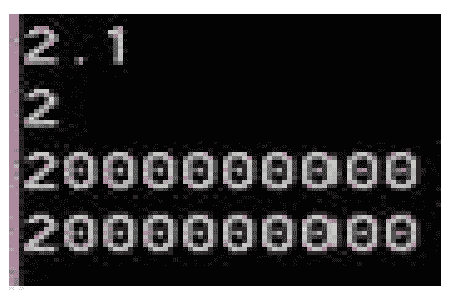

### 隐式转换^107

只有在不可能丢失数据时，才能执行此转换。此转换被称为隐式转换，因为它不需要任何运算符。当你将小范围值赋给具有大范围的变量时，C# 编译器将执行隐式转换。

### 字符串转换

C# 允许你将任何数据类型转换为“string”。如果你使用“+”并且至少有一个非字符串参数，编译器将自动执行此转换过程。此时，非字符串参数将变为字符串，“+”运算符将产生一个新值。

执行隐式类型转换是为了完成诸如从基类到派生类的转换等操作。这些转换以所谓的“类型安全”方式执行。另一种转换类型是显式转换，它需要强制转换运算符才能完成其功能。C# 中有 16 个不同的函数可用作内置的转换方法。以下是一些示例，你应在 C# 环境中练习并熟悉它们。

- ToChar — 允许你接受一个类型并将其转换为单个 Unicode 字符
- ToByte — 允许你通过转换某个类型来获得一个字节
- ToDateTime — 允许你通过转换某个类型（字符串或整数）来获得日期时间结构
- ToBoolean — 允许你通过转换某个类型来获得布尔值
- ToDouble — 允许你通过转换某个类型来获得 double 类型
- ToDecimal — 允许你将浮点数转换为整数或 decimal 类型
- ToInt64 — 允许将某个类型转换为 64 位整数
- ToInt32 — 允许将某个类型转换为 32 位整数
- ToInt16 — 允许将某个类型转换为 16 位整数
- ToSByte — 允许将某个类型转换为有符号字节类型
- ToString — 允许将某个类型转换为字符串
- ToSingle — 允许将某个类型转换为小浮点数
- ToUInt64 — 允许将某个类型转换为无符号 64 位整数
- ToUInt32 — 允许将某个类型转换为无符号 32 位整数类型
- ToUInt16 — 允许将某个类型转换为无符号 16 位整数类型
- ToType — 允许将某个类型转换为指定类型

对于今天的练习，我鼓励你去找一些执行上述每个函数/转换的编程示例，以便更熟悉它们涉及的内容，以及它们如何在你自己的编程中帮助你。

请记住，尽管你的编码可能很长，但输出会很短——不过它应始终产生你试图通过所做编码达成的答案。

## 第 6 章：为什么需要运算符

在本章中，我们将花一些时间讨论可以在 C# 语言中使用的运算符¹⁰。

通过阅读本材料，你将了解这些运算符如何工作，以及如何在源代码中使用它们。这些运算符理解和使用起来相当简单，但这并不意味着它们没有用处；事实上，它们有助于确保你的代码执行你需要它完成的任务。如果不使用其中一些运算符，你的程序将缺乏功能，并且无法很好地运行。这些运算符可能理解起来很简单，但它们确实极大地增强了代码的整体能力。

无论你使用哪种编程语言，运算符都很重要。我们将分别详细介绍不同的运算符，以便你理解每个运算符应如何工作，以及如何利用每个运算符来满足各种用途并完成不同任务。

### 运算符——基础知识

运算符帮助你处理对象和数据类型。它们接受输入和操作数来产生结果。C# 语言使用特殊字符（例如“.”、“+”、“/”等）作为运算符。此外，C# 代码最多可接受三个不同的操作数。

### 运算符的不同类型

C# 程序员将运算符分为以下类型：

### 赋值运算符

在处理赋值运算符时，虽然还有一些其他选择，但这是你使用这些运算符时最常见的方式。此外，你可以使用几种不同类型的赋值运算符，但最常见的是等号。你可以在 C# 代码中使用的一些运算符包括以下内容：

- `=`

此运算符的功能是允许你执行简单赋值

运算。它可以将值赋给当时正在处理的变量。例如，编写 `int sample = 100` 会告诉程序，你想把 100 赋给名为 `sample` 的变量。它不会对该变量或所涉及的值执行任何额外任务。

- **+=** — 这是加法赋值运算符。其功能是将两个操作数的值相加，然后将和赋给左侧操作数。
- **-=** — 程序员常将其称为“减法”赋值运算符。其功能是从左侧操作数中减去右侧操作数的值，然后将差值赋给左侧操作数。
- **\*=** — 此运算符的功能是将各操作数的值相乘，然后将乘积赋给左侧操作数。
- **/=** — 此运算符的功能是将两个变量相除，然后取结果赋给左侧变量。

使用赋值运算符时，请确保两个操作数都属于相同的数据类型。如果你发现所使用的各个操作数不兼容，可能会出现问题；若尝试执行程序，这可能导致程序错误，并且需要额外的时间和精力来修复。

在 C# 中，你需要使用等号（即 =）来赋值。赋值时需要使用的语法如下：

`name_of_operand = expression, literal, or second_operand`

以下是一些示例：

```csharp
int y = 99;
string hello = "Good morning.";
char sample = 'z';
```

**重要说明：** C# 允许你级联（即在一个表达式中多次使用）赋值运算符。这意味着，如果你要创建相同数据类型的变量，就不必输入多个等号。下面给出的示例将说明这条规则：

```csharp
int d = 1, e = 2, f = 3;
string hi = "Good Morning.", bye = "Farewell.", thanks = "Thank you.";
```

### 逻辑运算符

逻辑运算符（也称为“布尔”运算符）接受并返回布尔值（即 true 或 false）。以下是 C# 的四个逻辑运算符：

- **&&** — 程序员称此运算符为“逻辑与”。如果两个操作数都为 true，它将返回“true”。
- **^** — 这称为“异或”运算符。如果其中一个操作数为 true，它将返回 true。
- **||** — 这是“逻辑或”运算符。只要至少一个操作数为 true，你就会得到 true。
- **!** — 此运算符称为“逻辑非”运算符，会反转操作数的值。

研究以下代码以理解这些运算符的用法¹⁰⁹：

```csharp
class Test
{
    static void Main()
    {
        bool x = true, y = false;

        System.Console.WriteLine(x && y);
        System.Console.WriteLine(x || y);
        System.Console.WriteLine(!x);
        System.Console.WriteLine(x ^ y);

        // This is an example.
    }
}
```

编译并运行此代码后，你将看到以下结果：


### 算术运算符

这些运算符可帮助你执行数学运算。此类别包含以下运算符：

- **+** – 使用此运算符将两个操作数或值相加（例如 `int x = 1 + 1`）
- **-** – 此运算符允许你在代码中执行减法。它从左侧操作数的值中减去右侧操作数的值（例如 `int x = 2 - 1`）
- **\*** – 使用此运算符可以将两个操作数的值相乘（例如 `int r = 6 * 6`）
- **/** – 使用此运算符在 C# 代码中对数值进行除法。基本上，“/”会将左侧操作数的值除以右侧操作数的值。
- **++** – 这称为“递增运算符”。它将操作数的值增加一。与上述运算符不同，此运算符作用于单个操作数。此外，你可以将其写在操作数之前或之后。（例如 99++, 1++, ++5 等。）
- **--** – 此运算符与递增运算符完全相反。你可以用它把操作数的值减一。你可以将其写在要修改的操作数之前或之后。
- **%** - 这通常称为求余运算符，或通常称为“取模”运算符。其功能是将左侧操作数除以右侧操作数，然后返回余数。

下面给出的代码将展示这些运算符的工作方式：

```csharp
class Test
{
    static void Main()
    {
        double d = 100, e = 3;

        System.Console.WriteLine(d + e);
        System.Console.WriteLine(d - e);
        System.Console.WriteLine(d / e);
        System.Console.WriteLine(d * e);
        System.Console.WriteLine(++d);
        System.Console.WriteLine(--e);

        // This is an example.
    }
}
```

编译并执行该代码后，你将在命令提示符中看到以下内容：

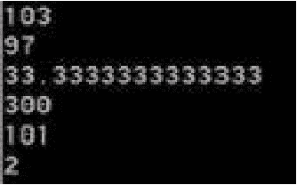

### 二进制运算符

这些运算符作用于二进制数。在 IT 世界中，所有信息都表示为零和一的序列。这意味着如果你想成为一名成功的程序员，就需要掌握二进制运算符。

二进制运算符的工作方式与逻辑运算符完全相同。实际上，你可能会认为二进制运算符和逻辑运算符使用不同的输入，但执行相同的过程。

逻辑运算符使用布尔值来产生结果。另一方面，二进制运算符作用于以二进制数字表示的数。以下是你在使用 C# 时会遇到的二进制运算符：

- **&** – 这称为“二进制与”。它指示两个操作数都为“1”的位置。
- **^** – 程序员称此运算符为“二进制异或”。它会在值不同的每个位置放置“1”。
- **|** – 这是“二进制或”运算符。它指示任一操作数为“1”的位置。
- **~** – 这充当二进制值的取反运算符。就像“!”一样，它会反转变量当前的值。
- **<<** – 这是“二进制左移”运算符。它将二进制数的位向左移动。此移动取决于你将赋的值（例如 4 << 1、4 << 3、4 << 2 等）。

### 关系/比较运算符

你可以使用的下一类运算符称为关系运算符。这些运算符非常有用，因为它们允许你比较两个操作数的值。每个此类运算符都会给出一个布尔值作为最终输出。由于这一功能，当你想创建一些条件语句时，最好使用这些运算符。我们将看看一些可用于编写 C# 代码的关系运算符，但在这些示例中，假设 `e = 150`，且 `d = 100`。

- **==** – 这是相等运算符。它检查两个操作数是否相等（例如 `x == y`）。此运算符的功能是让你检查两个值是否相等。如果两个值最终相等，该运算符会告诉你为 true。否则，该运算符会告诉你为 false。例如，`d == e` 会显示为 false。
- **>** – 此运算符的功能是检查左侧操作数是否大于右侧操作数。如果是，则运算符会告诉你为 true。例如，`e > d` 将为 true。
- **<** – 这是小于运算符；它允许你检查左侧操作数是否小于右侧操作数。如果左侧操作数的值小于右侧操作数的值，它将返回“true”（例如 `y < x`）。
- **>=** – 使用此运算符，你可以确定左侧操作数的值是否大于或等于右侧操作数的值。此运算符的功能是：它会说明左侧操作数的值确实大于或等于右侧操作数。否则，它会告诉你该语句为 false。例如，`e >= d` 求值为 true。
- **<=** – 如果左侧操作数的值小于或等于右侧操作数的值，此运算符将返回 true。
- **!=** – 此运算符的功能是让你测试两个值/操作数是否不相等。如果这些值最终不相等，它会告诉你为 true。例如，`e != d` 会导致运算符说它为 true。

使用这些关系运算符时，请始终记住，每次都会得到一个布尔结果。这意味着你得到的答案将是 true 或 false。在使用相等运算符时，你还必须检查是否使用了两个等号。如果你最终将这些运算符与赋值运算符混淆，可能会收到错误消息，并且该程序将无法按你期望的方式运行。

### 条件运算符

C# 用户将“?”称为条件运算符。基本上，此运算符使用布尔表达式的结果来确定应处理哪个语句。这称为“三元运算符”，因为它作用于三个操作数。在这里，第一个值应为布尔值，而其余值需要属于相同的数据类型（例如字符、字符串、数字等）。

此运算符的语法是：

```
first_operand ? second_operand : third_operand;
```

其工作方式如下：如果“first_operand”为真，程序将处理“second_operand”。然而，如果“first_operand”为假，程序将处理“third_operand”。

## 第 7 章：条件语句

C# 具有条件语句，主要用于控制执行流程。条件语句要求程序员指定一个条件或一组条件，以及当条件被判定为真时要执行的对应语句集。程序员还可以指定当条件不为真时要执行的语句集。

让我们讨论 C# 支持的各种条件语句。

### if 语句

此语句用于在执行一组语句之前计算布尔表达式的值。如果条件为真，则将执行一组语句；否则，将执行另一组语句。以下是此语句的语法：

```csharp
if(boolean_expression) {
    /* statement(s) to execute if above boolean expression is true */
}
```

以下是一个示例：

```csharp
using System;
namespace DecisionMaking {
    class IfStatement {
        static void Main(string[] args) {
            /* defining a local variable */
            int x = 5;
            /* check a boolean condition via if statement */
            if (x < 10) {
                /* to be printed if the condition is true */
                Console.WriteLine("x is less than 10");
            }
            Console.WriteLine("The value of x is : {0}", x);
            Console.ReadLine();
        }
    }
}
```

该代码返回以下输出：

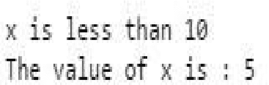

条件被判定为真，也就是说，变量 x 的值小于 10，因此，紧跟在条件之后的语句被执行了。如果条件为假呢？

```csharp
using System;
namespace DecisionMaking {
    class IfStatement {
        static void Main(string[] args) {
            /* defining a local variable */
            int x = 15;
            /* check a boolean condition via if statement */
            if (x < 10) {
                /* to be printed if the condition is true */
                Console.WriteLine("x is less than 10");
            }
            Console.WriteLine("The value of x is : {0}", x);
            Console.ReadLine();
        }
    }
}
```

该代码返回以下内容：

```
The value of x is : 15
```

条件被判定为假，因此执行了其代码块之外的语句。

### if-else 语句

这简单来说就是 *if* 语句与 *else* 部分的组合。如果条件为真，则执行 *if* 部分；当条件为假时，则执行 *else* 部分。这两部分不能同时执行。以下是该语句的语法：

```csharp
if(boolean_expression)
{
    // code executes if the condition is true.
}
else
{
    // code executed if the condition is false
}
```

请考虑下面给出的示例：

```csharp
using System;

namespace DecisionMaking {
    class IfElseStatement {
        static void Main(string[] args) {
            /* defining a local variable */
            int x = 5;

            /* a check of the boolean condition */
            if (x < 10) {
                /* if the condition is true, the following will be printed */
                Console.WriteLine("x is less than 10");
            } else {
                /* if the condition is false, the following will be printed */
                Console.WriteLine("x greater than 10");
            }
            Console.WriteLine("The value of x is : {0}", x);
            Console.ReadLine();
        }
    }
}
```

该代码返回以下内容：

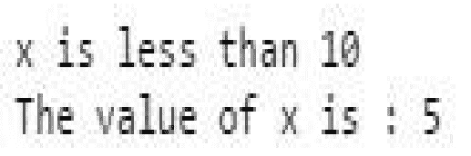

*if* 条件求值为真，因此执行了其代码块内的语句。如果条件为假呢？

```csharp
using System;
namespace DecisionMaking {
    class IfElseStatement {
        static void Main(string[] args) {
            /* defining a local variable */
            int x = 15;
            /* a check of the boolean condition */
            if (x < 10) {
                /* if the condition is true, the following will be printed */
                Console.WriteLine("x is less than 10");
            } else {
                /* if the condition is false, the following will be printed */
                Console.WriteLine("x greater than 10");
            }
            Console.WriteLine("The value of x is : {0}", x);
            Console.ReadLine();
        }
    }
}
```

该代码给出以下输出：

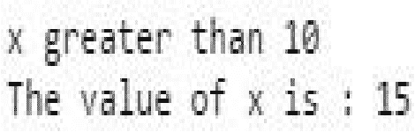

*if* 条件求值为假，因此执行了 *else* 代码块内的语句。你一定注意到了，在两种情况下，两个代码块之外的部分都被执行了。事情就是这样。

### else…if 语句

在某些情况下，我们可能需要检查多个条件。在这种情况下，我们可以使用 *else if* 语句。它采用下面给出的语法：

```csharp
if(boolean_expression_a) {
    /* Runs if the boolean expression a is true */
}
else if(boolean_expression_b) {
    /* Runs if the boolean expression b is true */
}
else if(boolean_expression_c) {
    /* Runs if the boolean expression c is true */
} else {
    /* to run if none of above conditions is true */
}
```

以下是一个示例：

```csharp
using System;

namespace DecisionMaking {
    class ElseIfStatement {
        static void Main(string[] args) {
            /* defining a local variable */
            int x = 5;

            /* checking the boolean condition */
            if (x == 1) {
                /* print this statement if the condition is true */
                Console.WriteLine("Value of x is 1");
            }
            else if (x == 2) {
                /* print this statement if the else if condition is true */
                Console.WriteLine("Value of x is 2");
            }
            else if (x == 3) {
                /* print this statement if the else if condition is true */
                Console.WriteLine("Value of x is 3");
            } else {
                /* print this statement if none of the above conditions is true */
                Console.WriteLine("All conditions are false");
            }
            Console.WriteLine("Exact value of x is: {0}", x);
            Console.ReadLine();
        }
    }
}
```

该代码打印以下结果：

```
All conditions are false
Exact value of x is: 5
```

所有条件都被判定为假；因此执行了这些条件之外的代码块。让我们将变量 x 的值设为 2，看看这段代码会发生什么：

```csharp
using System;
namespace DecisionMaking {
    class ElseIfStatement {
        static void Main(string[] args) {
            /* defining a local variable */
            int x = 2;
            /* checking the boolean condition */
            if (x == 1) {
                /* print this statement if the condition is true */
                Console.WriteLine("Value of x is 1");
            }
            else if (x == 2) {
                /* print this statement if the else if condition is true */
                Console.WriteLine("Value of x is 2");
            }
            else if (x == 3) {
                /* print this statement if the else if condition is true */
                Console.WriteLine("Value of x is 3");
            }
            else {
                /* print this statement if none of the above conditions is true */
                Console.WriteLine("All conditions are false");
            }
            Console.WriteLine("Exact value of x is: {0}", x);
            Console.ReadLine();
        }
    }
}
```

输出如下所示：

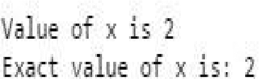

一个 else if 条件求值为真；因此执行了其代码块内的语句。所有条件之外的代码块也被执行了。你可以通过将 x 的值修改为各种值来试用这段代码，看看会发生什么。

### 嵌套 if 语句

C# 允许我们嵌套条件语句。我们可以嵌套 if 和 else if 语句，这意味着我们将它们用在另一个 if 或 else if 语句内部。以下语法演示了如何在 C# 中嵌套 if 语句：

```csharp
if(boolean_expression_a) {
    /* to execute if the boolean expression a is true */
    if(boolean_expression_b) {
        /* to execute if the boolean expression b is true */
    }
}
```

else if 语句可以使用上面给出的语法进行嵌套。

请考虑下面给出的示例：

```csharp
using System;
```


```csharp
namespace DecisionMaking {
    class NestedIf {
        static void Main(string[] args) {
            /* defining local variables */
            int x = 1;
            int y = 2;

            /* checking the boolean condition */
            if (x == 1) {
                /* if the condition is true, check the if condition below */
                if (y == 2) {
                    /* if the condition is true, print the following */
                    Console.WriteLine("Value of x is 1 and y is 2");
                }
            }
            Console.WriteLine("Exact value of x is : {0}", x);
            Console.WriteLine("Exact value of y is : {0}", y);
            Console.ReadLine();
        }
    }
}
```

代码返回：

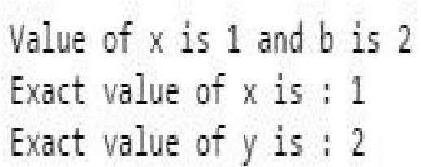

两个 if 条件均求值为 true，因此嵌套 *if* 中的语句被执行。如果其中一个或两个条件求值为 false，那么该语句就不可能被执行。示例如下：

```csharp
using System;
namespace DecisionMaking {
  class NestedIf {
    static void Main(string[] args) {
      /* defining local variables */
      int x = 1;
      int y = 2;
      /* checking the boolean condition */
      if (x == 1) {
        /* if the condition is true, check the if condition below */
        if (y == 3) {
          /* if the condition is true, print the following */
          Console.WriteLine("Value of x is 1 and y is 2");
        }
        Console.WriteLine("Exact value of x is : {0}", x);
        Console.WriteLine("Exact value of y is : {0}", y);
        Console.ReadLine();
      }
    }
  }
}
```

在上面的代码中，嵌套 if 条件检查变量 y 的值是否为 3，结果为 false。该块中的语句不会被执行。C# 编译器将跳过这一部分，继续执行条件之外的代码。它返回以下内容：

Exact value of x is : 1
Exact value of y is : 2

### switch 语句¹¹

此语句与使用多个 *if* 语句相同。它由一系列可能性、每个可能性对应的操作，以及当任何选项都未求值为 true 时执行的默认部分构成。此语句的语法如下：

```text
switch(expression)
{
    case <value_1>:
        // code
        break;
    case <value_2>:
        // code
        break;
    case <value_N>:
        // code
        break;
    default:
        // code
        break;
}
```

**示例如下：**

```csharp
using System;
public class SwitchStatement
{
    public static void Main()
    {
        int a = 3;
        switch (a)
        {
            case 1:
                Console.WriteLine("The value of x is 1");
                break;
            case 2:
                Console.WriteLine("The value of x is 2");
                break;
            case 3:
                Console.WriteLine("The value of x is 3");
                break;
            default:
                Console.WriteLine("Unknown value of x");
                break;
        }
    }
}
```

代码返回以下内容：


该变量的值被初始化为 3。执行代码后，将匹配 3 对应的 case 代码，因此其块内的语句将被执行。如果没有任何 case 条件为 true，则执行 default 部分。如下所示：

```csharp
using System;
public class SwitchStatement
{
    string firstName = "Nicholas";
    switch (firstName)
    {
        case "text":
            Console.WriteLine("is your first name");
            break;
        case "Samuel":
            Console.WriteLine("Samuel");
            break;
        case "Nicholas":
            Console.WriteLine("Nicholas");
            goto case "text";
            break;
        case "Bismack":
            Console.WriteLine("Bismack");
            break;
    }
}
```

代码返回以下输出：


### 嵌套 switch

可以在一个 switch 语句中创建另一个 switch 语句。这就形成了嵌套 switch。示例如下：

```csharp
using System;
public class NestedSwitch
{
    public static void Main()
    {
        int x = 10;
        switch (x)
        {
            case 10:
                Console.WriteLine(10);
                switch (x - 1)
                {
                    case 9:
                        Console.WriteLine(9);
                        switch (x - 2)
                        {
                            case 8:
                                Console.WriteLine(8);
                                break;
                        }
                        break;
                }
                break;
            case 20:
                Console.WriteLine(20);
                break;
            case 125:
                Console.WriteLine(25);
                break;
            default:
                Console.WriteLine(30);
                break;
        }
    }
}
```

输出如下：

## 第 8 章：循环

作为一名程序员，你会使用循环语句重复运行某些代码块。循环在 C# 编程中起着重要作用。因此，如果你想在短时间内掌握这门语言，也应该仔细学习这些内容。

### 循环——基础知识

在创建程序时，你经常需要多次执行代码序列。多次输入相同的代码块可能极其枯燥。因此，你需要找到一种快速简单的方式来重复代码。幸运的是，C# 语言支持循环语句。

循环是一种重复运行代码片段的工具。你可以用它按特定次数运行代码，或在给定条件满足时一直运行代码。C# 提供不同类型的循环语句。让我们详细分析每一种类型：

### while 循环¹³

这是 C# 中最简单的循环语句。其语法为：

```
while (the_assigned_condition)

{
    the_loop’s_body;

}
```

在此语法中，“the_assigned_condition”是一个产生布尔值的表达式。此条件决定“body”将运行多少次。另一方面，“body”是你要执行的语句（或语句组）。

下图说明了 while 循环的工作方式：


条件  
false  
true  
循环体

处理 “while” 循环时，C# 程序会检查布尔表达式的值。如果值为 “true”，程序将运行循环体中的所有语句。然后，程序会检查布尔表达式以查看其值。如果值仍为 true，程序将重新运行循环体并返回第一步（即检查表达式的值）。此过程将持续到布尔表达式求值为 false。一旦发生这种情况，程序将处理循环之后的代码块。

重要提示：如果布尔表达式为 false，你的 C# 程序不会运行 while 循环体。因此，如果你启动程序时布尔值为 false，循环内的语句将永远不会被执行。

以下示例说明了 while 循环的工作方式：

```csharp
int timer = 10;

while (timer >= 0)

{
System.Console.WriteLine("Time remaining: " + timer);

timer--;
}
```

如果你编译并执行此代码，命令提示符将打印以下数据：


### break 运算符

你可以使用 “break”（一个 C# 运算符）提前退出循环。程序员如果不想等待循环自然终止，就会使用此运算符。基本上，循环一旦遇到 break 运算符就会结束。这种情况会强制程序跳转到循环之后的代码片段。


在 C# 中，你只能在循环体内部使用此运算符。这意味着“break”仅在循环运行时才会生效。

### Do-While 循环¹⁴

do-while 循环与 while 循环几乎相同。这些循环之间的唯一区别在于，前者在运行循环体之后才分析布尔值。因此，你可以放心，即使布尔表达式为 false，你的代码也至少会运行一次。以下是 do-while 循环的语法：

```csharp
do
{
    statements;
} while (Boolean expression);
```

do-while 循环按照以下模式工作：


程序将执行循环体中的所有语句。然后，它会检查条件（即布尔表达式）。如果条件求值为 true，程序将再次执行循环体并执行“值检查”。此过程会一直持续到条件变为 false。因此，如果你指定的条件始终求值为 true，你的代码可能会永远运行下去。

### For 循环¹¹⁵

一般来说，“for”循环比 do-while 和 while 循环更复杂。然而，for 循环可以帮助你使用更少的 C# 代码执行困难的任务。“for”循环的语法是：

```csharp
for (initializer; Boolean_expression; update)
{
    the_loop’s_body;
}
```

“for”循环包含一个初始化器（即计数器的初始值）、一个布尔表达式、一条更新计数器的 C# 语句以及循环体。

“计数器”（即分配给循环的初始值）是“for”循环最具特色的特征。在大多数情况下，计数器的值会不断增加，直到达到最终值（例如从 1 到 10）。此外，程序员通常知道“for”循环将迭代多少次。

你可以在“for”循环中包含一个或多个变量。这些变量可以按降序或升序变化。编写程序时，你可以在单个“for”循环中组合升序和降序变量。此外，升序变量可以从 1 到 1024，因为“for”循环支持算术运算（例如加法、乘法等）。

重要说明：“for”循环的所有部分都是可选的。你可以通过在语法中留空来创建无限“for”循环。下面是一个示例：

```csharp
for ( ; ; )
{
    // Loop body
}
```

至此，你已经准备好进一步了解“for”循环的不同部分。

#### 初始化

“for”循环可以拥有一个初始化片段：

```csharp
for (double sample = 1; ...; ...)
{
    // You can use the “sample” variable here.
}

// You can’t use the variable here.
```

C# 程序会在运行“for”循环之前执行此片段一次。程序员通常使用初始化片段创建计数器（也称为“循环变量”）并为其分配初始值。该计数器在循环体内部可用且可使用。C# 允许你使用单个初始化片段声明多个变量。

#### 条件

显然，“for”循环需要一个条件表达式。下面是一个示例：

```csharp
for (double sample = 1; sample < 5; …)
{
    // This is the loop’s body.
}
```

计算机程序会在运行循环体之前对条件表达式求值。如果结果为“true”，循环体将运行；否则，相关程序将跳转到当前循环之后编写的语句。

#### 更新语句

这是“for”循环的最后一部分。基本上，更新语句会更新循环的计数器。让我们使用上面给出的代码片段：

```csharp
for (double sample = 10; sample > 1; sample--)
{
    // This is the loop’s body.
}
```

程序在运行循环体之后执行此部分。请记住，此语句会更新计数器的值。

#### 循环体

此部分由 C# 语句组成。它可以使用你在循环初始化片段中声明的变量。请查看下面的示例：

```csharp
for (double sample = 10; sample > 1; sample--)
{
    System.Console.WriteLine(sample);
}
```

#### Continue 运算符

在某些情况下，你需要停止当前迭代而不结束循环本身。你可以使用名为“continue”的 C# 运算符来完成此任务。下面给出的示例将说明此运算符的工作方式：

甚至是非索引数据组中的现有元素。

编写这种循环时，请使用以下语法：

```csharp
foreach (type name_of_variable in name_of_group)
{
    the_statements;
}
```

如你所见，这种循环比典型的“for”循环简单得多。“foreach”循环可以帮助你快速扫描集合内的所有对象。难怪无数程序员在编写代码时使用这种循环。

### 嵌套 For 循环

C# 允许你将一个“for”循环放在另一个“for”循环内。代码最内层的循环运行次数最多。另一方面，最外层的循环重复次数最少。在“嵌套”for 循环时，应使用以下语法：

```csharp
for (initializing_fragment; condition; update_statement)
{
    for (initializing_fragment; condition; update_statement)
    {
        statements
    }
}
```

在这里，程序运行最初的“for”循环，执行其循环体，并触发嵌套循环。程序将检查第二个循环的条件，并执行其中的代码，直到求值变为 false。然后，程序将对循环的计数器进行必要的调整。程序将重复整个过程，直到所有条件的求值结果都为 false。

## 第 9 章：C# 方法

本章将重点介绍 C# 方法。在这里，你将学习如何在自己的程序中声明和使用方法。你需要记住本章包含的课程内容，才能成为一名高效的 C# 程序员。

### 方法——基础知识

对大多数程序员来说，方法是任何程序的核心方面。方法可以解决问题、接受用户输入（称为参数）并产生结果。

方法只是一组组合在一起以执行常见任务的语句。每个 C# 类至少有一个方法，即 Main 方法。要能够使用某个方法，你必须定义它，然后调用它来执行其预期执行的操作。方法通过表示程序完成的数据转换来完成任务。此外，方法还是完成实际处理的区域。这就是 C# 程序员将方法视为任何计算机程序基本单元的主要原因。

### 方法带来的好处

在本节中，你将了解 C# 方法提供的主要好处。阅读本材料后，你将知道为什么在编写程序时应该使用这些工具。

### 更好的结构和代码可读性

编程专家声称，在编写计算机程序时应该使用方法。方法即使是最简单的方法，也能改善 C# 代码的结构和可读性。

以下是你需要知道的一个重要事实：程序员将 20% 的时间花在编写和检查计算机程序上。其余 80% 的时间花在维护和改进软件上。显然，如果你的代码可读且结构良好，你处理程序时就会很轻松。

### 防止冗余代码

方法可以帮助你避免程序中的冗余代码。冗余或重复的代码常常会在计算机应用中产生不良结果。

### 更好的代码重复利用

如果你的程序需要多次使用某个代码片段，那么将所述片段转移到 C# 方法中是一个极好的主意。你可以多次调用方法，这意味着你可以重复使用重要代码而无需重新输入它们。

### 声明、实现和调用 C# 方法

*方法定义*——方法定义只是对构成方法结构的元素进行声明。以下是 C# 中方法定义的语法：

```csharp
<Access_Specifier><The_Return_Type><Your_Method_Name>
(Parameter_List) {
    Method Body
}
```

此时，你需要了解可以对现有方法执行的过程。这些过程包括：

-   声明——在此过程中，你将方法链接到程序。此过程允许你在程序的任何部分调用该方法。
-   实现——此过程涉及输入代码以完成某项任务。此处涉及的代码存在于你正在使用的方法内部。
-   调用——这是调用已声明方法的过程。在这里，你将使用方法解决问题或执行操作。

### 方法声明

在 C# 中，你需要在类内部声明方法。此外，不允许“嵌套”方法（即在一个方法体内编写另一个方法）。最好的例子是 Main()，即你已多次使用的方法。下面给出的代码将说明这一点：

```csharp
class DeclaringMethods
{
```


```csharp
static void Main()
{
    System.Console.WriteLine("Hi C#!");
}
```

### 语法

声明方法时使用以下语法：

static data_type_of_the_result name_of_method (list_of_parameters)

下面使用 Main() 方法（即 static void Main()）来分析该语法。Main() 使用 “void” 作为返回类型，因为它不产生任何结果。单词 “Main” 用作它的名称。而圆括号则充当程序员将提供的参数的容器。

重要提示：编写 C# 程序时必须遵循此语法。不要改变方法各部分的位置。

C# 不要求你在声明中包含参数。这意味着你可以将括号留空（例如 Main()）。

### 方法名称

在声明、调用或实现方法时，你需要指明方法名。命名方法时需要记住以下规则：

- 确保首字母大写。
- 每个单词都以大写字母开头（例如 SampleMethod、NewMethod、MainLine 等）。

```
;
```

如果你编译并执行该代码，命令提示符将打印以下消息：

*我喜欢狗。*

### 可以调用方法的位置

C# 允许你在以下位置调用方法：

- 在程序的主方法（即 Main()）内部。
- 在另一个方法内部。
- 在方法自身的方法体内部。这种技术称为“递归”。

#### 递归方法调用^120

方法可以调用自身。此过程称为 *递归*^120。请看下面给出的阶乘示例：

```csharp
using System;
namespace MethodApplication {
    class NumberChecker {
        public int factorial(int x) {
            /* declaring a local variable */
            int answer;
            if (x == 1) {
                return 1;
            } else {
                answer = factorial(x - 1) * x;
                return answer;
            }
        }
        static void Main(string[] args) {
            NumberChecker n = new NumberChecker();
            //let's now call the factorial method
            Console.WriteLine("The factorial of 8 is : {0}", n.factorial(8));
            Console.WriteLine("The factorial of 9 is : {0}", n.factorial(9));
            Console.ReadLine();
        }
    }
}
```

我们创建了阶乘函数以及名为 *n* 的类实例。该代码将返回如下结果：


这段代码能够给出 8 和 9 的阶乘。注意，一个数的阶乘是将小于等于该数的所有正整数相乘。例如，8 的阶乘是 1 * 2 * 3 * 4 * 5 * 6 * 7 * 8，结果为 40320，如上所示。

### 向方法传递参数

如果方法定义时带有参数，那么在调用它时应向它传递参数。可以使用三种方法向方法传递参数。下面我们来讨论这些方法。

#### 按值传递

此方法会将实参的实际值复制到函数形参中。这是向方法传递参数的默认机制。使用此机制时，调用函数会为每个值参数在内存中创建新位置，然后将实参的值复制到这些位置中。这意味着在方法内部对参数所做的更改不会影响实参。

下面通过一个示例来演示：

```csharp
using System;
namespace MethodApplication {
    class NumberChecker {
        public void swap(int a, int b) {
            int temp;
            temp = a; /* saving the value of a */
            a = b;   /* putting b into a */
            b = temp; /* putting temp into b */
        }
        static void Main(string[] args) {
            NumberChecker n = new NumberChecker();

            /* defining a local variable */
            int x = 10;
            int y = 20;

            Console.WriteLine("Before swapping, value of x is : {0}", x);
            Console.WriteLine("Before swapping, value of y is : {0}", y);

            /* let’s swap the values by calling the function */
            n.swap(x, y);

            Console.WriteLine("After swapping, value of x is : {0}", x);
            Console.WriteLine("After swapping, value of y is : {0}", y);

            Console.ReadLine();
        }
    }
}
```

该代码产生以下输出：


我们所做的是在函数内部更改了值。然而，上面的输出表明这种更改没有生效；因此它没有在上面的结果中体现出来。

这就是在 C# 中按值传递参数的方式。

#### 按引用传递

引用参数引用变量的内存位置。按引用传递参数时，不会创建新的内存位置，这与按值传递的情况不同。引用参数实际上引用的内存位置与方法调用时提供的实参相同。

要声明引用参数，我们使用 *ref* 关键字。下面用一个示例来演示：

```csharp
using System;
namespace MethodApplication {
    class NumberChecker {
        public void swap(ref int a, ref int b) {
            int temp;

            temp = a; /* saving the value of a */
            a = b;   /* putting b into a */
            b = temp; /* putting temp into b */
        }
    }
}
```

值已经如上所示完成交换。上述更改反映在 *Main* 函数中。

#### 按输出传递[22]

返回语句只能帮助我们从一个函数中返回单个值。然而，通过使用 *输出参数*，可以从一个函数中返回两个值。输出参数与引用参数相同，区别在于它们将数据从方法中传出，而不是传入方法。

以下示例演示了这一点：

```csharp
using System;
namespace MethodApplication {
  class NumberChecker {
    public void getValue(out int a) {
      int temp = 20;
      a = temp;
    }
    static void Main(string[] args) {
      NumberChecker n = new NumberChecker();

      /* defining a local variable */
      int x = 10;

      Console.WriteLine("Before calling the method, value of x : {0}", x);
      /* call the function to get value */
      n.getValue(out x);

      Console.WriteLine("After calling the method, the value of x is : {0}", x);
      Console.ReadLine();
    }
  }
}
```

它返回以下内容：

调用方法前，x 的值为：10  
调用方法后，x 的值为：20

为输出参数提供的变量应被赋值。当希望通过参数从方法中返回值，而又不想给参数赋初始值时，输出参数非常有用。以下示例将帮助你更好地理解这一点：

```csharp
using System;
namespace MethodApplication {
    class NumberChecker {
        public void getValues(out int a, out int b) {
            Console.WriteLine("Enter in your first value: ");
            a = Convert.ToInt32(Console.ReadLine());

            Console.WriteLine("Enter in your second value: ");
            b = Convert.ToInt32(Console.ReadLine());
        }
        static void Main(string[] args) {
            NumberChecker n = new NumberChecker();

            /* defining a local variable */
            int x, y;

            /* call a function to obtain the values */
            n.getValues(out x, out y);

            Console.WriteLine("After calling the method, the value of x is : {0}",
                x);

            Console.WriteLine("After calling the method, the value of y is : {0}",
                y);

            Console.ReadLine();
        }
    }
}
```

系统会提示你输入这两个值，请照做。随后你将看到调用方法前后这些变量的值。


## 第 10 章：数组世界¹²³

我们可以将数组定义为一种特殊的数据类型，它以顺序方式并使用特殊语法¹²⁴存储固定数量的值。所有数组元素都必须属于相同的数据类型，例如字符串、整数、双精度浮点数等。你可以将数组视为存储在连续内存位置中的相同类型变量的集合。你使用索引来访问数组中的给定元素。

在内存中，最低地址标识数组中的第一个元素，而最高地址标识数组中的最后一个元素。

### 声明数组¹²⁵

在 C# 中，数组的声明使用以下语法：

```csharp
datatype[] arrayName;
```

*数据类型*帮助我们指定存储在数组中的元素的数据类型，别忘了所有数组元素都必须属于相同的数据类型。方括号 [] 有助于声明数组的秩，其中秩表示数组的大小或要存储的元素数量。*arrayName* 表示数组的名称。以下是数组声明的有效示例：

```csharp
int[] intArray;  // may be used for storing int values
```

```csharp
bool[] boolArray; // may be used for storing boolean values
```

```csharp
string[] stringArray; // may be used for storing string values
```

```csharp
double[] doubleArray; // may be used for storing double values
```

```csharp
byte[] byteArray; // may be used for storing byte values
```

```csharp
Employee[] customDepartmentArray; // may be used for storing instances of Employee class
```

### 数组初始化

当数组已被声明时，并不意味着它已经在内存中初始化。初始化数组后，就可以为其赋值。

数组初始化可以在声明时使用 *new* 关键字完成。使用此关键字时，会创建数组的一个实例。如下所示：

```csharp
public class MyArray
{
    public static void Main()
    {
        int[] intArray_1 = new int[4];

        int[] intArray_2 = new int[4]{10, 20, 30, 40};

        int[] intArray_3 = {10, 20, 30, 40};
    }
}
```

首先，我们声明了一个用于存储 4 个整数的数组。注意，数组大小的指定是在方括号内完成的。我们在第二条语句中也做了同样的事情，但还在花括号 {} 内为索引分配了值。在第三条语句中，我们声明了一个数组并为其赋值，但没有指定其大小。

### 后期初始化

我们可以在数组声明之后对其进行初始化。这意味着我们不必同时进行数组的声明和初始化。示例如下：

```csharp
using System;
public class MyArray
{
    public static void Main()
    {
        string[] array1, array2;

        array1 = new string[4]{ "Nicholas",
            "Michelle",
            "John",
            "Claire",
        };

        array2 = new string[] {"Nicholas",
            "Michelle",
            "John",
            "Claire",
        };
        Console.WriteLine(array1.Length);
        Console.WriteLine(array2.Length);
    }
}
```

上述机制称为 *后期初始化*。在这种情况下，初始化必须使用 *new* 关键字完成。我们不能仅通过为其赋值来初始化数组。以下示例展示了数组的无效初始化：

```csharp
string[] myarray;

myarray = {"Nicholas", "Michelle", "John", "Claire"};
```

### 访问数组元素

数组的元素是在初始化时分配的。然而，我们可以使用各个索引为数组赋值。如下所示：

```csharp
using System;
public class MyProgram
{
    public static void Main()
    {
        int[] array1 = new int[5];

        array1[0] = 1;

        array1[1] = 2;

        array1[2] = 3;

        array1[3];
        array1[4];
    }
}
```

这就是我们访问上述名为 *array1* 的数组所有元素的方式。

### 使用 for 循环

我们可以使用 *for* 循环访问数组的元素。该循环将遍历数组元素，同时通过其索引访问所需的元素。例如：

```csharp
using System;
namespace ArrayApp {
  class MyArray {
    static void Main(string[] args) {
      int[] n = new int[10]; /* n is an array of 10 integers */
      int x, y;
      /* initialize the elements of the array n */
      for (x = 0; x < 10; x++) {
        n[x] = x + 50;
      }
      /* output each array element's value */
      for (y = 0; y < 10; y++) {
        Console.WriteLine("Element at index[{0}] = {1}", y, n[y]);
      }
      Console.ReadKey();
    }
  }
}
```

变量 *x* 的 *for* 循环帮助我们向数组中填入 10 个值，第一个元素为 50，最后一个元素为 59。变量 *y* 的 *for* 循环帮助我们访问数组的所有元素，从索引 0 一直到最后一个索引。程序的输出如下：

```text
Element at index[0] = 50
Element at index[1] = 51
Element at index[2] = 52
Element at index[3] = 53
Element at index[4] = 54
Element at index[5] = 55
Element at index[6] = 56
Element at index[7] = 57
Element at index[8] = 58
Element at index[9] = 59
```

### 使用 foreach 循环

你已经知道如何使用 *for* 循环访问数组的所有元素。*foreach* 循环也可以帮助你遍历数组的元素。以下示例演示如何使用 *foreach* 循环遍历数组的元素：

```csharp
using System;
namespace ArrayApp {
    class MyArray {
        static void Main(string[] args) {
            int [] n = new int[10]; /* n is an array of 10 integers */
            //int x, y;

            /* initialize the elements of the array n */
            for (int x = 0; x < 10; x++) {
                n[ x ] = x + 100;
            }
            /* output the values of all array elements */
            foreach (int y in n ) {
                int x = y-100;
                Console.WriteLine("Element[{0}] = {1}", x, y);
            }
            Console.ReadKey();
        }
    }
}
```

该代码给出以下结果：

*for* 循环帮助我们向数组中填入 10 个值，第一个元素为 100，最后一个元素为 109。*foreach* 循环帮助我们访问数组的所有元素，从索引 0 一直到最后一个索引。注意，变量 *x* 已用于填充数组值，而变量 *y* 已用于遍历数组的元素。该代码返回如下输出：


### 多维数组

C# 支持多维数组的概念。此类数组也称为矩形数组。多维数组是以行和列形式组织的二维序列。以下是多维数组的示例：

```csharp
int[,] array1 = new int[3,2]{
    {1, 5},
    {2, 5},
    {5, 7}
};
```

```csharp
// or
int[,] array1 = { {1, 5}, {2, 5}, {5, 7} };
```

如上述示例所示，要初始化多维数组，必须按行数和列数来定义它。[3,2] 表示该数组将有 3 行和 2 列。

要访问多维数组的元素，我们使用两个索引。第一个索引标识行，而第二个索引标识列。注意，两个索引都从 0 开始。让我们用一个示例来演示这一点：

```csharp
using System;
public class MyArray
{
    public static void Main()
    {
        int[,] array1 = new int[3,2]{
            {1, 5},
            {2, 5},
            {5, 7}
        };

        Console.WriteLine(array1[0, 0]);

        Console.WriteLine(array1[0, 1]);

        Console.WriteLine(array1[1, 0]);

        Console.WriteLine(array1[1, 1]);

        Console.WriteLine(array1[2, 0]);

        Console.WriteLine(array1[2, 1]);
    }
}
```

该代码给出以下输出：


这就是我们访问元素的方式。*array[1, 0]* 返回数组中位于第 2 行第 1 列的元素。

### 交错数组

交错数组（jagged array）本质上就是数组的数组。这些数组存储的是数组，而不是直接存储数据类型的值。要初始化一个交错数组，我们使用两个方括号 [][]。在第一个方括号中，我们指定数组的大小；在第二个方括号中，我们指定要作为值存储的数组的维度。下面是一个示例，演示了交错数组的声明和初始化：

```csharp
using System;
public class MyArray
{
    public static void Main()
    {
        int[][] jaggedArray = new int[2][];

        jaggedArray[0] = new int[4]{1, 2, 3, 4};
        jaggedArray[1] = new int[3]{5, 6, 7};

        Console.WriteLine(jaggedArray[0][0]);

        Console.WriteLine(jaggedArray[0][2]);

        Console.WriteLine(jaggedArray[1][1]);
    }
}
```

我们在上面的代码中声明并初始化了交错数组。运行代码将得到以下结果：


交错数组也可以将多维数组作为值存储。我们可以在第二个方括号中使用 [,] 来表示多维。下面是一个示例：

```csharp
using System;
public class MyArray
{
    public static void Main()
```


请注意，我们使用了三个方括号 [][][]，这表示数组的数组的数组。*jaggedArray* 将包含 2 个元素，它们是 2 个数组。这些数组中的每一个也会有一个一维数组。

## 第 11 章：类

类可以看作对象的一张蓝图。现实世界中的对象具有形状、颜色和功能等特征。例如，X6 就是一个汽车类型的对象。汽车具有颜色、速度、内饰、形状等特征。这意味着，任何公司只要创建了具有上述特征的对象，它就会是汽车类型。也就是说，Car 是一个类，而每个对象——即实际的汽车——都是 Car 类型的对象。

在面向对象编程中（别忘了 C# 是一种面向对象的编程语言），类具有字段、属性、方法、事件等。类应该定义对象应具有的数据类型和功能。

借助类，你可以将其他类型的变量以及方法和事件组合在一起，从而创建自己的自定义类型。

在 C# 中，我们使用 *class* 关键字来定义类。下面是一个简单的示例：

```csharp
public class TestClass
{
    public string field1 = string.Empty;

    public TestClass()
    {
    }
    public void TestMethod(int param1, string param2)
    {
        Console.WriteLine("The first parameter is {0}, and second parameter is {1}",
                          param1, param2);
    }
    public int AutoImplementedPropertyTest { get; set; }
    private int propertyVar;
    public int PropertyTest
    {
        get { return propertyVar; }
        set { propertyVar = value; }
    }
}
```

类前面的 *public* 关键字是一个访问修饰符，指定类的访问方式。设为 public 意味着同一项目中的所有其他类都可以访问它。我们将这个类命名为 *TestClass*。

我们还在类中定义了一个名为 *field1* 的字段。在它下面，我们为类创建了一个构造函数。请注意，构造函数与类本身同名，因此构造函数名为 *TestClass()*。在这个类中，我们还定义了一个名为 *TestMethod()* 的方法，该方法接收两个参数：*param1* 和 *param2*，前者是整数，后者是字符串。

下面是另一个演示如何声明和使用类的示例：

```csharp
using System;
namespace CubeApplication {
    class Cube {
        public double length;  // Length of the cube
        public double breadth;  // Breadth of the cube
        public double height;  // Height of the cube
    }
    class Cubetester {
        static void Main(string[] args) {
            Cube Cube1 = new Cube();  // Declare Cube1 of type Cube
            Cube Cube2 = new Cube();  // Declare Cube2 of type Cube
            double volume = 0.0;  // Store the cube volume here
            // cube 1 specification
            Cube1.height = 4.0;
            Cube1.length = 5.0;
            Cube1.breadth = 8.0;
            // cube 2 specification
            Cube2.height = 8.0;
            Cube2.length = 12.0;
            Cube2.breadth = 14.0;

            // volume of cube 1
            volume = Cube1.height * Cube1.length * Cube1.breadth;
            Console.WriteLine("Volume of Cube 1 : {0}", volume);
            // volume of cube 2
            volume = Cube2.height * Cube2.length * Cube2.breadth;
            Console.WriteLine("Volume of Cube 2 : {0}", volume);
            Console.ReadKey();
        }
    }
}
```

代码将返回以下结果：


### 封装与成员函数

类的成员函数就是在其类的定义内部有定义或原型的函数，与其他任何函数一样。这样的函数可以操作该类的任意对象（函数是该类的成员），并且可以访问对象的全部类成员。

从设计角度看，成员函数只是对象的属性，它们被定义为 *private*，以实现封装的概念。我们只能通过公共成员函数访问这些变量。下面演示如何在 C# 中设置和访问类的各种成员：

```csharp
using System;
namespace CubeApplication {
    class Cube {
        private double length;  // Length of a cube
        private double breadth;  // Breadth of a cube
        private double height;  // Height of a cube
        public void setLength( double len ) {
            length = len;
        }
        public void setBreadth( double brea ) {
            breadth = brea;
        }
        public void setHeight( double heig ) {
            height = heig;
        }
        public double getVolume() {
            return length * breadth * height;
        }
    }
    class Cubetester {
        static void Main(string[] args) {
            Cube Cube1 = new Cube();  // Declare Cube1 of type Cube
            Cube Cube2 = new Cube();
            double volume;

            // Declare Cube2 of type Cube
            // cube 1 specification
            Cube1.setLength(4.0);
            Cube1.setBreadth(6.0);
            Cube1.setHeight(8.0);

            // cube 2 specification
            Cube2.setLength(10.0);
            Cube2.setBreadth(14.0);
            Cube2.setHeight(12.0);
            // volume of cube 1
            volume = Cube1.getVolume();
            Console.WriteLine("Volume of Cube 1 is: {0}" ,volume);

            // volume of cube 2
            volume = Cube2.getVolume();
            Console.WriteLine("Volume of Cube2 is: {0}", volume);
            Console.ReadKey();
        }
    }
}
```

以下是代码的输出：


我们使用 *setter* 方法来设置两个立方体的各个属性值。调用 *getVolume()* 函数来计算两个立方体的体积。

### 构造函数

构造函数只是类的一种特殊成员函数，每当我们创建类的新对象时，它就会运行。构造函数使用类的名称，并且不应具有返回类型。下面的示例演示了如何在 C# 中使用构造函数：

```csharp
using System;
namespace ConstructorApplication {
    class Person {
        private double height;  // height of the person

        public Person(double heig) {
            Console.WriteLine("We are creating an object, height = {0}", heig);
            height = heig;
        }
        public void setHeight( double heig ) {
            height = heig;
        }
        public double getHeight() {
            return height;
        }
        static void Main(string[] args) {
            Person p = new Person(8.0);
            Console.WriteLine("The height of the person is : {0}", p.getHeight());
            // set the height
            p.setHeight(7.0);
            Console.WriteLine("The height of the person is : {0}", p.getHeight());
            Console.ReadKey();
        }
    }
}
```

以下是代码的输出：


### 析构函数

析构函数是指类的一种特殊成员函数，每当该类的一个对象超出作用域时，它就会运行。析构函数与类同名，但前面应加上波浪号（~）。析构函数不能接受参数，也不能返回值。


析构函数是在离开程序之前释放内存资源的有用工具。你不能重载或继承析构函数。以下示例演示如何使用析构函数：

```csharp
using System;
namespace ConstructorApplication {
  class Person {
    private double height;  // Height of a person

    public Person() {  // A constructor
      Console.WriteLine("We are creating an object!");
    }
    ~Person() {  // A destructor
      Console.WriteLine("We are deleting an object!");
    }
    public void setHeight( double heig ) {
      height = heig;
    }
    public double getHeight() {
      return height;
    }
    static void Main(string[] args) {
      Person p = new Person();
      // set the height of the person
      p.setHeight(7.0);
      Console.WriteLine("The height of the person is : {0}", p.getHeight());
    }
  }
}
```

以下是该函数的输出：


### 静态成员

要将类成员定义为静态，我们使用 *static* 关键字。当类成员被声明为静态时，这意味着无论创建了多少个该类的对象，静态成员都只存在一份副本。

使用 *static* 关键字意味着类中只存在一个成员实例。当需要声明常量时，我们使用此关键字，因为无需创建类的实例，通过调用类即可获取它们的值。我们可以在类定义或成员函数之外初始化静态变量。静态变量也可以在类定义内部初始化。

让我们通过一个示例演示静态变量的使用：

```csharp
using System;
namespace StaticApp {
    class StaticVariables {
        public static int x;

        public void count() {
            x++;
        }
        public int getX() {
            return x;
        }
    }
    class StaticTester {
        static void Main(string[] args) {
            StaticVariables var1 = new StaticVariables();
            StaticVariables var2 = new StaticVariables();
            var1.count();
            var1.count();
            var1.count();
            var2.count();
            var2.count();
            var2.count();
            Console.WriteLine("Variable x for var1 is: {0}", var1.getX());
            Console.WriteLine("Variable x for var2 is: {0}", var2.getX());
            Console.ReadKey();
        }
    }
}
```

该代码返回以下结果：


成员函数也可以声明为静态。这样的函数只能访问静态变量。静态函数甚至在对象创建之前就存在。静态函数可以如以下示例所示使用：

```csharp
using System;
namespace StaticAppli {
    class StaticVariable {
        public static int x;
        public void count() {
            x++;
        }
        public static int getX() {
            return x;
        }
    }
    class StaticTester {
        static void Main(string[] args) {
            StaticVariable var = new StaticVariable();

            var.count();
            var.count();
            var.count();
            Console.WriteLine("Variable x is: {0}", StaticVariable.getX());
            Console.ReadKey();
        }
    }
}
```

该代码将返回以下内容：


## 第 12 章：结构

C# 中的结构是一种值类型数据类型。使用结构，你可以用一个变量保存属于不同数据类型的相关数据。在 C# 中，我们使用 *struct* 关键字创建结构。

结构用于跟踪记录。一个很好的例子是当你需要保存所有班级学生或所有公司员工的记录时。对于存储学生记录的情况，你可能需要跟踪的一些详细信息，包括姓名、年龄、课程、入学日期、完成日期、已缴费用金额、费用余额等、监护人地址和手机号码等。所有这些详细信息属于不同的数据类型，这意味着你将需要为每一项创建一个变量。然而，通过使用结构，你可以定义一个单一变量，并将这些详细信息作为一个整体保存。

以下是声明结构的示例：

```csharp
struct Employee{
    public string name;
    public string department;
    public string title;
    public int age;
    public double salary;
};
```

要初始化结构，我们可以选择使用 *new* 关键字或不使用。结构的成员可以如下所示赋值：

```csharp
using System;

public class MyStruct
{
    public static void Main()
    {
        Employee emp = new Employee();
        emp.name = "Nicholas Samuel";
        emp.department = "Computing";
```

注意，结构是值类型，这使得它比类对象更快。这使其非常适合用于游戏编程。然而，传输类对象比传输结构更容易。这意味着当需要将数据传输到其他类时，不应使用结构。

以下是 C# 中结构的另一个示例：

```csharp
using System;
struct Cars {
    public string model;
    public int cc;
    public int passengers;
    public int year;
};
public class carStructure {
    public static void Main(string[] args) {
        Cars Premio;    /* Declare premio of type Car */
        Cars X6;    /* Declare X6 of type Car */
        /* premio specification */
        Premio.model = "Saloon";
        Premio.cc = 1800;
        Premio.passengers = 5;
        Premio.year = 2010;
        /* X6 specification */
        X6.model = "Saloon";
        X6.cc = 3500;
        X6.passengers = 5;
        X6.year = 2012;
        /* print premio info */
        Console.WriteLine("Premio model: {0}", Premio.model);
        Console.WriteLine("Premio CC : {0}", Premio.cc);
        Console.WriteLine("Premio passengers : {0}", Premio.passengers);
        Console.WriteLine("Premio year : {0}", Premio.year);
        /* print X6 info */
        Console.WriteLine("X6 model: {0}", X6.model);
        Console.WriteLine("X6 CC : {0}", X6.cc);
        Console.WriteLine("X6 passengers : {0}", X6.passengers);
        Console.WriteLine("X6 year :{0}", X6.year);
        Console.ReadKey();
    }
}
```

该代码将返回以下详细信息¹³⁰：


我们创建了一个名为 *Cars* 的单一结构。在这个结构中，我们存储了两个成员 Premio 和 X6。这两个实例是该结构的实例。它们的属性已在结构内部定义。这两个实例共享属性，但会取不同的值。然后我们打印了这些属性的值，如上述输出所示。

### 结构的特征

到目前为止，你已经了解了如何使用结构及其一些特征。C# 中的结构与 C 和 C++ 支持的结构有很大不同。C# 结构具有以下描述的特征：

- 结构可以包含字段、索引器、方法、属性、运算符和事件。
- 结构可以定义构造函数，但不能定义析构函数。但是，在结构中，不允许定义默认构造函数。原因是默认构造函数是自动定义的，无法更改。
- 结构不能继承另一个结构或类。
- 使用结构，我们可以实现一个或多个接口。
- 结构的成员不能指定为 virtual、abstract 或 protected。
- 通过 *New* 关键字创建结构对象后，结构对象被创建，并调用必要的构造函数。与类不同，我们可以不使用 *New* 关键字来实例化结构。
- 如果我们不使用 New 运算符，字段将不会被赋值，并且在所有字段完成赋值之前，无法使用该对象。

### 结构与类的比较

以下是结构与类之间的区别：

- 结构被解释为值类型。另一方面，类被定义为引用类型。
- 结构不支持继承。类支持继承。
- 结构不能有默认构造函数。类可以有默认构造函数。

让我们创建一个与上述区别相关的示例：

```csharp
using System;
struct Cars {
    private string model;
    private int cc;
    private int passengers;
    private int year;
    public void getValues(string m, int c, int p, int yr) {
        model = m;
        cc = c;
        passengers = p;
        year = yr;
```


```csharp
}
public void show() {
    Console.WriteLine("Car model : {0}", model);
    Console.WriteLine("CC : {0}", cc);
    Console.WriteLine("Passengers : {0}", passengers);
    Console.WriteLine("Year : {0}", year);
}
};
public class myStructure {
    public static void Main(string[] args) {
        Cars Premio = new Cars();  /* Declare Premio of type Cars */
        Cars X6 = new Cars();     /* Declare X6 of type Cars */
        /* Premio specification */
        Premio.getValues("Saloon",
        1800, 5, 2012);
        /* X6 specification */
        X6.getValues("Saloon",
        3500, 5, 2012);
        /* print Premio info */
        Premio.show();
        /* print X6 info */
        X6.show();
        Console.ReadKey();
    }
}
```

代码执行后将产生以下输出：

```
Car model : Saloon
CC : 1800
Passengers : 5
Year : 2012

Car model : Saloon
CC : 3500
Passengers : 5
Year : 2012
```

## 第 13 章：封装

封装是将条目包裹在逻辑或物理包装内的过程。在面向对象编程中，封装用于防止访问实现细节。

封装和抽象是面向对象编程中紧密相关的特性。抽象的目的是让相关细节对用户可见，而封装的目的是使程序员能够实现所需的抽象级别。

为了实现封装[^31]，我们使用*访问说明符*。访问说明符的作用是规定类成员的可见性和作用域。C# 支持不同类型的访问说明符，包括以下这些：

- 公有
- 受保护
- 私有
- 受保护内部
- 内部

### 私有访问说明符

使用私有访问说明符，类可以对其成员函数和成员变量对其他对象和函数进行隐藏。只有同一个类的函数才能访问其私有成员。类的实例无法访问该类的私有成员。请考虑下面的示例：

```csharp
using System;
namespace AccessApplication {
    class Figure {
        // The class member variables
        private double width;
        private double length;
        public void GetDetails() {
            Console.WriteLine("Enter the Length: ");
            length = Convert.ToDouble(Console.ReadLine());
            Console.WriteLine("Enter the Width: ");
            width = Convert.ToDouble(Console.ReadLine());
        }
        public double CalculateArea() {
            return length * width;
        }
        public void Show() {
            Console.WriteLine("The Length of the figure is: {0}", length);
            Console.WriteLine("The Width of the figure is: {0}", width);
            Console.WriteLine("The Area of the figure is: {0}", CalculateArea());
        }
    }//end the Class Figure
    class RunFigure {
        static void Main(string[] args) {
            Figure f = new Figure();
            f.GetDetails();
            f.Show();
            Console.ReadLine();
        }
    }
```

运行代码，输入图形的尺寸，包括宽度和长度。你将得到图形的面积。

成员变量，即 *width* 和 *length*，已被定义为 *私有*。这意味着我们无法从 *Main()* 函数中访问它们。*GetDetails()* 和 *Show()* 成员函数已声明为 *公有*，因此它们能够访问这些变量。我们还可以在创建 *Figure* 类的实例后，从 *Main()* 函数中访问它们。该实例被命名为 *f*。

### 公有访问说明符

使用 *公有* 访问说明符，类可以将其成员函数和成员变量暴露给其他对象和函数。任何声明为 *公有* 的类成员都可以从该类外部访问。考虑以下示例：

```csharp
using System;
namespace FigureApplication {
    class Figure {
        // The class member variables
        public double width;
        public double length;
        public double CalculateArea() {
            return length * width;
        }
        public void Show() {
            Console.WriteLine("The Length of the figure is: {0}", length);
            Console.WriteLine("The Width of the figure is: {0}", width);
            Console.WriteLine("The Area of the figure is: {0}", CalculateArea());
        }
    }//end the Figure class
    class RunFigure {
        static void Main(string[] args) {
            Figure f = new Figure();
            f.length = 5.4;
            f.width = 3.2;
            f.Show();
            Console.ReadLine();
        }
    }
}
```

以下是代码的输出：

```
    The Length of the figure is: 5.4
    The Width of the figure is: 3.2
    The Area of the figure is: 17.28
```

类成员变量 *width* 和 *length* 已声明为 *公有*，这意味着我们可以在创建类的实例后从 *Main()* 函数中访问它们。我们已经创建了一个 *Figure* 类的实例，并将其命名为 *f*。

*CalculateArea()* 和 *Show()* 成员函数也能够在不使用类实例的情况下访问这些成员变量。*Show()* 成员函数也被声明为 *公有*，这意味着我们可以通过类的实例从 *Main()* 函数中访问它。

### 受保护访问说明符

这种访问说明符使子类能够访问已在基类中定义的成员函数和成员变量。这样，实现继承会更加容易。这一点将在继承章节中讨论。

### 内部访问说明符

这种访问说明符允许类将其成员函数和成员变量暴露给当前程序集中的其他对象和函数。这意味着，任何使用内部访问说明符创建的成员，都可以从该成员所在应用程序中定义的所有类或方法访问。下面的示例演示了这一点：

```csharp
using System;
namespace AccesserApplication {
    class Figure {
        // The member variables
        internal double width;
        internal double length;
        double CalculateArea() {
            return length * width;
        }
        public void Show() {
            Console.WriteLine("The Length of the figure is: {0}", length);
            Console.WriteLine("The Width of the figure is: {0}", width);
            Console.WriteLine("The Area of the figure is: {0}", CalculateArea());
        }
    }//end the class Figure

    class RunFigure {
        static void Main(string[] args) {
            Figure f = new Figure();
            f.length = 6.5;
            f.width = 4.8;
            f.Show();
            Console.ReadLine();
        }
    }
}
```

代码应返回以下结果：


## 第 14 章：继承

通过继承，程序员可以用一个类来定义另一个类。这也使我们能够重用代码，并缩短实现应用程序所需的时间。

在创建类时，程序员不必创建全新的成员函数和数据成员，而是可以指定新类继承已有类的成员。*基类*是已有类的名称，而新类称为*派生类*。

继承只是 IS-A 关系¹³² 的一种实现。例如，牛是一种哺乳动物。

一个类可以继承多个类或接口，这意味着它可以从多个基接口或基类继承数据和函数。下面的示例演示了基类和派生类的概念：

```csharp
using System;
namespace InheritanceApp {
  class Figure {
    public void setWidth(int wid) {
      width = wid;
    }
    public void setHeight(int heig) {
      height = heig;
    }
    protected int width;
    protected int height;
  }
  // A Derived class
  class Rectangle: Figure {
    public int calculateArea() {
      return (width * height);
    }
  }
  class TestInheritance {
```


```csharp
static void Main(string[] args) {
    Rectangle R = new Rectangle();
    R.setWidth(6);
    R.setHeight(8);
    // Print the rectangle's area.
    Console.WriteLine("The area is: {0}", R.CalculateArea());
    Console.ReadKey();
  }
}
```

代码应返回以下输出：


我们定义了 *Figure* 类，它有两个属性，即 *width* 和 *height*。该类还有两个方法：*setWidth()* 和 *setHeight()*。然后，我们定义了一个名为 *Rectangle* 的类。请注意我们创建该类时使用的语法：

```csharp
class Rectangle: Figure {
```

使用冒号表示 *Rectangle* 类正在继承 *Figure* 类。*Rectangle* 类只有一个方法，即 *CalculateArea()* 方法。然而，由于它继承了 *Figure* 类，这意味着它拥有 *Figure* 类的所有属性，例如 *width* 和 *height*。

然后，我们创建了 *TestInheritance* 类。在 *Main()* 方法中，创建了 *Rectangle* 类的一个实例，并将其命名为 R。我们使用该实例访问在 *Rectangle* 和 *Figure* 类中定义的属性。这就是继承的强大之处！

### 基类初始化

派生类继承基类中定义的成员方法和成员变量。这意味着我们应该在创建子类之前创建超类对象。超类的初始化指令可以在初始化成员列表时给出。

下面的程序演示了这一点：

```csharp
using System;
namespace InheritanceApp {
  class Object {
    // The member variables
    protected double width;
    protected double length;
    public Object(double len, double wid) {
      width = wid;
      length = len;
    }
    public double CalculateArea() {
      return length * width;
    }
    public void Show() {
      Console.WriteLine("The Width of the figure is: {0}", width);
      Console.WriteLine("The Length of the figure is: {0}", length);
      Console.WriteLine("The Area of the figure is: {0}", CalculateArea());
    }
  } //end class Figure
  class Carpet : Object {
    private double cost;
    public Carpet(double len, double wid) : base(len, wid) { }
    public double CalculateCost() {
      double cost;
      cost = CalculateArea() * 120;
      return cost;
    }
    public void Show() {
      base.Show();
      Console.WriteLine("The total cost for the carpet is: {0}", CalculateCost());
    }
  }
  class RunObject {
    static void Main(string[] args) {
      Carpet c = new Carpet(7.5, 9.5);
      c.Show();
      Console.ReadLine();
    }
  }
}
```

代码将返回以下输出：


### 多重继承

C# 不支持多重继承。但是，借助接口，我们可以实现多重继承。考虑以下示例：

```csharp
using System;
namespace InheritanceApp {
    class Object {
        public void setWidth(int wid) {
            width = wid;
        }
        public void setHeight(int heig) {
            height = heig;
        }
        protected int width;
        protected int height;
    }

    // PaintCost for the Base class
    public interface PaintCost {
        int calculateCost(int area);
    }

    // The derived class
    class Board : Object, PaintCost {
        public int calculateArea() {
            return (width * height);
        }
        public int calculateCost(int area) {
            return area * 120;
        }
    }

    class InheritanceTester {
        static void Main(string[] args) {
            Board B = new Board();
            int area;
            B.setWidth(5);
            B.setHeight(7);
            area = B.calculateArea();
            // Show the area of the object
            Console.WriteLine("The area of the object is: {0}",
                B.calculateArea());
            Console.WriteLine("The total printing cost is: ${0}",
                B.calculateCost(area));
            Console.ReadKey();
        }
    }
}
```

代码给出以下输出：

The area of the object is: 35

The total printing cost is: $4200

## 第 15 章：多态

多态^133^ 是一个表示多种形式的术语。在编程中，它表现为 **“一个接口，多个函数”**。多态可以采取两种形式：静态或动态。对于静态多态的情况，对函数的响应是在编译时确定的。在动态多态中，对函数的响应是在运行时确定的。

### 静态多态

如上所述，在这种多态中，对函数的响应是在编译时确定的。在编译时将函数链接到对象的过程称为*早期绑定*。它也称为*静态绑定*。在 C# 中，静态多态可以通过两种方式实现：

- 函数重载
- 运算符重载

### 函数重载

我们可以在同一作用域内为同一个函数名提供多个定义。这些函数之间的差异通过函数所接受参数的类型或数量来实现。不能仅通过改变返回类型来重载函数声明。

**以下示例演示如何在 C# 中重载函数：**

```csharp
using System;
namespace PolymorphismApp {
    class DisplayData {
        void display(int x) {
            Console.WriteLine("Printing an int value: {0}", x);
        }
        void display(double y) {
            Console.WriteLine("Printing a float value: {0}", y);
        }
        void display(string z) {
            Console.WriteLine("Printing a string value: {0}", z);
        }
        static void Main(string[] args) {
            DisplayData dd = new DisplayData();

            // Call display function to return an integer value
            dd.display(10);
            // Call display function to return a float value
            dd.display(11.385);
            // Call display function to return a string value
            dd.display("Hello Sir/Madam");
            Console.ReadKey();
        }
    }
}
```

代码执行后将返回以下内容：


我们有三个 *display()* 函数的定义。在这种情况下，重载是通过改变函数所接受参数的类型来实现的。在一种情况下，函数接受整数值；在另一种情况下接受浮点数；在最后一种情况下接受字符串。

### 运算符重载

运算符重载是指使用单个运算符执行多种操作。通过运算符重载，可以在将 C# 运算符应用于用户定义类型时为其添加额外功能。当其中一个或两个操作数属于用户定义的类时，就是这种情况。

以下示例演示了这一点：

```csharp
using System;
namespace PolymorphismApp {
    class Object {
        private double breadth;  // The breadth of the box
        private double length;   // The Length of the box
        private double height;   // The Height of the box
        public double calculateVolume() {
            return breadth * length * height;
        }
        public void setLength( double l ) {
            length = l;
        }
        public void setBreadth( double b ) {
            breadth = b;
        }
        public void setHeight( double h ) {
            height = h;
        }
        // Overload the + operator to add 2 objects.
        public static Object operator+( Object obj1, Object obj2) {
            Object ob = new Object();
            ob.length = obj1.length + obj2.length;
            ob.breadth = obj1.breadth + obj2.breadth;
            ob.height = obj1.height + obj2.height;
            return ob;
        }
    }
    class BoxTester {
        static void Main(string[] args) {
            Object Object1 = new Object();  // Declare Object1 of type Object
            Object Object2 = new Object();  // Declare Object2 of type Object
            Object Object3 = new Object();  // Declare Object3 of type Object
            double volume = 0.0;   // Store volume of the object here
            // object 1 dimensions
            Object1.setLength(7.0);
            Object1.setBreadth(8.0);


```csharp
Object1.setHeight(10.0);
// Object 2 dimensions
Object2.setLength(6.0);
Object2.setBreadth(9.0);
Object2.setHeight(11.0);

// Calculate the volume of object 1
volume = Object1.calculateVolume();
Console.WriteLine("The volume of Object1 : {0}", volume);
// Calculate the volume of object 2
volume = Object2.calculateVolume();
Console.WriteLine("The volume of Object2 : {0}", volume);
// Add the two objects
Object3 = Object1 + Object2;
// Calculate the volume of object 3
volume = Object3.calculateVolume();
Console.WriteLine("The volume of Object3 : {0}", volume);
Console.ReadKey();
}
    }
}
```

代码返回以下输出：


我们重载了 + 运算符。该运算符通常用于两个数值类型的相加。然而，在上面的示例中，我们使用该运算符将两个对象（即 Object1 和 Object2）相加，得到了 Object3。Object1 和 Object2 是用户定义的类型，这意味着我们使用了 + 运算符来相加用户定义的类型。

请注意，我们确实可以在 C# 中重载运算符，但并非所有运算符都可以重载。例如，不能重载比较运算符，如 ==、<、>、!=、>= 和 <=。对于条件逻辑运算符（如 && 和 ||），我们可以重载它们，但不能直接重载。

### 动态多态

借助 C#，我们可以创建抽象类，这些抽象类非常适合用于接口的部分类实现。当派生类继承抽象类后，即可完成该实现。抽象类包含抽象方法，由派生类实现这些方法。不过，派生类具有更专门的功能。

请注意，无法创建任何抽象类的实例。抽象方法也不能在抽象类之外声明。如果某个 C# 类被声明为 sealed，则表示该类不能被继承。但是，不允许将抽象类声明为 sealed。下面是一个抽象类的示例：

```csharp
using System;
namespace PolymorphismApp {
    abstract class Object {
        public abstract int area();
    }
    class Object1: Object {
        private int width;
        private int length;
        public Object1( int x = 0, int y = 0) {
            length = x;
            width = y;
        }
        public override int area () {
            Console.WriteLine("The Object1 area is:");
            return (width * length);
        }
    }
    class Object1Tester {
        static void Main(string[] args) {
            Object1 obj = new Object1(8, 6);
            double x = obj.area();
            Console.WriteLine("The area is: {0}",x);
            Console.ReadKey();
        }
    }
}
```

该代码将打印以下结果：


在类中定义了一个希望由继承类实现的函数后，你应该使用 *虚函数*。

为了实现动态多态，我们使用 *抽象类* 和 *虚函数*。让我们通过一个示例来演示：

```csharp
using System;
namespace PolymorphismApp {
    class Object {
        protected int width, height;
        public Object( int x = 0, int y = 0) {
            width = x;
            height = y;
        }
        public virtual int area() {
            Console.WriteLine("The area of the parent class is :");
            return 0;
        }
    }
    class Object1: Object {
        public Object1( int x = 0, int y = 0): base(x, y) {

        }
        public override int area () {
            Console.WriteLine("The area of Object1 class is:");
            return (width * height);
        }
    }
    class Object2: Object {
        public Object2(int x = 0, int y = 0): base(x, y) {
        }
        public override int area() {
            Console.WriteLine("The area of Object2 class is:");
            return (width * height / 2);
        }
    }
    class Caller {
        public void CallArea(Object obj) {
            int x;
            x = obj.area();
            Console.WriteLine("The Area is: {0}", x);
        }
    }
    class TesterClass {
        static void Main(string[] args) {
            Caller c = new Caller();
            Object1 ob1 = new Object1(10, 7);
            Object2 ob2 = new Object2(10, 5);
            c.CallArea(ob1);
            c.CallArea(ob2);
            Console.ReadKey();
        }
    }
}
```

代码返回以下输出：

```text
The area of Object1 class is:
The Area is: 70
The area of Object2 class is:
The Area is: 25
```

## 第 16 章：正则表达式

正则表达式可以解释为一种模式，我们可以将其与输入文本进行匹配。在 .NET 框架中，有一个正则表达式引擎可用于执行该匹配。一个模式由一个或多个运算符、字符字面量或构造组成。

### Regex 类

这是一个用于表示正则表达式的类。该类带有许多内置函数，例如以下这些：

- 1. public bool IsMatch(string input) - 该方法指定 Regex 构造函数中的正则表达式是否在指定的输入字符串中匹配。
- 2. public bool IsMatch(string input, int startPoint) - 该方法指定 Regex 构造函数中的正则表达式是否从输入字符串的指定位置开始在指定的输入字符串中匹配。
- 3. public static bool IsMatch(string input, string pattern) - 该方法指定特定正则表达式是否在指定的输入字符串中匹配。
- 4. public string Replace(string input, string replacement) - 该方法将输入字符串中的匹配项替换为指定的替换字符串。
- 5. public string[] Split(string input) - 此函数有助于将输入字符串分割为子字符串数组，分割位置由 Regex 构造函数中指定的正则表达式模式定义。

请看下面给出的示例：

```csharp
using System.Text.RegularExpressions;
using System;

namespace RegularExpApp {
    class MyProgram {
        private static void findMatch(string input, string expre) {
            Console.WriteLine("The Expression is: " + expre);
            MatchCollection me = Regex.Matches(input, expre);
            foreach (Match x in me)
                Console.WriteLine(x);
        }

        static void Main(string[] args) {
            string s = "Splitting an Input String into Substrings";

            Console.WriteLine("Match words that begin with 'S': ");
            findMatch(s, @"\bS\S*");
            Console.ReadKey();
        }
    }
}
```

匹配后，代码将返回以下内容：

```text
Match words that begin with 'S':
The Expression is: \bS\S*
Splitting
String
Substrings
```

输出显示，从输入字符串中匹配到了三个单词。我们匹配以 S 开头的所有单词，结果找到了三个。

请看下面给出的下一个示例：

```csharp
using System.Text.RegularExpressions;
using System;
namespace RegularExpApp {
    class MyProgram {
        private static void findMatch(string input, string expre) {
            Console.WriteLine("The input expression is: " + expre);
            MatchCollection me = Regex.Matches(input, expre);
            foreach (Match x in me) {
                Console.WriteLine(x);
            }
        }
        static void Main(string[] args) {
            string s = "so she was the same";

            Console.WriteLine("Match words beginning with 's' and ending with 'e'");
            findMatch(s, @"\bs\S*e\b");
            Console.ReadKey();
        }
    }
}
```

该代码将给出以下结果：

```text
Match words beginning with 's' and ending with 'e':
The input expression is: \bs\S*e\b
she
same
```

在上面的示例中，我们匹配以 s 开头并以 e 结尾的单词。我们成功匹配到了输入字符串中的两个单词。下面是另一个示例：

```csharp
using System;
using System.Text.RegularExpressions;
namespace RegularExpApp {
    class MyProgram {
        static void Main(string[] args) {
            string text = "Hi  learner  ";
            string pattern = "\\s+";
            string substitute = " ";
            Regex r = new Regex(pattern);
            string output = r.Replace(text, substitute);
            Console.WriteLine("The input string is: {0}", text);
            Console.WriteLine("The string after replacement is: {0}", output);
            Console.ReadKey();
        }
    }
}
```

代码返回以下内容：


我们在代码中所做的是替换多余的空格。“Hi”和“learner”之间有一个很大的空格。多余的空格已被替换或删除。

## 第 17 章：异常处理过程

应用程序在执行过程中通常会遇到错误。错误发生后，程序会抛出一个异常，其中包含有关该错误的更多信息。应当处理异常，以防止程序崩溃。

在 C# 中，异常使用 4 个主要关键字来处理：

- 1. **try** — 此关键字标识其中已激活特定异常的代码块。其后跟一个或多个 *catch* 块。
- 2. **catch** — 程序应在程序中需要处理问题的位置使用异常处理程序捕获异常。*catch* 是一个关键字，指示将捕获异常的位置。
- 3. **finally** — finally 块用于执行一组语句，无论是否已引发异常。例如，文件在打开后必须关闭，无论是否引发异常。
- 4. **throw** — 异常通常在问题发生后引发。这是通过 *throw* 关键字完成的。

*try* 和 *catch* 的组合用于捕获异常。try/catch 块必须放在可能引发异常的代码周围。此类代码被称为*受保护*，以下是使用这些关键字的语法：

```csharp
try {
  // statements raising the exception
} catch( ExceptionName exception1 ) {
  // The error handling code
} catch( ExceptionName exception2 ) {
  // The error handling code
} catch( ExceptionName exceptionN ) {
  // The error handling code
} finally {
  // statements to execute
}
```

如果 *try* 块引发许多异常，可以使用多个 catch 语句来捕获许多不同的异常。

在 C# 中，异常使用类表示。*System.Exception* 充当 C# 中所有异常类的基类，因为所有其他类都直接或间接派生自它。

### 处理异常

在 C# 中，可以使用 *try* 和 *catch* 块处理异常。借助这些块，我们可以将核心程序语句与处理错误的语句分开。我们可以使用 *try*、*catch* 和 *finally* 关键字处理错误。

例如，除以零应引发异常，因为数学上不支持这样做。让我们创建一些代码来处理这种情况：

```csharp
using System;
namespace ExceptionHandlingApp {
  class DivisionClass {
    int answer;
    DivisionClass() {
      answer = 0;
    }
    public void division(int x, int y) {
      try {
        answer = x / y;
      } catch (DivideByZeroException exception) {
        Console.WriteLine("Exception caught: {0}", exception);
      } finally {
        Console.WriteLine("Answer: {0}", answer);
      }
    }
    static void Main(string[] args) {
      DivisionClass dc = new DivisionClass();
      dc.division(12, 0);
      Console.ReadKey();
    }
  }
}
```

```
public class TemperatureClass {
    int temp = 0;

    public void displayTemperature() {
        if (temp == 0) {
            throw (new TempIsZeroException("We found Zero Temperature"));
        } else {
            Console.WriteLine("Temperature is: {0}", temp);
        }
    }
}
```

代码将返回以下内容：


### 嵌套 try-catch

C# 允许我们创建嵌套 try-catch 块。在这种情况下，异常将在发生异常的 try 块之后的 catch 块中被捕获。考虑以下示例：

```csharp
using System;
public class NestedtryCatch
{
    public static void Main()
    {
        Employee emp = null;

        try
        {
            try
            {
                emp.EmployeeName = "";
            }
        }
    }
catch
{
    Console.WriteLine("The inner catch");
}
}
catch
{
    Console.WriteLine("The outer catch");
}
}
}
```

```csharp
public class Employee {

    public string EmployeeName { get; set; }
}
```

代码打印以下内容：


如果没有具有所需异常类型的内部 catch 块，异常将流向外部 catch 块，直到找到合适的异常筛选器。以下是一个示例：

```csharp
using System;
public class NestedtryCatch
{
    public static void Main()
    {
        Employee emp = null;

        try
        {
            try
            {
                // This will throw a NullReferenceException
                emp.EmployeeName = "";
            }
            catch (InvalidOperationException innerException)
            {
                Console.WriteLine("The inner catch");
            }
        }
        catch
        {
            Console.WriteLine("The outer catch");
        }
    }
}
```

```csharp
public class Employee{

    public string EmployeeName { get; set; }
}
```

在上例中，语句 *emp.EmployeeName* 将生成 NullReferenceException，但我们没有处理 NullReferenceException 或 Exception 类型的 catch 块。外部块将处理此异常。代码返回以下内容：


## 第 18 章：文件 I/O

文件由名称和目录路径来表征。一旦打开文件，它就成为*流*。文件通常为读取或写入目的而打开。

流只是通过通信路径的字节序列。流有两种类型：

- 输入流
- 输出流

输入流帮助我们从文件读取数据，即读操作；而输出流帮助我们将数据写入文件，即写操作。

### 输入/输出类

C# 提供了许多可用于处理文件的类。这些类可用于访问目录、文件、创建新文件、打开现有文件以及将文件从一个目录移动到另一个目录。这些类定义在 System.IO 类中。让我们讨论其中一些类：

- **BinaryReader** — 此类帮助我们读取二进制流中的基元数据。
- **BinaryWriter** — 此类帮助我们以二进制格式写入基元数据。
- **BufferedStream** — 它充当流字节的临时存储。
- **Directory** — 此类帮助我们操作目录结构。
- **DriveInfo** — 此类向我们提供有关驱动器的信息。
- **File** — 此类用于操作文件。
- **FileInfo** — 帮助对文件执行操作。
- FileStream — 用于从文件中的任意位置写入和读取。
- MemoryStream — 帮助随机访问保存在内存中的数据。
- Path — 用于对路径信息执行操作。
- StreamReader — 从字节流中读取字符。
- StreamWriter — 将字符写入流。
- StringReader — 从字符串缓冲区读取。
- StringWriter — 写入字符串缓冲区。

### FileStream 类

此类定义在 System.IO 命名空间中，它帮助我们读取和写入文件。我们也可以使用它来关闭文件¹²。

要能够使用此类，必须创建其对象。然后可以使用此实例创建新文件和打开现有文件。以下是创建 FileStream 类实例的方法：

```
FileStream <object> = new FileStream(<file>, <FileMode Enumerator>,
  <FileAccess Enumerator>, <FileShare Enumerator>);
```

例如，假设我们需要读取名为 *names.txt* 的文件。我们可以创建一个名为 *FS* 的 FileStream 对象，并将其用于此目的。如下所示：

```
FileStream FS = new FileStream("names.txt", FileMode.Open,
  FileAccess.Read, FileShare.Read);
```

FileMode 是一个枚举器，它定义了许多可用于打开文件的方法。这些方法包括以下内容：

- Append — 此方法打开现有文件，然后将光标置于文件末尾；如果指定的文件不存在，则创建新文件。
- Create — 用于创建新文件。


- CreateNew – 它指示操作系统创建新文件。
- Open – 用于打开现有文件。
- OpenOrCreate – 它指示操作系统：如果文件存在则打开文件，如果不存在则创建新文件。
- Truncate – 用于打开现有文件并将其大小截断为零字节。

FileAccess 是一个枚举器，附带许多方法，包括 Read、Write 和 ReadWrite。

FileShare 枚举器附带以下成员：

- Inheritable – 帮助文件句柄将继承传递给子进程。
- None – 它禁用当前文件的共享。
- Read – 它打开文件以进行读取。
- ReadWrite – 打开文件以进行读取和写入。
- Write – 打开文件以进行写入。

FileStream 类可以如下所示使用：

```csharp
using System.IO;
using System;
namespace FileApp {
    class MyProgram {
        static void Main(string[] args) {
            FileStream FS = new FileStream("names.dat",
                FileMode.OpenOrCreate,
                FileAccess.ReadWrite);
            for (int x = 1; x <= 10; x++) {
                FS.WriteByte((byte)x);
            }
            FS.Position = 0;
            for (int x = 0; x <= 10; x++) {
                Console.Write(FS.ReadByte() + " ");
            }
            FS.Close();
            Console.ReadKey();
        }
    }
}
```

该代码执行后将返回以下输出：


### 追加文本行<sup>128</sup>

有时，您可能需要向文件追加若干文本行。这可以通过调用 AppendAllLines() 方法来完成。以下是一个示例：

```csharp
string multipleLines = "The first line." + Environment.NewLine +
                       "The second line." + Environment.NewLine +
                       "The third line.";

// To open the file named MyFile.txt then append the above lines. If the file
// does not exist, a new one will be created.
File.AppendAllLines(@"C:\MyFile.txt",
    multipleLines.Split(Environment.NewLine.ToCharArray()).ToList<string>());
```

将打开该文件，并将指定的行追加到文件中。

### 追加字符串

File.AppendAllText() 方法允许您仅用一行代码即可将字符串追加到文件。如下所示：

```csharp
//Open the file named MyFile.txt then append text to it. If the file does not
//exist, create a new one and open it for writing.
File.AppendAllText(@"C:\MyFile.txt", "This string will be written into the file");
```

### 覆盖文本

如果您需要覆盖文件，请使用 *File.WriteAllText()* 方法。该方法将删除文件中的文本，并将其替换为您指定的文本。该方法的用法如下所示：

```csharp
// To open the file MyFile.txt and write the text into it. If the file does not exist, a new one will be created and opened for writing.
File.WriteAllText(@"C:\MyFile.txt", "This text will be used for replacing the current text in the file.");
```

使用静态 File 类，可以执行各种操作。如下所示：

```csharp
//Check whether the file exists at the specified location or not
bool isFileExists = File.Exists(@"C:\MyFile.txt"); // it will return false
```

```csharp
//Copy MyFile.txt as the new file MyNewFile.txt
File.Copy(@"C:\MyFile.txt", @"D:\MyNewFile.txt");
```

```csharp
// Check when the file was lastly accessed
DateTime lastAccessTime = File.GetLastAccessTime(@"C:\MyFile.txt");
```

```csharp
//get the last time the file was written
DateTime lastWriteTime = File.GetLastWriteTime(@"C:\MyFile.txt");
```

```csharp
// Transfer the file to a new location
File.Move(@"C:\MyFile.txt", @"D:\MyFile.txt");
```

```csharp
//Open file and returns FileStream for reading bytes from the file
FileStream fs = File.Open(@"D:\MyFile.txt", FileMode.OpenOrCreate);
```

```csharp
//Open the file and return a StreamReader for reading a string from the file
StreamReader sr = File.OpenText(@"D:\MyFile.txt");
```

```csharp
//Delete the file
File.Delete(@"C:\MyFile.txt");
```

以上内容表明，使用静态 File 类，我们可以轻松地处理物理文件。然而，为了获得更大的灵活性，可以使用 *FileInfo* 类。

### StreamReader 类

此类帮助我们从文本文件中读取数据。此类继承 Stream 基类。它还继承 TextReader 类，这是一个用于读取一系列字符的抽象基类。以下是此类提供的常用方法：

- public override void Close() - 该方法关闭 StreamReader 对象和流，然后释放读取器正在使用的任何系统资源。
- public override int Peek() - 该方法将返回下一个可用字符而不使用它。
- public override int Read() - 该方法将读取输入流中的下一个字符，然后将字符位置前进 1。

让我们演示如何使用此类从名为 *names.txt* 的文件中读取内容：

```csharp
using System.IO;
using System;

namespace IOApplication {
    class MyProgram {
        static void Main(string[] args) {
            try {
                // Create a StreamReader instance for reading from a file.
                // The using statement will close the StreamReader.
                using (StreamReader sr = new StreamReader("c:/names.txt")) {
                    string line;

                    // Read the lines from the file until
                    // you reach the end of the file.
                    while ((line = sr.ReadLine()) != null) {
                        Console.WriteLine(line);
                    }
                }
            } catch (Exception exception) {
                // Inform the user about what went wrong
                Console.WriteLine("File couldn't be read:");
                Console.WriteLine(exception.Message);
            }
            Console.ReadKey();
        }
    }
}
```

该代码将读取 *names.txt* 文件中写入的文本并将其打印出来。

### StreamWriter 类<sup>139</sup>

此类继承 TextWriter 抽象类，该类表示一个写入器，能够写入一系列字符。以下是此类的常用方法：

- public override void Close() - 该方法将关闭 StreamWriter 的当前对象以及基础流。
- public override void Flush() - 该方法将清除当前写入器的缓冲区，并使任何缓冲数据写入流。
- public virtual void Write(bool value) - 该方法将布尔值的文本表示形式写入文本流或字符串。
- public override void Write(char value) - 用于将字符写入流。
- public virtual void Write(decimal value) - 该方法将十进制值的文本表示形式写入文本流或字符串。
- public virtual void Write(double value) - 将 8 字节浮点值的文本表示形式写入文本流或字符串。
- public virtual void Write(int value) - 将 4 字节有符号整数的文本表示形式写入文本流或字符串。
- public override void Write(string value) - 用于将字符串写入流。
- public virtual void WriteLine() - 用于将行终止符写入文本流或字符串。

让我们演示如何使用 StreamWriter 类写入文本数据：

```csharp
using System.IO;
using System;
namespace IOApp {
  class MyProgram {
    static void Main(string[] args) {
      string[] students = new string[] {"Nicholas Samuel", "Michelle Boss"};
      using (StreamWriter sw = new StreamWriter("students.txt")) {

        foreach (string x in students) {
          sw.WriteLine(x);
        }
      }

      // Read and display every line from the file.
      string text = "";
      using (StreamReader sr = new StreamReader("students.txt")) {
        while ((text = sr.ReadLine()) != null) {
          Console.WriteLine(text);
        }
      }
      Console.ReadKey();
    }
  }
}
```

该代码执行后将打印以下结果：


Nicholas Samuel  
Michelle Boss

### BinaryReader 类¹⁴⁰

该类可用于从文件中读取二进制数据。我们应首先通过将 FileStream 对象传递给其构造函数来创建 BinaryReader 对象。该类附带了许多方法，包括以下方法：

-   public override void Close() — 用于关闭 BinaryReader 对象以及底层流。
-   public virtual int Read() — 用于从底层流中读取字符并推进流的当前位置。
-   public virtual bool ReadBoolean() — 用于从当前流中读取布尔值，并将流的当前位置前进一个字节。
-   public virtual byte ReadByte() — 用于从当前流中读取下一个字节到字节数组中，并将当前位置前进相同数量的字节。

### BinaryWriter 类¹⁴¹

该类有助于将二进制数据写入流。要创建 BinaryWriter 对象，我们将 FileStream 对象传递给构造函数。该类附带了许多方法，包括以下方法：

-   public override void Close() — 用于关闭 BinaryWriter 对象以及底层流。
-   public virtual void Flush() — 此方法将清除当前写入器的缓冲区，并使任何缓冲数据写入设备。
-   public virtual void Write(bool value) — 用于将一字节的布尔值写入当前流。1 表示 true，0 表示 false。

让我们创建一个示例来演示如何读写二进制数据：

```csharp
using System;
using System.IO;
namespace BinaryFileApplication {
  class MyProgram {
    static void Main(string[] args) {
      BinaryWriter bw;
      BinaryReader br;

      int x = 12;
      double db = 1.24658;
      bool bl = false;
      string st = "Hello world";

      //create a file
      try {
        bw = new BinaryWriter(new FileStream("testdata", FileMode.Create));
      } catch (IOException exception) {
        Console.WriteLine(exception.Message + "\n Unable to create the file.");
        return;
      }
      //write to the file
      try {
        bw.Write(x);
        bw.Write(db);
        bw.Write(bl);
        bw.Write(st);
      } catch (IOException exception) {
        Console.WriteLine(exception.Message + "\n Unable to write to the file.");
        return;
      }
      bw.Close();

      //read from the file
      try {
        br = new BinaryReader(new FileStream("testdata", FileMode.Open));
      } catch (IOException exception) {
        Console.WriteLine(exception.Message + "\n Unable to open the file.");
        return;
      }
      try {
        x = br.ReadInt32();
        Console.WriteLine("Integer data: {0}", x);
        db = br.ReadDouble();
        Console.WriteLine("Double data: {0}", db);
        bl = br.ReadBoolean();
        Console.WriteLine("Boolean data: {0}", bl);
        st = br.ReadString();
        Console.WriteLine("String data: {0}", st);
      } catch (IOException exception) {
        Console.WriteLine(exception.Message + "\n Unable to read from the file.");
        return;
      }
      br.Close();
      Console.ReadKey();
    }
  }
}
```

上述代码在执行后将产生以下结果：

```text
Integer data: 12
Double data: 1.24658
Boolean data: False
String data: Hello World
```

## 第 19 章：委托

我们可以有一个包含多个不同数据类型参数的函数。然而，有时我们可能需要将某个函数作为参数传递。C# 如何处理事件处理程序或回调函数？这是通过 *委托*<sup>142</sup> 完成的。

委托被视为指向函数的指针。它是一种引用数据类型，持有方法的引用。所有委托都隐式派生自 *System.Delegate* 类。我们使用委托来实现事件和回调方法<sup>143</sup>。

### 声明委托

我们声明委托的方式决定了委托可以引用的方法。委托可以引用与委托具有相同签名的方法<sup>144</sup>。我们使用 *delegate* 关键字来声明委托。声明使用以下语法：

**`<access modifier> delegate <return type><delegate_name>(<parameters>)`**

**下面是一个示例：**

```csharp
public delegate void Display(int value);
```

在上面，我们声明了一个 *Display* 委托。我们可以使用此委托指向一个与 *Display* 委托具有相同返回类型和参数的方法。

请考虑下面给出的示例：

```csharp
using System;
public class MyProgram
{
    public delegate void Display(int num);


    public static void Main()
    {
        // Display delegate points to the DisplayNumber
        Display displayDel = DisplayNumber;

        displayDel(100000);
        displayDel(200);

        // Display delegate points to DisplayMoney
        displayDel = DisplayMoney;

        displayDel(50000);
        displayDel(20);
    }

    public static void DisplayNumber(int x)
    {
        Console.WriteLine("Number: {0,-12:N0}", x);
    }
    public static void DisplayMoney(int amount)
    {
        Console.WriteLine("Money: {0:C}", amount);
    }
}
```

上述代码将输出以下内容：


我们创建了一个名为 *Display* 的委托，它接受一个整数类型的参数并返回 void。在 Main() 方法中，我们创建了一个 Display 类型的变量，并将名为 *DisplayNumber* 的方法赋给该变量。调用 Display 委托后，DisplayNumber 方法也会被调用；如果将 Display 委托变量赋给 DisplayMoney 方法，则将调用 DisplayMoney 方法。

此外，我们还可以使用 *new* 关键字创建委托对象。在这种情况下，我们必须指定方法的名称，如下所示：

```csharp
Display displayDel = new Display(DisplayNumber);
```

### 调用委托

委托是对方法的引用；因此我们可以像调用方法一样直接调用它。当委托被调用时，它所引用的方法也会被调用。

我们可以通过两种方式调用委托：使用 () 运算符或使用委托的 *Invoke()* 方法。让我们通过一个示例来演示：

```csharp
Display displayDel = DisplayNumber;
displayDel.Invoke(5000);
// or
displayDel(10000);
```

上面已经展示了我们可以用来调用委托的两种方式。

### 将委托作为参数传递

方法可以具有委托类型的参数，并且可以调用该委托参数。下面是一个委托参数的示例：

```csharp
public static void DisplayHelper(Display delegateFunc, int numToDisplay)
{
    delegateFunc(numToDisplay);
}
```

在上面给出的示例中，DisplayHelper 函数具有一个 Display 类型的委托参数，并且该参数通过下面的语句作为函数被调用：

```csharp
delegateFunc(numToDisplay);
```

让我们再举一个示例，演示如何使用 *DisplayHelper* 方法和委托类型参数：

```csharp
using System;
public class MyProgram
{
    public delegate void Display(int num);

    public static void Main()
    {
        DisplayHelper(DisplayNumber, 500);
        DisplayHelper(DisplayMoney, 200);
    }

    public static void DisplayHelper(Display delegateFunc, int numToDisplay)
    {
        delegateFunc(numToDisplay);
    }

    public static void DisplayNumber(int val)
    {
        Console.WriteLine("Number: {0,-12:N0}", val);
    }

    public static void DisplayMoney(int amount)
    {
        Console.WriteLine("Money: {0:C}", amount);
    }
}
```

上述代码将输出以下内容：


### 多播委托

一个委托可以指向多个函数。指向多个函数的任何委托都称为 *多播委托*。使用 + 运算符向委托对象添加函数，使用 − 运算符从委托对象中移除现有函数。

请考虑下面给出的示例：

```csharp
using System;
public class MyProgram
{
    public delegate void Display(int value);

    public static void Main()
    {
        Display displayDel = DisplayNumber;
        displayDel += DisplayHexadecimal;
        displayDel += DisplayMoney;

        displayDel(1000);
        displayDel -= DisplayHexadecimal;
        displayDel(2000);
    }
    public static void DisplayNumber(int x)
    {
```


```csharp
Console.WriteLine("Number: {0,-12:N0}", x);
}

public static void DisplayMoney(int amount)
{
    Console.WriteLine("Money: {0:C}", amount);
}
public static void DisplayHexadecimal(int dec)
{
    Console.WriteLine("Hexadecimal: {0:X}", dec);
}
}
```

该代码将输出以下结果：


在上面的示例中，我们将 Display 指向三个方法，即 DisplayNumber、DisplayMoney 和 DisplayHexadecimal。这使它成为一个多播委托。这意味着当调用 displayDel 时，它会依次调用所有三个方法。

## 第 20 章：C# 中的多线程

线程定义控制流。线程是操作系统分配线程的基本单位。线程的执行在程序内是独立的。

单个进程使用一个线程执行。这样的进程称为单线程进程。一次只能执行一个任务。用户必须等待任务完成后才能执行新任务。

为了同时执行多个线程，会创建多个线程。创建两个或更多线程的进程称为多线程。[45]

### 线程的生命周期

线程的生命周期始于创建 **System.Threading.Thread** 类的对象时。任务完成后生命周期即结束。线程的生命周期中有多种状态。

- **未启动状态：** 当创建 **Thread** 类的实例时，线程进入未启动状态。
- **就绪状态：** 线程处于此状态，直到程序调用 **Start()** 方法。
- **不可运行状态：** 使线程不处于可运行状态的一些因素包括：
  1. **等待：** 调用 Wait() 方法使线程等待指定条件
  2. **阻塞：** 线程被 I/O 操作阻塞
  3. **休眠：** 调用 Sleep() 方法使线程进入休眠模式。
- **死亡状态：** 一旦线程完成执行或被中止，它便处于死亡状态

### 主线程

在使用线程时，我们会使用 **System.Threading.Thread** 类。主线程在程序开始执行时即被创建。**Thread** 类用于创建线程。这些线程称为子线程。用户可以使用 Thread 类的 **CurrentThread** 属性访问主线程。

*示例：*

```csharp
using System;
namespace thread
{
    class MainThread
    {
        static void Main(string[] args)
        {
            Thread t1 = Thread.CurrentThread;
            t1.Name="Thread1";
            Console.WriteLine("Thread is:{0}",t1.Name);
            Console.Read();
        }
    }
}
```

编译并执行代码后，输出为：

Thread is: Thread1

### Thread 类的属性和方法

属性<sup>ds</sup>：

- **IsAlive：** 显示当前线程执行状态的值
- **CurrentThread：** 检索当前正在运行的线程
- **CurrentContext：** 检索线程执行所在的当前上下文
  - **ExecutionContext：** ExecutionContext 对象包含有关不同上下文的信息
- **Name：** 获取或设置线程的名称
- **ThreadState：** 包含当前线程状态的值
- **Priority：** 获取或设置表示线程调度优先级的值

**方法：**

- **public static void BeginThreadAffinity()：** 宿主即将执行依赖于当前物理操作系统线程的指令。
- **public void Abort()：** 在其上调用时，线程中会引发 ThreadAbortException。
- **public void Interrupt()：** 处于 WaitSleepJoin 状态的线程被中断
- **public static AppDomain GetDomain()：** 返回唯一的域标识符
- **public static void MemoryBarrier()：** 处理器执行当前线程。指令不能重新排序。
- **public void Start()：** 启动线程
- **public static bool Yield()：** 调用线程将执行让给另一个已准备好在该处理器上运行的线程

### 创建和管理线程 [42]

扩展的线程类会创建线程。扩展的线程类调用 **Start()** 方法来启动子线程执行。

#### 示例：

```csharp
using System;
using System.Threading;

namespace MultipleThread
{
    class ThreadProgram
    {
        public static void CallChild()
        {
            Console.WriteLine("Start child thread");
        }
        static void Main(string[] args)
        {
            ThreadStart child1 = new ThreadStart(CallChild);
            Console.WriteLine("Creating child thread");
            Thread child2 = new Thread(child1);
            child2.Start();
            Console.Read();
        }
    }
}
```

**编译并执行代码后，输出为：**

Creating child thread

Start child thread

#### 管理线程

当需要将线程暂停一段时间以便另一个线程可以执行时，可使用 **Thread.Sleep()** 方法。该方法接受一个以毫秒为单位表示时间的参数。

#### 示例：

```csharp
using System;
using System.Threading;

namespace Multithreaded
{
    class Program
    {
        public static void ChildThread()
        {
            Console.WriteLine("Start child thread");
            int sleeptime = 4000;

            Console.WriteLine("Thread sleeping for {0} seconds",sleeptime / 1000);
            Thread.Sleep(sleeptime);
            Console.WriteLine("Resume child thread");
        }

        public static void Main()
        {
            ThreadStart t1 = new ThreadStart(ChildThread);
            Console.WriteLine("child thread created");
            Thread child1 = new Thread(t1);
            child1.Start();
            Console.Read();
        }
    }
}
```

**编译并执行代码后，输出为：**

child thread created

Start child thread

Thread sleeping for 4 seconds

Resume child thread

### 销毁线程

**Thread.Abort()** 方法用于销毁线程。销毁线程时会引发 **ThreadAbortException**。该异常不会被捕获，并会被发送到 **finally** 块。

#### 示例：

```csharp
using System;
using System.Threading;

namespace ThreadDemo
{
    class Program
    {
        public static void ChildThread()
        {
            try
            {
                Console.WriteLine("Child Thread started");
                for(int j = 0; j <= 10; j++)
                {
                    Thread.Sleep(1000);
                    Console.WriteLine("Child thread finished");
                }
            }
            catch(ThreadAbortException e)
            {
                Console.WriteLine("Exception caught");
            }
            finally
            {
                Console.WriteLine("Exception is not handled");
            }
        }

        public static void Main()
        {
            ThreadStart t1 = new ThreadStart(ChildThread);
            Console.WriteLine("Creating child thread");
            Thread t2 = new Thread(t1);
            t2.Start();

            //main thread is stopped
            Thread.Sleep(2000);

            //child thread aborted
            Console.WriteLine("Aborting child thread");
            t2.Abort();
            Console.Read();
        }
    }
}
```

**编译并执行代码后，输出为：**

Creating child thread

Child Thread started

0

1

Aborting child thread

Exception caught

Exception is not handled

## 第 21 章：事件

事件是预期会发生的事情。在 C# 中，事件是用户操作（如单击、按键、鼠标移动）或系统生成的通知<sup>148</sup> 等发生情况。应用程序应在事件发生后对其作出响应。一个很好的例子是中断的发生。事件用于促进进程间通信。

事件在类中声明，并通过同一类或另一个类中的委托与事件处理程序关联。包含事件的类用于发布事件。这样的类称为 *发布者* 类。接受事件的类称为 *订阅者* 类。这意味着事件依赖于发布者-订阅者模型。

发布者是同时包含事件和委托定义的对象。事件与委托之间的关联在此对象中定义。发布者类的对象调用事件，而事件又会通知其他对象。

订阅者是接受事件并提供事件处理程序的对象。发布者类有一个委托，用于调用订阅者类的方法（事件处理程序）。

### 事件声明

要在类中声明事件，首先应为事件声明委托类型。在此之后，你可以使用 *event* 关键字<sup>149</sup> 声明事件。以下是一个示例：

```csharp
public delegate void myEvent();
public event myEvent myEvent;
```

因此，我们使用了 *event* 关键字将其设为事件。以下是一个完整示例：

```csharp
using System;
public class DisplayHelper
{
    // declare the delegate
    public delegate void BeforeDisplay();
```


```csharp
//declare an event of type delegate
public event BeforeDisplay beforeDisplayEvent;

public DisplayHelper()
{

}
public void DisplayNumber(int x)
{
    //call the delegate method before moving to display
    if (beforeDisplayEvent != null)
        beforeDisplayEvent();

    Console.WriteLine("Number: {0,-12:N0}", x);
}

public void PrintDecimal(int dec)
{
    if (beforeDisplayEvent != null)
        beforeDisplayEvent();

    Console.WriteLine("Decimal: {0:G}", dec);
}
public void DisplayMoney(int amount)
{
    if (beforeDisplayEvent != null)
        beforeDisplayEvent();

    Console.WriteLine("Money: {0:C}", amount);
}

public void DisplayTemperature(int x)
{
    if (beforeDisplayEvent != null)
        beforeDisplayEvent();

    Console.WriteLine("Temperature: {0,4:N1} F", x);
}
public void DisplayHexadecimal(int dec)
{
    if (beforeDisplayEvent != null)
        beforeDisplayEvent();

    Console.WriteLine("Hexadecimal: {0:X}", dec);
}
}
```

*DisplayHelper* 是一个发布者类，负责发布 *beforeDisplay* 事件。在每个 *display* 方法中，它首先检查以确定 *beforeDisplayEvent* 是否不为 null，然后调用 *beforeDisplayEvent()* 方法。

现在我们需要创建一个订阅者。请考虑下面给出的类：

```csharp
using System;

public class MyProgram
{
    public static void Main()
    {
        NumberClass nc = new NumberClass(200);
        nc.DisplayMoney();
        nc.DisplayNumber();
    }
}

class NumberClass
{
    private DisplayHelper _displayHelper;

    public NumberClass(int x)
    {
        _value = x;

        _displayHelper = new DisplayHelper();
        //subscribe to the beforeDisplayEvent event
        _displayHelper.beforeDisplayEvent += displayHelper_beforeDisplayEvent;
    }

    //beforeDisplayEvent handler
    void displayHelper_beforeDisplayEvent()
    {
        Console.WriteLine("BeforeDisplayEventHandler: DisplayHelper will print a value");
    }

    private int _value;

    public int Value
    {
        get { return _value; }
        set { _value = value; }
    }

    public void DisplayMoney()
    {
        _displayHelper.DisplayMoney(_value);
    }

    public void DisplayNumber()
    {
        _displayHelper.DisplayNumber(_value);
    }

    public class DisplayHelper
    {
        // declare a delegate
        public delegate void BeforeDisplay();

        //declare an event of type delegate
        public event BeforeDisplay beforeDisplayEvent;

        public DisplayHelper()
        {

        }

        public void DisplayNumber(int y)
        {
            //call a delegate method before printing
            if (beforeDisplayEvent != null)
                beforeDisplayEvent();

            Console.WriteLine("Number: {0,-12:N0}", y);
        }

        public void DisplayDecimal(int dec)
        {
            if (beforeDisplayEvent != null)
                beforeDisplayEvent();

            Console.WriteLine("Decimal: {0:G}", dec);
        }

        public void DisplayMoney(int amount)
        {
            if (beforeDisplayEvent != null)
                beforeDisplayEvent();

            Console.WriteLine("Money: {0:C}", amount);
        }

        public void DisplayTemperature(int y)
        {
            if (beforeDisplayEvent != null)
                beforeDisplayEvent();

            Console.WriteLine("Temperature: {0,4:N1} F", y);
        }

        public void DisplayHexadecimal(int dc)
        {
            if (beforeDisplayEvent != null)
                beforeDisplayEvent();

            Console.WriteLine("Hexadecimal: {0:X}", dc);
        }
    }
}
```

该代码返回以下结果：


所有订阅者都必须有一个处理程序函数，该函数将在发布者引发事件后被调用。

## 第 22 章：提示和重要资源

尽管我相信，如果你按照本书的步骤学习，你将在短时间内非常透彻且牢固地掌握 C#，但毫无疑问，你可能仍然有一些尚未得到解答的问题。

我们如今生活在一个技术娴熟的世界，其美妙之处在于，这本书并不是你学习和掌握 C# 编程与编码的唯一资源。

我相信你现在已经感到准备就绪，并且能够应对许多你希望用 C# 形式编码解决的挑战；你可能会来到一个十字路口，不确定解决问题的下一个潜在步骤是什么。本章应当作为你的指南，帮助你找到那些在本书页面中未得到解答的问题的答案。

首先，我鼓励你检查代码中是否有空格或大小写方面的简单错误。

有时，如果你习惯用另一种语言编码，你可能会不小心在 C# 中本应使用分号的地方输入了句点，甚至在本不该使用括号的地方输入了括号。

这些是我觉得最令人沮丧的错误类型，而且通常也是我犯过的错误。本质上，当你遇到一个似乎不断给你错误消息的沮丧节点时，一定要反复检查你的工作。

另外，如果你尝试了这个策略但仍不奏效，并且你准备放弃——那就休息一下！在你让自己放松、把注意力从项目上移开之后，再回到你的项目。当你回来并以焕然一新的眼光看待它时，你可能会发现自己的错误所在。

我还会利用的另一种资源是专门针对 C# 的在线论坛。尽管一些编程论坛提供了很好的通用建议，但我鼓励你用 Google 搜索“C# help forum”之类的内容，以便找到其他可能对如何解决问题有明智建议的人。

很可能你并不是唯一一个遇到过某个阻碍你完成项目某一部分的减速带的人。利用互联网的力量，这些方式可以成为快速找到答案的绝佳且便捷的途径。

尽管我已经提到了接下来的这些资源，但我想重申代码编辑器和库可能有多么重要。

正如在任何编程语言中一样，你可以在库中找到看似无穷无尽的答案，这些答案将允许你为许多不同情况编码。然而，正如我之前建议的那样，请在你冒险进入使用代码的世界之前，牢固掌握编码和编程的过程。

如果代码中发生了变化，而你找不到错误，你的程序或项目可能会遭受无法修复的损害。代码编辑器可以帮助你在让代码上线之前发现这些错误，因此我强烈建议你持续利用这一资源，直到你成为 C# 大师——也许即使到那时也要使用，以防你成为人为错误的受害者。

如果你发现你需要对本书中的任何内容或超出本书范围的内容有更好的视觉理解——我鼓励你访问我最喜欢的视频网站——YouTube！

只需搜索你在编码和编程过程中试图弄明白的关键短语或单词，我保证你会找到有用的视频。有时，它可能不是你遇到的第一条视频，但它一定会在那里。

你可能已经有一个偏好的 YouTuber，你会去找他用另一种语言编写的示例——也许可以去看看他或她订阅的其他用户，看看他们的内容是否对你有帮助。

永远不要认为仅仅因为你正在挣扎，你的整个项目就结束了。

我可以根据自己的亲身经历告诉你，当这类问题出现时，让自己充分探索并解决问题，会给你一个机会在你的大脑中创建新的通路，这些通路将在你未来遇到困难时大有裨益。

回想一下你在生活中或编程经历中解决其他问题的方式，并让自己思考如何以及为什么可以将其应用到当前情况中。

在了解自己如何思考以及想要实现什么方面，你是自己最好的盟友。尽你所能利用你的资源，尽可能变得博学——知识和学习的力量是一项非常了不起的技能。

编程和编码可以被视为一种解决问题的事情，你用它来创建执行特定目的的程序，从而让你和他人的生活更轻松。始终朝着适合你技能组合的可实现目标努力，同时继续推动自己学习更多并达到下一个能力水平。

你可以从以下参考链接获取有关 C# 语言的更详细信息。

- Visual Studio 应用程序 – 用于创建 C# 应用程序的 IDE。
- C#（编程指南）– C# 编程语言概述
- C# 编程 – 解释使用 .NET 框架的 C# 功能相关信息
- Mono – 使用该软件可以轻松创建跨平台应用程序。


## 结语

现在这本书已经接近尾声，你已经掌握了成为一名优秀 C# 程序员和编码者所需的全部信息和技能。对我而言，重要的是你能把这本书作为你技能的基石。我努力提供一份我认为全面且易于理解的指南。如果没有像 C# 这样的语言，我们不可能在个人生活和商业生活中拥有如此惊人的技术。

当你想到编程这样的技术技能能为你的生活创造的机会时，我相信这是一项无价的技能。了解计算机系统设置的基础知识，能在职业意义上为你打开大门，带来更复杂、更高薪的工作。

然而，在个人生活中，你可以运用批判性思维和解决问题的技能，来增强自己在计算机上的游戏体验，或是在技术领域之外的其他方面。凭借你学习 C# 的迅速，你应该对自己的成就感到非常自信和满足！

不是每个人都能在一个月内学会一门全新的语言，而你通过探索一个新的虚拟世界，轻松简单地做到了这一点。这是一项值得你高兴的成就，现在就开始创建你渴望的项目吧。作为一种面向对象的语言，我相信你一定有一些出色的新想法，可以为软件社区做出贡献。或者，也许你只是想能够自如地操控你面前的 Windows 电脑！

我在本书中拆分讲解的描述和章节，应该能让你以这样的方式掌握并联系 C# 的不同部分：当你读到这个最终结论时，你会觉得自己能够把知识传授给其他人。

我希望这门语言让你看到，它鼓励游戏编程——通过这门语言中许多不同的途径来定义和分离可能相互触及的不同方面（例如类和语句），但它们是不可互换的。

当你逐渐习惯这些细微差别时，事情可能会显得铺天盖地令人困惑——但你越是测试自己的技能，越是把代码示例付诸实践，你就越会意识到它们为你带来的全部影响和优势。

感谢你拿起我的书，并给它一个教你新东西的机会！我希望每个主题的基础知识都能让任何人快速轻松地学会。我希望你能把这本书作为未来项目的参考指南，并且你已经能够在书中示例的帮助下吸收这些材料和概念。我想用一些我认为值得从自身经验中重申的智慧珠玑来结束这本书。

在将项目投入实际运行之前，一定要先在测试区进行测试，尤其是当可能造成不可挽回的损害时！请记住，编程和编码时你应该享受乐趣，因为你正在通过自己拼凑各个部分来创造复杂的东西。最后，在做这些事情的时候，要玩得开心，享受其中！

## 参考文献

- AG, A. (n.d.). *C# / .NET 中的委托与事件*. [在线] Akadia.com. 可访问: https://www.akadia.com/services/dotnet_delegates_and_events.html [访问日期 2019年2月15日].
- Bodnar, J. (2019). *C# 中的方法——使用 CSharp 方法*. [在线] Zetcode.com. 可访问: http://zetcode.com/lang/csharp/methods/ [访问日期 2019年2月15日].
- Bodnar, J. (2019). *C# 中的运算符——描述 CSharp 运算符和表达式*. [在线] Zetcode.com. 可访问: http://zetcode.com/lang/csharp/operators/ [访问日期 2019年2月15日].
- Codescracker.com. (n.d.). *C# 程序结构*. [在线] 可访问: https://codescracker.com/c-sharp/c-sharp-program-structure.htm [访问日期 2019年2月15日].
- Csharp.net-informations.com. (n.d.). *C# 文件操作教程*. [在线] 可访问: http://csharp.net-informations.com/file/csharp-file-tutorial.htm [访问日期 2019年2月15日].
- Csharp.net-tutorials.com. (n.d.). *变量——完整的 C# 教程*. [在线] 可访问: https://csharp.net-tutorials.com/basics/variables/ [访问日期 2019年2月15日].
- Docs.microsoft.com. (2015). *数组——C# 编程指南*. [在线] 可访问: https://docs.microsoft.com/en-us/dotnet/csharp/programming-guide/arrays/ [访问日期 2019年2月15日].
- Docs.microsoft.com. (2015). *强制转换和类型转换——C# 编程指南*. [在线] 可访问: https://docs.microsoft.com/en-us/dotnet/csharp/programming-guide/types/casting-and-type-conversions [访问日期 2019年2月15日].
- Docs.microsoft.com. (2015). *委托——C# 编程指南*. [在线] 可访问: https://docs.microsoft.com/en-us/dotnet/csharp/programming-guide/delegates/ [访问日期 2019年2月15日].
- Docs.microsoft.com. (2015). *goto 语句——C# 参考*. [在线] 可访问: https://docs.microsoft.com/en-us/dotnet/csharp/language-reference/keywords/goto [访问日期 2019年2月15日].
- Docs.microsoft.com. (2015). *传递参数——C# 编程指南*. [在线] 可访问: https://docs.microsoft.com/en-us/dotnet/csharp/programming-guide/classes-and-structs/passing-parameters [访问日期 2019年2月15日].
- Docs.microsoft.com. (2018). *类——C# 编程指南*. [在线] 可访问: https://docs.microsoft.com/en-us/dotnet/csharp/programming-guide/classes-and-structs/classes [访问日期 2019年2月15日].
- Docs.microsoft.com. (2018). *默认值表——C# 参考*. [在线] 可访问: https://docs.microsoft.com/en-us/dotnet/csharp/language-reference/keywords/default-values-table [访问日期 2019年2月15日].
- Docs.microsoft.com. (2018). *使用线程和线程处理*. [在线] 可访问: https://docs.microsoft.com/en-us/dotnet/standard/threading/using-threads-and-threading [访问日期 2019年2月15日].
- Docs.microsoft.com. (n.d.). *BinaryReader 类（System.IO）*. [在线] 可访问: https://docs.microsoft.com/en-us/dotnet/api/system.io.binaryreader?view=netframework-4.7.2 [访问日期 2019年2月15日].
- Docs.microsoft.com. (n.d.). *BinaryWriter 类（System.IO）*. [在线] 可访问: https://docs.microsoft.com/en-us/dotnet/api/system.io.binarywriter?view=netframework-4.7.2 [访问日期 2019年2月15日].
- Docs.microsoft.com. (n.d.). *File.AppendText(String) 方法（System.IO）*. [在线] 可访问: https://docs.microsoft.com/en-us/dotnet/api/system.io.file.appendtext?view=netframework-4.7.2 [访问日期 2019年2月15日].
- Download.microsoft.com. (n.d.). *Microsoft 下载中心：Windows、Office、Xbox 及更多*. [在线] 可访问: http://download.microsoft.com/ [访问日期 2019年2月15日].
- En.wikipedia.org. (2019). *C Sharp（编程语言）*. [在线] 可访问: https://en.wikipedia.org/wiki/C_Sharp_(programming_language) [访问日期 2019年2月15日].
- GeeksforGeeks. (n.d.). C# | *数组——GeeksforGeeks*. [在线] 可访问: https://www.geeksforgeeks.org/c-sharp-arrays/ [访问日期 2019年2月15日].
- GeeksforGeeks. (n.d.). C# | *方法——GeeksforGeeks*. [在线] 可访问: https://www.geeksforgeeks.org/c-sharp-methods/ [访问日期 2019年2月15日].
- Guru99.com. (n.d.). [在线] 可访问: https://www.guru99.com/c-sharp-data-types.html [访问日期 2019年2月15日].
- Heydrick, C. (2014). *C# 结构体大小*. [在线] Chris Heydrick: Serial Hobbyist. 可访问: https://chrisheydrick.com/2014/12/17/c-struct-sizes/ [访问日期 2019年2月15日].
- Jonskeet.uk. (n.d.). *C# 中的参数传递*. [在线] 可访问: http://jonskeet.uk/csharp/parameters.html [访问日期 2019年2月15日].
- Khorshidnia, S. (2013). *使用 C# 的递归方法*. [在线] Codeproject.com. 可访问: https://www.codeproject.com/Articles/142292/Recursive-methods-in-CSharp [访问日期 2019年2月15日].
- Mayo, J. (n.d.). *第5课：方法——C# Station*. [在线] C# Station. 可访问: https://csharp-station.com/Tutorial/CSharp/Lesson05 [访问日期 2019年2月15日].
- Mkhitaryan, A. (2017). *为什么 C# 能跻身世界上最流行的编程语言之列？*. [在线] Medium. 可访问: https://medium.com/sololearn/why-is-c-among-the-most-popular-programming-languages-in-the-world-ccf26824ffcb [访问日期 2019年2月15日].
- Mono-project.com. (2019). *主页 | Mono*. [在线] 可访问: http://www.mono-project.com [访问日期 2019年2月15日].
- Msdn.microsoft.com. (2017). *C# 编程指南*. [在线] 可访问: https://msdn.microsoft.com/en-us/library/67ef8sbd.aspx [访问日期 2019年2月15日].


## 参考文献

- o7planning.org（无日期）。C# *多线程编程教程*。[在线] 可从以下网址获取：https://o7planning.org/en/10553/csharp-multithreading-programming-tutorial [访问日期：2019年2月15日]。
- Programiz.com（无日期）。C# *foreach 循环（附示例）*。[在线] 可从以下网址获取：https://www.programiz.com/csharp-programming/foreach-loop [访问日期：2019年2月15日]。
- Programiz.com（无日期）。C# *if、if...else、if...else if 和嵌套 if 语句（附示例）*。[在线] 可从以下网址获取：https://www.programiz.com/csharp-programming/if-else-statement [访问日期：2019年2月15日]。
- Programiz.com（无日期）。C# *运算符：算术、比较、逻辑等。* [在线] 可从以下网址获取：https://www.programiz.com/csharp-programming/operators [访问日期：2019年2月15日]。
- Programiz.com（无日期）。C# *switch 语句（附示例）*。[在线] 可从以下网址获取：https://www.programiz.com/csharp-programming/switch-statement [访问日期：2019年2月15日]。
- Spasojevic, M.（2018）。C# *基础 - C# 类型转换（隐式转换和显式转换）*。[在线] Code Maze。可从以下网址获取：https://code-maze.com/csharp-basics-type-conversion/ [访问日期：2019年2月15日]。
- Tutorialspoint.com（无日期）。*在线 C# 编译器 - 在线 C# 编辑器 - 在线 C# IDE - 在线 C# 编码 - 在线练习 C# - 在线执行 C# - 在线编译 C# - 在线运行 C#。* [在线] 可从以下网址获取：https://www.tutorialspoint.com/compile_csharp_online.php [访问日期：2019年2月15日]。
- Tutorialsteacher.com（无日期）。C# *文件和目录*。[在线] 可从以下网址获取：https://www.tutorialsteacher.com/csharp/csharp-file [访问日期：2019年2月15日]。
- Tutorialsteacher.com（无日期）。C# *for 循环*。[在线] 可从以下网址获取：https://www.tutorialsteacher.com/csharp/csharp-for-loop [访问日期：2019年2月15日]。
- Tutorialsteacher.com（无日期）。C# *关键字*。[在线] 可从以下网址获取：https://www.tutorialsteacher.com/csharp/csharp-keywords [访问日期：2019年2月15日]。
- Tutorialsteacher.com（无日期）。C# *while 循环*。[在线] 可从以下网址获取：https://www.tutorialsteacher.com/csharp/csharp-while-loop [访问日期：2019年2月15日]。
- Tutorialsteacher.com（无日期）。*Do-While 循环*。[在线] 可从以下网址获取：https://www.tutorialsteacher.com/csharp/csharp-do-while-loop [访问日期：2019年2月15日]。
- Tutorialsteacher.com（无日期）。*C# 中的事件*。[在线] 可从以下网址获取：https://www.tutorialsteacher.com/csharp/csharp-event [访问日期：2019年2月15日]。
- Tutorialsteacher.com（无日期）。*C# 中的结构体*。[在线] 可从以下网址获取：https://www.tutorialsteacher.com/csharp/csharp-struct [访问日期：2019年2月15日]。
- Visual Studio（无日期）。*下载 | IDE、代码和 Team Foundation Server | Visual Studio*。[在线] 可从以下网址获取：https://www.visualstudio.com/downloads/download-visual-studio-vs [访问日期：2019年2月15日]。
- www.tutorialspoint.com（无日期）。*C# 数组*。[在线] 可从以下网址获取：https://www.tutorialspoint.com/csharp/csharp_arrays.htm [访问日期：2019年2月15日]。
- www.tutorialspoint.com（无日期）。*C# 类*。[在线] 可从以下网址获取：https://www.tutorialspoint.com/csharp/csharp_classes.htm [访问日期：2019年2月15日]。
- www.tutorialspoint.com（无日期）。*C# 委托*。[在线] 可从以下网址获取：https://www.tutorialspoint.com/csharp/csharp_delegates.htm [访问日期：2019年2月15日]。
- www.tutorialspoint.com（无日期）。*C# 封装*。[在线] 可从以下网址获取：https://www.tutorialspoint.com/csharp/csharp_encapsulation.htm [访问日期：2019年2月15日]。
- www.tutorialspoint.com（无日期）。*C# 事件*。[在线] 可从以下网址获取：https://www.tutorialspoint.com/csharp/csharp_events.htm [访问日期：2019年2月15日]。
- www.tutorialspoint.com（无日期）。C# *异常处理*。[在线] 可从以下网址获取：https://www.tutorialspoint.com/csharp/csharp_exception_handling.htm [访问日期：2019年2月15日]。
- www.tutorialspoint.com（无日期）。C# *文件 I/O*。[在线] 可从以下网址获取：https://www.tutorialspoint.com/csharp/csharp_file_io.htm [访问日期：2019年2月15日]。
- www.tutorialspoint.com（无日期）。C# *继承*。[在线] 可从以下网址获取：https://www.tutorialspoint.com/csharp/csharp_inheritance.htm [访问日期：2019年2月15日]。
- www.tutorialspoint.com（无日期）。C# *多线程*。[在线] 可从以下网址获取：https://www.tutorialspoint.com/csharp/csharp_multithreading.htm [访问日期：2019年2月15日]。
- www.tutorialspoint.com（无日期）。C# *多态*。[在线] 可从以下网址获取：https://www.tutorialspoint.com/csharp/csharp_polymorphism.htm [访问日期：2019年2月15日]。
- www.tutorialspoint.com（无日期）。C# *正则表达式*。[在线] 可从以下网址获取：https://www.tutorialspoint.com/csharp/csharp_regular_expressions.htm [访问日期：2019年2月15日]。
- www.tutorialspoint.com（无日期）。C# *结构*。[在线] 可从以下网址获取：https://www.tutorialspoint.com/csharp/csharp_struct.htm [访问日期：2019年2月15日]。

# JAVASCRIPT

*学习 JavaScript 编程的终极初学者分步指南*

**瑞安·特纳**

## 目录

- 引言
- 第 1 章：什么是 JavaScript
  - 客户端 JavaScript
  - JavaScript 的优点
  - JavaScript 的局限性
  - JavaScript 的位置
  - 外部文件中的 JavaScript
- 第 2 章：值、类型和运算符
  - 字符串
  - 一元运算符
- 第 3 章：程序结构
  - 绑定
  - 函数
  - for 循环
- 第 4 章：函数
  - 绑定与作用域
  - 函数的增长
- 第 5 章：数据结构：对象和数组
  - 方法
  - 数组循环
- 第 6 章：高阶函数
  - 使用 map 进行转换
  - 字符串和字符编码
- 第 7 章：对象的秘密生活
  - 原型
  - 多态
- 第 8 章：一个机器人
  - 任务
  - 模拟
- 第 9 章：缺陷和错误
  - 测试
  - 调试
- 第 10 章：正则表达式
  - 字符集
  - 字符串和单词边界
- 第 11 章：模块
  - 包
  - 将数据作为代码求值
- 第 12 章：异步编程
  - 回调
  - Promise 集合
- 第 13 章：解析
  - 特殊形式
  - 函数
- 结论
- 参考文献

## 引言

JavaScript 是一种杰出且解释型的编程语言，遵循 ECMAScript 规范。该编程语言包含强大的类型机制、花括号语法、一流函数以及基于原型的面向对象特性。与 HTML 和 CSS 一起，JavaScript 是万维网的重要技术之一。JavaScript 支持可交互网页，是 Web 应用的关键组成部分。几乎所有网站都使用 JavaScript，所有主流 Web 浏览器都包含 JavaScript 引擎才能正常运行。布伦丹·艾希于 1995 年在 Netscape Communications 任职期间开发了 JavaScript。JavaScript 支持函数式、事件驱动、基于原型和面向对象的编程风格。JavaScript 通过响应用户在客户端执行的操作来提升 Web 用户界面。你可以将 JavaScript 引擎嵌入不同类型的主机软件中，包括数据库和 Web 服务器，以及文字处理器等非 Web 相关程序。

本书进一步解释 JavaScript 的概念，目标是帮助你无压力地学习和理解 JavaScript 语言。学习 JavaScript 只需要 HTML、文本编辑器、Web 浏览器和 CSS 的知识。要开始学习过程，必备工具之一是文本编辑器，编写代码需要它。你还需要一个浏览器来展示你开发的网页。有多种文本编辑器，例如 Sublime Text、Notepad++，以及浏览器，例如 Firefox、Google Chrome 等。

## 第 1 章：什么是 JavaScript

JavaScript（缩写为 JS）是一种高级编程语言，用于向网页添加特定程序而引入，已被所有主流 Web 浏览器采用。JavaScript 可用于构建交互式 Web 应用，使其无需每次操作都重新加载页面即可正常运行。JavaScript 用于在网页中创建各种形式的活动，是万维网（www）的基本组成部分之一，另外的组成部分是 HTML（超文本标记语言）和 CSS（层叠样式表）。JavaScript 和 HTML 用于开发网页。JavaScript 通过添加滑块、弹窗、表单验证等特效让页面栩栩如生。CSS 决定颜色强度、图像大小、背景颜色、字体、字号等。

### 客户端 JavaScript

客户端 JavaScript 是 JavaScript 语言的常见形式。脚本必须由 HTML 文档插入或引用，以便浏览器解释代码。它使网页能够包含与用户交互的程序、动态生成 HTML 内容并控制浏览器。用户提交表单时会使用 JavaScript 代码，并在将表单条目传输到服务器之前判断所有条目是否有效。

### JavaScript 的优点

- 借助 JavaScript，用户可以在页面发送到服务器之前整理输入，这会自动减少服务器负载。
- JavaScript 能够对页面访问者做出快速响应。页面无需重新加载，访问者就能看到输入是否有误。
- JavaScript 用于构建响应式界面，当鼠标悬停在界面元素上时会做出反应。

### JavaScript 的局限性

JavaScript 编程语言缺少以下基本功能。它们是：

- 出于安全原因，客户端 JavaScript 不读取或写入文件。
- 面向网络应用的 JavaScript。
- JavaScript 不具备多处理器能力。

### JavaScript 开发工具

编写 JavaScript 代码不需要昂贵的开发工具。你可以使用简单的文本编辑器编写，例如 Microsoft FrontPage、Macromedia Dreamweaver MX、Macromedia HomeSite 5 等。


### JavaScript 放置位置

JavaScript 代码可以插入 HTML 文档中的任意位置。不过，你可能希望像下面这样将 JavaScript 代码插入 HTML 文件：

-   脚本位于 `<head>...</head>` 部分内。
-   脚本位于 `<body>...</body>` 部分内。
-   脚本同时位于 `<body>...</body>` 和 `<head>...</head>` 部分中。
-   在 `<head>...</head>` 部分中包含外部文件脚本。

#### 位于 `<head>...</head>` 部分中的 JavaScript

在某些情况下，当你希望脚本在特殊事件发生时运行，例如单击按钮时执行某个操作，可以像下面这样将脚本放在 head 部分：

```html
<html>
<head>
<script type="text/JavaScript">
<!--
function sayHi() {
alert("Hello World")
}
//-->
</script>
</head>
<body>
Tap here for result
<input type="button" onclick="sayHi()" value="Say Hi" />
</body>
</html>
```

#### 位于 `<body>...</body>` 部分中的 JavaScript

有时你希望脚本立即运行，并在内容页面上生成脚本，此时可将脚本插入 `<body>` 部分内。代码应如下所示：

```html
<html>
<head>
</head>
<body>
<script type="text/JavaScript">
<!--
document.write("Hello World")
//-->
</script>
<p>This is web page body </p>
</body>
</html>
```

#### 位于 `<body>` 和 `<head>` 部分中的 JavaScript

像下面这样将 JavaScript 代码插入 `<head>` 和 `<body>` 部分：

```html
<html>
<head>
<script type="text/JavaScript">
<!--
function sayHi() {
alert("Hello World")
}
//-->
</script>
</head>
<body>
<script type="text/JavaScript">
<!--
document.write("Hello World")
//-->
</script>
<input type="button" onclick="sayHi()" value="Say Hi" />
</body>
</html>
```

#### 外部文件中的 JavaScript

为了避免重复使用相同的 JavaScript 代码，该语言允许你创建一个外部文件来存储 JavaScript 代码，然后将该外部文件集成到 HTML 文件中。下面的示例展示了如何使用 script 标签和 src 属性将外部 JavaScript 文件集成到 HTML 代码中。

```html
<html>
<head>
<script type="text/javascript" src="filename.js" ></script>
</head>
<body>
......
</body>
</html>
```

外部源文件应以 .js 扩展名保存。

### 总结

在本章中，我们解释了 JavaScript 的起源及其在内部文件和外部文件中的放置方式。我们讨论了如何使用 JavaScript 构建交互式 Web 应用程序，使其能够正常运行，而无需每次操作都重新加载每个页面。

### 练习

如何将 JavaScript 代码插入 HTML 文档的 head、body 部分，并包含外部文件脚本？

### 解答

-   head 部分对应的脚本为 `<head></head>`。
-   body 部分对应的脚本为 `<body></body>`。
-   位于 body 中的脚本为 `<body></body>` 和 `<head></head>`。
-   在 `<head>...</head>` 中包含外部文件脚本的脚本。

## 第 2 章：值、类型和运算符

在计算机世界中，存在数据。你可以创建新数据、读取数据和更改数据，而这些数据都以看似连续的比特序列形式存储。比特可定义为 0 和 1，它们对应计算机内部信号的强或弱，以及电荷的高或低。所有数据和信息片段都被描述为 0 和 1 的序列，并以比特表示。

### 值

深吸一口气，想象一片比特的海洋。最新的个人计算机在其数据存储中包含超过 300 亿个比特。我们使用比特来创建值。计算机之所以能够正确运行，是因为每一条信息都被拆分为值。每个值都包含一个影响其角色的类型，值可以是数字、文本或函数等。要生成值，你需要调用其名称，它便会从存储的位置出现。

### 算术

算术是处理数字的主要操作。对一个以上的数字进行乘法、加法和减法以产生另一个数字，就是算术运算。以下是它们在 JavaScript 中的示例：

```
100 + 4 * 11
```

+ 和 * 符号称为运算符，前者表示加法，后者表示乘法。插入两个值之间的运算符会产生另一个值。- 运算符用于减法，/ 运算符用于除法。如果运算符在没有括号的情况下一起出现，则运算符的优先级决定它们的应用方式。如果多个具有相同优先级的运算符像 1 - 2 + 1 这样紧挨着出现，则从左到右应用它们：(1 - 2) + 1。

### 特殊数字

JavaScript 包含三个独特的值，它们的行为不像数字，但被视为数字。前两个是 Infinity 和 -Infinity，分别表示正无穷和负无穷，最后一个值是 NaN。NaN 表示“不是数字”，尽管它是数字类型的一个值。

### 字符串

字符串是字符的序列。字符串是下一种数据类型，它们表示文本。字符串将其内容括在引号中。

> `Down the walkway path.`

> "在屋顶上。"

> '我在家里。'

引号有多种类型，例如双引号、单引号或反引号，用于标记字符串。字符串的引号必须匹配，这一点很重要。引号内的元素由 JavaScript 创建为一个字符串值。JavaScript 使用 Unicode 标准为所需的每个字符分配一个数字，包括阿拉伯语、亚美尼亚语、日语等。你不能对字符串进行减法、乘法或除法，但可以使用 + 运算符，它不会执行加法，而是将两个字符串连接在一起。连接意味着将字符串粘合在一起。

### 一元运算符

符号并不代表所有运算符。有些运算符可以用单词表示。一个明显的例子是 typeof 运算符，该运算符会创建一个字符串值，其中包含其附带值的类型名称。

```javascript
console.log(typeof 4.5)
// → number
console.log(typeof "x")
// → string
```

第二个展示的运算符称为二元运算符，因为它们使用两个值，而只使用一个值的运算符是一元运算符。

```javascript
console.log(- (10 - 2))
// → -8
```

### 布尔值

布尔值是一种仅在两种可能性之间取值的值，例如“开”和“关”等。布尔值仅由 true 和 false 组成。

### 比较

比较是创建布尔值的一种方式：

```javascript
console.log(3 > 2)
// → true
console.log(3 < 2)
// → false
```

> 和 < 字符分别是表示“大于”和“小于”的符号。你可以在布尔值中使用二元运算符，以判断所包含的值是 true 还是 false。

你可以用同样的方式比较字符串。

```javascript
console.log("Aardvark" < "Zoroaster")
// → true
```

你可以按字母顺序排列字符串；大写字母通常“小于”小写字母，因此 "Z" < "a"，非字母字符（!、- 等）也参与排序。当 JavaScript 想要比较字符串时，它会从左到右识别字符，并逐一比较 Unicode 编码。

以下是其他相关运算符：<=（小于或等于）、>=（大于或等于）、==（等于）和 !=（不等于）。

```
console.log("Itchy" != "Scratchy")
// → true
console.log("Apple" == "Orange")
// → false
```

在 JavaScript 中，只有一个值不等于自身，那就是 NaN（“不是数字”）。

```
console.log(NaN == NaN)
// → false
```

### 逻辑运算符

JavaScript 只支持三种可应用于布尔值的运算符，即 and、or 和 not。&& 运算符表示逻辑与，其结果取决于输入的值是 true 还是 false。

```
console.log(true && false)
// → false
console.log(true && true)
// → true
```

|| 运算符表示逻辑或。如果给定的值为 true，则该运算符输出 true。

```
console.log(false || true)
// → true
console.log(false || false)
// → false
```

感叹号（!）表示非。它是一个反转设定值的运算符，会将 true 变为 false，将 false 变为 true。

|| 在所有运算符中优先级最低，其次是 &&、比较运算符（>、== 等），依此类推。下面的示例表明括号是必要的：

```
1 + 1 == 2 && 10 * 10 > 50
```

### 空值

Null 和 undefined 是仅有的两种特殊值类型，用于表示重要值未出现。它们不包含任何数据。

### 自动类型转换

前面我说过，JavaScript 几乎接受所有给定的程序，包括行为古怪的程序。自动类型转换体现在以下表达式中：

对于表达式 `true || X`，其值将为 true，且 X 不会被考虑。同样的规则也适用于 `false && X`，左侧为 false 时 X 会被忽略。你可以称这一过程为短路求值。

### 小结

本章介绍了 JavaScript 的四种值类型：字符串、数字、undefined 值和布尔值。这些值通过写出其名称（如 `true`、`null`）或字面值（`13`、`"ABC"`）来创建。运算符可以整合并改变值。我们讨论了用于算术（+、-、*、/ 和 %）、字符串连接（+）、比较（==、!=、===、!==、<、>、<=、>=）和逻辑（&&、||）的二元运算符，以及各种一元运算符（- 用于对数字取反、! 用于逻辑取反、`typeof` 用于查找值的类型）和一个三元运算符（?:），用于根据第三个值在两个值之间选择其一。你将获得足够的信息来像使用小型计算器一样使用 JavaScript，并在接下来的章节中不断提高。

### 练习

编写一个 JavaScript 程序，使用用户定义的名称创建一个变量。

### 解决方案

#### HTML 代码

```html
<!DOCTYPE html>
<html>
<head>
    <meta charset="utf-8">
    <meta name="viewport" content="width=device-width">
    <title>Create a variable using a user-defined name</title>
</head>
<body>

</body>
</html>
```

#### JavaScript 代码

```javascript
var var_name = 'abcd';

var n = 120;

this[var_name] = n;
console.log(this[var_name]);
```

## 第 3 章：程序结构

我们将开始扩展 JavaScript 编程语言的命令，使其超越句子片段和名词的范畴。

### 表达式和语句

生成值的代码块称为表达式。像 `22` 或 `"psychoanalysis"` 这样单独写出的值称为表达式。将二元运算符应用于两个表达式，或用括号括起来的表达式，也是表达式。表达式可以像人类语言一样容纳其他表达式，这使我们能够构建描述任意复杂计算的表达式。当表达式相当于句子片段时，JavaScript 语句会补全整个句子。语句列表称为程序，最简单的语句类型就是以分号结尾的一行代码。

例如：

```javascript
1;
!false;
```

有了这个特性，语句可以独立存在，并且可以添加一项功能，例如偶尔改变屏幕上的颜色，或修改机器的内部状态，从而影响其后的语句。

### 绑定

JavaScript 使用变量绑定来保存值，例如：

```javascript
let money = 5 * 5;
```

在这个语句中，`let` 是关键字，表示该语句将定义一个绑定，绑定名称和值通过 `=` 运算符和表达式来关联。可以将已定义的绑定用作表达式；该表达式的值就是绑定所包含的值。下面是一个示例：

```javascript
let ten = 10;
console.log(ten * ten);
// → 100
```

`=` 运算符用于已有绑定，使绑定脱离原有值并指向一个新值。

```javascript
let mood = "light";
console.log(mood);
// → light
mood = "dark";
console.log(mood);
// → dark
```

定义一个绑定但不赋值，结果将没有任何可供保存的值。因此，查询绑定的值会产生 `undefined` 值。你可以在一条语句中用逗号分隔来定义多个绑定。

```javascript
let one = 1, two = 2;
console.log(one + two);
// → 3
```

使用 `var` 和 `const` 关键字也可以类似地声明绑定：

```javascript
var name = "Ayad";
const greeting = "Hello ";
console.log(greeting + name);
// → Hello Ayad
```

`const` 一词表示常量。它描述的是一个常量绑定，该绑定在其整个生命周期内都指向其设定值。这些关键字通常用于为值指定名称，以便日后方便引用。

### 绑定名称

有些保留字如 `const`、`class`、`default`、`break`、`continue`、`delete`、`do` 和 `else`。并非所有词都能用作绑定名称。绑定名称可以包含数字，但不能以数字开头。绑定名称还可以包含美元符号（`$`）或下划线（`_`），但不应包含任何其他特殊字符或标点符号。

### 环境

在某一时刻存在的绑定和值的集合称为环境。当你启动一个程序时，环境中包含语言标准绑定，并且通常还包含一些与系统环境交互的绑定。例如，浏览器带有与已加载网站通信以及读取键盘和鼠标输入的函数。

### 函数

包含在值中的一段程序称为函数，这些值用于启动被包装的程序。例如，用于显示一个小对话框以获取用户输入的函数是 `prompt`：

```javascript
prompt("Enter passcode");
```

执行函数的过程称为调用（calling）、调用（invoking）或应用（applying）。调用函数的方式是在提供函数值的表达式后加上括号。括号中的值会被传递给函数内部的程序。传递给函数的值称为参数。

`console.log` 函数

在以上示例中，我们使用 `console.log` 来输出值。所有主流浏览器都使用 `console.log` 函数将其参数输出到显示文本的设备上。在现代浏览器中，输出通常位于默认不可见的 JavaScript 控制台中；你可以按键盘上的 F12 或 Mac 上的 Command-Option-I 来打开它。绑定名称中不能包含句点字符，但 `console.log` 可以，因为它是一个从 `console` 绑定值中获取 `log` 属性的表达式。

### 返回值

函数通常用于产生副作用，但它们也可以在无副作用的情况下提供值。例如，`Math.max` 函数接受任意数量的参数并返回最大值。

```javascript
console.log(Math.max(2, 4));
// → 4
```

JavaScript 将任何提供值的代码视为表达式，这使得函数调用可以被嵌入到更大的表达式中。我们来调用 `Math.min`，它与 `Math.max` 正好相反：

```javascript
console.log(Math.min(2, 4) + 100);
// → 102
```

### 控制流

当程序中有多条语句时，它们会按照从代码开头到结尾的顺序执行。这种程序由两类语句组成：第一类向用户请求数字，第二类显示该数字的平方，并在第一类之后立即执行。

```javascript
let theNumber = Number(prompt("Select a digit "));
console.log("Your digit is the square of " + theNumber * theNumber);
```

函数 `Number` 会将字符串值转换为数字。

### 条件执行

在 JavaScript 中，`if` 关键字用于实现条件执行。你可能希望某些代码仅在特定条件为真时执行。让我们只在输入是数字时显示其平方。

```javascript
let theNumber = Number(prompt("Select a digit "));
if (!Number.isNaN(theNumber)) {
  console.log("Your digit is the square of " +
    theNumber * theNumber);
}
```

`if` 关键字会根据布尔表达式的值来决定执行或跳过某条语句。在关键字后面的括号内输入判定表达式，然后是要执行的语句。

`Number.isNaN` 函数是 JavaScript 的内置函数，仅返回

```javascript
console.log(12);
```

多次运行某段代码的方式称为循环。循环控制流使用户能够回到程序中的特定位置，并利用程序的当前状态重新执行。将其与一个随循环计数的绑定结合，如下所示：

```javascript
let number = 0;
while (number <= 12) {
  console.log(number);
  number = number + 2;
}
// -> 0
// -> 2
// ... etcetera
```

以 `while` 关键字开头的语句会生成一个循环。`while` 关键字后面跟着一个括号括起来的表达式，然后是一条类似 `if` 语句的语句。循环会一直继续，直到表达式提供的值在转换为布尔值后为 true。每次循环重复时，`number` 都会获得一个比之前大 2 的值。让我们编写一个程序来计算并显示 2^10（2 的 10 次方）的值。我们将使用两个绑定：一个用于跟踪结果，另一个用于统计 2 与结果相乘的次数。它会一直相乘，直到第二个绑定达到 10：

```javascript
let result = 1;
let counter = 0;
while (counter < 10) {
  result = result * 2;
  counter = counter + 1;
}
console.log(result);
// -> 1024
```

do 循环是一种与 while 循环相关的控制结构。do 循环至少会执行一次，然后才会开始检查是否应在首次执行后结束。步骤如下：

```javascript
let yourName;
do {
  yourName = prompt("Who are you?");
} while (!yourName);
console.log(yourName);
```


### for 循环

许多循环遵循 while 循环的模式，创建一个计数器绑定来跟踪循环的进度。然后，带有测试表达式的 while 循环会检查计数器是否达到设定值。

```
for (let number = 0; number <= 10; number = number + 4) {
  console.log(number);
}
// → 0
// → 4
// etc
```

括号内、关键字之后必须包含两个分号。第一个分号之前的部分通过描述一个绑定来初始化循环。另一个部分是确定循环是否应该继续的语句。下面是用 for 而不是 while 来计算 2^10 的代码：

```
let result = 1;
for (let counter = 0; counter < 10; counter = counter + 1) {
  result = result * 2;
}
console.log(result);
// → 1024
```

### 跳出循环

除了让循环条件求值为 false 之外，还有其他方法可以结束循环。break 可以导致跳出最内层循环。如果第一个数字既大于等于 20 又能被 7 整除，break 语句就会退出这个循环。

```
for (let current = 20; current = current + 1) {
  if (current % 7 == 0) {
    console.log(current);
    break;
  }
}
// → 21
```

% 运算符用于检查一个数能否被另一个数整除。如果能整除，余数就是零。示例中的 for 循环在循环末尾没有检查条件，这意味着在内部的 break 语句执行之前，循环会变成无限循环，永不停止。

### 简洁地更新绑定

在循环中，程序会定期更新绑定，以基于其先前的值存储新值。

```
counter = counter + 1;
```

JavaScript 提供了一个快捷方式。

```
counter += 1;
```

类似的快捷方式也适用于其他运算符，比如用 `result *= 2` 来倍增 result，或用 `counter -= 1` 来递减计数。这让我们可以缩短计数示例。

```
for (let number = 0; number <= 12; number += 2) {
  console.log(number);
}
```

对于 counter += 1 和 counter -= 1，还有更短的等价写法：

```
counter++ and counter--
```

### 使用 switch 按值分发

代码可能像这样：

```
if (x == "value1") action1();
else if (x == "value2") action2();
else if (x == "value3") action3();
else defaultAction();
```

switch 被用来直接表达上述形式的分发。下面是一个很好的例子：

```
switch (prompt("What is the atmosphere like?")) {
  case "rainy":
    console.log("Do not forget to come with an umbrella.");
    break;
  case "sunny":
    console.log("Be light with your dressing.");
  case "cloudy":
    console.log("Move out.");
    break;
  default:
    console.log("Weather type Unknown!");
    break;
}
```

### 大小写

绑定名称不允许包含空格，但它们支持使用多个单词来定义绑定值。以下是在用不同单词绑定名称时可以使用的几种类型：

- fuzzylittleturtle
- fuzzy_little_turtle
- FuzzyLittleTurtle
- fuzzyLittleTurtle

### 注释

有时，原始代码并不能传达你希望程序传递给读者的每一条信息，或者它以人们难以解读的方式传播信息。其他时候，你觉得应该给程序附加一些类似的想法；注释就起到了这个作用。注释是程序中包含的一段文本，但计算机会忽略它。要编写单行注释，请使用两个斜杠字符（//），后跟注释文本。

```
let accountBalance = calculateBalance(account);
// It's a yellow-orange on the mango tree
accountBalance.adjust();
// Catching green tatters in our home.
let report = new Report();
// Where the sun and the moon meets:
addToReport(accountBalance, report);
// It's a large hallway, and the lights are quite amazing.
```

一个 `//` 注释只出现在行尾。`/*` 和 `*/` 之间的任何文本都会被忽略，即使其中包含换行符也没关系。它用于附加关于程序或文件的信息块。

### 小结

现在你已经明白，你可以通过使用语句来开发程序，而语句本身又可以包含多个语句。语句由表达式组成，你可以通过更小的表达式来创建表达式。将语句依次排列，就会产生一个从上到下执行的程序。条件语句（`if`、`else` 和 `switch`）和循环语句（`while`、`do` 和 `for`）也可以改变程序的控制流。我们还提到了绑定；它们将数据位归类到一个名称下，并且可以在程序中跟踪状态。定义的绑定能更好地利用环境。我们还提到了函数部分，它们是概括一段程序的独特值。你可以通过输入 `functionName(argument1, argument2)` 来调用它们。这种函数调用是一个表达式，可以提供值。

### 练习

编写一个 JavaScript 程序，接受两个整数并显示较大的那个。

### 解决方案

#### HTML 代码

```html
<!DOCTYPE html>
<html>
<head>
<meta charset=utf-8 />
<title>Write a JavaScript program that accepts two integers and displays the larger</title>
</head>
<body>

</body>
</html>
```

#### JavaScript 代码

```javascript
var num1, num2;
num1 = window.prompt("Input the first integer", "0");
num2 = window.prompt("Input the second integer", "0");

if (parseInt(num1, 10) > parseInt(num2, 10))
{
  console.log("The larger of " + num1 + " and " + num2 + " is " + num1);
}
else
if (parseInt(num1, 10) < parseInt(num2, 10))
{
  console.log("The larger of " + num1 + " and " + num2 + " is " + num2);
}
else
{
  console.log("The values " + num1 + " and " + num2 + " are equal");
}
```

了解这一点很重要：你可以在字符串末尾写 `.length` 来获取其长度。

```javascript
let abc = "abc";
console.log(abc.length);
// → 3
```

## 第 4 章：函数

函数是 JavaScript 编程语言的全部精髓。将一段程序封装在一个值中的概念有很多优点。它提供了一种方式来组织更庞大的程序、减少重复、将名称与子程序关联起来，并使程序彼此分离。函数被用来描述新词。

### 定义函数

函数是一种系统性的绑定，函数通过它来定义绑定值。下面的代码展示了一个返回指定数字平方的函数：

```javascript
const square = function(x) {
  return x * x;
};
console.log(square(12));
// → 144
```

使用以关键字 `function` 开头的表达式来创建函数。函数由一个函数体和一个参数集组成，参数集用于容纳调用函数时尚未执行的语句。函数体应始终用花括号括起来，即使它只是一个单独的语句。一个函数可以包含多个参数或零个参数。在下面的示例中，`makeNoise` 不包含参数名，而 `power` 包含两个参数：

```javascript
const makeNoise = function() {
  console.log("Pling!");
};
makeNoise();
// → Pling!
```

```javascript
const power = function(base, exponent) {
  let result = 1;
  for (let count = 0; count < exponent; count++) {
    result *= base;
  }
  return result;
};
console.log(power(2, 10));
// → 1024
```

有些函数会产生值，比如 `square` 和 `power`，而有些函数只会产生副作用。如果 `return` 关键字后没有包含表达式，则函数末尾会返回 `undefined`。

### 绑定与作用域

每个绑定都有一个作用域，作用域决定了绑定的可见性。每当你调用一个函数时，就会创建新的绑定实例。这就在函数之间建立了隔离；每次函数调用都像在自己的世界中运行，易于理解。在 2015 年之前的 JavaScript 中，用 `var` 关键字声明的函数在整个全局作用域中都可见。它们在函数中不存在。

```javascript
let x = 10;
if (true) {
  let y = 20;
  var z = 30;
  console.log(x + y + z);
  // → 60
}
// y is not visible here
console.log(x + z);
// → 40
```

### 嵌套作用域

JavaScript 区分全局绑定和局部绑定。你可以在其他函数和块中创建块和函数，从而制造出多个层级的局部性。例如，这个函数生成了制作一批鹰嘴豆泥所需的配料，并且其中包含另一个函数：

```javascript
const hummus = function(factor) {
  const ingredient = function(amount, unit, name) {
    let ingredientAmount = amount * factor;
    if (ingredientAmount > 1) {
      unit += "s";
    }
    console.log(`${ingredientAmount} ${unit} ${name}`);
  };
  ingredient(1, "can", "chickpeas");
  ingredient(0.25, "cup", "tahini");
  ingredient(0.25, "cup", "lemon juice");
  ingredient(1, "clove", "garlic");
  ingredient(2, "tablespoon", "olive oil");
  ingredient(0.5, "teaspoon", "cumin");
};
```

`ingredient` 函数内部的代码可以访问来自……的 `factor` 绑定。


外部函数。一个块内可访问的绑定集合由该块在程序文本中的位置决定。每个局部作用域都可以访问其外层局部作用域，每个作用域也都可以访问全局作用域。这个概念被称为词法作用域。

### 函数作为值

函数绑定通常表现为某个特定程序块的名称。这类绑定因为被定义而不会改变。函数可以用于任意表达式，也可以用来将函数值保存到新的绑定中。存储函数的绑定是一种系统性绑定，可以像下面这样赋予新值：

```javascript
let launchMissiles = function() {
  missileSystem.launch("now");
};
if (safeMode) {
  launchMissiles = function() {/* do nothing */};
}
```

### 声明记法

还有另一种略有不同的方式来创建函数绑定。当你在语句开头使用 function 关键字时，它的工作方式会有所不同。

```javascript
function square(x) {
  return x * x;
}
```

这条语句描述了一个名为 square 的绑定，并将其指向一个指定的函数。这种函数定义方式有一个特别之处。

```javascript
console.log("My mind tells me every time:", future());
function future() {
  return "I'll surpass Bill Gates";
}
```

### 箭头函数

函数还有第三种表示法，看起来与其他两种并不相同。你可以使用箭头（=>）代替 function 关键字。箭头（=>）由一个等号和一个大于号组成。

```javascript
const power = (base, exponent) => {
  let result = 1;
  for (let count = 0; count < exponent; count++) {
    result *= base;
  }
  return result;
};
```

如果只有一个参数名，可以省略参数列表周围的括号。有时函数体是单个表达式，而不是花括号块，函数会返回该表达式。因此，square 的两种定义方式效果相同。

```javascript
const square1 = (x) => {return x * x;};
const square2 = x => x * x;
```

当箭头函数没有参数时，其参数列表就变成一对空括号，不会起任何作用。

```javascript
const horn = () => {
  console.log("Toot");
};
```

你并不需要同时使用函数表达式和箭头函数；它们提供并执行相同的操作。

### 调用栈

让我们花点时间看看控制权是如何在函数之间流转的。下面是一个进行几次函数调用的简单程序：

```javascript
function greet(who) {
  console.log("Hello " + who);
}
greet("Harry");
console.log("Bye");
```

对 greet 的调用使控制权跳转到函数的开头。console.log 函数调用完成其工作并接管控制权，然后将控制权返回给函数。函数周期就此结束，并将控制权转回调用它的位置。控制流如下：

```text
not in function
in greet
in console.log
in greet
not in function
in console.log
not in function
```

计算机必须记住调用序列发生时的上下文，因为函数要回到调用它的地方。当 console.log 完成时，它必须返回到程序结尾处。调用栈就是计算机存储这种上下文的地方。每当你调用一个函数，当前上下文就会被保存在栈顶。当函数返回时，它会移除栈顶上下文，并利用该内容继续执行。

栈需要占用计算机内存中的空间来保存。下面的代码通过不限制两个函数来回调用，向计算机发出询问，从而对此进行说明。

```javascript
function chicken() {
  return egg();
}
function egg() {
  return chicken();
}
console.log(chicken() + " came first.");
// → ??
```

### 可选参数

下面的代码可以正常工作，不受多余参数干扰：

```javascript
function square(x) {return x * x;}
console.log(square(4, true, "hedgehog"));
// → 16
```

square 函数只定义了一个参数，而我们却用三个参数调用它。之所以可行，是因为编程语言会忽略多余的参数，并使用第一个参数的平方。JavaScript 对传递给函数的参数个数非常宽容。这一特性的好处是，它允许用不同数量的参数调用函数：

```javascript
function minus(a, b) {
  if (b === undefined) return -a;
  else return a - b;
}
console.log(minus(10));
// → -10
console.log(minus(10, 5));
// → 5
```

当在参数后面写上 = 运算符和一个表达式时，该表达式的值将取代未提供的参数。如果你只想传入一个参数而不提供第二个参数，默认为 2，函数行为就像计算平方一样。

```javascript
function power(base, exponent = 2) {
  let result = 1;
  for (let count = 0; count < exponent; count++) {
    result *= base;
  }
  return result;
}
console.log(power(4));
// → 16
console.log(power(2, 6));
// → 64
```

### 闭包

函数可以作为值使用，这一能力与每次调用函数时局部绑定都会被重新创建的事实紧密相关。下面的代码展示了这个例子；它定义了一个包装值：一个函数创建局部绑定，然后返回一个访问并返回该局部绑定的函数。

```javascript
function wrapValue(n) {
  let local = n;
  return () => local;
}
let wrap1 = wrapValue(1);
let wrap2 = wrapValue(2);
console.log(wrap1());
// → 1
console.log(wrap2());
// → 2
```

这个概念称为闭包。它使用户能够引用外层作用域中某个局部绑定的特定实例。稍作修改，我们之前的例子就可以变成一种生成按任意数量进行累积的函数的方法。

```javascript
function multiplier(factor) {
  return number => number * factor;
}
let twice = multiplier(2);
console.log(twice(5));
// → 10
```

### 递归

函数可以调用自身，但不应无限地调用自身，以免栈溢出。递归函数就是调用自身的函数。递归让一些函数可以用不同的风格编写。例如，下面的代码是 power 的一种实现。

```javascript
function power(base, exponent) {
  if (exponent == 0) {
    return 1;
  } else {
    return base * power(base, exponent - 1);
  }
}
console.log(power(2, 3));
// → 8
```

这种实现有一个问题：它比其他循环版本要慢。使用单个循环被认为比多次函数调用成本更低。但这并不意味着递归作为循环的替代方案就毫无用处；有些问题用递归比用循环更容易解决。比如需要检查或处理多个分支的问题。看看这个：我们从数字 1 开始，不断加 5 或乘以 3。例如，数字 13 可以通过先乘以 3 再加两次 5 得到，而 15 则无法得到。下面是递归解法：

```javascript
function findSolution(target) {
  function find(current, history) {
    if (current == target) {
      return history;
    } else if (current > target) {
      return null;
    } else {
      return find(current + 5, `${history} + 5`) ||
             find(current * 3, `${history} * 3`);
    }
  }
  return find(1, "1");
}
console.log(findSolution(24));
// → (((1 * 3) + 5) * 3)
```

内部函数 find 接受两个参数：当前数字，以及一个记录达到该数字过程的字符串。如果找到解决方案，它返回一个显示通往目标路径的字符串；如果没有找到解决方案，返回值为 null。为了实现这一点，函数会执行三种操作之一。如果目标就是当前数字，你可以通过当前历史记录达到该目标，因此将其返回。有时当前数字大于目标，但你不必探索这种情况，因为加法和乘法只会使数字增大，所以返回 null。如果你仍然低于目标


对于以当前数字开头的两条路径，函数会调用自身两次——一次用于加法，另一次用于乘法。如果第一次调用返回了有效结果，那很好；否则，就返回第二次调用的结果。返回的是字符串还是 null 并不重要。下面说明函数如何产生效果。这个示例会搜索通往数字 13 的路径。

```text
find(1, "1")
find(6, "(1 + 5)")
find(11, "((1 + 5) + 5)")
find(16, "(((1 + 5) + 5) + 5)")
too big
find(33, "(((1 + 5) + 5) * 3)")
too big
find(18, "((1 + 5) * 3)")
too big
find(3, "(1 * 3)")
find(8, "((1 * 3) + 5)")
find(13, "(((1 * 3) + 5) + 5)")
found!
```

缩进表示调用栈的深度。

### 函数的生长

函数可以通过两种方式引入程序。第一种是多次编写相似的代码，这会招致更多错误。第二种是找出一些尚未编写、且值得拥有独立函数的功能。你可以先给函数命名，然后编写函数体。下面是一个示例。我们将编写一个程序，打印两个数字——农场中现有的牛和鸡的数量。

```text
007 Cows
011 Chickens
function printFarmInventory(cows, chickens) {
  let cowString = String(cows);
  while (cowString.length < 3) {
    cowString = "0" + cowString;
  }
  console.log(`${cowString} Cows`);
  let chickenString = String(chickens);
  while (chickenString.length < 3) {
    chickenString = "0" + chickenString;
  }
  console.log(`${chickenString} Chickens`);
}
printFarmInventory(7, 11);
```

在字符串表达式后写 `.length` 可以确定该字符串的长度。循环会不断在数字字符串的开头添加零，直到它们由三个字符组成。

下面是一个更好的尝试：

```javascript
function printZeroPaddedWithLabel(number, label) {
  let numberString = String(number);
  while (numberString.length < 3) {
    numberString = "0" + numberString;
  }
  console.log(`${numberString} ${label}`);
}
function printFarmInventory(cows, chickens, pigs) {
  printZeroPaddedWithLabel(cows, "Cows");
  printZeroPaddedWithLabel(chickens, "Chickens");
  printZeroPaddedWithLabel(pigs, "Pigs");
}
printFarmInventory(7, 11, 3);
```

不要只是把重复的部分抽出来，而应尝试提炼出一个单一概念：

```javascript
function zeroPad(number, width) {
  let string = String(number);
  while (string.length < width) {
    string = "0" + string;
  }
  return string;
}
function printFarmInventory(cows, chickens, pigs) {
  console.log(`${zeroPad(cows, 3)} Cows`);
  console.log(`${zeroPad(chickens, 3)} Chickens`);
  console.log(`${zeroPad(pigs, 3)} Pigs`);
}
printFarmInventory(7, 16, 3);
```

函数还可以用来打印对齐的数字表格。

### 函数与副作用

函数可以产生副作用并返回值。与只产生副作用的函数相比，产生值的函数更容易以新的方式集成。纯函数是一类特定的产生值的函数：它接收一些参数，并仅根据这些参数返回一个值；它不依赖副作用。例如，它不会读取值可变的全局绑定。当以相同参数调用时，它会产生相同的值。

### 总结

本章中，你学习了如何编写自己的函数。了解如何使用 function 关键字，以及何时将其用作表达式，可以让你构建函数值。当你把函数用作语句时，它可以设置一个绑定，并把一个函数作为该绑定的值。你也可以使用箭头函数来构建函数。

```javascript
// Define f to hold a function value
const f = function(a) {
  console.log(a + 2);
};
// Declare g to be a function
function g(a, b) {
  return a * b * 3.5;
}
// A less verbose function value
let h = a => a % 3;
```

关于函数，主要需要理解的是作用域。每个块都会构建一个新的作用域。在特定作用域中设置的参数和绑定是局部的，从外部不可见。用 `var` 设置的绑定行为不同，它们最终会进入全局作用域。将程序执行的任务分离到各种函数中很重要。你不需要经常重复自己，函数可以通过把代码分类为执行特定动作的片段来组织程序。

### 练习

编写一个 JavaScript 程序，判断一个数字是否为偶数。

### 解答

```javascript
console.log(is_even_recursion(234)); // true
console.log(is_even_recursion(-45)); // false
console.log(is_even_recursion(-45)); // false
```

#### 输出

```text
true
false
false
```

#### JavaScript 代码

```javascript
function is_even_recursion(number)
{
    if (number < 0)
    {
        number = Math.abs(number);
    }
    if (number===0)
    {
        return true;
    }
    if (number===1)
    {
        return false;
    }
    else
    {
        number = number - 2;
        return is_even_recursion(number);
    }
}
```

#### HTML 代码

```html
<!DOCTYPE html>
<html>
<head>
<meta charset="UTF-8">
<title>Use recursion to determine if a number is even or not.</title>
</head>
<body>
</body>
</html>
```

## 第 5 章：数据结构：对象与数组

数据结构由布尔值、字符串和数字构建。有几种类型的信息会使用不止一个数据块。对象允许用户将值与其他对象组合在一起，以构建更复杂的结构。在本章中，你将通过解决一个真实问题来理解这些概念。

### 数据集

如果你想处理大量数据，就必须在机器内存中表示这些数据。例如，你需要表示一组数字，如 2、3、5、7 和 11。现在让我们创造性地使用字符串，因为字符串可以包含相当多的数据。我们将使用 `"2 3 5 7 11"` 作为表示形式。JavaScript 提供了一种用于存储值序列的特殊数据类型，称为数组。数组写作方括号之间的一列值，值之间用逗号分隔。

```javascript
let listOfNumbers = [2, 3, 5, 7, 11];
console.log(listOfNumbers[2]);
// → 5
console.log(listOfNumbers[0]);
// → 2
console.log(listOfNumbers[2 - 1]);
// → 3
```

用于访问数组内部元素的表示法也使用方括号。将一对紧跟在表达式之后的方括号，并在其中放入另一个表达式，就能取出该位置上的元素。计算数组元素时，从零开始，而不是从一开始。因此，第一个元素用 `listOfNumbers[0]` 取出。

### 属性

前面的章节中包含诸如 `myString.length`（用于计算字符串长度）和 `Math.max`（最大值函数）这样的表达式。这些是访问属性值的属性。几乎所有 JavaScript 值都包含属性。少数不包含属性的值是 `null` 和 `undefined`。如果你在一个非值上访问属性，结果将是一个错误。

```javascript
null.length;
// → TypeError: null has no properties
```

在 JavaScript 中，访问属性的两种主要方式是使用点号和方括号。`value.x` 和 `value[x]` 都会访问 `value` 上的一个属性——但不一定是同一个属性。区别在于如何解释 `x`。

如果使用点号，点号后面的文本就是属性的字面名称。如果使用方括号，就会对括号内的表达式求值，以得到属性名。`value.x` 取出 `value` 中名为“x”的属性，而 `value[x]` 会对表达式 `x` 求值，并把结果转换为字符串，作为属性名。如果你想访问的属性名为 `color`，应输入 `value.color`。如果你想访问的属性名由绑定 `i` 给出，应输入 `value[i]`。属性名是字符串，但点号表示法只适用于合法的绑定名。因此，如果你想访问名为 `2` 或 `John Doe` 的属性，请使用方括号：`value[2]` 或 `value["John Doe"]`。

数组中的元素作为数组的属性存储，并使用数字作为属性名。数组的 `length` 属性决定它包含多少个项。该属性的名称是合法的绑定名。输入 `array.length` 可以确定数组的长度；它比输入 `array["length"]` 容易得多。

### 方法

字符串和数组对象包含若干存储函数值的属性。

```javascript
let doh = "Doh";
console.log(typeof doh.toUpperCase);
// → function
console.log(doh.toUpperCase());
// → DOH
```

每个字符串都有一个 `toUpperCase` 属性。调用这个属性时，它会返回该字符串的一个副本，其中所有字母都已转换为大写。即使 `toUpperCase` 不接受参数，该函数也能访问字符串 `"Doh"`——也就是调用该属性的那个值。包含函数的属性称为方法。下面的示例说明了两个可用于操作数组的方法。

```javascript
let sequence = [1, 2, 3];
sequence.push(4);
sequence.push(5);
console.log(sequence);
// → [1, 2, 3, 4, 5]
console.log(sequence.pop());
// → 5
console.log(sequence);
// → [1, 2, 3, 4]
```


`push` 方法用于将值添加到数组末尾，而 `pop` 方法则正好相反。它会移除数组中的最后一个值并将其返回。这些都是栈操作的通用术语。栈是一种数据结构，允许用户将值压入（push）栈中，并以相反方向弹出（pop），因此最后添加的值最先被移除。

### 对象

你可以将一组日志条目表示为一个数组，但每个条目都需要保存一系列活动，以及一个指定 Jacques 是否变成松鼠的布尔值。我们将其归并为一个值，然后将这些归并后的值放入日志条目数组中。对象类型的值就是任意属性集合。我们将使用花括号作为表达式来创建对象。

```javascript
let day1 = {
  squirrel: false,
  events: ["work", "touched tree", "pizza", "running"]
};
console.log(day1.squirrel);
// → false
console.log(day1.wolf);
// → undefined
day1.wolf = false;
console.log(day1.wolf);
// → false
```

花括号中包含一个由逗号分隔的属性列表。每个属性都有一个名称、一个冒号和一个值。当对象分成多行编写时，请确保缩进良好，因为这样可以提高可读性。属性名如果既不是有效的绑定名称，也不是有效的数字，就应该用引号括起来。

```javascript
let descriptions = {
  work: "Went to work",
  "touched tree": "Touched a tree."
};
```

在 JavaScript 中，花括号有两种不同的用法。它可以放在语句开头，也可以用来开始一个语句块。你可以使用 `=` 运算符为属性表达式赋值。它会替换该属性的值；如果属性不存在，则会创建一个新属性。`delete` 运算符是一元运算符，用于删除对象的属性名。下面是一个示例：

```javascript
let anObject = {left: 1, right: 2};
console.log(anObject.left);
// → 1
delete anObject.left;
console.log(anObject.left);
// → undefined
console.log("left" in anObject);
// → false
console.log("right" in anObject);
// → true
```

二元 `in` 运算符用于确定对象或字符串是否包含某个命名属性。将属性设置为 `undefined` 与删除该属性的主要区别在于：前一种情况下，对象仍然包含该属性；而删除后，对象不再拥有该属性，因此 `in` 返回 false。`Object.keys` 用于确定对象包含哪些属性，并返回一个包含对象属性名的字符串数组。

```javascript
console.log(Object.keys({x: 0, y: 0, c: 2}));
// → ["x", "y", "c"]
```

`Object.assign` 函数用于将属性从一个对象复制到另一个对象。

```javascript
let objectA = {a: 1, b: 2};
Object.assign(objectA, {b: 3, c: 4});
console.log(objectA);
// → {a: 1, b: 3, c: 4}
```

数组是一种特殊的对象，用于保存一系列事物。当你使用 `typeof []` 时，它会返回 `"object"`。下面的示例展示了 Jacques 将日志存储为对象数组的形式。

```javascript
let journal = [
  {events: ["work", "touched tree", "pizza",
    "running", "television"],
    squirrel: false},
  {events: ["work", "ice cream", "cauliflower",
    "lasagna", "touched tree", "brushed teeth"],
    squirrel: false},
  {events: ["weekend", "cycling", "break", "peanuts",
    "beer"],
    squirrel: true},
  /* and so on... */
];
```

### 可变性

我们已经讨论过布尔值、字符串和数字等不同类型的值，它们是不可变的，但你可以组合它们来获得新值。对象与这些值不同，它们允许修改属性；同一个对象值在不同时间可以拥有不同的内容。当存在两个数字 120 和 120 时，它们被认为是相同的；而在将两个引用指向同一个对象与拥有两个包含相同属性的不同对象之间，也存在一个相似的问题。请看下面的代码：

```javascript
let object1 = {value: 10};
let object2 = object1;
let object3 = {value: 10};
console.log(object1 == object2);
// → true
console.log(object1 == object3);
// → false
object1.value = 15;
console.log(object2.value);
// → 15
console.log(object3.value);
// → 10
```

`object1` 和 `object2` 这两个绑定指向同一个对象，因此修改 `object1` 会影响 `object2` 的值，它们本质上相同。绑定 `object3` 指向另一个与 `object1` 具有相似属性的独立对象，但标识不同。绑定可以是常量，也可以是变量，但这不会影响它们所指向的值。对象的 `const` 绑定不能被重新赋值，并且始终指向同一个对象；可以改变的是对象的内容。

```javascript
const score = {visitors: 0, home: 0};
// This is okay
score.visitors = 1;
// This isn't allowed
score = {visitors: 1, home: 1};
```

当 JavaScript 的 `==` 运算符用于比较对象时，它会根据对象的标识进行判断。如果两个对象是同一个值，则返回 true；比较不同的对象将返回 false，即使它们的属性相似。

### 狼人的日志

于是，你启动 JavaScript 解释器，并创建记录日志所需的环境。

```javascript
let journal = [];
function addEntry(events, squirrel) {
  journal.push({events, squirrel});
}
```

它不是显式声明 `events` 这样的属性，而是直接提供属性名。于是，每天晚上 10 点，或偶尔在第二天早上，从书柜顶层爬下来后，你记录下每天的情况。

```javascript
addEntry(["work", "touched tree", "pizza", "running", "television"], false);
addEntry(["work", "ice cream", "cauliflower", "lasagna", "touched tree", "brushed teeth"], false);
addEntry(["weekend", "cycling", "break", "peanuts", "beer"], true);
```

相关性是衡量统计变量之间依赖关系的指标，取值范围为 -1 到 1。不相关的变量称为零相关。相关性为 1 表示两者相关；负相关则意味着变量之间完全相关，但方向相反：一个为真，另一个为假。要计算两个布尔值之间的相关性，可以使用 phi 系数（φ）。该公式的输入是一个频率表，其中记录了观测到的各种变量组合的次数。公式的输出是一个介于 -1 和 1 之间的数字。这是对相关性的最佳定义。

让我们以吃披萨这一事件为例，把它放入一个频率表中；表中的每个数字都代表我们在测量中观察到该组合的次数。我们将这个表命名为 n，并使用下面的公式计算 φ：

```text
φ =
(n11 n00 − n10 n01) / √(n1• n0• n•1 n•0)
```

记号 n01 表示第一个变量为假（0）且第二个变量为真（1）时的测量次数。在披萨表中，n01 为 9。

值 n1• 表示所有第一个变量为真的测量次数之和，在表格示例中为 5。同样，n•0 表示第二个变量为假的测量次数。在披萨表中，分子为 1×76−4×9 = 40，分母为 5×85×10×80 的平方根，即 √340000。结果为 φ ≈ 0.069，非常小。因此，吃披萨对变身没有影响。

### 计算相关性

JavaScript 可以用四元素数组（[76, 9, 4, 1]）表示二乘二表格。也可以使用其他表示方式，例如一个包含两个二元素数组的数组（[[76, 9], [4, 1]]），或者一个包含 "11" 和 "01" 等属性名的对象；后一种表示方式会让访问表格的表达式变得简短。我们将数组的索引解释为两位二进制数，其中最高位表示松鼠变量，最低位表示事件。例如，二进制数 10 表示“Jacques 确实变成了松鼠”但事件没有发生的情况。这种情况出现了四次；二进制 10 对应十进制 2，因此该计数存储在数组索引 2 处。下面的函数根据数组计算 φ 系数：

```javascript
function phi(table) {
  return (table[3] * table[0] - table[2] * table[1]) /
    Math.sqrt((table[2] + table[3]) *
    (table[0] + table[1]) *
    (table[1] + table[3]) *
    (table[0] + table[2]));
}

console.log(phi([76, 9, 4, 1]));
// → 0.068599434
```

这个表格需要两个字段来获取像 n1• 这样的计数，因为行总数和列总数是间接存储在我们的数据布局中的。如果你想提取某个特定事件的二乘二表格，就必须遍历所有条目，并计算该事件与松鼠变身之间各种组合出现的次数。

```javascript
function tableFor(event, journal) {
  let table = [0, 0, 0, 0];
  for (let i = 0; i < journal.length; i++) {
    let entry = journal[i], index = 0;
    if (entry.events.includes(event)) index += 1;
    if (entry.squirrel) index += 2;
    table[index] += 1;
  }
  return table;
}
```


```javascript
}
console.log(tableFor("pizza", JOURNAL));
// → [76, 9, 4, 1]
```

数组有一个 `includes` 方法，用于检查给定值是否存在于数组中。该函数利用此方法来判断某个事件名称是否出现在指定日期的事件列表中。

### 数组循环

`tableFor` 函数包含这样一个循环：

```javascript
for (let i = 0; i < JOURNAL.length; i++) {
  let entry = JOURNAL[i];
  // Do something with entry
}
```

这种循环用于较旧的 JavaScript 中。下面是现代 JavaScript 中编写此类循环的方式。

```javascript
for (let entry of JOURNAL) {
  console.log(`${entry.events.length} events.`);
}
```

使用这种循环时，循环会遍历 `of` 后面指定值的各个元素。这种循环可用于字符串和其他数据结构。

### 最终分析

针对数据集中出现的每种事件类型计算相关系数。为此，需要找出所有事件类型。

```javascript
function journalEvents(journal) {
  let events = [];
  for (let entry of journal) {
    for (let event of entry.events) {
      if (!events.includes(event)) {
        events.push(event);
      }
    }
  }
  return events;
}

console.log(journalEvents(JOURNAL));
// → ["carrot", "exercise", "weekend", "bread", …]
```

通过遍历每个事件并添加那些不在 `events` 数组中的事件，这个函数收集了所有事件类型。

许多相关系数看起来都接近于零。吃面包、胡萝卜或布丁并不会引发松鼠化狼人现象。这种现象经常发生在周末。

基于此，下面是所有相关系数的结果。

```javascript
for (let event of journalEvents(JOURNAL)) {
  console.log(event + ": ", phi(tableFor(event, JOURNAL)));
}
// → carrot: 0.0140970969
// → exercise: 0.0685994341
// → weekend: 0.1371988681
// → bread: -0.0757554019
// → pudding: -0.0648203724
// and so on...
```

让我们筛选结果，只显示大于 0.1 或小于 -0.1 的相关系数。

```javascript
for (let event of journalEvents(JOURNAL)) {
  let correlation = phi(tableFor(event, JOURNAL));
  if (correlation > 0.1 || correlation < -0.1) {
    console.log(event + ": ", correlation);
  }
}
// → weekend: 0.1371988681
// → brushed teeth: -0.3805211953
// → candy: 0.1296407447
// → work: -0.1371988681
// → spaghetti: 0.2425356250
// → reading: 0.1106828054
// → peanuts: 0.5902679812
```

就相关性而言，某些因素比其他因素影响更强。吃花生对变成松鼠的概率有很强的正向影响，而刷牙则有显著的负向影响。这里有个有趣的现象：

```javascript
for (let entry of JOURNAL) {
  if (entry.events.includes("peanuts") &&
      !entry.events.includes("brushed teeth")) {
    entry.events.push("peanut teeth");
  }
}
console.log(phi(tableFor("peanut teeth", JOURNAL)));
// → 1
```

### 更多数组知识

这里还有一些你应该了解的与数组相关的概念。我们先从一些有用的数组方法开始。

用于在数组开头添加和删除元素的方法分别叫做 `unshift` 和 `shift`。

```javascript
let todoList = [];
function remember(task) {
  todoList.push(task);
}
function getTask() {
  return todoList.shift();
}
function rememberUrgently(task) {
  todoList.unshift(task);
}
```

上面的程序组织了一个任务队列。你可以通过调用 `remember("groceries")` 将任务添加到队列末尾；当你想完成某件事时，调用 `getTask()` 从队列中获取（并移除）一项任务。如果你想查找某个特定值，数组提供了 `indexOf` 方法。该方法从数组开头到末尾进行查找，如果找到请求的值则返回其索引，否则返回 -1。若要从末尾向开头查找，可以使用 `lastIndexOf` 方法。

```javascript
console.log([1, 2, 3, 2, 4].indexOf(3));
// → 2
console.log([1, 2, 3, 2, 4].lastIndexOf(2));
// → 3
```

`indexOf` 和 `lastIndexOf` 接受一个可选参数，用于指定搜索的起始位置。另一个好用的方法是 `slice`；它接受起始索引和结束索引，并返回包含两者之间元素的数组。起始位置包含在内，而结束位置不包含。

```javascript
console.log([0, 1, 2, 3, 5].slice(2, 4));
// → [2, 3]
console.log([0, 1, 2, 3, 5].slice(2));
// → [2, 3, 5]
```

如果没有指定结束索引，`slice` 会返回起始索引之后的所有元素。你可以使用 `concat` 方法将数组拼接起来生成一个新数组。下面的示例展示了 `concat` 和 `slice` 的实际应用。

```javascript
function remove(array, index) {
  return array.slice(0, index)
    .concat(array.slice(index + 1));
}
console.log(remove(["a", "k", "c", "f", "e"], 2));
// → ["a", "k", "f", "e"]
```

### 字符串及其属性

在字符串值那一章中，我们讨论了 `length` 和 `toUpperCase`，但如果你试图添加一个新属性，它是不会保留的。

```javascript
let kim = "Kim";
kim.age = 88;
console.log(kim.age);
// → undefined
```

所有字符串值都包含一些方法。其中有些是 `slice` 和 `indexOf`，它们与数组方法在名称和外观上都相似。

```javascript
console.log("coconuts".slice(4, 7));
// → nut
console.log("coconut".indexOf("u"));
// → 5
```

字符串的 `indexOf` 可以查找包含多个字符的字符串，而相应的数组方法则只搜索单个元素。

```javascript
console.log("one two three".indexOf("ee"));
// → 11
```

`trim` 方法会移除字符串开头和结尾的空白字符。

```javascript
console.log(" okay \n ".trim());
// → okay
```

`zeroPad` 函数也可以叫 `padStart`；它接受所需长度和填充字符作为参数。

```javascript
console.log(String(6).padStart(3, "0"));
// → 006
```

你可以用 `split` 将字符串按另一个字符串的每次出现处拆分成多个部分，然后再用 `join` 将它们重新连接起来。

```javascript
let sentence = "Secretarybirds specialize in stomping";
let words = sentence.split(" ");
console.log(words);
// → ["Secretarybirds", "specialize", "in", "stomping"]
console.log(words.join(" "));
// → Secretarybirds specialize in stomping
```

你可以使用 `repeat` 方法来重复一个字符串，它会创建一个由原字符串多次复制并连接而成的新字符串。

```javascript
console.log("LA".repeat(3));
// → LALALA
```

如果你想访问字符串中的单个字符，请参考下面：

```javascript
let string = "ABC";
console.log(string.length);
// → 3
console.log(string[1]);
// → B
```

### 剩余参数

函数能够接受任意数量的参数是很有用的。如果你想编写这样的函数，请在函数的最后一个参数前添加三个点。

```javascript
function max(...numbers) {
  let result = -Infinity;
  for (let number of numbers) {
    if (number > result) result = number;
  }
  return result;
}
console.log(max(4, 1, 9, -2));
// → 9
```

调用函数时，剩余参数会被绑定到一个包含其余参数的数组上。你还可以利用三点语法来调用一个以数组作为参数的函数。

```javascript
let numbers = [5, 1, 7];
console.log(max(...numbers));
// → 7
```

将数组展开到函数调用中，将其元素作为不同的参数传递，例如 `max(9, ...numbers, 2)`。方括号数组语法允许三点运算符将另一个数组带入新数组中。

```javascript
let words = ["never", "fully"];
console.log(["Will", ...words, "understand"]);
// → ["Will", "never", "fully", "understand"]
```

### Math 对象

`Math` 对象被用作一个容器，用来汇集许多类似的功能。它提供了一个命名空间，使得在没有全局绑定的情况下也能使用这些值和函数。这是旧式写法，用全大写字母来书写常量名。

```javascript
function randomPointOnCircle(radius) {
  let angle = Math.random() * 2 * Math.PI;
  return {x: radius * Math.cos(angle),
```


```javascript
y: radius * Math.sin(angle) };
}
console.log(randomPointOnCircle(2));
// → {x: 0.3667, y: 1.966}
```

Math.random 函数在你每次调用时都会返回一个介于 0 和 1 之间的新伪随机数。

```javascript
console.log(Math.random());
// → 0.36993729369714856
```

```javascript
console.log(Math.random());
// → 0.727367032552138
console.log(Math.random());
// → 0.40180766698904335
```

当你需要整数随机数而不是小数随机数时，可以对 Math.random 的结果使用 Math.floor。

```javascript
console.log(Math.floor(Math.random() * 10));
// → 2
```

这个随机数乘以 10，得到一个大于等于 0 且小于 10 的数。因为 Math.floor 向下取整，所以输出将是 0 到 9 中的任意数字。Math 对象包含几个函数，例如 Math.ceil（向上取整为整数）、Math.round（四舍五入到最接近的整数）和 Math.abs（返回一个数的绝对值）。

### 解构

让我们稍微使用一下 phi 函数。

```javascript
function phi(table) {
  return (table[3] * table[0] - table[2] * table[1]) /
    Math.sqrt((table[2] + table[3]) *
              (table[0] + table[1]) *
              (table[1] + table[3]) *
              (table[0] + table[2]));
}
```

这个函数难以阅读的原因之一是，有一个绑定指向数组，但我们想要的是数组元素的绑定，也就是 let n00 = table[0] 等等。幸运的是，在 JavaScript 中有更好的方法来实现这一点。

```javascript
function phi([n00, n01, n10, n11]) {
  return (n11 * n00 - n10 * n01) /
    Math.sqrt((n10 + n11) * (n00 + n01) *
              (n01 + n11) * (n00 + n10));
}
```

这也适用于用 let、var 或 const 创建的绑定。如果你知道要绑定的值是一个数组，就可以使用方括号查看该值内部并绑定其内容。对对象使用同样的思路，只是用花括号代替方括号。

```javascript
let {name} = {name: "Faraji", age: 23};
console.log(name);
// → Faraji
```

### JSON

JSON 代表 JavaScript Object Notation（JavaScript 对象表示法），在 Web 上用作数据存储和通信格式。JSON 在书写数组和对象的方式上与 JavaScript 非常相似，尽管存在一些限制。它的属性名必须用双引号括起来，并且只允许简单的数据表达式——不允许绑定、函数调用或注释。

下面是一个用 JSON 数据表示的日记条目示例：

```json
{
  "squirrel": false,
  "events": ["work", "touched tree", "pizza", "running"]
}
```

JavaScript 提供了 JSON.stringify 和 JSON.parse 函数，用于在此格式与其他格式之间转换数据。JSON.stringify 接受一个 JavaScript 值并返回一个 JSON 编码的字符串，而 JSON.parse 接受一个字符串并将其转换回它所编码的值。

```javascript
let string = JSON.stringify({squirrel: false,
events: ["weekend"]});
console.log(string);
// → {"squirrel":false,"events":["weekend"]}
console.log(JSON.parse(string).events);
// → ["weekend"]
```

### 反转数组

数组有一个 reverse 方法，用于通过反转元素出现的顺序来改变数组。

### 总结

本章我们介绍了对象和数组，它们提供了将各种值组合成单个值的方法。形象地说，这让你可以把几个相关的项目放进一个袋子里随身携带，而不是用双臂搂住每个单独的项目并试图分别拿住它们。

JavaScript 中的大多数值都有属性，例外是 undefined 和 null。你可以用 value.prop 或 value["prop"] 访问属性。你可以使用名称在对象上存储一组已定义的属性。另一方面，数组包含数量不定的相似值，并使用数字（从 0 开始）作为属性名。数组有一些内置属性，例如 length 和若干方法。方法是存在于属性中的函数，并作用于它们作为其属性的值。你可以用一种特殊的 for 循环遍历数组——`for (let element of array)`。

### 练习

编写一个 JavaScript 函数来获取数组中的第一个项目。传入参数 'n' 将返回数组的前 'n' 个元素。

数据：

```javascript
console.log(array_Clone([1, 2, 4, 0]));
console.log(array_Clone([1, 2, [4, 0]]));
```

```text
[1, 2, 4, 0]
[1, 2, [4, 0]]
```

### 解答

```javascript
};

console.log(first([7, 9, 0, -2]));
console.log(first([],3));
console.log(first([7, 9, 0, -2],3));
console.log(first([7, 9, 0, -2],6));
console.log(first([7, 9, 0, -2],-3));
```

## 第 6 章：高阶函数

大型程序需要时间开发，并且会产生大量让 bug 藏身的空间，这反过来又使它们难以被发现。下面是两个大型程序的示例：

第一个是自包含的，程序有六行。

```javascript
let total = 0, count = 1;
while (count <= 10) {
  total += count;
  count += 1;
}
console.log(total);
```

第二个依赖两个外部函数，其语句只有一行。

```javascript
console.log(sum(range(1, 10)));
```

### 抽象

在编程语境中，这类词汇通常被称为抽象。抽象隐藏细节，并让我们能够在更高层次上讨论问题。让我们比较两份豌豆汤食谱。

第一份：

每人将 1 杯干豌豆放入容器中。加入足够的水没过豌豆，浸泡约 12 小时。将它们从水中取出，放入烹饪锅中，每人加 4 杯水。煮沸约两小时。每人半个洋葱，用刀切片后加入豌豆中，再煮 10 分钟。

然后是第二份食谱：

每人：半个洋葱、一根芹菜、1 杯干豌豆瓣和一根胡萝卜。将豌豆在水中浸泡约 12 小时。用 4 杯水煮约 2 小时，然后切好蔬菜并加入。煮 10 分钟。

计算机以盲目的、低层的方式一项一项执行任务；抽象让我们能够使用高层概念工作。

### 抽象重复

普通函数是构建抽象的好方法。程序常常需要将某个特定动作重复特定次数。你可以用这样的循环来完成：

```javascript
for (let i = 0; i < 10; i++) {
  console.log(i);
}
```

这里我们编写一个调用 console.log n 次的函数。

```javascript
function repeatLog(n) {
  for (let i = 0; i < n; i++) {
    console.log(i);
  }
}
```

如果你想执行记录数字之外的任务，可以将一个动作作为函数值传入。

```javascript
function repeat(n, action) {
  for (let i = 0; i < n; i++) {
    action(i);
  }
}

repeat(3, console.log);
// → 0
// → 1
// → 2
```

有时你不需要传入一个预定义的函数来在循环中重复；可以改为创建一个函数值：

```javascript
let labels = [];
repeat(5, i => {
  labels.push(`Unit ${i + 1}`);
});
console.log(labels);
// → ["Unit 1", "Unit 2", "Unit 3", "Unit 4", "Unit 5"]
```

这种方法看起来类似于循环——它描述了循环的种类，然后提供一个循环体。不过，循环体是作为函数值写在 repeat 调用的括号中的。

### 高阶函数

高阶函数是作用于其他函数的函数，要么将它们作为参数，要么返回它们。这类函数使我们能够对动作进行抽象。例如，你可以有一个生成函数的函数：

```javascript
function greaterThan(n) {
  return m => m > n;
}

let greaterThan10 = greaterThan(10);
console.log(greaterThan10(11));
// → true
```

你也可以有转换其他函数的函数。


```
function noisy(f) {
  return (...args) => {
    console.log("calling with", args);
    let result = f(...args);
    console.log("called with", args, ", returned", result);
    return result;
  };
}
noisy(Math.min)(3, 2, 1);
// → calling with [3, 2, 1]
// → called with [3, 2, 1], returned 1
```

你也可以编写能产生新控制流类型的函数。

```
function unless(test, then) {
  if (!test) then();
}
```

```
repeat(3, n => {
  unless(n % 2 == 1, () => {
    console.log(n, "is even");
  });
});
// → 0 is even
// → 2 is even
```

有一个内置数组方法 forEach，它作为高阶函数产生类似于 for/of 循环的循环。

```
["A", "B"].forEach(l => console.log(l));
// → A
// → B
```

### 过滤数组

要在数据集中搜索文字系统，请使用以下函数。这个函数有助于过滤掉数组中未通过测试的元素。

```
function filter(array, test) {
  let passed = [];
  for (let element of array) {
    if (test(element)) {
      passed.push(element);
    }
  }
  return passed;
}
console.log(filter(SCRIPTS, script => script.living));
// → [{name: "Adlam", …}, …]
```

这个函数使用名为 test 的参数（一个函数值）来填补计算中的空缺。它决定保留哪些元素。

### 用 map 进行转换

map 方法通过对数组的每一个元素应用函数，并根据返回值创建新数组，从而改变数组。新数组的长度与输入数组相同，但其内容已被该函数转换。

```
function map(array, transform) {
  let mapped = [];
  for (let element of array) {
    mapped.push(transform(element));
  }
  return mapped;
}
```

```
let rtlScripts = SCRIPTS.filter(s => s.direction == "rtl");
console.log(map(rtlScripts, s => s.name));
// → ["Adlam", "Arabic", "Imperial Aramaic", …]
```

与 forEach 和 filter 类似。

### 用 reduce 汇总

当你把数字相加时，从零开始，并将每个元素加到总和上。reduce 的参数是一个组合函数和一个起始值。这个函数比 filter 和 map 稍微不那么直观。如下所示：

```
function reduce(array, combine, start) {
  let current = start;
  for (let element of array) {
    current = combine(current, element);
  }
  return current;
}
```

```
console.log(reduce([0, 1, 2, 3, 4], (a, b) => a + b, 0));
// → 10
```

这个函数类似于标准数组方法 reduce，并且提供了更多便利。

```
console.log([1, 2, 3, 4].reduce((a, b) => a + b));
// → 10
```

如果你想使用 reduce 找出字符数最多的文字系统，可以这样写：

```
function characterCount(script) {
  return script.ranges.reduce((count, [from, to]) => {
    return count + (to - from);
  }, 0);
}
console.log(SCRIPTS.reduce((a, b) => {
  return characterCount(a) < characterCount(b) ? b : a;
}));
// → {name: "Han", …}
```

### 可组合性

花点时间想一想，如果没有高阶函数，我们的代码会有多长。

```
let biggest = null;
for (let script of SCRIPTS) {
  if (biggest == null ||
      characterCount(biggest) < characterCount(script)) {
    biggest = script;
  }
}
console.log(biggest);
// → {name: "Han", …}
```

当你想组合操作时，可以使用高阶函数。例如，下面这行代码找出数据集中仍在使用的和已消亡的文字系统的平均起源年份。

```
function average(array) {
  return array.reduce((a, b) => a + b) / array.length;
}
console.log(Math.round(average(
  SCRIPTS.filter(s => s.living).map(s => s.year))));
// → 1165
console.log(Math.round(average(
  SCRIPTS.filter(s => !s.living).map(s => s.year))));
// → 204
```

这段代码表明，已消亡的文字系统平均而言比仍在使用的文字系统更古老。

让我们从所有文字系统开始，过滤掉已消亡的（或仍在使用的），提取它们的年份，求平均值，并对结果取整。你也可以把这些计算写成一个大的循环：

```
let total = 0, count = 0;
for (let script of SCRIPTS) {
  if (script.living) {
    total += script.year;
    count += 1;
  }
}
console.log(Math.round(total / count));
// → 1165
```

我们的两个示例并不完全相同：第一个在应用 map 和 filter 时会创建新数组，而第二个只计算数字。

### 字符串与字符编码

该数据集的重要用途之一是查明一段文本正在使用哪种文字系统。下面是一个执行该任务的程序。

每个文字系统都包含一个与其相关的字符编码范围数组。因此，如果给定一个字符编码，就使用这个函数来搜索对应的文字系统（如果存在）：

```
function characterScript(code) {
  for (let script of SCRIPTS) {
    if (script.ranges.some(([from, to]) => {
      return code >= from && code < to;
    })) {
      return script;
    }
  }
  return null;
}
console.log(characterScript(121));
// → {name: "Latin", ...}
```

some 方法是另一个高阶函数。它接收一个测试函数，并判断该函数对数组中的任意元素是否返回 true。

对 JavaScript 字符串有一些操作，例如使用 length 属性获取其长度，以及通过方括号访问其内容。

```
// Two emoji characters, horse and shoe
let horseShoe = "🐴👞";
console.log(horseShoe.length);
// → 4
console.log(horseShoe[0]);
// → (Invalid half-character)
console.log(horseShoe.charCodeAt(0));
// → 55357 (Code of the half-character)
console.log(horseShoe.codePointAt(0));
// → 128052 (Actual code for horse emoji)
```

JavaScript 的 charCodeAt 方法给你的是码元，而不是完整的字符编码。后来添加的 codePointAt 方法确实会给出完整的 Unicode 字符。它用于从字符串中取出字符，尽管传给 codePointAt 的参数仍然是码元序列中的索引。如果你使用 for/of 循环遍历字符串，它产生的是真实字符，而不是码元。

```
let roseDragon = "🌹🐉";
for (let char of roseDragon) {
  console.log(char);
}
// → 🌹
// → 🐉
```

### 识别文本

你已经有了 characterScript 函数和一种正确遍历字符的方法；现在计算每种文字系统拥有的字符。这里使用了下面的计数抽象：

```
function countBy(items, groupName) {
  let counts = [];
  for (let item of items) {
    let name = groupName(item);
    let known = counts.findIndex(c => c.name == name);
    if (known == -1) {
      counts.push({name, count: 1});
    } else {
      counts[known].count++;
    }
  }
  return counts;
}
console.log(countBy([0, 1, 2, 3, 4, 5], n => n > 2));
// → [{name: false, count: 3}, {name: true, count: 3}]
```

countBy 函数期望接收一个集合（一组数字、元素或任何可以用 for/of 遍历的内容）和一个为指定元素计算组名的函数。它返回一个对象列表。每个对象为一个组命名，并确定该组中包含的元素数量。findIndex 方法类似于 indexOf。该方法用于搜索第一个使指定函数返回 true 的值，并在找不到这样的元素时返回 -1。你可以使用 countBy 来确定一段文本使用了哪种文字系统。

```
function textScripts(text) {
  let scripts = countBy(text, char => {
    let script = characterScript(char.codePointAt(0));
    return script ? script.name : "none";
  }).filter(({name}) => name != "none");
  let total = scripts.reduce((n, {count}) => n + count, 0);
  if (total == 0) return "No scripts found";
  return scripts.map(({name, count}) => {
    return `${Math.round(count * 100 / total)}% ${name}`;
  }).join(", ");
}
console.log(textScripts("英国的狗说'woof', 俄罗斯的狗说'тяв'"));
// → 61% Han, 22% Latin, 17% Cyrillic
```

该函数通过使用 characterScript 附加名称来按名称统计字符，对于不属于任何文字系统的字符，回退到字符串 "none"。如果你想计算百分比，需要确定属于某种文字系统的字符总数，reduce 方法可以做到这一点。如果它找到零个字符，该函数返回字符串 "No scripts found"。

### 总结

能够将函数值传递给其他函数是 JavaScript 的一个重要方面。它使得编写对计算进行建模的函数成为可能，而这些计算之间带有“空缺”。调用这些函数的代码可以通过提供函数值来填补这些空缺。数组提供了几个重要的高阶方法。使用 forEach 遍历数组中的元素。使用 filter 方法返回一个新数组，其中包含通过谓词函数的元素。使用 map 对每一项应用函数来转换数组。使用 reduce 将数组的每个元素合并成一个值。

### 练习

编写一个 JavaScript 函数，接收一个数字数组，并返回第二小和第二大的数字。


### 解决方案

#### JavaScript 代码：

```javascript
function Second_Greatest_Lowest(arr_num)
{
    arr_num.sort(function(x,y)
        {
        return x-y;
        });
    var uniq = [arr_num[0]];
    var result = [];

    for(var j=1; j < arr_num.length; j++)
    {
        if(arr_num[j-1] !== arr_num[j])
        {
            uniq.push(arr_num[j]);
        }
    }
    result.push(uniq[1],uniq[uniq.length-2]);
    return result.join(',');
}

console.log(Second_Greatest_Lowest([1,2,3,4,5]));
```

## 第 7 章：对象的秘密生活

在编程语言中，有一套技术将对象用作程序组织的基本思想，它们被称为面向对象编程。本章将进一步解释其概念。

### 封装

面向对象编程的首要意义在于将程序拆分成小块，并确保每一块管理自己的部分。类似程序的多个片段通过接口相互通信，接口是一组受限的函数或绑定，它们在更高层次上提供基本功能，同时隐藏具体执行过程。用对象来说明这类程序片段，其布局包含一组特定的属性和方法。布局内的属性是公开的，而外部代码是私有的。在注释或文档中定义可访问的布局。它经常在属性名开头使用下划线（_）字符来表示私有属性。同时，将布局与执行分离称为封装。

### 方法

方法是持有函数值的属性。

```javascript
let rabbit = {};
rabbit.speak = function(line) {
  console.log(`The rabbit says '${line}'`);
};
rabbit.speak("I'm alive.");
// → The rabbit says 'I'm alive.'
```

当你将函数作为方法调用时，绑定会在其函数体中调用它，并指向它被调用的对象。

```javascript
function speak(line) {
  console.log(`The ${this.type} rabbit says '${line}'`);
}
let whiteRabbit = {type: "white", speak};
let hungryRabbit = {type: "hungry", speak};
whiteRabbit.speak("Oh my whiskers," + "how late it's getting!");
// → The white rabbit says 'Oh my whiskers, how
// late it's getting!'
hungryRabbit.speak("I could use a carrot right now.");
// → The hungry rabbit says 'I could use a carrot right now.'
```

箭头函数不会绑定自己的 this。你可以编写以下代码：

```javascript
function normal() {
  console.log(this.coords.map(n => n / this.length));
}
normal.call({coords: [0, 2, 3], length: 5});
// → [0, 0.4, 0.6]
```

### 原型

留意这一点。

```javascript
let empty = {};
console.log(empty.toString);
// → function toString()...{}
console.log(empty.toString());
// → [object Object]
```

一个属性从空对象中被取出。许多 JavaScript 对象包含一个原型。这是一个用作属性替代来源的对象。因此，那个空对象的原型是继承来的原型，即 Object.prototype。

```javascript
console.log(Object.getPrototypeOf({}) ==
Object.prototype);
// → true
console.log(Object.getPrototypeOf(Object.prototype));
// → null
```

Object.getPrototypeOf 返回一个对象的原型。这个原型产生一些出现在每个对象中的方法，比如 toString，它将对象转换为字符串表示。

许多对象并不以 Object.prototype 作为它们的原型，而是使用另一个对象，该对象产生一组单独的默认属性；

函数从 Function.prototype 获得属性，数组从 Array.prototype 获得属性。

```javascript
console.log(Object.getPrototypeOf(Math.max) ==
Function.prototype);
// → true
console.log(Object.getPrototypeOf([]) ==
Array.prototype);
// → true
```

这种原型对象包含一个原型 Object.prototype，因此它可以间接创建诸如 toString 之类的方法。使用 Object.create 来构建具有特定原型的对象。

```javascript
let protoRabbit = {
  speak(line) {
    console.log(`The ${this.type} rabbit says '${line}'`);
  }
};
let killerRabbit = Object.create(protoRabbit);
killerRabbit.type = "killer";
killerRabbit.speak("SKREEEE!");
// → The killer rabbit says 'SKREEEE!'
```

对象表达式中的 speak(line) 属性产生一个名为 speak 的属性，并将一个函数设为其值。这是一种描述方法的简写方式。“proto”兔子是所有属性的容器。

### 类

JavaScript 的原型系统可以描述为一种称为类的面向对象方法的附属。类描述对象类型的形状、它的属性和方法。原型用于描述属性，使得每个实例共享相似的值，例如方法。如果你想构建一个集合类的实例，创建一个从普通原型接收属性的对象。确保它包含应包含在此类实例中的属性。下面是构造函数。

```javascript
function makeRabbit(type) {
  let rabbit = Object.create(protoRabbit);
  rabbit.type = type;
  return rabbit;
}
```

JavaScript 提供了一种轻松描述此函数的方法。在函数调用前放置 new 关键字。在构造对象期间使用的原型对象，是通过获取构造函数的 prototype 属性得到的。

```javascript
function Rabbit(type) {
  this.type = type;
}
Rabbit.prototype.speak = function(line) {
  console.log(`The ${this.type} rabbit says '${line}'`);
};
let weirdRabbit = new Rabbit("weird");
```

Function.prototype 是构造函数的原型。它的 prototype 属性持有通过它构建的实例所使用的原型。

```javascript
console.log(Object.getPrototypeOf(Rabbit) === Function.prototype);
// → true
console.log(Object.getPrototypeOf(weirdRabbit) === Rabbit.prototype);
// → true
```

### 类记法

JavaScript 类是带有 prototype 属性的构造函数。下面是一个示例：

```javascript
class Rabbit {
  constructor(type) {
    this.type = type;
  }
  speak(line) {
    console.log(`The ${this.type} rabbit says '${line}'`);
  }
}

let killerRabbit = new Rabbit("killer");
let blackRabbit = new Rabbit("black");
```

class 关键字以类声明开始，它使你能够在一个特定位置描述构造函数和一组方法。类声明使方法（持有函数的属性）能够被包含在原型中。当你使用表达式时，它不描述绑定，而是提供构造函数作为值。你可以在表达式中省略类名。

```javascript
let object = new class { getWord() { return "hello"; } };
console.log(object.getWord());
// → hello
```

### 覆盖派生属性

当属性被添加到对象时，无论原型中是否存在该属性，该属性都会添加到对象上。如果原型中有一个已赋值的同名属性，它不会影响该对象。

```javascript
Rabbit.prototype.teeth = "small";
console.log(killerRabbit.teeth);
// → small
killerRabbit.teeth = "long, sharp, and bloody";
console.log(killerRabbit.teeth);
// → long, sharp, and bloody
console.log(blackRabbit.teeth);
// → small
console.log(Rabbit.prototype.teeth);
// → small
```

覆盖属性用于给标准函数和数组原型赋予单独的 toString 方法。

```javascript
console.log(Array.prototype.toString ===
Object.prototype.toString);
// → false
console.log([1, 3].toString());
// → 1,3
```

在数组上调用 toString 会产生类似于对其调用 join(",") 的结果。它在数组包含的值之间放置逗号。如果你对数组调用 Object.prototype.toString，它会提供一个单独的字符串。

```javascript
console.log(Object.prototype.toString.call([1, 3]));
// → [object Array]
```

### 映射

映射是一种将值与另一个值连接起来的数据布局。如果你想将名字映射到年龄，可以这样编写代码：

```javascript
let ages = {
  Boris: 39,
  Liang: 22,
  Júlia: 62
};
console.log(`Júlia is ${ages["Júlia"]}`);
// → Júlia is 62
console.log("Is Jack's age known?", "Jack" in ages);
// → Is Jack's age known? false
console.log("Is toString's age known?", "toString" in ages);
// → Is toString's age known? true
```

对象属性名应使用字符串。如果你想要一个键不能转换为字符串的映射，请不要使用对象作为映射。JavaScript 包含一个名为 Map 的类。它保存映射并允许不同类型的键。

```javascript
let ages = new Map();
ages.set("Boris", 39);
ages.set("Liang", 22);
ages.set("Júlia", 62);
console.log(`Júlia is ${ages.get("Júlia")}`);
// → Júlia is 62
```


```
console.log("Is Jack's age known?", ages.has("Jack"));
// → Is Jack's age known? false
console.log(ages.has("toString"));
// → false
```

`get`、`set` 和 `has` 方法是 Map 对象接口的一部分。`Object.keys` 只返回对象自身的键。也可以改用 `hasOwnProperty` 方法作为替代。

```
console.log({x: 1}.hasOwnProperty("x"));
// → true
console.log({x: 1}.hasOwnProperty("toString"));
// → false
```

### 多态

当对对象调用字符串函数时，会调用该对象的 `toString` 方法，以便据此构建字符串表示。你可以定义自己的 `toString` 版本，使它能够构建包含比 "[object Object]" 更有用数据的字符串。下面是一个示例：

```
Rabbit.prototype.toString = function() {
return `a ${this.type} rabbit`;
};
console.log(String(blackRabbit));
// → a black rabbit
```

为与具有特定接口的对象协同工作而编写的代码称为多态。多态代码可以正确处理多种形态的值。

### 符号

符号是用 `Symbol` 函数创建的唯一值，不能创建两次。

```
let sym = Symbol("name");
console.log(sym == Symbol("name"));
// → false
Rabbit.prototype[sym] = 55;
console.log(blackRabbit[sym]);
// → 55
```

传给符号的字符串会在将其转换为字符串时附加。它们是独特的，并可作为属性名使用。

```
const toStringSymbol = Symbol("toString");
Array.prototype[toStringSymbol] = function() {
return `${this.length} cm of blue yarn`;
};
console.log([1, 2].toString());
// → 1,2
console.log([1, 2][toStringSymbol]());
// → 2 cm of blue yarn
```

你可以通过用方括号括住属性名，在对象类与表达式中附加符号属性。下面我们引用一个存储该符号的绑定。

```
let stringObject = {
  [toStringSymbol]() { return "a jute rope"; }
};
console.log(stringObject[toStringSymbol]());
// → a jute rope
```

### 迭代器接口

提供给 `for/of` 循环的对象是可迭代的。这意味着它有一个以 `Symbol.iterator` 符号命名的方法。该方法返回一个实现迭代器接口的对象。它包含一个 `next` 方法，用于返回下一个结果。结果是一个带有 `value` 属性的对象，该属性产生下一个值。`Symbol.iterator` 可以添加到多个对象上。看看这个示例：

```
let okIterator = "OK"[Symbol.iterator]();
console.log(okIterator.next());
// → {value: "O", done: false}
console.log(okIterator.next());
// → {value: "K", done: false}
console.log(okIterator.next());
// → {value: undefined, done: true}
```

让我们实现一个可迭代的数据结构。我们将构建一个矩阵类，充当二维数组：`class Matrix`。

```
class Matrix {
  constructor(width, height, element = (x, y) => undefined) {
    this.width = width;
    this.height = height;
    this.content = [];
    for (let y = 0; y < height; y++) {
      for (let x = 0; x < width; x++) {
        this.content[y * width + x] = element(x, y);
      }
    }
  }
  get(x, y) {
    return this.content[y * this.width + x];
  }
  set(x, y, value) {
    this.content[y * this.width + x] = value;
  }
}
```

该类的内容存储在一个包含 width × height 个元素的单一数组中。这些元素逐行存储。构造函数接收宽度、高度和一个额外的 element 函数，用于设置初始值。使用 `get` 方法和 `set` 方法检索和更新矩阵中的元素。下面是针对具有 x、y 和 value 属性的对象的迭代器。

```
class MatrixIterator {
  constructor(matrix) {
    this.x = 0;
    this.y = 0;
    this.matrix = matrix;
  }
  next() {
    if (this.y == this.matrix.height) return {done: true};
    let value = {x: this.x,
      y: this.y,
      value: this.matrix.get(this.x, this.y)};
    this.x++;
    if (this.x == this.matrix.width) {
      this.x = 0;
      this.y++;
    }
    return {value, done: false};
  }
}
```

下面是一个可迭代 `Matrix` 类的示例：

```
Matrix.prototype[Symbol.iterator] = function() {
  return new MatrixIterator(this);
};
```

现在我们可以用 `for/of` 遍历矩阵。

```
let matrix = new Matrix(2, 2, (x, y) => `value ${x},${y}`);
```

```
}
let temp = new Temperature(22);
console.log(temp.fahrenheit);
// → 71.6
temp.fahrenheit = 86;
console.log(temp.celsius);
// → 30
```

`Temperature` 类允许你以摄氏度或华氏度读取和写入温度，但它只存储摄氏度，并在华氏度的 getter 和 setter 中与摄氏度相互转换。在类声明中，写在方法名之前的 `static` 方法会保存在构造函数上。因此，你可以写 `Temperature.fromFahrenheit(100)` 来通过华氏度构建温度。

### 继承

有些矩阵是对称的。当你沿从左上到右下的对角线反射对称矩阵时，它不会改变。在 (x, y) 处设置的值与在 (y, x) 处相同。使用 JavaScript 的原型系统构建新类；新类的原型取自旧原型，但为方法设置了新的定义。用面向对象编程的术语来说，这称为继承。下面是一个示例：

```
class SymmetricMatrix extends Matrix {
  constructor(size, element = (x, y) => undefined) {
    super(size, size, (x, y) => {
      if (x < y) return element(y, x);
      else return element(x, y);
    });
  }
  set(x, y, value) {
    super.set(x, y, value);
    if (x != y) {
      super.set(y, x, value);
    }
  }
}

let matrix = new SymmetricMatrix(5, (x, y) => `${x},${y}`);
console.log(matrix.get(2, 3));
// → 3,2
```

#### `instanceof` 运算符

了解一个对象是否来自某个类的特定实例很重要。

```
console.log(
new SymmetricMatrix(2) instanceof SymmetricMatrix);
// → true
console.log(new SymmetricMatrix(2) instanceof Matrix);
// → true
console.log(new Matrix(2, 2) instanceof SymmetricMatrix);
// → false
console.log([1] instanceof Array);
// → true
```

该运算符会扫描继承的类型。因此，`SymmetricMatrix` 是 `Matrix` 的实例。你也可以将此运算符用于 `Array` 等标准构造函数。

### 总结

在本章中，我们认识到对象能做的不仅仅是保存属性。它们还由同样是对象的原型组成。只要原型具有某个属性，它们的行为就像包含了自己并未提供的该属性。简单对象使用 `Object.prototype` 表示其原型。我们也讨论了构造函数；它们是函数，名称通常以大写字母开头，并与 `new` 运算符一起用于构建新对象。新对象的原型将是构造函数 `prototype` 属性中的对象。类记法提供了一种描述构造函数及其原型的方式。我们还提到了 getter、setter、静态方法和 `instanceof` 运算符。

### 练习

编写一个 JavaScript 程序，使用迭代器函数和初始种子值创建一个数组。

### 解答

#### HTML 代码

```html
<!DOCTYPE html>
<html>
<head>
  <meta charset="UTF-8">
  <title>[模糊，无法辨认]</title>
</head>
<body>
  ...
</body>
</html>
```

#### JavaScript 代码

```javascript
// [模糊，无法辨认]
const [模糊，无法辨认] = (...) => {
  if (...) {
    ...
    return result;
  }
  ...
};
...
console.log(...);
```

## 第 8 章：机器人

在本章中，我们将编写一个机器人程序，这是一个在虚拟世界中执行任务的简短程序。我们将使用一个接收和投递包裹的邮件投递机器人。

### Meadow field 村

Meadow field 村很小，由 14 条道路和 11 个地点组成。下面是一个道路数组：

```
const roads = [
  "Alice's House-Bob's House", "Alice's House-Cabin",
  "Alice's House-Post Office", "Bob's House-Town Hall",
  "Daria's House-Ernie's House", "Daria's House-Town Hall",
  "Ernie's House-Grete's House", "Grete's House-Farm",
  "Grete's House-Shop", "Marketplace-Farm",
  "Marketplace-Post Office", "Marketplace-Shop",
  "Marketplace-Town Hall", "Shop-Town Hall"
]
```

村庄的道路构成一个图。图是一组点（村庄地点）以及连接它们的线（道路）。这个图就是我们的机器人行走的世界。现在让我们把列表转换为一种数据结构，它为每个地点描述你可以前往哪里。

```
function buildGraph(borders) {
  let graph = Object.create(null);
  function addEdge(from, to) {
    if (graph[from] == null) {
      graph[from] = [to];
    } else {
      graph[from].push(to);
    }
  }
  for (let [from, to] of borders.map(r => r.split("-"))) {
    addEdge(from, to);
    addEdge(to, from);
  }
  return graph;
}
const roadGraph = buildGraph(roads);
```

给定一个边数组，`buildGraph` 会创建一个 map 对象，对于每个节点，

它为每个节点保存一个相连节点的数组。它利用 split 方法遍历形式为 "Start-End" 的道路字符串，并将它们拆分成两个元素的数组，其中起点和终点分别是不同的字符串。

### 任务

我们的机器人将走过村庄。几个地方有不同包裹。机器人到达时接收包裹，到达目的地时投递包裹。当所有任务执行完毕时，所有包裹都必须送达。如果你想复现这个过程，请描述一个能够定义它的虚拟世界。这个方法揭示了机器人位置以及包裹。让我们将村庄的状态归结为描述它的一组特定值。

```javascript
class VillageState {
  constructor(place, parcels) {
    this.place = place;
    this.parcels = parcels;
  }
  move(destination) {
    if (!roadGraph[this.place].includes(destination)) {
      return this;
    } else {
      let parcels = this.parcels.map(p => {
        if (p.place != this.place) return p;
        return {place: destination, address: p.address};
      }).filter(p => p.place != p.address);
      return new VillageState(destination, parcels);
    }
  }
}
```

`move` 方法是行动中心。它检查是否存在从一个地点到另一个地点的路径；如果没有，则返回旧状态，因为该移动无效。然后它构建一个新状态，将目的地作为机器人的新位置，并构建一组新包裹。对 `map` 的调用处理移动，对 `filter` 的调用处理投递。

```javascript
let first = new VillageState(
  "Post Office",
  [{place: "Post Office", address: "Alice's House"}]
);
let next = first.move("Alice's House");
```

```javascript
console.log(next.place);
// → Alice's House
console.log(next.parcels);
// → []
console.log(first.place);
// → Post Office
```

### 持久化数据

不可更改的数据布局称为不可变或持久化。它们的行为像字符串和数字。在 JavaScript 中，你几乎可以更改一切。有一个名为 `Object.freeze` 的函数，它会转换对象，使其忽略对其属性的写入。

```javascript
let object = Object.freeze({value: 5});
object.value = 10;
console.log(object.value);
// → 5
```

### 模拟

投递机器人会仔细观察世界，并确定它要移动的方向。因此，机器人是一个函数，它接收一个 `VillageState` 对象并返回附近地点的名称。机器人返回一个对象，其中包含它打算前往的方向以及下次调用它时返回的记忆值。

```javascript
function runRobot(state, robot, memory) {
  for (let turn = 0;; turn++) {
    if (state.parcels.length == 0) {
      console.log(`Done in ${turn} turns`);
      break;
    }
    let action = robot(state, memory);
    state = state.move(action.direction);
    memory = action.memory;
    console.log(`Moved to ${action.direction}`);
  }
}
```

机器人每回合可以向不同方向行走。它可以碰到所有包裹，然后到达其投递点。下面是一个示例：

```javascript
function randomPick(array) {
  let choice = Math.floor(Math.random() * array.length);
  return array[choice];
}
```

```javascript
function randomRobot(state) {
  return {direction: randomPick(roadGraph[state.place])};
}
```

如果你想测试这个独特的机器人，请创建一个只有少量包裹的新状态。

```javascript
VillageState.random = function(parcelCount = 5) {
  let parcels = [];
  for (let i = 0; i < parcelCount; i++) {
    let address = randomPick(Object.keys(roadGraph));
    let place;
    do {
      place = randomPick(Object.keys(roadGraph));
    } while (place == address);
    parcels.push({place, address});
  }
  return new VillageState("Post Office", parcels);
};
```

do 循环会持续选择新地点，直到得到一个不同的地址。让我们启动一个虚拟世界。

```javascript
runRobot(VillageState.random(), randomRobot);
// → Moved to Marketplace
// → Moved to Town Hall
// → …
// → Done in 63 turns
```

机器人运送包裹需要太多回合，因为没有预先计划。

#### 邮车路线

如果你寻找一条经过村庄所有地点的路线，机器人可以跑两遍；这样可以保证它会完成任务。下面是一个示例（从邮局出发）：

```javascript
const mailRoute = [
  "Alice's House", "Cabin", "Alice's House", "Bob's House",
  "Town Hall", "Daria's House", "Ernie's House",
  "Greta's House", "Shop", "Greta's House", "Farm",
  "Marketplace", "Post Office"
];
```

要使用这条路线，你需要利用机器人的记忆。机器人路线的其余部分存储在它的记忆中，并在每回合取出第一个元素。

```javascript
function routeRobot(state, memory) {
  if (memory.length == 0) {
    memory = mailRoute;
  }
  return {direction: memory[0], memory: memory.slice(1)};
}
```

机器人现在更快了。它最多需要 26 回合（13 步路线的两倍），但通常更少。

### 寻路

一种有趣的方法是从起点开始构建路线，并检查每个尚未访问过的可用地点，直到达到目标。下面的示例说明了这一点：

```javascript
function findRoute(graph, from, to) {
  let work = [{at: from, route: []}];
  for (let i = 0; i < work.length; i++) {
    let {at, route} = work[i];
    for (let place of graph[at]) {
      if (place == to) return route.concat(place);
      if (!work.some(w => w.at == place))
        work.push({at: place, route: route.concat(place)});
    }
  }
}
```

该函数保存一个工作列表。这是一个数组，包含接下来要检查的地点以及对应的路线。它以一个空路线和起始位置开始。每个位置都可以从其他任何位置到达，因此总能在两点之间找到路线；所以路线搜索不会失败。

```javascript
function goalOrientedRobot({place, parcels}, route) {
  if (route.length == 0) {
    let parcel = parcels[0];
    if (parcel.place != place) {
      route = findRoute(roadGraph, place, parcel.place);
    } else {
      route = findRoute(roadGraph, place, parcel.address);
    }
  }
  return {direction: route[0], memory: route.slice(1)};
}
```

### 解决方案

## 第 9 章：Bug 与错误

计算机程序缺陷称为 bug，也就是计算机程序所犯的错误。

### 严格模式

你可以以严格模式使用 JavaScript。这可以通过在文件最顶部添加字符串 `"use strict"` 来实现。下面是一个示例：

```javascript
function canYouSpotTheProblem() {
  "use strict";
  for (counter = 0; counter < 10; counter++) {
    console.log("Happy happy");
  }
}
canYouSpotTheProblem();
// → ReferenceError: counter is not defined
```

下面的代码展示了在不使用 `new` 关键字调用构造函数时会发生什么：

```javascript
function Person(name) {this.name = name;}
let Ferdinand = Person("Ferdinand"); // oops
console.log(name);
// → Ferdinand
```

对 `Person` 的假调用看似成功，但返回 undefined 值并创建了全局绑定 `name`。在严格模式下，使用 `"use strict"` 会使此调用失败：

```javascript
function Person(name) {this.name = name;}
let Ferdinand = Person("Ferdinand"); // forgot new
// → TypeError: Can't set property 'name' of undefined
```

这很快表明我们有问题。这很好。用类表示法构建的构造函数在你没有使用 `new` 调用它们时通常会报错。严格模式不允许设置多个同名函数参数，并消除了一些语言问题。

### 测试

你可以使用这个函数来查找程序中的错误。这是通过反复运行程序来实现的。计算机非常擅长重复性任务。这个过程称为自动化测试。它需要编写一个测试另一个程序的程序。测试通常会运行一些带有标签的小程序，这些程序会检查你代码的某一部分。例如，让我们为 `toUpperCase` 方法创建一组测试。下面是一个示例：

```javascript
function test(label, body) {
```

异常的影响是一种不同类型的控制流。这表明你的代码可能有不同的副作用，但异常可能阻止它们发生。下面是一些糟糕的银行代码：

```
const accounts = {
a: 100,
b: 0,
c: 20
};
function getAccount() {
let accountName = prompt("Enter an account name");
if (!accounts.hasOwnProperty(accountName)) {
throw new Error(`No such account: ${accountName}`);
}
return accountName;
}
function transfer(from, amount) {
if (accounts[from] < amount) return;
accounts[from] -= amount;
accounts[getAccount()] += amount;
}
```

transfer 函数用于从指定账户向另一个账户发送特定金额的钱，同时要求输入另一个账户的名称。如果输入错误的账户名，getAccount 会输出异常。如果钱已从第一个账户转出，然后程序在钱转入另一个账户之前输出异常，钱就会消失。解决这个问题，利用 finally 代码块。如下所示：

```
function transfer(from, amount) {
if (accounts[from] < amount) return;
let progress = 0;
try {
accounts[from] -= amount;
progress = 1;
accounts[getAccount()] += amount;
progress = 2;
} finally {
if (progress === 1) {
accounts[from] += amount;
}
}
}
```

### 选择性捕获

当异常一路到达代码块底部而未被处理时，它由环境处理。无效用法，例如在 null 上查找属性、引用不存在的绑定或调用非函数，将导致抛出异常。这些异常可以被捕获。JavaScript 不支持选择性捕获异常。下面是一个示例，它尝试持续调用 promptDirection，直到其提供有效答案：

```
for (;;) {
  try {
    let dir = promptDirection("Where?"); // ← typo!
    console.log("You select ", dir);
    break;
  } catch (e) {
    console.log("Invalid direction. Try again.");
  }
}
```

for (;;) 结构用于构建一个无法自行终止的循环。当获得有效方向时，你可以跳出循环，但拼写错误的 promptDirection 会输出未定义变量错误。如果你想捕获特定类型的异常，请在 catch 块中检查你拥有的异常是否是你想要的异常，并重新抛出它。让我们描述一种新的错误类型，并利用 instanceof 来识别它。

```
class InputError extends Error {}
function promptDirection(question) {
  let result = prompt(question);
  if (result.toLowerCase() == "left") return "L";
  if (result.toLowerCase() == "right") return "R";
  throw new InputError("Invalid direction: " + result);
}
```

新的错误类扩展了 Error。它没有定义自己的构造函数，而是继承 Error 构造函数，该构造函数期望一个字符串消息，我们可以借此识别它。

现在循环可以更仔细地捕获这些异常。

```
for (;;) {
  try {
    let dir = promptDirection("Where?");
    console.log("You chose ", dir);
    break;
  } catch (e) {
    if (e instanceof InputError) {
      console.log("Invalid direction. Try again.");
    } else {
      throw e;
    }
  }
}
```

### 总结

本章讨论调试。编程的一个重要部分是识别和修复错误。有时，你可以在本地解决问题。你可以使用特殊返回值或异常来跟踪它们。

### 练习

修复下面有问题的代码并指出问题：

```
for(var I=0; I > 5; I++) {
    console.log(i)
}
```

### 解答


问题——循环内的条件不正确。

## 第 10 章：正则表达式

编程概念和工具以杂乱无章的方式发展，但它们的成功表明了一项出色的技术。在本章中，我们将讨论正则表达式。它们用于定义字符串数据中的模式。它们是一种小而不同的语言，是 JavaScript 以及其他语言的一部分。

### 创建正则表达式

正则表达式通过 RegExp 构造函数构造，或通过用正斜杠（/）字符包围模式来写为字面量值。

```
let re1 = new RegExp("ABC");
let re2 = /ABC/;
```

这两个正则表达式对象代表相同的模式。使用 RegExp 构造函数时，将模式写成普通字符串，以便反斜杠的规则适用。

第二种表示法对反斜杠的处理不同；必须在任何正斜杠前放置反斜杠，因为模式出现在斜杠字符之间。

### 测试匹配

正则表达式对象包含多个方法，其中之一是 test。当你传入一个字符串时，它返回一个布尔值，判断字符串是否包含表达式中模式的匹配项。

```
console.log(/abc/.test("abcde"));
// → true
console.log(/abc/.test("abxde"));
// → false
```

一个仅包含非特殊字符的正则表达式表示一个字符序列。如果 ABC 出现在字符串中的任何位置，当我们运行 test 时，test 将返回 true。

### 字符集

正则表达式使我们能够描述复杂的模式。如果你想在正则表达式中匹配任意数字，请将一组字符放在方括号之间。以下表达式匹配每个包含数字的字符串：

```
console.log(/[0123456789]/.test("in 1992"));
// → true
console.log(/[0-9]/.test("in 1992"));
// → true
```

方括号内两个字符之间的连字符（-）用于指定一个字符范围，该范围由字符的 Unicode 编号决定。从 0 到 9 的字符按此顺序彼此相邻（编码 48 到 57），因此 [0-9] 覆盖所有这些字符并匹配任意数字。常见字符组有内置快捷方式。数字就是这样一个组：`\d` 与 [0-9] 含义相同。

- `\d` 任意数字字符
- `\w` 一个字母数字字符（“单词字符”）
- `\s` 任意空白字符（空格、制表符、换行符及类似字符）
- `\D` 非数字字符
- `\W` 非字母数字字符
- `\S` 非空白字符
- `.` 除换行符外的任意字符

因此，用下面的表达式匹配像 01-30-2003 15:20 这样的日期和时间格式：

```
let dateTime = /\d\d-\d\d-\d\d\d\d \d\d:\d\d/;
console.log(dateTime.test("01-30-2003 15:20"));
// → true
console.log(dateTime.test("30-jan-2003 15:20"));
// → false
```

这些反斜杠代码也可以在方括号内使用。例如，`[\d.]` 匹配任意数字或句点字符；句点没有特殊含义，其他特殊字符（如 +）也是如此。

```
let notBinary = /^[^01]*/;
console.log(notBinary.test("1100100010100110"));
// → false
console.log(notBinary.test("1100100010200110"));
// → true
```

### 重复模式的部分

现在你已经很好地理解了如何匹配单个数字。如果你想匹配一个完整数字或一连串更多数字，请在正则表达式中的元素后紧跟一个加号（+）。这表示该元素可以重复不止一次；`/\d+/` 匹配一个或多个数字字符。

```
console.log(/\d+/.test("123"));
// → true
console.log(/\d+/.test(""));
// → false
console.log(/\d*/.test("123"));
// → true
console.log(/\d*/.test(""));
// → true
```

星号（*）使模式能够匹配零次出现。在下面的示例中，允许 `u` 字符出现，但未找到该字符时模式也能匹配。

```
let neighbor = /neighbour/;
console.log(neighbor.test("neighbour"));
// → true
console.log(neighbor.test("neighbor"));
// → true
```

要确定某个模式元素应出现特定次数，请使用花括号，在元素后插入 `{4}`。如果你希望它恰好出现四次，请使用 `{4}`。像 `{2,4}` 这样的范围表示该元素必须至少出现两次、至多出现四次。下面是日期和时间模式的另一个版本，它允许日、月和小时为一位数或两位数。

```
let dateTime = /\d{1,2}-\d{1,2}-\d{4} \d{1,2}:\d{2}/;
console.log(dateTime.test("01-30-2003 8:45"));
// → true
```

### 分组子表达式

如果你想一次对一个或多个元素使用像 * 或 + 这样的运算符，请使用圆括号。就运算符而言，正则表达式中用圆括号括起来的部分算作单个元素。

```
let cartoonCrying = /boo+(hoo+)+/i;
console.log(cartoonCrying.test("Boohooohooohooo"));
// → true
```

第一个和第二个 + 字符仅适用于 'boo' 和 'hoo' 中的第二个 'o'。第三个 + 适用于整个组 (hoo+)，匹配该组的一次或多次出现。示例中表达式末尾的 i 用于不区分大小写，使其能够匹配输入字符串中的大写 B，尽管模式完全是小写。

### 匹配和组

test 方法是测试正则表达式的最佳方式；它只判断是否匹配。正则表达式还有一个 exec（执行）方法，如果找不到匹配，它将返回 null；否则返回一个包含匹配相关数据的对象。

```
let match = /\d+/.exec("one two 100");
console.log(match);
// → ["100"]
console.log(match.index);
```


```
// → 8
```

从 exec 返回的对象包含一个 index 属性，它确定成功匹配在字符串中开始的位置。下面是所需的数字序列：

```
console.log("one two 100".match(/\d+/));
// → ["100"]
```

当正则表达式包含用括号分组的子表达式时，与这些组匹配的文本也会出现在数组中。整个匹配是第一个元素，接下来是第一个组匹配的部分，然后是后续组，依此类推。

```
let quotedText = /'([^']*)'/;
console.log(quotedText.exec("she said 'hello'"));
// → ["'hello'", "hello"]
```

当一个组最终没有匹配时（例如，如果它后面跟着问号），它会输出 undefined。当一个组匹配多次时，只有最后一次匹配会出现在数组中。

```
console.log(/(bad)(ly)?/.exec("bad"));
// → ["bad", "bad", undefined]
console.log(/(\d)+/.exec("123"));
// → ["123", "3"]
```

### Date 类

JavaScript 有一个表示日期的标准类；它叫作 Date。如果你想使用 new 创建日期对象，可以不带参数调用它来获取当前时间和日期。

```
console.log(new Date());
// → Mon Nov 11 2018 16:19:11 GMT+0100 (CET)
```

你也可以为特定时间构建对象。

```
console.log(new Date(2008, 11, 8));
// → Mon Dec 08 2008 00:00:00 GMT+0100 (CET)
console.log(new Date(2008, 11, 1, 9, 12, 59, 59, 999));
// → Mon Dec 01 2008 09:12:59 GMT+0100 (CET)
```

你应遵循 JavaScript 的日期命名约定：月份数字从零开始（因此，十二月是 11），日期数字从 1 开始。

小时、分钟、秒和毫秒参数是可选的，未指定时默认为零。时间戳以 UTC 时区中的毫秒数存储，遵循“Unix 时间”设定的约定。

```
console.log(new Date(2013, 11, 14).getTime());
// → 1386975600000
console.log(new Date(1386975600000));
// → Sat Dec 14 2013 00:00:00 GMT+0100 (CET)
```

当 Date 构造函数只接收一个参数时，该参数会被视为毫秒数。你可以通过创建一个新的 Date 对象并在其上调用 getTime，或使用 Date.now 函数，来确定当前毫秒数。Date 对象提供 getDate、getHours、getFullYear、getMonth、getMinutes 和 getSeconds 等方法来获取其组成部分。

```
function getDate(string) {
  let [_, month, day, year] =
    /^(\d{1,2})-(\d{1,2})-(\d{4})$/.exec(string);
  return new Date(year, month - 1, day);
}
console.log(getDate("1-30-2003"));
// → Thu Jan 30 2003 00:00:00 GMT+0100 (CET)
```

### 单词与字符串边界

你可以通过添加标记 ^ 和 $ 来确保匹配覆盖整个字符串。脱字符匹配输入字符串的开头，而美元符号匹配结尾。因此，/^\d+$/ 匹配完全由一个或多个数字组成的字符串，/^!/ 匹配任何以感叹号开头的字符串，而 /x^/ 不匹配任何字符串。如果你希望匹配在单词边界开始和结束，请使用标记 \b。单词边界是单词字符（\w）在一侧、非单词字符在另一侧的位置。

```
console.log(/cat/.test("concatenate"));
// → true
console.log(/\bcat\b/.test("concatenate"));
// → false
```

### 选择模式

如果你想知道一段文本是否包含一个数字，后面跟着 chicken、pig 或 cow 中的一个单词，你可以编写三个正则表达式并测试它们。我们使用竖线字符（|）表示其左侧模式和右侧模式之间的选择：

```
let animalCount = /\b\d+ (pig|cow|chicken)s?\b/;
console.log(animalCount.test("15 pigs"));
// → true
console.log(animalCount.test("15 pigchickens"));
// → false
```

### replace 方法

字符串值有一个 replace 方法，可用于将字符串的一部分替换为另一个字符串。

```
console.log("papa".replace("p", "m"));
// → mapa
```

第一个参数也可以是正则表达式，并且会替换正则表达式的第一个匹配项。如果你向表达式添加 g 选项（表示 global），则字符串中的每个匹配项都会被替换，而不仅仅是第一个。

```
console.log("Borobudur".replace(/[ou]/, "a"));
// → Barobudur
console.log("Borobudur".replace(/[ou]/g, "a"));
// → Barabadar
```

将正则表达式与 replace 结合使用的真正强大之处在于，我们可以在替换字符串中引用匹配的组。例如，你有一个包含人名的大字符串，每行一个，格式为 Lastname, Firstname。你可以使用以下代码交换这些名字、移除逗号，并得到 Firstname Lastname 格式：

```
console.log(
"Liskov, Barbara\nMcCarthy, John\nWadler, Philip"
.replace(/(\w+), (\w+)/g, "$2 $1"));
// → Barbara Liskov
// John McCarthy
// Philip Wadler
```

替换字符串中的 $1 和 $2 指模式中的带括号的组。$1 被替换为与第一个组匹配的文本，$2 被第二个组匹配的文本替换，依此类推，直到 $9。整个匹配可以用 $& 引用。你可以传递一个函数而不是字符串作为第二个参数。对于每次替换，该函数会以匹配的组作为参数被调用，其返回值会被插入到新字符串中。

```
let s = "the cia and fbi";
console.log(s.replace(/\b(fbi|cia)\b/g,
str => str.toUpperCase()));
// → the CIA and FBI
```

这里有一个更有趣的例子：

```
let stock = "1 lemon, 2 cabbages, and 101 eggs";
function minusOne(match, amount, unit) {
  amount = Number(amount) - 1;
  if (amount === 1) { // only one left, remove the 's'
    unit = unit.slice(0, unit.length - 1);
  } else if (amount === 0) {
    amount = "no";
  }
  return amount + " " + unit;
}
console.log(stock.replace(/(\d+) (\w+)/g, minusOne));
// → no lemon, 1 cabbage, and 100 eggs
```

### 贪婪

你可以使用 replace 编写一个函数，从一段 JavaScript 代码中删除所有注释。

```
function stripComments(code) {
  return code.replace(/\/\/.*|\/\*[^]*\*\//g, "");
}
console.log(stripComments("1 + /* 2 */3"));
// → 1 + 3
console.log(stripComments("x = 10; // ten!"));
// → x = 10;
console.log(stripComments("1 /* a */+/* b */ 1"));
// → 1 1
```

or 运算符之前的部分匹配两个斜杠字符，后面跟着任意数量的非换行字符。使用 [^] 匹配任何字符，包括换行符。重复运算符（+、* 和 {}）是贪婪的，意味着它们会尽可能多地匹配，然后回溯。如果在它们后面放置问号（+?、*?、??、{}?），它们会变得懒惰，并开始尽可能少地匹配。懒惰星号会找到能让我们到达 */ 的最小字符片段。它匹配单个块注释。

```
function stripComments(code) {
  return code.replace(/\/\*[\s\S]*?\*\/|\/\/.*?/g, "");
}
console.log(stripComments("1 /* a */+/* b */ 1"));
// → 1 + 1
```

### 动态创建 RegExp 对象

在某些情况下，编写代码时你可能不知道需要匹配的确切模式。如果你想在一段文本中找到用户的名字，并用下划线字符将其包裹以使其突出显示，你可以构建一个字符串并使用 RegExp 构造函数。例如：

```
let name = "harry";
let text = "Harry is a suspicious character.";
let regexp = new RegExp("\\b(" + name + ")\\b", "gi");
console.log(text.replace(regexp, "_$1_"));
// → _Harry_ is a suspicious character.
```

要构建 \b 边界标记，请使用两个反斜杠，因为你是在普通字符串中编写它们。RegExp 构造函数的第二个参数包含正则表达式的选项。"gi" 表示全局且不区分大小写。

```
let name = "dea+hl[|]rd";
let text = "This dea+hl[|]rd guy is super annoying.";
let escaped = name.replace(/[\.\[.+*?{}()|^$]/g, "\\$&");
let regexp = new RegExp("\\b" + escaped + "\\b", "gi");
console.log(text.replace(regexp, "_$&_"));
// → This _dea+hl[|]rd_ guy is super annoying.
```

### search 方法

你不能将正则表达式传递给字符串上的 indexOf 方法。还有另一个方法 search，它确实期望一个正则表达式。与 indexOf 一样，它返回表达式出现的第一个索引，如果未出现则返回 -1。

```
console.log(" word".search(/\S/));
// → 2
console.log("".search(/\S/));
// → -1
```

### lastIndex 属性

exec 方法没有提供一种便捷方式，从字符串中的给定位置开始搜索。正则表达式对象具有属性。其中一个属性叫作 source，它包含创建该表达式的字符串。lastIndex 是另一个属性，在某些有限的情况下，它控制下一次匹配将从哪里开始。正则表达式必须启用全局（g）或粘性（y）选项，并且匹配必须通过 exec 方法发生。例如：

```
let pattern = /y/g;
pattern.lastIndex = 3;
let match = pattern.exec("xyzzyy");
console.log(match.index);
// → 4
console.log(pattern.lastIndex);
```


```js
// → 5
```

全局选项和粘性选项的区别在于，当你启用粘性时，如果匹配从 lastIndex 开始，则匹配成功；而使用全局时，它会找到匹配可以开始的位置。

```js
let global = /ABC/g;
console.log(global.exec("XYZ ABC"));
// → ["ABC"]
let sticky = /ABC/y;
console.log(sticky.exec("XYZ ABC"));
// → null
```

如果你在多次 exec 调用中使用同一个正则表达式值，lastIndex 属性的自动更新将会导致问题。

```js
let digit = /\d/g;
console.log(digit.exec("it is here : 1"));
// → ["1"]
console.log(digit.exec("and now: 1"));
// → null
```

全局选项还会改变字符串上 match 方法的工作方式。

### 遍历匹配

最好的做法是扫描字符串中所有匹配的模式，并在循环体中访问匹配对象。使用 lastIndex 和 exec 来实现这一点。

```js
let input = "A string with 3 numbers in it... 42 and 88.";
let number = /\b\d+\b/g;
let match;
while (match = number.exec(input)) {
  console.log("Found", match[0], "at", match.index);
}
// → Found 3 at 14
// Found 42 at 33
// Found 88 at 40
```

赋值表达式（=）的值是被赋的值。因此，利用 match = number.exec(input) 作为 while 语句中的条件，我们在每次迭代开始时执行匹配，将结果存储在绑定中，当找不到更多匹配时停止循环。

### 解析 INI 文件

```ini
Searchengine=https://duckduckgo.com/?q=$1
spitefulness=9.7
; comments are preceded by a semicolon
; each section concerns an individual enemy
[larry]
fullname=Larry Doe
type=kindergarten bully
website=http://www.google.com/google/
[davaeorn]
fullname=Davaeorn
type=evil witch
outputdir=/home/margin/enemy/davaeorn
```

这种格式（一种常用格式，通常称为 INI 文件）的规则如下：

- 忽略空行和以分号开头的行。
- 用 [ 和 ] 括起来的行开始一个新部分。
- 由字母数字标识符和 = 字符组成的行将设置附加到当前部分。
- 其他所有内容均无效。

我们这里的任务是将这样的字符串转换为一个对象，该对象的属性使用字符串来存储在子对象（用于各个部分）和第一个部分标题之前写入的设置。子对象保存该部分的设置。使用回车符后跟换行符（“\r\n”）而不是换行符来区分行。这将使 split 方法接受正则表达式作为其参数；你可以使用像 /\r?\n/ 这样的正则表达式来分割它，使得行之间既可以有 “\n” 也可以有 “\r\n”。

```js
function parseINI(string) {
  // Begin with an object to hold the top-level fields
  let result = {};
  let section = result;
  string.split(/\r?\n/).forEach(line => {
    let match;
    if (match = line.match(/^(\w+)=(.*)$/)) {
      section[match[1]] = match[2];
    } else if (match = line.match(/^\[(.*)\]$/)) {
      section = result[match[1]] = {};
    } else if (!/^\s*(;.*)?$/.test(line)) {
      throw new Error("Line '" + line + "' invalid.");
    }
  });
  return result;
}
console.log(parseINI(`
  name=Vasilis
  [address]
  city=Tessaloniki`));
// → {name: "Vasilis", address: {city: "Tessaloniki"}}
```

这段代码逐行处理文件并构建一个对象。顶层的属性直接保存到该对象中，而部分中的属性则保存在另一个不同的部分对象中。section 绑定指向当前部分的对象。有两种重要的行类型——部分标题或属性行。如果一行是属性，则将其保存在当前部分中。如果它是部分标题，则构建一个新的部分对象，并将 section 设置为它。模式 if (match = line.match()) 与利用赋值作为 while 条件的技巧相同。

### 国际字符

由于 JavaScript 最初的简单实现，并且这种方法已被固定为标准行为，因此 JavaScript 的正则表达式对英语中不出现的字符有些笨拙。例如，在 JavaScript 正则表达式中，“单词字符”只是拉丁字母（小写或大写）中的 26 个字符之一、十进制数字和下划线字符。像 é 或 β 这样的字符不是单词字符；它们不会匹配 \w，但会匹配大写 \W，即非单词类别。它表明有些字符由两个代码单元组成。

```js
console.log(/[□ □]/.test("□□□"));
// → false
console.log(/<.>/.test("<□>"));
// → false
console.log(/<.>/u.test("<□>"));
// → true
```

这里识别出的问题是，第一行中的 □ 被当作两个代码单元处理，而 {3} 部分仅应用于第二个代码单元。点号也只匹配一个代码单元。为正则表达式添加 u 选项（用于 Unicode），以便正确管理这些字符。不幸的是，错误的行为仍然被设置为默认行为，因为改变它可能会给依赖它的现有代码带来问题。

你可以在正则表达式中使用 \p 来匹配 Unicode 标准为其分配了某个属性的所有字符。

```js
console.log(/\p{Script=Greek}/u.test("α"));
// → true
console.log(/\p{Script=Arabic}/u.test("α"));
// → false
console.log(/\p{Alphabetic}/u.test("α"));
// → true
console.log(/\p{Alphabetic}/u.test("!"));
// → false
```

Unicode 描述了许多重要属性，尽管找到你需要的那个属性可能并不总是那么简单。

### 总结

本章我们重点关注正则表达式。表示字符串中模式的对象就是正则表达式。它们由自己的语言组成，并利用这种语言来表达这些模式。

- `/ABC/` 一系列字符
- `/[abc]/` 字符范围中的一个字符
- `/[^abc]/` 不在字符范围内的任何字符
- `/[0-9]/` 一组字符中的任何字符
- `/x+/` 模式 x 的一次或多次出现
- `/x+?/` 一次或多次出现，非贪婪
- `/x*/` 零次或多次出现
- `/x?/` 零次或一次出现
- `/x{2,4}/` 两到四次出现
- `/(ABC)/` 一个组
- `/a|b|c/` 各种模式中的任意一种
- `/\d/` 任何数字字符
- `/\w/` 一个单词字符
- `/\s/` 任何空白字符
- `/./` 除换行符外的任何字符
- `/\b/` 一个单词边界
- `/^/` 输入开始
- `/$/` 输入结束

正则表达式有一个 test 方法，用于检查给定的字符串是否匹配。它还有一个 exec 方法，当它找到匹配时，会返回一个包含每个匹配组的数组。这种数组包含一个 index 属性，用于指定匹配开始的位置。字符串使用 match 方法将它们与正则表达式匹配，以及使用 search 方法来查找匹配，只返回匹配的开始位置。

### 练习

编写一个 JavaScript 程序，利用正则表达式实现 trim 函数（字符串）。

### 解决方案

#### HTML 代码：

```html
<!DOCTYPE html>
<html>
<head>
<meta charset="utf-8" />
<title>Trim function using regular expression</title>
</head>
<body>
</body>
</html>
```

#### JavaScript 代码：

```javascript
function Trim(str)
{
    var result;
    if (typeof str == 'string')
    {
        result = str.replace(/^\s+|\s+$/g, '');
        return result;
    }
    else
    {
        return false;
    }
}
console.log(Trim(' W3Resource '));
```

在 2015 年之前，JavaScript 语言没有任何内置的模块系统，但人们使用 JavaScript 创建大型系统已经有十多年了，他们需要模块。他们开发了自己的模块系统并集成到语言中。你可以利用 JavaScript 函数构建局部作用域和对象来表示模块布局。使用此模块在星期名称和数字之间转换。其布局包含 weekDay.name 和 weekDay.number，并将局部绑定名称隐藏在函数作用域内。该表达式会立即调用。

```javascript
const weekDay = function() {
  const names = ["Sunday", "Monday", "Tuesday", "Wednesday",
    "Thursday", "Friday", "Saturday"];
  return {
    name(number) {return names[number];},
    number(name) {return names.indexOf(name);}
  };
}();
console.log(weekDay.name(weekDay.number("Sunday")));
// → Sunday
```

这种风格的模块不会声明依赖关系。它将布局放入全局作用域。这种风格的模块提供了一定程度的隔离，但不会声明依赖关系。相反，它只是将接口放入全局作用域，并等待其依赖项（如果有的话）也这样做。

### 将数据作为代码计算

有多种方式可以将数据作为现有程序的一部分来运行。最好的方法是使用独特的运算符 eval，它会在现有作用域中计算一个字符串。

```javascript
const x = 1;
function evalAndReturnX(code) {
  eval(code);
  return x;
}
console.log(evalAndReturnX("var x = 2"));
// → 2
console.log(x);
// → 1
```

一种更简单的将数据解释为代码的方法是使用 Function 构造函数。它接受两个参数：一个包含逗号分隔的参数列表的字符串


名称以及一个包含函数体的字符串。它把代码包在一个函数值中，使其能够获得自己的作用域。

```
let plusOne = Function("n", "return n + 1;");
console.log(plusOne(4));
// → 5
```

你可以将模块的代码包在一个函数中，并利用同一个函数作用域作为模块作用域。

### CommonJS

用于打包 JavaScript 模块的常见方法称为 CommonJS 模块。Node.js 使用这种方法，NPM 上的许多包也是如此。CommonJS 模块的主要思想是名为 require 的函数。如果你将它与依赖项的模块名一起调用，它就会加载该模块并返回其接口。加载器将模块代码包在一个函数中，模块便自动拥有自己的局部作用域。你可以调用 require 来查看它们的依赖关系，并将它们的导出放入导出它们的对象中。这个示例模块提供了一个日期格式化函数。它使用 NPM 中的两个包：ordinal 用于将数字转换为诸如 "1st" 和 "2nd" 这样的字符串，date-names 用于获取月份和工作日的英文名称。它导出一个函数 formatDate，该函数接收一个模板字符串和一个 Date 对象。模板字符串可以包含控制格式的代码，例如 YYYY（完整年份）和 Do（表示月份中的序数日）。你可以给它设置类似 "MMMM Do YYYY" 的字符串，以获得类似 “December 2nd, 2013” 的输出。

```
const ordinal = require("ordinal");
const {days, months} = require("date-names");
exports.formatDate = function(date, format) {
  return format.replace(/YYYY|M(MMM)?|Do?|dddd/g, tag => {
    if (tag == "YYYY") return date.getFullYear();
    if (tag == "M") return date.getMonth();
    if (tag == "MMMM") return months[date.getMonth()];
    if (tag == "D") return date.getDate();
    if (tag == "Do") return ordinal(date.getDate());
    if (tag == "dddd") return days[date.getDay()];
  });
};
```

ordinal 包的接口是一个单一函数，而 date-names 导出一个由若干其他内容组成的对象；months 和 days 是名称数组。在为导入的接口构建绑定时，解构非常容易。该模块将其接口附加到 `exports` 上，以便依赖它的模块可以访问它。像这样使用该模块：

```
const {formatDate} = require("./format-date");
console.log(formatDate(new Date(2017, 9, 13),
"dddd the Do"));
// → Friday the 13th
```

我们可以用最简形式定义 require，如下所示：

```
require.cache = Object.create(null);
function require(name) {
  if (!(name in require.cache)) {
    let code = readFile(name);
    let module = {exports: {}};
    require.cache[name] = module;
    let wrapper = Function("require, exports, module", code);
    wrapper(require, module.exports, module);
  }
  return require.cache[name].exports;
}
```

在这段代码中，readFile 是一个功能函数，它读取文件并以字符串形式返回其内容。标准 JavaScript 并不提供此类功能，但 Node.js 和浏览器等其他几个 JavaScript 环境提供了各自访问文件的独特方式。上面的示例假定 readFile 存在。为了避免多次加载同一个模块，你需要一个已加载模块的存储（缓存）。当被调用时，它会检查所需模块是否已加载，如果未加载，就加载它。这需要读取模块的代码，将其包在一个函数中并调用它。前面提到的 ordinal 包的接口是一个函数，而不是对象。CommonJS 模块使用模块系统创建一个空接口对象供你导出，并通过覆盖 `module.exports` 用值来替换它。模块这样做是为了导出单个值，而不是接口对象。通过将 `exports`、`require` 和 `module` 描述为所创建的外层函数的参数（并在调用它时设置正确的值），加载器确保这些绑定在模块的作用域内可访问。传给 `require` 的字符串会被解释为文件名或网址，这在不同的系统中有所不同。当它以 “./” 或 “../” 开头时，通常会被解释为相对于现有模块的文件名。因此，“./format-date” 将是同一目录中名为 format-date.js 的文件。

如果名称不是相对路径，Node.js 将搜索以该名称安装的包。

现在，你不必自己编写 INI 文件解析器，而可以使用 NPM 中的解析器。

```
const {parse} = require("ini");
console.log(parse("x = 10\ny = 20"));
// → {x: "10", y: "20"}
```

### ECMAScript 模块

CommonJS 模块在与 NPM 结合时表现良好，它们使 JavaScript 社区能够开始大规模共享代码。这种写法相当奇怪。添加到 exports 的内容在局部作用域内不可访问。如果不运行模块的代码，就很难在采取任何行动之前确定其依赖关系。这就是 JavaScript 标准建立自己独立的模块系统的原因。它被称为 ES 模块，其中 ES 代表 ECMAScript。依赖关系和接口的基本理念保持不变，但具体细节有所不同。这种语法已融入语言本身。现在，你可以使用独特的 import 关键字来访问依赖项，而不是调用函数。

```
import ordinal from "ordinal";
import {days, months} from "date-names";
export function formatDate(date, format) { /* ... */ }
```

使用 export 关键字导出内容。它可以出现在类、函数或绑定定义（let、const 或 var）的前面。ES 模块的接口并不表示单个值，而是一组具名绑定。前一个模块将 formatDate 附加到 `exports` 上。如果你从另一个模块导入，随之一同带来的是绑定，而不是值；这意味着导出模块的值可以随时改变该绑定，而导入模块将识别到它的新值。如果某个绑定名为 default，它会被视为该模块的主要导出值。如果像示例中导入 ordinal 那样，省略绑定名外的花括号，你就会找到它的默认绑定。要创建默认导出，请在表达式、类或函数声明前面写上 `export default`。

```
export default ["Winter", "Spring", "Summer", "Autumn"];
```

你可以像这样使用 `as` 关键字重命名导入的绑定。

```
import {days as dayNames} from "date-names";
console.log(dayNames.length);
// → 7
```

另一个主要区别是，ES 模块导入发生在模块脚本开始运行之前。导入声明不能出现在函数或块内，依赖名称应是带引号的字符串，而不是任意表达式。许多项目以 ES 模块编写，然后在发布时转换为其他格式。在过渡时期，可以并排使用两套独立的模块系统。

### 模块设计

程序结构化是编程中一个很好的特性。任何给定功能都可以用不同方式建模。良好的程序设计是个性化的，关乎偏好和品味。要理解组织良好的设计的价值，你需要阅读并处理多个程序，并留意哪些功能表现良好、哪些表现不佳。模块设计使用起来很直接。ini 包模块遵循标准 JSON 对象的方式，提供 `stringify` 和 `parse`（用于写入 INI 文件）函数，并且像 JSON 一样，在普通对象和字符串之间转换。NPM 上的许多 INI 文件解析模块都提供一个函数，该函数从硬盘读取该类文件并解析它。与执行带副作用的复杂操作的大型模块相比，专注于计算值的模块适用于更大范围的项目。一个想要从磁盘读取文件的 INI 文件读取器，在文件内容来自其他来源的情况下并不实用。同样，有状态对象有时是必要且有用的，但如果你能使用函数，就用函数。NPM 上的各种 INI 文件读取器提供了一种接口风格，需要你先构建一个对象，然后将文件加载到该对象中，并使用特定方法来实现所需结果。这是面向对象的风格和传统。在 JavaScript 中，没有表示图的特定方式。NPM 上有各种寻路包，但都没有利用图格式。它们通常让图的边包含权重，也就是与之关联的距离或成本。例如，我们有 dijkstrajs 包。与 findRoute 函数相关的一种公认的寻路方式是 Dijkstra 算法，该算法以该包的第一作者 Edsger Dijkstra 命名。js 后缀经常被附加到包名后，以表明你可以用 JavaScript 编写。因此，如果你想使用该包，请确保图以其预期的格式保存。

```
const {find_path} = require("dijkstrajs");
let graph = {};
for (let node of Object.keys(roadGraph)) {
  let edges = graph[node] = {};
  for (let dest of roadGraph[node]) {
    edges[dest] = 1;
  }
}
console.log(find_path(graph, "Post Office", "Cabin"));
// → ["Post Office", "Alice's House", "Cabin"]
```


#### 小结

在本章中，我们介绍了模块。模块通过将代码划分为具有可理解的依赖关系和接口的片段，为更大型的程序提供结构。接口是其他模块可以看到的模块，而依赖关系则是该模块所使用的其他模块。

#### 练习

编写一个 JavaScript 程序，按以下格式显示当前日期和时间。

今天是星期二。

当前时间是：10 PM: 30: 38

#### 解决方案

#### JavaScript 代码

```javascript
if (prepare==' PM')
{
    hour=12;
    prepare=' noon';
}
else
{
    hour=12;
    prepare=' PM';
}
}
if (hour==0 && prepare==' AM')
{
    if (minute==0 && second==0)
    {
        hour=12;
        prepare=' Midnight';
    }
    else
    {
        hour=12;
        prepare=' AM';
    }
}
console.log('Current Time: ' + hour + prepare + ':' + minute + ':' + second);
```

## 第 12 章：异步编程

处理器是计算机的重要组成部分，它执行平衡我们程序的各个步骤。像循环这类影响数字完成速度的操作，其执行速度取决于处理器的速度。许多程序会与处理器之外的事物进行通信。例如，它们可能通过计算机网络进行交互，或者从硬盘请求数据，这比从内存中获取数据要慢得多。在某种程度上，操作系统处理这部分工作，并会在正在运行的各种程序之间切换处理器。

### 异步性

在同步编程模型中，所有事情一次只发生一件。如果你调用一个执行长时间操作的函数，结果只会在操作完成时返回。在执行期间，其他任何操作都无法进行。异步模型则允许多个事情同时发生。当一个操作开始时，程序不会停止运行。当任务完成时，它会通知程序，并且可以访问结果（例如，从磁盘读取的信息）。你可以通过一个小例子来区分同步编程和异步编程：一个从网络中获取两个资源然后合并结果的程序。

在同步环境中，请求函数在工作完成时返回。执行此任务最简单的方式是一个接一个地调用请求。它的缺点在于，只有当第一个任务完成时，才会开始第二个请求。两个响应时间的总和就是总耗时。

为了解决同步系统中的这个问题，我们开始引入控制线程。线程是一个正在运行的程序，它的执行可以通过操作系统与其他程序交替执行，因为现代计算机拥有多个处理器，不同的线程可以同时在各自的处理器上运行。第二个线程可以开始第二个请求，然后两个线程都等待它们的结果返回，之后它们重新同步以合并两个结果。在同步模型中，网络时间是给定控制线程时间线的一部分。在异步模型中，启动一个网络操作在概念上创建了一个时间线上的分叉。启动操作的程序不会停止运行，然后操作与程序并行发生，当操作完成时，它会通知程序。

另一种区分方式是：在同步模型中，等待任务完成是间接的，而在异步模型中，等待任务完成直接在我们的控制之下。

### 回调

异步编程的一种方法是让执行慢操作的函数多接受一个参数，这个参数被称为回调函数。当操作开始和结束时，你应该使用回调函数来调用结果。例如，`setTimeout` 函数在浏览器和 Node.js 中都可以使用，它会等待指定的毫秒数，然后调用一个函数。`setTimeout(() => console.log("Tick"), 500);` 等待并不是一种理想的工作类型，但当你运行诸如动画更新或检查某个函数是否超过了指定时间这样的程序时，它是适用的。通过回调连续运行多个异步任务意味着你必须不断设置新的函数来控制操作之后计算的继续。

许多乌鸦巢计算机都配备了一个长期数据存储球，数据被存储在小树枝中，以便日后访问和恢复。存储或查找一条数据只需很少的时间，因此对长期存储的访问是异步的，并且使用回调函数。存储球以名称保存一些可编码为 JSON 的数据位。乌鸦可以以“食物缓存”为名保存它隐藏食物地点的数据，该数据包含一个指向其他数据片的名称数组，这些数据片定义了缓存。为了在大橡树巢的存储球中查找食物缓存，乌鸦可以这样运行代码：

```javascript
import {bigOak} from "./crow-tech";
bigOak.readStorage("food caches", caches => {
  let firstCache = caches[0];
  bigOak.readStorage(firstCache, info => {
    console.log(info);
  });
});
```

这种编程风格是可行的，但缩进层级会随着每个异步操作而增加，因为每个操作都会引入另一个函数。执行一些困难的任务（例如并发运行多个操作）会变得很奇怪。乌鸦巢计算机被设计成通过请求-响应对进行交互。这意味着一个巢穴向另一个巢穴传输一条消息，另一个巢穴立即返回一条消息，确认收到并附上对相关消息的回复。每条消息都带有一个类型，该类型决定它如何处理。你的代码可以为特定的请求类型描述处理器，当请求到来时，处理器被调用来提供回复。由 "./crow-tech" 模块导出的接口提供了基于回调的交互函数。巢穴包含一个 send 方法，用于发送请求。它接收请求类型、目标巢穴名称和请求内容作为前三个参数，并期望一个在收到回复时调用的函数作为第四个也是最后一个参数。

```javascript
bigOak.send("Cow Pasture", "note", "Let's caw loudly at 7PM", () => console.log("Note delivered."));
```

但要确保某个巢穴能够接收该请求，你必须定义一个名为 "note" 的请求类型。处理请求的代码需要在所有能够接收这种类型消息的巢穴上运行。假设一只乌鸦飞过来，并在所有巢穴上安装我们的处理器代码。

```javascript
import {defineRequestType} from "./crow-tech";
defineRequestType("note", (nest, content, source, done) => {
  console.log(`${nest.name} received note: ${content}`);
  done();
});
```

`defineRequestType` 函数定义了一种新的请求类型。该示例为 "note" 请求添加了支持，这些请求将便签发送到给定的巢穴。我们的实现调用 `console.log`，以便我们可以检查请求是否已到达。巢穴有一个 `name` 属性，保存其名称。传递给处理器的第四个参数 `done` 是一个回调函数，当任务完成时会被调用。如果你将处理器的返回值用作响应值，那就意味着请求处理器本身无法执行异步操作。执行异步操作的函数会在任务完成前返回，并准备好一个回调函数，在完成时被调用。在某种程度上，异步性具有传染性。调用一个异步执行函数的函数本身也必须是异步的，利用回调来传递其结果。调用回调比简单地返回一个值更容易出错，也更为复杂。

### Promise

当值代表操作时，使用异步操作会更简单。对于异步操作，不是准备一个在未来某个时刻调用的函数，而是返回一个代表未来事件的对象。Promise 是一种异步操作，它可以在某个时刻完成并提供一个值。当它的值可用时，它可以通知任何感兴趣的人。构建 Promise 的最简单方式是调用 `Promise.resolve`。这个函数保证你设置的值被封装在一个 Promise 中。如果它已经是一个 Promise，则返回它。否则，会立即创建一个新的 Promise，将你的值作为结果。

```javascript
let fifteen = Promise.resolve(15);
fifteen.then(value => console.log(`Got ${value}`));
// → Got 15
```

要获得 Promise 的结果，请使用它的 `then` 方法。它表示一个


预期的回调函数会在 promise 兑现并提供一个值时被调用。你可以给单个 promise 附加多个回调，它们都会被调用，即使是在该 promise 已经完成之后才附加的。then 方法还会返回另一个 promise，它会兑现为处理函数返回的值。重要的是要把 promise 看作一种将值转化为异步现实的装置。一个被 promise 表示的值是可能已经存在、也可能在未来某个时刻出现的值。用 promise 描述的计算作用于被包裹的值，并在这些值可用时异步执行。要构建一个 promise，请使用 Promise 构造函数。它的布局有些奇怪，构造函数期望一个函数作为参数，并会立即调用它，向它传入一个可用于兑现该 promise 的函数。

下面是为 readStorage 函数构建基于 promise 的结构的方法：

```
function storage(nest, name) {
  return new Promise(resolve => {
    nest.readStorage(name, result => resolve(result));
  });
}
storage(bigOak, "enemies")
  .then(value => console.log("Got", value));
```

这个异步函数会返回一个有意义的值。

### 失败

JavaScript 计算可能通过抛出异常而失败。网络请求可能失败，或者某些异步代码计算可能抛出异常。回调风格异步编程最一致的问题是，它很难确保失败被正确地揭示给回调。一个广泛使用的约定是，回调的第一个参数用于指示失败，第二个参数则包含操作完成时提供的值。这类回调函数总是检查是否收到了异常，并确保任何出现的问题（包括它们调用的函数抛出的异常）被交给正确的回调。promise 可以在成功完成时兑现，或者在失败时被拒绝。resolve 处理函数（通过 then 注册的）只在任务成功完成时被调用，而拒绝会自动传播到返回的新 promise。并且，当处理函数抛出异常时，这会自动导致其调用产生的 promise 被拒绝。当异步操作链中的某个环节失败时，整条链的结果会被拒绝，并且在失败点之后不会再调用任何成功处理函数。就像兑现一个 promise 会产生一个值一样，拒绝一个 promise 也会提供一个值，通常称为拒绝原因。如果处理函数中的异常造成了拒绝，那么异常值就被用作原因。类似地，当处理函数返回一个已拒绝的 promise 时，该拒绝会进入下一个 promise。有一个 Promise.reject 函数，用于创建一个新的、立即被拒绝的 promise。

如果 catch 处理函数抛出错误，新 promise 同样会被拒绝。作为一种简写，then 也接受一个拒绝处理函数作为第二个参数，因此你可以在一次方法调用中安装两类处理函数。传给 Promise 构造函数的函数会接收第二个参数，即 reject 函数（与 resolve 函数一起），它可以用它来拒绝新 promise。由 then 和 catch 调用创建的 promise 值链可以看作一条管道，异步值或失败在其中移动。由于这些链是通过注册处理函数构建的，每一个环节都由一个成功处理函数或与之相关的拒绝处理函数组成。与结果类型不匹配的处理函数会被忽略。但匹配的处理函数会被调用，它们的输出决定接下来是什么类型的值：当它返回非 promise 值时是成功，当它抛出异常时是拒绝，当它返回一个 promise 时则是该 promise 的结果。

```
new Promise((_, reject) => reject(new Error("Fail")))
.then(value => console.log("Handler 1"))
.catch(reason => {
console.log("Caught failure " + reason);
return "nothing";
})
.then(value => console.log("Handler 2", value));
// → Caught failure Error: Fail
// → Handler 2 nothing
```

### 网络很困难

有时，乌鸦的镜面系统几乎没有足够的光来传递信号，或者有东西挡住了信号通路。信号有可能被发出却丢失。传输失败常常是随机事故，比如汽车前灯挡住了光信号，而重新发送请求可能会成功。所以，让我们定义自己的 request 函数，并因此在放弃之前重试发送请求几次。而且，既然我们已经确定 promise 很好，我们也会确保 request 函数返回一个 promise。就它们能表达的内容而言，promise 和回调是等价的。基于回调的函数可以被包装以暴露基于 promise 的接口，反之亦然。即使请求及其回复都成功传输，回复也可能表示失败，例如，如果请求尝试使用一个未定义的请求类型，或者处理函数抛出错误。为了帮助处理这种情况，send 和 defineRequestType 遵循前面声明的约定：发送给回调的第一个参数是失败原因（如果有），第二个参数是确定的结果。我们的包装器会把它们转换为 promise 的兑现和拒绝。

```
class Timeout extends Error {}
function request(nest, target, type, content) {
  return new Promise((resolve, reject) => {
    let done = false;
    function attempt(n) {
      nest.send(target, type, content, (failed, value) => {
        done = true;
        if (failed) reject(failed);
        else resolve(value);
      });
      setTimeout(() => {
        if (done) return;
        else if (n < 3) attempt(n + 1);
        else reject(new Timeout("Timed out"));
      }, 250);
    }
    attempt(1);
  });
}
```

由于 promise 只能被兑现或拒绝一次，所以这会有效。第一次调用 resolve 或 reject 决定 promise 的结果，其他任何调用都会被忽略。要为重试创建异步循环，请使用递归函数；普通循环不允许我们停下来等待异步操作。attempt 函数会执行一次请求传输尝试。它还设置了一个超时：如果 250 毫秒后没有响应，就开始下一次尝试；如果已经是第四次尝试，就以一个 Timeout 实例为原因拒绝该 promise。每四分之一秒重试一次，并在 1 秒后没有响应时停止，这当然是任意设定的。如果请求确实到达了，但处理函数耗时更长，请求可能会被传输多次。创建处理函数时要考虑到这个问题；重复消息并无害处。为了彻底与回调隔离，为 defineRequestType 定义一个包装器，使处理函数能够返回一个 promise 或简单值，并为我们接好回调。

```
function requestType(name, handler) {
  defineRequestType(name, (nest, content, source, callback) => {
    try {
      Promise.resolve(handler(nest, content, source))
        .then(response => callback(null, response),
              failure => callback(failure));
    } catch (exception) {
      callback(exception);
    }
  });
}
```

如果处理函数返回的值还不是 promise，就使用 Promise.resolve 将其转换为 promise。

### promise 集合

每台 nest 计算机都在其 neighbors 属性中存储一个数组，包含传输距离内的其他 nest。要检查哪些是可到达的，写一个函数，尝试向它们所有人传输一个“ping”请求（一种要求响应的请求），并检查哪些有返回。如果你要处理一组同时运行的 promise，Promise.all 函数非常重要。它返回一个 promise，该 promise 等待数组中的所有 promise 兑现，然后落定为这些 promise 所提供的值组成的数组。如果任何一个 promise 被拒绝，Promise.all 的结果也会被拒绝。

```
requestType("ping", () => "pong");
function availableNeighbors(nest) {
  let requests = nest.neighbors.map(neighbor => {
    return request(nest, neighbor, "ping")
      .then(() => true, () => false);
  });
  return Promise.all(requests).then(result => {
    return nest.neighbors.filter((_, i) => result[i]);
  });
}
```

### 网络泛洪

nest 只能与它们的邻居通信，这极大地影响了这个网络的性质。要向整个网络广播信息，一种解决方案是创建一种会自动发送给邻居的请求类型。这些邻居随后将它发送给它们的邻居，直到整个网络都收集到这条消息。


```js
import {everywhere} from "./crow-tech";

everywhere(nest => {
  nest.state.gossip = [];
});

function sendGossip(nest, message, exceptFor = null) {
  nest.state.gossip.push(message);
  for (let neighbor of nest.neighbors) {
    if (neighbor == exceptFor) continue;
    request(nest, neighbor, "gossip", message);
  }
}

requestType("gossip", (nest, message, source) => {
  if (nest.state.gossip.includes(message)) return;
  console.log(`${nest.name} received gossip '${message}' from ${source}`);
  sendGossip(nest, message, source);
});
```

为了避免同一个消息在网络中永远传播下去，每个巢都会保存一个它已经见过的 gossip 字符串数组。为了描述这个数组，我们使用 everywhere 函数在每个巢上运行代码，把一个属性附加到该巢的 state 对象上。

### 消息路由

如果给定节点想要与另一个单一节点通信，最好的方法是构建一条消息路径，让消息从一个节点跳到另一个节点，直到到达目的地。你需要理解网络的接口。要向远处的巢发送请求，重要的是知道哪个相邻的巢能够完成这项工作。每个巢只知道自己直接邻居的信息；它无法计算路由，因为它缺少信息。你必须理解如何将这些连接的信息传播到每个巢，方式要使得当新巢被创建时，这些信息能够随时间变化。现在你可以使用泛洪，但不是检查消息是否已被收集，而是检查给定巢的新邻居集合是否与当前集合相似。

```js
requestType("connections", (nest, {name, neighbors}, source) => {
  let connections = nest.state.connections;
  if (JSON.stringify(connections.get(name)) == JSON.stringify(neighbors)) return;
  connections.set(name, neighbors);
  broadcastConnections(nest, name, source);
});

function broadcastConnections(nest, name, exceptFor = null) {
  for (let neighbor of nest.neighbors) {
    if (neighbor == exceptFor) continue;
    request(nest, neighbor, "connections", {
      name,
      neighbors: nest.state.connections.get(name)
    });
  }
}

everywhere(nest => {
  nest.state.connections = new Map;
  nest.state.connections.set(nest.name, nest.neighbors);
  broadcastConnections(nest, nest.name);
});
```

比较使用 JSON.stringify，因为在对象或数组上使用 == 时，只有当两者的值相同时才会返回 true。比较 JSON 字符串是比较其内容的一种非常有效的方法。节点会立即开始传输它们的连接信息，但不会发送给不可达的巢，从而让它们获得现有网络图的映射。findRoute 函数会找到一条在网络中到达给定节点的路径。但它不是返回整条路由，而只是返回下一步。下一个巢将利用其现有的网络信息来决定把消息转发到哪里。

```js
function findRoute(from, to, connections) {
  let work = [{at: from, via: null}];
  for (let i = 0; i < work.length; i++) {
    let {at, via} = work[i];
    for (let next of connections.get(at) || []) {
      if (next == to) return via;
      if (!work.some(w => w.at == next)) {
        work.push({at: next, via: via || next});
      }
    }
  }
  return null;
}
```

现在你可以创建一个能够远距离发送消息的函数。如果消息是发给直接邻居的，就照常传递。如果不是，就把消息包装在一个对象中，并通过“route”请求类型把它传给离目标更近的邻居，让那个邻居重复同样的操作。

```javascript
function routeRequest(nest, target, type, content) {
  if (nest.neighbors.includes(target)) {
    return request(nest, target, type, content);
  } else {
    let via = findRoute(nest.name, target, nest.state.connections);
    if (!via) throw new Error(`No route to ${target}`);
    return request(nest, via, "route", {target, type, content});
  }
}

requestType("route", (nest, {target, type, content}) => {
  return routeRequest(nest, target, type, content);
});
```

我们在一个基础通信系统之上创建了不同层次的功能，以便更容易使用。这是对计算机网络工作原理的一个简化模型。

### 异步函数

为了保存重要信息，乌鸦使用复制方法；它们把信息复制到多个巢中。这样，当一只鸟拆掉一个巢时，信息不会丢失。为了恢复某条没有本地存储的特定信息，巢计算机会与网络中随机的其他巢通信，直到找到拥有该信息的巢。

```javascript
requestType("storage", (nest, name) => storage(nest, name));

function findInStorage(nest, name) {
  return storage(nest, name).then(found => {
    if (found != null) return found;
    else return findInRemoteStorage(nest, name);
  });
}

function network(nest) {
  return Array.from(nest.state.connections.keys());
}

function findInRemoteStorage(nest, name) {
  let sources = network(nest).filter(n => n != nest.name);

  function next() {
    if (sources.length === 0) {
      return Promise.reject(new Error("Not found"));
    } else {
      let source = sources[Math.floor(Math.random() *
        sources.length)];
      sources = sources.filter(n => n !== source);
      return routeRequest(nest, source, "storage", name)
        .then(value => value != null ? value : next(),
          next);
    }
  }

  return next();
}
```

Object.keys 不能用于 connections，因为它是一个 Map。它包含一个 keys 方法，但该方法返回的是迭代器而不是数组。可以使用 Array.from 函数把迭代器转换为数组。各种异步操作以不清晰的方式捆绑在一起。现在你需要一个递归函数来模拟在多个巢之间循环。在同步编程模型中，这很容易表达。JavaScript 也允许你编写伪同步代码来定义异步计算。async 函数是一个返回 promise 的函数，并且可以以同步的方式等待其他 promise。像这样重写 findInStorage：

```javascript
async function findInStorage(nest, name) {
  let local = await storage(nest, name);
  if (local != null) return local;
  let sources = network(nest).filter(n => n != nest.name);
  while (sources.length > 0) {
    let source = sources[Math.floor(Math.random() *
      sources.length)];
    sources = sources.filter(n => n != source);
    try {
      let found = await routeRequest(nest, source, "storage",
        name);
      if (found != null) return found;
    } catch (_) {}
  }
  throw new Error("Not found");
}
```

async 函数通过单词 async 后跟 function 关键字来标记。方法也可以通过在其名称前写 async 来变成异步方法。当函数或方法被调用时，它返回一个 promise。当函数体返回某个值时，该 promise 会被 resolve。如果它抛出异常，该 promise 会被 reject。在 async 函数内部，单词 await 放在表达式前面，用于等待一个 promise 落定，然后才继续执行函数。这样的函数不能一次性从头运行到尾，但它们可以在某些点被冻结，并在之后重新开始。对于不简单的异步代码，这种写法比直接使用 promise 更容易。

### 生成器

async 函数不必被暂停然后再恢复。JavaScript 有一个称为生成器函数的特性。它们类似，但不涉及 promise。当你用 function* 定义函数时（在单词 function 后放一个星号），该函数会变成生成器。当你调用生成器时，它返回一个迭代器。

```javascript
function* powers(n) {
  for (let current = n; ; current *= n) {
    yield current;
  }
}
```

```javascript
for (let power of powers(3)) {
  if (power > 50) break;
  console.log(power);
}
// → 3
// → 9
// → 27
```

通常，如果你调用 powers，函数会在开始时被冻结。每次你在迭代器上调用 next，函数都会运行，直到遇到 yield 表达式，这会暂停函数，并使被 yield 的值成为迭代器提供的下一个值。当函数返回时，迭代器完成。使用生成器函数时，编写迭代器很简单。用这个生成器为 Group 类编写迭代器：

```javascript
Group.prototype[Symbol.iterator] = function*() {
  for (let i = 0; i < this.members.length; i++) {
    yield this.members[i];
  }
};
```


```javascript
};
```

无需构建对象来保存迭代状态，生成器会立即存储其局部状态，并且每次都会产出。这个 yield 表达式只能直接发生在生成器函数内部，而不能发生在你在其中设置的内层函数中。生成器在产出时会保存。这是它的局部环境以及它产出的位置。异步函数是一种特殊的生成器。它在被调用时创建一个 Promise，该 Promise 在函数完成时解决，在抛出异常时拒绝。每当它产出一个 Promise，该 Promise 的结果就会成为 await 表达式的结果。

#### 事件循环

异步程序一项接一项地执行。每个片段可能启动若干操作，并安排代码在操作完成或失败时执行。在这些片段之间，程序什么都不做，等待下一个操作。因此，你不能由安排回调的代码来调用回调。如果你在函数内部调用 setTimeout，那么在该回调函数被调用之前，这个函数就已经返回了。异步特性发生在其空的函数调用栈上。由于每个回调都从空栈开始，当异常发生时，你的 catch 处理器不会在栈上。

```javascript
try {
setTimeout(() => {
throw new Error("Woosh");
}, 20);
} catch (_) {
// This will not run
console.log("Caught");
}
```

无论超时或传入请求等事件如何发生，JavaScript 环境一次只运行一个程序。当无事可做时，循环停止。但当事件到来时，它们会被附加到队列中，其代码会一个接一个地执行。由于两件事不会同时运行，运行缓慢的代码可能会阻碍其他事件的处理。下面的示例设置了一个超时，但还会一直停留到超时设定时间之后，从而使超时延迟。

```javascript
let start = Date.now();
setTimeout(() => {
console.log("Timeout ran at", Date.now() - start);
}, 20);
while (Date.now() < start + 50) {}
```

```javascript
console.log("Wasted time until", Date.now() - start);
// → Wasted time until 50
// → Timeout ran at 55
```

Promise 会作为新事件被解决或拒绝。即使一个 Promise 已经解决，等待它也会让你的回调在当前脚本完成后运行，而不是立即运行。

```javascript
Promise.resolve("Done").then(console.log);
console.log("Me first!");
// → Me first!
// → Done
```

#### 异步错误

当你同步运行程序时，除了程序自身产生的变化外，不会有其他给定的变化发生。但运行异步程序时，就是另一回事了。它们在执行过程中可能包含其他代码可以利用的间隙。下面是一个示例。我们乌鸦最喜欢做的事情之一，是统计每年村里孵化的雏鸡数量。巢把这一计数保存在它们的存储球中。下面的代码试图统计特定年份每个巢的计数：

```javascript
function anyStorage(nest, source, name) {
  if (source == nest.name) return storage(nest, name);
  else return routeRequest(nest, source, "storage", name);
}

async function chicks(nest, year) {
  let list = "";
  await Promise.all(network(nest).map(async name => {
    list += `${name}: ${
      await anyStorage(nest, name, `chicks in ${year}`)
    }\n`;
  }));
  return list;
}
```

`async name =>` 语法表明，将 `async` 一词放在箭头函数前面也可以使箭头函数变为异步。该代码对巢集合运行异步箭头函数，构建一个 Promise 数组，并利用 Promise.all 在返回它们创建的列表之前等待。但它有问题。它会返回一行输出，列出响应最慢的巢。你知道为什么吗？问题出在 `+=` 运算符：它在语句开始执行时获取列表的当前值，并在等待结束时将列表绑定设置为该值加上添加的字符串。但在语句开始和结束之间，存在一个异步间隙。map 表达式最先运行，此时你还不能向列表添加任何内容，因此每个 `+=` 运算符都从空字符串开始，并在其检索存储完成时结束。和往常一样，计算新值是一个无错误的过程，而不是转换现有值。

```javascript
async function chicks(nest, year) {
  let lines = network(nest).map(async name => {
    return name + ": " +
      await anyStorage(nest, name, `chicks in ${year}`);
  });
  return (await Promise.all(lines)).join("\n");
}
```

错误很容易发生，尤其是在使用 await 时，你应该知道代码中的间隙在哪里。

#### 总结

本章我们学习了异步编程的全部内容。异步编程让程序能够表达对长时间运行操作的等待，而不会在整个操作过程中给程序造成问题。JavaScript 环境通常通过回调（在操作结束时被调用的函数）来使用这种编程风格。我们也简要讨论了事件循环。事件循环为这类回调制定计划，使它们在合适的时候一个接一个地被调用，以避免重叠。

#### 练习

编写一个 JavaScript 程序，将异步函数转换为返回 Promise 的函数。

#### 解决方案

**HTML 代码：**

```html
<!DOCTYPE html>
<html>
<head>
  <meta charset="utf-8">
  <title>Convert an asynchronous function to return a promise</title>
</head>
<body>

</body>
</html>
```

**JavaScript 代码：**

```javascript
//#source https://bit.ly/2newfJ2
const promisify = func => (...args) =>
  new Promise((resolve, reject) =>
    func(...args, (err, result) => (err ? reject(err) : resolve(result)))
  );
const delay = promisify((d, cb) => setTimeout(cb, d));
delay(2000).then(() => console.log('Hi!')); // Promise resolves after 2s
```

## 第 13 章：解析

开发自己的编程语言相对容易，而且非常令人兴奋。本章将教你如何构建自己的语言。我们将创建一种名为 Egg 的编程语言。一种小而简单的语言依然强大到足以表达任何可想象的计算。它支持纯抽象和确定的函数。

### 解析

编程语言最引人注目的部分是记法或语法。解析器是一个读取文本并提供数据结构的程序，该结构反映文本中程序的结构。如果文本无法构成有效程序，解析器会指出错误。我们的语言将具有精确且统一的语法。Egg 中的所有内容都是表达式。表达式可以是绑定名、数字、字符串或应用。使用“应用”表示函数调用以及 if 或 while 等结构。

为保持解析器简单，Egg 中的字符串不支持反斜杠转义。字符串是由非双引号字符组成的序列，并用双引号括起来。名称绑定可以包含任何不是空白且在语法中没有特殊含义的字符。在 JavaScript 中编写应用时，在表达式后放置圆括号，并在括号内放入任意数量的参数，以逗号分隔。

```javascript
do(define(x, 10),
if(>(x, 5),
  print("large"),
  print("small")))
```

Egg 语言的一致性意味着 JavaScript 中的运算符（如 >）在此语言中称为绑定，使用方式与其他函数类似。而且语法中完全没有块的概念，因此需要一种结构来表示连续运行多个事物。解析器用来定义程序的数据结构包含表达式对象。每个对象包含一个 type 属性，表示它是什么类型的表达式，以及若干其他属性来确定其内容。类型为 "value" 的表达式表示字符串或数字。它们的 value 属性由它们所代表的字符串或数字值组成。对标识符（名称）使用类型为 "word" 的表达式。这类对象包含一个 name 属性，以字符串形式保存标识符的名称。然后 "apply" 表达式表示应用。它们包含一个 operator 属性，引用被应用的表达式，以及一个 args 属性，保存参数表达式数组。

新程序中的 >(x, 5) 部分会像这样：


```js
{
  type: "apply",
  operator: {type: "word", name: ">"},
  args: [
    {type: "word", name: "x"},
    {type: "value", value: 5}
  ]
}
```

我们描述一个函数 parseExpression，它接收一个字符串作为输入，并返回一个对象，其中包含字符串开头处表达式的数据结构，以及解析完该表达式后字符串剩余的部分。在解析子表达式时，你可以再次调用这个函数，并将剩余文本作为参数表达式传给它。这段文本可能包含更多参数，或包含结束参数列表的右括号。

下面是解析器的第一部分：

```js
function parseExpression(program) {
  program = skipSpace(program);
  let match, expr;
  if (match = /^"([^"]*)"/.exec(program)) {
    expr = {type: "value", value: match[1]};
  } else if (match = /^\d+\b/.exec(program)) {
    expr = {type: "value", value: Number(match[0])};
  } else if (match = /^[^\s(),#]+/.exec(program)) {
    expr = {type: "word", name: match[0]};
  } else {
    throw new SyntaxError("Unexpected syntax: " + program);
  }
  return parseApply(expr, program.slice(match[0].length));
}

function skipSpace(string) {
  let first = string.search(/\S/);
  if (first == -1) return "";
  return string.slice(first);
}
```

### 求值器

求值器用于运行程序的语法树。给它一个语法树和一个将名称与值关联起来的作用域对象，它就会求值该树所表示的表达式，并返回由此产生的值。

```js
const specialForms = Object.create(null);
function evaluate(expr, scope) {
  if (expr.type === "value") {
    return expr.value;
  } else if (expr.type === "word") {
    if (expr.name in scope) {
      return scope[expr.name];
    } else {
      throw new ReferenceError(
        `Undefined binding: ${expr.name}`);
    }
  } else if (expr.type === "apply") {
    let {operator, args} = expr;
    if (operator.type === "word" &&
        operator.name in specialForms) {
      return specialForms[operator.name](expr.args, scope);
    } else {
      let op = evaluate(operator, scope);
      if (typeof op === "function") {
        return op(...args.map(arg => evaluate(arg, scope)));
      } else {
        throw new TypeError("Applying a non-function.");
      }
    }
  }
}
```

求值器包含针对每种表达式类型的代码。字面值表达式返回其值。对于单词，检查它是否在作用域中定义；如果已定义，则返回该绑定的值。如果它是特殊形式，则不进行任何求值；相反，它把参数表达式连同作用域一起传给处理该形式的函数。如果是普通调用，则求值运算符，判断它是否为函数，并用求值后的参数调用它。用普通 JavaScript 函数值表示 Egg 的函数值。求值的递归结构与解析器的结构相似，二者都映射语言的结构。你可以把解析器与求值器合并，在解析过程中进行求值，但将它们分开能更清晰地呈现程序。实现 Egg 所需的全部内容就这些。

### 特殊形式

specialForms 对象描述了 Egg 中独特的语法。它将单词与处理此类形式的函数关联起来。它目前是空的。让我们添加 if。

```js
specialForms.if = (args, scope) => {
  if (args.length != 3) {
    throw new SyntaxError("Wrong number of args to if");
  } else if (evaluate(args[0], scope) !== false) {
    return evaluate(args[1], scope);
  } else {
    return evaluate(args[2], scope);
  }
};
```

Egg 的 if 构造期望三个参数。它求值第一个参数，如果值不是 false，就求值第二个参数。否则，它求值第三个参数。if 形式看起来更像 JavaScript 的三元 ?: 运算符，而不是 JavaScript 的 if。它是一个表达式，而不是语句，并会产生一个值，即第二个或第三个参数的结果。Egg 在对待条件值的方式上也与 JavaScript 不同。它不会把零或空字符串之类的东西视为 false，只把确切的 false 值视为假。函数的所有参数都会在函数被调用之前求值。

```js
specialForms.while = (args, scope) => {
  if (args.length != 2) {
    throw new SyntaxError("Wrong number of args to while");
  }
  while (evaluate(args[0], scope) !== false) {
    evaluate(args[1], scope);
  }
  // Since undefined does not exist in Egg, we return false,
  // for lack of a meaningful result.
  return false;
};
```

另一个基本构件是 do，它从上到下依次求值其参数。它的值是最后一个参数的值。

```js
specialForms.do = (args, scope) => {
  let value = false;
  for (let arg of args) {
    value = evaluate(arg, scope);
  }
  return value;
};
```

要创建绑定并赋予新值，我们需要一个称为 define 的形式。它期望第一个参数是一个单词，第二个参数是一个表达式，该表达式产生要赋给该单词的值。因为 define 是一个表达式，所以它必须返回一个值。我们将返回被赋的值（类似 JavaScript 的 = 运算符）。

```js
specialForms.define = (args, scope) => {
  if (args.length != 2 || args[0].type != "word") {
    throw new SyntaxError("Incorrect use of define");
  }
  let value = evaluate(args[1], scope);
  scope[args[0].name] = value;
  return value;
};
```

### 环境

evaluate 接收的作用域是一个对象，其属性名对应绑定名。它们的值对应那些绑定所绑定的值。下面是一个表示全局作用域的对象示例。为了能够使用前面描述的 if 构造，布尔值必须可访问。由于只有两个布尔值，你只需将两个名称分别绑定到 true 和 false 值并使用它们。

```js
const topScope = Object.create(null);
topScope.true = true;
topScope.false = false;
```

现在我们可以求值一个对布尔值取反的简单表达式。

```js
let prog = parse(`if(true, false, true)`);
console.log(evaluate(prog, topScope));
// → false
```

为了提供基本的算术和比较运算符，让我们把函数值添加到作用域中。我们将在一个循环中对几个运算符函数使用 Function 构造器，而不是逐个写出来。

```js
for (let op of ["+", "-", "*", "/", "==", "<", ">"]) {
  topScope[op] = Function("a, b", `return a ${op} b;`);
}
```

我们将把 console.log 包装在一个函数中以输出值，并将其称为 print。

```js
topScope.print = value => {
  console.log(value);
  return value;
};
```

这提供了足够的基础工具，可用来编写简单程序，并在新的作用域中解析和运行它们：

```js
function run(program) {
  return evaluate(parse(program), Object.create(topScope));
}
```

对象原型链将表示嵌套作用域，允许我们添加绑定而不改变顶层作用域。

```js
run(`
do(define(total, 0),
define(count, 1),
while(<(count, 11),
do(define(total, +(total, count)),
define(count, +(count, 1)))),
print(total))
`);
// → 55
```

这个程序计算 1 到 10 的数字之和，如 Egg 中所示。

### 函数

没有函数的编程语言非常糟糕，尽管添加函数很容易：把最后一个参数用作函数体，并把此前的每个参数用作函数的参数名。

```js
specialForms.fun = (args, scope) => {
  if (!args.length) {
    throw new SyntaxError("Functions need a body");
  }
  let body = args[args.length - 1];
  let params = args.slice(0, args.length - 1).map(expr => {
    if (expr.type != "word") {
      throw new SyntaxError("Parameter names must be words");
    }
    return expr.name;
  });
  return function() {
    if (arguments.length != params.length) {
      throw new TypeError("Wrong number of arguments");
    }
    let localScope = Object.create(scope);
    for (let i = 0; i < arguments.length; i++) {
      localScope[params[i]] = arguments[i];
    }
    return evaluate(body, localScope);
  };
};
```

Egg 函数有自己的局部作用域。由 fun 形式创建的函数会创建这个局部作用域，并向其中添加参数绑定。然后它在这个作用域中求值函数体并返回结果。

```js
run(`
do(define(plusOne, fun(a, +(a, 1))),
print(plusOne(10)))
`);
// → 11

run(`
do(define(pow, fun(base, exp,
  if(==(exp, 0),
    1,
    *(base, pow(base, -(exp, 1))))),
print(pow(2, 10))
`);
// → 1024
```

### 总结

本章我们涵盖了解析、函数、特殊形式和求值器。记法（即语法）是编程中非常重要的一个方面。解析器读取文本并产生一个数据结构，该结构表示文本中程序的结构。如果文本没有形成有效程序，解析器将发出错误信号。

### 练习

编写一个 JavaScript 函数来计算正整数的因数。

### 解答


#### HTML 代码

```html
    1  <!DOCTYPE html>
    2  <html>
    3  <head>
    4  <meta charset=utf-8 />
    5  <title>Compute the factors of a positive integer</title>
    6  </head>
    7  <body>
    8  
    9  </body>
    10 </html>
```

#### JavaScript 代码

```javascript
function factors(n)
{
    var num_factors = [], i;

    for (i = 1; i <= Math.floor(Math.sqrt(n)); i += 1)
        if (n % i === 0)
        {
            num_factors.push(i);
            if (n / i !== i)
                num_factors.push(n / i);
        }
    num_factors.sort(function(x, y) {
        return x - y;
    });  // numeric sort
    return num_factors;
}
console.log(factors(15));  // [1,3,5,15]
console.log(factors(16));  // [1,2,4,8,16]
console.log(factors(17));  // [1,17]
```

## 结论

本书包含与 JavaScript 编程语言相关的重要信息。书中的信息将帮助你理解和练习多种 JavaScript 运算符、循环和条件语句、函数、变量作用域、invent 类型等。在课程接近尾声时，由于你已经学习了 JavaScript 和表单，你将对 JavaScript 语言有出色的理解，并理解 jQuery、框架和调试脚本的基础知识。给程序员的最好建议是持续练习，因为这是掌握所学内容的唯一途径。

## 参考文献

- JavaScript.info（2019）。《现代 JavaScript 教程》。取自 https://javascript.info/
- 《Eloquent JavaScript》第 3 版。取自 https://eloquentjavascript.net/Eloquent_JavaScript.pdf
- JavaScript 基础——练习、实践、解答。取自 https://www.w3resource.com/javascript-exercises/javascript-basic-exercises.php。

## 注释

- [←1] https://sites.google.com/site/prgim/sql/ddl-commands---create---drop---alter
- [←2] https://www.w3schools.com/sql/sql_primarykey.asp
- [←3] https://www.1keydata.com/sql/sql-create-view.html
- [←4] https://www.1keydata.com/sql/sql-create-view.html
- [←5] https://www.w3schools.com/sql/sql_join_inner.asp
- [←6] https://www.w3schools.com/sql/sql_join_right.asp
- [←7] https://www.w3schools.com/sql/sql_join_left.asp
- [←8] https://www.w3schools.com/sql/sql_union.asp
- [←9] https://www.w3schools.com/sql/sql_union.asp
- [←10] https://www.techonthenet.com/sql/union_all.php
- [←11] https://www.w3schools.com/sql/sql_notnull.asp
- [←12] https://www.w3schools.com/sql/sql_unique.asp
- [←13] https://www.w3schools.com/sql/sql_unique.asp
- [←14] https://chartio.com/resources/tutorials/how-to-alter-a-column-from-null-to-not-null-in-sql-server/
- [←15] https://www.tutorialspoint.com/sql/sql-primary-key.htm
- [←16] https://www.tutorialspoint.com/sql/sql-primary-key.htm
- [←17] https://docs.microsoft.com/en-us/sql/relational-databases/tables/primary-and-foreign-key-constraints?view=sql-server-2017
- [←18] https://docs.faircom.com/doc/esql/32218.htm
- [←19] https://stackoverflow.com/questions/7573590/can-a-foreign-key-be-null-and-or-duplicate
- [←20] https://stackoverflow.com/questions/7573590/can-a-foreign-key-be-null-and-or-duplicate
- [←21] https://www.w3schools.com/sql/sql_check.asp
- [←22] https://stackoverflow.com/questions/11981868/limit-sql-server-column-to-a-list-of-possible-values
- [←23] https://www.tutorialspoint.com/sql/sql-primary-key.htm
- [←24] https://www.tutorialspoint.com/sql/sql-primary-key.htm
- [←25] https://stackoverflow.com/questions/11981868/limit-sql-server-column-to-a-list-of-possible-values
- [←27] https://docs.microsoft.com/en-us/biztalk/core/step-2-create-the-inventory-request-schema
- [←28] https://www.techonthenet.com/oracle/schemas/create_schema.php
- [←29] https://docs.microsoft.com/en-us/sql/t-sql/statements/create-schema-transact-sql?view=sql-server-2017
- [←30] https://www.postgresql.org/docs/9.3/sql-createschema.html
- [←31] https://www.techonthenet.com/sql/tables/create_table2.php
- [←32] https://www.w3schools.com/sql/sql_wildcards.asp
- [←33] https://www.w3schools.com/sql/sql_like.asp
- [←34] https://www.w3schools.com/sql/sql_like.asp
- [←35] https://www.w3schools.com/sql/sql_where.asp
- [←36] https://www.w3schools.com/sql/sql_orderby.asp
- [←37] https://docs.oracle.com/cd/B19306_01/server.102/b14200/statements_6014.htm
- [←38] https://docs.oracle.com/cd/B19306_01/server.102/b14200/statements_6014.htm
- [←39] https://stackoverflow.com/questions/2578194/what-is-ddl-and-dml
- [←40] https://docs.oracle.com/cd/B19306_01/server.102/b14200/statements_6014.htm
- [←41] https://docs.microsoft.com/en-us/sql/relational-databases/databases/database-detach-and-attach-sql-server?view=sql-server-2017
- [←42] https://www.tutorialspoint.com/sql/sql-like-clause.htm
- [←43] https://www.tutorialspoint.com/sql/sql-like-clause.htm
- [←44] https://docs.microsoft.com/en-us/sql/t-sql/statements/create-function-transact-sql?view=sql-server-2017
- [←45] https://docs.microsoft.com/en-us/sql/t-sql/statements/create-function-transact-sql?view=sql-server-2017
- [←46] https://docs.microsoft.com/en-us/sql/t-sql/statements/create-function-transact-sql?view=sql-server-2017
- [←47]
- [←48] https://docs.microsoft.com/en-us/sql/t-sql/functions/round-transact-sql?view=sql-server-2017
- [←49] https://docs.microsoft.com/en-us/sql/t-sql/functions/round-transact-sql?view=sql-server-2017
- [←52] https://docs.microsoft.com/en-us/sql/t-sql/functions/round-transact-sql?view=sql-server-2017
- [←53]
- [←55] https://stackoverflow.com/questions/1475589/sql-server-how-to-use-an-aggregate-function-like-max-in-a-where-clause
- [←56] https://stackoverflow.com/questions/1475589/sql-server-how-to-use-an-aggregate-function-like-max-in-a-where-clause
- [←57] https://stackoverflow.com/questions/1475589/sql-server-how-to-use-an-aggregate-function-like-max-in-a-where-clause
- [←58] https://stackoverflow.com/questions/1475589/sql-server-how-to-use-an-aggregate-function-like-max-in-a-where-clause
- [←59] https://stackoverflow.com/questions/1475589/sql-server-how-to-use-an-aggregate-function-like-max-in-a-where-clause
- [←60] https://stackoverflow.com/questions/886786/how-to-change-a-table-name-using-an-sql-query
- [←61] https://www.1keydata.com/sql/alter-table-rename-column.html
- [←62] https://www.1keydata.com/sql/alter-table-rename-column.html
- [←63] https://www.1keydata.com/sql/alter-table-rename-column.html
- [←64] https://docs.microsoft.com/en-us/sql/relational-databases/tables/modify-columns-database-engine?view=sql-server-2017


https://www.tutorialspoint.com/sql/sql-inner-joins.htm

http://www.sql-join.com/sql-join-types/

http://www.sql-join.com/sql-join-types/

http://www.sql-join.com/sql-join-types/

http://www.sql-join.com/sql-join-types/

https://www.tutorialspoint.com/sql/sql-top-clause.htm

| 编号 | 姓名 | 地址 | 年龄 | 薪资 |
|---:|---|---|---:|---:|
| 2 | 默西 | Mercy32 | 25 | 3500.00 |
| 3 | 乔尔 | Joel42 | 30 | 4000.00 |
| 4 | 爱丽丝 | Alice442 | 31 | 2500.00 |
| 5 | 尼古拉斯 | nichol442 | 45 | 5000.00 |
| 6 | 米莉 | mil342 | 32 | 2000.00 |
| 7 | 格蕾丝 | gra361 | 35 | 4000.00 |

https://www.tutorialspoint.com/sql/sql-top-clause.htm

https://www.tutorialspoint.com/sql/sql-top-clause.htm

https://www.techonthenet.com/sql/group_by.php

https://www.techonthenet.com/sql/group_by.php

https://www.techonthenet.com/sql/group_by.php

https://www.techonthenet.com/sql/group_by.php

https://www.tutorialspoint.com/sql/sql-not-null.htm

https://www.tutorialspoint.com/sql/sql-default.htm

https://www.tutorialspoint.com/sql/sql-default.htm

https://docs.microsoft.com/en-us/sql/relational-databases/tables/create-primary-keys?view=sql-server-2017

https://docs.microsoft.com/en-us/sql/relational-databases/tables/create-primary-keys?view=sql-server-2017

https://docs.microsoft.com/en-us/sql/relational-databases/tables/create-check-constraints?view=sql-server-2017

https://www.tutorialspoint.com/sql/sql-index.htm

https://www.techonthenet.com/sql/tables/alter_table.php

https://www.techonthenet.com/sql/tables/alter_table.php

https://www.techonthenet.com/sql/tables/alter_table.php

https://www.techonthenet.com/sql/tables/alter_table.php

https://www.techonthenet.com/sql/tables/alter_table.php

https://medium.com/sololearn/why-is-c-among-the-most-popular-programming-languages-in-the-world-ccf26824ffcb

https://www.tutorialspoint.com/compile_csharp_online.php

https://www.tutorialsteacher.com/csharp/csharp-keywords

http://download.microsoft.com/

https://www.guru99.com/c-sharp-data-types.html

https://chrisheydrick.com/2014/12/17/c-struct-sizes/

https://csharp.net-tutorials.com/basics/variables/

https://docs.microsoft.com/en-us/dotnet/csharp/language-reference/keywords/default-values-table

https://code-maze.com/csharp-basics-type-conversion/

https://docs.microsoft.com/en-us/dotnet/csharp/programming-guide/types/casting-and-type-conversions

http://zetcode.com/lang/csharp/operators/

https://www.programiz.com/csharp-programming/if-else-statement

https://www.programiz.com/csharp-programming/switch-statement

https://docs.microsoft.com/en-us/dotnet/csharp/language-reference/keywords/goto

https://www.tutorialsteacher.com/csharp/csharp-do-while-loop

https://www.tutorialsteacher.com/csharp/csharp-for-loop

https://www.programiz.com/csharp-programming/foreach-loop

https://csharp-station.com/Tutorial/CSharp/Lesson05

https://www.geeksforgeeks.org/c-sharp-methods/

http://zetcode.com/lang/csharp/methods/

https://www.codeproject.com/Articles/142292/Recursive-methods-in-Csharp

https://docs.microsoft.com/en-us/dotnet/csharp/programming-guide/classes-and-structs/passing-parameters

http://jonskeet.uk/csharp/parameters.html

https://docs.microsoft.com/en-us/dotnet/csharp/programming-guide/arrays/

https://www.geeksforgeeks.org/c-sharp-arrays/

https://www.tutorialspoint.com/csharp/csharp_classes.htm

https://docs.microsoft.com/en-us/dotnet/csharp/programming-guide/classes-and-structs/classes

https://www.tutorialspoint.com/csharp/csharp_struct.htm

https://www.tutorialsteacher.com/csharp/csharp-struct

https://www.tutorialspoint.com/compile_csharp_online.php

https://www.tutorialspoint.com/csharp/csharp_encapsulation.htm

https://www.tutorialspoint.com/csharp/csharp_inheritance.htm

https://www.tutorialspoint.com/csharp/csharp_polymorphism.htm

https://www.tutorialspoint.com/csharp/csharp_regular_expressions.htm

https://www.tutorialspoint.com/csharp/csharp_exception_handling.htm

https://www.tutorialspoint.com/csharp/csharp_file_io.htm

https://www.tutorialsteacher.com/csharp/csharp-file

https://docs.microsoft.com/en-us/dotnet/api/system.io.file.appendtext?view=netframework-4.7.2

https://docs.microsoft.com/en-us/dotnet/api/system.io.binaryreader?view=netframework-4.7.2

https://docs.microsoft.com/en-us/dotnet/api/system.io.binarywriter?view=netframework-4.7.2

https://www.tutorialspoint.com/csharp/csharp_delegates.htm

https://www.tutorialspoint.com/csharp/csharp_multithreading.htm

https://docs.microsoft.com/en-us/dotnet/standard/threading/using-threads-and-threading

https://o7planning.org/en/10553/csharp-multithreading-programming-tutorial

https://www.tutorialsteacher.com/csharp/csharp-event

- 摘要
- 第 8 章：异常
  - 当事情陷入混乱时
  - 小结
- 参考文献
