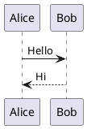

# # PlantUML Language Specification

PlantUML is a drawing tool that allows you to create diagrams from plain text descriptions. This page serves as the official specification for the PlantUML language.

# ## Introduction

PlantUML provides a simple and intuitive way to describe UML diagrams. The language is designed to be human-readable and easy to learn, while still being powerful enough to express complex diagrams.

# ## Diagram Types

The following diagram types are supported:

+   - Sequence diagrams
+   - Use case diagrams
+   - Class diagrams
+   - Object diagrams
+   - Activity diagrams
+   - Component diagrams
+   - Deployment diagrams
+   - State diagrams
+   - Timing diagrams

# ## Basic Syntax

A PlantUML script begins with the `@startuml` directive and ends with `@enduml`. Everything between these two directives constitutes the diagram definition.

```

```

# ## Components and Elements

Diagrams are composed of various components depending on the diagram type. Common elements include:

| Element | Description |
|---|---|
| Participant | An entity that interacts in a sequence diagram |
| Actor | A user or external system that interacts with the system |
| Class | A blueprint for objects in a class diagram |
| Component | A modular part of a system |
| State | A condition during the life of an object in a state diagram |

# ## Relationships

Relationships between elements are expressed using arrows and line styles. The following arrow types are available:

+   - `->` : solid line with arrowhead
+   - `-->` : dashed line with arrowhead
+   - `..>` : dotted line with arrowhead
+   - `--` : solid line without arrowhead