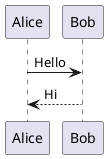

When we again go through and print off the value of “f,” the value that we are going to get here is “changing a global variable.”

There are a lot of times when you will be able to use the idea of the global and local variables that you would like to handle. Knowing how each of these is going to work, and when each one is going to be the most important part of working with these when you would like them.

## PlantUML Language Specification

PlantUML is a drawing tool that allows you to create diagrams from plain text descriptions. This page serves as the official specification for the PlantUML language.

### Introduction

PlantUML provides a simple and intuitive way to describe UML diagrams. The language is designed to be human-readable and easy to learn, while still being powerful enough to express complex diagrams.

### Diagram Types

The following diagram types are supported:

- Sequence diagrams
- Use case diagrams
- Class diagrams
- Object diagrams
- Activity diagrams
- Component diagrams
- Deployment diagrams
- State diagrams
- Timing diagrams

### Basic Syntax

A PlantUML script begins with the `@startuml` directive and ends with `@enduml`. Everything between these two directives constitutes the diagram definition.



### Components and Elements

Diagrams are composed of various components depending on the diagram type. Common elements include:

| Element | Description |
|---|---|
| Participant | An entity that interacts in a sequence diagram |
| Actor | A user or external system that interacts with the system |
| Class | A blueprint for objects in a class diagram |
| Component | A modular part of a system |
| State | A condition during the life of an object in a state diagram |

### Relationships

Relationships between elements are expressed using arrows and line styles. The following arrow types are available:

- `->` : solid line with arrowhead
- `-->` : dashed line with arrowhead
- `..>` : dotted line with arrowhead
- `--` : solid line without arrowhead

### Locate a Module

When importing a module, the interpreter automatically searches the current directory for the module. If this is not available, Python (or its interpreter) will perform a search on the PYTHONPATH environment variable that is nothing more than a list containing directory names with the same syntax as the environment variable.

If in any particular case, these previous actions failed, Python would look for a default UNIX path (located in /usr/local/lib/python on Windows).

The modules are searched in the directory list given by the variable sys.path.

This variable contains the current directory, the PYTHONPATH directory, and the entire directory that comes by default in the installation.

### Import Statement

This statement is used to import a module. Through any Python code file, its process is as follows: The Python interpreter searches the file system for the current directory where it is executed. Then, the interpreter searches for its predefined paths in its configuration.

When it meets the first match (the name of the module), the interpreter automatically executes it from start to finish. When importing a module for the first time, Python will generate a compiled .pyc extension file. This extension file will be used in the following imports of this module. When the interpreter detects that the module has already been modified since the last time it was generated, it will generate a new module.

You must save the imported file in the same directory where Python is using the import statement so that Python can find it.

As we could see in our example, importing a module allows us to improve the functionalities of our program through external files.

Now, let's see some examples. The first one is a calculator where we will create a module that performs all the mathematical functions and another program that runs the calculator itself.

The first thing we do is the module "calculator.py" that is responsible for doing all the necessary operations. Among them are the addition, subtraction, division, and multiplication, as you can see.

We included the use of conditional statements such as if, else, and elif. We also included the use of exceptions so that the program will not get stuck every time the user enters an erroneous value at the numbers of the calculator for the division.

After that, we will create a program that will have to import the module previously referred to so that it manages to do all the pertinent mathematical functions.

But at this time, you might be thinking that the only existing modules are the ones that the programmer creates. The answer is no since Python has modules that come integrated to it.

With them, we will make two more programs: the first one is an improvement of the one that we have just done, and the second one will be an alarm that will print on screen a string periodically.

Example:

Create a python module called dummymodule.py and write the following inside

```python
def testF():
    print("this is a module, goodbye")
```

Save the module in the python installation directory.

In the shell:

```python
import dummymodule
```

Now call the function:

```python
dummymodule.testF()
```

You have used your first module.

## Module example One

The first thing that was done was to create the module, but at first sight, we have a surprise, which is that math was imported.

What does that mean to us?

Well, that we are acquiring the properties of the math module that comes by default in Python.

We see that the calculator function is created that has several options.

If the op value is equal to 1, the addition operation is made.

If it is equal to 2, the subtraction operation is made, and so on.

But if op is equal to 5, because, if this is affirmative, then it will return the value of the square root of the values num1 and num2 through the use of math.sqrt(num1), which returns the result of the root.

Then, if op is equal to 6, using functions "math.radians()," which means that num1 or num2 will become radians since that is the type of value accepted by the functions "math.sin()," meaning that the value of the sin of num1 and num2 will return to us, which will be numbers entered by users arbitrarily who will become radians and then the value of the corresponding sin.

The last thing will be to create the main program, as it can be seen next:

Here, we can see the simple program, since it only imports the module "calculator.py," then the variables num1 and num2 are assigned the value by using an input.

Finally, an operation to do is chosen, and to finish is called the calculator function of the calculator module to which we will pass three parameters.

## Module example Two

We are going to create a module, which has within itself a function that acts as a chronometer in such a way that it returns true in case time ends.

In this module, as you can see, another module is imported, which is called as "time," and as its name refers, functions to operate with times, and has a wide range of functions, from returning dates and times to help to create chronometers, among others.

The first thing we do is to create the cron() function, which starts declaring that the start_alarm variable will be equal to time.time(), which means that we are giving an initial value to this function to know the exact moment in which the function was initialized to then enter into an infinite cycle.

Since the restriction is always True, therefore, this cycle will never end, unless the break command is inside it.

Then, within the while cycle, there are several instructions.

The first is that the final variable is equal to time.time() to take into account the specific moment we are located and, therefore, to monitor time.

After that, another variable is created called times, and this acquires the value of the final minus start_alarm.

But you will be wondering what the round function does. It rounds up the values; we do that to work easier. But this is not enough; therefore, we use an if since, if the subtraction between the end and the beginning is greater or equal to 60, then one minute was completed, and what happens to this?

Why 60?
