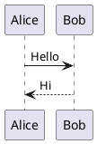

当我们再次遍历并打印“f”的值时，在这里将得到的值是“changing a global variable.”

很多时候，你将能够运用想要处理的全局变量和局部变量的概念。了解它们各自将如何工作，以及在你需要它们时，每一个何时会成为使用这些变量时最重要的部分。

## PlantUML 语言规范

PlantUML 是一种绘图工具，允许你通过纯文本描述创建图表。本页是 PlantUML 语言的官方规范。

### 简介

PlantUML 提供了一种简单直观的方式来描述 UML 图。该语言设计为人类可读且易于学习，同时仍然足够强大，可以表达复杂的图表。

### 图表类型

支持以下图表类型：

- 序列图
- 用例图
- 类图
- 对象图
- 活动图
- 组件图
- 部署图
- 状态图
- 时序图

### 基本语法

PlantUML 脚本以 `@startuml` 指令开始，并以 `@enduml` 结束。这两个指令之间的所有内容构成图表定义。



### 组件和元素

图表由各种组件组成，具体取决于图表类型。常见元素包括：

| 元素 | 描述 |
|---|---|
| 参与者 | 在序列图中进行交互的实体 |
| 角色 | 与系统交互的用户或外部系统 |
| 类 | 类图中对象的蓝图 |
| 组件 | 系统的模块化部分 |
| 状态 | 状态图中对象生命周期中的一种条件 |

### 关系

元素之间的关系通过箭头和线型表示。可用以下箭头类型：

- `->`：带箭头的实线
- `-->`：带箭头的虚线
- `..>`：带箭头的点线
- `--`：不带箭头的实线

### 定位模块

导入模块时，解释器会自动在当前目录中搜索该模块。如果不可用，Python（或其解释器）将在 PYTHONPATH 环境变量中执行搜索，该变量不过是一个包含目录名的列表，其语法与环境变量相同。

如果在任何特定情况下，前述操作失败，Python 将查找默认的 UNIX 路径（在 Windows 上位于 /usr/local/lib/python）。

模块会在变量 sys.path 给出的目录列表中搜索。

该变量包含当前目录、PYTHONPATH 目录以及安装时默认包含的整个目录。

### import 语句

该语句用于导入模块。对于任何 Python 代码文件，其过程如下：Python 解释器会在文件系统中搜索执行该文件时所在的当前目录。然后，解释器会在其配置中搜索预定义路径。

当遇到第一个匹配项（模块名）时，解释器会自动从头到尾执行它。首次导入模块时，Python 会生成一个编译后的 .pyc 扩展文件。该扩展文件将用于后续对该模块的导入。当解释器检测到模块自上次生成以来已被修改时，它将生成一个新模块。

必须将导入的文件保存在 Python 使用 import 语句所在的同一目录中，以便 Python 能够找到它。

正如我们在示例中所见，导入模块使我们能够通过外部文件改进程序的功能。

现在，让我们看一些示例。第一个是计算器，我们将创建一个执行所有数学函数的模块，以及另一个运行计算器本身的程序。

我们要做的第一件事是创建模块 "calculator.py"，它负责执行所有必要的运算。其中包括加法、减法、除法和乘法，如你所见。

我们加入了 if、else 和 elif 等条件语句的使用。我们还加入了异常处理，以便当用户为除法输入错误数值时，程序不会每次都卡住。

之后，我们将创建一个程序，该程序必须导入前面提到的模块，以便能够执行所有相关的数学函数。

但此时，你可能会认为唯一存在的模块就是程序员创建的模块。答案是否定的，因为 Python 有内置模块。

借助它们，我们将再编写两个程序：第一个是对我们刚刚完成的程序的改进，第二个将是一个闹钟，它会定期在屏幕上打印一个字符串。

示例：

创建一个名为 dummymodule.py 的 Python 模块，并在其中写入以下内容

```python
def testF():
    print("this is a module, goodbye")
```

将该模块保存到 Python 安装目录中。

在 shell 中：

```python
import dummymodule
```

现在调用该函数：

```python
dummymodule.testF()
```

你已经使用了你的第一个模块。

## 模块示例一

首先要做的是创建模块，但乍一看，我们有一个惊喜，那就是导入了 math。

这对我们意味着什么？

嗯，这意味着我们正在获取 Python 默认自带的 math 模块的属性。

我们看到创建了具有多个选项的 calculator 函数。

如果 op 值等于 1，则执行加法运算。

如果它等于 2，则执行减法运算，依此类推。

但如果 op 等于 5，因为如果这一条件成立，那么它将通过使用 math.sqrt(num1) 返回 num1 和 num2 值的平方根，该函数返回根的结果。

然后，如果 op 等于 6，则使用函数 "math.radians()"，这意味着 num1 或 num2 将变为弧度，因为这是函数 "math.sin()" 所接受的值类型；这意味着 num1 和 num2 的正弦值将返回给我们，这些值将是用户任意输入的数字，它们将变为弧度，然后得到相应的正弦值。

最后一件事将是创建主程序，如下所示：

在这里，我们可以看到这个简单的程序，因为它只导入模块 "calculator.py"，然后通过使用 input 为变量 num1 和 num2 赋值。

最后，选择要执行的运算，并在结束时调用 calculator 模块的 calculator 函数，向其传递三个参数。

## 模块示例二

我们将创建一个模块，其内部有一个充当计时器的函数，以便在时间结束时返回 true。

在这个模块中，如你所见，导入了另一个模块，名为 "time"，顾名思义，它用于操作时间，并具有广泛的功能，从返回日期和时间到帮助创建计时器等。

我们要做的第一件事是创建 cron() 函数，它首先声明 start_alarm 变量将等于 time.time()，这意味着我们为该函数赋予一个初始值，以了解该函数初始化时的确切时刻，然后进入无限循环。

由于限制条件始终为 True，因此该循环永远不会结束，除非其中包含 break 命令。

然后，在 while 循环内部，有几条指令。

首先，final 变量等于 time.time()，以考虑我们所处的具体时刻，从而监控时间。

之后，创建另一个名为 times 的变量，它获取 final 减去 start_alarm 的值。

但你会想知道 round 函数做什么。它对值进行四舍五入；我们这样做是为了更方便地工作。但这还不够；因此我们使用 if，因为如果结束时间与开始时间之间的差值大于或等于 60，那么就完成了一分钟，而这又会怎样？

为什么是 60？
