# 初学者计算机编程与网络安全：逐步学习专业编程与数据保护的终极手册。本书包含：Python、Java、C++ 与网络安全

# Python 编程

最简单的 Python 速成课程，深入讲解 Web 开发、数据分析和数据科学等主要应用，包括机器学习

ALAN GRID

## 引言

技术的引入，尤其是计算机，以不同方式影响了我们的行为。有些人把大部分时间花在计算机上，通过创建程序和网站谋生；而另一些人则摆弄计算机，试图了解机器工作原理的许多不同方面。编程是世界上大多数人关注并作为收入来源的网络领域之一。他们可以在公司或计算机维修领域工作，保护计算机免受黑客或病毒等攻击。

Python 是最先进的编程工具之一，因为任何人，包括初学者或专家，都能轻松使用和阅读它。使用 Python 的秘诀在于你能读懂它，因为它包含语法，使你作为程序员能够表达自己的概念，而不必一定要创建一个编码页面。这正是 Python 比其他代码（包括 C++ 和 Java）更易使用和阅读的原因。总的来说，由于 Python 的易用性和可读性，它是最适合你的语言。因此我们相信，在本课程期间及之后，你将能轻松阅读和理解在创建第一个程序时输入的所有代码。

### Python 的特点

Python 具有以下特征：

- 大型库：它可与其他编程项目配合使用，例如搜索文本、连接 Web 服务器和交换文件。
- 交互式：使用 Python 非常简单，因为你可以轻松测试代码以确定它们是否有效。
- 它是免费软件；因此，你随时可以用计算机从互联网下载它。
- Python 编程语言可以扩展到其他模块，例如 C++ 和 C。
- 具有优雅的语法，使初学者易于阅读和使用。
- 有多种基本数据类型可供选择。

### Python 的历史

Python 编程语言由 Guido Van Rossum 于 1989 年在荷兰研究机构 CWI 开展项目时发明，但后来被中止。Guido 成功使用了一些基础语言，即所谓的 ABC 语言，来开发 Python。根据 Van Rossum 的说法，Python 语言的优势在于你可以保持其简单，也可以将其扩展到更多平台，从而同时支持许多平台。这种设计使系统能够轻松与库和各种文件格式通信。

自推出以来，世界上许多程序员现在都在使用 Python；事实上，还包含许多工具来提高操作性和效率。许多程序员采取了各种举措，教育大家使用 Python 编程语言，以及它如何帮助缓解对复杂计算机代码的恐惧。

然而，几年前 Van Rossum 将 Python 开源，允许所有程序员访问甚至修改它。这在编程领域带来了很大变化。例如，Python 2.0 发布了。Python 2.0 面向社区，使其开发过程透明。虽然许多人不使用 Python，但仍有一些程序员和组织使用该版本的一部分。

Python 3 是一个独特的版本，于 2008 年发布。尽管该版本有许多不同的功能，但它与前两个版本完全不同，而且更新程序并不容易。虽然此版本不向后兼容，但它有一个小型创建器来显示上传文件时需要更改的内容。

### 为什么你应该使用 Python


世界上有许多类型的计算机编程程序，每种都有其优缺点。然而，由于可读性等多种原因，Python 已被证明是最佳选择，并且无需更改即可在许多平台上使用。使用 Python 具有以下优势：

- **可读性**

  由于它用英语设计，初学者会发现它易于阅读和使用。还有许多规则帮助程序员理解如何格式化所有内容，这使程序员能够轻松创建简单代码，其他人在将项目与之配合使用时可以遵循。

- **社区**

  如今，世界各地有许多 Python 工作坊。初学者可以参加线上、线下或两者兼有的活动，以学习更多知识，甚至寻求对 Python 的澄清。此外，线上和线下工作坊可以提高你对 Python 的理解以及社交能力。它最适合个人计算机，因为它能在许多不同平台上成功运行。事实上，所有初学者都发现编写代码或向专家学习很容易。

- **库**

  25 年多来，程序员一直使用 Python 教初学者如何使用用它编写的不同代码。该系统对程序员非常开放，他们可以无限期地使用可用代码。事实上，学生可以下载并安装该系统，并将其用于个人用途，例如编写代码和完成产品。

## Python 中的通用术语

理解 Python 中使用的标准术语对你至关重要。它让你在入门时轻松了解一切。以下是 Python 编程语言中最常见的术语：

- 函数（Function）：指当程序员使用调用程序时被调用的代码块。其目标还包括提供免费服务和准确计算。
- 类（Class）：用于开发用户定义对象的模板。它友好且易于所有人使用，包括初学者。
- 不可变（Immutable）：指具有固定值并包含在代码中的对象。这些可以是数字、字符串或元组。此类对象无法更改。
- 文档字符串（Docstring）：指显示在函数、类定义和模块中的字符串。此对象始终可在文档工具中使用。
- 列表（List）：指 Python 内置的数据类型，包含已排序的值。此类值包括字符串和数字。
- IDLE：代表集成开发环境，允许用户在同一窗口中解释和编辑代码时输入代码。最适合初学者，因为它是代码的优秀示例。
- 交互式（Interactive）：由于其交互性，Python 已成为最适合初学者的编程语言。作为初学者，你可以在 IDLE（解释器）中尝试许多东西，看看它们的响应和效果。
- 三引号字符串（Triple Quoted String）：该字符串帮助个人在字符串中包含单引号和双引号，从而轻松遍历不同代码行。
- 对象（Object）：指处于某种状态的所有数据，例如态度、方法、定义的行为或值。
- 类型（Type）：指编程语言中的一组数据类别，以及属性、函数和方法的差异。
- 元组（Tuple）：指 Python 内置的数据类型，是一组不变的值，尽管它包含一些可变值。

## Python 语言的优势

使用 Python 程序比 C++ 和 Java 等其他编程语言有许多优势。你会很高兴看到其可用性以及学习和使用 Python 程序的容易程度。理想情况下，这些是您现在可以使用的最佳编程语言，尤其是如果您是初学者。以下是使用 Python 语言的一些优势：

- **它易于使用、编写和阅读**

  许多程序员在使用 Java 和 C++ 等编程语言时会面临一些挑战。由于设计原因，它们难以查看。一个人必须花费大量时间学习括号的使用，而且不容易识别这些编程语言中使用的一些单词。这些词可能会吓到你，尤其是当你刚刚熟悉编程语言时。与 Java 和 C++ 语言不同，Python 不使用疯狂的括号。它只使用缩进，使页面易于阅读。它使用英语，使字符易于理解。

  除了使用缩进，Python 还使用大量空白，使学习和阅读所需内容变得容易。它包含许多带有注释的地方，以便在程序让你困惑时让你理解或获得澄清。所以，检查一下，你会看到使用 Python 编程语言有多么容易。

- **它使用英语作为主要语言**

  使用 Python 很容易，因为主要语言是英语。作为初学者，你会花更少时间阅读和理解用 Python 编程时使用的基本单词。因此，无论你的母语是英语还是非英语，Python 都最适合你，因为大多数单词简单易懂。

- **Python 已在某些计算机上可用**

  某些计算机（例如 macOS 系统和 Ubuntu）预装了 Python。在这种情况下，你只需下载文本解释器即可开始 Python 编程。但是，如果你使用的是 Windows 计算机，则必须在计算机上下载该程序。事实上，即使你一开始没有安装 Python，它也能正常工作。

- **Python 与其他编程语言完美配合**

  第一次，你将单独使用 Python。但是，随着你继续编程，你会意识到 Python 可以与其他语言配合使用。可以与 Python 配合使用的一些编程语言包括 C++ 和 JavaScript。尝试更多地了解 Python 及其实际功能。随着时间的推移，你将能够发现许多东西。

- **Python 可用于测试许多东西**

  下载 Python 后，你需要下载测试解释器。测试解释器在使 Python 读取信息方面起着重要作用。最好使用 Windows 中可用的记事本等简单产品或其他解释器。

## 使用 Python 编程的缺点

虽然使用 Python 有许多优点，但必须认识到使用它的一些不利影响。有些人更喜欢使用 C++ 和 JavaScript 等其他编程语言而不是 Python，因为 Python 有以下负面影响。

- **Python 速度较慢**

  虽然 Python 与其他编程语言配合良好并且适合初学者，但不幸的是，Python 不适合寻求高速程序的程序员，因为与其他选项相比，它是一种翻译速度较慢的语言。速度水平取决于你翻译的内容，因为与其他代码相比，某些 Python 代码基准运行得更快。目前，世界上许多程序员正试图通过提高解释速度来解决这个问题。有望 Python 很快以与 C 和 C++ 相同的速度甚至更快的速度运行。

- **大多数移动浏览器中无法使用 Python**

  虽然 Python 对于拥有普通计算机的人很有效，并且可以在许多服务器平台和桌面上访问，以帮助个人创建他们正在寻找的代码，但它尚未准备好用于移动计算。程序员正试图将该程序过渡到移动计算，以满足当今大量使用手机的人的需求。

- **设计有限**

  对于寻找具有许多设计选项的程序的程序员来说，Python 程序不是更好的选择。例如，设计语言在某些其他选项中不可用；因此，你需要更多时间来测试，有时运行程序时可能会出现大量错误。


## 第 1 章：Python 基础

一旦你在系统上安装好软件，就可以开始用 Python 进行编程之旅了。我将从变量、字符串和关键字等基础知识开始。现在，你将学习并编写你的第一个 Python 程序，了解可以处理的不同数据、如何使用变量以及关键字。让我们从基础开始，立刻开始编写代码。

### 关键字

|  |  |  |  |
|---|---|---|---|
| async | assert | as | and |
| def | from | nonlocal | while |
| continue | for | lambda | try |
| elif | if | or | yield |
| else | import | pass |  |
| global | not | with | del |
| in | raise | False | await |
| return | None | break | except |
| True | class | finally | is |

让我们从基础“Hello”程序开始，这是任何程序员的第一步。

```python
print("Hello, Welcome to Python Programming!")
```

当运行这段程序代码时，你的输出将是：

```text
Hello, Welcome to Python Programming!
```

Python 程序总是以 .py 扩展名结尾。让我们把这个程序保存为 Hello.py。请始终记得用示例的名称保存每个示例，以便在需要时能回想起它们。当你使用编辑器或 IDE 时，文件会由解释器运行，解释器会判断程序中使用的词。例如，在下面的程序中，解释器会看到括号中的内容，并打印括号内的内容。在编写 Python 代码的过程中，编辑器可能会高亮显示程序的某些部分。例如，它能识别出 print() 是一个函数名，并用特定颜色来区分它。但是，当它遇到“Hello, Welcome to Python Programming!”时，它会识别出这是 Python 程序代码，因此使用另一种颜色将其与其他代码区分开来。这个独特的功能称为语法高亮，对初学者很有用。

### 缩进与代码行

在 Python 中，没有像花括号那样的符号来表示函数和类的代码块。通常，代码块由行缩进表示，并且这种缩进会被严格执行。重要的是，缩进的空格数可以不同；但是，块中的每个语句必须使用相同的缩进量。例如，

```python
if False:
    print "False"
else:
    print "True"
```

然而，下面的语句块将产生错误：

```python
if False:
print "Result"
```

```python
file.write(file_text)
file.write("\n")
file.close()
fileName = raw_input("Enter filename: ")
if len(fileName) == 0:
    print "Next time input something"
    sys.exit()
try:
    file = open(fileName, "r")
except IOError:
    print "Error reading file requested"
    sys.exit()
fileText = file.read()
file.close()
print fileText
```

### 多行语句

这些语句通常以换行符终止。不过，Python 允许你使用特殊字符（\）来继续一条语句。请看下面的代码：

```python
Total_Number = number1 + \
    number2 + \
    number3
```

尽管如此，如果此类语句包含括号，如 ()、{} 或 []，则存在例外情况。例如：

```python
months = ['December', 'November', 'October', 'September', 'August',
          'July', 'June', 'May', 'April', 'March', 'February', 'January']
```

### 变量

变量是一个存储位置，并且有一个分配给它的名称。在 Python 中，我们可以为变量赋值并在之后引用这些变量。我相信一个例子会让事情更清楚。还记得我们的第一个程序（hello.py）吗？让我们再添加两行。请看下面的程序：

```python
outcome = "Hello, Welcome to Python Programming!"

print(outcome)
```

当你运行该程序时，输出将与之前相同，即：

```text
Hello, Welcome to Python Programming!
```

唯一的区别是我们添加了一个名为“outcome”的变量。每个变量总是有一个分配给它的值。在这种情况下，“outcome”的值是“Hello, Welcome to Python Programming!”

让我们在前面的代码中再添加两行。不过，在添加新代码之前，请确保在第一个代码中插入一个空行。

```python
outcome = "Hello, Welcome to Python Programming!"
print(outcome)

outcome = "Hello, Welcome to Learning Python!"
print(outcome)
```

添加这两行后，保存文件并再次运行程序。你的输出将如下所示：

```text
Hello, Welcome to Python Programming!

Hello, Welcome to Learning Python!
```

### 变量命名规则

在 Python 中命名变量时，有一些重要的规则需要遵守。如果你违反了其中任何一条规则，都会收到错误消息。因此，在编写程序时请务必牢记这些规则。

- 变量名只能包含数字、下划线和字母。你可以用下划线或字母开头；但不能以数字开头。例如，变量名可以是 outcome_1，但使用 1_outcome 是完全错误的。
- 变量名中不能包含空格。不过，你可以使用下划线来分隔两个单词。例如，outcome_program 可以正常工作；但 outcome program 会导致程序出错。
- 避免使用函数名和关键字作为变量名。
- 变量名在使用时应简短且具有描述性。例如，score 比 s 更可取，serial_name 比 sn 更好。

### 避免变量名错误

作为初学者，你会犯错误。专业人士也无法避免这种情况，但他们知道如何高效地处理这些错误。让我们来看一个你在开始 Python 编程课程时很可能会犯的错误。我会故意拼错“outcome”这个词来编写一段错误代码。

```python
outcome = "Hello, Welcome to Learning Python!"
#program will generate an error
print(outcom)
```

当出现此类错误时，Python 解释器会找出解决问题的最佳方法。一旦程序无法成功运行，它就会提供一个 traceback（回溯）。没有多少编程语言具备这种错误回溯功能。让我们看看解释器会如何响应我们上面的程序：

```text
Traceback (most recent call last):

    1. File "hello.py", line 3, in <module>
    2. print(outcom)
    3. NameError: name 'outcom' is not defined
```

第 1 行报告第 3 行存在错误，文件名为“hello.py”；解释器会快速识别该错误，并告诉我们第 3 行中错误的具体类型。在这种情况下，它会表示这是一个名称错误。此外，它会报告我们的变量没有被正确定义。每当你看到名称错误时，都意味着存在拼写错误，或者我们没有为变量设置值。不过，在本例中，这是一个拼写错误：我们的变量名中没有包含字母“e”。

```python
outcome = "Hello, Welcome to Python Programming!"

print(outcome)
outcome = "Hello, Welcome to Learning Python!"
print(outcome)
```

程序输出将是：

```text
Hello, Welcome to Python Programming!

Hello, Welcome to Learning Python!
```

你必须明白，编程语言是严格的；然而，它们不关心拼写的好坏。因此，在创建变量名时，你无需考虑语法和拼写规则。

### 尝试练习

编写一个程序来完成以下事情。确保保存文件并遵循变量命名规则。

- 编写一个程序，将一个消息赋值给你选择的变量名，然后打印该消息。
- 在第二个程序中，更改值并使用一条新消息，然后打印该消息。
- 从下面的列表中勾选错误的变量名。
  - 1_school
  - Fred Love
  - Fred_love
  - _exercises
  - Firsttwoletters

### Python 中的数据类型

在编写代码时，我们需要将数据存储到内存中。这些数据不能存储在同一个内存中，因为数字与字母不同。例如，人的姓名是字母；地址可以是字母数字字符；年龄可以存储为数值。Python 提供了数据类型来定义存储这些数据的不同操作和方法。Python 中有五种数据类型，分别是：

- 字符串
- 数字
- 元组
- 列表
- 字典

### 字符串

字符串是一系列用引号括起来的字符。在 Python 中，引号中的任何内容都被视为一个独特的字符串。在 Python 中，单引号和双引号都可以用来构成字符串。

```python
'Hello World'
"Hello World"
```

如果运行这两条语句，它们会产生相同的输出。


### 在字符串内部使用引号

在 Python 编程中，使用字符串时，字符串开头的引号必须与结尾引号相匹配。当你使用双引号开始一个字符串时，Python 会把下一个双引号视为该字符串的结束。单引号也是如此。

如果你决定在字符串内部使用双引号，就必须把它们放在单引号内。下面的示例能更清楚地说明这一点。

```python
statement = 'Fred is "a boy that lives in New York"'
```

假设你想在字符串中同时使用单引号和双引号。在这种情况下，你必须使用反斜杠（\）来转义，避免单引号和双引号造成混乱。下面的示例将演示这一点。

```python
statement_in_single = 'Fred "own\'s a wonderful car in his garage"'

statement_in_double = "Fred \'own's a wonderful car in his garage\""
```

### 使用方法更改字符串中的大小写

使用字符串时，你可以执行的一项简单任务是更改某个特定单词的大小写。你认为下面代码的输出会是什么？

```python
full_name = "johnson boris"

print(full_name.title())
```

编写代码后，在运行之前将文件保存为 name.py。输出将如下所示：

```text
Johnson Boris
```

```python
print(full_name)
```

如果要将变量值插入字符串，必须在开引号前直接加上字母“f”。

请考虑下面的代码：

```python
state = 'United Nation!'   # Assign the variable "state" to a string
'New York'

print state        # Prints the complete string

print state[0]     # Prints the first character of the string

print state[0:4]   # Prints characters starting from 1st to 4th

print state[3:]    # Prints string starting from 4th character

print state * 3    # Prints string three times

print state + " United State" # Prints concatenated string
```

输出将如下所示——

```text
United Nation!

U

United

Nations!

United Nation! United Nation!

United Nation! United State
```

## 第2章：条件语句

现在，是时候继续讨论条件语句了，它也可以称为决策控制语句。这些语句将允许计算机根据用户的输入以及你希望程序发生的情况做出一些决策。在程序中，你会有很多次希望计算机在你不在场时做出一些决策并自行完成工作。如果你正在编写的代码希望用户输入自己的答案，而不是只给他们两个可选项，那么这些决策控制语句将是很好的选择。

在编写这些条件语句时，有几种不同的选项可供使用。最常见的三种包括 if 语句、if-else 语句和 elif 语句。作为初学者，我们将从 if 语句的基础开始，以便很好地了解它们如何工作，然后逐步深入，理解使用这些条件语句可以完成的一些更复杂的事情。

我们首先要看的第一种选项是 if 语句。if 语句将围绕这样的思路运作：用户给计算机的答案要么为真，要么为假。如果用户输入的信息根据你的代码被视为真，那么解释器可以继续执行程序，并显示你想要的语句或信息。但是，如果用户在使用程序时输入了与你的代码不匹配、且被视为假的内容，那么程序会自动结束。当代码结束时，你所编写的程序看起来就不那么专业。这就是为什么你不会经常看到 if 语句的一个重要原因。

但这正是我们要引入 if-else 语句并用它来解决这个问题的原因。它们延续了我们前面讨论的思路，并帮助我们处理所提出的问题。假设你正在处理我们之前用过的代码，并且希望确保无论用户决定在程序中输入什么答案，程序都能给出结果。你可以编写一个 if-else 语句，以便为 18 岁以下的人给出一个答案，再为 18 岁及以上的人给出另一个答案。这段代码扩展了我们之前谈到的选项，下面是一个你可以使用的示例。

```python
age = int(input("Enter your age:"))

if (age <= 18):

    print("You are not eligible for voting, try next election!")

else:

    print("Congratulations! You are eligible to vote. Check out your local polling station to find out more information!")

print("Program ends")
```

这段代码对你的目标以及你希望代码中发生的事情会更有用，而且它提供了比以前更多的选项。最棒的是，你的代码不会因为用户输入年龄而结束。它会根据用户输入的年龄，在屏幕上向他们显示一条语句。

如果你愿意，这段代码还可以扩展，以包含更多可能性。上面的示例只有两个选项：18 岁以下和 18 岁以上。但如果适合你的程序，你也可以设置更多选项。例如，如果你愿意，可以把年龄段划分得更细一些。也许你想知道谁在 18 岁以下、谁在二十多岁、谁在三十多岁，以及谁超过 40 岁。你可以使用同样的思路，并添加更多代码行，以借助 if-else 语句满足程序的需求。

关于 if-else 语句，你可能想使用的另一个示例，是让程序处理用户最喜欢的颜色。你可能不想逐一编写足够的代码来处理世界上存在的每一种颜色，但你会让这一部分保持开放，以便用户输入与其最喜欢的颜色对应的信息。

对于这段代码，你可以选择在代码中写出一个包含六种颜色的列表（你可以根据需要有更多或更少），然后为这六种颜色分别准备一条对应的消息。你可以选择黄色、橙色、绿色、蓝色、紫色和红色。然后，你可以添加一个 else 语句，以便用户可以选择不同的颜色。如果用户在这里决定把白色作为最喜欢的颜色，那么第七条、也是最后一条消息就会出现。对于任何不属于最初六种颜色的颜色，这条最终消息都会相同。

在代码末尾添加这个 else 语句，或者说兜底语句，可能是你需要考虑的重要事项。你不可能列出用户可能选择的所有不同颜色。你可能会花时间输入一百种不同的颜色（但这会耗费大量时间和代码，而你并不会想这么做），但用户仍可能选择你忘记的那一种颜色。如果你不在末尾添加这个 else 语句，那么程序将不知道你希望它在这里如何运行。

else 语句很好，因为你可以用它捕获来自用户的多个结果，并且它可以捕获所有你未考虑、但用户可能选择的答案。如果你不在代码中添加语句，那么当用户输入那个答案时，你的程序就不确定该如何运行。

### elif 语句

条件语句的另外两种选项对于你希望处理的许多代码都很重要。对于初学这些语句的初学者来说，if 语句是很好的一种学习对象，它们将帮助你对条件语句应该如何工作有一个大致的了解。这些 if 语句基于答案要么为真、要么为假的思路。

在这种情况下，如果从用户那里收到的答案根据你添加到代码中的条件被视为真，那么程序会识别到这一点，并继续沿其路径执行。但如果该条件被视为假，那么程序没有设置任何后续处理，就会结束。这是一个容易使用的简单思路，也是进一步了解条件语句的好方法，但对于你想用 Python 编写的许多代码来说，它不会给你想要的结果。

然后我们看了 if-else 语句。它们把这个思路推进了一些，并且认识到原始 if 语句所伴随的思路过于简单。这些 if-else 语句可以帮助我们处理用户给系统的任何答案，并确保程序不会直接停止。我们甚至看了一个示例代码，它向我们展示了这类语句如何工作。

接下来，我们需要花一些时间研究 elif 语句。它的处理方式会与另外两种稍有不同，但它仍然很有用，并且可以为你的代码增添趣味和一些不同的元素。elif 语句将让用户有机会从你提供的几个选项中挑选。然后，用户选择的答案将向他们提供你添加到代码中的预设语句。

你可以在不同地方看到这些条件语句。elif 语句是 Python 语言中独有的代码，它经常会被用于许多游戏，或用于一个

你希望为用户提供菜单式选择的不同程序。如果计算机程序员希望为其用户提供一些选项，而不仅仅是一两个选项，那么这些语句将最常被使用。

## 第3章：数据结构

Python 基于三种引用结构：元组、列表和字典。这些结构实际上是可能包含其他对象的对象。它们具有相当不同的用途，并允许你存储各种类型的信息。

这些结构具有一些共同特征：

- 要从结构中提取一个或多个对象，我们总是使用 `[]`
- 对于按数字索引的结构（元组和列表），结构的索引从 0 开始（第一个位置是位置 0）

### 元组

这是一种按索引顺序将多个对象分组的结构。它的形式一旦创建就不可修改（不可变），并使用圆括号定义。它只有一维。任何类型的对象都可以存储在元组中。例如，如果你想创建一个包含不同对象的元组，我们使用：

```python
tup1 = (1, True, 7.5, 9)
```

你也可以使用 `tuple()` 函数创建元组。访问元组的值通过经典的结构索引完成。因此，如果我们想访问元组的第三个元素，我们使用：

```python
In []: tup1[2]
Out []: 7.5
```

元组可能很有趣，因为它们需要很少的内存。另一方面，它们被用作返回多个值的函数的输出。元组作为结构是对象。它们具有简洁的方法。元组的方法很少：

```python
In []: tup1.count(9)
Out []: 1
```

我们通常更喜欢更灵活的列表。

### 列表

列表是 Python 中的引用结构。它是可修改的，并且可以包含任何对象。

### 创建列表

我们使用方括号创建列表：

```python
list1 = [3, 5, 6, True]
```

你也可以使用 `list()` 函数。列表的结构是可编辑的。它有许多方法：

- `.append()`：在列表末尾添加值
- `.insert(i, val)`：将值插入到索引 i
- `.pop(i)`：取出索引 i 的值
- `.reverse()`：反转列表
- `.extend()`：用值列表扩展列表
- `.remove(val)`：从列表中移除值 val 的第一次出现

注意——所有这些方法都会修改列表，经典代码中的等效写法如下：

```python
list1.extend(list2)
```

等价于

```python
list1 = list1 + list2
```

列表还有其他方法，包括：

- `.index(val)`：返回值 val 的索引
- `.count(val)`：返回值 val 出现的次数

### 从列表中提取一项

如上所述，可以使用方括号提取元素：

```python
list1[0]
```

我们经常对提取多个元素感兴趣。这是通过使用两个点来完成的：

```python
list1[0:2] or list1[:2]
```

在这个例子中，我们看到这个系统提取了两个元素：索引为 0 的元素和索引位置为 1 的元素。因此我们有一条规则：`i:j` 从包含元素 i 到不包含元素 j。以下是一些其他示例：

```python
### 提取最后一个元素
list1[-1]
```

提取最后 3 个元素：`list1[-3:-1]` 或 `list1[-3:]`

### 一个具体示例

假设我们想创建一个国家列表。这些国家在列表中按其人口排序。我们将尝试提取前三个和最后三个。

```python
In []: country_list = ["China", "India", "United States", "France", "Spain", "Switzerland"]
In []: print(country_list[:3])
['China', 'India', 'United States']
In []: print(country_list[-3:])
['France', 'Spain', 'Switzerland']
In []: country_list.reverse()
print(country_list)
['Switzerland', 'Spain', 'France', 'United States', 'India', 'China']
```

### 列表推导式

这些是迭代构建的列表。它们通常非常有用，因为它们比使用循环构建列表更高效。这里有一个简单的例子：

```python
In []: list_init = [4, 6, 7, 8]
list_comp = [val ** 2 for val in list_init if val % 2 == 0]
```

`list_comp` 列表允许你存储 `list_init` 中设置为平方的偶数元素。

我们将得到：

```python
In []: print(list_comp)
[16, 36, 64]
```

列表推导式的概念非常有效。它避免了无用的代码（对列表的循环），并且比迭代创建列表表现更好。它也存在于字典中，但不存在于不可变的元组上。我们能够在数据表操作的框架中使用列表推导式。

### 字符串——字符列表

Python 中的字符串默认（自 Python 3 起）以 Unicode 编码。你可以通过三种方式声明字符串：

```python
string1 = "Python for the data scientist"
string2 = 'Python for the data scientist'
string3 = """ "Python for the data scientist" """
```

最后一种允许字符串跨越多行。我们将最常使用第一种。字符串实际上是一个字符列表，我们将能够像处理列表元素一样处理字符串的元素：

```python
In []: print(string1[:6])
print(string1[-14:])
print(string1[3:20])
```

**面向数据科学家的Python**

数据字符串可以轻松转换为列表：

```python
In []: # we separate the elements using space
list1 = string1.split()
print(list1)
['Python', 'for', 'the', 'Data', 'Scientist']
In []: # we join the elements with space
string1bis = " ".join(list1)
print(string1bis)
```

### 字典

字典构成了 Python 中要开发的第三种核心结构。它们允许键值存储。到目前为止，我们使用了基于数字索引的项。所以在列表中，你使用其位置 `list1[0]` 访问元素。在字典中，我们将使用创建字典时定义的键来访问元素。我们使用花括号定义字典：

```python
dict1 = {"key1": value1, "key2": value2, "key3": value3}
```

这种结构不要求值在类型上具有任何同质性。由此，我们可以有一个像 value1 这样的列表、一个像 value2 这样的布尔值，以及一个整数 value3。

要访问字典中的元素，我们使用：

```python
In []: dict1["key2"]
Out []: value2
```

要显示字典的所有键，我们使用：

```python
In []: dict1.keys()
Out []: ("key1", "key2", "key3")
```

要显示字典的所有值，我们使用：

```python
In []: dict1.items()
Out []: (value1, value2, value3)
```

可以轻松修改或向字典添加键：

```python
In []: dict1["key4"] = value4
```

你也可以删除字典中的键（以及关联的值）：

```python
In []: del dict1["key4"]
```

一旦你在 Python 中更有经验，你就会使用更多字典。起初，我们倾向于优先使用列表而不是字典，因为列表通常更直观（使用数字索引）。然而，更资深的 Python 专家会很快意识到字典的用处。特别是，我们将能够以非常简单的方式存储数据以及模型的参数。此外，Python 的 for 循环的灵活性非常适合字典，并且在字典构建良好时使其非常有效。

### 编程

### 条件

Python 中的条件实现起来非常简单；它是一个关键字。如前所述，Python 语言基于代码的缩进。我们将使用四个空格的偏移量进行缩进。幸运的是，像 Spyder 或 Jupyter notebooks 这样的工具会自动生成这种缩进。

这是我们的第一个条件，意思是“如果 a 为真，则显示”“它为真”：

```python
if a is True:
    print("it's true")
```

没有退出条件；正是缩进允许管理它。通常，我们也对这个条件的补集感兴趣；我们将为此使用 else：

```python
if a is True:
    print("it's true")
else:
    print("it's not true")
```

如果我们的变量 a 不一定是布尔值，我们可以有另一种情况，我们使用 elif：

```python
if a is True:
    print("it's true")
elif a is False:
    print("it's wrong")
else:
    print("it's not a boolean")
```

## 循环

循环是大多数编程语言的核心元素。Python 没有打破这条规则。然而，对于像 Python 这样的解释型语言，你必须非常小心。事实上，Python 中循环的处理很慢，我们将在迭代次数很少的循环中使用它。我们

避免在数据数组的行上创建重复成千上万次的循环。不过，我们可以对数据表的列使用循环，最多几十列。

### for 循环

Python 循环的格式有些特殊；它是对结构中元素的循环。我们将编写：

```python
for elem in [1, 2]:
    print(elem)
```

这段代码将允许你显示 1 和 2。因此，循环的迭代器（在我们的例子中是 `elem`）会依次取第二个位置（`in` 之后）结构中元素的值。这些元素可能位于不同的结构中，但通常会优先选择列表。

### range、zip 和 enumerate 函数

这三个函数是非常有用的函数，它们可以创建特定的对象，这些对象可能在你的代码中对循环有用。`range()` 函数用于生成一个数字序列，从给定数字或默认的 0 开始，直到不包括在内的某个数字：

```python
In []: print(list(range(5)))
[0, 1, 2, 3, 4]

In []: print(list(range(2, 5)))
[2, 3, 4]

In []: print(list(range(2, 15, 2)))
[2, 4, 6, 8, 10, 12, 14]
```

我们在这里看到，创建的 range 对象可以很容易地用 `list()` 转换为列表。

在循环中，这会得到：

```python
for i in range(11):
    print(i)
```

`zip` 和 `enumerate` 函数也是循环中有用的函数，它们使用列表。

`enumerate()` 函数返回列表的索引和元素。如果我们采用之前使用的国家列表：

```python
In []: for i, country in enumerate(country_list):
    print(i, country)
```

- 1. 瑞士
- 2. 西班牙
- 3. 法国
- 4. 美国
- 5. 印度
- 6. 中国

`zip` 函数可以将许多列表连接起来，并同时迭代这些列表的元素。

例如，如果我们想同时遍历日期和天气，可以使用：

```python
In []: for day, weather in zip(["Monday", "Tuesday"], ["beautiful", "bad"]):
    print("%s, it will be %s" % (day.capitalize(), weather))
```

星期一，天气会很好

星期二，天气会很糟

在这段代码中，我们使用 `zip()` 在每次迭代时取一对值。第二部分是对字符串的操作。如果其中一个列表比另一个长，循环会在到达其中一个列表末尾时立即停止。

我们可以将 `enumerate` 和 `zip` 链接在一段代码中，例如：

```python
In []: for i, (day, weather) in enumerate(zip(["Monday", "Tuesday"], ["good", "bad"])):
    print("%i: %s, it will be %s" % (i, day.capitalize(), weather))
```

0：星期一，天气会很好

1：星期二，天气会很糟

我们在这里看到，`i` 是元素 `i` 的位置。

注意——在字符串中替换。

### while 循环

Python 还允许你使用 `while` 循环，这种循环较少使用，并且看起来很像我们在其他语言中能遇到的 `while` 循环。要退出这个循环，我们可以使用带条件的 break 语句。警告：我们必须在循环中递增索引，否则可能会陷入无限循环的情况。

我们可以这样写：

```python
i = 1

while i < 100:
    i += 1
    if i > val_stop:
        break
    print(i)
```

这段代码在每次循环时给 `i` 加一，并在 `i` 达到 `val_stop`（即 100）时停止。

注意——Python 中的递增可以采取多种形式：`i = i + 1` 或 `i += 1`。

两种方法在性能方面是等效的；关键在于选择最适合你的那一种。

局部变量是一种不能在代码中任何先于其声明语句的文本位置被引用的变量。此外，我们必须记住，当我们在同一个代码块中时，绝不能有多个同名变量。这样做会很糟糕，因为它会导致错误出现，并且基本上只会让你正在处理的代码变得混乱。不过，可以在单条语句中声明并初始化多个相同类型的局部变量。

在类的方法中，如果你发现其中一个局部变量，并且它的命名方式与其字段相似，你会发现该局部变量会隐藏该字段，同时仍然能够在方法内访问该字段。对我们来说，使用局部变量通常比使用字段更高效。

### 查看全局变量

我们在这里需要查看的另一件事是全局变量到底是什么。这将是一种我们在任何函数之外声明的变量类型，这意味着你正在编写的程序中所有函数都很容易访问它。一组这样的变量被称为全局环境或全局状态，因为当它们组合在一起时，它们会定义程序或环境在程序运行时的各个方面。

全局变量是在所有其他函数之上声明的变量，通常最好将其保持在最低限度。这是因为所有函数都能够在程序运行期间操作这些变量。对于你想用这种语言处理的大多数程序来说，这可能是危险的，因为它们有可能被意外更改，从而导致系统中的错误。

全局变量，顾名思义，就是我们可以全局访问或在程序各处访问的变量。一旦我们完成了声明它们的过程，它们就会在程序的整个运行期间保留在内存中。这意味着我们能够在程序运行时的任何时间，用我们想要的任何函数更改它们，而这肯定会对整个程序造成一些问题。

在早期计算机可以使用但内存有限的那些年里，这些全局变量被视为不良实践，因为它们会占用大量宝贵的信息和内存，而且程序员更容易开始失去对所用值的跟踪，尤其是在较长的程序中。基本上，这会给程序带来许多难以定位和修复的错误。

当其元素的作用域受到限制时，源代码总是更易于使用和理解。当我们使用全局变量时，这很难做到，因为它们不是局部的，要弄清楚并看出这些变量在哪里被更改，甚至它们最初为什么被更改，都会变得非常困难。

即使有这种污名，当我们在不共享所谓调用者和被调用者关系的函数中工作时，这些全局变量仍然非常有价值。这意味着该函数不会拥有信号处理器或任何类型的并发线程。除了那些在受保护内存中声明为只读值的全局变量外，代码需要确保能够部署一些适当的封装，以便在该过程中被视为线程安全的。

正如我们在这里所看到的，使用这种变量会带来一些好处，甚至也有一些负面影响。使用它仍然有一些用途，这就是为什么我们花了一些时间来看待它们，并弄清楚它们为什么重要；但在大多数情况下，局部变量更好，并且会在你编写的代码中保留更多控制权。

### 综合起来

一开始这可能会显得有些混乱，但好消息是，当需要处理这两种变量时，我们能够做很多事情。为了帮助我们借助下面使用的程序更好地理解全局变量和局部变量之间的区别：

- 1. 变量“f”将具有全局作用域，并且将被赋值为 101，该值会打印在输出中。
- 2. 变量 `f` 也将在函数中声明，并采用局部作用域。它将被赋值为一个值，在本例中，它将被赋值为“我正在学习 Python。”。然后该值将作为输出打印出来。这个变量不同于我们在上一步中试图定义的那个全局变量 `f`。
- 3. 一旦我们能够调用完该函数，局部变量 `f` 就会被销毁。在第 12 行，当我们再次打印 `f` 的值时，它将向我们显示全局变量 `f = 101`。

然后我们可以继续使用关键字 `global`，这将确保我们能够在函数内部引用全局变量。使用它时，我们将能够遵循的一些事项包括：

- 1. 变量“f”的作用域将是全局的，然后它将被赋值为 101，该值将作为输出打印。
- 2. 当我们使用 `global` 关键字时，将声明同一个变量。这里不会是局部变量，而是我们之前能够声明的同一个全局变量。这意味着，当我们打印该值时，得到的输出将是 101。
- 3. 然后我们更改了函数内部 ‘f’ 的值。完成函数调用后，变量“f”更改后的值将保留。在第 12 行，

当我们再次遍历并打印“f”的值时，在这里将得到的值是“changing a global variable.”

很多时候，你将能够运用想要处理的全局变量和局部变量的概念。了解它们各自将如何工作，以及在你需要它们时，每一个何时会成为使用这些变量时最重要的部分。

## PlantUML 语言规范

PlantUML 是一种绘图工具，允许你通过纯文本描述创建图表。本页是 PlantUML 语言的官方规范。

### 简介

PlantUML 提供了一种简单直观的方式来描述 UML 图。该语言设计为人类可读且易于学习，同时仍然足够强大，可以表达复杂的图表。

### 图表类型

支持以下图表类型：

- 序列图
- 用例图
- 类图
- 对象图
- 活动图
- 组件图
- 部署图
- 状态图
- 时序图

### 基本语法

PlantUML 脚本以 `@startuml` 指令开始，并以 `@enduml` 结束。这两个指令之间的所有内容构成图表定义。

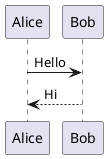

### 组件和元素

图表由各种组件组成，具体取决于图表类型。常见元素包括：

| 元素 | 描述 |
|---|---|
| 参与者 | 在序列图中进行交互的实体 |
| 角色 | 与系统交互的用户或外部系统 |
| 类 | 类图中对象的蓝图 |
| 组件 | 系统的模块化部分 |
| 状态 | 状态图中对象生命周期中的一种条件 |

### 关系

元素之间的关系通过箭头和线型表示。可用以下箭头类型：

- `->`：带箭头的实线
- `-->`：带箭头的虚线
- `..>`：带箭头的点线
- `--`：不带箭头的实线

### 定位模块

导入模块时，解释器会自动在当前目录中搜索该模块。如果不可用，Python（或其解释器）将在 PYTHONPATH 环境变量中执行搜索，该变量不过是一个包含目录名的列表，其语法与环境变量相同。

如果在任何特定情况下，前述操作失败，Python 将查找默认的 UNIX 路径（在 Windows 上位于 /usr/local/lib/python）。

模块会在变量 sys.path 给出的目录列表中搜索。

该变量包含当前目录、PYTHONPATH 目录以及安装时默认包含的整个目录。

### import 语句

该语句用于导入模块。对于任何 Python 代码文件，其过程如下：Python 解释器会在文件系统中搜索执行该文件时所在的当前目录。然后，解释器会在其配置中搜索预定义路径。

当遇到第一个匹配项（模块名）时，解释器会自动从头到尾执行它。首次导入模块时，Python 会生成一个编译后的 .pyc 扩展文件。该扩展文件将用于后续对该模块的导入。当解释器检测到模块自上次生成以来已被修改时，它将生成一个新模块。

必须将导入的文件保存在 Python 使用 import 语句所在的同一目录中，以便 Python 能够找到它。

正如我们在示例中所见，导入模块使我们能够通过外部文件改进程序的功能。

现在，让我们看一些示例。第一个是计算器，我们将创建一个执行所有数学函数的模块，以及另一个运行计算器本身的程序。

我们要做的第一件事是创建模块 "calculator.py"，它负责执行所有必要的运算。其中包括加法、减法、除法和乘法，如你所见。

我们加入了 if、else 和 elif 等条件语句的使用。我们还加入了异常处理，以便当用户为除法输入错误数值时，程序不会每次都卡住。

之后，我们将创建一个程序，该程序必须导入前面提到的模块，以便能够执行所有相关的数学函数。

但此时，你可能会认为唯一存在的模块就是程序员创建的模块。答案是否定的，因为 Python 有内置模块。

借助它们，我们将再编写两个程序：第一个是对我们刚刚完成的程序的改进，第二个将是一个闹钟，它会定期在屏幕上打印一个字符串。

示例：

创建一个名为 dummymodule.py 的 Python 模块，并在其中写入以下内容

```python
def testF():
    print("this is a module, goodbye")
```

将该模块保存到 Python 安装目录中。

在 shell 中：

```python
import dummymodule
```

现在调用该函数：

```python
dummymodule.testF()
```

你已经使用了你的第一个模块。

## 模块示例一

首先要做的是创建模块，但乍一看，我们有一个惊喜，那就是导入了 math。

这对我们意味着什么？

嗯，这意味着我们正在获取 Python 默认自带的 math 模块的属性。

我们看到创建了具有多个选项的 calculator 函数。

如果 op 值等于 1，则执行加法运算。

如果它等于 2，则执行减法运算，依此类推。

但如果 op 等于 5，因为如果这一条件成立，那么它将通过使用 math.sqrt(num1) 返回 num1 和 num2 值的平方根，该函数返回根的结果。

然后，如果 op 等于 6，则使用函数 "math.radians()"，这意味着 num1 或 num2 将变为弧度，因为这是函数 "math.sin()" 所接受的值类型；这意味着 num1 和 num2 的正弦值将返回给我们，这些值将是用户任意输入的数字，它们将变为弧度，然后得到相应的正弦值。

最后一件事将是创建主程序，如下所示：

在这里，我们可以看到这个简单的程序，因为它只导入模块 "calculator.py"，然后通过使用 input 为变量 num1 和 num2 赋值。

最后，选择要执行的运算，并在结束时调用 calculator 模块的 calculator 函数，向其传递三个参数。

## 模块示例二

我们将创建一个模块，其内部有一个充当计时器的函数，以便在时间结束时返回 true。

在这个模块中，如你所见，导入了另一个模块，名为 "time"，顾名思义，它用于操作时间，并具有广泛的功能，从返回日期和时间到帮助创建计时器等。

我们要做的第一件事是创建 cron() 函数，它首先声明 start_alarm 变量将等于 time.time()，这意味着我们为该函数赋予一个初始值，以了解该函数初始化时的确切时刻，然后进入无限循环。

由于限制条件始终为 True，因此该循环永远不会结束，除非其中包含 break 命令。

然后，在 while 循环内部，有几条指令。

首先，final 变量等于 time.time()，以考虑我们所处的具体时刻，从而监控时间。

之后，创建另一个名为 times 的变量，它获取 final 减去 start_alarm 的值。

但你会想知道 round 函数做什么。它对值进行四舍五入；我们这样做是为了更方便地工作。但这还不够；因此我们使用 if，因为如果结束时间与开始时间之间的差值大于或等于 60，那么就完成了一分钟，而这又会怎样？

为什么是 60？


这是因为时间模块以秒为单位工作，而一分钟的流逝需要经过 60 秒；因此，结束时间与开始时间之间的差值必须大于或等于 60，在这种情况下，将返回 True，最终我们将退出无限循环。

一旦闹钟模块完成，我们继续编写程序，如下所示：

我们可以看到，程序导入了两个模块：我们创建的闹钟模块和时间模块。

我们首先要做的是创建变量 s 作为输入，它告诉用户是否想要启动。

如果答案为是，那么表示时间的变量 h 将等于 time.strftime("%H:%M:%S")，这意味着我们使用了时间模块中的一个函数，它按指定格式返回时间，以便随后可以使用 print 函数将其打印出来。

下一步是使用闹钟模块，调用命令 alarm.cron()，这意味着正在调用 cron() 函数。

当这个函数执行完毕后，时间将再次赋给变量 h，以便将其打印出来，并观察其是否正确运行。

作为本章的结论，我们可以说，模块对于程序员的良好工作至关重要，因为它们使代码更加清晰易读，此外，它们还允许将问题细分，从而逐个击破，进而轻松完成任务。

## 第 6 章：面向对象编程与文件处理

面向对象编程是一个广泛的概念，用于创建功能强大的应用程序。数据科学家需要构建应用程序来处理数据等。本章将探讨 Python 中面向对象编程的基础知识。

面向对象编程（简称 OOP）与其他设计模式相比有几个优点。开发过程更快、成本更低，且软件可维护性很好。这反过来会带来更好的软件，同时也充满了新的属性和方法。然而，学习曲线较为复杂。对于新手来说，这个概念可能难以理解。在计算方面，OOP 速度较慢，且消耗大量内存，因为编写了更多行代码。

面向对象编程依赖于一项重要的编程概念，即使用语句来改变程序的状态。它专注于说明程序应该如何运行。命令式编程语言的例子有 Java、C++、C、Ruby 和 Python。这与声明式编程不同，声明式编程关注的是计算机程序应该实现什么目标，而不详细说明如何实现。其例子包括数据库查询语言，如 XQuery 和 SQL。

OOP 依赖于类和对象的特性。类可以被视为对象的“蓝图”。对象可以具有自己的特征以及它们执行的方法。

### OOP 示例

以 Dog 类为例。不要把它看成某一只具体的狗或你自己的狗。我们描述的是狗是什么以及它们一般能做什么。狗有年龄和名字。这些是实例属性。狗也会叫；这是一种方法。

当你讨论某一只特定的狗时，在编程中你就有了一个对象：对象是类的一个实例。这是面向对象编程所依赖的基本状态。

现在让我们看看 Python 语言中的 OOP。

Python 是一种支持 OOP 的强大编程语言。你将使用 Python 语言定义带有属性和方法的类，之后再进行调用。Python 比其他语言有更多优势。首先，这种语言是动态的，并且是一种高级数据类型。这意味着开发速度比 Java 更快。它不需要程序员声明变量类型和参数。这使得 Python 对初学者来说易于学习。它的代码更直观、更易读。

需要记住的是，类基本上提供了结构。这是一个蓝图，概述了某事物应该如何定义。然而，它并不提供任何实际内容。例如，shape() 类可以指定形状的大小和名称，但它不会指明某个形状的确切名称。

你可以将类视为事物应该如何执行的概念。

### Python 对象

虽然类是蓝图，但对象或实例是给定类的成员。它不再是概念。它是一个实际的形状，比如一个有三条边的三角形。

换句话说，类就像一份问卷。它会定义所需的信息。一旦你填写完表格，你实际的那一份就是类的一个实例。它包含与你相关的原始信息。

你可以填写不同的副本来获得多个实例，但没有表格，你就会不知所措，不知道需要哪种信息。因此，在创建单个对象之前，你需要定义类所要求的内容。

### 在 Python 中定义类

下面是一个简单的 Python 类定义：

```python
class Dog(object):
    pass
```

在 Python 中定义类时，你以 class 关键字开头，表示你在编写一个类，然后跟上类的名称。在上面的例子中，Dog 是类的名称。上面的类定义使用了 Python 关键字 pass；它通常用作占位符，最终代码会放在这里。使用这个关键字是为了避免代码抛出错误。

括号中的 object 部分表示你所继承的父类。但在 Python 3 中这不再是必需的，因为它是隐式的默认值。

### 对象属性

所有类都定义对象，所有对象都有称为属性的性质。__init__() 方法用于通过指定默认值来设定对象的初始属性。此方法至少需要一个参数，即 self 变量，它描述对象本身。

```python
class Dog:

    # Initializer / Instance Attributes
    def __init__(self, name, age):
        self.name = name
        self.age = age
```

在下面的示例中，每只狗都有独特的名字和年龄，这一点非常重要，尤其是当你开始定义不同的狗时。不要忘记，类只是在定义狗这一概念，而不是创建具有独特名字和年龄的个体狗对象。

同样，self 变量也属于类的一个实例。因为类实例具有不同的值，你可以写 Dog.name = name 而不是 self.name = name。

### 类属性

实例属性对每个对象都是唯一的，而类的特征对所有实例都是相同的。在这种情况下，所有狗都是如此。

### 方法

当你有了属于类的属性后，就可以继续定义访问类属性的函数。这些函数被称为方法。在声明方法时，你需要使用 self 关键字提供方法的第一个参数。

例如，你可以定义一个 Snake 类，其中包含属性 name 和方法 change_name。change_name 方法将接受一个参数 new_name 以及 self 关键字。

现在，你可以用变量 snake 实例化这个类，并使用 change_name 方法更改名字。

```python
>>> # instantiate the class
>>> snake = Snake()

>>> # print the current object name
>>> print(snake.name)
python

>>> # change the name using the change_name method
>>> snake.change_name("anaconda")
>>> print(snake.name)
anaconda
```

### 实例属性和 init 方法

你仍然可以在运行时为属性提供值。这是通过在 init 方法中定义属性来实现的。请看下面的示例：

```python
class Snake:

    def __init__(self, name):
        self.name = name

    def change_name(self, new_name):
        self.name = new_name
```

现在，你可以直接为不同的对象定义不同的属性值。

到目前为止，你已经了解了如何定义 Python 类、方法和实例化对象，以及调用实例方法。这些技能在解决复杂问题时将非常有用。

使用面向对象编程时，随着程序的扩展，代码的复杂性也会增加。你会有不同的类、对象、实例方法和子类。你会希望维护代码并确保其保持可读性。为此，你需要遵循设计模式。这些原则有助于

一种避免糟糕设计的模式。每个模式都代表面向对象编程（OOP）中总会反复出现的一个特定问题，并描述该问题的解决方案，之后可以重复使用该方案。

## 文件处理

Python 提供了一项关键功能，用于从文件读取数据并将数据写入文件。

在大多数编程语言中，所有值或数据都保存在一些易失性变量中。

由于数据仅在运行时存储在这些变量中，并且一旦程序执行结束就会消失，因此，最好使用文件将这些数据永久保存。

一旦将数据存储到文件中，接下来重要的事情就是其检索过程，因为数据以 1 和 0 的位形式存储；如果检索不能正常进行，那么数据就会变得完全无用，并称该数据已损坏。

### Python 如何处理文件？

如果你正在开发一个执行海量数据的大型软件应用程序，那么我们不能指望将这些数据保存在变量中，因为变量是易失性的。

因此，当你想要处理这些情况时，文件的作用就会显现出来。

由于文件本质上是非易失性的，数据将永久保存在硬盘等辅助设备中，而你可以使用 Python 在应用程序中处理这些文件。

### 你是否考虑过 Python 将如何处理这些文件？

让我们假设普通人会如何处理这些文件。如果你想从文件中读取数据或将数据写入文件，那么你需要打开文件，或者如果文件不存在则创建新文件，然后执行常规的读/写操作，保存文件并关闭它。

同样，在 Python 中借助内置功能也可以完成相同的操作。

### Python 中的文件类型

有两种文件：

- 1. 文本文件
- 2. 二进制文件

内容可以使用文本编辑器查看的文件称为文本文件。文本文件指的是 ASCII 字符序列。Python 程序就是文本文件的示例。

二进制文件以与内存中存储数据相同的方式存储数据。mp3 文件、Word 文档是二进制文件的一些示例。你无法使用文本编辑器读取二进制文件。

在 Python 语言中，文件处理包括以下步骤。

- 打开文件，返回一个文件句柄。
- 使用该句柄执行读取或写入操作。
- 关闭文件句柄。

在 Python 中对文件执行读取或写入操作之前，必须先打开它。并且在读/写事务完成后，应关闭它以释放与该文件相关的资源。

现在让我们详细查看每一步。

Access_mode（访问模式）：用整数表示，例如读取、写入和追加。默认设置为只读 `<r>`。

Buffering（缓冲）：缓冲的默认值为 0。值为 0 表示不会进行缓冲。如果值为 1，则在访问文件时进行行缓冲。如果大于 1，则缓冲操作将根据大小进行。

File_name（文件名）：这是一个字符串，表示你要访问的文件的名称。

### Python 语言中的文件打开模式

- `<r>`
- `<rb+>`
- `<rb>`
- `<w+>`
- `<wb+>`
- `<r+>`
- `<w>`
- `<wb>`

### Python 文件对象属性

一旦调用 Python 的 `open()` 函数，它就会返回一个对象，也就是文件句柄。此外，你需要了解 Python 文件具有不同的特性。你可以利用该文件句柄列出它所属文件的特性。

### 在 Python 中关闭文件

完成工作后始终关闭文件是良好的做法。不过，Python 有垃圾回收器来清理未使用的对象。但是，你需要自行完成关闭操作，而不是把它留给垃圾回收器（GC）。

### close 方法

Python 提供了 `close()` 方法来关闭文件。

当你关闭文件时，系统会释放分配给它的资源。这很容易完成。

关闭文件会释放重要的系统资源。如果你忘记关闭文件，Python 会在程序结束时自动关闭它，或者当文件对象在程序中不再被引用时自动关闭。然而，如果你的程序很大，并且正在读取或写入多个文件，这可能消耗系统大量资源。如果你继续粗心地打开新文件，可能会耗尽资源。

## 第 7 章：开发工具

### 如何运行 Python

现在，在我们开始运行第一个 Python 程序之前，重要的是要了解如何运行 Python 程序。运行、执行、部署或启动程序，简单来说就是让计算机处理指令/代码行。

例如，如果代码行（程序）要求计算机显示某条消息，那么它就应该显示。以下是运行 Python 程序的方式或模式。解释器是一种特殊程序，在安装 Python 包时会被安装，它帮助将文本代码转换为计算机能够理解并据此操作（执行）的语言。

### 即时模式

这是一种运行未写入文件的 Python 程序的方式。我们在命令行中输入 python 一词即可进入即时模式，这会触发解释器切换到即时模式。即时模式允许直接输入表达式，按回车键即可生成输出。下面的符号是 Python 提示符：

```
>>>
```

Python 提示符指示解释器接受用户输入。例如，输入 2+2 并按回车键，将显示 4 作为输出。在某种程度上，这个提示符可以当作计算器使用。如果你需要退出即时模式，请输入 quit() 或 exit()。

现在输入 5 + 3，然后按 Enter 键；输出应为 8。下一种模式是脚本模式。

### 脚本模式

脚本模式用于运行写入文件中的 Python 程序；该文件称为脚本。

脚本可以保存到磁盘等外部存储设备中，以供以后使用。所有 Python 脚本的文件扩展名都是 .py，这意味着文件名以 .py 结尾。例如 myFirstProg.py。我们稍后将解释如何编写 Python 脚本。

### 什么是 IDE？

IDE 提供了一种便捷的编写和运行 Python 程序的方式。也可以不使用 IDE，而是使用文本编辑器创建 Python 脚本文件：编写代码行，并将文件保存为 .py 扩展名。然而，使用 IDE 可以简化编写和运行 Python 程序的过程。Python 包中自带的 IDLE 就是一个具有图形用户界面的 IDE 示例，它会随 Python 语言一起安装。IDE 的优点包括帮助摆脱重复性任务，并简化初学者的编码工作。IDE 提供语法高亮、代码提示和语法检查等功能。也有一些商业 IDE，例如 PyScripter IDE，可以执行上述大部分功能。

IDE 对于我们能在该语言中完成什么很重要。你需要有某种 IDE 或环境才能处理任何编码工作。没有它，你会发现程序无法运行。

好消息是 IDE 安装简单，使用起来也不会太难。而且你可以选择许多 Python IDE。这通常取决于你希望所选环境具备的功能和其他附加组件。

请记住，其中一些 IDE 会根据设计者以及其中包含的功能类型而需要花费一些钱。你可以选择这些功能对你想要做的事情是否重要。

如果你想降低成本，同时仍确保获得一个具备你所需全部功能甚至更多功能的好 IDE，可以访问 www.python.org 网站。这样，在下载 Python 的同时，你就能获得 IDE 以及使 Python 编码成为可能所需的所有其他文件。而且这一切都是免费的，可以帮助你降低成本！

### 你的第一个 Python 程序

其余示例将假设你在 Windows 环境中运行 Python 程序。

- 启动 IDLE。
- 转到“文件”菜单，然后单击“新建窗口”。
- 输入以下内容：

    ```python
    print("Hello World!")
    ```

- 在“文件”菜单中，单击“保存”。将名称输入为 myProgram1.py。
- 导航到“运行”，然后单击“运行模块”来运行程序。

我们编写的第一个程序称为“Hello World!”，它不仅用于介绍一种新的计算机编程语言，还用于测试 IDE 的基本配置。该程序的输出是“Hello World!”。实际发生的情况是：`print()` 是一个内置函数；它已经为你预先编写并预加载，用于显示 () 中包含的内容，只要内容位于双引号之间即可。计算机会显示双引号内写入的任何内容。

要做的任务：现在编写并运行以下 Python 程序：

- `print("I am now a Python Language Coder!")`
- `print("This is my second simple program!")`


```python
num1=4
num2=5
sum=num1+num2
print(sum)
```

- d. 在“文件”菜单上，单击“保存”。输入名称 `myProgram2.py`。
- e. 转到“运行”，然后单击“运行模块”来运行程序。

该程序的预期输出应为“9”，不带双引号。

此时，你迫切想了解刚刚发生了什么，以及为什么 `print(sum)` 不像我们编写的最初几个程序那样带有双引号。解释如下。

第一行 `num1=4` 表示变量 `num1`（我们用来简写 `number1`，即第一个数字的方式）在程序运行前已被赋值为 4。

第二行 `num2=5` 表示变量 `num2`（我们用来简写 `number2`，即第二个数字的方式）在程序运行前已被赋值为 5。

计算机会解释这些指令，并存储给定的数字。

第三行 `sum=num1+num2` 告诉计算机取出赋给 `num1` 的任何值，并将其与赋给 `num2` 的任何值相加。换句话说，就是把 `num1` 和 `num2` 的值求和。

第四行 `print(sum)` 表示显示 `sum` 所包含的任何内容。如果我们把 `sum` 放在双引号中，计算机就只会显示 `sum` 这个词，而不是这两个数字的和！记住那句老话：垃圾进，垃圾出。计算机会按照你给它的内容行事！

现在，在解释变量类型之前，让我们先尝试三个涉及数字的练习。记住，变量的值会变化，因为

## 第 8 章：正确安装

### 在 Windows 上安装 Python

开始使用 Python 的一部分工作就是在 Windows 上安装 Python。安装的第一步，你需要从下面的链接下载你所选版本的安装包：https://www.python.org/downloads/

访问此链接后，你会被引导到一个页面。在该页面上，你需要在 Python 2 和 3 的两个最新版本之间做出选择：Python 3.8.1 和 Python 2.7.17。

反之，如果你在寻找某个特定发行版，可以浏览该页面以找到较早版本的下载链接。通常，你会选择下载最新版本，即 Python 3.8.1——它发布于 2019 年 10 月 14 日——或者下载 Python 2 的最新版本 2.7.17。不过，你下载哪个版本必须根据你想做的项目类型、兼容性以及对更新的支持来选择。

下载完成后，你可以单击下载的 .exe 文件继续安装。标准安装必须包含 pip、IDLE 和基本文档。

### 在 Mac 上安装 Python

如果你使用的是 Mac，可以从以下链接下载安装包：

https://www.python.org/downloads/mac-osx/

学习的进程正在进一步深入 Python 编程语言。实际上，Python 是一种适应性强但功能强大的语言，可以从多个角度使用。这仅仅意味着，当需要逐行尝试代码或语句，或者当你研究其特性时，可以巧妙地使用 Python。令人难以置信的是，Python 可以用于脚本模式，尤其是当你想要解释整个语句文档或应用程序时。

然而，使用 Python 需要极其谨慎——尤其是在与它交互或连接时。这种谨慎对每种编程语言也同样适用。为了以交互方式与 Python 交互，可以使用命令行窗口或 IDLE 开发环境。

由于你无论是总体编程还是使用 Python 都是初学者，你可以通过多种方式连接并与 Python 编程语言交互。以下是快速与 Python 交互的基本活动要点：

### 命令行交互

对新手来说，使用命令行交互是使用 Python 最简单的方法。只需观察 Python 如何对在 `>>>` 提示符下输入的每条已完成命令作出反应，就能简单地想象它的工作方式。命令行可能不会是与 Python 交互时最受青睐的方式；但多年来，它已被证明是学习者探究 Python 工作原理的最简单方法。

### 使用命令行启动 Python

如果你使用的是 macOS、GNU/Linux 和 UNIX 系统，应运行终端工具以进入命令行。另一方面，如果你使用的是 Windows，可以右键单击“开始”菜单并启动 Windows PowerShell，从而进入 Python 命令行。

由于编程中的命令需要输入一条命令，当你需要 Python 为你做某事时，你将通过输入它知道如何产生类似输出的命令来训练它。命令中的小小改动可能会带来期望的输出；要小心。

这样，Python 就会将这些命令转换为你的电脑或设备能够理解和执行的指令。

让我们看一些指南，了解 Python 是如何工作的。请注意，你可以使用 print 命令打印这个完整程序：

> “嗨，博学之士！”

- 1. 首先，打开 Python 的命令行。
- 2. 然后，在 `>>>` 提示符下输入以下内容（`print` 和括号之间不要留空格）：`print("Heydays, Savants!")`
- 3. 现在，你应按 Enter 键告诉 Python 你已经完成该命令。命令行窗口会立即显示 `Heydays, Savants!` 与此同时，Python 已按照它能理解的编排方式，完全按照所告知的内容作出了反应。另一方面，为了看看当你要求它使用错误的 print 命令语法打印同一字符串时，它会如何错误地反应，请在 Python 命令提示符下输入并执行以下命令：`Print("Heydays, Savants!")`

**结果将是：SyntaxError: invalid syntax**

这就是使用无效或不完整语句时得到的结果示例。请注意，Python 是一种区分大小写的编程语言，所以每当你误解了消息，可能是你把 `print` 写成了大写字母。显然，也可以打印一条语句；你只需像这样把语句输入引号中：`"Primes, Savants!"` 注意，语句是你希望在给出命令后显示的文字；不过，能放入的词语并不局限于这里给出的示例。

### 退出 Python 命令行的最有效方法

要退出 Python，你可以输入以下任一命令：`quit()` 或 `exit()`。随后，按住 Control-Z，然后按 Enter；Python 应该会退出。

你现在对 Python 编程的熟悉过程应该会变得有趣；还有很多部分需要学习；耐心会让你满意。

### IDLE 部分：Python 的集成开发环境（IDE）

Python 中一个引人注目的部分是 IDLE（集成开发与学习环境）工具。尽管这个特定工具已包含在 Python 的安装包中，你也可以下载更完善的第三方 IDE。IDLE 工具为你提供了一个更有效的平台来编写代码并与 Python 交互工作。要进入 IDLE，你可以前往找到命令行图标的同一文件夹，或从“开始”菜单进入（正如你从命令行交互中学到的那样）。单击 IDLE 图标后，你会被引导到 Python Shell 窗口。这将带我们进入与 Python Shell 窗口交互的部分。

### 与 Python Shell 窗口交互

当你位于 Python Shell 窗口时，你会看到一个下拉菜单和一个 `>>>` 提示符，这与你之前在命令行窗口中看到的内容相似（前面讨论过的主要连接方式）。IDLE 有一个特定的编辑功能，用于调出过去的命令。现在，你将使用类似的 IDLE 编辑菜单来回顾过去的命令、剪切、复制和粘贴过去的语句，总而言之，进行任何类型的编辑。显然，IDLE 是

越来越类似于从方向线关联中跳转。令人难以置信的是，Python Shell 窗口的下拉菜单中带有以下菜单项：文件、窗口、帮助、Shell、选项、编辑和调试。每个菜单都有多种功能。在制作较大项目时会使用 Shell 和 Debug 菜单，因为它们能快速突出流程中的重点。无论如何，Shell 菜单让你可以重启 shell 或查看 shell 日志以了解最新重置，而 Debug 菜单包含大量有用的功能，可用于跟踪异常的源文件并突出显示出错行。使用 Debugger 选项，你很可能会启动一个智能调试器窗口，使你能够暂停并查看 Python 中正在运行的程序。该窗口的 Options 菜单使你能够编辑和设置 IDLE，以适合自己的 Python 工作偏好。

此外，在 Help 菜单中，你可以选择“Python 帮助”和文档。

使用 File Window 菜单，你很可能会新建文档、打开模块、打开旧文件，并通过进入该菜单时自动生成的基本项保存会话。使用“New File”选项，你几乎肯定只需点击它就能创建代码。一旦这样做，你会被带到另一个窗口，其中有一个简单标准的文字处理器，你可以在那里输入或修改代码。你会看到文件名为“untitled”；别担心；这是文档的默认名称，保存代码时会改变。关于 File 窗口菜单的一件很棒的事是，它没有同时包含“Shell”和“Menu”选项，因此与 Shell 窗口相比，菜单栏只有轻微变化。实际情况是，在 Shell 窗口中出现了两个新菜单，具体是：Run 和 Format 菜单。每当你需要运行在文件窗口中编写的代码时，输出将相应地在 Shell 窗口中显示。

在本节开头，你已经了解到 Python 可以在脚本模式（Script Mode）下使用。你会怎么做呢？此时获取结果的方法非常特别。在脚本模式下工作时，你得到的结果不会像在交互或关联模式下那样自动呈现。你需要从代码中把它们调取出来。要在此模式下获得输出，请运行脚本，或通过代码内部的 print() 函数来命令它输出。

结束本节时，你已经了解了 Python 编程语言的两种基本方法：交互或关联模式以及脚本模式。无论何种情况，都要认识到根本区别在于：一种结果依赖于命令，而另一种是自动呈现的。

未来实现产品目标将很重要。

- 5. 大数据始终在增长和发展。大数据使企业能够利用日常构建的不同资源，有效且快速地解决复杂的业务、人力资本和资本管理问题。
- 6. 数据科学在其他各个领域迅速流行，因此在每个产品的运行和性能中都发挥着重要作用。因此，数据科学家的角色也得到了提升，因为他们将履行管理数据并为特定问题提供解决方案的重要职能。
- 7. 计算机技术也影响了超市行业。为了理解这一点，让我们举个例子：老年人与当地卖家有过很好的互动。此外，卖家能够以个性化方式满足客户需求。但如今，由于超市连锁店的出现和增多，这种关注已经消失。不过，卖家可以借助数据分析与客户沟通。
- 8. 数据科学帮助公司建立这种客户联系。借助数据科学，公司及其产品将能够更好、更深入地了解客户如何使用其服务。

**数据技术的未来：** 与其他领域不断演变一样，数据技术的重要性也日益增长。数据科学影响了不同领域。其影响可见于许多行业，如零售、医疗和教育。医疗行业不断发现新的治疗方法和新技术，并且需要优质的患者护理。医疗行业可以借助数据科学技术找到解决方案，帮助患者进行自我护理。教育是另一个可以清楚看到数据科学优势的领域。如今，手机和平板电脑等新创新已成为教育系统的重要特征。此外，借助数据科学，学生正在创造更大的机会，从而提升他们的知识。

## 数据结构

在计算机编程中，可以选择或设计一种数据结构来存储数据，以便对其使用不同算法。每种数据结构都包括数据值、数据关系以及可应用于数据和信息的数据间函数。

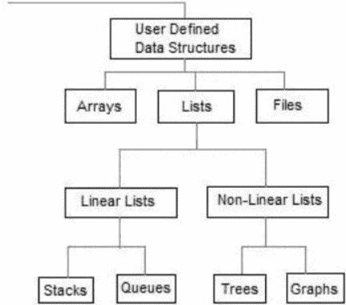

### 数据结构的特征

有时，数据结构会根据其特征进行分类。可能的特征包括：

- 线性或非线性：此特征定义数据对象如何组织：是像列表那样按顺序序列组织，还是像表那样按无序序列组织。
- 同构或异构：此特征定义集合中的所有数据对象是同一类型还是不同类型。
- 静态或动态：此技术决定如何组装数据结构。静态数据结构在编译时具有固定的大小、结构和内存位置。动态数据类型具有可随应用程序而收缩或扩展的维度、机制和内存位置。

### 数据结构类型

数据结构的类型取决于将需要何种操作或将要实现何种算法。这包括：

- **数组：** 数组在相邻位置存储一系列内存项。同一类别的组件位于一起，因为每个元素的位置都可以轻松计算或访问。数组的大小可以固定，长度也可以灵活变化。
- **栈：** 栈以线性顺序保存一组对象，并添加到操作中。此顺序可以是后进先出（LIFO）或先进先出（FIFO）。
- **队列：** 队列存储类似栈的元素集合；但是，活动顺序只能是先进先出。
- **链表：** 链表以线性顺序存储一组项。在链表中，每个单元或节点都包含一个数据项以及对列表中下一个元素的引用或关系。
- **树：** 树存储抽象的、层次化的项集合。每个节点连接到其他节点，并且可以有多个子值，也称为子节点。
- **图：** 图存储非线性的项设计组。图由有限的一组节点（也称为顶点）以及连接它们的线（也称为边）组成。它们可用于描述现实生活中的过程，例如联网计算机。
- **字典树（Trie）：** 字典树或查询树通常是一种将字符串存储为数据文件的数据结构，这些数据文件可以排列成可视化图。
- **哈希表：** 哈希表或哈希映射包含在将键映射到值的关联列表中。哈希表使用哈希算法将索引转换为包含所需数据项的容器数组。这些数据结构被称为复杂数据结构，因为它们可以包含大量相互连接的数据。原始或基本数据结构的示例包括整数、浮点数、布尔值和字符。

### 数据结构的用途

数据结构通常用于以物理形式整合数据类型。这可以解释为广泛的应用，包括表示数据库表的二叉树。数据结构用于编程语言中，以组织数字存储中的代码和信息。Python 列表和字典，或 JavaScript 数组和对象，是用于收集和分析数据的流行编码结构。此外，数据结构是有效软件设计的重要组成部分。

### 数据库的重要性

数据系统对于有效处理海量数据是必要的，例如存储在图书馆或索引服务中的数据。

准确的数据配置管理需要内存分配标识符、数据互连和数据流程，所有这些都支持数据结构。此外，重要的不仅是使用数据结构，还要为每项任务选择正确的数据结构。

选择不理想的数据结构可能导致运行时间缓慢或代码混乱。选择数据系统时需要注意的考虑因素包括：应处理何种类型的信息、新数据将放在何处、数据将如何组织，以及将为数据分配多少空间。

## Python 对数据科学有多重要？


- 高效且简单易用——Python 被认为是初学者的工具，任何仅具备基础理解的学生或研究人员都可以开始使用它。调试代码所花费的时间和金钱，以及不同项目管理上的限制，也被降到最低。与其他编程语言（如 C、Java 和 C#）相比，代码实现所需的时间更少，这使得开发人员和软件工程师能把更多时间花在算法工作上。
- 库的选择——Python 提供了庞大的库以及机器学习和人工智能数据库。Scikit-Learn、TensorFlow、Seaborn、PyTorch、Matplotlib 等都属于最受欢迎的库。
- 可扩展性——它在解决其他计算机语言无法解决的问题时提供了灵活性。许多公司使用它来开发各种快速技术和系统。
- 可视化统计与图形——Python 提供了许多可视化工具。Matplotlib 库提供了一个可靠的框架，ggplot、pandas plotting、PyTorch 等库均建立在该框架之上。这些服务有助于创建图表、可直接用于 Web 的折线图、可视化布局等。

### Python 如何用于数据科学

第一阶段——首先，我们需要学习和理解数据以什么形式存在。如果我们把数据看作一个包含数十万行和列的庞大 Excel 表格，那么也许你应该知道该如何处理它？你需要通过执行某些操作并搜索特定类型的数据，将信息收集到每一行和每一列中。完成这类计算任务可能耗费大量时间和精力。因此，你可以使用 Python 的库，例如 Pandas 和 NumPy，它们可以通过并行计算快速完成任务。

第二阶段——下一个障碍是获取所需数据。由于数据并不总是 readily accessible 的，我们需要按需从网络中抓取数据。这里，Python 的 Scrapy 和 Beautiful Soup 库可以让我们从互联网检索数据。

第三阶段——在这一步，我们必须获得数据的模拟或可视化呈现。当面板上有太多数字时，推导出洞见会变得困难。正确的做法是以图形形式、图表和其他布局来表示数据。Python 的 Seaborn 和 Matplotlib 库用于执行此操作。

第四阶段——下一阶段是机器学习，这是极其复杂的计算。它包括概率、微积分以及对数十万行和列进行矩阵运算等数学工具。借助 Python 的机器学习库 Scikit-Learn，所有这些都会变得非常简单且高效。

## 第10章：机器学习

### 监督学习

监督学习发生在算法创建一个将原始数据映射为所需输出的函数时。监督学习是机器学习最常见的范式之一。它很容易理解。监督学习的实现过程可以通过来自训练数据集的系统来完成。训练数据或示例包含不止一个输入以及所需输出。输出也称为监督信号，它在数学模型中表示。一组向量表示训练示例。当以图示形式提供数据时，算法可能有助于预测每个名称。预测发生在对答案正确与否给出响应的过程中。该方法使算法有机会随着时间学习做出近似，从而能够区分标签和示例。这种方法使监督学习成为寻找解决方案过程中的常见选择……

最常见的监督学习方法包括分类和回归。在分类的情况下，监督学习的使用发生在输出可能受限于固定数量值的时候。分类通常涉及对给定数据集进行识别，以便将新观测归入这些类别。另一方面，当输出在给定子集内具有广泛的数值范围时，就会使用回归。两个示例中的目标都是确保机器学习利用一组固定的训练示例，对给定子集中数据集合的相似或差异程度进行必要比较。此类数据集中的最佳场景可确保算法能够确定该子组内所有未见样本的类别标签。

### 无监督学习

机器学习可以通过无监督聚类分析来进行。该方法涉及使用一组由输入组成的数据，这对于结构的开发是必要的。数据点的聚类就是无监督学习的一个例子。与监督学习的情况不同，无监督学习中的测试数据没有标签，也不属于特定分类。无监督学习不响应反馈，而是关注共性。该方法试图识别给定数据集中存在共性的可能性，并利用这些共性来形成模式。本质上，这意味着目标是让计算机学习如何做某事，而不提供实现该任务的逻辑方法。因此，无监督方法比监督过程更复杂、更繁复。这种方法意味着使用奖励方法来确认任务完成成功，而不一定提供如何实现既定目标的明确指令。

无监督方法的目的更倾向于决策过程，而不是仅仅对这些数据进行分类。无监督学习训练智能体基于随着时间建立的奖励或惩罚系统来行动或响应任务。计算机在没有预期结果先验信息的情况下，逐渐学会如何处理过去的命令。这种方法可能耗时且乏味。但无监督学习可以很强大，因为它从试错的角度运作，可能产生发现。无监督学习不考虑任何预先分类的信息，因此从发明的角度来运作。

在世界上大多数数据集都未标注的情况下，无监督学习方法至关重要。这一不可争辩的现实意味着，拥有能够利用数 TB 未标注数据并理解这些信息的智能算法至关重要。未来将会有不同场景，使无监督学习成为一个关键关注领域。推荐系统将是未来无监督学习 applicable 的重要领域。推荐系统允许建立明确的关系链接，从而便于根据共同喜好对内容进行分类和推荐。

### 强化学习

当精确模型不现实时，强化学习很有用，因为这些模型很少假定已知精确的数学模型。该方法关注机器应如何运作，以最大化累积奖励的某些方面。在现代研究中，强化学习的应用是从行为心理学的角度来观察的。因此，该方法通过与周围环境交互来发挥作用。正如我们之前所指出的，监督学习基于现有示例运作。在强化学习的情况下，使用与情境的交互表明两种方法之间存在差异。

强化学习在人工智能领域的应用，表明机器有能力通过与周围环境交互来学习并适应新任务。算法会适应采取特定行动，基于


对情境设置的观察。对环境刺激的行为反应模式是学习过程的一种表征，而学习过程已成为人工智能的代名词。强化学习中的每个动作都会直接影响操作环境，而这种反应为机器提供了接收反馈的机会，这对学习过程至关重要。强化学习往往依赖于与时间相关的序列或标签。在强化学习情形下，结果取决于智能体与环境情境之间的联系。然后，智能体会被赋予一组对环境有直接任务。随后，该方法确定一个特定的强化信号，该信号根据任务和预期结果提供负面或正面反馈。

## 半监督机器学习

在只有少量标记数据和大量未标记数据的情况下，使用半监督学习算法至关重要。该方法利用标记数据和未标记数据的组合。因此，程序员使用这两种数据类型来识别模式。推导出的模型成为目标变量间关系的基础，数据示例也因而易于识别和分析。这种方法被称为半监督学习，因为它利用来自标记和未标记示例的数据，并仍能从中获取有意义的信息。因此，半监督学习是监督学习和无监督学习方法的混合体。在这种情况下使用半结构化数据，因为它不遵循数据模型的形式化结构。半监督方法中使用的标签和其他指示符有助于分离语义元素。当缺乏足够的示例来构建准确模型时，这一点至关重要。当缺乏足够的资源且增加可用数据示例的能力有限时，半结构化模型往往具有关键意义。

该方法允许对已定义数据进行标记；然后，它使用训练好的模型，基于特定模型对其他数据进行分类。在某些情况下，你可能会发现，你拥有大量结果已知的数据，但同时还存在另一组尚未识别的数据。使用半监督机器学习，这一过程能够利用已知数据模型构建一个序列，该序列在为其余数据集生成标签的过程中可以发挥作用。因此，与其他模型相比，这种方法提供了最佳选择，因为它节省时间，并大幅减少用于实现预期结果的总体资源。在当今环境中，未标记数据很可能在分类过程中取代标记数据，此时使用半监督方法建立一个合适的函数可能是一个关键的解决方案。使用半监督方法从标准消息中识别和检测垃圾邮件是当今世界最实际的例子。否则，仅依靠人类知识来筛选这些信息是不可能实现的。使用半监督技术有助于解决经常影响分类过程的高维问题。

## 结论

你在上班途中听着自己最喜欢的Spotify播放列表，刷着Instagram信息流。一到办公室，你走到咖啡机前，在等待每日提神饮品时查看Facebook通知。最后，你坐到办公桌前，啜了一口咖啡，心想：“嘿，我该用Google搜索一下Python是用来做什么的。”这时，你意识到刚才用到的每一项技术中都包含一点Python。

Python几乎被用于一切领域，无论是初创公司创建的简单应用，还是像Google这样的巨头公司。让我们简要列举一下使用Python的各种方式。

总之，Python和大数据在大数据分析平台上提供了计算方面最强大的能力之一。如果这是你第一次接触数据编程，Python将比任何其他语言都更容易学习，而且对用户友好得多。

至此，我们已到本书的结尾。本书旨在让你在基础知识之外，初步领略使用Python进行数据分析技术和可视化的方法。Python是用于数据处理的美妙工具，我希望这本指南能帮助你在按自己的目标使用它时处于有利地位。

在本书中，我力求更深入地讲解，为你提供更多关于数据科学基础知识的信息，并附上大量实用、可操作的示例供你尝试。

请根据需要经常阅读本指南，在完全理解某一章之前，不要急于进入下一章。请务必亲自尝试书中的示例——如果你亲自动手实践，而不是仅仅阅读理论，你会学到更多。

这仅仅是对你在第一本书中所学内容的概述，涵盖了pandas中的数据类型及其使用方法。我们还研究了数据清理和操作，以处理缺失值并执行一些字符串操作。

世界上还有很多其他编程语言可供使用，但Python对于大多数初学者来说是最好的选择之一，它提供了你刚开始接触这类编程语言时所需的强大功能和易用性。这本指南花费了大量篇幅探索Python的工作原理，以及你可以使用它进行的各种不同类型的编程。

除了看到大量如何用Python编码以及如何用这种语言创建程序的示例之外，我们还花了一些时间研究如何在机器学习、人工智能和数据分析领域使用Python。这些都是方兴未艾的技术主题和领域，许多程序员都在努力学习更多相关知识。在这本指南的帮助下，即使你是Python初学者，也能处理所有这些问题。

当你准备好进一步学习如何使用Python编程语言，并确保能够将Python与数据分析、人工智能和机器学习结合使用时，请再次查阅这本指南，它将帮助你入门。

# Java 编程

### 学习使用面向对象程序进行编码，提升你的软件工程技能。熟悉虚拟机、JavaScript 和机器代码

ALAN GRID

## 引言

Java是一种广泛应用于Web和计算应用中的编程语言。它是一个免费下载的解决方案，允许用户访问最新版本并实施更新。这种编程语言出现在当今大多数Web应用和计算技术中。Java的可扩展特性使其适用于广泛的应用场景，包括手机等小型电子设备的应用，以及数据中心等大规模运营的软件解决方案。人们越来越倾向于使用Java，这归因于其强大的功能特性和可靠的安全资质。

Java是由Sun Microsystems构建的一种编程语言，该公司后来被Oracle公司收购。它被设计成可在任何支持Java的操作系统上运行。这正是这门语言如此流行的原因，因为开发人员只需编写一次程序，该程序就可以在任何操作系统上运行，而无需程序员更改代码。

世界各地构建的大多数现代应用程序都是由Java编程语言开发的。主要应用程序的大多数服务器端和业务逻辑组件都基于Java编程语言。

在本书的整个过程中，你将学习如何编写类似上述的程序，并学习一些高级概念，这些概念将使你能够开始编写完整的应用程序。

下面列出Java的一些设计目标：

- 该语言旨在一次编写，并能够在任何操作系统上运行。
- 该语言应支持众多软件工程原则。


可移植性是一个重要因素。这就是为什么Java能够在Windows、Linux和MacOS操作系统上运行。

对国际化的支持非常重要。

Java旨在适用于编写托管系统和嵌入式系统的应用程序。

接下来讨论其他设计目标：

### 强类型检查

Java是一种强类型语言。每个定义的变量都需要绑定一种数据类型。

你现在不需要理解完整的程序，但让我们快速看一下代码中的两行。

```
1)    int i=5;
```

这里我们定义了一个称为变量的东西，它用于保存值。可以存储的值取决于数据类型。在这个例子中，我们说‘i’的类型是‘int’或Integer（整数），它是一种数值数据类型。

### 数组边界检查

在运行时，Java会检查数组是否定义了所需数量的值。如果有人试图访问数组边界之外的值，将抛出异常。

你现在不需要理解完整的程序，但让我们快速看一下下面几行代码。

```
1)    int[] array1 = new int[2];
```

这里我们声明了一个数组，它是一组整数值。‘2’的值意味着我们只能在数组中存储两个值。

```
2)    array1[0] = 1;
      array1[1] = 2;
      array1[2] = 3;
```

通过这段代码，我们可以看到我们正在给数组赋3个值。当你运行这个程序时，你会得到一个错误，因为程序会看到数组已经超出了其允许的最大边界2。在运行时你会得到下面的错误。

```
Exception in thread "main"
java.lang.ArrayIndexOutOfBoundsException: 2
at HelloWorld.main(HelloWorld.java:8)
```

### 为什么 Java 很重要？

其次，Java的语法和特性与C和C++等其他编程语言相似。如果你有任何编程经验，你会发现学习Java非常轻松。即使你是编程新手，也可以放心，Java被设计成一种相对容易学习的语言。大多数程序员发现学习Java比学习C或C++更容易。

Java还被设计为平台无关的。如前所述，Java代码首先被编译成字节码，可以在任何装有Java虚拟机（JVM）的机器上运行。

因此，使用Java，你可以编写一次代码，然后在任何你想要的地方运行。

### 为什么选择 Java？

当然，使用Java的一个关键原因是它对面向对象编程（OOP）的重视。

面向对象编程，或“OOP”，是一种编程语言模型，它允许程序的代码围绕数据组织，而不是围绕函数和逻辑组织，后者被称为过程式编程。

这些“数据集群”被组织成称为“对象”的东西，因此有了“面向对象编程”的绰号。

这些对象由称为“类”的东西创建，这里按照类的传统含义来理解：类是对象的类型，允许程序员根据两个主要标准对它们进行“分类”：属性和方法。

类的属性是用于创建对象的原始数据：它们是对象的描述符，例如对象拥有的值，以及其他构成对象的相关数据。第二个标准是对象的“方法”。

这个“方法”是行为，或类中包含的逻辑序列，描述了对象如何交互或如何被原生交互。

## 第1章：

### Java 基础

当然，使用Java的一个关键原因是它对面向对象编程的重视。面向对象编程，或“OOP”，是一种编程语言模型，它允许程序的代码围绕数据组织，而不是围绕函数和逻辑组织，后者被称为过程式编程。

这些对象由称为“类”的东西创建，这里按照类的传统含义来理解：类是对象的类型，允许程序员根据两个主要标准对它们进行“分类”：属性和方法。

类的属性是用于创建对象的原始数据：它们是对象的描述符，例如对象拥有的值，以及其他构成对象的相关数据。

第二个标准是对象的“方法”。

为了更清楚地说明这一点，假设有一个“Human”（人）类。这个“类”将具有身高、体重、性别和种族等属性。“人”类还可以有“run”（跑）、“walk”（走）、“talk”（说话）等方法。这些理论组件构成了“人”类，即一个对象的蓝图。

既然类已经定义好了，程序员如果愿意，就可以以“人”类为蓝图创建一个对象。

他们可以调用“Human”类并“填充”其属性，赋予它特定的身高、体重、性别和种族。此外，该对象已经内置了“run”、“walk”和“talk”等功能，因此在创建对象时，比如从“Human”类创建一个名为“Mike”的对象，它就已经包含了跑、走和说话的功能，程序员无需再次编写这些特定函数，因为它们已经“固有”于创建的对象中。

简而言之，这就是面向对象编程的初衷：一种编程方式，允许程序员利用预定义的类，从而更容易地描述它们，并使用它们的内部或内置函数来操作它们。

假设读者不是编程的完全新手，并且已经通过C或其他过程式（procedural-heavy）语言接触过编程世界，那么下一个合乎逻辑的问题就是：为什么还要使用面向对象编程呢？

嗯，它的一个主要优点是：从长远来看，它可以节省时间。

在较简单的算法和程序中，过程式编程通常更快、更直接；程序员不需要构造和定义一个类，然后基于该类创建对象，他们真正要做的只是声明必要的变量、编写函数，并创建算法来解决他们需要用代码处理的问题。

然而，当涉及到更复杂的程序、需要更复杂的解决方案时，面向对象编程就开始大放异彩，也开始展现出它的优势。

在很多程序中，有时会有许多“对象”或数据集群需要分组在一起，并且需要程序员以某种方式处理。

这正是“类”所要解决的。

与其为每个数据集群声明一组新的变量，他们可以直接利用一个预制的“类”并创建一个新的“对象”。

让我们看看这在实践中是如何运作的。

如果程序员要以过程式方式编写国际象棋游戏，那么他们将不得不手动描述每一个棋子，所有

### 关键字

在Java中，布尔类型指的是false或true值。Java使用保留关键字来确定它是true还是false。因此，布尔表达式类型将取这些值之一。

一个用于演示的例子包括：

关于这个程序，有几点需要注意。

首先，println()显示一个布尔值。其次，布尔值控制if语句的流程。

你不必大费周章地用这种方式编写布尔类型：

`if (b == true)`

运算符（如<）所产生的结果是布尔值。这也是表达式11 > 8显示值true的原因之一。

此外，11 > 8附近的那对括号很重要，因为加号出现在>之前。

### 标识符

上面图表的顶层是标识符或名称。

这个顶层是你给类起的名字。该名称应具体标识并描述用户所看到或体验到的对象类型。

简而言之，名称或标识符应该标识类。

### 运算符

Java拥有一个广泛的运算符环境列表。

如果你想知道什么是运算符，你可以把它看作一个符号，它向编译器传递特定消息以执行


逻辑或数学运算。在 Java 中，你会接触到四类运算符。

这四类包括：

- 逻辑运算符
- 按位运算符
- 关系运算符
- 算术运算符

与其他计算机语言一样，Java 也定义了一系列附加运算符，用于处理某些特定场景。

在学习 Java 编程语言时，或者就此而言学习任何编程语言时，开始之前你必须理解五个基本概念。

这五个基本概念包括：

- 变量
- 数据结构
- 控制结构
- 语法
- 工具

这些概念中的每一个都会以初学者水平进行详尽解释，以确保它们被理解。

### 分隔符

它们不适合高级抽象：请注意，许多这类程序使用了低级构造，而这些构造主要用于低级抽象。

这些编程语言的通常做法是关注机器——如何让计算机做某事，而不是这些功能如何帮助解决用户的问题。

这些语言处理细微细节，这已经超出了高级抽象的范畴，而高级抽象是我们如今更常见的方法。

在低级抽象中，数据结构和算法是分开处理的，而在高级抽象中，它们被作为一个整体来处理。

### 字面量

在 Java 中，字面量指的是以人类可读形式出现的固定值。我们可以说数字 200 是字面量。大多数情况下，字面量可以是常量。

字面量在程序中很重要。事实上，大多数 Java 程序都使用字面量。本书已经讨论过的一些程序也使用了字面量。

Java 中的字面量可以归入各种基本数据类型。

每个字面量的显示方式由其类型决定。正如之前提到的，我们用单引号括起字符常量，例如 'c' 和 '%'。

我们定义整数字面量时不涉及小数部分。例如，12 和 -30 是整数字面量。浮点字面量应包含小数点以及小数部分。12.389 是浮点字面量。

Java 还允许对浮点字面量使用科学计数法。

整数字面量包含 int 值，任何人都可以用 short、byte 和 char 类型的变量来初始化它们。

### 注释

当这种情况发生时，我们称之为代码注释。在程序的运行阶段，代码中的（注释）是无效的。

这意味着你可以使用注释功能来陈述或解释你正在创建的代码想要实现什么。

你可以通过输入两个斜杠，然后输入注释来实现这一点。下面是一个示例。

```java
//Place your single line comment here
```

你可以通过执行以下任一操作来拥有多行注释：

```java
//We are going to
//spread the comments into two
```

或者

```java
/*
This comment spreads over two lines
*/
```

如果你查看上面的注释，会注意到它以 /* 开头，但以 */ 结尾。

此外，如果你查看前面的图片（图 8），会注意到有些注释以单个正斜杠和两个星号（/**）开头，但以一个星号和一个正斜杠结尾；这称为 Javadoc 注释。

## 第 2 章：变量

### 什么是变量？

另一方面，变量是一个“对象”，它包含特定的数据类型及其已赋值或接收的值。它之所以被称为变量，是因为其中包含的值可以根据它在代码中的使用方式、编码者如何声明其值，甚至程序用户选择如何与之交互而改变。简而言之，变量是数据类型的存储单元。能够访问变量，使程序员可以方便地标记并调用手头的存储值。

### Java 中的变量类型

Java 要求程序员使用声明语句，即用于声明变量并通过指定特定数据类型和名称来定义变量的代码行。Java 有一种特定的变量处理方式，即将变量定义为包含特定类型和值信息的容器；这与 Python 等某些语言不同，后者只需声明变量，变量就可以动态改变其类型；Java 变量是静态的，一旦声明就保留其类型。

```java
int number = 20;

boolean completed = true;

String hello = "Hello World!";
```

声明语法如前面的示例所示：先是变量类型，然后是变量名，最后是值。另请注意，声明语句可以在同一行中由多个声明组成，如下例所示：

```java
int number = 20, boolean completed = true, String hello = "Hello World!";
```

Java 变量可以在开始时声明而不赋予任何值；在这种情况下，Java 会选择用特定的默认值来声明这些变量，例如：

```java
byte a;
short num;
boolean answer;
```

将分别得到值 0、0 和 false。更完整的默认值列表如下：byte、short、int 和 long 数据类型的默认值均为 0；float 和 double 数据类型的默认值为 0.0；char 数据类型的默认值为 '\u0000'；字符串或任何其他对象的默认值为 null；所有 boolean 都以 false 为默认值开始。

在 Java 中，变量在声明时是静态的，这意味着程序员必须定义该变量将包含的数据类型。举例来说，如果我们希望使用变量 num 存储一个数字，必须先声明该变量："int num,"，然后才能赋值，例如 "num = 10"。

上述过程通常被称为“赋值语句”，即按照程序员的声明将值赋给变量。然而，Java——事实上大多数编程语言——工作方式的一个显著特点是，在赋值语句中，例如我们的 num = 10 示例，实际存储的值是等号右侧的值，即 10，而 num 只是用于调用该存储值的“标记”。这就是为什么许多 Java 程序员倾向于使用“获取”值而不是“赋值”的说法，尽管在大多数情况下，二者可以互换使用，并且除了一些罕见场景外，功能基本相同。

但请注意，一旦值被赋给变量，就必须执行函数，才能改变该变量内部数据的数据类型。

### 变量命名

创建变量是一项简单的任务，尤其是考虑到 Java 程序员往往根据数据类型或变量将要存储的内容的用途来创建和命名变量。然而，命名这些变量有一些规则；否则 Java 将无法识别它，并会产生错误消息。变量名的主要限制是它不应以特殊字符开头，例如下划线或数字。不过，变量名可以由字母和数字等字符组成，甚至可以包含下划线，前提是下划线不在开头。不得使用其他字符，例如 # 甚至 $，因为这些特殊字符在 Java 中有不同用途，因此不会在变量名中被识别。

虽然这些是主要规则，但以下是命名变量时的一些提示。变量名应具有描述性，因为在较长的代码中，可能很难回忆起“x”是做什么用的。使用“count”或“output”这样的变量名，比使用通用的“x”或“y”更容易回忆，并有助于避免混淆。除了具有描述性外，如果变量名保持相当简短，变量也会更易于使用。虽然使用 banking information account records 这样的变量名非常具有描述性，但在程序中按需反复输入它会令人疲惫，而且较长的变量名会增加拼写错误的机会，从而导致代码中的错误，造成运行时错误，或代码无法按预期工作，或虽然能工作但沿途引入错误。另请注意，Java 变量一直以来的惯例是全部使用小写字母书写；虽然对大小写没有限制，但保持小写可以简化事情，因为漏掉大小写可能会

导致该变量无法被识别，因为 Java 会将大写字母视为与小写字母完全不同的字符。

### Java 基本类型

### 方法命名约定

我们将重新讨论 Java 中的命名约定，因为你将会使用成员方法。Java 编程中的方法用于执行操作，它们还会接收调用方提供的任何参数，并且可以将操作结果返回给调用方。以下是声明方法的语法：

```java
[Access Control Modifier] Return Type methodName ([set of parameters]) {
    // body of the method
    ......
}
```

在为你将要编写的方法命名时，需要记住以下几项规则。方法名始终是动词，或者更具体地说是动词短语（这意味着你可以使用多个单词来命名）。方法名的第一个单词应全部使用小写字母，而其余单词应遵循驼峰式格式。下面是一个示例：

```java
writeMethodNamesThisWay()
```

现在，你应该记住，动词用于方法名，表示一种动作；而名词用于变量名，表示某种属性。

遵循声明方法的语法，并遵循该 Java 构造的命名约定，下面是一段可用于计算圆面积的示例代码。

```java
public double computeCircleArea() {
    return radius * radius * Math.PI;
}
```

### 在代码中使用构造函数

我们将只讨论与面向对象编程相关的一些额外细节。如前所述，构造函数看起来像一个方法，你完全可以将其视为 Java 编程中的一种特殊方法，并这样对待它。

但是，构造函数在几个方面仍然与方法不同。构造函数的名称将与类名相同。使用关键字或运算符“new”来创建构造函数的新实例并对其进行初始化。下面是一个使用类“Employee”以及多种在代码中初始化它的方式的示例：

```java
Employee payrate1 = new Employee();
Employee payrate2 = new Employee(2.0);
Employee payrate3 = new Employee(3.0, "regular");
```

构造函数还会隐式返回 void——这仅仅意味着它没有返回类型。你不能在构造函数的主体中放置 return 语句，因为编译器会将其标记为错误。调用构造函数的唯一方式是使用“new”语句。在上面的示例中，我们已经给出了几种调用构造函数的方法。

最后一个区别是构造函数不能被继承。让我们回到上面提供的示例——第一行包含“Employee( );”——这被称为默认构造函数。如你所见，它没有任何参数。默认构造函数的职责只是将成员变量初始化为特定的默认值。在上面的示例中，成员变量 payrate1 被初始化为其默认薪资水平和员工状态。

构造函数也可以被重载吗？是的，可以。构造函数的行为也类似于方法，因此这意味着你可以像重载方法一样重载构造函数。以下是几个如何重载构造函数的示例。我们使用 Employee 类，并使用不同的参数对其进行重载。

```java
Employee()
Employee(int r)
Employee(int r, String b)
```

### 如何初始化变量

现在我们已经知道如何声明变量，也知道了可供我们使用的各种变量类型，接下来要做的是学习如何使用这些变量，也就是所谓的“表达式”。表达式是 Java 程序中最常用的构建块，通常旨在产生一个新值作为结果，不过在某些情况下，表达式也用于为变量赋一个新值。一般来说，表达式由值、变量、运算符和方法调用等内容组成。还有一些表达式不会产生结果，而是会影响另一个变量。一个例子是根据某种操作改变变量值的表达式：没有新值输出，也没有真正“赋值”一个新值，而是存在所谓的副作用，导致变量值发生变化。

在“Hello World”打印程序中，我们将原始值引入 print 函数，这也称为对输出进行“硬编码”。然而，此时我们应该尝试运用已经学到的变量知识。变量的工作方式与原始值大致相同，因为它们只是引用计算机先前存储的值，因此程序员可以直接使用变量名而不是值。为了演示这一点，让我们回顾之前的“Hello World”程序：

```java
print("Hello World");
input("\n\nPlease press the return key to close this window.");
```

现在，与其硬编码“Hello World”字符串，我们可以直接将其声明到一个变量中，并让程序输出该变量。最终应如下所示：

```java
String string = "Hello World";
print(string);
input("\n\nPlease press the return key to close this window.");
```

这应当会得到与之前程序相同的结果，看起来类似于：

Hello World

请按回车键关闭此窗口。

## 第3章：Java 基础

### Java 开发工具包

JDK 提供了构建、测试和监控健壮的 Java 应用程序所需的工具。它允许开发人员在 Java 编程操作期间访问软件组件并编译应用程序。例如，开发人员需要一个由 JDK 支持的环境，才能编写小程序或实现方法。

由于 JDK 或多或少执行软件开发工具包（SDK）的操作，人们很容易混淆这两者的范围和操作。JDK 特定于 Java 编程语言，而 SDK 具有更广泛的适用性。但在程序开发环境中，JDK 仍然作为 SDK 的组件运行。这意味着开发人员仍然需要 SDK 来提供某些具有更广泛操作特性且 JDK 领域内不可用的工具。开发人员文档和调试实用程序以及应用服务器，是 SDK 为 Java 编程环境提供的一些关键工具。

JDK 部署的范围取决于手头任务的性质、受支持的版本以及正在使用的 Java 版本。例如，Java 平台标准版（Java SE）开发工具包旨在与 Java 标准版一起使用。Java 平台企业版（Java EE）和 Java 平台微型版（Java ME）是 JDK 的其他主要子集。下面各子主题详细描述了每个 Java 版本的细节。自 2007 年上传至 OpenJDK 门户以来，JDK 一直是一个免费平台。其开源状态促进了协作，并允许软件开发人员社区克隆、修改或贡献有关改进和升级的想法。

### Java SE

Java SE 为各种各样的桌面和服务器应用程序提供支持。它支持在这些应用程序的开发环境中测试和部署 Java 编程语言。与 Java SE 近期版本相关的一些文档包括高级管理控制台功能以及一套经过改进的 Java 部署规则。在编写本书时，Java SE 13.0.1 是 Java SE 平台的最新 JDK 版本。

Java SE SDK 配备了核心 JRE 功能，以及一套为开发桌面应用程序而设计的工具、类库和实现技术。这些工具的范围从用于 Java 程序实现的简单对象和类型，到适合构建具有网络能力和强大安全特性的应用程序的高级类参数。Java 程序员还可以将此特定 JDK 应用于开发用于简化数据库访问或增强 GUI 属性的 Java 应用程序。

### Java EE

Java EE 平台是一个开源产品，由全球 Java 社区成员协作开发。Java EE 与 Java SE 密切相关，因为前者构建在后者之上。这款特定软件集成了为用于企业解决方案而设计的变革性创新。新版本中引入的功能和改进通常反映了 Java 社区成员的输入、需求和请求。Java EE 实际上提供了二十多个符合 Java 编程规范的实现。


Java EE SDK 旨在用于构建大规模运营应用。正如其名称所示，这个特定的 Java SDK 旨在为企业软件解决方案提供支持。JDK 提供强大的 API 和运行时属性，Java 程序员需要这些来构建具有可扩展和可联网功能的应用程序。需要开发多层应用的开发者也会发现此 JDK 很有用。

本书撰写时，Java EE 8 是最新版本。Java EE 经过修订的设计为企业解决方案提供增强技术，并为安全和管理目的提供现代化应用。该版本包含多项改进，包括通过 Client、JSON Binding、Servlet 和 Security API 提供的更强大 REST API 能力。根据 Oracle 公司网站截至 2019 年 12 月发布的信息，此版本还提供 Date and Time API 以及 Streams API。

### Java ME

Java ME 平台发挥简单性、可移植性和动态性，为构建小型设备和装置应用提供多用途环境。Java ME 以拥有出色的应用开发环境而闻名，这得益于其交互式且用户友好的导航界面，以及用于实现网络概念的内置能力。它在很大程度上与物联网（IoT）相关，在构建面向内置技术或联网设备的应用时很有用，这些应用可用于发明或实现未来概念。Java ME 的可移植性和运行时属性使其适用于可穿戴设备、手机、相机、传感器和打印机等物品与设备的软件应用。

Java ME SDK 配备了必要工具，用于在独立环境中开发软件应用、测试功能和执行设备模拟。根据 Oracle 公司网站截至 2019 年发布的信息，该 SDK 非常适合同时支持“连接有限设备配置（CLDC）”技术和“连接设备配置（CDC）”功能。从而形成单一且多用途的应用开发环境。

还有其他几种 Java ME 解决方案支持在应用中部署 Java 编程语言。Java ME Embedded 提供将 IoT 能力集成到设备中的运行时环境，而 Java ME embedded client 有助于构建运行并优化内置程序功能的软件解决方案。Java for Mobile 利用 CLDC 和 Java ME 开发者工具栈，为移动设备创建创新功能。

### Java 运行时环境

请记住，Java 应用要高效运行，必须满足某些条件。JRE 包含负责创建这些必要条件的组成部分。其中包括 JVM 及其相应文件和类属性。尽管 JRE 作为 JDK 的组件运行，但它能够独立运行，尤其是当任务仅限于运行而不是构建应用指令时。

JRE 为 Java 编程生态中的不同程序提供重要的运行属性。例如，如果一个程序内部运行独立的 JRE，则该程序被视为自包含的。这意味着程序不依赖其他程序来访问 JRE。这种独立性使程序能够与不同的操作系统平台实现兼容。

### Java 虚拟机

JVM 作为在计算机程序中实现 Java 的规范运行。它是 Java 语言平台无关特性的驱动力。JVM 作为由其他程序执行的程序这一地位，进一步凸显了这一点。为与 JVM 交互并执行 JVM 而编写的程序将其视为一台机器。正因如此，人们使用类似的集合、库和接口来编写 Java 程序，以便将每一个 JVM 实现与特定操作系统相匹配。这便于将 Java 程序转换或解释为本地操作系统中的运行时指令，从而消除 Java 编程中对平台依赖的需要。

作为开发者，你必须警惕开发环境和应用易受网络攻击及其他威胁影响的脆弱性。JVM 提供增强的安全特性，保护你免受此类威胁。这一牢固的安全基础归因于类文件操作码中内置的语法和结构限制。但这并不意味着 JVM 可容纳的类文件范围受到限制。实际上，只要类文件能够被验证为安全可靠，JVM 就接受各种类文件。因此，对于用其他编程语言开发软件而言，JVM 是一种可行的补充替代方案。

JVM 常作为移植特性包含在多种软件应用和硬件安装中。它通过由 Oracle 或任何其他提供方确定的算法实现。因此，JVM 提供开放的实现平台。JVM 实际上包含运行时实例，作为支撑其命令操作的核心属性。例如，创建 JVM 实例只需在命令提示符中写入一条指令，该指令随后运行 Java 的类属性。

Java 程序员需要熟悉 JVM 的关键区域，例如类加载器、用于运行时操作的数据区，以及负责执行程序的引擎。还有一些与性能相关的组件，例如垃圾收集器和堆尺寸工具，它们对 JVM 的部署同样重要。JVM 与字节码之间存在密切关联。

### 字节码

Java 操作码同样是基本类型的关键组成部分，因为它们承担对操作数进行分类的作用。这一作用确保操作数保持其状态，从而消除 JVM 中对操作数标识接口的需求。JVM 能够加速处理过程，因为它能够多任务处理，同时容纳多个将驻留变量送入栈的操作码。操作码还可用于处理和定义基于栈的字节码的值参数。根据 Venners（1996），这可以是隐式常量值、操作数值，或从常量池中派生的值。

## 第 4 章：Java 环境

### 在编辑器中编写程序

编写程序时，你可以使用记事本等简单编辑器，也可以使用功能完备的集成开发环境（IDE）。下面列出一些可用于 Java 的最流行 IDE 及其部分相关特性。

### Eclipse

这款 IDE 已存在相当长时间，在 Java 开发社区中非常流行且被广泛使用。该 IDE 的一些核心特性如下：

- 它是免费且开源的。因此，有许多开发者持续为该 IDE 做贡献。
- 它可用于开发其他语言的应用，例如 C++、Ruby、HTML5 和 PHP。
- 它具有富客户端平台。
- 它提供代码重构能力。
- 它有助于代码补全。
- 它具有种类丰富的扩展和插件。
- 它还支持大多数源代码版本控制系统。

### IntelliJ IDEA

这是 Java 开发社区使用的另一款流行 IDE。该 IDE 的一些核心特性如下：

- 社区版免费且开源。
- 付费版提供更多特性，并允许开发者使用 Java Enterprise Edition 构建企业级应用。
- 它提供代码重构能力。
- 它有助于代码补全。
- 它具有种类丰富的扩展和插件。
- 它还支持大多数源代码版本控制系统。

### NetBeans

NetBeans 是强烈推荐给 Java 语言初学者的 IDE。它是一款强大且快速的 IDE，支持所有 Java 平台以及移动应用。它可在 Windows、Linux、Mac OS X 和 Solaris 等多种平台上运行。它还支持 HTML5、C/C++ 和 PHP 等语言。

### Java 的优势

- Java 体现了编程的简洁性，这得益于其用于学习、编写、部署和实现的用户友好界面。
- Java 的核心架构旨在促进开发环境中的轻松集成和便捷使用。
- Java 与平台无关且易于移植，使其适合多任务处理以及跨软件应用使用。
- Java 的面向对象特性支持创建具有标准特性和可重新部署代码的程序。


- Java 的网络功能使程序员更容易为共享计算环境创建软件解决方案。
- Java 与 C++、C 语言之间的密切关系，使任何了解另外两种语言的人都能更容易地学习 Java。
- Java 的自动垃圾回收提供持续的内存保护，使程序员在编写代码时能够方便地消除安全漏洞。
- Java 的架构在实现多线程程序方面具有灵活性。
- Java 易于复用，这得益于可以使用接口或继承特性重新部署类。

## Java 的缺点

- 由于 Java 不是原生应用程序，因此与其他编程语言相比，它的运行速度较低。
- Java 在图形处理和显示方面也可能缺乏一致性。例如，基于 Java 的应用程序中图形用户界面（GUI）的普通外观，与原生软件应用程序的 GUI 输出相比，差异很大且标准较低。
- Java 的垃圾回收是一项管理内存效率的特性，但当它作为后台应用程序运行时，可能会干扰速度和性能。

## 第 5 章：对象与类

最后，我们将学习类和对象。

Java 中的对象必须具有状态（存储在字段中）和行为（由方法表示）。类可以说是一种映射，或者说是蓝图，对象正是根据它创建的。类看起来如下所示：

```java
public class Dog {
    String breed;

    int age;

    String color;

    void barking() {

    }

    void whining() {

    }

    void sleeping() {

    }
}
```

类可以具有以下任意一种变量类型：

- 局部变量——在构造函数、代码块或方法内定义。变量在方法内部声明并初始化，方法结束后即被销毁。
- 实例变量——在类中定义，但位于方法之外。在类实例化时初始化，并且可以从该类的任何构造函数、代码块或方法内部访问。
- 类变量——在类内部声明，使用 static 关键字，并且位于任何方法之外。

类可以拥有多个方法，数量可根据需要而定，以访问方法中所有不同类型的值。在上面的示例中，我们有三个方法——barking()、whining() 和 sleeping()。

### 构造函数

每个类都会有一个构造函数；如果省略它，编译器会构建一个默认构造函数。创建新对象时，必须至少调用一个构造函数。通常，构造函数的名称必须与类名相同，并且一个类可以根据需要拥有任意多个构造函数。

构造函数看起来如下所示：

```java
public class Puppy {

    public Puppy() {
    }

    public Puppy(String name) {
        // This constructor has a single parameter, name.
    }
}
```

### 创建对象

我们已经知道，类是一种用于创建对象的蓝图，因此不言而喻，对象是从类创建的。要创建新对象，我们需要使用 new 关键字。

从类创建对象需要以下三个步骤：

- 声明——必须使用名称和对象类型声明变量
- 实例化——使用 new 关键字创建对象
- 初始化——调用构造函数，由它初始化对象。

下一个示例展示了如何创建对象：

```java
public class Puppy {

    public Puppy(String name) {

        // This constructor contains a single parameter called name.

        System.out.println("Passed Name is :" + name );

    }

    public static void main(String []args) {

        // The next statement will create an object called myPuppy

        Puppy myPuppy = new Puppy( "fluffy" );

    }

}
```

运行它，看看会发生什么。

### 访问实例变量和方法

当我们需要访问实例变量和方法时，可以使用对象；这个示例展示了如何访问实例变量：

```java
/* First we create the object */

ObjectReference = new Constructor();

/* Now we call our variable, like this */

ObjectReference.variableName;

/* Now a class method is called, like this */
ObjectReference.MethodName();
```

接下来，我们可以看到类中的实例变量和方法是如何被访问的：

```java
public class Puppy {
    int PuppyAge;

    public Puppy(String name) {
        // This constructor contains a single parameter called name.
        System.out.println("Name chosen is :" + name );
    }

    public void setAge(int age) {
        PuppyAge = age;
    }

    public int getAge() {
        System.out.println("Puppy's age is :" + PuppyAge );
        return PuppyAge;
    }

    public static void main(String[] args) {
        /* Object creation */
        Puppy myPuppy = new Puppy( "fluffy" );

        /* Now we call the class method to set the Puppy's age */
        myPuppy.setAge(2);

        /* Next, we call another class method to get the Puppy's age */
        myPuppy.getAge();

        /* We access instance variable in this way */

        System.out.println("Variable Value :" + myPuppy.PuppyAge );

    }

}
```

运行它，看看会发生什么。

### 导入语句

需要记住的一件重要事情是，路径必须是完全限定的，其中包括类和包的名称。否则，编译器将难以加载源代码和类。要限定路径，我们需要使用导入语句；在这个示例中，我们看到编译器如何将请求的类加载到我们指定的目录中：

```java
import java.io.*;
```

接下来，我们需要创建两个类，一个名为 Employee，另一个名为 EmployeeTest。我们使用以下代码来完成——请记住，Employee 是类名，并且它是一个 public 类。完成之后保存文件，并将其命名为 Employee.java。

另请注意，这里有四个实例变量——age、name、designation 和 salary，以及一个已显式定义并接受一个参数的构造函数：

```java
public class Employee {

    String name;

    int age;

    String designation;

    double salary;

    // This is the constructor of the class called Employee
    public Employee(String name) {
        this.name = name;
    }

    // We assign the age of the Employee to the variable called age.
    public void empAge(int empAge) {
        age = empAge;
    }

    /* We assign the designation to the variable called designation.*/
    public void empDesignation(String empDesig) {
        designation = empDesig;
    }

    /* We assign the salary to the variable called salary.*/
    public void empSalary(double empSalary) {
        salary = empSalary;
    }

    /* Print the Employee details */
    public void printEmployee() {
        System.out.println("Name:"+ name );
        System.out.println("Age:" + age );
        System.out.println("Designation:" + designation );
        System.out.println("Salary:" + salary);
    }
}
```

代码处理从 main 方法开始，因此你需要确保代码中有一个 main 方法，并且我们需要创建一些对象。我们将首先创建一个名为 EmployeeTest 的类，它将创建几个 Employee 类的实例。必须调用每个对象的方法，以便将值赋给变量。将这段代码保存在 EmployeeTest 中：

```java
public class EmployeeTest {

    public static void main(String args[]) {

        /* Create two objects by using constructor */

        Employee empOne = new Employee("Bobby Bucket");

        Employee empTwo = new Employee("Shelley Mary");

        // Invoke the methods for each of the objects we created

        empOne.empAge(28);

        empOne.empDesignation("Senior Software Developer");

        empOne.empSalary(1500);

        empOne.printEmployee();

        empTwo.empAge(22);

        empTwo.empDesignation("Software Developer");

        empTwo.empSalary(850);

        empTwo.printEmployee();

    }

}
```

现在需要编译这些类，并运行 EmployeeTest；执行这些操作，看看会得到什么结果。

你应该会看到：

## 第 6 章：可正常工作的代码示例

传统上，每个人的第一个程序都会打印“Hello World”。这个第一个程序演示了如何创建、保存和运行程序。它还展示了所有 Java 程序中使用的基本结构。

下面是 Hello World 程序所创建窗口的截图：


### 第 1 课——Java 项目和包

程序首先按 Java 项目组织，然后在 Java 项目内按包组织。你将为本书中的每个程序创建一个 Java 项目。

包用于存放通常一起使用的程序文件。因为本书中的程序都很小，所以你创建的大多数 Java 项目只会有一个包。

在本课中，你将为自己的第一个程序创建一个 Java 项目和一个包。

### 试一试

创建你的第一个 Java 项目，名为 Hello World：

- 1. 如果 Eclipse 已不再打开：
  - a. 双击你在桌面上创建的 Eclipse 快捷方式。
  - b. 单击“确定”，将你的 Java 工作文件夹用作工作区。
- 2. 在“包资源管理器”窗格中右键单击，然后选择“新建/Java 项目”。
- 3. 将 Java 项目命名为 Hello World，如果默认 JRE 为 1.7 或更高版本，则选择“使用默认 JRE”，然后单击“下一步”，如下图所示。如果默认 JRE 低于 1.7，请选择“使用执行环境 JRE 1.7 或更高版本”选项。

命名项目

使用默认 JRE（1.7 或更高版本）

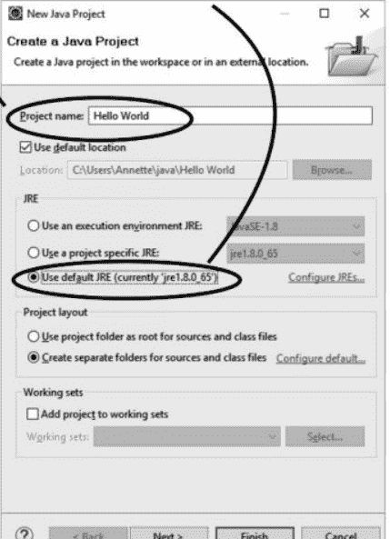

- 4. 单击“库”，然后单击“添加外部 JAR...”，如下图所示。

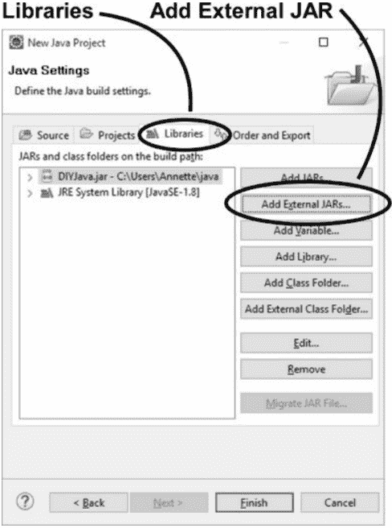

- 5. 浏览并选择 DIYJava.jar（你已将其安装到 Java 工作文件夹中），然后单击“打开”。
- 6. 单击“完成”。

现在，“包资源管理器”窗格会列出一个项目（Hello World）以及添加的 JAR 文件（DIYJava.jar），如下图所示：

### 命名包

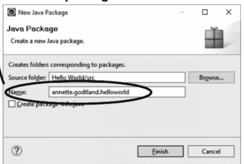

- 3. 单击“完成”。

现在，“包资源管理器”窗格会显示你在 Hello World 项目中创建的包，如下图所示：

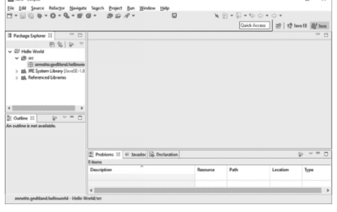

### 要点及更多内容

- 在“包资源管理器”窗格中右键单击，以创建 Java 项目和包。
- 为每个程序创建一个不同的 Java 项目。
- Eclipse 会在你的计算机上创建一个与 Java 项目同名的文件夹。请为 Java 项目取一个你希望计算机上文件夹使用的名称。
  - 现在，你的 Java 工作文件夹中有一个名为 Hello World 的文件夹。
  - 例如，像 Hello World 项目那样，将每个单词的首字母大写，并在每个单词之间加一个空格。
- 将 DIYJava.jar 添加到你借助本书创建的 Java 项目中。
  - DIYJava.jar 是一个外部 JAR 文件。
  - DIYJava.jar 可以让你轻松编写将文本打印到窗口的程序。
- 将程序文件组织到 Java 项目中的包中。
- 将通常一起使用的程序文件放入同一个包中。
  - 因为你的程序会很小，所以大多数程序只会有一个包。
- 包命名规则：
  - 让你的包名与其他人的包名不同。Java 程序员传统上使用自己的名字或企业名称作为包名的第一部分。
  - 使用全部小写字母，不要有空格。
  - 在包名中的不同类别之间使用句点。例如，如果包名标识了包的创建者以及包的用途，请在创建者和用途之间加一个句点。
- 确保在创建本书中的 Java 项目时，选择“使用 JavaSE-1.7 或更高版本的执行环境 JRE”选项。一旦你在创建项目时选择了此选项，Eclipse 将在以后所有 Java 项目中默认使用该选项。
- Java 项目用于 Eclipse；包用于 Java。因为你在使用 Eclipse，所以你会同时使用 Java 项目和包。如果你不使用 Eclipse 创建 Java 程序，可能只会使用包。

### 第 2 课——类、超类和程序

Java 程序由一个或多个类组成。类包含实际的程序代码：这些指令按顺序运行时，将执行所需任务。

每个类都必须指定另一个类作为其超类。例如，打算在窗口中运行的程序必须指定某种窗口类作为其超类。

在本课中，你将创建自己的第一个类：一个在 DIYWindow 中运行的程序。

### 试一试

使用 DIYWindow 类作为超类创建你的第一个类：

- 1. 在“包资源管理器”窗格中右键单击你的包，然后选择“新建/类”。
- 2. 输入 HelloWorld 作为类名，如下图所示。（提示：“Hello”和“World”之间没有空格。）
- 3. 单击“浏览”选择超类。
  - a. 输入“diy”作为类型，选择 DIYWindow，如下图所示，然后单击“确定”。
- 4. 要创建哪些方法存根？选择这些选项，如下图所示：
  - a. public static void main (String[] args)。
  - b. 来自超类的构造函数。
  - c. 第三个选项“继承抽象方法”是否选中都没有关系。

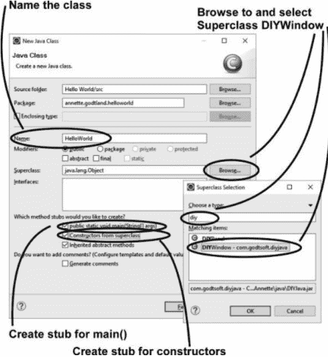

- 5. 单击“完成”创建该类。

Eclipse 将为 HelloWorld 类创建类似以下代码清单的代码。

如果你将电子阅读器的字体调小以减少换行，可能会发现阅读本书中的代码清单更容易。

代码清单 1-1，来自 HelloWorld.java

```
package annette.godtland.helloworld;

import com.godtsoft.diyjava.DIYWindow;

public class HelloWorld extends DIYWindow {
    public HelloWorld() {
        // TODO Auto-generated constructor stub
    }
    public static void main(String[] args) {
        // TODO Auto-generated method stub
    }
}
```

Eclipse 会添加你不需要的注释代码。注释是以 // 开头的行，或以 /* 开头并以 */ 结尾的多行内容。

- 1. 从该类中删除自动生成的注释行，即下列代码清单中显示 (Code was removed from here.) 的位置。

代码清单 1-2，来自 HelloWorld.java

```
package annette.godtland.helloworld;

import com.godtsoft.diyjava.DIYWindow;

public class HelloWorld extends DIYWindow {
    public HelloWorld() {

        (Code was removed from here.)
    }
    public static void main(String[] args) {

        (Code was removed from here.)
    }
}
```

对于你为本书创建的每个类，都要从程序代码中删除自动生成的注释。你将在后续课程中添加自己的注释。

单击任意“完整代码清单”链接，即可查看如何完成代码。不过，如果你在查看答案之前先尝试自己完成代码，会学到更多。

以 public static void main 开头的代码块称为 main() 方法。以 public HelloWorld() 开头的代码块称为构造函数。

现在，添加你的第一行代码：

- 1. 完全按照此处所示，将代码添加到构造函数和 main() 方法中。在代码清单中，要对代码所做的更改始终以粗体显示。

代码清单 1-3，来自 HelloWorld.java

```java
package annette.godtland.helloworld;
import com.godtsoft.diyjava.DIYWindow;
public class HelloWorld extends DIYWindow {
  public HelloWorld() {
print("Hello World");
  }
  public static void main(String[] args) {
new HelloWorld();
  }
}
```

- 1. 按 Ctrl-S 保存程序。
- 2. 单击“运行”按钮，如下图所示，以运行程序：

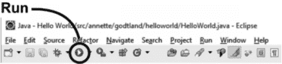

### 发生了什么？

应该会打开一个显示“Hello World”的窗口，如下图所示：

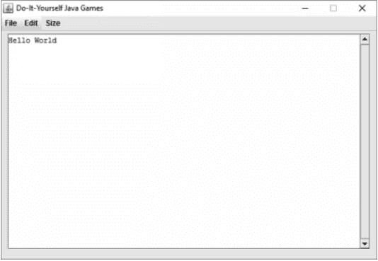

- 1. 你需要在类中更改什么，才能让它向你问好？

代码清单 1-4，来自 HelloWorld.java

…

```java
public HelloWorld() {
print("Hello
__________________
");
}
...
```

- 1. 保存程序并运行它。

### 如果出错会发生什么？

- 1. 将单词“print”输入错误并保存程序。

代码清单 1-5，来自 HelloWorld.java

```
...

public HelloWorld() {
    print
    ttt
    ("Hello Annette");
}
...
```

### 发生了什么？

会出现许多错误指示符，如下图所示：


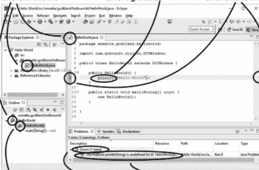

- 1. 双击 Eclipse“问题”窗格中的错误计数，查看找到的错误列表。
- 2. 双击“问题”窗格中的错误描述，将光标移到出错的那一行。
- 3. 将光标悬停在实际错误上（即上图中“Error right here”所在的位置）。Eclipse 会列出修复问题的方法，如下图所示。Eclipse 的这项功能称为“快速修复”。

### 快速修复

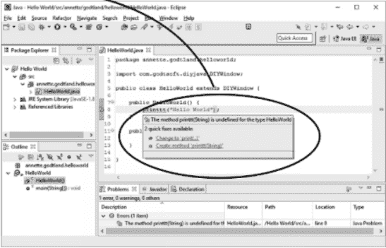

- 4. 点击名为“更改为“print(…)””的快速修复。

该操作将为您修复错误。

- 1. 保存更改。

所有错误指示符都应消失。

现在，继续打印：

- 1. 更改代码，让程序输出以下内容：

Hello, earthling.

Take me to your leader.

清单 1-6，来自 HelloWorld.java

```java
...
public HelloWorld() {
    print("________________________");
    print("______________________________");
}
…
```

在整个课程中，除非存在语法错误，否则请在每次更改代码后保存更改并运行程序。

它是否打印了正确的行？如果没有，请修复代码并重试。

- 1. 你认为要打印什么才能在两个句子之间插入一个空行，如下所示。（提示：你希望那一行不打印任何内容。）

Hello, earthling.

Take me to your leader.

清单 1-7，来自 HelloWorld.java

```java
…
public HelloWorld() {
    print("Hello, earthling.");

    print(_____);

    print("Take me to your leader.");
}
…
```

### 要点与更多

## 第7章：面向对象编程

你之前已经了解到，Java 是一种面向对象的编程语言。因此，它支持这种编程范式的基本原则。

对象指的是现实中的实体，如包、汽车、椅子或笔。面向对象的编程语言允许程序员设计使用对象和类的程序。它们提供并支持能够简化软件开发和维护的特性。这种编程范式最重要的概念如下：

- 对象
- 类
- 方法
- 实例
- 继承
- 抽象
- 多态
- 消息传递
- 封装

### 对象

在现实世界中，你会遇到人类、狗、汽车、猫等对象。这些对象拥有状态和行为。例如，当你想到一只猫时，它的状态可以包括品种、颜色或名字。它的行为可能包括奔跑、跳跃或摇尾巴。

软件对象在这些特征方面类似于现实世界中的对象。它的状态保存在字段中，其行为通过方法呈现。

在开发中，方法作用于对象的内部状态，并且方法促进了对象之间的通信。

### 类

类用于为对象设置定义。这些规范充当创建对象的蓝图。虽然在创建类时并不会立即应用这些定义，但一旦实例化该类的对象，这些定义就可用。一个对象或类在程序中可以有多个副本或实例。

下面是一个名为 Cat 的类的定义示例：

```java
public class Cat {
    String breed;
    int age;
    String color;

    void running() {
    }

    void sleeping() {
    }

    void jumping() {
    }
}
```

一个类可以有以下类型的变量：

#### 类变量

类变量是使用 static 修饰符在类内部、任何方法外部声明的变量。

#### 局部变量

局部变量是在方法、块或构造函数中定义的变量。这些变量在方法内部声明并实例化，一旦方法执行完毕就会被销毁。

#### 实例变量

实例变量是在类内部但在方法外部的变量。它们在类初始化时同时初始化。可以从该特定类的方法、块或构造函数中访问它们。

一个类可以包含尽可能多的方法来获取所需的值。例如，Cat 类有三个方法：running()、sleeping() 和 jumping()。

### 构造函数

构造函数是用于初始化对象的方法。一个类必须至少包含一个构造函数。

以下是构造函数的重要规则：

- 构造函数的名称应与类的名称一致。
- 它不应有显式的返回类型。

#### 构造函数的类型

- 默认构造函数或无参构造函数
- 带参构造函数

#### 默认构造函数

没有参数的构造函数被称为默认构造函数。

语法如下：

```java
ClassName() {}
```

#### 带参构造函数

带参构造函数是带有参数的构造函数。它用于为特定对象提供值。

下面的示例展示了这两种构造函数。第一个是默认构造函数，它没有任何参数。第二个构造函数有一个参数，即 name。

```java
public class Kitten {
    public Kitten() {
    }

    public Kitten(String name) {
        // This constructor has one parameter, name.
    }
}
```

### 创建对象

类为对象提供了模板。对象基本上是由类创建的。要创建新对象，你将使用“new”关键字。

从类创建新对象需要执行以下步骤：

- 声明——这指的是变量声明，你需要在其中写出变量名及其对象类型。
- 实例化——要创建新对象，你将使用“new”关键字。
- 初始化——在“new”关键字之后调用构造函数，并初始化一个新对象。

下面的示例展示了从类创建新对象的不同步骤：

```java
public class Kitten {
    public Kitten(String name) {
        // This constructor contains a parameter, the name name.
        System.out.println("Passed Name is: " + name);
    }

    public static void main(String[] args) {
        // Following statement would create an object my Puppy
        Puppy myKitten = new Kitten("spotty");
    }
}
```

输出如下：

Passed Name is: spotty

### 如何访问方法和实例变量

创建的对象用于访问方法和实例变量。要访问实例变量，你将使用以下步骤：

- 首先，你必须创建一个对象：
  `ObjectName = new Constructor();`
- 接下来，像这样调用一个变量：
  `ObjectName.variableName;`
- 要调用一个类方法：
  `ObjectName.MethodName();`

### Java 包

包只是一种将接口和类分组的方式。Java 包充当类的容器。分组通常基于功能。包的使用促进了代码的重用。当接口和类被归类到包中时，你可以轻松地在其他程序中使用它们。包的使用还有助于防止类和接口之间的命名冲突。

要创建包，请将 package 语句作为第一条语句放在包名之前。

示例如下：

```java
package mypack;
public class students
{
...statement
}
```

### Import 语句

你可以使用 import 关键字将包导入到源文件中。import 语句使编译器更容易找到类或源代码的位置。

你可能只想从包中导入一个类。你可以使用点运算符来指定包和类。例如：

```java
import java.util.Date;
class MyDate extends Date
{
//statement
}
```

要从一个包中导入所有类，你可以在点运算符后使用通配符 *。例如：

想要允许子类使用变量或辅助方法，并防止不相关的类使用它们。接口以及接口下的字段和方法不应声明为 protected，但接口外的字段和方法可以声明为 protected。类不应声明为 protected。

默认：当没有提供修饰符时适用——对包内可访问

没有修饰符声明的方法或变量可被包内的其他类访问。

下面的表格总结了不同的访问修饰符及其效果：

| 修饰符 | 类内部 | 包内部 | 包外子类 | 包外部 |
|---|---|---|---|---|
| Private | Y | N | N | N |
| Public | Y | Y | Y | Y |
| Protected | Y | Y | Y | N |
| Default | Y | Y | N | N |

### 非访问修饰符

非访问修饰符可用于访问 Java 中的各种功能。

#### Final——用于最终确定变量、方法和类的实现

#### Final 变量

你只能显式地初始化 final 变量一次。当你将一个变量声明为 final 时，你将永远无法将其重新赋值给另一个对象。但请注意，你仍然可以更改对象内部存储的数据。这意味着虽然你可以更改


对象的状态，你将无法更改引用。final 修饰符通常与 static 搭配使用，以从常量值创建类变量。

#### final 方法

final 关键字用于防止方法被子类更改。

#### final 类

final 修饰符用于防止其他类继承声明为 final 类的任何特性。

#### Static——用于创建类方法或变量。

你可以使用此关键字创建一个唯一的变量（称为静态变量或类变量），它将独立于类的其他实例存在。你不能将局部变量声明为 static。

你也可以使用 static 关键字创建一个方法（称为静态方法或类方法），它将独立于类的其他实例存在。静态方法仅识别并处理来自所给参数的数据，而不考虑变量。

你可以通过在类名后加点（.）再写变量名或方法名来访问类方法和类变量。

#### Abstract——用于创建抽象方法或类

#### 抽象类

当类被声明为 abstract 时，意味着你将永远无法实例化该类。将类声明为 abstract 的唯一原因是扩展该类。你不能将类同时声明为 final 和 abstract，因为你不可能扩展 final 类。使用抽象方法的类必须声明为 abstract。否则将导致编译错误。

#### 抽象方法

由于抽象方法声明时没有实现，它的方法体来自子类。抽象方法不能声明为 static 或 final。除非扩展抽象类的类本身也是抽象类，否则它必须采用超类的抽象方法。至少包含一个抽象方法的类应声明为抽象类。另一方面，抽象类不必包含抽象方法。

示例：

```java
abstract class Car {
    private double price;
    private String type;
    private String year;
    public abstract void goFast();  // abstract method
    public abstract void changeColor();
}
```

#### Synchronized

synchronized 修饰符用于指示在任意给定时间只有一个线程可以访问某个方法。你可以将此关键字与任何访问级别修饰符一起使用。

示例：

```java
public synchronized void showInfo() {
    ......
}
```

#### Volatile

此关键字用于指示访问 volatile 变量的线程应将其私有副本与内存中存储的主副本合并。实际上，它将该变量的所有缓存副本与主内存同步。你只能使用此修饰符定义基本类型或对象类型的实例变量。

示例：

```java
public class MyRunnable implements Runnable {
    private volatile boolean active;

    public void run() {
        active = true;
        while (active) { // line 1
            // code here
        }
    }

    public void stop() {
        active = false; // line 2
    }
}
```

#### Transient

关键字 transient 用于告诉编译器，在序列化包含被标记变量的对象时跳过该实例变量。

示例：

```java
public transient int limit = 50; // will not persist
```

## 第 8 章：决策与循环控制

决策结构用于以下情况：如果条件为真，则必须执行一组指令；当条件被确定为假时，则必须执行另一组指令。Java 中提供了若干构造可用于对此类场景进行编程。这些结构包括——

### if 语句

此语句用于需要测试条件的情况；如果条件为真，则需要执行此语句后面的代码块。此构造的语法为——

```java
if (condition) {
    /*Body*/
}
```

此构造的示例实现如下——

```java
public class ifDemo {
    public static void main(String args[]) {
        int i = 10;
        int j = 1;
        if (i > j) {
            System.out.print(i);
        }
    }
}
```

### if else 语句

此语句用于需要测试条件的情况；如果条件为真，则需要执行此语句后面的代码块，否则执行 else 语句后面的代码块。此构造的语法为——

```java
if (condition) {
    /*Body*/
} else {
    /*Body*/
}
```

此构造的示例实现如下——

```java
public class ifElseDemo {
    public static void main(String args[]) {
        int i = 1;
        int j = 0;
        if (i > j) {
            System.out.print(i);
        } else {
            System.out.print(j);
        }
    }
}
```

### 嵌套 if 语句

此语句用于需要测试条件的情况；如果条件为真，则需要执行此语句后面的代码块，否则测试下一个条件。如果该条件为真，则执行与此条件的 if 语句对应的代码块。如果所有条件都不为真，则执行 else 语句后面的代码块。使用嵌套 if 语句可以测试多个条件。此构造的语法为——

```java
if (condition1) {
    /*Body*/
} else if (condition2) {
    /*Body*/
} else {
    /*Body*/
}
```

此构造的示例实现如下——

```java
public class nestedIfDemo {
    public static void main(String args[]) {
        int i = 0;
        int j = 0;
        if (i > j) {
            System.out.print(i);
        } else if (j > i) {
            System.out.print(j);
        } else {
            System.out.print("Equal");
        }
    }
}
```

### switch

如果你有一个变量，并且需要针对该变量的不同值执行不同的代码块，那么可以使用的理想构造是 switch 语句。此构造的语法为——

```java
switch (variable) {
    case <value1>:
        /*body*/
        break;
    case <value2>:
        /*body*/
        break;
    case <value3>:
        /*body*/
        break;
    default:
        /*body*/
        break;
}
```

此构造的示例实现如下——

```java
public class switchDemo {
    public static void main(String args[]) {
        int i = 5;
        switch (i) {
            case 0:
                System.out.print(0);
                break;
            case 2:
                System.out.print(2);
                break;
            case 5:
                System.out.print(5);
                break;
            default:
                System.out.print(999);
                break;
        }
    }
}
```

### 条件运算符

Java 还支持条件运算符，也称为 ?: 运算符。此运算符用于替代“if else”构造。其语法如下——

Expression1 ? Expression2 : Expression3

这里，Expression1 是要测试的条件。如果条件为真，则执行 Expression2，否则执行 Expression3。

### 循环控制

有多种情况要求你将同一组指令重复执行多次。例如，如果你需要对一组数字排序，你将需要多次扫描并重新排列该集合，以获得所需的排列。这种执行流程称为循环控制。

简而言之，循环是一种允许代码块执行多次的构造。Java 支持多种可用于实现循环的构造。这些包括 while 循环、for 循环和 do while 循环。

只要为 while 循环指定的条件为真，while 循环就会迭代执行代码块。一旦此条件失败，while 循环就会停止。

for 循环允许程序员在同一构造中操作条件和循环变量。因此，你可以初始化循环变量、递增/递减它，并在此变量上的条件为真时运行循环。

do while 循环与 while 循环类似。然而，在 while 循环中，条件在执行代码块之前检查。另一方面，在 do while 循环中，先执行代码块，然后检查条件。如果条件满足，则再次启动循环执行，否则终止循环。可以毫不错误地说，do while 循环一旦实现，将至少执行一次。

### 循环语句

有两个关键字专门与循环相关，并且也称为控制语句，因为它们允许将控制权从代码的一个部分转移到另一个部分。这些关键字是——

- **Break**：此关键字用于循环内部，在你希望执行流程终止循环并直接从循环之后出现的第一条指令开始执行的位置。
- **Continue**：此关键字用于循环内部，在程序员希望计算机忽略循环剩余部分并将控制权转移到循环的第一条语句的位置。

为了帮助你理解循环如何执行，让我们以一个示例为例，并使用所有三种循环控制类型来实现它。

### for 循环实现

```java
public class forDemo {
    public static void main(String args[]) {
        int[] numberArray = {100, 300, 500, 700, 900};


```java
for(int i=0; i<5; i++) {
    System.out.print(numberArray[i]);
    System.out.print(", ");
}
System.out.print("\n");
}
}
```

### While 循环实现

```java
public class whileDemo {
    public static void main(String args[]) {
        int [] numberArray = {100, 300, 500, 700, 900};
        int i = 0;
        while(i<5) {
            System.out.print(numberArray[i]);
            System.out.print(", ");
            i++;
        }
        System.out.print("\n");
    }
}
```

### Do While 循环实现

```java
public class doWhileDemo {
    public static void main(String args[]) {
        int [] numberArray = {100, 300, 500, 700, 900};
        int i = 0;
        do {
            System.out.print(numberArray[i]);
            System.out.print(",");
            i++;
        } while (i<5);
        System.out.print("\n");
    }
}
```

### 增强型 For 循环

Java 还支持一种增强型循环结构，可用于数组元素。此循环结构的语法如下——

```java
for(declaration : expression) {
/*Body*/
}
```

增强型 for 循环的声明部分用于声明一个变量。该变量应当是“for 循环”的局部变量，并且其类型必须与数组元素的类型相同。该变量的当前值始终等于循环中正在遍历的数组元素。表达式是一个数组或返回数组的方法调用。

增强型 for 循环的示例实现如下 -

```java
public class forArrayDemo {
    public static void main(String args[]) {
        int [] numberArray = {100, 300, 500, 700, 900};
        for(int i : numberArray ) {
            System.out.print( i );
            System.out.print(",");
        }
        System.out.print("\n");
    }
}
```

### 异常层次结构

Java 有一个名为 java.lang.Exception 的内置类，所有异常都属于这个类。所有异常类都是此类的子类。此外，Throwable 类是异常类的超类。Throwable 类的另一个子类是 Error 类。上述的栈溢出等所有错误都属于这个 Error 类。

Exception 类有两个子类，即 RuntimeException 类和 IOException 类。下面列出了作为 Throwable 类的一部分、在 Java 中提供定义的方法。

```java
public String getMessage()
```

调用时，此方法返回已遇到异常的详细描述。

```java
public Throwable getCause()
```

调用此方法时，它返回一条包含异常原因的消息。

```java
public String toString()
```

此方法返回异常的详细描述，并与类名拼接在一起。

```java
public void printStackTrace()
```

调用此方法可以将 toString() 的结果连同堆栈跟踪打印到标准错误流 System.err。

```java
public StackTraceElement [] getStackTrace()
```

在某些场景下，你可能需要访问堆栈跟踪的不同元素。此方法返回一个数组，堆栈跟踪的每个元素分别保存到数组的不同元素中。数组的第一个元素包含堆栈跟踪的顶部元素，而堆栈跟踪的底部保存在数组的最后一个元素中。

```java
public Throwable fillInStackTrace()
```

将堆栈跟踪中的先前信息与堆栈跟踪的当前内容追加在一起，并以数组形式返回。

### 捕获异常

捕获异常的标准方法是使用“try 和 catch”关键字及其代码实现。try 和 catch 块应当以包含预期会引发异常的代码的方式实现。这里还需要说明的是，预期会引发异常的代码被称为受保护代码。try 和 catch 块实现的语法如下——

```java
try {
    /*Protected code*/
} catch(ExceptionName exc1) {
    /*Catch code*/
}
```

预期会引发异常的代码放在 try 块内。如果引发异常，则在 catch 块中实现为处理异常而执行的相应操作。每个 try 块都必须有 catch 块或 finally 块。

作为 catch 语句的一部分，需要声明预期会引发的异常。如果发生异常，执行将转移到 catch 块。如果引发的异常与 catch 块中定义的异常匹配，则执行该 catch 块。

try 和 catch 块的示例实现如下。该代码实现了一个包含 2 个元素的数组。但是，代码试图访问不存在的第三个元素。结果引发异常。

```java
import java.io.*;

public class demoException {
    public static void main(String args[]) {
        try {
            int arr[] = new int[2];
            System.out.println("Accessing the 3rd element of the array:" + arr[3]);
        } catch(ArrayIndexOutOfBoundsException exp) {
            System.out.println("Catching Exception:" + exp);
        }
        System.out.println("Reached outside catch block");
    }
}
```

### 实现多个 Catch 块

一个代码块可能导致多个异常。为了满足此需求，也允许实现多个 catch 块。此类实现的语法如下。

```java
try {
    /*Protected Code*/
} catch(ExpType1 exp1) {
    /*Catch block 1*/
} catch(ExpType2 exp2) {
    /*Catch block 2*/
} catch(ExpType3 exp3) {
    /*Catch block 3*/
}
```

上述语法展示了三个 catch 块的实现。但是，你可以实现任意数量的 catch 块。当执行此代码时，会执行受保护代码。如果发生异常，则将异常类型与第一个 catch 块的异常进行匹配。但是，如果异常类型不匹配，则忽略 catch 块 1，并尝试匹配第二个 catch 块的异常类型。哪个 catch 块与所引发异常的类型相同，就执行相应的 catch 块。

## 第 9 章：ADT、数据结构和 Java 集合

### 抽象数据类型（ADT）

抽象数据类型（ADT）是对数据以及允许对其执行的操作的逻辑描述。ADT 被定义为从用户视角对数据的描述。ADT 关注数据的可能取值及其对外暴露的接口。ADT 不关注数据结构的实际实现。

例如，用户想要存储一些整数并求其平均值。此数据结构的 ADT 将支持两个函数：一个用于添加整数，另一个用于获取平均值。此数据结构的 ADT 不讨论它究竟将如何实现。

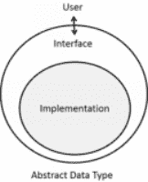

### 数据结构

数据结构是数据的具体表示，并被定义为从程序员视角对数据的描述。数据结构表示数据将如何存储在内存中。所有数据结构都有各自的优缺点。根据问题的类型，我们选择最适合该问题的数据结构。例如，我们可以将数据存储在数组、链表、栈、队列、树等中。

注意：在本章中，我们将学习各种数据结构及其 API。以便用户无需了解其内部实现即可使用它们。

### Java 集合框架

Java 编程语言提供了 Java 集合框架，它是一组高质量、高性能且可复用的数据结构和算法。

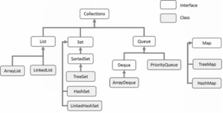

使用 Java 集合框架具有以下优点：

- 1. 程序员不必重复实现基本数据结构和算法。从而避免重复造轮子。因此，程序员可以将更多精力投入到业务逻辑中。
- 2. Java 集合框架代码是经过充分测试的高质量、高性能代码。使用它们可以提高程序质量。
- 3. 由于集合框架中实现的基本数据结构和算法可被复用，因此降低了开发成本。
- 4. 由于大多数 Java 开发者使用集合框架，因此易于审查和理解其他开发者编写的程序。此外，集合框架文档完善。


### 数组

数组表示同一数据类型多个元素的集合。

#### 数组 ADT 操作

以下是数组的API：

- 在第 k 个位置添加一个元素。可以在 O(1) 常量时间内将值存储到数组的第 k 个位置。我们只需将值存储到 `arr[k]` 即可。
- 读取存储在第 k 个位置的值。访问数组中某个索引处的值同样是 O(1) 常量时间。我们只需读取 `arr[k]` 中存储的值即可。
- 将存储在第 k 个位置的值替换为新值。时间复杂度：O(1) 常量时间。

示例：

```java
public class ArrayDemo {

    public static void main(String[] args) {

        int[] arr = new int[10];

        for (int i = 0; i < 10; i++)

        {

            arr[i] = i;

        }

    }

}
```

JAVA 标准数组是固定长度的。有时我们不知道需要多少内存，所以会创建一个更大的数组，从而浪费空间。如果数组已满并且我们想向其中添加更多值，那么我们需要创建一个具有足够空间的新数组，然后将旧数组复制到新数组中。为了避免这种手动重新分配和复制，我们可以使用 JAVA 集合框架中的 ArrayList 或链表来存储数据。

#### Java Collections 中的 ArrayList 实现

JAVA Collections 中的 `ArrayList<E>` 是一种实现 `List<E>` 接口的数据结构，这意味着它可以包含重复元素。ArrayList 实现为一个动态数组，可以根据需要增长或收缩。（内部使用数组；当数组满时，会分配一个更大的数组，并将旧数组的值复制到其中。）

示例：

```java
import java.util.ArrayList;

public class ArrayListDemo {

    public static void main(String[] args) {
        ArrayList<Integer> al = new ArrayList<Integer>();

        al.add(1); // add 1 to the end of the list
        al.add(2); // add 2 to the end of the list
        System.out.println("Contents of Array: " + al);
        System.out.println("Array Size: " + al.size());
        System.out.println("Array IsEmpty: " + al.isEmpty());

        al.remove(al.size() - 1); // last element of array is removed.

        al.removeAll(al); // all the elements of array are removed.
        System.out.println("Array IsEmpty: " + al.isEmpty());
    }
}
```

输出：

```text
Contents of Array: [1, 2]
Array Size: 2
Array IsEmpty: false
Array IsEmpty: true
```

### 链表

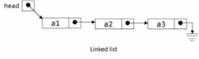

链表是一种动态数据结构，内存是在运行时分配的。链表的概念不是连续存储数据。链表的节点包含一个链接，指向列表中的下一个元素。

在性能方面，链表比数组慢，因为无法直接访问链表元素。当我们事先不知道要存储的元素数量时，链表是一种有用的数据结构。链表有很多类型：线性链表、循环链表、双向链表、双向循环链表等。

#### 链表 ADT 操作

以下是链表的API。

- **插入(k)：** 将 k 添加到列表的开头。在列表的开头插入一个元素。只需创建一个新元素并移动指针，使这个新元素成为列表的第一个元素。此操作需要 O(1) 常量时间。
- **删除()：** 删除列表开头的元素。删除列表开头的元素。我们只需移动一个指针。此操作同样需要 O(1) 常量时间。
- **打印列表()：** 显示列表的所有元素。从第一个元素开始，然后沿指针移动。此操作需要 O(N) 时间。
- **查找(k)：** 查找值为 k 的元素的位置。从第一个元素开始，沿指针移动，直到找到我们要查找的值或到达列表末尾。此操作需要 O(N) 时间。

注意：二分查找不适用于链表。

- **查找第k个(k)：** 查找位置 k 处的元素。从第一个元素开始，沿链接移动，直到到达第 k 个元素。此操作需要 O(N) 时间。
- **是否为空()：** 检查列表中的元素数量是否为零。只需检查列表的头指针；如果为空，则列表为空；否则不为空。此操作需要 O(1) 时间。

#### Java Collections 中的 LinkedList 实现

JAVA Collections 中的 `LinkedList<E>` 也是一种实现 `List<E>` 接口的数据结构。

示例：

```java
import java.util.LinkedList;

public class LinkedListDemo {

    public static void main(String[] args) {

        LinkedList<Integer> ll = new LinkedList<Integer>();

        ll.addFirst(2); // 2 is added to the list

        ll.addLast(10); // 10 is added to last of the list.

        ll.addFirst(1); // 1 is added to first of the list.
        ll.addLast(11); // 11 is added to last of the list
        System.out.println("Contents of Linked List: " + ll);
        ll.removeFirst();
        ll.removeLast();
        System.out.println("Contents of Linked List: " + ll);
    }
}
```

输出：

```text
Contents of Linked List: [1, 2, 10, 11]
Contents of Linked List: [2, 10]
```

### 栈

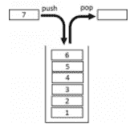

栈是一种特殊的数据结构，遵循后进先出（LIFO）策略。这意味着最后添加的元素将最先被移除。

栈的各种应用如下：

- 递归：递归调用使用系统栈实现。
- 表达式的后缀求值。
- 使用栈实现回溯。
- 树和图的深度优先搜索。
- 将十进制数转换为二进制数等。

#### 栈 ADT 操作

- **压栈(k)：** 将值 k 添加到栈顶。
- **出栈()：** 从栈顶移除元素并返回其值。
- **栈顶()：** 返回栈顶元素的值。
- **大小()：** 返回栈中元素的数量。
- **是否为空()：** 判断栈是否为空。如果栈为空，则返回 true；否则返回 false。

注意：上述所有栈操作的时间复杂度均为 O(1)。

#### Java Collection 中的栈实现

栈通过调用 `Stack<T>` 类的 push 和 pop 方法来实现。

示例：

```java
public class StackDemo {

    public static void main(String[] args) {
        Stack<Integer> stack = new Stack<Integer>();
        int temp;
        stack.push(1);
        stack.push(2);
        stack.push(3);
        System.out.println("Stack : " + stack);
        System.out.println("Stack size : " + stack.size());
        System.out.println("Stack pop : " + stack.pop());
        System.out.println("Stack top : " + stack.peek());
        System.out.println("Stack isEmpty : " + stack.isEmpty());
    }
}
```

输出：

```text
Stack : [1, 2, 3]
Stack size : 3
Stack pop : 3
Stack top : 2
Stack isEmpty : false
```

栈也可以通过调用 `ArrayDeque<T>` 类的 push 和 pop 方法来实现。

JDK 同时提供了 `ArrayDeque<T>` 和 `Stack<T>`。我们可以使用这两个类。但 `ArrayDeque<T>` 有一些优点。

- 第一个原因是 `Stack<T>` 不是从 Collection 接口派生的。
- 其次，`Stack<T>` 派生自 `Vector<T>`，因此可以进行随机访问，这破坏了栈的抽象。
- 第三，与 `Stack<T>` 相比，ArrayDeque 更高效。

### 队列

队列是一种先进先出（FIFO）的数据结构。第一个添加到队列中的元素将最先被移除，依此类推。

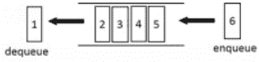

队列有以下应用场景：

- 访问共享资源（例如打印机）
- 多道程序设计
- 消息队列
- BFS，图或树的广度优先遍历使用队列实现。

#### 队列 ADT 操作

- **添加(K)：** 在队列末尾添加一个新元素 K。
- **移除()：** 从队列头部移除一个元素并返回其值。
- **队首()：** 返回队列头部元素的值。
- **大小()：** 返回队列中元素的数量。
- **是否为空()：** 如果队列为空则返回 1；否则返回 0。

注意：上述所有队列操作的时间复杂度均为 O(1)。

#### Java Collection 中的队列实现

`ArrayDeque<T>` 是双端队列的类实现。如果我们使用 `add()`、`remove()` 和 `peek()`，它的行为将类似于队列。（此外，如果我们使用 `push()`、`pop()` 和 `peekLast()`，它的行为则类似于栈。）

示例：

```java
import java.util.ArrayDeque;

public class QueueDemo {

    public static void main(String[] args) {
```


```java
ArrayDeque<Integer> que = new ArrayDeque<Integer>();

que.add(1);
que.add(2);
que.add(3);
System.out.println("Queue : "+que);
System.out.println("Queue size : "+que.size());
System.out.println("Queue peek : "+que.peek());
System.out.println("Queue remove : "+que.remove());
System.out.println("Queue isEmpty : "+que.isEmpty());
}
}
```

输出：
```text
Queue : [1, 2, 3]
Queue size : 3
Queue peek : 1
Queue remove : 1
Queue isEmpty : false
```

## 第 10 章：文件处理

本章讨论读取、写入、创建和打开文件的细节。有大量文件 I/O 类和方法可供选择。

### 读取文本文件

读取文本文件是 Java 中的一项关键能力，并且有许多实际应用。FileReader、BufferedReader 和 Scanner 是用于在 Java 中读取纯文本文件的有用类。它们各自具有特定的特性，使其特别适合处理某些情况。

### BufferedReader

此技术从字符输入流中读取文本。它会缓冲字符、数组和行，以便高效读取。你可以指定缓冲区类型，或使用标准类型。对于大多数用途而言，默认大小已经足够。特别是，每次对 Reader 发起读取请求，都会导致对底层字符流或字节流发起相应的读取请求。因此，对于任何 `read()` 操作可能开销很大的 Reader（例如 FileReader 和 InputStreamReader），建议在其外层包装一个 BufferedReader。

例如：

```java
BufferedReader in = new BufferedReader(Reader in, int size);
```

### FileReader

用于读取字符文件的便捷类。该类的构造函数假定默认字符编码和默认字节缓冲区大小是合适的。

### Scanner

一个简单的文本扫描器，使用正则表达式解析基本类型和字符串。Scanner 使用分隔符模式将其输入拆分为标记，默认情况下这些标记匹配空白。使用各种 next 方法，然后可以将生成的标记转换为不同类型的值。

```java
import java.io.File;
import java.util.Scanner;

public class ReadFromFileUsingScanner {
    public static void main(String[] args) throws Exception {
        // filepath is set as a parameter now so that it can be scanned
        File example = new File("C:\\Users\\userName\\Desktop\\example.txt");
        Scanner example1 = new Scanner(example);
        while (example1.hasNextLine())
            System.out.println(example1.nextLine());
    }
}
```

不使用循环来使用 Scanner 类：

```java
import java.io.File;
import java.io.FileNotFoundException;
import java.util.Scanner;

public class example {
    public static void main(String[] args)
            throws FileNotFoundException {
        File example = new File("C:\\Users\\userName\\Desktop\\example.txt");
        Scanner example1 = new Scanner(example);
        // we will use \\Z as a delimiter
        example1.useDelimiter("\\Z");
        System.out.println(example1.next());
    }
}
```

### 在 Java 中将文本文件读取为字符串

```java
package io;

import java.nio.file.*;

public class example {
    public static String example(String fileName) throws Exception {
        String example1 = "";
        example1 = new String(Files.readAllBytes(Paths.get(fileName)));
        return example1;
    }

    public static void main(String[] args) throws Exception {
        String example1 = example("C:\\Users\\userName\\Desktop\\example.java");
        System.out.println(example1);
    }
}
```

### 写入文本文件

你可以使用其中一个 write 方法将字节或行写入文件。write 方法包括：

- write(Path, byte[], OpenOption...)
- write(Path, Iterable<? extends CharSequence>, Charset, OpenOption...)

### 重命名和删除文件

### 重命名

在 Java 中，File 类中有一个名为 renameTo(fileName) 的方法，我们可以用它来重命名文件。

### 删除文件

使用 Java 程序保存的文件将被永久删除，而不会移到回收站。使用 java.io.File.delete 会从文件或文件夹中删除此抽象路径名。使用 java.nio.file.Files.deleteIfExists 会在文件存在时删除该文件。如果文件未打开，它还会删除路径中指定的文件。

## Java 高级主题

### 泛型

在任何非平凡的软件项目中，bug 就是生活中无法避免的事实。仔细的规划、编程和测试可能有助于减少 bug 的无处不在，但不知何故，它们总会找到某种方式进入你系统的某个地方。随着新功能的引入以及代码库规模和复杂度的增加，这一点变得尤为明显。

幸运的是，有些 bug 比其他 bug 更容易检测。例如，编译时 bug 可以很快被识别；你可以使用编译器的错误代码来确定问题是什么，并当场解决它。然而，运行时 bug 可能要困难得多；它们并不总是立即发生，而当它们发生时，可能出现在程序中与问题真正原因相距甚远的位置。泛型通过在编译时使识别更多 bug 成为可能，帮助稳定你的软件。

简而言之，泛型允许在定义类、接口和方法时为类型（类和对象）提供参数。就像方法声明中使用的更熟悉的形式参数一样，类型参数为你提供不同的输入，以复用相同的代码。区别在于，值是形式参数的输入，而类型是类型参数的输入。使用泛型的代码比非泛型代码具有许多优势。通过使用泛型，程序员可以引入可操作不同类型集合的泛型算法，这些算法可以定制，并且更安全、更易读。

### 泛型类型

泛型类型是一种类型参数化的泛型类或接口。可以通过修改一个简单的 Box 类来展示这一概念。考虑一个可处理任意类型对象的非泛型 Box 类。它只需要提供两个方法：set（向盒子中添加一项）和 get（取出该项）。因为这些方法接受或返回一个 Object，所以你可以自由传入任何想要的内容，只要它不是基本类型之一。无法在编译时检查该类是如何被使用的。软件的一部分可能将整数放入盒子并期望从中取出整数，而软件的另一部分可能错误地传入字符串，导致运行时错误。

类型参数部分由尖括号（< >）表示，跟在类名之后。它表示类型参数（也称为类型变量）T1、T2、...、Tn。通过将 `public class Box` 这一行改为 `public class Box<T>`，可以生成泛型类型声明，从而更新 Box 类以使用泛型。这会引入类型变量 T，它可以在类中的任何位置使用。这会将所有出现的 Object 替换为 T。你指定的任何非基本类型都可以作为类型参数：任何类类型、任何接口类型、任何数组类型，甚至另一个类型变量。也可以将同样的方法应用于泛型接口。按照约定，类型参数名称是单个大写字母。这与你已经了解的变量命名约定形成鲜明对比，而且原因很充分：如果没有这种约定，就很难区分类型变量与普通的类名或对象名。

最常用的类型参数名称有：

- E - 元素（Java 集合框架广泛使用）
- K - 键
- N - 数字
- T - 类型
- V - 值
- S、U、V 等 — 第 2、第 3、第 4 种类型

你会在整个 JDK 和 API 中看到这些名称的使用。

### 调用和实例化泛型类型

要在程序中引用泛型 Box 类，你必须执行泛型类型调用，将 T 替换为具体值，例如 Integer：

```java
Box<Integer> integerBox;
```

你可能认为泛型类型调用类似于普通方法调用，但不是向方法传递参数，而是向 Box 类本身传递类型参数——在这里是 Integer。


许多设计者会交替使用“类型参数”和“类型实参”这两个词，但它们的定义并不相同。编码时，要生成参数化类型，需要提供类型实参。因此，Foo<T> 中的 T 是类型参数，而 Foo<String> 中的 String 是类型实参。本书在使用这些词时遵循这一惯例。

与任何其他变量声明一样，这条语句并不会创建 Box 类型的新对象。它只是声明 integerBox 将持有一个对“Integer Box”的引用，也就是它读作 Box<Integer> 的方式。泛型类型调用通常被称为参数化类型。

要实例化这个类，照常使用 new 关键字，但要把 <Integer> 放在类名和圆括号之间：

```java
Box<Integer> integerBox = new Box<Integer>();
```

### 菱形运算符

在最新版本的 Java 中，只要编译器能够确定或从上下文推断出类型实参，就可以用一组空的类型实参（<>）替换调用泛型类构造函数所需的类型实参。这对尖括号 <> 被称为“菱形”（宽泛地说）。例如，你可以使用以下声明来创建 Box<Integer> 的实例：

```java
Box<Integer> integerBox = new Box<>();
```

### 泛型方法

泛型方法是引入自己的类型参数的方法。这类似于泛型类型声明，但类型参数的作用域仅限于声明它的方法。除了泛型类构造函数之外，还允许使用静态和非静态泛型方法。

泛型方法的语法包括一个位于尖括号内的类型参数列表，它出现在方法的返回类型之前。对于静态泛型方法，类型参数部分必须出现在方法的返回类型之前。例如，Util 类包含一个比较两个 Pair 对象的泛型方法。

```java
Pair<Integer, String> ex1 = new Pair<>(49, "string1");
```

```java
Pair<Integer, String> ex2 = new Pair<>(64, "string2");
```

```java
boolean comparison = Util.<Integer, String>compare(ex1, ex2);
```

### 有界类型参数

有时你想限制参数化类型中可用作类型实参的类型。例如，一个对数字进行操作的方法可能只接受 Number 或其子类的实例。有界类型参数正是为此而设。

要声明有界类型参数，请列出类型参数的名称，后跟 extends 关键字，再跟上界；在此示例中上界是 Number。请注意，在此上下文中，extends 用于表示“继承”（如类中的 extends）或“实现”（如接口中的 implements）。

### 多重边界

类型参数可以有多个边界。具有多个边界的类型变量是边界中列出的所有类型的子类型。如果其中一个边界是类，则必须首先指定它。例如：

```java
class X { /* ... */ }
```

```java
interface Y { /* ... */ }
```

```java
interface Z { /* ... */ }
```

```java
class R<T extends X & Y & Z> { /* ... */ }
```

如果边界 X 不是首先指定的，就会出现编译时错误：

```java
class R<T extends Y & X & Z> { /* ... */ } // compile-time error
```

## 第11章：集合

### 集合的函数式化

当我们把代码外部化时，我们暴露了每一步。这是命令式编程的标志。然而，函数式编程反复出现的主题之一，是采取完全相反的做法：将代码内部化。将代码内部化，就是把细节隐藏在函数内部。但函数式编程进一步推进了这一理念，把日常编程中的微观模式转变成函数。例如，遍历数据——无论是使用迭代器、for 循环还是 while 循环——就是这些微观模式之一。函数式编程改变了我们思考它们的方式。

Java 的函数式化努力，如果不改造其集合库（即 Collection、Map、List 和 Set 接口），就不会完整。这是因为迭代通常是在集合上进行的，而集合正是 Java 程序的构成基础。这里是函数式化努力发生的自然场所。但是，进行任何重大更改，例如向 Collection 接口添加新方法，都会破坏 Java 8 之前编写的所有程序的向后兼容性。这不仅包括 JDK 自身扩展 Collection 接口的层次结构，还包括任何开源或闭源的第三方库以及内部类。Java 的设计者从未也永远不会采用这种策略。然而，变化是必要的；该库于 1998 年引入，在软件行业的时间尺度上已经很久远，并且已显老态。

引入默认方法的动机，是由现代化和函数式化集合库的需要所引导的。默认方法正是合适的良方，因为它们允许在层次结构的根部添加行为，而不会干扰依赖类。子类可以继承或重写该行为。与添加新的接口方法不同，子类可以自动接受新的默认方法，而无需重新编译。即时兼容性得以实现。默认方法本身已被证明很有用，但它们的出现归因于函数式化集合库的需要。

函数式编程中第二个反复出现的主题是并行化。简单地说，函数式编程为并行处理提供了一种更好的捕鼠器。因此，集合库得到了增强，以便在处理集合时受益于多核 CPU。集合库与 Streams 一起，处于将函数式风格的并行处理引入 Java 的中心舞台。

既然我们已经学习了 Java 的标准函数式接口，就可以开始把这些知识应用到集合上。让我们看看 Java 8 中的集合库变成了什么样。

### Collection 接口

我们先来看 Collection 接口中一个全新的默认方法，它可供列表和集合使用。这就是 forEach() 方法：

```java
// Defined in the Iterable interface and extended in Collection
default void forEach(Consumer<? super T> action)
```

该方法遍历整个集合，让 Consumer 决定对每个元素做什么。这是内部迭代的概念，也是声明式编程的一种体现。如何迭代的细节并未指定。这与外部迭代相反；在外部迭代中，如何迭代以及如何处理每个元素都在代码中指定。

我们将用好莱坞电影黄金时代的闹剧喜剧三人组——著名的《三个臭皮匠》中的 Larry、Moe 和 Curly——来展示这些函数式化集合方法的示例。首先，让我们打印一个集合的内容：

```java
Collection<String> stooges = Arrays.asList("Larry", "Moe", "Curly");
// Print the contents of the stooges collection
stooges.forEach(System.out::println);
```

forEach() 方法具有非常广泛的适用性。它是遍历集合的一种方便得多的方式，应该成为你的事实标准。然而，作为一种声明式结构，有些事情你无法做到。最值得注意的是，你不能像在 while 循环中那样改变局部变量的状态。算法必须从函数式角度重新思考。目前，只需知道 forEach() 非常适合不改变状态的迭代。

现在我们来看 Collection 中可用的另一个新方法：

```java
default boolean removeIf(Predicate<? super E> filter)
```

removeIf() 方法将迭代、测试和删除的整个过程内部化。它只需要被告知删除条件是什么。

使用现在熟悉的 predicate 函数式接口，我们可以轻松确定要使用哪种 lambda。

```java
// Remove all people not part of the Three Stooges comedy trio
List<String> theThreeStooges = new ArrayList<>(
    Arrays.asList("Larry", "Moe", "Curly", "Tom", "Dick", "Harry"));

// Create the predicate that determines who is a stooge
Predicate<String> isAStooge =
    s -> "Larry".equals(s) || "Moe".equals(s) || "Curly".equals(s);

// Negate the condition to remove non-stooges
theThreeStooges.removeIf(isAStooge.negate());
```

要替换 List 的所有内容，我们可以使用 replaceAll()：

```java
List<String> theThreeStooges = new ArrayList<>(
    Arrays.asList("Larry", "Moe", "Curly"));

// Create the lambda to feminize the names
UnaryOperator<String> feminize =
    s -> "Larry".equals(s) ? "Lara" : "Moe".equals(s) ? "Maude" : "Shirley";

// Replace all male names with their female counterparts
theThreeStooges.replaceAll(feminize);
```


replaceAll() 使用 UnaryOperator 作为其函数式接口，它是 Function 的子接口。

removeIf() 和 replaceAll() 都可用于所有子类，但有一个前提：底层类必须支持移除操作，否则将抛出异常。

这些示例展示了函数式编程的简洁性。大部分工作由函数完成，而 lambda 提供具体细节。

### Map 接口

在映射（map）中使用列表作为值时，最令人烦恼的事情之一，就是在添加、更新或移除元素之前，必须不断检查该映射中是否已存在对应列表。首先，你必须尝试取出该列表，如果找不到就创建它。例如，假设我们有一个方法，用于更新以 Map 实现的电影数据库。该映射的键是电影年份，值是该年份的电影列表。在 Java 8 之前，代码会像这样：

```java
private Map<Integer, List<String>> movieDatabase = new HashMap<>();

private void addMovie(Integer year, String title) {
    List<String> movies = movieDatabase.get(year);

    if (movies == null) {
        // Need to create the array list if it doesn't yet exist
        movies = new LinkedList<String>();
        movieDatabase.put(year, movies);
    }

    movies.add(title);
}
```

Java 8 通过以下默认方法提供了更好的替代方案：

```java
default V compute
    (K key,
     BiFunction<? super K, ? super V, ? extends V> remappingFunction)

default V computeIfPresent
    (K key,
     BiFunction<? super K, ? super V, ? extends V> remappingFunction)

default V computeIfAbsent
    (K key,
     Function<? super K, ? extends V> mappingFunction)

default V getOrDefault(Object key, V defaultValue);

default V putIfAbsent(K key, V value);

default V merge
    (K key, V value,
     BiFunction<? super V, ? super V, ? extends V> remappingFunction)
```

让我们从 compute 系列方法开始。每个变体都允许通过映射函数生成映射的值。对于 computeIfPresent() 和 computeIfAbsent()，映射是有条件发生的。因此，借助这些方法，我们可以重构前面的代码示例：

```java
private Map<Integer, List<String>> movieDatabase = new HashMap<>();

private void addMovie(Integer year, String title) {
    movieDatabase.computeIfAbsent(year, k -> new LinkedList<>());
    movieDatabase.compute(year,
        (k, v) -> {
            // K is the key of the map (the year)
            // V is the value containing the list strings (titles)
            v.add(title);
            return v;
        });
}
```

注意，列表的创建由 computeIfAbsent() 的 lambda 处理。当需要通过 compute() 方法将电影添加到列表时，add() 永远不会抛出 NullPointerException，因为可以保证列表已经创建。

在这种情况下，使用 computeIfAbsent() 方法有些大材小用，改用 putIfAbsent() 会更好：

```java
movieDatabase.putIfAbsent(year, new LinkedList<>());
```

这个方法不使用 lambda，并且期望传入一个值——而不是计算出一个值。尽管没有使用 lambda，它仍然是一种函数式风格的方法。这证明了这一点：你不一定非要使用 lambda 才能以函数式方式表达代码。

如果你仍然需要取出数据，可以使用更函数式的方式，即 getOrDefault() 方法：

```java
movieDatabase.getOrDefault(year, new LinkedList<>());
```

你也可以改用 merge() 方法作为替代方案。它便于检查列表是否存在。在下面的示例中，如果键（年份）在映射中不存在，它就把值（片名列表）放入映射。如果键已存在，则允许一个 BiFunction 决定如何处理这两个列表：

```java
private Map<Integer, List<String>> movieDatabase = new HashMap<>();

private void addMovies(Integer year, List<String> titles) {
    // Merge the contents of the current list at key=year with titles
    movieDatabase.merge(year, titles,
        (t1, t2) -> {
            // Append titles to current list - only gets called if
            // a value is stored at this key. Otherwise, titles is
            // stored.
            t1.addAll(t2);
            return t1;
        });
}
```

并且可以这样使用：

```java
List<String> titles = new ArrayList<>(
    Arrays.asList("Meet the Baron", "Net'n'Jelly Rhymes"));

movieDatabase.merge(1933, titles,
    // BiFunction to append t2 to t1
    (t1, t2) -> {t1.addAll(t2); return t1;});
```

BiFunction 也可以返回 null，这会告诉 merge 删除该键。

要点在于，我们移除了检查元素是否存在的额外开销代码，现在可以专注于真正重要的事情：定义如何创建列表，以及如何向列表中添加元素。

Map 接口还增加了其他函数式方法，例如 forEach()、replace() 和 replaceAll()，并采用相同的代码内化原则。完整列表请参阅附录。

### Spliterator

Collections 库在并发访问方面仍然受到同样的限制。一如既往，你必须选择与线程安全需求相对应的 Collections 库类。这是因为上面展示的新方法只是建立在相同底层数据结构之上的函数式抽象。这些方法并不特别适合函数式编程对并行处理的看法，因为它们仍然基于多个线程修改集合并同步访问底层数据的概念。不过，Java 8 提供了一个兼容的新抽象。它旨在并行迭代数据。这一思想由 Spliterator 接口体现。该接口的前提是划分数据，并将数据块分发给不同线程。Spliterator 可以从 Collection 接口获得，包括其子接口 List 和 Set。

Spliterator 接口的核心是以下三个方法：

```java
Spliterator<T> trySplit();

default void forEachRemaining(Consumer<? super T> action) {…}

boolean tryAdvance(Consumer<? super T> action);
```

trySplit() 方法将底层数据分成两部分。它用一半数据创建一个新的 Spliterator，并将另一半保留在原始实例中。每一部分都可以交给一个线程，线程再使用 forEachRemaining() 迭代已划分的数据。tryAdvance() 方法是一次处理一个元素的变体，它返回下一个元素，如果列表已耗尽则返回 null。

Spliterator 本身并不处理并行，而是提供实现并行的抽象。下面是这一概念的实际应用：

```java
public static boolean isMovieInList(String title, List<String> movieList)
    throws InterruptedException {
    // Obtain a Spliterator from the movie list
    Spliterator<String> s1 = movieList.spliterator();

    // Split the original list in half.
    // Now s1 and s2 each contains half the list.
    Spliterator<String> s2 = s1.trySplit();

    BooleanHolder booleanHolder = new BooleanHolder();
    if (s2 != null) {
        Consumer<String> finder =
            movie -> { if (movie.equals(title)) booleanHolder.isFound = true; };

        // Each thread searches the movie list in parallel
        Thread t1 = new Thread(() -> s1.forEachRemaining(finder));
        Thread t2 = new Thread(() -> s2.forEachRemaining(finder));

        t1.start();
        t2.start();
        t1.join();
        t2.join();
    }

    return booleanHolder.isFound;
}

private static class BooleanHolder {
    public boolean isFound = false;
}
```

给定一个片名和一个电影列表，isMovieInList() 方法会将搜索并行化，以判断该片名是否包含在列表中。如果找到，它会把 booleanHolder 中的标志设为 true。它从列表中获取一个 Spliterator 实例，将其分成两半，并把每一半交给一个线程。如果有更多线程可用，可以重复这一拆分过程。


拆分迭代器也可以从其他 Collection 类型以及 JDK 中的其他库获取。有许多实现被设计用于处理不同特性，包括有限/无限、有序/无序、已排序/未排序以及可变/不可变。它们继承其底层数据结构的特性。

拆分迭代器是一种较低层级的抽象，旨在让你对并行迭代进行更细粒度的控制。然而，该 API 缺少实现函数式友好算法所需的一些改进。在上面的示例中，我们需要将状态存储在 BooleanHolder 中以便搜索。

## 总结

至此，我们完成了对全新改进的 Java 8 Collections 库以及标准函数式接口的概述。正如标准 JDK 库中已有许多变更来支持函数式概念一样，请预期第三方 API 也会发生重大变化。但最大的变化尚未到来。

## 要点

- 新包 java.util.function 包含一组函数式接口。它们分为四个家族，每个家族由其原型表示：Consumer、Function、Predicate 和 Supplier。
- 每个函数式接口家族都定义了在类型和参数个数上特化的变体。
- 函数式接口还定义了支持函数式组合的方法。多个不同的 lambda 可以融合成看起来像一个的超级函数。
- Collections 库已被改造并函数式化。这是通过在层次结构顶层使用默认方法实现的，从而确保向后兼容性。
- Collections、Lists、Sets 和 Maps 中的新函数式方法在设计时考虑了内部迭代。以 lambda 和方法引用形式给出的行为参数被传递给对集合进行迭代并对每个元素执行操作的方法。
- 内部迭代是一种声明式编程形式，是函数式编程的基础。它使开发者不必描述“如何”去做，而是专注于“做什么”。
- 拆分迭代器是为对集合进行并行迭代而设计的。数据被分区，每个块被交给不同的线程进行并行处理。
- 一个数大于一个非质数。

## 结论

JDK 是 Java 开发工具包，是编译、生成文档和打包 Java 程序所必需的工具。与 JRE 一起，JDK 中内置了解释器或加载器、名为 javac 的编译器、归档工具（JAR）、Javadoc 文档生成器，以及成功进行 Java 开发所需的许多其他工具。

JRE 是 Java 运行时环境。它是可以执行 Java 字节码的环境，用于实现 Java 虚拟机。JRE 还为我们提供 JVM 在运行时所需的所有类库和许多其他支持文件。基本来说，它是一个软件包，为我们提供运行 Java 程序所需的一切，是 Java 虚拟机的物理实现。

JVM 代表 Java 虚拟机。JVM 是一台抽象机器，是一种规范，为我们提供执行字节码的 JRE。JVM 必须遵循这些记法——规范（Specification），即描述 JVM 如何实现的文档；实现（Implementation），即满足 JVM 规范要求的程序；以及运行时实例（Runtime Instance），即每当使用命令提示符编写 Java 命令并运行类时创建的 JVM 实例。

这三者密不可分，彼此依赖才能工作。

至此，我想感谢你选择我的 Java 编程指南。如你所见，它是一门简单却又复杂的语言，有许多不同方面需要学习。到现在，你应该已经很好地理解了 Java 编程的核心概念以及如何使用它。

你的下一步很简单，就是练习。并且持续练习。你不可能只读一遍本指南就以为自己全懂了。我建议你慢慢通读；认真跟随教程，在完全理解每一节及其含义之前，不要跳过任何一节。

为了帮助你，网上可以找到几个有用的 Java 论坛，里面满是准备好并愿意帮助你、为你指明正确方向的人。还有大量在线课程，有些免费，有些需要付费，但它们都很有用，可以帮助你把学习提升到新的水平。

你喜欢这本指南吗？我希望它满足了你的一切期望甚至更多，并让你走上了获得梦想工作的正确道路！

我希望你觉得我的计算机编程入门有帮助。这是一个非常基础的开始，但它应该让你对如何入门有了一些概念。它还应该向你表明，计算机编程其实并没有那么难，而且可能相当令人兴奋，尤其是当你开始看到结果出现在屏幕上，并看到你的计算机简而言之在做被要求做的事情时！

如果你发现这让你很好地了解了可以期待什么，那么你可能想继续学习你所选语言的高级编程。这里提醒一句：不要试图一次学习一种以上的语言；否则你会把自己搞糊涂。在这个阶段，我要给你的唯一另一条建议就是练习……并持续练习。你做得越多，学到的就越多，也就越想学。

感谢你下载我的书；如果你觉得它有帮助，请考虑在 Amazon.com 上给我留下评价。

# C++ 编程

一本循序渐进的初学者指南，学习多范式编程语言的基础知识并开始管理数据

包括如何着手你的第一个程序

ALAN GRID

## 引言

可能有很多不同的编程语言，而在我们能够一路使用的简单编程语言清单中，C++ 通常不在其列。我们可能会发现使用这类语言有很多好处，但与市面上其他一些语言相比，它通常被认为使用起来稍难一些。

正如我们将在本指南中探讨的那样，你会发现这实际上是一门非常适合使用的语言。它将为我们提供所需的一些最佳技巧和窍门，并向我们展示如何实际编写这门语言中需要的一些不同代码。如果你正在寻找一门强大、能帮助开发 Web 应用、游戏以及更多内容的编程语言，并且想今天就学会使用它，那么这本指南就是为你准备的。

在书中，我们将学习关于使用 C++ 语言编程所需了解的一切。我们会从使用这门语言的一些基础知识开始，例如这门语言究竟是什么、相比市面上其他一些语言使用它的好处，以及了解这门语言的一些历史。

一旦我们掌握了 C++ 语言的一些基础知识，你就可以继续了解我们需要探索的更多内容。我们将深入探讨这门语言的语法和基础知识。它与市面上其他一些编程语言略有不同，因此重要的是学会如何做到这一点，然后在此基础上编写我们的代码。我们还将探索一些流行且与 C++ 语言配合良好的不同库，这些库可以扩展我们在这门语言中能够看到的一些功能。

至此，我们已经掌握了 C++ 编程的一些基础知识，并且对这门语言整体有了更多了解。现在是时候真正深入了解如何编写我们想要的一些代码。我们可以专注于许多不同类型的代码，也可以在这门语言中处理许多不同的事情，我们将看看这些是什么、与它们配合的代码，以及更多内容。

我们将在本指南结尾探讨如何在这类语言中进行一些基本的调试。有时，尤其是作为这门语言的初学者，代码不一定会按你希望的方式工作，或者会出现需要修复的错误。这对初学者来说可能很困难，因为他们希望能够处理这些代码并让程序运行起来，但可能不确定如何修复所犯的一些错误。

## 什么是 C++？

许多初学者将 C++ 归类为一种复杂的编程语言。无论原因是什么，C++ 并不是一门复杂的语言，而是一门缺乏面向初学者的优质资源的计算机语言。之所以如此，是因为它是一种在过去四十年中从另一种主要编程语言（C 编程语言）演变而来的编程语言。

> "C++ 是一种从 C 编程语言衍生出来的编程语言，并加入了继承和多态等面向对象原则。C++ 是 C 的一门子集语言，后来演变成了比原本设想的要大得多的实例。"

## C++ 的历史

最初，C++ 只是作为 C 的分支语言使用，并且由于没有直接编译器，在编译前会被转换回 C。一个名为 Cfront 的编译器因完成这项工作而闻名。然而，几年后，使用 C++ 的人发现，在一门没有实际

编译器。于是，一些开发者开始着手开发编译器，最终由比雅尼·斯特劳斯特鲁普（Bjarne Stroustrup）完成了这项任务，打造出了一个可用的 C++ 编译器。

随着严格语法结构在短短几年内的实现，C++ 于 1998 年获得了 ISO（国际标准化组织）的认可。同年发布了首个更新版本，人们对于 C++ 开始提供的全新附加功能感到惊讶。它开始使用先进的调优技术来减少编译时间，并在第一个版本中引入了模板。所有这些强大的新特性帮助 C++ 开发出了支持系统编程的复杂软件。短短几年内，C++ 取得了巨大进步，并引入了许多可用于创建通用应用程序的高级特性。

C++ 作为一种编程语言的迅速崛起，很大程度上要感谢微软。微软开始在其开发软件 Visual C++ 中使用 C++。许多为微软系统开发应用程序的程序员开始发现 C++ 使用起来是多么可靠和舒适。到 2009 年，C++ 标准库已更新，加入了各种复杂的系统、数学和时间函数。

## 为什么 C++ 能取得成功？

C++ 的成功主要归功于其面向对象的特性。20 世纪 80 年代初，面向对象编程范式席卷了整个技术界。人们对其提供的适应性和简洁性印象深刻。当时许多内置的 C 库可以轻松地转换为 C++ 函数库。

所有这些因素共同作用，使 C++ 成为这十年来流行的高级编程语言之一。据估计，到 2025 年，15% 的机器人应用程序将使用 C++ 作为主要语言来开发其资源。

## 为不同操作系统搭建 C++ 环境

所有用于创建 C++ 软件的软件都包含一个代码编辑器和一个用于显示可能错误的内置调试器。如果你是那种老派的人，可以简单地使用文本编辑器，并通过命令行环境运行程序。这仍然完全可行。不过，在本节中，我们将讨论可用于创建 C++ 程序的高级集成开发环境软件。

### IDE 是如何工作的？

IDE 结合了编辑程序、编译器链机制和调试功能，从而创建高效的程序。

**注意：** 请记住，如果你试图在命令行执行程序上工作，C++ 不提供解释器。

C++ 以其强大的功能和简单的语法而闻名于程序员之间。即使受到 Java 和 Python 等高级编程语言的影响，C++ 也没有失去其魅力。本章全面介绍 C++ 编程语言及其历史，将帮助你详细了解这一流行编程语言的重要性和起源。在本书中，我们用通俗易懂的语言解释了各种复杂的编程主题。要理解并领会其中的大量信息，首先了解 C++ 作为一种编程语言的重要性至关重要。现在让我们来详细学习 C++。

### 新版本 C++ 有什么特别之处？

新版本的 C++ 旨在支持那些试图实现复杂实际项目的开发人员。以下是 C++ 提供的一些值得注意的高级特性。

- **高级数据结构实现**：简单的数据结构（如树和链表）可以通过基本的 C++ 版本轻松实现。然而，使用较旧版本无法实现图、二叉树等高级数据结构。另一方面，较新的 C++ 版本提供了标准库，帮助我们实现映射和哈希值，这些值可进一步用于实现高级数据结构。
- **加密特性**：较新的 C++ 版本提供了专用库，可用于在 Web 和移动应用程序中实现复杂的加密特性。这些库还可用于创建处理密码和隐写术的软件。
- **Lambda 实现**：Lambda 实现对于运行数据科学和机器学习应用程序至关重要。例如，当代深度伪造软件使用基于 Lambda 表达式构建的 C++ 渲染库。
- **高级面向对象特性**：我们都知道 C++ 是一种面向对象的语言。基本版本只支持单继承，而较新版本可以为你的项目提供多继承。使用较新版本，我们还可以使用多运算符重载和复杂的多态特性。

## 第 1 章：如何编写你的第一个程序

一旦你下载了你想要使用的 C++ 环境，我们将马上开始编写你的第一段代码。要实现这一点，你需要使用的代码如下：

```cpp
#include <iostream>

using namespace std;

int main ()
{
    cout << "Use This One!";
    return 0;
}
```

在编写这段代码时，你有几种选择。你可以选择在环境中的编译器里编写，也可以选择编写并保存到计算机上。第二种选择有时很不错，因为这样你保存了代码，任何时候需要用到这段代码时都可以复制粘贴。

无论如何，你都应该仔细考虑要使用的文本编辑器类型。大多数编辑器都是特定于设备的，因此你需要寻找一个与你特定计算机兼容的编辑器。你可以选择的选项包括 Windows 记事本、vim、vi、Brief 和 EMACS。如果你想要一个兼容多个平台的编辑器，那么 vim 和 vi 是最佳选择。

当你编写自己的代码时，应该先在文本编辑器中写出来，形成程序的草稿，然后再将它们移到编译器中。这样更容易检查你的工作，并避免当前代码中出现错误。

### C++ 编译器

与文本编辑器一样，你可以使用的编译器也有很多。问题在于，虽然你有很多选择，但其中许多编译器都相当昂贵。这是因为你遇到的大多数编译器都是为精英黑客准备的，他们已经掌握了其他低级编译器中的内容，现在他们想要确保自己能更上一层楼。

好消息是，有些编译器是可以免费获得的。你只需要小心谨慎，确保你得到的是好的编译器，并且具有你正在寻找的所有功能。一个非常适合 C++ 并且适合初学者使用的编译器是 GNU。它最适合在 Linux 系统上使用，而且你的系统上可能已经安装了它。要检查你的系统上是否有 GNU 编译器，请使用以下代码：

```bash
$ g++ -v
```

### 基本语法

C++ 语言可以定义为一个使用对象来帮助保持所有内容井井有条的程序，它将允许代码通过各种方法进行通信并完成其他功能。C++ 语言有四个重要的组成部分，包括：

- **类**：类是你语言的组织工具。它们可以被看作是可以容纳或存储对象并分类相似对象的盒子。你可以随意为类命名，但将具有某种相似特征的对象放入同一个类是良好的编码实践。
- **对象**：对象是代码中具有状态和行为的事物。这些可以是颜色、纹理、形状等。你通常会将对象归类到包含相似对象的类中。因此，如果你有一个关于狗的类，你可以把不同种类的狗放在同一个类中。
- **方法**：方法是编码中用于表示行为的术语。你可以根据需要拥有任意多或少的方法。这就是你操作数据的方式，动作将根据你所使用的方法来执行。如果不使用正确的方法，你的程序将不知道它到底应该做什么。
- **实例变量**：这些变量指的是你正在处理的各个对象。每个对象都使用一组独特的变量进行分类，这些变量就像指纹一样用于标识你的对象。你可以在创建对象时使用一些值来为对象分配正确的变量。

以上就是用 C++ 编写代码的基础知识。你应该花一些时间在编译器中写出上面的代码，进行一点练习，以理解你在这里应该做什么。我们稍后会介绍可以用这些代码做的一些事情，但这是一个很好的起点。

### C++ 数据类型

就像你可能想要使用的其他编程语言一样，C++ 代码中也会出现相当多的数据点。例如，你经常会使用变量，这些变量只是位置

你在计算机内存中预留的（空间），以便代码的不同部分保持安全。在使用 C++ 语言时，我们可以关注许多数据点，这些数据点包括：

- 1. 布尔型
- 2. 双精度浮点型
- 3. 浮点型
- 4. 整型
- 5. 字符型
- 6. 无值型
- 7. 宽字符型

### C++ 函数

我们还需要看看在使用 C++ 语言时会遇到的一些函数。函数很简单，就是一组为了执行某个任务而组成的语句。你想用 C++ 编写的每个程序都至少会有一个函数，这个函数可以称为 main() 函数，但你可能需要添加更多函数，才能让代码按照我们希望的方式工作。

你可以通过多种不同方式做到这一点。首先，我们可以选择根据希望代码如何工作，把代码划分到几个函数中。你如何决定划分代码以及使用多少个函数，取决于你自己以及你试图在代码中编写什么。但大多数程序员会以这样一种方式划分：让每个函数各自处理自己的任务。

函数声明会告诉编译器函数名、函数附带的参数以及我们将看到的返回类型。不过请记住，我们将看到的函数定义会出现在该函数的实际函数体中。

我们在 C++ 库中看到的标准库能够为我们提供许多已经内置到程序中的函数，我们也可以随时调用它们。例如，如果使用 `strcat()` 函数，它可以帮助我们连接两个字符串。然后我们可以使用 `memcpy()` 帮助把一个内存位置复制到另一个内存位置。这些只是你可以使用的不同类型函数中的几个，你会发现它们每个都会以类似的方式工作。

考虑到这一点，我们需要更进一步，实际看看如何在 C++ 中应用函数。你可以用来定义函数的代码将包括：

```text
Return type function name (parameter list) {

Body of the function

}
```

这些函数定义将由函数头和函数体组成。函数的组成部分将包括以下内容：

- 返回类型：你正在处理的函数可能返回一个值，你将使用返回类型的值来让这里返回某些内容。有些函数能够执行你想要的操作而不向你返回值。使用我们上面使用的语法，你最终会得到 void 的答案。
- 函数名：这是你给函数起的名称。当你把函数名和参数一起添加时，你会得到所谓的函数签名。
- 参数：参数是一个占位符。当你调用函数时，你会把一个值传递给参数。这个值将被称为实际参数或实参。然后参数列表能够表示函数参数的数量、顺序和类型。也可能处理一个完全没有参数的函数。
- 函数体：最后，函数体将包含一组语句，这些语句能够定义函数做什么。

很多时候，我们都能够使用函数来帮助我们完成代码的某些部分，并确保一切设置好并准备好处理。请务必练习这些函数，看看它们将如何满足我们的需求。

#### 修饰符类型

每当你在处理想要在 C++ 中完成的一些代码时，你会发现你可以使用 char、double 和 int，让出现在它们前面的修饰符存在。我们这里讨论的修饰符将用于帮助我们改变该基类型的含义，以便它适合我们试图创建的任何程序或情况。我们可以处理的数据修饰符会有不同类型。这些包括 signed、unsigned、long 和 short。

这四个修饰符将适用于我们拥有的任何整数基类型。例如，你可以使用 signed 和 unsigned 来处理 char，然后 long 可以用于 double。C++ 还会让我们更容易地使用简写表示法来处理这些整数。这意味着它们可以使用这些词，而不需要添加“int”部分，因为这在编码中总是隐含的。

C++ 代码中还有不同类型的限定符可以让事情正常工作。你可以使用以下类型的限定符来提供有关它们前面变量的一些附加信息，包括：

- Const：带有“const”的对象在程序执行期间无法被程序更改。
- Volatile：volatile 修饰符会告诉编译器，你可以更改该值，但这些更改可能不是由程序明确指定的。
- Restrict：由 restrict 限定的指针最初是访问它所指向对象的唯一方式。

## 第2章：基本设施

### 数组

数组是一种数据结构，它保存同一数据类型的元素的顺序集合。

例如，在下面的代码中，我声明了两个不同数据类型的数组：一个字符数组和一个整数数组。

```cpp
#include "stdafx.h"

#include <iostream>

int main(int argc, char* argv[])

{

        int i;

        int length;

        int sum = 0;

        char char_array[10] = { 'p', 's', 'y', 'c', 'h', 'o', 'l', 'o', 'g', 'y' };

    // total number of bytes allocated for that array

    //one char is one byte: the number of elements = number of bytes

        length = sizeof(char_array) ;

        std::cout << "Size of array of characters is " << length << std::endl;

        for (i = 0; i<length; i++)
std::cout << char_array[i];
std::cout << '\n';
std::cout << '\n';
std::cout << '\n';
int numbers[10] = { 1, 5, 9, 4, 2, 7, 6, 3, 8, 0 };
//the total number of bytes allocated for that array.
length = sizeof(numbers);
std::cout << "Size of numbers array=" << length << std::endl;
//the total number of bytes allocated for array/number of bytes allocated for one element
length = sizeof(numbers) / sizeof(numbers[0]);
std::cout << "Numbers of elements=" << length << std::endl;
for (i = 0; i<length; i++)
{
    sum = sum + numbers[i];
    std::cout << "Sum of numbers=" << sum << std::endl;
}
int *p = numbers;
std::cout << "Address of the first element is " << p << std::endl;
std::cout << "The value in the address is " << *p << std::endl;
p++; //move pointer to the next element
std::cout << "Address of the second element is " << p << std::endl;
std::cout << "The value in the address is " << *p << std::endl;

int hold = 1;

std::cin >> hold;

return 0;

}
```

`sizeof` 函数返回为该数组分配的字节数。由于 char 数据类型占用一个字节，因此 `sizeof` 函数返回的字节数等于字符数组的元素数。

整数数据类型在内存中占用 4 个字节，而一个包含 10 个整数的数组存储在 40 个字节中。因此，对于包含 10 个元素的整数数组，`sizeof` 数组函数返回 40 个字节。

要计算数组中存储了多少个元素，我们可以用为整个数组分配的字节数除以为一个数组元素分配的字节数；

```cpp
length=sizeof(numbers) / sizeof(numbers[0]);
```

```text
40 / 4 = 10
```

要访问单个元素的值，我们必须使用数组索引。C++ 中数组的索引从 0 开始。

第一个元素的索引是 0，第二个元素的索引是 1，依此类推。

要访问数组的所有元素，我们必须使用 for 循环。

```cpp
for(i=0; i<length; i++)

cout<<char_array[i];
```

如果我们声明一个指针并将数组赋给该指针，则该指针将保存数组第一个元素的地址：


`int *p = numbers;`

```cpp
cout << "Address of the first element is " << p << endl;
```

这行代码的输出是：

第一个元素的地址是 0059F710

要使用指针访问存储在数组第一个元素地址中的值，请运行以下代码行：

```cpp
cout << "The value in the address is " << *p << endl;
```

代码的输出是：

该地址中的值为 1。

要移动到数组的下一个元素，必须增大 p 的值。

```cpp
p++;
```

现在它将指向数组的第二个元素：

```cpp
cout << "Address of the second element is " << p << endl;
```

```cpp
cout << "The value in the address is " << *p << endl;
```

输出是：

我的电脑上 numbers 数组第二个元素的地址是 0059F714

第二个元素的地址中的值为 5。

例如，如果用户输入字符串‘Concatenation’，那么应用程序将输出

‘ConcatenationnoitanetacnoC’

以下头文件必须包含在 main.cpp 文件中：

```cpp
#include "stdafx.h"
#include <stdio.h>
#include <cctype>
#include <iostream>
#include <cstring>
```

字符串函数 `strcpy_s()`、`strcat_s()` 和 `strlen()` 需要 `<cstring>` 头文件。`toupper()` 函数需要 `<cctype>` 头文件。

我想解释一下我是如何按相反顺序将字符从原始字符串复制到临时字符串的。

首先，我使用 `strlen()` 函数获取原始字符串的长度。

```cpp
length = strlen(aWord);
```

然后在循环中，我将原始字符串的最后一个字符复制到临时字符串的第一个位置，依此类推。

让我们检查循环中的代码。

```cpp
for (i = 0; i < length; i++)
    temp[i] = aWord[length - (i + 1)];
```

如果用户输入单词‘Concatenation’，那么单词长度将是 13。字符串中第一个字符的索引是 0，那么字符串最后一个字符的索引将是 12。这意味着最后一个字符的索引是 length - 1。

我在循环中放置的一行代码是

```cpp
temp[i] = aWord[length - (i + 1)];
```

当 i = 0 时，temp[i] 将引用 temp 字符串的第一个字符。

同时（当 i = 0 时），`aWord[length - (i + 1)]` 将引用 `aWord[13 - (0 + 1)]` 字符，也就是 `aWord[12]`，即‘Concatenation’字符串的最后一个字符。

当 i = 1 时，temp[1] 将引用 temp 字符串的第二个字符，而 `aWord[13 - (1 + 1)]` 将引用‘Concatenation’字符串的倒数第二个字符。

通过这种方式，我们可以按相反顺序复制所有字符。

当我们将所有字符从原始字符串复制到 temp 字符串后，需要在 temp 字符串末尾添加空字符（null），因为 C++ 中的字符串必须以空字符结尾。

代码行 `temp[length] = '\0';` 可以完成这项工作。

完整代码包含在 [visual_studio_2017.zip](visual_studio_2017.zip) 中。

```cpp
#include "stdafx.h"
#include <stdio.h>
#include <cctype>
#include <cstring>
#include <iostream>

int main()
{
    char more = 'Y';

    char prompt1[] = "\nEnter a word not more than 20 characters and press enter.\n";

    char prompt3[] = "\nDo you want to continue? Y/N\n";

    char aWord[20];

    char aCopy[40];

    int length = 0;
    char temp[20];
    int i;

    while (toupper(more) == 'Y')
    {
        std::cout << prompt1;
        std::cin >> aWord;
        std::cout << "aWord=" << aWord << std::endl;
        strcpy_s(aCopy, aWord);
        std::cout << "aCopy=" << aCopy << std::endl;
        length = strlen(aWord);
        std::cout << "length=" << length << std::endl;

        // fill temp[] array with the word characters in opposite order.
        for (i = 0; i < length; i++)
            temp[i] = aWord[length - (i + 1)];
        temp[length] = '\0';
        std::cout << "Temp=" << temp << std::endl;
        strcat_s(aCopy, temp);
        std::cout << "aCopy after concatenation of temp=" << aCopy << std::endl;

        std::cout << prompt3;
        std::cin >> more;
    }

    return 0;
}
```

输出：

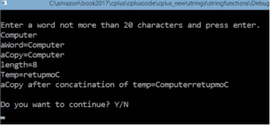

图 字符串操作。

### 列表

让我们想象一个谜题。你有一排盒子。每个盒子里都有一张写有一个字母的卡片。你必须找出字母的顺序，使这些字母组成一个单词。


图 一个链表

在上图中，你可以看到每个盒子都有一个数字。你可能会猜到这些数字是解开谜题的关键。第一个盒子里有一个字母 T，正面有数字 5。取出写有字母 T 的卡片并放在一边。数字 5 可能指向下一个字母。数一数盒子。第五个盒子里有字母‘E’。取出写有‘E’字母的卡片，放在 T 旁边。你会得到“TE”。写有字母‘E’的盒子侧面有数字 2。因此，从第 2 个盒子中取出卡片，放在“TE”旁边。你会得到“TEC”。

写有字母‘C’的盒子有数字 10，所以从第 10 个盒子中取出卡片。你会得到“TECH”。写有字母‘H’的盒子有数字 4，所以从第 4 个盒子中取出卡片。你得到了“TECHN”。继续按照数字操作，你就会得到完整的单词：TECHNOLOGY。

这就是链表的工作方式。它由节点组成。每个节点至少有一个保存数据（文本、数字或对象）的变量，以及一个保存下一个节点地址的变量（指针）。这个系统会像你在谜题中那样遍历节点列表。最后一个节点的指针具有空值，或者它可能指向第一个节点。这时我们就有了一个闭合链表。

#### 添加节点

如果要将新节点添加到链表末尾，必须创建一个新节点。然后将最后一个节点的指针指向新节点的地址，并将新节点的指针赋值为空。


图 在链表末尾添加节点。

如果要将新节点添加到链表开头，必须创建一个新节点。将新节点的指针指向第一个节点，就这样。


图 在链表头部添加节点。

如果需要在链表中间添加节点，必须创建一个新节点，然后断开链：将（断点之前的）节点重定向到新节点，并将新节点的指针指向下一个节点（断点之后的那个节点）。


图 在链表中间添加节点。

#### 删除节点

要删除具有某个键的节点，需要沿着链表遍历，直到找到该键。然后将该键节点赋值给临时节点。接着将键节点之前的节点指向键节点之后的节点。参见图 60。结果，临时键节点与链表隔离。现在你可以删除该临时节点。

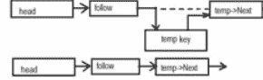

图 删除节点。

下面是 Node 类的代码。为简单起见，我创建了一个保存整数和指向下一个节点的节点指针的节点。两个类成员变量都声明为 private。不使用全局变量是良好的编程实践，因为私有成员无法从类外部看到。我们仍然需要设置和读取这些私有成员变量。公共函数 set 和 get 可以完成这项工作。

## 第3章：二叉树

二叉树是所有基本数据结构中最有用的一种，也是迄今为止最有趣的。它们是递归和指针如何用于完成一些非常有用事情的完美示例。

创建事物列表的最佳技术之一是链表，但在链表中查找元素可能需要一段时间。而且，如果你有大量非结构化数据，数组也不会有太大帮助。你可以尝试对数组排序，但即便如此，向其中插入项仍然很困难。如果你有一个希望保持有序的数组，插入新元素将需要进行大量搬移！而尽可能快地在列表中查找内容非常重要，尤其是在以下场景中：

- 你正在开发一款 MMORPG 游戏，玩家需要能够快速登录——这涉及快速查找玩家
- 你正在开发处理信用卡的软件，每小时需要处理数百万笔交易——信用卡余额需要被非常快速地查找
- 你正在使用低功耗设备（如平板电脑或智能手机），并向用户显示通讯录。你不会希望用户因为数据结构缓慢而一直等待。

本节将讨论克服这些问题及更多问题所需的工具。

解决方案的思路是能够将元素存储在类似链表的结构中，利用指针来帮助组织内存，但在


一种比链表更简单的方法。要做到这一点，需要内存具有比简单列表更多的结构。

那么，数据的结构化意味着什么呢？当我们开始这段旅程时，我们只有数组，但这些数组从未真正让我们能够使用顺序列表以外的数据结构。链表使用指针来增量地扩展顺序列表，但没有利用指针的灵活性来构建更复杂的结构。

内存中这些更复杂的结构是什么？在任何给定时刻持有不止一个“下一个节点”的结构就是一个很好的例子。但为什么你需要这个呢？很简单。如果你有两个“下一个节点”，其中一个可以用来表示比当前元素更多的元素。这被称为二叉树。

之所以这么命名，是因为每个节点总是有一个或两个分支。每个下一个节点都是一个子节点，而链接到子节点的节点是父节点。

这就是二叉树的样子：

```
10

6 14

5 8 11 18
```

在树中，每个元素的左子节点都小于该元素，右子节点都大于该元素。10 是整棵树的父节点，而 6 和 14 的子节点又各自作为它们自己小子树的父节点，这些小子树被称为子树。

二叉树有一个非常重要的特性：每个子节点本身就是一整棵树。将这个特性与左子节点较小、右子节点较大的规则结合起来，你就有了一个简单的方法来定义在树中定位特定节点的算法。

首先，查看当前节点的值。如果它等于搜索目标，就完成了。如果它大于搜索目标，则向左走；否则，向右走。这是可行的，因为树中每个左侧的节点都小于当前节点的值，而每个右侧的节点都更大。

在理想情况下，你的二叉树会是平衡的，两侧的节点数量完全相同。在这种情况下，每棵子树大约占整棵树的 50%，当你搜索树中的某个值时，每次到达一个子节点，搜索就可以排除大约 50% 的结果。所以，如果你有一棵包含 1000 个元素的树，500 个会立即被排除。再次搜索那棵树（现在它只有 500 个元素了），你又能再次削减大约 50%。这样就能很快找到你想要的值了。

那么，一棵树要被细分多少次才能到达一个元素呢？答案是 log2n（n 是树拥有的元素数量）。即使你的树很大，这个值也很小——如果你的树有，比如说，320 亿个元素，这个值将是 32；比搜索一个包含 40 亿个元素的链表（其中每一个元素都必须被检查）快了将近 1 亿倍。

如果树不是平衡的，你将无法排除大约一半的元素；最坏的情况下，每个节点只有一个子节点，这使得树只不过是一个带有几个额外指针的链表，从而需要你搜索所有元素。

所以，当一棵树大致平衡时，搜索节点的速度远比在链表上进行相同搜索要快，也更容易。这是因为你可以按照你想要的方式组织内存。

### 实现二叉树

要实现二叉树，首先要声明节点结构：

```cpp
struct node
{
    int key_value;
    node *p_left;
    node *p_right;
};
```

该节点可以将值存储为简单的整数 `key_value`，并拥有两个子树——`p_left` 和 `p_right`。

你的二叉树通常需要一些常见的函数：插入、搜索、删除和销毁。

```cpp
node* insert (node* p_tree, int key);
node *search (node *p_tree, int key);
void destroyTree (node* p_tree);
node *remove (node *p_tree, int key);
```

#### 插入

我们将使用递归算法将其插入到树中。递归对于树来说非常棒，因为每棵树都有两棵小子树；这使得整棵树在本质上就是递归的。该函数接收一个键值和一棵已存在的树（即使是空树），并返回一棵已插入该值的新树。

```cpp
node* insert (node *p_tree, int key)
{
    // 基本情况——我们到达了一棵空树，我们的新节点
    // 需要在这里插入
    if ( p_tree == NULL )
    {
        node* p_new_tree = new node;
        p_new_tree->p_left = NULL;
        p_new_tree->p_right = NULL;
        p_new_tree->key_value = key;
        return p_new_tree;
    }
    // 决定——插入到左子树还是右子树
    // 取决于节点值是什么
    if( key < p_tree->key_value )
    {
        // 从 p_tree->p_left 构建一棵新树，并加入该键值
        // 用指向新树的指针替换现有的 p_tree->p_left 指针
        // 设置 p_tree->p_left 指针
        // 以防 p_tree->p_left 为 NULL。（如果它不是 NULL，
        // p_tree->p_left 不会改变，但设置它只是
        // 为了确保。）
        p_tree->p_left = insert( p_tree->p_left, key );
    }
    else
    {
        // 插入到右侧与插入到左侧是对称的
        p_tree->p_right = insert( p_tree->p_right, key );
    }
    return p_tree;
}
```

这里的基本逻辑是：如果你有一棵空树，你就创建一棵新树。如果不是，那么如果要插入的值小于当前节点，就插入到左子树，然后用新树替换左子树。否则，就插入到右子树并替换它。

来看看实际运行情况，将一个空树构建成一棵带有几个节点的树。如果值 10 被插入空树（NULL），我们立刻就会遇到基本情况，结果将是一棵这样的树：


并且两个子树都将指向 NULL。

然后向树中插入 5，并进行以下调用：

```text
insert(a tree with a parent, 5)
```

因为 5 小于 10，所以对左子树进行递归调用：

```text
insert( NULL, 5 )
insert(a tree with a parent, 5)
```

`insert( NULL, 5 )` 的调用会创建并返回一棵新树：


当返回的树被接收时，`insert(a tree with a parent, 5)` 会将树链接起来。在这个例子中，10 的左子节点之前是 NULL。因此，10 的左子节点被建立为一棵新树：


如果我们现在添加 7，我们会得到：

```text
insert( NULL, 7 )
insert(a tree with a parent, 7)
```

所以，首先，`insert( NULL, 7 )` 将返回一棵新树：


然后 `insert(a tree with a parent, 7)` 将以这种方式链接到 7 的子树：


最后，树被返回给 `insert(a tree with a parent, 7)`。这会将树链接回去：


因为已经有一个从 10 到值为 5 的节点的指针，所以实际上没有必要将 10 的左子节点重新链接到以 5 为父节点的树上，但这确实省去了一次检查子树是否为空的条件判断。

#### 销毁

这也应该是一个递归函数。在删除当前节点之前，算法会先销毁当前节点的两个子树。

```cpp
void destroy_tree (node *p_tree)
{
    if ( p_tree != NULL )
    {
        destroy_tree( p_tree->p_left );
        destroy_tree( p_tree->p_right );
        delete p_tree;
    }
}
```

为了更好地理解这一点，假设在节点被删除之前先打印该节点的值：

```cpp
void destroy_tree (node *p_tree)
{
    if ( p_tree != NULL )
    {
        destroy_tree( p_tree->p_left );
        destroy_tree( p_tree->p_right );
        cout << "Deleting node: " << p_tree->key_value;
        delete p_tree;
    }
}
```

如你所见，树是从下往上删除的。节点 5 和 8 先被删除，然后是 6，之后再移到另一边删除 11 和 18，接着是 14。最后，10 将被删除。树的值并不重要；重要的是节点所在的位置。在下面的二叉树中，我们不用节点值，而是使用删除的顺序：


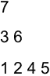

在几棵树上手动走一遍代码会很有帮助，这样你能看得更清楚。

从树中删除节点是递归算法的一个典型例子，用迭代方式实现并不容易。首先，你需要一个能同时处理树两侧的循环。你需要在删除一棵子树的同时追踪下一棵，而且每一层都需要这样做。使用栈，你可以更容易地保持自己的位置。最好的可视化方式是：每个栈帧会存储已经被删除或销毁的树分支：

```
destroy_tree()
```

destroy_tree() — 知道该子树是左子树还是右子树

每个栈帧都知道树的哪些部分必须被销毁，因为它知道函数执行应该从哪个点继续。当第一次调用销毁树的函数时，程序会通过栈帧被告知在第二次调用 destroy_tree 时继续执行。当第二次调用发生时，程序会被告知继续删除树。由于每个函数都有自己的栈帧，它可以在当前时刻跟踪整棵树销毁的完整状态，一次只处理一层树。

要以非递归的方式实现这一点，就需要一个能够保留相同数量和类型信息的数据结构。例如，你可以编写一个持有链表的函数来模拟这个列表。该链表会包含正在被销毁的子树和留给后续销毁的树。然后可以编写一个基于循环的算法，将子树添加到列表中，并在它们被完全销毁后将其移除。基本上，递归让你得以使用内建的栈数据结构，而不必自己编写。

## 第 4 章：继承

示例：

```cpp
#include <iostream>

using namespace std;

// defining a simple student class with 2 members
class Student
{
public:
    int studentID;
    string studentName;

    // Function to display the members of the class
    void Display()
    {
        cout<<"Student ID "<<studentID<<endl;
        cout<<"Student Name "<<studentName;
    }
};

int main () {
    Student stud1;
    // Assigning values to the properties of the class
    stud1.studentID=1;
    stud1.studentName="John";
    stud1.Display();
    return 0;
}
```

对于上述程序：

- 我们有一个名为“Student”的类，它有 2 个成员，一个是“studentID”，另一个是“studentName”。
- 然后我们定义一个名为“Display()”的成员函数，它将“studentID”和“studentName”输出到控制台。
- 然后我们可以在主程序中通过对象调用该成员函数。

这个程序的输出如下：

Student ID 1

Student Name John

### 那么什么是继承？

继承是这样一种概念：我们可以定义一个类来继承另一个类的属性和方法。这有助于避免重新定义类，也无需再次定义属性和方法。

假设我们有一个名为“Person”的类，它有一个“Name”属性和一个“Display”方法。那么通过继承，我们可以定义一个名为 Student 的类，它可以继承 Person 类。Student 类会自动获得 ID 成员和 Display 函数。如果需要，Student 类还可以定义自己的额外成员。

要定义继承类，我们使用以下语法。

```
派生类:基类
```

这里的“派生类”是继承另一个类（即“基类”）的属性的类。

因此，如果我们有一个基类，其中包含如下所示的属性和函数。

```
基类
{
public 或 protected:
    Property1;
}
```

那么当我们从基类定义派生类时，派生类将可以访问该属性。请注意，属性和函数需要将访问修饰符设为 public 或 protected。我们稍后会更详细地讨论访问修饰符。

```
派生类: 基类
{
    // 无需定义 property1，它会自动继承这些。
}
```

现在让我们通过代码来看一个简单的继承示例。

示例 2：以下程序用于展示如何使用一个简单的继承类。

```cpp
#include <iostream>
using namespace std;

// Defining a simple Person class with a property of Name
class Person
{
public:
    string Name;
};

// Here we have the derived class. It defines another property of ID
class Student:public Person
{
public:
    int ID;

    // Function to display both ID and Name. Since Name is available
    // from the base class of Person, we are able to access it here.
    void Display()
    {
        cout<<"Student ID "<<ID<<endl;
        cout<<"Student Name "<<Name;
    }
};

int main () {
    Student stud1;
    stud1.ID=1;
    stud1.Name="John";
    stud1.Display();
    return 0;
}
```

对于上述程序：

- 我们定义一个名为“Person”的类，它有一个名为“Name”的成员。
- 然后我们使用继承来定义“Student”类。注意，现在我们定义了另一个名为“ID”的属性。
- 在“Display”函数中，注意我们可以使用“Name”属性，而不需要在“Student”类中再次定义它。

这个程序的输出如下：

Student ID 1

Student Name John

现在我们已经看到了如何使用派生类和基类，这也被称为继承。

### 1.2 派生类中的函数

我们也可以定义可以从基类继承的函数。让我们看看如何实现这一点。

例如，如果我们有一个基类，其中包含如下所示的属性和函数。

```
基类
{
public 或 protected:
    Property1;
    Function1;
}
```

当我们从基类定义派生类时，派生类将可以访问该属性和函数。请注意，属性和函数需要将访问修饰符设为 public 或 protected。

```
派生类: 基类
{
    // 无需定义 property1 和 Function1，它会自动继承这些。
}
```

现在让我们看一个在派生类中使用函数的示例。

示例 3：以下程序用于展示如何使用带函数的继承类。

```cpp
#include <iostream>

using namespace std;

// Defining a simple Person class with a property of Name, ID, and also a function called Display.
class Person
{
public:
    string Name;
    int ID;
    void Display()
    {
        cout<<"ID "<<ID<<endl;
        cout<<"Name "<<Name;
    }
};

// The Student class simply derives itself from the Person base class
class Student:public Person {
};

int main () {
    // Since the derived class has access to the properties and functions
    // of the base class, these can be accessed via the Student object
    Student stud1;
    stud1.ID=1;
    stud1.Name="John";
    stud1.Display();
    return 0;
}
```

这个程序的输出如下：

ID 1

Name John

我们也可以在 Student 类中重新定义 Display 函数。但如果你看上面的例子，你会注意到 Person 类中的 Display 函数显示的文本是 ID 和 Name。但假设我们希望在 Student 类中显示为 Student ID 和 Student Name，我们可以重新定义 Display 函数。让我们看一个例子。

示例 4：以下程序展示了如何在继承类中使用重新定义的函数。

```cpp
#include <iostream>
using namespace std;

class Person
{
public:
    string Name;
    int ID;
    void Display()
    {
        cout<<"ID "<<ID<<endl;
        cout<<"Name "<<Name;
    }
};

class Student:public Person {
public:
    // Here we are redefining the Display function
    void Display()
    {
        cout<<"Student ID "<<ID<<endl;
        cout<<"Student Name "<<Name;
    }
};

int main () {
```


```cpp
Student stud1;
    stud1.ID=1;
    stud1.Name="John";
    stud1.Display();
    return 0;
}
```

使用该程序，输出如下：

```text
Student ID 1
Student Name John
```

### 1.3 多重继承

我们还可以让派生类继承多个基类。这有助于一次性从多个类中获得更多功能。

派生类：基类1，基类2……基类N

这里只需用逗号分隔基类。

因此，如果我们有一个包含属性和函数的基类，如下所示。

```cpp
Base class1
{
public or protected:
    Property1;
    Function1;
}
```

以及另一个基类如下。

```cpp
Base class2
{
public or protected:
    Property2;
    Function2;
}
```

然后，当我们从这两个基类定义派生类时，派生类将可以访问这两个类的属性和函数。

```cpp
Derived class: Base Class1, Base Class2
{
// No need to define property1, property2, and Function1, Function2
it will automatically define these.
}
```

再次注意，属性和函数需要具有 public 或 protected 访问修饰符。让我们看一个多重派生类的示例。

示例 5：以下程序用于展示如何使用多重派生类。

```cpp
#include <iostream>

using namespace std;

// Defining the first base class of Person
class Person
{
public:
    string Name;
    int ID;
    void Display()
    {
        cout<<"ID"<<ID<<endl;
        cout<<"Name"<<Name;
    }
};

// Defining the second base class of Marks
class Marks
{
public:
    int marks1,marks2;
    void Sum()
    {
        cout<<marks1+marks2;
    }
};

// The derived class inherits from both the Person and Marks base class.
class Student:public Person,public Marks {
public:
    void Display()
    {
        cout<<"Student ID "<<ID<<endl;
        cout<<"Student Name "<<Name<<endl;
    }
};

int main () {
    Student stud1;
    stud1.ID=1;
    stud1.Name="John";
    stud1.Display();
    stud1.marks1=5;
    stud1.marks2=10;
    stud1.Sum();
    return 0;
}
```

使用上述程序：

- 我们定义了两个基类，一个称为‘Person’，另一个称为‘Marks’。
- 派生类‘Student’继承这两个类，并且能够使用这两个类的成员。

使用该程序，输出如下：

```text
Student ID 1
Student Name John
15
```

### 1.4 访问控制

类修饰符可用于定义类中属性和方法的可见性。以下是可用的各种修饰符。

- Private——使用 private 时，属性和方法仅对类本身可用。
- Protected——使用 protected 时，属性和方法仅对类本身以及从该类派生的子类可用。
- Public——使用 public 时，属性和方法对所有类可用。

假设我们有一个类的以下结构。

```cpp
class classname
{
private:
    Property1;
    Function1;
}
```

‘property1’和‘function1’除了在其定义的类中之外，在其他任何地方都无法访问。如果你尝试从主程序访问这些属性或函数中的任何一个，将会得到编译时错误。

现在让我们定义下面的类，但这次我们将使用 protected 访问修饰符。

```cpp
class classname1
{
protected:
    Property1;
    Function1;
}
```

现在，‘property1’和‘function1’可以从上述类以及任何从它派生的其他类中访问。

因此，如果我们有下面的派生类定义，我们将能够在派生类中访问‘property1’和‘function1’。但请注意，我们将无法在任何其他非派生类中使用这些属性。

```cpp
class derivedclassname: classname1
{
}
```

让我们看另一个访问修饰符的示例。

示例 6：以下程序用于展示如何使用访问修饰符。

```cpp
#include <iostream>

using namespace std;

class Person
{
public:
    int ID;
protected:
    // Note that we are defining the Name property as protected
    string Name;
    void Display()
    {
        cout<<"ID "<<ID<<endl;
        cout<<"Name "<<Name;
    }
private:
    // Note that we have defined the city property as private
    string city;
};

class Student:public Person {
public:
    void Display()
    {
        cout<<"Student ID "<<ID<<endl;
        cout<<"Student Name "<<Name<<endl;
    }
};

int main () {
    Student stud1;
    stud1.ID=1;
    stud1.Name="John";
    stud1.Display();
    return 0;
}
```

使用该程序，输出如下：

```text
error: 'std::__cxx11::string Person::Name' is protected
```

为什么会出现这个错误？‘Person’类有两个属性，分别称为 ID 和 Name。Name 具有 protected 访问修饰符，这意味着它只能在派生类中访问。但我们试图在主类中访问它，这是错误的。因此，实现这一点的正确方法如下。

示例 7：以下程序展示了如何以正确的方式使用访问修饰符。

```cpp
#include <iostream>

using namespace std;

class Person
{
public:
    int ID;
protected:
    string Name;
    void Display()
    {
        cout<<"ID "<<ID<<endl;
        cout<<"Name "<<Name;
    }
private:
    string city;
};

class Student:public Person {
public:
    // We have now defined a function which can set the value of the protected property accordingly.
    void InputName(string pName)
    {
        Name=pName;
    }
    void Display()
    {
        cout<<"Student ID "<<ID<<endl;
        cout<<"Student Name "<<Name<<endl;
    }
};

int main () {
    Student stud1;
    stud1.ID=1;
    stud1.InputName("John");
    stud1.Display();
    return 0;
}
```

在上述程序中，我们现在在‘Student’类中正确定义了一个名为‘InputName’的方法，该方法可以访问受保护的‘Name’成员。

使用该程序，输出如下：

```text
Student ID 1
Student Name John
```

现在让我们看同一个示例，并尝试显示在‘Person’类中定义的名为‘City’的属性。

示例 8：以下程序展示了如何以错误方式使用访问修饰符的第二个示例。

```cpp
#include <iostream>
using namespace std;
class Person
{
public:
    int ID;
protected:
    string Name;
    void Display()
    {
        cout<<"ID "<<ID<<endl;
        cout<<"Name "<<Name;
    }
private:
    string city;
};
class Student:public Person {
public:
    void InputName(string pName)
    {
        Name=pName;
    }
    void Display()
    {
        cout<<"Student ID "<<ID<<endl;
        // Note that we are trying to use the private property in the derived class.
        cout<<"Student city "<<city<<endl;
        cout<<"Student Name "<<Name<<endl;
    }
};
int main () {
    Student stud1;
    stud1.ID=1;
    stud1.InputName("John");
    stud1.Display();
    return 0;
}
```

使用该程序，输出如下：

```text
error: 'std::__cxx11::string Person::city' is private
```

由于‘City’属性是私有的，它甚至不能在派生类中使用。我们只能在‘Person’类中使用此属性。

## 第5章：高级基础

### 指针

前面已经提到过指针，它们是变量的内存地址，这很像一个人的家庭住址。它们可以作为参数传递，并实现前面提到的按引用传递的效果。

下面的程序将显示变量的地址：

```c
#include <stdio.h>

int main()
{
    int var;

    printf("The address is: %x\n", &var);

    return 0;
}
```

输出：

```text
The address is: 10ffa2c
```

注意：几乎每次运行结果都会不同

注意高亮语句，‘&’（引用运算符）用于返回变量的内存位置，并允许某些语句访问该位置的数据。使用‘%x’是因为内存位置是十六进制的。


要创建指针，我们使用解引用运算符（*），这将创建一个指针变量，该变量旨在保存某个内存位置的地址。下面的程序创建了一个指针，并使用引用运算符（&）将另一个普通变量的地址存入新创建的指针中。解引用运算符（*）也用于访问或更改该内存位置中的实际数据。

- 解引用运算符（*）用于创建指针，也用于更改实际值
- 引用运算符（&）用于获取指针的内存位置

必须增加缩进。

```c
//Regular variable

int var = 10;

//Pointer
int* pointer;

//Storing of var memory location
pointer = &var;

//Pointer is now effectively 'var' so
//things like this can happen
*pointer = 20;

printf("Var's value is now: %d", var);
```

输出：

> Var 的值现在是：20

#### NULL 指针

创建指针时，最初并没有给它指定任何指向对象，这是危险的，因为指针在创建时会引用随机内存，而更改该内存位置中的数据可能会导致程序崩溃。为防止这种情况，我们在创建指针时将其赋值为 NULL，如下所示：

```c
int* pointer = NULL;
```

这意味着该指针的地址为“0”，这是一个保留的内存位置，用于标识空指针。可以使用 if 语句检查空指针：

```c
if (pointer){}
```

#### 使用指针

现在，指针的一些实际用途是将它们作为参数传递，并实际上按引用传递它们。下面的示例将展示效果：

```c
void Change_Value(int* reference)
{
    //Changes the value in the memory location
    *reference = 20;
}

int main()
{
    //Creates pointer to variable
    int var = 10;
    int* pointer = &var;
    printf("The value before call: %d\n", var);
    //Method call
    Change_Value(pointer);

    //Prints new value
    printf("The value after call: %d\n", var);
    return 0;
}
```

输出：

> 调用前的值：10
> 调用后的值：20

这里传递的是内存位置，而不是变量的值，这意味着你拥有了可以进行更改的位置。

注意参数是 int*，这是指针类型，因此例如，指向 char 的指针将是 char*。

#### 指针算术

有时将指针移动到另一个内存位置可能很有用；这正是指针算术的用武之地。如果我们执行比如 ptr++，而 ptr 是一个整型指针，那么它现在会向前移动 4 字节（int 的大小），如果再运行一次，又会移动 4 字节，依此类推。这意味着指针（如果指向有效的数组结构）可以表现得非常像数组。示例如下：

```c
int arrayInt[] = { 10, 20, 30 };

size_t arrayInt_Size = 3;

//Will point to the first array index
int* ptr = &arrayInt;
for (int i = 0; i < arrayInt_Size; i++)
{
    //Remember, *ptr gets the value in the memory location
    printf("Value of arrayInt[%d] = %d\n", i, *ptr);

    ptr++;
}
```

输出：

> arrayInt[0] 的值 = 10
> arrayInt[1] 的值 = 20
> arrayInt[2] 的值 = 30

这表明，指向数组第一个地址的指针可以沿着数组的地址递增（记住，数组的每个值都存储在相邻的内存位置中）

你也可以反过来递减指针，即让指针的值减小。

还可以使用 ==、< 和 > 等关系运算符来比较指针。最常见的用途是检查两个指针是否指向同一位置：

```c
int value;

//Assigns ptr1 and ptr2 the same value
int* ptr1 = &value;
int* ptr2 = &value;

//ptr3 is assigned another value
int* ptr3 = NULL;

if (ptr1 == ptr2)
{
    printf("ptr1 and ptr2 are equal!\n");
}

if (ptr1 != ptr3)
{
    printf("ptr1 is not equal to ptr3\n");
}
```

这会检查各个指针是否相等。使用 > 和 < 也可以进行同样的操作。

#### 函数指针

就像可以对变量做的那样，你也可以对函数做同样的事；下面是一段展示如何定义函数指针的代码。关键部分将高亮显示：

```c
void printAddition(int value1, int value2)
{
    int result = value1 + value2;
    printf("The result is: %d", result);
}

int main()
{
    //Function pointer definition
    //<returnType>(*<Name>)(<Parameters>)
    void(*functionPtr)(int, int);
    functionPtr = &printAddition;
    //Invoking call to pointer function
    (*functionPtr)(100, 200);
    return 0;
}
```

定义函数指针的基本结构如下

`<Return_Type> (*<Name>) (<Parameters>)`

其中在本例中：

`<Return_Type> = void`

`<Name> = functionPtr`

`<Parameters> = int, int`

这个函数指针现在可以作为参数传递，并用于你希望改变代码行为但几乎使用相同代码的场景。

一个例子是动态选择计算器应执行什么操作（注意：这是复杂代码，应仅作为粗略示例使用，所以如果你没有完全理解也不用担心）

```c
void calculator(int value1, int value2, int(*opp)(int,int))
{
    int result = (*opp)(value1, value2);
    printf("The result from the operation: %d\n", result);
}

//Adds two values
int add(int num1, int num2)
{
    return num1 + num2;
}

//Subtracts two values
int sub(int num1, int num2)
{
    return num1 - num2;
}

int main()
{
    calculator(10, 20, &add);
    calculator(10, 20, &sub);
    return 0;
}
```

这里发生的情况是，我们将函数“add”和“sub”作为 calculator 函数的参数传递；正如你从高亮部分看到的，函数参数的定义方式与上面一样，定义了返回类型、名称和参数，传入 calculator 的只有用于函数指针的 &add 和 &sub。然后 calculator 函数会调用该指针，传入值并返回结果。

### 存储类别

在 C 中，每个变量都可以指定一个存储类别，用于定义某些特性。

这些类别是：

- 自动变量
- 静态变量
- 寄存器变量
- 外部变量

#### 自动变量

到目前为止，我们定义的每个变量都是自动变量；它们在函数被调用时创建，并在函数退出时自动销毁。这些变量也称为局部变量。

```c
auto int value;
```

等同于

```c
int value;
```

#### 静态变量

当你希望变量在超出作用域时不被销毁时，就可以使用 static；该变量将一直存在，直到程序结束。静态变量在整个程序生命周期中只创建一次。下面是一个使用静态变量的示例：

```c
void tick()
{
    //This will run once
    static int count = 0;
    count++;
    printf("The count is now: %d\n", count);
}

int main()
{
    tick();
    tick();
    tick();
}
```

输出：

> 当前计数为：1
> 当前计数为：2
> 当前计数为：3

高亮部分是静态定义，只会运行一次。

#### 寄存器变量

register 用于定义要存储在寄存器内存中而不是常规内存中的变量，寄存器内存的优点是访问速度快得多；然而，寄存器内存只能容纳少量变量。

定义寄存器变量如下所示：

```c
register int value;
```

#### 外部变量

我们之前提到过，全局变量是未在作用域中定义的变量，因此可以在任何地方使用。外部变量是在单独位置（例如另一个文件）中定义的变量，extern 关键字用于表示该变量在另一个文件中。你可以通过在文件顶部放置以下内容来包含另一个文件作为引用：

```c
#include "FileName.c"
```

这是为了告诉程序也要引用此文件。注意，这些文件需要位于同一位置。

程序 1 [File_2.c]

```c
#include <stdio.h>

#include "C_TUT.c"

int main()

{
```


```c
extern int globalValue;
printf("The global variable is: %d", globalValue);
}
```

#### 程序 2（它很小）[C_TUT.c]

```c
#include <stdio.h>
int globalValue = 1032;
```

运行 File_2.c 的输出：

> 全局变量为：1032

这表明 globalValue 是从 C_TUT.c 中引用的，并通过 extern 关键字在另一个文件中使用。

我们在教程的基础部分提到过递归，它同样是用函数自身来定义函数任务的。正如之前承诺的，下面再解释几个递归示例：

```c
int factorial(int x)
{
int r;
//Stopping condition
if (x == 1)
{
//Has a conclusion so looping stop
return 1;
}
else
{
//Recursive definition
return r = x * factorial(x - 1);
}
}
int main()
{
puts("Please enter a number: ");
//Reads in user input
int a, b;
scanf("%d", &a);
//Starts the execution
b = factorial(a);
printf("The factorial is: %d", b);
}
```

这是举世闻名的递归示例，用于求一个数的阶乘（3 的阶乘是 3x2x1）。它通过上面的递归 return 语句工作；它通过一个没有递归定义的 return 语句停止，即当 x = 1 时，函数只返回 1；这意味着栈可以展开并找到答案。下面有一张流程图：

### 递归

递归是一个困难的概念，这里只作简要介绍，其实际用途和功能将在高级部分解释。

递归是对函数命令的一种定义，其中涉及对自身的引用；是的，我知道这很令人困惑，但我会用一些示例来解释。

```c
const int maxLoops = 5;

void Sequence(int previous, int now, size_t loopCount)
{
//Works out next value
int next = previous + now;
//Prints new value
printf("New value: %d\n", next);
//Increments counts
loopCount++;
//Stopping condition to make sure infinite looping doesn't occur
if (loopCount < maxLoops)
{
//Recursive call
Sequence(now, next, loopCount);
}
}
int main()
{
Sequence(1, 1, 0);
}
```

输出：

> 新值：2
> 新值：3
> 新值：5
> 新值：8
> 新值：13

有几点需要注意：没有迭代循环，递归本质上会导致循环。第二点需要注意的是标有“停止条件”的 if 语句；如果递归设置没有阻止其循环的条件，它们将永远循环，因此这是有效使用递归的关键要素。

我们在教程的基础部分提到过递归，它同样是用函数自身来定义函数任务的。正如之前承诺的，下面再解释几个递归示例：

```c
int factorial(int x)
{
int r;
//Stopping condition
if (x == 1)
{
//Has a conclusion so looping stop
return 1;
}
else
{
//Recursive definition
return r = x * factorial(x - 1);
}
}
int main()
{
    puts("Please enter a number: ");

    //Reads in user input
    int a, b;
    scanf("%d", &a);
    //Starts the execution
    b = factorial(a);
    printf("The factorial is: %d", b);
}
```

这是举世闻名的递归示例，用于求一个数的阶乘（3 的阶乘是 3x2x1）。它通过上面的递归 return 语句工作；它通过一个没有递归定义的 return 语句停止，即当 x = 1 时，函数只返回 1；这意味着栈可以展开并找到答案。下面有一张流程图：

## 第 6 章：STL 容器和迭代器

### 容器

容器是 STL 的主要贡献，它们用于保存和访问一系列对象。STL 提供了不同类型的容器，例如 vector、list、map 和哈希表。然而，根据数据排列的特征，STL 容器被分为三大类：

- 1. 序列容器，例如 vector、固定大小数组、list、forward_list 和 deque；
- 2. 关联容器：
  - a) 有序（已排序）关联容器，例如 set、multiset、map 和 multimap；
  - b) 无序（未排序）关联容器，例如 unordered_set、unordered_multiset、unordered_map 和 unordered_multimap；以及
- 3. 容器适配器，例如 stack、queue 和 priority_queue。

除了这些完全符合要求的容器之外，C++ 还提供了三种几乎符合要求的容器，即 string、内置数组和 valarray。

每个容器都是复杂的模板类，具有默认构造函数、带参数构造函数、拷贝构造函数、赋值运算符和确定的析构函数。除此之外，大多数容器定义了自己的迭代器，并且每个容器都有自己的操作成员函数。

### 容器迭代器

从那些部分可知，每个容器都提供自己的迭代器，并使用该迭代器对容器元素执行操作。

在五类迭代器中，每个容器定义其中任意一类，即：

- **前向迭代器：**
  - 可读；
  - 可写；
  - 可在单个位置重复读/写；
  - 可向前移动（++），但不能向后移动，因此得名前向迭代器；并且
  - 用于：无序关联容器和 forward list，它们可实现最佳的空间高效存储。
- **双向迭代器：**
  - 与前向迭代器相同，但它还可以向后移动（因此既可 ++ 也可 --），因此得名双向迭代器；并且
  - 用于容器：list、set、map、multiset 和 multimap。
- **随机访问迭代器：**
  - 与双向迭代器相同，但它可以跳跃（+=N 或 -=N，其中 N 是整数），而不是（+=1 或 -=1，其中 +=1 是 ++，-=1 是 --），因此得名随机访问迭代器（跳跃迭代器）；并且
  - 用于容器：vector、string、deque 和 array<T,N>。

除了帮助 STL 算法在容器中执行操作外，迭代器还帮助执行容器的内部操作（成员函数）。

有些内部操作是所有序列容器和关联容器共有的，它们包括：

- **O(1)：** begin()、end()、cbegin()、cend()、rbegin()*、rend()*、crbegin()*、crend()*、empty()、swap()、size()†、max_size()、shrink_to_fit()‡、emplace() 和 emplace_back()*；
- **O(n)：** 赋值运算符：=，关系运算符：!=、==、<††、<=††、>†† 和 >=††，以及 clear()；
- **O(variable)：**
  - Insert()†、erase()† 和 emplace()†（它们在基于节点的容器中很快，而在连续内存容器的（中间）较慢）；并且
  - 构造函数（通常，类的组合或其默认构造函数具有常数复杂度，但所有其他构造函数和析构函数可能具有线性复杂度）。

注意：

- a) forward list 和无序关联容器使用前向迭代器，因此它们没有反向迭代器操作：emplace_back()、rbegin()、rend()、crbegin() 和 crend()。
- b) 关联容器支持反向迭代器，但不支持 emplace_back()。这是因为关联容器按排序顺序保存其元素，因此它不接受 emplace_back() 命令，该命令坚持将新元素放在容器末尾。

†forward list：

- 1. 不支持运算符 size()；
- 2. 它提供 insert_after()、erase_after() 和 emplace_after()，而不是 insert()、erase() 和 emplace()；
- 3. 具有特殊迭代器 before_begin()、cbefore_begin()，使得
  - forward list 中的操作：`my_fwd_list.insert_after(my_fwd_list.before_begin(), inv_data.gold);`
  - 等价于 list 中的以下操作：`my_list.insert(my_list.begin(), inv_data.gold);`
  - 注意：任何容器都不能在 `end()` 之外写入或读取，即 `my_fwd_list.insert_after(my_fwd_list.end(), inv_data.gold);` 是错误的！

‡ shrink_to_fit() 请求移除未使用的内存容量，且仅适用于 vector、deque 和 string。

†† 无序容器不支持关系运算符：<、<=、> 和 >=。


在上面的运算符列表中，O 表示复杂度。简而言之，虽然复杂度意味着函数的时间复杂度和/或空间复杂度，但在容器中它指时间复杂度；

- O(1) 表示常数时间复杂度；
- O(log n) 表示对数时间复杂度；
- O(n) 表示线性时间复杂度；

相比之下，O(n) > O(log n) > O(1)，这意味着 O(1) 是最快的操作；并且注意：这些是期望的或平均的


复杂度，并且标准库文档引用了一些运算符的最坏情况复杂度。

有少数容器不支持迭代器，它们是：容器适配器、bitset 和 valarray。注意：C++11 为 valarray 定义了迭代器 `begin()` 和 `end()`。

### STL 迭代器

迭代器、容器和算法是标准模板库的组成部分，该库由惠普公司的 Alexander Stepanov 等人于 20 世纪 90 年代初编写，后来并入标准库并得到发展。

迭代器是一种特殊指针的抽象，它解引用给定容器（例如 vector、map 和用户自定义的容器类）中的元素。

每个容器类都会包含用于生成迭代器的成员函数，例如，成员 `begin()` 和 `end()` 分别返回指向第一个元素和最后一个元素之后位置的迭代器。

下图描述了迭代器（`*it`）与其容器（`vector<int>data {1111, 1134, 1134, 1124, 1124, 1134, 1111, 1176, 1124, 1134, 1176}`）之间的关系。

然后，迭代器可以将容器中的那些元素纳入算法操作（例如 sort、accumulate 和用户自定义的算法函数）。

换句话说，迭代器将容器与算法关联起来。

最常用的迭代器来自 `begin()` 和 `end()`。下图对此进行了说明：

如图所示，`data[0]` 和 `data.begin()` 都表示同一个元素，即元素 1，但 `data[N]` 和 `data.end()` 表示“无人区”，访问它可能导致运行时错误。

然而，成员函数 `end()` 在构造迭代语句中的条件时非常有用。

以下代码说明了迭代器的这一基本特性：

```cpp
// iterators.cpp
#include "..\\my_essentials.hpp"

void illustrate_iterators()
{
    int arr[] = {1111, 1134, 1134, 1124, 1124, 1134, 1111, 1176, 1124,
                 1134, 1176};

    vector<int>data(arr, arr+ sizeof(arr)/sizeof(arr[0]) );

    // vector<int> data2{1111, 1134, 1134, 1124, 1124, 1134, 1111, 1176,
    // 1124, 1134, 1176}; // fine with gcc4.7.0

    cout  << "\n Illustration of iterators: \n"
         << "\n Given vector: data =\n\t( ";

    for(auto  element:  data)  // 'the range-based for' do not work with VC10:
        cout << element << "; ";

    cout << ")\n\n Let us define an iterator, say *it for this vector.\n";

    vector<int>::iterator it = data.begin();

    /*
    Note:
    In STL containers, each container template class
    defines its own iterator member class, so that
    vector<int>::iterator is different from the
    list<int>::iterator.
    */
    cout << " Thus,\t\t*it = " << *it << " that is data[0]\n Iterators can be incremented, i.e., ++it;\n";

    ++it;

    cout << " After ++\t*it = " << *it << " that is data[1]\n Therefore, iterator *it dereferences through vector data.\n So, let us express the entire vector using the iterator:  \n\t( ";
    for(auto it = data.begin(); it!=data.end(); ++it)
        cout << *it << "; ";
    cout << ")\n";

    cout << "\n Task: Since, this vector has repeated numbers,\n Can we keep only one copy of each number and remove the duplicates?\n Yes, we can!\n For that, we pass the iterator through three types of STL algorithms as shown below:\n";

    cout << "\n Step.1 Sort in ascending order:\n";
    sort(data.begin(), data.end());

    cout << " After the iterator has passed through sort(): \n\t( ";
    for(auto element: data)
        cout << element << "; ";
    cout << ")\n\n Step.2 Move the adjacent repeated elements to the left hand side:\n";

    auto my_unique = unique(data.begin(), data.end());

    cout << " After the iterator has passed through unique(): \n\t( ";
    for(auto element: data)
        cout << element << "; ";

    /*
    The function unique() has returned an iterator to
    the identifier “my_unique” starting from which the
    repeated elements are pushed up to one before the
    end().

    Note: The STL algorithms can displace the elements
    but it cannot erase them, however each STL container
    template class has a member function called
    “erase()” operation for erasing the specified
    elements.

    In other words, iterators can modify elements in containers but not
    the containers themselves.

    Therefore, to remove the duplicates, we apply the
    operation erase() from the iterator “my_unique” till
    the end().
    */
    cout << ")\n\n Step.3 Erase out those repeated elements:\n";
    data.erase(my_unique, data.end());

    cout << " After the iterator has passed through erase() i.e., \n Final:\t(";
    for(auto element: data)
            cout << element << ", ";
    cout << ")\n";
}
int main()
{
    illustrate_iterators();
    just_pause();
}
```

输出：

```text
Illustration of iterators:

Given vector: data =

( 1111; 1134; 1134; 1124; 1124; 1134; 1111; 1176; 1124; 1134; 1176; )

Let us define an iterator, say *it for this vector.

Thus,             *it = 1111 that is data[0].

Iterators can be incremented, i.e., ++it.

After ++          *it = 1134 that is data[1]

Therefore, iterator *it dereferences through vector data.

So, let us express the entire vector using the iterator:

( 1111; 1134; 1134; 1124; 1124; 1134; 1111; 1176; 1124; 1134; 1176; )

Task: Since, this vector has repeated numbers,

Can we keep only one copy of each number and remove the duplicates?

Yes, we can!

For that, we pass the iterator through three types of STL algorithms as shown below:

Step.1 Sort in ascending order:

After the iterator has passed through sort():

( 1111; 1111; 1124; 1124; 1124; 1134; 1134; 1134; 1134; 1176; 1176; )

Step.2 Move the adjacent repeated elements to the left hand side:

After the iterator has passed through unique():

( 1111; 1124; 1134; 1176; 1124; 1134; 1134; 1134; 1134; 1176; 1176; )

Step.3 Erase out those repeated elements:

After the iterator has passed through erase() i.e.,

Final: ( 1111; 1124; 1134; 1176; )
```

上面给出的程序展示了迭代器将容器数据纳入算法中的实用性。

正如我们所见，迭代器可用于打印容器的内容，因此让我们在头文件 "my_essentials.hpp" 中编写一段与容器无关的代码。这段代码用于轻松打印具有一种类型名的容器，例如 `vector<T>`、`list<T>`、`set<T>`、`multiset<T>`、`deque<T>` 和固定大小的 `array<T,N>`，但不适用于具有两种类型名的容器，例如 `map<T1,T2>` 和 `unordered_multimap<T1,T2>`。

```cpp
//----------------------------------------------

// Container independent code for printing out

// container with one typename

template<typename container>

void cout_container(const std::string& message, const container& data)

{

        std::cout << message << "{";

        if(data.empty()){

            std::cout << "NULL}"<<std::endl;
            return;
        }
        auto start = data.begin();
        auto end = data.end();
        while(true)
        {
            std::cout << *start;
            ++start;
            if(start != end)
                std::cout << ", ";
            else{
                std::cout <<'}' << std::endl;
                break;
            }
        }
}
//==================================================
```

让我们将此模板添加到 "my_essentials.hpp" 中，并用以下代码测试该模板。

然后，让我们测试这个模板：

```cpp
// cout_containers.cpp
#include "..\\..\\my_essentials.hpp"
#include <array>
#include <vector>
#include <unordered_set>
#include <forward_list>
#include <set>

int main()
{
    // Let us define,
    // a fixed-size array
    array<int,6> arr = {1,3,5,1,2,4};
    cout_container("my array\t = ", arr);

    // a vector
    vector<int> vec(arr.begin(), arr.end());
    cout_container("my vector\t = ", vec);

    // a forward_list
    forward_list<int>
        f_lis(arr.begin(), arr.end());
    cout_container("my forward_list\t = ",f_lis) ;

    // an unordered_set
    unordered_set<int>
        u_set(arr.begin(), arr.end());
```

## 第 7 章：STL 算法

STL 算法位于 `<algorithm>` 头文件中，因此我们需要在程序中包含它。这些算法可以分为：

- 非修改算法：例如 `for_each`、count、search 等。
- 修改算法：例如 copy、transform 等。
- 移除算法：remove、`remove_if` 等。
- 变异算法：reverse、rotate 等。
- 排序算法：sort、`partial_sort` 等。
- 有序区间算法：`binary_search`、merge 等。
- 数值算法：accumulate、`partial_sum`、`inner_product` 等。

以下示例展示了 `sort()` 函数如何作用于数组。

程序 13.11：使用 sort 算法对数组排序

```cpp
#include <iostream>

#include <algorithm>

using namespace std;

int main()

{

    int a[ ] = {3,5,7,2,9} ;

    sort(a, a + 5);
```


```cpp
cout << "Sorted Array:" << endl;
for (int i = 0; i < 5; i++)
    cout << a[i] << " ";
return 0;
}
```

输出：

Sorted Array:

2 3 5 7 9

在上面的示例中，当我们把数组名`a`作为参数传递时，我们是在告诉函数从数组开头开始排序。如果我们希望它从数组的第三个元素开始排序，可以使用，

```cpp
sort(a+3, a+5);
```

我们使用`a+5`作为第二个参数，这指定我们希望排序到数组中的最后一个元素。

现在，类似的`sort()`函数可以像下面程序所示的那样用于vector容器。这表明STL算法是通用的。

### 程序13.12：使用sort算法对vector进行排序

```cpp
#include <iostream>
#include <algorithm>
#include <vector>

using namespace std;

int main()
{
    int a[] = {5, 3, 7, 6, 2, 9};
    vector<int> v(a, a+6);
    sort(v.begin(), v.end());
    for (int i = 0; i != v.size(); i++)
        cout << v[i] << " ";
    cout << endl;
    return 0;
}
```

输出：2 3 5 6 7 9

如你所见，排序函数的工作方式几乎与在数组上相同。`sort()`中的第一个参数使用`begin()`接受指向第一个元素的迭代器，因为它返回指向第一个元素的迭代器。因此它将从vector中的第一个元素开始排序。同样，`end()`返回一个迭代器，指向容器中最后一个元素之后的位置。注意，排序函数排序到但不包括我们作为第二个参数传入的内容。

### find()和count()算法

`find()`算法有助于从容器中查找特定值。`count()`用于计算特定值在容器中出现的次数。

### 程序13.13：使用find算法从vector中查找值

```cpp
#include <iostream>
#include <algorithm>
#include <vector>

using namespace std;

int main()
{
    vector<int> v;
    for (int i = 0; i < 10; i++)
        v.push_back(i);
    int a = 5;
    vector<int>::iterator it;
    it = find(v.begin(), v.end(), a);
    if (it != v.end()) {
        cout << "found " << a << endl;
    }
    else {
        cout << "could not find " << a << endl;
    }
    int c = count(v.begin(), v.end(), 6);
    cout << "Number of 6 stored in vector:" << c;
    return 0;
}
```

输出：found 5

Number of 6 stored in vector: 1

### for_each()

该算法将指定的函数对象应用于容器中的每个元素。容器中的原始值不会改变，但它用于显示修改后的元素。它将前两个参数作为起始和结束范围。第三个参数是函数对象的地址。

例如，`for_each()`算法对数组的所有元素求平方并显示它们。

### 程序13.14：使用for_each算法对数组所有元素求平方

```cpp
#include <iostream>
#include <vector>
#include <algorithm>

using namespace std;

void square(int a)
{
    cout << a * a << endl;
}

int main()
{
    int s[] = {1, 2, 3, 4};
    for_each(s, s+4, square);
    return 0;
}
```

输出：

1

4

9

16

## 第8章：库函数

### C++ 中的库函数和用户自定义函数

### 学习目标

完成本主题后，你应该能够简要说明C++中的库函数和用户自定义函数。

### 1. 库函数的引入

C++程序员可以使用大量库函数。

只需包含含有相应函数原型的头文件名，就可以使用库中的任何函数。

通常，库函数在一对文件中指定。

函数定义包含在源文件中，源文件通常具有`.c`或`.cpp`文件扩展名。

**注意**

通常，编译器不会向你提供库函数的源代码。

相反，你会得到可以链接到程序的预编译目标文件。

函数原型包含在头文件中，头文件可能通过`.h`、`.hpp`或`.hxx`文件扩展名来区分。

**注意**

头文件还包含这些函数所需的各种数据类型和常量的定义。

尽管不是强制性的，但最好按照提供的库函数的方式组织你自己的函数。

这样你就可以在多个程序中使用这些函数，而无需重新指定代码。

为了在程序中调用库函数，必须指定包含相应函数原型的头文件。

这通常在源文件的开头完成。

但必须在程序使用该函数之前完成。

可以使用`#include`预处理指令将头文件包含在程序中。

这告诉预处理器打开指定的头文件，并在`#include`语句出现的位置插入其内容。

```cpp
#include <string>
```

```cpp
#include "myfuncs.h"
```

在`#include`语句中，可以用两种方式指定文件名，即用双引号或用尖括号（`<>`）。

尖括号中的文件名告诉预处理器在环境指定的搜索路径中查找。

```cpp
#include <string>
```

双引号中的文件名告诉预处理器先搜索当前目录，然后搜索指定的搜索路径。

如果找不到文件，则报告错误。

```cpp
#include <string>
```

C++函数库也可以由设备驱动程序制造商、C++编程网站和公告板等来源提供。

你最好的参考来源通常是C++应用程序开发软件附带的手册和帮助文件。

还有许多参考书可用，其中一些涉及特定的编译器。

### 库函数的使用

为了演示标准库函数的使用，让我们考虑一个执行以下操作的程序：

- 获取数字-55的绝对值

```cpp
#include <iostream>
using namespace std;
#include <cmath>

void main(void)
{
    cout << "The absolute value of -55 is " << abs(-55) << "\n";
```

- 计算100的平方根

```cpp
cout << "The square root of 100 is " << sqrt(100.0) << "\n";
```

- 计算10的5次方

```cpp
cout << "10 to the power of 5 is " << pow(10, 5) << "\n";
```

每个计算的结果都输出到屏幕上。

**注意**

该程序不使用用户自定义函数。

标准数学库包含执行所需三项计算中每一项的函数。

这些是：

- `abs()`
- `sqrt()`
- `pow()`

```cpp
#include <iostream>

using namespace std;

#include <cmath>

void main(void)
{
    cout << "The absolute value of -55 is " << abs(-55) << "\n";

    cout << "The square root of 100 is " << sqrt(100.0) << "\n";

    cout << "10 to the power of 5 is " << pow(10, 5) << "\n";
}
```

编写此程序时要决定的第一件事是包含哪些头文件。

要调用`abs()`、`sqrt()`和`pow()`，你需要在预处理指令中包含头文件`cmath`。

你还需要包含头文件`iostream`，以便可以使用`cin`和`cout`语句。

```cpp
#include <iostream>
using namespace std;
#include <cmath>

void main(void)
{
    cout << "The absolute value of -55 is " << abs(-55) << "\n";
    cout << "The square root of 100 is " << sqrt(100.0) << "\n";
    cout << "10 to the power of 5 is " << pow(10, 5) << "\n";
}
```

**注意**

函数`abs()`也包含在`stdlib.h`头文件中。

完成预处理指令后，就可以开始编写`main()`的代码了。

```cpp
#include <iostream>
using namespace std;
#include <cmath>

void main(void)
{
    cout << "The absolute value of -55 is " << abs(-55) << "\n";
    cout << "The square root of 100 is " << sqrt(100.0) << "\n";
    cout << "10 to the power of 5 is " << pow(10, 5) << "\n";
}
```

这三个函数中每个函数的返回值都由三个单独的`cout`语句直接显示在屏幕上。


你可以在 cout 语句中显示常量、数据类型和表达式值的组合，前提是每个不同的项都由插入运算符（<<）分隔。

```cpp
#include <iostream>
using namespace std;
#include <cmath>
void main(void)
{
    cout <<"The absolute value of -55 is "<<abs(-55)<< "\n";
    cout <<"The square root of 100 is "<<sqrt(100.0)<< "\n";
    cout <<"10 to the power of 5 is "<<pow(10,5)<< "\n";
}
```

在第一个 cout 语句中，显示的第一个值是一个常量字符串。

然后，通过调用数学库函数 abs() 来显示其返回值。

```cpp
#include <iostream>
using namespace std;
#include <cmath>
void main(void)
{
    cout <<"The absolute value of -55 is "<<abs(-55)<< "\n";
    cout <<"The square root of 100 is "<<sqrt(100.0)<< "\n";
    cout <<"10 to the power of 5 is "<<pow(10,5)<< "\n";
}
```

abs() 函数计算作为其函数参数传入的整数的绝对值。并且该函数返回 int 类型的值。

在此示例中，参数是一个常量，而不是 int 类型的变量。

```cpp
#include <iostream>
using namespace std;
#include <cmath>
void main(void)
{
    cout <<"The absolute value of -55 is "<<abs(-55)<< "\n";
    cout <<"The square root of 100 is "<<sqrt(100.0)<< "\n";
    cout <<"10 to the power of 5 is "<<pow(10,5)<< "\n";
}
```

当执行 cout 语句时，会调用该函数，屏幕上显示数字 55。

```cpp
#include <iostream>
using namespace std;
#include <cmath>
void main(void)
{
    cout <<"The absolute value of -55 is "<<abs(-55)<< "\n";
    cout <<"The square root of 100 is "<<sqrt(100.0)<< "\n";
    cout <<"10 to the power of 5 is "<<pow(10,5)<< "\n";
}
```

接下来的两行代码以与第一行相同的方式执行函数调用。

`sqrt()` 函数接受一个 double 类型的单个参数，并返回 double 类型的值。

在此示例中，屏幕上显示数字 10。

```cpp
#include <iostream>
using namespace std;
#include <cmath>
void main(void)
{
    cout <<"The absolute value of -55 is "<<abs(-55)<< "\n";
    cout <<"The square root of 100 is "<<sqrt(100.0)<< "\n";
    cout <<"10 to the power of 5 is "<<pow(10,5)<< "\n";
}
```

### 注意

如果参数是负数，则会发生域错误。

库函数 pow() 接受两个 double 类型的参数，并返回 double 类型的值。

当执行 cout 语句时，屏幕上显示数字 100000。

```cpp
#include <iostream>
using namespace std;
#include <cmath>
void main(void)
{
    cout <<"The absolute value of -55 is "<<abs(-55)<< "\n";
    cout <<"The square root of 100 is "<<sqrt(100.0)<< "\n";
    cout <<"10 to the power of 5 is "<<pow(10,5)<< "\n";
}
```

## 第 9 章：I/O

### I/O 基础

### I/O 基础知识

- C++ 和 C 都没有在语言中内置输入和输出。它们使用语言库中的函数（C）或其他 I/O 对象（C++）。
- C++ I/O 类和头文件
  1. Iofs 代表三个头文件 `<iostream>`、`<fstream>` 和 `<sstream>`。`<iostream>` 会自动包含 `<ios>`。它们是你应该在 C++ 应用程序中包含的三个主要头文件。
  2. 类：iostream（streambuf）、fstream（filebuf）、stringstream（stringbuf），以及四个预定义对象：cin、cout、clog 和 cerr
  3. clog 与 cerr 类似，但它会缓冲其输出。
  4. C++ 通常在你按下回车键时刷新输入缓冲区。对于输出到显示器，C++ 程序通常会在你发送换行符或遇到输入语句时刷新输出缓冲区。
  5. `>>` 和 `<<` 不需要格式化字符串，C++ 会自动转换它，这比 C 语言中的 printf 和 scanf 更好。
  6. 通过继承，fstream 与 cin(cout) 共享相同的用法。所有知识都可以直接用于 fstream。我最喜欢这一点。

### 输入

#### 输入基础知识

- 对于输入，你需要掌握一个基本思想、两种语言和三种数据类型。
- 一个基本思想：为了实现连续输入，你需要使用 while(inputMethod)，当以下两种情况发生时：
  1. 用户想要结束输入（ctrl+D）或读到文件末尾；
  2. 读取失败（例如，cin>> int，但输入字母‘a’），

  InputMethod 将返回 false。然后你需要在 while 循环内部使用某种标志或状态来区分 EOF 和错误。
- 两种语言是 C 和 C++，它们使用不同的 inputMethod。三种数据类型是：数字和单词（中间没有空格）、字符（空白字符）以及字符串（中间包含空格）
- 两种语言常用的输入方法
- 数字和非空白字符单词
  - 字符（包括空白字符）字符串（行）

| 语言 | 输入方法 |
| --- | --- |
| C | `scanf("%d %f %c %s", &i, &f, &c);` `int a = getchar();` |
|  | `fgets(char *p, n, stdin)` |
| C++ | `cin >> i >> f >> c >> w;` `cin.get(char & c);` |
|  | `Ch = cin.get();` `cin.get(char *p, n);` |
|  | `cin.getline(char *p, n);` |
|  | `getline(cin, string);` |

- 在 scanf 中，读取时需要指定确切的数据类型。
  1. h：short int 或 short unsigned。示例：%hd 或 %hu。
  2. l：long int 或 long unsigned，或 double（用于 %f 转换）。示例：%ld、%lu 或 %lf。
  3. L：对于整数类型，要解析的值是 long；对于浮点类型，是 long double。示例：%Ld、%Lu 或 %Lf。
  4. *：告诉 `scanf()` 执行指定的转换，但不将其存储到任何地方。如果你想 `scanf()` 吃掉一些数据，但不想把它存储到任何地方，就可以使用这种方式；你不需要为这个转换给 `scanf()` 提供参数。示例：%*d。

- `scanf("%c", &c)` 将读取任何字符，包括空白字符。如果你想让 scanf 跳过任何空白，可以在 `%c` 前使用空格。
  1. `while (true) {`
  2. `scanf("%c", &c);`
  3. `// scanf(" %c", &c);`
  4. `printf("you input: %d", c);`
  5. `}`

输出：

当你输入 a（回车）时，输出将类似于：you input: 97（a 的值）
you input: 10（回车值）

- `cin >> c` 不会读取空白字符（制表符、空格、换行符）。如果你想从输入缓冲区读取它们，应使用 `getchar()` 或 `cin.get()`；如果你想让用户输入他/她的名字。
  1. `while (true) {`
  2. `cin >> c;`
  3. `cout << "you input:" << c << endl;`
  4. `}`

输出：

当你输入“a（回车）”时，输出将类似于：you input: a。然后光标在此等待。

- 使用 `cin >>` 或 `scanf` 会在读取第一个空格后终止字符串。处理这种情况的最佳方法是使用读取一行的函数；
- 读取单词和行：
  1. `scanf(%s, char_array)` // C
  2. `cin >> char_array;` // C++
  3. `cin >> str;`
  4. `// line`
  5. `gets(char_array)` // C
  6. `fgets(char_array, n, FILE *)`
  7. `cin.getline(char *, n)`
  8. `cin.get(char *, int n)`
  9. `std::getline(istream& is, string& str)`

第 1 行：读取一个单词，直到遇到空白字符。

第 7 行：出于安全考虑，推荐使用这个。

第 9 行：C++ 读取并丢弃换行符

第 1 行：不读取换行符

- `cin.read` 函数与 `cin.get` 具有相同的接口，但它不会向输入追加空字符。它不适用于键盘输入，而适用于文件的二进制格式。
- 对于 C++，有三个 get、两个 getline，其他使用 `>>`；
- `cin.get(char)` 与 `int = cin.get()` 的区别
  1. `while(cin.get(c))`
  2. `// use cin.get(char) in reading loop`
  3. `cin.get() != '\n'`
  4. `//use cin.get() return character to test sth.`
  5. `cin.get()!= EOF`

第 7 行：在用于 EOF 时，必须使用 int。因为 EOF 可能无法用 char 类型表示。

- 容易混淆的函数：`cin.get` 和 `cin.getline` 几乎是相同的东西。

```cpp
cin.get(char* s, streamsize n, char delim);
cin.getline(char* s, streamsize n, char delim);
istream& getline(istream& is, string& str);
```

  1. 对于每一行，如果你不知道最大长度，只需使用 `getline(cin, string)`。你不需要输入任何长度。（如果你想避免内存分配，可以预留字符串长度）
  2. `cin.get()` 不会从输入流中丢弃分隔符。然而，`cin.getline()` 会读取并丢弃换行符。（这很容易记住，因为行是由换行符定义的）
  3. 在 `cin.getline(char* s, int n)` 中，如果函数没有提取任何字符（换行符也是字符），或者在已经向 s 写入 (n-1) 个字符后仍未找到分隔字符，则会设置 failbit 标志。注意，如果输入序列中紧随这 (n-1) 个字符之后的字符恰好是分隔字符，那么它也会被提取，并且不会设置 failbit 标志。
  4. 在 `cin.get(char* s, int n)` 中，仅当函数没有提取任何字符时，才会设置 failbit 标志。
  5. `cin.get(char* s, n)` 比 `cin.getline` 更灵活。因为当它读到数组已满时，不会设置 failbit。此时你可以使用 `gcount()` 或 `peek()` 来查看下一个字符是否是换行符。它比 `cin.getline();` 更具可定制性。

#### 输入模式


- 在条件/循环语句外部测试流状态，然后在语句体内部对该流进行读写，这是一种不好的做法。因为读取操作本身可能会使流进入错误状态。通常更好的做法是将读取操作作为测试的一部分。

```cpp
while(!cin.fail()){  // that is bad programming style
  cin>>i;  //here may make stream fail().
  .....   //then i is not valid value
}
```

- 如果你只是想要输入，不想了解 eof 或处理 failbit，可以使用下面的代码：

```cpp
while(scanf("%d", &i) != 1)
while((c = getchar()) != EOF)
while( fgets(line, sizeof(line), fp) != NULL )
//in c language, use these to exit loop!
while(cin>>input)
while(cin.get(p, 20 ))
while(getline(ifstream, string)) {
//in C++ language, use bool operator to exit loop.
//do some useful things.  //input is right.
}
```

- 如果你想要了解 eof 或处理错误，可以使用下面的代码。当你按下回车键时，读取将结束。当你输入一个字母时，它会清除这个字母，直到你输入一个数字。

```cpp
while(true) //use break to exit loop;
{
    cin >> i; //or getline(ifstream, string);
    if(cin.eof()){  //If it's EOF
        cout << "EOF encountered" << endl;
        //break;
    }
    if(cin.fail()) //deal with invalid input
    {
        cin.clear(); //Important. clear state and buffer
        while(cin.get()!='\n') //get rid rest of line,
            continue;
        cout << "please input a number" << endl;
        continue;
    }
    ... // input is right. do some useful things.
}
```

- 在上一个例子中，为什么我们需要区分 eof 和 fail？当 fail 发生时，缓冲区中可能存在无效字符。清理缓冲区后，我可以继续从输入缓冲区读取输入。下面有三种清除缓冲区中无效字符的方法：

```cpp
cin.clear();   //Important. clear state and buffer
while(cin.get()!='\n')
continue ;    // method 1
while(!isspace(cin.get()))
continue; //method 2
basic_istream& ignore(streamsize _Count = 1, \
int_type _Delim = traits_type::eof()); //method 3
cin.ignore(5, 'a');
```

```cpp
class Foo {
    friend ostream & operator<<(ostream& s, const Foo &r);
};

ostream & operator<<(ostream& s, const Foo &r) {
    s << Foo.a << Foo.b << endl;
}
```

- 在 C 和 C++ 中如何打印指针地址？

```cpp
char* amount = "dozen";

cout<< amount  ; //print "dozen" string

cout<<(void*) amount;//prints the address of pointer

printf("%p", (void*) p);
```

- 格式是输出的关键。你需要了解控制输出格式的常用操纵符。
- 数字进制操纵符：`hex`、`oct` 和 `dec`；字段宽度：`width`、`fill`、`precision`、`setf()`。
- 你不需要了解细节，只需知道它们的名字。当你想使用它们时，去参考网站查阅即可。格式操纵符的详细列表参见 C++ Primer 第 1090 页。你需要包含 `<iomanip>`。
- `<<` 在 C 语言中是按位左移运算符，但在 C++ 中，我们在 `ostream` 类中重载了它；`cout` 是 `ostream` 的一个对象。
- 你可以使用 `cout << flush` 来强制刷新输出缓冲区。
- `cout.write` 可用于输出字符串；它会输出指定长度的字符串，即使到达字符串末尾也会继续输出。

### 其他流

#### 文件

- 当你学好 `cin` 和 `cout` 之后，你会发现文件操作如此简单。只需将 `cin` 或 `cout` 换成你的 `ifstream`、`ofstream` 或 `fstream` 对象即可。

```cpp
std::fstream ifs;

ifs.open ("test.txt", ios_base::in| ios_base::binary);

if(!ifs.is_open())
    exit(1);

char c = ifs.get();

// use all previous input methods

ifs.close();
```

- 只读时使用 `ifstream`；只写时使用 `ofstream`；读写时使用 `fstream`。
- 对于 `ios_base::binary` 模式，使用 `write()` 和 `read()` 函数。
- 对于写入，要注意 `ios_base::trunc` 和 `ios_base::app` 之间的区别。
- 随机访问主要用于二进制文件，因为可以精确定位位置。输入使用 `seekg()`，输出使用 `seekp()`（`p` 表示 put，`g` 表示 get）。它会移动指针。`tellp()` 和 `tellg()` 告知指针的位置。

#### 缓冲区与字符串缓冲区

- `stringstream` 是一种方便的方式，可以像操作独立的 I/O 设备一样操作字符串。有时使用 `stringstream` 在字符串和其他数值类型之间进行转换非常方便。`stringstream` 的用法与 `iostream` 几乎相同，因此学习起来并不费力。
- 你需要从字符串构建 `stringstream`，或者将 `stringstream` 转换回字符串。

1. `stringstream outstr;`
2. `outstr << "salary value" << 123333.00 << endl;`
3. `string str = outstr.str(); // change to string`
4. `istringstream instr(str);`
5. `while(instr >> number)`
6. `cout << number << endl;`
7. `char sentence[] = "Yan is 41 years old";`
8. `char str[20];`
9. `int i;`
10. `sscanf(sentence, "%s %*s %d", str, &i);`
11. `sprintf(...);`

第 1 到 3 行：将数字转换为文本。

第 5 到 7 行：将文本转换为数字。

第 9 行到末尾：C 语言方法。在第 12 行，你可以看到 `*s`；它表示输入将被忽略。因此 `str = "Yan"`，`i = 41`。

#### 操作流

1. `peek()` 从输入中返回下一个字符，但不会从输入流中提取它。例如，你想要读取输入直到第一个换行符或句点。

```cpp
char input[80];

int i = 0;

while((ch = cin.peek()) != ' ' && ch != '\n')

    cin.get(input[i++]);

input[i] = '\0';
```

2. `gcount()` 方法返回上一次无格式提取方法读取的字符数。也就是说，通过 `get()`、`getline()`、`ignore()` 或 `read()` 读取的字符，但不包括通过提取运算符读取的字符。
3. `putback()` 函数将一个字符插回输入缓冲区。

## 第 10 章：内存与资源

### 内存管理

C++ 编程语言在管理正在执行的程序所使用的内存方面，为用户提供了许多选项。在本章中，我们将探讨其中一些常用的选项。我们还将介绍一些现代技术，旨在减少过去困扰 C++ 项目的内存管理问题。

### C++ 程序可用的内存

现代操作系统通常会为正在执行的程序保留一部分内存，这使得操作系统能够同时管理多个程序的执行。不同的操作系统会以不同的方式布局执行中程序的内存。不过，该布局通常会包含以下四个部分。

- **代码**：程序编译后的可执行指令保存在内存的代码区。程序执行期间，代码区的内容不应改变。此外，在程序执行过程中，代码区也不会改变。
- **数据**：持久变量和全局变量保存在内存的数据区，例如静态局部变量。数据区中的变量在整个程序执行期间都存在。然而，除非数据是常量，否则执行中的程序可以自由更改它们的值。虽然数据段中存储的变量值在程序执行期间可能会改变，但数据段的大小在程序执行期间不会改变。这是因为程序的源代码精确定义了全局变量和静态局部变量的数量。编译器也可以计算出数据段的确切大小。
- **堆**：执行中的程序获取动态内存的区域称为堆。使用 `new` 运算符从堆中获取内存，而 `delete` 运算符将之前分配的内存归还给堆。在程序执行期间，随着程序使用 `delete` 和 `new` 释放和分配动态内存，堆的大小会缩小和增长。
- **栈**：函数参数和局部变量总是存储在栈中。函数参数和局部变量在函数返回时消失，在函数调用时出现。在程序执行期间，随着各个函数的执行，栈的大小也会缩小和增长。

一般来说，操作系统会限制栈的大小。深度递归会消耗大量的栈空间。例如，考虑一个编写不当的递归函数，它省略了基本情况，因此表现出“无限”递归，会耗尽栈上所有可用空间。这种情况称为栈溢出。现代操作系统会终止任何消耗大量栈空间的进程。然而，在某些嵌入式系统上，这种栈溢出可能无法被检测到。通常，堆空间是充足的，操作系统可以使用虚拟内存为执行中的程序提供比物理内存更多的空间。虚拟内存的额外空间来自磁盘驱动器，操作系统会根据执行中程序的需要，在磁盘和物理内存之间传输数据。使用……的程序


使用虚拟内存较多的程序，运行速度远慢于使用虚拟内存较少的程序。

### 手动内存管理

使用 delete 和 new 时频繁出现的内存管理问题，其逻辑错误的根源通常极难发现并修复。程序员必须严格遵守以下原则：

-   每次调用 new 时，只要分配的内存不再需要，就应始终有一个与之对应的 delete 调用。这听起来可能很简单，但何时应使用 delete 并不总是很清楚；不过下面的函数展示了一个内存泄漏：

```cpp
void calc(int n) {
// ...
// Do some stuff
// ...
int *x = new int[n];
// ...
// Do some stuff with x
// ...
// Exit function without deleting x's memory
}
```

如果程序调用 calc 函数的次数足够多，程序最终会耗尽内存。在 calc 函数中，x 是局部变量。因此，x 位于栈上。所以，当某次对 calc 的调用完成时，该函数的清理代码会自动释放变量 x 所占用的空间。因为所有函数都会自动管理其局部变量和参数变量的内存。问题在于，x 通过 new 赋值，指向从堆而非栈分配的内存。函数执行并不会自动释放 x 所指向的内存。

-   delete 运算符绝不应被用来释放并非由先前 new 调用分配的内存。下面的代码片段展示了这样一个例子：

```cpp
int list[10], *x = list; // x points to list
// ...
// Do some stuff
// ...
delete [ ] x; // Logic error, attempt to deallocate x's memory
```

指针 x 所引用的空间并非由 new 运算符分配，因此不应使用 delete 运算符尝试释放该内存。当你试图删除并非由 new 分配的内存时，会导致未定义行为，这表示存在逻辑错误。

-   delete 运算符不得用于多次释放同一块内存。当两个指针指向同一块内存时，这种情况很常见。这样的指针称为别名。下面的代码片段展示了这种情况：

```cpp
int *x = new int[10], *y = x; // y aliases x
// ...
// Do some stuff with x and/or y
// ...
delete [ ] x; // Free up x's memory
// ...
// Do some other stuff
// ...
delete [] y; // Logic error, y's memory already freed!
```

由于指针 x 和指针 y 指向同一块内存，因此 x 和 y 互为别名。如果你释放了其中一个所引用的内存，那么另一个所引用的内存也会被释放，因为它们是同一块内存。

-   使用 delete 释放内存后，绝不应再访问该内存。当你试图访问已删除的内存时，会导致未定义行为，这表示存在逻辑错误。

```cpp
int *list = new int[10];
// ... // Use list, then
// ...
delete [] list; // Deallocate list's memory
// ...
// Sometime later
// ...
int x = list[2]; // Logic error, but sometimes works!
```

上面的代码片段说明了这种情况可能如何发生。为了提高效率，delete 运算符只是让堆空间变为可用，而不会修改该内存中的内容。

### 资源管理

程序员在用完链表对象后立即调用 clear，这一点至关重要。请看下面的定义：

```cpp
void x() {

IntList1 my_list; // Constructor called here

// Add some numbers to the list

my_list.insert(12);

my_list.insert(7);

my_list.insert(-14);

// Print the list

my_list.print();

} // Oops! Forgot to call my_list.clear!
```

在上面的代码中，变量 my_list 是函数 x 的局部变量。当函数 x 执行完毕时，变量 my_list 将离开作用域。此时，为名为 my_list 的局部 IntList1 变量在栈上分配的空间会被回收。尽管链表中堆分配的元素空间仍然存在，但程序能访问该内存的唯一途径是通过 my_list.head，而 my_list 已不复存在。这是内存泄漏的典型例子。请注意，到目前为止，我们设计的类中，除了 IntList1 之外，没有任何类有这个问题。不过，C++ 为类设计者提供了一种解决办法，可以指定在对象生命周期结束时必须执行的操作。构造函数在对象存在之初执行代码。析构函数是一种特殊方法，在对象停止存在之前立即执行。析构函数也可以与其类同名，并带有波浪号 ~ 前缀。此外，析构函数不接受参数。代码 9.2 展示了如何向类中添加析构函数，并加入前面建议的对 length 和 clear 方法的优化。

#### 代码 9.2

```cpp
class IntList2 {

// The nested private Node class from before

struct Node {

int data; // A data element of the list

Node *next; // The node that follows this one in the list
Node(int d); // Constructor
};
Node *head; // Points to the first item in the list
Node *tail; // Points to the last item in the list
int len; // The number of elements in the list
public:
// The constructor makes an initially empty list
IntList2();
// The destructor that reclaims the list's memory
~IntList2();
// Inserts n onto the back of the list.
void insert(int n);
// Prints the contents of the linked list of integers.
void print() const;
// Returns the length of the linked list.
int length() const;
// Removes all the elements in the linked list.
void clear();
};
```

## 结论

在带你了解了 C++ 中十个必知主题之后，现在轮到你发展自己的技能了。对于语言——无论是英语、法语还是编程语言——有一点是共同的：熟能生巧。我们在本书中教给你的知识，可以比作学习英语字母表和一些基础单词。因此，我们建议你多加练习。把心思放在理解我们为什么使用某些语句，以及我们想要获得的结果上。

上网下载所有你觉得易于使用的必要应用程序；如果需要付费，就购买它。当你一切准备就绪后，选择一个项目来学习。你可以构建自己的小项目，也可以选择一个现成的项目并尝试复现它。如果你在任何地方卡住了，你随时可以回头查看程序员是如何制作该项目并推进的。但始终要努力挑战自己的极限，在查看答案之前深入思考。

拿起其他真正优秀的书籍也会对你大有帮助，让你对 C++ 的某个部分获得不同见解，从而拓宽你对它的理解。尽管我们可以向你保证，本书的质量足以让你走上在 C++ 中取得成功的正确道路，但我们仍建议你阅读其他关于这门编程语言的书。

此外，你可以考虑选择一门 C++ 之外的语言，与 C++ 并行学习。学习一门新语言是更深入理解 C++ 的高效方式。新语言有助于更好地理解一般意义上的编程语言。它还会拓宽你解决问题的思路，从而凸显 C++ 这门主要语言的特殊之处。即使你可能不会在 C++ 中使用这门新语言的代码，它也会让你接触到一些经过验证的思想，并可将这些思想转用到 C++ 中。我们建议你与 C++ 一起学习的一门编程语言是 Haskell。你也可以学习 Java，因为它比 C++ 更接近我们的日常英语，对你来说更容易理解。你也可以看看我们关于 Java 的书。

此外，始终努力保持与时俱进。跟上现代 C++ 特性，如 C++11、C++14、C++17 以及标准库中的许多其他新特性。其中一些最新特性，如 lambda，很容易掌握。你所需要的只是良好的资源和时间，很快你就会发现自己成为这些特性的高手。那么，为什么不泡一杯茶，找一个能让你更容易集中注意力的舒适放松之处，然后开始呢？正如那句名言所说：“千里之行，始于足下。”所以，今天就迈出这一步，让我们成为引导你走上正确道路的向导。


# 网络安全

学习信息技术安全：在使用智能设备、个人电脑或电视浏览互联网时，如何保护你的电子数据免受黑客攻击

艾伦·格里德

## 引言

自诞生以来，计算机技术已发展到难以想象的精密与创新程度。大多数进步、互联网的覆盖范围和力量助推了信息技术的普及。如今，几乎任何行业或个人都会出于某种目的使用计算机系统和网络。

为保护计算机系统、网络和设备免受网络攻击而采取的措施被归类为网络安全。尽管计算机技术已突飞猛进，但网络安全却并非如此。

网络攻击变得日益复杂和具有欺骗性，技术高超的网络犯罪分子投入大量时间、资源和精力发动严重的网络攻击。然而，保护个人和组织免受此类攻击的手段却一直难以跟上。

书中详细讨论了各种安全措施，包括正确使用密码和 PIN 码、定期创建备份、连接公共网络时保持谨慎，以及更多内容。讨论还涵盖如何在不影响个人生活方式、生产力和预算的情况下落实这些对策。

互联网改变了公司开展业务的方式。计算机和网络改变了许多业务流程，从制造、运营、通信到财务、分销、营销和客户服务。在几乎所有与业务相关的流程中，或多或少都能看到计算机系统和互联网的使用，这很常见。

计算机技术的进步、更便宜的硬件以及互联网的普及，为技术的下一个重大事物铺平了道路：物联网。过去“笨”且需要人工干预的物体，通过赋予其收集和传输数据以及响应远程命令的能力，变得“智能”。预计物联网将继续快速增长，同时改变人类的日常生活和企业的运营。

物联网设备连接互联网以履行其职责。因此，它们成为出于各种动机的网络攻击的目标。物联网是一种相对较新的技术，这意味着物联网设备尚未配备计算机所具备的网络安全措施。此外，物联网设备被用于执行高要求的任务，包括访问控制和辅助医疗保健。

## 什么是网络安全？

保护计算机系统或网络免受盗窃或损害等不利影响——这些影响涉及计算机硬件、软件、数据或由这些要素提供的服务——被称为网络安全。网络安全也称为计算机安全和 IT 安全（信息技术安全）。由于对互联网、计算机和无线网络的使用与依赖迅速增加，网络安全领域多年来发展迅速。

智能移动电话、智能电视以及属于“物联网”（IoT）类别的设备等同样易受网络攻击的设备的广泛使用，也促使网络安全需要快速演进。围绕互联网、计算机、网络和智能设备使用的技术与政治因素十分复杂，给网络安全领域带来了许多挑战。

由于技术及其他因素快速变化的特性，网络安全始终处于演进之中。因此，网络安全方法、工具、风险管理方法、技术、最佳实践和培训也一直在变化。对网络安全的威胁也随着技术的演进以及易受这些威胁影响的设备、软件和网络的使用而不断升级。许多组织甚至个人都高度重视网络安全，以保护其宝贵的硬件、软件、数据、服务和组织目标。

由于数据泄露风险可能以多种方式重创企业，网络安全一直是企业的重大关注点。此类泄露往往导致高度敏感数据丢失，使公司损失收入、竞争优势、声誉和消费者信任。据估计，一次数据泄露会给公司造成约 360 万美元的损失，这使网络安全成为任何企业的高度优先事项。

### 网络攻击与漏洞

计算机、硬件、智能设备、软件或网络在设计、实现、内部控制或运行中的弱点会导致其暴露于网络攻击之下。通用漏洞与暴露（Common Vulnerabilities and Exposures）是一个数据库，记录了此类已知的易受网络威胁影响的漏洞。至少存在一种主动攻击或利用方式的漏洞称为可利用漏洞。人们使用各种手动和自动化工具来识别易受网络攻击的漏洞。

就计算机和网络而言，攻击主要试图暴露、禁用、篡改、窃取、破坏资产或获取资产的使用权。任何试图针对计算机系统、网络、基础设施和个人设备的此类攻击性行为都可称为网络攻击。网络攻击可由怀有恶意的个人或团体实施，使硬件、数据和功能面临风险。

根据攻击的性质及其威胁，网络攻击可归类为网络战或网络恐怖主义。此外，网络攻击可由匿名运作的各种社会团体和主权国家实施。在网络攻击期间，易受攻击的系统和设备会被入侵，同时实现攻击者或攻击者们的恶意意图。一次……的规模

员工会接受有关信息安全的教育和培训。

最后，公司员工致力于营造一种改进且令人满意的信息安全文化。最后一步是后评估，它评估规划和实施的效果如何，并找出仍有待解决的领域。

## 易受网络攻击的系统

依赖计算机系统的个人、企业和组织数量迅速增长。这导致面临网络攻击风险的系统数量不断增加。此类易受攻击的实体分散于各个行业，几乎各行各业都处于不同程度的易受攻击状态。

### 金融系统

属于金融机构和监管机构的计算机系统极易成为黑客的目标。美国证券交易委员会、投资银行和商业银行是寻求非法收益和市场操纵的黑客的主要目标。此外，任何存储或接受信用卡号、银行账户信息和经纪账户的网站或移动应用程序也面临被黑客入侵的风险。

黑客和黑客团体对攻击此类机构的网络和网站兴趣浓厚，因为他们可以通过购物、转账以及将获取的数据出售给黑市中的感兴趣方来立即获得经济利益。自动取款机和店内支付系统也成为黑客的目标，他们旨在收集客户的 PIN 码和账户详细信息。

## 暗网

暗网听起来很可怕，几乎让大多数人脊背发凉。暗网以窝藏许多人不想参与的非法活动而闻名。我们脑海中开始盘旋这样的问题：如果暗网是进行非法活动的地方，那么它最初为何存在，又是谁允许它在没有任何限制的情况下运行？暗网的存在和繁荣背后是否有某种目的，还是这个地方由一群势力强大的人掌控？互联网有三个主要部分，分别称为深网、表面网络和暗网。让我逐一详细讨论每种类型。

表面网络约占整个互联网的百分之十，包括 Google 和其他搜索引擎之类的内容。你可以使用关键词搜索要阅读、出售或购买的不同内容。接下来是深网，在这里你可以存储大多数用户无法获取的信息。这包括你已用密码保护的内容，例如银行账户、订阅服务以及某些医疗信息。网络空间的大部分都由这类信息组成。第三个部分属于暗网，标准互联网用户无法访问。你无法通过 Firefox、Opera 和 Google Chrome 访问这个网络空间，它可以包含任何类型的信息。“暗”这个词被用于这个网络空间，是因为其访问受限。

你可能想知道暗网对普通用户来说是否完全非法。值得庆幸的是，答案是否定的。仅仅进入暗网并不算非法活动，但你在暗网中的行为可能被归类为合法或非法。你可以通过 Tor 匿名浏览器访问暗网。你可以像下载 Google Chrome 和 Firefox 一样下载它。不同之处在于它以不同的方式运行。使用 Tor（即洋葱路由，The Onion Router）时，你必须穿越不同的覆盖网络。就像洋葱一样，它有许多层需要穿过。Tor 的速度通常比其他浏览器慢。如果你能使用虚拟专用网络（VPN），最好用它来确保最大程度的安全。


为消除长期以来的误解，需要说明：Tor 并不是暗网，而是访问暗网的工具。此外，Tor 还可用于访问 Google、Yahoo 等普通网络空间，而且你经由表层网络的访问将更加安全。暗网并非非法活动的场所，而被视为实现高水平在线隐私的地方。你可以通过暗网购买非法毒品，并让人把毒品寄到你的邮寄地址，而不会让任何人察觉包裹里装的是什么。使用暗网最终能达到什么目的，取决于你的需求，以及你是否愿意承担实施违法行为的风险。

对于伊朗等国家的居民来说，政府对互联网的控制正达到极端程度，暗网便成了一种必需品。这些国家的居民通过暗网访问 Facebook 和 Twitter。他们登录的是官方为受审查用户推出的洋葱版网站。

## 第1章：常见的网络攻击

随着黑客不断想出最新、最具创新性的方法来发动攻击并威胁不同计算机网络的安全，网络攻击正变得高度复杂。这些攻击变得如此复杂，以至于越来越难以检测。因此，攻击也比以往任何时候都更加致命。

网络安全并不取决于你组织的规模。无论你是初创企业还是市值数百万美元的公司，都应该意识到网络攻击可能带来多大的风险。网络攻击的增多引出了一个问题：黑客为什么要攻击网络空间？这类恶劣攻击背后的动机是什么？人们普遍认为，经济收益驱使他们对大公司的计算机系统发动高调的网络攻击。有些人也出于间谍目的这样做。本章将阐明黑客侵入个人计算机或企业计算机背后的动机。

大多数时候，这种攻击是一种旨在窃取信用卡和借记卡详细信息的入侵行为。这些信息随后会在暗网上出售，以牟取暴利。事情并未到此结束。在大多数情况下，利益只是烟幕，用来掩盖更大、更深层的东西。

间谍活动也与入侵公司或国家官方网站的数据有关。这类攻击通常旨在从受害者那里获取信息。就通过网络攻击开展间谍活动而言，许多方面仍然相同，包括监控网络空间中运行的通信。间谍活动中还有另一种流行手法，称为窃取机密。早先，这项任务属于那些亲自潜入相关场所并破坏组织内部某些资产的人。为了让你体会这一切是如何发生的，我将举一个好莱坞的例子。如果你是汤姆·克鲁斯的粉丝，喜欢他的间谍惊悚片，那你一定熟悉伊森这个角色，他总是执行某种任务，潜入设施并窃取一些重要文件，从而扭转局势、让坏人陷入不利。他们用“间谍”一词称呼这种人。如今，情况不同了。物理领域几乎没有什么可留下的东西。窃取一批重要信息的技艺更多是电子层面的。计算机能够容纳数十亿份文件，而这些文件曾经存放在公司的账簿和大量纸张上。

### 间谍活动

如今，间谍攻击正变得更加复杂。大多数此类攻击由国家资助，或由企业部门提供资金。一些专业团体充当独立承包商，以间谍活动牟利。间谍活动被视为一种秘密活动，攻击者会制定计划以逃避检测，并实现收集目标公司或目标个人重要信息的目标。间谍是最执着的攻击者，他们会一直行动，直到实现目标。他们会不断尝试多种技术，直到完成任务。即使被发现，他们也不会停止活动，而会继续行动，直至任务完成。

在大多数情况下，初始入侵途径是间接的，例如以可信第三方的形式出现，即一名能够访问你想要攻击的计算机系统的员工。一旦攻击者进入系统内部，他就必须在组织的系统中移动，并设法到达公司的数据存储区。如果你经营一家金融咨询公司，最重要的数据应该是关于公司客户的信息。一旦攻击者获取了这些文件，他就有能力勒索你。

### 牟利

黑客第二常见的动机是经济收益。他们的目标是通过攻击牟取暴利。受利益驱动的攻击者使用的方法各不相同。通常，如果窃取的数据涉及信用卡和借记卡详细信息，就可以理解该网络犯罪的目标是经济收益。网络犯罪分子窃取的信息随后会在暗网上出售，以赚取巨额利润。在当今世界，查明每个人的净资产如此容易，这是最大的驱动力。金融交易和详细信息的透明化，使金钱成为网络攻击唯一最重要的目标。每个人都需要钱，而毫不介意分一杯羹的网络犯罪分子也大有人在。

不同的黑客使用不同类型的方法来获取金钱收益。网络犯罪分子使用多种方法，利用 Dridex、Shifu、Carbanak 和 Rovnix 等金融恶意软件，从受害者的银行账户中卷走大量钱财。另一种抢劫受害者的方法是使用 Tesla 等勒索软件。分布式拒绝服务（DDoS）攻击是另一种受利益驱动的攻击，在过去几年中受欢迎程度已变得极高。

无论你是咨询公司的老板还是服装零售商，只要你在网上进行交易，就面临严重网络威胁的高风险。他们总是追逐用户详细信息和财务详细信息，这些信息可能让他们找到你以及你客户的资金来源。如果他们掠夺你，你会遭受重创，因为你将没有宝贵的资本来维持立足。如果他们掠夺你的客户，你将失去在市场上辛苦赢得的声誉，这同样会对你的业务造成毁灭性打击。无论哪种方式，你都有失去业务的巨大风险。攻击者在最为猖獗之时，可能使用恶意软件攻击你的销售点（POS）系统。

有时，利益本身就是攻击者的唯一目标。例如，你的公司从五角大楼获得了一份生产精密武器的合同，并且你正在生产这些武器。黑客可能攻击你公司的数据库，以窃取敏感信息，而这些信息可能对攻击者具有战略和政治用途。攻击者可能是一个需要这些战略信息来更新其国防资产的国家。政客也可能利用这些信息来塑造其政治竞选活动。这类攻击由国家资助的可能性很高。通常，国家通过国家支持资源执行这类机密任务，但有时资源匮乏会成为障碍，他们不得不将这类任务外包给专家。让我们看看全球数据泄露最严重的行业。

几乎所有企业都面临相当大的网络攻击风险，但有些行业似乎比其他行业更容易受到这些网络攻击的影响。这些公司所掌握的数据类型使它们更容易受到网络攻击。首当其冲的行业是医疗行业。

### 医疗行业

在美国，医疗行业位居网络攻击榜首，这有其合理原因。医疗行业掌握着姓名、地址、人们收入信息、社会安全号码和电子邮件地址等个人信息。黑客闯入医院数据库并访问这些信息，以便日后加以利用。他们的一种攻击方式是设法未经授权访问医疗项目，以获取处方药。大多数威胁源自组织内部，而有些攻击则是由于某种人为错误，例如医院员工泄露患者信息。该员工可能没有料到，这些信息可能会被个人或组织操纵。

### 公共部门

第二个易受攻击的部门是公共行政部门。公共行政部门，例如政府部门，掌握着员工的详细信息，如姓名、地址、银行账号。

以及其他一旦落入坏人手中就可能遭到泄露和滥用的个人信息。黑客高度针对公共部门的另一个原因是，公共部门在网络安全领域缺乏资金，这使其变得薄弱，成为网络犯罪分子的潜在目标。高层人员的个人信息和机密信息位居黑客任务清单的首位。机密信息可以在暗网上高价出售，也可以卖给某个国家以获取更大利润。

### 金融行业

金融行业是另一个最容易遭受网络攻击的领域。黑客觊觎拥有巨额银行账户所有者的个人信息。此外，他们还能获取金融公司客户的信用卡信息。

### 食品行业

食品行业也属于面临严重网络攻击风险的行业之一。这些企业非常容易遭受某些破坏，因为它们总是在收集客户的信用卡详细信息、姓名和地址。一旦这些信息被盗，黑客就可以利用这些宝贵信息盗用客户身份，并未经授权访问银行账户。

## 第2章：网络安全

### 网络安全的类型

如今似乎一切都依赖于计算机和互联网？娱乐、通信、交通、医药、购物等。甚至银行机构也在网上运营其业务。

认识到地球上大部分地区都依赖于互联网，这应该促使我们反思自身。

-   简单来说，我一生的时间有多少是由网络驱动的？
-   简单来说，我的多少私人信息存储在网络上？
-   简单来说，我的公司有多少业务可以通过网络访问？
-   简单来说，我的客户信息有多少可以通过网络访问？

对计算机系统如此显著的依赖，使得忽视公司中网络犯罪的可能性变得极其危险，并且很可能对你、你的业务、你的员工以及你的买家都不利。

如果没有安全感，你的公司正面临极高的网络攻击风险。

以下是您需要了解的多种网络安全类型。这可以帮助您为出色的安全策略奠定良好的基础。

#### 1. 关键基础设施安全

关键基础设施安全包括现代社会所依赖的网络物理方法。

关键基础设施的常见示例：

-   电网
-   饮用水净化
-   交通信号灯

购物中心和医院在互联网上拥有能源电网基础设施，这使得它们容易受到网络攻击。

对任何关键基础设施负责的公司都必须进行尽职调查，以识别漏洞并保护其公司免受这些漏洞的影响。对这些关键基础设施的保护及其韧性，对我们的社会福祉和安全至关重要。

那些不负责关键基础设施，但在其部分业务中依赖它的公司，当然应该通过精确分析针对其所依赖的关键基础设施的攻击可能如何影响它们，来制定应急计划。

#### 2. 应用程序安全

你必须将应用程序保护作为保护设备所采用的一系列必备安全方法之一。软件安全利用软件和硬件处理手段来应对外部威胁，这些威胁可能在应用程序的开发阶段形成。

应用程序通过网络更容易被访问，因此在开发阶段采取保护措施成为这项工作的关键阶段。

应用程序安全的类型：

-   防病毒程序
-   防火墙、加密等

这些措施有助于确保避免未经授权的访问。公司同样可以检测出极其脆弱的特定资产，并通过应用于这些数据集的某些系统安全程序来保护它们。

#### 3. 网络安全

由于网络安全完全是关于外部威胁，网络安全可防止因恶意目的对您各自内部网络进行的未经授权的入侵。

网络安全通过维护基础设施并阻止对其的访问，确保内部网络受到保护。

为了帮助您更好地管理群体安全监控，安全团队目前使用机器学习来标记异常访客，并及时发出威胁警报，这是真实的。网络管理员持续应用策略和程序，以防止未经授权的访问、修改和利用系统。

网络保护实施的常见示例：

-   额外的登录
-   革命性的密码
-   系统安全
-   防病毒程序
-   反间谍软件
-   加密
-   防火墙
-   受监控的互联网访问

#### 4. 云安全

增强的网络安全是云技术得以普及的主要原因之一。

云保护是一种基于软件的保护工具，用于保护并监控云资源中的信息。云提供商不断开发和使用全新的安全工具，以帮助企业用户更好地保护其信息。关于云计算的一个误解是，它比传统方法更不安全。人们可能认为，当信息存储在物理介质以及您拥有和控制的服务器上时，会更加安全。然而，云安全已经证明，控制并不意味着安全，可访问性比信息的物理位置重要得多。Alert Logic 的云安全报告发现，本地环境客户遭遇的安全事件远多于服务提供商环境中的客户。

该报告进一步发现，服务提供商环境客户平均遭遇27.8次攻击。云计算安全与传统本地数据中心相当，只是无需花费时间和成本来维护大数据设施，并且安全漏洞的风险也降低了。

#### 5. 物联网安全

物联网包括多个非关键和关键的网络物理系统，如家电、传感器、电视、Wi-Fi路由器、打印机和安全摄像头。

根据贝恩公司的预测，物联网的联合市场将在2021年创造约5200亿美元的收入，是2017年2350亿美元投资额的两倍多。

物联网的数据中心、分析、消费设备、网络、传统嵌入式方法和连接器将成为物联网市场的主要工程技术。

物联网解决方案通常处于易受攻击的状态，而且很少或根本不提供安全补丁。这给用户带来了独特的安全挑战。

#### 6. 信息安全

信息安全是指保护信息和数据免遭盗窃、未经授权的访问、泄露等，以维护用户隐私并防止身份盗窃。

#### 7. 灾难恢复

这要求进行准备和制定策略，使企业能够从网络安全/IT灾难中恢复。这需要进行风险评估、分析、确定优先级，并准备好灾难响应和恢复方法。这使得组织能够更快地从灾难中恢复并降低损失。

#### 8. 网站安全

网站安全用于阻止并保护网站免受互联网上的网络安全风险。网站保护计划旨在覆盖网站的信息来源、应用程序、源代码和文件。通常，过去几年中网站数据泄露的数量频繁增加，导致身份盗窃、停机、财务损失、声誉和品牌形象受损等。这其中的主要原因仍然是网站所有者之间的一个误解，即他们的网站受到网站托管提供商的保护，从而使他们容易受到网络攻击。用于网站安全的一些主要关键技术和工作是网站检查和恶意软件清除、网站应用防火墙、应用程序安全测试等。

#### 9. 终端安全

这使组织能够保护其服务器、移动设备和工作站免受远程和本地网络攻击。由于

网络中的计算机相互连接，这往往为威胁和漏洞提供了入口点。端点保护通过阻止试图访问这些入口点的行为来有效保护设备。文件完整性监控、反恶意软件程序以及防病毒等，都是所采用的重要方法。

### 网络安全工具的类型

#### 1. IBM QRadar Advisor 与 Watson

这无疑是企业使用的绝对最佳保护程序。Watson 利用人工智能（AI），是一个自我学习和自我演进的技术系统。它能够做到的正是——在威胁实际被检测到之前——消除威胁。其运作方式如下：IBM QRadar 跟踪位置。它收集信息，并将线上、线下及网络内部的该代码关联起来。当事件被触发时，它制定应对技术；随后消除威胁。这是目前正在使用的绝对最佳网络安全方案之一。

#### 2. Wireshark

它是最受欢迎的网络分析协议之一。它评估用户正在操作的设备上的脆弱区域。Wireshark 可以收集甚至查看网络上正在进行的信息和活动的微小细节。可以查看传入和传出的信息数据包以及传输中所使用的协议。它能够捕获实时信息，此外，还会创建一份传统的分析表，以协助跟踪。

#### 3. Cryptostopper

它是当前网络上防止勒索软件或恶意软件攻击机器的最佳工具之一。CryptoStopper 所做的是找到正在加密文档的机器人并将其删除。它创建一种设计或欺骗方式，让威胁自行附着到设备上；当威胁附着时，CryptoStopper 会检测并删除该代码。Cryptostopper 制造商倾向于提供九秒威胁检测和消除能力的承诺。它会隔离工作站以及设备的受影响区域，以便勒索软件无法影响更多区域。

#### 4. Nmap

它是为网络安全创建的众多主要且开源的实用工具之一。Nmap 不仅适用于小型网络，也适用于大型网络。它能识别网络上的主机和服务。此外，它还能使用操作系统的发行版。它能够在同一时刻扫描网络上的成百上千台设备。

#### 5. Burp Suite

这是另一个 Web 扫描应用程序安全程序，允许你浏览 Web 应用程序。这个特定工具的主要目的是检查和渗透受损的应用程序。它会检查可能受影响的表面，以及发送方和目的地的响应和请求，以寻找威胁。如果发现任何威胁，它可以被隔离或可能被消除。

#### 6. OpenVAS

一个类似 Nessus 的实用工具，但与 Nessus 和 Metasploit 有相当大的区别，尽管它们做的事情完全相同；它是独一无二的。它被认为是当前网络上最稳定、漏洞最少、最有用的 Web 安全工具。

你将会找到 OpenVAS 的两个主要组件。

扫描器：它扫描脆弱区域，并将其中大部分内容编译成报告发送给其管理者。

管理器：它编译从扫描器获得的请求，然后能够对所有这些类型的事件生成报告。

#### 7. Nessus

Nessus 是另一个检查恶意黑客的工具。它会检查网络上的电脑，寻找试图利用来自网络信息的未授权黑客。通常认为，Nessus 会扫描未授权访问约 1200 次。

与其他工具不同，它不会假设特定端口仅为 Web 服务器设置，例如端口 80 仅用于 Web 服务器。

而且，它是一个开源工具，提供了漏洞修补协助中心，进一步帮助为受影响区域提供可行的解决方法。

#### 8. Metasploit Framework

由位于马萨诸塞州波士顿的 Rapid7 创建。它被认为是最好的开源框架，用于检查漏洞。它是一个命令 shell，因为它在 UNIX 中运行；因此，用户可以借助自动化命令手动查看和运行脚本。Metasploit Framework 有几个内置接口，以及一些第三方接口，可用于利用受影响区域。

#### 9. SolarWinds Mail Assure

这是一个多功能应用程序，解决了绝大多数电子邮件安全问题。它从来自 85 个国家的近 200 万个域收集信息。它以软件即服务（SaaS）的形式提供。它能够帮助保护用户的应用程序免受垃圾邮件、病毒、网络钓鱼和恶意软件的侵害。

除了上述列表之外，还有很多其他网络保护工具可以帮助消除威胁。它们如下：

- Aircrack-ng
- Call Manager
- MailControl

## 第 3 章：提高你的安全性

### 保护无线网络

因此，人们学会如何保护自己的无线网络，以确保机密信息不会落入坏人之手，这一点至关重要。本章将简要介绍如何保护个人无线网络以及如何实现。大多数示例将使用 NETGEAR 路由器。如果用户使用不同的路由器，请记住某些方面会有所不同。

#### 加密

让我们从讨论基本加密开始。加密，在涉及数据通过网络传输时，是将纯文本转换为混乱字符混合体的过程。这降低了通过加密网络发送的信息被用于恶意目的的可能性。至于无线路由器的加密，它是每次输入正确的登录凭据时都会生成一个加密认证密钥的过程，从而允许访问网络。简而言之，每次用户登录到安全路由器时，都会生成一个唯一密钥，允许访问该互联网连接。

#### WPA

Wi-Fi 保护访问或 WPA 是一种安全工具，是为了取代 WEP 安全而开发的。有两种类型：WPA 和 WPA2。区别在于 WPA2 是更新、更安全的 WPA 版本。无论用户何时必须登录无线网络，无论是在家中还是在学校，他们很可能登录的是 WPA/WPA2 加密网络。这些安全功能通过检查输入的登录凭据是否准确来工作，如果准确，则会生成一个对该次登录唯一的加密认证密钥。一旦生成该密钥，相应的网络就会对其进行检查，假设登录凭据匹配，则允许开始数据传输。现在我们已经了解了 WPA 加密的基础知识，接下来我们将讨论一些可以采取的基本步骤来保护个人无线网络。

#### 无线路由器凭据

当无线路由器首次设置时，更改默认登录凭据非常重要。大多数个人无线路由器都带有标准登录用户名和密码，例如：

- 用户名：admin
- 密码：password

黑客知道这些默认登录凭据，这意味着立即更改它们是至关重要的。使用包含大小写字母组合的长密码将为用户提供可靠安全的凭据。

#### 服务集标识符

服务集标识符（SSID）是指无线网络名称的计算机语言。例如，亚利桑那大学的无线网络被称为“UAWifi”。将个人网络的名称从默认名称更改非常重要，因为黑客可能会针对具有默认名称的无线网络，认为其安全性较低。为了进一步提高安全性，可以关闭 SSID 广播。这意味着网络将不会对外部人员可见。它仍然存在，如果搜索特定的 SSID，则可以找到它。然而，任何扫描可连接网络的人都无法看到这个隐藏的网络。当你有邻居试图访问你的个人网络时，这一点尤其有用。

#### 介质访问控制


媒体访问控制（MAC）是一组用于识别特定设备的数字。每一台设备，无论是电脑、平板还是手机，都有唯一的MAC地址。为了更好地保护网络，路由器可以设置为仅允许特定的MAC地址连接到该网络。通过只允许特定设备连接，这为你的网络增加了一层安全防护。虽然这是一个有用的安全功能，但至少需要提及的是，有些软件程序可以让黑客伪造MAC地址，使他们能够伪装成你网络上的同一设备。

我们关于保护路由器安全的最后一条建议，也是保护个人网络安全最有效的方法：关闭路由器。

如果你要去度假，或者只是长时间不会使用网络，关闭路由器是防止黑客入侵网络的最佳方式。他们无法访问未通电且未传输数据的设备。

### 保护移动设备

本章将说明移动设备面临的安全风险，以及如何更好地保护手机或平板电脑上的数据。

#### 安全风险

移动设备面临三大主要安全风险：设备被窃、网络盗窃和应用权限。

#### 设备被窃

设备被窃后，他人可以访问该设备，并翻查其中存储的所有个人信息。

这些信息可能包括密码、短信、照片、电子邮件等等。

#### 网络盗窃

这指的是在移动设备上浏览互联网时被窃取或窥探的任何数据，无论设备连接的是无线网络还是移动运营商网络。

#### 应用权限

这可能是移动设备用户面临的最大安全威胁，原因很简单。人们在下载应用时，不会去阅读该应用拥有哪些权限。《商业内幕》（Business Insider）发布的一项近期研究发现，2017年，有90%的消费者在没有阅读的情况下接受了法律条款与条件。安全风险由此而生。

#### 基础知识

下面列出了六种可以更好地保护移动设备安全的方法。它们分别是：保持操作系统更新、应用权限、地理追踪意识、锁屏、Wi-Fi或蓝牙安全，以及互联网浏览。

#### 操作系统

操作系统是移动设备的基础，负责管理所有网络和软件。例如，苹果使用iOS，而安卓使用安卓操作系统。为所有类型的移动操作系统保持软件更新，有助于让移动设备更加安全。当这些操作系统的开发者发现安全漏洞时，会进行修补，并向全球推送更新。这是保护自己免受即将出现的恶意软件或安全漏洞影响的最简单方法之一。

#### 应用

我们都喜欢应用，无论它们来自App Store还是Google Play商店，但大多数人不知道的是，这些应用可以通过用户的手机访问到哪些信息。大多数人在下载新的《糖果传奇》游戏或更新Instagram应用时，从不会费心去阅读细则。因此，手机极易成为黑客的目标。

许多应用向手机索取的数据过多，其中一些往往与应用的实际用途毫无关系。例如，《糖果传奇》的许可协议第10条明确规定，开发者可以按照其隐私政策，以任何方式使用所收集的任何个人数据。他们还进一步表示，如果用户将账户关联到社交媒体网站，他们也会使用这些网站上可获取的所有个人数据来识别用户。

#### 地理追踪

大多数移动设备用户完全不知道自己的位置被多么频繁地定位并存储到公司的服务器中。App Store或Google Play商店中许多可免费下载的应用并非真正免费。越来越多的应用开发者会通过手机或平板电脑的GPS系统收集你的位置信息，这被称为地理追踪。这些信息被大量收集，并被大型商业实体购买，用于研究和准确预测消费者行为。

广告商总在寻找新方法来吸引你的注意力，让你购买他们的产品。如果应用开发者每天收集某个人的GPS位置，他可能会看着这些数据说：“哇，这个人似乎每天都会开车经过某家商店。”然后，这位应用开发者将这些信息卖给此人每天经过的那家商店，以便针对该个人投放广告。这些广告可能以电子邮件或垃圾短信的形式出现。这些商店如何知道如何向特定个人投放广告？答案是，被用于营销的不仅仅是个人位置数据。这位应用开发者可能拥有相应的权限，能够访问手机中的联系人、电子邮件等个人信息。这样一来，应用开发者不仅可以出售个人的日常出行路线，还可以出售广告商精准触达该用户所需的信息。

#### 密码

这是保护手机数据最简单的方法之一。一个简单的锁屏密码，就能在手机或平板电脑被盗时防止他人访问设备。想象一下手机或平板电脑上的所有应用、短信、电子邮件和照片。然后再想象一下，有人无需密码就能访问所有这些信息。

#### Wi-Fi安全

为了防止黑客看到用户移动设备发送的信息，用户在使用Wi-Fi时需要格外小心。根据律师职业赔偿公司（LAWPRO）的建议，以下是一些操作方法：

- 1. 首先也是最重要的一点，只使用已知且可信的无线网络。如有可能，尽量完全避免使用公共无线网络。公共网络通常不安全，在同一网络上的其他人很容易截获你发送的信息。
- 2. 如果必须使用公共网络，请登录虚拟专用网络（VPN）来保护你正在传输的数据。VPN的工作原理是，通过一条安全隧道发送加密数据，避免同一网络上的任何人访问。
- 3. 确保所使用的网络启用了某种形式的WPA加密。大多数家庭和公司网络使用WPA2加密，而公共网络则完全没有安全性。
- 4. 如果你连接的不是自己的网络，请确保关闭设备共享设置，以防止未知设备连接到你的设备。设备共享设置会建立设备之间的连接，旨在更方便地共享数据，但这也是黑客连接用户设备的一种轻而易举的方式。

#### 蓝牙安全

#### 互联网浏览

- 5. 如果你知道要访问网站的URL，请直接输入，以避免任何可能的假冒网站。
- 6. 避免点击广告，因为这些广告可能会导向恶意网站，这些网站旨在你的设备上安装危险软件。

在未来三年内。

- 26%的受访者表示，国家级网络攻击如今已非常频繁，而45%的受访者认为，未来三年内这种攻击将变得非常频繁。
- 40%的受访者表示，针对工业控制系统以及数据采集与监控系统（SCADA）的攻击如今已非常频繁，而54%的受访者认为，未来三年内这种攻击将变得非常频繁。

不安全物联网（IoT）设备造成的数据丢失或被盗很可能发生，这是一个重大的网络安全挑战。

- 82%的受访者表示，其组织因不安全物联网设备或应用而导致数据丢失或被盗的可能性为非常可能、可能或有点可能。
- 80%的受访者表示，与不安全物联网设备或应用相关的安全事件可能会造成灾难性后果。

总而言之，雷神公司和波耐蒙研究所联合发布的《全球网络安全大趋势研究》提供了来自全球网络安全从业者的若干预测，这些从业者每天都在抵御网络攻击者的前线作战。其中，在未来三年内，即使网络安全支出不断增加：

- 网络勒索和数据泄露的频率将大幅上升。这一趋势将主要由老练的政府支持型网络攻击者或有组织集团推动。
- 物联网设备尤其容易受到攻击，将成为被利用的目标。


因此，问题不在于网络攻击者“是否”会闯入，而在于他们“何时”会闯入。并且当他们闯入后，会在数月内不被发现。

网络攻击者保持未被发现的天数中位数或平均值因来源而异。示例包括：

- Mandiant 的 M-Trends 报告；
- Verizon 的《数据泄露调查报告》；
- IBM 和 Ponemon 研究所的《数据泄露成本研究》。

然而，有一点是确定的。网络攻击者能够隐藏数月之久，而发现网络攻击者所需的时间越长，组织最终承受的成本就越高。

基于对大量案例的研究，我识别出了网络攻击链中每个组织都应理解并留意的信号。在研究这些案例时，可以明显看出，在每个案例中，网络攻击者采取的步骤都符合我在网络攻击链中概述的其中一个步骤。同样清楚的是，在每个步骤中，都存在网络攻击者正在活动的信号，但组织并未检测到这些信号。

现在是每个组织理解什么是网络攻击信号，并将其作为网络安全计划的一部分加以实施的时候了。通过这样做，他们将把防御转变为进攻，并及早发现网络攻击者。网络攻击信号是一种高概率信号，表明网络攻击者正在活动，试图隐藏并避免被发现，同时执行网络攻击链中的某项任务。他们正在活动以实现其最终目标——窃取数据或知识产权（IP），或造成其他泄露、损害或破坏。网络攻击信号关注网络攻击者的行为。我已经识别出 15 个网络攻击信号，每个组织至少应将其监控重点放在这些信号上。这前 15 个信号与网络攻击者的行为有关。它们是在网络攻击实施之前出现的及时信号，发生在网络攻击链的入侵、横向移动或命令与控制步骤，因此具有最大价值。这不是一份详尽无遗的清单，可能还会有其他与组织相关的信号，这些信号基于组织的风险状况及其核心资产，可能表明网络攻击者正在活动。因此，每个组织都应针对自身情况调整其用于监控的网络攻击信号清单。

### 入侵

#### 补丁窗口

这是漏洞保持未修补的时间段，以及攻击者可能如何利用该漏洞，从而就核心资产可能受到影响、可能的攻击时间线和预期的攻击者行为发出警报。

#### Web shell

这是尝试向 Web 服务器安装或已安装 Web shell 的行为。

它会利用服务器或应用程序漏洞或配置弱点来实施入侵。

### 横向移动

#### 异常登录

这些是与正常登录模式相比出现的登录异常。

#### 特权用户行为

这些是特权用户（拥有更高访问级别和能力的用户）的行为与正常行为相比出现的异常。

#### WMI 异常

这是 Windows Management Instrumentation（WMI）的异常活动；WMI 是一组供系统管理员在本地和远程管理 Windows 系统的工具。

#### 内部侦察信号

这些是电子邮件、Web 和文件服务器或域控制器或主机上运行的脚本或批处理脚本的异常，或服务器和端口扫描的异常。

#### 恶意软件信号

这些是在用户、文件、进程、任务、来源和目标方面偏离正常行为模式的异常，用于表明恶意软件的初始安装或传播。

#### 勒索软件信号

这是表明勒索软件初始安装或传播的异常活动，例如安装新的 .dll 文件，或尝试与 TOR 网站通信（即 TOR 网络上的服务器，一种用于在互联网上提供匿名性的服务）。

#### 恶意 PowerShell

这是 PowerShell 的异常活动；PowerShell 是一种供系统管理员自动化任务的脚本语言，例如脚本中添加了奇怪字符（如 + '$ %），异常用户在异常时间或位置使用“powershell.exe”，或脚本包含命令参数。

#### RDP 信号

这些是远程桌面协议（RDP）的异常；RDP 使用户（例如帮助台人员）能够使用图形界面连接到网络中的另一台计算机，例如异常的 RDP 用户、源登录或目标登录。

#### SMB 异常

这些是服务器消息块（SMB）的异常；SMB 是 Microsoft Windows 中的一种协议，可在网络中远程管理文件、文件共享、打印和目录共享等功能。

#### 异常日志行为

这些是事件日志中的异常，例如事件日志被删除、停止或清除，并包含详细信息（用户详细信息、日期、时间、日志类型、执行的命令、受影响的资产、来源和目标）。

### 命令与控制

#### C&C 通信

这是表明尝试与命令与控制（C&C）服务器通信或正在通信的异常活动，例如请求异常域名或一次性域名、请求以数字 IP 地址作为主机域名、以特定频率（每小时、每天或其他）请求某些 IP 地址或主机。

#### ICMP 数据包

这些是互联网控制消息协议（ICMP）数据包的异常，例如大小、频率、来源或目标异常。

#### 隐藏隧道

这些是 HTTP、HTTPS 或 DNS 流量与正常基线模式相比出现的异常，表明正在使用旨在混入正常流量的隧道与 C&C 服务器通信。

## 第 5 章：保护您的小型企业

### 计算机与网络安全

随着互联网在过去十年中的发展，黑客也在不断演变。由于计算机网络的持续增长，网络安全已成为公司考虑的最关键因素之一。

像 Microsoft 这样的大公司一直在设计和构建需要防范黑客和外国攻击者的软件产品，因为这类人会不择手段，直到得到他们想要的东西。

个人拥有的网络安全措施越多，黑客访问其数据和文件的机会就越小。

网络安全是指采取措施防止未经授权访问、误用或修改通过网络传递的信息的过程。换句话说，网络安全简单来说就是指任何访问专用网络的计算机都受到保护，免受任何形式的网络盗窃或操纵。

### 网络安全

有三种方法可以更好地保护网络；它们分别是入侵检测系统、WPA/WPA2（代表“Wi-Fi 保护访问”）和安全套接层（SSL）。

### 入侵检测系统

这些系统是旨在保护网络的软件程序。它们旨在监控服务器通道，并检测通过这些服务器发送的恶意程序。IDS 系统有两种类型。第一种称为主动式 IDS；这是一种更安全的软件，它不仅监控服务器通道，还可以阻止并移除其检测到的任何恶意程序。这类 IDS 系统不需要人工参与即可保护计算机或网络。第二种 IDS 的保护性较低，因为它仅监控服务器，并在发现威胁时向用户发出警报。这些程序不会销毁或隔离任何恶意软件。

### Wi-Fi 保护访问

Wi-Fi 保护访问，也称为“WPA”，是一种网络加密形式。这种安全系统有两种类型：WPA 和 WPA2。两者都比旧路由器上的传统 WEP 安全性更高，而 WPA2 是最安全的。如今商店中的大多数现代路由器都提供 WPA2 加密级别。这两种安全功能之所以有用，是因为它们使攻击者更难进入无线网络。WPA2 通过为网络访问使用不同的密钥设置，提供了更高、更复杂的安全层。这意味着 WPA2 使攻击者更难破解无线网络的密码。

### 安全套接层

安全套接层（SSL）是一种通过加密提供的互联网保护形式。其目的是加密您通过网络发送的任何数据，以防止网络上的其他任何人看到正在传输的实际信息。对于任何在网站上输入私人信息的人来说，SSL 非常重要。它们通过验证所谓的网站证书来发挥作用。证书是网站用来验证自身身份的东西。当您连接到网站时，该网站运行的服务器会向您发送其证书以验证其真实性。网站只能通过申请来获取这些证书，并且必须遵循一套严格的安全准则。

因此，为了避免把事情复杂化，如果一个网站拥有使用 SSL 的可信网站证书，那么您发送或接收的任何信息

来自该网站的数据将被加密，并免受任何可能的攻击者侵害。

此外，你还可以通过查看互联网浏览器顶部 URL 中是否有 https 来判断网站是否安全。

### 计算机安全

另一方面，计算机安全是指保护物理存储在计算机上的数据。这包括采取措施，在信息安全三要素（也称为 CIA：机密性、完整性和可用性）框架下防范攻击。

下面几种基本方法都与计算机安全有关，将涵盖密码、软件更新、防火墙、防病毒或反恶意软件程序、广告拦截器、电子邮件加密和数据备份。

#### 使用强密码

一个好的密码包含三个基本特征：长度、所使用的字符，以及大小写字母的组合。密码越长，越难破解。一些黑客会尝试使用算法发送大量组合，希望其中某个组合与秘密密码匹配。通过增加密码长度，其被破解的可能性会降低。

字母与符号（例如感叹号）的混合有助于保护密码不被窃取。在密码中加入大写字母也同样适用。与“PasSWord2018!”这样的密码相比，“password1”这样的密码非常弱。大写字母和符号的组合会降低密码被暴力破解的可能性。

你还可以使用另一种方法来创建极其安全的密码，即使用“LastPass”或“Password Boss”之类的程序。这些程序会随机生成极其安全的密码。使用这类程序可为一个人使用的每项服务提供唯一密码。这意味着，即使黑客能够进入某个人的某个账户，他们也不会获得其他程序或网络服务的密码。

#### 软件更新

软件更新非常重要，因为它们可以保护你的计算机或移动设备。软件更新用于修补操作系统中发现的漏洞或错误，这会让你的设备更安全。经常检查你的操作系统，看看是否有新更新可用。有些操作系统软件会自动更新。

#### 防火墙

防火墙是计算机的优秀保护措施，因为它们可以阻止不需要的数据到达你的计算机。它们会监控传入数据的流动，并运行检查，以判断即将被你的计算机接收的信息是否有害。例如，每当用户从网站下载内容时，防火墙都会扫描相关文件，并判断它是否具有恶意。并非所有防火墙都一样。大多数操作系统都自带内置防火墙，因此几乎没有理由再安装额外的防火墙。此外，这些操作系统公司会不断更新其安全功能，使其更加可靠。防火墙可防止对私有网络的未经授权访问，或防止从私有网络未经授权向外访问。

#### 防病毒软件

应对恶意软件最有效且常见的方法之一是反恶意软件。Windows Essentials、McAfee 和 Bitdefender 等程序允许用户在系统上运行扫描，以搜索受感染的文件。如果发现任何文件已损坏，这些程序会提醒操作员，使其能够删除相关文件。

这类软件也非常有用，因为它可以在允许用户下载之前扫描任何下载项目或电子邮件附件。这是一道关键的保护屏障，因为它可以防止任何恶意程序自行安装到设备上。

这类软件还可以分析是哪种病毒、蠕虫或木马感染了相关计算机。

这种保护性软件会自动从计算机中清除任何恶意内容，但无法识别勒索软件或键盘记录器等威胁。

#### 广告拦截器

大多数浏览器都有可添加到浏览器的扩展程序，用于拦截烦人的广告。例如，Google Chrome 网上应用店提供各种附加扩展程序，用户可以在使用浏览器时下载并运行（并非所有扩展程序都是广告拦截器）。

Chrome 有一个专为 Chrome 浏览器制作的广告拦截器，可限制你访问网站时弹出的广告数量。广告拦截器也可以直接下载到计算机硬盘上，而不是下载到网络浏览器中。

#### 电子邮件加密

加密通过使电子邮件内容除预期收件人之外对任何实体都不可读，来保护电子邮件。Gmail 等流行的电子邮件服务此后已在其网络中加入了电子邮件加密。然而，它只保护其服务器上的数据。这意味着，除非用户实施客户端加密，否则数据在其他互联网网络上传输时仍然容易受到攻击。大多数允许实现这一目标的方法都很复杂，需要与所有将互相收发电子邮件的人交换证书。

幸运的是，有一种名为 Virtru 的替代方案，它既可用于 Gmail 账户，也可用于 Outlook。这使用户能够获得真正的客户端加密，而无需经历交换证书的漫长过程。Virtru 是一个插件，用户可以将其下载到网络浏览器上，从而自由地发送和接收来自 Outlook 或 Gmail 账户的电子邮件，而不会有任何兼容性问题。

#### 数据备份

数据备份是计算机安全中一个重要但常被忽视的方面。通过定期备份计算机上的所有重要数据，用户可以保护自己免受崩溃或病毒导致重要数据丢失的风险。数据备份通常将数据上传到外部来源，要么是云存储服务器，要么是存储设备。

如果计算机硬件发生故障或数据损坏，任何未备份的数据都可能完全丢失。正如那句老话所说：“安全总比后悔好。”

### 安全防护失败

如果两种安全防护都失效，什么可能会面临风险？黑客可能试图窃取的信息类型分为两类：个人信息和财务信息。关于个人信息，黑客可以利用它来创建虚假网络账户、社交媒体账户，甚至完全创建一个新身份。如今身份盗用之所以猖獗，是因为可以从互联网上收集到海量信息。根据身份保护服务 LifeLock 的数据，2017 年有 1670 万人成为身份盗用的受害者，导致 168 亿美元被盗。2016 年有 1540 万人受害，造成 162 亿美元的损失。在过去三年中，身份盗用受害者人数增加了 360 万。

对于财务信息而言，归根结底就是个人的钱。黑客可以利用窃取的财务信息进行网上购物、申请贷款，甚至以受害者名义提交纳税申报表。这两类信息都保持受保护且准确，是至关重要的。

根据美国政府，公众可能成为以下几种不同身份盗用的受害者：

#### 儿童身份盗用

儿童身份盗用是一种可能隐藏多年、直到孩子长大成人才会被发现的盗用行为。到那时，盗用对其身份造成的损害已经形成。

#### 税务身份盗用

这种情况发生在社会安全号码（SSN）被盗，并由该 SSN 所有者以外的任何人用来提交纳税申报表时。

#### 医疗身份盗用

这种盗用发生在有人窃取他人的医疗信息或健康保险数据以获取医疗服务，或向投保人所在公司虚报费用时。

#### 社交身份盗用

如今被称为“catfish（网络身份冒充）”，这种盗用发生在有人窃取他人的姓名、照片和其他个人信息，以创建虚假社交媒体账户时。

## 第6章：恶意软件

让我们设想一个场景：客户提供了一个文件，他们不确定它是否是恶意软件，也不确定它具有什么能力。

### 这种恶意软件在攻击链中处于什么位置？

它是将上网并下载更多恶意软件代码的初始“零号病人”机器吗？这个恶意软件样本具有什么能力？

了解恶意软件能做什么，是恶意软件分析或逆向工程的主要目的之一。你还必须问：攻击者的意图是什么？

如果它是专门用于勒索的恶意软件，那么攻击者是在试图加密文件并索要钱财。如果其目的是安装其他被盗的个人信息（PI）数据，那么其意图就不仅仅是快速获取经济利益。了解攻击者的意图有助于你理解这种恶意软件还在感染你环境中的哪些地方。

### 恶意软件的类型

恶意软件是一个非常宽泛的类别，其中包含几个子类型：

#### 勒索软件

这种恶意软件旨在冻结文件，并且正如其名，向受害者索要赎金以释放数据；成功的攻击者意识到他们可以更进一步：索要钱财但不释放数据。相反，攻击者会要求另一笔付款，如此循环往复。


支付赎金似乎是应对勒索软件的唯一办法，但事实上，一旦你付了钱，攻击者还会继续索要更多。

#### 广告软件

这种软件会下载、收集并展示不必要的广告或数据，同时将搜索重定向到某些网站。

#### 僵尸程序

僵尸程序是接管你系统的自动脚本。你的计算机被用作“僵尸”在网上发起攻击。大多数时候，你并不会意识到自己的计算机正在执行这些攻击。

#### Rootkit

当系统被入侵后，Rootkit 旨在掩盖你已经感染恶意软件的事实。Rootkit 通过模仿正常文件，让恶意软件得以公开运行。

#### 间谍软件

间谍软件会在目标用户不知情的情况下，将硬盘中的数据传出，实施信息窃取。

#### 远程访问工具（RAT）

系统被入侵后，远程访问工具（RAT）可帮助攻击者驻留在你的系统和网络中。RAT 帮助犯罪分子获取你的键盘输入、通过摄像头拍照，和/或横向扩展到其他机器。此类工具最显著的特性之一，是允许恶意软件以受保护的方式将这些信息从受害者传输给攻击者，因此你甚至意识不到自己正在被监视。

#### 病毒

病毒会将自身副本植入设备，并成为另一个计算机程序的一部分。它可以在计算机之间传播，在移动过程中留下感染。

#### 蠕虫

与病毒类似，蠕虫能够自我复制，但它们不需要宿主程序或人来传播。蠕虫利用目标系统的漏洞，或通过社会工程学诱骗用户执行程序。

## 第7章：网络攻击

### Web 攻击

### SQL 注入

SQL 注入也称为 SQLi。SQLi 是一种特殊类型的攻击，利用恶意代码操纵后端数据库，以获取本不应显示的数据。这些数据可能包括各类信息，如客户隐私详情、公司私密数据和用户列表。

SQLi 可能对企业造成破坏性影响。一次成功的 SQLi 攻击可导致整张数据表被删除、用户列表被未经授权地查看，在少数情况下，攻击者还能获得数据库的管理员访问权限，这会对企业造成极大破坏。在估算 SQLi 造成的损失时，我们必须考虑到客户个人信息（如信用卡详细信息、地址和电话号码）被盗后，客户信任的丧失。

尽管 SQLi 可用于攻击任何 SQL 数据库，但犯罪分子通常以网站为目标。

### 跨站脚本攻击

跨站脚本攻击（简称 XSS）是一种注入型破坏行为，犯罪分子将恶意代码注入到原本可信网站的内容中。当不受信任的来源被允许将自身（恶意）代码附加到不同的 Web 应用程序中时，就会发生此类事件，使恶意代码与其他内容捆绑在一起，然后被发送到受害者的浏览器。

攻击者通常以受害者浏览器执行的 JavaScript 代码片段形式发送恶意代码。这些攻击利用多种语言编写的恶意可执行脚本，如 HTML、Java、Flash 和 Ajax。跨站脚本攻击可能极具破坏性；不过，处理导致此类攻击的漏洞相对简单。

### 分布式拒绝服务（DDoS）攻击

分布式拒绝服务（DDoS）攻击的目标是关闭某项服务或网络，使其预期用户无法访问。攻击者通过用流量压垮受害者或用数据淹没受害者来达成目标，从而引发崩溃。在这两种情况下，拒绝服务（DoS）攻击都会拒绝真实用户（如账户持有者和公司员工）的访问。

DDoS 攻击的目标通常是知名组织的 Web 服务器，例如政府机构、贸易组织、商业企业、媒体公司和银行。尽管此类攻击不会导致关键数据或其他资产的窃取或丢失，但仍可能耗费目标大量时间和金钱来缓解。DDoS 经常与其他攻击手段结合使用，以转移对另一网络攻击的注意力。

### 密码攻击

密码攻击是出于恶意目的，试图获取或解密用户密码的行为。在密码攻击中，破解者会使用字典攻击、密码嗅探器和破解程序等多种技术。尽管针对此类攻击有一些防御机制，但通常采用的方法是推行一种密码策略，包括最小长度要求、使用变形词语以及频繁更换密码。

密码的破解通常通过计算机算法持续猜测密码来进行。计算机反复尝试各种组合，直到成功找出密码。

### 窃听攻击

此类攻击始于对网络流量的干扰。窃听攻击的另一个说法是嗅探或窥探。这是一种网络安全攻击，攻击者试图窃取计算机、智能手机或其他数字设备发送或接收的数据。窃听攻击很难被发现，因为它们不会导致异常的数据传输。

窃听攻击针对服务器与客户端之间的数据传输，使攻击者能够获取网络传输内容。攻击者可以在服务器上安装各种网络监视工具，如嗅探器，以实施窃听攻击并拦截数据。任何位于发送和接收网络中的设备都是一个脆弱点，包括起始设备和终端设备。防范此类攻击的一种方法是掌握连接到特定网络的设备信息，以及这些设备上运行的软件信息。

### 暴力破解与字典网络攻击

暴力破解和字典攻击是一种网络攻击，攻击者通过系统地检查和穷举所有可能的密码，试图登录用户账户，直到找到正确密码。

实施此类攻击的通常方式是从正门进入，因为我们必须得有一种登录手段。如果我们拥有必要的凭证，就可以作为普通用户进入，而不会触发可疑日志，不会触发入侵检测系统（IDS）特征，也不需要未修补的入口。

暴力破解的含义是通过重复来压制系统。在破解密码的过程中，暴力破解需要字典软件，它将字典词与成百上千种不同变体组合在一起。这个过程相当缓慢。暴力破解字典攻击每分钟可以进行 100 到 1000 次尝试。

经过数小时甚至数天的尝试，此类攻击最终可以破解任何密码。这些攻击再次强调了密码最佳实践的重要性，尤其是在路由器、网络交换机和服务器等关键资源上。

### 内部威胁

攻击并不一定总是由组织外部人员实施。有时，经授权访问系统的个人会对网络或计算机系统发起恶意攻击。执行此类攻击的内部人员比外部攻击者更具优势，因为他们拥有经过授权的系统访问权限。此外，他们很可能了解网络架构和系统策略。

此外，针对内部攻击的安全防护通常很薄弱，因为大多数组织专注于防御外部攻击。内部威胁会影响计算机安全的各个方面。此类攻击的形式多种多样，从植入特洛伊木马病毒到窃取系统或网络中的私密信息。

### 中间人（MITM）攻击

中间人（简称 MITM）攻击是一种网络安全破坏行为，允许攻击者/破解者窃听双方之间的通信。攻击发生在两个正常通信的方之间，使攻击者能够捕获他们原本无法访问的通信内容。这正是此类攻击者被称为“中间人”的原因。入侵者通过捕获公钥消息传输来“窃听”通信，然后重新传输密钥消息，同时将预期的密钥替换为自己的密钥。

通信双方继续正常交流，完全不知道发送消息的人其实是一个未知的犯罪分子，他试图在消息传送到接收者之前篡改和获取消息。因此，入侵者以这种方式控制了整个通信过程。

### 人工智能驱动的攻击


计算机程序自行学习、构建知识并在这一过程中变得更加复杂的想法听起来令人恐惧（Adams 2017）。我们很容易将人工智能视为又一个科技流行词。然而，目前，在一种称为机器学习的算法过程的帮助下，人工智能已被应用于日常应用。机器学习软件旨在训练计算机系统自行执行特定任务。计算机通过反复执行任务来接受训练，从而了解可能妨碍它们的特定障碍。

黑客可以利用人工智能侵入各种系统，例如 autonomous（自动）无人机和车辆，并将它们改造成潜在武器。人工智能使密码破解、拒绝服务攻击、身份盗窃等网络攻击变得更加自动、高效和强大。人工智能甚至可以用来伤害或杀害他人，或造成情感痛苦，或窃取钱财。更大规模的攻击可能影响国家安全，切断整个区域的电力供应，甚至可能让医院关闭。

## 第8章：网络战争

想一想员工的W-2表格。在2000年代之前，该表格上的信息名义价值接近于打印该表格所用纸张的价格。被盗的W-2表格几乎没有变现的途径。而今天，个人可识别信息存在一个繁荣的黑市。截至2017年，W-2表格的行情价在4美元到20美元之间，具体取决于工资收入者的收入水平。这看起来可能不算多，但与几十年前一张打印的W-2表格两美分的价值相比，已经是大幅增长了。当攻击者身处一个20美元就相当于一天工资的国家时，即使只盗取一张W-2表格也划算。而对大量毫无防备、准备不足的小企业发动自动攻击，成百上千地窃取这些表格，对世界任何地方的犯罪分子来说都更加划算。

既然已经弄清楚了黑客为何要窃取你的数据，我们再来看看他们得手后造成的损害。继续以W-2表格被盗为例，州和联邦法律要求雇主报告网络盗窃事件，也称为数据泄露。未能披露泄露事件可能引发集体诉讼，陪审团可因你的疏忽而判决向受害者支付无上限的赔偿金。披露泄露事件有助于保护你和组织免受疏忽索赔，在某些情况下还能防止集体诉讼。然而，组织并不会完全脱身。即使你胜诉，为一起非集体诉讼进行辩护也要花费数万美元。

其他成本还包括：如果员工的身份被用来以他们的名义开立信贷、掏空他们的银行账户等，他们将遭受损失。更糟糕的是，身份盗窃的威胁将永远伴随他们。给雇主带来的相关间接成本包括：员工若因此辞职需要替换人员，以及同事之间的士气低落。招募优秀人才可能变得更加困难和昂贵，而听说泄露事件的客户可能会转向他们认为更警惕的竞争对手。

一张被盗的W-2表格可能给攻击者带来20美元的收益，但你的组织和员工可能要承担数万甚至数十万美元的损失赔偿。而这仅仅是网络攻击对组织造成严重破坏的一个例子。黑市和网络间谍活动使看似普通的数据也变得值得窃取和利用。商业机密、银行账户访问权限和私人通信都是利润丰厚的目标。有时，目标并非你自己的数据，而是通过你或你的员工可以访问到的客户数据。

我们高度互联的数字世界迎来了网络犯罪的新时代。这个时代发展迅速且不断变化。那些把头埋进沙子里、试图对数据泄露保密、将网络安全仅仅视为IT问题、或等待政府保护的高管，将付出高昂代价。

20世纪90年代的许多高管坚称，计算机只是一种新奇的开支，永远不会为他们的商业模式增加真正价值。他们认为把计算机讨论提升到高管层面就像自己打字发电子邮件一样荒谬。固守这种观点的高管使公司陷入被动，而竞争对手中具有前瞻性思维的高管则将技术提升到了董事会讨论的高度。今天的网络安全，就是当年的计算机。历史正在重演，而我们已经知道谁会获胜。那些愿意摒弃旧思维的高管所领导的组织，可以借鉴美国国家标准与技术研究院（NIST）网络安全框架（一份技术实施指南），该框架最近经过修订，加强了对供应链审查的重视；白宫的一项行政命令也向政府机构强调了这一点。政府、其下游承包商以及大型私营企业将开始淘汰松懈的供应商，并把业务交给那些表明自己认真对待网络安全的公司。在核心层面解决网络安全问题的灵活高管将拥有优势——这种优势能使公司与竞争对手区分开来，并可能带来溢价。如果你坚持认为管理现有业务已经让你忙得不可开交，你将错失超越竞争对手的机会，就像那些拒绝将技术视为超出开支范畴的老派高管一样。

消费者对网络安全也变得相当敏感，这反映在他们的购买习惯中。有远见的高管同样可以利用这一趋势。一个显著的例子是，当联邦调查局要求苹果公司解密一部用于恐怖事件的iPhone时，苹果公司在个人隐私问题上的立场。强调在加密方面的投入，并在最困难的时刻展现出对客户的忠诚，有助于巩固消费者对苹果产品的信任。我们绝不提倡与联邦调查局玩边缘政策，但苹果的回应是赢得消费者信心的绝妙方式。学会从商业角度管理网络安全，意味着你也能发现并利用这样的机会。


## 第9章：道德黑客

谈到安全，“黑客”是最常用的术语之一。它无处不在，甚至娱乐产业和许多作者也经常在电影、书籍、电视节目和其他媒体形式中使用它。

因此，“黑客”一词通常被视为一种不好的职业，并总是与黑暗或真实的犯罪活动联系在一起。所以，当人们听说某人参与黑客行为时，他们会立刻把那个人看作不怀好意的人。

他们通常被描绘成“暗影中的操作者”，甚至反社会。另一方面，他们也被视为社会活动家。

在维基解密等几起事件之后，这一标签变得尤其流行。许多黑客参与获取政府、政客和公司的大量重要文件，这些文件所显示的信息与向公众公布的信息大相径庭。

“匿名者”或“蜥蜴小队”等有组织团体近年来也对黑客活动产生了巨大影响。

### 示例：恶作剧还是犯罪？

- 黑客行为绝不是一夜之间出现的现象。它以各种形式存在，并从20世纪60年代一路演变而来。然而，起初它从未被当作犯罪活动来处理。我们将看一些案例，更仔细地审视其中一些攻击，以及逐渐改变这种局面的典型例子。
- 访问你无权使用的服务或资源。这通常被称为窃取用户名和密码。在某些情况下，未经许可获取这些信息被视为网络犯罪，即使你并未使用这些信息，或者使用的是朋友或家人的账户。
- 有一种数字违法行为被称为网络入侵，它也被视为网络犯罪。从本质上讲，与普通违法行为一样，这意味着你未经许可进入了某个地方（在这里则是指访问）。因此，如果某人未经许可访问了一个系统或一组系统，我们可以说此人侵犯了网络，从而实施了网络犯罪。然而，有些网络入侵可以在不使用黑客工具的情况下发生。有时，未经事先许可登录访客账户也可被视为网络犯罪。
- 最复杂也最简单的一种黑客形式，是盯上系统中最脆弱的元素——人。这类网络犯罪被称为社会工程学；我们说它可能很简单，因为人比系统中任何其他部分都更容易接触，也更容易应对。然而，人无论是否开口，都可能提供难以理解的线索，使黑客难以获得所需信息。
- 发布或发送非法材料的问题总体上已变得难以处理，尤其是在过去十年里。社交媒体受到大量关注，许多其他与互联网相关的服务的使用率和受欢迎程度也有所上升。这使得许多非法材料能够在最短时间内从一个地方转移到另一个地方，从而迅速传播。
- 欺诈也很常见，尤其是在互联网上，并且同样被视为网络犯罪。与原本的术语一样，网络空间中的欺诈也意味着通常有一方或多方为了经济利益或造成损害而被误导。

### 成为道德黑客意味着什么？

本章前面提到的所有内容泛指一般意义上的黑客。然而，真正的目标是学习如何成为一名道德黑客，并探索你应当具备的技能。

道德黑客通常受组织雇用，以测试其安全状况。他们通常通过直接雇佣或临时合同工作。关键在于，他们使用与所有其他黑客相同的技能，但有一个重大区别：他们获得系统所有者的允许，可以直接攻击系统。此外，作为道德黑客，意味着你只向所有者、而不向其他任何人披露你所评估系统的弱点（因为世界上每个系统都有弱点）。此外，雇用道德黑客的组织或个人会使用非常严格的合同，明确规定系统的哪些部分被授权攻击、哪些被禁止攻击。道德黑客的角色还取决于其被授予的工作，即雇主的需求。如今，一些组织设有长期员工团队，他们的工作就是开展道德黑客活动。

黑客可以分为5类。请记住，这种分类方式可能有所不同，但可以说这些是最常见的：

- 第一类也被称为“脚本小子”。这些黑客通常没有受过训练，或者即使受过训练，也非常有限。他们只知道如何使用一些基本的黑客工具和技术，而且由于能力不足，他们有时可能并不完全理解自己的活动或其工作后果。
- 第二类涉及被称为“白帽黑客”的黑客。他们会攻击计算机系统，但他们是好人，这意味着他们不会损害自己的系统。

如果道德黑客想要测试系统的某些部分，或撤销某些人的授权，他应首先修改合同；在获得新许可之前，你不应继续工作。请注意，道德黑客与网络罪犯的唯一区别就在于合同。因此，你应始终特别注意与隐私和保密问题相关的措辞，因为你经常会遇到客户的私密信息，既有商业信息，也有个人信息。

这也是为什么你的合同应包含以下内容的又一个原因：你可以与谁谈论你在研究系统时发现的事情，以及禁止谁听到你的最新进展。一般来说，客户通常希望自己是唯一了解你最终发现的全部内容的人。

一个名为 EC 理事会（国际电子商务顾问委员会）的组织，是规范这些问题方面最重要的组织之一。根据他们的规定，道德黑客应将在工作中获得的所有信息保密，并将其视为机密。这尤其针对客户的个人信息，意味着你不得转移、提供、出售、收集或对客户信息做任何事情，例如社会安全号码、电子邮件地址、家庭住址、唯一身份标识、姓名等。你向第三方提供此类信息的唯一方式，是获得雇主（客户）的书面许可。

虽然有些人可能会争论黑客与道德黑客之间的区别，但划分其实相当简单：黑客按意图区分。这意味着，那些计划造成损害并利用技能未经许可访问数据的人被标记为黑帽，而那些在客户许可下工作的人则被视为白帽黑客。将这两类命名为“坏人”和“好人”可能会引起争议，因此我们将尝试按以下方式沿用这些表述：

- 黑帽通常在法律之外运作，这意味着他们没有获得被称为“顾客”的人对其活动的许可。

相反，白帽获得了被称为“客户”的人的许可和同意，他们甚至只将所掌握的信息保留在客户与白帽之间。

另一方面，灰帽则同时涉足这两个领域，并在不同时期使用这两种行动方式。

黑客活动分子是我们之前未提及的一类黑客。他们属于被称为“黑客行动主义”的运动，该运动指黑客通过推动特定政治议程来影响公众的行动。迄今为止，黑客活动分子已与机构、大型公司和政府有过牵连。

### 黑客伦理与行为准则

与任何其他职业一样，黑客行为也有其行为准则，该准则确立了一些规则，可以帮助客户（个人或组织）评估与其网络和计算机系统交互的人是否总体可靠。实施该准则的组织已经提到过，即 EC 理事会。从 EC 理事会获得 CEH 认证意味着你完全理解自己必须满足的期望。我们已提供该准则的部分内容，因此请务必阅读并熟悉它。

- 你在专业工作中获得的信息应予以保密和私密处理（尤其是个人信息）。
- 除非获得客户许可，否则你不得提供、转移或出售客户的家庭住址、姓名或其他唯一身份识别信息。
- 你必须通过运用自己获得的技能来保护知识产权，包括你自己的和他人的，使所有收益都归于原创作者。
- 务必向授权人员披露你怀疑可能来自互联网社区的任何危险。


- 电子交易，或其他硬件和软件指标。
- 确保你提供的服务在你的专业领域内，这样你就能诚实地工作，同时意识到可能因教育或经验而产生的任何限制。
- 你只能从事自己有资格参与的项目，并执行与你的培训、教育和工作经验技能相符的任务。
- 你不得故意使用通过非法手段获得或不道德方式存储的软件。
- 你不得参与可能被视为误导的财务行为，例如重复计费、贿赂等。
- 确保你妥善使用客户的财产，不得超出合同中规定的限制。
- 你必须向所有相关方披露潜在的利益冲突，尤其是当该冲突无法避免时。
- 确保你管理好手头的整个项目，包括推广和风险披露活动。

## 第10章：网络安全中犯下的错误

被盗的信息和数据不会导致企业倒闭，但对企业来说也不是好兆头。研究表明，组织网络中的数据泄露可能导致损失1540万美元，而且这个数字每年都在增加。人们不想因为系统中的某些问题或漏洞而损失金钱，不是吗？事实上，企业和组织不能犯错。这些错误可能导致数据丢失，但大型组织难免会犯这样的错误。组织必须做的是从这些错误中吸取教训。你不能因为结果可能在某一时刻发生变化，就期望你的组织反复做同样的事情。本章涵盖了组织犯下的各种错误。你必须保护你的组织，避免在这个时代犯下这些错误。

### 未能进行数据映射

每个组织都必须专注于理解数据的流动方式和位置，还应该关注数据的保存位置。请记住，数据是公司的命脉。只有当你评估并识别出数据的流动时，你才能看到数据需要在哪些地方受到保护。你必须知道数据是否正在流出你的组织，以及它与谁共享。当你拥有可见性时，你就会知道黑客可以攻击哪些端点。你也会知道在哪里可以抓住黑客。

### 忽视安全测试

漏洞将存在于数据库、系统、应用程序和网络中。如今，这些漏洞还扩展到各种设备，如物联网（IoT）和智能手机。组织必须定期测试这些设备和连接，以扫描任何漏洞。你还可以进行一些渗透测试来了解漏洞。请记住，你无法猜测漏洞，只有通过测试才能发现它们。

### 关注错误的方面

确实，预防并非过时之举。随着技术的进步，针对技术的威胁也在增加。请记住，黑客总会找到进入边界的方法。如果你的员工不知道自己在做什么，防火墙并不总能保护你的系统。一旦黑客进入系统，他就能获取特权信息，还可以伪装成组织的员工。黑客可以在很长一段时间内逃避任何安全扫描。如果你有更好的可见性，就能发现黑客并减少数据泄露的机会。

### 忘记基础

通常情况下，你可以利用简单的事情来克服对系统的任何威胁。你必须培训所有员工，帮助他们理解应该使用的密码类型。他们还必须采取正确的行动。只有这样，你才能正确维护网络组件并最大限度地降低数据丢失的风险。你还可以找到配置数据的方法，以充分防止任何更改。

### 逃避培训

请记住，要培训员工，让他们知道必须采取哪些措施来预防任何攻击。最常见的黑客攻击形式是社会工程攻击。黑客会从恶意来源发送信息，并伪装成看似合法的信息。然后，他可以利用员工输入网站的信息，攻击系统和网络的配置。务必培训员工如何保护他们的系统，以及如何识别社会工程攻击。

### 安全监控

大多数企业由于缺乏预算，无法建立自己的安全运营中心或卓越中心。但这并不意味着你不能监控系统和网络的安全。你必须调查网络并寻找任何威胁或漏洞。你可以使用这些方法来减少攻击对数据和安全的影响。

### 回避供应商风险评估

从前面的内容你已经知道，供应商风险是众多数据泄露的原因。黑客可以通过供应商的应用程序或网络进入组织系统。因此，你必须有一个计划来帮助你评估第三方系统中的风险。你还可以阅读他们分享的关于其系统的报告，以进一步了解其安全性。

### 忽视影子IT

请记住，任何网络中的端点通常都连接到其他网络，这使得控制数据在网络中的流动变得困难。大多数员工会通过笔记本电脑和台式机访问影子设备和应用程序。大多数组织的IT部门不支持使用此类应用程序。如果你不知道如何阻止它，就必须找到一种方式将其隐藏。你可以屏蔽这些应用程序和网站。

### 不仅仅关乎恶意软件

大多数黑客使用恶意软件在系统或网络中确立自己的存在。一旦他们进入网络或系统，就会使用不同的策略进行攻击并在你的网络中横向移动。因此，你需要以合法的方式找到入侵系统的方法并执行攻击，以检测任何漏洞。

### 认为数据泄露不会发生

这是大多数公司会犯的最大错误之一。一些组织不保护自己的业务和网络，因为他们相信网络犯罪分子会发慈悲。这种情况永远不会发生。网络犯罪分子会攻击任何公司，无论其规模大小。你必须做好防御准备并确定应对攻击的措施。这将有助于你最大限度地减少损失，并在那一天真的到来时更快地对任何威胁做出反应。

### 忽视管理层

你必须明白，安全需要随着时间的推移而成熟，这是信息安全专业人员的主要目标之一。在某些成熟度较高的企业中，安全是组织文化的一部分。在调查任何攻击或系统之前，你必须获得管理层的许可和批准。

### 单打独斗

无论你是经营一家小企业，还是身处一个缺乏安全技能的大型组织，你都必须找人帮你测试网络和系统。聘请道德黑客来测试网络和系统，你也可以与安全服务提供商合作。或者，你可以与管理层沟通并聘请合适的专业人员，也可以培训公司内部的员工。如果你想提高组织系统和网络的安全性，就必须避免犯这些错误。

## 保持组织安全的小贴士

在本章中，我们将介绍一些技巧，帮助你保护组织免遭侵害。请与IT专业人员和企业中的其他利益相关者沟通，了解更多可以采取的措施，以预防任何网络攻击。

### 制定信息安全政策

每个企业都必须有明确定义的安全政策。该政策应提供组织中每位员工必须遵守的流程和行动信息。你必须执行该政策，并培训员工采取正确的行动。请记住，你的信息安全政策中应包含以下内容：

- 加密的最佳实践
- 密码要求
- 设备使用
- 电子邮件访问

你必须经常更新该政策，并让组织中的每位员工都了解政策的变化。

### 教育员工

这是一个非常重要的方面。如果你制定了安全政策，但员工不知道他们该做什么，那就是徒劳。帮助员工理解他们必须执行的不同规程。你需要进行培训，让大家知道该做什么。这是保护数据最简单的方法之一。

### 使用安全密码

请记住，密码对于维护网络安全非常重要。指导你的员工选择黑客难以猜出的密码。你应避免在密码中使用日期和姓名，因为黑客很容易将这些词与你联系起来。你还要指导他们定期更换密码。


你还可以使用多因素身份验证系统，为账户增加一层额外保护。

### 确保软件已更新

如果系统中的软件已过时，可能会带来安全风险。应始终使用最新补丁更新软件。例如，如果你使用 Windows 操作系统，必须允许更新运行，以便弥补任何漏洞或缺口。

### 保护网络安全

必须使用防火墙保护系统中使用的网络。确保使用加密，从而使黑客或任何其他用户更难访问数据。

使用 Wi-Fi 时必须小心，因为大多数黑客会盯上这类连接。让员工知道不应使用公共 Wi-Fi。

要求他们使用 VPN 连接来保障数据传输安全。确保使用强密码保护路由器。

### 备份数据

无论你多么警惕，黑客都可能选择以你的系统或网络为目标。为应对此类攻击，将数据存储在磁盘上。让系统自动将数据存储在安全位置。你也可以将数据存储在单独的数据中心。

### 控制访问权限

你还必须确保对员工使用的设备保持一定控制。员工必须注意屏幕上的信息，绝不能让设备处于未锁定状态。如果他们离开工位或办公桌哪怕一分钟，也必须退出该系统。由于任何人都可能随手拿走笔记本电脑，应告知员工绝不能让设备无人看管。由于越来越多业务在平板电脑和智能手机上进行，黑客会以这些设备为目标。员工必须保护手机上的数据，并使用密码保护手机。他们必须及时报告设备丢失或被盗。

### 网络安全培训

组织始终可以通过培训员工来降低网络攻击风险。他们可以使用 Target Solutions 网络安全培训来培训员工。该培训材料将提供动态课程，以检验用户对网络安全的了解。

## 第11章：网络安全的经济影响

### 网络安全的商业层面

为更高水平的网络安全提供资金，是高管必须应对的商业问题的一部分。中小型企业往往在极其微薄的利润率下运营。因此，必须确保每一美元网络安全支出都花得明智。不这样做不仅会在安全上留下缺口，过度支出还可能破坏成本方面的竞争优势。在分配资金时，重要的是决定哪些网络安全费用应视为销货成本，哪些应视为用于提高利润和赢得市场份额的投资。这与几十年前计算机和互联网兴起时高管们面临的问题相同：“这种新奇玩意儿应被视为费用还是投资？”我们认为两者兼有，并将帮助你理解这两种视角。

对于忙碌的小公司领导者来说，优先进行风险管理规划尤其困难。他们想直接跳到购买网络安全解决方案的环节，然后尽快回去经营业务。对一家小公司来说，在客户等着服务的时候花时间思考战略，似乎是在浪费时间。但事实绝非如此；我们也理解，当一切如此技术化时，思考网络安全可能令人望而生畏。我们用“战略”和“战术”这两个术语来区分哪些领域需要你关注，哪些领域可考虑委派或外包。

在我们逐步解释你的角色之前，先来看看高管参与所带来的若干贡献和益处。这些职能大多无法外包，因为它们需要只有高层管理者才具备的专业知识和权威。

这并不意味着你不能使用工具和顾问来协助你；这只是意味着你不能放弃对这些职能的责任。

- 明确并控制方向。目标设定从最高层开始，并反映业务需求。目标为战术规划提供背景，清楚地向多元化的战术专家顾问团队传达目标，能让所有人保持专注并达成共识。
- 分配预算。企业主明白网络安全措施会耗费时间和金钱，作为高管，你有责任决定资金去向。你的 IT 专家推荐一款新防火墙，接着你的保险代理人建议增加网络安全保险保单。如果你两者都买（你应该两者都买），如何在所有可能方案之间分配有限预算？如果网络安全只被降级为战术性 IT 问题，你会有很棒的防火墙，但当黑客绕过它时却毫无保护。
- 授权全公司政策。无论是执行自带设备政策还是使用强密码，都应由某人掌控正在做什么以及政策执行得如何。在任何组织中，授权新网络安全措施的能力都来自最高层。网络安全中由人驱动的方面绝对是一个商业问题，作为最高管理者，你需要监督。
- 维持合规。一旦获得授权，政策和程序就必须执行。不执行会被视为过失，从而导致起诉和监管罚款。如果你未能维持自身的安全标准，网络安全保险也会援引“未遵守”除外责任拒绝承保。你的权威以及培养合规文化的能力，对于避免这些灾难性错误至关重要。
- 危机中的同理心。当数据泄露发生时，尽管已尽一切努力预防，如果客户和员工相信高层管理者一直在关注并付出努力，他们会更加宽容。即使泄露责任可追溯到个人或外部行为者，客户和员工也想知道你一直保持警惕。
- 证明支出合理。网络安全的投资回报并不清晰。如果你没有投资于能够预防或减少损失的事项，就很难衡量情况本来会有多糟，但这并不意味着不可能。经过调整以适用于网络安全的风险管理工具和技术，可以使支出合理化。无论你是向自己还是向公司其他利益相关者汇报，只要能清楚说明价值，你就能有信心地投资。

我们不会深入探讨可委派给员工和供应商的战术细节，但会解释这些细节是什么以及如何使用，以便你有效管理它们。

## 附赠：如何阻止 Facebook 和其他社交媒体上的身份盗用

分享是社交媒体的核心价值，也是 Facebook、Twitter、YouTube 和 LinkedIn 等公司迅猛增长和成功的关键原因。对我们中的一些人来说，为朋友和社交媒体粉丝发布评论、文章、照片和视频很有趣。许多人被动参与，观看和阅读他人的帖子，却很少分享自己的内容。人类从未如此公开、便捷地讲述自己的个人故事，或分享自己的想法、经历和感受。

但就像互联网的许多方面一样，所有这些分享都可能招来不必要且危险的关注。你不想让“坏人”盯着你。而你使用的任何社交媒体平台都可能把你与数量惊人的人联系起来。全球有超过十亿人拥有 Facebook 账户²，3.07 亿人活跃使用 Twitter³，Instagram 用户数超过 5 亿。⁴这就是为什么你必须完全掌控自己的数字生活，而在社交媒体上做到这一点的方式，就是密切关注你的隐私设置。几乎所有社交媒体网站都允许你控制谁能看到你的信息。当你定期检查隐私控制时，就能确保自己采用了最强的安全措施。

### 谁能看到你的个人资料？

社交媒体网络持续发展，让你能够与家人、朋友、同事和同学联系，但不考虑谁能看到你的信息就分享，只会招来麻烦。

我们经常问遇到的人，最近是否检查过自己的社交媒体隐私设置——许多人根本不知道。这通常意味着公众可以查看他们公开的个人资料——帖子、照片、点赞、好友和其他活动。你可能对这种公开无所谓，但你应该感到担忧。

诈骗者可以“抓取”或复制你的个人资料，进一步了解你，并利用这些信息实施各种骗局、欺诈和黑客攻击。例如，假设你发布一张你的狗在后院的照片，并配上文字说明：“看看 Buddy 在晒太阳。”读到这条帖子的诈骗者，如果你选择了“你的宠物叫什么名字？”作为密码重置问题，现在就很有可能答出你电子邮件账户的密码重置问题。公开的个人资料会给黑客提供入侵你生活所需的重要细节——无论是夺取你的电子邮件账户、在信用卡欺诈中冒用你的身份，还是破解你的银行账户。⁵强大的隐私设置能阻止黑客查看你的个人资料。

### 了解你的隐私设置和好友

你仍然可以享受社交媒体并维持良好的安全；你只需要了解不同网站的隐私设置如何运作，从而取得恰当平衡。只需在 Google 上搜索网站名称和“隐私设置”，就能入门。所有社交媒体网站都会让你对谁能看到你的个人资料和活动拥有一定程度的控制。你最大的决定将是选择一个既能与朋友分享又能保护隐私的安全级别。幸运的是，这不需要花太多功夫。


除了加强你的隐私设置，你还需要检查你的“好友”，以确保你仍然希望他们看到你的社交媒体动态。例如，朋友的朋友是否应该因为能看到你的照片而知道你正在度假？重要的是要记住，你的帖子受众比你意识到的更广。此外，社交媒体公司经常更改其隐私政策和默认设置。注意你从 Facebook 和其他网站收到的隐私更新：它们不只是“附属细则”，而且如果你希望在社交媒体上保持较强的隐私，它们通常包含需要你关注的重要变更。

我们认为大多数人都应遵循这条规则：不要让你的个人资料对所有人开放。杀毒软件公司诺顿的一项研究发现，每十名社交媒体用户中就有四人遭遇过欺诈。6 公开的个人资料本质上是在几乎不费吹灰之力的情况下，将你的个人信息交给诈骗者和黑客。不要让他们轻易得手。分享什么以及与谁分享要三思——这是让你的生活防黑客的关键规则。

## 结论

美国曾抱怨俄罗斯黑客干预了2016年总统选举。这是一起重大事件。俄罗斯黑客入侵了民主党全国委员会，并在2016年美国总统选举期间公布了一些相当机密的电子邮件。这一事件在美国立法走廊中引起了相当大的轰动。网络安全的威力和影响被重新审视，网络安全的重要性被提升，而且网络安全首次通过国际关系的背景被看待。这一事件并不寻常，因为它有可能将两国推入某种冲突。这次攻击的程度在性质上是前所未有的，不仅在美国，而且在全球都是如此。人们开始从不同的视角看待网络安全。索尼影业事件开始在许多人眼前发酵，他们的反应五味杂陈。一些人表现出些许惊讶，另一些人表现出极度担忧，而少数人则毫无反应。

美国曾在索尼影视娱乐公司遭攻击后指控某国发动网络攻击，但这次攻击的规模和影响是前所未有的。这意味着任何拥有电脑的人都可能改变世界最强国家选举的进程。但对经验丰富的网络安全专家来说，这一发展并非新闻。自20世纪90年代中期互联网出现以来，网络空间经历了相当惊人的增长，快速商业化填满了数百万人的腰包，但也把人们推入了危机深处。网络安全如今已拾级而上，进入国家元首的视野，他们开始以不同的方式看待世界安全。国际关系学者将这一新学科视为安全研究的一个子领域，特别关注技术对国际安全的影响。这考虑了技术对主权、权力和世界治理的影响。

过去几年，网络安全之所以受到相当多的关注，是因为攻击者通常不为人知。这造成了大量混乱和猜疑，对和平的国际环境非常不健康。大国有时利用代理人发动网络攻击，事后将其称为流氓行为，以避免与其打交道的强国发生直接对抗。我们在朝鲜对索尼影业的攻击中看到了这一点。朝鲜否认发动攻击，但赞赏其行为是爱国的。同样，当俄罗斯黑客干预美国选举时，俄罗斯总统弗拉基米尔·普京否认国家参与攻击，但在演讲末尾补充说，一些有爱国心的俄罗斯黑客可能实施了这一行为。他似乎在赞赏黑客对那个与俄罗斯有长期敌对历史的国家的所作所为。

如果普京声称实施了这次攻击，世界两个超级大国之间就会爆发全面战争。网络安全在国际关系中发挥着至关重要的作用，因为核战争威胁以及战争导致的相互确保摧毁对世界战略格局产生了负面影响。人类天性无法没有竞争。由于核战争威胁始终笼罩着战争参与者，物理战争不可能发生。我们可以在次大陆看到这一点：印度和巴基斯坦这两个核大国使该次大陆成为该地区的核冲突热点。尽管冲突可能性仍然很高，但两国通常不追求热战的想法。因此，如果国家必须陷入冲突，它们选择网络领域来相互争斗。网络战是冷战的一种高级模式。我曾引用过一个场景的例子：印度在普尔瓦马袭击后以黑客攻击作出回应。同样，朝鲜通过网络入侵攻击索尼影业，因为它没有能力与美国对抗，而且它必须对索尼影业制作那部影射刺杀金正恩的电影作出恰当回应。

网络安全问题正日益致命，而且它是否有助于改善国际关系仍令人怀疑。到目前为止，它已展现出使国际关系复杂化和遭到破坏的巨大潜力。

本书解释了网络安全主题的所有必要细节。你已经了解了网络安全的基础知识。你也了解了网络犯罪行为背后的一般动机。我详细讨论了什么是社会工程，以及恶意黑客如何利用它渗透设施。然后，我继续解释了网络恐怖主义、其类型及其对现代世界的不利影响，例如国家之间的关系和国家总体和平。
