# C++ 计算机编程（附 CD）


## 引言

恭喜你购买 *C++ 计算机编程* 一书！本书全面介绍了面向对象编程（OOP）的各种概念以及 C++ 语言。OOP 是一种编程模型，它使用对象及其交互来设计应用程序和计算机程序。OOP 模型基于四个基本支柱，即抽象、封装、继承和多态。在 OOP 中，对象表示现实世界的实体，这些实体具有自己的属性。早期的编程语言（例如 C）基于过程式语言，其中的程序通常使用分支语句和过程来执行一组或多组指令。然而，OOP 是一种理解计算机程序设计与运行的模块化方法。OOP 程序中的每个模块都是一个对象，它是数据与作用于这些数据的过程的组合。

C++ 是第一种面向对象语言，它由 C 演变而来。C++ 在编程中实现了对象的概念。面向对象编程语言中的对象彼此独立，一个对象功能的变化不会影响其他对象。因此，管理用 C++ 创建的大型程序变得更容易。

与 C 相比，许多公司正在使用 C++ 来构建需要语法便利、编译时类型检查、内存分配与初始化，以及通过派生实现代码复用的应用程序。IT 行业已经见证了大型企业从 C 转向 C++ 进行内部编程。

我们希望，你通过本书获得的学习体验会像我们在撰写和编辑本书时感受到的那样令人着迷。

### 关于本书

*《C++ 计算机编程》延续了提供关于新 IT 技术的全面参考资料的方法。本书涵盖 C 与 C++ 之间的区别、使用 C++ 语言的优势、OOP 的各种特性，以及用于开发 C++ 程序的 C++ 语法。它不止于对特性和代码示例的简单描述，还确保能够应对开发者在日常现实工作中面临的挑战。本书所提供的主题范围与覆盖面，将 C++ 相关概念和特性的描述、所有相关细节以及实现这些内容的实用示例出色地结合在一起。凭借独家的技术细节和精确性，本书承诺为你提供使用 C++ 所需的全部知识和实用技能组合。*

本书非常适合打算熟悉 OOP 的初学者，因为本书从最基础的内容开始，教你如何在 C++ 中执行各种任务。

本书主要涵盖以下内容：

- C++ 简介
- C 与 C++ 之间的区别
- C++ 的基本组成部分
- 数据输入与输出过程
- 条件、迭代和跳转语句
- 数组与函数
- 变量作用域与存储类
- 声明和使用指针
- 创建结构与联合
- 使用 C++ 进行面向对象编程
- 类、对象和方法
- 构造函数与析构函数
- 友元函数与友元类
- 静态函数与静态类
- 函数、构造函数和运算符的重载
- 继承的形式
- 静态绑定与动态绑定

这只是一个示意性列表——书中还有更多内容。本书对 C++ 作为 OOP 语言之一所具有的特性给予了特别介绍，超过任何其他专门论述该主题的书籍。

我们唯一的目的是提供一本内容深入且信息充分的书，让你享受阅读和学习的过程。祝你阅读愉快！

### 如何使用本书

本书中的代码片段和程序已在多种 C++ 编译器上测试，例如 Turbo C++、Borland 和 Visual Studio 6.0。但是，根据你使用的编译器，可能需要添加一些额外的代码行才能编译和执行 C++ 程序。本书从 C++ 语言及其基本组成部分的介绍开始。你将熟悉使用不同编译器编译和执行 C++ 程序的过程。本书共 7 章，解释 C++ 编程的概念和特性。

### 约定

本书遵循了一些需要留意的约定。例如，本书中讲解的代码采用代码清单形式，代码清单之后紧接着列出其输出。带清单编号和标题的代码及其输出如下所示：

**▶ 清单 1：使用 `getchar()` 和 `putchar()` 函数**

```cpp
#include<stdio.h>

int main()
{
    char ch;
    ch=getchar();
    putchar(ch);
    return 0;
}
```

**输出：**

```text
c
c
```

*C++ 计算机编程* 一书还以“注释”的形式为你提供有关各种概念的附加信息：


> 析构函数可以显式调用，如下面的代码片段所示：
>
> `NumberInitialization n1;`
> `n1.~NumberInitialization();` // 显式调用析构函数

每幅图都包含说明性标题，以增强清晰度：

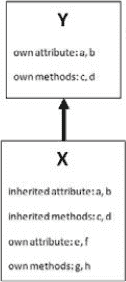

▲ 图 1：显示 X 类与 Y 类之间的继承关系

在本书中，表格紧接在其首次引用之后放置，如下所示：

**表 1：一些常用的格式说明符**

| 格式说明符 | 类型 |
|---|---|
| %i | int |
| %d | int（十进制） |
| %c | char |
| %f | float |
| %lf | double |
| %s | string |

在 *测试你的知识* 部分，你可以找到一些与所讲解主题相关的、带有解答的问题解决类问题。问题解决类问题的格式如下所示：

### 测试你的知识

**Q1：** 编写一个程序，接受一个输入并打印其平方、立方和四次方，而不进行任何不必要的计算。

**答：**

```c
//program to evaluate square, cube and fourth power of given value
#include<stdio.h>
#include<math.h>

//main program begins
void main()
{
    float a;

    //input segment
    printf("\n Give the value of number:-");
    scanf("%f",&a);

    //calculation and printing segment
    printf("\n Square= %.4f",pow(a,2));
    printf("\n Cube = %.4f",pow(a,3));
    printf("\n Fourth power = %.4f",pow(a,4));
} // end of program
```

**输出：**

```text
Give the value of number:-4
Square = 16.0000
Cube = 64.0000
Fourth power = 256.0000
```

在本书中，你还会在章节标题中找到一些与所讲解主题相关的附加问题。相关问题的格式如下所示：


> 什么是内联函数？讨论其优缺点。编写一个程序来演示内联函数（孟买大学，2008 年 12 月）


## 01 | 使用 C++ 进行结构化编程

**目标**

- 1.1 C++ 简介
- 1.2 C++ 的历史
- 1.3 C++：C 编程语言的超集
- 1.4 探索 C++ 的基本组成部分

C++ 是一种流行的面向对象编程（OOP）语言，由 C 语言发展而来。早期，C 语言被用于创建计算机程序。然而，使用 C 语言编程存在几个问题。其中一个问题是，C 程序中的各个函数相互关联，如果其中任何一个函数出现错误，程序员将难以定位该函数并纠正错误。C 语言的另一个问题是，在一个程序中编写的代码无法用于另一个程序。此外，C 语言还存在与安全性相关的问题。由于数据是全局共享的，程序中的任何函数都可以轻松访问这些数据，而对该数据的任何修改都会影响整个程序的运行。C++ 作为一种面向对象语言，应运而生，成为这些问题的解决方案。

本章介绍 C++ 中 OOP 的特性，并讨论 C++ 语言、其历史、特性和优势。在本章中，你还将学习 C++ 作为 C 编程语言的超集，并探索 C++ 语言的基本组成部分。

### 1.1 | C++ 简介

C++ 在编程世界中实现了对象的概念。现实世界中的对象可以是任何具有自身属性的实体。例如，笔是一个现实世界的实体，具有形状、颜色和耐久性等属性。笔有多种类型，如 Reynolds 和 Rotomac；然而，这些笔并不完全相同。这些笔都有自己的属性。现在，如果我们要将这些笔与编程世界联系起来，它们就被称为 pen 类的对象。一个对象可以继承类的一些属性，但它也有自己的属性。例如，每支笔都应该有颜色和形状；因此，颜色和形状成为 pen 类的属性。现在，笔的颜色和形状可能因笔而异；因此，颜色和形状成为笔类型（即 pen 类的对象）的属性。继承类的属性可以实现代码重用，这意味着无需重写已经可用的代码来实现被继承类的功能。C++ 的这一特性使得管理大型程序变得容易。此外，在 OOP 中，一个类的不同对象彼此独立，这意味着一个对象中的更改不会影响其他对象的功能。

现在你已经对 C++ 语言有了基本了解，让我们来讨论一下这种语言的历史。

### 1.2 C++ 的历史

1979 年，AT&T 贝尔实验室的 Bjarne Stroustrup 开发了 C 语言的增强版，命名为*带类的C*。后来，在 1983 年，它被更名为 C++，并在 AT&T 内部使用。C++ 源自 C 语言。OOP 的概念在 C 语言中得以实现，然后 C 发展成为一种名为 C++ 的面向对象语言。事实上，C++ 也被称为 C 语言的超集，因为 C++ 包含了 C 语言的所有功能。Bjarne Stroustrup 将其称为带类的C，后来改名为 C++。C++ 中的 ++ 符号表示 C 语言中的增量运算符，并附加在 C 后面，从而产生一个新名称 C++，因为 C++ 源自 C 语言。

开发 C++ 是为了创建易于管理和可重用的程序。在 C++ 开发之前，C 语言很流行，在当时被认为是一种非常好的编程语言。然而，用 C 语言管理长程序是一个问题，因为 C 程序中的所有函数都是相互关联的，对一个函数的更改会影响其他函数的性能。在这种情况下，程序员很难找出出现问题函数。这就是为什么需要一个新编程语言的原因——一种程序代码片段独立工作、便于程序管理的编程语言。

在了解了 C++ 的历史和出现之后，让我们在以下小节中分析 C 语言作为面向过程的语言和 C++ 作为面向对象的语言：

- C：面向过程编程
- C++：面向对象编程

#### C：面向过程编程

C 语言是 20 世纪 70 年代最流行的编程语言，它在编程世界掀起了一场革命。C 语言之前的编程语言使用代码和助记符，但随着 C 语言的发展，编程可以通过一些语句（如 `printf`、`scanf`）来完成。使用这些语句编写程序远比使用代码和助记符编写程序容易得多。这就是 C 语言受欢迎的原因。

C 是一种面向过程的编程语言，程序被划分为称为过程和函数的各个部分。这意味着程序员可以不用创建大型程序，而是分别创建执行特定任务（如数字相加、计算利息）的各种小过程。面向过程语言的特点如下：

- 强调执行任务的算法
- 将程序划分为执行各种任务的小过程
- 在过程之间共享全局数据
- 在各种过程之间传递参数，使过程能够相互通信
- 支持用户自定义数据类型

在 C 程序中，多个过程和函数共享全局数据，尽管它们也可以拥有局部数据。多个过程和函数共享全局数据增加了程序的复杂性。程序中的任何函数都可以轻松更改全局数据，这可能会影响共享相同数据的其他函数的功能。因此，共享全局数据是 C 语言的主要缺点。程序员可以通过记住哪个函数使用哪些数据来克服全局数据共享带来的问题。然而，这是一项非常繁琐的任务。因此，为了永久解决这个问题，OOP 的概念被引入编程世界。

现在，让我们讨论 OOP 的特性和优势。

#### C++：面向对象编程

OOP 用于创建更可靠和可重用的程序。它将数据和代码绑定在一起，并将它们视为一个单一实体。OOP 还帮助程序员创建模块化程序，该程序包含可重用的代码，可以轻松用于创建其他程序。代码重用的功能有助于以更低的成本快速创建软件应用程序。在 OOP 中，我们采用自底向上的方法，即通过组合各种小型功能单元来创建大型程序。

现在，让我们在以下小节中讨论 OOP 的特性和优势。

##### OOP 的特性

以下是 OOP 的一些重要特性：

- **封装**：允许将类成员（变量和方法）绑定在一起，并保护它们不被其他类访问。在 C++ 中，封装是通过使用称为 `class` 的结构来实现的。类的实例被称为 `object`，它用于调用程序中的各种函数。
- **数据抽象**：允许隐藏用户执行某些特定功能时不需要的数据。在 C++ 中，使用类来实现数据抽象，这是 OOP 最强大的特性之一。

```c
printf ("Hello from C.");
return 0;
}
```

同样的程序可以用 C++ 编写，如清单 2 所示（你可以在光盘的 code/chapter1 文件夹中找到 Welcome.cpp 文件）：

**▶ 清单 2：显示一个 C++ 程序**

```cpp
#include <iostream.h>

// display a welcoming message.
int main() {
    cout << "Hello from C++." << endl;
    return 0;
}
```

让我们比较上述两个清单中定义的 C 和 C++ 程序，以理解 C++ 如何成为 C 的超集。

在清单 1 和清单 2 中，第一行都使用了 #include 预处理指令。#include 预处理指令用于插入指定的头文件，以便 C/C++ 编译器了解程序中包含的方法和对象。

此外，你一定注意到清单 1 和清单 2 中都有 main() 函数，它是 C/C++ 程序的入口点。main() 函数后跟一对花括号 { }，其中包含与 C/C++ 程序相关的所有代码。

在 C 程序中，我们使用 printf() 函数来显示输出，而在 C++ 中使用 cout 对象。你也可以在 C++ 中使用 printf 函数来显示输出，但 cout 对象比 printf 函数灵活得多。

> *有关 cout 对象的更多信息，请参阅“编写 C++ 程序”一节*

现在让我们继续深入了解 C++。在以下小节中，你将学习 C++ 中一些常用术语，以及库函数和链接器。此外，你还将学习如何在 C++ 中创建和执行简单程序。这些主题将在以下主要标题下进行讨论：

- 解释 C++ 中常用的术语
- 探索 C++ 库函数和链接器
- 编译和运行 C++ 程序

#### C++ 中常用的术语

每种编程语言都有许多术语，但其中只有少数是最常用的。C++ 也有一些常用的术语。以下是这些术语的简要描述：


- 编译器：将程序的源代码转换为可执行文件。可执行文件由源代码的二进制形式组成。换句话说，编译器将 C++ 程序转换为机器可读的格式。互联网上有各种编译器可供免费下载。最常用的 C++ 编译器包括：
    - Turbo C/C++ 编译器
    - Borland C++ 编译器
    - Linux/Unix 编译器，即 GNU C++ 编译器
- 数据类型：为变量指定一个类型，以便在其中存储特定数据。例如，`int` 数据类型的变量只能存储整数值。
- 标识符：指程序员为变量、函数、常量和类指定的名称。
- 运算符：指诸如 +、-、* 和 / 之类的符号，分别用于执行加法、减法、乘法和除法运算。
- 函数：指程序中编写代码以执行特定任务的部分。一个程序可能包含程序员定义的许多函数。
- 预处理器指令：允许你在 C++ 程序中包含头文件。
- 错误：指中断程序执行的不希望出现的状况。错误有两种类型：语法错误和逻辑错误。当你在程序中编写了编译器无法读取的内容时，就会发生语法错误。例如，编写 `INT` 而不是 `int` 来声明变量，编译器无法理解。C++ 编译器只能检测语法错误，不能检测逻辑错误。逻辑错误是程序员犯的错误。例如，程序员在编写代码时，本应添加两个或多个数字，却可能错误地编写为相乘。在这种情况下，编译器不会生成任何错误，但程序的输出不符合要求。

## C++ 库函数和链接器

库函数是预定义的 C++ 函数，用于简化程序员的任务。例如，如果程序员想要创建一个程序来计算字符串的长度（在 C 中），程序员需要编写代码。另一方面，程序员可以在 C++ 中使用 `strlen()` 函数，这是一个用于计算指定字符串长度的库函数。在 C++ 程序中使用库函数可以简化工作并减少出错的可能性。在 C++ 中，库函数存储在各种文件中，这些文件需要包含在 C++ 程序中。例如，要使用 `cout` 对象，你需要在 C++ 程序中包含 `iostream.h` 头文件。现在，将此文件与源代码链接以生成可执行文件。链接器执行将头文件与源代码链接的过程。用于从源代码生成可执行文件的编译器也带有链接器，这些链接器将源代码与头文件链接起来。


> 在 C++ 程序中包含头文件的过程将在本章后面的“预处理器指令”一节中讨论。

在讨论了 C++ 库函数和链接器之后，让我们学习如何编译和运行 C++ 程序。

## C++ 程序的流程

在*C++ 是 C 编程语言的超集*一节中，你注意到 C++ 程序的基本结构与 C 程序类似。此外，C++ 中常用的术语，如 `include` 和 `return`，也与 C 语言中的术语相似。这意味着，对于熟悉 C 语言的人来说，用 C++ 编写程序更容易。现在，让我们学习如何编写 C++ 程序，然后编译并运行该程序。

## 编写 C++ 程序

我们已经在*C++：C 编程语言的超集*一节中编写了一个简单的 C++ 程序。现在，让我们理解该程序的基本结构，如下面的代码片段所示：

```cpp
#include <iostream.h>

// Display a welcoming message.
int main() {
    cout << "Hello from C++." << endl;
    return 0;
}
```

在前面的代码片段中，所有关键字都是小写，这就是 C++ 的设计方式。程序的第一行包含一个 `#include` 指令，用于在程序中包含名为 `iostream` 的头文件。这样做是因为在后面的代码中，我们使用内置的 C++ `cout` 对象来显示此程序的文本。`cout` 对象包含在 `iostream` 头文件中，我们需要包含此头文件才能使用 `cout` 对象。

所有预处理器指令都以 `#` 字符开头，两个常用的预处理器指令是：

- `#include`：将另一个文件包含到当前文件中
- `#define`：定义可在代码中使用的常量值。（尽管 C++ 正在逐渐放弃 `#define` 预处理器指令，转而使用 `const` 关键字）


> 并非每个 C++ 编译器都支持标准 C++ 头文件，例如 `iostream`；如果你使用的是这样的编译器，则应使用较旧的语法 `#include <iostream.h>` 而不是 `#include <iostream>`。

现在，你已经熟悉了使用 `iostream` 头的 `cout` 对象的过程。此头文件是现代标准 C++ 头文件，与旧的、非标准的 C++ 和 C 头文件略有不同。区别在于，`iostream` 头中指定的对象是名为 `std`（standard 的缩写）的特殊命名空间的一部分。

命名空间到底是什么？当你编写自己的程序时，你定义自己的对象，当你将你的工作与他人编写的代码结合时，这些对象的名称可能会与他人已经使用的名称冲突。为了避免这种混淆，C++ 允许你指定一个命名空间来定义程序的对象。为此，ANSI/ISO 委员会决定将命名空间作为 C++ 的标准部分，并且 `iostream` 头文件中声明的所有项都是 `std` 命名空间的一部分。

接下来，在清单 2 中，有一个 C++ *注释*，它是一种添加到 C++ 代码中的注解，以使代码更具可读性。你可以使用注释出于自己的目的对代码进行注解，或者使其他人更容易理解程序中发生的事情。在清单 2 中，注释解释了程序的工作方式。就 C++ 而言，`//` 之后一行的所有内容都会被编译器忽略；编译器解释的清单 2 的视图如下：

```cpp
#include <iostream.h>
int main ()
{
    cout << "Hello from C++." << endl;
    return 0;
}
```

> 我们将在本章前面的“注释”一节中了解更多关于注释的内容。

在清单 2 中插入注释之后，出现了一个名为 `main()` 的重要函数。你可能熟悉函数的概念；它们是编程的基本构建块。`main()` 函数被称为 C++ 程序中的入口点，因为当你运行程序时，操作系统会调用此函数。这仅仅意味着 `main()` 函数中包含的代码首先执行。我们在 `main()` 函数之前引入了 `int` 关键字，这表示 `main()` 函数将向操作系统返回一个整数值。

接下来，在清单 2 中，你看到了程序的代码，这些代码包含在花括号 `{ }` 中。

当程序执行时，会显示 `Hello from C++.` 消息。C++ 使用名为 `cout` 的 `iostream` 对象来显示文本。`cout` 对象处理你希望从程序显示的基于文本的输出。

> 第 2 章*使用输入/输出和流程控制*将详细讨论 `cout` 对象。

在清单 2 中，我们使用 `<<` *运算符*将文本 `Hello from C++` 发送到 `cout` 对象。你熟悉运算符的概念；你使用运算符对称为*操作数*的数据值执行操作（例如，2+3 使用 `+` 运算符将操作数 2 和 3 相加）。在 C 语言中，`<<` 运算符用作左移运算符，但在 C++ 中

它用于将文本发送到 cout 对象，以便显示文本。在 C++ 中，一个运算符可以执行多种不同的任务。

你可能注意到，我们在同一行代码中两次使用了 << 运算符。第二次使用 << 运算符是为了将 endl 关键字发送到 cout 对象。endl 关键字是一个 iostream *操纵器*，用于控制 cout 对象的行为。在代码清单2中，endl 操纵器用于将控制移到下一行。


> endl 操纵器将在第2章“处理输入/输出和流控制”中讨论。

在 cout 语句的末尾有一个分号（;）。这个分号充当终止符，很像句子末尾的句号。main() 函数中的最后一条语句是 `return 0`。return 语句用于在 C++ 程序中向函数返回一个值；不过，将 0 与 return 关键字一起使用表示程序终止。

## 测试你的知识

Q1. 编写一个程序，接受用户输入的数字，并通过实现 \t 转义序列显示所接受的数字。

**答案：**

```cpp
#include <iostream.h>

int main ()
{
    int num;
    cout << "Enter a number:";
    cin >> num;
    cout << "You entered:" << num << "\t" << num << endl;
    return 0;
}
```

**输出：**

```text
Enter a number: 8
You entered: 8    8
```

既然已经创建了 C++ 程序，现在是时候编译该程序了。

## 编译程序

创建程序后，必须编译它才能运行。编译 C++ 代码的实际细节取决于编译器。在本节中，我们将了解在 UNIX 和 DOS 等各种操作系统中编译 C++ 程序的过程。

在 *C++集成开发环境*（IDE）中，C++ 程序作为 *项目* 的一部分创建，并通过使用菜单项（如 Make、Build 或 Build All）进行编译。此类 IDE 软件包可以为你创建不同类型的程序，例如可能在 DOS 中运行的程序、动态链接库或 Web 应用程序。在 C++ 中，编译过程的细节因编译器而异。

在标准 UNIX 中，可用于编译 C++ 程序的编译器是 CC 或 g++，你只需在命令行上将想要编译的文件名传递给编译器即可。以下代码片段展示了如何在命令行上传递 C++ 文件以编译该文件：

```text
%g++ hello.cpp
```

通常，在编译程序时，C++ 库会与 C++ 程序链接，但在某些版本中，你可能需要显式地将 C++ 库与 C++ 程序链接。请考虑以下代码片段，以显式地将 C++ 库与 C++ 程序链接：

```text
%g++ hello.cpp -lg++
```

前面的代码片段将 hello.cpp 文件转换为新文件 hello.o，然后将其与 C++ 标准库*链接*，以添加支持 C++ 所需的代码。结果是一个名为 a.out 的文件，它是一个可执行文件，可以运行，如下面的代码片段所示：

```text
%a.out
```

这是在 UNIX 平台上编译 C++ 程序的过程。现在，让我们学习如何在 DOS 中编译 C++ 程序。

在 DOS 中，编译 C++ 程序的过程是基于命令的。例如，在 Borland C++ 中，编译器名为 bcc32.exe，它被解压到名为 bin 的目录中。C++ 代码中包含的文件（如 iostream）被放入名为 include 的目录中，而 C++ 库对象被放入名为 lib 的目录中。如果你将所有内容解压到名为 `c:\bcc` 的目录中，命令行会显示以下语句：

```text
C:\cpp>c:\bcc\bin\bcc32 -I c:\bcc\include -L c:\bcc\lib hello.cpp
Borland C++ 5.5 for Win32 Copyright (c) 1993, 2000 Borland
hello.cpp:
Turbo Incremental Link 5.00 Copyright (c) 1997, 2000 Borland
```

在前面的语句中，我们使用 -I *开关* 向编译器指明包含文件的路径，并使用 -L 开关指明 C++ 库文件。


> 可在命令行使用 -I 或 -L 等编译器开关来自定义编译器行为；请查阅编译器文档以了解其可用的命令行开关。

编译 C++ 程序后，需要调试程序以检查和消除错误。

## 调试程序

你创建的程序可能因缺陷而无法成功编译。为了成功编译和运行程序，你必须先消除程序中的这些缺陷。从程序中消除缺陷的过程称为调试。程序在成功调试后即可运行。

## 运行程序

已编译程序的执行取决于计算机的操作系统。在 Windows 中，你在命令行输入可执行文件的名称（如 hello），如果存在 .exe 扩展名则省略它，然后按 Enter 键启动程序。

在 UNIX 中，可执行文件的名称可以是 a.out，你应在命令行中输入它以运行程序。

基于 IDE 的 C++ 编译器（如 Microsoft Visual C++）应包含“运行”或“执行”菜单项，以运行已编译的程序。


> 如果程序未正常终止且似乎卡住，请同时按 Ctrl+C 键终止程序，或从用于开发 C++ 程序的 IDE 中选择相应菜单项（如“停止运行”）。

有时，运行 C++ 程序时，显示输出的窗口可能只出现很短时间，并在你来得及仔细查看之前立即关闭。如果遇到此问题，请在 main() 函数的最末尾、return 语句之前添加 cin.get() 方法。通过添加 cin.get() 方法，输出窗口会等待你按某个键（如 Enter 键），之后程序才会终止。

现在你已了解如何创建、编译和运行 C++ 程序，接下来让我们学习 C++ 的组成部分。

### 1.4 探索 C++ 的基本组成部分

在编写程序之前，你必须充分了解所使用语言的基础知识。C++ 语言的基础知识包括理解其基本程序结构（已在 *C++ 程序*的“流程”部分讨论过），以及该语言保留的标记和关键字。除此之外，你还应知道如何通过添加注释使程序更具可读性。

标记、关键字和注释是 C++ 使用的一些基本组成部分。标记包括关键字、标识符、常量、运算符和特殊符号，例如预处理器指令和运算符。在 C++ 库中预定义且对 C++ 编译器有意义的元素称为标记。在 C++ 中，标记由空白分隔，空白包括空格、制表符和换行符。

以下是 C++ 的基本组成部分：

- 关键字
- 标识符
- 注释
- 常量
- 变量
- 数据类型
- 预处理器指令
- 运算符

让我们逐一讨论这些组成部分。

### 关键字

创建 C++ 程序时，我们使用自己指定的名称来声明变量。这些变量名不应与 C++ 保留自用的术语冲突。C++ 中的保留名称称为关键字。表1列出了这些关键字：

**表1：C++ 的关键字**

|  |  |  |  |
|---|---|---|---|
| asm | auto | volatile | while |
| bool | break | case | catch |
| char | class | const | const_cast |
| continue | default | delete | do |
| double | dynamic_cast | else | enum |
| except | explicit | extern | false |
| finally | float | for | friend |
| goto | if | inline | int |
| long | mutable | namespace | new |
| operator | private | protected | public |
| register | reinterpret_cast | return | short |
| signed | sizeof | static | static_cast |
| struct | switch | template | this |
| throw | true | try | type_info |
| typedef | typeid | typename | union |
| unsigned | using | virtual | void |

现在我们来讨论 C++ 中使用的标识符。


## 标识符

标识符是与函数或数据对象关联的名称，用于引用该函数或对象。在创建标识符之前，应牢记以下几点：

-   标识符必须以字母或下划线开头，但不建议以下划线开头，因为在C++中，以下划线开头的标识符可能被保留为编译器特定的关键字。例如，`_FILE_` 是一个预定义标记，用于保存当前文件名。
-   标识符可以由字母、数字和下划线组成。
-   标识符内不允许有空格。
-   不能使用C++关键字作为标识符名称。
-   标识符区分大小写，即 salary、Salary 和 SALARY 是三个不同的标识符。
-   标识符的长度没有限制。换句话说，根据您的需求，标识符可以任意长。

有效标识符的一些示例是 Emp_sal 和 You_can_use_as_long_as_identifier_you_need。

现在，让我们来了解注释。

## 注释

注释是程序中被编译器忽略但对程序员有用的文本。注释用于使程序易于阅读和理解。此外，注释帮助程序员理解程序中代码的工作原理。注释不影响程序的运行。注释可能包含以下信息：

-   程序的目的。
-   程序员的姓名以及程序创建的日期和时间。
-   程序中所有函数的工作原理，以便程序员能够轻松理解它们。这在程序员需要修改程序时非常重要。

C++中的注释有以下两种类型：

-   单行注释：以一对正斜杠（`//`）开头。编译器将 `//` 后面的所有文本视为注释并忽略该文本。以下代码片段展示了单行注释：

  ```cpp
  #include <iostream.h>
  int main() {
  // This is a single line comment
  ...
  return 0;
  }
  ```

-   多行注释：以正斜杠和星号（`/*`）开头，以星号和正斜杠（`*/`）结尾。您要作为注释的文本写在 `/*` 和 `*/` 之间。以下代码片段展示了多行注释：

  ```cpp
  #include <iostream.h>
  int main() {
  /* This is
  a multi line
  comment */
  ...
  return 0;
  }
  ```

建议仅对多行注释使用多行注释，而不是在每行前使用 `//`。

## 常量

C++中的常量是无法修改的固定值。在C++中，您使用 const 关键字声明常量。声明常量的语法是：

```cpp
const <datatype> <constant_name>;
```

在上述语法中，

-   `const`：指用于声明常量的 const 关键字
-   `<datatype>`：指常量的数据类型，表示常量将保存的值
-   `<constant_name>`：指您要声明的常量的名称

C++中的常量可分为以下主要类别：

-   整数常量
-   浮点常量
-   字符常量

这些常量是基本常量，除此之外，C++还提供了次要常量，如数组、指针、结构体、联合体和枚举。这些次要常量将在*第3章 使用数组和函数*和*第4章 指针*中讨论。

现在，让我们详细讨论这三类常量。

### 整数常量

整数常量是仅由数字组成的常量，没有小数部分。整数常量的大小取决于与变量名一起使用的整数数据类型。整数常量需要记住的规则如下：

-   它们必须至少包含一位数字
-   它们不能有小数点
-   它们可以是正数或负数
-   它们不能有逗号或空格
-   它们必须在 -32768 到 +32767 的范围内

以下代码片段展示了整数常量的声明：

```cpp
const int num1 = 258; // positive integer constant
const int num2 = -256; // negative integer constant
```

在上面的代码片段中，num1 常量保存正整数数值，num2 常量保存负整数数值。

### 浮点常量

浮点常量是包含小数数据并且还可以包含指数的常量。浮点常量也称为实数常量。默认情况下，浮点常量是 double 类型，但通过在浮点常量后附加 f 或 F，您可以向编译器指示该常量是 float 类型。如果在浮点常量后添加 l 或 L，则编译器将该常量视为 long double 类型。现在，让我们讨论C++中可用的两种浮点常量形式：

-   小数形式
-   指数形式

**小数浮点常量**

小数浮点常量是包含小数值或包含小数的值的常量。以下是小数浮点常量需要遵循的规则：

-   它们必须至少包含一位数字
-   它们必须有小数点
-   它们可以是正数或负数
-   它们不能有逗号或空格

以下代码片段展示了小数浮点常量的声明：

```cpp
const float num1 = 98.74; // positive fractional floating point constant
const float num2 = -98.74; // negative fractional floating point constant
```

在上面的代码片段中，num1 浮点常量包含正小数值，num2 浮点常量包含负小数值。

**指数浮点常量**

指数浮点常量是保存过小或过大值的常量。浮点常量在指数形式中由以下两部分表示：

-   尾数：表示字母 e 之前的部分，其中 e 表示用于科学计算的指数表示法
-   指数：表示字母 e 之后的部分

以下是指数形式的浮点常量的规则：

-   它们必须使用字母 e 分隔尾数和指数部分
-   尾数和指数部分可以具有正值或负值
-   它们必须在 -3.4e38 到 3.4e38 的范围内

以下代码片段展示了指数形式的浮点常量的声明：

```cpp
const float num1 = +3.2e-1; // positive exponential floating point constant
const float num2 = -3.2e-1; // negative exponential floating point constant
```

在上面的代码片段中，num1 浮点常量包含正指数值，num2 浮点常量包含负指数值。

### 字符常量

字符常量是将单个字符括在单引号中的常量。字符常量是 char 类型。以下是有效字符常量的示例：

```cpp
const char ch1 = 'f' // character constant
const char ch2 = 'g' // another character constant
```

在上面的代码片段中，ch1 和 ch2 是字符常量。

我们继续讨论C++基础知识，接下来介绍C++中变量的声明和初始化。

## 变量

变量是用于在程序中存储或表示某种特定类型信息的标识符。换句话说，变量是其值在程序中可能发生变化的常量。变量可以是整数类型、浮点类型或字符类型。在声明变量时，需要指定变量的名称以及它将保存的值的类型。变量名的规则如下：

-   它们可以由字母、数字或下划线组合而成
-   它们必须以字母作为第一个字符
-   它们不能有逗号或空格
-   它们不能有除下划线以外的特殊符号

在程序中使用变量之前，必须先声明然后初始化它们。在本节中，我们将讨论关于变量的以下主题：

-   变量的声明


- 变量的初始化
- 引用变量
- 变量的作用域

## 变量声明

在 C++ 中，变量可以在程序中的任何位置声明，这一点不同于 C 语言——在 C 语言中，所有变量都需要在程序开头声明。在 C++ 中声明变量的语法与 C 相同：

```
datatype var_name;
```

在上述语法中，

- **数据类型**：指任何有效的 C++ 数据类型，例如 int、float 或 char
- **变量名**：指要声明的变量名称

以下代码片段展示了变量的声明：

```
int x;
char c;
```

在上述代码片段中，变量 x 被声明为整数类型，它将保存整数值。还声明了 char 数据类型的变量 c，它将保存字符类型数据。可以通过用逗号分隔，在同一行中声明多个相同数据类型的变量，如下代码片段所示：

```
int x, y, z;
```

上述用于声明变量的代码片段与以下代码片段中所示的代码完全相同：

```
int x;
int y;
int z;
```

在上述代码片段中，声明了 int 类型的变量 x、y 和 z。声明变量后，必须对其进行初始化，才能在程序中访问它。现在我们来讨论如何初始化变量。

## 变量初始化

变量经过初始化以在其中存储一些值。在 C++ 中初始化变量的语法是：

```
var_name = value;
```

上述语法在 C 和 C++ 中都很常见。在此语法中，使用 `value` 值初始化变量 `var_name`。

以下代码片段展示了变量的初始化：

```
x = 10; // common in both C and C++
```

在上述代码片段中，使用前面讨论的两种初始化变量语法，将变量 x 初始化为值 10。声明并初始化变量的语法是：

```
datatype var_name = value;
```

以下代码片段展示了变量的有效初始化和声明：

```
int x=10; // common in both C and C++
```

在上述代码片段中，变量 x 既被声明又被初始化。

除了用整数值初始化变量之外，还可以声明能够存储小数值的变量，如下代码片段所示：

```
float num1, num2; //declaring float variables
num1 = 5.25; //initializing float variables
num2 = num1 * 3.24;
```

在上述代码片段中，声明并初始化了实数变量 num1 和 num2。

接下来，我们讨论 C++ 中的引用变量。

## 引用变量

引用变量是为已存在的变量提供第二个名称（别名）的变量。乍听起来可能并不吸引人，你可能会质疑为已存在的变量创建别名的必要性。引用变量有助于按引用将值传递给函数。引用变量允许你访问和修改原始变量中存储的内容。创建引用变量的语法是：

```
datatype &ref_var = var_name;
```

在上述语法中，

- 数据类型：指变量将保存的数据类型
- `&ref_var`：指要声明的引用变量的名称
- `var_name`：指为其创建引用变量的变量名

引用变量通过将 & 符号与引用变量名一起使用来创建。以下代码片段展示了引用变量的声明和初始化：

```
int x=10; // x is original variable
int &a = x; // a is alias of x

int y[10]; // y is original variable representing array
int &b=y[6]; // b is alias for the value stored at 6th index in array y.
```

引用变量中的 & 符号指向存储原始变量的内存地址；因此，原始变量及其别名表示同一内存位置。

## 变量的作用域

变量的作用域取决于它们在程序中的声明位置。变量可以具有局部作用域或全局作用域。当变量在函数内部或花括号（{}）内的代码块中声明时，就被认为具有局部作用域。然而，当变量在函数外部声明时，它就成为全局变量。以下代码片段阐明了变量作用域的概念：

```
#include <iostream.h>
int x; // global variable
int main ()
{
    int y; // local variable
    .
    .
}
```

在上述代码片段中，int x 是全局变量，而 int y 是局部变量。全局变量可在程序中的任何位置访问，而局部变量仅可在其声明所在的函数或代码块中访问。

现在你已经熟悉了变量以及它们在 C++ 中的使用方式。在下一节中，我们讨论 C++ 数据类型。

## 数据类型

数据类型是语言中非常重要的一部分，因为没有它们甚至无法声明变量。术语“数据类型”用于指定变量的类型，这意味着我们必须指定变量将存储何种数据。与变量名一起使用的数据类型还指定变量可用于存储数据的内存量。例如，C++ 中的 long 数据类型大小为 4 字节，也就是说，long 类型的变量可使用 4 字节内存。表 2 列出了标准 C++ 中可用的简单数据类型：

**表 2：C++ 中的数据类型**

| 类型 | 描述 |
|---|---|
| bool | 保存 true（非零）或 false（零）值 |
| char | 包含字符，例如 a 和 b |
| signed char | 表示带数字符号的 char 类型，例如 − 和 + |
| unsigned char | 表示不带数字符号的 char 类型 |
| short | 表示大于或等于 char 类型、且小于或等于 int 类型的整数 |
| short int | 与 short 类型相同，但仅表示整数值 |
| signed short | 与 short 类型相同，但范围是 -32768 到 32767 |
| unsigned short | 与 short 类型相同，但范围是 0 到 65535 |
| int | 表示基本整数类型 |
| signed int | 与 int 类型相同，但范围是 -2147483648 到 2147483647 |
| unsigned int | 与 int 类型相同，但范围是 0 到 4294967295 |
| long | 表示长整数 |
| signed long | 与 long 类型相同，但范围是 -2147483648 到 2147483647 |
| unsigned long | 与 long 类型相同，但范围是 -2147483648 到 2147483647 |
| float | 表示浮点数 |
| double | 表示双精度浮点数；其精度通常高于 float 类型 |
| long double | 表示精度甚至高于 double 类型的浮点数 |
| void | 表示 void 类型 |

C++ 中的数据类型可分为以下三大类：

- 内置
- 用户定义
- 派生

我们逐一讨论这些数据类型。

### 内置数据类型

C++ 编译器支持所有内置数据类型，这些类型也称为基本或基础数据类型。除 void 数据类型外，所有内置数据类型都可以具有若干修饰符，例如应用于字符和整数数据类型的 signed、unsigned、long 和 short。C++ 中的内置数据类型如下：

- 整数类型
- 字符类型
- 浮点类型
- 布尔类型
- Void

我们详细讨论其中的每一种。

### 整数类型

C++ 提供三种整数类型：short、int 和 long。它还支持有符号整数和无符号整数。有符号整数具有负值和正值，而无符号整数只有正值。在所有整数类型中，short 是最小的整数类型，long 是最大的整数类型。表 3 显示了 int、long 和 short 数据类型的宽度和范围：

**表 3：C++ 中整数类型数据类型的范围**

| 数据类型 | 表示 | 宽度（字节） | 范围 |
|---|---|---|---|
| short | 短整型 | 2 | 有符号：-32768 到 32767<br>无符号：0 到 65535 |
| int | 整型 | 2（16 位编译器）<br>4（32 位编译器） | 有符号：-32768 到 32767<br>无符号：0 到 65535<br>有符号：-2147483648 到 2147483647<br>无符号：0 到 4294967295 |
| long | 长整型 | 4 | 有符号：-2147483648 到 2147483647<br>无符号：0 到 4294967295 |

以下代码片段展示了 int 类型变量的声明：

```cpp
//declaring int type variables
int x;
int sum;
int age;
```

在上述代码片段中，变量 x、sum 和 age 是 int 类型，它们将保存整数值。除了 int 数据类型之外，还可以声明较短的整数类型变量，它们占用更少的内存空间，从而加快程序执行速度。以下代码片段展示了短整数类型变量的声明：

```cpp
//declaring short int type variables
short int x;
short int sum;
short int age;
```


在前面的代码片段中，声明了 short 整型的 x、sum 和 age 变量。你也可以使用 int 关键字声明 short int 类型变量，如以下代码片段所示：

```
int x;
int sum;

int age;
```

现在，在了解了 int 和 short int 类型变量的声明之后，我们来讨论 long int 类型变量的声明。与 int 类型变量相比，long int 类型变量占用两倍的空间。以下代码片段展示了 long int 类型变量的声明：

```cpp
//declaring long int type variables
long int x;
long int sum;
long int age;
```

在前面的代码片段中，声明了 long int 类型的 x、sum 和 age 变量。int、short 和 long 类型变量也可以声明为无符号，如以下代码片段所示：

```cpp
//declaring unsigned int, short, and long type variables
short unsigned int x;
unsigned int sum;
unsigned long int age;
```

现在，我们来创建一个简单的 C++ 程序，用于声明整型变量并显示它们的值。清单 3 展示了显示整型变量值的代码（你可以在 CD 的 code/chapter1 文件夹中找到 IntegerExp.cpp 文件）：

### 清单 3：显示整数值

```cpp
#include <iostream.h>
int main() {
int num = 15;
cout << "The value of the num variable is:" << num << endl;
num = num + 30;
cout << "The incremented value of the num variable is:" << num << endl;
    return 0;
}
```

**输出：**

```
The value of the num variable is:15
The incremented value of the num variable is:45
```

在清单 3 中，声明了整型变量 num，并将其初始化为 15。接着，显示 num 变量的值，最后将 num 变量的值增加 30。

现在，我们来探讨字符数据类型。

## 字符类型

字符数据类型用于表示用单引号括起来的单个字符。该数据类型遵循 Unicode 字符集来表示处理器能够唯一识别的字符。Unicode 是一种标准字符集，支持各种国际语言中使用的所有字符。表 4 列出了 char 数据类型的范围：

**表 4：C++ 中字符数据类型的范围**

| 数据类型 | 表示 | 宽度（字节） | 范围 |
|---|---|---|---|
| char | 字符 | 1 | 有符号：-128 到 127<br>无符号：0 到 255 |

以下代码片段展示了字符类型变量的声明：

```cpp
char ch = 'B';
```

在前面的代码片段中，声明了 ch 变量，并将其初始化为值 B。初始化字符类型变量时，你必须记得将字符用单引号括起来。char 数据类型可以容纳一个字符，例如字母、数字或标点符号。这些字符以美国信息交换标准代码（ASCII）值的形式存储在计算机内存中。由于 B 的 ASCII 值为 66，因此 ch 变量中存储的值将是 66。

> ASCII 值在世界各地用于表示计算机中使用的各种符号。

在讨论了字符类型变量之后，我们来创建一个简单的程序，以显示赋给 char 类型变量的字符值。清单 4 展示了字符类型变量的声明（你可以在 CD 的 code/chapter1 文件夹中找到 CharEx.cpp 文件）：

### 清单 4：显示 char 类型变量中的字符

```cpp
#include <iostream.h>
int main()
{
    char str = 'h';
    cout << "The character stored in the str char type variable is:" <<str;
    return 0;
}
```

**输出：**

```
The character stored in the str char type variable is:h
```

在清单 4 中，声明了 char 类型变量 str，并为其赋了字符 h。在执行清单 4 中的代码期间，将显示 h 值。

现在，我们来讨论浮点类型变量。

## 浮点类型

我们已经知道，浮点数由 float 和 double 数据类型表示。这些数据类型用于表示带有小数值的数字。这些数据类型也可以有指数，即 10 的任意次幂。例如，2e2 = 2 x 10 ^ 2，其中 e 表示 10，也就是指数。float 数据类型中的指数最大可达 10 ^ 38，而 double 数据类型中的指数可达 10 ^ 308。float 和 double 数据类型之间的区别在于：float 数据类型在小数点后最多可表示 7 位数字（单精度），而 double 数据类型可表示 15 位数字（双精度）。表 5 列出了 float 和 double 数据类型的特征（例如数据类型表示、宽度）：

| 数据类型 | 表示 | 宽度（字节） | 范围 |
|---|---|---|---|
| float | 单精度浮点数 | 4 | 3.4e +/- 38 |
| double | 双精度浮点数 | 8 | 1.7e +/- 308 |

以下代码片段展示了浮点类型变量的声明：

```cpp
float x=3.458f;
```

在前面的代码片段中，声明并初始化了一个 float 类型变量 x。同样，你可以将 double 数据类型与变量一起使用，如以下代码片段所示：

```cpp
double x, y;
```

在前面的代码片段中，x 和 y 变量是 double 类型。

在讨论了 float 和 double 数据类型之后，我们来创建一个简单的程序，以显示 float 类型变量的值。清单 5 展示了 float 类型变量的声明（你可以在 CD 的 code/chapter1 文件夹中找到 FloatEx.cpp 文件）：

### 清单 5：显示 float 类型变量的值

```cpp
#include <iostream.h>

int main()
{
    float num1 = 10.5;
    cout << "The value of the num1 float type variable is:" <<num1;
    return 0;
}
```

**输出：**

```
The value of the num1 float type variable is:10.5
```

在清单 5 中，声明了 float 类型变量 num1，并为其赋值 10.5。

现在，我们来讨论布尔数据类型。

## 布尔数据类型

布尔类型变量是声明为布尔类型且值为 true 或 false 的变量。你可以使用 bool 关键字声明布尔类型变量。true 和 false 值分别以整数 0 和 1 存储。清单 6 展示了如何声明布尔类型变量（你可以在 CD 的 code/chapter1 文件夹中找到 BooleanEx.cpp 文件）：

### 清单 6：使用 bool 关键字

```cpp
#include <iostream.h>

int main()
{
    bool a = true;
    cout << "The value of the a boolean type variable is:" <<a;
    return 0;
}
```

**输出：**

```
The value of the a boolean type variable is:1
```

> *bool 数据类型因编译器而异。因此，当你编译清单 6 中给出的代码时，编译器可能会产生错误。*

在清单 6 中，声明了一个布尔类型变量，并为其赋了 true 值。此外，还显示了该变量的布尔类型值。

现在，我们来讨论 void 数据类型。

## void 数据类型

void 数据类型是一种不返回任何值的数据类型。例如，与函数一起使用的 void 数据类型指定该函数不返回任何值。它也用于函数中，表示空参数列表。以下代码片段展示了 void 数据类型的用法：

```cpp
void add(void);
```

在前面的代码片段中，add 函数有一个 void 参数，这意味着它不传递任何参数。

当 void 数据类型与指针一起使用时，该指针可以指向任何未使用 const 或 volatile 关键字声明的变量。void 指针可以转换为另一种数据指针。你需要将 void 指针转换为另一种类型才能解引用 void 指针，如以下代码片段所示：

```cpp
void *a;
int *x;
x=a; // not valid in C++, needs to cast
x=(int *)a;
```

在前面的代码片段中，通过将 void 指针 a 类型转换为 int 数据类型来解引用它。

## 用户定义类型

到目前为止，我们已经讨论了 C++ 中可用的基本数据类型，但这并不是 C++ 中所使用数据类型的全部。除了使用原始数据类型之外，你还可以创建和使用自己的数据类型。这些数据类型称为用户定义数据类型。一些 C++ 关键字（例如 struct 和 union）用于在 C++ 中创建用户定义数据类型。你可以在 C++ 中创建以下用户定义数据类型：

- 类
- 结构体
- 联合体
- 枚举

我们逐一研究这些数据类型。

## 类

类是一种用户定义数据类型，它使 C++ 成为一种面向对象的语言。类由数据（变量）和操作这些数据的代码（函数）组成。数据 and 代码统称为类的成员。类的所有成员默认都是私有的，这意味着类的成员可以在同一个类内访问，而不能被任何其他类访问。你可以将类声明为公有，以允许其成员在类外部访问。私有和公有是访问说明符，用于指定变量、方法和类的作用域。


在 C++ 中创建类的基本格式类似于在 C 语言中创建结构的格式。换句话说，C++ 中的类是 C 中结构的演进。C 中的结构与 C++ 中的类之间的唯一区别在于，类不仅包含数据，还包含函数。C++ 也支持结构，我们将在下一节讨论。声明类的语法是：

```cpp
class class_name
{
    // members of a class
};
```

在前面的语法中，

- `class`：指用于创建类的关键字
- `class_name`：指类的名称

类名可以是任何逻辑名称，它应反映类中存储的信息。例如，类名 Invoice 应包含与发票相关的信息。类名 Invoice 现在成为一种新的数据类型标识符，可用于创建 Invoice 类的实例（对象）。

类的实例称为对象，它通过使用类的名称来创建，并在 C++ 程序中具有其唯一标识。创建类的对象的过程称为类实例化。创建对象时，会将一部分内存分配给该对象。创建类的对象的语法是：

```cpp
class_name obj_name;
```

在前面的语法中，

- `class_name`：指类名
- `obj_name`：指要创建的对象的名称

还可以使用以下语法在单条语句中创建类的多个对象：

```cpp
class_name obj_name1, obj_name2, obj_name3;
```

也可以通过将对象名称放在类定义之后来创建对象：

```cpp
class class_name
{
    // data and code
} obj_name, obj_name1;
```

通过这种方式，在 C++ 中创建对象。


> 你将在第 6 章“使用 C++ 的面向对象编程”中了解更多关于类和对象的内容。

现在，我们来讨论结构。你已经知道，在 C 和 C++ 中，类是由结构演化而来的。

## 结构

在 C++ 中，结构是一种用户定义的数据类型，它允许你定义一种数据构造，有助于存储不同数据类型的变量。例如，假设你想存储名字的首字符以及一个人的年龄。为此，你可以使用 C++ 中的结构创建自己的数据结构。这些数据结构用于创建新数据类型来声明变量。

在下面的代码片段中，我们创建一个名为 person 的结构：

```cpp
struct person
{
    char first_name;
    int age;
};
```

在前面的代码片段中，定义了 person 结构，其中包含 char 和 int 类型的变量。现在，下面的代码片段展示了如何将结构用作数据类型来声明变量：

```cpp
#include <iostream.h>
int main()
{
    struct person
    {
        char first_name;
        int age;
    };
    person ralph;
    .
    .
    .
}
```

在前面的代码片段中，ralph 是一个变量名，其数据类型为 person。你可以使用点 (.) 表示法访问结构的成员。清单7展示了使用 (.) 访问结构成员的方法（你可以在 CD 的 code/chapter1 文件夹中找到 STRUCTEX.CPP 文件）：

### ▶ 清单7：在结构中存储和显示数据

```cpp
#include <iostream.h>
int main()
{
    struct person
    {
        char first_name;
        int age;
    };
    person ralph;

    ralph.first_name = 'R';
    ralph.age=39;

    cout << "The first character of person’s name is " <<
    ralph.first_name<<endl;
    cout << "The age of the person is " << ralph.age <<endl;
    return 0;

}
```

### 输出：

```text
The first character of person’s name is R
The age of the person is 39
```

在清单7中，首字符和年龄值被赋给 person 数据结构。然后，访问并显示这些值。

使用这种构造，你可以创建自己的高级数据结构，并几乎像对待简单数据结构一样对待它们。*第 5 章“结构与联合”。* 将详细讨论结构。

### 测试你的知识

Q2. 编写一个程序，在其中创建一个显示学生成绩的结构。
答案。

```cpp
#include <iostream.h>

int main()
{
    struct marks
    {
        int cpp;
        int Java;
        int DBMS;
    };
    marks total;
    total.cpp= 50;
    total.Java= 55;
    total.DBMS= 53;
    cout << "Marks in CPP are" << total.cpp << " " << endl;
    cout << "Marks in Java are" << total.Java << " " << endl;
    cout << "Marks in DBMS are" << total.DBMS << " " << endl;
    return 0;
}
```

### 输出：

```text
Marks in Cpp are 50
Marks in Java are 55
Marks in DBMS are 53
```

## 联合

*联合* 也是一种用户定义的数据类型，它帮助你创建一种新的数据构造，其中所有成员共享同一内存位置。其声明在语法上类似于结构。下面的代码片段展示了 union 关键字的使用：

```cpp
union one_union
{
    double double_variable;
    double double_variable2;
};
```

在前面的代码片段中，声明了一个名为 one_union 的联合，其中包含两个 double 变量 double_variable 和 double_variable2。下面的代码片段展示了如何创建 one_union 类型的 union1 变量：

```cpp
#include <iostream.h>
int main( )
{
    union one_union
    {
        double double_variable;
        double double_variable2;
    };
    one_union union1;
    union1.double_variable = 3.14159;
    .
    .
    .
}
```

在前面的代码片段中，我们创建了一个 one_union 类型的变量 union1，并将其初始化为值 3.14159。在 one_union 联合中，声明了两个变量 double_variable 和 double_variable2。现在，当使用 union1 变量访问这些变量时，union1.double_variable 和 union1.double_variable2 都指向内存中的同一数据。清单8提供了访问并显示 union1.double_variable 和 union1.double_variable2 变量值的代码（你可以在 CD 的 code/chapter1 文件夹中找到 UnionEx.cpp 文件）：

### ▶ 清单8：使用联合

```cpp
#include <iostream.h>
int main()
{
    union one_union
    {
        double double_variable;
        double double_variable2;
    } ;
    one_union union1;
    union1.double_variable = 3.14159;

    cout << "union1.double_variable = " << union1.double_variable << endl;
    cout << "union1.double_variable2 = " << union1.double_variable2 << endl;

    return 0;
}
```

### 输出：

```text
union1.double_variable =3.14159
union1.double_variable2 =3.14159
```

由于联合的成员指向内存中的同一位置，修改一个成员的值会影响其他成员。

### 测试你的知识

Q3. 编写一个 C++ 程序，在其中创建一个联合，以表明联合的所有成员都指向同一内存位置。
答案。

```cpp
#include <iostream.h>

int main()
{
    union check
    {
        int x;
        int y;
    };
    check value;
    value.x= 5;
    cout << " Value.x =" << value.x << endl;
    cout << " Value.y =" << value.y << endl;
    return 0;
}
```

### 输出：

```text
Value.x = 5
Value.y = 5
```

## 枚举

*枚举* 由一组命名的整数常量组成。它允许你为变量可以取的值命名。例如，假设你想处理星期几（Sunday、Monday、Tuesday 等），但你不想用 0、1、2 这样的整数来指代它们，而是给它们真实的名称。你可以使用枚举来实现这一点。下面的代码片段列出了一组符号名称：

```cpp
enum day
{
    Sunday,
    Monday,
    Tuesday,
    Wednesday,
    Thursday,
    Friday,
    Saturday
};
```

现在，当你创建 day 类型的变量时，可以从你指定的可能值列表中为其赋值，如下面的代码片段所示：

```cpp
#include <iostream.h>
int main( )
{
    enum day {
        Sunday,
        Monday,
        Tuesday,
        Wednesday,
        Thursday,
        Friday,
        Saturday
    };
    enum day today = Friday;
    .
    .
    .
}
```


在前面的代码片段中，可以看到除枚举 Tuesday 外，days（枚举）的名称没有分配任何值。分配给枚举 Tuesday 的值为 5。编译器按递增顺序为枚举赋值，从 Sunday 的 0 开始。数值序列的赋值从 Tuesday 开始改变，这意味着编译器根据枚举 Tuesday 的值，为 Tuesday 之后的枚举赋值。这就是编译器将 0 赋给 Sunday、1 赋给 Monday、5 赋给 Tuesday、6 赋给 Wednesday、7 赋给 Thursday、8 赋给 Friday、9 赋给 Saturday 的原因。

## 测试你的知识

Q4. 编写一个程序来实现枚举的概念。

答案。

```cpp
#include <iostream.h>
int main()
{
enum month {
    Jan,
    Feb,
    Mar,
    Apr,
    May,
    Jun,
    Jul,
    Aug,
    Sep,
    Oct,
    Nov,
    Dec
};

enum month summer = Jun;
if (summer == May || summer == Jun || summer == Jul)
{
cout << "It is summer " << endl;
}
return 0;

}
```

输出：

```text
It is summer
```


写一篇关于枚举数据类型（孟买大学，2009 年 5 月）的简短说明。

## 派生数据类型

由现有数据类型创建的数据类型称为派生数据类型。以下是 C++ 中可用的派生数据类型：

- 数组
- 指针

### 数组

数组是数据存储位置的集合，其中每个位置保存相同类型的数据。那么问题来了：为什么我们需要这种复杂的结构？可能存在需要为大量数据项存储相似类型值的情况。基本数据类型在用于存储单个数据时没有问题，但如果要存储的数据更复杂呢？例如，假设你想存储 50 名学生的姓名。你可以通过声明 50 个变量来实现，每个变量存储一个姓名。然而，这并不是正确的方法。想象一下，仅仅为了存储学生姓名就要编写 50 条语句。这个问题的解决方案在于使用数组。使用数组，你可以声明一个能够存储所有这 50 个姓名的变量。使用数组的优点是，它们通过用一两条语句替换多条语句来简化编程。在 C++ 中声明数组的语法是：

```cpp
datatype array_name [array_size];
```

在前面的语法中，

- `datatype`：指合法的 C++ 数据类型
- `array_name`：指用于标识数组的任何标识符
- `array_size`：指一个整数值，表示数组可以存储的元素总数

声明数组的代码片段是：

```cpp
int  item [10];
```

在前面的代码片段中，声明了 int 类型的 item 数组。该数组最多可以存储 10 个元素。


在第 3 章*《使用数组和函数》*中会更详细地讨论数组。

### 指针

C++ 中的指针被定义为存储另一个变量内存地址的变量。指针与 C++ 中的其他变量类似，在使用前需要声明。指针的声明方式与其他变量相同。指针存储特定数据类型的地址，例如 int、char 和 float。声明指针的语法是：

```cpp
datatype *point_name;
```

在前面的语法中，

- **datatype：** 指任何合法的 C++ 基本数据类型或用户定义的数据类型。
- **point_name：** 指任何变量名。* 告知编译器变量 point_name 是一个指针变量。


> 第 4 章《指针》将更详细地讨论指针。

在讨论了内置数据类型、用户定义数据类型和派生数据类型之后，我们来学习如何将一种数据类型的变量转换为另一种数据类型。

## C++ 中的类型转换和类型强制转换

在 C++ 中，将整型变量转换为浮点型的概念称为类型转换。清单 10 展示了整型变量如何自动转换为浮点型（你可以在 CD 的 code/chapter1 文件夹中找到 IntTypeEx.cpp 文件：

### 清单 10：将整型变量转换为浮点型

```cpp
#include <iostream.h>
int main()
{
    int a = 10;
    float b = 22.7;
    b = b + a;
    cout << "The value of the b variable is:" <<b;
    return 0;
}
```

**输出：**

```text
The value of the b variable is:32.700001
```

在清单 10 中，int 类型变量 a 被赋值为 10，在变量 a 和 b 的值相加期间，它会自动转换为 10.0。在清单 10 中，你会注意到从 int 到 float 的自动类型转换。然而，如果你想将 double 类型变量转换为 int 类型，则需要为此显式提供代码。将一个数据类型变量显式转换为另一种数据类型的概念称为类型强制转换。清单 11 展示了如何将 double 类型变量强制转换为 int 类型（你可以在 CD 的 code/chapter1 文件夹中找到 DoubleTypeEx.cpp 文件）：

### 清单 11：将 double 类型变量强制转换为 int 类型

```cpp
#include <iostream.h>
int main()
{
double a = 2134.56;
int b;
b = int(a);
cout << "The value of the b variable is:" <<b;
return 0;
}
```

输出：

The value of the b variable is:2134

在清单 11 中，一个 double 类型变量被强制转换为 int 类型变量 b。在讨论了类型强制转换和类型转换的概念之后，现在我们来学习预处理器指令，它们可帮助你在 C++ 程序中包含文件并定义宏。

## 预处理器指令

预处理器指令在代码传递给 C++ 编译器之前处理。编译器包含一个预处理器，它在 C++ 编译过程开始之前处理预处理器指令。预处理器指令可帮助你执行操作，例如在 C++ 程序中包含头文件，以便你可以使用头文件中存储的函数，以及定义常量。C++ 中的预处理指令如下：

- `#define`：定义宏/标记
- `#elif`：表示 else-if 指令，其工作方式类似于 else-if 语句
- `#else`：表示 else 指令，其工作方式类似于 else 语句
- `#error`：生成编译时错误消息
- `#if`：表示 if 指令，其工作方式类似于 if 语句
- `#ifdef`：表示 if-defined 指令，用于测试宏是否存在
- `#ifndef`：表示 if-not-defined 指令
- `#include`：在 C++ 程序中包含文件
- `#line`：表示当前行指令
- `#pragma`：表示在代码之前运行的特殊功能
- `#undef`：取消定义已定义的宏

你可以将这些预处理器指令与预定义标记一起使用，例如 `_cplusplus`，如果当前程序是 C++，则定义该标记，否则不定义。你可以使用 `ifdef` 指令检查标记是否已定义，该指令以 `#ifdef` 关键字开始，以 `#endif` 关键字结束。以下代码片段检查程序是否在 C++ 中创建：

```cpp
#ifdef _cplusplus
cout << "This is a C++ program." << endl;
#endif
```

你可以在代码中使用的一些预定义标记如下：

- `_cplusplus`：如果当前程序是 C++，则定义
- `_STDC_`：如果当前程序是标准 C，则定义
- `__LINE__`：保存当前行号
- `__FILE__`：保存当前文件名
- `__DATE__`：保存程序的编译日期
- `__TIME__`：保存程序的编译时间

预处理器指令还支持*宏*，宏是预定义代码的片段。这些宏会连同宏中存储的值一起被预处理器替换。所有预处理器指令将在以下各节中详细讨论：

- #define 指令
- #undef 指令
- #include 指令
- 条件编译中使用的指令

### #define 指令

#define 指令是一种预处理器指令，用于为 C++ 程序中的常量赋予有意义的名称，然后该常量在程序中用作宏。#define 指令有以下两种使用方式：

- 定义保存常量值的变量
- 定义函数常量

使用 #define 指令的两种语法是：

```cpp
#define <macro/constant name> < value> // defining constant variable/macro
#define < func_name () > < func_val> // function constant/macro
```

在第一种语法中，宏/常量名可以是任何逻辑变量名，以用作常量或宏，值可以是赋给该变量的任何逻辑值。这方面的一个示例是 #define PI 3.14。在这种情况下，程序中所有出现的 PI 都将替换为值 3.14。

在第二种语法中，func_name() 是要为其创建宏的函数名，func_val 是要赋给函数中传递的参数的值。例如，在 #define radius (a) (PI *a*a) 中，a 将被替换为 C++ 程序传入函数 radius 的参数。现在，考虑以下代码片段，以更好地理解函数宏的概念：

```cpp
result = radius (a);
```


在前面的代码片段中，`a` 是一个保存值的变量，该值从调用函数传入 `radius()` 函数。现在，如果我们假设 `a` 等于 4，前面的代码片段将如下所示：

```cpp
result = (3.14*4*4)
```

前面代码片段的输出为：

```text
50.24
```

现在，让我们看清单 12，了解宏在程序中如何工作。清单 12 展示了如何创建一个变量宏 PI 和一个函数宏 radius(a)（你可以在 code/chapter1 文件夹中找到 Preprocessor.cpp 文件）：

### ▶ 清单 12：使用预处理器指令

```cpp
#include <iostream.h>
#define PI 3.14
#define radius(a) (PI*a*a)

int main()
{
        double p = PI;
        double result;
        cout << "value of p is " << p << endl;
        result = radius(4);
        cout << "value of function macro is " << result << endl;
        return 0;
}

输出：

value of p is 3.14
value of function macro is 50.24
```

在清单 12 中，我们定义了一个宏 PI，并为其赋值 3.14。然后我们定义了一个函数 `radius()`，带有一个参数 `a`。在 `main()` 函数中，我们声明了两个 double 类型变量 `p` 和 `result`，并将 PI 宏的值赋给变量 `p`。接下来，我们调用 `radius()` 函数并传入参数值 4，该函数返回计算结果并将其存储在 result 变量中。最后，变量 `p` 和 `result` 的值都会被显示出来。

> **测试你的知识**
>
> **Q5.** 编写一个程序来实现 `#define` 预处理器指令。
>
> **答案**
>
> ```cpp
> #include <iostream.h>
> #define cel(v) (((v-32)*5)/9)
>
> int main( )
> {
>     double x;
>     double result;
>     cout << " Enter value in Fahrenheit " << endl;
>     cin >> x;
>     result = cel(x);
>     cout << " Celsius conversion of Fahrenheit value is " << result << endl;
>     return 0;
> }
> ```
>
> **输出：**
>
> ```text
> Enter value in Fahrenheit
> 98
> Celsius conversion of Fahrenheit value is 36.666667
> ```

## #undef 指令

#undef 指令用于取消已定义宏的定义。当一个宏后跟 #undef 指令时，该宏将变为未定义状态，并从系统中移除。例如，假设你在 C++ 程序中为了某个特定目的使用 #define 指令创建了一个名为 PI 的宏，当该目的达成后，你想要取消 PI 宏的定义。在这种情况下，PI 宏后需要跟 #undef 指令。以下代码片段展示了未定义的 PI 宏：

```cpp
#undef PI
```

现在，C++ 程序中所有出现的 PI 宏都将被求值为 false。

## #include 指令

#include 指令是 C++ 中常用的预处理器指令。它用于在 C++ 程序中包含文件，例如头文件。该指令会使指定文件的全部内容插入到程序的源代码中。你可以通过两种方式在 C++ 程序中包含文件，如下面的代码片段所示：

```cpp
#include <filename>
#include "filename"
```

在前面的代码片段中，文件名周围的 `< >` 尖括号和 `" "` 引号用于指定 C++ 编译器搜索指定文件的路径。文件名周围的 `< >` 尖括号会让编译器在 C++ 预定义的目录列表中搜索该文件。如果在文件名周围使用 `" "` 引号，编译器将在当前目录以及指定的目录列表中搜索指定文件。预定义目录列表的路径在安装 C++ IDE 或编译器时指定。以下代码片段展示了如何在 C++ 程序中包含 iostream.h 文件：

```cpp
#include <iostream.h>
```

你也可以使用以下代码片段来包含 iostream.h 文件：

```cpp
#include "iostream.h"
```

在前面的代码片段中，`.h` 表示 `iostream.h` 是一个头文件。这样，我们就可以在 C++ 程序中包含头文件。你还可以包含执行 C++ 程序所需的其他文件。例如，如果你想包含一个现有的 C++ 文件（例如 abc.cpp），可以使用以下代码片段：

```cpp
#include "abc.cpp"
```

在 C++ 程序中包含文件的代码将与前面相同，只是文件名不同。

## 条件编译中使用的指令

在 C++ 中，我们有几个条件编译指令，例如 #if、#ifdef、#ifndef、#elif（else if）、#else 和 #endif。它们允许根据 C++ 程序中指定的条件，有选择地编译或忽略程序的某些部分。

#if 指令用于测试针对宏名称的表达式是否计算 #if 块中编写的语句。#if、#else 和 #elif 与 if-else 语句类似，彼此协同工作。以下代码片段解释了 #if 指令的概念：

```cpp
int main()
{
    #if <宏名称> <条件>
    语句 1;
    #else
    语句 2;
    #endif
}
```

根据前面的代码片段，编译器首先根据指定条件测试宏名称，如果条件计算结果为 true，则执行语句 1，否则执行语句 2。

#ifdef 指令检查 #ifdef 指令后跟的宏是否存在。如果宏存在，则执行 #ifdef 块中编写的语句；否则，编译器会生成错误。#ifdef 通常与 #else、#endif 指令协同工作。以下代码片段展示了 #ifdef 指令的实现：

```cpp
int main()
{

    #ifdef <宏名称>
    语句 1;
    #endif
}
```

在前面的代码片段中，#ifdef 指令检查 macro_name 宏是否存在。如果指定的宏存在，则执行语句 statement1；如果指定的宏不存在，则显示错误消息。

假设你定义了一个名为 count 的宏，并希望在 C++ 程序中使用它；但是，在使用该宏时，你不确定宏 count 是否已定义。在这种情况下，你可以使用 #ifndef 指令来检查宏是否存在，如下面的代码片段所示：

```cpp
int main()
{

    #ifndef <宏名称>
    #define <宏名称> <值>
    #endif
}
```

在前面的代码片段中，如果指定的宏不存在，你可以定义该宏。另一方面，如果指定的宏存在，则使用该宏并执行程序。

在讨论了预处理器指令之后，现在让我们了解 C++ 语言中运算符的工作方式。

## C++ 中的运算符

运算符是用于根据存储在各类变量中的值执行运算（如加法、减法、乘法或除法）的符号。我们将 C++ 中的运算符分为以下几类：

- 一元运算符
- 二元运算符
- 移位运算符
- 三元运算符
- 特殊运算符

首先，我们讨论 C++ 中的一元运算符。

### 一元运算符

作用于单个操作数的运算符称为一元运算符。一元运算符操作的操作数既可以是常量，也可以是变量。表 6 列出了一元运算符：

**表 6：C++ 中的一元运算符**

| 运算符 | 名称 | 结合性 |
|---|---|---|
| `-` | 一元减 | 无 |
| `++` | 自增 | 无 |
| `--` | 自减 | 无 |
| `!` | 逻辑非 | 无 |
| `~` | 按位取反 | 无 |

如果 - 运算符用于两个变量值的相减，则 - 运算符归类为二元运算符；但是，当 -- 运算符用于减少单个变量的值时，该运算符则归类为一元运算符。

++ 和 -- 运算符是在 C 语言中引入的，用于创建自增和自减的值。++ 运算符将其操作数加 1，-- 运算符将其操作数减 1。例如，如果一个变量的值为 0，那么在执行 ++variable 之后，该变量将变为 1。

++ 和 -- 运算符既可以是*后缀*运算符（用法如下：value++），也可以是*前缀*运算符（用法如下：++value）。当用作后缀运算符时，它们在语句的其余部分*之后*执行；当用作前缀运算符时，它们在语句的其余部分*之前*执行。

当任何变量作为前缀运算符应用 ++ 或 -- 运算符时，变量中存储的值会根据作用在变量上的运算符先进行自增或自减。如果你显示变量中存储的值，你将得到受运算符影响的输出。然而，当 ++ 和 -- 作为后缀运算符作用于一个变量并显示该变量时，该变量的值在第一次显示时会保持不变。现在，如果你再次显示该变量，你将看到根据作用于变量的运算符而产生的自增或自减后的值。

! 运算符将 true 值转换为 false，将 false 转换为 true。~ 运算符反转变量中存储的值的位，即 1 变为 0，0 变为 1。清单 13 展示了一元运算符的使用（你可以在 CD 的 code/chapter1 文件夹中找到 UnaryEx.cpp 文件）：

### ▶ 清单 13：使用一元运算符

```cpp
#include <iostream.h>
int main()
{
    int x = 5, y;
```


```cpp
y = -(x);
cout << "Value of X is " << x << endl;
cout << "Value of Y is " << y << endl;
cout << "Value of Y after y = x and applying Unary minus on x is " << y << endl;
cout << "Value of X after pre increment is " << ++x << endl;
cout << "Value of X before pre decrement is " << x << endl;
cout << "Value of X after pre decrement is " << --x << endl;
cout << "Value of X before post increment is " << x << endl;
cout << "Value of X after post increment is " << x++ << endl;
cout << "Value of X before post decrement is " << x << endl;
cout << "Value of X after post decrement is " << x-- << endl;
cout << "Finally, the value of X is " << x << endl;
return 0;
}
```

### 输出：

```text
Value of X is 5
Value of Y is -5
Value of Y after y = x and applying Unary minus on x is -5
Value of x after pre increment is 6
Value of x before pre decrement is 6
Value of x after pre decrement is 5
Value of x before post increment is 5
Value of x after post increment is 5
Value of x before post decrement is 6
Value of x after post decrement is 6
Finally the value of X is 5
```

在前面的输出中，你可以看到 x 的初始值为 5；当 `++` 作为前缀递增运算符应用于 x 时，它变为 6。之后，`--` 运算符作为前缀递减运算符应用于 x，x 的值变为 5。然后，在将 `++` 运算符作为后缀递增运算符应用后显示 x 的值。你会看到，即使 `++` 运算符已经作为后缀递增应用，x 中的值仍保持不变。这是因为我们之前执行了后缀递增，也就是说，x 中的值会在下一次实例中增加，正如输出中“Value of X before post decrement is”一行所示。当 `--` 运算符也用作后缀递减运算符时，也会发生同样的情况。

## 测试你的知识

### Q6. 编写一个程序来实现前缀递增运算符和后缀递增运算符。

答案。

```cpp
#include <iostream.h>

int main ( )
```

## ➜ 算术运算符

算术运算符用于执行基本操作，例如加法、减法、除法和乘法。表 7 列出了 C++ 中提供的所有算术运算符：

**表 7：算术运算符**

| 运算符 | 功能 | 结合性 |
|---|---|---|
| `*` | 乘法 | 从左到右 |
| `/` | 除法 | 从左到右 |
| `%` | 取模 | 从左到右 |
| `+` | 加法 | 从左到右 |
| `-` | 减法 | 从左到右 |

`*` 运算符用于将值相乘，`/` 运算符用于将值相除。`%`（取模）运算符计算余数，例如 10%3 = 1。`+` 运算符将两个或多个值相加，`-` 运算符用于相减。清单 14 展示了所有算术运算符的用法（你可以在 CD 的 code/chapter1 文件夹中找到 ArithmeticEx.cpp 文件）：

### ▶ 清单 14：使用算术运算符

```cpp
#include <iostream.h>
int main()
{
    int x = 10, y = 3, sum, sub, div, mod, mul;
    sum = x + y;
    sub = x - y;
    div = x/y;
    mod = x%y;
    mul = x * y;
    cout << "Addition of " << x << " and " << y << " is : " << sum << endl;
    cout << "Subtraction of " << x << " and " << y << " is : " << sub << endl;
    cout << "Division of " << x << " and " << y << " is : " << div << endl;
    cout << "Modulus of " << x << " and " << y << " is : " << mod << endl;
    cout << "Multiplication of " << x << " and " << y << " is : " << mul << endl;
    return 0;
}
```

### 输出：

```text
Addition of 10 and 3 is : 13
Subtraction of 10 and 3 is : 7
Division of 10 and 3 is : 3
Modulus of 10 and 3 is : 1
Multiplication of 10 and 3 is : 30
```

在清单 14 中，我们声明了两个变量：x 和 y，并分别将它们初始化为 10 和 3。我们对 x 和 y 执行了所有基本运算，并将结果存储在变量 sum、sub、mod、mul 和 div 中。

## 测试你的知识

### Q7. 编写一个程序来实现加法运算符。

答案。

```cpp
#include <iostream.h>

// using the addition operator.
int main()
{
        int s;
        s = 2 + 4;
        cout << "Addition of 2 + 4 is " << s << endl;
        return 0;
}
```

### 输出：

Addition of 2 + 4 is 6

### Q8. 编写一个程序来实现所有算术运算符。

答案。

```cpp
#include <iostream.h>

int main ( )
{
        int num=2, num1=5;
        cout << "Addition of 2 + 5 is " << num + num1 << endl;
        cout << "Subtraction of 5 - 2 is " << num1-num << endl;
        cout << "Division of 5 / 2 is " << num1/num << endl;
        cout << "Modulus of 5%2 is " << num1%num << endl;
        cout << "Multiplication of 5 * 2 is " << num*num1 << endl;
        return 0;
}
```

### 输出：

```text
Addition of 2 + 5 is 7
Subtraction of 5 - 2 is 3
Division of 5 / 2 is 2
Modulus of 5%2 is 1
Multiplication of 5 * 2 is 10
```

## 赋值运算符

赋值运算符是一种基本运算符，表示为 =。你可以使用 = 运算符将字面量值或另一个变量中的值赋给一个变量。清单 15 展示了 = 运算符的用法（你可以在 CD 的 code/chapter1 文件夹中找到 AssignmentEx.cpp 文件）：

### ▶ 清单 15：使用赋值运算符

```cpp
#include <iostream.h>
int main()
{
    int value = 12;
    cout << "The value = " << value << endl;
    return 0;
}
```

### 输出：

```text
The value = 12
```

在 C++ 中，你可以在同一条语句中执行多重赋值（这之所以可行，是因为赋值运算符本身会返回所赋的值）。清单 16 展示多重赋值概念的实现（你可以在 CD 的 code/chapter1 文件夹中找到 MultiAssEx.cpp 文件）：

### ▶ 清单 16：执行多重赋值

```cpp
#include <iostream.h>
int main()
{
    int value1, value2, value3;
    value1 = value2 = value3 = 12;
    cout << "First value = " << value1 << endl;
    cout << "Second value = " << value2 << endl;
    cout << "Third value = " << value3 << endl;
    return 0;
}
```

### 输出：

```text
First value = 12
Second value = 12
Third value = 12
```

**表 8：算术赋值运算符**

| 运算符 | 含义 | 结合性 |
|---|---|---|
| `%=` | 取模赋值 | 从右到左 |
| `&=` | 按位与赋值 | 从右到左 |
| `*=` | 乘法赋值 | 从右到左 |
| `/=` | 除法赋值 | 从右到左 |
| `^=` | 按位异或赋值 | 从右到左 |
| `|=` | 按位或赋值 | 从右到左 |
| `+=` | 加法赋值 | 从右到左 |
| `-=` | 减法赋值 | 从右到左 |
| `<=` | 小于等于赋值 | 从左到右 |
| `>=` | 大于等于赋值 | 从左到右 |
| `<<=` | 左移赋值 | 从右到左 |
| `>>=` | 右移赋值 | 从右到左 |

清单 17 展示了算术赋值运算符的用法（你可以在 CD 的 code/chapter1 文件夹中找到 ArithAssEx.cpp 文件）：

### 清单 17：使用算术赋值运算符

```cpp
#include <iostream.h>

int main()
{
    int x=10, y=8, z=9;
    x *=2;
    y +=2;
    z -=2;
    cout << "x * 2 = " << x << endl;
    cout << "y + 2 = " << y << endl;
    cout << "z - 2 = " << z << endl;
    return 0;
}
```

### 输出：

```text
x * 2 = 20
y + 2 = 10
z - 2 = 7
```

在清单 17 中，使用了 `*=`、`+=` 和 `-=` 算术赋值运算符。程序声明了 x、y 和 z 变量，并分别初始化为 10、8 和 9。然后，对 x 变量使用 `*=2` 算术赋值运算符，将 x 的值乘以 2。类似地，对 y 和 z 变量使用 `+=` 和 `-=` 算术赋值运算符，分别给相应变量加上 2 和减去 2。

## 测试你的知识

### Q11. 创建一个程序来实现 `*=` 和 `+=` 算术赋值运算符。

答案。

```cpp
#include <iostream.h>

int main()
{
    int num=4;
    num *=4;

    cout << "Value of num after applying *4 is = " << num << endl;
    num +=4;
    cout << "Value of num after applying +4 is = " << num << endl;

    return 0;
}
```

### 输出：

```text
Value of num after applying *4 is = 16
Value of num after applying +4 is = 20
```

## 关系运算符

关系运算符用于创建求值为 true 或 false 的表达式，你可以将这些表达式用于条件语句（例如 if 语句）中，或用作循环语句中的测试表达式。表 9 列出了 C++ 中存在的关系运算符：

**表 9：关系运算符**

| 运算符 | 含义 | 结合性 |
|---|---|---|
| `>` | 大于 | 从左到右 |
| `<` | 小于 | 从左到右 |
| `>=` | 大于等于 | 从左到右 |
| `<=` | 小于等于 | 从左到右 |


**表9：关系运算符**

| 运算符 | 含义 | 结合性 |
|---|---|---|
| == | 相等 | 从左到右 |
| != | 不等 | 从左到右 |

代码清单18展示了如何使用 < 关系运算符和 if-else 语句检查变量 budget 中存储的值是否大于0（你可以在 CD 的 code/chapter1 文件夹中找到 RelationalEx.cpp 文件）：

### ▶ 代码清单18：使用 < 关系运算符

```cpp
#include <iostream.h>

int main()
{
    int budget = 1;
    if (budget < 0)
    {
        cout << "budget is less than 0" << endl;
    }
    else
    {
        cout << "budget is greater than 0" << endl;
    }
    return 0;
}
```

输出：

```text
budget is greater than 0
```

在代码清单18中，我们声明了一个 `budget` 变量，并用整数值1初始化它。然后，我们放置一个条件 `if` 语句，检查 `budget` 变量的值是否小于0。随后，将显示 `budget` 小于0的值；然而，如果 `budget` 变量的值不小于0，则显示 `budget` 大于0的值。

> 大多数时候，新手程序员会混用赋值运算符 `=` 和关系运算符 `==`。这可能导致逻辑错误，并影响程序的整体输出。因此，在比较两个值时，请记住必须使用 `==`（关系）运算符，而不是 `=`（赋值）运算符。例如，如果 budget 变量中的值为0，则表达式 `budget = 0` 为真。另一方面，表达式 `budget == 0` 将值0赋给 budget，该表达式的结果为0，即为假。因此，在 C++ 程序中使用 `=` 运算符时需要小心。

## 测试你的知识

Q12. 编写一个程序实现关系运算符。

答：

```cpp
#include <iostream.h>

int main()
{
    int age = 18;
    if (age >= 18)
    {
        cout << "Eligible to vote " << endl;
    }
    else
    {
        cout << "Not eligible to vote" << endl;
    }
    return 0;
}
```

输出：

```text
Eligible to vote
```

## 逻辑运算符

C++ 的逻辑运算符用于组合逻辑表达式。逻辑表达式中通常使用的两个逻辑运算符是：

- &&（逻辑与）运算符：当两个操作数都为真时返回真，否则返回假
- ||（逻辑或）运算符：当两个操作数都为假时返回假，否则返回真

这些运算符以符合其名称含义的方式将逻辑表达式连接在一起——当你希望两个逻辑子句都为真，和/或当你只要求其中一个子句为真时也是如此。这些运算符作用于操作数，如表10所示：

| X | Y | x \|\| y（或） | X && y（与） |
|---|---|---|---|
| 假 | 假 | 假 | 假 |
| 真 | 假 | 真 | 假 |
| 假 | 真 | 真 | 假 |
| 真 | 真 | 真 | 真 |

现在，考虑代码清单19，其中我们使用了 && 运算符。在这种情况下，temperature 中的值必须既小于90又大于60，if-else 语句括号内的条件才为真。代码清单19展示了 &&（与）运算符的使用（你可以在 CD 的 code/chapter1 文件夹中找到 AndOperatorEx.cpp 文件）：

### ▶ 代码清单19：使用 && 运算符

```cpp
#include <iostream.h>

int main()
{
    int temperature = 70;
    if (temperature < 90 && temperature > 60)
    {
        cout << "Yes! It is a good time for picnic " << endl;
    }
    return 0;
}
```

输出：

是的！这是野餐的好时机

在代码清单19中，我们在 if 表达式中使用了 && 运算符。现在，我们来理解 || 运算符的使用。代码清单20展示了 ||（或）运算符的使用（你可以在 CD 的 code/chapter1 文件夹中找到 OrOperatorEx.cpp 文件）：

### ▶ 代码清单20：使用 || 运算符

```cpp
#include <iostream.h>

int main()
{
    int temperature = 50;
    if (temperature > 90 || temperature < 60)
    {
        cout << " Bad weather, no picnic today" << endl;
    }
    else
    {
        cout << "Yes! It is a good time for picnic" << endl;
    }
    return 0;
}
```

输出：

天气不好，今天不适合野餐

在代码清单20中，要使 `if` 语句内的表达式求值为真，`temperature` 变量的值应大于90或小于60。前面的输出表明，分配给 `temperature` 变量的值小于60，这使得 if 语句内写出的表达式为真。

`&&` 和 `||` 运算符也称为短路运算符，这意味着如果它们通过求值左操作数就能确定所需的一切，就不会求值右操作数。这在我们同时测试某个值是否为0以及其倒数时非常有用；如果该值确实为0，则表达式中计算其倒数的第二部分不会执行；因此，程序中不会出现除零溢出错误。

代码清单21展示了短路运算符 `&&` 的使用（你可以在 CD 的 code/chapter1 文件夹中找到 `ShortEx.cpp` 文件）：

### ▶ 代码清单21：使用短路运算符

```cpp
#include <iostream>

int main()
{
    double value = 0;
    if (value != 0 && 1/value < 1000)
    {
        cout << "The value is not too small." << endl;
    }
    else
    {
        cout << " The value is too small." << endl;
    }
    return 0;
}
```

输出：

该值太小了。

在代码清单21中，要使 `if` 语句内的表达式求值为真，`value` 变量的值应不等于0，并且用1除以该值时，余数应小于1000。前面的输出表明，分配给 `value` 变量的值为0，这使得 `if` 语句内写出的表达式为假。因此，`else` 块中写出的语句会作为输出显示。

## 测试你的知识

Q13. 编写一个程序实现逻辑运算符。

答：

```cpp
#include <iostream.h>

int main()
{
    int marks = 70;
    if (marks > 50 && marks < 60)
    {
        cout << " B Grade " << endl;
    }
    else
    {
        if (marks > 65 || marks < 75)
        {
            cout << " A Grade " << endl;
        }
    }
    return 0;
}
```

输出：

```text
A Grade
```

> 解释逻辑运算符。编写一个 C++ 程序来演示同样的内容（孟买大学，2008年12月）

理解了逻辑运算符之后，现在我们来讨论位运算符。

## 位运算符

允许操作值的各个位的运算符称为位运算符。表11列出了 C++ 支持的位运算符：

| 运算符 | 含义 | 结合性 |
|---|---|---|
| & | 按位与 | 从左到右 |
| \| | 按位或 | 从左到右 |
| ^ | 按位异或 | 从左到右 |

& 运算符比较两个操作数的对应位，如果对应位为1，则结果为1，否则结果为0。对于 | 运算符，如果对应位中任意一个为1，则结果为1，否则为0。^ 运算符比较对应位，当其中一位为0而另一位为1时返回1；否则结果为0。

代码清单22展示了 &（按位与）运算符的使用（你可以在 CD 的 code/chapter1 文件夹中找到 BitwiseAndEx.cpp 文件）：

### ▶ 代码清单22：使用按位与运算符

```cpp
#include <iostream.h>

int main()
{
    int x, y, z;
    x = 15;
    y = 27;
    z = x & y;
    cout<<"The value of operand 1 is: "<<x<<endl;
    cout<<"The value of operand 2 is: "<<y<<endl;
    cout<<"The value of operand 1 and operand 2 is: "<<z<<endl;
    return 0;
}
```

输出：

```text
The value of operand 1 is: 15
The value of operand 2 is: 27
The value of operand 1 and operand 2 is: 11
```

在代码清单22中，首先声明了 int 类型的 x、y 和 z 变量。接着，分别将值15和27赋给 x 和 y 变量。最后，使用按位与运算符将值赋给 z 变量。

现在，我们来讨论按位或运算符的使用。代码清单23展示了如何使用按位或（|）运算符（你可以在 CD 的 code/chapter1 文件夹中找到 BitwiseOrEx.cpp 文件）：

### ▶ 代码清单23：使用按位或运算符

```cpp
#include <iostream.h>

int main()
{
    int x, y, z;
    x = 15;
    y = 27;
    z = x | y;
    cout<<"The value of operand 1 is: "<<x<<endl;
    cout<<"The value of operand 2 is: "<<y<<endl;
    cout<<"The value of operand 1 or operand 2 is: "<<z<<endl;
    return 0;
}
```


```
Output:

The value of operand 1 is: 15
The value of operand 2 is: 27
The value of operand 1 or operand 2 is: 31
```

在代码清单 23 中，首先声明了 int 类型的 x、y 和 z 变量。接着，分别将 x 和 y 变量赋值为 15 和 27。最后，使用按位或运算符将值赋给 z 变量。

**表 12：按位运算符的功能**

| X | Y | X \| Y（OR） | X & Y（AND） | X ^ Y（XOR） |
|---|---|---|---|---|
| 0 | 0 | 0 | 0 | 0 |
| 1 | 0 | 1 | 0 | 1 |
| 0 | 1 | 1 | 0 | 1 |
| 1 | 1 | 1 | 1 | 0 |

现在，我们学习另一类运算符，它们与按位运算符一样，也在位级别上工作。

## 移位运算符

移位运算符用于将位模式向操作数的左侧或右侧移动，其中操作数是一个整数值。C++ 支持右移（>>）和左移（<<）运算符。使用移位运算符的语法如下：

```
Operand >> value // syntax for right shift
Operand << value // syntax for left shift
```

在上述语法中，operand 指的是需要移动其位的数字，value 是操作数的位将被移动的位数。如果对操作数执行左移，则会从其二进制表示的左侧移除位，并在右侧添加相应的 0。

例如，如果我们有一个数字 n，其二进制表示为 0000 0000 0000 0101，并且需要对该操作数执行左移 5 位，那么 n 的结果二进制表示将为 0000 0000 0000 1010 0000。将变量左移一个位位置的效果等同于将该值乘以 2。如果 n 的初始值为 5，则将其移动 5 个位位置得到 5*32=160。

我们已经对 n 执行了左移；也可以对 n 执行右移。在右移的情况下，将变量右移一个位位置的效果等同于将该值除以 2。例如，16 >> 2 将数字 16 向右移动两个二进制位，这等同于将其除以 4，因此 16 >> 2 的结果是 4。代码清单 24 展示了 >>（右移）运算符的用法（你可以在光盘的 code/chapter1 文件夹中找到 RightShiftEx.cpp 文件）：

**代码清单 24：使用右移运算符**

```
#include <iostream.h>

int main()
{
    int x;
    x = 15;
    cout<<"The value of x is: "<<x<<endl;
    x = x >> 2;
    cout<<"The value of right shifted 2 times x variable is: "<<x<<endl;
    return 0;
}

Output:

The value of x is: 15
The value of right shifted 2 times x variable is: 3
```

在代码清单 24 中，首先声明了一个 x 变量并将其初始化为 15。然后，使用右移运算符将 x 变量的值右移两次，并在屏幕上显示 x 变量的值。

与右移运算符类似，你也可以使用左移运算符将位模式向操作数的左侧移动。代码清单 25 展示了左移运算符的用法（你可以在光盘的 code/chapter1 文件夹中找到 LeftShiftEx.cpp 文件）：

**代码清单 25：使用左移运算符**

```
#include <iostream.h>

int main()
{
    int x;
    x = 15;
    cout<<"The value of x is: "<<x<<endl;
    x = x << 2;
    cout<<"The value of left shifted 2 times x variable is: "<<x<<endl;
    return 0;
}

Output:

The value of x is: 15
The value of left shifted 2 times x variable is: 60
```

在代码清单 25 中，首先声明了一个 x 变量并将其初始化为 15。然后，使用左移运算符将 x 变量的值左移两次，并在屏幕上显示 x 变量的值。


> 将负数右移时，每向右移动一位，就在左侧插入 1。

讨论完左移和右移运算符之后，让我们来探索三元运算符。

## 三元运算符

三元运算符是那些作为 if-else 语句替代方案工作的 C++ 运算符。它们被称为三元运算符，是因为它们作用于三个操作数。三元运算符表示为 ?:，其工作方式遵循以下语法：

```
result = condition ? value1 : value2
```

根据上述语法，如果条件求值为 true，那么结果的值将为 value1；否则，结果值将为 value2。上述语法的工作方式类似于以下 if 语句：

```
if (condition)
{
    result = value1;
}
else
{
    result = value2;
}
```

让我们讨论三元运算符以理解其功能。代码清单 26 展示了三元运算符的用法（你可以在光盘的 code/chapter1 文件夹中找到 TernaryEx.cpp 文件）：

**代码清单 26：使用三元运算符**

```
#include <iostream.h>

int main()
{
    int x = 12, y = 10, result;
    result = x > y ? x : y;
    cout << "Two integers are " << x << " and " << y << endl;
    cout << "The larger of the two integers is " << result << endl;
    return 0;
}
```

Output:

```
Two integers are 12 and 10
The larger of the two integers is 12
```

在代码清单 26 中，我们有两个变量 x 和 y，它们分别被初始化为 12 和 10。接着，我们应用三元运算符来检查两个变量中哪个更大。

讨论完三元运算符之后，现在让我们来探索 C++ 中的特殊运算符。

## 特殊运算符

特殊运算符用于在 C++ 中执行诸如计算变量大小、访问全局变量等操作。C++ 中可用的特殊运算符包括：

- sizeof 运算符
- 逗号运算符
- 作用域解析运算符（SRO）
- 解引用运算符
- 内存管理运算符

### sizeof 运算符

sizeof 运算符确定对象或原始数据类型（如 int、char、short）在内存中使用的字节数。操作数可以是变量、常量或数据类型限定符。当程序员不知道数组和结构的大小时，sizeof 运算符通常用于确定它们的长度。它还用于在程序执行期间为变量动态分配内存空间。代码清单 27 展示了显示整数变量和原始类型大小的代码（你可以在光盘的 code/chapter1 文件夹中找到 SizeofEx.cpp 文件）：

**代码清单 27：使用 sizeof 运算符**

```
#include <iostream.h>

int main()
{
    int integer = 4;
    cout << "The variable named integer is " << sizeof (integer) << " bytes long" << endl;
    cout << "The char type is " << sizeof (char) << " byte long" << endl;
    cout << "The short type is " << sizeof (short) << " bytes long" << endl;
    cout << "The int type is " << sizeof (int) << " bytes long" << endl;
    cout << "The long type is " << sizeof (long) << " bytes long" << endl;
    cout << endl;
    return 0;
}
```

Output:

```
The variable named integer is 2 bytes long
The char type is 1 byte long
The short type is 2 bytes long
The int type is 2 bytes long
The long type is 4 bytes long
```

在代码清单 27 中，我们使用 sizeof 运算符来找出数据类型的大小（以字节为单位）。在这个程序中，我们声明了一个变量 integer 并将其初始化为 4。该程序借助 sizeof 运算符显示了各种数据类型的大小。

### 测试你的知识

Q14. 编写一个程序来实现 sizeof 运算符。

答案。

```
#include <iostream.h>

int main ( )
{
    int num = 10;
    double d = 5.25;
    float f = 2.24f;
    cout << "Size of the variable num is " << sizeof(num) << " bytes" << endl;
    cout << "Size of the variable d is " << sizeof(d) << " bytes" << endl;
    cout << "Size of the variable f is " << sizeof(f) << " bytes" << endl;
    return 0;
}
```

Output:

```
Size of the variable num is 2 bytes
Size of the variable d is 8 bytes
Size of the variable f is 4 bytes
```

在理解 sizeof 运算符之后，现在让我们详细讨论逗号运算符。

### 逗号运算符

在 C++ 中，逗号也被称为运算符，它有效地用于将 C++ 程序中的多条语句组合起来，作为单条语句执行。以下代码片段展示了逗号运算符的用法：


```cpp
int int1 = 10, int2 = 20;
```

在前面的代码片段中，用逗号分隔的表达式从左到右执行：int1 在左侧，值为 10；int2 在右侧，值为 20。逗号运算符及其操作数必须用括号括起来。清单 28 提供了理解逗号运算符用法的代码（可以在配套光盘的 code/chapter1 文件夹中找到 CommaEx.cpp 文件）：

### 清单 28：使用逗号运算符

```cpp
#include <iostream.h>
int main()
{
    int a = 10, b = 20;
    int x;
    x = (a, b, a + b);
    cout << x << endl;
    return 0;
}
```

**输出：**

```text
30
```

在清单 28 中，逗号运算符的操作数被括在圆括号内。如果你想使用逗号运算符执行某些操作（如本程序所做的那样），这是必要的。在圆括号内，操作数 a 和 b 分别表示值 10 和 20。这两个操作数相加，并将结果赋给变量 x。

## 测试你的知识

- **Q15.** 编写一个程序来实现逗号运算符。

答案。

```cpp
#include <iostream.h>

int main()
{
    double num = 2.5, num1 = 2.5, num2;

    num2 = (num, num1, num * num1);
    cout << "Multiplication of 2.5 * 2.5 is " << num2 << endl;
    return 0;
}
```

**输出：**

```text
Multiplication of 2.5 * 2.5 is 6.25
```

## 作用域解析运算符（SRO）

SRO 允许你在 C++ 程序中访问全局变量，前提是程序中存在同名的局部变量和全局变量。使用 `::`（表示 SRO 的符号）向编译器表明，你要访问的是全局变量，而不是同名的局部变量。如果不使用 `::`，编译器会优先选择局部变量。清单 29 展示了在 C++ 程序中使用全局变量的方法（可以在配套光盘的 code/chapter1 文件夹中找到 ScopeEx.cpp 文件）：

### 清单 29：使用 `::` 运算符

```cpp
#include <iostream.h>
int x = 5; // global variable

int main()
{
    int x = 6; // local variable
    cout << "Value of local variable x is " << x << endl;
    cout << "Value of global variable x is " << ::x << endl;
    return 0;
}
```

**输出：**

```text
Value of local variable x is 6
Value of global variable x is 5
```

## 测试你的知识

- **Q16.** 编写一个程序来实现作用域解析运算符。

答案。

```cpp
#include <iostream.h>

int num = 10; // global variable
int main()
{
    int num = 2, x; // local variable
    x = num + ::num;
    cout << "Sum of local and global variables is: " << x << endl;

    return 0;
}
```

**输出：**

```text
Sum of local and global variables is: 12
```

## 解引用运算符

在 C++ 中，我们可以通过指针访问和操作存储在内存位置中的数据。访问和操作数据的过程称为解引用，用于解引用的运算符称为解引用运算符。表 13 列出了这些解引用运算符：

**表 13：成员解引用运算符**

| 运算符 | 描述 |
| :--- | :--- |
| `::*` | 解引用指向类成员的指针 |
| `.*` | 使用对象和指向该成员的指针访问类成员 |
| `->*` | 使用另一个指针访问类成员，该指针又访问类对象以访问类成员 |

## 内存管理运算符

内存管理是编程语言的重要组成部分。有时，你创建用于存储 100 个元素的对象实际只存储了 5 个元素，这意味着分配给其余元素的内存被浪费了。内存应在运行时动态分配，这有助于减少内存浪费，以便其他资源可以使用该内存。C++ 提供了 `new` 和 `delete` 运算符来管理内存。

`new` 运算符用于在运行时根据变量的数据类型为其分配内存。这减少了不必要地分配给变量的内存浪费。如果变量没有足够的可用内存，该运算符会返回 null。

`delete` 运算符释放分配给变量的内存。清单 30 展示了 `new` 和 `delete` 运算符的用法（可以在配套光盘的 code/chapter1 文件夹中找到 NewDeleteEx.cpp 文件）：

### 清单 30：使用内存管理运算符

```cpp
#include <iostream.h>
#include <stdlib.h>
int main()
{
    double *pi;
    pi = new double; // allocating memory
    if (pi == NULL)
    {
        exit(1);
    }
    else
    {
        *pi = 3.14159;
        cout << "The value of pi is " << *pi << endl;
    }
    delete pi; // freeing the memory
    return 0;
}
```

**输出：**

```text
The value of pi is 3.14159
```


> 有关 `new` 运算符和指针的详细讨论，请参阅第 4 章“指针”。

## 测试你的知识

- **Q17.** 编写一个程序来实现 `new` 和 `delete` 运算符。

答案。

```cpp
#include <iostream.h>
#include <stdlib.h>

int main()
{
    int *x;
    x = new int;
    *x = 5 + 5;
    cout << "Final value is " << *x << endl;
    delete x;
    return 0;
}
```

**输出：**

```text
Final value is 10
```

讨论了 C++ 中的各种类型的运算符之后，现在我们来讨论运算符优先级。

## C++ 中的运算符优先级

运算符的优先级表示编译器执行运算符的顺序。清单 31 展示了运算符优先级（可以在配套光盘的 code/chapter1 文件夹中找到 OperatorPre.Exe.cpp 文件）：

### 清单 31：展示运算符优先级

```cpp
#include <iostream.h>
int main()
{
    double value;
    value = 12 + 24 / 6;
    cout << "The value = " << value << endl;
    return 0;
}
```

**输出：**

```text
The value = 16
```

在清单 31 中，我们试图将 12 和 24 相加，然后将和除以 6，得到 36 / 6 = 6。然而，清单 31 的输出并不符合我们的预期。实际上，C++ 设置了非常清晰的运算符优先级，这意味着如果它在一条语句中发现同一层级的两个运算符（即未用圆括号或花括号括起来），它会先执行优先级较高的运算符。实际情况是，`/` 运算符的优先级高于 `+` 运算符，因此在前面的表达式中，首先将 24 除以 6；接着，将结果加到 12 上，得到的值为 16。要得到期望的结果，必须向编译器指明运算符的求值顺序。为此，可以使用圆括号将要先执行的操作分组。

清单 32 展示了使用圆括号来产生期望输出的方法（可以在配套光盘的 code/chapter1 文件夹中找到 ParenthesesEx.cpp 文件）：

### 清单 32：使用圆括号

```cpp
#include <iostream.h>
int main()
{
    double value;
    value = (12 + 24) / 6;
    cout << "The value = " << value << endl;
    return 0;
}
```

**输出：**

```text
The value = 6
```

在清单 32 中，12 + 24 两边的圆括号确保先执行加法运算，然后再将它们的和除以 6。

表 14 按从最高到最低的分组展示了 C++ 运算符优先级（每组中的运算符具有相同的优先级）：

**表 14：运算符优先级**

| 运算符 | 含义 |
|---|---|
| `::` | 作用域解析 |
| `.` | 成员选择（对象） |
| `->` | 成员选择（指针） |
| `++` | 后缀递增 |
| `--` | 后缀递减 |
| `[]` | 数组下标 |
| `()` | 函数调用 |
| `()` | 转换 |
| `typeid()` | 类型名称 |
| `const_cast` | 类型转换（转换） |
| `dynamic_cast` | 类型转换（转换） |
| `reinterpret_cast` | 类型转换（转换） |
| `static_cast` | 类型转换（转换） |
| `sizeof` | 对象大小 |
| `sizeof` | 类型大小 |
| `++` | 前缀递增 |
| `--` | 前缀递减 |
| `(type)` | 类型转换（转换） |
| `new` | 分配对象 |
| `new[]` | 分配数组 |
| `delete` | 释放对象 |
| `delete[]` | 释放数组 |
| `*` | 解引用 |
| `&` | 取地址 |
| `+` | 一元加 |
| `-` | 算术取负（一元） |
| `!` | 逻辑非 |
| `~` | 按位取反 |
| `.*` | 将指针应用于类成员（对象） |
| `->*` | 解引用指向类成员的指针 |
| `*` | 乘法 |
| `/` | 除法 |


**表 14：运算符优先级**

| 运算符 | 含义 |
|---|---|
| % | 求余（取模） |
| + | 加法 |
| - | 减法 |
| << | 左移 |
| >> | 右移 |
| < | 小于 |
| > | 大于 |
| <= | 小于等于 |
| >= | 大于等于 |
| == | 等于 |
| != | 不等于 |
| & | 按位与 |
| ^ | 按位异或 |
| \| | 按位或 |
| && | 逻辑与 |
| \|\| | 逻辑或 |
| e1?e2:e3 | 三目运算符 |
| = | 赋值 |
| *= | 乘法赋值 |
| /= | 除法赋值 |
| %= | 取模赋值 |
| += | 加法赋值 |
| -= | 减法赋值 |
| <<= | 左移赋值 |
| >>= | 右移赋值 |
| &= | 按位与赋值 |
| \|= | 按位包含或赋值 |
| ^= | 按位异或赋值 |
| throw | 抛出异常 |
| , | 逗号 |

在讨论了 C++ 中的运算符优先级之后，现在让我们关注运算符的结合性。

## 运算符结合性

运算符在表达式中与表达式的左侧或右侧相关联；在 C++ 中，这称为结合性。当表达式中使用多个同一级别的运算符时，C++ 编译器会依据它们的结合性来执行运算符。例如，由于乘法和除法从左到右结合，因此在表达式 12/6 * 4 中，C++ 编译器会先应用左侧的运算符。表 15 列出了 C++ 语言中所有运算符的结合性：

**表 15：C++ 中的运算符结合性**

| 运算符 | 含义 | 结合性 |
|---|---|---|
| `::` | 作用域解析 | 无 |
| `.` | 成员选择（对象） | 从左到右 |
| `->` | 成员选择（指针） | 从左到右 |
| `++` | 后缀递增 | 无 |
| `--` | 后缀递减 | 无 |
| `[]` | 数组下标 | 从左到右 |
| `()` | 函数调用 | 从左到右 |
| `()` | 转换 | 无 |
| `typeid()` | 类型名称 | 无 |
| `const_cast` | 类型转换（转换） | 无 |
| `dynamic_cast` | 类型转换（转换） | 无 |
| `reinterpret_cast` | 类型转换（转换） | 无 |
| `static_cast` | 类型转换（转换） | 无 |
| `Sizeof` | 对象大小 | 无 |
| `sizeof` | 类型大小 | 无 |
| `++` | 前缀递增 | 无 |
| `--` | 前缀递减 | 无 |
| `(type)` | 类型转换（转换） | 从右到左 |
| `new` | 分配对象 | 无 |
| `new []` | 分配数组 | 无 |
| `delete` | 释放对象 | 无 |
| `delete[]` | 释放数组 | 无 |
| `*` | 解引用 | 无 |
| `&` | 取地址 | 无 |
| `+` | 一元加 | 无 |
| `-` | 算术取负（一元） | 无 |
| `!` | 逻辑非 | 无 |
| `~` | 按位取反 | 无 |
| `.*` | 将指针应用到类成员（对象） | 从左到右 |
| `->*` | 解引用指向类成员的指针 | 从左到右 |
| `*` | 乘法 | 从左到右 |
| `/` | 除法 | 从左到右 |
| `%` | 求余（取模） | 从左到右 |
| `+` | 加法 | 从左到右 |
| `-` | 减法 | 从左到右 |
| `<<` | 左移 | 从左到右 |
| `>>` | 右移 | 从左到右 |
| `<` | 小于 | 从左到右 |
| `>` | 大于 | 从左到右 |
| `<=` | 小于等于 | 从左到右 |
| `>=` | 大于等于 | 从左到右 |
| `==` | 等于 | 从左到右 |
| `!=` | 不等于 | 从左到右 |
| `&` | 按位与 | 从左到右 |
| `^` | 按位异或 | 从左到右 |
| `\|` | 按位或 | 从左到右 |
| `&&` | 逻辑与 | 从左到右 |
| `\|\|` | 逻辑或 | 从左到右 |
| `e1?e2:e3` | 三目运算符 | 从右到左 |
| `=` | 赋值 | 从右到左 |
| `*=` | 乘法赋值 | 从右到左 |
| `/=` | 除法赋值 | 从右到左 |
| `%=` | 取模赋值 | 从右到左 |
| `+=` | 加法赋值 | 从右到左 |
| `-=` | 减法赋值 | 从右到左 |
| `<<=` | 左移赋值 | 从右到左 |
| `>>=` | 右移赋值 | 从右到左 |
| `&=` | 按位与赋值 | 从右到左 |
| `\|=` | 按位包含或赋值 | 从右到左 |
| `^=` | 按位异或赋值 | 从右到左 |
| throw | 抛出异常 | 无 |
| `,` | 逗号 | 从左到右 |

清单 33 展示了运算符的结合性（你可以在 CD 的 code/chapter1 文件夹中找到 OperatorAssEx.cpp 文件）：

### 清单 33：展示运算符结合性

```cpp
#include <iostream.h>
int main()
{
    double value;
    value = 6*2 / 6;
    cout << "The value = " << value << endl;
    return 0;
}
```

**输出：**

```text
The value =2
```

在清单 33 中，C++ 编译器首先将 6 与 2 相乘，然后将所得值除以 6，这一过程从左到右进行。

## 测试你的知识

Q18. 编写一个程序来实现运算符优先级和结合性。

答。

```cpp
#include <iostream.h>
int main()
{
    int num;
    num = 6-4*2/2;
    cout << "Final value is " << num << endl;
    return 0;
}
```

```text
Output:
Final value is 2
```

在讨论了运算符之后，现在让我们讨论 C++ 中的流，以处理程序的输入和输出。

## C++ 中的流

流是一个字节序列，它既可以作为可从中获取输入数据的源，也可以作为可将输出数据发送到的目标。作为获取数据的源的流称为输入流，而目标流，即数据发送到的流，称为输出流。换句话说，C++ 程序从输入流中取出字节，并将字节插入输出流。

现在，让我们讨论以下主题，以深入了解 C++ 中的流：

- ios 成员函数
- 操纵符

### ios 成员函数

ios 成员函数用于格式化 C++ 程序的输出。这些 ios 成员函数存储在 ios 类中，该类为格式化和非格式化输入输出操作提供基本支持。值得注意的 ios 成员函数如下：

- width() 函数
- precision() 函数

现在，让我们详细讨论它们中的每一个。

### width() 函数

width() 函数用于指定显示输出所需字段的宽度。该函数存储在 iostream 头文件中；因此，你需要在程序中包含此头文件才能使用 width() 函数。清单 34 展示了 width() 函数的实现（你可以在 CD 的 code/chapter1 文件夹中找到 WidthEx.cpp 文件）：

### 清单 34：使用 width() 函数

```cpp
#include <iostream.h>

int main()
{
    cout << "The value = ";
    cout.width(10);
    cout<<1200;
    return 0;
}
```

```text
Output:

The value =          1200
```

在清单 34 中，首先在屏幕上显示消息 The Value =。接着，调用 width(10) 函数并显示 10 个空白空格。最后，显示值 1200。

### precision() 函数

众所周知，浮点变量的值在点（.）字符之后显示六位十进制数字。然而，如果你想在点（.）字符之后显示指定数量的数字，则可以使用 precision() 函数。清单 35 展示了如何使用 precision() 函数（你可以在 CD 的 code/chapter1 文件夹中找到 PrecisionEx.cpp 文件）：

### 清单 35：使用 precision() 函数

```cpp
#include <iostream.h>
int main()
{
float x = 16.0/7.0;
cout << "The value before the precision() method is: " << x <<endl;
cout << "The value after the precision() method is: ";
cout.precision(2);
cout << x <<endl;
    return 0;
}
```

```text
Output:

The value before the precision() method is: 2.285714
The value after the precision() method is: 2.29
```

在清单 35 中，使用 precision() 函数之前 x 变量的值为 2.285714。然而，使用 precision() 函数后，该值精确到两位小数，即 2.29。

### 操纵符

操纵符是用于控制输入流或输出流格式的函数。这些操纵符与流对象上的插入（<<）和提取（>>）运算符一起使用。C++ 中一些常用的操纵符如下：

- endl 操纵符
- setw() 操纵符


- setprecision() 操纵符
- setfill() 操纵符

endl 操纵符定义在 `iostream.h` 头文件中，而 `setw()`、`setprecision()` 和 `setfill()` 等操纵符定义在 `iomanip.h` 头文件中。

> 操纵符的概念已在第 2 章《使用输入/输出与流程控制》中讨论。

## 测试你的知识

Q19. 编写一个程序来打印一棵圣诞树

答案。

```cpp
//Program to print Christmas tree using the endl manipulator
#include<iostream.h>
#include<stdio.h>
//main program begins
void main()
{
    //printing segment
    cout<<endl<<"       /\\ ";
    cout<<endl<<"      /  \\ ";
    cout<<endl<<"     /    \\ ";
    cout<<endl<<"    /      \\ ";
    cout<<endl<<"   /----------\\ ";
    cout<<endl<<"       \\  ";
    cout<<endl<<"       \\  ";
    cout<<endl<<"       \\  ";
}             // end of program
```

输出：

```text
       /\
      /  \
     /    \
    /      \
   /----------\
       \
       \
       \
```


> 简述操纵符（孟买大学，2008 年 12 月）

至此结束关于 C++ 中流的讨论。现在，让我们总结本章讨论的主题。

## 小结

本章首先介绍 C++，然后给出 C++ 的历史。接着讨论 C 语言，以便理解面向对象编程（OOP）的必要性。此外，本章解释为什么 C++ 被称为 C 的超集。你还将了解 C++ 中常用的术语，以及库函数和链接器。随后创建 C++ 程序。

在讨论 C++ 基础知识时，本章解释 C++ 程序中使用的关键字、标识符、注释和常量等组成部分。本章还讨论运算符优先级、运算符结合性以及 C++ 中的流等概念。

## 练习

### 判断题

判断以下陈述的正误：

- Q1. C++ 是一种面向对象编程语言。正确
- Q2. ++ 符号在 C++ 中表示算术运算符。错误
- Q3. main() 函数是 C++ 程序的入口点。正确
- Q4. C++ 编译器将 C++ 程序的源代码编译为二进制形式。正确
- Q5. 在 C++ 中，使用 printf 显示输出。错误
- Q6. #define 预处理器有助于在 C++ 程序中定义常量值。正确
- Q7. endl 关键字是 I/O 函数。错误
- Q8. 关键字是 C++ 中的保留字，不能用作变量名或函数名。正确
- Q9. 标识符可以包含 $ 符号。错误
- Q10. 常量是固定值，一旦初始化就不能修改。正确
- Q11. const 关键字用于在 C++ 程序中声明常量。正确
- Q12. 变量的作用域取决于其在 C++ 程序中的声明位置。正确

### 选择题

Q1. OOP 的以下哪项特性允许隐藏用户执行特定功能时不需要的数据？

- A. 封装
- B. 继承
- C. 数据抽象
- D. 多态

答案。选项 C 正确。

Q2. 以下哪种记号会被编译器忽略？

- A. 标识符
- B. 注释
- C. 常量
- D. 变量

答案。选项 B 正确。

Q3. 以下哪种记号的值不能被修改？

- A. 运算符
- B. 变量
- C. 注释
- D. 常量

答案。选项 D 正确。

Q4. 以下哪项不是常量的类别？

- A. 整型
- B. 布尔型
- C. 浮点型
- D. 字符型

答案。选项 B 正确。

Q5. 以下哪种记号用于在程序中存储或表示特定类型的信息？

- A. 变量
- B. 标识符
- C. 数据类型
- D. 预处理器指令

答案。选项 A 正确。

Q6. 在以下用户定义类型中，哪种类型可帮助创建一种新数据构造，其中所有成员共享同一内存位置？

- A. 类
- B. 结构
- C. 联合
- D. 枚举

答案。选项 C 正确。

Q7. 以下哪种数据类型是由现有数据类型创建的？

- A. 内置
- B. 派生
- C. 用户定义
- D. void

答案。选项 B 正确。

Q8. 以下哪种数据类型允许定义一种有助于存储不同数据类型变量的数据构造？

- A. 结构
- B. 枚举
- C. 类
- D. 联合

答案。选项 A 正确。

Q9. 以下哪条预处理器指令有助于在 C++ 程序中包含文件？

- A. #undef
- B. #define
- C. #pragma
- D. #include

答案。选项 D 正确。

Q10. 以下哪种运算符作用于单个操作数？

- A. 移位运算符
- B. 一元运算符
- C. 三元运算符
- D. 特殊运算符

答案。选项 B 正确。

Q11. 以下哪种运算符可作为 if-else 语句的替代？

- A. 三元运算符
- B. 二元运算符
- C. 移位运算符
- D. 特殊运算符

答案。选项 A 正确。

Q12. 以下哪种运算符用于计算变量大小并访问全局变量？

- A. 二元运算符
- B. 移位运算符
- C. 三元运算符
- D. 特殊运算符

答案。选项 D 正确。

## 简答题/答案

**Q1. OOP 有哪些特性？**

**答案。** OOP 是一种用于创建可靠且可复用程序的编程范式。OOP 帮助程序员创建模块化程序，这种程序由可复用代码组成，可以轻松用于创建其他程序。

OOP 的一些重要特性如下：

- **封装：** 将类成员（变量和方法）绑定在一起，并保护它们不被其他类访问。在 C++ 中，封装通过称为类的构造实现。类的实例称为对象，用于在程序中调用各种函数。
- **数据抽象：** 隐藏用户执行某些特定功能不需要的数据。在 C++ 中，类用于实现抽象。它是 OOP 最强大的特性之一。
- **继承：** 获取一个类的属性到另一个类中。继承用于实现代码可复用性，意味着在一个程序中编写的代码可在另一个程序中使用而无需重写。在 C++ 中，继承通过类实现。为了实现继承，一个类（子类）使用另一个类（超类）中编写的代码并创建类层次结构。在 C++ 中，继承可以以两种形式使用——单继承和多继承。在单继承中，子类只能继承一个超类。然而，在多继承中，子类可以继承多个超类。在多继承中，子类继承多个超类，并可以使用这些超类中编写的代码。C++ 同时支持单继承和多继承。
- **多态：** 允许使用多个同名函数。在 C++ 中，多态通过函数重载、运算符重载和动态绑定（虚函数）实现。
- **消息传递：** 允许 C++ 程序中的对象之间通信。在对象通信期间，消息在函数中传递，此过程称为消息传递。

**Q2. OOP 有哪些优点？**

**答案。** OOP 有许多优点。值得注意的如下：

- 提供模块化编程方法，有助于降低程序复杂性
- 通过使用封装和抽象帮助构建安全的程序
- 使用现有类，因此节省程序员构建新应用程序的时间
- 轻松地从已有类创建新对象；因此，将小型应用程序升级为大型应用程序也很容易
- 快速创建应用程序

**Q3. 解释 C++ 中常用的术语。**

**答案。** 每种编程语言都有许多术语，但其中少数是最常用的。在 C++ 中，我们也有一些常用术语，如下：

- **编译器：** 将程序的源代码转换为可执行文件。可执行文件由源代码的二进制形式组成。换句话说，一个


编译器将 C++ 程序转换为机器可读的格式。互联网上有各种编译器可供免费下载。一些最常用的 C++ 编译器如下：

- Turbo C++ 编译器
- Borland C++ 编译器
- Linux/Unix 编译器，即 GNU C++ 编译器

- 数据类型：用于为变量指定类型，以便在其中存储特定数据。例如，int 数据类型的变量只能存储整数值。
- 标识符：指程序员为变量、函数、常量和类所起的名称。
- 运算符：指用于执行加、减、乘或除运算的符号，如 +、-、*、/。
- 函数：指程序中用于编写代码以执行特定任务的部分。一个程序可能包含由程序员定义的许多函数。
- 预处理器指令：允许你在 C++ 程序中包含头文件。
- 错误：指中断程序执行的不期望的条件。错误有两种类型：语法错误和逻辑错误。当你在程序中编写了编译器无法读取的错误内容时，就会发生语法错误。例如，声明变量时，你写了 INT 而不是 int，编译器无法理解，于是发生错误。C++ 编译器只能检测语法错误，不能检测逻辑错误。逻辑错误是由于程序员的失误而发生的错误。例如，程序员想要将某些值相乘，但错误地编写了将数字相加的代码。在这种情况下，编译器不会生成任何错误，但程序的输出是不期望的。

### Q4. 什么是 C++ 中的库函数和链接器？

答：库函数是预定义的 C++ 函数，可以简化程序员的任务。例如，如果程序员想要创建一个计算字符串长度的程序，那么他需要编写代码。另一方面，在 C++ 中，strlen() 函数是一个用于计算指定字符串长度的库函数。在 C++ 程序中使用库函数，可以简化工作并减少程序中出错的机会。

在 C++ 中，库函数存储在各种其他文件中，这些文件必须包含在 C++ 程序中。例如，要使用 cout 对象，你需要在 C++ 程序中包含 iostream.h 头文件。现在，将此文件与源代码链接以生成可执行文件。将头文件与源代码链接的过程由链接器完成。用于从源代码生成可执行文件的编译器也带有链接器，它将源代码与头文件链接起来。

### Q5. 什么是 C++ 中的记号？

答：在 C++ 库中预定义并且对 C++ 编译器有意义的元素称为记号。在 C++ 中，记号由空白分隔，空白包括空格、制表符和换行符。C++ 中可用的记号有：

- 关键字：C++ 中使用的预定义或保留术语。
- 标识符：程序员给出的变量、函数、常量和类的名称。
- 注释：编译器不执行。注释通常用于描述代码。
- 常量：不能更改的固定值。
- 变量：在程序中存储并表示特定类型的信息。
- 数据类型：根据程序员想要存储的值来指定变量的类型。
- 预处理器指令：帮助你在 C++ 程序中执行操作，例如包含头文件，以便你可以利用头文件中存储的函数。
- 运算符：用于对存储在各种变量中的值执行操作（如加、减、乘或除）的符号。

### Q6. 常量有哪些类别？

答：C++ 中的常量是不能修改的固定值。C++ 中的常量可以分为以下几大类：

- 整型常量：仅由数字组成，没有小数部分。整型常量的大小取决于与变量名一起使用的整型数据类型。
- 浮点常量：包含小数数据，也可以包含指数。浮点常量也称为实数常量。
- 字符常量：包含用单引号括起来的单个字符。

### Q7. 数据类型是什么意思？C++ 中数据类型的主要类别有哪些？

答：数据类型是任何编程语言中非常重要的部分，因为没有它们，你甚至无法声明变量。术语“数据类型”用于指定变量的类型，这意味着我们必须指定变量将存储什么样的数据。与变量名一起使用的数据类型还指定了变量可以利用多少内存来存储数据。例如，C++ 中的 long 数据类型大小为 4 字节，也就是说，long 类型的变量可以利用 4 字节的内存。C++ 中的数据类型可以分为以下几大类：

- 内置数据类型
- 用户自定义数据类型
- 派生数据类型

### Q8. 内置数据类型是什么意思？

答：C++ 编译器支持所有内置数据类型，这些数据类型也称为基本或基础数据类型。除 void 数据类型外，所有内置数据类型都有多个修饰符，例如 signed、unsigned、long、short，应用于字符和整数数据类型。以下是 C++ 中的内置数据类型：

- 整型
- 字符型：
- 浮点型
- 布尔型
- 空类型（void）

### Q9. 用户自定义数据类型是什么意思？

答：在 C++ 中，你可以创建并使用自己的数据类型；这些数据类型称为用户自定义数据类型。一些 C++ 关键字，如 struct 和 union，用于创建用户自定义数据类型。以下是可以在 C++ 中创建的用户自定义数据类型：

- **类：** 由数据（变量）和操作这些数据的代码（函数）组成。
- **结构体：** 允许定义一种数据构造，有助于存储不同数据类型的变量。
- **联合体：** 创建一个新的数据构造，其中所有成员共享同一内存位置。
- **枚举：** 允许你为该类型的变量可以取的值提供名称。

### Q10. 派生数据类型是什么意思？

答：可以从现有数据类型创建的数据类型称为派生数据类型。以下是 C++ 中可用的派生数据类型：

- **数组：** 一组数据存储位置，每个位置保存相同类型的数据。
- **指针：** 存储另一个变量内存地址的变量。指针与 C++ 中的其他变量类似，需要先声明才能使用。

### Q11. 什么是预处理器指令？

答：预处理器指令帮助你执行操作，例如在 C++ 程序中包含头文件，以便你可以利用头文件中存储的函数并定义常量。预处理器指令在代码传递给 C++ 编译器之前被处理。C++ 编译器包含一个预处理器，在 C++ 编译过程开始之前处理预处理器指令。标准 C++ 中允许的预处理指令如下：

- `#define`：定义宏/记号
- `#elif`：表示 else-if 指令，类似于 else-if 语句
- `#else`：表示 else 指令，类似于 else 语句
- `#error`：产生编译时错误消息
- `#if`：表示 if 指令，类似于 if 语句
- `#ifdef`：表示 if-defined 指令，用于测试宏是否存在
- `#ifndef`：表示 if-not-defined 指令
- `#include`：帮助在 C++ 程序中包含文件
- `#line`：表示当前行指令
- `#pragma`：表示在其余代码之前运行的特殊函数
- `#undef`：取消定义已定义的宏

### Q12. C++ 中的运算符是什么意思？

答：运算符是用于根据存储在各种变量中的值执行加法、减法、乘法或除法等操作的符号。C++ 中的各种运算符有：

- **一元运算符：** 作用于单个操作数的运算符称为一元运算符。一元运算符操作的操作数可以是常量或变量。
- **二元运算符：** 作用于两个操作数的运算符称为二元运算符。一些二元运算符包括算术运算符、赋值运算符、算术赋值运算符、关系运算符、逻辑运算符和位运算符。
- **移位运算符：** 移位运算符用于将操作数的位模式向左或向右移动。操作数应为整数值。C++ 支持右移（`>>`）和左移（`<<`）运算符。
- **三元运算符：** 作为 if-else 语句替代品的 C++ 运算符称为三元运算符。它之所以称为三元运算符，是因为它作用于三个操作数。
- **特殊运算符：** 有一些用于执行操作（例如计算变量大小、访问全局变量）的运算符，称为特殊运算符。C++ 中的特殊运算符包括 sizeof 运算符、逗号运算符、作用域解析运算符（SRO）、解引用运算符和内存管理运算符。

### Q13. 流是什么意思？

答：流是一个字节序列，既可以作为获取输入数据的源，也可以作为发送输出数据的目标。作为获取数据源的流称为输入流，作为发送数据目标的流称为输出流。换句话说，C++ 程序从输入流中检索字节，并将字节插入到输出流中。


## 调试练习

### Q1. 以下程序的输出是什么？

```cpp
#include<iostream.h>

int main()
{
    int num1, num2, sum;
    cout<<"Enter two numbers: "<< endl;
    cin>>num1;
    cin>>num2;
    sum = num1 + num2;
    cout<<"The sum of the two numbers is: "<<sum;

    return 0;
}
```

答。上述程序的输出如下：

```text
Enter two numbers:
10
35
The sum of the two numbers is: 45
```

### Q2. 以下程序的输出是什么？

```cpp
#include <iostream.h>

int main()
{
    bool a = false;
    cout << "The value of the boolean type variable is: " <<a;
    return 0;
}
```

答。上述程序的输出如下：

```text
The value of the boolean type variable is: 0
```

### Q3. 以下程序的输出是什么？

```cpp
#include <iostream.h>

int main()
{
    struct student
    {
        char standard;
        int roll_num;
    };

    student Johnny;

    Johnny.standard = '8';
    Johnny.roll_num = 22;

    cout << "The student is in " << Johnny.standard << " standard." << endl;
    cout << "The roll number of the student is " << Johnny.roll_num << endl;
    return 0;
}
```

答。上述程序的输出如下：

该学生在上 8 年级。
该学生的学号是 22

### Q4. 以下程序的输出是什么？

```cpp
#include <iostream.h>

int main()
{
    union example
    {
        double num;
        double num2;
    };
    example numbers;
    numbers.num= 10.2665;

    cout << "The value of the numbers.num is: " << numbers.num << endl;
    cout << "The value of the numbers.num2 is: " << numbers.num2 << endl;
    return 0;
}
```

答。上述程序的输出如下：

numbers.num 的值为：10.2665
numbers.num2 的值为：10.2665

### Q5. 以下程序的输出是什么？

```cpp
#include <iostream.h>

int main()
{
    int x = 10, y = 3, sum, sub, mul;
    sum = x + y;
    sub = x - y;
    mul = x * y;
    cout << "Addition of " << x << " and " << y << " is: " << sum << endl;
    cout << "Subtraction of " << x << " and " << y << " is : " << sub << endl;
    cout << "Multiplication of " << x << " and " << y << " is : " << mul << endl;
    return 0;
}
```

**答。** 上述程序的输出如下：

```text
Addition of 10 and 3 is : 13
Subtraction of 10 and 3 is : 7
Multiplication of 10 and 3 is : 30
```

### Q6. 以下程序的输出是什么？

```cpp
#include<iostream.h>

void main()
{
    int num1, num2, num3;
    num1=31 ;
    num2=47;
    num3=num1&num2;
    cout<<"The value of num3 is: "<<num3;
}
```

**答。** 上述程序的输出如下：

```text
The value of num3 is: 15
```

### Q7. 以下程序的输出是什么？

```cpp
#include <iostream.h>

int main()
{
    float num1=56.55, num2=23.25, num3=35.66 ;
    float num;
    num =(num1, num2, num3, num1+num2+num3);
    cout << num << endl;
    return 0;
}
```

**答。** 上述程序的输出如下：

```text
115.459999
```

### Q8. 以下程序的输出是什么？

```cpp
#include <iostream.h>

int i = 5;

int main ( )
{
    int j=i++;
    cout << "Value of variable j is " << j << endl;
    cout << "Value of variable i is " << :: i << endl;
    return 0;
}
```

答。上述程序的输出如下：

```text
Value of variable j is 5
Value of variable i is 6
```

### Q9. 以下程序的输出是什么？

```cpp
#include <iostream.h>

int main()
{
    int i;
    i = 180;
    cout<<"The value of i is: "<<i<<endl;
    i = i >>5;
    cout<<"The value of right shifted 5 times i variable is: "<<i<<endl;
    return 0;
}
```

答。上述程序的输出如下：

```text
The value of i is: 180
The value of right shifted 5 times i variable is: 5
```

### Q10. 以下程序的输出是什么？

```cpp
#include <iostream.h>

int main()
{
    char value1, value2, value3, value4;
    value1 = 'A';
    value2 = value3 = value4 = 'U';
    cout << "First value = " << value1 << endl;
    cout << "Second value = " << value2 << endl;
    cout << "Third value = " << value3 << endl;
    cout << "Fourth value = " << value4 << endl;
    return 0;
}
```

答。上述程序的输出如下：

```text
First value = A
Second value = U
Third value = U
Fourth value = U
```

### Q11. 以下程序的输出是什么？

```cpp
#include <iostream.h>
#define PI 3.14
#define circumference(a) (2*PI*a)

int main()
{
    double p= PI;
    double result;
    cout << " Value of p is " << p << endl;
    result = circumference(4);
    cout << " Value of function macro is " << result << endl;
    return 0;
}
```

答。上述程序的输出如下：

```text
Value of p is 3.14
Value of function macro is 25.12
```

### Q12. 以下程序的输出是什么？

```cpp
#include <iostream.h>

int main()
{
    double value1, value2;
    value1= 12 + 24 / 6;
    value2= 24 - 3 / 6;
    cout << "The value of value1 is " << value1 << endl;
    cout << "The value of value2 is " << value2 << endl;
    return 0;
}
```

答。上述程序的输出如下：

```text
The value of value1 is = 16
The value of value2 is = 12
```

## 02 输入/输出数据与流程控制

### 目标

- 2.1 探索数据输入与输出过程
- 2.2 使用条件语句
- 2.3 使用迭代语句
- 2.4 使用跳转语句
- 2.5 使用 `exit()` 和 `abort()` 函数

程序总是将数据作为输入，处理数据并生成所需输出。程序中的这种数据流动称为输入/输出（I/O）。在编程语言中，条件语句和迭代语句用于控制程序的执行；这称为流程控制。条件语句指定一个条件，以在程序中执行一个代码块；迭代语句则重复执行一个代码块，直到条件求值为真。假设你想显示分数超过 50% 的学生的姓名。在这种情况下，你可以使用条件语句，指定仅显示分数超过 50% 的学生的姓名的条件。另一方面，当你想要显示从 1 到 100 的数字时，可以使用迭代语句。在这种情况下，无需逐个输入所有数字，你可以使用迭代语句，从而无需逐个输入即可显示所有数字。

本章中，你将学习数据输入函数，例如 `getchar()`、`scanf()`、`gets()`，用于从键盘输入数据；以及数据输出函数，例如 `putchar()`、`printf()`、`puts()`，用于在屏幕上显示数据。此外，你还将学习通过 `cin` 和 `cout` 对象进行数据输入和输出。本章介绍操纵器，例如 `endl`、`setw`、`setprecision` 和 `setfill`，用于在屏幕上显示格式化数据。你还将学习各种条件语句，例如 if、if-else、嵌套 if；各种迭代语句，例如 while 循环、do-while 循环、for 循环、嵌套循环；以及跳转语句，例如 break、continue 和 goto。最后，你将讨论 `exit()` 和 `abort()` 函数。

### 2.1 探索数据输入与输出过程

在程序中，数据输入和输出是两个重要过程，分别用于接受输入细节，并在处理这些细节后显示信息。输入和输出函数，例如 `getchar()`、`putchar()`、`gets()`、`puts()`。

```cpp
scanf("%c%d", &ch, &i);
```

在上述语法中，从键盘接收的字符会存储到变量（ch、i）中，这些变量对应于使用 & 运算符获得的变量地址。这些字符会根据指定格式（%c 和 %d）分别以字符值和整数值存储到 ch 和 i 变量中。表 1 列出了一些常用格式说明符：

**表 1：一些常用格式说明符**

| 格式说明符 | 类型 |
|---|---|
| %i | int |
| %d | int（十进制） |
| %c | char |
| %f | float |
| %lf | double |
| %s | string |

printf() 函数根据指定格式将字符串或存储在变量中的值打印到控制台屏幕。例如，我们可以通过两种方式使用 printf() 函数显示字符串数据。第一种方式是在 printf() 函数内传入字符串数据；第二种方式是打印存储在 str 变量中的字符串数据。以下示例展示了 printf() 函数的用法：

```cpp
printf("Test string"); // Example 1

printf("%s",&str); // Example 2
```

在第一个示例中，printf() 函数将字符串作为参数，并在控制台屏幕上打印指定字符串。另一方面，在第二个示例中，printf() 函数接受两个参数。第一个参数是字符串格式说明符（%s），它告诉编译器在控制台屏幕上打印字符串数据；第二个参数是变量 str 的地址，字符串数据存储在该变量对应的内存中。清单 2 展示了 scanf() 和 printf() 函数的用法（你可以在 CD 上 codechapter2 文件夹中的 Function2.cpp 文件里找到此示例）：

### 清单 2：使用 scanf() 和 printf() 函数

```cpp
#include <stdio.h>

int main() {
  int num1,num2;
  printf("Enter first number: ");
  scanf("%d",&num1);
  printf("Enter second number: ");
```


```c
scanf("%d",&num2);
printf("The sum of two numbers: %d",num1+num2);
return 0;
}
```

## 输出：

```text
Enter first number:10
Enter second number:5
The sum of two numbers:15
```

在代码2中，`printf()`函数提示用户输入两个数字。`printf()`函数将字符串`Enter first number:`打印到控制台屏幕，并提示用户输入一个数字。用户输入的数字通过`scanf()`函数存储在`num1`变量中。`scanf()`函数使用`%d`格式说明符将用户提供的字符存储为整数值。程序中再次使用`printf()`函数将另一个字符串`Enter second number:`打印到控制台屏幕。也就是说，提示用户输入第二个数字。用户输入的数字通过`scanf()`函数以整数值的形式存储在`num2`变量中。通过另一个`printf()`函数打印字符串`The sum of two numbers:`。`printf()`函数在将变量中存储的两个值相加后显示结果。

## 测试你的知识

**问题1.** 编写一个程序，接受输入并输出其平方、立方和四次方，而不进行任何不必要的计算。

答案：

```c
/*program to evaluate square, cube and fourth power of given value*/
#include<stdio.h>
#include<math.h>

//main program begins
void main()
{
    float a;
    //input segment
    printf("\n Give the value of number:");
    scanf("%f",&a);

    //calculation and printing segment
    printf("\n Square = %.4f",pow(a,2));
    printf("\n Cube = %.4f",pow(a,3));
    printf("\n Fourth power = %.4f",pow(a,4));
} // end of program
```

```text
输出：

Give the value of number:-4
Square = 16.0000
Cube = 64.0000
Fourth power = 256.0000
```

## 使用 gets() 和 puts() 函数

gets()函数从键盘读取一个字符串。只有从键盘按下回车键时，此函数才会停止读取字符串。gets()函数与scanf()函数类似。gets()和scanf()函数之间唯一的区别是，gets()函数可以读取多个单词，而scanf()函数只在句子中没有出现换行符或空格时读取字符。代码3显示scanf()函数无法将多个单词的字符串数据存储在变量中（您可以在随书CD中code\chapter2文件夹的Function3.cpp文件中找到此示例）：

### 代码3：使用 `scanf()` 函数

```c
#include<stdio.h>
int main()
{
    char msg[70];
    printf("Enter a message");
    scanf("%s",msg);
    printf("%s",msg);
    return 0；
}
```

```text
输出：

Enter a message
welcome to the plethora of learning
welcome
```

代码3显示scanf()函数不会将多个单词读入数组中。这是因为当您在单词welcome后输入空格时，scanf()函数会将其视为字符串结束，并且不会考虑其后面输入的任何字符。使用gets()函数代替scanf()函数可以解决将多个单词存储到数组中的问题。

另一方面，puts()函数将存储在变量中的字符串或值打印到控制台屏幕，并在下一行显示。代码4显示了gets()和puts()函数的用法（您可以在随书CD中code\chapter2文件夹的Function4.cpp文件中找到此示例）：

### 代码4：使用 `gets()` 和 `puts()` 函数

```c
#include <stdio.h>

int main()
{
    char student_name1[] = "John";
    char student_name2[] = "Alex";

    clrscr();
    puts("Name of 1st student:");
    puts(student_name1);
    puts("Name of 2nd student:");
    puts(student_name2);
    putchar('\n');
    puts("Enter a new name for the 2nd student");
    gets(student_name2);

    putchar('\n');
    puts(student_name1);
    puts(student_name2);

    return(0);
}
```

**输出：**

```text
Name of 1st student
John
Name of 2nd student
Alex
Enter a new name for the 2nd student
Marc
John
Marc
```

> 第2个学生的新名称只接受五个字符。输入超过五个字符可能会导致输出变化。

在代码4中，`puts()`函数将字符串`Name of 1st student:`打印到控制台屏幕。存储在`student_name1`数组中的值使用`puts()`函数打印。另一个字符串`Name of 2nd student:`与存储在`student_name2`数组中的值一起使用`puts()`函数打印。程序提示您为第2个学生输入一个新名称。输入的值使用`gets()`函数存储到`student_name2`数组中。

在代码4的输出中，输入了字符串（Marc），它被存储在`student_name2`数组中。最后，存储在`student_name1`和`student_name2`数组中的值被打印到控制台屏幕。

## 使用 cout 和 cin 对象

C++支持流对象，例如`cin`和`cout`，用于处理与控制台设备（键盘和控制台屏幕）相关的输入和输出操作。流是从键盘收集数据并在屏幕上显示数据的过程。`cin`对象从标准输入设备（键盘）读取流。`cout`对象将流写入标准输出设备（控制台屏幕）。这些流对象（`cin`和`cout`）定义在`iostream.h`头文件中。基于控制台的I/O操作通过`cin`和`cout`对象以及流运算符（例如`>>`和`<<`）执行。插入运算符（`<<`）用于将流发送到`cout`对象，以便流被打印到控制台屏幕上。提取运算符（`>>`）从键盘获取流。代码5显示了`cout`和`cin`对象的示例（您可以在随书CD中code\chapter2文件夹的Function5.cpp文件中找到此示例）：

### 代码5：使用 `cout` 和 `cin` 对象

```cpp
#include <iostream.h>

int main()
{
  int num1,num2,num3;
  cout<<"Enter first number: ";
  cin>>num1;
  cout<<"Enter second number: ";
  cin>>num2;
  cout<<"Enter third number: ";
  cin>>num3;
  cout<<"The average calculated is: "<<(num1+num2+num3)/3;
  return 0;
}
```

```text
输出：

Enter first number: 5
Enter second number: 5
Enter third number: 5
The average calculated is: 5
```

在代码5中，`cout`对象通过字符串`Enter first number:`提示您输入第一个数字。然后使用`cin`对象将数字存储在`num1`变量中。再次通过`cout`对象提示您使用字符串`Enter second number:`输入另一个数字。此数字存储在`num2`变量中。再次提示您使用字符串`Enter third number:`输入另一个数字，以将值存储在`num3`变量中。现在程序计算存储在变量（num1、num2和num3）中的三个数字的平均值。结果（这三个变量的平均值）显示在控制台屏幕上。

## 测试你的知识

**问题2.** 编写一个程序，将任意数字转换为其十六进制、十进制和八进制等效值。

答案：

```cpp
#include<iostream.h>
#include<fstream.h>

void main()
{
    int number;
    cout<<"Enter any integer number:";
    cin>>number;
    cout<<"Hexadecimal equivalent is:"<<hex<<number<<endl;
    cout<<"Decimal equivalent is:"<<dec<<number<<endl;
    cout<<"Octal equivalent is:"<<oct<<number<<endl;
}
```

**输出：**

```text
Enter any integer number:12
Hexadecimal equivalent is:c
Decimal equivalent is:12
Octal equivalent is:14
```

C++提供了某些称为操纵器（manipulators）的函数，用于使用cout和cin对象格式化结果。现在让我们在以下部分详细讨论这些操纵器。

## 使用操纵器

操纵器是用于控制输入或输出流格式的函数。这些操纵器与流对象上的插入运算符（`<<`）和提取运算符（`>>`）一起使用。C++中一些常用的操纵器如下：

- endl操纵器
- setw()操纵器
- setprecision()操纵器
- setfill()操纵器


`endl` 操纵符定义在 `iostream.h` 头文件中，而 `setw()`、`setprecision()` 和 `setfill()` 等操纵符定义在 `iomanip.h` 头文件中。下面我们逐一讨论这些操纵符。

### 使用 endl 操纵符

`endl` 操纵符将输出显示在新的一行。`endl` 操纵符向输出流发送一个换行符。清单 6 展示了 `endl` 操纵符的用法（你可以在 CD 的 `code\chapter2` 文件夹中的 `endlManipulator.cpp` 文件里找到这个示例）：

### ▶ 清单 6：使用 endl 操纵符

```cpp
#include<iostream.h>

int main()
{
  cout<<"Hello";
  cout<<"World";
  cout<<endl;
  cout<<"Hello"<<endl;
  cout<<"World";

  return 0;
}
```

**输出：**

```text
HelloWorld
Hello
World
```

在清单 6 的输出中，你可以看到，当 `endl` 操纵符不与 `cout` 对象一起使用时，HelloWorld 字符串会在屏幕上显示为一行；而当 `endl` 操纵符与 `cout` 对象一起使用时，光标会移到下一行，输出会显示在新的一行。

### 使用 setw() 操纵符

`setw()` 操纵符接受一个整数参数，并设置输出流中每一项的宽度。默认情况下，字符在给定宽度内右对齐。一旦使用 `<<` 运算符显示输出，宽度就会重置为 0。清单 7 展示了 `setw()` 操纵符的用法（你可以在 CD 的 `code\chapter2` 文件夹中的 `setwManipulator.cpp` 文件里找到这个示例）：

### ▶ 清单 7：使用 setw() 操纵符

```cpp
#include<iostream.h>
#include<iomanip.h>
```

### ▶ 清单 9：使用 `setfill()` 操纵符

```cpp
#include<iostream.h>
#include<iomanip.h>
int main()
{
  int x;
  int y;
  cout<<"Calculating sum of two numbers"<<endl<<endl;
  cout<<"Enter two numbers"<<endl;
  cin>>x;
  cin>>y;
  cout<<"Output before using setfill():"<<endl;
  cout<<"sum of two numbers"<<endl;
  cout<<setw(6)<<x+y<<endl;
  cout<<endl;
  cout<<"Output after using setfill():"<<endl;
  cout<<"sum of two numbers"<<endl;
  cout<<setw(6)<<setfill('^')<<x+y<<endl;

  return 0;
}
```

### 输出：

```text
Calculating sum of two numbers

Enter two numbers
5
6
Output before using setfill():
sum of two numbers
     11

Output after using setfill():
sum of two numbers
^^^^^11
```

在清单 9 中，程序提示你输入两个数字。这两个数字分别存储在 `x` 和 `y` 变量中。这两个数字的和首先在左侧以空格显示，因为输出没有使用 `setfill()` 操纵符。这个和再次显示，但这次输出用 `^` 字符替换了空格，因为现在输出使用了 `setfill()` 操纵符。`setfill()` 操纵符用 `^` 字符替代空白字符。

> 为了使用 `setfill()` 操纵符，程序中应包含 `iomanip.h` 头文件。

### 创建自定义操纵符

除了所有预定义操纵符之外，你还可以在 C++ 中创建自己的操纵符。清单 10 展示了如何定义自己的操纵符并在程序中使用它（你可以在 CD 的 `code\chapter2` 文件夹中的 `customManipulator.cpp` 文件里找到这个示例）：

### 清单 10：创建自定义操纵符

```cpp
#include<iostream.h>

ostream & greet (ostream & output)
{
    return output <<"Welcome, ";
}

void main()
{
    char x[10];
    cout<<"Enter your name: ";
    cin>>x;
    cout<<greet<<x;
}
```

**输出：**

```text
Enter your name: user
Welcome, user
```

在清单 10 中，你创建了一个名为 `greet` 的自定义操纵符，它返回输出 `Welcome, `。然后创建了一个程序，其中声明了 `x` 变量，该变量最多存储 10 个字符值。执行此程序时，会提示你输入字符串 `Enter your name:`。输入的名字通过 `cin` 对象存储在 `x` 变量中，然后连同 `greet` 操纵符的输出一起显示名字。

## 测试你的知识

- Q3. 编写一个程序，创建一个自定义操纵符，每次使用该操纵符时都显示 `$` 符号。

答案。

```cpp
#include<iostream.h>

ostream & dollar (ostream & output)
{
    return output <<"$ ";
}

void main()
{
    int amt;
    cout<<"Enter amount: ";
    cin>>amt;
    cout<<"You have entered "<<dollar<<amt;
}
```

**输出：**

```text
Enter amount: 1000
You have entered $ 1000
```

> 简要说明操纵符（孟买大学，2008 年 12 月）

现在，我们来看看如何使用条件语句在程序中检查条件。

### 2.2 使用条件语句

条件语句是一种控制语句，允许你在程序中的两条或多条执行路径之间进行选择。条件语句使程序在计算给定条件表达式后执行一个代码块。如果条件表达式结果为真，则执行相应的代码块；否则，跳过该代码块。以下是 C++ 支持的条件语句列表：

- if 语句
- if-else 语句
- 嵌套 if 语句
- if-else 阶梯
- switch 语句
- 嵌套 switch 语句

现在让我们详细讨论这些语句。

### 使用 if 语句

`if` 语句根据表达式为真还是为假来执行代码。只有当 `if` 语句中的表达式求值为真时，才会执行条件表达式后面的代码；否则，程序控制会传递到下一条语句。

以下是 `if` 语句的语法：

```cpp
if(conditional expression)
<Statements to be executed when conditional expression evaluated to true>;
```

当条件表达式返回假值时，程序控制会跳过当前语句（该语句本应在条件表达式返回真值时执行），转到下一条语句。清单 11 展示了一个使用 `if` 语句的示例（你可以在 CD 的 `code\chapter2` 文件夹中的 `ifStatement.cpp` 文件里找到这个示例）：

### 清单 11：使用 `if` 语句

```cpp
#include<iostream.h>

int main()
{
  int age;
    cout<<"Enter your age"<<endl;
    cin>>age;
  if(age<18)
    cout<<"You are not eligible to vote"<<endl;
  if(age>=18)
    cout<<"You are eligible to vote"<<endl;

  return 0;
}
```

### 输出 1：当提供的值小于 18 时

```text
Enter your age
17
You are not eligible to vote
```

### 输出 2：当提供的值大于或等于 18 时

```text
Enter your age
24
You are eligible to vote
```

在清单 11 中，运行时提供的值被设置到名为 `age` 的变量中。当条件表达式（`age<18`）求值为真时，会执行第一个 `if` 语句后面的语句（输出 1）。如果运行时提供的年龄大于或等于 18，则执行第二个 `if` 语句后面的语句（输出 2）。

### 使用 if-else 语句

使用 `if-else` 语句，如果条件为真，则执行一个代码块；如果条件为假，则执行另一个代码块。这意味着当条件为真时执行 `if` 子句，当条件为假时执行 `else` 子句。以下是 `if-else` 语句的语法：

```cpp
if (conditional expression)
//Statement1 to be executed in case conditional expression is true;

else
//Statement2 to be executed in case conditional expression is false;
```

在前面的语法中，当 `if` 语句后指定的条件为真时，执行语句 1；否则，执行语句 2。

清单 12 展示了使用 `if-else` 语句作为比使用多个 if 语句更好的替代方案（你可以在 CD 的 `code\chapter2` 文件夹中的 `if-elseStatement.cpp` 文件里找到这个示例）：

### ▶ 清单 12：使用 `if-else` 语句

```cpp
#include<iostream.h>
int main()
{
    int age;
    cout<<"Enter your age"<<endl;
    cin>>age;
    if(age<18)
        cout<<"You are not eligible to vote"<<endl;
    else
        cout<<"You are eligible to vote"<<endl;
    return 0;
}
```

### 输出 1：当提供的值小于 18 时

```text
Enter your age
17
You are not eligible to vote
```

### 输出 2：当提供的值大于或等于 18 时

```text
Enter your age
24
You are eligible to vote
```

在清单 12 中，运行时提供的值被设置到名为 age 的变量中。当条件表达式（age<18）求值为真时，执行 `if` 语句后面的语句。如果条件表达式（age<18）求值为假，则执行 `else` 子句后面的语句。


## 测试你的知识

- Q4. 编写一个程序，读取两个浮点数，并检验它们保留两位小数后是否相同。

答案。

```cpp
#include<iostream.h>
#include<string.h>
#include<math.h>

void main()
{
    float a,b;
    long int c,d;
    cout<<"\nGive two numbers:-";
    cin>>a>>b;
    c=100*a;d=100*b;
    if(c==d)
    cout<<"\nThe numbers "<<a<<" and "<<b<<" are equal to two places.";
    else
    cout<<"\nThe numbers "<<a<<" and "<<b<<" are not equal to two places.";
}
```

**输出：**

```text
Give two numbers:-12.34
15.34

The numbers 12.34 and 15.34 are not equal to two places.
```

## 创建嵌套 if 语句

当 if 语句中包含其他 if 语句时，就称这些 if 语句是嵌套的。当外层 if 语句求值为真时，程序的控制权进入内层 if 语句。以下是创建嵌套 if 语句的语法：

```cpp
if(conditional expression1)
{
    // Statement1 to be executed in case the conditional expression1 is true;
    if(conditional expression2)
    {
        // Statement2 to be executed in case the conditional expression2 is true;
    }
}
```

在前面的语法中，首先测试条件表达式1，如果其求值为真，则执行语句1，程序控制权传递给内层 if 语句。如果内层 if 语句的条件表达式2为真，则执行语句2。清单13展示了如何创建嵌套 if 语句（你可以在 CD 的 code\chapter2 文件夹中的 ifStatement2.cpp 文件里找到此示例）：

### 清单13：创建嵌套 if 语句

```cpp
#include<iostream.h>

int main()
{
    double num;
    cout<<"Enter a number"<<endl;
    cin>>num;
    if(num!=0)
    {
        if(num>0)
            cout<<"The result="<<(1/num)<<endl;
        else
            cout<<"The result="<<(-1/num)<<endl;
    }

    return 0;
}
```

**输出：**

```text
Enter a number
3
The result=0.333333
```

在清单13中，外层 if 语句判断运行时提供的值是否等于零。如果运行时提供的值不为零，则外层 if 语句求值为真，程序控制权转到内层 if 语句。然后内层 if 语句进一步判断该数字是否大于零。如果该数字大于零，则显示用1除以该数字的结果。然而，如果该数字小于零，则控制权转到 else 子句，并在控制台屏幕上显示用-1除以该数字的结果。

你也可以在 if 语句中定义多条语句。清单14展示了如何在 if 语句中定义多条语句（你可以在 CD 的 code\chapter2 文件夹中的 ifStatement3.cpp 文件里找到此示例）：

### 清单14：在 `if` 语句中显示多条语句

```cpp
#include<iostream.h>
void main()
{
    int num;
    cout<<"Enter number: ";
    cin>>num;
    if(num<50)
    {
        int less=50-num;
        cout<<"The number is less than 50"<<endl;
        cout<<"You have to increase the number by " <<less<< " to make it 50";
    }
}
```

**输出：**

```text
Enter number: 40
The number is less than 50
You have to increase the number by 10 to make it 50
```

在清单14中，程序提示你输入一个数字。if 语句验证条件表达式。如果条件为真，则执行花括号内的语句。

如果不使用花括号，并且 if 条件为真，那么 C++ 编译器将只执行紧跟在 if 语句之后的下一条语句。

## 使用 if-else 阶梯

一连串 `if-else` 语句一个接一个地出现，称为 `if-else` 阶梯。清单15演示了 `if-else` 阶梯如何工作（你可以在 CD 的 code\chapter2 文件夹中的 `if-elseStatement2.cpp` 文件里找到此示例）：

### 清单15：使用 `if-else` 阶梯

```cpp
#include<iostream.h>
int main()
{
    char alphbt;
    cout<<"Enter an alphabet"<<endl;
    cin>>alphbt;
    if(alphbt=='a')
        cout<<"It is a vowel"<<endl;
    else if(alphbt=='e')
        cout<<"It is a vowel"<<endl;
    else if(alphbt=='i')
        cout<<"It is a vowel"<<endl;
    else if(alphbt=='o')
        cout<<"It is a vowel"<<endl;
    else if(alphbt=='u')
        cout<<"It is a vowel"<<endl;
    else
        cout<<"It is not a vowel"<<endl;
    return 0;
}
```

**输出：**

```text
Enter an alphabet
e
It is a vowel
```

在清单15中，可以看到运行时提供的字符会在多个 `if-else` 语句中依次测试，直到找到匹配项。

使用 `if-else` 阶梯创建的程序难以阅读和维护，因为程序变得更复杂、更难理解。C++ 提供了 switch 语句来克服这些困难和理解程序时的复杂性，接下来将讨论这一点。

## 使用 switch 语句

`switch` 语句是一种条件语句，它将一个值与不同的值进行测试。如果值匹配，则执行相应的一组语句。switch 语句以 `switch` 关键字开头，后面括号 () 中是一个值表达式。它由多个 case 标签组合而成，这些 case 标签必须用 `break` 语句分隔。每个 case 标签都包含一个常量值，该常量值与 `switch` 表达式中指定的值进行匹配。如果值匹配，则执行该 case 标签的语句。此外，你还可以指定 `default` 标签，当 `switch` 表达式中指定的值与给定的 case 标签都不匹配时，将执行该标签。使用 switch 语句的语法是：

```cpp
switch(expression)
{
    case value1: statement1;
    break;
    case value2: statement2;
    break;
    case value3: statement3;
    break;
    .
    .
    .
    default: default_statement;
}
```

**输出：**

```text
Enter an alphabet
i
It is a vowel
```

在清单16中，你在运行时提供的值存储在 `alphabet` 变量中。该变量用作 switch 子句的参数，并与 case 标签中的各种常量进行比较。如果某个 case 标签的常量等于 switch 语句中表达式的值，则执行该 case 标签后面的语句。在清单16中，执行了 case `'i'`。如果没有任何 case 标签与 switch 表达式中存储的值匹配，则执行 default 标签。

## 创建嵌套 switch 语句

switch 语句也可以嵌套。这意味着与 if 语句一样，switch 语句也可以定义在其他 switch 语句中。清单17展示了嵌套 switch 语句的示例（你可以在 CD 的 code\chapter2 文件夹中的 `switchStatement2.cpp` 文件里找到此示例）：

### 清单17：嵌套 switch 语句

```cpp
#include<iostream.h>

void main()
{
    int author, book;
    cout<<"\t Authors\n";
    cout<<"1. William Shakespeare\n";
    cout<<"2. William Stallings\n";
    cout<<"3. Chetan Bhagat\n\n";

    cout<<"Select an Author: \n";
    cin>>author;
    switch(author)
    {
    case 1:cout<<"\tBooks by William Shakespeare\n\n";
        cout<<"1. Romeo and Juliet\n";
        cout<<"2. The Merchant of Venice\n";
        cout<<"3. The Comedy of Errors\n\n";

        cout<<"Enter your choice: \n";
        cin>>book;
        switch(book)
        {
            case 1: cout<<"You have selected Romeo and Juliet by William Shakespeare\n";
            break;
            case 2: cout<<"You have selected The Merchant of Venice by William Shakespeare\n";
            break;
            case 3: cout<<"You have selected The Comedy of Errors by William Shakespeare\n";
            break;
            default:cout<<"Wrong choice\n";
            break;
        }
        break;
    case 2 : cout<<"\tBooks by William Stallings\n\n";
        cout<<"1. Business Data Communication\n";
        cout<<"2. Wireless Communications and Networks\n";
        cout<<"3. High Speed Networks and Internets\n\n";

        cout<<"Enter your choice: \n";
        cin>>book;
        switch(book)
        {
            case 1: cout<<"You have selected Business Data Communication by William Stallings\n";
            break;
            case 2: cout<<"You have selected Wireless Communications and Networks by William Stallings\n";
            break;
            case 3: cout<<"You have selected High Speed Networks and Internets by William Stallings\n";
            break;
            default:cout<<"wrong choice";
            break;
        }
        break;
    case 3:cout<<"\tBooks by Chetan Bhagat\n\n";
        cout<<"1. One Night @ Call Center\n";
        cout<<"2. The 3 Mistakes of My Life\n";
        cout<<"3. Five Point Something\n\n";
        cout<<"Enter your choice: \n";
        cin>>book;
        switch(book)
        {
            case 1: cout<<"You have selected One Night @ Call Center by Chetan Bhagat\n";
            break;
            case 2: cout<<"You have selected The 3 Mistakes of My Life by Chetan Bhagat\n";
            break;
            case 3: cout<<"You have selected Five Point Something by Chetan Bhagat\n";
            break;
            default:cout<<"wrong choice\n";
            break;
        }
    default:cout<<"wrong choice\n";
        break;
    }
}
```

```text
Output:
    Authors
1.  William Shakespeare
2.  William Stallings
3.  Chetan Bhagat

Select an Author:
1

    Books by William Shakespeare
1.  Romeo and Juliet
2.  The Merchant of Venice
3.  The Comedy of Errors

Enter your choice:
2
You have selected The Merchant of Venice by William Shakespeare
```

在清单 17 中，你可以看到程序首先提示你选择作者，并根据 switch 语句的分支情况显示书籍列表。然后程序提示你从列表中选择一本书。

理解条件语句之后，让我们继续讨论各种迭代语句。

### 2.3 使用迭代语句

迭代语句或循环会根据条件反复执行一段代码，只要该条件求值为 true。一旦条件表达式的求值为 false，循环就会退出。之后，控制权转移到循环后面的下一条语句。以下是 C++ 支持的迭代语句：

- while 循环
- do-while 循环
- for 循环

现在让我们详细讨论这些语句中的每一个。

### 使用 while 循环

只要 while 循环中的条件求值为 true，while 循环就会执行语句。一旦条件变为 false，循环就会终止。以下是 while 循环的语法：

```cpp
while (conditional_expression)
{
    Statements to be executed;
}
```

在前面的语法中，首先测试 `conditional_expression`。如果 `conditional_expression` 为 true，则执行 `while` 循环体内的语句。这些语句会反复执行，直到 `conditional_expression` 为 true。每当 `conditional_expression` 求值为 false 时，循环就会终止。清单 18 展示了 `while` 循环的用法（你可以在光盘的 `code\chapter2` 文件夹中的 `whileloop.cpp` 文件中找到此示例）：

**▶ 清单 18：使用 `while` 循环**

```cpp
#include<iostream.h>

int main()
{
    int value,factorial,temp;
    factorial=1;
    cout<<"Enter a number"<<endl;
    cin>>value;
    temp=value;

    while(temp>0)
    {
        factorial*=temp--;
    }
    cout<<value<<"!="<<factorial<<endl;
    return 0;
}
```

**输出：**

```text
Enter a number
4
4!=24
```

在清单 18 中，`while` 循环内的语句会一直执行，直到存储在 `temp` 变量中的值变为零。当存储在 `temp` 变量中的值变为零时，`while` 循环退出并显示数字（4）的阶乘。

`while` 循环也可以不使用花括号来编写。不带花括号的 `while` 循环只能执行紧跟在循环后面的语句。要执行多条语句，`while` 循环中需要使用花括号。清单 19 展示了简单的 `while` 循环（你可以在光盘的 `code\chapter2` 文件夹中的 `whileloop2.cpp` 文件中找到此示例）：

**▶ 清单 19：使用不带花括号的 `while` 循环**

```cpp
#include<iostream.h>

void main()
{
    int num=10;

    while (num>=0)
        cout<<num--<<endl;
}
```

**输出：**

```text
10
9
8
7
6
5
4
3
2
1
0
```

在清单 19 中，你可以看到 while 循环执行紧跟在循环后面的语句，并显示存储在 num 变量中的值。while 循环会一直执行，直到存储在 num 变量中的值变为零。

### 测试你的知识

**Q5.** 编写一个程序，要求用户输入一个整数，然后打印出它的所有因子。

**答案。**

```cpp
//Program to factorize a given number

#include<iostream.h>
void main()
{
    int No,i,d;
    cout<<"\nGive the required number:-";
    cin>>No;
    d=No;
    i=1;
    while((d>0)&&(i<=No))
    {
        i++;
        if(d%i==0)
        {
            cout<<"\n";
            d/=i;
            i=1;
        }
    }
}
```

**输出：**

```text
Give the required number:-9999

3
3
11
101
```

### 创建嵌套 while 循环

嵌套 while 循环是指在一个 while 循环的循环体中包含另一个 while 循环。清单 20 展示了嵌套 while 循环（你可以在光盘的 `code\chapter2` 文件夹中的 `whileloop3.cpp` 文件中找到此示例）：

**清单 20：创建嵌套 while 循环**

```cpp
#include<iostream.h>

void main()
{
    int num1=1, num2, num3;
    cout<< "Enter a number from 1 to 10: ";
    cin>>num3;
    while(num1<=num3)
    {
        num2 = 1;
        while (num2<=num1)
        {
            cout<<num2<<"\t";
            num2++;
        }
        cout<<"\n";
        num1++;
    }
}
```

**输出：**

```text
Enter a number from 1 to 10: 6
1
1  2
1  2  3
1  2  3  4
1  2  3  4  5
1  2  3  4  5  6
```

在清单 20 中，你可以看到外层 while 循环跟踪输入的数字，内层 while 循环显示存储在 `num2` 变量中的数字。

### 使用 do-while 循环

只要指定的条件为 true，`do-while` 循环就会执行一组语句。如果条件变为 false，执行流程就会退出 `do-while` 循环。如你所知，`while` 循环用于先检查条件，然后执行循环体。`do-while` 循环用于先执行循环体，然后检查条件。以下是 `do-while` 循环的语法：

```cpp
do
{
    statements;
} while(conditional_expression);
```

在前面的语法中，`statements` 语句后面是 `while` 关键字和一个要求值布尔值的条件表达式。如果求值返回 true，控制权会回到 `do` 关键字，并继续执行，直到求值变为 false。清单 21 展示了 `do-while` 循环的用法（你可以在光盘的 `code\chapter2` 文件夹中的 `do-whileloop.cpp` 文件中找到此示例）：

**▶ 清单 21：使用 do-while 循环**

```cpp
#include<iostream.h>

int main()
{
    int num;
    do{
        cout<<"Enter a number"<<endl;
        cin>>num;
    }
    while(num%2!=0);
    cout<<"It is an even number"<<endl;
    return 0;
}
```

**输出：**

```text
Enter a number
3
Enter a number
5
Enter a number
4
It is an even number
```

在清单 21 中，程序提示你输入一个数字，该数字会存储在 `num` 变量中。程序会判断存储在变量中的值是否为偶数。如果求值返回 true，控制权会回到 `do` 关键字，并继续执行 do-while 循环，直到求值变为 false。

`do-while` 循环也可以不使用花括号来编写。不带花括号的简单 `do-while` 循环只能执行紧跟在循环后面的语句。要执行多条语句，`while` 循环中需要使用花括号。清单 22 展示了简单的 `do-while` 循环（你可以在光盘的 `code\chapter2` 文件夹中的 `do-whileloop2.cpp` 文件中找到此示例）：

**▶ 清单 22：使用不带花括号的 `do-while` 循环**

```cpp
#include<iostream.h>

int main()
{
    int num=0;
    do
        cout<<num++<<endl;
    while(num<=10);
    return 0;
}
```

**输出：**

```text
0
1
2
3
4
5
6
7
8
9
10
```

在清单 22 中，程序显示 `num` 变量的值，并递增该变量的值，直到 `do-while` 循环的条件求值为 false。如果求值返回 true，控制权会回到 `do` 关键字，并继续执行 `do-while` 循环体，直到条件满足。

### 测试你的知识

**Q6.** 将下面的“do”循环改写为“while”循环。

```cpp
int n=1;
float x=0;
float s;
do
{
  s=1.0/(n*n);
  x=x+s;
  n++;
}
while(s>0.01);
```

**答案。** 为将“do”循环转换为“while”循环，进行了以下更改：

```cpp
int n=1;
float x=0;
float s=1.0;
while(s>0.01)
{
  s=1.0/(n*n);
  x=x+s;
  n++;
}
```

### 使用 for 循环

for 循环会迭代固定次数，由三个部分组成，例如初始化、条件表达式和后置表达式。以下是 for 循环的语法：

```cpp
for(initialization;conditional_expression;post_expression)
```

在前面的语法中，初始化会用值初始化变量。初始化部分只发生一次，其后是条件表达式。如果条件表达式的求值为 false，则执行 for 循环后面的语句。如果 `conditional_expression` 的求值为 true，则执行 for 循环的循环体。`post_expression` 用于递增或递减控制循环的计数器变量。for 循环会一直执行，直到 `conditional_expression` 求值为 false。清单 23 展示了 for 循环的用法（你可以在光盘的 `code\chapter2` 文件夹中的 `forloop.cpp` 文件中找到此示例）：

**▶ 清单 23：使用 for 循环**

```cpp
#include<iostream.h>
```


```cpp
{
    cout<<"No."<<i<<":";
    cin>>a;
    pro*=a;
}
cout<<"The product is "<<pro;
} // end of program
```

**输出：**

```text
Give the input:-
No.1:-1.1
No.2:-2.2
No.3:-3.3
No.4:-4.4
No.5:-5.5
No.6:-6.6
No.7:-7.7
No.8:-8.8
No.9:-9.9
No.10:-10.10
The product is 8642086
```

**Q8.** 编写一个程序，打印4的乘法表，直到第n项。

**答案：**

```cpp
#include<iostream.h>
void main()
{
    int i,n;
    cout<<"\nGive the value of n:-";
    cin>>n;
    for(i=1;i<=n;i++)
    cout<<"\n\t "<<i<<"*4="<<4*i;
}
```

**输出：**

```text
Give the value of n:-10
    1*4= 4
    2*4= 8
    3*4= 12
    4*4= 16
    5*4= 20
    6*4= 24
    7*4= 28
    8*4= 32
    9*4= 36
    10*4= 40
```

**Q9.** 根据斐波那契数列，“数列中的前两个值为1和1，之后的每个值都是它前面两个值之和。”编写一个程序，提示用户输入n，并打印斐波那契数列的第n个值。

**答案：**

```cpp
//Program to print nth term of Fibonacci series
#include<iostream.h>
void main()
{
    int i,j,k,n,o;
    cout<<"\n Give the value of n:-";
    cin>>n;
    i=1;j=1;
    for(o=1;o<=n-1;o++)
    {
        k=i+j;
        i=j;
        j=k;
    }
    cout<<"\nThe nth term is "<<i;
}
// end of program
```

**输出：**

```text
Give the value of n:-9

The nth term is 34
```

**Q10.** 编写一个程序，使用for循环计算n个数的和（n可以是用户在运行时提供的任意整数）。

**答案：**

```cpp
#include<iostream.h>

void main()
{
    int n,sum=0;
    cout<<"Enter the value of n :";
    cin>>n;
    for(int i=0;i<=n;i++)
    {
        cout<<i<<endl;
        sum += i;
    }
    cout<<"Sum of "<<n<<" number is :"<<sum;
}
```

**输出：**

```text
Enter the value of n :10
0
1
2
3
4
5
6
7
8
9
10
Sum of 10 number is :55
```

**Q11.** 编写一个程序，判断一个数是否为素数。

**答案：**

```cpp
#include<iostream.h>
#include <math.h>

void main()
{
    int number;
    cout<<"Enter a number"<<endl;
    cin>>number;
    int flag=0;
    for(int i=2;i<=sqrt(number);i++)
    {
        if(number%i==0)  // if number is divisible it is not a prime number
        {
            flag=1;
            break;
        }
    }

    if(flag==1)
        cout<<number<<" is not a prime number"<<endl;
    else
        cout<<number<<" is a prime number"<<endl;
}
```

**输出：**

```text
Enter a number
5
5 is a prime number
```

## 创建嵌套for循环

包含在另一个for循环中的for循环称为嵌套for循环。在嵌套for循环中，执行从外层for循环开始，然后控制传递给内层for循环。内层for循环随后继续执行，直到内层for循环的条件不再为真。一旦内层for循环完成，执行流程将传递给外层for循环以继续下一个迭代，然后再次执行内层for循环。这意味着对于外层循环的每次迭代，内层循环都会完整执行一次。清单24显示了嵌套for循环的使用（你可以在随附光盘的code\chapter2文件夹中的forloop2.cpp文件中找到此示例）：

**清单24：嵌套`for`循环**

```cpp
#include<iostream.h>
int main()
{
    int x,y,sum;
    for(x=1;x<=2;x++)
    for(y=1;y<=2;y++)
    {
        sum=x+y;
        cout<<"x:"<<x<<endl;
        cout<<"y:"<<y<<endl;
        cout<<"Sum:"<<sum<<endl<<endl;
    }
    return 0;

}
```

**输出：**

```text
x:1
y:1
Sum:2

x:1
y:2
Sum:3

x:2
y:1
Sum:3
x:2
y:2
Sum:4
```

在清单24中，执行从外层`for`循环开始，其中`x`变量被初始化为1。然后，执行进入内层`for`循环，`y`变量被设置为1。两个数（`x`和`y`）的和被打印出来。

内层`for`循环继续执行，直到条件`y<=2`变为假。这样，内层for循环执行两次，`y`的值从1变为2。一旦内层for循环完成，执行转到外层for循环，`x`被设置为2。这一次，内层for循环再次执行，并且此循环后面的语句执行两次。这样，外层for循环和内层for循环在代码中各自执行两次。

到目前为止，我们已经讨论了条件语句和迭代语句。在下一节中，我们将研究另一种控制流语句，称为跳转语句。

### 2.4 使用跳转语句

跳转语句是将控制从程序的一个部分转移到另一个部分的语句。C++支持的跳转语句如下：

- `break`语句
- `continue`语句
- `goto`语句

### 使用`break`语句

`break`语句用于退出循环和条件语句。该语句由一个简单的`break`关键字后跟分号组成。清单25中的示例演示了一个无限循环，显示直到无穷大的偶数。然而，为了确保代码控制权仍由用户掌握，我们使用了`break`语句，仅显示前四个偶数。如果不使用`break`语句，代码将进入无限循环，这在终止时会产生错误。清单25展示了`break`语句的使用（你可以在随附光盘的`code\chapter2`文件夹中的`breakStatement.cpp`文件中找到此示例）：

**清单25：使用`break`语句**

```cpp
#include<iostream.h>
int main()
{
    int i=0;
    while(true)
    {
        i=i+2;
        if(i>10)
            break;
        cout<<i<<endl;
    }
    return 0;
}
```

**输出：**

```text
2
4
6
8
10
```

在清单25中，使用了`break`语句，说明如果`i`变量的值超过10，则循环中断，控制从`while`循环中退出。在这种情况下，在控制退出循环之前，只显示前五个偶数。

### 使用`continue`语句

`continue`语句使当前循环退出本次迭代，并开始下一次迭代的执行。换句话说，`continue`语句用于跳过当前迭代。清单26展示了`continue`语句的使用（你可以在随附光盘的`code\chapter2`文件夹中的`continueStatement.cpp`文件中找到此示例）：

**清单26：使用`continue`语句**

```cpp
#include<iostream.h>

int main()
{
    int i;
    for(i=2;i<=20;i=i+2)
    {
        if(i==6 || i==14)
        {
            continue;
        }
        cout<<i<<endl;
    }
    return 0;
}
```

**输出：**

```text
2
4
8
10
12
16
18
20
```

在清单26中，显示了前十个偶数，但结果中不包括6和14。这是通过在`if`条件中使用`continue`语句实现的，当`i`变量的值变为6或14时，该`if`条件会执行。在清单26的输出中，偶数会一直显示到`i`的值变为6或14为止。当`i`的值变为6时，执行的控制从当前循环退出并返回到for循环。下一次迭代随后显示剩余的偶数，直到`i`的值变为14。然后执行的控制再次从当前循环退出并返回到for循环。下一次迭代显示剩余的偶数。

- 1. 举例说明以下内容：
  - i. `break`
  - ii. `continue`（孟买大学，2008年12月）
- 2. 写一篇关于`continue`语句的简短说明（孟买大学，2009年5月）

### 使用`goto`语句

`goto`语句用于将控制无条件地转移到代码中的另一条语句。该语句使用标签来指定代码中的`goto`语句目标。下面是`goto`语句的语法：

```cpp
goto label;
```

在上述语法中，`label`指定了控制应该转移到的目标语句的标识符。标签后面应跟一个冒号。目标语句前面必须带有标签，如下所示：

```cpp
label1:statement;
```

**清单27：使用`goto`语句**

```cpp
#include<iostream.h>

int main()
{
 int arr[5];
 cout<<"\t\tGrade Show"<<endl;
 cout<<"Enter the marks of any five students"<<endl;
 for(int j=0;j<5;j++)
 {
   cin>>arr[j];
```


```cpp
}
cout<<"Student grades are"<<endl;
for(int k=0;k<5;k++)
{
    if(arr[k]<40)
        goto lbl;
    else
    {
        if(arr[k]>90)
            cout<<"A grade"<<endl;
        else if(arr[k]>=70 && arr[k]<=90)
            cout<<"B grade"<<endl;
        else if(arr[k]>=40 && arr[k]<70)
            cout<<"C grade"<<endl;
    }
    lbl:if(arr[k]<40)
    {
        cout<<"Fail"<<endl;
        continue;
    }
}
return 0;
}
```

### 输出：

``` 
Grade Show
Enter the marks of any five students
23
92
75
65
86
Student grades are
Fail
A grade
B grade
C grade
B grade
```

在清单27中，根据运行时输入的分数显示了五名学生的成绩。如果输入的分数小于40，程序控制权会转到goto语句(lbl)。goto语句之后的语句被执行，并显示Fail。goto语句内部的continue语句将控制权传回if语句，以评估其他分数。如果输入的分数大于90，则显示A grade；而如果输入的分数大于70且小于90，则显示B grade。如果输入的分数在40到70之间，则显示C grade。


> 强烈不建议使用goto语句，因为它会创建许多不同的执行路径，使程序调试变得复杂。这种具有复杂控制结构的程序被称为意大利面条式代码。

### 输出 1：

``` 
Enter a character
i
India
```

### 输出 2：

``` 
Enter a character
k
```

在清单28中，你可以看到有一个变量country，用于存储switch case字符，例如`a`、`c`、`i`和`e`。当country值为`a`时显示America；当country值为`c`时显示Canada；当country值为`i`时显示India；当country值为`e`时显示England。如果country的值不是指定值之一——`a`、`c`、`i`或`e`，则执行default，并调用`exit(0)`函数。返回值0表示程序成功执行然后终止。


> 必须在程序中包含stdlib.h头文件才能使用exit()函数。

## 总结

在本章中，我们讨论了使用`getchar()`、`putchar()`、`printf()`、`scanf()`、`cin`和`cout`进行数据输入和输出，包括一些重要的操纵器，例如`endl`、`setw()`、`setprecision()`和`setfill()`，它们用于显示格式化数据。我们还学习了如何使用条件语句（如`if`、`if-else`、嵌套`if`）和迭代语句（如`do-while`、`while`和`for`循环）来控制程序。然后我们讨论了各种跳转语句，例如`continue`、`break`和`goto`，它们用于将执行控制转移到程序中的其他语句。最后，我们讨论了用于终止程序的`exit()`和`abort()`函数。

## 练习

### 判断题

- Q1. 条件语句指定一个条件，以在程序中执行一个代码块。正确
- Q2. 迭代语句会重复执行一个代码块，直到条件求值为假。错误
- Q3. 程序中的数据流接收数据作为输入，处理数据，并生成所需输出。正确
- Q4. 输入和输出函数，例如`getchar()`、`putchar()`、`gets()`、`puts()`、`printf()`和`scanf()`，定义在`iostream.h`头文件中。错误
- Q5. C++不支持基于控制台的流处理和基于文件的流处理。错误
- Q6. `cin`和`cout`流对象定义在`iostream.h`头文件中。正确
- Q7. `printf()`函数从键盘读取字符，并根据指定格式将它们存储在变量中。错误
- Q8. `scanf()`函数不能将多个单词读入数组。正确
- Q9. `setw()`操纵器接受一个整数参数，并设置输出流中每个项的宽度。正确
- Q10. 在C++中，只能使用预定义的操纵器。错误
- Q11. `if`语句根据给定条件为真或假来执行代码。正确
- Q12. `while`循环执行其主体中的语句，直到条件求值为真。正确
- Q13. 当需要从复杂的嵌套循环中退出时，需要使用`goto`语句。正确
- Q14. 我们不能嵌套循环。错误

## 多选题

- Q1. 哪个函数用于从标准输入设备（即键盘）读取输入数据？
  - A. `gets()`
  - B. `putchar()`
  - C. `getchar()`
  - D. `scanf()`

  答案：选项C正确。

- Q2. 用于控制程序执行的条件语句和迭代语句被称为什么？
  - A. 操纵器
  - B. 流控制
  - C. 格式说明符
  - D. 跳转语句

  答案：选项B正确。

- Q3. 以下哪个函数从键盘读取字符，并根据指定格式将它们存储在变量中？
  - A. `putchar()`
  - B. `scanf()`
  - C. `gets()`
  - D. `getchar()`

  答案：选项B正确。

- Q4. 以下哪个函数将字符串或存储在变量中的值打印到控制台屏幕，并后跟一个换行符？
  - A. `printf()`
  - B. `putchar()`
  - C. `scanf()`
  - D. `puts()`

  答案：选项D正确。

- Q5. 以下哪项用于控制输入或输出流的格式？
  - A. 操纵器
  - B. 条件语句
  - C. 跳转语句
  - D. 迭代语句

  答案：选项A正确。

- Q6. 以下哪个操纵器用于设置小数点后要显示的位数？
  - A. `setw()`
  - B. `endl`
  - C. `setprecision()`
  - D. `setfill()`

  答案：选项C正确。

- Q7. 通过使用以下哪个条件语句，如果条件为真则执行一个语句，如果条件为假则执行另一个语句？
  - A. `if`
  - B. `if-else`
  - C. `switch`
  - D. `if-else ladder`

  答案：选项B正确。

- Q8. 哪个条件语句根据条件的值将控制转移到程序的不同语句？
  - A. `if-else ladder`
  - B. if-else
  - C. if
  - D. switch

  答案：选项D正确。

- Q9. 以下哪种构造在C++中无效？
  - A. for循环
  - B. do-while
  - C. repeat-until
  - D. while

  答案：选项C正确。

- Q10. 以下哪个语句用于跳出循环？
  - A. quit
  - B. exit
  - C. end
  - D. break

  答案：选项D正确。

- Q11. 哪个迭代语句由三部分组成：初始化、条件表达式和后置表达式？
  - A. for循环
  - B. repeat-until
  - C. while
  - D. do-while

  答案：选项A正确。

- Q12. 以下哪个函数会导致程序立即终止？
  - A. abort
  - B. exit
  - C. end
  - D. break

  答案：选项A正确。

- Q13. 以下哪个语句用于将控制无条件地转移到代码中的另一个语句？
  - A. continue
  - B. break
  - C. goto
  - D. exit

  答案：选项C正确。

## 简答题/答案

- Q1. 数据输入和输出过程是什么意思？

  答案：程序中的数据输入和输出过程是指接受和处理输入数据，并基于处理后的数据生成输出的过程。输入和输出函数，例如`getchar()`、`putchar()`、`gets()`、`puts()`、`printf()`和`scanf()`，定义在`stdio.h`头文件中，用于执行I/O操作。C++使用流来处理I/O操作。流用于维护来自文件、内存数组、键盘、控制台等的数据流。C++支持基于控制台的流处理和基于文件的流处理。流对象，例如`cin`和`cout`，定义在`iostream.h`头文件中，并与基于控制台的输入和输出操作相关联。

- Q2. 列出数据输入输出函数。

  答案：以下是数据输入输出函数：

  - `getchar()`：从标准输入设备（即键盘）读取输入数据
  - `putchar()`：将字符写入标准输出中的当前位置
  - `gets()`：从键盘读取字符串并将其存储在缓冲区中
  - `puts()`：将字符串或存储在变量中的值打印到控制台屏幕，并后跟一个换行符
  - `printf()`：根据指定格式将字符串或存储在变量中的值打印到控制台屏幕
  - `scanf()`：从键盘读取字符，并根据指定格式将它们存储在变量中

- Q3. 流是什么意思？C++支持哪些流对象？

  答案：流是从键盘收集数据并将其显示在屏幕上的过程。C++主要支持两种流对象，`cin`和`cout`，用于处理与控制台设备（键盘和控制台屏幕）相关的输入和输出操作。`cin`对象读取到标准输入设备（键盘）的流。`cout`对象将流写入标准输出设备（控制台屏幕）。

- Q4. `gets()`函数和`scanf()`函数之间有什么区别？

  答案：`gets()`函数从键盘读取字符串，除非我们按下Enter键。按下Enter键时，`gets()`函数终止。`scanf()`函数从键盘读取字符，并根据指定格式将它们存储在变量中，这些格式称为格式说明符。

  `gets()`和`scanf()`函数之间的主要区别在于，如果输入了空格，`scanf()`函数会停止读取字符串数据。而你可以使用`gets()`函数读取数据并将其存储在缓冲区中。


Q5. 列出C++提供的操纵符。

答。以下是操纵符列表：

- `endl`：在新行显示输出。`endl` 操纵符向输出流发送换行符。
- `setw()`：接受一个整数参数，并设置输出流中每个项目的宽度。
- `setprecision()`：设置小数点后显示的位数。
- `setfill()`：用指定字符或符号填充输出字段中的空白。默认情况下，`setfill()` 操纵符使用空格（" "）字符。

Q6. 条件语句是什么意思？

答。条件语句是一种控制语句，允许在程序中的两条或多条执行路径之间进行选择。条件语句使程序在求值条件表达式时执行一个代码块。如果条件表达式结果为真，则执行随附的代码块；如果为假，则绕过随附的代码块。

Q7. 列出C++支持的条件语句。

答。以下是C++支持的条件语句列表：

- if语句
- if-else语句
- 嵌套if语句
- if-else阶梯
- switch语句
- 嵌套switch语句

Q8. 迭代语句是什么意思？

答。迭代语句或循环根据条件重复执行一个代码块。一旦条件表达式求值为假，循环退出。之后，控制转移到循环后面的下一条语句。

Q9. 列出C++支持的迭代语句。

答。以下是C++支持的迭代语句列表：

- **while循环：** 在其循环体中执行语句，直到条件求值为真。一旦条件变为假，循环终止。
- **do-while循环：** 至少执行一次代码，然后检查条件。只要条件为真，它就执行一组语句。如果条件变为假，执行流程退出do-while循环。
- **for循环：** 迭代固定次数，由三部分组成，如初始化、条件表达式和后置表达式

Q10. 跳转语句是什么意思？列出C++支持的跳转语句。

答。跳转语句是将控制从程序的一部分转移到另一部分的语句。以下是C++支持的跳转语句：

- break语句：用于退出循环和条件语句
- continue语句：用于退出当前循环的迭代并开始执行下一次迭代
- goto语句：用于将控制无条件转移到代码中的另一条语句
- exit和abort语句：用于结束C++程序

Q11. break语句和exit语句之间有什么区别？

答。break语句用于退出循环和条件语句；而exit()函数用于结束或终止C++程序。exit()函数还返回一个值。如果返回值为0或EXIT_SUCCESS，表示程序成功终止；如果返回任何其他值或常量EXIT_FAILURE，则表示错误。

Q12. exit()函数和abort()函数之间有什么区别？

答。exit()和abort()函数用于结束C++程序。exit()和abort()的区别在于，exit()允许正常的C++运行时终止处理发生，而abort()只是立即停止程序。

## 调试练习

### Q1. 以下程序的输出是什么？

```
#include <stdio.h>

void main()
{
    float cel=0.0;
    float fh=0.0;
    printf("\n Enter the value of Fahrenheit:");
    scanf("%f",&fh);
    cel = ((fh-32)*5)/9;
    printf("\n The equivalent temperature in Celsius is: %f",cel);
}
```

答。前面程序的输出如下：

```text
Enter the value of Fahrenheit:98
The equivalent temperature in Celsius is: 36.666668
```

### Q2. 以下程序的输出是什么？

```cpp
#include <iostream.h>
#include <iomanip.h>

void main()
{
    int i=10, j=20;
    cout<<">"<<setw(10)<<i<<setw(10)<<j<<endl;
    cout<<">"<<setw(9)<<i<<setw(9)<<j<<endl;
    cout<<">"<<setw(8)<<i<<setw(8)<<j<<endl;
}
```

答。前面程序的输出如下：

```text
>        10        20
>       10       20
>      10      20
```

### Q3. 以下程序的输出是什么？

```cpp
#include <iostream.h>

void main()
{
    int i, j;
    cout<<"Enter the value of i :";
    cin>>i;
    cout<<"Enter the value of j :";
    cin>>j;
    if(i<j)
        cout<<i<<" is less than "<<j;
    if(i>j)
        cout<<i<<" is greater than "<<j;
    if(i==j)
        cout<<i<<" is equal to "<<j;
}
```

答。前面程序的输出如下：

```text
Enter the value of i :2
Enter the value of j :4
2 is less than 4
```

### Q4. 以下程序的输出是什么？

```cpp
#include <iostream.h>
#include <stdio.h>

void main()
{
 int i, j;
 char ch;
 cout<<"Enter an alphabet :";
 scanf("%c", &ch);
 if((ch == 'a') || (ch == 'e') || (ch == 'i') || (ch == 'o') || (ch == 'u'))
 cout<<"This is a vowel";
 else
 cout<<"This is a consonant";
}
```

答。前面程序的输出如下：

```text
Enter an alphabet :u
This is a vowel
```

### Q5. 以下程序的输出是什么？

```cpp
#include<iostream.h>

void main()
{
 int mark1, mark2, mark3, mark4, tot_marks;
 float average;
 cout<<"Enter mark1"<<endl;
 cin>>mark1;
 cout<<"Enter mark2"<<endl;
 cin>>mark2;
 cout<<"Enter mark3"<<endl;
 cin>>mark3;
 cout<<"Enter mark4"<<endl;
 cin>>mark4;
 tot_marks = mark1+mark2+mark3+mark4;
 cout<<"Total marks = "<<tot_marks<<endl;
 average = tot_marks/4;
 if(average >= 75)
 cout<<"You score distinction"<<endl;
 else if((average < 75) && (average >=60))
 cout<<"You score first division"<<endl;
 else if((average < 60) && (average >=45))
 cout<<"You score second division"<<endl;
 else if((average < 45) && (average >=30))
 cout<<"You score third division"<<endl;
 else if(average < 30)
 cout<<"You are failed"<<endl;
}
```

答。前面程序的输出如下：

```text
Enter mark1
65
Enter mark2
75
Enter mark3
70
Enter mark4
71
Total marks = 281
You score first division
```

### Q6. 以下程序的输出是什么？

```cpp
#include<iostream.h>

void main()
{
  int num;
  int i=0;
  cout<<"Enter the value of num:"<<endl;
  cin>>num;
  cout<<"The even numbers between 1 to "<<num<<" are :"<<endl;
  while(i<num)
  {
    i = i+2;
    cout<<i<<endl;
  }
}
```

答。前面程序的输出如下：

```text
Enter the value of num:
20
The even numbers between 1 to 20 are :
2
4
6
8
10
12
14
16
18
20
```

### Q7. 以下程序的输出是什么？

```cpp
#include<iostream.h>

void main()
{
    int n, sum = 0;
    int i=1;
    cout<<"Enter a number"<<endl;
    cin>>n;
    cout<<"The numbers are:"<<endl;
    do
    {
        cout<<i<<endl;
        sum +=i;
        i++;
    }while(i<=n);
    cout<<"Sum of 1 to "<<n<<" numbers are: "<<sum;

}
```

答。前面程序的输出如下：

```text
Enter a number
5
The numbers are:
1
2
3
4
5
Sum of 1 to 5 numbers are: 15
```

### Q8. 以下程序的输出是什么？

```cpp
#include<iostream.h>

void main()
{
    int n;
    cout<<"Enter the number to generate table"<<endl;
    cin>>n;
    for(int i=1;i<=10;i++)
    {
        cout<<n<<" X "<<i<<" = "<<n*i<<endl;
    }

}
```

答。前面程序的输出如下：

```text
Enter the number to generate table
5
5 X 1 = 5
5 X 2 = 10
5 X 3 = 15
5 X 4 = 20
5 X 5 = 25
5 X 6 = 30
5 X 7 = 35
5 X 8 = 40
5 X 9 = 45
5 X 10 = 50
```

### Q9. 以下程序的输出是什么？

```
#include<iostream.h>

int main()
{
    double num1,num2,num3,num4,avg;
    cout<<"Enter the first number: ";
    cin>>num1;
    cout<<"Enter the second number: ";
    cin>>num2;
    cout<<"Enter the third number: ";
    cin>>num3;
    cout<<"Enter the fourth number: ";
    cin>>num4;
    avg=(num1+num2+num3+num4)/4;
    cout<<"The average of the four numbers is "<<avg;
    return 0;
}
```

答。前面程序的输出如下：

```text
Enter the first number: 98.5
Enter the second number: 65.25
Enter the third number: 88
Enter the fourth number: 125
The average of the four numbers is 94.1875
```

### Q10. 以下程序的输出是什么？

```
#include<iostream.h>

void main()
{
    int num1=1, num2, num3;
    cout<<" Enter a number from 1 to 10: ";
    cin>>num3;
    while(num1<=num3)


```cpp
{
    num2 = 1;
    while (num2<=num1)
    {
        cout<<"@"<<"\t";
        num2++;
    }
    cout<<"\n";
    num1++;
}
}
```

答：上述程序的输出如下：

```text
Enter a number from 1 to 10: 6
@
@  @
@  @  @
@  @  @  @
@  @  @  @  @
@  @  @  @  @  @
```

## Q11. 以下程序的输出是什么？

```cpp
#include<iostream.h>

void main()
{
    int x = y = z = 5;
    cout<<"y="<<y<<"\tz="<<z<<"\tx="<<x;
}
```

答：上述程序会产生如下错误：

```text
ERROR
Undefined symbol ‘y’
Undefined symbol ‘z’
```

## Q12. 以下程序的输出是什么？

```cpp
#include<iostream.h>

int main()
{
    int num1, num2;
    cout<< "Enter any two numbers: "<<endl;
    cin>>num1;
    cin>>num2;
    if(num1>num2)
        cout<<num1<<" is greater than "<<num2;
    else
        cout<<num2<<" is greater than "<<num1;
}
```

答：上述程序的输出如下：

```text
Enter any two numbers:
10
5
10 is greater than 5
```

## 03 | 使用数组和函数

### 学习目标

- 3.1 数组
- 3.2 函数
- 3.3 变量作用域
- 3.4 探索存储类
- 3.5 声明和使用 const 变量

现在，你已经熟悉 C++ 的一些重要概念，例如创建变量和使用循环。变量用于在程序执行期间按需存储特定数据类型的值。一个变量一次只能存储一个值。然而，有时你需要处理多个值，这就需要创建多个变量。跟踪过多变量是一项困难且容易出错的任务。在这种情况下，你可以使用数组，通过一个变量名来存储多个值。数组是相同数据类型的元素的集合。例如，如果需要存储 10 名学生的学号，你不必声明 10 个整型变量，而是可以创建一个包含 10 个元素的整型数组，其中每个元素都可以存储不同的值。

在开发 C++ 程序时，你可能需要重复执行某些语句集。在程序中多次编写同一组语句会使程序变得冗长且难以理解。为避免此类问题，你可以在程序中使用函数。函数是位于单一名称下、用于执行特定任务的一组语句。使用函数，你可以将大型复杂程序拆分为多个模块，使其简单易懂。

在本章中，你将学习数组及其不同类型。然后，你将学习函数，其中涵盖各种相关概念，例如创建函数、调用函数以及向函数传递参数。接下来，你将讨论变量作用域，它定义了变量的可访问性。最后，你将学习存储类，它定义了变量在程序执行期间可以使用多长时间。

让我们从数组开始讨论。

### 3.1 数组

数组是相同数据类型的元素的集合，这些元素存储在连续的内存位置中。这意味着数组可以存储相同数据类型的值，例如 int、float 和 char。数组元素存储在相邻内存（并排的内存）中，并通过下标编号或索引编号来标识。例如，一个名为 marks 的数组包含 5 个 int 数据类型的整数值，可以表示如下：

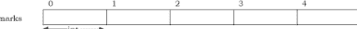

每个空白单元格表示名为 marks 的数组中的一个元素，其值为 int 数据类型的整数值。marks 数组的元素编号从 0 到 4，因为在任何数组中，第一个索引始终为 0。marks 数组第一个元素的唯一标识符（索引值）是 marks[0]，第二个元素是 marks[1]，依此类推。以下是声明数组的语法：

```c
data_type Array_Name[count];
```

在上述语法中，data_type 是存储在数组中的值的数据类型。Array_Name 是数组的名称，count 是数组可以存储的元素数量。例如，以下代码片段声明了一个整型数据类型的 Arr1 数组，该数组可以存储 5 个整数值：

```c
int Arr1[5];
```

声明数组后，你可以使用数组名称和索引值来访问其元素。例如，以下代码片段访问 Arr1 数组的第一个元素，并向其中赋一个整数值：

```c
Arr1[0]=5;
```

在上述代码片段中，值 5 被赋给 Arr1 数组的第一个位置。类似地，Arr1 数组的其他元素可以通过其索引值来访问。

你也可以在声明数组时为其分配一些值。此过程称为数组初始化。以下代码片段展示了如何初始化数组：

```c
int Arr1[5]={1,2,3,4,5};
```

在上述代码片段中，Arr1 数组在声明时用前 5 个自然数进行了初始化。初始化数组时，指定数组大小是一个可选值。例如，以下代码片段在不提供大小值的情况下初始化数组：

```c
int Arr1[] = {1,2,3,4,5};
```

在上述代码片段中，没有指定 Arr1 数组的大小，因为编译器会根据数组元素的数量自动确定它。

请注意，与其他编程语言不同，当你尝试执行访问了非法索引值的程序时，C++ 不会显示任何错误消息。例如，如果你声明了一个大小为 5 的数组，并尝试访问第 10 个元素，这不会导致任何编译时错误，程序反而会编译并执行且不报错。代码清单 1 展示了一个使用非法索引值访问数组元素的程序（你可以在光盘的 code/chapter3 文件夹中找到 ArrayIndex.cpp 文件）：

### ▶ 代码清单 1：使用非法索引值访问数组元素

```cpp
#include<iostream.h>
int main()
{
  int marks[5]={50,60,70,80,90};
  for(int i=0;i<10;i++)
  {
    cout<<marks[i];
    cout<<endl;
  }
  return 0;
}
```

**输出：**

```text
50
60
70
80
90
1245080
4244509
1
14098852
14101928
```

在代码清单 1 中，main() 函数包含一个大小为 5 的 marks[] 数组，而程序却尝试访问 marks[0] 到 marks[9]。在访问数组值时，程序会按预期显示到第 5 个索引处的输出；之后，当程序尝试访问超过数组长度的数组元素时，就会发生运行时异常。这种运行时异常会导致编译器访问内存中不存在的值，从而显示垃圾值。

字符数组称为字符串，它存储在连续的内存字节中，并以空字符结尾。这个空字符写作 `\0`，表示字符串的结尾。考虑以下代码片段：

```c
char string1[8] = "welcome";
```

在上述代码片段中，创建了一个包含 8 个字符的字符数组（string1）。在这个字符数组中，存储了 `welcome` 字符串。在编译时，编译器会自动放置空字符（'\0'）。图 1 展示了此字符串（字符数组）的内存表示，如下所示：

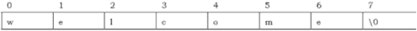

▲ 图 1：字符串的内存表示

在图 1 中，你可以看到字符串（welcome）的所有字符都彼此相邻存储。此外，空字符（\0）就放在字符串最后一个字符之后。

### ▶ 代码清单 2：存储和检索字符串值

```cpp
#include <iostream.h>
#include <string.h>
int main()
{
    char string1[15];
    cout<< "Enter your name :";
    cin>> string1;
    cout<< "Your name is :" <<string1;
    return 0;
}
```

**输出：**

```text
Enter your name :Kumar
Your name is :Kumar
```

在代码清单 2 中，string1[15] 被声明为 char 类型（字符串）。当用户输入字符串时，该字符串会存储在 `string1` 变量中。然后，使用 `cout` 对象检索 `string1` 的值。

在了解了数组的全部内容之后，我们来讨论以下数组类型：

- 一维数组
- 二维数组


- 三维数组

让我们从一维数组开始讨论。

## 一维数组

在 C++ 中，一维数组是一种结构化元素集合，可通过单个索引值指定元素位置来单独访问其中的元素。例如，当我们声明 array[10] 时，数组中元素的索引值为 array[0]、array[1]、……、array[9]。以下是一维数组的声明语法：

```cpp
data_type Array_Name [count];
```

在前面的语法中，`data_type` 描述数组每个元素中存储的数据类型，`count` 表示数组的大小。数组的大小指定数组中元素的数量。要创建数组，`count` 的值必须大于 0。一维数组的索引值范围为 0 到 count-1。例如，当你声明一个包含 10 个元素的一维数组时，该数组的索引值范围为 0 到 9。一维数组也称为线性数组。这是因为一维数组按顺序存储数据。以下代码片段展示如何声明一维数组：

```cpp
int roll[50];
```

当 C++ 编译器编译前面的代码片段时，它会创建一个名为 roll 的数组，该数组可存储 50 个元素；每个元素都能保存一个 int 值。换句话说，roll 数组有 50 个元素，其数据类型为 int。使用一维数组的示例见清单 3（你可以在 CD 的 code/chapter3 文件夹中找到 Array2.cpp 文件）：

### ▶ 清单 3：创建一维数组

```cpp
#include <iostream.h>
int main()
{
  int array[5];
  int index, temp;
  for(index=0; index<5; index++)
  {
    cout<<"Enter the value of array["<<index<<"]: ";
    cin>>array[index];
  }
  cout<<"The values you enter are: ";
  for(index=0; index<5; index++)
  {
    cout<<array[index]<<", ";
  }
  cout<<endl;
  // sorting an array
  for (int i=0; i<5; i++)
  {
      for(int j=0; j<=i; j++)
      {
          if(array[i] < array[j])
          {
              temp = array[i];
              array[i] = array[j];
              array[j] = temp;
          }
      }
  }
  cout<<"After sorting values are: ";
  for(index=0; index<5; index++)
  {
      cout<<array[index]<<" ";
  }
  return 0;
}
```

**输出：**

```text
Enter the value of array[0]: 23
Enter the value of array[1]: 45
Enter the value of array[2]: 11
Enter the value of array[3]: 24
Enter the value of array[4]: 77
The values you enter are: 23, 45, 11, 24, 77,
After sorting values are: 11, 23, 24, 45, 77,
```

在清单 3 中，array[5] 是一个一维数组，用于存储该数组中的元素。在将元素存储到 array[5] 后，我们按升序对这些元素排序，并显示最终排序后的元素。

除了创建一维数组，你还可以创建具有多个维度的数组。下一节我们将讨论二维数组。

## 二维数组

具有两个维度的数组称为二维数组（array[10][10]）。换句话说，能以表格形式（即按行和列的形式）存储值的数组称为二维数组。一维数组是线性数组，因为它们按顺序存储数据。另一方面，二维数组是非线性数组，因为它以表格形式存储数据。在一维数组中，只使用一个索引值来声明和访问数组元素；而在二维数组中，使用两个索引值来访问数组元素。以下是二维数组的声明语法：

```cpp
data-type Array_Name [rows][columns];
```

在前面的语法中，`data_type` 是数组存储的数据类型。`Array_Name` 是数组名，rows 和 columns 表示数组中可存储的元素数量。例如，以下代码片段声明一个二维数组：

```cpp
int Arr2[2][3];
```

在前面的代码片段中，Arr2 数组创建为 2 行 3 列，可存储 6 个整数值。对于二维数组，索引值范围为 [0][0] 到 [row-1][column-1]。因此，Arr2 数组的第一个元素可通过 Arr2[0][0] 访问，最后一个元素可通过 Arr2[1][2] 访问。Arr2 数组的表格表示如下：

|  |  |  |
|---|---|---|
| Arr2[0][0] | Arr2[0][1] | Arr2[0][2] |
| Arr2[1][0] | Arr2[1][1] | Arr2[1][2] |

初始化二维数组与初始化一维数组类似。以下代码片段展示二维数组的初始化：

```cpp
int Arr2[2][3]={
    {2,4,6},
    {8,10,12}
};
```

在前面的代码片段中，通过指定两个维度来创建二维数组。不过，你也可以按下述代码片段所示初始化二维数组：

```cpp
int Arr2[][3]={
    {2,4,6},
    {8,10,12}
};
```

在前面的代码片段中，数组的行未指定，编译器会根据数组中初始化的行数自动指定。这就是为什么 Arr2 数组的两种初始化方式相同且都正确。


> 尽管指定数组的第一个维度是可选的，但在初始化二维数组时，你必须记住指定第二个维度。

对于一维数组，使用循环来访问其元素。对于二维数组和三维数组，使用嵌套循环来访问其各个元素。清单 4 展示了使用嵌套 for 循环访问二维数组元素的示例（你可以在 CD 的 code/chapter3 文件夹中找到 Array3.cpp 文件）：

### ▶ 清单 4：创建二维数组

```cpp
#include <iostream.h>
#include <string.h>

int main()
{
    int matrix[3][4];
    int i,j;
    for(i=0; i<3; i++)
    {
        for(j=0; j<4; j++)
        {
            cout<<"Enter the element of matrix["<<i<<"]["<<j<<"] :";
            cin>>matrix[i][j];
        }
    }

    cout<<endl;
    cout<<"The element of matrix are: "<<endl;
    for(i=0; i<3; i++)
    {
        for(j=0; j<4; j++)
        {
            cout<<matrix[i][j]<<"  ";
        }
        cout<<endl;
    }

    return 0;
}
```

**输出：**

```text
Enter the element of matrix[0][0] :3
Enter the element of matrix[0][1] :6
Enter the element of matrix[0][2] :1
Enter the element of matrix[0][3] :5
Enter the element of matrix[1][0] :2
Enter the element of matrix[1][1] :7
Enter the element of matrix[1][2] :4
Enter the element of matrix[1][3] :2
Enter the element of matrix[2][0] :4
Enter the element of matrix[2][1] :3
Enter the element of matrix[2][2] :8
Enter the element of matrix[2][3] :5
The element of matrix are:
3 6 1 5
2 7 4 2
4 3 8 5
```

在清单 4 中，创建了二维数组 matrix[3][4]。然后还创建了两个嵌套 for 循环。第一个 for 循环用于接收存储在数组元素中的值。第二个 for 循环用于访问并显示这些元素的值。

## 三维数组

用三个维度声明的数组称为三维数组。换句话说，由二维数组构成的数组可称为三维数组。以下是三维数组的声明语法：

```cpp
data_type Array_Name[dimension1][dimension2][dimension3];
```

在前面的语法中，`data_type` 是数组中将要存储的数据类型，`Array_Name` 是数组名，`dimension1`、`dimension2` 和 `dimension3` 是数组的三个维度。这三个维度表示数组中可存储的元素数量。例如，以下代码片段展示三维数组的声明：

```cpp
int Arr3[2][2][2];
```

在前面的代码片段中，`Arr3` 数组是一个三维数组，可存储八个（2x2x2）整数值。对于三维数组，索引值范围从 `[0][0][0]` 到 `[dimension1-1][dimension2-1][dimension3-1]`。例如，前面代码片段中声明的 Arr3 数组的第一个元素可通过 `Arr3[0][0][0]` 索引访问，最后一个元素可通过 `Arr3[1][1][1]` 索引访问。

三维数组的初始化与一维数组和二维数组的初始化非常相似。以下代码片段展示前面代码片段中声明的 Arr3 数组的初始化：

```cpp
int Arr3[2][2][2]={
                        {
                          {1,2},
                          {3,4},
                        },
                        {
                          {5,6},
                          {7,8},
                        }
                     };
```


在前面的代码片段中，`Arr3` 数组可以存储 8 个整数值。清单 5 展示了三维数组的创建和处理。（您可以在随书 CD 的 code/chapter3 文件夹中找到 Array4.cpp 文件）：

## 清单 5：创建三维数组

```cpp
#include<iostream.h>
int main()
{
  int num=0;
  int Arr[2][4][3]={{{1,2,3},{4,5,6},{7,8,9}},{{3,0,0},{8,9,4},{4,4,4},{2,0,9}}};
  for(int i=0;i<2;i++)
  {
      for(int j=0;j<4;j++)
      {
          for(int k=0;k<3;k++)
          {
              if(Arr[i][j][k]==4)
                  ++num;
          }
      }
  }
  cout<<"The number of 4 in this array is "<<num;
  return(0);
}
```

### 输出：

```text
The number of 4 in this array is 5
```

> 二维数组和三维数组也称为多维数组。

## 测试你的知识

- Q1. 编写一个程序，显示字符数组的元素及其对应的索引号。

答：

```cpp
#include <iostream.h>
#include <string.h>
void main()
{
    char str[20];
    cout<<"Enter any string "<<endl;
    cin>>str;
    int length = strlen(str);

    for (int i=0;i<length;i++)
        cout<<"Element at position str["<<i<<"] is "<<str[i]<<endl;
}
```

### 输出：

```text
Enter any string
computer
Element at position str[0] is c
Element at position str[1] is o
Element at position str[2] is m
Element at position str[3] is p
Element at position str[4] is u
Element at position str[5] is t
Element at position str[6] is e
Element at position str[7] is r
```

- Q2. 编写一个程序，显示数组中的最大值和最小值。

答：

```cpp
#include<iostream.h>
void main()
{
    int a[20], n, ns, nl, largest, smallest;
    cout<<"Enter the number of element do you want to enter in array a[]"
        ":"<<endl;
    cin>>n;
    for(int i=0;i<n;i++)
    {
        cout<<"Enter a["<<i<<"]:";
        cin>>a[i];
    }
    largest = a[0];
    for(int i=1;i<n;i++)
    {
        if(largest < a[i])
        {
            largest = a[i];
            nl = i;
        }
    }
    smallest = a[0];
    for(int i=1;i<n;i++)
    {
        if(smallest > a[i])
        {
            smallest = a[i];
            ns = i;
        }
    }
    cout<<"Largest element in a["<<nl<<"] is :"<<largest<<endl;
    cout<<"Smallest element in a["<<ns<<"] is :"<<smallest;
}
```

### 输出：

```text
Enter the number of element do you want to enter in array a[] :
10
Enter a[0]:65
Enter a[1]:45
Enter a[2]:3
Enter a[3]:87
Enter a[4]:55
Enter a[5]:45
Enter a[6]:7
Enter a[7]:16
Enter a[8]:9
Enter a[9]:55
Largest element in a[3] is :87
Smallest element in a[2] is :3
```

- Q3. 编写一个程序，计算两个矩阵的乘积。

答：

```cpp
#include<iostream.h>
#include<iomanip.h>
void main()
{
    int i, j, k, x[10][10], y[10][10], z[10][10];
    int row1, col1, row2, col2;
    cout<<"Enter row of Matrix x"<<endl;
    cin>>row1;
    cout<<"Enter col of Matrix x"<<endl;
    cin>>col1;
    cout<<"Enter row of Matrix y"<<endl;
    cin>>row2;
    cout<<"Enter col of Matrix y"<<endl;
    cin>>col2;
    if(col1 != row2)
    {
        cout<<"Multiplication of two matrix is not possible"<<endl;
    }
    else
    {
        // input elements of matrix x
        cout<<"Enter element of matrix x"<<endl;
        for(i=0;i<row1;i++)
        {
            for(j=0;j<col1;j++)
            {
                cout<<"Enter element of x["<<i<<"]["<<j<<"]:";
                cin>>x[i][j];
            }
        }

        cout<<"Enter element of matrix y"<<endl;
        // input elements of matrix y
        for(i=0;i<row2;i++)
        {
            for(j=0;j<col2;j++)
            {
                cout<<"Enter element of y["<<i<<"]["<<j<<"]:";
                cin>>y[i][j];
            }
        }
        // multiplication to x and y matrix
        for(i=0;i<row1;i++)
        {
            for(j=0;j<col2;j++)
            {
                z[i][j] = 0;
                for(k=0;k<col1;k++)
                {
                    z[i][j] = z[i][j] + x[i][k] * y[k][j];
                }
            }
        }

        //Printing elements of matrix x
        cout<<"Elements of matrix x are :"<<endl;
        for(i=0;i<row1;i++)
        {
            for(j=0;j<col1;j++)
            {
                cout<<x[i][j]<<setw(5);
            }
            cout<<setw(0);
            cout<<endl;
        }

        // Printing elements of matrix y
        cout<<"Elements of matrix y are :"<<endl;
        for(i=0;i<row2;i++)
        {
            for(j=0;j<col2;j++)
            {
                cout<<y[i][j]<<setw(5);
            }
            cout<<setw(0);
            cout<<endl;
        }

        //Printing elements of matrix z
        cout<<"Multiplication of matrix x and matrix y are :"<<endl;
        for(i=0;i<row1;i++)
        {
            for(j=0;j<col2;j++)
            {
                cout<<z[i][j]<<setw(5);
            }
            cout<<setw(0);
            cout<<endl;
        }
    }
}
```

### 输出：

```text
Enter row of Matrix x
2
Enter col of Matrix x
2
Enter row of Matrix y
2
Enter col of Matrix y
2
Enter element of matrix x
Enter element of x[0][0]:1
Enter element of x[0][1]:2
Enter element of x[1][0]:3
Enter element of x[1][1]:4
Enter element of matrix y
Enter element of y[0][0]:1
Enter element of y[0][1]:2
Enter element of y[1][0]:3
Enter element of y[1][1]:4
Elements of matrix x are :
1     2
3     4
Elements of matrix y are :
1     2
3     4
Multiplication of matrix x and matrix y are :
7     10
15    22
```

- Q4. 编写一个程序，实现两个矩阵的加法。

答：

```cpp
#include<iostream.h>
#include<iomanip.h>
void main()
{
    int i, j, x[10][10], y[10][10], z[10][10];
    int row1, col1, row2, col2;
    cout<<"Enter row of Matrix x"<<endl;
    cin>>row1;
    cout<<"Enter col of Matrix x"<<endl;
    cin>>col1;
    cout<<"Enter row of Matrix y"<<endl;
    cin>>row2;
    cout<<"Enter col of Matrix y"<<endl;
    cin>>col2;
    if(row1 == row2 && col1 == col2)
    {
        // input elements of matrix x
        cout<<"Enter element of matrix x"<<endl;
        for(i=0;i<row1;i++)
        {
            for(j=0;j<col1;j++)
            {
                cout<<"Enter element of x["<<i<<"]["<<j<<"]:";
                cin>>x[i][j];
            }
        }
        cout<<"Enter element of matrix y"<<endl;
        // input elements of matrix y
        for(i=0;i<row2;i++)
        {
            for(j=0;j<col2;j++)
            {
                cout<<"Enter element of y["<<i<<"]["<<j<<"]:";
                cin>>y[i][j];
            }
        }
        // addition to x and y matrix
        for(i=0;i<row1;i++)
        {
            for(j=0;j<col1;j++)
            {
                z[i][j] = x[i][j] + y[i][j];
            }
        }
        //Printing elements of matrix x
        cout<<"Elements of matrix x are :"<<endl;
        for(i=0;i<row1;i++)
        {
            for(j=0;j<col1;j++)
            {
                cout<<x[i][j]<<setw(5);
            }
            cout<<setw(0);
            cout<<endl;
        }
        // Printing elements of matrix y
        cout<<"Elements of matrix y are :"<<endl;
        for(i=0;i<row2;i++)
        {
            for(j=0;j<col2;j++)
            {
                cout<<y[i][j]<<setw(5);
            }
            cout<<setw(0);
            cout<<endl;
        }
        //Printing elements of matrix z
        cout<<"Addition of matrix x and matrix y are :"<<endl;
        for(i=0;i<row1;i++)
        {
            for(j=0;j<col1;j++)
            {
                cout<<z[i][j]<<setw(5);
            }
            cout<<setw(0);
            cout<<endl;
        }
    }
    else
    {
        cout<<"Addition of two matrix is not possible";
    }
}
```

### 输出：

```text
Enter row of Matrix x
2
Enter col of Matrix x
2
Enter row of Matrix y
2
Enter col of Matrix y
2
Enter element of matrix x
Enter element of x[0][0]:1
Enter element of x[0][1]:2
Enter element of x[1][0]:3
Enter element of x[1][1]:4
Enter element of matrix y
Enter element of y[0][0]:5
Enter element of y[0][1]:6
Enter element of y[1][0]:7
Enter element of y[1][1]:8
Elements of matrix x are :
1    2
3    4
Elements of matrix y are :
5    6
7    8
Addition of matrix x and matrix y are :
6    8
10   12
```

在讨论了数组及数组类型之后，我们将在下一节讨论函数。


### 3.2 函数

函数是一组执行特定任务的语句。它是一个自包含的语句块，在执行时完成特定任务。在 C++ 中，当你需要在程序中多次执行一组语句时，就会使用函数。它还将一组语句与代码的其余部分分离。在程序中使用函数，可以将大型程序划分为可管理的模块，从而提供灵活性。这反过来使程序更不容易出错。以下是在程序中声明函数的语法：

```
return_type function_Name(list of argument)
```

在前面的语法中，`return_type` 是函数返回的数据类型，`function_Name` 是函数的名称。参数列表在圆括号内作为方法参数传入。函数的一个常见示例是 `main()` 函数，如以下代码片段所示：

```cpp
// To display a welcome message.

int main()
{
    cout << "Hello from C++" << endl;
    return 0;
}
```

在前面的代码片段中，`main()` 函数名后的空圆括号表示这是一个不带参数的函数，而 `main()` 函数前的 `int` 表示该函数返回整数值。在 C++ 程序中，`main()` 函数是必需的，因为 C++ 程序从该函数开始执行。除了 `main()` 函数之外，你还可以在程序中创建自己的函数来执行特定任务。代码清单 6 展示了一个除 `main()` 函数之外还使用函数的程序（你可以在 CD 的 code/chapter3 文件夹中找到 Func1.cpp 文件）：

### 代码清单 6：创建函数

```cpp
#include<iostream.h>
int sum(int x, int y)
{
    return x+y;
}
int main()
{
    int a=5;
    int b=6;
    int result=sum(a,b);
    cout << "The sum of a and b= " << result;
    return(0);
}
```

**输出：**

```text
The sum of a and b= 11
```

在代码清单 6 中，创建了 sum() 函数并用于将两个数相加，尽管代码清单 6 中的程序也包含 main() 函数。sum() 函数接受两个整数值作为参数，将这些值相加，并将和返回给调用函数，即 main() 函数。

你将在以下各节中学习 C++ 中函数的类型。与 C++ 函数相关的活动可以在以下主要标题下讨论：

-   讨论 C++ 函数的类型
-   声明函数原型
-   定义函数
-   调用函数
-   向函数传递参数
-   从函数返回值
-   描述返回 void 的函数
-   指定默认参数
-   描述按值调用和按引用调用
-   向函数传递数组
-   将函数参数作为 const 传递
-   向函数传递字符串
-   使用递归
-   创建内联函数
-   使用字符串库函数

让我们从 C++ 中函数的类型开始讨论。

### 讨论 C++ 函数的类型

C++ 编程语言编译器提供了一些内置函数，这些函数常用于编写 C++ 程序。另一方面，你也可以在 C++ 程序中创建自己的函数。因此，你可以在 C++ 编程语言中使用以下两种类型的函数：

-   标准库函数
-   用户定义函数

现在，我们将在以下各节中详细讨论这些函数。

### 标准库函数

在 C++ 编程语言中，常用函数被分组在一起，并随其编译器一起提供。功能相关的函数被分组到一个标准库中，例如 cin 和 cout 函数被分组到 iostream 库中。这些标准库中的函数称为标准库函数。一旦函数被分组到标准库中，你就不需要再次声明和定义它们，而是可以直接在程序中使用它们。要使用它们，你必须在程序中包含该库的引用。你可以借助头文件添加库的引用。头文件指示 C++ 编译器在程序中包含特定的库。

C++ 附带许多标准库函数，例如 `strlen()` 和 `strcmp()`，用于执行字符串操作，例如查找字符串长度。让我们看看如何向标准库函数（`strlen()`）传递参数，该函数返回作为参数传入的字符串的长度。在代码清单 7 中，`strlen()` 函数用于查找字符串的长度，并返回值作为字符串（string1）的长度（你可以在 CD 的 code/chapter3 文件夹中找到 Func2.cpp 文件）：

### 代码清单 7：使用标准库函数

```cpp
#include <iostream.h>
#include <string.h>
int main()
{
    char string1[] = "Hello";
    cout << "The length of string1 is " << strlen(string1) << " characters." << endl;
    return 0;
}
```

**输出：**

```text
The length of string1 is 5 characters.
```

在代码清单 7 中，string1 字符串作为参数传递给 strlen() 函数，strlen() 函数返回 string1 字符串的长度。你可以注意到包含了 `string.h` 头文件，因为 strlen() 函数在其中定义；如果你不包含 `string.h` 头文件，程序将产生编译错误。

现在，讨论完标准库函数之后，让我们讨论用户定义函数。

### 用户定义函数

到目前为止，你学习了 C++ 提供的各种标准库函数，但这些函数不足以在程序中执行各种任务。要在 C++ 程序中执行自定义任务，你可以创建自己的函数。例如，代码清单 6 包含 sum() 函数，它是一个用户定义函数。与此 sum() 函数类似，你可以在程序中根据需要创建任意数量的函数。代码清单 8 展示了用户定义函数的另一个示例（你可以在 CD 的 code/chapter3 文件夹中找到 Func3.cpp 文件）：

### 代码清单 8：创建用户定义函数

```cpp
#include<iostream.h>
int area(int x, int y);
int main()
{
  int l,b;
  int ar=0;
  cout << "Enter Length ";
  cin >> l;
  cout << "\nEnter Breadth ";
  cin >> b;
  ar = area (l,b);
  cout << "Area of rectangle= " << ar;
  return 0;
}

int area(int x, int y)
{
  return x*y;
}
```

**输出：**

```text
Enter Length 5
Enter Breadth 4
Area of rectangle= 20
```

在代码清单 8 中，创建了 area() 函数并用于计算矩形的面积。在此代码清单中，area() 函数在声明时并未定义。这种声明称为函数原型声明。可以在声明函数的同时不定义它。area() 函数接受两个整数参数，并将这些参数的乘积返回给调用函数。main() 函数使用用户输入的两个整数值调用 area() 函数，然后在屏幕上将乘积显示为矩形面积。

我们将在下一节讨论函数原型声明。

### 声明函数原型

在 C++ 程序中，你需要在提供函数定义之前声明函数。声明函数的签名称为声明函数原型。在 C++ 中，函数原型指定函数名、函数参数、参数类型和函数返回类型，但没有函数体。函数体在程序的其他位置定义。函数原型向编译器指示函数的结构。因此，编译器知道调用和使用该函数的前提条件。你可以在调用 main() 函数之前或在 main() 函数内声明函数原型。此外，你必须在声明函数原型的语句末尾加上终止符号（;）。例如，以下代码片段声明了 maximum() 函数的原型（签名）：

```
int maximum(int a, int b);
```

在前面的代码片段中，声明了 maximum() 函数的函数原型，它接受两个整数值作为参数，并在被调用或执行时返回一个整数值。

函数原型向编译器提供有关函数的以下信息：

-   函数返回的值的数据类型（如果它返回值）。否则，当函数返回 void 时，表示该函数不返回任何值。
-   函数接受的参数数量。
-   函数接受的所有函数参数的数据类型。

一旦声明了函数原型，就需要定义所声明的函数。现在，我们将在下一节讨论定义函数。

### 定义函数

提供执行函数预期任务的语句块称为函数定义。函数由名称和一组操作数唯一确定，其中包含在调用函数时执行的代码。它的操作数称为形参或实参，在函数名后的圆括号内指定。函数在语句块中指定的、由函数执行的任务称为函数体。所有函数都会返回某个值，除非声明为 void 返回类型。void 返回类型声明该函数在完成执行后不返回任何值。以下代码片段展示了如何定义函数：

```cpp
int maximum(int a, int b)
{
    int temp=0;
    if(a > b)
        temp = a;
    else
        temp = b;
    return temp;
}
```

在前面的代码片段中，我们定义了 maximum() 函数，它接受两个整数值作为参数，并且也返回一个整数值。return 关键字用于从函数返回值。


## 调用函数

在 C++ 程序中声明并定义的函数，可以在程序中的任何位置被调用。在 C++ 中，调用函数的方式是使用函数名加一对括号，并在括号内提供参数列表（如果有的话）。如果函数返回某个值，则在调用函数时必须使用相同数据类型的变量来接收该值。如果你需要直接显示返回值，也可以使用 `cout` 对象，而无需将值赋给任何其他变量。以下代码片段演示了如何调用函数：

```cpp
largest = maximum(i,j);
```

在上述代码片段中，调用了在 *定义函数* 一节中定义的 maximum(i, j) 方法。参数 i 和 j 作为函数参数传递给 maximum() 函数。maximum(i, j) 函数也返回一个值，该值存储在整型变量 largest 中。完整的程序包括声明函数原型、定义函数以及调用函数，如清单 9 所示（你可以在随书 CD 的 code/chapter3 文件夹中找到 Func4.cpp 文件）：

### 清单 9：声明、定义和调用函数

```cpp
#include <iostream.h>
int main()
{
    int i, j, largest;
    int maximum(int a, int b); // function prototype
    cout<<"Enter the value of i: ";
    cin>>i;
    cout<<endl;
    cout<<"Enter the value of j: ";
    cin>>j;
    cout<<endl;
    largest = maximum(i,j); // calling a function
    cout<<"The value that is greater between "<<i<<" and "<<j<<" is :"<<largest;
    return 0;
}
// Defining a function
int maximum(int a, int b)
{
    int temp=0;
    if(a > b)
        temp = a;
    else
        temp = b;
    return temp;
}
```

**输出：**

```
Enter the value of i: 5
Enter the value of j: 10
The value that is greater between 5 and 10 is: 10
```

在清单 9 中，我们通过 `int maximum(int a, int b);` 语句在 main() 函数内部定义了 maximum() 函数的原型。然后我们从用户那里接受两个数字，并调用 maximum() 函数传入这两个数字。maximum() 函数返回的值通过 `largest = maximum(i,j);` 语句存储在另一个整型变量 largest 中。最后，显示 largest 变量的值。你还可以看到 maximum() 函数是在 main() 函数外部定义的。

## 向函数传递参数

在 C++ 中，函数的参数用于初始化函数定义中的形参。参数可以是变量、常量或表达式。当向函数传递参数时，必须记住参数的个数和类型必须与函数定义中的形参一致。调用函数时传递的参数称为实际参数，定义函数时传递的参数称为形式参数。清单 10 演示了向 sub() 函数传递参数。在清单 10 中，value1 和 value2 是调用函数 sub(value1, value2) 的实际参数，num1 和 num2 是定义 void sub(int num1, int num2) 函数时的形式参数。你可以在随书 CD 的 code/chapter3 文件夹中找到 Func5.cpp 文件：

### 清单 10：向函数传递参数

```cpp
#include <iostream.h>
void sub(int num1, int num2) // Arguments num1 and num2 are formal arguments
{
    int num3;
    num3 = num1 - num2;
    cout<<"The subtraction of two numbers is : "<<num3;
}
int main()
{
    int value1, value2;
    cout<<"Enter value1 :";
    cin>>value1;
    cout<<endl;
    cout<<"Enter value2 :";
    cin>>value2;
    cout<<endl;
    sub(value1, value2); //value1 and value2 are actual arguments of sub()
    return 0;
}
```

**输出：**

```
Enter value1 :8
Enter value2 :5
The subtraction of two numbers is : 3
```

在清单 10 中，从用户那里接受两个整数值，并分别存储在变量 value1 和 value2 中。然后，`value1` 和 `value2` 作为参数传递给 `sub()` 函数。sub() 函数将 value2 变量的值从 value1 变量的值中减去，并将结果显示给用户。

## 从函数返回值

从函数返回值意味着函数必须返回一个值。返回值可以是 int、float、char 或数组。这意味着当函数被调用时，函数体被执行，执行完成后，函数返回一个值。以下是从函数返回值的语法：

```text
<return_type> <function-name>(<argument>)
{
    return <variable_name> or value;
}
```

在上述语法中，`return_type` 可以是任何数据类型，例如 char、int 和数组。return 语句必须放在函数体的末尾，即函数定义的右花括号之前。当函数返回一个值时，其数据类型必须与函数原型中的数据类型相同。清单 11 演示了 `sub()` 函数如何返回一个值。你可以在随书 CD 的 code/chapter3 文件夹中找到 Func6.cpp 文件：

### 清单 11：函数返回值

```cpp
#include <iostream.h>
int sub(int num1, int num2)
{
    int num3;
    num3 = num1 - num2;
    return num3;  // function returns a value
}

int main()
{
    int value1, value2, value3;
    cout<<"Enter value1 :";
    cin>>value1;
    cout<<endl;
    cout<<"Enter value2 :";
    cin>>value2;
    cout<<endl;
    value3 = sub(value1, value2); // function call
    cout<<"The subtraction of two number is :"<<value3;
    return 0;
}
```

**输出：**

```
Enter value1 :7
Enter value2 :2
The subtraction of two number is :5
```

在清单 11 中，定义了 `sub()` 函数，该函数接受两个整型变量作为参数，并返回它们之间的差。在 `main()` 函数中，从用户那里接受整数值（value1 和 value2），并将其作为参数传递给 `sub()` 函数。`sub()` 函数返回的值存储在 value3 变量中，并显示给用户。

## 测试你的知识

- 问题5. 编写一个程序，演示如何使用递归函数计算 2 的 n 次幂的乘法，其中 n 由用户提供。

答案：

```cpp
#include <iostream.h>
int power2n(int n)
{
    if (n > 1)
        return 2*power2n(n-1);
    return 2;
}
int main()
{
    int n;
    cout<<"Enter a number : ";
    cin>>n;
    cout<<"2 to the power of "<<n<<" is :"<<power2n(n);
    return 0;
}
```

**输出：**

```
Enter a number : 6
2 to the power of 6 is :64
```

- 问题6. 编写一个程序，求数字 m 的 n 次幂的乘积，其中 m 和 n 由用户提供。

答案：

```cpp
#include <iostream.h>
double power(double m, int n);   //function prototype
void main()
{
    int m, n;
    cout<<"Enter any number ";
    cin>>m;
    cout<<" Enter any integer number to calculate power ";
    cin>>n;
    cout<<"power("<<m<<", "<<n<<") = "<<power(m, n);
}
double power(double m, int n)
{
    double d1 = 1;
    for(int i=1;i<=n;i++)
    {
        d1 *= m;
    }
    return d1;
}
```

**输出：**

```
Enter any number 5
Enter any integer number to calculate power 4
power(5, 4) = 625
```

- 问题7. 编写一个程序，使用递归生成给定数字的斐波那契数列。

答案：

```cpp
#include<iostream.h>
int fibonacci(int n)
{
    if((n == 1) || (n == 0))
        return 1;
    else
        return fibonacci(n-1) + fibonacci(n-2);
}
void main()
{
    int n;
    cout<<"Enter any integer number :";
    cin>>n;
    cout<<"Fibonacci of "<<n<<" is :"<<fibonacci(n);
}
```

**输出：**

```
Enter any integer number :5
Fibonacci of 5 is :8
```

也可以使用 void 关键字创建一个执行结束后不返回值的函数。让我们在下一节中讨论返回 void 的函数。

## 描述返回 void 的函数

在程序中，如果你希望函数不返回任何值，可以将 void 关键字作为函数返回类型。不返回任何值的函数称为返回 void 的函数。函数在函数体末尾没有 return 语句的情况下终止，程序的执行将转移到调用函数的下一条语句。清单 12 演示了使用 void 关键字定义函数（convert()）。你可以在随书 CD 的 code/chapter3 文件夹中找到 Func7.cpp 文件：

### 清单 12：从函数返回 void

```cpp
#include <iostream.h>
void convert(float cel) // function definition with void
{
  float fahrenheit;
  fahrenheit = (cel*9)/5 + 32 ;
  cout<<"The equivalent temperature in fahrenheit is :"<<fahrenheit;
}

int main()
{
  float celsius;

  cout<<"Enter Celsius :";
  cin>>celsius;
  cout<<endl;
  convert(celsius); // function call
  return 0;
}
```

**输出：**

```
Enter Celsius :33.56
The equivalent temperature in fahrenheit is :92.408005
```

在清单 12 中，convert(float cel) 函数的返回类型被定义为 void，这意味着当该函数终止时，它不会向调用程序返回任何值。这就是为什么你可以看到在函数末尾没有使用 return 语句的原因。

现在，让我们学习函数的默认参数。

## 指定默认参数

默认参数是在定义函数时提供值的函数参数。调用函数时，不必为默认参数传递值。如果你为默认参数传递了值，函数将以


指定值：如果在调用函数时没有为默认参数指定值，它将采用其默认值。默认值是在定义程序时指定的。例如，如果将函数声明为 `float convert(float cel=100.00F)`，则 `convert()` 函数有一个默认参数（`float cel=100.00F`），并且 `cel` 的默认值为 `100.00F`。现在，如果以 `convert(150.00F)` 的形式调用此函数，则参数 `cel` 将取 `150.00F` 作为其值；如果以 `convert()` 的形式调用此函数，则参数 `cel` 将采用默认值 `100.00F`。清单 13 展示了一个带有默认参数的函数（你可以在随附 CD 的 code/chapter3 文件夹中找到 FuncB.cpp 文件）：

### 清单 13：创建带有默认参数的函数

```cpp
#include <iostream.h>

float convert(float cel=100.00F)  // function definition
{
    float fahrenheit;
    fahrenheit = (cel*9)/5 + 32 ;
    return fahrenheit;
}
int main()
{
    float celsius;
    cout<<"The equivalent temperature in fahrenheit is :"<<convert(); // function call
    return 0;
}
```

输出：

等效华氏温度为：212

在清单 13 中，`convert()` 函数定义了一个默认参数 `cel`。该 `convert()` 函数将温度从摄氏度转换为华氏度，并将华氏度温度返回给调用程序。`cel` 参数的默认值被指定为 `100.00F`。最后，从 `main()` 函数中调用 `convert()` 函数，并将 `convert()` 函数返回的值显示给用户。

## 描述按值调用和按引用调用

在 C++ 中调用函数可以通过两种方式实现——按值调用和按引用调用。在按值调用中，变量的副本被传递给函数；而在按引用调用中，变量的内存地址被传递给函数。

按值调用意味着将参数的值传递给函数，在传递给函数之前，该值会被赋值给内存中的一个新变量。例如，以下代码片段展示了一个按值调用的函数调用：

```cpp
int num1=5;
int num2=7;
swap(num1, num2);
```

在上述代码片段中，两个整型变量 `num1` 和 `num2` 分别被赋值为 5 和 7。然后，这两个变量（`num1` 和 `num2`）被传递给 `swap()` 函数。`swap()` 函数的原型如下面的代码片段所示：

```cpp
void swap(int a, int b);
```

在上述代码片段中，当调用 `swap()` 函数时，它会创建两个 int 数据类型的新变量 `a` 和 `b`，然后分别将值 5 和 7 赋给它们。

清单 14 展示了一个使用按值调用的函数示例。你可以在随附 CD 的 code/chapter3 文件夹中找到 Func9.cpp 文件：

### 清单 14：演示按值调用

```cpp
#include <iostream.h>

int main()
{
    void swap(int, int);
    int num1=40, num2 = 60;

    cout<<"Main: Before Swap num1 = "<<num1<<" and num2 = "<<num2<<endl;
    swap(num1, num2);

    cout<<"Main: After Swap num1 = "<<num1<<" and num2 = "<<num2<<endl;
    return 0;
}
void swap(int a, int b)
{
    cout<<"Swap: Before Swap a = "<<a<<" and b = "<<b<<endl;
    int c;
    c = a;
    a = b;
    b = c;
    cout<<"Swap: After Swap a = "<<a<<" and b = "<<b<<endl;
}
```

输出：

```cpp
Main: Before Swap num1 = 40 and num2 = 60
Swap: Before Swap a = 40 and b = 60
Swap: After Swap a = 60 and b = 40
Main: After Swap num1 = 40 and num2 = 60
```

在清单 14 中，执行 `swap()` 函数后，`num1` 和 `num2` 变量的值保持不变，因为当调用 `swap()` 函数时，`num1` 和 `num2` 的副本被传递给了变量 `a` 和 `b`。在 `swap()` 函数内部对 `a` 和 `b` 变量值所做的更改实际上是对 `num1` 和 `num2` 变量的副本进行的。实际的 `num1` 和 `num2` 变量没有发生任何更改。因此，调用 `swap()` 函数后，`num1` 和 `num2` 的值保持不变。

向函数传递参数的第二种技术是按引用调用。在这种技术中，可以通过两种方式向函数传递参数：使用指针和使用引用。这两种方式都将实际的原始对象传递给函数，而不会在函数作用域内创建副本。当使用指针向函数传递参数时，使用 `*` 运算符；而使用引用时，使用 `&` 运算符。使用 `&` 运算符时，变量的地址被传递给函数。例如，以下代码片段展示了按引用将参数传递给 `swap()` 函数：

```cpp
int main()
{
    void swap(int & , int &);
    int num1=40, num2 = 60;
    cout<<"Main: Before Swap num1 = "<<num1<<" and num2 = "<<num2<<endl;
    swap(num1, num2);
    cout<<"Main: After Swap num1 = "<<num1<<" and num2 = "<<num2<<endl;
    return 0;
}
void swap(int &a, int &b)
{
    cout<<"Swap: Before Swap a = "<<a<<" and b = "<<b<<endl;
    int c;
    c = a;
    a = b;
    b = c;
    cout<<"Swap: After Swap a = "<<a<<" and b = "<<b<<endl;
}
```

在上述代码片段中，`swap()` 函数是按引用调用的。当调用 `swap()` 函数时，它不会创建名为 `a` 和 `b` 的新变量，而是变量 `a` 和 `b` 引用 `num1` 和 `num2` 变量的内存位置。现在，`swap()` 函数所做的任何更改实际上都是对 `num1` 和 `num2` 变量的内存地址进行的。因此，这些更改是对实际的 `num1` 和 `num2` 变量进行的。

如前所述，向函数传递参数的另一种方式是使用 `*` 运算符。`swap()` 函数的定义如下：

```cpp
void swap(int *a, int *b)
```

清单 15 展示了使用 `*` 运算符向函数传递参数的示例。你可以在随附 CD 的 code/chapter3 文件夹中找到 Func10.cpp 文件：

### 清单 15：演示按引用调用

```cpp
#include <iostream.h>

int main()
{
    void swap(int *, int *);
    int num1=40, num2 = 60;

    cout<<"Main: Before Swap num1 = "<<num1<<" and num2 = "<<num2<<endl;
    swap(&num1, &num2);

    cout<<"Main: After Swap num1 = "<<num1<<" and num2 = "<<num2<<endl;
    return 0;
}

void swap(int *a, int *b)
{
    cout<<"Swap: Before Swap a = "<<*a<<" and b = "<<*b<<endl;
    int c;
    c = *a;
    *a = *b;
    *b = c;
    cout<<"Swap: After Swap a = "<<*a<<" and b = "<<*b<<endl;
}
```

输出：

```cpp
Main: Before Swap num1 = 40 and num2 = 60
Swap: Before Swap a = 40 and b = 60
Swap: After Swap a = 60 and b = 40
Main: After Swap num1 = 60 and num2 = 40
```

在清单 15 中，调用 `swap()` 函数后，`num1` 和 `num2` 变量的值发生了变化，因为当调用 `swap()` 函数时，编译器不会像按值调用那样创建新变量。`num1` 和 `num2` 变量的地址通过 `&` 运算符传递，值通过 `swap()` 函数中的 `*` 运算符访问。在 `swap(&num1, &num2)` 函数中，`num1` 和 `num2` 变量的地址作为参数传递，值的交换是在 `num1` 和 `num2` 变量的同一内存位置上完成的。因此，调用 `swap()` 函数后，`num1` 和 `num2` 的值发生了变化。

## 测试你的知识

- 问题8：编写一个程序，使用单独的函数来计算任意两个整数的最大公约数（GCD）和最小公倍数（LCM）。

答案：

```cpp
#include <iostream.h>
void swap(int &a, int &b)
{
    int temp;
    temp = a;
    a = b;
    b = temp;
}
int gcd(int x, int y)
{
    if(x<y)
        swap(x,y);
    while(y>0)
    {
        int re = x % y;
        x = y;
        y = re;
    }
    return x;
}
int lcm(int x, int y)
{
    int l=0;
    l = x * y/gcd(x,y);
    return l;
}
void main()
{
    int val1, val2;
    cout<<"Enter first number ";
    cin>>val1;
    cout<<"Enter second number ";
    cin>>val2;
    cout<<"Greatest common divisor of "<<val1<<" and "<<val2<<" is "
        <<gcd(val1,val2)<<endl;
    cout<<"Lowest common multiple of "<<val1<<" and "<<val2<<" is "
        <<lcm(val1,val2)<<endl;
}
```

输出：

输入第一个数字 8


```text
Enter second number 6
Greatest common divisor of 8 and 6 is 2
Lowest common multiple of 8 and 6 is 24
```

> 借助合适的程序和函数，解释按引用传递参数和按值传递参数（孟买大学，2007 年 12 月）

除了将值作为函数参数传递外，还可以将数组作为函数参数传递。下面一节我们将讨论如何将数组传递给函数。

## 将数组传递给函数

你可以通过将数组名和数组大小作为参数传递给函数，从而将数组传递给函数。使用数组调用函数时，只需传递数组名（不需要传递数组大小）。而在声明或定义函数时，需要将数组名及其大小作为方法参数传递。代码清单 16 展示了如何将数组传递给函数（可在随书光盘的 code/chapter3 文件夹中找到 Func11.cpp 文件）：

### 代码清单 16：将数组传递给函数

```cpp
#include <iostream.h>

int main()
{
    void display(int array[20], int size);
    int array[20], size, i;
    cout<<"Enter size of array : ";
    cin>>size;
    for(i=0;i<size;i++)
    {
        cout<<"Enter element of array["<<i<<"]: ";
        cin>>array[i];
    }
    cout<<endl;
    display(array, size);
    return 0;
}
void display(int array[20], int n)
{
    int i;
    cout<<"The element of array are : "<<endl;
    for(i=0;i<n;i++)
    {
        cout<<array[i]<<endl;
    }
}
```

**输出：**

```text
Enter size of array : 6
Enter element of array[0]: 2
Enter element of array[1]: 3
Enter element of array[2]: 8
Enter element of array[3]: 4
Enter element of array[4]: 6
Enter element of array[5]: 0

The element of array are :
2
3
8
4
6
0
```

在代码清单 16 中，定义了 display() 函数，它接受一个包含二十个元素的数组和一个整型变量作为参数。在 display() 函数中，使用 for 循环向用户显示数组（作为参数传递）的元素。使用 main() 函数从用户处接受数组元素，然后调用 display() 函数，后者进而向用户显示数组元素。


> 我们将在第 04 章讨论函数如何使用指针返回数组和字符串。

## 测试你的知识

### Q9. 编写一个程序来对矩阵进行转置。

答：

```cpp
#include<iostream.h>
#include<iomanip.h>
void transpose(int row, int col, int a[10][10])
{
    for(int i=0;i<col;i++)
    {
        for(int j=0;j<row;j++)
        {
            cout<<a[j][i]<<setw(5);
        }
        cout<<setw(0);
        cout<<endl;
    }
}
void display(int row, int col, int a[10][10])
{
    for(int i=0;i<row;i++)
    {
        for(int j=0;j<col;j++)
        {
            cout<<a[i][j]<<setw(5);
        }
        cout<<setw(0);
        cout<<endl;
    }
}
void main()
{
    int i, j, x[10][10];
    int row, col;
    cout<<"Enter row of Matrix x ";
    cin>>row;
    cout<<endl;
    cout<<"Enter col of Matrix x ";
    cin>>col;
    cout<<endl;
    cout<<"Enter element of matrix x now"<<endl;
    for(i=0;i<row;i++)
    {
        for(j=0;j<col;j++)
        {
            cout<<"Enter element of x["<<i<<"]["<<j<<"]:";
            cin>>x[i][j];
        }
    }
    cout<<"Element of matrix x is:"<<endl;
    display(row, col, x);
    cout<<"Transpose of matrix x is:"<<endl;
    transpose(row, col, x);
}
```

**输出：**

```text
Enter row of Matrix x 3
Enter col of Matrix x 2
Enter element of matrix x now
Enter element of x[0][0]:1
Enter element of x[0][1]:2
Enter element of x[1][0]:3
Enter element of x[1][1]:4
Enter element of x[2][0]:5
Enter element of x[2][1]:6
Element of matrix x is:
1    2
3       4
5       6
Transpose of matrix x is:
1       3       5
2       4       6
```

### Q10. 编写一个程序对数组元素进行排序。

答：

```cpp
#include <iostream.h>
void display(int array[], int n)
{
        int i;
        for(i=0;i<n;i++)
        {
                cout<<array[i]<<endl;
        }
}
void sort(int array[], int n)
{
        int temp = 0;
        for (int i=0; i<n; i++)
        {
                for(int j=0; j<=i; j++)
                {
                        if(array[i] < array[j])
                        {
                                temp = array[i];
                                array[i] = array[j];
                                array[j] = temp;
                        }
                }
        }
        display(array, n);
}
int main()
{
        int array[20], size, i;
        cout<<"Enter size of array : ";
        cin>>size;
        for(i=0;i<size;i++)
        {
                cout<<"Enter element of array["<<i<<"] : ";
                cin>>array[i];
        }
        cout<<"Before sorting elements of array[] are : "<<endl;
        display(array, size);
        cout<<"After sorting elements of array[] are : "<<endl;
        sort(array, size);
        return 0;
}
```

**输出：**

```text
Enter size of array : 8
Enter element of array[0]: 3
Enter element of array[1]: 4
Enter element of array[2]: 6
Enter element of array[3]: 8
Enter element of array[4]: 2
Enter element of array[5]: 9
Enter element of array[6]: 5
Enter element of array[7]: 1
Before sorting elements of array[] are :
3
4
6
8
2
9
5
1
After sorting elements of array[] are:
1
2
3
4
5
6
8
9
```

让我们学习如何将常量作为函数参数传递。

## 将函数参数作为 const 传递

声明 const 变量意味着不能在程序中更改其值。你可以将参数传递给函数，以在函数体内执行特定任务。还可以在函数体内更改参数的值。当将 const 变量作为参数传递给函数时，不能在函数体内修改该 const 变量的原始数据。编译器会产生错误消息 *无法修改 const 对象*。代码清单 17 展示了当你在 adder() 函数体内修改 const 参数时，编译器如何产生错误消息（可在随书光盘的 code/chapter3 文件夹中找到 Func12.cpp 文件）：

### 代码清单 17：将 const 参数传递给函数

```cpp
#include <iostream.h>
#include <stdio.h>
int adder(const int array[], int num);
int main()
{
    int data[] = {1, 2, 3, 4};
    int total = adder(data, 4);
    cout<<"The total is : "<<total<<endl;
    return 0;
}
int adder(const int array[], int num)
{
    int sum = 0, temp;
    for(int i=0; i<num; i++)
    {
        array[i] = array[i]+i;
        sum += array[i];
    }
    return sum;
}
```

在代码清单 17 中，创建了 adder() 函数，它接受一个常量整型数组和一个整数作为参数。adder() 函数有一个 for 循环，用于为数组元素赋值。此外，还定义了 main() 函数，其中包含一个存有四个值的整型数组（data）。从 main() 函数调用 adder() 函数，以显示数组元素之和。

编译该程序时，它会在第 16 条语句（array[i] = array[i]+i;）处产生错误消息 *无法修改 const 对象*。这意味着不能在 adder() 函数体内更改 const 参数。

## 将字符串传递给函数

将字符串值作为参数传递给函数，被视为将字符串传递给函数。此过程类似于将整数值传递给函数。作为参数传递给函数的字符串可以在函数体内使用和更改。代码清单 18 展示了如何将字符串值作为参数传递给 display() 函数。可在随书光盘的 code/chapter3 文件夹中找到 Func13.cpp 文件：

### 代码清单 18：将字符串传递给函数

```cpp
#include <iostream.h>
#include <stdio.h>
int main()
{
    void display(char array[20]);
    char name[20];
    int size, i;
    cout<<"Enter name : ";
    gets(name);
    cout<<endl;
    display(name);
    return 0;
}
void display(char array[20])
{
    cout<<"Welcome ";
    cout<<array;
}
```

**输出：**

```text
Enter name : Mahtab Alam
Welcome Mahtab Alam
```

在代码清单 18 中，名为 name 的字符串通过 `void display(name);` 作为参数传递给 display() 函数。然后，`main()` 函数通过将字符串变量 name 作为实际参数传递来调用 `display()` 函数。随后使用该函数打印 name 字符串变量的值。

让我们学习 C++ 中递归的使用。

## 使用递归

有时，你会在函数中编写一段重复执行以完成任务的代码。为了尽量减少这种重复，可以编写一个调用自身的函数。函数调用自身的情况称为递归，该函数称为递归函数。该函数会被反复调用，除非函数体中的代码通过在 `if` 语句中实现条件来终止调用链。以下是递归函数的语法：

```cpp
void recursion(arguments)
{
    statements1
    if (condition)

    recursion(arguments)
    statements2
}
```

在前面的语法中，recursion 是递归函数的名称，该函数包含一组特定语句，其中包括 `if` 语句。在 `if` 语句之后，会调用这个递归（recursion）函数。

递归函数必须有一个停止条件来停止递归函数，否则，该函数会继续调用自身，直到程序栈耗尽。正如


一旦程序栈耗尽，就会发生错误，这也称为无限递归错误。例如，如果需要计算 n 的阶乘，递归函数的停止条件应为 1。代码清单 19 展示了如何定义和调用递归函数。你可以在随书光盘的 code/chapter3 文件夹中找到 Func14.cpp 文件：

### ▶ 代码清单 19：使用递归计算 n 的阶乘

```cpp
#include <iostream.h>
#include<stdio.h>
int main()
{
  int factorial(int val);
  int n;
  cout<<"Enter a number : ";
  cin>>n;
  cout<<"Factorial of "<<n<<" is (using recursion) :"<<factorial(n);
  return 0;
}
int factorial(int number)
{
  if (number > 1)
  return factorial(number-1) * number;
  return 1;
}
```

**输出：**

```text
Enter a number : 5
Factorial of 5 is (using recursion) :120
```

在代码清单 19 中，`factorial()` 函数被创建为递归函数，它接受一个整数作为参数，并计算该数的阶乘。在 main() 函数中，从用户处接受一个整数值，并将其作为参数传递给 factorial() 函数。最后，将该整数的阶乘显示给用户。

## 创建内联函数

在 C++ 程序中创建和使用函数时，当调用函数时，执行控制权会转移到函数定义。一旦函数完成执行，执行控制权会转移回调用程序。这个过程会消耗时间和系统资源，例如内存和寄存器。当你使用这个过程执行大型函数时，它不会影响程序的性能；但当函数只包含少量代码行时，程序的性能会下降。为了避免降低程序性能，可以使用内联函数。使用内联函数使编译器能够将代码从函数定义复制到调用程序的代码中，从而防止程序在内存中创建单独的一组指令。换句话说，内联函数通过修改函数体来避免函数调用开销。然后，这个修改后的函数体被直接替换到函数调用处。以下是声明内联函数的语法：

```cpp
inline return_type function_name(argumentlist)
{
    return ....;
}
```

在上述语法中，内联函数与普通函数非常相似。唯一的区别是，在声明函数之前必须提及关键字 `inline`。我们可以在程序中需要多次调用某个函数的地方使用内联函数。由于该函数使用函数体的修改副本，因此节省了处理时间和内存空间。代码清单 20 展示了如何定义内联函数。你可以在随书光盘的 code/chapter3 文件夹中找到 Func15.cpp 文件：

### ▶ 代码清单 20：创建内联函数

```cpp
#include <iostream.h>

// an inline function definition
inline double square(double value)
{
    return value * value;
}

int main()
{
    double x, y;
    double z = 15.0;
    x = square(4.0);
    y = square(3.5 + 8.5);   // argument can be passed as expressions
    cout << "Square of 4 " << x << endl;
    cout<<"Square of (3.5 + 8.5) = " << y <<endl;
    cout << "Value of z = " <<z;
    cout << " and square is : "<< square(z++)<<endl;
    cout << "Now value of z = "<<z<<endl;
    return 0;
}
```

**输出：**

```text
Square of 4 = 16
Square of (3.5 + 8.5) = 144
Value of z = 15 and square is : 225
Now value of z = 16
```

在代码清单 20 中，`square()` 函数被定义为内联函数，用于计算任意数的平方。


- 1. 什么是内联函数？讨论其优缺点。编写一个程序演示内联函数（孟买大学，2008 年 12 月）
- 2. 写一篇关于内联函数的简短说明（孟买大学，2009 年 5 月）

## 使用字符串库函数

字符串库函数是用于字符串操作的标准库函数。这包括反转字符串、复制字符串、查找字符串长度以及连接两个字符串。以下是各种类型库函数中一些常用的库函数：

- `strcmp()`
- `strcat()`
- `strrev()`
- `strcpy()`
- `strlen()`

下面我们将详细讨论其中的每个函数。

### strcmp() 函数

`strcmp()` 函数接受两个字符串作为参数并比较这些字符串。strcmp() 函数返回一个整数值，指示字符串之间的关系。零值表示两个字符串相等。strcmp() 函数返回的值大于零表示第一个不匹配的字符在 string1 中的值大于在 string2 中的值。小于零的值表示第一个不匹配的字符在 string1 中的值小于在 string2 中的值。代码清单 21 展示了使用 `strcmp()` 函数的示例。你可以在随书光盘的 code/chapter3 文件夹中找到 Func16.cpp 文件：

### 代码清单 21：使用 strcmp() 函数

```cpp
#include <iostream.h>
#include <string.h>
int main()
{
    char string1[] = "bat";
    char string2[] = "cat";
    int result = strcmp(string1, string2);
    if (result > 0)
    {
        cout << "string1 is greater than string2" <<endl;
    } else if (result == 0)
    {
        cout << "string1 is equal to string2" <<endl;
    } else if (result < 0)
    {
        cout << "string1 is less than string2" << endl;
    }
    return 0;
}
```

**输出：**

```text
string1 is less than string2
```

在代码清单 21 中，strcmp() 标准库函数用于比较 string1 和 string2。string1 的值为 bat，string2 的值为 cat。现在，通过使用返回 int 值的 strcmp() 函数来比较这些变量的值。然后使用 if 语句检查这个 int 值，以判断两个字符串是否相等。

### strcat() 函数

strcat() 函数用于连接两个字符串。该函数接受两个参数，将第二个字符串添加到第一个字符串。这意味着第二个字符串被追加到第一个字符串，连接后的字符串存储在第一个字符串中。代码清单 22 展示了 strcat() 函数的示例。你可以在随书光盘的 code/chapter3 文件夹中找到 Func17.cpp 文件：

### 代码清单 22：使用 strcat() 函数

```cpp
#include <iostream.h>
#include <string.h>
int main()
{
    char string1[20], string2[20];
    cout<<"Enter first string :";
    cin>>string1;
    cout<<"Enter second string :";
    cin>>string2;
    strcat(string1, string2);  //concatenating string1 and string2
    cout<<"The concatenated string = "<<string1;
    return 0;
}
```

**输出：**

```text
Enter first string :hello
Enter second string :dear
The concatenated string = hellodear
```

在代码清单 22 中，strcat() 标准库函数用于连接 string1 和 string2 变量的值。

### strrev() 函数

`strrev()` 函数用于反转字符串，它接受一个字符串参数。代码清单 23 展示了使用 `strrev()` 函数的示例。你可以在随书光盘的 code/chapter3 文件夹中找到 Func18.cpp 文件：

### 代码清单 23：使用 strrev() 函数

```cpp
#include <iostream.h>
#include <string.h>
int main()
{
    char string1[20];
    cout<<"Enter string :";
    cin>>string1;
    strrev(string1); //reverse string1
    cout<<"The reverse string of string1 = "<<string1;
    return 0;
}
```

**输出：**

```text
Enter string :computer
The reverse string of string1 = retupmoc
```

在代码清单 23 中，`strrev()` 标准库函数用于反转存储在 string1 变量中的字符串值。

### strcpy() 函数

`strcpy()` 函数用于将第一个字符串的内容复制到第二个字符串。你必须将两个字符串作为 `strcpy()` 函数的参数传入，以将第一个字符串复制到第二个字符串。代码清单 24 展示了使用 `strcpy()` 函数的示例。你可以在随书光盘的 code/chapter3 文件夹中找到 Func19.cpp 文件：

### 代码清单 24：使用 strcpy() 函数

```cpp
#include <iostream.h>
#include <string.h>

int main()
{
    char string1[20], string2[20];
    cout<<"Enter string :";
    cin>>string1;
    strcpy(string2, string1); //copy content of string1 to string2
    cout<<"The copied string1 is = "<<string2;
    return 0;
}
```


```text
Output:

Enter string :kogent
The copied string1 is = kogent
```

在清单24中，使用 `strcpy()` 标准库函数将存储在 `string1` 变量中的值复制到 `string2` 变量中。

## strlen() 函数

`strlen()` 函数用于求字符串的长度。它接收一个字符串作为参数，以统计字符串中的字符数。清单25展示了使用 `strlen()` 函数的示例。你可以在 CD 的 code/chapter3 文件夹中找到 Func20.cpp 文件：

### 清单25：使用 strlen() 函数

```cpp
#include <iostream.h>
#include <string.h>
int main()
{
    char string1[20];
    int length=0;
    cout<<"Enter string :";
    cin>>string1;
    length = strlen(string1); //finding length of string1
    cout<<"Length of string1 is = "<<length;
    return 0;
}
```

```text
Output:

Enter string :kogent
Length of string1 is = 6
```

在清单25中，使用 strlen() 标准库函数求出存储在 string1 变量中的值的长度。

理解了函数之后，现在让我们讨论可从块和函数内部访问的变量作用域。

## 测试你的知识

Q11. 编写一个程序，检查给定字符串是否为回文。

答案。

```cpp
#include<iostream.h>
#include<string.h>
void main()
{
    char str1[20], str2[20];
    int i;
    cout<<"Enter string :";
    cin>>str1;
    strcpy(str2, str1);
    strrev(str1);
    if(strcmp(str1, str2) == 0)
        cout<<str1<<" is a palindrome";
    else
        cout<<str1<<" is not a palindrome";
}
```

```text
Output:

Enter string :madam
madam is a palindrome
```

Q12. 编写一个程序，求字符串的长度并反转字符串。

答案。

```cpp
#include <iostream.h>
int lengthstr(char ch[])
{
    int count = 0;
    while(count!=NULL)
    {
        if(ch[count] == NULL)
            break;
        count++;
    }
    return count;
}
void revstr(char ch[])
{
    int count = lengthstr(ch);
    cout<<"Reverse of string is ";
    for(int i=count;i>=0;i--)
    {
        cout<<ch[i];
    }
}
void main()
{
    char ch[20];
    cout<<"Enter any string "<<endl;
    cin>>ch;
    cout<<"Length of string is "<<lengthstr(ch)<<endl;
    revstr(ch);
}
```

```text
Output:

Enter any string
computer
Length of string is 8
Reverse of string is retupmoc
```

Q13. 编写一个程序，统计字符串中某个字符出现的次数。

答案。

```cpp
#include <iostream.h>
#include <string.h>
void main()
{
    char str[20], ch;
    int count=0;
    cout<<"Enter any string "<<endl;
    cin>>str;
    cout<<"Enter any character to find in a given string "<<endl;
    cin>>ch;
    int length = strlen(str);
    for (int i=0;i<length;i++)
    {
        if(str[i] == ch)
            count++;
    }
    cout<<"Character '"<<ch<<"' found "<<count<<" times in "<<str<<endl;
}
```

```text
Output:

Enter any string
alphabet
Enter any character to find in a given string
a
Character 'a' found 2 times in alphabet
```

### 3.3 变量的作用域

变量的作用域是指程序中可以访问该变量的区域，或者说变量在程序中存在的区域。它是程序中变量可访问或存活的组成部分。例如，考虑以下代码片段：

```cpp
void main()
{
    float i;
    . . .
    . . .
    . . .
}
```

在前面的代码片段中，变量 i 只能在 main() 函数中访问，这意味着变量 i 不能在 main() 函数之外访问，因为在函数内声明的变量不能在函数外访问。C++ 中变量的作用域有两种类型：

- 局部变量
- 全局变量

### 局部变量

在函数体或块内声明的变量称为局部变量。该变量可以在声明它的函数或块内访问。块是一组语句，以左花括号开始，以右花括号结束。这意味着不能在声明局部变量的函数或块之外访问该局部变量。例如，如果在 main() 函数中声明变量 x，那么它只能在 main() 函数内访问。清单26展示了使用局部变量的示例。你可以在 CD 的 code/chapter3 文件夹中找到 Func21.cpp 文件：

### 清单26：使用局部变量

```cpp
#include <iostream.h>
int main()
{
    int localv1;
    {
        int localv2;
        cout<<"Enter the value of localv1 :";
        cin>>localv1;
    }
    cout<<"Enter the value of localv2 :";
    cin>>localv2;
    return 0;
}
```

清单26在第11条语句（cin>>localv2;）上产生编译时错误 *未定义符号 'localv2'*。这就是 localv2 在块内声明的方式，并且该变量的作用域仅在该块内有效，如下面的代码片段所示：

```cpp
{
    int localv2;
    cout<<"Enter the value of localv1 :";
    cin>>localv1;
}
```

在前面的代码片段中，localv2 变量在声明它的块之外使用，因此会导致编译时错误。

### 全局变量

在程序顶部、调用 main() 函数之前声明的变量称为全局变量。这意味着该变量可以在程序中的任何块或任何函数内访问。清单27展示了如何使用全局变量。你可以在 CD 的 code/chapter3 文件夹中找到 Func22.cpp 文件：

### 清单27：使用全局变量

```cpp
#include <iostream.h>
int global_variable; // global variable
int main()
{
    global_variable = 5;
    void function1();
    int function2();
    cout<<"The value of global_variable in main() function is :"
        <<global_variable<<endl;
    {
        global_variable = global_variable + 10;
        cout<<"The value of global_variable in block of main() function is :"
            <<global_variable<<endl;
    }
    function1();
    int x = function2();
    cout<<"Final value of global_variable is :"<<x;
    return 0;
}
void function1()
{
    global_variable = global_variable - 5;
    cout<<"The value of global_variable in function1() is :"
        <<global_variable<<endl;
}
int function2()
{
    global_variable = global_variable + 50;
    cout<<"The value of global_variable in function2() is :"
        <<global_variable<<endl;
    {
        global_variable = global_variable - 20;
        cout<<"The value of global_variable in block of function2() is :\n"<<global_variable<<endl;
    }
    global_variable++;
    return global_variable;
}
```

输出：

```text
The value of global_variable in main() function is :5
The value of global_variable in block of main() function is :15
The value of global_variable in function1() is :10
The value of global_variable in function2() is :60
The value of global_variable in block of function2() is :40
Final value of global_variable is :41
```

在清单27中，global_variable 变量被声明为全局变量，并在 main()、function1() 和 function2() 函数中使用。

## 测试你的知识

Q14. 编写一个程序，演示全局变量的用法。

答案。

```cpp
#include<iostream.h>
int cars_p,cars_np,tax;
void count()
{
    char x;
    do
    {
        cout<<"Enter p if car paid the tax and n if it didn't paid the tax"<<endl;
        cin>>x;
        switch(x)
        {
            case 'p':
                cars_p++;
                break;
            case 'n':
                cars_np++;
                break;
        }
        cout<<"\nAre there more cars [y/n]"<<endl;
        cin>>x;
    }while(x=='y' || x=='Y');
}
void cal()
{
    tax=5*cars_p;
}
void display()
{
    cout<<"\n Number of cars who paid tax"<<cars_p;
    cout<<"\n Tax collected "<<tax;
    cout<<"\n Number of cars who didn't paid tax "<<cars_np;
}
void main()
{
    count();
    cal();
    display();
}
```

```text
Output:

Enter p if car paid the tax and n if it didn't paid the tax
p
Are there more cars [y/n]
y
Enter p if car paid the tax and n if it didn't paid the tax
n
Are there more cars [y/n]
y
Enter p if car paid the tax and n if it didn't paid the tax
p
Are there more cars [y/n]
n
Number of cars who paid tax=2
Tax collected =10
Number of cars who didn't paid tax =1
```

讨论完变量的作用域后，让我们讨论决定变量在程序中可访问性的存储类。

### 3.4 探索存储类

存储类是用于指定变量生命周期的限定符。变量的生命周期与程序中可访问该变量的部分有关。存储类指示编译器你希望如何将变量存储在内存中，以及你希望如何在程序中访问变量。在 C++ 中，存储类用各自对应的说明符表示。表1显示了各种存储类及其各自的说明符：


**表 1：存储类及其说明符**

| 类别 | 说明符 |
| --- | --- |
| 自动 | auto |
| 静态 | static |
| 寄存器 | register |
| 外部 | extern |

下面我们来详细了解每一种存储类。

## 使用自动存储类

在块或函数体内声明的变量称为自动变量。使用 `auto` 关键字声明的变量对于其所在的块或函数是局部的。每当在函数体内声明变量时，默认情况下它就是 `auto` 变量。例如，以下代码片段展示了声明自动变量的两种方式：

```cpp
int variable1;
auto int variable1;
```

在上面的代码片段中，`variable1` 变量的两种声明方式相同。`auto` 变量的生命周期仅存在于声明它的函数体内。清单 28 展示了使用 `auto` 变量的示例。你可以在光盘的 code/chapter3 文件夹中找到 `AutoVar.cpp` 文件：

### 清单 28：使用 auto 变量

```cpp
#include <iostream.h>
int main()
{
    void function1();
    // calling function1()
    function1();
    return 0;
}
void function1()
{
    auto int var1=5; //auto
    cout<<"Value of var1 is :"<<var1;
}
```

**输出：**

```text
Value of var1 is :5
```

在清单 28 中，`var1` 变量被声明为 `auto`，并且 `var1` 变量的生命周期仅存在于 `function1()` 函数体内。

## 使用静态存储类

当变量被声明为 `static` 时，意味着该变量在程序启动时分配到内存中，并在程序结束时释放。当需要在每次调用函数时保留变量值时，就可以使用它。`auto` 和 `static` 的基本区别在于：当你在函数体内将变量声明为 `auto` 时，该变量在函数外部会失去其值。而如果将变量声明为 `static` 变量，它会在整个程序的所有块和函数中保留其值。清单 29 展示了如何在程序中使用静态变量。你可以在光盘的 code/chapter3 文件夹中找到 StatVar.cpp 文件：

### 清单 29：使用 static 变量

```cpp
#include <iostream.h>
int main()
{
  int i=0;
  int function1();
  do
  {
    cout<<function1()<<" ";
    i++;
  }while(i<10);
  return 0;
}
int function1()
{
  static int counter=0; //static
  counter++;
  return counter;
}
```

**输出：**

```text
1, 2, 3, 4, 5, 6, 7, 8, 9, 10,
```

在清单 29 中，每次调用 `function1()` 时，`counter` 静态变量的值都会保留。如果我们将 `counter` 变量声明为 auto，那么输出将是 1, 1, 1, 1, 1, 1, 1, 1, 1, 1。

## 使用外部存储类

声明为 `extern` 的变量可以在程序中全局访问，也可以从其他程序访问。`extern` 关键字用于在一个程序中声明全局变量，而其他程序可以访问这个全局变量。extern 变量也称为外部变量。extern 变量的默认值为零。当我们将一个大型程序划分为多个不同的小程序，并在每个小程序中使用外部变量时，这种变量很有用。使用外部变量的主要优点是，可以通过将大型程序拆分为小程序并使用由所有程序共享的外部变量来降低程序的复杂性。以下代码片段展示了在 C++ 程序中使用 extern 变量的方法：

```cpp
extern int variable_extern=10; //declaring and initializing variable_extern
void function_next(void);
int main()
{
    variable_extern--;
    cout<<variable_extern; //variable_extern = 9
    function_next();
    return 0;
}
void function_next(void)
{
    variable_extern--; //variable_extern = 8
    function_other();
}
```

在上面的代码片段中，通过使用 extern 关键字将 variable_extern 变量创建为 extern 变量。这个 extern 变量随后在另一个代码片段中使用，如下所示：

```cpp
extern int variable_extern;
void function_other(void)
{
    variable_extern--; //variable_extern = 8
    cout<<variable_extern;
}
```

在上面的代码片段中，variable_extern 变量被改为 8，并向用户显示其值。在前一个代码片段之前的那个代码片段中，variable_extern 变量被定义为 extern。

## 使用寄存器存储类

与仅在特定块或函数体内声明和访问的自动变量类似，你也可以创建寄存器变量。为此，必须使用 `register` 关键字。使用 `register` 关键字创建的变量会分配到 CPU 寄存器。自动变量和寄存器变量的区别在于，寄存器变量可以为程序提供更快的处理速度，因为它将变量存储在 CPU 寄存器中，而不是像自动变量那样存储在内存位置中。以下是声明寄存器变量的语法：

```cpp
register data_type variable_name;
```

在上面的语法中，register 是关键字，data type 是所声明变量的数据类型。清单 30 展示了使用寄存器变量的示例。你可以在光盘的 code/chapter3 文件夹中找到 Register.cpp 文件。

### 清单 30：使用 register 变量

```cpp
#include <iostream.h>
int main()
{
    register int regis_var, count, sum=0;
    cout<<"Enter value of register variable regis_var :";
    cin>>regis_var;
    for(count=1; count<=regis_var; count++)
    {
        sum += count;
    }
    cout<<"Sum of "<<regis_var<<" number is : "<<sum;
    return 0;
}
```

**输出：**

```text
Enter value of register variable regis_var :10
Sum of 10 number is : 55
```

在清单 30 中，regis_var、count 和 sum 等变量被声明为寄存器变量，用于计算 n 个数的和。

### 3.5 声明和使用 const 变量

在开发 C++ 程序时，你可能要求变量的值在创建该变量时指定后就不再改变。在这种情况下，你可以使用 const 变量。顾名思义，const 关键字规定变量一经声明和初始化就不能更改。它用于你不希望在程序中更改变量值的情况。当我们试图更改 const 变量的值时，编译器会产生错误消息 *无法修改 const 对象*。清单 31 展示了如何使用 const 变量。你可以在光盘的 code/chapter3 文件夹中找到 ConsVar.cpp 文件。

### 清单 31：使用 const 关键字

```cpp
#include <iostream.h>
int main()
{
    const int i = 5;
    i = 10;
    cout<<i;
    i++;
    cout<<i;
    return 0;
}
```

编译清单 31 中的程序时，它会在第 5 条和第 7 条语句上产生编译时错误消息 *无法修改 const 对象*，因为常量变量 `i` 一经声明并初始化为 5，就不能再修改，因为它是用 const 关键字声明的。

至此，本章到此结束。现在，让我们总结一下本章讨论的内容。

## 小结

在本章中，你学习了数组，它用于存储相似数据类型的值。然后，你学习了函数，它们可用于在程序中重复执行特定任务。接着，你探讨了变量的作用域，以定义其在程序中的可访问性。最后，你讨论了存储类，以指定变量及其值在程序执行期间在内存中保留多长时间。

## 练习

- **判断题**
  - Q1. 数组是不同数据类型的集合。错误
  - Q2. 字符串是字符数组。正确
  - Q3. 数组元素通过使用索引值来访问。正确
  - Q4. 数组的第一个索引是 1。错误
  - Q5. 可以使用 array[size+1] 访问数组的最后一个索引。错误
  - Q6. 函数是一组执行特定任务的语句。正确
  - Q7. C++ 同时支持标准库函数和用户定义函数。正确
  - Q8. 标准库函数由程序员创建。错误
  - Q9. 返回类型为 void 的函数只能返回字符串值。错误
  - Q10. strlen() 函数是标准库函数。正确
  - Q11. 在 C++ 中，默认参数也可以作为函数参数传递。正确
  - Q12. 使用 const 关键字声明的变量值可以在程序中修改。错误


### 判断题

Q13. 使用 register 关键字声明的变量存储在 CPU 寄存器中。 正确  
Q14. 静态变量的值在多次函数调用期间保持不变。 正确  
Q15. 自动变量的作用域是局部的，并且只能在函数体所在的块内访问。 正确  

## 单项选择题

- Q1. 以下哪项是正确的数组声明？  
  - A. `double ar[];`  
  - B. `double ar[10];`  
  - C. `double ar[-5];`  
  - D. `double[] ar;`  

  答案：正确答案是 B。

- Q2. 可以通过以下哪种方式访问 Arr 数组的最后一个索引？  
  - A. `Arr[size];`  
  - B. `Arr[size+1];`  
  - C. `Arr[size-1];`  
  - D. `Arr[];`  

  答案：正确答案是 C。

- Q3. 可以通过以下哪种方式访问 Arr 数组的第一个索引？  
  - A. `Arr[size];`  
  - B. `Arr[size-1];`  
  - C. `Arr[size+1];`  
  - D. `Arr[0];`  

  答案：正确答案是 D。

- Q4. 以下哪项是标准库函数？  
  - A. `strlen();`  
  - B. `add();`  
  - C. `divide();`  
  - D. `calculate();`  

  答案：正确答案是 A。

- Q5. 以下哪项是正确的函数声明？  
  - A. `sum(int a, int b);`  
  - B. `sum();`  
  - C. `void() sum;`  
  - D. `void sum(int a, int b);`  

  答案：正确答案是 D。

- Q6. 以下哪项是 Arr[3] 数组的正确初始化？  
  - A. `int Arr[10]={1,2,3};`  
  - B. `Arr[10]={1,2,3};`  
  - C. `int Arr[10]={1},{2},{3};`  
  - D. `int Arr[1,2,3];`  

  答案：正确答案是 A。

- Q7. 以下哪个语句用于从函数返回值？  
  - A. break  
  - B. continue  
  - C. return  
  - D. const  

  答案：正确答案是 C。

- Q8. 全局变量在以下哪个范围内可见？  
  - A. 一个块  
  - B. 一个函数  
  - C. 整个程序  
  - D. main() 函数中  

  答案：正确答案是 C。

- Q9. 标准库函数提供在哪种类型的文件中？  
  - A. 头文件  
  - B. 文档文件  
  - C. 文本文件  
  - D. Cpp 文件  

  答案：正确答案是 A。

- Q10. strrev() 函数的作用是：  
  - A. 计算字符串中的字符数  
  - B. 反转字符串  
  - C. 删除字符串  
  - D. 连接两个字符串  

  答案：正确答案是 B。

- Q11. 以下哪个关键字用于将变量声明为自动变量？  
  - A. register  
  - B. auto  
  - C. static  
  - D. extern  

  答案：正确答案是 B。

- Q12. 以下哪个关键字用于不返回值的函数？  
  - A. int  
  - B. avoid  
  - C. void  
  - D. 以上都不是  

  答案：正确答案是 C。

- Q13. 函数可以返回：  
  - A. 整数值  
  - B. 双精度浮点值  
  - C. 字符串值  
  - D. 数组  
  - E. 以上所有  

  答案：正确答案是 E。

- Q14. 当你对字符串 Vikash 使用 strlen() 函数时，它返回什么？  
  - A. 5  
  - B. 6  
  - C. 3  
  - D. 4  

  答案：正确答案是 B。

- Q15. 以下哪个函数用于连接两个字符串？  
  - A. concat()  
  - B. add()  
  - C. plus()  
  - D. strcat()  

  答案：正确答案是 D。（注意：原始 OCR 答案为 A，但 strcat() 才是用于字符串连接的正确标准库函数。）

## 简答题

Q1. 什么是数组？它对程序员有什么帮助？

答：数组是相同数据类型变量的线性集合。数组的元素存储在连续的内存位置中。它帮助程序员避免记住和处理多个变量。程序员无需声明和使用多个变量，而是可以使用数组来存储多个相同数据类型的数据值。

Q2. 简要定义数组的类型。

答：数组有三种类型，如下所述：

1. 一维数组：仅包含一个维度，声明方式为 `array_name[size]`。
2. 二维数组：包含两个维度，声明方式为 `array_name[rows][column]`。
3. 三维数组：包含三个维度，声明方式为 `array_name[dimension1][dimension2][dimension3]`。

Q3. 什么是函数？C++ 中可以使用多少种类型的函数？

答：函数是一组语句，在执行时执行特定任务。C++ 支持两种类型的函数，如下所示：

1. 标准库函数  
2. 用户自定义函数

Q4. 什么是函数原型？

答：函数的签名称为函数原型。换句话说，返回类型、函数名称、传递给函数的参数数量和类型统称为函数原型或函数签名。

Q5. 什么是函数中的默认参数？

答：默认参数是在函数声明中作为形式参数提供的值。调用函数时，不必为默认参数传递值。如果你为默认参数传递了值，则函数将使用指定的值执行；如果你调用函数时未为默认参数传递值，则它将采用其默认值。默认值在定义程序时指定。

Q6. 什么是标准库函数？

答：在 C++ 编程语言中，常用函数被分组在一起，并由其编译器提供。相关功能的函数被分组在单个标准库中，例如 cin 和 cout 函数被分组在 iostream 库中。这组相关函数称为标准库。这些标准库中的函数称为标准库函数。一旦函数被分组到标准库中，您就不必再次声明和定义它们，而是可以直接在程序中使用它们。要使用它们，您必须在程序中包含该库的引用。

Q7. 什么是函数原型？它为编译器提供了什么？

答：在 C++ 程序中，您需要在提供函数定义之前声明函数。此声明称为声明函数原型。在 C++ 中，函数原型指定了函数名称、函数参数、参数类型和函数返回类型，但没有函数体。函数体在程序的其他地方定义。函数原型指导编译器了解函数的结构。因此，编译器知道调用和使用函数所需的先决条件。

Q8. 您如何理解递归函数？

答：为了最大限度地减少函数中的代码重复，您可以编写一个调用自身的函数。函数调用自身的情况称为递归，该函数称为递归函数。此函数被重复调用，除非函数体中的代码通过 if 语句中的条件终止了调用链。您可以在函数体内使用带有 if 语句的递归函数。

Q9. 什么是内联函数？

答：内联函数是使用 *inline* 关键字创建的函数。使用内联函数使编译器能够将函数定义中的代码复制到调用程序的代码中，从而防止程序在内存中创建一组单独的指令。这减少了编译器的开销，并有助于程序更快地执行。

Q10. 解释 strcmp() 函数。

答：`strcmp()` 函数接受两个字符串作为参数并比较这些字符串。strcmp() 函数返回一个整数值，指示字符串之间的关系。零值表示两个字符串相等。strcmp() 函数返回的大于零的值表示第一个不匹配的字符在 string1 中的值大于在 string2 中的值。小于零的值表示第一个不匹配的字符在 string1 中的值小于在 string2 中的值。

Q11. 解释 strlen() 函数。

答：`strlen()` 函数用于查找字符串的长度。它接受一个字符串作为参数来计算字符串中的字符数。

Q12. 解释 strcpy() 函数。

答：`strcpy()` 函数用于将第一个字符串的内容复制到第二个字符串。您必须将两个字符串作为 strcpy() 函数的参数传递，才能将第一个字符串复制到第二个字符串。

Q13. 当变量使用 static 关键字声明时会发生什么？

答：当变量声明为 `static` 时，意味着在函数（包含静态变量）开始执行时，该变量被分配内存。一旦函数终止，它会销毁其所有变量，但不会销毁静态变量。这有助于函数在程序执行期间的各种函数调用之间保留其变量的值。

Q14. 当变量使用 const 关键字声明时会发生什么？

答：顾名思义，`const` 关键字指定一旦声明并初始化的变量就不能更改。它用于您不想在程序中更改变量值的情况。


### Q15. 使用 extern 关键字声明变量时会发生什么？

答：使用 extern 声明的变量可以在程序中全局访问，也可以从其他程序访问。extern 关键字用于在一个程序中声明全局变量，而这个全局变量可以被其他程序访问。extern 变量也称为外部变量。当一个大型程序被划分为不同的较小程序，并且在每个小程序中都要使用外部变量时，这种变量很有用。

## ■ 调试练习

### Q1. 以下程序的输出将是什么？

```cpp
#include<iostream.h>

int calculate(int x, int y)
{
    int z;
    z=x+y;
    return (z);
}

void main()
{
    int a,b,result;
    cout<<"\n Enter two numbers: ";
    cin>>a;
    cin>>b;
    result=calculate(a,b);
    cout<<"\n The sum of numbers is: "<<result;
}
```

答：前面程序的输出如下：

```text
Enter two numbers: 2 3
The sum of numbers is: 5
```

### Q2. 以下程序的输出将是什么？

```cpp
#include<iostream.h>

void method(int x)
{
    x=10;
    cout<<"\n value of variable in function="<<x;
}

void main()
{
    int num=5;
    cout<<"\n value of variable before function call" << num;
    method(num);
    cout<<"\n value of variable after function call" << num;
}
```

答：前面程序的输出如下所示：

```text
The value of variable before function call= 5
The value of variable in function= 10
The value of variable after function call= 5
```

### Q3. 以下程序的输出将是什么？

```cpp
#include<iostream.h>

void display(int var)
    int x=10;
    cout<<"\n value of var variable= "<<var;
    cout<<"\n value of x variable= "<<x;
}

void main()
{
    int num=5;
    display(num);
}
```

答：该程序将产生编译错误，因为 display() 函数的左花括号缺失。

### Q4. 以下程序的输出将是什么？

```cpp
#include<iostream.h>

int i,j,k;
void minimum()
{
    int minm;
    minm=i;
    if(minm>j)
        minm=j;
    if(minm>k)
        minm=k;

    cout<<"\n The minimum of three numbers= "<<minm;
}

void main()
{
    cout<<"\n Enter three numbers: ";
    cin>>i;
    cin>>j;
```

```cpp
sint++;
return sint;
}
```

答：前面程序的输出如下所示：

```text
1, 2, 3, 4, 5, 6, 7, 8, 9, 10
```

### Q10. 以下程序的输出将是什么？

```cpp
#include <iostream.h>
void main()
{
    register int var1, var2, result=1;
    cout<<"Enter a value :";
    cin>>var1;
    for(var2=1; var2<=var1; var2++)
    {
        result *= var2;
    }
    cout<<"Product of first "<<var1<<" numbers is : "<<result;
}
```

答：前面程序的输出如下所示：

```text
Enter a value :5
Product of first five numbers is : 120
```

### Q11. 以下程序的输出将是什么？

```cpp
#include <iostream.h>
#include <string.h>

void main()
{
    char string1[] = "Welcome";
    char string2[] = " Home";
    int comp = strcmp(string1, string2);
    if (comp > 0)
    {
        cout << "string1 is greater than string2" << endl;
    } else if (comp == 0)
    {
        cout << "string1 is equal to string2" << endl;
    } else if (comp < 0)
    {
        cout << "string1 is less than string2" << endl;
    }
}
```

答：前面程序的输出如下所示：

```text
string1 is greater than string2
```

### Q12. 以下程序的输出将是什么？

```cpp
#include <iostream.h>
#include <string.h>
void main()
{
  char string1[40];
  int length=0;
  cout<<"Enter a string :";
  cin>>string1;
  length = strlen(string1);
  cout<< "Length of string1 is = "<<length;
}
```

答：前面程序的输出如下所示：

```text
Enter a string :welcome
Length of string1 is = 7
```

## 04 指针

### 目标

- 4.1 使用指针管理内存
- 4.2 探索使用指针的数组
- 4.3 将指针用作函数参数
- 4.4 从函数返回指针

指针是存储其他变量引用的变量。当我们声明一个变量时，计算机系统会为新创建的变量分配内存空间。使用指针，我们可以处理变量地址所在的计算机内存的物理位置。地址的大小和类型取决于变量的性质。

考虑一种情况：你想存储一所学校所有学生的数据。为此，你需要将学生数据存储在 student 类型的数组中。然而，在这种情况下，学生人数可能因学校而异。因此，你不能假设固定数量来初始化 student 类型的数组。在这种情况下，你可以使用 student 类型的指针变量，它可以在运行时动态初始化，并可以根据特定学校的学生人数存储数据。这样，指针可用于创建根据用户需求占用内存的应用程序，并且与不使用指针的应用程序相比运行得更快。

在本章中，你将学习使用指针管理内存。你还将学习使用指针的数组以及指针算术，以访问和更改数组元素的值。然后，你将学习如何使用以指针变量为参数的函数。最后，你将讨论创建可以返回指针变量的函数，这也有助于从函数返回多个值。

### 4.1 使用指针管理内存

在 C++ 中创建变量时，我们通常需要处理存储在变量中的值。我们不知道值所存储的变量的内存位置。然而，在 C++ 中，如果我们需要处理某个变量的内存位置，我们会使用一种特殊类型的变量，即指针变量。指针是存储另一个变量地址的变量。通过使用指针变量，你可以直接访问它所指向的另一个变量中存储的值。指针变量的数据类型取决于其地址存储在该指针变量中的那个变量的数据类型。例如，y 是一个整型变量，其值为 10，因此指针变量 x 也将是整型。

使用指针，你可以在运行时移动到不同的内存位置，从而轻松处理数组元素。变量一经声明，操作系统就会分配适当数量的内存。在运行时使用 new 运算符为变量分配内存，然后将地址存储在引用它的指针变量中。当不再需要该内存时，应借助 delete 运算符释放它。分配和释放将在本章后面讨论。在本节中，让我们讨论以下主题：

- 使用 & 运算符获取变量地址
- 声明指针
- 创建和使用指针
- 探索其他指针类型
- 使用指向指针的指针
- 使用指针在运行时处理内存

#### 使用 & 运算符获取变量地址

当你声明一个变量时，它会在内存中占据一个空间。这个被占据的空间有一个唯一地址。C++ 提供了引用或取地址运算符（&）来获取变量所占用的内存地址。以下代码片段展示了如何声明和初始化一个变量：

```cpp
int x=10;
```

在前面的代码片段中，声明了一个整型变量 x，并将其初始化为值 10。假设变量 x 在系统内存中占据了一个名为 AX01 的空间。

现在，如果你在 C++ 程序中使用 & 运算符编写以下语句：

```cpp
cout<<&x;
```

它将结果显示为 AX01。

在清单 1 中，使用引用（&）运算符来获取变量的地址（你可以在 CD 的 code\chapter4 文件夹中找到 ReferenceOperator.cpp 文件）：

#### 清单 1：使用 & 运算符

```cpp
#include<iostream.h> //include IO related functions
int main()
{
    int apples = 10;// declaring an integer and assign a value
    cout<<"value of variable apples is stored at location " << &apples << endl;
```


```c
//print the address of the variable
return 0;
}
```

**输出：**

```text
value of variable apples is stored at location 0x0012ff50
```

在清单 1 中，变量所占用的地址取决于许多因素，例如程序的类型和操作系统。每次运行代码时，输出可能与给出的输出不同。

我们已经介绍了如何使用 & 运算符获取变量的地址。现在让我们讨论如何声明指针。

## 声明指针

指针变量像普通变量一样声明。它存储另一个特定数据类型变量的地址。因此，在声明指针变量时，必须指定其数据类型。例如，要存储 `int` 变量的地址，需要一个整型指针，如下面的代码片段所示：

```c
int x;
int *ptr;
ptr=&x;
```

在前面的代码片段中，声明了一个 int 类型的变量 x。还使用星号（*）字符声明了一个 int 类型的指针变量 ptr。然后，我们将变量 x 的地址赋给整型指针变量 ptr。

声明指针变量时，* 字符的位置并不固定。要声明指针变量，可以使用以下任一代码片段：

```c
int *ptr;
```

或

```c
int * ptr;
```

或

```c
int* ptr;
```

但是，如果以下列方式声明指针，则该指针声明无效：

```c
int ptr*;
```

或

```cpp
*int ptr;
```

## 创建和使用指针

创建指针时，首先需要声明一个指针变量，然后将另一个变量的地址存储在其中。指针变量可以使用 * 运算符直接访问另一个变量中存储的值，如下面的代码片段所示：

```cpp
cout<< *ptr;
```

在前面的代码片段中，* 运算符指示编译器访问并显示由 ptr 指针变量所引用的内存位置中存储的值。

* 运算符也称为解引用运算符。解引用运算符（*）访问指针变量所指向的变量中存储的数据。可以借助图 1 理解指针变量的使用，如下所示：

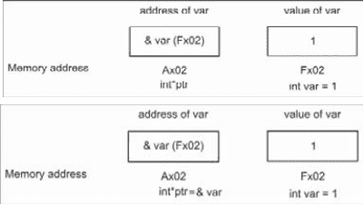

**▲ 图 1：展示了由指针引用的变量**

在图 1 中，创建了一个指针变量 ptr，它使用 &var 表达式存储变量 var 的地址。变量 var 被初始化为 1。与 ptr 一起使用的 * 运算符（*ptr）指示编译器通过变量 var 的地址访问变量 var 中存储的数据。清单 2 展示了 * 运算符的使用（可以在 CD 的 code\chapter4 文件夹中找到 UsingPointer.cpp 文件）：

**▶ 清单 2：使用指针引用变量中存储的数据**

```cpp
#include <iostream.h>
void main()
{
    int var,*ptr; //declaring an integer and integer pointer variable
    var=1; //assign a value to the variable
    ptr = &var;// assign the address of the variable to pointer variable
    cout << "The value of variable var accessed using pointer variable is: "<<
*ptr;//print value
}
```

**输出：**

```text
The value of variable var accessed using pointer variable is: 1
```

在清单 2 中，声明了一个名为 `ptr` 的指针变量。使用 `&` 运算符访问变量 `var` 的内存地址，并将其赋给指针变量。使用 `*ptr` 表达式访问变量 `var` 中存储的数据。

除了访问所引用变量中存储的值之外，指针还可以设置其指向的变量中的数据。清单 3 展示了如何使用指针设置变量的值（可以在 CD 的 `code\chapter4` 文件夹中找到 `AssignValue.cpp` 文件）：

**▶ 清单 3：使用指针为变量赋值**

```
#include <iostream.h>
void main()
{
  int var,*ptr; //declaring an integer and integer pointer variable
  ptr = &var;// assign the address of the variable to pointer variable
  *ptr= 2; //dynamically store value to the variable referenced by pointer variable
  cout<<"The value set to the variable var using the pointer variable is:"<<*ptr;//printing the value
}
```

**输出：**

```text
The value set to the variable var using the pointer variable is:2
```

在清单 3 中，我们使用引用运算符（&）将变量 `var` 的引用赋给指针变量 `ptr`。由指针变量 `ptr` 指向的变量 `var` 被赋值为 2。使用指针变量 `ptr` 在屏幕上显示变量 `var` 的值。

### 使用其他指针类型

到目前为止，您已经学习了如何在 C++ 程序中创建和使用整型指针变量。但是，并非只能使用整型指针变量；在 C++ 程序中，可以使用 C++ 支持的任何类型的指针变量，例如 float、double 和 char。创建和使用其他指针变量的过程与创建和使用整型指针变量类似。清单 4 展示了其他类型指针变量的创建和使用（可以在 CD 的 code\chapter4 文件夹中找到 `OtherPointer.cpp` 文件）：

**▶ 清单 4：创建和使用其他指针类型**

```cpp
#include <iostream.h>

int main()
{
  char MyChar, *PointerChar;
  float MyFloat, *PointerFloat;

  MyChar = 'C';
  MyFloat = 25.1456;

  PointerChar = &MyChar;
  PointerFloat = &MyFloat;

  cout<< "Value of MyChar Variable is: "<<MyChar <<"\n";
  cout<< "MyChar Variable is stored at: "<<PointerChar;

  cout<< "\n"<<"Value of MyFloat Variable is: "<<MyFloat <<"\n";
  cout<< "MyFloat Variable is stored at: "<<PointerFloat;
  return 0;
}
```

**输出：**

```text
Value of MyChar Variable is: C
MyChar Variable is stored at: Cÿ ↑
Value of MyFloat Variable is: 25.1456
MyFloat Variable is stored at: 0x0012ff64
```

在清单 4 中，我们创建了一个 `char` 指针（`PointerChar`）和一个 `float` 指针（`PointerFloat`），它们分别将 `MyChar` 和 `MyFloat` 变量的内存地址作为其值。然后，使用 `iostream.h` 库中的 `cout` 函数在屏幕上显示这些变量（包括指针变量）的值。让我们学习 C++ 中指向指针的指针的用法。

### 使用指向指针的指针

如前所述，指针是一个包含另一个变量内存地址的变量。但是，指针也可以包含另一个指针的内存地址。例如，有一个整型变量 `MyInt` 和两个整型指针变量 `MyIntP1` 和 `MyIntP2`。整型指针 `MyIntP1` 指向 `MyInt` 变量的内存地址，整型指针 `MyIntP2` 指向 `MyIntP1` 的内存地址，那么整型指针 `MyIntP2` 应称为指向指针的指针。清单 5 展示了指向指针的指针变量的创建（可以在 CD 的 code\chapter4 文件夹中找到 `PointerToPointer.cpp` 文件）：

**▶ 清单 5：创建指向指针的指针变量**

```cpp
#include <iostream.h>

int main ()
{
  int MyInt, *MyIntP1, **MyIntP2;
  MyInt = 50;
  MyIntP1 = &MyInt;
  MyIntP2 = &MyIntP1;

  cout<<"Value of MyInt is: "<<MyInt;
  cout<<"\n"<<"Memory Address of MyInt is: "<< MyIntP1;
  cout <<"\n"<<"Memory Address of MyIntP1 is: "<< MyIntP2;
  cout <<"\n"<<"Memory Address of MyIntP2 is: "<< &MyIntP2;

  cout<<"\n"<<"Value accessed using MyInt is: "<<MyInt;
  cout <<"\n"<<"Value accessed using MyIntP1 is: "<< *MyIntP1;
  cout <<"\n"<<"Value accessed using MyIntP2 is: "<< **MyIntP2;
  return 0;
}
```

**输出：**

```text
Value of MyInt is: 50
Memory Address of MyInt is: 0x0012ff68
Memory Address of MyIntP1 is: 0x0012ff64
Memory Address of MyIntP2 is: 0x0012ff60
Value accessed using MyInt is: 50
Value accessed using MyIntP1 is: 50
Value accessed using MyIntP2 is: 50
```

在清单 5 中，可以看到声明了一个整型变量 `MyInt` 和两个整型指针变量 `MyIntP1` 和 `MyIntP2`。`MyIntP1` 后跟单个 `*` 运算符，而 `MyIntP2` 后跟两个 `*` 运算符（`**`），表示 `MyIntP2` 是一个指针，用于指向另一个指针（即 `MyIntP1`）的内存地址。此外，在输出中可以看到，指针 `MyIntP1` 的内存地址（`0x0012ff64`）与 `MyIntP2` 的内存地址（`0x0012ff60`）不同。但是，当访问这些指针的值时，它们都显示了相同的值。

让我们学习如何在运行时使用指针处理内存。


清单 6 展示了 C++ 程序中 `new` 和 `delete` 运算符的使用（可在 CD 的 `code\chapter4` 文件夹中找到 `NewDelete.cpp` 文件）：

### 清单 6：使用 new 和 delete 运算符分配和释放内存

```cpp
#include <iostream.h>
void main()
{
    double * pi = new double;//declare the double pointer variable
    *pi = 3.14159;//assign a value to the referenced pointer variable
    cout<<"Value stored at newly allocated memory(pi) is:"<< * pi << endl;
    delete pi;//delete the memory held by pointer variables
    cout<<"The memory for the pointer 'pi' has been de-allocated"<<endl;
}
```

### 输出：

```text
Value stored at newly allocated memory(pi) is: 3.14159
The memory for the pointer 'pi' has been de-allocated
```

在清单 6 中，我们声明了一个由 double 指针变量 `pi` 引用的变量，并为其赋值。在显示变量 `pi` 的值之后，我们使用 `delete` 运算符释放了分配给变量 `pi` 的内存。最后，打印一条消息，确认已删除变量 `pi` 占用的内存。

### 4.2 使用指针探索数组

数组是相同数据类型变量的线性集合。在程序中创建数组时，其大小是有限的，可以包含 n 个元素，其中 n 是数组的大小。此外，可以使用元素的索引号来操作数组元素。索引号也称为下标号。数组中每个元素的索引号比它在数组中的实际位置小 1。例如，如果你想访问数组的第五个元素，索引号应为 4。你可以使用索引值在数组范围内逐个遍历元素。

指针也可用于引用数组。当指针处理数组时，它们存储数组类型变量中某个元素的地址。让我们看一个示例，其中创建了一个包含 11 个元素的整型数组 `arr`。该数组通过以下代码片段创建：

```cpp
int arr[11];
```

创建数组后，数组的所有元素在内存中彼此相邻地表示，如图 3 所示：

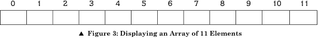

然后，可以使用以下代码片段表示该数组第一个元素的地址：

```cpp
&arr[0]; // we have used address operator to denote the address of first element
```

或者，可以使用以下代码片段表示数组的任意元素：

```cpp
&arr[i]; // for any element at the given index location denoted by i
```

现在，使用以下代码片段声明一个整型指针变量：

```cpp
int * ptr; // an integer pointer
```

声明整型指针变量后，我们可以使用以下代码片段，将数组第一个元素或任意其他元素的地址显式赋给新创建的指针变量：

```cpp
ptr = &arr[0];               //ptr points to address of arr[0]
```

或者，

```cpp
ptr = &arr[i]; // ptr points to the address of the element referenced by i
```

此外，还可以仅通过传入数组名（也可以说，不指定任何索引号），使用以下代码片段将数组第一个元素的地址赋给指针变量：

```cpp
ptr = arr;                   //ptr points to address of arr[0]
```

在 C++ 中，可以使用数组名以及指向数组的指针来访问和操作数组元素的值。然而，数组和指针的工作方式相当不同。由于指针是变量，可以使用运算符（+、-、++、--）进行操作；而数组是变量的线性集合，不能使用诸如 arr++ 这样的操作进行操作，其中 arr 是数组名。清单 7 展示了如何使用指针处理数组（可在 CD 的 `code\chapter4` 文件夹中找到 ArrayPointer.cpp 文件）：

### ▶ 清单 7：使用指针处理数组

```cpp
#include<iostream.h>
void main()
{
    int myarray [5] = {10,11,12,13,14};      //declare an integer array
    int i;
    for(i=0;i<5;i++)//using for loop traverse through it
    {
        cout<<"address of element"<<i<<": " <<(myarray + i) <<endl;
        //print addresses of all elements using (myarray)
    }
    for(i=0;i<5;i++)
    {
        cout<<"element at address"<< " "<<(myarray + i) <<" is "<<*(myarray + i)<<endl;
        //print contents at the addresses
    }
}
```

**输出：**

```text
address of element0:0x0012ff40
address of element1:0x0012ff44
address of element2:0x0012ff48
address of element3:0x0012ff4c
address of element4:0x0012ff50
element at address 0x0012ff40 is 10
element at address 0x0012ff44 is 11
element at address 0x0012ff48 is 12
element at address 0x0012ff4c is 13
element at address 0x0012ff50 is 14
```

在清单 7 中，我们声明了一个整型数组（myarray）。由于数组名保存其第一个元素的地址，我们使用其名称（myarray）来打印地址。最后，我们使用 *(myarray) 打印指定地址处的值。

接下来，让我们解释如何对指针变量执行算术运算、如何使用指针变量处理字符串，并讨论动态数组。

### 使用指针算术

C++ 允许对指针变量进行算术运算。指针算术用于对内存地址而不是简单变量执行算术运算。算术运算主要用于快速、准确地操作由变量（包括数组）分配的地址。对指针执行算术运算的主要目的是在指针变量引用的地址区域内前后移动。

当你想访问数组中的一系列值时，指针算术很有用。为此，需要将指针变量（引用该数组）加 1，以从一个值移动到下一个值。指针算术中使用以下类型的算术运算符：

- 递增（++）和递减（--）运算符
- 加法（+）和减法（-）运算符
- 星号（*）运算符

### 递增（++）和递减（--）运算符

指针变量充当指向变量地址的索引。当存储的变量为整型时，它在内存中占用 4 字节。当应用递增（++）运算符时，指针变量在跳过 4 字节的间隔后指向下一个元素。当数据为 double、float 或字符类型时，索引会根据其大小移动。可以使用递减（--）运算符移动到数组的前一个元素。

### 加法（+）和减法（-）运算符

加法（+）运算符按指定数据类型的大小增加指针的值，并使指针变量指向指定元素。减法（-）运算符按指定数据类型的大小减小指针的值，并使指针变量指向指定元素。

### 星号（*）运算符

`*` 运算符用于指针变量之前，以检索变量的值。在对指针执行算术运算时，还会考虑与指针变量一起使用的数据类型的大小。让我们考虑一个示例，其中指针 ptr 存储一个名为 arr 的 float 类型数组的引用，该数组包含 5 个元素。假设数组 arr 的第一个元素位于内存位置 2000。当使用 ++ 运算符递增指针 ptr 时，指针的地址会增加四个字节而不是一个字节，因为 float 数据类型占用的大小是 4 字节。图 4 展示了对指针变量执行算术运算的方式：

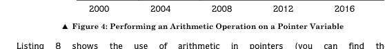

清单 8 展示了指针算术的使用（可在 CD 的 `code\chapter4` 文件夹中找到 `ArithmeticPointer.cpp` 文件）：

### 清单 8：使用指针算术打印数组元素

```cpp
#include<iostream.h>
void main()
{
    int myarray [5] = {10,11,12,13,14};//declare an array of integers
    int* ptr = &myarray[0];//declare a pointer and assign the address of the first element of array
    cout<<"<ptr> prints value at the first memory location:";
```

```cpp
cout<<*(ptr )<<endl;//*(ptr) prints the content at that address
cout<<"*(ptr + 1)> now prints value at the next location:";
cout<<*(ptr + 1)<<endl;//*(ptr + 1) prints value at the next address pointed by ptr+1
}
```

**输出：**

```text
*(ptr) prints value at the first memory location:10
*(ptr+1)> now prints value at the next location:11
```

在清单 8 中，我们声明了一个包含 5 个元素的整数数组 (myarray)，并使用指针变量 (ptr) 赋值为其第一个元素的地址。然后，我们显示了 ptr 所引用的第一个内存位置的内容。最后，我们使用 (ptr + 1) 运算移动了指针位置，并打印了下一个内容。

## 使用指针处理字符串

在 C++ 中，字符串不过是以空字符 `\0` 结尾的字符数组。当你在 C++ 中创建字符指针变量来引用字符串时，该字符指针变量包含字符串第一个字符的地址。由于字符串在内部表示为数组，我们可以使用指针访问该字符串的各个字符。清单 9 展示了一个示例，以理解使用指针访问字符串的概念（你可以在 CD 的 code\chapter4 文件夹中找到 StringPointer.cpp 文件）：

### ▶ 清单 9：使用指针对字符串执行操作

```cpp
#include<iostream.h>
int main()
{
  char *str="HELLO";  //declare character pointer referencing to a string
  cout<<*str<<endl;   //print element at the first element’s address
  cout<<str<<endl;    //print whole string starting from the first element
  str++;
  cout<<*str<<endl;   //print element at the shifted position
  cout<<str;          //print whole string starting from the shifted position
  return 0;
}
```

**输出：**

```text
H
HELLO
E
ELLO
```

在清单 9 中，字符串 `HELLO` 在内部表示为字符数组，其中各个字符作为元素。指针 `str` 最初指向数组的第一个元素。如果我们使用 `++` 运算符将 `str` 变量增加 1，那么 `str++` 表示数组中的下一个元素，即 E。此外，元素可以通过 `*(str)`、`*(str +1)` 等来引用。字符串的数组表示如图 5 所示：

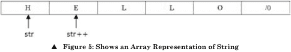

C++ 提供了一些返回字符指针的库函数，例如 `strcpy()` 和 `strcat()`。`strcpy()` 函数将一个字符串值复制到另一个字符串，`strcat()` 函数连接两个字符串值。清单 10 展示了一个使用 `strcpy()` 函数并返回 char 的程序（你可以在 CD 的 code/chapter4 文件夹中找到 CopyFunction.cpp 文件）：

### ▶ 清单 10：使用 strcpy() 函数复制字符串

```cpp
#include <iostream.h>
#include<string.h>
int main()
{
    char str1[10] = "Kogent";       //declaring a char array str1
    char str2[10] = "Solutions";    //declaring a char array str2
    char* str3 = strcpy(str2,str1); /* copy the content of str1 to the str2 and
                                       then content of str2 is assigned to the char pointer str3 */
    cout<<str3;                      //displays the content of str3
    return 0;
}
```

**输出：**

Kogent

在清单 10 中，我们声明了两个字符数组 `str1` 和 `str2`，分别存储值 Kogent 和 Solutions。定义在 `string.h` 库或头文件中的 `strcpy()` 函数用于将 `str1` 数组的内容复制到 `str2` 数组。然后，将 `str2` 数组的内容赋给字符指针 `str3`，并使用 `cout` 函数在屏幕上显示。

> `strcpy()` 函数定义在 `<string.h>` 头文件中。因此，代码中必须包含 `<string.h>` 头文件。

`strcat()` 函数将一个字符串追加到另一个字符串，并返回指向结果字符串的指针。清单 11 展示了一个使用 `strcat()` 函数并返回字符指针的程序（你可以在 CD 的 `code\chapter4` 文件夹中找到 `ConcatenFunction.cpp` 文件）：

### ▶ **清单 11：使用 strcat() 函数**

```cpp
#include <iostream.h>
#include <string.h>
int main()
{
    char string1[] = "Good";//declare a character array of string
    char string2[] = " morning!"; //declare another array of string
    char* string3; // declare a character pointer
    string3 = strcat(string1,string2);//storing the result of concatenation
    cout<< string3<<endl;//print the result
    return 0;
}
```

**输出：**

```text
Good morning!
```

在清单 11 中，我们声明了两个字符串 string1 和 string2。然后，我们调用库函数 `strcat()`，它接受两个字符串（string1 和 string2）作为参数，并返回连接后的字符串。我们还声明了一个字符指针变量，用于保存 `strcat()` 函数返回的字符串的地址。最后，我们借助字符指针变量获取连接后的字符串。

## ■ **探索动态数组**

如前所述，new 和 delete 运算符用于为指针分配和释放内存。可以使用这些运算符为其分配和释放内存的指针称为动态数组。例如，考虑以下代码片段：它使用 new 运算符为整数数组 arr 分配内存，并使用 delete 运算符释放内存：

```cpp
int* arr = new int[10]; // for creating and initializing array at run time.

delete[] arr; // for de-allocating memory assigned to the arr array.
```

通常，与静态数组（普通数组）相比，动态数组更受青睐，原因如下：

- 静态数组的内存在编译时分配，无论程序中是否使用它。另一方面，动态数组的内存在程序运行时执行语句（声明动态数组）时分配。
- 静态数组在整个程序执行期间占用内存，并且分配给静态数组的内存直到程序终止才能释放。另一方面，你可以在程序执行期间随时释放分配给动态数组的内存，只要程序中不再需要该数组。

## 测试你的知识

- **问题 1.** 创建一个以相反顺序显示字符串的程序。

**答案：**

```cpp
#include <iostream.h>

int main()
{
    char name [] = "Kogent Solutions";
    int i;
    for (i=0; name[i] != '\0'; i++);

    char *getChar, *checkChar;
    getChar = name;
    checkChar = name;
    getChar = getChar + i -1;
    while (*getChar != '\0')
    {
        cout<<" "<< *getChar;
        if (*checkChar== *getChar)
        {
            break;
        }
        getChar--;
    }

    return 0;
}
```

**输出：**

```text
s  n  o  i  t  u  l  o  S     t  n  e  g  o  K
```

- **问题 2.** 创建一个程序，以相反顺序显示用户在运行时输入的字符串（最多 25 个字符）。

**答案：**

```cpp
#include <iostream.h>
int main()
{
    char name [26];
    cout<< "Enter the String You Want To Reverse\nIt should be less than or equal to 25 characters and should not have any blank space\n";
    cin>>name;
    int i;
    for (i=0; name[i] != '\0'; i++);
    char *getChar, *checkChar;
    getChar = name;
    checkChar = name;
    getChar = getChar + i - 1;
    while (*getChar != '\0')
    {
        cout<<" "<< *getChar;
        if (*checkChar== *getChar)
        {
            break;
        }
        getChar--;
    }
    return 0;
}
```

**输出：**

```text
Enter the String You Want To Reverse
It should be less than or equal to 25 characters and should not have any blank space
Kogent-Solutions-Inc
c n I - s n o i t u l o S - t n e g o K
```

- **问题 3.** 创建一个程序，接受用户输入的两个字符串，将它们连接起来，并显示在屏幕上。必须使用单独的函数来连接两个字符串。

**答案：**

```cpp
#include <iostream.h>
#include <string.h>

char* JoinString (char *toString, char *fromString)
{
    char *JoinedString = "";
    strcat(JoinedString, toString);
    strcat(JoinedString, fromString);
    return JoinedString;
}

int main ()
{
```


```cpp
char str1 [16], str2 [16];
char *JoinedString;

cout << "Enter the first String you want to Concatenate, not greater than 15 characters \n";
cin >> str1;

cout << "\nEnter the second String you want to Concatenate, not greater than 15 characters";
cin >> str2;

JoinedString = JoinString (str1, str2);
cout<<"\nThe result of joined strings is :" << JoinedString;

return 0;
}
```

**输出：**

```text
Enter the first String you want to Concatenate, not greater than 15 characters
Kogent

Enter the second String you want to Concatenate, not greater than 15 characters
Solutions

The result of joined strings is :KogentSolutions
```

- **Q4.** 创建一个程序，从用户处接收两个整数值，并在屏幕上显示它们的和。必须使用一个使用指针的独立函数来将两个数相加。

**答案。**

```cpp
#include <iostream.h>

void add (int *num1, int *num2)
{
*num1 = *num1 + *num2;
}

int main()
{
int a,b;
cout<<"Enter the first Number you want to add ";
cin >>a;
cout<<"\nEnter the second Number you want to add ";
cin >>b;
int *x,*y;
x=&a;
y=&b;
add(x,y);
cout<<"\nThe sum of two numbers you entered is: "<<x;
return 0;
}
```

**输出：**

```text
Enter the first Number you want to add 57

Enter the second Number you want to add 84

The sum of two numbers you entered is: 141
```

- **Q5.** 编写一个程序，使用 for 循环计算 n 个数的和（n 可以是用户在运行时提供的任意整数）。使用通过指针实现的独立函数来获得结果。在我们的例子中，用户为 n 输入了 50。

**答案。**

```cpp
#include <iostream.h>

void sumOfn (int *num)
{
    *num = (*num * (*num+1))/2;
}
int main()
{
    int *sum, n1, n=0;
    cout<<"Enter the value of n: ";
    cin>>n;
    n1 = n;
    sum = &n;
    sumOfn (sum);
    cout<<"Sum of "<<n1<<" number is: "<<n;
    return 0;
}
```

**输出：**

```text
Enter the value of n: 50
Sum of 50 number is: 1275
```

现在，让我们看看如何将指针与函数一起使用。

### 4.3 将指针用作函数参数

函数是一组具有名称的语句，用于在运行时执行特定操作。函数还可以接受参数，这些参数对于从程序的其他任何部分调用该函数是必不可少的。我们已经在第 3 章*《使用数组和函数》*中讨论过函数。在 C++ 中，我们可以将指针用作函数参数。将指针作为函数参数传递的主要目的是反映在函数体内部对变量所做的更改，并使这些更改从调用该函数的位置可见。将指针用作函数参数称为按引用调用方法。这与按值调用方法形成对比，在按值调用方法中，对函数体内数据所做的任何更改都不会反映到函数体外部。清单 12 展示了一个将指针作为函数参数传递的程序（你可以在 CD 的 `code\chapter4` 文件夹中找到 `PointerArgument.cpp` 文件）：

### ▶ 清单 12：使用指针按引用传递变量

```cpp
#include<iostream.h>

void add(int *p1);//function prototype declaration
int main()
{
    int n1=10;
    cout<<"Initial value of n1 is "<<n1<<endl;// value before function call
    add(&n1);//calling function with arguments matching the pointer variables
    cout<<"Value of n1 after adding 5 is: "<<n1<<endl;

    return 0;
}

void add(int *p1)
{
    *p1=*p1+5;//change the value at the address passed
}
```

**输出：**

```text
Initial value of n1 is 10
Value of n1 after adding 5 is: 15
```

在清单 12 中，我们的主要目的是将指针变量作为函数参数传递。首先，我们声明一个整型变量 `n1`。现在，我们使用 `&` 运算符传递该变量的地址。在函数体内部，我们通过指针变量 `*p1` 所引用的地址，将 `n1` 的值更改 5。调用 `add()` 函数后，`n1` 的值通过指针被更改，并且更改后的值会被打印出来。

### 4.4 从函数返回指针

我们知道，一个函数只能返回单个值。然而，它可以通过使用指针返回多个值。我们必须将指针声明为函数的返回类型，以便该函数可以返回多个值。然而，只有当函数必须使用指针变量，并初始化该指针变量以引用其函数体结构中的数组元素时，函数才能返回指针变量。我们知道，指针变量包含数组第一个元素的地址。因此，函数返回数组第一个元素的地址，以便我们可以轻松访问并操作其余元素。因为通过递增数组第一个元素的索引值，就可以轻松访问数组第二个元素的地址。清单 13 展示了一个用于演示从函数返回数组的程序（你可以在 CD 的 `code\chapter4` 文件夹中找到 `ReturnPointer.cpp` 文件）：

### ▶ 清单 13：从函数返回数组

```cpp
#include <iostream.h>

int* count(int x)
{
    int *arr = new int[x];
    int element;
    for (int i=0; i<x; i++)
    {
        cout<<"Enter arr["<<i<<"] :";
        cin>>element;
        arr[i] = element;
    }
    return arr;
}

int main()
{
    int j;
    cout<<"Enter number of element: ";
    cin>>j;
    int *arr=0;
    arr = count(j);
    cout<<"Element of arr are :"<<endl;
    for (int i=0; i<j; i++)
    cout <<arr[i]<<endl;
    delete [] arr;
    return 0;
}
```

**输出：**

```text
Enter number of element: 5
Enter array[0] :6
Enter array[1] :8
Enter array[2] :4
Enter array[3] :2
Enter array[4] :15
Element of arr are:
6
8
4
2
15
```

在清单 13 中，我们创建了一个函数——count()。count() 函数的返回类型是整型指针数组，即 arr。count() 函数还接受一个整型参数 x。当为该参数（x）传递值时，整型指针数组（arr）被初始化为一个数组。在 count() 函数内部，使用 for 循环为数组元素取值。然后，count() 函数返回这个整型数组。在 main() 函数中，我们从用户处接受一个整数，并将该数字作为参数值传递，以调用 count() 函数。最后，count() 函数返回的值被显示到屏幕上。

正如我们所知，函数返回单个值。它可以是整数值、char 值、float 值或任何其他类型的值。字符串包含多个 char 值。因此，我们不能从函数返回字符串。在这种情况下，我们使用 char 类型的指针变量，它返回该字符串第一个字符的地址。我们可以通过使用 char 类型的指针变量访问整个字符串。清单 14 展示了一个返回字符串值的程序（你可以在 CD 的 code\chapter4 文件夹中找到 ReturnString.cpp 文件）：

### 清单 14：从函数返回字符串值

```cpp
#include <iostream.h>
#include <string.h>
char* count(char *str)
{
    char *ch="Welcome ";
    strcat(ch, str);
    return ch;
}
int main()
{
    char *arr, str[50];
    cout<<"Enter name :";
    cin>>str;
    arr = count(str);
    cout<<endl;
    cout<<"The string value returned by count() function is : ";
    cout<<arr;
    return 0;
}
```

**输出：**

```text
Enter name :Dheeraj
The string value returned by count() function is : Welcome Dheeraj
```

> 在前面的程序中，如果你输入的字符串包含空格，那么空格之后的字符将不会显示。

在清单 14 中，count() 函数返回字符串变量（ch）的地址，该地址存储在 main() 函数中声明的指针 *arr 变量中。这个指针变量（*arr）用于显示存储在指针 arr 变量中的字符串数据。

## 测试你的知识

- **Q6.** 编写一个程序，首先询问用户想要输入的总数，然后接受这些数字，并使用指向数组的指针计算所有数字的和。

**答案。**

```cpp
#include <iostream.h>

int* count(int x)
{
    int *arr = new int[x];
    int element;
    for (int i=0; i<x; i++)
    {
        cout<<"\nEnter number "<<(i+1)<<": ";
        cin>>element;
        arr[i] = element;
    }
    return arr;
}
int main()
{
    int j, sum = 0;
    cout<<"Enter number of digits you want to add: ";
    cin>>j;
    int *arr=0;
    arr = count(j);
    cout<<"Sum of the Numbers you entered is :"<<endl;
    for (int i=0; i<j; i++)
    {
        sum = sum + arr[i];
```


```cpp
}

cout << sum;

delete [] arr;

return 0;
}
```

**输出：**

```text
Enter number of digits you want to add: 6

Enter number 1: 25

Enter number 2: 50
Enter number 3: 60

Enter number 4: 78

Enter number 5: 98

Enter number 6: 74
Sum of the Numbers you entered is :
```

### Q7. 编写一个程序，接受用户输入的一个数字，并显示该数字及其倒数。要获得该数字的倒数，必须使用一个单独的函数。

答。

```cpp
#include <iostream.h>

void reciprocal(double *p1)
{
    *p1=1/(*p1);
}

int main()
{
    double n1;
    cout <<"Enter the number whose reciprocal is required ";
    cin >> n1;
    cout<<"\nThe Number you have entered is: "<<n1<<"\n";
    reciprocal(&n1); // calling function with arguments matching the pointer variables
    cout<<"The reciprocal of the number is: "<<n1;

    return 0;
}
```

**输出：**

```text
Enter the number whose reciprocal is required 12.2356

The Number you have entered is: 12.2356
The reciprocal of the number is: 0.0817287
```

### Q8. 编写一个程序，接受用户输入的字符串，并显示其中元音字母的数量。

答。

```cpp
#include <iostream.h>
#include <string.h>

int vowels(char *str)
{
    int NumVowels = 0;
    for (int i=0; str[i] != '\0'; i++)
    {
        if((str[i] == 'A') || (str[i] == 'E') || (str[i] == 'I') ||
           (str[i] == 'O') || (str[i] == 'U') || (str[i] == 'a') || (str[i] == 'e') ||
           (str[i] == 'i') || (str[i] == 'o') || (str[i] == 'u'))
        {
            NumVowels +=1;
        }
    }
    return NumVowels;
}

int main()
{
    char str[50];
    int NumVowels;
    cout<<"Enter string in which you want to find vowels: ";
    cin>>str;
    NumVowels = vowels(str);
    cout<<endl;
    cout<<"The Number of Vowels in the String are: ";
    cout<<NumVowels;

    return 0;
}
```

**输出：**

```text
Enter string in which you want to find vowels: Dheeraj_Gupta

The Number of Vowels in the String are: 5
```

### Q9. 创建一个程序，接受员工的基本工资，然后显示其总工资，总工资包括基本工资以及 D.A. 10%、HRA 25% 和 PF 10.3%。

答。

```cpp
#include <iostream.h>

void Cal_Salary (double *bSal)
{
    double da, hra, pf ;
    da = (*bSal * 10)/100;
    hra = (*bSal * 25)/100;
    pf = (*bSal * 10.3)/100;

    *bSal = *bSal + da + hra + pf;
}

int main()
{
    double bSal, *tSal;
    cout<<"Enter your basic Salary to know Total salary ";
    cin>>bSal;

    tSal = &bSal;
    Cal_Salary (tSal);
    cout<<endl<< *tSal;

    return 0;
}
```

**输出：**

```text
Enter your Basic Salary to know Total salary 1200

1743.6
```

### Q10. 创建一个程序，接受学生获得的分数，并显示结果（通过或未通过）以及等级。如果获得的分数大于或等于 40，则结果为通过，否则为未通过。等级将根据以下标准分配：

| 获得分数 | 等级 |
|---|---|
| 小于 40 | E |
| 40 到 50 之间 | D |
| 50 到 60 之间 | C |
| 60 到 70 之间 | B |
| 大于 70 | A |

答。

```cpp
#include <iostream.h>

char* get_result (int marks)
{
    char *result;
    if (marks < 40)
    {
        result = "F";
    }
    else
    {
        result = "P";
    }
    return result;
}

char* get_grade (int marks)
{
    char *grade;
    if (marks < 40)
    {
        grade = "E";
    }
    if ((marks >=40) && (marks <=50))
    {
        grade = "D";
    }
    if ((marks >50) && (marks <=60))
    {
        grade = "C";
    }
    if ((marks >60) && (marks <=70))
    {
        grade = "B";
    }
    if (marks > 70)
    {
        grade = "A";
    }
    return grade;
}

int main ()
{
    int marks;
    char *result, *grade;
    cout<<"Enter the marks you obtained in the exam: ";
    cin>> marks;
    result = get_result (marks);
    grade = get_grade (marks);
    cout<<"The result of your exam: " << *result<<endl;
    cout<<"Your Grade is: " << *grade;
    return 0;
}
```

**输出：**

```text
Enter the marks you obtained in the exam: 50
The result of your exam: P
Your Grade is: D
```

### Q11. 创建一个程序，接受用户输入的本金和年数。然后按年利率 8% 计算利息，并将其显示在屏幕上。

答。

```cpp
#include <iostream.h>

void Cal_Int (double *Amount, double years)
{
    double interest ;
    interest = (((*Amount) * years * 8) / 100);
    *Amount = *Amount + interest;
}

int main()
{
    double years, P_Amount, *Amount;
    cout<<"Enter principal Amount: ";
    cin>>P_Amount;

    cout<<endl<<"Enter number of years: ";
    cin>>years;

    Amount = &P_Amount;
    Cal_Int (Amount, years);
    cout<<endl<< *Amount;

    return 0;
}
```

**输出：**

```text
Enter principal Amount: 2500

Enter number of years: 10.25

4550
```

### Q12. 创建一个税务计算器，接受员工详细信息，并显示员工应缴纳的税额。

答。

```cpp
#include <iostream.h>

char id[10];
char name[30];
char gender;

void Emp_Detail(double *monthSalary)
{
    cout<<"Enter employee id"<<endl;
    cin>>id;
    cout<<"Enter employee name"<<endl;
    cin>>name;
    cout<<"Enter monthly salary"<<endl;
    cin>>*monthSalary;
    cout<<"Enter gender (M/F)"<<endl;
    cin>>gender;
}

void taxCalculate(double *annualSalary, double *taxRate, double *monthSalary, double *taxAmount)
{
    double *as, *tr, *ms, *ta;
    as = annualSalary;
    tr = taxRate;
    ms = monthSalary;
    ta = taxAmount;

    if(gender=='M'||gender=='m')
    {
        *as=(*ms)*12;

        if((*as>150000)&&(*as<=300000))
        {
            *tr=10;
        }
        if((*as>300000)&&(*as<=500000))
        {
            *tr=20;
        }
        if(*as>500000)
        {
            *tr=30;
        }
        *ta=((*as)*(*tr))/100;
    }

    if(gender=='F'||gender=='f')
    {
        *as=(*ms)*12;

        if((*as>180000)&&(*as<=300000))
        {
            *tr=10;
        }
        if((*as>300000)&&(*as<=500000))
        {
            *tr=20;
        }
        if(*as>500000)
        {
            *tr=30;
        }
        *ta=((*as)*(*tr))/100;
    }
}

void display_Detail(double *annualSalary, double *taxRate, double *monthSalary, double *taxAmount)
{
    double *as, *tr, *ms, *ta;
    as = annualSalary;
    tr = taxRate;
    ms = monthSalary;
    ta = taxAmount;

    cout<<"Employee ID : "<<id<<endl;
    cout<<"Name : "<<name<<endl;
    cout<<"Monthly Salary : "<<*ms<<endl;
    cout<<"Annual Salary : "<<*as<<endl;
    cout<<"Tax Rate : "<<*tr<<endl;
    cout<<"Tax Amount : "<<*ta<<endl;
}

void main()
{
    double *monthSalary, *annualSalary, *taxRate, *taxAmount;
    double monthSalary1, annualSalary1, taxRate1, taxAmount1;
    monthSalary1=annualSalary1=taxRate1=taxAmount1=0;

    monthSalary = &monthSalary1;
    annualSalary = &annualSalary1;
    taxRate = &taxRate1;
    taxAmount = &taxAmount1;

    Emp_Detail(monthSalary);
    taxCalculate(annualSalary, taxRate, monthSalary, taxAmount);
    display_Detail(annualSalary, taxRate, monthSalary, taxAmount);
}
```

**输出：**

```text
Enter employee id

KLSI-0029

Enter employee name

Dheeraj

Enter monthly salary
25000
Enter gender (M/F)
M
Employee ID : KSI-T-0029
Name : Dheeraj
Monthly Salary : 25000
Annual Salary : 300000
Tax Rate : 10
Tax Amount : 30000
```

## 总结

本章中，你学习了使用指针管理内存。还学习了使用指针和指针算术访问并更改数组元素的值。然后，你学习了使用各种运算符，如 &、\*、new 和 delete，这些是在 C++ 中使用指针所必需的。你还学习了以指针变量作为参数的函数，这样在函数体内对变量所做的更改可以反映到函数体外。最后，你学习了创建能够以指针变量形式返回多个值的函数。

## 练习题

- **判断题**

  判断以下陈述是否正确：

  - Q1. 指针是可以存储其他变量引用的变量。**正确**
  - Q2. 使用指针的程序比不使用指针的程序运行得更慢。**错误**
  - Q3. 我们可以直接访问由指针变量所指向的其他变量中存储的值。**正确**
  - Q4. 我们不能在运行时为指针分配内存。**错误**
  - Q5. 指针变量的数据类型必须与其所指向变量的数据类型相同。**正确**
  - Q6. 从内存使用方面看，使用动态指针是可行的。**正确**
  - Q7. 我们可以在运行时使用 delete 运算符释放静态指针的内存。**错误**
  - Q8. & 运算符被称为指向运算符。**错误**
  - Q9. 要声明指针，需使用 `*` 运算符。**正确**


- Q10. 声明指针变量时，我们可以将 * 运算符放在变量名之前或变量名之后。错误
- Q11. & 运算符用于访问指针变量所引用的值。错误
- Q12. 将指针变量作为函数参数传递也称为按引用调用。正确

## 多项选择题

回答以下多项选择题：

- Q1. 整型变量需要 ________ 字节内存来存储一个值。
  - A. 1 字节
  - B. 2 字节
  - C. 4 字节
  - D. 8 字节

  答：选项 C 正确。

- Q2. 要创建和使用指针，我们需要 ______ 和 ______。
  - A. 声明一个指针变量，存储另一个变量的地址。
  - B. 声明一个指针变量，使用 new 关键字初始化它。
  - C. 获取任意变量的地址，创建指针来引用它。
  - D. 声明任意变量，使其指向另一个变量的地址。

  答：选项 A 正确。

- Q3. & 运算符也称为________。
  - A. 指向运算符
  - B. 引用运算符
  - C. 内存运算符
  - D. 空间运算符

  答：选项 B 正确。

- Q4. 哪个运算符用于声明指针变量？
  - A. %（百分位）
  - B. $（美元符号）
  - C. &（与）
  - D. *（星号）

  答：选项 D 正确。

- Q5. 要声明指针变量，* 运算符必须放置在________。
  - A. 变量名之前。
  - B. 变量名之后。
  - C. 前后都放置。
  - D. 不需要 * 运算符。

  答：选项 A 正确。

- Q6. & 运算符用于 ______。
  - A. 访问变量的内存地址。
  - B. 访问指针变量所引用的值。
  - C. 声明一个指针变量。
  - D. 在 C++ 编程中从不使用。

  答：选项 A 正确。

- Q7. 数组是相同数据类型的 ______ 集合。
  - A. 并发
  - B. 随机
  - C. 线性
  - D. 夹板

  答：选项 C 正确。

- Q8. 数组元素可以通过使用 ____________ 访问。
  - A. 数组名。
  - B. 项目索引。
  - C. 数组名和项目索引一起。
  - D. 我们无法访问数组的单个元素。

  答：选项 C 正确。

- Q9. 代码片段 `MyPointer = MyArray;` 将 ____________，其中 MyPointer 是指针变量，MyArray 是整型数组。
  - A. 将数组第一个元素的地址赋给指针。
  - B. 在编译时显示错误。
  - C. 在运行时显示错误。
  - D. 对程序执行没有影响。

  答：选项 A 正确。

- Q10. 在 C++ 中，每个字符串的最后一个元素是什么？
  - A. 零。
  - B. `\0`。
  - C. 它不确定。
  - D. 任何大写字符。

  答：选项 B 正确。

- Q11. C++ 中的递增和递减运算符是什么？
  - A. + 和 -
  - B. ++ 和 --
  - C. * 和 &
  - D. 没有这样的术语。

  答：选项 B 正确。

- Q12. 用于处理字符串函数的头文件名称是什么？
  - A. `conio.h`
  - B. `iostream.h`
  - C. `math.h`
  - D. `string.h`

  答：选项 D 正确。

## 简答题/答案

### Q1. 解释指针与内存管理之间的关系。

答：当我们声明一个变量时，并不考虑其在系统中的内存位置。操作系统负责分配适当数量的内存并跟踪该内存位置。有时，当我们需要使用变量的内存地址时，我们会使用一种特殊类型的变量，即指针变量。通过使用指针变量，我们可以直接访问变量的内存地址以及它（指针变量）所指向的值。此外，为了优化可用内存的使用，我们还会动态地为指针分配和释放内存。指针变量的数据类型取决于其地址存储在该指针变量中的变量的数据类型。

### Q2. 在 C++ 中，如何获取变量的内存地址？

答：在 C++ 中，当我们声明一个变量时，该变量会在内存中占据一些空间。每个内存位置都有一个与之关联的唯一地址。在 C++ 中，可以使用引用或取地址（&）运算符来获取该内存地址。例如，如果需要访问名为 X 的整型变量的内存地址，则必须编写 &X 语句，其中 X 是变量名，前面带有 & 运算符。

### Q3. 在 C++ 中，如何使用指针访问或修改变量的值？

答：要创建和使用指针，有两个基本步骤。首先，声明一个指针变量，然后在该变量中存储一个变量的地址。一旦将变量的内存地址赋给指针变量，就可以使用 * 运算符直接访问该变量的值。* 运算符也称为解引用运算符。解引用运算符（*）访问指针变量所指向的变量中存储的数据。例如，如果 MyInt 是整型变量，MyPointer 是指向 MyInt 变量内存地址的指针，则可以使用 *MyPointer 指针访问并更改 MyInt 变量的值。

### Q4. 什么是指向指针的指针？它与我们通常使用的指针有何不同？

答：指针是包含另一个变量内存地址的变量。然而，在某些情况下，一个指针（假设为 x）包含另一个指针（假设为 y）的内存地址。在这种情况下，指针（x）称为指向指针的指针。现在，指针与指向指针的指针之间的区别在于：指针包含变量的内存地址，而指向指针的指针包含另一个指针的内存地址。

### Q5. 如何在运行时为指针变量分配内存？

答：C++ 中的指针也可用于在运行时为变量分配内存。当我们在运行时为变量分配内存时，称为动态内存分配。动态分配允许你在需要时使用内存。C++ 提供了 new 运算符来动态分配内存。例如，让我们看看以下代码片段：

```
int *MyInt = new int;
```

在前面的代码片段中，MyInt 是一个指针变量，使用 new 运算符为其分配了内存。

### Q6. 解释在运行时释放指针变量内存的过程。

答：与在运行时为指针变量分配内存类似，我们也可以在运行时释放指针的内存。为此，C++ 提供了 delete 运算符。然而，delete 运算符只能释放通过 new 运算符为其分配内存的指针的内存。例如，考虑以下代码片段：

```
delete MyInt;
```

在前面的代码片段中，`delete` 关键字后面是指针变量的名称，即 `MyInt`，用于释放指针变量 `MyInt` 占用的内存。

### Q7. 什么是数组？如何使用指针处理数组？

答：数组是相同数据类型的变量的集合，这些变量在内存中彼此相邻存储。创建数组时，必须指定其大小，这意味着数组可以存储的变量数量。可以使用索引号访问数组的单个元素。索引号也称为下标号。数组每个元素的索引号比其在数组中的实际位置小 1。例如，如果要访问数组的第五个元素，索引号应为 4。

指针也可用于引用数组。当指针处理数组时，它们一次存储数组中单个元素的地址。使用指针，还可以访问和更改数组元素的值。

### Q8. 什么是递增和递减运算符？它们如何与指针一起使用？

答：C++ 允许对指针变量进行算术运算。它们主要用于快速、准确地操作分配给数组变量的地址。


利用指针的算术运算，可以在指针变量所引用的地址区域中前后移动。为此，要在地址区域中向前移动，使用递增（++）运算符；要向后移动，使用递减（--）运算符。

指针变量充当指向变量地址的索引。当我们应用递增（++）运算符时，指针变量指向数组的下一个元素；而递减（--）运算符则用于前一个元素。

### Q9. 什么是加法与减法运算符？它们如何受变量类型大小的影响？

**答案。** 加法（+）和减法（-）运算符按特定数值增加和减少指针的值。由于递增和递减运算符用于逐个改变内存地址，加法（+）和减法（-）运算符用于一次跳转到特定内存。例如，如果指针变量当前引用数组的第一个元素，而你想访问第五个元素，那么可以直接给指针变量加4并访问其第五个元素。加法（+）和减法（-）运算符根据指定数据类型的大小改变指针的值。例如，当我们对整型指针变量应用加法（+）运算符时，指针变量会指向4字节间隔之后的下一个元素。当数据为double、float或字符时，索引会根据它们的大小移动。

### Q10. 什么是动态数组？为什么在C++程序中动态数组比静态数组更受青睐？

**答案。** 动态数组是那些在运行时通过使用*new*和*delete*运算符动态接收或释放内存的数组。这些运算符分别用于在运行时向指针分配和释放内存。

一般而言，与静态数组（普通数组）相比，动态数组更受青睐，原因如下：

- 静态数组在编译时就被分配内存，而不论其在程序中是否使用。这会导致内存的不必要使用。另一方面，动态数组的内存在程序运行时执行（声明动态数组的）语句时才分配。因此，内存不会被不必要地占用。
- 静态数组在整个程序执行期间都占用内存，并且分配给静态数组的内存在程序终止之前无法释放。另一方面，你可以在程序执行期间随时释放分配给动态数组的内存，只要程序中不再需要该数组。这可以实现可用内存的最优使用。

### Q11. 什么是字符数组？如何用它访问整个字符串？

**答案。** 在C++中，字符数组是多个字符的集合，用于表示字符串。然而，该字符串必须以空字符`\0`结尾，这一点至关重要。我们可以使用字符指针访问整个字符串。基本上，字符指针指向字符串第一个字符的地址，我们可以使用递增和递减运算符或加法与减法运算符来访问字符串的所有其他字符。

### Q12. 什么是函数？指针如何用作函数参数？

**答案。** 函数是一组旨在执行特定操作的语句。例如，我们想将两个数相加并显示和。在这种情况下，我们可以创建一个函数（比如Sum），它接受两个整数值作为参数或实参，并返回这些值的和。

在C++中，我们可以将指针用作函数参数，因为当我们想要将函数体内部对变量所做的更改反映到调用该函数的位置时，这很有用。将指针作为参数传递称为按引用调用方法。这与按值调用方法形成对比，在按值调用方法中，在函数体内部对变量所做的任何更改都不会反映到函数体外部。

## 调试练习

### Q1. 下列程序的输出将是什么？

```cpp
#include <iostream.h>

int main()
{
int a=10;
int *b;
int **c;
b=&a;
c=&b;
cout<<a<<"\t"<<*b<<"\n";
cout<<&a<<"\t"<<*b<<"\n";
cout<<&b<<"\t"<<c;
return 0;
}
```

**答案。** 上述程序的输出如下：

|  |  |
|---|---|
| 10 | 10 |
| 0x0012ff68 | 0x0012ff68 |
| 0x0012ff64 | 0x0012ff64 |

> 在上述输出中，0x0012ff68 和 0x0012ff64 是内存地址，可能会有所不同。

### Q2. 下列程序的输出将是什么？

```cpp
#include <iostream.h>

int main()
{
  int a=25,b;
  int *x,*y;
  x=&a;
  y=&b;
  b=50;
  cout<<"Value of a: "<<*x<<"\n";
  cout<<"Value of b: "<<*y<<"\n";
  return 0;
}
```

**答案。** 上述程序的输出如下：

```text
Value of a: 25
Value of b: 50
```

### Q3. 下列程序的输出将是什么？

```cpp
#include <iostream.h>

void swap (int *num1, int *num2)
{
  int temp;
  temp = *num1;
  *num1=*num2;
  *num2=temp;
}
int main()
{
  int a=25,b=50;
  int *x,*y;
  x=&a;
  y=&b;
  swap (x,y);
  cout<<"Value of a: "<<*x<<"\n";
  cout<<"Value of b: "<<*y<<"\n";
  return 0;
}
```

**答案。** 上述程序的输出如下：

```text
Value of a: 50
Value of b: 25
```

### Q4. 下列程序的输出将是什么？

```cpp
#include <iostream.h>

int main()
{
    char name [] = "Kogent Solutions";
    char *getchar;
    getchar = name;
    for (int i=0; name[i] != '\0'; i++)
        {
            cout<< *getchar<<"  ";
            getchar++;
        }
    return 0;
}
```

**答案。** 上述程序的输出如下：

```text
K o g e n t   S o l u t i o n s
```

### Q5. 下列程序的输出将是什么？

```cpp
#include <iostream>

void display_num(int val)
{
    cout << val << endl;
}
int main()
{
    int MyInt[2], *PtoMyInt;
    MyInt [0] = 40;
    MyInt [1] = 25;
    PtoMyInt = &MyInt [1];
    display_num(*PtoMyInt);
    PtoMyInt--;
    display_num(*PtoMyInt);
    return 0;
}
```

**答案。** 上述程序的输出如下：

```text
25
40
```

### Q6. 下列程序的输出将是什么？

```cpp
#include <iostream.h>
#include <string.h>

int main()
{
    char str1[12] = "Mystring 1 ";
    char str2[12] = "Mystring 2";

    strcat(str1,str2);
    char *mystr = str1;
    while(*mystr != '\0')
    {
        cout<<*mystr;
        mystr++;
    }
    return 0;
}
```

**答案。** 上述程序的输出如下：

```text
Mystring 1 Mystring 2
```

### Q7. 下列程序的输出将是什么？

```cpp
#include<iostream.h>
void myFunction()
{
    int i=20;
    int *ptr;
    ptr=&i;
    cout<<"i = "<<i<<endl;
    cout<<"&i = "<<&i<<endl;
    cout<<"ptr = "<<ptr<<endl;
    cout<<"*ptr = "<<*ptr<<endl;
}
int main()
{
    myFunction();
    return 0;
}
```

**答案。** 上述程序的输出如下：

```text
i = 20
&i = 0x0012FF60
ptr = 0x0012FF60
*ptr = 20
```

### Q8. 下列程序的输出将是什么？

```cpp
#include<iostream.h>
void myFunction()
{
    int i=20;
    int *ptr;
    *ptr++;
    cout<<"i = "<<i<<endl;
    cout<<"&i = "<<&i<<endl;
    cout<<"ptr = "<<ptr<<endl;
    cout<<"*ptr = "<<*ptr<<endl;
}
int main()
{
    myFunction();
    return 0;
}
```

**答案。** 上述程序的输出如下：

```text
i = 21
&i = 0x8fbaff0
ptr = 0x8fba04c8
*ptr = 21
```

### Q9. 下列程序的输出将是什么？

```cpp
#include <iostream.h>
int main()
{
    int * pi = new int;
    *pi = 40;
    cout<<"New allocated memory of pi is:"<< *pi<<endl;
    delete pi;
    return 0;
}
```

**答案。** 上述程序的输出如下：

```text
New allocated memory of pi is:40
```

### Q10. 下列程序的输出将是什么？

```cpp
#include <iostream.h>
int main()
{
    int val = 70;
    int* ptr_val = &val;
    *ptr_val = 50;
    cout<<"val = "<<val<<endl;
    cout<<"&val = "<<&val<<endl;
    cout<<"ptr_val = "<<ptr_val<<endl;
    cout<<"*ptr_val = "<<*ptr_val<<endl;
    return 0;
}
```


答：上述程序的输出如下：

```text
val == 50
&val == 0x0012ff68
ptr_val == 0x0012ff68
*ptr_val == 50
```

### Q11. 以下程序的输出是什么？

```cpp
#include<iostream.h>
int main()
{
    int *a = new int[5];
    int *b=new int[10];
    cout << "b=" << b << endl;
    *(a+5)=9;
    cout << "a[5]=" << *(a+5) << endl;
    delete [] a;
    delete b;
    return 0;
}
```

答：上述程序的输出如下：

```text
b=10
a[5]=9
```

### Q12. 以下程序的输出是什么？

```cpp
#include<iostream.h>
int main()
{
    int fvalue, svalue;
    int * ptr;
    ptr = &fvalue;
    *ptr = 10;
    ptr = &svalue;
    *ptr = 20;
    cout << "firstvalue is " << fvalue << endl;
    cout << "secondvalue is " << svalue << endl;
    return 0;
}
```

答：上述程序的输出如下：

```text
firstvalue is 10
secondvalue is 20
```

`float`、`char` 和 `double`。在 C++ 中创建结构体，需要遵循两个过程。它们是：

- 1. 声明一个结构体，包含结构体名称以及可以存储在结构体中的不同类型的数据成员。
- 2. 定义结构体变量以访问结构体的数据成员。

可以使用 `struct` 关键字定义结构体，如下面的代码片段所示：

```cpp
struct employee          // structure declaration
{
    char name[20];       // an array of characters
    int age;             // an int age member
    float salary;        // a float salary member
    char designation[20]; // an array of characters
};
```

在前面的代码片段中，使用多种不同数据类型的变量（如 `int` 和 `float`）定义了结构体 employee。结构体名称 employee 前面有关键字 `struct`。employee 结构体以左花括号（`{`）开始，以右花括号（`}`）结束。需要注意的是，在右花括号结束后必须跟分号（`;`）。结构体的所有数据成员都指定在这些花括号之间。

定义结构体之后，下一步是声明结构体变量。结构体变量可以声明为全局变量或局部变量。以下代码片段展示了如何声明结构体的全局变量：

```cpp
struct employee
{
    char name[20];
    int age;
    float salary;
    char designation[20];
} employee_one, employee_two;
```

在前面的代码片段中，employee 是结构体名称；employee_one 和 employee_two 是 employee 类型的变量。此外，employee_one 和 employee_two 变量的作用域是全局的，因此它们可以在整个程序中的任何位置使用。

现在，让我们声明结构体的局部变量，如下面的代码片段所示：

```cpp
struct employee
{
    char name[20];
    int age;
    float salary;
    char designation[20];
};

int main()
{
    employee employee_one, employee_two;
    return 0;
}
```

在前面的代码片段中，employee 是一个结构体；employee_one 和 employee_two 是 main() 函数中 employee 类型的变量。然而，employee_one 和 employee_two 变量的作用域是局部的，这意味着这些变量只能在 main() 函数内访问。

清单 1 展示了如何使用 struct 关键字声明结构体，并在 main() 函数中使用结构体实例初始化结构体变量（你可以在光盘的 code\chapter5 文件夹中找到 MyStructure.cpp 文件）。

### 清单 1：声明和定义结构体变量

```cpp
#include<iostream.h>
#include<stdio.h>

struct employee
{
    char name[20];
    int age;
    float salary;
    char designation[20];
};

int main()
{
    employee employee_one;

    cout<<"Enter employee name :";
    gets(employee_one.name);

    cout<<"Enter employee age :";
    cin>>employee_one.age;

    cout<<"Enter employee salary :";
    cin>>employee_one.salary;

    cout<<"Enter employee designation :";
    gets(employee_one.designation);

    cout<<"The information of an employee are: "<<endl;
    cout<<employee_one.name<<endl;
    cout<<employee_one.age<<endl;
    cout<<employee_one.salary<<endl;
    cout<<employee_one.designation<<endl;
    return 0;
}
```

**输出：**

```text
Enter employee name :Mahtab Alam
Enter employee age :25
Enter employee salary :6000
Enter employee designation :Technical Writer
The information of an employee are:
Mahtab Alam
25
6000
Technical Writer
```

在清单 1 中，结构体 employee 在 main() 函数外部声明。该结构体的成员通过在 main() 函数中声明该结构体的变量 employee_one 来访问。访问和初始化结构体元素的过程将在下一节中说明。

## 访问和初始化结构体元素

每个结构体都有一些元素，称为结构体成员，它们声明在结构体的左花括号和右花括号之间（称为结构体主体）。定义结构体时，必须为结构体变量提供一个名称，以便在 C++ 程序中访问它。你可以在结构体变量名和结构体元素（结构体成员）之间使用点（.）运算符来访问和初始化结构体元素。访问结构体元素的语法如下：

```cpp
structure_variable_name.structure_element;
```

在以下代码片段中，employee 结构体的结构体元素（name）通过结构体变量名（employee_one）进行访问：

```cpp
employee_one.name;
```

同样，你可以使用点运算符（.）初始化结构体元素，如下面的代码片段所示：

```cpp
employee_one.name = "Mohan";
employee_one.age = 22;
```

清单 2 展示了如何访问和初始化结构体成员（你可以在光盘的 code\chapter5 文件夹中找到 HeightStructure.cpp 文件）：

### 清单 2：访问和初始化结构体成员

```cpp
#include <iostream.h>
#include <stdio.h>

struct length
{
    int feet;
    int inch;
};

int main()
{
    length height;

    height.feet = 5;
    height.inch = 10;

    cout<<"Your height is : ";
    cout<<height.feet<<" feet ";
    cout<<height.inch<<" inch";

    return 0;
}
```

**输出：**

```text
Your height is : 5 feet 10 inch
```

在清单 2 中，声明了结构体 length，它包含两个整数元素 feet 和 inch。然后，在 main() 函数中声明了结构体 length 的变量（height）。该对象用于通过点（.）运算符访问结构体 length 的元素。

## 测试你的知识

### Q1. 使用结构体创建一个程序，接受学生 ID 和学生姓名，并将它们显示在屏幕上。

答：

```cpp
#include <iostream.h>

struct Student
{
    char name[20];
    int ID;
};

int main()
{
    cout<<"Enter the record of the student"<<"\n";
    cout<<"------------------------------"<<"\n";
    Student s;
    cout<<"Enter Name of the Student: ";
    cin>>s.name;
    cout<<"Enter Student ID: ";
    cin>>s.ID;

    cout<<endl<<"Displaying the record of the student, you have entered so far\n";
    cout<<"Student Name: "<<s.name <<"\n";
    cout<<"Student ID: "<<s.ID<<"\n";

    getch();
    return 0;
}
```

**输出：**

```text
Enter the record of the student
-------------------------------
Enter Name of the Student: Student123
Enter Student ID: 1256

Displaying the record of the student, you have entered so far
Student Name: Student123
Student ID: 1256
```

### Q2. 编写一个程序，使用结构体显示矩形的面积，其尺寸在运行时提供。

答：

```cpp
#include <iostream.h>

struct rectangle
{
    float length;
    float breadth;
};

int main()
{
    rectangle r1;
    cout<<"Enter the length of the rectangle: ";
    cin>>r1.length;
    cout<<"Enter the breadth of the rectangle: ";
    cin>>r1.breadth;
    cout<<"Area of the rectangle: " ;
    cout<<(r1.length * r1.breadth);
    return 0;
}
```


**输出：**
```text
Enter the length of the rectangle: 12
Enter the breadth of the rectangle: 25
Area of the rectangle: 300
```

让我们进一步学习如何创建嵌套结构。

## 创建嵌套结构

结构中的结构称为嵌套结构。这意味着一个结构的成员也可以是另一个结构的结构变量。现在，考虑以下示例来说明嵌套结构，该示例将 day、month 和 year 等数据成员组放入 date 结构中，如下所示：

```cpp
struct date
{
    int day;
    int month;
    int year;
};
```

这个 date 结构可以作为 employee 结构的嵌套结构，如下面的代码片段所示：

```cpp
struct employee
{
    char name[30];
    int age;
    float salary;
    date join_date;
};
```

在前面的代码片段中，date 结构的变量（join_date）被创建为 employee 结构的成员。换句话说，我们可以说 date 结构嵌套在 employee 结构内部。date 和 employee 这两个结构的数据成员层次结构如图 1 所示：

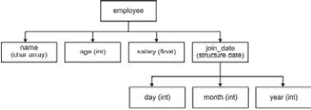

▲ 图 1：嵌套结构

在图 1 中，可以看到结构 employee 是主结构，它将 date 结构的实例作为其成员。在这种情况下，你可以说 date 结构嵌套在 employee 结构内部。

代码清单 3 展示了如何使用嵌套结构来处理复杂的数据结构（你可以在光盘的 code\chapter5 文件夹中找到 NestedStructure.cpp 文件）：

### 代码清单 3：处理嵌套结构

```cpp
#include <iostream.h>
#include<stdio.h>

struct date
{
    int day;
    int month;
    int year;
};
struct employee
{
    char name[30];
    int age;
    float salary;
    date join_date;
};
int main()
{

    employee emp;
    cout<<"Enter name : ";
    gets(emp.name);
    cout<<"Enter age : ";
    cin>>emp.age;
    cout<<"Enter salary : ";
    cin>>emp.salary;
    cout<<"Enter date of joining : "<<endl;
    cout<<"Enter day :";
    cin>>emp.join_date.day;
    cout<<"Enter month : ";
    cin>>emp.join_date.month;
    cout<<"Enter year : ";
    cin>>emp.join_date.year;
    cout<<"\nThe description of employee are -->"<<endl;
    cout<<"--------------------------------------"<<endl;
    cout<<"Name :"<<emp.name<<endl;
    cout<<"Age :"<<emp.age<<endl;
    cout<<"Salary :"<<emp.salary<<endl;
    cout<<"Date of joining :"<<emp.join_date.day<<"/"<<emp.join_date.month<<"/"<<emp.join_date.year;
    return 0;
}
```

**输出：**
```text
Enter name : Dheeraj Gupta
Enter age : 23
Enter salary : 7000
Enter date of joining :
Enter day :15
Enter month : 04
Enter year : 2008
The description of employee are -->
-----------------------------------
Name :Dheeraj Gupta
Age :23
Salary :7000
Date of joining :25/8/2007
```

在代码清单 3 中，你在嵌套的 employee 结构内以 emp.join_date.day、emp.join_date.month 和 emp.join_date.year 的形式访问 date 结构的成员元素，例如 day、month 和 year。

## 测试你的知识

- **Q3.** 创建一个程序，从用户那里接受学生详细信息（姓名、ID 和入学日期）并显示在屏幕上。为此，应使用一个名为 Student 的结构，该结构包含另一个名为 date 的结构的实例（该结构用于存储和显示学生的入学日期）。

**答。**

```cpp
#include <iostream.h>

struct date
{
    int day;
    int month;
    int year;
};

struct Student
{
    char name[20];
    int ID;
    date Add_date;
};

int main()
{
    cout<<"Enter the record of the student"<<"\n";
    cout<<"--------------------------------"<< "\n";
    Student s;

    cout<<"Enter Name of the Student: ";
    cin>>s.name;
    cout<<"Enter Student ID: ";
    cin>>s.ID;
    cout<<"Enter Date of admission. Firstly, Enter day of admission: ";
    cin>>s.Add_date.day;
    cout<<"Now, Enter month of admission: ";
    cin>>s.Add_date.month;
    cout<<"Now, Enter year of admission: ";
    cin>>s.Add_date.year;

    cout<<endl<<"Displaying the record of the student, you have entered so far\n";
    cout<<"Student Name: "<<s.name <<"\n";
    cout<<"Student ID: "<<s.ID<<"\n";
    cout<<"Date of Admission: "<< s.Add_date.day <<"/"
    <<s.Add_date.month
    << " / " << s.Add_date.year;

    return 0;
}
```

**输出：**
```text
Enter the record of the student
---------------------------------
Enter Name of the Student: Kogent123
Enter Student ID: 1234
Enter Date of admission. Firstly, Enter day of admission: 15
Now, Enter month of admission: 04
Now, Enter year of admission: 2008

Displaying the record of the student, you have entered so far
Student Name: Kogent123
Student ID: 1234
Date of Admission: 15/4/2008
```

- **Q4.** 创建一个程序，该程序有一个包含书名的结构，并在屏幕上以正常大小写以及大写形式显示书名。

**答。**

```cpp
#include <iostream.h>
#include <string.h>

struct BookMessage
{
    char msg[256];
    void show_msg(void);
};

struct UpperBookMessage
{
    char msg[256];
    void show_msg(void);
};
void BookMessage::show_msg(void)
{
    cout << msg;
}

void UpperBookMessage::show_msg(void)
{
    cout << strupr(msg);
}

int main(void)
{
    BookMessage book = { "My Experiences" };
    UpperBookMessage book_upr = { "Valley Solutions" };

    book.show_msg();
    cout<<endl;
    book_upr.show_msg();
    return 0;
}
```

**输出：**
```text
My Experiences
VALLEY SOLUTIONS
```

现在，让我们学习如何在函数内部创建结构。

## 在函数内部创建结构

现在，你已经熟悉了在全局创建的结构，以便可以从程序代码中的任何位置访问它们。然而，有时你可能需要一个结构仅由 C++ 程序的特定函数或部分使用。为此，你需要在函数体内部创建结构。例如，你想创建一个名为 My_Structure 的结构，该结构可以通过名为 My_Function 的函数访问。现在，编写以下代码片段来创建这样的结构：

```cpp
void My_Function ()
{

    struct My_Structure          //declaring structure
    {
        int new_age;
        char name[20];
    };                          // end of structure
    My_Structure ms;            //creating instance of structure within the
                                // function body
    ms.new_age = 25;            // initializing structure member.
    ms.name[0] = 'D';
    ms.name[1] = 'h';
    ms.name[2] = 'e';
    ms.name[3] = 'e';
    ms.name[4] = 'r';
    ms.name[5] = 'a';
    ms.name[6] = 'j';
}                               // end of the function
```

在前面的代码片段中，你创建了一个函数 My_Function 以及其中的一个结构 My_Structure。你还在 My_Function 函数内部创建了 My_Structure 结构的实例，并初始化了结构成员。

现在，让我们学习如何将结构传递给函数。

## 将结构传递给函数

函数包含某些变量，称为局部变量，这些变量只能在该函数中使用。此外，函数还使用由调用程序传递的参数来执行函数。这些参数用于在函数和调用程序之间进行通信。通常，你将变量作为函数参数传递。然而，这并非必须，你也可以将结构作为函数参数传递，这意味着你将结构变量作为参数传递给函数。传递给函数的结构变量可以访问该结构的所有元素。代码清单 4 展示了如何将结构变量作为函数参数传递（你可以在光盘的 code\chapter5 文件夹中找到 StructureArgument.cpp 文件）：

### 代码清单 4：将结构变量传递给函数

```cpp
#include <iostream.h>
#include <stdio.h>

struct product
{
    char product_number[15];
    char product_name[30];
    int product_quantity;
    float product_price;
};

void display(product p)
{
    cout<<"The descriptions of product are  ->"<<endl;
```


```cpp
cout<<"------------------------------------------"<<endl;
cout<<"Product number :"<<p.product_number<<endl;
cout<<"Product name :"<<p.product_name<<endl;
cout<<"Product quantity :"<<p.product_quantity<<endl;
cout<<"Product price :"<<p.product_price<<endl;
cout<<"------------------------------------------"<<endl;
cout<<"Total price = "<<p.product_quantity*p.product_price;
}

int main()
{
    product p;
    cout<<"Enter product number :"<<endl;
    gets(p.product_number);
    cout<<"Enter product name :"<<endl;
    gets(p.product_name);
    cout<<"Enter product quantity :"<<endl;
    cin>>p.product_quantity;
    cout<<"Enter product price of one quantity: "<<endl;
    cin>>p.product_price;
    display(p);
    return 0;
}
```

**输出：**

```text
Enter product number :
101
Enter product name :
Milk
Enter product quantity :
25
Enter product price of one quantity:
30
The descriptions of product are -->
------------------------------------------
Product number :101
Product name :Milk
Product quantity :25
Product price :30
------------------------------------------
Total price = 750
```

在清单4中，声明了一个结构体 product。在 main() 函数中访问该结构体的变量并为其赋予特定值。这些值通过 display 函数显示，该函数接收 product 结构体的对象作为参数。其中，p 是结构体 product 的对象，在 main() 函数中调用 display(p) 函数时作为实际参数使用，而在定义 display() 函数时作为形式参数（product p）使用。

## 从函数返回结构体

到目前为止，你学习了将结构体变量作为参数传递给函数。使用该参数，可以更改结构体中定义的变量的值。现在，假设你想在函数体外访问这些值。为此，你必须在函数体末尾使用 `return` 关键字向调用函数返回一个结构体变量。当函数返回结构体变量时，它必须与函数体中声明的结构体的返回类型相匹配。

现在扩展清单4中所示的示例，使函数返回结构体的对象。清单5展示了 input() 函数，它返回 product 结构体的结构体变量 new_product（可在 CD 的 code\chapter5 文件夹中找到 ReturnStructure.cpp 文件）：

### 清单5：从函数返回结构体

```cpp
#include <iostream.h>
#include <stdio.h>

struct product
{
    char product_number[15];
    char product_name[30];
    int product_quantity;
    float product_price;
};

product input()
{
    product new_product;
    cout<<"Enter product number :"<<endl;
    gets(new_product.product_number);
    cout<<"Enter product name :"<<endl;
    gets(new_product.product_name);
    cout<<"Enter product quantity :"<<endl;
    cin>>new_product.product_quantity;
    cout<<"Enter product price of one quantity: "<<endl;
    cin>>new_product.product_price;
    return new_product;
}

void display(product p)
{
    cout<<"The descriptions of product are -->"<<endl;
    cout<<"---------------------------------------"<<endl;
    cout<<"Product number :"<<p.product_number<<endl;
    cout<<"Product name :"<<p.product_name<<endl;
    cout<<"Product quantity :"<<p.product_quantity<<endl;
    cout<<"Product price :"<<p.product_price<<endl;
    cout<<"---------------------------------------"<<endl;
    cout<<"Total price = "<<p.product_quantity*p.product_price;
}

int main()
{
    product input();
    product p;
    p = input();
    display(p);
    return 0;
}
```

**输出：**

```text
Enter product number :
250
Enter product name :
Butter
Enter product quantity :
50
Enter product price of one quantity:
180
The descriptions of product are -->
------------------------------
Product number :250
Product name :Butter
Product quantity :50
Product price :180
------------------------------
Total price = 9000
```

在清单5中，声明了一个结构体 product。通过使用 input() 函数，访问该结构体的变量，并为其赋予用户在运行时输入的特定值。input() 函数还返回 product 结构体的结构体变量 new_product。在本例中，用户在运行时输入的值是：250、Butter、50 和 180。这些值通过 display 函数显示，该函数接收 product 结构体的对象作为参数。

## 在结构体中创建数组

众所周知，结构体是不同数据类型元素的集合。结构体的元素也可以是数组。可以使用元素的索引值访问在结构体内声明的数组的各个元素。清单6展示了将数组声明为结构体元素的方法（可在 CD 的 code\chapter5 文件夹中找到 StructureArrayElement.cpp 文件）：

### 清单6：在结构体中创建数组

```cpp
#include <iostream.h>

struct ArrStruct
{
        int MyArr[2];
        char MyChar[2];
};

int main ()
{
        ArrStruct as;
        as.MyArr[0] = 45;
        as.MyArr[1] = 63;

        as.MyChar[0] = 'K';
        as.MyChar[1] = 'S';

        cout<<"First element of Integer Array is: "<< as.MyArr[0];
        cout<<"\n"<<"Second element of Integer Array is: "<<as.MyArr[1];

        cout<<"\n"<<"First element of Char Array is: "<< as.MyChar[0];
        cout<<"\n"<<"Second element of Char Array is: "<< as.MyChar[1];

        return 0;
}
```

**输出：**

```text
First element of Integer Array is: 45
Second element of Integer Array is: 63
First element of Char Array is: K
Second element of Char Array is: S
```

在清单6中，可以看到在名为 ArrStruct 的结构体中创建了两个数组 MyArr 和 MyChar。在 main() 函数中，创建了 ArrStruct 结构体的一个对象（as）。该对象用于访问结构体内声明的数组元素。为数组元素赋予特定值，然后使用其索引值在屏幕上显示。

下面学习创建结构体变量数组。

## 创建结构体数组

已知结构体是一种用户定义的数据类型。与其他预定义数据类型的数组类似，你也可以创建结构体数组。在这种情况下，每个数组项表示结构体的所有元素。假设你使用以下代码片段创建了一个结构体 student：

```cpp
struct student
{
    char name[25];
    int age;
    float marks;
};
```

现在，你需要存储50名学生的信息，因此可以使用以下代码片段创建 student 结构体数组：

```cpp
student class6[50];
```

声明结构体数组后，每个数组项现在都包含结构体的所有元素，如图2所示：

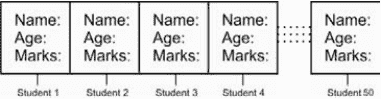

图2：结构体数组的项

在图2中，可以看到每个学生（Student1、Student2 等）的详细信息都作为数组的独立项存储。现在，创建一个在 C++ 中创建并使用结构体数组的程序。清单7展示了创建并使用结构体数组的过程（可在 CD 的 code\chapter5 文件夹中找到 ArrayOfStructure.cpp 文件）：

### 清单7：创建并使用结构体数组

```cpp
#include <iostream.h>
#include <stdio.h>

struct Student
{
    char name[20];
    int age;
    float marks;
};

int main()
{
    cout<<"Enter the record of 3 students one by one"<<"\n";
    cout<<"------------------------------"<<"\n";
    Student s[3];

    for (int i=0; i<3; i++)        //accepting student details
    {
        cout<<"Enter the record of "<< (i + 1)<<" student\n";
        cout<<"Name: ";
        cin>>s[i].name;
        cout<<"Age: ";
        cin>>s[i].age;
        cout<<"Marks: ";
        cin>>s[i].marks;
        cout<<"\n";
    }
    for (int i=0; i<3; i++)        //displaying student details
    {
        cout<<"Displaying the record of "<< (i + 1)<<" student\n";
        cout<<"Name: "<<s[i].name<<"\n";
        cout<<"Age:  "<<s[i].age<<"\n";
        cout<<"Marks: "<<s[i].marks<<"\n";
    }
    return 0;
}
```

**输出：**

```text
Enter the record of 3 students one by one
-----------------------------------------
Enter the record of 1 student
Name: Dheeraj
Age: 23
Marks: 85

Enter the record of 2 student
Name: Umar
Age: 24
Marks: 87

Enter the record of 3 student
Name: Shivam
Age: 25
Marks: 75

Displaying the record of 1 student
Name: Dheeraj
Age: 23
Marks: 85
Displaying the record of 2 student
Name: Umar
Age: 24
Marks: 87
Displaying the record of 3 student
Name: Shivam
Age: 25
Marks: 75
```


在代码清单 7 中，创建了包含三个元素的结构体 Student。在 `main()` 函数中，创建了一个 Student 结构体数组（包含三项）。接下来，使用数组的每一项访问该结构体的所有三个元素。结构体的每个元素都被赋予用户在运行时指定的值，并显示在屏幕上。

## 测试你的知识

**问题 5.** 创建一个使用结构体显示书籍详细信息的程序。你必须在创建结构体实例时为结构体元素赋值。

**答案：**

```cpp
#include <iostream.h>
#include <string.h>

struct BookInfo
{
    char title[64];
    char publisher[64];
    char author[64];
    float price;
    int pages;
};

int main()
{
    BookInfo book = {"My Experiences", "ABCPress", "Ruby", 290.00,
    500 };

    cout << "Book: " << book.title << " by " <<book.author << endl;
    cout<< "Publisher: " << book.publisher << endl;
    cout<< "Book Rate: " << book.price<<endl;
    cout<< "Total Pages in book: " << book.pages;
    return 0;
}
```

**输出：**

```text
Book: My Experiences by Ruby
Publisher: ABCPress
Book Rate: 290
Total Pages in book: 500
```

**问题 6.** 使用结构体中的数组接受并显示 10 位客户的账号。

**答案：**

```cpp
#include <iostream.h>

struct account
{
    double AccNo[10];
};

int main()
{
    account a1;
    for (int i=0; i<10; i++)              //for accepting account numbers.
    {
        cout<<"Enter Account Number "<<(i+1)<<": ";
        cin>>a1.AccNo[i];
        cout<<endl;
    }
    for (int i=0; i<10; i++)              //for displaying account numbers
    {
        cout<<"The Account Number "<<(i+1)<<" is: "<<a1.AccNo[i];
        cout<<endl;
    }
    return 0;
}
```

**输出：**

```text
Enter Account Number 1: 15465

Enter Account Number 2: 64566

Enter Account Number 3: 25625

Enter Account Number 4: 36356

Enter Account Number 5: 36353

Enter Account Number 6: 36235

Enter Account Number 7: 36562

Enter Account Number 8: 35653

Enter Account Number 9: 98152

Enter Account Number 10: 65942

The Account Number 1 is: 15465
The Account Number 2 is: 64566
The Account Number 3 is: 25625
The Account Number 4 is: 36356
The Account Number 5 is: 36353
The Account Number 6 is: 36235
The Account Number 7 is: 36562
The Account Number 8 is: 35653
The Account Number 9 is: 98152
The Account Number 10 is: 65942
```

## 将结构体数组用作函数参数

与将数组作为参数传递给函数类似，你也可以将结构体数组作为参数传递给函数。这个数组参数可以在函数体内部用于初始化和访问结构体成员。现在，为了清楚地理解这个概念，请修改代码清单 7 中所示的程序。为此，创建一个单独的函数来接受学生记录并将其显示在屏幕上。代码清单 8 显示，用于接受和显示学生记录的函数将 `main()` 函数中创建的结构体数组作为它们的参数（你可以在 CD 的 code\chapter5 文件夹中找到 StructureArgument2.cpp 文件）：

**代码清单 8：** 将结构体数组作为函数参数传递

```cpp
#include <iostream.h>
#include <stdio.h>

struct Student
{
    char name[20];
    int age;
    float marks;
};

void Accept_Details (struct Student s1 [])   //accepting student details
{
    for (int i=0; i<3; i++)
    {
        cout<<"Enter the record of "<< (i + 1)<<" student\n";
        cout<<"Name: ";
        cin>>s1[i].name;
        cout<<"Age: ";
        cin>>s1[i].age;
        cout<<"Marks: ";
        cin>>s1[i].marks;
        cout<<"\n";
    }
}

void Display_Details (struct Student s2 [])  //displaying student details
{
    for (int i=0; i<3; i++)
    {
        cout<<"Displaying the record of "<< (i + 1)<<" student\n";
```

将结构体 student 的数组作为它们的参数，并使用该参数执行它们特定的操作。

## 测试你的知识

**问题 7.** 创建一个接受三台空调（AC）的详细信息并在屏幕上显示它们的程序。你必须创建单独的函数来接受和显示空调详细信息，这两个函数都将结构体实例作为参数。该结构体包含用于保存空调详细信息的变量。

**答案：**

```cpp
#include <iostream.h>
#include <stdio.h>

struct AC
{
    char name[20];
    int price;
    float capacity;
};

void Accept_Details (struct AC s1 [])        //accepting AC details
{
    for (int i=0; i<3; i++)
    {
        cout<<"Enter the Details of "<< (i + 1)<<" AC\n";
        cout<<"Company Name: ";
        cin>>s1[i].name;
        cout<<"Price: ";
        cin>>s1[i].price;
        cout<<"Capacity in Tonns: ";
        cin>>s1[i].capacity;
        cout<<"\n";
    }
}

void Display_Details (struct AC s2 [])       //displaying AC details
{
    for (int i=0; i<3; i++)
    {
        cout<<"Displaying the Details of "<< (i + 1)<<" AC\n";
        cout<<"Company Name: "<<s2[i].name<<"\n";
        cout<<"Price: "<<s2[i].price<<"\n";
        cout<<"Capacity in Tonns: "<<s2[i].capacity<<"\n";
    }
}

int main()
{
    cout<<"Enter the record of 3 ACs one by one"<<"\n";
    cout<<"------------------------------\n";
    AC s [3];

    Accept_Details (s);
    Display_Details (s);

    return 0;
}
```

**输出：**

```text
Enter the record of 3 ACs one by one
-----------------------------------------------
Enter the Details of 1 AC
Company Name: Hitachi
Price: 35000
Capacity in Tonns: 2

Enter the Details of 2 AC
Company Name: LG
Price: 25000
Capacity in Tonns: 1.5

Enter the Details of 3 AC
Company Name: Voltas
Price: 15000
Capacity in Tonns: 1.25
Displaying the Details of 1 AC
Company Name: Hitachi
Price: 35000
Capacity in Tonns: 2
Displaying the Details of 2 AC
Company Name: LG
Price: 25000
Capacity in Tonns: 1.5
Displaying the Details of 3 AC
Company Name: Voltas
Price: 15000
Capacity in Tonns: 1.25
```

## 将指针与结构体一起使用

你可以将指针与结构体一起使用，以存储结构体变量的地址。这个指针可用于初始化和访问结构体变量。此外，你可以为一个结构体创建多个指针，这些指针可以彼此独立使用，这意味着每个结构体指针都可以为结构体元素存储和访问不同的值，而不影响其他结构体指针定义的值。让我们考虑一个包含两个整数成员的结构体，例如 quantity 和 price。

这可以使用以下代码片段声明：

```cpp
struct bucket
{
    int quantity;
    int price;
};
```

现在，创建并初始化结构体变量 bucket1 和 bucket2，并使用点（.）运算符访问结构体成员，如下面的代码片段所示：

```cpp
bucket1.quantity = 1000;
bucket1.price = 10;
bucket2.quantity = 2000;
bucket2.price = 20;
```

带有上述结构体变量初始化的结构体变量 bucket1 和 bucket2 如图 3 所示：

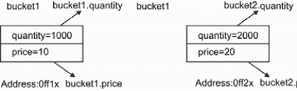

▲ 图 3：结构体变量 bucket1 和 bucket2 的表示

在图 3 中，可以看到 bucket 结构体有两个变量：bucket1 和 bucket2。这两个变量用不同的值初始化结构体变量，而不影响另一个结构体变量的值。

代码清单 9 显示了使用点（.）运算符声明和访问结构体变量的方法（你可以在 CD 的 code\chapter5 文件夹中找到 DotOperator.cpp 文件）：

**代码清单 9：** 使用点（.）运算符声明和访问结构体变量

```cpp
#include <iostream.h>

struct bucket
{
        int quantity;
        int price;
};                          //declaring a structure
int main()
{
    bucket bucket1;                 // declaring a structure variable
    bucket bucket2;                 //declaring a structure variable
    bucket1.quantity = 1000;
    bucket1.price = 10;
    bucket2.quantity = 2000;
    bucket2.price = 20;
    cout<<"printing quantity of bucket1:"<<bucket1.quantity<<endl;
    cout<<"printing price of bucket1:"<<bucket1.price<<endl;
    cout<<"printing quantity of bucket2:"<<bucket2.quantity<<endl;
    cout<<"printing price of bucket2:"<<bucket2.price<<endl;
    return 0;
}
```

**输出：**

```text
printing quantity of bucket1:1000
printing price of bucket1:10
printing quantity of bucket2:2000
printing price of bucket2:20
```

声明结构体变量（bucket1）时，会分配复合内存，其大小等于所有成员大小之和。你可以声明结构体类型的指针变量来存储结构体变量的内存地址。现在，可以按如下方式声明 bucket 结构体的两个指针变量 ptr1 和 ptr2：

```cpp
bucket *ptr1,*ptr2;
```

现在，按如下方式将结构体变量 bucket1 和 bucket2 的地址赋给结构体指针变量 ptr1 和 ptr2：

```cpp
ptr1 = & bucket1;
ptr2 = & bucket2;
```

现在，指针变量 ptr1 指向 bucket1，如图 4 所示：

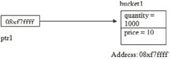

▲ 图 4：由 ptr1 指向的 bucket1 的表示

现在，ptr2 指向 bucket2，如图 5 所示：

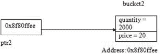

**图5：由ptr2指向的bucket2的表示**

你可以使用箭头（`->`）运算符来访问`bucket1`的各个成员，如下所示：

```cpp
ptr1->quantity = 3000;
ptr1->price = 30;
```

类似地，`bucket2`的成员可以这样访问：

```cpp
ptr2->quantity = 4000;
ptr2->price = 40;
```

清单10展示了如何使用结构体的指针变量（可以在配套CD的code\chapter5文件夹中找到StructurePointer.cpp文件）：

### 清单10：使用指针和箭头->运算符打印结构体成员

```cpp
#include <iostream.h>

struct bucket
{
    int quantity;
    int price;
};

int main()
{
    bucket bucket1,bucket2;   // declaring variables of the bucket structure
    bucket1.quantity = 1000;  //assigning values to the structure member
    bucket1.price = 10;      //assigning values to the structure member
    bucket2.quantity = 2000; //assigning values to the structure member
    bucket2.price = 20;      //assigning values to the structure member
    bucket  *ptr1, *ptr2;    //declaring pointer variables of a structure
    ptr1 = & bucket1;        //assigning pointer variable
    ptr2 = & bucket2;        //assigning pointer variable
    cout<<"printing quantity of bucket1 with pointer:"<<ptr1->quantity<<endl;
    cout<<"printing price of bucket1 with pointer:"<<ptr1->price<<endl;
    cout<<"printing quantity of bucket2 with pointer:"<<ptr2->quantity<<endl;
    cout<<"printing price of bucket2 with pointer:"<<ptr2->price<<endl;

    return 0;
}
```

### 输出：

```text
printing quantity of bucket1 with pointer:1000
printing price of bucket1 with pointer:10
printing quantity of bucket2 with pointer:2000
printing price of bucket2 with pointer:20
```

在清单10中，结构体bucket由两个整数元素quantity和price创建。在main()函数中，创建了bucket结构体的两个实例，用于为bucket结构体的变量赋值。此外，还在main()函数内部创建了两个指针变量，用于显示结构体的值。

## 测试你的知识

- **Q8.** 创建一个程序，接受两个产品的价格和数量，并通过使用结构体和指向结构体的指针在屏幕上显示它们。

答案。

```cpp
#include <iostream.h>

struct product
{
        double quantity;
        double price;
};

int main()
{
        product product1,product2; // declaring variables of the product structure

        cout<<"Enter the quantity of Product1: " ;
        cin>>product1.quantity;

        cout<<endl<<"Enter price of Product1: " ;
        cin>>product1.price;
        cout<<endl<<"Enter the quantity of Product2: ";
        cin>>product2.quantity;

        cout<<endl<<"Enter price of Product2: ";
        cin>>product2.price;
        product *ptr1, *ptr2;    //declaring pointer variables of a structure

        ptr1 = & product1;       //assigning pointer variable
        ptr2 = & product2;       //assigning pointer variable

        cout << endl << "printing quantity of product1 with pointer:" << ptr1->quantity << endl;
        cout << "printing price of product1 with pointer:" << ptr1->price << endl;
        cout << "Net amount of product1 is: " << ((ptr1->quantity) * (ptr1->price)) << endl;

        cout << endl << "printing quantity of product2 with pointer:" << ptr2->quantity << endl;
        cout << "printing price of product2 with pointer:" << ptr2->price << endl;
        cout << "Net amount of Product1 is: " << ((ptr2->quantity) * (ptr2->price)) << endl;

        getch();
        return 0;
}
```

### 输出：

```text
Enter the quantity of Product1: 150

Enter price of Product1: 600

Enter the quantity of Product2: 250

Enter price of Product2: 850

printing quantity of product1 with pointer:150
printing price of product1 with pointer:600
Net amount of Product1 is: 90000
printing quantity of product2 with pointer:250
printing price of product2 with pointer:850
Net amount of Product1 is: 212500
```

让我们学习如何将结构体指针作为函数参数传递。

## 将结构体指针传递给函数

将结构体指针传递给函数，是指将结构体指针变量作为函数参数传递。在这种情况下，在定义函数时，通过使用指针（*）运算符将结构体变量的地址作为参数传递。为此，你必须在main()函数中定义结构体的指针变量。定义指向结构体的指针的语法如下：

```cpp
structure_name *structure_pointer_variable;
```

### 输出：

```text
Enter name : Ajay Kumar
Enter roll number : 12
Enter class : 5
The description of student are -->
----------------------------------------
Name :Ajay Kumar
Roll number :12
class :5
```

在清单11中，你会看到创建了一个名为student的结构体，并创建了一个函数func()，该函数以student结构体的指针作为参数。该函数还使用student结构体的指针来指定并显示student结构体的值。

## 使用结构体和指针的链表

链表是一种数据结构，由以线性方式排列的项集合组成。链表背后的基本思想是包含一些项，这些项包含指向同类型列表的指针。

让我们创建一个结构体，它由两个数据字段（quantity和price）以及一个指向前一结构体类型的指针组成，用于保存下一个节点的地址。节点表示链表中的一项。以下代码片段展示了链表的结构：

```cpp
struct node
{
    int quantity;
    int price;
    node *next;
};
```

图6展示了node结构体的组成：

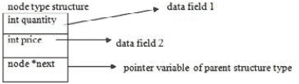

**图6：节点类型结构体的示意图**

图5.6所示的结构体声明描绘了一条节点链，每个节点指向另一个节点，通常称为链表。图7展示了链接的节点：

以下代码片段展示了如何向空链表中添加节点：

```c
void addnode(int q , int pr)
{
...
/* Step-3: ADDING A NODE INTO EMPTY LIST */
if(p==NULL)                         //if no list is currently available
{
        p = temp;                   //new node points to the first node
        p->next = NULL;             //set next address field
}
}
```

如果最初指针p不指向任何节点，那么temp将成为第一个节点，如图10所示：

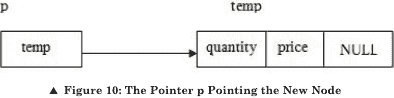

以下代码片段展示了如何向非空链表中添加节点：

```c
void addnode(int q , int pr)
{
...
else
{
/*Step-4: ADDING A NODE INTO A NON-EMPTY LIST */
temp->next = p;
p = temp;                    //p now points to the new node
}
}
```

现在，*将p附加*到已存在节点temp的next字段，并将指针p移动为指向新创建的节点。如图11所示：

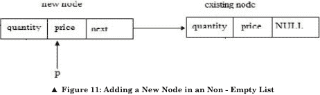

可以显示链表的元素。在以下代码片段中，display()方法用于此目的：

```cpp
/* Step-5:CHECKING THE LIST IS EMPTY */
void display(struct node *r)
{
        r = p;
        // assign the address stored in p to r.
        //set pointer to the current element
        if(r == NULL)//if no list at current position
        {
                cout<<"no list";
                return;
        }
}
```

空链表的检查如图12所示：

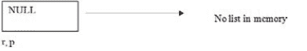

**图12：内存中的空链表**

以下代码片段展示了链表元素的遍历和打印：

```cpp
/* Step-6:TRAVERSING AND PRINTING LIST ELEMENTS */
void display(struct node *r)
{
...
while(r!=NULL)// traverse through whole list until address field is null
{
        cout<<"quantity:"<<r->qty<<endl;//print data using -> operator
        cout<<"price:"<<r->price<<endl;// print data2 using -> operator
        r = r->next; //increment the pointer
}
}
```

图13展示了链表中元素的遍历：

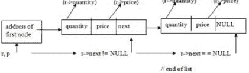

**图13：链表元素的遍历**


在图13中，r和p是指针变量，包含一个节点的地址。你还可以看到，首先，程序包含链表中第一个节点的地址（在r和p中）。第一个节点的最后一个元素包含下一个节点的地址。在第二个节点中，该节点的最后一个元素包含NULL，它表示链表的结束。

关于链表数据结构还需要记住一点：它通常按后进先出（Last In First Out，LIFO）的内存分配方式存储值。这意味着最后存储的值会最先被访问，反之亦然。

代码清单12展示了创建和显示链表元素的完整代码（你可以在CD的`code\chapter5`文件夹中找到LinkList.cpp文件）：

## ▶ 代码清单12：创建并显示链表

```cpp
#include<iostream.h>
struct node                              //a structure is declared
{
        int qty ;                         //data1
        int price;                        //data2
        struct node *next;                //pointer to next element
}*p;                                      //global pointer to denote first node
void addnode(int q , int pr)
{
        struct node *temp = new node;     //allocate memory for the new node
        temp->qty = q ;                   //set data field-1
        temp->price = pr;                 //set data field-2
        if(p==NULL)                       //if no list is currently available
        {
                p = temp;                 //new node points to the first node
                p->next = NULL;           //set next address field
        }
        else
        {
                temp->next = p;
                p = temp;                 //p now points to the new node
        }
}
void display(struct node &r)
{
        r = p;
        // assign the address stored in p to r.
        // set pointer to the current element
        if(r == NULL)                     //if no list is at current position
        {
                cout<<"no list";
                return;
        }

        while(r!=NULL)                    //traverse through whole list until address field is null
        {
```

display()函数从main()函数中调用，用于向用户显示每个节点的所有项。

## 测试你的知识

### Q9. 创建一个程序，显示当前存储在列表中的人员的详细信息。它还应允许用户添加更多人员的详细信息，并从开头或末尾删除现有人员的详细信息。

答案。

```cpp
#include <iostream.h>
struct PersonDetails
{  char name[20];
   int age;
   float height;
   PersonDetails *next_nd;
};

PersonDetails *start_ptr = NULL;
PersonDetails *current;
int option = 0;
void AddDetailsEnd()
{  PersonDetails *temp, *temp2;

   // Reserve space for new PersonDetails and fill it with data
   temp = new PersonDetails;
   cout << "Please enter the name of the person: ";
   cin >> temp->name;
   cout << "Please enter the age of the person : ";
   cin >> temp->age;
   cout << "Please enter the height of the person : ";
   cin >> temp->height;
   temp->next_nd = NULL;

   // Set up link to this PersonDetails
   if (start_ptr == NULL)
   {  start_ptr = temp;
      current = start_ptr;
   }
   else
   {  temp2 = start_ptr;
      // We know this is not NULL - list not empty!
      while (temp2->next_nd != NULL)
      {  temp2 = temp2->next_nd;
         // Move to next link in chain
      }
      temp2->next_nd = temp;
   }
}
void DisplayDetails()
{
    PersonDetails *temp;
    temp = start_ptr;
    cout << endl;
    if (temp == NULL)
        cout << "The list is empty!" << endl;
    else
    {
        while (temp != NULL)
        {
            // Display details for what temp points to
            cout << "Name : " << temp->name << ";";
            cout << "Age : " << temp->age << ";";
            cout << "Height : " << temp->height;
            if (temp == current)
            {
                cout << " <-- Current PersonDetails";
                cout << endl;
                temp = temp->next_nd;
            }
        }
        cout << "End of list!" << endl;
    }
}
void DeletePersonDetailsStart()
{
    PersonDetails *temp;
    temp = start_ptr;
    start_ptr = start_ptr->next_nd;
    delete temp;
}
void DeletePersonDetailsEnd()
{
    PersonDetails *temp1, *temp2;
    if (start_ptr == NULL)
        cout << "The list is empty!" << endl;
    else
    {
        temp1 = start_ptr;
        if (temp1->next_nd == NULL)
        {
            delete temp1;
            start_ptr = NULL;
        }
        else
        {
            while (temp1->next_nd != NULL)
            {
                temp2 = temp1;
                temp1 = temp1->next_nd;
            }
            delete temp1;
            temp2->next_nd = NULL;
        }
    }
}
void main()
{
    clrscr();
    start_ptr = NULL;
    do
    {
        DisplayDetails();
        cout << endl;
        cout << "Please select an option : " << endl;
        cout << "0. Exit the program." << endl;
        cout << "1. Add a person details to the end of the list." << endl;
        cout << "2. Delete a person details from the beginning of the list." << endl;
        cout << "3. Delete a person details from the end of the list." << endl;

        cout << endl << ">> ";
        cin >> option;

        switch (option)
        {
            case 1 : AddDetailsEnd(); break;
            case 2 : DeletePersonDetailsStart(); break;
            case 3 : DeletePersonDetailsEnd();
        }
    }
    while (option != 0);
}
```

### 输出：

```text
The list is empty!

Please select an option :
0. Exit the program.
1. Add a person details to the end of the list.
2. Delete a person details from the beginning of the list.
3. Delete a person details from the end of the list.

>> 1
Please enter the name of the person: Dheeraj
Please enter the age of the person : 23
Please enter the height of the person : 6
Name : Dheeraj;Age : 23;Height : 6 <-- Current PersonDetails
End of list!

Please select an option :
0. Exit the program.
1. Add a person details to the end of the list.
2. Delete a person details from the beginning of the list.
3. Delete a person details from the end of the list.

>>
```

### Q10. 创建一个程序，接受公寓的详细信息（建筑商名称、房间数、价格）并将其显示在屏幕上。该程序必须使用结构体存储所有公寓详细信息，并使用一个接收该结构体指针的函数来接受和显示公寓详细信息。

答案。

```cpp
#include <iostream.h>
#include <stdio.h>

struct flat
{
    char name[30];
    int rooms;
    int price;
};

void func(flat *new_flat)
{
    cout<<"Enter Builder name: ";
    gets(new_flat->name);
    cout<<"Enter number of Rooms in the Flat: ";
    cin>>new_flat->rooms;
    cout<<"Enter Price in Lakhs: ";
    cin>>new_flat->price;
    cout<<"The description of the flat is -->"<<endl;
    cout<<"--------------------------------"<<endl;
    cout<<"Builder Name: "<<new_flat->name<<endl;
    cout<<"Number of Rooms: "<<new_flat->rooms<<endl;
    cout<<"Price of flat in Lakhs: "<<new_flat->price<<endl;
}

int main()
{
    flat f1, *new_flat;
    new_flat = &f1;
    func(new_flat);
    return 0;
}
```

### 输出：

```text
Enter Builder name: Parsvanath

Enter number of Rooms in the Flat: 5
Enter Price in Lakhs: 35
The description of the flat is -->
-----------------------------------
Builder Name: Parsvanath
Number of Rooms: 5
Price of flat in Lakhs: 35
```

现在，你已经熟悉了结构体，接下来让我们学习C++中的联合体。

### 5.2 C++中的联合体

与结构体类似，联合体也是用户定义的数据类型。它们包含不同数据类型的元素。与结构体不同，特定联合体的成员可以共享计算机内存中的同一存储区域。联合体适用于涉及多个成员且不需要同时为所有成员赋值的应用。定义联合体的语法如下：

```cpp
union <unionname>
{
member1;
member2;
.
.
};
```

在前面的语法中，可以看到联合体的声明以关键字`union`开头，后跟用户定义的联合体名称，然后是花括号。在联合体的主体内（在左花括号和右花括号之间），可以定义任意数量的成员或任意数据类型的变量，例如`int`、`float`。下面的代码片段给出了定义联合体的示例：

```cpp
union number
{
    int intvalue;
    long longvalue;
    double doublevalue;
};
```

现在，让我们借助一个示例来解释联合体和结构体之间的区别。考虑以下代码片段，其中定义了一个结构体`user_var`：

```cpp
struct user_var
{
    float f;
    char ch[4];
} s1;
```


在前面的代码片段中，结构体 user_var 在内存中占用 8 个字节——4 个字节用于 float 变量 f，4 个字节用于字符变量 ch。结构体 user_var 的实例 s1 使用的内存分配情况如图14所示：

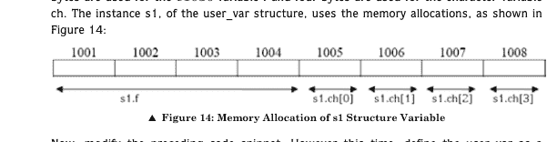

现在，修改前面的代码片段。不过这一次，将 user_var 定义为联合体，如下面的代码片段所示：

```cpp
union user_var
{
    float f;
    char ch[4];
} s1;
```

在前面的代码片段中，联合体 user_var 只占用 4 字节内存，因为 float 变量和 char 变量所需的内存在两者之间共享，如图15所示：

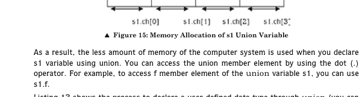

因此，当你使用联合体声明 s1 变量时，计算机系统使用的内存更少。你可以使用点号（.）运算符访问联合体的成员元素。例如，要访问联合体变量 s1 的 f 成员元素，可以使用 s1.f。

代码清单13展示了通过联合体声明用户自定义数据类型的过程（你可以在随书光盘的 code\chapter5 文件夹中找到 MyUnion.cpp 文件）：

### ▶ 代码清单13：声明和使用联合体

```cpp
#include <iostream.h>

struct struct_user_var
{
    float f;
    char ch[4];
} struct_var;

union union_user_var
{
    float f;
    char ch[4];
} union_var;

int main()
{
    cout << "The size of the structure struct_user_var is "
         << sizeof(struct_var) << endl;
    cout << "The size of the union union_user_var is "
         << sizeof(union_var) << endl;

    return 0;
}
```

**输出：**

```text
The size of the structure struct_user_var is 8
The size of the union union_user_var is 4
```

在代码清单13中，创建了结构体 struct_user_var 和联合体 union_user_var。两者都包含一个 float 变量（f）和一个字符数组（ch）。此外，在声明 struct_var 结构体变量和 union_var 联合体变量的同时，也创建了它们。最后，在 main() 函数中使用 sizeof() 函数将结构体变量和联合体变量的大小显示给用户。

## 测试你的知识

- **问题11.** 创建一个程序，从用户处获取一个数字，并在屏幕上显示该数字的平方。

**答案：**

```cpp
#include <iostream.h>

union square
{
    float num;
    double NumSquare;

};

int main()
{
    square s1;
    cout << "Enter the Number you want to square: ";
    cin >> s1.num;
    s1.NumSquare = s1.num * s1.num;
    cout << "The square of the number you entered is: " << s1.NumSquare;
```

```cpp
d1.book_Detail.author = "Dheeraj Gupta";
d1.book_Detail.price = 365;
cout << "Name of the book is: " << d1.book_Detail.name << "\n";
cout << "Author of the book is: " << d1.book_Detail.author << "\n";
cout << "Price of the book is: " << d1.book_Detail.price;
return 0;
}
```

**输出：**

```text
The publisher of the book is: Dreamtech Press
This book is meant for students of: 12
Name of the book is: Exploring C++
Author of the book is: Dheeraj Gupta
Price of the book is: 365
```

在代码清单14中，你会看到创建了一个结构体 My_Books。该结构体的实例是在 Detail 联合体内部创建的。接下来，main() 函数开始执行，并在其中创建了一个 Detail 联合体的实例。最后，使用在 main() 函数中声明的 Detail 联合体实例来访问 Detail 联合体和 My_Books 结构体的变量。

现在，让我们学习如何在结构体内部创建联合体的实例。

### 创建联合体实例作为结构体成员

你已经了解到，联合体是用户自定义数据类型，可以包含不同类型的元素，也可以包含结构体的实例。与联合体类似，结构体也可以将联合体的实例作为其成员。

代码清单15展示了如何将联合体实例定义为结构体的元素（你可以在随书光盘的 code\chapter5 文件夹中找到 UnionElement.cpp 文件）：

### ▶ 代码清单15：创建联合体实例作为成员的结构体

```cpp
#include <iostream.h>

union Detail
{
    char *publication;
    int standard;
};

struct My_Books
{
    char *name;
    char *author;
    int price;
    union Detail book_Detail;
};

int main ()
{
    struct My_Books book1;
    book1.book_Detail.publication = "Dreamtech Press";
    cout << "The publisher of the Book is: "
         << book1.book_Detail.publication << "\n";

    book1.book_Detail.standard = 12;
    cout << "This book is meant for students of: "
         << book1.book_Detail.standard << "\n";

    book1.name = "Exploring C++";
    book1.author = "Dheeraj Gupta";
    book1.price = 365;

    cout << "Name of the book is: " << book1.name << "\n";
    cout << "Author of the book is: " << book1.author << "\n";
    cout << "Price of the book is: " << book1.price;

    return 0;
}
```

**输出：**

```text
The publisher of the Book is: Dreamtech Press
This book is meant for students of: 12
Name of the book is: Exploring C++
Author of the book is: Dheeraj Gupta
Price of the book is: 365
```

在代码清单15中，你会看到创建了联合体 Detail。该联合体的实例是在 My_Books 结构体内部创建的。然后，main() 函数开始执行，并在其中创建了一个 My_Books 结构体的实例。接下来，在 main() 函数内部声明了 My_Books 结构体的实例。该实例用于访问 Detail 联合体和 My_Books 结构体的变量，并将其值显示给用户。

## 测试你的知识

- **问题12.** 创建一个程序，其中包含一个结构体和一个联合体，它们具有相同的成员。然后，演示结构体实例与联合体实例之间的大小差异。

**答案：**

```cpp
#include <iostream.h>

struct Demo_Struct
{
    char var2[10];
    float var3;
    double var4;
};

union Demo_Union
{
    char var2[10];
    float var3;
    double var4;
};

int main()
{
    Demo_Struct ds;
    Demo_Union du;
    cout << "Size of memory occupied by the Structure variable is: "
         << sizeof(ds) << " bytes" << endl;
    cout << "Size of memory occupied by the Union variable is: "
         << sizeof(du) << " bytes";

    return 0;
}
```

**输出：**

```text
Size of memory occupied by the Structure variable is: 22 bytes
Size of memory occupied by the Union variable is: 10 bytes
```

## 总结

在本章中，你学习了用户自定义数据类型——结构体和联合体。在结构体部分，你学习了如何创建和访问结构体元素，以及各种函数如何传递和返回结构体。我们还以链表的形式讨论了结构体的示例。接下来，你学习了联合体的声明、用法以及它们与结构体的区别。

## 练习

### 判断正误

判断以下陈述是否正确：

- **问题1.** 你可以在联合体内部创建结构体的实例。正确
- **问题2.** 在C++编程中有一些预定义的结构体可以直接使用。错误
- **问题3.** 结构体与数组类似，可以包含不同名称但相同数据类型的变量。错误
- **问题4.** 结构体不能在其各个单独元素之间共享内存。正确
- **问题5.** 你可以直接访问结构体成员变量，而无需定义任何实例。错误
- **问题6.** 你不能在结构体内部创建联合体的实例。错误
- **问题7.** 你可以在花括号关闭之后使用点运算符定义结构体的元素。错误
- **问题8.** 你必须使用 `new` 关键字来创建联合体的实例。错误
- **问题9.** 联合体比结构体占用更多内存。错误
- **问题10.** 作为参数传递给函数的结构体实例必须单独定义自己的变量。错误
- **问题11.** 函数的返回类型必须与返回该实例的结构体类型相同。正确
- **问题12.** 你可以创建一个指向结构体的指针，该指针可以访问该结构体的所有元素。正确

### 多项选择题

回答以下多项选择题：

- **问题1.** 在结构体或联合体中声明的所有变量都必须用 ________ 括起来。
  - A. 花括号 {}
  - B. 圆括号 ()
  - C. 方括号 []
  - D. 以上都不是
  - **答案：** 选项A正确。
- **问题2.** 在C++中，用于声明结构体的关键字是什么？
  - A. Structure
  - B. Struct
  - C. struct
  - D. StructVar
  - **答案：** 选项C正确。
- **问题3.** 在关闭花括号之后，需要放置哪个特殊字符来完成结构体的声明？
  - A. 冒号 (:)
  - B. 分号 (;)
  - C. 点号 (.)


- D. 它是可选的

答：选项 B 正确。

Q4. 如果一个结构体有两个变量，其中一个是整型变量，第二个是浮点型变量，那么该结构体的每个实例将占用多少内存（以字节为单位）？

- A. 1 字节
- B. 2 字节
- C. 4 字节
- D. 6 字节

答：选项 D 正确。

Q5. _______ 运算符用于初始化和访问结构体的成员。

- A. 点（.）运算符
- B. 箭头（->）运算符
- C. new 运算符
- D. 上述三个中的任意一个

答：选项 A 正确。

Q6. 在函数体内部创建的结构体可以在 __________ 访问。

- A. 程序中的任何位置。
- B. 仅通过 main() 函数。
- C. 在创建该结构体的函数内部。
- D. 不能在函数体内部创建结构体。

答：选项 C 正确。

Q7. 如果一个联合体有两个变量，其中一个是整型变量，第二个是浮点型变量，那么该联合体的每个实例将占用多少内存（以字节为单位）？

- A. 1 字节
- B. 2 字节
- C. 4 字节
- D. 6 字节

答：选项 C 正确。

Q8. 当将结构体的指针传递给函数时，实际传递的是什么？

- A. 结构体每个元素的指针
- B. 结构体第一个元素的指针
- C. 结构体实例的指针
- D. 不能将结构体的指针传递给函数

答：选项 C 正确。

Q9. 如果一个结构体有 4 个元素，那么在同一时间可以访问多少个元素？

- A. 全部四个元素
- B. 仅第一个元素
- C. 仅最后一个元素
- D. 四个元素中的任意一个

答：选项 D 正确。

Q10. 链表也称为 ___________

- A. 自引用联合体
- B. 自引用数据结构
- C. 自引用节点列表
- D. 没有链表这个术语

答：选项 B 正确。

Q11. 当在联合体内部创建结构体实例时，可以一次初始化和访问该结构体的 ___________。

- A. 所有成员
- B. 一次一个成员
- C. 仅第一个成员
- D. 仅最后一个成员

答：选项 A 正确。

Q12. _____ 用于通过结构体变量的指针来初始化和访问结构体的成员。

- A. 点（.）运算符
- B. 箭头（->）运算符
- C. new 运算符
- D. 上述三个中的任意一个

答：选项 B 正确。

### 简答题/答案

Q1. 什么是结构体？它与数组有何不同？

答：结构体是一种用户定义的数据类型，包含多个元素，其中每个元素可以声明为不同的数据类型，例如 int、float 和 char。结构体中包含的元素称为结构体的成员。另一方面，数组是具有相似数据类型的元素的集合。换句话说，数组不能包含不同数据类型的元素。例如，假设您想存储员工信息，例如姓名、年龄、薪水、职位等。所有这些信息不能存储在单个数组中；但是，您可以轻松地将这些信息（员工）存储在单个结构体中。

Q2. 如何在 C++ 中创建结构体？

答：您可以在 C++ 中通过声明一个结构体来创建结构体，该结构体具有结构体名称以及可存储在结构体中的不同类型的数据成员。接下来，您定义结构体变量以访问结构体的数据成员。

您必须在结构体名称前使用 struct 关键字。指定结构体名称后，结构体以左花括号 { 开始，以右花括号 } 结束。此外，右花括号后必须放置分号（;）。结构体的所有数据成员都在这些花括号之间指定。

Q3. 为什么要创建结构体变量？可以为结构体声明哪些类型的变量？如何创建变量？

答：首先，使用 struct 关键字定义结构体及其成员。定义结构体后，下一步是声明结构体变量，以便可以为结构体成员赋值，并在需要时使用这些值。结构体变量可以声明为全局变量或局部变量。声明全局变量意味着结构体变量的作用域是全局的，可在整个 C++ 程序中的任何地方使用。通常，全局变量在定义结构体时声明。但是，您也可以将结构体变量声明为局部变量，这意味着此类局部变量只能在程序的特定部分内访问。例如，如果您在 C++ 程序的函数内创建了结构体变量，那么它只能在该函数体内访问，并称为局部变量。

Q4. 如何在 C++ 中访问和初始化结构体成员？

答：每个结构体都有一些称为结构体成员的元素，它们在结构体体内声明。定义结构体时，可以使用唯一的变量名定义成员。您可以在结构体变量名和结构体元素（结构体成员）之间使用点（.）运算符来访问和初始化结构体元素。访问结构体元素的语法如下：

```
structure_variable_name.structure_element;
```

在前面的代码片段中，structure_variable_name 是结构体变量，structure_element 是您要访问的结构体成员名称。此外，它们之间放置了一个点（.），以便编译器也能理解。

同样，您可以使用点（.）运算符初始化结构体元素，如下面的代码片段所示：

```
employee_one.name = "Mohan";
employee_one.age = 22;
```

在前面的代码片段中，employee_one 是结构体变量，name 和 age 是结构体成员，它们分别被赋值为 Mohan 和 22。

Q5. 什么是嵌套结构体？

答：结构体中的结构体称为嵌套结构体。这意味着一个结构体的成员也可以是另一个结构体的结构体变量。例如，您创建了一个名为 Date 的结构体，其中包含三个整型变量 day、month 和 year。现在您创建另一个名为 Employee 的结构体，分别包含 char、int 和 float 类型的三个变量。此外，Employee 结构体还包含一个 Date 结构体类型的变量作为其成员。在这种情况下，Date 结构体被视为 Employee 结构体内的嵌套结构体。

Q6. 将结构体传递给函数是什么意思？为什么需要这样做？

答：在函数内创建的变量称为局部变量。这些局部变量只能与该函数一起使用。此外，函数还可以使用调用程序传递的参数来执行函数。这些参数用于在函数和调用程序之间进行接口。通常，您将变量作为函数参数传递。但是，这并非必须，您也可以将结构体作为函数参数传递。将结构体传递给函数意味着您必须将结构体变量作为参数传递给函数。传递给函数的结构体变量可以访问该结构体的所有元素，以便您可以在需要时访问结构体成员并为其赋值。

Q7. 从函数返回结构体是什么意思？为什么需要这样做？

答：函数是一组用于执行特定任务的语句。它从调用程序获取一些值（称为参数）作为参数，并向调用程序返回一些值。您也可以将结构体作为参数传递给函数。使用此参数，您可以更改结构体中定义的变量的值。现在，您希望在函数体外访问这些值。为此，您可以在函数体末尾使用 `return` 关键字将结构体变量返回给调用函数。

Q8. 如何访问结构体中定义的数组元素？

答：结构体是一种用户定义的数据类型，包含多个元素，其中每个元素可以声明为不同的数据类型，例如 int、float 和 char。结构体的元素也可以是数组。您可以通过使用元素的索引值来访问结构体中声明的数组的单个元素。为此，首先创建结构体的实例。接下来，指定数组的名称以及您要定义或访问的项的索引值。例如，假设您创建了一个名为 ArrStruct 的结构体，其中包含一个名为 MyArr 的整型数组。此外，您在 main() 函数内创建了 ArrStruct 结构体的实例，比如 AS。现在，您可以使用 ArrStruct 结构体的实例访问和定义数组 MyArr 的值，如下面的代码片段所示：

```cpp
AS.MyArr[x] = 15;             //initializes the value of (x-1)th element to 15.
int newVar = AS.MyArr[x];  /*assigns the value of (x-1)th element to integer variable newVar*/
```

### Q9. 如何在 C++ 中创建结构体数组？

答：结构体基本上是一种用户定义的数据类型，包含各种预定义数据类型的变量。与其他预定义数据类型的数组类似，你也可以创建结构体数组。在这种情况下，每个数组项表示结构体的所有元素。假设你已使用以下代码片段创建了一个名为 student 的结构体：

```cpp
struct student
{
char name [25];
int age;
float marks;
};
```

现在，你需要存储 50 名学生的信息。因此，你可以使用以下代码片段创建 student 结构体数组：

```cpp
student class6 [50];
```

声明结构体数组后，每个数组项都包含结构体的所有元素。

### Q10. 如何将结构体变量的指针作为参数传递给函数，并访问结构体的成员？

答：将结构体指针传递给函数意味着你将结构体变量的指针作为参数传递给函数。在这种情况下，在定义函数时使用指针（*）将结构体变量的地址作为参数传递。为此，你必须在 C++ 程序中定义结构体的指针变量。定义指向结构体的指针的语法如下：

```cpp
structure_name *structure_pointer_variable;
```

其中，*structure_pointer_variable 是 structure_name 结构体的指针变量。现在，你可以使用结构体指针变量和箭头运算符（->）访问结构体的成员元素，如下语法所示：

```cpp
structure_pointer_variable -> memberelement;
```

在前面的代码中，你使用箭头运算符（->）访问指针结构体变量的成员元素。

### Q11. 什么是链表？

答：链表是一种数据结构，以线性方式由元素集合组成。链表背后的基本思想是包含这样的项：这些项包含一个指针，该指针指向同一数据结构列表中的位置。例如，你创建了一个结构体，它包含两个数据字段（数量和价格）以及一个指向结构体自身的指针，用于保存下一个节点的地址。这种具有节点链、其中每个节点指向另一个节点的结构体声明被称为链表。

### Q12. 什么是联合体？它与结构体有何不同？

答：联合体是一种用户定义的数据类型，包含各种预定义数据类型的变量。联合体适用于涉及多个成员、且不需要同时为所有成员赋值的应用。联合体的声明以关键字 union 开头，随后是用户定义的联合体名称，然后是花括号。在联合体的主体内（在左花括号和右花括号之间），你可以定义任意数量的成员或任意数据类型的变量，例如 int、float。

与结构体不同，特定联合体的成员可以共享计算机内存中的同一存储区域。这就是为什么结构体的每个实例占用的内存等于存储结构体中定义的所有元素所需内存之和。另一方面，联合体的每个实例只占用能够存储联合体中最大元素的内存。

## 调试练习

### Q1. 以下程序的输出将是什么？

```cpp
#include <iostream.h>
struct season
{
    char *name;
    int duration;
};
int main()
{
    season s1, s2;

    s1.name = "winter";
    s2.name = "Summer";

    s1.duration = 4;
    s2.duration = 8;

    cout<<"The season that lasts for "<<s1.duration<<" months is: "<<s1.name<<endl;
    cout<<"The season that lasts for "<<s2.duration<<" months is: "<<s2.name<<endl;

    return 0;
}
```

答：前述程序的输出如下：

```text
The season that lasts for 4 months is: Winter
The season that lasts for 8 months is: Summer
```

### Q2. 以下程序的输出将是什么？

```cpp
#include <iostream.h>
#include <stdio.h>
struct student
{
    char name[20];
    char AdmissionStatus[20];
    int FeesPaid;
    char stream[20];
};
int main()
{
    student s1;

    cout<<"Enter student name: ";
    gets(s1.name);

    cout<<"Enter total fees paid: ";
    cin>>s1.FeesPaid;

    cout<<"Enter Stream of learning, such as IT, Finance, Marketing: ";
    gets(s1.stream);

    cout<<"Enter Admission Status-- Either Confirmed or Provisional: ";
    gets(s1.AdmissionStatus);

    cout<<endl<<"The information of the student are: "<<endl;

    cout<<"Name of the Student: "<<s1.name<<endl;
    cout<<"Total Fees Paid Till Now: "<<s1.FeesPaid<<endl;
    cout<<"Stream of Studying: "<<s1.stream<<endl;
    cout<<"Status of admission: "<<s1.AdmissionStatus<<endl;

    return 0;
}
```

答：前述程序的输出如下：

```text
Enter student name: Dheeraj
Enter total fees paid: 25000
Enter Stream of learning, such as IT, Finance, Marketing: Human Resource
Enter Admission Status-- Either Confirmed or Provisional: Confirmed

The information of the student are:
Name of the Student: Dheeraj
Total Fees Paid Till Now: 25000
Stream of Studying: Human Resource
Status of admission: Confirmed
```

### Q3. 以下程序的输出将是什么？

```cpp
#include <iostream.h>
#include <stdio.h>

union product
{
        char product_number[15];
        char product_name[30];
        int product_quantity;
        float product_price;
};

void displayNum(product p)
{
        cout<<"Product number :"<<p.product_number<<endl;
}

void displayName(product p)
{
        cout<<"Product name :"<<p.product_name<<endl;
}

void displayQuant(product p)
{
        cout<<"Product quantity :"<<p.product_quantity<<endl;
}

void displayPrc(product p)
{
        cout<<"Product price :"<<p.product_price<<endl;
}

int main()
{
        product p;

        cout<<"Enter product number: ";
        gets(p.product_number);
        displayNum(p);

        cout<<"Enter product name: ";
        gets(p.product_name);
        displayName(p);
        cout<<"Enter product quantity: ";
        cin>>p.product_quantity;
        displayQuant(p);
        int quant = p.product_quantity;

        cout<<"Enter product price of one quantity: ";
        cin>>p.product_price;
        displayPrc(p);

        cout<<"---------------------------------------"<<endl;
        cout<<"Total price = "<<(quant*(p.product_price));

        return 0;
}
```

答：前述程序的输出如下：

```text
Enter product number: ABC123
Product number :ABC123
Enter product name: Basket
Product name :Basket
Enter product quantity: 25
Product quantity :25
Enter product price of one quantity: 50
Product price :50
------------------------------------------
Total price = 1250
```

### Q4. 以下程序的输出将是什么？

```cpp
#include <iostream.h>
#include <stdio.h>

struct Student
{
    char name[20];
    int age;
    float marks;
}s1, s2;

int main()
{
    cout<<"Enter Student Name: ";
    gets(s1.name);
    cout<<"Age: ";
    cin>>s1.age;
    cout<<"Marks: ";
    cin>>s1.marks;
    cout<<"\n";
    cout<<"Enter Student Name: ";
    gets(s2.name);
    cout<<"Age: ";
    cin>>s2.age;
    cout<<"Marks: ";
    cin>>s2.marks;
    cout<<"\n";
    cout<<"Displaying the record of student1"<<"\n";
    cout<<"Name: "<<s1.name<<"\n";
    cout<<"Age: "<<s1.age<<"\n";
    cout<<"Marks: "<<s1.marks<<"\n\n";
    cout<<"Displaying the record of student2"<<"\n ";
    cout<<"Name: "<<s2.name<<"\n";
    cout<<"Age: "<<s2.age<<"\n";
    cout<<"Marks: "<<s2.marks<<"\n";

    return 0;
}
```

答：前述程序的输出如下：

```text
Enter Student Name: Dheeraj Gupta
Age: 23
Marks: 84

Enter Student Name: Ahmed Umar
Age: 22
Marks: 78

Displaying the record of student1
Name: Dheeraj Gupta
Age: 23
Marks: 84

Displaying the record of student2
Name: Ahmed Umar
Age: 22
Marks: 78
```

### Q5. 以下程序的输出将是什么？

```cpp
#include <iostream.h>

struct name
```


```cpp
{
    char fName[15];
    char lName[15];
};

int main ()
{
    name p1 = {"First_Name ", "Surname"};

    cout<<p1.fName<<p1.lName;

    return 0;
}
```

答：前述程序的输出如下：

```text
First_Name Surname
```

### Q6. 下列程序的输出将是什么？

```cpp
#include <iostream.h>

struct date
{
    int day;
    int month;
    int year;
};

int main()
{
    date d1, d2;

    cout<<"Enter Day of the date: ";
    cin>>d1.day;
    cout<<"\nEnter Month of the date: ";
    cin>>d1.month;
    cout<<"\nEnter Year of the date: ";
    cin>>d1.year;

    d2 = d1;
    cout<<"\nThe date you have Entered is: "<<d2.day<<"/"<<d2.month<<"/"<<d2.year;

    getch();
    return 0;
}
```

答：前述程序的输出如下：

```text
Enter Day of the date: 30

Enter Month of the date: 12

Enter Year of the date: 1985

The date you have Entered is: 30/12/1985
```

### Q7. 下列程序的输出将是什么？

```cpp
#include <iostream.h>

union Test_Defvalue
{
    int num1;
    double num2;
};

int main()
{
    Test_Defvalue tdv;

    tdv.num1 = 12;
    cout<<"Default Value of an Integer Variable: "<<tdv.num1<<endl;
    tdv.num2 = 12.12456;
    cout<<"Default Value of a Double Variable: "<<tdv.num2;

    return 0;
}
```

答：前述程序的输出如下：

```text
Default Value of an Integer Variable: 12
Default Value of a Double Variable: 12.1246
```

### Q8. 下列程序的输出将是什么？

```cpp
#include <iostream.h>

union Test
{
    int var1;
    char var2[20];
    double var3;
};
struct Test2
{
    int var1;
    char var2[20];
    double var3;
};

int main()
{
    Test t1;
    Test2 t2;

    cout<<"Memory occupied by the variable of a Union: "<<sizeof(t1)<<endl;
    cout<<"Memory occupied by the variable of a Structure: "<<sizeof(t2)<<endl;
    return 0;
}
```

答：前述程序的输出如下：

```text
Memory occupied by the variable of a Union: 20
Memory occupied by the variable of a Structure: 30
```

### Q9. 下列程序的输出将是什么？

```cpp
#include <iostream.h>

int main ()
{
    struct myStruct
    {
        int var1;
        float var2;
    }ms;

    ms.var1 = 123;
    ms.var2 = 123.123;

    cout<<"value of var1: "<<ms.var1<<endl;
    cout<<"value of var2: "<<ms.var2<<endl;

    return 0;
}
```

答：前述程序的输出如下：

```text
value of var1: 123
value of var2: 123.123
```

### Q10. 下列程序的输出将是什么？

```cpp
#include <iostream.h>

union MyUnion
{
    int var1;
    double var2;
};

int main()
{

    MyUnion u1;
    u1.var1 = 2;
    cout <<"Value of var1: "<<u1.var1<< endl;

    u1.var2 = 4.5658;
    cout <<"Value of Var2: "<< u1.var2 << endl;

    u1.var2 = 456.000;
    cout<<"New value of Var2 is: "<<u1.var2<<endl;

    return 0;
}
```

答：前述程序的输出如下：

```text
Value of var1: 2
Value of Var2: 4.5658
New value of Var2 is: 456
```

### Q11. 下列程序的输出将是什么？

```cpp
#include <iostream.h>
#include <stdio.h>

struct student
{
    char student_ID[15];
    char student_name[30];
    int student_marks;
};

student input()
{
    student new_student;
    cout<<"Enter student ID :"<<endl;
    gets(new_student.student_ID);
    cout<<"Enter student name :"<<endl;
    gets(new_student.student_name);
    cout<<"Enter student marks :"<<endl;
    cin>>new_student.student_marks;

    return new_student;
}

void display(student p)
{
    cout<<"The descriptions of student are -->"<<endl;
    cout<<"-----------------------------------"<<endl;
    cout<<"student ID :"<<p.student_ID<<endl;
    cout<<"student name :"<<p.student_name<<endl;
    cout<<"student marks :"<<p.student_marks<<endl;

    cout<<"-----------------------------------"<<endl;
    cout<<"Percentage of marks out of 400 = "
    <<(((p.student_marks)*100)/400);
}

int main()
{
    student input();
    student p;
    p = input();
    display(p);
    return 0;
}
```

答：前述程序的输出如下：

```text
Enter student ID :
ABC123
Enter student name :
XYZ
Enter student marks :
315
The descriptions of student are -->
-----------------------------------
student ID :ABC123
student name :XYZ
student marks :315
-----------------------------------
Percentage of marks out of 400 = 78
```

### Q12. 下列程序的输出将是什么？

```cpp
#include <iostream.h>

union Detail
{
    char *Monitor;
    int Memory;
};

struct My_Computer
{
    char *os;
    char *processor;
    int price;
    union Detail computer_Detail;
};
int main ()
{
    struct My_Computer c1;
    c1.computer_Detail.Monitor = "LG Flatron";
    cout<<"The computer has Monitor of: "
        <<c1.computer_Detail.Monitor<<"\n";

    c1.computer_Detail.Memory = 1024;
    cout<<"This computer has: "<<c1.computer_Detail.Memory<<" MB of Memory\n";

    c1.os = "Windows Vista";
    c1.processor = "Intel Dual Core";
    c1.price = 24500;

    cout<<"Operating System of the computer is: "<<c1.os<<"\n";
    cout<<"processor of the computer is: "<<c1.processor<<"\n";
    cout<<"Price of the computer is: "<<c1.price;

    return 0;
}
```

答：前述程序的输出如下：

```text
The computer has Monitor of: LG Flatron
This computer has: 1024 MB of Memory
Operating System of the computer is: Windows Vista
processor of the computer is: Intel Dual Core
Price of the computer is: 24500
```

## 06 | C++ 面向对象编程

### 目标

- 6.1 探索面向对象编程的基本概念
- 6.2 使用类和对象
- 6.3 解释 C 结构体与 C++ 类的区别
- 6.4 创建数据访问方法
- 6.5 创建内联函数
- 6.6 使用构造函数和析构函数
- 6.7 探索局部类和嵌套类
- 6.8 将对象作为函数参数传递
- 6.9 从函数返回对象
- 6.10 在 C++ 中使用数组
- 6.11 创建 const 对象
- 6.12 使用 this 指针
- 6.13 使用友元函数和友元类
- 6.14 声明和使用静态变量与函数
- 6.15 重载

面向对象编程（OOP）是一种编程模型，它使用对象及其交互来设计应用程序和计算机程序。在 OOP 中，对象表示现实世界中的实体，例如学生、医生和银行账户。这些对象可以通过发送或接收消息相互交互。这种 OOP 模型基于四个基本支柱，即抽象、封装、继承和多态。早期的编程语言，如 C、FORTRAN 和 BASIC，基于过程式语言。在过程式语言中，程序通常使用分支语句和过程，根据你想要的结果执行某一组指令。过程也称为例程、子例程或函数。当用过程式语言编写大型程序时，程序会变得难以理解且难以编程。一种称为 OOP 的新编程技术克服了这个问题。

OOP 是一种用于理解计算机程序（软件）的设计和运作的模块化方法。每个模块（或对象）都是数据与作用于该数据的过程（指令序列）的组合。另一方面，在过程式编程中，数据与用于处理的指令是分离的。在 OOP 中，一组具有共同属性、操作和行为的对象称为类。为先前应用开发的类可以被重用，从而可以更快地开发新应用，并提高可靠性和设计一致性。OOP 语言围绕内置数据类型和用户定义的数据类型设计程序。你甚至可以使用用户定义的数据类型在应用程序中表示现实世界的实体，例如狗、王国、学生。

在本章中，你将学习 OOP 的基本概念，例如类、对象、抽象和继承。接下来，你将学习如何创建类、数据成员、成员函数和对象。你还将学习作为类的一部分创建的数据访问方法、内联函数、构造函数和析构函数。接下来，你将学习如何在 C++ 中创建局部类和嵌套类，以及接受对象作为函数参数并能够返回对象的函数、const 对象和对象数组。接下来，你将学习如何使用 this 指针表示当前类的引用。你还将学习如何创建友元函数、类的友元类，以及类的静态变量和函数。最后，你将学习 C++ 中重载的概念，以及创建重载函数、构造函数和运算符。让我们从探索 OOP 的基本概念开始。

### 6.1 探索面向对象编程的基本概念

C++ 引入了 OOP，使程序员能够将长程序划分为更自主的单元，并有助于解决许多其他问题。OOP 包含以下基本概念：

- 对象
- 类
- 方法
- 消息传递
- 抽象
- 封装
- 继承
- 多态

让我们详细解释这些概念。

### 对象

对象是类的一种模式（实例）。例如，Maruti Zen 和 Tata Indica 是汽车类的对象。对象表示现实世界的实体，例如人、地点，或编程实体，例如常量、变量和内存位置。对象具有以下三个主要特征：

- 它具有状态
- 它可能显示行为，也可能不显示行为
- 它具有唯一标识


对象的状态可以描述为一组属性及这些属性的值。例如，一个账户有一组属性，如 AccountNumber 和 AccountType；以及这些属性的值，如分别为 50770 和 Current account。

对象还具有行为，行为是指其属性在一段时间内发生的变化。例如，当你把衣服、水和洗涤剂放入洗衣机并打开开关时，它表现出某种行为，即洗涤过程实际上开始了。

每个对象都有唯一的标识，使其与其他对象区分开来。两个对象可能表现出相同的行为，可能具有也可能不具有相同的状态，但绝不会有相同的标识。例如，两个人具有相同的姓名、年龄和性别，但他们并不相同。对象的标识在其整个生命周期中从不改变。

对象可以通过发送消息相互交互。例如，如果 employee 和 salary 是程序中的两个对象，employee 对象可以向 salary 对象发送消息，以确认从工资中扣除税款。接收消息的对象称为接收者，接收者执行的一组动作由方法表示。

对象包含数据和操作数据的代码。借助类，对象也可以用作一种用户定义的数据类型。对象也称为类类型的变量。定义类之后，可以创建属于该类的任意数量的对象。每个对象都与其所属类的数据相关联。

## 类

类是定义对象抽象特征（如属性、字段或特性）的原型。它还定义对象的行为，如方法、操作或其特性。换言之，可以说类描述对象。

类在面向对象程序中提供模块化和结构。它们是用户定义的数据类型，行为类似于编程语言的内置类型。事实上，在 C++ 中将类用作对象数据类型的语法，与使用整数数据类型的语法相同。例如，如果将 Fruit 视为一个类，那么 mango 可以是该类的一个对象。下面的代码片段显示了 Fruit 类的对象 mango 的声明：

```cpp
Fruit mango;
```

与 mango 类似，Fruit 类的其他对象可以是 apple、banana 和 orange。

## 方法

方法表示对象的能力。例如，一只名叫 Buzo 的狗有吠叫的能力。因此，bark() 是 Buzo 的方法之一。这只狗还可能具有其他方法，如 sit()、eat() 和 walk()。在程序中，方法通常只影响一个特定对象。例如，所有狗都能吠叫，但你需要一只特定的狗来吠叫。

## 消息传递

在面向对象编程（OOP）中，程序由一组相互通信的对象组成。对象通过发送和接收信息，或仅通过传递消息来进行通信。消息是对象发送的请求，用于执行一个过程，或调用接收对象中生成结果的过程。消息传递通过指定对象名称、函数名称（或称为消息）以及要发送的信息来实现。注意，对象也有生命周期，可以被创建和销毁。只要对象存在，就可以与其通信。

## 抽象

抽象是面向对象编程（OOP）的一项特性，它表示对象的本质特征，而不包含背景细节或解释。处理复杂对象时，通常会忽略对象的非本质细节，只关注那些必要或必需的细节。例如，如果你想买一台电视机，你通常会关注尺寸、操作是否方便、颜色、保证和保修；然而，你不会关心其内部的小装置（内部部件）。类使用抽象概念，定义一组抽象属性（如大小、重量和成本）以及操作这些属性的函数。这些属性称为数据成员，因为它们保存信息。操作这些数据成员的函数称为方法或成员函数。使用数据抽象概念的类称为抽象数据类型（ADT）。与抽象特性相对应的是封装，接下来将对其进行描述。

## 封装

封装是面向对象编程（OOP）的一项特性，它防止访问类的非本质细节。例如，当你打开电视机时，它以音频和视频的形式显示正在播送的节目。然而，你看不到电视机的实际复杂过程，例如来自有线电视的信号如何转换为音频和视频。封装也称为数据隐藏，因为它隐藏重要和机密的数据，防止同一程序中的成员意外操纵。注意，类的封装数据只有在数据用于该类的函数中时，才能在类外访问。不过，通过执行类的函数或方法，可以对封装数据执行有限数量的操作。

数据抽象和数据封装的概念在 C++ 中分别通过使用 `public` 和 `private` 关键字来支持。在类中，放在 `public` 关键字之后的任何元素都可被该类的所有用户访问；但放在 `private` 关键字之后的元素只能被该类的方法访问。

## 继承

继承是一种机制，允许一个类从另一个类继承属性和功能。如果 X 类继承 Y 类的属性，那么可以说 X 继承自 Y。在这种情况下，Y 称为 X 的超类或基类，X 称为 Y 的子类或派生类，如图 1 所示：

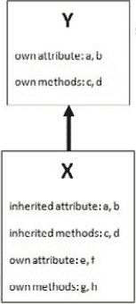

▲ **图 1：显示 X 类和 Y 类之间的继承关系**

X 类的对象可以访问 Y 类的属性和方法。子类 X 的对象可以用于需要相应超类 Y 对象的地方。这是因为子类 X 的对象与超类 Y 的对象具有相同的行为。超类也称为父类，子类也可称为子类（child classes），或仅称为派生类。

继承使你能够多次重用类的代码。这意味着，通过从现有类派生新类，你可以向现有类添加额外功能而不修改它。此外，你可以定义具有某些独特功能的子类，这些功能不同于相应超类中已定义的功能。新类除了自身功能外，还包含父类的功能。

## 多态

多态是对象以不同形式存在的能力。术语 polymorphism（多态）源自希腊语 poly（多）和 morphos（形式）。在面向对象编程（OOP）的语境中，多态是函数根据其被调用的上下文而表现出不同行为的能力。

多态通常可分为两类：静态多态和动态多态。静态多态是指一个实体同时以不同的物理形式存在。可以通过一个女人的例子来理解这一概念。一个女人必须同时扮演妻子、母亲、姐妹、女儿和高管的角色。

动态多态是指一个实体根据情况改变其形式。例如，变色龙在看到敌人接近时会改变颜色。图 2 显示了多态的层次结构，以及如何在 C++ 中实现它：

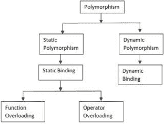

▲ 图 2：多态的层次结构

在 C++ 程序中实现多态的不同方式如下：

- 函数重载
- 运算符重载
- 动态绑定

> 你将在本章后面进一步学习函数重载和运算符重载，并在第 7 章“关于继承”中学习动态绑定。

简述多态性（孟买大学，2009 年 5 月）


在了解面向对象编程（OOP）的基本概念之后，接下来讨论如何声明和使用类及其对象。

### 6.2 使用类和对象

OOP 模型基于称为类的数据类型。当你声明或创建类的变量时，这称为类实例化。所有以类数据类型声明的变量都称为对象。这意味着对象是类的实例。类将变量和操作这些变量的函数绑定为一个单元。类中包含的变量和函数分别称为数据成员和成员函数。成员函数定义对类数据成员允许的操作。

将数据和函数放在一个单元中是 OOP 的核心主题。程序员完全负责创建自己的类，也可以访问软件供应商开发的类。

类是 C++ 创建用户自定义数据类型的基本语言构造。类类似于结构体，只有一个区别：结构体中的成员默认是公有的；而类中所有成员默认是私有的。

在 C++ 中使用类和对象需要执行以下任务：

- 定义类
- 创建对象
- 创建数据成员
- 使用访问说明符
- 创建成员函数

下面说明如何在 C++ 中定义类。

### 定义类

将 C++ 保留在基于 OOP 的语言中的一个突出原因是它支持类，类不仅包含数据成员，还包含方法。类中定义的方法是一组可对类数据成员执行的操作。它们也称为类的成员函数。因此，类可以描述为数据成员与成员函数的集合。以下语法用于定义类：

```cpp
class ClassName        /* class is keyword and ClassName is the
                         name of the user-defined class */
{

private:
    private data members and methods

protected:
    protected data members and methods

public:
    public data members and methods
} [object_list];             // semicolon (;) is required here
```

在前面的语法中，`class` 是关键字，后面跟类名 ClassName。`class` 关键字表明 ClassName 类是一种抽象数据类型，它指定其成员的类型和作用域。类体括在花括号内，并在类声明末尾跟一个分号。以下代码片段展示名为 Student 的类的声明：

```cpp
#include<iostream.h>

/* the declaration of a class */
class Student
{
// body of a class
};
```

命名类时必须遵循以下规则：

- 类名必须以字母开头，后面可以跟字母、数字（0-9）或 _ 的序列。类名的第一个字符不能是数字。
- 类名不得包含任何嵌入的空格或符号，例如 ? - + ! @ # % ^ & * ( ) [ ] { } .、逗号（,）、:、;、"、'、\`、/ 和 \\。但是，在需要空格的地方可以使用下划线（_）。
- 关键字不能用作类名。例如，不能声明名为 `class` 的类。

类名必须遵循某些命名约定或准则。这些准则如下：

- 类名应具有意义。例如，Animal、Employee 或 Account 等类名有意义。然而，wxz 和 _gggnn 等类名没有意义。
- 类名理想情况下应为名词。例如，与学生相关的类名可以是 Student，与各种几何形状相关的类名可以是 Shape。
- 如果类名包含多个单词且不使用下划线，则每个单词的首字母应大写。例如，存储学生成绩的类名可以是 StudentScoreCard，存储薪资构成的类名可以是 SalaryComponents。

在 C++ 中，`class` 关键字用于定义新类。但是，不能定义两个同名但不同的类，也不能重复定义同一个类，否则会出现编译错误。以下代码片段展示声明类的示例：

```cpp
class Account;
```

在前面的代码片段中，我们声明了 Account 类，它是一个类的原型。注意，类的原型在定义该类之前向 C++ 编译器引入该类的存在。然而，此类声明用途有限；因为编译器不知道这个类包含什么。

### 创建对象

对象的结构在其类定义中定义。对象必须被实例化，才能使用其类提供的服务。实例化是创建类对象的过程。以下语法用于定义类的对象：

```cpp
class <ClassName>
{
} <ObjectName>;
```

以下代码片段展示如何创建类的对象：

```cpp
#include<iostream.h>

/* Declaring and instantiating a class */
int main()
{
    class Student
    {
        // body of a class
    } object1;
    return 0;
}
//class is defined inside the main() function
```

定义类并创建类实例的另一种方法如下代码片段所示：

```cpp
#include<iostream.h>

/* Declaring and instantiating a class */
class Student
{
    // body of a class
};              //class is defined outside the main() function
int main()
{
    Student object1;
    return 0;
}
```

前面两个代码片段执行相同任务，即创建 Student 类的名为 object1 的对象。

还可以在单条语句中创建多个类对象。以下代码片段展示创建类的多个对象：

```cpp
#include<iostream.h>

class Student
{
    // body of a class
};
/* Creating more than one instance of a class */
int main()
{
    Student object1, object2, object3, object4;
    return 0;
}
```

创建多个类对象的另一种方法如下代码片段所示：

```cpp
#include<iostream.h>

/* Creating multiple instances of a class */
int main()
{
class Student
{
    // body of a class
} object1, object2, object3, object4;
return 0;
}
```

前面两个代码片段执行相同任务，即创建 Student 类的多个对象 object1、object2、object3 和 object4。

还可以创建指针类型对象。指针是存储任何变量内存地址的变量。指针对象借助 new 运算符初始化，并通过 delete 运算符销毁。以下代码片段分别展示使用 new 和 delete 运算符分配和释放类的指针对象：

```cpp
#include<iostream.h>

class Student
{
    // body of a class
};

int main()
{
    Student *ptrObject=new Student;
    // perform the task with object
    delete ptrObject;
    return 0;

}
```

在前面的代码片段中，创建了 Student 类的指针对象 ptrObject。ptrObject 对象通过 new 运算符获得内存，同一对象通过 delete 运算符销毁。

### 创建数据成员

可以通过创建数据成员在对象中存储数据。以下代码片段展示类内数据成员的声明：

```cpp
#include<iostream.h>

class Student
{
/* Declaring data members */
    char s_name[20];
    int s_roll_no, s_age, s_class;
    char father_name[20];
    int s_subject, s_marks;
};

int main()
{
    Student object1;
    return 0;
}
```

在前面的代码片段中，类中的数据成员默认是私有的。可以通过使用 `private`、`protected` 和 `public` 关键字显式声明，使类中的数据成员成为私有、受保护或公有。

现在让我们学习如何在 C++ 中使用这些关键字。

### 使用访问说明符

在 C++ 中，访问说明符用于标识类数据成员和成员函数的访问权限。以下是 C++ 中的三种访问说明符：


- **private（私有）：** 使类的成员仅对同一类内的代码可访问或可见。注意，默认情况下，类的成员是私有的。
- **protected（受保护）：** 使类的成员仅在同一类及其派生类内部可访问或可见。
- **public（公有）：** 使类的成员对类内外的代码可访问或可见。

这些访问说明符在类中使用时，为类成员提供不同的可访问性（或可见性）。访问说明符后必须跟冒号（:）符号，如下代码片段所示：

```cpp
#include<iostream.h>

class Student
{
    private:                //Optional to use private: here, as all members are
                            private by default
    char sname[20];
    int s_roll_no, sage, sclass;
    protected:
    char fatherName[20];
    public:
    int ssubject,smarks;
};

int main()
{
    Student object1;
    cout<<"Enter student's Name"<<endl;
    cin>>object1.sname;    //Not Accessible, compiler will give error for it
    cout<<"Enter student's father name"<<endl;
    cin>>object1.fatherName;  //Not Accessible, compiler will give error for it
    cout<<"Enter subject code"<<endl;
    cin>>object1.ssubject;    //Accessible
    cout<<"Enter marks scored by student"<<endl;
    cin>>object1.smarks;      //Accessible
    return 0;
}
```

在前面的代码片段中，Student 类中数据成员的作用域通过使用 public、protected 和 private 关键字受到限制。在 private 关键字（后跟冒号（:））之后声明的数据成员表示这些成员不能在 Student 类边界之外访问。private 关键字是可选的（此处只是为了清晰起见而使用），因为默认情况下类的所有成员都是私有的。在 protected 关键字（后跟冒号（:））之后声明的数据成员表示这些成员不能在 Student 类之外访问，但可以在 Student 类的派生类内访问。在 public 关键字（后跟冒号（:））之后声明的数据成员表示 Student 类的这些成员可以在类结构之外通过 Student 类的对象（在我们的例子中为 object1）访问。

除了数据成员之外，类体内还有成员函数。让我们学习如何在类中创建成员函数。

## 创建成员函数

有时，即使程序员可以获得大型程序的算法，实现它也很困难。你可以通过将这样的程序拆分成多个可独立设计、实现和管理的任务来实现它。将大型程序拆分成小型可管理任务的过程称为模块化编程。在模块化编程中，程序中重复的一组指令可以组织为函数。定义为类的一部分的函数称为类的方法或成员函数。在类中定义方法有两种方式：内部方式和外部方式。在内部方式中，你在类体内定义成员函数。然而，在外部方式中，你使用作用域解析（::）运算符在类体外部定义成员函数。

清单 1 展示了如何在类中定义函数（你可以在 CD 的 code\chapter6 文件夹中的 InFunction.cpp 文件中找到此示例）：

### ▶ 清单 1：在类中定义函数

```cpp
#include<iostream.h>

class Student
{
    private:
    char s_name[20];
    int s_roll_no,s_age, s_class;
    protected:
    char father_name[20];
    public:
    int s_subject,s_marks;

    void inputData()
    {
        cout<<"Enter student's roll number"<<endl;
        cin>>s_roll_no;
        cout<<"Enter student's name"<<endl;
        cin>>s_name;
        cout<<"Enter student's age"<<endl;
        cin>>s_age;
        cout<<"Enter student's class"<<endl;
        cin>>s_class;
        cout<<"Enter subject code"<<endl;
        cin>>s_subject;
        cout<<"Enter marks scored by student"<<endl;
        cin>>s_marks;
    }

    void displayData()
    {
        cout<<"Student's Roll Number:"<<s_roll_no<<endl;
        cout<<"Student's Name:"<<s_name<<endl;
        cout<<"Student's Age:"<<s_age<<endl;
        cout<<"Student's Class:"<<s_class<<endl;
        cout<<"Subject Code:"<<s_subject<<endl;
        cout<<"Student's Marks:"<<s_marks<<endl;
    }
};

int main()
{
    Student object1;
    object1.inputData();
    object1.displayData();
    return 0;
}
```

### 输出：

```text
Enter student's roll number
1001
Enter student's name
Kabir
Enter student's age
12
Enter student's class
7
Enter subject code
104
Enter marks scored by student
87
Student's Roll Number:1001
Student's Name:Kabir
Student's Age:12
Student's Class:7
Subject Code:104
Student's Marks:87
```

在清单 1 中，Student 类有两个成员函数——`inputData()` 和 `displayData()`。这两个函数的返回类型都是 `void`。`inputData()` 方法执行接受学生信息（如学号、姓名和分数）的任务。另一方面，`displayData()` 方法用于显示这些学生的信息。

除了在类定义内部定义方法之外，还有一种外部方式，通过使用作用域解析运算符在类结构外部定义方法体。清单 2 展示了如何使用作用域解析运算符在类结构外部编写成员函数定义（你可以在 CD 的 code\chapter6 文件夹中的 ExFunction.cpp 文件中找到此示例）：

### ▶ 清单 2：使用作用域解析运算符在类外定义函数

```cpp
#include<iostream.h>

class Student
{
    private:
    char sname[20];
    int sage,sclass;
    protected:
    char fatherName[20];
    public:
    int ssubject,smarks;
    void inputData();
    void displayData();
};

void Student::inputData()
{
    cout<<"Enter student's name"<<endl;
    cin>>sname;
    cout<<"Enter student's age"<<endl;
    cin>>sage;
    cout<<"Enter student's class"<<endl;
    cin>>sclass;
    cout<<"Enter subject code"<<endl;
    cin>>ssubject;
    cout<<"Enter marks scored by student"<<endl;
    cin>>smarks;
}

void Student::displayData()
{
    cout<<"Student's Name:"<<sname<<endl;
    cout<<"Student's Age:"<<sage<<endl;
    cout<<"Student's Class:"<<sclass<<endl;
    cout<<"Subject Code:"<<ssubject<<endl;
    cout<<"Student's Marks:"<<smarks<<endl;
}

int main()
{
    Student object1;
    object1.inputData();
    object1.displayData();
    return 0;
}
```

### 输出：

```text
Enter student's roll number
1001
Enter student's name
Kabir
Enter student's age
12
Enter student's class
7
Enter subject code
104
Enter marks scored by student
87
Student's Roll Number:1001
Student's Name:Kabir
Student's Age:12
Student's Class:7
Subject Code:104
Student's Marks:87
```

在清单 2 中，Student 类有两个成员函数 `inputData()` 和 `displayData()` 的声明。没有定义的函数声明也称为函数原型。`inputData()` 和 `displayData()` 函数的返回类型是 `void`。`inputData()` 函数使用作用域解析运算符（`::`）在 Student 类边界之外定义。考虑以下代码片段：

```cpp
void Student::inputData()
{
...
...
...
}
```

在前面的代码片段中，`void` 是 `inputData()` 函数的返回类型。Student 是用户定义类的名称，后面跟作用域解析运算符（`::`），而 `inputData()` 是在 Student 类中声明的函数名称。`inputData()` 函数在 Student 类边界之外定义，用于接受任何学生的信息，例如学号、姓名和分数。

与 `inputData()` 函数类似，`displayData()` 函数也是 Student 类的类成员。`displayData()` 函数也使用作用域解析运算符（`::`）在 Student 类边界之外定义。考虑以下代码片段：

```cpp
void Student::displayData()
{
...
...
...
}
```

在前面的代码片段中，`void` 是 `displayData()` 函数的返回类型，Student 是用户定义类的名称，后面跟作用域解析运算符（`::`）。然而，`displayData()` 函数用于显示学生信息。

在 C++ 中，类中声明的函数默认是私有的。然而，你可以分别使用 private、protected 或 public 关键字，将类中的函数显式设为私有、受保护或公有。类中定义的函数通过使用点（`.`）运算符或类成员访问间接（`->`）运算符来调用。以下代码片段展示了使用点运算符进行函数访问：

```cpp
object1.inputData();
```

在前面的代码片段中，`object1` 是 Student 类对象的名称，`inputData()` 是该类的一个函数。

让我们在类中创建以下函数：

- 一个 const 函数
- 一个嵌套函数

## 创建 const 函数

const 函数不允许修改类中数据成员的值。清单 3 展示了一个 const 函数的示例（你可以在 CD 的 code\chapter6 文件夹中的 ConstFunction.cpp 文件中找到此示例）：

### ▶ 清单 3：在类中创建 const 函数

```cpp
#include<iostream.h>

class ConstFunction
{
    int x,y;
    public:
    void setval();
    void display() const;
    // prototype of a const function
};
```


```cpp
void ConstFunction::setVal()
{

x=10;
y=x*x;
}
void ConstFunction::display() const
{
cout<<"x = "<<x<<endl;
cout<<"y = "<<y<<endl;
}

void main()
{
ConstFunction cf;
cf.setVal();
cf.display();
}
```

### 输出：
```text
x = 10
y = 100
```

在代码清单 3 中，x 和 y 是 int 类型的变量，在 setVal() 函数中被赋值。display() 是一个 const 函数，用于显示 x 和 y 变量的值。如果你尝试在 display() 函数中给这些变量赋值，就会遇到编译错误，因为 const 函数不能修改类数据成员的值。

## 成员函数的嵌套

在 C++ 中，函数不一定只能由类的对象调用。可以被其他函数调用的函数称为嵌套函数。

代码清单 4 展示了如何通过另一个函数调用来调用函数（你可以在 CD 的 code\chapter6 文件夹中的 NumberAddition.cpp 文件里找到此示例）：

### 代码清单 4：通过另一个函数调用函数

```cpp
#include<iostream.h>

class NumberAddition
{
    int a, b;
    int add();
    public:
    void numAccept();
    void display();
};

void NumberAddition::numAccept()
{
    cout<<"Enter any two numbers:";
    cin>>a>>b;
}
int NumberAddition::add()
{
    return a+b;
}
void NumberAddition::display()
{
    cout<<"The Addition of two numbers is ="<<add();
}

void main()
{
    NumberAddition na;
    na.numAccept();
    na.display();
}
```

### 输出：
```text
Enter any two numbers:34
89
The Addition of two numbers is =123
```

在代码清单 4 中，输入两个任意数字作为输入值，然后程序显示它们的和。该程序有一个类 NumberAddition，它以 a 和 b 作为私有数据成员；numAccept()、add() 和 display() 被定义为它的成员函数。

numAccept() 函数接受变量 a 和 b 的输入值。add() 函数返回存储在 a 和 b 变量中的值之和。add() 函数的返回类型是 int 类型；并且它在 NumberAddition 类中的作用域是私有的。display() 函数用于显示 add() 函数返回的值以及用户定义的消息。请注意，对象不能调用类的私有函数；但是，同一个私有成员函数可以通过同一个类的公有成员函数被间接调用。

## 测试你的知识

- **问题 1.** 创建一个程序来显示圆的面积和周长。

```cpp
#include<iostream.h>

class circle
{
    private:
        float radius,area,perimeter;
    public:
        inline void get_details()
        {
            cout<<"enter the radius of the circle";
            cin>>radius;
        }
        inline void cal()
        {
            area=radius*radius*3.14;
            perimeter=2*3.14*radius;
        }
        inline void display()
        {
            cout<<"area is "<<area;
            cout<<endl;
            cout<<"perimeter is"<<perimeter;
        }
};

void main()
{
    circle cir;
    cir.get_details();
    cir.cal();
    cir.display();
}
```

### 输出：
```text
enter the radius of the circle100
area is 31400
perimeter is 628
```

- **问题 2.** 创建一个 distance 类，并计算该类对象之间的和与差。

答案。

```cpp
#include<iostream.h>

class distance
{
    private:
    float meter;
    public:
    void init()
    {
        cout<<"Enter The Distance";
        cin>>meter;
    }
    void add(distance d1,distance d2)
    {
        meter =d1.meter+d2.meter;
    }
    void subtract(distance d1,distance d2)
    {
        meter=d1.meter-d2.meter;
    }
    void display()
    {
        cout<<"distance ="<<meter;
    }
};
void main()
{
    distance d1,d2,d3;
    cout<<"distance1"<<endl;
    d1.init();
    cout<<"distance2"<<endl;
    d2.init();
    d3.add(d1,d2);
    cout<<"addition of distance=";
    d3.display();
    d3.subtract(d1,d2);
    cout<<endl<<"subtraction of distance=";
    d3.display();
}
```

### 输出：
```text
distance1
Enter The Distance100
distance2
Enter The Distance82
addition of distance=distance =182
subtraction of distance=distance =18
```

接下来，你将学习 C 语言中结构体的概念与 C++ 语言中类的概念之间的区别。

### 6.3 解释 C 结构体与 C++ 类之间的区别

在 C 语言中，结构体（或 struct）是一种用户定义类型，但有一个限制：不能将 struct 数据类型当作内置数据类型用于数学运算，例如加法或减法。例如，下面的代码片段展示了 struct 数据类型 MyNum 的定义：

```cpp
struct MyNum
{
    int num1;
    int num2;
};
struct MyNum obj1,obj2,obj3;
```

在前面的代码片段中，MyNum 是一个 struct 数据类型，obj1、obj2 和 obj3 是它的变量。可以使用点（.）运算符为 obj1、obj2 和 obj3 变量赋值。但是，不能在这些变量上执行运算，例如加法，如下面的代码片段所示：

```cpp
obj3=obj1+obj2;
```

C 语言中结构体的另一个限制是它们不支持数据隐藏。结构体的成员可以在任何函数中通过结构体变量访问。这是因为在 C 语言中，结构体的成员默认是公有的。

C++ 语言也支持结构体，并实现了 C 语言中结构体的所有特性。然而，在 C++ 中，你可以声明结构体变量而不使用 struct 关键字，如下面的代码片段所示：

```cpp
struct CppMyNum
{
    int num1;
    int num2;
    void mynumFunc()
    {
        //body of a structure function
    }
};
CppMyNum obj1,obj2,obj3;
```

C++ 还允许在结构体中定义函数；而在 C 语言中，只能在结构体中声明变量。这意味着 C++ 结构体可以同时将变量和函数作为其结构体成员。此外，你可以将 C++ 结构体的某些成员声明为私有，这样外部函数就不能在结构体主体之外直接访问这些成员。

除结构体外，C++ 还支持另一种用户定义数据类型，称为类。在 C++ 中，类与 struct 类似，但有一个例外：默认情况下，类的所有成员都是私有的；而 struct 的成员是公有的。此外，一种用户定义数据类型可以继承另一种用户定义数据类型的特性和功能。这意味着类或结构体可以从另一个结构体或类继承。

现在让我们探讨如何在类中创建数据访问方法。

### 6.4 创建数据访问方法

有时，你需要访问类的私有数据成员。为此，你可以使用数据访问方法，它允许你在类外访问私有数据成员。通常，数据访问方法以一对 getX() 和 setX() 方法实现，其中 X 可以是任何用户定义的名称。getX() 方法获取数据项的值，setX() 方法设置数据项的值。代码清单 5 展示了在类中定义的一对 getX() 和 setX() 的示例（你可以在 CD 的 code\chapter6 文件夹中的 DataAccessMethods.cpp 文件里找到此示例）：

### 代码清单 5：在类中创建数据访问方法

```cpp
#include<iostream.h>

class GreatestNumber
{
    private:
    int x,y;
    public:
    void setNum(int a,int b);
    int getNum();
};

void GreatestNumber::setNum(int a,int b)
{
    x=a;
    y=b;
}

int GreatestNumber::getNum()
{
    if(x>=y)
    return x;
    else
    return y;
}

int main()
{
```

（你可以在 CD 的 code\chapter6 文件夹中的 InlineInClass.cpp 文件里找到此示例）：

### 代码清单 6：在类中创建内联函数

```cpp
#include<iostream.h>

class MyClass
{
    int x,y,z;
public:
    void getdata()
    {
        cout<<"Enter any two numbers";
        cin>>x>>y;
        z=x+y;
    }
    void displayData()
    {
        cout<<"The sum of two numbers is="<<z<<endl;
    }
};

int main()
{
    MyClass o;
    o.getdata();
    o.displayData();
    return 0;
}
```

### 输出：
```text
Enter any two numbers78
43
The sum of two numbers is=121
```

在代码清单 6 中，getData() 和 displayData() 是 MyClass 类的两个内联成员函数。这些函数定义在 MyClass 类的边界内，而没有使用 inline 关键字。

在类外定义的函数是非内联函数或类外函数。在类声明之外定义的成员函数也可以通过在其定义前加上 `inline` 关键字而成为内联函数。代码清单 7 展示了在类外创建内联函数（你可以在 CD 的 code\chapter6 文件夹中的 InlineOutClass.cpp 文件里找到此示例）：

**▶ 清单 7：在类外部创建内联函数**

```cpp
#include<iostream.h>

class MyClass
{
  int x,y,z;
  public:
  void getData();
  void displayData();
};
inline void MyClass :: getData()
{
  cout<<"Enter any two numbers";
  cin>>x>>y;
  z=x+y;
}
inline void MyClass :: displayData()
{
  cout<<"The sum of two numbers is="<<z<<endl;
}

int main()
{
  MyClass o;
  o.getData();
  o.displayData();
  return 0;
}
```

**输出：**

```text
Enter any two numbers19
26
The sum of two numbers is=45
```

在清单 7 中，MyClass 类的 getData() 和 displayData() 函数被定义为类规范之外的内联函数。这些函数的定义仅使用 inline 关键字。

在以下情况下，内联函数会被当作普通函数处理：

- 内联函数是递归函数。
- 内联函数包含静态变量。
- 内联函数包含 return 语句，且函数的返回类型为 void。请注意，返回类型为 void 的函数可以包含 return 语句，以将控制权转回调用函数。
- 内联函数包含循环结构、switch 或 goto 语句，并且会返回一个值。

现在让我们学习内联函数与宏之间的区别。

## 内联函数与宏之间的区别

与内联函数类似，宏是另一种使 C++ 程序紧凑的函数，但它本身由 C++ 编译器展开。宏包含一段代码序列，C++ 编译器会通过为程序生成实际的机器代码来替换它。使用宏的一个缺点是，与函数相比，它占用更多内存。然而，宏执行所需时间更少。

清单 8 展示了在类中使用宏以及内联函数（你可以在随书光盘的 code\chapter6 文件夹中的 MacroAndInline.cpp 文件里找到这个示例）：

**▶ 清单 8：在类中使用宏和内联函数**

```cpp
#include<iostream.h>

#define cube1(num) num*num*num        //Creating a macro
/* Creating an inline function */
inline int cube2(int x)
{
return (x*x*x);
}
int main()
{
cout<<"cube1 (5) ="<<cube1(5)<<endl;          //Calling macro
cout<<"cube1 (5+10) ="<<cube1(5+10)<<endl;    //Calling macro
cout<<"cube2 (5) ="<<cube2(5)<<endl;          //Calling inline function
cout<<"cube2 (5+10) ="<<cube2(5+10)<<endl;    //Calling inline function
return 0;
}
```

**输出：**

```text
cube1 (5) =125
cube1 (5+10) =115
cube2 (5) =125
cube2 (5+10) =3375
```

在清单 8 中，我们使用 #define 预处理指令创建一个宏 cube1；并使用 inline 关键字创建一个内联函数 cube2。在 main() 函数中，调用 cube1(5) 和 cube1(5+10) 宏分别显示结果为 125 和 115。然而，调用 cube2(5) 和 cube2(5+10) 内联函数分别显示结果为 125 和 3375。

请注意，cube1(5) 宏和 cube2(5) 内联函数的结果相同，都是 125。然而，cube1(5+10) 宏和 cube2(5+10) 内联函数的结果不同，分别是 115 和 3375。这是因为，cube1(5+10) 宏被求值为 5+10*5+10*5+10；而 cube2(5+10) 内联函数被求值为 15*15*15。

建议你使用内联函数而不是宏，原因如下：

- 宏的调用不执行类型检查；而内联函数的调用会执行类型检查
- 宏不能使用 return 关键字；而内联函数可以使用 return 关键字


> 什么是内联函数？讨论其优缺点。编写一个程序来演示内联函数（孟买大学，2008 年 12 月）

在解释了宏和内联函数之间的区别之后，让我们探讨类的构造函数和析构函数。

### 6.6 使用构造函数和析构函数

构造函数和析构函数是类的特殊成员函数，分别用于初始化或取消初始化类的成员变量。创建类的对象时，需要为该对象分配内存。然而，分配内存并不能确保对象内的成员变量被初始化。类的成员变量不能在声明类时初始化。例如，以下代码片段中成员变量的初始化是无效的：

```cpp
class GreatestNumber
{
  int variable=10;
  int variable=20;
};
```

通过在类中编写一个初始化函数，为每个成员变量赋予初始值，可以克服声明类时未初始化成员变量的问题。创建对象时可以调用这个初始化函数。清单 9 展示了一个初始化函数（你可以在随书光盘的 code\chapter6 文件夹中的 InitializeFunction.cpp 文件里找到这个示例）：

**▶ 清单 9：创建初始化函数**

```cpp
#include<iostream.h>

class GreatestNumber
{
  private:
    int variable1, variable2, variable3;
  public:
    void initialize();
    void greaterNum();
    void displayNum();
};
void GreatestNumber::initialize()
{
    variable1=10;
    variable2=20;
}
void GreatestNumber::greaterNum()
{
    if(variable1>=variable2)
        variable3=variable1;
    else
        variable3=variable2;
}
void GreatestNumber::displayNum()
{
    cout<<"The greatest number is:"<<variable3<<endl;
}

int main()
{
    GreatestNumber gnObject1;
    gnObject1.initialize();
    gnObject1.greaterNum();
    gnObject1.displayNum();
    return 0;
}
```

**输出：**

```text
The greatest number is:20
```

在清单 9 中，GreatestNumber 类的 gnObject1 对象必须调用成员函数 initialize() 来初始化数据成员 variable1 和 variable2。这种方法的唯一缺点是，如果用户忘记调用初始化函数，程序就会操作一个成员变量含有无意义值（垃圾字符）的对象。这是因为，在类中声明变量时，它内部只会存储一些垃圾字符（无意义的值）。

C++ 为这个问题提供了一种解决方案。在设计类时，可以在类中包含一个特殊成员函数，每当创建该类的对象时都会执行它。这类函数称为构造函数。构造函数是类的成员函数，当创建它们所属类的实例时会被调用。构造函数的显著特征是它们与类同名。

另一方面，析构函数在对象被销毁时取消初始化对象。当类的对象超出作用域时，析构函数会自动被调用。因此，程序员无需在每次对象超出作用域时清理数据成员占用的内存空间。

让我们解释如何在类中声明和使用构造函数。

### 声明和使用构造函数

构造函数是一种特殊成员函数，它分配内存并初始化其所属类的对象。构造函数不同于类的其他成员函数，因为它与类同名。它不包含返回类型（甚至不包括 void），这一点与函数不同。当类被实例化（创建对象）时，它会自动执行。清单 10 展示了类中构造函数的声明（你可以在随书光盘的 code\chapter6 文件夹中的 SimpleConstructor.cpp 文件里找到这个示例）：

**清单 10：在类中创建构造函数**

```cpp
#include<iostream.h>

class NumberInitialization
{
  int x,y;
  public:
  NumberInitialization()
  {
    cout<<"Constructor calling"<<endl;
    x=1;
    y=2;

    cout<<"x="<<x<<endl;
    cout<<"y="<<y<<endl;
    cout<<"Program Over\n";
  }
};

int main()
{
  NumberInitialization n1;
  //Constructor invoked
  return 0;
}
```

**输出：**

```text
Constructor calling
```


```
x=1
y=2
Program Over
```

在代码清单 10 中，创建了 NumberInitialization 类，该类有一个名为 NumberInitialization() 的构造函数，用于初始化该类的私有成员。

构造函数的某些特性如下：

- 构造函数是函数，但其名称必须与类名相同。
- 构造函数旨在当创建该类的实例时初始化该类的成员。
- 创建对象时，构造函数会被自动调用。
- 与函数类似，构造函数可以具有默认实参。
- 构造函数没有返回类型，因此不能返回值。
- 构造函数不能被继承。
- 构造函数不能是 `virtual`。
- 可以为同一个类定义多个构造函数。它们必须具有不同的形参以区分它们。
- 当需要内存分配时，构造函数会隐式调用 `new` 和 `delete` 运算符。
- 构造函数的地址不能用于引用其他构造函数。
- 不能使用点(.)运算符将构造函数作为类的成员函数显式调用。

可以在类中创建以下类型的构造函数：

- 默认构造函数
- 参数化构造函数
- 带默认实参的构造函数
- 内联构造函数
- 拷贝构造函数
- 动态构造函数

现在让我们详细讨论其中的每一种构造函数。

## 创建默认构造函数

在 C++ 中，构造函数是类的第一个成员，当创建该类的对象时会被自动调用。这意味着每当创建某个类的对象时，该类的构造函数就会被调用。然而，如果在类中没有声明构造函数，会发生什么？在这种情况下，C++ 编译器会为你的类创建一个构造函数。这种由编译器创建的构造函数称为 `default constructor`。默认构造函数是或者没有形参，或者有形参且这些形参具有默认值的构造函数。

你可以简单地在类的 public 部分添加一个不带任何实参、且与类名同名的构造函数，从而在类中创建默认构造函数。当声明某个类的实例（对象）时，无论是否使用该对象，该类的构造函数都会被自动调用。代码清单 11 展示了在类中创建默认构造函数的一个示例（你可以在 CD 的 code\chapter6 文件夹中的 DefaultConstructor.cpp 文件里找到此示例）：

### 代码清单 11：创建默认构造函数

```cpp
#include<iostream.h>

class NumberInitialization
{
    int x,y;
    public:
    NumberInitialization();
};
NumberInitialization::NumberInitialization()
{
    cout<<"Default constructor calling"<<endl;
    x=0;
    y=0;
    cout<<"x="<<x<<endl;
    cout<<"y="<<y<<endl;
}

int main()
{
    NumberInitialization n1;
    cout<<"Program Over\n";
    return 0;
}
```

### 输出

```
Default constructor calling
x=0
y=0
Program Over
```

NumberInitialization 类有一个构造函数，名为 NumberInitialization()，它没有形参，用于初始化该类的数据成员 x 和 y。这种构造函数称为默认构造函数。

创建默认构造函数之后，让我们讨论如何在类中编写参数化构造函数。

## 创建参数化构造函数

与函数类似，你可以向类的构造函数传递实参。带实参的构造函数称为**参数化构造函数**。在 C++ 中，带实参的构造函数可以与另一个不带任何实参的构造函数共存。这个概念称为构造函数重载。


> 本章后面你将进一步了解构造函数重载。

代码清单 12 展示了带形参的构造函数的一个示例（你可以在 CD 的 code\chapter6 文件夹中的 ParameterizedConstructor.cpp 文件里找到此示例）。

### 代码清单 12：创建参数化构造函数

```cpp
#include<iostream.h>

class NumberInitialization
{
    int x,y;
public:
    NumberInitialization();
    //Default constructor prototype
    NumberInitialization(int a, int b);
    //Parameterized constructor prototype
};

NumberInitialization::NumberInitialization()
{
    cout<<"Default constructor calling"<<endl;
    x=0;
    y=0;
    cout<<"x="<<x<<endl;
    cout<<"y="<<y<<endl;
}

NumberInitialization::NumberInitialization(int a, int b)
{
    cout<<"Parameterized constructor calling"<<endl;
    x=a;
    y=b;
    cout<<"x="<<x<<endl;
    cout<<"y="<<y<<endl;
}

int main()
{
    NumberInitialization n1;
    NumberInitialization n2(23,33);
    cout<<"Program Over\n";
    return 0;
}
```

### 输出

```
Default constructor calling
x=0
y=0
Parameterized constructor calling
x=23
y=33
Program Over
```

NumberInitialization 类有两个构造函数：其中一个是默认构造函数——NumberInitialization()，另一个是参数化构造函数——NumberInitialization(int a, int b)。当创建 NumberInitialization 类的对象 n1 时，该类的默认构造函数将数据成员 x 和 y 初始化为零 (0)。然而，n2 对象会调用 NumberInitialization 类的参数化构造函数，如下面的代码片段所示：

```cpp
NumberInitialization n2(23,33);
```

在前面的代码片段中，参数化构造函数分别用值 23 和 33 初始化数据成员 x 和 y。

## 创建带默认实参的构造函数

你也可以定义带默认实参的构造函数。代码清单 13 展示了类中带默认实参的构造函数（你可以在 CD 的 code\chapter6 文件夹中的 ConstructorDefaultArgs.cpp 文件里找到此示例）：

### 代码清单 13：创建带默认实参的构造函数

```cpp
#include<iostream.h>

class MyClass
{
  public:
  MyClass(int a=100, int b=10);
};

MyClass::MyClass(int a, int b)
{
  cout<<"This constructor has default arguments"<<endl;
  cout<<"Parameters are:"<<a<<" and "<<b<<endl;
}

int main()
{
    MyClass o1();
    MyClass o2(78);
    MyClass o3(45, 56);
    return 0;
}
```

### 输出

```
This constructor has default arguments
Parameters are:78 and 10
This constructor has default arguments
Parameters are:45 and 56
```

在代码清单 13 中，MyClass 类有一个参数化构造函数，其名称也为 MyClass，它把 a 和 b 变量作为 int 类型的形参。这些变量 a 和 b 分别存储数值 100 和 10，并与其对应的对象 (o3) 相关联。现在，考虑下面的代码片段：

```cpp
MyClass o1();
MyClass o2(78);
MyClass o3(45, 56);
```

在前面的代码片段中，第一条语句将默认值 100 和 10 分别赋给变量 a 和 b。第二条语句将变量 a 的默认值覆盖为 78，并将值 10 赋给变量 b。然而，第三条语句分别覆盖变量 a 和 b 的默认值。这些值会覆盖默认实参或默认值，并且缺失的实参必须是尾部实参。

你必须记住，带默认实参的构造函数可以用一个实参调用，也可以不带实参调用。当它不带实参调用时，它就成为默认构造函数。当类中同时使用这两种形式时，会导致错误。代码清单 14 展示了 C++ 编译器在默认构造函数和带默认实参的构造函数之间产生的歧义（你可以在 CD 的 code\chapter6 文件夹中的 AmbiguityConstructors.cpp 文件里找到此示例）：

### 代码清单 14：为 C++ 编译器制造歧义

```cpp
#include<iostream.h>

class MyClass
{
    public:
    MyClass();
    MyClass(int x, int y);
    MyClass(float a=100.0f, float b=10.0f);
};

MyClass::MyClass()
{
    cout<<"Default constructor calling"<<endl;
}
MyClass::MyClass(int x, int y)
{
    cout<<"Parameterized constructor calling"<<endl;
    cout<<"Parameters are:"<<x<<" and "<<y<<endl;
}
MyClass::MyClass(float a, float b)
{
    cout<<"This constructor has default arguments"<<endl;
    cout<<"Parameters are:"<<a<<" and "<<b<<endl;
}

int main()
{
    MyClass o1;              //Compiler causes ambiguity here
    MyClass o2(23,45);
    MyClass o3(45.6f);
    return 0;
}
```

在代码清单 14 中，MyClass 类有三个构造函数：MyClass()、MyClass(int x, int y) 和 MyClass(float a =100.0f, float b=10.0f)。MyClass() 构造函数是默认构造函数，MyClass(int x, int y) 构造函数是参数化构造函数，而 MyClass(float a =100.0f, float b=10.0f) 构造函数带默认实参。在 main() 函数中，下面的代码片段会导致 C++ 编译器产生歧义：

```cpp
MyClass o1;
```

产生这种歧义的原因是，C++ 编译器不知道应该调用 MyClass 类的 MyClass() 构造函数，还是调用 MyClass(float a=100.0f, float b=10.0f) 构造函数。

## 创建类的内联构造函数

与内联函数类似，你可以创建内联构造函数。代码清单 15 展示了类中内联构造函数的一个示例（你可以在 CD 的 code\chapter6 文件夹中的 InlineConstructor1.cpp 文件里找到此示例）：

### 代码清单 15：在类内部创建内联构造函数

```cpp
#include <iostream.h>

class Volume {
    double len, wd, hgt;
    double result;
public:
```


```cpp
Volume(double a, double b, double c)
{
    len = a;
    wd = b;
    hgt = c;
    result = len * wd * hgt;
}
void CalcVol();
};
void Volume::CalcVol()
{
    cout << "Volume is: " << result << endl;
}
int main()
{
    Volume v1(5.2,3.4,7.3), v2(10,5,6);
    v1.CalcVol();
    v2.CalcVol();
    return 0;
}
```

### 输出：

```text
Volume is: 129.064
Volume is: 300
```

在清单 15 中，Volume 类包含一个内联构造函数。Volume(double a, double b, double c)。请注意，当在类定义内使用内联构造函数时，inline 关键字的使用对于内联构造函数是可选的。

清单 16 展示了通过使用 inline 关键字在类外部定义内联构造函数的示例（你可以在 CD 的 code\chapter6 文件夹中的 InlineConstructor2.cpp 文件里找到此示例）：

## ▶ 清单 16：在类外部创建内联构造函数

```cpp
#include <iostream.h>

class Volume {
    double len, wd, hgt;
    double result;
public:
    Volume(double a, double b, double c);
    void CalcVol();
};
inline Volume::Volume(double a, double b, double c)
{
    len = a;
    wd = b;
    hgt = c;
    result = len * wd * hgt;
}

void Volume::CalcVol()
{
    cout << "Volume is: " << result << endl;
}

int main()
{
    Volume v1(5.2,3.4,7.3), v2(10,5,6);
    v1.CalcVol();
    v2.CalcVol();
    return 0;
}
```

### 输出：

```text
Volume is: 129.064
Volume is: 300
```

在清单 16 中，Volume(double a, double b, double c) 是 Volume 类的内联构造函数。该 Volume(double a, double b, double c) 构造函数通过使用 inline 关键字和作用域解析（::）运算符定义在 Volume 类的边界之外。

## 复制构造函数

如你所知，构造函数可以带有参数。你可以将构造函数参数作为任意数据类型的值参数传递，但不能是其自身类的对象。例如，在以下代码片段中，Product 类的声明是无效的：

```cpp
class Product
{
...
...
public:
Product (Product object1);          // Invalid declaration
...
}
```

但是，类自身的对象可以作为引用参数传递。引用参数由位于实参前面的与号（&）符号表示。例如，在以下代码片段中，传递 Product 类的引用实参是有效的：

```cpp
class Product
{
    ...
    ...
public:
    Product ();
    Product (Product &object1);        //copy constructor
    ...
};
```

一个具有对其自身类对象引用的构造函数称为复制构造函数。复制构造函数将一个对象的数据成员复制到另一个对象。假设 o1 和 o2 是 Product 类的预定义对象，如下代码片段所示：

```cpp
Product o1(200), o2(300);
o1=o2;
Product o3=o2;
```

在前面的代码片段中，o1=o2; 语句不会调用复制构造函数，尽管 o1 和 o2 都是同一 Product 类的对象。这是因为编译器使用赋值（=）运算符将数据从 o2 对象逐成员复制到 o1 对象。然而，下一条语句 Product o3=o2 在定义期间用一个对象初始化另一个对象。o2 对象的数据成员被逐成员复制到 o3 对象。这是构造函数副本执行的默认操作。编译器执行 Product o3=o2 语句，如下代码片段所示：

```cpp
Product o3 (o2);
```

清单 17 展示了创建类构造函数副本的示例（你可以在 CD 的 code\chapter6 文件夹中的 CopyConstructor.cpp 文件里找到此示例）：

### ▶ **清单 17：创建构造函数的副本**

```cpp
#include <iostream.h>

class Product
{
    int number;
public:
    Product(int num);
    Product(Product &other_product);
    void displayNumber()
    {
        cout<<"The number is:"<<number<<endl;
    }
};
Product::Product(int num)
{
    number = num;
}
Product::Product(Product &other_product)
{
    number = other_product.number;
}

int main()
{
    Product o1(200),o2(300);
    o1=o2;
    Product o3=o2;
    cout<<"Value in Object1\n";
    o1.displayNumber();
    cout<<"Value in Object2\n";
    o2.displayNumber();
    cout<<"Value in Object3\n";
    o3.displayNumber();
    return 0;
}
```

### 输出：

```text
Value in Object1
The number is:300
Value in Object2
The number is:300
Value in Object3
The number is:300
```

在清单 17 中，Product(Product &other_product) 复制构造函数只接受一个参数，该参数是 Product 类的对象，并按引用传递。在复制构造函数中，传递类对象的引用至关重要。如果在复制构造函数中将类对象作为值传递，则会创建复制构造函数的多个副本。此外，此过程会一直持续到系统内存耗尽为止。因此，在复制构造函数中，参数必须始终按引用传递，以防止创建副本。

## 测试你的知识

Q3. 创建一个程序以展示复制构造函数的用法。

答案。

```cpp
#include <iostream.h>
#include <string.h>
class StringClass {
    char *p;
public:
    StringClass(char *s);
    StringClass(StringClass &o);
    ~StringClass() {
        delete [] p;
    }
    char *get() {
        return p;
    }
};
StringClass::StringClass(char *s)
{
    int l;
    l = strlen(s)+1;
    p = new char [l];
    strcpy(p, s);
}
StringClass::StringClass(StringClass &o)
{
    int l;
    l = strlen(o.p)+1;
    p = new char [l];
    strcpy(p, o.p);
}
void show(StringClass x)
{
    char *s;
    s = x.get();
    cout << s << endl;
}
int main()
{
    StringClass a("www.kogent.com"), b("www.dreamtech.com");
    a=b;
    StringClass c=b;
    show(a);
    show(b);
    show(c);
    return 0;
}
```

### 输出：

```text
www.dreamtech.com
www.dreamtech.com
www.dreamtech.com
```

## ■ 创建动态构造函数

能够在对象构造时为对象分配所需内存量的构造函数称为对象的动态构造函数。内存是借助 `new` 运算符分配的。清单 18 展示了如何调用动态构造函数（你可以在 CD 的 `code\chapter6` 文件夹中的 DynamicConstructor.cpp 文件里找到此示例）：

### ▶ 清单 18：调用动态构造函数

```cpp
#include <iostream.h>

class AddingNumbers
{
  int *numPoint;
  int numSize;

public:
  AddingNumbers (int size)
  {
    numSize = size;
    numPoint = new int[size];
  }
  ~AddingNumbers ()
  {
    delete numPoint;
  }
  void input();
  void additionDisplay();
};

void AddingNumbers::input()
{
  for( int i = 0; i < numSize; i++ )
  {
    cout << "Enter a number at the position [ " << i << " ] ? ";
    cin >> numPoint [i];
  }
}
void AddingNumbers::additionDisplay()
{
  int sum=0;
  for( int i = 0; i < numSize; i++ )
    sum += numPoint [i];
  cout << "Sum of the numbers = " << sum;
}
void main()
{
  int num;
  cout << "How many numbers do you want to enter ?";
  cin >> num;
  // create an object of AddingNumber class and compute the sum of numbers
  AddingNumbers addnum (num);
  addnum.input();
  addnum.additionDisplay();
}
```

### 输出：

```text
How many numbers do you want to enter ?5
Enter a number at the position [ 0 ] ? 10
Enter a number at the position [ 1 ] ? 20
Enter a number at the position [ 2 ] ? 30
Enter a number at the position [ 3 ] ? 40
Enter a number at the position [ 4 ] ? 50
Sum of the numbers = 150
```

在清单 18 中，以下代码片段通过使用 new 运算符动态创建 AddingNumbers 类的实例（或对象）addnum：

```cpp
AddingNumbers addnum (num);
```

对象 addnum 用 num 变量初始化。input() 函数接受用户输入的一个数字，该数字表示用户提供了多少个数字。additionDisplay() 函数将所有数字元素相加并显示它们的和。在对对象执行动态初始化时，务必注意不应初始化数据成员（指针变量必须为 NULL）。带参数的构造函数必须分配适量的内存资源。程序必须具有析构函数以释放所有已分配的内存。

## 测试你的知识

- Q4. 创建一个程序，可以转换：
  - 米转换为厘米，反之亦然
  - 英尺转换为英寸，反之亦然

答案：

```cpp
#include<iostream.h>

class db;
class dm
{
    private :
        float m,cm;
    public:
        dm():m(0.0),cm(0.0)
```


```cpp
}
void get_data()
{
    cout<<"enter the meters:";
    cin>>m;
    cout<<"enter the centimeters";
    cin>>cm;
}
void convers1()
{
    cm=m*100+cm;
    m=cm/100;
}
friend float add(dm,db);
};

class db
{
 private:
  float feet;
  float inches;
 public:
  db():feet(0.0),inches(0.0)
  {}

  void get_data1()
  {
   cout<<"enter the feet";
   cin>>feet;
   cout<<"enter the inches";
   cin>>inches;
  }

  void convers2()
  {
   inches=feet*12+inches;
   feet=inches/12;
  }
  friend float add(dm,db);
};

float add(dm m1,db feet1)
{
 return(m1.m*3.3+feet1.feet);
}

int main()
{
 dm d1;
 db d2;
 d1.get_data();
 d2.get_data1();
 d1.convers1();
 d2.convers2();
 cout<<add(d1,d2);
 return 0;
}
```

### 输出：

```text
enter the meters:10
enter the centimeters30
enter the feet50
enter the inches12
84.989998
```


借助一个合适的程序，以复制构造函数为例说明带动态操作的构造函数。

下面探讨如何在类中声明和使用析构函数。

## 声明和使用析构函数

在 C++ 中，如果不再需要某个对象，可以使用析构函数销毁它。析构函数是类的另一种特殊成员函数。它被调用来销毁类的一个对象。析构函数的名称与类名相同，但前面带有一个波浪号（~）符号。波浪号符号将其与同一类的构造函数区分开来。清单 19 展示了如何在类中声明析构函数（可在随书光盘的 code\\chapter6 文件夹中的 SimpleDestructor.cpp 文件中找到此示例）：

### 清单 19：声明析构函数

```cpp
#include<iostream.h>

class NumberInitialization
{
  int x,y;
  public:
  NumberInitialization();  //constructor prototype
  ~NumberInitialization(); //destructor prototype
};
NumberInitialization::NumberInitialization()
{
  cout<<"Default constructor calling"<<endl;
  x=1;
  y=2;
  cout<<"x="<<x<<endl;
  cout<<"y="<<y<<endl;
}
NumberInitialization::~NumberInitialization()
{
    cout<<"Destructor calling"<<endl;
    x=0;
    y=0;
    cout<<"x="<<x<<endl;
    cout<<"y="<<y<<endl;
}
int main()
{
    NumberInitialization n1;
    cout<<"Program Over\n";
    return 0;
}
```

### 输出：

```text
Default constructor calling
x=1
y=2
Program Over
Destructor calling
x=0
y=0
```

如果对象是局部非静态变量，那么当定义该对象的函数即将结束时，就会调用析构函数。但是，如果对象是静态变量或全局变量，则析构函数会在程序终止之前调用。此外，当程序通过调用 `exit()` 函数中断时，此时退出的所有对象的析构函数都会被调用。


> *析构函数可以显式调用，如下面的代码片段所示：*
>
> ```cpp
> n1.~NumberInitialization();       // Explicit destructor invocation
> ```

不过，析构函数不必显式调用，因为当对象超出作用域时系统会自动调用它。

析构函数具有以下特征：

- 析构函数的名称必须与其类名相同
- 析构函数在类声明中应具有公有访问权限
- 析构函数没有返回类型，因此不能返回值
- 析构函数可以是 `virtual`
- 每个类中只能有一个析构函数。这是因为销毁对象只有一种方式。
- 析构函数不接受参数，因此不能被重载。

可以使用类的构造函数通过 new 运算符分配内存，并使用类的析构函数通过 delete 运算符释放内存。清单 20 展示了构造函数和析构函数分别使用 new 和 delete 运算符（可在随书光盘的 code\chapter6 文件夹中的 Cons_Deleting.cpp 文件中找到此示例）：

### 清单 20：在类的构造函数和析构函数中使用 new 和 delete 运算符

```cpp
#include<iostream.h>
#include<string.h>

class String
{
char *str;
int strlength;
public:
String();
String(char*);
~String();
};
String::String()
{
strlength=0;str=new char[strlength + 1];
str[0]='\0';
cout<<"Default constructor calling : "<<str<<endl;
}
String::String(char *s)
{
strlength=strlen(s) ;
str=new char[strlength+1];
strcpy(str,s);
cout<<"Parameterized constructor calling : "<<str<<endl;
}
String::~String()
{
delete str;
cout<<"Destructor calling : "<<"Object deleted"<<endl;
}
void main()
{
String s1("Object 1"),s2("Object 2"),s3;
}
```

### 输出：

```text
Parameterized constructor calling : Object 1
Parameterized constructor calling : Object 2
Default constructor calling :
Destructor calling : Object deleted
Destructor calling : Object deleted
Destructor calling : Object deleted
```

在清单 20 中，String 是一个类，它有一个 str 变量，该变量是指针类型的字符变量。在 String 类中，我们声明以下内容：

- `String()`：表示默认构造函数，使用 new 运算符为 str 变量分配内存
- `String(char *s)`：表示带参数的构造函数，使用 new 运算符为 str 变量分配内存
- `~String()`：表示析构函数，使用 delete 运算符释放 str 变量的内存

在 main() 函数中，创建了 String 类的三个对象：object1、object2 和 object3。object1 和 object2 对象调用 String(char *s) 构造函数，并显示相应消息。但是，object3 调用 String() 构造函数，并且不显示 str 变量中存储的任何字符串。String() 析构函数被调用三次，分别对应 String 类的每个对象。

现在说明如何全局调用类的构造函数和析构函数。

## 调用全局构造函数和析构函数

类的对象可以在程序中借助全局变量定义为全局对象。全局对象在进入 main() 函数之前创建，并在 main() 函数退出之后销毁。全局对象的这种创建和销毁是通过调用全局构造函数和全局析构函数完成的。清单 21 展示了如何调用全局构造函数和全局析构函数（可在随书光盘的 code\chapter6 文件夹中的 GlobalConsDest.cpp 文件中找到此示例）：

### 清单 21：全局调用类的构造函数和析构函数

```cpp
#include<iostream.h>
class ConsDesCall
{
public:
  ConsDesCall()
  {
    cout<<"Constructor called"<<endl;
  }
  ~ConsDesCall()
  {
    cout<<"Destructor called"<<endl;
  }
};
ConsDesCall o1;
int main()
{
    cout<<"Main begins"<<endl;
    ConsDesCall o2;
    {
        cout<<"Inner block begins"<<endl;
        ConsDesCall o3;
        cout<<"Inner block ends"<<endl;
    }
    cout<<"Main ends"<<endl;
    return 0;
}
```

### 输出：

```text
Constructor called
Main begins
Constructor called
Inner block begins
Constructor called
Inner block ends
Destructor called
Main ends
Destructor called
Destructor called
```

在清单 21 中，随着 ConsDesCall 类的各个实例的创建而调用的构造函数和析构函数的顺序解释如下：

对象 o1 具有全局作用域，其构造函数在 main() 函数开始执行之前执行。对象 o2 具有函数作用域或局部作用域，其构造函数在 main() 函数开始执行之后执行。对象 o3 具有块作用域，其构造函数在内层块开始执行之后执行。当内层块执行结束时，调用 o3 对象的析构函数。当 main() 函数执行结束时，调用 o2 对象的析构函数。当程序结束时，调用 o1 对象的析构函数，因为该对象被声明为全局变量。

下面探讨 C++ 中的局部类和嵌套类。

### 6.7 探讨局部类和嵌套类

在 C++ 中，可以将一个类包含在另一个类中。将一个类包含在另一个类中的任务可以通过以下两种方式完成：


- 创建嵌套类
- 创建局部类

接下来，我们将在下节中说明如何创建嵌套类。

## 嵌套类

在另一个类的声明内部声明的类称为嵌套类。这意味着一个类的成员本身也可以是一个类。例如，如果类 X 在类 Y 的声明内部声明，那么类 X 是嵌套类，而类 Y 是宿主类。嵌套类通常用于创建自定义（或用户定义）数据类型。清单 22 展示了一个嵌套类的示例（你可以在 CD 的 code\chapter6 文件夹中的 EmployeeNested.cpp 文件里找到此示例）：

**清单 22：创建嵌套类**

```cpp
#include<iostream.h>

class Employee
{
    char id[10];
    char name[30];
    char phone[15];
    char desig[20];

public:
    class Salary
    {
        int basic;
        int hra;
        int da;
        int ta;
        int sa;
        int pf;

    public:
        Salary()
        {
            basic=4000;
            hra=2000;
            da=1000;
            ta=1000;
            sa=0;
            pf=500;
        }
        void read()
        {
            cin>>sa;
        }
        int sum()
        {
            int x=sa-(basic+hra+da+ta+pf);
            return x;
        }
        void dis()
        {
            cout<<"Your salary constituents are:"<<endl;
            cout<<"Basic : "<<basic<<endl;
            cout<<"HRA : "<<hra<<endl;
            cout<<"TA : "<<ta<<endl;
            cout<<"DA : "<<da<<endl;
            cout<<"PF : "<<pf<<endl;
            cout<<"Special Allowance : "<<sum()<<endl;
        }
    };
    Salary sal;
    void read()
    {
        cout<<"Enter employee id"<<endl;
        cin>>id;
        cout<<"Enter employee name"<<endl;
        cin>>name;
        cout<<"Enter phone"<<endl;
        cin>>phone;
        cout<<"Enter designation"<<endl;
        cin>>desig;
        cout<<"Enter salary"<<endl;
        sal.read();
    }
    void display()
    {
        cout<<"Employee ID : "<<id<<endl;
        cout<<"Name : "<<name<<endl;
        cout<<"Phone : "<<phone<<endl;
        cout<<"Designation : "<<desig<<endl;
    }
};
void main()
{
    Employee e;
    e.read();
    e.display();
    e.sal.dis();

}
```

**输出：**

```text
Enter employee id
E001
Enter employee name
Vineet
Enter phone
9877522486
Enter designation
ChannelCoordinator
Enter salary
20000
Employee ID : E001
Name : Vineet
Phone : 9877522486
Designation : ChannelCoordinator
Your salary constituents are:
Basic : 4000
HRA : 2000
TA : 1000
DA : 1000
PF : 500
Special Allowance : 11500
```

在清单 22 中，嵌套类 Salary 声明在 Employee 类的声明内。创建 Salary 类是为了分离员工工资的各个组成部分。它以 HRA、TA、DA、特殊津贴（SA）和 PF 的形式显示员工工资。在 Employee 类中创建了 Salary 类的对象 sal。它分别用于在 Employee 类的 read() 和 display() 成员函数内访问 Salary 类的 read() 和 dis() 成员函数。此外，Employee 类的成员函数 read() 和 display() 分别用于接受员工详细信息并显示这些详细信息。以下代码片段显示了 Employee 类的对象：

```cpp
Employee e;
```

在 main() 函数内，可以访问 Salary 嵌套类的数据成员，如下面的代码片段所示：

```cpp
e.sal.dis();
```

请注意，你不能通过使用 Employee 类的对象来访问 Salary 嵌套类的成员。这意味着以下代码片段会被 C++ 编译器生成语法错误：

```cpp
e.basic=5000;
```

在前面的代码片段中，C++ 编译器会生成错误，因为必须使用嵌套类的对象来访问嵌套类的成员。

## 创建局部类

在函数定义内部声明的类称为局部类。局部类定义可以使用定义该局部类的函数中的类型名、枚举和静态变量。清单 23 展示了如何在函数定义中定义局部类（你可以在 CD 的 code\chapter6 文件夹中的 LocalClass.cpp 文件里找到此示例）：

**清单 23：创建局部类**

```cpp
#include<iostream.h>

int globalVar=100;
class A
{
    int classVar;
    public:
        static int staticVar;
        void classFun()
        {
            class B
            {
                int localClassVar;
                public:
                    void localClassFun()
                    {
                        cout<<"local class calling"<<endl;
                        localClassVar=1000;
                        cout<<"Local class variable"<<localClassVar<<endl;
                        //classVar=10;
                        //cout<<"Class variable"<<classVar<<endl;
                        cout<<"Global variable"<<globalVar<<endl;
                        cout<<"Static variable"<<A::staticVar<<endl;
                    }
            } o;
            o.localClassFun();
        }
    };
int A::staticVar=100;
void main()
{
    A oo;
    oo.classFun();
}
```

**输出：**

```text
local class calling
Local class variable=1000
Global Variable=100
Static Variable=100
```

局部类的成员函数默认是内联函数；因此，它们必须在其类定义中定义。在局部类的作用域内定义的函数不需要 `inline` 关键字。此外，局部类不能有静态数据成员。尝试在局部类中定义静态成员会导致错误，如下面的代码片段所示：

```cpp
void myFunction()
{
    class LocalMyclass
    {
        void localFun1();   // invalid, local class has non inline member function
        int localFun2()     // valid, inline member function
        {
            return 0;
        }
        static int a;       // invalid, static variable declaration is
                            //not allowed for local class
        int b;              // valid, non static variable
    };
}
.
.
.
```

局部类除了可以使用定义它的函数中的成员之外，还可以使用外部变量（全局变量）和非成员函数。

> *在花括号 { ..... } 内定义局部类的函数不能访问该局部类的成员。*

创建了嵌套类和局部类之后，让我们创建以类对象作为函数参数的函数。

### 6.8 将对象作为函数参数传递

在 C++ 中，函数可以带有参数。这意味着函数可以把变量作为其参数。然而，函数也可以接受类的对象作为参数。以下是将对象作为函数参数传递的两种方式：

- 按值传递：将整个对象的副本传递给函数
- 按引用传递：将对象的地址传递给函数

我们将在下面的各节中详细说明这两种方式。

### 按值将对象作为函数参数传递

在第一种方法中，我们按值将对象作为函数参数传递。对象的副本被传递给函数；在函数内部对该对象所做的任何更改都不会影响用于调用该函数的对象。清单 24 展示了使用对象作为函数参数进行卢比和派萨金额相加的示例（你可以在 CD 的 code\chapter6 文件夹中的 ObjectsFunctionArgument_ByVal.cpp 文件里找到此示例）：

**清单 24：按值将对象作为函数参数传递**

```cpp
#include<iostream.h>

class Money
{
private:
    int rupees, paisa;
public:
    void inputData(int x, int y)
    {
        rupees=x;
        paisa=y;
    }
    void displayData()
    {
        cout<<rupees<<" Rupees and "<<paisa<<" paisa"<<endl;
    }
    void calc(Money m1, Money m2)
    {
        paisa=m1.paisa+m2.paisa;
        rupees=paisa/100;
        rupees=rupees%100;
        rupees=rupees+m1.rupees+m2.rupees;
    }
};
int main()
{
    Money m1,m2,m3;
    m1.inputData(50,67);
    m2.inputData(100,80);
    m3.calc(m1,m2);
    cout<<"Object 1 has:";
    m1.displayData();
    cout<<"Object 2 has:";
    m2.displayData();
    cout<<"Object 3 has:";
    m3.displayData();
    return 0;
}
```


输出：

```text
Object 1 has:50 Rupees and 67 paisa
Object 2 has:100 Rupees and 80 paisa
Object 3 has:151 Rupees and 147 paisa
```

在清单 24 中，`main()` 函数创建了 `Money` 类的三个对象：`m1`、`m2` 和 `m3`。其中 `m1` 和 `m2` 调用 `inputData()` 函数来获取数据值，而 `m3` 对象调用 `calc()` 函数来计算金额。每个对象都通过 `displayData()` 函数显示自身存储的值。`inputData()` 函数有两个参数，传入数值用于金额计算。`calc()` 函数将 `m1` 和 `m2` 对象作为其参数。在 `calc()` 函数的定义中，使用了 `m3` 对象的变量，而 `m1` 和 `m2` 对象的变量则通过点（`.`）运算符来访问，例如 `m1.rupees` 和 `m1.paisa`。最后，每个对象（`m1`、`m2` 和 `m3`）都显示出存储在这些对象中的金额值。

### 将对象作为函数参数传递——按引用传递

对象可以按引用（对象的地址）作为函数参数传递。当对象的地址作为函数参数传递时，函数直接作用于实际对象。这种方法更高效，因为只需传递对象的地址，而不必传递整个对象。清单 25 演示了如何将对象引用作为函数参数传递（你可以在随书光盘的 `code\chapter6` 文件夹中找到该示例，文件名为 `ObjectsFunctionArguments_ByRef.cpp`）：

**清单 25：将对象引用作为函数参数传递**

```cpp
#include<iostream.h>

class MoneyTransfer
{
private:
    int acc_no;
    float bal;
public:
    void inputData()
    {
        cout<<"Enter account number:"<<endl;
        cin>>acc_no;
        cout<<"Enter the balance:"<<endl;
        cin>>bal;
    }
    void setData(int acno)
    {
        acc_no=acno;
        bal=0;
    }
    void setData(int x, float y)
    {
        acc_no=x;
        bal=y;
    }
    void displayData()
    {
        cout<<"Account Number: "<<acc_no<<endl;
        cout<<"Balance is : "<<bal<<endl;
    }
    void calc(MoneyTransfer &m, float x);
};
void MoneyTransfer::calc(MoneyTransfer &m, float x)
{
    bal=bal-x; //money deduction from source
    m.bal=m.bal+x; //add money to destination
}

int main()
{
    MoneyTransfer m1,m2,m3;
    int money_trans;
    m1.inputData();
    m2.setData(50);
    m3.setData(80,456.89F);
    cout<<"Account Information"<<endl;
    m1.displayData();
    m2.displayData();
    m3.displayData();
    cout<<"Enter money for transferring from Account3 to Account1:";
    cin>>money_trans;
    m3.calc(m1,money_trans);
    cout<<"Updated Account Information"<<endl;
    m1.displayData();
    m2.displayData();
    m3.displayData();
    return 0;
}
```

输出：

```text
Enter account number:
10001
Enter the balance:
2000
Account Information
Account Number: 10001
Balance is : 2000
Account Number: 50
Balance is : 0
Account Number: 80
Balance is : 456.89
Enter money for transferring from Account3 to Account1:100
Updated Account Information
Account Number: 10001
Balance is : 2100
Account Number: 50
Balance is : 0
Account Number: 80
Balance is : 356.89
```

在清单 25 中，`m1`、`m2` 和 `m3` 是 `MoneyTransfer` 类的三个对象。`MoneyTransfer` 类包含 `calc(MoneyTransfer &m, float x)` 函数，该函数将 `MoneyTransfer` 类对象 `m` 的引用作为其参数之一。以下代码片段展示了 `calc(MoneyTransfer &m, float x)` 函数的定义：

```cpp
void MoneyTransfer::calc(MoneyTransfer &m, float x)
{
    bal=bal-x;          //money deduction from source
    m.bal=m.bal+x;      // add money to destination
}
```

在上述代码片段中，`MoneyTransfer` 类的变量被直接访问，而 `MoneyTransfer` 类对象 `m` 的变量则通过对象和类成员访问运算符来访问。以下代码片段展示了 `m1` 对象作为 `calc()` 函数的参数传递：

```cpp
m3.calc(m1,money_trans);
```

在上述代码片段中，接受 `m1` 对象作为参数的 `calc()` 函数由 `m3` 对象调用。请注意，当 `calc()` 函数由 `m3` 对象调用时，`m3` 对象的数据成员无需使用类成员访问运算符即可访问；而 `m1` 对象的数据成员则需要通过对象和类成员访问运算符来访问。

对象也可以作为参数传递给非成员函数。不过，这类非成员函数只能进行有限的访问。通过将对象作为函数参数传递，这些函数只能访问类的公有成员，而不能访问私有成员。

清单 26 展示了非成员函数如何接受对象地址作为参数（你可以在随书光盘的 `code\chapter6` 文件夹中找到该示例，文件名为 `NonMemberFunctions_ObjectAddress.cpp`）：

#### 6.9 从函数返回对象

函数不仅可以返回变量，还可以返回对象。这意味着类可以被声明为函数的返回类型。返回对象的函数可以是以下类型之一：

- 非成员函数
- 类的成员函数

#### 从非成员函数返回对象

不属于任何类声明的函数定义称为非成员函数。在 C++ 中，非成员函数可以将类作为其返回类型，这意味着非成员函数可以返回类的对象。清单 27 展示了一个返回对象的非成员函数（你可以在随书光盘的 `code\chapter6` 文件夹中找到该示例，文件名为 `NonMemberFunction_ReturnObject.cpp`）：

**清单 27：创建返回对象的非成员函数**

```cpp
#include<iostream.h>

class InterestCalculator
{
private:
    int principle, rate, time, SI;
public:
    void inputData(int x, int y, int z)
    {
        cout<<"\tSimple Interest Calculator"<<endl;
        principle=x;
        rate=y;
        time=z;
        cout<<"Principle:"<<principle<<endl;
        cout<<"Rate:"<<rate<<endl;
        cout<<"Time:"<<time<<endl;
    }
    void displayData()
    {
        SI=principle*rate*time/100;
        cout<<"Interest is:"<<SI<<endl;
    }
};
InterestCalculator MyFunc()
{
    InterestCalculator o1;
    o1.inputData(1000,10,1);
    return o1;
}
int main()
{
    InterestCalculator o2;
    o2.inputData(10000,20,1);
    o2=MyFunc();
    o2.displayData();
    return 0;
}
```

输出：

```text
                    Simple Interest Calculator
Principle:10000
Rate:20
Time:1
                    Simple Interest Calculator
Principle:1000
Rate:10
Time:1
Interest is:100
```

在清单 27 中，`InterestCalculator` 是一个具有 `inputData()` 和 `displayData()` 成员函数的类。`MyFunc()` 函数不属于 `InterestCalculator` 类，但其返回类型为 `InterestCalculator`。这意味着 `MyFunc()` 函数返回 `InterestCalculator` 类的对象。

在学习了如何编写返回类实例（或对象）的非成员函数之后，让我们学习如何将类的成员函数定义为返回对象的函数。

#### 从成员函数返回对象

如你所知，在类声明中定义的函数称为该类的成员函数。成员函数也可以返回类的对象，这意味着成员函数也可以将类作为其返回类型。清单 28 展示了一个返回对象的成员函数（你可以在随书光盘的 `code\chapter6` 文件夹中找到该示例，文件名为 `MemberFunction_ReturnObject.cpp`）：

**清单 28：创建返回对象的成员函数**

```cpp
#include<iostream.h>

class InterestCalculator
{
private:
    int principle, rate, time, SI;
public:
    void inputData(int x, int y, int z)
    {
        cout << "\tSimple Interest Calculator" << endl;
        principle=x;
        rate=y;
        time=z;
        cout << "Principle:" << principle << endl;
        cout << "Rate:" << rate << endl;
        cout << "Time:" << time << endl;
    }
    void displayData(InterestCalculator cal)
    {
        SI=cal.principle*cal.rate*cal.time/100;
        cout << "Interest is:" << SI << endl;
    }
    InterestCalculator MyFunc(InterestCalculator ic)
    {
        InterestCalculator o1;
        o1.principle=principle+ic.principle;
        o1.rate=ic.rate;
        o1.time=ic.time;
        return o1;
    }
};
int main()
{
    InterestCalculator ic1,ic2,ic3;
    ic1.inputData(1000,10,1);
    ic2.inputData(2000,30,5);
    ic3=ic1.MyFunc(ic2);
    cout << "Object 1 calling" << endl;
    ic1.displayData(ic1);
    cout << "Object 2 calling" << endl;
    ic2.displayData(ic2);
    cout << "Object 3 calling" << endl;
    ic3.displayData(ic3);
    return 0;
}
```

输出：

```text
             Simple Interest Calculator
Principle:1000
Rate:10
Time:1

             Simple Interest Calculator
Principle:2000
Rate:30
Time:5
Object 1 calling
```


```text
Interest is:100
object 2 calling
Interest is:3000
object 3 calling
Interest is:4500
```

清单 28 中有一个类 InterestCalculator，其中定义了 MyFunc() 函数。MyFunc() 函数的返回类型是 InterestCalculator。此外，该函数在执行其中定义的操作后，返回 InterestCalculator 类的一个对象（o1）。

下一节我们将学习如何创建变量数组或类对象数组。

### 6.10 在 C++ 中使用数组

数组是存储在相邻内存（并排存放）位置中的同一数据类型的变量集合。数组可以声明为任意数据类型，包括 struct。你可以在类中声明变量数组，也可以在 main() 函数中声明对象数组。让我们在类定义中使用数组。

### 在类中使用数组

你可以将数组用作 C++ 类的成员变量。以下代码片段展示了如何在类中声明数组：

```cpp
class MyClass
{
int number[10];                         //Declaring an array
public:

void count();
void display();
};
```

在上述代码片段中，我们创建了一个整型数组 number[10]，它最多可以存储 10 个数字。此外，number 数组可用于 MyClass 类的 count() 和 display() 函数中的任何操作。

清单 29 展示了一个使用数组创建购物清单的程序（你可以在 CD 的 code\chapter6 文件夹中的 ShoppingList.cpp 文件里找到此示例）：

### ▶ 清单 29：使用数组创建购物清单

```cpp
#include<iostream.h>
#include<process.h>

class ItemDetail
{
int item_code[10];
float item_price[10];
int counter;
public:
void count()
{
counter=0;//initializing counter variable with zero
}
void inputItemDetails()
{
cout<<"Enter item code (in numbers only)"<<endl;
cin>>item_code[counter];
cout<<"Enter item price"<<endl;
cin>>item_price[counter];
counter++;
}
void displayTotalItemPrice()
{
float total=0;
for(int i=0;i<counter;i++)
{
total=total+item_price[i];
}
cout<<"Total value : "<<total<<endl;
}
void removeItemPrice()
{
int code;
cout<<"Enter item code : ";
cin>>code;
for(int i=0;i<counter;i++)
if(item_code[i]==code)
item_price[i]=0;
}
void displayItemDetails()
{
for(int i=0;i<counter;i++)
{
cout<<"Item code is : "<<item_code[i]<<" and price is : "<<item_price[i]<<endl;
}
}
};

void main()
{
ItemDetail id;
id.count();
int choice;
do
{
cout<<"Enter a number with regard to an option........"<<endl;
cout<<"1 : Add an item"<<endl;
cout<<"2 : Display total price"<<endl;
cout<<"3 : Remove the price of an item"<<endl;
cout<<"4 : Display all items"<<endl;
cout<<"5 : Exit"<<endl;
cout<<"Enter your choice : ";
cin>>choice;
switch(choice)
{
case 1: id.inputItemDetails();
break;

case 2: id.displayTotalItemPrice();
break;

case 3: id.removeItemPrice();
break;

case 4: id.displayItemDetails();
break;

case 5: exit(0);
default: cout<<"Not a valid choice. Try again........"<<endl;
}
}while(choice!=5);
}
```

**输出：**

```text
Enter a number with regard to an option........
1 : Add an item
2 : Display total price
3 : Remove the price of an item
4 : Display all items
5 : Exit
Enter your choice : 1
Enter item code (in numbers only)
1001
Enter item price
100.25
Enter a number with regard to an option........
1 : Add an item
2 : Display total price
3 : Remove the price of an item
4 : Display all items
5 : Exit
Enter your choice : 1
Enter item code (in numbers only)
1002
Enter item price
200.75
Enter a number with regard to an option........
1 : Add an item
2 : Display total price
3 : Remove the price of an item
4 : Display all items
5 : Exit
Enter your choice : 4
Item code is : 1001 and price is : 100.25
Item code is : 1002 and price is : 200.75
Enter a number with regard to an option........
1 : Add an item
2 : Display total price
3 : Remove the price of an item
4 : Display all items
5 : Exit
Enter your choice : 2
Total value : 301
Enter a number with regard to an option........
1 : Add an item
2 : Display total price
3 : Remove the price of an item
4 : Display all items
5 : Exit
Enter your choice : 1
Enter item code (in numbers only)
1003
Enter item price
375.68
Enter a number with regard to an option........
1 : Add an item
2 : Display total price
3 : Remove the price of an item
4 : Display all items
5 : Exit
Enter your choice : 3
Enter item code : 1002
Enter a number with regard to an option........
1 : Add an item
2 : Display total price
3 : Remove the price of an item
4 : Display all items
5 : Exit
Enter your choice : 4
Item code is : 1001 and price is : 100.25
Item code is : 1002 and price is : 0
Item code is : 1003 and price is : 375.679993
Enter a number with regard to an option........
1 : Add an item
2 : Display total price
3 : Remove the price of an item
4 : Display all items
5 : Exit
Enter your choice : 2
Total value : 475.929993
Enter a number with regard to an option........
1 : Add an item
2 : Display total price
3 : Remove the price of an item
4 : Display all items
5 : Exit
Enter your choice : 5
```

在清单 29 中，ItemDetail 是一个类，它有两个数组 item_code 和 item_price，分别属于 int 和 float 类型。这两个数组的大小都是 10。item_code 数组用于存储商品的编码；而 item_price 数组用于存储商品的价格。counter 变量用于记录列表中已存储的商品。在 ItemDetail 类中，我们定义了五个函数，其用途如下：

- `void count();`：将 counter 变量初始化为零
- `void inputItemDetails();`：接收商品的编码和价格
- `void displayTotalItemPrice();`：计算并显示列表中所有商品的总价格
- `void removeItemPrice();`：删除商品的价格，但不删除商品编码
- `void displayItemDetails();`：显示列表中包含的所有商品的详细信息

让我们讨论如何创建对象数组。

### 创建对象数组

你也可以拥有成员变量为类类型的数组。这种变量数组称为对象数组。清单 30 展示了一个类的对象数组（你可以在 CD 的 code\chapter6 文件夹中的 ObjectsArray.cpp 文件里找到此示例）：

### 清单 30：创建对象数组

```cpp
#include<iostream.h>
#include<string.h>

class Employee
{
    private:
        char EName[20];
        int ESalary;
    public:
        void inputData(int sal, char*name);
        void displayData();
};
void Employee::inputData(int sal, char *name)
{
    strcpy(EName,name);
    ESalary=sal;
}
void Employee::displayData()
{
    cout<<"Name:"<<EName<<endl;
    cout<<"Salary:"<<ESalary<<endl;
}
int main()
{
    int i,j,sal;
    char answer, name[20];
    Employee e[10];       //Creating an array of objects of the Employee class
    j=0;
    for(i=0;i<10;i++)
    {
        cout<<"Initialize employee object (y/n)"<<endl;
        cin>>answer;
        if(answer=='y'||answer=='Y')
        {
            cout<<"Enter employee's name:";
            cin>>name;
            cout<<"Enter employee's salary:";
            cin>>sal;
            e[i].inputData(sal,name);
            j++;
        }
        else
            break;
    }
    cout<<"Employees Details are:"<<endl;
    for(i=0;i<j;i++)
        e[i].displayData();
    return 0;
}
```

**输出：**

```text
Initialize employee object (y/n)
y
Enter employee's name:Neha
Enter employee's salary:10000
Initialize employee object (y/n)
y
Enter employee's name:Shalini
Enter employee's salary:8000
Initialize employee object (y/n)
n
Employees Details are:
Name:Neha
Salary:10000
Name:Shalini
Salary:8000
```

在清单 30 中，创建了一个名为 Employee 的类，用于存储员工的详细信息，例如员工姓名和员工薪资。程序会提示用户确认是否存储员工详细信息。当用户确认这些详细信息后，员工信息会被存储并显示出来。在 main() 函数中创建了 Employee 类的对象数组。请考虑以下代码片段：

```cpp
Employee e[10];
```

在上述代码片段中，`e` 变量表示 main() 函数中 Employee 类的对象数组。

由于对象数组使用值十（10）初始化，因此你最多可以存储并显示十名员工的详细信息。

对象数组在内存中的存储方式与多维数组相同。请注意，类的每个对象都有各自独立的数据成员副本，但共享类的同一份成员函数副本。

创建对象数组之后，让我们创建一个 const 对象。

### 6.11 创建 const 对象

在 C++ 程序中，你可以使用 const 关键字创建类的常量对象。以下语法用于声明 const 对象：

```cpp
const ClassName ObjectName;
```

在上述语法中，const 关键字用于声明类的对象之前。清单 31 展示了 const 对象的声明（你可以在 CD 的 code\chapter6 文件夹中的 ConstObject.cpp 文件里找到此示例）：

### ▶ 清单 31：声明 const 对象

```cpp
#include<iostream.h>

class ConstObject {
```


```cpp
class ConstObject {
int num1, num2;
public:
  ConstObject(int x, int y) {
    num1 = x;
    num2 = y;
  }
  void show() const;
};
void ConstObject::show() const {
  cout << num1 << " " << num2;
}

int main()
{
  const ConstObject count(20, 50);
  count.show();
  return 0;
}
```

**输出：**

```text
20 50
```

在清单 31 中，创建了 ConstObject 类，该类具有一个带参构造函数，用于初始化该类的 num1 和 num2 变量。ConstObject 类有一个 const 函数 show()，用于显示该类变量的值。

> 建议将 const 函数与 const 对象一起调用，因为 C++ 编译器可能会因对 const 对象使用非常量函数而生成语法错误。

在学习了如何创建类的 const 对象之后，现在我们来学习如何使用类的 this 指针。

### 6.12 使用 this 指针

在 C++ 中，类的每个成员函数都有一个名为 `this` 的隐式指针。`this` 指针指向与该成员函数相关联的对象。成员函数在调用时总是包含 this 指针的值。`this` 指针的值被设置为调用它的对象的地址。使用 `this` 指针，任何成员函数都能找出它所属对象的地址。`this` 指针还可用于访问该指针所指向对象的数据。清单 32 展示了 `this` 指针的一个示例（你可以在随书光盘的 code\chapter6 文件夹中的 UsingThis.cpp 文件中找到此示例）：

```cpp
return Calculate(a,b);
}
```

sum() 函数使用以下代码片段将 c 对象加到默认对象上，并返回更新后的默认对象：

```cpp
return Calculate(a,b);
```

前面的代码片段可以替换为以下代码片段：

```cpp
return *this;
```

修改后的 sum() 函数定义在以下代码片段中给出：

```cpp
Calculate Calculate::sum(Calculate c)
{
    a=a+c.a;
    b=b+c.b;
    return *this;
}
```

在前面的代码片段中，this 指针指的是 sum() 函数所属的同一对象，*this 指的是 this 指针所指向的对象。请注意，以下代码片段按值返回 this 对象：

```cpp
return *this;
```

这是因为对于程序中声明或创建的每个单独对象，this 指针的值都不同。


> this 指针是一种只能在类、结构体或联合体类型的非静态成员函数内部访问的指针。静态成员函数没有 this 指针。友元函数也没有 this 指针，因为友元函数不是类的成员。你将在本章后面学习友元函数和静态函数。

我们来学习如何在 C++ 中创建和使用友元函数与友元类。

### 6.13 使用友元函数和友元类

正如你之前所学，类的私有成员不能从类外部访问。然而，有时程序员需要创建两个或多个类来共享一个函数，该函数可以访问这些类的私有成员。为了访问类的非公有成员，需要使用 friend 关键字。这种将非成员函数或类声明为友元的过程称为友元机制。

现在，我们按以下标题来看如何声明友元函数或友元类：

- 定义友元函数
- [ ] 创建友元函数作为两个类之间的桥梁
- [ ] 创建友元类

### 定义友元函数

在类外部定义但仍能访问该类私有成员的函数称为友元函数。非成员函数不能访问类的私有数据。然而，任何非成员函数都可以由类声明为友元，以便该函数可以直接访问类对象的私有变量和方法。清单 33 展示了如何声明和使用友元函数（你可以在随书光盘的 code\chapter6 文件夹中的 SimpleFriend.cpp 文件中找到此示例）：

### ▶ 清单 33：声明和使用友元函数

```cpp
#include<iostream.h>

class Calculate
{
    int x,y;
    public:

    void readData()
    {
        cout<<"Enter any two numbers"<<endl;
        cin>>x>>y;
    }
    friend void add(Calculate c);
};
void add(Calculate cal)
{
    cout<<"The sum of two numbers is:"<<cal.x+cal.y<<endl;
}
int main()
{
    Calculate calc;
    calc.readData();
    add(calc);
    return 0;
}
```

**输出：**

```text
Enter any two numbers
37
82
The sum of two numbers is:119
```

在清单 33 中，add(Calculate c) 是一个全局非成员函数，已被声明为 Calculate 类的友元。友元函数的声明前应加上 `friend` 关键字。add() 函数在程序的其他位置定义为普通 C++ 函数。请注意，定义友元函数时，不需要使用 `friend` 关键字或作用域解析运算符。一个函数可以在多个类中声明为友元函数。友元函数虽然不是成员函数，但拥有访问该类私有成员的完全权限。

一个类的成员函数可以是另一个类的友元函数。此类成员函数通过使用作用域解析运算符来定义，如下面的代码片段所示：

```cpp
class A
{
.
.
int display(c);
};
class B
{
.
.
friend int A::display(c)
.
.
};
```

在前面的代码片段中，display(c) 函数是类 A 的成员，并且是类 B 的友元。

友元函数的一些特性如下：

- 友元函数不在其被声明为友元的类的作用域内。这意味着友元函数可以在类中的任何位置（公有、受保护或私有部分）声明。
- 由于友元函数不在类的作用域内，因此不能使用该类的对象调用它们。
- 友元函数可以像其他普通函数一样调用，无需借助对象。
- 与成员函数不同，友元函数不能直接访问成员名，而必须对每个成员名使用对象名和点成员运算符。
- 通常，友元函数以对象作为参数。
- 友元函数是类的非成员，因此不会获得 this 指针。

一个类的友元函数也可以是一个或多个其他类的友元，这种友元函数称为全局函数。


> *写一篇关于友元函数的说明（孟买大学，2007年12月）*

### ■ 创建友元函数作为两个类之间的桥梁

友元函数可以充当两个或多个类之间的桥梁。被声明为两个类的友元的函数可以访问这些类的数据成员。清单 34 展示了一个函数作为两个类的友元（你可以在随书光盘的 code\chapter6 文件夹中的 FriendOfTwoClasses.cpp 文件中找到此示例）：

### ▶ 清单 34：创建一个函数作为两个类的友元

```cpp
#include<iostream.h>

class Time;        //Creating a prototype of a class
class Date
{
int day, month, year;

public:
void setValue(int a, int b, int c)
{
day=a;
month=b;
year=c;
}

friend void displayDateTime(Date,Time); //Creating prototype of a friend function
};
class Time
{
int sec;
public:
void setValue(int s)
{
sec=s;
}

friend void displayDateTime(Date,Time);
//Creating prototype of a friend function
};
void displayDateTime(Date dt,Time tm)
//Defining the friend function
{
int hour=tm.sec/3600;
int min=(tm.sec%3600)/60;
cout<<"Date : "<<dt.day<<" / "<<dt.month<<" / "<<dt.year<<endl;
cout<<"Time : "<<hour<<" : "<<min<<endl;
}
void main()
{
Date d;
Time t;
d.setValue(14,05,2009);
t.setValue(14000);
displayDateTime(d,t);
}
```

**输出：**

```text
Date : 14 / 5 / 2009
Time : 3 : 53
```

在清单 34 中，我们创建了两个类：Date 和 Time。displayDateTime() 函数被声明为 Date 类和 Time 类的友元函数。该函数在这两个类的边界之外定义。请注意，在定义 Date 类之前声明了 Time 类的原型。之所以声明 Time 类的原型，是因为在 Date 类的 displayDateTime() 函数的声明中传递了该类的前向引用。请注意，类的前向引用是指在定义类之前使用类。当 C++ 编译器发现这种前向引用时，会产生语法错误。因此，必须在 displayDateTime() 友元函数中使用 Time 类的引用之前，声明 Time 类的原型。

### ■ 创建友元类

在 C++ 中，一个类也可以被声明为另一个类的友元。当把一个类创建为另一个类的友元时，友元类的所有成员函数都会成为另一个类的友元。清单 35 展示了如何创建和使用友元类（你可以在随书光盘的 code\chapter6 文件夹中的 FriendClasses.cpp 文件中找到此示例）：

### ▶ 清单 35：创建一个类作为另一个类的友元

```cpp
#include<iostream.h>

class Distance
{
    float x;
    int convertToKM(float y)
    {
        return y/1000;
    }
    friend class Length;
};
class Length
```


```cpp
{
 public:
 void display()
 {
     Distance al;
     cout<<"Enter length in meters"<<endl;
     cin>>al.x;
     cout<<"Distance in kilometers is:"<<al.convertToKM(al.x)<<endl;
 }
};

int main()
{
 Length len;
 len.display();
 return 0;
}
```

输出：

```text
Enter length in meters
3477
Distance in kilometers is:3
```

在清单 35 中，Length 类是 Distance 类的友元类。现在，可以从 Length 类访问 Distance 类的成员。

> *友元函数和友元类的一个重要特性是它们不具有传递性。除非明确指定，否则友元的友元不被视为友元。*

在解释了如何将函数和类创建为另一个类的友元之后，让我们学习如何声明和使用静态成员与静态函数。

### 6.14 声明和使用静态变量与函数

在 C++ 中，可以使用 `static` 关键字将类的数据成员（变量）或成员函数声明为静态。当将类的数据成员或成员函数声明为静态时，它们仅属于类，而不属于类的对象。这意味着，当在类中将变量声明为静态时，该类的实例（对象）共享该变量的同一副本。此外，只需使用类名（无需使用类的对象）即可调用静态函数。

在类中声明静态成员之前，需要考虑以下一些重要事项：

- 无论其作用域如何，静态成员都会在程序开始执行时立即分配。
- 静态成员会在程序执行结束时释放。
- 在程序执行期间，静态成员会保留其中存储的值。
- 类的静态成员必须在类外（全局）重新声明。
- 静态数据成员只能由静态成员函数直接访问；否则，需使用作用域解析运算符进行访问。
- 静态成员仅在程序开始执行时创建一次，并由该类的所有对象（obj1, obj2, *ptr）共享。
- 静态函数只能使用静态数据成员或局部变量。

类的静态成员可分为两类——静态数据成员和静态成员函数。

### 声明和使用静态变量

当将类的数据成员（或变量）声明为静态时，C++ 编译器仅为该数据成员分配一个内存位置。如果创建了类的多个对象，则所有对象共享该数据成员的同一内存位置。当希望对象共享某些特定数据或在它们之间提供一种通信方式时，类的多个对象共享同一内存位置这一特性非常有用。

类的静态数据成员也称为类变量，因为它们的内容不依赖于任何对象。这些变量用于维护整个类共有的值。

以下代码片段展示了 StaticDataMembers 类的声明，该类具有一个静态变量 y 和一个具有类作用域的普通变量 x。声明静态变量意味着变量 y 所保留的值由 StaticDataMembers 类的所有对象共享。由于 x 不是静态变量，变量 x 中保留的值在 StaticDataMembers 类的各对象中会有所不同。

以下代码片段展示了如何在类中声明静态变量：

```cpp
#include<iostream.h>
class StaticDataMembers
{
    int x;
    static int y;
    .
    .
    .
}
```

静态变量使用作用域解析运算符（::）在类定义之外初始化。如果不在类外初始化静态变量，则 C++ 编译器会生成错误，因为没有为静态变量分配内存。以下代码片段展示了如何使用作用域解析运算符（::）在类外初始化类的静态数据成员：

```cpp
#include<iostream.h>

class StaticDataMembers
{
    int x;
    static int y;
    public:
    ...
    ...
    ...;
};
int StaticDataMembers::y; // variable y is initialized to zero
...
...
...
```

在前面的代码片段中，静态变量 y 在类外被初始化为零（0）值。

现在，让我们创建 StaticDataMembers 类的三个对象。每个对象都有 x 变量的单独副本，但它们都共享 y 变量的同一副本。清单 36 表明，类的所有对象共享静态变量的同一副本（可以在 code\chapter6 文件夹中的光盘上找到此示例，文件为 SharedStaticVariable.cpp）：

### ▶ 清单 36：创建一个共享同一静态变量副本的类

```cpp
#include<iostream.h>

class StaticDataMembers
{
    int x;
    static int y;
    public:
    StaticDataMembers(int z)
    {
        x=z;
        y++;
    }
    void display()
    {
        cout<<"Value of x variable="<<x<<endl;
        cout<<"Value of y variable="<<y<<endl;
    }
};
int StaticDataMembers::y;
void main()
{
StaticDataMembers s1(100),s2(200),s3(300);
cout<<"Object s1 has following values:"<<endl;
s1.display();
cout<<"Object s2 has following values:"<<endl;
s2.display();
cout<<"Object s3 has following values:"<<endl;
s3.display();
}
```

输出：

```text
Object s1 has following values:
Value of x variable=100
Value of y variable=3
Object s2 has following values:
Value of x variable=200
Value of y variable=3
Object s3 has following values:
Value of x variable=300
Value of y variable=3
```

在清单 36 中，对象 s1 将变量 x 的值初始化为 100，并将变量 y 的值递增到 1。对象 s2 将变量 x 的值初始化为 200，并将变量 y 的值递增到 2。对象 s3 将变量 x 的值初始化为 300，并将变量 y 的值递增到 3。正如我们所知，类的所有对象共享静态变量的同一副本，并具有普通变量的单独副本，因此 StaticDataMembers 类的对象 s1、s2 和 s3 显示相同的变量 y 值和不同的变量 x 值。

### 声明和使用静态函数

在 C++ 类中，除了创建静态数据成员外，还可以将成员函数定义为静态。静态函数只能访问同一类中声明的静态变量或其他静态成员函数。以下代码片段表明，静态函数只能访问同一类的静态成员：

```cpp
#include <iostream.h>

class Sample
{
    static int count;
    int x;
public:
    static void dis1()
    {
        cout<<"Static Function calling"<<endl;
```

## 无人系统协同控制的智能反射面辅助通信

### 一种基于深度强化学习的联合波束成形设计

摘要：针对无人系统（UxV）协同控制场景下无线通信链路易受遮挡、干扰严重等问题，本文提出了一种智能反射面（IRS）辅助的无线通信方案。通过联合优化无人机基站的主动波束成形与IRS的被动相移，在保障协同控制信息实时可靠传输的同时，有效提升系统频谱效率。

本文首先构建了IRS辅助的UxV协同控制通信系统模型，将非凸的联合优化问题分解为两个子问题；随后，提出一种基于深度确定性策略梯度（DDPG）的深度强化学习算法，实现对波束成形矩阵与相移矩阵的联合优化。仿真结果表明，所提算法相较于传统方案可显著提高系统吞吐量与链路可靠性。

关键词：智能反射面；无人系统；协同控制；波束成形；深度强化学习

中图分类号：TN929.5；TP181  文献标志码：A

### 1 引言

近年来，无人机、无人车等无人系统在军事侦察、物流运输、应急救援等领域得到了广泛应用。多无人系统间的协同控制依赖于低时延、高可靠的无线信息交互。然而，复杂环境中的障碍物遮挡与电磁干扰，使得传统直射链路难以满足协同控制的通信需求。智能反射面作为一种新兴的绿色通信技术，能够通过动态调控反射单元的相移，为通信链路提供额外的反射路径，从而有效改善链路质量。

```cpp
};
int Sample::count=0;
int main()
{
cout<<"Before instance of the class is created"<<endl;
Sample::dis1();
Sample a,b,c;
cout<<"After instances of the class is created"<<endl;
a.dis2();
b.dis2();
c.dis2();
Sample::dis1();
return 0;
}
```

输出：

```text
Before instance of the class is created
Static Function calling
The value stored in static variable is:0
After instances of the class is created
Normal Function calling
The value stored in normal variable is:1
The value stored in static variable is:3
Normal Function calling
The value stored in normal variable is:1
The value stored in static variable is:3
Normal Function calling
The value stored in normal variable is:1
The value stored in static variable is:3
Static Function calling
The value stored in static variable is:3
```

在清单 37 中，静态方法 dis1() 在 main() 函数中通过类名（Sample）和作用域解析运算符（::）直接调用。

> 撰写一篇关于类和对象的静态成员的说明（孟买大学，2007 年 12 月）

在解释了如何创建和使用类中的静态成员之后，让我们描述 C++ 中重载的概念。


### 6.15 重载

当您通过使用同一个函数或运算符执行多个任务时，这称为重载。如果您在同一作用域中为函数名或运算符指定多个定义，则您已经重载了该函数名或运算符。

当您调用重载的函数名或运算符时，编译器确定要使用的最合适的函数或运算符。编译器将您用于调用函数或运算符的参数与函数或运算符定义中指定的参数进行比较。选择最合适的重载函数或运算符的过程称为重载解析。

在 C++ 中，您可以重载以下内容：

- 函数
- 构造函数
- 运算符

让我们逐一学习如何重载这些内容：

### 函数重载

函数重载是为两个或更多函数使用相同名称的过程。每个函数重新定义都必须使用不同类型的函数签名。函数签名由以下三部分组成：

- 函数中参数的数量。考虑以下声明：

```cpp
void DisplayData(int a, int b);
void DisplayData(int a);
```

在前面声明的代码中，DisplayData() 函数被重载了。DisplayData() 函数以两种形式出现。第一种形式中，DisplayData() 函数接受两个参数，而第二种形式中，它只接受一个参数。

- 参数的数据类型。考虑以下声明：

```cpp
void DisplayData(int a);
void DisplayData(char a);
```

在前面声明的代码中，DisplayData() 函数被重载了。这是因为 DisplayData() 函数的参数数据类型不同。

- 参数数据类型的顺序。考虑以下声明：

```cpp
void DisplayData(int a, float b);
void DisplayData(float a, int b);
```

在前面声明的代码中，DisplayData() 函数被重载了。这是因为 DisplayData() 函数参数中数据类型的顺序不同。

> *返回类型不是函数签名的一部分。因此，以下情况在类中是无效的：*
>
> `void DisplayData();`
> `char DisplayData();`
>
> *换句话说，DisplayData() 函数并未重载，因为该函数的返回类型不同。*

在函数重载中，当您有多个同名函数时，编译器会根据其参数来识别函数。清单 38 展示了如何在类中实现函数重载（您可以在 CD 的 code\chapter6 文件夹中的 FunctionOverload.cpp 文件中找到此示例）：

**▶ 清单 38：类中函数的重载**

```cpp
#include<iostream.h>

class Arithmetic
{
public:
    void calc(int x)
    {
        cout<<"The area of the square is:"<<x*x<<endl;
    }
    void calc(int a, int b)
    {
        cout<<"The area of the rectangle is:"<<a*b<<endl;
    }
    void calc(int l, int b, int h)
    {
        cout<<"The volume of the cuboids' is:"<<l*b*h<<endl;
    }
};

int main()
{
    Arithmetic ar;
    ar.calc(10,20,30);
    ar.calc(45);
    ar.calc(50,70);
    return 0;
}
```

**输出：**

```text
The volume of the cuboids' is:6000
The area of the square is:2025
The area of the rectangle is:3500
```

在清单 38 中，有三个同名函数 calc。在 main 函数中，当使用对象调用 calc 函数时，编译器根据参数的类型和数量将调用绑定到相应的函数。当调用 calc(10,20,30) 时，编译器会查找与参数类型匹配的函数，然后调用 calc(int, int, int) 函数并显示输出。同样，当调用 calc(45) 和 calc(50,70) 时，编译器分别调用 void calc(int x) 和 void calc(int a, int b) 函数。

### 测试你的知识

- **Q5.** 使用函数重载创建一个程序来显示矩形或圆的面积。

答案。

```cpp
#include <iostream.h>

class Area
{
public:
    int shape_area(int length, int width)
    {
        return length * width;
    }
    int shape_area(int length)
    {
        return length * length;
    }
};
int main()
{
    Area a;
    cout << "Area of a rectangle : ";
    cout << a.shape_area(10, 50) << '\n';
    cout << "Area of a square : ";
    cout << a.shape_area(20) << '\n';
    return 0;
}
```

**输出：**

```text
Area of a rectangle : 500
Area of a square : 400
```


> *写一篇关于函数重载的笔记（孟买大学，2007年12月）*

在描述了如何重载函数之后，让我们讨论类中的构造函数重载。

```cpp
cal3=new Calculator(45,50);
cal3->Display();
delete cal3;
return 0;
}
```

**输出：**

```text
The length and breadth of the figure are:32 and 60
The area of the figure is:1920
The length and breadth of the figure are:45 and 50
The area of the figure is:2250
```

在清单 39 中，Calculator 类有两个构造函数，Calculator() 和 Calculator(int a, int b)，其中一个是默认构造函数，另一个是带两个参数的参数化构造函数。在 main() 函数中，当创建 Calculator 类的对象 cal1 时，会调用默认构造函数 Calculator()。这是因为 cal1 对象是在不传递任何参数的情况下创建的。然而，cal2 对象和 cal3 指针对象通过传递两个参数来调用参数化构造函数 Calculator(int a, int b)。

请注意，指针类型对象 cal3 使用 new 运算符初始化（或分配内存）；并使用 delete 运算符来释放内存（释放内存），该内存是由 new 运算符分配给对象的。通过释放内存，指针对象不会被删除，并且其中存储的地址值也不会改变。

### 使用重载构造函数进行动态初始化

在 C++ 中，对象的数据成员可以在运行时动态初始化，即使是在它们创建之后。对象数据成员的动态初始化是通过使用重载构造函数来执行的。它提供了根据用户需求在运行时使用不同形式数据的灵活性。

清单 40 展示了使用重载构造函数进行动态初始化（您可以在 CD 的 code\chapter6 文件夹中的 OverloadConstructor_DynamicInitialization.cpp 文件中找到此示例）：

**清单 40：使用重载构造函数进行动态初始化**

```cpp
#include<iostream.h>

class Addition
{
  double result;
  float f1,f2;
  int x,y;
  public:
  Addition()
  {
  }
  Addition(int a, int b)
  {
      x=a;
      y=b;
      result=x+y;
  }
  Addition(float p, float q)
  {
      f1=p;
      f2=q;
      result=f1+f2;
  }
  Addition(float a, int b)
  {
      f1=a;
      x=b;
      result=f1+x;
  }
  void display()
  {
      cout<<"After addition: "<<result<<endl;
  }
};

int main()
{
    Addition a1, a2, a3;
    float var1, var2;
    int num1,num2;
    char ch;
    cout<<"Add your data"<<endl;
    cout<<"Enter your choice"<<endl;
    cout<<" 1: Add two numbers"<<endl;
    cout<<" 2: Add two numbers in decimals"<<endl;
    cout<<" 3: Add one decimal and one number"<<endl;
    cin>>ch;
    cout<<"Enter your data"<<endl;
    if(ch=='1')
    {
        cin>>num1>>num2;
        a1=Addition(num1,num2);
        cout<<"Object 1 calling"<<endl;
        a1.display();
    }

    else if(ch=='2')
```

整数值作为其参数值。编译器在创建对象时通过选择与输入值匹配的构造函数来选择适当的构造函数。

### 运算符重载

函数或构造函数重载的概念也可以应用于运算符。运算符重载是指当普通运算符应用于用户定义的数据类型（如结构和类）时，为其提供额外的含义或功能。当编译器发现操作数的数据类型是用户定义的数据类型时，它会识别出重载的运算符。如果操作数的数据类型是内置数据类型，则编译器执行正常操作。例如，考虑以下代码片段：

```cpp
z = x + y;
```

在前面的代码片段中，如果 x、y 和 z 是内置数据类型的实例，则加法（+）运算是有效的。但是，您可以使用类的对象来代替这些内置数据类型。这意味着类对象的 + 运算符也是有效的。运算符重载是 C++ 最好的特性之一，因为它使您能够使标准运算符（如 +、-、>、++）适用于您自己的类的对象。

可以通过为运算符定义函数来重载运算符。该运算符的函数使用 operator 关键字声明。重载运算符的语法为：

```cpp
returntype classname:: operator operator_symbol(argument-list)
{
    // body of the operator function
}
```

在前面的语法中，operator_symbol 是一个运算符，可以是任何有效的运算符，例如 +、-、*、/、++、--、<、>。运算符符号前面必须加上 operator 关键字。

以 operator 关键字开头的函数称为运算符函数。运算符函数重新定义特定运算符，以便在与类对象一起使用时执行特定操作。以下代码片段显示了运算符函数的示例：

```cpp
int operator +(int a, int b)
{
    return a+b;
}
```

在 C++ 中，运算符函数可以是成员函数或友元函数。重载一元运算符或二元运算符时，类成员函数接受的参数数量与友元函数接受的参数数量不同。


图3显示了运算符函数以及这些函数所接受的参数数量：

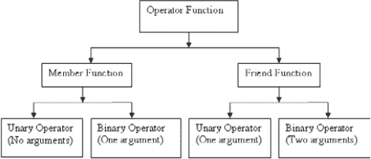

▲ **图3：显示运算符函数及这些函数所接受的参数数量**

由于this指针的存在，这两类函数（成员函数和友元函数）的参数数量是不同的。用于调用成员函数的对象是隐式传递的（通过this指针），因此成员函数可以直接使用该对象。然而，友元函数的情况并非如此，因为它不是类声明的一部分。

表1描述了将一元运算符和二元运算符重载为类的成员函数或友元函数的语法：

| 语法 | 描述 |
|---|---|
| `ClassName operator −();` | 将一元运算符重载为类的成员函数 |
| `ClassName operator +( ClassName);` | 将一元运算符重载为类的友元函数 |
| `friend ClassName operator −( ClassName);` | 将二元运算符重载为类的成员函数 |
| `friend ClassName operator +( ClassName, ClassName);` | 将二元运算符重载为类的友元函数 |

请注意，虽然运算符重载增强了运算符的功能，但并不会改变其语法。重载运算符时必须遵循以下限制：

- 无法改变运算符的执行优先级
- 无法创建新的运算符
- 无法改变操作数的数量

表2描述了不能重载的运算符：

**表2：不能重载的运算符**

| **运算符** | **描述** |
|---|---|
| `.` | 直接成员选择运算符 |
| `.*` | 解引用指向类成员的指针运算符 |
| `?:` | 条件运算符 |
| `::` | 作用域解析运算符 |
| `sizeof` | sizeof 运算符 |

表3列出了不应重载的运算符，因为它们会破坏内置运算符的含义：

**表3：不应重载的运算符**

| **运算符** | **描述** |
|---|---|
| `&&` | 逻辑与运算符 |
| `\|\|` | 逻辑或运算符 |
| `,` | 逗号运算符 |

执行运算符重载时必须遵循的一些要点如下：

- 只能重载现有的运算符。
- 重载的运算符必须至少有一个操作数是用户定义类型。
- 不能改变运算符的含义。也就是说，不能将加法运算符（`+`）重新定义为用一个值减去另一个值。
- 重载运算符必须遵循原始运算符的语法规则，这些规则不能被覆盖。
- 不能使用友元函数重载某些运算符。表4列出了不能使用友元函数重载的运算符：

**表4：不能使用友元函数重载的运算符**

| **运算符** | **描述** |
|---|---|
| `=` | 赋值运算符 |
| `()` | 函数调用运算符 |
| `[]` | 下标运算符 |
| `->` | 类成员访问运算符 |

让我们使用operator关键字执行以下任务：

- 一元运算符的重载
- 递增（`++`）运算符的重载
- 返回对象的一元运算符的重载
- 二元运算符的重载
- 将对象与内置数据类型相加
- 关系运算符的重载
- 使用类型运算符进行类型转换

## 一元运算符的重载

运算符函数不带显式参数的重载称为一元运算符重载。清单41演示了减号（-）运算符的重载（你可以在随书CD的code\chapter6文件夹中的UnaryOperator.cpp文件中找到此示例）：

### 清单41：将减号（-）运算符重载为成员函数

```cpp
#include<iostream.h>

class NegativeNumberShow
{
  int num1,num2;
public:
  void operator -();
  NegativeNumberShow(int,int);
  void disp();
};
void NegativeNumberShow::operator -()
{
  num1=-num1;
  num2=-num2;
}
NegativeNumberShow::NegativeNumberShow(int i,int j)
{
  num1=i;
  num2=j;
}
void NegativeNumberShow::disp()
{
  cout<<"The value of 'num1' is :"<<num1<<endl;
  cout<<"The value of 'num2' is :"<<num2<<endl;
}

int main()
{
  NegativeNumberShow n(2,27);
  n.disp();
  -n;
  n.disp();
  return 0;
}
```

```text
Output:

The value of 'num1' is :2
The value of 'num2' is :27
The value of 'num1' is :-2
The value of 'num2' is :-27
```

在清单41中，运算符函数是NegativeNumberShow类的成员函数，且没有参数。减号（-）运算符通过以下代码片段进行重载：

```cpp
void operator -();
```

上述代码片段在NegativeNumberShow类中创建了运算符函数-()的原型。请注意operator关键字的使用。运算符函数在类外部使用::运算符进行定义，如下面的代码片段所示：

```cpp
void NegativeNumberShow::operator -()
{
    num1=-num1;
    num2=-num2;
}
```

以下代码片段中的语句调用了该运算符函数：

```cpp
NegativeNumberShow n(2,27);
-n;
...
```

在上述代码片段中，C++编译器将 `-n;` 表达式理解为 `n.operator -();` 表达式。

然而，对于友元函数，一元运算符接受一个引用参数（相关类的对象）。清单42演示了减号（-）运算符的重载，其中运算符函数是带有一个参数的友元函数（你可以在随书CD的code\chapter6文件夹中的UnaryFriendOperator.cpp文件中找到此示例）：

### 清单42：将减号（-）运算符重载为友元函数

```cpp
#include<iostream.h>
class NegativeNumberShow
{
    int num1,num2;
public:
    NegativeNumberShow (){}
    NegativeNumberShow (int i,int j)
    {
        num1=i;
        num2=j;
    }
    friend void operator -(NegativeNumberShow &n);
    void disp()
    {
      cout<<"The value of 'num1' is :"<<num1<<endl;
      cout<<"The value of 'num2' is :"<<num2<<endl;
    }
};
void operator -(NegativeNumberShow &n)
{
  n.num1=-n.num1;
  n.num2=-n.num2;
}
int main()
{
  NegativeNumberShow n(2,27);
  n.disp();
  -n;
  n.disp();
  return 0;
}
```

Output:

```text
The value of 'num1' is :2
The value of 'num2' is :27
The value of 'num1' is :-2
The value of 'num2' is :-27
```

在清单42中，请考虑以下代码片段：

```cpp
friend void operator -(NegativeNumberShow &n);
```

上述代码片段在NegativeNumberShow类中创建了友元运算符函数-()的原型。该函数接受一个类类型参数，即NegativeNumberShow，并且前面带有operator和friend关键字。

友元运算符函数在类外部定义，如下面的代码片段所示：

```cpp
void operator -(NegativeNumberShow &n)
{
  n.num1=-n.num1;
  n.num2=-n.num2;
}
```

以下代码片段调用了友元运算符函数：

```cpp
NegativeNumberShow n(2,27);
…

-n;
…
```

在上述代码片段中，编译器将 `-n;` 解析为 `operator -(n)`：

### 测试你的知识

Q6. 创建一个程序，演示将--运算符重载为友元函数。
答案：

```cpp
#include <iostream.h>

class UnaryFriendoverload {
public:
    int x, y;
    UnaryFriendoverload() {
        x=0;
        y=0;
    }
    UnaryFriendoverload(int i, int j) {
        x=i;
        y=j;
    }
    friend UnaryFriendoverload operator--(UnaryFriendoverload &ob);
    friend UnaryFriendoverload operator--(UnaryFriendoverload &ob, int notuse);
};

UnaryFriendoverload operator--(UnaryFriendoverload &ob)
{
    ob.x--;
    ob.y--;
    return ob;
}

UnaryFriendoverload operator--(UnaryFriendoverload &ob, int)
{
    ob.x--;
    ob.y--;
    return ob;
}
int main()
{
    UnaryFriendoverload obj(10, 10);
```


```cpp
--obj;
cout << "(--obj1) x: " << obj.x << ", y: " << obj.y << endl;
obj--;
cout << "(obj--) x: " << obj.x << ", y: " << obj.y << endl;
return 0;
}
```

**输出：**

`(--object1) x: 9, y: 9`
`(object1--) x: 8, y: 8`

**Q7.** 编写一个程序来重载逗号（,）运算符。

**答案：**

```cpp
#include <iostream.h>

class Distance {
    int length1, length2;
public:
    Distance() {}

    Distance(int lg, int lt) {
        length1 = lg;
        length2 = lt;
    }

    void show() {
        cout << length1 << " ";
        cout << length2 << endl;
    }

    Distance operator+(Distance op2);
    Distance operator,(Distance op2);
};

Distance Distance::operator,(Distance op2)
{
    Distance temp;

    temp.length1 = op2.length1;

    temp.length2 = op2.length2;

    cout << op2.length1 << " " << op2.length2 << endl;

    return temp;
}

Distance Distance::operator+(Distance op2)
{
    Distance temp;

    temp.length1 = op2.length1 + length1;

    temp.length2 = op2.length2 + length2;

    return temp;
}

int main()
{
    Distance object1(10, 20),
    object2(5,55),
    object3(100,200);

    object1.show();
    object2.show();

    object3.show();

    cout << endl;

    object2 = (object1, object2,object1+object3);

    object2.show();
    return 0;
}
```

**输出：**

```text
10 20
5 55
100 200

5 55
110 220
110 220
```

## 重载自增（++）运算符

当自增（++）运算符与内置数据类型一起使用时，前缀表示法（例如 ++x）会使变量（x）在表达式中使用之前先自增。而后缀表示法（例如 x++）会使值在表达式中使用之后再自增。

重载的自增运算符有两个版本。第一个版本不接受参数，当编译器对类对象调用自增运算符的前缀表示法时被调用。而第二个版本接受一个 int 类型的参数，当编译器对类对象调用自增运算符的后缀表示法时被调用。清单43展示了 PrePostIncrement 类中自增（++）运算符的重载（你可以在代码\chapter6文件夹下光盘中的 IncrementOverload.cpp 文件中找到此示例）：

### 清单43：重载自增（++）运算符

```cpp
#include<iostream.h>

class PrePostIncrement
{
    int i;
public:
    PrePostIncrement(int j)             //Constructor with integer parameters
    {
        i=j;
    }
    void operator ++()                  //prefix increment overloading
    {
        ++i;
        cout<<"Incremented value of 'i' by prefix overloaded function : "<<i<<endl;
    }
    void operator ++(int p)             //postfix increment overloading
    {
        i++;
        cout<<"Incremented value of 'i' by postfix overloaded function : "<<i<<endl;
    }
};

void main()
{
    PrePostIncrement pp(8);
    pp++;                               //post increment
    ++pp;                               //pre increment
}
```

**输出：**

```text
Incremented value of 'i' by postfix overloaded function : 9
Incremented value of 'i' by prefix overloaded function : 10
```

在清单43中，当编译器遇到 ++pp 语句时，会调用 void operator ++() 函数；而当遇到 pp++ 语句时，会调用 void operator ++(int p) 函数。函数 void operator ++() 在对象中执行前置自增，函数 void operator ++(int p) 在对象中执行后置自增。

> 所有后缀一元运算符都接受一个哑元整数作为其参数。

## 测试你的知识

**Q8.** 创建一个名为 FLOAT 的类，其中包含一个数据成员。重载前置自增和前置自减运算符，使它们能够对 FLOAT 类的对象进行操作。

**答案：**

```cpp
#include<iostream.h>

class FLOAT
{
    private:
        float data1,data2;
    public:
        FLOAT():data1(0.0f), data2(0.0f)
        {}
        void get_data()
        {
            cout<<"Enter a number\n";
            cin>>data1>>data2;
        }
        void operator++()
        {
            ++data1;
            ++data2;
        }
        void operator--()
        {
            --data1;
            --data2;
        }
        void show_data()
        {
            cout<<data1<<endl;
            cout<<data2<<endl;
        }
};
void main()
{
    FLOAT f;
    f.get_data();
    cout<<"Before increment"<<endl;
    f.show_data();
    ++f;
    cout<<"After increment"<<endl;
    f.show_data();
    cout<<"Before decrement"<<endl;
    f.show_data();
    --f;
    cout<<"After decrement"<<endl;
    f.show_data();
}
```

**输出：**

```text
Enter a number
58
23
Before increment
58
23
After increment
59
24
Before decrement
59
24
After decrement
58
23
```

## 返回对象的单目运算符的重载

你可以重载一个返回类对象的运算符。这意味着你可以在类的 main() 函数中使用以下代码片段：

```cpp
Object1--Object2;
```

清单44展示了返回对象的减号运算符的重载（你可以在代码\chapter6文件夹下光盘中的 UnaryOptReturnObject.cpp 文件中找到此示例）：

### 清单44：重载返回对象的单目运算符

```cpp
#include<iostream.h>
class NegativeNumberShow
{
    int num1,num2;
public:
    NegativeNumberShow (){}
    NegativeNumberShow (int i,int j)
    {
        num1=i;
        num2=j;
    }
    friend NegativeNumberShow operator -(NegativeNumberShow);
    void disp()
    {
        cout<<"The value of 'num1' is :"<<num1<<endl;
        cout<<"The value of 'num2' is :"<<num2<<endl;
    }
};
NegativeNumberShow operator -(NegativeNumberShow n)
{
    NegativeNumberShow tmp;
    tmp.num1=-n.num1;
    tmp.num2=-n.num2;
    return tmp;
}
int main()
{
    NegativeNumberShow n1(10,200),n2;
    cout<<"Before calling of unary minus operator"<<endl;
    n1.disp();
    cout<<"Indirect calling of unary minus operator"<<endl;
    n2=-n1;
    n2.disp();
    cout<<"Direct calling of unary minus operator"<<endl;
    n2=operator -(n2);
    n2.disp();
    return 0;
}
```

**输出：**

```text
Before calling of unary minus operator
The value of 'num1' is :10
The value of 'num2' is :200
Indirect calling of unary minus operator
The value of 'num1' is :-10
The value of 'num2' is :-200
Direct calling of unary minus operator
The value of 'num1' is :10
The value of 'num2' is :200
```

在清单44中，NegativeNumberShow 是一个类，它有一个 NegativeNumberShow 类型的友元运算符函数。该运算符函数的原型在 NegativeNumberShow 类中声明，如下面的代码片段所示：

```cpp
friend NegativeNumberShow operator -(NegativeNumberShow);
```

注意，传递给运算符函数的参数是 NegativeNumberShow，而不是 NegativeNumberShow &。这是因为该运算符函数使用作为参数传递的对象的值来生成或返回一个新创建的对象。因此，以下代码片段将 n1 对象的所有负值赋给 n2 对象：

```cpp
n2=-n1;
```

然而，在前面的代码片段中，存储在 n1 对象中的值不会受到影响。此外，以下代码片段会重新为 n2 对象赋值：

```cpp
n2=operator -(n2);
```

## 二元运算符的重载

运算符重载的概念也适用于二元运算符。二元运算符处理两个操作数。为了理解二元运算符的重载，可以将它们分类如下：

- 算术运算符，如 `+ - * / %`
- 关系运算符，如 `< > <= >= != ==`
- 赋值运算符 `=`
- 算术赋值运算符，如 `+= -= *= /= %=`
- 插入和提取运算符 `<< >>`
- 下标运算符 `[]`
- 函数调用运算符 `()`
- 类成员访问运算符 `->`

重载二元运算符与重载一元运算符类似，不同之处在于二元运算符需要一个额外的参数。清单45展示了在类中作为成员函数重载加法运算符（+）（你可以在代码\chapter6文件夹下光盘中的 AdditionOperatorOverload.cpp 文件中找到此示例）：

### 清单45：作为成员函数重载加法运算符（+）

```cpp
#include<iostream.h>

class Distance
{
    int i;
public:
```


```cpp
Distance(int a=0)
{
    i=a;
}

Distance operator +(Distance &o2)
{
    int j=i+o2.i;
    return Distance(j);
}

void display()
{
    cout<<i<<endl;
}
};

void main()
{
    Distance length1(20), length2(100), length3;
    length3=length1+length2;
    cout<<"the length in first object: ";
    length1.display();
    cout<<"the length in second object: ";
    length2.display();
    cout<<"the length in third object: ";
    length3.display();
}
```

**输出：**

```text
The length in first object: 20
The length in second object: 100
The length in third object: 120
```

运算符函数 Distance operator +(Distance &o2) 接受一个类类型引用的参数。当编译器遇到以下代码片段时，会调用该函数：

`length3 = length1+length2;`

编译器将前面的代码片段视为与以下代码片段相同：

`length3 = length1.operator+(length2);`

在前面的代码片段中，length1 对象产生对运算符函数的调用，并将 length2 操作数传递给该函数。该函数按定义执行操作，并将结果作为对象返回，该对象被赋给 length3 对象。因此，用于重载二元运算符的运算符函数只接受一个参数。

清单 46 展示了将加法（+）和减法（-）运算符重载为类的成员函数（你可以在 CD 的 code\\chapter6 文件夹中的 BinaryOperatorOverloading.cpp 文件里找到此示例）：

## ▶ 清单 46：将加法（+）和减法（-）运算符重载为成员函数

```cpp
#include<iostream.h>

class Time
{
    private:
    int hours,minutes;
    public:
    Time( )
    {
        hours=0;
        minutes=0;
    }
    Time(int x,int y) {

        hours=x;
        minutes=y;
    }
    void display( )
    {

        cout<<hours<<"hours and "<<minutes <<" minutes.";

    }
    Time operator + (Time);
    Time operator - (Time);

};

Time Time::operator + (Time y)
{

    int h = hours + y.hours;
    int m = minutes + y.minutes;
    while (m>=60)
    {

        m = m-60;
        h = h+ 1;
    }
    return Time(h,m);
}
Time Time::operator - (Time z)
{
    int h = hours - z.hours;
    int m = minutes - z.minutes;
    while (m>=60)
    {
        m = m-60;
        h = h+ 1;
    }
    return Time(h,m);
}
int main( )
{
    Time t1(5,50);
    Time t2(2,34);
    Time t3;
    t3 = t1 + t2;
    t3.display( );
    cout<<endl;
    t3 = t1 - t2;
    t3.display( );
    cout<<endl;
    return 0;
}
```

### 输出：

```text
8hours and 24 minutes.
3hours and 16 minutes.
```

t1 和 t2 对象的 hours 和 minutes 值通过构造函数初始化。然后编译器读取以下代码片段：

```cpp
t3 = t1 + t2;
```

加法（+）运算符作用于两个操作数 t1 和 t2。然而，该运算符函数只有一个参数。这意味着只传递了其中一个值；也就是说，只传递了一个对象。现在的问题是，在这两个对象（t1 和 t2）中，我们如何知道传递的是哪一个？

```cpp
}
friend Time operator + (Time, Time);
};

Time operator + (Time y, Time z)
{
    int h = y.hours + z.hours;
    int m = y.minutes + z.minutes;
    while (m>=60)
    {
        m = m-60;
        h = h + 1;
    }
    return Time(h,m);
}
int main( )
{
    Time t1(5,50);
    Time t2(2,34);
    Time t3;
    t3 = t1 + t2;
    t3.display( );
    return 0;
}
```

**输出：**

```text
8 hours and 24 minutes
```


> + 运算符左侧的操作数作为第一个参数传递，而右侧的操作数作为第二个参数传递。
> 
> t3 = t1 + t2;
> 
> Time operator + (Time y, Time z)

## 测试你的知识

- Q9. 创建一个类 FLOAT，其中包含一个数据成员。重载所有四种算术运算（+、-、* 和 /），使它们能够作用于 FLOAT 类的对象。

答案。

```cpp
#include<iostream.h>

class FLOAT
{
    public:
        float data;

        FLOAT()
        {
            data=0.0;
        }

        FLOAT(float num)
        {
            data=num;
        }

        FLOAT operator+(FLOAT a)
        {
            a=data+a.data;
            return a;
        }

        FLOAT operator-(FLOAT b)
        {
            b=data-b.data;
            return b;
        }

        FLOAT operator *(FLOAT c)
        {
            c=data*c.data;
            return c;
        }

        FLOAT operator /(FLOAT d)
        {
            d=data/d.data;
            return d;
        }

        void show_data()
        {
            cout<<data<<endl;
        }
};
void main()
{
    FLOAT f1(30.0f), f2(10.0f), f3;
    cout<<"The addition of two objects"<<endl;
        f3=f1+f2;
    f3.show_data();
    cout<<"The subtraction of two objects"<<endl;
        f3=f1-f2;
    f3.show_data();
    cout<<"The product of two objects"<<endl;
        f3=f1*f2;
        f3.show_data();
        cout<<"The division of two objects"<<endl;
        f3=f1/f2;
        f3.show_data();
    }
```

输出：

```text
The addition of two objects
40
The subtraction of two objects
20
The product of two objects
300
The division of two objects
3
```

- Q10. 编写一个程序，重载一元减（-）运算符以及二元减（-）运算符。

答案。

```cpp
#include <iostream.h>

class MinusOperatorOverload {
    int x, y;
public:
    MinusOperatorOverload() {
        x=0;
        y=0;
    }
    MinusOperatorOverload(int i, int j) {
        x=i;
        y=j;
    }
    void getXY(int &i, int &j) {
        i=x;
        j=y;
    }
    MinusOperatorOverload operator-(MinusOperatorOverload object2);
    /* overloading of binary minus */
    MinusOperatorOverload operator-();    /* overloading of unary
    minus */
};

/* Overload - relative to MyClass class */
MinusOperatorOverload MinusOperatorOverload::operator-(MinusOperatorOverload object2)
{
    MinusOperatorOverload temp;
    temp.x = x - object2.x;
    temp.y = y - object2.y;
    return temp;
}

/* Overload unary - for MinusOperatorOverload class */
MinusOperatorOverload MinusOperatorOverload::operator-()
{
    x = -x;
    y = -y;
    return *this;
}

int main()
{
    MinusOperatorOverload object1(20, 30), object2(5, 7);
    int x, y;
    object1 = object1 - object2;             // subtraction
    object1.getXY(x, y);
    cout << "(object1-object2) x: " << x << ", y: " << y << endl;

    object1 = -object1;                      // negation
    object1.getXY(x, y);
    cout << "(-object1) x: " << x << ", y: " << y << endl;
    return 0;
}
```

**输出：**

```text
(object1-object2) x: 15, y: 23
(-object1) x: -15, y: -23
```

- Q11. 编写一个程序，重载加法（+）、减法（-）和赋值（=）运算符。

答案。

```cpp
#include <iostream.h>

class BinaryOperatorsOverload {
    int x, y;
public:
    BinaryOperatorsOverload() {
        x=0;
        y=0;
    }
    BinaryOperatorsOverload(int i, int j) {
        x=i;
        y=j;
    }
    void getXY(int &i, int &j) {
        i=x;
        j=y;
    }
    BinaryOperatorsOverload operator+(BinaryOperatorsOverload object2);
    BinaryOperatorsOverload operator-(BinaryOperatorsOverload object2);
    BinaryOperatorsOverload operator=(BinaryOperatorsOverload object2);
};

// Overload + operator
BinaryOperatorsOverload BinaryOperatorsOverload::operator+(BinaryOperatorsOverload object2)
{
    BinaryOperatorsOverload temp;
    temp.x = x + object2.x;
    temp.y = y + object2.y;
    return temp;
}
// Overload - operator
BinaryOperatorsOverload BinaryOperatorsOverload::operator-(BinaryOperatorsOverload object2)
{
    BinaryOperatorsOverload temp;
    temp.x = x - object2.x;
    temp.y = y - object2.y;
    return temp;
}

// Overload = operator
BinaryOperatorsOverload BinaryOperatorsOverload::operator=(BinaryOperatorsOverload object2)
{
    x = object2.x;
    y = object2.y;
    return *this;                 /* return the object that is
    assigned */
}

int main()
{
    BinaryOperatorsOverload object1(20, 30), object2(5, 3), object3;
    int x, y;
}
```


```cpp
object3 = object1 + object2;  /* addition of two objects, calls
operator+() */
object3.getxy(x, y);
cout << "(Object1+object2) x: " << x << ", y: " << y << endl;

object3 = object1 - object2;  /* difference of two objects, calls
operator-() */
object3.getxy(x, y);
cout << "(Object1-object2) x: " << x << ", y: " << y << endl;
object3 = object1;  /* assign an object with another object,
calls operator=() */
object3.getxy(x, y);
cout << "(Object3=object1) x: " << x << ", y: " << y << endl;
return 0;
}
```

**输出：**

```text
(Object1+object2) x: 25, y: 33
(Object1-object2) x: 15, y: 27
(Object3=object1) x: 20, y: 30
```

- **Q12.** 编写一个程序来重载圆括号 () 运算符。

**答案。**

```cpp
#include <iostream.h>

class OverloadedParenthesis {
    int x, y, z;
public:
    OverloadedParenthesis(int i, int j, int k) {
        x = i;
        y = j;
        z = k;
    }
    OverloadedParenthesis()
    {
        x=y=z=0;
    }
    OverloadedParenthesis operator()(int a, int b, int c);
    void display();
};

OverloadedParenthesis OverloadedParenthesis::operator()(int a, int b, int c)
{
    OverloadedParenthesis temp;
    temp.x = x + a;
    temp.y = y + b;
    temp.z = z + c;
    return temp;
}

void OverloadedParenthesis::display()
{
    cout << x << ", ";
    cout << y << ", ";
    cout << z << endl;
}

int main()
{
    OverloadedParenthesis object1(10, 20, 30), object2, object3(5,15,55);

    object2 = object3(2,22,200);
    cout << "object1: ";
    object1.display();

    cout << "object2: ";
    object2.display();
    cout << "object3: ";
    object3.display();
    return 0;
}
```

**输出：**

```text
object1: 10, 20, 30
object2: 7, 37, 255
object3: 5, 15, 55
```

## 将对象与内置数据类型相加

你已了解到，可以在类内重载二元运算符，以将同一类的两个对象相加。现在我们来学习如何使用二元运算符将一个对象与一个整数（一种基本数据类型）相加。代码清单 48 展示了对象与内置数据类型的相加（可以在光盘的 code\chapter6 文件夹中的 Addition_Object_BuiltIn.cpp 文件中找到此示例）：

### 代码清单 48：将对象与内置数据类型相加

```cpp
#include<iostream.h>

class objectValueTest
{
    int i;
public:

    objectValueTest():i(100)
    {
    }
    objectValueTest(int t):i(t)
    {
    }

    int display()
    {
        return i;
    }
    objectValueTest& operator+(int j)
    {
        i=i+j;
        return *this;
    }
};

void main()
{
    objectValueTest obj1,obj2(10),obj3(20);
    cout<<"The initial value in first object: "<<obj1.display()<<endl;
    cout<<"The initial value in second object: "<<obj2.display()<<endl;
    cout<<"The initial value in third object: "<<obj3.display()<<endl;
    obj1+1000;
    cout<<"The final value in first object: "<<obj1.display()<<endl;
    cout<<"The final value in second object: "<<obj2.display()<<endl;
    cout<<"The final value in third object: "<<obj3.display()<<endl;
}
```

**输出：**

```text
The initial value in first object: 100
The initial value in second object: 10
The initial value in third object: 20
The final value in first object: 1100
The final value in second object: 10
The final value in third object: 20
```

在代码清单 48 中，当编译器遇到以下代码片段时，会调用 operator+(int j) 成员函数：

```cpp
obj1+1000;
```

operator+(int j) 函数有一个整数类型的参数，即 j，值 1000 会按值传递给它。但是，当你将前面的代码片段写成以下代码片段时，就会出现问题：

```cpp
1000+obj1;
```

在前面的代码片段中，operator+() 成员函数不会被调用。这是因为运算符左侧的对象会调用重载的成员函数。operator+() 函数是类的成员函数，并且会向它传递 this 指针。解决此问题的方法是使用友元函数。在友元函数中，不会传递 this 指针（因为它们不是类的成员）。因此，通过使用友元函数，在重载运算符时可以按任意顺序指定参数顺序。代码清单 49 展示了使用友元函数将对象与内置数据类型相加（可以在光盘的 code\chapter6 文件夹中的 Object_BuiltIn_FriendAddition.cpp 文件中找到此示例）：

### 代码清单 49：使用友元函数将对象与内置数据类型相加

```cpp
#include<iostream.h>

class ObjectValueTest
{
    int i;
public:

    ObjectValueTest():i(100)
    {
    }
    ObjectValueTest(int t):i(t)
    {
    }

    int display()
    {
        return i;
    }
    friend ObjectValueTest& operator+(int, ObjectValueTest&);
    friend ObjectValueTest& operator+(ObjectValueTest&, int);
};

ObjectValueTest& operator+(int j, ObjectValueTest& x)
{
    x.i=x.i+j;
    return x;
}

ObjectValueTest& operator+(ObjectValueTest& y, int k)
{
    y.i=y.i+k;
    return y;
}

void main()
{
    ObjectValueTest obj1,obj2(10),obj3(20);
    cout<<"The initial value in first object: "<<obj1.display()<<endl;
    cout<<"The initial value in second object: "<<obj2.display()<<endl;
    cout<<"The initial value in third object: "<<obj3.display()<<endl;
    1000+obj1;
    obj1+1000;
    cout<<"The final value in first object: "<<obj1.display()<<endl;
    cout<<"The final value in second object: "<<obj2.display()<<endl;
    cout<<"The final value in third object: "<<obj3.display()<<endl;
}
```

**输出：**

```text
The initial value in first object: 100
The initial value in second object: 10
The initial value in third object: 20
The final value in first object: 2100
The final value in second object: 10
The final value in third object: 20
```

代码清单 49 使用两个友元函数重载 + 运算符，使得 + 运算符的两侧都可以是整数值并进行运算。

## 关系运算符的重载

关系运算符是二元运算符，需要两个操作数进行比较。关系运算的结果是布尔值，可以为 true 或 false。重载关系运算符 <、>、<=、>=、== 和 != 需要与重载二元算术运算符类似的技术。重载关系运算符同样接受其右侧的对象作为参数，而左侧的对象通过 this 指针传递。代码清单 50 使用 > 运算符比较一个类的两个对象中存储的 length 值（可以在光盘的 code\chapter6 文件夹中的 GreaterThanOperatorOverload.cpp 文件中找到此示例）：

### 代码清单 50：重载大于（>）运算符

```cpp
#include<iostream.h>

class Distance
{
    int length;
public:
    Distance(int);
    void operator>(Distance);
};

Distance::Distance(int a)
{
    length=a;
}

void Distance::operator>(Distance d)
{
    if (length>d.length)
    {
        cout<<length<<" is greater than "<<d.length;
    }
    else
    {
        cout<<length<<" is not greater than "<<d.length;
    }
}

int main()
{
    Distance d1(20);
    Distance d2(30);
    d1>d2;
    return 0;
}
```

**输出：**

```text
20 is not greater than 30
```

在学习了如何使用 +、- 等简单运算符以及 > 等关系运算符来重载二元运算符之后。

## 测试你的知识

- **Q13.** 编写一个程序来重载关系运算符（==、<、>=）。

**答案。**

```cpp
#include <iostream.h>

class Distance {
    int x, y;
public:
    Distance() {
        x=0;
        y=0;
    }
    Distance(int i, int j) {
        x=i;
        y=j;
    }
    void getXY(int &i, int &j) {
        i=x;
```

现在我们来学习如何将对象转换为内置数据类型。

## 使用类型运算符进行类型转换

在 C++ 中，还可以重载数据类型，例如 int、float。数据类型的重载也称为类型运算符的重载。以下语法用于重载类型运算符：

```cpp
className::operator typename ()
{
    ...
    ...
}
```

重载类型运算符的运算符函数的返回类型与该类型运算符相同。代码清单 51 展示了使用类型运算符进行类型转换的示例（可以在光盘的 code\chapter6 文件夹中的 TypeConversion.cpp 文件中找到此示例）：

### 代码清单 51：重载类型运算符

```cpp
#include<iostream.h>

class TypeConverter
{
    int num, total, percentage;
public:
    TypeConverter(int, int);
    operator int()
    {
        percentage = num * 100 / total;
        return percentage;
    }
};

TypeConverter::TypeConverter(int n, int t)
{
    num = n;
    total = t;
    percentage = 0;
}

int main()
{
    TypeConverter tcv(45, 500);
    cout<<"The result of the 'operator int()' type operator is: ";
    cout<<tcv.operator int()<<"\n";
    return 0;
}
```


- **Q7.** 构造函数是一种特殊的成员函数，它为其类的对象分配内存并初始化这些对象。正确
- **Q8.** 具有对其子类对象引用的构造函数称为复制构造函数。错误
- **Q9.** 使用动态构造函数时，当对象大小不同时，系统会为每个对象分配适量的内存。正确
- **Q10.** 在类中定义析构函数时，波浪号（~）的使用是可选的。错误
- **Q11.** 析构函数可以重载，因为它们接受参数。错误
- **Q12.** 全局对象在main()函数开始执行之前创建，并在main()函数执行之后销毁。正确
- **Q13.** 在另一个类的声明内部声明的类称为局部类。错误
- **Q14.** this指针不能从成员函数返回值。错误
- **Q15.** 非成员函数只有在作为类的友元时才能访问该类的私有数据。正确
- **Q16.** 静态函数可以使用类的非静态数据成员。错误
- **Q17.** 静态变量通过使用作用域解析运算符（::）在类定义外部初始化。正确
- **Q18.** 在函数重载中，当有多个同名函数时，编译器根据传递给函数的参数来识别函数。正确
- **Q19.** 重载运算符时，operator关键字是可选的。错误
- **Q20.** 使用运算符重载，可以创建新的运算符。错误

## 多项选择题

回答以下多项选择题：

- **Q1.** 以下哪项不是OOP的特性？
  - A. 继承
  - B. 抽象
  - C. 分支语句
  - D. 消息传递
  答案：选项C正确。

- **Q2.** 以下哪项不是对象的特征？
  - A. 对象具有状态
  - B. 对象可能显示行为，也可能不显示行为
  - C. 对象具有唯一标识
  - D. 对象不能与另一个对象通信
  答案：选项D正确。

- **Q3.** 以下哪项不是对象的抽象特征？
  - A. 对象名称
  - B. 特性
  - C. 行为
  - D. 属性
  答案：选项A正确。

- **Q4.** 在不包含背景细节或解释的情况下，对对象基本特征的表示称为__
  - A. 封装
  - B. 抽象
  - C. 多态
  - D. 继承
  答案：选项B正确。

- **Q5.** 以下哪项是有效的类名？
  - A. 3Number
  - B. send@mail
  - C. Account_
  - D. operator
  答案：选项C正确。

- **Q6.** 以下哪项不是C++编程中的访问说明符？
  - A. private
  - B. public
  - C. protected
  - D. pointer
  答案：选项D正确。

- **Q7.** 以下哪项不是将内联函数视为普通函数的有效情况？
  - A. 当内联函数不是递归函数时
  - B. 当内联函数包含静态变量时
  - C. 当内联函数包含return语句且函数的返回类型为void时
  - D. 当内联函数包含返回值的循环结构、switch语句或goto语句时
  答案：选项A正确。

- **Q8.** 以下哪项不是构造函数的特征？
  - A. 构造函数是函数，但其名称必须与其类名相同。
  - B. 构造函数没有返回类型，因此不能返回值。
  - C. 构造函数可以重载。
  - D. 构造函数在需要内存分配时要求显式调用new和delete运算符。
  答案：选项D正确。

- **Q9.** 以下关于析构函数的说法哪项不正确？
  - A. 如果不需要某个对象，析构函数用于销毁该对象。
  - B. 析构函数的名称与类名相同。
  - C. 析构函数不能被显式调用。
  - D. 析构函数的名称必须以波浪号（~）为前缀。
  答案：选项C正确。

- **Q10.** 以下哪项不是析构函数的特征？
  - A. 析构函数在类声明中应具有public访问权限
  - B. 析构函数可以返回值
  - C. 析构函数可以是虚函数
  - D. 析构函数不接受参数，因此不能被重载
  答案：选项B正确。

- **Q11.** 以下关于友元函数的说法哪项不正确？
  - A. 友元函数可以像其他普通函数一样，在没有对象帮助的情况下被调用。
  - B. 友元函数不能访问类的私有数据成员。
  - C. 友元函数可以将对象作为参数。
  - D. 友元函数是类的非成员，因此没有this指针。
  答案：选项B正确。

- **Q12.** 以下哪项不是函数签名的一部分？
  - A. 函数的返回类型
  - B. 函数参数的个数
  - C. 参数的数据类型
  - D. 参数数据类型的顺序
  答案：选项A正确。

- **Q13.** 以下关于运算符重载的说法哪项不正确？
  - A. 不可能改变运算符的执行优先级
  - B. 不可能创建新的运算符
  - C. 不可能改变操作数的个数
  - D. 不可能改变运算符执行的操作
  答案：选项D正确。

- **Q14.** 以下哪些运算符不能重载？
  - A. + 和 - 运算符
  - B. :: 和 ?: 运算符
  - C. ++ 和 -- 运算符
  - D. new 和 delete 运算符
  答案：选项B正确。

- **Q15.** 以下哪些运算符不能使用友元函数重载？
  - A. = 运算符
  - B. () 运算符
  - C. new 运算符
  - D. -> 运算符
  答案：选项C正确。

## 简答题

### Q1. 定义OOP。

答案：OOP是一种使用对象来设计应用程序和计算机程序的编程模型。该编程模型基于四个基本支柱，即抽象、封装、继承和多态。对象是数据和作用于此数据的过程（指令序列）的组合。在OOP中，具有共同属性、操作和行为的一组对象称为类。为以前的应用程序开发的类可以被重用，从而可以更快地开发新应用程序，并提高设计的可靠性和一致性。OOP语言围绕内置数据类型和用户自定义数据类型来设计程序。您可以定义数据类型和数据类型层次结构，从而可以描述任何真实实体，例如应用程序中的狗、王国、学生。

### Q2. OOP的基本概念有哪些？

答案：面向对象编程（OOP）是一种计算机程序（软件）设计的模块化方法。OOP中包含以下基本概念：

- 对象：表示类的一个模式（实例），例如，Maruti Zen和Tata Indica是对象，而汽车是它们的类。
- 类：定义对象的抽象特征，例如属性、字段或特性，以及对象的行为。
- 实例：表示一个类的对象，例如，三角形、四边形、五边形和六边形是多边形类的实例。
- 方法：表示对象执行任务的能力。
- 消息传递：表示两个或多个对象之间通过发送和接收消息进行交互。
- 抽象：表示对象的基本特征，而不包含背景细节或解释。
- 封装：指OOP的一种特性，防止访问类的非必要细节。它也被称为数据隐藏，因为它对用户隐藏了对象或类的重要但不必要的细节。
- **继承：** 指允许一个类从另一个类继承属性的机制。
- **多态：** 指对象以不同形式存在的能力。

### Q3. 通过一些示例解释对象。

答案：对象是类的一个模式（实例）。例如，Maruti Zen和Tata Indica是汽车类的对象。对象既代表现实世界实体，也代表编程实体。教授、医生和学生是现实世界实体的例子；而计算机的硬件和软件组件、常量、变量是编程实体的例子。对象具有以下三个主要特征：

- 它具有状态
- 它可能显示行为，也可能不显示行为
- 它具有唯一标识

### Q4. 什么是OOP中的消息传递？

答案：在OOP中，程序由一组对象组成，这些对象通过发送和接收消息相互通信。消息是对象发送的请求，用于执行一个过程，并调用接收对象中生成结果的过程。消息传递通过指定对象名称、函数（或称为消息）名称以及要发送的信息来实现。只要对象存在，对象之间的通信就可能实现。

### Q5. 在OOP中，封装与抽象有何不同？

答案：封装是OOP的一种特性，可防止访问类的非必要细节。例如，当您打开电视机时，它会以音频和视频的形式显示正在播放的节目。您无法看到电视机实际复杂的处理过程，例如电缆中的信号如何转换为音频和视频。

另一方面，抽象是对对象基本特征的表示，而不包含背景细节或解释。您无法处理对象的复杂性，因此通常会忽略对象的非必要细节，而只关注那些对理解或需求至关重要的细节。例如，如果您想购买电视，通常会关注尺寸、易操作性、颜色、保证和保修；但是，您不会对其内部的机件（内部部件）感兴趣。

此外，C++通过分别使用public和private关键字来支持数据抽象和数据封装的概念。

### Q6. 什么是默认构造函数？

答案：默认构造函数是没有参数，或者参数具有默认值的构造函数。


## Q7. C++ 中重载的概念是什么？

答。当使用同一个函数或运算符执行多个任务时，称为重载。如果在同一作用域中为函数名或运算符指定多个定义，则已重载该函数名或运算符。

调用重载函数名或运算符时，编译器确定要使用的最合适函数或运算符。编译器将调用函数或运算符时使用的参数类型与函数或运算符定义中指定的参数类型进行比较。选择最合适重载函数或运算符的过程称为重载解析。

在 C++ 中，可以重载以下内容：

- 函数
- 构造函数
- 运算符

## Q8. 什么是函数签名？

答。函数签名是以下内容的组合：

- 函数中参数的数量。
- 参数的数据类型。
- 参数数据类型的顺序。

注意，函数的返回类型不是函数签名的一部分。

## Q9. 什么是函数重载？

答。函数重载是对两个或多个函数使用相同名称的过程。函数的每次重定义都必须使用不同的函数签名。在函数重载中，当有多个同名函数时，编译器根据传递给函数的参数来识别函数。

## Q10. 如何使用构造函数动态初始化对象的数据成员？

答。在 C++ 中，对象的数据成员可以在运行时动态初始化，甚至在其创建之后。对象数据成员的动态初始化通过使用重载构造函数来完成。它提供了在运行时根据用户需要使用不同形式数据的灵活性。

## Q11. 什么是运算符重载？

答。运算符重载意味着使用运算符对用户定义数据类型（如类或结构）的对象进行操作，而不是对常量或变量值进行操作。当编译器发现操作数的数据类型是用户定义数据类型时，编译器自身会识别重载运算符。如果操作数的数据类型是内置数据类型，则编译器执行常规操作。

可以通过为运算符定义函数来重载运算符。以 operator 关键字开头的函数称为运算符函数。运算符函数重定义特定运算符，以便当它与类对象一起使用时执行特定操作。重载运算符的语法是：

```cpp
return_type class_name::operator operator_symbol(argument_list)
{
    // body of the operator function
}
```

在前面的语法中，operator_symbol 是一个运算符，可以是任何有效运算符，例如 +、-、*、/、<<、>>。以下代码片段展示了运算符函数的示例：

```cpp
int operator +(int a, int b)
{
    return a+b;
}
```

## Q12. 什么是局部类？

答。在函数定义内声明的类称为局部类。局部类定义可以使用定义该局部类的函数中的类型名、枚举和静态变量。

## ■ 调试练习

## Q1. 以下程序的输出是什么？

```cpp
#include <iostream.h>
#include <string.h>

class Person {
    char name[20];

public:
    void setName(char *n);
    void getName(char *n);
private:
    double wage;

public:
    void setwage(double w);
    double getwage();
};
void Person::setName(char *n)
{
    strcpy(name, n);
}
void Person::getName(char *n)
{
    strcpy(n, name);
}
void Person::setwage(double w)
{
    wage = w;
}
double Person::getwage()
{
    return wage;
}

int main()
{
    Person p;
    char name[20];
    p.setName("Kerry");
    p.setwage(75000);
    p.getName(name);
    cout << name << " makes $";
    cout << p.getwage() << " per year.";
    return 0;
}
```

答。前面程序的输出如下：

```text
Kerry makes $75000 per year.
```

## Q2. 以下程序的输出是什么？

```cpp
#include <iostream.h>

class Printer2;
class Printer1 {
    int printing;

public:
    Printer1() {
        printing = 0;
    }
    void set_print(int status) {
        printing = status;
    }
    friend int inuse(Printer1 object1, Printer2 object2);
};

class Printer2 {
    int printing;

public:
    Printer2() {
        printing = 0;
    }
    void set_print(int status) {
        printing = status;
    }
    friend int inuse(Printer1 object1, Printer2 object2);
};

int inuse(Printer1 object1, Printer2 object2)
{
    if(object1.printing || object2.printing) return 1;
    else return 0;
}

int main()
{
    Printer1 p1;
    Printer2 p2;
    if(!inuse(p1, p2))
        cout << "Printer 1 and 2 are idle\n";
    cout << "Setting Printer 1 to printing...\n";
    p1.set_print(1);
    if(inuse(p1, p2))
        cout << "Now, Printer 1 in use\n";
    cout << "Turn off Printer 1...\n";
    p1.set_print(0);
    if(!inuse(p1, p2))
        cout << "Printer 1 and 2 are idle\n";
    cout << "Turn on Printer 2...\n";
    p2.set_print(1);
    if(inuse(p1, p2))
        cout << "Now, Printer 2 in use\n";
    return 0;
}
```

答。前面程序的输出如下：

```text
Printer 1 and 2 are idle
Setting Printer 1 to printing...
Now, Printer 1 in use
Turn off Printer 1...
Printer 1 and 2 are idle
Turn on Printer 2...
Now, Printer 2 in use
```

## Q3. 以下程序的输出是什么？

```cpp
#include <iostream.h>

class Simple {
  int len;
public:
  Simple(int l);
};
Simple::Simple(int l)
{
  len = l;
  int i;
  for(i = 0; i < len; i++)
      cout << '*';
}
int main()
{
  Simple s(10);
  return 0;
}
```

答。前面程序的输出如下：

```text
**********
```

## Q4. 以下程序的输出是什么？

```cpp
#include <iostream.h>

class MyClass {
  char name;
public:
  MyClass(char c) {
      name = c;
      cout << "Constructor of MyClass";
      cout << name << endl;
  }
  ~MyClass() {
      cout << "Destructor of MyClass" << name << endl;
  }
};
MyClass myMethod()
{
  MyClass temp('B');
  return temp;
}
int main()
{
  MyClass ob('A');
  myMethod();
  return 0;
}
```

答。前面程序的输出如下：

```text
Constructor of MyClassA
Constructor of MyClassB
Destructor of MyClassB
Destructor of MyClassB
```

## Q5. 以下程序的输出是什么？

```cpp
#include <iostream.h>

class CharClass {
    char ch;
public:
    CharClass(char c) {
        ch = c;
    }
    char display_ch() {
        return ch;
    }
};

int main()
{
    CharClass ob[10] = {
        CharClass('A'),
        CharClass('B'),
        CharClass('C'),
        CharClass('D'),
        CharClass('E'),
        CharClass('F'),
        CharClass('G'),
        CharClass('H'),
        CharClass('I'),
        CharClass('J')
    };
    int i;

    for(i = 0; i < 10; i++)
        cout << ob[i].display_ch() << ' ';
    cout << endl;
    return 0;
}
```

答。前面程序的输出如下：

```text
A B C D E F G H I J
```

## Q6. 以下程序的输出是什么？

```cpp
#include <iostream.h>
#include <string.h>

class MyString {
    char *p;
    int len;
public:
    MyString(char *ptr);
    ~MyString();
    void show();
};
MyString::MyString(char *ptr)
{
    len = strlen(ptr);
    p = new char [len+1];
    strcpy(p, ptr);
}
MyString::~MyString()
{
    cout << "Releasing allocated memory\n";
    delete [] p;
}
void MyString::show()
{
    cout << p << " - length: " << len;
    cout << endl;
}
int main()
{
    MyString stringObject1("v_charu@newindia.com"),
    stringObject2("v_charu@indus.com");
    stringObject1.show();
    stringObject2.show();
    return 0;
}
```

答。前面程序的输出如下：

```text
v_charu@newindia.com - length: 20
v_charu@indus.com - length: 17
Releasing allocated memory
Releasing allocated memory
```


### 问题7. 以下程序的输出是什么？

```cpp
#include <iostream.h>

class MyClass {
    int a;
protected:
    int b;
public:
    int c;
    MyClass(int n, int m) {
        a = n;
        b = m;
    }
    int geta() {
        return a;
    }
    int getb() {
        return b;
    }
};

int main()
{
    MyClass object(10, 20);
    object.c = 30;
    cout << object.geta() << ' ';
    cout << object.getb() << ' ' << object.c << '\n';
    return 0;
}
```

**答案。** 上述程序的输出如下：

```text
10 20 30
```

### 问题8. 以下程序的输出是什么？

```cpp
#include <iostream.h>

class NumberDisplay{
    int num1;
    int num2;
public:
    NumberDisplay(int x, int y) {
        num1 = x;
        num2 = y;
    }
    int getNum1() {
        return num1;
    }
    int getNum2() {
        return num2;
    }
};

int main()
{
    NumberDisplay object1(7, 9), object2(5, 2);
    cout << "Values in object1 are " << object1.getNum1() << " and " <<
         object1.getNum2() << endl;
    cout << "Values in object2 are " << object2.getNum1() << " and " <<
         object2.getNum2() << endl;

    return 0;
}
```

**答案。** 上述程序的输出如下：

```text
Values in object1 are 7 and 9
Values in object2 are 5 and 2
```

### 问题9. 以下程序的输出是什么？

```cpp
#include <iostream.h>

class InLineUse {
    int a, b;
public:
    void init(int i, int j);
    void show();
};

inline void InLineUse::init(int i, int j)
{
    a = i;
    b = j;
}

inline void InLineUse::show()
{
    cout << a << " " << b << "\n";
}

int main()
{
    InLineUse x;
    x.init(100, 500);
    x.show();
    return 0;
}
```

**答案。** 上述程序的输出如下：

| 100 | 500 |
|---|---|
### 问题10. 以下程序的输出是什么？

```cpp
#include <iostream.h>

class Stack {
    int stck[3],size,top;
public:
    Stack();
    ~Stack();
    void push(int i);
    int pop();
};

Stack::Stack(){
    top = 0;
    size=3;
    cout << "Stack Initialized\n";
}

Stack::~Stack(){
    cout << "Stack Destroyed\n";
}
void Stack::push(int i){
    if( top == size ) {
        cout << "Stack is full.\n";
        return;
    }
    stck[ top ] = i;
    top++;
}
int Stack::pop() {
    if( top == 0 ) {
        cout << "Stack underflow.\n";
        return 0;
    }
    top--;
    return stck[ top];
}
int main()
{
    Stack a, b;
    for(int i=0,j=10;i<3;i++)
    {
        a.push(j);
        j=j+10;
    }
    for(int k=0,l=100;k<3;k++)
    {
        b.push(l);
        l=l+100;
    }
    for(i=0;i<3;i++)
    {
        cout<<a.pop()<<" ";
    }
    cout<<endl;
    for(k=0;k<3;k++)
    {
        cout<<b.pop()<<" ";
    }
    cout<<endl;
    return 0;
}
```

**答案。** 上述程序的输出如下：

```text
Stack Initialized
Stack Initialized
30 20 10
300 200 100
Stack Destroyed
Stack Destroyed
```

### 问题11. 以下程序的输出是什么？

```cpp
#include <iostream.h>

class StaticUse {
    static int i;
public:
    static void init(int x) {
        i = x;
    }
    void show() {
        cout << i;
    }
};
int StaticUse::i;
int main()
{
    StaticUse::init(40);
    StaticUse x,y;
    x.show();
    y.show();
    return 0;
}
```

**答案。** 上述程序的输出如下：

```text
4040
```

### 问题12. 以下程序的输出是什么？

```cpp
#include <iostream.h>

class ThisPtr {
    int a, b;
public:
    ThisPtr(int n, int m) {
        this->a = n;
        this->b = m;
    }
    int add() {
        return this->a + this->b;
    }
    void show();
};

void ThisPtr::show()
{
    int t;

    t = this->add();
    cout << t << endl;
}

int main()
{
    ThisPtr ob(10, 14);
    ob.show();
    return 0;
}
```

**答案。** 上述程序的输出如下：

```text
24
```

## 07 关于继承

### 目标

- 7.1 探索基类和派生类的概念
- 7.2 使用 protected 访问说明符
- 7.3 创建简单的继承程序
- 7.4 解释各种派生类型
- 7.5 重写基类成员
- 7.6 调用基类和派生类的构造函数和析构函数
- 7.7 创建容器类
- 7.8 解释继承的形式
- 7.9 描述实现多重继承时的一些问题
- 7.10 创建和使用指针对象
- 7.11 实现静态绑定和动态绑定

继承是面向对象编程（OOP）的一个重要特性。它是一种机制，其中一个类获取另一个类的属性和功能。例如，Dog 这样的类从哺乳动物类继承眼睛颜色和毛发颜色等特征。继承或派生自另一个类的类称为派生类或子类，而被继承的类称为基类或超类。继承使你能够在新的 C++ 程序中重用现有程序的代码。如果现有程序不能满足新项目的要求，你也可以修改现有程序的代码。

在 C++ 中，当从基类派生一个类时，基类通过访问说明符来指定，访问说明符是以下关键字之一：

- public
- protected
- private

根据访问说明符，C++ 中恰好有三种派生类型，包括私有派生、保护派生和公有派生。访问说明符出现在基类名称之前，并且仅适用于该基类。访问说明符控制基类成员在派生类中的可访问性或可见性。如果使用 virtual 关键字指定基类名称，则该基类称为虚基类。你也可以从一个由逗号分隔的多个基类继承一个类。这种继承类型称为多重继承。

在本章中，你将学习使用基类和派生类以及 protected 访问说明符的继承机制。你还将学习三种派生类型：私有、保护和公有，以及派生类如何重写基类的成员。此外，你还将了解在实现继承时构造函数和析构函数的调用顺序，以及容器类。本章还讨论了不同形式的继承，例如单继承、多重继承和多级继承。它解释了实现多重继承时编译器会出现的问题。接下来，你将学习如何创建和使用基类和派生类的指针对象来访问其成员。本章最后描述了绑定（binding）的概念，以及通过虚函数、纯虚函数和抽象类实现动态绑定。

让我们首先探索继承中基类和派生类的概念。

### 7.1 探索基类和派生类的概念

如前所述，继承或派生自另一个类的类称为派生类，而被继承的类称为基类。基类也称为超类，派生类也称为子类。

派生类的实例包含基类的大部分特征。因此，派生类可能包含比其基类更多的特征。派生类可以修改基类的部分或全部继承特征。图1显示了基类（Car）和派生类（Maruti Zen）之间的关系：

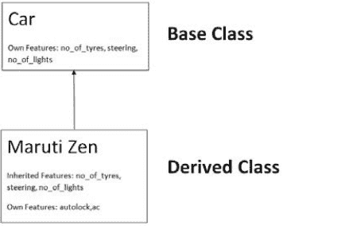

▲ 图1：显示基类和派生类之间的关系

在图1中，派生类 Maruti Zen 继承了基类 Car 的多种特征，例如 `no_of_tyres`、转向和 `no_of_lights`，并且还有自己的特征，例如自动锁和空调。图1中的箭头表示继承的方向；也就是说，Car 是基类，Maruti Zen 是派生类。箭头从派生类指向基类的方向表示派生类能够访问基类的特征；反之则不能。

在 C++ 中创建和使用基类和派生类的一些优点是：

- 减少代码冗余，因为代码位于一处，即基类中。
- 使您能够轻松维护源代码。这是因为对基类所做的任何更改都会自动反映在其派生类的行为中；因为这些类会自动继承新行为。
- 通过向派生类添加函数来扩展基类（或现有类）的功能。

在 C++ 中，从现有类（或基类）继承新类（或派生类）的基本语法是：

```cpp
class <BaseClass>
{
...
};
class <DerivedClass> : <access_specifier> <BaseClass>
{
...
};
```

在前面的语法中，基类和派生类前面都有 `class` 关键字。声明派生类时，需要在派生类名称和访问说明符之后指定基类的名称。派生类名称后面跟着冒号（`:`）符号。访问说明符（`public`、`private` 或 `protected`）指示派生或继承的类型。

以下代码片段显示了派生类和基类的示例：

```cpp
class Dog: public Mammal
```

在前面的代码片段中，Dog 指从基类 Mammal 派生的派生类。

派生类型将在本章的*解释各种派生类型*一节中讨论。现在，始终使用 `public` 访问说明符从基类继承派生类。在从基类继承派生类之前，必须先声明基类；否则，会出现编译错误。

现在，让我们讨论 protected 访问说明符，它在继承中起着重要作用。


### 7.2 使用 protected 访问说明符

除了 `private` 和 `public` 访问说明符之外，C++ 还支持另一个重要的访问说明符：`protected`。protected 访问说明符的访问限制（在类内或通过类对象）与 `private` 访问说明符相同。类的受保护成员与类的私有成员类似，可以在类内访问。请考虑以下代码片段，它解释了类中所有三种可见性模式（`private`、`protected` 和 `public`）：

```
class A
{
private:
    int pv;        /*Not accessible outside the A class; but the
                     member functions of A class can access it*/

protected:
    int prot;      /*Not accessible outside the A class; but the
                     member functions of A class and B class can access it*/

public:
    int pb;        /*Accessible outside the A class any where*/

    void pbBaseFunc();
};
class B : public A
{
    void derivedFunc();
};
int main()
{
    B obj;
    obj.pb=10;
    return 0;
}
```

在前面的代码片段中，pv 变量对 A 类是私有的，并且仅可由 A 类的成员访问。换句话说，作为 A 类成员的 pbBaseFunc() 成员函数可以直接访问 pv 变量。然而，B 类的成员函数不允许访问 A 类的私有成员。

prot 变量是一个受保护的数据成员，可供 A 类的其他成员函数以及 B 类（A 类的派生类）的成员函数访问。但是，任何其他类的成员都不能访问 prot 变量。

A 类的 pb 和 pbBaseFunc() 成员被声明为公有。A 类或 B 类的所有成员，或者这些类的对象，都可以直接访问这些成员。

受保护成员可以被视为私有成员和公有成员的结合。与私有成员类似，受保护成员可供其类的成员函数访问，并且在类外不可见。与公有成员类似，受保护成员会被派生类继承，并且也可供派生类的成员函数访问。

在说明了 protected 说明符的作用之后，让我们学习如何创建一个简单的程序来展示两个类之间的继承。

### 7.3 创建简单的继承程序

继承原则在多种现代编程语言中可用，并且每种语言的处理方式略有不同。C++ 允许你在派生类中继承基类的全部或部分成员。你可以在派生类中修改基类的成员，或者如果基类中不具备某些功能，也可以添加新成员。清单 1 展示了一个继承示例（可以在随书光盘的 Code\Chapter7 文件夹中找到 SimpleInheritanceProgram.cpp 文件）：

- 清单 1：展示一个简单的继承程序

```cpp
#include<iostream.h>

class Vehicle {
    protected:
    int wheels;
    float weight;
    public:
    void initialize(int in_wheels, float in_weight)
    {
        /* initialize to any data desired */
        wheels = in_wheels;
        weight = in_weight;
    }
    int get_wheels(void)
    {
        /* get the number of wheels of this vehicle */
        return wheels;
    }
    float get_weight(void)
    {
        /* return the weight of this vehicle */
        return weight;
    }
    float wheel_loading(void)
    {
        /* return the weight on each wheel */
        return weight/wheels;
    }
};

class Car : public Vehicle {
    int passenger_load;

public:
    void initialize(int in_wheels, float in_weight, int people = 4)
    {
        passenger_load = people;
        wheels = in_wheels;
        weight = in_weight;
    }
    int passengers(void)
    {
        return passenger_load;
    }
};
int main()
{
    Vehicle autoobj;
    autoobj.initialize(3, 2000.0);
    cout << "The auto rickshaw has " << autoobj.get_wheels() << " wheel.\n";
    cout << "The auto rickshaw's wheel loading is " <<autoobj.wheel_loading()
    << " pounds on the single tyre.\n";
    cout << "The auto rickshaw weighs " <<autoobj.get_weight() << " pounds.\n";
    Car marutiZen;
    marutiZen.initialize(4, 3500.0, 5);
    cout << "The Maruti Zen carries " << marutiZen.passengers() << " passengers.\n";
    cout << "The Maruti Zen weighs " << marutiZen.get_weight() << " pounds.\n";
    cout << "The Maruti Zen's wheel loading is " <<marutiZen.wheel_loading()
    << " pounds per tyre.\n";

    return 0;
}
```

**输出：**

```text
The auto rickshaw has 3 wheel.
The auto rickshaw's wheel loading is 666.666687 pounds on the single tyre.
The auto rickshaw weighs 2000 pounds.
The Maruti Zen carries 5 passengers.
The Maruti Zen weighs 3500 pounds.
The Maruti Zen's wheel loading is 875 pounds per tyre.
```

在清单 1 中，Vehicle 是一个基类，Car 是 Vehicle 类的派生类。派生类 Car 包含 Vehicle 基类中包含的所有信息，例如车辆重量和车轮数量，以及它自己的信息，例如载客量。

Vehicle 基类可用于声明对象，例如卡车、汽车、自行车或任何其他车辆，而 Car 类只能用于声明 Car 类型的对象，例如 Maruti Zen、Santro 和 Tata Indica。因此，Car 类比 Vehicle 类更具限制性且更具体，而 Vehicle 类比 Car 类更通用。

在学习了如何实现继承之后，下一节让我们讨论 C++ 中的派生类型。

### 7.4 解释各种类型的派生

在 C++ 中，成员可访问性取决于访问说明符（public、private 和 protected）的使用。这些访问说明符不仅授予在类外访问类成员的权限，还定义了使用派生类对象访问基类成员的范围。换句话说，访问限制不仅可以施加在类内，还可以在派生类时施加。从基类继承的派生类应使用以下访问说明符之一：

- `private`：当基类被指定为 private 时，其所有成员在基类中保持私有，并且不会被派生类继承，同时基类的公有和受保护成员成为派生类的私有成员。
- `protected`：当基类被指定为 protected 时，类的所有私有成员在基类中保持私有。此外，受保护成员保持受保护，但基类的公有成员成为派生类的受保护成员。
- `public`：当基类被指定为 public 时，基类的所有私有成员在基类中保持私有，受保护成员保持受保护，公有成员在派生类中保持公有。

表 1 显示了在不同类型的派生中基类和派生类的成员可访问性：

**表 1：在不同类型的派生中，基类和派生类成员的可访问性**

| 派生方式 | 代码 | 对派生类对象的可访问性：私有成员 | 对派生类对象的可访问性：受保护成员 | 对派生类对象的可访问性：公有成员 |
|---|---|---|---|---|
| private | <code>class Base<br>{<br>&nbsp;&nbsp;&nbsp;&nbsp;int pv1;<br>protected:<br>&nbsp;&nbsp;&nbsp;&nbsp;int pr1;<br>public:<br>&nbsp;&nbsp;&nbsp;&nbsp;int pb1;<br>&nbsp;&nbsp;&nbsp;&nbsp;void pbBaseFunc();<br>};<br>class Derived : private Base<br>{<br>&nbsp;&nbsp;&nbsp;&nbsp;int pv2;<br>protected:<br>&nbsp;&nbsp;&nbsp;&nbsp;int pr2;<br>public:<br>&nbsp;&nbsp;&nbsp;&nbsp;int pb2;<br>&nbsp;&nbsp;&nbsp;&nbsp;void pbDerivedFunc();<br>};</code> | pv1 和 pv2 | pr1、pb1、pbBaseFunc() 和 pr2 | pb2 和 pbDerivedFunc() |
| protected | <code>class Base<br>{<br>&nbsp;&nbsp;&nbsp;&nbsp;int pv1;<br>protected:<br>&nbsp;&nbsp;&nbsp;&nbsp;int pr1;<br>public:<br>&nbsp;&nbsp;&nbsp;&nbsp;int pb1;<br>&nbsp;&nbsp;&nbsp;&nbsp;void pbBaseFunc();<br>};<br>class Derived : protected Base<br>{<br>&nbsp;&nbsp;&nbsp;&nbsp;int pv2;<br>protected:<br>&nbsp;&nbsp;&nbsp;&nbsp;int pr2;<br>public:<br>&nbsp;&nbsp;&nbsp;&nbsp;int pb2;<br>&nbsp;&nbsp;&nbsp;&nbsp;void pbDerivedFunc();<br>};</code> | pv1 和 pv2 | pr1、pb1、pbBaseFunc() 和 pr2 | pb2 和 pbDerivedFunc() |
| public | <code>class Base<br>{<br>&nbsp;&nbsp;&nbsp;&nbsp;int pv1;<br>protected:<br>&nbsp;&nbsp;&nbsp;&nbsp;int pr1;<br>public:<br>&nbsp;&nbsp;&nbsp;&nbsp;int pb1;<br>&nbsp;&nbsp;&nbsp;&nbsp;void pbBaseFunc();<br>};<br>class Derived : public Base<br>{<br>&nbsp;&nbsp;&nbsp;&nbsp;int pv2;<br>protected:<br>&nbsp;&nbsp;&nbsp;&nbsp;int pr2;<br>public:<br>&nbsp;&nbsp;&nbsp;&nbsp;int pb2;<br>&nbsp;&nbsp;&nbsp;&nbsp;void pbDerivedFunc();<br>};</code> | pv1 和 pv2 | pr1 和 pr2 | pb1、pbBaseFunc()、pb2 和 pbDerivedFunc() |


**表1：基类和派生类成员在不同派生方式下的成员可访问性**

| 派生方式 | 代码 | 对派生类对象的可访问性 |  |  |
|---|---|---|---|---|
|  |  | 私有成员 | 受保护成员 | 公有成员 |
|  | <pre><code>void pbBaseFunc();<br>};<br>class Derived : public Base<br>{<br>    int pv2;<br>protected:<br>    int pr2;<br>public:<br>    int pb2;<br>    void pbDerivedFunc();<br>};</code></pre> |  |  |  |


> 如你所知，C++ 中默认的访问说明符是 `private`。因此，声明：
> 
> `class B : A`
> 
> 在 C++ 编译器中被视为：
> 
> `class B : private A`

在将成员定义为 `private`、`protected` 或 `public` 时，必须记住以下几点：

- 私有成员只能由其所属类的成员访问。它不能被继承。基类的私有成员可以通过基类的受保护或公有成员函数在派生类中访问。
- 基类的受保护成员可以由其自身类的成员和派生类的成员访问。
- 将希望将来用作基类的类的成员声明为 `protected`，而不是 `private`。这是因为基类的受保护成员在派生类中是可访问的。
- 公有成员可以被其自身类的成员、派生类的成员以及基类外部的函数或类访问。
- 当派生类实例化时，基类和派生类的构造函数会自动调用。如果基类有带参数的构造函数，则必须在派生类的初始化列表中显式指定这些构造函数的调用。但是，默认构造函数不必显式调用。请注意，构造函数必须定义在类的公有部分（基类和派生类）中；否则，编译器会生成“无法访问构造函数”的错误消息。


> 本章后面你将学习如何调用基类和派生类的构造函数。

在描述了各种继承形式下基类和派生类的成员可访问性之后，让我们讨论如何重写基类的成员。

### 7.5 重写基类成员

当派生类创建与基类成员函数具有相同返回类型和签名、但具有新实现的函数时，就称为重写该函数。在重写中，派生类重新定义基类的成员。函数的签名是其名称以及参数的数量和类型。签名不包括成员函数的返回类型。清单 2 演示了如何在派生类中重写基类的成员（你可以在随书 CD 的 Code\Chapter7 文件夹中找到 OverrideBase1.cpp 文件）：

### 清单 2：重写基类成员

```cpp
#include <iostream.h>
class Animal
{
public:
    void eat();
    void sleep();
    void breathe();
};
class Fish : public Animal
{
public:
    void breathe();
};
void Animal::eat(){cout << "Eating..." << endl;}
void Animal::sleep(){cout << "Sleeping..." << endl;}
void Animal::breathe(){cout << "Breathing..." << endl;}
void Fish::breathe(){cout << "Bubbling..." << endl;}
int main()
{
    Fish bigfish;
    bigfish.breathe();
    return 0;
}
```

**输出：**

```text
Bubbling...
```

在清单 2 中，Animal 是基类，Fish 是 Animal 类的派生类。Fish 类重新定义了 Animal 类的 breathe() 函数的功能。

然而，可以通过创建基类的实例（或对象）或使用作用域解析（::）运算符来访问基类函数。下面的代码片段演示了如何使用 :: 运算符访问基类函数 breathe()：

```cpp
Animal::breathe();
```

在前面的代码片段中，通过使用基类名称（Animal）和 :: 运算符直接调用 breathe() 函数。清单 3 演示了如何使用基类名称和 :: 运算符调用被派生类重写的基类函数（你可以在随书 CD 的 Code\Chapter7 文件夹中找到 OverrideBase2.cpp 文件）：

### 清单 3：访问基类函数

```cpp
#include <iostream.h>
class Animal
{
public:
    void eat();
    void sleep();
    void breathe();
};
class Fish : public Animal
{
public:
    void breathe();
};
void Animal::eat(){cout << "Eating..." << endl;}
void Animal::sleep(){cout << "Sleeping..." << endl;}
void Animal::breathe(){cout << "Breathing..." << endl;}
void Fish::breathe()
{
    cout << "Bubbling..." << endl;
}
int main()
{
    Fish bigfish;
    bigfish.breathe();
    bigfish.Animal::breathe();    //accessing base class function
    return 0;
}
```

**输出：**

```text
Bubbling...
Breathing...
```

请注意，函数重写的概念不能与函数重载的概念混淆。这两个术语看起来很相似，但它们执行不同的任务。函数重载是创建多个名称相同但签名不同的函数。而函数重写则是在派生类中创建与基类中函数具有相同名称和签名的函数。

## 测试你的知识

**问题1.** 创建一个名为 Computer 的基类，其中包含用于显示计算机系统相关信息（如速度和内存大小）的函数。从 Computer 基类创建一个名为 Laptop 的派生类。Laptop 类必须重写 Computer 类的函数，并且还要有自己的函数。

**答案：**

```cpp
#include<iostream.h>

class Computer       //base class
{
    float speed;
    int main_memory;
    int harddisk_memory;

public:
    void set_speed(float);
    void set_mmemory(int);
    void set_hmemory(int);
    float get_speed();
    int get_mmemory();
    int get_hmemory();
};

void Computer::set_speed(float sp)
{
    speed=sp;
}
void Computer::set_mmemory(int m)
{
    main_memory=m;
}
void Computer::set_hmemory(int h)
{
    harddisk_memory=h;
}
int Computer::get_hmemory()
{
    return harddisk_memory;
}
int Computer::get_mmemory()
{
    return main_memory;
}
float Computer::get_speed()
{
    return speed;
}
class Laptop:public Computer    //derived class
{
    int battery_time;
    float weight;

public:
    void set_battime(int);
    void set_weight(float);
    int get_battime();
    float get_weight();
};
void Laptop::set_battime(int b)
{
    battery_time=b;
}
void Laptop::set_weight(float w)
{
    weight=w;
}

int Laptop::get_battime()
{
    return battery_time;
}
float Laptop::get_weight()
{
    return weight;
}
void main()
{
    Computer c;
    Laptop l;
    c.set_mmemory(512);
    c.set_hmemory(1024);
    c.set_speed(3.70);
    l.set_mmemory(256);
    l.set_hmemory(512);
    l.set_speed(2.1);
    l.set_battime(10);
    l.set_weight(2.5);
    cout<<"Info. of Computer class"<<endl;
    cout<<"Speed:"<<c.get_speed()<<endl;
    cout<<"Main Memory:"<<c.get_mmemory()<<endl;
    cout<<"Hard Disk Memory:"<<c.get_hmemory()<<endl;
    cout<<"Info. of Laptop class"<<endl;
    cout<<"Speed:"<<l.get_speed()<<endl;
    cout<<"Main Memory:"<<l.get_mmemory()<<endl;
    cout<<"Hard Disk Memory:"<<l.get_hmemory()<<endl;
    cout<<"Weight:"<<l.get_weight()<<endl;
    cout<<"Battery Time:"<<l.get_battime()<<endl;
}
```

**输出：**

```text
Info. of Computer class
Speed:3.7
Main Memory:512
Hard Disk Memory:1024
Info. of Laptop class
Speed:2.1
Main Memory:256
Hard Disk Memory:512
Weight:2.5
Battery Time:10
```


> *写一篇关于函数重写的说明（孟买大学，2007年12月）*

现在，让我们学习如何调用基类和派生类的构造函数和析构函数。

### 7.6 调用基类和派生类的构造函数和析构函数

正如我们所知，构造函数用于初始化类的数据成员并为数据成员分配所需的内存。而析构函数用于取消初始化数据成员。现在问题来了：当基类和派生类都有各自的构造函数和析构函数时会发生什么？基类的构造函数和析构函数会被重写吗？在这种情况下，请记住，只要基类具有默认构造函数和析构函数，派生类就不需要构造函数或析构函数。然而，如果基类有一个或多个参数的构造函数，那么派生类必须有一个带参数的构造函数，并显式地将参数传递给基类构造函数。在继承的应用中，通常创建的是派生类的对象而不是基类的对象。因此，派生类必须有一个构造函数，并将参数传递给基类的构造函数。当创建派生类对象时，基类的构造函数会在派生类的构造函数之前被调用。


类。然而，析构函数的调用顺序相反，也就是说，派生类的析构函数先于基类的析构函数被调用。让我们通过考虑几个程序来更好地理解这一点。

清单 4 表明，基类函数可以由派生类的对象调用（你可以在 CD 的 Code\Chapter7 文件夹中找到 BaseFunctionCall.cpp 文件）：

## ▶ 清单 4：使用派生类对象调用基类函数

```cpp
#include<iostream.h>

class Base
{
public:
  void MyFuncB()
  {
    cout<<"Function of base class"<<endl;
  }
};
class Derived:public Base
{
  public:
  void MyFuncD()
  {
    cout<<"Function of derived class"<<endl;
  }
};
int main()
{
  Derived d;
  cout<<"Main Program started"<<endl;
  d.MyFuncB();
  d.MyFuncD();
  cout<<"Main Program ended"<<endl;
  return 0;
}
```

### 输出：

```text
Main Program started
Function of base class
Function of derived class
Main Program ended
```

在清单 4 中，创建了 Base 类和 Derived 类，其中 Derived 类继承自 Base 类。Base 类具有 MyFuncB() 函数，Derived 类具有 MyFuncD() 函数。在 main() 函数中，创建了 Derived 类的一个对象 d。d 对象调用了 Base 类的 MyFuncB() 函数以及

在清单 5 中，创建了 Base 类和 Derived 类，其中 Derived 类继承自 Base 类。Base 类具有 MyFuncB() 函数，Derived 类具有 MyFuncB() 和 MyFuncD() 函数。MyFuncB() 函数同时存在于 Base 类和 Derived 类中，并且 Derived 类重写了 MyFuncB() 函数的功能。

在 main() 函数中，创建了 Derived 类的一个对象 d。d 对象在 Main Program started 和 Main Program ended 语句之间调用了其自身类的 MyFuncB() 和 MyFuncD() 函数。

现在，除了重写基类函数之外，派生类还可能以其基类成员的副本开始其存在。原因是：派生类继承其基类的变量和成员函数，但不继承其基类的构造函数或析构函数。当创建派生类的对象时，它会自动调用其基类的默认构造函数和析构函数。清单 6 展示了从派生类对象调用基类构造函数和析构函数（你可以在 CD 的 Code\Chapter7 文件夹中找到 Base_ConsDes.cpp 文件）：

## ▶ 清单 6：通过派生类对象调用基类的构造函数和析构函数

```cpp
#include<iostream.h>

class Base
{
    public:
    Base()
    {
        cout<<"Base class constructor calling"<<endl;
    }
    ~Base()
    {
        cout<<"Base class destructor calling"<<endl;
    }
    void MyFuncB()
    {
        cout<<"Function of base class"<<endl;
    }
};
class Derived:public Base
{
    public:

    void MyFuncD()
    {
        cout<<"Function of derived class"<<endl;
    }
};
int main()
{
    Derived d;
    cout<<"Main Program started"<<endl;
    d.MyFuncD();
    cout<<"Main Program ended"<<endl;
    return 0;
}
```

### 输出：

```text
Base class constructor calling
Main Program started
Function of derived class
Main Program ended
Base class destructor calling
```

在清单 6 中，Derived 类继承自 Base 类，Base 类具有默认构造函数、析构函数和 MyFuncB() 函数。然而，Derived 类只有 MyFuncD() 函数。在 main() 函数中，创建了 Derived 类的一个对象 d，它在执行 main() 函数的任何其他语句之前调用 Base 类的构造函数，如清单 6 的输出所示。此外，d 对象在执行 main() 函数中编写的所有语句之后调用 Base 类的析构函数，包括以下内容：

- Main Program started 语句
- Derived 类的 MyFuncD() 函数
- Main Program ended 语句

现在，当派生类有自己的构造函数和析构函数，而基类没有时，会发生什么？在这种情况下，派生类的对象会调用其自身类的构造函数和析构函数，因为基类没有任何这些（构造函数或析构函数，或两者都没有）。清单 7 展示了派生类构造函数和析构函数的调用（你可以在 CD 的 Code\Chapter7 文件夹中找到 Derived_ConsDes.cpp 文件）：

## ▶ 清单 7：调用派生类的构造函数和析构函数

```cpp
#include<iostream.h>

class Base
{
    public:
    void MyFuncB()
    {
        cout<<"Function of base class"<<endl;
    }
};
class Derived:public Base
{
    public:

    Derived()
    {
        cout<<"Derived class constructor calling"<<endl;
    }
    ~Derived()
    {
        cout<<"Derived class destructor calling"<<endl;
    }

    void MyFuncD()
    {
        cout<<"Function of derived class"<<endl;
    }
};
int main()
{
    Derived d;
    cout<<"Main Program started"<<endl;
    d.MyFuncD();
    cout<<"Main Program ended"<<endl;
    return 0;
}
```

### 输出：

```text
Derived class constructor calling
Main Program started
Function of derived class
Main Program ended
Derived class destructor calling
```

在清单 7 中，Derived 类继承自 Base 类。Derived 类具有默认构造函数、析构函数和 MyFuncD() 函数；然而，Base 类只有 MyFuncB() 函数。在 main() 函数中，创建了 Derived 类的一个对象 d。d 对象调用其自身类（即 Derived 类）的构造函数。然后，调用 Main Program started 语句，并调用 Derived 类的 MyFuncD() 函数。最后，调用 Main Program ended 语句，并调用 Derived 类的析构函数。

接下来，让我们举一个基类和派生类都具有默认构造函数和析构函数的例子。在这种情况下，构造函数按从基类到派生类的顺序调用，析构函数按从派生类到基类的顺序调用。清单 8 展示了调用基类和派生类构造函数和析构函数的顺序（你可以在 CD 的 Code\Chapter7 文件夹中找到 BaseDerived_ConsDes.cpp 文件）：

## ▶ 清单 8：调用基类和派生类的构造函数和析构函数

```cpp
#include<iostream.h>

class Base
{

    public:

    Base()
    {
        cout<<"Base class constructor calling"<<endl;
    }
    ~Base()
    {
        cout<<"Base class destructor calling"<<endl;
    }
    void MyFuncB()
    {
        cout<<"Function of base class"<<endl;
    }
};

class Derived:public Base
{
    public:
    Derived()
    {
        cout<<"Derived class constructor calling"<<endl;
    }
    ~Derived()
    {
        cout<<"Derived class destructor calling"<<endl;
    }
    void MyFuncD()
    {
        cout<<"Function of derived class"<<endl;
    }
};

int main()
{
    Derived d;
    cout<<"Main Program started"<<endl;
    d.MyFuncD();
    cout<<"Main Program ended"<<endl;
    return 0;
}
```

### 输出：

```text
Base class constructor calling
Derived class constructor calling
Main Program started
Function of derived class
Main Program ended
Derived class destructor calling
Base class destructor calling
```

在清单 8 中，创建了 Base 类和 Derived 类，其中 Derived 类继承自 Base 类。Base 类具有默认构造函数、析构函数和 MyFuncB() 函数，Derived 类具有默认构造函数、析构函数和 MyFuncD() 函数。在 main() 函数中，创建了 Derived 类的一个对象 d，它调用 Base 类和 Derived 类两者的构造函数和析构函数。此外，d 对象在 Main Program started 和 Main Program ended 语句之间调用其自身类的 MyFuncD() 函数。

现在，当基类具有重载构造函数而派生类只有默认构造函数时，会发生什么？清单 9 表明基类具有重载构造函数，而派生类只有默认构造函数（你可以在 CD 的 Code\Chapter7 文件夹中找到 BaseOverloadedConstructors.cpp 文件）：

## ▶ 清单 9：重载基类构造函数

```cpp
#include<iostream.h>

class Base
{
    public:
        Base()
        {
            cout<<"Base class constructor (no parameter) calling"<<endl;
        }
        Base(int x)
        {
            cout<<"Base class constructor with one parameter calling"<<endl;
            cout<<"Parameter value is : "<<x<<endl;
        }
        ~Base()
        {
            cout<<"Base class destructor calling"<<endl;
        }
        void MyFuncB()
        {
            cout<<"Function of derived class"<<endl;
        }
};

class Derived:public Base
{
    public:
```


```cpp
Derived()
{
    cout<<"Derived class constructor calling"<<endl;
}
~Derived()
{
    cout<<"Derived class destructor calling"<<endl;
}
void MyFuncD()
{
    cout<<"Function of derived class"<<endl;
}
};

int main()
{
    Derived d(38);
    cout<<"Main Program started"<<endl;
    d.MyFuncD();
    cout<<"Main Program ended"<<endl;
    return 0;
}
```

在清单 9 中，编译器会生成以下错误：

> 错误：找不到与‘Derived::Derived(int)’匹配的项

有两种解决方案可以避免上述错误。可描述如下：

-   派生类必须有自己的构造函数，其签名与基类构造函数相似
-   派生类具有带参构造函数，并显式地将参数传递给基类构造函数

清单 10 表明，在派生类中包含带参构造函数可以解决调用基类重载构造函数的问题（你可以在 CD 的 Code\Chapter7 文件夹中找到 DerivedParameterizedConstructor.cpp 文件）：

### ▶ 清单 10：在派生类中添加带参构造函数

```cpp
#include<iostream.h>

class Base
{
  public:
    Base()
    {
      cout<<"Base class constructor (no parameter) calling"<<endl;
    }
    Base(int x)
    {
        cout<<"Base class constructor with one parameter calling"<<endl;
        cout<<"Parameter value is : "<<x<<endl;
    }
    ~Base()
    {
        cout<<"Base class destructor calling"<<endl;
    }
    void MyFuncB()
    {
        cout<<"Function of derived class"<<endl;
    }
};
class Derived:public Base
{

public:

Derived()
{
    cout<<"Derived class constructor calling"<<endl;
}
Derived(int x)
{
    cout<<"Derived class constructor with one parameter calling"<<endl;
    cout<<"Parameter value is : "<<x<<endl;
}
~Derived()
{
    cout<<"Derived class destructor calling"<<endl;
}
void MyFuncD()
{
    cout<<"Function of derived class"<<endl;
}
};

int main()
{
    Derived d(38);
    cout<<"Main Program started"<<endl;
    d.MyFuncD();
    cout<<"Main Program ended"<<endl;
    return 0;

}
```

### 输出

```text
Base class constructor (no parameter) calling
Derived class constructor with one parameter calling
Parameter value is : 38
Main Program started
Function of derived class
Main Program ended
Derived class destructor calling
Base class destructor calling
```

在清单 10 中，创建了 Base 类和 Derived 类，其中 Derived 类继承自 Base 类。Base 类的成员包括一个默认构造函数、一个带参构造函数、一个析构函数以及 MyFuncB() 函数，而 Derived 类的成员包括一个默认构造函数、一个带参构造函数、一个析构函数以及 MyFuncD() 函数。

在 main() 函数中，创建了 Derived 类的对象 d，该对象会调用 Base 类的默认构造函数、Derived 类的带参构造函数以及这两个类的析构函数。此外，d 对象在 Main Program started 和 Main Program ended 语句之间调用其自身类的 MyFuncD() 函数。

然而，可能存在需要调用基类的带参构造函数的情况。在这种情况下，派生类的对象会调用派生类构造函数，该构造函数接受一个参数。此构造函数通过将参数值传递给基类构造函数的形参来调用基类构造函数。这可以通过声明派生类构造函数来实现，如下面的代码片段所示：

```cpp
Derived(int x):Base(x)
{

    //body of the constructor
}
```

清单 11 展示了派生类的带参构造函数如何显式调用基类构造函数（你可以在 CD 的 Code\Chapter7 文件夹中找到 ExplicitInvokeBaseConstructor.cpp 文件）：

### ▶ 清单 11：显式调用基类构造函数

```cpp
#include<iostream.h>

class Base
{
    public:
        Base(int x)
        {
            cout<<"Base class constructor with one parameter calling"<<endl;
            cout<<"Parameter value is : "<<x<<endl;
        }
        ~Base()
        {
            cout<<"Base class destructor calling"<<endl;
        }
        void MyFuncB()
        {
            cout<<"Function of derived class"<<endl;
        }
};

class Derived:public Base
{
public:
    Derived(int x):Base(x)
    {
        cout<<"Derived class constructor with one parameter calling"<<endl;
        cout<<"Parameter value is : "<<x<<endl;
    }
    ~Derived()
    {
        cout<<"Derived class destructor calling"<<endl;
    }
    void MyFuncD()
    {
        cout<<"Function of derived class"<<endl;
    }
};

int main()
{
    Derived d(38);
    cout<<"Main Program started"<<endl;
    d.MyFuncD();
    cout<<"Main Program ended"<<endl;
    return 0;
}
```

### 输出

```text
Base class constructor with one parameter calling
Parameter value is : 38
Derived class constructor with one parameter calling
Parameter value is : 38
Main Program started
Function of derived class
Main Program ended
Derived class destructor calling
Base class destructor calling
```

在清单 11 中，创建了 Base 类和 Derived 类，其中 Derived 类继承自 Base 类。Base 类的成员包括一个默认构造函数、一个带参构造函数、一个析构函数以及 MyFuncB() 函数。Derived 类的成员包括一个默认构造函数、一个带参构造函数、一个析构函数以及 MyFuncD() 函数。Derived 类的带参构造函数会显式地将参数传递给 Base 类的带参构造函数。

在 main() 函数中，创建了 Derived 类的对象 d，该对象会调用 Base 类和 Derived 类的带参构造函数与析构函数。此外，d 对象在 Main Program started 和 Main Program ended 语句之间调用其自身类的 MyFuncD() 函数。

由此可以得出结论：只要基类具有默认（无参）构造函数，派生类就不需要构造函数。然而，如果基类构造函数带有参数，则派生类也必须具有带参构造函数。此外，派生类构造函数会显式地将值传递给基类构造函数的实参。创建派生类的对象时，先执行基类的构造函数，再执行派生类的构造函数。然而，对于析构函数，这一顺序是相反的，即先执行派生类的析构函数，再执行基类的析构函数。

在学习了如何调用基类和派生类的构造函数与析构函数之后，我们来讨论如何创建容器类。

### 7.7 创建容器类

容器类是其他类的对象容器。它表示将某个类的属性继承到另一个类中的一种间接方式。这意味着容器类的对象是若干其他对象的集合。创建容器类的目的是保存另一个类的多个实例。创建容器类的语法是：

```cpp
class Class_Name
{
};
class ContainerClass_Name
{
Class_Name object_name;
};
```

在上述语法中，ContainerClass_Name 表示容器类的名称，该容器类包含 Class_Name 类的 object_name 对象的声明。

清单 12 展示了容器类的一个示例（你可以在 CD 的 Code\Chapter7 文件夹中找到 ContainerClass.cpp 文件）：

### ▶ 清单 12：创建容器类

```cpp
#include<iostream.h>
#include<string.h>

class Alphabets
{
char day_element;
public:
void setAlphabet(char);
void showAlphabet();
};

class Day
{
Alphabets objchar[10];
int l;

public:

void setDay(char*);
int getDayLength();
void showDay();
};

class week
{
Day objDay[7];
int l;
public:

void setweek(char**);
void showweek();
};

void Alphabets::setAlphabet(char c)
{
day_element=c;
}
void Alphabets::showAlphabet()
{
cout<<day_element;
}

void Day::setDay(char* c)
{
```

```cpp
l=strlen(c);
for(int i=0; i<l;i++)
    objChar[i].setAlphabet(c[i]);
}
int Day::getDayLength()
{
    return 1;
}

void Day::showDay()
{
    for(int i=0; i<l;i++)
        objChar[i].showAlphabet();
    cout<<" ";
}

void Week::setWeek(char** c)
{
    for(int i=0; i<7;i++)
        objDay[i].setDay(c[i]);
}

void Week::showWeek()
{
    cout<<"The text is : "<<endl;
    for(int i=0; i<7;i++)
        objDay[i].showDay();
    cout<<endl;
}

void main()
{
    char* str[7]={"sunday","monday","tuesday","wednesday","thursday","friday","saturday"};
    Week obj;
    obj.setWeek(str);
    obj.showWeek();
}
```

**输出：**

```text
The text is :
sunday monday tuesday wednesday thursday friday Saturday
```

在代码清单12中，创建了 Alphabet、Day 和 Week 三个类；其中 Day 和 Week 分别是 Alphabet 类和 Day 类的容器类。在 Day 类中，创建了 Alphabet 类的 objChar 对象，该对象调用 setAlphabet() 和 showAlphabet() 函数，分别用于设置和显示某一天名称的字符。类似地，在 Week 类中，创建了 Day 类的 objDay 对象，该对象调用 setDay() 和 showDay() 函数，用于设置和显示各天的完整名称。然后，在 main() 函数中，Week 类的对象 obj 调用 setWeek() 和 showWeek() 函数，以显示一周中所有天的完整列表。

注意，Week 类的 setWeek() 和 showWeek() 函数内部会调用 Day 类的 setDay() 和 showDay() 函数。类似地，Day 类的 setDay() 和 showDay() 函数内部会调用 Alphabet 类的 setAlphabet() 和 showAlphabet() 函数。

代码清单13展示了容器类的构造函数如何调用其所包含对象的构造函数，这些对象通过显式传递参数而包含在容器类中（可以在随书光盘的 Code\Chapter7 文件夹中找到 ContainerClass.cpp 文件）：

### ▶ 代码清单 13：使用构造函数创建容器类

```cpp
#include<iostream.h>

class X
{
    int a;
public:
    X(int);
    void displayNum();
};

class Y
{
    float b,c;
public:
    Y(float,float);
    void displayNum();
};

class Z
{
    X o1;
    Y o2;
    int d;
public:
    Z(int,float,float,int);
    void displayNum();
};

X::X(int i)
{
    a=i;
}

void X::displayNum()
{
    cout<<"a = "<<a<<endl;
}

Y::Y(float l, float m)
{
    b=l;
    c=m;
}

void Y::displayNum()
{
    cout<<"b = "<<b<<endl;
    cout<<"c = "<<c<<endl;
}

Z::Z(int m,float n, float o, int p):o1(m),o2(n,o)
{
    d=p;
}

void Z::displayNum()
{
    o1.displayNum();
    o2.displayNum();
    cout<<"d = "<<d<<endl;
}

void main()
{
    Z containobj(3,4.5,5.6,7);
    containobj.displayNum();
}
```

**输出：**

```text
a = 3
b = 4.5
c = 5.6
d = 7
```

在代码清单13中，创建了 X、Y 和 Z 三个类。Z 类是容器类，因为它包含 X 类和 Y 类的对象。每个类都有一个默认构造函数和 displayNum() 函数，它们分别用于初始化其对应类的变量和显示这些变量的值。Z 类的构造函数显式传递参数，以调用 X 类和 Y 类中所包含对象的构造函数。

现在，让我们讨论继承的各种形式。

### 7.8 解释继承的形式

在继承中，派生类本身也可以作为基类，其他类可以从它派生。这一过程实现了代码的可重用性。相互派生的类数量没有特定限制。此外，可以从单个基类继承多个类。因此，根据基类的层级以及基类和派生类的数量，继承可分为以下形式：

- 单继承
- 多级继承
- 层次继承
- 多重继承
- 混合继承

下面各节将逐一讨论这些形式，先从单继承开始。

### 单继承

派生类从一个基类继承的继承形式称为单继承，如图2所示：

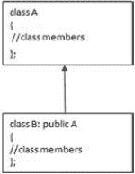

▲ 图2：展示单继承

代码清单14展示了一个单继承示例（可以在随书光盘的 Code\Chapter7 文件夹中找到 SingleInheritance.cpp 文件）：

### ▶ 代码清单 14：实现单继承

```cpp
#include<iostream.h>
class A
{
protected:
    int a;
};
class B:public A
{
    int b;
public:
    void display()
    {
        a=10;
        b=20;
        cout<<"Base class variable calling"<<endl;
        cout<<"Value in variable a="<<a<<endl;
        cout<<"Derive class variable calling"<<endl;
        cout<<"Value in variable b="<<b<<endl;
    }
};
int main()
{
    B obj;
    obj.display();
    return 0;
}
```

**输出：**

```text
Base class variable calling
Value in variable a=10
Derive class variable calling
Value in variable b=20
```

在代码清单14中，类 B 是唯一从类 A 继承的类。A 类有一个名为 a 的受保护变量；而 B 类有一个私有变量 b 和一个公有函数 display()。在 main() 函数中，创建了类 B 的对象 obj，该对象调用 display() 函数。

## 测试你的知识

**Q2.** 创建一个程序，展示公有派生下的单继承示例。

**答案：**

```cpp
#include<iostream.h>

class A
{
    int a;
public:
    int b;
    void set_ab()
    {
        a=10;
        b=20;
    }
    int get_a()
    {
        return a;
    }
    void display_a()
    {
        cout<<"a = "<<a<<endl;
    }
};

class B:public A
{
    int c;
public:
    void addition()
    {
        c=b+get_a();
    }
    void display()
    {
        cout<<"After Addition"<<endl;
        cout<<"a = "<<get_a()<<endl;
        cout<<"b = "<<b<<endl;
        cout<<"c = "<<c<<endl;
    }
};

void main()
{
    B obj;
    obj.set_ab();
    obj.addition();
    obj.display_a();
    obj.display();
    obj.b=500;
    obj.addition();
    obj.display();
}
```

**输出：**

```text
a = 10
After Addition
    a = 10
    b = 20
    c = 30
After Addition
    a = 10
    b = 500
    c = 510
```

**Q3.** 创建一个程序，展示私有派生下的单继承示例。

**答案：**

```cpp
#include<iostream.h>

class A
{
public:
    int a;
    int b;
    void set_ab()
    {
        cout<<"Enter the values for a and b variables"<<endl;
        cin>>a>>b;
    }
    int get_a()
    {
        return a;
    }
    void display_a()
    {
        cout<<"a = "<<a<<endl;
    }
};

class B:private A
{
    int c;
public:
    void set_ab()
    {
        cout<<"Enter the values for a and b variables"<<endl;
        cin>>a>>b;
    }
    int get_a()
    {
        return a;
    }
    void addition()
    {
        c=b+get_a();
    }
    void display()
    {
        cout<<"After Addition"<<endl;
        cout<<"a = "<<get_a()<<endl;
        cout<<"b = "<<b<<endl;
        cout<<"c = "<<c<<endl;
    }
};

void main()
{
    B obj;
    obj.set_ab();
    obj.addition();
    obj.display();
}
```

**输出：**

```text
Enter the values for a and b variables
100
50
After Addition
a = 100
b = 50
c = 150
```

**Q4.** 创建一个程序，展示保护派生下的单继承示例。

**答案：**

```cpp
#include <iostream.h>

class MyBase{
protected:
    int i, j;               /* private to MyBase, but accessible by
                               MyDerived */
public:
    void setdata(int a, int b) {
        i = a;
        j = b;
    }
    void showdata() {
        cout << "i : " << i << "\n" << "j : " << j << endl;
    }
};
class MyDerived : protected MyBase{    /* Inherit MyBase as
                                          protected */
    int k;
public:
    void setdata2() {
        setdata(34, 60);
        k = i * j;
    }
    void showall() {
        cout << "k : " << k << "\n";
        showdata();
    }
};
int main()
{
    MyDerived md;
    md.setdata2();                 // public member of MyDerived
    md.showall();                  // public member of MyDerived
    return 0;
}
```

**输出：**

```text
k : 2040
i : 34
j : 60
```

### 多级继承

派生类从一个基类继承，而该基类又依次从另一个基类继承或派生的继承形式称为多级继承，如图3所示：

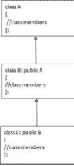

▲ 图3：展示多级继承


在图 3 中，类 A 是类 B 的基类，而类 B 又是类 C 的基类。代码清单 15 展示了一个多级继承的示例（你可以在 CD 的 Code\Chapter7 文件夹中找到 MultilevelInheritance.cpp 文件）：

### 代码清单 15：实现多级继承

```cpp
#include<iostream.h>

class A
{
protected:
    int a;
};
class B:public A
{
protected:
    int b;
public:
    void display()
    {
        a=10;
        b=20;
        cout<<"Class B Display method"<<endl;
        cout<<"Class A variable calling"<<endl;
        cout<<"Value in variable a="<<a<<endl;
        cout<<"Class B variable calling"<<endl;
        cout<<"Value in variable b="<<b<<endl;
    }
};
class C:public B
{
protected:
    int c;
public:
    void display()
    {
        a=10;
        b=20;
        c=30;
        B::display();
        cout<<"Class C Display method"<<endl;
        cout<<"Class A variable calling"<<endl;
        cout<<"Value in variable a="<<a<<endl;
        cout<<"Class B variable calling"<<endl;
        cout<<"Value in variable b="<<b<<endl;
        cout<<"Class C variable calling"<<endl;
        cout<<"Value in variable c="<<c<<endl;
    }
};
```

```cpp
}
~Vehicle()
{
    cout<<"Destructor of Vehicle class"<<endl;
}
};
class Maruti:public Vehicle
{
    public:
    Maruti()
    {
        cout<<"Constructor of Maruti class"<<endl;
    }
    ~Maruti()
    {
        cout<<"Destructor of Maruti class"<<endl;
    }
};
class Car:public Maruti
{
    public:
    Car()
    {
        cout<<"Constructor of Car class"<<endl;
    }
    ~Car()
    {
        cout<<"Destructor of Car class"<<endl;
    }
};
int main()
{
    Car zen;
    cout<<"Main program is here"<<endl;
    return 0;
}
```

**输出：**

```text
Constructor of Vehicle class
Constructor of Maruti class
Constructor of Car class
Main program is here
Destructor of Car class
Destructor of Maruti class
Destructor of Vehicle class
```

在代码清单 16 中，Car 类的对象 zen 首先调用基类（即 Vehicle 类）的构造函数，然后调用 Maruti 类和 Car 类的构造函数。然而，析构函数的顺序是相反的，即首先调用 Car 类的析构函数，然后调用 Maruti 类的析构函数，最后调用 Vehicle 类的析构函数。

## 测试你的知识

Q5. 创建一个程序，在其中输入考生的个人信息和考试相关信息，程序显示该考生的考试成绩。（提示：使用多级继承）。

答。

```cpp
#include<iostream.h>

class Candidate // Base Class
{
protected:
    int rollno;
    char *name;
public:
    void getDetail(int b,char *n)
    {
        rollno = b;
        name = n;
    }
    void showDetail(void)
    {
        cout<<" The Name Of Candidate \t: "<< name<< endl;
        cout<<" The Roll No. Is \t: "<< rollno<< endl;
    }
};
class ExamMarks:public Candidate // Derived Class 1
{
protected:
    float m1,m2;
public:
    void getMarks(float b,float c)
    {
        m1 = b;
        m2 = c;
    }
    void showMarks(void)
    {
        cout<<" Marks In CP Is \t: "<< m1<< endl;
        cout<<" Marks In Drawing Is \t: "<< m2<< endl;
    }
};
class ExamResult:public ExamMarks // Derived Class 2
{
protected:
    float total;
public:
    void showExamResult(void)
    {
        total = m1 + m2;
        showDetail();
        showMarks();
        cout<< " Total of The Two \t: "<< total<< endl;
    }
};
void main()
{
    int x;
    float y,z;
    char n[20];
    cout<< "Enter Your Name:";
    cin>>n;
    cout<< "Enter The Roll Number:";
    cin>>x;
    ExamResult r1;
    r1.getDetail(x,n);
    cout<< "Enter Computer Programming Marks:";
    cin>>y;
    cout<< "Enter Drawing Marks:";
    cin>>z;
    r1.getMarks(y,z);
    cout<< endl<< "********** Exam Result **********"<< endl;
    r1.showExamResult();
    cout<< "********************************"<< endl;
}
```

**输出：**

```text
Enter Your Name:Charu
Enter The Roll Number:301
Enter Computer Programming Marks:98
Enter Drawing Marks:92

********** Exam Result **********
The Name Of Candidate : Charu
The Roll No. Is       : 301
Marks In CP Is         : 98
Marks In Drawing Is    : 92
Total Of The Two       : 190
********************************
```

## 层次继承

两个或多个派生类继承自同一个基类的继承形式称为层次继承，如图 4 所示：

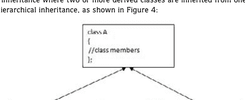

▲ 图 4：展示层次继承

在图 4 中，类 A 是类 B 和类 C 的基类。

代码清单 17 展示了一个层次继承的示例（你可以在 CD 的 Code\Chapter7 文件夹中找到 HierarchicalInheritance.cpp 文件）：

### 代码清单 17：展示层次继承

```cpp
#include<iostream.h>

class A
{
protected:
    int a;
};
class B:public A
{
protected:
    int b;
public:
    void display()
    {
        a=10;
        b=20;
        cout<<"Class B Display method"<<endl;
        cout<<"Class A variable calling"<<endl;
        cout<<"Value in variable a="<<a<<endl;
        cout<<"Class B variable calling"<<endl;
        cout<<"Value in variable b="<<b<<endl<<endl;
    }
};
class C:public A
{
protected:
    int c;
public:
    void display()
    {
        a=10;
        c=30;
        cout<<endl<<"Class C Display method"<<endl;
        cout<<"Class A variable calling"<<endl;
        cout<<"Value in variable a="<<a<<endl;

        cout<<"Class C variable calling"<<endl;
        cout<<"Value in variable c="<<c<<endl;
    }
};
class D:public A
{
protected:
    int d;
public:
    void display()
    {
        a=10;
        d=40;
        cout<<endl<<"Class D Display method"<<endl;
        cout<<"Class A variable calling"<<endl;
        cout<<"Value in variable a="<<a<<endl;
        cout<<"Class D variable calling"<<endl;
        cout<<"Value in variable d="<<d<<endl;
    }
};
int main()
{
    B object1;
    object1.display();
    C object2;
    object2.display();
    D object3;
    object3.display();
    return 0;
}
```

**输出：**

```text
Class B Display method
Class A variable calling
Value in variable a=10
Class B variable calling
Value in variable b=20

Class C Display method
Class A variable calling
Value in variable a=10
Class C variable calling
Value in variable c=30

Class D Display method
Class A variable calling
Value in variable a=10
Class D variable calling
Value in variable d=40
```

在代码清单 17 中，类 A 被三个类 B、C 和 D 继承。在 main() 函数中，创建了类 B、C 和 D 的对象 object1、object2 和 object3。然后，object1 对象调用类 B 的 display() 函数。类似地，object2 和 object3 对象分别调用类 C 和类 D 的 display() 函数。

## 测试你的知识

Q6. XYZ 公司希望维护其员工数据库。该数据库被划分为多个类，如图 9 所示：

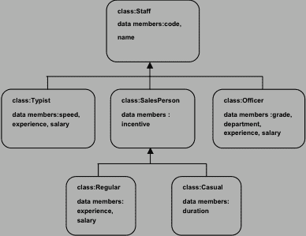

指定所有类，并定义用于创建数据库以及根据需要检索个人信息的函数。

答。

```cpp
#include<iostream.h>

class Staff
{
    public:
        int code;
        char name[20];
        void getStaff()
        {
            cout<<"Enter name : ";
            cin>>name;
            cout<<endl;
            cout<<"Enter code : ";
            cin>>code;
            cout<<endl;
        }
        void displayStaff()
        {
            cout<<"Name : "<<name<<endl;
            cout<<"Code : "<<code<<endl;
        }
};
class Typist: public Staff
{
    public:
        int speed, experience, salary;
        void getTypist()
        {
            cout<<"Enter speed (no. of words per minute) : ";
            cin>>speed;
            cout<<endl;
            cout<<"Enter experience (no. of years) : ";
            cin>>experience;
            cout<<endl;
            cout<<"Enter salary : ";
            cin>>salary;
        }
        void displayTypist()
        {
            cout<<"Speed : "<<speed<<endl;
            cout<<"Experience : "<<experience<<endl;
            cout<<"Salary : "<<salary<<endl;
        }
};
class SalesPerson: public Staff
{
    public:
```


```cpp
int incentive;

void getSalesPerson()
{
    cout<<"Enter incentive : ";
    cin>>incentive;
    cout<<endl;

}
void displaySalesPerson()
{
    cout<<"Incentive : "<<incentive<<endl;
}
};
class Officer: public Staff
{
public:
    char grade, department[15];
    int experience, salary;

    void getofficer()
    {
        cout<<"Enter department : ";
        cin>>department;
        cout<<endl;
        cout<<"Enter grade : ";
        cin>>grade;
        cout<<endl;
        cout<<"Enter experience (no. of years) : ";
        cin>>experience;
        cout<<endl;
        cout<<"Enter salary : ";
        cin>>salary;
    }
    void displayofficer()
    {
        cout<<"Department : "<<department<<endl;
        cout<<"Grade : "<<grade<<endl;
        cout<<"Experience : "<<experience<<endl;
        cout<<"Salary : "<<salary<<endl;
    }
};
class Regular: public SalesPerson
{
public:
    int experience, salary;
    void getRegular()
    {
        cout<<"Enter experience (no. of years) : ";
        cin>>experience;
        cout<<endl;
        cout<<"Enter salary : ";
        cin>>salary;
    }
    void displayRegular()
    {
        cout<<"Experience : "<<experience<<endl;
        cout<<"Salary : "<<salary<<endl;
    }
};
class Casual: public SalesPerson
{
    public:
    int duration;

    void getCasual()
    {
        cout<<"Enter duration : ";
        cin>>duration;
    }
    void displayCasual()
    {
        cout<<"Duration : "<<duration<<endl;
    }
};
void main()
{
    Typist t;
    SalesPerson sp;
    Officer o;
    Regular r;
    Casual c;
    int ch;
    char choice;
    do
    {
        cout<<"Employee Details"<<endl;
        cout<<"1 : Typist"<<endl;
        cout<<"2 : Sales Person (Regular)"<<endl;
        cout<<"3 : Sales Person (Casual)"<<endl;
        cout<<"4 : Officer"<<endl;
        cin>>ch;
        switch(ch)
        {

            case 1:
                t.getStaff();
                t.getTypist();
                t.displayStaff();
                t.displayTypist();
                break;

            case 2:
                r.getStaff();
                r.getSalesPerson();
                r.getRegular();
                r.displayStaff();
                r.displaySalesPerson();
                r.displayRegular();
                break;

            case 3:
                c.getStaff();
                c.getSalesPerson();
                c.getCasual();
                c.displayStaff();
                c.displaySalesPerson();
                c.displayCasual();
                break;

            case 4:
                o.getStaff();
                o.getOfficer();
                o.displayStaff();
                o.displayOfficer();
                break;
                default:cout<<"Not a right choice..."<<endl;
        }
        cout<<"Do you want to continue (Y for yes and N for No)?"<<endl;
        cin>>choice;
    }while(choice=='y'||choice=='Y');
}
```

输出：

```text
Employee Details
1 : Typist
2 : Sales Person (Regular)
3 : Sales Person (Casual)
4 : Officer
1
Enter name : Meena

Enter code : 101

Enter speed (no. of words per minute): 60

Enter experience (no. of years) : 1
Enter salary : 2000
Name : Meena
Code : 101
Speed : 60
Experience : 1
Salary : 2000
Do you want to continue (Y for yes and N for No)?
y
Employee Details
1 : Typist
2 : Sales Person (Regular)
3 : Sales Person (Casual)
4 : Officer
4
Enter name : Ashish

Enter code : 102

Enter incentive : 3000

Enter duration : 1
Name : Ashish
Code : 102
Incentive : 3000
Duration : 1
Do you want to continue (Y for yes and N for No)?
y
Employee Details
1 : Typist
2 : Sales Person (Regular)
3 : Sales Person (Casual)
4 : Officer
4
Enter name : Sanjeev

Enter code : 103

Enter department : HR

Enter grade : B

Enter experience (no. of years) : 2

Enter salary : 10000
Name : Sanjeev
Code : 103
Department : HR
Grade : B
Experience : 2
Salary : 10000
Do you want to continue (Y for yes and N for No)?
y
Employee Details
1 : Typist
2 : Sales Person (Regular)
3 : Sales Person (Casual)
4 : Officer
2
Enter name : Moniya

Enter code : 104

Enter incentive : 3000

Enter experience (no. of years) : 1
Enter salary : 5000
Name : Moniya
Code : 104
Incentive : 3000
Experience : 1
Salary : 5000
Do you want to continue (Y for yes and N for No)?
n
```

## 多继承

```text
class B variable calling
value in variable b=20
class C variable calling
value in variable c=30
```

在清单 18 中，A 和 B 是 C 类的基类。A 类和 B 类的成员变量 a 和 b 分别由 C 类继承。在 main() 函数中，C 类的对象调用 C 类的 display() 函数。

当一个类继承自多个基类时，派生类的对象会按照从基类到派生类的顺序，调用各基类的构造函数以及自身类的构造函数。清单 19 展示了多继承中构造函数的调用顺序（你可以在光盘的 Code\Chapter7 文件夹中找到 ConsOrder_MultipleInheritance.cpp 文件）：

### ▶ 清单 19：多继承中构造函数的调用

```cpp
#include<iostream.h>
class A
{
public:
A()
{
    cout<<"Default Constructor of A class"<<endl;
}
~A()
{
    cout<<"Destructor of A class"<<endl;
}
};
class B
{
public:
B()
{
    cout<<"Default Constructor of B class"<<endl;
}
~B()
{
    cout<<"Destructor of B class"<<endl;
}
};
class C:public A, public B
{
public:
C()
{
    cout<<"Default Constructor of C class"<<endl;
}
~C()
{
    cout<<"Destructor of C class"<<endl;
}
};
int main()
{
    C obj;
    cout<<"Main Program"<<endl;
    return 0;
}
```

输出：

```text
Default Constructor of A class
Default Constructor of B class
Default Constructor of C class
Main Program
Destructor of C class
Destructor of B class
Destructor of A class
```

在清单 19 中，创建了 A、B 和 C 三个类。每个类都有自己的默认构造函数和析构函数。C 类派生自 A 和 B 两个基类。C 类的对象 obj 按照继承顺序调用所有类的构造函数，即先调用 A 类的构造函数，再调用 B 类的构造函数，然后调用 C 类的构造函数。然而，这些类的析构函数则按完全相反的顺序调用，即从派生类到基类。

需要注意的是，改变继承顺序会影响构造函数和析构函数的调用顺序。清单 20 展示了当继承顺序改变时，构造函数调用顺序会受到怎样的影响（你可以在光盘的 Code\Chapter7 文件夹中找到 ConsOrderAffectInheritance.cpp 文件）。

### ▶ 清单 20：修改继承顺序

```cpp
#include<iostream.h>

class A
{
    public:
    A()
    {
        cout<<"Default Constructor of A class"<<endl;
    }
    ~A()
    {
        cout<<"Destructor of A class"<<endl;
    }
}
```

```cpp
class C:public B,public A
{
...
};
```

改变后的继承顺序也会影响 A、B 和 C 这三个类的构造函数调用顺序和析构函数调用顺序。现在，在 main() 函数中，C 类的对象会先调用 B 类的构造函数，然后调用 A 类的构造函数，再调用 C 类的构造函数。然而，析构函数按相反的顺序调用，即先调用 C 类的析构函数，再调用 A 类的析构函数，最后调用 B 类的析构函数。

当多继承中的基类具有带参数的构造函数时，会发生什么？在这种情况下，派生类会显式调用基类的构造函数。清单 21 展示了多继承中基类构造函数的显式调用（你可以在光盘的 Code\Chapter7 文件夹中找到 ExplicitInvokeBaseCons.cpp 文件）。

### ▶ 清单 21：在多继承中显式调用基类构造函数

```cpp
#include<iostream.h>

class A
{
    public:
    A()
    {
        cout<<"Default Constructor of A class"<<endl;
    }
    A(int a)
    {
        cout<<"Parameterized constructor of A class, storing the value of a="<<a<<endl;
    }
};
class B
{
    public:
    B()
    {
        cout<<"Default Constructor of B class"<<endl;
    }
};
class C:public A, public B
{
    public:
    C()
    {
        cout<<"Default Constructor of B class"<<endl;
```


```cpp
}
C(int c):A(c),B()
{
    cout<<"Parameterized constructor of C class, storing the value of c="<<c<<endl;
}
};

int main()
{
    C obj(10);
    return 0;
}
```

**输出：**

```text
Parameterized constructor of A class, storing the value of a=10
Default Constructor of B class
Parameterized constructor of C class, storing the value of c=10
```

在清单21中，A 和 B 是类 C 的基类。类 A 有两个构造函数：A() 和 A(int a)；类 B 有一个默认构造函数 B()；类 C 有一个默认构造函数 C()，以及一个带参构造函数 C(int c):A(c),B()，它显式地将实参传递给类 A 和类 B 的构造函数。下面的代码片段展示了类 C 的带参构造函数：

```cpp
C(int c) : A(c),B()
{
    ...
}
```

在前面的代码片段中，类 C 的带参构造函数显式调用了基类构造函数。因此，类 C 的 obj 对象会按以下顺序调用所有类的构造函数：先调用类 A 的带参构造函数，再调用类 B 的默认构造函数，最后调用类 C 的带参构造函数。

需要注意的是，如果改变基类构造函数的显式声明顺序，如下面的代码片段所示，结果不会改变：

```cpp
C(int c) : B(), A(c)
{
    ...
...
}
```

结果不变的原因在于，在多重继承中，构造函数的调用顺序取决于继承顺序，如下面的代码片段所示：

```cpp
class C : public A , public B
{
...
...
};
```

这种继承顺序会调用基类以及派生类的构造函数，尽管派生类显式调用基类构造函数的顺序可能不同。

## 测试你的知识

- **Q7.** 创建一个程序，展示多重继承的示例。

**答案：**

```cpp
#include <iostream.h>

class MyBase1 {
    int a;
public:
    MyBase1(int x) {
        a = x;
    }
    int geta() {
        return a;
    }
};

class MyBase2 {
    int b;
public:
    MyBase2(int x)
    {
        b = x;
    }
    int getb() {
        return b;
    }
};

class MyDerived : public MyBase1, public MyBase2{
    int c;
public:
    MyDerived(int x, int y, int z) : MyBase1(z), MyBase2(y){
        c = x;
    }
    void show() {
        cout << geta() << ' ' << getb() << ' ';
        cout << c << '\n';
    }
};

int main()
{
    MyDerived object(9,8,7);
    object.show();
    return 0;
}
```

**输出：**

```text
7 8 9
```

## 混合继承

混合继承是多种类型继承的组合，如图6所示：

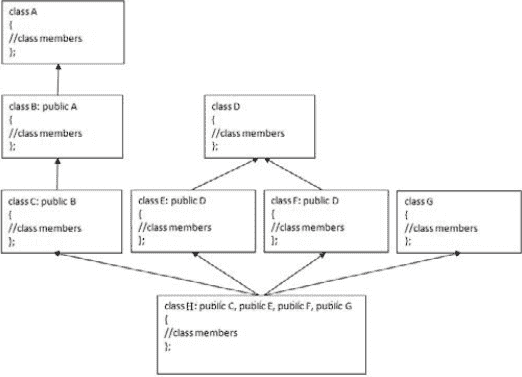

▲ 图6：展示混合继承

在图6中，类 H 继承自类 C、E、F 和 G。图中，类 A、B 和 C 展示了多级继承，而 D、E 和 F 展示了层次继承。

清单22展示了混合继承的示例（可以在光盘的 Code\Chapter7 文件夹中找到 HybridInheritance.cpp 文件）：

### 清单22：实现混合继承

```cpp
#include<iostream.h>

class MumbaiUniversity
{
    public:
    MumbaiUniversity()
    {
        cout<<"Mumbai University constructor calling"<<endl;
    }
    ~MumbaiUniversity()
    {
        cout<<"Mumbai University destructor calling"<<endl;
    }
};
class DelhiUniversity
{
    public:
    DelhiUniversity()
    {
        cout<<"Delhi University constructor calling"<<endl;
    }
    ~DelhiUniversity()
    {
        cout<<"Delhi University destructor calling"<<endl;
    }
};
class College:public DelhiUniversity
{
    public:
    College()
    {
        cout<<"College constructor calling"<<endl;
    }
    ~College()
    {
        cout<<"College destructor calling"<<endl;
    }
};
class MorningCollege:public College
{
    public:
    MorningCollege()
    {
        cout<<"Morning College constructor calling"<<endl;
    }
    ~MorningCollege()
    {
        cout<<"Morning College destructor calling"<<endl;
    }
};
class EveningCollege:public College
{
public:
    EveningCollege()
    {
        cout<<"Evening College constructor calling"<<endl;
    }
    ~EveningCollege()
    {
        cout<<"Evening College destructor calling"<<endl;
    }
};
class Correspondence:public DelhiUniversity
{
public:
    Correspondence()
    {
        cout<<"Correspondence constructor calling"<<endl;
    }
    ~Correspondence()
    {
        cout<<"Correspondence destructor calling"<<endl;
    }
};
class External:public DelhiUniversity
{
public:
    External()
    {
        cout<<"External constructor calling"<<endl;
    }
    ~External()
    {
        cout<<"External destructor calling"<<endl;
    }
};
class Student:public MumbaiUniversity,public MorningCollege,public EveningCollege,public External,public Correspondence
{
    char name[5];
    char id[10];
    int marks;
public:
    Student()
    {
        cout<<"Student constructor calling"<<endl;
    }
    ~Student()
    {
        cout<<"Student destructor calling"<<endl;
    }
    void acceptData()
    {
        cout<<"Accepting Student Details"<<endl;
        cout<<"Enter student id"<<endl;
        cin>>id;
        cout<<"Enter student name"<<endl;
        cin>>name;
        cout<<"Enter student marks"<<endl;
        cin>>marks;
    }
    void displayData()
    {
        cout<<"Showing Student Details"<<endl;
        cout<<"Id: "<<id<<endl;
        cout<<"Name: "<<name<<endl;

        cout<<"Marks: "<<marks<<endl;
    }
};
int main()
{
    Student s;
    s.acceptData();
    s.displayData();
    return 0;
}
```

**输出：**

```text
Mumbai University constructor calling
Delhi University constructor calling
College constructor calling
Morning College constructor calling
Delhi University constructor calling
College constructor calling
Evening College constructor calling
Delhi University constructor calling
External constructor calling
Delhi University constructor calling
Correspondence constructor calling
Student constructor calling
Accepting Student Details
Enter student id
1001
Enter student name
Shilpa
Enter student marks
87
Showing Student Details
Id: 1001
Name: Shilpa
Marks: 87
Student destructor calling
Correspondence destructor calling
Delhi University destructor calling
External destructor calling
Delhi University destructor calling
Evening College destructor calling
College destructor calling
Delhi University destructor calling
Morning College destructor calling
College destructor calling
Delhi University destructor calling
Mumbai University destructor calling
```

在清单22中，College、External 和 Correspondence 类继承自 DelhiUniversity 类，而 MorningCollege 和 EveningCollege 类继承自 College 类。注意，MumbaiUniversity 类不是这些类中任何一个的基类或派生类，而是一个独立类。Student 类派生自 MumbaiUniversity、MorningCollege、EveningCollege、External 和 Correspondence 类（按此顺序）。每个类都有自己的一对构造函数和析构函数。派生类 Student 有两个成员函数：acceptData() 和 displayData()。此外，在 main() 函数中，Student 类的 s 对象会按照这些类的继承顺序调用所有类的构造函数、析构函数和函数。


- **1.** 从多重继承、继承层次、以公有、私有和保护模式派生类等方面，解释 C++ 面向对象编程中的继承。使用合适的程序和类定义来举例说明这些概念。
- **2.** 编写面向对象程序，以示例说明不同类型的继承，即
  - 公有
  - 保护
  - 私有
  - 以及多重继承和层次继承（孟买大学，2007年12月）


在描述了各种继承类型之后，让我们来讨论多重继承中出现的一些歧义问题。

### 7.9 描述实现多重继承时的一些问题

在C++中，编译器在实现多重继承时会出现一些歧义。例如，当两个基类包含同名函数时会发生什么？下面的代码片段展示了这种歧义，因为 `display()` 函数同时继承自 `Myclass1` 和 `Myclass2` 类：

```cpp
class Myclass1
{
public:
    void display()
    {
        cout<<"My class 1"<<endl;
    }
};
class Myclass2
{
public:
    void display()
    {
        cout<<"My class 2"<<endl;
    }
};
class DerivedClass: public Myclass1,public Myclass2
{
    //Empty class
};
int main()
{
    DerivedClass obj;
    obj.display();
    // ambiguous for compiler

}
```

在前面的代码片段中，`DerivedClass` 类的 `obj` 对象调用了 `display()` 函数。然而，在这种情况下，C++编译器会产生编译错误，因为C++编译器不知道该调用 `Myclass1` 类还是 `Myclass2` 类的 `display()` 函数。出现这个问题的原因是 `DerivedClass` 类从 `Myclass1` 和 `Myclass2` 类中继承了两份 `display()` 函数副本。

多重继承中另一个歧义出现在派生类拥有同一基类的多个副本时，如图7所示：

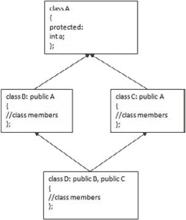

**图7：展示类A的多个副本继承到类D**

在图7中，有四个类：A、B、C和D。类B和类C继承自一个公共基类A，而类D同时继承自类B和类C。因此，类D拥有类A的两个副本。下面的代码片段展示了派生类如何接收一个类的变量的多个副本：

```cpp
class BaseA
{
public:
    int varA;
    ...
};
class BaseB: public BaseA
{
public:
    int varB;
    ...
};
class BaseC: public BaseA
{
public:
    int varC;
    ...
};
class DerivedClass: public BaseB, public BaseC
{
    public:
        int varD;
    ...
};
int main()
{
    DerivedClass obj;
    obj.varA=10;
    return 0;
}
```

前面的代码片段显示了一个错误，因为对 `obj` 对象中 `varA` 变量的引用是歧义的。这种歧义的产生是因为 `DerivedClass` 类继承了两份 `varA` 变量的副本，一份来自 `BaseB` 类，另一份来自 `BaseC` 类。

现在，让我们描述如何解决多重继承中出现的歧义。第一种歧义可以通过以下两种方式解决：

- 在派生类中重写基类函数
- 使用作用域解析运算符（::）

第二种歧义同样可以通过两种方式解决，如下所示：

- 使用作用域解析运算符（::）
- 实现虚基类的概念

接下来，让我们在以下各节中逐一详细描述这些解决方案：

### 在派生类中重写基类函数

当两个基类包含同名函数时，多重继承中出现的歧义问题可以通过在派生类中重写基类函数来解决。在这种情况下，你可以在派生类的重写函数中显式调用基类函数。清单23展示了如何在派生类中重写基类函数（你可以在随书CD的 `Code\Chapter7` 文件夹中找到 `OverridenMemberFunction.cpp` 文件）：

**清单23：通过在派生类中重写基类函数来解决歧义**

```cpp
#include<iostream.h>

class Myclass1
{
public:
    void display()
    {
        cout<<"My class 1"<<endl;
    }
};
class Myclass2
{
public:
    void display()
    {
        cout<<"My class 2"<<endl;
    }
};
class DerivedClass: public Myclass1,public Myclass2
{
public:
    void display()
    {
        Myclass1::display();
        Myclass2::display();
        cout<<"Derived class "<<endl;
    }
};
int main()
{
    DerivedClass obj;
    obj.display();
    return 0;
}
```

**输出：**

```text
My class 1
My class 2
Derived class
```

在清单23中，编译器不会遇到歧义，因为派生类中的 `display()` 函数重写了基类函数。

解决同一问题的另一种方法是使用`::`运算符。让我们在下一节中理解这一点。

### 使用作用域解析运算符

多重继承中的歧义问题也可以通过使用`::`运算符来解决。清单24展示了如何使用`::`运算符来解决多重继承中出现的歧义问题（你可以在随书CD的 `Code\Chapter7` 文件夹中找到 `UsingSRO1.cpp` 文件）：

**清单24：使用`::`运算符解决歧义**

```cpp
#include<iostream.h>

class Myclass1
{
public:

void display()
{
    cout<<"My class 1"<<endl;
}
};

class Myclass2
{
public:
    void display()
    {
        cout<<"My class 2"<<endl;
    }
};

class DerivedClass: public Myclass1,public Myclass2
{
    //Empty class
};

int main()
{
    DerivedClass obj;
    obj.Myclass1::display();        //Use of scope resolution operator (::)
    obj.Myclass2::display();        //Use of scope resolution operator (::)
    return 0;
}
```

**输出：**

```text
My class 1
My class 2
```

在清单24中，不会出现歧义，因为 `DerivedClass` 类的对象 `obj` 通过使用`::`运算符显式调用了两个基类（`Myclass1` 和 `Myclass2`）的 `display()` 成员函数。

`::`运算符的重要性并不止于此。`::`运算符还解决了多重继承中的另一个问题，即当派生类拥有同一基类的多个副本时出现的问题。清单25展示了如何使用`::`运算符来解决当派生类拥有同一基类的多个副本时出现的歧义问题（你可以在随书CD的 `Code\Chapter7` 文件夹中找到 `UsingSRO2.cpp` 文件）：

**清单25：使用`::`运算符来创建基类的单个副本**

```cpp
#include<iostream.h>

class BaseA
{
public:
    int varA;
};
class BaseB: public BaseA
{
public:
    int varB;
};
class BaseC: public BaseA
{
public:
    int varC;
};
class DerivedClass: public BaseB, public BaseC
{
public:
    int varD;
};

int main()
{
    DerivedClass obj;
    obj.BaseB::varA=10;
    obj.BaseC::varA=50;
    return 0;
}
```

在清单25中，`DerivedClass` 类的对象 `obj` 可以借助`::`运算符访问 `BaseB` 和 `BaseC` 类的 `varA` 变量。

### 实现虚基类的概念

我们知道，当一个基类被多个类继承，然后一个派生类又继承自这些多个类时，C++编译器会遇到一个问题。整个过程会在派生类中产生基类成员的多个副本。这个问题可以通过两种方式解决：使用`::`运算符（如前节所述），以及使用虚基类的概念。

虚基类的概念是使用 `virtual` 关键字从一个基类继承一个或多个派生类。请注意，当你创建虚基类时，内存中只有一份基类成员的副本。此外，这种派生类继承自虚基类的继承方式也称为虚继承。清单26展示了如何创建和使用虚基类（你可以在随书CD的 `Code\Chapter7` 文件夹中找到 `VirtualBase.cpp` 文件）：

**清单26：创建和使用虚基类**

```cpp
#include<iostream.h>

class BaseA
{
public:
    int varA;
};

class BaseB: virtual public BaseA
{
public:
    int varB;
};

class BaseC: virtual public BaseA
{
public:
    int varC;
};

class DerivedClass : public BaseB, public BaseC
{
public:
    int varD;
};

int main()
{
    DerivedClass obj;
    obj.varA=10;      /*No ambiguity because only one copy of varA exists*/
    return 0;
}
```

在清单26中，`BaseB` 和 `BaseC` 类通过使用 `virtual` 关键字从虚基类 `BaseA` 继承，而 `DerivedClass` 类同时继承自 `BaseB` 和 `BaseC` 类，因此 `DerivedClass` 类只继承了 `BaseA` 的 `varA` 变量的一份副本。这样，通过 `DerivedClass` 类的对象对 `varA` 变量的任何引用都不会导致歧义。


如你所知，在多继承的情况下，基类构造函数按照继承顺序被调用。现在假设一个程序同时拥有虚基类、非虚基类、成员对象和派生类。在这种情况下，构造函数的调用顺序是怎样的？此时，构造函数的调用顺序如下：

- 1. 虚基类构造函数，按照继承顺序
- 2. 非虚基类构造函数，按照继承顺序
- 3. 成员对象构造函数，按照声明顺序
- 4. 派生类构造函数

清单27展示了当程序同时拥有虚基类、非虚基类、成员对象和派生类时构造函数和析构函数的调用顺序（你可以在随书CD的Code\Chapter7文件夹中找到ConsDesInvocationOrder.cpp文件）。

## 清单27：在复杂继承程序中调用构造函数和析构函数

```cpp
#include<iostream.h>

class A
{
public:
    A()
    {
        cout<<"Constructor of A class"<<endl;
    }
    ~A()
    {
        cout<<"Destructor of A class"<<endl;
    }
};

class B
{
public:
    B()
    {
        cout<<"Constructor of B class"<<endl;
    }
    ~B()
    {
        cout<<"Destructor of B class"<<endl;
    }
};

class C : virtual public A
{
public:
    C()
    {
        cout<<"Constructor of C class"<<endl;
    }
    ~C()
    {
        cout<<"Destructor of C class"<<endl;
    }
};

class D : virtual public A
{
public:
    D()
    {
        cout<<"Constructor of D class"<<endl;
    }
    ~D()
    {
        cout<<"Destructor of D class"<<endl;
    }
};

class E
{
public:
    E()
    {
        cout<<"Constructor of E class"<<endl;
    }
    ~E()
    {
        cout<<"Destructor of E class"<<endl;
    }
};

class F : public B, public C, public D
{
private:
    E objE;
public:
    F()
    {
        cout<<"Constructor of F class"<<endl;
    }
    ~F()
    {
        cout<<"Destructor of F class"<<endl;
    }
};

int main()
{
    F objF;
    cout<<"Program Over"<<endl;
    return 0;
}
```

输出：

```text
Constructor of A class
Constructor of B class
Constructor of C class
Constructor of D class
Constructor of E class
Constructor of F class
Program Over
Destructor of F class
Destructor of E class
Destructor of D class
Destructor of C class
Destructor of B class
Destructor of A class
```

在清单27中，C类和D类虚继承自A类。换句话说，可以说A是C类和D类的虚基类。F类派生自非虚基类B、C和D。同时，F类也是E类的容器类，因为它包含E类的objE对象。现在，在main()函数中，创建了F类的objF对象，以调用清单27中所有类（A、B、C、D、E和F）的构造函数和析构函数。这些类的构造函数按以下顺序调用：虚基类、非虚基类、成员对象以及派生类。

需要注意的是，在清单27中，所有类的析构函数的调用顺序与构造函数相反，即派生类、成员对象、非虚基类、虚基类。

## 测试你的知识

Q8. 考虑如图8所示的各种类的继承结构：

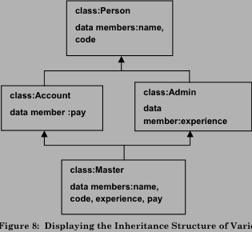

在图8中，Master类从Account和Admin类派生信息，而这两个类又从Person类派生信息。

现在，定义所有这四个类，并编写一个程序来创建、更新和显示Master类对象中包含的代码信息。

答案：

```cpp
#include<iostream.h>

class Person
{
    public:
        char name[20];
        int code;
        void get_name()
        {
            cout<<"Enter name : ";
            cin>>name;
            cout<<endl;
        }
        void get_code()
        {
            cout<<"Enter code : ";
            cin>>code;
            cout<<endl;
        }
        void display_namecode()
        {
            cout<<"Name : "<<name<<endl;
            cout<<"Code : "<<code<<endl;
        }
};

class Account : virtual public Person
{
    protected:
        int pay;
    public:
        void get_pay()
        {
            cout<<"Enter pay : ";
            cin>>pay;
            cout<<endl;
        }
        void display_pay()
        {
            cout<<"Pay : "<<pay<<endl;
        }
};

class Admin : virtual public Person
{
    public:
        int experience;
    public:
        void get_exp()
        {
            cout<<"Enter experience : ";
            cin>>experience;
            cout<<endl;
        }
        void display_exp()
        {
            cout<<"Experience : "<<experience<<endl;
        }
};

class Master : public Account, public Admin
{
    public:
        void getdata()
        {
            get_name();
            get_code();
            get_pay();
            get_exp();
        }
        void displaydata()
        {
            display_namecode();
            display_pay();
            display_exp();
        }
};

void main()
{
    Master m[10];
    int num,code,ch;
    char choice;
    do
    {
        cout<<"Main Menu"<<endl;
        cout<<"1 : Create"<<endl;
        cout<<"2 : Display"<<endl;
        cout<<"3 : Update"<<endl;
        cin>>ch;
        switch(ch)
        {
            case 1: cout<<"Enter no. of persons"<<endl;
                cin>>num;
                for(int i=0;i<num;i++)
                {
                    m[i].getdata();
                }
                break;

            case 2: cout<<"The details are: "<<endl;
                for(i=0;i<num;i++)
                {
                    m[i].displaydata();
                }
                break;

            case 3: cout<<"Enter the code"<<endl;
                cin>>code;
                for(i=0;i<num;i++)
                {
                    if(m[i].code==code)
                    {
                        m[i].get_name();
                        m[i].get_pay();
                        m[i].get_exp();
                        break;
                    }
                }
        }
        cout<<"Do you want to continue (Y for yes and N for No)"<<endl;
        cin>>choice;
    }while(choice=='y'||choice=='Y');
}
```

### 输出

```text
Main Menu
1 : Create
2 : Display
3 : Update
1
Enter no. of persons
2
Enter name : Vandana

Enter code : 101

Enter pay : 4000

Enter experience : 1

Enter name : Shilpa

Enter code : 202

Enter pay : 7000

Enter experience : 2
Do you want to continue (Y for yes and N for No)
y
Main Menu
1 : Create
2 : Display
3 : Update
2
The details are:
Name : Vandana
Code : 101
Pay : 4000
Experience : 1
Name : Shilpa
Code : 202
Pay : 7000
Experience : 2
Do you want to continue (Y for yes and N for No)
y
Main Menu
1 : Create
2 : Display
3 : Update
3
Enter the code
202
Enter name : Shilpa

Enter pay : 8000

Enter experience : 2

Do you want to continue (Y for yes and N for No)
Y
Main Menu
1 : Create
2 : Display
3 : Update
2
The details are:
Name : Vandana
Code : 101
Pay : 4000
Experience : 1
Name : Shilpa
Code : 202
Pay : 8000
Experience : 2
Do you want to continue (Y for yes and N for No)
N
```

现在，让我们学习如何创建和使用C++类的指针对象。

### 7.10 创建和使用指针对象

在C++编程中，你还可以创建类的指针类型对象。指针是一种存储另一个变量内存地址的变量。你还可以获取指针所引用的值。这种获取值的过程称为解引用指针。你可以像创建结构体变量一样创建指向类对象的指针。创建一个类的指针对象的语法如下面的代码片段所示：

```cpp
class Employee
{
public:
int x;
void employeeDetails()
{
...
```


在前面的代码片段中，ptremp 被声明为 Employee 类的指针对象。ptremp 对象使用 Employee 类的 emp 对象的引用进行初始化。Employee 类有两个公有类成员：x 变量和 employeeDetails() 函数。这些类成员通过 ptremp 指针对象访问。* 符号用于获取 ptremp 指针对象所指向位置的实际数据，. 运算符用于访问 Employee 类的成员。请注意，在此上下文中，* 符号称为解引用运算符。解引用运算符用于检索指针所指向的对象。

初始化类类型指针对象的另一种方法是使用 new 运算符，如下面的代码片段所示：

```cpp
class Employee
{
public:
int x;
void employeeDetails()
{
...
}
};
void main()
{
Employee *ptremp;             /*Creating a pointer object of a class type*/
ptremp = new Employee;        /*Initializing pointer object with the new
                                operator*/

ptremp->x;                    /*Accessing the data member of the class*/
ptremp->employeeDetails();    /*Invoking the member function of the class*/
delete ptremp;                /*releasing memory using the delete operator*/
}
```

在前面的代码片段中，ptremp 被声明为 Employee 类的指针对象。ptremp 指针对象借助 new 运算符初始化，并使用 delete 运算符销毁。对于指针，类成员通过 -> 运算符访问，而不是 . 运算符。不过，这两个运算符执行相同的任务，只是语法上不同。

清单 28 展示了一个创建类指针对象的示例（你可以在 CD 的 Code\Chapter7 文件夹中找到 PointerObject1.cpp 文件）：

### 清单 28：创建指针对象

```cpp
#include<iostream.h>
class ABC
{
int num1;
//private data member
public:
int num2;
//public data member
void setValue(int);
void displayValue();
};
void ABC::setValue(int p)
{
num1=p;
}
void ABC::displayValue()
{
cout<<"num1 = "<<num1<<endl;
cout<<"num2 = "<<num2<<endl;
}
void main()
{
ABC obj, *ptr;
// Creating a pointer as well as a normal object
ptr=&obj;
//pointer object is assigned
ptr->setValue(44);
ptr->num2=76;
(*ptr).displayValue();
}
```

输出：

```text
num1 = 44
num2 = 76
```

在清单 28 中，创建了 ABC 类，它有一个私有成员 num1 和三个公有成员 num2、setValue() 和 displayValue()。setValue() 和 displayValue() 函数使用 :: 运算符在 ABC 类外部定义。在 main() 函数中，obj 和 ptr 分别是 ABC 类的普通对象和指针对象。obj 对象的引用被赋给 ptr 对象。-> 运算符用于访问成员 setValue() 和 num2，而 ABC 类的 displayValue() 函数通过 . 运算符访问。

清单 29 展示了如何分别使用 new 和 delete 运算符初始化和销毁类的指针对象（你可以在 CD 的 Code\Chapter7 文件夹中找到 PointerObject2.cpp 文件）：

### 清单 29：对指针对象使用 new 和 delete 运算符

```cpp
#include<iostream.h>

class ABC
{
int num1;
//private data member
public:
int num2;
//public data member
void setValue(int);
void displayValue();
};
void ABC::setValue(int p)
{
num1=p;
}
void ABC::displayValue()
{
cout<<"num1 = "<<num1<<endl;
cout<<"num2 = "<<num2<<endl;
}
void main()
{
ABC *ptr;
// Creating a pointer object
ptr= new ABC();
//pointer object is assigned
ptr->setValue(44);
ptr->num2=76;
ptr->displayValue();
delete ptr;
}
```

输出：

```text
num1 = 44

num2 = 76
```

在清单 29 中，创建了 ABC 类，它有一个私有成员 num1 和三个公有成员 num2、setValue() 和 displayValue()。setValue() 和 displayValue() 函数使用 :: 运算符在 ABC 类外部定义。在 main() 函数中，ptr 被声明为 ABC 类的指针对象。ptr 对象使用 new 运算符通过类引用初始化。-> 运算符用于访问 ABC 类的 num2、setValue() 和 displayValue() 成员。最后，delete 运算符销毁 ptr 对象。

现在，让我们学习如何在 C++ 语言中创建以下内容：

- 类成员的指针
- 指针对象数组
- 基类和派生类的指针对象

## 创建类成员的指针

在 C++ 中，可以使用 ::* 运算符声明类成员的指针。::* 运算符称为指向类成员的声明符运算符。声明类变量指针的语法是：

```cpp
<data_type> <class_name>::*<pointer_name>;
```

声明指向类成员函数的指针的语法是：

```cpp
<return_type> (<class_name>::*<pointer_name>) ();
```

以下代码片段展示了声明指向类成员的指针的示例：

```cpp
int ABC::*varp1;
//Declaring a pointer to a data member

void (ABC::*funcp)();
//Declaring a pointer to a member function
```

初始化指向类成员的指针的语法是：

```cpp
<pointer_name>=& <class_name> :: <membername>;
```

在前面的语法中，请注意 <membername> 和 <pointer_name> 表达式的数据类型或返回类型必须相同。

以下代码片段展示了指向类成员的指针的初始化：

```cpp
varp1=&ABC::num2;
//Assigning a data member to a pointer
funcp=&ABC::displayValue;
//Assigning a member function to a pointer
```

还可以将指向类成员的指针与类的对象名一起声明，以使用 .* 运算符访问类成员。.* 运算符也称为指向类成员的解引用指针运算符。以下代码片段展示了 .* 运算符的用法：

```cpp
ABC obj;
obj.*varp1;
(obj.*funcp)();
```

在前面的代码片段中，obj 是 ABC 类的一个对象，它与 .* 运算符一起使用来访问同一类的成员。

清单 30 展示了一个声明和使用指向类成员的指针的示例（你可以在 CD 的 Code\Chapter7 文件夹中找到 PointerAccessClassMembers.cpp 文件）：

### 清单 30：声明和使用指向类成员的指针

```cpp
#include<iostream.h>

class ABC
{
int num1;
//private data member
public:
int num2;
//public data member
ABC(int,int);
void displayValue();
};
ABC::ABC(int p, int q)
{
num1=p;
num2=q;
}
void ABC::displayValue()
{
cout<<"num1 = "<<num1<<endl;
cout<<"num2 = "<<num2<<endl;
}
void main()
{
int ABC::*varp1;
//Declaring a pointer to a data member
void (ABC::*funcp)();
//Declaring a pointer to a member function
ABC obj(20,40);
varp1=&ABC::num2;
//Assigning class member using pointer
funcp=&ABC::displayValue;
obj.*varp1=75;
//Modifying data member using pointer
(obj.*funcp)();
//Calling member function using pointer
}
```

输出：

```text
num1 = 20
num2 = 75
```

在清单 30 中，创建了 ABC 类，它有一个私有成员 num1 和三个公有成员 num2、ABC() 和 displayValue()。ABC() 构造函数和 displayValue() 函数使用 :: 运算符在 ABC 类的边界之外定义。在 main() 函数中，声明了 varp1 和 funcp 指针，并将它们分别赋值为 ABC 类的 num2 变量和 displayValue() 成员函数。此外，ABC 类的对象 obj 与 varp1 和 funcp 指针一起使用，以访问相应的类成员。

还可以使用类的指针对象来声明指向类成员的指针。以下代码片段展示了使用通过 ->* 运算符指向类成员的指针对象：

```cpp
ABC obj, *ptr;
ptr=&obj;
ptr->*varp1;
(ptr->*funcp)();
```

在前面的代码片段中，*ptr 是 ABC 类的一个指针对象，它使用 obj 对象的引用进行初始化。然后，ptr 指针对象与 ->* 运算符一起使用来访问 ABC 类的成员。

清单 31 展示了如何将指针对象与 ->* 运算符一起使用来访问指向类成员的指针（你可以在 CD 的 Code\Chapter7 文件夹中找到 Pointer_ClassMembers_Objects.cpp 文件）：

### 清单 31：使用带 ->* 运算符的指针对象进行声明和使用

```cpp
#include<iostream.h>
class ABC
{
int num1;
//private data member
public:
int num2;
//public data member
ABC(int,int);
void displayValue();
};
ABC::ABC(int p, int q)
{
num1=p;
num2=q;
}
void ABC::displayValue()
```


```cpp
{
cout<<"num1 = "<<num1<<endl;
cout<<"num2 = "<<num2<<endl;
}
void main()
{
int ABC::*varp1;
//Declaring a pointer to a data member
void (ABC::*funcp)();
//Declaring a pointer to a member function
ABC obj(20,40), *ptr;
ptr=&obj;
varp1=&ABC::num2;
//Assigning class member using pointer
funcp=&ABC::displayValue;
ptr->*varp1=75;
//Modifying data member using pointer
(*ptr->*funcp)();
//Calling member function using pointer
}
```

**输出：**

```text
num1 = 20
num2 = 75
```

在清单 31 中，创建了 ABC 类，该类有一个私有成员 num1，以及三个公有成员 num2、ABC() 和 displayValue()。ABC() 构造函数和 displayValue() 函数使用 :: 运算符在 ABC 类外部定义。在 main() 函数中，声明了指针 varp1 和 funcp，并分别将其赋值为 num2 变量和 ABC 类的 displayValue() 成员函数。此外，还创建了 ABC 类的两个对象 obj 和 ptr，其中 ptr 是一个指针对象，并用 obj 对象的引用进行初始化。然后，使用 ptr 指针对象配合 ->* 运算符以及 varp1 和 funcp 指针来访问 ABC 类的成员。

## 创建指针对象数组

可以创建指针对象数组，其中每个指针对象都指向一个单独的类对象。声明指针对象数组的语法为：

```cpp
<class_name> *pointer_name [array_size];
```

声明指针对象数组的示例如下：

```cpp
Employee *ptremp[10];
```

在前面的示例中，ptremp 表示 Employee 类的指针对象数组，数组大小为 10。

清单 32 展示了如何创建类的指针对象数组（可以在光盘的 Code\Chapter7 文件夹中找到 ArrayPointerObjects.cpp 文件）：

### 清单 32：创建类的指针对象数组

```cpp
#include<iostream.h>
class ABC
{
int num1;
//private data member
public:
int num2;
//public data member
void setValue(int);
void displayValue();
};
void ABC::setValue(int p)
{
num1=p;
}
void ABC::displayValue()
{
cout<<"num1 = "<<num1<<endl;
cout<<"num2 = "<<num2<<endl;
}
void main()
{
ABC obj[4];
//Declaring an array of objects
for(int i=0;i<4;i++)
{
obj[i].setValue(i+1);
obj[i].num2=(i+1)*5;
}
ABC *ptr[4];
for(int k=0;k<4;k++)
ptr[k]=&obj[k];
for(int j=0;j<4;j++)
{
cout<<"Object no. "<<j+1<<endl;
ptr[j]->displayValue();
cout<<endl;
}
}
```

**输出：**

```text
Object no.1
num1 = 1
num2 = 5

Object no.2
num1 = 2
num2 = 10

Object no.3
num1 = 3
num2 = 15

Object no.4
num1 = 4
num2 = 20
```

在清单 32 中，创建了 ABC 类，该类有一个私有成员 num1 和三个公有成员 num2、setValue() 和 displayValue()。setValue() 和 displayValue() 函数使用 :: 运算符在 ABC 类外部定义。在 main() 函数中，obj 是对象数组，而 ptr 是 ABC 类的指针对象数组。在 for 循环中，将 obj 对象数组的引用分别赋给 ptr 对象数组的每个元素。使用 -> 运算符访问 ABC 类的 displayValue() 函数。

## 创建基类和派生类的指针对象

在 C++ 中，指向基类的指针可以指向任意派生类的对象。以下代码片段展示了基类如何指向派生类对象：

```cpp
A *PtrObj;
PtrObj = & B;
PtrObj = & C;
```

在前面的代码片段中，A 表示基类，而 B 和 C 派生自该基类。PtrObj 是类 A 的指针对象，并用 B 类和 C 类的引用进行初始化。

清单 33 展示了如何创建和使用基类和派生类的指针对象（可以在光盘的 Code\Chapter7 文件夹中找到 PointerDerivedObjects.cpp 文件）：

### 清单 33：创建和使用基类和派生类的指针对象

```cpp
#include<iostream.h>
class ABC
{
int num1;
//private data member
public:
int num2;
//public data member
void setValue(int);

o4->displayValue();
}
```

**输出：**

```text
Base class members
num1 = 1
num2 = 10
Base class members using derived object
num1 = 3
num2 = 30
Derived class members
num1 = 3
num2 = 30
num3 = 4
num4 = 40
```

在清单 33 中，ABC 和 XYZ 是两个类，其中 ABC 是基类，XYZ 是它的派生类。ABC 类有一个私有成员 num1 和三个公有成员 num2、setValue() 和 displayValue()。类似地，XYZ 类有一个私有成员 num3 和三个公有成员 num4、setValue() 和 displayValue()。这两个类的 setValue() 和 displayValue() 函数都使用 :: 运算符在类外部定义。

在 main() 函数中，o1 是 ABC 类的指针对象，o2 是 ABC 类的普通对象。将 o2 对象的引用赋给 o1 对象，并借助 -> 运算符通过 o1 指针对象访问 ABC 类的类成员。接下来，声明 XYZ 类的对象 o3。现在，将 o3 对象的引用赋给 o1 指针对象。借助 -> 运算符通过 o1 指针对象访问 ABC 类的类成员。最后，创建 XYZ 类的指针对象 o4，并用 o3 对象的引用对其进行初始化。不过，这一次是借助 -> 运算符通过 o4 指针对象访问 XYZ 类的类成员。

在创建和使用指针对象之后，让我们学习静态绑定和动态绑定及其在 C++ 中的实现。

### 7.11 实现静态绑定和动态绑定

在 C++ 中，可以通过函数重载、运算符重载以及使用虚函数实现动态绑定来实现多态。动态绑定是动态多态概念的实际实现。在解释动态绑定之前，我们先解释多态和动态多态。某种事物以不止一种形式出现的现象称为多态。多态可以细分为两种形式：静态多态和动态多态。本节重点介绍动态多态，它在 C++ 中用于派生类重写基类中声明的函数时。

动态多态是指实体根据其将要扮演的角色或所处的上下文改变其形式。这个概念可以类比为变色龙在不同环境下改变颜色。当一个函数以不止一种形式存在时，就说该函数表现出动态多态。C++ 编译器在运行时将函数调用与正确的函数定义相匹配，这称为 `dynamic binding`。不过，要实现动态绑定，虚函数的概念很重要。

让我们在静态绑定和动态绑定的背景下学习以下主题：

- 静态绑定或早期绑定
- 动态绑定或后期绑定与虚函数
- 静态绑定与动态绑定的区别
- 纯虚函数
- 抽象类
- 虚析构函数

### 实现静态绑定或早期绑定

绑定是指将对象或类与其成员关联起来的行为。清单 34 展示了一个绑定示例（可以在光盘的 Code\Chapter7 文件夹中找到 Binding.cpp 文件）：

### 清单 34：实现绑定

```cpp
#include <iostream.h>

class A
{
public:
    void display()
    {
        cout << "Class A" << endl;
    }
};
class B: public A
{
public:
    void display()
    {
        cout << "Class B" << endl;
    }
};
class C: public A
{
public:
    void display()
    {
        cout << "Class C" << endl;
    }
};
int main()
{
    A obj;
    obj.display();
    return 0;
}
```

**输出：**

```text
Class A
```

在清单 34 中，创建了类 A 的 obj 对象，并调用了 display() 成员函数，如下面的代码片段所示：

```cpp
A obj;
obj.display();
```

在前面的代码片段中，对 C++ 编译器来说不存在歧义，因为它知道 display() 函数的引用属于 A 类。

如果类的对象是指针类型，那么编译器调用该类的成员函数同样没有问题，如下面的代码片段所示：

```cpp
A *PtrObj;
PtrObj = new A;
PtrObj->display();
```

在前面的代码片段中，编译器需要将 display() 函数关联到某个特定的类。这里同样不存在歧义。编译器根据 PtrObj 指针对象的类型，将该函数关联到类 A。

默认情况下，C++ 在编译时将函数调用与正确的函数定义相匹配，这称为静态绑定或早期绑定。清单 35 展示了一个静态绑定或早期绑定的示例（可以在光盘的 Code\Chapter7 文件夹中找到 StaticBinding.cpp 文件）：

### 清单 35：实现静态绑定或早期绑定

```cpp
#include <iostream.h>
class X
{
public:
  void display()
  {
    cout << "Class X" << endl;
  }
```


```cpp
};
class Y: public X
{
public:
    void display()
    {
        cout << "class Y" << endl;
    }
};

void outerDisplay(X &ptr)
{
    ptr.display();
}

int main()
{
    Y obj;
    outerDisplay(obj);
    return 0;
}
```

输出：
```text
class X
```

在清单35中，有两个类 X 和 Y。X 是基类，而 Y 是 X 类的派生类。在 main() 函数中，声明了一个 Y 类的对象 obj。然而，C++ 编译器并没有调用 Y 类的成员函数，而是始终调用 X 类的成员函数。这是因为默认情况下，静态绑定发生在编译时。因此，尽管 Y 类的对象作为参数传递给 outerDisplay() 函数，但 outerDisplay() 函数接收的是 X 类对象的引用。除了静态绑定之外，还有一种在运行时进行函数调用的机制，称为动态绑定。我们将在下一节讨论这一点。

## 使用虚函数实现动态绑定或晚期绑定

在某些情况下，当我们用 C++ 编写程序时，对象或指针的类型在编译时可能无法确定。例如，可能需要创建一个员工列表。根据部门的要求以及所需员工的类型，需要计算员工的净工资。在这种情况下，员工数量及其部门并不固定，这些值是在执行时提供的。这意味着，在此类情况下，函数到类的绑定是在运行时完成的，这一过程称为动态绑定或晚期绑定。

你知道，在 C++ 中，基类的指针可以指向任何派生类的对象。例如，假设有一个 A 类的指针对象。现在，这个指针对象可以指向其子类 B 和 C 的对象，如下面的代码片段所示：

```cpp
A *PtrObj;
PtrObj = new B;
PtrObj = new C;
```

在前面的代码片段中，请注意，虽然指针对于晚期绑定是必要的，但仅靠指针不足以实现它。这是因为，尽管基类指针可以用基类的派生类来初始化，但基类指针始终调用基类的成员。清单36展示了一个使用基类指针的示例，该指针用派生类进行初始化（你可以在 CD 的 Code\Chapter7 文件夹中找到 LateBinding.cpp 文件）：

### 清单 36：用派生类初始化基类指针

```cpp
#include <iostream.h>

class A
{
public:
    void display()
    {
        cout << "Class A" << endl;
    }
};

class B: public A
{
public:
    void display()
    {
        cout << "Class B" << endl;
    }
};

class C: public A
{
public:
    void display()
    {
        cout << "Class C" << endl;
    }
};

int main()
{
    A *PtrObj;
    PtrObj = new B;
    PtrObj->display();
    PtrObj = new C;
    PtrObj->display();
    return 0;
}
```

输出：
```text
Class A
Class A
```

在清单36中，尽管 PtrObj 指向 B 类的对象，编译器始终调用 A 类的成员函数。这是因为，PtrObj 指针的内容在其声明时并不已知，因此绑定发生在编译时。

因此，仅使用基类指针不足以实现晚期绑定。

晚期绑定通过实现虚函数的概念来保证。虚函数是在基类中声明为 virtual 并由派生类重新定义的函数。虚函数的声明前始终带有 `virtual` 关键字。函数被声明为虚函数，是因为它的执行取决于上下文（即用于调用它的基类指针的内容），而该上下文在编译时是未知的。

清单37展示了通过将基类的函数声明为虚函数，在类中实现晚期绑定的方式（你可以在 CD 的 Code\Chapter7 文件夹中找到 LateBinding_VirtualFunc.cpp 文件）：

### 清单 37：使用 virtual 函数实现晚期绑定

```cpp
#include <iostream.h>

class A
{
public:
    virtual void display()
    {
        cout << "Class A" << endl;
    }
};

class B: public A
{
public:
    void display()
    {
        cout << "class B" << endl;
    }
};

class C: public A
{
public:
    void display()
    {
        cout << "class C" << endl;
    }
};

int main()
{
    A *PtrObj;
    PtrObj = new B;
    PtrObj->display();
    PtrObj = new C;
    PtrObj->display();
    return 0;
}
```

输出：
```text
class B
class C
```

在清单37中，A 类的 display() 成员函数是虚函数。当虚函数被继承时，其虚特性也会被继承。函数的虚特性意味着该函数仅在概念上存在，并没有真实的存在。因此，虚函数是基类的成员函数，可以在派生类中重新定义。此外，基类中的虚函数确保编译器调用相应派生类中重新定义的虚函数，即使你使用基类的指针或引用调用了该函数。声明或继承虚函数的类称为多态类。

虚函数不能是全局函数或静态函数，因为根据定义，虚函数是基类的成员函数，并依赖特定对象来确定调用该函数的哪个实现。你可以将虚函数声明为另一个类的友元。

请注意，当函数在基类中被声明为 virtual 时，你可以使用 :: 运算符直接访问该函数。这是因为，:: 运算符会抑制对派生类函数实现的调用，而调用基类中定义的函数实现。

此外，如果你没有在派生类中重写某个虚成员函数，则对该函数的调用会使用基类中定义的函数实现。清单38展示了如何使用 `::` 运算符调用基类的虚函数（你可以在 CD 的 Code\Chapter 7 文件夹中找到 CallVirtualFuncBySRO.cpp 文件）：

### 清单 38：使用 :: 运算符调用基类的虚函数

```cpp
#include <iostream.h>

class A
{
public:
    virtual void display1()
    {
        cout << "Class A: Function display 1" << endl;
    }
    virtual void display2()
    {
        cout << "Class A: Function display 2" << endl;
    }
};

class B: public A
{
public:
    void display1()
    {
        cout << "Class B: Function display 1" << endl;
    }
};

class C: public A
{
public:
    void display1()
    {
        cout << "Class C: Function display 1" << endl;
    }
    void display2()
    {
        cout << "Class C: Function display 2" << endl;
    }
};

int main()
{
    A *PtrObj;
    PtrObj = new B;
    PtrObj->display1();
    PtrObj->display2();
    PtrObj = new C;
    PtrObj->display1();
    PtrObj->A::display2();
    return 0;
}
```

输出：
```text
Class B: Function display 1
Class A: Function display 2
Class C: Function display 1
Class A: Function display 2
```

在清单38中，A 类有两个虚函数：display1() 和 display2()。虚函数 display1() 被派生类 B 和 C 重写，因为这两个类都有自己的 display1() 函数。然而，虚函数 display2() 仅被派生类 C 重写。

现在，在 main() 函数中，创建了 A 类的 PtrObj 对象，它指向 B 类。PtrObj 对象调用 B 类的 display1() 函数和 A 类的 display2() 函数。这是因为 B 类没有自己的 display2() 函数定义。接下来，PtrObj 对象指向 C 类，然后它调用 C 类的 display1() 函数和 A 类的 display2() 函数，尽管 C 类有自己的 display2() 函数。这是因为该指针对象通过 :: 运算符显式调用 A 类的 display2() 函数。

### 测试你的知识

- Q9. 创建一个名为 Shape 的基类，其中包含计算各种图形面积的方法。现在，从 Shape 类派生两个类，即 Rectangle 和 Triangle，并在这些类中重写基类（Shape）的方法，以接受图形各边的值，然后计算该图形的面积（提示：使用虚函数的概念）。

答案。

```cpp
#include<iostream.h>

class Shape
{
    protected:
        double arearect;
        double areatri;
        int x,y;
    public:
        virtual void get_data()
        {
            arearect=0;areatri=0;x=0;y=0;
        }
};
```


```cpp
virtual void area()
{}
virtual void display()
{}
};

class Rectangle:public Shape
{
    public:
    void get_data()
    {
        cout<<"Enter the length of rectangle"<<endl;
        cin>>x;
        cout<<"Enter the breadth of rectangle"<<endl;
        cin>>y;
    }
    void area()
    {
        arearect=x*y;
    }
    void display()
    {
        cout<<"Area of rectangle = "<<arearect<<endl;
    }
};

class Triangle:public Shape
{
    public:
    void get_data()
    {
        cout<<"Enter the height of the triangle"<<endl;
        cin>>x;
        cout<<"Enter the base of the triangle"<<endl;
        cin>>y;
    }
    void area()
    {
        areatri=(x*y)/2;
    }
    void display()
    {
        cout<<"Area of triangle = "<<areatri<<endl;
    }
};

void main()
{
    Shape *p;
    Rectangle r1;
    Triangle t1;
    p=&r1;
    p->get_data();
    p->area();
    p->display();
    p=&t1;
    p->get_data();
    p->area();
    p->display();
}
```

```text
Output:

Enter the length of rectangle
20
Enter the breadth of rectangle
5
Area of rectangle = 100
Enter the height of the triangle
50
Enter the base of the triangle
35
Area of triangle = 875
```

**第10题.** 创建一个程序，使用基类的引用来访问虚函数。

答案：

```cpp
#include <iostream.h>

class A {
public:
    virtual void myFunc() {
        cout << "This is A's myFunc().\n";
    }
};
class B1 : public A {
public:
    void myFunc() {
        cout << "This is B1's myFunc().\n";
    }
};
class B2 : public A {
public:
    void myFunc() {
        cout << "This is B2's myFunc().\n";
    }
};
// Use a A class reference parameter.
void f(A &r) {
    r.myFunc();
}
int main()
{
    A aObj;
    B1 b1Obj;
    B2 b2Obj;
    f(aObj);  // passing A object to f()
    f(b1Obj); // passing B1 object to f()
    f(b2Obj); // passing B2 object to f()
    return 0;
}
```

```text
Output:

This is A's myFunc().
This is B1's myFunc().
This is B2's myFunc().
```

**第11题.** 创建一个程序，使用基类的引用来访问虚函数。

答案：

```cpp
#include <iostream.h>

class Book
{
public:
    virtual void getDescription() { cout<<"Book"<<endl; }
};
class Suspense : public Book
{
public:
    virtual void getDescription() {
        cout<<"Suspense ";
        Book::getDescription();
    }
};
class Thriller : public Suspense
{
public:
    virtual void getDescription() {
        cout<<"Thriller ";
        Suspense::getDescription();
    }
};
class Technical : public Thriller
{
public:
    virtual void getDescription() {
        cout<<"Technical ";
        Thriller::getDescription();
    }
};
void main()
{
    Technical tech;
    Book book;
    tech.getDescription();
    book.getDescription();
}
```

```text
Output:

Technical Thriller Suspense Book
Book
```

### 解释静态绑定与动态绑定之间的区别

静态绑定是指在编译时将函数调用与正确的函数定义相匹配的绑定。而动态绑定是指在运行时将函数调用与正确的函数定义相匹配的绑定。如果你希望编译器对特定函数使用动态绑定，可以使用 virtual 关键字声明该函数。

静态绑定被认为更高效，而动态绑定更灵活。在动态绑定中，对函数各种形式的调用会在程序执行时动态解析。如你所知，术语“后期绑定”指的是在运行时而非编译时解析函数。这一特性允许根据上下文调用适当的方法，从而提高了程序的灵活性。

对于动态绑定，函数调用在运行时解析，从而使用户无需修改代码即可更改调用。对于程序员来说，效率和性能可能是首要关注点，但用户可能更看重灵活性和可维护性。静态绑定是静态多态概念的实际实现，而动态绑定则代表动态多态。静态绑定通过函数和运算符的重载实现。它受作用域约束，包括局部作用域（块作用域）和类作用域。另一方面，动态绑定基于重写原则，该原则与类作用域相关，并基于继承。

## 创建纯虚函数

可以观察到，基类的虚函数常常不会被使用。例如，让我们考虑包含三个类的情况：Polygon、Rectangle 和 Triangle。Polygon 是 Rectangle 和 Triangle 类的基类，并有一个虚函数 `area()`。在现实场景中，只有定义了多边形的具体形状（例如三角形或矩形），才能计算多边形的面积。因此，除非我们定义多边形的形状，否则多边形的面积没有意义。因此，如果在示例中需要计算多边形的面积，我们必须指明它是矩形还是三角形。这样，我们实际上使用的是派生类（Rectangle 或 Triangle）的 `area()` 函数。

请注意，在这种情况下，基类可以不定义虚函数的主体。

没有主体结构的虚函数称为纯虚函数。你可以通过在虚函数声明中添加 `=0` 表示法来声明纯虚函数。例如，`area()` 是一个虚函数，但当它像下面的表达式那样声明时，就变成了纯虚函数：

```cpp
virtual int area() = 0;
```

清单39演示了如何在基类中编写纯虚函数（你可以在 CD 的 Code\Chapter7 文件夹中找到 PureVirtualFunction.cpp 文件）：

**清单39：** 在基类中创建纯虚函数

```cpp
#include <iostream.h>

class Polygon
{
protected:
    int width, height;
public:
    void setup (int first, int second)
    {
        width= first;
        height= second;
    }
    virtual int area() = 0;
};

class Rectangle: public Polygon
{
public:
    int area()
    {
        return (width * height);
    }
};

class Triangle: public Polygon
{
    public:
        int area()
        {
            return (width * height / 2);
        }
};
int main ()
{
    Rectangle rectangle;
    Triangle triangle;
    Polygon *polygon;
    Polygon * ptr_polygon1 = &rectangle;
    Polygon * ptr_polygon2 = &triangle;
    ptr_polygon1->setup(2,2);
    ptr_polygon2->setup(2,2);
    cout << ptr_polygon1->area () << endl;
    cout << ptr_polygon2->area () << endl;

    return 0;
}
```

```text
Output:

4
2
```

在清单39中，`area()` 函数被声明为基类 Polygon 中的纯虚函数。它被 Rectangle 和 Triangle 类重写。

## 测试你的知识

**第12题.** 创建一个可以将升转换为加仑、华氏度转换为摄氏度的程序。（提示：使用多重继承。）

答案：

```cpp
#include <iostream.h>
class Converter {
    protected:
        double val1;  // initial value
        double val2;  // Converted value
    public:
        Converter(double i) {
            val1 = i;
        }
        double getConvertedValue() { return val2; }
        double setvalue() { return val1; }
        virtual void compute() = 0;
};
// Liters to gallons.
class LitreToGallon : public Converter {
public:
    LitreToGallon(double i) : Converter(i) { }
    void compute() {
        val2 = val1 / 3.7854;

    }
};
// Fahrenheit to Celsius
class FahrenheitToCelsius : public Converter {
public:
    FahrenheitToCelsius(double i) : Converter(i) { }
    void compute() {
        val2 = (val1-32) / 1.8;
    }
};
int main()
{
    Converter *p;  // pointer to base class
    LitreToGallon lgb(10);
    FahrenheitToCelsius fcb(100);
    // use virtual function mechanism to Converter
    p = &lgb;
    cout << p->setvalue() << " liters is ";
    p->compute();
    cout << p->getConvertedValue() << " gallons\n";
    p = &fcb;
    cout << p->setvalue() << " in Fahrenheit is ";
    p->compute();
    cout << p->getConvertedValue() << " Celsius\n";
    return 0;
}
```

```text
Output:

10 liters is 2.641729 gallons
100 in Fahrenheit is 37.777778 Celsius
```

### 创建抽象类

在现实世界中，并非所有对象都能以同样的方式建模。事实上，有些类过于抽象，无法独立存在。例如，如果有人让你画一个形状，你可能会要求指定具体形状。术语“形状”是一个抽象概念；它可以是圆形、正方形等等。在 C++ 中，我们将基类创建为抽象基类。


用于表示抽象概念的类。抽象基类定义了从它派生的其他类所共有的属性。因此，我们说 Shape 类是抽象基类，而 Circle 类是它的派生类之一。

在 C++ 中，纯虚函数用于创建抽象类。包含一个或多个纯虚函数的类称为`abstract class`。例如，可以像下面的代码片段所示那样创建抽象类：

```cpp
class A{
public:
    virtual void display() = 0;
};
```

在前面的代码片段中，display() 函数是一个纯虚函数，它用零初始化。注意，函数声明不能同时具有纯说明符和定义。例如，编译器不允许以下表达式：

```cpp
class A {
public:
    virtual void display() { } = 0;
};
```

清单 40 展示了一个纯虚函数如何使一个类成为抽象类（你可以在随书光盘的 Code\Chapter7 文件夹中找到 AbstractBase.cpp 文件）：

### ▶ 清单 40：创建抽象类

```cpp
#include <iostream.h>

class Polygon
{
    protected:
        int width, height;
    public:
        void setup (int first, int second)
        {
            width = first;
            height = second;
        }
        virtual int area() = 0;
};

class Rectangle: public Polygon
{
    public:
        int area()
        {
            return (width * height);
        }
};

class Triangle: public Polygon
{
    public:
        int area()
        {
            return (width * height / 2);
        }
};

int main ()
{
    Rectangle rectangle;
    Triangle triangle;
    Polygon * ptr_polygon1 = &rectangle;
    Polygon * ptr_polygon2 = &triangle;
    ptr_polygon1->setup(2,2);
    ptr_polygon2->setup(2,2);
    cout << ptr_polygon1->area () << endl;
    cout << ptr_polygon2->area () << endl;
    return 0;
}
```

输出：

```
4
2
```

在清单 40 中，area() 是一个纯虚函数，它使 Polygon 类成为抽象基类。然而，你应该记住，通过向基类添加纯虚函数，你必须在任何派生类中添加或重写同一个函数。

使用抽象类时的一些限制如下：

- 抽象类不能用作创建构造函数或函数时的参数类型
- 抽象类不能用作函数的返回类型
- 抽象类不能用于数据类型的显式转换
- 抽象类不能被实例化，尽管可以声明抽象类的指针和引用

以下代码片段展示了这些限制的一些示例：

```cpp
class A {
    virtual void f() = 0;
};
class B : A {
    virtual void f() { }
};
A g();                         // Error: class A is an abstract class
void h(A);                      // Error: class A is an abstract class
A& i(A&);

int main()
{
    A a;                    // Error: Class A is an abstract class
    A* pa;
    B b;
    A(b);                   // Error: Class A is an abstract class
    return 0;
}
```

在前面的代码片段中，类 A 是抽象类。编译器既不允许 A g() 或 void h(A) 函数声明，也不允许声明类 A 的对象。虚成员函数会被继承。从抽象基类派生的类会变成抽象类，除非你在派生类中重写基类的每个纯虚函数。例如，在以下代码片段中，编译器不允许创建 B 类的对象，因为 B 是抽象类：

```cpp
class A {
public:
    virtual void f() = 0;
};

class B : public A {
    void g();
};
int main() {
    B obj;        /*This line gives a compile error, as we cannot create an
                   instance of abstract class*/
    return 0;
}
```

在前面的代码片段中，在 main() 函数内，编译器不允许你创建类 B 的对象，因为这是一个抽象类，并且它从类 A 继承了纯虚函数 f()。创建抽象类的实例会产生编译时错误。抽象类基本上只用作基类。

> 你可以从非抽象类派生抽象类，并用纯虚函数重写非纯虚函数。

## 创建虚析构函数

如你所知，析构函数通常用于在对象被销毁时，为类对象及其类成员释放内存并执行清理任务。当基类和派生类都有析构函数时，析构函数的执行顺序如下：

- 1. 派生类析构函数
- 2. 基类析构函数

现在，考虑一个创建基类指针的特殊情况。如你所知，当基类指针期望一个基类对象时，你可以将派生类对象赋给基类指针。然而，在这种情况下，派生类的析构函数不会被调用。

清单 41 表明只调用了基类的析构函数，而没有调用派生类的析构函数（你可以在随书光盘的 Code\Chapter7 文件夹中找到 BaseDestructorInvocation.cpp 文件）：

### ▶ 清单 41：仅调用基类析构函数

```cpp
#include <iostream.h>

class Base
{
    public:
        Base(){ cout<<"Constructor: Base"<<endl;}
        ~Base(){ cout<<"Destructor : Base"<<endl;}
};

class Derived: public Base
{
    public:
        Derived(){ cout<<"Constructor: Derived"<<endl;}
        ~Derived(){ cout<<"Destructor : Derived"<<endl;}
};

void main()
{
    Base *b = new Derived(); /*Pointer object not invokes the derived class destructor*/
    delete b;
}
```

输出：

```
Constructor: Base
Constructor: Derived
Destructor : Base
```

在清单 41 中，构造函数按从基类到派生类的顺序调用；然而，派生类的析构函数完全没有被调用。在这种情况下，你可以使用虚析构函数。通过将基类的析构函数设为虚函数，你可以按从派生类到基类的顺序调用基类和派生类两者的析构函数。

清单 42 展示了如何在基类中编写虚析构函数（你可以在随书光盘的 Code\Chapter7 文件夹中找到 VirtualDestructor_Base.cpp 文件）：

### ▶ 清单 42：在基类中创建虚析构函数

```cpp
#include <iostream.h>

class Base
{
    public:
        Base()
        {
            cout<<"Constructor: Base"<<endl;}
        virtual ~Base(){ cout<<"Destructor : Base"<<endl;}  //virtual destructor
};
class Derived: public Base
{
    public:
        Derived(){ cout<<"Constructor: Derived"<<endl;}
        ~Derived(){ cout<<"Destructor : Derived"<<endl;}
};

void main()
{
    Base *b = new Derived();
    delete b;
}
```

输出：

```
Constructor: Base
Constructor: Derived
Destructor : Derived
Destructor : Base
```

需要注意的是，不能声明纯虚析构函数，如下面的代码片段所示：

```cpp
virtual ~Base()=0;     //error
```

但是，可以声明一个空函数体的虚析构函数，如下面的代码片段所示：

```cpp
virtual ~Base(){}
```

> *一个类如果有虚函数，并不一定需要虚析构函数；反之亦然。*

- 1. 解释抽象类、后期绑定、纯虚函数和虚类（孟买大学，2007 年 12 月）
- 2. 什么是虚函数？为什么需要虚函数？编写一个程序来演示（孟买大学，2008 年 12 月）
- 3. 什么是抽象类？举例说明（孟买大学，2008 年 12 月）
- 4. 结合合适的类及其成员，从纯虚函数、抽象类和动态绑定的角度举例说明，写一篇关于虚函数的笔记。
- 5. 什么是继承？使用虚基类的目的是什么？展示使用虚基类概念后的层次结构。给出适当的示例（孟买大学，2009 年 5 月）
- 6. 写一篇关于虚函数的简短笔记（孟买大学，2009 年 5 月）

至此，本章就结束了。不过，在结束之前，我们简要总结本章所学的主要主题。

## 小结

本章讨论了 C++ 中继承的概念，以及如何通过使用基类和派生类来实现继承。你学习了使用访问说明符 public、protected 和 private 进行的不同类型的派生。你还学习了基类和派生类的构造函数和析构函数的调用顺序。接下来，你学习了容器类，以及这些类如何为被包含对象调用构造函数。你还学习了各种形式的继承（单继承、多重继承和混合继承），以及在实现多重继承期间给编译器造成歧义的条件。在本章末尾，你学习了绑定的概念及其形式（静态绑定和动态绑定），以及通过使用虚函数、纯虚函数和抽象类实现动态绑定的方法。

## 练习

### 判断题

判断以下陈述的正误：

- 1. **Q1.** 在继承中，一个类只获取另一个类的属性，而不获取其行为。错误
- 2. **Q2.** 在面向对象编程中，从另一个类继承或派生特性的类称为派生类，而派生它的类称为基类。正确
- 3. **Q3.** 在继承中，派生类的特性比基类少。错误
- 4. **Q4.** 继承通过将代码放在一个地方（基类中）来减少代码冗余。正确


- **Q5.** 继承便于代码维护，因为对基类所做的任何更改都会自动反映在继承该新行为的派生类的行为中。**正确**

- **Q6.** 如果基类没有你想要的特性，你就不能在派生类中修改基类的成员。**错误**

- **Q7.** 当基类被指定为`protected`时，该类的所有私有成员在对象中仍为私有，受保护成员仍为受保护，但公有成员变为私有。**错误**

- **Q8.** 当基类被指定为`private`时，该类的所有私有成员在对象中仍为私有，受保护成员仍为受保护，公有成员仍为私有。**错误**

- **Q9.** 当实例化派生类时，基类和派生类的构造函数会自动调用。**正确**

- **Q10.** 静态绑定发生在编译时，而动态绑定发生在执行时。**正确**

- **Q11.** 虚函数是在派生类中使用virtual关键字声明和定义的函数。**错误**

- **Q12.** 基类的指针可以指向任何派生类的对象。**正确**

- **Q13.** 虚函数可以是全局函数或静态函数。**错误**

- **Q14.** 可以使用`::`运算符访问基类的虚函数。**正确**

- **Q15.** 没有函数体的虚函数称为纯虚函数。**正确**

- **Q16.** 虚成员函数不会被继承。**错误**

- **Q17.** 可以创建抽象类的对象。**错误**

- **Q18.** 从抽象基类派生的类会变成抽象类，除非你在派生类中重写每个纯虚函数。**正确**

## 多项选择题

回答以下多项选择题：

- **Q1.** 以下关于C++中继承的说法哪一项不正确？
  - A. 继承减少代码冗余
  - B. 继承便于代码维护
  - C. 继承限制在派生类中添加新特性
  - D. 继承扩展基类的功能

  **答案。** 选项C正确。

- **Q2.** 以下关于从基类私有继承的派生类的说法哪一项不正确？
  - A. 派生类的成员函数可以访问基类的公有成员
  - B. 基类的公有成员成为派生类的公有成员
  - C. 基类的私有成员成为派生类的私有成员
  - D. 派生类的成员函数可以访问基类的私有成员

  **答案。** 选项A正确。

- **Q3.** 从多个基类派生一个类称为___
  - A. 多级继承
  - B. 多重继承
  - C. 层次继承
  - D. 混合继承

  **答案。** 选项B正确。

- **Q4.** 从一个基类继承多个派生类的机制称为___
  - A. 多级继承
  - B. 多重继承
  - C. 混合继承
  - D. 层次继承

  **答案。** 选项D正确。

- **Q5.** 从派生类派生一个类的机制称为___
  - A. 多级继承
  - B. 单继承
  - C. 混合继承
  - D. 层次继承

  **答案。** 选项A正确。

- **Q6.** 以下哪一项不是函数签名的一部分？
  - A. 函数名
  - B. 函数的返回类型
  - C. 函数中参数的数量
  - D. 函数中参数的数据类型

  **答案。** 选项B正确。

- **Q7.** 从基类派生一个类的机制称为___
  - A. 多级继承
  - B. 单继承
  - C. 混合继承
  - D. 层次继承

  **答案。** 选项B正确。

- **Q8.** 以下关于抽象类的说法哪一项正确？
  - A. 该类必须没有方法定义
  - B. 该类必须有无参构造函数
  - C. 该类必须有一个等于零的函数定义
  - D. 该类没有定义，只存在于规划阶段

  **答案。** 选项D正确。

- **Q9.** 以下关于基类的说法哪一项正确？
  - A. 位于继承层次顶部的抽象类
  - B. 被另一个类继承的类
  - C. 具有一个或多个纯虚函数的类
  - D. 从另一个类继承而来的类

  **答案。** 选项B正确。

- **Q10.** 某事物以多于一种形式出现的现象称为___
  - A. 抽象
  - B. 封装
  - C. 多态
  - D. 继承

  **答案。** 选项C正确。

- **Q11.** 以下哪一项是纯虚函数的正确声明？
  - A. virtual int displayTotal() = 0;
  - B. int displayTotal() = 0;
  - C. virtual int displayTotal();
  - D. virtual int displayTotal() {0};

  **答案。** 选项A正确。

- **Q12.** 以下哪些成员可以在C++类中声明为虚？
  - A. 仅函数
  - B. 仅构造函数
  - C. 仅析构函数
  - D. 函数以及析构函数

  **答案。** 选项D正确。

## 简答题/答案

- **Q1.** 什么是继承？举例说明。

  **答案。** 继承是一种机制，允许一个类继承另一个类的属性和功能。如果类X继承类Y的属性和功能，则称类X继承自类Y。在这种情况下，Y称为X的父类或基类，X称为Y的子类或派生类。继承使你能够形成类的层次结构。

  继承的一个重要优点是，它允许现有项目的代码被多次重用。这意味着你可以通过从现有类派生新类来向现有类添加额外特性，而无需修改它。此外，你可以定义具有独特特性的子类，这些特性不同于相应父类中已定义的特性。除了自身特性外，新类还包含父类的特性。C++中继承的其他一些优点包括：

  - 继承减少代码冗余，因为代码位于一个地方：基类中。
  - 它便于代码维护，因为对基类所做的任何更改都会自动改变其派生类的行为，因为派生类会自动继承新行为。
  - 它通过向派生类添加函数来扩展基类（或现有类）的功能。

- **Q2.** 什么是基类和派生类？

  **答案。** 在OOP中，从另一个类继承或派生特性的类称为派生类，而派生来源的类称为基类。继承是这样一种属性：派生类的对象拥有基类数据成员和成员函数的副本。基类实际上是父类，派生类是子类。派生类的每个实例都包含基类的大部分特性。因此，派生类具有比其基类更大的特性集合。然而，派生类可以修改基类的部分或全部特性。在C++中，从现有类（或基类）继承新类（或派生类）的基本语法如下：

  ```
  class    <BaseClass>
  {
  //Add code
  };
  class    <DerivedClass> : <access_specifier> <BaseClass>
  {
  //Add code
  };
  ```

  在前面的语法中，基类和派生类前面都有class关键字。派生类通过在class关键字后写类名来声明。派生类名后跟冒号（:）、表示派生类型的访问说明符，以及派生类所派生自的基类。以下代码片段展示了基类和派生类的示例：

  ```
  class Dog: public Mammal
  ```

  在前面的代码片段中，Mammal是基类，Dog是它的派生类。

- **Q3.** 什么是虚函数？何时需要它？

  **答案。** 虚函数是在基类中声明或定义、并在派生类中重新定义的函数。虚函数的声明前面总是

通过 virtual 关键字。函数被声明为虚函数，是因为其执行取决于用于调用它的基类指针的内容，而该内容在编译时是未知的。

虚函数的概念是实现动态绑定所必需的，动态绑定是指在运行时将函数绑定到类。

### Q4. 为什么虚函数不能是静态函数或全局函数？

**答.** 虚函数不能是静态函数或全局函数，因为根据定义，虚函数是基类的成员函数，并依赖特定对象来确定调用该函数的哪个实现。然而，虚函数可以声明为另一个类的友元。如果函数在基类中被声明为虚函数，你仍然可以使用 `::` 运算符直接访问它。注意，如果你没有在派生类中覆盖虚成员函数，那么对该函数的调用将使用基类中定义的函数实现。

### Q5. 静态绑定和动态绑定有什么区别？

**答.** 将对象或类与其成员关联起来的行为称为绑定。在 C++ 中，绑定有两种类型：静态绑定和动态绑定。静态绑定是指在编译时将函数调用与正确的函数定义匹配，而动态绑定是指在运行时将函数调用与正确的函数定义匹配。如果你希望编译器对特定函数使用动态绑定，就用 virtual 关键字声明该函数。

静态绑定被认为更高效，而动态绑定更灵活。在动态绑定的情况下，函数调用在运行时解析，从而为用户提供了无需修改代码即可更改调用的灵活性。对于程序员而言，效率和性能可能是首要关注点，但对于用户而言，灵活性和可维护性可能重要得多。静态绑定是静态多态概念的实际实现，而动态绑定表示动态多态。静态绑定通过函数和运算符的重载来执行，它受局部（块作用域）和类作用域约束。另一方面，动态绑定基于覆盖原则，它纯粹是类作用域，并且基于继承。

### Q6. 函数重载和函数覆盖有什么区别？

**答.** 函数重载是指创建多个同名但签名不同的函数。另一方面，函数覆盖是指在派生类中创建一个与基类中函数同名且签名相同的函数。

### Q7. 当 C++ 程序同时具有虚基类、非虚基类、成员对象和派生类时，构造函数和析构函数的调用顺序是什么？

**答.** 当 C++ 程序同时具有虚基类、非虚基类、成员对象和派生类时，构造函数的调用顺序如下：

- 1. 虚基类构造函数，按继承顺序
- 2. 非虚基类构造函数，按继承顺序
- 3. 成员对象构造函数，按声明顺序
- 4. 派生类构造函数

然而，就这些类而言，析构函数的调用顺序与构造函数调用顺序相反，具体如下：

- 1. 派生类析构函数
- 2. 成员对象析构函数，按声明顺序的逆序
- 3. 非虚基类析构函数，按继承顺序的逆序
- 4. 虚基类析构函数，按继承顺序的逆序

### Q8. 类的受保护成员如何在继承中发挥重要作用？

**答.** protected 访问说明符使类的成员可以在同一个类以及该类的派生类中访问或可见。类的受保护成员可以视为私有成员和公有成员的组合。这意味着类的受保护变量可以在该类的成员函数内访问，而在类外部不可见。然而，受保护变量会由派生类从基类继承，并且可以由派生类的成员函数访问。

### Q9. 区分私有继承和公有继承

**答.** 在私有继承中，基类的所有私有成员在基类中仍为私有，基类的所有公有成员和受保护成员成为派生类的私有成员。在公有继承中，基类的所有私有成员在基类中仍为私有，受保护成员在派生类中仍为受保护，公有成员在派生类中仍为公有。注意，基类的私有成员永远不会被继承到其派生类中。

### Q10. 什么是纯虚函数？

**答.** 没有函数体的虚函数称为纯虚函数。这是通过在虚函数的声明中添加 =0 表示法来实现的。以下代码片段展示了声明一个名为 displayResult() 的纯虚函数的示例：

```cpp
virtual int displayResult() = 0;
```

### Q11. 用一个例子解释抽象类的概念。

**答.** 在现实世界中，并非所有对象都能以相同方式建模。事实上，有些类过于抽象，无法单独存在。例如，如果有人让你画一个形状，你会想知道是什么形状。“形状”这个术语是一个抽象概念；它可以是圆形、正方形等。在 C++ 中，我们创建一个基类作为抽象基类来表示一个抽象概念。抽象基类定义了从它派生的其他类所共有的属性。因此，我们可以说类 Shape 是一个抽象基类，而 Circle 是它的派生类之一。

在 C++ 语言中，纯虚函数用于创建抽象类。包含一个或多个纯虚函数的类称为抽象类。例如，可以如下面的代码片段所示创建一个抽象类：

```cpp
class A{
public:
    virtual void display() = 0;
};
```

注意，不能将抽象类用作参数类型、函数返回类型、显式转换的类型，也不能声明抽象类的对象。但是，你可以声明指向抽象类的指针和引用。

### Q12. 解释各种继承形式。

**答.** 以下是对各种继承形式的简要说明：

- **单继承：** 一种继承形式，其中派生类继承自一个基类
- **多级继承：** 一种继承形式，其中派生类继承自一个基类，而该基类又继承自另一个基类
- **层次继承：** 一种继承形式，其中两个或多个派生类继承自一个基类
- **多重继承：** 一种继承形式，其中派生类继承自两个或多个基类
- **混合继承：** 一种继承形式，是各种继承类型的组合，例如多重继承和多级继承

### Q13. 在继承中使用访问说明符有什么意义？

**答.** 在 C++ 中，成员的可访问性取决于访问说明符（public、private 或 protected）的使用，这些说明符不仅授予在类外部访问类成员的权限，还定义了基类成员何时可以由派生类的对象使用。换句话说，我们不仅可以在类内施加访问限制，还可以在派生类时施加访问限制。从基类继承的派生类使用以下任意一种访问说明符：

- **private：** 当基类被指定为 private 时，基类的所有私有成员在对象中仍为私有，基类的所有公有成员和受保护成员成为派生类的私有成员
- **protected：** 当基类被指定为 protected 时，基类的所有私有成员在对象中仍为私有，受保护成员仍为受保护，但基类的所有公有成员成为派生类的受保护成员


- public：当基类被指定为 public 时，基类的所有私有成员在对象中仍为私有，受保护成员仍为受保护，公有成员仍为公有。

## 调试练习

### Q1. 以下程序的输出是什么？

```cpp
#include <iostream.h>

class Vehicle{
public:
    virtual void myFunction()
    {
        cout << "The myFunction() of Vehicle class\n";
    }
};
class Car: public Vehicle{
public:
    void myFunction()
    {
        cout << "The myFunction() of Car class\n";
    }
};
class Santro: public Car{
public:
    void myFunction()
    {
        cout << "The myFunction() of Santro class\n";
    }
};
int main()
{
    Vehicle *v;
    Vehicle obj;
    Car c;
    Santro s;
    v = &obj;
    v->myFunction();              // using Vehicle's myFunction()
    v = &c;
    v->myFunction();              // using Car's myFunction()
    v = &s;
    v->myFunction();              // using Santro's myFunction()
    return 0;
}
```

答。上述程序的输出如下：

```text
The myFunction() of Vehicle class
The myFunction() of Car class
The myFunction() of Santro class
```

### Q2. 以下程序的输出是什么？

```cpp
#include <iostream.h>

class FigureArea{
public:
    int height;
    int width;
};

class Rectangle : public FigureArea {
public:
    Rectangle(int h, int w) {
        height = h;
        width = w;
    }
    double area() {
        return height * width;
    }
};

class Isosceles : public FigureArea{
public:
    Isosceles(int h, int w) {
        height = h;
        width = w;
    }
    double area() {
        return 0.5 * width * height;
    }
};

class Cylinder : public FigureArea{
public:
    Cylinder(int h, int w) {
        height = h;
        width = w;
    }
    double area()
    {
        return (2 * 3.14 * (width/2) * (width/2)) + (3.1416 * width * height);
    }
};

int main()
{
    Rectangle rectObject(10, 20);
    Isosceles triObject(100, 36);
    Cylinder cylObject(40, 300);
    cout << "Rectangle: " << rectObject.area() << endl;
    cout << "Triangle: " << triObject.area() << endl;
    cout << "Cylinder: " << cylObject.area() << endl;
    return 0;
}
```

答。上述程序的输出如下：

```text
Rectangle: 200
Triangle: 1800
Cylinder: 178999.2
```

### Q3. 以下程序的输出是什么？

```cpp
#include <iostream.h>

class MyBase
{
    public:
    virtual ~MyBase()
    {
        cout << "Calling ~MyBase()" << endl;
    }
};
class MyDerived: public MyBase
{
    private:
    int* lenArray;
    public:
    MyDerived(int length)
    {
        lenArray = new int[length];
    }
    virtual ~MyDerived()
    {
        cout << "Calling ~MyDerived()" << endl;
        delete[] lenArray;
    }
};

int main()
{
    MyDerived *ptrD = new MyDerived(5);
    MyBase *ptrB = ptrD;
    delete ptrB;
    return 0;
}
```

答。上述程序的输出如下：

```text
Calling ~MyDerived()
Calling ~MyBase()
```

### Q4. 以下程序的输出是什么？

```cpp
#include<iostream.h>

class Shape
{
protected:
    double l,b;
public:
    virtual void get_area()=0;
    Shape():l(0),b(0)
    {
    }
};

class Triangle:public Shape
{
private:
    float area;
public:
    Triangle():Shape()
    {
    }
    Triangle(double x,double y)
    {
        l=x;
        b=y;
    }
    void get_area()
    {
        cout<<"Area of a triangle is: ";
        area=0.5*l*b;
        cout<<area<<endl;
    }
};

class Rectangle:public Shape
{
private:
    float area;
public:
    Rectangle():Shape()
    {
    }
    Rectangle(double x,double y)
    {
        l=x;
        b=y;
    }

    void get_area()
    {
        cout<<"Area of a rectangle is: ";
        area=l*b;
        cout<<area<<endl;
    }
};

class Circle:public Shape
{
private:
    float area;
public:
    Circle():Shape()
    {}
    Circle(double s)
    {
        l=s;
        b=0;
    }

    void get_area()
    {
        cout<<"Area of a circle is: ";
        float area=3.14*l*l;
        cout<<area<<endl;
    }
};
void main()
{
    Shape *arr[2];
    Triangle t(10,30);
    Rectangle r(10,30);
    Circle c(10);
    arr[0]=&t;
    arr[1]=&r;
    arr[2]=&c;
    arr[0]->get_area();
    arr[1]->get_area();
    arr[2]->get_area();
}
```

答。上述程序的输出如下：

```text
Area of a triangle is: 150
Area of a rectangle is: 300
Area of a circle is: 314
```

### Q5. 以下程序的输出是什么？

```cpp
#include<iostream.h>

class A1
{
    protected:
        int var1;
    public:
        A1(int p)
        {
            var1=p;
            cout<<"Constructor of the A1 class"<<endl;
        }
        ~A1()
        {
            cout<<"Destructor of the A1 class"<<endl;
        }
};

class A2
{
    protected:
        int var2;
    public:
        A2(int q)
        {
            var2=q;
            cout<<"Constructor of the A2 class"<<endl;
        }
        ~A2()
        {
            cout<<"Destructor of the A2 class"<<endl;
        }
};

class B: public A1,public A2
{
    public:
        B(int num1,int num2):A1(num1),A2(num2)
        {
            cout<<"Constructor of the B class"<<endl;
        }
        ~B()
        {
            cout<<"Destructor of the B class"<<endl;
        }

        void display()
        {
            cout<<"var1: "<<var1<<" "<<"var2: "<<var2<<endl;
        }
};

int main()
{
    B object(200,30);
    object.display();
    return 0;
}
```

**答。** 上述程序的输出如下：

```text
Constructor of the A1 class
Constructor of the A2 class
Constructor of the B class
var1: 200 var2: 30
Destructor of the B class
Destructor of the A2 class
Destructor of the A1 class
```

### Q6. 以下程序的输出是什么？

```cpp
#include <iostream.h>
#include <string.h>

class Base
{
public:
    virtual void displayMessage()
    {
        cout << "Base class message" << endl;
    };
    virtual void displayReverseMessage() = 0;
};

class Derived : public Base
{
public:
    virtual void displayMessage()
    {
        cout << "Derived class message" << endl;
    };
```

### Q7. 以下程序的输出是什么？

```cpp
{ cout << "Derived constructor called\n"; };
~Derived()
{
    { cout << "Derived destructor called\n"; };
}
};

void main()
{
    Derived my_class;
}
```

答。上述程序的输出如下：

```text
Constructor for One
Constructor for Two
Constructor for Three
Derived constructor called
Derived destructor called
Destructor for Three
Destructor for Two
Destructor for One
```

### Q8. 以下程序的输出是什么？

```cpp
#include <iostream.h>

class BClass {
    int i;
public:
    BClass(int n) {
        cout << "Constructor of base class"<< endl;
        i = n;
    }
    ~BClass() {
        cout << "Destructor of base class"<< endl;
    }
    void show() {
        cout << i << endl;
    }
};

class DClass : public BClass {
    int j;
public:
    DClass(int x, int y) : BClass(x) {
        cout << "Constructor of derived class\n";
        j = y;
    }
    ~DClass() {
        cout << "Destructor of derived class\n";
    }
    void show() {
        cout << j << endl;
    }
};
int main()
{
    DClass o(10, 20);
    o.show();
    o.show();
    return 0;
}
```

答。上述程序的输出如下：

```text
Constructor of base class
Constructor of derived class
10
20
Destructor of derived class
Destructor of base class
```

### Q9. 以下程序的输出是什么？

```cpp
#include <iostream.h>

class Mammal
{
    protected:
        int age;
    public:
        Mammal():age(1) {  }
        virtual void sound()
        {
            cout << "Mammal sound...."<<endl;
        }
};

class Dog : public Mammal
{
    public:
        void sound() { cout << "Woof"<<endl; }
};

class Cat : public Mammal
{
    public:
        void sound() { cout << "Meow" << endl; }
};

class Horse : public Mammal
```

```cpp
{
public:
    void sound() { cout << "winnie"<<endl; }
};

class Pig : public Mammal
{
public:
    void sound() { cout << "oink"<<endl; }
};

int main()
{
    Mammal* ptr1[5];
    Mammal* ptr2;
    ptr2 = new Dog;
    ptr1[0] = ptr2;
    ptr2 = new Cat;
    ptr1[1] = ptr2;
    ptr2 = new Horse;
    ptr1[2] = ptr2;
    ptr2 = new Pig;
    ptr1[3] = ptr2;
    ptr2 = new Mammal;
    ptr1[4] = ptr2;
    for (int i=0;i<5;i++)
        ptr1[i]->sound();
    return 0;
}
```

答：上述程序的输出如下：

```text
woof
Meow
winnie
oink
Mammal sound....
```

## Q10. 以下程序的输出是什么？

```cpp
#include <iostream.h>

class Vehicle {
protected:
    int i, j;
public:
    void set1(int a, int b) {
        i = a;
        j = b;
    }
    void show1() {
        cout << i << " " << j << endl;
    }
};
/* i and j inherited as protected*/
class Fourwheeler : public Vehicle {
    int k;
public:
    void set2() {
        k = i*j;
    }
    void show2() {
        cout << k << endl;
    }
};

class Car : public Fourwheeler {
    int m;              /* i and j inherited indirectly through Fourwheeler*/
public:
    void set3() {
        m = i-j;
    }
    void show3() {
        cout << m << endl;
    }
};

int main()
{
    Fourwheeler object1;
    Car object2;
    object1.set1(10, 50);
    object1.show1();
    object1.set2();
    object1.show2();
    object2.set1(100, 55);
    object2.show1();
    object2.set2();
    object2.set3();
    object2.show2();
    object2.show3();
    return 0;
}
```

答：上述程序的输出如下：

```text
10 50
500
100 55
5500
45
```

## Q11. 以下程序的输出是什么？

```cpp
#include <iostream.h>

class TestA
{
    int i;
public:
    int j, k;
    void seti(int x) {i = x;}
    int geti() {return i;}
};

class TestB : private TestA
{
public:
    TestA::j;
    TestA::seti;
    TestA::geti;
    int a;
};

int main()
{
    TestB object;
    object.j = 5;
    object.a = 600;
    object.seti(80);
    cout << object.geti() << ", " << object.j << ", " << object.a;

    return 0;
}
```

答：上述程序的输出如下：

```text
80, 5, 600
```

## Q12. 以下程序的输出是什么？

```cpp
#include <iostream.h>
class BaseSample1 {
    int a;
public:
    BaseSample1(int x) {
        a = x;
    }
    int geta() {
        return a;
    }
};
class BaseSample2 {
    int b;
public:
    BaseSample2(int x)
    {
        b = x;
    }
    int getb() {
        return b;
    }
};
class DerivedNewSample : public BaseSample1, public BaseSample2 {
    int c;
public:
    DerivedNewSample(int x, int y, int z) : BaseSample1(z), BaseSample2(y){
        c = x;
    }
    void show() {
        cout << geta() << ' ' << getb() << ' ';
        cout << c;
    }
};
int main()
{
    DerivedNewSample object(7,17,77);
    object.show();
    return 0;
}
```

答：上述程序的输出如下：

```text
77 17 7
```

## 常见问题

### Q1：使用嵌套循环编写程序以显示以下图案

```text
        A
      A B A
    A B C B A
  A B C D C B A
```

（孟买大学，2008年12月）

答：

```cpp
#include<iostream.h>
#include<conio.h>
#include<ctype.h>
void main()
{
    clrscr();  int N;
    cout<<"\n Enter number of rows: ";
    cin>>N;
    for(int I=1;I<=N;I++)
    {
        cout<<endl<<endl;
        int COUNT=0;
        for(int K=1;K<=40-4*I; K++)
        cout<<" ";

        for(char J='A';COUNT<I;J++,++COUNT)
        cout<<" "<<J;
        J-=2;
        COUNT--;
        for(;COUNT>=1;J--,COUNT--)
        cout<<" "<<J;
    }
    getche();
}
```

### Q4：编写程序检查输入的数字是否为素数（孟买大学，2008年12月）

答：

```cpp
#include<iostream.h>
#include<conio.h>
#include<math.h>

void main()
{
clrscr();
int NO;
cout<<"Enter a number"<<endl;
cin>>NO;
int K=sqrt(NO);
int DV=2;
while((NO%DV!=0)&&(K>=DV))
++DV;
if (K<DV)
cout<<"\n It is a Prime Number";
else
cout<<"\n It is not a prime Number";
getch();
}
```

### Q3：编写 C++ 程序，使用 for 循环生成 1、2 和 3 的所有组合（例如打印 1 1 1（第 1 行）、1 1 2（第 2 行）、1 1 3（第 3 行）、3 3 3（最后一行）（孟买大学，2009年5月）

答：

```cpp
#include<iostream.h>
void main()
{
for(int I=1; I<=3; I++)

for(int J=1; J<=3; J++)

for(int K=1; K<=3; K++)

cout<<" "<<I<<" "<<J<<" "<<K<<endl;
}
```

### Q4：编写 C++ 程序，接受月份编号并显示月份名称。（使用二维字符数组）（孟买大学，2009年5月）

答：

```cpp
#include<iostream.h>

void main()
{
char Month[13][20];
int K;

cout<<"\n Enter month name starting from January and proceeding in sequence and ending in December";
for (int I=1; I<=12; I++)
cin>> Month[I];

cout<<"\n Enter Month Number e.g 1 for January, 2 for February etc.";
cin>> K;
cout<<Month[K];

}
```

### Q5：编写 C++ 程序以给出以下输出

```text
        1
      2   2
    3   3   3
  4   4   4   4
5   5   5   5   5
```

（孟买大学，2009年5月）

答：

```cpp
# include<iostream.h>

void main()
{
    for (int K=1; K<=5;K++)
    {
        cout<<endl;
        for (int I=1;I<=40-5*K; I++)
        cout<<" ";

        for (I=1;I<=K; I++)
        cout<<K;
    }
}
```

### Q6：编写程序，使用冒泡排序将整数数组按降序排序（孟买大学，2008年12月）

答：

```cpp
// bubble sort

#include<iostream.h>
#include<conio.h>

#include<ctype.h>

void main()
{
clrscr();  int N, A[40];
cout<<"\n Enter the number of data to be sorted: ";
cin>>N;
for(int I=1;I<=N; I++)
cin>>A[I];

for(int K=1;K<=N-1;K++)
{
        for(int I=1;I<=N-K; I++)
        if(A[I]<A[I+1])
        {
                int temp=A[I];
                A[I]=A[I+1];
                A[I+1]=temp;
        }
}

cout<<endl;

for(int J=1;J<=N; J++)
cout<<"  "<<A[J];
getch();
}
```

ii. 将一个字符串添加到另一个字符串的末尾（孟买大学，2008年12月）

答：

```cpp
# include <iostream.h>

// Appending Str2 to at the end of Str1
void AppendStrings(char str1[100], char Str2[45])
{
    int K=0;
    while(Str1[K]!='\0')
    ++K;
    int I=0;
    while ( Str2[I]!='\0')
    {
        Str1[K]=Str2[I];
        ++I;
        ++K;
    }
    Str1[K]='\0';
}
```

### Q9：编写程序，使用递归求给定整数的阶乘值（孟买大学，2008年12月）

答：

```cpp
#include<iostream.h>
#include<conio.h>

int Fact(int N)
{
    if(N==1)
    return 1;
    else
    return N*Fact(N-1);
}

void main()
{
    clrscr();

    int N;
    cout<<"\n Enter the number :";
    cin>>N;
    cout<<"\n Factorial of the number="<<Fact(N);

    getch();
}
```

### Q10：创建一个 C++ 函数子程序 ADD()，它将两个值相加并返回它们的和。提供重载函数以处理整数、浮点和字符串数据类型，并使用以下带函数引用的程序段测试它们是否工作

答：

```cpp
int n= ADD (4,6);
float d= ADD(4.7, 8.4);
char s1[20], s2[20], s3[20];
strcpy(s1, "Objected Oriented");
strcpy(s2, "Database Model");
strcpy(s3, ADD(s1,s2));
```

### Q11：编写一个名为 SUMFUN() 的函数，参数为 X 和 N，返回以下级数的和

X - X³/3! - X⁵/5! - X⁷/7! + X⁹/9! - X¹¹/11! +........（孟买大学，2009年5月）

答：

```cpp
float SUMFUN(float X, int N)
{

    float sum=0;
    float Term=X;
    int K=2;
    for (int I=1; I<=N; I++)
    {
        sum=sum + Term;
        Term=Term*X*X/(K*(K+1))*(-1);
        K=K+2;
    }

    return sum;
}
```

### Q12：什么是递归？编写递归函数时需要注意哪些事项？编写一个递归函数计算从 1 开始的前 'n' 个数的和（孟买大学，2009年5月）

答：

```cpp
int sum ( int n)
{

    if(n==1) return 1;
    else return n+sum (n-1);
}
```

### Q13：为什么需要数组？编写 C++ 程序求二维 N X N 数组 A 的列元素之和（孟买大学，2009年5月）

答：

```cpp
#include<iostream.h>

void main()
{
    int A[10][10];

    int N;
    cin>>N;

    for (int K=1; K<=N;K++)
    for (int I=1;I<=N; I++)
    cin>>A[K][I];

    int Sum=0;
    for (K=1; K<=N;K++)
    for (I=1;I<=N; I++)
    Sum=Sum +A[I][K];

    cout<<"\n Sum of Elements"<<Sum;
}
```

### Q14：编写程序演示按引用调用（孟买大学，2008年12月）

答：

```cpp
#include<iostream.h>
#include<conio.h>

void swap(int &A, int &B)
{
    int temp=A;
```


```cpp
A=B;
B=temp;
}

void main()
{
    clrscr();
    int P,Q;
    cout<<"\n Enter the numbers  :";
    cin>>P>>Q;
    swap(P,Q);
    cout<< "\n swapped numbers "<< P<<" "<<Q;
    getch();
}
```

## Q15：编写一个程序，声明整型指针。在指针中存储10个数字。使用new运算符为10个整数分配内存。读取并显示这些数字（孟买大学，2008年12月）

答案：

```cpp
#include<iostream.h>

#include<conio.h>

void main()
{
    clrscr();
    int* A = new int[10];
    int* B=A;

    cout<<"Enter any ten numbers"<<endl;
    for(int I=1;I<=10;I++, A=A+2)
    cin>>*A;
    A=B;
    for(int I=1;I<=10;I++, A=A+2)
    cout<<" "<<*A;

    getch();
}
```

## Q16：如何声明和初始化指针？使用指针编写一个交换两个变量的程序（孟买大学，2009年5月）

答案：

```cpp
#include<iostream.h>
void main()
{
 int * A= new int;
 int * B= new int;
 *A=10;
 *B=20;
 int * Temp=A;
 A=B;
 B=Temp;
 cout << "A=" << *A << " B=" << *B;
 }
```

## Q17：为链表（动态数据结构）开发一个类，包含以下成员函数以执行以下操作。

- i. 创建一个链表来存储一组整数数据
- ii. 显示链表
- iii. 在已排序的链表中插入一个包含数据的节点
- iv. 从链表中删除一个包含特定数据的节点

使用对象作为节点，而不是使用结构变量来模拟节点

答案：

```cpp
#include<iostream.h>
#include<conio.h>
#include<ctype.h>

class dnode
// Class for defining a node
{
 public:
 dnode * ulink;
 // Link to the upper node
 int num;
 // Data to be stored
 dnode * llink;
 // Link to the lower node
};

class dllist
{
 dnode * head1, * head2;
 // Creating two heads for the list
 int n;
 // For counting number of nodes
 public:
 dllist();
 // Constructor for the class
 void create();
 //Function to create doubly linked list
 void display();
 // Function to display the data stored in the nodes
 void sort();
 // Function to sort nodes in the list depending on the data stored
 void insert();
 // Function to insert a node in the list
 void delet();
 // Function to delete a node from the list
};

dllist :: dllist()   // Constructor
{
 head1=head2=NULL;    // Initializing head1 and head2 to NULL
 n =0 ;              // Initializing n to 0
}

void dllist :: create() // To create doubly link list
{
 head1 = new dnode;     // Creating a new node of type dnode and point it by head1
 dnode * ptr = head1;   // Create a pointer ptr pointing to the node pointing by head1
 ptr->ulink = NULL;      // Assign NULL to ptr upper node link
 char choice;

 do
 {
   cout<<"\n\n Enter data   ";
   cin>>ptr->num;       // Take the data in the node pointed by ptr
   ++n;
   //Increase the counter
   dnode * p = new dnode;
   // Create a new node of type dnode pointed by p
   ptr->llink = p ;
   // Assign address of node pointed by p to ptr llink
   p->ulink = ptr;
   // Assign address of node pointed by ptr to p ulink
   ptr = p;            // Now assign p to ptr
   cout<<"\n Continue Y/N ";
 }while(toupper(choice = getche()) != 'N');
 // Execute the loop until user press 'N'

 head2= ptr->ulink;  // Assign head2 to the node pointed by ptr->ulink
 head2->llink = NULL; //Assign head2->llink to NULL

 delete (ptr);  // This will remove the memory pointed by ptr
}

void dllist :: display()    // To display the contents of linked list
{
 dnode * ptr = head1;     // Assign ptr to node pointed by head1

 while(ptr != NULL)      // while ptr does not point to NULL location
 {
   cout<<"   "<<ptr->num;   // Display the content
   ptr= ptr->llink;        // Go to the next node by ptr->llink
 }
}

void dllist:: sort()   // To sort the link list
{
 dnode * dptr = head1;
 // Create dptr and point it to the node pointed by head1
 do
 {
   dnode * ptr = head1;
   // Create ptr and point it to the node pointed by head1

   dptr=dptr->llink;
   // Increase dptr to next node
   // dptr is use for the outer loop
   while(ptr->llink != NULL)
   // while ptr does not point to NULL location
   {
      if(ptr->num > ptr->llink->num)  //If the content of ptr is greater than content of next node
      {
        int temp = ptr->num;
        ptr->num = ptr->llink->num;
        ptr->llink->num= temp;
      }
      ptr=ptr->llink;        // Point ptr to the next node
   }
 }while(dptr->llink != NULL); // while dptr does not point to NULL location
}

void dllist :: insert()    // To insert a node in link list
{
 int no;
 cout<<"\n Enter the number you want to Insert ";
 cin>>no;             //Take the element to be added
 dnode * ptr = head1;         // Create ptr and assign head1 to it
 dnode * p = new dnode;      // Create a new node of type dnode and point it by p
 p->num=no;           //Take the element
 p->llink = NULL;     // Initialize both the links of the node to NULL
 p->ulink = NULL;

 while((no > ptr->num)&&(ptr != NULL))
 // while the element to be inserted is greater
   ptr = ptr->llink;       // then the element of the node pointed by p and ptr is not equal to NULL
                           // then assign ptr->llink to ptr

 p->llink = ptr;      // Assign ptr to p->llink
 if(ptr->ulink == NULL)        // If the node to be inserted is inserting at the first position
 {
    head1 = p;              // Assign head1 to p
    p->ulink = NULL;
 }
 else                    // else insert the node in
                        // between and adjust the pointers
 {
    p->ulink = ptr->ulink;
    ptr->ulink = p;
    p->ulink->llink = p;
 }
}

void dllist :: delete()
// To delete a node from the link list
{
 int no;
 cout << "\n Enter the number you want to delete ";
 cin >> no;             // Take the element to be deleted

 dnode* ptr = head1;    // Assign ptr to head1

 while((no != ptr->num) && (ptr != NULL))
 // while the no is not equal to the element of the node
   ptr = ptr->llink;
 // Increase ptr to the next location

 if(ptr->ulink == NULL)
 // If it is the first node
 {
    head1 = ptr->llink;
    // Assign head1 to the second node
    head1->ulink = NULL;        // Assign its upper link to null
 }
 else if(ptr->llink == NULL)     // If it is the last node
 {
    head2 = ptr->ulink;         // Assign head2 to the second last node
    head2->llink = NULL;        // Assign its lower link to null
 }
 else                    // else adjust the pointers
 {
    ptr->ulink->llink = ptr->llink;
    ptr->llink->ulink = ptr->ulink;
 }

 void main()
 {
   clrscr();
   dllist link;       //Creating a object of type dllist
   link.create();     // Calling create function
   cout<<"\n Data stored in the doubly linked list are : \n";
   cout<<endl;
   link.display();    // Calling display function
   cout<<"\n press any key to continue? ";
   getch();
   link.sort();       // Calling sort function
   cout<<endl;
   cout<<"\n Data stored in the doubly linked list in ascending order\n ";
   cout<<endl;
   link.display();    // Calling display function
   cout<<"\n press any key to continue? ";
   getch();
   link.insert();     // Calling insert function
   cout<<endl;
   cout<<"\n Data stored in the doubly linked list after insertion of data\n\n";
   link.display();
   cout<<"\n press any key to continue? ";
   getch();
   link.delet();      // Calling delet function
   cout<<endl;
   cout<<"\n Data stored in the doubly linked list after deletion of data\n\n";
   link.display();
   cout<<"\n\n press any key to terminate program execution?" ;
   getch();
 }
}
```

## Q18：设计一个名为employee的结构，使用结构数组打印工龄5年及以上且薪金低于Rs.10,000的员工的姓名和编号（姓名、编号、工龄和薪金）（孟买大学，2009年5月）

答案：

```cpp
#include<iostream.h>
struct employee
{
   char Name[30];
   int No;
   int Exp;
   int Salary;
};

void main()
{
   employee Emprec[200];
   int N;
   cin>>N;

   for(int I=0; I<N; I++)
   {
         cin>> Emprec[I].Name>> Emprec[I].No;
         cin>> Emprec[I].Exp>> Emprec[I].Salary;
   }
   cout<<endl;

   for(int J=0; J<N; J++)
   if((Emprec[J].Exp>=5)&&(Emprec[J].Salary<10000))
   cout<< Emprec[J].Name<<"     "<< Emprec[J].No<<endl;
}
```

## Q19：一所教育机构希望维护其员工的数据库。该数据库分为若干类，如下所示。请指定所有类，并定义函数以创建数据库，并在需要时检索个人相关信息。假定必要的数据（孟买大学，2008年12月）


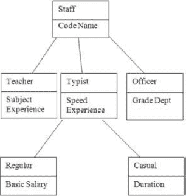

答案：

```cpp
#include<iostream.h>

class staff
{
    public:
        char EmployCode[10];
};

class Teacher :public staff
{
    int Experience;
    char Subjectname[30];
    public:
    void ReadTeacher()
    {
        cin>>Subjectname>>EmployCode>>Experience;
    }
};
class Typist :public staff
{
    int Speed;
    int Experience;
    public:
    void ReadTypist ()
    {
        cin>>Experience>>EmployCode>>Speed;
    }
};
class RegularTypist :public Typist
{
    int BasicSalary;
    public:
    void ReadRegularTypist ()
    {
        cin>>BasicSalary;
    }
};
class CasualTypist :public Typist
{
    int Duration;
    public:
    void ReadCasualTypist ()
    {
        cin>>Duration;
    }
};

class officer :public staff
{
    char Dept[15];
    char Grade;
    public:
    void Readofficer ()
    {
        cin>>EmployCode>>Grade>>Dept;
    }
};
```

## 问题20：编写一个程序，重载“+=”运算符，以将给定的两个距离（以英尺和英寸为单位）相加（孟买大学，2008年12月）

```cpp
#include <iostream.h>
#include <conio.h>

class overloading
{
        int Feet, Inches;
public:
overloading(int feet, int inches)
{
    Feet=feet;
    Inches=inches;
}
void operator += (overloading obj)
{
    Feet=Feet+obj.Feet;
    Inches=Inches+obj.Inches;
}
void Display()
{
    cout<<Feet<<"feet  "<<"and  "<<Inches<<"   inches"<<endl;
    cout<<endl<<endl;
}
};
void main()
{
    clrscr();
    overloading obj1(10,6),obj2(17,4);
    cout<<endl;
    obj1.Display( );
    obj2.Display( );
    obj2+=obj1;
    obj2.Display( );
    getche();
}
```

## 问题21：下面所示的是弗洛伊德三角形

```text
1
3
4          5          6
7          8          9          10
11--------------------------------15
-
-
-
-
-
79---------------------------------------------------------------91
```

编写一个面向对象的程序（使用类和对象）来打印这个三角形。（孟买大学，2007年6月）

答案：

```cpp
#include<iostream.h>

class FloydT
{
        public:
        void printFloydT();
};

void FloydT :: printFloydT()
{
        int i,j,k=1;

        for(i=1;k<=91;i++)
        {
                cout<<endl;

                for(j=1;j<=i;j++)
                {
                        cout << k ;
                        ++k;
                }
        }
}
void main()
{
        FloydT ft;
        ft.printFloydT();
}
```

## 问题22：编写一个面向对象的程序，用于通过一组点 (x,y) 拟合一条直线，其中 i = 1...........n。直线方程为 y=mx+c，m 和 c 的值由下式给出

$$m=\frac{n\sum(x_i y_i)-(\sum x_i)(\sum y_i)}{n(\sum x_i^2)-(\sum x_i)^2}$$

$$c=\frac{\sum y_i-m\sum x_i}{n}$$

> （孟买大学，2007年6月）

答案：

```cpp
#include<iostream.h>

#include<math.h>

class sline
{
    public:
        void calcm();
    private:
        int x[20], y[20],n;
    //assuming n<=20;
};

void sline :: calcm()
{
    int i, valx=0, valy=0,mulxy=0, xqsum=0, sumxq,m,c;
    for(i=0; i<=n;i++)
    {
        valx= valx+x[i];
        valy= valy+y[i];
        mulxy= mulxy + (x[i]*y[i]);
        xqsum=xqsum + pow(x[i],2);
    }
    sumxq= pow(valx,2);
    {
        m= (n*mulxy - valx*valy) / (n*xqsum -sumxq);
        cout<<m;
        c= (valy - m* valx)/i;
        cout<<c;
    }
}

void main()
{
sline s;
s.calm();
}
```

## 问题23：编写一个使用欧几里得算法来显示两个整数的最大公约数的面向对象程序。数字的最大公约数是能同时整除这两个数字的最大数。算法工作原理如下。

- i. 使用模运算符，用较大的数除以较小的数，求出余数。
- ii. 将较大的数变为较小的数，并将较小的数变为步骤 (i) 中的余数。
- iii. 重复此过程，直到余数为零。请包含用于数据输入、显示结果、默认构造函数和带两个参数的构造函数的成员函数。还要创建对象来引用这些成员函数。

（孟买大学，2007年6月）

答案：

```cpp
#include<iostream.h>
#include<math.h>

class gcd
{
        public:
                gcd();
                gcd(int, int);
        void gcdinput();
                void gcdcompute();
                void gcdoutput();

        private:
                int m,n,result;
};
gcd :: gcd()
{
        m=n=result=0;
}
gcd :: gcd(int x, int y)
{
        m=x;
        n=y;
        result=0;
}
void gcd :: gcdinput()
{
    cout<<"Enter First number";
    cin>> m;
    cout<<"Enter second number";
    cin>>n;
}
void gcd :: gcdcompute()
{
    int Remainder;
    int max, min;
    max=m > n ? m:n;
    min=m<n ? m:n;

    while (min!=0)
    {
        Remainder =max % min;
        max=min;
        min=Remainder;
    }

    result=max;

}
void gcd :: gcdoutput()
{
    cout<<" The gcd of two numbers is:";
    cout<< result << endl;
}

void main()
{
    gcd g;

    g.gcdinput();
    g.gcdcompute();
    g.gcdoutput();

}
```

## 问题24：开发一个类，其成员函数支持有理数的算术运算，即执行有理数的加法、减法、除法和乘法。所有成员函数都需要重载二元运算符。编写合适的 main 程序来演示二元运算符重载的各个方面。包含合适的构造函数和重载构造函数。有理数采用 a/b 的形式，其中 a 和 b 是整数常量。（孟买大学，2007年6月）

答案：

```cpp
#include<iostream.h>

#include<conio.h>
class rat
{
private:
int Num,Den;

public:
rat(int x=0, int y=1)
{
Num=x;
Den=y;
}

rat operator +( rat R)
{
rat temp;
temp.Num= Num*R.Den+ R.Num*Den;
temp.Den= R.Den* Den;
return temp;
}

void operator -(rat R)
{
Num= Num*R.Den-R.Num*Den;
Den= R.Den* Den;
}

void operator /(rat R)
{
Num= Num*R.Den ;
Den= R.Num* Den;
}

rat operator *(rat R)
{
rat temp;
temp.Num= Num*R.Num;
temp.Den= R.Den* Den;
return temp;
}

void display()
{
cout<<Num<<Den;
}
};

void main()
{
clrscr();
rat R1(2,3),R2(3,4),R3;
R3=R1+R2;
R3.display();
R1-R2;
R1.display();
R3=R1*R2;
R3.display();
R1/R2;
R1.display();

getch();
}
```

在矩阵加法中使用对象作为函数参数。编写合适的 main 程序来测试这些成员函数。

答案：

```cpp
#include<iostream.h>
#include<conio.h>

class matrix
{
int n,m;
int mat[10][10];
public:
void input();
void display();
void add(matrix obj,matrix obj1);
void mul(matrix obj,matrix obj1);
void Elimination();
void Transpose();

};
void matrix::input()
{
cout<<"\n Enter The Number of Rows: ";
cin>>m;
cout<<"\n Enter The Number of Columns: ";
cin>>n;
for(int i=0;i<m;i++)
for(int j=0;j<n;j++)
cin>>mat[i][j];
}
void matrix::display()
{
for(int i=0;i<m;i++)
{
cout<<endl;
for(int j=0;j<n;j++)
cout<<"\t"<<mat[i][j];
}
}

void matrix::Transpose()
{
if(m>n) { int temp=m; m=n; n=temp;}

for(int i=0;i<m;i++)
for(int j=i;j<n;j++)
{
int temp=mat[i][j];
mat[i][j]=mat[j][i];
mat[j][i]=temp;
}
}
void matrix::add(matrix obj,matrix obj1)
{
if((obj1.m==obj.m)&&(obj1.n==obj.n))
{
m=obj1.m;
n=obj1.n;
for(int i=0;i<obj1.m;i++)
for(int j=0;j<obj1.n;j++)
mat[i][j]=obj1.mat[i][j]+obj.mat[i][j];
}
else
cout<<"\n Cannot Add";
}
void matrix::mul(matrix obj,matrix obj1)
{
if(obj.n==obj1.m)
{
n=obj1.n;
m=obj1.m;
for(int i=0;i<m;i++)
for(int j=0;j<n;j++)
{
mat[i][j]=0;
for(int k=0;k<m;k++)
mat[i][j]+=obj.mat[i][k]*obj1.mat[k][j];
}
}
else
cout<<"\n Cannot Multiply ";
}
void matrix::Elimination( )
{
```


```cpp
for( int k=0; k< m-1;k++)
for(int i=k+1;i<m;i++)
{
float fact= mat[i][k]/ mat[k][k];
for(int j=0;j<n;j++)
mat[i][j]=mat[i][j]- mat[k][j]* fact;
}
}

void main()
{
matrix obj1,obj2,obj3;
obj1.input();
obj2.input();
obj1.display();
obj2.display();
obj3.add(obj1,obj2);
cout<<"\n Matrix After Addition Is: ";
obj3.display();
obj3.mul(obj1,obj2);
cout<<"\n Matrix After Multiplication Is: ";
obj3.display();
getch();
}
```

### Q26：扩展类成员函数以满足函数声明旁所描述的功能（孟买大学，2007年12月）

答：

```cpp
#include<iostream.h>
class Dmanip
{
private:
    int N,A[100];
public:
    Dmanip(); // Default constructor
    void Display();
    void InputArray ( );// input function to read array A
    void InputArray(int M, int X[100]);// over loaded input function
    void Sort( ); // sorting data stored in Array A
    void Search(int data);
    void Insert(int data);
    void Delete(int data);
    void Merge(Dmanip OB1, Dmanip OB2); // Merging A of object 1 and A of Object 2 resulting in A of object about which the merge function get referenced
};

Dmanip :: Dmanip() // Default constructor
{
    N=10;
    for(int i=0; i<=99; i++)
        A[i]=0;
}

void Dmanip :: Display( )
{
    for(int i=0; i<=99; i++)
    {
        A[i]=0;
        cout<<"    "<<A[i];
    }
}

void Dmanip :: InputArray ( )// input function to read array A
{
    cin>> N;
    for(int i=1; i<=N; i++)
        cin>>A[i];
}

void Dmanip :: InputArray (int M, int X[100]) // overloaded input function
{
    N=M;
    for(int i=1; i<=N; i++)
        A[i]=X[i];
}

void Dmanip :: Sort( ) // sorting data stored in Array A in ascending order
{
    for(int k=1; k<=N-1; k++)
        for(int i=1; i<=N-k; i++)
            if(A[i]>A[i+1])
            {
                int Temp= A[i];
                A[i]=A[i+1];
                A[i+1]=Temp;
            }
}

void Dmanip :: Search(int data)
{
    int found =0, i=1;
    while((!found)&&(i<=N)) // assuming data array in ascending order
    {
        if(A[i]==data)
            found=1;
        else
            i++;
    }
    if(found) cout<<"\n found in location "<< i;
    else
        cout<<"\n Not found";
}

void Dmanip :: Insert(int data)
{
    int i=1, loc=1;
    while ((data>A[i]) && (i<=N))// assuming data array in ascending order
        i++;
    if (data<= A[i])
    {
        loc=i;
        for(i=N;i>=loc;i--)
            A[i+1]=A[i];
    }
    A[loc]=data;
    N=N+1;
}

void Dmanip :: Delete(int data)
{
    int i=1, loc=1;
    while ((data!=A[i]) && (i<=N))// assuming data array in random order
    {
        i++;
    }
    if (data== A[i])
    {
        loc=i;
        for(i=loc;i<=N-1;i++)
            A[i]=A[i+1];
        N=N-1;
    }
}

// Merging A of object 1 and A of object 2 resulting in A of object about
// which the merge function get referenced
void Dmanip :: Merge (Dmanip OB1, Dmanip OB2)
{
    int i=1,j=1,k=1;
    while((i<=OB1.N)&&(j<=OB2.N))
        if (OB1.A[i]>OB2.A[j])
        {
            A[k]=OB1.A[i];
            ++k;
            ++i;
        }
        else
        {
            A[k]=OB2.A[j];
            ++k;
            ++j;
        }
    while(i<=OB1.N)
    {
        A[k]=OB1.A[i];
        ++k;
        ++i;
    }
    while (j<=OB2.N)
    {
        A[k]=OB2.A[j];
        ++k;
        ++j;
    }
}
```

### Q27：编写一个程序，按成绩降序排列学生姓名，输入数据包括学生详细信息，如姓名、学号、数学、物理、化学成绩以及这三科的总分。（注意：使用嵌套结构体和结构体数组）（孟买大学，2007年12月）

答：

```cpp
#include<iostream.h>

struct PCM
{
    int Phys;
    int Chem;
    int Math;
    int Total;
};

struct student
{
    char Sname[30];
    char Sid[10];
    PCM Marks;
};

class MeritList
{
    student Srec[61];
    int N;

public:

    void Input()
    {
        cout<<"Enter students number"<<endl;
        cin>> N;

        for(int i=1;i<=N;i++)
        {
            cout<<i<<" : Enter student's name and id"<<endl;
            cin>>Srec[i].Sname>>Srec[i].Sid;
            cout<<i<<" : Enter student's marks in Physics, Chemistry, and Maths"<<endl;
            cin>>Srec[i].Marks.Phys>>Srec[i].Marks.Chem>>Srec[i].Marks.Math;
            Srec[i].Marks.Total=Srec[i].Marks.Phys+Srec[i].Marks.Chem+Srec[i].Marks.Math;
        }
    }

    void SortStudentRec()
    {
        for(int k=1; k<=N-1;k++)
            for(int i=1; i<=N;i++)
                if((Srec[i].Marks.Total< Srec[i+1].Marks.Total)||
                   ((Srec[i].Marks.Total== Srec[i+1].Marks.Total)&&
                    (Srec[i].Marks.Math< Srec[i+1].Marks.Math)))
                {
                    student Temp=Srec[i];
                    Srec[i]=Srec[i+1];
                    Srec[i+1]=Temp;
                }
    }

    void DisplayList()
    {
        for(int i=1;i<=N;i++)
            cout<<Srec[i].Sname<<"  "<<Srec[i].Sid<<"  "<<Srec[i].Marks.Total<<endl;
    }
};

void main()
{
    MeritList Obj;
    Obj.Input();
    Obj.SortStudentRec();
    Obj.DisplayList();
}
```

### Q28：开发一个用于链表操作的类，下面给出了类模板，并在类外展开所有成员函数。同时编写一个驱动程序（主程序）（孟买大学，2007年12月）

答：

```cpp
#include<iostream.h>
#include<conio.h>
#include<ctype.h>

class node
{
public:
    int data;
    node * link;
};

class List
{
    node * Head;
public:
    List();
    List(node* Ptr);
    void CreateList();
    void SortList();
    void Insert(int Data);
    void Delete(int Data);
    void DisplayList();
};

List :: List()
{
    Head=NULL;
}

List :: List(node* Ptr)
{
    Head= Ptr;
}

void List :: CreateList()
{
    Head= new node;
    node * Ptr=Head;
    char Choice='Y';
    node * Back;
    do
    {
        cout<< "Enter data";
        cin>>Ptr->data;

        node * P= new node;
        Ptr->link=P;
        Back= Ptr;
        Ptr=P;

        cout<<"\n Continue Y/N?";
        cin>>Choice;
    }
    while (toupper(Choice) != 'N');

    Back->link=NULL;
    delete (Ptr);
}

void List :: SortList() // Bubble sort
{
    node * P=Head;

    while (P!=NULL)
    {
        node * Ptr=Head;

        while (Ptr->link!=NULL)
        {
            if(Ptr->data > Ptr->link->data)
            {
                int Temp= Ptr->data;
                Ptr->data = Ptr->link->data;
                Ptr->link->data=Temp;
            }
            Ptr=Ptr->link;
        }
        P=P->link;
    }
}// end of sort

void List :: Insert(int Data)
{
    node * Ptr=Head;
    node * Back=NULL;
    node * P= new node;
    P->data=Data;

    while ((Ptr!=NULL) && (Data > Ptr->data))
    {
        Back=Ptr;
        Ptr=Ptr->link;
    }
    if (Back== NULL)
    {
        P->link=Head;
        Head=P;
    }
    else
    {
        P->link=Ptr;
        Back->link=P;
    }
}// end of insert

void List :: Delete(int Data)
{
    node * Ptr=Head;

    if(Data== Head->data)
        Head=Head->link;
    else
    {
        while (Data!=Ptr->link->data)
            Ptr=Ptr->link;

        Ptr->link=Ptr->link->link;
    }
}

void List :: DisplayList()
{
    node * Ptr=Head;

    while (Ptr!=NULL)
    {
        cout<< endl<< Ptr->data;
        Ptr=Ptr->link;
    }
}
```

### Q29：定义一个具有以下规范的 worker 类：

- worker 类的私有成员
  - wno 整数
  - wname 25 个字符
  - hrwrk、wgrate 浮点数（工作小时数和每小时工资率）
  - totwage 浮点数（hrwrk*wgrate）
  - calcwg() - 一个用于计算 hrwrk * wgrate 且返回类型为 float 的函数
- worker 类的公有成员
  - In_data() - 一个接受 wno、wname、hrwrk、wgrate 值并调用 calcwg() 计算 totwage 的函数
  - Out_data() - 一个在屏幕上显示所有数据成员的函数

（孟买大学，2009年5月）

答：

```cpp
class worker
{
private:
    int wno;
    char wname [25];
    float hrwrk, wgrate;
    float totwage;

    float calcwg()
    {
        totwage= hrwrk * wgrate;
        return totwage;
    }

public:
    void In_data()
    {
        cin>> wno>>wname>>hrwrk>>wgrate;
        calcwg();
    }
    void Out_data()
    {
        cout<< wno<< wname <<hrwrk<< wgrate<<totwage;
    }// A function to display all the data member on screen
};
```

### Q30：函数重载是什么意思？编写一个 C++ 程序，使用函数名 add()，但参数数量和类型不同，分别实现两个整数和三个浮点数的加法（孟买大学，2009年5月）

答：

```cpp
#include<iostream.h>

void add(int a, int b, int &sum)
{
    sum=a+b;
}

void add (float a, float b, float c, float &sum)
{
    sum=a+b+c;
}
```

### Q31：构造函数是什么意思？编写一个 C++ 程序，使用构造函数生成斐波那契数列的前 ‘n’ 项。（孟买大学，2009年5月）

答：

```cpp
#include<iostream.h>

class fibbo
{
    public:

    fibbo()
    {
        int F1=1;
        int F2=1;
        int n;
        cout<<"\n Enter No. of terms generated";
        cin>>n;
        cout<<"  "<<F1<<"   "<<F2;
        for (int i=3; i<=n; i++)
        // this segment generates 3rd term on words
        {
                int F= F1+F2;
                cout<<"  "<<F;
```


```cpp
F1=F2;
F2=Fi;
}
}
};

void main()
{
    fibbo obj;
}
```

### Q32：编写一个程序，创建一个双向链表，然后使用堆排序技术对其进行排序。

答案：

```cpp
#include<iostream.h>
#include<conio.h>
#include<ctype.h>

class dnode    // class for defining a node
{
public:
    dnode * ulink;    // Link to the upper node
    int num;          // Data to be stored
    dnode * llink;    // Link to the lower node
};

class dllist
{
    dnode * head1, * head2;    // Creating two heads for the list
    int n;                     // For counting number of nodes
public:
    dllist();                 //constructor
    void create();            // Function to create doubly linked list
    void display();           // Function to display the data
    void swapdown(int r ,int m);
    /* Function to check a parent node with its child nodes if child node is
    greater then parent node than interchanging it */
    void heapify();           // Function to create a heap of the nodes in the
                              // doubly linked list
    void hsort();             // Function to sort elements using heap sort
};

dllist :: dllist()
{
    head1=NULL;
    head2=NULL;
    n=0;                  //initialisation
}

void dllist :: create()   // To create doubly link list
{
    head1 = new dnode;
    // Creating a new node of type dnode and point it by head1
    dnode * ptr = head1;
    // Create a pointer ptr pointing to the node pointing by head1
    ptr->llink = NULL;        // Assign NULL to ptr upper node link
    char choice;
    do
    {
        cout<<"\nEnter the number";
        cin>>ptr->num;          // Take the data in the node pointed by ptr
        ++n;
        dnode * p =new dnode;
            // Create a new node of type dnode pointed by p
        ptr->llink = p;
            // Assign address of node pointed by p to ptr llink
        p->ulink = ptr;
            // Assign address of node pointed by ptr to p ulink
        ptr = p;
        cout<<"Enter y/n";
    }
    while(toupper(choice = getche()) != 'N');
            // Execute the loop until user enter 'N'

    head2 = ptr->ulink;   // Assign head2 to the node pointed by ptr->ulink
    head2->llink = NULL;  // Assign head2->llink to NULL
    delete(ptr);           // This will remove the memory pointed by ptr
}

void dllist ::display()  // To display the contents of linked list
{
    dnode * ptr = head1;    // Assign ptr to node pointed by head1
    while(ptr != NULL)      // while ptr does not point to NULL location
    {
        cout<<ptr->num<<endl;   // Display the content
        ptr=ptr->llink;         // Go to the next node by ptr->llink
    }
}

void dllist :: swapdown (int r ,int m)
// Here r is the parent node number and
// m is the last node number upto which this will work
{
    int done =0;
    int c;
    c = 2 * r;

    while((!done)&& (c <= m))
    {
        dnode * parent = head1;
        // Assign parent pointer to head1
        dnode * child = head1;
        // Assign child pointer to head1

        int i = 1;
        while((i<r) && (parent->llink != NULL) )
        // This loop will take parent pointer to that node whose
        // number is 'r'
        {
            ++i;
            parent=parent->llink;
        }
        i=1;
        while((i<c ) && (child->llink != NULL))
        // This loop will take child pointer to that node whose
        // number is c
        {
            ++i;
            child=child->llink;
        }

        if(( c < m ) && ( child->num < child->llink->num))
        {
            c= c+1;
            child=child->llink;
        }

        if(child->num > parent->num)
        // If child node element is greater then parent node
        // element
        {
            // Interchange both the elements
            int t = child->num;
            child->num =parent->num;
            parent->num = t;
            r=c;
            // Assign c to r this make child now parent
            c= 2*r;
            // and c = 2 * r this calculate child of new parent
        }
        else
            // If the child element is less then parent then make done =1
            done =1 ;
    }
}

void dllist :: heapify()   // To create heap of the elements of the node
{
    for(int i = n/2; i>=1;i--)
        swapdown(i,n);          // Call swapdown function
}

void dllist :: hsort()  // For sorting the elements
{
    heapify();          // First create a heap of the elements
    for(int i = n;i>=2;)  // From last node to the second last node
    {
        dnode * ptr = head1;  // Assign ptr to head1
        int q = 1;
        while((q<i) && (ptr->llink != NULL) )
        // For taking ptr to the ith node
        {
            ++q;
            ptr=ptr->llink;
        }

        int t = ptr->num;
        // Change the first and the last element in the heap
        ptr->num= head1->num;
        head1->num=t;

        swapdown(1,--i);
        //Call swapdown without the last element in the heap
    }
}

void main()
{
    clrscr();
    dllist link;
    link.create();
    link.hsort();
    clrscr();
    link.display();
    getch();
}
```

### Q33：编写一个程序，使用链表创建一个多项式，并使用运算符重载函数 + 将两个多项式相加。

答案：

```cpp
#include<iostream.h>
#include<string.h>
#include<stdio.h>
#include<iomanip.h>
#include<conio.h>
#include<process.h>
#include<math.h>
#include<ctype.h>

class node             //description of node of polynomial list
{
public:
    node *link;
    int val,coef;
    node();
};

node::node()
{
    val=0;coef=0;link=NULL;
}

class polynomial
/*description of a single polynomial and functions associated with it*/
{
    node *head;
    int count;

public:
    polynomial();
    void create();
    void sort();
    void add(node,node);
    void display();
    polynomial operator +(polynomial);
};

polynomial::polynomial()
{
    count=0;head=NULL;
}

void polynomial::display()             //display the value of the polynomial
{
    node *ptr = head;
    int i;
    for(i=1;i<=count;i++)
    {
        cout<<ptr->val<<"x^"<<ptr->coef;
        if(i!=count)
            cout<<"+";
        ptr=ptr->link;
    }
}

void polynomial::create()              //to create a polynomial in the form of a link list
{
    clrscr();
    int i;
    head=new node;
    node *ptr=head;
    node *back;
    cout<<"Enter the number of elements in the polynomial-list :";
    cin>>count;

    for(i=1;i<=count;i++)
    {
        cout<<" Enter the "<<i<<" element value:"<<endl;
        cin>>ptr->val;
        cout<<"Enter the "<<i<<" element coeff:"<<endl;
        cin>>ptr->coef;
        node *p=new node;
        ptr->link=p;
        back=ptr;
        ptr=p;
    }
    ptr->link=NULL;
}

void polynomial::sort() /*sort the final resultant polynomial using the sort
 function as per its co-efficient*/
{
    int k=0,l=0,i,j;
    int temp;
    node *ptr=head;
    node *ptr2=head;
    node *p1=head;
    node *back;
    back=ptr;
    while(k<=count)
    {
        k=k+1;
        ptr=head;
        back=ptr;

        while(l<=count)
        {
            if(ptr->link->coef!=0)
            {
                if(ptr->coef > ptr->link->coef)
                {
                    temp=ptr->coef;
                    ptr->coef=ptr->link->coef;
                    ptr->link->coef=temp;

                    temp=ptr->val;
                    ptr->val=ptr->link->val;
                    ptr->link->val=temp;
                }
            }
            ptr=ptr->link;
        }
        l=l+1;
    }
    p1=p1->link;
}

polynomial polynomial::operator +(polynomial obj)
//function to add two polynomial
{
    polynomial p4;
    int i,j,flag;
    p4.head= new node;
    node *back;
    node *ptr1=head;
    node *ptr2=obj.head;
    node *ptr=p4.head;
    p4.count=0;
    flag=0;

    for(i=1;i<=count;i++)          //compare the first polynomial with the second polynomial
    {
        flag=0;
        node *ptr2=obj.head;
        for(j=1;j<=obj.count;j++)
        {
            if(ptr1->coef==ptr2->coef)
            {
                flag=1;break;
            }
            ptr2=ptr2->link;
        }

        if(flag==1)
            ptr->val=ptr1->val+ptr2->val;
        else
            ptr->val=ptr1->val;

        ptr->coef=ptr1->coef;
        node *p=new node;
        ptr->link=p;
        back=ptr;
        ptr=p;
        p4.count=p4.count+1;
        ptr1=ptr1->link;
    }
}
```


```cpp
}
ptr2=obj.head;

for(i=1;i<obj.count;i++)       //include the remaining of the second polynomial nodes
{
    flag=0;
    node *ptr1=head;
    for(j=1;j<=count;j++)
    {
        if(ptr2->coef==ptr1->coef)
        {
            flag=1;
            break;
        }
        ptr1=ptr1->link;
    }
    if(flag!=1)
    {
        ptr->val=ptr2->val;
        ptr->coef=ptr2->coef;
        node *p=new node;
        ptr->link=p;
        back=ptr;
        ptr=p;
        p4.count=p4.count+1;
        ptr1=ptr1->link;
    }
    ptr2=ptr2->link;
}
ptr->link=NULL;
return(p4);
}

void main()
{
    polynomial p1;
    polynomial p2;
    polynomial p3;

    p1.create();              //create the first polynomial
    p2.create();              //create the second polynomial

    cout<<"The structure of first polynomial"<<endl;
    p1.display();
    cout<<endl<<"The structure of second polynomial"<<endl;
    p2.display();

    getch();
    p3=p1+p2;
    //add the two and store the result in the third

    p3.sort();
    //sort as per the co-efficient
    cout<<endl<<"The structure of resultant after addition"<<endl;
    p3.display();        //display the resultant polynomial
    getch();
}
```

### Q34: 编写一个程序，使用运算符重载函数 + 和 * 对二维数组中的矩阵进行加法和乘法运算。

答案：

```cpp
#include<iostream.h>
#include<string.h>
#include<stdio.h>
#include<iomanip.h>
#include<conio.h>
#include<process.h>
#include<math.h>
#include<ctype.h>

class matrix          //description of the matrix
{
    int m,n,a[10][10];
public:
    matrix();
    matrix(int i,int j,int ta[10][10]);
    void readmatrix();
    void matdis();
    void operator +(matrix obj);
    matrix operator *(matrix obj);
};

matrix::matrix(int i,int j,int ta[10][10])
{
    int x,y;
    m=i;
    n=j;
    for(x=1;x<=m;x++)
        for(y=1;y<=n;y++)
        {
            a[x][y]=ta[x][y];
        }
}

matrix::matrix()
{
    int i,j;
    m=0;
    n=0;
    for(i=0;i<=10;i++)
        for(j=0;j<=10;j++)
            a[i][j]=0;
}

matrix matrix::operator *(matrix obj)
//operator function to multiply 2 matrices
{
    int r,j,i,ta[10][10];
    for(r=1;r<=m;r++)
    {
        for(j=1;j<=obj.n;j++)
        {
            ta[r][j]=0;
            for(i=1;i<=obj.n;i++)
            {
                ta[r][j]+=a[r][i]*obj.a[i][j];
            }
        }
    }

    i=m;
    j=obj.n;

    return matrix(i,j,ta);
}

void matrix::operator +(matrix obj)  //operator function to add 2 matrices
{
    int i,j;
    if((m!=obj.m)&&(n!=obj.n))
    {
        cout<<"the matrix cannot be added as there is mismatch in number of rows and columns";
        exit(0);
    }
    for(i=1;i<=m;i++)
        for(j=1;j<=n;j++)
        {
            a[i][j]=a[i][j]+obj.a[i][j];
        }
}

void matrix::readmatrix()        //function to read the data for the matrix
{
    int i,j;
    cout<<endl<<"Enter the number of rows in the matrix:";
    cin>>m;
    cout<<endl<<"Enter the number of columns in the matrix:";
    cin>>n;

    for(i=1;i<=m;i++)
        for(j=1;j<=n;j++)
        {
            cout<<"Enter the "<<i<<","<<j<<"element:";
            cin>>a[i][j];
        }
}

void matrix::matdis()        //function to display the matrix
{
    int i,j;
    for(i=1;i<=m;i++)
    {
        cout<<endl;
        for(j=1;j<=n;j++)
        {
            cout<<a[i][j]<<setw(4)<<" ";
        }
    }
}

void main()
{
    matrix m1,m2,m3;
    m1.readmatrix();//read the data for 1st matrix
    m2.readmatrix();//read the data for 2nd matrix
    m1+m2;

    cout<<"The result of addition of two matrices"<<endl;
    m1.matdis();             //add the data of 2 matrices
    getch();

    m3=m1*m2;                //multiply the data of 2 matrices
    cout<<endl<<"The result of multiplication of two matrices"<<endl;
    m3.matdis();
    getch();
}
```

### Q35: 编写一个程序，使用运算符重载函数 + 来计算圆的面积和周长，并递增半径的值。

答案：

```cpp
#include<iostream.h>
#include<string.h>
#include<stdio.h>
#include<iomanip.h>
#include<conio.h>
#include<process.h>
#include<math.h>
#include<ctype.h>
#define PI 3.14

class circle          //description of the class circle
{
    int radius, c;
    int area,peri;
public:
    circle();
    circle(int r);
    circle(int r,int inr);
    circle operator +(circle obj);
    void calarea();
    void per();
    void display();
};

circle::circle()
{
    radius = 10;
    c=2;
}

circle::circle(int r)
{
    radius = r;
    c=2;
}

circle::circle(int r,int inr)
{
    radius = r;
    c=inr;
}

circle circle::operator +(circle obj)  //operator to increase the value of radius of circle
{
    radius++;
    area=0.0;
    peri=0.0;
    return circle(obj);
}

void circle::calarea()          //calculate the area of the circle.
{
    area=PI * radius*radius;
}

void circle::per()              //calculate the perimeter of the circle.
{
    peri=PI * 2 * radius;
}

void circle::display()          //to display the result
{
    cout<<endl<<"The radius of the circle is:"<<radius;
    cout<<endl<<"The area of the circle is:"<<area;
    cout<<endl<<"The perimeter of the circle is:"<<peri;
}

void main()
{
    circle c1,c2=18,c3(21,3);
    clrscr();
    c1.calarea();c1.per();
    c2.calarea();c2.per();
    c3.calarea();c3.per();
    c1.display();c2.display();c3.display();

    c1++; c2++; c3++;
    c1.calarea();c1.per();
    c2.calarea();c2.per();
    c3.calarea();c3.per();

    c1.display();c2.display();c3.display();
    getch();
}
```

### Q36: 编写一个程序，使用运算符重载函数执行有理数的各种运算，如 +、-、*、/。

答案：

```cpp
#include<iostream.h>
#include<string.h>
#include<stdio.h>
#include<iomanip.h>
#include<conio.h>
#include<process.h>
#include<math.h>
#include<ctype.h>

class rat              //description of the class rational number
{
    int num,den;
public:
    rat();
    rat(int num,int den);
    rat operator +(rat obj);
    rat operator -(rat obj);
    rat operator *(rat obj);
    rat operator /(rat obj);
    void display();
};

rat::rat()
{
    num=10;
    den=12;
}

rat::rat(int nu,int de)
{
    num=nu;
    den=de;
}

rat rat::operator +(rat obj)        //function operator to perform the addition of two rat number
{
    int nu,de;
    nu=num*obj.den+den*obj.num;
    de=den*obj.den;
    return rat(nu,de);
}

rat rat::operator -(rat obj)        //function operator to perform the subtraction of two rat number
{
    int nu,de;
    nu=num*obj.den-den*obj.num;
    de=den*obj.den;
    return rat(nu,de);
}

rat rat::operator *(rat obj)        //function operator to perform the multiplication of two rational number
{
    int nu,de;
    num = num*obj.num;
    den = den*obj.den;
    return *this;
}

rat rat::operator /(rat obj)        //function to perform the division of two rational number
{
    int nu,de;
    nu = num*obj.num;
    de = den*obj.den;
    return rat(nu,de);
}

void rat::display()                 //function to display the rational number
{
    cout<<endl<<"The given rational number is"<<endl;
    cout<<num<<"/"<<den<<endl;
}

void main()
{
    rat r1,r2(4,10),r3;
    clrscr();
    cout<<"value of r1:";
    r1.display();
    cout<<"value of r2:";
    r2.display();
    r3=r1+r2;
    cout<<"The result of addition of rational number";
    r3.display();

    r3=r1-r2;
    cout<<"The result of subtraction of rational number";
    r3.display();

    r3=r1/r2;
    cout<<"The result of division of rational number";
    r3.display();

    r3=r1*r2;
    cout<<"The result of multiplication of rational number";
    r3.display();
    getch();
}
```

### Q37. 编写一个程序，开发一个用于一维数组操作的类。包含用于读取两个一维数组、对它们进行排序、在它们中插入元素、从它们中删除元素、将两个数组的值合并到另一个一维数组，最后显示该数组的函数。尽可能使用重载函数，并包含构造函数。

答案：

```cpp
#include<iostream.h>
#include<conio.h>

class dmanip  //defining a class by the name dmanip
{
    int n ; /*As described earlier, all variables in a class are by default
              either public or
              private; by default all components of a class are private, so
              in this case both
              integer n and integer array a are private components*/
    int a[100];

public: //All the functions following this declaration are public.
    dmanip();
    void input();
    void input(int m,int x[100]); /*Instance of function overloading, as
                                    described earlier,
                                    both this function and the one declared above have the
                                    same name, but due to the different arguments they
                                    become examples of an overloaded function input*/
    void sort();
    void merge(dmanip d1,dmanip d2);
    void insert(int no);
    void delt(int no);
    void display();
    void display(dmanip d1,int m); //Similarly another instance of function
                                   //overloading
};
/*The semicolon after the class declaration is an important thing. Data
  constructs such as structures and classes end with a semicolon, while
  control constructs such as functions and loops do not. */

dmanip :: dmanip()
/*Example of a constructor as described earlier, with the same
  name as the class, which is used for initialization */
```


```cpp
{
    n=0;

    for(int i=0;i<=99;i++)
        a[i]=0;
    /*As soon as an object of the class dmanip is declared, this constructor
      will be called which will initialize all the elements of the array
      as 0.  */
}

void dmanip::input() /* The double colon, ::, is the scope resolution
                        operator. It is a way of specifying what class something is associated
                        with. In this case, it means “the input() member function of the dmanip
                        class.”*/
{
    cout<<"\n Enter the number of elements you want to enter ";
    cin >> n;

    for(int i=1;i<=n;i++)
        cin>>a[i];
}

void dmanip::input(int m, int x[100]) //Defining the overloaded function
{
    n=m;
    for(int i=1;i<=n;i++)
        a[i]=x[i];
}

void dmanip::merge(dmanip d1,dmanip d2)
{
    n = d1.n + d2.n;
    int i=1,j=1,k=1;

    while((i<=d1.n) && (j<=d2.n)) /* Comparing every successive element of
    array in object d1 with every successive element of the array in object d2
    to determine which of them is bigger, the smaller one goes into the
    corresponding position in the array in the object accessing this
    function*/
    {
        if(d1.a[i] < d2.a[j])
        {
            a[k]=d1.a[i];
            ++i;
            ++k;
        }
        else
        {
            a[k] = d2.a[j];
            ++k;
            ++j;
        }
    }

    while(i<=d1.n)
    /* providing for contingency in case the second array has lesser
    elements as compared to the first array */
    {
        a[k]=d1.a[i];
        ++i;
        ++k;
    }

    while(j<=d2.n)
    /* Providing for contingency in case the first array has lesser elements
    as compared to the second array */
    {
        a[k]=d2.a[j];
        ++j;
        ++k;
    }
}

void dmanip::sort()
{
    int sorted=0;
    int k=0;
    int temp;

    for(k=1;k<=n-1;k++)    /* For sorting the array for n-1 passes*/
    {
        int sorted=0;
        for(int i=1;i<=n-k;i++)    /* i<=n-k for not checking the number which are
                                      already sorted*/
        {
            if(a[i]>a[i+1])
            {
                temp=a[i];
                a[i]=a[i+1];
                n--;             /* Decrease the counter for the size of array by 1*/
            }
        }
    }
}

void dmanip::display()
{
    for(int i=1;i<=n;i++) //Counter for displaying the objects
        cout<<a[i];
}

void main()
{
    clrscr();
    int k,l,m,n;
    dmanip d1,d2,d3; //Declaring objects d1,d2,d3 of class dmanip
    d1.input();
    d2.input();
    cout<<"\nNow sorting and displaying the elements of the first array"<<endl;
    d1.sort();
    d1.display();
    cout<<endl;
    getch();
    cout<<"\nNow sorting and displaying the elements of the second array"<<endl;
    d2.sort();
    d2.display();
    cout<<endl;
    getch();
    cout<<"\nNow enter the new element that you want inserted into the first array"<<endl;
    cin>>k;
    d1.insert(k);
    cout<<"\nNow displaying the first array with the inserted element at the desired position"<<endl;
    d1.display();
    cout<<endl;
    getch();
    cout<<"\nNow enter the new element that you want inserted into the second array"<<endl;
    cin>>l;
    d2.insert(l);
    cout<<"\nNow displaying the second array with the inserted element at the desired position"<<endl;
    d2.display();
    cout<<endl;
    getch();
    cout<<"\nNow enter the element that you want deleted from the first array"<<endl;
    cin>>m;
    d1.del(m);
    cout<<"\nNow displaying the first array with the given element deleted from the desired position"<<endl;
    d1.display();
    cout<<endl;
    getch();
    cout<<"\nNow enter the element that you want deleted from the second array"<<endl;
    cin>>n;
    d2.del(n);
    cout<<"\nNow displaying the second array with the given element deleted from the desired position"<<endl;
    d2.display();
    cout<<endl;
    getch();
    d3.merge(d1,d2);
    d3.sort();
    cout<<"\nNow displaying the results of the two arrays when they are merged"<<endl;
    d3.display();
    cout<<endl;
    getch();
}
```

## Q38：编写一个程序，输入学生信息，例如：学生学号、学生姓名、数学、物理、化学成绩。找出每个学生的总成绩。在 student 类中创建一个函数，根据总成绩[升序]对学生进行排序。如果两个学生的总成绩相等，则首先根据数学成绩决定排名，然后根据物理成绩。如果三个科目的总成绩以及数学和物理成绩都相等，则意味着化学成绩也相等。在这种情况下，最终决定将基于学生的学号。

答案：

```cpp
#include<iostream.h>
#include<conio.h>
#include<iomanip.h>

class student             //Declaring a class of type student
{
public:      //All components below this declaration will be of type public
    int sno,m,p,c,total;
    char name[20];
    void input();        // function to take input values
    void display();      // function to display the merit list along
                         // with the other
                         // information
}; // Semicolon after declaration of class

void student::input()        //define the input function
{
    cout<<"\nSTUDENT ROLL NUMBER:";
    cin>>sno;
    cout<<"\nSTUDENT NAME:";
    cin>>name;
    cout<<"\nENTER THE MARKS FOR MATHS, PHYSICS AND CHEMISTRY RESPECTIVELY:";
    cin>>m>>p>>c;
    total=m+p+c;             //computing the total
}

void student::display() //define display function
{
    cout<<setw(5)<<sno<<setw(20)<<name<<setw(10)<<m<<setw(10)<<p<<setw(10)<<c<<setw(10)<<total;
}

void sort(student m1[10],int n) //define sorting function to sort students
{
    int flag = 0;
    for(int i=0;i<n-1;i++)
    {
        for(int j=0;j<n-1;j++)
        {
            if(m1[j].total<m1[j+1].total)
            // checking the total condition
                flag = 1;
            else if(m1[j].total==m1[j+1].total) //if total is equal
            {
                if(m1[j].m<m1[j+1].m)        //checking the maths marks
                    flag = 1;
                else if(m1[j].m==m1[j+1].m)   //if maths also equal
                {
                    if(m1[j].p<m1[j+1].p) //checking for the
                                          // physics
                                          // marks
                        flag = 1;
                    else
                    {
                        if(m1[j].sno>m1[j+1].sno)//if all subject
                                                 //marks are equal
                            flag =1;          //order the records
                                             //according to the roll
                                             // number
                    }
                }
            }
            if(flag==1)
            {
                student temp= m1[j+1];      //interchanging records based
                                             // on results we got using the
                                             // above code

                m1[j+1]=m1[j];
                m1[j]=temp;
                flag =0;
            }
        }
    }
}

void main()                         //main function
{
    clrscr();                            //array of objects of type student
    student m1[10];
    int n;
    void sort(student s[10],int a);     //sorting function prototype
    clrscr();
    cout<<"ENTER THE NUMBER OF RECORDS YOU WANT TO ENTER:";
    cin>>n;
    for(int i=0;i<n;i++)
        m1[i].input();              //inputting student records
    sort(m1,n);                          //calling sort function
    cout<<"STUDENTS LIST IN SORTING ORDER IS:\n";
    for(i=0;i<80;i++)                    //loop to display border to the table
        cout<<"-";
    cout<<"\n";
    cout<<"\n"<<setw(5)<<"SNO"<<setw(20)<<"NAME"<<setw(10)<<"MATHS"<<setw(10)<<"PHYSICS"<<setw(10)<<"CHEMISTRY"<<setw(10)<<"TOTAL"<<"\n";
    for(i=0;i<80;i++)                    //loop to display lower border to the table
        cout<<"-";
    for(i=0;i<n;i++)          //loop to display sorted records
    {
        cout<<endl;
        m1[i].display();          //calling class display function
    }
    getch();
}
```

## Q39：开发一个用于矩阵操作的类。包含用于读取矩形矩阵、矩阵加法、乘法、转置和显示矩阵的函数。尽可能使用重载函数。矩阵乘法和加法使用对象作为参数。同时引入构造函数和重载构造函数。

答案：

```cpp
#include<iostream.h>
#include<iomanip.h>
#include<conio.h>

class matrix // Declaring a class by the name matrix
{
public:  // All the components of the class below this declaration will be
         // public
    int m,n,x,y,a[10][10];
    matrix(int); //Example of Constructor
    matrix(int,int); //Example of Constructor Overloading
    void init();
    void input();
    void display();
    void calculation(matrix,matrix);
    void calculation(matrix,matrix,int);
    void calculation(); //Example of three different functions with the same
                        //name, to perform three different operations, instance
                        //of Function overloading.
};

matrix::matrix(int x) //Constructor to initialize if the number of rows are equal to the
                      //number of columns, i.e if the matrix is a square matrix
{
```


```cpp
m = x; //Initializing both the number of rows and columns to be equal to the
       //number of elements in the square matrix in either the row or column.
n = x;
init(); //Calling the function init() to initialize the elements of the array
}

matrix::matrix(int x,int y) //Constructor Overloading, constructor to initialize if the
                            //number of rows are not equal to the number of columns,
                            //i.e if the matrix is a rectangular matrix.
{
    m = x;
    n = y;
    init(); //Calling the function init() to initialize the elements of the array
}

void matrix::init()
{
    int i,j;
    for(i=1;i<=m;i++)
        for(j=1;j<=n;j++)
            a[i][j] = 0; //Initializing all the elements of that array to be equal to zero.
}

void matrix::input() //Function to input the elements of the matrix
{
    int i,j;
    cout<<"\n enter the array elements one by one\n";
    for(i=1;i<=m;i++) //Counter for the number of rows of the matrix
        for(j=1;j<=n;j++) //Counter for the number of columns of the matrix
            cin>>a[i][j];
}

void matrix::display() //Function to output the elements of the matrix
{
    int i,j;
    for(i=1;i<=m;i++) //Counter for the number of rows
    {
        cout<<endl; //After every row is printed move to a new line
        for(j=1;j<=n;j++) //Counter for the number of columns
}
}
void main()
{
    int x,y,x1,y1,choice,flag,c,temp;
    clrscr();
    cout<<"enter the no of rows and columns of the first matrix: ";
    cin>>x>>y;
    matrix m1(x,y);
    m1.input();
    m1.display();
    cout<<"\nenter the no of rows and columns of the second matrix: ";
    cin>>x1>>y1;
    matrix m2(x1,y1);
    m2.input();
    m2.display();
    cout<<"\nwhat do you want to do with the two matrices ?";
    cout<<"\nenter 1 for addition , 2 for multiplication ,3 for transpose";
    cout<<"\nenter your choice  ";
    matrix m3(x,y1);
    cin>>choice;
    switch(choice) //A switch structure is used to enhance user friendliness
    {
    case 1: //This case is for matrix addition
    {
        if((x1!=x)||(y1!=y)) //If the number of rows and columns are not the same
                             //then the matrices cannot be added.
        {
            cout<<"\nthese two matrices cannot be added";
            break;
        }
        else
            m3.calculation(m1,m2);
        m3.display();
        break;
    }
    case 2: //If the number of rows of the first array, is not equal to the number of
            //columns of the second array then the multiplication cannot be done
    {
        if(y!=x1)
        {
            cout<<"\nThese two matrices cannot be multiplied";
            break;
        }
        else
            m3.calculation(m1,m2,flag);
        m3.display();
        break;
    }
    case 3:
    {
        cout<<"\nwhich matrix do you want to transpose ? enter 1 or 2 :";
        cin>> c;
        if(c==1)
        {
            if(x>y) //Condition in case the number of rows and the number of
                    //columns are not the same
            {
                temp = x;
                y=temp;
                x=y;
            }
            m1.calculation();
            m1.display();
        }
        else if(c==2)
        {
            if(x1>y1)
            {
                temp = x1;
                y=temp;
                x=y;
            }
            m2.calculation();
            m2.display();
        }
        break;
    }
    default : //in case some other option than the ones provided are inputted
              //by the user
    {
        cout<< "\ninvalid option ";
    }
    }
    getch();
}
```

## Q40：使用运算符重载的概念编写一个程序，通过用户输入的半径显示圆的面积和周长。自动将半径增加二，然后也显示此时的面积和周长。同时使用函数重载的概念，以便在用户未输入任何半径时，采用任意默认值并显示面积和周长。

答：

```cpp
#include<iostream.h>
#include<conio.h>

#define PI 3.14
class circle //Defining a class by the name circle.
{
    int radius;
    int incr;
    float area;
    float perimeter;

public: //All declarations below this class are public
    circle();
    circle(int);
    circle(int,int); //Using the concept of Function Overloading, i.e
                     //having two functions with the same name, but different
                     //arguments are passed to the two of them, to differentiate
                     //between the two of them.
    void display(void);
    void calarea(void);
    void calperi(void);
    void operator++(void); //Using the concept of Operator Overloading, using the
                           //operator ++.
};
circle::circle(void) //A constructor is a member function, with the same name as its class, that is
                     //executed every time an object of the class is created. This is taken as the
                     //default function when the user does not input any value for either the function
                     //for either the radius and the increment value.
{
    radius=10;
    incr=2;
    area=0;
    perimeter=0;
}

circle::circle(int r) //An example of Function Overloading, where the compiler uses the
                      //function signature – the number of arguments, and/or their data types – to
                      //distinguish one function from another. Here only the radius value is
                      //passed as one of the arguments, and the increment is taken as the default
                      //value 2
{
    radius=r;
    incr=2;
    area=0;
    perimeter=0;
}

circle::circle(int r,int i) //Here when we overload the function, in this case, we input both the radius
                            //and the increment value as the arguments of the function.
{
    radius=r;
    incr=i;
    area=0;
    perimeter=0;
}

void circle::calarea(void) //Function to calculate the area
{
    area=PI*radius*radius;
}
void circle::calperi(void) //Function to calculate the perimeter
{
    perimeter=2*PI*radius;
}
void circle::operator++(void) //An example for operator overloading, where the operator ++ is
                              //used to increment the value of the radius
{
cin>>r;
}while(r<=0);

cout<<endl<<"Enter increment value for radius : ";
cin>>i;
cout<<endl<<"The following output is for a 2 parameter constructor";
circle c3(r,i);
//Herein the function with the name circle with two arguments, radius and
//increment are taken in for calculations.

c3.display();
c3++;
cout<<endl<<"After incrementing the value of radius";
c3.display();
cout<<endl<<"Press any key to continue";
getch();
}
```

## Q41：使用运算符重载的概念，编写一个程序，对两个有理数进行加法、减法、乘法和除法运算，这两个有理数的分子和分母由用户输入。

答：

```cpp
#include<iostream.h>
#include<conio.h>
#include<stdlib.h>
#include<ctype.h>

class rational //Declaring a class by the name rational
{
    int num;
    int den;
public: //All declarations below this are public
    rational(void);

    rational(int,int); //Example of function overloading where the previous
                       //function won’t take in any arguments and this function will take two arguments

    void display(void);

    rational operator+(rational); //The operator + will perform the addition
                                  //operation for two rational numbers
```


```cpp
rational operator-(rational); //The operator - will perform the
                             // subtraction operation for two
                             // rational numbers

rational operator*(rational); //The operator * will perform the
                             // multiplication operation for two
                             // rational numbers

rational operator/(rational); //The operator / will perform the division
                             // operation for two
                             // rational numbers

void operator+=(rational);    //Overloading the operator for assignment
                             // addition functions
void operator-=(rational);    //Overloading the operator for assignment
                             // subtraction functions
void operator*=(rational);    //Overloading the operator for assignment
                             // multiplication functions
void operator/=(rational);    //Overloading the operator for assignment
                             // division functions
};
int zero=0;

rational::rational(void) //The function constructor which will be overloaded
                         // with 2 parameters somewhere later in the program
{
    num=0;
    den=0;
}

rational::rational(int n, int d) //As mentioned earlier, the overloaded
                                 // function with 2 parameters, where the entered
                                 // values will form the numerator and the
                                 // denominator of the fraction respectively
{
    num=n;
    den=d;
}

void rational::display(void) //Function to display the fraction
{
    cout<<num<<endl<<"--"<<endl<<den;
}
rational rational::operator +(rational r2)
{
    int n,d;
    n=num*r2.den+r2.num*den; //Adding two fractions using the cross
                             // multiplication technique

    d=den*r2.den;
    return rational(n,d);
}

rational rational::operator -(rational r2)
{
    int n,d;
    n=num*r2.den-r2.num*den; //Subtracting two fractions using the cross
                             // multiplication technique

    d=den*r2.den;
    return rational(n,d);
}

rational rational::operator *(rational r2)
{
    int n,d;
    n=num*r2.num; //Multiplying two fractions
    d=den*r2.den;
    return rational(n,d);
}

rational rational::operator /(rational r2)
{
    int n,d;
    n=num*r2.den; //Dividing two fractions
    d=den*r2.num;
    return rational(n,d);
}
void rational::operator +=(rational r)
{
    num=num*r.den+r.num*den;
    den=den*r.den;
}
void rational::operator -=(rational r)
{
    num=num*r.den-r.num*den;
    den=den*r.den;
}
void rational::operator *=(rational r)
{
    num=num*r.num;
    den=den*r.den;
}
void rational::operator /=(rational r)
{
    if(r.num)
    {
        num*=r.den;
        den*=r.num;
    }
    else //Maintaining a check for division by zero
    {
        zero=1;
        cout<<endl<<"Division by zero!!!(numerator in the second rational number is a 0)";
        cout<<endl<<"Press any key to exit to main menu";
        getch();
    }
}
//function main begins
void main()
{
    int choice,flag;
    int n,d,n1,d1;
    rational temp;
    char cont;

    clrscr();
    cout<<"Enter numerator for a : ";
    cin>>n;
    do
    {
        cout<<"Enter denominator for a : ";
        cin>>d;
    }while(d==0);

    cout<<"Enter numerator for b : ";
    cin>>n1;
    do
    {
        cout<<"Enter denominator for b : ";
        cin>>d1;
    }while(d1==0);

    rational r1(n,d);
    rational r2(n1,d1);
    do
    {
        clrscr();
        flag=0,zero=0;
        cout<<"OPERATIONS ON RATIONAL NUMBERS";
        cout<<endl<<"1.Addition";
        cout<<endl<<"2.Subtraction";
        cout<<endl<<"3.Multiplication";
        cout<<endl<<"4.Division";
        cout<<endl<<"5.Assignment addition(+=)";
        cout<<endl<<"6.Assignment subtraction(-=)";
        cout<<endl<<"7.Assignment multiplication(*)";
        cout<<endl<<"8.Assignment division(/=)";
        cout<<endl<<"9.Exit";

        do //Implementing a switch case structure for exercising the options
        {
            cout<<endl<<"Enter choice(1-10) : ";
            cin>>choice;
        }while(choice<=0 || choice>9);

        switch(choice)
        {
            case 1:
                temp=r1+r2;
                temp.display();
                break;

            case 2:
                temp=r1-r2;
                temp.display();
                break;

            case 3:
                temp=r1*r2;
                temp.display();
                break;

            case 4:
                temp=r1/r2;
                temp.display();
                break;

            case 5:
                r1+=r2;
                r1.display();
                break;

            case 6:
                r1-=r2;
                r1.display();
                break;

            case 7:
                r1*=r2;
                r1.display();
                break;

            case 8:
                r1/=r2;
                if (!zero)
                    r1.display();
                break;

            case 9:
                exit(0);
                break;
        };

        cout<<endl<<"Continue(y/n) ? : ";
        cin>>cont;
        if(toupper(cont)=='Y')
            flag=1;
    }while(flag==1);
    getch();
}
```

## Q42：实现一个使用链表将两个多项式相加的程序，以便结果同时显示系数和指数。

答：

```cpp
#include<iostream.h>
#include<conio.h>
#include<ctype.h>
#include<math.h>

class term //declaring a class of the name Term
{
    public: //All the terms below this declaration are public
        int coeff,pow; //The node class will have data fields containing
                       // the coefficient and power of each of the terms of
                       // the polynomial.
        term *link; //The link field will point to the next node
        void input() //The input function for the class
        {
            cout<<"\n\nEnter coefficient : ";
            cin>>coeff;
            cout<<"\nEnter exponent   : ";
            cin>>pow;
            cout<<endl;
        }
        void output() //The output function for the class
        {
            if(coeff<0)
                cout<<" - ";
            else
                cout<<" + ";
            cout<<abs(coeff);
            cout<<"x^"; //Preparing the output format to determine how the
                        // output should look like
            cout<<pow;
        }
};
class pol //Creating a linked list containing all the terms of the polynomial
{
    public:
        term *head;
        void create();
        void display();
        void add(pol *,pol *);
};
void main()
{
    pol p;
    clrscr();
    p.create(); //Creating the polynomial linked list
    cout<<endl;
    p.display(); //Displaying the polynomial linked list
    getch();
}
void pol::create()
{
    term *ptr,*p;
    cout<<"\n\nEnter terms in decreasing order of exponent please.\n\n";
    p=new term; //creating a new node and later on declaring it as a head to
                // determine where the linked list begins from
    head=p;
    do
    {
        ptr=p;
        p->input();
        p=new term;
        ptr->link=p;
        ptr=p;
        cout<<"Want to enter another term? (y/n)";
    }while(toupper(getche())!='N'); //Continue the process until the user enters 'n' to
                                    // the process of wanting to enter another term
    p->link=NULL; //once the user has entered n, the last node after that should be
                  // pointing to NULL since there are no nodes after that
}
void pol::display() //Function to display the output
{
    term *ptr=head; //Starting to read from the head of the list
    while(ptr!=NULL) //Until the pointer reaches the NULL pointer, continue to print
                     // the output
    {
        ptr->output();
        ptr=ptr->link;
    }
}
void pol::add(pol *A,pol *B)
{
    term *ptr=new term,*p1=A->head,*p2=B->head; //The new pointer p will hold the
                                                // of the coefficients
    if(p1->pow>p2->pow) //Determining which of the two polynomials have a larger
                        // power to determine where to begin the addition of the
                        // coefficients from
    {
        ptr->coeff=p1->coeff; //In case the first polynomial has a larger coefficient
                               // we have to begin counting from here, so storing that
                               // value in the pointer coefficient field
        ptr->pow=p1->pow;
        p1=p1->link;
    }
    else if(p2->pow>p1->pow)
    {
        ptr->coeff=p2->coeff; //In case the second polynomial has a larger
                              // coefficient, we have to begin counting from here, so
                              // storing that value in the pointer coefficient field
        ptr->pow=p2->pow;
        p2=p2->link;
    }
    else //In case both the polynomials have the same power, begin addition of the
         // coefficients of the two polynomials straightaway
    {
        ptr->coeff=p1->coeff+p2->coeff;
        ptr->pow=p1->pow;
        p1=p1->link;
        p2=p2->link;
    }
    head=ptr;
    while((p1!=NULL) && (p2!=NULL))
    {
        p=new term;
        if(p1->pow>p2->pow)
        {
            p->coeff=p1->coeff;
            p->pow=p1->pow;
```


```cpp
p1=p1->link;
ptr->link=p;
ptr=p;
}

else if(p2->pow>p1->pow)
{
        p->coeff=p2->coeff;
        p->pow=p2->pow;
        p1=p2->link;
        ptr->link=p;
        ptr=p;
}
else
{
        p->coeff=p1->coeff+p2->coeff;
        p->pow=p1->pow;
        p1=p1->link;
        p2=p2->link;
        ptr->link=p;
        ptr=p;
}
}
}
while(p1!=NULL) //If the second linked list has reached the NULL
                 pointer, i.e
        //second polynomial is of a smaller power than the first
        polynomial,
        //then the remaining part of the polynomial1 need to be
        directly
        //taken to the sum polynomials.
{
        p=new term;
        p->coeff=p1->coeff;
        p->pow=p1->pow;
        p1=p1->link;
        ptr->link=p;
        ptr=p;
}
while(p2!=NULL) //If the first polynomial has reached the NULL
                 pointer, i.e the
        //first polynomial is of a smaller power than the
        second polynomial,
        //then the remaining part of polynomial 2 need to
//be directly taken
//to the sum polynomials

{
        p=new term;
        p->coeff=p2->coeff;
        p->pow=p2->pow;
        p2=p2->link;
        ptr->link=p;
        ptr=p;
}

ptr->link=NULL;  //Finally the linked lists containing the sum of
the polynomials

                    //has no more value to be taken in, so the link
                    //field of the last node
                    // should point to NULL.
}
```

## Q43：使用运算符重载函数，编写一个程序，对两个矩阵执行加法、减法和乘法运算，矩阵的各个元素值由用户输入。

### 答案

```cpp
#include<iostream.h>
#include<conio.h>
#include<stdio.h>
#include<stdlib.h>
#include<ctype.h>

class matrix //Declaring a class by the name matrix
{
    int num[10][10]; /*Declaring an array to store about 100 values in which
    the matrix values will be entered*/
    int r,c; /*r will store the number of rows and c will store the number of
    columns*/
    public: //All declarations below this will be public
    matrix(void);
    matrix(int[10][10],int,int);
    /*Example of function overloading where the previous function does not take
    in any values and this function will take in the number of rows, the
    number of columns and the array elements as the arguments.*/
    void display(void); //Function to display the matrix values
    matrix operator +(matrix); //Operator + for matrix addition
    matrix operator -(matrix); //Operator - for matrix subtraction
    matrix operator *(matrix); //Operator * for matrix multiplication
};

matrix::matrix(void) //Constructor function
{
    int i,j;
    r=0;
    c=0;
    for(i=0;i<10;i++)
        for(j=0;j<10;j++)
            num[i][j]=0;
}

matrix::matrix(int n[10][10],int row,int col)
/*Overloaded constructor function taking in the number of rows and number of
  columns and also the array as the arguments.*/
{
    int i,j;
    for(i=0;i<10;i++)
        for(j=0;j<10;j++)
            num[i][j]=n[i][j];
    r=row;
    c=col;
}

matrix matrix::operator +(matrix m)
/*Operator overloaded function for matrix addition*/
{
    int i,j,row,col,temp[10][10];
    for(i=0;i<r;i++)
        for(j=0;j<c;j++)
            temp[i][j]=num[i][j]+m.num[i][j];
    row=r;
    col=c;
    return matrix(temp,row,col);
}

matrix matrix::operator -(matrix m) //Operator overloaded function for
                                     // matrix subtraction
{
    int i,j,row,col,temp[10][10];
    for(i=0;i<r;i++)
        for(j=0;j<c;j++)
            temp[i][j]=num[i][j]-m.num[i][j];
    row=r;
col=c;
return matrix(temp,row,col);
}

matrix matrix::operator *(matrix m) //Operator Overloaded function for
                                      // matrix multiplication
{
    int i,j,k,row,col,temp[10][10];
    for(i=0;i<r;i++)
        for(j=0;j<c;j++)
            for(k=0;k<m.c;k++)
                temp[i][j]=num[i][k]*m.num[k][j]; //Formula for matrix
                                                  // multiplication
    row=r;
    col=c;
    return matrix(temp,row,col);
}

void matrix::display() //Function for displaying the matrix
{
    for (int i=0;i<r;i++)
    {
        cout<<endl;
        for(int j=0;j<c;j++)
            cout<<num[i][j]<<" ";
    }
}

void main()
{
    int choice;
    int r,c,temp[10][10];
    char cont;
    cout<<"Enter number of rows and columns for first matrix";
    cin>>r>>c;
    for(int i=0;i<r;i++)
        for(int j=0;j<c;j++)
            cin>>temp[i][j];

    matrix m1(temp,r,c);
    cout<<"Enter number of rows and columns for second matrix";
    cin>>r>>c;
    for(i=0;i<r;i++)
        for(j=0;j<c;j++)
cin>>temp[i][j];

matrix m2(temp,r,c);
matrix t;
do
{
clrscr();
cout<<"Matrix manipulation";
cout<<endl<<"1.Addition";
cout<<endl<<"2.Subtraction";
cout<<endl<<"3.Multiplication";
cout<<endl<<"4.Exit";
do
{
    cout<<endl<<"Enter choice(1-4) : ";
    cin>>choice;
}while(choice<=0 || choice>4);
/*Choice cannot be any value out of the range 1-4.*/
switch(choice)
/*Implementing a switch case structure for getting the operations done*/
{
    case 1:
        t=m1+m2;
        cout<<endl<<"After addition"<<endl;
        t.display();
        break;

    case 2:
        t=m1-m2;
        cout<<endl<<"After subtraction"<<endl;
        t.display();
        break;

    case 3:
        t=m1*m2;
        cout<<endl<<"After multiplication"<<endl;
        t.display();
        break;

    case 4:
        exit(0);
        break;
};
getch();
cout<<endl<<"Continue(y/n) ? : ";
cin>>cont;
}while(toupper(cont)=='Y');

/*The process will continue as long as the user keeps inputting Y as his
choice for continuing with the process*/
}
```

## Q44：编写一个继承程序，其中 stat 类继承自 dmanip 类，并实现均值、中位数、众数和标准差的方法。

### 答案

```cpp
// 1st file in the project to hold the class declaration

# include <iostream.h>
# include <conio.h>

class dmanip // class declaration of parent class
{

    public :

            int n , a[100] ;

            dmanip() ;
            void input() ;
            void input( int ) ;
            void display() ;
            void merge( dmanip , dmanip ) ;
            int insert( int ) ;
            int del( int ) ;
            void sort() ;

} ;

class stat : public dmanip //class declaration of derived class
{

    float men,mod,med,sdev;
    public:
            void mean() ;
            void mode() ;
            void median() ;
            void stddev() ;
            void display() ;
};
// 2nd file to hold the function definitions
# include <d:\ashish\dmanip.cpp>//includes the file having class definition
# include <math.h>

dmanip :: dmanip() // constructor to set the object to empty
{
    n = 0 ;
}
void dmanip :: input()   // function to read the values
{
    cout << "\nenter the size of array :  " ;
    cin >> n ;

    for( int i = 0 ; i < n ; i ++ )
        cin >> a[i] ;
}
void dmanip :: input( int size ) // overloaded input function
{

    n = size ;

    for( int i = 0 ; i < n ; i ++ )
        cin >> a[i] ;

}

void dmanip :: display()    // function to display the data of an object
{

    for( int i = 0 ; i < n ; i ++ )
        cout << endl << a[i] ;

}

// function to merge the data of two object into the third
void dmanip :: merge( dmanip d1 , dmanip d2 )
{
    int i = 0 , j = 0 ;
    n = 0 ;

// loop until any of the array reaches to the end
while( i < d1.n && j < d2.n )
{

        if( d1.a[i] < d2.a[j] ) //checks if first object has smaller value
        {
                a[n] = d1.a[i] ; // insert first object value
                i ++ ;
                n ++;
        }
        else
        {
                a[n] = d2.a[j] ; // else insert the second object value
                j ++ ;
                n ++;
        }
}

// if first object is not at the end then insert the remaining elements
while( i < d1.n )
{
        a[n] = d1.a[i] ;
        i ++ ;
        n ++ ;
}

        // if second object is not at the end then insert the remaining
        // elements
while( j < d2.n )
{
        a[n] = d2.a[j] ;
        j ++ ;
        n ++ ;
}

int dmanip :: insert( int no )
{
```


```cpp
int loc , i ;

if( n < 99 ) // if array is not full
{
        for( i = 0 ; a[i] < no ; i++ ) //traverse until the location found
                loc = i ; // mark the location

        for( i = n - 1 ; i >= loc ; i-- ) //make the space for new element
                a[i+1] = a[i] ;

        a[loc] = no ; // insert the element
        n ++ ;
        return( 0 ) ; // returns indication of successful insert
}
return(1) ; // otherwise array is full

}
int dmanip :: delete1( int no )
{
        int i , loc ;
        for( i = 0 ; a[i] != no && i < n ; i++ ) // traverse to find the value
        if( i == n ) // if value not found
        {
                return( 1 ) ; // return indication of value not found
        }
        loc = i ; // mark the location
        // shift the elements to remove the desired element
        for( i = loc ; i < n - 1 ; i++ )
                a[i] = a[i+1] ;

        n -- ;
        return( 0 ) ; // indication of successful deletion

}
void dmanip :: sort() //function for bubble sort
{
        int i , j , t ;
        for( i = 0 ; i < n - 1 ; i ++ ) // loop to iterate n - 1 times
                for( j = 0 ; j < n - i ; j ++ ) //loop to iterate n-i times
                        if( a[j] > a[j+1] )
                        {
                                t = a[j] ;    // logic to interchange values
                                a[j] = a[j+1] ;
                                a[j+1] = t ;
                        }
}
void stat :: mean()
{
    int sum = 0 ;

    for( int i = 0 ; i < n ; i ++ ) //loop to iterate n times
        sum += a[i] ; // add the value of element into sum

    men = float (sum) / n ; //divide sum by the no. of elements
}
void stat :: median()
{
    sort() ; // first sort the elements of the array

    if( n % 2 == 0 ) // if array has even no. of elements
        med = a[n/2] + a[n/2 + 1] / 2.0 ;
    else      // if array has odd no. of elements
        med = a[n/2 + 1] ;
}
void stat :: stddev()
{

    mean() ; // first count the mean
    float am = men ;
    int sum = 0 ;

    for( int i = 0 ; i < n ; i ++ ) // loop to calculate the sum of differences
        sum += ( am - a[i] ) * ( am - a[i] ) ;

    sdev = sqrt( sum ) ; // take the square root of the sum

}
void stat :: mode()
{

    int i , max = 0 , j , count , loc = 0 ;

    for( i = 0 ; i < n - 1 ; i ++ ) // loop to iterate n - 1 elements
    {
        count = 0 ; // initialize the count to 0 to count each element

        for( j = i ; j <= n ; j ++ ) // loop to count the occurrence
        {
            if( a[i] == a[j] ) // if match occurs then add counter
                count ++ ;
        }

        if( max < count ) // if element appears more than previous max
        {                  // then replace the max
            max = count ;
            loc = i ;
        }
    }

    mod = a[loc] ; // store the value at location i to mod

}

void stat :: display()
{
    // displays the counted variables
    cout << "\nmean   :  " << men ;
    cout << "\nmedian :  " << med ;
    cout << "\nmode   :  " << mod ;
    cout << "\nstandard deviation :  " << sdev ;
}

void main()
{
    stat s ; // declare the variable of derived class

    clrscr() ;
    s.input() ; //call to input function of parent class
    s.mean() ; // call to mean function of derived class
    s.mode() ; // call to mode function of derived class
    s.stddev() ; // call to stddev function of derived class
    s.median() ; // call to median function of derived class
    s.display() ; //call to overridden display function of derived class
    getch() ;

}
```

## Q45

开发一个友元函数，用于在两个可乘矩阵之间执行乘法，这两个矩阵分别存储在类“Onedim”的私有成员——一维数组变量中。乘法结果需要存储在类“Twodim”的私有成员——二维数组变量中。在类 Onedim 和类 Twodim 中都加入合适的成员函数，用于读取该矩阵和显示矩阵。

其中一个一维数组变量可以按列存储矩阵，另一个可以按行存储矩阵。同时开发主程序来引用该友元函数。

答：

```cpp
#include<iostream.h>
#include<conio.h>

class Beta;
class Alpha
{
    int M,L,N;
    int A[100];
    int B[100];
public :

    void InputArray()
    {
        cin>>M>>L>>N;

        for(int i=1;i<=M*L;i++)
        cin>>A[i];
        cout<<endl;
        for( i=1;i<=L*N;i++)
        cin>>B[i];
    }
    friend void matmult(Alpha &obja,Beta &Objb);
};

class Beta
{
    int C[10][10];
    int M,N;

Beta Bobj;
Aobj.InputArray();
matmult(Aobj,Bobj);
Bobj.DisplayMatrix();
getche();
}
```

## Q46

编写一个程序，输入学生信息，例如：学生学号、学生姓名、数学成绩、物理成绩、化学成绩。计算每个学生的总分。在学生类中编写一个函数，根据总分对学生进行排序[升序]。如果两个学生的总分相同，则首先根据数学成绩、然后根据物理成绩决定名次。如果三个科目的总分以及数学和物理成绩都相同，那么这意味着化学成绩也相同。在这种情况下，最终决定应基于学生的学号。此外，该程序要用单链表实现。

答：

```cpp
#include<iostream.h>
#include<conio.h>
#include<stdlib.h>
#include<ctype.h>
#include<string.h>

class student  //defining a class by the name student
{
    public: //All the functions or members below this declaration are public
    char name[10];
    int rollno,m1,m2,m3,t;
}; /* The semicolon after the class declaration is an important thing. Data
   constructs such as structures and classes end with a semicolon, while
   control constructs such as functions and loops do not. */

class node  //defining a class by the name node
{
    public: //All the members below this declaration are public
    student data;
    node *link; //link is pointer variable pointing to a node
}; //As explained above for the semicolon after the class declaration

class marklist
{
    node *head; //head is a pointer variable pointing to a node
    public: //All the functions below this declaration are public
    marklist();
    void input();
    void insert();
    void del();
    void sort();
    void push();
    void pop();
    void display();
};

marklist::marklist()  /* Example of a constructor, with the same name as the
class, which is used for initialization */
{
    head=NULL; /*Making the head point to the head of a linked list, by making
    its first link point to NULL */
}

void marklist::input()
{
    head = new node;
    node *ptr=head;
    node *back;
    char ch;
    do
    {
        cout<<"\nEnter roll no,name,marks of 3 subjects:\n";
        cin>>ptr->data.rollno>>ptr->data.name>>ptr->data.m1>>ptr->data.m2>>ptr->data.m3;
        ptr->data.m1+ptr->data.m2+ptr->data.m3;
        node *p=new node;
        ptr->link=p;
        back=new node;
        back=ptr;
        ptr=p;
        cout<<"\nEnter another (Y/N):";
        cin>>ch;
    }while(toupper(ch)!='N'); /*Process will repeat that is the user can keep
    on inputting values until the user inputs N as his choice */
    back->link=NULL;
    delete(ptr);
    display();
}

void marklist::display()
{
    node *ptr=head;
    cout<<"\n\nEntered information is :";
    cout<<"\nRollNo\tName\tFirst subject\tSecond subject\tThird subject\tTotal";
    do
    {
        cout<<"\n";
        cout<<"\n\t"<<ptr->data.rollno<<"\t"<<ptr->data.name<<"\t"<<ptr->data.m1<<"\t"<<ptr->data.m2<<"\t"<<ptr->data.m3<<"\t"<<ptr->data.t;
        ptr=ptr->link;
    }while(ptr!=NULL);
}
void marklist::insert()
{
    char name[10];
    int rollno,m1,m2,m3,t;
    node *ptr=head;
    node *p=new node;
    cout<<"\nEnter roll no,name,marks of 3 subjects:\n";
    cin>>rollno>>name>>m1>>m2>>m3;
    t=m1+m2+m3;
    strcpy(p->data.name,name);
    p->data.rollno=rollno;
    p->data.m1=m1;
    p->data.m2=m2;
    p->data.m3=m3;
    p->data.t=t;

    node *back=NULL;
    while((rollno>ptr->data.rollno)&&(ptr!=NULL))
    {
        back=ptr;
        ptr=ptr->link;
    }
    p->link=ptr;
    if(back==NULL)
        head=p;
    else
        back->link=p;
    display();
}
```


```cpp
void marklist::del()
{
    node *ptr=head;
    int rollno;
    cout<<"\nEnter the roll no to be deleted:";
    cin>>rollno;
    if(rollno==ptr->data.rollno)
    {
        head=head->link;
        delete(ptr);
    }
    else
        while((rollno!=ptr->link->data.rollno)&&(ptr->link!=NULL))
            ptr=ptr->link;
    node *p=ptr->link;
    ptr->link=p->link;
    delete(p);
    display();
}

void marklist::sort()
{ int flag = 0;
    node *dptr=head;
    student data1;
    do
    {
        node *ptr=head;
        while(ptr->link!=NULL)
        {
            if(ptr->data.t<ptr->link->data.t)
                flag =1;
            else
                if (ptr->data.t==ptr->link->data.t)
                {
                    if (ptr->data.m1<ptr->link->data.m1)
                        flag =1;
                }
                else
                    if (ptr->data.m1==ptr->link->data.m1)
                    {
                        if (ptr->data.m2<ptr->link->data.m2)
                            flag =1;
                    }
                    else
                        if(ptr->data.m2==ptr->link->data.m2)
                        {
                            if(ptr->data.m3<ptr->link->data.m3)
                                flag = 1;
else
    if(ptr->data.m3==ptr->link->data.m3)
    {
        if(ptr->data.rollno<ptr->link->data.rollno)
            flag=1;
    }
    }
    }
    }

    if (flag==1)
    {
        data1= ptr->data;
        ptr->data=ptr->link->data;
        ptr->link->data=data1;
        flag=0;
    }
    ptr=ptr->link;
    dptr=dptr->link;
}
}while(dptr->link!=NULL);
display();
}

void marklist::push()
{
    char name[10];
    int rollno,m1,m2,m3,t;
    cout<<"\nEnter roll no,name,marks of 3 subjects:\n";
    cin>>rollno>>name>>m1>>m2>>m3;
    t=m1+m2+m3;
    node *ptr=new node;
    strcpy(ptr->data.name,name);

    ptr->data.rollno=rollno;
    ptr->data.m1=m1;
    ptr->data.m2=m2;
    ptr->data.m3=m3;
    ptr->data.t=t;
    ptr->link=head;
    head=ptr;
    display();
}

void marklist::pop()
{
    int no;
    no=head->data.rollno;
    head=head->link;
    cout<<"\nrecord with roll no "<<no<<" has been deleted";
    display();
}

void main()
{
    clrscr();
    marklist m1;
    int ch;
    char ans='Y';
    do
    {
        cout<<"\n1.Input\n2.Insert\n3.delete\n4.Push\n5.Pop\n6.Sort\nEnter your choice:";
        cin>>ch;
        switch(ch)
        {
            case 1:
                m1.input();
                break;
            case 2:
                m1.insert();
                break;

            case 3:
                m1.del();
                break;

            case 4:
                m1.push();
                break;

            case 5:
                m1.pop();
                break;
            case 6:
                m1.sort();
                break;
            default:
                cout<<"\nwrong choice";
        }
        cout<<"\nDo you want to continue:(Y/N)";
        cin>>ans;
    }while(toupper(ans)!='N');
    getch();
}
```

## Q47: 编写一个程序，对数组执行堆排序操作，然后将结果作为已排序数组显示。

### 答案

```cpp
#include<iostream.h>
#include<conio.h>
class heap //Defining a class by the name heap.
{
    int a[31],n; //private members of the class heap
    public: //All declarations below are public
            void readdata();
            void display();
            void swapdown(int,int);
            void heapify();
            void hsort();
};

void main()
{
    heap h1; //Declaring an object of the class heap
            clrscr();
            h1.readdata();
            cout<<"\nThe elements are :\n";
            h1.display();
            cout<<"\nAfter heapsort : ";
            h1.hsort();
            cout<<endl;
            h1.display();
            getch();
}

void heap::readdata() //Function to input values
{
    cout<<"Enter the number of elements in the heap (max is 30) : ";
    cin>>n;
    cout<<"\nEnter the elements :\n";
    for(int i=1;i<=n;i++)
    /*Counter for inputting number of elements depending on the number entered
earlier */
            cin>>a[i];
}

void heap::display() //Function to display the values
{
    for(int i=1;i<=n;i++)
    /*Counter for displaying the number of elements depending on the number
       entered earlier */
        cout<<a[i]<<"\t";
}

void heap::swapdown(int r,int m)
/* Function for swapping down the entire heap once beginning from the top to
   the bottom */
{
    int done=0,c;
    while((!done) && ((c=(2*r))<=m))
    /*Done is the flag for showing whether the heap has been swapped down once
or not, r stands for the root elements and c stands for the children
elements of the root element. */
    {
        if((c<m) && (a[c]<a[c+1]))
        /* The condition to check the root with each out of its two children
elements*/
            c++;
            if(a[c]>a[r]) //If the child is greater than the parent
            {
                int t=a[c]; //then swap the parent and child positions
                a[c]=a[r];
                a[r]=t;
                r=c; /*and make the child the parent now to check for
consensus among the disturbed positions, such that the
children of the exchanged elements check with their
children if any. */
            }
            else
                done=1; //Once all conditions are checked, set the
                        // flag to done
    }
}

void heap::heapify() //Function to heapify
{
    for(int i=n/2;i>=1;i--)
    /*Beginning to swapdown from the last non-leaf parent upwards to the first
parent of all the children */
    swapdown(i,n);
}

void heap::hsort()
{
    heapify(); //Beginning with heapifying the entire heap once
    int x = n;
    while(x>1) //Beginning to swapdown from the last element to the first one
    {
        int t=a[1]; /*swapping the positions of the last and the first
        element since we need the sort results in the ascending form.*/
        a[1]=a[x];
        a[x]=t;
        x--;
        swapdown(1,x);
    }
}
```

## Q48: 编写一个程序，使用双向链表概念执行堆排序操作。

### 答案

```cpp
#include<iostream.h>
#include<stdio.h>
#include<ctype.h>
#include<iomanip.h>
#include<conio.h>

class dnode //Declaring a class with the name dnode
{
    public: //All declarations below this are public
    int data; /* All doubly linked lists will have nodes, each node will have a
                data field */
    dnode *flink,*blink; /*Each node will have two link fields one pointing
    forwards to the next node and one pointing backwards to the previous node.
    */
};

class dll /* Declaring a class by the name dll standing for the doubly linked list, in this case */
{
    dnode * h1; /*Each doubly linked list will have two heads, one for the
    first element and one for the last element depending on from which side
you begin to view the list, in this case both the heads are named as h1
and h2. */
    dnode *h2;

public: // All declarations below this are public.
int cnt;
void create();
void display();
void swapdown(int,int);
void hpfy();
void hsort();
};

void dll::create() //Function to create the doubly linked list
{
h1=new dnode;
h2=new dnode;
h1->blink=NULL;/* we are beginning to view the doubly linked list from h1.
There is no previous element to h1, and so the backwards link from h1 will
point to NULL.*/
dnode *ptr =h1; //A pointer element taking off from h1
dnode *prev;
char ch;
cnt=0;
cout<<"\nenter the number of elements"<<endl;
cin>>cnt; //Entering the count for the number of elements.
for(int i=1;i<=cnt;i++) /* Counter for the number of elements as mentioned above. */
{
cout<<"\n\nenter element "<<i<<" :";
cin>>ptr->data; /* The element entered will be inputted into the data field
                    of the ptr node. */
dnode *p=new dnode;
ptr->flink=p; //p will be the next node to which ptr points
p->blink=ptr; /* the previous node to p is ptr, hence the backwards link of
                 p point to ptr. */
prev=ptr;
ptr=p; /* For the loop to be repeated storing value of current p to previous ptr */
}
prev->flink=NULL; /*Once the counter reaches the final count, there is no
more node to be pointed to, hence the forward link of the node should
point to NULL.*/
h2=prev; /*Since there is no other node after this, this will be the
second head of the linked lists. */
delete(ptr); /* To avoid unnecessary consumption of memory storage, delete
                the node. */
}
```


```cpp
}

void dll::display() //Function for displaying the values
{
    dnode *ptr;
    ptr=h1; /*out of the two heads, in this case the pointer is pointing to
    h1, from where we will begin to display the values */
    while(ptr!=NULL) //until there is no further node to point to
    {
        cout<<endl<<"\t"<<ptr->data<<endl; //Display the data field of the node
        ptr=ptr->flink;//Move the pointer to the next node whose data is to be
        displayed.
    }
    getch();
}

void dll::swapdown(int r,int m) //Function to swapdown as described in the
    earlier program
{
    int done=0,c=2*r; //Setting a flag to check whether the sort is done or
    not
    dnode *ptr; //A pointer pointing to nodes
    while ((!done)&&(c<=m)) /*Repeat the loop until the heap is not completely
    swapped down    */
    {
            ptr=h1;
            for(int i=1;i<c;i++)
                    ptr=ptr->flink;

            for(int i=1;i<r;i++)
                    ptr=ptr->flink;

            if((c<=m)&&(ptr->data<ptr->flink->data))
            {
                    ptr=ptr->flink;
                    c++;
            }
            if(ptr->data>ptr->flink->data)
            {
                    int t=ptr->data;
                    ptr->data=ptr->flink->data;
                    ptr->flink->data=t;
                    r=c;

                    /*when you disturb a heap, you need to repeat the procedure for all
                    heaps below it, since even they get disturbed. */
                    c=2*r; //Determining the child node for each parent node
            }
            else
                done=1; /*Once no more element is left in the heap to be
                swapped down, set the flag to done*/
    }
}

void dll::hpfy() //Function to heapify as explained earlier
{
    for(int i=ncnt/2;i>=1;i--) /*determining the last non-leaf node from where
    the swapping has to be done upwards. */
        swapdown(i,ncnt); /*Swapping down from the last non-leaf node to first
        parent node */
}

void dll::hsort()
{
    hpfy(); //we begin with heapifying the entire heap
    dnode *ptr=h2; // Now we are pointing from head h2 to the head h1
    int tcnt=ncnt;
    while((tcnt>=2))
    {
        int t=ptr->data;
        ptr->data=h1->data;
        h1->data=t;
        swapdown(1,--tcnt);
        ptr=ptr->blink;
    }
}

void main()
{
clrscr();
    dll a; //Declaring an object of classtype dll
    clrscr();
    a.create();
    clrscr();

    cout<<"\n The elements u entered are \n";
    a.display();
    a.hsort();

    cout<<"\n The ordered elements are\n";
    a.display();
    flushall();
    getch();
}
```

### Q49
编写一个程序，将信息数据输入到双向链表中。然后运用类和对象的概念，编写函数来创建、排序、显示、插入元素、删除元素、将元素压入数组以及从数组中弹出元素。

答：

```cpp
#include<iostream.h>
#include<iomanip.h>
#include<conio.h>
#include<ctype.h>
class dnode //Declaring a class to function as a node of name dnode
{
    public: //All declarations below this are public
        dnode *ulink; /*Each node will have two links, one pointing to the upper
        node and one pointing to the lower node*/
        dnode *llink;
        int data; //Each node will have a data field to store the data
};

class dlist //Declaring a class of name dlist of type doubly linked lists
{
    private:
    dnode *head1,*head2; /*Each doubly linked list will have two heads one
    pointing to the start of the list and another pointing to the end of the
    list.*/
    int n;
    public: //All declarations below this are public
            dlist();
            void create();
            void display();
            void sort();
            void insert();
            void mdelete();
            void pop();
            void push();
};

dlist::dlist()
{
    n=0;
    head1=NULL;
    head2=NULL;
}

void dlist::create() //Function to create a doubly linked list
{
 char choice;
 head1=new dnode;
 dnode *ptr=head1; //Beginning to point to the function from head head1
 ptr->ulink=NULL; /*the link pointing to the upper node for head1 will be
 NULL since there is no node above head1*/
 do
 {
   cout<<"\nEnter the data: ";
   cin>>ptr->data;
   ++n;
   dnode *p=new dnode;
   ptr->llink=p;
   p->ulink=ptr;
   ptr=p;
   cout<<"\nContinue : ";
   cin>>choice;
 }
 while(toupper(choice)!='N'); /*Continue to enter the values for the list
 until the user inputs N as 'No' for any further declarations for the list
 */
 head2=ptr->ulink;
 head2->llink=NULL; //There is no link below head2. So the llink field for
 head2 is NULL.
 delete(ptr);
}

void dlist::display()
{
 dnode *ptr=head1;
 cout<<"\nThe data is : \n";
 while(ptr!=NULL) //Repeat the loop until the node pointer points to NULL
 {
   cout<<"\t"<<ptr->data; //Display the data field of the pointer
   ptr=ptr->llink; //Make the pointer point to the next node
 }
}

void dlist::sort()
{
    dnode *dptr=new dnode;
    dnode *ptr=head1; //Beginning to sort the list from the head node head1
    dptr=head1; //Maintaining a dummy pointer also while performing the bubble sort
    do
    {
        ptr=head1;
        dptr=dptr->llink;
        while(ptr->llink!=NULL)
        {
            if(ptr->data>ptr->llink->data) /*In case the data field of
            the previous node is larger than the data field of the next
            node, then swap the elements*/
            {
                int t=ptr->data;
                ptr->data=ptr->llink->data;
                ptr->llink->data=t;
            }
            ptr=ptr->llink; //Making the pointer point to the next node
        }
    }
    while(dptr->llink!=NULL); //Making n-1 iterations for bubble sort
    cout<<"\nThe Sorted Data is :\n";
    display();
}

void dlist::insert() //Function for inserting an element
{
    int no;
    dnode *ptr=new dnode;
    ptr=head1;
    cout<<"\nEnter the no to be inserted : ";
    cin>>no;
    dnode *p=new dnode; //a dummy node where we store the value to be inserted
    p->llink=NULL; /*Making the dummy node which currently point to nowhere in both
    the upper and lower directions*/
    p->ulink=NULL;
    p->data=no; //store the value to be inserted in the data field of the
    dummy node
    while((no>ptr->data)&&(ptr->llink!=NULL)) /*Finding the position at which
    the data is to be inserted.*/
        ptr=ptr->llink; //Until the position is found, make the move to the
        next node
    p->llink=ptr;
    if(ptr->ulink==NULL) //Incase the element is to be inserted at the first
    position
        head1=p;

    else
        p->ulink=ptr->ulink;
    ptr->ulink=p;
    p->ulink->llink=p;
    if(p->llink==NULL) //Incase the element is to be inserted at the last
    position
        head2=p;
    sort(); //Sorting once again to reverify the function
}

void dlist::mdelete() //Function to delete a value
{
    int n;
    dnode *ptr=head1;
    cout<<"\nEnter the number to be deleted: ";
    cin>>n;
    ptr=head1; //Beginning from the head head1
    while((n!=ptr->data)&&(ptr->llink!=NULL)) /*Searching for the node where
the data value to be deleted is stored.*/
    ptr=ptr->llink; //until that position is found, make the pointer point to
the next node
    while(ptr->llink!=NULL)
    {
        ptr->data=ptr->llink->data;
        ptr=ptr->llink;
    }
    display();
}

void dlist::push()
{ int no;
    dnode *ptr=new dnode;
    ptr->llink=head1;
    cout<<"\nEnter the no to be inserted : ";
    cin>>no;
    ptr->data=no;
    ptr->ulink=NULL;
    head1=ptr;
    display();
}

void dlist::pop()
{
    int no;
    no=head1->data;
    head1=head1->llink;
    head1->ulink=NULL;
    cout<<"\n Record with data "<<no<<" has been deleted";
}

void main()
{
clrscr();
    int ch;
    char ans;
    dlist d1;

do{
        cout<<"\n1.Input\n2.Insert\n3.Delete\n4.Push\n5.Pop\n6.Sort\nEnter your choice:";
        cin>>ch;
        switch(ch) /*Using a switch case structure to identify the functions to be performed. */
        {

        case 1:
                d1.create();
                d1.display();
                break;

        case 2:
                d1.insert();
                d1.display();
                break;

        case 3:
                d1.mdelete();
                d1.display();
                break;

        case 4:
                d1.push();
                d1.display();
                break;

        case 5:
                d1.pop();
```


```cpp
d1.display();
break;

case 6:
    d1.sort();
    d1.display();
    break;

default:
    cout<<"\n Wrong choice";
}
cout<<"\n Do you want to continue:(Y/N)";
cin>>ans;
} while(toupper(ans)!='N');

getch();
}
```

## Q50

利用继承的概念声明两个类来执行数据操作。编写一个程序，开发一个用于一维数组操作的类。加入用于读取两个一维数组、对它们排序、向其中插入元素、从其中删除元素、将两个数组的值合并到另一个一维数组中，最后显示该数组的函数。尽可能加入重载函数。还要包含构造函数。在继承类中，包含用于求数组中各元素的均值、众数、中位数和标准差的函数。使用项目选项创建一个不同的项目，在其中添加这些函数声明和定义，然后编译该项目以获得结果。

答：/*第一个文件：Firstdmanip.cpp*/

```cpp
# include <iostream.h>
# include <iomanip.h>
# include <conio.h>
# include <ctype.h>
# include <math.h>

class dmanip  //defining a class by the name dmanip
{
    public: //All the functions following this declaration are public.
    int n;
    int a[100];

    dmanip();

    void input();
    void input(int m,int x[100]);
    void sort();
    void merge(dmanip d1,dmanip d2);
    void insert(int no);
    void delt(int no);
    void display();
    void display(dmanip d1,int m);
};

class stat:public dmanip //Class stat is an inherited class from the class dmanip
{
    public: //All declarations below this are public
    float average();
    float mode();
    float median();
    float stdvtn();
};

dmanip :: dmanip()
{
    n=0;

    for(int i=0;i<=99;i++)
        a[i]=0;
}

void dmanip :: input()
{
    cout<<"\n Enter the number of elements you want to enter ";
    cin >>n;

    for(int i =1 ;i<=n;i++)
        cin>>a[i];
}

void dmanip :: input(int m, int x[100]) //Defining the overloaded function
{
    n =m ;
    for(int i=1;i<=n;i++)
        a[i]=x[i];
}

void dmanip :: merge(dmanip d1,dmanip d2)
{
    n = d1.n + d2.n;
    int i=1,j=1,k=1;

    while((i<=d1.n) && (j<=d2.n))
    {
        if(d1.a[i] < d2.a[j])
        {
            a[k]=d1.a[i];
            ++i;
            ++k;
        }
        else
        {
            a[k] = d2.a[j];
            ++k;
            ++j;
        }
    }

    while(i<=d1.n)
    {
        a[k]=d1.a[i];
        ++i;
        ++k;
    }

    while(j<=d2.n)
    {
        a[k]=d2.a[j];
        ++j;
        ++k;
    }
}

void dmanip :: sort()
{
    int sorted=0;
    int k=0;
    int temp;

    for(k=1;k<=n-1;k++)    /* For sorting the array for n-1 passes*/
    {
        int sorted=0;
        for(int i=1;i<=n-k;i++)     /* i<=n-k for not checking the number which are already sorted*/
        {
            if(a[i]>a[i+1])
            {
                temp=a[i];
                a[i]=a[i+1];
                a[i+1]= temp;
                sorted=1;        /* If there is any interchange in one pass then make sorted =1 */
            }

            if(sorted==0)    /* If the elements are already sorted then break the loop*/
                break;
        }
    }
}

void dmanip :: insert(int no)
/* If the number we want to add is in the end */
{
    int i=1;

    while(no > a[i])
        /* while number is greater then the element increase the index */
        i++;

    int loc=i;
    for(i=n;i>=loc;i--) /*shift the elements in the array after the index loc to one place in right hand side */
        a[i+1]=a[i];  /*for increasing the size of array by 1 */

    a[loc]=no;  /*Insert the element*/
    ++n;        /* Increase the counter for the number of elements in the array*/
}

void dmanip :: delt(int no)
{
    int i=1;
    while((no != a[++i]) && (i<=n));
    /*Search for the number to be deleted in the array*/
    /*Increase the counter */
    /* i<=n Checking if the element is not there*/

    int loc=i;

    for(i=loc;i<=n;i++)        /*shift the elements of the array after loc to the left hand side */
        a[i]=a[i+1];           /*To decrease the size of array by 1 */

    n--;                      /* Decrease the counter for the size of array by 1*/
}

void dmanip :: display()
{
    for(int i=1;i<=n;i++) //Counter for displaying the objects
        cout<<a[i];
}

float stat::average() //Function for finding the average of all the elements in the array
{
    float sum = 0;
    for(int i=1;i<=n;i++)

        sum=sum+a[i];
    float mean=sum/n;
    return(mean);
}

float stat::median()  //Function for finding the median of all the elements in the array
{
    float mn;
    sort();
    if(n%2==0)
        mn=(a[n/2]+a[n/2+1])/2.0;
    else
        mn=a[n/2+1];
    return(mn);
}

float stat::stdvtn() /*Function for finding the standard variation of all the elements in the array as compared to the average value*/
{
    int sum, std;
    float av=average();
    for(int i=1;i<=n;i++)
        sum+=(a[i]-av)*(a[i]-av);
    std=sqrt(sum);
    return(std);
}

float stat::mode() /*Function for finding the mode of all the elements in the array, that is finding the element having the maximum frequency among all the elements in the array */
{
    int j, i,loc,max,count;
    float mode;

    max=0; //Initializing the maximum element of the array to be 0.
    for(i=0;i<=n-2;i++) // Traverse the array
    {
        count=0; //Initialize the frequency to 0
        for(j=1;j<=n-1;j++) /*Loop to compare every element with every other element to determine the number of times the element appears in the array*/
            if(a[i]==a[j])
                ++count;
        if(max<count) /* In case some other element is the maximum element make appropriate changes */
        {
            max=count;
            loc=i;
        }
    }
    mode=a[loc];
    return (mode);
}
```

```cpp
/*Second File: Seconddmanip.cpp*/

/*In this project we call the earlier cpp file and declare this one as a project and later on add the cpp file as an item*/

# include <iostream.h>
# include <iomanip.h>
# include <ctype.h>
# include <math.h>
# include <conio.h>
# include "e:\\Firstdmanip.cpp" /*Including the earlier cpp file along with its path*/

void main()
{
    int k,l,m,n;
    stat d1,d2,d3; //Declaring objects d1,d2,d3 of class dmanip

    d1.input();
    d2.input();
    cout<<"\nNow sorting and displaying the elements of the first array"<<endl;
    d1.sort();
    d1.display();
    cout<<endl;
    getch();

    cout<<"\nNow sorting and displaying the elements of the second array"<<endl;
    d2.sort();
    d2.display();
    cout<<endl;
    getch();

    cout<<"\nNow enter the new element that you want inserted into the first array"<<endl;
    cin>>k;
    d1.insert(k);

    cout<<"\nNow displaying the first array with the inserted element at the desired position"<<endl;
    d1.display();
    cout<<endl;
    getch();

    cout<<"\nNow enter the new element that you want inserted into the second array"<<endl;
    cin>>l;
    d2.insert(l);

    cout<<"\nNow displaying the second array with the inserted element at the desired position"<<endl;
    d2.display();
    cout<<endl;
    getch();

    cout<<"\nNow enter the element that you want deleted from the first array"<<endl;
    cin>>m;
    d1.delt(m);
    cout<<"\nNow displaying the first array with the given element deleted from the desired position"<<endl;
    d1.display();
    cout<<endl;
    getch();

    cout<<"\nNow enter the element that you want deleted from the second array"<<endl;
    cin>>n;
    d2.delt(n);

    cout<<"\nNow displaying the second array with the given element deleted from the desired position"<<endl;
    d2.display();
    cout<<endl;
    getch();
    d3.merge(d1,d2);
    d3.sort();

    cout<<"\nNow displaying the results of the two arrays when they are merged"<<endl;
    d3.display();
    cout<<endl;

    cout<<"\n The average of the elements of the merged array is"<<d3.average();
    cout<<"\n The median element of the merged array is"<<d3.median();
    cout<<"\n The standard variation of each element of the merged array is"<<d3.stdvtn();
    cout<<"\n The mode of each element of the merged array is"<<d3.mode();
    getch();
}
```

## Q51

编写一个创建二叉树的程序。

答：

```cpp
# include<conio.h>
#include<stdio.h>
# include<iostream.h>
#include<process.h>
#include<graphics.h>

/* Binary Tree can be created by using this program.
   Numbers are checked, so that only positive numbers can be added
   Any number can be also added after the creation of the tree.
   The tree can be traversed in any of the following ways:
   Pre-Order Traversal
   In-Order Traversal
   Post-Order Traversal
   The total number of Nodes and Leaf nodes can also be determined. */

static int l=0,left=1,right=0;
static int posx=40,posy=8,x=40,y=8;
```


```cpp
class node
{
public:
    node *leftchild;
    int data;
    node *rightchild;

    node()
    {
        leftchild = NULL;
        rightchild = NULL;
        data = 0;
    }
};

class btree : public node
{
    int depth;

    char choice;
    int leaf;

public:
    node *root;

    btree()
    {
        root = NULL;
        leaf = 0;
        depth = 0;
    }

    void insert(node **, int);
    void insertnode(node **, int);
    void inorder(node *);
    void preorder(node *);
    void postorder(node *);
    void delnode(node **, int);
    int leaves(node *);
    int depths(node *);
};

void btree::insert(node **sr, int num)
{
    if (*sr == NULL)
    {
        *sr = new node;
        (*sr)->leftchild = NULL;
        (*sr)->data = num;
        (*sr)->rightchild = NULL;
    }
    else
    {
        if (num < (*sr)->data)
            insert(&((*sr)->leftchild), num);
        else
            insert(&((*sr)->rightchild), num);
    }
}

void btree::insertnode(node **sr, int num)
{
    if (*sr == NULL)
    {
        *sr = new node;
        (*sr)->leftchild = NULL;
        (*sr)->data = num;
        (*sr)->rightchild = NULL;
    }
    else
    {
        if (num < (*sr)->data)
            insertnode(&((*sr)->leftchild), num);
        else
            insertnode(&((*sr)->rightchild), num);
    }
}

void btree::inorder(node *sr)
{
    if (sr != NULL)
    {
        inorder(sr->leftchild);
        cout << "\n\t" << sr->data;
        inorder(sr->rightchild);
    }
}

void btree::preorder(node *sr)
{
    if (sr != NULL)
    {
        if (sr->leftchild == NULL && sr->rightchild == NULL)
            leaf++;
        cout << endl << "\t" << sr->data;
        preorder(sr->leftchild);
        preorder(sr->rightchild);
    }
}

int btree::depths(node *sr)
{
    if (sr != NULL)
    {
        depth++;
        depths(sr->leftchild);
        depths(sr->rightchild);
    }
    return(depth);
}

void btree::postorder(node *sr)
{
    if (sr != NULL)
    {
        postorder(sr->leftchild);
        postorder(sr->rightchild);
        cout << "\n\t" << sr->data;
    }
}

int btree::leaves(node *sr)
{
    if (sr != NULL)
    {
        if (sr->leftchild == NULL && sr->rightchild == NULL)
            leaf++;
        leaves(sr->leftchild);
        leaves(sr->rightchild);
    }
    return(leaf);
}

void btree::delnode(node **sr, int num)
{
    int found = 0;
    *sr = root;
    node *ptr, *parent, *suc;

    if (*sr == NULL)
    {
        gotoxy(25, 12);
        cout << "Tree is Empty";
        return;
    }

    parent = ptr = NULL;
    struct node *q;
    q = *sr;
    ptr = NULL;
    parent = q;

    while (q != NULL)
    {
        if (q->data == num)
        {
            found = 1;
            ptr = q;
            break;
        }
        else
        {
            if (q->data > num)
            {
                parent = q;
                q = q->leftchild;
            }
            else
            {
                parent = q;
                q = q->rightchild;
            }
        }
    }

    if (!found)
    {
        gotoxy(25, 12);
        cout << "Number is not in the tree";
        return;
    }

    if (ptr->leftchild == NULL && ptr->rightchild == NULL)
    {
        if (parent->rightchild == ptr)
            parent->rightchild = NULL;
        else
            parent->leftchild = NULL;
        free(ptr);
    }
    else if (ptr->leftchild == NULL && ptr->rightchild != NULL)
    {
        if (parent->leftchild == ptr)
            parent->leftchild = ptr->rightchild;
        else
            parent->rightchild = ptr->rightchild;
        free(ptr);
    }
    else if (ptr->leftchild != NULL && ptr->rightchild == NULL)
    {
        if (parent->leftchild == ptr)
            parent->leftchild = ptr->leftchild;
        else
            parent->rightchild = ptr->leftchild;
        free(ptr);
    }
    else if (ptr->leftchild != NULL && ptr->rightchild != NULL)
    {
        parent = ptr;
        succ = ptr->rightchild;

        if (succ->leftchild != NULL && succ->rightchild != NULL)
        {
            ptr->data = succ->data;
            ptr->rightchild = succ->rightchild;
            succ->rightchild = NULL;
            free(succ);
        }
        else if (succ->leftchild == NULL && succ->rightchild == NULL)
        {
            ptr->data = succ->data;
            ptr->rightchild = NULL;
            free(succ);
        }
        else
        {
            while (succ->leftchild != NULL)
            {
                parent = succ;
                succ = succ->leftchild;
            }

            ptr->data = succ->data;
            parent->leftchild = NULL;
            free(succ);
        }
    }
}

void main()
{
    clrscr();
    int gd = DETECT, gm;
    initgraph(&gd, &gm, "");
    setbkcolor(BLUE);
    setcolor(RED);
    cleardevice();
    int choice = 0;

    btree a;
    cout << endl;

    while (choice != 8)
    {
        cleardevice();
        rectangle(20, 20, 620, 450);
        gotoxy(35, 10);
        cout << "BINARY TREE";
        gotoxy(20, 11);
        cout << "1. Create Binary Tree" << endl;
        gotoxy(20, 12);
        cout << "2. Insert a new node in binary tree" << endl;
        gotoxy(20, 13);
        cout << "3. Delete a node from binary tree " << endl;
        gotoxy(20, 14);
        cout << "4. Display binary tree in preorder traversal" << endl;
        gotoxy(20, 15);
        cout << "5. Display binary tree in inorder traversal" << endl;
        gotoxy(20, 16);
        cout << "6. Display binary tree in postorder traversal" << endl;
        gotoxy(20, 17);
        cout << "7. Number of Leaves in Tree " << endl;
        gotoxy(20, 18);
        cout << "8. QUIT" << endl;
        setcolor(WHITE);
        outtextxy(150, 440, "Arvind Amit Ajay Shyam JaiPrakash");
        setcolor(RED);
        gotoxy(25, 22);
        cout << "Enter your option : ";
        cin >> choice;

        switch (choice)
        {
        case 1:
            while (1)
            {
                cleardevice();
                rectangle(20, 20, 620, 450);
                gotoxy(30, 10);
                cout << "Insert data : ";
                int data;
                cin >> data;
                if (data < 0)
                {
                    getch();
                    break;

        case 4:
            cleardevice();
            rectangle(20, 20, 620, 450);
            gotoxy(12, 3);
            cout << "Pre Order Display" << endl;
            a.preorder(a.root);
            gotoxy(12, 22);
            cout << "press any key to continue";
            rectangle(20, 20, 620, 450);
            getch();
            break;

        case 5:
            cleardevice();
            rectangle(20, 20, 620, 450);
            gotoxy(12, 3);
            cout << "IN Order Display" << endl;
            a.inorder(a.root);
            gotoxy(12, 22);
            cout << "press any key to continue";
            rectangle(20, 20, 620, 450);
            getch();
            break;

        case 6:
            cleardevice();
            rectangle(20, 20, 620, 450);
            gotoxy(12, 3);
            cout << "Post Order Display" << endl;
            a.postorder(a.root);
            gotoxy(12, 22);
            cout << " press any key to continue";
            rectangle(20, 20, 620, 450);
            getch();
            break;

        case 7:
            cleardevice();
            rectangle(20, 20, 620, 450);
            gotoxy(12, 3);
            int nim;
            nim = a.leaves(a.root);
            gotoxy(12, 10);
            cout << "Number of leaves are " << nim;
            int nodes;
            nodes = a.depths(a.root);
            gotoxy(12, 12);
            cout << "Number of Nodes in Tree is " << nodes;
            gotoxy(12, 22);
            cout << "press any key to continue";
            rectangle(20, 20, 620, 450);
            getch();
            break;

        case 8:
            exit(1);
            break;
        default:
            cout << "Invalid Choice !! Enter Again !!";
        }
    }
    getch();
}
```

## Q52：编写一个创建二叉树的程序。

答：

```cpp
#include <conio.h>
#include <stdlib.h>
#include <iostream.h>
#include <process.h>
#include <graphics.h>

/* Binary Tree can be created by using this program.
   Numbers are checked, so that only positive numbers can be added
   Any number can be also added after the creation of the tree.
   The tree can be traversed in any of the following way:-
   Pre-OrderTraversal
   In-Order Traversal
   Post- Order Traversal
   The total number of Nodes and Leaf nodes can also be determined.  */

static int l = 0, left = 1, right = 0;
```


```cpp
static int posx=40,posy=8,x=40,y=8;

class node
{
public:
node *leftchild;
int data;
node *rightchild;
node()
{
leftchild= NULL;
rightchild=NULL;
data=0;
}
};

class btree:public node
{
int depth;

char choice;
int leaf;

public:

node *root;
btree()
{
root= NULL;
leaf=0;
depth=0;
}

void insert(node ** ,int);
void insertnode(node ** ,int);
void inorder(node *);
void preorder(node *);
void postorder(node *);
void delnode(node **,int);
int leaves(node *);
int depths(node *);

};

void btree::insert(node **sr,int num)
{
        if(*sr == NULL)
        {
                *sr=new node;
                (*sr)->leftchild=NULL;
                (*sr)->data=num;
                (*sr)->rightchild=NULL;
        }
        else
        {
                if (num<(*sr)->data)
                        insert(&((*sr)->leftchild),num);
                else
                        insert(&((*sr)->rightchild),num);
        }
}

void btree::insertnode(node **sr,int num)
{
        if(*sr == NULL)
        {
                *sr=new node;
                (*sr)->leftchild=NULL;
                (*sr)->data=num;
                (*sr)->rightchild=NULL;
        }
        else
        {
                if (num<(*sr)->data)
                        insertnode(&((*sr)->leftchild),num);
                else
                        insertnode(&((*sr)->rightchild),num);
        }
}

void btree::inorder(node *sr)
{
        if (sr!= NULL)
        {
                inorder(sr->leftchild);
                cout<<"\n\t"<<sr->data;
                inorder(sr->rightchild);
        }
}

void btree::preorder( node *sr)
{
if (sr!= NULL)
{
if(sr->leftchild==NULL && sr->rightchild==NULL)
leaf++;
cout<<endl<<"\t"<<sr->data;
preorder(sr->leftchild);
preorder(sr->rightchild);
}
}

int btree::depths( node *sr)
{
if (sr!= NULL)
{
depth++;
depths(sr->leftchild);
depths(sr->rightchild);
}
return(depth);
}

void btree::postorder( node *sr)
{
if (sr!= NULL)
{
postorder(sr->leftchild);
postorder(sr->rightchild);
cout<<"\n\t"<<sr->data;
}
}

int btree::leaves( node *sr)
{
if (sr!= NULL)
{
if(sr->leftchild==NULL && sr->rightchild==NULL)
leaf++;
leaves(sr->leftchild);
leaves(sr->rightchild);
}
return(leaf);
}

void btree::delnode(node **sr,int num)
{
int found=0;
*sr=root;
node *ptr,*parent,*succ;

if(*sr==NULL)
{
        gotoxy(25,12);
        cout<<"Tree is Empty";
        return;
}

parent = ptr = NULL;
struct node *q;
q= *sr;
ptr = NULL;
parent=q;
while(q!=NULL)
{
        if(q->data==num)
        {
                found=1;
                ptr=q;
                break;
        }
        else
        {
                if(q->data>num)
                {
                        parent=q;
                        q=q->leftchild;
                }
                else
                {
                        parent=q;
                        q= q->rightchild;
                }
        }
}

if(!found)
{
    gotoxy(25,12);
    cout<<"Number is not in the tree";
    return;
}

if(ptr->leftchild==NULL && ptr->rightchild==NULL)
{
    if(parent->rightchild==ptr)
        parent->rightchild=NULL;
    else
        parent->leftchild=NULL;

    free(ptr);
}
else
if(ptr->leftchild==NULL && ptr->rightchild!=NULL)
{
    if(parent->leftchild==ptr)
        parent->leftchild=ptr->rightchild;
    else
        parent->rightchild=ptr->rightchild;

    free(ptr);
}
else
if(ptr->leftchild!=NULL && ptr->rightchild==NULL)
{
    if(parent->leftchild==ptr)
        parent->leftchild=ptr->leftchild;
    else
        parent->rightchild=ptr->leftchild;

    free(ptr);
}
else
if(ptr->leftchild!=NULL && ptr->rightchild!=NULL)
{
    parent= ptr;
    succ= ptr->rightchild;
    if(succ->leftchild==NULL && succ->rightchild!=NULL)
    {
        ptr->data=succ->data;
        ptr->rightchild=succ->rightchild;
        succ->rightchild=NULL;
        free(succ);
    }
    else
        if(succ->leftchild==NULL && succ->rightchild==NULL)
        {
            ptr->data=succ->data;
            ptr->rightchild=NULL;
            free(succ);
        }
        else
        {
            while(succ->leftchild!=NULL)
            {
                parent=succ;
                succ = succ->leftchild;
            }
            ptr->data= succ->data;
            parent->leftchild=NULL;
            free(succ);
        }
}
}

void main()
{
clrscr();
int gd = DETECT,gm;
initgraph(&gd,&gm,"");
setbkcolor(BLUE);
setcolor(RED);
cleardevice();
int choice=0;
btree a;
cout << endl;
while(choice !=8)
{
    cleardevice();
    rectangle(20,20,620,450);
    gotoxy(35,10);
    cout<<"BINARY TREE";
    gotoxy(20,11);
    cout << "1. Create Binary Tree" << endl;
    gotoxy(20,12);
    cout << "2. Insert a new node in binary tree"<< endl;
    gotoxy(20,13);
    cout << "3. Delete a node from binary tree" << endl;
    gotoxy(20,14);
    cout << "4. Display binary tree in preorder traversal" << endl;
    gotoxy(20,15);
    cout << "5. Display binary tree in inorder traversal" << endl;
    gotoxy(20,16);
    cout << "6. Display binary tree in postorder traversal" << endl;
    gotoxy(20,17);
    cout<<"7. Number of Leaves in Tree "<<endl;
    gotoxy(20,18);
    cout << "8. QUIT" << endl;
    setcolor(WHITE);
    outtextxy(150,440,"Arvind Amit Ajay Shyam JaiPrakash");
    setcolor(RED);
    gotoxy(25,22);
    cout << "Enter your option : ";
    cin >> choice ;

    switch(choice)
    {
        case 1:
            while(1)
            {
                cleardevice();
                rectangle(20,20,620,450);
                gotoxy(30,10);
                cout<<"Insert data : ";
                int data;
                cin>>data;
                if(data<0)
                {
                    gotoxy(30,12);
                    cout<<"Enter only positive numbers  ";
                    getch();
                    continue;
                }
                a.insertnode(&a.root,data);
                cout<<"                Do u wish to continue Y/N"<<endl;
                char ch=getch();
                if(ch=='n'||ch=='N')
                    break;
            }
            break;

        case 2:
            cleardevice();
            rectangle(20,20,620,450);
            gotoxy(30,10);
            cout<<"Enter the Number:  ";
            int data;
            cin>>data;
            if(data<0)
            {
                gotoxy(30,12);
                cout<<"Enter only positive numbers  ";
                getch();
                continue;
            }

            a.insert(&a.root,data);
            gotoxy(25,22);
            cout<<"press any key to continue";

            break;

        case 3:
            cleardevice();
            rectangle(20,20,620,450);
            gotoxy(25,10);
            cout<<"Enter the number to be Deleted  ";
            cin>>data;
            a.delnode(&a.root,data);
            gotoxy(25,22);
            cout<<"press any key to continue";
            int nim;
            nim = a.leaves(a.root);
            gotoxy(12,10);
            cout<<"Number of leaves are "<<nim;
            int nodes;
            nodes=a.depths(a.root);
            gotoxy(12,12);
            cout<<"Number of Nodes in Tree is "<<nodes;
            gotoxy(12,22);
            cout<<"press any key to continue";
            rectangle(20,20,620,450);
            getch();
            break;

        case 8:
            exit(1);
            break;
        default:
            cout << "Invalid Choice !! Enter Again !!";
    }
}
getch();
}
```

## D

- 数据抽象, 3, 76, 79
- 数据访问方法, 317, 339
- 数据成员, 254, 259, 303, 318, 320, 323, 324, 327, 328, 329, 333, 334, 335, 339, 340, 345, 348, 350, 355, 359, 368, 370, 374, 385, 391, 394, 396, 403, 437, 438, 440, 443, 468, 567
- 数据类型, 6, 12, 19, 20, 35, 77, 80, 81
- 调试, 11
- 声明指针, 212
- 声明指针, 213
- 自减运算符, 243, 245, 246, 247
- 默认参数, 170, 171, 199, 203, 347, 350, 351, 352
- 默认构造函数, 347, 348, 349, 350, 352, 361, 362, 363, 364
- define, 7, 8, 28, 37, 38, 39, 40, 42, 76, 78, 82, 88, 101, 106, 143, 162, 164, 183, 184, 199, 203, 253, 256, 281, 284, 292, 294, 296, 297, 300, 303, 304, 305, 306, 320, 321, 323, 324, 325, 329, 331, 338, 340, 343, 350, 369, 370, 377, 390, 396, 441, 461, 498, 527, 555, 567
- delete 关键字, 218, 245
- delete 运算符, 65, 66, 212, 218, 219, 225, 241, 245, 246, 326, 327, 347, 363, 364, 403, 440, 441, 532, 534, 535
- 解引用运算符, 61
- 派生, 455, 457, 461
- 派生类构造函数, 524, 569
- 派生类析构函数, 473, 474, 475, 476, 477, 478, 479, 480, 561, 569
- 派生类, 455, 456, 461, 468, 474, 540, 546
- 派生数据类型, 35
- 析构函数, 317, 344, 346, 361, 362, 363, 438, 440, 455, 468, 560
- do 关键字, 116, 117
- 点（.）表示法, 28
- double, 12, 15, 20, 24, 30, 31, 33, 36, 37, 39, 55, 62, 63, 65, 66, 67, 72, 85, 88, 91, 98, 99, 106, 140, 168, 184, 200, 215, 218, 219, 222, 233, 246, 254, 271, 280, 293, 295, 298, 312, 313, 314, 352, 353, 354, 403, 444, 445, 550, 556, 572, 574, 575
- do-while 循环, 89, 112, 116, 117, 134
- 动态绑定, 322, 455, 542, 554
- 动态构造函数, 347
- 动态绑定或后期绑定, 543
- 动态多态, 322, 542, 543, 554, 568

## E

- 封装, 3, 76, 79, 318, 320, 439, 441, 442, 566
- endl 操纵符, 9, 74, 75, 96, 97, 134
- 枚举, 26, 32, 77, 78, 82
- 错误, 6, 476, 559, 560
- 可执行文件, 6, 10, 11, 79, 80
- 探索其他指针类型, 212
- 指数, 16
- 指数浮点常量, 15
- 表达式, 41, 52, 54, 55, 67, 70, 102, 103, 104, 107, 108, 109, 110, 112, 113, 116, 118, 132, 134, 166, 214, 215, 410, 415, 555, 558
- extern 关键字, 196, 197, 205
- 外部存储类, 196

## F

- 面向对象编程的特性, 3
- 浮点常量, 15, 81
- 浮点类型, 24
- 流程控制, 89
- for 循环, 89, 112, 119, 123, 126, 129, 134, 150, 151, 177, 181, 221, 226, 232, 540
- 形式参数, 166, 203, 265
- 继承的形式, 455, 485
- 小数浮点常量, 15
- 友元类, 317, 388, 392
- 友元函数, 317, 388, 408, 432
- friend 关键字, 388, 390
- 函数参数, 211, 230
- 函数定义, 164, 166, 170, 171, 173, 183, 184, 204, 369, 372, 376, 444, 543, 544, 554, 566, 568
- 函数重载, 322, 399, 437


- 函数原型, 163, 164, 165, 167, 168, 203, 230
- 函数, 6, 14, 35, 73, 80, 89, 91, 93, 94, 128, 161, 162, 185, 230, 317, 323, 329, 334, 375, 376, 377, 389, 393, 396, 407, 421, 519, 545, 555

## G

- g++, 10
- getchar(), 89, 90, 129, 130, 131, 133
- gets(), 89, 90, 93, 94, 130, 131, 133
- 使用 & 运算符获取变量地址, 212
- 全局构造函数, 364
- 全局析构函数, 364
- 全局变量, 61, 64, 78, 83, 254, 364, 370
- goto, 12, 89, 124, 126, 127, 129, 130, 132, 135, 343, 439

## H

- 使用指针在运行时处理内存, 212
- 层次继承, 485, 565
- 混合继承, 485, 512, 565

## I

- 标识符, 6, 13, 77
- 标识符, 11, 12, 13, 76
- if 语句, 37, 51, 52, 55, 60, 66, 82, 83, 102, 103, 104, 105, 106, 107, 110, 127, 130, 134, 182, 186, 204
- if-else 阶梯, 102, 108, 134
- if-else 语句, 41, 52, 54, 60, 78, 83, 102, 103, 104, 107, 108, 134
- 无限递归错误, 183
- 继承的, 4, 6, 77, 79, 321, 322, 437, 438, 439, 442, 455, 459, 485, 490, 491, 492, 496, 504, 505, 506, 507, 509, 512, 513, 516, 517, 518, 524, 527, 563, 564, 566, 567, 570
- 内联构造函数, 347
- 内联函数, 161, 183, 184, 317, 340, 341, 342, 343
- inline 关键字, 204, 340, 341, 342, 343, 353, 354, 370
- 输入/输出 (I/O), 89
- int 关键字, 8, 22
- 整型常量, 14, 81
- 整型类型, 21
- iomanip.h, 75, 97, 98, 99, 100, 136, 152, 177
- ios 成员函数, 73
- iostream.h 头文件, 6, 75, 80, 90, 95, 97, 130, 133
- 迭代语句, 89, 112, 124, 129, 130

## J

- 跳转语句, 89, 124, 129, 135

## K

- 关键字, 7, 11, 12, 26, 76, 82, 327, 411, 455

## L

- 库函数, 5, 6, 7, 76, 80, 162, 185, 199, 201, 203
- LIFO, 287
- 线性数组, 147, 148
- 链接器, 5, 6, 7, 76, 80
- 字面量, 48
- 局部类, 369
- 局部变量, 191, 254, 264, 303, 304, 394
- 逻辑运算符, 45, 83
- long, 2, 12, 13, 15, 19, 20, 21, 22, 35, 61, 62, 81, 82, 105, 112, 116, 134, 143, 199, 293, 318, 320, 442, 468, 480

## M

- 宏, 37, 38, 39, 340, 343
- 操纵符, 97, 98, 99, 100, 101
- 尾数, 16
- 成员访问运算符, 374, 408, 419
- 成员函数, 323, 341, 376, 390
- 成员对象构造函数, 524, 569
- 内存管理运算符, 61
- 消息传递, 4, 79, 318, 320, 438, 441
- 多行注释, 14
- 多级继承, 485, 565
- 多重继承, 485, 565

## N

- 嵌套类, 317, 365, 366
- 嵌套 if 语句, 102, 134
- 嵌套循环, 89, 130, 149
- 嵌套结构体, 259, 260
- 嵌套 switch 语句, 102, 134
- new 运算符, 65, 66, 212, 218, 225, 245, 301, 302, 326, 327, 358, 359, 363, 364, 403, 407, 438, 440, 441, 532, 534
- 非虚基类构造函数, 524, 569
- 非线性数组, 148
- 非成员函数, 376

## O

- 面向对象编程, 1, 27, 76, 317, 318, 455
- 一维数组, 146, 202
- OOP, 1, 2, 3, 4, 76, 78, 79, 317, 318, 320, 322, 323, 437, 438, 441, 442, 455, 563, 567
- 操作数, 8, 45, 53, 56, 60, 63, 83, 164, 407, 419, 422, 423, 434, 440
- 运算符结合性, 70, 72
- operator 关键字, 406, 408, 410, 438, 444
- 运算符重载, 322, 406, 437
- 运算符优先级, 66, 67, 68
- 运算符, 8, 11, 42, 43, 44, 45, 46, 49, 50, 51, 53, 55, 56, 58, 60, 61, 63, 65, 66, 67, 69, 70, 72, 73, 74, 78, 83, 95, 96, 217, 220, 221, 222, 225, 241, 246, 247, 318, 326, 363, 406, 407, 408, 409, 410, 416, 419, 421, 423, 424, 430, 433, 434, 437, 440, 441, 532, 554, 568
- 外联函数, 341
- 重载, 317, 399, 400, 402, 407, 408, 409, 410, 414, 415, 417, 419, 421, 423, 433, 436, 475

## P

- 参数化构造函数, 348, 349, 350, 351, 352, 359, 364, 386, 403, 476, 478, 480, 510
- 参数化构造函数, 347, 349, 350, 352, 363, 364, 509, 510
- 指针算术, 221, 222
- 指针对象, 455, 531, 538, 539, 540
- 指针变量, 36, 66, 211, 212, 213, 214, 215, 216, 217, 218, 219, 220, 221, 222, 223, 225, 230, 231, 232, 233, 241, 242, 243, 244, 245, 246, 278, 279, 280, 281, 282, 284, 287, 305, 359
- 多态, 4, 76, 79, 318, 322, 439, 442, 542, 566
- precision() 函数, 73, 74
- 预处理指令, 6, 37, 39, 77, 80, 81
- 预处理指令, 6, 37, 39, 77, 80, 81
- printf() 函数, 5, 90, 91, 92, 130
- private 关键字, 320, 328, 442
- 过程, 2, 317
- 面向过程编程, 2
- protected, 12, 323, 324, 327, 328, 329, 331, 333, 390, 439, 450, 455, 456, 457, 458, 459, 461, 462, 463, 485, 486, 491, 492, 494, 496, 497, 505, 516, 527, 550, 555, 556, 558, 563, 564, 569, 570, 571, 574, 576, 580, 581, 582
- protected 关键字, 328
- public 关键字, 320, 327, 328, 333
- 纯虚函数, 543
- putchar(), 89, 90, 129, 130, 131, 133
- puts(), 89, 90, 93, 94, 130, 131, 133

## R

- 递归, 161, 182, 183
- 递归函数, 168, 182, 183, 204, 342, 439
- 引用变量, 18
- register 关键字, 197, 200
- 寄存器存储类, 197
- 关系运算符, 45, 51, 83, 419, 433
- return 关键字, 9, 164, 266, 304, 344
- 例程, 317

## S

- scanf(), 89, 90, 91, 92, 93, 129, 130, 131, 133
- 变量作用域, 19
- setfill() 操纵符, 75, 96, 99, 100, 134
- setprecision() 操纵符, 75, 96, 98, 99
- setw() 操纵符, 74, 96, 97, 98, 99, 130
- 移位运算符, 42, 58, 78, 83
- short, 11, 12, 20, 21, 22, 34, 55, 61, 62, 75, 82, 102, 126, 185, 322, 340, 563
- 单继承, 485, 565
- 单行注释, 13
- 特殊运算符, 42, 61, 78, 83
- 标准库函数, 161
- static 关键字, 204, 393
- 静态成员, 393, 394, 398
- 静态绑定或早期绑定, 543
- 静态存储类, 196
- 静态变量, 317, 393, 394
- std, 7, 8
- stdio.h, 4, 75, 90, 91, 92, 93, 94, 133, 135, 136, 181, 183, 255, 256, 260, 264, 266, 269, 273, 275, 282, 289, 307, 308, 309, 314
- 存储类, 143, 194, 195
- 流, 73
- String(), 363, 364
- String(char *s), 363, 364
- string.h, 105, 146, 150, 152, 162, 185, 186, 187, 188, 209, 210, 224, 225, 226, 232, 233, 244, 249, 261, 271, 356, 363, 383, 444, 449, 481, 577
- strlen() 函数, 6, 80, 162, 188, 199, 202, 204
- struct 关键字, 254, 255, 303, 338
- 结构体, 26, 28, 77, 78, 82, 255, 256, 263, 264, 266, 267, 268, 269, 273, 276, 277, 279, 281, 282, 283, 284, 294, 296, 297, 298, 300, 313, 527
- 结构体元素, 256
- 子例程, 317
- 下标数字, 144, 219, 245
- switch 关键字, 108
- switch 语句, 102, 108, 109, 110, 112, 134, 439
- 符号, 6, 11, 23, 42, 80, 83

## T

- 三目运算符, 42, 78, 83
- Borland C++ 编译器, 6
- 逗号运算符, 61, 63, 408
- Linux/Unix 编译器，即 GNU C++ 编译器, 6
- 作用域解析运算符 (SRO), 61
- sizeof 运算符, 61, 408
- Turbo C/C++ 编译器, 6
- 三维数组, 147, 203
- 标记, 11, 81
- 二维数组, 146, 203
- 类型强制转换, 36
- 类型转换, 36, 436

## U

- 一元运算符, 42, 43, 78, 83, 409
- 联合体, 26, 30, 31, 77, 78, 82, 253, 293, 294, 296, 297, 298, 313
- union 关键字, 30
- 用户定义函数, 161
- 用户定义类型, 26
- 使用指向指针的指针, 212, 216

## V

- var_name, 17, 18
- 变量声明, 17
- 变量初始化, 17
- 虚基类构造函数, 524, 569
- 虚基类, 522
- 虚析构函数, 543
- 虚函数, 4, 79, 456, 542, 543, 547, 550, 555, 558, 562, 563, 566, 570
- virtual 关键字, 455, 523, 547, 554, 564, 568
- void 数据类型, 26
- void 关键字, 170
- volatile 关键字, 26

## W

- while 关键字, 116
- while 循环, 89, 112, 113, 114, 115, 116, 117, 125, 130, 134
- width() 函数, 73


## CD-ROM 中包含什么

这本 *C++ 计算机编程* 的配套 CD-ROM 包含书中各章讨论的代码。这些代码位于 CD-ROM 上的 Code 文件夹中。


*运行这些代码需要 C++ 编译器和构建器。*

## C++ 计算机编程

*C++ 计算机编程* 一书帮助你理解 C++ 的概念、C 与 C++ 的区别，以及面向对象编程的基础知识。本书非常适合希望在编程领域发展职业生涯的软件开发人员。

### 在本书中，你将学习：

- **使用 C++ 编程：** C++ 的历史、C 与 C++ 的区别，以及 C++ 基础
- **输入/输出、数据和流程控制：** 数据输入和输出过程、操纵符、条件语句、迭代语句和跳转语句
- **使用数组和函数：** 一维、二维和三维数组；如何定义和调用函数；向函数传递参数；从函数返回值；标准库函数；递归函数；内联函数；变量的作用域；以及存储类
- **指针：** 使用指针管理内存、创建和使用指向指针的指针、在运行时用指针处理内存、指针与数组、指针算术、动态数组、将指针作为函数参数传递，以及从函数返回指针
- **结构体和共用体：** 定义和使用结构体、嵌套结构体、在函数内创建结构体、将结构体传递给函数、从函数返回结构体、结构体中的数组、结构体数组、带指针的结构体、链表、共用体，以及创建结构体作为共用体成员
- **使用 C++ 进行面向对象编程：** 面向对象编程的基本概念、类和对象、C 结构体与 C++ 类的区别、数据访问方法、内联函数与宏的区别、构造函数和析构函数、局部类和嵌套类、将对象作为函数参数传递、从函数返回对象、C++ 类中的数组、const 对象、this 指针的概念、友元函数和友元类、静态变量和函数、函数重载、构造函数重载，以及运算符重载
- **关于继承：** 基类和派生类的概念、各种派生类型、重写基类成员、调用基类和派生类的构造函数与析构函数、容器类、各种继承形式、多重继承的问题、指针对象，以及静态绑定和动态绑定

### 关于作者

Junaid Khan 自 2003 年以来一直教授和培训工程学（学位和文凭）、B.Sc. I.T. 和 MCA 学生。他在孟买大学攻读了计算机工程硕士学位，在工程专业学生中一直是极受欢迎的人物。他以其独特、有力且简洁的教学风格而闻名，曾帮助成千上万名学生爱上计算机学习，并在大学考试中取得优异成绩。尽管 C-P-I 和 C-P-II（工程学一年级）是他的强项，但从他能够培训学生涉猎更多科目这一点，便可以看出他知识面之广，例如数据结构、算法分析、数据库管理系统、软件工程、多媒体系统、分布式计算和人工智能。

Gopakumar Thampi T. 是孟买 National Sahyadri College 的校长。他发起了一项关于“开发工具与方法”的研究工作，旨在专门为计算机编程和计算机辅助工程流程提供培训，并总体上培养对信息技术的素养。他在借助计算机辅助流程指导学术项目以及为教师开展继续教育项目方面拥有丰富经验。他还具有担任宿舍舍监的行政管理经验。

| 类别 | 工程学 |
|---|---|
| 用户水平 | 初级到中级 |
| ISBN | 978-81-7722-830-4 |
| 出版方 | dreamtech |
| 地址 | 19-A, Ansari Road, Daryaganj, New Delhi-110002 |
| 电话 | 91-11-23284212, 23243075 |
| 传真 | 传真：91-11-23243078 |
| 电子邮件 | feedback@dreamtechpress.com |
| 博客 | http://dreamtech.wordpress.com |

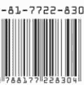


