# 计算机编程：即使是初学者也能掌握项目编程所需的完美技能最完整速成课程。学习并掌握最佳编程语言！


版权 © [2024] 版 [vera poe] 版权所有。

未经出版商或作者书面许可，除美国版权法允许的范围外，以任何形式复制本书的任何部分。

本出版旨在就其涵盖的主题提供准确且权威的信息。本书的销售基于以下理解：作者和出版商均未从事法律、投资、会计或其他专业服务。尽管出版商和作者在编写本书方面付了最大努力，但他们对本书内容的准确性或完整性不作任何声明或保证，并特别辞弃任何关于商品性或适用于特定用途的暗示保证。销售代表或书面销售材料不得创建或扩展任何保证。书中包含的建议和策略可能不适用于您的情况。在适当的情况下，您应该咨询专业人士。出版商和作者对任何利润损失或其他商业损害均不承担责任，包括但不限于特殊、间接、后果性、个人或其他损害。


## 引言

欢迎 C# 编程，非常感谢你选择这本书！

无论你是经验丰富的程序员还是完全的新手，这本书都是为了帮助你快速学习 C# 编程而编写的。

读完本书后，你应该能够毫无问题地编写自己的 C# 程序。事实上，我们将作为项目的一部分一起编写简单的软件，准备好开始了吗？

大多数人对学习新的编程语言感到恐惧。他们知道学习一点可以为他们操作计算机打开很多大门，但他们担心编程本身太难学习和操作了。如果你不花适当的时间来学习新的编程语言，整个编程过程可能会变得困难。但当你需要找到一种可以帮助你编写几乎任何你想要的代码语言时，就是学习 C# 语言的时候了。本书将带你通过一些 C# 语言的基础知识，让你自己上手。关于 C# 的：当你涉及到编码时，你可能想要查看的是了解 C# 特别是你想要学习如何使用这种特定的语言。有很多语言可以选择，而且它们的工作方式都不同，但你会发现使用 C# 程序有足够的内容，我们将在本书中探索一些想法。尽管你只是一个初学者，这也是一个非常适合工作和设计你自己程序的棒语言。

虽然如果你想开始编程有很多选择，但没有像 C# 这样的。选择 C# 而不是编程语言的优点之一包括：

作为一个初学者，代码有很多部分对你来说并不容易学习。你将在边学边做，但允许 C# 的库是一个帮助你的绝佳资源。你可以将函数放入代码中，而无需过多参与。你可以使用它们对代码进行一些更改，使其按你想要运行。

### 自动释放函数

当你使用其他一些编程语言时，你必须检查并移除你拥有的项目。这会占用你的时间，如果你漏掉了其中一些，将会非常麻烦。使用 C# 将为你完成所有这些工作，让事情变得更快、更简单。

### 易于学习

C# 被广泛认为是最容易学习和操作的语言之一，虽然某些部分比其他语言更复杂，但这并不困难，你会很快识别代码部分并继续使用。

### 兼容 Windows

这种语言最初是为 Windows 计算机创建的，帮助你为它们设计程序，但它也能很好地适用于 Mac、Linux 等其他操作系统。下载 .NET。Windows 有一些易于使用的产品，特别是对于初学者来说，所以你一旦开始就能获得极的结果。


这使得使用该程序变得非常容易，并让你在学习其他程序之前掌握基础知识。即使你选择坚持使用这种编程语言，你会发现它足够强大可以完成你想要的大部分编码，而不会像在使用其他程序时那样遇到困扰。

准备好进入 C# 的世界了吗？让我们开始吧。

# 第一章：C# 剖析

## C# 简介

学习编程将一途中给你带来诸多好处。它将能让你制作出你喜欢的程序和应用程序。它将通过许多易于操作的选择帮助你促进职业发展，让你获得更多新技能和更高的收入。而且在某些时候，学习如何使用 C# 是关重要的，因为你将更多地了解你的计算机及其工作原理。

当你有时间学习编程时，有很多很棒的选择。许多语言的开发是为了处理不同的项目，有时它们还能够处理不同类型的进程和应用程序。虽然许多语言的实用性取决于你最初想用该语言实现什么，但我们将看看如何使用 C# 语言，以及它对于你的需求是有多出色。让我们深入研究 C# 语言，以及如何让它来满足你的编程需求。

我们首先需要关注的是 C# 语言。C# 将是一种优雅的面向对象的语言，它非常有帮助，因为它允许程序员构建并构建使用 .NET 框架的各种健壮且安全的应用程序。使用 C# 可以处理各种项目，包括 Windows 应用程序、客户端/服务器应用程序、数据库应用程序等等。

在使用 C# 时，你会发现它在视觉上为你提供了一个高级的编辑器，带有一些更方便使用的界面设计器，以及其他确保你能够基于此语言开发应用程序的工具。C# 语言的一个特点是它具有很高的表达性，能够帮助处理你想要的更复杂的代码，但它同时也保持简单。C# 语法中的大括号部分看起来会很熟悉，特别是如果你过去接触过 Java 或 C++ 的话。精通语言的开发者会发现，由于相似性，他们不需要重新学习 C#。

C# 非常有用，因为它简化了 C++ 语言中发生的一些问题，并向你提供了一些强大的功能，包括 C# 拥的值类型（带有 null）、委托、枚举、lambda 表达式以及直接内存访问，这些功能在 Java 这样的语言中是不具备的。

此外，你会发现 C# 语言能够支持一些泛型方法和类型，这将有助于提高类型安全性和性能。它还带有一些迭代器，允许集合类的实现者定义自定义的迭代行为，并供客户端代码使用。

由于这种语言属于面向对象的分类范畴，因此它能够支持该语言中的一些特性，包括多态、继承和封装。类可以继承自父类，也可以实现接口。

C# 中的方法与结构体（struct）相似，这意味着它是一种栈分配类型。它可以实现接口，但不能被继承。

除了我们刚刚看到的的一些基本原则外，C# 还可以涵盖：

- 委托（Delegates）：通过使用委托来封装某些方法签名。

- 属性（Properties）：作为某些私有成员变量的访问器。

- 特性（Attributes）：在程序运行时帮助提供关于不同类型的声明式元数据。


Linq 是一种集成查询语言，它非常有用，因为无论我们与何种数据源工作，它都能为我们提供一些内置的查询能力。

在使用 C# 来满足我们的某些需求时，我们可以看到它的许多优势。它是一种面向对象的语言，使得组织和维护相关内容变得更容易。当我们利用稍后将讨论的这种理念和 .NET 平台时，我们能够利用它来构建我们想要的健壮程序，而无需面对其他语言中常见的因功能缺失而带来的复杂性。

# C#

在详细介绍如何编写代码以及使用 C# 语言可以做什么之前，我们需要更好地了解这是关于什么的，以及为什么它是我们想要进行的编程工作中如此重要的部分。首先，一个点子（IDE）是一个集成开发环境，它可以使用应用程序来帮助应用程序开发。总来说，这是一种图形化界面指南，旨在让许多开发者更轻松地构建软件应用程序。很多情况下，该领域拥有更多你所需的工具。

大多数常用功能，如数据结构、浏览、版本控制和调试区域，都是为了帮助开发者执行操作，而无需在正在使用的不同应用程序之间来回切换。这使得最大化生产力变得更容易，因为我们可以为相关组件提供相似的界面，并减少学习新语言所需的时间。此外，取决于你选择的 IDE 类型，它有时只支持一种语言，而有时支持多种。

这个概念是从一些简单的基于命令的软件演变而来的，那些软件不如菜单驱动的软件实用。一些现代 IDE 是视觉化编程，通过移动代码块可以快速创建应用程序，编程将生成图表和流程图，然后根据你希望获得的结果进行解释。

## 如何在 Linux 和 Mac 计算机上使用 C#

虽然 C# 被认为是一种 Windows 语言，但我们可以在 Linux 和 Mac 计算机上进行工作。我们可能需要经过几个额外的步骤，有时我们在 Windows 操作系统上使用的某些功能需要付出代价。有时我们希望使用免费的 IDE，但有时该区域的功能会有限，这取决于你想要用这种语言设计什么，以及你的编码需求需要哪些功能。

关于 C# 语言，有几个好的 IDE 可供选择。进行研究并更多地了解它们的工作原理，以及哪些包含你希望获得的以获得最佳结果的功能，是非常重要的。当你这样做时，编写出你想要代码将变得容易得多。


现在，我们进入这一过程的一个基础领域，你会注意到扩展视图的顶部有一个搜索栏。你可以在这里输入“C#”。你需要的是由 Microsoft 提供的版本，所以请确保点击这一个进行安装，即可准备就绪。

但请记住，C# 语言的设计初衷是在 Windows 系统上运行得得最好。因此，如果你使用的是 Windows，你可能会发现这种语言易于使用，而且你在编程中寻找的所有功能和特性都恰好位于它们所在的位置。

这并不意味着你无法在 Mac 计算机上完成这项工作。这意味着你需要额外额外的步骤来完成配置，并且实现你想要的某些功能可能需要一些时间。花些时间在 Linux 或 Mac 计算机上熟悉 C# 语言，对于帮助你在这一过程中获得最佳结果至关重要。

### 如何获取 C# 编译器

C# 有多种编译器选项，可以让初学者的学习过程变得轻松顺畅；在本书中，我们将使用 Visual Studio 2010 自带的 C# 4.0 版本，但也可以使用更高版本。大多数示例都应该能够在没有任何问题的情况下编译并运行。

如果我们无法获得 Visual Studio 2019 的专业版，更好的选择是社区版（以前称为 Express）。该版本是免费的，并可以直接从互联网下载；你只需要完成一个小型调查即可下载 C# Visual Studio 编译器（社区版），它是完全免费的。你可以在此处访问 Microsoft 门户网站：https://visualstudio.microsoft.com/。

一旦下载了编译器，我们就进行安装；这项任务与安装任何其他程序非常相似，但不要忘记在 30 天内进行注册。

### 开发环境

安装完成后，我们从开始菜单中启动程序。你将看到一个显示应用程序界面的窗口。该界面分为两个部分：

- **左侧**：我们有一个搜索栏，可以通过输入关键词找到我们的大多数项目。在主页上，我们可以看到创建新项目、文件夹、项目解决方案的选项，以及访问名为“克隆”（clone）的代码库以检查代码。我们也可以在这个界面的相同部分接收有关使用 C# 的新软件的公告，但在不同的页面中，我们将拥有编辑区域来编辑程序代码、界面、图标和其他资源。

编辑程序代码是一项非常简单的活动，如果我们知道如何使用 Microsoft Word 或记事本等任何类型的文本编辑器，就可以编辑代码。其他编辑器区域也非常用户友好，但我们不需要执行本书中所示的示例。

好的一面是，我们有一个名为资源管理器的窗口；在同一区域，会出现其他窗口，提供有关我们正在开发的项目的信息。我们将在本书后的部分看到某些窗口显示的细节。

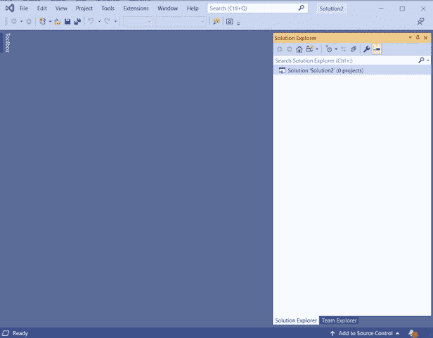

在底部，我们找到了另一个窗口；在这个区域，通常有编译器用于与我们通信的部分。例如，我们将看到一个指示程序状态的窗口；如果我们需要任何帮助，将看到开始菜单。

### 创建新项目

要创建一个新项目，最简单的方法是从开始菜单中选择。界面显示源代码，我们点击开始栏。如果我们需要文件夹，将在界面中的资源管理器中看到项目解决方案。

在 Visual Studio 中创建 C# 应用程序，最好的方法是创建一个项目并在控制台上工作。程序将在控制台中生成一条消息，然后我们在界面上添加元素。

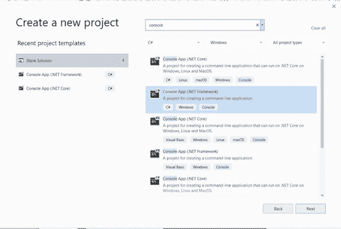


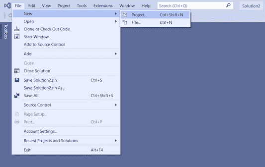a b

在对话框的亮亮部分，列出了我们可以创建的不同类型的项目；对于本示例，我们必须选择由控制台应用程序指示的项目，并点击“下一步”按钮。

注意：如果由于某种原因，我们关闭了源代码编辑器导致它没有出现在我们的界面中，找到它最简单的方法是通过解决方案管理器。只需转到代表源代码的文档并双击它，源代码编辑器的窗口就会出现。

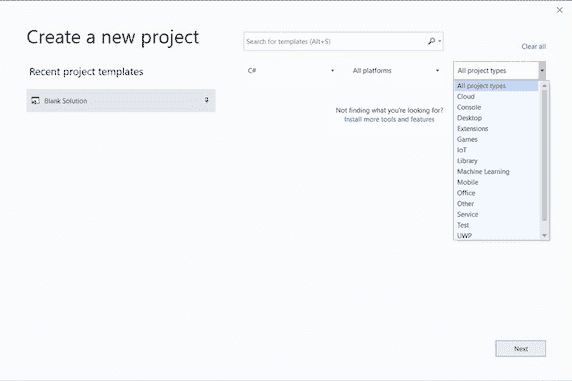a b

在左侧，我们将编写项目的名称，在此例中名称将为 `myproject`。我们创建的每个新项目都有一个名称；然后，我们只需按下“创建”按钮。

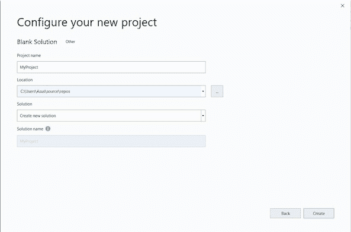a b

几秒钟后，Visual Studio 社区版将创建一个项目以利用解决方案和项目；一个解决方案可以包含多个项目，例如 Office 有 Word、Excel 和 PowerPoint 等不同产品。Office 是一个解决方案，每个产品都是一个项目。项目可以是一个独立的程序或库，并包含更多文档，即包含源代码和额外资源的文档。

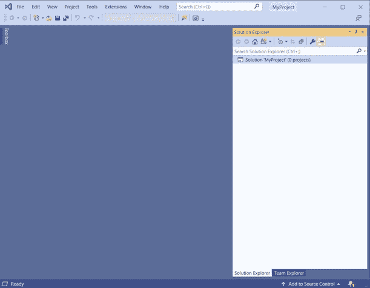a b

我们可以看到用户界面发生了一些变化，窗口已经显示了信息，我们还可以看到编辑区域显示了程序的骨架。

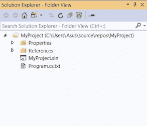a b

解决方案管理器以逻辑方式显示解决方案的信息，以便像一棵小树一样进行观察。在根部，我们找到了解决方案；每个项目将有一个分支，而每个项目反过来又会有分项。在我们情况下，我们看到了三个元素；其中两个元素合并在一起，以便在引用期间保持项目的属性（列表）。该元素被称为程序（program），它代表了我们可以保存应用程序源代码的文档。程序的扩展名为 `.cs`。

在编辑区域，我们可以从那里看到程序的骨架。为了理解我们拥有什么，有一个必要的概念需要了解：命名空间（namespace）是一个逻辑分组，例如，我们将与数学相关的所有代码放在一个命名空间中。为了解决命名冲突，假设我们有一个巨大的项目，几名程序员在上面工作。两个程序员可能会创建相同的名称；这会产生冲突，因为程序不知道该使用哪个版本。在不同的命名空间中，已经创建了数千个类和方法供使用。当我们想要使用其他程序员编写的命名空间中的资源时，我们必须使用它。如果我们需要添加更多命名空间，将在此部分进行。

下面是定义我们项目的正确命名空间；操作方法如下：

```Namespace myproject

{

}
```

创建的命名空间区域称为 `myproject`。命名空间使用 `{}` 作为分隔符；这被称为代码块，放置在 `{}` 之间的所有内容都属于该命名空间。这里我们需要编写与我们的应用程序对应的代码。

在代码块内部，我们找到了类（class）的声明，这是一种面向对象的语言，这就是为什么我们需要为应用程序声明一个类。类有一块代码，在我们的应用程序中，它被称为一个程序（program）。类的概念将在书中介绍。

所有程序都需要一个起点，一个指示程序从哪里开始的地方。在其他语言中，起点是 `main()` 函数；该函数也有一个代码块。在这个函数内部，我们通常会放置应用程序的主代码，尽管可能有更多的函数和类。函数部分见第 5 章。

现在是创建我们的第一个应用程序的时候了。我们将按所示修改函数代码。当我们在 `main()` 中添加语句时，我们必须注意在放置点之后立即发生了什么。

编译应用程序

一旦我们完成程序的编写，就可以像我们之前学的那样进行编译；这将生成程序集，程序集将在执行时由运行时使用。


要编译应用程序，我们必须选择生成菜单，然后只需通过按下 `F6` 键即可生成解决方案。编译器将开始工作，我们将在状态栏中看到编译成功。

运行应用程序

一旦编译成功，我们就可以运行程序并观察其工作原理。为此，我们有两个选项：带调试运行或不带调试运行。虽然只显示带调试运行，但我们可以通过工具菜单添加 `Ctrl+F5` 快捷键来使用不带调试运行。

调试器是一个帮助我们在运行时纠正错误以及逻辑错误的程序。我们最好使用不带调试器的执行方式，仅在需要调试正在运行的应用程序时才使用带调试运行；此时我们按下 `Ctrl+F5` 键。

当程序执行时，会弹出一个窗口，我们可以调用控制台来显示程序的执行情况。通过这种方式，我们可以读取在 `example` 中放置的消息。

由于这是一本 C# 编程的入门书籍，我们所有的程序都将在控制台上运行，通过学习如何在 C# 中编写表单和图形界面，来理解核心概念。这种编程并不困难，但需要面向对象编程的基础知识。

如何在程序中检测错误

有时我们编写程序时可能会出错；发生这种情况时，应用程序无法编译，因此我们必须更改错误的地方。我们故意写一个错误，将控制台的命名空间更改为 `helloworld`，看看编译后会发生什么。


如你所看到的，界面底部出现的窗口是编译器用于通信的；该窗口给出了错误列表。在下一本书中，我们将学习如何使用它；现在我们只需要知道，解决列表中的第一个问题是必要的，可以直接点击一下跳转到错误。

类视图

现在我们将检查类视图。在此视图中，我们可以获取有关解决方案资源管理器的信息，这些信息是按逻辑排列的。通过此视图，我们可以快速找到解决方案的命名空间以及它们包含的类；如果需要，我们还可以查看每个类拥的方法。此视图不仅允许我们查看逻辑信息，还提供了快速导航代码的可能性。

在社区版中，没有预先配置的选项，因此必须向视图菜单中添加命令。

要显示类视图，我们必须进入视图菜单，然后通过按下 `Ctrl+` 选择类视图，这将弹出一个窗口界面。


类视图窗口分为两个部分；一个部分显示元素的层级关系，另一个部分显示特定的类。


在树形结构中，我们可以找到命名空间 `helloworld` 的必要引用。如果有更多命名空间，它们会在打开命名空间时出现在那里，找到在其中声明的类。在这种情况下，我们只有一个类；点击一下，我们将在底部看到 `example` 中显示的元素，我们有 `Main()` 方法。如果此时我们双击任何方法，将自动跳转到其定义代码处。因为程序很小，可能看不到这种做法的优势，但对于具有数行代码的程序来说，能够快速导航是一个巨大的优势。

配置编译器菜单

为了在菜单中添加所需的选项，我们必须遵循一系列非常简单的步骤。首先，进入工具菜单并选择“自定义”选项。

弹出一个对话框，我们在其中必须选择命令；在此部分，我们选择想要添加命令的菜单，例如“视图”菜单。


在列出的当前菜单命令区域，点击我们想要插入新命令的位置并按下“添加”按钮。这将弹出一个新对话框，显示所有我们可以添加的分类后的可能命令。

在类别中选择“视图”，在“类视图”命令中，该命令就是允许我们拥有类视图的。“不带调试启动”命令位于“调试”类别中。


到此为止，我们分析了理解 .NET 操作所需的最基本概念。从下一章开始，我们将开始学习编程和 C# 语言。

```csharp
Main()
```


C# 是一种强大的面向对象编程语言，它使程序员能够基于 Microsoft .NET 平台快速编写各种应用程序。Microsoft .NET 提供了一系列工具和服务，用以最大化计算和通信领域的开发与利用。由于 C# 卓越的面向对象设计，它非常精确，使其成为构建各种组件（无论是高层业务对象还是系统级应用程序）的理想选择。

C# 的功能领域体现在以下方面：

- 设计 Windows 应用程序。
- 自定义 Windows 控件库。
- 设计控制台应用程序。
- 设计智能设备设备应用程序。
- 设计 ASP.NET Web 应用程序。
- 设计 ASP.NET 服务。
- 设计 ASP.NET 移动 Web 应用程序。
- 自定义 Web 控件库。

ASP.NET 是基于 C# 开发的控制和标记语言。在中间语言领域，C# 是最亲和的语言，它具有 C 语言和 Java 语言的主要特征、强大的函数库以及方便的模板，是表现最优的语言之一。

### C# 的主要特性

C# 语言几乎结合了当前高级语言的优点，并具有以下主要特性。

#### 简洁的语法

C# 语言类似于 Java 语言，使用统一的运算符，消除了 C++ 语言中复杂的表达式和伪关键字，使其以最简单、常见的形式进行描述。

#### 卓越的面向对象设计

C# 语言是根据面向对象的思想设计的，因此具有面向对象应该具备的所有特性，即封装、继承和多态。

C# 语言只允许单继承，因此一个类不会有多个基类，从而避免了类型定义的混乱。在 C# 语言中，每个类型都是一个对象，因此没有全局函数、全局变量和全局常量的概念。所有的常量、变量、属性、方法、索引、事件等必须封装在类中，这使得代码更具读性并减少了命名冲突的可能性。

#### 与 Web 的紧密集成

在 C# 中，复杂的 Web 编程领域更像操作对象，从而简化了大规模的分布式开发。内置的 C# 语言可以被运行在操作系统上的语言方便地调用 Web。

#### 完善的安全错误处理

语言的错误处理能力是衡量一种语言优劣的重要标准。C# 消除了软件开发中的错误，并提供了完全的安全，包括类型安全。默认情况下，来自互联网的代码不允许访问文件和资源。C# 语言不允许未初始化的变量并提供此类溢出检查。内存管理中的垃圾回收机制极大地减轻了开发者内存管理的负担。

#### 版本处理技术

C# 语言内置了版本控制功能，例如处理加载和支持，以确保复杂软件方便开发和升级。

#### 灵活性和兼容性

在托管状态下，C# 不能使用指针但使用委托来模拟指针的功能。如果你需要在类或方法中使用指针，只需要声明内容为 `unsafe`。此外，尽管 C# 不支持类的多继承，但可以通过继承接口来实现。

兼容性意味着 C# 允许与 C/C++ 语言风格的 API 进行操作（这需要传递指针类型参数），并允许 C# 组件与其他语言组件进行操作。

#### 业务流程与软件实现之间更好的对应

如果企业业务计划要付诸实践，必须在抽象的业务过程和实际的软件实现之间建立密切的对应。在大多数语言中很难做到。

C# 允许类型定义的扩展元数据。应用于任何对象项目的元数据，构建者可以定义特定领域的属性，并将其应用于语言元素，例如类和接口。

简而言之，C# 是一种现代面向对象语言，使程序员能够方便地基于 Microsoft .NET 平台创建解决方案。该框架使 C# 组件能够轻松转换为 XML 服务，以便平台应用程序可以通过互联网进行调用。C# 在提高开发者效率的同时，致力于消除可能导致严重后果的编程错误。C# 使 C/C++ 程序员能够在保持开发者所需的灵活性的同时，快速开发网络程序。

至此，我们已经通过各种示例对 C# 的重要性和应用进行了简要介绍。在本书的下一章中，我们将讨论 C# 开发环境，这对于开发熟练的 C# 桌面应用程序至关重要。

## 第二章：数据类型

数据类型


在编程语言中，数据类型允许一个框架，用于声明不同数据类型的变量或函数。变量的类型决定了它所占空间以及位模式的保存方式。数据类型的基本分类如下：

● 基础类型：用于数值计算的类型，包含以下两种类型：(a) 整数和 (b) 浮点。

● 枚举类型：同样是数值排序领域，用于描述必须通过系统分配离散数值值值的变量。

● void 类型：关键字 `void` 表示无法分配任何值。

● 派生类型：它们包含了 (a) 数组、(b) 指针、(c) 联合、(d) 结构体和 (e) 函数。

数组结构数据类型也称为聚合类型。函数的类型定义了函数在终止时返回的值类型。我们将在后续章节中讨论核心数据。

### 整数类型

以下是属于该类别的数据类型列表。为了供参考，还指定了它们所占的存储范围。

● char
分配内存：1 byte 范围：-128 到 127 或 0 到 255

● signed char
分配内存：1 byte 范围：-128 到 127

● unsigned char
分配内存：1 byte 范围：0 到 255

● int
分配内存：2 to 4 bytes 范围：-32,768 到 32,767 或 -2,147,483,648 到 2,147,483,647

● short
分配内存：2 bytes 范围：-32,768 到 32,767

● unsigned short
分配内存：2 bytes 范围：0 到 65,535

● unsigned int
分配内存：2 to 4 bytes 范围：0 到 65,535 或 0 到 4,294,967,295

● long
分配内存：4 bytes 范围：-2,147,483,648 到 2,147,483,647

● unsigned long
分配内存：4 bytes 范围：0 到 4,294,967,295

要获取变量数据类型的精确大小，请使用 `sizeof` 运算符。声明 `sizeof(<type>)` 会产生该数据类型以字节为单位的大小。下面是一个说明该概念的示例：

```c
#include <limits.h>
#include <stdio.h>
int main() {
    printf("data type char size in bytes: %d\n", sizeof(char));
    return 0;
}
```
编译并执行此代码后，你将得到以下输出：
allocated memory for float: 4
Precision: 6
Max range value: 3.402823e+38
Min range value: 1.175494e-38

### void 类型

void 数据类型表示无法访问任何值。它可以在以下三种情况中使用：

1. 返回类型为 `void`。
2. 无参数的函数。
3. 指向 `void` 的指针。

要找到你系统中相关数据类型所分配的精确内存字节数，以下代码将允许你做到：

```c
#include <float.h>
#include <stdio.h>
int main() {
    printf("allocated memory for float: %d\n", sizeof(float));
    printf("precision: %d\n", float_DIG););
    printf("max range value: %e\n", float_MAX);
    printf("min range value: %e\n", float_MIN);
    return 0;
}
```
编译并执行此代码后，你将得到以下输出：
allocated memory for float: 4
Precision: 6
Max range value: 3.402823e+38
Min range value: 1.175494e-38

# 第 3 章：运算符

### 变量

变量仅仅是被分配存储区域的名称。你的程序区域能够操作此类存储区域。每个变量都与一种类型关联，该类型决定了内存中分配给变量的大小。这种类型还决定了可以应用于变量的操作种类。然而，正如你将发现的，理解在代码中使用这种数据类型的方法。


有效变量定义的变量、区域、示例：

`int a, b, c;` `char d, e;` `float f, g; salary;` `double h;`

变量也可以在声明时进行初始化。

例如：`int x = 40;`

### 变量初始化

变量初始化是指为变量赋值值的过程。在 C# 中，这是通过赋值运算符 (`=`) 后接字面量值或常量表达式来实现。以下是变量初始化的通用语法：`variable_name = value;`。正如我们之前提到的，变量也可以在声明时初始化。这里有更多示例：

`int x = 1, y = 6; /* 初始化 x 和 y */`
`byte f = 22; /* 初始化 f. */`
`double pi = 3.14159; /* 定义一个用于近似 pi 值的变量 */`
`char a = 'a'; /* 变量 a 的值为 'a' */`

变量初始化应该正确完成；否则程序可能会产生意外之外的结果。

例如：使用 `System` 命名空间的变量声明：

```csharp
using System;
class myprograma
{
    static void main(string[] args)
    {
        short x;
        int y;
        double z;
        /* 变量的实际初始化 */
        x = 5; y = 10; z = x + y;
        Console.WriteLine("x={0}, y={1}, z={2}", x, y, z);
        Console.readline();
    }
}
```

代码返回：

X=5, y=10, z=15

### 获取用户输入

`System` 命名空间 `Console` 类有一个名为 `ReadLine()` 的方法，允许用户输入。用户的输入会被读取并存储在变量中。下面的示例演示了如何使用该方法：使用 `System` 命名空间的应用程序：

```csharp
using System;
class myprograma
{
    static void main(string[] args)
    {
        string firstname = "nicholas";
        string lastname = "samuel";
        Console.WriteLine("your name is: " + firstname + " " + lastname);
        Console.WriteLine("please enter a different first name:");
        firstname = Console.readline();
        Console.WriteLine("your new name is: " + firstname + " " + lastname);
        Console.readline();
    }
}
```

当提示输入新的名字值时，你的名字发生了变化。

### 运算符

运算符是用于执行某些数学操作的符号。C# 具有多种用于执行各种操作的运算符，如下所示：

```csharp
using System;
class myprograma
{
    static void main(string[] args)
    {
        int x = 3;
        int y = 10;
        int z;
        z = x + y;
        Console.WriteLine("1:{0}", z);
        z = x - y;
        Console.WriteLine("2:{0}", z);
        z = x * y;
        Console.WriteLine("3:{0}", z);
        z = x / y;
        Console.WriteLine("4:{0}", z);
        z = x % y;
        Console.WriteLine("5:{0}", z);
        x++;
        Console.WriteLine("6:{0}", z);
        x--;
        Console.WriteLine("7:{0}", z);
        Console.readline();
    }
}
```

上述大多数运算符都是广为人知的，除了少数几个之外。`++` 是递增运算符，每次迭代时将变量的值加 1。`--` 是递减运算符，每次迭代时将变量的值减 1。`%` 被称为模运算符，返回除法后的余数。

代码返回如下所示的输出：


### 逻辑运算符

C# 还有许多逻辑运算符。让我们简要讨论一下：

逻辑与 `&&`：当两个操作数都非零时，条件为真。
逻辑或 `||`：当任一操作数非零时，条件为真。
逻辑非 `!`：该运算符反转操作数的逻辑状态。如果条件为真，此运算符将使其变为为假。

下面的示例演示了如何使用上述运算符：使用 `System` 命名空间的应用程序：

```csharp
using System;
class myprograma
{
    static void main(string[] args)
    {
        bool x = true;
        bool y = true;
        if (x && y)
        {
            Console.WriteLine("1");
        }
        if (x || y)
        {
            Console.WriteLine("2");
        }
        /* 修改 x 和 y 的值 */
        x = false;
        y = true;
        if (x && y)
        {
            Console.WriteLine("3");
        }
        else
        {
            Console.WriteLine("3");
        }
        if (!(x && y))
        {
            Console.WriteLine("4");
        }
        Console.readline();
    }
}
```

代码返回：


### 赋值运算符

下面的示例也演示了 C# 的赋值运算符：

```csharp
class myprograma
{
    static void main(string[] args)
    {
        int x = 3;
        int y = 10;
        int z = x;
        Console.WriteLine("1:{0}", z);
        z += y;
        Console.WriteLine("2:{0}", z);
        z -= y;
        Console.WriteLine("3:{0}", z);
        z *= y;
        Console.WriteLine("4:{0}", z);
        z /= y;
        Console.WriteLine("5:{0}", z);
        z = 100;
        z %= x;
        Console.WriteLine("6:{0}", z);
        z <<= 2;
        Console.WriteLine("7:{0}", z);
        z >>= 2;
        Console.WriteLine("8:{0}", z);
        z &= 2;
        Console.WriteLine("9:{0}", z);
        z ^= 2;
        Console.WriteLine("10:{0}", z);
        z |= 2;
        Console.WriteLine("11:{0}", z);
        Console.readline();
    }
}
```

代码返回以下结果：


## 第 4 章：字符串和列表

列表


`List<t>` 是所有集合中最频繁使用的一个集合类。它是一种通过索引访问元素的类型。如前所述，`List` 属于 `System.Collections.Generic` 命名空间。`List` 是一个类，为 `List` 和元素操作提供了许多方法，其中一些方法用于搜索、排序等。它被用于创建包含许多不同类型的集合。它可以是整数、字符串等许多类型的集合。对于引用类型，`List` 允许将 `null` 值作为元素。在 `List` 集合中也可以插入重复的值。该类可以同时使用与数组类似列表的边界比较器和等性比较器，但列表可以动态更改大小，而数组不能。

## String

`String` 是一种表示文本的数据类型，并与文本变量一起工作。它是一个字符数组。通过 `string` 关键字声明 `string` 数据类型。当使用 `string` 关键字时，意味着它指的是 `String` 类（在书的后部分解释）。有许多方法可以使用某些字符串变量。一些最流行的包括 `concat`（用于连接两个字符串）、`contains`（确定字符串是否包含作为值传递的给定字符串）、`equals`（确定两个字符串是否具有相同的值）等。默认字符串数据类型是空字符串。

# 第 5 章：语法

### 循环结构语句

在现实生活中，我们经常多次重复做某件事。例如，当你每轮练习都要擦擦眼睛时，你会重复擦眼睛的动作。在打网球时，你会重复挥拍动作等等。在 C# 中，有一种语句可以重复执行相同的代码块，这被称为循环语句。循环语句分为三种类型：`while` 循环、`do while` 循环和 `for` 循环。

`while` 循环是上述节提到的某些条件判断，根据条件决定是否执行 `{}` 中的语句。如果条件为真，则重复执行语句，直到循环结束。`while` 循环的语法如下：

```
while (condition)
{
    statement
}
```

在上述结构中，`{}` 中的执行语句被称为循环体，它取决于条件。当条件为真时，将执行循环体。当循环体执行完毕后，它将继续判断条件，直到条件为假。接下来，使用一个用来打印从 1 到 4 的自然数，如下例所示。

示例 program11.cs

```csharp
public class program11
{
    public static void //这里是你需要输入逻辑的地方
    {
        int firstsample = 1; //定义初始值为 1 的变量‘firstsample’
        while(firstsample <= 4) // 循环条件
        {
            Console.WriteLine("firstsample=" + firstsample);
            //如果条件成立，打印 firstsample 的值。
            firstsample++; //firstsample 自增
        }
        Console.ReadKey();
    }
}
```

计算机屏幕上显示的运行结果。例如，`x` 的初始值为 1，如果满足循环条件 `x <= 4`，则循环将重复执行，打印 `x` 的值，并且 `x` 会自动增加。因此，打印结果中 `x` 的值值分别为 1、2、3 和 4。值得注意的是，代码使用了一个示例通过在循环中更改 `x` 的值来实现死循环。

`do-while` 语句与 `while` 循环相似。区别在于 `do-while` 语句在判断条件之前会执行 `{}` 中的执行语句。`do-while` 循环的语法如下：

```
do
{
    statement
} while (condition);
```


```cpp
//increase the value of 'firstinstance' by itself

}

While(firstinstance <= 4);

//cycle conditions

Console.scanprogram();

}

}
```

运行结果将全部显示在计算机屏幕上。上面的示例具有相同的运行结果，说明 `do-while` 循环和 `while` 循环可以实现相同的功能。然而，两者在程序运行过程中存在差异。如果循环条件在循环语句开始时不满足，`while` 循环的循环体将一次也不会执行，但 `do-while` 循环的循环体仍会执行一次。如果将示例中的循环条件 `x<=4` 改为 `x<1`，示例 `b2-12` 将打印 `x=1`，而示例 `b2-11` 将不输出任何内容。

### 循环语句

上一节节解释了 `while` 循环和 `do-while` 循环。在程序开发中，经常会使用另一种循环语句，即 `for` 循环，它通常用于循环次数已知的情况，其语法格式如下：

`for (initialization expression; condition; operation expression)`

```
{
Execute statement
…
}
```

在上述语法结构中，`for` 关键字后的 `()` 包含三个部分：`initialization expression`、`loop condition` 和 `operation expression`，之间用 `;` 分隔，`{}` 中的执行语句是循环体。

接下来，`initialization expression`、`loop condition`、`operation expression` 和循环体分别由 `b1` 表示，可以通过编号详细分析 `for` 循环的执行流。

```
For(1; 2;3)
{
    4
}
```

接下来通过一个用例计算自然数 `1~4` 的和，如下例所示。

Example program13.cs:

```csharp
Public class classicprogram
{
    Public static void //this is where we usually enter the options
    {
        Int secondinstance = b1;
        //define the variable 'secondinstance' with the initial value of b1
        Do
        {
            Console.getresults("firstinstance=" + secondinstance);
            //print the value of 'firstinstance'
            Secondinstance++;
            //increase the value of 'firstinstance' by itself
        } While(firstinstance <= 4);
        //cycle conditions
        For(int first = 1; first <= 4; first++)
        {
            sum += first; //realize the accumulation of sum
        }
    }
}
```

在示例中，变量 `sum` 的值为 1，如果条件 `<=4` 为真，则在执行完成后执行循环，执行表达式 `bi++`，值变为 2。然后继续判断条件 `5<=4` 为假，结束循环，打印 "10"。

## 第 6 章：类与对象

在 C# 语言中，每个组件都与类和对象相关，这代表了面向对象编程的基本概念。类就像一个原型，用户从原型创建对象。类表示一个具有成员、属性和功能的单一单元。对象是现实生活中的内存实体。当实例化时，它们会分配一些内存空间并对该空间拥有引用。每个创建对象必须是某个类类型。

类代表了任何面向对象软件的独特编程。类用访问修饰符、`class` 关键字和唯一名称来定义。在某些类中，可能存在多个成员，如字段、属性和方法。类的默认访问修饰符是 `internal`。这意味着如果没有指定访问修饰符，则该特定类将被视为 `internal`。一个类的示例写所示：

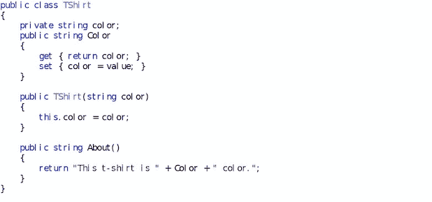

该类包含一个访问修饰符——`public`，它包含 `class` 关键字；它有一个唯一的名称 `shirt`。在此类中，定义了多个成员：一个 `private` 字段 `color`、一个 `public` 属性 `color`、一个定义的构造函数（带有参数）以及一个 `public` 方法 `about`。


在提供的示例中，我们可以看到一个名为 `Animal` 的抽象类。在该类中，只有一个成员，即一个抽象空方法 `legsNumber()`。当该方法被标记为抽象（abstract）时，意味着派生自该类的每个类（在本例中为 `Animal` 类）必须对该方法有实现。在抽象类下面，还有两个所谓的“普通”类。这两个类都对 `Animal` 类中的 `legsNumber()` 方法进行了实现，因为 `elephant` 类和 `pig` 类都继承自 `Animal`。继承将在后面的章节中详细解释，但目前，`elephant` 和 `pig` 后面的符号 `:` 意味着它们继承自 `Animal`。在这种情况下，这意味着它们必须拥有对基类中抽象方法的实现。在程序类的 `main` 方法中，声明了一个类型为 `Animal` 的变量名为 `animal`。

请注意，没有对 `Animal` 类进行实例化，因为这是不可能的，原因是 `Animal` 类是一个抽象类，所以它不能被实例化。在下一行中，程序将 `elephant` 类的对象实例化并赋值给 `Animal` 类型的变量。这是允许的，因为 `Animal` 是 `elephant` 的基类。之后，通过 `animal` 变量调用了 `legsNumber()`。此外，由于 `animal` 被实例化为 `elephant` 类型，该调用执行了 `elephant` 类中的 `legsNumber()` 方法。下一步是实例化 `pig` 对象并将其赋值给同一个 `animal` 变量。这最终再次从 `Animal` 对象调用了 `legsNumber()`。这里使用的是 `pig` 类对 `legsNumber()` 的实现。`console.output` 的输出如下所示：


对象代表系统中的实体，其所有特征和功能位于内存中的某处，并有一个指向该处的引用指针。每当使用 `new` 关键字时，就会创建一个对象。该对象必须是派自系统类的编程语言中创建的类（继承将在稍后解释）。这意味着有一个内置类 `Object`，它除了拥有自身的功能外，还拥有来自其父类的可用方法。这些方法是：`equals`、`toString`、`finalize` 和 `hashCode`。可以在示例中检查这些内容：


此示例使用了 `Shirt` 类，该类在之前的示例中已经显示过。在它的 `main` 方法中，实例化了一个该类型的对象。该对象由变量引用。在第二行中，你可以看到可以在对象上执行的可用方法和属性。除了颜色属性和属于衬类的一部分的方法外，还有来自父类 `object` 的方法（`equals`、`hashCode`、`getType`、`toString`）。

 接口

接口是面向对象编程中的另一个重要组件。接口代表了某些功能的多个声明。一个类可以实现多个接口，但只能继承一个抽象类。这是编程语言的另一个特性，不支持多重继承。实现某些接口的类必须提供所有接口成员的完整定义。在接口在使用中，没有访问修饰符的操作，因为所有接口成员都被视为 `public`。这是因为接口的存在是为了让其他类去实现的功能。如果某个类必须实现一个接口，意味着接口成员对其他类来说是 `public` 的。接口包含声明但不包含实现。如果你尝试在接口中插入实现代码，将会出现编译错误。


该程序包含一个类，它是基类 `Persona`。该类实现了 `IPersona` 接口，该接口包含两个私有字符串字段，即 `_firstname` 和 `_lastname`。它还有一个构造函数，其中为这些字段进行了赋值。此外，该类还定义了接口的三个成员——`running`、`standing` 和 `sitting` 属性。编译器处理这部分时没有错误，但如果我们从 `Persona` 类中移除这三个属性中的任何一个，编译器就会报告错误。例如：

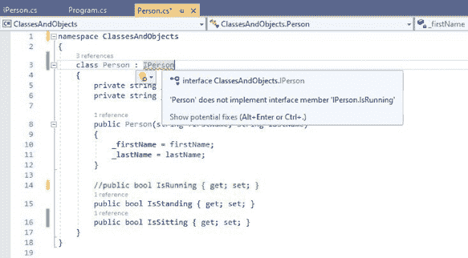

在这里，我们在 `Persona` 类中有一个被注释的 `running` 属性。编译器报告错误，该类没有实现该属性，导致程序无法构建。之后，我们将取消该属性的注释并恢复程序到有效状态。让我们创建一个包含 `main` 方法的 `Program` 类；在其中我们将创建一个 `Persona` 类的实例并运行程序，以检查一切是否运行正常。

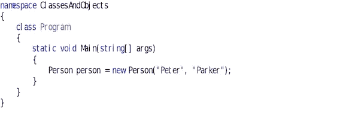

现在，我们运行程序：

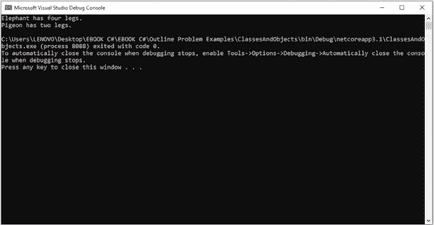

一切顺利。

## 第 7 章：Linq、查询、操作符 – XML

### Linq

语言集成查询（Language Integrated Query，称为 Linq）代表了 C# 编程语言中的查询语法，用于检索和过滤不同来源的对象。Linq 为各种类型的对象和变量提供了单一的查询接口。这种查询语法被集成到 C# 编程语言以及 Visual Basic 中。为了更好地理解，我们将提供一个示例来进一步解释。因此，你有 SQL 这种结构化查询语言；SQL 用于在数据库中获取和保存数据，它是一种旨在与数据库紧密工作的语言。

与 SQL 类似，Linq 用于获取和过滤不同的数据源，如集合等。使用 Linq 有许多方法；它可以直接查询集合、XML 文档、实体框架数据，通过实现 `queryable` 接口查询其他数据源，它是程序中某些变量之间的桥梁。查询返回对象作为结果，非常好，因为在使用 Linq 时可以使用面向对象的方法处理数据，你无需担心将数据集转换为对象。Linq 提供了一种查询数据的方式，且数据来源支持编译时语法检查，因此如果你在编写 Linq 时出错，编译器会立即通知你。下面查询集合如列表、数组、可枚举类（enumerable classes）等。

我们现在有了示例：


在这个示例中，我们有一个名为 `car` 的类。在类中有三个属性，分别是 `capacity`、`automatic` 和 `turbo`。每个属性都代表一个只读属性，它们的初始状态在类构造函数中设置。构造函数接受三个参数并将这些值赋值给上述属性。在 `main` 方法中，我们创建了一个对象列表。该对象列表在声明部分被填充，创建了五个 `capacity`、`automatic` 和 `turbo` 属性具有不同值的对象。之后，我们将过滤列表，只保留具有自动挡箱的汽车。这将通过使用 Linq 查询完成。我们创建了一个名为 `cars` 的自动挡汽车对象，并使用 Linq 过滤列表。然后我们执行 `where` 扩展方法来获取我们需要的对象。它是如何工作的？在 `where` 方法中，我们声明了一个用于过滤条件的迭代变量。

此示例中的变量的作用是，当我们过滤一个 `automatic` 属性为 true 的汽车时，它将返回，。让我们创建一个列表。在开始，我们使用 `List<T>` 类型创建一个对象集合。我们遍历列表并将消息打印到控制台输出。对于列表中的每个对象，我们将打印“the car with capacity {capacity} is automatic”。


在这个示例中，我们有一个名为 `Person` 的类。该类有三个属性，分别为 `salary`、`firstname` 和 `lastName`。每个 `Person` 对象代表一个具有基本信息的员工。对象的属性是在构造函数中赋值的。在 `main` 方法中，创建了一个 `Person` 类类型对象的列表。我们添加了五个 `Person` 对象，每个对象都有不同的工资金额、`firstname` 和 `lastName`。经理想要过滤出所有工资大于 3000 的人员，并将这些人人员标记为资深员工（seniors）。我们将使用上一个示例中的 LINQ 查询，在示例中我们使用 `where` 扩展方法对列表进行过滤。该方法声明了我们只需要工资大于 3000 的 `Person` 对象。检索完成后，`toList()` 方法将过滤后的可枚举列表转换为 `Person` 对象列表。现在，我们有了一个包含仅包含工资大于 3000 的人员的 `Person` 类型列表对象。该变量命名为 `seniors`。现在，经理请求计算 `seniors` 工资的总和。我们将通过创建一个 `seniors` 工资列表，然后将所有值相加到一个变量中，并将其打印到标准输出。`seniorsSalaries` 列表的创建通过执行 `select` 扩展方法完成。当需要从对象集合中获取某些属性值时，就会 `select` 方法。在这种情况下，我们需要 `seniors` 列表中每个对象的 `salary` 属性值。`select` 方法执行以下操作：

```csharp
foreach (var x in seniors)
{
    x.salary.value;
}
```

这创建了一个可枚举值的列表。在执行 `toList()` 方法后，成功创建了一个包含所有工资的 `List<int>` 对象。我们创建了一个变量来存储所有工资变量的总和。完成后，我们还有最后一条语句来完成工作。在每个方法完成之前，我们将所有工资汇总到一个变量中，程序会将结果打印到标准输出。该程序的输出将如下：

解决该问题的博客方案可以简化得多，只需要一行代码即可完成。那行代码看起来像这样：


在方法执行后，`select` 方法将跟随创建的列表之后，我们可以使用扩展方法对列表进行迭代并进行计算。这将产生完全相同的结果。这条语句只是被拆分成了更小的部分以便理解。让我们用更多示例结束这一章：


在这个示例中，我们修改了上一个示例中的 `Person` 类。现在，`Person` 类包含 `salary` 属性和 `PersonalInformation` 类类型属性，两者都在 `Person` 构造函数中赋值。`PersonalInformation` 类包含三个属性。这些属性为 `firstname`、`lastName` 和 `personalid`。`firstname` 和 `lastName` 是 `string` 数据类型，而 `personalid` 是 `int` 数据类型。这三个属性在实例化 `PersonalInformation` 类对象时在构造函数中赋值。现在，让我们进入 `Program` 类的 `main` 方法。在这里，我们将再次创建一个 `Person` 对象的列表，这与上一个示例相同。不过，由于类的修改，这次将会有所不同。我们正在创建五个 `Person` 对象，每个对象都分配了工资和 `personalInformation` 对象。


对于每个人，我们都创建一个 `personalinformation` 对象来正确地实例化 `persona` 对象。每个 `personalinformation` 对象都包含了传递给实例化的 `firstName`、`lastname` 和 `personid`。通过这种方式，我们创建了一个稍微复杂的对象，内部包含另一个类对象，就像一个数组，用于管理我们找到上一个示例中被视为高级人员且拥有 150 奖金的员工的每个 `firstName`。我们已经确认了工资大于三千（3000）的高级人员。我们正在执行与上一个示例类似的操作，但这次 `persona` 类发生了变化。它的结构与上一个示例不同，因此我们必须先分析类结构，然后创建解决方案。第一步是必须从人员列表中筛选出工资大于 3000 的 `persona` 对象。之后，我们必须从每个 `persona` 对象中提取 `personalinformation` 对象，以找到所有高级人员的 `firstname`。当收集了 `personalinformation` 对象后，我们必须对它们进行过滤，只保留 `personalid` 小于 150 的。完成该任务后，我们终于可以选择所有高级人员的 `firstname` 属性，将其转换为列表，遍历该列表并打印 `firstname` 值。这一切都是通过一个稍微复杂的查询完成的，我们创建了 `seniorslt150` 变量。

第一个 `where` 方法创建了一个可枚举的高级人员列表。然后，`select` 方法从高级人员列表中获取 `personalinformation` 对象，并生成一个包含高级人员 `personalinformation` 对象的可枚举列表。第二个 `where` 方法作用于之前创建的可枚举列表中的 `personalinformation` 对象，并将从那里过滤出 `personalid` 属性小于 150 的 `personalinformation` 对象。我们正在执行 `select` 方法，为每个 `personalid` 为 50 的高级人员对象收集 `firstname` 值。然后，我们对创建的可枚举对象执行 `list()` 方法，其产物是一个字符串列表，包含了在最终查询时年龄为 50 的每个人的 `firstname`。最后，我们遍历该列表并将这些名称打印到控制台上。标准标准如下文所示，该标准程序的输出如下：

![Image024.jpg]

## 第 8 章：决策的程序

有时有必要在满足条件时执行特定操作，在不满足条件时执行其他操作。假设我们的问题是维持一桶温水的温度，为了做到这一点，我们可以添加冷水。在这个问题中，我们需要决定添加什么种的水。

同样，有许多问题我们需要知道一个条件来决定如何解决它们。在 C# 中，实现这一点非常容易，因为该语言为我们提供了不同的工具来处理它。我们将必须使用表达式，并且这些表达式将被求值。在这种情况下，我们将使用关系表达式和逻辑表达式，它们将被求值，并根据评估结果执行算法的其他特定步骤。让我们从了解我们需要的表达式开始。

### 做出选择和决策

在我们学习 C# 语言时，我们需要花一些时间处理决策控制语句和条件语句。该领域将涉及可以接收用户输入的代码类型，将其与我们在代码中设置的条件进行比较，然后根据这些条件做出决策。当我们编写代码来处理某些决策时，这一切都在一个框架中完成。标准程序的输出如下：

```
if statement
```


关于条件语句的第一点，我们想要查看的是语句的已知基础。它是我们将要学习的所有条件语句之一，而这一个将是其中最基础的部分。虽然它遗漏了一些功能，但我们希望稍微了解一下在这些语句中看到的一些功能，这有助于我们学习更多关于条件语句以及一些实用的场景，因此学习它是非常重要的。

当你处理这个语句时，你会发现当它运行时，代码只有在用户提供的输入与代码中设置的条件相同时才会提供响应。当这种情况发生时，代码将能够执行，并通常根据程序员在代码中输入的内容显示某种类型的消息。有时，你还会设置执行其他内容。

然而，如果用户输入的内容不符合我们设置的条件，那么屏幕上什么都不会显示。这可能会导致一些问题，这就是为什么该语句不像其他选项那样被频繁使用。

关于这一切的好消息是，你会发现，即使是初学者，这些语句也易于设置和使用。让我们看看下面的代码，看看我们如何用 C# 语言为我们的需求创建一个这样的语句：

```csharp
if (xa > 0)
{
Console.write("value is positive.");
}
```

通过上面的示例，某些事情需要发生。如果用户输入的值大于零，程序将设置为打印“value is positive”；但是，如果表达式因为输入为零而变为假，那么程序将忽略 `console` 之后的整个语句。在我们处理语句时，为了快速查看 `else` 语句，在很多情况下我们无法完成任务，并希望添加足够强大的代码来处理工作。设置一段代码让某事发生后程序就卡住并不是一个非常好的主意，这时我们采用一个新的条件语句，即 `if-else` 语句。

正如你从这个结构看到的，`if-else` 语句将带来更多力量。这是 `if-else` 语句的一个基本选项，但你可以添加更多行来使其变得更强大。通过这些 `if-else` 语句，如果答案为假，你的代码将进入工作的下一个部分，同时编写更多内容允许程序在过程中处理两种选择。

为了掌握重点，我们需要查看 `if-else` 语句的语法，以便更好地理解它在 C# 语言中如何工作。该结构语法的一个良好示例将在下面的布尔表达式下方：

```csharp
if (expression)
{
Console.write(true);
}
Else
{
Console.write(false);
}
```

正如你从这个结构看到的，`if-else` 语句将带来更多力量。这是 `if-else` 语句的一个基本选项，但你可以添加更多行来使其变得更强大。通过这些 `if-else` 语句，如果答案为假，你的代码将进入工作的下一个部分，同时编写更多内容允许程序在过程中处理两种选择。

为了掌握重点，我们需要查看 `if-else` 语句的语法，以便更好地理解它在 C# 语言中如何工作。该结构语法的一个良好示例将在下面的布尔表达式下方：

```csharp
if (booleanExpression)
{
Console.write(true);
}
Else
{
Console.write(false);
}
```

正如你从这个结构看到的，`if-else` 语句将带来更多力量。这是 `if-else` 语句的一个基本选项，但你可以添加更多行来使其变得更强大。通过这些 `if-else` 语句，如果答案为假，你的代码将进入工作的下一个部分，同时编写更多内容允许程序在过程中处理两种选择。

值为正数：

```csharp
if (xa > 0)
{
Console.write("value is positive");
}
```

值为零：

```csharp
if (xa > 0)
{
Console.write("value is zero");
}
```

通过上面的示例，某些事情需要发生。如果用户输入的值大于零，程序将设置为打印“value is positive”；但是，如果表达式因为输入为零而变为假，那么程序将忽略 `console` 之后的整个语句。

在我们处理语句时，为了快速查看 `else` 语句，在很多情况下我们无法完成任务，并希望添加足够强大的代码来处理工作。设置一段代码让某事发生后程序就卡住并不是一个非常好的主意，这时我们采用一个新的条件语句，即 `if-else` 语句。

嵌套语句是指：每当我们查看 C# 的一些新代码时，你会发现代码内部的两个语句处理起来更容易。

让我们看看下面的代码，看看我们如何用 C# 语言为我们的需求创建一个这样的语句：


## 引言

在处理嵌套条件语句时，你必须关注的重点是：如果你这样做，一旦编写语句时发生错误，整个程序都会因为这个错误而失败，并且可能花费一些时间来修复。这使得在此过程中处理和操作变得有些困难，所以请务必小心。

然而，它们的巧妙之处，以及让它们非常有吸引力的一点在于，它们允许我们根据意愿添加许多或少数几层嵌套。尽管如此，大多数该语言的专业人士建议嵌套语句保持在三层左右，以防它们在处理过程中变得过于混乱。

如果你在编写语句时超过了第三层，你最终可能会得到一个杂乱无章且不符合预期的结构，而且可能不值得费力。作为初学者，请坚持三层，随着你编程水平的提高再增加深度。

你可以编写许多依赖于条件语句的代码。它们可以帮助你让代码更健壮，并确保我们能够处理用户提供的某些输入，即使我们无法预测用户将添加什么内容。程序可以根据我们设置的许多条件对输入进行处理，确保程序按照我们希望的方式运行。这使得我们更容易看到结果，并确保程序按照我们的意愿工作。

# 第 9 章：.NET

## .NET 框架

用此类框架编写的程序能够在软件或硬件环境（通常称为运行时，runtime）中自执行。该框架是一个虚拟机，将帮助提供一些不同的服务，包括安全、处理和内存管理；正因如此，用此框架编写的代码被称为我们之前提到过的托管代码（managed code）。

首先，类（class）非常重要，因为它提供了某些用户界面、数据库连接、数据访问、应用程序开发、算法等，程序员通过使用框架以及其他可用库来生成一些源代码。这是一个框架旨在很好地支持大多数想要创建 Windows 平台的新应用程序。此外，微软还开发了一个专门针对该软件的工具，即 Visual Studio。

在涉及到框架时，我们需要处理很多内容。某些方法已经开发出来，不仅可以在 Windows 系统上运行，还可以在其他操作系统（包括 Linux 和 Mac）上运行，并有助于使用多种语言（特别是 C#），同时保持了可移植性、安全性、高性能，并能良好地管理我们在编写特定代码时所需的内存。

为了能够使用 C# 进行高效编程，人们需要一些关于所谓 .NET 框架的理论背景知识。这就是为什么 .NET 框架是本书不可或缺的一部分；在我们深入接触 .NET 框架之前，你应该知道它是 .NET 技术中不可或缺的一部分。

运行时环境的任务本质上是执行用相应编程语言开发的代码。但在框架中，通常会为每个语言部分提供一个运行时库，以便它们能够执行相应的程序。例如，`rt.dll` 和 `vm6.dll`。提供的运行时概念与今天相比已有了根本性的不同。跨语言支持提供了关键优势：只需要一个框架。可以根据个人偏好使用不同的语言。


# Asp.NET - 用于全球万网的服务器端应用程序

在本书中我们将详细介绍三个组件：通用语言运行时和类库在书中反复出现，而 .NET 在此语境下由两个组件组成——通用运行时和被称为基础框架的框架区域。

## 探索 .NET

.NET 框架是解决应用程序开发中涉及的所有问题的解决方案，它不仅为开发者带来了巨大的利益，也为开发过程提供了便利。首先，.NET 允许我们与现有代码协作；我们可以使用组件，甚至在需要使用 Windows API 的情况下也是如此。当 .NET 程序准备就绪后，在客户端计算机上安装比传统应用程序要容易得多，因为语言之间有很强的集成性。

C# 程序员可以轻松地理解 Visual .NET 程序员的代码，而且两个程序都使用了他们最熟悉的语言。这是因为所有使用 .NET 库的语言都是互通的，因此程序用哪种语言编写并不重要，我们可以识别任何语言。接接下来，我们将会了解 .NET 的不同组件：通用语言运行时 (CLR)、程序集和通用中间语言 (CIL)。

## CLR

我们所知的 .NET 第一个组件是通用语言运行时，也称为 CLR。这是一个所有语言通用的执行程序。该程序负责读取编译器生成的代码并启动其执行。无论程序是用 C#、Visual .NET 还是其他 .NET 语言创建的，CLR 都会读取并执行它。

## 程序集

当我们有一个用 .NET 语言编写的程序并对其编译时，就会生成程序集。程序集包含了编译后的程序 CIL，以及关于程序中使用的所有类型的信息。.NET 程序不会直接编译成汇编代码；它们会被编译成一种称为 IL 的中间语言。这种语言由运行时执行。使用 IL 提供了灵活性和多平台能力。

.NET 框架拥有语言规范。任何想要使用 .NET 的语言都必须与它协作。这的优势之一是，带有类的代码与其他语言具有互操作性，例如，可以在 C# 中创建一个库，而 Visual .NET 程序员可以毫无问题地使用它。编程语言中类型系统最重要的点之一是：当我们想要保存信息时，它会被存放在变量中，该变量的类型取决于要保存的信息，例如，保存整数的类型和保存短语的另一种类型。这种问题在于，每种语言存储信息的方式不同。某些语言使用 16 位内存存储整数，而其他语言则使用 32 位；甚至像 C++ 这样的语言没有字符串短语类型。为了解决这个问题，.NET 框架定义了类型在其环境中的工作方式。任何与 .NET 的语言都必须使用 CTS（通用类型系统）中列出的类型。现在我们了解了基本概念，就可以看到这一切是如何结合的。

## 如何创建 .NET 应用程序

我们可以使用编程语言创建 .NET 应用程序。为此，我们将使用 C# 语言，通过这种语言，我们可以创建程序的源代码（告诉程序做什么的指令）。当我们完成源代码后，编译器会获取它并为我们创建一个程序集。该程序集是用 IL 编写的，它的另一个优势是编译器可以为使用运行时的移动设备优化代码。

.NET 框架运行在许多平台上，而不仅仅是 Windows。这意味着特定平台（如 Linux）上的程序也拥有运行时。在 Windows 中开发并在 Linux 中执行的 .NET 程序具有相应的运行时。

当我们想要调用程序时，运行时就会开始工作，程序集为我们创建环境。运行时开始从程序集中读取 CIL 指令，并在程序运行期间将其编译为计算机微处理器的位信息；这被称为即时编译（just-in-time compilation）。通过这种方式，程序在执行中推进，且对用户来说完全透明的。


JIT 编译器速度缓慢且效率低下，因为程序需要重新运行已经编译的代码，而不是通过重新编译来提高性能和用户的响应时间。

对于正在运行的程序，.NET 框架提供了内存管理和垃圾回收服务。在 C 和 C++ 这样的非托管语言中，程序员需要负责内存管理。在大型程序中，这是一项复杂的任务，可能会在程序执行期间导致错误。幸运的是，像 C# 这样的托管语言拥有一种模型，程序员不再需要对内存使用负责。垃圾回收器负责在对象使用完毕后移除所有不再需要的对象。这释放了内存和资源。

垃圾回收器自动工作，并有助于消除针对文件、数据库或网络连接等特殊情况所需要的内存管理。对于非托管资源，我们必须显式指示它们何时需要被销。

## 第 10 章：枚举与结构体

### 枚举 (Enum)

枚举（enumerated type 的缩写）是一种特殊的数据类型，允许程序员为一组常量提供有意义名称。

要声明一个枚举，我们使用 `enum` 关键字，后跟枚举的名称。枚举的成员包含在一对括号中，并用逗号分隔。

示例如下：

```
enum DaysOfWeek
{
    Sun, mon, tue, wed, thurs, fri, sat
}
```

注意，我们在最后一个成员末尾不加分号。

在声明 `DaysOfWeek` 枚举后，我们可以这样声明并初始化 `DaysOfWeek` 变量：

`DaysOfWeek mydays = DaysOfWeek.mon;`

变量的名称是 `mydays`，如果我们写 `Console.WriteLine(mydays)`，我们将得到 Mon。默认情况下，每个成员都被分配一个从零开始的整数值，因此在示例中，成员被分配了值 0, 1, 2。要查看这些整数，我们将 `DaysOfWeek` 变量转换为 `int`：

```
Console.WriteLine((int)mydays);
Console.WriteLine(DaysOfWeek);
```

如果想为我们的枚举成员分配不同的整数，可以使用以下代码：

```enum
enum DaysOfWeekFour
{
    Sun = 5, mon = 10
}
```

由于字节 的范围是从 0 到 255。使用枚举有两个主要原因。第一个是提高代码语句的可读性：`mydays = DaysOfWeek.mon;` 比 `mydays = 1;` 更具自解释性。第二个原因是限制变量可以取的值。如果我们有一个存储星期几的变量，可能会无意中将值 10 分配给它；当我们使用枚举并仅向变量分配预定义的枚举成员时，就可以防止这种情况。当然，如果你使用 byte 数据类型，可以进行像 `enum DaysOfWeek { Sun = 300 }` 这样的操作。

### 结构体 (Struct)

现在来看 struct 数据类型。struct 在许多方面与类相似。与类一样，它们包含包含属性、构造函数、方法和字段等元素，允许你将相关的成员分组到一个包中，以便你作为一个整体对其进行操作。

要声明一个结构体，使用 `struct` 关键字。示例是：

```
struct Struct
{
    private int number;
    private OtherClass myclass;
    private DaysOfWeek days;

    // 构造函数
    Struct(int ba, int bb, int bc)
    {
        myclass = new OtherClass();
        myclass.number = ba;
        days = bc;
    }

    // 方法
    void print()
    {
        Console.WriteLine("{0}, {1}, {2}", myclass.number, myclass, days);
    }
}
```

该结构体声明了三个字段：一个私有的 `int`、一个私有的 `OtherClass` 和一个私有的 `DaysOfWeek` 变量。构造函数接收三个 `int` 参数，初始化 `myclass`，设置 `myclass.number` 并设置 `days`。`print()` 方法打印这些值。


在声明了结构体后，我们在第 25 到 28 行声明了该类和另一个类，并在第 30 行声明了天数。在这个示例中，我们将数字声明在结构体 `Mystruct` 之外；然而，我们也可以在结构体内部声明数字类；结构体也可以嵌套在另一个结构体或类内部。当我们开始学习项目书籍时，将查看一个在类内部声明数字的示例。

要使用上面的结构体，我们可以在 `main()` 方法中添加以下代码：

```
Mystruct example = new Mystruct(2, 3, 5);
Example.printstatement();
```

如果我们运行这段代码，将得到：
`Xa = 3, ya = 5, days = 1;`

结构体（struct）和类（class）之间有两个主要区别。首先，`struct` 类型类型不支持继承。因此，你不能从一个结构体派生另一个。然而，结构体可以实现接口。实现方法与类相同（更多信息请参阅第 8 章）。

结构体和类之间的第二个区别是，结构体是值类型，而类是引用类型。

有关结构体和类之间区别的完整列表，请查看以下页面：
[`msdn.microsoft.com/en-us/library/saxz13w4.aspx`](https://msdn.microsoft.com/en-us/library/saxz13w4.aspx)

本指南花费了一些时间来浏览我们利用 C# 语言编写代码所需要的所有不同编码部分。

在使用这种语言时，有很多不同的方面需要记住，但当我们把所有这些结合在一起时，我们会发现在这个过程中我们可以创建一些很棒的代码和程序。

尽管许多现代编程语言的设计旨在让初学者更容易上手编程，但在你刚开始时仍然会出现许多挑战。在这个过程中你需要记住的一点是，你需要通过练习来从错误中学习。付出努力足以确保你以后在过程中不会遇到麻烦。你应该避免的一些错误包括：

练习区域不足。书中有很多关于学习事项的建议，但如果你真的打开 C# 编译器，你将会深入了解一些让它为你服务工作所需的更多技能。我们这里需要遵循的第一条规则是玩玩代码并尽可能地练习。

对于想要学习的任何编程语言的许多新主题，我们越早开始开始动手摆弄代码，速度就越快。你不能在不实际使用的情况下阅读信息，就指你能记住这些信息并将代码应用到你的程序中。你必须弄弄代码看看它是如何工作的。现在，你会发现使用这个技巧开始的最佳地点就是打开你的 C# 编译器并开始编写我们想要的代码。取本指南中的一些示例并稍微摆弄一下。即使只是从将它们输入编译器开始，也是朝着正确方向迈出的一步，并将确保我们能获得一些练习。然后你可以从那里开始工作和探索，获得亮眼的结果。忽略基础知识，尽管这看起来很费力。在不实际使用的情况下阅读信息，就指你能记住这些信息并将代码应用到你的程序中。你必须弄弄代码看看它是如何工作的。

现在，你会发现使用这个技巧开始的最佳地点就是打开你的 C# 编译器并开始编写我们想要的代码。取本指南中的一些示例并稍微摆弄一下。即使只是从将它们输入编译器开始，也是朝着正确方向迈出的一步，并将确保我们能获得一些练习。然后你可以从那里开始工作和探索，获得亮眼的结果。

忽略基础知识，尽管这看起来很费力。在不实际使用的情况下阅读信息，就指你能记住这些信息并将代码应用到你的程序中。你必须弄弄代码看看它是如何工作的。


世界上有很多方法可以使用计算机，而手写代码有许多益处。

但有时，学习新事物的最佳方法实际上是关于它写一些代码，并以此为基础进行工作。

无论你决定使用草稿纸、笔记本、白板还是其他选择，花时间手写所有的代码都会花费更多的时间来去处理。

在你尝试写下的每一行代码背后，都需要更加谨慎、精确，甚至要有明确的意图。

此外，在手写代码时，你无法像在计算机上那样随时检查代码，这迫使你投入更多的注意力。

在实际完成任务时，这种方法会花费更多时间并且非常耗精力。

但它是一个非常棒的方法，帮助我们在过程中不断深入，并成为一名更好的开发者。

如果你计划在大学期间以及为了新工作一直使用这种方法，能够手写你正在使用的代码并将其用于你的需求，对于你所能预见的成功将非常重要。

你花在手写代码上的时间越长，你对编码以及通过代码能做的一切事情的理解就越越深。

它迫使程序员慢下来，并真正关注他们想要代码实现的功能。

你可以将其作为一种发现自己错误的方法，并学习什么对你最有效，什么又无效。

# 关于寻求帮助的说明

当我们开始以这种方式编写代码时，你可能有很多关于事物将如何运作以及你将如何成为史上最伟大的编写者的主意。

你可能认为这不会出任何差错，你能够及时处理一切。

最大的误解之一是，当你假设的工作中出现问题时，你认为真的不需要任何形式的帮助。

虽然能开始用某种语言进行编码很棒，但你确实需要获得他人的反馈来帮助你。

当你自己手写一段代码时，某个的话题似乎是可以学会的，但你会发现，当有更有经验的人帮助你时，事情会变得更容易，而且你实际上学到了新东西。

无论是在哪一行寻求帮助来寻找能给你提供建议的人，你永远不要害怕向别人寻求帮助。

现在所有资深程序员都曾处于你现在所在的位置。

大多数开发者都会喜欢他们有再次编程的机会，并且非常愿意帮助你解决你想要帮助的代码问题。

当然，我们需要对此保持谨慎，不要在整个过程中利用他人。

在这里应该遵循的规则是：在让别人帮助你解决代码问题之前，花的时间不要超过 20 分钟。

而且你不应该在提前花费至少 20 分钟尝试学习它是如何工作的以及你能用它做什么的情况下就寻求帮助。

# 关于休息的说明

有时当你正在写你想要在某种语言中实现的代码时，你会卡住。

你在某行代码上花费的时间越多，直到找到能给你提供建议的人，你的感觉就越好。

你投入得越多，你就能越能修复代码。

你修复的代码越好，它对你来说运行得就越好。

当这种情况发生时，你必须休息一下。

# 忽视社区

当我们使用自己熟悉的语言进行编码时，最后需要担心的事情之一，就是从问题中抽离出来休息。

通常，在你休息并回到代码之后，你会发现问题可能开始解决了，这其实就是全部了。

在投入了这么多时间过程之后，没有人想要放弃，但从长远来看，这减少了挫败感并确保你的代码运行正常。


该社区区域将包含许多处于开发流程各个阶段的程序员。（注意：输入文本包含大量的噪声/损坏字符）。

有些区域成员是初学者，有些已经入行一段时间，而有些则处于更高级水平。

这对你来说是一个极佳的新方法，因为这让我们有机会梳理并学习很多东西。

我们可以向社区内的人士提问。

我们可以找到许多需要的代码，来帮助开发各种程序并学习新知识。

而且，在提问的过程中，我们还可以与他人讨论编程语言，并结识一些优秀的人才。

去浏览并确保你真的找到了适合自己的社区是一个很棒的主意。

网上有很多有很多社区，我们只需要确保找到看起来最适合我们的那一个即可。

当你的代码出现问题，或者你想解决某些运行不畅的问题并重新开始代码时，这是一个非常棒的回溯去处。

未能利用提供的示例代码。

虽然本指南花费了一些时间向你展示了一些代码示例，以说明不同类型的编码领域应该是如何运作的，但仅仅通过查看代码是不足以建立你的理解的。

为了帮助建立真正的理解，你需要花一些时间对代码进行尝试，看看你能做些什么。

你在代码上花费的时间越多，你在这一过程中的进展就越好。

配合指令说明和注释等额外内容，你将处理的示例代码以一种易于阅读和理解的方式进行了封装。

但你会发现，有时，某些领域很难从零开始复制。

阅读并不等同于理解，实际上通过亲手编写某些代码的过程并逐段运行它，将确保你比以前快得多地学会编程。

我们越能花时间编写和练习我们找到的代码，并对代码进行测试，我们就能越好地学习这门语言。

这是确保你比以前更好地学会编程的极佳方法。这也是确保你学会使用这门语言的极佳方法。

学习 C# 是一个明智的选择。

如果你已经决定 C# 是最适合你工作的语言，那么你就可以加入良好使用这种语言的程序员行列。

本指南中包含了大量的知识和信息，当你开始使用 C# 时，可以找到所有的最佳方案。

对 C# 的贡献将减少某些 C++ 特性，并且不再有宏、模板和多继承。特别是对于企业级开发者来说，上述特征带来的麻烦远于收益。新特性使编程领域具有严格的类型安全、版本控制、垃圾回收等。所有功能的目标都是开发一种面向组件的软件。

你学习 C# 的努力是一项巨大的投资，因为 C# 被设计为编写新应用程序的主要语言。你会发现，许多在 C++ 中需要费力实现的功能，在 C# 中仅仅是基础功能。对于企业级语言，新的数据类型非常受欢迎。你将使用一种专门用于财务计算的新型 `decimal`（小数型）数据类型。如果你不喜欢这种简单类型，可以根据应用程序的特殊需求轻松地创建一个新的数据类型。

C# 为你提供了便利的函数，如垃圾回收、类型安全、版本控制等。唯一的“代价”是代码操作默认是类型安全的，并且不允许使用指针。这完全关乎类型安全。然而，如果你需要指针，仍然可以在不安全代码中运行它们，并且在调用不安全代码时不能拥有列集。


C# 是一门强大的语言，即使对于编程初学者来说也易上手。你只需要配置好环境，就可以开始编写并运行你的 C# 代码。你可以仅使用 C# 就开发出完整的计算机应用程序。

作为一个初学者，你将通过本指南实现惊的目标，并在学习如何使用 C# 语言的过程中获得宝贵的知识。我们将探索该语言涉及的许多不同主题，例如如何使用条件语句、如何使用类、以及运算符的奥秘，等更多内容。本指南将帮助你熟悉 C# 语言，让你能够学会编写自己的代码。

如果你已经准备好学习一种新的编程语言并开始编程，那么 C# 是一个极佳的选择。请务必查看本指南，学习你所需的基础知识，以便在短时间内创建出真正实用的代码。

祝你好好运，编程愉快！

