# C++ 计算机编程


**Kunal Pimparkhede** 是孟买维迪亚兰卡尔理工学院的兼职教师。作为一名软件专业人士，他拥有 Adobe Flex、Informatica 等技术，Oracle、Sybase 等数据库系统，以及 Spring、Struts 等基于 Java 的框架的开发经验。他的兴趣领域包括微处理器、自动机理论、数据结构、算法分析、人工智能和计算机编程。
## 前言

计算机程序是一组指令，由机器按照这些指令生成所需的输出。编写计算机程序的语言称为计算机编程语言。如今，IT 行业使用多种计算机编程语言来开发各种软件应用。

学习 C 和 C++ 被认为是掌握计算机编程基础的重要一步。因此，C 和 C++ 被纳入任何计算机科学课程的教学大纲。

本教材深入讲解 C 和 C++ 编程语言，以及面向对象编程范式的基础知识。

## 关于本书

本书适用于任何初学者，以及渴望学习使用 C 和 C++ 的计算机编程基础知识的人。它主要面向包含 C、C++ 和面向对象编程范式学习的学术课程学生编写。书中使用简洁明了的语言，便于理解复杂主题。

## 主要特色

- 以示例驱动的方法说明理论概念的应用
- 文本中穿插对话式主题，阐明本学科的基本主题
- 每个程序都包含必要的注释，解释用于实现特定功能的逻辑
- 若干线图和流程图便于轻松理解理论概念
- 对学生友好的教学特色包括：
  - 查错练习
  - 例题解析
  - 客观题
  - 复习题

## 章节组织

本书共 17 章。**第 1 章**概述计算机组成与体系结构。还解释 C/C++ 开发环境。**第 2 至第 5 章**讨论 C/C++ 的基本特性，包括数据类型、变量以及该语言支持的不同控制语句。**第 6 章**描述在 C/C++ 中使用数组创建多值数据类型（也称为集合类型）。**第 7 章**解释使用函数进行模块化编程。**第 8 章**阐明在 C/C++ 中使用指针进行内存管理的基础知识。**第 9 章**讨论在 C/C++ 中使用结构体和联合体创建复合数据类型。**第 10 章**解释内存管理原理以及 C++ 风格的动态内存分配。**第 11 至第 17 章**深入介绍 C++ 支持的面向对象特性。

> **注意**
>
> 第 1 至第 9 章涵盖 C 和 C++ 共有的特性。因此，除非另有说明，这些章节中编写的程序可在 C 和 C++ 编译器上运行。而第 11 至第 17 章涵盖仅由 C++ 支持、C 不支持的面向对象特性。第 10 章解释 C++ 风格的动态内存分配。因此，从第 10 章到第 17 章编写的程序只能在 C++ 编译器上运行。

> **本书是否也解释参与计算机程序执行的底层系统？**
>
> 第 1 章介绍计算机组成、操作系统和其他系统程序，这些构成了执行任何 C/C++ 程序所需的底层平台。第 1 章还概述了许多与理解使用 C/C++ 的计算机编程基础相关的领域。各个主题的具体特性已在本书后续章节中详细解释。


我已尽最大努力使本书尽可能具有说明性和互动性。欢迎提出任何进一步改进本书的建议。您可以写信至 *kunalup84@rediffmail.com*。

## 致谢

我一生中许多人的贡献和支持使本书得以问世。我感激 Vidyalankar Institute of Technology 主席 Vishwas Deshpande 为我提供了展示所学知识的绝佳平台。我感谢 N. H. Dubey 教授的建设性反馈，这为本项目增添了重要价值。特别感谢我最亲爱的女儿 Swara，允许我在写本书时长时间工作。

我感谢 Vidyalankar Institute of Technology 的 V. S. Padmakumar、Sanjeev Dwivedi、Sachin Bhojewar、Pankaj Wanwari 教授；孟买 Fr. Conceicao Rodrigues College of Engineering 的 Kalpana Sagvekar、Sunil Surve 和 Brijmohan Daga 教授；孟买 Vivekanand Institute of Technology 的 Asawari Dudwadkar 教授；孟买 Babasaheb Gawde Institute of Technology 的 Prasad Kulkarni、Vinayak Shinde、Leena Thakur、Surbhi Crasto 和 Ajit Parab 教授；Yogesh Prabhu 教授、A. K. Pathak 博士、Sameer Velankar 教授和 Yogesh Rajadhyaksha 教授，感谢他们在不同阶段给予的出色支持，帮助我以本书形式出色地呈现所学内容。

我感谢孟买 Thadomal Shahani Engineering College 的 Ruhi Bajaj 和孟买 D. J. Sanghavi College of Engineering 的 Shweta Loonkar 提出的宝贵建议，这些建议帮助完善本书稿，以满足广大读者的需求。

我衷心感谢所有老师所作的贡献，他们在培养我对本学科的理解和拓宽我的视野方面发挥了至关重要的作用。他们深刻影响了我，使我建立起对创造性学习的积极态度。

我还要感谢 Cambridge University Press 团队的每一位成员，包括 Rachna Sehgal，他们在整个出版过程中支持我，推动本书按时出版。

我衷心感谢家人给予我的精神支持和耐心。感谢 Pradeep Pimparkhede、Shalaka Pimparkhede、Dipti Pimparkhede、Swara Pimparkhede、Prabhavati Pimparkhede、Nivedita Bakre、Rajgopal Pai 和 Jayanti Pai 在我撰写本书稿期间的耐心。


## 第一部分：结构化程序设计

## 第1章 — 引言

### 1.1 概述

*程序*是一组指令，机器遵循这些指令以生成所需输出。这意味着编写计算机程序就是向处理器发出指令，从而将特定任务委派给计算机系统的硬件。每条指令都是发给计算机硬件以执行特定任务的命令。计算机硬件是一个数字系统（功能开关的集合），因此每条指令都必须转换为 0 和 1 的形式（其中符号 0 表示断开开关，符号 1 表示闭合开关）。例如，假设我们希望计算机系统执行两个数（比如 15 和 25）的加法。执行两个数加法的指令可以用机器语言编写，如下所示：

```
10000011  00001111  00011001
```

在此例中，前 8 位表示通知硬件将要执行两个数加法的代码。这称为该指令的*操作码*（operational code）。不同指令会有不同的操作码，其目的是将指令的含义传达给内部硬件电路。在此例中，我们假定 ADD 指令的任意操作码为 10000011。不同处理器具有不同的架构和内部设计，因此操作码的长度和格式必然因处理器而异。有些处理器具有 8 位操作码（例如 Intel 8085），有些具有 16 位操作码（例如 Intel 8086）。当今世代的处理器具有 32 位/64 位操作码，甚至 128 位操作码。在此阶段，我们不必研究硬件配置和设计，但需要理解的关键点是：每条指令都有一个操作码；在此例中，我们只是假定一个 8 位任意操作码为 10000011，它表示 ADD 操作。8 位的不同组合（例如 11001110）可能表示减法，等等。理论上，任何处理器可提供的指令种类间接取决于其操作码的长度。操作码长度为 8 位的处理器只能提供 2⁸ = 256 条不同指令，而操作码长度为 16 位的处理器可以提供 2¹⁶ = 65536 条不同指令。我们不能随意增加操作码的长度，内部硬件指令译码器也必须支持它。具有丰富指令集的处理器必然拥有高效的内部电路和译码器来支持它。在当今世代，我们使用的处理器具有 32 位操作码或 64 位操作码，为我们提供了丰富且高性能的指令集，这有助于以优化的方式执行甚至复杂的程序。接下来的位是数据值 15 和 25 的二进制转换形式，加法将在这些数据值上执行。ADD 指令的示例格式如图 1.1 所示。我们不必过于详细地讨论计算机硬件；不过，这段讨论的理由只是要让我们清楚：每个处理器都有数字电路，而它只理解 0 和 1 的语言。这种语言称为*机器语言*。

ADD 指令的示例格式

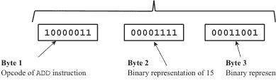

**图 1.1：** 机器语言中的指令表示

当程序中需要执行大量操作时，使用*机器语言*编写每条指令可能非常复杂，因为这不仅要求我们处理 0 和 1，还要求我们理解处理器的硬件规格。在当今世代，编写计算机程序是为了设计许多自身就带有业务挑战的复杂应用，因此人类实际上不可能用机器语言编写这样的程序。

为了让程序员的生活更轻松，人们设计了汇编语言，它使用*助记符*对每条指令进行编码。例如，执行 15 和 25 加法的指令可以用汇编语言编写为

```
ADD 15, 25
```

符号 ADD 称为助记符，表示加法；而常量 15 和 25 表示数据（也称为操作数），‘add’操作将在这些数据上执行。需要注意的是，助记符是英语符号，因此机器无法直接理解它们。因此，需要一种翻译器，它能够将汇编语言转换为由 0 和 1 组成的语言。这将确保计算机系统的硬件能够理解程序员实际用汇编语言编写的指令的含义。执行汇编语言到机器语言转换的单元称为*汇编器*。因此，指令 ADD 15, 25 将首先由汇编器转换为机器语言，如图 1.2 所示。转换过程完成后，计算机系统的硬件便可以执行该指令，从而实际执行常量 15 和 25 的加法。

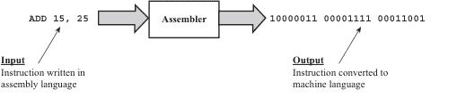

**图 1.2：** 汇编器

如果程序需要执行大量操作，那么创建汇编语言程序仍然可能很繁琐。为了让程序员的生活更简单，人们设计了*高级编程*语言。高级编程语言是一种“*类似英语的*”编程语言，程序员可以利用用户友好的单词和符号来编写指令。例如，我们可以编写以下高级指令来执行两个数的加法：

```
Z = 15 + 25
```

请注意，我们直接使用了用户友好的符号 +，而不是用机器语言或汇编语言编写指令。因此，Z 的值将被计算为 40，即 15 与 25 之和。高级语言是一组“类英语”符号，因此这些符号不能由系统硬件直接译码。因此，高级语言首先由称为“编译器”的单元转换为汇编语言。然后，可以使用汇编器将汇编代码进一步转换为机器码，如图 1.3 所示。需要强调的一点是：处理器只有在特定指令被转换为机器语言之后，才能执行该指令。

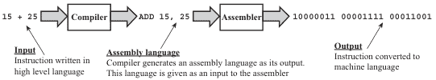

**图 1.3：** 高级语言到机器码的转换

由于高级编程语言中的指令非常用户友好且易于编码，因此它们有助于以比汇编语言或机器级语言更具可读性和可维护性的方式创建复杂程序。因此，用高级语言编写的程序易于创建、编辑、调试和维护。目前，软件行业使用多种高级编程语言来创建不同的应用。一些高级编程语言包括 C、C++、Java、Visual Basic、FORTRAN、COBOL 等。在本教材中，我们讨论使用“C 和 C++”进行计算机编程。

C 编程语言由丹尼斯·里奇于 1973 年设计，C++ 由比雅尼·斯特劳斯特鲁普于 1980 年作为 C 的扩展而设计。C 和 C++ 均在 AT&T 贝尔实验室设计。C++ 是“C”语言的扩展，这意味着“C”支持的所有特性也都受 C++ 支持。此外，C++ 还增加了许多有用的特性，例如面向对象和模板管理，这些特性不受“C”支持。

### 汇编语言与机器语言有什么区别？

处理器（CPU）是一种集成电路，它响应一组特定的指令。任何处理器的指令集都随其发布一起提供，并且可以参考该处理器的硬件手册来理解。任何处理器的指令集都与其内部电路紧密耦合并且依赖于内部电路。每个 CPU 都有一个指令译码器，它译码输入指令并将其传递给相关的架构模块，以激活必要的硬件组件来生成所需结果。由于指令最终需要由硬件译码和执行，因此它必须以二进制形式（即由 0 和 1 组成的形式）表示。这种由 0 和 1 组成、由处理器直接执行的语言称为**机器语言或二进制语言。**

从技术上讲，人类不可能使用机器语言直接与处理器通信。因此，处理器的任何发布版本也会随附其支持的每条指令的助记符。这些助记符可供人类阅读，并被称为特定处理器的汇编语言。请记住，由于助记符是类似英语的符号，因此不能直接传递给硬件。系统程序员负责设计能够将汇编语言转换为机器语言的汇编器。汇编器是一种软件实用程序，它与编译和执行任何高级语言所需的系统程序一起提供。

**从应用程序员的角度来看，汇编语言和机器语言在实践中都被归类为低级语言。**

### 本书路线图

**本教材分为两部分**

- **第1部分：** 第1章至第9章是与 C 和 C++ 共通的主题。除非另有说明，这些章节中给出的程序在 C 和 C++ 编译器中均可运行。第10章讲解 C++ 风格的动态内存分配。C 也支持此特性，但本书讲解的是 C++ 表示法。
- **第2部分：** 第11章至第17章讲解仅由 C++ 支持而 C 不支持的附加特性。这些是面向对象的特性，C 不支持，因此第11章至第17章中给出的程序只能在 C++ 编译器中运行。

如果读者没有扎实的结构化程序设计知识，就不可能理解面向对象的特性，因此在阅读第1章至第10章时应格外仔细，因为它们构成了第11章至第17章的先修内容。

### 说明

我们一直在说，汇编语言和机器语言非常复杂，程序员实际上不可能使用这些语言进行应用程序编程。尽管这一说法是正确的，但*程序的可移植性*是这些语言中的另一个大问题。这是因为汇编语言和机器语言特定于某一处理器。例如，Intel 处理器的汇编语言/机器语言与 AMD 处理器的汇编语言/机器语言差别很大。因此，即使我们设法用汇编语言/机器语言编写了一个程序，我们的程序也可能只适用于自己的平台；如果系统的硬件发生变化，它就无法工作。设计严重依赖硬件的程序绝对不是一个好做法，因为计算机硬件


## 具备人体工学舒适性的 Balance 办公椅

Balance 办公椅凭借周到的人体工学设计和优质材料令人信服。3D 机械机构可灵活适应各种坐姿，并支持身体的自然运动。可调节的腰部支撑减轻腰椎负担，带来健康的坐感。

### 配置

- 带可调节腰部支撑的 3D 机械机构
- 座椅和靠背倾斜角度同步调节
- 4D 可调扶手
- 座深调节范围 5 cm
- 最大承重 120 kg

### 材质与颜色

这款椅子有高品质织物面料版本，可选炭灰、蓝色和绿色。椅架由坚固的铝合金制成，有黑色和银色可选。镀铬钢制五星脚确保底座稳固。

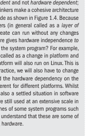

图 1：Balance 办公椅——正面视图

| 供货范围 |  |
| :--- | :--- |
| Balance 办公椅 | 1 把 |
| 安装材料 | 1 套 |
| 说明书 | 1 份 |

> “Balance 是第一把让人一整天都忘记自己是在坐着的椅子。”
> ——Thomas Weber，人体工学专家

### 1.2 计算机系统架构

在深入探讨 C/C++ 编程的细节之前，我们首先需要理解计算机系统中数据与指令的一般流动过程。图 1.5 展示了系统的基本组成单元，包括以下几个部分：

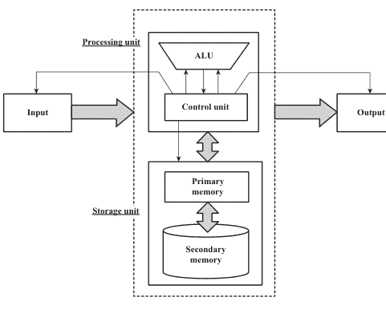

- 1. 输入单元
- 2. 处理单元
- 3. 输出单元
- 4. 存储单元

### 1.2.1 系统输入

“数据”和“指令”作为输入提供给系统，以执行特定操作。在这里，“指令”一词表示要执行的操作，而“数据”一词表示要在其上执行操作的信息。例如，如果我们希望系统对两个数（比如 x 和 y）进行加法运算，可以编写如下语句：

x + y

在这种情况下，符号 + 将被翻译成一条 ADD 指令，该指令会告知底层硬件实际执行两个数的加法。x 和 y 表示“数据”，ADD 指令对这些数据进行操作以生成所需输出。我们可以向系统输入多条指令，以便得到一个综合的

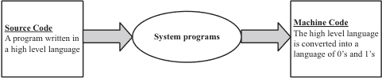

**图 1.7：** 高级语言到低级语言的转换

为了确保系统程序能够正确地将源代码转换为机器码，我们在用高级语言创建程序时必须遵循一定的规则。这些规则也被称为该语言的“语法”。因此，每种编程语言都有其语法，它描述了编写程序时必须遵循的一组规则。此外，每种编程语言都有一个专门的“编译器”，负责将高级语言转换为低级语言¹。编译器在开始翻译过程之前，还会检查程序员在创建程序时是否遵守了该语言的语法。如果违反了任何语法规则，编译器会向程序员显示一条“错误”信息；只要输入程序中发现至少一个错误，翻译过程就会立即终止。因此，程序员可以轻松地对代码进行必要的修正，并在完成必要的修复后重新启动编译过程。

¹ 编译过程的输出称为目标代码。由于每种语言都有自己的编译器，目标代码因语言而异。C/C++ 编译器的输出称为目标代码（object code），它是一种低级语言。

### 1.2.3 处理单元

当高级语言被翻译成由 0 和 1 组成的语言后，机器开始逐条执行每条指令，以生成所需的输出。这一处理阶段被称为程序的“执行阶段”。当然，代码的输出是在代码执行时产生的，而不是在代码被翻译或编译时产生的。翻译或编译的过程只是把程序从一种语言转换成另一种语言，而执行过程则真正运行程序，从而在输出设备上生成结果。最终是硬件执行程序。逐条执行程序中指令的硬件被称为计算机系统的“处理单元”。处理单元内部有两个主要部分：

- 1. 算术逻辑单元（ALU）
- 2. 控制单元

ALU 对输入数据执行所有算术和逻辑运算，而控制单元则是管理并控制计算机系统内数据和指令整体流动的电路。控制单元还包含一组能理解输入指令的解码器；如果指令的执行需要进行算术或逻辑运算，它还会将数据传递给 ALU。该单元负责从“输入”设备读取数据和指令，处理这些指令，并将最终结果发送到“输出”设备，以生成程序的输出。

### 1.2.4 存储单元

存储单元由计算机系统中存放指令和数据的存储设备组成。内存中存储程序指令的区域称为“代码段”，而内存中存储程序所需数据的区域称为“数据段”。在计算机系统的主存中，这些内存段由操作系统的内存管理单元（MMU）管理。通常，计算机系统的存储单元分为以下几类：

- 1. 主存（例如 RAM）
- 2. 辅助存储器（例如硬盘）

硬盘或辅助存储器通常是磁性存储介质，可以持久地存储信息。主存或 RAM 是一种半导体存储器，只能在计算机开机期间存储信息。这意味着，当系统关闭时，RAM 无法存储任何信息，因此 RAM 是一种“易失性存储器”；而硬盘即使在断电时也能持久地存储信息，因此硬盘是一种“非易失性存储器”。

处理器只有在数据位于 RAM 中时才能直接访问它，这是因为 CPU 也是一种半导体器件，属于超大规模集成电路（通常缩写为 VLSI）。因此，当 CPU 需要访问必要的数据和信息时，MMU（操作系统的一部分）的职责就是将其从硬盘调入 RAM，如图 1.8 所示。从辅助存储器到主存储器的信息内容传输也由 MMU 控制。需要记住的关键点是：只要程序所引用的代码和数据被调入 RAM，CPU 就可以执行任何程序。

当我们“打开”文件进行读取或写入操作时，操作系统实际上会将该文件从硬盘复制到 RAM。这使得 CPU 能够直接访问文件中存储的数据和指令。一旦 MMU 将文件调入主存，CPU 就可以对该文件执行读/写操作，如图 1.9 所示。因此，文件一旦打开，系统中就会维护该文件的两份副本。文件的第一份副本位于 RAM 中，而第二份副本是硬盘上的原始文件，如图 1.9 所示。

当 CPU 写入任何信息时，只有 RAM 中的文件会被修改，而硬盘中的文件副本仍代表旧版本，如图 1.10 所示。因此，这是一种 RAM 中的数据已被修改、而硬盘中的文件已经过时的状态。这种对文件的写操作被称为“未提交”（或“未保存”）写操作，该操作由 CPU 执行，如图 1.10 所示。


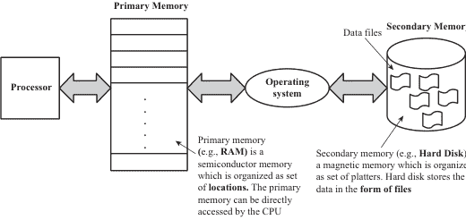

**图 1.8：** CPU 访问 RAM

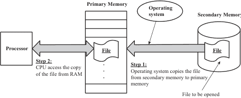

**图 1.9：** CPU 访问文件

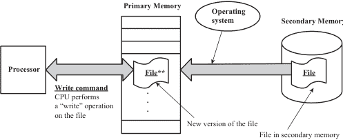

**图 1.10：** 对文件执行未提交的写入操作

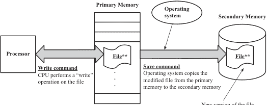

当我们使用“保存”命令（操作系统的一个命令）保存文件时，操作系统会将文件从 RAM 复制回硬盘。这确保了硬盘中的文件会被最近的数据更新，如图 1.11 所示。因此，当我们下次打开该文件时，新的更改将反映在文件中。但是，如果我们不“保存”由 CPU 在 RAM 空间中修改过的文件，那么对 RAM 中文件所做的任何更改都不会被复制到硬盘，因此硬盘中的文件也不会被修改。所以，当我们下次“打开”该文件时，我们将看到该文件的旧版本。这意味着所有对文件未提交的写入都将丢失，因为硬盘中的文件从未使用 CPU 在 RAM 中进行的更新进行过修改。总之，每一个在特定时刻被“打开”用于执行的程序都必须被调入 RAM 空间；而每一个“不活动”或“关闭”的程序则可以存在于辅助存储器或硬盘中。因此，与计算机系统的 RAM 空间相比，硬盘内存通常非常大（硬盘大小以 GB 为单位，而 RAM 大小以 MB 为单位，作为计算机系统配置的一部分）。

### 1.3 C/C++ 开发环境

为了将高级语言完整地翻译成机器语言，每个 C/C++ 程序在机器能够执行代码生成所需输出之前，都必须经过一系列系统程序的处理。参与将高级语言翻译为低级语言过程的系统程序列表如下：

- 1. 编辑器
- 2. 预处理器
- 3. 编译器
- 4. 链接器
- 5. 加载器

### 1.3.1 编辑器

编辑器提供了一个集成开发环境（IDE），用于创建和开发 C/C++ 程序。编辑器是一种系统程序，为程序员提供多个菜单选项，以便于软件项目的创建和维护。编辑器提供的一些关键功能包括：

- 1. 创建新程序
- 2. 编辑现有程序
- 3. 调试程序
- 4. 启动程序的编译和执行

总之，编辑器是一种系统软件，我们可以使用它在磁盘上创建并保存 C/C++ 文件。包含源代码的 C++ 文件通常以 `.cpp` 扩展名保存在硬盘上。（C 程序文件的扩展名为 `.c`。）图 1.12 显示了 DOS 模式下可用的 Turbo C/C++ 编辑器的屏幕截图。编辑器提供的所有菜单选项的详细描述不在本书的讨论范围内。

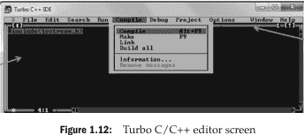

### 1.3.2 预处理器

我们可以为 C/C++ 程序中要执行的一组指令提供一个缩写。这种缩写称为*宏*。宏功能使我们能够将名称附加到程序中需要重复执行的指令序列上。这种命名的好处在于，每次需要执行该指令序列时，我们可以使用宏的名称，而不必在程序中一遍又一遍地实际输入相同的指令。

*宏预处理器*是一种系统程序，它通过用“宏名”替换其“定义”来解析宏引用。程序员在源代码中引用的所有宏，实际上都会被宏定义的指令序列和数据所替代。预处理器在程序编译开始之前运行。因此，编译器不会看到任何缩写或宏，因为它们已经在代码编译开始之前被预处理器展开。预处理器在磁盘上创建一个没有宏的文件，供编译器用于代码翻译，如图 1.13 所示。

程序中能被预处理器理解的指令称为*预处理指令*。在 C/C++ 中，预处理指令通常以符号 # 作为前缀。一些预处理指令包括：

- 1. `#include` – 该指令用于在 C/C++ 程序中包含头文件。
- 2. `#define` – 该预处理指令用于在 C/C++ 程序中定义宏。

我们将在本书第 2 章讨论这些指令的细节。

### 1.3.3 编译器

- 1. 语法分析：编译器内部验证程序语法的组件称为解析器。如果任何语法规则被违反，解析器将向程序员抛出“错误”消息。如果输入程序中至少发现一个错误，翻译过程将立即终止。每种编程语言都有一种文法，它定义了该语言的语法规则。解析器是一个检查输入语句是否遵守该语言文法所定义的语法规则的程序，从而检测源代码中的语法错误（如果有的话）。为了检查语句的语法错误，编译器将语句划分为离散的词法单元。将一条语句分割成单独的词法单元的过程称为“词法分析”，它发生在编译过程的“语法分析”阶段之前。
- 2. 语义分析：该阶段用于检查输入程序是否存在语义错误。语义规则定义了可以执行特定操作的“数据类型”。如果在执行操作时出现“数据类型”不匹配，语义阶段将抛出错误并停止翻译过程。我们将在本书第 2 章和第 3 章讨论“数据类型”和操作的细节。
- 3. 代码生成：一旦语法分析和语义分析成功完成，代码生成阶段就会在磁盘上生成优化的目标代码（即机器语言）。程序的目标代码被创建并存储为磁盘上的“.obj”文件。

编译源代码以生成目标文件所需的总时间通常称为程序的“编译时间”。

### 什么是词法分析？

在开始翻译之前，编译器需要确保程序员没有违反语言定义的任何语法规则。为了检查程序员编写的每条语句的语法，编译器需要将每条语句拆分为不同的词法单元。词法单元是每条语句中最小的不可分割部分。例如，如果要计算 z 的值为 x 和 y 之和，则语句必须写为：

```c
z = x+y;
```

该语句有 6 个不同的词法单元：z、=、x、+、y 和 ;。将该语句拆分为不同词法单元的过程如下所示。

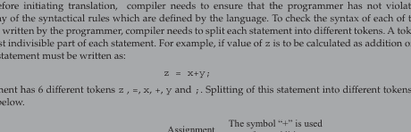

将一条指令拆分成一组词法单元的过程称为词法分析。语法分析阶段现在确定语句中的所有词法单元是否组织正确。如果在特定语句中检测到任何词法单元构成不正确，语法分析将抛出错误。例如，以下语句会导致编译错误。

这是因为根据该语言定义的语法，它错误地组织了词法单元。C/C++ 的语法要求运算符 + 必须准确地写在要相加的两个操作数 x 和 y 之间。编译器不允许将符号 + 写在两个操作数（其值要被相加）的右侧（或左侧）。

```c
z = x y+;
```

### 1.3.4 链接器

C/C++ 程序可能包含对外部库中定义的函数或数据的引用。这些库可以提供项目开发过程中所需的通用函数或数据的定义，因此程序可能需要引用存在于多个此类库中的函数和数据。库的创建和使用促进了项目中代码的可重用性。由于源代码中存在这些外部引用，编译器生成的目标文件会包含某些“缺口”。“链接器”是一种系统程序，它通过解析所有外部符号引用来将编译器生成的目标代码与外部库的目标代码链接起来，从而填补目标文件中的缺口。一旦所有外部引用都被解析，链接器就会在磁盘上生成可执行代码（称为“.exe”文件），如图 1.13 所示。

### 1.3.5 加载器

链接器在磁盘上生成可执行代码（.exe 文件）。回顾第 1.2.4 节，CPU 无法直接访问硬盘中的代码。因此，必须先将可执行代码放入 RAM。加载器是系统程序，它将可执行代码加载到计算机系统的主存储器（RAM）中，以便 CPU 能够执行该代码。

代码被加载到 RAM 后，处理器就可以开始执行程序，从而生成输出。执行程序“可执行代码”所需的时间通常称为程序的“运行时间”。

### 1.4 编程语言的演化

随着硬件系统的发展，编程语言提供的功能也随着时间不断增强。一般来说，计算机编程范式可以分为“结构化编程”和“面向对象编程”。使用哪种编程风格取决于要开发的应用程序类型。在本节中，我们了解“结构化编程”范式和“面向对象编程”范式之间的区别。


#### 1.4.1 结构化程序设计（C 和 C++ 均支持）

结构化程序设计也称为模块化程序设计或过程式程序设计，其中待开发的程序被组织成不同的过程。程序中所定义的每个模块称为*函数*或*过程*。结构化程序设计范式通过将一个大问题划分为称为函数的小片段来求解该问题。每个小片段都被视为不同的问题，并通过编写不同的函数来独立解决。每个小函数产生的结果最后会汇总起来，从而得到大问题的解决方案。例如，假设我们需要创建一个程序，将文件中存储的 100 个数字按升序排序。结构化程序设计可以将这个大型问题陈述划分为以下函数：

1. 从文件中读取这 100 个数字的函数。
2. 将这些数字按升序排列的函数。
3. 将结果写回文件的函数。

因此，我们现在已经把“对文件中的数据进行排序”这一大问题划分成了上面列出的三个不同问题。

一般来说，结构化程序设计范式根据模块所执行的“算法”或“功能”将大型程序划分为不同的模块。如果函数 A 需要函数 B 提供的服务，则函数 A 可以调用另一个函数 B。例如，如果函数 A 的任务是计算一个数的阶乘，而函数 B 的任务是执行乘法，那么函数 A 将需要多次调用函数 B，因为计算阶乘需要使用不同的数据值多次执行乘法。图 1.14 展示了一个包含五个函数 A、B、C、D 和 E 的典型结构化程序设计行为。带函数的执行流程将在第 7 章详细解释；在此阶段，我们仅将结构化程序设计定义为称为函数的各种不同构建块的集合，其中每个函数专用于执行特定操作。这里我们仅记录关于函数调用的几点：

1. “被调用函数”完成执行后，控制权会“返回”给调用函数。例如，函数 A 调用函数 B，函数 B 完成后控制权返回给函数 A。类似地，D 调用 E，因此 E 完成后，控制权返回给 D。

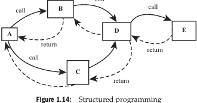

2. 函数调用始终按顺序处理。这意味着，如果函数 A 调用两个函数 B 和 C，它们将根据哪个先被调用而逐个执行。如果 B 在 C 之前被调用，则 B 将在 C 之前执行。
3. 所有被调用函数都完成后，调用函数的执行才能完成。在此示例中，函数 B 调用 D，D 又调用 E，这意味着 D 只有在 E 完成后才能完成，而 B 只有在 D 完成后才能完成。
4. 下面给出的结构有两条函数执行分支：

A → B → D → E
A → C → D → E

函数 A 只有在上述两条分支的执行都完成后才会完成执行。这里，我们假设 A 在调用 C 之前调用 B，因此分支 A → B → D → E 先于 A → C → D → E 执行。

调用函数可以向被调用函数传递值。从“调用”函数传递给“被调用”函数的这些值称为“参数”或“实参”。另一方面，“被调用”函数也可以将操作结果返回给“调用”函数。从“被调用”函数返回给“调用”函数的这个值称为返回值。当一个函数产生的结果需要由另一个函数使用，以执行所需的一组操作来解决给定问题时，参数传递和返回值非常有用。

结构化程序设计范式的主要缺点之一是，随着代码规模增大，代码的维护和支持会变得困难。因此，在许多情况下，人们更倾向于使用“面向对象程序设计”而不是结构化程序设计，因为面向对象能更好地组织代码，从而使程序易于维护和支持。C 语言是结构化程序设计范式的一个例子，而 C++ 除了支持结构化程序设计特性外，还支持许多额外的面向对象特性。

#### 1.4.2 面向对象程序设计（仅 C++）

许多待开发的应用程序和软件系统需要使用复杂的数据元素，使得程序中的每个数据元素模拟现实世界中的一个对象。面向对象程序设计范式是一种能够正确模拟现实世界的程序设计方法，程序中创建的这样的“对象”表示现实世界中某个实体的数据。C++ 允许在 C++ 程序中创建“类”，从而支持面向对象。与结构化程序设计的概念不同，面向对象强调函数所操作的“数据”，而不是函数的“算法”。面向对象程序组织为一组“类”，每个类将相关的“数据”元素和操作这些数据元素的“函数”组合在一起。总之，类是将“数据”和相关“函数”组合成一个单一单元。

例如，如果考虑为某个教育机构开发一个网站，我们将需要维护关于以下现实世界对象的数据：

1. 在该机构学习的学生
2. 该机构的教授
3. 该机构开设的课程
4. 该机构的系等。

为了存储关于这些现实世界实体的数据，我们可以在 C++ 程序中创建不同的类，使得每个类组合管理现实世界中一个实体的信息所需的“数据”和“函数”，如图 1.15 所示。因此，我们可以创建名为 Student、Professor、Course 和 Department 的类，以分别表示现实世界中的各个实体并存储其数据。

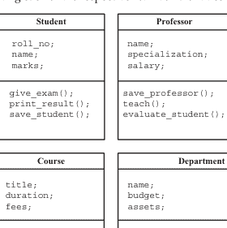

图 1.15：C++ 中的类示例

注意，每个类将相关的“数据”和“函数”组合在一起。例如，类 Student 包含名为 roll_no、name 和 marks 的数据元素，这表示对于该机构中的每位学生，我们将在计算机内存中存储学生对象的学号、姓名和成绩。此外，类 Student 中定义的函数表示学生对象在现实世界中可以执行的操作。函数 save_student() 表示学生对象可以通过在该机构网站上注册来在线保存其详细信息。类 Student 中函数 give_exam() 的存在表示现实世界中的学生可以参加部署在该教育机构网站上的在线考试，而函数 print_result() 表示学生可以打印其成绩单，该成绩单打印学生在在线考试中获得的分数。同样，我们可以想象图 1.15 中所示其他类中数据和函数的含义。

面向对象程序基于“数据”组织代码，因此使大型程序易于维护和支持。本教材第 11 章至第 14 章详细讨论面向对象程序设计范式及其特性。面向对象程序设计范式的关键特性如下所示。我们仅对每个特性给出了一句话说明，然而理解这些特性就是理解面向对象程序设计。它们内容相当广泛，无法在第一章中详细解释；从第 11 章到第 17 章，我们将结合现实世界示例详细解释每个特性。此时，我们只需关注核心定义，不必过多担心这些特性。

1. **抽象：** 它是程序隐藏逻辑复杂性、仅向程序员揭示必要细节以推进软件开发的能力。第 11 章将详细讨论该特性。
2. **消息传递：** 它是面向对象程序通过在不同对象之间传递数据值（也称为消息）来促进对象间通信的能力。第 11 章将详细讨论该特性。
3. **多态：** 它是运算符或变量呈现多种形式的能力。第 11、12、13 和 14 章将详细讨论该特性。
4. **数据隐藏：** 它确保程序中的关键数据项受到保护，免遭意外更新。属于业务对象的此类关键数据变量可以被设为类的私有成员，并对类外部隐藏，以避免对这些数据项进行任何更新。第 11 章将详细讨论该特性。
5. **封装：** 将变量和相关函数包装在一个称为类的单一逻辑单元中，以便访问这些变量，这一过程称为封装。第 11 章将详细讨论该特性。
6. **继承：** 类之间的父子关系，使得父类的部分特性可供子类使用，以促进代码复用，这种关系称为继承。子类可以定义自己的额外特性，并默认继承其父类的所有特性。第 14 章将详细讨论该特性。

## 测验

1. 以下哪项在编译之前完成？
   - (a) 将源代码转换为目标代码
   - (b) 链接
   - (c) 加载
   - (d) 宏替换
   - (e) 以上提及的选项均不是。

2. 以下哪些陈述是正确的？
   - (a) 编译器作为编译过程的结果生成程序的输出
   - (b) 链接器将机器码从辅助存储器传输到主存储器
   - (c) 加载器将机器码从主存储器传输到辅助存储器
   - (d) 预处理在代码编译之后发生
   - (e) 以上陈述均不正确

3. 汇编器生成____语言作为其输出。
   - (a) 助记符语言
   - (b) 高级语言
   - (c) 机器语言
   - (d) 中级语言

4. 以下哪项不是编译器的功能？
   - (a) 语法分析
   - (b) 词法分析
   - (c) 语义分析
   - (d) 代码生成
   - (e) 解析外部符号引用


## 第 2 章 | 基础

### 2.1 概述

C++ 是 C 语言的扩展。这意味着 C 语言的所有特性在 C++ 中同样可用。此外，C++ 还具备面向对象编程的一些额外特性，这使得它优于传统的 C 语言。有关面向对象的细节以及 C++ 的其他特性，将在本书后续章节中介绍。

在本章中，我们将学习一些基础知识，这些知识是理解 C 语言高级特性以及 C++ 所支持的各种面向对象特性的基础。

### 2.2 第一个 C/C++ 程序

回顾第 1 章的内容，每个 C/C++ 程序都必须经过编译和链接，才能将高级语言转换为机器代码。程序中编写的所有指令都由处理器按照它们在程序文件中出现的顺序逐一执行。因此，告知处理器程序执行的确切起始点，是程序员的职责。在 C/C++ 中，`main()` 函数用于表示程序执行的起点和终点。因此，每个程序都必须且只能有一个 `main()` 函数，如图 2.1 所示。

CPU 将按照我们在 `main()` 函数体内编写的所有指令的顺序依次执行。特殊单词 `main()` 后面的一对空圆括号告知编译器：`main()` 函数不接受任何参数。默认情况下，C/C++ 中的每个函数都应当向调用它的函数返回一个值。如果我们不想向调用函数返回任何值，可以使用关键字 `void`。有关带参数和返回值的函数的完整细节将在本书第 7 章中讨论，因此，目前可以忽略关于“函数参数”和“返回类型”的细节。

在此阶段，我们需要理解的是，应该使用如图 2.1 所示的模板来创建 `main()` 函数。`main()` 函数定义了程序的“起点”和“终点”，因为任何程序的执行都从 `main()` 函数开始的地方启动，并在 `main()` 函数结束的地方终止。

如前所述，任何程序的执行始终从 `main()` 函数开始。由于该程序在 `main()` 函数中只有一个语句（即 `printf()` 语句），程序的输出如下所示。

```
I like Computer Programming
```

注意：以下内容适用于 C++，不适用于 C

图 2.2 中所示的程序在 C 和 C++ 中都能执行，这是因为 `printf()` 函数同时受这两种语言支持。除了支持 `printf()` 语句之外，C++ 还提供了另一种在计算机屏幕上打印消息的方式。`cout` 是 C++ 中内置的对象，但在 C 中并不存在，它用于将消息流式输出到输出设备。图 2.3 中编写的程序展示了如何使用 `cout` 对象在计算机屏幕上打印消息。

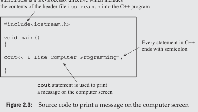

**图 2.3：** 在计算机屏幕上打印消息的源代码

语句

```
cout<<"I like Computer Programming";
```

用于在计算机屏幕上打印消息 I like Computer Programming。请注意，每个语句都以分号结尾。运算符 `<<` 称为插入运算符，它实际上是将文本消息插入到计算机屏幕上。我们还在本书第 4 章中解释了运算符 `<<` 也可以用作“左移运算符”，用于将二进制数的位向左移动。然而，在本例中，我们使用的 `<<` 运算符起到的是插入运算符的作用，并在屏幕上打印消息，因为 C++ 在其中名为 `ostream` 的内置类内部对其进行了重载。类 `ostream` 完整地定义在头文件 `iostream.h` 中。此外，`cout` 是类 `ostream` 的一个对象，它在文件 `iostream.h` 内部创建。因此，我们将 C++ 程序的第一条语句写为：

```
#include <iostream.h>
```

该语句将头文件 `iostream.h` 的内容包含到程序中，以便程序员能够在代码中直接使用名为 `cout` 的 `ostream` 类内置对象。请记住，`#include` 是一个预处理指令，用于在代码编译开始之前将特定头文件的内容包含到 C++ 程序中。这确保了类 `ostream` 和插入运算符 `<<` 的完整定义在编译之前被包含在程序中。关于类和对象的细节将在本书第 11 章中讨论。**现阶段我们唯一需要理解的是，语句**

`cout<<"I like Computer Programming";`

*用于在计算机屏幕上打印消息 I like Computer Programming，如图 2.4 所示。并且，在程序中使用 `cout` 之前，我们必须包含头文件 `iostream.h` 的内容。*

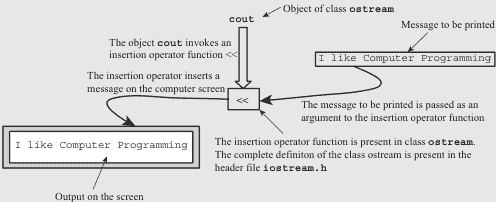

**图 2.4：** `cout` 的用法

C++ 支持 *流式输出*，这是 C 语言所不支持的。一般来说，*流* 一词指的是计算机系统中的数据流动。C++ 的 *输出流* 允许程序员对“屏幕”、“文件”和“磁盘”等输出设备执行“写入”操作。头文件 `iostream.h` 定义了支持流式输入和输出所需的类和函数。我们将在本章后续部分讨论 C++ 的 *输入流*。由于我们已经将 `cout` 指令编写在 `main` 函数中，处理器将在将该指令转换为机器代码后执行该指令，从而在计算机屏幕上打印出指定的消息，正如程序输出中所看到的那样。

### 注释

图 2.2 中给出的程序使用 `printf()` 语句在计算机屏幕上打印消息。`printf()` 函数在头文件 `stdio.h` 中声明，该头文件已包含在程序中。使用 `printf()` 的程序在 C 和 C++ 中都能运行，因为 `stdio.h` 头文件和 `printf()` 函数同时受这两种语言支持。然而，图 2.3 中使用 `cout` 的程序只能在 C++ 中运行，而不能在 C 中运行。这是因为 `cout` 对象和头文件 `iostream.h` 仅受 C++ 支持，而不受 C 支持。这清楚地表明，C++ 支持流式输出操作，而 C 不支持。我们将在第 15 章中进一步学习 C++ 所支持的流。

### 可以用大写字母编写 C/C++ 程序吗？


答案是否定的，因为 C/C++ 是区分大小写的语言。这意味着对于该语言来说，大写字符和小写字符具有不同的含义。例如，`printf()` 和 `PRINTF()` 会被编译器视为两个不同的标识符。`stdio.h` 声明的是小写形式的 `printf()` 函数，因此编译器无法识别 `PRINTF()` 这样的符号。因此，我们不能仅仅用大写字母编写整个 C/C++ 程序，而必须保留语言的语法以及大小写形式。C/C++ 的语法决定了大多数内置关键字和保留字都是小写的。但仍有一些内置宏必须以大写形式书写。

### 2.3 编写注释

注释是代码的一部分，编译器会忽略它。然而，程序员仍然可以在程序中编写注释，为使用某段特定代码实现的复杂逻辑提供文档说明。尽管注释对程序的输出没有任何贡献（注释甚至不会被编译），仍然建议在尽可能的情况下为源代码添加注释。这使得代码易于阅读和理解，如果将来需要引用代码的任何部分进行编辑或调试，也会更加方便。程序可以采用两种不同类型的注释风格：

- 1. 单行注释（仅 C++ 支持，C 不支持）
- 2. 多行注释（C 和 C++ 均支持）

单行注释以两个斜杠符号开头，两个斜杠之间没有任何空格，如下所示：

```cpp
// This is a single line comment
```

编译器会忽略两个斜杠（`//`）符号之后到行尾之间的任何文本。请注意，单行注释只能延伸到当前行的末尾。这意味着，如果我们希望跨多行编写注释，则必须让每一行都以两个斜杠符号开头，如下所示：

```cpp
// This is the first line of the comment
// This is the second line of the comment
// This is the third line of the comment
```

除了支持用 `//` 符号编写单行注释之外，编译器还会忽略写在 `/*` 和 `*/` 之间的任何文本，以便在程序中支持创建多行注释。因此，我们可以在代码中编写多行注释，它以标记 `/*` 开头，以标记 `*/` 结束，如下所示：

```cpp
/*This is the first line of the comment
This is the second line of the comment
This is the third line of the comment*/
```


> **请记住**
>
> 单行注释风格仅受 C++ 支持，而不受 C 支持。
>
> `// This commenting style is only supported in C++`
>
> 多行注释风格同时受 C 和 C++ 支持。
>
> `/* This commenting style is supported by C as well as C++ */`

下面给出一个示例，其中包含我们在为在计算机屏幕上打印文本消息而创建的程序中所添加的注释。

```c
/* This is a program to print a message
I like Computer Programming
on the computer screen */
#include <stdio.h>
void main()
{
    /* The below statement prints the text message on the screen */
    printf("I like Computer Programming");
}
```

**输出：**

I like Computer Programming

### 2.4 常量或字面量

常量或字面量是程序中不能改变其值的组成部分。C/C++ 中的常量分类如下：

- 1. 整数常量
- 2. 实数常量
- 3. 字符常量
- 4. 字符串常量

我们可以直接在程序中创建/使用上述任意常量，以便使用常量值执行操作。下面给出上述每一类常量的说明，并给出 C 和 C++ 都支持的每种常量值类型的示例。

### 2.4.1 整数常量

这些是不带小数点的数字，可以直接写在程序中。整数常量可以是正数或负数，常量值中不包含任何小数部分。

下面给出一些整数常量的有效和无效示例：

```c
10       /* This is a VALID integer constant */
-95      /* This is a VALID integer constant which represents
            a negative value */
45.9     /* This is an INVALID integer constant as there is a decimal
            point in the number */
25,000   /* This is an INVALID integer constant as there is a comma
            used in between the digits of the number */
```

请注意，整数常量在代码中必须由数字 0 到 9 组合而成，数字之间不能包含逗号或空格等特殊字符。

### 2.4.2 实数常量

这些是带小数点的数字，可以直接写在程序中。实数常量可以是正数或负数，也可以包含作为常量值一部分的小数部分。在 C/C++ 中，*实数常量* 也称为 *浮点常量* 或 *双精度常量*。

下面给出一些实数常量的有效和无效示例：

```c
10.5        /* This is a VALID floating point constant */
-90.832     /* This is a VALID floating point constant */
25,000.976  /* This is an INVALID floating point constant as there
               is a comma used in between the digits of the number */
```

请注意，与整数常量一样，*实数常量* 在代码中必须由数字 0 到 9 组合而成，数字之间不能包含逗号或空格等特殊字符。*实数常量* 可以在数字之间恰好包含一个小数点，以表示浮点值。

### 2.4.3 字符常量

*字符常量* 是用单引号括起来的单个符号。下面给出 C/C++ 中字符常量的一些有效和无效示例。

```c
'e'   /* This is a VALID character constant which represents a letter e */
'1'   /* This is a VALID character constant which represents a symbol 1 */
'$'   /* This is a VALID character constant which represents a symbol
          dollar */
' '   /* This is a VALID character constant which represents a blank
          space */
'10'  /* This is an INVALID character constant as it encloses two
          different symbols (1 and 0) within the single quotes */
'ad'  /* This is an INVALID character constant as it encloses two
          different symbols (letters 'a' and 'd') within the single quotes */
```

### 2.4.4 字符串常量

字符的集合称为字符串。字符串常量通过将多个字符括在双引号中形成。

下面给出 C/C++ 中字符串常量的一些有效和无效示例：

```text
"Computer"   /* This is a VALID string constant which is a collection
                of eight characters */
"C"          /* This is a VALID string constant which contains just a single
                character */
'com'        /* This is an INVALID string constant. This is because a
                string cannot be enclosed in single quotes */
"456+6"      /* This is a VALID string constant which is a collection of
                4 characters */
```

C/C++ 中的每个字符串都以一个称为 NULL 字符的特殊字符结尾，该字符由 `'\0'` 表示。例如，字符串“Computer”在内存中的内部存储方式如图 2.6 所示。

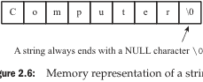

请注意，字符串的最后一个字符会自动添加为 `'\0'`，它是字符串结束标记，称为 NULL 字符。字符串常量及其处理的详细信息将在本教材第 6 章中讨论。

> **为什么我们要在内存中存储字符常量的 ASCII 值？**
>
> 回顾第 1 章可知，用高级语言编写的每个符号都必须先转换为机器语言，才能由 CPU 处理。整数常量或实数常量可以通过用“二进制数系统”表示它们，直接转换为机器语言。为了便于将字符常量存储在计算机内存中，每个字符常量在内部都会被分配一个整数代码，称为该字符的 ASCII 值。因此，我们现在只需用“二进制数系统”表示字符的 ASCII 代码，就可以将字符常量存储在计算机内存中。

### 2.5 变量和数据类型

变量是用于在内存中存储特定值的占位符。这意味着变量是计算机内存中保留的一块区域，我们可以在其中存储值。创建变量的过程称为变量的“声明”，而将特定值存储到变量中的过程称为变量的“初始化”。

每个变量都与特定的数据类型相关联。变量的数据类型决定了可以在该变量中存储的值的类型。C/C++ 支持的基本数据类型列表如下：

| 数据类型 | 描述 | 大小（字节） | 取值范围 |
|---|---|---:|---|
| `int` | int 类型的变量可以存储范围为 −32,768 到 +32,767 的任意整数类型常量 | 2 字节 | −32,768 到 +32,767 |
| `float` | float 类型的变量可以存储范围为 −3.4e−38 到 +3.4e+38 的任意带小数点的数字 | 4 字节 | −3.4e−38 到 +3.4e+38 |
| `char` | 数据类型 char 用于存储字符常量，即用单引号括起来的单个符号 | 1 字节 | −128 到 +127 |
| `double` | double 类型的变量可以存储范围为 −1.7e−308 到 +1.7e+308 的任意带小数点的数字。与 float 相比，此数据类型具有更高的精度。因此，double 类型变量在内存中需要 8 字节，而 float 类型变量在计算机内存中只需要 4 字节 | 8 字节 | −1.7e−308 到 +1.7e+308 |
| `short int` | short int 类型的变量可以存储范围为 −128 到 +127 的任意整数类型常量。关键字 short int 定义了 C++ 中 int 类型的较小版本。因此，short int 变量在计算机内存中只需要 1 字节，而 int 变量在计算机内存中实际上需要 2 字节 | 1 字节 | −128 到 +127 |
| `long` | long 类型的变量可以存储范围为 −2147483648 到 +2147483647 的任意整数类型常量。关键字 long 表示 C++ 中 int 类型的较大版本。因此，long 变量在计算机内存中需要 4 字节，而 int 变量在计算机内存中只需要 2 字节 | 4 字节 | −2147483648 到 +2147483647 |

¹ 本教材通篇假设使用 16 位编译器，其中整数的大小为 2 字节（16 位）。如果你得到的整数大小为 4 字节，则说明你使用的是 32 位编译器。

#### 2.5.1 计算数据类型的范围

特定类型的变量中可以存储的值的范围取决于该“数据类型”在计算机内存中的大小。特定数据类型的范围可以通过考虑分配给该变量的位值所能表示的总排列数来确定。例如，让我们考虑一个在计算机内存中需要 2 字节的整数类型变量。由于每个字节由八位组成，我们可以说一个整数变量在计算机内存中需要 16 位。因此，使用 16 位可以表示的总排列数（X）可按如下方式计算：

排列数（X）= 2¹⁶ = 65,536


在可用 16 位表示的状态总数中，一半的排列必须在高级语言中表示负数，剩余一半的排列必须在高级语言中表示正数。此外，16 位排列中的一种必须在高级语言中表示值零。因此，我们将排列总数除以二，如下所示：

$X/2 = 65,536/2 = 32,768$

由于 16 位排列中的一种用于表示零（即所有位位置均为 0 时），C/C++ 中整型常量的范围为 $-32,768$ 到 $+32,767$，如图 2.7 所示。该理论用于将高级语言中的数字转换为机器语言，从而将机器语言存储在计算机内存中，如图 2.7 所示。最高有效位（即最左侧位）表示符号位：当负数转换为机器语言时该位为 1，当正数转换为机器语言时该位为 0。

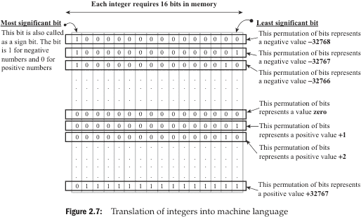

其他数据类型（如 short、long 和 char）的范围可以使用类似方法计算。评估 double 和 float 等浮点类型的范围超出了本教材的范围，因为这需要对 IEEE 格式进行详细研究，其中尾数和指数在计算机内存内部存储。

> **如果给变量赋予一个超出其数据类型所指定范围的值，会发生什么？**
>
> 这种情况称为值的溢出/下溢。在这种情况下，我们不会得到任何编译错误；但是，程序将产生不可预测的结果。例如，如果我们将一个值（比如 66990）赋给 2 字节整型，程序产生的结果将是错误且不可预测的。

### 2.5.2 变量的声明

如上所述，变量会在内存中创建一个位置，我们可以在其中存储特定类型的值。在内存中创建变量的过程称为变量的“声明”。每个变量在程序中使用之前都必须先声明。下面给出在 C/C++ 中声明变量的语法：

```text
<DataType> variableName;
```

例如，语句

```cpp
int marks;
```

会在计算机内存中创建一个名为 marks 的整型变量。当变量在程序中声明时，编译器为该变量分配内存。因此，上述语句为名为 marks 的变量分配 2 字节内存，如图 2.8 所示。注意，在 C/C++ 中任何变量的初始值都是未定义的，因此我们说变量 marks 最初包含一个未知值或垃圾值，如图 2.8 所示。

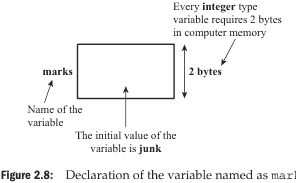

> **注意**
>
> 变量名也称为**标识符**。例如，在本例中，marks 是一个标识符，它标识存储整型值的确切内存位置。

图 2.9 给出了分别声明三个变量的示例，这些变量名为 a、b 和 c，类型分别为整型、浮点型和字符型。如图 2.9 所示，编译器在内存中为变量 a 分配 2 字节，因为它被声明为整型。而编译器在内存中为变量 b 分配 4 字节，因为它被声明为浮点型；为变量 c 分配 1 字节，因为它被声明为字符型，如图 2.9 所示。注意，每个变量最初都包含垃圾值，如图 2.9 所示。

如果要声明的所有变量都具有相同类型，那么我们还可以使用*逗号运算符*作为变量名之间的分隔符，从而使用单条 C/C++ 语句创建多个变量。例如，下面的语句创建三个不同的变量，分别名为 marks、salary 和 score，类型为 float：

```cpp
float marks,salary,score;
```

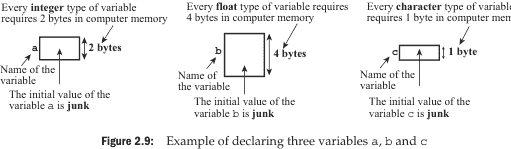

### 2.5.3 变量的初始化

将值存储到变量中的过程称为变量的*初始化*。下面给出用表达式返回值初始化变量的语法。

```text
variable-name = expression;
```

注意，每个变量都必须先声明，然后才能使用上述语法进行初始化。运算符 `=` 称为赋值运算符，用于将表达式的值初始化给特定变量。这里需要注意的关键点是，任何变量的声明总是在程序编译时发生，而变量的初始化发生在程序执行时。这意味着，是编译器为程序中创建的变量分配内存；但是，值实际上会在程序执行时存储到变量内部。例如，让我们考虑下面给出的两条语句：

```cpp
int age; /*Declaration of the variable named as 'age'*/
age=10; /*Initialization of the variable 'age' with a value 10*/
```

第一条语句声明一个名为 age 的变量，其类型为整型，因此编译器将在计算机系统的主存（RAM）中为变量 age 分配 2 字节，如图 2.10 所示。此外，需要注意，变量 age 在编译时将包含垃圾值，如图 2.10 所示。

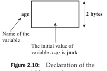

下一条语句将值 10 存储到变量 age 中，如图 2.11 所示。注意，常量 10 将在程序执行时而不是程序编译时存储到变量 age 中。因此，务必记住，编译器始终不知道任何变量的值，因为程序中的每次初始化总是在程序开始执行时发生。

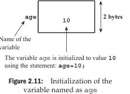

变量一旦声明，就可以在程序执行过程中根据需要多次初始化。重要的是要理解，初始化给变量的新值将覆盖之前存储在变量中的旧值。例如，如果我们使用下面的语句将变量 age 初始化为新值 20，

```cpp
age = 20;
```

那么，先前的值 10 将丢失，变量 age 现在将在内存中存储 20，如图 2.12 所示。

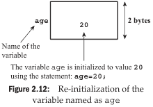

我们也可以使用单条语句声明并初始化变量，语法如下：

```text
<DataType> variableName = expression;
```

例如，下面的语句声明一个名为 salary 的 float 类型变量，并将其值初始化为 600.25。

```cpp
float salary = 600.25;
```

注意，尽管变量 salary 的声明和初始化是在单条语句中完成的，但重要的是要回想：在程序编译时将为变量 salary 分配 4 字节内存，而值 600.25 将在程序执行时实际存储到 salary 中，如图 2.13 所示。

图 2.14 给出了分别创建整型、浮点型和字符型变量的声明和初始化语句示例。

> **为什么变量不在程序编译时初始化？**
>
> 回想第 1 章的内容，编译器是一种将源代码转换为机器代码的系统程序。编译器不执行我们在程序中指定的任何操作，例如“加法”“减法”甚至“赋值”。重要的是要理解，编译器不执行程序，因此编译器不会给我们程序的输出。相反，编译器只是一个将程序从一种语言翻译成另一种语言的翻译器。程序中指定的操作实际上是在 CPU 执行程序时执行的。由于编译器不执行任何操作，因此它不会初始化变量的值。编译器为程序员定义的变量分配内存，而每个变量的值由 CPU 在程序运行时初始化。

| 编译期 | 运行期 |
|---|---|
| 编译器在内存中为变量 `salary` 分配 4 字节。变量 `salary` 在编译时为空（实际上是垃圾值）。已分配内存：4 字节。 | 变量 `salary` 的值在程序运行时被初始化为 `600.25`。变量 `salary` 在运行时存储一个有效值。已分配内存：4 字节。 |

**图 2.13：** 变量 salary 的声明和初始化


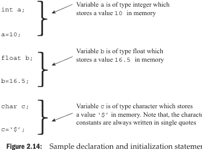

### 2.5.4 _unsigned_ 关键字

如果变量只需要存储正值而不是同时存储正值和负值，那么变量存储的值的范围就可以扩展。例如，如果我们只支持存储正数，那么整数变量的范围可以从 −32768 到 +32767 变为 0 到 65535。C/C++ 支持关键字 unsigned，它告知编译器程序员不会在变量中存储任何负数。例如，下面的语句创建一个名为 marks 的无符号整数类型变量。

```c
unsigned int marks;
```

这告知编译器变量 marks 的值永远不可能为负。关键字 unsigned 也可以类似地应用于其他数据类型。

### 2.5.5 变量命名规则

变量名是由字母和数字组成的序列。下面列出了程序员在命名变量时必须遵循的一组规则：

- 1. 变量名不能包含逗号、分号和空格等特殊字符，但是下划线（符号 _）可以作为变量名的一部分。
- 2. 变量名不能以数字开头。这意味着变量名的第一个符号可以是字母或下划线。
- 3. 变量名不能与 C/C++ 的内置关键字相同。附录 II 给出了 C 和 C++ 支持的关键字列表。

下面给出了有效和无效变量名的示例

| 变量名 | 说明 |
|---|---|
| `roll_no` | 这是一个有效变量名。 |
| `Sum` | 这是一个有效变量名。 |
| Data12 | 这是一个有效变量名。 |
| student's | 这是一个无效变量名，因为变量名不能包含像 ' 这样的特殊字符。 |
| 8bat | 这是一个无效变量名，因为变量名不能以数字开头。 |
| Roll no | 这是一个无效变量名，因为变量名不能包含像空格这样的特殊字符。 |

### 2.6 printf() 语句（C 和 C++ 均支持）

`printf()` 是一个用于在计算机屏幕上打印消息的函数。该函数 C 和 C++ 均支持。下面给出使用 `printf()` 函数在屏幕上打印消息的语法

```c
printf("message");
```

该函数声明在头文件 `stdio.h` 中，因此在使用 `printf()` 函数之前，必须在程序中包含该头文件。

```c
#include<stdio.h>
```

例如，下面给出的程序在屏幕上打印消息 I like computer programming

```c
#include<stdio.h>
void main()
{
printf("I like computer programming");
}
```

*输出：*

```
I like computer programming
```

### 2.6.1 使用转义序列格式化消息

C/C++ 支持不同的转义序列，用于格式化要在屏幕上打印的消息。每个转义序列都以反斜杠（`\`）开头。下面列出 C/C++ 支持的转义序列

- `\n` – 换行字符

`\n` 用于将光标位置移到新的一行。为了理解此转义序列的必要性，请考虑以下两个 `printf()` 语句

```c
printf("I like");
printf("computer programming");
```

这两个语句的输出如图 2.15 所示。

**表 2.1：** C/C++ 支持的转义序列列表

| 转义序列 | 描述 |
|---|---|
| `\n` | 换行字符 |
| `\t` | 制表符（表示水平 TAB） |
| `\b` | 退格字符 |
| `\a` | 计算机蜂鸣声（单次蜂鸣） |
| `\v` | 制表符（表示垂直 TAB） |
| `\\` | 打印单个斜杠符号 `\` |
| `\"` | 打印双引号 |

这三个语句将产生如图 2.17 所示的相同输出；因此，它们等价于之前写出的单个语句。

虽然 `\n` 和 `\t` 是最常用的转义序列，但表 2.1 给出了 C/C++ 支持的其他一些转义序列。

> **注意**
> 
> 在 C/C++ 中，`\` 被称为*通配字符*。这是因为 `\` 后面的符号是一条指令，而不是普通字符。例如，语句
> 
> ```cpp
> printf("n");
> ```
> 
> 只会在计算机屏幕上打印符号 n。而语句
> 
> ```cpp
> printf("\n");
> ```
> 
> 是一条将光标移到新行的指令。除了光标位置移到下一行以便后续打印操作之外，我们不会在屏幕上看到此语句输出的任何特定符号。

### 2.6.2 C/C++ 支持的格式说明符

当我们想在屏幕上打印的消息中输出特定变量的值时，会使用格式说明符。例如，如果有一个如下所示名为 `x` 的变量

```
int x=3;
```

并且如果我们需要在消息中打印 x 的值，如图 2.18 所示。那么，我们需要如下编写 `printf()` 语句

```
printf("There are %d students",x);
```

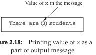

语句中的 `%d` 表示要打印的值必须取自变量，如图 2.19 所示。

`printf()` 语句会用变量 x 的实际值替换格式说明符 %d。

```
printf("There are %d students", x);
```

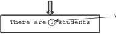

**图 2.19：** `printf()` 语句将 x 的值作为输出消息的一部分打印的工作原理

**注意**

由于变量 x 是整数类型，我们使用了格式说明符 `%d`。C/C++ 为每种不同数据类型支持不同的格式说明符。例如，`%f` 用于打印浮点值，`%c` 用于打印字符值，等等。表 2.2 给出了 C/C++ 支持的所有格式说明符的列表。

**表 2.2：** 格式说明符示例

| 格式说明符 | 描述 | 示例 | 输出 |
|---|---|---|---|
| `%d` | `%d` 用于打印整数变量的值。我们也可以使用 `%i` 打印整数值。`%d` 和 `%i` 含义相同 | `int v = 320;`<br>`printf("Value is %d",v);` | `Value is 320` |
| `%c` | `%c` 用于打印字符变量的值 | `char ch='$';`<br>`printf("Value is %c",ch);` | `Value is $` |
| `%f` | `%f` 用于以十进制形式打印浮点变量的值 | `float v=32.8;`<br>`printf("Value is %f",v);` | `Value is 32.8` |
| `%u` | `%u` 用于打印无符号整数变量的值 | `unsigned int v = 65532;`<br>`printf("Value is %u",v);` | `Value is 65532` |
| `%ld` | `%ld` 用于打印 long 变量的值。我们也可以使用 `%li` 打印 long 值。`%ld` 和 `%li` 含义相同 | `long v = 3200000;`<br>`printf("Value is %ld",v);` | `Value is 3200000` |
| `%o` | `%o` 用于打印整数的八进制等效值 | `int v = 320;`<br>`printf("Value is %o",v);`<br>`/*This prints 500 which is an octal equivalent of decimal value 320*/` | `Value is 500` |
| `%x` | `%x` 用于打印整数的十六进制等效值 | `int v=320;`<br>`printf("Value is %x",v);`<br>`/*This prints 140 which is a hexadecimal equivalent of decimal value 320*/` | `Value is 140` |
| `%e` | `%e` 用于以指数格式打印浮点变量的值，输出中出现小写 e | `float v=32000.9;`<br>`printf("Value is %e",v);` | `Value is 3.200090e+004` |
| `%E` | `%E` 用于以指数格式打印浮点变量的值，输出中出现大写 E | `float v = 32000.9;`<br>`printf("Value is %E",v);` | `Value is 3.200090E+004` |
| `%lf` | `%lf` 用于以十进制形式打印 double 变量的值 | `double v = 320001200.9;`<br>`printf("Value is %lf",v);` | `Value is 320001200.900002` |
| `%le` | `%le` 用于以指数格式打印 double 变量的值，输出中出现小写 e | `double v = 320001200.9;`<br>`printf("Value is %le",v);` | `Value is 3.200012e+008` |
| `%lE` | `%lE` 用于以指数格式打印 double 变量的值，输出中出现大写 E | `double v = 320001200.9;`<br>`printf("Value is %lE",v);` | `Value is 3.200012E+008` |

假设还有另一个如下所示的变量 y，

```
int y=5;
```

如果我们需要在消息中打印 x 和 y 的值，如图 2.20 所示。那么，我们需要如下编写 printf 语句

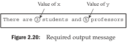

```
printf("There are %d students and %d professors",x,y);
```


格式说明符按照从左到右的顺序与变量值对应。对于第一个`%d`，函数会打印`x`的值，因为在以逗号分隔的变量列表中，`x`排在第一位。对于第二个`%d`，函数会打印`y`的值，如图 2.21 所示。只要消息中每个变量或表达式结果都有对应的格式说明符，就可以使用`printf()`语句打印任意数量的变量或表达式结果。

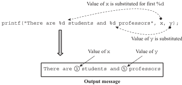

**图 2.21：** 执行`printf()`，打印两个变量的值

### 注意

格式说明符的数量必须与要打印的表达式数量完全一致。例如，假设有两个变量 a 和 b：

```c
int a=10,b=20;
```

如果要在屏幕上打印以下消息：

```
10 与 20 相加的结果是 30
```

实际上需要三个格式说明符：第一个对应 10（a 的值），第二个对应 20（b 的值），第三个对应 30（a+b 的值）。因此，`printf()`语句应按如下方式编写：

```c
printf("Addition of %d and %d is %d", a, b, a+b);
```

注意，我们在`printf()`语句中计算了表达式`a+b`。这是允许的，并且可以正常运行，如图 2.22 所示。

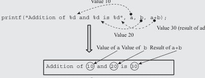

**图 2.22：** 执行`printf("Addition of %d and %d is %d", a, b, a+b);`

第一次出现`%d`时会打印 a 的值，第二次出现`%d`时会打印 b 的值，第三次出现`%d`时会打印 a+b 的值，如图 2.22 所示。

请记住，如果要打印整数类型，就要使用`%d`格式说明符。实际上，不同类型的数据值有不同的格式说明符。表 2.2 列出了 C/C++ 支持的格式说明符，程序员可以使用它们通过`printf()`打印不同类型的值。

### 注意

格式说明符`%s`用于打印字符串值。我们会在第 6 章讨论字符串，并学习`%s`的用法。

### 2.6.3 浮点数专用的格式说明符

C/C++ 还支持其他格式说明符（用于`float`和`double`类型），它们会在十进制格式和科学计数法格式中选择更适合在屏幕上显示的一种。

| 格式说明符 | 说明 | 示例 | 输出 |
|---|---|---|---|
| `%g` | `%g`以`%f`或`%e`的形式打印`float`变量的值，选择在屏幕上显示所需字符较少的格式 | `float v = 32000.9;`<br>`printf("Value is %g",v);`<br>`/*以十进制格式打印（32000.9），因为与指数格式（3.20009e+004）相比，它所需字符较少*/` | **值为**<br>`32000.9` |
| `%G` | `%G`以`%f`或`%E`的形式打印`float`变量的值，选择在屏幕上显示所需字符较少的格式 | `float v=32000.9;`<br>`printf("Value is %G",v);`<br>`/*以十进制格式打印（32000.9），因为与指数格式（3.20009E+004）相比，它所需字符较少*/` | **值为**<br>`32000.9` |
| `%lg` | `%lg`以`%lf`或`%le`的形式打印`double`变量的值，选择在屏幕上显示所需字符较少的格式 | `double v=32000120000.9;`<br>`printf("Value is %lg",v);`<br>`/*以指数格式打印（3.20001e+010），因为与十进制格式（32000120000.9）相比，它所需字符较少*/` | **值为**<br>`3.20001e+010` |
| `%LG` | `%LG`以`%Lf`或`%LE`的形式打印`long double`变量的值，选择在屏幕上显示所需字符较少的格式 | `long double v= 32000120000.9;`<br>`printf("Value is %LG",v);`<br>`/*以指数格式打印（3.20001E+010），因为与十进制格式（32000120000.9）相比，它所需字符较少*/` | **值为**<br>`3.20001E+010` |

### 注意

C/C++ 还支持格式说明符`%Lg`和`%LG`，用于打印`long double`值。请注意，打印`long double`类型的变量时，L 必须大写。

### 2.6.4 使用`printf()`语句指定输出的宽度和精度

还可以使用`printf()`语句控制输出的宽度和精度。我们知道，控制字符串中的`%d`用于打印整数值。默认情况下，整数值采用左对齐格式打印。也可以指定输出字段的宽度，使数值以右对齐的形式打印。若要让输出右对齐，整数控制字符串必须按如下方式指定：

```c
"%[width]d"
```

其中，`[width]`表示为输出预留的字符宽度。例如，假设变量 x 的值为 100：

```c
int x=100;
```

语句

```c
printf("%6d",x);
```

会在屏幕上为打印 x 的值预留六个字符位置。这意味着，尽管 x 是一个三位数，仍会为其值预留六个字符位置。数值 100 将以右对齐的形式打印，屏幕上前面三个字符位置留空，如图 2.23 所示。

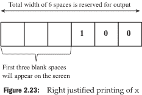

如果指定的宽度小于数字的位数，则宽度设置会被忽略，完整的数字仍会打印在屏幕上，不会丢失任何数据。在本例中，x 是一个三位数；如果在`printf()`语句中误将宽度指定为 2，如下所示：

```c
printf("%2d",x);
```

宽度设置会被直接忽略，x 的完整值（即 100）仍会打印在屏幕上，如下所示：

```
100
```

C/C++ 还提供了其他一些标志，可用于控制字符串，以进一步设置输出格式。例如，如果输出为右对齐，`0`标志会用零填充为输出预留的空白位置。

语句

```c
printf("%06d",x);
```

会在屏幕上为打印 x 的值预留六个字符位置，并用零填充三个未使用的位置，如图 2.24 所示。

下表列出了`printf()`语句支持的标志。必须将要应用的标志紧跟在控制字符串中的`%`符号之后。因此，打印整数的控制字符串可以按如下格式指定：

```c
"%[flag][width]d"
```

其中，`[flag]`表示要应用于数值的可选标志，`[width]`表示输出的可选字符宽度。

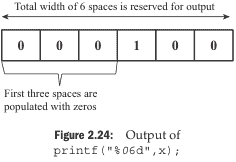

| 标志 | 说明 |
|---|---|
| `0` | 如果输出为右对齐，`0`标志会用零填充为输出预留的空白位置。输出为左对齐时，此标志无效。 |
| `-` | 此标志用于生成左对齐的输出。 |
| `+` | 此标志用于打印正数时显示`+`号，例如，100 会打印为 +100。 |
| `#` | 打印八进制数时，此标志会在数值前加上 0；打印十六进制数时，会在数值前加上 0x。将此标志用于十进制浮点数时，即使小数点后没有数字，也会确保输出中出现小数点。例如，100 会打印为 100.000000。请记住，默认精度为 6。 |

例如，语句

```c
printf("%-6d",x);
```

应用了`-`标志，因此输出将左对齐，如图 2.25 所示。

可以同时应用多个标志。语句可以写成：

```c
printf("%-+6d",x);
```

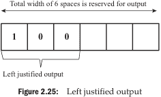

该语句应用了`-`和`+`两个标志来打印 x 的值。`-`表示输出左对齐，`+`表示当数值为正数时，输出中应显示`+`号。因此，语句的输出如下所示。请注意，这次六个字符位置中只有两个留空，因为其中一个字符位置被用于打印`+`号，如图 2.26 所示。

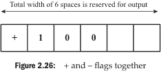

我们知道，控制字符串`%o`用于打印八进制值，`%x`用于打印十六进制值。语句

```c
printf("%o",x);
```

会打印 144，因为 144 是十进制值 100 对应的八进制数。如果需要在八进制数的输出前加上 0，可以应用`#`标志。例如，语句

```c
printf("%#o",x);
```

会在屏幕上打印 0144。

同样，语句

```c
printf("%#x",x);
```

会在计算机屏幕上打印 0x64，因为 64 是十进制数 100 对应的十六进制数。请注意，由于在`printf()`语句中使用了`#`标志，输出中才会出现 0x。

还可以使用`printf`语句设置浮点数的精度。浮点数的精度是指小数点后可以出现的位数。与打印整数值一样，打印浮点数时也可以指定标志和输出宽度。打印浮点数的控制字符串完整格式如下：

```c
"%[flags][width].[precision]f"
```

请记住，`[flags]`、`[width]`和`[precision]`这三个参数都是可选的，因此可以指定其中任意一个、全部指定，或者一个也不指定。我们先编写只使用`[width]`和`[precision]`的语句，之后再添加一些标志，以说明它们用于浮点数时的效果。

假设 y 是一个浮点变量：

```c
float y = 100.56453;
```

语句

```c
printf("%6.2f",y);
```

将输出宽度设为 6，精度设为 2。该数值会四舍五入到小数点后两位，因此输出为 100.56，如图 2.27 所示。

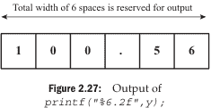


在这种情况下，宽度指定为 6，这恰好与屏幕上要打印的符号数量相同，因此输出中没有任何空白。如果我们指定的宽度大于要打印的符号数量，输出将右对齐，如图 2.28 所示。

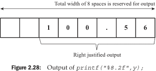

以下语句，

```cpp
printf("%8.2f",y);
```

将输出宽度设置为 8，并将精度设置为 2。前两个空格为空，因为输出将右对齐。和之前一样，我们将精度指定为 2，因此数字将四舍五入到两位小数，从而在屏幕上打印 100.56，如图 2.28 所示。

我们始终可以像打印整数时那样，以类似方式将第 2.6.4 节中提到的标志应用于浮点值。例如，要使图 2.28 中的输出左对齐，我们可以如下面语句所示应用 `-` 标志

```cpp
printf("%-8.2f",y);
```

输出将左对齐，最后两个符号位置留空，如图 2.29 所示。

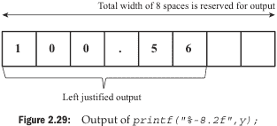

类似地，其他标志（如 +、0 和 #）也可以应用于浮点值。如果我们不想指定任何宽度，仍然可以指定精度。例如，以下语句，

```cpp
printf("%.2f",y);
```

将精度指定为 2，但没有指定任何宽度。这意味着浮点值将四舍五入到两位小数，并且宽度将与屏幕上要打印的符号数量相同。该语句的输出如图 2.30 所示。

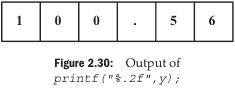

以下语句，

```cpp
printf("%20f",y);
```

仅将宽度指定为 20，但没有指定精度；在这种情况下，完整数字将以右对齐形式打印（前 11 个空格留空），如图 2.31 所示。

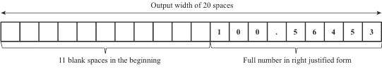

**图 2.31：** `printf("%20f",y);` 的输出

### 2.7 在计算机屏幕上打印值的 C++ 风格

回想一下，C++（而非 C）支持 cout 语句，用于在计算机屏幕上打印消息。除了文本消息之外，我们还可以在 C++ 程序中使用 cout 语句打印特定变量的值。打印文本消息与打印变量值之间的唯一区别在于：要打印的文本消息必须始终用双引号括起来；而如果我们希望使用 cout 语句打印变量的值，则变量名必须不带双引号书写。这有助于 C++ 编译器区分 cout 语句中表示要直接打印到屏幕上的文本消息的部分，以及表示其值要打印到计算机屏幕上的变量名的部分。

下面给出的是使用单个 cout 语句打印 C++ 程序中定义的 N 个变量值的语法：

```cpp
cout<<variable1<<variable2<<variable3...<<variableN;
```

如图 2.32 所示，我们创建了一个名为 a 的整数类型变量，并将其初始化为 10。因此，以下语句，

```cpp
cout<<a;
```

实际上会在计算机屏幕上打印值 10，如图 2.32 所示。

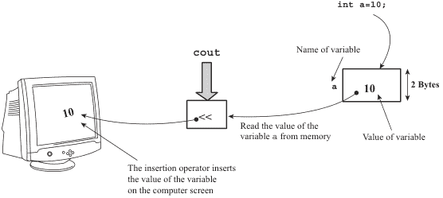

**图 2.32：** 使用 cout 语句打印变量的值

我们还可以使用单个 cout 对象多次调用插入运算符函数。C++ 的这一特性称为插入操作的级联。当我们希望组合不同元素以形成要打印到计算机屏幕上的消息时，也可以使用插入运算符（<<）的级联。例如，下面的 cout 语句，

```cpp
cout<<"The value of variable is "<<a;
```

将在计算机屏幕上打印以下消息。

```text
The value of variable is 10
```

请注意，上述消息包含两部分。第一部分是纯文本（The value of variable is），它用双引号括起来；而消息的第二部分是变量名（变量 a），它没有用双引号括起来。此外，需要注意的是，我们必须分别使用插入运算符，以便将消息的每一部分插入到计算机屏幕上。cout 语句的工作过程如图 2.33 所示。

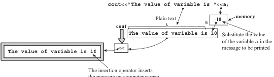

**图 2.33：** `cout<<"The value of variable is "<<a;` 的执行

作为示例，假设 x 和 y 是整型变量，值分别为 10 和 20，如下所示：

```cpp
int x=10,y=20;
```

类似地，以下 cout 语句，

```cpp
cout<<"Value of x is:"<<x<<" Value of y is:"<<y;
```

将在计算机屏幕上打印以下消息。

```text
Value of x is:10 Value of y is:20
```

### 2.8 endl 修饰符（由 C++ 支持，而非 C）

endl 是 C++ 中的关键字，用于将光标移到计算机屏幕的新行。修饰符 endl 在 C++ 中也称为回车操作符。为了理解 endl 修饰符的必要性，让我们考虑下面给出的两条 C++ 语句：

```cpp
cout<<"I like C++";
cout<<"I like Computer programming";
```

尽管我们编写了两条不同的 cout 语句，但消息 I like C++ 和 I like Computer programming 将打印在计算机屏幕的同一行上，如图 2.34 所示。请注意，C++ 的流式输出甚至不会在两条消息之间插入额外的空格。因此，这两条消息看起来就像连接在一起一样，如图 2.34 所示。

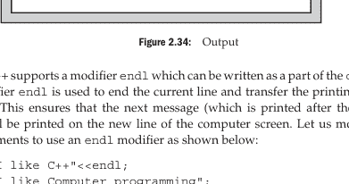

C++ 支持修饰符 endl，它可以作为 cout 语句的一部分书写。修饰符 endl 用于结束当前行并将打印光标移到新行。这确保下一条消息（在出现 endl 之后打印的消息）将打印在计算机屏幕的新行上。让我们修改上面的 C++ 语句，以使用 endl 修饰符，如下所示：

```cpp
cout<<"I like C++"<<endl;
cout<<"I like Computer programming";
```

第一条 cout 语句在计算机屏幕上打印消息 I like C++，随后光标移到新行，因此下一条消息 I like Computer programming 将打印在屏幕的新行上，如图 2.35 所示。


### 注意

除了修饰符之外，还可以将表 2.1 中给出的常规转义序列与 cout 一起使用，以格式化消息。例如，以下 cout 语句也是有效的

```cpp
cout<<"I like C++ \n I like \t Computer programming"<<endl;
```

屏幕上的输出如下所示。

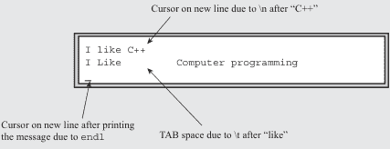

### 2.9 使用 `scanf()` 函数接受用户输入（由 C 和 C++ 共同支持）

`scanf()` 是一个用于从键盘接受输入数据并将数据值存储到程序变量中的函数，如图 2.36 所示。`scanf()` 在头文件 `<stdio.h>` 中声明，并在 C/C++ 的内部库中定义。该函数由 C 和 C++ 共同支持。

下面给出的是从键盘接受输入数据的函数语法

```cpp
scanf("control string", &var1, &var2, ..., &varn);
```

var1、var2、...、varn 是 n 个不同的变量。每个变量前面的 & 符号表示该函数需要每个变量的确切内存位置来存储输入数据。& 在 C/C++ 中称为取地址运算符，它给出变量在内存中所存储位置的地址。现在，只需将 & 记住为使用 scanf() 的语法的一部分。现在不必过于担心 &，我们将在第 8 章详细讨论内存地址的操作。只需记住，在每个要从键盘输入其值的变量名之前添加 &（我们将在第 6 章学习字符串，它们是此规则的例外）。

控制字符串是格式说明符的列表。对于每个要从用户处作为输入获取的变量，都应有一个格式说明符。要使用的格式说明符取决于变量的数据类型，一些常用的格式说明符如表 2.2 所列。

考虑一个整型变量 x

```cpp
int x;
```


因此，当我们打印 `e` 的值时，输出中会得到 10，但如果我们打印 `f` 的值，屏幕上将什么也看不到。这是因为空格（SPACE）在屏幕上不可见，但内存中变量 `f` 里存储的正是它。这在技术上确实是不正确的，因为输入值 `z` 丢失了，而它本应被初始化到变量 `f` 中。为解决这个问题，技巧是 `%c` 在控制字符串中必须始终带有一个前导空格。前导空格会通知 `scanf()` 跳过所有空格和换行，即使对于字符输入也是如此。因此，我们通过在 `%c` 前加一个空格来重写 `scanf()` 语句，如图 2.38 所示。

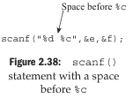

在这种情况下，如果输入是，

```text
10 z
```

变量 `e` 将被设置为 10，而变量 `f` 将被正确地设置为值 `z`。这是因为 `scanf()` 会跳过输入中出现的所有空格和换行。`%c` 前的一个空格会通知 `scanf()` 跳过输入中出现的所有空格和换行。因此，即使在输入时在 10 和 z 之间放入多个空格和换行，变量 `f` 也会被正确初始化为值 `z`，如图 2.39 所示。

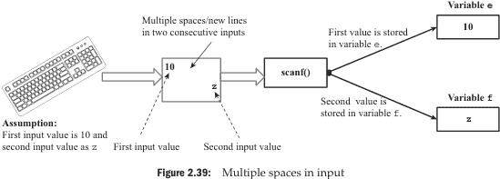

这不仅适用于多输入 `scanf()` 语句；对于只接收单个字符值作为输入的 `scanf()` 语句也同样成立。例如，语句，

```c
scanf("%c", &f);
```

只是从用户处接收单字符变量 `f` 的值作为输入。如果用户输入

```text
z
```

那么 `f` 就有可能无法被正确初始化。这是因为 `scanf()` 语句可能会拾取用户在之前的输入操作中按下的 ENTER 键（换行字符）或 SPACE BAR 键（空白空格字符）（可能来自程序中之前某处编写的上一个 `scanf()` 语句）。为克服这个问题，在接受字符输入时，即使 `scanf()` 语句只用于接收一个值，我们也应在 `%c` 前添加一个空格，如图 2.40 所示。

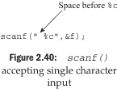

如果这个 `scanf()` 语句是程序中的第一个输入语句，这显然不会成为问题，但最好养成在每个格式说明符前放置一个 SPACE 的习惯，以避免扫描到不正确的输入。

> **注意**
>
> 在使用 `scanf()` 读取字符输入时，务必确保控制字符串中 `%c` 前有一个 SPACE。
>
> 所有其他格式说明符，例如 `%d`、`%f` 和 `%ld`（包括用于字符串的 `%s`），在输入时都会跳过换行和空格，因此不必在控制字符串中在它们前面加空格。但是，始终更好的编程实践是在 `scanf()` 函数的控制字符串内用空格分隔各个格式说明符，因为这可以提高语句的整体可读性。

### 2.9.1 使用 `scanf()` 的分隔输入

在 `scanf()` 的控制字符串中，可以使用除空格之外的任何其他分隔符。例如，考虑如下声明的三个变量 a、b 和 c

```c
int a,b,c;
```

语句，

```c
scanf("%d$%d$%d$",&a,&b,&c);
```

在控制字符串中有一个符号 $，它充当两个格式说明符之间的分隔符。因此，用户有责任输入以 $ 分隔的数据。这意味着在输入每个输入值之后，用户必须输入一个 $ 符号，如下所示

```text
10$20$30$
```

输入完这些内容后，当用户按下 ENTER 键时，`scanf()` 语句会将 10 存入变量 a、20 存入变量 b、30 存入变量 c。如果用户未能输入 $，而以任何其他格式输入数据，`scanf()` 将会崩溃。请记住，当我们在格式说明符中放入 $ 作为分隔符时，它实际上会通知 `scanf()` 在输入字符串中跳过 $，因此变量 a、b 和 c 会分别被正确初始化为 10、20 和 30。此特性在程序中很少使用，因为如果用户没有严格按照 `scanf()` 所需的格式输入数据，`scanf()` 就有崩溃的风险。例如，在这种情况下，如果用户以任何其他格式输入，比如以空格分隔的输入

```text
10 20 30
```

`scanf()` 将无法产生期望的结果。这是因为在这种情况下，`scanf()` 不会跳过空格，因为我们显式地编写了语句，要求在两个输入值之间恰好跳过一个 $ 符号。请记住，当我们用空格作为两个格式说明符之间的分隔符时，`scanf()` 会跳过两个连续输入值之间出现的任意数量的空格和换行字符。但是，当我们将分隔符设置为除空格以外的任何内容（例如此处的美元符号）时，`scanf()` 不会跳过它在两个连续输入之间的多次出现。下面的输入

```text
10$$$$20$$$$$$$$30$
```

将导致 `scanf()` 函数失败，因为输入格式与控制字符串所要求的格式不符。这是因为，按照控制字符串，输入中必须恰好有一个 `$` 符号来分隔两个值。

> **注意**
>
> 为避免这些复杂性，我们将始终在 `scanf()` 控制字符串中使用空格作为分隔符；除非绝对有必要使用其他内容作为分隔符。

下面给出了完整的源代码，它接收变量 `a`、`b` 和 `c` 的以 `$` 分隔的输入值，并将这些值打印回屏幕

```c
#include<stdio.h>
void main()
{
int a,b,c;
printf("Enter three values delimited by $\n");
scanf("%d$%d$%d",&a,&b,&c);
printf("a=%d\tb=%d\tc=%d\n",a,b,c);
}
```

### 输出

```text
Enter three values delimited by $
10$20$30$
a=10     b=20      c=30
```

> **注意**
>
> 我们会使用分隔输入的一个例子是：当我们希望以特定格式（例如 dd-mm-yyyy）从用户处接收日期值作为输入时。在这种情况下，我们可以如下所示创建三个整数变量 dd、mm 和 yyyy
>
> `int dd,mm,yyyy;`
>
> 并编写一个以 -（连字符）作为分隔符的 `scanf()` 语句，以从用户处接收这三个变量的值作为输入。对于语句，
>
> `scanf("%d-%d-%d",&dd,&mm,&yyyy);`
>
> 用户必须以 -（连字符）分隔的格式输入字符串。例如，考虑下面的用户输入
>
> `10-2-2012`
>
> 在这种情况下，`scanf()` 语句会将 10 存入变量 dd、2 存入变量 mm、2012 存入变量 yyyy。请注意，内部初始化了三个不同的变量，但用户会感觉像是输入了一个日期。请记住，`scanf()` 语句只能控制接受输入的方式，而不能控制数据在计算机内存中的存储方式。

### 2.9.2 指定输入数据的宽度

正如我们可以在 `printf()` 中指定输出宽度一样，也可以在 `scanf()` 语句中指定输入数据的最大宽度。例如，如果 a 和 b 是整数类型的变量，则语句

```c
scanf("%2d %4d",&a,&b);
```

将第一个输入的宽度设置为 2 位数字，将第二个输入的宽度设置为 4 位数字。因此，用户有责任将 a 的值输入为 2 位数字，将 b 的值输入为 4 位数字。因此，如果用户输入数据如下

```text
23 4520
```

那么 a 的值被初始化为 23，b 的值被初始化为 4520。

> **警告**
>
> 如果用户输入一个包含超过两位数字的数作为第一个输入，给定的 `scanf()` 将不会产生期望的结果。例如，如果输入是
>
> ```text
> 2380 459
> ```
>
> 那么只有 2380 的前两位会被赋给变量 a。因此变量 a 将被初始化为 23。剩余两位（80）将被赋给变量 b，因此 b 的值将被设置为 80。输入中 80 后的空白使 `scanf()` 停止执行任何进一步的初始化，因为此时两个输入变量都已初始化。因此，用户输入的 459 值被 `scanf()` 语句直接忽略。
>
> 显然，由于用户提供了错误输入，这是一次不正确的初始化。如果程序在后面的任何位置还有另一个 `scanf()` 语句，这也会产生不利影响。例如，如果程序后面还有一个 `scanf()` 语句用于接收整数变量 c 作为输入，
>
> ```c
> scanf("%d",&c);
> ```
>
> 那么它不会让用户输入任何值，而会直接继续执行下一条语句。在这种情况下，用户没有机会输入 c 的值，因为 459 已经在输入流中，并且被前一个 `scanf()` 语句留下未初始化。因此，CPU 会用 459 初始化变量 c，而不等待用户输入其他任何内容。

> **注意**
>
> 为避免这些复杂性，强烈建议不要在 `scanf()` 语句中指定任何输入宽度，除非绝对有必要这样做。

### 2.10 C++ 中的 `cin` 对象（仅在 C++ 中，不在 C 中）

C++ 支持流式输入，以从键盘等输入设备读取数据。运算符 >> 在 C++ 中称为提取运算符，用于从输入设备读取（提取）数据。提取运算符函数定义在类 istream 中（istream 是 input stream 的缩写），该类定义在头文件中


iostream.h。因此，我们需要将提取运算符与类 istream 的内置对象一起使用，该对象名为 cin。由于对象 cin 和提取运算符函数 >> 定义在头文件 iostream.h 中，因此我们必须在 C++ 程序中使用对象 cin 之前，将 iostream.h 的内容包含到 C++ 程序中。预处理指令 #include 可用于将头文件的内容包含到 C++ 程序中，如第 2.2 节所述。

cin 语句从键盘读取值，并将提取的值存储到特定变量中，如图 2.41 所示。

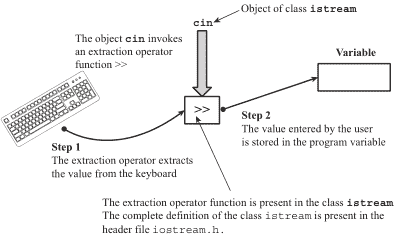

**图 2.41：** cin 的工作方式

例如，假设程序中声明了变量 a，则可以使用以下 cin 语句，

```cpp
cin>>a;
```

从键盘读取变量 a 的值。如果程序用户输入值比如 20，那么值 20 将存储在变量 a 中，如图 2.42 所示。

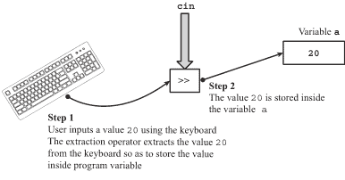

**图 2.42：** 执行 `cin>>a;`

我们还可以通过级联提取运算符 >>，使用单个 cin 语句接受程序中创建的多个变量的值，就像我们可以级联插入运算符 << 一样，如下面的语法所示：

```cpp
cin>>variable1>>variable2>>variable3 ... >>variableN;
```

为了理解提取运算符的级联，举个例子，假设在 C++ 程序中声明了变量 x 和 y，如下所示：

```cpp
int x,y;
```

我们可以使用单个 cin 语句从键盘读取变量 x 和 y 的值作为输入，如下所示：

```cpp
cin>>x>>y;
```

用户输入的第一个值将存储在变量 x 中，而用户输入的第二个值将存储在变量 y 中。用户输入的值可以用‘空格’分隔，也可以用‘换行’分隔。这意味着用户可以输入以空格分隔的 x 和 y 的值，或者用户可以使用键盘上的‘回车’键在新行上输入每个值。

假设用户输入的是以空格分隔的值 10 和 20；那么变量 x 的值将被初始化为 10，变量 y 的值将被初始化为 20，如图 2.43 所示。

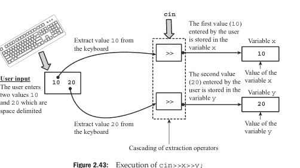

**图 2.43：** 执行 `cin>>x>>y;`

### 2.10.1 在程序中使用 cin/cout 语句执行两个数相加的示例

作为示例，让我们创建一个 C++ 程序，该程序接受用户输入的两个值，并打印两个值相加的结果。下面给出执行两个数相加的完整源代码：

```cpp
#include<iostream.h>
void main()
{
    int a,b,c;
    cout<<"Enter the two numbers"<<endl;
    cin>>a>>b;
    c= a+b;
    cout<<"The result of addition is: "<<c;
}
```

**输出：**

```text
Enter the two numbers
100 200
The result of addition is: 300
```

第一条语句

```cpp
int a,b,c;
```

在内存中创建名为 a、b 和 c 的整型变量，如图 2.44 所示。请注意，每个变量最初存储的是垃圾值。

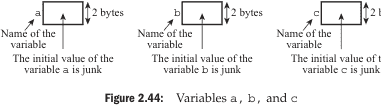

语句，

```cpp
cout<<"Enter the two numbers"<<endl;
```

在计算机屏幕上打印消息 Enter the two numbers，其后跟一个修改后的 endl。因此，在屏幕上打印指定消息后，光标会转移到新行。

语句，

```cpp
cin>>a>>b;
```

从键盘读取两个值，并分别将它们存储在变量 a 和 b 中。假设用户输入的两个值为 100 和 200，那么第一个值 100 将存储在变量 a 中，而第二个值 200 将存储在变量 b 中，如图 2.45 所示。

语句，

```cpp
c= a+b;
```

执行两个数 a 和 b 的加法，从而将相加结果存储在变量 c 中。由于变量 a 和 b 已分别初始化为值 100 和 200。变量 c 现在将存储结果 300，如图 2.46 所示。

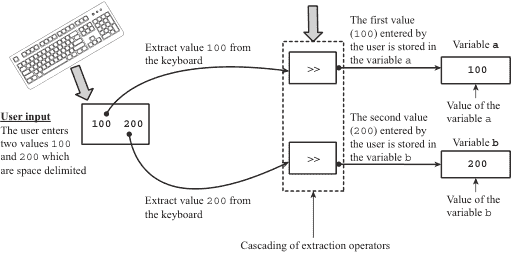

**图 2.45：** 执行 `cin>>a>>b;`


**图 2.46：** 执行 `c = a + b;`

最后一条语句，

```cpp
cout<<"The result of addition is: "<<c;
```

级联插入运算符，以便在计算机屏幕上打印以下消息：

> 相加的结果是：300

> **注意**
>
> 给定的执行两个数相加的程序只能与 C++ 编译器一起使用，而不能与 C 编译器一起使用。这是因为它使用了 `cout/cin` 对象，而这些对象仅受 C++ 支持，不受 C 支持。下面给出的程序使用 `printf()` 和 `scanf()` 语句，因此可与 C 以及 C++ 编译器一起使用。需要承认的是，与 `cout/cin` 语句相比，`printf()` 和 `scanf()` 语句写起来要复杂得多，但如果我们希望程序同时与 C 和 C++ 一起使用，除了使用它们之外别无选择。

```c
#include<stdio.h>

void main()
{
    int a,b,c;
    printf("Enter the two numbers\n");
    scanf("%d %d",&a,&b);
    c = a + b;
    printf("The result of addition is: %d\n",c);
}
```

**输出：**

```text
Enter the two numbers
100 200
The result of addition is: 300
```

### 2.11 操纵符 setw

操纵符 `setw` 用于设置由 `cout` 语句生成的输出宽度。默认情况下，`cout` 语句的字段宽度被设置为该语句输出所产生的符号数。

作为示例，让我们考虑以下 `cout` 语句，

```cpp
cout<<"Hello";
```


由 `cout` 语句生成的输出的字段宽度为 5，并且输出包含五个符号，如图 2.47 所示。

我们可以使用 `setw` 操纵符显式设置 `cout` 语句的自定义字段宽度，如下所示：

```cpp
cout<<setw(10)<<"Hello";
```

上述 `cout` 语句将输出的字段宽度设置为 10。然而，实际所需的输出长度仅为五个符号（因为字符串 `Hello` 中只包含五个字符）。在这种情况下，字符串 `Hello` 将在输出中右对齐，前五个符号的位置留空，如图 2.48 所示。

当我们希望将程序使用 `cout` 语句在输出中生成的文本或数字右对齐时，通常使用操纵符 `setw`。下面给出一个示例 C++ 程序，用于说明 `setw` 操纵符的用法，该程序以右对齐形式打印两个数的相加结果。正如程序的输出所示，值 10、20 和 30 在屏幕上右对齐。

操纵符 `setw` 定义在头文件 `iomanip.h` 中。因此，在 C++ 程序中使用操纵符 `setw` 之前，我们必须包含头文件 `iomanip.h` 的内容。


**图 2.48：** 使用字段宽度 10 的输出

```cpp
#include<iostream.h>
#include<iomanip.h>
void main()
{
    int a = 10,b = 20,c;
    c = a + b;
    cout<<"a="<<setw(5)<<a<<endl;
    cout<<"b="<<setw(5)<<b<<endl;
    cout<<"c="<<setw(5)<<c<<endl;
}
```

**输出：**


### 说明

我们已经学习了两种向程序提供输入的不同技术：`scanf()` 和 `cin`。同样，我们也学习了两种生成输出的不同方式：`printf()` 和 `cout`。以下是我们所讨论的这些方法的总结

| scanf()/printf() 函数 | cin/cout 对象 |
|---|---|
| 这些是格式化的输入/输出函数，受 C 和 C++ 共同支持。这些函数声明在头文件 stdio.h 中。 | 这些是流式输入/输出对象，仅受 C++ 支持，不受 C 支持。这些对象声明在头文件 iostream.h 中。 |
| 这些函数需要程序员为要输入或输出的每个值指定格式说明符。 | 这些是流式对象，它们不需要为输入/输出操作指定格式说明符。 |
| 不支持用于格式化数据的修饰符（如 setw）。所有格式化都必须使用诸如 \n 和 \t 之类的转义序列来完成。 | 它们既支持用于格式化数据的修饰符，也支持转义序列。 |


### 2.12 使用 `#define` 定义常量——一条预处理器指令

`#define` 是一条预处理器指令，用于定义在程序整个执行过程中不会改变的常量值。由 `#define` 指令定义的常量在 C/C++ 程序中也称为宏。回顾第 1 章的内容，预处理器会在程序编译开始之前，用宏定义替换程序中出现的每一个宏名称。

例如，我们来看下面的预处理器指令：

```c
#define PI 3.14
```

这意味着我们定义了一个常量 PI（宏的名称为 PI），其值为 3.14。请记住，`#define` 语句不会被编译；相反，它们会在程序编译开始之前被预处理。因此，预处理器会在程序编译之前将每一个 PI 替换为 3.14。下面是使用 `#define` 指令定义常量值 3.14 来计算圆锥体积的程序。

```c
#include <stdio.h>
#define PI 3.14

void main()
{
    float radius, height, volume;

    printf("Enter the radius and height of the cone\n");
    scanf("%f %f", &radius, &height);

    volume = 0.3333 * PI * radius * radius * height;
    printf("Volume of the cone is %f\n", volume);
}
```

输出：

```text
Enter the radius and height of the cone
10 2.3
Volume of the cone is 240.709259
```

上面的代码使用预处理器指令 `#define` 定义了一个常量 PI。因此，语句

```c
volume = 0.3333 * PI * radius * radius * height;
```

会被预处理器转换为：

```c
volume = 0.3333 * 3.14 * radius * radius * height;
```

也就是用值 3.14 替换常量 PI。一旦预处理器完成替换，磁盘上就会生成一个临时文件，随后由编译器对该文件进行编译。

#### 2.12.1 `NULL`——一个内置宏

`NULL` 是 C/C++ 中定义的一个常量，其值设置为零。`NULL` 是给内置宏起的名称，该宏在 C/C++ 库中使用以下 `#define` 语句定义：

```c
#define NULL 0
```

这意味着在 C/C++ 程序中，我们可以互换使用符号 `NULL` 或整型常量 `0`。

语句

```c
int a = NULL;
```

等同于

```c
int a = 0;
```

因此，当我们尝试用 `NULL` 值初始化变量时，该变量的值实际上会被初始化为零。

虽然使用符号 `0` 或符号 `NULL` 都不会影响程序的输出，但在处理**指针**时通常使用符号 `NULL`。初始化为 `NULL` 的指针（也称为**空指针**）不指向计算机内存中的任何位置。空指针的具体用法将在第 8 章和第 10 章中讨论。

### 2.13 **字符专用的输入/输出**

我们知道，可以使用 `scanf()`/`printf()` 以及 `cin`/`cout` 对不同类型的数据值（包括字符）进行输入/输出操作。C/C++ 支持 `getchar()` 和 `putchar()`，它们是专门用于字符输入和输出操作的函数。

`getchar()` 是用于从键盘读取一个字符的函数，`putchar()` 是用于在计算机屏幕上打印该字符的函数。虽然它们的工作也可以由 `scanf()`/`printf()` 以及 `cin`/`cout` 完成，但与 `scanf()`/`printf()` 或 `cin`/`cout` 相比，`getchar()` 和 `putchar()` 函数使用起来要简单得多。唯一需要注意的是，它们一次只能输入或打印一个字符。以下面的程序为例：

```c
#include <stdio.h>

void main()
{
    char x;
    printf("Enter a character\n");

    /* getchar() is used to get a character as input */
    x = getchar();

    printf("Character you entered is\n");

    /* putchar(x) prints the value of character variable x */
    putchar(x);
}
```

## 输出：

```text
Enter a character
$
Character you entered is
$
```

语句

```c
x = getchar();
```

等待用户输入一个字符。用户输入的字符存储在变量 `x` 中。实际上，该函数将输入字符的 ASCII 值存储在变量 `x` 中，因此 `getchar()` 函数返回一个整数值，因为 ASCII 值是整数。在现阶段我们只需要注意，用户输入的字符存储在变量 `x` 中；因此，如果用户输入的是 `$`，那么 `x` 将包含 `$`。请记住，该函数一次只能接收一个字符作为输入，所以如果你需要输入另一个字符，就需要再使用一个 `getchar()` 函数。

语句

```c
putchar(x);
```

会在计算机屏幕上打印存储在变量 `x` 中的字符值。因此，例如，如果 `x` 的值是 `$`，那么 `$` 将出现在计算机屏幕上。

> **注意**
>
> 函数 `getchar()` 和 `putchar()` 在头文件 `stdio.h` 中声明。因此，在程序中使用这些函数之前，必须包含该头文件。

## 测验

1. 填空：

   如果某个特定数据类型的大小为 10 字节，那么该类型的变量可以存储的有符号值范围是 ________，无符号值范围是 ________。假设该数据类型仅支持没有小数部分的数值。

2. 假设变量 `z` 的值已初始化，确定下面三条 `printf()` 语句的输出：

```c
int z = -2000;
printf("%020d", z);
printf("%-20d", z);
printf("%#o", z);
```

3. 考虑用于输入变量 `a` 和 `b` 的 `scanf()` 语句：

```c
int a, b;
scanf("%3d %2d", &a, &b);
```

给出在以下每种用户输入情况下变量 `a` 和 `b` 的值：

**情况 1：** 用户输入为 `32000 42000`

**情况 2：** 用户输入为 `333 10000`

**情况 3：** 用户输入为 `12 1`

4. 编写一组 `printf()` 和 `scanf()` 语句，以实现：

   (a) 在屏幕上打印以下消息：

   `Enter a number`

   (b) 以指数格式输入一个浮点值，并将其存储在名为 `b` 的变量中。

   (c) 以十进制格式打印 `b` 的值。

5. 如果 `p` 和 `q` 是 `float` 类型的变量，编写一条 `printf()` 语句来打印以下表达式的结果：

   (a) `p + q / 100 - p * q + q`

   (b) `p^3`

   (c) `(p / q + 1) * 100`

6. 确定以下 `printf()` 语句的输出：

   `printf("\vI\vLike\tProgramming\tin\vC++\v");`

7. `cout` 是一个：

   (a) C++ 的关键字

   (b) C++ 的内置函数

   (c) C++ 内置类的对象

   (d) 特殊单词

8. 插入运算符 `<<` 是一个：

   (a) C++ 的关键字

   (b) C++ 的内置函数

   (c) C++ 内置类的对象

   (d) 特殊单词

9. 以下哪个语句是正确的？

   (a) 编译器为变量分配内存。

   (b) 编译器为变量赋值。

   (c) 链接器为变量赋值。

   (d) 加载器为变量赋值。

10. 以下哪些语句是正确的？

    (a) 插入运算符不能级联。

    (b) 提取运算符不能级联。

    (c) 插入运算符和提取运算符都可以级联。

    (d) 只有插入运算符可以级联。

11. 以下哪项不是预处理器指令？

    (a) `include`

    (b) `define`

    (c) `cout`

    (d) 以上选项都不是。

12. 纠正以下程序中的错误（如果有），和/或确定其输出。

```cpp
#define DATA = 15

void main()
{
    int a = 10, b = 15, c;
    c = a + b + DATA;
    cout << "Result of addition is " << c;
}
```

13. 从下面给出的列表中识别有效和无效的整型/浮点常量：

   (a) `3.5A`

   (b) `12`

   (c) `12e2`

   (d) `34,000`

   (e) `12.4.2`

   (f) `79,00,000`

   (g) `-12k`

14. 纠正以下程序中的错误（如果有），和/或找出其输出。

```cpp
#define NUMBER 15;

void main()
{
```


```c
int x=76,y=90,z;
z=x+y+NUMBER-10+25+NULL;
printf("The value of variable z is %d", z);
}
```

**15.** 从下面的列表中判断哪些是有效/无效的变量名：

- （a）Apple
- （b）1_orange
- （c）Data123
- （d）MAX
- （e）float
- （f）12k
- （g）_Bat-61
- （h）Wild-life
- （i）Sur;name

**16.** 确定以下每条 `printf()` 语句的输出：

```c
char a = 'A';
printf("%d",a);
printf("%c",a);
printf("%u",a);
```

**17.** 下列哪些是有效的常量？请指出有效常量的数据类型。

- （a）`a`
- （b）-100e10
- （c）-2.5E55
- （d）35000UL
- （e）`10`
- （f）"Ship123#"
- （g）"Goal:'of/Life"
- （h）`""`
- （i）`1`
- （j）`\t`
- （k）`\n`
- （l）`\0x34`
- （m）044
- （n）876432282345231
- （o）0xFFF
- （p）`\\`
- （q）548,000
- （r）5,000
- （s）1
- （t）"100"

以下程序的输出是什么？

```c
#include<stdio.h>
void main()
{
    int a=55;
    printf("Outer printf: %d\n", printf("Inner printf %d\n",a) );
}
```

## 提示

> `printf()` 返回它已在计算机屏幕上打印的字符数。例如，`printf("Hi");` 将返回 2，因为它在屏幕上打印了 2 个字符。在此基础上，尝试执行上述程序并理解其输出。

## 复习题

- 1. 解释 `main()` 函数在 C/C++ 中的重要性。
- 2. 更正下面的 C++ 语句，使其打印变量 a 和 b 的值：
  `cout>>"value of a is a">>"value of b is b";`
- 3. 解释并更正以下程序中的错误。

  ```cpp
  #include<iostream.h>
  main()
  {
  cout<<"Hello";
  cin>>a;
  cout>>"Value of a is"<<a;
  }
  ```

- 4. 简要说明预处理指令。
- 5. 列出不同的基本数据类型，以及每种数据类型所需的内存大小和所支持的值范围。

## 第 3 章 | 运算符与类型转换

### 3.1 概述

C/C++ 拥有一组专用的特殊字符，可用于对数据项执行操作。这些特殊字符中的每一个都向编译器表示要执行的特定操作。例如，符号 + 用于执行加法，符号 * 用于执行乘法，等等。每个运算符都具有两个属性，用于定义其求值方式：

- 1. 运算符的优先级
- 2. 运算符的结合性

运算符的**优先级**是与该运算符相关联的优先级别。每个运算符都被赋予一个特定的优先级，必须根据该优先级来解析运算符，以便生成表达式的结果。为运算符分配优先级有助于避免在给定表达式包含多个运算符时，求值顺序中可能出现的**歧义**。为了准确理解运算符优先级的确切含义，让我们考虑下面的表达式：

```c
int p=10,q=5,r=2,s;
s=p+q*r;
```

将变量 p、q 和 r 的值代入后，计算变量 s 值的表达式可以重写如下：

```c
s=10+5*2;
```

在没有运算符优先级的情况下，编译器将有两种不同的选项来生成上述表达式的结果。

#### 3.1.1 选项 1：先加后乘（错误选项）

首先对 10 和 5 这两个数进行加法运算，然后将结果与值 2 相乘。因此，我们将得到表达式的结果为 30，如图 3.1 所示。请注意，在这种情况下，我们先对‘加法’的结果进行了求值，然后再对‘乘法’的结果进行求值。求值顺序如图 3.1 所示。


**图 3.1：** 选项 1：求值顺序

#### 3.1.2 选项 2：先乘后加（正确选项）

作为生成表达式结果的第二种选项，我们可以先对 5 和 2 这两个数进行乘法运算，然后将结果与值 10 相加。因此，我们将得到表达式的结果为 20，如图 3.2 所示。请注意，在这种情况下，我们先对‘乘法’的结果进行了求值，然后再对‘加法’的结果进行求值。求值顺序如图 3.2 所示。


**图 3.2：** 选项 2：求值顺序

因此，我们可以说，存在这样的情况：对单个表达式的求值可以通过不同的方法完成，而每一个选项都会给我们带来不同的结果。这种在求表达式结果时出现的问题被称为编译过程中的**歧义**。很明显，第二个选项给出了表达式的正确数学结果（即值 20），而第一个选项给出的结果则是不正确的。因此，为了确保运算符求值顺序的正确性，每个运算符都被分配了一个优先级。编译器确保表达式中所有具有较高优先级的运算符的结果，会先于任何具有较低优先级的运算符的结果进行求值。例如，乘法的优先级**较高**，而加法的优先级**较低**，因此 C/C++ 总是先执行‘乘法’，再执行‘加法’。这也解决了在确定表达式中运算符求值顺序时可能出现的歧义或混淆。这意味着 C/C++ 将始终遵循第二个选项，并正确生成表达式的结果为 20，如图 3.2 所示。

> **记住**
> 
> 当编译器有多个选项可用于计算特定操作的结果时，这种情况被称为**“歧义”**。每种语言的编译器都有自己消除表达式中歧义的方法。编译器内消除表达式中歧义的单位称为**解析器**。在可用的所有选项中，编译器必须能够选择正确的求值树，以获得数学上正确的结果。为了给每个表达式提供一个**数学上正确**的结果，每个运算符都具有预定义的**优先级和结合性**。

一般来说，如果我们考虑算术运算符的优先级，乘法和除法运算符的优先级较高，而加法和减法运算符的优先级较低。这确保了表达式中使用的所有乘法/除法运算符的结果，会先于表达式中任何加法/减法运算符的结果进行求值。C/C++ 中所有运算符的精确优先级如图 3.6 所示。

此外，每个运算符都有一个**结合性**，它指定特定表达式的求值方向。运算符的结合性可以是‘从左到右（L→R）’或‘从右到左（R→L）’。一般来说，当我们尝试在单个表达式中使用两个或更多具有相同优先级的运算符时，就会涉及到结合性。

例如，让我们考虑下面的语句：

```c
int p=10,q=5,r=3,s;
s=p+q-r;
```

将变量 p、q 和 r 的值代入后，计算变量 s 值的表达式可以重写如下：

```c
s=10+5-3;
```

请注意，+ 和 - 都是具有相同优先级的运算符。在这种情况下，C/C++ 使用算术运算符的结合性（即‘从左到右（L→R）’）来确定求值顺序。因此，系统将从左到右的方向对表达式进行求值，这样 10 和 5 的加法将先于减法的结果进行求值。因此，表达式的最终结果将被计算为 12，如图 3.3 所示。


**图 3.3：** 表达式 10 + 5 − 3 的求值

为了清楚地理解“结合性”的概念，让我们更改用于计算变量 s 值的表达式，如下所示：

s=p-q+r;

通过代入，我们得到，

s=10-5+3

再次，我们知道运算符 - 和 + 具有相同的优先级。因此，C/C++ 使用算术运算符的结合性来确定求值顺序，即“从左到右（L→R）”。因此，我们将按照从左到右的方向对完整表达式进行求值，这样，10 和 5 的减法将在加法结果求值之前执行。因此，该表达式的最终结果将求值为 8，如图 3.4 所示。


**图 3.4：** 表达式 10 − 5 + 3 的求值

C/C++ 中某些运算符的结合性也可以是“从右到左”，而不是“从左到右”。例如，考虑下面的语句，它将变量 a 的值赋给变量 b 和 c。

```cpp
int a=10,b,c;
c=b=a; /*Assignment operator has an associativity from Right to left*/
```

语句 c=b=a; 两次使用赋值运算符 =。此外，在声明变量时，变量 a 的值已经被设置为 10。这里的要求是，必须先将 a 的值赋给 b，然后将变量 b 的值赋给 c。因此，编译器将赋值运算符的结合性设置为“从右到左”，如图 3.5 所示。


**图 3.5：** 表达式 `c = b = a` 的求值

这确保在将 b 的值复制到 c 之前，先将变量 a 的值复制到 b。因此，在表达式求值后，值 10 存储在 a、b 和 c 这三个变量中。

> **谁为运算符分配优先级？**
> 
> 该语言的编译器为语言支持的每个运算符分配优先级和结合性。尽管操作的实际求值是在程序运行时完成的，但表达式中运算符的求值顺序是在编译时本身决定的。编译器根据表达式中使用的每个运算符的预定义优先级和结合性来决定运算符的求值顺序。这避免了在程序运行时实际对表达式求值时可能出现的任何歧义。

C/C++ 支持丰富的运算符集合，并且每个运算符都有明确定义的结合性和优先级，如图 3.6 所示。在本章中，我们将讨论 C/C++ 中的不同运算符。这些运算符可以大致分类如下：

- 1. 算术运算符
- 2. 关系运算符
- 3. 逻辑运算符（将在第 4 章讨论）
- 4. 位运算符
- 5. 简写运算符
- 6. 递增/递减运算符

| 等级 / 优先级 | 运算符 | 描述 | 结合性 |
|---|---|---|---|
| 1. | `::` | 作用域解析运算符 | 从左到右 |
| 2. | `[]` | 访问数组元素的运算符 | 从左到右 |
|  | `()` | 函数调用运算符 |  |
|  | `.` | 使用对象名访问对象成员的运算符 |  |
|  | `->` | 使用指针访问对象成员的运算符 |  |
|  | `++` | 后缀递增运算符 |  |
|  | `--` | 后缀递减运算符 |  |
| 3. | `~` | 1 的补码运算符（位运算符） | 从右到左 |
|  | `!` | 逻辑非运算符 |  |
|  | `++` | 前缀递增运算符 |  |
|  | `--` | 前缀递减运算符 |  |
|  | `-` | 一元减运算符 |  |
|  | `+` | 一元加运算符 |  |
|  | `*` | 间接寻址运算符（与指针一起使用） |  |
|  | `&` | 取地址运算符 |  |
|  | `sizeof` | 该运算符返回特定变量或数据类型所需的内存量 |  |
|  | `new` | 动态内存分配 |  |
|  | `new []` | 动态内存分配 |  |
|  | `delete` | 动态内存释放 |  |
|  | `delete[]` | 数组的动态内存释放 |  |
|  | `(datatype)` | 显式类型转换运算符 |  |
| 4. | `.*` | 使用对象指向成员的指针 | 从左到右 |
|  | `->*` | 使用指针指向成员的指针 |  |
| 5. | `*` | 乘法运算符 | 从左到右 |
|  | `/` | 除法运算符 |  |
|  | `%` | 取模除法运算符 |  |
| 6. | `-` | 减法运算符 | 从左到右 |
|  | `+` | 加法运算符 |  |
| 7. | `>>` | 右移运算符 | 从左到右 |
|  | `<<` | 左移运算符 |  |
| 8. | `<` | 小于运算符 | 从左到右 |
|  | `<=` | 小于或等于 |  |
|  | `>` | 大于 |  |
|  | `>=` | 大于或等于 |  |
| 9. | `==` | 等于 |  |
|  | `!=` | 不等于 |  |
| 10. | `&` | 按位与运算符 | 从左到右 |
| 11. | `^` | 按位异或运算符 | 从左到右 |
| 12. | `\|` | 按位或运算符 | 从左到右 |
| 13. | `&&` | 逻辑与运算符 | 从左到右 |
| 14. | `\|\|` | 逻辑或运算符 | 从左到右 |
| 15. | `?:` | 三元条件（if-then-else） | 从右到左 |
| 16. | 简写运算符 | 赋值/复合赋值运算符 | 从右到左 |
| 17. | `,` | 逗号运算符 | 从左到右 |

**图 3.6：** 运算符的优先级和结合性

### 3.2 算术运算符

算术运算符是特殊符号，可用于执行加法、减法、乘法和除法等算术运算。如果运算符作用于单个操作数，则称为一元运算符。而如果运算符作用于两个不同的操作数，则称为二元运算符。下面列出了 C/C++ 支持的算术运算符：

| 运算符符号 | 描述 |
|---|---|
| + | 当以二元形式使用时，符号 + 用于执行两个数的加法。符号 + 也可以以一元形式使用，表示特定数据值的正号。 |
| - | 当以二元形式使用时，符号 - 用于执行两个数的减法。符号 - 也可以以一元形式使用，表示特定数据值的负号。 |
| * | 当以二元形式使用时，符号 * 用于执行两个数的乘法。 |
| / | 当以二元形式使用时，符号 / 用于执行两个数的除法。 |
| % | 当以二元形式使用时，符号 % 用于执行两个数的取模除法。运算符 / 和 % 的区别在于，运算符 / 返回两个数相除的商，而运算符 % 返回两个数相除的余数。 |
| = | 运算符 = 称为赋值运算符。该运算符用于将语句右侧所写表达式的值赋给语句左侧的变量。 |

让我们考虑几个描述算术运算符用法的示例语句

### 3.2.1 示例 1：以一元形式使用运算符 -（减号）

我们可以以一元形式使用减号运算符，以对特定变量的值取负。例如，让我们考虑下面给出的语句，其中我们声明了两个整数类型的变量“a”和“b”。变量“a”的值初始化为 10，而变量“b”的值通过将“减号”运算符应用于变量“a”的值来初始化，如下所示：

```cpp
int a=10,b;
b=-a;
```


语句 b=-a; 将 a 的取负值赋给变量 b。因此，变量 b 的值被设置为 -10，如图 3.7 所示。注意，变量 a 的值仍将是 +10，因为 a 的取负值实际上被赋给了变量 b，而不是赋回变量 a。

该语法使得我们也可以以一元形式使用运算符 +。然而，以一元形式使用运算符 + 可能不会给程序员带来任何有用的目的，因为在 C/C++ 中，除非程序中明确将任何数据值指定为负数，否则所有数据值默认都被视为正数。

### 3.2.2 示例 2：以二元形式使用运算符 +、-、*、/ 和 %

图 3.8 给出了创建两个变量 a 和 b 的代码，其值分别为 10 和 20。该代码对两个变量 a 和 b 应用所有二元算术运算符，并将每个运算的结果存储在变量 p、q、r、s 和 t 中。

```cpp
int a = 10, b = 20;

int p, q, r, s ,t;

p = a + b;
q = a - b;
r = a * b;
s = b / a;
t = b % a;
```

变量 p 存储两个数 a 和 b 相加的结果。因此，变量 p 将存储值 30。

变量 q 存储两个数 a 和 b 相减的结果。因此，变量 q 将存储值 -10。

变量 r 存储两个数 a 和 b 相乘的结果。因此，变量 r 将存储值 200。

变量 s 存储两个数 a 和 b 相除的商。因此，变量 s 将存储值 2（20/10=2）。

变量 t 存储两个数 a 和 b 相除的余数。因此，变量 t 将存储值零（20%10=0）。

**图 3.8：** C/C++ 中的二元算术运算符

### 可以将求余运算符 % 与浮点常量一起使用吗？

我们不能将运算符 % 与浮点常量或双精度常量一起使用。这是因为，float/double 常量包含小数部分，因此两个 float 或两个 double 相除的结果也应包含小数部分，而没有余数。将 % 运算符与 float 或 double 变量一起使用将导致程序中出现编译错误。因此，下面的语句将产生编译错误：

```cpp
float a=100.7, b=22.5,c;
c=a%b; /*compilation ERROR: Illegal usage of float operands*/
```


### 3.2.3 计算三角形面积的程序：一个示例

为了理解运算符的用法，我们编写一个程序，从用户那里接收长度和宽度的值，并将三角形的面积作为程序输出打印出来。下面是计算三角形面积的完整源代码：

```c
#include<stdio.h>
void main()
{
float length, breadth, area;
printf("Enter length and breadth of the triangle\n");
scanf("%f %f",&length ,&breadth);
area= 0.5*length*breadth;
printf("The area of the triangle is %f",area);
}
```

**输出**

```text
Enter length and breadth of the triangle
10.5 20
The area of the triangle is 105.000000
```

从代码中的第一条语句可以看出，该程序声明了三个名为 length、breadth 和 area 的 float 类型变量。接着，程序使用 `scanf()` 语句从键盘读取 length 和 breadth 的值。假设用户输入的变量 length 和 breadth 的值分别为 10.5 和 20。变量 area 的值通过下面给出的表达式计算：

```c
area= 0.5*length*breadth;
```

由于 `*` 是用于计算变量 area 值的唯一运算符，整个表达式将按照从左到右的结合性进行求值。因此，变量 area 的值将被初始化为 105。然后，计算出的变量 area 的值通过 `printf()` 语句打印在计算机屏幕上，正如代码的输出所示。

### 3.2.4 计算直线斜率的程序：一个示例

让我们编写一个程序来计算直线的斜率，如下所示：

直线的斜率 = Y 坐标的差值 / X 坐标的差值；

让我们在程序中声明四个变量，分别命名为 x1、y1、x2 和 y2，其中 x1 和 y1 表示直线上第一个点的 x 和 y 坐标，x2 和 y2 表示直线上第二个点的 x 和 y 坐标。

下面是完整的源代码，它从用户那里读取 x1、y1、x2 和 y2 的值，并计算一个浮点值 m，该值表示直线的斜率。

```c
#include<stdio.h>
void main()
{
float x1,y1,x2,y2,m;
printf("Enter the first point\n");
scanf("%f %f",&x1,&y1);
printf("Enter the second point\n");
scanf("%f %f",&x2,&y2);
m=(y2-y1)/(x2-x1); /* we assume (x2-x1) does not evaluate to zero */
printf("Slope of the line is %f\n",m);
}
```

**输出**

```text
Enter the first point
100 200
Enter the second point
10 20
Slope of the line is 2.000000
```

请注意语句中括号的使用：

```c
m=(y2-y1)/(x2-x1);
```

由于我们在括号中执行了 y2-y1 和 x2-x1 的操作，表达式中的减法将先于除法结果的求值执行。这是因为与除法的优先级相比，括号具有最高的优先级。始终需要记住的一点是，在特定表达式中，括号内的所有内容都会先于括号外任何运算符的求值而被求值。因此，x 和 y 值的差值将在除法执行之前被计算出来，如图 3.9 所示。该图假设用户输入的 (x1, y1) 值为 (100, 200)，(x2, y2) 的值为 (10, 20)；因此，变量 m 的值将被计算为 2，这就是从点 (100, 200) 到点 (10, 20) 的直线的斜率。

### 3.2.5 理解算术运算符的优先级：一个示例

为了理解算术运算符的优先级，让我们使用下面的表达式计算变量 z 的结果：

```c
z = (40+5)*10-60/2+4-(12+4)*3+4*2;
```

第一步，系统计算所有在括号中执行的操作的结果。这是因为括号运算符在 C/C++ 中的优先级高于其他算术运算符。因此，40+5 和 12+4 的操作将在初始阶段被计算，如图 3.10 所示。

因此，变量 z 的表达式现在可以表示为：

```c
z = 45*10-60/2+4-16*3+4*2;
```


注意，45 和 16 是在括号中执行的加法结果，如图 3.10 所示。现在，表达式中剩余的运算符分别是 *、/、+ 和 -，其中 * 和 / 具有较高的优先级，而 + 和 - 具有较低的优先级。因此，乘法和除法将先于加法或减法的结果求值执行。表达式的进一步求值如图 3.10 所示。

因此，变量 z 的表达式现在可以表示为：

```c
z = 450-30+4-48+8;
```

由于现在表达式中仅剩的运算符是 + 和 -，变量 z 的值将通过从左到右解析运算符来计算，最终将变量 z 的值存储为 384，如图 3.10 所示。

### 3.3 关系运算符

关系运算符用于确定操作数之间是否存在特定的关系。关系运算符总是返回布尔值 **true** 或 **false** 作为表达式的结果。值 1 表示“真”，而值 0 表示“假”。每个关系运算符始终是一个二元运算符，这意味着我们必须始终使用恰好带有 2 个操作数的关系运算符。下面是使用关系运算符的语法：

`<操作数1> <关系运算符> <操作数2>`

C/C++ 支持的关系运算符列表如下：

| 运算符符号 | 描述 |
|---|---|
| > | 大于 |
| >= | 大于或等于 |
| < | 小于 |
| <= | 小于或等于 |
| == | 等于 |
| != | 不等于 |

使用关系运算符编写的表达式称为**条件**。如果操作数之间存在指定的关系，则称该条件为真，否则称该条件为假。为了理解关系运算符的用法，让我们考虑下面的语句。

```cpp
int a=10,b=20;
int k= (a>=b);
```

这里，我们创建了两个整数类型的变量 a 和 b，其值分别为 10 和 20，并将条件 (a>=b) 的结果存储在变量 k 中。在这种情况下，条件的值将为零，因为 a 的值既不大于也不等于 b 的值。这意味着变量 k 的值将被设置为零，因为条件 a>=b 是**假**的，如图 3.11 所示。

图 3.12 给出了完整的源代码，通过创建两个变量 p 和 q（值分别为 100 和 200），展示了所有关系运算符的输出。


```c
#include<stdio.h>

void main()
{
    int p=100,q=200;

    printf("Result of p>q is %d \n", (p>q));
    printf("Result of p>=q is %d \n", (p>=q));
    printf("Result of p<q is %d \n", (p<q));
    printf("Result of p<=q is %d \n", (p<=q));
    printf("Result of p==q is %d \n", (p==q));
    printf("Result of p!=q is %d \n", (p!=q));
}
```

该语句将在计算机屏幕上打印 **0（假）**。这是因为变量 p 的值不大于变量 q 的值。

该语句将在计算机屏幕上打印 **0（假）**。这是因为变量 p 的值不大于或等于变量 q 的值。

该语句将在计算机屏幕上打印 **1（真）**。这是因为变量 p 的值小于变量 q 的值。

该语句将在计算机屏幕上打印 **1（真）**。这是因为变量 p 的值小于或等于变量 q 的值。

该语句将在计算机屏幕上打印 **0（假）**。这是因为变量 p 的值与变量 q 的值不同。

该语句将在计算机屏幕上打印 **1（真）**。这是因为变量 p 的值与变量 q 的值不同。

**图 3.12：** 关系运算符的源代码

图 3.12 所示代码的输出如下：

```text
Result of p>q is 0
Result of p>=q is 0
Result of p<q is 1
Result of p<=q is 1
Result of p==q is 0
Result of p!=q is 1
```


> **记住**
> 
> 关系运算符返回布尔值。返回值 1 表示 **真**，返回值 0 表示 **假**。

### 3.4 简写运算符

C/C++ 支持一组简写运算符，用于通过相对于同一变量的现有值计算要赋给该变量的新值，来初始化特定变量的值。简写运算符是赋值运算符 = 与其他运算符（如 +、-、*、/、% 等）的组合。

例如，语句

```
a=a+100;
```

可以用简写形式写为

```
a+=100;
```

请注意，上述两条语句的结果完全相同，因为这两条语句都会将数值 100 加到变量 a 的值上，并将加法结果存回变量 a 本身。重要的是要理解，每条简写语句都有等价的长写语句。因此，编译器会在内部将程序员使用的每种简写表示转换为长写形式，以获得简写运算符的结果。假设 a 和 b 是两个变量；下表给出了在变量 a 和 b 中使用的几个简写运算符的含义：

| 简写运算符 | 示例 | 等价的长写语句 |
|---|---|---|
| `+=` | `a+=b;` | `a=a+b;` |
| `-=` | `a-=b;` | `a=a-b;` |
| `*=` | `a*=b;` | `a=a*b;` |
| `/=` | `a/=b;` | `a=a/b;` |
| `%=` | `a%=b;` | `a=a%b;` |

从上面的表格可以看出，在程序中编写语句 a+=b 与编写语句 a=a+b; 的效果相同；在程序中编写语句 a*=b; 与编写语句 a=a*b; 的效果相同；依此类推。总之，简写运算符只是为程序员提供快捷方式，以便将较长的语句变短。

因此，语句

```
a=a*(b+c+d);
```

将等价于

```
a*=(b+c+d);
```

### 3.5 C/C++ 中的位运算符

位运算符用于支持对整数值进行位级操作。C/C++ 支持以下位运算符来执行位级操作：

| 运算符 | 描述 |
|---|---|
| & | AND 运算符 |
| \| | OR 运算符 |
| ~ | 反码运算符 |
| ^ | 异或运算符 |
| << | 左移运算符 |
| >> | 右移运算符 |

让我们创建两个整型变量 p 和 q，以便理解位运算符的用法。此外，将 p 和 q 的值分别设为 20 和 13，如下所示：

```
int p = 20;
int q = 13;
```

因此，变量 p 和 q 的二进制转换值如下所示：

```
p = 0000 0000 0001 0100
q = 0000 0000 0000 1101
```

请注意，我们用 16 位表示每个整数，因为每个整数的大小为 2 字节。现在，我们将按下文各节所述对操作数 p 和 q 执行位级操作。

### 3.5.1 按位 AND 运算（&）

运算符 & 用于执行按位 AND 运算。因此，语句

```
a = p & q;
```

将对操作数 p 和 q 逐位执行逻辑 AND 运算，从而将 AND 运算的结果存储在变量 a 中。我们知道，当所有输入位都为 1 时，AND 运算的结果为 1。下面给出 AND 运算的真值表。

| 输入位 1 | 输入位 2 | AND 运算结果 |
|---|---|---|
| 0 | 0 | 0 |
| 0 | 1 | 0 |
| 1 | 0 | 0 |
| 1 | 1 | 1 |

下面使用 AND 运算的真值表对语句 a = p & q; 进行求值：

```
p = 0000 0000 0001 0100
q = 0000 0000 0000 1101
  = 0000 0000 0000 0100
```

因此，变量 a 的值将在十进制数制中设为 4，因为二进制数 0000 0000 0000 0100 等价于十进制数 4。

### 3.5.2 按位 OR 运算（|）

运算符 | 用于执行按位 OR 运算。因此，语句

```
b=p|q;
```

将对操作数 p 和 q 逐位执行逻辑 OR 运算，从而将 OR 运算的结果存储在变量 b 中。我们知道，当任意一个输入位为 1 时，OR 运算的结果为 1。下面给出逻辑 OR 运算的真值表：

| 输入位 1 | 输入位 2 | OR 运算结果 |
|---|---|---|
| 0 | 0 | 0 |
| 0 | 1 | 1 |
| 1 | 0 | 1 |
| 1 | 1 | 1 |

下面使用逻辑 OR 运算的真值表对语句 b=p|q; 进行求值：

```
p = 0000 0000 0001 0100
q = 0000 0000 0000 1101
  = 0000 0000 0001 1101
```

因此，变量 b 的值将在十进制数制中设为 29，因为二进制数 0000 0000 0001 1101 等价于十进制值 29。

### 3.5.3 按位异或运算（^）

运算符 ^ 用于执行按位异或（Ex-OR）运算。因此，语句

```
c = p^q;
```

将对操作数 p 和 q 逐位执行逻辑异或（Ex-OR）运算，从而将异或运算的结果存储在变量 c 中。我们知道，当输入位中为 1 的个数为奇数时，异或运算的结果为 1。下面给出逻辑异或运算的真值表：

| 输入位 1 | 输入位 2 | 异或运算结果 |
|---|---|---|
| 0 | 0 | 0 |
| 0 | 1 | 1 |
| 1 | 0 | 1 |
| 1 | 1 | 0 |

下面使用按位异或运算的真值表对语句 c = p^q; 进行求值：

```
p   =  0000 0000 0001 0100
q   =  0000 0000 0000 1101
c   =  0000 0000 0001 1001
```

因此，变量 c 的值将在十进制数制中设为 25，因为二进制数 0000 0000 0001 1001 等价于十进制数 25。

### 3.5.4 反码运算符（~）

任何二进制数的反码可通过位反转获得。位反转是将二进制数中每次出现的 1 替换为 0、每次出现的 0 替换为 1 的过程。

运算符 ~ 是一元运算符，因此必须与恰好一个操作数关联。例如，考虑一个值为 0 的变量 x，如下所示：

```
int x = 0;
```

现在，让我们对 x 应用反码运算符（~），并将变量 x 的反码存储在变量 x 本身中。这可以使用下面的语句完成：

```
x = ~x;
```

由于变量 x 的原始值为零，x 的初始值可以用二进制表示如下：

```
x = 0000 0000 0000 0000
```

对变量 x 应用反码运算符后，变量 x 的新值将如下所示：

```
x = 1111 1111 1111 1111
```

因此，x 的新值将设为 65535，这是所得二进制数的十进制等价值。

### 3.5.5 左移运算符（<<）

左移操作用于将二进制数的位向左方向移位，并从右方向填充 0，如图 3.13 所示。因此，左移运算符将删除该数的最高有效位（MSB），因为额外的 0 被填充为该数的最低有效位（LSB）。


例如，使用下面的语句将变量 x 的值初始化为 4：

```
int x = 4;
```

语句

```
l = x << 3;
```

会在 x 的 LSB 侧填充三个额外的 0，从而移位数 x 中的位。

移位 x 的位后得到的所得数将存储在变量 l 中，如下图 3.14 所示。


因此，变量 l 的值将为 32，这是二进制数 100000 的十进制等价值。

请注意，变量 x 的值为 4，将 x 移位 3 个位位置后，我们得到变量 l 的值为 32，这也可以从原始值 4 得到，如下所示：

4 × 2³ = 32

这意味着，当对任意数 x 应用左移操作并移位 k 个位位置时，左移操作的结果等价于 x × 2ᵏ。

### 3.5.6 右移操作（>>）

右移操作用于将二进制数的位向右方向移位，并从左方向向该数填充 0，如图 3.15 所示。因此，右移操作将删除该数的最低有效位，因为额外的 0 被填充为该数的最高有效位。


例如，将变量 x 的值初始化为 32，如下所示：

```c
int x = 32;
```

语句

```c
r = x >> 3;
```

将在 x 的最高有效位（MSB）一侧填充 3 个额外的 0，从而对数字 x 的位进行移位。对 x 的位进行移位后得到的结果数字将存储在变量 r 中，如下图 3.16 所示。


因此，变量 r 的值将被设为 4，即二进制数 100 的十进制等值。

注意，变量 x 的值为 32，在 x 中移位 3 个位位置后，得到变量 r 的值为 4，这也可以从原始值 32 得到，如下所示：

$$\frac{32}{2^3}=4$$

这意味着，当对任意数字 x 应用右移 k 个位位置的操作时，右移操作的结果等价于表达式 x/2ᵏ。

### 3.6 自增/自减运算符

自增运算符用于将变量的值增加 1，而自减运算符可用于将变量的值减少 1。符号 ++（两个连续加号，中间无空格）表示对变量执行自增运算，符号 --（两个连续减号，中间无空格）表示对变量执行自减运算。自增/自减运算符可用于前缀或后缀形式。

当自增/自减运算符以前缀形式使用时，变量的值会在其被用于计算特定结果之前先自增/自减。


**图 3.18.** 变量 a 和 b 的值

### 3.6.2 后缀形式中的自增运算符

为了理解后缀形式中自增运算符的用法，让我们创建两个变量 x 和 y，如下所示：

```c
int x = 10, y;
```

根据上述语句，变量 x 的值将被设为 10，而在此阶段变量 y 的值将是垃圾值，如图 3.19 所示。


**图 3.19.** 变量 x 和 y 的值

现在让我们对变量 x 应用后缀自增运算，并将该运算的结果初始化给变量 y。这可以使用以下语句完成：

```c
y = x++;
```

由于我们以后缀形式使用了自增运算，变量 x 的值将首先赋给变量 y。因此，变量 y 的值将被设为 10。赋值操作完成后，变量 x 的值将变为 11，如图 3.20 所示。因此，可以说自增运算符的后缀形式将变量 x 的旧值赋给变量 y。


**图 3.20.** 变量 x 和 y 的值

反映新值为 11。因此，用于计算变量 r1 值的表达式可以重写如下：

```c
r1 = 5 + 10; /* old value of the variable a is used to calculate the result of the expression */
```

注意，在计算变量 r1 的值时，a 的值被视为 10，因为自增运算的后缀形式总是使用变量的旧值来计算表达式的结果。因此，变量 r1 的值将被求值为 15，然后 a 的值将自增为 11，如图 3.22 所示。


**图 3.22：** 变量 r1 和 a

下一条语句，

```c
r2 = b--;
```

通过对变量 b 应用后缀自减运算符来初始化变量 r2 的值。这意味着变量 b 的值将首先赋给变量 r2，随后变量 b 的值将自减。因此，变量 r2 的值将被设为 20，随后变量 b 的值将自减为 19，如图 3.23 所示。


**图 3.23：** 变量 r2 和 b

语句，

```c
r3 = --r2;
```

通过对变量 r2 应用前缀自减运算符来初始化变量 r3 的值。这意味着，变量 r2 的值将首先自减以反映新值为 19（因为根据图 3.23，r2 的值之前被设为 20），然后 r2 的新值将被赋给变量 r3。因此，变量 r2 以及 r3 的值都将被设为 19，如图 3.24 所示。


**图 3.24：** 变量 r2 和 r3

变量 a、b、r1、r2 和 r3 的值如程序输出所示。

### 3.7 `printf()` 语句求值运算的顺序

C 中的 `printf()` 语句按照从右到左（R→L）的方向对所有指定的操作进行求值。例如，如果 ‘op1’ 和 ‘op2’ 是两个不同的操作，并且 `printf()` 语句如下所示，

```c
printf("control string", op1, op2);
```

那么操作 ‘op2’ 将在操作 ‘op1’ 执行之前执行。这是因为，操作 ‘op2’ 是 `printf()` 语句中最右边的操作。然而，请注意打印顺序仍将是“从左到右”，这与执行顺序正好相反。这意味着，尽管操作 ‘op2’ 在 ‘op1’ 之前执行，但操作 ‘op1’ 的结果将在操作 ‘op2’ 的结果之前打印到计算机屏幕上。

因此，如果 `printf()` 语句包含一系列自增/自减运算，则该语句中最右边的自增/自减将在最左边的自增/自减运算符的结果被求值之前求值。作为示例，为了理解 `printf()` 语句内部操作的执行顺序，让我们确定以下代码的输出：

```c
#include<stdio.h>
void main()
{
    int a=10;
    printf("%d %d %d\n", a++, ++a, --a);
    printf("The last value of a is %d", a);
}
```

### 输出

```text
10 10 9
The last value of a is 11
```

语句，

```c
int a=10;
```

创建一个名为 a 的整型变量，并在其中存储值 10。

第二条语句，

```c
printf("%d %d %d\n", a++, ++a, --a);
```

在计算机屏幕上打印以下输出：

```text
10 10 9
```

自增/自减运算符的求值顺序是**从右到左**，而在计算机屏幕上打印结果的顺序是**从左到右**。由于求值顺序与打印顺序之间存在差异，我们按相反顺序追踪该语句的输出，如下面各图所示。

首先，将执行操作 --a，这会将变量 a 的值自减为 9，从而在计算机屏幕上打印 9，如图 3.25 所示。注意，变量 a 的值首先自减并存储为 9，随后打印到屏幕上。这是因为我们以前缀形式使用了自减运算符，如图 3.25 所示。


**图 3.25：** --a 的执行

其次，将执行操作 ++a，这会将变量 a 的值自增为 10，从而在计算机屏幕上打印 10，如图 3.26 所示。注意，变量 a 的值首先自增并存储为 10，随后打印到屏幕上。这是因为我们以**前缀**形式使用了自增运算符，如图 3.26 所示。


**图 3.26：** ++a 的执行

第三，将执行操作 a++，这会首先在计算机屏幕上打印变量 a 的值 10，随后变量 a 的值将自增为 11，如图 3.27 所示。注意，变量 a 的旧值首先打印到屏幕上，随后在内存中自增，因为自增运算符以**后缀**形式使用，如图 3.27 所示。


**图 3.27：** a++ 的执行


因此，当我们从左到右读取输出时，`printf()`语句在计算机屏幕上打印的输出为

```text
10 10 9
```

注意，如图3.27所示，变量a的值在内存中被更新为11，因此最后一个语句在计算机屏幕上打印出变量a的最终值为11，正如程序输出中所看到的那样。

> **注意**
>
> 毋庸置疑，如果使用cout而不是`printf()`，你仍将得到相同的输出。cout中的操作也像`printf()`一样从右向左执行。因此，这两个语句的输出将完全相同。
>
> ```cpp
> printf("%d %d %d\n", a++, ++a, --a);
> cout<<a++<<" "<<++a<<" "<<--a<<endl;
> ```

### 3.8 隐式类型转换/系统转换

我们可以在表达式中混合不同数据类型的操作数来执行C/C++操作。例如，让我们考虑下面的表达式：

```text
12.9+40
```

结果将按12.9和40相加来求值。我们知道12.9是浮点型常量，而40是整型常量。在这种情况下，结果的数据类型将自动转换为表达式中所有操作数中需要内存最大的那个操作数的数据类型。在本例中，第一个操作数的数据类型是**float**，第二个操作数的数据类型是**integer**，因此表达式结果的数据类型将是**float**。这是因为float的大小是4字节，integer的大小是2字节，这意味着“float”是表达式中所有操作数中需要内存最大的操作数的数据类型。编译器为了得到包含异构数据类型值的表达式结果而应用的数据类型转换称为“**隐式类型转换/系统转换**”。图3.28给出了当表达式中使用的数据值为异构类型时，编译器生成表达式结果所遵循的规则。

### 3.9 显式类型转换

C/C++还允许程序员将表达式生成的结果的数据类型显式转换为程序员所需的特定类型。如果结果的数据类型与表达式中使用的任何操作数的数据类型不匹配，程序员可能需要对结果值执行“显式类型转换”。C/C++支持以下显式类型转换语法：

```text
(New-datatype) expression;
```


**图3.28：** 隐式类型转换规则

作为示例，为了理解显式类型转换的需求，让我们考虑下面给出的代码

```c
#include<stdio.h>
void main()
{
    int a=7, b=2;
    float result;
    result = a/b;
    printf("Result is %f",result);
}
```

**输出**

Result is 3.00000

如代码所示，变量a和b是整型，a和b的值分别初始化为7和2。然后，我们将变量a的值除以变量b的值，并将除法结果存储在名为`result`的变量中，如代码所示。由于我们期望结果包含小数部分，因此创建了`float`类型的变量`result`，如代码所示。然而，变量`a`和`b`的除法总是产生整数值，因为两个操作数的数据类型都是整型。这是因为编译器遵循`int/int = int`的规则。这意味着当两个操作数类型相同时，结果的数据类型将与操作数相同。

因此，语句

```c
result = a/b;
```

将把表达式的结果截断为`3`而不是`3.5`，如图3.29所示。因此，变量`result`的值将打印为`3.000000`，如代码输出所示。


**图3.29：** 结果的截断

为了解决这个问题，我们可以使用下面的语句，通过将两个整数相除的结果显式类型转换为float，将结果的数据类型转换为`float`：

```c
result = (float)a/b;
```

类型转换通知编译器，在执行两个整数相除后，用户期望得到`float`结果。因此，即使两个操作数都是整型，编译器也会在内存中保留4个字节来存储除法结果。因此，变量`result`的值现在将被初始化为`3.5`，如图3.30所示。


**图3.30：** 显式类型转换

下面给出的是完整的源代码，它显式地将两个整数值相除的数据类型转换为float值，从而在计算机屏幕上打印结果为3.5。

```c
#include<stdio.h>
void main()
{
    int a=7, b=2;
    float result;
    result = (float)a/b;
    printf("Result is %f",result);
}
```

**输出**

```text
Result is 3.500000
```

### 3.9.1 求5个数字平均值的程序：一个示例

下面给出的源代码接受用户输入的5个变量a、b、c、d和e的值，并计算这五个值的平均值。注意，变量a、b、c、d和e都是整型，如代码所示。由于5个数字的平均值可能包含小数部分，我们创建了`float`类型的变量`average`，如代码所示。

此外，我们回顾一下，当所有操作数都是整型时，除法运算符/总是返回整数值。为了避免结果值小数部分的截断，我们将结果的数据类型显式转换为float，如下面的语句所示：

```c
average = (float) (a+b+c+d+e)/5;
```

注意，变量a、b、c、d和e的加法是在括号中执行的，以确保在执行除法操作之前将所有数字相加。

计算五个数字平均值的源代码如下：

```c
#include<stdio.h>
void main()
{
    int a,b,c,d,e;
    float average;
    printf("Enter the five numbers\n");
    scanf("%d %d %d %d %d",&a,&b,&c,&d,&e);
    average=(float) (a+b+c+d+e)/5;
    printf("Average is %f",average);
}
```

```text
size of any integer is 2 bytes
size of any float is 4 bytes
```

## 注意

作为练习并熟练掌握cout语句，下面给出完整的源代码，该代码使用cout语句代替printf()，通过sizeof运算符打印内存中每个项目的大小。注意，cout不需要任何格式说明符，因此与printf()相比使用起来简单得多。下面程序的输出与使用printf()的程序的输出完全相同。请记住，如果使用cout，程序只能用于C++编译器，而不能用于C编译器。

```cpp
#include<iostream.h>
void main()
{
    double a=12.5;
    char ch='$';
    cout<<"size of variable 'a' is "<<sizeof(a)<<" bytes"<<endl;
    cout<<"size of variable 'ch' is "<<sizeof(ch)<<" bytes"<<endl;
    cout<<"size of any integer is "<<sizeof(int)<<" bytes"<<endl;
    cout<<"size of any float is "<<sizeof(float)<<" bytes"<<endl;
}
```

**输出**

```text
size of variable 'a' is 8 bytes
size of variable 'ch' is 1 bytes
size of any integer is 2 bytes
size of any float is 4 bytes
```

### 3.11 作用域解析运算符 (::) | 仅适用于C++，不适用于C

作用域解析运算符（::）用于在同一个C++程序中，当同名变量同时被定义为全局变量和局部变量时，访问该变量的全局值。全局变量是程序中所有函数都可以访问的变量，而局部变量是只能在定义该变量的函数中访问的变量。

下面给出的是以一元形式使用作用域解析运算符的语法：

```cpp
::variableName;
```

如下面给出的C++程序所示，我们在程序中定义了两次名为x的变量。第一次，变量x在main()函数外部定义，值为100；这个定义称为变量x的全局定义。第二次，变量x在main()函数内部定义，值为50；这种变量x的定义称为变量x的局部定义。

```cpp
#include<iostream.h>
/*Global definition of variable x*/
int x=100;
void main()
```


```cpp
{
/*local definition of variable x*/
int x=50;
cout<<"Value of x is: "<<x<<endl;
cout<<"Global Value of x is: "<<::x;
}
```

### 输出

```text
Value of x is: 50
Global Value of x is: 100
```

当我们在 `main()` 函数内部直接访问变量 x 的值时，将始终访问变量‘x’的局部值。这意味着，下面的语句

```cpp
cout<<"Value of x is: "<<x<<endl;
```

将把 x 的值打印为 50，因为它将始终访问变量 x 的局部值。而语句

```cpp
cout<<"Global Value of x is: "<<::x;
```

将打印变量 x 的全局值 100，因为我们在访问变量 x 的值之前对其应用了作用域解析。

> **注意**
> 
> 本程序中我们使用 `cout` 而不是 `printf()`，因为作用域解析运算符无论如何只受 C++ 支持，而不受 C 支持。因此，本程序必须只在 C++ 编译器上执行。我们在第1章到第9章的大多数其他程序中使用 `printf()/scanf()` 函数的原因是，`printf()/scanf()` 同时受 C 和 C++ 支持。因此，除非另有说明，第1章到第9章的大多数程序既可在 C 编译器也可在 C++ 编译器上运行。然而，从第10章开始的程序是 C++ 专用的，因此你会发现在第10章及以后的程序中，我们使用 `cout/cin` 语句而不是 `printf()/scanf()` 语句。cout 语句的语法在第2章 2.7 节中说明，cin 语句的语法在第2.10节中说明

### 3.11.1 创建块以定义变量的作用域

在 C++ 中，我们只需像图 3.31 所示那样打开和关闭花括号，就可以为变量创建新的作用域。注意，特定变量的生命周期仅限于创建该变量的作用域内。这意味着，只有在执行控制处于声明该变量的同一作用域内时，才能访问该变量的值。此外，如果变量在外层作用域中声明，那么在外层块内创建的所有内层块中都可以访问它。


它们在 RAM 中位于不同位置，因此可以分别存储不同的值，如 5、10 和 15。

> **记住**
> 
> 作用域解析运算符仅受 C++ 编译器支持，而不受 C 编译器支持。

## 测验

- 1. 以下程序的输出是什么？

```c
#include<stdio.h>
void main()
{
    int k=3, l=4, m;
    m=++k + l--;
    printf("Value of m %d\n",m);
    m=k++ + --l;
    printf("Value of m %d\n", m);
}
```

- 2. 选择正确答案。

```c
int a = 29, b = 10; float c;
c = (float)(a/b);
```

c 的正确值是

- (a) 2.9
- (b) 2
- (c) 3
- (d) 以上选项都不是。

```c
{
 int a, b, c;
 a = 2 ; b = 5 ; c = 10 ;
 printf("First Value = %d\n", (a + b * -c));
 printf("Second Value = %d\n", (--c / b * c - a));
 printf("Third Value = %d\n", (--a + ++b % a));
 }
```

- 8. 解释以下表达式的求值过程，并确定是否存在错误（如果有）

```c
int x = 4, y = 9,z=55,r=22,p,q,t,v,w;
char a ='a',b='B',c,d;
int e =10,f=3,g=2;
c=a+b+'\n';
d=b--;
p=(x+y++-z--)*(z++ -y )/x*2+(x-y);
q = p*x+y%z++ - x--;
t = x | y|z--|y++& d;
v =x && y ||z | p;
w=e^f^g;
```

## 错误查找练习

下面给出了一些程序，它们可能包含错误，也可能不包含错误。如果代码中存在错误，请改正并确定输出。

### 程序 1

```c
#include<stdio.h>
void main()
{
 int a=10,b;
 b=++a++;
 printf("Value of b is %d\n",b);
}
```

### 程序 2

```c
#include<stdio.h>
void main()
{
 int a=10,b=10,c;
 c=++a>=--b++;
 printf("Value of c is %d\n",c);
}
```

### 程序 3

```c
#include<stdio.h>
void main()
{
int y=10,z;
z=::y;
printf("Value of z is %d\n",z);
}
```

### 程序 4

```c
#include<stdio.h>
void main()
{
int a=10,b=20;
printf("Value of a is %d\n",a);
printf("Value of b is %d\n",b);
a=++b;
b*=a;
printf("Value of a is %d\n",a);
printf("Value of b is %d\n",b);
}
```

### 程序 5

```c
#include<stdio.h>
void main()
{
float p=100.365,q=200.98,r;
r=sizeof(sizeof(p+q));
printf("Value of r is %f\n",r);
}
```

### 程序 6

```c
#include<stdio.h>
void main()
{
int a=75,b=90,c;
c=++a>>b++<<--b;
printf("Value of c is %d\n",c);
}
```

## 复习题

- 1. 解释表达式求值中的二义性问题。如何解决？
- 2. 解释 C/C++ 中隐式类型转换的规则。
- 3. 为什么需要显式类型转换？举例说明。
- 4. 写一篇关于位运算符的简短说明。
- 5. 解释一元形式中作用域解析运算符的用法。
- 6. 什么是关系运算符？通过编写程序，为每种关系运算符各给出一个示例。
- 7. 列出所有算术运算符的优先级。解释使用以下运算符 +、-、/、%、* 和 () 构成的表达式的求值过程。
- 8. 列出并解释任意两个具有从右到左结合性的运算符。
- 9. 递增/递减运算符的前缀形式和后缀形式有什么区别？举例说明。

## 第4章

## 决策控制语句

### 4.1 概述

我们从第1章和第2章了解到，程序中的指令按照我们在 `main()` 函数中编写它们的顺序执行。这种执行称为顺序执行。在许多情况下，需要根据某些条件改变执行指令的顺序。可以在程序运行时用于改变执行指令顺序的语句称为**分支或决策**控制语句。

C/C++ 支持以下分支/决策控制语句：

- 1. `if-else` 语句
- 2. `else-if` 阶梯
- 3. `switch` 语句
- 4. 三目运算符（`?:`）
- 5. `goto` 语句

本章讨论 C/C++ 支持的上述每种决策控制语句的语法和工作方式。

### 4.2 `if else` 语句

`if-else` 语句用于在程序运行时通过求值指定条件来改变执行顺序。定义 `if` 块时，必须像图 4.1 所示那样在圆括号中指定要判断的条件。`if-else` 语句定义两个块，第一个块称为 if 块，第二个块称为 else 块。如果圆括号中指定的条件求值为**真**，则执行控制转移到 if 块内部；而如果指定条件求值为**假**，则执行控制转移到 else 块内部。

条件通常使用关系运算符编写，因此条件求值可能产生两种结果：**“真”**或**“假”**。因此，可以正确地说，在任何给定场景中，执行控制始终会转移到两个块（if 块或 else 块）中的**至少一个**。此外，执行控制将转移到两个块中的**恰好一个**（如果条件求值为真，则为 if 块；如果条件求值为“假”，则可以是 else 块）。图 4.2 给出了描述 if-else 语句工作方式的工作流程


**图 4.1：** if-else 的语法


**图 4.2：** if-else 结构的工作方式

### 4.2.1 检查数字是偶数还是奇数的程序：示例

作为示例，让我们编写一个程序，从用户处接收数字 x 作为输入，并判断该数字是偶数还是奇数。下面给出完整源代码：如果用户输入的变量 x 的值能被 2 整除，则打印消息 The number is Even。如果用户输入的变量 x 的值不能被 2 整除，则代码打印消息 The number is Odd。

```c
#include<stdio.h>
void main()
{
int x;
printf("Enter a number\n");
scanf("%d",&x);
    if(x%2==0)
    {
    printf("The number is Even\n");
    }
    else
    {
    printf("The number is Odd\n");
    }
}
```

### 输出

```text
Enter a number
10
The number is Even
```

代码中要执行的指令序列将根据条件 x%2==0 的结果而改变，如图 4.3 所示。

我们将按以下所述两种情况讨论代码的执行：

### 情况 1：用户输入的变量 x 的值能被 2 整除

当变量 x 的值能被 2 整除时，条件

`x%2==0`

将求值为**真**。因此，执行控制进入 if 块，从而在计算机屏幕上打印以下消息。

```text
The number is Even
```

需要注意的是，我们使用了运算符 ==，它检查表达式左侧的值（即 x%2）是否与表达式右侧的值（即零）相同。这意味着，只要 x 除以 2 的余数为零，执行控制就会进入 if 块。例如，如果用户


**图 4.3：**代码的执行

如果输入变量 x 的值为 10，则条件的计算结果将为 **true**，因为 10 除以 2 的余数为零，因此计算机屏幕上将显示“该数字为偶数”，如下方代码的输出所示：

```
输入一个数字
10
该数字为偶数
```

### 情况 2：用户输入的变量 x 的值不能被 2 整除

当变量 x 的值不能被 2 整除时，条件

```
x%2==0
```

的计算结果将为 **false**。因此，程序的执行控制将进入 else 代码块，并在计算机屏幕上显示以下消息。

```
该数字为奇数
```

例如，如果用户输入变量 x 的值为 21，则条件的计算结果将为 false，因为 21 除以 2 的余数为 1（不为零），因此计算机屏幕上将显示“该数字为奇数”，如下方代码的输出所示：

```text
输入一个数字
21
该数字为奇数
```

### C++ 程序中可以只有 if 代码块而没有 else 代码块吗？

> 可以。程序中可以只有一个 if 代码块，而不对应 else 代码块。下面给出了一个示例结构：
>
> ```cpp
> if(condition)
> {
> printf("Inside if block \n");
> }
> printf("Outside if block\n");
> ```
>
> 如果作为 if 代码块一部分所指定的条件计算结果为 true，程序的执行控制将转移到 if 代码块内部，并在计算机屏幕上显示“Inside if block”。如果 if 代码块所指定的条件计算结果为 false，程序的执行控制将不会进入 if 代码块，因此位于 if 代码块内部的 printf() 语句不会执行。请注意，写在 if 代码块外部的 printf() 语句，无论条件为 true 还是 false，都将始终执行。因此，“Outside if block”消息将始终显示在计算机屏幕上。

#### 4.2.2 求两个数中的最大值：示例程序

下面以一个示例说明如何编写程序：接受用户输入的两个数字 a 和 b，并在计算机屏幕上显示较大的值。下面给出了完整的源代码：如果变量 a 的值大于变量 b 的值，则输出变量 a 的值；否则输出变量 b 的值。

```cpp
#include<stdio.h>
void main()
{
    int a,b;
    printf("Enter two numbers\n");
    scanf("%d %d",&a,&b);
        if(a>b)
        {
            printf("The maximum is %d\n",a);
        }
        else
        {
            printf("The maximum is %d\n",b);
        }
}
```

代码中要执行的指令序列将根据条件 a>b 的结果发生变化，如图 4.4 所示。


**图 4.4：**代码的执行

下面将讨论以下两种情况下代码的执行过程：

### 情况 1：用户输入的值使得 a 的值大于 b 的值

当变量 a 的值大于变量 b 的值时，条件

a>b

的计算结果将为 **true**。因此，程序的执行控制将进入 if 代码块，并在计算机屏幕上显示变量 a 的值。例如，如果用户输入变量 a 的值为 20，变量 b 的值为 10，则程序的执行控制将进入 if 代码块，并在计算机屏幕上显示变量 a 的值 20，如下所示：

```
输入两个数字
20 10
最大值为 20
```

### 情况 2：用户输入的值使得 a 的值不大于 b 的值

当变量 a 的值不大于变量 b 的值时，条件

```
a>b
```

的计算结果将为 false。因此，程序的执行控制将进入 else 代码块，并在计算机屏幕上显示变量 b 的值。例如，如果用户输入变量 a 的值为 200，变量 b 的值为 1000，则程序的执行控制将进入 else 代码块，并在计算机屏幕上显示变量 b 的值 1000，如下所示：

```
输入两个数字
200 1000
最大值为 1000
```

#### 4.2.3 计算总工资：示例程序

下面以一个示例说明如何编写程序来计算员工的总工资（GS）。总工资由住房津贴（HRA）、基本工资（BASIC）和特别津贴（SA）相加得到，这些都是公司按月支付给每位全职员工的工资组成部分。

```
GS = HRA + BASIC + SA
```

此外，公司规定：如果某位员工的基本工资高于 20000，则 HRA 为基本工资的 25%，SA 为基本工资的 30%；否则，HRA 为基本工资的 10%，SA 为基本工资的 50%。程序应接受用户输入的基本工资（BASIC），并输出计算得到的总工资（GS）。

下面给出了一个程序，该程序接受用户输入的基本工资，并输出员工的总工资（GS）。

```cpp
#include<stdio.h>
void main()
{
float BASIC, HRA, SA, GS;
printf("Enter the basic salary of the employee\n");
scanf("%f",&BASIC);
    if(BASIC>20000)
    {
    HRA=0.25*BASIC;
    SA=0.3*BASIC;
    }
    else
    {
    HRA=0.1*BASIC;
    SA=0.5*BASIC;
    }
GS=BASIC+HRA+SA;
printf("Gross salary of the employee is %f\n",GS);
}
```

如图 4.5 所示，我们将讨论以下两种情况下代码的执行过程：


**图 4.5：**工资计算代码的执行

### 情况 1：用户输入的基本工资高于 20000

当变量 BASIC 的值大于 20000 时，条件

```
BASIC>20000
```

的计算结果将为 true。因此，程序的执行控制将进入 if 代码块，并将 HRA 计算为基本工资的 25%，将 SA 计算为基本工资的 30%。例如，如果输入的基本工资为 25,000，则 HRA 将计算为 6,250，SA 将计算为 7,500，如图 4.6 所示。


**图 4.6：**HRA、SA 和 GS 的计算

现在，变量 GS 的值将计算为 BASIC、HRA 和 SA 之和，即 38750，如下面代码的输出所示：

```
输入员工的基本工资
25000
员工的总工资为 38750.000000
```

### 情况 2：用户输入的基本工资低于 20000

当变量 BASIC 的值小于 20000 时，条件

```
BASIC>20000
```

的计算结果将为 **false**。因此，程序的执行控制将进入 `else` 代码块，并将 HRA 计算为基本工资的 10%，将 SA 计算为基本工资的 50%。例如，如果输入的基本工资为 10,000，则 HRA 将计算为 1,000，SA 将计算为 5,000，如图 4.7 所示。

现在，变量 GS 的值将计算为 BASIC、HRA 和 SA 之和，即 16000，如下面代码的输出所示：

```
输入员工的基本工资
10000
员工的总工资为 16000.000000
```

#### 4.2.4 求三个数中的最大值：示例程序

现在，让我们编写一个程序，接受用户输入的三个数字 a、b 和 c，并输出这三个数字中的最大值。例如，如果用户输入变量 a、b 和 c 的值分别为 10、30 和 20，则程序应输出变量 b 的值 30，因为它是所有值中最大的。


**图 4.7：**HRA、SA 和 GS 的计算。

要找出三个数字中的最大值，必须将每个数字分别与另外两个数字进行比较，然后才能确定它是所有数字中最大的。例如，要确定变量 a 的值最大，必须将 a 的值分别与 b 和 c 的值进行比较。如果 a 的值大于 b 和 c，那么就可以说变量 a 的值是所有值中最大的。这意味着，即使条件 a>b 的计算结果为 true，我们仍需进一步检查条件 a>c，以确定变量 a 是否最大，如图 4.8 所示。

如果条件 a>b 为 true，但条件 a>c 为 false，则表示变量 a 的值大于变量 b 的值，但 a 的值不大于变量 c 的值。这意味着变量 c 的值最大，如图 4.8 所示。

此外，如果条件 a>b 本身的计算结果为 false，则意味着变量 a 的值不可能是最大值。因此，最大值的候选变量只有 b 和 c。所以，当条件 a>b 为 false 时，我们需要求变量 b 和 c 中的最大值，如图 4.8 所示。

显然，要编写实现上述解决方案的代码，就需要根据某个条件（例如 C1）的结果检查其他条件。例如，假设只有当条件 C1 的计算结果为 true 时才需要检查条件 C2，而只有当条件 C1 的计算结果为 false 时才需要检查条件 C3。这种场景可以通过将一个 if-else 代码块嵌套在另一个 if-else 代码块中来实现，如图 4.9 所示。将一个 if-else 代码块写在另一个 if-else 代码块内部的实现方式称为 if-else 嵌套。if-else 代码块嵌套的格式如图 4.9 所示。

在本例中，只有当条件 a>b 为 true 时，才需要检查条件 a>c；只有当条件 a>b 为 false 时，才需要检查条件 b>c。因此，我们可以按照图 4.10 所示的方式嵌套 if-else 代码块。

下面给出了一个完整的源代码，用于在计算机屏幕上输出三个数字中的最大值。


**图4.8：执行流程**


**外层if块用于测试条件C1**

仅当C1为真时，才会测试条件C2

**内层if-else块用于测试条件C2**

**外层else块**

仅当C1为假时，才会测试条件C3

**内层if-else块用于测试条件C3**

```c
if (C1)
{
    if (C2)
    {
        /*Conditions C1 and C2 are true*/
    }
    else
    {
        /*Condition C1 is true
          whereas C2 is false*/
    }
}
else
{
    if (C3)
    {
        /*Condition C1 is false
          whereas C3 is true*/
    }
    else
    {
        /*Conditions C1 and C3 are false*/
    }
}
```

**图4.9：if-else的嵌套**


**外层if块用于测试条件a>b**

仅当条件a>b为真时，才会测试条件a>c

**外层else块**

仅当条件a>b为假时，才会测试条件b>c

条件a>b和a>c都为真。因此，变量a的值是最大值。

条件a>b为真，而条件a>c为假。因此，变量c的值是最大值。

条件a>b为假，而条件b>c为真。因此，变量b的值是最大值。

条件a>b和b>c都为假。因此，变量c的值是最大值。

```c
if (a>b)
{
    if (a>c)
    {
        printf("The maximum is %d\n",a);
    }
    else
    {
        printf("The maximum is %d\n",c);
    }
}
else
{
    if (b>c)
    {
        printf("The maximum is %d\n",b);
    }
    else
    {
        printf("The maximum is %d\n",c);
    }
}
```

**图4.10：使用if-else嵌套求三个数中的最大值**

```c
#include<stdio.h>
void main()
{
    int a,b,c;
    printf("Enter three numbers\n");
    scanf("%d %d %d",&a,&b,&c);
    if(a>b)
    {
        if(a>c)
        {
            printf("The maximum is %d\n",a);
        }
        else
        {
            printf("The maximum is %d\n",c);
        }
    }
    else
    {
        if(b>c)
        {
            printf("The maximum is %d\n",b);
        }
        else
        {
            printf("The maximum is %d\n",c);
        }
    }
}
```

**输出**

```
Enter three numbers
10 20 30
The maximum is 30
```

> **我是否可以在程序中把条件写成：**
> **a>b>c**
> **以便同时将变量a的值与b和c进行比较？**
>
> ---
>
> **a>b>c** 是一种**错误**的写法。这是因为关系运算符的结合性是从左到右的。因此，条件**a>b**会先被求值，返回的结果为**真(1)**或**假(0)**。所以，表达式**a>b>c**会将条件a>b的结果与变量c的值进行比较。也就是说，上述表达式会将0或1与变量c的值进行比较，从而产生错误的结果。因此，我们必须写出两个不同的条件，即a>b和a>c，以便分别将变量a的值与b和c进行比较。因此，我们在程序中使用了if-else语句的嵌套。这是因为我们需要检查两个不同的条件：第一个条件将变量a的值与变量b的值进行比较，第二个条件将变量a的值与变量c的值进行比较。

### 4.3 逻辑运算符

逻辑运算符用于连接多个条件，从而形成单个表达式。C/C++支持下列三种逻辑运算符：

| 运算符 | 含义 |
| --- | --- |
| `&&` | 逻辑与操作 |
| \|\| | 逻辑或操作 |
| `!` | 逻辑非操作 |

### 4.3.1 逻辑与操作

下面给出的示例表达式使用逻辑与操作连接条件C1到CN。

```c
C1 && C2 && C3 && C4........ &&CN
```

只有当条件C1、C2、C3 ... CN中的每一个都被单独求值为真时，整个表达式才被求值为真。注意，如果从C1到CN中至少有一个条件被求值为假，则整个表达式将被求值为假。

例如，如果考虑图4.11中给出的if块，我们使用逻辑与操作将两个不同条件a>b和a>c组合在一起。这意味着，当且仅当条件a>b和a>c都为真时，执行控制才会进入if块。


**图4.11：** 在if块的条件中使用&&

### 4.3.2 逻辑或操作

下面给出的示例表达式使用逻辑或操作连接条件C1到CN。

```c
C1 || C2 || C3 || C4........ || CN
```

如果条件C1到CN中至少有一个被求值为真，则整个表达式将被求值为真。注意，如果从C1到CN中没有一个条件为真，则整个表达式将被求值为假。

例如，如果考虑图4.12中给出的if块，我们使用逻辑或操作将两个不同条件y==15和y==20组合在一起。这意味着，如果变量y的值是15或20，执行控制将进入if块。


### 4.3.3 逻辑非操作

与逻辑与/逻辑或这些二元运算符不同，逻辑非是一个**一元**运算符，只作用于单个操作数。我们记得，在C/C++中，任何结果为零的表达式被视为假，而结果非零的表达式被视为真。逻辑非运算符（`!`）用于对给定条件的结果取反。这意味着，如果条件C1为真，则条件!C1将被求值为假；如果条件C1为假，则条件!C1将被求值为真。

例如，图4.13中给出的代码在if块的圆括号中放置了条件!p。该条件将被求值为真，因为变量p的值被初始化为零。由于'p'的值表示假，!p的值将表示真，因此执行控制将进入if块，从而在计算机屏幕上打印消息“Inside the if block”。


### 4.4 else-if 阶梯

嵌套的`if-else`块有时会增加代码行数，从而使程序难以开发和维护。`else-if 阶梯`可以作为程序中多个`if-else`块嵌套的替代方案，与`if-else`语句的“嵌套”相比，它使代码更易读且更易维护。

图4.14给出了在程序中使用else-if阶梯的语法。该阶梯由一个if块、多个else-if块和一个else块组成，如图4.14所示。该阶梯从上到下评估条件，一旦发现从上到下的第一个条件为真，控制权就转移到else-if阶梯的相应块中，并跳过阶梯的其余部分。只有当阶梯中上述所有条件都被求值为假时，才会执行该阶梯的else块。


**图4.14：else-if阶梯的语法**

下面给出使用else-if阶梯和逻辑运算符求三个数a、b和c最大值的完整源代码：

```c
#include<stdio.h>
void main()
{
    int a,b,c;
    printf("Enter three numbers\n");
    scanf("%d %d %d",&a,&b,&c);
    if(a>=b && a>=c)
    {
        printf("The maximum is %d\n",a);
    }
    else if(b>=a && b>=c)
    {
        printf("The maximum is %d\n",b);
    }
    else
    {
        printf("The maximum is %d\n",c);
    }
}
```

**输出**

```
Enter three numbers
10 20 30
The maximum is 30
```

该代码包含三个决策块，即if块、else-if块和else块。如果条件

`a>=b && a>=c`

被求值为真，则将执行if块。注意，如果变量a的值大于（或等于）b和c，上述表达式将被求值为真。因此，从代码中可以看出，if块将变量a的值打印为最大值。如图4.15所示，在if块执行完成后，将跳过阶梯的其余部分。

然而，如果if块中指定的条件被求值为假，则将评估作为else if块一部分指定的下一个条件。当if块中指定的条件被求值为假时，表明变量a的值不是最大的，因此else if块使用以下条件来确定变量b的值是否为最大：

`b>=a && b>=c`


同样，如果 if 以及 else-if 块所指定的两个条件都被求值为假，则表明变量 c 的值是所有值中的最大值。因此，末尾的 else 块会像代码中所示那样打印变量 c 的值。

## 注意

请注意，在构造条件时，我们使用的是运算符 >=（大于或等于），而不是 >（大于）。这使程序能够智能地处理某些特定情况下的相等情形。例如，让我们考虑 a、b 和 c 的如下取值：

图 4.15：代码的执行

```c
a=10;
b=10;
c=5;
```

在这种情况下，最大值是 10，但它在变量 a 和 b 中重复出现。如果我们使用运算符 > 来编写条件，那么下面两个条件都会被求值为假。

## 条件 1

`a>b && a>c`  [条件为假，因为 a 的值不大于 b]

## 条件 2

`b>a && b>c`  [条件为假，因为 b 的值不大于 a]

因此，在这种情况下，控制流本会进入最后的 else 块，并将变量 c 的值（即 5）打印为最大值。这当然是错误的！为了避免在此类特定情况下产生错误结果，我们使用 >= 运算符而不是 > 运算符来构造条件。因此，第一个条件本身就会被求值为真，因为 a 的值等于 b 且大于 c。

`a>=b && a>=c`  [条件为真，因为 a 等于 b 且大于 c。]

这会使控制流进入第一个 if 块，从而将变量 a 的值打印为最大值，这是正确的。请记住，无论如何，10 都是所有不同值中的最大值。由于控制流已经进入第一个 if 块，else-if 阶梯后面的部分会被正确跳过。

### 4.4.1 根据保费值推导保单类型的程序：示例

现在让我们编写一个程序，根据客户支付的保费推导保险保单的类型。下面是一家保险公司根据创建保单所需的年度保费对其保单应用的分类。

| 年保费 | 保单类型 |
|---|---|
| ≥10万 | 白金保单 |
| 75,000 至 99,999 | 黄金保单 |
| 50,000 至 74,999 | 白银保单 |
| <50,000 | 普通保单 |

程序应接受用户输入的年度保费值，并在计算机屏幕上打印保单类型。

下面是根据保费推导保单类型的完整源代码。请注意，我们创建了一个 long 类型的变量 ‘premium’，因为它需要存储超出 int 类型范围的值。

```c
#include<stdio.h>
void main()
```

为真时，就表明保费值介于 75,000 和 99,999 之间，因为我们必然知道变量 premium 的值不会大于或等于 100000。因此，else-if 块会像代码中所示那样将保单类型打印为 GOLD。

同样，如代码所示，其他类型的保单也可以根据变量 premium 的值推导出来。完整源代码的工作过程如图 4.16 所示。


**图 4.16：** 代码的执行——确定保单类型的程序：示例

### 4.4.2 确定字符类型的程序——示例

让我们编写一个程序，接受用户输入的字符值，并打印从键盘读取的字符类型。该程序将每个字符归入以下类别之一：

- 1. 大写字符
- 2. 小写字符
- 3. 数字
- 4. 特殊字符

下面是完整源代码，它从键盘读取名为 ch 的字符变量的值，并在计算机屏幕上打印字符类型。

```c
#include<stdio.h>
void main()
{
char ch;
printf("Enter a character\n");
scanf(" %c",&ch);
/*note the space before %c, revisit scanf() function described in
chapter 2 for a detailed explanation if needed */
    if(ch>=65 && ch<=90)
    {
        printf("Upper Case\n");
    }
    else if(ch>=97 && ch<=122)
    {
        printf("Lower Case\n");
    }
    else if(ch>=48 && ch<=57)
    {
        printf("Digit\n");
    }
    else
    {
        printf("Special Character\n");
    }
}
```

### 输出

```text
Enter a character
B
Upper Case
```

正如我们在第 2 章中回忆的那样，字符的 ASCII 值实际上存储在计算机内存中。因此，我们将字符变量 `ch` 的值与相应的整数 ASCII 值进行比较，以确定存储在变量 `ch` 中的字符类别。此外，我们从附录 I 中看到，ASCII 值 65 到 90 表示大写字符，而 ASCII 值 97 到 122 表示小写字符，ASCII 值 48 到 57 表示数字，其余所有 ASCII 值都分配给特殊字符。因此，如果某个字符的 ASCII 值不落在任何大写、小写或数字的范围内，则像代码中所示那样将该字符的类别打印为‘特殊字符’。

### 4.5 `switch` 语句

考虑这样一种场景：代码中编写的‘表达式’在求值后可能得到 *v₁、v₂、v₃、...、vₙ* 中的任意一个值。在许多情况下，我们可能需要根据表达式生成的不同结果执行不同的语句。例如，如果表达式的结果是 *v₁*，我们可能需要执行语句 *s₁*；如果表达式的结果是 *v₂*，我们可能需要执行语句 *s₂*，依此类推，如图 4.17 所示。通常的要求是：对于表达式生成的任意值 *vᵢ*，我们需要执行语句 *sᵢ*，如图 4.17 所示。此外，如果表达式生成的结果不是 *v₁* 到 *vₙ* 中的值，那么默认情况下我们将执行语句 *s_d*，如图 4.17 所示。


**图 4.17：** 根据表达式的结果执行语句

给定场景可以使用 `switch` 语句实现。一个 switch 由一组 case 块组成，每个 case 块对应于表达式可能生成的不同值 *v₁* 到 *vₙ* 之一。如果表达式的结果与某个 case 中指定的值相同，则会执行写在该 case 内部的语句。这意味着，如果表达式的结果是 *v₁*，则执行写在 case *v₁* 内部的语句；如果表达式的结果是 *v₂*，则执行 case *v₂* 中的语句，依此类推。一般来说，如果表达式的结果是 *vᵢ*，则执行写在 case *vᵢ* 内部的语句。如果表达式的结果与任何 case 块指定的值都不匹配，则会执行写在 default 分支内部的语句，图 4.18 给出了 switch 语句的语法。请注意，必须在每个 case 中把 break 语句写为最后一条语句，以便在某个 case 执行后，将执行控制转移到 switch 块之外。最后一个 case（通常是 default 分支）之后不必写 break 语句，因为此时执行控制本来就会转移到 switch 之外，因为最后一个 case 之后没有定义其他 case。

```text
switch (<expression>)
{

case V₁: <statements>;
          break;

case V₂: <statements>;
          break;

case V₃: <statements>;
          break;

.
.
.

case Vₙ: <statements>;
          break;

default: <statements>;

}
```


图 4.18：switch 语句的语法

作为示例，让我们编写一个程序，接受用户输入的日期编号，并在计算机屏幕上打印对应的日历日。这意味着，如果用户输入数字 1，代码应打印“Sunday”；如果用户输入数字 2，代码应打印“Monday”，依此类推。一般来说，如果用户输入任意 i，代码应打印“iᵗʰ day of the week”，如图 4.19 所示。此外，如果用户输入的数字不在 1 到 7 之间，那么我们将在计算机屏幕上打印一条消息“Invalid day number”，如图 4.19 所示。

下面是完整源代码，它从用户处接受一个整数变量 day 作为输入，并根据变量 day 的值在计算机屏幕上打印对应的星期几。如代码所示，我们使用 switch 语句将变量 day 的值与每个 case 进行比较；如果变量 day 的值为 1，则执行写在 case 1 中的语句，从而在计算机屏幕上打印“Sunday”。同样，如果变量 day 的值为 2，则执行写在 case 2 中的语句，从而在计算机屏幕上打印“Monday”，依此类推。


**图 4.19：** 执行打印“星期几”的代码

```c
#include<stdio.h>
void main()
{
    int day;
    printf("Enter the day number\n");
    scanf("%d",&day);
    /*switch over the value of variable "day"*/
        switch(day)
        {
        case 1: printf("Sunday\n");
            break;
        case 2: printf("Monday\n");
            break;
        case 3: printf("Tuesday\n");
            break;
        case 4: printf("Wednesday\n");
            break;
        case 5: printf("Thursday\n");
            break;
        case 6: printf("Friday\n");
            break;
        case 7: printf("Saturday\n");
            break;
        default: printf("Invalid Day Number\n");
        }
}
```

### 输出

```text
Enter the day number
2
Monday
```

> **为什么我们要在 switch 块内每个 case 的末尾编写 break 语句？**
>
> 当某个 case 被满足时，switch 并不会被视为已关闭。这意味着，即使某个 case 中的所有语句都已执行完毕，执行控制也不会离开 switch 块。如果缺少 break 语句，执行流会贯穿到满足表达式的 case 之后写入的所有 case 语句。因此，我们在每个 case 块内显式编写 break 语句，以避免执行流发生贯穿。例如，在上面的程序中，如果我们不编写 break 语句，并将变量 day 的值设为 4，那么执行流会从 case 4 开始贯穿每个 case 块，并产生以下输出：
>
> ```text
> Wednesday
> Thursday
> Friday
> Saturday
> Invalid Day
> ```
>
> 因此，为了生成期望的输出，需要在每个 case 块内编写 break 语句。

### 4.6 三元运算符/条件运算符

条件运算符是 if-else 语句的替代方案。该运算符也称为三元运算符，它作用于三个操作数，如下面的语法所示：

```c
condition ? expression1 : expression2;
```

该运算符首先计算条件，如果条件为“真”，则三元运算的结果与“表达式 1”返回的结果相同。如果条件为“假”，则三元运算的结果与“表达式 2”返回的结果相同。

作为示例，为了理解三元运算符的工作方式，让我们考虑下面给出的 if-else 语句，它将两个数 x 和 y 中的最小值存入变量 res。

```c
if (x < y)
{
    res = x;
}
else
{
    res = y;
}
```

这意味着，如果条件 x < y 为“真”，则变量 res 被设置为变量 x 的值；如果条件 x < y 为“假”，则变量 res 的值被设置为变量 y，如图 4.20 所示。作为给定 if-else 语句的替代方案，我们也可以使用三元运算符来初始化变量 res 的值，如下所示：


**图 4.20：** 求两个数 x 和 y 的最小值

```c
res = (x < y) ? x : y;
```

下面给出使用三元运算符求两个数 x 和 y 最小值的完整源代码。

```c
#include<stdio.h>
void main()
{
int x,y,res;
printf("Enter the two numbers\n");
scanf("%d %d",&x,&y);
res = (x < y) ? x : y;
printf("Minimum is %d\n",res);
}
```

### 输出

```text
Enter the two numbers
10 30
Minimum is 10
```

### 注意

#### 条件运算符的嵌套

可以嵌套条件运算符。例如，考虑一种情况：我们需要使用条件运算符求三个数 a、b 和 c 中的最大值。在这种情况下，我们可以如下嵌套条件运算符：

```c
res = a >= b && a >= c ? a : b >= a && b >= c ? b : c;
```

该语句等价于如下所示的 else if 阶梯：


else-if 阶梯中的条件与第 4.4 节示例中的条件非常相似。因此，变量 res 将存储三个变量中的最大值。下面给出完整程序，它使用条件运算符的嵌套而不是 else-if 阶梯来求三个数中的最大值。

```c
#include<stdio.h>
void main()
{
    int res,a,b,c;
    printf("Enter 3 nos\n");
    scanf("%d %d %d",&a,&b,&c);
    res = a >= b && a >= c ? a : b >= a && b >= c ? b : c;
    printf("Greatest number is %d\n",res);
}
```

### 输出

```text
Enter 3 nos
10 55 22
Greatest number is 55
```

你也可以通过改变条件运算符的嵌套方式，以不同方式编写相同条件。例如，以下语句也会将 a、b 和 c 中的最大值存入变量 res。

```c
res = a >= b ? (a >= c ? a : c) : (b >= c ? b : c);
```

虽然该语句完成同样的工作，唯一区别在于，此语句在内部转换为**嵌套 if-else 块**，而不是 else if 阶梯。首先测试主条件 a>=b，如果该条件为真，则执行以下部分：

```c
a >= c ? a : c
```

然而，如果主条件 a>=b 为假，则执行该语句的以下部分：

```c
b >= c ? b : c
```

该语句的工作方式如下图所示：


下面给出完整源代码，它使用这种方法通过嵌套条件运算符来求三个数中的最大值。

```c
#include<stdio.h>
void main()
{
    int res,a,b,c;
    printf("Enter 3 nos\n");
    scanf("%d %d %d",&a,&b,&c);
    res = a >= b ? (a >= c ? a : c) : (b >= c ? b : c);
    printf("Greatest number is %d\n",res);
}
```

### 输出

```text
Enter 3 nos
10 55 22
Greatest number is 55
```

### 4.7 goto 语句

goto 语句用于在程序中实现无条件跳转。当遇到 goto 语句时，程序正常的顺序执行会中断，执行控制权转移到由 goto 语句中指定的标签所标识的语句。

下面给出 goto 语句的语法：

```c
goto <label>;
```

标签是程序中唯一的名称，它被赋予某条语句，以便使用 goto 语句将执行控制权转移到该语句。必须使用冒号 (:) 运算符将该语句的唯一名称作为该语句的前缀写在程序中，如下所示：

```c
label: Statement;
```

下面给出修改后的程序，它通过接受用户输入的日期编号来打印星期几。如所见，代码使用 else-if 阶梯根据整型变量 day 的值打印星期几。在开头，我们编写了以下 if 结构，用于检查用户输入的日期编号是否无效：

```c
if(day <= 0 || day > 7)
{
    printf("Invalid Day Number\n");
    goto END;
}
```

这意味着，如果变量 day 的值不在 1 到 7（含两端）之间，那么我们在计算机屏幕上打印一条消息“Invalid Day Number”。此外，if 块内出现的以下 goto 语句会将控制权转移到程序中标记为 END 的语句。

```c
goto END;
```

因此，goto 语句将控制权转移到程序的最后一条语句，即：

```c
END: printf("End of the program\n");
```

从而跳过整个 else if 阶梯，并避免任何不必要的操作，因为用户输入了无效的日期编号。

```c
#include<stdio.h>
void main()
{
int day;
printf("Enter the day number\n");
scanf("%d",&day);
    if(day<=0 || day>7)
    {
    printf("Invalid Day Number\n");
    goto END;
    }
    if(day==1)
    {
    printf("Sunday\n");
    }
    else if(day==2)
    {
    printf("Monday\n");
    }
    else if(day==3)
    {
    printf("Tuesday\n");
    }
    else if(day==4)
    {
    printf("Wednesday\n");
    }
    else if(day==5)
    {
    printf("Thursday\n");
    }
    else if(day==6)
    {
    printf("Friday\n");
    }
    else
    {
    printf("Saturday\n");
    }
    END: printf("End of the program\n");
}
```

### 输出

```text
Enter the day number
2
Monday
End of the program
```

### 输出（情况：无效日期编号）

```text
Enter the day number
```


```text
-1
Invalid Day Number
End of the program
```

## 测验

- 1. 将给定的 `if-else` 结构转换为 switch 语句  
  （假设变量 x 为整数类型）

    ```c
    if (x > 1000)
    {
        printf("Condition is true\n");
    }
    else
    {
        printf("Condition is false\n");
    }
    ```

- 2. 以下代码的输出是什么？（选择正确选项）

    ```c
    #include<stdio.h>
    void main()
    {
        if (NULL)
        {
            printf("Inside the if block \n");
        }
        printf("Outside the if block\n");
    }
    ```

  - (a) 这是编译错误
  - (b) 这是运行时错误
  - (c) 输出为：
    ```text
    Inside the if block
    Outside the if block
    ```
  - (d) 输出为：
    ```text
    Outside the if block
    ```

- 3. 以下代码的输出是什么？（选择正确选项）

    ```c
    #include<stdio.h>
    void main()
    {
        int a = 25;
        if (a)
        {
            printf("Inside the if block \n");
        }
        printf("Outside the if block\n");
    }
    ```

  - (a) 这是编译错误
  - (b) 这是运行时错误
  - (c) 输出为：
    ```text
    Inside the if block
    Outside the if block
    ```
  - (d) 输出为：
    ```text
    Outside the if block
    ```

- 4. 使用条件运算符 `?:` 转换给定的 if-else 结构  
  （假设 a、b 和 c 是程序中定义的整数类型变量）

    ```cpp
    if (a > b)
    {
        printf("Condition 1 is true\n");
        if (b > c)
        {
            printf("Condition 2 is true\n");
        }
        else
        {
            printf("Condition 2 is false\n");
        }
    }
    else
    {
        printf("Condition 1 is false\n");
    }
    ```

- 5. 以下代码的输出是什么？（选择正确选项）

    ```cpp
    #include<stdio.h>
    void main()
    {
        int x = 10, y = 20, z = 30;
        if ((++x > y && y++ < z--))
        {
            printf("The condition is true\n");
        }
        else
        {
            printf("The condition is false\n");
        }
    }
    ```

  - (a) 这是编译错误
  - (b) 这是运行时错误
  - (c) 输出为：
    ```text
    The condition is true
    ```
  - (d) 输出为：
    ```text
    The condition is false
    ```

- 6. 以下代码的输出是什么

    ```c
    #include<stdio.h>
    void main()
    {
        int a = 55, b = 90, c = 81, d = 22, r;
        r = a > b && c > d ? a > c ? c < d ? a : b : c : d;
        printf("Result is %d\n", r);
    }
    ```

### 错误查找练习

下面给出了一些程序，它们可能包含错误，也可能不包含错误。如果代码中存在错误，请改正错误并确定输出。

**程序_1**

```c
#include<stdio.h>
void main()
{
    int a = NULL;
    if (printf("Value of a is %d\n", a))
    {
        printf("Inside the if block\n");
    }
    else
    {
        printf("Inside the else block\n");
    }
    printf("End of the code\n");
}
```

**程序_2**

```c
#include<stdio.h>
void main()
{
    if ("A" >> "B")
    {
        printf("A is greater than B\n");
    }
    else
    {
        printf("A is not greater than \n");
    }
}
```

**程序 3**

```c
#include<stdio.h>
void main()
{
    int a, b, c;
    printf("Enter the values of a b\n");
    scanf("%d %d", &a, &b);
    if (c = a > b > NULL ? NULL : -1 : -2);
    {
        printf("Condition is true\n");
    };
    else
    {
        printf("Condition is false \n");
    };
}
```

**程序 4**

```c
#include<stdio.h>
void main()
{
    int x = 10, y = 20, z = 30;
    if (x < y > z > 10 > 20 < 30)
    {
        printf("The condition is true\n");
    }
    else
    {
        printf("The condition is false\n");
    }
}
```

**程序 5**

```c
#include<stdio.h>
void main()
{
    int a, b, c;
    printf("Enter the values of a b\n");
    scanf("%d %d", &a, &b);
    if (a = b == b)
    {
        printf("TRUE\n");
    }
    else
    {
        printf("FALSE\n");
    }
}
```

### 复习题

- 1. 举例说明程序中决策控制语句的必要性。
- 2. 写一篇关于 C/C++ 中 else-if 阶梯的简短说明。用你选择的示例比较 if-else 结构与 else-if 阶梯。
- 3. 编写一个程序，从用户处接收一个字符作为输入，并检查它是否为元音。该程序应能识别大写和小写的元音字符。
- 4. 编写一个程序，使用决策运算符(?: 找出五个数中的最大值。
- 5. 举例说明 switch 语句的用法。
- 6. 编写一个程序展示 goto 语句的用法。编写一个程序，使用 if 结构和 goto 语句打印消息 "Hello World" n 次（其中 n 是从用户处获取的输入值）。
- 7. 编写一个程序，从用户处接收月份数字作为输入，并打印月份名称。例如，如果用户输入值 2，程序必须打印 February。使用 switch 语句。
- 8. 编写一个程序，从用户处接收一个数字作为输入，并使用 switch 语句判断该数字是偶数还是奇数。
- 9. 编写一个程序，从用户处接收年份作为输入，并检查它是否为闰年。

## 第 5 章

## 迭代控制语句：循环

### 5.1 引言

我们经常会遇到这样的需求：同一组操作需要执行多次才能生成所需输出。例如，我们需要重复执行乘法来计算一个数的阶乘；我们需要重复绘制线条来构造多边形，等等。每次操作可能使用不同的数据集进行计算；因此，每个单独操作的结果可能不同，但定义该操作的表达式始终相同。举例来说，虽然为了构造多边形而重复绘制线条，但表示一条线起点和终点的 [x, y] 坐标（数据值）每次可能不同。无论每个阶段使用什么数据，我们仍将其视为同一操作的重复执行。我们可以用变量 x1、y1、x2 和 y2 构成一个从 (x1, y1) 到 (x2, y2) 绘制线条的表达式。我们可以在重复绘制线条操作之前每次更改这些变量的值，以确保每条线都创建在不同位置，并且合并后的结果是一个多边形。

为了详细说明刚才所说的内容，让我们尝试使用一系列 drawLine 操作来构造一个三角形。三角形可以看作是在正确位置绘制的三条线合并后的效果。因此，drawLine 操作的执行必须重复三次。在进一步讨论之前，请读者注意，计算机图形学的详细研究超出了本书的范围；不过，我们仍给出一个使用某种抽象操作 drawLine 绘制三角形的示例，以帮助理解 C/C++ 中循环的概念。

假设从点 (x1, y1) 到点 (x2, y2) 绘制单条线的表达式如下所示：

`drawLine[(x1,y1),(x2,y2)]`

使用该操作绘制三角形现在将是一个三步过程，具体说明如下：

**阶段 1：** 初始化变量 x1=50、y1=0、x2=0、y2=50，并执行操作

`drawLine[(x1,y1),(x2,y2)]`

此步骤绘制的线条如图 5.1 所示。


**图 5.1：** 第一次 drawLine 操作后的输出

**阶段 2：** 初始化变量 x1=50、y1=0、x2=100、y2=50，并再次执行该操作

`drawLine[(x1,y1),(x2,y2)]`

此步骤绘制的线条如图 5.2 所示。

**阶段 3：** 初始化变量 x1=0、y1=50、x2=100、y2=50，并再次执行该操作

`drawLine[(x1,y1),(x2,y2)]`

此步骤绘制的线条如图 5.3 所示。

请注意，在所有三个阶段中，我们都重复以下表达式：

`drawLine[(x1,y1),(x2,y2)]`

然而，每个阶段使用的数据不同（变量 x1、x2、y1 和 y2 的实际值在每个阶段都不同）。使用循环时，我们的重点应放在理解


**图 5.2：** 第二次 drawLine 操作后的输出

**图 5.3：** 第三次 drawLine 操作后的输出


要重复的表达式始终相同，而不是每个阶段所涉及的数据值，因为我们可以很容易地在每次迭代时改变变量的值。

我们可以将此类操作放入一种称为*循环*的控制结构中，而不是在程序中重复它。我们唯一需要确保的是，在执行操作之前，变量 x1、y1、x2 和 y2 在每个阶段都能正确地改变其值。这将确保在循环的每个阶段绘制不同的线，尽管每个阶段执行的是相同的表达式，从而在图形屏幕上产生三角形的效果。

> > 但是，我也可以通过编写三条不同的 `drawLine` 语句来画一个三角形。为什么我们试图只保留一条 `drawLine` 语句，并用循环将其重复三次呢？
> >
> > 如果我们显式地编写三条不同的 `drawLine` 语句，那将是硬编码，这是一种糟糕的编程实践。因为在这种情况下，你的程序将无法配置为绘制任何其他形状。此处的程序只能绘制三角形，因为我们已经写了三次 `drawLine`。但是，如果用户想要绘制其他形状，例如正方形、六边形等，程序将失败，因为这些形状需要不同数量的线。通过使用循环，我们可以实现**可配置程序**，即，我们可以接受用户输入的形状名称，并重复 `drawLine` 操作所需次数，以绘制特定形状。因此，如果用户需要“正方形”，我们可以重复 `drawLine` 4 次；如果用户需要“六边形”，我们可以重复 `drawLine` 6 次，依此类推。

> > 我们如何能在执行语句 `drawLine(x1,y1), (x2,y2)` 之前，在每个阶段改变变量 x1、y1、x2、y2 的值呢？
> >
> > 这是程序员的责任，即设计程序的逻辑，使得在重复执行操作之前，变量的值在每个阶段都会改变。这将确保在每个阶段绘制不同的线，从而在循环结束时给出一个多边形作为最终结果。在本章中，我们有许多示例，通过这些示例我们将理解如何开发这样的逻辑。我们再次重申，实现上述绘制多边形的示例超出了本教材的范围；然而，我们只是将这个现实世界的示例作为基础，来理解“循环”的概念。

“循环”还赋予程序员一种特权：只需编写一次操作，即可多次执行，从而节省程序员的时间并减少代码行数。一个操作可以简单到在计算机屏幕上打印某条消息，也可以是一组执行许多中间计算以获得最终结果的步骤。例如，绘制线条、执行重复乘法以计算阶乘等。

循环执行的过程可以通过本章中我们编写的示例得到最好的理解。本章的全部内容就是理解 C/C++ 中提供的不同循环，如图 5.4 所示。

> **定义**
> 
> **循环**是一种**迭代控制结构**，用于将语句块重复给定次数。

### 5.2.1 在 while 循环中打印消息：一个示例

作为示例，让我们编写一个程序，在计算机屏幕上打印消息 Loops made simple 五次。获得此输出的一种方法是在程序中写五次语句：`printf("Loops made simple\n");`。然而，这样就会成为一个硬编码程序，其中消息出现的次数将始终是五次。让我们设计一段代码，它可以打印该消息任意 k 次，而不是硬编码为五次。此外，学习循环的全部意义就在于避免在代码中一遍又一遍地编写同一行的重复工作。如果我们想打印一条消息，比如 1000 次，这种方法简直不现实。因此，与其多次键入相同的 `printf()` 语句，我们不如只编写一次并将其放入循环中，以便它执行多次。

我们可以将 `printf()` 语句放入循环中，如下所示：

```
while(<condition>) {
printf("Loops made simple\n");
<code to control the condition>
}
```

只要条件被求值为真，`while` 循环就会重复执行 `printf()` 语句。因此，我们需要设计一个条件，使得该条件在前五次迭代中求值为真，之后变为假，因为我们只需要在屏幕上打印该消息五次。

为了设计这样的条件，我们维护一个计数器变量，比如 `i`，其初始值为 1。

```
int i = 1;
```

每次执行该操作时，我们将 `i` 的值增加 1。这将确保我们始终将 `printf()` 执行的次数存储在变量 `i` 中。这意味着 `while` 循环的任何一次迭代都可以通过查看变量 `i` 的值来确定进度。进一步说明，当 `i` 的值为 2 时，意味着该操作已执行两次；当 `i` 的值为 3 时，意味着该操作已执行三次，依此类推。一般来说，当 `i` 的值为 k 时，我们可以说该操作执行了 k 次。这里，我们需要执行该操作 5 次，即，我们需要为变量 `i` = 1、2、3、4、5 的值打印消息，或者说一旦 `i` 超过 5，循环就应终止。换句话说，循环必须持续到 `i` <= 5。因此，`i<=5` 是 `while` 循环运行的条件，如下所示：

```
while(i<=5){
printf("Loops made simple\n");
i++; /*increment value of i in each iteration*/
}
```

以下是完整源代码，用于在计算机屏幕上打印消息 Loops made simple 五次：

```c
#include<stdio.h>
void main()
{
    int i=1;
    int k=5;
    while (i<=k)
    {
        printf("Loops made simple\n");
        i++;
    }
}
```

程序的输出如下：

Loops made simple  
Loops made simple  
Loops made simple  
Loops made simple  
Loops made simple

### 5.2.1.1 代码的执行

`while` 循环有五次迭代，如图 5.6 所示。该循环在每次迭代中执行以下两个任务：

1. 在屏幕上打印消息“Loops Made Simple”。
2. 增加变量 `i` 的值。

只要条件 `i<=5` 为真，循环就会重复该操作。鉴于 `i` 的初始值设为 1，循环有五次迭代，从而打印该消息五次，如图 5.6 所示。当 `i` 的值变为 6 时，循环终止，因为这是第一个大于 5 的值。

> > **这太棒了！尽管程序中只有一条 `printf()` 语句，我的屏幕上还是得到了 5 次消息“Loops made Simple”。但是这个程序如何配置呢？我可以按任意次数打印消息，还是必须始终打印消息 5 次？**
> >
> > 目前变量 k 的值被初始化为 5，因此代码执行 `printf()` 语句 5 次。如果你将 k 的值改为比如 10，循环将执行 `printf()` 语句 10 次。请记住，循环的条件指定为 `i<=k`。因此，你可以通过简单地更改变量 k 的值来改变想要执行该操作的次数。为了使这段代码进一步可配置，你还可以接受用户输入的变量 k 的值，而不是在程序中初始化它，这样用户就可以输入要执行该操作的实际次数。

> > **程序中变量 i 的初始值被设为 1。使用其他初始值也能得到相同结果吗？**
> >
> > 设置变量 i 的初始值没有固定规则。请注意，变量 i 只是用作计数器，以确定我们需要执行某个操作的次数。唯一的要求是该操作必须执行五次（即 k 的值）。在本例中，我们将 i 的初始值设为 1，并且每次执行操作时都增加 i 的值，直到它超过 5。作为替代方案，我们也可以将 i 的初始值设为 5，并在每次执行操作时递减它。在这种情况下，要执行操作 5 次，我们必须为以下值执行 `printf()` 语句：i=5；i=4；i=3；i=2；i=1。因此条件

现在循环的终止条件将是 `i >= 1`，这意味着我们必须执行循环内部的语句，直到 `i` 的值大于或等于 1。这是因为我们将 `i` 的初始值设为 5，而不是 1。这里需要注意的一点是，变量 `i` 只是在计算操作需要重复的次数。将 `i` 从 1 移动到 5 会执行循环 5 次，这与将 `i` 从 5 移动到 1 相同，后者也会执行循环 5 次，且不会影响输出。事实上，你可以将 `i` 的任意初始值设为 101，并不断递增它，直到它超过 105。

因此，这种条件安排也会执行该操作 5 次。总之，改变 `i` 的初始值将需要你改变计数迭代次数的逻辑以及终止条件本身，但仍然可以在不影响输出的情况下执行所需次数的操作。当然，你不想让程序变得不必要地复杂，因此我们保留了 `i = 1` 的初始值，并将终止条件设为 `i <= k`，这使得循环易于阅读、理解和维护。


**图 5.6：** 示例 5.2.1 的代码执行情况

#### 5.2.2 使用 `while` 循环打印偶数：一个示例

作为另一个示例，让我们编写一个程序，打印从 0 到 n 的所有偶数。如果我们假设 n 的值为 10，那么我们必须打印从 0 到 10 的所有偶数，即 0、2、4、6、8 和 10。我们可以从用户那里获取 n 的值作为输入，这将给出程序需要打印偶数的上限。因此，变量 n 的值将用于确定循环应执行多少次迭代来打印偶数。

我们维护一个计数器变量 i，以确定 `printf()` 需要执行的次数。我们将变量 i 的初始值设为零。

```c
int i=0;
```

注意，如果任意数字 x 是偶数，那么 x+2 也是偶数。这意味着，如果我们以一个偶数值启动计数器 i，那么我们可以简单地在每次递增时让 i 增加 2，以表示下一个偶数值。

在循环的每个阶段，程序执行语句 `i=i+2`，使得 i 在每个阶段取 0、2、4、6、8、. . .、n（如果 n 是偶数）[或 0、2、4、6、8、. . .、n−1（如果 n 是奇数）]。注意，由于我们在每个阶段将 i 的值增加 2，因此 i 始终表示偶数值。而且由于我们只需要打印到 n 为止的数字，因此必须在 i 的值超过 n 时终止循环的执行。换句话说，我们必须打印偶数，直到 i <= n 为止。因此，运行循环的条件将是 i<=n。

```c
while(i<=n)
{
    printf("%d\n",i);
    i=i+2; /*Generate next even number*/
}
```

### 5.2.2.1 *循环的执行*

图 5.7 展示了假设 n 的值为 10 时循环的执行情况。如下所示，while 循环有六次迭代。循环在每次迭代中执行以下两个任务：

- 1. 打印 i 的值。
- 2. 将变量 i 的值增加 2。

由于程序中变量 i 的初始值设为零，因此每次将 i 的值增加 2 时，你都会得到下一个偶数，如图 5.7 所示。因此，程序在每次迭代中都会打印偶数。当 i 的值变为 12 时，循环终止，因为这是第一个大于 10 的值。

以下是打印从 1 到 n 的偶数的完整源代码，其中变量 n 的值从用户那里作为输入获取。


图 5.7：打印偶数值的代码执行情况

```c
#include<stdio.h>
void main()
{
int n,i=0;
printf("Enter the upper bound");
scanf("%d",&n);
printf("Even numbers are\n");
    while(i<=n)
    {
        printf("%d\n", i);
        i=i+2; /*Generate next even number*/
    }
}
```

```text
Output:
Enter the upper bound: 10
Even numbers are
0
2
4
6
8
10
```

#### 5.2.3 使用 while 循环计算阶乘：一个示例

让我们编写一个程序，从用户那里获取一个数字作为输入，并计算给定数字的阶乘。在开始处理这个问题陈述之前，我们必须回答以下问题：

- 1. 是否存在为了计算数字 x 的阶乘而需要重复执行的操作？
- 2. 如果是，我们需要重复执行该操作多少次？

我们首先回答问题 1，因为任意数字 x 的阶乘都是通过重复乘法计算得到的，如下所示：

=x*(x-1)*(x-2)*(x-3)*(x-4)*...*1

从表达式中，我们发现乘法是重复执行的，但每次乘法中使用的数据不同。例如，在第一阶段，我们将 x 与 (x-1) 相乘，并且可以将结果存储在某个临时变量中；继续沿着表达式进行，我们将这个结果与另一个数字 (x-2) 相乘，从而产生另一个临时结果，依此类推。这里需要理解的一点是，对于较大的 x 值，我们会创建 x 个临时结果，在表达式求值的每个阶段形成一个。这里显然需要注意的一点是，每个生成的临时结果都是当前阶段的 x 值与前一个生成结果相乘得到的乘积；重要的是，当 x 的值达到零时，我们不应再进行乘法，因此 x>0 是运行循环的条件。由此，我们现在得到了第二个问题的答案：我们必须一直进行乘法，直到 x 的值不等于零为止。


图 5.8：计算一个数的阶乘

计算该数字阶乘的完整源代码如下所示：

```c
#include<stdio.h>
void main()
{
 int f=1,x;
 printf("Enter a number:");
 scanf("%d",&x);
    while(x > 0)
    {
    f=f*x;
    x--;
    }
 printf("Factorial is %d",f);
}
```

**输出**

```text
Enter a number: 4
Factorial is 24
```

#### 5.2.4 使用 while 循环计算各位数字之和：一个示例

让我们编写一个程序，从用户那里获取一个数字作为输入，并在输出中打印该数字中各位数字之和。例如，如果输入数据是 123，程序应计算数据中各个数字之和 1+2+3，并在控制台上打印结果 6。此外，无论输入数据中有多少位数字，程序都应可配置地执行输入数据中数字的相加。这意味着逻辑不应仅硬编码为三位数，而必须对任意长度的输入数字都执行。因此，这段代码的设计必须考虑以下事项：

- 1. 输入数据的长度：代码必须支持可变长度的输入数据，并且无论输入数据中有多少位数字，都必须计算各个数字之和。
- 2. 数字提取逻辑：代码需要从输入数据中提取各个数字，以便可以执行各个数字的相加。例如，如果输入数据是 123，设计必须提取并存储 1、2 和 3 作为三个不同的数字，而不是将 123 识别为单个数字，以便可以执行三个数字 1、2 和 3 的相加并计算出结果 6。

我们首先从数字提取逻辑的设计开始。在理解十进制数的基数为 10 的前提下，我们可以通过计算某个数字相对于 10 的余数，将最低有效位从任意十进制数中分离出来。也就是说，如果输入数字是 123，123 相对于 10 的余数是 3，商是 12，这也意味着剩余的最高有效位作为除法的商保留下来。因此，得到的商 12 可以进一步用于提取该数字中的下一位数字 2，因为 2 是 12 的最低有效位，我们可以通过 12 和 10 的余数得到数字 2。因此，总之，当前除法中计算出的商可以用来从输入数据中获取下一个最高有效位。数字提取的完整过程如图 5.9 所示，注意在从数字中提取最后一位数字后，相对于 10 的除法商变为零，这表明输入数据中的数字已被完全提取。因此，图 5.9 中给出的数字提取逻辑将适用于任意长度的输入数据。


此外，由于数字提取逻辑会多次计算数字 x（输入数据）相对于 10 的余数和商，我们可以将此操作放入循环中，因为可以使用 while 循环轻松重复执行同一块语句。下一点是将提取出的各个数字存储在内存变量中，以便我们可以将各个数字相加得到所需输出。也就是说，如果输入数据是 123，则各个数字 1、2 和 3 必须存储在诸如 d1、d2 和 d3 的变量中，以便我们可以执行 d1+d2+d3 的相加并得到结果 6。然而，由于程序在数字位数方面是可配置的，因此在程序编译时无法预知输入数据中的数字位数；因此，将每个数字存储在单独变量中的选项在实践中无法实现。因此，我们将提出一种想法，将所有数字存储在同一个变量中，而不是为每个数字创建不同的变量。那么，让我们创建一个变量 d，它可以在数字生成时将其存储起来，这样

即当生成新的最高有效位时，前一个最低有效位可以被覆盖。在提取新数字时覆盖前一个数字，也意味着我们需要在生成数字时不断执行数字相加，以便在计算下一个数字的过程中该数字完全丢失之前，先前生成的数字已经包含在我们求得的和中。让我们创建一个变量 `s`，用来存储每次提取新数字时求得的“和”。这意味着，每提取一个新数字，就将其加到存储先前和的变量 `s` 中，从而在提取完所有数字后，完整的和值就存储在变量 `s` 本身中。

在提取第一个最低有效位时，不可能存在先前的和值，因此我们将变量 `s` 的初始值设为零，这会将第一个数字与数字零进行一次虚拟相加，从而使提取出的第一个数字不受影响，并按原样存储在结果变量中。

```
int s=0; /*initial sum is set to zero*/
```

因此，对于输入数据 123，计算和的表达式现在将是 0+3+2+1。注意，最低有效位 3 最初与零相加，得到和值 3。在 `s` 被设为 3 之后，表达式中的下一个数字 2 将与 `s` 的当前值相加，从而得到值 3（`s` 的值）+2，即 5 的和，并将结果存回同一个变量 `s`，依此类推。这有助于将迄今为止生成的最新和值始终保存在变量 `s` 中。最后，表达式中的最后一个数字 1 也将与和值 5（`s` 的值）相加，并将新结果存储在 `s` 本身中。图 5.10 展示了以下步骤的详细执行过程：

- 1. 令 x 为输入数据值。
- 2. 通过计算 x 对 10 的余数来提取数字 d。
- 3. 将新生成的数字 d 与先前的和 s 相加。
- 4. 用 x 对 10 的商来改变 x 的值，以便下次执行数字提取时从 x 中提取不同的数字。
- 5. 从步骤 2 开始重复执行，直到变量 x 的值变为零。

计算 x 中各位数字之和的完整源代码如下：

```
#include<stdio.h>
void main()
{
int s=0,x,d;
printf("Enter a number:");
scanf("%d",&x);
    while(x!=0)
    {
        d=x%10;  /*extract the individual digit*/
        s=s+d;   /*perform addition with previous sum*/
        x=x/10;  /*Use quotient for the next iteration*/
    }
printf("Sum of digits is %d",s);
}
```

**输出**

```
Enter a number: 123
Sum of digits is 6
```


图 5.10：计算各位数字之和

### 5.2.5 使用 `while` 循环生成斐波那契数列：一个示例

斐波那契数列需要两个数来开始，起始的两个数通常取为 0 和 1，数列中的下一个数由前两个数相加生成。因此，从 0 和 1 开始的数列将是 0、1、1、2、3、5、8、13、21、…… 注意，数列中的第三个数是 1，它是通过将前两个数 0 和 1 相加得到的；而数列中的第四个数是 2，它是通过将前两个数，即第二个数和第三个数相加得到的（1+1=2），依此类推。该数列不断得到后续的数，使得第 n 个数通过将第 (i-1) 个数与第 (i-2) 个数相加得到，显然这是一个无穷数列。

由于该数列是无穷的，运行一个只是不断计算数列中数字的无限循环并不是好主意。相反，我们将使用 scanf 语句从用户处获取数列的长度作为输入，这样我们的程序就可以只打印用户希望打印的那么多个数列中的数字。因此，在程序中，我们从用户处获取一个整数 n 作为输入，它决定要打印的斐波那契数列的长度。例如，如果用户输入 n=5，那么我们只打印斐波那契数列的前五个数字，即 0 1 1 2 3。

在理解了完整需求之后，现在让我们开始关注代码层面。我们将声明整型变量 f1、f2 和 f3，表示 while 循环每次迭代时斐波那契数列的最后三个数。让我们将变量 f1=0 和 f2=1 作为初始值，因为数列中的前两个数分别是 0 和 1。现在我们可以计算 f3=f1+f2，这意味着数列中的第三个数是通过前两个数相加得到的。因此，我们得到第三个数 f3=1。现在是再次将最后两个数相加，以得到下一个数的时候了，该数应为 1+1=2。重要的是要理解，我们不能只是不断增加变量数量并形成新表达式，例如 f4=f3+f2 来得到数列中的第四个数，f5=f4+f3 来得到数列中的第五个数，依此类推。尽管该解决方案看起来易于理解，但由于以下原因，实际上无法实现：

- 1. 在程序编译时并不知道数列的长度。我们在运行时从用户处获取数列长度（n）作为输入。因此，在编写程序时无法确定要声明的变量数量（f1、f2、f3、f4 等）。
- 2. 我们需要代码能够根据要作为输出生成的斐波那契数列的数字个数进行配置。因此，声明固定数量的变量会导致逻辑硬编码，并且对于大于代码中声明变量数量的 n 值，程序将无法工作。例如，如果我们为数列硬编码七个变量（例如 f1、f2、f3、f4、f5、f6、f7），那么当 n 的值 >= 8 时程序将失败，因为我们将无法生成从第八个数开始的数列。
- 3. 维护静态变量列表还可能导致内存位置浪费：如果用户输入的所需数列长度小于实际声明的变量数量，那么许多变量可能未被使用。例如，如果我们声明 100 个变量（例如 f1、f2、f3、...、f100）来存储斐波那契结果，但如果在运行时用户输入的数列长度（变量 n 的值）仅为 5，表示用户只需要数列中的前 5 个数，那么其余 95 个变量可能会被浪费，因为它们仍将包含垃圾值。

为了避免硬编码带来的影响，我们应该设计代码，使得仅使用三个变量 `f3=f1+f2` 就能生成所需的所有斐波那契数字。在这种情况下，f3 将存储从第三个数开始的斐波那契数列中的所有数字。因此，斐波那契数列中的第四个数将覆盖 f3 中的第三个数，数列中的第五个数将覆盖第四个数，依此类推。

由于在生成第 (i+1) 个数时，第 i<sup>th</sup> 个斐波那契数将被覆盖，因此重要的是，在生成第 (i+1) 个数之前打印斐波那契数列中的第 i 个数，这通过在循环内放置语句 `printf("%d", f3);` 来完成。此外，下一个问题将是：如何使用表达式 `f3=f1+f2` 生成第四个数、第五个数等？答案很简单：与第三个数由前两个数生成类似，第四个数将由数列的第三个数和第二个数生成，因此在执行用于生成第四个数的表达式 `f3=f1+f2` 之前，我们将把第二个数的值复制到 f1 中，把第三个数的值复制到 f2 中，并重新计算 f3 为 f1 与 f2 之和。这样，变量 f3 现在将表示斐波那契数列中的第四个数，如图 5.11 所示。总之，要生成斐波那契数列的第 i 个数，我们将把第 (i-2) 个数复制到 f1 中，把第 (i-1) 个数复制到 f2 中，然后执行表达式 `f3=f1+f2`。因此，f3 将表示数列中的第 i 个数，即前两个数之和。该逻辑的详细设计如图 5.11 所示。


以下是生成斐波那契数列的源代码：

```c
#include<stdio.h>
void main()
{
int f1,f2,f3,i=1,n;
printf("Enter the length of series:");
scanf("%d",&n);
/*First two numbers of the series are f1=0 and f2=1*/
f1=0;
f2=1;
/*print the first two digits 0 and 1*/
printf("%d %d",f1,f2);
/* 2 numbers are already printed hence only n-2 numbers are
   required to be printed*/
    while(i<=n-2)
    {
    f3=f1+f2;
    printf(" %d",f3);
    /*substitution*/
    f1=f2;
    f2=f3;
    i++;
    }
}
```

## 输出

```text
Enter the length of series: 5
0 1 1 2 3
```

### 5.3 C/C++ 中的 for 循环

C/C++ 中 for 循环的工作方式与上一节讨论的 while 循环相同，因为 for 循环也是与 while 循环类似的“入口控制”型循环。该循环的语法比 while 循环紧凑得多，因此在许多情况下有助于保持 C++ 代码结构良好且易于维护。

while 循环的语法会将循环的基本组成部分（即循环变量的初始化、循环终止条件以及变量的递增/递减）放入不同的语句中。因此，C++ 程序中的代码行数（LOC）可能会增加，并且如果程序使用 while 循环形成较高的嵌套层级（循环中嵌套循环），C++ 代码将变得难以支持和维护。

请注意，使用 for 循环的程序的运行和执行与 while 循环相比没有显著差异，唯一的变化是如下所示的紧凑语法：

```c
for (initialization; condition; increment/decrement)
{
//operation to be repeated
}
```

for 循环首先执行其语法初始化部分中指定的变量初始化。初始化完成后，循环检查指定条件的结果。只有当条件求值为“真”时，才会执行循环内的操作。指定操作完全执行后，循环执行“递增/递减”。执行“递增/递减”后，再次对条件求值，以确定是否必须重复执行操作。总之，只要条件求值为“真”，就会重复执行操作。仅当条件为真时，控制权才会转移到循环体内，因此 for 循环也是一种**入口控制型循环**，与 while 循环类似。

如果条件求值为“假”，则循环执行终止，控制权转移到循环体外的第一条语句。

图 5.12 详细说明了 for 循环的工作过程，随后给出了一些示例以帮助理解 for 循环：

> **注意**
>
> **for 循环**也像 `while` 循环一样是一种**入口控制循环**。
>
> for 循环的语法简单，与 while 循环相比，它有助于提高**程序的可读性**。


**图 5.12：** for 循环的工作过程

### 5.3.1 使用 for 循环计算级数 1² + 2² + 3² + 4² + . . . x² 的程序：示例

可以看到，该级数从 1 开始，到值 x 结束。结束值 x 需要是可配置的，并将作为用户输入获取。与前面讨论的所有示例类似，我们将使用一个计数变量 k，随着循环执行，它会逐步取从 1 到 x 的所有值。对于从 1 到 \(x\) 的每个 \(k\) 值，我们将 \(k^2\) 与先前平方和相加，如下所示。请注意，与前面的示例一样，当 \(k=1\) 时，不存在先前的和值，因此将和的初始值（例如变量 \(s\)）设为零，并且每次更新变量 \(s\)，使其表示截至当时最新计算出的和，如图 5.13 所示。


**图 5.13：** 使用 for 循环计算级数 \(1^2+2^2+3^2+4^2+\cdots+x^2\)

另请注意，if else 的存在用于格式化输出，以打印消息 "1*1+2*2+3*3+...+x*x"，其中除最后一个数字外，所有数字后都要打印符号 +，并且在最后一个数字后需要打印符号 =。当循环从 \(k=1\) 运行到 \(x\) 时，在循环的最后一次迭代中，\(k\) 将与 \(x\) 相同，此时我们可以打印符号 =

```c
#include<stdio.h>
void main()
{
int k,x,s;
s=0;
printf("Enter x:");
scanf("%d",&x);
    for(k=1; k<=x; k++)
    {
        printf("%d*%d" ,k,k);
        if(k!=x)
            printf("+");
        else
            printf("=");
        s= s + k*k;
    }
printf("%d",s);
}
```

## 输出

```text
Enter x:3
1*1+2*2+3*3=14
```

### 5.3.2 使用 for 循环计算级数 1/2!+1/4!+1/6!+1/8!...1/n!：示例

尽管该级数看起来稍微复杂，但计算给定级数涉及以下两个操作：

- 1. 计算从 2 到 n 的每个偶数的阶乘（如果 n 为奇数，则为 2 到 n-1）。
- 2. 取阶乘的倒数，并计算该级数中所有 n 个分数项之和。

这意味着我们将使用一个计数变量（例如 k），从 2 到 n 逐个生成每个偶数。对于每个数字 k，我们需要计算 k 的阶乘，并将 k! 用作分数的分母部分。可以看到，分数的分子部分始终为 1，可以在程序中硬编码。

在分母的位置，我们需要计算数字 k 的阶乘。如例 5.2.3 所讨论，任何数字 x 的阶乘都可以使用以下简单的 while 循环计算：

```cpp
f=1.0;
while(x>0)
{
    f=f*x;
    x--;
}
```

我们已经证明变量 f 将包含 x 的阶乘，因此可以通过将 k 的值放入变量 x 来复用上述 while 循环，以计算 k 的阶乘。每次获得新的 k 值时，都应运行上述 while 循环以计算其阶乘。此外，在开始计算任何数字 k 的阶乘之前，我们必须将 f 的值重置为 1.0，因为根据例 5.2.3，这是计算任何数字阶乘逻辑的基本要求。

现在我们需要确保上述 while 循环对从 2 到 n 的每个偶数 k 值运行，以便在将分数结果加到先前的和之前，计算每个分母的阶乘。因此，我们可以简单地将上述计算变量 k 阶乘的逻辑放入 for 循环中，使得随着 for 循环执行，计算阶乘的代码会对每个偶数 k 值运行。

在计算分数之和时，我们始终可以将所有已计算分数之和存储在变量 s 中，这样当计算 k 的阶乘时，变量 s 将存储从 2 到 (k-1) 的所有阶乘的倒数之和，因为这是计算 (k-1) 的阶乘时的先前和。

此外，与前面的示例一样，当计算第一个分数（1/2!）的结果时，不存在先前的和值。因此，我们将和的初始值（例如变量 s）设为零。变量 s 将始终存储所有先前计算出的分数之和，类似于例 5.2.4 和 5.3.1。

图 5.14 展示了在假设变量 n 的值为 6 时上述设计的执行过程。因此，当 k 的值超过 6 时循环停止，变量表示该级数的最终结果，如下所示：

```cpp
#include<stdio.h>
void main()
{
    int k,n;
    double f,s=0.0,x;
    printf("Enter n:");
    scanf("%d",&n);
        for(k=2; k<=n; k+=2)
        {
            x=k;
            f=1.0;
                while(x>0)
                {
                    f=f*x;
                    x--;
                }
            s=s+1/f;
        }
printf("Result of the series is %f",s);
}
```

## 输出

```text
Enter n: 6

Result of the series is 0.543056
```


**图 5.14：** 使用 for 循环计算级数 1/2! + 1/4! + 1/6!


> 在上面的程序中，我们将变量 k 的值存储在变量 x 中，然后计算 x 的阶乘。相反，为什么我们不直接计算 k 本身的阶乘呢？这样不就能避免创建一个名为 x 的额外变量吗？
>
> for 循环需要在每一步增加变量 k 的值。另一方面，用于计算阶乘的内层 while 循环会在每一步减小该变量的值。代码中的 while 循环会执行 `x--;`，直到 x 不等于零为止。如果没有变量 x，while 循环就会直接计算 k 的阶乘并执行 `k--;`，从而使 k 在 while 循环结束时变为零。这会导致错误的结果，因为当前使用的 for 循环的正常工作会受到影响，因为 while 循环将始终把 k 重置为 0。因此，当 for 循环在任意一次迭代中执行 `k++;` 时，它总是会得到 k 为 1。这将导致无限 for 循环。因此，要创建一个单独的变量 x，以便 while 循环在计算完阶乘后可以安全地将 x 变为零，而不影响使用 k 作为计数器的 for 循环的逻辑。

> 在上面的程序中，我们在一个循环内部创建了另一个循环。在一个外层循环内部可以创建的内层循环数量是否有任何最大限制？
>
> 在一个循环内部执行另一个循环称为循环嵌套。理论上，嵌套的层数没有限制。在上面的程序中，嵌套层数为二。一个外层循环内部可以有任意数量的内层循环，而内层循环内部还可以再有任意数量的循环。语言对嵌套层数没有明显的限制。

## 5.3.3 打印一个朝上的三角形：一个示例

这里，我们需要编写一个程序，以行数作为输入，并打印以下图案：

```
    *
    *   *
    *   *   *
    *   *   *   *
```

我们不能简单地通过硬编码四个 `printf()` 语句（每行一个）来解决这个问题，因为要求图案的尺寸必须根据用户输入而变化，也就是说，三角形的大小必须根据用户输入的行数而变化。例如，如果用户输入的行数为三，输出三角形应只包含三行，如下所示：

```
    *
    *   *
    *   *   *
```

当用户输入行数为 100 时，就留给读者去想象一个大三角形了。为了理解该图案的性质，让我们从 0 开始给行编号，如图 5.15 所示。

可以看到，行号 0（即第一行）包含 1 个星号，行号 1（即第二行）包含 2 个星号，依此类推。每一行所需的星号数量记录在下表中。


| 行号 | 星号数量 |
| --- | --- |
| 0 | 1 |
| 1 | 2 |
| 2 | 3 |
| 3 | 4 |
| i | i+1 |

因此，对于每一行 i，语句 `printf("*")` 必须执行 i+1 次。下面是用于打印 i+1 个星号的 for 循环：

```
for(j=1; j<=i+1 ; j++)
{
    printf("*") ;
}
```

鉴于输出中需要 r 行，这意味着必须对每一行 i 执行打印星号的过程，其中 i 的范围是从 0 到 r-1。（将 i 的范围设置为 0 到 r-1 将产生 r 次不同的迭代，从而在输出中打印 r 行。）

下面所示的 for 循环为变量 i 赋予从 0 到 r-1 的不同值（当 r=4 时，从行号 0 到行号 3）。注意，`printf("\n")` 的存在会在当前行所有星号打印完毕之后、行号 i 变为下一个值之前，将光标移动到新行。

```
for(i=0; i<=r-1; i++)
{
    Print i+1 stars in each
    row number i.

    printf("\n") ;
}
```

图 5.16 详细说明了用于生成所需图案的程序。

以下是打印所需图案的完整源代码。

| 外层 `for` 循环给出的变量 `i` 的值 | 外层循环的条件 | 内层循环打印 `i+1` 个星号 | 将光标定位到新行 | 递增变量 `i` |
|---|---|---|---|---|
| `i=0` | `i<=3` — 是。我们假设 `r` 的值为 4，因此 `r-1=3`。 | 由于 `i+1=1`，内层循环使用计数变量 `j` 打印 1 个星号：`j=1` → 执行 `printf("*");`；`j=2` → 内层循环因 `j>i+1` 而终止。 | 由于当前行所需的所有星号都已打印，执行 `printf("\n");`。 | 作为外层循环的一部分执行 `i++`，变量 `i` 取下一个值，表示下一行的开始。 |
| `i=1` | `i<=3` — 是。我们假设 `r` 的值为 4，因此 `r-1=3`。 | 由于 `i+1=2`，内层循环使用计数变量 `j` 打印 2 个星号：`j=1` → 执行 `printf("*");`；`j=2` → 执行 `printf("*");`；`j=3` → 内层循环因 `j>i+1` 而终止。 | 由于当前行所需的所有星号都已打印，执行 `printf("\n");`。 | 作为外层循环的一部分执行 `i++`，变量 `i` 取下一个值，表示下一行的开始。 |
| `i=2` | `i<=3` — 是。我们假设 `r` 的值为 4，因此 `r-1=3`。 | 由于 `i+1=3`，内层循环使用计数变量 `j` 打印 3 个星号：`j=1` → 执行 `printf("*");`；`j=2` → 执行 `printf("*");`；`j=3` → 执行 `printf("*");`；`j=4` → 内层循环因 `j>i+1` 而终止。 | 由于当前行所需的所有星号都已打印，执行 `printf("\n");`。 | 作为外层循环的一部分执行 `i++`，变量 `i` 取下一个值，表示下一行的开始。 |
| `i=3` | `i<=3` — 是。我们假设 `r` 的值为 4，因此 `r-1=3`。 | 由于 `i+1=4`，内层循环使用计数变量 `j` 打印 4 个星号：`j=1` → 执行 `printf("*");`；`j=2` → 执行 `printf("*");`；`j=3` → 执行 `printf("*");`；`j=4` → 执行 `printf("*");`；`j=5` → 内层循环因 `j>i+1` 而终止。 | 由于当前行所需的所有星号都已打印，执行 `printf("\n");`。 | 作为外层循环的一部分执行 `i++`，变量 `i` 取下一个值，表示下一行的开始。 |
| `i=4` | `i<=3` — 否。我们假设 `r` 的值为 4，因此 `r-1=3`。**由于条件不满足，外层循环终止。** | — | — | — |

**图 5.16：** 打印朝上三角形的代码执行过程

```
#include<stdio.h>
void main()
{
    int i,j,r;
    /*Take number of rows as input*/
    printf("Enter the number of rows:");
    scanf("%d",&r);
    /*Range row numbers from 0 to r-1*/
    for(i=0; i<=r-1; i++)
    {
        /*For each row number i , print i+1 stars*/
        for(j=1;j<=i+1; j++)
        {
            printf("*");
        }
        /*Transfer the cursor on new line after current row is printed*/
        printf("\n");
    }
}
```

### 输出

```
Enter the number of rows: 4
*
* *
* * *
* * * *
```

### 注意事项

如果循环体只需要执行一条语句，你可以省略循环语法中的花括号。但是，显式指定花括号始终是更好的编码实践；这样你就能始终留意每个循环何时开始、何时结束。就本程序而言，你可以省略内层循环中的花括号，因为它只需要执行一条语句。下面给出的循环可以正确工作；然而，这并不是一种很好的编码实践。因此，强烈建议即使循环只包含 1 条语句，也始终在程序中使用花括号。这有助于提高代码的可维护性，并使程序易于阅读。

```
for(i=0; i<=r-1; i++)
{
        for(j=1;j<=i+1; j++)
            printf("*");
    printf("\n");
}
```

> 内层循环不需要花括号，因为它只包含一条语句 `printf("*");`


## 5.3.4 打印倒三角形：一个示例

这里，我们需要编写一个程序，以行数作为输入并打印以下图案：

```
*  *  *  *
*  *  *
*  *
*
```

上述图案与前面的示例非常相似；因此，我们可以用前面的方法来解决。让我们记录 r=4 时的图案，其中 r 是行数。假设行数 (r) 为 4。我们按图 5.17 所示将行编号为 0 到 r-1。

如图所示，行号 0（即第一行）包含四个星号，行号 1（即第二行）包含三个星号，依此类推。每行所需的星号数量记录在下表中。从表中可以清楚地看出，在任意行号 i 中，需要打印 r-i 个星号。


**图 5.17：** 四行所需的星号图案

| 行号 (i) | 第 i 行中的星号数量 |
|---|---:|
| 0 | 4 |
| 1 | 3 |
| 2 | 2 |
| 3 | 1 |
| *i* | *r-i* |

因此，对于每一行 i，语句 `printf("*")` 必须执行 r-i 次。下面是用于打印 r-i 个星号的 for 循环

```c
for (j=1; j<=r-i ; j++)
{
    printf("*");
}
```

用于递增行号的外层循环与前面示例相同，我们可以表示如下。图 5.18 给出了源代码的执行计划。

| 外层 for 循环给出的变量 i 的初始值 | 外层循环的条件 | 内层循环打印 r-i 个星号 | 将光标置于新行 | 递增变量 i |
|---|---|---|---|---|
| `i=0` | `i<=3` → 是。我们假设 r 的值为 4，因此 r-i=4 | 由于 `r-i=4`，内层循环使用计数变量 `j` 打印 4 个星号。执行 `j=1→printf("*");`；执行 `j=2→printf("*");`；执行 `j=3→printf("*");`；执行 `j=4→printf("*");`；`j=5→` 内层循环终止，因为 `j>r-i` | 执行 `printf("\n");`，因为当前行所需的所有星号都已打印 | 作为外层循环的一部分执行 `i++;`，变量 `i` 取下一个值以表示下一行的开始 |

| 外层 for 循环给出的变量 i 的下一个值 | 外层循环的条件 | 内层循环打印 r-i 个星号 | 将光标置于新行 | 递增变量 i |
|---|---|---|---|---|
| `i=1` | `i<=3` → 是。我们假设 r 的值为 4，因此 r-i=3 | 由于 `r-i=3`，内层循环使用计数变量 `j` 打印 3 个星号。执行 `j=1→printf("*");`；执行 `j=2→printf("*");`；执行 `j=3→printf("*");`；`j=4→` 内层循环终止，因为 `j>r-i` | 执行 `printf("\n");`，因为当前行所需的所有星号都已打印 | 作为外层循环的一部分执行 `i++;`，变量 `i` 取下一个值以表示下一行的开始 |

| 外层 for 循环给出的变量 i 的下一个值 | 外层循环的条件 | 内层循环打印 r-i 个星号 | 将光标置于新行 | 递增变量 i |
|---|---|---|---|---|
| `i=2` | `i<=3` → 是。我们假设 r 的值为 4，因此 r-i=2 | 由于 `r-i=2`，内层循环使用计数变量 `j` 打印 2 个星号。执行 `j=1→printf("*");`；执行 `j=2→printf("*");`；`j=3→` 内层循环终止，因为 `j>r-i` | 执行 `printf("\n");`，因为当前行所需的所有星号都已打印 | 作为外层循环的一部分执行 `i++;`，变量 `i` 取下一个值以表示下一行的开始 |

| 外层 for 循环给出的变量 i 的下一个值 | 外层循环的条件 | 内层循环打印 r-i 个星号 | 将光标置于新行 | 递增变量 i |
|---|---|---|---|---|
| `i=3` | `i<=3` → 是。我们假设 r 的值为 4，因此 r-i=1 | 由于 `r-i=1`，内层循环使用计数变量 `j` 打印 1 个星号。执行 `j=1→printf("*");`；`j=2→` 内层循环终止，因为 `j>r-i` | 执行 `printf("\n");`，因为当前行所需的所有星号都已打印 | 作为外层循环的一部分执行 `i++;`，变量 `i` 取下一个值以表示下一行的开始 |

| 外层 for 循环给出的变量 i 的下一个值 | 外层循环的条件 |
|---|---|
| `i=4` | `i<=3` → 否。外层循环终止，因为条件不满足。我们假设 r 的值为 4，因此 r-i=0 |

**图 5.18：** 打印倒三角形的代码执行过程

```c
for (i=0; i<=r-1; i++){
printf("\n");
}
```

> 在每一行号 i 中打印 r-i 个星号。

以下是打印所需图案的完整源代码。

```c
#include<stdio.h>
void main()
{
int i,j,r;
/*Take number of rows as input*/
printf("Enter the number of rows:");
scanf("%d",&r);
/*Range row numbers from 0 to r-1*/
    for(i=0; i<=r-1; i++)
    {
/*For each row number i, print r-i stars*/
        for(j=1;j<=r-i; j++)
        {
            printf("*");
        }
/*Transfer the cursor on new line after current row is printed*/
        printf("\n");
    }
}
```

```text
Output
Enter the number of rows: 4
****
***
**
*
```

## 5.3.5 打印对称图案：一个示例

我们现在将编写一个程序，以行数作为输入并打印以下图案：

```text
*   *   *   *   *   *   *   *
*   *   *           *   *   *
*   *               *   *
*                       *
```

让我们通过分离其各个组成部分来理解上述图案，因为该图案是由星号和空格组合而成的。在正确的位置打印空格会将图案分成两个对称部分，如图 5.19 所示。此外不用说，图案必须动态生成，用户可以选择输入任意行数。

上面显示的图案是行数 r 等于 4 的情况。

对于图案分析，我们可以说上述图案中的每一行都有 x 个星号，随后是 y 个空格，然后又是 x 个星号。同样，我们将按图 5.19 所示从 0 开始对行编号。注意，对于第一行，没有空格，因此 y 的值应为 0，x 应为 4。总之，最上面一行（行号 0）有 4 个星号，随后是 0 个空格，然后又是 4 个星号。下一行（行号 1）有 3 个星号，随后是 2 个空格，然后又是 3 个星号，依此类推。一般来说，第 i 行有 (r-i) 个星号，随后是 2*i 个空格，然后又是 (r-i) 个星号。下表显示了假设行数 (r) 为 4 时的图案分析。

| 行 | 1 | 2 | 3 | 4 | 5 | 6 | 7 | 8 |
|---|---|---|---|---|---|---|---|---|
| 0 | * | * | * | * | * | * | * | * |
| 1 | * | * | * | 空格 | 空格 | * | * | * |
| 2 | * | * | 空格 | 空格 | 空格 | 空格 | * | * |
| 3 | * | 空格 | 空格 | 空格 | 空格 | 空格 | 空格 | * |

**图 5.19：** 打印对称图案

| 行号 (i) | 空格前的星号数量 | 星号之间的空格数量 | 空格后的星号数量 |
|---|---:|---:|---:|
| 0 | 4 | 0 | 4 |
| 1 | 3 | 2 | 3 |
| 2 | 2 | 4 | 2 |
| 3 | 1 | 6 | 1 |
| i | r-i | 2*i | r-i |

设 i 为当前行号，我们需要以下三个循环来完成单行：

- 1. **左侧循环：** 这是用于打印 r-i 个星号的循环，如下所示：
- 2. **中间循环：** 这是用于打印 2*i 个空格的循环，如下所示：
- 3. **右侧循环：** 这是用于打印 r-i 个星号的循环，如下所示：

```c
for (j=1;j<=r-i; j++)
{
printf("*");
}
```

```c
for (j=1;j<=2*i; j++)
{
printf(" "); /*space*/
}
```

```c
for (j=1;j<=r-i; j++)
{
printf("*");
}
```

考虑到输出中需要 r 行，这意味着必须为每一行 i 执行打印星号和空格的过程，其中 i 的范围从 0 到 r-1。（将 i 的范围设置为 0 到 r-1 将产生 r 次不同的迭代，从而在输出中打印 r 行。）

下面的 for 循环为变量 i 赋予从 0 到 r-1 的不同值（当 r=4 时，从行号 0 到行号 3）。注意 `printf("\n");` 的存在，它会在当前行所有星号打印完毕之后、行号 i 变为下一个值之前，将光标移动到新行。

```c
for (i=0; i<=r-1; i++)
{
```

- 1. 打印 r-i 个星号。
- 2. 打印 2*i 个空格
- 3. 打印 r-i 个星号。

```c
printf("\n");
}
```

图 5.20 给出了该程序的完整执行计划。
以下是打印所需图案的完整源代码。

```c
#include<stdio.h>
void main()
{
int i,j,r;
printf("Enter the number of rows\n");
scanf("%d",&r);
    for(i=0; i<=r-1; i++)
    {
        for(j=1;j<=r-i; j++)
        {
        /*printing left star*/
        printf("*");
        }
        for(j=1;j<=2*i; j++)
        {
        /*printing space*/
        printf(" ");
        }
        for(j=1;j<=r-i; j++)
        {
        /*printing right star*/
        printf("*");
        }
```


```
printf("\n");
}
}
```

### 输出

```
请输入行数：4
*   *   *   *   *   *   *
*   *   *           *   *   *
*   *                   *   *
*                           *
```

| 跟踪阶段 | 显示的详细信息 |
|---|---|
| 变量 i 的初始值 | i = 0 |
| 外层循环的条件 | i <= 3；假设 x 的值为 4，因此 x - 1 = 3 |
| 左侧循环打印 i - 1 个星号 | 内层循环使用 j 打印左侧的星号 |
| 中间循环打印 2*i 个空格 | 内层循环使用 j 打印空格 |
| 右侧循环打印 i - 1 个星号 | 内层循环使用 j 打印右侧的星号 |
| 将光标定位到新行 | 按要求执行 `printf("\n");` |
| 递增变量 i | 执行 `i++`；显示 i 的下一个值 |
| 执行值 | i = 0、i = 1、i = 2、i = 3；当 i = 4 时，外层循环因条件不满足而终止 |

**图 5.20：** 生成给定对称图案的执行跟踪

### 5.4 do..while 循环

do..while 循环是一种退出控制循环，不同于 for 循环和 while 循环这类进入控制循环。这意味着控制流会无条件地转移到 do..while 循环体内部，并且在执行下一次迭代之前检查条件。如果条件计算结果为“假”，控制流就会转移到循环外部；如果条件计算结果为真，控制流则会再次转移到循环体内部。简而言之，do..while 循环先执行指定的操作，然后再计算条件。需要注意的是，do..while 循环的第一次迭代始终会无条件执行。

图 5.21 展示了 do..while 循环的语法和工作方式。

> **定义**
>
> do..while 循环是一种退出控制循环，不同于 while 或 for 循环这类进入控制循环。

do..while 循环的一种应用是设计“菜单驱动程序”，其中选项菜单第一次会无条件显示。只有当用户希望执行其他操作时，选项菜单才会第二次显示。下面设计一个基于菜单的计算器，并为每种操作分配专用按键：

- 按键 1：加法
- 按键 2：减法
- 按键 3：乘法


**图 5.21：** do-while 循环的语法和行为

用户随后会根据菜单选项输入一个选择，程序必须根据用户输入的选择决定执行哪种操作。例如，如果用户输入的选择为 3，程序就应当接收两个数字作为输入，并执行两个数字的乘法运算。显示乘法结果后，计算器必须询问用户是否希望执行其他操作。

```
Do you want to continue (Y/N)?
Y
```

如果用户输入 Y，程序将再次向用户显示菜单选项，以便用户确定希望执行的下一项操作，依此类推。当用户针对上述问题输入 N 作为回答时，程序的执行必须终止。代码的典型行为如图 5.22 所示。该计算器的完整源代码如下，位于图示下方：


**图 5.22：** 菜单驱动程序的工作方式

```c
#include <stdio.h>
void main()
{
    int choice,a,b,c;
    char opt='y';
    do{
        printf("Welcome to the calculator screen\n");
        printf("Please enter your choice\n");
        printf("1. Add\n2.Subtract\n");
        printf("3. Multiply\n");
        scanf("%d",&choice);
        if(choice == 1)
        {
            printf("enter 2 numbers\n");
            scanf("%d%d",&a,&b);
            c=a+b;
            printf("Addition is %d\n",c);
        }
        else if(choice == 2)
        {
            printf("enter 2 numbers\n");
            scanf("%d%d",&a,&b);
            c=a-b;
            printf("Subtraction is %d\n",c);
        }
        else if(choice == 3)
        {
            printf("enter 2 numbers\n");
            scanf("%d%d",&a,&b);
            c=a * b;
            printf("Multiplication is %d\n",c);
        }
        else
        {
            printf("This is an incorrect option.\n");
        }
        printf("Do you want to continue (Y/N) ?\n");
        scanf(" %c",&opt);/*note a space before %c*/
    }while(opt=='y');
}
```

### 练习

跟踪程序的输出，假设用户首先希望执行乘法，然后执行加法。为每项操作自行假设输入数据。

### 5.5 break 和 continue 语句

break 和 continue 语句用于修改循环的默认行为。

break 语句用于退出循环执行，并将控制权传递给循环之后的第一条语句。使用 break 语句退出循环通常称为提前退出，因为即使继续运行循环的条件仍为真，它也会终止循环的执行。在循环内部，break 语句的执行应始终具有条件性。在循环中无条件地执行 break 语句意味着循环只会进行一次迭代，而且还会由于 break 语句而提前终止。图 5.23 展示了在循环中有条件地执行 break 语句所产生的效果。


**图 5.23：** 有条件执行 break 时的循环行为

如图 5.23 所示，在加入 break 语句后，有两种方法可以跳出循环。第一种情况是循环的主要条件本身为假，此时循环自然终止。第二种情况是执行 break 语句（即执行 break 语句的条件为真）。请注意，当执行 break 语句时，循环会突然终止，从而跳过循环内部 break 语句之后编写的所有其他语句。执行 break 后，即使主要循环条件仍然为真，也不会再进行任何迭代。如图所示，一旦执行 break，就完全不会再检查主要循环条件。需要特别注意的是，如果 break 之后还有一些语句，那么执行 break 语句可能会导致循环的当前迭代部分终止。这是因为 break 之前编写的语句会完整执行，而 break 之后的语句将被跳过。

另一方面，continue 语句用于立即开始循环的下一次执行，跳过当前执行过程中出现在 continue 语句之后的所有语句。因此，continue 语句的执行也应始终具有条件性，否则 continue 之后编写的语句将失去意义。从逻辑上讲，在执行 continue 的条件代码块之后，循环体中应该还要有一些操作；否则，由于循环在完成当前迭代后本来就会返回并检查下一次执行的条件，continue 语句实际上没有任何内容可跳过。这意味着，如果 continue 语句是循环体中的最后一条语句，它将没有任何意义。图 5.24 展示了有条件执行 continue 时的循环行为。如图所示，在加入 continue 语句后，有两种方式可以执行循环的下一次迭代。

- 1. 当当前执行过程中的所有语句都完成后，循环会自然地继续检查下一次执行的条件。
- 2. 当执行 continue 语句时，循环会跳过 continue 语句之后编写的所有内容，并继续进行下一次迭代。图 5.25、图 5.26 和图 5.27 分别展示了 continue 语句在 `for`、`while` 和 `do .. while` 循环中的工作方式。


**图 5.24：** 有条件执行 continue 时的循环行为


**图 5.25：** `continue` 语句与 `for` 循环


**图 5.26：** `continue` 语句与 `while` 循环


**图 5.27：** `continue` 语句与 `do...while` 循环

当 continue 语句在 for 循环内执行时，控制权会转移到 for 循环的递增/递减部分，然后检查主循环条件，以确定是否还需要进行更多迭代。当 continue 与 while 循环或 do...while 循环一起执行时，控制权会转移到 while/do...while 语法的条件部分。因此，在使用 while 或 do...while 循环时，如果有下一次迭代所需的必要递增或递减，程序员有责任在执行 continue 语句之前完成这些操作，因为一旦执行 continue 语句，写在 continue 语句之后的任何内容都将被跳过。

让我们考虑以下示例，以理解 break 和 continue 语句的执行。

```c
#include<stdio.h>
void main()
{
    int k;
        for(k=1; k<=10; k++)
        {
                if(k>=3 && k<=5)
                {
                        printf("Going to next step of loop\n");
                        continue;
                }
                if(k>=7)
                {
                printf("Going out of loop\n");
                break;
                }
        printf("Default loop execution\n");
        }
    printf("Good Bye\n");
}
```

## 输出

```text
Default loop execution
Default loop execution
Going to next step of loop
Going to next step of loop
Going to next step of loop
Default loop execution
Going out of loop
Good Bye
```

上述程序的默认行为是一个从 k=1 运行到 10 的循环。

## 安全电子病历系统

本系统遵循国家信息安全等级保护三级标准，采用国密算法对患者隐私数据进行全链路加密存储与传输。

- 支持门诊、住院、急诊等多场景电子病历书写
- 内置临床知识库与智能辅助诊断
- 三级质控与病历全程追溯


| 模块 | 功能 | 权限等级 |
| --- | --- | --- |
| 门诊病历 | 书写、修改、提交 | 主治医师 |
| 住院病历 | 入院记录、病程记录 | 住院医师 |
| 质量控制 | 三级质控、缺陷管理 | 质控办 |

> “以患者为中心，以质量为生命。” —— 系统设计理念

```javascript
// 病历签名初始化
authorize("SM2").then(doctor => {
  console.log("签名人:", doctor.name);
});
```

如需了解更多信息，请联系系统管理员或访问院内培训平台。

## 说明

break 语句也用于跳出 switch 块，如第 4 章所述。因此，在 C/C++ 中，break 语句可用于跳出 **switch 块**，也可用于跳出 **循环**。然而，continue 语句被设计为仅与循环一起使用，例如将其与任何像 switch 块这样的决策控制结构一起使用都没有意义。

> 如果 break 语句写在循环内部的 switch 块中，它会终止循环吗？

如果 switch 块位于循环内部，并且 break 语句写在 switch 块内，那么它只会退出 switch 块，而不会退出循环。例如，考虑下面的伪代码：

```c
while (Looping condition)
{
    switch(expression)
    {
        case Value 1: operation 1;
            break;
        case Value 2: operation 2;
            break;
        ......;
        default: default operation;
    }
}
```

如果你打算在这种情况下终止循环，就必须将 break 语句写在 switch 块之外。同样，如果你的程序中存在循环嵌套，break 语句只会终止它所在的最内层循环。不要指望 break 语句会同时终止所有循环。如下所示，有三个 while 循环，一个嵌套在另一个里面，而 break 语句写在最内层循环中。在这种情况下，break 语句只会终止最内层循环，外层循环的执行将照常继续。

```c
while (Looping condition 1)
{
    while (condition 2)
    {
        while (condition 3)
        {
            .........
            .........
            break;
            .........
            .........
        }
    }
}
```

### 5.5.1 检查数字是否为素数：一个示例

让我们编写一个程序，从用户那里接收一个数字作为输入，并检查该数字是否为素数。

我们知道，任何数 x 如果恰好能被两个数（1 和 x 本身）整除，那么它就是素数。因此，对于给定的数 x，我们将在代码中生成从 2 到 x−1 的所有数；如果 x 不能被 2 到 x−1 之间的任何数整除，我们就可以很容易地得出结论“x 是素数”。需要特别注意的是，只有在检查了数 x 能否被 2 到 x−1 之间的所有数整除之后，才能判断数 x 是否为素数。如果数 x 不能被 2 到 x−1 之间的任何数整除，我们就可以断定该数是素数。另一方面，如果我们发现变量 x 至少能被 2 到 x−1 之间的某个数 i 整除，那么再检查数 x 能否被其他任何数整除就没有意义了。因此，当已经发现 x 能被某个数整除时，我们可以断定 x 不是素数，并中断循环的执行，以避免不必要的迭代。因此，我们需要一个整除性指示器或标志，用来确定数 x 是否能被 2 到 x−1 之间的至少一个数整除。这可以通过一个字符变量 flag 来实现，它取两个值：‘y’ 或 ‘n’；如果 flag 为 ‘y’，可以表示该数是素数，如果 flag 为 ‘n’，可以表示该数不是素数。

为实现这一过程，我们可以使用一个计数器变量，比如 i，将 i 的初始值设为 2，并递增 i 的值，直到它不超过比 x 小 1 的值（x−1）。随着循环推进，变量 i 现在会依次取 2 到（x−1）之间的每个值。对于 i 的每个值，我们现在可以检查 x 是否能被 i 的任意一个值整除。如果可以，我们就把某个字符标志设为 n，表示该数不是素数。自然地，如果 x 不能被变量 i 在 2 到 x−1 之间所取的任何值整除，那么字符标志就永远不会被设为 n；在字符标志初始值为 ‘y’ 的情况下，这将表明该数是素数。这意味着，将计数器变量 i 从 2 取到（x−1）的循环可能因以下两个原因而终止：

- 1. 到达变量 i 的上界，并且数 x 不能被 2 到 x−1 之间的任何数整除。在这种情况下，循环结束时字符标志的值将保持为 ‘y’；因此，代码将正确识别该数为素数。
- 2. 发现变量 x 能被 i 的某个值整除；因此机器执行了 break 语句。在执行 **break** 语句之前，我们将字符标志的值设为 ‘n’，表示该数不是素数。

因此，在循环结束时，我们只需检查 flag 的值。如果 flag 的值为 ‘y’，那么数 x 是素数；如果为 ‘n’，那么数 x 必定能被 2 到 x−1 之间的某个数整除，并且循环必定是由于 break 语句而终止的。因此，我们可以说该数不是素数。

以下是检查给定数字是否为素数的完整源代码。

```c
#include<stdio.h>
void main()
{
int x,i;
char flag='y';
printf("Enter a number\n");
scanf("%d",&x);
/*note the creation of a character flag with a default value of
        'Y'*/
/*set initial value of counter as 2*/
i=2;
        while(i<=x-1)
        {
                if(x%i==0)
                {
                        flag='n';
                        break;
                }
                i++;
        }
        if(flag=='n')
        {
        printf("Number is not prime\n");
        }
        else
        {
        printf("Number is prime\n");
        }
}
```

```text
Output
Enter a number
13
Number is prime
```

### 5.6 无限循环

一个直到程序终止才终止的循环称为无限循环。到目前为止，我们看到的循环都具有有限次迭代；然而，在某些情况下，我们需要让循环永远保持运行状态。循环的条件应设计为始终为真，并且永远不会变为假。例如，考虑以下循环：

```cpp
while(1)
{
..........
}
```

while 循环的条件是 1，表示真。这意味着该循环永远不会终止。你也可以通过不指定来让 for 循环具有无限次迭代


### 5.7 逗号运算符与 `for` 循环

我们知道for循环有三个部分：初始化、条件和递增/递减。有时，为了获得所需结果，需要执行多个初始化或递增/递减操作。例如，请看以下代码：

```cpp
k=1; /* Initialize k to 1 */
for (j=10; j<50; j++)
{
    ……………
    ……………
    k++; /* increment k */
}
```

此例中的循环变量是j，循环从j=10运行到50。但是，您可以看到变量k在进入循环之前被初始化为1，并且在每次迭代结束时k递增。因此，可以说这个循环实际上需要两次初始化和递增——一次针对变量j，另一次针对变量k。我们可以使用逗号运算符来执行多次初始化和递增/递减。上面的代码可以简化为：

```cpp
/* Multiple initializations and increments using comma operator */
for (k=1, j=10; j<50; j++, k++)
{
    ……………
    ……………
}
```

毋庸置疑，for循环的执行原理保持不变。初始化k=1和j=10只在循环第一次迭代之前执行一次，而递增j++和k++将在每次迭代结束时执行。

> **注意**
> 
> 您**不能**使用**逗号运算符**在for循环中连接多个条件。如果需要连接多个条件，必须使用本教科书第4章第4.3节讨论的逻辑运算符。

### 5.8 创建循环局部变量（在C++中可行，但在C中不可行）

当变量在循环内声明时，称为循环的局部变量。此类变量无法以任何方式在循环外部访问，因为它们仅在循环运行期间存在。例如，让我们尝试使用for循环打印消息“Loops Made Simple”5次。示例代码如下：

```c
#include<stdio.h>
void main()
{
    for(int i=1; i<=5; i++)
    {
        printf("Loops Made Simple\n");
        i++;
    }
    /*Value of variable i cannot be accessed outside the loop*/
}
```

注意，变量i位于循环内部，其作用仅仅是统计循环的迭代次数。循环有五次迭代，因为从i=1执行到i=5。当变量i的值达到6时，循环终止，因此变量i被销毁。这是因为该变量是在循环内声明的，无法以任何方式在循环外部访问。

如果希望在循环外部也能访问变量i的值，就不应将其创建为循环的局部变量。这意味着必须在循环外部声明变量i，如下面的程序所示：

```c
#include<stdio.h>
void main()
{
    int i; /*variable i is declared outside the loop */
    for(i=1; i<=5; i++)
    {
        printf("Loops Made Simple\n");
        i++;
    }
    /*Value of variable i can be accessed outside the loop*/
    printf("Value of variable i outside the loop is %d",i);
}
```

由于变量i是在循环外部声明的，即使在循环执行完成后，我们也能打印它的值。最后的printf语句将i的值打印为6，因为6是循环终止时i的第一个值。

```text
Value of variable i outside the loop is 6
```

### 5.9 空循环

没有执行任何操作的循环称为空循环。例如，请看以下循环：

```c
int k;
for (k=1;k<=5;k++)
{
}
printf("Value of variable k outside the loop is %d",k);
```

该循环有一个空主体（花括号之间没有任何内容）。这个循环的作用仅仅是不断递增变量k的值。当k=6时循环终止。因此，当我们在循环外部尝试访问变量k时，将得到值6。最后的`printf()`语句将打印以下输出：

```text
Value of variable k outside the loop is 6
```

这种仅负责将变量递增到某个值的空循环，可以通过在循环末尾放置分号来编写。上面显示的空循环可以简单地写成：

```c
int k;
for (k=1;k<=5;k++)  /*Note the semicolon, which represents this is
                     an empty loop*/
printf("Value of variable k outside the loop is %d",k);
```

当你在`for`语句末尾放置分号时，for循环被视为空循环，之后不需要再打开和关闭花括号。`for`之后的下一语句将被视为在循环之后出现的语句。因此，即使在这种情况下，最后的`printf()`语句也会打印以下输出：

```text
Value of variable k outside the loop is 6
```

现阶段很难提及空循环的应用；你将在下一章中看到空循环，届时我们将计算数组元素的长度。

## 示例5.1

编写一个程序，打印4到100范围内所有能被4整除的数字。例如，程序应打印4, 8, 12, 16, 20, 24, ..., 100。

```c
#include <stdio.h>
void main()
{
    int i;
    printf("The list of numbers divisible by 4 are \n");
    for(i=4;i<=100;i++)
    {
        if(i%4==0)
        {
            printf("%d ",i);
        }
    }
}
```

### 输出

```text
The list of numbers divisible by 4 is
4 8 12 16 20 24 28 32 36 40 44 48 52 56 60 64 68 72 76 80 84 88 92 96 100
```

### 草稿区

下面的for循环对变量i从4到100的每个值运行：

```c
for(i=4;i<=100;i++)
{
    if(i%4==0)
    {
        printf("%d ",i);
    }
}
```

我们在for循环的每次迭代中计算i除以4的余数。仅当变量i对4的余数为零时，才在计算机屏幕上打印变量i的值。因此，我们只打印4到100范围内能被4整除的数字。

## 示例5.2

编写一个程序，从用户处获取行数作为输入，并在计算机屏幕上打印以下垂直对称图案：

```text
   *
  **
 ***
****
 ***
  **
   *
```

```c
#include <stdio.h>
void main()
{
    int rows, w,i,j, spaces=1;
```


```c
printf("Enter the number of rows for the upper triangle:");
scanf("%d",&rows);
/*Loops for the upper triangle*/
    for(i=1; i<=rows; i++)
    {
/*Print spaces required in each row*/
        for(w=spaces; w<=rows; w++)
        {
            printf(" ");
        }
/*Print stars required in each row*/
        for(j=0; j < i; j++)
        {
            printf("*");
        }
        spaces = spaces + 1;
        printf("\n");
    }
/*Loops for the lower triangle*/
    spaces = 1;
    for(i=rows-1; i>=1; i--)
    {
        for(w=spaces; w>=0; w--)
        {
            printf(" ");
        }
        for(j=i; j>=1; j--)
        {
            printf("*");
        }
        spaces = spaces + 1;
        printf("\n");
    }
}
```

### 输出

```text
Enter the number of rows for the upper triangle:4
   *
  **
 ***
****
 ***
  **
   *
```

### 思路解析

上述图案是一个对称图形，顶部有 r 行（包括中间行），底部有 r−1 行。因此，我们可以将该图案分为两部分：

### 上三角

-   变量 `rows` 存储上半三角形所需行数的值。
-   上半三角形的每一行都由空格和星号组成。
-   例如，如果 `rows=5`，那么第一行由 5 个空格后跟 1 个星号组成。第二行由 4 个空格后跟 2 个星号组成，依此类推。因此，最后一行由 1 个空格后跟 5 个星号组成。
-   因此，我们在外层循环内编写了两个 `for` 循环，如下所示。第一个 `for` 循环使用计数器变量 `w` 打印空格，第二个 `for` 循环使用计数器变量 `j` 打印星号。

```c
for(i=1; i<=rows; i++) {
        for(w=spaces; w<=rows; w++)
        {
                printf(" ");
        }
        for(j=0; j < i; j++)
        {
                printf("*");
        }
        spaces = spaces + 1;
        printf("\n");
}
```

> 这是一个用于递增**行号**的 `for` 循环。在每次循环迭代中，变量 `i` 的值代表当前行号。

> 这是一个用于在当前行打印空格的 `for` 循环。注意，随着行号增加，需要打印的空格数量会减少。

> 这是一个用于在当前行打印星号的 `for` 循环。注意，随着行号增加，需要打印的星号数量会增加。从图案中可以看出，我们需要在第 `i` 行打印 `i` 个星号。

**下三角**部分的 `for` 循环可以类似地从代码中理解。

## 示例 5.3 解答

编写一个程序，从用户处获取行数作为输入，并在计算机屏幕上打印以下图案：


```c
#include<stdio.h>
void main()
{
int i,j,r;
printf("Enter the number of rows\n");
scanf("%d",&r);
    for(i=0; i<=r-1; i++)
    {
        /*Loop for printing spaces */
        for(j=1;j<=r-i; j++)
        {
            printf(" ");
        }
        /*Loop for printing stars */
        for(j=1;j<=2*i+1; j++)
        {
            printf("*");
        }
        printf("\n");
    }
}
```

### 思路解析

为了打印给定的金字塔，我们需要在每一行中打印空格，然后是星号。不需要在星号右侧打印任何空格，这是因为当控制转移到新行时，星号右侧的屏幕无论如何都会留空。因此，我们可以通过为每一行设计两个循环来解决这个问题：

-   **内层循环 1：** 打印每一行中出现在星号左侧的空格。
-   **内层循环 2：** 打印每一行中的星号。

上述两个循环现在能够在屏幕上按要求打印一整行。这意味着，如果我们需要在输出中打印 r 行，则必须重复执行这些循环 r 次。因此，最外层循环的范围是从 i = 0 到 r − 1，如代码所示。注意，最外层循环负责递增行号，因此它针对每一行重复执行两个内层循环。为了理解内层循环的界限是如何确定的，让我们假设 r（行数）的值为 4。那么该图案可以想象如下：

| 空格 | 空格 | 空格 | * |   |   |   |
|---|---|---|---|---|---|---|
| 空格 | 空格 | * | * | * |   |   |
| 空格 | * | * | * | * | * |   |
| * | * | * | * | * | * | * |

当外层循环变量 i 的值为 0 时，我们需要打印第一行，该行有 3 个空格后跟 1 个星号。之后，通过执行语句 printf("\n"); 将控制转移到新行。当外层循环将变量 i 的值增加到 1 时，我们准备打印第二行，该行有 2 个空格后跟 3 个星号。因此，一般来说，如果行数为 r，对于任何行号 i，我们需要打印 r-i 个空格，后跟 2*i+1 个星号。

因此，第一个内层循环（内层循环 1）负责打印 r-i 个空格，第二个内层循环负责打印 2*i+1 个星号，如下所示

```c
for(i=0; i<=r-1; i++)
```

> 这是一个用于递增**行号**的 for 循环。在每次循环迭代中，变量 i 的值代表当前行号。

```c
{
    /*Loop for printing spaces*/
    for(j=1;j<=r-i;j++)
    {
        printf(" ");
    }
    /*Loop for printing stars*/
    for(j=1;j<=2*i+1;j++)
    {
        printf("*");
    }
    printf("\n");
}
```

**内层循环 1：** 这是一个用于在当前行打印空格的 for 循环。每一行有 `r-i` 个空格，因此循环从 `j=1` 运行到 `r-i`。

**内层循环 2：** 这是一个用于在当前行打印星号的 for 循环。每一行有 `2*i+1` 个星号，因此循环从 `j=1` 运行到 `2*i+1`。

用于在打印每一行后将控制转移到新行。

## 示例 5.4 解答

编写一个程序，从用户处获取一个数字作为输入，并检查它是否为阿姆斯特朗数。

**注意：** 阿姆斯特朗数是指各位数字的立方和与该数字本身相同的数。例如，如果我们考虑数字 153，153 的各位数字的立方和为：

$1^3+5^3+3^3$  
$= 153$ 本身。

因此，当我们提取 153 的各个数字并求其各位数字的立方和时，我们得到的数字是 153。因此，153 是一个阿姆斯特朗数。

```c
#include <stdio.h>
void main()
{
int sum=0,x,d,temp;
printf("Enter a number:");
scanf("%d",&x);
temp=x;
    while(x!=0)
    {
        d=x%10; /*get the individual digit*/
        sum=sum+d*d*d; /*sum of cube of digits*/
        x=x/10; /*Use quotient for the next addition*/
    }

    if(sum==temp)
    {
        printf("The number is a Armstrong number\n");
    }
    else
    {
        printf("The number is not a Armstrong number\n");
    }
}
```

### 输出

Enter a number:153  
The number is a Armstrong number

### 思路解析

该程序的逻辑与第 5.2.4 节中讨论的计算“各位数字之和”的逻辑相同，唯一区别是，我们不计算输入数字 x 的各个数字之和，而是使用以下语句计算 x 的“各位数字的立方和”：

`sum = sum +d*d*d;`

其中，d 表示在 while 循环的某次特定迭代中从 x 中提取的数字。

此外，必须将各位数字的立方和与输入的数字进行比较，以确定输入的数字是否为阿姆斯特朗数。然而，我们知道 while 循环执行后会使 x 的值为零。因此，我们在开始循环之前将变量 x 的值存储到变量 temp 中。这样就在开始 while 循环之前保留了输入数据的备份，如下所示：

`temp=x;`

因此，即使在 while 循环完成后变量 x 的值变为零，变量 temp 的值仍表示输入数据。因此，我们将计算出的各位数字立方和与 temp 进行比较，以确定该数字是否为阿姆斯特朗数，如代码所示。

## 示例 5.5 解答

编写一个程序，从用户处获取行数作为输入，并在计算机屏幕上打印以下图案：

```text
1
1   2
1   2   3
1   2   3   4
```

```c
#include <stdio.h>
void main()
{
    int i,j,r,value=1;
    printf("Enter the number of rows:");
    scanf("%d",&r);
        for(i=0; i<=r-1; i++)
        {
            value=1;
```


```c
for(j=1;j<=i+1; j++)
{
    printf("%d",value);
    value++;
}
printf("\n");
}
```

### 输出

```text
Enter the number of rows: 4
1
1    2
1    2    3
1    2    3    4
```

### 草稿

现在不再打印星号图案，而是需要打印题目中所示的整数值图案。因此，我们创建一个名为 `value` 的变量，其初始值为 1。我们还在每一行的开头将该变量的值设置为 1。这可以通过在外层 `for` 循环体内编写以下语句来实现：

```c
value=1;
```

此外，内层 `for` 循环每在计算机屏幕上打印一个数字，就会递增变量 `value`。从而使用如下所示的语句在三角形的一行内打印连续数字：

```c
printf("%d",value);
value++;
```

因此，我们得到如下图案：

```text
1
1       2
1       2       3
1       2       3       4
```

因为每次开始处理新的一行时，我们都会将 value 重置为 1。

## 已解决示例 5.6

编写一个程序，从用户处输入行数，并在计算机屏幕上打印以下图案：

```text
a    a    a    a
b    b    b
c    c
 d
```

```c
#include<stdio.h>
void main()
{
int i,j,r;
char v = 'a';
printf("Enter the number of rows:");
scanf("%d",&r);
    for(i=0; i<=r-1; i++)
    {
        for(j=1;j<=r-i; j++)
        {
            printf("%c",v);
        }
        v=v+1;
        printf("\n");
    }
}
```

### 输出

```text
Enter the number of rows:4
aaaa
bbb
cc
d
```

### 草稿

现在不再打印星号图案，而是需要打印题目中所示的从 ‘a’ 开始的字符图案。因此，我们创建一个名为 v 的变量，其初始值为 ‘a’。此外，我们还在每一行的开头递增变量 v 的值。这可以通过在外层 for 循环体内编写以下语句来实现。

```c
v=v+1;
```

内层 for 循环在每次迭代时都会在计算机屏幕上打印变量 v 的值。从而使用如下所示的语句在三角形的一行内打印相同的字符：

```c
printf("%c",v);
```

因此，我们得到如下图案：

```text
a        a        a        a
b        b        b
c        c
d
```

注意，字符可以像整数一样递增。这是因为 C/C++ 实际上在内存中存储的是字符的 ASCII 值。由于我们在每一行的开头递增 v 的值，因此图案的每一行都会打印新的字符。

## 已解决示例 5.7

编写一个程序，从用户处输入 n 的值，并打印以下级数的结果：

2! - 4! + 6! - 8! + 10! ....n!

```c
#include<stdio.h>
void main()
{
int k,n;
float f,s=0.0,x,sign=-1;
printf("Enter the value of n:");
scanf("%d",&n);
    for(k=2; k<=n; k+=2)
    {
        x=k;
        f=1.0;
/*Calculate the factorial of 'x'*/
        while(x>0)
        {
            f=f*x;
            x--;
        }
        sign=sign*(-1);
        s=s+f*sign;
    }
printf("Result of the series is %f",s);
}
```

### 输出

```text
Enter the value of n:6
Result of the series is 698.000000
```

### 草稿

为了在级数中得到 “+” 和 “-” 交替的模式，我们创建一个名为 sign 的变量，其初始值为 -1。在 for 循环的每次迭代中，我们再将变量 sign 的值乘以 -1。因此，在偶数次迭代中每次乘以 -1 都会使 sign 变为正值，而在奇数次迭代中每次乘以 -1 都会使 sign 变为负值。从而计算出带有交替 + 和 - 符号的级数值。

## 已解决示例 5.8

编写一个程序，从用户处输入 n 的值，并打印以下级数的结果：

x²/2! - x³/3! + x⁴/4! - x⁵/5! + x⁶/6! ....xⁿ/n!

```c
#include<stdio.h>
#include<math.h>
void main()
{
    int k,n,t;
    float f,s=0.0,x,sign=1;
    printf("Enter the value of n:");
    scanf("%d",&n);
    printf("Enter the value of x:");
    scanf("%f",&x);
        for(k=2; k<=n; k++)
        {
            t=k;
            f=1.0;
            /*Calculate the factorial of 't'*/
                while(t>0)
                {
                    f=f*t;
                    t--;
                }
            sign=sign*(-1);
            s=s+ pow(x,k)/f*sign;
        }
    printf("Result of the series is %f",s);
}
```

### 输出

```text
Enter the value of n:5
Enter the value of x:3
Result of the series is -1.350000
```

### 草稿

函数 pow(x,k) 可用于计算 x 的 k 次方。该函数定义在头文件 math.h 中，我们已在代码中包含该头文件。此外，将变量 sign 的值与比值 pow(x,k)/f 相乘，以便像代码中所示那样计算带有交替 “+” 和 “-” 符号的级数。因此，在 for 循环的每次迭代中执行以下语句时：

s=s+pow(x,k)/f*sign;

循环完成后，我们将在变量 s 中得到所需级数的结果。

## 已解决示例 5.9

编写一个程序，从用户处输入行数，并在计算机屏幕上打印以下图案：

```c
#include<stdio.h>
void main()
{
    int width,height,i,j;
    printf("Enter the width and height of the rectangle:");
    scanf("%d %d",&width,&height);
    /*Print a rectangle*/
    for(i=0; i<height; i++)
    {
        for(j=0; j<width; j++)
        {
            printf("*");
        }
        printf("\n");
    }
}
```

### 输出

```text
Enter the width and height of the rectangle: 10 3
**********
**********
**********
```

### 草稿

要打印的行数由矩形的高度指定，而要打印的列数由矩形的宽度指定。因此，外层 for 循环的总迭代次数与矩形的高度相同，而内层 for 循环的总迭代次数与矩形的宽度相同。每一行要打印 width 个星号，因此循环如代码中所示那样嵌套。

## 已解决示例 5.11

编写一个程序，对用户在程序运行时输入的所有整型值执行加法。当用户输入值 0 时，程序应停止执行加法并打印最终结果。

```c
#include<stdio.h>
void main()
{
    int number, s = 0;
    printf("Enter a number:\n");
    scanf("%d",&number);
    /*Take a number as input until user enters 0*/
    while(number!=0)
    {
        s=s+number;
        printf("Enter next number:\n");
        scanf("%d",&number);
    }
    printf("Result of addition is %d",s);
}
```

### 输出

```text
Enter a number:
10
Enter next number:
20
Enter next number:
30
Enter next number:
40
Enter next number:
0
Result of addition is 100
```

### 草稿

如代码中所示，我们在 while 循环的每次迭代中接收变量 number 的值。程序读取的变量 number 的每个值都会加到变量 s 的值上，变量 s 表示用户到目前为止输入的数字之和。当用户输入值 0 时，while 循环终止，该值表示输入数据的结束。

## 已解决示例 5.12

编写一个程序来打印弗洛伊德三角形。程序应从用户处读取行数作为输入，并打印如下所示的弗洛伊德三角形（下面的三角形假定高度为 5。）：

```text
1
2      3
4      5      6
7      8      9      10
11     12     13     14     15
```

```c
#include<stdio.h>
void main()
{
int i,j,r,value=1;
printf("Enter the number of rows:");
scanf("%d",&r);
    for(i=0 ; i<=r-1 ; i++)


```c
{
    for(j=1;j<=i+1; j++)
    {
        printf("%d",value);
        value++;
    }
    printf("\n");
}
}
```

## 输出

```text
Enter the number of rows: 4
1
2 3
4 5 6
7 8 9 10
```

## 已解决示例 5.13

编写一个程序，从用户处输入两个数，并计算这两个数的最小公倍数（LCM）和最大公约数（GCD）。

```c
#include<stdio.h>
void main()
{
int number1, number2, gcd,max,i;
printf("Enter two numbers:");
scanf("%d%d",&number1,&number2);
    if(number1>number2)
    {
    max= number1;
    }
    else
    {
    max= number2;
    }
    if(number1!=0 && number2!=0)
    {
        for(i=max;i>=1;i--)
        {
            /*check if 'i' divides number1 as well as number2*/
            if (number1%i==0 && number2%i==0)
            {
```

## 错误查找练习

以下是一些可能包含错误也可能不包含错误的程序。如果代码中存在错误，请改正错误并确定输出。

### 程序 1

```c
#include<stdio.h>
void main()
{
    int i;
        for(i=0, i<=10 , i++)
        {
        printf("Computer Programming");
        }
}
```

### 程序 2

```c
#include<stdio.h>
void main()
{
    int k=1;
        for(;k;)
        {
        printf("Hello\n");
        }
}
```

### 程序 3

```c
#include<stdio.h>
void main()
{
    int k;
        for(i=k;i<=10;i++)
        {
        for(k=1;k<5 ; printf("Hello world"))
            {
            k++;
            }
        }
}
```

### 程序 4

```c
#include<stdio.h>
void main()
{
int i=1;
    for(i>10;i++;++i)
    {
    printf("%d",i);
    }
}
```

### 程序 5

```c
#include<stdio.h>
void main()
{
int i=6;
    while(--i<=0 && i++>=5);
    {
        printf("Hello\n");
    }
}
```

### 程序 6

```c
#include<stdio.h>
void main()
{
int j=1,r=5;i=5;
    for(i=0; i<=r-1; i++)
    {
        value=25;
        for(NULL;j<i+1; j++)
        {
            printf("%d", value);
            value++;
        }
        printf("\n");
    }
}
```

### 程序 7

```c
#include<stdio.h>
void main()
{
int i;
    for(i=0; i=10; i++)
    {
        printf("Animal Kingdom\n");
    }
}
```

```c
    printf("%d\n",v+1);
    continue;
    }
    v++;
    }
```

- (a) 9
- (b) 10
- (c) 8
- (d) 以上都不是

5. 执行以下代码段时，i 的值是多少：

```c
    int i;
    for(i=10; 0 ; i--)
    {
    i--;
    }
```

- (a) 垃圾值
- (b) 10
- (c) 9
- (d) 8
- (e) 7
- (f) 以上都不是

6. 以下哪项陈述是正确的？

- (a) for 循环是入口控制循环，而 while 循环是出口控制循环
- (b) for 和 do-while 循环是出口控制循环
- (c) for 和 while 循环是入口控制循环
- (d) for 循环是出口控制循环。

7. 已知 l1、l2 和 l3 是程序中的三个不同循环，其中循环 l3 写在 l2 内，循环 l2 写在 l1 内。以下哪项陈述是正确的：

- (a) l1 的执行次数最多
- (b) l2 的执行次数最多
- (c) l3 的执行次数最多
- (d) 无法判断哪个循环的执行次数最多。

8. 执行以下代码段后，i 和 j 的值是多少：

```c
    for(i=0;i<=6;i++)
    {
    for(j=i+1;j>=0;j--)
    {
    printf("$");
    }
    }
```

- (a) i=0 j=1
- (b) i=7 j=-1
- (c) i=5 j=0
- (d) i=6 j=0

9. 如果变量 x 的值为 9856，执行给定的 while 循环后，变量 x 的值将是多少。

```c
    while(x!=0)
    {
    r=x%10;
    x=x/10;
    }
```

- (a) 6
- (b) 5
- (c) 8
- (d) 9
- (e) 0
- (f) 以上都不是

10. 选择正确答案补全给定代码段，以打印 r 行的以下图案。例如，如果 r=4，则代码应打印以下输出：

```text
    P
    P Q
    P Q R
    P Q R S
```

```c
    char v;
    for (i=0; i<=____; i++)
    {
        v='P';
        for (j=____; j>=____; ____)
        {
            printf("%c",v);
            v=v+1;
        }
        printf("\n");
    }
```

- (a) i<=4 且 j=0; j<=4; j++
- (b) i<=3 且 j=0; j>=i-1; j--
- (c) i<=3 且 j=1; j<=i+1; j++
- (d) i<=3 且 j=0; j<=i+2; j++

11. 考虑以下代码段并选择正确答案

```c
    int i,k=4;
    for (i=0;k>0;k--)
    {
        i++;
    }
```

- (a) 循环结束后，k 的值为 1，i 的值为 3
- (b) 循环结束后，k 的值为 0，i 的值为 4
- (c) 循环结束后，k 的值为 -1，i 的值为 4
- (d) 循环结束后，k 的值为 0，i 的值为 3

## 复习题

- 1. 简要说明入口控制循环。
- 2. 解释 do...while 循环的工作原理。
- 3. 编写一个程序，打印 1 到 100 之间的所有素数。
- 4. 编写一个程序，打印 1 到 100 之间的所有阿姆斯特朗数。
- 5. 编写一个程序显示以下图案：

```text
* * * * * * *
  * * * * *
    * * *
      *
```

- 6. 举例说明以下内容
  - (i) break
  - (ii) continue
- 7. 使用嵌套循环编写一个程序显示以下图案

```text
        A
      B A
    A B C B A
  A B C D C B A
```

- 8. 编写一个程序，使用 for 循环生成符号 1、2 和 3 的所有可能组合。
  [例如，打印 1 1 1（第 1 行）、1 1 2（第 2 行）、1 1 3（第 3 行）……3 3 3（最后一行）]
- 9. 编写一个程序以给出以下输出：

```text
      1
    2   2
  3   3   3
4   4   4   4
```

- 10. 选择正确答案

```c
I=50;
do
{
... Body of LOOP ...
} while(I<50);
```

- (1) 循环至少会执行一次。
- (2) 循环完全不会执行。
- (3) 在这种情况下 do-while 循环无效，因为条件至少应为真一次。
- (4) 以上都不是。
- 11. 编写一个程序，从用户处输入一个数，并反转数字的位置。例如，如果用户输入整数值 1234，输出应为 4321。
- 12. 编写一个程序计算以下级数的输出：
  1/2-1/4+1/6-1/8+1/10-1/12.../n

## 第 6 章——数组

### 6.1 概述

到目前为止，我们创建的所有变量一次只能存储一个值。如果重新初始化一个变量，新值会覆盖该变量中已有的值。例如，让我们考虑一个整型变量 a，初始化为值 10，如下所示：

```c
int a=10;
```

虽然变量 a 的值被初始化为 10，但我们始终可以重新初始化它的值。语句

```c
a=20;
```

将 a 的值重新初始化为 20。这意味着 a 不再包含 10，如图 6.1 所示。你可以在程序中任意多次重新初始化一个变量；但每次重新初始化变量时，它的先前值都会丢失。这是因为内存中只为某个特定变量保留了一定的空间，其容量一次只能存储一个值。在这种情况下，由于 a 是整型，编译器只为它保留 2 字节内存。由于单个整型常量本身就是 2 字节，变量 a 没有空间同时存储两个不同的值。因此，当你用 20 重新初始化 a 的值时，它先前的值会被覆盖，除非程序员在其他地方进行了备份，否则无法恢复。如果我们想同时在内存中存储 10 和 20 这两个值，该怎么办？一个简单的解决方案是创建两个不同的变量，比如 a 和 b，使 a 存储 10，b 存储 20。虽然这个解决方案对于存储两个值听起来可行，但并非在每种情况下都能实现。例如，如果你想同时存储 100 个不同的值，该怎么办？在这种情况下，在程序中创建 100 个不同的变量根本不切实际。即使程序员设法创建了它们，程序也会变得非常杂乱且难以维护。另外，如果我们想同时存储 1000 个不同的值，该怎么办？创建 1000 个名称不同的变量是我们甚至无法想象的。C/C++ 提供了一种称为数组的数据结构来解决这类问题。


数组是一种数据结构，可以存储具有相同数据类型的一组值。数组用于在同一个名称下存储逻辑上相关的数据。例如，假设我们需要将一支由11名球员组成的板球队中每位击球手所得的跑分存储到计算机内存中。语句

```c
int runs[11];
```

会在内存中创建一个名为 `runs`、大小为 11 的整数数组，如图 6.2 所示。数组元素从 0 开始索引，并存储在物理上相邻的内存位置中。数组的第一个元素可通过 `runs[0]` 访问，我们可以在其中存储第一位击球手所得的跑分。类似地，数组的第二个元素可通过 `runs[1]` 访问，我们可以在其中存储第二位击球手所得的跑分，依此类推。由于数组索引从零开始，第 11 位击球手所得的跑分将存储在位置 10，并可通过 `runs[10]` 访问，如图 6.2 所示。因此，板球队的总得分可以通过将数组 `runs` 中的所有元素相加来计算。


**图 6.2：** 数组在计算机内存中的结构

### 注意

数组始终关联一种**数据类型**。存储在数组中的所有数据项必须与创建数组时指定的类型相同。例如，如果数组 runs 的数据类型是 int，这意味着数组的所有元素（从 `runs[0]` 到 `runs[10]`）都将是 int 类型。请记住，数组是相同类型数据项的集合，因此具有不同数据类型的两个值不能存在于同一个数组中。

### 6.2 创建数组

下面给出创建数组的语法：

```c
<DataType> array_name[SIZE];
```

下面给出一些示例，展示如何在计算机内存中创建数组：

| 语句 | 描述 |
|---|---|
| `int p[10];` | 创建一个名为 p、大小为 10 个整数的整数数组 |
| `float q[5];` | 创建一个名为 q、大小为 5 个浮点数的浮点数组 |
| `char r[20];` | 创建一个名为 r、大小为 20 个字符的字符数组 |

为了理解更多方面，让我们创建一个大小为 3 的整数数组 a，如下面的语句所示：

```c
int a[3];
```

请注意，a 是三个整数的集合，如图 6.3 所示。除非逐个初始化，否则所有数组元素都存储垃圾值。


**图 6.3：** 创建数组 a 以存储 3 个整数

数组 a 的每个元素都从 0 开始索引。因此，第一个元素应通过 `a[0]` 访问，第二个元素应通过 `a[1]` 访问，第三个元素应通过 `a[2]` 访问。现在让我们分别将这些元素初始化为值 10、20 和 30；这可以通过以下语句完成：

```c
a[0]=10;
a[1]=20;
a[2]=30;
```

执行这些语句后，数组元素将如图 6.4 所示完成初始化。


我们可以使用 `printf()` 语句打印每个值，如下表所示：

| 语句 | 描述 |
|---|---|
| `printf("%d",a[0]);` | 该语句打印 `a[0]` 的值，即 10 |
| `printf("%d",a[1]);` | 该语句打印 `a[1]` 的值，即 20 |
| `printf("%d",a[2]);` | 该语句打印 `a[2]` 的值，即 30 |

与其编写三个单独的 `printf()` 语句来打印 `a[0]`、`a[1]` 和 `a[2]` 的值，我们也可以编写一个通用的 `printf()` 语句，并通过传入不同的索引值来执行它三次。我们知道索引范围为 0 到 2；因此，我们可以创建一个单独的变量来表示索引值（例如 `i`），并将语句 `printf("%d\n",a[i]);` 放入一个循环中，让 `i` 的值从 0 到 2，如下所示：

```c
for(i=0;i<=2;i++)
{
    printf("%d\n",a[i]);
}
```

在 `for` 循环的第一次迭代中，变量 `i` 的值将为 0，因此 `printf()` 语句将打印元素 `a[0]` 的值，即 10。在 `for` 循环的第二次迭代中，变量 `i` 的值将为 1，因此 `printf()` 语句将打印元素 `a[1]` 的值，即 20；而在第三次迭代中，变量 `i` 的值将为 2，因此 `printf()` 语句将打印元素 `a[2]` 的值，即 30，如图 6.5 所示。请注意，在打印每个数据元素后，光标会通过作为 `printf()` 一部分的转义序列 `\n` 转移到新行，因此数组的每个元素都将打印在屏幕的新行上，如程序输出所示。

下面给出用于初始化和打印大小为 3 的数组 `a` 的完整源代码：


**图 6.5：** 执行负责打印数组元素的 for 循环

```c
#include<stdio.h>
void main()
{
    int a[3];
    int i;
    a[0]=10;
    a[1]=20;
    a[2]=30;
    printf("Array elements are\n");
        for(i=0;i<=2;i++)
        {
            printf("%d\n",a[i]);
        }
}
```

**输出**

数组元素为

10

20

30

### 注意

数组的所有元素都存储在**物理上相邻的内存位置**中，并且从 0 开始连续索引。在这种情况下，a 的元素索引从 0 到 2，因为数组大小为 3。一般来说，如果数组大小为 n，则索引范围为 0 到 n−1。由于索引是连续的，因此可以使用循环遍历整个数组。在本章中，我们将学习几个示例，这些示例解释如何使用循环遍历数组。

### 警告

当访问数组元素时，C/C++ 不会执行任何**边界检查**。这意味着，如果程序员尝试通过指定超出数组边界的索引来访问某个元素，那么这个错误可能完全**不被注意到**，并且不会生成任何错误。例如，考虑一个大小为 3 的数组，如下所示进行初始化：


a[0]、a[1] 和 a[2] 是我们可以对数组进行的有效访问，因为其大小为 3。然而，如果程序员在访问数组元素时确实犯了指定错误索引（超出数组边界）的错误（可能是由于输入错误或逻辑错误）：C/C++ 不会向程序员生成任何错误。例如，如果你意外访问数组外部的元素，比如 a[3]；你将得到存储在该位置的一个垃圾值，而不会生成任何错误。实际上，如果你向数组传入除 0、1 或 2 之外的任何索引，你将从内存中的相应位置得到一个垃圾值，而 C/C++ 不会生成任何错误。


### 6.2.1 在创建时初始化数组

在 6.2 节给出的程序中，我们如下所示逐个初始化了数组 a 的每个元素：

```c
a[0]=10;
a[1]=20;
a[2]=30;
```

除了每次初始化数组的一个元素之外，你也可以通过在花括号中指定值来一次性初始化所有数组元素。然而，这种初始化只能在创建数组时应用，不能更晚。例如，你可以在创建数组 a 的同时初始化它，如下所示：

```c
int a[3] = {10,20,30};
```

这种初始化称为数组的**直接初始化**，数组元素将如图 6.6 所示完成初始化。

当数组在创建时被初始化，C/C++ 允许将指定数组大小作为可选项。例如，下面这条不指定数组大小的语句也可以正常工作：


```c
int a[] = {10,20,30}; /*Specifying size is optional when array is initialized at the time of creation*/
```

编译器会根据初始化给它的值的数量自行计算该数组的大小。


> **注意**
>
> 这种初始化只能在创建数组时应用，不能晚于此时。例如，下面的代码会报错，因为它先创建一个数组，然后试图使用直接初始化来初始化其所有元素：
>
> ```c
> int a[3]; /*Array created*/
> a={10,20,30}; /*Error: Direct initialization cannot be applied after
> creation of an array*/
> ```
>
> 在这种情况下，你必须像 6.2 节给出的程序那样，逐个初始化数组元素。

### 6.2.2 指定数组的大小

数组的大小必须在其创建时指定；这使得编译器可以在编译程序时为数组分配所需内存。规则是，数组大小必须始终指定为直接整数值，不能以另一个变量的形式指定。例如，要创建一个容量为三个元素的 float 类型数组（名为 a），我们必须在创建数组时将大小指定为直接整数 3，如下所示：

```c
float a[3];
```

由于每个浮点数在内存中需要 4 个字节，编译器将为数组 a 分配内存如下：

```
4 × 3 = 12 Bytes
```

一般来说，如果存储一个值需要 d 个字节，编译器会为数组分配 d*size 个字节的内存。

**我们不能通过间接地以另一个变量来指定数组大小的方法创建数组。** 例如，让我们创建一个值为 3 的变量 n，然后创建一个数组 a，其数组大小以 n 的形式指定，如下所示：

```c
int n=3;
float a[n]; /*ERROR: value of "n" is not known at the time of
compilation*/
```

从逻辑上讲，语句 `float a[3];` 和 `float a[n];` 具有相同的含义，因为变量 n 的值被初始化为 3。然而，后一条语句将无法编译，因为变量 n 的值只有在程序开始运行时才会被初始化，而编译器在编译时为数组分配内存。这意味着在编译语句 `float a[n];` 时，数组的确切大小未知，因为 n 本身的值在编译时未知。因此，程序编译失败，因为编译器无法为数组分配内存。

> **注意**
>
> 变量的内存在程序编译时分配，但其初始化发生在运行时。对于语句
>
> ```cpp
> int n=3;
> ```
>
> 编译器为变量 n 分配 2 个字节的内存，但值 3 只有在程序运行时才会初始化给 n。因此，变量 n 的值在编译时未知。由于数组的内存需要在编译时分配，数组大小必须始终指定为直接整数值，不能以另一个变量的形式指定。因此，语句 `float a[n];` 无法编译，因为编译器无法确定要为数组保留多少内存。上述理论唯一的例外是在程序中创建常量变量。常量变量在编译阶段声明并初始化，因为它们的值在程序后续部分没有改变的可能。因此，如果我们将变量 n 创建为常量，以下语句可以正常工作。
>
> ```cpp
> const int n=3;
> float a[n]; /*This works fine because n is a constant variable*/
> ```
>
> 数组 a 的内存被正确分配为 12 个字节，因为编译器知道常量变量的值。

### 6.2.3 求 n 个数的和与平均值：一个示例

让我们创建一个程序，接受用户输入的不同数字，并求它们的和与平均值。假设输入的总数为 n；我们将把这 n 个数存储在一个 float 数组 a 中。理论上，我们需要一个大小为 n 的数组。然而，正如我们在 6.2.2 节中回想到的，我们将无法以 n 的形式指定数组大小，因为变量 n 的值在编译时未知。因此，我们通过假设 n 值的最大上限为 100 来创建此程序，从而创建一个容量为 100 个元素的数组，如下所示：

```cpp
float a[100];
```

这意味着数组 a 最多可以存储 100 个浮点值（最大容量），因此数组元素的索引将从 0 到 99，如图 6.7 所示。注意，除非我们显式初始化，否则数组的所有元素都将具有垃圾值。


尽管我们创建了足以容纳 100 个浮点数的空间，但这并不意味着用户必须始终输入 100 个值。用户实际上可能需要在每次执行程序时存储不同数量的元素。因此，在我们开始接受实际数组元素作为用户输入之前，我们将询问用户真正希望输入多少个元素，以便计算它们的和与平均值。因此，我们创建一个整数变量 n，用于存储用户将输入的“元素数量”。因此，程序的第一步是从用户那里获取 n 的值作为输入，如下所示：

```c
int n;
printf("How many numbers you want to enter?\n");
scanf("%d", &n);
```

一旦变量 n 的值已知，就可以设计程序只接受所需数量的值作为用户输入，并将它们存储在数组的前 n 个位置中，而数组的其余部分仍可继续保存垃圾值。例如，如果用户将变量 n 的值输入为 4，那么这意味着程序应只接受 4 个浮点数作为用户输入，并将它们存储在数组的前 4 个位置，如图 6.8 所示。（用户输入的第一个浮点数存储在 a[0] 中，第二个浮点数存储在 a[1] 中，依此类推。因此，用户输入的最后一个数将存储在 a[3] 中。）数组的其余部分，即从位置 4 到位置 99 的元素，仍将继续保存垃圾值，如图 6.8 所示。


这意味着，如果我们假设 n 的值为 4，那么我们需要从用户那里获取元素 a[0]、a[1]、a[2] 和 a[3] 作为输入。一般来说，对于任意 n 值，我们需要从用户那里获取数组中位置 0 到位置 n−1 的元素作为输入。这个逐个获取数组元素作为用户输入的过程使用以下 for 循环实现：

```c
for(i=0;i<=n-1;i++)
{
    scanf("%d", &a[i]);
}
```

如所见，for 循环在每次迭代中对变量 i 的不同值执行语句 `scanf("%d", &a[i]);`。因此，当变量 i 的值为零时，for 循环将执行语句 `scanf("%d", &a[0]);`，从而接受用户输入的 a[0] 值；当变量 i 的值为 1 时，for 循环将执行语句 `scanf("%d", &a[1]);`，从而接受用户输入的 a[1] 值，依此类推。用于从用户那里获取前 n 个元素的 for 循环的详细执行过程如图 6.9 所示。注意，当 n=4 时，for 循环在从用户那里获取最后一个数 a[3] 作为输入后终止执行。因此，一般来说，for 循环将按以下方式执行：

| for 循环给出的变量 i 的值 | for 循环的条件 | 接受用户输入 | 递增变量 i / 结果 |
|---|---|---|---|
| `i=0` | `i<=3` → 是 | 语句 `scanf("%d", &a[0]);` 接受用户输入的 `a[0]` 值。 | 语句 `i++;` 作为 for 循环的一部分执行，变量 `i` 取下一个值以表示数组下一个元素的索引。 |
| `i=1` | `i<=3` → 是 | 语句 `scanf("%d", &a[1]);` 接受用户输入的 `a[1]` 值。 | 语句 `i++;` 作为 for 循环的一部分执行，变量 `i` 取下一个值以表示数组下一个元素的索引。 |
| `i=2` | `i<=3` → 是 | 语句 `scanf("%d", &a[2]);` 接受用户输入的 `a[2]` 值。 | 语句 `i++;` 作为 for 循环的一部分执行，变量 `i` 取下一个值以表示数组下一个元素的索引。 |
| `i=3` | `i<=3` → 是 | 语句 `scanf("%d", &a[3]);` 接受用户输入的 `a[3]` 值。 | 语句 `i++;` 作为 for 循环的一部分执行，变量 `i` 取下一个值以表示数组下一个元素的索引。 |
| `i=4` | `i<=3` → 否 | — | 由于条件不满足，for 循环终止 |

**图 6.9：** 用于接受数组元素作为用户输入的 for 循环执行过程


**图 6.10：** 数组元素的实际初始化

对变量 i 的值从 0 到 n−1 运行，从而将数组中从位置 0 到位置 n−1 的所有元素作为用户输入。

假设用户输入值 10、20、30 和 40。因此，这些值将分别存储在 a[0]、a[1]、a[2] 和 a[3] 中，如图 6.10 所示。

由于所需元素已存储在数组中，我们可以开始计算 n 个数的和。让我们创建一个变量 s 来存储结果和。这意味着如果 n 的值为 4，那么 s 应计算为

a[0]+a[1]+a[2]+a[3]

然而，编译时并不知道数组中有效元素的数量，因为用户只在运行程序时才输入 n 的值。因此，我们不能直接为变量 s 编写这样的硬编码表达式（a[0]+a[1]+a[2]+a[3]）。因此，我们通过 for 循环一次考虑数组中的一个元素来执行加法，使得 for 循环的每次迭代访问数组的一个元素。在 for 循环的每次迭代中，所访问的数组元素会被加到存储先前和的变量 s 的值上，从而当 for 循环的所有迭代完成后，将完整的和值存储在变量 s 本身中。在 for 循环的第一次迭代中，我们访问数组的第一个元素，因此不存在任何先前和的值。所以，我们将变量 s 的初始值设为 0，这会对数组的第一个元素与数字 0 执行一次虚拟加法，从而使数组的第一个元素不受影响，并原样存储在结果变量中。

```c
float s=0; /*initial sum is set to zero*/
for(i=0;i<=n-1;i++)
{
s = s + a[i];
}
```

如果 n = 4，循环将有 4 次迭代，因此计算数组中元素之和的完整表达式如下：

```c
s = 0+a[0]+a[1]+a[2]+a[3];
```


| 循环状态 | for 循环条件 | 执行表达式 `s=s+a[i]` | 递增变量 `i` |
|---|---|---|---|
| **for 循环给出的变量 `i` 的初始值**<br>`i=0` | `i<=3`<br>**是** | 语句 `s=s+a[0]` 将变量 `s` 的值设为 `10.0`。这是因为变量 `s` 的先前值为 `0.0`，而 `a[0]` 的值为 `10.0`。 | 语句 `i++;` 作为 for 循环的一部分执行，变量 `i` 取下一个值以表示数组下一个元素的索引。 |
| **for 循环给出的变量 `i` 的下一个值**<br>`i=1` | `i<=3`<br>**是** | 语句 `s=s+a[1]` 将变量 `s` 的值设为 `30.0`。这是因为变量 `s` 的先前值为 `10.0`，而 `a[1]` 的值为 `20.0`。 | 语句 `i++;` 作为 for 循环的一部分执行，变量 `i` 取下一个值以表示数组下一个元素的索引。 |
| **for 循环给出的变量 `i` 的下一个值**<br>`i=2` | `i<=3`<br>**是** | 语句 `s=s+a[2]` 将变量 `s` 的值设为 `60.0`。这是因为变量 `s` 的先前值为 `30.0`，而 `a[2]` 的值为 `30.0`。 | 语句 `i++;` 作为 for 循环的一部分执行，变量 `i` 取下一个值以表示数组下一个元素的索引。 |
| **for 循环给出的变量 `i` 的下一个值**<br>`i=3` | `i<=3`<br>**是** | 语句 `s=s+a[3]` 将变量 `s` 的值设为 `100.0`。这是因为变量 `s` 的先前值为 `60.0`，而 `a[3]` 的值为 `40.0`。 | 语句 `i++;` 作为 for 循环的一部分执行，变量 `i` 取下一个值以表示数组下一个元素的索引。 |
| **for 循环给出的变量 `i` 的下一个值**<br>`i=4` | `i<=3`<br>**否** | **由于条件不满足，for 循环终止。**<br>变量 `s` 的值被设为 `100.0`，即数组中所有元素之和。 | — |

**图 6.11：** 在循环中执行 `s = s + a[i];`

```
Output:
How many numbers you want to enter?
4
Enter 4 numbers:
10
20
30
40
Sum is :100.000000
Average is 25.000000
```

> **在本例中，我们创建了一个大小为 100 的数组。然而，如果用户输入的 n 值远小于 100，比如 n=3，那么数组中剩余的 97 个元素就未被使用，它们将继续存储垃圾值。这显然意味着存在内存浪费。有没有办法避免这种浪费？**
> 
> 有，确实存在存储空间浪费，因为变量 n 的值只有在运行时才能知道，而数组的内存在编译时分配。这种在程序编译时分配的内存称为静态内存。存储空间浪费是静态内存分配的缺点之一。为了解决这个问题，程序必须在知道 n 的值后在运行时分配内存（以创建恰好包含 n 个元素的数组）。那时这是可行的，因为在创建数组之前，用户已经输入了 n 的值。这种在程序运行时分配的内存称为动态内存。
> 
> **编译器会为本章中创建的所有数组和变量分配静态内存；因此会存在存储空间浪费，但考虑到如今丰富的内存配置，这种浪费几乎无关紧要。**
> 
> 我们将在第 10 章讨论动态内存分配，它用于避免这种存储空间浪费。


#### 6.2.4 查找数组中最小值的程序：一个示例

让我们创建一个程序，它接受用户输入的 n 个不同数字，并找出这 n 个数中的最小元素。如上一个示例所述，我们将定义一个大小为 100 的整型数组 a，并创建一个程序，假设 n 的值始终小于或等于 100。在使用循环接受用户输入的 n 个元素后，我们开始查找 n 个元素中的最小值。

假设用户向数组中输入四个元素 70、40、35 和 65，它们将分别存储在 a[0]、a[1]、a[2] 和 a[3] 中，如图 6.12 所示。

我们创建一个变量 min，用于存储此程序运行结果中数组内的最小值。初始时，我们将 a[0] 的值赋给 min，因此假设输入值如图 6.12 所示，变量 min 的初始值被设为 70。

```c
min=a[0];  /* set the initial value of min as a[0]*/
```

现在，我们将通过把从位置 1 到位置 n-1 的每个元素与变量 `min` 中的值进行比较，来找出数组中存储的最小元素。注意，无需将变量 `min` 与 `a[0]` 进行比较，因为我们已经亲自将 `min` 初始化为 `a[0]`，所以我们知道 `min` 和 `a[0]` 确实相等。


图 6.12：数组元素的初始化

如果变量 `min` 中的值大于数组中下一个位置的值，则表明变量 `min` 中的值不是最小值，因此我们用该数组元素的值覆盖 `min`，该元素的值小于 `min` 的当前值。这样，我们使用 for 循环，从 `a[1]` 开始到 `a[n−1]` 结束，逐一将变量 `min` 的值与数组的每个元素进行比较。如果发现 `min` 的值大于数组元素 `a[i]`，则我们用存储在 `a[i]` 中的值替换变量 `min` 的值。因此，在 for 循环结束时，变量 `min` 的值将表示数组中的最小元素。

在我们的示例中，我们假设数组中的元素数量为 4，因此我们需要执行以下比较来找出数组中的最小元素。在这种情况下，for 循环将有以下三次迭代：

### 迭代 1：比较 `min` 与 `a[1]`

变量 `min` 的初始值为 70（即 `a[0]`），而 `a[1]` 的值为 40。因此，变量 `min` 的值大于 `a[1]`。所以，变量 `min` 中存储的值不可能是最小值，因为数组中至少有一个元素（具体为 `a[1]`）的值小于 `min`。因此，我们将变量 `min` 的新值设为 `a[1]` 的值，这会在循环第一次迭代结束时将 `min` 覆盖为 40，如图 6.13 所示。

### 迭代 2：比较 `min` 与 `a[2]`

同样，我们现在将 `min` 的当前值与 `a[2]` 进行比较，如图 6.14 所示。在这次迭代中，我们将再次用 `a[2]` 的值覆盖变量 `min` 的值，因为 `min` 的当前值（即 40）大于 `a[2]` 的值（即 35）。

### 迭代 3：比较 `min` 与 `a[3]`

变量 `min` 的当前值为 35，而 `a[3]` 的值为 65。因此，变量 `min` 的值小于 `a[3]` 的值。因此，我们可知存储在


**图 6.13：** 从数组中查找最小元素的第 1 次迭代


**图 6.14：** 从数组中查找最小元素的第 2 次迭代

变量 a[3] 不可能是最小值，因此我们不改变变量 min 的值。本次迭代中 min 的值不受影响，仍为 35，如图 6.15 所示。

由于已经到达数组末尾，不会再有更多迭代。可以看到，该逻辑运行正确，在最后一次迭代结束时变量 min 的值被设为 35，这确实是数组中的最小值。因此，循环结束时程序只需打印变量 min 的值，因为可以保证它存储的是数组中的最小值。


**图 6.15：** 从数组中查找最小元素的第 3 次迭代

### 注释

循环的第 i 次迭代将 min 的值与 a[i] 的值进行比较，仅当 min 的当前值大于 a[i] 时，才用 a[i] 替换 min。这样，在所有迭代结束时，程序可以保证变量 min 中存储的是数组中的最小值。

下面给出查找数组最小元素的完整源代码：

```c
#include<stdio.h>
void main()
{
  int n,i,min;
  int a[100];
  printf("How many numbers do you want to enter? \n");
  scanf("%d",&n);
  printf("Enter %d numbers\n",n);
  for(i=0;i<=n-1;i++)
  {
    scanf("%d",&a[i]);
  }
  min=a[0]; /*set the initial value of min as a[0]*/
  for(i=0;i<=n-1;i++)
  {
    if(min>a[i])
    {
      min=a[i];
    }
  }
  printf("Minimum is : %d \n",min);
}
```

```text
Output:
How many numbers do you want to enter?
4
Enter 4 numbers
70
40
35
65
Minimum is : 35
```

> **注释**
>
> 类似地，我们可以创建一个程序来查找**数组中的最大元素**，方法是定义一个变量（例如 max），初始时存储 a[0] 的值
>
> ```c
> max=a[0]; /* set the initial value of max as a[0] */
> ```
>
> 我们可以像之前一样使用 `for` 循环，从 a[1] 开始到 a[n-1] 结束，将 max 的值与数组中的每个元素逐一比较。唯一区别是，仅当 max 中的当前值**小于** a[i] 时，才应将 `max` 替换为 a[i]，如下所示
>
> ```c
> for(i=0; i<=n-1; i++)
> {
>     if(max<a[i])
>     {
>         max=a[i];
>     }
> }
> ```
>
> 通过类似的说明，我们可以证明循环完成后变量 `max` 将包含数组中的最大值。

### 6.2.5 将 n 个数按升序排列的程序：一个示例

让我们创建一个程序，接受用户输入的 n 个数字，并将它们按升序排列。如 6.2.4 节所述，我们将定义一个大小为 100 的整型数组 a，并假设 n 的值始终小于或等于 100。在使用 for 循环接受用户输入的 n 个元素后，我们开始对这 n 个元素进行排序。

假设要排序的五个值（用户输入）是 15、12、19、17 和 6，它们将分别存储在 a[0]、a[1]、a[2]、a[3] 和 a[4] 中，如图 6.16 所示。

为简化说明，我们将较低索引处的元素称为数组中“上面的数”，将较高索引处的元素称为数组中“下面的数”。这意味着元素 a[0] 位于 a[1] 上方，元素 a[1] 位于 a[2] 上方，依此类推，如图 6.16 所示。一般来说，若 i < j，则元素 a[i] 应被视为位于 a[j] 上方。升序排列的要求是：数组中上面的数不得大于下面的数；这意味着若 i < j，则任何数 a[i] 都不得大于数 a[j]。因此，如果我们遇到一个数 a[i] 大于 a[j]，就交换 a[i] 和 a[j]，使得 a[i] 现在小于 a[j]。

排序算法将上面的数与它下面的所有数进行比较。这意味着数组中位置 0 的元素将与位置 1、2、3 和 4 的元素进行比较，而数组中位置 1 的元素将与位置 2、3 和 4 的元素进行比较，依此类推。完整的比较图如图 6.17 所示。


**图 6.16：** 整型数组 a

| 上面的元素 (a[i]) | 要与元素 a[i] 比较的所有元素 a[j]，其中 a[j] 位于 a[i] 下方 |
|---|---|
| a[0] | a[1], a[2], a[3], a[4] |
| a[1] | a[2], a[3], a[4] |
| a[2] | a[3], a[4] |
| a[3] | a[4] |

**图 6.17：** 比较图

设变量 i 始终表示数组中上面的数的索引，变量 j 表示数组中下面的数的索引。由于 i 需要表示数组中至少位于一个元素之上的所有位置，因此 i 的范围为 0 到 n-2。注意，变量 i 的最大值为 n-2，因为最后一个数位于位置 n-1，且最后一个数不位于数组任何元素之上。类似地，由于 j 需要表示数组中至少位于一个元素之下的所有位置，因此变量 j 的范围为 i+1 到 n-1。注意，j 的起始索引为 i+1，因为变量 j 应始终表示位于 i 所表示位置下方的位置。因此，若 i=0，则 j 应为 1；若 i=1，则 j 应为 2，依此类推。由上可知，变量 i 和 j 是数组中的位置指示符，i 始终表示上面的数的位置，j 始终表示下面的数的位置。从比较图还可以看出，数组中上面的元素要与其下方的所有元素进行比较，因此我们按如下方式组织 i 和 j 的 for 循环：

```text
for (i=0;i<=n-2;i++)
{
    for (j=i+1;j<=n-1;j++)
    {
        swap a[i] and a[j], if a[i] is greater than a[j]
    }
}
```

这意味着当 i=0 时，位置 j 将取值 1、2、3、4，这些显然都是元素 0 下方的位置。当 i=1 时，位置 j 将取值 2、3、4，这些显然都是元素 1 下方的位置，依此类推。因此，a[i] 始终表示数组中上面的数，a[j] 始终表示数组中下面的数。所以，如果 a[i] 的值大于 a[j] 的值，我们就必须交换 a[i] 和 a[j]。

对于 n=5 时排序算法的完整工作过程如图 6.18 所示：下面给出将 n 个数按升序排列的完整源代码：

```c
#include<stdio.h>
void main()
{
    int n,i,t,j;
    printf("How many numbers you want to enter ?\n");
    scanf("%d",&n);
    int a[100];
    printf("Enter %d numbers:\n",n);
    for(i=0;i<=n-1;i++)
    {
        scanf("%d",&a[i]);
    }
    for (i=0;i<=n-2;i++)
    {
        for(j=i+1;j<=n-1;j++)
        {
            if(a[i]>a[j])
            {
                /* Swap the 2 numbers */
                t=a[i];
                a[i]=a[j];
                a[j]=t;
            }
        }
    }
    printf("Ascending order is: \n");
    for(i=0;i<=n-1;i++)
    {
        printf("%d\n",a[i]);
    }
}
```

**输出：**

```text
How many numbers you want to enter ?
5
Enter 5 numbers:
15 12 19 17 6
Ascending order is:
6
12
15
17
19
```

> **在这个程序中，我可以做哪些修改，使数字按降序而不是升序排列？**
>
> 该程序之所以按升序排列数字，是因为当 `a[i]` 的值大于 `a[j]` 的值时，我们交换 `a[i]` 和 `a[j]` 的值。由于 `a[i]` 表示数组中较低索引处的数，`a[j]` 表示数组中较高索引处的数，交换过程确保较低索引处的数始终小于较高索引处的数，从而将数组按升序排列。对于降序排列，我们希望数组中较低索引处的数始终大于较高索引处的数。因此，如果 `a[i]` 小于 `a[j]`，我们就交换 `a[i]` 和 `a[j]`，以按降序排列数字。因此，要修改给定程序使数字按降序排列，唯一需要做的修改是：将负责交换的 `if` 块中的条件改为 `a[i] < a[j]`。


这意味着数组的第一个元素可以通过 `a[0]` 访问，第二个元素可以通过 `a[1]` 访问，依此类推。数组的最后一个元素可以通过 `a[7]` 访问。此外，数组 a 的每个元素都将是字符类型，并且可以使用以下语句进行初始化：

```
a[0] = 'c';
a[1] = 'o';
a[2] = 'm';
a[3] = 'p';
a[4] = 'u';
a[5] = 't';
a[6] = 'e';
a[7] = 'r';
```

图 6.19 显示了数组 a 在计算机内存中的结构。


现在可以在程序中像处理任何其他数组一样，单独处理该数组的元素。

C/C++ 还支持**将字符数组初始化为字符串常量的另一种方法**。字符串常量总是用双引号括起来。例如，以下是创建字符串常量的有效表示法：

```
"computer"
```

我们可以像下面的语句所示那样，直接用字符串常量初始化字符数组。在这种情况下，无需显式指定数组的大小，因为编译器会将数组大小推导为**字符串中的字符数 + 1**。这是因为在**字符串**初始化的情况下，编译器会通过添加一个称为空字符（`\0`）的额外字符作为数组的最后一个字符来标记字符串的结尾，如图 6.20 所示。

```
char a[] = "computer";
```

这意味着 `a[0]` 将被初始化为字符值 ‘c’，`a[1]` 将被初始化为字符值 ‘o’，依此类推，如图 6.20 所示。


## 警告

只有在创建数组时，才能使用字符串常量直接初始化字符数组。例如，以下方法将无法工作。

```
char a[9];
a="computer"; /*Error cannot apply string initialization after creation
of an array*/
```

## 说明

如果需要，即使使用字符串常量初始化字符数组，也始终可以显式指定字符数组的大小。例如，以下语句可以正常工作。

但请注意，必须将大小指定为**字符串中的字符数+1**。请记住，末尾存储空字符（`\0`）会额外占用 1 个字符的空间。无论如何，C/C++ 并不强制程序员在使用字符串常量初始化数组时指定数组大小。因此，最好如下所示不要指定大小。

```
char a[] ="computer"; /*Specifying size is optional for string
initialization*/
```

## 说明

图 6.19 显示了数组 a 的逐字符初始化。在这种情况下，不会自动添加 `\0`，因为我们是在逐个初始化每个数组元素。而图 6.20 显示了数组 a 的字符串初始化，其中编译器会自动在数组末尾添加一个空字符。因此，图 6.20 中显示的数组大小比图 6.19 中的数组大小多一个字节，尽管两种情况下的数据内容完全相同。

由于在字符串初始化的情况下会自动添加空字符作为字符串结束标记，因此输入/输出函数可以正确识别字符串结束的位置。因此，如果我们想打印完整的字符数组 a，可以编写如下所示的单个 `printf()` 语句：

```
printf("%s",a);
```

该语句将打印数组 a 中存储的从第一个字符到空字符的所有字符。因此，`printf()` 语句的输出将如下所示：

```
computer
```

请记住，`\0` 不会出现在输出中，因为它是该语言使用的内部转义序列。任何其他类型的数组都无法进行这种直接输入/输出，因为 C/C++ 只为字符串添加结束标记。与直接输出类似，我们也可以直接从用户处获取一个字符串值作为输入，并将其初始化到字符数组中。下面的代码创建了一个字符数组 b，并演示了如何对字符数组使用直接输入/输出。

```c
#include<stdio.h>
void main()
{
char b[100];
printf("Enter a String:\n");
scanf("%s",b);
printf("String is %s \n",b);
}
```

## 说明

在输入或输出字符串时使用格式说明符 `%s`。在这种情况下，我们使用 `%s`，因为 b 是要从用户处获取并打印到计算机屏幕上的字符串类型。不用说，如果使用纯 C++ 面向对象的输入和输出风格（使用 `cin` 和 `cout` 语句），则无需指定任何格式说明符。因此，上述程序可以使用 `cin` 和 `cout` 语句重写，而无需使用任何格式说明符，如下所示。

```cpp
#include<iostream.h>
void main()
{
char b[100];
cout<<"Enter a String:"<<endl;
cin>>b;
cout<<"String is "<<b<<endl;
}
```

回顾第 2 章，在使用对象 `cin` 和 `cout` 时必须包含 iostream.h。此外，如第 2 章所述，我们可以使用修饰符 `endl` 代替 `\n` 将光标移到新行。

第一条语句

```c
char b[100];
```

创建一个大小为 100 的字符数组 b，如图 6.21 所示。


**图 6.21：** 创建数组 b

我们可以使用以下语句，直接从用户处获取要存储在数组 b 内的字符串作为输入

```c
scanf("%s",b);
```

因为 C/C++ 支持对字符数组进行直接输入和输出操作。请注意，在从用户处获取字符串作为输入时，无需在 `scanf()` 语句中指定 & 符号。这是因为 C/C++ 中的字符串是自寻址的。我们将在第 7 章重新讨论自寻址的概念，所以现在不必担心，只需记住在使用 `scanf()` 语句输入字符串时不要指定 & 符号。

假设用户输入字符串 `Hello`，它将从位置 0 开始存储在数组 b 中，如图 6.22 所示。另外，请注意，字符串结束标记 `\0`（空字符）将自动存储在数组的位置 5 处以表示结束，因为这是使用 `%s` 完成的字符串输入，如图 6.22 所示。


语句

```cpp
printf("String is %s \n",b);
```

将打印字符串 b 中从位置 0 到空字符的所有字符。请注意，空字符不会出现在输出中。因此，计算机屏幕上的输出将如下所示：

```text
Hello
```

> **在字符串末尾添加空字符有什么好处？**
>
> 我们知道，当我们以字符串模式输入数组（使用 `%s`）或使用字符串常量直接初始化数组时，空字符会被添加到数组中。空字符的优点之一是，由于它的存在，我们可以对数组执行直接输入和输出操作。当我们执行直接输入或使用字符串常量直接初始化数组时，C/C++ 会自动在字符串末尾添加 `\0`。而且，当我们使用以下语句打印数组（例如 `a`）时：
>
> ```cpp
> printf("%s",a);
> ```
>
> 这将打印数组的所有有效元素，因为由于 `\0` 的存在，`printf()` 函数知道字符串结束的确切位置。


**图 6.24：** 计算字符串长度

递增到 1，以便将存储在 `a[1]` 中的下一个字符与 '\0' 进行比较；for 循环的执行对所有后续迭代类似地进行。请注意，当变量 `i` 的值为 4 时，for 循环终止，因为 `a[4]` 存储的是 '\0'，因此变量 `len` 的值恰好递增了三次，如图 6.24 所示。因此，`len` 的值将始终反映 `a` 中字符串的长度。在这种情况下，循环结束时变量 `len` 被设置为 3，因为字符串 `hat` 中有三个字符。


### 6.3.2 计算字符串反转的程序：一个示例

让我们创建一个程序，接受用户输入的字符串并计算其反转。例如，如果用户输入字符串 `hello`，则程序应计算出反转结果为 `olleh`。我们创建两个数组 a 和 b，其中数组 a 将存储用户输入的原始字符串，数组 b 用于存储反转后的字符串。与所有其他示例一样，我们创建大小为 100 的字符数组 a 和 b，假设用户不会输入长度大于 100 的字符串。我们使用下面所示的语句接受用户输入的字符串 a：

```c
char a[100],b[100];
printf("Enter String\n");
scanf("%s",a);
```

让我们假设用户输入字符串值 `hello`；那么数组 a 将被初始化，如图 6.25 所示。


**图 6.25：** 数组 a 的初始化

现在，我们需要计算数组 a 的反转并将其存储在数组 b 中。这意味着 a[4] 必须复制到 b[0]，a[3] 必须复制到 b[1]，依此类推。图 6.26 给出了将数组 a 的反转存储到数组 b 所需的完整复制操作。注意，NULL 字符应始终作为字符串 a 和 b 的最后一个字符存在，如图 6.26 所示。

我们使用一个`for`循环来执行这些复制操作，该循环将数组 a 中的每个字符复制到数组 b 中的适当位置。显然，这意味着程序必须以逆序读取数组 a，并以正序写入数组 b。因此，数组 a 的索引必须从最后一个字符的位置开始并逆序遍历，而数组 b 的索引必须从第一个位置开始并正序遍历。

让变量 k 表示数组 a 中最后一个字符的位置。注意，如果存储在数组中的字符串长度为 5，则最后一个字符的位置为 4，如图 6.26 所示；一般来说，如果数组 a 的长度为 `len`，则数组 a 中最后一个字符的位置为 `len-1`。因此，我们如下所示初始化变量 k 的初始值：

```c
int k = len - 1; /*k is the position of last character in array a*/
```


**图 6.26：** 计算字符串的反转

很明显，要确定字符串 a 中最后一个字符的位置，我们需要计算 a 的长度。字符串 a 的长度可以按照第 6.3.1 节讨论的方法轻松计算。此外，让变量 i 表示数组 b 的索引，因此变量 i 的初始值必须设为 0，因为我们需要首先写入数组 b 的第一个位置。由于索引位置 k 必须逆序移动，for 循环必须在每次迭代后执行 `k--`。同样，索引位置 i 必须正序移动，因此 for 循环必须在每次迭代后执行 `i++`。在每次迭代中，循环将 `a[k]` 的值复制到 `b[i]`，如下所示：

```c
for(i=0;k>=0;i++) /*increment i*/
{
    b[i]=a[k]; /*Copy a[k] to b[i]*/
    k--; /*decrement k*/
}
```

图 6.27 显示了执行复制操作的 for 循环的详细执行过程。

由于索引 k 从 len-1 开始并向零递减，因此数组 a 中的 NULL 字符不会被复制到数组 b 中，因为 NULL 字符位于位置 len，即数组 a 中最后一个字符之后。因此，在 for 循环完成后，我们使用语句 `b[len] = '\0';` 显式地将 NULL 字符复制为数组 b 的最后一个字符，如代码中所示。

计算字符串反转的完整源代码如下所示：

```c
#include<stdio.h>
void main()
{
    int len=0,i,k;
    char a[100],b[100];
    printf("Enter a String:\n");
    scanf("%s",a);
    for(i=0;a[i]!='\0';i++)
    {
        len++;
    }
    k=len-1;
    for(i=0;k>=0;i++)
    {
        b[i]=a[k];
        k--;
    }
    b[len] = '\0';
    printf("Reverse is: %s\n",b);
}
```

**输出**

```
Enter a String:
hello
Reverse is: olleh
```

| 变量 i 和 k 的初始/下一个值 | for 循环的条件 | 执行 `b[i] = a[k]` | 递减变量 k | 递增变量 i |
|---|---|---|---|---|
| 初始：`i = 0`<br>`k = 4` | `k >= 0`<br>是 | 由于 k = 4 且 i = 0，数组 a 中位置 4 的字符被复制到数组 b 中的位置 0 | 语句 **`k--;`** 将变量 k 的值设置为 3。 | 语句 **`i++;`** 作为 for 循环的一部分执行，变量 i 取下一个值以表示数组中下一个元素的索引。 |
| 下一个：`i = 1`<br>`k = 3` | `k >= 0`<br>是 | 由于 k = 3 且 i = 1，数组 a 中位置 3 的字符被复制到数组 b 中的位置 1 | 语句 **`k--;`** 将变量 k 的值设置为 2。 | 语句 **`i++;`** 作为 for 循环的一部分执行，变量 i 取下一个值以表示数组中下一个元素的索引。 |
| 下一个：`i = 2`<br>`k = 2` | `k >= 0`<br>是 | 由于 k = 2 且 i = 2，数组 a 中位置 2 的字符被复制到数组 b 中的位置 2 | 语句 **`k--;`** 将变量 k 的值设置为 1。 | 语句 **`i++;`** 作为 for 循环的一部分执行，变量 i 取下一个值以表示数组中下一个元素的索引。 |
| 下一个：`i = 3`<br>`k = 1` | `k >= 0`<br>是 | 由于 k = 1 且 i = 3，数组 a 中位置 1 的字符被复制到数组 b 中的位置 3 | 语句 **`k--;`** 将变量 k 的值设置为 0。 | 语句 **`i++;`** 作为 for 循环的一部分执行，变量 i 取下一个值以表示数组中下一个元素的索引。 |
| 下一个：`i = 4`<br>`k = 0` | `k >= 0`<br>是 | 由于 k = 0 且 i = 4，数组 a 中位置 0 的字符被复制到数组 b 中的位置 4 | 语句 **`k--;`** 将变量 k 的值设置为 -1。 | 语句 **`i++;`** 作为 for 循环的一部分执行，变量 i 取下一个值以表示数组中下一个元素的索引。 |

| 变量 i 和 k 的下一个值 | for 循环的条件 |
|---|---|
| `i = 4`<br>`k = -1` | `k >= 0`<br>否 |

**for 循环因条件不满足而终止**

**图 6.27：** for 循环的执行

### 6.3.3 检查字符串是否为回文的程序：一个示例

让我们创建一个程序，接受用户输入的字符串并检查其是否为回文。如果字符串的反转与原始字符串相同，则该字符串被称为回文。例如，考虑字符串 `mom`，其反转与其自身相同，因此该字符串是回文。因此，检查输入字符串是否为回文的程序必须执行以下步骤：

- 接受用户输入的字符串并将其存储在数组 `a` 中。
- 计算输入字符串的长度并将长度存储在变量 `len` 中。
- 计算数组 `a` 的反转，并将反转后的字符串存储在数组 `b` 中。
- 检查原始数组 `a` 是否与反转数组 `b` 完全相同。如果是这种情况，那么我们可以得出结论：输入字符串是回文。

前三个步骤将以与先前示例完全相同的方式实现。因此，我们在解释时假设数组 `a` 包含原始字符串，数组 `b` 包含其反转。因此，我们现在只需要检查数组 `a` 中的每个字符是否与数组 `b` 中对应的字符完全相同，如果是这种情况，那么我们可以得出结论：字符串的反转与原始字符串相同。要实现两个数组之间的这种比较，我们需要将 `a[0]` 处的字符与 `b[0]` 处的字符进行比较，如果它们相等，那么我们可以继续前进，将 `a[1]` 处的字符与 `b[1]` 处的字符进行比较，依此类推。这意味着我们将每个字符 `a[i]` 与对应的字符 `b[i]` 进行比较，直到字符串末尾，如图 6.28 所示。

如果数组 `a` 中任何一个字符与数组 `b` 中对应的字符不相等，那么我们可以立即使用 `break` 语句终止 `for` 循环，并得出结论：该字符串“不是回文”。这意味着，如果 `a` 中的所有字符与 `b` 中的所有字符完全相同，那么 `break` 语句将永远不会执行，`for` 循环将正常执行到字符串末尾。这意味着，我们在两种特定情况下退出 `for` 循环。

**情况 1：** 数组 `a` 中位置 `i` 处的字符与数组 `b` 中位置 `i` 处对应的字符不匹配。这意味着该字符串不是回文，因此将执行 `break` 语句，将控制转移到 `for` 循环之外。

**情况 2：** 数组 `a` 中的所有字符与数组 `b` 中对应的字符完全相同。这意味着该字符串是回文。因此，在所有字符成功比较之后，控制将被转移到 `for` 循环之外。

因此，我们需要确定控制被转移到 `for` 循环之外的确切原因。因此，我们创建一个变量 `flag`，其初始值为 0，如果执行了 `break` 语句，它将被设置为 1。因此，如果变量 `flag` 的值为 1，则表示控制由于 `break` 语句而被转移到 `for` 循环之外，因此当 `flag` 被设置为 1 时，我们可以得出结论：该字符串不是回文。此外，如果在 `for` 循环完成后 `flag` 的值为零，则表示 `break` 语句从未在 `for` 循环内执行过（因此 `flag` 保持为零），这表明该字符串是回文。


**图 6.28：** 检查数组 a 中的字符串是否与数组 b 中的字符串相同所需的比较

下面给出了检查字符串是否为回文的完整源代码。

```c
#include<stdio.h>
void main()
{
    int len=0,i,k,flag=0;
    char a[100],b[100];
    printf("Enter a string:");
    scanf("%s",a);
    for(i=0;a[i]!='\0';i++)
    {
        len++;
    }
    k=len-1;
    for(i=0;k>=0;i++)
    {
        b[i]=a[k];
        k--;
    }
    b[len]='\0';
    for(i=0;a[i]!='\0';i++)
    {
        if(a[i]!=b[i])
        {
            flag=1;
            break;
        }
    }
    if(flag==0)
    {
        printf("The string is a Palindrome\n");
    }
    else
    {
        printf("The string is not a Palindrome\n");
    }
}
```

输出：

```text
Enter a string: MOM
The string is a Palindrome
```

> 在这个程序中，我们采用了逐字符比较的方式，将数组 a 中的字符串与数组 b 中的字符串进行比较。难道我们不能使用条件 a==b 直接比较整个数组 a 和 b 吗？
>
> 数组是多个字符的集合。因此，为了确定一个集合是否与另一个集合完全相同，我们需要像程序中那样，将 a 中的每个字符与 b 中对应的字符进行比较。C/C++ 中的运算符适用于整数、浮点数、字符、双精度浮点数等基本类型，但它们不能用于数组等集合类型。因此，程序采用逐字符比较来检查数组 a 和 b 是否完全相同。

### 6.4 二维数组

与组织为向量的一维（1D）数组不同，二维（2D）数组组织为按行和列排列的矩阵。以下语句创建一个具有 3 行 4 列的整数类型矩阵 a，如图 6.29 所示。

```c
int a[3][4];
```

通常，如果矩阵有 r 行和 c 列，则行编号为 0 到 r-1，列编号为 0 到 c-1，如图 6.29 所示。


可以通过给出数组名以及行号和列号来访问矩阵的各个元素。也就是说，第 (i+1) 行和第 (j+1) 列的元素在程序中可以通过 a[i] [j] 访问。由于我们创建了一个 3 行 4 列的数组，行号范围为 0 到 2，列号范围为 0 到 3。因此，第一行第一列的元素可以通过 a[0][0] 访问，第三行第四列的元素可以通过 a[2][3] 访问，第二行第一列的元素可以通过 a[1][0] 访问，依此类推。因此，现在可以按如下方式初始化数组 a 的每个元素：

```c
/*Initialize the element at row number 0 and column number 0*/
a[0][0]=10;
/*Initialize the element at row number 0 and column number 1*/
a[0][1]=20;
```

类似地，可以在程序中初始化数组的每个元素，如图 6.30 所示。


我们还可以使用以下语法直接初始化二维数组：

```text
<data_type> array_name [NumberOfRows] [NumberOfColumns] = {
                                      {first row},
                                      {second row},
                                      ...
                                      {last row}
                                    };
```

这意味着，不必像图 6.30 中那样为数组 a 编写单独的初始化语句，我们也可以按如下方式初始化一个 3 行 4 列的数组：

```c
int a[3][4] = {
             {10,20,30,40},
             {50,60,70,80},
             {90,100,110,120}
           };
```

因此，与图 6.30 中所示的语句相比，上述语句是一种简写语法，它将创建一个具有相同值的完全类似的数组。然而，需要注意的是，这种直接初始化只能在声明数组时应用。在声明语句完成之后，我们不能在程序中的任何后续时间再应用这种初始化。

我们还可以在循环中访问二维数组的每个元素，因为具有 r 行和 c 列的数组的行号范围为 0 到 r-1，列号范围为 0 到 c-1。这意味着，要打印存储在特定行中的所有值，我们需要遍历该行中编号为 0 到 c-1 的每一列。图 6.31 展示了使用 for 循环访问二维数组 a 的每个元素的过程。由于数组 a 有 3 行，因此行 for 循环的范围为 0 到 2。此外，每行有 4 列；这意味着要访问存储在单行中的值，我们需要遍历从 0 到 3 的所有列索引。


设变量 i 表示当前行号，变量 j 表示当前列号，那么要访问完整的 iᵗʰ 行，j 的范围应为 0 到 c−1，如下面的代码所示。

```c
for(i=0;i<=r-1;i++)
{
    for(j=0;j<=c-1;j++)
    {
        /*Process element a[i][j]*/
    }
}
```

现在我们实现这组 for 循环，以打印具有 3 行 4 列的数组 a 的所有元素，如下所示：

```c
for(i=0;i<=2;i++)
{
    for(j=0;j<=3;j++)
    {
        printf("%d",a[i][j]);
    }
    printf("\n");
}
```

外层 for 循环将变量 i 的初始值设置为 0，内层 for 循环将针对从 0 到 3 的不同 j 值开始执行。在内层 for 循环的每次迭代中，将访问元素 a[i][j]，如图 6.31 所示。注意内层 for 循环结束后存在语句 `printf("\n");`，当当前行的所有元素都处理完成后，该语句会将光标移到新行。

### 6.4.1 两个矩阵相加：一个示例

作为示例，让我们创建一个程序，从用户处接受两个矩阵 a 和 b 作为输入，并执行它们的加法，将结果存储在另一个名为 Res 的矩阵中。我们知道，两个矩阵只有在具有相同的行数和列数时才能相加。因此，我们分别定义每个矩阵具有 r 行和 c 列。由于我们需要从用户处接受矩阵 a 和 b 作为输入，我们也从用户处接受行数（r 的值）和列数（c 的值）作为输入，以便程序可以执行任意阶矩阵的加法。此外，由于在程序编译时我们不知道矩阵的行和列维度，我们创建具有 100 行和 100 列的矩阵 a、b 和 Res，假设运行时矩阵的阶不会高于 100 行和 100 列。

```c
int a[100][100],b[100][100],Res[100][100];
```

现在我们接受用户输入的行数（r）和列数（c），以确定每个矩阵的阶。一旦 r 和 c 的值已知，我们现在就可以通过将行号 i 的范围设为 0 到 r-1、列号 j 的范围设为 0 到 c-1，从用户处接受矩阵的每个元素作为输入，如下所示：

```c
for(i=0;i<=r-1;i++)
{
    for(j=0;j<=c-1;j++)
    {
        /*Accept each element of matrix as input from the user*/
    }
}
```

假设用户输入的行数为 3，列数也为 3。此外，我们还假设用户为矩阵 a 和 b 的每个元素输入值，如图 6.32 所示。


在从用户处接受矩阵 a 和 b 的值作为输入后，我们现在可以开始执行加法以获得结果矩阵 Res。矩阵 Res 的第 i<sup>th</sup> 行和第 j<sup>th</sup> 列的元素，将计算为矩阵 a 中第 i<sup>th</sup> 行和第 j<sup>th</sup> 列的元素与矩阵 b 中第 i<sup>th</sup> 行和第 j<sup>th</sup> 列的元素之和。例如，元素 Res[0][0] 将按如下方式计算：

```c
Res[0][0]=a[0][0]+b[0][0];
```

类似地，对于行号 i 和列号 j 的每个值，我们在 for 循环中按如下方式计算 Res[i][j]：

```c
Res[i][j]=a[i][j]+b[i][j];
```

最后一组 for 循环打印存储在结果矩阵 Res 中的每个元素，如图 6.33 所示：


下面给出了执行矩阵加法的源代码：

```c
#include<stdio.h>
void main()
{
```


```c
int r,c,i,j;
printf("Enter the order of the matrix ");
scanf("%d%d",&r,&c);
int a[100][100],b[100][100], Res[100][100];
printf("Enter Matrix a\n");
    for(i=0;i<=r-1;i++)
    {
        for(j=0;j<=c-1;j++)
        {
            scanf("%d",&a[i][j]);
        }
    }
    printf("Enter Matrix b\n");
        for(i=0;i<=r-1;i++)
        {
            for(j=0;j<=c-1;j++)
            {
                scanf("%d",&b[i][j]);
            }
        }
    /*perform addition*/
    printf("Addition is \n");
        for(i=0;i<=r-1;i++)
        {
            for(j=0;j<=c-1;j++)
            {
                Res[i][j]=a[i][j]+b[i][j];
                printf("%d",Res[i][j]);
            }
            printf("\n");
        }
    }/*end of main*/
```

**输出：**

```text
Enter the order of the matrix 2 2
Enter Matrix a
10 20
25 15
Enter Matrix b
5   6
10  5
Addition is
15  26
35  20
```

### 6.4.2 矩阵乘法程序：示例

作为示例，让我们编写一个程序，从用户处输入两个矩阵 a 和 b，并执行 a 与 b 的乘法，将结果存储在另一个矩阵 Res 中。设矩阵 a 有 r1 行和 c1 列，矩阵 b 有 r2 行和 c2 列。此外，我们知道，只有当第一个矩阵的列数与第二个矩阵的行数相同时，才能执行两个矩阵的乘法。因此，仅当 c1 的值与 r2 相同时，我们才执行矩阵乘法，如代码所示。在开始乘法过程之前，我们从用户处输入具有 r1 行和 c1 列的矩阵 a，以及具有 r2 行和 c2 列的矩阵 b，如代码所示。

假设矩阵 a 和 b 的阶为 3X3，并且用户在两个矩阵中分别输入如图 6.34 所示的值。

**具有 3 行 3 列的二维数组 “a”**

|   | 0 | 1 | 2 |
|---|---:|---:|---:|
| 0 | 10 | 20 | 30 |
| 1 | 50 | 60 | 70 |
| 2 | 90 | 100 | 110 |

**具有 3 行 3 列的二维数组 “b”**

|   | 0 | 1 | 2 |
|---|---:|---:|---:|
| 0 | 5 | 8 | 3 |
| 1 | 6 | 2 | 70 |
| 2 | 12 | 10 | 5 |

**图 6.34：** 两个矩阵的用户输入数据

此外，我们知道，如果矩阵 a 的阶为 r1Xc1，矩阵 b 的阶为 r2Xc2，那么由 a 与 b 相乘得到的结果矩阵 Res 的阶将为 r1Xc2。因此，Res 矩阵始终按行从 0 迭代到 r1−1，按列从 0 迭代到 c2−1，如图 6.35 所示。

```c
for(i=0;i<=r1-1;i++)
{
    for(j=0;j<=c2-1;j++)
    {
        Res[i][j]=0;
        for(k=0;k<=c1-1;k++)
        {
            Res[i][j]+=a[i][k]*b[k][j];
        }
    }
}

// Order of result matrix is r1Xc2
// Initial value of sum=0
// Loop used to calculate sum of products
// k is used as column index for matrix a and row index of matrix b
```

**图 6.35：** 矩阵乘法

为了理解乘法过程，让我们计算 Res[0][0] 的值，它是结果矩阵的第一个元素。Res[0][0] 的值将按如下方式计算：

Res[0][0] = a[0][0]*b[0][0] + a[0][1]*b[1][0] + a[0][2]*b[2][0];

代入图 6.34 中的值，可得

Res[0][0] = 10*5 + 20*6 + 30*12
Res[0][0] = 530

因此，对于第 i 行第 j 列的元素，我们可以按如下方式计算 Res[i][j]：

Res[i][j] = a[i][0]*b[0][j] + a[i][1]*b[1][j] + a[i][2]*b[2][j];

注意，在计算乘积之和时，第一个矩阵的列号在第一项中为 0，在第二项中为 1，在第三项中为 2。类似地，第二个矩阵 b 的行号在第一项中为 0，在第二项中为 1，在第三项中为 2。此外，在计算乘积之和时，第一个矩阵的列号/第二个矩阵的行号范围为 0 到 2。因此，我们有一个最内层 for 循环，它对 k = 0、k = 1 和 k = 2 的值运行，这些值迭代第一个矩阵的列和第二个矩阵的行。变量 k 的 for 循环必须恰好运行三次，因为第二个矩阵的行数为 3（这也与第一个矩阵的列数相同）。因此，使用变量 k 递增第一个矩阵的列号/第二个矩阵的行号的最内层 for 循环如图 6.35 所示。

执行矩阵乘法的完整源代码如下所示：

```c
#include<stdio.h>
void main()
{
    int a[100][100],b[100][100], Res[100][100];
    int r1,c1,r2,c2,i,j,k;
    printf("Enter the order of the matrix a ");
    scanf("%d%d",&r1,&c1);
    printf("Enter the order of the matrix b ");
    scanf("%d%d",&r2,&c2);
    if(c1==r2)
    {
        printf("Enter Matrix a\n");
        for(i=0;i<=r1-1;i++)
        {
            for(j=0;j<=c1-1;j++)
            {
                scanf("%d",&a[i][j]);
            }
        }
        printf("Enter Matrix b\n");
        for(i=0;i<=r2-1;i++)
        {
            for(j=0;j<=c2-1;j++)
            {
                scanf("%d",&b[i][j]);
            }
        }
        /*perform multiplication*/
        printf("Multiplication is\n");
        for(i=0;i<=r1-1;i++)
        {
            for(j=0;j<=c2-1;j++)
            {
                Res[i][j]=0;
                for(k=0;k<=c1-1;k++)
                {
                    Res[i][j]+=a[i][k]*b[k][j];
                }
                printf("%d ",Res[i][j]);
            }
            printf("\n");
        }
    }
    else
    {
        printf("Multiplication is not possible\n");
    }
}
/*end of main*/
```

**输出：**

```text
Enter the order of the matrix a 2 2
Enter the order of the matrix b 2 2
Enter Matrix a
10 2
1 0
Enter Matrix b
5 6
10 5
Multiplication is
70 70
5 6
```

### 6.5 字符二维数组

与任何其他二维数组类似，我们也可以创建字符二维数组。例如，语句

```c
char a[3][4];
```

创建一个具有 3 行 4 列的字符二维数组。该数组可以逐字符初始化，如图 6.36 所示。注意，我们在每一行中都显式存储了 NULL 字符 `\0`，因为在逐字符初始化的情况下，C/C++ 不会自动添加 `\0`。


**图 6.36：** 二维数组的逐字符初始化

正如 6.3 节所解释的，当字符数组以 `\0` 终止时，它也称为**字符串**。字符串的优点是我们可以直接对字符串执行输入和输出操作。如图 6.36 所示，二维数组中的每一行都以 `\0` 终止，因此我们可以将二维数组视为存储 3 个字符串的数组（而不是将其视为 12 个不同字符的数组）。

让我们将图 6.36 中的结构与单个一维字符数组进行比较。语句

```c
char b[4] = "rat";
```

创建一个名为 b 的一维数组，并在其中存储字符串 rat，如图 6.37 所示。

由于存在 NULL 字符，我们可以使用以下语句直接打印字符串 b：

```c
printf("%s",b);
```


**图 6.37：** 存储在名为 b 的一维数组中的字符串

图 6.36 中指定的二维数组实际上可以视为三个不同的一维字符数组，使得每个一维数组包含一个字符串。下一个问题是：这些单独的一维数组的名称是什么？我们知道，当行索引为

```c
{"Zero","One","Two","Three","Four","Five","Six","Seven","Eight","Nine"};
int s=0,x,d, a[100];
int w;
printf("Enter a number: ");
scanf("%d",&x);
int i=0;
while(x!=0)
{
    d=x%10; //get the individual digit
    a[i]=d;
    i++;
    x=x/10;  //Use quotient for the next addition
}
/*Traverse the array in reverse direction*/
printf("The word format is: ");
for(w=i-1;w>=0;w--)
{
    printf("%s ",words[a[w]]);
}
}
```

**输出：**

Enter a number: 1265

The word format is: One Two Six Five

**语句**

```c
char words[ ][15]=
{"Zero","One","Two","Three","Four","Five","Six","Seven",
"Eight","Nine" };
```

创建一个字符串数组，它以单词形式存储每个数字，如图 6.39 所示。

**语句**

```c
printf("Enter a number: ");
scanf("%d",&x);
```

从用户处接受一个数字 x 作为输入，该数字将被转换为单词。

我们使用除以 10 的方法来提取 x 的各个数字。while 循环提取的每个数字都存储在数组 a 中。数字提取逻辑与我们在第 5 章第 5.2.4 节中设计的逻辑非常相似。因此，数字将按相反顺序提取。所以，如果输入值 x 为 1265，则数组 a 将按相反顺序包含这些数字，如图 6.40 所示。

因此，为了将每个数字转换为单词，我们必须按相反方向迭代数组（必须先访问数组的最后一个元素，这样我们才能恢复正确的顺序）。

**数组 words**

| 索引 | 值 |
|---:|---|
| 0 | "Zero" |
| 1 | "One" |
| 2 | "Two" |
| 3 | "Three" |
| 4 | "Four" |
| 5 | "Five" |
| 6 | "Six" |
| 7 | "Seven" |
| 8 | "Eight" |
| 9 | "Nine" |

*图 6.39：数组 words*

**数组 a**

| 5 | 6 | 2 | 1 |
|---:|---:|---:|---:|
| 0 | 1 | 2 | 3 |

*图 6.40：数组 a*


这是通过代码中所示的 `for` 循环完成的。请注意，每当提取出一个新数字时，负责提取数字的 `while` 循环都会递增变量 `i`。因此，`i` 将存储从 `x` 中提取出的数字个数。这意味着，数组 `a` 的长度始终为 `i`，因为 `x` 中的每个数字都作为 `a` 的一个元素存储。我们知道，对于长度为 `i` 的任何数组，最后一个元素的位置都是 `i - 1`。由于 `for` 循环需要按逆序遍历数组，因此它会从位置 `i - 1` 遍历到位置 `0`。数组中的每个元素都可以通过程序中创建的名为 `words` 的数组转换为单词。例如，要将 `5` 转换为单词，我们必须访问字符串 `words[5]`。简而言之，要将任意数字 `a[w]` 转换为单词，我们必须访问字符串 `words[a[w]]`，如代码所示。

### 6.6 字符串专用输入和输出操作：`gets()`/`puts()`

我们知道，可以使用 `scanf()` 或 `cin` 读取字符串输入。`scanf()` 和 `cin` 都运行良好，并且可以接受字符串作为输入，但当要读取的字符串中包含空格时，它们就会失效。

例如，考虑以下语句：

```cpp
char a[100];
scanf("%s",a);                  /*OR cin>>a; in pure C++ */
```

如果用户输入如下字符串：

```text
Hello dear
```

数组 `a` 将只包含 `Hello`。这是因为 `scanf()` 或 `cin` 遇到空格时就会终止。因此，输入中空格后面的所有内容都会被忽略。于是，数组 `a` 只存储了 `Hello`，后面跟着 `\0`，如图 6.41 所示。


为了解决这个问题，C/C++ 提供了专门用于读取字符串输入的函数 `gets()`。函数 `gets()` 不会在空格处终止，而是在遇到 `\n` 字符时终止。这意味着，用户输入完成后按下 ENTER 键时，函数 `gets()` 才会终止。

如果 `a` 是一个字符数组，则可以使用 `gets()` 函数读取字符串并将其存储到 `a` 中，如下所示：

```cpp
gets(a);
```

函数 `gets()` 会等待用户输入字符串，然后将其存储到数组 `a` 中。

如果用户输入如下字符串：

```text
Hello dear
```

数组 `a` 将存储完整的字符串，因为即使输入数据中包含空格，函数 `gets()` 也不会终止。因此，数组 `a` 的内容如图 6.42 所示。


`gets()` 用于输入字符串，而函数 `puts()` 用于在计算机屏幕上输出字符串。语句

```cpp
puts(a);
```

会在计算机屏幕上输出数组 `a` 的内容。因此，它会在文本屏幕上输出以下内容：

```text
Hello dear
```

下面给出了完整的源代码，用于说明如何使用 `gets()` 和 `puts()` 函数输入并输出句子：

```c
#include<stdio.h>
void main()
{
char a[100];
printf("Enter a sentence\n");
/*Input a string*/
gets(a);
printf("Sentence you entered is\n");
/*Print the value of string stored in array a on computer screen*/
puts(a);
}
```

```text
Output
Enter a sentence
Hello dear, world is nice!
Sentence you entered is
Hello dear, world is nice!
```

> **注意**
> 
> 函数 `gets()` 和 `puts()` 声明在头文件 `stdio.h` 中。因此，在程序中使用这些函数之前，必须包含该头文件。

### 例题 6.1

编写一个程序，创建一个能够存储 `n` 个整数的整型数组。显示数组中正数、负数和零的个数。

```c
#include<stdio.h>
void main()
{
int a[100],i,n, positive=0,negative=0,zero=0;
printf("How many elements are to be stored in the array?\n");
scanf("%d",&n);
printf("Enter the %d elements\n",n);
/*Loop to input array elements */
    for(i=0;i<=n-1;i++)
    {
        printf("Enter element number %d\n",i+1);
        scanf("%d",&a[i]);
    }
/*Loop to count positives, negatives and zeros present in the array */
    for(i=0;i<=n-1;i++)
    {
        if(a[i]>0)
        {
            positive++;
        }
        else if(a[i]<0)
        {
            negative++;
        }
        else
        {
            zero++;
        }
    }
printf("The positive count is %d\n", positive);
printf("The negative count is %d\n", negative);
printf("The zero count is %d\n", zero);
}
```

### 输出

```text
How many elements are to be stored in the array?
5
Enter the 5 elements
Enter element number 1
10
Enter element number 2
-2
Enter element number 3
-3
Enter element number 4
45
Enter element number 5
0
The positive count is 2
The negative count is 2
The zero count is 1
```

### 思考记录

- 我们创建了三个不同的计数器，分别命名为 `positive`、`negative` 和 `zero`，用于存储数组中正数、负数和零的个数。所有计数器的初始值都设置为 `0`。
- 我们使用 `for` 循环遍历数组中的每个元素，以确定该元素是正数、负数还是零。
- 根据所存储元素的类型，在 `for` 循环的每次迭代中递增相应的计数器变量，如下面的代码所示：

  ```c
  for(i=0; i<=n-1; i++)
  {
      if(a[i]>0)
      {
          positive++;
      }
      else if(a[i]<0)
      {
          negative++;
      }
      else
      {
          zero++;
      }
  }
  ```

- 循环结束时，变量 `positive` 将包含正数的个数，`negative` 将包含负数的个数，而变量 `zero` 将包含数组中零的个数。

### 例题 6.2

编写一个程序，在数组中搜索指定元素。程序应接受用户输入的 `n` 个整数，并将它们存储到数组中。然后，程序应接受一个键值 `x`，并确定该值是否存在于数组中。

```c
#include<stdio.h>
void main()
{
int a[100],i,n,x;
printf("How many elements are to be stored in the array?\n");
scanf("%d",&n);
/*Input n elements and store them in an array a*/
printf("Enter the %d elements\n",n);
        for(i=0;i<=n-1;i++)
        {
                printf("Enter element number %d\n",i);
                scanf("%d",&a[i]);
        }

printf("Enter element to be searched in the array \n");
scanf("%d",&x);
/*The while loop below is used to determine whether or not value x
is present in the array a*/
i=0;
        while(i<n && a[i]!=x)
        {
                i++;
        }

        if(i==n)
        {
        printf("Element is not present in the array\n");
        }
        else
        {
        printf("Element is present at position %d in the array\n",i);
        }
}
```

### 输出

```text
How many elements are to be stored in the array?
5
Enter the 5 elements
Enter element number 0
10
Enter element number 1
20
Enter element number 2
30
Enter element number 3
40
Enter element number 4
50
Enter element to be searched in the array
30
Element is present at position 2 in the array
```

### 思考记录

我们按顺序扫描整个数组，并将 `a` 中的每个元素与 `x` 进行比较，以确定 `x` 是否存在于 `a` 中。顺序扫描应从位置 `0` 开始，到位置 `n-1` 结束；因此，我们将索引变量 `i` 的初始值设置为 `0`，如下所示：

```c
int i=0;
```

下面给出了遍历数组 `a` 以查找值 `x` 的 `while` 循环。

```c
while(i<n && a[i]!=x)
{
i++;
}
```

该循环不断递增索引变量 `i`，将每个 `a[i]` 与 `x` 进行比较。当以下任一条件为假时，`while` 循环终止。

- **1. `i<n`**  
  如果该条件为假，则表示变量 `i` 已经超出数组 `a` 的边界，因此没有必要继续搜索。于是，`while` 循环终止，因为 `i` 不再小于或等于 `n-1`（记住，`n-1` 是数组中的最后一个位置）。
- **2. `a[i]!=x`**  
  如果条件 `a[i]!=x` 为假，则表示 `a[i]==x` 为真。这意味着值 `x` 位于数组中的位置 `i`。由于已经找到值 `x`，因此没有必要继续搜索。

因此，`while` 循环结束后，我们可以得出以下结论。

- **1.** 如果 `while` 循环终止后变量 `i` 的值等于 `n`，实际上意味着 `while` 循环是因为条件 `i<n` 为假而终止的。这也意味着条件 `a[i]!=x` 始终为真，数组 `a` 中从未找到元素 `x`，从而导致索引 `i` 超出边界。因此，我们输出以下消息：

  ```c
  printf("Element is not present in the array\n");
  ```

  如果 `while` 循环完成后条件 `i==n` 为真。
- **2.** 如果 `while` 循环完成时条件 `i==n` 为假，则意味着 `i` 的值仍然小于或等于 `n-1`。在这种情况下，很明显，


while 循环之所以终止，是因为条件 `a[i]!=x` 为假，这意味着 `a[i]==x` 为真，因此元素 x 存在于数组中的位置 i 处。因此，我们在 else 块中打印以下消息：

```c
printf("Element is present at position %d in the array\n", i);
```

## 注意

逻辑运算符 && 和 || 具有短路行为。当两个条件 C1 和 C2 使用 & 运算符连接时，C1 是第一个条件，C2 是第二个条件，如下所示：

`C1&&C2`

**只有当 C1 为真时，C2 才会被求值。** 这是因为，当 C1 为假时，无论 C2 是什么，&& 的最终结果始终为假。因此，如果 C1 为假，C/C++ 的优化器不会对 C2 进行求值。这称为在求值逻辑 && 运算符时的短路行为。在给定的程序中，我们使用 && 运算符连接了两个条件

```c
i<n && a[i]!=x
```

因此，如果 `i<n` 为假，则不会对条件 `a[i]!=x` 进行求值。这是非常重要的一点，因为如果条件 `i<n` 为假，则表示 i 已经越过了数组的边界，因此不应访问 `a[i]`。如果你访问了 `a[i]`，它将会是一个垃圾值，将垃圾值与 x 比较没有任何意义。因此，我们绝不能改变给定程序的 while 循环中指定条件的顺序。

## 例题 6.3

编写一个程序，读取包含 n 个整数的数组，并在不使用任何临时数组的情况下反转数组中元素的顺序。

例如，如果输入的数组为


数组中元素的顺序必须反转，如下所示：


```c
#include<stdio.h>
void main()
{
    int n, i, mid, temp, a[100];
    printf("How many elements are to be stored in the array?\n");
    scanf("%d",&n);
    printf("Enter the %d elements\n",n);
    /*Input the array elements*/
    for(i=0;i<=n-1;i++)
    {
        scanf("%d",&a[i]);
    }
    /*Calculate the midpoint of the array*/
    if( n%2 == 0 )
    {
        mid = n/2 - 1;
    }
    else
    {
        mid = n/2;
    }
    /*Swap the left side of the array with right side of the array*/
    for ( i = 0 ; i < mid ; i++ )
    {
        temp = a[i];
        a[i] = a[n-i-1];
        a[n-i-1] = temp;
    }
    printf("Reverse of the array is\n");
    for( i = 0 ; i < n ; i++ )
    {
        printf("%d ",a[i]);
    }
}
```

### 输出

```text
How many elements are to be stored in the array?
5
Enter the 5 elements
10 20 30 40 50
Reverse of the array is
50 40 30 20 10
```

### 草稿

> 要反转数组中元素的顺序，我们将数组左半部分存储的元素与数组右半部分对应的元素进行交换。

例如，如果数组大小为 5，我们将 a[0] 与 a[4] 交换，并将 a[1] 与 a[3] 交换。

注意，中间元素（即 30）的位置不受交换操作的影响。

下面给出了用于执行反转数组所需交换操作的 for 循环：

```c
for( i = 0 ; i < mid ; i++ )
{
    temp = a[i];
    a[i] = a[n-i-1];
    a[n-i-1] = temp;
}
```

变量 mid 表示数组中心元素的位置。变量 mid 将计算为 n/2 - 1（如果数组长度为偶数）或 n/2（如果数组长度为奇数）。这是因为数组索引总是从 0 开始。例如，如果数组长度为 5，则中点将计算为

```c
mid = 5/2 = 2
```

另一方面，如果数组长度为 6，则 mid 的位置将按如下方式计算：

```c
mid = 6/2 - 1 = 2
```

## 例题 6.4

编写一个程序，从用户那里获取两个向量作为输入，并计算这两个向量的标量积。

```c
#include<stdio.h>
void main()
{
    int n, i, v1[100], v2[100], scalar_prod = 0;
    printf("Enter the number of elements in each of the vectors\n");
    scanf("%d",&n);
    /*Input the first vector from the user*/
    printf("Enter the first vector\n");
    for(i=0;i<=n-1;i++)
    {
        scanf("%d",&v1[i]);
    }
    /*Input the second vector from the user*/
    printf("Enter the second vector\n");
    for(i=0;i<=n-1;i++)
    {
        scanf("%d",&v2[i]);
    }
    /*Calculate the scalar product of the vectors*/
    for(i=0;i<=n-1;i++)
    {
        scalar_prod = scalar_prod + v1[i] * v2[i];
    }
    printf("Scalar product is %d", scalar_prod);
}
```

### 输出

```text
Enter the number of elements in each of the vectors
4
Enter the first vector
10 20 30 40
Enter the second vector
5 10 15 20
Scalar product is 1500
```

## 例题 6.5

编写一个程序，如果 X 和 Y 是两个各包含 n 个整数的集合，则计算以下表达式的结果。

∑Xᵢ + ∑Yᵢ − √|∑Xᵢ|

```c
#include<stdio.h>
#include<math.h>
void main()
{
    int n, i, x[100], y[100], sumX = 0, sumY = 0, absX;
    float result;
    printf("Enter the number of elements to be stored in each of the arrays\n");
    scanf("%d",&n);
    printf("Enter the %d elements of array x\n",n);
    for(i=0;i<=n-1;i++)
    {
        scanf("%d",&x[i]);
        /*calculate sum of x in parallel*/
        sumX = sumX + x[i];
    }
    printf("Enter the %d elements of array y\n",n);
    for(i=0;i<=n-1;i++)
    {
        scanf("%d",&y[i]);
        /*calculate the sum of y in parallel*/
        sumY = sumY + y[i];
    }
    /*Find absolute of sum of X elements*/
    absX = abs(sumX);
    /*Calculate the resultant expression*/
    result = sumX + sumY + sqrt(absX);
    printf("Result is %f\n",result);
}
```

### 输出

```text
Enter the number of elements to be stored in each of the arrays
5
Enter the 5 elements of array x
10 20 30 40 50
Enter the 5 elements of array y
12 45 67 88 2
Result is 376.247437
```

## 例题 6.6

编写一个程序，从用户那里获取一个数组作为输入，并通过接受旋转因子作为用户输入，将数组中的元素向右旋转。

假设，提供给程序的原始数组如下：


如果我们对数组应用右旋转，经过一轮旋转后数组的状态将如下所示：


**图 6.43：** 经过第一轮右旋转后数组的状态

请注意，原为数组第一个元素的 10 现在变成了最后一个元素，其余元素则如图 6.43 所示向前移动。如果再应用一轮右旋转，数组的新状态将如下所示：


**图 6.44：** 经过第二轮右旋转后数组的状态

因此，经过两轮之后，30 成为数组的第一个元素，20 成为最后一个元素，如图 6.44 所示。要应用于数组的旋转轮数由旋转因子指定。如果旋转因子为 m，则程序应对数组 a 应用 m 轮旋转。程序应从用户那里获取以下输入：

- 1. 数组 a 的大小。
- 2. 数组 a 的元素。
- 3. 旋转因子 m，用于指定要对数组 a 执行的右旋转轮数。

程序应在应用 m 轮旋转后，在计算机屏幕上打印结果数组 a。

```c
#include<stdio.h>
void main()
{
    int n, i, k, m, temp[100], a[100];
    printf("How many elements are to be stored in the array\n");
    scanf("%d",&n);
    /*read the array of n elements*/
    printf("Enter the %d elements\n",n);
    for(i=0;i<=n-1;i++)
    {
        scanf("%d",&a[i]);
    }
    printf("Enter the amount by which rotation is to be applied\n");
    scanf("%d",&m);
    /*copy the first m elements of the array into temp folder*/
    for(i=0;i<=m-1;i++)
    {
        temp[i] = a[i];
    }
    /*left shift the remaining elements*/
    for(i=0;i<=n-m-1;i++)
    {
        a[i] = a[i+m];
    }
    /*copy the array temp as the last m elements of the array*/
    k=0;
    for(i= n-m;i<=n-1;i++)
    {
        a[i] = temp[k];
        k++;
    }
    /*Print the result*/
    printf("The array elements after rotation are \n");
    for(i=0;i<=n-1;i++)
    {
        printf("%d ",a[i]);
    }
}
```

### 输出

```text
How many elements are to be stored in the array?
5
Enter the 5 elements
10 20 30 40 50
Enter the amount by which rotation is to be applied
2
The array elements after rotation are
30 40 50 10 20
```


## 草稿区

该程序执行以下步骤：

- 1. 将数组 a 的前 m 个元素复制到名为 temp 的临时数组中。
- 2. 将数组 a 中的位置向左移动 m 位。这将覆盖数组 a 中的前 m 个位置。
- 3. 将数组 temp 中存储的 m 个位置复制为数组 a 的最后 m 个位置。

例如，假设我们需要将下图所示的数组 a 旋转 2 位


按照步骤 1，我们将把数组 a 的前两个元素复制到数组 temp 中，如下所示：


复制操作完成后，我们将数组 a 的元素向左移动两个位置。因此，数组 a 的新状态如下所示：


最后一步，我们将数组 temp 复制到数组 a 的最后两个位置，如下所示：


程序会打印结果数组，如输出所示。

## 已解示例 6.7

编写一个执行字符串复制操作的程序。从用户处接收数组 a 中的字符串作为输入，然后将数组 a 中的字符串复制到另一个数组 b 中。

```c
#include<stdio.h>
void main()
{
    int len=0,i,k;
    char a[100],b[100];
    /*Input string in a from the user*/
    printf("Enter a source string: ");
```

```c
lenB++;
}
/*Copy string a in array c*/
for(i=0;i<=lenA-1;i++)
{
c[i]=a[i];
}
/*Append string b to array c after the last character*/
k=0;
for(i=lenA;b[k]!='\0';i++)
{
c[i]=b[k];
k++;
}
/*Store NULL character in array c*/
c[i]='\0';
printf("Concatenation of strings is: %s",c);
}
```

### 输出

Enter first string:Com
Enter second string:puter
Concatenation of strings is: Computer

## 已解示例 6.9

编写一个程序，从用户处接收一个字符串作为输入，并将该字符串转换为大写。例如，如果用户输入的字符串为 hello123，则输出必须是 HELLO123。注意，字符串中的数字部分不应受到影响；只有小写字母必须转换为大写。

```c
#include<stdio.h>
void main()
{
char a[100];
printf("Enter a string in lower case: ");
scanf("%s",a);
/*Subtract 32 from the ASCII value only if the a[i] is in lower case*/
for(int i=0;a[i]!='\0';i++)
{
if(a[i]>=97 &&a[i] <=122)
{
    a[i] = a[i]-32;
}
}
printf("Upper Case is: %s\n",a);
}
```

### 输出

Enter a string in lower case: hello123
Upper Case is: HELLO123

## 草稿区

小写字符的 ASCII 值从 97 到 122，而大写字符的 ASCII 值从 65 到 90。这意味着我们可以通过从其 ASCII 值中减去 32，将任何小写字符转换为大写字符（ASCII 值参见附录 1）。

因此，我们遍历数组 a，并如下所示从其 ASCII 值中减去 32：

```c
for (int i=0;a[i]!='\0';i++)
{
    if(a[i]>=97 &&a[i] <=122)
    {
        a[i] = a[i]-32;
    }
}
```

注意，减法是在 if 块内执行的，以确保不会对输入字符串中可能存在的特殊字符、数字等执行减法。这样，我们确保只有小写字符会因转换为大写而受到影响，而数组 a 中的数字、特殊符号或已有的大写符号不会受到影响。

## 已解示例 6.10

编写一个程序，从用户处接收一个句子作为输入，并确定某个特定字符在句子中出现的频率。该程序应从用户处接收一个句子以及一个字符作为输入，并打印该字符在句子中出现的次数。

例如，如果用户输入的句子为‘I like Cricket’，字符为‘i’，则程序的输出必须是 3，因为字符‘i’在输入句子中出现了 3 次，如图 6.45 所示。


**图 6.45：** I like cricket

注意，程序应统计该字符在输入句子中以大写或小写形式出现的次数，而不论用户输入该字符时使用何种大小写。

```c
#include<ctype.h>
#include<stdio.h>
void main()
{
    int i,count=0;
    char a[100];
    char ch;
    printf("Enter a sentence:");
    gets(a);
    printf("Enter a character:");
    scanf("%c",&ch);
        for(i=0;a[i]!='\0';i++)
        {
            if(toupper(a[i])==toupper(ch))
            {
                count++;
            }
        }
    printf("Character %c occurs %d times in the sentence.\n",ch,count);
}
```

```
Output
Enter a sentence:I like Cricket
Enter a character:i
Character i occurs 3 times in the sentence.
```

## 注意

由于我们需要从用户处接收一个句子作为输入，因此使用了函数 gets()。我们不能使用 scanf() 来输入句子，因为它无法将空格作为输入读取。我们使用通常的 scanf() 语句将需要确定频率的字符存储到变量 ch 中，如代码所示。

## 草稿区

我们使用 for 循环遍历整个句子，并在每次在句子中找到字符 ch 时递增变量 count 的值。注意，在执行 `a[i]` 和 `ch` 的匹配时，我们使用了函数 `toupper()`。这意味着我们强制将待比较的字符转换为大写，以确保匹配过程不区分大小写，并且用户输入数据时使用的大小写不会对比较产生任何影响。用于比较的循环如下所示：

```cpp
for(i=0;a[i]!='\0';i++)
{
    if(toupper(a[i])==toupper(ch))
    {
        count++;
    }
}
```

因此，变量 count 将表示该字符在输入句子中的频率。

## 注意

函数 `toupper()` 会在字符当前不是大写时将其转换为大写。如果字符已经是大写，则不会影响它。此外，该函数不会影响数字和特殊符号。由于我们在比较中对两侧都应用了 `toupper()`，它只是确保匹配在忽略大小写的情况下执行，这正是题目中的要求。我们也可以使用 `tolower()` 函数代替 `toupper()`；请记住，这里唯一的要求是强制将两侧统一为相同的大小写，以便它们之间的大小写差异（如果有）不会妨碍比较结果。这两个函数都定义在头文件 `ctype.h` 中，必须将该头文件包含在程序中。

## 已解示例 6.11

编写一个程序，从用户处接收一个句子作为输入，并反转句子中单词的出现顺序。注意，程序不应反转单词内部的字符。例如，如果用户输入的字符串为 "I like computer programming"，则输出必须是：

`programming computer like I`

```c
#include<stdio.h>
void main()
{
    char a[100];
int len=0,i;
printf("Enter a sentence: ");
gets(a);
printf("*****Reverse is******\n");
/* Calculate the length of the string */
for(i=0;a[i]!='\0';i++)
{
    len++;
}
for(i= len; i>=0; i--)
{
    if (i != len && a[i]!=' ')
    {
        continue;
    }
    else
    {
        /*take the variable i to the beginning of a particular word*/
        while(a[i]!=' ' && i>=1)
        {
            i--;
        }
        //print the word in forward direction
        while (i< len && a[i]!=' ')
        {
            printf("%c",a[i]);
            i++;
        }
        printf(" "); //print the space
        i--; /*reduce value of i as space is already printed*/
    }
}
}
```

### 输出

```
Enter a sentence: I like Cricket
*****Reverse is******
Cricket like I
```

## 草稿区

反转句子中单词顺序的程序工作方式如下：

### 步骤 1：计算句子的长度

使用以下 for 循环计算输入句子的长度，并将其存储在变量 len 中。

```c
for(i=0;a[i]!='\0';i++)
{
    len++;
}
```

### 步骤 2：反向遍历句子

计算出长度后，我们使用另一个 for 循环开始反向读取句子，如下所示：

```c
for(i= len; i>=0; i--)
{
    ------------
    ------------
    ------------
}
```

写在此 for 循环内的 if 块会执行 continue;，直到计数器变量 i 位于某个特定单词末尾之后。句子中的所有中间单词后面都会有一个空格，因此很明显，如果 a[i] 是空格，则意味着我们正好位于该单词末尾之后。句子中最后一个单词的情况不同，它后面没有任何空格。在这种情况下，变量 i 将越过位置 len-1（即句子中最后一个字符的位置）。因此，当 i 初始化为 len 时，意味着我们已经越过了最后一个单词。总之，如果满足以下条件，我们就位于某个特定单词之后的位置：

- 1. `a[i]` 等于空格（对于句子中的中间单词）
- 或
- 2. 变量 i 取得值 len（这意味着 i 已越过位置 len-1）。这会发生在句子的最后一个单词的情况下。

如果我们位于某个特定单词末尾之后的位置，则有步骤 3 和步骤 4 中描述的两个 while 循环。步骤 3 中的 while 循环实际上会将 i 带到单词的开头，而步骤 4 中的 while 循环会从单词开头开始打印该单词。请记住，我们不需要反转单个单词，因此当 i 位于单词末尾之后的位置时，我们首先将其带到单词的开头，并按正向打印该单词。

如果我们不在单词末尾之后的位置，则确实没有什么可做的。因此，如果检测单词结束的两个条件都为假，我们就只是继续循环，不执行任何操作。这是通过 for 循环中的 if 块完成的，如下所示：

```c
if (i!= len && a[i]!= ' ')
{
```


```c
continue;
}
```

## 步骤 3：确定单词的起始位置

单词的起始位置通过从句子末尾开始遍历来确定。因此，句子中的最后一个单词将在步骤 2 指定的 for 循环的第一次迭代中被读取；倒数第二个单词将在第二次迭代中被读取，依此类推。所以，句子的第一个单词将在 for 循环的最后一次迭代中被读取。任何单词的起始位置都可以通过使用如下所示的 while 循环，在句子中搜索空格（每个单词前都会出现空格）的索引来确定：

```c
while(a[i-1]!=' ' && i>=1)
{
    i--;
}
```

注意，while 循环还有一个条件 i>=1；这是因为第一个单词前面永远不会出现空格。

## 步骤 4：按正方向读取每个单词

一旦确定了单词的起始位置，我们就使用下面给出的 while 循环按正方向打印每个单词：

```c
while (i< len && a[i]!=' ')
{
printf("%c",a[i]);
i++;
}
```

下面的 printf() 语句确保在屏幕上打印反向句子时，每个单词后面都会出现空格

```c
printf(" ");
```

## 步骤 5：程序使用步骤 2 中指定的 for 循环重复步骤 2、3 和 4，直到到达原始句子的开头。

## 已解示例 6.12

编写一个程序，从用户处接收一个单词作为输入，并确定该单词中元音的数量。例如，如果用户输入的单词为“Computer”，则程序的输出必须是 3，因为该单词中包含 3 个元音。

```c
#include<stdio.h>
void main()
{
int i,count=0;
char a[100];
printf("Enter a word:");
scanf("%s",a);
for(i=0;a[i]!='\0';i++)
{
if(a[i]=='a' || a[i]=='e' || a[i]=='i' || a[i]=='o' || a[i]=='u' ||
a[i]=='A' || a[i]=='E' || a[i]=='I' || a[i]=='O' || a[i]=='U')
{
count++;
}
}
printf("Number of vowels are %d\n",count);
}
```

### 输出

```text
Enter a word:Computer
Number of vowels are 3
```

## 已解示例 6.13

编写一个程序，从用户处接收月份编号作为输入，并打印月份名称。例如，如果用户输入的月份编号为 3，则程序应打印 March。

```c
#include<stdio.h>
void main()
{
    int mon,index;
    char a[][15] = {"January","February","March","April","May",
    "June","July","August","September","October","November",
    "December"};
printf("Enter the month number: ");
scanf("%d",&mon);
        if(mon<=0 || mon>12)
        {
            printf("Invalid month number\n");
        }
        else
        {
        /*map the month number to the array index*/
        index=mon-1;
        printf("Month Name is %s",a[index]);
        }
}
```

### 输出

```text
Enter the month number: 12

Month Name is December
```

## 草稿区

根据月份编号打印月份名称的程序按以下步骤工作：

### 步骤 1：创建一个存储月份名称的二维字符数组

二维数组的每个元素存储一个字符，如下所示。二维数组的一行存储某个特定月份的名称。例如，第 0 行存储字符串 January，第 1 行存储字符串 February，依此类推。注意，每个字符串都以 NULL 字符结尾。

| 数组 a | 0 | 1 | 2 | 3 | 4 | 5 | 6 | 7 | 8 | 9 |
|---|---|---|---|---|---|---|---|---|---|---|
| 0 | J | a | n | u | a | r | y | \0 |  |  |
| 1 | F | e | b | r | u | a | r | y | \0 |  |
| 2 | M | a | r | c | h | \0 |  |  |  |  |
| 3 | A | p | r | i | l | \0 |  |  |  |  |
| 4 | M | a | y | \0 |  |  |  |  |  |  |
| 5 | J | u | n | e | \0 |  |  |  |  |  |
| 6 | J | u | l | y | \0 |  |  |  |  |  |
| 7 | A | u | g | u | s | t | \0 |  |  |  |
| 8 | S | e | p | t | e | m | b | e | r | \0 |
| 9 | O | c | t | o | b | e | r | \0 |  |  |
| 10 | N | o | v | e | m | b | e | r | \0 |  |
| 11 | D | e | c | e | m | b | e | r | \0 |  |

### 步骤 2：从二维数组中访问字符串

正如我们所知，可以通过指定行号和列号来访问数组中的单个字符。例如，`a[0][3]` 将给出值 ‘u’，因为字符 ‘u’ 存储在行号为 0、列号为 3 的单元格中。除了访问数组中的单个字符外，我们还可以仅指定行索引来访问表示月份名称的整个字符串。例如，`a[0]` 将读取存储在

```c
printf("Transpose is \n");
/*As the original matrix has r rows and c columns, the result matrix
has c rows and r columns*/
for(i=0;i<=c-1;i++)
{
    for(j=0;j<=r-1;j++)
    {
        printf("%d ",result[i][j]);
    }
    printf("\n");
}
```

```text
Output
Enter the order of the matrix
3 4
Enter the matrix
10 20 30 40
50 60 70 80
90 100 110 120
Transpose is
10 50 90
20 60 100
30 70 110
40 80 120
```

## 已解示例 6.15

编写一个程序，判断整数 x 是否存在于二维数组中。程序应从用户处接收一个二维数组作为输入，并打印数组中第一次出现 x 的位置。

```c
#include<stdio.h>
void main()
{
    int r,c,i,j,posRow=-1,posCol=-1,x;
    int a[100][100];
    printf("Enter the number of rows and columns of the array:\n");
    scanf("%d %d",&r,&c);
    printf("Enter a 2D array\n");
    for(i=0;i<=r-1;i++)
    {
        for(j=0;j<=c-1;j++)
        {
            scanf("%d",&a[i][j]);
        }
    }
    printf("Enter the element to be searched:\n");
    scanf("%d",&x);
    for(i=0;i<=r-1;i++)
    {
        for(j=0;j<=c-1;j++)
        {
            if(a[i][j]==x)
            {
                posRow=i;
                posCol=j;
            }
        }
    }
    if(posRow!=-1 && posCol!=-1)
    {
        printf("Element present at row %d and column %d \n" ,posRow, posCol);
    }
    else
    {
        printf("Element not found\n");
    }
}
```

### 输出

```text
Enter the number of rows and columns of the array:
3 4
Enter a 2D array
10 15 20 25
30 35 40 45
50 55 60 65
Enter the element to be searched:
40
Element present at row 1 and column 2
```

## 已解示例 6.16

编写一个程序，从用户处接收一个方阵作为输入，并计算该矩阵对角线元素之和。

```c
#include<stdio.h>
void main()
{
    int r, i,j,s=0;
    int a[100][100];
    printf("Enter the no of rows/columns of a square matrix\n");
    scanf("%d",&r);
    printf("Enter a Matrix\n");
    for(i=0;i<=r-1;i++)
    {
        for(j=0;j<=r-1;j++)
        {
            scanf("%d",&a[i][j]);
            /*Add the input value with sum if its a diagonal element*/
            if(i==j)
            {
                s=s+a[i][j];
            }
        }
    }
    printf("Sum of the diagonal elements is %d",s);
}
```

### 输出

```text
Enter the no of rows/columns of a square matrix
3
Enter a Matrix
10 20 30
40 50 60
70 80 90
Sum of the diagonal elements is 150
```

## 已解示例 6.17

编写一个程序，从用户处接收一个方阵作为输入，并检查该矩阵是否对称。

```c
#include<stdio.h>
void main()
{
    int r, i,j;
    int a[100][100];
    char symmetric='y';
    printf("Enter the no of rows/columns of a square matrix\n");
    scanf("%d",&r);
    printf("Enter a Matrix\n");
    for(i=0;i<=r-1;i++)
    {
        for(j=0;j<=r-1;j++)
        {
            scanf("%d",&a[i][j]);
        }
    }
    /*Check if the matrix is symmetric*/
    for(i=0;i<=r-1;i++)
    {
        for(j=0;j<=r-1;j++)
        {
            if(a[i][j]!=a[j][i])
            {
                symmetric='n';
            }
        }
    }
    if(symmetric!='n')
    {
        printf("Matrix is symmetric\n");
    }
    else
    {
        printf("Matrix is not symmetric\n");
    }
}
```

### 输出

```text
Enter the no of rows/columns of a square matrix
3
Enter a Matrix
10 10 50
10 50 10
50 10 10
Matrix is symmetric
```

## 已解示例 6.18

编写一个程序，从用户处接收一个二维数组作为输入，并找出该二维数组中的最大元素。

```c
#include<stdio.h>
void main()
{
    int r,c,i,j;
    int a[100][100];
    int max;
    printf("Enter the no. of rows and columns of the array:\n");
    scanf("%d %d",&r,&c);
    printf("Enter a Matrix:\n");
    for(i=0;i<=r-1;i++)
    {
        for(j=0;j<=c-1;j++)
        {
            scanf("%d", &a[i][j]);
        }
    }
    max=a[0][0];
    for(i=0;i<=r-1;i++)
    {
        for(j=0;j<=c-1;j++)
        {
            if(a[i][j]>max)
            {
                max=a[i][j];
            }
        }
    }
    printf("Maximum is %d",max);
}
```

### 输出

```text
Enter the no. of rows and columns of the array:
3 3
Enter a Matrix:
10 20 30
40 50 99
60 70 80
Maximum is 99
```


```c
printf("%d\n", a[i]);
}
printf("Elements of the array 'b' are\n");
for (int i = 0; i < 5; i++)
{
    printf("%d\n", b[i]);
}
}
```

## 代码 4

```c
#include<stdio.h>
void main()
{
    char a[] = {'h', 'a', 'r', 'd', 'w', 'a', 'r', 'e'};
    printf("%s", a);
}
```

## 代码 5

```c
#include<stdio.h>
void main()
{
    char a[] = "misc";
    char b[100];
    b = a;
    printf("The value of string a is %s\n", a);
    printf("The value of string b is %s\n", b);
}
```

## 代码 6

```c
#include <stdio.h>
void main()
{
    char a[] = "misc";
    char b[] = "misc";
    if (a == b)
    {
        printf("The two strings are same\n");
    }
    else
    {
        printf("The two strings are not same\n");
    }
}
```

## 测验

1. 选择正确答案补全代码段，使数组 a 的所有元素打印到屏幕上。

```c
int a[] = {10, 15, 20, 45, 32};
for (int i = 0; ______; i++)
{
    printf("%d\n", a[i]);
}
```

|   |   |
|---|---|
| (a) i<4 | (c) i<=4 |
| (b) i<6 | (d) i<=5 |

2. 给定 a 是如下所示的整数数组：

```c
int a[] = {10, 15, 20, 45, 32};
```

以下 `printf()` 语句的输出将是什么？

```c
printf("%d", a);
```

(a) 该语句将打印数组 a 的所有元素。
(b) 由于数组 a 不能直接打印，这将产生编译时错误。
(c) 这将产生运行时错误。
(d) 该语句将打印数组 a 的内存位置的起始地址。

3. 考虑如下定义的字符数组：

```c
char a[] = {'a', 'b', 'c', 'd'};
```

以下哪些语句是正确的？

(a) 数组 a 的大小为 4 字节。
(b) 数组 a 将包含 NULL 字符作为最后一个元素。
(c) 我们可以使用语句 `printf("%s", a);` 直接打印数组 a 的元素。
(d) 以上语句都不正确。

4. C/C++ 中的每个字符串都以什么结尾：

(a) \0
(b) \^
(c) 0
(d) 字符串中实际的最后一个字符

5. 考虑以下两个初始化语句。

```c
i.  char a[] = {'h', 'a', 't'};
ii. char a[] = "hat";
```

以下哪些语句正确？

(a) 两种初始化具有相同的效果，并且都会在数组 a 中存储一个常量 hat。
(b) 第一种初始化不会在末尾存储 '\0'，而第二种初始化会将 '\0' 存储为字符串的最后一个字符。
(c) 只有在第一种初始化的情况下，我们才能使用语句 `printf("%s", a);` 打印数组的所有元素。
(d) 只有在第二种初始化的情况下，我们才能使用语句 `printf("%s", a);` 打印数组的所有元素。

6. 补全以下代码段，将数组 a（包含 n 个元素）按降序排列。

```c
for (_______; _______; _______)
{
    for (______; ______; ______)
    {
        if (a[j+1] > a[j])
        {
            t = a[j];
            a[j] = a[j+1];
            a[j+1] = t;
        }
    }
}
```

7. 选择正确语句

(a) 编译器为程序中声明的每个数组分配静态内存。
(b) 数组的大小在创建数组时可以不指定，也可以指定。
(c) 数组可以存储异构数据值。
(d) 数组的内存总是动态分配的。

8. 选择正确语句：

(a) 创建二维数组时必须指定行数。
(b) 创建二维数组时必须指定列数。
(c) 创建二维数组时必须同时指定行数和列数。
(d) 以上都不正确。

9. 如果 M 是一个 r 行 r 列的正方矩阵，补全以下代码段以求矩阵的转置：

```cpp
for (i = 0; ______; i++)
{
    for (j = 0; ______; j++)
    {
        cout << a[i][j];
    }
}
```

10. 数组 a 是一个四维数组，其大小如声明所示

```c
int a[10][5][4][11];
```

编写一个使用 for 循环的程序，从用户处接受该数组的每个元素作为输入，然后将其打印到计算机屏幕上。

## 复习题

1. 什么是数组？解释数组在计算机编程中的用途。
2. 数组作为数据结构有哪些缺点？
3. 编写一个程序计算以下表达式的结果，其中 X 和 Y 是整数值的集合：Z = ∑Xᵢ + ∑Yᵢ。
4. 编写一个程序创建两个整型数组 a 和 b，使得如果 a[i] 存储值 x，那么 b[i] 将存储 x 的阶乘。从用户处获取数组 a 的所有元素作为输入，并计算要存储在数组 b 中的值。
5. 编写一个程序创建三个数组，第一个存储人的名，第二个存储人的姓，第三个存储人的年龄。使用这三个数组存储关于 n 个人对象的详细信息，并以表格格式打印这些详细信息。
6. 编写一个程序求矩阵的逆。
7. 编写一个程序从用户处输入一个矩阵，并判断它是否为单位矩阵。
8. 编写一个程序从用户处输入一个二维数组，并对该数组按升序排序。
9. 编写一个程序展示三维和四维数组的创建。

## 第 7 章

## 函数

### 7.1 概述

当程序中的代码行数增加时，程序的创建和维护会变得困难。随着程序规模的增大，代码更容易出错，程序的调试也变得困难。**代码行数（LOC）** 被认为是软件开发生命周期中确定程序逻辑复杂度的指标之一。任何程序都是指令序列，并且可能存在某个子序列需要在程序的不同位置重复执行的情况。在每个位置重复该子序列不仅会增加 LOC，还会使程序变得臃肿并妨碍其可读性，从而使**变更管理**变得繁琐。想象这样一种情况：某个操作（比如执行加法）在程序的 100 个不同位置被重复编写，而你突然意识到需要执行减法而不是加法。进行此更改将会很困难，因为你需要确保 100 个不同位置的所有加法操作都改为减法。如果你漏改了其中一个怎么办？或者如果你在匆忙进行这 100 处更改时不小心改错了其他内容怎么办？问题在于存在大量代码重复（**代码冗余**），因此做一处更改需要做多处更改。

在 C/C++ 中，可以将一个大型程序拆分成多个独立的部分。每个独立部分称为**函数**或**方法**。一个函数可以定义单个操作或一系列操作。每当需要执行函数定义的操作时，就可以调用该函数。因此，其思想是在函数内只定义一次操作，并在需要执行该操作的多个位置调用同一函数。一个函数可以有多个输入（称为**参数**），并产生单个输出（称为**返回值**），如图 7.1 所示。

例如，我们可以创建一个函数来执行传递给它的多个参数的加法，使其返回加法结果作为输出。这样，不必在 100 个不同位置实际执行加法，而只需在函数内编写一次加法操作，并通过传递不同的数据值在 100 个不同位置调用此函数。现在，如果你需要将此操作改为减法，只需在函数内的一个位置更改它，因为所有 100 次出现都调用同一函数并传递不同的值。

**注释**

也可以创建没有任何参数和/或返回值的函数。本章将学习创建和使用带参数和/或不带参数、带返回值和/或不带返回值的函数。


**图 7.1：** 函数或方法

正如我们举了一个执行加法的函数示例一样，程序中可以创建多个函数，每个函数执行独立的操作。某个特定函数执行的操作称为该函数提供的**服务**。程序中的任何函数 Fᵢ 如果需要函数 Fⱼ 提供的服务，就可以调用该函数 Fⱼ。程序可以看作不同部分的集合，如图 7.2 所示。这种编程称为**结构化编程**或**模块化编程**。


**图 7.2：** 结构化编程或模块化编程

为了理解**结构化编程**的概念，让我们参考图 7.3 所示的 `main()` 函数。

`main()` 函数重复执行序列 S1、S2、S3。第一次执行序列 S1、S2、S3 是在指令 I2 执行之后，第二次

```
void main()
{
    I1;
    I2;
    S1;
    S2;
    S3;
    I3;
    I4;
    S1;
    S2;
    S3;
    I5;
    .
    .
    .
}
```

**图 7.3：** `main()` 函数中的代码重复


在指令 I4 执行之后，该序列会再次执行。与其编写冗余代码，我们可以创建一个单独的函数，比如 `sub_seq()`，其中包含序列 `S1`、`S2`、`S3`。当程序中需要执行指令 `S1`、`S2`、`S3` 时，程序员只需调用函数 `sub_seq()` 即可。创建函数 `sub_seq()` 的语法与我们创建 `main()` 函数的方式非常相似，只是在这种情况下函数名是 `sub_seq()`，如下所示。这样的函数称为**用户自定义函数**。你可以为自己定义的函数取任意名称。函数命名规则与第 2 章第 2.5.5 节中提到的变量命名规则相同。

```c
void sub_seq()
{
S1;
S2;
S3;
}
```

函数在被调用之前不会执行。每当我们希望执行指令 `S1`、`S2`、`S3` 时，就必须显式地调用（invoke）函数 `sub_seq()`。函数被**调用**后，执行控制权会转移到函数体内部，因此语句 `S1`、`S2` 和 `S3` 将按照我们在函数内部编写的顺序执行。一旦函数的最后一条语句执行完毕，执行控制权将返回到函数调用之后的**下一条语句**，以继续执行 `main()` 函数的剩余部分。

在这种情况下，序列 `S1`、`S2`、`S3` 在 `main()` 中重复两次，因此与其实际编写两次，我们可以在 `main()` 中每个希望执行该序列的位置调用函数 `sub_seq()`。如图 7.4 所示，我们在指令 I2 之后“调用”函数 `sub_seq()`，因为这是 `main()` 函数中我们希望执行该序列的位置之一。


在函数被“调用”后，执行控制权转移到函数 `sub_seq()`，从而在 I2 之后执行语句 `S1`、`S2`、`S3`。函数 `sub_seq` 执行完成后，控制权返回到 `main()` 中函数调用之后的下一条语句（即 I3），并从该语句继续执行 `main()` 函数；这样，序列 `S1`、`S2`、`S3` 恰好执行于两条语句 I2 和 I3 之间，这正是我们的要求。

在函数 `sub_seq()` 完成第一次执行后，语句 I3 和 I4 被执行。在 I4 之后又对函数 `sub_seq()` 进行了第二次调用；因此，序列 `S1`、`S2`、`S3` 的执行将在 I4 之后重复。一旦函数 `sub_seq()` 完成，控制权返回到函数调用之后的下一条语句，这次是 I5。如图 7.5 所示，`main()` 函数的执行从 I5 继续。这种控制流确保语句 `S1`、`S2`、`S3` 恰好执行于 I4 和 I5 之间。


**图 7.5：** 两次调用 `sub_seq()`

## `main()` 是用户自定义函数吗？

是的。`main()` 也是用户自定义函数。每个程序的执行总是从 `main()` 函数开始。它表示程序的开始和结束，并且是编译器能够识别的函数。当你执行程序时，编译器会调用 `main()` 函数，并从 `main()` 的第一行开始执行代码。其他用户自定义函数应由程序员显式调用，而 `main()` 则在你编译和执行代码时由编译器隐式调用。因此，`main()` 必须按照编译器能够识别的格式编写。`main()` 可以采用的一种格式就是本教材通篇使用的格式，如下所示：

```c
void main()
{
/*operations*/
}
```

还有一些其他格式可以用于编写 `main()`，它们将在本章后面讨论。不过，在本教材中，除非有特定需要使用其他格式，否则我们将始终使用上述创建 `main()` 的方式。

由于执行总是从 `main()` 开始，因此我们希望执行的任何其他函数都必须从 `main()` 函数“调用”，或者从在至少一条执行流中可通过 `main()` 到达的某个其他函数中调用。

**记住**

- 函数是一个子程序，其中包含为执行特定操作而需要执行的一系列语句。
- 一个函数可以有多个输入（称为参数），并产生一个输出（称为**返回值**）。
- 函数用于避免程序中的代码冗余，从而减少代码行数并简化变更管理过程。
- 结构化编程（也称为模块化编程）是一种编程技术，其中大型程序被拆分为不同的函数（模块），使得每个函数执行特定操作。某个特定函数执行的操作称为该函数提供的**服务**。程序中的任何函数 F1 如果需要函数 F2 提供的服务，就可以调用另一个函数 F2。

### 7.2 创建函数

图 7.6 给出了创建用户自定义函数的语法。作为理解该语法的第一个示例，让我们创建一个没有任何参数和返回值的简单函数。我们将在本章后面处理参数和返回值。让我们创建一个函数 `add()`，它在计算机屏幕上打印两个数相加的结果。创建函数 `add()` 的语法与创建 `main()` 函数非常相似，唯一的区别是函数名给定为 `add()` 而不是 `main()`，如图 7.7 所示。关键字 **void** 表示函数 `add()` 在执行后不向调用者返回任何值。参数列表为空，因为我们不打算向 `add()` 函数传递任何参数。


**图 7.6：** 创建函数的语法

*记住*，程序的执行总是从 `main()` 函数开始；因此，除非从 `main()` 中调用 `add()`，否则 `add()` 不会被执行。我们创建一个 `main()` 函数来调用 `add()`，如图 7.8 所示。

语句

```c
add();
```

是对 `add()` 函数的一次**函数调用**。函数总是通过其名称后跟圆括号，再加一个分号来调用。圆括号为空，因为 `add()` 不接受任何参数。由于这次调用，执行控制权理想情况下应转移到 `add()` 的函数定义。然而，这并不会发生，因为函数 `add()` 定义在 `main()` 之后，而 C/C++ 编译器强制要求：在 `main()` 之后定义的每个函数都必须先声明才能被调用。因此，在进行函数调用之前，必须将 `add()` 声明为函数。函数的声明称为**函数原型**。如果我们在 `main()` 之前定义函数，则不必为函数编写原型；只有当函数定义在 `main()` 之后时，才必须这样做。


**图 7.7：** `add()` 的函数定义


**图 7.8：** 与 `add()` 函数一起定义的 `main()` 函数

因此，我们有两种选择可以使代码正常工作：

- 1. 在程序中包含 `add()` 的函数原型。
- 2. 在 `main()` 之前定义函数 `add()`：在这种情况下，不必为 `add()` 编写原型。

要理解选项 1，我们需要知道什么是函数原型？我们知道 C/C++ 不支持前向引用。这意味着不能在声明变量之前使用该变量。一般规则是，标识符只能在其声明之后使用。函数也是如此。未声明（编写原型）函数 `add()`，就不能调用它。“函数原型”会告知编译器函数 `add()` 稍后在程序中的确切定义方式。

函数原型包含关于函数的以下信息：

- 1. 函数名称
- 2. 函数的返回类型
- 3. 函数参数的数据类型和顺序

函数原型的语法如图 7.9 所示。


C/C++ 强制要求：在 `main()` 之后定义的每个函数都必须在 `main()` 函数开始之前编写原型，以便编译器在调用该函数之前，能够完整了解该函数稍后在程序中的定义方式。在编译时，编译器会检查对该函数的调用是否遵循“函数原型”中定义的规则。如果“函数调用”正确满足“函数原型”的规则，则编译过程被标记为成功。

这意味着，在从 `main()` 函数调用函数 `add()` 之前，我们必须为函数 `add()` 编写原型，以便向编译器提供以下信息：

- 1. **函数名称：** 原型中指定的函数名称应与 `main()` 之后出现的“函数定义”中给出的名称完全匹配。


在这种情况下，“函数原型”指定函数名为 `add()`，这与“函数定义”中出现的名称相同。

- 2. **函数的返回类型：** 函数 `add()` 不向“调用函数”返回任何值，因此其返回类型设置为 `void`。我们将在本章后面的小节中讨论返回值的函数。

- 3. **参数的数据类型和顺序：** 由于函数 `add()` 不接受任何参数，我们在原型中将参数留空，即如图 7.10 所示简单地打开和关闭括号。我们将在下一节讨论带“参数”的函数。不过，请记住，如果函数接受任何参数，它们在函数原型中的出现顺序应与在实际定义中的出现顺序相同。


**图 7.10：** `add()` 函数的原型

图 7.10 给出了函数 `add()` 的完整原型。

图 7.11 给出了包含 `add()` 函数原型的完整源代码。

任何程序的执行总是从 `main()` 函数开始；因此，图 7.11 中的代码将首先执行语句

```
printf("Going to add\n");
```

从而在计算机屏幕上打印一条消息 Going to add。

第二条语句

```
add();
```


**图 7.11：** 包含 `add()` 函数原型的完整程序

调用函数 `add()`，因此执行控制将转移到 `add()` 的函数定义，如图 7.12 所示。请记住，从 `main()` 中调用 `add()` 之所以可行，是因为我们已经在 `main()` 之前为其创建了原型。现在将执行 `add()` 的函数定义，该定义从用户处接收两个数字 a 和 b 作为输入，并在计算机屏幕上打印相加结果。

函数 `add()` 执行完成后，控制权将返回到 `main()` 中函数调用之后的下一条语句。


**图 7.12：** 调用函数 `add()`

因此，语句

```
printf("Back from add\n");
```

将被执行，从而在计算机屏幕上打印一条消息“Back from add”。

显然，如果函数在 `main()` 之前定义，就无需为该函数创建原型。这是因为在函数调用之前已经出现了函数的完整定义，所以完全不存在前向引用。在这种情况下，编译器足够智能，可以从函数定义中提取函数原型，因此图 7.13 中的代码即使没有为 `add()` 创建原型也能完全正常工作。


```
#include<stdio.h>
void add()
{
    int a,b;
    printf("Enter the two numbers\n");
    scanf("%d%d",&a,&b);
    printf("Addition is %d\n", a+b);
}
void main()
{
    printf("Going to add\n");
    add();
    printf("Back from add\n");
}
```

**图 7.13：** 在 `main()` 之前定义函数

## 注释

**函数调用**是一条将执行控制转移到函数定义的语句。例如，语句 `add();` 就是对名为 `add()` 的函数的函数调用。

**函数定义**是一段代码块，它定义了函数执行的所有操作。例如，`add()` 执行的操作如下：

- 声明两个整型变量 a 和 b。
- 从用户处接收 a 和 b 的值作为输入。
- 打印 a 和 b 相加的结果。

所有这些操作都定义在 `add()` 的函数定义中，如下所示。函数定义块的开始和结束必须分别用左花括号和右花括号指定。

```
void add()
{
        /*start of block*/
                int a,b;
                printf("Enter two numbers\n");
                scanf("%d%d",&a,&b);
                printf("Addition of a and b is %d\n", a+b);
} /*end of block*/
```

**函数原型**是函数的声明，程序员应在调用该函数之前进行声明。只有当函数调用出现在程序中的函数定义之前时，才需要为函数创建原型。这是必要的，因为 C/C++ 编译器不支持前向引用。函数原型包含以下关于函数的信息：

- 函数名称
- 函数的返回类型
- 函数参数的数据类型和顺序

编译器使用函数原型来验证程序员是否正确调用了函数。如果“函数调用”正确满足“函数原型”的规则，则编译过程标记为成功。

在大型项目中，函数定义通常放在不同的文件中，这些文件会归档为外部库。当你编写自己的函数，并从中调用外部文件中定义的函数时，必须为你调用的每个函数创建原型。这会事先通知编译器：程序中可能出现哪些作为函数调用的名称，并且这些函数是在外部定义的。这是必要的，因为函数定义实际上位于另一个位置，编译器在编译你的文件时尚未看到该函数定义。在这种情况下，为函数创建原型确实就像向编译器做出承诺：此文件中调用的函数实际上存在于某个其他文件中，以便通过编译过程。在后续阶段，链接器的工作是正确解析这些**外部函数引用**，并向程序提供所有需要的函数定义，以生成所需的输出。只有当每个文件都成功编译后，链接器才能链接不同的文件。在这种情况下，函数原型起着至关重要的作用，因为它帮助你的文件完成编译，而无需担心被调用函数的函数定义。请记住，将函数调用链接到不同库中存在的外部函数定义，是链接器的工作，而不是编译器的工作。

下一个问题是，链接器如何知道外部库位于哪里？这需要程序员在 C/C++ 编辑器中进行配置。例如，在 Turbo C/C++ 编辑器中，链接目录路径的配置如图 7.14 所示。

这里，我们将链接目录配置为 `D:\TC\LIB`，链接器会期望外部库位于此处。你会在这里找到目标文件，因为它们本质上是编译后的库。请记住，链接器不能链接源代码；它只能处理编译后的文件，并在它们之间建立链接。程序员有责任确保所有包含所需函数定义的所需库都位于此处。如果未将它们放在这里，链接会失败并产生链接错误；不过，如果程序中正确指定了未链接的原型，程序的编译可能仍会成功。


**图 7.14：** Turbo C/C++ 编辑器中的库配置。

在某些情况下，你甚至可能无法实际看到函数定义；你所能做的只是使用它的功能。例如，到目前为止，我们几乎在编写的每个程序中都使用了 `printf()` 函数。你是否曾费心想过 `printf()` 定义在哪里？没有，因为它在随编译器提供的 C/C++ 库中内部定义。因此，通过调用 `printf()`，我们实际上是在调用某个其他文件中定义的外部函数，而我们甚至不知道它的定义。这些库通常位于名为 LIB 的文件夹中。在你的情况下，文件夹的实际名称可能不同，但你应该能够根据编辑器中配置的库路径（如图 7.14 所示）找到存储库的正确文件夹。在我们的例子中，包含内置函数（例如 `printf()`）定义的库必须位于 `D:\TC\LIB` 文件夹中。这些库通常以编译后的文件形式提供，因此无论如何你都看不到源代码。

我们刚才说，我们调用的每个外部函数都必须有原型。`printf()` 的原型在哪里？答案是头文件 `stdio.h`。这个头文件包含多个输入/输出函数的原型；当你包含 `stdio.h` 时，它们会被包含到你的程序中。这节省了程序员在使用内置函数之前为其创建原型的工作量。下一个问题是，预处理器如何确定 `stdio.h` 在机器上的位置？答案是需要在包含目录路径中配置该目录，如图 7.14 所示。在我们的例子中，我们将包含目录配置为 `D:\TC\INCLUDE`，因此宏预处理器期望所有头文件都位于此位置。如果你浏览此位置，你会在这里找到所有头文件。我们在此讨论的目录配置是特定于编辑器的，这里我们以 Turbo C/C++ 编辑器为例。如果你使用不同的编辑器，它配置 `include` 和 `LIB` 目录的方式可能不同，但概念上所有编辑器的工作方式相同。

### 7.3 函数的局部变量

在函数内部声明的任何变量只能在该函数的作用域内访问。这种在函数体内定义的变量称为“局部变量”。为了理解局部变量的概念，让我们在程序中创建两个函数 `add()` 和 `sub()`，分别执行两个数字的加法和减法。`main()` 函数将调用函数 `add()` 和 `sub()`，如图 7.15 所示。如图 7.15 所示，函数 `add()` 创建局部变量 a 和 b，从用户处接收它们的值作为输入，并在屏幕上打印它们的和。类似地，函数 `sub()` 也创建局部变量 a 和 b，并打印减法结果。这些变量在函数 `add()` 和 `sub()` 中被有意创建为相同的名称；请始终记住，它们在内存中实际上并不是同一个变量。在 `add()` 中定义的变量不能在 `sub()` 中访问，反之亦然。每个函数都有自己的一组


图 7.15：函数 main()、add() 和 sub()

这些变量是该函数的局部变量。甚至 `main()` 也不能访问任何其他函数（例如 `add()` 和 `sub()`）中定义的变量，因为 `main()` 也是一个函数，和任何其他函数一样，它不能访问某个其他函数的局部变量。

下面给出定义了两个函数 `add()` 和 `sub()` 的完整源代码，这两个函数分别执行加法和减法。

### 注意

每次调用函数时，都会在内存中为其执行创建空间。这个空间称为**活动帧或活动记录**。单词“activation”表示这样一个事实：函数在被调用时实际上被激活。当函数完成执行（即函数被停用）时，这块内存会被销毁。这个活动帧存储函数的局部变量，因此局部变量的生命周期只在函数执行期间。

请记住，程序总是按顺序执行。因此，如果对某个特定函数有两次连续的调用，它们总是会被逐一处理。例如，如果如下所示调用 `add()` 两次：

```c
add(); /*First call to add()*/
add(); /*Second call to add()*/
```

执行时每次考虑一条语句。对 `add()` 的第一次调用，会在运行时创建一个活动帧，其中包含局部变量 a 和 b 的空间，并在 `add()` 执行完成后销毁。对 `add()` 的第二次调用，会创建一个新的活动帧，其中包含 a 和 b 的空间。注意，即使同一个函数被调用两次，活动帧也不是共享的。第一次调用执行的实际内存与第二次调用不同；因此，局部变量的作用域仅限于函数执行期间。我们将用下面给出的示例代码讨论这个概念。活动帧除了局部变量的值之外还包含许多其他细节，其详细结构将在后面的第 7.8 节讨论。

```c
#include<stdio.h>
void add();
void sub();
void main()
{
add();
sub();
add();
}
void add()
{
int a,b;
printf("Enter two numbers\n");
scanf("%d%d",&a,&b);
printf("Addition is %d\n", a+b);
}
void sub()
{
int a,b;
printf("Enter two numbers\n");
scanf("%d%d",&a,&b);
printf("Subtraction is %d\n", a-b);
}
```

### 输出

```text
Enter two numbers
10 20
Addition is 30
Enter two numbers
90 50
Subtraction is 40
Enter two numbers
200 300
Addition is 500
```

由于执行总是从 main() 函数开始，让我们从 main() 中的第一条语句开始跟踪程序的输出。

第一条语句

```c
add();
```

调用函数 add()，因此执行控制将转移到 add() 函数的函数体内。这会为 add() 创建一个活动帧。函数 add() 通过从用户处接受输入值来创建两个局部变量 a 和 b。假设用户将变量 a 和 b 的值输入为 10 和 20，

### 注意

局部变量在执行控制进入函数定义时创建，并在函数执行完成后销毁。函数的局部变量在其定义所在的函数作用域之外不可用。

### 7.4 带参数的函数

如果**被调用**函数需要操作**调用**函数中定义的变量的值，我们可以将这些变量的值或引用作为**参数**传递给**被调用**函数。这有助于**被调用**函数访问实际上在**调用**函数内部定义的值。

### 定义

我们从**调用**函数传递给**被调用**函数的值称为**参数**。

例如，让我们编写一个程序，创建函数 `add()` 和 `sub()`，对 `main()` 函数中定义的变量 `a` 和 `b` 的值执行加法和减法。注意，这些变量 `a` 和 `b` 的值将不能被函数 `add()` 或 `sub()` 访问，因为它们是 `main` 的局部变量，如图 7.19 所示。


图 7.19：函数 `main()` 创建变量 `a` 和 `b`

### 注意

实际参数存储在调用函数的活动帧中，而形式参数存储在被调用函数的活动帧中。当我们在第 7.8 节讨论活动帧的详细结构时，这一点会更清楚，但在这里提到它重申了一个事实：实际参数和形式参数在内存中物理上是不同的，尽管它们保证具有相同的值。

由于函数 `add()` 现在接受两个整数类型的参数，我们必须如下所示为该函数编写原型。

```c
void add(int,int);
```

函数原型必须按照函数定义中指定的相同顺序指定参数的数据类型。不需要在函数原型中指定变量名 p 和 q，因为它们无论如何都会在函数定义中创建。如第 7.2 节所述，函数原型只需提供以下信息，以便编译器可以验证函数是否被正确调用：

- 函数名称
- 函数的返回类型
- 函数参数的数据类型和顺序

下面给出了展示创建带参数函数的完整源代码。与 `add()` 类似，我们还创建了一个带两个参数的函数 `sub()`，用于对传递给它的两个整数执行减法：

```c
#include<stdio.h>
void add(int,int);
void sub(int,int);
void main()
{
int a,b;
printf("Enter values of a and b:\n");
scanf("%d%d",&a,&b);
add(a,b);
sub(b,a);
add(400,100);
}
void add(int p,int q)
{
printf("Addition is %d\n",p+q);
}
void sub(int p,int q)
{
printf("Subtraction is %d\n",p-q);
}
```

### 输出

```text
Enter values of a and b:
10 20
Addition is 30
Subtraction is 10
Addition is 500
```

由于执行总是从 main() 函数开始，我们将从 main() 的第一条语句开始跟踪程序的输出。

以下语句

```c
int a,b;
printf("Enter values of a and b:\n");
scanf("%d%d",&a,&b);
```

在 main() 函数中创建局部变量 a 和 b，并从用户处接受它们的值作为输入。假设 a 和 b 的输入值分别为 10 和 20。

该语句

```c
add(a,b);
```

通过将 a 和 b 的值作为实际参数传递来调用函数 add()，这些实际参数被初始化作为 add() 函数一部分创建的形式参数 p 和 q。该函数对 p 和 q 的值执行加法，从而打印结果为 30，如图 7.20 所示。

该语句

```c
sub(b,a);
```

是对 sub() 的函数调用。注意，参数传递给 sub() 的顺序与 add() 不同。我们将 b 作为第一个参数传递，将 a 作为第二个参数传递。`sub()` 的函数定义创建形式参数 p 和 q。由于变量 b 的值作为从左起的第一个参数传递，它将被初始化为形式参数 p；而作为第二个参数传递的 a 的值现在将被初始化为形式参数 q，如图 7.21 所示。这意味着 p 的值将被设为 20，q 的值将被设为 10。因此，在 sub() 函数中执行 p 和 q 的减法将得到结果为 10，如图 7.21 所示。

### 注意

> 如果函数至少执行一个非交换操作，那么参数传递给函数的顺序可能会影响函数产生的结果。例如，调用 `sub(b,a);` 与调用 `sub(a,b);` 不同。调用 `sub(b,a);` 产生的结果为 +10，而 `sub(a,b);` 将产生结果为 -10。

我们可以通过向同一个函数传递不同的值来多次调用它。语句

```c
add(400,100);
```


### 调用 `sub()` 时指定的参数顺序

实际参数的值将按照**从左到右**的结合顺序赋给形式参数。


图 7.21：调用函数 `sub()`

### 在函数调用时指定直接值

我们可以在函数调用时传递常量值。例如，可以使用以下函数调用将值 400 和 100 传递给函数 `add()`：


图 7.22：调用函数 `add()`

此函数调用将硬编码的实参值 400 和 100 传递给函数 `add()`。这意味着函数 `add()` 将再次被“调用”，并且实际参数 400 和 100 将初始化给形式参数 p 和 q，如图 7.22 所示。因此，加法结果现在将计算为 **500**，如图 7.22 所示。

## 注意

决定参数顺序时要小心。请记住，每个实际参数的数据类型都必须与对应形式参数的数据类型匹配。在我们的例子中，`add()` 和 `sub()` 的数据类型都是整数类型，因此我们在决定参数顺序时从不担心参数的数据类型。如果函数 `add()` 的定义方式是第一个参数为 `float` 类型，第二个参数为 `int` 类型，那么程序员有责任确保传递给它的第一个参数的数据类型是 `float`，第二个参数是 `int`。在许多情况下，当数据类型不匹配时，C/C++ 可以执行隐式类型转换，但这可能会导致数据截断。例如，如果将 `float` 值传递给 `int` 参数，小数点后的所有内容都将被截断。尽管编译器不会报错，但截断结果并不是一种好的编程实践。因此，在处理基本类型时，应始终尽量确保每个实际参数的数据类型与对应形式参数的数据类型匹配。

### 常量参数

在这种情况下，函数 `add()` 和 `sub()` 接收参数，但它们不修改这些参数的值。例如，`add()` 接受参数 p 和 q，但其功能并不是修改 p 和 q 的值，而只是执行 p 和 q 的加法并生成第三个值。在这种情况下，可以在定义函数时通过在参数前添加关键字 `const` 来将参数创建为常量参数

```
void add( const int p , const int q)
{
/*Function body*/
int res = p+q; /*Works fine*/
p=p+1; /*ERROR! Cannot modify constant argument*/
q=q+1; /*ERROR! Cannot modify constant argument*/
    ..
    ..
}
```

添加关键字 `const` 会向编译器表明，这些参数在函数定义中不会改变它们的值。这可以保护真正的程序员，避免他们因修改作为参数传递的变量的值（而不是其他变量）而发生意外。如果任何被标记为 `const` 的参数被修改，编译器将报错。如果将函数参数标记为 `const`，还必须同时在函数原型中添加关键字 `const`。例如，如果 `add()` 的两个参数都标记为 `const`，那么 `add()` 的原型必须如下所示：

```
void add(const int, const int);
```

`const` 参数的真正用途是在函数按引用调用时，我们将在第 8 章学习这一点。

### 7.5 带返回值的函数

“被调用”函数可以向“调用”函数返回一个值。从“被调用”函数发送到“调用”函数的这个值称为“返回值”。“返回值”通常表示“被调用”函数所执行操作的结果。

C/C++ 中的“return”语句用于将值发送回调用者。下面给出 `return` 语句的语法：

```
return <expression>;
```

该语句将表达式的结果返回给调用函数。

> **注意**
> 
> 一次只能从被调用函数向调用函数返回一个值。

作为演示 `return` 语句用法的示例，让我们编写一个函数 add()，它执行传递给它的两个参数的加法，并将加法结果返回给“调用”函数。如果两个形式参数 p 和 q 存储要相加的值，则语句

```
return p+q;
```

将把 p+q 的结果返回给调用者。由于参数 p 和 q 是 int 类型，结果也将是整数。由于 add() 返回整数值，原型数据类型如图 7.23 所示。

这意味着函数 add() 接收两个 int 类型的参数，并返回一个 int 类型的值。下面给出的是创建函数 add() 并将两个整数相加的结果返回给 main() 函数的源代码。


```
#include<stdio.h>
int add(int,int);
void main()
{
int a,b,c;
printf("Enter the values of a and b\n");
scanf("%d%d",&a,&b);
c=add(a,b);
printf("Addition of %d and %d is %d\n",a,b,c);
int d;
d= add(100,200);
printf("Addition of 100 and 200 is %d\n",d);
}
int add(int p,int q)
{
return p+q;
}
```

### 输出

```
Enter the values of a and b
10 20
Addition of 10 and 20 is 30
Addition of 100 and 200 is 300
```

由于执行总是从 main() 函数开始，我们将从 main() 的第一条语句开始跟踪程序的输出。

以下语句

```
int a,b,c;
printf("Enter the values of a and b\n");
scanf("%d%d",&a,&b);
```

在 main() 函数内创建局部变量 a、b 和 c，并从用户处接收变量 a 和 b 的值作为输入。假设用户分别输入 a 和 b 的值为 10 和 20。

语句

```
c = add(a,b);
```

通过将 a 和 b 的值作为参数传递来调用函数 add()。变量 c 的值将用 add() 返回的值初始化，如图 7.24 所示。由于我们假设变量 a 和 b 的值分别为 10 和 20，形式参数 p 的值将设置为 10，形式参数 q 的值将设置为 20。


“return”语句将把加法结果 30 返回给 main() 函数，该值将初始化给变量 c，如图 7.24 所示。

main() 函数使用 printf 语句打印加法结果

```
printf("Addition of %d and %d is %d\n",a,b,c);
```

由于 c 的值初始化为 30，该语句的输出为

```
Addition of 10 and 20 is 30
```

下一条语句

```
d=add(100,200) ;
```

通过传递硬编码值 100 和 200 并存储加法结果到变量 d 中，再次调用函数 add()。这意味着函数 add() 将再次执行（使用新的活动帧），并将形式参数“p”和“q”的值分别设置为 100 和 200。因此，add() 将返回加法结果 300，该值将初始化给变量 d。

### 什么是返回类型？

函数的返回类型是函数返回值的数据类型。在上面的示例中，函数 add() 返回两个整数相加的结果，该结果也是整数，因此其返回类型为 int。为进一步说明，考虑如下所示的函数 f1()，它返回 a 的值。在这种情况下，函数 f1() 的返回类型必须指定为 **float**，因为变量 a 的数据类型是 float。

```
float f1()
{
float a;
-------------
-------------
return a;
}
```

### 如果我们在程序中不指定某个函数的返回类型，会发生什么？

如果不指定返回类型，编译器默认将其视为 `int`。例如，如果我们定义函数 f1() 时不指定任何返回类型，如下所示：

```
f1()
{
-------------
-------------
}
```

那么，编译器期望 f1() 返回一个整数。


如果我们不想从 `f1()` 返回任何值，那么必须像下面这样显式地将其返回类型指定为 `void`。

```cpp
void f1()
{
--------
--------
}
```

`void` 是一个关键字，它告知编译器该函数不返回任何值。

> **注意**
>
> 当遇到 `return` 语句时，它会结束当前函数的执行，并立即将控制权转回调用者。`return` 语句之后的任何代码都不会被执行，因为永远不会到达那里。

在图 7.25 中，我们写了一个不带任何表达式的 `return` 语句，如下所示：

```cpp
return;
```

这个语句用于不想向调用者返回任何值，而只是想立即退出“被调用”函数时。该语句本质上用于 `void` 类型函数中，在满足某个条件时终止其执行。根据图 7.25，如果 `main()` 调用类型为 `void` 的函数 `f1()`，当 `f1()` 中执行 `return` 语句时，`return` 语句之后的代码会被跳过，控制权转回“调用”函数，继续执行。此类 return 语句总是有条件地执行，正如我们在图 7.25 中所做的那样，其中如果条件 C1 为真，则执行 `return;` 语句。该语句仅在 `if` 块的条件满足时才执行，从而跳过 `f1()` 中后面的代码。如果 `if` 块中的条件为假，则不会执行 `return;` 语句，`f1()` 的执行将照常继续直到结束。因此，在这种情况下，我们设计了一种执行流程：如果满足特定条件，就会突然终止 `f1()`。


### 7.5.1 程序：使用带两个参数的函数求六个数的最大值：一个示例

考虑如下定义的函数 `max()`。该函数接受两个整数参数 `a` 和 `b`，并返回 `a` 和 `b` 中的最大值：

```c
int max(int a, int b)
{
        if(a>b)
        {
        return a;
        }
        else
        {
        return b;
        }
}
```

如果我们需要利用上述函数求出超过 2 个数中的最大值，该怎么办？由于 `max()` 一次只能比较两个值，我们需要多次调用 `max()` 才能得到所有数中的最大值。下面给出使用函数 `max()` 求六个数的最大值的完整源代码：

```c
#include<stdio.h>
int max(int, int);
void main()
{
int a,b,c,d,e,f,m;
printf("Enter 6 numbers:\n");
scanf("%d%d%d%d%d%d",&a,&b,&c,&d,&e,&f);
m = max(max(max(a, b), max(c, d)), max(e, f));
printf("Maximum is %d\n",m);
}
int max(int a, int b)
{
        if(a>b)
        {
        return a;
        }
        else
        {
        return b;
        }
}
```

### 输出

```text
Enter 6 numbers:
10 5 15 25 6 30
Maximum is 30
```

让用户输入六个变量 a、b、c、d、e 和 f 的值，如下所示：

| 变量 | a | b | c | d | e | f |
| --- | --- | --- | --- | --- | --- | --- |
| 用户输入 | 10 | 5 | 15 | 25 | 6 | 30 |

该程序使用接受两个参数的函数 `max()` 求出六个值中的最大值。请记住，`max()` 一次只能接受两个参数，因此我们将多次调用该函数来求出所有六个数的最大值。语句 `m = max(max(max(a, b), max(c, d)), max(e, f));` 对函数 `max()` 进行了五次不同的调用。函数调用将从左到右进行，使得所有内部调用都在外部调用之前解析。外部函数调用将使用内部函数调用返回的值。例如，如果我们将上述语句的一部分视为 `max(max(a, b), max(c, d))`，那么最内层且最左侧的函数调用 `max(a,b)` 将首先被解析，它返回 `a` 和 `b` 中的最大值，即 10。在 `max(a,b)` 之后，函数调用 `max(c,d)` 将被解析，它将返回 `c` 和 `d` 中的最大值，即 25。在两个内部函数调用都解析之后，函数 `max()` 将再次被“调用”，使用内部调用返回的值作为参数。图 7.26 所示的外部函数调用返回 10 和 25 中的最大值，即 25。


图 7.27 给出了语句 `m = max(max(max(a, b), max(c, d)), max(e, f));` 的完整执行过程。

该语句执行后，变量 `m` 的值将被初始化为 `30`，这是六个数的最大值。


**图 7.27：** 对 `max()` 的嵌套调用的执行

### 7.6 将数组作为参数传递给函数

可以将数组作为参数传递给函数。设 `a` 是在 `main()` 函数中创建的、大小为 `n` 的数组。我们创建一个函数 `max()`，它接受一个数组作为参数，并将数组中的最大元素返回给调用者。

在定义函数 `max()` 时，我们创建一个 `float` 类型的数组 `p` 作为形式参数，同时还有整数 `n`。注意，我们不应指定形式数组 `p` 的大小，因为数组 `p` 将是“调用”函数传递给它的实际参数 `a` 的精确映像。因此，数组 `p` 的大小将与数组 `a` 的大小相同。在这种情况下，由于数组 `a` 的大小为 100，`p` 的大小也将为 100。函数 `max()` 将求出传递给它的数组中所有元素的最大值，并将得到的“最大值”返回给“调用”函数。

函数 `max()` 接受以下两个参数：

- **浮点数数组：** 这是存储实际数据的数组。
- **整数 n：** 尽管数组 `a` 的大小为 100，但 `a` 的全部 100 个元素并不都有效。如 `main()` 中所见，`a` 中只有 `n` 个元素是有效的，包含实际用户输入。由于 `n` 是 `main()` 的局部变量，函数 `max()` 无法确定 `a` 中有多少个元素是有效的用户输入。因此，我们从 `main()` 将 `n` 作为参数传递给 `max()`，以便 `max()` 知道 `n` 的准确值。

此外，函数 `max()` 返回一个浮点结果，即数组中 `n` 个元素的最大值。因此，函数 `max()` 必须原型化为

`float max(float [ ], int );`

从数组中求 `n` 个元素最大值的逻辑与第 6 章第 6.2.4 节讨论的相同。下面给出使用函数 `max()` 求 `n` 个数的最大值的完整源代码。

```c
#include<stdio.h>
float max(float [], int);
void main()
{
    int n,i;
    float a[100];
    float res;
    printf("How many numbers do you want to enter? \n");
    scanf("%d",&n);
    printf("Enter %d numbers\n",n);
    for(i=0;i<=n-1;i++)
    {
        scanf("%f",&a[i]);
    }
    res= max(a,n);
    printf("Maximum is %f\n",res);
}
float max(float p[], int n)
{
int i;
float max=p[0];
for(i=1;i<=n-1;i++)
{
    if(max<p[i])
    {
        max=p[i];
    }
}
return max;
}
```

### 输出

```text
How many numbers do you want to enter?
3
Enter 3 numbers
10 35 20
Maximum is 35.000000
```

### 7.6.1 使用函数将 n 个数按降序排列：一个示例

让我们创建一个函数 `sort_desc()`，将 n 个数按降序排列。在设计该函数之前，应注意“数组”总是按地址传递，不像其他变量按值传递。我们将在本教材第 8 章详细讨论“按地址调用”和“按值调用”之间的区别。然而，关键点在于，当数组作为参数传递时，“实际参数”和“形式参数”在内存中共享**公共数据空间**，因此“被调用”函数对数组所做的任何更改也会反映到“调用”函数中（因为该数组内部是同一个）。


假设 `a` 是在 `main()` 函数中创建的、包含要按降序排序的整数的、有 `n` 个有效元素的数组。我们可以将此数组传递给函数 `sort_desc()`，以如图 7.28 所示将 `n` 个数按降序排列。注意，`p` 是在函数 `sort_desc()` 内部创建的形式参数，它使用第 6 章第 6.2.5 节讨论的排序算法对数组进行排序。数组 `p` 和数组 `a` 将共享同一内存空间，因此对数组 `p` 排序与对数组 `a` 排序相同。函数 `sort_desc()` 使用 `p` 对数组所做的更改也将自动反映到 `main()` 函数中。因此，函数 `sort_desc()` 中不需要有 return 语句，因为结果本身就可供 `main()` 使用。当 `main()` 函数在 `sort_desc()` 函数执行后打印数组时，程序输出中会得到降序结果，如代码所示，因为 `sort_desc()` 排列的数组与 `main()` 使用的数组相同。

函数 `sort_desc()` 的返回类型设置为 `void`，因为不需要向 `main()` 返回任何值，因为两个函数共享同一数组空间。下面给出将 n 个数按降序排列的完整源代码。

```c
#include<stdio.h>
void sort_desc(int[] , int);
void main()
{
```

- 降序排列为：
  - 19
  - 17
  - 15
  - 12
  - 6

> **注意**
>
> 当数组作为参数传递时，“实参”和“形参”在内存中共享**同一数据空间**，因此“被调用”函数对数组所做的任何修改也会反映到“调用”函数中（因为数组在内部是同一个）。

> **注意**
>
> 当数组作为参数传递时，它们总是按地址传递。这种机制称为**按地址调用**。第8章将详细讨论按地址调用；你可以在阅读第8章后重新回顾这一解释。第8章还涵盖数组与指针之间的关系。本节未涉及的一些要点将在第8章中阐明。

### 7.7 递归

递归是一种使用栈实现的编程结构，它通过将大问题分解为较小部分来解决问题。它也被称为解决问题的“分而治之”技术。

> **递归函数**
>
> 有条件地调用自身的函数称为递归函数。递归函数的一个简单示例是图7.29所示的函数 `f1()`。


如图7.29所示，函数 `f1()` 不断调用自身。这产生的效果类似于在无限循环中执行函数调用之前定义的操作（在此例中为 `printf()`）。每次执行 `f1()` 都会执行以下两个步骤：

- 1. 执行语句 `printf("Recursion\n");`
- 2. 再次调用 `f1()`

由于对函数 `f1()` 的另一次调用，上述步骤1和2将在无限循环中持续执行。请记住，每次函数调用都会在栈内存上创建一个新的活动帧。由于没有终止此递归的条件，随着其中创建的 `f1()` 活动帧数量大量增加，栈内存最终会被占满。当栈溢出时，程序会崩溃并给出内存不足错误。为避免这种情况，每个递归函数必须至少有一个**终止条件**。因此，我们将递归函数定义为**有条件地**调用自身的函数，而不是无条件地调用自身。

> **注意**
>
> 每个递归函数必须至少有一个终止条件来终止递归。这可以避免因在栈上创建无限数量的活动帧而导致程序崩溃。

在本节中，我们将讨论递归解决方案的不同示例，这些示例在C和C++中均可使用。

### 什么是栈？


栈是一种后进先出（LIFO）类型的内存。之所以这样称呼，是因为你最后插入栈中的值会最先出来。我们可以将栈想象成一个只有一端开口的桶，如下所示：


由于该内存区域只有一端开口，我们只能从其一端插入和移除值。将元素插入栈的过程称为入栈（pushing），而从栈中移除元素的过程称为出栈（popping）。为了理解这个概念，让我们假设有一个可以存储整数值的简单栈。假设该栈最初为空。

如果我们向栈中压入第一个值10，则栈如下所示：


现在，当我们再压入另一个值，比如20，它将被放置在现有值的顶部，因为只有一个开口端可用于向栈中压入值或从栈中弹出值。因此，栈的新状态如下所示：


类似地，当我们压入30时，它将被放置在20之上，如下所示：


从栈中弹出元素时，我们必须先移除30再移除20；这是因为30放置在20之上。类似地，我们必须先弹出20再弹出10，因为20放置在10之上。注意，30是最后进入栈的，但却是最先从栈中出来的。因此，栈被称为后进先出（LIFO）类型的数据结构。

**栈在处理函数调用中起着非常重要的作用。** 递归函数调用的要求是：最后“被调用”的函数必须最先完成，而最先“被调用”的函数必须最后完成。由于其“后进先出”的结构，栈在内部用于实现递归。因此，递归是“栈”的重要应用之一。

栈也用于处理非递归函数调用。第7.8节描述了如何使用栈内存处理函数调用，所以现在不必担心这一点。

### 7.7.1 使用递归计算 x^y：一个示例

让我们使用递归计算 x^y，其中 x（底数）和 y（指数）的值由用户输入。我们将创建一个名为 `exp()` 的递归函数，它接受两个整数类型参数（x 和 y），并返回 x^y 的整数值。函数 `exp()` 的原型应如下所示：接受两个整数值（x 和 y）并返回整数结果，如下所示：

```
int exp(int, int);
```

为了理解使用递归计算 x^y，让我们假设变量 x 的值为2，变量 y 的值为4。我们现在需要在程序中计算2^4的结果。要使用递归解决任何大问题，我们需要将问题拆分为不同的小问题，然后合并较小部分给出的结果，以得出大问题的结果。因此，我们将2^4计算为

$$2^4 = 2 * 2^3$$

这意味着，在得到2^4项的结果之前，我们应该先计算2^3项的结果。进一步，我们仍然可以将2^3项的计算拆分为更小的部分，如下所示：

$$2^3 = 2 * 2^2$$

类似地，我们可以将2^2项拆分为

$$2^2 = 2 * 2^1$$

递归的原理是不断划分大问题，直到无法进一步划分的阶段。因此，我们进一步将2^1项拆分为

$$2^1 = 2 * 2^0$$

进一步拆分2^0项没有意义，因为该项的指数为零，并且我们知道任何数的0次幂都是1。因此，如果 y（指数）的值为0，我们可以简单地从 `exp()` 函数返回1。

一般来说，对于给定的 x 和 y 值，计算可以拆分为

$$x^y = x * x^{y-1} \qquad \text{equation (1)}$$

让我们暂时假设函数 `exp(x, y)` 正确返回 x^y 的值。因此，方程1可以重写为

`exp(x,y) = x * exp(x,y-1);` 方程（2）

我们所做的只是用 `exp(x,y)` 替换 x^y，并用 `exp(x,y-1)` 替换 x^(y-1)。方程2表明，为了计算 `exp(x,y)` 的结果，我们需要通过传递参数 x 和 y-1 再次调用同一函数 `exp()`。这种关系称为**递推关系**。我们已经证明，如果 y=0，`exp(x,y)` 可以直接返回1。因此，根据方程2，只有当 y 不等于零时，才应将 `exp(x,y)` 计算为 `x * exp(x,y-1);`。如果指数为零，结果始终为1，无需执行任何计算。因此，y==0 是递归的终止条件。

任何使用循环编写的迭代程序都可以转换为递归程序，反之亦然。下面给出了使用递归计算 x^y 的函数 `exp()`：

```
int exp(int x, int y)
{
    if (y == 0)
    {
        /* If index is 0 we return 1 */
        return 1;
    }
    else
    {
        return x * exp(x, y - 1);
    }
}
```

为了理解函数的执行过程，让我们跟踪2^4的求值过程。由于该项的底数为2，指数为4，我们从 `main()` 中调用函数 `exp()` 如下：

```
res = exp(2, 4);
```

此时，为 `exp()` 创建活动帧，形参 x 初始化为2，形参 y 初始化为4，如图7.30所示。函数 `exp()` 现在开始执行，由于条件 y==0 为假，控制流转移到 `exp()` 函数的 else 块中，从而执行以下语句

```
return 2 * exp(2, 3);
```


上面的“return 语句”在向“调用”函数返回任何值之前，会再次调用`exp()`函数。因此，系统会为`exp()`创建另一个活动帧，其中形式参数 x 初始化为 2，形式参数 y 初始化为 3，如图 7.30 所示。`exp()`的新实例以 x=2 和 y=3 开始执行，并通过以下语句再次调用`exp()`：

```c
return 2*exp(2,2);
```


**图 7.30：**递归的执行过程

这种函数调用的递归过程会持续进行，直到最后一个`exp()`函数返回 1，此时 y 的值为 0（这是递归函数的终止条件）。最后一个函数返回 1 后，每个函数都会计算自己的返回表达式，从而向调用者返回所需的结果。图 7.30 中总共有五个活动帧；尽管这五个帧都属于同一个函数，但必须将它们视为五次不同的函数执行。当第五个`exp()`函数返回一个值时，该值会被返回给它的调用者（即第四个`exp()`函数）。一般来说，第 i 个`exp()`函数会将值返回给调用它的第 (i-1) 个`exp()`帧。这个过程会一直持续到`main()`，最终将 16 作为结果返回，并存储在`main()`的变量`res`中。图 7.30 展示了从第 1 步到第 10 步的详细执行过程。

下面给出了使用递归计算 x^y 的完整源代码：

```cpp
#include<stdio.h>
int exp(int,int);
void main()
{
int x,y,res;
printf("Enter the values of x and y:\n");
scanf("%d%d",&x,&y);
res= exp(x,y);
printf("The result is %d \n",res);
}
int exp(int x,int y)
{
        if(y==0)
        {
        /*If index is 0 we return 1*/
        return 1;
        }
        else
        {
                return x*exp(x,y-1);
        }
}
```

### 输出

```text
Enter the values of x and y:
2 4
The result is 16
```

### 7.7.2 使用递归计算阶乘：一个示例

让我们使用递归计算一个数的阶乘。设 x 是需要计算阶乘的数。我们创建一个名为`factorial()`的递归函数，该函数以整数值 x 作为参数，并返回一个结果整数，即 x 的阶乘。因此，函数`factorial()`的原型如下：

```c
int factorial(int);
```

从数学角度来说，`factorial(x)`的计算方式如下：

`factorial(x) = x* (x−1) * (x−2) * (x−3) ...*1`  
*公式（3）*

递归的原则是将一个大问题划分为多个小问题，从而解决这个大问题。因此，我们将`factorial(x)`的表达式改写为：

`factorial(x) = x* factorial(x−1);`  
*公式（4）*

这意味着，任意数 x 的阶乘等于 x 乘以前一个数 (x−1) 的阶乘。实际上，公式 4 是将公式 3 中的 (x−1)*(x−2)*(x−3)……. *1 替换为 factorial (x−1) 后得到的，因为这个表达式实际上就是 x−1 的阶乘。

为了理解如何使用递归计算阶乘，假设 x = 4。4 的阶乘可以计算如下：

```c
factorial(4) = 4* factorial(3);
```

这意味着，在计算 4 的阶乘之前，我们必须先计算 3 的阶乘。我们可以进一步将`factorial(3)`的计算拆分如下：

```c
factorial(3) = 3* factorial(2);
```

我们可以继续这一过程，直到达到无法继续拆分的阶段。也就是说，我们不断拆分，直到得到以下表达式：

```c
factorial(1) = 1* factorial(0);
```

没有必要继续拆分`factorial(0)`，因为我们知道 0! 始终为 1。因此，这就是终止递归的阶段。

> **注意**
> 
> 通常，当`x > 0`时，`factorial(x)`的计算方式如下：
> 
> `factorial(x) = x* factorial(x−1);`
> 
> 我们知道 0 的阶乘为 1。因此，可以使用 x=0 作为终止递归的条件。

下面给出了计算数 x 的阶乘的函数源代码。

```c
#include<stdio.h>
int factorial(int);
void main()
{
int x,y,res;
printf("Enter the value of x\n");
```


**图 7.31：**使用递归执行阶乘计算

并将结果返回给它的调用者（即第四个`factorial()`函数）。一般来说，第 i 个`factorial()`函数会将值返回给调用它的第 (i-1) 个`factorial()`帧。这个过程会一直持续到`main()`，最终将 24 作为结果返回，并存储在`main()`的变量`res`中。图 7.31 展示了从第 1 步到第 10 步的详细执行过程。

### 7.8 活动帧：C/C++ 内部如何处理函数调用和返回

每次调用函数时，内存中都会为其执行创建空间。这个空间称为活动帧或活动记录。“活动”一词表示函数在被调用时实际上会被激活。当函数完成执行（即函数被停用）时，这部分内存会被销毁。活动帧是一种包含四个部分的数据结构：

- **局部变量**：在函数作用域内声明的变量。
- **参数**：函数接受的参数值。
- **返回值**：函数返回的值。
- **返回位置**：调用函数结束后，执行控制应返回到的调用者语句的地址。

CPU 使用活动帧来处理函数调用和返回。为了理解活动帧在处理函数调用中的使用方式，请考虑下面给出的代码，其中包含三个函数：main()、f1() 和 f2()。调用顺序是：main() 调用函数 f1()，而 f1() 又调用函数 f2()。我们将使用这段代码来理解运行时如何在内部创建活动帧，从而有效地将函数调用和返回处理到程序中的正确位置。

```c
    1000.    #include<stdio.h>
    1001.    long f1(long);
    1002.    long f2(long);
    1003.    void main()
    1004.    {
    1005.        long a=10, res;
    1006.        res = f1(a);
    1007.        printf("*Result returned is %ld\n",res);
    1008.    }
    1009.    long f1(long t)
    1010.    {
    1011.        long r1 = f2(t*t);
    1012.        return r1;
    1013.    }
    1014.    long f2(long s)
    1015.    {
    1016.        long r2 = s*s;
    1017.        return r2;
    1018.    }
```

我们编写的每条语句在转换为机器语言后，实际上都会存储在内存中的特定地址处。我们编写的程序会通过编译器、链接器和加载器等多个系统工具转换为机器语言。因此，在当前阶段，我们无法确定程序中每条语句的确切内存位置。我们编写的一条高级语言语句，在程序编译时会被翻译成多条机器指令。实际上，这些机器指令存储在内存中，并由 CPU 执行。在当前阶段，我们无法确定每条语句将被存储的确切内存地址；因此，我们从 1000 开始为程序中的每条语句指定行号。请记住，这些是我们指定的行号，并不是语句在 RAM 中的实际地址；不过，我们会将这些行号当作地址来解释活动帧的概念。

调用函数时，会为该函数创建活动帧，并将其压入栈中。函数执行完成后，该函数的活动帧会从栈中弹出。运行程序时，操作系统会调用`main()`函数，以从`main()`开始执行程序。由于`main()`是第一个被调用的函数，因此它的活动帧会被压入栈中，如图 7.32 所示。由于我们将`main()`函数创建为 void 类型，因此无需在`main()`函数的活动帧中存储返回值。

`main()`中声明了两个局部变量`a`和`res`，它们存在于`main()`的活动帧中。函数`main()`不接受任何参数（我们没有在本程序中使用命令行参数），因此活动帧中的参数部分为空。C/C++ 库代码会调用`main()`函数，因此`main()`完成后，控制权会返回到库代码和操作系统控制台。活动帧还包含 C/C++ 运行时环境所需的一些临时数据，而我们绘制的示意图中没有显示这些数据。在学习编程时，我们无需关注这些信息，但为了完整起见，应该提及这一点。

语句

```c
res = f1(a);
```


**图 7.32：**`main()`的活动帧


**图 7.33** 存储 main() 和 f1() 活动帧的栈

通过将值 10 作为参数传递来调用函数 f1()。由于调用了 f1()，C/C++ 运行时环境会创建其活动帧并将其压入栈中。如图 7.33 所示，f1() 的活动帧将位于 main() 的活动帧之上。

由于 a 的值为 10，而它是传递给 f1 的参数，因此它存储在 f1() 活动帧的参数区中。值 10 被初始化给函数 f1() 的形式参数 t。r1 是 f1() 的局部变量，尚未初始化。函数 f1() 执行完成后，控制权必须返回到 main() 函数中地址 1006 处（以初始化 res）。因此，1006 是存储在 f1() 活动帧中的返回位置。请记住，返回位置是调用者中某条语句的地址，被调用函数完成后控制权应返回到该地址。实际返回尚未发生，返回值也尚未计算。

函数 f1() 使用以下语句调用另一个函数 f2()：

```c
long r1 = f2(t*t);
```

因此，C/C++ 运行时环境为 f2() 创建活动帧并将其压入栈中，如图 7.34 所示。值 t*t（即 100）作为参数传递给 f2()，它存储在活动帧的参数区中。值 100 实际上被初始化给 f2() 活动帧中名为 s 的形式参数。f2() 执行完成后，控制权应转移到位置 1011（以初始化 r1），因此它被存储为返回位置。

计算机现在开始执行函数 f2()。变量 r2 计算为 s*s=10000。因此，语句 `return r2;` 会将 10,000 存储在 `f2()` 活动帧的返回值区中，并将 `f2()` 的活动帧从栈中弹出，如图 7.35 所示。


**图 7.34：** 存储 `main()`、`f1()` 和 `f2()` 活动帧的栈

根据 `f2()` 活动帧中的返回位置，执行控制权返回到函数 `f1()` 中的地址 1011。变量 `r1` 使用 `f2()` 活动帧中存在的返回值进行初始化；这完全可行，因为尽管 `f2()` 的活动帧已从栈中弹出，但它仍存在于内存中。因此，函数 `f1()` 的变量 `r1` 被初始化为 10000。语句

```c
return r1;
```

被执行，它通过将返回值 10000 存储在返回值区中来弹出 `f1()` 的活动帧。由于 `f1()` 执行完成，执行控制权返回到 `f1()` 活动帧中指定的返回位置，即 1006。类似地，变量 `res` 使用来自 `f1()` 活动帧的返回值 10000 进行初始化。语句

```c
printf("Result returned is %ld\n", res);
```

被执行，它会在计算机屏幕上打印以下消息：

```text
Result returned is 10000
```


**图 7.35：** f2() 完成执行后的栈

现在 `main()` 函数的执行完成，弹出 `main()` 的活动帧，表明程序已成功执行。请记住，当程序完全执行完毕时，调用栈会变为空。

### 7.9 C/C++ 中的存储类

变量创建时在内存中存储的位置称为该变量的“存储类”。C/C++ 为其每个变量支持以下存储类：

- `auto` 存储类
- `register` 存储类
- `static` 存储类
- `extern` 存储类

编译器根据变量声明时指定的“存储类”，为程序中声明的每个变量分配内存。下面是通过为变量指定“存储类”来声明变量的语法。

```c
<StorageClass> <DataType> <VariableName>;
```

### 7.9.1 auto 存储类

这是 C/C++ 所有变量的默认存储类。auto 类型的变量存储在计算机系统的主存（RAM）中，如图 7.36 所示。如果在函数内部定义 auto 变量，则它称为局部 auto 变量。局部 auto 变量存储在 RAM 中称为栈的一部分中。局部 auto 变量在执行控制权进入函数定义时创建，并在函数执行完成后销毁。局部 auto 变量在其定义所在函数的作用域之外不可用。以下语句展示了 auto 变量 b 和 c 的创建：

```c
/*auto is a keyword in C/C++*/
auto int b = 20; /* b is a "auto" variable*/
/*By default all the variables are "auto"*/
int c = 30; /* c is a "auto" variable*/
```


### 7.9.2 register 存储类

register 指处理器芯片内部集成的内部存储器。存储类指定为 register 的变量存储在 CPU 的内部寄存器中，如图 7.36 所示，因此与 auto 变量相比，它们可以更快地被访问。由于处理器存储器中存在的寄存器数量有限，我们不能创建大量 register 变量。在 C/C++ 程序中，register 变量的典型数量可以是 3 或 4 个。C/C++ 支持关键字 register 来创建 register 类型变量。下面是一条 C/C++ 语句，它创建一个具有 register 存储类的整型变量 `a`：

```c
register int a = 10;
```

### 7.9.3 static 存储类

static 变量是其生命周期贯穿整个 C/C++ 程序的变量。然而，重要的是要理解，static 变量只能在其定义所在的函数或块内访问。例如，让我们考虑函数 f1()，它定义了一个初始值为零的 static 变量 c，如代码所示。

```c
#include<stdio.h>
void f1()
{
static int c=0;
c++;
printf("Function f1 is called %d times\n",c);
}
void main()
{
f1();
f1();
f1();
f1();
}
```

**输出**

```text
Function f1 is called 1 times
Function f1 is called 2 times
Function f1 is called 3 times
Function f1 is called 4 times
```

从上面的程序可以看出，当第一次调用函数 f1() 时，static 变量 c 的值被初始化为零，实际上 static 变量的默认值始终为零。由于 static 变量 c 现在存储在全局堆空间中，其生命周期贯穿整个 C/C++ 程序。这意味着 static 变量仅在第一次调用函数时初始化一次，并且每次调用函数 f1() 时变量 c 都不会被重新初始化。相反，新函数调用将使用由先前函数调用更新的变量 c 的值。因此，程序的输出如下所示。输出说明，每次我们调用函数时，函数的每次运行都使用该函数最近一次执行所更新的变量 c 的值。

```text
Function f1 is called 1 times
Function f1 is called 2 times
Function f1 is called 3 times
Function f1 is called 4 times
```


### 7.9.4 `extern` 存储类

在其他某个 cpp 文件中定义的变量称为外部变量。我们可以使用关键字 `extern` 访问此类变量的值，如图 7.37 所示。

如图 7.37 所示，变量 `a` 在文件 `p1.cpp` 中声明为全局变量，并初始化值为 10。变量 `a` 的值也可以在其他某个文件（例如 `p2.cpp`）中访问，前提是变量 `a` 在文件 `p2.cpp` 中声明为 extern。该关键字告知编译器，变量 `a` 实际上是在某个文件中声明的。因此，我们现在可以使用关键字 `extern` 访问在其他文件中定义的变量的值。

### 7.10 C/C++ 中的内联函数

我们知道，当一个函数被“调用”时，控制权会转移到函数定义。例如，让我们考虑一个函数 `f1()`，它在计算机屏幕上打印消息 Learning C and C++，如下面的代码所示：

```cpp
#include<stdio.h>
void f1()
{
printf("Learning C and C++\n");
}
```


```
void main()
{
f1();
f1();
}
```

输出

Learning C and C++
Learning C and C++

每次 `main()` 函数调用函数 `f1()` 时，执行控制权都会转移到函数 `f1()`，并在函数调用之后的下一行返回‘调用’函数。将控制权转移到被调用函数，并在函数执行完成后返回调用函数的过程是一种额外开销，因为每次调用函数时都涉及创建一个新的活动帧，并将其压入栈和从栈中弹出，如第 7.7 节所述。通过创建内联函数，可以避免处理函数调用时涉及的这种开销。

内联函数是一种其代码被编译器替换到函数调用位置的函数。编译器通过用函数的完整定义替换每个调用，消除我们对内联函数进行的所有‘函数调用’。被‘调用’函数的完整定义可供‘调用’函数使用，从而避免了函数调用的分支开销。因此，每次调用内联函数时无需压入和弹出新的活动帧。因此，内联函数会**加快**程序的执行。

在 C/C++ 中，可以使用关键字 inline 将函数设为内联函数。如下面的代码所示，我们在定义函数 f1() 时使用关键字 inline，将函数 f1() 创建为内联函数。

```
#include<stdio.h>
/*function f1 is an inline function*/
inline void f1()
{
printf("Learning C and C++\n");
}
void main()
{
f1();
f1();
}
```

输出

Learning C and C++
Learning C and C++

这意味着，对函数 f1() 的每次调用都将被调用函数中‘f1’的函数定义替换。由于函数 main() 两次调用函数 f1()，预处理器会将 `main()` 中的两个调用都替换为 `f1()` 的函数体，即 `printf("Learning C and C++\n");`，如图 7.38 所示。因此，程序在运行时实际上不会分支到函数‘f1’，从而如图 7.38 所示实现更快的执行。


尽管内联函数可以加快程序的执行，但它们有一个缺点：与普通函数相比，它们需要更多内存。这是因为内联函数定义的代码会在所有进行函数调用的位置重复。因此，如果内存受限，我们在程序中应使用非内联函数，而不是内联函数。

> ### 注意
>
> - **定义**
>
>   内联函数是一种其代码被编译器替换到**函数调用**位置的函数。
>
> - **使用内联函数的优点**
>
>   内联函数通过避免使用栈来分支到‘被调用函数’以及从该函数返回所涉及的开销，加快程序的执行。
>
> - **使用内联函数的缺点**
>
>   尽管内联函数加快程序的执行，但与普通函数相比，它们需要更多内存。因此，如果内存受限，我们在程序中应使用非内联函数，而不是内联函数。

### 7.11 带默认参数的函数（仅适用于 C++，不适用于 C）

如果调用者未提供某个函数参数的值，该参数可以取默认值，这样的函数参数称为**默认函数参数**。在声明函数原型时，必须指定这些参数的默认值。图 7.39 给出了声明允许默认参数的函数原型的语法。

考虑 add 的一个原型，它接受四个整型参数。前两个参数是必需参数，而后两个参数是可选的。如果调用者未提供可选参数的值，它们会自动将其值视为 0。


这是因为我们将默认参数初始化为 0；实际上，你可以根据需求将它们初始化为任意值。

```
int add(int,int,int=0,int=0);
```

参数的顺序应确保所有必需参数都出现在默认参数之前。编译器不允许程序员在默认参数之后指定任何必需参数。

下面给出完整源代码，其中定义了一个函数 add，用于对四个整数求和，其中两个为默认参数：

```
#include<stdio.h>
/*Prototype specifying two default arguments*/
int add(int,int,int=0,int=0);
void main()
{
int r1,r2,r3;
/*Call function add to add two integers*/
r1 = add(10,20);
/*Call function add to add three integers*/
r2 = add(100,200,300);
/*Call function add to add four integers*/
r3 = add(1000,2000,3000,4000);
printf("r1=%d\n",r1);
printf("r2=%d\n",r2);
printf("r3=%d\n",r3);
}
/*Function definition of add*/
int add(int a,int b,int c, int d)
{
return a+b+c+d;
}
```

### 输出

```
r1=30
r2=600
r3=10000
```

请注意，调用函数 `add()` 有多种方式。语句

```
r1 = add(10,20);
```

通过传递两个值 10 和 20 来调用函数 add；这些值被赋给前两个必需参数 a 和 b。由于未指定 c 和 d 的值，它们将采用函数原型中指定的默认值 0。因此，该函数返回相加结果 30，并将其存储在 r1 中。

语句

```
r2 = add(100,200,300);
```

执行三个值的相加。可选参数 c 将取值为 300，而参数 d 将使用默认值 0。因此，add() 函数返回相加结果 600，并将其存储在变量 r2 中。

对 add 的最后一次调用

```
r3 = add(1000,2000,3000,4000);
```

指定了全部四个值，因此参数 c 和 d 都不采用默认值。在这种情况下，函数 add() 执行四个值的相加，从而将 10000 存储在 r3 中。

> **注意**
>
> 可以让一个函数的所有参数都是默认参数。例如，你可以将 `add()` 声明为
>
> ```cpp
> int add(int=0,int=0,int=0,int=0);
> ```
>
> 在这种情况下，下面是对 `add()` 的有效调用：
>
> ```cpp
> int r1= add(); /*Invokes add() with no arguments, adds all zeros and
>                  returns zero*/
> int r2= add(10); /*Invokes add() by passing one argument, adds value
>                    10 with three zeros and returns 10*/
> int r3= add(10,20); /*Invokes add() by passing two arguments; returns
>                      result 30*/
> int r4= add(100,200,300); /*Invokes add() by passing three arguments;
>                            returns result 600*/
> int r5= add(1000,2000,3000,4000); /*Invokes add() by passing four
>                                     arguments; returns result 10000*/
> ```

### 7.12 命令行参数

可以从命令行向 main() 函数传递参数；这些参数称为**命令行参数**。编译器会为每个程序创建一个可执行文件（.exe 文件）。该文件包含可直接在机器上运行的代码（称为机器码）。可执行文件存储在 Turbo C/C++ 编辑器中配置的输出文件夹中。每种操作系统都提供某种运行程序可执行文件（.exe 文件）的方式。例如，在 DOS 中，当你在命令提示符下键入可执行文件的名称时，程序就会开始运行，如图 7.40 所示。


C/C++ 提供了一项功能，便于程序员在调用程序的可执行文件时向程序传递参数。这些参数在程序开始运行之前从命令行直接传递给 `main()` 函数。如果你希望支持从命令行传递参数，则必须如下所示定义带有两个形参的 `main()` 函数：

```
void main( int arg_c, char *arg_v[] )
```

第一个参数是名为 `arg_c` 的整型变量（你可以给它取任意名称，唯一的规则是它应为整型变量）。该变量将存储从命令行传递的参数个数。第二个参数是名为 `arg_v` 的字符串数组。数组名前的 `*` 符号表示它是使用指针数组创建的字符串数组。我们尚未讨论指针，因此现在不必担心 `*` 符号。我们将在下一章学习指针，在此之前，你只需将其作为语法的一部分记住。可以像访问普通数组 `arg_v[0]`、`arg_v[1]`、`arg_v[2]` 等那样访问 `arg_v`。数组 `arg_v` 的每个元素都是一个字符串。数组的第一个元素 `arg_v[0]` 始终给出可执行文件的名称（在本例中为‘demo’），而其余元素从 `arg_v[1]` 开始将存储通过命令行传递的参数。因此，数组的大小总是比从命令行传递的参数个数多一。由于变量 `arg_c` 存储通过命令行传递的参数个数，其值与

```
(size of array arg_v) - 1
```

相同，因为数组中的一个值只是可执行文件的名称，而 `arg_c` 不统计该名称。要传递的参数必须用空格分隔。例如，如果可执行文件名为 demo.exe，并且你通过传递 Mickey、Jack、10 和 -50 这些值来执行它，那么变量 `arg_c` 将存储 4，因为你向程序传递了四个参数（此外，可执行文件的名称位于其第一个位置），而数组 `arg_v` 将存储实际的四个字符串值，每个字符串末尾都有 \0，如图 7.41 所示。


## 注意

只有字符串值可以从命令行作为参数传递给 `main()` 函数。如果你需要传递任何其他类型的值，则必须在程序内部处理字符串到相应类型的转换。例如，在图 7.4 中，我们传递了值 Mickey、Jack、10 和 -50。你可能想把最后两个值 10（存储在 `arg_v[3]` 中）和 -50（存储在 `arg_v[4]` 中）当作整数；但 C/C++ 仍将它们视为字符串。这意味着，即使这些值在本质上完全是数值，你也不能用它们执行任何数学计算。有一个名为 `atoi()` 的内置函数，用于将字符数组转换为整数值。语句

```
int x = atoi(arg_v[3]);
```

将把 `arg_v[3]` 中的字符串值转换为整数值。所得的整数值存储在变量 `x` 中。假设 `arg_v[3]` 包含字符串字面量 "10" 后跟 `\0`，则 `x` 将存储整数常量 10。

程序员有责任确保在应用 `atoi()` 函数之前，转换所作用的字符串值完全是数值。如果你试图将任何非数值转换为整数，函数 `atoi()` 将返回 NULL。例如，语句

```
int k=atoi("abc"); /*incorrect way of using atoi*/
```

试图将字符串字面量 "abc" 无效转换为整数。在这种情况下，`k` 将存储零。下面的语句给出了有效转换

```
int k=atoi("80"); /*correct way of using atoi*/
```

因为字符串 "80" 完全是数值，因此在这种情况下变量 `k` 将存储整数常量 80。函数 `atoi()` 在头文件 `stdlib.h` 中声明。因此，如果你需要使用内置函数 `atoi()`，就必须在程序中包含此文件。

类似地，有一个函数 `atof()` 用于将字符串转换为 double 值。

### 7.12.1 对通过命令行传递的值执行加法的程序：示例

让我们创建一个程序，它接受来自命令行的值并执行它们的加法。如果我们将文件命名为 `pro1.cpp`（对于 C 则为 `pro1.c`），则可执行文件的名称为 `pro1.exe`。命令

```
pro1 10 20 30 40
```

应该执行四个值的加法，并在计算机屏幕上打印 100。程序不应对从命令行传递的值的数量施加任何限制。因此，语句

```
pro1 100 200 300 400 500 600 700 800
```

通过命令行向 pro1 传递八个值，程序打印加法结果，即 3600。

下面给出执行从命令行传递给它的所有整数加法的完整源代码：

```c
#include<stdio.h>
#include<stdlib.h>

void main( int arg_c, char *arg_v[] )
{
    int sum=0;
    int i=1;
    printf("Name of the executable file is: %s\n",arg_v[0]);
    /*Calculate the sum of all the parameters supplied from command line*/
        while(i<=arg_c)
        {
            sum = sum + atoi(arg_v[i]);
            i++;
        }
    printf("Sum of values is: %d\n",sum);
}
```

### 输出

语句

```
printf("Name of the executable file is: %s\n",arg_v[0]);
```

打印程序名称为 pro1，因为这是存储在 arg_v[0] 中的字符串。变量 sum 的初始值设置为零，因为所有元素的最终和将累加在 sum 中。变量 i 的初始值设置为 1，因为它将用作数组索引来读取命令行参数；我们知道这些值从索引 1 开始存储在数组 arg_v 中。假设命令是

```
pro1 10 20 30 40
```

图 7.42 显示了 arg_c 和 arg_v 的状态。通过命令行传递的参数数量存储在 arg_c 中，因此 while 循环将恰好有 arg_c 次迭代，使得每次迭代都在 sum 中累加一个值：


```
while(i<=arg_c)
{
    sum = sum + atoi( arg_v[i] );
    i++;
}
```

每个值 arg_v[i] 都是字符串格式，因此在执行加法之前使用 atoi() 将每个 arg_v[i] 转换为整数。因此，最终 sum 打印为 100，这是四个参数（10 + 20 + 30 + 40）的加法，如程序输出所示。编写的代码非常通用，可以处理任意数量的参数，因为 while 循环的终止条件用 arg_c 表示，如下所示：

```
i<=arg_c
```

编译器保证 `arg_c` 的值将被正确设置为命令行中传递的参数数量。如果命令是

`pro1 100 200 300 400 500 600 700 800`

则 `arg_c` 的值将被设置为 8，因此 while 循环将有八次迭代，每次在 sum 中累加一个值。因此，在 while 循环结束时，sum 的值将被正确设置为 3600。

### 7.13 一些内置函数

C/C++ 在不同头文件中定义了大量的库函数。完整的库函数和头文件集记录在编辑器附带的 C++ 文档中。C++ 的这些库函数可以随 C++ 编译器一起提供，它们定义在以 '.h' 为扩展名的头文件中。这意味着，如果我们希望使用任何库函数，就必须包含定义这些函数的相应头文件。作为 C++ 内置函数的示例，我们在本节讨论几个 C++ 库函数：

| 库函数 | 需要包含的头文件 | 描述 |
|---|---|---|
| `double sin(double)` | `#include<math.h>` | 函数 `sin()` 计算作为参数传递给它的角度的 `sin()` 值。角度必须以弧度指定。例如，考虑下面的 C/C++ 语句：<br>`double res = sin(30.0);`<br>变量 `res` 的值将为 -0.988032，这是 30 弧度的 `sin()` 值。该函数接受 double 类型的参数并返回 double 值。 |
| `double cos(double)` | `#include<math.h>` | 函数 `cos()` 计算作为参数传递给它的角度的 `cos()` 值。角度必须以弧度指定。例如，考虑下面的 C/C++ 语句：<br>`double res = cos(30.0);`<br>变量 `res` 的值将为 0.154251，这是 30 弧度的 `cos()` 值。该函数接受 double 类型的参数并返回 double 值。 |
| `double atan(double)` | `#include<math.h>` | 函数 `atan()` 计算作为参数传递给它的表达式的 `tan⁻¹`。例如，考虑下面的 C/C++ 语句：<br>`double res = atan(0.5);`<br>变量 `res` 的值将为 0.463，这是 0.5 的 `tan⁻¹` 值。该函数接受 double 类型的参数并返回 double 值。 |
| `double sqrt(double)` | `#include<math.h>` | 函数 `sqrt()` 计算作为参数传递给它的表达式的平方根。<br>例如，考虑下面的 C/C++ 语句：<br>`double res = sqrt(9);`<br>变量 `res` 的值将为 3，这是 9 的平方根。该函数接受 double 类型的参数并返回 double 值。 |
| `int strlen(string)` | `#include<string.h>` | 函数 `strlen()` 计算作为参数传递给它的字符串的长度。<br>例如，考虑下面的 C/C++ 语句：<br>`char a[] = "hello";`<br>`int res = strlen(a);`<br>变量 `res` 的值将被设置为 5，因为字符串 a 中的字符数为 5。该函数接受“string”类型的参数并返回 int 值，该值表示字符串中的字符数。 |
| `void strcat (string1,string2)` | `#include<string.h>` | 函数 `strcat()` 接受两个字符串类型参数“string1”和“string2”。该函数连接两个字符串并将结果存储在“string1”中。<br>例如，考虑下面的 C/C++ 语句：<br>`char a[] = "hat";`<br>`char b[] = "rat";`<br>`strcat(a,b);`<br>该函数将连接存储在数组 a 和 b 中的字符串，从而将连接结果存储在数组 a 中。因此，数组 a 中的新字符串值将为 "hatrat"。 |


| 库函数 | 需包含的头文件 | 描述 |
|---|---|---|
| `void strcpy(destination,source)` | `#include<string.h>` | 函数 `strcpy()` 接受两个字符串类型的参数，分别为“destination”和“source”。该函数将源字符串复制到目标字符串中。<br><br>例如，<br><br>```c<br>char a[] = "what";<br>char b[100];<br>strcpy(b,a);<br>```<br><br>会将数组 `a` 中存储的完整字符串复制到数组 `b` 中。因此，数组 `b` 中的字符串值也将是 "what"。 |
| `int strcmp(string1,string2)` | `#include<string.h>` | 函数 `strcmp()` 比较作为参数传给它的两个字符串。字符串值根据其 ASCII 值逐字符比较。如果两个字符串的第一个字符相同，则该函数将比较字符串的第二个字符；如果第二个字符也相同，则比较两个字符串的第三个字符，依此类推。两个字符串的比较会持续到找到不同的字符为止。<br><br>该函数返回一个整数值作为比较结果。返回值如下：<br><br>- 若 `string1 < string2`，则返回 `< 0`<br>- 若 `string1 > string2`，则返回 `> 0`<br>- 若 `string1` 与 `string2` 相同，则返回 `= 0`<br><br>例如，考虑以下语句：<br><br>```c<br>char a[] = "sight";<br>char b[] = "site";<br><br>int res = strcmp(a,b);<br>```<br><br>可以看出，位置 2 的字符是字符串 `a` 和 `b` 中第一个不同的字符。字符串 `a` 中位置 2 的字符是 'g'，而字符串 `b` 中位置 2 的字符是 't'。此外，'g' 的 ASCII 值小于 't' 的 ASCII 值。因此，变量 `res` 的值将为负数，表示 `a` 中存储的字符串小于 `b` 中存储的字符串。 |

## 示例 7.1 解答

编写一个程序，从用户处输入变量 n 的值，并使用递归打印斐波那契数列中的第 n 个数。

```c
#include<stdio.h>
int fibo(int);
void main()
{
    int n;
    printf("Enter the value of n \n");
    scanf("%d",&n);
    printf("The number in the fibonacci series is %d\n",fibo(n));
}
int fibo(int n)
{
    if(n==0 || n==1)
    {
        return n;
    }
    else
    {
        return fibo(n-1)+fibo(n-2);
    }
}
```

### 输出

```text
Enter the value of n
6
The number in the fibonacci series is 8
```

### 草稿纸

斐波那契数列中的每个数都是通过将数列中前两个数相加计算得出的。例如，考虑以下数列：

0, 1, 1, 2, 3, 5, 8, 13.........

数列中的数字 13 是通过将前两个数相加计算得出的。一般来说，数列中的第 n 个数是通过将位置 (n−1) 处的数与位置 (n−2) 处的数相加计算得出的。因此，如果 fibo(n) 是返回斐波那契数列中第 n 个数的函数，那么函数调用，

```text
fibo(n−1)
```

将返回数列中的第 (n−1) 个数，而函数调用，

```text
fibo(n−2)
```

将返回数列中的第 (n−2) 个数。因此，斐波那契数列中的第 n 个数可以使用函数 fibo() 按如下方式计算：

```text
fibo(n−1)+fibo(n−2);
```

## 示例 7.2 解答

编写一个程序，从用户处输入变量 n 的值，并使用递归计算以下级数的结果。

1+2+3+4+--+n

```c
#include<stdio.h>
int sum(int);
void main()
{
 int n;
 printf("Enter the value of n: \n");
 scanf("%d",&n);
 printf("The value of the series is: %d \n",sum(n));
}
int sum(int n)
{
 if(n==1)
 {
 return n;
 }
 else
 {
 return sum(n-1)+n;
 }
}
```

### 输出

```text
Enter the value of n:
4
The value of the series is: 10
```

## 示例 7.3 解答

编写一个程序，创建一个函数 average()，它接受一个整型数组作为参数，并返回数组中存储的 n 个元素的平均值。

```c
#include<stdio.h>
float average(int[],int);
void main()
{
 int a[100],n,i;
 float mean;
 printf("Enter the number of elements to be stored in the array\n");
 scanf("%d",&n);
 for (i=0;i<n;i++)
 {
     printf("Enter element number %d\n",i+1);
     scanf("%d",&a[i]);
 }
 mean= average(a,n);
 printf("The average of elements is %f\n",mean);
}
float average(int a[], int n)
{
 int i,s=0;
 float result;
 for(i=0;i<n;i++)
 {
     s=s+a[i];
 }
 result= (float)s/n;
 return result;
}
```

### 输出

```text
Enter the number of elements to be stored in the array
5
Enter element number 1
10
Enter element number 2
20
Enter element number 3
32
Enter element number 4
33
Enter element number 5
21
The average of elements is 23.200001
```

## 示例 7.4 解答

编写一个程序，创建一个函数 `find()`，可用于在整数数组中搜索元素 x。该函数应接受一个整型数组作为参数，如果元素 x 不在数组中则返回 FALSE，如果元素在数组中则返回 TRUE。

```c
#include<stdio.h>
int find(int [],int);
void main()
{
    int a[100],n,i,key,status;
    float mean;
    printf("Enter the number of elements to be stored in the array\n");
    scanf("%d",&n);
    for(i=0;i<n;i++)
    {
        printf("Enter element number %d\n",i+1);
        scanf("%d",&a[i]);
    }
    printf("Enter the element to be searched in the array\n");
    scanf("%d",&key);
    status = find(a,key,n);
    if(status==0)
    {
        printf("Element not found\n");
    }
    else
    {
        printf("Element found\n");
    }
}
int find(int a[],int x,int n)
{
    int i=0;
    while(i<n && a[i]!=x)
    {
        i++;
    }
    if(i==n)
    {
        return 0;
    }
    else
    {
        return 1;
    }
}
```

### 输出

```text
Enter the number of elements to be stored in the array
5
Enter element number 1
10
Enter element number 2
20
Enter element number 3
30
Enter element number 4
40
Enter element number 5
50
Enter the element to be searched in the array
30
Element found
```

## 示例 7.5 解答

编写一个程序，对字符串数组进行排序。从用户处输入 n 个字符串，并按升序排列这 n 个字符串。编写一个函数 sort()，它接受一个二维字符数组作为参数，以将数组中存储的字符串按升序排序。

```c
#include<stdio.h>
#include<string.h>
void sort(char [][100],int);
int isGreater(char [],char []);
void main()
{
    char a[100][100];
    int i,n;
    printf("How many words are to be stored inside the array\n");
    scanf("%d",&n);
    printf("Enter %d words\n",n);
    for(i=0;i<n;i++)
    {
        /*one row of a 2D array represents one string*/
        scanf("%s",a[i]);
    }
    sort(a,n);
    printf("Sorted order is: \n");
    for(i=0;i<n;i++)
    {
        printf("%s\n",a[i]);
    }
}
void sort(char a[][100],int n)
{
    int i,j,k,max_length,lenI,lenJ;
    char t;
    for(i=0;i<=n-2;i++)
    {
        for(j=i+1;j<=n-1;j++)
        {
            if(isGreater(a[i],a[j]))
            {
                lenI=strlen(a[i]);
                lenJ=strlen(a[j]);
                if(lenI>lenJ)
                {
                    max_length=lenI;
                }
                else
                {
                    max_length=lenJ;
                }
                for(k=0;k<max_length;k++)
                {
                    t=a[i][k];
                    a[i][k]=a[j][k];
                    a[j][k]=t;
                }
            }
        }
    }
} /*End of function sort() */
int isGreater(char p[],char q[])
{
    if(strcmp(p,q)>0)
    {
        return 1;
    }
    else
    {
        return 0;
    }
}
```

### 输出

```text
How many words are to be stored inside the array
4
Enter 4 words
Orange
Mango
Chikoo
Apple
Sorted order is:
Apple
Chikoo
Mango
Orange
```

### 草稿纸

将字符串按升序排列的逻辑与本书第 6 章讨论的整数值排序逻辑相同。唯一的区别是字符串是字符数组，因此我们不能像比较整数那样使用关系运算符直接比较两个字符串常量。因此，我们编写了一个用户定义函数 isGreater()，用于判断字符串 p 是否大于字符串 q，如下所示。

```cpp
int isGreater(char p[], char q[])
{
    if(strcmp(p,q)>0)
    {
        return 1;
    }
    else
    {
        return 0;
    }
}
```

如果 p 中存储的字符串常量大于 q 中存储的字符串常量，则该函数返回 1；否则返回 0。请注意，我们实际上使用定义在 string.h 中的 strcmp() 函数来检查两个字符串之间的关系。当 strcmp() 的结果为正时，表示字符串 p 大于字符串 q；如果 strcmp() 的结果为负，则表示字符串 p 小于字符串 q。因此，如代码所示，如果函数 strcmp() 的结果为正，我们就返回 1。

现在，升序排列的要求是：如果字符串 a[i] 大于字符串 a[j]，则需要交换数组中的两个字符串 a[i] 和 a[j]。因此，交换 a[i] 与 a[j] 的条件写为：

```text
isGreater(a[i],a[j])
```

## 示例 7.6 解答

编写一个程序，从用户处输入两个数，并使用递归计算这两个数的 HCF（最大公因数）。

```cpp
#include <stdio.h>
int hcf(int, int);
void main()
```


```c
{
int result, no1, no2, i;
printf("Enter two numbers\n");
scanf("%d%d",&no1,&no2);
result = hcf(no1, no2);
printf("HCF of the two numbers is %d\n",result);
}
int hcf(int p, int q)
{
    if (p%q == 0)
    {
    return q;
    }
    else
    {
    return hcf(q, p%q);
    }
}
```

输出

```
Enter two numbers
20 15
HCF of the two numbers is 5
```

## 例题 7.7

编写一个程序，使用下面给出的公式计算变量 `result` 的值。其中，X 和 Y 是数组，并且每个数组都存储 n 个整数类型的元素。

result = (nΣ(X_i Y_i) − Σ(X_i)Σ(Y_i)) / (Σ(Y_i))^2

```c
#include<stdio.h>
int sumArray(int [],int);
int sumOfProducts(int [],int [],int);
void main()
{
int n, i, x[100],y[100],sum=0;
float result;
printf("Enter the number of elements to be stored in each of the arrays\n");
scanf("%d",&n);
printf("Enter the elements of array x\n");
    for(i=0;i<=n-1;i++)
    {
        scanf("%d",&x[i]);
    }
printf("Enter the elements of array y\n");
for(i=0;i<=n-1;i++)
{
    scanf("%d",&y[i]);
}
result = (float)((n * sumOfProducts(x, y, n) - sumArray(x, n) * sumArray(y, n)) / (sumArray(y, n) * sumArray(y, n)));
printf("Result is %f\n",result);
}
int sumOfProducts(int x[],int y[],int n)
{
int i,s=0;
for(i=0;i<=n-1;i++)
{
s=s+x[i]*y[i];
}
return s;
}
int sumArray (int x[],int n)
{
int i,s=0;
for(i=0;i<=n-1;i++)
{
s=s+x[i];
}
return s;
}
```

输出

```
Enter the number of elements to be stored in each of the arrays
4
Enter the elements of array x
10 20 30 40
Enter the elements of array y
5 10 15 20
Result is 0.400000
```

## 例题 7.8

编写一个程序，从用户处输入两个字符串 S1 和 S2。创建一个函数 `isPartOf()`，该函数接收两个字符串作为参数，并判断字符串 S2 是否包含在 S1 中。例如，如果 S1 = "Computer"，S2 = "put"，那么可以说字符串 S2 是字符串 S1 的一部分。

```c
#include<stdio.h>
void isPartOf (char[],char[],int,int);
void main()
{
char s1[1001],s2[1001];
int len1=0,len2=0,i;
printf("Enter a string S1\n");
scanf("%s",s1);
printf("Enter a string S2\n");
scanf("%s",s2);
    for(i=0;s1[i]!='\0';i++)
    {
    len1++;
    }
    for(i=0;s2[i]!='\0';i++)
    {
    len2++;
    }
    if(len2>len1)
    {
    printf("Length of substring cannot be greater than the main string\n");
    }
    else
    {
    isPartOf (s1,s2,len1,len2);
    }
}
void isPartOf (char s1[], char s2[],int len1,int len2)
{
int diff = len1-len2;
int i=0,k,flag,j;
    for(i=0; i<diff;i++)
    {
    flag=0;
    j=0;
        for(k=i;k<len2;k++)
        {
        if(s2[j]!=s1[k])
        {
        flag=1;
        }
        j++;
        }
        if(flag==0)
        {
            printf("String %s is a part of %s",s2,s1);
            return;
        }
    }
printf("String %s is NOT the part of %s",s2,s1);
}
```

输出

```
Enter a string S1
Computer
Enter a string S2
put
String put is a part of Computer
```

## 测验

- 1. 选择正确的陈述：
  - (a) 内联函数可以减少程序的执行时间。
  - (b) 内联函数会增加程序的执行时间。
  - (c) 与普通函数相比，内联函数所需的内存更少。
  - (d) 与普通函数相比，内联函数所需的内存更多。

- 2. 选择正确的陈述：
  - (a) 一个函数一次只能返回一个值。
  - (b) 一个函数一次可以返回多个值。
  - (c) 一个函数至少应该向调用函数返回一个值。
  - (d) 以上说法均不正确。

- 3. 任意函数的默认返回类型是：
  - (a) void
  - (b) int
  - (c) float
  - (d) char

- 4. 考虑下面给出的函数 f1()：

  ```c
  void f1()
  {
  int x,y,m,n;
  printf("Enter two numbers\n");
  scanf("%d %d",&x,&y);
  /*Assume x>0 and y>0*/
  while(m!=n)
  {
  if(m>n)
  {
  m=m-n;
  }
  else
  {
  n=n-m;
  }
  }
  printf("Result is %d",n);
  }
  ```

  该函数用于计算：
  - (a) x/y。
  - (b) x 和 y 的最大公约数。
  - (c) x 除以 y 的余数。
  - (d) x 和 y 的最小公倍数。

- 5. 考虑下面的代码：

  ```c
  void func1(int n,int total)
  {
   int p=0,j=0;
   if(n==0) return;
   p=n%10;
   j=n/10;
   total=total+p;
   func1(j,total);
   printf("%d ",p);
  }
  ```

  如果调用 `func1(9076,0)`，给定函数将输出什么？
  - (a) 9 0 7 6 22
  - (b) 9 0 7 6
  - (c) 6 7 0 9 22
  - (d) 6 7 0 9

- 6. 要减少访问变量值所需的时间，应使用哪种存储类？
  - (a) `auto`
  - (b) `static`
  - (c) `extern`
  - (d) `register`

- 7. 要在整个程序作用域内存储变量的值，应使用以下哪种存储类？
  - (a) `auto`
  - (b) `static`
  - (c) `extern`
  - (d) `register`

- 8. 选择正确的陈述：
  - (a) 将数组作为参数传递时，存储数组元素的数据空间由“调用”函数和“被调用”函数共享。
  - (b) 将数组作为参数传递时，存储数组元素的数据空间分别属于每个函数的局部空间。
  - (c) 数组不能作为参数传递给函数。
  - (d) 以上说法均不正确。

## 错误查找练习

下面给出了一些可能包含错误、也可能不包含错误的程序。如果代码中存在错误，请予以改正，并确定程序的输出。

### 代码 1

```cpp
#include<stdio.h>
void f1(int i)
{
i++;
}
void main()
{
int i;
for (i=0;i<10; f1(i))
{
printf("Computer programming\n");
}
}
```

### 代码 2

```cpp
#include<stdio.h>
void main()
{
printf("start of main function\n");
display();
printf("End of main function\n");
}
void display()
{
printf("Inside the display function\n");
}
```

### 代码 3

```cpp
#include<stdio.h>
void add(int,int)
void main()
{
int result;
result = add(10,20)+ add(50,60);
printf("Result of addition is %d\n",result);
}
void add(int p,int q)
{
    int result;
    result=p+q;
}
```

### 代码 4

```c
#include<stdio.h>
void main()
{
main(10);
}
void main(int p)
{
printf("Inside a user-defined main function\n");
p++;
printf(" The value of variable p is %d\n",p);
}
```

### 代码 5

```c
#include<stdio.h>
int i=0;
int init_fn();
int condition_fn();
int change_fn();
void main()
{
        for(init_fn();condition_fn();change_fn())
        {
        printf("Computer programming\n");
        }
}
int init_fn()
{
i=1;
}
int condition_fn()
{
return i<=10;
}
int change_fn()
{
return ++i;
}
```

## 复习题

- 1. 简述 C/C++ 中的函数。并结合适当的示例说明创建函数的必要性。
- 2. 列出 C/C++ 支持的不同存储类。同时，结合每种存储类的适当示例，分别说明这些存储类。
- 3. 编写一个程序，创建一个函数，用于检查字符串是否为回文。如果传入的字符串是回文，函数应返回 1（true）；否则返回 0（false）。
- 4. 编写一个程序，创建一个函数，该函数以变量 x 的值作为参数，并返回以下级数的结果：2!+3!+4!+5!+ ... x!，其中 x 的值始终为正数。
- 5. 简述递归函数。给出一个示例来说明递归函数的工作过程。
- 6. 函数的“实际参数”和“形式参数”有什么区别？结合适当的示例说明你的答案。
- 7. 编写一个函数，在不使用内置函数 `sqrt()` 的情况下计算给定数字的平方根。该函数应以整数值 x 作为参数，并返回一个表示 x 的平方根的浮点值。
- 8. 编写一个函数，在不使用内置函数 `sin()` 的情况下计算角度的正弦值。该函数应以 double 类型的值 x（角度）作为参数，并返回 sin(x)。
- 9. 定义一个函数，用于检查给定数字 x 是否为完全立方数。如果 x 是完全立方数，函数应返回 TRUE；否则返回 FALSE。
- 10. 创建一个名为 `table()` 的函数，用于打印任意数字的乘法表。该函数应接收一个参数（例如 x），并在计算机屏幕上打印 x 的乘法表。


## 第 8 章——指针

### 8.1 概述

我们创建的每个变量都存储在计算机系统的主存中。主存是能够被 CPU 直接访问的主要存储器。它是一种以半导体为基础实现的易失性存储器，支持随机访问，因此也称为随机存取存储器，通常缩写为 RAM。由于存储器具有易失性，程序执行结束后，程序变量就会被销毁。这也解释了为什么重新执行程序时，需要再次输入变量的值。需要注意的是，C/C++ 无法使其变量持久化。程序执行一结束，所有变量都会丢失其值。虽然讨论 RAM 的硬件结构和实现方式超出了本教材的范围，但你必须知道，计算机系统的主存（RAM）被组织成一组存储单元。RAM 的每个存储单元都有一个“存储单元编号”，也称为该存储单元的地址，如图 8.1 所示。这意味着，内存中的每个存储单元都可以通过其地址进行唯一标识。


特定计算机系统所支持的 RAM 容量和速度取决于该系统的多种硬件和软件规格，而系统配置的详细讨论超出了本教材的范围，因为这涉及对硬件和操作系统参数的详细研究。

图 8.1 展示了 RAM 容量为 4 GB 时的基本结构。这意味着 RAM 中的存储单元数量为 4,294,967,296（2^32），因为 RAM 中的单个存储单元始终为 1 字节。因此，4,294,967,296 个存储单元将组成 4 GB 的 RAM。

此外，RAM 中的存储单元始终从 0 开始编址；因此，在本例中，RAM 第一个存储单元的地址为 0，最后一个存储单元的地址为 4,294,967,295，如图所示。

按照惯例，存储单元地址通常使用十六进制格式表示；不过，为了便于理解本主题，我们在图中使用十进制格式表示每个存储单元的地址。

> **处理器如何在 RAM 中的特定存储单元执行读写操作？**
>
> 在执行读写操作之前，必须先在 RAM 芯片中选择（或激活）一个特定的存储单元。主板上设有地址译码器电路，用于激活特定的一组存储单元，以便执行读写操作。处理器使用称为地址总线的比特流生成存储单元的地址。地址总线携带的地址随后由地址译码器电路进行译码，以激活特定的存储单元。因此，译码器接收处理器生成的地址作为输入，并在输出端生成激活特定 RAM 存储单元所需的正确比特模式。典型的地址译码器接收 n 个比特作为输入，并在输出端从 2^n 种组合中生成其中一种。（由于每个比特可以取两种状态，即 0 或 1，因此 n 个比特总共可以形成 2^n 种可能的状态。）在我们的示例中，假设 RAM 容量为 4 GB，因此需要一个能够接收 32 个比特作为输入的译码器，因为 2^32 = 4,294,967,296。因此，处理器应生成一个 32 位地址，使地址译码器能够在输出端生成 2^32 种不同组合中的一种。每种组合都会激活 RAM 中的一个存储单元，之后即可对该存储单元执行读写操作。处理器地址总线的大小决定了系统能够支持的最大 RAM 容量。例如，如果地址总线的大小只有 24 位，那么系统最多能够支持 RAM 中 2^24 = 16777216（16 MB）个不同的存储单元。因此，当地址总线为 24 位时，系统所能支持的最大 RAM 容量只有 16 MB。
>
> 硬件电路和地址译码器的详细讨论超出了本教材的范围，但我们应该从中理解的是：系统能够配置的 RAM 容量在很大程度上取决于多种硬件和软件参数。

#### 8.1.1 RAM 的分段

RAM 通常被划分为多个大小均为 64 KB¹ 的逻辑分区，以简化寻址方式，并支持对附近存储单元的相对寻址。每个逻辑分区称为一个段。由于每个段只有 64 KB，因此只需要 16 个比特就可以对段内的任意存储单元进行相对寻址。这是因为 16 个比特可以生成 2^16（65536）种状态。

¹ 分段的具体规格和实现方式，以及每个段的大小，可能因系统而异。在本例中，我们假设使用 Intel x86 系列处理器，仅用于解释分段的概念。

例如，该段将存储机器语言代码，这些代码对应于程序语句中的操作，例如 `printf()`、`scanf()`、`+`、`-`、`*` 和 `/`。

##### 8.1.1.3 栈段

该段存储程序中所有函数所定义的局部变量，包括 `main()` 函数中定义的局部变量。该段在内部实现了栈的**后进先出**（LIFO）效果，这对于处理函数调用和返回是必需的，相关内容将在第 7 章中讨论。

> **注意**
>
> 由于每个段的大小为 64 KB（65536 个存储单元），因此，要对当前段内的任意存储单元进行寻址，需要 16 个比特（这是因为 2¹⁶ = 65536）。这种寻址方式称为**相对寻址**（或 **NEAR 寻址**）。
>
> 如果需要对当前段之外的存储单元进行寻址，还必须同时指定段名和要寻址的存储单元。这种寻址类型称为**绝对寻址**（或 **FAR 寻址**）。
>
> 寻址类型——NEAR 或 FAR——对程序员是透明的，因此你不必过多担心。但如果本章有时在提及寻址模式时使用 **NEAR** 和 **FAR** 这两个术语，也不要感到困惑。

> **为什么局部变量存储在栈中？**
>
> 如第 7 章第 7.7 节所述，栈是一种**后进先出**（LIFO）类型的存储器。当函数调用发生嵌套时，最后被调用的函数会最先完成执行。当函数完成执行后，其局部变量就可以从内存中销毁。使用栈可以简化这一任务，因为最后被调用函数的局部内存始终位于栈顶。

### 8.1.2 变量在 RAM 中的存储

由于 RAM 中的每个存储单元都是 1 字节，因此一个整型常量需要占用 RAM 中连续的两个存储单元，因为整数的大小为 2 字节。同样，一个字符常量需要占用一个存储单元，而一个浮点常量需要占用四个存储单元。因此，如果某种数据类型的大小为 n 字节，那么存储该类型的单个值就需要 RAM 中连续的 n 个存储单元。

作为示例，下面的语句通过创建一个整型变量来存储一个整数值：

```c
int a = 5;
```

该语句创建了一个整型变量 `a`，其值为 5，因此 `a` 需要占用计算机内存中的 2 个字节（这也意味着变量 `a` 需要占用 RAM 中的 2 个存储单元）。


**图 8.3：** 整型变量在 RAM 中的存储

变量在 RAM 中存储的确切位置不受程序员控制，而完全由操作系统决定。因此，我们无法决定变量在 RAM 中存储的确切地址；操作系统（OS）的内存管理单元会做出这一决定。为了理解本主题，我们可以直接假设一些地址；请记住，无论如何，这些地址并不受我们的控制。

假设操作系统将变量 `a` 的值存储在 RAM 中两个连续的地址 65530 和 65531 处。这意味着整型常量 5 将被放置在这些内存位置中，如图 8.3 所示。实际上，十进制值 5 只有在转换为二进制形式 [0000 0000 0000 0101] 后才能存储在内存中，其中 5 的第 1 个字节为 0000 0101（最低有效位），第二个字节为 0000 0000（最高有效位）。整型常量 5 的二进制实际存储形式如图 8.3 所示，但如果每次都使用此类图示，阅读起来会变得困难；因此，在本章后续内容中，我们将使用十进制格式表示数据的存储情况。本章后续将使用的十进制格式图示也显示在图 8.3 中。

虽然变量在内存中的存储地址不受我们控制，但我们始终可以通过在 C/C++ 中使用 `&` 运算符来确定操作系统放置该变量的地址。和号（`&`）运算符读作“取地址”运算符，用于确定特定变量在 RAM 中所存储位置的地址。

例如，如果需要确定变量 `a` 的地址，可以在程序中使用 `&a` 获取它。`&` 运算符始终返回变量在 RAM 中的起始地址，这意味着在本例中，`&a` 将为 65530，因为这是 `a` 在 RAM 中的起始地址。`&` 不需要返回起始地址之外的其他地址，因为变量占用的后续地址总是与该变量的起始地址连续。因此，`&a` 只返回变量 `a` 的地址 65530，而不会返回 65531。总而言之，我们始终使用变量的起始地址，而不是变量占用的后续地址。因此，除非明确指定要考虑某个特定地址，否则本章中的“地址”一词始终表示“起始地址”。

语句：

```c
printf("%d", &a);
```


将打印 65530，这是变量 a 在内存中的地址（应视为起始地址）。而以下语句，

```c
printf("%d", a);
```

是一条用于打印 a 的值的普通 `printf()` 语句，它将在计算机屏幕上打印 5。

总结上述讨论，现在让我们创建一个 float 变量 b，如下所示：

```c
float b = 42.8;
```

由于变量 b 的大小为 4 字节，它将占用 RAM 中的四个位置。假设 b 存储在 RAM 中的四个地址为 2000、2001、2002 和 2003。在这种情况下，变量 b 的地址应视为 2000，因为它是该变量的起始地址，如图 8.4 所示。


**图 8.4：** 变量在 RAM 中的存储

语句

```c
printf("%d", &b);
```

将打印 2000，即变量 b 的地址。注意，我们在打印地址时使用了控制字符串 `%d` 而不是 `%f`，因为即使 b 的值是 float 类型，b 的地址也始终是整数类型。

而以下语句

```c
printf("%f", b);
```

将打印 42.8，因为这是变量 b 中存储的值。注意，在打印 b 的实际值时我们没有使用 `&`。

### 字符常量和浮点常量如何存储在计算机内存中？

我们知道，每个字符都有一个 ASCII 值，范围为 0 到 255。为了将字符常量存储在计算机内存中，会将字符常量对应的 ASCII 值转换为二进制，并将得到的位模式存储在计算机内存中。例如，如果要存储字符常量 ‘a’，系统将存储位模式 01100001，它是 97 的二进制表示（97 是 ‘a’ 的 ASCII 值）。

浮点数在存储到内存之前也会被转换为二进制。IEEE 定义了一些浮点格式，用于在机器语言中表示浮点数。关于各种 IEEE 浮点表示格式的讨论超出了本教材的范围。

### 注意

无论变量中存储的数据是什么类型，地址始终是整数类型。因此我们使用了控制字符串 `%d` 来打印地址。实际上，C/C++ 还支持另一种控制字符串 `%u` 来打印无符号数。因此，打印地址时使用 `%u` 比使用 `%d` 是更好的做法（控制字符串 `%d` 也完全可行）。为了明确我们打印的是什么（地址还是值），在本教材后续内容中，我们将使用 `%u` 来打印地址。

显然，如果你使用第 2 章提到的通过对象 `cin` 和 `cout` 进行的纯 C++ 流式 I/O，则不必担心控制字符串。例如，以下语句，

```cpp
cout << &b;
```

将在计算机屏幕上打印变量 b 的地址。

而以下语句，

```cpp
cout << b;
```

将在计算机屏幕上打印变量 b 的值。

在本教材中，我们将从第 10 章开始使用纯 C++ I/O 流。因此，在此之前，我们将使用 C 和 C++ 都支持的 `printf()` 和 `scanf()` 函数来执行 I/O 操作。无论如何，在本章中使用 `printf()` 更好，因为它会始终提醒我们试图打印的是什么（地址还是值）。在本章中，`printf()` 是更好的选择，因为它会迫使你在每种情况下选择正确的控制字符串。

### 8.2 创建指针

指针是一个存储其他变量地址的变量。这意味着指针的值将是存储另一个变量值的内存位置的地址。其地址包含在指针中的变量称为目标变量。我们可以通过指向目标变量的指针来访问目标变量的值，这一过程称为**间接访问**。我们将在本章后续章节中学习 C/C++ 如何支持间接访问。

以下是创建指针的语法：

```cpp
Data-Type *<Pointer_Name>;
```

注意指针名前的星号（*），这使得声明指针的语法与声明其他任何变量的语法不同。

语句，

```cpp
int a = 10;
```

创建一个名为 a、值为 10 的普通变量。假设变量 a 的起始地址为 1000。因此，变量 a 将如图 8.5 所示存储在内存中。


**图 8.5：** 变量在 RAM 中的存储

让我们创建一个存储变量 a 地址的指针。由于变量 a 是整数类型，指针也必须是整数类型。

语句，

```cpp
int *p;
```

将创建一个名为 p 的整数类型指针。指针本身也是一个变量，它也会像其他任何变量一样存储在内存中。默认情况下，任何指针的大小始终为 2 字节（适用于近指针），因此指针 p 将占用 RAM 中的两个位置。假设指针 p 所在内存位置的地址为 5000，如图 8.6 所示。


**图 8.6：** 指针在 RAM 中的存储

我们刚刚声明了一个指针 p，但没有在指针中存储任何值。因此，指针 p 最初将包含垃圾值，并且不会指向内存中任何有意义且相关的位置。

语句，

```c
p = &a;
```

将把变量 a 的地址存储到指针 p 中。我们假设变量 a 在内存中的地址为 1000，那么在执行该语句后，指针 p 将包含 1000。由于指针 p 包含变量 a 的地址，如图 8.7 所示，我们说指针 p 指向变量 a。


**图 8.7：** 指向变量的指针

现在，我们可以借助**间接运算符 (*)** 使用指针 p 来访问变量 a 的值。当作用于指针时，间接运算符会给出该指针所指向变量的值。例如，*p 将给出值 10，因为指针 p 指向值为 10 的变量 a。执行 *p 时，CPU 将访问地址包含在指针 p 中的内存位置，并取出该位置存储的值。

为了理解这一概念，我们在下表中描述某些 `printf()` 语句的输出。请交叉参考图 8.7 来理解下表中描述的输出。

| 语句 | 描述（根据图 8.7） |
|---|---|
| `printf("%d", a);` | 该语句将在计算机屏幕上打印变量 a 的值。因此，该语句在计算机屏幕上打印 10。 |
| `printf("%u", &a);` | `&` 称为“取地址”运算符。因此，该语句打印变量 a 的地址。该语句的输出将为 1000，因为变量 a 存储在内存中的位置 1000。 |
| `printf("%u", p);` | 该语句打印指针 p 的值。由于指针 p 包含变量 a 的地址，该语句的输出将为 1000。注意，根据指针的定义，指针的值始终是某个其他变量的地址（在此情况下是变量 a 的地址）。 |
| `printf("%u", &p);` | 该语句对指针应用 `&` 运算符，因此它将打印指针 p 在内存中存储的地址。该语句的输出将为 5000，因为根据图 8.7，指针 p 存储在位置 5000。 |
| `printf("%d", *p);` | 该语句对指针 p 应用间接运算符 (*)。该运算符指示 CPU 访问地址包含在指针中的内存位置，并读取该位置存储的值。由于指针 p 包含地址 1000，CPU 将访问内存位置 1000 的内容，根据图 8.7，该内容是变量 a 的值。因此，该语句在计算机屏幕上打印 10（变量 a 的值）。 |

注意，按照第 8.1.2 节的约定，我们在打印值时使用了控制字符串 `%d`，在打印地址时使用了 `%u`。

**注意**

声明指针时，你可以将运算符 * 紧挨着数据类型使用，或紧挨着指针名之前使用。何时按空格键并不重要。例如，以下两种指针 p 的声明都是有效的：

```c
int* p; /* asterisk immediately after the data type */
```

或

```c
int *p; /* asterisk just before the pointer name */
```

无论如何，当在一条语句中声明多个指针时，运算符 * 应在每个指针声明中重复出现。例如，如果你想在一条语句中创建两个指针 p 和 q，必须使用两次 *，如下所示：

```c
int *p, *q;
```


语句

```c
int * p, *q;
```

同样是有效的，它会创建两个指针 p 和 q。请注意，在任何情况下，要将 q 创建为指针，必须在指针名称 q 前加上星号。

语句

```c
int * p, q;
```

会将 p 创建为指针，而 q 创建为普通的整型变量。这是因为 q 前没有指定星号。因此 C/C++ 编译器将 q 视为一个简单的整型变量。但由于 p 前指定了星号，它会被创建为整型指针。

在本教材中，我们在创建指针时通常会将星号紧挨在指针名称之前；但有一个例外，即在创建常量指针时，必须将星号紧跟数据类型之后。**常量指针**将在教材后续部分进行介绍。

## 指针的大小是多少？


C/C++ 有两种类型的指针。

- 1. 近指针（用于段内的相对寻址）。
- 2. 远指针（用于对当前段之外的位置进行绝对寻址）。

如第 8.1.1 节所述，每个段的大小以及主存（RAM）的组织方式取决于多种硬件和软件参数。在典型的 x86 环境中，使用 16 位编译器时，每个段的大小为 64 KB，因此近指针大小为 2 字节，而远指针大小为 4 字节。如第 8.1.1 节所述，近和远寻址对程序员是透明的，因此从编程的角度来看，你无需担心这一点。当你将某个变量的地址存储到指针中时，C/C++ 会在内部确定需要创建近指针还是远指针来指向目标变量。

事实上，在当今的计算时代，大多数 C/C++ 编译器都是 32 位的，它们根本没有近指针和远指针的概念。32 位编译器会使程序中声明的所有指针都为 4 字节宽。如果你总是得到指针大小为 4 字节，不必惊讶，这只是意味着你在使用 32 位编译器。

### 8.3 指针的数据类型

尽管内存地址总是整数类型，但指针的数据类型不一定总是整数。这是因为指针的数据类型取决于指针所含地址对应的目标变量的数据类型。在没有多态的情况下，指针的数据类型必须与指针所指向的变量的数据类型完全一致。这是因为间接运算符（*）需要与指针一起使用来获取目标变量的值。由于特定变量所需的内存量取决于该变量的数据类型，为指针提供正确的数据类型有助于 CPU 确定要访问的内存位置数量，以获取目标变量的完整数据值。例如，如果指针是整型，那么 CPU 将只访问前两个位置，以通过间接引用从内存中获取变量的完整值。这是因为每个整数值大小为 2 字节。或者，如果指针是浮点型，那么 CPU 将访问前四个位置，以通过间接引用获取变量的完整值，因为每个浮点值大小为 4 字节。这意味着整型指针只能指向整型变量，浮点型指针只能指向浮点变量，以此类推，此概念可以类似地扩展到其他数据类型。

> **结论**
> 
> 指针的数据类型必须与它所指向的变量的数据类型相同。

以下是一个示例，它创建了两个变量 a 和 c，类型分别为 int 和 float。为了存储这些变量的地址，我们创建了两个指针 p 和 r，类型分别为 int 和 float。

```c
#include<stdio.h>
void main()
{
/*创建变量*/
int a=10;
float c=42.9;
/*创建各自的指针*/
int *p;
float *r;
/*将每个变量的地址存储到相应的指针中*/
p=&a;
r=&c;
/*使用指针打印 a 和 c 的值*/
printf("a=%d\n",*p);
printf("c=%f\n",*r);

/*打印 a 和 c 的地址*/
printf("Address of a is %u\n",p);
printf("Address of c is %u\n",r);
}
```

**输出**

```text
a=10
c=42.900002

Address of a is 1000
Address of c is 3000
```

语句

```c
p=&a;
r=&c;
```

将变量 a 的地址存储到整型指针 p 中，将变量 c 的地址存储到浮点型指针 r 中。请注意，每个指针的数据类型与它所指向的目标变量的数据类型相同。图 8.8 展示了代码创建的内存结构，假设变量 a 和 c 的起始地址分别为 1000 和 3000。

由于每个指针都与特定的数据类型相关联，当对特定指针应用间接运算符时，它能够准确确定 CPU 需要访问的位置数量，以获取目标变量的完整值。


**图 8.8：** 指向变量 a 和 c 的指针

下表将有助于理解每个 `printf()` 语句的输出。

| 指针用法 | 说明 |
|---|---|
| `*p;` | 指针 p 包含变量 a 的地址，因此 *p 将给出变量 a 的值，即 10。<br><br>由于指针 p 包含地址 1000，当对指针 p 应用间接运算符时，CPU 将读取地址为 1000 和 1001 的两个连续位置，以获取 p 所指向的变量的值。这些位置中存储的值为 10，因此操作 *p 给出值 10。<br><br>在这种情况下，CPU 读取内存中的两个位置是因为指针 p 的数据类型是整型，每个整数在内存中占用 2 字节。因此，语句<br><br>`printf("a=%d\n",*p);`<br><br>将生成以下输出：<br><br>`a=10` |
| `*r;` | 与 *p 的工作方式类似，*r 将给出值 42.9，即变量 c 的值。唯一需要提及的一点是，这次 CPU 读取内存中的四个位置，地址为 3000、3001、3002 和 3003，以通过间接引用获取值，因为这个指针是浮点型。 |

因此，语句

```c
printf("c=%f\n",*r);
```

将生成以下输出：

```text
c=42.9
```

在代码中写入 p，将给出存储在指针 p 中的值。我们知道指针 p 包含变量 a 的地址，即 1000。因此，此标记的结果将是 1000。

因此，语句

```c
printf("Address of a is %u\n",p);
```

将生成以下输出：

```text
Address of a is 1000
```

在代码中写入标记 r，将给出存储在 r 中的地址，即 3000。因此，语句

```c
printf("Address of c is %u\n",r);
```

将生成以下输出：

```text
Address of c is 3000
```

### 8.4 函数调用的类型

### 8.4.1 按值调用

考虑以下代码，它包含两个函数 main() 和 f1()。函数 f1() 接受一个整型参数，并对传递给它的整数值进行递增。函数 main() 通过传递其局部变量 a（在 main() 中创建）的值来调用函数 f1()。

由于函数调用，main() 中变量 a 的值被传递到变量 p，即 f1() 的形参。由于变量的值是从调用函数传递到被调用函数的，这种机制被称为“按值调用”。

```c
#include<stdio.h>
void f1(int);
void main()
{
int a=10;
printf("Before call a=%d\n",a);
f1(a);
printf("After call a=%d\n",a);
}
void f1(int p)
{
p++;
}
```

**输出**

```text
Before call a=10
After call a=10
```

为了详细了解“按值调用”的工作原理，让我们逐行阅读上述代码。代码的执行将从 `main()` 函数开始。下表解释了 `main()` 中每一行的执行情况。

| 语句 | 说明 |
|---|---|
| `int a=10;` | 该语句创建一个局部变量 `a`，初始化为值 10。请注意，这是 `main()` 的局部变量，不能被函数 `f1()` 直接访问。 |
| `printf("Before call a=%d\n",a);` | 该语句打印变量 `a` 的值，即 10。因此，以下消息会打印在计算机屏幕上：<br><br>`Before call a=10` |
| `f1(a);` | 该语句是一个对 `f1()` 的函数调用，它将变量 `a` 的值作为参数传递给函数。执行此语句时，控制权会转移到 `f1()` 的函数定义处，触发其执行。<br><br>值 10 被赋给形参 `p`，即 `f1()` 的局部变量，如图 8.9 所示。重要的是要理解，内存中创建了两个变量，第一个是变量 `a`，它是 `main()` 函数的局部变量；第二个是变量 `p`，它是函数 `f1()` 的局部变量。<br><br>最初，两个变量具有相同的值 10，如图 8.9 所示。在函数 `f1()` 的函数体内，语句 `p++` 将 `p` 的值改为 11。函数执行完毕后，控制权转回 `main()` 函数。 |
| `printf("After call a=%d\n",a);` | 该语句在 `f1()` 执行完毕后打印变量 `a` 的值。请注意，函数 `f1()` 从未改变变量 `a` 的值，它只是改变了变量 `p` 的值。如图 8.9 所示，变量 `a` 和 `p` 是内存中两个不同的变量，改变变量 `p` 的值不会以任何方式改变变量 `a` 的值。当控制权返回到 `main()` 函数时，变量 `a` 的值仍然是 10。因此，该语句在计算机屏幕上打印以下消息：<br><br>`After call a=10` |

> **注意**
> 
> **按值调用**会创建两个不同的变量，一个在**调用**函数中，另一个在**被调用**函数中。更新**被调用**函数中变量的值永远不会更新**调用**函数中对应的变量。这是因为这两个变量位于内存中不同的物理位置。


#### 8.4.2 按地址调用

调用函数时，如果传递的是实际参数的地址而不是值，这种机制称为**按地址调用**。

请看下面的代码，了解按地址调用的工作方式。函数 `main()` 中有一个局部变量 a，在调用函数时，会将它的地址传递给 `f1()`。请注意，函数 `f1()` 的形式参数声明为指针，因为它需要存储 `main()` 传递过来的地址。

```c
#include<stdio.h>
void f1(int*);
void main()
{
int a=10;
printf("Before call a=%d\n",a);

f1(&a);
printf("After call a=%d\n",a);
}
void f1(int *p)
{
(*p)++;
}
```

### 输出

```text
Before call a=10
After call a=11
```

为了详细了解“按地址调用”的工作方式，让我们逐行分析下面的代码。

代码将从 `main()` 函数开始执行。下表说明了 `main()` 函数中每一行的执行过程。

| 语句 | 说明 |
|---|---|
| `int a=10;` | 该语句创建一个局部变量，并将其初始化为 10。请记住，它是 `main()` 的局部变量，函数 `f1()` 无法直接访问它。 |
| `printf("Before call a=%d\n",a);` | 该语句打印变量 `a` 的值，即 10。因此，计算机屏幕上会显示以下信息：<br>`Before call a=10` |
| `f1(&a);` | 该语句调用函数 `f1()`，并将变量 `a` 的地址作为参数传递。假设变量 `a` 的地址为 1000，如图 8.10 所示。随后，程序会将实际参数 `a` 的地址存入作为指针的形式参数 `p`，并将控制权转移到函数定义处。因此，可以说指针 `p` 存储了变量 `a` 的地址。由此，指针 `p` 中存储的值为 1000，如图 8.10 所示。函数 `f1()` 中的语句<br><br>`(*p)++;`<br><br>对指针 `p` 应用间接运算符，因此自增运算符 (`++`) 会作用于指针中所含地址对应变量的内容。这会将变量 `a` 的值改为 11。需要理解的是，由于指针 `p` 指向变量 `a`，`a` 和 `*p` 操作的是同一内存位置，因此将 `*p` 加 1 与将变量 `a` 加 1 是相同的，如图 8.10 所示。<br><br>还请注意，语句 `(*p)++;` 中使用了括号，它会先对指针应用间接运算符，然后再递增变量的值。这是必要的，因为通常 `++` 的优先级高于 `*`，而在此处我们需要改变这一优先级顺序。<br><br>`f1()` 执行完毕后，控制权会返回到 `main()` 函数。 |
| `printf("After call a=%d\n",a);` | 该语句打印从函数 `f1()` 返回后变量 `a` 的值。请注意，函数 `f1()` 已经通过指针改变了变量 `a` 的值。因此，当控制权返回到 `main()` 函数时，变量 `a` 的值已经变为 11。<br><br>执行该语句后，计算机屏幕上会显示以下信息：<br>`After call a=11` |

> **注释**
>
> 调用函数时，如果传递的是实际参数的地址，被**调用**函数就会通过指针与**调用**函数中定义的变量建立额外的关联。这样，我们就可以在**被调用**函数中使用**间接运算符**访问变量的实际值。这种机制称为**按地址调用**。


图 8.10：按地址调用

### 注释

显然，按地址调用利用间接访问原理，使被调用函数能够修改调用函数中声明的变量。这在某些情况下是必要的，但也可能导致程序员意外修改调用函数的内存位置。在本例中，我们有意从 `f1()` 修改了 `main()` 的内存位置。这没有问题，但在某些情况下，我们可能不希望这样做。在这种情况下，可以将指针参数声明为 const。例如，如果按照下面的语句，将指针 `p` 声明为函数 `f1()` 的常量参数：

```c
void f1(const int *p)
{
(*p)++; /*ERROR: Value pointed by p cannot be changed*/
}
```

那么，我们就无法修改指针 `p` 所指向的值。因此，语句 `(*p)++;` 会导致错误。这是因为在这种情况下，将参数声明为 const 是在告知编译器，不应修改指针所指向的值。如果有此要求，在函数 `f1()` 的原型声明中也必须添加关键字 const，如下所示：

```c
void f1(const int*);
```

关于 const 指针的更多细节将在第 8.5 节中讨论。本注释仅介绍 const 指针的一种可能用法。有关 const 指针的更多信息，请参阅第 8.5 节。

#### 8.4.3 使用按地址调用交换两个变量的值：示例

在给定的 `main()` 函数中，我们创建了两个局部变量 a 和 b，它们的值分别为 10 和 20。要求编写另一个函数 `swap()`，使得执行 `swap()` 函数后，`main()` 中局部变量 a 和 b 的值互换。需要在 `main()` 函数中的某处调用 `swap()` 函数，如下所示：

```c
void main()
{
    int a=10,b=20;
    printf("Before swap\n");
    printf("a=%d\nb=%d\n",a,b);
    Call function swap here
    printf("After swap\n");
    printf("a=%d\nb=%d\n",a,b);
}
```

我们在第 7 章中了解到，在特定函数中声明的变量始终是该函数的局部变量，其他函数无法直接访问它们。

这里的要求是，函数 `swap()` 执行完毕后，a 和 b 的值应当互换（即 `swap()` 应将 20 存入变量 a，将 10 存入变量 b）。这意味着函数 `swap()` 需要修改变量 a 和 b 的值，这与“局部变量”和“按值调用”的概念相悖。

因此，唯一的办法是按地址调用函数 `swap()`。我们可以在 `swap()` 函数中创建两个指针，例如 p 和 q，使它们分别存储变量 a 和 b 的地址。我们已经知道，只要指针存储了“调用函数”中实际变量的地址，就可以在“被调用函数”中使用指针修改“调用函数”中实际参数的内容。这意味着现在可以分别对指针 p 和 q 应用间接运算符，从而在函数 `swap()` 中访问变量 a 和 b 的值。因此，在 `main()` 函数中交换 a 和 b 的值，等同于在 `swap()` 函数中交换 *p 和 *q 的值，因为指针 p 指向变量 a，指针 q 指向变量 b。

```c
void swap(int *p, int *q)
{
    int temp;
    temp=*p;
    *p=*q;
    *q=temp;
}
```

如下所示，我们调用函数 `swap()`，使传递给 `swap()` 的第一个参数为变量 a 的地址，第二个参数为变量 b 的地址。这样就可以确保 p 存储 a 的地址，而 q 存储 b 的地址。

```c
swap(&a,&b);
```

### 注释

总之，由于指针 p 和 q 分别指向变量 a 和 b，因此在函数 `swap()` 中使用 *p 可以访问函数 `main()` 中变量 a 的值，使用 *q 则可以访问函数 `main()` 中变量 b 的值。

下面给出了使用 `swap()` 函数交换 `main()` 中变量值的完整源代码：

```c
#include<stdio.h>
void swap(int*, int*);
void main()
{
int a=10,b=20;
printf("Before swap\n");
printf("a=%d\nb=%d\n",a,b);
swap(&a,&b);
printf("After swap\n");
printf("a=%d\nb=%d\n",a,b);
}
void swap(int *p, int *q)
{
        int temp;
        temp=*p;
        *p=*q;
        *q=temp;
}
```

### 输出

```text
Before swap
a=10
b=20
After swap
a=20
b=10
```

让我们逐行分析上述代码，了解如何使用按地址调用来交换变量的值。程序将从 `main()` 函数开始执行，代码中的第一行创建了两个变量 a 和 b，它们的值分别为 10 和 20，如图 8.11 所示：

```c
int a=10,b=20;
```

接下来的两条 `printf()` 语句会打印 a 和 b 的值，如下所示：

```text
Before swap
a=10
b=20
```


**图 8.11：**`main()`函数中的局部变量

语句

```c
swap(&a,&b);
```

通过传递实参 a 和 b 的地址来调用函数`swap()`，这些地址将分别存储在指针 p 和 q 中。

因此，`swap()`中的指针 p 现在指向`main()`中的变量 a，而`swap()`中的指针 q 指向`main()`中的变量 b，如图 8.12 所示。


**图 8.12：**`swap()`函数形参的初始化

`swap()`函数的第一行

```c
int temp;
```

声明了一个名为 temp 的局部变量，如图 8.13 所示。变量 temp 会在内存中提供临时存储空间，用于交换变量 a 和 b 的值。


**图 8.13：**在`swap()`函数中创建变量 temp


**图 8.14：**执行`temp=*p`

`swap()`函数中的下一条语句

```c
temp=*p;
```

将变量 a 的值存储到变量 temp 中，如图 8.14 所示。因此，我们通过间接访问原理，使用`swap()`中的指针 p 获取了`main()`中变量 a 的值。

`swap()`函数中的下一行

```c
*p=*q;
```

将变量 b 的值赋给变量 a，如图 8.15 所示。该语句通过对指针 q 应用间接访问运算符来读取变量 b 的值，并通过对指针 p 应用间接访问运算符将该值写入变量 a。


同样，`swap()`函数的最后一行`*q=temp;`将局部变量`temp`的值存入变量`b`中，如图 8.16 所示。

这样，便使用`swap()`函数中创建的指针交换了变量`a`和`b`的值。因此，当执行流程返回`main()`函数时，`printf()`语句现在会输出 a 的值为 20、b 的值为 10，如下所示：

```
After swap
a=20
b=10
```

## 注意

如果在程序中使用指针，却没有将其初始化为有效的内存位置，那么这种指针称为野指针。野指针很危险，因为当我们使用它所指向的新内存位置时，它可能会破坏 RAM 中的某些位置，导致程序崩溃或系统运行异常。

例如：

```c
int *p; /*The pointer is not initialized and hence it points to some random unknown memory location*/
*p=30; /*changes the contents of some memory location which is not really known and hence it may crash the program or make the system misbehave*/
```

### 8.5 指针的算术运算

C/C++ 支持使用以下运算符对指针中存储的地址进行运算：

- 一元运算符：++（递增）和 --（递减）
- 二元运算符：+（加法）和 -（减法）

指针算术运算会改变指针中的地址；因此，程序员有责任确保运算完成后，指针仍指向包含有意义数据值的相关内存位置。

指针中的地址总是按其数据类型大小的整数倍进行变化。这意味着，如果我们尝试将指针中的地址改变 k，那么地址实际会改变`k*sizeof(d)`，其中 d 是指针的“数据类型”。当单个数据值分布在 RAM 的多个位置时，`k*sizeof(d)`这一因子可以确保指针中存储的始终是数据值的起始地址，而不是其他地址。

例如，考虑一个指向变量 a 的整型指针，如下所示。

```c
int a=10;
int *p;
p=&a;
```

假设变量 a 的地址为 1000，该地址也存储在指针 p 中，如图 8.17 所示。现在，对指针中的地址执行递增操作（++）。可以通过以下语句实现：

```c
p++;
```


**图 8.17：**指向变量 a 的指针

请注意，递增操作不会作用于变量 a 的值，因为指针没有与间接访问运算符`*`一起使用。语句`p++;`会将指针中存储的地址改变`1*sizeof(int)`，因为该指针的数据类型为整数。每个整数在内存中占两个字节，因此该语句实际上会将地址改变`1*2 = 2`。这意味着，对于整型指针，地址每增加 1，实际地址就会增加 2。因此，指针中的新地址为 1002，而不是 1001。请注意，1001 不是变量 a 的起始地址，因此不会存入指针中；这是因为指针必须始终存储对象的起始地址，才能准确指向内存中的对象。

为了充分理解这一概念，我们创建四个变量 a、b、c 和 d，它们的类型分别为整数、char、float 和 double。然后，创建四个指针 p、q、r 和 s，使它们分别指向变量 a、b、c 和 d，如图 8.18 所示。


**图 8.18：**指针 p、q、r 和 s 分别指向变量 a、b、c 和 d

```c
/*create variables in memory*/
int a=10;
char b='$';
float c=42.9;
double d=80.2;

/*create individual pointers*/
int *p;
char *q;
float *r;
double *s;

/*store the address of each of the variables in a pointer*/
p=&a;
q=&b;
r=&c;
s=&d;
```

图 8.18 假设变量 a、b、c 和 d 的起始地址分别为 1000、2000、3000 和 4000，这些地址分别存储在指针 p、q、r 和 s 中。下表给出了一些指针算术运算的**示例**。

| 示例语句 | 说明 |
|---|---|
| `p+2;` | 该语句将常量 2 加到指针 p 中存储的地址上。假设指针当前存储的地址为 1000，且指针类型为整数，则新地址的计算方式如下：<br>`=1000 + 2*sizeof(int)`<br>`=1000 + 2*2`<br>`=1004`<br>因此，该表达式生成的下一个地址为 1004。 |
| `q+6;` | 该语句将常量 6 加到指针 q 中存储的地址上。假设指针当前存储的地址为 2000，且指针类型为 char，则新地址的计算方式如下：<br>`=2000 + 6*sizeof(char)`<br>`=2000 + 6*1`<br>`=2006`<br>因此，该表达式生成的下一个地址为 2006。 |
| `r+3;` | 该语句将常量 3 加到指针 r 中存储的地址上。假设指针当前存储的地址为 3000，且指针类型为 float，则新地址的计算方式如下：<br>`=3000 + 3*sizeof(float)`<br>`=3000 + 3*4`<br>`=3012`<br>因此，该表达式生成的下一个地址为 3012。 |
| `s-5;` | 该语句从指针 s 中存储的地址减去常量 5。假设指针 s 当前存储的地址为 4000，且指针类型为 double，则新地址的计算方式如下：<br>`=4000 - 5*sizeof(double)`<br>`=4000 - 5*8`<br>`=3960`<br>因此，该表达式生成的下一个地址为 3960。 |

第 8.6 节将大量使用指针算术运算，并介绍如何使用指针访问数组元素。

### 8.5.1 指针中的关键字`const`

通过第 2 章，我们了解到 const 是用于创建常量变量的关键字。例如：

```c
const int a=10;
```

这会创建一个值为 10 的常量变量 a。由于在声明 a 时使用了关键字 const，因此变量 a 的值在整个程序运行期间都不能改变。任何试图改变变量 a 的值的操作都会导致编译时错误。

关键字 const 也可以用于指针声明。const 可以用于创建以下三种类型的指针：

- 1. 常量指针
- 2. 指向常量数据值的指针
- 3. 指向常量变量的常量指针（即同时具备第 1 和第 2 种特性）

### 8.5.2 常量指针

不能改变其指向地址的指针称为**常量指针**。创建常量指针的语法如下：

```c
DataType* const pointer_name=&Target_Variable;
```

请注意，关键字 const 的存在会创建一个常量指针。名为 pointer_name 的指针会初始化为存储 Target_Variable 的地址。

需要注意的是，声明常量指针时必须始终对其进行初始化。以下常量指针声明是非法的：

```c
int* const p;
```

这是因为指针 p 从未初始化。以下突出显示的语句

```c
int a=10;
int* const p=&a;
```

是合法的，因为它将变量 a 的地址初始化到常量指针 p 中。因此，假设变量 a 的地址为 1000，则指针 p 指向变量 a，如图 8.19 所示。


由于 p 是常量指针，因此不能以任何方式改变 p 中存储的地址。这意味着不能重新初始化 p 使其指向其他变量。例如，如果 b 是另一个整型变量，那么以下语句会导致错误，


```c
p=&b; /*This is an error because you cannot reinitialize p to
        point to any other variable*/
```

因为它试图更改存储在 `p` 中的地址。

下面的程序将产生编译时错误，因为我们试图更改常量指针中包含的地址。该程序创建了两个变量 `a` 和 `b`，以及一个常量指针 `p`，该指针最初指向变量 `a`。随后，在程序中，我们尝试使用以下语句使该指针指向变量 `b`：

```c
p=&b;
```

由于 `p` 是一个常量指针，编译该语句时会失败，并产生**编译时错误**。

由于程序本身编译失败，因此程序将**不会产生任何输出**。

```c
#include<stdio.h>
void main()
{
 int a=10, b=20;
 int* const p=&a;
 printf("a=%d",*p);
 p=&b; /*ERROR – cannot change address inside the pointer*/
 printf("b=%d",*p);
}
```

### 编译该程序时的错误如下：


### 注意事项

> 声明常量指针时，必须使用一种表示法，将星号紧跟在数据类型之后。
>
> 将 `const` 限定符放在指针名称之前的表示法不会产生正确的结果。
>
> 以下语句是常量指针的正确声明和初始化方式：
>
> ```c
> int* const p=&a;
> ```
>
> 而下面的语句不会产生预期结果：
>
> ```c
> int const *p=&a;
> ```
>
> 我们稍后将讨论该语句的结果。但此时请记住，如果需要创建常量指针，就必须将星号紧跟在数据类型之后。

#### 8.5.3 指向常量数据值的指针

如果将 `const` 关键字放在指针声明语句的开头，C/C++ 将创建一个指向常量数据值的指针。在这种情况下，可以更改指针中包含的地址，但不能更改该指针所指向的值。

创建指向常量数据值的指针的语法如下：

```c
const DataType* pointer_name=&Target_Variable;
```

在下面的程序中，我们创建了一个指针 `p`，它存储变量 `a` 的地址：

```c
const int* p=&a;
```

这使得指针 `p` 指向一个常量数据值，这意味着不能使用指针 `p` 更改 `p` 所指向内存位置中的值。

因此，语句

```c
*p=(*p)+1;
```

会产生**编译时错误**，因为它试图更改指针所指向的值。

但是，如果我们编写如下语句：

```c
p=&b;
```

它将正常工作。因为可以更改指针中包含的地址，唯一的限制是不能更改指针所指向的值。

请注意，始终可以直接使用 `a` 更改变量 `a` 的值。例如，以下语句：

```c
a=a+1;
```

将正常工作。这是因为变量 `a` 没有被声明为常量变量。但是，永远不能通过指针 `p` 更改变量 `a` 的值，因为指针 `p` 被声明为指向常量值的指针。

```c
#include <stdio.h>
void main()
{
    int a=10;
    const int* p=&a;
    printf("a=%d",*p);
    *p=(*p)+1; /*ERROR - cannot modify value using pointer*/
    printf("b=%d",*p);
}
```

### 编译该程序时的错误如下：


> **注意事项**
>
> 要创建一个可以指向常量值的指针，也可以将关键字 `const` 放在数据类型和星号之间。
>
> 语句：
>
> ```c
> const int* p=&a;
> ```
>
> 等价于：
>
> ```c
> int const *p=&a;
> ```
>
> 这两个语句都会创建一个指向常量的指针 `p`。在程序中可以使用其中任意一种语法。

#### 8.5.4 指向常量值的常量指针

我们还可以创建一个指向常量值的常量指针。这意味着，既不能更改指针中包含的地址，也不能更改指针所指向的值。这类指针只能在创建时初始化一次。要创建此类指针，必须在指针声明中两个位置使用关键字 `const`，语法如下：

```c
const DataType* const pointer_name=&Target_Variable;
```

语句

```c
const int* const p=&a;
```

将创建一个指针 `p`，使其成为指向常量值的常量指针。因此，以下两个语句：

```c
p=&b;  /*Error - cannot change the address contained in pointer*/
*p=(*p)+1; /*Error - cannot change the value pointed by pointer*/
```

都会产生错误，因为既不能更改指针中包含的地址，也不能更改指针所指向的值。

> **注意事项**
>
> 数组在内部是通过一个指向数组第一个元素的常量指针创建的。该指针与数组的名称相同。实际上，数组名就是常量指针的名称，正是通过这个指针访问数组元素。

例如，语句

```c
int a[3]={10,20,30};
```

会创建一个名为 `a` 的常量指针。该指针存储数组的起始地址。因此，语句

```c
printf("%u",a);
```

将打印数组 `a` 的起始地址。如果数组的起始地址如下面的图所示为 1000，则 `printf()` 语句将打印 1000。


显然，数组的起始地址实际上就是其第一个元素的地址，也可以使用 `&a[0]` 获取。因此，下面两个 `printf()` 语句将输出完全相同的地址：

```c
printf("%u",a);
printf("%u",&a[0]);
```

这意味着，指针 `a` 实际上存储的是 `&a[0]`。

### 8.6 使用指针访问数组元素

如果指针存储数组的起始地址，那么可以使用一个指针访问数组的所有元素。为了证明这一点，我们创建一个包含 3 个元素的整型数组，如下所示：

```c
int a[3]={10,20,30};
```

`a` 的每个元素都是一个整数，因此每个数组元素在内存中需要 2 个字节。因此，整型数组所需的总内存空间为 2*n 个字节，其中 n 是数组的大小。所以，数组 `a` 包含 3 个元素，需要 6 个字节的内存。我们还可以从第 6 章了解到，数组中的所有元素始终存储在连续的内存位置中，因此它们具有连续的内存地址。图 8.20 展示了为数组 `a` 分配的内存，并假设数组 `a` 的起始地址为 1000。

现在，让我们创建一个指针 `p`，用于存储数组 `a` 的起始地址。请注意，数组的起始地址始终是数组第一个元素的地址（写作 `&a[0]`）。由于数组 `a` 的类型是整型，因此指针 `p` 也必须是整型，如下所示：

```c
int *p;
p=&a[0];
```


**图 8.20：** 数组 `a` 的内存分配


**图 8.21：** 指针 `p` 指向数组中的第一个位置

语句 `p=&a[0];` 将数组第一个元素的地址存储到指针中，因此指针 `p` 现在包含 1000。这如图 8.21 所示。

图 8.22 描述了基于图 8.21 的一些表达式的结果。以表达式 `*(p+1)` 为例。在这种情况下，`p+1` 被括号括起来，因此该表达式首先将常量 1 加到 `p` 中包含的地址上，然后对计算得到的地址应用间接运算符。`p` 中包含的地址是 1000，由于该指针是整型指针，1000 + 1 将被计算为 1002。然后，我们执行间接操作，获取内存位置 1002 处的值，结果为 20，如图 8.21 所示。（对内存地址 1002 应用间接运算符将读取存储在地址 1002 和 1003 处的两个连续字节，这是因为每个整数占 2 个字节。）因此，该表达式返回值 20，也就是 `a[1]` 的值。


请注意，括号在表达式中起着非常重要的作用，它们用于提高地址计算的优先级。需要括号是因为我们希望在进行间接引用之前完成地址计算。表达式 `*(p+1)` 的结果与 `*p+1` 不同，因为后者没有括号。前者用于读取位置 `1002` 的内容（实际上等同于读取 `a[1]`），而后者用于将 `a[0]` 的值从 10 增加到 11，因为指针 `p` 仍然指向数组的第一个元素。图 8.22 中展示的表达式 `*(p+0)` 和 `*(p+2)` 所产生的结果，可以用与解释 `*(p+1)` 相同的理论来理解。


**图 8.22：** 使用指针 `p` 访问数组元素

## 注意

图 8.22 证明了 `*(p+0)` 的结果与 `a[0]` 相同，`*(p+1)` 的结果与 `a[1]` 相同，`*(p+2)` 的结果与 `a[2]` 相同。

一般来说，只要指针 `p` 存储了数组的起始地址，`*(p+i)` 的值就始终与 `a[i]` 相同。因此，只要指针持有数组的起始地址，就可以使用单个指针访问数组的每个元素。

例如，语句

```c
printf("%d", a[i]);
```

等价于

```c
printf("%d", *(p+i));
```

不言而喻，使用表达式 `(p+i)`（不带间接引用运算符）将得到 `a[i]` 的地址（`&a[i]`）。当我们使用 `scanf()` 语句接受用户输入的数组第 *i* 个元素时，通常需要 `a[i]` 的地址。

例如：

```c
scanf("%d", &a[i]);
```

可以改写为

```c
scanf("%d", (p+i));
```

请注意，表达式 `(p+i)` 中没有间接引用运算符 `*`，因为调用 `scanf()` 函数时总是通过将变量的地址作为参数传递给它。

由于指针算术在进行地址的加/减运算时已经考虑到了不同数据类型的大小，因此这种使用指针访问数组元素的理论可以应用于任何类型的数组，包括用户自定义类型的数组。C/C++ 中的指针算术旨在减轻程序员在使用单个指针访问数组元素时对数组数据类型的担忧。

> 根据 8.5.4 节，如果数组名为 `a`，则意味着 `a` 实际上是指向数组起始地址的指针。在这里，我们创建了另一个指针 `p`，并在其中显式存储了数组 `a` 的起始地址。指针 `p` 和 `a` 之间有区别吗？
>
> 是的，这两个指针之间是有区别的。指针 `a` 是一个常量指针，而指针 `p` 不是。指针 `p` 由程序员显式创建，而指针 `a` 是在创建名为 `a` 的数组时由编译器创建的。由于指针 `p` 归我们所有，我们可以在运行时更改 `p` 以指向任何其他值，甚至指向任何其他数组，但无法以任何方式更改指针 `a` 内部的地址，因为它是编译器创建的常量指针，并且在整个程序执行期间将继续指向同一个数组。

#### 8.6.1 使用指针将 n 个数按升序排列的程序：一个示例

由于我们已经在本书第 6 章中实现了整数数组排序的解决方案，我们将重用相同的解决方案，通过使用指针将数字按升序排列。

> **注意**
>
> 如果数组名为 `a`，则 `&a[0]` 给出数组的起始地址。我们还知道 `a` 本身就是一个包含数组起始地址的指针。这意味着你可以在代码中互换使用 `&a[0]` 和 `a`。例如，如果 `p` 是另一个需要存储数组 `a` 起始地址的指针，你可以使用以下任一语句来实现：
>
> ```c
> p=a;
> ```
>
> 或
>
> ```c
> p=&a[0];
> ```

为了对数组 `a` 中的元素进行排序，代码创建了一个整型指针 `p`，使 `p` 通过以下语句持有数组 `a` 的起始地址：

```c
int *p;
p=&a[0];
```

下面给出的代码与第 6 章中的代码相同，只是对元素 `a[i]` 的每次访问现在都通过表达式 `*(p+i)` 来完成。

为了使用指针解决同一个程序，需要将第 6 章讨论的解决方案进行以下替换：

-   代码中所有出现的 `a[i]` 都应替换为 `*(p+i)`。
-   代码中所有出现的 `&a[i]` 都应替换为 `(p+i)`。
-   代码中所有出现的 `a[j]` 都应替换为 `*(p+j)`。

```c
#include<stdio.h>
void main()
{
int a[100],temp,n,i,j;
int *p;
p=&a[0];
printf("Enter length of the array:");
scanf("%d",&n);
printf("Enter array elements\n");
    for(i=0;i<=n-1;i++)
    {
    scanf("%d", (p+i) ); /*Input element number i */
    }
    for(i=0;i<=n-2;i++)
    {
    for(j=i+1;j<=n-1;j++)
        {
        if(*(p+i) > *(p+j))
            {
            temp=*(p+i);  /*store value of a[i] in variable temp*/
            *(p+i)=*(p+j);  /* store value of a[j] in a[i]*/
            *(p+j)=temp;    /*store value of temp in a[j]*/
            }
        }
    }
printf("Ascending order is as below\n");
    for(i=0;i<=n-1;i++)
    {
    printf("%d\n",*(p+i)); //print a[i] using pointer p
    }

}
```

## 输出

```text
Enter Length of the array:
5
Enter Array elements
30
10
20
6
50
Ascending order is as below
6
10
20
30
50
```

#### 8.6.2 使用指针检查字符串是否为回文：一个示例

由于我们已经在本书第 6 章中实现了回文检查的解决方案，我们将重用相同的解决方案来编写使用指针检查回文的代码。

如示例 6.5.3 中所讨论的，我们创建两个字符数组 `a` 和 `b`，使数组 `a` 包含原始字符串，数组 `b` 包含其反转后的字符串。然后我们需要检查原始字符串是否与其反转后的字符串相同。因为有两个字符类型数组，我们现在需要两个字符指针，比如 `p` 和 `q`，使指针 `p` 指向数组 `a`，指针 `q` 指向数组 `b`，如下所示：

```c
/* Pointer p to point to array - a */
char *p;
p=&a[0];

/* Pointer q to point to array - b */
char *q;
q=&b[0];
```

下面给出的代码与第 6 章中的代码相同，并应用了以下替换来使用指针解决同一个程序：

-   代码中所有出现的 `a[i]` 都应替换为 `*(p+i)`。
-   代码中所有出现的 `b[i]` 都应替换为 `*(q+i)`。
-   代码中所有出现的 `b[j]` 都应替换为 `*(q+j)`。
-   代码中所有出现的 `b[k]` 都应替换为 `*(q+k)`。

```c
#include<stdio.h>
void main()
{
char a[100],b[100];
int i, len=0,last,k,flag=0;
char *p,*q;
p=&a[0];
q=&b[0];
printf("Enter a word:");
scanf("%s",a);
/*calculate the length of word in array -a*/
for(i=0;*(p+i)!='\0';i++)  /*Execute the loop till a[i] is not null*/
{
    len++;
}
/*set the position of last character in array -a*/
last=len-1;
/*copy reverse of array -a in array -b*/
k=0;
for(i=last;i>=0;i--)
{
    *(q+k)=*(p+i); /* Initialize b[k] to the value of a[i] */
    k++;
}
/* Set the end of string marker for array -b*/
*(q+k)='\0';
/*check if the array-a is same as the reverse -b and set the flag
                                  if otherwise*/
for(i=0; i<=last;i++)
{
    if(*(p+i)!=*(q+i))  /*check if a[i] is same as b[i]*/
    {
                         flag=i;
                         break;
    }
}
if(flag==0)
{
    printf("Word is a Palindrome");
}
else
{
    printf("Word is not a Palindrome");
}
}
```

## 输出

```text
Enter a word: MOM
Word is a Palindrome
```

### 8.7 数组的初始化：回顾

回顾第 6 章 6.2.1 节，我们可以在创建数组时使用以下语法直接初始化数组的所有元素：

```c
DataType arrayname={comma separated list of values};
```

数组名实际上是一个保存数组起始地址的指针。因此，当编译器遇到这样的语句时，它会分配与花括号中指定的元素数量相同大小的数组空间，并将起始地址存储在以程序员提供的“数组名”命名的常量指针中。例如，语句

```c
int a[]={10,20,30,40,50};
```

将分配数组空间来存储 5 个整数值，并将数组的起始地址存储在一个名为 `a` 的常量指针中，如图 8.23 所示。在这种情况下，指定数组的大小是可选的，因为右侧的 `{10,20,30,40,50}` 本身就指示编译器创建一个大小为 5 的数组来存储花括号中指定的值。图 8.23 假设该数组的起始地址为 1000，该地址存储在常量指针 `a` 中。

由于 `a` 是一个常量指针，程序后期无法更改存储在 `a` 中的地址。这意味着你将无法让 `a` 指向任何其他数组。这也证明了为什么不能在创建数组后对其进行初始化。例如，以下语句将产生错误：

```c
int a[5];
a={10,20,30,40,50}; /*ERROR: Cannot reinitialize a constant
                 pointer */
```

这是因为第一条语句 `int a[5];` 使 `a` 被创建为一个指向包含 5 个元素的数组的常量指针。在这个阶段，数组包含垃圾值，如图 8.24 所示，并且常量指针 `a` 持有该数组的起始地址。图 8.24 假设数组的起始地址为 1000，该地址存储在常量指针 `a` 中。

当你尝试使用 `{10,20,30,40,50}` 重新初始化数组时，编译器显然会尝试在内存中的其他位置创建另一个包含花括号中指定值的数组。请记住，`{10,20,30,40,50}` 指示编译器


像前面提到的那样，创建一个包含指定值的数组。由于新数组会有不同的地址（假设为 2000），语句

```cpp
a={10,20,30,40,50};
```

会尝试将常量指针 `a` 中的地址修改为 2000，这是不允许的，因为该指针已经初始化为地址 1000（一个包含垃圾值的数组的地址）。因此，这会导致编译错误，如图 8.25 所示。


**图 8.25：** 重新初始化指针时发生的编译错误

从某种意义上说，这是一项优点，因为它可以帮助规范编程的程序员避免意外地将数组指针重新初始化到内存中的其他位置，否则可能会导致数组中已有数据完全丢失。C/C++ 规定，如果需要存储一组完全不同的数据，就应创建一个新数组，而不是重复使用现有的数组指针。在数组创建之后，初始化数组的唯一方法是逐个初始化元素，如以下语句所示：

```cpp
int a[5];
a[0]=10;
a[1]=20;
a[2]=30;
a[3]=40;
a[4]=50;
```

这样做可行，是因为它不会更改指针 `a` 中的地址，只会将值存储到数组各元素所在的位置。该指针仍然保存着内存地址 1000（数组的起始地址），但现在数组的各个元素都已初始化为相应的值，如图 8.26 所示。


**图 8.26：** 数组 `a` 的初始化

### 说明

我们知道，可以使用以下语法将字符数组初始化为字符串：

```cpp
char arrayname[]="StringConstant";
```

基于与整数数组相同的原因，字符串也只能在数组声明时初始化，之后则不能再进行初始化。例如，语句

```cpp
char a[]="ducks";
```

可以正常工作。在内部，常量指针 `a` 保存着字符数组的起始地址，该数组用于存储字符串 `"ducks"`，如图 8.27 所示。注意，C/C++ 会自动添加 `\0` 来标记字符串的结尾。因此，为字符数组分配的内存通常等于字符串长度加 1 字节，用于存储 `\0`。


**图 8.27：** 字符数组

以下代码会失败，因为它在数组创建之后才对数组应用字符串初始化。

```c
char a[6];
a="ducks"; /*错误：创建数组后不能应用字符串初始化*/
```

请记住，在数组创建之后，唯一的初始化方法是逐个初始化元素，如下所示。下面的初始化可以正常工作，因为它不会尝试更改指针 `a` 中的地址，而只会将值存储到为数组分配的位置中。

```c
a[0]='d';
a[1]='u';
a[2]='c';
a[3]='k';
a[4]='s';
a[5]='\0';
```

#### 8.7.1 使用指针实现重新初始化

为什么需要在程序中重新初始化整个数组？假设你有两组不同的数据（例如 Set1 = {10,20,30,40,50} 和 Set2 = {100,200,300,400,500}），并且需要根据运行时的某个条件决定使用哪一组。如果将 `a` 创建为包含 5 个元素的数组，那么以下直接初始化的代码将无法工作。

```c
int a[5];
if(condition)
{
a={10,20,30,40,50};
}
else
{
a={100,200,300,400,500};
}
```

要让这段代码工作，唯一的方法是在 `if` 和 `else` 代码块中逐个初始化元素，因为我们需要在数组创建后对它进行初始化。这是因为 `a` 在内部被创建为一个常量指针。如果 `a` 不是常量指针，这段代码本可以正常工作。我们无法更改指针 `a` 的任何属性，因为它是由编译器在内部创建的。作为一种变通方法，我们可以创建自己的非常量指针，并将它用作数组。例如，可以创建一个指针 `p`，如下所示。

```cpp
int *p;  /*创建一个非常量指针*/
if (condition)
{
p=(int [5]){10,20,30,40,50};
}
else
{
p=(int [5]){100,200,300,400,500};
}
```

语句

```cpp
p=(int [5]){10,20,30,40,50};
```

会将一个大小为 5 的数组的起始地址存储到指针 `p` 中，如图 8.28 所示。


**图 8.28：** 指向大小为 5 的数组的指针

注意，此处的初始化需要进行类型转换，因为初始化列表 `{}` 只能用于初始化数组，不能用于初始化指针。类型转换 `(int [5])` 告知编译器，初始化对象的类型是一个包含 5 个整数的数组。我们知道，当数组被赋给指针时，指针始终保存数组的起始地址。因此，整个语句的效果就如同将一个大小为 5 的数组初始化给指针 `p`。

由于 `p` 指向数组的第一个元素，因此可以通过 `p[i]` 或 `*(p+i)` 访问数组中的第 i 个元素，如下所示：

```cpp
for(i=0;i<=n-1;i++)
{
printf("%d\n",*(p+i)); /*使用指针 p 输出 a[i]*/
}
```

类似地，语句

```cpp
p=(int [5]){100,200,300,400,500};
```

会使指针 `p` 指向另一组数据。

> **说明**
>
> 字符串常量可以直接初始化字符指针，无须将其转换为数组类型。这是因为编译器无论如何都会创建一个字符数组来存储字符串。例如，语句
>
> `char *p="ducks";`
>
> 会使指针 `p` 指向一个字符数组，如图 8.29 所示。


**图 8.29：** 指针 `p` 指向字符串

由于 `p` 不是常量指针，因此可以将其重新初始化为指向另一个字符串。例如，语句

`p="pigs";`

会使 `p` 指向另一个字符数组，如图 8.30 所示。


**图 8.30：** 指针 `p` 指向字符串

请记住，重新初始化指针时，它之前指向的数组就无法再通过该指针访问，也没有办法再引用它。在本例中，由于我们已将指针 `p` 重新初始化为指向字符串 `"pigs"`，因此除非在将 `p` 改为指向 `"pigs"` 之前，已让其他指针指向 `"ducks"`，否则就无法再引用 `"ducks"`。

如果希望在 `p` 指向 `"pigs"` 之后仍能使用旧字符串 `"ducks"`，就有责任在重定向 `p` 之前，将对 `"ducks"` 的引用保存在程序中的某处。可以通过创建另一个指针（例如 `q`），并在将 `p` 重定向到 `"pigs"` 之前让 `q` 指向 `"ducks"` 来实现，如下所示：

```c
char *p="ducks"; /*p 指向 "ducks"*/
char *q; /*创建另一个指针 q*/
...
...
q=p; /*让 q 指向 "ducks"*/
...
...
p="pigs"; /*将 p 重定向到 "pigs"*/
```

语句

`q=p;`

会将指针 `p` 中保存的地址复制到指针 `q` 中，因此指针 `q` 会指向与 `p` 相同的内存位置。在执行这条语句之前，`p` 指向 `"ducks"`，因此 `q` 也会指向 `"ducks"`。

下一条语句

`p="pigs";`

会使指针 `p` 指向 `"pigs"`，如图 8.31 所示。


**图 8.31：** 指针 `p` 和 `q`

我们知道，可以使用 `%s` 直接在计算机屏幕上输出字符串。字符类型指针也支持这一特性。语句

`printf("%s",p);`

会在计算机屏幕上输出 `"pigs"`，因为指针 `p` 指向 `"pigs"`。不要混淆此处的语句：对于其他任何类型（`char` 以外）的指针，`p` 表示地址，而 `*p` 表示值。不过，`char` 指针是特殊的指针。回顾第 6 章第 6.3 节，字符数组可以使用 `%s` 直接输出，因为其中包含作为字符串结束标记的 `\0`。同样，指向字符串的指针也可以使用 `%s` 直接输出。我们知道，数组在内部也是一个指针，因此像第 6 章中那样使用数组名输出数组，和使用指针名输出字符串，本质上是同一回事。类似地，语句

```c
printf("%s",q);
```

会在计算机屏幕上输出 `"ducks"`。

### 说明

指针只不过是一个保存某个内存位置地址的变量。指针本身不能存储数据，因此必须确保分配了足够的数据空间，并让指针指向该空间。初始化指针时，编译器会分配用于存储数据的必要内存，因此程序员不必担心内存分配。例如，语句

```c
char *p;
p="ducks";
```

会分配 6 字节的数据空间（5 字节用于字符，另加 1 字节用于空字符），并将该数据空间的基地址存储在指针 `p` 中。但是，如果不初始化指针 `p`，而只是声明它以便接收用户输入的字符串，程序就会崩溃，如下所示：

```c
char *p;
printf("Enter a string");
scanf("%s",p); /*错误：未为 p 分配内存*/
```

`scanf()` 是一个从键盘读取数据的函数；不过，程序员有责任在 RAM 中分配必要的内存，以便存储读取的数据。在本例中，我们只创建了一个指针，它没有指向任何有效的内存区域，因为其中保存的是垃圾地址。因此，`scanf()` 读取的输入数据无处可存，程序就会崩溃。要解决此问题，必须预留一些内存空间来存储输入数据。一种方法是创建一个数组，如下所示。显然，我们不知道用户想输入什么字符串，因此分配可容纳 100 个字符的内存，并假设用户输入的字符串长度不会超过 100（实际上是 99，因为必须预留 1 个字符来存储 `\0`）。

```c
char *p;
char a[100];
p=a; /*将数组 a 的起始地址存储到 p 中*/
printf("Enter a string");
scanf("%s",p); /*输入的字符串将存储在数组 a 中*/
```

这条 `scanf()` 语句可以正常工作，因为我们在使用指针 `p` 接收字符串之前，已确保它保存着内存中一个 100 字节空间的起始地址。

我们特意选择字符串作为示例，因为 C/C++ 允许对字符串数组进行**直接输入/输出**操作，正如第 6 章第 6.3 节所述。我们也可以使用指向字符串数组的 `char` 类型指针执行直接输入/输出操作，因此 `scanf("%s",p);` 和 `printf("%s",p);` 这样的语句可以正常工作，因为 `p` 是一个指向字符数组的字符指针。请记住，使用用户定义的指针执行直接输入/输出操作之所以可行，是因为它所指向的底层数组支持这种操作。不用说，除字符串以外的其他类型指针无法执行直接输入/输出操作。例如，如果我们按如下方式初始化整数指针 `z`：

```c
int *z=(int[5]){10,20,30,40,50};
```


编译器将分配 5 个整数所需的内存，因为我们已经将指针 z 初始化为指向一个可容纳 5 个整数值的数组空间。但是，如果需要打印 z 所指向的每个数据值，就必须像下面这样一次打印一个元素。

```c
for(i=0;i<=4;i++)
{
printf("%d",z[i]); /* or printf("%d",*(z+i)); */
}
```

同样地，如果不想将 z 初始化为一个数组，而是希望接受用户输入的数组值，则必须执行以下两个步骤：

- 1. 分配一个数组空间，并将其基地址存储到指针 z 中

    ```c
    int *z;
    int a[5];
    z=a; /*Store starting address of array a in z*/
    ```

- 2. 如下所示，在循环中执行 `scanf()`，接受用户输入的数组中的每个元素：

    ```c
    for(i=0;i<=4;i++)
    {
    scanf("%d",&z[i]); /* or scanf("%d", (z+i)); */
    }
    ```

请注意，调用 `scanf()` 时需要传入元素的地址，因此在接受用户输入的数组第 i 个元素时，我们传入 `&z[i]` 或 `(z+i)`。

**需要记住的重要一点是：除了 char 类型的指针之外，其他任何指针都无法执行直接输入/输出操作。**

### 8.8 字符变量的自寻址性

如果尝试打印一个字符的地址，实际上会得到它的值。在 C/C++ 中，字符和字符串被称为可自寻址。假设字符变量 c 的值为 `$`，语句

```c
printf("%c",&c);
```

打印的是值 `$`，而不是字符变量的内存地址。这证明了即使我们尝试获取字符变量的地址，C/C++ 仍会给出该字符变量的值。下面两条语句的结果相同：

```c
printf("%c", c); /*prints value $ */
printf("%c",&c); /*prints value $ */
```

那么，如何打印字符变量的地址呢？可以将控制字符串改为 `%d`，而不是使用 `%c`。因此，语句

```cpp
printf("%d", &c);  /*prints address of memory location where
                   character is stored*/
```

会向计算机提示：程序员请求的是 c 的地址，而不是 c 的值。因此，该语句会打印变量 c 在内存中的地址。不要将这条语句与下面的语句混淆：

```cpp
printf("%d", c);  /*prints integer ASCII value of character*/
```

这条语句没有使用 `&` 符号，因此在这种情况下，C/C++ 始终会给出变量 c 的值。不过，由于使用了控制字符串 `%d`，屏幕上打印的将是 `$` 的 ASCII 值，而不是符号 `$`。

总而言之，对字符变量使用控制字符串 `%d` 和 `&` 运算符，会强制 C/C++ 打印字符变量的地址。

这种异常行为只出现在字符变量中，因为字符变量具有自寻址性。这也说明了为什么在输入字符串时，`scanf()` 不需要使用 `&` 符号。如果你是一名 C++ 程序员并且使用 `cout` 语句，则必须阅读下面的问题：

> 我创建了一个如下所示的整型变量 `a`：
>
> ```cpp
> int a=10;
> ```
>
> 现在，语句 `cout<<a;` 会打印变量 a 的值 10，而语句 `cout<<&a;` 会打印变量 a 的地址。但是，如果我创建一个字符型变量 `c`，
>
> ```cpp
> char c='$';
> ```
>
> 那么，语句 `cout<<c;` 和 `cout<<&c;` 都会打印变量 c 的值 `$`。为什么语句 `cout<<&c;` 打印的是变量 c 的值，而不是变量 c 的地址？


这是因为在 C++ 中，运算符 `<<` 针对字符类型变量进行了重载，用于打印变量的值而不是地址。因此，语句 `cout<<c;` 和 `cout<<&c;` 都会打印变量 c 的值。作为打印字符变量地址的一种变通方法，可以将字符内存位置的地址强制转换为 C++ 中其他数据类型的指针。下面的语句将该地址强制转换为整型指针（`int*`），从而打印字符 c 的地址。

```cpp
cout<<(int *)&c;
```

字符指针的这种特殊行为赋予了程序员将字符串常量直接初始化到字符类型指针中的能力。因此，我们可以像下面这样直接将字符串值初始化给字符类型指针：

```cpp
char* p="Hello";
```

现在，语句

```cpp
cout<<p;
```

会在计算机屏幕上打印字符串 Hello，而不是打印指针内部存储的地址。这是因为运算符 `<<` 针对字符指针进行了重载，用于打印指针所指向字符串中的所有字符（在本例中，C++ 会打印字符串中直到 NULL 字符之前的所有字符）。这使得字符串常量可以像其他基本数据类型一样执行直接输入/输出操作。因此，我们也可以使用下面的语句接受用户输入的字符串值：

```cpp
cin>>p;
```

### 8.9 指针数组

可以创建这样一种数组：数组中的每个元素都是一个指针。此类数组中的每个元素都可以存储不同变量的地址，从而指向不同的数据项。下面是创建指针数组的语法：

```
Datatype *<array_name>[size];
```

例如，语句

```
int *p[3];
```

将创建一个名为 p、大小为 3 的指针数组。该数组包含三个指针 p[0]、p[1] 和 p[2]。由于数组 p 尚未初始化，指针 p[0]、p[1] 和 p[2] 中的每一个都将包含无意义的地址，如图 8.32 所示。

现在，让我们创建三个不同的整型变量 a、b 和 c，它们的值分别为 10、20 和 30，如图 8.33 所示。假设变量 a、b 和 c 的地址分别为 1000、2000 和 3000。

```
int a=10,b=20,c=30;
```

现在，我们可以将这些变量各自的地址存储到数组 p 中的不同指针中。首先，让我们将变量 a 的地址存储到指针 p[0] 中，这可以通过下面的语句完成：

```
p[0]=&a;
```

图 8.34 显示了 p[0] 包含 1000，即变量 a 的地址。请注意，指针 p[1] 和 p[2] 仍然包含无意义的值，并且它们没有指向内存中的任何有意义位置，如图 8.34 所示。

同样地，我们可以使用下面的语句将变量 b 和 c 的地址存储到指针 p[1] 和 p[2] 中：

```
p[1]=&b;
p[2]=&c;
```


**图 8.34：** `p[0]` 指向变量 a


**图 8.35：** 存储三个变量地址的指针数组

这些语句产生的效果如图 8.35 所示。下表描述了几个 `printf()` 语句，有助于理解创建指针数组的概念。

| 语句 | 描述 |
|---|---|
| `printf("%u", p[0]);` | 该语句打印存储在指针 `p[0]` 中的值。如图 8.35 所示，指针 `p[0]` 包含变量 a 的地址。因此，语句 `printf("%u", p[0])` 会在计算机屏幕上打印 1000。 |
| `printf("%d", *p[0]);` | 该语句对指针 `p[0]` 应用间接寻址运算符（`*`）。运算符（`*`）指示 CPU 使用指针中包含的地址访问内存位置，并读取该位置存储的值。由于指针 `p[0]` 包含地址 1000，CPU 现在会获取位置 1000 中存储的值，而该值实际上就是变量 a 的值，如图 8.35 所示。因此，语句 `printf("%d", *p[0]);` 会打印变量 a 的值，即在计算机屏幕上输出 10。 |

同样地，可以分别使用 `*p[1]` 和 `*p[2]` 访问变量 b 和 c 的值。

## 注意事项

当创建不同的变量时，它们不一定会存储在连续的内存位置中。因此，为了说明这些变量并不一定会在内存中连续存储，我们假设变量 a、b 和 c 的地址分别为 1000、2000 和 3000。

当创建数组时，其元素始终会存储在连续的内存位置中。因此，指针数组中的每个指针也会存储在连续的内存位置中。


通过让数组中的每个指针指向一个变量，我们将能够在循环中遍历三个不同变量的值，如下所示：

```c
for (i=0;i<=2;i++)
{
printf("%d\n", p[i]);
}
```

给定的循环将打印变量 a、b 和 c 的值，因为指针 p[0] 指向 a，p[1] 指向 b，p[2] 指向 c。请注意，使用指针数组，我们实际上已经设法遍历了三个变量的值，即使它们并未存储在内存中的连续位置。

### 8.9.1 使用一维字符指针数组创建字符串数组

我们知道，字符类型指针可以在程序中的任何位置直接初始化为字符串值。我们可以利用 C/C++ 提供的这一特性，通过创建一维字符指针数组并将每个指针初始化为一个字符串，来创建字符串数组。

例如，考虑下面的语句，它创建了一个大小为 3 的一维字符指针数组 p。

```c
char *p[3];
```

因此，数组 p 将包含三个不同的指针 p[0]、p[1] 和 p[2]，每个指针都能够指向一个字符串。在此阶段，所有指针都尚未初始化。

我们可以将各个指针 p[0]、p[1] 和 p[2] 分别初始化为字符串值，如下所示：

```c
p[0]="ducks";
p[1]="pigs";
p[2]="dogs";
```

我们知道，字符串在内部组装为字符数组，因此每个指针变量都会被初始化为相应的字符串值，如图 8.36 所示。


**图 8.36：** 字符指针数组，其中每个指针指向不同的字符串

尽管图 8.36 中高亮的部分看起来像是一个字符矩阵，但事实并非如此。它们实际上是三个不同的一维字符数组，在内存中并不连续。在内部，二维数组也是使用多个一维数组组装而成的，但在那种情况下，每个一维数组都存储在连续的内存位置中，而这里并非如此。请注意，单个一维数组中的元素始终是连续的，这意味着在两种情况下，字符串 "ducks" 中的各个字符都会连续存储。但在此情况下，两个字符串 "ducks" 和 "pigs" 在内存中可能并不连续，而当创建二维字符数组时，它们则保证是连续的。

无论如何，至少在本例中，连续存储两个不同的字符串并不是我们的要求。我们所需要的只是同一字符串中的字符必须连续存储，因此图 8.36 所示的设计就是一个完美的字符串数组。我们还知道，可以直接使用指针名打印字符串；下表给出了用于打印各个相应字符串的 `printf()` 语句：

| 语句 | 输出 |
|---|---|
| `printf("%s",p[0]);` | ducks |
| `printf("%s",p[1]);` | pigs |
| `printf("%s",p[2]);` | dogs |

不用说，你也可以像 p 是一个一维字符串数组一样，在循环中访问这些字符串。因此，下面的循环也将打印每个单独的字符串，并且与编写三个不同的 `printf()` 语句具有相同的结果。

```c
int i;
for(i=0;i<=2;i++)
{
printf("%s\n",p[i]);
}
```

这种字符串数组的设计被 C/C++ 内部用于设计存储命令行参数所需的数组。你可以回顾第 7 章第 7.12 节中关于如何使用字符指针数组访问命令行参数的说明。

### 8.10 指向指针的指针

存储另一个指针地址的指针称为“指向指针的指针”。被“指向指针的指针”所指向的“指针”称为目标指针，而目标指针所指向的数据项称为目标变量。

使用“指向指针的指针”，我们可以通过应用双重间接来访问“目标指针”所指向变量的值，因为内存中会形成一条从“指向指针的指针”开始、到目标变量结束的两级链。

以下语句：

```c
int a=10;
int *p=&a;
```

将变量 a 的地址存储在指针 p 中。


在图 8.37 中，假设变量 a 的地址为 1000，指针 p 的地址为 2000。

现在我们可以创建一个指针 q，使其存储指针 p 的地址。这样的指针 q 称为“指向指针的指针”，因为它指向另一个指针 p。下面是创建“指向指针的指针”的语法：

```c
Datatype **<Pointer_name>;
```

由于指针 q 需要存储指针 p 的地址，而且指针 p 也是整数类型，因此 q 的数据类型也必须为整数类型。因此，我们按如下方式创建 q：

```c
int **q;
```

以下语句：

```c
q=&p;
```

将指针 p 的地址存储在指针 q 内部。

由于 p 的地址是 2000，因此指针 q 的值也将是 2000，如图 8.38 所示。请注意，“指向指针的指针” q 的值存储的是 p 的地址，而 p 是一个普通指针。

下表给出了一些 `printf()` 语句的说明，可以帮助我们理解“指向指针的指针”的概念。

| 语句 | 描述 |
|---|---|
| `printf("%u", q);` | 该语句打印指针 q 的值。指针 q 存储 2000，即指针 p 的地址，如图 8.38 所示。因此，该语句会在计算机屏幕上打印 2000。 |
| `printf("%u", *q);` | 该语句对指针 q 应用间接运算符（*）。运算符（*）指示 CPU 使用指针中包含的地址访问内存位置，并取出存储在该位置的值。由于指针 q 包含地址 2000，CPU 将访问内存位置 2000 的内容，这显然是指针 p 的值，如图 8.38 所示。由于指针 p 的值是变量 a 的地址，因此语句 `printf("%u",*q);` 会在计算机屏幕上打印 1000。 |
| `printf("%d", **q);` | 该语句对指针 q 应用“双重间接”。因此，该语句打印某个内存位置的值，该位置的地址包含在由指针 q “指向”的“目标指针”中。指针 q 指向指针 p，指针 p 指向变量 a，因此 `**q` 将给出变量 a 的值，即 10。因此，该语句会在计算机屏幕上打印值 10。 |

### 8.11 指针与二维数组

根据第 7 章，我们知道二维数组组织为具有 r 行和 c 列的矩阵。本节说明 C/C++ 在计算机内存中表示二维矩阵所采用的步骤。

编译器会在内部创建一个一维“指针数组”，其大小与创建二维数组时指定的行数相同。该数组中的每个指针都指向内存中二维矩阵的一行。

此外还存在一个指向该“指针数组”的指针。这自然是一个“指向指针的指针”，因为它指向该“指针数组”。这个“指向指针的指针”将与二维数组具有相同的名称。

作为示例，让我们理解如下所示的 3 行 4 列整数类型二维数组的创建过程：

```c
int a[3][4]={10,20,30,40,
             50,60,70,80,
             90,100,110,120
             };
```

根据第 7 章，我们知道该数组组织为图 8.39 所示的矩阵。

为了在计算机内存中创建这样的矩阵，编译器会在内部创建一个大小为三的一维指针数组（因为该数组中有三行）。编译器创建的指针数组如图 8.40 所示，其中数组的每个元素都指向矩阵的某一行。此外，还有一个“指向指针的指针”指向该指针数组，如图所示。这个“指向指针的指针”的名称是 `a`（与赋予二维数组的名称相同）。图 8.40 假设“指针数组”的起始地址为 1000（该地址包含在二维指针 `a` 中）。考虑到数组中的每个指针均为 2 字节，数组中后续元素的地址可按图 8.40 所示推导出来。


|   | 0 | 1 | 2 | 3 |
|---|---:|---:|---:|---:|
| 0 | 10 | 20 | 30 | 40 |
| 1 | 50 | 60 | 70 | 80 |
| 2 | 90 | 100 | 110 | 120 |

**图 8.39：** 二维数组矩阵


**图 8.40：** 在表示矩阵之前创建的指针数组

注意，数组元素总是存储在连续的内存位置中，因此第一行将从地址 1006 开始（即 1004 之后的下一个地址）。考虑连续的行分配，第二行和第三行的地址将分别为 1014 和 1022，如图 8.41 所示。（由于二维数组要求有四列，因此二维数组的每一行必须存储 4 个整数）。图 8.41 推导出矩阵中每个单独元素的地址。注意，同一行中相邻元素的内存地址相差 2，因为每个整数在内存中占两个字节。

将所有部分放在一起，二维数组的内部结构如图 8.42 所示。‘指针数组’中存在的指针 a[0]、a[1] 和 a[2] 分别指向矩阵的第一行、第二行和第三行。因此，指针 a[0] 包含值 1006（第一行的地址），指针 a[1] 包含值 1014（第二行的地址），指针 a[2] 包含值 1022（第三行的地址），如图 8.42 所示。


**图 8.41：** 矩阵中各个元素的地址


**图 8.42：** 二维数组在计算机内存中的存储

我们可以使用单个指向指针的指针来访问二维数组的所有元素。为了说明这个概念，我们将创建一个名为 p 的二维指针。

```cpp
int **p;
```

语句，

```cpp
p=(int**) a;
```

将把二维数组的起始地址存储在二维指针 p 中。因此，指针 p 将包含 1000，这与二维指针 a 中包含的地址相同，如图 8.43 所示。


注意，我们在初始化语句中执行了类型转换，将整数数组类型（int [][]）转换为整数指针类型（int **），以避免编译阶段出现数据类型不匹配错误。在处理一维数组时不需要这种类型的转换，因为当一维数组初始化为一维指针时，编译器会执行到指针类型的隐式转换，而处理二维数组和指针时情况并非如此。因此，当需要将二维数组的地址存储在二维指针中时，我们必须显式转换为 int** 类型。执行该语句后，指针 p 也将包含 1000，这是二维数组的起始地址，如图 8.43 所示。

数组 a[i][j] 的任何元素都可以使用指针 p 以 *(*(p+i)+j) 的方式访问。让我们用一个例子来证明这一点：使用表达式 *(*(p+1)+3) 访问元素 a[1][3]。

将 p 的值 1000 代入表达式 *(*(p+1)+3)，我们得到，

```c
*(*(1000+1)+3)  - Equation 1
```

由于括号在该表达式中具有最高优先级，最内层的括号将首先被求值。这意味着 1000+1 将首先被求值，记住 1000 是内存中一个 2 字节空间的地址，因此 1000+1 求值为 1002。因此，该表达式现在简化为，

```c
*(*(1002)+3)  - Equation 2
```

在与常量 3 相加之前，需要先对 *(1002) 求值。从图 8.43 可以看出，1014 存储在位置 1002。因此，*(1002) 求值为 1014，表达式进一步简化如下：

```c
*(1014+3)  - Equation 3
```

由于加法在括号中执行，因此在解析间接运算符 * 之前，地址 1014 将与常量 3 相加。记住，1014 是一个 2 字节位置的地址，因此 1014+3 实际上求值为 `1014+3*2=1020`。因此，方程 3 简化为：

```c
*(1020) - Equation 4
```

对地址 1020 应用间接运算符将获取内存位置 1020 的内容，即整数值 80。

因此我们已经证明，`*(*(p+1)+3)` 给出的值为 80，这实际上是 `a[1][3]`。

类似地，数组 `a[i][j]` 的每个元素都可以通过 `*(*(p+i)+j)` 访问。

> **结论**
> 
> 给定一个二维数组 `a` 和一个二维指针 `p`，使得
> `p = (int**)a;`
> 那么每个元素 `a[i][j]` 都可以使用指针 `p` 通过 `*(*(p+i)+j)` 访问。
> 不用说，如果你去掉最外层的 `*` 运算符，你将得到 `a[i][j]` 的**地址**。因此 `&a[i][j]` 等价于 `*(p+i)+j`。

### 8.11.1 使用指针执行两个矩阵相加的程序：一个示例

正如我们在第 6 章中已经实现了执行矩阵运算的解决方案，我们将复用相同的解决方案，使用**指针**将两个矩阵相加。正如第 6 章所讨论的，我们创建了三个二维数组 a、b 和 res，使得矩阵 a 与矩阵 b 相加的结果存储在矩阵 res 中。由于有三个二维数组，我们创建三个‘指向指针的指针’变量 p、q 和 r，使得指针 p 指向矩阵 a，指针 q 指向矩阵 b，指针 r 指向矩阵 res，如下面的代码行所示：

```c
/*Create three pointer to pointer variables*/
int **p, **q, **r;
/*make p,q, and r point to matrices a, b and "res" respectively*/
p=(int**)a;
q=(int**)b;
r=(int**) res;
```

以下代码与第 6 章中的代码相同，只是现在每次访问元素 `a[i][j]` 都使用表达式 `*(*(p+i)+j)` 完成。

需要将以下替换应用于第 6 章中讨论的解决方案，以使用指针解决同一程序：

- 1. 代码中每次出现的 `a[i][j]` 都应替换为 `*(*(p+i)+j)`
- 2. 代码中每次出现的 `&a[i][j]` 都应替换为 `*(p+i)+j`
- 3. 代码中每次出现的 `b[i][j]` 都应替换为 `*(*(q+i)+j)`
- 4. 代码中每次出现的 `&b[i][j]` 都应替换为 `*(q+i)+j`
- 5. 代码中每次出现的 `res[i][j]` 都应替换为 `*(*(r+i)+j)`

```c
#include<stdio.h>
void main()
{
int a[100][100],b[100][100],res[100][100];
int i,j,rows,cols;
printf("Enter the order of Matrices");
scanf("%d%d",&rows,&cols);
int **p,**q,**r;
p=(int**)a;
q=(int**)b;
r=(int**)res;
printf("Enter Matrix A\n");
for(i=0;i<rows;i++)
    {
        for(j=0;j<cols;j++)
        {
            scanf("%d", (*(p+i)+j)); /*Replace &a[i][j] by (*(p+i)+j)*/
        }
    }
printf("Enter Matrix B\n");
for(i=0;i<rows;i++)
    {
        for(j=0;j<cols;j++)
        {
            scanf("%d", (*(q+i)+j) ); /*Replace &b[i][j] by (*(q+i)+j)*/
        }
    }
printf("Result Matrix is\n");
for(i=0;i<rows;i++)
    {
        for(j=0;j<cols;j++)
        {
            /*apply substitution for arrays a,b and res*/
            (*(r+i)+j)=(*(p+i)+j) + (*(q+i)+j);
            printf("%d",(*(r+i)+j));
            /*Replace res[i][j] by (*(r+i)+j)*/
        }
        printf("\n");
    }
}
```

### 输出

```text
Enter the order of Matrices
2 2
Enter Matrix A
10 20
4 9
Enter Matrix B
5 10
12 1
Result Matrix is
15 20
16 10
```

### 8.12 void 指针

关键字 void 表示缺少数据类型，因此 void 类型的指针可以指向任何类型的变量。void 指针也称为**通用指针**，因为它们能够指向每种类型的数据值。

注意，我们不能直接对此类指针应用间接运算符。这是因为由于缺少数据类型，CPU 将无法确定需要访问多少个内存位置，才能获取地址包含在指针中的变量的完整值。因此，在对 void 指针应用间接运算符之前，我们总是必须将存储在 void 类型指针内的地址转换为特定数据类型。

以下代码创建两个变量 a 和 b，类型分别为 int 和 float。给定程序使用 void 类型指针 p 访问这些变量各自的值。我们还创建了指针 pint 和 pflt，它们分别为 int 和 float 类型。语句

```c
p=&a;
```

将使 void 类型指针 p 指向整数变量 a。注意，当我们尝试将指针 p 中存储的地址复制到指针 pint 时，必须将 void 指针 p 类型转换为整数类型，如下面的语句所示

```c
pint=(int*)p;
```

类似地，语句

```c
p=&b;
```

将使 void 类型指针 p 指向浮点变量 b。这一次，在将指针 p 初始化到指针 pflt 时，必须执行到 float 类型指针的转换，如下面的语句所示

```c
pflt=(float*)p;
```

我们通过对指针 pint 和 pflt 应用间接运算，访问了变量 a 和 b 的值，如代码所示。

```c
#include<stdio.h>
void main()
```


```c
{
    int a=10;
    float b=32.5;
    /*Create a void type pointer p*/
    void *p;
    /*Create an integer type pointer "pint"*/
    int *pint;
    /*Create a float type pointer "pflt"*/
    float *pflt;
    /*Store the address of variable a in the pointer p*/
    p=&a;
    /*Copy the address inside p in pointer "pint"*/
    pint=(int*)p;
    /*Store the address of variable b in the pointer p*/
    p=&b;
    /*Copy the address inside p in pointer "pflt"*/
    pflt=(float*)p;
    printf("Value of variable a is %d\n", *pint);
    printf("Value of variable b is %f\n", *pflt);
}
```

**输出**

```text
Value of variable a is 10
Value of variable b is 32.5
```

### 8.13 指向函数的指针

C/C++ 中的指针也可以指向程序中定义的函数。这方便程序员使用指针调用特定函数。要使指针指向函数，指针的类型必须与函数的原型匹配。

考虑给定的程序，其中我们创建了两个函数 `add()` 和 `sub()`。这两个函数都接受两个整数值作为参数，并返回一个整数作为执行结果。由于这两个函数具有相同的原型，因此可以创建一个能够指向任一函数的单一指针。语句

```c
int (*pfunction)(int,int);
```

创建一个名为 pfunction 的指针，它可以指向任何接受两个 int 类型参数并返回 int 值的函数。

由于指针 pfunction 的类型与函数 `add()` 以及 `sub()` 的类型完全匹配，该指针可以指向这些函数中的任意一个。语句，

```c
pfunction=add;
```

**输出**

```text
Addition is 30
Subtraction is -10
```

### 8.14 引用变量（仅适用于 C++，不适用于 C）

本主题会让你稍微偏离指针，但这里正是提及它的合适位置，因为 C++ 中的引用变量提供了与指针有些相似的功能。

C++ 中的引用变量是赋予变量的另一个名称。这意味着我们可以通过为同一内存位置创建多个引用来给同一内存位置赋予多个名称。以下是在 C++ 中创建引用变量的语法：

```cpp
DataType <anotherName>=<ActualName>;
```

例如，让我们考虑一个值为 10 的变量 a，如下所示：

```cpp
int a=10;
```

该变量的名称是 a，我们假设该变量的地址为 9000，如图 8.44 所示。

现在我们可以通过创建对变量 a 的引用来给变量赋予另一个名称。让我们给变量 a 另一个名称 sample，这可以使用下面的语句完成：

```cpp
int& sample=a;
```

请注意，int& 表示名为 sample 的变量是整数类型的引用变量。当引用变量 sample 初始化为 a 时，它表示变量 sample 只是变量 a 的另一个名称。如图 8.45 所示，变量 a 和 sample 将共享同一内存空间，这与指针不同，指针会占用单独的内存来存储其所指向变量的地址。重要的是要理解，由于名为 sample 的引用变量和名为 a 的实际变量共享同一内存空间，因此地址


**图 8.44：** 在内存中创建变量 a


**图 8.45：** 给变量 a 另一个名称

引用变量的地址将与实际变量的地址相同，如图 8.45 所示。

这意味着现在可以在代码中使用两个名称（a 或 sample）中的任意一个来访问值 10。因此，以下两个语句完全相同，并将给出相同的结果：

```cpp
printf("%d",a);
printf("%d", sample);
```

上述两个语句都将打印值 10，该值存储在具有两个名称 a 和 sample 的内存位置中。

下表描述了一些 printf() 语句，有助于理解 C++ 中“引用变量”的概念。

| C++ 语句 | 描述 |
|---|---|
| `printf("%d",a);` | 该语句打印变量 a 的值，即 10。因此该语句的输出为 10，并打印在计算机屏幕上。 |
| `printf("%d",sample);` | 该语句在计算机屏幕上打印变量 sample 的值。变量 sample 只是变量 a 的另一个名称。因此，该语句与打印 a 本身的值具有相同的效果。所以该语句的输出将是 10。 |
| `printf("%u",&a);` | 该语句在计算机屏幕上打印变量 a 的地址。我们假设变量 a 的地址是 9000，那么该语句将在计算机屏幕上打印 9000。 |
| `printf("%u",&sample);` | 该语句在计算机屏幕上打印变量 sample 的地址。变量 sample 只是变量 a 的另一个名称；因此，变量 sample 的地址将与变量 a 的地址相同，如图 8.45 所示。我们假设变量 a 的地址是 9000，那么该语句将在计算机屏幕上打印 9000。 |

请注意，由于引用变量和实际变量共享同一内存，引用变量的地址将与实际变量的地址相同。因此，引用变量也称为**隐藏指针**。

另外，非常重要的一点是，程序中创建的引用变量必须始终初始化为实际名称。这意味着我们不能只声明一个引用变量而使其保持未初始化。因此，以下语句将产生编译错误，因为引用 sample 只是被声明，而没有将其初始化为某个其他变量

```cpp
int& sample; /*ERROR, the reference variable sample is not
               initialized*/
```

此外，与指针类似，“引用变量”的数据类型必须始终与其所引用的实际变量的数据类型相同。这意味着，float 类型的引用变量只能引用 float 类型的变量，而 int 类型的引用


变量只能引用 int 类型变量，依此类推。图 8.46 展示了三个引用变量 x、y 和 z 的创建，它们分别引用实际变量 a、b 和 c，而 a、b 和 c 的类型分别为 int、float 和 char。请注意，现在可以在代码中使用两个名称 a 或 x 来访问变量 a 的值；类似地，变量 b 的值可以使用两个名称 b 或 y 来访问，变量 c 的值也可以使用两个名称 c 或 z 来访问，如图 8.46 所示。

### 8.14.1 按引用调用

当调用函数时传递的是实际参数的名称而不是值作为参数，这种函数调用被定义为“按引用调用”。当按引用调用函数时，实际参数必须指定为变量名，而形式参数必须指定为引用变量，如代码所示。

让我们考虑下面的代码，以理解按引用调用的工作方式；其中我们创建了两个函数 main() 和 f1()。函数 main() 有一个局部变量 a，在进行函数调用时将其名称传递给 f1()。函数 f1() 的形式参数是一个“引用变量”，它为 main() 函数中定义的变量 a 提供了另一个名称。因此，函数 main() 使用一种称为“按引用调用”的机制调用函数 f1()。

```c
#include<stdio.h>
void f1(int&);
void main()
{
int a=10;
printf("Before call a=%d\n",a);
f1(a);
printf("After call a=%d\n",a);
}
void f1(int& p)
{
p++;
}
```

**输出**

```text
Before call a=10
After call a=11
```

为了详细理解“按引用调用”的工作方式，让我们逐行分析上面的代码。

下表解释了 main() 函数中每一行的执行情况。

| C++ 语句 | 描述 |
|---|---|
| `int a=10;` | 该语句创建一个局部变量 a，并将其初始化为值 10。请注意，变量 a 是在 `main()` 函数内部声明的，因此它是 main 的局部变量，不能由函数 `f1()` 直接访问。 |
| `printf("Before call a=%d\n",a);` | 该语句打印变量 a 的值，即 10。因此，以下消息将打印在计算机屏幕上：<br>Before call a=10 |
| `f1(a);` | 该语句是对 `f1()` 的函数调用，通过将变量 a 的“名称”作为参数传递。由于该函数调用，控制流现在将通过用实际参数 a 初始化引用变量 p 而转移到函数定义。因此，引用 p 指向与实际参数 a 相同的内存位置，如图 8.47 所示。函数定义现在开始执行语句 `p++`。<br>由于 p 只是变量 a 的另一个名称，因此递增变量 p 的值将与实际递增变量 a 的值相同。所以，变量 p 的值变为 11，如图 8.48 所示。这意味着变量 a 的值也将是 11，这是因为变量 p 和 a 共享同一内存位置，其地址为 9000，如图 8.48 所示。 |
| `printf("After call a=%d\n",a);` | 该语句在从函数 `f1()` 返回后打印变量 a 的值。请注意，函数 `f1()` 已经通过引用变量改变了变量的值。因此，当控制流返回到 `main()` 函数时，变量 a 的值现在将为 11。因此，作为 `printf()` 语句的结果，以下消息将打印在计算机屏幕上：<br>After call a=11 |


因此，当通过传递实参的名称来调用函数时，“被调用函数”会为“调用函数”所创建的变量创建一个额外的引用。因此，我们可以在被调用函数中使用形参（它是一个引用变量）来访问“调用”函数中变量的实际值。

> **注意**
>
> **引用变量**是给定变量的另一个名称。
>
> **引用调用**与**地址调用**提供相似的结果，但无需创建任何实际指针。

### 8.15 左值和右值

程序中编写的任何表达式都有两种值：

- 1. 左值
- 2. 右值

C/C++ 中的表达式通常采用以下格式：

```
Lvalue=Rvalue;
```

左值是表达式中可以出现在赋值运算符左侧的值，因此它必须是可修改的有效内存位置。任何不是左值的东西都称为右值。因此，右值是不能出现在表达式中赋值左侧的值。例如，考虑以下语句：

```
int a=10;
```

在这种情况下，变量 `a` 实际上表示一个要写入值 `10` 的内存位置。赋值运算符右侧的值 `10` 是常量整数。在语句执行期间，该值存储在临时空间中。该临时空间是字面量池的一部分，语句执行完成后，临时空间会被删除。因此，程序之后无法标识或访问该内存位置。这种无名且无法标识的内存空间称为右值。请记住，语句执行后，值 `10` 将存在于变量 `a` 中，并且可在程序后续访问，但语句执行期间存储 `10` 的临时空间将不再可访问。

右值的重要特性是，由于它们是常量，所以永远不能被修改。以下语句将毫无意义：

```
20=10;
```

因为 `20` 是常量整数值，不能出现在赋值运算符左侧。如果程序中编写此类语句，编译器会给出以下错误：

```
ERROR: Lvalue required.
```

这意味着语句左侧的值不是左值，而是不可修改的右值。

### 8.15.1 使用引用变量创建左值函数（仅适用于 C++，不适用于 C）

左值函数是可以在表达式中作为左值出现的函数。引用变量和指针都可以用于创建左值函数。在本节中，我们将使用引用变量实现左值函数。C 程序员可以跳过本部分阅读，直接阅读本节末尾给出的说明，其中给出了使用指针实现左值函数的方法。这是因为 C 不支持引用变量。如果你是 C++ 程序员，本节将说明如何使用引用变量创建左值函数。

考虑以下代码，它创建了一个初始化为值 `10` 的全局变量 `a`，以及函数 `f1()`，该函数递增 `a` 的值并返回给函数 `main()`。

```c
#include <stdio.h>
int a=10;
int f1()
{
    a++;
    return a;
}
void main()
{
    f1()=20;
    printf("Value of a is %d",a);
}
```

`main()` 中的第一条语句，

```
f1()=20;
```

试图将函数 `f1()` 作为左值调用（函数调用被放在赋值运算符左侧）。根据 `f1()` 的函数定义，它会递增 `a` 的值并返回结果值。因此，在这种情况下，函数 `f1()` 返回 `11`。请记住，函数返回的是 `a` 的值，而不是 `a` 所存储的内存位置。因此，以下语句 `f1()=20` 退化为：

```
11=20;
```

该语句毫无意义，因为 `11` 是常量，其值不能更改。因此，程序会崩溃并出现以下错误：

```
Lvalue required in the statement f1()=20;
```

如果需要在赋值左侧调用函数，则该函数必须返回一个可被赋予特定值的内存位置。这意味着函数必须返回该内存位置的引用或地址，而不是返回该位置内部存储的值。在以下代码中，我们将函数 `f1()` 的定义改为返回对 `a` 的引用，而不是返回 `a` 的值：

```cpp
#include <stdio.h>
int a=10;
/* return reference to a */
int& f1()
{
    a++;
    return a;
}
void main()
{
    f1()=20;
    printf("Value of a is %d",a);
}
```

这一次，语句 `f1()=20;` 完全可以正常工作，因为函数 `f1()` 退化为一个引用变量，该引用变量返回变量 `a` 的内存位置。尽管在 `f1()` 完成执行时，`a` 中存储的是 `11`，但语句 `f1()=20;` 会将变量 `a` 的值修改为 `20`。

因此，`main()` 函数中的语句，

```
printf("Value of a is %d",a);
```

将在计算机屏幕上打印 `a` 的值为 `20`。

> **注意**
>
> 如果需要在赋值运算符左侧调用函数，则该函数必须返回一个可被赋予特定值的内存位置。简而言之，函数必须返回左值，而不是右值。

## C 程序员须知

左值函数也可以使用指针实现。函数也可以返回需要被赋予值的内存位置的地址，而不是返回对该内存位置的引用。

请记住，函数要出现在赋值运算符左侧，唯一要求是它应返回一个可被赋值的内存位置。

如下面的代码所示，函数 `f1()` 返回 `a` 的地址，因此其返回类型被设置为整型指针。我们知道，如果指针 `p` 存储变量 `a` 的地址，那么 `*p` 可以修改 `a` 的值。由于 `f1()` 退化为该内存位置的地址，根据间接原则，`*f1()` 将访问该内存位置中存储的值。因此，语句

```
*f1()=20;
```

将 `a` 的值初始化为 `20`。尽管可以使用指针创建左值函数，但 C++ 程序员更倾向于使用引用变量创建它们，因为与指针相比，使用引用变量的语法更简单。请记住，引用变量仅受 C++ 支持，不受 C 支持。因此，如果你是 C 程序员，就必须利用指针来创建左值函数，因为你无法使用引用。

以下是使用指针创建左值函数的完整源代码。以下代码可在 C 和 C++ 中运行，因为它不使用引用变量。

```c
#include <stdio.h>
int a=10;
/* Function f1 returning a pointer */
int* f1()
{
    a++;
    return &a;
}
void main()
{
    *f1()=20;
    printf("Value of a is %d",a);
}
```

## 说明

当程序抛出诸如 `Lvalue required` 之类的错误时，意味着至少有一条语句在赋值运算符左侧使用了非法表达式。该错误的更多示例如下。

### 示例 1

如果 `k` 是整型变量，以下语句将无法工作：

```
k+1=50;
```

这是因为 `k+1` 是返回常量值的表达式。假设 `k` 的值为 `289`，那么 `k+1` 将返回常量值 `290`。由于 `290` 是右值，该语句退化为

```
290=50;
```

这毫无意义。因此程序崩溃并抛出 Lvalue required。要使此逻辑生效，必须将该语句重写为

```
k=50-1;
```

这将完全正常工作，因为赋值左侧是一个简单变量。因此该语句会将 `k` 的值设置为 `49`。


> **示例 2**
>
> 这个概念也能说明，为什么数组创建之后，不能再初始化数组中的所有元素。
>
> ```c
> char a[6];
> a = "ducks"; /* 错误：需要左值 */
> ```
>
> 我们知道，a 是一个常量指针，而常量变量在创建之后不能再初始化。因此，即使你试图修改一个常量变量，也会遇到这个错误。请记住，下面这条在创建数组时对其进行初始化的语句是完全正确的。
>
> ```c
> char a[6] = "ducks";
> ```
>
> 因此，说 a 不是左值是不正确的。事实上，在这种情况下，a 表示一个有效的左值，因此可以被正确初始化。a 被称为**不可修改左值**，因为它的值在创建之后不能修改。非 const 变量可以在程序中的任意位置修改。这类左值称为**可修改左值**。

## 错误查找练习

下面给出了一些程序，它们可能包含错误，也可能不包含错误。请更正代码中存在的错误，并确定程序的输出。

### 程序 1

```c
#include<stdio.h>
void main()
{
    int *p;
    float b=25.5;
    p=&b;
    printf("The value of b is %d\n",*p);
}
```

### 程序 2

```c
#include<stdio.h>
void f1(int***);
void main()
{
    int a=10;
    int *p=&a;
    int **q=&p;
    f1(&q);
    printf("Value of variable after the call is %d\n",a);
}
```

### 程序 3

```c
#include<stdio.h>
void main()
{
int i;
char a[100][100];
*(a+0)="Sunday";
*(a+1)="Monday";
*(a+2)="Tuesday";
*(a+3)="Wednesday";
*(a+4)="Thursday";
*(a+5)="Friday";
*(a+6)="Saturday";
for(i=0;i<=6;i++)
printf("%s\n",*(a+i));
}
```

### 程序 4

```c
#include<stdio.h>
int[] test();
void main()
{
    int i;
    int a[5];
    a=test();
    printf("The array elements are\n");
        for(i=0;i<5;i++)
        {
        printf("%d\n",a[i]);
        }
}
int[] test()
{
    int p[]={10,20,30,40,50};
    return p;
}
```

### 程序 5

```c
#include<stdio.h>
void main()
{
int a=10,b=20;
int *p,*q;
p=&a;
q=&b;
printf("%d\n",*p*q);
printf("%d\n",*p**q);
printf("%d\n", (*p)*(*q) );
}
```

### 程序 6

```c
#include<stdio.h>
void main()
{
int a=10,b=20;
void *p,*q;
p=&a;
q=&b;
printf("%d\n",*p);
printf("%d\n",p);
printf("%d\n",*q);
printf("%d\n",q);
}
```

### 程序 7

```c
#include<stdio.h>
int multiply(int *a, int *b)
{
return (*a*b);
}
void main()
{
void (*p)(int,int);
int result
p=multiply;
result=p(&10,&20);
printf("Result of multiplication is %d\n", result);
}
```

### 程序 8

```c
#include<stdio.h>
void main()
{
int *p;
int i;
    int a[]={10,20,30};
    int b[]={100,200,300};
    p=a;
    b=p;
    printf("The elements of array 'b' are\n");
    for(i=0;i<3;i++)
    {
    printf("%d\n",*(b+i));
    }
}
```

## 测验

- 1. 请考虑以下语句：
  ```c
  int a=10;
  int *p=&a;
  ```
  语句：
  ```c
  *p=*p+1;
  ```
  会产生以下哪种效果？
  - (a) 该语句会递增指针中存储的地址。
  - (b) 该语句会递增变量 a 的值，因此 a 的新值为 11。
  - (c) 该语句会改变指针 p 在内存中的地址。
  - (d) 以上都不是。

- 2. 如果 p 是一个 float 类型的指针，以下哪条语句正确？
  - (a) 指针只能指向浮点型变量。
  - (b) 指针既可以指向 float 类型变量，也可以指向 void 类型变量。
  - (c) float 类型指针可以指向所有大小小于或等于 4 字节的变量，例如 int、char、float、short 等。
  - (d) 指针只能指向 float 和 double 类型变量。

- 3. 以下哪条语句正确？
  - (a) 值传递会复制被调用函数和调用函数需要访问的数据项。
  - (b) 地址传递会复制被调用函数和调用函数需要访问的数据项。
  - (c) 引用传递会复制被调用函数和调用函数需要访问的数据项。
  - (d) 以上都不是。

- 4. 假设 p 是一个整型指针，其中存储的地址为 9000。执行以下语句后，指针 p 中的地址是多少？
  ```c
  p++;
  ```
  - (a) 9000
  - (b) 9001
  - (c) 9002
  - (d) 9003

- 5. 假设 q 是一个 double 类型的指针，其中存储的地址为 8000。执行以下语句后，指针 q 中的地址是多少？
  ```c
  q=q+3;
  ```
  - (a) 8000
  - (b) 8001
  - (c) 8036
  - (d) 8024

- 6. 以下哪种函数调用占用的数据空间最少？
  - (a) 值传递
  - (b) 地址传递
  - (c) 引用传递
  - (d) 以上函数调用所需的数据空间相同。

- 7. 请考虑以下代码：
  ```c
  #include <stdio.h>
  void f1(int );
  void main()
  {
      int x=10;
      f1(x);
      printf("%d",x);
  }
  void f1(int x)
  {
      x=x+10;
  }
  ```

- 8. 该程序的输出是什么？
  - (a) 10
  - (b) 20
  - (c) 由于 x 被创建为重复变量，因此会出现编译错误。
  - (d) 这是一个运行时错误。

- 9. 请考虑下面的代码并选择正确答案：
  ```c
  int *P, i[3];
  i[0]=3; i[1]=1; i[2]=2;
  P=&i[1];
  ```
  表达式 `*P++` 的值是多少？
  - (a) 0
  - (b) 1
  - (c) 2
  - (d) 以上都不是

- 10. 请考虑以下代码段：
  ```c
  char a[20];
  char *p="string";
  int len=strlen(p); /* strlen(p) gives length of string p */
  for(i=0;i<len;i++)
      a[i]=p[len-i-1];
  printf("%s",a);
  ```
  这段代码的输出是什么？
  - (a) gnirts
  - (b) string
  - (c) gnirt
  - (d) 输出垃圾值
  - (e) 没有输出
  - (f) 以上都不是

- 11. 假设整型指针 p 指向一个名为 a、值为 10 的整型变量。请根据以下两条语句选择正确答案：
  ```c
  (i) *p++
  (ii) (*p)++
  ```
  - (a) 语句 (i) 和 (ii) 的效果相同，都会将变量 a 的值改为 11。
  - (b) 语句 (i) 会将变量 a 的值改为 11，而语句 (ii) 会改变指针中存储的地址。
  - (c) 语句 (i) 会改变指针中存储的地址，而语句 (ii) 会将变量 a 的值改为 11。
  - (d) 语句 (ii) 会产生编译错误。

- 12. 请考虑以下语句：
  ```c
  int a[]={10,20,30,40};
  int *p;
  p=a;
  printf("%d",*(p+5));
  ```
  选择正确的输出。
  - (a) 30
  - (b) 40
  - (c) 垃圾值
  - (d) 语句 p=a 会产生编译错误。

- 13. 以下哪些语句正确？
  - (a) void 类型指针可以指向任意类型的变量。
  - (b) void 类型指针只能指向 void 类型的变量。
  - (c) void 类型指针的大小为 0 字节。
  - (d) 以上都不正确。

- 14. 请考虑以下语句并选择正确答案：
  ```c
  void (*p)(int,float);
  ```
  - (a) 该语句创建一个 void 类型的指针，它可以指向整型或浮点型数据。
  - (b) 该语句会产生编译错误。
  - (c) 该语句创建一个函数指针，该函数返回 void，并接受两个参数，其中一个参数为整型，另一个为 float 类型。
  - (d) 该语句会产生运行时错误。

- 15. 以下哪些语句正确？
  - (a) 可以使用指针将多个值从被调用函数返回给调用函数。
  - (b) 使用指针时，被调用函数只能向调用函数返回单个值。
  - (c) return 语句不能与指针一起使用。
  - (d) 以上都不正确。

## 复习题

- 1. 什么是指针？如何声明并初始化指针？

- 2. 区分值传递和地址传递，并举例说明。

- 3. 编写一个使用指针交换两个整数的程序。程序应包含 main() 和 swap() 两个不同的函数，并由 swap() 交换 main() 函数中变量的值。

- 4. 编写一个使用指针计算 n 个数的总和与平均值的程序。

- 5. 编写一个使用指针按降序排列 n 个数的程序。

- 6. 如何使用指针访问一维数组和二维数组的元素？请举例说明。

- 7. 编写一个使用指针进行矩阵乘法的程序。

- 8. 简述 void 类型指针。

- 9. 什么是函数指针？如何声明并初始化函数指针？

- 10. 什么是指向指针的指针？请举例说明。

- 11. 简述指针运算，并举例说明。

- 12. 假设变量 a 在内存中的地址为 1000，确定以下代码的输出（输出可以用十进制表示）。如有错误，请指出。
  ```c
  int a=10;
  int *p;
  p=&a;
  ```


```c
printf("%d\n", (*p)++);
printf("%d\n", *p++);
printf("%d\n", p--);
printf("%d\n", p++);
printf("%d\n", *p++);
```

请说明你的答案。

- 13. 编写一个程序，使用指针对字符串执行复制操作。
- 14. 什么是指针数组？请举例说明。
- 15. 假设变量 a 和 b 的地址分别为 1000 和 2000，确定以下代码的输出（输出可以用十进制格式表示）。同时指出可能出现的编译错误或运行时错误（如果有）。

```c
int a=50, b=75;
int *p, *q;
p=&a;
q=&b;
printf("%d\n", *p+10);
printf("%d\n", p+b);
printf("%d\n", (*p) +a);
printf("%d\n", *p + *p);
printf("%d\n", a+p+b);
printf("%d\n", q+p+b);
```

- 16. 编写一个程序，使用指针查找数组中的最小数和最大数。

## 第 9 章

## 结构体与联合体

## 9.1 概述

结构体是一种用于创建用户自定义数据类型的模板。这意味着，正如我们可以创建 `int`、`float` 和 `double` 等内置数据类型的变量一样，现在只要在程序中通过定义结构体来创建该数据类型的模板，我们也可以创建用户自定义数据类型的变量。结构体是将逻辑上相关的数据元素组合成单个单元的一种方式。在结构体内部定义的每个数据元素都称为结构体的成员。结构体内部定义的成员可以是相同或不同的数据类型。因此，结构体可以被定义为一种模板，用于在物理上相邻的内存位置存储异构值。

> **什么是“用户自定义”数据类型？**
>
> C/C++ 有一组内置的原始数据类型，如 `int`、`float`、`char`、`double` 等，可以直接在程序中使用。我们可以创建内置类型的变量，并对存储在这些变量中的值执行操作。除了使用内置数据类型之外，我们还可以在程序中创建自定义数据类型。“用户自定义数据类型”是程序员可以根据需求创建的一种“定制”数据类型，用于在计算机内存中存储数据。
>
> **结构体用于创建用户自定义数据类型。**


> **为什么需要在程序中创建用户自定义数据类型？**
>
> 假设你需要存储一家汽车工业中装配的车辆数据。你想为每辆车维护的相关信息是车辆的“颜色”、“座位数”、“燃料类型”和“里程数”。每当一辆新车装配完成时，你将需要创建 4 个不同的变量来将其信息存储在计算机内存中。相反，如果程序员能够使用如下语句创建一个 `Car` 类型的变量，那就容易多了：
>
> ```c
> Car c1;
> ```
>
> 其中 c1 在现实世界中存储了关于该汽车的所有必需信息。变量 c1 可以在内部存储该车辆的 4 个属性：“颜色”、“座位数”、“燃料类型”和“里程数”。
>
> 这里的需求是，我们需要像创建 `int`、`float` 等原始类型的变量一样，创建一个 `Car` 类型的变量。由于 `Car` 不是 C/C++ 的内置类型，我们必须创建一个


**图 9.1：** 结构体的语法

int、float 和 char。由结构体定义类型的变量称为结构体的**对象**。以下是创建结构体对象的语法：

```
struct <结构体名称> <对象名称>;
```

我们可以根据程序的需要创建任意多个结构体对象。请注意，结构体只是用于创建“用户自定义数据类型”的模板，这意味着，成员变量的内存不会在定义结构体时分配，而是在创建结构体对象时才实际分配。结构体的每个对象都将包含结构体在该对象分配的内存中所定义的所有成员。此外，结构体的每个对象在其内存中都会有成员变量的不同副本。这意味着，如果我们创建结构体的两个对象 o1 和 o2，且该结构体包含 n 个成员，如图 9.2 所示，那么每个


**图 9.2：** o1 和 o2 的对象内存

对象都将在对象内存中拥有自己的成员副本，如图 9.2 所示。因此，任何对象所需的总内存将等于其每个成员所需内存之和。因此，任何结构体对象所需的内存必须按如下方式计算：

```
sizeof(对象) = sizeof(成员1) + sizeof(成员2) ... +
              sizeof(成员N)
```

显然，每个对象可以在其成员中存储不同的值。因此，同一结构体的两个不同对象在其对象内存中将拥有完全相同的成员变量数量，但每个成员变量的值可能不同。特定对象的成员变量的一组“值”称为该对象的**状态**。

为了理解结构体，我们举个例子：假设我们需要在计算机内存中存储关于三本**书**的信息。同时，假设我们需要存储图书馆中每本书的 id、书名、作者和价格。由于我们需要为每本书存储成员 id、书名、作者和价格，这是一个常见需求，因此我们可以使用结构体为每本书定义一个模板，如下所示：

```
struct Book
{
int id;
char *title;
char *author;
float price;
};
```

> **将 Book 创建为结构体有什么好处？**
>
> 这意味着我们创建了一个名为 `Book` 的“用户自定义数据类型”。因此，我们将能够像创建 `int`、`float`、`char` 等内置数据类型的变量一样，存储 `Book` 类型的变量。现在可以使用以下语句创建一个 `Book` 类型的变量 b1：
>
> ```cpp
> struct Book b1;
> ```
>
> 变量 b1 在其内存中包含成员 `id`、`title`、`author` 和 `price`；从而可以在一本特定书籍的 b1 中存储完整信息。类似地，我们可以创建多个 `Book` 类型的变量，每个变量都将包含结构体的所有成员。这样可以方便地在计算机内存中组织不同书籍的数据。

通过定义结构体，我们实际上并没有存储任何关于真实世界中**书**的数据，而只是定义了一个模板，编译器在为每个 `Book` 类型的变量分配内存时将使用该模板。现在让我们创建一个 `Book` 类型的变量 b1，可以使用以下语句完成：

```
struct Book b1;
```

变量 b1 现在被称为结构体 `Book` 的一个“对象”。b1 的对象内存将包含成员 id、title、author 和 price，如图 9.3 所示。请注意，这些成员出现在 b1 的对象内存中，是因为我们在结构体 `Book` 中定义了它们。


**图 9.3：** b1 的对象内存

> **注意**
>
> 在 C 语言中，创建结构体对象时必须指定关键字 struct，但在 C++ 中是可选的。在 C++ 中，你也可以省略关键字 struct 来创建对象 b1，如下面的语句所示：
>
> `Book b1;`
>
> 由于 C 和 C++ 都支持结构体，我们将在本章编写的所有程序中添加关键字 struct。我们将确保程序能够在 C 和 C++ 编译器上运行。如果你是 C++ 程序员，添加关键字 struct 会使你的程序向后兼容 C，因此无论如何这都是一个好习惯。如果你是 C 程序员，你别无选择；在创建结构体对象时必须添加关键字 struct。

对象 b1 所需的总内存应计算为整数成员 id（2 字节）、字符指针 title（2 字节）、字符指针 author（2 字节）和浮点成员 price（4 字节）所需内存之和。因此，每个结构体对象所需的总内存将为 10 字节，如图 9.4 所示。我们假设 title 和 author 是 near 指针，因此每个指针占 2 字节。


对象 b1 所需的总内存 = **10 字节**

**图 9.4：** 对象 b1 所需的内存


由于我们需要存储关于三本书的数据，我们使用以下语句再创建两个 Book 类型的变量：

```
struct Book b2,b3;
```

编译器将为对象 b2 和 b3 分别分配内存，如图 9.5 所示。请注意，结构体 Book 的每个对象都将拥有自己的成员 id、title、author 和 price 副本，从而可以在每个 book 对象中存储不同的 id、title、author 和 price 值。


**图 9.5：** 对象 b2 和 b3 的结构

### 注意

结构体 Book 的每个对象在计算机内存中都表示**现实世界**中的一本书，如图 9.6 所示。


**图 9.6：** 对象 b1、b2 和 b3

我们可以使用成员运算符“.”（DOT），通过下面给出的表示法访问每个 Book 对象的属性 id、title、author 和 price：

```
<ObjectName>.<MemberName> = <value>;
```

例如，如果第一本 Book 的 title 是“C++”，第二本 Book 是“Java”，第三本 Book 是“Fortran”，那么我们可以分别初始化对象 b1、b2 和 b3 的成员变量 title，如下所示：

```
b1.title="C++";
b2.title="Java";
b3.title="Fortran";
```

在分别为对象 b1、b2 和 b3 初始化成员 title 后，它们的状态如图 9.7 所示。


**图 9.7：** 为每个对象初始化成员变量 title

> **注意**
>
> 实际上，title 和 author 是**指针**，它们指向存储字符串值的字符数组。因此，字符串“C++”、“Java”和“Fortran”实际上存储在**对象外部**创建的字符数组中，如图 9.8 所示。因此，无论字符串中有多少个字符，每个 book 对象的大小都保持为 10 字节。

为简单起见，我们在图 9.7 以及本章后文中，将指针所指向的值直接显示在对象空间内。请记住，实际上当成员是指针时，它存储的是某个值的地址，而该值实际上存在于对象外部。

回顾第 8 章第 8.7 节，与数组相比，创建字符指针提供了额外的灵活性，可以在程序中的任何时候用字符串常量初始化它。因此，我们将 `title` 和 `author` 创建为指针而不是数组。


**图 9.8：** 成员 `title` 的值的存储

类似地，可以通过使用**成员运算符“.”**访问每个 Book 对象的相应成员，来初始化每个 Book 对象的成员 `id`、`author` 和 `price`。

### 我们能否用一条语句初始化对象的所有成员，而不是一次初始化一个成员？


可以，我们可以使用一条语句初始化特定对象的所有成员。但是，我们只能在创建对象时这样做，不能晚于此时。例如，我们可以在创建对象 `b1` 时使用以下语句初始化其详细信息：

```
struct Book b1 = {1,"C++","Kunal",900};
```

花括号中定义的值将按照它们在结构体中声明的相同顺序赋给对象的特定成员。这意味着对象 `b1` 的 id 将被初始化为 1，title 将被初始化为 "C++"，author 将被初始化为 "Kunal"，price 将被初始化为 900。**花括号中指定值的顺序必须与结构体中定义成员的顺序完全一致。**

我再强调一次，这种初始化只能在创建对象时应用，不能晚于此时。例如，以下代码将无法工作，因为它先创建对象 `b1`，然后在第二条语句中初始化其所有成员：

```
struct Book b1; /*Create object b1*/
b1 = {1, "C++","Kunal", 900}; /*Error - cannot initialize object b1*/
```

如果你需要在对象创建后初始化其成员，则必须像下面所示那样一次初始化一个成员：

```
b1.id=1;
b1.title="C++";
b1.author="Kunal";
b1.price=900;
```

### 我们能否在结构体定义内部初始化结构体的成员？

不能！这是因为在创建结构体对象之前，不会为成员分配内存。因此，你不能在结构体定义内部初始化结构体的成员，因为这些成员还不在内存中。例如，以下初始化将产生错误：

```
struct Book
{
int id = 2; /*ERROR... members cannot be initialized inside the
              structure definition*/
....
......
};
```

如果你需要初始化任何成员，必须先创建结构体对象，然后像前面讨论的那样，使用作用于对象的成员运算符“.”访问所需成员。

#### 9.2.1 将图书信息存储到计算机内存中的程序：一个示例

例如，让我们创建一个程序，将三本书的数据存储到计算机内存中，并以表格格式打印每个 Book 对象的信息。如上一节所述，让我们在计算机内存中存储每本书的以下信息：

- 1. 图书在图书馆中的标识号
- 2. 书名
- 3. 作者
- 4. 价格

我们可以通过定义如下所示的结构体，将 Book 创建为用户自定义数据类型：

```
struct Book
{
int id;
char title[100];
char author[100];
float price;
};
```

### 注意

在这种情况下，我们将成员 `title` 和 `author` 创建为数组而不是指针。这是因为我们打算从用户处接收这些信息作为输入，而不是直接将它们初始化为字符串常量。回顾第 8 章第 8.7 节，除非为指针分配了内存，否则不能使用指针向数组输入字符串。为了避免现阶段处理指针的复杂性，我们将 `title` 和 `author` 创建为字符数组。这显然意味着每个 Book 对象的大小将会增加，因为与图 9.8 中先前将 title 和 author 创建为指向对象空间外部字符串的指针的设计相比，它有两个各 100 字节的字符数组嵌入在对象空间内。图 9.8 所示的设计比我们这里所做的更好，因为当 title 和 author 是指针时，外部数组会按存储数据所需的确切大小创建。而在这种情况下，无论输入字符串的长度如何，我们都无条件地创建一个容量为 100 个字符的数组。尽管这不是最优设计，但我们仍将 title 和 author 创建为数组，以避免目前处理指针的复杂性，并专注于学习结构体。我们将在第 10 章学习动态内存分配时讨论内存优化。在这种情况下，单个 Book 对象所需的总内存是整数成员 `id`（2 字节）、字符数组 `title`（100 字节）、字符数组 `author`（100 字节）和浮点成员 `price`（4 字节）所需内存之和。因此，结构体的每个对象所需的总内存将为 206 字节，如图 9.9 所示。


**图 9.9：** 数组嵌入对象空间内的结构体对象的内存分配

由于我们需要将三本书的信息存储到计算机内存中，以下代码创建三个 Book 对象，从用户处接收每个 Book 对象的详细信息作为输入，并将它们打印回屏幕。

```c
#include<stdio.h>
struct Book
{
    int id;
    char title[100];
    char author[100];
    float price;
};
void main()
{
    struct Book b1,b2,b3;
```


```c
printf("Enter the details of first Book\n");
scanf("%d%s%s%f",&b1.id,b1.title,b1.author,&b1.price);
printf("Enter the details of second Book\n");
scanf("%d%s%s%f",&b2.id,b2.title,b2.author,&b2.price);
printf("Enter the details of third Book\n");
scanf("%d%s%s%f",&b3.id,b3.title,b3.author,&b3.price);
printf("The Book details are\n");
printf("%d\t%s\t%s\t%f\n",b1.id,b1.title,b1.author,b1.price);
printf("%d\t%s\t%s\t%f\n",b2.id,b2.title,b2.author,b2.price);
printf("%d\t%s\t%s\t%f\n",b3.id,b3.title,b3.author,b3.price);
}
```

## 输出

```text
Enter the details of first Book
1 C++ Kunal 800
Enter the details of second Book
2 Java Jack 900
Enter the details of third Book
3 Fortran Jill 400
The Book details are
1  C++     Kunal  800.000000
2  Java    Jack   900.000000
3  Fortran Jill   400.000000
```

main() 中的第一条语句，

```c
struct Book b1,b2,b3;
```

创建了结构体 Book 的 3 个对象，每个对象都将拥有成员 id、title、author 和 price，如图 9.10 所示。因为这些成员正如代码中所见，是在该结构中定义的。

语句，

```c
scanf("%d%s%s%f",&b1.id,b1.title,b1.author,&b1.price);
```

将从用户处接收对象 b1 的 id、title、author 和 price 值作为输入。这是因为语句中的每个成员都是通过对对象 b1 应用成员运算符“.”来访问的。


**图 9.10：** 对象 b1、b2 和 b3 的状态

> **注意**
> 在 scanf() 语句中指定 & 符号时要小心。& 符号只应为变量 id 和 price 指定，而不应为数组 title 和 author 指定。这是因为数组名本身就是一个指针，存储数组的起始地址。这与我们在第 8 章第 8.7.1 节中讨论的内容完全一致。

类似地，以下语句

```c
scanf("%d%s%s%f", &b2.id, b2.title, b2.author, &b2.price);
scanf("%d%s%s%f", &b3.id, b3.title, b3.author, &b3.price);
```

将分别从用户处接收对象 b2 和 b3 的成员作为输入。假设用户为每个 Book 对象输入的 id、title、author 和 price 如下表所示：

| 结构体 Book 的对象 | 用户输入的数据（id、title、author 和 price） |
|---|---|
| b1 | (1, "C++", "Kunal", 800) |
| b2 | (2, "Java", "Jack", 900) |
| b3 | (3, "Fortran", "Jill", 400) |

这意味着对象 b1、b2 和 b3 在内存中的状态将如图 9.10 所示。

以下 printf() 语句将每个 Book 对象的成员值打印到屏幕上，如程序输出所示：

```c
printf("The Book details are\n");
printf("%d\t%s\t%s\t%f\n", b1.id, b1.title, b1.author, b1.price);
printf("%d\t%s\t%s\t%f\n", b2.id, b2.title, b2.author, b2.price);
printf("%d\t%s\t%s\t%f\n", b3.id, b3.title, b3.author, b3.price);
```

> **创建对象的简写表示法**
> 可以通过在结构定义的同时指定以逗号分隔的对象名列表来创建结构体对象。图 9.11 展示了使用简写表示法创建结构体多个对象（obj1、obj2、...、objn）的语法。
> 
> 例如，在给定程序中，你可以不使用 main() 中的语句 `struct Book b1,b2,b3;` 来创建对象 b1、b2 和 b3；也可以在定义结构体 Book 时创建它们，如下所示。
> 
> ```c
> struct Book
> {
> int id;
> char title[100];
> char author[100];
> float price;
> }b1,b2,b3;
> ```

请记住，对象 b1、b2 和 b3 的作用域将与结构定义的作用域相同。在这种情况下，由于结构体 Book 是全局定义的，因此对象 b1、b2 和 b3 也将作为全局对象创建。另一方面，如果 b1、b2 和 b3 是在 main() 中使用以下语句创建的

```c
struct Book b1,b2,b3;
```

那么即使结构体 Book 是全局定义的，这些对象也将是 main() 函数的局部对象


**图 9.11：** 使用简写表示法创建结构体对象的语法

### 9.3 结构体对象数组

可以创建这样一个数组，使其每个元素都是结构体的对象。让我们考虑第 9.2 节中定义的结构体 Book，其成员为 id、title、author 和 price。我们可以使用以下语句创建一个名为 b 的 Book 对象数组：

```c
struct Book b[size];
```

以下语句将创建一个数组 b，用于在计算机内存中存储三本书的信息：

```c
Book b[3];
```

数组 b 的每个元素都是 Book 对象，因为数组 b 的数据类型被定义为 Book。由于数组 b 的大小指定为 3，因此数组 b 中将有三个 Book 对象。第一个 Book 对象可以按 b[0] 访问，第二个 Book 对象可以按 b[1] 访问，第三个 Book 对象可以按 b[2] 访问，如图 9.12 所示。


我们将能够通过使用成员运算符“.”来访问每个 Book 对象的成员 `id`、`title`、`author` 和 `price`。例如，以下语句将从用户处接收对象 `b[0]` 的成员（`id`、`title`、`author` 和 `price`）作为输入：

```c
scanf("%d%s%s%f",&b[0].id,b[0].title,b[0].author,&b[0].price);
```

由于我们只将 `b[0]` 的成员作为输入，因此假设输入数据为 `{id=1, title="C++", author="Kunal", price=900}` 时，数组 `b` 的状态如图 9.13 所示。

类似地，我们可以从用户处接收对象 `b[1]` 和 `b[2]` 的成员作为输入。以下 `for` 循环将从用户处接收每个 Book 对象 `b[0]`、`b[1]` 和 `b[2]` 的详细信息作为输入，因为我们将循环变量 `i` 的范围指定为 0 到 2。


```c
for(i=0;i<=2;i++)
{
    scanf("%d%s%s%f", &b[i].id,b[i].title,b[i].author,&b[i].price);
}
```

图 9.14 展示了在假设示例输入数据时数组的最终状态。


**图 9.14：** 用户输入后对象 b[0]、b[1] 和 b[2] 的状态

一般来说，我们可以使用以下语句访问 b 中第 i 个 Book 对象的成员：

```c
b[i].<memberName>;
```

以下 for 循环将把每个 Book 对象的详细信息打印到计算机屏幕上：

```c
for(i=0;i<=2;i++)
{
    printf("%d\t%s\t%s\t%f\n", b[i].id, b[i].title, b[i].author, b[i].price);
}
```

当计数器变量 i 取值为 0 时，**printf()** 语句将打印对象 b[0] 的 id、title、author 和 price；而当 i 的值递增到 1 时，**printf()** 语句将打印对象 b[1] 的 id、title、author 和 price，依此类推。由于数组大小为 3，当索引变量 i 的值超过 2 时，我们终止 for 循环。这是因为最后一个 Book 对象将存储在位置 2，如图 9.14 所示。因此，给定 for 循环的输出将如下所示：

```text
1  C++      Kunal 900
2  Java     Jack  800
3  Fortran  Jill  400
```

以下是完整源代码，它创建一个大小为 3 的 Book 类型数组，从用户处接收每本书的详细信息，并将它们打印回计算机屏幕。

```c
#include<stdio.h>
struct Book
{
int id;
char title[100];
char author[100];
float price;
};
void main()
{
int i;
/*Create an array of books with size 3*/
struct Book b[3];
printf("Enter the id,title,author and price of 3 books\n");
for(i=0;i<=2;i++)
{
scanf("%d%s%s%f",&b[i].id,b[i].title,b[i].author,&b[i].price);
}
printf("The Book details are\n");
for(i=0;i<=2;i++)
{
printf("%d\t%s\t%s\t%f\n", b[i].id, b[i].title, b[i].author, b[i].price);
}
}
```

## 输出

```text
Enter the id,title,author and price of 3 books
1 C++ Kunal 900
2 Java Jack 800
3 Fortran Jill 400
The Book details are
1 C++      Kunal    900.000000
2 Java     Jack     800.000000
3 Fortran  Jill     400.000000
```

## 对象数组的初始化

对象数组可以在创建时直接初始化，如下所示：

```c
struct Book b[3] = { {1,"C++","Kunal",900.00},
{2,"Java","Jack",800.00},
{3,"Fortran","Jill",400.00}};
```

该语句将创建一个数组 b 并初始化其成员，如图 9.15 所示。

请注意，这种初始化只能在创建数组时应用，不能在此之后应用。例如，以下代码将无法工作，因为它先创建一个数组 b，然后在第二条语句中初始化其所有对象。


```cpp
struct Book b[3];
b = { {1,"C++","Kunal",900.00},    /*ERROR : Cannot initialize array b*/
      {2,"Java","Jack",800.00},
      {3,"Fortran","Jill",400.00} };
```

如果需要在数组创建后初始化其成员，就必须像下面这样逐个初始化：

```cpp
/*initialize id of b[0] */
b[0].id=1;

/*initialize title of b[0] */
b[0].title[0]='C';
b[0].title[1]='+';
b[0].title[2]='+';
b[0].title[3]='\0';

/*initialize author of b[0] */
b[0].author[0]='K';
b[0].author[1]='u';
b[0].author[2]='n';
b[0].author[3]='a';
b[0].author[4]='l';
b[0].author[5]='\0';

/*initialize price of b[0] */
b[0].price=900.00;
```

类似地，也可以初始化对象 b[1] 和 b[2] 的成员。注意，数组 title 和 author 是一次一个字符地初始化的，因为字符串初始化只能在数组创建时应用，不能晚于创建时。不要把这与我们在第 9.2 节所做的混淆。那时我们能够使用字符串初始化，是因为在定义结构体时，成员 title 和 author 是作为指针创建的。第 9.2 节中为对象 b1 编写的语句：

```cpp
b1.title="C++";
b1.author="Kunal";
```

可以正常工作，因为 title 和 author 都是作为用户定义的指针创建的。这里不能编写类似的语句，因为在这种情况下，我们把 title 和 author 创建成了数组（常量指针）。

### 9.3.1 按价格升序排列 n 本书的程序：一个示例

让我们创建一个程序，从用户那里接收 n 本不同书籍的详细信息作为输入，并按照书籍价格升序排列这些书。我们将用户输入的 n 本书的详细信息存储在一个 Book 类型的数组中。因此，我们需要创建的数组大小至少为 n。回想第 6 章第 6.2.2 节，我们实际上无法用 n 来指定数组的大小，因为变量 n 的值要到运行时才能知道，而编译器需要在编译时为数组分配内存。因此，我们假设 n 的最大值为 100 来创建这个程序。我们使用以下语句创建一个容量为 100 的数组：

```cpp
struct Book b[100];
```

这意味着数组 b 最多可以在其中存储 100 个对象，因此数组元素的索引将从 0 到 99，如图 9.16 所示。注意，除非我们显式初始化这些值，否则数组的所有元素都会含有垃圾值。


尽管我们创建了足够容纳 100 个 Book 对象的空间，但这并不意味着用户总应该把 100 本书的详细信息存储在内存中。这是因为，用户每次执行程序时，实际上可能需要存储不同数量的书籍的详细信息。因此，在开始从用户那里接收实际数组元素作为输入之前，我们会询问用户希望存储多少个 Book 对象，以便按价格升序排列这些对象。如代码所示，我们创建一个整型变量 n，用于存储用户将输入的“对象数量”，以便将它们存储在数组中。因此，程序现在第一步将如下所示，接收 n 的值作为输入：

```cpp
int n;
printf("How many Books?\n");
scanf("%d",&n);
```

一旦变量 n 的值已知，我们就可以只从用户那里接收所需数量的 Book 对象作为输入，并将它们存储在数组的前 n 个位置中，而数组的其余部分仍然可以继续保存垃圾值。例如，如果用户输入变量 n 的值为 5，这意味着用户希望将 5 本书的数据存储在计算机内存中。因此，我们现在将开始从用户那里接收 5 本书的详细信息作为输入，使得用户输入的第一个 Book 对象的详细信息存储在 b[0]（数组的第一个位置）中，用户输入的第二个 Book 对象的详细信息存储在 b[1] 中，依此类推。因此，最后一个 Book 对象将存储在 b[4] 中。数组的其余部分，即从位置 5 到位置 99 的元素，仍将继续保存垃圾值。

可以使用以下 for 循环从用户那里接收要作为数组前 n 个元素存储的 n 个 Book 对象的 id、title、author 和 price：

```c
for(i=0;i<=n-1;i++)
{
    scanf("%d%s%s%f",&b[i].id,b[i].title,b[i].author,&b[i].price);
}
```

用户可能会按任意价格顺序输入书籍详细信息，因此我们现在需要按每本书的价格升序对输入数据进行排序。假设用户输入的无序数据如下：

| Book 结构的对象 | 用户输入的数据（id、title、author 和 price） |
|---|---|
| b[0] | (1, "C++", "Kunal", 900) |
| b[1] | (2, "Java", "Jack", 800) |
| b[2] | (3, "Fortran", "Jill", 990) |
| b[3] | (4, "Basic", "Tom", 950) |
| b[4] | (5, "Cobol", "Jazz", 400) |

图 9.17 给出了按升序或降序对数组进行排序所需的一组 for 循环。这些循环已在第 6 章第 6.2.5 节中详细解释，因此这里不再重复该解释。

为简化说明，我们将把索引较小的元素称为数组中位于上方的 Book 对象，把索引较大的元素称为数组中位于下方的 Book 对象。


**图 9.17：** 对数组进行排序所需的 for 循环

这意味着，如图 9.18 所示，元素 `b[0]` 位于 `b[1]` 上方，元素 `b[1]` 位于 `b[2]` 上方，元素 `b[2]` 位于 `b[3]` 上方，元素 `b[3]` 位于 `b[4]` 上方。升序的表示方式是：数组中位于上方的 Book 对象的价格不得大于数组中位于下方的 Book 对象的价格。这意味着如果 `i<j`，则任何书 `b[i]` 的价格都不得高于 `b[j]` 的价格。因此，如果我们得到一个 Book 对象 `b[i]`，其价格大于 Book 对象 `b[j]` 的价格，那么我们就交换对象 `b[i]` 和 `b[j]`，从而使 `b[i]` 的价格现在变得小于 `b[j]` 的价格。


例如，如果我们考虑图 9.18 所示的输入数据，我们会观察到存储在 b[0] 中的 Book 对象的价格大于存储在 b[1] 中的 Book 对象的价格（从输入数据可以看出，关于 "C++" 的书的价格是 900，而关于 "Java" 的书的价格是 800）。因此，我们需要如图 9.19 所示，交换数组中关于 "C++" 和 "Java" 的书籍的位置。

关于 "C++" 的书的价格大于关于 "Java" 的书的价格。因此，我们需要交换这些书在数组中的位置。


**图 9.19：** 交换 b[0] 和 b[1]

注意，我们决定交换关于 "C++" 和 "Java" 的书籍的位置，是因为满足以下条件：

```c
b[0].price > b[1].price
```

其中，b[0].price 表示关于 "C++" 的书的价格（即 900），b[1].price 表示关于 "Java" 的书的价格（即 800）。非常重要的一点是，我们根据属性 price 来决定是否改变 Book 对象在数组中的出现顺序。这意味着，我们将根据关于 "C++" 和 "Java" 的每本书的价格来决定它们在数组中的位置，因此我们交换这些 Book 对象，以把关于 "Java" 的书移到数组中位于上方，把关于 "C++" 的书移到数组中位于下方。'swap' 操作的结果如图 9.20 所示。

一般来说，如果 b[i] 的价格大于 b[j] 的价格，我们将交换 Book 对象 b[i] 和 b[j]。这意味着，如果满足以下条件，我们将决定交换数组中的 b[i] 和 b[j]：

```c
b[i].price > b[j].price
```

下面给出了按升序排列 n 本书的完整源代码。书籍排序完成后，我们还会像代码中所示那样，以表格形式打印书籍的最终顺序。


```c
        }
    }
    printf("The Ascending order is \n");
    for(i=0;i<=n-1;i++)
    {
        printf("%d\t%s\t%s\t%f\n",b[i].id,b[i].title,b[i].author,b[i].
                price);
    }
}
```

### 输出

```
How many Books?
5
Enter the details of 5 Books
1 C++ Kunal 900
2 Java Jack 800
3 Fortran Jill 990
4 Basic Tom 950
5 Cobol Jazz 400
The Ascending order is
5  Cobol    Jazz    400.000000
2  Java     Jack    800.000000
1  C++      Kunal   900.000000
4  Basic    Tom     950.000000
3  Fortran  Jill    990.000000
```

### 赋值运算符如何作用于结构体对象？

当我们将一个结构体对象赋值给另一个结构体对象时，赋值是逐成员进行的。这意味着，赋值运算符右侧对象每个成员的值，会被赋给运算符左侧对象中对应的成员。例如，如果 b1 和 b2 是结构体 Book 的对象，那么语句：

```
b1 = b2;
```

会将对象 b2 的每个成员复制到对象 b1 的对应成员。这意味着对象 b1 的所有成员现在将包含与对象 b2 中存储相同的值。假设对象 b2 的状态为 {id=1, title="C++", author="Kunal", price=900}，下图展示了语句 b1=b2 的工作情况；


当 title 和 author 未创建为指针时，语句 b1=b2 的工作情况

在 9.3 节给出的程序中，我们在交换 Book 对象时使用了赋值运算符。这个赋值实际上也是逐成员发生的。我们假设 title 和 author 是作为数组创建的（在 9.3 节给出的程序中确实如此），因此它们的值嵌入在每个对象中。

当对象的任一成员是指针时，必须谨慎使用赋值运算符。例如，如果我们把 title 和 author 创建为指针，那么对象 b2 的内存如下图所示。该图假设存储书籍 title 的数组的内存地址为 1000，存储作者名的数组地址为 2000。请注意，成员 title 和 author 存储的是数组的起始地址，而不是直接的字符串值。


### 假设 title 和 author 为指针时对象 b2 的内存

在这种情况下，语句

```
b1 = b2;
```

会像往常一样复制变量 id 和 price 的值，但会复制指针 title 和 author 中存储的地址，而不是复制这些值本身。因此，两个对象将共享相同的外部数组，如下图所示。这是因为复制的是指针中的地址，而不是 title 和 author 的各个值。


### 两个对象之间的共享内存

### 存储书籍对象 b1 和 b2 的 title 和 author 的共享内存

因此，对书籍 b1 的 title 所做的任何更改也会反映到 b2 中，反之亦然，因为二者共享内存中存储实际值的同一空间。类似地，对 b1 的 author 数组所做的任何更改也会反映到 b2 中，反之亦然。程序员在使用赋值运算符操作对象时，有责任记住这种影响（如果对象有指针成员）。在这种情况下，必须在程序中进行必要的修改，以复制实际的数组内容，而不仅仅是指针地址。这可以通过创建一个简单的字符串复制函数来实现，该函数从源数组逐个字符复制所有字符到目标数组，而不是复制指针地址。

### 9.4 结构体的嵌套

当一个结构体定义作为另一个结构体定义的一部分被包含时，称为“结构体的嵌套”。图 9.21 给出了将结构体 s2 定义为结构体定义 s1 的一部分的语法。在这种情况下，内层结构体（s2）的对象必须作为外层结构体（s1）的成员创建，如图 9.21 所示。

如图 9.21 所示，Member1 和 Member2 是外层结构体 s1 的直接成员，同时内层结构体 s2 的对象也作为结构体 s1 的一部分被创建。这意味着，“内层结构体”的对象也会与 Member1 和 Member2 一起存在于“外层结构体”的对象内存中，如图 9.22 所示。


图 9.21：结构体嵌套的语法


图 9.22：结构体 s1 的对象

例如，让我们增强结构体 Book，使其除了成员 id、title、author 和 price 之外，还能为每本书存储“出版日期”。“出版日期”属性本身由三个整数值 dd、mm 和 yyyy 组成。这意味着，我们现在应创建一个包含成员 dd、mm 和 yyyy 的结构体 Date，以便其对象可以在计算机内存中表示特定日期。以下是结构体 Date 的定义，其中包含字段 dd、mm 和 yyyy，分别表示日期的日、月和年部分。

```cpp
struct Date
{
    int dd;
    int mm;
    int yyyy;
};
```

由于需要为每个 Book 对象存储出版日期，我们将在结构体 Book 内部定义结构体 Date，并创建 Date 的对象（名为 dop）作为结构体 Book 的成员。dop 表示书籍的“出版日期”，如图 9.23 所示。


图 9.23：结构体的嵌套

语句

```cpp
struct Book b1;
```

创建名为 b1 的结构体 Book 的对象。由于 Book 是外层结构体，b1 的对象内存还会包含内层结构体的对象 dop，以及直接在 Book 中定义的成员 id、title、author 和 price，如图 9.24 所示。

如前所述，可以使用以下 scanf() 语句从用户处输入对象 b1 的成员 id、title、author 和 price。这是因为如图 9.24 所示，这些成员直接定义在外层结构体中。


图 9.24：对象 b1

```c
scanf("%d%s%s%f", &b1.id, b1.title, b1.author, &b1.price);
```

要输入对象 *b1* 的“出版日期”，我们实际上需要输入内层结构体 *Date* 的成员。这可以通过使用作为结构体 *Date* 的对象创建的 *dop* 对象来完成。然而，由于对象 *dop* 本身嵌入在 *b1* 的对象内存中，我们使用成员运算符输入成员 *dd*、*mm* 和 *yyyy*，如下所示：

```c
scanf("%d%d%d", &b1.dop.dd, &b1.dop.mm, &b1.dop.yyyy);
```

以下是完整源代码，它创建结构体 *Book* 的两个对象，并从用户处接收每本书的数据作为输入。该代码还会以表格形式在计算机屏幕上打印两个 *Book* 对象的详细信息。

```c
#include<stdio.h>
struct Book
{
    int id;
    char title[100];
    char author[100];
    float price;
    struct Date
    {
        int dd;
        int mm;
        int yyyy;
    } dop;
};
void main()
```

```c
{
struct Book b1,b2;
printf("Enter id, title, author and price of the first Book\n");
scanf("%d%s%s%f",&b1.id,b1.title,b1.author,&b1.price);
printf("Enter the date of publishing of the first Book(dd mm YYYY)\n");
scanf("%d%d%d", &b1.dop.dd, &b1.dop.mm, &b1.dop.yyyy );
printf("Enter id, title, author and price of the second Book\n");
scanf("%d%s%s%f", &b2.id,b2.title,b2.author,&b2.price);
printf("Enter the date of publishing of the second Book(dd mm YYYY)\n");
scanf("%d%d%d", &b2.dop.dd, &b2.dop.mm, &b2.dop.yyyy );
printf("The Book details are\n");
printf("%d\t%s\t%s\t%f\t%d-%d-%d\n",b1.id,b1.title,b1.author,b1.
        price,b1.dop.dd, b1.dop.mm, b1.dop.yyyy);
printf("%d\t%s\t%s\t%f\t%d-%d-%d\n",b2.id,b2.title,b2.author,b2.
        price,b2.dop.dd, b2.dop.mm, b2.dop.yyyy);
}
```

### 输出

```
Enter id, title, author and price of the first Book
1 C++ Kunal 900
Enter the date of publishing of the first Book(dd mm YYYY)
1 10 1984
Enter id, title, author and price of the second Book
2 Java Jack 950
Enter the date of publishing of the second Book(dd mm YYYY)
12 6 2008
The Book details are
1       C++     Kunal   900.000000       1-10-1984
2       Java    Jack    950.000000       12-6-2008
```

### 9.5 结构体与指针

让我们考虑如下定义的结构体 Book：

```c
struct Book
{
int id;
char title[100];
char author[100];
float price;
};
```


我们也可以定义指向结构体对象的指针。回顾第 8 章可知，指针的数据类型必须与指针所指向对象的数据类型相同。例如，让我们创建一个指针 p 来指向结构体 Book 的一个对象。由于该指针需要指向一个 Book 对象，因此指针的数据类型也必须是 Book，如下面的语句所示：

```c
struct Book *p;
```

让我们使用下面的语句创建结构体 Book 的两个对象 b1 和 b2：

```c
struct Book b1, b2;
```

对象 b1 和 b2 将在内存中创建，我们假设对象 b1 的地址为 8000，对象 b2 的地址为 9000，如图 9.25 所示。


**图 9.25：** 对象 b1 和 b2

我们可以让指针 p 指向这些对象中的任意一个。这意味着指针 p 可以保存对象 b1 或 b2 的地址。让我们将对象 b1 的地址存入指针 p，这可以通过使用下面的语句完成：

```c
p = &b1;
```

因此，指针 p 将指向对象 b1，如图 9.26 所示。该图假设对象 b1 在内存中的地址为 8000，该地址现在存在于指针 p 中。

我们可以使用指针 p 和“箭头”运算符 `->` 访问对象 b1 的成员。使用指向对象的指针访问该对象成员的语法如下所示：

```c
Pointer->Member;
```


**图 9.26：** 指针 p 指向对象 b1

这意味着可以使用下面的 `scanf()` 语句，通过指针 p 输入 Book 对象 b1 的成员 id、title、author 和 price：

```c
scanf("%d%s%s%f", &p->id, p->title, p->author, &p->price);
```

上面的语句将输入对象 b1 的成员，因为指针 p 当前指向对象 b1。假设采用示例输入值，对象 b1 的状态如图 9.27 所示。


**图 9.27：** 对象 b1 的状态

类似地，指针 p 也可以通过下面的语句指向对象 b2：

```c
p = &b2;
```

图 9.28 假设对象 b2 在内存中的地址为 9000，该地址现在存在于指针 p 中。


**图 9.28：** 指针 p 指向对象 b2

由于指针 p 指向对象 b2，可以使用下面的 `scanf()` 语句，通过指针 p 输入 Book 对象 b2 的成员 id、title、author 和 price：

```c
scanf("%d%s%s%f", &p->id, p->title, p->author, &p->price);
```

上面的语句将输入对象 b2 的成员，因为指针 p 当前指向对象 b2。假设采用示例输入值，对象 b2 的状态如图 9.29 所示。

下面是完整源代码，它输入两个对象的成员，并使用单个指针 p 将它们打印出来。需要理解的是，同一时间指针 p 只能指向其中一个对象，因此我们应确保在让指针 p 指向对象 b2 之前，对象 b1 的详细信息已经打印到屏幕上，如下面的代码所示：


```c
#include<stdio.h>
struct Book
{
    int id;
    char title[100];
    char author[100];
    float price;
};
void main()
{
    struct Book b1, b2;
    /*Pointer p of type Book*/
    struct Book *p;
    /*p points to the first object b1*/
    p = &b1;
    printf("Enter id, title, author and price of the first Book\n");
    scanf("%d%s%s%f", &p->id, p->title, p->author, &p->price);
    printf("The details of the first book are\n");
    printf("%d\t%s\t%s\t%f\n", p->id, p->title, p->author, p->price);
    /*p points to the second object b2*/
    p = &b2;
    printf("Enter id, title, author and price of the first Book\n");
    scanf("%d%s%s%f", &p->id, p->title, p->author, &p->price);
    printf("The details of the first book are\n");
    printf("%d\t%s\t%s\t%f\n", p->id, p->title, p->author, p->price);
}
```

**输出**

```text
Enter id, title, author and price of the first Book
1 C++ Kunal 900
The details of the first book are
1       C++     Kunal   900.000000
Enter id, title, author and price of the first Book
2 Java Jack 800
The details of the first book are
2       Java    Jack    800.000000
```

### 9.6 使用指针访问对象数组

回顾第 8 章第 8.6 节可知，可以使用保存数组起始地址的指针访问整个数组。我们将重写第 9.3.1 节中给出的程序，使用 Book 类型的指针 p 按价格升序排列 Book 对象，以展示如何使用指针访问对象数组。

以下语句：

```c
struct Book *p;
p = &b[0];
```

创建一个名为 p 的 Book 类型指针，并将数组 b 的起始地址存入 p。按照我们在第 8 章第 8.6 节中的讨论，这意味着以下两点：

- 1. 数组中的每个对象 b[i] 都可以通过指针以 `*(p+i)` 的方式访问。
- 2. 对象 b[i] 的地址可以通过表达式 `(p+i)` 获得。

我们从第 9.5 节知道，使用指向对象的指针访问该对象成员的语法如下所示：

```c
Pointer->Member;
```

注意，`->` 运算符的左侧是一个不带 `*` 运算符的指针名。这意味着箭头运算符的左侧必须是要使用指针访问其成员的对象地址。因此，要使用指针访问对象 b[i] 的成员，你需要对象 b[i] 的地址，即 `(p+i)`。因此，对象 b[i] 的成员 id、title、author 和 price 可以通过指针 p 按如下方式访问：

```c
(p+i)->id
(p+i)->title
(p+i)->author
(p+i)->price
```

如果你需要获得任意成员的地址，可以对访问该成员的表达式应用 `&` 运算符来获得。例如，使用指针 p 获得对象 b[i] 的成员 id 的地址可以写成：

```c
&((p+i)->id)
```

你也可以通过去掉外层括号来重写该语句，因为 `->` 的优先级本来就高于 `&` 的优先级，但我们添加括号是为了让表达式更具可读性。从技术上讲，这个表达式也可以写成：

```c
&(p+i)->id
```

下面的 for 循环输入数组 b 中 n 个 Book 对象的详细信息：

```c
for(i=0;i<=n-1;i++)
{
    scanf("%d%s%s%f", &((p+i)->id), (p+i)->title, (p+i)->author, &((p+i)->price));
}
```

与第 9.3.1 节相比，我们对 `scanf()` 语句应用了以下替换：

- 1. 将 `&b[i].id` 替换为 `&((p+i)->id)`，将 `&b[i].price` 替换为 `&((p+i)->price)`。
- 2. 将 `b[i].title` 替换为 `(p+i)->title`，将 `b[i].author` 替换为 `(p+i)->author`。

现在，让我们关注排序逻辑。第 9.3.1 节中的 if 块有一个条件写成如下形式：

```c
b[i].price > b[j].price
```

我们已经提到，只要将相关对象的地址放在 `->` 左侧，就可以使用指针和 `->` 运算符访问任意成员。因此，我们将该条件重写如下：

```c
(p+i)->price > (p+j)->price
```

此外，正如本节开头所述，对象 `b[i]` 可以作为 `*(p+i)` 访问，因此第 9.3.1 节中的交换逻辑可以使用指针 p 重写如下：

```c
t = *(p+i); /* Equivalent to t = b[i] */
*(p+i) = *(p+j); /* Equivalent to b[i] = b[j] */
*(p+j) = t; /* Equivalent to b[j] = t */
```

下面是使用指针按价格升序排列 Book 对象的完整源代码：

```c
#include<stdio.h>
struct Book
{
    int id;
    char title[100];
    char author[100];
    float price;
};
void main()
{
    int n, i, j;
    struct Book b[100];
    struct Book t;
    /*Create a pointer of type Book*/
    struct Book *p;
    /*Store the starting address of array b in pointer p*/
    p = &b[0]; /* or p = b */
    printf("How many Books?\n");
    scanf("%d", &n);
    printf("Enter the details of %d Books\n", n);
    for(i=0;i<=n-1;i++)
    {
        scanf("%d%s%s%f", &((p+i)->id), (p+i)->title, (p+i)->author, &((p+i)->price));
    }
    for(i=0;i<=n-2;i++)
    {
        for(j=i+1;j<=n-1;j++)
        {
            if((p+i)->price > (p+j)->price)
            {
                t = *(p+i);
                *(p+i) = *(p+j);
                *(p+j) = t;
            }
        }
    }
    printf("The Ascending order is \n");
    for(i=0;i<=n-1;i++)
    {
        printf("%d\t%s\t%s\t%f\n", (p+i)->id, (p+i)->title, (p+i)->author, (p+i)->price);
    }
}
```

**输出**

```text
How many Books?
3
Enter the details of 3 Books
1 C++ Kunal 900
2 Java Jack 800
3 Cobol John 200
The Ascending order is
    3    Cobol    John    200.000000
    2    Java     Jack    800.000000
    1    C++      Kunal   900.000000
```


### 9.7 将对象作为参数传递给函数

与其他任何变量类似，我们也可以将结构体变量作为参数传递给函数。下面的代码定义了一个`display()`函数，用于打印作为参数传递给它的每个 Book 对象的详细信息。

```c
#include<stdio.h>
struct Book
{
int id;
char title[100];
char author[100];
float price;
};
void display(Book t)
{
printf("%d\t%s\t%s\t%f\n",t.id,t.title,t.author,t.price);
}
void main()
{
struct Book b1,b2;
printf("Enter id, title, author and price of the first Book\n");
scanf("%d%s%s%f",&b1.id,b1.title,b1.author,&b1.price);
printf("Enter id, title, author and price of the second Book\n");
scanf("%d%s%s%f",&b2.id,b2.title,b2.author,&b2.price);
printf("The Book details are\n");
display(b1);
display(b2);
}
```

### 输出

```text
Enter id, title, author and price of the first Book
1 C++ Kunal 900
Enter id, title, author and price of the second Book
2 Java Jack 800
The Book details are
1       C++     Kunal   900.000000
2       Java    Jack    800.000000
```

语句：

```c
display(b1);
```

通过将对象 b1 作为参数传递给`display()`函数来调用该函数。因此，实际参数 b1 会被初始化为形式参数 t，如图 9.30 所示。因此，可以在`display()`函数中使用对象 t 来访问对象 b1 的成员。


**图 9.30：**通过传递对象 b1 调用`display()`函数

在`display()`函数内部编写的语句：

```c
printf("%d\t%s\t%s\t%f\n", t.id, t.title, t.author, t.price);
```

实际上会打印对象 b1 的成员值，因为传递给`display()`函数的对象就是 b1。

同样，函数调用：

```c
display(b2);
```

通过将对象 b2 作为参数传递给`display()`函数来调用该函数。因此，实际参数 b2 此时会被初始化为形式参数 t。因此，函数内部的`printf()`语句这次会在计算机屏幕上打印对象 b2 的成员。

> **注意**
>
> 在给出的程序中，我们采用的是按值传递对象。当对象相对较大时，除非程序逻辑确实要求按值传递，否则按引用传递对象总是比按值传递更好的选择。这是因为按值调用会创建同一个对象的另一个副本，从而在程序执行期间占用相当多的内存和时间。
>
> 与其创建重复的对象，不如通过将形式参数 t 创建为`Book`类型的引用，而不是`Book`类型的对象，来按引用传递对象，如下所示：
>
> ```c
> void display(Book& t)   <---- t is a reference variable which refers to
> {                            the Book object passed by the caller
>     printf("%d\t%s\t%s\t%f\n", t.id, t.title, t.author, t.price);
> }
> ```
>
> 请记住，只有 C++ 编译器支持按引用调用。如果使用 C 编译器，则可以采用按地址调用的方式，将 t 创建为`Book`类型的指针，而不是`Book`类型的引用。

### 9.8 结构体与联合体的区别

联合体也是一种用于创建“用户定义数据类型”的模板，与结构体类似。二者的唯一区别是：联合体允许程序员创建共享同一内存空间的成员，而结构体中的每个成员都存储在独立的内存空间中。定义联合体的语法与定义结构体的语法完全相似，只是将关键字`struct`替换为`union`，如图 9.31 所示。


**图 9.31：**创建联合体的语法

由于联合体允许其成员共享内存，因此为联合体对象分配的内存大小将恰好等于联合体中所定义的最大成员所需的内存大小。因此，联合体对象所需的内存大小计算如下：

```text
sizeof(UnionObject) = Max (sizeof(member1), sizeof(member2) ...........
                    sizeof(memberN))
```

其中，联合体包含 n 个成员，如图 9.31 所示。

这意味着，我们无法同时访问和存储联合体中定义的两个不同成员变量的值。这是因为，为某个特定成员存储的值可能会覆盖之前存储在联合体对象内存中的另一个成员的值。

例如，我们创建一个名为 Abc 的联合体，其中包含成员 a、b 和 c，它们的类型分别为整数、浮点数和字符（图 9.31）。该联合体的定义如下：

```c
union Abc
{
int a;
float b;
char c;
};
```


**图 9.32：**为联合体对象分配的内存

现在，我们可以使用以下语句创建一个名为 o1 的 Abc 联合体对象：

```c
Abc o1;
```

为对象 o1 分配的内存大小为 4 字节，因为成员 b 的大小是所有成员中最大的，为 4 字节。这是因为成员 b 是浮点型，而成员 a 和 c 分别是整型和字符型。（回顾第 2 章的内容，每个整数需要 2 字节内存，字符需要 1 字节内存，而浮点数需要 4 字节内存。）图 9.32 展示了为联合体对象分配的内存。

现在，我们可以一次初始化并在对象内存中存储任意一个成员的值。让我们将整型成员 a 的值初始化为 10，如下列语句所示：

```c
o1.a=10;
```

由于成员 a 是整型，它将占用为对象 o1 分配的 4 字节对象内存中的前 2 个字节，如图 9.33 所示。


**图 9.33：**成员变量 a 的初始化

现在，如果我们初始化对象 o1 的成员 b 的值，那么内存中已经存储的成员 a 的值将被覆盖。这意味着，当我们为联合体的新成员初始化值时，必须确定不再需要前一个成员所存储的值。为了理解这一限制，让我们通过以下语句初始化浮点成员 b，将值 25.9 存储到联合体对象 o1 中：

```c
o1.b=25.9;
```

这意味着，之前存储在内存中的成员 a 的值将被覆盖，而成员 b 的值则会存储在对象内存中，如图 9.34 所示。


同样，为对象 o1 初始化字符 c 的值，也会覆盖对象内存中已经存储的浮点成员 b 的值。这意味着，由于内存限制，联合体的所有成员的值无法同时存储在联合体的对象内存中。

此外，如果 Abc 是一个结构体，那么所有成员都可以同时存储在结构体对象内存中，因为结构体分配的总内存是其每个成员所需内存之和。因此，结构体的每个成员在结构体对象的对象内存中都有独立的空间，其计算方式如下：

```text
sizeof(StructureObject) = sizeof(member1) + sizeof(member2) ... +
                         sizeof(memberN)
```

因此，如果 Abc 是一个结构体，那么为结构体对象 o1 分配的内存如图 9.35 所示。

这样，我们就可以使用以下语句，同时在内存中初始化并存储结构体的所有成员：

```c
o1.a=10;
o1.b=25.9;
o1.c='$';
```

结构体对象 o1 的初始化过程如图 9.36 所示。

```c
struct Abc
{
    int a;
    float b;
    char c;
};
```


对象所需的总内存 = 7 字节

**图 9.35：**结构体对象 o1 的内存。

**图 9.36：**结构体对象的初始化

## 结论

联合体对象中的成员值必须在代码中逐个存储和处理，因为存储新成员的值会覆盖联合体对象内存中已经存在的旧成员值。这是因为创建联合体对象时，联合体的所有成员共享对象内存中的同一空间。例如，下面的代码创建了一个联合体 Abc 以及该联合体的对象 o1。请注意，成员是逐个初始化和打印的，这意味着，在成员 b 的值实际初始化之前，成员 a 的值会先在计算机屏幕上打印出来；类似地，在成员 c 的值初始化之前，成员 b 的值会先在屏幕上打印出来。

```c
#include<stdio.h>
union Abc
{
    int a;
    float b;
    char c;
};
void main()
{
    Abc o1;
    o1.a=10;
    printf("The value of member a is %d\n",o1.a);
    o1.b=25.9;
    printf("The value of member b is %f\n",o1.b);
    o1.c='$';
    printf("The value of member c is %c\n",o1.c);
}
```


## 输出

成员 a 的值为 10  
成员 b 的值为 25.900000  
成员 c 的值为 $

## 示例 9.1 解答

编写一个程序，创建一个包含 name、gender 和 salary 三个成员的 Employee 结构体。将 n 个 Employee 对象的详细信息存储在计算机内存中。同时确定以下信息：

- 按薪资升序列出所有男性员工。
- 按薪资升序列出所有女性员工。
- 计算组织中女性员工的百分比。

```c
#include<stdio.h>
struct Employee
{
    char name[100];
    char gender;
    int salary;
};
void main()
{
    struct Employee e[100];
    struct Employee t;
    int n,i,j, count_male=0,count_female=0;
    float female_ratio;
    printf("Enter the total number of objects to be stored in the array\n");
    scanf("%d",&n);
    printf("Enter the name, gender and salary of %d employees\n",n);
    for(i=0;i<=n-1;i++)
    {
        printf("Enter the name, gender and salary of Employee %d\n",i);
        scanf("%s %c %d",&e[i].name,&e[i].gender,&e[i].salary);
    }
    for(i=0;i<=n-2;i++)
    {
        for(j=i+1;j<=n-1;j++)
        {
            if(e[i].salary>e[j].salary)
            {
                t=e[i];
                e[i]=e[j];
                e[j]=t;
            }
        }
    }
    printf("List of Male Employees is as below\n");
    for(i=0;i<=n-1;i++)
    {
        if(e[i].gender=='m')
        {
            printf("%s\t%c\t%d\n",e[i].name,e[i].gender,e[i].salary);
            count_male++;
        }
    }
    printf("List of Female Employees is as below\n");
    for(i=0;i<=n-1;i++)
    {
        if(e[i].gender=='f')
        {
            printf("%s\t%c\t%d\n",e[i].name,e[i].gender,e[i].salary);
            count_female++;
        }
    }
    female_ratio = (float)count_female/(count_male+count_female);
    printf("The percentage of female employees is %f\n",female_ratio*100);
}
```

### 输出

```text
Enter the total number of objects to be stored in the array
5
Enter the name, gender and salary of 5 employees
Enter the name, gender and salary of Employee 0
John m 4000
Enter the name, gender and salary of Employee 1
Jack m 8000
Enter the name, gender and salary of Employee 2
Tina f 7500
Enter the name, gender and salary of Employee 3
Jazz f 9000
Enter the name, gender and salary of Employee 4
Jill m 5000
```

男性员工列表如下

| 姓名 | 性别 | 薪资 |
|------|--------|--------|
| Jack | m | 8000 |
| Jill | m | 5000 |
| John | m | 4000 |

女性员工列表如下

| 姓名 | 性别 | 薪资 |
|------|--------|--------|
| Jazz | f | 9000 |
| Tina | f | 7500 |

女性员工的百分比为 40.000001

## 示例 9.2 解答

编写一个程序，将 n 名学生的信息存储在计算机内存中。每名学生需要存储以下信息：

- 学生姓名
- 学生获得的分数
- 学生出生日期
- 学生学号

生成以下数据作为程序的输出

- 按年龄降序排序的学生列表
- 按分数升序排序的学生列表
- 按姓名升序排序的学生列表

```c
#include<stdio.h>
#include<string.h>
struct Date
{
    int dd;
    int mm;
    int yyyy;
};
struct Student
{
    char name[100];
    int marks;
    int roll_no;
    Date dob;
};
/* We define a function isGreater to compare two date of births*/
int isGreater(Date d1,Date d2);
void display(Student[],int);
void main()
{
    Student s[100];
    int n,i,j;
    Student t;
    printf("Enter the total number of objects to be stored in the array\n");
    scanf("%d",&n);
    printf("Enter the details %d students\n",n);
    for(i=0;i<=n-1;i++)
    {
        printf("****************Input Student Object************************\n");
        printf("Enter name, marks and roll_no of the student\n");
        scanf("%s%d%d",s[i].name,&s[i].marks,&s[i].roll_no);
        printf("Enter date of birth of %s (in format dd mm YYYY separated by space)\n",s[i].name);
        scanf("%d%d%d",&s[i].dob.dd,&s[i].dob.mm,&s[i].dob.yyyy);
    }
    printf("***********LIST OF STUDENTS IN DESCENDING ORDER OF AGE**********\n");
    for(i=0;i<=n-2;i++)
    {
        for(j=i+1;j<=n-1;j++)
        {
            if(isGreater(s[i].dob,s[j].dob))
            {
                t=s[i];
                s[i]=s[j];
                s[j]=t;
            }
        }
    }
    display(s,n);
    printf("***********LIST OF STUDENTS IN ASCENDING ORDER OF MARKS**********\n");
    for(i=0;i<=n-2;i++)
    {
        for(j=i+1;j<=n-1;j++)
        {
            if(s[i].marks>s[j].marks)
            {
                t=s[i];
                s[i]=s[j];
                s[j]=t;
            }
        }
    }
    display(s,n);
    printf("***********LIST OF STUDENTS IN ASCENDING ORDER OF NAME***********\n");
    for(i=0;i<=n-2;i++)
    {
        for(j=i+1;j<=n-1;j++)
        {
            if(strcmp(s[i].name,s[j].name)>0)
            {
                t=s[i];
                s[i]=s[j];
                s[j]=t;
            }
        }
    }
    display(s,n);
}
int isGreater(Date d1,Date d2)
{
    if(d1.yyyy>d2.yyyy)
    {
        return 1;
    }
    else if(d1.yyyy<d2.yyyy)
    {
        return 0;
    }
    else
    {
        if(d1.mm>d2.mm)
        {
            return 1;
        }
        else if(d1.mm<d2.mm)
        {
            return 0;
        }
        else
        {
            if(d1.dd>d2.dd)
            {
                return 1;
            }
            else if(d1.dd<d2.dd)
            {
                return 0;
            }
        }
    }
    return 0;
}
void display(Student s[],int n)
{
    int i;
    for(i=0;i<=n-1;i++)
    {
        printf("%s\t%d\t%d\t%d-%d-%d\n",s[i].name,s[i].marks,s[i].roll_no,s[i].dob.dd,s[i].dob.mm,s[i].dob.yyyy);
    }
}
```

### 输出

```text
Enter the total number of objects to be stored in the array
4
Enter the details 4 students
****************Input Student Object***********************
Enter name, marks and roll_no of the student
John 90 1
Enter date of birth of John (in format dd mm YYYY separated by space)
1 2 1976
****************Input Student Object***********************
Enter name, marks and roll_no of the student
Jack 50 2
Enter date of birth of Jack (in format dd mm YYYY separated by space)
12 4 2000
****************Input Student Object***********************
Enter name, marks and roll_no of the student
Jill 60 3
Enter date of birth of Jill (in format dd mm YYYY separated by space)
11 6 1999
****************Input Student Object***********************
Enter name, marks and roll_no of the student
Tina 55 4
Enter date of birth of Tina (in format dd mm YYYY separated by space)
9 5 2002
```

**********按年龄降序排序的学生列表**********

| 姓名 | 分数 | 学号 | 出生日期 |
|------|-------|---------|-----|
| John | 90 | 1 | 1-2-1976 |
| Jill | 60 | 3 | 11-6-1999 |
| Jack | 50 | 2 | 12-4-2000 |
| Tina | 55 | 4 | 9-5-2002 |

**********按分数升序排序的学生列表**********

| 姓名 | 分数 | 学号 | 出生日期 |
|------|-------|---------|-----|
| Jack | 50 | 2 | 12-4-2000 |
| Tina | 55 | 4 | 9-5-2002 |
| Jill | 60 | 3 | 11-6-1999 |
| John | 90 | 1 | 1-2-1976 |

**********按姓名升序排序的学生列表**********

| 姓名 | 分数 | 学号 | 出生日期 |
|------|-------|---------|-----|
| Jack | 50 | 2 | 12-4-2000 |
| Jill | 60 | 3 | 11-6-1999 |
| John | 90 | 1 | 1-2-1976 |
| Tina | 55 | 4 | 9-5-2002 |

## 示例 9.3 解答

编写一个程序，创建一个包含 name、designation 和 salary 三个成员的 Employee 结构体。将 n 个 Employee 对象的详细信息存储在计算机内存中。打印薪资最高的员工的详细信息。

```c
#include<stdio.h>
struct Employee
{
    char name[100];
    char designation[100];
    int salary;
};
void main()
{
    Employee e[100];
    Employee t;
    int n,i,j,max;
    printf("Enter the total number of objects to be stored in the array\n");
    scanf("%d",&n);
    printf("Enter the name, designation and salary of each of the employees\n");
    for(i=0;i<=n-1;i++)
    {
        scanf("%s%s%d",e[i].name,e[i].designation,&e[i].salary);
    }
    max=e[0].salary;
    t=e[0];
    for(i=1;i<=n-1;i++)
    {
        if(e[i].salary>max)
        {
            max=e[i].salary;
            t=e[i];
        }
    }
    printf("The details of the Employee with highest salary are: \n");
    printf("%s\t%s\t%d\n",t.name,t.designation,t.salary);
}
```

### 输出

```text
Enter the total number of objects to be stored in the array
3
Enter the name, designation and salary of each of the employees
John Trainee 4000
Jack Director 25000
Jill Manager 15000
The details of the Employee with highest salary are:
```

薪资最高的员工的详细信息如下：

| 姓名 | 职位 | 薪资 |
|------|-------------|--------|
| Jack | Director | 25000 |

## 找错练习

下面给出一些程序，它们可能包含错误，也可能不包含错误。如果代码中存在错误，请改正错误并确定输出。

### 程序 1

```c
#include<stdio.h>
struct Student
{
    int roll_no;
    char name[100];
};
void main()
{
    Student s1;
    printf("Enter the data about a student\n");
    scanf("%s",s1);
    printf("The student details are"<<endl;
```


```c
printf("%s",s1);
}
```

### 程序 2

```c
#include<stdio.h>
struct Car
{
int id;
char name[]="MyCar";
};
void main()
{
Car c1;
printf("Enter the data about a Car\n");
scanf("%d %s",c1.id,c1.name);
printf("The data about a Car is\n");
printf("%d %s",c1.id,c1.name);
}
```

### 程序 3

```c
#include<stdio.h>
struct Number
{
int a,b;
int c=a+b;
};
void main()
{
Number n1;
printf("Enter the data for the object n1\n");
scanf("%d %d",&n1.a,&n1.b);
printf("The result of addition is %d\n", n1.c);
}
```

### 程序 4

```c
#include<stdio.h>
struct DATA
{
int a;
};
void main()
{
DATA d1,d2,d3;
printf("Enter two numbers\n");
scanf("%d %d",&d1.a,&d2.a);
d3=d1+d2;
printf("The result of addition is %d\n", d3.a);
}
```

### 程序 5

```c
/*Assume sample input values to justify your answer*/
#include<stdio.h>
struct DATA
{
int a;
};
void main()
{
DATA d1,d2;
printf("Enter two numbers\n");
scanf("%d %d",&d1.a,&d2.a);
if(d1==d2)
{
printf("Two objects are same");
}
else
{
printf("Two objects are different");
}
}
```

## 测验

- 1. 考虑如下定义的结构体 Abc：

```c
struct Abc
{
int a;
char b;
float c;
};
```

  - (a) 2 字节
  - (b) 1 字节
  - (c) 4 字节
  - (d) 7 字节

- 2. 以下哪项陈述是正确的？

  - (a) 结构体的每个成员的内存在定义结构体时分配。
  - (b) 结构体的每个成员的内存在创建结构体对象时分配。
  - (c) 结构体的每个成员的内存在将成员初始化为某个值时分配。
  - (d) 以上陈述均不正确。

- 3. 考虑如下定义的联合体 DATA：

```c
union DATA
{
int a[100];
char b;
float c;
};
```

  - (a) 100 字节
  - (b) 200 字节
  - (c) 1 字节
  - (d) 4 字节
  - (e) 2 字节

- 4. 如果结构体和联合体具有相同的定义，且 s1 是结构体对象、u1 是联合体对象，则：

  - (a) sizeof(s1) > sizeof(u1)
  - (b) sizeof(s1) < sizeof(u1)
  - (c) sizeof(s1) >= sizeof(u1)
  - (d) sizeof(s1) <= sizeof(u1)
  - (e) sizeof(s1) != sizeof(u1)

- 5. 以下哪项陈述是正确的？

  - (a) C/C++ 不支持前向引用，这意味着在创建结构体对象之前必须始终先定义结构体。
  - (b) 结构体定义不能包含在函数内部。
  - (c) 结构体对象不能创建为全局变量。
  - (d) 结构体对象不能作为参数传递给函数。
  - (e) 以上均不正确。

- 6. 考虑以下结构体定义：

```c
struct Employee
{
int id;
char name[100];
Employee e[100];
};
```

  - (a) 这是编译错误，因为 Employee 数组（名为 e）不能作为结构体 Employee 本身的成员。
  - (b) 该结构体定义是正确的，因为 C/C++ 支持结构体对象的嵌套。
  - (c) 这是运行时错误。
  - (d) (a) 和 (c) 都正确。

## 复习题

- 1. 写一篇关于结构体的简短说明。解释创建结构体的语法并给出示例。
- 2. 编写一个程序，将 n 个账户的数据存储在计算机内存中。对于每个账户，在系统中存储客户姓名、余额和账户类型。确保账户类型只能设置为“saving”或“current”。
- 3. 编写一个程序，将保险保单的信息存储在计算机内存中，对于每份保单存储以下信息：
  - (a) 保单类型（人寿保险、旅行保险等）
  - (b) 保单的年保费
  - (c) 保单等级
  - (d) 投保人姓名

  如果保费大于 10,000，则保单等级必须设置为“Gold”；如果保费大于 20,000，则应设置为“Platinum”。对于任何小于或等于 10,000 的保费，保单等级必须设置为“Silver”。

  将 n 份保单的详细信息存储在内存中，并生成以下列表：
    - 1. 按保费升序列出所有 Silver 保单。
    - 2. 按保费升序列出所有 Gold 保单。
    - 3. 按保费升序列出所有 Platinum 保单。
- 4. 编写一个函数 average()，用于求系统中存储的 Employees 的平均工资。该函数必须将结构体对象数组作为参数，并返回一个浮点值，该值是数组中存储的所有 Employee 对象工资的平均值。
- 5. 通过适当的示例解释使用指针访问结构体对象成员的过程。
- 6. 通过示例解释结构体与联合体的相似之处和不同之处。
- 7. 编写一个程序，将立方体的定义存储在计算机内存中。立方体定义为笛卡尔坐标系中三维点的集合。对于每个三维点，存储 x、y 和 z 坐标值。
- 8. 你所说的“用户定义的数据类型”是什么意思？解释在程序中创建“用户定义的数据类型”的优点。

## 第 10 章

## C++ 中的动态内存分配

### 10.1 概述

在程序编译时分配的内存称为**静态内存**。编译器会为程序员创建的所有变量、数组和对象分配内存，因此在 C++ 中内存分配默认是静态的。静态内存分配的主要限制之一是，程序所需的内存量必须在编译时确切知道，以避免所需空间的**过度分配**或**分配不足**。然而，在许多情况下，程序员可能不知道为实现功能而应分配的确切内存量。因此，在**静态内存分配**的情况下，程序员可能会**高估**程序在运行时实际所需的内存量。因此，程序员最终可能分配的内存量远高于程序运行时实际所需的内存量。这将导致计算机系统主存储器中的存储空间大量浪费。另一方面，程序员也可能**低估**程序在运行时所需的内存量，那么程序可能会因为程序员在主存储器中分配的存储空间不足而在运行时崩溃，从而导致“内存不足”错误。

作为理解**静态内存分配**的示例，让我们使用以下语句创建一个大小为 3 的数组：

```c
float a[3];
```

由于每个浮点元素在内存中需要 4 字节，编译器将为数组 a 分配 4 × 3 = 12 字节的内存。回想一下，我们不能通过用另一个变量间接指定数组大小来创建数组。例如，让我们创建一个初始化为值 3 的变量 n，然后创建一个数组 a，其数组大小用 n 表示，如下所示：

```c
int n=3;

float a[n]; /*ERROR: value of n is not known at the time of
               compilation*/
```

从逻辑上讲，语句 float a[3]; 和 float a[n]; 含义相同，因为变量 n 的值被初始化为 3。然而，后一条语句无法编译，因为变量 n 的值只有在程序开始运行时才会被初始化，而在编译时其位置尚未确定。然而，在动态内存分配的情况下，分配的内存不会有任何名称，因此我们需要创建一个指向动态分配内存的指针。因此，我们只能通过指针访问动态分配的内存。

#### 10.2.1 为基本类型分配动态内存

如前所述，运算符 new 用于在程序运行时分配内存。以下是在代码中使用运算符 new 的语法：

```c
pointer=new <dataType>;
```

运算符 new 将在堆空间中为指定的数据类型分配所需的内存。所分配内存的地址将在指针中返回，因此程序员现在可以使用指针访问该内存位置的值。例如，假设 p 是整型指针，则以下语句将在运行时分配 2 字节的内存来存储一个整数值。

```c
p=new int;
```

假设新分配的整数的起始地址为 1000，则指针 p 将指向新分配的内存，如图 10.3 所示。


这意味着我们现在可以通过在指针 p 上应用间接运算符（*）来访问所分配的内存。因此，以下语句将把整数值 10 存储到由运算符 new 分配的内存空间中，如图 10.4 所示。

```c
*p=10;
```

运算符 new 可以类似地用于为其他基本数据类型分配动态内存，如图 10.5 所示。回想一下，指针的数据类型必须与使用运算符 new 分配的内存的数据类型相同。例如，如果运算符 new 分配的是 double 类型的内存，那么指向所分配内存的指针的数据类型也必须为 double，如图 10.5 所示。


下面是一个示例，它在运行时使用 new 运算符分配一个整型变量。

```cpp
#include<iostream.h>
void main()
{
    int *p;
    /*pointer p points to a dynamically allocated memory*/
    p=new int;
    *p=10;
    cout<<"The value stored inside the dynamic memory is " <<*p;
}
```

### 输出

动态内存中存储的值为 10

#### 10.2.2 为数组类型分配动态内存

new 运算符也可用于在运行时为数组分配所需的内存。这样做的好处是，我们现在可以计算数组所需的内存量，并且只有在程序中知道数组确切所需大小之后，才为该数组分配内存。因此，程序员不必在编译时估算数组所需的大小，从而避免因对所需内存的**高估**或**低估**而可能导致的问题。下面是使用 new 运算符为数组分配内存的用法：

```cpp
pointer=new <dataType>[<size>];
```

new 运算符将分配该数组所需的内存，并将数组的起始地址存储在指针中。这意味着该指针现在将指向动态分配的数组。

例如，让我们创建一个整型数组，其大小需要在程序运行时从用户处作为输入获取。因此，在创建数组之前，让我们首先从用户处输入数组的大小，以确定要存储在数组中的元素的确切数量。设变量 n 表示数组的大小，然后我们按如下方式从用户处输入 n 的值：

```cpp
int n;
cout<<"What is the size of the array?"<<endl;
cin>>n;
```

一旦在运行时知道数组的大小（n），我们现在就可以使用以下语句分配内存来创建包含 n 个元素的数组：

```cpp
int *p=new int[n];
```

假设数组的起始地址为 1000，指针 p 现在将指向包含 n 个元素的数组，如图 10.6 所示。该图假设变量 n 的值为 3，因此将在内存中创建包含 3 个元素的数组，如图所示。

注意，以动态方式分配的数组在内存中将是无名的，因此只能通过使用指针 p 访问该数组的每个元素。回顾第 8 章，如果指针指向内存中数组的起始地址，则可以使用指针访问数组的每个元素。这意味着，我们现在可以使用表达式 *(p+i) 访问数组中的第 i<sup>th</sup> 个元素，如给定代码所示。


下面是一个以动态方式创建数组并初始化该数组每个元素的示例。

```cpp
#include<iostream.h>
void main()
{
    int *p;
    int n,i;
    cout<<"What is the size of the array?"<<endl;
    cin>>n;
    /*pointer p points to a dynamically allocated array*/
    p=new int[n];
    cout<<"Enter the "<<n<<" values to be stored inside the array"<<endl;
    for(i=0;i<=n-1;i++)
    {
        cin>>*(p+i);
    }
    cout<<"The array elements are"<<endl;
    for(i=0;i<=n-1;i++)
    {
        cout<<*(p+i)<<endl;
    }
}
```


main() 函数中的第一条语句创建一个指针 p，以便它稍后可以指向要动态创建的整型数组。此外，用户必须输入变量 n，以确定需要创建的数组的确切大小。一旦知道变量 n 的值，我们就可以按如下方式创建包含 n 个元素的数组：

```cpp
p=new int[n];
```

上述语句将在运行时创建一个大小为 n 的整型数组，并将该数组的起始地址存储在指针 p 中。因此，指针 p 现在将开始指向数组的第一个位置。假设用户输入的变量 n 的值为 3，则该语句将在内存中创建包含 3 个元素的数组，如图 10.7 所示。该图假设内存中数组的起始地址为 1000。此外，如本教材第 8 章所述，现在可以使用表达式 *(p+i) 访问数组的每个元素。这意味着，我们现在可以使用表达式 *(p+0) 访问数组中索引 0 处的元素，使用表达式 *(p+1) 访问数组中索引 1 处的元素，并使用表达式 *(p+2) 访问数组中索引 2 处的元素。因此，下面的 for 循环从用户处输入指针 p 所指向数组的每个元素。


```cpp
for (i=0;i<=n-1;i++)
{
    cin>>*(p+i);
}
```

假设用户输入的三个值为 10、20 和 30。因此，值 10 现在将存储在数组的位置 0，值 20 将存储在数组的位置 1，值 30 将存储在数组的位置 2，如图 10.7 所示。类似地，下一个 for 循环将数组的所有元素打印到计算机屏幕上，如代码所示。

#### 10.2.3 将 n 个数按升序排列并使用动态内存分配存储数据元素的 C++ 程序：示例

由于我们已经在第 6 章中实现了对整数排序的解决方案，我们将复用同一解决方案，通过使用**指针**和**动态内存分配**来按升序排列数字。

为了对数组元素排序，代码创建一个整型指针 p，以便 p 可以保存我们将使用 new 运算符创建的数组的起始地址：

```cpp
int *p;
```

此外，如代码所示，我们还从用户处输入变量 n，以确定需要创建的数组的确切大小。一旦知道变量 n 的值，我们现在就可以按如下方式创建包含 n 个元素的数组：

```cpp
p=new int[n];
```

上述语句将在计算机内存中创建一个大小为 n 的整型数组，并将该数组的起始地址存储在指针 p 中。因此，指针 p 现在将开始指向数组的第一个位置。以下代码与第 6 章中的代码相同，

### 输出

```
Enter Length of the array
5
Enter Array elements
30
10
20
6
50
Ascending order is as below
6
10
20
30
50
```

#### 10.2.4 为对象类型分配动态内存

我们还可以在程序运行时使用关键字 new 创建结构体对象。下面是在程序中动态创建结构体对象的语法

```cpp
pointer=new <StructureName>;
```

该语句将在运行时创建结构体对象，并将该对象的地址存储在指针中。因此，该指针现在将开始指向在堆中创建的结构体对象。此外，如本教材第 9 章所述，我们可以借助指针使用‘箭头运算符’访问结构体对象的成员。请记住，指针的类型必须与结构体所定义的类型相同，才能使该指针指向结构体对象。

例如，让我们创建一个包含成员 id、name 和 salary 的结构体 Employee，如下所示：

```cpp
struct Employee
{
    int id;
    char *name;
    int salary;
};
```

我们现在可以在运行时使用 new 运算符创建结构体 Employee 的对象。由于该对象是动态创建的，它在内存中将是无名的。因此，我们按如下方式创建一个指针，使该指针可以指向程序运行时创建的结构体 Employee 对象。

```cpp
Employee *p;
```

我们现在使用以下语句创建 Employee 对象：

```cpp
p=new Employee;
```

设新创建的 `Employee` 对象的地址为 8000，这意味着地址 8000 现在将存储在指针 `p` 中，如图 10.8 所示。


我们现在可以借助指针 `p` 使用‘箭头运算符’访问 `Employee` 对象的成员，如下列语句所示：

```cpp
p->id=10;
p->name="John";
p->salary=5000;
```

上述语句将分别把值 10、John 和 5000 初始化给 `Employee` 对象的成员 id、name 和 salary。成员的初始化如图 10.9 所示。


下面是完整的 C++ 代码，它在程序运行时创建结构体 `Employee` 的两个对象。该程序还初始化并打印这些对象的所有成员。该代码分别创建两个 Employee 类型的指针 p 和 q，使每个指针指向其中一个动态创建的对象，如图 10.10 所示。


**图 10.10：**动态创建对象的初始化

程序分别使用指针 p 和 q，将第一个对象的成员（id、name 和 salary）初始化为 (10, "John", 5000)，将第二个对象的成员初始化为 (20, "Jack", 3000)。初始化完成后，程序会在计算机屏幕上以表格形式打印每位员工的数据。

```cpp
#include<iostream.h>
struct Employee
{
    int id;
    char *name;
    int salary;
};
void main()
{
    Employee *p,*q;
    /*pointer p and q point to dynamically allocated objects of
      Employee*/
    p=new Employee;
    q=new Employee;
```

### 10.3.1 链表中节点的结构

链表中的每个节点都由两部分组成。第一部分用于存储要保存在链表中的数据值，第二部分是一个指针，指向下一个节点，从而形成节点链。图 10.11 展示了链表中单个节点的结构：


**图 10.11：**链表中节点的结构

节点中存储的数据元素可以是基本类型，也可以是对象类型。为简化编程，我们假设链表中存储的是整数数据。除了要存储的数据外，每个节点还包含一个指向下一个 Node 对象的指针，如图 10.12 所示。因此，我们可以认为每个节点都应包含以下两个成员：


**图 10.12：**链表的基本表示

- `data`：一个整数数据值
- `next`：指向链表中下一个节点的指针。对于链表的最后一个节点，指针 `next` 的值为 `NULL`。

由于成员 `data` 和 `next` 是链表中每个待创建节点对象的共同要求，因此我们现在可以创建一个结构体 Node，用于定义每个节点对象的属性，如下所示：

```cpp
struct Node
{
    int data;
    Node *next;
};
```


指针 `head` 用于存储 10，具体如下。此外，由于链表目前只包含一个节点，因此将该节点的 next 指针设为 `NULL`，表示链表中没有更多节点。以下语句的效果如图 10.15 所示。

```cpp
head->data=10;
head->next=NULL;
```

### 10.3.3 在链表中创建后续节点

为了理解如何在链表中插入后续节点，我们假设已经创建了如下所示的链表，其中包含三个节点。如图所示，指针 head 指向第一个节点，每个节点的 next 指针都指向其右侧的节点。也就是说，数据为 10 的节点的 next 指针指向数据值为 20 的节点；同样，数据为 20 的节点的 next 指针指向数据值为 30 的节点，依此类推。此外，最后一个节点的 next 指针指向 NULL，表示链表到此结束，如图 10.16 所示。

为了理解如何向链表中插入节点，现在尝试在图 10.17 所示的现有链表末尾插入第四个节点。假设要插入的第四个节点的数据值为 40。因此，我们使用临时指针 `d` 在计算机内存中创建一个新节点，如下所示。我们将设置数据值

我们再次通过检查当前节点的 next 值，判断当前节点是否为最后一个节点。`temp` 当前指向的节点的 next 值（`temp->next`）也不为 `NULL`，这表明数据值为 20 的节点也不是最后一个节点。因此，我们使用以下语句，让指针 `temp` 沿链表向前移动：

```cpp
temp=temp->next;
```

因此，如图 10.20 所示，指针 `temp` 现在将指向数据值为 30 的节点。


**图 10.20：**指针 `temp` 指向数据值为 30 的节点

如图 10.20 所示，指针 `temp` 现在指向最后一个节点，而 `temp` 的 next 值（`temp->next`）此时为 `NULL`。因此，程序不会再让指针 `temp` 沿链表向前移动，因为我们已经找到链表的最后一个节点。

总之，要让指针 `temp` 指向最后一个节点，必须先让指针 `temp` 从第一个节点开始，然后沿链表向前移动，直到满足 `temp->next != NULL`。

因此，可以使用以下 while 循环，在执行后让指针 `temp` 指向最后一个节点：

```cpp
while(temp->next !=NULL)
{
    temp=temp -> next;
}
```

现在，我们可以使用以下语句，让最后一个节点的 next 指向尚未链接的节点 `d`。

```cpp
temp->next=d;
```

因此，如图 10.21 所示，最后一个节点的 next 值现在将指向指针 `d` 所指向的对象，从而在链表末尾添加一个新节点。


以下是用于在链表末尾插入新节点的 `insert()` 函数的完整代码。该函数接受一个整数类型的参数 (x)，它是要插入链表的新节点的数据值。`insert()` 函数首先检查 `head == NULL`；如果条件成立，则说明链表当前为空，待插入节点就是链表的第一个节点。因此，可以修改全局指针 `head`，使其指向新节点，如算法的 if 代码块所示。但是，如果待插入节点不是第一个节点，程序执行流程就会进入 else 代码块：先使用前面讨论过的 while 循环找到链表的最后一个节点，然后将新节点 `d` 接到现有链表的末尾，如代码所示。

```cpp
void insert(int x)
{
    if(head==NULL)
    {
        /*Node to be inserted is the first node*/
        head=new Node;
        head->data=x;
        head->next=NULL;
    }
    else
    {
        /*Node to be inserted is the subsequent node*/
        Node *d=new Node;
        d->data=x;
        d->next=NULL;
        Node *temp;
        temp=head;
        while(temp->next!=NULL)
        {
            temp=temp -> next;
        }
        temp->next=d;
    }
}
```

### 10.3.4 遍历链表

逐一访问链表中的每个节点的过程称为遍历链表。为了证明遍历过程，我们将从头节点开始，打印链表中每个节点的数据值。为理解遍历过程，我们再次假设已经创建了图 10.22 所示的、包含三个节点的链表。


**图 10.22：**包含三个节点的链表

要开始遍历，我们先创建一个指针 `temp`，并使用以下语句使其初始指向头节点：

```cpp
Node *temp;
temp=head;  /*Pointer temp will now point to the first node*/
```

请注意，指针 `temp` 被初始化为指针 `head`；这意味着 `temp` 现在将指向与 `head` 相同的对象，如图 10.23 所示。


**图 10.23：**指针 `temp` 指向第一个节点

由于 `temp` 指向第一个节点，我们现在可以使用以下 `cout` 语句打印存储在第一个节点中的数据值：

```cpp
cout<<temp->data<<endl;
```

上述语句将打印值 10，因为如图 10.23 所示，指针 `temp` 所指向节点的数据值为 10。要打印下一个节点的值，可以使用以下语句让指针 `temp` 向前移动：

```cpp
temp=temp->next;
```

执行该语句后，指针 `temp` 将指向与 `temp` 的 next 指针所指向的对象相同的对象。如图 10.23 所示，`temp` 的 next 指针指向一个数据值为 20 的节点，这意味着指针 `temp` 也将指向数据值为 20 的节点，如图 10.24 所示。


由于指针 temp 现在指向下一个节点，我们可以再次执行以下语句：

```cpp
cout<<temp->data<<endl;
```

这将打印值 **20**，因为此时指针 temp 所指向节点的数据值是 20，如图 10.24 所示。因此，打印节点值的过程可以继续，直到指针 temp 超出链表。于是，可以使用下面的 while 循环遍历整个链表。请注意，当 temp=NULL 时 while 循环终止，这表明该指针已经越过链表的最后一个节点。不要混淆这两个条件：temp->next=NULL 表示 temp 指向链表的最后一个节点，而 temp=NULL 表示 temp 已经越过链表的最后一个节点。这里，我们正在遍历并打印链表中存储的数据值，而且还需要打印最后一个节点的数据值。因此，只要条件 temp !=NULL 为真，while 循环就应持续运行。

```cpp
void traverse()
{
    Node *temp;
    temp=head;
    cout<<"The elements of the linked list are as below:"<<endl;
    /*Traverse the list until it ends*/
    while(temp!=NULL)
    {
        cout<<temp->data<<endl;
        temp=temp->next;
    }
}
```

### 10.3.5 在链表中查找元素

现在让我们编写一个函数 find()，用于查找链表中是否存在某个特定数据值。该函数将接收一个整数参数 (x)，并从链表的第一个节点开始查找值 x 是否存在。如下方代码所示，指针 temp 被初始化为链表的第一个节点，并且如果满足以下任一条件，遍历循环就会终止：

- 1. **在链表中找到元素 x：** 如果我们要查找的数据元素 x 在链表中被找到，就不需要继续向后遍历链表。这意味着我们应该

```cpp
{
    /*Node found*/
    cout<<"Element found"<<endl;
}
}
```

### 10.3.6 删除链表中的元素

为了理解从现有链表中删除节点的算法，让我们考虑下图 10.25 所示的由四个节点创建的链表。


让我们理解从图 10.25 所示的链表中删除数据值为 30 的节点的过程。

如果要删除的节点是 x，那么我们可以使用下面的 while 循环查找数据值为 x 的节点，该循环在上一节编写 find() 函数时讨论过。

```cpp
Node *temp;
temp=head;
while(temp!=NULL && temp->data!=x)
{
    temp=temp->next;
}
```

如果要删除节点的数据值为 30，那么上述 while 循环在执行完毕后会使指针 temp 指向待删除的节点，如图 10.26 所示。


即使我们已经找到待删除的节点，并且指针 temp 指向它，仅使用指针 temp 也无法从链表中删除该节点。这是因为删除操作的要求是：待删除节点的“前一个节点”的 next 指针必须指向待删除节点的“下一个节点”，从而从链表中移除对“待删除节点”的所有引用。这意味着，要删除数据值为 30 的节点，我们应该让 20 的 next 指向 40，因为 20 是 30 的前一个节点，而 40 是 30 的下一个节点。因此，对节点 30 的所有引用现在都将从链表中移除，如图 10.27 所示，从而从链表中删除数据为 30 的节点。


为了设置待删除节点的“前一个节点”的 next 指针，我们需要再增加一个指针，使其始终指向待删除节点的“前一个节点”。我们将这个指针命名为 prev。指针 prev 的职责是始终指向 temp 所指向节点的前一个节点。这意味着，初始时当指针 temp 指向第一个节点，指针 prev 应指向 NULL，因为“第一个节点”之前没有节点。因此，指针 prev 的初始值被设置为 NULL，如下面的语句所示：

```cpp
Node *prev=NULL;
```

另外，每次我们让指针 temp 移动到下一个节点时，都会将指针 temp 的旧值保存到指针 prev 中，如下面的语句所示。这将确保指针 prev 始终指向指针 temp 的前一个节点。

```cpp
while(temp!=NULL && temp->data!=x)
{
    prev=temp;       /*store the old value of temp in prev*/
    temp=temp->next; /*move temp ahead*/
}
```

因此，当指针 temp 停在数据值为 30 的节点时，指针 prev 将指向数据值为 20 的节点，如图 10.28 所示。这是因为数据值为 20 的节点是数据值为 30 的节点的前一个节点。


图 10.28：**指针 prev 和 temp**

要让 20 的 next 指向 40，我们需要将 prev 所指向节点的 next 指针设置为指向 temp 的“下一个节点”。这是因为 prev 的 next 指针指向数据值为 20 的节点的下一个值，而节点 temp 的 next 指针指向数据值为 40 的节点。因此，下面的语句将从链表中移除节点 30，如图 10.29 所示。

```cpp
prev->next=temp->next;
```

另外，请注意第一个节点之前没有节点，因此如果要删除的节点是第一个节点，我们就需要修改头指针，使 head 指向链表中的第二个节点，这意味着第一个节点已从链表中删除。因此，如果要删除的节点是第一个节点（temp==head），我们就不会执行上面的语句，因为第一个节点的 prev 指向 NULL。


图 10.29：**删除数据值为 30 的节点**

因此，如果要删除的节点是链表的第一个节点，则必须执行下面的代码块来修改链表的头指针：

```cpp
if(temp==head)
{
    head=head->next ;
}
```

以下是从链表中删除值为 x 的节点的完整算法：

```cpp
void remove(int x)
{
    Node *temp;
    temp=head;
    Node *prev=NULL;
    while(temp!=NULL && temp->data!=x)
    {
        prev=temp;      /*store the old value of temp in prev*/
        temp=temp->next; /*move temp ahead*/
    }
    if(temp==head)
    {
        /*Node to be deleted is the first node*/
        head=head->next;
    }
    else
    {
        /*Node to be deleted is not the first node*/
        prev->next=temp->next;
    }
}
```

> **从链表中删除一个节点的含义是什么？我们是释放分配给该节点的内存，还是仅仅将该节点从链表中解除链接？**
>
> 我们编写的删除算法只是将节点从链表中解除链接。目前我们还没有编写显式的 delete 语句，因为我们在 RAM 中创建了完整的链表，而且它本来也不是持久化的。当我们将一个节点从链表中解除链接时，在对链表执行任何进一步操作时，该特定节点将不会被视为链表的一部分。因此，解除节点链接等同于从链表中删除它。然而，及时释放程序占用的未使用内存始终是一种良好做法，这可以通过 C++ 中的 delete 关键字来完成。我们将在本章后面讨论 delete 关键字。

### 10.3.7 链表的创建与操作

创建链表的完整源代码如下所示。主程序是菜单驱动的，将向用户提供以下选项来对链表执行操作。


```cpp
        else
        {
        /*Node to be deleted is not the first node*/
        prev->next=temp->next;
        }
    }
void main()
{
char answer;
int choice,x;
cout<<"Please select one of the following choices:"<<endl;
cout<<"1.Insert a node"<<endl;
cout<<"2.Traverse the list"<<endl;
cout<<"3.Find a node"<<endl;
cout<<"4.Delete a node"<<endl;
do
{
cout<<"Enter your choice"<<endl;
cin>>choice;
    switch(choice)
    {
    case 1: cout<<"Enter the data value to be inserted"<<endl;
            cin>>x;
            insert(x);
            break;
    case 2: traverse();
            break;
    case 3: cout<<"Enter the data value to be searched in the list"<<endl;
            cin>>x;
            find(x);
            break;
    case 4: cout<<"Enter the data value to be deleted from the list"<<endl;
            cin>>x;
            remove(x);
            break;
    default: cout<<"Invalid option selected"<<endl;
    }
cout<<"Do you want to continue(Y/N)?"<<endl;
cin>>answer;
} while(answer=='Y');
}
```

### 10.4 C++ 中的 `delete` 关键字

关键字 `delete` 用于释放动态分配的内存。在代码执行完成之前释放程序占用的资源始终是一种良好的编程实践。这有助于最优利用可用的堆空间。以下是使用 `delete` 关键字的语法：

```cpp
delete <pointer>;
```

当关键字 `delete` 后跟指针名称时，系统将释放该指针所指向的内存。

例如，让我们动态创建一个 2 字节的整数内存，并将其地址存储在指针 `p` 中，这可以通过以下语句完成：

```cpp
int *p=new int;
```

对该内存执行操作后，我们可以使用以下语句释放指针 `p` 所指向的内存：

```cpp
delete p;
```

如果指针 `p` 指向动态创建的数组，那么用于释放该指针所指向的整个数组空间的 `delete` 语句必须写成如下形式：

```cpp
delete [] p;
```

## 错误查找练习

下面给出一些程序，它们可能包含错误，也可能不包含错误。如果代码中存在错误，请改正错误，并确定输出。

## 程序 1

```cpp
#include<iostream.h>
void display(int *p=new int[5])
{
for(int i=0;i<5;i++)
    {
    cout<<*(p+i)<<endl;
    }
}
void main()
{
int a[]={10,20,30,40,50};
cout<<"The array elements are"<<endl;
display(a);
}
```

## 程序 2

```cpp
#include<iostream.h>
void main()
{
int a;
a=10;
cout<<"Enter a number"<<endl;
cin>>a;
delete a;
cout<<"The value of variable ‘a’ is"<<a<<endl;
}
```

## 程序 3

修改以下函数，以从 `head` 开始反向遍历链表。假设指针 `head` 是全局定义的。

```cpp
void traverse()
{
Node *temp;
temp=head;
cout<<"The elements of the linked list are as below:"<<endl;
    while(temp!=NULL)
    {
    cout<<temp->data<<endl;
    temp= temp -> next;
    }
}
```

## 程序 4

下面给出的是一个可用于从 `head` 开始向单链表中插入元素的函数。假设 `head` 是全局定义的指针，请修改以下代码，以按升序插入元素。

```cpp
void insert(int x)
{
    if(head ==NULL)
    {
/*Node to be inserted is the first node*/
        head=new Node;
        head->data=x;
        head->next=NULL;
        }
        else
        {
    /*Node to be inserted is the subsequent node*/
        Node *d=new Node;
        d->data=x;
        d->next=NULL;
        Node *temp;
        temp=head;
        while(temp->next !=NULL)
        {
            temp=temp -> next;
        }
        temp->next=d;
    }
```

## 测验

- 1. 在编译时分配的内存称为：
  - (a) 动态内存
  - (b) 静态内存
  - (c) 早期内存
  - (d) 晚期内存

- 2. 选择正确的陈述。
  - (a) 每个静态内存位置始终是未命名的。
  - (b) 每个动态内存位置始终是未命名的。
  - (c) 在某些情况下，我们可以为使用关键字 `new` 分配的动态内存位置命名。
  - (d) 以上都不正确。

- 3. 以下哪些陈述是正确的？
  - (a) 链表是一种固定大小的数据结构。
  - (b) 链表的节点在运行时按需分配。
  - (c) 与数组相比，链表的灵活性较低。
  - (d) 链表中存储的值的数据类型始终是整数。

- 4. 考虑以下语句并选择正确答案。

  `int *p=new int [5] ;`

  - (a) 该语句创建 5 个整数类型的指针。
  - (b) 该语句在编译时创建一个包含 5 个元素的整数数组。
  - (c) 该语句在运行时创建一个包含 5 个元素的整数数组。
  - (d) 以上都不正确。

- 5. 以下哪些陈述是正确的？
  - (a) 动态数组始终具有固定大小。
  - (b) 动态数组是在程序运行时创建的数组。
  - (c) 动态创建的数组是异构元素的集合。
  - (d) 以上都不正确。

- 6. 我们可以创建引用变量来引用动态分配的内存位置。
  - (a) 正确
  - (b) 错误

- 7. 如果使用以下语句动态分配二维数组，

  ```cpp
  p = new int[4][3];
  ```

  那么，以下哪项是正确的？

  - (a) 变量 `p` 必须是 `int*` 类型
  - (b) 变量 `p` 必须是 `int` 类型
  - (c) 变量 `p` 必须是 `int**` 类型
  - (d) 以上都不正确

- 8. 以下哪项不能动态分配？
  - (a) 指针的内存
  - (b) 结构体对象的内存
  - (c) 数组的内存
  - (d) 基本变量的内存
  - (e) 函数的内存

9. 考虑一个结构体 `Node`，它包含一个可以指向自身对象的指针。

```cpp
struct Node
{
    int data;
    Node *next;
};
```

- 选择正确的陈述。
  - (a) 结构体 `Node` 实现了结构体嵌套的概念。
  - (b) 结构体 `Node` 被称为递归结构。
  - (c) 结构体 `Node` 是一种自引用结构。
  - (d) 以上都不正确。

## 复习题

- 1. 静态内存分配有哪些缺点？如何解决这些问题？
- 2. 举例说明 C++ 中的 `new` 和 `delete` 关键字。
- 3. 编写一个 C++ 程序，通过创建包含 n 个元素的数组来求 n 个数的和与平均值。使用动态内存分配。
- 4. 编写一个 C++ 程序，按成绩升序排列 n 名学生。为每个学生对象存储 roll_number、name 和 marks。使用动态内存分配创建学生数组。
- 5. 编写一个 C++ 程序，以创建链表、向链表插入元素以及从链表中删除元素。
- 6. 编写一个函数 `sort()`，对存储整数的链表按升序排序。
- 7. 编写一个函数 `reverse()`，求现有链表的逆序。
- 8. 编写一个 C++ 程序，对两个链表对象 `l1` 和 `l2` 执行拼接。遍历并打印结果链表 `l3`。
- 9. 举例说明 C++ 中 `delete` 关键字的用法。

# 第二部分

## 面向对象编程

## 第 11 章 | 类与对象

### 11.1 概述

类是一个模板，它将数据（变量）和相关函数包装成一个单一的胶囊，如图 11.1 所示。这种将数据和相关函数包装在一起的过程称为**封装**。C++ 中的类用于创建**用户自定义数据类型**。类似于我们创建 `int`、`float`、`double` 等内置数据类型的变量，如果通过在 C++ 程序中编写类来定义该数据类型的模板，我们也可以创建用户自定义数据类型的变量。创建由类定义的“类型”的变量的过程称为**实例化**。每个属于由类定义的“类型”的变量都称为该类的**对象**。对象保留其被实例化时所对应类的所有属性。因此，类是其所有对象的**“模式”**，而对象被定义为类的一个**“实例”**或**“快照”**。

让我们考虑一个场景：我们希望将两个整数变量 `a` 和 `b` 相加，并将结果存储在变量 `c` 中。因此，我们声明三个整数变量，如下所示：

```cpp
int a,b,c;
```

我们可以创建整数类型的变量，因为 `int` 是一种基本的内置数据类型，C++ 可以直接识别它。

有时，可能需要在程序中创建**“用户自定义数据类型”**，而不是使用语言支持的内置类型。例如，让我们假设


每个 Point 类型的变量都应包含 x 和 y 值，以图形方式指定其位置。

图 11.2：创建从 p1 到 p2 的线段

假设我们要编写一个 C++ 程序来计算一条直线的斜率。为了计算斜率，我们必须存储直线起始点 (x1, y1) 和结束点 (x2, y2)。与其创建 4 个不同的变量 x1、y1、x2 和 y2，不如只创建两个点 p1 和 p2，每个点都封装了 x 和 y 坐标，这样操作起来会更方便。如果 C++ 能像提供 int、float、char 等内置数据类型一样，提供一种名为 Point 的数据类型，那将会非常容易。那么，每个 Point 类型的变量都会有 x 和 y 值，用来在图形上指定该点的位置。如果这种方法得到支持，我们就可以创建两个 Point 类型的变量，分别命名为 p1 和 p2，使直线从点 p1 开始，到点 p2 结束，如图 11.2 所示。可以看到，我们期望每个 Point 类型的变量都有自己的 x 和 y 坐标。然而，C++ 不会识别以下语句：

```cpp
Point p1, p2;
```

因为 Point 不是语言的基本或内置数据类型，如 int、float、char 等。总之，无法创建 Point 类型的变量，因为编译器会报错，无法识别 Point。解决这个问题有两种方法。

- **方案 1：** 不创建 Point 类型的变量，而是创建 4 个独立的 int 类型变量 x1、y1、x2 和 y2。

或者

- **方案 2：** 使用 C++ 中的类创建一个名为 **Point** 的**用户自定义数据类型**。这将使程序员能够像创建 int、float、char 等其他基本类型的变量一样，创建 Point 类型的变量。

使用类有很多优点，我们将在本章及后续章节中讨论。因此，就目前而言，我们将采用方案二，作为学习面向对象编程（OOP）的第一步。

我们之前提到过，C++ 中的类用于创建**用户自定义数据类型**，因此我们现在可以创建一个 Point 类，如图 11.3 所示。一旦通过类定义了 Point 的模板，我们就能像创建其他任何数据类型的变量一样创建 Point 类型的变量，如图 11.3 所示。


Point 类型的变量 p1 和 p2 被称为 Point 类的**对象**。对象将保留 Point 类定义的所有属性。这意味着 Point 类中定义的所有成员变量都会被每个 Point 对象包含。每个点对象都需要一个存储该点 x 坐标值的变量 x 和一个存储该点 y 坐标值的变量 y。由于 x 和 y 是每个点都需要存储的属性，我们可以通过创建一个名为 Point 的类来定义包含这些成员的模板。一旦类定义完成，我们就可以创建任意数量的该类的**对象**。例如，我们可以使用下面的 C++ 语句创建三个 Point 类型的变量（对象）：

```cpp
Point p1, p2, p3;
```

请注意，Point 类的每个对象都将包含 Point 类定义的所有成员变量。这意味着对象 p1、p2 和 p3 中的每一个都将拥有成员 x 和 y，用来表示某个特定点的 x 和 y 坐标值，如图 11.4 所示。

Point 类的每个对象都将包含一个 x 值和一个 y 值。


图 11.4：对象 p1、p2 和 p3

这种使用类和对象进行编程的方式称为 OOP。OOP 方法的关键特性之一是，它通过隐藏代码中的复杂性，只暴露实现给定问题解决方案所必需的细节，为程序员提供了一层**抽象**。例如，一旦创建了 Point 类，我们就可以在程序中将 Point 用作数据类型，就像使用 int 和 float 等其他数据类型一样。这使程序员可以直接在程序中将 Point 用作数据类型，而无需担心 Point 类的实现复杂性。换句话说，创建 Point 类为程序员提供了一层抽象，使程序的设计和编码变得简单。在本章中，我们将重点理解 OOP 范式的许多其他关键方面，这些将在后续章节中讨论。

## 创建用户自定义数据类型是类的唯一用途吗？

创建用户自定义数据类型是 C++ 中类所实现的主要目标。C++ 还通过类和对象实现了面向对象编程范式的许多其他特性。这些特性包括：

- 1. 封装与数据隐藏
- 2. 消息传递
- 3. 多态
- 4. 抽象
- 5. 继承

本书从第 11 章到第 17 章讨论这些特性。

### 注意

- 使用类和对象进行编程称为**面向对象编程**（通常缩写为 OOP）。在本章中，我们将学习 C++ 所支持的面向对象编程范式的基本属性。
- 类是**模式**，对象是它的**实例**。类为其对象提供**通用模板**。
- 创建类的对象的过程称为**实例化**。你可以根据需要创建任意多个类的对象。
- 类将数据和相关函数封装在一起，这称为**封装**。
- 隐藏复杂性，只暴露实现特定解决方案所必需的细节的过程称为**抽象**。
- 除了实例化、封装和抽象之外，C++ 还提供了其他面向对象特性，如多态、数据隐藏、消息传递、继承等。本书后面的章节将逐一讨论这些特性。

### 11.2 创建类

类是一个将变量和函数封装到单个单元中的模板。图 11.5 显示了在 C++ 中创建类的语法。关键字 **class** 后面必须跟类名，类名用于创建类的对象。类的主体可以包含成员变量和成员函数，并且类定义应以分号结尾，如图 11.5 所示。


例如，让我们创建一个 Employee 类，用于存储公司中每位员工的以下信息：

- 员工姓名
- 员工工资
- 员工标识号

如图 11.6 所示，我们创建了一个包含成员变量 id、name 和 salary 的类。类还可以包含成员函数，以便对这些变量执行操作。为了展示类中成员函数的包含方式，我们编写了两个成员函数 **input()** 和 **output()**，其中函数 **input()** 从用户那里获取 id、name 和 salary 的值作为输入，而函数 output 则打印特定员工的 id、name 和 salary 详细信息。

### 注意

- 类中定义的变量称为**成员变量**或**实例变量**。
- 类中定义的函数称为该类的**成员函数**、**方法**或**操作**。


**图 11.6：** 创建一个名为 Employee 的类

可以使用 C++ 中提供的不同访问说明符来控制对类的每个成员或成员函数的访问。关于 C++ 中不同访问说明符的详细信息将在 11.4 节中讨论。

> **注意**
>
> 我们将使用面向对象的输入和输出流 **cin** 和 **cout**，而不是 **printf()** 和 **scanf()** 函数。这些流的用法在本书第 2 章 2.7 节中讨论。回想一下，正如我们在第 2 章中讨论的，对象 **cin** 和 **cout** 为我们提供了一层抽象，因为我们不必知道将要作为输入或输出生成的值的数据类型。
>
> **printf()**/**scanf()** 函数与 **cin**/**cout** 对象的比较在第 2 章中给出。与 printf()/scanf() 不同，cin/cout 对象不需要任何控制字符串。这使得 cin/cout 在程序中使用起来比 printf()/scanf() 更简单。换句话说，cin/cout 对象为程序员提供了一层抽象，使用 cin/cout 的语句的格式和语法不会随输入或输出数据的类型而改变。然而，在使用 printf() 和 scanf() 函数时，程序员必须写出要输入或输出的特定数据类型，并为该数据类型使用正确的控制字符串，例如整型用 **%d**，浮点型用 **%f**，字符串用 **%s** 等。
>
> 如第 2 章所述，**cin** 和 **cout** 分别是类 **istream** 和 **ostream** 的内置对象，并在头文件 **iostream.h** 中声明。因此，只要在代码中使用 **cin** 和 **cout** 对象，我们都会包含头文件 **iostream.h**。

### 11.3 创建类的对象

我们可以创建属于该类所定义类型的变量。这些变量称为类的对象。对象保留该类定义的所有属性，使得


每个类的对象都会包含该类定义中存在的所有成员变量<sup>1</sup>。下面给出了创建类对象的语法：

```
<ClassName> objectName;
```

例如，我们可以使用以下语句，为图 11.6 中定义的 Employee 类创建三个对象：

```
Employee e1, e2, e3;
```

变量 e1、e2 和 e3 的数据类型为 Employee，因此它们被称为 Employee 类的对象。每个对象都将拥有 id、name 和 salary 成员，如图 11.7 所示，这是因为这些成员是在 Employee 类中定义的。


类的成员包含在每个对象的对象内存中，并且除非它们被初始化，否则将存储垃圾值。Employee 类还包含两个成员函数 input() 和 output()，以便对每个对象的成员变量进行操作。

> **注意**
>
> 尽管想象成员函数存储在每个单独对象内部会更简单，但如果真是这样，就会导致每个对象中代码重复。因此，成员函数存储在由类的**所有对象共享**的内存中，如图 11.8 所示。当类定义被加载到 RAM 中时，会分配这块内存。

> **注意**
>
> 当对对象使用 `sizeof` 运算符时，它将给出该对象所有成员变量大小（以字节为单位）的总和。成员函数不计入任何对象的对象内存，因为如前所述，它们存储在内存中的不同空间。例如，`sizeof(e1)` 的计算如下：

```
sizeof(id) + sizeof(name) + sizeof(salary)
= 2 Bytes + 2 Bytes + 2 Bytes
= 6 Bytes
```

因此，你可以说每个 Employee 对象的大小都是 6 字节，因为它将拥有 3 个成员（id、name 和 salary），每个成员占 2 字节。我们将 name 视为 2 字节，因为 C++ 中的每个近指针大小都是 2 字节（假设使用 16 位编译器）。


**图 11.8：** 对象共享成员函数的公共内存

我们在程序中创建的每个对象实际上都模拟了现实世界中的一个对象。这意味着对象 e1、e2 和 e3 实际上将表示现实世界中三个不同员工的数据。每个对象的成员可以使用成员运算符“.”来访问。例如，如果这三个员工的名字是“John”、“Jack”和“Jill”，那么我们可以分别初始化对象 e1、e2 和 e3 的成员变量 name，如下所示：

```
e1.name="John";
e2.name="Jack";
e3.name="Jill";
```

这意味着对象 e1 中的变量 name 被初始化为存储字符串常量“John”，对象 e2 中的变量 name 被初始化为存储字符串常量“Jack”，对象 e3 中的变量 name 被初始化为存储字符串常量“Jill”，如图 11.9 所示。

类似地，可以通过访问这些对象中各自的成员，来初始化每个员工的 id 和 salary。

与成员变量类似，我们也可以使用单个对象并通过成员运算符“.”来调用类的成员函数。


**图 11.9：** 为每个对象初始化成员变量 name

重要的是要理解，当我们使用特定对象调用类的成员函数时，可以在该成员函数内部直接访问该对象的成员。例如，可以使用以下语句通过对象 e1 调用成员函数 input()：

```
e1.input();
```

该语句将使用对象 e1 将执行控制转移到成员函数 input() 内部。因此，写在 input() 内部的语句

```
cin>>id>>name>>salary;
```

将代表对象 e1 执行，从而从用户那里接收对象 e1 的成员 id、name 和 salary 作为输入。

类似地，语句 e2.input() 和 e3.input() 将分别从用户那里接收对象 e2 和 e3 的成员作为输入。

此外，我们可以使用以下语句调用成员函数 output() 来打印每个员工的详细信息：

```
e1.output(); //will print the details of employee e1
e2.output(); //will print the details of employee e2
e3.output(); //will print the details of employee e3
```

尽管我们已经使用对象 e1、e2 和 e3 访问了 Employee 类的所有成员和成员函数，但对类的每个成员或成员函数的访问都应由不同的访问说明符控制，以正确实现面向对象原则。C++ 中不同访问说明符的详细信息将在 11.4 节讨论。

> **注意**
>
> 类的成员和成员函数应使用该类的**对象**后跟**成员运算符 DOT(.)** 来访问。使用对象访问成员变量的语法如下所示
>
> ```
> ObjectName.MemberVariableName
> ```
>
> 使用对象调用成员函数的语法如下所示
>
> ```
> ObjectName.MemberFunction(Comma separated list of arguments);
> ```
>
> **静态成员**和**静态成员函数**是这一概念的例外，它们将在本教材第 12 章中讨论。
>
> 另外请注意，在 C++ 中，对每个成员或成员函数的访问都由访问说明符控制。C++ 中的**访问说明符**将在下一节中介绍。

当我们提到成员变量/成员函数时，除非语句中明确指定为 static，否则应将它们视为非静态成员/成员函数。

### 11.4 C++ 中的访问说明符

对类的每个成员变量和成员函数的访问都可以使用以下关键字进行控制：

- private
- public
- protected

在本节中，我们将详细讨论这些访问说明符中的每一个。

### 11.4.1 private 访问

私有成员或成员函数只能在定义该成员的类内部访问。这意味着，当**成员变量**被定义为 private 时，无法从类外任何位置访问其值；当**成员函数**被定义为 private 时，无法从类外任何位置调用它。

类的所有成员/成员函数默认都是 private；你也可以使用关键字 private 显式声明私有成员。图 11.10 给出了在 C++ 中使用 `private` 关键字的语法。


请注意，在关键字 `private:` 之后声明的所有成员和成员函数都将被标记为私有成员，因此无法从类外任何位置访问它们。

例如，考虑一个 `Employee` 类，其所有成员和成员函数都写在 `private:` 下，如图 11.11 所示。这意味着，从外部世界访问 `Employee` 类的任何函数或变量都会产生错误。在图 11.11 中，我们在 `main()` 函数的第一行创建了 `e1` 作为 `Employee` 类的对象；然而，我们无法使用对象 `e1` 访问任何成员变量或任何成员函数，因为它们都被设为私有。因此，所有成员和成员函数都为私有的类对程序员没有用处，因为这样的类根本无法与外部世界通信。图 11.11 展示了如果我们尝试在类外访问私有成员时将导致编译错误的语句。


**图 11.11：** 将 `Employee` 类的成员和成员函数设为 private

<sup>1</sup> 类的静态成员是该规则的例外，因为它们不属于对象内存的一部分。静态成员和成员函数将在第 12 章讨论。


### 11.4.2 公有访问

类的公有成员和成员函数可以在程序的任何位置被访问（可以在类的内部或外部任何位置被访问）。图11.12给出了使用`public`关键字的语法。请注意，写在关键字`public:`之后的所有成员和成员函数都会被标记为公有成员，因此现在可以从程序的任何位置访问它们。


**图11.12：** 创建公有成员的语法

例如，考虑一个`Employee`类，其所有成员和成员函数都写在`public:`之下，如图11.13所示。这意味着我们现在可以从外部世界访问`Employee`类的任何函数或变量。在图11.13中，从`main()`函数的第一行可以看到，我们将`e1`创建为`Employee`类的一个对象。此外，现在我们可以在类外部初始化对象`e1`的成员`name`、`id`和`salary`，因为它们在`Employee`类中被标记为公有。我们还可以调用`input()`和`output()`等函数，分别从用户处获取特定对象的成员作为输入并打印它们的值。

`protected`访问与私有访问类似，区别在于，当程序中实现继承时，受保护成员也可以在子类中被访问。实现继承和创建子类的内容将在本书第14章中讨论，届时我们将详细讨论受保护成员。

**注意**

-   类的**公有**成员和成员函数可以在类的内部以及外部被访问。这些成员可以从程序的任何位置访问，因此它们被称为公有（public）。
-   类的**私有**成员和成员函数只能在其定义的类内部被访问。
-   类的**受保护**成员和成员函数可以在同一个类内部以及定义它们的类的所有子类中被访问。受保护成员**不能**在非子类中访问，也不能在不在该类或其子类中的任何函数中访问。暂时不必担心理解受保护成员，它们将在本书第14章中详细讨论。


**图11.13：** 将`Employee`类的成员和成员函数设为公有

### 11.5 数据隐藏与封装

我们从11.4节了解到，类的私有成员无法从外部世界访问。因此，我们说私有成员对外部世界是隐藏的。所以，将类的成员变量设为私有，就在程序中实现了**数据隐藏**。

一个所有成员都是私有的类对程序员来说毫无用处，因为它根本无法与外部世界交互，也没有办法设置或获取类内声明的成员的值。因此，我们通常在类内部创建“公有函数”，让外部世界通过公有函数施加的某些规则来访问“私有成员”。“公有函数”在类内部，因此它们可以访问类中定义的“私有成员”，并且由于这些函数是公有的，外部世界可以调用它们。因此，使用这种设计，**外部世界**可以通过相应的“公有函数”访问“私有成员”的值，如下所示。


一个非常不一致的状态。数据隐藏的目的是保护真正的程序员免于犯下此类意外错误，从而避免为现实世界对象存储的数据出现不一致。

作为解决方案，我们可以将变量`salary`设为`Employee`类的“私有变量”，并创建“公有函数”来从外部世界设置`salary`的值。“公有函数”可以对`salary`的值实施检查，如果变量`salary`被设置为负值，则向程序员发出警告。这将帮助程序员纠正错误并重新输入变量`salary`的值，如图11.16所示。


```cpp
{
private:
    int id;
    char name[100];
    int salary;
public:
void input()
{
    cin>>id>>name>>salary;
    while(salary<0)
    {
        cout<<"Salary cannot be negative, please re-enter its value";
        cin>>salary;
    }
}
void output()
{
    cout<<id<<"  "<<name<<"  "<<salary<<endl;
}
};
void main()
{
    Employee e1,e2,e3;
    cout<<"Enter the details of first employee"<<endl;
    e1.input();
    cout<<"Enter the details of second employee"<<endl;
    e2.input();
    cout<<"Enter the details of third employee"<<endl;
    e3.input();
    cout<<"The Employee details are"<<endl;
    e1.output();
    e2.output();
    e3.output();
}
```

**输出：**

```text
Enter the details of first employee
1 John 1000
Enter the details of second employee
2 Jack 5000
Enter the details of third employee
3 Jill 3000
The Employee details are
1 John 1000
2 Jack 5000
3 Jill 3000
```

请注意，在公有成员函数`input()`中有一个安全检查，确保任何员工对象的`salary`值永远不会被初始化为负值。

代码的执行总是从`main()`函数开始；让我们从`main()`函数的第一行开始理解这段代码。

语句

```cpp
Employee e1,e2,e3;
```

创建了`Employee`类的三个对象，如图11.17a所示。`Employee`类的每个对象都有成员`id`、`name`和`salary`，因为这些变量是在`Employee`类中定义的。最初，所有成员将包含垃圾值。


这次我们将`name`创建为字符数组（大小为100），而不是将它创建为指针。这意味着每个对象中将分配100字节用于存储`name`。另外，成员`id`和`salary`各占2字节。因此每个对象的总大小为**104字节**。如果`name`是一个指针（如图11.13所示），那么`name`存储位置的地址才会成为对象的一部分。由于每两个int的大小为2字节，`Employee`对象的总大小将是6字节，如11.3节所计算的那样。然而，在这种情况下，我们将`name`创建为大小为100的直接数组，因此所有100字节都被对象保留的空间所占用，从而使对象的大小变为104字节，如图11.17b所示。我们在本书第8章中对这两种实现进行了比较。在本例中，我们使用数组实现是为了简单并提高程序的可读性。因为我们这里的重点是理解类和对象，而不必过多担心指针和动态内存分配。

语句

```cpp
e1.input();
```

将使用对象`e1`调用函数`input()`。由于成员函数`input()`是在类内部定义的，该语句实际上将执行控制转移到类的内部，因此我们可以在成员函数`input()`内部访问类的“私有成员”。此外，调用成员函数`input()`将执行以下语句：

```cpp
cin>>id>>name>>salary;
```


这意味着对象`e1`的`id`、`name`和`salary`值将从用户处作为输入获取，因为成员函数`input()`是使用对象`e1`调用的。请注意，对象`e1`的成员可以直接在成员函数`input()`内部访问，因为它是由该对象调用的函数。类似地，语句`e2.input();`和`e3.input();`将从用户处获取对象`e2`和`e3`的`id`、`name`和`salary`值。访问各个对象成员的过程如图11.18所示。

假设用户输入的每个`Employee`对象的`id`、`name`和`salary`如下表所示：

| 类的对象 | 用户输入的数据 |
|---|---|
| **Employee** | **(id, name, salary)** |
| e1 | (1, "John", 1000) |
| e2 | (2, "Jack", 5000) |
| e3 | (3, "Jill", 3000) |

这意味着对象`e1`、`e2`和`e3`在计算机内存中的状态将如图11.19所示。


对象 e1 调用成员函数 input()

```cpp
e1.input();
```

```cpp
void input()
{
    cin>>id>>name>>salary;
    while(salary<0)
    { /*Force the user to
        re-enter the salary*/
      cin>>salary;
    }
}
```

对象 e1 的成员 id、name 和 salary 将作为输入。

检查以确保 e1 的 salary 始终为正

对象 e2 调用成员函数 input()

```cpp
e2.input();
```

```cpp
void input()
{
    cin>>id>>name>>salary;
    while(salary<0)
    { /*Force the user to
        re-enter the salary*/
      cin>>salary;
    }
}
```

对象 e2 的成员 id、name 和 salary 将作为输入。

检查以确保 e2 的 salary 始终为正

对象 e3 调用成员函数 input()

```cpp
e3.input();
```

```cpp
void input()
{
    cin>>id>>name>>salary;
    while(salary<0)
    { /*Force the user to
        re-enter the salary*/
      cin>>salary;
    }
}
```

对象 e3 的成员 id、name 和 salary 将作为输入。

检查以确保 e3 的 salary 始终为正

图 11.18：语句 e1.input()、e2.input() 和 e3.input()

现实世界中的三名不同员工


| 对象 | id | name | salary |
| --- | --- | --- | --- |
| e1 | 1 | John | 1000 |
| e2 | 2 | Jack | 5000 |
| e3 | 3 | Jill | 3000 |

在计算机内存中存储三名员工的数据（e1、e2 和 e3 是 Employee 的对象）

图 11.19：对象 e1、e2 和 e3 的状态

类似地，语句

```cpp
e1.output();
e2.output();
e3.output();
```

将执行 `cout` 语句，并像代码中所示那样打印每位员工的详细信息。

## 赋值运算符可以用于对象吗？例如，我们可以在代码中写语句 `e1=e2;` 吗？

可以。赋值运算符可用于对象。如果你写语句

```cpp
e1=e2;
```

对象 e2 所有成员的值都将被复制到对象 e1 的对应成员。因此，该语句将修改对象 e1，并将其成员值设置为与对象 e2 相同，如下所示：

| 对象 e1 | 值 |
| --- | --- |
| id | 2 |
| name | Jack |
| salary | 5000 |

*从对象 e2 复制的值*

这是可能的，因为编译器在每个类中都重载了**赋值运算符函数**。我们将在第 13 章学习运算符重载，但现在请记住，赋值运算符函数是一种在用于对象时执行逐成员复制的函数，并且编译器默认会为你创建的每个类提供它。

## 结构体和类之间有什么区别？

在 C++ 中，你可以互换使用结构体或类。与类一样，结构体中也可以有成员和成员函数。这意味着你用类能实现的一切也都可以用结构体实现。唯一的区别是，默认情况下结构体的所有成员和成员函数都是公有的；而类中的成员和成员函数默认是私有的，除非你显式将它们设为公有。你也可以在结构体中使用 private、public 和 protected 这些访问说明符，就像我们在类中使用它们一样。因此，我们使用类编写的任何程序，只要将关键字 class 替换为关键字 struct，也仍然可以执行。例如，除了创建类 Employee，你也可以创建结构体 Employee，其他一切保持不变。程序仍将使用相同的 main() 函数执行，因为我们已经将结构体中的成员设为私有，并将成员函数设为公有（与我们使用类时所做的相同）

```cpp
struct Employee
{
private:
        int id;
        char name[100];
        int salary;

public:
        void input()
        {
                cin>>id>>name>>salary;
                while (salary<0)
                {
                        cout<<"salary cannot be negative, please re-enter its value";
                        cin>>salary;
                }
        }
        void output()
        {
                cout<<id<<" "<<name<<" "<<salary<<endl;
        }
};
```

然而，类是面向对象编程范式中的一个已定义实体，用于封装成员和成员函数。因此，在实现任何面向对象原则时，在程序中使用类而不是结构体是一种标准的编程实践。我们从本章开始实现面向对象的原则，因此今后我们将使用类而不是结构体。结构体通常仅用于组合变量，正如我们在第 9 章的各种示例中所做的那样；而当我们希望将变量和函数组合在一起时，通常使用类。

### 11.7 账户管理系统：一个示例

作为一个示例，让我们开发一个程序，将不同银行账户的数据存储在计算机内存中。对于每个账户，我们将存储以下详细信息：

- 账号
- 账户持有人姓名
- 账户余额

由于每个账户对象都需要存储上述信息，我们创建一个类 Account，在代码中定义‘私有成员’为 acc_no、name 和 balance。此外，我们将对每个账户支持以下操作：

- 开户
- 从账户中取出特定金额
- 向账户中存入特定金额
- 余额查询

作为完整性约束，我们将确保每个银行账户中始终维持 500 卢比的最低余额。这意味着，确保最低余额为 500 卢比的条件必须在两个地方检查：第一，在开户时设置初始余额的地方；第二，在我们尝试从账户取款时，确保客户不应取出任何会导致余额低于 500 的金额。如代码所示，函数 input() 可用于在银行开户，其中我们从用户那里获取该账户的 acc_no、name 和 balance 作为输入。因此，为确保最低余额始终为 500，如果变量 balance 的值小于 500，while 循环将强制用户重新输入该值。

```cpp
while (bal<500)
{
    cout<<"Balance cannot be less than 500, please re-enter its value";
    cin>>bal;
}
```

这将始终确保每个账户的初始开户余额始终 ≥500。成员函数 `withdraw()` 将用于从特定账户中取出特定金额。请注意，在允许取款操作成功之前，它将检查即使在取款交易之后，账户中是否仍维持‘500 的最低余额’。如果不是这种情况，那么取款操作将在计算机屏幕上打印消息“资金不足”。

函数 `deposit()` 用于向账户存款。在理想情况下，这不应违反任何完整性约束，因为函数 `deposit()` 旨在通过加上传递给它的金额值来增加账户余额。然而，如果用户为了攻击代码而向 deposit 函数传递负值，那么存款操作将被转换为取款操作。因此，我们在函数 `deposit()` 中应用安全检查，即作为参数传递给它的金额应始终为正。如果向它传递负的金额值，存款操作将打印消息‘非法操作’。

最后，函数 `output()` 可以作为“余额查询”功能的实现，因为它在计算机屏幕上打印特定账户的所有详细信息。

下面给出的源代码将两个账户对象 a1 和 a2 的详细信息存储在计算机内存中，并调用相应的函数。

```cpp
#include<iostream.h>
class Account
{
private:
    int acc_no;
    char name[100];
    float bal;
public:
    void input()
    {
        cin>>acc_no>>name>>bal;
        while(bal<500)
        {
            cout<<"Balance cannot be less than 500, please re-enter its value";
            cin>>bal;
        }
    }
    void withdraw(float amount)
```


```cpp
{
    if(bal-amount>=500)
    {
        bal = bal - amount;
        cout<<"New Balance is "<<bal<<endl;
    }
    else
    {
        cout<<"Insufficient funds" <<endl;
    }
}
void deposit(float amount)
{
    if(amount<0)
    {
        cout<<"Amount to deposit cannot be negative"<<endl;
    }
    else
    {
        bal = bal + amount;
        cout<<"New Balance is "<<bal<<endl;
    }
}
void output()
{
    cout<<acc_no<<"   "<<name<<"   "<<bal<<endl;
}
};
void main()
{
Account a1,a2;
cout<<"Enter the details of first account"<<endl;
a1.input();
cout<<"Enter the details of second account"<<endl;
a2.input();
cout<<"Withdraw Rs 4200 from John's account"<<endl;
a1.withdraw(4200);
cout<<"Deposit Rs 2000 in Jack's account"<<endl;
a2.deposit(2000);
cout<<"The account details are"<<endl;
a1.output();
a2.output();
}
```

### 输出

```text
Enter the details of first account
1 John 5000
Enter the details of second account
2 Jack 3000
Withdraw Rs 4200 from John's account
New Balance is 800
Deposit Rs 2000 in Jack's account
New Balance is 5000
The account details are

1 John 800
2 Jack 5000
```

让我们从主函数的第一行开始理解这个程序。

### 以下语句

```cpp
Account a1,a2;
```

创建了 `Account` 类的两个对象，如图 11.20 所示。每个对象的成员在设置有效值之前，最初都会具有垃圾值。


### 以下语句

```cpp
a1.input();
```

将在对象 `a1` 上调用 `input()` 函数，因此它将从用户处获取对象 `a1` 的 `acc_no`、`name` 和余额作为输入。类似地，语句 `a2.input();` 将从用户处获取对象 `a2` 的 `acc_no`、`name` 和余额作为输入。假设用户为账户对象 `a1` 和 `a2` 输入下表中列出的值：

| `Account` 类的对象 | 用户输入的数据 |
|---|---|
| a1 | (1, "John", 5000) |
| a2 | (2, "Jack", 3000) |

这意味着 `Account` 对象 `a1` 和 `a2` 的状态如图 11.21 所示。


当我们将这种内存表示与现实世界进行比较时，就会明白银行中有两个不同的账户。其中一个账户属于客户“John”，另一个账户属于客户“Jack”。图 11.21 表明，通过创建 `Account` 类的对象，有关两个账户的数据在计算机内存中得到了很好的组织，因此我们说 OOP 是一种能够正确模拟“现实世界”的编程范式。

### 下一条语句

```cpp
a1.withdraw(4200);
```

意味着我们尝试从账户 `a1` 中取出 4200 卢比，也就是说 John 已从他的账户中发起了一笔金额为 4200 的取款。`withdraw()` 函数现在将开始执行，如图 11.22 所示。请注意，在 `withdraw()` 函数中对变量 `bal` 的任何访问都将引用对象 `a1` 的余额，因为正是该对象调用了此函数。因此，以下语句将通过从账户中取出要取款的金额来减少余额，从而修改对象 `a1` 的 `bal` 值：

```cpp
bal = bal - amount;
```

因此，“John”的新余额现在是 800 卢比，如图 11.22 所示。


**图 11.22：a1.withdraw(4200) 的执行**

类似地，语句

```cpp
a2.deposit(2000);
```

将发起一笔向 Jack 的账户存入 2000 卢比的存款。因此，语句

```cpp
bal = bal + amount;
```

将向 Jack 的账户增加 2000 卢比，从而将对象 `a2` 中的新余额存储为 5000，如图 11.23 所示。


**图 11.23：对象 a2 的状态**

最后语句 `a1.output()` 和 `a2.output()` 打印 `Account` 对象 `a1` 和 `a2` 的完整详细信息，如代码所示。

> **注意**
>
> 类的成员函数总是使用该类的对象来调用。使用对象调用成员函数被称为向该对象**传递消息**。消息传递的一个示例可以是，
>
> `a1.withdraw(4200);`
>
> 这意味着我们正在向 `Account` 对象 `a1` 传递一条消息，以将其余额减少 4200。向对象传递消息可能会改变也可能不会改变其状态，尽管在这个特定示例中它改变了对象的状态。

### 11.8 计算直线的斜率：一个示例

作为示例，让我们开发一个程序来计算从点 p1(x, y) 到点 p2(x, y) 定义的直线的斜率。显然，每个点对象都必须存储 x 值和 y 值，因此我们创建一个 `Point` 类，其私有成员为 `x` 和 `y`，如代码所示。此外，我们还需要在 `Point` 类中包含以下成员函数：

- `input()`：从用户处获取每个点的 `x` 和 `y` 值作为输入。
- `output()`：在计算机屏幕上打印每个点的 `x` 和 `y` 值。
- `slope()`：计算两个点对象之间定义的直线的斜率。

函数 `input()` 和 `output()` 将与前面示例中设计的函数类似。因此，我们通过描述用于计算斜率的逻辑来开始本示例的讲解。从 `(x1, y1)` 到 `(x2, y2)` 的直线的斜率（由 `s` 表示）定义为

```text
s = (y2-y1) / (x2-x1)
```

在这种情况下，由于直线是在两个 `Point` 对象 `p1` 和 `p2` 之间定义的，斜率方程可以重写如下：

```cpp
s = (p2.y-p1.y) / (p2.x-p1.x);
```

由于计算斜率需要访问私有成员 `x` 和 `y`，我们创建一个函数 `slope()` 作为 `Point` 类的成员函数，如代码所示。

由于 `slope()` 是成员函数，因此必须使用类的对象来调用它。这意味着成员函数 `slope()` 必须使用对象 `p1` 或对象 `p2` 来调用。如果我们使用对象 `p1` 调用成员函数 `slope()`，则可以在函数内部直接访问对象 `p1` 的成员 `x` 和 `y` 的值，如图 11.24a 所示。

如前所述，在 `slope()` 函数内部还需要终点 `p2` 的 `x` 和 `y` 坐标值，以计算直线的斜率。由于该函数是使用对象 `p1` 调用的，因此无法在其内部直接访问 `p2` 的成员。为了解决这个问题，我们必须将对象 `p2` 作为参数传递给该函数，这样完整的对象 `p2` 现在将可在形参 `t` 中使用，如图 11.24b 所示。请注意，`t` 也是与 `p2` 一样的 `Point` 类对象，因此对象 `t` 的成员值 `x` 和 `y` 将与对象 `p2` 的 `x` 和 `y` 具有相同的值。这是因为对象 `t` 是形参，而对象 `p2` 是实参。


**图 11.24a：在函数 `slope()` 内直接访问 `p1` 的 `x` 和 `y` 值**


**图 11.24b：调用 `slope()` 函数**

```cpp
void main()
{
float s;
Point p1,p2;
cout<<"Enter the start point of the line"<<endl;
p1.input();
cout<<"Enter the end point of the line"<<endl;
p2.input();
s=p1.slope(p2);
cout<<"Slope of the line is "<<s;
}
```

### 输出：

```text
Enter the start point of the line
10 43
Enter the end point of the line
34 45
Slope of the line is 0.083333
```

让我们从主函数的第一行开始理解这段代码。

### 以下语句

```cpp
Point p1,p2;
```


创建了 `Point` 类的两个对象，如图 11.25 所示。随后，我们通过在每个对象上调用 `input()` 函数，从用户处获取每个 `Point` 对象的 `x` 和 `y` 值，如下所示：

```cpp
p1.input();
p2.input();
```

假设用户为 `Point` 对象 `p1` 和 `p2` 输入下表中列出的值：

| `Point` 类的对象 | 用户输入的数据 (x, y) |
|---|---|
| p1 | (10, 20) |
| p2 | (100, 200) |

这意味着 `Point` 对象 `p1` 和 `p2` 的状态如图 11.25 所示。

### 下一条语句

```cpp
s=p1.slope(p2);
```

使用对象 `p1` 调用成员函数 `slope()`，并传入 `p2` 作为参数。因此，变量 `s` 现在存储由成员函数 `slope()` 返回的直线斜率。随后，我们如代码所示在计算机屏幕上打印结果 `s`。


## 说明

语句

```cpp
s=p1.slope(p2);
```

使用对象 p1 调用成员函数 `slope()`，并将对象 p2 作为参数传递给该函数。成员函数 slope 创建一个名为 t 的另一个对象作为形参，因此可以通过对象 t 分别以 t.x 和 t.y 访问 p2 的成员 x 和 y。重要的是要理解，p2 和 t 是内存中的两个不同对象，但对象 p2 的成员值将与对象 t 的成员值相同，因为 p2 是实参，而 t 是形参。

你也可以不将 p2 和 t 创建为两个不同的对象，而是通过引用传递对象。通过将形参 t 创建为 Point 类型的引用而不是 Point 类型的对象，就可以按引用传递对象 p2，如下所示

```cpp
float slope(Point& t)
{
    float s;
    if(t.x-x!=0)
    {
        s=(float)(t.y-y)/(t.x-x);
        return s;
    }
    else
    {
        cout<<"Slope is undefined, printing a dummy value as 0"<<endl;
        return 0;
    }
}
```

> **t 是 Point 类型的引用变量，它将引用实际参数 p2**

`slope()` 函数中使用的其余逻辑与程序中给出的完全相同。当对象相对较大时，按引用传递对象总是比按值传递更好。这是因为按值调用（不同于按引用调用或按地址调用）会创建同一对象的两个不同副本，这可能在程序执行期间导致相当大的存储空间占用。

### 11.9 复数加法：一个示例

正如每个 Point 对象都通过指定其 x 值和 y 值来定义一样，每个复数也通过指定其实部和虚部来定义。因此，如代码所示，我们创建两个私有变量 real 和 img 作为 Complex 类的成员。

此外，我们需要在 Complex 类中提供如下列出的成员函数：

- `input()`：从用户处输入每个 Complex 对象的 real 和 img 值。
- `output()`：在计算机屏幕上打印每个 Complex 对象的 real 和 img 值。
- `add()`：执行两个 Complex 对象的加法并返回加法结果。

函数 `input()` 和 `output()` 将与前面示例中设计的函数类似。因此，我们从成员函数 `add()` 开始解释此示例。

如果 C1 和 C2 是 Complex 类的两个对象，并且我们需要将 C1 和 C2 的加法结果存储在另一个复数 C3 中，那么 C3 的实部值应通过将 C1 的实部与 C2 的实部相加得到，而 C3 的虚部值应通过将 C1 的虚部与 C2 的虚部相加得到。在没有数据隐藏的情况下，可以使用以下 C++ 语句实现：

```cpp
C3.real=C1.real+C2.real;
C3.img=C1.img+C2.img;
```

然而，我们知道成员 real 和 img 是 Complex 类的私有成员，因此我们必须在类内编写一个成员函数来执行 Complex 对象的加法。我们将此成员函数命名为 add()。

回想一下，类的成员函数总是使用该类的对象来调用。这意味着成员函数 add() 必须使用对象 C1 或对象 C2 来调用。如果我们使用对象 C1 调用成员函数 add()，那么对象 C1 的成员 real 和 img 的值可以在 add() 函数内直接访问，如图 11.26 所示。


如前所述，在 add() 函数内还需要复数对象 C2 的 real 和 img 值，以计算两个复数的加法结果。因此，我们应用与计算斜率示例中讨论的类似逻辑，并将 C2 作为参数传递给函数 add()。因此，我们如下调用函数 add()：

```cpp
C3= C1.add(C2);
```

成员函数 add() 由对象 C1 调用，并传递 C2 作为参数。这意味着 C1 的 real 和 img 值可以在 add() 函数内直接访问，而 C2 的 real 和 img 值必须分别通过对象 t 以 t.real 和 t.img 访问。这是因为 t 是对应于实际参数 C2 的形式参数，如图 11.27 所示。


此外，我们需要将加法结果存储在 Complex 对象 C3 中。然而，对象 C3 在 add() 函数内将不可访问，因为它的作用域仅限于 main()。因此，我们创建一个临时对象 res，用于在 add() 函数中存储两个复数的加法结果。对象 res 随后被返回给调用函数并初始化给对象 C3，如图 11.27 所示。因此，在 add() 完成执行后，加法结果将在 C3 中可用。

以下是执行复数加法的完整源代码：

```cpp
#include<iostream.h>
class Complex
{
private:
    int real;
    int img;
public:
    void input()
    {
        cin>>real>>img;
    }
    Complex add(Complex t)
    {
        Complex res;
        res.real=real+t.real;
        res.img=img + t.img;
        return res;
    }
    void output()
    {
        cout<<"Real part is "<<real<<"Img part is "<
class Point
{
private:
int x;
int y;
public:
void input()
{
    cin>>x>>y;
}
void output()
{
    cout<<x<<"    "<<y<<endl;
}
Point add(Point t)
{
    Point res;
    res.x=x+t.x;
    res.y=y+t.y;
    return res;
}
};
void main()
{
    Point p1,p2,p3;
    cout<<"Enter first point"<<endl;
    p1.input();
    cout<<"Enter second point"<<endl;
    p2.input();
    p3 =p1.add(p2);
    cout<<"Resultant point is"<<endl;
    p3.output();
}
```

```
Enter first point
10 20
Enter second point
5 15
Resultant point is
15   35
```

该程序创建三个点对象 p1、p2 和 p3。对象 p1 和 p2 的 x 和 y 坐标值从用户处输入。

让我们假设用户为 Point 对象 p1 和 p2 输入以下值：

| Point 类的对象 | 用户输入的数据（x, y） |
|---|---|
| p1 | (10, 20) |
| p2 | (5, 15) |

语句

```cpp
p3 =p1.add(p2);
```


将使用对象 p1 调用函数 `add()`，并将对象 p2 作为参数传入。该语句执行 Point 对象 p1 与 p2 的加法，并将加法结果存储到对象 p3 中。因此，对象 p3 的 x 和 y 值将分别为 15 和 35。

最后，我们通过对 p3 调用 `output()` 函数，将结果打印到计算机屏幕上。

> **能否在单条语句中相加超过两个 Point 对象？**
> 
> 可以。由于每个 `add()` 函数都会返回一个 Point 对象，因此可以将对 `add()` 的函数调用级联起来。假设我们需要对 5 个 Point 对象 p1、p2、p3、p4、p5 执行加法，并将结果存储到对象 p6 中。通过如下所示级联对 `add()` 的函数调用，可以用单条语句完成整个加法：
> 
> `p6=p1.add(p2).add(p3).add(p4).add(p5);`
> 
> 函数调用将从左到右解析，因此第一次调用 `add()` 将返回一个临时 Point 对象，该对象给出 p1 与 p2 相加的结果。第二次调用 `add()` 函数时使用这个临时对象，并将 p3 作为参数传入。总之，表示前一次加法结果的对象被用来调用下一个 `add()` 函数；因此 p6 将包含所有 Point 对象 p1 到 p5 的加法结果。请记住，之所以能够级联对 `add()` 的函数调用，是因为 `add()` 返回 Point 类的对象。


### 11.11 对象数组

与其他任何数组一样，我们也可以在 C++ 中创建对象数组。下面给出创建类对象数组的语法：

```
ClassName ArrayName[size];
```

作为创建对象数组的示例，让我们考虑第 11.6 节中定义的 Employee 类，其私有成员为 id、name 和 salary，公有函数为 input() 和 output()。下面的 C++ 语句创建一个名为 e 的 Employee 对象数组，大小为 3。

```
Employee e[3];
```

注意，数组 e 的每个元素都将是 Employee 类的对象，因为整个数组的数据类型是 Employee。由于数组 e 的大小指定为 3，第一个 Employee 对象可以按 e[0] 访问，第二个 Employee 对象可以按 e[1] 访问，最后一个 Employee 对象可以按 e[2] 访问，如图 11.29 所示。

数组元素 e[0]、e[1] 和 e[2] 实际上都是 Employee 类的独立对象。数组的每个元素都包含成员 id、name 和 salary，如图 11.29 所示。这也意味着我们可以使用每个对象调用成员函数 input() 和 output()。例如，语句

```
e[0].input();
```


将使用对象 `e[0]` 调用成员函数 `input()`，因此，input 函数中编写的 `cin` 语句将执行，并从用户处接收员工 `e[0]` 的 id、name 和 salary 作为输入。

类似地，语句

```
e[1].input();
```

以及

```
e[2].input();
```

将分别使用对象 `e[1]` 和 `e[2]` 调用成员函数 `input()`，以从用户处接收每个对象的成员值作为输入。假设用户按如下表格所示输入每个员工对象的 id、name 和 salary：

| 调用 `input()` 函数 | 用户输入的数据（`id, name, salary`） |
|---|---|
| `e[0].input();` | `(1,"John",1000)` |
| `e[1].input();` | `(2,"Jack",5000)` |
| `e[2].input();` | `(3,"Jill",3000)` |

这意味着数组 `e` 在计算机内存中的状态将如图 11.30 所示。

类似地，语句

```
e[0].output();
e[1].output();
e[2].output();
```

将调用 `output()` 函数并执行 `cout` 语句，从而打印各个相应 Employee 对象的成员值。


### 11.12 员工管理系统：再探

让我们开发一个 C++ 程序，将 n 名员工的详细信息存储到计算机内存中。由于在编译时 n 的值未知，我们将创建一个大小为 100 的数组 e，并假设员工的最大数量始终 ≤100。下面的语句将创建一个类型为 Employee、大小为 100 的数组 e：

```
Employee e[100];
```

正如稍后在代码中所见，程序还会从用户处接收变量 n 的值作为输入，以确定要存储在计算机内存中的实际员工数量。回想第 11.11 节，数组 e 的每个元素 e[i] 实际上都是 Employee 类的对象，因此我们可以对每个对象 e[i] 调用函数 input()，从用户处接收 e[i] 的成员 id、name 和 salary 作为输入。类似地，我们可以对每个对象 e[i] 调用函数 output()，以打印 e[i] 的成员 id、name 和 salary。在程序中，我们使用了一个简单的 for 循环来遍历数组 e。由于数组中总共有 n 个对象，因此如代码所示，索引值 i 的范围将从 0 到 n−1。

在以下代码中，我们首先在 for 循环中通过对每个 Employee 对象调用 input() 函数，从用户处接收所有员工的数据作为输入，然后使用另一个 for 循环打印每个 Employee 对象的成员，如下所示。

```
#include <iostream.h>
class Employee
{
private:
        int id;
        char name[100];
        int salary;
public:
    void input()
    {
        cin>>id>>name>>salary;
        while(salary<0)
        {
            cout<<"Salary cannot be negative, please re-enter its value";
            cin>>salary;
        }
    }
    void output()
    {
        cout<<id<<"   "<<name<<" "<<salary<<endl;
    }
};
void main()
{
    Employee e[100];
    int i,n;
    cout<<"Enter the total number of employees"<<endl;
    cin>>n;
    for(i=0;i<=n-1;i++)
    {
        cout<<"Enter the details of Employee Number "<<i+1<<endl;
        e[i].input();
    }
    cout<<"Employee details are"<<endl;
    for(i=0;i<=n-1;i++)
    {
        e[i].output();
    }
}
```

### 输出：

```
Enter the total number of employees
2
Enter the details of Employee Number 1
1 John 2000
Enter the details of Employee Number 2
2 Jack 3000
Employee details are
1 John 2000
2 Jack 3000
```

### 11.13 友元函数

到目前为止，我们了解到类的私有成员只能在类内部访问。创建友元函数是这一说法的一个例外，因为友元函数始终位于类外部，但仍然可以访问该类的私有成员。

要创建友元函数，类必须使用关键字 `friend` 为该函数提供原型，如图 11.31 所示。这里，我们通过在类 Pqr 内为函数 `f1()` 提供原型，将函数 `f1()` 创建为类 Pqr 的友元。友元函数的完整函数定义始终位于类外部，因为友元函数不是类的成员。（如图 11.31 所示，函数 `f1()` 只是在类 Pqr 中进行了原型声明，但在类外部定义。）因此，友元函数绝不会像成员函数那样使用类的对象来调用。友元函数必须像任何其他非成员函数一样直接调用。

| 位置 | 内容 |
|---|---|
| **类内** | `class Pqr`<br>`{`<br>`private:`<br>`    int a;`<br>`    int b;`<br>`public:`<br><br>`friend void f1();`<br>`.....`<br>`};`<br>**函数 `f1()` 是类 Pqr 的友元函数。因此，我们使用关键字 `friend` 在类内为函数 `f1()` 提供原型。** |
| **类外** | `void f1()`<br>`{`<br>`Pqr o1;`<br>`o1.a=10;`<br>`o1.b=20;`<br>`........`<br>`}`<br>**友元函数 `f1()` 在类外定义。私有成员 a 和 b 可以在函数 `f1()` 中访问，因为 `f1()` 是类 Pqr 的友元。访问成员时使用如下表示法：** `<ObjectName>.VariableName` **这里 o1 是类 Pqr 的对象。** |

**图 11.31：** 使用友元函数访问类的成员

由于友元函数不是使用任何对象来调用的，因此不能从友元函数中直接访问成员变量。相反，应通过显式给出对象名，后跟成员访问运算符来访问对象的成员，以确定要访问其成员的确切对象。

```
<ObjectName>.VariableName
```

类似地，如果友元函数需要在其定义中调用任何成员函数，则必须显式指定对象名，使用该对象来调用成员函数

需要被调用。因此，从友元函数调用成员函数的语法如下：

```cpp
<objectName>.MemberFunctionName(argument List);
```

你也可以通过创建指向对象的指针，从友元函数访问类的成员和成员函数。使用类对象创建和使用指针将在 11.15 节讨论。现在，我们将使用如图 11.31 所示的通过对象名访问成员的表示法。

> **注意**
>
> `friend function` 在类外定义，但它仍然可以访问该类的私有成员和私有成员函数。

### 11.14 使用友元函数实现 Point 对象相加：一个示例

作为示例，让我们使用友元函数 add() 执行 Point 对象的相加。完整程序与 11.11 节讨论的相同，唯一区别是函数 add() 现在被创建为类 Point 的友元函数，如代码所示。

由于函数 add() 被创建为友元函数，我们不需要对象来调用它。因此，我们使用以下语句调用了函数 add()：

```cpp
p3 = add(p1, p2);
```

在函数 add() 内部不能直接访问任何对象的成员，因为它不是通过任何对象调用的。因此，我们将对象 p1 和 p2 都作为参数传递给该函数，使得实际参数 p1 初始化形式对象 t，实际参数 p2 初始化形式对象 p，如代码所示。这意味着可以分别使用形式参数 t 和 p 访问对象 p1 和 p2 的成员，如图 11.32 所示。


以下是使用友元函数 add() 执行 Point 对象相加的完整源代码：

```cpp
#include<iostream.h>
class Point
{
private:
    int x;
    int y;
public:
    void input()
    {
        cin>>x>>y;
    }
    void output()
    {
        cout<<x<<"    "<<y<<endl;
    }
    /*Declare the function add() as a friend of class Point*/
    friend Point add(Point, Point);
};

Point add(Point t, Point p)
{
    Point res;
    res.x = t.x + p.x;
    res.y = t.y + p.y;
    return res;
}

void main()
{
    Point p1,p2,p3;
    cout<<"Enter first point"<<endl;
    p1.input();
    cout<<"Enter second point"<<endl;
    p2.input();
    p3 = add(p1, p2);
    cout<<"Resultant point is"<<endl;
    p3.output();
}
```

### 输出

输入第一个点
10 20
输入第二个点
5 15
结果点为
15   35

> **注意**
>
> 函数 add() 可以直接访问类 Point 的私有成员 x 和 y，因为它被创建为类 Point 的友元。Point 类中的以下语句将 add() 声明为类 Point 的友元函数：
>
> `friend Point add(Point, Point);`

### 11.14.1 友元类

一个类可以被设为另一个类的友元。如果类 C1 被设为类 C2 的友元，这意味着类 C1 的所有成员函数都可以访问类 C2 的私有成员。要使 C1 成为 C2 的友元，我们必须在定义类 C2 时使用 friend 关键字声明类 C1 的原型，如下所示：

```cpp
class C2
{
    /*members and member functions of class C2*/
    friend class C1; // Declares C1 as a friend of C2
};
```

类 C1 应像通常一样定义，语法不变，如下所示：

```cpp
class C1
{
    /*members and member functions of class C1*/
};
```

现在，你可以在类 C1 中的任何成员函数内访问类 C2 的所有私有成员，因为当 C1 被声明为类 C2 的友元时，类 C1 的所有成员函数都将被视为类 C2 的友元函数。

作为示例，让我们创建一个名为 Data 的类，并创建一个名为 Result 的类作为类 Data 的友元。

如图 11.33 所示，类 Data 有两个整型成员 a 和 b，并有一个 input() 函数用于从用户处获取这些成员的值作为输入。类 Result 有三个成员 res_add、res_sub 和 res_mul，分别负责存储成员 a 和 b 的加法、减法和乘法结果。如图 11.33 所示，写在类 Data 中的语句

```cpp
friend class Result;
```

使 Result 成为类 Data 的友元。这意味着类 Result 中的所有成员函数都可以访问类 Data 的私有成员。因此，我们可以在成员函数 add()、sub() 和 mul() 中直接访问类 Data 的成员 a 和 b，如图 11.33 所示。注意，函数 add()、sub() 和 mul() 各自都接受一个类 Data 的对象作为参数，并分别执行（类 Data 的成员 a 和 b 的）加法、减法和乘法。

在程序中，main() 分别创建两个对象，名为 d1 和 r1，它们分别属于类 Data 和类 Result。语句

```cpp
r1.add(d1);
```

将执行对象 d1 的成员 a 和 b 的加法，并将结果存储在变量 `res_add` 中，该变量是对象 r1 的私有成员。注意，尽管 a 和 b 是类 Data 的私有成员，但它们可以在函数 `add()` 内直接访问，因为 Result 被声明为 Data 的友元类。

因此，在执行 `add()` 函数后，对象 r1 的状态将如图 11.34b 所示：


类似地，语句

```cpp
r1.sub(d1);
```

和

```cpp
r1.mul(d1);
```

将分别通过将对象 d1 作为参数传递给函数 `sub()` 和 `mul()`，执行成员 a 和 b 的减法和乘法。因此，在执行函数 `add()`、`sub()` 和 `mul()` 后，对象 r1 的最终状态如图 11.34c 所示。


以下是获得上述结果的完整源代码：

```cpp
#include<iostream.h>
class Data
{
private:
    int a,b;
public:
    void input()
    {
        cout<<"Enter values of members a and b:"<<endl;
        cin>>a>>b;
    }
    friend class Result;
};

class Result
{
private:
    int res_add,res_sub,res_mul;
public:
    void add(Data t)
    {
        res_add = t.a + t.b;
        cout<<"Addition of members is "<<res_add<<endl;
    }
    void sub(Data t)
    {
        res_sub = t.a - t.b;
        cout<<"Subtraction of members is "<<res_sub<<endl;
    }
    void mul(Data t)
    {
        res_mul = t.a * t.b;
        cout<<"Multiplication of members is "<<res_mul<<endl;
    }
};

void main()
{
    Data d1;
    Result r1;
    /*Take members a and b as input from the user*/
    d1.input();
    /*Perform addition of members of object d1, using an object of
      class Result*/
    r1.add(d1);
    /*Perform subtraction of members of object d1, using an object of
      class Result*/
    r1.sub(d1);
    /*Perform multiplication of members of object d1, using an object
      of class Result*/
    r1.mul(d1);
}
```

### 输出

输入成员 a 和 b 的值：
10 20
成员相加为 30
成员相减为 -10
成员相乘为 200

> **类之间的友元关系本质上是传递的吗？** 例如，如果类 C 是类 B 的友元，类 B 是类 A 的友元，那么能否说类 C 是类 A 的友元？
>
> 不能！友元关系根本不是传递的。如果类 C 是类 B 的友元，它可以访问类 B 的私有变量和函数，但它不能访问类 A 的私有变量和函数。即使类 B 是类 A 的友元，也是如此。如果你希望类 C 访问类 A 的私有成员，那么类 C 也必须被声明为 A 的友元类。C++ 中的 `friend` 关键字非常模拟现实世界中友谊的运作方式。如果你有两个朋友，比如 Peter 和 John，这并不意味着 Peter 和 John 也是彼此的朋友，它只意味着你认识他们两个人。Peter 和 John 完全可能根本不认识对方。

> **注意**
>
> **数据隐藏**原则规定，私有成员不应在类外的任何位置被访问。**friend** 关键字在某种程度上违反了数据隐藏原则，因为它使特定类的私有成员可被**该类的友元**访问。因此，在程序中必须格外谨慎地使用友元函数或友元类的概念，以确保数据的完整性不被破坏。良好的编程实践是尽可能避免使用友元类和友元函数，并调整封装本身，使其提供必要的公有方法，作为访问该类私有成员的入口。

### 11.15 指向对象的指针

我们可以定义指向类对象的指针。回想第 8 章，指针的数据类型必须与指针所指向对象的数据类型相同。（我们将在第 14 章讨论该规则的一个例外。）

作为示例，让我们创建一个指针 p，指向类 Employee 的一个对象。由于该指针需要指向一个 Employee 对象，指针的数据类型也必须为 Employee，如下所示：

```cpp
Employee *p;
```

现在，让我们使用以下 C++ 语句创建两个类 Employee 的对象，名为 e1 和 e2：

```cpp
Employee e1, e2;
```

这意味着对象 e1 和 e2 将在 RAM 中创建，我们可以假设对象 e1 的地址为 8000，对象 e2 的地址为 9000，如图 11.35 所示。


一旦在内存中创建了对象，我们就可以让指针 p 指向任意一个对象。这意味着指针 p 可以保存对象 e1 或 e2 的地址。让我们将对象 e1 的地址存储在指针 p 中，这可以使用以下语句完成：

```
p=&e1;
```

指针 p 现在将指向对象 e1，如图 11.36 所示。


**图 11.36：** 指针 p 指向对象 e1

现在我们可以使用指针 p 和箭头运算符 -> 调用对象 e1 的成员函数。

这意味着语句

```
p->input();
```

将调用对象 e1 的成员函数 input()，因为指针 p 指向对象 e1，如图 11.36 所示。因此，语句 p->input(); 将从用户那里接收 Employee 对象 e1 的成员 id、name 和 salary 作为输入。如果用户将 e1 的 id 输入为 1，将 e1 的 name 输入为 John，将 e1 的 salary 输入为 5000，那么对象 e1 的状态将发生变化，如图 11.37 所示。


**图 11.37：** 对象 e1 的状态

类似地，语句

```
p->output();
```

将调用对象 e1 的成员函数 output()，因为指针 p 仍然指向对象 e1，如图 11.36 所示。因此，语句 p->output(); 将在计算机屏幕上打印员工对象 e1 的成员 id、name 和 salary。

指针 p 同样也可以使用以下语句指向对象 e2

```
p=&e2;
```

如图 11.38 所示。


语句 p->input(); 和 p->output(); 现在将调用对象 e2 的成员函数 input() 和 output()。下面给出演示如何将指针与 Employee 类的对象一起使用的源代码。

```cpp
#include<iostream.h>
class Employee
{
private:
    int id;
    char name[100];
    int salary;
public:
void input()
{
cin>>id>>name>>salary;
    while(salary<0)
    {
    cout<<"Salary cannot be negative, please re-enter its value";
    cin>>salary;
    }
}
void output()
{
cout<<id<<"    "<<name<<"    "<<salary<<endl;
}
};
void main()
{
```

通过将形参声明为 `Point` 类型的指针，如下所示。可以看到，函数的形参是一个名为 `ptr` 的指针，它将包含对象 `p2` 的地址（`p2` 是实参）。因此，对象 `p2` 的 x 和 y 坐标值可以分别通过 `ptr->x` 和 `ptr->y` 访问。

```
float slope(Point* ptr)
{
        float s;
        if(ptr->x-x!=0)
        {
        s=(float) (ptr->y-y)/(ptr->x-x);
        return s;
        }
        else
        {
        cout<<"Slope is undefined, printing a dummy value as 0"<<endl;
        return 0;
        }
}
```

如果你将此函数与第 11.8 节中给出的函数进行比较，你会看到每一处 `t.x` 都被替换为 `ptr->x`，`t.y` 都被替换为 `ptr->y`，因为第 11.8 节中作为形参的对象 `t` 已被指针 `ptr` 替换。当对象尺寸相对较大时，通过地址或引用传递对象总是比通过值传递更好的选择。这是因为按值调用（不同于按地址调用或按引用调用）会创建同一对象的两个不同副本，这可能导致程序执行期间存储空间的大量使用。

### 11.16 指针与类的各个成员的绑定

在上一节中，我们创建了指向对象的指针，并访问了各个成员/成员函数。除了创建指向整个对象的指针之外，你还可以创建指向类的特定成员或成员函数的指针。创建指向特定成员的指针是一个三步过程。

### 第 1 步：声明指向类成员的指针

如果类名为 A，而需要为其创建指针的成员的数据类型为 B，那么声明名为 `ptr` 的指针（该指针能够指向类 A 中数据类型为 B 的成员）的语法如下所示：

```
B A::*ptr;
```

你也可以声明一个能够指向类的成员函数的指针。如果类 A 的成员函数具有返回类型 R，那么可以使用以下语法声明名为 `ptr` 的指针，该指针能够指向该成员函数。

```
R (A::*ptr) (comma separated list of data types of the arguments);
```

请注意，在此阶段，该指针尚未指向任何成员。我们只是声明了一个能够指向特定成员或成员函数的指针。

### 第 2 步：将指针绑定到类的特定成员

声明指针之后，必须将指针绑定到特定成员。如果 delta 是类 A 中的成员变量，并且其数据类型为 B，则可以使用以下语法将我们在第 1 步中创建的指针 ptr 绑定到成员 delta：

```
ptr = &A::delta;
```

上述语句中的 &A::delta 应读作类 A 中声明的成员 delta 的地址。在此阶段，名为 ptr 的指针已附加到类 A 的成员 delta，这意味着你可以将名为 ptr 的指针与类的任何对象一起使用，以访问特定对象的成员 delta。例如，如果将指针 ptr 与对象 o1 一起使用，系统将访问 o1 的成员 delta。类似地，如果 ptr 与另一个对象 o2 一起使用，系统将访问对象 o2 的成员 delta。将指针与特定对象一起使用的语法在第 3 步中给出。

与指向成员变量的指针类似，指向成员函数的指针也必须先绑定，然后才能与任何特定对象一起使用，以调用该对象的成员函数。让我们假设 f1() 是类 A 的成员函数，它接受两个数据类型分别为 d1 和 d2 的参数，并具有返回类型 R。在这种情况下，我们可以创建指针 pftr，并使用以下语法将其绑定到成员函数 f1()：

```
/*create the pointer named pftr to point to a member function of
    class A*/
R (A::*pftr)(d1,d2);
/*Bind the pointer with member function f1*/
pftr = &A::f1;
```

请注意，在此阶段，我们尚未使用指针访问任何成员或成员函数，而只是将指针附加到成员/成员函数。要访问类的任何非静态成员或成员函数，你始终需要该类的对象。

### 第 3 步：使用类对象和可绑定指针访问成员

将指针附加到特定成员之后，你可以将其与任何对象一起使用。例如，让我们假设 o1 和 o2 是类 A 的两个对象，那么语句

```
o1.*ptr = 10;
```

将把对象 o1 的成员 delta 的值设置为 10。这是因为 ptr 已附加到 delta。类似地，语句

```
o2.*ptr=55;
```

将把对象 o2 的成员 delta 的值设置为 55。

你还可以使用对象以及名为 `pftr` 的成员函数指针（我们在第 2 步中创建）来调用成员函数 `f1()`。语句

```cpp
x = (o1.*pftr)(v1,v2);
```

将使用对象 `o1` 调用函数 `f1()`，因为根据第 2 步，`pftr` 已附加到函数 `f1()`。我们假设 `v1` 和 `v2` 分别是数据类型 `d1` 和 `d2` 的值，并且变量 `x` 的数据类型为 `R`。类似地，语句

```cpp
x = (o2.*pftr)(v1,v2);
```

将为对象 `o2` 调用函数 `f1()`，并传递 `v1` 和 `v2` 作为参数，同时将返回值存储在 `x` 中。

为了说明将指针与类成员绑定的概念，我们创建一个名为 Data 的简单类。该类具有私有成员 a、b 和 resultA，以及一个名为 resultS 的公有成员。该类有一个公有函数 input，用于从用户那里接收变量 a 和 b 的值。函数 operate() 将成员 a 和 b 相加的结果存储在变量 resultA 中，并将 a 和 b 相减的结果存储在变量 resultS 中。operate() 函数返回 resultA 的值，即相加的结果。请注意，无需从 operate() 函数返回 resultS 的值，因为它本来就是类 Data 的公有成员。现在，我们将在 main() 函数中使用可绑定指针的概念访问类 Data 的所有公有成员。请注意，你将无法把在 main() 函数中创建的指针绑定到类 Data 的私有成员，因为私有成员在类外的任何位置都不可访问。可绑定指针不会以任何方式破坏 C++ 访问说明符提供的数据安全性。

```cpp
#include<iostream.h>
class Data
{
    private:
        int a,b;
        int resultA;
    public:
        int resultS;
        void input()
        {
                cout<<"Enter values of members a and b:"<<endl;
                cin>>a>>b;
        }
        int operate()
        {
                resultA = a+b;
                resultS=a-b;
                return resultA;
        }
```


```cpp
float sumOfProd(float k1,float k2)
{
return a*k1+b*k2;
}
};

void main()
{
/*Create 2 objects of class Data*/
Data o1,o2;
/*Create required pointers*/
int Data::*ptr;
void (Data::*pvftr)();
int (Data::*piftr)();
/*Bind pointers to individual members*/
ptr = &Data::results;
pvftr = &Data::input;
piftr = &Data::operate;
cout<<"**********Object o1**********"<<endl;
/*call function input for object o1*/
(o1.*pvftr)();
/*call function operate for object o1*/
int x= (o1.*piftr)();
cout<<"Addition is "<<x<<endl;
cout<<"Subtraction is "<<o1.*ptr<<endl;
/*Calling functions with arguments using bindable pointer*/
/*Step 1: Declare a pointer*/
float (Data::*pfmul)(float,float);
/*Step 2: Bind the pointer to sumOfProd function*/
pfmul = &Data::sumOfProd;
/*Step 3: invoke function sumOfProd using object o1*/
float res = (o1.*pfmul)(10.5,5.5);
cout<<"Sum of Products is "<<res<<endl;
cout<<"**********Object o2**********"<<endl;
/*call function input for object o2*/
(o2.*pvftr)();
/*call function operate for object o2*/
int y = (o2.*piftr)();
cout<<"Addition is "<<y<<endl;
cout<<"Subtraction is "<<o2.*ptr<<endl;
/*Call Multiply function for object o2*/
res = (o1.*pfmul)(50.5,8.5);
cout<<"Sum of Products is "<<res<<endl;
}
```

```text
**********Object o1**********
Enter values of members a and b:
10 20
Addition is 30
Subtraction is -10
Sum of Products is 215
**********Object o2**********
Enter values of members a and b:
100 200
Addition is 300
Subtraction is -100
Sum of Products is 675
```

语句

```cpp
int Data::*ptr;
```

创建一个名为 ptr 的指针，它能够指向 Data 类中任何整型成员。

以下语句

```cpp
void (Data::*pvftr)();
int (Data::*piftr)();
```

创建两个名为 pvftr 和 piftr 的指针，它们能够指向 Data 类的任何成员函数。指针 pvftr 可以指向 Data 类中任何不接受参数且返回 void 的成员函数。而 piftr 可以指向 Data 类中任何不接受参数但返回整数的成员函数。

以下语句

```cpp
ptr = &Data::results;
pvftr = &Data::input;
piftr = &Data::operate;
```

将指针 ptr 与成员 results 绑定，将指针 pvftr 与成员函数 input() 绑定，将 piftr 与成员函数 operate() 绑定。

由于我们创建了 Data 类的两个对象 o1 和 o2，因此可以将这些指针与任意一个对象一起使用，以访问该对象的成员或成员函数。

语句

```cpp
(o1.*pvftr)();
```

将调用对象 o1 的成员函数 input()，因为指针 pvftr 已绑定到 Data 类的 input() 函数。

类似地，语句

```cpp
int x= (o1.*piftr)();
```

将调用对象 o1 的成员函数 `operate()`，因为指针 `piftr` 已绑定到 Data 类的 `operate()` 函数。由 `operate()` 函数返回的结果值将存储到变量 x 中。因此，变量 x 将包含对象 o1 的成员 a 和 b 相加的结果。

由于指针 ptr 已绑定到成员 `results`，我们可以如下使用指针 ptr 访问对象 o1 的成员 `results`：

```cpp
o1.*ptr
```

因此，语句

```cpp
cout<<"Subtraction is "<<o1.*ptr<<endl;
```

将打印对象 o1 的变量 `results` 的值。

为了展示如何使用可绑定指针调用带参数的函数，我们创建了一个名为 `sumOfProd()` 的函数，它接受两个浮点值 k1 和 k2，将成员 a 与 k1 相乘、成员 b 与 k2 相乘，并返回乘积之和。在代码中通过创建名为 pfmul 的指针来调用它，如下所示：

```cpp
/*Step 1: Declare a pointer which can point to a function that
  takes two floating point numbers and returns a float*/
float (Data::*pfmul)(float,float);
/*Step 2: Bind the pointer to sumOfProd function*/
pfmul = &Data::sumOfProd;
/*Step 3: Invoke function sumOfProd using object o1 by passing two
  constants to it 10.5 and 5.5*/
float res = (o1.*pfmul)(10.5,5.5);
cout<<"Sum of Products is "<<res<<endl;
```

变量 res 将包含对象 o1 的以下和：

```text
a*10.5+b*5.5
```

假设对象 o1 的 a 值为 10、b 值为 20，则变量 res 的值将为 `215.00`，并由 cout 语句打印到计算机屏幕上。

我们为对象 o2 对应编写了类似的语句，并分别使用相同的指针 pvftr 和 piftr 调用了函数 `input()` 和 `operate()`。我们再次使用指针 ptr 打印对象 o2 的减法结果。

### 11.17 this 指针

`this` 是 C++ 中的内置指针，指向调用函数时所使用的对象。关键字 `this` 通常用于成员函数体内部，以确定是哪个对象调用了该函数。我们知道一个类可以有多个对象，而成员函数可以通过类中的任意一个对象来调用。你可能会遇到这样一种情况：已经进入函数内部，并且需要在函数体内确定调用该函数的确切对象。

这在设计 C++ 项目时是非常现实的情况；设想你只编写一个类，而调用方代码（程序中调用你所编写类的函数的那部分代码）是由其他人设计的。同时，你无法查看调用方代码，而在设计类中的某个成员函数时，你需要引用调用该函数的对象。在这种情况下，你可以在代码中使用关键字 `this`，因为 `this` 默认指向调用该函数的对象。

指针 `this` 通常用于成员函数体内部或构造函数体内部，以获取调用对象的对象引用。由于 `this` 是一个指针，因此在使用 `this` 关键字访问对象成员时，必须使用箭头运算符（`->`）。使用 `this` 关键字访问调用对象任何成员变量的语法如下：

```cpp
this->MemberName;
```

你还可以在某个成员函数体内部，使用 `this` 关键字在同一个对象上调用另一个成员函数。使用 `this` 调用成员函数的语法如下：

```cpp
this->MemberFunctionName(comma separated list of arguments);
```

为了通过示例理解 `this` 关键字的语法，我们创建一个类 Abc，它有一个整型成员变量 `a`，以及 input() 和 output() 函数，分别用于从用户处获取 `a` 的值作为输入并将其打印到计算机屏幕上。

类 Abc 的成员函数 input() 定义如下

```cpp
void input()
{
cin>>this->a;
}
```

注意 input() 函数内出现了箭头运算符 `->`，它用于访问调用对象的成员 a。

设 O1 和 O2 是类 Abc 的两个不同对象。指针 `this` 将始终引用调用了该类成员函数的对象。这意味着，当对象 O1 调用成员函数 input() 时，`this->a` 表示对象 O1 的成员 a，因此语句

```cpp
cin>>this->a;
```

将从用户处接受对象 O1 的成员 a 的值作为输入。

类似地，当对象 O2 调用成员函数 input() 时，`this->a` 表示对象 O2 的成员 a，因此语句

```cpp
cin>>this->a;
```

将从用户处接受对象 O2 的成员 a 的值作为输入。

在这种情况下，其实没有必要在函数体中写 this->a，因为在 input() 函数内不使用 this 关键字的语句 `cin>>a;` 也能正常工作。因此，下面的 input() 函数与之前定义的函数等价。

```cpp
O2.output();
}
```


### 11.18 使用 `this` 指针解决歧义

`this` 关键字可用于解决成员函数的形式参数与类中定义的成员变量同名时可能出现的歧义。

例如，考虑一个类 Abc，它具有公有函数 set() 和 output()，以及一个名为 a 的私有成员变量，如图 11.39 所示。函数 set() 接受一个同样名为 a 的形式参数。因此，编译器无法区分在 set() 函数作用域内对成员变量 a 的访问和对形式参数 a 的访问。在 C++ 中，可以使用 `this` 指针解决这种歧义。当使用 `this` 指针引用变量时，它将被视为对对象成员变量值的访问；而当不使用 `this` 指针引用变量时，它将被视为对函数形式参数的访问。


**图 11.39：** 使用 `this` 关键字解决歧义


**该语句**

```cpp
this->a=a;
```

将用传递给 `set()` 函数形参的值（该形参也命名为 `a`）初始化成员变量 `a` 的值。

以下完整源代码展示了在 `set()` 函数内使用 `this` 指针解决歧义。

```cpp
#include<iostream.h>
class Abc
{
private:
        int a;
public:
        void set(int a)
        {
                this->a=a;
        }
        void output()
        {
                cout<<"Value of a is "<<a<<endl;
        }
};
void main()
{
        Abc o1,o2;
        o1.set(10);
        o2.set(20);
        o1.output();
        o2.output();
}
```


> **注意**
>
> this 是 C++ 中的内置指针，它指向调用该成员函数的对象。在成员函数作用域内使用 this 关键字，通常用于解决当成员函数的形参与类中定义的成员变量同名时可能出现的歧义。

### 11.19 使用 `this` 指针克隆对象：一个示例

作为 this 关键字的另一个示例，我们将创建一个成员函数 `clone()`，用于创建调用对象的副本。考虑类 Data，它有一个名为 `a` 的私有成员以及公有函数 `set()`、`clone()` 和 `output()`。函数 `set()` 用于初始化 `a` 的值，output() 将成员 `a` 的值打印到计算机屏幕上。

函数 `clone()` 的定义使其将调用它的对象返回给调用者。

```cpp
    Data clone()
    {
        return *this;
    }
```

该语句

```cpp
    return *this;
```

返回 `this` 指针所指向的对象（即调用对象本身）。注意，我们对 `this` 指针应用了解引用运算符 `*`，以确保返回的是目标对象而不是内存地址。因此，语句

```cpp
    o2=o1.clone();
```

将在对象 o2 中创建对象 o1 的副本。换句话说，对象 o2 将被创建为对象 o1 的克隆版本，因此对象 o2 的所有成员都将具有与对象 o1 的成员相同的值。在这种情况下，类中只定义了一个名为 a 的成员变量，因此对象 o2 的成员 a 的值也将被设置为 10。

我们还说明了使用以下语句克隆对象的另一种方式

```cpp
    o3=o2;
```

它是我们设计的 `clone()` 函数的替代方案。该语句还将通过赋值运算符函数执行逐成员复制。然而，如果我们需要自定义克隆过程，就绝对有必要创建一个自定义函数，而不是使用内置赋值运算符。例如，考虑以下 `clone()` 函数的定义，它在克隆调用对象的成员 a 之前先对该值求平方

```cpp
    Data clone()
    {
        a=a*a;
        return *this;
    }
```

以下是完整源代码，定义了一个简单的 clone() 函数，用于使用 this 关键字创建对象副本：

```cpp
#include<iostream.h>
class Data
{
    private:
        int a;
    public:
    void set(int t)
    {
        a=t;
    }
    Data clone()
    {
        return *this;
    }

    void output()
    {
        cout<<"a="<<a<<endl;
    }
};
void main()
{
Data o1,o2,o3;
o1.set(10);
o2=o1.clone();
cout<<"******o1******"<<endl;
o1.output();
cout<<"******o2******"<<endl;
o2.output();
o3=o2; //another way to clone objects
cout<<"******o3******"<<endl;
o3.output();
}
```

**输出**

```text
******o1******
a=10
******o2******
a=10
******o3******
a=10
```

> **注意**
>
> this 指针保存调用成员函数的对象的地址。因此，如果我们使用不带解引用运算符的指针 `this`，它将给出存储对象的内存位置的起始地址。在函数 `clone()` 中，我们需要返回目标对象而不是地址；因此，我们对 this 指针应用了解引用运算符 `*`，如下所示。
>
> `return *this;`

### 11.20 对象的动态内存分配

我们已在本教材第 10 章学习了动态内存分配的优点。正如可以使用运算符 new 对基本数据类型和结构体对象进行动态内存分配一样，也可以使用运算符 new 动态创建类的对象。回想第 10 章，动态内存总是未命名的；因此，我们需要一个指针来访问它。以下是在程序中动态创建类对象的语法：

```cpp
pointer = new <ClassName>;
```

该语句将在运行时创建类的对象，并将该对象的地址存储在指针中。因此，该指针现在将开始指向在堆中创建的对象。与结构体类似，我们可以借助指针使用 `arrow operator` 访问类对象的成员。注意，指针的类型必须与类定义的 `type` 相同，才能使指针指向类对象。

作为示例，让我们创建一个类 Employee，其私有成员为 id、name 和 salary，公有函数为 input() 和 output()，如下所示：

```cpp
class Employee
{
private:
    int id;
    char name[100];
    int salary;
public:
    void input()
    {
    cin>>id>>name>>salary;
    }
    void output()
    {
    cout<<id<<"  "<<name<<"  "<<salary<<endl;
    }
};
```

现在，我们可以在运行时使用运算符 `new` 创建类 `Employee` 的对象。由于该对象是动态创建的，因此它在内存中是未命名的。所以，我们如下创建一个指针 `p`，使该指针可以指向程序中在 `run time` 创建的 Employee 对象。

```cpp
Employee *p;
```

现在我们使用以下语句创建 Employee 对象：

```cpp
p = new Employee;
```

假设新创建的 Employee 对象的地址为 8000；这意味着地址 8000 现在将存储在指针 p 中。因此，可以正确地说，指针 p 指向 Employee 对象，如图 11.40 所示。注意，类的对象包含类 Employee 的所有成员，并且正如我们在 11.3 节中讨论的那样，类的所有对象将共享存储该类所定义成员函数的公共内存。但是，正如可以使用类的任何对象调用类的成员函数一样，也可以使用指向对象的指针调用成员函数。


**图 11.40：** 指向对象的指针

该语句

```cpp
p->input();
```

将使用指针 p 调用成员函数 `input()`。假设用户分别将 id、name 和 salary 的值输入为 10、“John”和 5000，则 p 所指向对象的成员将如图 11.41 所示被初始化。类似地，语句

```cpp
p->output();
```

将使用指针 p 调用 `output()` 函数，该函数将打印 p 所指向对象的成员（id、name 和 salary）的值。你将无法使用指针 p 直接访问成员 id、name 和 salary，因为它们是类 Employee 的私有成员，不能在类外访问。因此，以下语句将产生错误：

```cpp
p->id=10;  //ERROR - id is a private member of class Employee
p->name="John";  //ERROR - name is a private member of class Employee
p->salary=5000; /*ERROR - salary is a private member of class Employee*/
```


如果将 `id`、`name` 和 `salary` 创建为 `public` 成员，则这些初始化语句将可以工作。请记住，动态内存分配的目的并不是违反 C++ 访问说明符施加的访问规则。


以下是完整的 C++ 代码，它在程序运行时创建类 `Employee` 的两个对象。该代码创建两个类型为 `Employee` 的指针，分别为 `p` 和 `q`，使每个指针分别指向一个动态创建的对象，如图 11.42 所示。

该程序使用以下语句，通过指针 `p` 以及指针 `q` 调用 `input()` 函数。

```cpp
p->input();
q->input();
```

假设用户输入如下表所示的数据，则指针 `p` 和 `q` 所指向对象的成员将如图 11.42 所示被初始化。

| 调用 input 函数 | 用户输入的数据（id、name、salary） |
|---|---|
| `p->input();` | `(10,"John",5000)` |
| `q->input();` | `(20,"Jack",3000)` |

以下语句

```cpp
p->output();
q->output();
```

使用指针 p 和 q 调用 output() 函数，以打印相应成员的值。

```cpp
#include<iostream.h>
class Employee
{
private:
        int id;
        char name[100];
        int salary;
public:
        void input()
        {
                cin>>id>>name>>salary;
        }
        void output()
        {
                cout<<id<<"   "<<name<<"   "<<salary<<endl;
        }
};
void main()
{
Employee *p,*q;
```


```cpp
/*pointer p and q point to dynamically allocated objects of
        Employee*/
p= new Employee;
q= new Employee;
/*Input the members of the Employee object pointed by the pointer
        p*/
cout<<"Enter the value of id , name and salary for object pointed by p"<<endl;
p->input();
/*Input the members of the Employee object pointed by the pointer
        q*/
cout<<"Enter the value of id , name and salary for object pointed by q"<<endl;
q->input();
/*Print the members of the Employee object pointed by the pointers
        p and q*/
cout<<"Employee Details are:"<<endl;
p->output();
q->output();
}
```

## **输出**

```
Enter the value of id, name and salary for object pointed by p
10 John 5000
Enter the value of id, name and salary for object pointed by q
20 Jack 3000
Employee Details are:
10   John   5000
20   Jack   3000
```

## 11.21  用于维护员工数据的链表

我们在第 10 章中利用结构体对象的动态内存分配，实现了一个可以存储整数数据的链表。我们也在第 10 章中说明了链表相较于数组的优势。既然现在已经理解了类对象的动态内存分配，我们将升级第 11.12 节中通过创建 Employee 对象数组来存储员工数据的代码，改为创建一个能够存储员工数据的链表，而不是创建对象数组。通过创建链表来存储员工数据的完整源代码中，类 Node 提供了以下函数：

```
void insert(Employee x)
```

该函数用于将 Employee 对象 x 插入链表。

```
void traverse()
```

该函数用于通过遍历链表，打印链表中所有员工的数据。

```
void remove(int id)
```

该函数用于从链表中删除 id 与传给该函数的整数参数相匹配的 Employee 节点。

这些函数的实现逻辑与第 10 章所述类似，唯一区别在于链表中的数据类型是 Employee，而不是 int。


## 存储整数值的列表——第 10 章实现


## 存储 Employee 数据的链表


**图 11.43：** 整数链表与 Employee 对象链表的比较

回顾第 10 章，结构体 Node 有两个成员 data 和 next，如图 11.43 所示。成员 data 的数据类型是整数，因为第 10 章实现的链表需要存储整数。在本节中，我们创建了一个包含两个成员 data 和 next 的类 Node。这一次，data 的数据类型是 Employee，因为我们打算在链表中存储 Employee 对象，而不仅仅是整数，如图 11.43 所示。

由于 Employee 是用户定义类型，我们创建了一个类 Employee，其中包含私有成员 id、name 和 salary，以及公有成员函数 input()、output() 和 getId()。函数 input() 用于从用户处读取成员 id、name 和 salary 的值作为输入，而函数 output() 用于在计算机屏幕上打印所有成员的值。函数 getId() 仅将成员 id 的值返回给调用者，我们很快会讨论该函数的意义。

正如从第 10 章给出的实现中所了解的，创建链表需要创建一个可在整个代码中访问的全局指针 head。为保持一致，我们将在给定程序中使用以下语句创建类似的全局指针 head：

```
Node *head;
```

然而，类 Node 是在程序中稍后定义的（在 head 指针的声明语句之后），因此我们必须使用以下语句对类 Node 进行原型声明：

```
class Node;
```

该语句使编译器知道名为 Node 的类将在程序中稍后定义，从而允许在定义类 Node 之前声明 Node 类型的指针 head。你可能会认为，避免对类 Node 进行原型声明的一种选择，是在创建 Node 类型指针 head 之前移动类 Node 的完整定义。这会引发其他问题，因为类 Node 中有 insert()、traverse() 和 remove() 等函数会使用指针 head。因此，指针 head 必须在类 Node 定义之前声明，因为 C++ 不支持变量的前向引用。这意味着程序中使用的每个变量都必须在使用之前声明。这解释了为什么程序中在定义类 Node 之前声明了指针 head，但复杂之处在于指针 head 也是 Node 类型。因此，编译器必须知道 Node 是程序中稍后定义的类，才能允许声明指针 head。因此，在这个程序中对类 Node 进行原型声明绝对必要。如果你查看类 Node，它有一个成员 data，其类型为 Employee。因此，我们在类 Node 之前定义了类 Employee，以避免对类 Employee 进行原型声明。因此，我们编写程序的顺序如下：

- 1. **步骤 1：** 包含头文件 `iostream.h`
- 2. **步骤 2：** 对类 Node 进行原型声明
- 3. **步骤 3：** 声明一个 Node 类型的指针 head
- 4. **步骤 4：** 定义类 Employee
- 5. **步骤 5：** 定义类 Node
- 6. **步骤 6：** 定义运行程序的 `main()` 函数

现在我们已经理解了程序的布局，接下来将重点说明：与第 10 章中定义的用于存储整数值的链表相比，在存储 Employee 对象的链表实现中有某些不同之处。

```
void insert(Employee x)
```

这是类 Node 的成员函数，用于将数据插入链表。注意，该函数的参数类型为 Employee，因为它需要将对象 x 作为其插入链表中的节点的数据。insert 函数的其余实现与第 10 章给出的内容完全相同。如果要插入的节点是第一个节点，则 if 块中的以下语句

```
head->data=x;
```

会将对象 x 的所有成员复制到 head 所指向的 Node 中包含的对象 data 中。这是可行的，因为我们知道，当 C++ 的赋值运算符用于对象时，它会把赋值运算符右侧对象的成员值复制到左侧对象。换句话说，对象 data 将成为对象 x 的精确副本，因此这等同于将对象 x 存储为 head 所指向的数据节点。同样，如果要插入的节点不是第一个节点，则 else 块中突出显示的语句会将临时节点 d 的数据正确设置为 x 的成员

```
Node *d = new Node;
d->data=x;
d->next=NULL;
```

因此，当节点 d 链接到链表时，员工 x 的数据就会被插入链表中。

```
void traverse()
```

该函数用于通过遍历链表，打印链表中所有 Employee 对象的数据。该函数的实现与第 10 章中的实现类似，区别在于，当我们打印每个节点中的数据时，我们使用以下语句

```
temp->data.output();
```

这是因为 temp 是一个遍历链表每个节点的指针。节点的数据实际上是类 Employee 的对象，而不是基本类型。因此，无论链表指针 temp 指向哪个节点，temp->data 始终是一个 Employee 对象。因此，你可以使用 temp->data 调用类 Employee 的任何公有成员函数。所以，我们调用 output() 成员函数来打印对象 temp->data 的成员 id、name 和 salary，如图 11.44 所示。由于指针 temp 会遍历链表中的所有对象，函数 traverse() 将打印所有对象的成员 id、name 和 salary。


**图 11.44：** 调用成员函数 `output()`

```cpp
void remove(int id)
```

该函数用于从链表中删除 id 与传入函数的整数参数相匹配的 Employee 节点。该函数的实现与第 10 章中的实现类似，不同之处在于：在删除某个特定节点之前，我们会检查该节点所包含的 Employee 对象的 id 值是否与作为参数传入的 id 值相同。我们已经知道，由于指针 temp 会遍历链表中的所有节点，表达式 `temp->data` 始终表示一个 Employee 对象。我们不能直接使用对象 `temp->data` 访问成员 id，因为 id 是类 Employee 的私有成员。下面的表达式将会报错：

```cpp
temp->data.id; //Error - id is a private member of class Employee
```

因此，我们在类 Employee 中编写了一个名为 `getId()` 的公有函数，它只负责将调用该函数的对象的成员 id 的值返回给调用者。`getId()` 是类 Employee 的一个简单成员函数，定义如下：

```cpp
int getId()
{
    return id;
}
```

由于 `getId()` 是一个公有成员函数，即使在类外部也可以使用对象调用它。因此，表达式

```cpp
temp->data.getId()
```

用于获取由 temp 指向的节点中所存储的 Employee 对象的 id 值。`remove()` 函数的要求是：while 循环应一直运行到找到具有匹配 id 的雇员为止；因此，添加到 while 循环中的终止条件之一如下：

```cpp
temp->data.getId() != id
```

`remove()` 函数中 while 循环的条件如图 11.45 所示。


图 11.45：`remove()` 函数的 while 循环

最后，我们在程序中编写了一个 `main()` 函数，用于显示链表中插入、遍历和删除节点的菜单，并在 do-while 循环中继续操作。`insert()`、`traverse()` 和 `delete()` 函数都位于类 Node 中，因此只能使用类 Node 的对象来调用它们。所以，`main()` 函数使用下面的语句创建一个名为 obj 的类 Node 对象：

```cpp
Node obj;
```

当用户选择菜单选项 1（即向链表插入一个新节点）时，控制权会转移到 switch 块的 case 1。insert 函数需要一个 Employee 类的对象作为参数，该对象将被插入链表中。因此，在调用 `insert()` 函数之前，我们首先创建一个 Employee 类的对象（名为 e1），并通过调用 input 函数让用户输入其成员数据。在用户输入 id、name 和 salary 的值之后，该对象作为参数传递给 `insert()` 函数，如下面的代码片段所示：

```cpp
case 1: cout<<"Enter the data value to be inserted"<<endl;
         Employee e1;
         e1.input();
         obj.insert(e1);
         break;
```

当用户选择菜单选项 2（即遍历链表）时，我们只需要打印链表的内容。因此，我们直接在 switch 块的 case 2 中调用遍历链表的 traverse 函数：

```cpp
case 2: obj.traverse();
         break;
```

当用户选择菜单选项 3（即从链表中删除一个节点）时，我们需要确定要删除的节点。为此，我们获取要从链表中删除的 Employee 的 id。我们假设每个雇员的 id 值在整个链表中是唯一的。如果情况并非如此，`remove()` 函数将删除第一个出现的、id 值匹配的 Employee 对象所在的节点。因此，在调用 `remove()` 函数之前，我们从用户处接受要输入的 id 值，以确定要删除的节点。

```cpp
case 3:int id;
    cout<<"Enter the ID of the employee to be deleted"<<endl;
    cin>>id;
    obj.remove(id);
    break;
```

下面是使用 `insert()`、`traverse()` 和 `remove()` 三个函数创建 Employee 对象链表的完整源代码：

```cpp
#include<iostream.h>
class Node;//Prototype the class Node*/
/*Creation of a global pointer head*/
Node *head;
class Employee
{
private:
    int id;
    char name[100];
    int salary;
public:
    void input()
    {
        cout<<"Enter ID,Name and Salary"<<endl;
        cin>>id>>name>>salary;
    }
    void output()
    {
        cout<<"id="<<id<<"Name="<<name<<"Salary="<<salary<<endl;
    }
    int getId()
    {
        return id;
    }
};
class Node
{
public:
    Employee data;
    Node *next;
    void insert(Employee x)
    {
        if(head ==NULL)
        {
        /*Node to be inserted is the first node*/
        head= new Node;
        head->data=x;
        head->next=NULL;
        }
        else
        {
        /*Node to be inserted is the subsequent node*/
        Node *d = new Node;
        d->data=x;
        d->next=NULL;
            Node *temp;
        temp=head;

            while(temp->next !=NULL)
            {
            temp = temp -> next;
            }
        temp->next=d;
        }
    }
    void traverse()
    {
    Node *temp;
    temp=head;
    cout<<"The elements of the linked list are as below:"<<endl;
    /*Traverse the list until it ends*/
            while(temp!=NULL)
            {
            temp->data.output();
            temp = temp -> next;
            }
    }
    void remove(int id)
    {
    Node *temp;
    temp=head;
    Node *prev=NULL;
    while(temp!=NULL && temp->data.getId()!=id)
    {
        prev=temp;        /*store the old value of temp in prev*/
        temp=temp->next;  /*move temp ahead*/
    }
    if(temp==NULL)
    {
        cout<<"Employee with id="<<id<<" does not exists in the list"<<endl;
    }
    else
    {
        if(temp==head)
        {
            /*Node to be deleted is the first node*/
            head=head->next;
        }
        else
        {
            /*Node to be deleted is not the first node*/
            prev->next=temp->next;
        }
        cout<<"Employee Deleted"<<endl;
    }
}
}
void main()
{
Node obj;
int answer =1;
int choice,x;
cout<<"Please select one of the following choices:"<<endl;
cout<<"1.Insert a node"<<endl;
cout<<"2.Traverse the list"<<endl;
cout<<"3.Delete a node"<<endl;
do
{
cout<<"Enter your choice"<<endl;
cin>>choice;
switch(choice)
{
case 1: cout<<"Enter the data value to be inserted"<<endl;
        Employee e1;
        e1.input();
        obj.insert(e1);
        break;
case 2:obj.traverse();
        break;
case 3: int id;
        cout<<"Enter the ID of the employee to be deleted"<<endl;
        cin>>id;
        obj.remove(id);
        break;
default: cout<<"Invalid option selected"<<endl;
}
cout<<"Do you want to continue(Enter 1 is yes 0 if No)?"<<endl;
cin>>answer;
} while(answer==1);
}
```

### 11.22 类之间的组合与聚合

给定两个类 C1 和 C2，其中 C1 的对象是 C2 的对象的一部分；并且当 C2 的对象被销毁时，C1 的对象也自动销毁，那么 C1 和 C2 之间的关系称为组合。然而，如果设计使得 C1 的对象在 C2 的对象被销毁后仍可独立保留在内存中，那么 C1 和 C2 之间的关系称为聚合。类之间的组合关系也称为 HAS-A 关系或包含关系，因为一个对象包含在另一个对象内部。

我们将首先展示类之间组合关系的实现，之后会提出一些修改建议，将这种关系改为聚合关系。例如，假设我们需要为每个学生存储一份详细的成绩单，以及学号、姓名和总分。成绩单需要包含三科的成绩，我们将它们命名为 m1、m2 和 m3。

对于每个 Student 对象，我们需要存储以下信息：

- 1. 学生的学号
- 2. 学生的姓名
- 3. 成绩总分
- 4. 记录各科目成绩的成绩单

学生的成绩单本身就是一个复合属性，需要包含这三门科目各自的成绩。因此，每份成绩单必须包含 m1、m2 和 m3 这三个成员，如图 11.46 所示。


数据要求是每个学生都有一张成绩单，给出该学生在各科目中获得的分数。为解决这个问题，我们创建一个名为 `MarkSheet` 的类，它有三个成员 m1、m2 和 m3。采用这种方法，`MarkSheet` 类的每个对象都将表示现实世界中的一张成绩单。当我们定义 `Student` 类时，可以将 `MarkSheet` 类的对象与 roll_no、name 和 total 等其他成员一起定义为 `Student` 类的成员。因此，`Student` 类的每个对象都会把 `MarkSheet` 类的对象作为其一部分，如图 11.47 所示。`Student` 对象与 `MarkSheet` 对象之间的这种关系称为**包含关系或组合**。


显然，`MarkSheet` 类的对象是 `Student` 对象的子部分，因此，如果 `Student` 对象被销毁，相应的 `MarkSheet` 对象也会被销毁。因此，类之间是组合关系，而不是聚合关系。类之间的组合通过一条关联链接表示，并在整体部分带有一个实心菱形，如图 11.48 所示。这种表示法称为 UML 表示法，用于在大型项目中对类图建模。


> **注意**
>
> **UML** 代表统一建模语言。它是一种给出用于表示类之间关系的一组表示法的语言。UML 的范围不仅仅是类建模；它还有许多建模表示法，涵盖从需求收集到已开发系统维护的完整软件开发生命周期。用 UML 表示法绘制的图简化了**面向对象分析与设计**范式中所需的学习。UML 的详细研究超出本书范围，但我们在这里提到它，是因为我们在图 11.48 中使用了一种 UML 表示法。

以下是完整源代码，展示了在 Student 类和 MarkSheet 类之间创建组合关系：

```cpp
#include<iostream.h>
class MarkSheet
{
    private:
        int m1,m2,m3;
    public:
    void inputMarks()
    {
    cout<<"Enter Marks m1,m2 and m3"<<endl;
    cin>>m1>>m2>>m3;
    }
    void printMarks()
    {
    cout<<"......:Marks obtained in individual subjects are:::"<<endl;
    cout<<"m1="<<m1<<"m2="<<m2<<"m3="<<m3<<endl;
    }
    friend class Student;
};
class Student
{
    private:
    int roll_no;
    char name[100];
    int total;
    MarkSheet marks;
    public:
    void inputStud()
    {
        cout<<"Enter Name and Roll Number of the student"<<endl;
        cin>>name>>roll_no;
        /*Also input individual marks*/
        marks.inputMarks();
    }
    void outputStud()
    {
        cout<<"***************************************"<<endl;
        /*Calculate Total marks*/
        total = marks.m1+marks.m2+marks.m3;
        cout<<"Student details are"<<endl;
cout<<"Roll Number="<<roll_no<<"| Name="<<name<<"| Total="
<<total<<endl;
/*print individual marks using MarkSheet object*/
        marks.printMarks();
        cout<<"***************************************"<<endl;
    }
};
void main()
{
    Student s1,s2;
    s1.inputStud();
    s2.inputStud();
    s1.outputStud();
    s2.outputStud();
}
```

```text
Enter Name and Roll Number of the student
John 10
Enter Marks m1,m2 and m3
90 85 34
Enter Name and Roll Number of the student
Jill 20
Enter Marks m1,m2 and m3
89 66 55
****************************************
Student details are
Roll Number=10 | Name=John | Total=209
......:Marks obtained in individual subjects are:::
m1=90  m2=85  m3=34
****************************************
****************************************
Student details are
Roll Number=20 | Name=Jill | Total= 210
......:Marks obtained in individual subjects are:::
m1=89  m2=66  m3=55
****************************************
```

### main() 中的第一条语句

`Student s1,s2;` 创建两个名为 s1 和 s2 的 Student 类对象。每个对象都会在其内存中嵌入一个名为 marks 的 MarkSheet 类对象。

语句 `s1.inputStud();` 在对象 s1 上调用 inputStud() 函数，该函数从用户处接收 s1 的 roll_no 和 name 作为输入。该语句的执行如图 11.49 所示。它还会在内部使用对象 marks 调用 inputMarks()，如下所示

`marks.inputMarks();`


请记住，我们处在对象 s1 的作用域内，因此，由于这条语句，学生对象 s1 的成绩单成员 m1、m2 和 m3 将从用户处作为输入接收。

类似地，语句 `s2.inputStud();` 将从用户处接收对象 s2 的 roll_no、name 和 marks 作为输入。假设使用示例输入值，对象 s1 和 s2 的状态如图 11.50 所示。

语句 `s1.outputStud();` 调用 outputStud() 方法，将学生 s1 的详细信息打印到计算机屏幕上。在打印数据之前，它使用以下语句计算该学生的总分

`total = marks.m1+marks.m2+marks.m3;`

注意，我们在方法 outputStud() 的作用域内直接访问了 MarkSheet 类的私有成员 m1、m2 和 m3。这是可行的，因为如代码中所见，我们已将 Student 类创建为 MarkSheet 类的友元类。该函数打印成员 roll_no、name 和 total 的值，还调用 MarkSheet 类的 printMarks() 来打印该学生各科获得的分数。类似地，语句

`s2.outputStud();`

将 Student 对象 s2 的详细信息打印到计算机屏幕上

> **注意**
>
> 我们从 Student 类调用了 MarkSheet 类的函数 `inputMarks()` 和 `printMarks()`。我们知道，MarkSheet 类的函数必须使用其对象调用。因此，这两个函数都使用对象 `marks`（它是 Student 类的成员）调用，如下所示
>
> ```cpp
> marks.inputMarks();
> marks.printMarks();
> ```

### 11.23 将关系转换为聚合

要在 Student 类和 MarkSheet 类之间创建聚合，要求即使 Student 对象超出作用域，MarkSheet 对象也不能被销毁。为实现这一结果，MarkSheet 对象必须存储在 Student 对象外部，而不应嵌入 Student 对象内部。这可以通过在 Student 对象中创建一个指向外部的指针来实现，如图 11.51 所示。

marks 被创建为 MarkSheet 类型的指针，而不是其直接对象。指针 marks 指向外部存在的 MarkSheet 对象，因此即使 Student 对象超出作用域，MarkSheet 对象仍可保留在内存中。Student 类和 MarkSheet 类之间的聚合关系使用图 11.52 所示的 UML 表示法表示。请注意，聚合的表示法与组合的表示法非常相似，唯一区别是菱形不是实心的。记住，实心菱形表示组合，而非实心菱形表示类之间的聚合。


```cpp
}
};
void main()
{
    /*Single Object of class MarkSheet*/
    MarkSheet info;
    {/*OPEN a new Scope*/
      Student s1;
      /*Input roll_no and name of s1*/
      s1.inputStud();
      /*Input marks to be populated in marksheet*/
      info.inputMarks();
      /*Relate s1 with MarkSheet object*/
      s1.marks = &info;
      /*Print full data about s1*/
      s1.outputStud();
    } /*object s1 goes out of scope*/
    {/*OPEN a new Scope*/
      Student s2;
      /*Input roll_no and name of s2*/
      s2.inputStud();
      /*Change the state of object of class MarkSheet by again inputting
        its details*/
      info.inputMarks();
      /*Relate s2 with MarkSheet object*/
      s2.marks = &info;
      /*Print full data about s2*/
      s2.outputStud();
    } /*object s2 goes out of scope*/
}
```

输出

```text
Enter Name and Roll Number of the student
John 10
Enter Marks m1,m2 and m3
90 85 34
**************************************
Student details are
Roll Number=10 | Name=John | Total= 209
......:Marks obtained in individual subjects are:::
m1=90  m2=85  m3=34
**************************************
Enter Name and Roll Number of the student
Jill 20
```


```text
Enter Marks m1,m2 and m3
89 66 55
****************************************
Student details are
Roll Number=20 | Name=Jill |Total= 210
::::::Marks obtained in individual subjects are::::::
m1=89  m2=66  m3=55
****************************************
```

名为 info 的 `MarkSheet` 类对象是在 `main()` 函数的作用域内通过下列语句创建的：

```cpp
MarkSheet info;
```

`main()` 函数打开了一个新的作用域，并在其中创建了 `Student` 对象 s1。语句

```cpp
s1.inputStud();
```

输入对象 s1 的 `roll_no` 和 `name`。语句

```cpp
info.inputMarks();
```

输入对象 info 的 m1、m2 和 m3 的值。假设用户输入的值分别为 m1=90、m2=85、m3=34，它们表示学生 s1 所取得的分数。我们将对象 info 与 `Student` 对象 s1 关联起来，把 info 的地址存储到指针 marks 中，使用的语句如下：

```cpp
s1.marks=&info;
```

请注意，指针 marks 可以从 `main()` 函数中直接访问，因为它是作为 `Student` 类的公有成员创建的。s1 的成员 marks 指向 info，表示学生 s1 的各科分数 m1、m2 和 m3。

语句

```cpp
s1.outputStud();
```

将 s1 的数据打印到计算机屏幕上。函数 `outputStud()` 的工作方式与之前解释的相同，唯一区别在于 marks 是一个指针，因此它的成员需要使用 `->` 运算符来访问。下面的语句计算 m1、m2 和 m3 的总和，并将结果存储到对象 s1 的成员 total 中：

```cpp
total =marks->m1+marks->m2+marks->m3;
```

显然，`MarkSheet` 对象存储在 `Student` 对象之外。因此，即使 `Student` 对象超出作用域，`MarkSheet` 对象仍会保留在内存中。通过这种方式，我们在 `Student` 类和 `MarkSheet` 类之间实现了聚合。

我们特意在 `main()` 函数中创建了两个不同的内部作用域，以展示聚合原则。

当第一个内部作用域结束时，对象 s1 超出作用域，但对象 info 仍停留在内存中。`main()` 函数打开另一个作用域，并创建 `Student` 对象 s2。通过调用函数 `inputStud();`，从用户那里获取 s2 的 `roll_no` 和 `name`。我们复用同一个对象 info 来存储对象 s2 的 m1、m2、m3 分数。请注意，此时 info 已经包含了为 `Student` 对象 s1 输入的 m1、m2、m3 值。因此，我们再次调用函数 `inputMarks();`，它将使用下面的语句接受用户输入的新的 m1、m2、m3 值。这些值将表示 `Student` 对象 s2 取得的分数。

```cpp
info.inputMarks();
```

假设用户输入的值为 m1=89、m2=66、m3=55，它们表示 `Student` s2 取得的分数。对象 info 在内存中实际是同一个对象，但它改变了其成员的值。

> **注意**
> 
> 对象成员的值称为该**对象的状态（state）**。`info` 之前存储的是 `Student` 对象 s1 取得的分数，而现在存储的是另一个 `Student` 对象 s2 取得的分数，因此它的状态发生了变化，如图 11.53 所示。

语句

```cpp
s2.marks = &info;
```

使对象 s2 的指针 `marks` 指向 info，因为对象 info 现在存储的是 s2 取得的分数，如图 11.54 所示。

s2 的其他详细信息像 s1 一样被接受为输入并打印到屏幕上。


### 11.24 使用作用域解析运算符在类外定义成员函数

只要成员函数在类内部定义，默认情况下它就会被视为“内联（inline）”成员函数。因此，若要将成员函数设为非内联成员函数，就必须在类体外定义该类的成员函数。

C++ 支持使用“作用域解析运算符”[::]在类外定义成员函数。

请注意，即使函数在类外定义，它仍然会被视为类的成员函数，因为“作用域解析”运算符会告知 C++ 编译器，该函数实际上位于类的作用域中。这意味着“作用域解析”运算符让程序员可以在类体之外定义类的成员函数。此外，C++ 强制要求这类函数必须在类体内进行原型声明，以便区分该类的私有成员函数和公有成员函数。因此，如果我们在类的“私有区域”中声明某个成员函数的原型，C++ 就会将其视为该类的私有成员函数；如果我们在类的“公有区域”中声明该成员函数的原型，C++ 就会将其视为该类的公有成员函数。需要记住的关键点是，对于所有需要成为类的成员函数、但使用“作用域解析”运算符在类体之外定义的函数，我们必须始终声明它们的原型。

要创建非内联成员函数，必须执行以下步骤：

- 1. 在类体内声明函数的原型
- 2. 使用“作用域解析”运算符在类外定义函数

下面给出一个示例，它创建了一个 `Employee` 类，包含两个非内联成员函数 `input( )` 和 `output( )`，分别用于从用户输入每个 `Employee` 对象的成员，并将其打印到屏幕上。

请注意，成员函数 `input` 和 `output` 仅在 `Employee` 类中进行了原型声明，而实际定义是在类体之外使用“作用域解析”运算符完成的。同时，由于这些成员函数是在类的公有区域中声明原型的，因此函数 `input( )` 和 `output( )` 被视为 `Employee` 类的公有成员函数。此外，从代码中可以看到，将成员函数设为非内联并不会改变我们使用类的对象调用成员函数的方式。

```cpp
#include<iostream.h>
class Employee
{
private:
        int id;
        char name[100];
        int salary;
public:
void input();
void output();
};
void Employee::input()
{
cin>>id>>name>>salary;
    while(salary<0)
    {
        cout<<"Salary cannot be negative, please re-enter its value";
        cin>>salary;
    }
}
void Employee::output()
{
cout<<id<<"   "<<name<<"   "<<salary<<endl;
}
Employee e1,e2;
cout<<"Enter the details of first employee"<<endl;
e1.input();
cout<<"Enter the details of second employee"<<endl;
e2.input();
cout<<"The details of first employee are"<<endl;
e1.output();
cout<<"The details of second employee are"<<endl;
e2.output();
}
```

### **输出：**

```text
Enter the details of first employee
1 John 5000
The details of first employee are
1 John 5000
Enter the details of second employee
2 Jack 3000
The details of second employee are
2 Jack 3000
```

> **注意**
>
> 当成员函数的完整定义位于类内部时，C++ 编译器默认将其视为**内联函数**。
>
> 当某个类的成员函数使用**作用域解析运算符**在类外定义时，该成员函数**不会**被视为内联函数。
>
> 即便如此，你始终可以添加关键字 **inline** 来显式强制 C++ 将某个函数设为内联函数，即使它是在类外定义的。

例如，假设 ABC 是按如下方式定义的类：

```cpp
class ABC
{
void f1(); /*f1() is a member function of class ABC to be defined outside*/
};
```

如果希望将函数 f1() 创建为内联函数，同时使用作用域解析运算符在类外定义它，则必须在定义函数 f1() 时显式添加关键字 inline，如下所示：

```cpp
inline void ABC::f1()
{
/*body of function f1()*/
}
```

内联函数和非内联函数之间的区别在本教科书第 7 章中解释。

### 11.25 函数重载与编译时绑定

当程序员调用某个函数时，C++ 编译器会根据**函数签名**正确识别应调用哪个函数。任何函数的函数签名都包括以下内容：

- 1. 函数的名称
- 2. 函数接受的参数个数
- 3. 每个参数的数据类型
- 4. 参数传递给函数的顺序

请注意，函数的返回类型不包含在其签名中。这意味着，即使两个函数的返回类型不同，程序中也不能存在具有相同签名的两个函数。

### 注意

**具有相同签名的两个函数不能在同一程序中共存。** 下面给出一些示例原型，说明函数共存的有效/无效情况。

示例 1：

```cpp
void area(int,int);
int area(int,int);
```

这两个函数具有相同的名称，并且都接受两个 `int` 类型的参数。因此，这两个函数不可能在程序中共存，因为它们的签名完全相同。无论函数的返回类型是否相同，这都不重要；基本原则是，程序中不能创建两个具有相同签名的函数。因此，这种 `area()` 函数组合会产生**编译错误。**

示例 2：

```cpp
void area(int,int);
void area(int,float);
```


这是函数的一种有效组合，可以共存于程序中，因为两个函数中一个参数的数据类型不同。第一个函数接受两个 `int` 类型的参数，而第二个函数接受一个 `int` 类型参数和一个 `float` 类型参数。因此，这两个同名函数可以存在于同一程序中，因为它们的签名不同。

### 示例 3：

```cpp
void area(int,float);
void area(float,int);
```

这是函数的一种有效组合，可以共存于程序中，因为在第一个和第二个 `area()` 函数中参数的顺序不同。因此，即使两个函数名称相同，它们也具有不同的函数签名。

### 示例 4：

```cpp
float f1(int,int);
float f2(int,int);
```

这是函数的一种有效组合，可以共存于程序中，因为两个函数的名称不同。第一个函数的名称是 `f1()`，第二个函数是 `f2()`。在这种情况下，参数是否相同并不重要。

当程序中多次定义了同名但签名不同的函数时，该函数名就被称为**重载**的。例如，让我们考虑下面的代码，其中有两个同名函数 `area()`。即使两个函数的名称相同，每个 `area()` 函数接受的参数也不同。其中一个 `area()` 函数接受一个 `float` 类型的参数，而另一个 `area()` 函数接受两个 `int` 类型的参数，因此它们具有不同的签名，可以安全地写在同一个程序中。如果我们观察每个函数中的操作集合，会发现只接受一个参数的 `area()` 函数实际上是将传递给它的参数视为半径值来计算圆的面积。此外，接受两个参数的 `area()` 函数实际上是将传递给它的参数分别视为长度和宽度来计算矩形的面积。

### 定义

当程序中多次定义了同名但签名不同的函数时，该函数名就被称为**重载**的。

```cpp
#include<iostream.h>
void area(float r)
{
float area= 3.14*r*r;
cout<<"Area of circle is "<<area<<endl;
}
void area(int l,int b)
{
int area=l*b;
cout<<"Area of rectangle is "<<area<<endl;
}
void main()
{
area(12.5);
area(10,2);
}
```

### 输出

```
Area of the circle is 490.625
Area of the rectangle is 20
```

从代码中可以看出，主程序调用了两个不同的函数。第一次调用是

```cpp
area(12.5);
```

其中在函数调用期间只向函数传递了一个参数。因此，编译器调用接受一个 `float` 类型参数的 `area` 函数，从而将 12.5 视为圆的半径，因此该语句的输出如下：

```
Area of the circle is 490.625
```

从 `main` 对 `area` 函数的第二次调用是

```cpp
area(10,2);
```

其中在函数调用期间向 `area` 函数传递了两个参数。因此，这一次编译器调用接受两个 `int` 类型参数的 `area` 函数，从而将值 10 和 2 分别视为矩形的长度和宽度，因此该语句的输出如下：

```
Area of the rectangle is 20
```

尽管程序中有两个同名函数，但编译器会根据函数签名来确定要调用的正确函数。这个过程称为**编译时绑定**。绑定实际上是将“函数调用”与“函数定义”关联起来的过程，在这种情况下，绑定由编译器执行，因此称为**编译时绑定**或**早期绑定**或**静态绑定**。函数名 `area()` 有两种形式：一种用于计算圆的面积，另一种用于计算矩形的面积。单个名称具有多种形式的能力称为多态，由于这种多态是使用编译时绑定实现的，因此称为**编译时多态**。

> **什么是绑定？**
>
> 绑定是将函数调用与函数定义关联起来的过程。编译器在函数的“调用”和“定义”之间建立链接，以便正确确定哪个

```cpp
}
int getB()
{
    return b;
}
};/*End of class Definition*/
Number o1;
int res;
o1.input();
res = o1.getA()+o1.getB();
cout<<"Result of Addition is"<<res<<endl;
/*End of function add() */
void main()
{
    add();
}
/*End of function main()*/
```

### 输出

```
Enter 2 numbers
10 20
Result of Addition is 30
```

`add()` 的函数定义创建了一个带有两个私有成员 `a` 和 `b` 的类 `Number`。像往常一样，`Number` 的成员不能在类 `Number` 外部访问。函数 `add()` 创建了一个 `Number` 类的对象，如下所示：

```cpp
Number o1;
```

这在 `add()` 内是可能的，因为 `Number` 是在 `add()` 内定义的。如果 `main()` 试图创建 `Number` 的对象，则会导致错误。这是因为 `Number` 在 `add()` 的作用域之外无法访问。

`add()` 函数内部的语句

```cpp
o1.input();
```

为对象 `o1` 输入成员 `a` 和 `b` 的值。`a` 和 `b` 的值通过语句

```cpp
res = o1.getA()+o1.getB();
```

相加并存储在局部变量 `res` 中。

注意，我们创建了 `getA()` 和 `getB()` 函数来访问 `a` 和 `b` 的值，因为它们是类 `Number` 的私有成员，不能在类 `Number` 之外的任何地方访问。

> **注意**
>
> 不能使用作用域解析运算符在类外部定义局部类的成员函数。局部类的所有成员函数都必须在该类内部定义，就像我们在本例中所做的那样。

### 11.27 嵌套类

可以在另一个类内部定义一个类。这种设计称为类的嵌套。例如，考虑以下代码：

```cpp
#include <iostream.h>
class Number
{
        public:
                int a,b;
                class Floats /*inner class*/
                {
                        private:
                                float x,y;
                        public:
                                void input()
                                {
                                        cout<<"Enter two floats"<<endl;
                                        cin>>x>>y;
                                }
                                float getX()
                                {
                                        return x;
                                }
                                float getY()
                                {
                                        return y;
                                }
                                void addAll(Number t)
                                {
                                        float res=t.a+t.b+x+y;
                                        cout<<"Inner Result is "<<res<<endl;
                                }
                        };/*End of class Floats*/
        public:
                Floats p1;
                void input()
                {
                cout<<"Enter two integers"<<endl;
                cin>>a>>b;
                }
                void addAll()
                {
                        float res;
                        p1.input();
                        res=a+b+p1.getX()+p1.getY();
                        cout<<"Outer Result is "<<res<<endl;
                }
};/*End of class Definition*/
void main()
{
Number o1;
/*Invoke functions of outer class*/
o1.input();
o1.addAll();
/*Function of inner class*/
o1.p1.addAll(o1);
/*End of function main()*/
}
```

类 `Number` 有一个名为 `Floats` 的内部类。尽管 `Floats` 是在 `Number` 内部定义的，但它不能访问类 `Number` 的私有成员。同样，`Number` 也不能访问 `Floats` 的私有成员。

在 `main()` 函数中，我们创建了一个 `Number` 类的对象：

```cpp
Number o1;
```

语句

```cpp
o1.input();
```

调用在类 `Number`（外部类）中定义的 `input()` 函数，该函数接受用户输入的成员 `a` 和 `b` 的值。下一条语句

```cpp
o1.addAll();
```

调用在类 `Number`（外部类）中定义的 `addAll()`。如果你查看 `addAll()` 的函数定义，会发现其中有一条语句

```cpp
p1.input();
```

其中，`p1` 是在外部类内部创建的内部类对象。因此，该语句将调用类 `Floats`（内部类）的 `input()` 函数，为对象 `p1` 输入成员 `x` 和 `y` 的值。

语句

```cpp
res=a+b+p1.getX()+p1.getY();
```

通过将所有值相加来计算结果。注意，`a` 和 `b` 是直接访问的，因为我们处于外部类的作用域中。而 `x` 和 `y` 是通过对对象 `p1` 调用公共函数 `getX()` 和 `getY()` 来访问的。这是因为 `x` 和 `y` 是内部类的私有成员，不能在内部类的作用域之外直接访问。公共函数 `getX()` 和 `getY()` 使得在外部类的作用域中获取变量 `x` 和 `y` 的值成为可能。


由于对象 p1 是类 Number 的公有成员，因此它可以由 `main()` 函数直接访问。因此，`main()` 函数可以使用下面的语句直接调用内部类的公有函数：

```
o1.p1.addAll(o1);
```

这将通过将对象 o1（外部对象）作为参数传递，来调用类 Floats 的函数 `addAll()`。

> **注意**
>
> 如果内部类被创建并标记为公有，那么就可以在 `main()` 函数中创建内部类的对象。如果我们在 `main()` 中编写以下语句
>
> ```cpp
> Number::Floats o2;
> ```
>
> 它将创建内部类 Floats 的对象。使用对象 o2，你可以访问内部类的公有成员和成员函数。请注意，你将无法使用对象 o2 调用外部类的任何成员或成员函数。语句
>
> ```cpp
> o2.input();
> ```
>
> 将调用类 Floats 内部的 `input()`。而语句
>
> ```cpp
> o2.addAll(o1);
> ```
>
> 将通过把 o1 作为参数传递，来调用类 Floats 内部的 `addAll()`。
>
> 不用说，如果内部类 Floats 是在外部类 Number 的私有区域中创建的，那么就不可能在 `main()` 中编写以下语句
>
> ```cpp
> Number::Floats o2;
> ```

## 已解示例 11.1

一家医院希望维护医院中所有医生和患者的信息数据库。对于每位医生，医院需要存储以下信息：

- 1. 医生姓名
- 2. 医生 ID
- 3. 医生电话号码

此外，对于每位患者，医院需要维护以下信息：

- 1. 患者姓名
- 2. 患者所住病房号
- 3. 向患者收取的费用
- 4. 治疗该患者的医生 ID

编写一个 C++ 程序，创建必要的类来存储这些数据。

```cpp
#include<iostream.h>
class Doctor
{
private:
    char name[100];
    int id;
    unsigned long int tel_no;
public:
    void input()
    {
        cout<<"Enter Name, ID and telephone Number of the Doctor"<<endl;
        cin>>name>>id>>tel_no;
    }
    void output()
    {
        cout<<"Name:"<<name<<"ID:"<<id<<"Tel No:"<<tel_no<<endl;
    }
};
class Patient
{
private:
    char name[100];
    int ward_no;
    float fees;
    int doctor_id;
public:
    void input()
    {
        cout<<"Enter Name, Ward_no,fees and doctor_id for the patient"<<endl;
        cin>>name>>ward_no>>fees>>doctor_id;
    }
    void output()
    {
        cout<<"Name:"<<name<<"Ward No:"<<ward_no<<"Fees:"<<fees<<"Doctor ID:"<<doctor_id<<endl;
    }
};
class Hospital
{
private:
    Doctor d[100];
    Patient p[100];
    int no_of_docs;
    int no_of_pats;
public:
    void input()
    {
        int i;
        cout<<"Enter the number of doctors in the Hospital"<<endl;
        cin>>no_of_docs;
        cout<<"***Enter the details of each Doctor*******"<<endl;
        for(i=0;i<=no_of_docs-1;i++)
        {
            cout<<"********INPUT Doctor*****"<<i+1<<endl;
            d[i].input();
        }
        cout<<"Enter the number of patients in the Hospital"<<endl;
        cin>>no_of_pats;
        cout<<"***Enter the details of each Patient*******"<<endl;
        for(i=0;i<=no_of_pats-1;i++)
        {
            cout<<"********INPUT Patient******"<<i+1<<endl;
            p[i].input();
        }
    }
    void output()
    {
        int i;
        cout<<"***DOCTOR DETAILS*******"<<endl;
        for(i=0;i<=no_of_docs-1;i++)
        {
            d[i].output();
        }
        cout<<"***PATIENT DETAILS*******"<<endl;
        for(i=0;i<=no_of_pats-1;i++)
        {
            p[i].output();
        }
    }
};
void main()
{
    Hospital h1;
    cout<<"***********HOSPITAL h1**********"<<endl;
    h1.input();
    h1.output();
}
```


## 注意

我们在类 `Hospital` 的主体中创建了 100 个类 `Patient` 和 `Doctor` 的对象。这意味着类 `Hospital` 的任何对象都将包含类 `Patient` 以及 `Doctor` 的对象。换句话说，医生和患者是医院的一部分，其中 `Hospital` 是整体，而 `Doctor` 和 `Patient` 对象是它的子部分。类之间的这种关系称为组合。组合也称为类之间的 HAS-A 关系。这与纯英语表达一致，例如我们说医院拥有患者和医生（hospital HAS patients and doctors）。

## 草稿区

- 如所见，为了求解给定问题，我们创建了三个不同的类。
  - 1. **Patient：** 类 `Patient` 的每个对象表示一位住院患者的数据。因此，类 `Patient` 的成员是 `name`、`ward_no`、`fees` 和 `doctor_id`，以便在内存中存储每位患者的相关信息。
  - 2. **Doctor：** 类 `Doctor` 的每个对象表示一位在医院工作的医生的数据。因此，类 `Doctor` 的成员是 `name`、`id`、`tel_no`，以便在内存中存储每位医生的相关信息。
  - 3. **Hospital：** 一个 `Hospital` 对象应表示为医生和患者的集合。因此，我们在类 `Hospital` 中创建两个不同的对象数组。类 `Hospital` 的第一个成员是名为 `p` 的 `Patient` 对象数组，使得数组 `p` 的每个元素表示一位住院患者的数据。而类 Hospital 的第二个成员是名为 d 的 Doctor 对象数组，使得该数组的每个元素表示一位在医院工作的医生的数据。

```cpp
class Hospital
{
private:
        Doctor d[100];
        Patient p[100];
        .
        .
        .
};
```

类 Hospital 还定义了成员函数 input() 和 output()，用于输入/输出医院中的医生和患者列表，如代码所示。

## 已解示例 11.2

一家图书馆希望维护其客户数据库。此外，图书馆有一条规定：每位客户一次最多可以借两本书。对于每位客户，图书馆数据库必须存储以下信息：

- 1. 客户姓名
- 2. 借给该客户的所有图书的完整详细信息
- 3. 客户的 ID 和电话号码

此外，图书馆需要维护借给客户的每本书的以下信息：

- 1. 书名
- 2. 作者
- 3. 图书 ID

程序应读取两位客户的数据，并在屏幕上打印客户详细信息。此外，客户可以调用函数 issue() 从图书馆借书。

```cpp
#include<iostream.h>
class Book
{
private:
    int book_id;
    char title[100];
    char author[100];
public:
    void input()
    {
        cin>>book_id>>title>>author;
    }
    void output()
    {
        cout<<"Book ID is:"<<book_id<<"Title is:"<<title<<"Author is:"<<author<<endl;
    }
    void setId(int id)
    {
        book_id=id;
    }
    int getId()
    {
        return book_id;
    }
};
class Customer
{
private:
    int customer_id;
    char name[100];
    unsigned long int tel_no;
    int books_issued;
    Book b[2];
public:
    void input()
    {
        cin>>customer_id>>name>>tel_no;
        books_issued=0;
    }
    void issue()
    {
        if(books_issued==2)
        {
            cout<<"Cannot issue more books"<<endl;
        }
        else
        {
            cout<<"Enter the ID,title and author of the books to be issued"<<endl;
            b[books_issued].input();
            books_issued++;
        }
    }
    void return_book()
    {
        int id,i;
        cout<<"Enter the book ID of the book to be returned"<<endl;
        cin>>id;
        /*we set the ID of the book as -1 once the book is returned*/
        for(i=0;i<books_issued;i++)
        {
            if(b[i].getId()==id)
            {
                b[i].setId(-1);
                books_issued--;
                return;
            }
        }
        cout<<"The Book with ID"<<id<<"is not issued by the customer"<<endl;
    }
    void output()
    {
        cout<<"the ID name and tel_no of the customer is"<<endl;
        cout<<customer_id<<"  "<<name<<"  "<<tel_no<<endl;
        cout<<"The number of books issued by the customer are:"<<books_issued<<endl;
        int i;
        for(i=0;i<books_issued;i++)
        {
            if(b[i].getId()!=-1)
            {
                b[i].output();
            }
        }
    }
};
void main()
{
    Customer c1,c2;
```

## 练习

假设输入数据由你自行选择，跟踪该程序的输出。

## 草稿纸

- 由于我们需要存储图书馆中书籍和客户的数据，因此创建以下两个类来解决给定的问题陈述。
  - 1. 图书
  - 2. 客户

**图书：** 类 Book 定义了现实世界中每本书需要存储的数据元素。因此，我们将类 Book 的成员创建为 `book_id`、`title`、`author`。该类还定义了成员函数 `input()` 和 `output()`，以便读取并打印每个 Book 对象的详细信息。

**客户：** 类 Customer 的每个对象表示现实世界图书馆中的一位客户。因此，我们在类 Customer 中定义成员 `customer_id`、`name` 和 `tel_no`，以便将每位客户的相关信息存储到计算机内存中。此外，规则是每位客户一次最多可借阅两本书。因此，我们在类 Customer 内创建一个 Book 类数组，以表示客户已借阅书籍的数据。

```cpp
Book b[2];
```

然而，并非每位客户都会一直从图书馆借阅2本书。因此，我们还创建了一个变量 `books_issued`，它表示特定客户已借阅书籍的数量。如果客户想从图书馆借书，我们调用函数 `issue()`；如果客户想向图书馆还书，我们调用函数 `return_book()`。因此，如代码所示，函数 `issue()` 会增加变量 `books_issued` 的值，而函数 `return_book()` 会减少变量 `books_issued` 的值。

该组织的**完整性约束**是：图书馆的每位客户一次最多可借阅两本书；我们在类 library 的函数 `issue()` 中进行了安全检查，以便仅当已借阅书籍的数量小于2时，才向客户借出书籍。

## 已解示例 11.3

创建一个类来表示以厘米和毫米表示的线段尺寸。程序应读取两条线段的尺寸，并计算合成尺寸，即两个尺寸相加。例如，如果尺寸为

d1 = 10 厘米和 5 毫米  
d2 = 15 厘米 7 毫米，

那么合成尺寸应计算为：26 厘米和 2 毫米。

```cpp
#include<iostream.h>
class Dimension
{
private:
        int CM;
        int MM;
public:
void input()
{
cout<<"Enter centimetres and millimetres for the object"<<endl;
cin>>CM>>MM;
}
void output()
{
cout<<CM<<" centimetres and "<<MM<<" millimetres"<<endl;
}
Dimension add(Dimension t)
{
Dimension res;
res.CM = CM+t.CM;
res.MM = MM+t.MM;
while(res.MM>=10)
{
res.MM=res.MM-10;
res.CM++;
}
return res;
}
};
void main()
{
Dimension d1,d2,d3;
cout<<"***************d1************"<<endl;
d1.input();
cout<<"***************d2************"<<endl;
d2.input();
d3=d1.add(d2);
cout<<"The result of addition is"<<endl;
d3.output();
}
```


## 草稿纸

- 该程序与我们本章前面编写的复数加法代码非常相似。就像每个复数都有实部和虚部两部分一样，每个 Dimension 对象也由**厘米**和**毫米**两部分指定。因此，我们创建了一个类 Dimension，包含两个成员 CM 和 MM，分别表示厘米值和毫米值。
- 语句

  ```cpp
  d3=d1.add(d2);
  ```

  使用对象 `d1` 调用函数 `add()`，并将对象 `d2` 作为参数传入。因此，我们现在可以使用下面的语句，将对象 `d1` 和 `d2` 的厘米值和毫米值分别相加，从而计算出结果对象的厘米值和毫米值：

  ```cpp
  res.CM = CM+t.CM;
  res.MM = MM+t.MM;
  ```

此外，相加后可能会出现毫米值大于10的情况。然后，我们将使用以下 `while` 循环把毫米部分转换为厘米。

```cpp
while(res.MM>=10)
{
res.MM=res.MM-10;
res.CM++;
}
```

例如，如果相加结果为25厘米和12毫米，那么 while 循环会从结果对象的毫米部分减去10，并向厘米部分加1，从而将结果转换为26厘米和2毫米。

## 已解示例 11.4

编写一个类来表示向量（一系列浮点值）。在该类中包含以下函数：

- 1. 用于输入向量元素的成员函数
- 2. 用于修改给定元素值的成员函数
- 3. 用于以逗号分隔列表显示向量的成员函数
- 4. 用于求两个向量标量积的成员函数

还要创建一个友元函数，用于执行标量值与向量的乘法。

```cpp
#include<iostream.h>

class Vector
{
private:
float v[100];
int size;
public:
    void input ()
    {
int i;
cout<<"Enter the size of the vector";
cin>>size;
cout<<"Enter the elements of the vector"<<endl;
        for(i=0;i<size;i++)
        {
        cin>>v[i];
        }
        }
        void output()
        {
int i;
cout<<"The elements of the vector are"<<endl;
for(i=0;i<size;i++)
{
if(i!=size-1)
{
cout<<v[i]<<",";
}
else
{
cout<<v[i]<<endl;
}
}
}
void edit(int element, int pos)
{
if(pos<size && pos>0)
{
v[pos]=element;
}
else
{
cout<<"The position specified is not in bounds of the vector"<<endl;
}
}
float product(Vector t)
{
int i;
float scalar_prod=0;
for(i=0;i<=size-1;i++)
{
scalar_prod = scalar_prod+v[i]*t.v[i];
}
return scalar_prod;
}
friend Vector multiply(float, Vector);
};
Vector multiply(float element, Vector t)
{
int i;
Vector res;
for(i=0;i<=t.size-1;i++)
{
res.v[i] = t.v[i]*element;
}
return res;
}
void main()
{
Vector v1,v2,v3;
float scalar_product,q,element;
int position;
cout<<"Enter a vector"<<endl;
v1.input();
cout<<"Enter another vector"<<endl;
v2.input();
scalar_product = v1.product(v2);
cout<<"Scalar product of two vectors is"<< scalar_product<<endl;
cout<<"Enter a scalar quantity to be multiplied with the first vector"<<endl;
cin>>q;
v3= multiply(q,v1);
cout<<"**********Result of scalar multiplication**********"<<endl;
v3.output();
cout<<"Enter the element and the position of vector to be edited"<<endl;
cin>>element>>position;
v1.edit(element,position);
cout<<"******* state of vector after editing the element******"<<endl;
v1.output();
}
```


## 草稿纸

我们创建一个类 `Vector`，它定义了一个浮点数组 `v`，用于存储一系列浮点数。除了用于读取和打印向量元素的函数 `input()` 和 `output()` 之外，该类还定义了以下附加函数：

- 1. **`float product(Vector)`**：该函数返回一个浮点值，表示两个向量的标量积。如代码所示，我们使用以下语句调用函数 `product()`：

  ```cpp
  scalar_product = v1.product(v2);
  ```

  这意味着，我们使用对象 `v1` 调用函数，并将 `v2` 作为参数传递给该函数。此外，函数 `product()` 定义了一个名为 `v2` 的形式参数，它被初始化为实际参数 `v2`。因此，对象 `v2` 的数组 `v` 的第 i 个元素可以通过对象 `t` 以 `t.v[i]` 访问，而对象 `v1` 的数组 `v` 的第 i 个元素可以直接以 `v[i]` 访问。因此，在 `product()` 函数中对所有向量元素执行下面的语句，即可计算出标量积的值：

  ```cpp
  scalar_prod = scalar_prod + v[i] * t.v[i];
  ```

- 2. **`friend Vector multiply(float, Vector)`**：函数 `multiply()` 用于将一个向量与一个标量相乘。该函数需要通过循环执行下面的语句，将标量（名为 `element`）与向量的每个元素（名为 `v`）相乘。

  ```cpp
  res.v[i] = t.v[i] * element;
  ```

  对象 `res` 中的向量表示一个合成向量，它将被返回给调用函数。注意，函数 `multiply()` 是一个**友元函数**，因此我们如下所示调用该函数：

  ```cpp
  v3 = multiply(q, v1);
  ```

  对象 `v3` 现在表示一个合成向量，它是标量 `q` 与向量 `v1` 相乘的结果。

- 3. **`void edit(int, int)`**：该函数用于修改向量中特定位置的元素。例如，下面的语句

  ```cpp
  v1.edit(90,2);
  ```

  会将向量位置2处的值设置为90。显然，位置2处先前的值将被覆盖。

## 已解示例 11.5

编写一个 C++ 程序，创建一个类 `Matrix`，并为矩阵对象定义以下操作：

- 1. 执行两个 `Matrix` 对象相加的操作
- 2. 执行两个 `Matrix` 对象相减的操作
- 3. 执行两个 `Matrix` 对象相乘的操作

```cpp
#include<iostream.h>
class Matrix
{
private:
int mat[100][100];
```


```cpp
    }
    else
    {
        cout<<"Addition is not possible"<<endl;
    }
return res;
}
Matrix sub(Matrix t)
{
int i,j;
Matrix res;
res.rows=rows;
res.cols=cols;
if(rows==t.rows && cols==t.cols)
{
for(i=0;i<=rows-1;i++)
{
for(j=0;j<=cols-1;j++)
{
    res.mat[i][j]=mat[i][j]-t.mat[i][j];
}
}
}
else
{
    cout<<"Subtraction is not possible"<<endl;
}
return res;
}
Matrix multiply(Matrix t)
{
int i,j,k;
Matrix res;
if(cols==t.rows)
{
res.rows=rows;
res.cols=t.cols;
for(i=0;i<=rows-1;i++)
{
for(j=0;j<=t.cols-1;j++)
{
    res.mat[i][j]=0;
    for(k=0;k<=cols-1;k++)
```

```cpp
int b;
void input()
{
    cin>>a>>b;
}
void output()
{
    cout<<a<<b;
}
};
void main()
{
    DATA o1,o2;
    o1.a=10;
    o1.b=20;
    o2.input();
    o1.output();
    o2.output();
}
```

### 程序2

```cpp
#include<iostream.h>
void main()
{
    DATA d1,d2;
    d1.input();
    d1.output();
    d2.input();
    d2.output();
}
class DATA
{
private:
int x;
int y;
public:
    void input()
    {
        cin>>x>>y;
    }
    void output()
    {
        cout<<x<<" "<<y;
    }
};
```

### 程序3

```cpp
#include<iostream.h>
class Student
{
private:
int roll_no;
char name[100];
public:
    void input()
    {
    cin>>roll_no>>name;
    }
    void output()
    {
    cout<<roll_no<<" "<<name<<endl;
    }
};
void main()
{
Student s1;
s1.input();
s1.output();
Student s2,s3;
s2.output();
s3.output();
}
```

### 程序4

```cpp
#include<iostream.h>
class NUMBER
{
private:
int x;
int f;
public:
    void input()
    {
    cout<<"Enter x";
    cin>>x;
    }
    f=1;
    while(x>0)
    {
    f=f*x;
```

```cpp
o2.set_data(20);
o1.increment();
o2.increment();
o1.output();
o2.output();
}
```

### 程序6

```cpp
#include<iostream.h>
class Course
{
private:
char name[100];
float fees;
public:
    void input()
    {
        cin>>name>>fees;
    }
    void output()
    {
        cout<<"name="<<name<<"fees="<<fees<<endl;
    }
};
void main()
{
Course c1;
Course *p;
p->input();
p->output();
Course *q;
q->input();
q->output();
}
```

### 测验

- 1. 以下哪项不是OOP范式的特征？
  - (a) 封装
  - (b) 数据隐藏
  - (c) 安全性
  - (d) 模块化
- 2. 以下哪项（哪些）陈述是正确的？
  - (a) 结构体不支持封装，而类支持封装。
  - (b) 结构体的所有成员默认是私有的，而类的所有成员默认是公有的。
  - (c) 结构体的所有成员默认是公有的，而类的所有成员默认是私有的。
  - (d) 结构体和类没有区别。
- 3. 友元函数的主要用途是
  - (a) 实现数据隐藏
  - (b) 实现多态
  - (c) 在类的作用域之外访问类的私有成员
  - (d) 实现封装
- 4. 类的成员变量的内存是在何时分配的
  - (a) 创建类的对象时
  - (b) 定义类时
  - (c) 创建指向类的指针时
  - (d) 成员变量被初始化为特定值时
- 5. 以下哪个运算符可用于通过指针访问类的成员
  - (a) 成员运算符（.）
  - (b) 箭头运算符（->）
  - (c) 地址运算符（&）
  - (d) 以上都不是
- 6. 数据隐藏和封装的优点是
  - (a) 它们向程序员隐藏了代码的复杂性
  - (b) 它们有助于代码的可重用性
  - (c) 它们为类的私有变量提供安全性
  - (d) 它们减少程序的代码行数
- 7. 当使用对象调用类的成员函数时，这称为
  - (a) 抽象
  - (b) 消息传递
  - (c) 多态
  - (d) 继承
- 8. 对象默认通过何种方式传递给函数
  - (a) 值传递
  - (b) 引用传递
  - (c) 地址传递
  - (d) 对象不能作为参数传递给函数

### 复习题

- 1. 为什么需要面向对象编程？请举例说明。
- 2. 简要说明C++中的类和对象。
- 3. 编写一个C++程序，创建一个名为Student的类，成员包括roll_number、names和marks。将n名学生的数据存储在计算机内存中，并按成绩升序排列这n名学生。
- 4. 编写一个C++程序，创建一个名为Polar的类，包含radius和angle两个成员。编写一个add()函数以执行Polar对象的加法。
- 5. 编写一个C++程序，创建一个名为`Date`的类，包含成员`dd`、`mm`和`yyyy`。创建一个成员函数`diff()`来求两个日期之间的天数。在求两个`Date`对象之间的差值时，还要考虑闰年的情况。
- 6. 解释指针与对象的使用。并举例说明使用指针调用类的成员函数的过程。
- 7. 创建对象数组有什么优点？与基本类型数组相比有何不同？
- 8. 简要说明友元函数。给出一个C++中友元函数的例子。友元函数有什么缺点？
- 9. 什么是封装和数据隐藏？举例说明。
- 10. 编写一个C++程序，重载函数`root()`以返回整数、浮点数和长整型数据类型的平方根。并写出该程序的输出。

## 第12章：构造函数和析构函数

### 12.1 概述

我们知道，C++中的类是一种用户定义的数据类型，它将成员和成员函数组合成一个单元。回顾第11章，数据隐藏和封装是面向对象编程范式的关键特性。因此，建议将类内创建的变量设为私有，将类内定义的函数设为公有，这样，类内定义的私有变量的值只能通过该类的公有函数访问。这一特性为类的私有成员提供了安全性，因为它们只能使用该类定义的公有函数访问。

此外，正如我们为基本类型的变量提供初始值一样，我们可能也需要为程序中创建的每个对象的成员变量提供初始值。例如，让我们考虑一个ShoppingCart类，其对象可以存储客户在在线购物系统中购买的商品列表。如图12.1所示，


**图12.1：** ShoppingCart类的伪代码

我们在ShoppingCart类中创建一个变量count，它表示客户要购买的商品数量。因此，每当创建一个新购物车时，变量count的初始值（表示购物车中的商品数量）必须设置为零。显然，每当向购物车中添加一个商品时，必须递增变量count的值，以表示任意时刻购物车中的商品数量。因此，我们包含了一个函数addItem()，当商品添加到购物车时，它会递增count的值，如图12.1所示。此外，我们还编写了一个函数setInitialValue()，它将变量count的初始值设置为零，表示空购物车。

因此，每当创建新的ShoppingCart对象时，程序员有责任调用函数setInitialValue()将变量count的初始值设置为零。这意味着创建ShoppingCart对象需要在程序中编写以下两条语句，才能使完整程序准确运行：

```cpp
ShoppingCart c1;
c1.setInitialValue();
```

上面的第一条语句创建了名为c1的ShoppingCart类对象，第二条语句调用了成员函数setInitialValue()，它将变量count的初始值设置为零。类似地，如果我们创建该类的n个对象，如c1、c2……cn，那么现在程序员有责任为每个对象c1到cn调用函数setInitialValue()，如图12.2所示。这是因为，客户创建的每个新购物车在程序中必须最初保持为空。

因此，如图12.2所示，我们需要为ShoppingCart类的每个对象重复调用同一个函数。这是因为，ShoppingCart类的每个对象都有一个共同需求：将成员count的初始值设置为零。当程序中要创建大量ShoppingCart对象时，这可能给程序员带来额外开销。在C++中，可以使用“构造函数”来避免这种为每个对象设置初始值而重复调用函数的开销。


**图12.2：** 创建ShoppingCart类的多个对象


构造函数是类的成员函数，当程序员创建该类的对象时，编译器会自动调用构造函数。因此，我们可以在构造函数中编写代码，为所有成员设置初始值。由于每次创建对象时都会“调用”构造函数，因此可以在对象创建时设置其成员的初始值。本章将学习 C++ 程序中构造函数的工作原理和使用方法。

> **为什么说构造函数会被自动调用？**
>
> 我们在第 11 章中了解到，类的任何成员函数都必须使用成员运算符“.”以及该类的对象进行调用，如下所示：
>
> `ObjectName.functionName();`
>
> 与其他成员函数一样，构造函数也是类的成员函数。但是，我们不需要像调用类的其他成员函数那样显式调用构造函数。这是因为，当我们创建该类的对象时，构造函数会被自动调用。例如，如果 `Abc` 是一个类，那么下面的语句：
>
> `Abc a1;`
>
> 将自动调用类 `Abc` 中定义的构造函数，为对象 `a1` 完成构造。

### 12.2 创建构造函数

下面是在 C++ 中创建构造函数的语法：

```cpp
ClassName (<arguments>)
{
    /* constructor body*/
}
```

构造函数必须始终作为类的成员函数编写。在类中定义的构造函数会在创建该类的对象时自动调用。因此，构造函数用于在对象创建时为对象的成员赋予初始值。在 C++ 中编写构造函数时，必须遵守以下规则：

- 1. 构造函数的名称必须与类的名称相同。
- 2. 构造函数不应返回任何值，因此在创建构造函数时不应指定“返回类型”，正如其语法所示。
- 3. 构造函数可以像类的其他成员函数一样接收参数。
- 4. 我们可以在一个类中创建多个构造函数，只要每个构造函数具有不同的签名即可。在同一个类中包含多个构造函数的过程称为“构造函数重载”。我们将在本章后面的部分学习构造函数的重载。

作为示例，我们来考虑一个包含两个成员 `list` 和 `count` 的类 `ShoppingCart`。其中，`count` 表示客户在任意时刻添加到购物车中的商品数量，`list` 表示用户在线购物时所选商品的实际列表。假设用户一次交易最多可以购买 100 件商品，因此我们创建了一个名为 `list`、大小为 100 的整数数组，如代码所示。此外，我们还包含了一个构造函数，用于将变量 `count` 的初始值设置为 0。这意味着，当用户登录在线购物网页时，每个新创建的购物车中的商品数量最初都为零。构造函数 `ShoppingCart()` 不接收任何参数，如图 12.3 所示。不接收任何参数的构造函数称为默认构造函数。


注意，当创建 `ShoppingCart` 类的对象时，构造函数会被自动调用。因此，购物车中的商品数量初始值始终为零。此外，每次调用 `addItem()` 函数时，都会从用户处获取所选商品的“商品 ID”，并将其添加到购物车的商品列表中，如图 12.4 所示。同时，每当有新商品添加到列表中时，`addItem()` 函数都会使变量 `count` 的值递增，如图 12.4 所示。

下面是用于存储 `ShoppingCart` 详细信息的完整源代码，以帮助理解 C++ 中构造函数的工作原理。

```cpp
void addItem()
{
    int id;
    cout<<"Enter the Item identification of the item to be added"<<endl;
    cin>>id;

    list[count]=id;

    count++;
}
```


```cpp
#include<iostream.h>
class ShoppingCart
{
private:
    int count;
    int list[100];
public:
    ShoppingCart()
    {
        count=0;
    }
    void addItem()
    {
        int id;
        cout<<"Enter the Item identification of the item to be added"<<endl;
        cin>>id;
        list[count]=id;
        count++;
    }
    void display()
    {
        int i;
        cout<<"The items in the list are"<<endl;
        for(i=0;i<count;i++)
        {
            cout<<list[i]<<endl;
        }
    }
};
void main()
{
    ShoppingCart c1;
    ShoppingCart c2;
    c1.addItem();
    c1.addItem();
    c1.addItem();
    c2.addItem();
    c2.addItem();
    cout<<"------------Cart C1----------------"<<endl;
    c1.display();
    cout<<"------------Cart C2----------------"<<endl;
    c2.display();
}
```

```text
Enter the item identification of the item to be added
45
Enter the item identification of the item to be added
46
Enter the item identification of the item to be added
47
Enter the item identification of the item to be added
55
Enter the item identification of the item to be added
56
-----------------Cart C1-----------------
The items in the list are
45
46
47
-----------------Cart C2-----------------
The items in the list are
55
56
```

让我们从 `main()` 函数的第一行开始理解上述代码的工作原理。语句

```cpp
ShoppingCart c1;
```

创建了一个 `ShoppingCart` 类的对象，该对象命名为 `c1`。注意，每当创建对象时，编译器都会自动调用该类的构造函数。因此，对象 `c1` 的成员 `count` 将被初始化为 `0`，如图 12.5 所示。名为 `list` 的整数数组不会由构造函数进行初始化，因为它需要在运行时根据客户在线购物时所选择的商品进行初始化。


图 12.5：对象 `c1` 的状态

同样，语句

```cpp
ShoppingCart c2;
```

创建了另一个 `ShoppingCart` 类的对象，并再次调用构造函数来创建对象 `c2`。因此，对象 `c2` 的成员 `count` 也会被类中编写的**构造函数**设置为零，如图 12.6 所示。


图 12.6：对象 c2 的状态

此外，我们使用对象 `c1` 调用了三次 `addItem()` 函数，并使用对象 `c2` 调用了两次，如下所示：

```cpp
c1.addItem();
c1.addItem();
c1.addItem();
c2.addItem();
c2.addItem();
```

这意味着在线购物系统的用户向购物车 `c1` 中添加了三件商品，向购物车 `c2` 中添加了两件商品。因此，对象 `c1` 的成员 `count` 的值将被设置为 3，而对象 `c2` 的成员 `count` 的值将被设置为 2，如图 12.7 所示。这是因为每次调用 `addItem()` 函数时，它都会使变量 `count` 的值递增。图 12.7 假设添加到购物车 `c1` 中的商品的实际商品 ID 分别为 45、46 和 47，而添加到购物车 `c2` 中的商品 ID 分别为 55 和 56。


图 12.7：对象 c1 和 c2 的状态

此外，我们调用了 `display()` 函数，用于打印每个对象的成员 `list` 和 `count`，如 `main()` 函数的末尾所示。该函数会将每个购物车中的商品列表作为输出显示在计算机屏幕上。

> **如果类没有任何构造函数，会发生什么？**
>
> 如果我们不在类中创建构造函数，编译器会为每个类提供一个默认构造函数。编译器提供的构造函数不接收任何参数。因此，如果我们没有在 `ShoppingCart` 类中定义构造函数，那么语句
>
> `ShoppingCart c1;`
>
> 将调用编译器提供的构造函数，以创建对象 `c1`。显然，在这种情况下，对象成员的初始值不会被自动赋予。相反，程序员需要创建一个单独的成员函数，为对象的成员赋予初始值。在程序中必须显式调用该成员函数，才能初始化对象的成员，正如第 12.1 节中所述。

### 12.3 构造函数重载

我们从上一节了解到，构造函数必须始终作为类的成员函数编写。此外，需要注意的是，我们还可以在同一个类中包含多个构造函数。当一个类中包含多个构造函数，并且每个构造函数具有不同的签名时，这种情况称为构造函数重载。在构造函数重载的情况下，编译器可以正确确定使用哪个


**图 12.8：**构造函数重载


构造函数要基于“构造函数签名”来调用，构造函数签名包含以下关于构造函数的规定：

- 1. 构造函数作为参数接收的实参数量
- 2. 实参的数据类型
- 3. 实参的顺序

作为示例，让我们考虑代码中所见的类 Data，其成员 a 和 b 为整数类型。该类在其内部定义了三个构造函数，其中第一个构造函数不接收任何参数，并分别将成员 a 和 b 的值初始化为 0 和 10。第二个构造函数只接收一个参数，并将成员 a 和 b 都初始化为传给它的同一个值。而第三个构造函数接收两个参数，其中传给它的第一个参数被初始化到成员 a，传给它的第二个参数被初始化到成员 b，如图 12.8 所示。

类 Data 还包含一个函数 add()，它会在计算机屏幕上打印成员 a 和 b 的值相加的结果。以下是创建类 Data 的三个对象并为每个对象调用函数 add() 的完整源代码。

```cpp
#include<iostream.h>
class Data
{
private:
    int a;
    int b;
public:
    Data()
    {
        a = 0;
        b = 10;
    }
    Data(int p)
    {
        a = p;
        b = p;
    }
    Data(int p, int q)
    {
        a = p;
        b = q;
    }
    void add()
    {
        cout << "Addition of " << a << " and " << b << " is " << a + b << endl;
    }
};
```


**图 12.9：** 调用带两个参数的构造函数


**图 12.10：** 调用带一个参数的构造函数

### 下一条语句

```cpp
Data d3;
```

创建类 Data 的另一个对象，其名称为 d3。由于在创建对象 d3 时没有传入任何值，编译器会将这条语句绑定为调用一个不接收任何参数的构造函数，如图 12.11 所示。因此，默认构造函数会分别将对象 d3 的成员 a 和 b 初始化为值 0 和 10，如图 12.11 所示。


**图 12.11：** 调用不带参数的构造函数

此外，语句

```cpp
d1.add();
```

将使用对象 d1 调用成员函数 `add()`，该函数将对对象 d1 的成员 a 和 b 执行加法。因此，由于对象 d1 的成员 a 和 b 的值分别为 100 和 200，这条语句将打印加法结果 300。

类似地，语句 `d2.add();` 和 `d3.add();` 将分别打印对象 d2 和 d3 的成员 a 和 b 的值相加结果。语句 `d2.add();` 将打印加法结果为 100，因为对象 d2 的 a 值为 50，b 值也为 50。语句 `d3.add();` 将打印加法结果为 10，因为对象 d3 的 a 值为 0，b 值为 10。

### 说明

C++ 还支持一种使用构造函数初始化成员的替代语法。这种语法允许程序员在构造函数声明的第一行就初始化对象的成员。以下是使用构造函数初始化对象成员的替代语法。

```cpp
Constructor(parameter1, parameter2, .... parameterN) :
Member1(Value1), Member2(Value2) .... MemberN(ValueN)
{
/*Body of constructor*/
}
```

注意 `:` 运算符的存在，成员初始化在其后开始。

例如，默认构造函数

```cpp
Data()
{
    a = 0;
    b = 10;
}
```

也可以写成

```cpp
Data() : a(0), b(10)
{
}
```

注意，构造函数体为空，但构造函数声明为

```cpp
Data() : a(0), b(10)
```

这意味着成员 a 的值被初始化为 0，成员 b 的值被初始化为 10。类似地，带参数的构造函数可以重写如下。

```cpp
class Data
{
private:
    int a;
    int b;
public:
    Data() : a(0), b(10)
    {
        /*Initialize a to 0 and b to 10*/
    }
    Data(int p) : a(p), b(p)
    {
        /*Initialize a to value of p and b also to value of p*/
    }
    Data(int p, int q) : a(p), b(q)
    {
        /*Initialize a to value of p and b to value of q*/
    }
    void add()
    {
        cout << "Addition of " << a << " and " << b << " is " << a + b << endl;
    }
};

void main()
{
    Data d1(100, 200);
    Data d2(50);
    Data d3;
    cout << "----------------d1----------------" << endl;
    d1.add();
    cout << "----------------d2----------------" << endl;
    d2.add();
    cout << "----------------d3----------------" << endl;
    d3.add();
}
```

无需赘言，向构造函数指定参数的顺序与对象成员初始化的顺序无关。下面给出的构造函数将对象的成员 a 初始化为 p 的值，并将对象的成员 b 初始化为 q 的值。

```cpp
Data(int p, int q) : a(p), b(q)
{
    /*Initialize a to value of p and b to value of q*/
}
```

然而，如果我们将构造函数重写为

```cpp
Data(int p, int q) : b(p), a(q)
{
    /*Initialize b to value of p and a to value of q*/
}
```

它将把 p 的值初始化给成员 b，把 q 的值初始化给成员 a。

#### 12.4 使用构造函数执行 Point 对象加法的程序：一个示例

作为示例，让我们设计一个 C++ 程序，以创建类 Point 并在笛卡尔坐标中执行点的加法。该代码与第 11 章中已经讨论的程序完全相似，唯一区别是 Point 对象的成员使用构造函数初始化，而不是像代码中所见的那样使用函数 input() 初始化。

我们创建类 Point，其中有两个成员 x 和 y，用于表示每个点的 x 值和 y 值。此外，我们在类 Point 中包含了两个构造函数，如图 12.12 所示，其中一个构造函数接收两个参数，并将传给它的值作为参数分别初始化成员 x 和 y。另一个构造函数是默认构造函数，它不接收任何参数，且函数体为空，便于在不初始化成员的情况下创建 Point 对象。


**图 12.12：** 类 Point 中的构造函数

执行 Point 对象加法的完整源代码在下面给出。该程序创建类 Point 的三个对象 P1、P2 和 P3，使得对象 P1 和 P2 相加的结果存储在 P3 中。

```cpp
#include<iostream.h>
class Point
{
private:
    int x;
    int y;
public:
    Point()
    {
    }
    Point(int a, int b)
    {
        x = a;
        y = b;
    }
    Point add(Point t)
    {
        Point res;
        res.x = x + t.x;
        res.y = y + t.y;
        return res;
    }
    void output()
    {
        cout << "(" << x << "," << y << ")" << endl;
    }
};

void main()
{
    Point P1(5, 10);
    Point P2(15, 20);
    Point P3;
    P3 = P1.add(P2);
    cout << "Resultant point is " << endl;
    P3.output();
}
```

### 输出

结果点为

(20, 30)

让我们从 main() 函数的第一行开始理解代码。

语句

```cpp
Point P1(5, 10);
```

创建类 Point 的一个对象，其名称为 P1。注意，我们在创建对象 P1 时还传入了该对象成员的值。因此，这条语句将调用类 Point 的一个接收两个参数的构造函数。这是因为在创建对象 P1 时，我们在括号中指定了两个值。整数常量 5 和 10 将作为实际参数传给构造函数，从而分别将形式参数 a 和 b 初始化为 5 和 10。这意味着，带两个参数的构造函数会将对象 P1 的成员 x 和 y 分别初始化为值 5 和 10，如图 12.13 所示。


**图 12.13：** 为 P1 调用带两个参数的构造函数

类似地，语句

```cpp
Point P2(15, 20);
```

将为对象 P2 调用一个带两个参数的构造函数，从而分别将对象 P2 的成员 x 和 y 初始化为 15 和 20，如图 12.14 所示。


**图 12.14：** 为 P2 调用带两个参数的构造函数

此外，语句

```cpp
Point P3;
```

将调用一个不接收参数的构造函数，因为我们在创建对象 P3 时没有传入任何值。因此，对象 P3 的成员 x 和 y 将不会被初始化，并将保存垃圾值，如图 12.15 所示。这是因为我们在程序中将默认构造函数保持为空。

注意，我们将构造函数保持为空，是因为对象 P3 的成员实际上应由 `add()` 函数返回的对象初始化，该对象表示两个点相加的结果，如代码所示。因此，我们现在执行两个 Point 对象 P1 和 P2 的加法，从而将结果存储在 P3 中，并打印 x 和 y 值


**图 12.15：** 如代码所示，调用带有两个参数的构造函数创建 P3

P3。执行 `add()` 函数后，P3 的 x 值将为 20，y 值将被设置为 30，如图 12.16 所示。对 Point 对象执行加法的完整过程与第 11 章中讨论的过程完全相同。


**图 12.16：** 函数 `add()` 对对象 P1 和 P2 执行加法

> **Point 类中不带参数的空构造函数有什么意义？**
>
> 当我们没有在类中编写构造函数时，编译器仍会为每个类提供一个默认构造函数，以便创建该类的对象。编译器提供的构造函数不接受任何参数。但是，如果程序员定义了一个带参数的构造函数，编译器将不会再为该类提供默认构造函数。在本例中，我们在 Point 类中创建了一个带参数的构造函数，因此编译器不会为 Point 类提供默认构造函数。这意味着下面的语句：
>
> ```cpp
> Point P3;
> ```
>
> 将无法工作，因为在这种情况下，需要调用默认构造函数来创建对象 P3。因此，我们创建了一个不带任何参数的空构造函数，以便在不传递参数的情况下创建 Point 类的对象。这样，我们就可以成功创建对象 P3。

### 12.5 带默认参数的构造函数

可以为构造函数的参数指定默认值。创建带默认参数的构造函数时所遵循的规则，与第 7 章第 7.11 节中所述的创建带默认参数函数的规则相同。例如，考虑下面所示的 Point 构造函数：

```cpp
Point(int a, int b = 20)
{
    x = a;
    y = b;
}
```

该构造函数有两个参数 a 和 b。参数 b 的默认值为 20，这意味着如果调用者没有传递 b 的值，则将其视为 20。总而言之，该构造函数被设计为必须传递第一个参数的值，而第二个参数的值则可以选择性地指定。

```cpp
Point p1(10);
```

会将构造函数的第一个参数初始化为 10，而第二个参数则使用默认值。因此，该语句将创建一个对象 p1，其 x 值初始化为 10，y 值初始化为 20。不过，也可以创建一个点对象：

```cpp
Point p2(100, 200);
```

在创建 p2 时，我们指定了两个参数的值。因此，它同样会调用该构造函数，唯一的区别是这次不会使用参数 b 的默认值。该语句会创建一个点对象 p2，其 x 值为 100，y 值为 200。

### 12.6 使用构造函数/复制构造函数克隆对象

一种构造函数，它接受同一个类的对象的引用作为参数，并将一个对象的成员变量值复制到另一个对象中，这种构造函数称为“复制构造函数”。例如，让我们创建一个 Data 类，其中包含类型分别为整数和浮点数的成员 a 和 b。我们在 Data 类中编写了三个构造函数，如图 12.17 所示。


```cpp
class Data
{
private:
    int a;
    float b;

public:
    Data()
    {
        a = 0;
        b = 0;
    }

    Data(int p, float q)
    {
        a = p;
        b = q;
    }

    Data(Data& t)
    {
        a = t.a;
        b = t.b;
    }
    ......
};
```

第一个构造函数是不带参数的构造函数，第二个构造函数是带两个参数的构造函数，如图 12.17 所示。第三个构造函数接受 Data 类另一个对象的引用作为参数，从而将其他对象的成员值复制到由该构造函数创建的对象中。

下面的源代码演示了复制构造函数的使用方法。

```cpp
#include<iostream.h>
class Data
{
private:
    int a;
    float b;
public:
    Data()
    {
        a = 0;
        b = 0;
    }
    Data(int p, float q)
    {
        a = p;
        b = q;
    }
    Data(Data& t)
    {
        a = t.a;
        b = t.b;
    }
    void output()
    {
        cout << "a= " << a << " b= " << b << endl;
    }
};
void main()
{
    Data d1(10, 2.5);
    Data d2(d1);
    Data d3;
    Data d4(d3);
    cout << "-------------d1----------------" << endl;
    d1.output();
    cout << "-------------d2----------------" << endl;
    d2.output();
    cout << "-------------d3----------------" << endl;
    d3.output();
    cout << "-------------d4-------------" << endl;
    d4.output();
}
```

### 输出


让我们从 `main()` 函数的第一行开始跟踪代码的输出。语句

```cpp
Data d1(10, 2.5);
```

通过调用带两个参数的构造函数创建 Data 类的对象 d1，从而将成员 a 和 b 分别初始化为 10 和 2.5，如图 12.18 所示。下一条语句

```cpp
Data d2(d1);
```

通过调用“复制构造函数”来创建 Data 类的对象 d2，并将对象 d1 作为参数传递给该构造函数。可以看到，对象 d1 是通过引用传递的，因此引用变量 t（作为构造函数的形式参数创建）现在代表实际参数 d1 的另一个名称。因此，我们可以通过 t.a 访问对象 d1 的成员 a 的值，并通过 t.b 访问对象 d1 的成员 b 的值。这是因为引用 t 只是对象 d1 的另一个名称。

此外，需要理解的是，复制构造函数是针对对象 d2 调用的，因此可以直接在复制构造函数内部访问对象 d2 的成员 a 和 b，如图 12.19 所示。因此，复制构造函数将使用引用变量 t，把对象 d1 的成员复制到对象 d2 中，如图 12.19 所示。因此，对象 d2 的成员 a 和 b 的值也将分别为 10 和 2.5，与对象 d1 的值完全相同。


**图 12.18：** 对象 d1 的状态


**图 12.21：** 为对象 d4 调用复制构造函数

为了理解复制构造函数的使用方法，下面通过表格说明三个 C++ 语句：

| C++ 语句 | 说明 |
|---|---|
| `Data d2(d1);` | 该语句将调用在 Data 类内部定义的复制构造函数。因此，复制构造函数会将对象 d1 的成员值复制到对象 d2 中。 |
| `Data d2=d1;` | 可以看到，在创建对象 d2 时，我们对对象 d2 和 d1 使用了初始化运算符。由于赋值操作是在创建对象 d2 时执行的，因此该语句与前一条语句 `Data d2(d1);` 完全相同。因此，语句 `Data d2=d1;` 会将对象 d1 作为参数传递，为对象 d2 调用复制构造函数。随后，复制构造函数会将对象 d1 的成员值复制到对象 d2 中。 |
| `Data d3;`<br>`d3=d2;` | 第一条语句创建 Data 类的对象 d3，从而为 d3 调用默认构造函数。这是因为在创建对象 d3 时没有传递任何参数。因此，默认构造函数会将对象 d3 的成员 a 和 b 设置为**零**。现在，第二条语句 `d3=d2;` 将使用对象 d2 对对象 d3 执行逐成员初始化。需要注意的是，由于对象之间的赋值操作并不是在创建对象 d3 时执行的，因此该语句不会调用复制构造函数。虽然执行该语句后，对象 d3 的成员 a 和 b 会使用对象 d2 的成员 a 和 b 的值进行初始化，但需要特别注意的是，执行该语句时不会调用复制构造函数。 |

### 12.7 在构造函数内部分配动态内存

分配动态内存的构造函数称为动态构造函数。回顾第 10 章，C++ 支持使用 `new` 运算符进行动态内存分配。这意味着，当我们在构造函数内部使用关键字 `new` 或任何其他能够动态分配内存的函数时，这样的构造函数就称为动态构造函数。这是因为此时构造函数会在程序运行期间为对象的成员分配内存。

为了理解动态构造函数，下面创建一个 ArrayList 类，该类可用于在程序运行期间创建整数数组。这意味着，我们将在 ArrayList 类中创建一个构造函数，由它动态创建指定大小的数组。因此，程序员可以将要创建的数组列表的容量作为参数传递给构造函数，随后构造函数便可以使用 `new` 运算符创建数组，如代码所示。

此外，我们还将创建以下函数，以便对数组列表执行操作。

- 1. `void add(int);` 函数 `add()` 将把作为参数传递给它的整数元素插入数组列表。
- 2. `int getCapacity();` 该函数返回数组列表的最大容量。
- 3. `void display();` 该函数可用于在计算机屏幕上打印 ArrayList 的所有元素。

此外，我们还将创建一个复制构造函数，以便将一个 ArrayList 对象复制到另一个 ArrayList 对象。例如，下面的语句：

```cpp
ArrayList L2(L1);
```

将创建一个名为 L2 的数组列表，它是现有数组列表 L1 的完全副本。

除了上述成员函数外，ArrayList 类还包含以下成员：

- 1. **整数类型指针 p：** 指针 p 指向动态创建的数组，程序员可以向该数组中添加元素。
- 2. **整数变量 count：** 变量 count 表示当前存储在数组列表中的元素总数。变量 count 的初始值将被设置


由构造函数初始化为零。此外，这意味着每次向数组列表中添加元素时，都必须递增变量 count 的值，以便变量 count 始终表示列表中存储的活动元素数量。

- 3. **整型变量 size：** 变量 size 表示数组列表的最大容量，应在创建列表时指定。因此，如果变量 count 的值与变量 size 的值相同，则认为该数组列表已满。

要创建一个大小为 5 的数组列表，程序员可以编写如下所示的语句：

```cpp
ArrayList L1(5);
```

在这种情况下，L1 将作为 ArrayList 类的对象创建，该对象具有存储 5 个整数值的容量。因此，我们定义一个带一个参数的构造函数，它动态创建一个整数数组，并将该数组的起始地址存储在指针 p 中，如图 12.22 所示。请注意，该构造函数接收一个参数作为变量 n，它表示程序员希望创建的数组列表的容量。然后，构造函数为 5 个整数值分配内存，因此指针 p 通过以下语句指向大小为 5 的动态数组：

```cpp
p = new int[n];
```

由于该构造函数分配动态内存，因此它被称为动态构造函数。此外，构造函数还将成员 size 初始化为 n 的值，因为数组列表的最大容量需要为 n。同时，构造函数将变量 count 的值初始化为 0，表示该数组列表最初为空。


```cpp
cout<< " Elements in the array list are"<<endl;
for(i=0;i<count;i++)
{
    cout<<p[i]<<endl;
}
}
};
void main()
{
ArrayList L1(5);
L1.add(10);
L1.add(20);
L1.add(30);
    ArrayList L2(L1);
cout<< "-------------- L1 -------------"<<endl;
L1.display();
cout<< "-------------- L2 -------------"<<endl;
L2.display();
}
```


由于代码的执行总是从 main() 函数开始，让我们从 main() 函数的第一行开始理解代码。

语句

```cpp
ArrayList L1(5);
```

使用动态构造函数创建一个名为 L1、容量为 5 的数组列表对象，该构造函数使指针 p 指向大小为 5 的数组，如图 12.23 所示。同时，构造函数将成员 size 设置为 5，将成员 count 设置为 0。

此外，函数 add() 将其参数指定的整数元素插入 ArrayList 对象中。因此，以下函数调用将把值 10、20 和 30 插入对象 L1，如图 12.24 所示。

```cpp
L1.add(10);
L1.add(20);
L1.add(30);
```

此外，每次向数组列表中添加元素时，变量 count 的值都会递增。因此，对于对象 L1，变量 count 的值将被设置为 3，因为 L1 中存在的元素数量为 3，如图 12.24 所示。


**图 12.23：** L1 的创建


**图 12.24：** 列表 L1 的状态

语句

```cpp
ArrayList L2(L1);
```

将调用一个拷贝构造函数，它将列表 L1 复制到另一个列表 L2 中。除了存储在列表 L1 内部的数据之外，拷贝构造函数还必须将对象 L1 的变量 count 和 size 复制到对象 L2 中，如代码所示。这意味着我们必须将对象 L2 创建为对象 L1 的精确映像。此外，重要的是要回想，拷贝构造函数接收一个“对象引用”作为参数。这意味着实际参数 L1 将作为引用传递，并赋值给形参 t，该形参是在定义拷贝构造函数时创建的。因此，在拷贝构造函数内部，可以使用对象 t 访问对象 L1 的成员，如图 12.25 所示。然而，对象 L2 的成员可以在拷贝构造函数内部直接访问，因为该构造函数是由对象 L2 自身调用的。

```cpp
p=new int[t.size];
```

此外，如代码所示，我们还将对象 L1 的变量 count 和 size 的状态复制到对象 L2 中。

拷贝构造函数内部编写的 for 循环将数组列表 L1 的每个元素中存储的数据复制到数组列表 L2 中。由于拷贝构造函数是为对象 L2 调用的，因此为 L2 创建的数组的第 i 个元素可以通过 p[i] 访问。此外，由于对象 L1 作为参数传递并初始化到引用 t，因此为 L1 创建的数组的第 i 个元素可以通过 t.p[i] 访问。因此，for 循环内部编写的以下语句将执行逐元素复制，将对象 L1 的数组中存储的数据复制到对象 L2 的数组中。

`p[i]=t.p[i];`

拷贝构造函数完成后，对象 L2 将具有与对象 L1 相同的状态，如图 12.26 所示。

此外，我们使用每个对象调用 display() 函数，以验证结果，如 main 函数最后一行代码所示。

### 12.8 C++ 中的析构函数

析构函数是类的成员函数，它会在该类的任何对象离开作用域之前被自动调用。因此，我们可以在程序中编写析构函数，以便在特定对象离开作用域之前释放该对象持有的资源。以下是在 C++ 中创建析构函数的规则：

- 1. 析构函数的名称必须与类名相同，并在其名称前加上波浪号（符号 ~）。图 12.27 显示了在 C++ 中创建析构函数的语法。
- 2. 与构造函数不同，析构函数不能返回值。因此，在创建析构函数时不应指定“返回类型”，如图 12.27 所示。
- 3. 与构造函数不同，析构函数不能接受任何参数。
- 4. 析构函数可以声明为虚函数，而构造函数不能声明为虚函数。虚函数的概念在本教材第 14 章中解释。

析构函数是一个成员函数，当对象要从内存中销毁时，它会被自动调用。作为示例，让我们修改第 12.7 节中讨论的 ArrayList 代码，以包含一个析构函数。下面给出的是一个析构函数，它可以在对象离开作用域之前释放 ArrayList 对象的资源。


```cpp
~ArrayList()
{
    delete [] p;
    cout<<"Array List Deleted"<<endl;
}
```

如第 12.7 节所述，对象 L1（它是 ArrayList 类的对象）的内存将由编译器分配，如图 12.28 所示：

此外，关键字 new 在使用动态构造函数创建对象 L1 时分配动态内存。所分配的动态内存由指针 p 指向，该指针是对象 L1 的成员，如图 12.29 所示。


当对象离开作用域时，也就是 main() 函数完成执行时，对象 L1 的静态内存将被销毁；但是，为数组分配的动态内存仍可能存在于堆空间中。请注意，动态内存实际上是由程序员在程序运行时分配的，因此即使对象 L1 离开作用域，系统也无法自动删除它。因此，所创建的动态数组将不必要地占用堆空间，如图 12.30 所示。


因此，良好的编程实践是在对象离开作用域之前删除该对象持有的所有资源。为此，我们可以在类中将析构函数编写为成员函数。请注意，我们不必担心显式调用析构函数；这是因为 C++ 会在特定对象离开作用域之前自动调用它。因此，当我们编写以下语句时


```cpp
delete [] p;
```

在析构函数内部，我们可以确定为特定对象创建的动态数组总会在该对象被销毁之前被删除。因此，这将有助于优化利用可用的堆空间。


下面给出了创建 `ArrayList` 的完整源代码，其中包括 `ArrayList` 类中的析构函数。

```cpp
#include<iostream.h>
class ArrayList
{
private:
    int *p;
    int size;
    int count;
public:
ArrayList(int n)
    {
        p = new int[n];
        count=0;
        size =n;
    }
ArrayList(ArrayList & t)
    {
int i;
p = new int[t.size];
count = t.count;
size =t.size;
/*copy the elements of the array*/
for(i=0;i<count;i++)
    {
        p[i] =t.p[i];
    }
}
void add(int k)
{
    if(count==size)
    {
    cout<< "Array List is Full , cannot add a new element"<<endl;
    }
    else
    {
    p[count]=k;
    count++;
    cout<< "Element "<<k<< " added successfully"<<endl;
    }
}
void display()
{
int i;
cout<< " Elements in the array list are"<<endl;
    for(i=0;i<count;i++)
    {
    cout<<p[i]<<endl;
    }
}
~ArrayList()
{
delete [] p;
cout<<"Array List Deleted"<<endl;
}
};
void main()
{
ArrayList L1(5);
L1.add(10);
L1.add(20);
L1.add(30);
    ArrayList L2(L1);
cout<< "----------- L1 --------------"<<endl;
L1.display();
cout<< "----------- L2 --------------"<<endl;
L2.display();
}
```

## 输出


### 12.9 静态成员和静态成员函数

从本教材第 11 章中我们了解到，对象的内存始终会包含类内部定义的所有成员和成员函数。因此，我们可以通过对某个特定对象应用成员运算符来访问类的每个成员。但是，静态成员和静态成员函数是这一规则的例外。

在类内部定义的静态成员是与类相关联、但不与对象相关联的成员变量。这意味着，在类中创建的静态成员和静态成员函数不会作为该类任何对象的对象内存的一部分存在。相反，一个类的所有对象将共享静态成员和静态成员函数的同一个副本。

由于静态成员不属于对象内存的一部分，因此必须始终在类的外部定义它们，语法如下所示：

```cpp
<DataType> <Classname>::<variableName>;
```

除了在类外部定义变量之外，我们还必须使用关键字 static 在类内部声明静态变量，语法如下所示：

```cpp
static <DataType> <variableName>;
```

例如，如果我们希望创建一个名为 c 的变量，并将其作为类 Data 的静态变量，那么必须在类 Data 的外部定义变量 c，如下所示：

```cpp
int Data::c;
```

静态变量的默认值始终为零。我们也可以在程序中定义静态变量时为其指定其他值。以下语句将静态变量 c 的初始值设为 25，变量 c 是类 Data 的成员：

```cpp
int Data::c = 25;
```

此外，需要注意的是，除了在类外部定义静态变量之外，我们还必须使用关键字 static 在类 Data 内部声明静态变量 c，如图 12.31 所示。


与静态成员类似，静态成员函数也是与类相关联、但不与对象相关联的成员函数。要创建静态成员函数，必须在类中定义函数时添加关键字 **static**。图 12.32 展示了类 Data 中静态函数 `display()` 的共享内存，该函数用于输出静态变量 c 的值。请注意，静态成员函数只能访问类的静态成员。此外，由于静态成员函数不属于对象内存的一部分，因此与其他成员函数不同，我们不能使用类的对象来调用静态成员函数。因此，应使用类名后跟作用域解析运算符来调用静态成员函数，语法如下所示：

```cpp
<Classname>::functionName();
```

这意味着，我们应使用以下语法调用类 Data 中定义的静态函数 `display()`。

```cpp
Data::display();
```

如下面给出的源代码所示，我们创建了一个类 Data，其中包含成员 a 和 b，以及两个构造函数。第一个构造函数不带参数，第二个构造函数接收两个参数。此外，我们还创建了一个 `output()` 函数，用于输出类 Data 每个对象的成员 a 和 b 的值。我们创建了类 Data 的三个对象，分别命名为 d1、d2 和 d3，如图 12.32 所示。

此外，我们还创建了一个默认值为 0 的静态成员 c，以及一个用于输出变量 c 值的静态成员函数 `display()`。请注意，静态成员 c 和静态成员函数 `display()` 将由对象 d1、d2 和 d3 共享。这是因为 C++ 会为一个类的所有对象维护一份静态成员的公共副本。

在每个构造函数中，我们都会递增静态变量 c 的值，如代码所示。因此，可以保证每次创建类 Data 的对象时，静态变量都会递增。因此，可以认为变量 c 表示内存中所创建的类 Data 对象的数量。

这是因为，对于程序员创建的每个 Data 对象，始终会调用其中一个构造函数。在本例中，由于我们创建了三个类 Data 的对象，因此静态变量 c 的值将为 3，如图 12.32 所示。因此，我们可以调用静态成员函数 display，以输出程序员所创建的类 Data 对象的数量。

以下是用于统计程序员所创建的类 Data 对象数量的完整源代码：

```cpp
#include<iostream.h>
class Data
{
private:
    int a;
    int b;
static int c;
public:
    Data()
    {
    a=10;
    b=20;
    c++;
    }
    Data(int p,int q)
    {
    a=p;
    b=q;
    c++;
    }
    void output()
    {
    cout<<"Members of the object are"<<endl;
    cout<<"a="<<a<<"b="<<b<<endl;
    }
    static void display()
    {
    cout<<"The number of objects of class Data are "<<c<<endl;
    }
};
int Data::c;
void main()
{
Data d1;
Data d2(50,60);
Data d3(100,200);
Data::display();
}
```

## 输出


## 例题 12.1

编写一个 C++ 程序，使用构造函数生成斐波那契数列。

```cpp
#include<iostream.h>
class Fibo
{
private:
    int limit;
public:
    Fibo(int n)
    {
        limit=n;
        int i=0;
        int f1=0,f2=1,f3;
        /*First two numbers are 0 and 1*/
        cout<<f1<<" "<<f2<<" ";
        while(i<limit-2)
        {
            f3=f1+f2;
            cout<<f3<<" ";
            f1=f2;
            f2=f3;
            i++;
        }
    }
};
void main()
{
    cout<<"***************FIBONACCI series of length 5***************"<<endl;
    Fibo o1(5);
    cout<<endl<<endl;
    cout<<"***************FIBONACCI series of length 10***************"<<endl;
    Fibo o2(10);
}
```

## 输出


## 练习区

我们在一个带有一个参数的构造函数中编写了生成斐波那契数列的程序。因此，当我们创建 Fibo 类的对象时，生成斐波那契数列的过程就会开始。

例如，语句

`Fibo o1(5);`

创建了一个名为 o1 的 Fibo 类对象，并输出斐波那契数列中的前 5 个数字。这是因为我们将 limit 的值 5 传递给了带有一个参数的构造函数。同样，语句

`Fibo o2(10);`

创建了一个名为 o2 的 Fibo 类对象，并输出斐波那契数列中的前 10 个数字。这是因为我们将 limit 的值 10 传递给了 Fibo 类中带有一个参数的构造函数。

## 例题 12.2

创建一个用于表示矩形的类。存储每个 Rectangle 对象的长度和宽度。此外，创建一个成员函数 area()，用于计算特定 Rectangle 对象的面积。使用构造函数初始化每个 Rectangle 对象的长度和宽度。

```cpp
#include<iostream.h>
class Rectangle
{
private:
int length;
int breadth;
public:
    Rectangle()
    {
    /*default values of length and breadth*/
    length=5;
    breadth=5;
    }
    Rectangle(int p,int q)
```


```cpp
{
length=p;
breadth=q;
}
void area()
{
int a;
a= length*breadth;
cout<<"Area of the rectangle is "<<a<<endl;
}
};
void main()
{
cout<<"***********object r1***********"<<endl;
Rectangle r1;
r1.area();
cout<<"***********object r2***********"<<endl;
Rectangle r2(10,3);
r2.area();
}
```

### 输出


> **草稿纸**
>
> 我们已经创建了带有成员 length 和 breadth 的 Rectangle 类，Rectangle 类的每个对象实际上都表示现实世界中的一个矩形。此外，我们在 Rectangle 类中包含了一个默认构造函数和一个参数化构造函数，用于初始化其 length 和 breadth。
>
> 因此，语句，
>
> `Rectangle r1;`
>
> 创建了一个名为 r1 的 Rectangle 类对象，并且还调用了默认构造函数，从而将 r1 的 length 和 breadth 值初始化为 5。
>
> 类似地，语句，
>
> `Rectangle r2(10,3);`
>
> 创建了一个名为 r2 的 Rectangle 类对象，并且还调用了一个带有两个参数的**参数化构造函数**，从而将矩形 r2 的 length 初始化为 10，将 breadth 初始化为 3。
>
> 此外，对每个 Rectangle 对象都调用函数 area()，以计算面积并将其打印到计算机屏幕上。

### 已解示例 12.3

编写一个 C++ 程序，使用重载构造函数计算立方体、圆柱体和圆锥体的体积。

```cpp
#include<iostream.h>
class Volume
{
private:
    float side;
    float radius;
    float height;
public:
    Volume(float s)
    {
        side=s;
        float volume=side*side*side;
        cout<<"Volume of the Cube is "<<volume<<endl;
    }
    Volume(float r,float h)
    {
        radius = r;
        height = h;
        float volume = 0.3333*3.14*radius*radius*height;
        cout<<"Volume of the Cone is "<<volume<<endl;
    }
    Volume(float r,float h,int dummy)
    {
        radius = r;
        height = h;
        float volume = 3.14*radius*radius*height;
        cout<<"Volume of the Cylinder is "<<volume<<endl;
    }
};
void main()
{
    cout<<"**********CUBE**********"<<endl;
    Volume cube(10);
    cout<<"**********CONE**********"<<endl;
    Volume cone(120,8);
    cout<<"**********CYLINDER**********"<<endl;
    Volume cyl(12,3,0);
}
```

### 输出

```
**********CUBE**********
Volume of the Cube is 1000

**********CONE**********
Volume of the Cone is 120564

**********CYLINDER**********
Volume of the Cylinder is 1356.48
```

## 错误查找练习

下面给出了一些程序，它们可能包含错误，也可能不包含错误。如果代码中存在错误，请改正错误，并确定输出。

### 程序 1

```cpp
#include<iostream.h>
class NUMBER
{
private:
    int a;
    int b;
NUMBER()
    {
        a=0;
        b=0;
    }
NUMBER(int p,int q)
    {
        a=p;
        b=q;
    }
    void output()
    {
        cout<<"Values of variables are "<<endl;
        cout<<a<<" "<<b;
    }
};
void main()
{
NUMBER n1,n2(1,20);
n1.output();
n2.output();
}
```

```cpp
{
a=obj.a;
b=obj.b;
}
void output()
{
cout<<"a="<<a<<"  b="<<b;
}
};
void main()
{
Test o1(10,20) , o2(45,55);
Test o3(o1);
Test o4(o2);
o1.output();
o2.output();
o3.output();
o4.output();
}
```

### 程序 4

```cpp
#include<iostream.h>
class DATA
{
float a;
int b;
public:
    DATA()
    {
    DATA(0,-10);
    }
    DATA(int p,int q)
    {
    a=p;
    b=q;
    }
    void output()
    {
    cout<<"a="<<a<<"  b="<<b;
    }
};
void main()
{
DATA d1(10,20);
DATA d2;
d1.output();
d2.output();
}
```

### 程序 5

```cpp
#include<iostream.h>
class DATA
{
float a;
int b;
public:
    DATA()
    {
    a=0;
    b=-2;
    }
    DATA(int p,int q)
    {
    a=p;
    b=q;
    }
    void output()
    {
    cout<<"a="<<a<<"  b="<<b;
    }
};
void main()
{
DATA d1(10,20);
DATA d2;
d2(35,40)
DATA d3(900,800);
d3(500,560);
d1.output();
d2.output();
d3.output();
}
```

### 程序 6

```cpp
#include<iostream.h>
class Test
{
private:
int a;
int b,c;
public:
    void input()
    {
        cin>>a>>b>>c;
    }
    static void output()
    {
        cout<<"Values of variables are "<<endl;
        cout<<a<<" "<<b<<" "<<c;
    }
};
void main()
{
    Test t1;
    t1.input();
    t1.output();
}
```

### 程序 7

```cpp
#include<iostream.h>
class DATA
{
private:
int x;
int y;
    static void set_data(DATA t1)
    {
        x=t1.x;
        y=t1.y;
    }
public:
    void output()
    {
        cout<<"Values of variables are "<<endl;
        cout<<x<<" "<<y;
    }
};
void main()
{
DATA d1;
DATA::set_data (10,20);
d1.output(t1);
}
```

### 程序 8

```cpp
#include<iostream.h>
class Test
{
private:
int a;
int b,c;
public:
    Test(int x,int y,int z)
    {
    a=x;
    b=y;
    c=z;
    }
    void set_data(int p,int q,int r)
    {
    Test(p,q,r);
    }
    static void output()
    {
    cout<<"Values of variables are "<<endl;
    cout<<a<<" "<<b<<" "<<c;
    }
};
void main()
{
    Test t1;
    Test t2;
t2(500,600,700);
    t1.set_data(40,50,70);
    t1.output();
}
```

## 测验

- 1. 构造函数用于以下目的：
  - (a) 创建类的对象。
  - (b) 初始化对象的成员。

- 9. 以下哪些陈述是正确的？
  - (a) C++ 中的析构函数用于创建类的对象。
  - (b) C++ 中的析构函数用于销毁类的对象。
  - (c) C++ 中的析构函数用于在对象从内存中销毁之前释放已使用的资源。
  - (d) 以上陈述均不正确。

## 复习题

- 1. 简要说明 C++ 中的构造函数。给出一个使用构造函数的代码示例。
- 2. C++ 程序中可以编写哪些不同类型的构造函数？使用示例代码给出每种类型的示例。
- 3. 构造函数和析构函数之间有什么区别？还要解释析构函数在 C++ 程序中的应用。
- 4. 编写一个使用构造函数创建和操作链表的 C++ 程序。
- 5. 编写一个 C++ 程序，通过创建 `Matrix` 类来执行矩阵加法。`Matrix` 类必须包含默认构造函数和参数化构造函数。
- 6. 简要说明 C++ 中的动态构造函数。解释在 C++ 程序中创建动态构造函数的用途。
- 7. 简要说明静态成员和静态成员函数。编写一个 C++ 程序来展示类中静态成员的用法。

## 第 13 章 | 运算符重载

### 13.1 概述

C++ 中的所有运算符都被设计为仅用于基本数据类型。例如，算术运算符 + 可用于执行整数、浮点数、双精度数等的加法，但不能用于执行用户定义对象的加法。假设我们创建一个 Point 类来表示笛卡尔坐标系中的点，我们就不能像对基本类型那样使用运算符 + 来执行两个 Point 对象的加法。回顾第 11 章 11.10 节，Point 对象 P1 和 P2 的加法是使用类内部定义的函数 add( ) 来执行的。我们通过如下调用 add( ) 来执行两个 Point 对象 P1 和 P2 的加法：

```
P3=P1.add(P2);
```

该函数由 P1 调用，并将 P2 作为参数传入，加法的结果存储在对象 P3 中，该对象给出了结果点的 x 和 y 坐标值。Point 对象的加法是使用成员函数 add( ) 执行的，仅仅是因为算术运算符 + 不能用于执行用户定义对象的加法。运算符重载的基本原理是扩展 C++ 运算符的能力，以便以与基本类型相同的方式和相同的语法将它们用于用户定义类型。当我们说类用于创建用户定义数据类型时，一个合理的期望是，对用户定义对象的操作应当以与对基本类型执行操作相同的方式来执行。如果我们在 Point 类中重载运算符 +，就能够按如下方式执行 Point 对象的加法：

```
P3=P1+P2;
```

与前面的语句相比，利用运算符 + 来相加 Point 对象使语句非常易于阅读和理解。程序员使用运算符重载本质上是为了创建具有友好语法的程序。显然，这并不是必需的，但它为程序员阅读和维护程序提供了极大的便利。即使不重载运算符，你仍然可以使用语句 P3=P1.add(P2); 来执行 Point 对象的加法；然而，与 P3=P1.add(P2); 相比，P3=P1+P2; 对程序员来说要友好得多。


## 注释

当运算符被**重载**时，它可以有**多种形式**，其行为取决于运算符的使用场景。例如，如果 a 和 b 是整型变量，表达式 a+b 会对两个整数值执行加法。另一方面，如果 a 和 b 是 Point 类型的对象，那么同一个表达式 a+b 会对 Point 对象执行加法（前提是已为 Point 类重载运算符 +）。

C++ 编译器能够根据表达式中使用的**操作数的数据类型**，正确识别应使用哪个运算符定义。对于运算符所具有的多种形式，编译器会为程序中每一次出现的运算符正确识别并**绑定**其中一种形式。这称为**编译时绑定**；而编译器为单个运算符指定多种形式的能力称为**编译时多态**。本章后续部分会进一步讨论编译时绑定和多态，因此现在不必过多纠结。

### 创建语法简洁易懂的程序，是重载运算符的唯一原因吗？

创建语法简洁易懂的程序，是重载运算符的主要原因之一；但请注意，运算符被重载时，编译器也会沿用其基本定义中的优先级、结合性等属性，并以同样的方式将这些属性应用于用户定义类型。例如，为 Point 类的对象重载运算符 +、- 和 * 后，就可以像对基本类型那样对 Point 对象使用这些运算符。因此，如果 P1、P2……P10 是不同的 Point 对象，就可以创建算术表达式来执行各种运算，如下所示：

```
P10 = P1+P2*(P3+P4)-P5*P6+(P7-P8-P9);
```

该语句执行时所遵循的优先级和结合性规则，与对基本数据类型使用这些运算符时相同。虽然可以通过为加法、减法和乘法分别创建不同的用户定义函数来实现这些运算，但这种做法在语法上较为繁琐，会让程序难以编写和维护。尽管我们说运算符重载只是为了让程序语法更好的便利功能，但在某些情况下（例如这里），程序员无法避免使用它。

### 13.2 重载运算符

如果要对对象使用某个运算符，就必须定义一个**运算符函数**，用来描述该运算符用于类的对象时的行为。C++ 提供了关键字 operator，可用于创建运算符函数。图 13.1 给出了创建运算符函数的语法。跟在关键字 operator 后面的运算符符号将被重载，并可用于该类的对象。

```
<returnType> operator<Operator Symbol>(<arguments>)
{
    ....function body
}
```

**图 13.1：**创建运算符函数的语法

### 运算符函数中应该执行哪些操作？

我们知道，类用于创建用户定义的数据类型。虽然运算符函数让程序员能够对类的对象使用运算符，但 C++ 编译器并不知道实际对对象使用运算符时应该执行哪些操作。例如，如果 P1 和 P2 是 Point 类的对象，当我们对 P1 和 P2 使用运算符 + 时，不应指望编译器知道两个点具体应该如何相加。因此，运算符函数的定义必须包含一组操作，用于告知编译器：将两个点相加时，它们各自 x 坐标的和就是结果的 x 坐标，而它们各自 y 坐标的和就是结果的 y 坐标。这意味着，运算符函数会说明运算符用于用户定义类型时的过程（或行为）。

### 运算符函数何时执行？我们是否像调用 C++ 中的其他函数那样显式调用运算符函数？

我们不会显式调用运算符函数。当我们对类的对象使用运算符时，编译器会在内部调用相应的运算符函数。这样，C++ 就能明确知道运算符用于类的对象时应执行哪些操作。

每个 C++ 运算符都有相应的语法和语义。**运算符的语法**指语言语法所规定的运算符使用规则；而**运算符的语义**指运算符的含义，也就是它实际执行的操作。例如，对于运算符 +，它的含义或**语义**是加法，而执行二元加法的**语法**如下：

```
<ResultVariable> = <Operand1> + <Operand2>;
```

运算符重载允许程序员在为用户定义类型重新定义运算符行为时，扩展甚至改变运算符的语义。但程序员无论如何都不能尝试改变运算符的使用语法。这意味着，即使运算符被重载，对用户定义类型使用它时也必须遵循与基本类型相同的语法。事实上，这正是重载运算符的目的。虽然从技术上说，运算符重载允许你大幅改变运算符对用户定义类型的含义或语义，但不建议这么做。例如，如果要重载运算符 +，以便将其用于 Point 类的对象，就可以像图 13.2 所示那样，将运算符函数创建为 Point 类的成员函数。

现在，我们应该能够像下面这样，对 Point 类的对象使用运算符 +：

```
<ResultObject> = <PointObject1> + <PointObject2>;
```

假设程序员编写的 **operator+** 函数体执行的是**乘法**，而不是实际执行**加法**。这意味着，程序员将运算符 + 的含义或语义改成了**乘法**，而 C++ 对运算符 + 的定义实际上是加法。

待重载的运算符

```
class Point
{
    ......
    ......
    <returnType> operator+(<arguments>)
    {
        ....function body
    }
};
```

**图 13.2：**将运算符函数创建为类的内联成员函数

如果 P1、P2 和 P3 是 Point 类的对象，那么由于 Point 类定义了 **operator+**，我们就可以对这些对象使用 +。

```
P3 = P1 + P2;
```

但是，上述语句的含义取决于运算符函数体内实际执行的操作。如果 **operator+** 函数在内部执行乘法，那么语句 P3 = P1 + P2 实际执行的就是 Point 对象之间的乘法，而不是加法。这说明，我们可以轻松地改变 **operator+** 用于 Point 类对象时的含义或语义，但 **operator+** 的语法仍保持不变。这会严重影响程序的可读性。任何人初次看到语句 P3 = P1 + P2，都会以为它执行的是加法，但实际上执行的却是乘法！因此，强烈建议重载运算符时不要改变其语义。我们刚刚讨论的要点如图 13.3 所示。


- **步骤 1** 由于我们使用运算符函数重载了 operator+，因此可以对 Point 对象使用 Operator+

  ```
  class Point
  {
      .........
      .........
      <returnType> operator+(<arguments>)
      {
          /*运算符函数在内部执行乘法*/
      }
  };
  ```

  运算符符号 + 已被重载

  ```
  P3 = P1 + P2;
  ```

- **步骤 2** 运算符函数改变了 + 用于 Point 类对象时的含义
- **步骤 3** 该语句执行的是 Point 对象之间的乘法，而不是加法。这是因为运算符函数改变了 operator+ 的语义

**图 13.3：**运算符函数改变运算符 + 的语义

此外，运算符的结合性和优先级等其他语法规则，在运算符重载后仍保持不变。这意味着，C++ 始终遵循实际被重载运算符的优先级和规则，而不受程序员定义的新语义影响。因此，即使程序员已经改变了


若让 operator+ 的语义在内部执行点的**乘法**，C++ 仍会遵循**加法**的优先级、结合性和语法规则。这可能导致数学上不正确的结果，因为现在乘法会以加法的优先级执行。不应滥用运算符重载在程序中制造这种混乱。我要强调，**重载运算符时不应改变运算符的语义，尽管 C++ 允许你这样做。**

以下是可以使用运算符函数重载的 C++ 运算符列表：

- **算术运算符：**
  - *二元运算符：* `+`, `-`, `/`, `*`, `%`, `=`
  - *一元运算符：* `++`, `--`, `-`, `+`
  - *简写运算符：* `+=`, `-=`, `/=`, `*=`, `%=`
- **逻辑运算符：** `&&`, `||`, `!`
- **按位运算符：** `&`, `|`, `~`, `^`, `>>`, `<<`, `<<=`, `>>=`
- **关系运算符：** `>`, `>=`, `<`, `<=`, `==`, `!=`
- **圆括号：** `[]`, `()`
- **与指针一起使用的运算符：** `->`, `->*`, `*(indirection)`, `&`
- **动态内存分配：** `new`, `delete`
- **其他：** 函数调用运算符、类型转换运算符、逗号运算符

#### 13.3 重载一的补码 ~ 和负号 − 运算符：一个示例

作为理解**单目运算符重载**的示例，让我们重载单目运算符 ~（用于求一个数的按位取反）和 −（用于对一个数取负的一元负号）。这意味着我们打算创建一个 C++ 程序，将 ~ 和 − 运算符用于类对象。为了理解这种重载，让我们创建一个类 Data，它有两个整型成员 a 和 b，以及两个成员函数 input() 和 output()，分别用于从用户处接收成员变量的值作为输入并打印它们的值。我们将学习如何将运算符 ~ 和 − 用于 Data 类的对象。由于需要重载两个运算符，我们必须在 Data 类中创建两个不同的运算符函数。运算符函数 `operator~()` 的作用是使用以下语句求成员 a 和 b 的按位取反：

```
Data res;
res.a=~a;
res.b=~b;
return res;
```

运算符函数将计算出的成员 a 和 b 的按位取反结果存储在名为 res 的局部对象中，然后将其返回给 `operator~()` 函数的调用者。显然，该函数在操作结果中返回 Data 类的另一个对象，因此该函数的返回类型应为 Data。

类似地，运算符函数 `operator-()` 的作用是对成员 a 和 b 的值取负，并使用以下语句将结果对象返回给调用者：

```cpp
Data res;
res.a=-a;
res.b=-b;
return res;
```

以下是针对 Data 类对象重载 `~` 和 `−` 运算符的完整源代码。

```cpp
#include<iostream.h>
class Data
{
private:
    int a;
    int b;
public:
    void input()
    {
        cin>>a>>b;
    }
    Data operator~()
    {
        Data res;
        res.a=~a;
        res.b=~b;
        return res;
    }
    Data operator-()
    {
        Data res;
        res.a=-a;
        res.b=-b;
        return res;
    }
    void output()
    {
        cout<<"a="<<a<<"  b="<<b<<endl;
    }
};
void main()
{
//Create Objects of class Data
Data d1,d2,d3,d4;
//Take members of d1 and d2 as input from the user
cout<<"Enter members a,b, for object d1"<<endl;
    d1.input();
    cout<<"Enter members a,b for object d2"<<endl;
    d2.input();
    //Use operator - with object d1
    d3 = -d1;
    //Use operator ~ with object d2
    d4 = ~d2;
    //print the values for d1 and d2
    cout<<"Result of unary minus on d1 is stored in d3 as:"<<endl;
    d3.output();
    cout<<"Result of one’s complement on d2 is stored in d4:"<<endl;
    d4.output();
    }
```

### 输出

```
    Enter members a,b for object d1
    10 20
    Enter members a,b for object d2
    50 60
    Result of unary minus on d1 is stored in d3 as:
    a=-10 b=-20
    Result of one’s complement on d2 is stored in d4:
    a=-51 b=-61
```

main() 函数的第一条语句。

```
    Data d1,d2;
```

创建两个名为 d1 和 d2 的 Data 类对象。

以下语句

```
    d1.input();
```

以及

```
    d2.input();
```

分别在每个对象上调用成员函数 input()，以从用户处接收成员 a 和 b 的值作为输入。假设用户输入示例值，图 13.4 显示了对象 d1 和 d2 的状态。


图 13.4：对象 d1 和 d2 的状态

以下语句

```
d3 = -d1;
```

将一元负号运算符应用于对象 d1，并将运算结果存储在 d3 中。首先，只有通过在 Data 类中创建 `operator-()` 函数来重载负号运算符，才能编写这样的语句。该语句实际上会调用函数 `operator-()` 来确定一元负号对 Data 类对象的行为。由于 `operator-()` 是 Data 类的成员函数，实际上必须使用某个 Data 类型的对象来调用它。编译器在内部使用对象 d1 调用函数 `operator-()`，因为取负实际上应用于对象 d1。这意味着编译器在内部将该语句

```
d3 = -d1;
```

转换为如下所示：

```
d3 = d1.operator-();
```

注意，我们并没有在程序中显式编写语句 `d3 = d1.operator-();`；然而，C++ 编译器会应用这种转换，以确保使用对象 d1 调用成员函数 `operator-`。这使程序员免于编写如此复杂的语句，从而在重载运算符时保留该运算符的语法。

由于运算符函数是使用对象 d1 调用的，因此可以在运算符函数的作用域内直接访问 d1 的成员 a 和 b，如图 13.5 所示。运算结果要存储在对象 d3 中，但它在 `operator-` 函数内部不可访问。这是因为对象 d3 是作为 `main()` 的局部变量创建的。因此，我们创建一个名为 res 的临时对象，用于在对 d1 的成员取负后存储结果。然后，通过运算符函数中的 return 语句将对象 res 返回给 `main()`。因此，当运算符函数完成执行时，结果会被初始化到对象 d3，如图 13.5 所示。


类似地，下一条语句

```
d4 = ~d2;
```

将 ~ 运算符应用于对象 d2，编译器在内部将该语句转换为

```
d4 = d2.operator~();
```

从而使用对象 d2 调用 `operator~()` 函数。该语句的执行与针对 d3 = -d1; 所解释的完全相同；唯一区别在于，`operator~()` 函数用于对象 d2，它求每个成员值的按位取反，如图 13.6 所示。


在相应运算符函数执行后，通过对两个对象调用函数 output()，将对象 d1 和 d2 的新状态显示在屏幕上。

> **我可以在程序中编写语句 d3=d1.operator-(); 和 d4=d2.operator~(); 来显式调用运算符函数，而不是编写 d3=-d1 和 d4=~d2 吗？**
> 
> 可以，但那样就违背了运算符重载的全部目的。正如本章开头所述，运算符重载本质上用于通过使用户定义类型能够以与基本类型相同的方式（并使用相同的语法）使用运算符，从而创建具有友好语法的程序。显式调用运算符函数与调用任何其他函数一样，因此不是良好的编程实践。

#### 13.4 重载二元运算符加 + 和减 −

作为理解二元运算符重载的示例，让我们创建一个 C++ 程序，以二元形式重载运算符 + 和 −，从而执行 Point 对象的加法和减法。这意味着我们现在可以以相同方式对 Point 类的对象进行加/减

与整数、浮点数等原始类型一样。我们将复用第11章的类 `Point`，它包含两个整数成员 `x` 和 `y`，从而为每个 `Point` 对象存储 x 和 y 坐标值。为了对 `Point` 对象执行加法和减法，我们在类 `Point` 中加入了两个运算符函数 `operator+` 和 `operator-`，作为成员函数。让我们集中讨论 `Point` 对象的加法，减法可以类似理解。

重载运算符 + 将使我们能够使用以下语句对 `Point` 对象 P1 和 P2 执行加法：

```cpp
P3 = P1 + P2;
```

点对象 P3 将是在笛卡尔坐标系中通过相加点 P1 和 P2 得到的合成点。

在编译语句 P3 = P1 + P2 时，编译器遵循以下规则来调用类 Point 中定义的运算符函数：

- 1. 使用写在运算符左侧的对象来调用运算符函数。在这种情况下，对象 P1 位于 + 的左侧，因此将使用对象 P1 调用函数 `operator+`。
- 2. 写在运算符右侧的对象作为参数传递给运算符函数。在这种情况下，对象 P2 写在运算符 + 的右侧，因此 P2 作为参数传递给运算符函数。这意味着运算符函数的签名应写成接受一个 Point 类型的参数，如图 13.7 所示。

  

- 3. 用于存储表达式结果的对象被赋予运算符函数的返回值。在这种情况下，需要对象 P3 来存储点的加法结果，因此 P3 将被赋予运算符函数返回的值。这意味着运算符函数必须返回 Point 类型的对象，如图 13.7 所示。

总之，编译器在内部将语句 P3=P1+P2; 转换为 P3=P1.operator+(P2);

> **注意**
>
> 编译器总是使用出现在运算符**左侧**的对象来**调用**运算符函数，并将出现在**右侧**的对象作为**参数**传递给它。例如，如果我们把语句 P3=P1+P2; 重写为
>
> `P3 = P2+P1;`
>
> 编译器将使用对象 P2（因为它出现在 + 的左侧）调用 operator+() 函数，并将 P1 作为参数传递给它。
>
> 在这种情况下，两条语句产生的结果相同，因为运算符函数执行的是加法，而加法是可交换运算。然而，在使用减法这类**不可交换**的运算符时，你需要记住这一点。P2-P1 产生的结果将不同于 P1-P2 产生的结果。因此，在调用本质上不可交换的运算符函数时，应小心地将对象放在运算符的左侧和右侧。

以下是重载运算符 + 和 - 以对 Point 对象执行加法和减法的完整源代码：

```cpp
#include<iostream.h>
class Point
{
private:
    int x;
    int y;
public:
    void input()
    {
        cin>>x>>y;
    }
    Point operator+(Point t)
    {
        Point res;
        res.x = x + t.x;
        res.y = y + t.y;
        return res;
    }
    Point operator-(Point t)
    {
        Point res;
        res.x = x - t.x;
        res.y = y - t.y;
        return res;
    }
    void output ()
    {
        cout<<"("<<x<<","<<y<<")"<<endl;
    }
};
void main()
{
    Point P1,P2,P3,P4,P5;
    cout<<"Enter the x and y values of P1"<<endl;
    P1.input();
    cout<<"Enter the x and y values of P2"<<endl;
    P2.input();
    P3 = P1 + P2;
    cout<<"Result of addition is:"<<endl;
    P3.output();
    P4 = P1 - P2;
    cout<<"Result of subtraction is:"<<endl;
    P4.output();
    P5 = P1 + (P2 - P3) + P4;
    cout<<"Result of the expression is:"<<endl;
    P5.output();
}
```

## 输出

```text
Enter the x and y values of P1
10 5
Enter the x and y values of P2
20 35
Result of addition is:
(30,40)
Result of subtraction is:
(-10,-30)
Result of the expression is:
(-10,-30)
```

程序的大部分内容与第11章给出的内容相似，因此我们只关注重载的运算符函数。设用户为 P1 输入 (x=10, y=5)，为 P2 输入 (x=20, y=35)。如前所述，语句 P3=P1+P2 由编译器在内部转换为 P3=P1.operator+(P2)，由于 P1 调用了运算符函数，在函数体中写 x 和 y 将引用 P1 的 x 和 y 值，如图 13.7 所示。

在运算符函数内部不能直接访问对象 P2 的成员，因为 P2 是 `main()` 的局部变量，在 `operator+` 的作用域中不可用。因此，在调用该函数时，将对象 P2 作为参数传递给函数。这意味着实参 P2 的成员将被初始化给形参——在本例中为对象 t。因此，在运算符函数的作用域内，P2 的 x 和 y 值可以分别通过 t.x 和 t.y 访问，如图 13.7 所示。

我们需要将加法结果存储在 Point 对象 P3 中，但它在 `operator+()` 函数内部不可访问。这是因为对象 P3 是作为 `main()` 的局部变量创建的。因此，我们创建一个名为 res 的临时对象，在 `operator+()` 的作用域内存储加法结果。然后，使用运算符函数中的 return 语句将对象 res 返回给 `main()`。因此，当运算符函数完成执行时，加法结果被初始化给对象 P3，如图 13.7 所示。

语句

```cpp
P3.output();
```

将在计算机屏幕上打印得到的 x 和 y 值。

类似地，语句

```cpp
P4 = P1 - P2;
```

调用减号运算符函数来执行两个点对象 P1 和 P2 的减法。该语句由编译器在内部转换为 P4 = P1.operator-(P2)。

此时，假设 P1 为 (x=10, y=5)，P2 为 (x=20, y=35)，则对象 P1、P2、P3 和 P4 的状态如图 13.8 所示。


图 13.8：对象 P1、P2、P3 和 P4 的状态

现在，让我们理解语句

```cpp
P5 = P1 + (P2 - P3) + P4;
```

它同时使用了 + 和 - 运算符，并将表达式的结果存储在对象 P5 中。如第13.1节所述，我们可以在程序中编写这样的复合语句，因为重载运算符时，运算符的结合性、优先级、语法规则和语法保持不变。因此，只要使用正确的语法编写表达式，我们也能够在单个表达式中执行多个对象的加法。不用说，你只能对对象使用已经重载过的运算符。在本例中，我们编写了一条同时使用 + 和 - 的混合语句，因为我们在程序中重载了这两个运算符以用于类 Point 的对象。编译器会为这条混合语句创建多个临时无名对象，以便正确执行。尽管这些对象没有名称，但为了解释该语句的执行过程，我们将它们命名为 R1 和 R2。该语句的执行如图 13.9 所示，执行过程如下。

- 步骤 1：由于 P2 - P3 被括号括起来，因此这部分将首先被求值。于是，第一步，P2 调用减号运算符函数并传递 P3 作为参数。`operator-()` 函数返回的结果是包含 P2 与 P3 相减结果的临时无名对象。我们将此对象称为 R1，如图 13.9 所示。

  

- 步骤 2：表达式现在简化为 P1+R1+P4，如图 13.9 所示。由于运算符 + 是从左到右结合的，P1+R1 是最左边的加法，因此最先执行。为了求 P1+R1 的结果，编译器使用对象 P1 调用 operator+ 函数，并将 R1 作为参数传递给它。`operator+()` 函数返回的结果是另一个临时无名对象，包含 P1 与 R1 相加的结果。我们将此对象称为 R2，如图 13.9 所示。

- 步骤 3：最后，通过使用对象 R2 调用 `operator+()` 函数并将 P4 作为参数传递给它，将对象 R2 和 P4 相加。运算符函数返回的结果存储在对象 P5 中，这就是表达式的最终结果。

在执行此表达式时会创建临时无名对象，因为在每一步都需要使用上一步的临时结果来调用某个重载的运算符函数。这样，P5 就包含了混合表达式的最终结果，并在求值的每一步都保持结合性和优先级。不使用运算符重载也可以生成这样的结果，但非常繁琐。因此，

如果程序员打算对对象执行复杂的数学运算，运算符重载会给他们带来极大的便利。

### 13.5 重载简写运算符：示例

回想第 3 章，`+=`、`-=`、`*=`、`/=` 和 `%=` 在 C++ 中称为简写算术运算符。例如，让我们重载简写运算符 `+=`，以执行用户自定义类型对象的加法。考虑两个基本类型变量，比如 `a` 和 `b`，那么 `a += b` 将执行 `a` 与 `b` 的加法，并将结果存回变量 `a`。这意味着运算符左侧变量的值总是会被覆盖，以便它包含简写运算的结果。我们将编写一个 C++ 程序，展示如何扩展简写运算符的能力，使其能够处理对象。

让我们创建一个类 `Weight`，它有两个整型成员 `kilogram` 和 `gram`。这意味着我们打算以千克和克的形式表示所有重量。让我们使用 `+=` 执行两个 `Weight` 对象 `w1` 和 `w2` 的加法，以理解简写运算符的重载。这意味着现在应该能够对 `Weight` 类的对象编写以下语句：

```cpp
w1 += w2;
```

该语句将执行两个 `Weight` 对象 `w1` 和 `w2` 的加法，并将加法结果存回对象 `w1`。在这种情况下，由于要重载运算符 `+=`，我们将函数 `operator+=` 作为类 `Weight` 的成员函数包含进来，如代码所示。此外，我们知道当运算符与对象一起使用时，编译器会使用运算符左侧的对象调用运算符函数，并将运算符右侧的对象作为参数传递。在编译语句 `w1 += w2` 时，将执行以下步骤。

- **步骤 1：** 将使用对象 `w1` 调用函数 `operator+=`，因为它在语句中位于 `+=` 的左侧。这意味着可以在运算符函数内直接以 `kilogram` 和 `gram` 访问对象 `w1` 的成员，如图 13.10 所示。
- **步骤 2：** 对象 `w2` 将作为参数传递给运算符函数，因为它位于右侧。这意味着 `operator+=` 函数必须设计为接受一个 `Weight` 类型的参数，如图 13.10 所示。这意味着在运算符函数的作用域内，可以通过 `t.kilogram` 和 `t.gram` 访问对象 `w2` 的成员。
- **步骤 3：** 运算符函数不需要返回任何值，因为我们需要将加法结果存储在调用该函数的同一对象中（本例中为 `w1`），并且我们已在步骤 1 中说明，在 `operator+=()` 函数中可以直接访问 `w1` 的成员。

总之，编译器在内部将语句 `w1 += w2` 转换为

```cpp
w1.operator+=(w2);
```

```cpp
void operator+=(Weight t)
{
    kilogram += t.kilogram;
    gram += t.gram;
    while (gram >= 1000)
    {
        gram = gram - 1000;
        kilogram++;
    }
}

void output()
{
    cout << kilogram << " kgs and " << gram << " grams" << endl;
}
};

void main()
{
    // create Weight objects
    Weight w1(50, 800);
    Weight w2(20, 300);

    // execute operation += with objects
    w1 += w2;

    // print the result of addition
    cout << "The result Weight :";
    w1.output();
}
```

### 输出

结果重量为：71 千克和 100 克

以下 `operator+=()` 中的两条语句将把 `w1` 的成员 `kilogram` 和 `gram` 与 `w2` 的成员 `t.kilogram` 和 `t.gram` 相加，并将结果存回 `w1`。

```cpp
kilogram += t.kilogram;
gram += t.gram;
```

执行这些语句后，`w1.kilogram` 的值被设置为 50 + 20 = 70 千克，`w1.gram` 被设置为 800 + 300 = 1100 克，如图 13.11 所示。

对象 `w1` 的千克值和克值必须重新格式化，因为克值似乎已经超过 1000，这可以很容易地换算并用千克表示。因此，与其说成 70 千克


表达式

```cpp
w1 > w2
```

将使用对象 `w1` 调用 `operator>()` 函数，并将 `w2` 作为参数传递。这是因为 `w1` 出现在运算符左侧，而 `w2` 出现在右侧。

我们知道比较结果始终必须是布尔值（即 0 或 1）。因此，每个运算符函数的返回类型都设置为 `int`。如果两个对象之间的关系为真，运算符函数返回 1，否则返回 0。由于 `Weight` 是我们自己的类，我们可以定义自己的规则来比较其对象。在这里，每个 `Weight` 对象都以千克和克表示；因此，要比较两个 `Weight` 对象 `w1` 和 `w2`，必须先将它们转换为同一单位。运算符函数将两个重量完全转换为克，然后相互比较转换后的值。设 `g1` 和 `g2` 分别为重量 `w1` 和 `w2` 完全转换后的克值；那么 `g1` 和 `g2` 可计算如下

```cpp
g1 = w1.kilogram * 1000 + w1.gram;
g2 = w2.kilogram * 1000 + w2.gram;
```

如果 `g1 > g2`，则意味着重量对象 `w1` 大于 `w2`。因此，如果 `g1 > g2`，`operator>()` 函数返回 1，否则返回 0。

`main()` 函数并不关心运算符函数内部如何进行比较。`main()` 函数只包含一个 `if` 块，如下所示比较两个重量 `w1` 和 `w2`：

```cpp
if (w1 > w2)
{
    cout << "Condition w1>w2 is TRUE" << endl;
}
else
{
    cout << "Condition w1>w2 is FALSE" << endl;
}
```

为了计算条件 `w1 > w2`，将调用 `operator>()` 函数，如图 13.13 所示；该函数分别计算重量 `w1` 和 `w2` 的克值 `g1` 和 `g2`。注意，`w1` 的成员可以在运算符函数内直接访问，因为它是调用该函数的对象。`w2` 的成员通过 `t.kilogram` 和 `t.gram` 访问，因为 `w2` 作为参数传递并初始化给 `t`。对象 `w1` 和 `w2` 通过调用带两个参数的构造函数创建，如下：

```cpp
Weight w1(50, 800);
Weight w2(20, 300);
```

因此，

```cpp
w1 = 50 kilogram and 800 grams
w2 = 20 kilogram and 300 grams
```


因此，运算符函数计算出 **g1 = 50,800** 和 **g2 = 20,300**。由于 `g1 > g2`，运算符函数返回 1，表示重量 `w1` 实际上大于重量 `w2`。运算符函数执行完毕后，控制权返回 `main()`，并且由于运算符函数返回了 1，条件 `w1 > w2` 被判定为真。这会将控制权转入 `if` 块，从而在计算机屏幕上打印以下消息：

```text
Condition w1>w2 is TRUE
```

注意，变量 `g1` 和 `g2` 的数据类型是 `long`，以支持超出整数范围的值。

以下是重载 `>` 和 `<=` 以比较 `Weight` 对象的完整源代码：

```cpp
#include<iostream.h>
class Weight
{
private:
    int kilogram;
    int gram;
public:
    Weight()
    {
        kilogram = 0;
        gram = 0;
    }

    Weight(int p, int q)
    {
        kilogram = p;
        gram = q;
    }

    int operator>(Weight t)
    {
        long g1 = kilogram * 1000 + gram;
        long g2 = t.kilogram * 1000 + t.gram;
        if (g1 > g2)
        {
            return 1;
        }
        else
        {
            return 0;
        }
    }

    int operator<=(Weight t)
    {
        long g1 = kilogram * 1000 + gram;
        long g2 = t.kilogram * 1000 + t.gram;
        if (g1 <= g2)
        {
            return 1;
        }
        else
        {
            return 0;
        }
    }

    void output()
    {
        cout << kilogram << " kgs and " << gram << " grams" << endl;
    }
};

void main()
{
    // create Weight objects
    Weight w1(50, 800);
    Weight w2(20, 300);
    Weight w3(110, 100);
    Weight w4(25, 450);

    if (w1 > w2)
    {
        cout << "Condition w1>w2 is TRUE" << endl;
    }
    else
    {
        cout << "Condition w1>w2 is FALSE" << endl;
    }

    if (w3 <= w4)
    {
        cout << "Condition w3<=w4 is TRUE" << endl;
    }
    else
    {
        cout << "Condition w3<=w4 is FALSE" << endl;
    }
}
```

### 输出

```text
Condition w1>w2 is TRUE
Condition w3<=w4 is FALSE
```

类似地，下一个 `if` 块使用 `<=` 运算符比较两个对象 `w3` 和 `w4`。因此，编译器将使用对象 `w3` 调用函数 `operator<=`，并将 `w4` 作为参数传递。在这种情况下，由于条件 `w3 <= w4` 为假，`operator<=` 函数将返回 0。因此，这次执行控制将转入 `else` 块，从而在计算机屏幕上打印以下消息：

```text
Condition w3<=w4 is FALSE
```

### 13.7 重载自增/自减运算符：示例

现在让我们重载自增运算符（`++`），以便将其用于类的对象。重载自减运算符（`--`）也可以采用相同的方法。回想第 3 章，C++ 中的自增/自减运算符有两种形式：前缀形式和后缀形式。当自增/自减运算符以前缀形式（`++variableName`）使用时，变量的值先更新，然后在表达式中使用新值；而在后缀形式（`variableName++`）中，先使用变量的当前值参与表达式，随后再更新变量以反映新值。本节将学习如何以前缀形式和后缀形式重载自增运算符（`++`）。


让我们创建一个类 `Integer`，该类包含一个 `int` 类型的成员变量，例如变量 `a`。因此，类 `Integer` 的每个对象都将在对象内存中拥有成员变量 `a`。我们将通过创建必要的运算符函数，重载自增运算符 `(++)`，使其可以与类 `Integer` 的对象一起使用。

假设 O1 是 `Integer` 类的对象，那么如果我们重载了自增运算符，以下语句应该能够正常运行：

```
++O1;
```

以及：

```
O1++;
```

如果编译器对上述两条语句调用同一个运算符函数，那么该运算符函数将无法判断函数是由 O1 以**前缀**形式调用，还是以**后缀**形式调用。这是因为在这两种情况下，都是同一个对象 O1 调用了函数 `operator++`。如果发生这种情况，语句 `++O1` 和 `O1++` 将产生完全相同的结果，这是不可接受的。为了解决这个问题，当自增运算符以**后缀**形式使用时，编译器会传递一个 `integer` 类型的虚拟参数；而当自增运算符以**前缀**形式使用时，则不会传递虚拟参数。这意味着，我们现在必须在类 `Integer` 中编写两个不同的运算符函数：

- 1. **不接受参数的运算符函数：** 当自增/自减运算符以**前缀**形式使用时，将调用此运算符函数。当我们编写语句 `++O1` 时，编译器将调用不接受参数的成员函数 `operator++`。
- 2. **接受一个虚拟整数参数的运算符函数：** 当自增/自减运算符以**后缀**形式使用时，将调用此运算符函数。当我们编写语句 `O1++` 时，编译器将调用接受一个虚拟参数的成员函数 `operator++(int)`。

如果 O1 和 O2 是 `Integer` 类的对象，那么程序还必须支持以下类型的语句：

```
O2=++O1;
```

或者：

```
O2=O1++;
```

`++` 是一元运算符，因此在这两种情况下，都会使用对象 O1 来调用运算符函数。在前缀形式中，O1 将调用不带参数的运算符函数；而在后缀形式中，对象 O1 将调用带有一个 `integer` 类型虚拟参数的运算符函数。这两条语句都要求将结果存储到对象 O2 中；这意味着，两个运算符函数都必须将结果作为另一个 `Integer` 类对象返回。运算符函数返回的对象随后可以用于初始化对象 O2。

下面是为 `Integer` 类对象重载 `operator++` 的完整源代码：

```cpp
#include<iostream.h>
class Integer
{
private:
    int a;
public:
    Integer()
    {
    }
    Integer(int p)
    {
        a=p;
    }
    Integer operator++()
    {
        Integer res;
        res.a = ++a;
        return res;
    }
    Integer operator++(int dummy)
    {
        Integer res;
        res.a = a++;
        return res;
    }
    void output()
    {
        cout<<"value of variable a is:"<<a<<endl;
    }
};
void main()
{
    Integer O1(10), O2(20), O3,O4;
    O3= ++O1;
    O4=O2++;
    cout<<"Object O1"<<endl;
    O1.output();
    cout<<"Object O2"<<endl;
    O2.output();
    cout<<"Object O3"<<endl;
    O3.output();
    cout<<"Object O4"<<endl;
    O4.output();
}
```

## 输出

```
Object O1
value of variable a is:11
Object O2
value of variable a is:21
Object O3
value of variable a is:11
Object O4
value of variable a is:20
```

`main()` 函数中的第一条语句：

```
Integer O1(10),O2(20),O3,O4;
```

创建了类 `Integer` 的四个对象 O1、O2、O3 和 O4。带有一个参数的构造函数将对象 O1 的值初始化为 10，并将对象 O2 的值初始化为 20，如图 13.14 所示。对象 O3 和 O4 的成员不会被初始化，因为 O3 和 O4 调用的是默认构造函数。


语句：

```
O3= ++O1;
```

对对象 O1 执行前缀自增操作，并将结果存储到对象 O3 中。由于运算符 `++` 与 `Integer` 类的对象一起使用，编译器会以对象 O1 为调用者，调用 `operator++()` 函数。`++` 运算符以**前缀**形式使用，因此编译器将调用不接受参数的运算符函数。该运算符函数由对象 O1 调用，因此可以在运算符函数内部直接访问 O1 的成员变量，如图 13.15 所示。

运算符函数需要将对象 O1 的变量 `a` 中存储的值递增，并将递增后的值赋给 O3 的成员 `a`（自增运算的前缀形式应先更新对象 O1 的成员，然后再将更新后的值初始化给对象 O3）。但是，由于 O3 是 `main()` 的局部变量，因此我们在运算符函数内部创建一个临时对象 `res`，用于存储前置自增操作的结果。通过以下语句，`res` 对象内部成员 `a` 的值被设置为 11：

```
res.a=++a;
```

运算符函数返回对象 `res`，其值随后被用于初始化 O3，如图 13.15 所示。


下一条语句：

```
O4 = O2++;
```

对对象 O2 执行后缀自增操作，并将结果存储到对象 O4 中。

运算符 `++` 与对象 O2 一起使用，因此编译器将以对象 O2 为调用者来调用运算符函数。由于运算符 `++` 以**后缀**形式使用，编译器将调用接受一个 `int` 类型虚拟参数的运算符函数。图 13.16 解释了该运算符函数的执行过程。运算符函数返回的对象随后被用于初始化对象 O4，如图 13.16 所示。


最后，我们分别对对象 O1、O2、O3 和 O4 调用 `output()` 函数，以打印每个对象的成员 `a` 的值。

## 注释

不带参数的运算符函数与带虚拟参数的运算符函数之间的关键区别在于：不带参数的运算符函数使用前缀表示法计算结果的成员 `a`，如下所示：

```
res.a=++a; //前缀表示法
```

而带虚拟参数的运算符函数使用后缀表示法计算结果的成员 `a`，如下所示：

```
res.a=a++; //后缀表示法
```

在这两种情况下，直接访问 `a` 都将得到调用对象的成员 `a` 的值。当 `++` 以**前缀**形式用于调用对象时，将调用不带参数的运算符函数，因此它会对 `a` 应用前缀 `++`；而当 `++` 以**后缀**形式用于调用对象时，将调用带有虚拟参数的运算符函数，因此它会对 `a` 应用后缀 `++`。

## 为什么在定义后缀形式的运算符函数时要创建一个虚拟参数？


在类 `Integer` 中，我们需要两个不同的 `operator++()` 函数：一个用于前缀表示法，另一个用于后缀表示法。规则是：只有当两个函数具有不同的函数签名时，同一个类中才能存在两个不同的函数。

回顾第 11 章第 11.25 节，任意函数的函数签名由该函数的以下 4 个属性定义：

- 1. 函数名称。
- 2. 函数接受的参数数量。
- 3. 每个参数的数据类型。
- 4. 参数的顺序。

只有当两个函数的上述 4 个方面中至少有一个不同时，才能在同一个类中创建这两个函数。这是因为编译器会使用函数签名唯一地标识每个成员函数。请注意，函数签名的第一个方面是函数名称，因此，即使两个函数的参数类型和顺序相同，只要名称不同，它们也可以安全地共存于同一个类中。但是，如果两个函数的名称相同，那么如果希望它们共存于同一个类中，剩余的方面（第 2、3 或 4 项）中至少有一项必须不同。重载函数时两个函数共存的示例在第 11 章第 11.25 节中有讲解。运算符函数也遵循相同的规则，因为运算符函数同其他函数一样，也是类的成员函数。

在本例中，我们实际上通过针对前缀和后缀表示法分别实现两种不同的形式，对类 `Integer` 中的 `operator++()` 函数进行了重载。这两个函数必须具有相同的名称 `operator++()`，因为两种情况下使用的是同一个运算符。鉴于第一个运算符函数不接受任何参数，我们使第二个运算符函数的签名不同的唯一方法，就是为它添加一个虚拟参数。当 `++` 与基本类型一起使用时，编译器会向负责实现后缀形式的运算符函数传递一个 `int` 类型的虚拟参数。由于我们正在为 `Integer` 类的对象重载运算符 `++`，因此必须采用编译器处理基本类型时相同的方式来实现。因此，我们在用于后缀表示法的 `operator++()` 函数中创建了一个 `int` 类型的虚拟参数。


### 13.8 函数对象：重载函数调用运算符 ()

表现得像函数一样的对象称为函数对象或仿函数。我们可以像使用普通函数一样使用这种对象。要创建此类对象，必须重载函数调用运算符 `()`，方法是在类中将 `operator()` 包含为成员函数。

图 13.17 展示了重载运算符 `()` 的语法。根据程序员的需求，该函数可以定义为接受任意数量的参数。


**图 13.17：** 重载函数调用运算符的语法

作为示例，我们来看看 `Rectangle` 类。该类包含一个重载 `operator()` 的成员函数。此函数根据传入的长度和宽度值计算并返回矩形的面积。

```cpp
#include<iostream.h>
class Rectangle
{
public:
    float operator()(float length,float breadth)
    {
        return length*breadth;
    }
};
void main()
{
Rectangle area;
float x = area(10.0, 3.0);
float y = area(15.5, 5.0);
float z = area(3.5, 6.45);
cout<<"Area of rectangle with length=10.0 and breadth=3.0 is:"<<x<<endl;
cout<<"Area of rectangle with length=15.5 and breadth=5.0 is:"<<y<<endl;
cout<<"Area of rectangle with length=3.5 and breadth=6.45 is:"<<z<<endl;
}
```

这里的要求并不是将长度和宽度存储在对象内存中，而是确定 `Rectangle` 对象在各种不同长度和宽度值下的面积。通过创建一个名为 `area` 的 `Rectangle` 类对象即可实现这一点。

```cpp
Rectangle area;
```

虽然 `area` 是 `Rectangle` 类的对象，但我们可以像使用一个接受两个参数并返回一个值的简单函数一样使用它，如下面的语句所示：

```cpp
float x = area(10.0, 3.0);
```

该语句实际上调用了 `Rectangle` 类中定义的成员函数 `operator()`，并将两个 `float` 类型的参数作为长度和宽度传入。该运算符函数将矩形面积作为 `length*breadth` 返回。因此，在本例中，变量 `x` 的值被设置为 `30.0`。

同样，下面的两个语句：

```cpp
float y = area(15.5, 5.0);
float z = area(3.5, 6.45);
```

使用不同的长度和宽度值计算面积，并分别将结果存储在变量 `y` 和 `z` 中。

> **注意**
>
> **area** 是 `Rectangle` 类的对象，但我们将它当作一个接受两个参数并返回结果的普通函数来使用。因此，`area` 被称为**函数对象**，因为我们像**调用函数一样调用了对象**。

> **注意**
>
> 不要混淆调用**构造函数**和调用 **`operator()`** 函数。构造函数是在对象**被构造时**调用的，而 `operator()` 是在对象**创建之后被调用**时调用的。
>
> 例如，下面的语句无法正常工作：
>
> ```cpp
> Rectangle area(5.1, 2.5);
> ```
>
> 因为它试图调用一个带有两个参数的构造函数来创建名为 `area` 的对象，但我们并未在 `Rectangle` 类中定义任何带参数的构造函数。如果希望该语句能够正常工作，就必须在 `Rectangle` 类中创建一个带参数的构造函数。显然，这样做没有意义，因为 `Rectangle` 类中没有任何成员需要由构造函数实际初始化。因此，我们一开始就没有在 `Rectangle` 类中创建自己的构造函数。在本程序中，我们通过下面的语句创建名为 `area` 的对象：
>
> ```cpp
> Rectangle area;
> ```
>
> 该语句调用了编译器提供的默认构造函数。对象创建之后，如果在程序的其他位置使用对象的 `()` 运算符，编译器就会调用 `operator()` 函数。事实上，构造函数是在对象创建时调用的，而不是在创建之后调用的。因此，下面的语句：
>
> ```cpp
> float x = area(10.0, 3.0);
> ```
>
> 调用的是接受两个参数的 `operator()` 函数。

### 13.9 重载下标运算符 []

我们可以通过将 `operator[]` 重载为类的成员函数，使对象表现得像数组一样。还可以向这些对象添加许多其他函数，使其尽可能智能，以满足业务需求。例如，可以添加用于在数组中搜索元素、查找最小值元素、以特定方式读取数组元素、在访问数组元素时检查边界条件等功能。本节将通过一个重载下标运算符的示例进行说明，但你也可以出于完全不同的原因重载该运算符。

作为示例，我们来看看第 13.4 节中介绍的 `Point` 类，该类包含 `x` 和 `y` 坐标值。我们将为 `Point` 类重载下标运算符 `[]`，以访问每个 `Point` 对象的 `x` 和 `y` 坐标值。

`Point` 类中定义的 `[]` 运算符函数接受一个整数参数 `index`，并向调用者返回被调用对象中相应的成员。如果 `index=0`，函数返回 `x`；如果 `index=1`，函数则返回 `y`。这意味着，可以将 `Point` 类的每个对象想象成一个包含两个元素的数组：第一个元素是 `x`，第二个元素是 `y`。例如，如果 `A` 是 `Point` 类的对象，其 `x` 值为 10、`y` 值为 15，那么可以通过 `A[0]` 和 `A[1]` 访问 `A` 的成员。在代码中写下 `A[0]` 时，会使用对象 `A` 调用下标运算符，并将 `index=0` 作为参数传入。因此，编译器会在内部将 `A[0]` 转换为：

```cpp
A.operator[] (0);
```

由于传入的 `index` 值为 0，运算符函数会返回对象 `A` 的 `x`，如图 13.18 所示。同样，`A[1]` 将返回对象 `A` 的 `y`。


> **注意**
>
> 运算符函数通过引用返回结果，从而可以将其调用结果放在表达式的**赋值目标**位置。回顾第 8 章第 8.15 节，我们曾解释过：如果函数调用返回对某个内存位置的引用，那么该函数调用就可以出现在赋值语句的左侧。

> **注意**
>
> 总之，我们通过将对象 `A` 的元素访问为 **`A[0]`** 和 **`A[1]`**，把对象 `A` 当作一个**数组**来处理。实际上，`A` 只是一个 **`Point`** 类的普通对象，但程序员可以获得一种它是数组的感觉。这是一个很好的示例，说明通过以正确的方式重载运算符，可以在程序中实现怎样程度的**抽象**。

下面是为 `Point` 类的对象重载 `operator[]` 的完整源代码：

```cpp
#include<iostream.h>
class Point
{
private:
        int x;
        int y;
public:
        void input()
        {
                cin>>x>>y;
        }
        int& operator[](int index)
        {
                if(index==0)
                {
                        return x;
                }
                else if(index==1)
                {
                        return y;
                }
                else
                {
                        cout<<"ERROR:: Invalid Array Index "<<index<<" :: Array Index Out of Bounds"<<endl;
                        cout<<"*Results will be incorrect because one of the array elements have been accessed wrongly!*"<<endl;
                        return index;
                }
        }
        void output()
        {
                cout<<"("<<x<<" ,"<<y<<" )"<<endl;
        }
};
void main()
{
Point A,B,C;
cout<<"Enter the x and y values of point A"<<endl;
A.input();
cout<<"Enter the x and y values of point B"<<endl;
B.input();
//Add x coordinates
C[0] = A[0] + B[0];
//Add y coordinates
C[1] = A[1] + B[1];
cout<<"Result of addition is:"<<endl;
C.output();
}
```

该程序创建了 `Point` 类的三个对象 `A`、`B` 和 `C`，并执行点 `A` 与点 `B` 的加法运算，将结果点存储在对象 `C` 中。

语句：

```cpp
C[0] = A[0] + B[0];
```

会分别为对象 `A`、`B` 和 `C` 调用重载的 `operator[]` 函数。我们知道，当传入的索引为 0 时，运算符函数将返回被调用对象的 `x` 值；当传入的索引为 1 时，则返回 `y` 值。因此，该语句将 `A` 的 `x` 值与 `B` 的 `x` 值相加，并将结果作为 `C` 的 `x` 值存储起来。注意，下标运算符函数也会在赋值语句的左侧被调用，以便为对象 `C` 的 `x` 赋值；因此，我们在运算符函数中实现了按引用返回。第 8 章第 8.15 节对按引用返回进行了说明。图 13.19 展示了语句 `C[0] = A[0] + B[0];` 的执行过程。

同样，语句：

```cpp
C[1] = A[1] + B[1];
```

会将 `A` 的 `y` 值与 `B` 的 `y` 值相加，并将结果作为 `C` 的 `y` 值存储起来。

> **注意**
>
> 如果传递给运算符函数的索引不是 0 或 1，我们就会在屏幕上输出错误消息。该错误消息有助于真正编写程序的程序员发现由于输入错误或逻辑错误而导致的意外错误，例如程序生成了不正确的索引值。这些操作称为**边界检查**，访问数组元素时应当执行边界检查。如第 6 章所述，C++ 中的默认数组不够智能，无法生成此类错误消息，因此很多时候，C++ 程序员重载下标运算符只是为了执行**边界检查**。


**图 13.19：**语句 `C[0] = A[0] + B[0];` 的执行过程

### 13.10 重载赋值运算符 =

在本节中，我们将重载赋值运算符 `=`，使其能够用于类的对象。实际上，默认情况下，C++ 编译器已经为每个类重载了该运算符。这意味着，编译器会为你创建的每个类提供 `operator=()` 函数，就像它为每个类提供默认构造函数一样。`operator=` 函数的默认实现是：当一个对象赋值给另一个对象时，逐个成员地进行复制。例如，考虑第 13.4 节中的 Point 类。我们没有为它重载 `=`，但下面的语句仍然可以用于 Point 对象 P1 和 P2：

```cpp
P1 = P2;
```

该语句会将 P2 的所有成员复制到 P1 中对应的成员中；也就是说，P2 的 x 值会被复制到 P1 的 x 值中，P2 的 y 值会被复制到 P1 的 y 值中。因此，如果 P2 的 x 值和 y 值分别为 10 和 20，那么这些值会被复制为 P1 的成员值，如图 13.20 所示。


**图 13.20：**语句 `P1 = P2` 的执行过程

如果某个类的成员不是直接变量，而是指针，该怎么办？指针保存的是数据值的地址，而不是实际的数据值。如果此时使用 `operator=` 的默认实现，它复制的将是指针中存储的地址，而不是实际的数据值。在这种情况下，如果需要复制数据值而不是地址，就必须显式重载 `operator=`。例如，考虑一个包含两个指针 p 和 q 作为成员的 Data 类。我们将通过下面的程序来理解为 Data 类的对象重载 `operator=` 所产生的效果：

```cpp
#include<iostream.h>
class Data
{
    private:
        int *p;
        int *q;
    public:
        void setValues(int a,int b)
        {
            p= new int(a);
            q= new int(b);
        }
        void changeValues()
        {
            (*p)++;
            (*q)++;
        }
        void printValues()
        {
            cout<<"Value 1 = "<<*p<<" Value 2 = "<<*q<<endl;
        }
        void operator=(Data t)
        {
            /*Allocate a different memory to store values for target
            object */
            p = new int;
            q = new int;
            /*copy values from source object to target object*/
            *p=*(t.p);
            *q=*(t.q);
        }
};
void main()
{
    Data D1,D2;
    D1.setValues(10,20);
    D2=D1;
    cout<<"****************Before change****************"<<endl;
    cout<<"---OBJECT D1---"<<endl;
        D1.printValues();
    cout<<"---OBJECT D2---"<<endl;
        D2.printValues();
        D1.changeValues();
    cout<<"****************After change****************"<<endl;
    cout<<"---OBJECT D1---"<<endl;
        D1.printValues();
    cout<<"---OBJECT D2---"<<endl;
        D2.printValues();
}
```

`main()` 中的第一条语句：

```cpp
Data D1,D2;
```

创建了两个 Data 类的对象，名称分别为 D1 和 D2。通过调用代码中所示的 setValues() 函数，我们将对象 D1 的指针初始化为分别指向整数值 10 和 20。对象 D2 的成员此时尚未初始化。

下一条语句：

```cpp
D2=D1;
```

会调用 Data 类中定义的 operator= 函数。它不会调用编译器提供的 operator= 实现，因为我们已经在 Data 类中定义了自己的 operator= 函数。在这种情况下，D1 是源对象，位于运算符的右侧；D2 是目标对象，位于运算符的左侧。因此，该运算符函数会由对象 D2 调用，并将 D1 作为参数传递给它。由于 D2 调用了该运算符函数，因此函数体中的 p 和 q 指的是 D2 的成员，而 t.p 和 t.q 指的是 D1 的成员。operator= 函数分为两个步骤：

### 步骤 1：为目标对象分配新的内存区域

operator= 函数通过以下语句，让调用对象（本例中为 D2）的两个指针 p 和 q 指向新的整数内存块：

```cpp
p = new int;
q = new int;
```

这样可以确保对象 D1 使用的数据空间与对象 D2 使用的数据空间不同。

### 步骤 2：将数据值从源对象复制到目标对象

分配独立的数据空间后，运算符函数通过以下语句，将对象 D1 的指针 p 和 q 所指向的数据值复制到 D2 的指针所指向的新数据空间中：

```cpp
*p = *(t.p);
*q = *(t.q);
```

这些步骤的执行过程如图 13.21 所示。如果我们没有重载 `operator=` 函数，那么语句 `D2=D1;` 就会调用编译器提供的默认实现。在这种情况下，对象 D1 的指针 p 和 q 中存储的地址会被复制到对象 D2 的指针 p 和 q 中。因此，两个对象的指针 p 和 q 会共享相同的数据值，如图 13.21 的第二部分所示。这可能会导致问题，因为对 D1 所做的任何更改也会同时改变 D2 的数据值。


**图 13.21：**我们编写的 `operator=` 与编译器默认实现之间的区别

请查看 `changeValues( )` 函数，该函数会递增调用对象的指针 p 和 q 所指向的数据值。如果使用对象 D1 调用此函数：

```cpp
D1.changeValues();
```

那么 D2 的值也会发生变化，因为如果不重载 `operator=`，指针 p 和 q 将会指向相同的内存位置。在本例中，由于我们已经重载了 operator=，因此 `D1.changeValues()` 只会将 D1 的数据值修改为 11 和 21，而 D2 的数据值不会受到影响，正如你将在程序输出中看到的那样。

### 13.11 重载类型转换运算符

与其他运算符一样，我们也可以使用 `operator` 关键字重载类型转换运算符。图 13.22 给出了重载类型转换运算符的语法。


**图 13.22：**重载类型转换运算符的语法

> **注意**
>
> - 1. 定义用于重载类型转换运算符的运算符函数时，不应指定返回类型。但是，运算符函数中必须包含一个 `return` 语句，用于返回转换为目标类型的值。
> - 2. 重载类型转换运算符的运算符函数不能接受任何参数。

某些用户定义类型可以完全使用基本类型来表示。考虑我们在第 13.4.1 节中创建的 Weight 类，它以千克和克为单位表示重量。你也可以将这个值表示为一个以克为单位的长整数。例如，一个值为 50 千克 800 克的 Weight 对象，可以表示为一个值为 50,800 克的长整数，如图 13.23 所示。这意味着我们可以将重量对象转换为基本类型。如果希望允许将 Weight 对象转换为特定类型，就可以在 Weight 类中重载类型转换运算符。在本例中，我们希望将一个重量对象转换为


**图 13.23：**将 Weight 对象装箱为 long 值以及从 long 值拆箱为 Weight 对象

```cpp
void main()
{
    //create Weight objects
    Weight w1(50,800);
    // UN-BOXING: From object to basic value
    long grams = (long) w1;
    cout<<"Weight in grams is "<<grams<<endl;
    Weight w2;
    // BOXING: From basic to object value using a constructor
    w2 = grams;
    w2.output();
}
```

以千克和克表示的重量对象可以按如下方式完整地转换为克：

```cpp
kilogram * 1000 + gram
```

因此，我们在 Weight 类中编写了一个运算符函数，用于重载类型转换运算符 `long( )`，如下所示：

```cpp
operator long()
{
        return (kilogram * 1000 + gram);
}
```

语句：

```cpp
long grams = (long) w1;
```

会对对象 w1 应用类型转换运算符，将其转换为 long 值。因此，它会调用 Weight 类中定义的 `operator long( )` 函数。无需多言，对象 w1 调用了该函数，因此可以在函数作用域内直接访问 w1 的成员 kilogram 和 gram。由于 w1 的 kilogram 值为 50，gram 值为 800，类型转换运算符函数会返回 50,800，并将其赋值给 long 类型的变量 grams。

现在，让我们重点关注如何将 long 值转换为 Weight 对象。为此，我们有两种选择：

- **选项 1：**在 Weight 类中创建一个构造函数，该构造函数接受一个 long 类型的参数，并初始化 kilogram 和 gram 的值，如图 13.24 所示。
- **选项 2：**在 Weight 类中重载 operator= 函数，以允许将 long 值赋给 Weight 对象。operator= 接受一个 long 类型的参数，并根据该值为 kilogram 和 gram 成员赋值，如图 13.24 所示。

在给出的程序中，我们实现了选项 1，但这两种选项可以互换使用。

语句：

```cpp
w2 = grams;
```


将 long 类型变量 grams 的值赋给 Weight 对象 w2。在这种情况下，编译器会调用一个参数类型为 long 的构造函数，来初始化 w2 的 kilogram 和 gram 值，如图 13.24 所示。


**图 13.24：** 将基本类型转换为对象类型的选项

如果不是构造函数，而是编写了运算符函数，那么语句

```cpp
w2 = grams;
```

将使用对象 w2 调用在 Weight 类中定义的 operator= 函数，并将 long 变量 grams 作为参数传递给它。

**注意**

- 1. 任何对象类型都可以通过重载**类型转换运算符函数**转换为基本类型，就像我们将 Weight 对象转换为 long 值一样。
- 2. 任何基本类型都可以使用**构造函数**或**operator= 函数**转换为对象类型。这些选项可以互换使用。

### 13.12 一种用户定义类型到另一种的转换

类型转换运算符也可以被重载，用于将一个类的对象转换为另一个类的对象。为了展示一种对象类型到另一种的转换，我们创建了一个 Gram 类，其中有

```cpp
Weight(int p,int q)
{
    kilogram=p;
    gram=q;
}
operator Gram()
{
    Gram res(kilogram*1000+gram);
    return res;
}
void output()
{
    cout<<"Weight is "<<kilogram<<" kgs and "<<gram<<" grams"<<endl;
}
};
```

语句

```cpp
Gram o1 = (Gram)w1;
```

对 Weight 对象 w1 应用强制转换运算符，将其转换为 Gram 对象。因此，编译器将使用对象 w1 调用在 Weight 类中定义的运算符函数。该函数返回一个 Gram 对象，并赋值给对象 o1。对象 w1 的成员 kilogram 和 gram 可以在运算符函数内直接访问，因为 w1 是调用该函数的对象。因此，运算符函数中编写的下面这条语句创建了一个名为 res 的 Gram 类对象，通过将值 kilogram*1000+gram（在本例中计算结果为 50,800）传递给 Gram 类中的一个单参数构造函数来实现。

```cpp
Gram res(kilogram*1000+gram);
```

因此，对象 res 的成员 g 被设置为 50,800，然后返回到 main() 函数，如图 13.26 所示。

类似地，如果我们需要将 Gram 对象转换回 Weight 对象，

```cpp
w1 = (Weight)o1;
```

必须在 Gram 类中定义以下运算符函数

```cpp
operator Weight()
{
    Weight res(g/1000,g%1000);
    return res;
}
```


**图 13.26：** 执行 operator `Gram()` 函数

### 13.13 创建全局运算符函数

到目前为止，我们创建的所有运算符函数都是某个特定类的成员函数。运算符函数也可以定义为全局函数，而不放入任何类中。由于全局运算符函数不属于任何类，编译器不需要任何对象来调用它。当我们需要对基本类型和对象类型执行运算，且基本类型出现在运算符左侧时，可以使用全局运算符函数。例如，考虑这样一个需求：我们需要将 100 g 加到 Weight 对象 `w1` 上，并使用以下语句将结果 Weight 存储在 `w2` 中。

```cpp
w2 = 100+w1;
```

因此，我们决定重载运算符 `+`，使其能够处理 `Weight` 对象。但是，我们不能将 `operator+` 创建为 `Weight` 类的成员函数，因为运算符左侧是常量整数值，而编译器需要一个类对象来调用成员函数。如果将 `operator+` 创建为成员函数，只有在以另一种方式编写语句时才有效：

```cpp
w2 = w1+100;
```

在这种情况下，`w1` 出现在 `+` 的左侧，因此编译器可以使用 `w1` 调用 `operator+` 函数，并将 100 作为参数传递。该运算符函数总是可以返回一个 `Weight` 类型对象作为结果，并赋值给 `w2`。然而，将语句写成另一种形式并不总是解决方案。如果运算不满足交换律怎么办？例如，`100-w1` 和 `w1-100` 是不同的。因此，更普遍的问题仍然是如何让语句 `w2 = 100+w1;` 工作。为了解决这个问题，C++ 支持创建全局运算符函数。这些运算符函数不需要任何对象即可调用，所有操作数都被视为函数的参数。因此，如果 `operator+` 函数被全局定义，那么对于语句 `w2 = 100+w1;`，编译器将通过传递 100 和 w1 作为参数来调用它。因此，程序员有责任定义这个运算符函数，使其接受两个参数：一个为整数类型，另一个为 Weight 类型。我们在下面的代码中定义了这样一个运算符函数：

> **注意**
>
> 由于全局运算符函数**不是类的成员函数**，它们无法访问类的**私有**成员。因此，程序员有责任在类中提供必要的方法，使运算符函数在需要时能够访问私有成员。在下面给出的程序中，operator +() 函数需要访问私有成员 kilogram 和 gram。因此，我们在 Weight 类中定义了两个公有函数 getKiloGr() 和 getGr()。getKiloGr() 函数在类外返回 kilogram 的值，getGr() 函数返回成员 gram 的值。

以下是完整的源代码，它重载了运算符 + 来执行一个整数和一个 Weight 对象的加法。

```cpp
#include<iostream.h>
class Weight
{
private:
    int kilogram;
    int gram;
public:
    Weight()
    {
    kilogram =0;
    gram =0;
    }
    Weight(int p,int q)
    {
    kilogram=p;
    gram=q;
    }
    void output()
    {
    cout<<kilogram<<" kgs and "<<gram<<" grams"<<endl;
    }
    int getKiloGr()
    {
    return kilogram;
    }
    int getGr()
    {
    return gram;
    }
};
```

```cpp
Weight operator+(int g, Weight& t)
{
    int kilogram,gram;
    kilogram=t.getKiloGr();
    gram=g + t.getGr(); /*Add g value to gram*/
    while(gram>=1000)
    {
        gram=gram-1000;
        kilogram++;
    }
    Weight res(kilogram,gram);
    return res;
}
void main()
{
//create Weight objects
Weight w1(50,800),w2 ;
//Adding 100 grams to w1
w2=100+w1;
cout<<"The result Weight ";
w2.output();
}
```

语句 `w2=100+w1;` 通过将 100 和 w1 作为参数传递来调用 operator+ 函数，如图 13.27 所示。形式参数 g 被初始化为 100，形式参数 t 是对 Weight 对象 w1 的引用。因此，t.getKiloGr() 将返回 w1 的 kilogram 值，t.getGr() 返回 w1 的 gram 值，如图 13.27 所示。运算符函数返回一个对象 res，这是在将 100 g 加到 w1 后构造出的结果 Weight 对象。operator+ 函数返回的对象被赋值给 w2，并打印在计算机屏幕上。


请注意，以下语句将无法工作：

```cpp
w2 = w1 + 100;
```

这是因为参数传递给运算符函数的顺序不同。在这条语句中，第一个参数是 Weight 类型对象，第二个参数是整数。为了支持这些类型的语句，我们必须定义另一个运算符函数，它接受 Weight 对象作为第一个参数，整数作为第二个参数。由于 + 是可交换运算，我们只需从此函数中调用 operator+(int, Weight&)，如下所示：

```cpp
Weight operator+(Weight& t, int g)
{
Weight res = g+t; /*invokes operator+(int g, Weight& t)*/
return res;
}
```

> **注意**
>
> 运算符函数也可以创建为*友元函数*，在这种情况下，不需要函数 **getKiloGr()** 和 **getGr()**，因为运算符函数本身可以访问类的私有成员。回忆第 11 章的内容，创建友元函数并不总是一个好选择，因为它违反了数据隐藏和封装的原则。因此，你应该尽量在程序中减少友元函数的使用。
>
> 作为示例，为了展示将运算符函数创建为友元函数，我们重写上述程序，将 **operator+()** 函数创建为 Weight 类的友元函数。以下是完整的源代码，展示了将**全局运算符函数**创建为**友元函数**。
>
> ```cpp
> #include<iostream.h>
> class Weight
> {
> private:
>         int kilogram;
>         int gram;
> public:
>         Weight()
>         {
>         kilogram=60;
>         gram=0;
>         }
>         Weight(int p,int q)
>         {
>         kilogram=p;
>         gram=q;
>         }
> ```


```cpp
void output()
{
    cout << kilogram << " kgs and " << gram << " grams" << endl;
}
/*Declare operator function as friend of class Weight*/
friend Weight operator+(int, Weight&);
};
Weight operator+(int g, Weight& t)
{
    int kilogram, gram;
    kilogram = t.kilogram;
    gram = g + t.gram;
    while (gram >= 1000)
    {
        gram = gram - 1000;
        kilogram++;
    }
    Weight res(kilogram, gram);
    return res;
}
void main()
{
    //create Weight objects
    Weight w1(50, 800), w2;
    //Adding 100 grams to w1
    w2 = 100 + w1;
    cout << "The result Weight :";
    w2.output();
}
```

### 13.14 为 Student 对象重载插入和提取运算符：一个示例

我们知道，`cout` 是 `ostream` 类的对象，而 `cin` 是 `istream` 类的对象。有关 C++ 中内置流类的详细信息将在第16章讨论；在本节中，我们只关注重载运算符 `<<` 和 `>>`，以使它们能用于对象。我们已经定义了类 `Student`，它有两个私有成员 `roll_no` 和 `marks`。如果 `s1` 是 `Student` 类的对象，我们的目标是直接对它使用提取和插入运算符，如下所示：

```cpp
cin>>s1; /*To input members of s1*/
cout<<s1; /*To output members of s1*/
```

基本原理是运算符 `>>` 和 `<<` 仅适用于基本数据类型，因此我们需要通过运算符重载来扩展它们的功能，以直接输入或输出对象。如果你打开头文件 `iostream.h`，会看到重载 `>>` 和 `<<` 的运算符函数声明。要提及所有声明，这个列表很长，但下面只提到了其中几个，以解释幕后发生的事情。正如你所见，C++ 已经为所有基本数据类型重载了运算符 `>>` 和 `<<`（我们刚才说，下面只提到其中几个）。这就解释了为什么运算符 `>>` 和 `<<` 能很好地用于基本数据类型。例如，当你使用 `cout` 打印一个整数值时，编译器会在内部调用接受 `int` 参数的 `operator<<` 函数。

```cpp
ostream& operator<<(short );
ostream& operator<<(int );
ostream& operator<<(long );
ostream& operator<<(float );
ostream& operator<<(double );
istream& operator>>(short &);
istream& operator>>(int & );
istream& operator>>(long & );
istream& operator>>(float & );
istream& operator>>(double &);
```

由于我们希望将这些运算符用于 `Student` 类的对象，我们必须创建能接受 `Student` 类型参数的 `operator>>()` 和 `operator<<()` 函数。在开始创建这些函数之前，我们先来看看在计算机屏幕上使用 `cout` 语句打印整数值 `a` 的语法：

```cpp
cout<<a;
```

很明显，对象 `cout` 调用了 `operator<<()` 函数，变量 `a` 作为参数传入。由于运算符函数是由对象调用的，这意味着它是 `ostream` 类的成员函数。`istream` 和 `ostream` 是内置类，我们不能直接打开并修改它们。因此，唯一的选择是使用**全局运算符函数**来重载运算符 `<<` 和 `>>`。因此，打印 Student 对象 `s1` 的语句：

```cpp
cout<<s1;
```

应当通过将 `cout` 和 `s1` 都作为参数传入来调用插入运算符函数。图 13.28 显示了为 Student 对象重载 `<<` 和 `>>` 运算符的语法。


以下是完整的源代码，演示了为 `Student` 类的对象重载 `>>` 和 `<<` 运算符。

```cpp
#include<iostream.h>
#include<stddef.h>

class Student
{
private:
    int roll_no;
    int marks;

public:
    void setValues(int r, int m)
    {
        roll_no = r;
        marks = m;
    }

    int getRollNo()
    {
        return roll_no;
    }

    int getMarks()
    {
        return marks;
    }
};

istream& operator>>(istream& t, Student& k)
{
    int r, m;
    t >> r >> m;
    k.setValues(r, m);
    return t;
}

ostream& operator<<(ostream& t, Student& k)
{
    t << "Roll Number is " << k.getRollNo()
      << " and Marks are " << k.getMarks() << endl;
    return t;
}

void main()
{
    Student s1;
    cout << "Enter roll Number and Marks of a Student" << endl;
    cin >> s1;
    cout << "** Student details are**" << endl;
    cout << s1;
}
```

语句

```cpp
cin>>s1;
```

通过将 `cin` 和 `s1` 作为参数传递给全局运算符函数 `>>` 来调用它。形参 `t` 是对象 `cin` 的引用，而形参 `k` 是对象 `s1` 的引用，如图 13.29 所示。


运算符函数接收用户输入的两个局部变量 `r` 和 `m` 的值。这些值就是我们要为 `s1`（由 `k` 引用）这个 Student 对象设置的 `roll_no` 和 `marks` 的值。语句

```cpp
k.setValues(r,m);
```

设置了对象 `s1` 的成员 `roll_no` 和 `marks` 的值。请注意，我们调用了公共函数 `setValues()`，因为在全局运算符函数内部无法访问私有成员 `roll_no` 和 `marks`。

类似地，语句

```cpp
cout<<s1;
```

通过将 `cout` 和 `s1` 作为参数传递给全局的 `operator<<()` 函数来调用它。该函数在内部调用 `getRollNo()` 和 `getMarks()` 来打印 Student 对象的私有成员 `roll_no` 和 `marks` 的值。

**注意**

`operator<<()` 函数返回 `ostream` 引用，而 `operator>>()` 函数返回 `istream` 引用。这是因为这两个运算符都支持**级联操作**。例如，如果我们要打印三个 `Student` 类的对象，可以将插入运算符级联为：

```cpp
cout<<s1<<s2<<s3;
```

每个 Student 对象的打印都会单独调用该运算符函数。每次执行时，运算符函数都会返回一个 `ostream` 引用，该引用作为参数传递给下一个用于打印另一个 Student 对象的运算符函数。同样，我们也可以解释为什么 `operator>>()` 返回 `istream` 引用。

### 13.15 重载运算符 `new` 和 `delete`

运算符 `new` 和 `delete` 可以被重载，以定制特定类对象的内存分配和释放。你可能出于多种原因需要定制对象的创建和删除；例如，假设你需要在内存中维护一个对象池，并尝试使用池中已有的对象，而不是每次创建新对象。在这种情况下，当使用 `delete` 关键字删除对象时，你希望它返回到可用对象池中，而不是从内存中完全移除它，这样 `new` 下次调用时就会使用这个对象，而不是从头开始创建对象。这可以提高性能，并加快分配和释放活动的速度。

**注意**

回顾第11章第11.21节，我们广泛使用了运算符 `new` 和 `delete` 来创建存储 Employee 对象的链表节点。每次需要存储某个员工的数据时，程序都会创建一个新的 Node 对象并在其中存储 Employee 数据。在这种情况下，我们只为每个员工存储三个属性（id、name 和 salary），因此每次创建新节点可能不会太昂贵。然而，在现实的实际情况下，你可能为某个特定对象存储大量属性，因此创建单个 Node 对象不会很快，因为该对象很重。在这种情况下，你可以事先为足够数量的员工预分配内存。因此，需要通过重载运算符 `new` 来修改它的行为，以便在对象池中预先创建一些 Node 对象。后续对 `new` 的调用可以使用对象池中的对象，而不是每次创建一个新对象。当对象池耗尽时，可以重复预分配过程。这样，程序在预分配上花费一次性的精力，但随后可以为后续要添加到列表中的员工提供快速服务。这就是你为什么要重载这些运算符的原因之一。

另一个你可能想要重载 `new` 和 `delete` 运算符的原因是，当指针被定义为特定类的成员而不是数据变量时。考虑下面程序中定义的 `Data` 类，它有两个成员 `*p` 和 `*q`。当使用运算符 `new` 创建此类的对象时，`new` 的默认实现将只为指针分配内存，而不会为对象创建任何存储数据值的内存。例如，下面的语句

```cpp
Data *ptr = new Data;
```

将使用 `new` 创建 `Data` 类的对象，并使名为 `ptr` 的指针指向它。如果我们不重载 `new`，C++ 会使用 `new` 的默认全局实现，该实现将分配只包含两个指针 `p` 和 `q` 的对象内存，如图 13.30 所示。用于存储数据值的内存需要由程序员单独分配，也许在构造函数内部或程序中的任何其他相关位置。


**图 13.30：**使用 `new` 的默认实现为 Data 对象分配内存


**图 13.31：**使用 `new` 的重载版本为 Data 对象分配内存

```cpp
void* operator new(size_t x)
{
    /*customized code for memory
      allocation*/
}
```

返回类型应为 void* · 运算符 new · 类型为 size_t 的形式参数

**图 13.32：**重载运算符 new 的语法

从程序员的角度来看，如果使用 `new` 创建 Data 类的对象时，还能同时分配用于存储对象数据值的内存，并使指针 p 和 q 指向相应的数据值存储空间，如图 13.31 所示，那么这种方式会更好。这样，对象创建完成后，程序员就可以直接存储数据值并执行必要的操作，而不必担心为各个成员分配内存。在本节中，我们将重载运算符 `new`，以便通过 Data 类的对象实现这一结果。

图 13.32 展示了重载运算符 `new` 的语法。运算符 `new` 必须接受一个类型为 `size_t` 的参数，并返回一个类型为 `void` 的指针。返回的指针指向由该运算符函数分配的内存区域。

同样地，当删除 Data 类的对象时，也需要重载 `delete`，以释放指针 p 和 q 所指向的内存。图 13.33 展示了重载运算符 `delete` 的语法。该运算符函数必须接受一个 `void` 指针作为参数。这个指针指向需要删除的内存区域。

下面是为 Data 类型的对象重载运算符 `new` 和 `delete` 的源代码。


**图 13.33：**重载运算符 `delete` 的语法

```cpp
#include<iostream.h>
#include<stddef.h>
class Data
{
    private:
    int *p;
    int *q;
    public:
    void * operator new(size_t x)
    {
        Data *d1 = ::new Data;
        d1->p = ::new int;
        d1->q = ::new int;
        return d1;
    }
    void setValues(int a,int b)
    {
        *p=a;
        *q=b;
    }
    void printAddition()
    {
        cout<<"Value of members *p = "<<*p<<" *q= "<<*q<<endl;
        cout<<"Addition of members is "<<(*p+*q)<<endl;
    }
    void operator delete(void *gen)
    {
        Data *x = (Data*)gen;
        ::delete x->p;
        ::delete x->q;
        ::delete x;
        cout<<"Object fully Destroyed"<<endl;
    }
};

void main()
{
Data *ptr = new Data;
ptr->setValues(10,20);
ptr->printAddition();
delete ptr;
}
```

`main()` 函数中的第一条语句

```cpp
Data *ptr = new Data;
```

使用运算符 `new` 创建一个 Data 对象。由于 Data 类中重载了 `new` 函数，因此这条语句会调用该运算符函数。该运算符函数通过使用作用域解析运算符 `::`，调用全局 `new` 的默认实现，如图 13.34 所示。


### 注意

`::new` 表示全局 `new` 的默认实现。而不带作用域解析运算符的 `new`，则会调用 Data 类中定义的重载运算符函数。对于 Data 类对象的创建而言，这种歧义是存在的，因为针对 Data 类型有两个版本的 `new`。其中一个是编译器提供的全局 `new` 实现，另一个是我们定义的重载运算符函数。因此，在第一条语句中创建 Data 类对象时，必须指定作用域解析运算符 `::`。

```cpp
Data *d1 = ::new Data;
```

如果不使用作用域解析运算符来编写这条语句，就会递归调用重载版本的运算符 `new`，从而使程序陷入无限循环。

另外两条语句：

```cpp
d1->p = ::new int;
d1->q = ::new int;
```

会分配一个整数大小的内存，因此这里不存在歧义。这是因为对于整数类型，只有一个由编译器提供的 `new` 版本，所以在这种情况下指定作用域解析运算符是可选的。不过，当我们重载了 `new` 运算符时，始终指定作用域解析运算符是一种良好的编程实践。这样可以提高程序的可读性，并清晰地区分重载调用和全局调用的 `new`。

运算符函数中的第一条语句

```cpp
Data *d1 = ::new Data;
```

创建一个 Data 类对象，并由指针 d1 指向该对象。在此阶段，指针 p 和 q 尚未指向有效的内存位置。接下来的两条语句

```cpp
d1->p = ::new int;
d1->q = ::new int;
```

使指针 p 和 q 指向有效的整数存储位置，如图 13.34 所示。指向完整结构的 Data 类型指针 d1 会被返回给 `main()` 函数，因此 ptr 也会指向与 d1 相同的结构。

`main()` 中的语句

```cpp
ptr->setValues(10,20);
ptr->printAddition();
```

将 p 和 q 所指向的预分配数据空间的值分别设置为 10 和 20。函数 `printAddition()` 只负责在计算机屏幕上显示这些值的和。

最后一条语句

```cpp
delete ptr;
```

会调用 Data 类中定义的 `delete` 运算符函数，因为指针 ptr 的类型是 Data。如果查看 `delete` 运算符的函数定义，可以看到它首先删除为指针 p 和 q 分配的整数内存，然后再从内存中删除整个对象。

**为什么要将 void 类型指针用作 `new` 的返回类型以及 `delete` 运算符函数的参数？**

回顾第 7 章可知，void 类型指针可以指向任意类型的数据值。因此，可以使用它们为 `new` 和 `delete` 函数创建通用的函数签名，以便在整个程序中处理不同类型内存对象的分配和释放。将运算符 `new` 的返回类型设为 `void*`，可以使该函数具备返回任意类型指针的能力。在本例中，`operator new()` 函数返回一个指向 Data 块的指针 d1。返回指针 d1 时，运算符函数会将 d1 的指针类型隐式转换为 `void*`。任何指针都可以隐式转换为 `void*`，因此将返回类型设为 `void*` 后，函数就能够返回任意类型的指针。语句

```cpp
Data *ptr = new Data;
```

中的运算符 `new` 会将运算符函数返回的 `void*` 类型转换回 `Data*` 类型。注意，在该语句中并没有将 void 指针显式转换回 `Data*`；只是因为 `new` 关键字的存在会自动完成这一转换，所以这次不需要显式执行。在其他所有情况下，如果需要将 `void*` 指针赋值给其他类型，程序员都必须进行显式转换。

同样地，将 `void*` 类型作为 `delete` 函数的参数，可以使该函数具备接受任意类型指针的能力，从而使其签名具有通用性。语句

```cpp
delete ptr;
```

会将指针 ptr（类型为 `Data*`）作为参数传递给 `delete` 函数，该指针会被初始化到形式参数 gen 中，而 gen 是一个 `void*` 类型的指针。`delete` 函数需要访问 Data 类中定义的成员 p 和 q，以释放它们各自指向的整数内存。因此，我们在 `delete` 函数的第一条语句中，将指针 gen 强制转换为 `Data*` 类型。如前所述，void 类型指针在将其初始化为其他类型之前，必须始终进行显式转换：

```cpp
Data *x = (Data*) gen;
```

完成转换后，`delete` 函数使用指针 x 删除 Data 类对象的所有内存块。虽然类型转换会增加一些额外工作，但这种设计带来了一个很大的优势，即可以使函数签名具有通用性。假设程序中还有另一个用于删除其他类对象的 `delete` 函数，那么它也会具有相同的签名；或者，也可以通过向同一个 `delete` 函数传递不同类型的参数来复用它。保持一致的函数签名，可以在使用虚函数时更容易地重写函数。我们将在第 14 章讨论函数重写和虚函数，所以现在不必担心这些术语。建议你在学习完第 14 章后重新阅读这部分内容。

### 13.16 重载运算符 ->

通过将运算符 `->` 重载为类的成员函数，可以使对象表现得像指针一样。创建这类对象可能有多种原因；例如，你可能希望设计一种从用户定义的集合（如数组、链表等）中读取数据的自定义方式，或者优化集合的排序或访问过程，又或者在使用指针访问集合时执行某些边界检查等。在本节中，我们将通过一个示例演示运算符 `->` 的重载，但你也可以出于完全不同的原因来重载它。

假设我们需要在计算机内存中存储多个学生的数据。对于每个学生，我们需要存储 roll_no 和 marks。因此，一个简单的解决方案是定义一个包含 roll_no 和 marks 两个成员的 Student 类，并创建一个 Student 类型的对象数组。现在，假设我们需要这个集合具备动态性，因此要创建一个指针数组，而不是一个包含 Student 对象本身的数组。数组中的每个元素都是一个指针，指向一个 Student 对象，如图 13.35 所示。实际上，如果需要 100% 的动态性，我们应该创建一个链表来存储 Student 对象；但这里的目的是理解运算符 `->` 的重载，我们不希望通过创建 Student 链表给代码增加太多复杂性。因此，我们采用折中的方案，创建一个 Student 对象数组。假设数组中的各个指针分别指向 5 个 Student 对象。这些学生数据可以用表格形式表示，如图 13.35 所示。

虽然我们在图 13.36 中展示了每个学生的 roll_no 和 marks 示例值，但业务需求向程序员保证，每个学生都可以通过其学号唯一标识。这意味着可以放心地假设不存在两个学生拥有相同学号，并据此编写程序。由于指针数组的大小为 5，因此索引范围是 0 到 4。假设数组名为 s，那么数组的每个元素 s[0]、s[1]、s[2]、s[3] 和 s[4] 实际上都是一个指针，分别指向 Student 类的对象，如图 13.36 所示。


## 使用指针数组存储学生对象


### 学生数据以键值对形式的表格表示

| 键 | 值 |
|---|---:|
| roll_no | marks |
| 12 | 88 |
| 15 | 100 |
| 19 | 75 |
| 24 | 45 |
| 22 | 21 |

**图 13.35：** 用于在计算机内存中存储学生对象的指针数组


**图 13.36：** 创建包装类以简化对指针数组的访问

因此，如果你需要打印学号为24的学生的成绩，你需要在Student类中调用`printMarks()`函数，如下所示：

```cpp
s[3]->printMarks();
```

这是因为数组中位置3的指针实际上指向学号为24的学生。这多么令人困惑！业务需求是按学号来识别每个学生，但我们内部却通过数组索引来识别学生。所以，要访问学号为24的学生的成绩，你还得记住另一个数字3，因为它是索引，指向相关数据。这里的主要问题在于数组元素总是通过它们的索引来访问。在本节中，我们将重载`->`运算符，直接用学生的学号而不是数组索引来访问学生信息。总之，我们的目标是创建一种新型指针（我们将其命名为`marksList`），以便基于学生的学号（而不是编译器提供的内置索引）来访问指针数组。

正如本章开头所提到的，运算符重载的主要目标之一是创建语法友好的程序。因此，我们将创建一个简单的变量，比如`searchRno`，用于存储要在学生对象集合中查找的学号。然后我们重载`->`运算符，它将使用下面的语句打印学号存在于`searchRno`中的正确学生的成绩：

```cpp
marksList->printMarks();
```

请注意，这条语句没有使用数组索引，而是直接给出正确学生的成绩。因此，我们感觉就像是在通过学号而不是数组索引访问学生对象。所以，如果`searchRno`是`marksList`的一个成员，访问学号为24的学生的成绩就是一个两步过程。

### 第1步：将学号24存储到变量searchRno中

```cpp
marksList.searchRno=24;
```

### 第2步：使用marksList调用`printMarks()`函数打印该学生的成绩

```cpp
marksList->printMarks();
```

在打印成绩之前，中间肯定发生了一些事情，使`marksList`指向正确的学生对象。这是由`operator->`函数完成的，我们稍后将看到它的实现。但在那之前，我们必须理解数据是由名为`s`的指针数组指向的，我们只是试图在数组`s`之上创建一个包装器，以便使用学号简化对其元素的访问。

包装类创建一个简单的指针数组，并提供必要的函数来简化从中访问数据。`add()`函数用于将学生对象添加到包装器中，`operator->`函数重载`->`运算符，以根据学号访问学生数据。`operator->`函数本质上会遍历指针数组，以找到具有匹配学号的正确学生对象的地址。一旦找到，它就将该地址返回给调用者。

总之，Wrapper类的对象通过在指针数组之上提供一层额外的抽象，简化了访问它的方式。

```cpp
#include<iostream.h>
class Student
{
    private:
    int roll_no;
    int marks;
    public:
    void input()
    {
        cout<<"Enter Roll Number and Marks of the student"<<endl;
        cin>>roll_no>>marks;
    }
    void output()
    {
        cout<<"Roll Number is "<<roll_no<<" and Marks are "<<marks<<endl;
    }
    void printMarks()
    {
        if(marks!=-1)
        cout<<"Marks are "<<marks<<endl;
    }
    friend class Wrapper;
};
class Wrapper
{
    private:
    Student *s[100];
    int size;
    public:
    int searchRno;
    Student temp; // dummy object to be used if Student not present in the list
    public:
    Wrapper()
    {
        size=0;
    }
```

```cpp
s4.input();
s5.input();
marksList.add(&s1);
marksList.add(&s2);
marksList.add(&s3);
marksList.add(&s4);
marksList.add(&s5);
    while(choice==1)
    {
        cout<<"Enter the Roll Number of the student whose marks are needed"<<endl;
        cin>>marksList.searchRno;
        marksList->printMarks();
        cout<<"Press 1 to continue and any other key to exit"<<endl;
        cin>>choice;
    }
```

`main()`中的第一条语句是`Wrapper marksList;`，它创建了一个名为`marksList`的Wrapper类对象。Wrapper的默认构造函数将成员`size=0`初始化，表示包装器中当前没有学生对象，因为它刚刚被创建。我们创建了5个Student类的对象[`s1`、`s2`、`s3`、`s4`和`s5`]，并对每个对象调用了`input()`函数，以接收用户为每位学生输入的学号和成绩。

我们通过调用Wrapper类的`add()`函数，将每个对象都添加到了`marksList`包装器中。例如，考虑语句`marksList.add(&s1);`。

由于此时变量`size`的值为零，`add()`函数将对象`s1`的地址存储在数组的索引零位置。它还将变量`size`加1，以表示数组中现在有一个元素。因此，变量`size`始终代表包装器中任意时刻的元素数量。类似地，对象`s2`、`s3`、`s4`和`s5`也通过代码中看到的为每个对象调用`add`函数的方式添加到数组中。`add()`函数还会检查边界条件，如果指针数组已满，则向程序员显示必要的错误消息。请注意，由于我们创建了一个大小为100的指针数组，我们将无法在包装器中添加超过100个学生。

既然我们现在已经在包装器中存储了足够的学生对象，我们将开始根据学生的学号访问他们的成绩。语句

```cpp
cout<<"Enter the Roll Number of the student whose marks are needed"<<endl;
cin>>marksList.searchRno;
```

接收需要查找其成绩的学号。我们有意识地将`searchRno`创建为Wrapper的公共变量，以便`main()`函数可以轻松地从用户那里获取输入。

这将在程序中产生运行时错误，因为你无法访问指向NULL的指针的成员。因此，为了避免程序在这种特定情况下运行时崩溃，我们返回一个带有`marks = -1`的虚拟学生对象，以便`printMarks()`函数能够正确调用。如果你查看`printMarks()`函数的定义，它只在变量`marks`不等于-1时才打印该变量的值。这避免了在计算机屏幕上打印虚拟对象的成绩。整个过程被放入`main()`中创建的while循环中，以便用户可以继续通过输入学号来获取学生的成绩。用户可以输入除1之外的任何`choice`值来退出循环，这将停止程序的执行。

## 更进一步

诸如**Java**之类的先进编程语言支持内置的**包装器**类，这些类将基本数据类型包装成对象类型，以简化对集合中元素的访问。我们在程序中设计了Java的内置特性之一，因为C++的核心库中没有这样的包装类。在上面的示例中，我们将学生数据存储为键值对，其中学号是键，成绩是值。以这种格式存储数据的结构称为**映射（Map）**。C++有一个标准模板库（STL），支持多种集合，**Map**就是其中之一，我们将在第16章中讨论STL。在这个程序中，我们通过**重载->**并创建自己的包装类，实现了**Map**的效果。

## 备注

如果你只看`main()`函数，它只是创建了一个名为`marksList`的Wrapper对象，向其中添加Student对象，并根据学号访问这些对象。`main()`所需要做的只是将正确的学号存储到变量`searchRno`中，然后对Wrapper对象使用`->`运算符来获取学生详细信息。

我们为箭头运算符添加了**额外功能**，这给程序员一种感觉，即`marksList`始终指向具有匹配学号的正确Student对象。

此访问所涉及的所有复杂性都由Wrapper类处理。`main()`不必担心Wrapper的内部复杂性，只需要知道如何使用它即可。因此，通过正确使用运算符重载，我们通过隐藏复杂性并为程序员提供了一层**抽象**，简化了编码风格。目前，我们是专门为Student对象创建的Wrapper类，但可以将其泛化，并附带文档作为库发布，以便其他人可以直接使用我们的类。

## 重载运算符时要记住的要点

在本章中，我们重载了C++的多个运算符，以使它们适用于用户自定义的数据类型。我们将快速总结重载C++运算符时必须遵循的规则：

- 1. 每个需要被重载的运算符都必须定义对应的运算符函数。
- 2. 运算符函数可以定义为类的成员函数，也可以定义为全局函数。
- 3. 如果运算符函数被定义为成员函数，编译器将使用位于运算符左侧的对象来调用该运算符函数，并将位于右侧的对象作为参数传递给它。


```cpp
void output()
{
    cout<<str<<endl;
}
};
void main()
{
    cout<<"String Concat using operator overloading"<<endl;
    String s1("Computer");
    String s2("Programming");
    String s3;
    s3 = s1+s2;
    s3.output();
}
```

## 输出

String Concat using operator overloading
ComputerProgramming

## 演算过程

main() 中的第一条语句

```cpp
String s1("Computer");
```

通过调用动态构造函数并将字符串“Computer”作为参数传递给该构造函数，创建了一个 String 对象 s1。因此，对象 s1 的成员 str 现在将指向字符串“Computer”，如图 13.38 所示。

类似地，main() 中的第二行

```cpp
String s2("Programming");
```

通过调用动态构造函数并将字符串“Programming”作为参数传递给该构造函数，创建了一个 String 对象 s2。因此，对象 s2 的成员 str 现在将指向字符串“Programming”，如图 13.38 所示。


**图 13.38：** 对象 s1 和 s2 的状态

语句 `s3 = s1+s2;` 将使用对象 s1 调用一个运算符函数，并将对象 s2 作为参数传递给该函数。这意味着，在运算符函数内部可以直接访问对象 s1 的成员 str，因为该函数是由对象 s1 本身调用的。此外，对象 s2 作为参数传递，并将被初始化为作为运算符函数一部分创建的形式参数 t，因此现在可以通过对象以 t.str 的形式访问 s2 的成员 str，如代码所示。

此外，我们在运算符函数内部创建一个指针 res，用于指向结果的 String，该结果应当是对象 s1 和 s2 中各自字符串的拼接。这意味着结果字符串的长度将是 s1 的字符串长度与 s2 的字符串长度之和。因此，我们使用下面的语句为结果分配内存：

```cpp
res = new char[strlen(str) + strlen(t.str) + 1];
```

进一步地，运算符函数内部使用的 strcat() 函数使指针 res 指向由对象 s1 的成员 str 和对象 s2 的成员 str 所指向字符串的拼接结果（"Computer" + "Programming" = "ComputerProgramming"）。同时，使用 new 创建 String 类的对象，并将其返回给 main() 函数。因此，对象 s3 现在包含 s1 和 s2 中字符串的拼接结果，如图 13.39 所示。

语句 s3.output(); 调用 output() 函数，以打印存储在对象 s3 中的结果字符串，这从 main() 函数的最后一行可以看到。


**图 13.39：** 对象 s3 的状态

## 测验

- 1. C++ 中的运算符重载有助于实现。
  - (a) 运行时多态
  - (b) 编译时多态
  - (c) 抽象
  - (d) a 和 c
  - (e) b 和 c
- 2. 下列哪个运算符不能被重载？
  - (a) +
  - (b) ++
  - (c) sizeof
  - (d) ->
- 3. 当要重载关系运算符时，运算符函数必须返回 ______ 值。
  - (a) 任意字符值
  - (b) 布尔值 0 或 1
  - (c) 任意整数值
  - (d) 运算符函数不应返回任何值
- 4. 运算符函数可以写成
  - (a) 类的成员函数
  - (b) 类的友元函数
  - (c) 全局函数
  - (d) 以上都不是
- 5. 下列哪一项不属于函数签名的一部分？
  - (a) 函数名称
  - (b) 函数接受的参数个数
  - (c) 参数的数据类型
  - (d) 函数的返回类型
- 6. 如果 o1 是类 Abc 的对象，那么在下列哪种表达式中必须创建全局运算符函数？
  - (a) o1*o2
  - (b) o1*9
  - (c) 9*o2
  - (d) 以上都不是
- 7. 函数重载有助于实现
  - (a) 封装
  - (b) 编译时多态
  - (c) 数据隐藏
  - (d) 运行时多态
- 8. 当通过将运算符函数创建为类的成员函数来重载二元运算符时，该运算符函数将接受多少个参数？
  - (a) 1
  - (b) 2
  - (c) 3
  - (d) 4
- 9. 当通过将运算符函数创建为全局函数来重载一元运算符时，该运算符函数将接受多少个参数？
  - (a) 1
  - (b) 2
  - (c) 3
  - (d) 4
- 10. 下列哪项陈述是正确的？
  - (a) 所有运算符函数都执行早期绑定。
  - (b) 所有运算符函数都执行晚期绑定。
  - (c) 要执行的绑定类型取决于我们编写的程序，运算符函数没有通用规则。
  - (d) 运算符函数不执行绑定。

## 错误查找练习

下面给出了一些程序，它们可能包含错误，也可能不包含错误。如果代码中存在错误，请改正错误，和/或确定输出。

### 程序 1

```cpp
#include<iostream.h>
class DATA
{
float a;
int b;
public:
        DATA()
        {
        a=0
        b=-10;
        }
        DATA(int p,int q)
        {
        a=p;
        b=q;
        }
        void add(DATA t)
        {
        DATA res;
        res.a=a+t.a;
        res.b=b+t.b;
        return res;
        }
        void output()
        {
        cout<<"a="<<a<<"b="<<b;
        }
};
void main()
{
DATA d1(10,20);
DATA d2,d3;
d3=d1+d3;
d3.output()
}
```

### 程序 2

```cpp
#include<iostream.h>
class DATA
{
float a;
public:
        void set_data(int p)
        {
        a=p;
        }
int operator<=(DATA t)
{
if(a>t.a)
{
return 0;
}
return 1;
}
void output()
{
cout<<"a="<<a<<"b="<<b;
}
};
void main()
{
DATA d1, d2,d3;
d1.set_data(10);
d2.set_data(20);
d3.set_data(30);
if(d1>d2)
{
cout<<"d1 is greater than d2"<<endl;
}
else
{
cout<<"d1 is not greater than d2" <<endl;
}
if(d1<=d3)
{
cout<<"d1 is less than or equal to d3" <<endl;
}
else
{
cout<<"d1 is greater than d3" <<endl;
}
}
```

### 程序 3

```cpp
#include<iostream.h>
class DATA
{
float a;
int b;
public:
DATA()
{
a=50
b=-100;
}
DATA(int p,int q)
{
a=p;
b=q;
}
DATA operator+()
{
DATA res;
res.a=a+d2.a;
res.b=b+d2.b;
return res;
}
void output()
{
cout<<"a="<<a<<"b="<<b;
}
};
void main()
{
DATA d1(10,20);
DATA d2,d3;
d3=d1+d3;
d3.output()
}
```

### 程序 4

```cpp
#include<iostream.h>
class DATA
{
float a;
int b;
public:
DATA()
{
a=50
b=-100;
}
DATA(int p,int q)
{
a=p;
b=q;
}
friend DATA operator+(DATA);
    void output()
    {
        cout<<"a="<<a<<"b="<<b;
    }
};
DATA operator+(DATA t)
{
DATA res;
res.a=a+t.a;
res.b=b+t.b;
return res;
}
void main()
{
DATA d1(10,20);
DATA d2,d3;
d3=d1+d3;
d3.output()
}
```

## 复习题

- 1. 请用适当的示例解释运算符重载。
- 2. 请解释二元运算符在有友元函数和无友元函数情况下的运算符重载。
- 3. 编写一个 C++ 程序，重载运算符 += 以将两个 Time 类对象相加。每个 Time 对象用分钟和秒表示。程序应从用户处接收两个 Time 对象作为输入，并打印 += 运算的结果。
- 4. 什么是运算符函数？请描述运算符函数及其创建语法和规则。
- 5. 编写一个 C++ 程序，创建包含成员 dd、mm、yy 的 Date 类。重载 ++ 和 -- 运算符以递增/递减 Date 对象的值。同时，在递增/递减日期时考虑闰年的情况。
- 6. 编写一个程序，重载运算符 +、− 和 *，分别用于执行 Matrix 对象的加法、减法和乘法。创建 Matrix 类，并通过将运算符函数编写为 Matrix 类的友元函数来重载运算符。
- 7. 编写一个 C++ 程序，重载 new 和 delete 运算符。
- 8. 什么是编译时绑定？请举例说明。


## 第14章 | 继承

### 14.1 概述

继承是类之间的一种关系，其中一个类派生自另一个类。派生类称为子类，而它派生自的类称为父类。继承也称为类之间的父子关系，使得子类给出父类的一种特化实现。代码的**可重用性**是继承的关键原则，因为父类中定义的属性会被子类借用。继承是面向对象编程最重要的特性之一，其中类以**层次化**形式组织。层次结构顶部的类称为**父类**，而层次结构底部的类称为**子类**。继承的优点是父类定义的**成员**（变量和函数）也可在子类中使用。这节省了程序员在子类中重新开发逻辑的工作量，而这些逻辑已在父类中实现。除了父类中定义的属性外，子类还可以拥有自己的额外属性，如图14.1所示。因此，父类也称为**基类/超类/泛化类**，子类也称为**派生类/子类/特化类**。


**图14.1：** 继承原理

从图14.1可以看出，member1和member2在父类中定义，它们在子类中默认可用。此外，子类可以定义额外成员，例如member3和member4。这意味着如果你创建父类的对象，它将只包含两个成员：member1和member2；而如果你创建子类的对象，它将包含四个成员：member1、member2、member3和member4。因此，父类应定义所有子类都需要的公共属性，而每个子类应定义仅适用于该子类的特化属性。

举个例子，假设我们需要在计算机内存中存储某个研究所中学生和教授的数据。要求是对于每个人（学生或教授），我们都需要存储姓名、出生日期和性别。唯一的属性差异是教授有两个额外属性 salary 和 prof_id，而学生没有；学生有额外属性 marks 和 roll_no，而教授没有。这意味着对于每个学生对象，我们需要在计算机内存中存储以下信息：

- 1. 姓名
- 2. 出生日期（dob）
- 3. 性别
- 4. 学号（roll_no）
- 5. 成绩

此外，对于每个 Professor 对象，我们计划在计算机内存中存储以下信息：

- 1. 姓名
- 2. 出生日期
- 3. 性别
- 4. 教授标识符（prof_id）
- 5. 薪水

图14.2展示了 Student 类和 Professor 类的属性，属性差异以粗体突出显示。


拥有成员 name、dob 和 gender 是 Student 类和 Professor 类的共同需求。与其在两个类中重复这段代码，我们可以创建一个名为 Person 的公共父类来定义这些公共成员。然后我们创建 Student 和 Professor 作为 Person 类的子类，如图14.3所示。


由于我们创建了继承关系，所有子类将默认借用父类中定义的成员。这意味着我们不必在 Student 和 Professor 中分别创建成员 name、gender 和 dob，因为它们将从父类 Person 继承。子类 Student 和 Professor 只应定义它们所需的特化成员。这意味着类 Student 中只需定义 roll_no 和 marks，而类 Professor 中应定义 prof_id 和 salary，如图14.3所示。继承的表示法是从每个子类画出箭头指向父类，如图14.3所示。

与成员变量类似，公共成员函数也可以在父类层级定义，从而避免在每个子类中重复代码。

> **为什么继承的表示法使箭头指向父类？**
>
> 从子类画出的箭头表示我们可以使用子类的对象访问父类的成员和成员函数。注意，继承的方向始终是“父类”到“子类”，但箭头表示“允许访问”的方向，因此箭头从子类指向父类。这是继承的 UML 表示法。UML 代表统一建模语言，用于面向对象的分析与设计。


```cpp
class A
{
..........
..........
};
```

```cpp
class B : private A
{
..........
..........
};
```

**图14.5：** 创建私有继承


**图14.6：** 私有继承


```cpp
class A
{
..........
..........
};
```

```cpp
class B : protected A
{
..........
..........
};
```

**图14.7：** 创建受保护继承

在受保护继承的情况下，父类 A 的公有/受保护成员将在子类 B 中作为受保护成员被继承。这意味着如果任何成员在父类 A 中被定义为公有或受保护，那么它将在子类 B 中作为受保护成员被继承，如图14.8所示。同样，父类 A 的私有成员永远不能在子类 B 内部访问，尽管它们被继承并实际存在于 B 的对象中。


**图14.8：** 受保护继承

当在创建子类 B 时将 `<accessType>` 指定为 public 时，这种继承称为“公有继承”，如图14.9所示。


**图14.9：** 创建公有继承

在公有继承的情况下，父类 A 的公有成员将在子类 B 中作为公有成员被继承。父类 A 的受保护成员将在子类 B 中作为受保护成员被继承。与其他类型的继承一样，父类 A 的私有成员永远不能在子类 B 内部访问。公有继承的概念如图14.10所示。


> **如何在私有、公有和受保护继承之间做出选择？**
>
> 在私有、公有或受保护继承之间选择取决于子类中要实现的数据隐藏需求。建议使用公有继承，因为它在子类中也保留父类定义的访问规则。为继承选择适当访问级别的选择仍由程序员决定。

在本书中，我们将使用“公有继承”编写所有继承程序，因为它为我们提供了最大程度的可重用性。

### 14.3 C++ 中的访问说明符：再探

C++ 支持以下三种访问说明符：

#### 私有访问

私有成员或成员函数只能在其定义所在的类内部访问。这意味着当成员变量被定义为私有，其值不能从类外部访问；当成员函数被定义为私有，它不能从类外部的任何位置调用。

#### 公有访问

类的公有成员/成员函数可以从类内部以及类外部访问。因此，公有成员可以从 C++ 程序中的任何位置访问。

#### 受保护访问

类的受保护成员和成员函数可以在定义它们的类内部以及该类的所有子类中访问。受保护的

任何不是定义这些成员的类的子类，都无法访问这些成员。因此，受保护访问与私有访问类似，唯一的区别在于，子类也可以访问受保护成员。

### 注意事项

C++ 中三种访问说明符的总结如下表所示。

| 访问类型 | 类内部 | 子类内部 | 非子类的类内部 |
|---|---|---|---|
| `private` 成员 | 是 | 否 | 否 |
| `protected` 成员 | 是 | 是 | 否 |
| `public` 成员 | 是 | 是 | 是 |

例如，我们创建一个类 Abc，其中包含整型成员 a、b 和 c，使变量 a 为私有变量，变量 b 为受保护变量，变量 c 为公有变量。此外，我们在类 Abc 中创建公有函数 setA() 和 getA()，用于初始化并返回私有变量 a 的值；同时创建公有函数 setB() 和 getB()，用于初始化并返回受保护成员 b 的值。注意，由于 c 是类 Abc 的公有成员，因此可以在类 Abc 的子类和非子类中直接访问 c，所以不需要为变量 c 创建 setter 和 getter 函数。

我们创建两个类 C1 和 C2，其中 C1 是 Abc 的子类，而 C2 是非子类，如图 14.11 所示。类 C1 和 C2 都包含一个成员函数 add()。


我们使用对象 o1 调用 `setA()` 和 `setB()` 等公有函数。这些公有函数用于初始化成员 a 和 b。它们实际上提供了一个入口，使我们能够从类外部初始化私有成员 a 和受保护成员 b。

由于 `setA()` 是类 Abc 的成员函数，因此当 o1 调用 `setA()` 函数时，执行控制实际上会转移到类 Abc 内部，如图 14.13 所示。由于 `setA()` 定义在类 Abc 内部，因此我们可以在函数 `setA()` 的函数体内直接访问**私有成员** a。该函数会使用传入的参数初始化成员变量 a。因此，下面的语句：

```cpp
o1.setA(10);
```

会将对象 o1 的成员 a 的值设置为 10，如图 14.13 所示。


**图 14.13：**使用对象 o1 调用 `setA()` 函数

> **注意事项**
>
> o1 是类 C1 的对象，而函数 `setA()` 定义在类 Abc 中，但仍然可以使用 o1 调用 `setA()`，因为 C1 是 Abc 的**子类**。

类似地，我们使用对象 o1 调用父类的函数 `setB()`，将受保护成员 b 初始化为 20，如图 14.14 所示。实际上，受保护访问说明符并没有限制我们进入父类的作用域来初始化成员 b 的值。不过，在本例中我们这样做，是因为类 Abc 的作用域内已经定义了一个名为 `setB()` 的函数，因此没有理由再次在子类中创建一个执行相同操作的函数。当然，如果程序员希望在子类中定义一个函数来完成相同的工作，从技术上讲也是允许的；但这样做并不明智，因为你是在子类中重复定义相同的内容，而这些内容本可以从父类中重用。不要忘记，代码的可重用性是实现继承的主要原因之一。

由于成员 c 是由对象 o1 继承的公有成员，因此可以直接在 `main()` 函数中初始化成员 c。也就是说，我们可以使用下面的语句直接从 `main()` 函数中初始化成员 c 的值：

```cpp
o1.c = 30;
```


**图 14.14：**使用对象 o1 调用 `setB()` 函数


**图 14.15：**对象 o1 的状态

图 14.15 展示了子类对象 o1 的状态，其中 a、b 和 c 的值都已完成初始化。

下面让我们调用成员函数 add()，执行 a、b 和 c 的加法运算，并将结果存储到 res 中。外部代码可以直接调用函数 add()，因为它是类 C1 的公有成员函数。因此，我们使用 o1 调用该函数，如下所示：

```cpp
o1.add();
```

调用函数 add() 后，执行控制实际上会转移到子类 C1 内部，这是因为成员函数 add() 实际上定义在类 C1 内部，如图 14.16 所示。变量 b 和 c 是父类 Abc 的受保护成员和公有成员，因此可以在子类 C1 内部直接访问，如图 14.16 所示。但是，成员 a 是类 Abc 的私有成员，因此我们无法在 add() 函数的函数体内直接访问它的值。这是因为函数 add() 定义在类 C1 中，而成员 a 在类 Abc 之外的任何位置都无法被访问。


**图 14.16：**在子类的成员函数中访问成员 b 和 c


**图 14.17：**在子类内部访问成员 a

虽然变量 a 存在于子类对象 o1 的对象内存中，但它只能在父类 Abc 的函数体内访问，因为它在类 Abc 中被定义为私有成员。因此，我们在函数 add() 中调用成员函数 getA()，使执行控制转移到父类 Abc 内部，如图 14.17 所示。由于 getA() 本身是父类 Abc 的公有函数，并且已被子类继承，因此可以在函数 add() 的函数体内直接调用 getA()。对象 o1 的成员 a 的值（即 10）会由 getA() 函数返回，因为该函数是通过对象 o1 调用的，如图 14.17 所示。图 14.17 清楚地指出了私有成员和受保护成员之间的区别：变量 a 是私有成员，无法在子类的作用域内访问；而变量 b 是受保护成员，可以在子类内部直接访问。

执行以下语句后：

```cpp
res= getA()+b+c;
```

成员 res 将存储成员 a、b 和 c 相加后的结果，如图 14.18 所示。


下面是完整的源代码，用于展示如何在子类 C1 中访问父类 Abc 的私有、公有和受保护成员。

```cpp
#include<iostream.h>
class Abc
{
private:
    int a;
protected:
    int b;
public:
    int c;
    void setA(int p)
    {
        a=p;
    }
    int getA()
    {
        return a;
    }
    void setB(int p)
    {
        b=p;
    }
    int getB()
    {
        return b;
    }
};
class C1: public Abc
{
private:
    int res;
public:
    void add()
    {
        res=getA()+b+c;
        cout<<"Result of addition is "<<res<<endl;
    }
};
void main()
{
    C1 o1;
    o1.setA(10);
    o1.setB(20);
    o1.c=30;
    o1.add();
}
```

## 输出

Result of addition is 60

> > **父类的私有成员也存在于子类对象的内存中吗？**
> >
> > 是的，父类的私有成员也会存在于子类对象的内存中，但你无法从子类中的任何位置访问父类定义的私有成员。
> >
> > 在上面的示例中，我们可以看到，变量 `a` 是父类 Abc 的私有成员，但它仍然存在于子类对象 o1 的对象内存中。下面的语句使用 `sizeof` 运算符来确定子类对象的大小：
> >
> > ```cpp
> > cout<<"The size of child object is "<<sizeof(o1);
> > ```
> >
> > 由于子类对象的大小计算方式如下，我们将得到 8 字节的结果：
> >
> > `sizeof(a) + sizeof(b) + sizeof(c) + sizeof(res) = 8 Bytes*`
> >
> > - 假设使用 16 位编译器，其中单个整数的大小为 2 字节。
> >
> > 这证明成员 a（它是私有成员）也存在于子类对象的内存中。但是，由于私有访问说明符施加的规则，我们无法在子类 C1 中定义的任何函数内访问 a 的值。
> >
> > 为了访问成员 a 的值，我们必须调用在父类 Abc 中定义的函数 setA()/getA()。

现在，让我们创建一个非子类 C2，其中包含一个成员 res 和一个成员函数 add()。显然，类 C2 的对象不会继承类 Abc 的任何成员或成员函数，因为 C2 不是类 Abc 的子类。这意味着类 C2 的对象只包含一个成员 res 和一个成员函数 add()，如图 14.19 所示。下面的语句：

```cpp
C2 o2;
```

会创建一个名为 o2 的类 C2 对象。


成员 a、b 和 c 不存在于非子类对象 o2 的对象内存中。这与子类对象 o1 的对象内存存在显著差异，因为类 Abc 的所有成员默认都会被继承到 o1 中。不过，我们需要将非子类对象 o2 中成员 res 的值设置为类 Abc 的成员 a、b 和 c 的值之和。由于这些成员不存在于 o2 的对象内存中，因此我们必须使用下面的语句创建一个单独的类 Abc 对象：

```cpp
Abc a1;
```

对象 a1 将包含成员 a、b 和 c，如图 14.20 所示。我们将使用这些成员变量执行加法运算。


```cpp
}
int getA()
{
    return a;
}
void setB(int p)
{
    b = p;
}
int getB()
{
    return b;
}
};
class C2
{
private:
    int res;
public:
    void add(Abc t)
    {
        res = t.getA() + t.getB() + t.c;
        cout << "Result of addition is " << res << endl;
    }
};
void main()
{
    C2 o2;
    Abc a1;
    a1.setA(100);
    a1.setB(200);
    a1.c = 300;
    o2.add(a1);
}
```

### 输出

Result of addition is 600

> **为什么在调用 C2 类中的 add() 函数时，要将 Abc 类的对象作为参数传递？**
>
> **调用 C1 类的 add() 函数时，我们并没有传递任何参数。**
>
> C1 是 Abc 的子类。因此，Abc 类的所有成员都已经被 C1 继承，在调用 C1 的成员函数时，无需传递其他对象。然而，C2 类并不继承 Abc 的成员和成员函数，因为它不是 Abc 的子类。因此，我们需要显式创建一个 Abc 类的对象，并在调用 add() 函数时将其传递进去。C1 与 Abc 之间的关系称为 **IS-A 关系**，因为 C1 是 Abc 的子类；而 C2 与 Abc 之间的关系称为 **HAS-A 关系**，因为 C2 类在其某个函数中局部定义了一个 Abc 类的对象。IS-A 关系与 HAS-A 关系之间的区别将在第 14.5 节中详细说明。HAS-A 关系并不一定意味着一个类的对象必须始终像本例一样，在另一个类的成员函数内部局部定义；它只意味着一个类以某种方式包含另一个类的对象。一个类的对象完全可以被定义为另一个类的成员。

## 14.4 继承的类型

根据层次结构的创建方式，继承可以分为以下几种类型：

- 1. 单层继承
- 2. 层次继承
- 3. 多层继承
- 4. 多重继承
- 5. 混合继承

本节仅对每种继承类型进行定义；我们将在本章后续内容中学习它们的实现方式。

### 14.4.1 单层继承

这是使用**一个父类和一个子类**创建的继承关系，如图 14.24 所示。

例如，假设我们需要在计算机内存中存储某所大学学生的数据。完成需求收集后，我们确定需要为每名学生在计算机内存中存储以下五个属性：

- 1. 学生姓名（字符数组：`name`）
- 2. 出生日期（对象：`dob`）
- 3. 性别（字符变量：`gender`）
- 4. 学号（整数变量：`roll_no`）
- 5. 所取得的成绩（整数变量：`marks`）

此时，我们很容易设想创建一个包含上述五个成员的 `Student` 类。然而，如果将来还计划存储大学其他实体（例如教授）的数据，那么这些成员将无法得到复用。在这五个成员中，前三个（`name`、`dob` 和 `gender`）同样适用于 `Professor` 类，因为对于每位教授，我们也需要像记录学生信息一样存储姓名、性别和出生日期。这些成员称为**通用成员**，因为它们将来有可能被复用。而另外两个成员（`roll_no` 和 `marks`）是 `Student` 类特有的，没有复用它们的可能。这类成员称为**专用成员**。如果从便于未来复用的角度考虑，最好将通用成员定义在名为 `Person` 的**父类**中，而只将专用成员保留在子类 `Student` 中，如图 14.25 所示。这种具有一个父类和一个子类的继承称为**单层继承**。因此，`Student` 类将包含 `name`、`dob`、`gender`、`roll_no` 和 `marks`，其中 `name`、`dob` 和 `gender` 成员继承自父类 `Person`。我们始终可以将 `name`、`dob` 和 `gender` 成员在 `Person` 中创建为 **protected**，这样便可以在子类 `Student` 中直接访问它们。这种设计的优点是，如果将来希望加入另一个类（例如 `Professor`），只需将其创建为 `Person` 的另一个子类即可，它将自动继承通用成员，无需进行额外的特殊操作。


实现这一层次结构需要将 `Date` 类创建为一种用户定义的数据类型，其对象可以存储出生日期。我们已在第 14.5 节中实现了 `Date` 类。


**图 14.25：** 单层继承示例

#### 14.4.2 层次继承

这是使用**一个具有多个子类的父类**创建的继承关系，如图 14.26 所示。


**图 14.26：** 层次继承


为了理解“层次继承”，我们将修改图 14.27 所示的设计，使其能够同时存储大学教授和学生的数据。因此，现在我们创建两个子类 `Student` 和 `Professor`，它们都继承自 `Person` 类。每个子类都可以定义同级类之间不共有的专用成员。例如，`Student` 类定义了 `roll_no` 和 `marks`，而 `Professor` 定义了 `prof_id`（用于存储每位教授的唯一标识符）和 `salary`（用于存储教授的薪资）。这意味着每个 `Student` 对象都将包含 `name`、`dob`、`gender`、`roll_no` 和 `marks` 成员，而每个 `Professor` 对象都将包含 `name`、`dob`、`gender`、`prof_id` 和 `salary` 成员，其中 `name`、`dob` 和 `gender` 是父类的受保护成员，并被每个子类继承。

### 14.4.3 多层继承

这是指一个类从另一个类的子类派生而来时所创建的继承关系。多层继承的结构如图 14.28 所示。


为了理解“多层继承”，我们将修改图 14.28 所示的设计，以存储大学毕业生的数据。毕业生表示已经成功完成学业的学生集合，因此每个 `Ex_Student` 类的对象除了“最终成绩”外，还应包含“毕业年份”。不言而喻，对于一名毕业生，我们还需要存储 `name`、`dob`、`gender`、`roll_no` 和 `marks`，这些实际上都是其作为学生时所拥有的成员。因此，我们创建 `Ex_Student` 类作为 `Student` 的子类，因为 `Ex_Student` 除了需要一些额外成员外，还需要 `Student` 类的所有成员和成员函数，如图 14.29 所示。`Ex_Student` 的父类是 `Student`，而 `Student` 本身又是 `Person` 类的子类，因此


*Date 是第 14.5 节中实现的用户定义数据类型。*

**图 14.29：** 多层继承示例

`Ex_Student` 的对象将包含 `Person` 类以及 `Student` 类的所有成员（因为 `Student` 已经继承了 `Person` 的成员）。这种继承称为多层继承。

#### 14.4.4 多重继承

这是使用**多个父类和一个子类**创建的继承关系，如图 14.30 所示。


**图 14.30：** 多重继承

为了理解这种继承类型，我们可以设想现实世界中的这样一个人：他既是同一所大学的学生，也是教授。如果一个人担任本科课程的教师，同时又在攻读研究生学位，这种情况是可能的。我们将这一类别称为助理教授，并创建一个名为 `AssistantProf` 的类来表示他们。`AssistantProf` 类应包含 `prof_id` 和 `salary` 成员，因为他或她是本科课程的教授；同时还应包含 `roll_no` 和 `marks` 成员，因为他或她是研究生课程的学生。由于 `AssistantProf` 需要 `Student` 和 `Professor` 两个类的成员，因此它必须拥有两个父类，如图 14.31 所示。这个示例体现了**多重继承**，因为 `AssistantProf` 是两个父类 `Student` 和


教授。AssistantProf 类还定义了一个额外的成员 courseEnd，其类型为 Date。该成员可以表示研究生课程的结束日期，该课程目前由这位助理教授攻读。

### 14.4.5 混合继承

将不同的继承类型组合到单个设计中称为混合继承。图14.32中的层次结构是多级继承、多重继承和层次继承的混合；当综合起来看时，这个完整的示例说明了混合继承，如图14.32所示。该模式表示 Person 可以是 Student 或 Professor。而既是 Student 又是 Professor 的 Person 称为 AssistantProf。


### 如何确定两个类是否应使用继承建立关系？


只要类之间存在“IS-A”类型的关系，就应创建继承。例如，假设我们需要存储银行提供的两种不同类型账户的数据：

- 1. 储蓄账户
- 2. 活期账户

我们可以识别两个账户都需要的共同属性，并将其放入一个名为 Account 的通用类中。然后我们可以应用 IS-A 关系，并将 Saving 和 Current 定义为 Account 类的两个子类。父类 Account 可以定义诸如 accountId（账户标识符）、customerName（持有账户的客户姓名）、balance（账户中的资金余额）等共同成员，因为这些属性在两个子类中都需要。这些是通用属性，因为无论账户类型如何，都必须存储这些信息。

虽然可以理解，只有当多个子类需要共同属性时，使用继承才有意义；但同样重要的是要理解，只有当各个子类之间至少存在一个属性差异时，才必须创建不同的子类。当我们创建两个不同的类 Saving 和 Current 来表示两种不同类型的账户时，两个账户之间存在某些差异确实非常重要。例如，储蓄账户对余额资金支付利息，而活期账户不支付；相反，活期账户对其客户施加规则，要求维持 x 美元的最低余额，而储蓄账户不要求。因此，显然这两个类之间存在属性差异：Saving 类有一个 Current 类中不存在的专用成员 interest，而 Current 类有一个 Saving 类中不存在的专用成员 minimum balance（用于表示账户中要求的最低余额）。因此，创建两个不同的子类 Saving 和 Current 来定义专用成员，并使用定义通用成员的共同父类 Account，是完全合理的。

如果储蓄账户和活期账户之间没有差异，就不可能识别出存在于一个类中而不存在于另一个类中的属性。事实上，如果两个账户完全相同，就根本不需要创建这些子类。我们本可以将所有属性都放在 Account 类本身中。总之，只有在以下情况下，创建继承才有意义：

- 1. 多个子类中有一些共同属性（可以在通用父类中声明）
- 2. 子类之间（每个类）至少存在一个属性差异。这些特定于某个子类的专用属性必须由相应的子类定义。

### 14.5 IS-A 与 HAS-A 关系：一个示例

为了理解类之间的 IS-A 和 HAS-A 关系，让我们创建一个 C++ 程序来实现图14.27中定义的层次结构。该层次结构表明有两种类型的 Person 对象，Person 可以是 Student 或 Professor。有些成员（如 name、gender 和 date of birth）与 Student 和 Professor 都相关，因此我们在父类 Person 中定义这些成员，并创建 Student 和 Professor 作为 Person 的子类。这样我们避免了代码重复，因为父类中定义的成员将被每个子类继承。成员 name、gender 和 date of birth 将出现在 Student 和 Professor 的对象内存中，而无需在这些类中单独定义它们，因为它们是在父类级别定义的。

子类 Student 仅定义特定于 Student 对象的成员，例如 roll_no 和 Marks。这些成员与 Professor 无关，因此没有必要在父类级别定义它们。类似地，Professor 类定义诸如 salary 和 prof_id 等与 Student 无关的专用成员。其现实世界场景是，每个学生都有一个学号，并在他参加的考试中获得一些分数。而每位教授都有一个识别号，并因其工作获得月薪。

> **注意**
>
> 只要现实世界中存在 **IS-A** 关系，就应在类之间实现**继承**。例如，在这种情况下，我们可以说 **Student IS-A Person** 或 **Professor IS-A Person**。因此，继承也称为类之间的 **IS-A** 关系。

请注意，Person 类的一个成员用于表示“出生日期”（dob），它本身是一个**复合属性**。要存储出生日期，我们实际上需要存储三个不同的成员：dd（日）、mm（月）和 yy（年）。因此，我们创建另一个名为 **Date** 的类，其中包含成员 dd、mm 和 yy，如图14.33所示。这个概念与第9章中描述的概念非常相似，当时我们创建了一个名为 Date 的结构。在这种情况下，我们创建的是 **Date 类**而不是结构，以鼓励封装和数据隐藏。Date 类的每个对象将在现实世界中表示一个日期。每个 Person（无论是 Student 还是 Professor）都有出生日期，因此我们在 Person 类中创建一个 Date 类的对象，以存储任何 Person 的出生日期。因此，当你创建 Person、Student 或 Professor 类的对象时，其中将嵌入一个 Date 类的对象。类之间的这种关系称为**组合**。根据定义，当一个类的对象需要成为另一个类的对象内存的一部分，以至于如果**整体部分**被销毁，那么**子部分**也会被销毁时，这称为类之间的组合。例如，图14.34显示了内存中 Student 类的一个对象。该对象中嵌入了一个 Date 类的对象。由于某种原因，如果 **Student** 对象超出作用域（或被销毁），则其中包含的 **Date** 对象也将被销毁，因此我们说在 Student 和 Date 类之间建立了组合关系。


**图14.33：** IS-A 与 HAS-A 关系

请注意，这种组合是由于继承而间接建立的（实际上，Person 类包含一个 Date 对象，而该对象由 Student 继承）。

> **注意**
>
> 只要现实世界中存在 **HAS-A** 关系，就应在类之间实现**组合**。例如，在这种情况下，我们可以说 Person **HAS-A** 出生日期，或者 Student **HAS-A** 出生日期，或者 Professor **HAS-A** 出生日期。因此，组合也称为类之间的 **HAS-A** 关系。

以下是实现图14.33所示类之间关系的完整源代码。

```cpp
#include<iostream.h>
#include <Windows.h>
#include <stdio.h>
class Date
{
private:
    int dd;
    int mm;
    int yy;
public:
    void inputDate()
    {
        cout<<"Enter dd:"<<endl;
        cin>>dd;
        cout<<"Enter mm:"<<endl;
        cin>>mm;
        cout<<"Enter yyyy:"<<endl;
        cin>>yy;
    }
    void outputDate()
    {
        cout<<"dd:"<<dd<<"-"<<mm<<"-"<<yy<<endl;
    }
    void outputAge()
    {
        cout<<yy<<"years and "<<mm<<" months and "<<dd<<" days"<<endl;
    }
    static Date getCurrentDate()
    {
        SYSTEMTIME system;
        GetSystemTime(&system);
        Date today;
```


```cpp
today.dd = system.wDay;
today.mm = system.wMonth;
today.yy = system.wYear;
return today;
}

Date getDateDiff(Date d)
{
    Date result;
    if (dd >= d.dd)
    {
        result.dd = dd - d.dd;
    }
    else
    {
        dd = dd + 30;
        mm = mm - 1;
        result.dd = dd - d.dd;
    }
    if (mm >= d.mm)
    {
        result.mm = mm - d.mm;
    }
    else
    {
        mm = mm + 12;
        yy = yy - 1;
        result.mm = mm - d.mm;
    }
    result.yy = yy - d.yy;
    return result;
}
};

class Person
{
    protected:
        char gender;
        char name[100];
        Date dob;
    public:
        void inputPerson()
        {
            cout << "Enter Name:" << endl;
            cin >> name;
            cout << "Enter Gender:" << endl;
            cin >> gender;
            cout << "Enter Date of birth:" << endl;
            dob.inputDate();
        }
        void outputPerson()
        {
            cout << "Name:" << name << endl;
            cout << "Gender:" << gender << endl;
            cout << "Date of birth is:" << endl;
            dob.outputDate();
        }
        void calculateAge()
        {
            Date today = Date::getCurrentDate();
            /*Calculate Difference between todays date and date of birth
            to determine the age*/
            Date age = today.getDateDiff(dob);
            cout << "Age is:" << endl;
            age.outputAge();
        }
};

class Student : public Person
{
    private:
        int roll_no;
        int marks;
    public:
        void inputStudent()
        {
            inputPerson(); // get generic details
            cout << "Enter RollNumber:" << endl;
            cin >> roll_no;
            cout << "Enter Marks:" << endl;
            cin >> marks;
        }
        void outputStudent()
        {
            outputPerson(); // get generic details
            calculateAge(); // Print age
            cout << "RollNumber is:" << roll_no << endl;
            cout << "Marks are:" << marks << endl;
        }
};

class Professor : public Person
{
    private:
        int prof_id;
        int salary;
    public:
        void inputProf()
        {
            inputPerson(); // get generic details
            cout << "Enter Prof Id:" << endl;
            cin >> prof_id;
            cout << "Enter salary:" << endl;
            cin >> salary;
        }
        void outputProf()
        {
            outputPerson(); // get generic details
            calculateAge(); // Print age
            cout << "Prof ID is:" << prof_id << endl;
            cout << "Salary is:" << salary << endl;
        }
};

void main()
{
    cout << "***************Student******************** " << endl;
    Student s1;
    s1.inputStudent();
    s1.outputStudent();
    cout << "***************Professor****************** " << endl;
    Professor p1;
    p1.inputProf();
    p1.outputProf();
}
```

`main()` 函数中的第一条语句

```cpp
Student s1;
```

创建一个名为 s1 的 Student 类对象。这个对象可以存储现实世界中一个 Student 的数据。由于 Student 是 Person 的子类，s1 的对象内存将包含从 Person 继承的成员 name、dob 和 gender，以及专门的成员变量（roll_no 和 marks），如图 14.34 所示。注意，如前所述，Date 对象将是 s1 对象内存的一部分。成员函数 inputPerson()、outputPerson() 和 calculateAge() 也将被 Student 类继承，并且由于它们在 Person 中被定义为公有函数，因此可以在子类中直接访问。因此，可以正确地想象 Student 类总共有五个函数（inputStudent()、


图 14.35：从用户处获取 s1 成员的过程

将 Student 对象的所有成员值打印到计算机屏幕上。这个执行流程可以用与我们解释输入逻辑类似的方式来理解。函数 outputStudent() 调用 outputPerson() 打印姓名和性别，然后调用 calculateAge() 打印学生的年龄。calculateAge() 调用 Date 类中的 getDateDiff() 函数，该函数给出当前日期与出生日期之间的差值。

与我们对 Student 对象所做的类似，以下语句

```cpp
Professor p1;
p1.inputProf();
p1.outputProf();
```

创建一个名为 p1 的 Professor 类对象，输入 p1 的成员变量并将详细信息打印到计算机屏幕上。

> **在计算机内存中，我们如何表示既不是学生也不是教授的人？**
>
> 对于现实世界中的这样的人，我们不能创建 Student 类的对象，因为他/她不是学生；也不能创建 Professor 类的对象，因为他/她不是教授。为了存储不属于任何子类别的对象的数据，我们必须在程序中创建一个父类的对象。这是因为我们知道现实世界的对象仅属于一般类别，而不属于任何专门类别。在这种情况下，我们知道现实世界的对象是一个人，但他/她既不是大学的学生，也不是教授。这个对象可能是图书管理员、职员或大学其他工作人员。在这种情况下，由于我们没有可以表示该对象的正确子类，我们应该使用下面的语句创建一个一般类（Person）的对象来存储其数据。
>
> Person p1;
>
> 然而，由于 p1 只包含 name、dob 和 gender 三个成员，对于任何既不是 Student 也不是 Professor 的其他对象，我们只能存储这些信息。如果需要存储任何额外信息，建议你创建 Person 类的另一个子类来表示该类别。例如，Clerk 类可以表示所有职员，Accountant 类可以表示所有会计师等。请记住，如前所述，只有当类之间存在相当大的属性差异，且仅使用广义类无法完整表示对象时，才应将类插入继承层次结构中。
>
> 在某些情况下，业务逻辑强制要求所有对象必须映射到至少一个子类。这意味着业务中不能存在对象不属于任何子类别的情况。在这种情况下，你的继承树必须是完整的，并且应创建子类来表示业务范围内所有可能的对象。这样，就完全不需要创建父类的对象。这种永远无法创建对象的父类称为抽象类。抽象类将在 14.14 节中详细讨论。

### 14.6 多级继承：计算器

作为多级继承的一个例子，让我们创建一个 C++ 程序来设计不同类型的计算器。要求设计三种类型的计算器：

- 1. **基本计算器**：该计算器仅提供算术功能，如两个变量的加法、减法、乘法和除法。
- 2. **三角函数计算器**：该计算器提供基本计算器的所有功能，以及计算角度的正弦、余弦和正切的额外功能。由于三角函数计算器需要提供基本计算器的所有功能，我们不会在 Trigonometric 类中重写它们，而是将 Trigonometric 计算器类创建为 Basic 类的子类。这样，我们只需在 Trigonometric 类中定义专门的功能（计算正弦、余弦和正切），因为 Basic 的功能无论如何都会被继承。
- 3. **科学计算器**：该计算器提供 Basic 和 Trigonometric 类的所有功能，以及计算自然对数和以 10 为底的对数的额外功能。虽然 Scientific 计算器需要 Basic 和 Trigonometric 两者的功能，但仅将 Scientific 计算器创建为 Trigonometric 的子类就足够了。这是因为 Trigonometric 计算器无论如何都会继承 Basic 计算器的功能，这些功能将传递给 Scientific 计算器。因此，我们只需将 Scientific 计算器类创建为 Trigonometric 计算器的子类。这样，Scientific 计算器只需定义所需的对数功能，而 Basic 和 Trigonometric 计算器的功能将被继承。所需的类层次结构如图 14.36 所示。


**图 14.36** 类的层次结构

如果不小心将 Scientific 类同时作为 Basic 和 Trigonometric 的子类，就会试图通过两条路径在 Scientific 类中继承 Basic 的特性（一次通过 Trigonometric 类，另一次直接通过 Basic 类），从而造成歧义。编译器不允许出现这种歧义，它会生成一个错误，提示 Trigonometric 的子类已经包含了 Basic 的特性，因此不应再将其显式指定为另一个父类，如图 14.37 所示。

```cpp
class Basic
{
/*Functionalities of Basic calculator*/
};
```

```cpp
class Trigonometric: public Basic
{
/*Functionalities of Trigonometric calculator*/
};
```

```cpp
class Scientific: public Trigonometric
{
/*Functionalities of Scientific calculator*/
};
```

这会导致错误，因为编译器会尝试两次继承类 Basic 的功能：一次通过类 Trigonometric，另一次直接通过类 Basic。因此程序的编译将失败，并给出**歧义错误**。

```cpp
class Scientific: public Trigonometric,
public Basic
{
/*Functionalities of Scientific calculator*/
};
```

Scientific 是 Trigonometric 的子类，因此它将继承 Basic 和 Trigonometric 类的功能。这是因为类 Trigonometric 已经是作为类 Basic 的子类创建的。

**图 14.37** 创建 Basic、Trigonometric 和 Scientific 类层次结构的 C++ 语法

以下是图 14.36 所示设计的完整源代码。

```cpp
#include<iostream.h>
#include<math.h>
class Basic
{
    protected:
    double a;
    double b;
    double result;
    private:
    void inputAB()
    {
    cout<<"Enter two numbers"<<endl;
    cin>>a>>b;
    }
    public:
    void add()
    {
    cout<<"***addition****"<<endl;
    inputAB();
    result=a+b;
    displayResult();
    }

cin>>angle;
}
public:
void sine()
{
    cout<<"***sine****"<<endl;
    inputAngle();
    result= sin(angle);
    displayResult();
}
void cosine()
{
    cout<<"***cosine****"<<endl;
    inputAngle();
    result= cos(angle);
    displayResult();
}
void tangent()
{
    cout<<"***tangent****"<<endl;
    inputAngle();
    result= tan(angle);
    displayResult();
}
void printAngleInput()
    {
    cout<<"Value used by last Trigonometric operation="
    <<angle<<endl;
    }
};
class Scientific: public Trigonometric
{
private:
double value;
void inputLogValue()
    {
    cout<<"Enter the value for which log needs to be calculated"
    <<endl;
    cin>>value;
    }
public:
void naturalLog()
{
    cout<<"***Log to the base e****"<<endl;
    inputLogValue();
result= log(value);
displayResult();
}
void logBase10()
{
    cout<<"***Log to the base 10***"<<endl;
    inputLogValue();
    result= log10 (value);
    displayResult();
}
void printLogInput()
{
    cout<<"Value used by last logarithmic operation="<<value<<endl;
}
void main()
{
    Scientific calculator;
    calculator.add();
    calculator.sub();
    calculator.sine();
    calculator.cosine();
    calculator.naturalLog();
    calculator.printAB();
    calculator.printAngleInput();
    calculator.printLogInput();
}
```

`main()` 函数中的第一条语句

```cpp
Scientific calculator;
```

创建了一个名为 calculator 的 Scientific 类对象。由于 calculator 是最底层子类（Scientific）的对象，我们可以访问 Basic 和 Trigonometric 类的所有成员函数，以及 Scientific 自身定义的成员函数。

语句

```cpp
calculator.add();
calculator.sub();
```

使用对象 `calculator` 调用类 Basic 的 `add()` 和 `sub()` 函数，对两个变量 `a` 和 `b` 执行加法和减法。这是可行的，因为子类对象可以访问类层次结构中直到根节点的任何父类中定义的成员。这两个函数在执行所需操作之前，都会从用户那里接收 `a` 和 `b` 的值作为输入。函数 `displayResult()` 显示变量 `result` 的值，该变量始终存储上一次操作的结果。因此，我们在每个函数中都调用了 `displayResult()` 函数，以在计算机屏幕上打印操作结果。所以，当 `add()` 函数调用 `displayResult()` 函数时，它会打印 `a` 和 `b` 相加的结果，因为此时变量 `result` 中保存的是 `a+b` 的值。而当 `sub()` 函数调用 `displayResult()` 函数时，它会打印 `a-b` 的值，该值在执行减法后立即更新到变量 `result` 中。

语句

```cpp
calculator.sine();
calculator.cosine();
```

使用对象 `calculator` 调用类 Trigonometric 中定义的 sine 和 cosine 函数。请注意，用户自定义函数 `sine()` 调用了定义在 `math.h` 中的内置函数 `sin()`，而用户自定义函数 `cosine()` 调用了同样定义在头文件 `math.h` 中的内置函数 `cos()`。

表 14.1 总结了我们在该程序中创建的不同数学函数，以及它们为获得所需结果而调用的内置函数。

最后，我们调用了 `naturalLog()` 函数来计算成员 `value` 中数值的自然对数（以 e 为底）。

```cpp
calculator.naturalLog();
```

函数 `printAB()` 打印类 Basic 中定义的变量 `a` 和 `b` 的最后值。类似地，函数 `printAngleInput()` 和 `printLogInput()` 分别打印类 Trigonometric 和 Scientific 中定义的变量 `angle` 和 `value` 的最后值。

**表 14.1：** 程序中使用的数学函数总结

| 用户自定义函数名 | 所属类 | 从头文件 `math.h` 中使用的内置函数 |
|---|---|---|
| `sine()` | Trigonometric | **`sin()`**：该函数返回作为参数传入的角度的正弦值。函数原型为 `double sin(double);`。语句 `result= sin(angle);` 将传入角度的正弦值返回到变量 `result` 中。 |
| `cosine()` | Trigonometric | **`cos()`**：该函数返回作为参数传入的角度的余弦值。函数原型为 `double cos(double);`。语句 `result= cos(angle);` 将传入角度的余弦值返回到变量 `result` 中。 |
| `tangent()` | Trigonometric | **`tan()`**：该函数返回作为参数传入的角度的正切值。函数原型为 `double tan(double);`。语句 `result = tan(angle);` 将传入角度的正切值返回到变量 `result` 中。 |
| `naturalLog()` | Scientific | **`log()`**：该函数返回作为参数传入的数值的自然对数（以 e 为底）。函数原型为 `double log(double);`。语句 `result = log(value);` 将传入数值的自然对数返回到变量 `result` 中。 |
| `logBase10()` | Scientific | **`log10()`**：该函数返回作为参数传入的数值的以 10 为底的对数。函数原型如下：`double log10(double);`。语句 `result = log10(value);` 将传入数值的以 10 为底的对数返回到变量 `result` 中。 |

### 14.7 解决多重继承中的歧义

使用多个父类和一个子类创建的继承关系称为多重继承，如图 14.38 所示。我们可能会遇到


图 14.38 具有歧义成员变量/成员函数名的多重继承


解决函数调用时的问题：如果同名函数出现在多个父类中。例如，让我们创建三个父类 X、Y 和 Z，以及一个子类 C，如图 14.38 所示。进一步，让我们在每个类中创建一个名为 **f1()** 的函数和一个名为 **a** 的变量，以理解多继承中二义性的解决方法。

这意味着子类 C 将包含四个名为 f1() 的函数和四个名为 a 的变量（分别来自每个父类，以及类 C 自身定义的一个）。为避免混淆，我们先只关注函数 **f1()**。

我们创建类 C 的对象 **o1**，并如下所示调用 **f1()**：

```cpp
C o1;
o1.f1();
```

在这种情况下，编译器将正确调用类 C 中定义的 f1()，因为 **o1** 的类型是 **C**。按照早期绑定原则，编译器始终根据调用函数的对象的数据类型来确定要调用的函数。因此，控制权被正确转移到类 C 中定义的 **f1()**。如果我们进一步尝试在类 C 的作用域内再次调用 **f1()**，编译器将递归地继续调用同一个函数 **f1()**，如图 14.39 所示。我们如何调用父类 X、Y 和 Z 中定义的 **f1()** 版本？这种情况称为**多继承中的二义性**，可以使用**作用域解析运算符**来解决。


**图 14.39：** 多继承中的二义性

我们使用作用域解析运算符解决此二义性，如代码所示。语句 **X::f1()** 将调用类 X 的 f1()。类似地，语句 **Y::f1()** 和 **Z::f1()** 将分别调用类 Y 和 Z 的函数，如图 14.40 所示。

我们学习了当在子类作用域内调用函数时，如何解决函数调用中的二义性。你也可以直接通过子类对象从 **main()** 中调用任意父类中定义的函数。语句

```cpp
o1.X::f1();
```


即使对象 o1 的类型是 C，也将调用类 X 中定义的 f1()。这是因为我们通过作用域解析运算符显式要求编译器在 X 的作用域内调用函数 f1()。

类似地，语句

```cpp
o1.Y::f1();
```

```cpp
o1.Z::f1();
```

将分别调用类 Y 和 Z 中定义的 f1()。

语句

```cpp
o1.C::f1();
```

和

```cpp
o1.f1();
```

是等价的，因为它们都会调用类 C 中定义的函数 f1()。

成员变量的二义性可以像成员函数一样解决。例如，在类 C 的 f1() 中编写的语句

```cpp
cout<<"Value of variable a of X is:"<<X::a<<endl;
```

将打印类 X 中定义的变量 a 的值（该值为 1，由类 X 的构造函数初始化）。类似地，另外两条语句

```cpp
cout<<"Value of variable a of Y is:"<<Y::a<<endl;
cout<<"Value of variable a of Z is:"<<Z::a<<endl;
```

将分别打印类 Y 和类 Z 中变量 a 的值。

以下语句没有任何作用域解析运算符，写在类 C 的 f1() 内

```cpp
cout<<"Value of variable a of C is:"<<a<<endl;
```

将打印类 C 自身的变量 a 的值。这是因为我们已经处于类 C 的作用域内。你也可以如下所示显式使用作用域解析运算符重写此语句：

```cpp
cout<<"Value of variable a of C is:"<<C::a<<endl;
```

以下是二义性解析的完整源代码：

```cpp
#include<iostream.h>
class X
{
protected:
int a;
public:
    X()
    {
    a=1;
    }
    void f1()
    {
        cout<<"Function of class X"<<endl;
        cout<<"Value of variable a of X is:"<<a<<endl;
    }
};
class Y
{
protected:
int a;
public:
    Y()
    {
    a=2;
    }
    void f1()
    {
        cout<<"Function of class Y"<<endl;
        cout<<"Value of variable a of Y is:"<<a<<endl;
    }
};
class Z
{
protected:
int a;
public:
    Z()
    {
    a=3;
    }
};
```


**图 14.42：** 虚基类


**图 14.43：** 创建虚基类的语法

在这种情况下，在定义父类 P1 和 P2 时，应将祖父类（G）创建为虚基类，如图 14.43 所示。注意，每个父类（P1 以及 P2）都必须在其定义中添加关键字 virtual，这实际上会将类 G 创建为子类 C 的逻辑父类。实际上，继承就是让父类的实例可供子类使用。在这种情况下，类 C 不是从 P1 以及 P2 获取 G 的实例，而是从 G 本身获取 G 的实例。添加关键字 virtual 可确保在类 C 的对象中只维护 G 对象的一份副本。使用指针实现虚基类的内部细节将在本章后面的 14.13.2 节讨论，现在不必担心。

### 注意

- 1. 在定义父类 P1 和 P2 时，关键字 `virtual` 和 `public` 的顺序可以互换。
- 2. 该理论可以扩展到 G 与 C 之间的任意数量的父类，例如 P1、P2、P3....Pn，而不仅限于两个父类。

作为示例，让我们为图 14.44 给出的层次结构创建一个 C++ 程序。


**图 14.44：** 展示虚基类用法的层次结构

完整的层次结构与 14.4.2 节讨论的非常相似，唯一区别是还有一个名为 AssistantProf 的额外子类。类 AssistantProf 继承 Student 以及 Professor 两者的特性。这意味着 AssistantProf 的对象表示现实世界中既是 Student 又是 Professor 的 Person。这是一个非常现实的例子，因为一个 Person 可以同时是本科课程教师和攻读研究生。这意味着类 Person 的成员和成员函数将被继承到类 AssistantProf 中两次：第一次通过来自第一个父类（Student）的路径，第二次通过来自第二个父类（Professor）的路径，从而导致继承中的二义性。为解决此问题，我们在定义直接父类 Student 和 Professor 时添加关键字 virtual，将类 Person 创建为虚基类，如下所示：

```cpp
class Person
{
……
};
class Student: public virtual Person
{
…… /*Student is a child class of Person */
};
class Professor: public virtual Person
{
…… /*Professor is a child class of Person */
};
class AssistantProf: public Student , public Professor
{
…… /* AssistantProf is a child class of Student and Professor.
This is called as multiple inheritance*/
};
```

以下是该示例的完整源代码：

```cpp
#include<iostream.h>
#include<Windows.h>
#include <stdio.h>
class Date
{
private:
    int dd;
    int mm;
    int yy;
public:
    void inputDate()
    {
        cout<<"Enter dd:"<<endl;
            cin>>dd;
        cout<<"Enter mm:"<<endl;
            cin>>mm;
        cout<<"Enter yyyy:"<<endl;
            cin>>yy;
    }
    void outputDate()
    {
        cout<<"dd:"<<dd<<"-"<<mm<<"-"<<yy<<endl;
    }
    void outputAge()
    {
        cout<<yy<<" years and "<<mm<<" months and "<<dd<<" days"<<endl;
    }
    static Date getCurrentDate()
    {
        SYSTEMTIME system;
        GetSystemTime(&system);
        Date today;
        today.dd=system.wDay;
        today.mm=system.wMonth;
        today.yy=system.wYear;
        return today;
    }
    Date getDateDiff(Date d)
    {
        Date result;
        if(dd>=d.dd)
        {
            result.dd = dd-d.dd;
        }
        else
        {
            dd=dd+30;
            mm=mm-1;
            result.dd = dd-d.dd;
        }
        if(mm>=d.mm)
        {
            result.mm = mm-d.mm;
        }
        else
        {
            mm=mm+12;
            yy=yy-1;
            result.mm = mm-d.mm;
        }
        result.yy = yy-d.yy;
        return result;
    }
};
class Person
{
protected:
    char gender;
    char name[100];
```


```cpp
Date dob;
public:
void inputPerson ()
{
    cout<<"Enter Name:"<<endl;
    cin>>name;
    cout<<"Enter Gender:"<<endl;
    cin>>gender;
    cout<<"Enter Date of birth:"<<endl;
    dob.inputDate();
}
void outputPerson ()
{
    cout<<"Name:"<<name<<endl;
    cout<<"Gender:"<<gender<<endl;
    cout<<"Date of birth is:"<<endl;
    dob.outputDate();
}
void calculateAge ()
{
    Date today= Date::getCurrentDate();
    /*Calculate Difference between todays date and date of birth
    to determine the age*/
    Date age = today.getDateDiff(dob);
    cout<<"Age is:"<<endl;
    age.outputAge();
}
};
class Student:public virtual Person
{
    private:
    int roll_no;
    int marks;
    public:
    void inputStudent()
    {
        cout<<"Enter Roll Number:"<<endl;
        cin>>roll_no;
        cout<<"Enter Marks:"<<endl;
        cin>>marks;
    }
    void outputStudent()
    {
        cout<<"Roll Number is:"<<roll_no<<endl;
    }
}
```

AssistantProf 还定义了一个额外成员 `courseEnd`，其类型为 `Date`。成员 `courseEnd` 表示助理教授所读研究生课程的结束日期。

语句

```
p1.inputAP();
```

调用类 `AssistantProf` 中定义的 `inputAP()` 函数，该函数进而调用相应的输入函数，以从用户处接收继承自类 `Person`、`Student` 和 `Professor` 的成员作为输入。注意，与第 14.5 节给出的代码相比，我们已从 `inputStudent()` 和 `inputProf()` 函数中移除了对 `inputPerson()` 的调用，以避免 `inputPerson()` 被执行两次（第一次通过 `Student` 类，第二次通过 `Professor` 类）。

除了所有父函数调用之外，函数 `inputAP()` 还借助以下语句从用户处接收助理教授的课程结束日期作为输入

```
courseEnd.inputDate();
```

该语句使用对象 `courseEnd` 调用类 `Date` 中定义的 `inputDate()` 函数。

类似地，语句

```
p1.outputAP();
```

会将 `p1` 的所有成员打印到计算机屏幕上。

> **注意**
> 
> 使用虚基类创建的继承称为**虚继承**。编译器会在内存中内部创建多个隐藏指针（称为**虚指针**）和隐藏表（称为**虚表**），以支持虚继承。虚指针和虚表在第 14.13 节中说明。

### 14.9 函数重写

当函数在父类和子类中都有定义时，称该函数被重写。举例来说，让我们创建两个类：类 `Person` 和类 `Student`，其中 `Student` 是 `Person` 的子类，如图 14.46 所示。这次我们将使用简单的原始类型成员，以避免像 `Date` 这样的复合成员带来的复杂性。我们在类 `Person` 中定义整数类型成员 `id` 和 `name`，在类 `Student` 中定义一个整数类型成员 `marks`。

类 `Person` 具有成员 `id` 和 `name`，以及以下成员函数：

- 1. `inputP()` —— 用于从用户处接收 `Person` 对象的 `id` 和 `name` 作为输入。
- 2. `outputP()` —— 用于将 `Person` 对象的 `id` 和 `name` 打印到计算机屏幕上。

类 `Student` 将从类 `Person` 继承成员 `id` 和 `name`，并具有额外成员 `marks`，以及以下成员函数：


**图 14.46：** 函数重写

- 1. `inputs()` —— 用于从用户处接收 `Student` 对象的 `id`、`name` 和 `marks` 作为输入
- 2. `output()` —— 用于将 `Student` 对象的 `id`、`name` 和 `marks` 打印到计算机屏幕上。

类 `Person` 和类 `Student` 中的输入函数名称被有意分别设为 `input()` 和 `inputs()`。然而，`output()` 函数的名称和签名在父类和子类中相同，因此称函数 `output()` 被重写。

```cpp
#include<iostream.h>
class Person
{
protected:
    int id;
    char name[100];
public:
    void input()
    {
        cin>>id>>name;
    }
    void output()
    {
        cout<<id<<" "<<name<<endl;
    }
};
class Student: public Person
{
private:
int marks;
public:
    void inputs()
    {
    cin>>id>>name>>marks;
    }
    void output()
    {
    cout<<id<<" "<<name<<" "<<marks<<endl;
    }
};
void main()
{
Person p1;
Student s1;
cout<<"Enter id and name of Person "<<endl;
p1.inputP();
cout<<"Person details are "<<endl;
p1.output ();
cout<<"Enter id,name and marks of Student "<<endl;
s1.inputS();
cout<<"Student details are "<<endl;
s1.output ();
}
```

### 输出

```text
Enter id and name of Person
1 John
Person details are
1 John
Enter id,name and marks of Student
2 Jack 90
Student details are
2 Jack 90
```


**图 14.47：** 对象 `p1` 和 `s1`

```cpp
Person p1;
Student s1;
```

函数 `inputP()` 使用对象 `p1` 调用，函数 `inputS()` 使用对象 `s1` 调用，以从用户处接收这两个对象的成员变量作为输入。

以下是从 `main()` 中进行的每个 `output()` 函数调用的说明：

| C++ 语句 | 描述 |
|---|---|
| `p1.output();` | 由于 `p1` 的类型为 `Person`，该语句调用类 `Person` 内定义的 `output()` 函数，该函数将 `Person` 对象的 `id` 和 `name` 打印到计算机屏幕上。 |
| `s1.output();` | 由于 `s1` 的类型为 `Student`，该语句调用类 `Student` 内定义的 `output()` 函数，该函数将 `Student` 对象的 `id`、`name` 和 `marks` 打印到计算机屏幕上。 |

### 注意

> 尽管函数 `output()` 被重写，编译器在使用 `p1` 调用时正确调用类 **Person** 的 `output()` 函数，并在使用 `s1` 调用时调用类 **Student** 的 `output()` 函数。这是因为编译器根据实际调用该函数时所使用对象的**数据类型**来确定要调用哪个函数。

### 重写函数时需要遵循哪些规则？


> 要重写函数，父类中定义的函数签名必须与子类中定义的函数签名完全一致。
> 
> 函数签名包括：
> 
> - 1. 函数名
> - 2. 函数接受的参数个数
> - 3. 参数的数据类型
> - 4. 参数的顺序
> 
> 如果“父”类中定义的函数的上述所有属性都与“子”类中定义的函数完全匹配，则称该函数被重写。注意，函数的返回类型不包含在函数签名中，因此在重写过程中两个函数可能具有不同的返回类型。

### 14.10 指针与继承

在程序中实现继承后，我们可以创建“父”类型指针或“子”类型指针。“父”类型的指针既可以指向“父”对象，也可以指向任何“子”对象。而“子”类型的指针只能指向为其创建的那个子类的对象。

让我们复用上一节中的类 `Person` 和 `Student`，以理解“指针”与继承的工作方式。

```cpp
#include<iostream.h>
class Person
{
protected:
    int id;
    char name[100];
public:
    void input()
    {
        cin>>id>>name;
    }
    void output()
    {
        cout<<id<<" "<<name<<endl;
    }
};
class Student: public Person
{
private:
int marks;
public:
    void input()
    {
        cin>>id>>name>>marks;
    }
    void output()
    {
        cout<<id<<" "<<name<<"  "<<marks<<endl;
    }
};
void main()
{
Person p1;
Student s1;
Person *p;
p=&p1;
cout<<"Enter id and name of Person "<<endl;
p->input();
cout<<"Person details are: "<<endl;
p->output ();
p=&s1;
cout<<"Enter id, name and marks of Student"<<endl;
((Student*)p)->input();
```


```cpp
cout<<"Student details are:"<<endl;
((Student*)p)->output();
}
```

### 输出

```text
Enter id and name of Person
1 John
Person details are:
1 John
Enter id, name and marks of Student
2 Jack 90
Student details are:
2 Jack 90
```

从代码中可以看到，我们在 `main()` 函数中分别创建了 `Person` 和 `Student` 类型的对象 `p1` 和 `s1`。这些对象如图 14.48 所示。我们创建的每个对象都存储在内存（RAM）中，并假设这些对象在内存中的地址分别为 8000 和 9000。


语句

```cpp
Person *p;
```

创建了一个 `Person` 类型的指针 `p`。

语句

```cpp
p=&p1;
```

将 `Person` 对象 `p1` 的地址存储到指针 `p` 中。这意味着指针 `p` 现在指向一个 `Person` 对象，如图 14.49a 所示。


语句

```cpp
p->inputP();
```

将调用类 `Person` 中定义的 `inputP()` 函数，该函数将从用户那里接收 `Person` 对象 `p1` 的 id 和 name 作为输入。假设示例用户输入为 id=1 和 name=John，则执行该语句后对象 `p1` 的状态如图 14.49b 所示。


类似地，语句

```cpp
p->output();
```

将调用类 `Person` 中定义的 `output()` 函数，该函数会在计算机屏幕上打印 `Person` 对象 `p1` 的 id 和 name。因此，假设数据如图 14.49b 所示，执行 `output()` 函数后，屏幕上将显示值 `1` 和 `John`。

> **问题：** 有两个不同的 `output()` 函数，一个在类 `Person` 中，另一个在类 `Student` 中。当通过指针调用时，编译器如何决定调用哪个 `output()` 函数？
>
> 编译器根据调用函数的指针类型来决定调用哪个函数。在本例中，指针 `p` 被声明为 `Person` 类型，因此语句
>
> ```cpp
> p->output();
> ```
>
> 调用的是类 `Person` 中定义的 `output()` 函数。
>
> 当你编译程序时，你调用的每个函数都会连接到需要调用的函数的正确函数定义。一般来说，在函数调用和函数定义之间建立联系的过程称为绑定（binding）。在程序编译时发生的绑定称为早期绑定（early binding）。因此，这个问题的答案可以概括为：早期绑定负责调用正确类中定义的 `output()` 函数。对于下面的语句，这个概念同样成立：
>
> ```cpp
> p->inputP();
> ```
>
> 在这里，编译器会搜索并调用类 `Person` 中的 `inputP()` 函数，因为指针 `p` 的数据类型是 `Person`。只是我们之前从未关心过编译器如何正确调用 `inputP()` 函数，因为整个程序中只有一个 `inputP()` 函数。但同样重要的是要理解，早期绑定的概念在这里同样适用。
>
> 原则上，早期绑定针对我们在程序中进行的所有函数调用执行（对虚函数的调用除外）。虚函数将在 14.12 节中详细讨论。

语句

```cpp
p=&s1;
```

使指针 `p` 指向子对象 `s1`，如图 14.50a 所示。该语句将成功执行，因为 `p` 是“父”类型的指针，它可以指向“子”类型的对象。


**图 14.50a：** 指针 p 指向子对象 s1

让我们暂时关注一下 `inputP()`。如果我们在程序中写下下面的语句。

```cpp
p->inputP();
```

它可以正确运行并调用 `inputP()` 函数。这是因为 `inputP()` 函数定义在类 `Person` 内部，并且也被 `Student` 对象继承。而且由于指针 `p` 指向 `Student` 对象 `s1`，语句 `cin>>id>>name;` 只会从用户那里接收 `s1` 的 id 和 name 作为输入。你可能会想，成员 marks 呢？这个成员将被保留为未初始化状态，因为 `inputP()` 并不负责处理它。因此，我们在程序中不调用 `inputP()` 函数（即使我们可以调用），因为它无法为 `Student` 对象设置 marks 的值（将其留为垃圾值），如图 14.50b 所示。


**图 14.50b：** 执行 `p->inputP();` 后对象 s1 的状态

> **注意**
>
> **Student 对象 s1** 的成员是由类 **Person** 中定义的 `inputP()` 函数初始化的。这是因为调用该函数所使用的指针 `p` 当前正指向 `Student` 对象 `s1`。

综上所述，这次我们不想使用指针 `p` 调用 `inputP()` 函数，因为它实际指向的是 `Student` 对象。那么，让我们尝试使用指针 `p` 调用定义在类 `Student` 中的 `inputS()` 函数，如下所示：

```cpp
p->inputS();  //ERROR
```

该语句将产生一个编译错误，提示 **函数未找到**。再说一遍，编译器根据指针 `p` 的数据类型（即 `Person`）来决定调用哪个函数，而不是根据指针所指向对象的数据类型。这意味着，即使指针 `p` 实际指向的是 `Student` 对象，编译器仍会在类 `Person` 中查找 `inputS()` 函数，因为指针的数据类型是 `Person`。而由于该函数不存在于 `Person` 中，程序的编译将失败，并给出“函数未找到”错误。

实际上，我们确信指针 `p` 确实指向 `Student` 对象，因为将 `s1` 的地址存入 `p` 的人正是我们自己。因此，我们期望 `p->inputS();` 调用 `Student` 对象的 `inputS()` 函数，以便从用户那里接收 `Student` 的 id、name 和 marks 作为输入。但由于前面提到的早期绑定原则，这并不会发生。为了解决这个问题，我们有两种选择：

### 选项 1：创建另一个类型为 `Student` 的指针（例如 `q`），并将对象 `s1` 的地址存储在 `q` 中

```cpp
Student *q;
q=&s1;
```

现在，语句

```cpp
q->inputS();
```

将正确调用定义在类 `Student` 中的 `inputS()` 函数，因为指针 `q` 的数据类型是 `Student`。

### 选项 2：对指针 `p` 执行类型转换

将指针 `p` 转换为 `Student` 类型，这样编译器就会在类 `Student` 中查找 `inputS()` 函数，而不是在类 `Person` 中查找。我们可以按照下面的语句将指针 `p` 类型转换为 `Student`：

```cpp
((Student*)p)->inputS();
```

上述语句同样可以正确运行，并调用定义在类 `Student` 内部的 `inputS()` 函数，因为 `p` 的类型现在已经被转换为 `Student`。我们进行了这种类型转换，是因为我们确定在程序运行时指针 `p` 实际指向的是一个 `Student` 对象。

> **注意**
>
> 如果你在指针 `p` **并不真正**指向 **Student 对象**时，不小心将其类型转换为 `Student` 类型，程序的编译**仍然会成功**，但程序会在运行时给出**运行时错误**。指针类型转换确实是一项**非常危险**的操作，必须非常小心地执行；这是因为类型转换是在程序编译时进行限定的一种检查，而指针 `p` 实际上是在运行时才被初始化指向 `Student` 对象的。因此，即使你执行了**错误的类型转换**，你的错误也可能在程序**编译**时被**忽略**。错误的类型转换可能会在程序运行时给程序员带来**糟糕的意外**，甚至可能需要重新设计代码的完整逻辑；因为指针指向特定数据类型这一核心假设本身就被证明是**不正确的**。为了避免这种情况，有一些用于验证强制转换的运算符，比如 **static_cast** 和 **dynamic_cast**，程序员可以使用它们来验证强制转换是否应用正确。这些运算符将在 14.15 节中讨论。

在本例中，我们正确地应用了类型转换，因为指针 `p` 实际指向的是 `Student` 对象。因此，语句 `((Student*)p)->inputS();` 现在将从用户那里接受 `Student` 对象的 id、name 和 marks 作为输入。假设示例用户


输入为 id=2、name=Jack 和 marks=90，执行该语句后对象 p1 的状态如图 14.50c 所示。


为了确认我们对这一主题的理解，让我们尝试调用 `output()` 函数。注意，函数 `output()` 被重写了，这意味着它同时存在于父类和子类中，但这并不会以任何方式改变我们之前的解释。再次执行以下语句：

```cpp
p->output();
```

将调用 `Person` 类中定义的 `output()` 函数，因为指针 `p` 的数据类型是 `Person`。`output()` 函数将执行一条 `cout` 语句，该语句只会打印 `Student` 对象的 id 和 name。因此，它只会在计算机屏幕上打印 id(2) 和 name(Jack) 的值。我们不希望调用这个 `output()` 函数，因为它根本不会打印成员 marks 的值。不过，我们非常确定指针 `p` 当前指向的是一个 `Student` 对象，因此我们将指针 `p` 强制类型转换，以便正确调用 `Student` 类的 `output()` 函数，如下所示：

```cpp
((Student*)p)->output();
```

上述语句现在将调用 `Student` 类中定义的 `output()` 函数，该函数会打印 `Student` 对象的 id、name 以及 marks。假设数据如图 14.50c 所示，执行 `output()` 函数后，值 2、Jack 和 90 将显示在计算机屏幕上。

> **我可以使用子类类型的指针调用父类中定义的函数吗？**
> 
> 当然可以！不要将早期绑定与继承的基本原则混淆。继承的基本原则是，父类中定义的任何内容都将存在于子类中。因此，从技术上讲，所有父类成员都存在于子类对象中，并且可以使用“子类”类型的变量访问它们。
> 
> 例如，如果我们创建一个 `Student` 类型的指针，并让它指向如下所示的 `Student` 对象 s1：
> 
> ```cpp
> Student *q;
> q=&s1;
> ```
> 
> 你仍然可以使用指针 q 调用 `inputP()` 函数：
> 
> ```cpp
> q->inputP();
> ```
> 
> 这是因为 `inputP()` 是在 `Person` 类中定义的函数，而 `Student` 继承了 `Person`，因此 `Student` 对象 s1 可以访问该函数。早期绑定不会改变这一事实。换句话说，早期绑定原则会在 `Student` 类型中查找函数 `inputP()`，因为指针 q 的数据类型是 `Student`。在 `Student` 类型中可以找到函数 `inputP()`，因为你必须理解，尽管 `inputP()` 并未定义在 `Student` 类内部，但它由 `Student` 类从其父类 `Person` 继承而来。因此，没有理由认为早期绑定会失败。

```cpp
public:
void add(int a, int b)
{
    int res = a + b;
    cout << "Addition is " << res << endl;
}

};
class Child: public Abc
{
    public:
    int add(int a, int b)
    {
        int res = a + b;
        return res;
    }
};
void main()
{
/*Parent type pointer*/
    Abc *p;
/*Child type object*/
    Child o1;
/*Parent pointer p pointing to child object o1*/
    p=&o1;
/*Calls add function defined in parent class - due to default
   Early Binding*/
    p->add(10, 20);
/*Calls add function of child class - due to default Early
   binding*/
    int res1 = ((Child*)p)->add(80, 85);
    cout << "Add returned: " << res1 << endl;
/*Child type pointer q pointing to a child object o1*/
    Child *q = &o1;
/*Calls add function of child class - due to default Early
   binding*/
    int res2 = (q->add(40, 45));
    cout << "Add returned: " << res2 << endl;
/*Calls add function of parent class - due to Explicit UP
   casting*/
    ((Abc*)q)->add(100, 15);
/*Another way to call Parent function using child type pointer q*/
    q->Abc::add(200, 225);
}
```

`main()` 函数的前三条语句：

```cpp
Abc *p;
Child o1;
p=&o1;
```

创建了一个名为 p 的父类类型指针，并使其指向子类对象 o1。

语句：

```cpp
p->add(10, 20);
```

将调用父类中定义的 `add()` 函数，该函数不返回任何内容。这是因为指针 p 的数据类型是 `Abc`，根据早期绑定原则，编译器会调用 `Abc` 类中定义的 `add()` 函数。

下一条语句：

```cpp
int res1 = ((Child*)p)->add(80, 85);
```

将指针 p 显式向下转换为 `Child*`。因此，该语句将调用 `Child` 中定义的 `add()` 函数，该函数返回一个整数。相加的结果将存储在 res1 中。

语句：

```cpp
Child *q = &o1;
```

创建了一个 `Child` 类型的指针 q，并使其指向已有的子类对象 o1。

语句：

```cpp
int res2 = (q->add(40, 45));
```

将调用 `Child` 中定义的 `add()` 函数，该函数返回一个整数值。这是因为指针 q 的数据类型是 `Child`，根据早期绑定原则，编译器会调用 `Child` 类中定义的 `add()` 函数。

如果需要使用指针 q 调用父类中定义的 `add()` 函数，可以将 q 显式向上转换为父类类型 `Abc*`。语句：

```cpp
((Abc*)q)->add(100, 15);
```

将调用父类中的 `add()` 函数。由于对指针 q 应用了向上转换，该函数返回 `void`。这是需要显式应用向上转换的情况之一。

使用指针 q 调用父类中 `add()` 函数的另一种方法，是使用作用域解析运算符，如下所示：

```cpp
q->Abc::add(200, 225);
```

即使 q 的数据类型是 `Child`，该语句也会指示编译器调用从 `Abc` 类继承而来的 `add()` 函数。

### 14.12 虚函数与运行时多态

从上一节我们了解到，即使父类类型的指针指向一个子类对象，除非**显式应用向下转换**，否则编译器也无法调用子类中定义的函数。虽然应用向下转换是一种解决方案，但它并不总是可行。考虑这样一种情况：你有 100 多个子类（C1 到 C100），并且每个子类都重写了父类的 `f1()` 函数。因此，当你创建一个父类类型的指针 `p` 时，它既可以指向父类对象，也可以指向任意一个子类对象。也就是说，`p` 可以指向 101 种不同的对象类型（1 种父类类型和 100 种不同的子类对象）。父类类型指针具有多种形态的能力，称为**多态**。

现在要求你使用父类类型指针 `p` 设计通用的调用者代码，使其能够正确调用 `p` 所指向对象所属类的 `f1()` 函数。具体要求如图 14.51 所示：调用者代码包含一个类型为父类的形式参数 `p`，因此可以向其传递 101 个类中任意一个类的对象。问题是，如何确保在调用者内部使用 `p` 调用正确类的 `f1()` 函数？


调用者代码中的语句：

```cpp
p->f1();
```

由于早期绑定原则，无论传递给它的对象属于什么类型，该语句始终会调用父类中定义的 `f1()` 函数。此外，在此阶段也无法应用向下转换，因为我们确实不知道传递给调用者的对象属于哪种类型。这真的算是多态吗？当然不是。因为虽然我们说指针 `p` 可以指向 101 种不同类型的对象，但它只能调用其中一个类中定义的函数。真正的问题在于，调用哪个函数的决定是在编译时做出的（依据是 `p` 的类型），而 `p` 实际指向的对象则要到程序运行时才能确定。由于该决定在编译阶段、甚至在目标对象确定之前就已经做出，因此这种绑定称为**早期绑定或静态绑定**。

解决这个问题的唯一方法，是将调用哪个函数的决定推迟到**程序运行时**。这是因为只有在程序运行时（对象实际传递给调用者时），我们才能知道指针 `p` 所指向的确切目标对象。这种发生在运行时的延迟绑定称为**晚期绑定或动态绑定**。

下一个问题是，如何实现晚期绑定？答案很简单：晚期绑定只适用于一种特殊类型的函数，即**虚函数**。如果希望某个特定函数采用晚期绑定，就必须将该函数创建为虚函数。


因此，为了解决这个问题，我们必须将 `f1()` 创建为虚函数，这意味着语句

```cpp
p->f1();
```

将调用指针 `p` 所指向对象所属的正确类中的函数。

要将函数创建为虚函数，必须在父类中定义的函数上添加关键字 `virtual`。无需在每个重写该函数的子类中指定关键字 virtual。图 14.52 给出了将 `f1()` 创建为虚函数的语法。


**图 14.52：** 创建虚函数的语法

以下是创建虚函数的规则：

- 1. 只有当函数存在于父类中时，才能将其创建为虚函数。如果函数只存在于子类中而不存在于父类中，则不能将该函数设为虚函数。
- 2. 子类可以重写也可以不重写父类定义的虚函数。如果子类重写了父类中定义的虚函数，那么当使用指向子类对象的指针调用该函数时，C++ 保证会调用正确子类中定义的函数。
- 3. 如果子类没有重写父类定义的虚函数，那么当通过指向子类对象的指针调用该函数时，将调用父类中定义的函数。
- 4. 只有当函数至少被一个子类重写时，将其创建为虚函数才有意义。如果函数只在父类中定义，且没有子类重写它，那么这意味着每个子类都希望使用与父类相同的实现，并且在所有情况下都必须调用父类的函数，即使指针指向子类对象也是如此。无论如何，这都是早期绑定的默认行为；因此在这种情况下无需创建虚函数。

作为虚函数的一个示例，让我们考虑图 14.53 所示的层次结构：


**图 14.53：** 虚函数示例

类 Person（父类）的函数 `output()` 被两个子类 Student 和 Professor 重写，因此我们可以将 `output()` 创建为虚函数。函数 `inputP()` 仅在父类 Person 中定义，且没有被任何子类重写，因此根据规则 4，将其创建为虚函数没有意义。函数 `inputS()` 或 `inputPr()` 是各子类中的专用函数，它们不存在于父类 Person 中。因此，根据规则 1，不能将这些函数设为虚函数。

以下是将 `output()` 创建为虚函数的完整源代码：

```cpp
#include<iostream.h>
class Person
{
protected:
    int id;
    char name[100];
public:
    void inputP()
    {
        cin>>id>>name;
    }
    virtual void output()
    {
        cout<<id<<" "<<name<<endl;
    }
};
class Student: public Person
{
private:
    int marks;
public:
```

```
p->output();
}
Enter id and name of Person
1 John
Person details are
1 John
Enter id, name and marks of Student
2 Jack 90
Student details are
2 Jack 90
Enter id, name and salary of Professor
3 Jill 5000
Professor details are
3 Jill 5000
```

`main()` 函数的前三条语句

```cpp
Person p1;
Student s1;
Professor prof1;
```

分别创建类 Person、Student 和 Professor 的对象，如图 14.54 所示。


我们在程序中使用下面的语句创建一个 Person（父类）类型的指针：

```cpp
Person *p;
```

我们可以让指针 p 指向父类对象或任意子类对象。

语句

```cpp
p=&p1;
```

使指针 p 指向 Person（父类）对象 p1。在此阶段不应有任何混淆，因为指针的类型与其所指向对象的类型相同。因此，语句

```cpp
p->inputP();
```

和

```cpp
p->output();
```

将调用类 Person 中定义的 `inputP()` 和 `output()` 函数。从技术上讲，仍然有必要区分这两个调用：`inputP()` 不是虚函数，因此解析其调用时将执行早期绑定；而 `output()` 是虚函数，因此解析其调用时将执行后期绑定。在这种情况下，由于指针和对象的数据类型完全相同，内部发生哪种绑定对我们来说并不重要，但 C++ 对于虚函数始终会执行后期绑定。假设示例输入为 `id=1` 和 `name=John`，图 14.55 显示了对象 p1 以及指向它的指针 p 的状态。


语句

```cpp
p=&s1;
```

使指针 p 指向 Student 对象 s1，如图 14.56 所示。类 Student 的对象有三个成员，我们需要调用函数 `inputS()` 来接受用户输入的全部三个值。前面已经提到，`inputS()` 不是（也不能）创建为虚函数，因为它只在子类中定义。因此，使用父类指针 p 调用它的唯一选择是如第 14.10 节所述，将指针**显式向下转型**为 Student*。这正如以下语句所示：

```cpp
((Student*)p)->inputS();
```

假设示例输入值为 `id=2`、`name=Jack` 和 `marks=90`，Student 对象 s1 的状态将如图 14.56 所示。


语句

```cpp
p->output();
```

将调用类 Student 中定义的 `output()` 函数。这是因为函数 `output()` 是虚函数，并且根据 p 所指向对象的类型而不是 p 的类型来决定调用哪个 `output()` 函数；这符合后期绑定的原则。因此，该语句正确调用了类 Student 的 `output()` 函数，因为 p 指向 Student 类型的对象。这将在计算机屏幕上打印对象 s1 的 id、name 和 marks 值。

类似地，当 p 指向 Professor 对象时，语句

```cpp
p->output();
```

将使用后期绑定正确调用类 Professor 内部的 `output()` 函数。

## 注意

绑定是将函数调用与函数定义关联起来的过程。我们已在第 11 章第 11.2.5 节讨论了**早期绑定**。在本节中，我们解释了另一种称为**后期绑定**的绑定类型，它仅针对虚函数执行。下面给出了 C++ 在不同场景和不同时间执行的这两种绑定的比较

| 早期绑定 | 后期绑定 |
|---|---|
| 这是在程序编译时执行的绑定。也称为静态绑定或编译时绑定 | 这是在程序运行时执行的绑定。也称为动态绑定或运行时绑定 |
| 这种类型的绑定在以下多态情形中执行<br>1. 函数重载<br>2. 运算符重载<br>3. 构造函数重载 | 这种类型的绑定仅针对虚函数执行 |
| 这是编译器为解析对非虚函数进行的任何函数调用而执行的基本绑定 | |
| 如果 p 是调用该函数的指针，则调用哪个函数的决定基于 p 的数据类型，而与 p 所指向目标对象的数据类型无关。 | 如果 p 是调用该函数的指针，则调用哪个函数的决定基于 p 所指向目标对象的类型。 |
| 这种类型的绑定用于在程序中实现编译时多态 | 这种类型的绑定用于在程序中实现运行时多态 |

## 注意

当父类中定义的虚函数具有返回类型 R 时，子类中重写后的函数的返回类型必须是 R 或 R 的子类型。

例如，以下虚函数重写将产生错误，因为父类 P 中定义的 `output()` 的返回类型是 `int`，而它与子类 C 中定义的 `output()` 的返回类型 `float` 不匹配。

```cpp
class Abc
{
public:
        virtual int output() //returns int
        {
```


```
/*virtual function returning an integer*/
................
................
}
};
class Pgr: public Abc
{
public:
    float output() //ERROR - return types mismatch
    {
        /* function returning a float*/
        ................
        ................
    }
};
```

再比如，如果类 Student 是类 Person 的子类，那么下面的虚函数重写将正常运行而不会出现任何错误。这是因为类 Abc 中定义的 output() 函数返回一个 Person 类的对象，而类 Pgr 中 output() 函数的返回类型是 Student（它是 Person 的子类）。

```
class Abc
{
public:
    virtual Person output() //Returns a Person object
    {
        /*virtual function returning Person object*/
        ................
        ................
    }
};
class Pgr: public Abc
{
public:
    Student output() /*This is fine, because Student is a child of
                        Person*/
    {
        /* function returning a Student object*/
        ................
        ................
    }
};
```

与虚函数不同，当非虚函数被重写时，它不会对返回类型施加任何限制，如 14.9 节所述。

## 运行时多态

显然，此示例中的指针 p 有能力指向不同类型的对象，从而呈现出多种形态。当

```
p=&p1;
```

时，指针 p 指向 Person 类的一个通用对象。因此，此时 p 在现实世界中呈现的是一个人的形态，他既不是学生也不是教授。

当

```
p=&s1;
```

时，p 指向一个 Student 对象，从而在现实世界中呈现出一个学生身份的形态。最后，当

```
p=&prof1;
```

时，p 指向一个 Professor 对象，从而在现实世界中呈现出一个教授身份的形态。那么 p 到底是谁？是学生、教授，还是二者都不是？答案是 p 可以呈现所有这些形态，但同一时刻只能呈现一种；这取决于程序的运行过程。将 output() 函数设为虚函数可以确保：

```
p->output();
```

会调用 p 在某一时刻所呈现形态的那个正确类的 output() 函数。指针 p 在程序执行期间（运行时）具有多种形态的这种能力称为运行时多态。虚函数用于实现运行时多态。仅仅创建父类类型的指针而不创建必要的虚函数是毫无意义的，因为即使指针改变了形态成为某个子类类型，你最终总是访问到父类的函数。因此，如果你想实现运行时多态，你的程序必须至少有一个虚函数。指针 p 所呈现的多种形态如图 14.57 所示。


图 14.57：运行时多态

### 14.13 虚表

C++ 在内部创建虚表（VTABLE），以便在代码中实现运行时多态时正确决定该调用哪个函数定义。运行时多态只能通过虚函数来支持，因此编译器仅在包含至少一个虚函数的类或从它们派生的类中，于内存中创建 VTABLE。

编译器还会为创建了 VTABLE 的类添加一个隐藏指针，称为虚表指针，作为该类的成员。该指针名为 _vptr，它指向该类的虚表。

每个类只能有一个虚表。虚表本质上是一组指向函数的指针，表中的每个指针指向该类的一个虚函数。因此，如果类定义了 x 个虚函数，那么 VTABLE 将包含 x 个指针。为了理解 C++ 如何在内部利用 VTABLE 来支持运行时多态，我们将重温 14.12 节中的示例。父类 Person 定义了一个名为 output() 的虚函数，子类 Student 和 Professor 对其进行了重写。因此，每个类都会创建 VTABLE。每个类中的隐藏指针 _vptr 指向各自的 VTABLE，如图 14.58 所示。C++ 仅在父类中定义隐藏指针 _vptr，子类继承该指针。某个类的 _vptr 在创建该类的对象时立即被初始化为指向该类的虚表。


图 14.58：类 Student、Professor 和 Person 的 VTABLE

每个 VTABLE 都有一个指向函数 output() 的指针，该指针指向应针对相应类对象调用的正确 output() 函数。类 Student 的 VTABLE 中指向函数 output() 的指针将指向类 Student 的 output() 函数，类 Professor 的 VTABLE 中指向函数 output() 的指针将指向类 Professor 的 output() 函数，类 Person 也是如此。

在 14.12 节给出的程序中，我们创建了一个 Person 类型的指针 p，它指向一个 Student 类型的对象 s1。当创建 Student 对象 s1 时，Student 对象的 _vptr 被初始化为指向 Student 类的 VTABLE。同时，Student 的 VTABLE 中指向函数 output() 的指针指向类 Student 中定义的 output() 函数。因此，语句

```
p->output();
```

将调用类 Student 中定义的 output() 函数，因为类 Student 的 VTABLE 中包含指向它的指针。类似地，当指针 p 指向 Professor 对象 prof1 时，将使用 Professor 类的 VTABLE 来解析虚函数调用。因此，语句

```
p->output();
```

将调用类 Professor 中定义的 output() 函数，因为类 Professor 的 VTABLE 中包含指向它的指针。

总之，当程序使用虚函数实现运行时多态时，虚表用于确定应调用哪个函数定义。

### 14.13.1 虚表：快速回顾

为了回顾我们对 VTABLE 的理解，请考虑以下层次结构：


Abc 是一个父类，有两个子类，名为 Child1 和 Child2。类 Abc 定义了五个虚函数：f1()、f2()、f3()、f4() 和 f5()。类 Child1 重写了函数 f1() 和 f3()，而 Child2 重写了 f2() 和 f3()。编译器将为这些类中的每一个创建三个 VTABLE，如图 14.59 所示。每个类的 VTABLE 将包含五个函数指针，因为父类中有五个虚函数。特定类的 VTABLE 中的每个指针

考虑以下语句，我们创建了一个父类（Abc）类型的指针 p 和一个 Child1 类型的对象 o1。

```
Abc *p;
Child1 o1;
```

一旦创建了 Child1 的对象，该对象的虚指针（_vptr）就会初始化为指向类 Child1 的 VTABLE。现在，该 VTABLE 将用于解析与该对象相关的任何虚函数调用。

让我们让指针 p 指向对象 o1，

```
p=&o1;
```

当我们使用指针 p 调用任何虚函数时，都将使用 Child1 的 VTABLE 进行解析（因为 o1 的 _vptr 指向它）。

因此，语句

```
p->f1();
```

将调用类 Child1 中定义的 f1() 函数，参见图 14.59 中类 Child1 的 VTABLE。而语句

```
p->f2();
```

将调用类 Abc 中定义的 f2() 函数。

类似地，当我们创建 Child2 的对象并使指针 p 指向它时，使用 p 的虚函数调用将使用 Child2 的 VTABLE 进行解析。

### 14.13.2 虚继承：再探讨

VTABLE 在虚继承的实现中也起着关键作用。编译器使用 VTABLE 来确保：即使子类和祖父类之间存在多条路径，也会在子类中创建祖父类的单一实例。例如，如果在 14.8 节中查看图 14.44，我们将类 Person 设置为虚基类，以避免 AssistantProf 类中 Person 成员的重复。继承的全部意义在于使父类的实例在子类对象中可用。如果我们完全不将 Person 设置为虚基类，那么 AssistantProf 类的对象中会出现重复的 Person 类对象，如图 14.60 所示。

这会在 AssistantProf 类中访问 Person 对象时产生二义性错误。通过将 Person 设置为虚基类，这个问题得以解决。这样做会指示编译器在 AssistantProf 类的对象中仅维护 Person 对象的一份副本，如图 14.61 所示。

然而，图 14.61 中 AssistantProf 对象的设计并不实用，因为将其向上转型为其父类对象之一时会引发问题。为了理解向上转型的问题，我们先来看一下类 Student 和 Professor。这两个类都是类 Person 的子类，因此 Person 对象将嵌入 Student 和 Professor 的对象中。类 Student 和 Professor 的对象如图 14.62 所示。


**图 14.60：** 具有 Person 对象重复的 AssistantProf 类对象

向上转型通常在你希望将子类对象当作父类对象使用时执行。实际上，父类对象只是子类对象的一个子部分，因此当你执行向上转型时，意味着你只想使用子类对象的一部分（即父类对象）。继承的原则是：子类对象包含父类的所有特性，以及子类自身定义的额外功能。通过将子类对象向上转型为父类对象，你在某种程度上减少了已有的一些特性。因此，不应该存在无法进行向上转型的情况。图 14.63 中给出的 AssistantProf 对象设计并不现实，因为它不允许将其向上转型为 Professor 对象。要使向上转型操作可行，父类对象必须存储在子类对象内的连续内存位置中，因为只有这样，才能从子类对象中提取出完整的父类对象。

如果 o1 是 AssistantProf 类的一个对象，语句

```cpp
Student *p = &o1;
```

通过从 AssistantProf 对象中仅提取 Student 对象来执行向上转型。这是完全可能的，因为 Student 对象存储在 AssistantProf 对象内的连续内存位置中，如图 14.63 所示。然而，从图中可以看出，Professor 对象的两部分并未存储在 o1 内的连续内存位置中。因此，实际上不可能从 o1 中提取出完整的 Professor 对象，这意味着你无法执行向上转型为 Professor 类型。这显然是不可接受的；因此，图 14.63 中给出的 AssistantProf 类对象的设计是错误的、不可接受的。


C++ 如何设计 AssistantProf 类的对象？这个问题我们尚未回答，现在就来回答。为了正确设计 AssistantProf 对象，编译器首先改变 Student 和 Professor 对象的设计。编译器不再将 Person 对象直接存储在 Student 对象中，而是在 Student 对象中创建一个虚拟父指针，该指针指向 VTABLE 中存储 Person 对象地址的条目。其原理是：编译器不在子类中存储父类对象，而是在子类中创建一个指向父对象的指针（通过 VTABLE，如图 14.64 所示）。类似地，Professor 对象的结构也被修改，如图 14.64 所示。

因此，Student/Professor 对象的结构可以完全表示为：一个虚拟父指针，后跟各自的特化成员。

现在，让我们关注 AssistantProf 类对象的结构。由于该类有两个父类，通过它们可能导致 Person 数据的重复；AssistantProf 类对象将有两个不同的虚拟父指针（一个作为 Student 对象的一部分，另一个作为 Professor 对象的一部分）。这是因为 AssistantProf 对象包含 Student 和 Professor 两个对象。每个虚拟父指针都指向 AssistantProf 类的 VTABLE 中的不同位置，但两个 VTABLE 位置都指向同一个 Person 对象，如图 14.65 所示。编译器正是这样确保 AssistantProf 类的对象中只存在一个 Person 对象。

我们现在可以看到，Student 和 Professor 对象现在都存储在连续的内存位置中，因此我们可以安全地将该对象向上转型为 Student 或 Professor 类型。因此，这种设计解决了我们之前遇到的所有向上转型问题。


**图 14.64：** Student 和 Professor 对象的修改结构


**图 14.65：** AssistantProf 对象的修改结构

> 在图 14.65 中，既然两个 VTABLE 条目都指向同一个 Person 对象，为什么两个虚拟父指针指向 VTABLE 中的不同位置？

这是因为 VTABLE 存储 Person 对象的相对地址（也称为偏移量）。偏移量给出了相对于当前位置，你离 Person 对象有多少字节。实际上，Person 对象也是 AssistantProf 对象所在内存的一部分。真正的 Person 对象存储在 AssistantProf 对象的末尾。假设 Person 对象在内存中的实际位置距离第一个虚拟父指针为 x 字节，距离第二个虚拟父指针为 y 字节。这些偏移量（x 和 y）存储在 VTABLE 中的两个不同条目中，因此虚拟父指针指向 VTABLE 的两个不同位置（虚拟父指针 1 指向存储 x 的条目，虚拟父指针 2 指向 VTABLE 中存储 y 的条目）。

### 14.14 纯虚函数与抽象类

没有函数体的虚函数称为纯虚函数。与虚函数一样，纯虚函数也用于实现运行时多态。作为示例，让我们实现如图 14.66 所示的类层次结构。


**图 14.66：** Shape 和 Circle

Circle 和 Rectangle 类是 Shape 类的子类。父类 Shape 定义了一个成员 l，在计算圆的面积时它可以用作半径，在计算矩形的面积时可以用作矩形的长度。为了计算矩形的面积，我们还需要存储其宽度，因此在子类 Rectangle 中声明了一个变量 b，如图 14.66 所示。

为了实现运行时多态，我们在代码中创建 area() 函数作为虚函数。然而，将 area() 创建为虚函数意味着 area() 函数必须同时存在于父类和子类中。我们在 Circle 类中创建了 area() 函数，它计算圆的面积为 3.14*r*r，如代码所示。我们还在 Rectangle 类中添加了 area() 函数，它计算矩形的面积为 l*b，如代码所示。然而，为了实现运行时多态，我们还必须在父类 Shape 中定义 area()。这是因为只有在父类中将函数创建为虚函数并由子类重写时，才能实现运行时多态。但是 Shape 类中的 area() 函数应该计算什么呢？挑战在于，Shape 类并不代表现实世界中的任何具体形状对象。因此，我们仅仅为了实现运行时多态而在 Shape 类中创建一个**空虚函数**。这种空虚函数称为**纯虚函数**，定义如下：

```cpp
virtual void area() = 0;
```

包含至少一个纯虚函数的类称为**抽象类**。抽象类是其对象永远无法创建的类。这是非常合理的，因为 Shape 没有任何具体的定义。如果我给你纸和笔，你能画出一个“形状”吗？不能，你会问我需要画哪种形状。你可以画矩形，可以画圆形，但如果我要求你只画一个“形状”，你就画不出来，因为我的问题不完整。我这样说：如果你在纸上无法创建一个“形状”，C++ 也不应该允许创建 Shape 类的对象；这也就证明了为什么 Shape 被创建为抽象类。这意味着下面创建 Shape 对象的语句将产生错误。

```cpp
Shape s1; //ERROR, object of Shape cannot be created
```

### 注释

- 在父类中仅仅为了实现**运行时多态**而创建的**空虚函数**称为**纯虚函数**。
- 包含纯虚函数的类称为**抽象类**。
- 我们**不能**创建抽象类的对象。

虽然我们不能创建 Shape 的对象，但我们总是可以创建 Shape 类型的指针，如下所示：

```cpp
Shape *p; // This is correct, pointer of type Shape can be created
```

请记住，这是一个父类型指针，它可以呈现多种形态，从而实现运行时多态。下面是完整的源代码，它通过在 Shape 类中创建纯虚函数来实现运行时多态：

```cpp
#include<iostream.h>
class Shape
{
protected:
float l;
public:
    void inputL()
```


```cpp
{
    cin >> l;
}
virtual void area()=0;
};
class Circle: public Shape
{
public:
    void area()
    {
        float a;
        a=3.14*l*l;
        cout<<"Area of circle is "<<a<<endl;
    }
};
class Rectangle: public Shape
{
private:
    float b;
public:
    void inputB()
    {
        cin>>b;
    }
    void area()
    {
        float a;
        a= l*b;
        cout<<"Area of Rectangle is "<<a<<endl;
    }
};
void main()
{
    Shape *p;
    Circle c1;
    Rectangle r1;
    p=&c1;
    cout<<"Enter radius of a circle "<<endl;
    p->inputL();
    p->area();
    p=&r1;
    cout<<"Enter length and breadth of a rectangle "<<endl;
    p->inputL();
    ((Rectangle*)p)->inputB();
    p->area();
}
```

### 输出

```text
Enter radius of a circle
3.5
Area of circle is 38.465
Enter length and breadth of a rectangle
10 20
Area of Rectangle is 200
```


`main()`函数中的前两条语句创建了`Circle`和`Rectangle`对象，如图 14.67 所示。

```cpp
Circle c1;
Rectangle r1;
```

请注意，使用指针`p`调用函数`inputL()`时不需要进行类型转换，因为函数`inputL()`定义在`Shape`类中，而指针`p`的数据类型也是`Shape`。因此，当指针`p`指向`Circle`对象时，编译器会正确调用函数`inputL()`来接收圆的半径；当指针`p`指向`Rectangle`对象时，编译器则会正确调用该函数来接收矩形的长度。

语句

```cpp
p->area();
```

会在指针`p`指向`Circle`对象时调用`Circle`对象的`area()`函数，而当指针`p`指向`Rectangle`对象时，则会正确调用`Rectangle`对象的`area()`函数。这是因为`area()`被声明为虚函数。

由于函数`inputB()`是仅在`Rectangle`类中定义的专用函数，因此使用父类指针调用此函数时，必须将其进行类型转换为`Rectangle*`，如下方语句所示：

```cpp
((Rectangle*)p)->inputB();
```

> **注意**
>
> 如果类中包含纯虚函数，那么该类的**虚函数表（VTABLE）**中会为每个纯虚函数创建一个 NULL 指针。当具体的子类定义这些函数时，子类对应的 VTABLE 中会包含指向子类中所定义函数的指针。

### 14.15 static_cast 和 dynamic_cast

在 14.10 节中，我们大量使用了向上转型和向下转型。当继承树变得很大时，程序员可能会在指针类型转换时犯错，导致指针没有指向正确类型的对象。`static_cast`和`dynamic_cast`运算符是验证运算符，程序员可以在程序中使用它们来验证并确保所执行的类型转换正确且没有错误。

### static_cast

`static_cast`运算符会在编译时根据指针的数据类型检查所应用的类型转换是否正确。如果在不兼容的数据类型之间进行类型转换，`static_cast`运算符会强制编译器抛出错误。如果不使用`static_cast`运算符验证该操作，这种逻辑错误可能会在编译过程不失败的情况下被忽略。下面给出了使用`static_cast`运算符，将`T2`以外类型的指针`q`赋值给`T2`类型指针`p`的语法。

```cpp
T2 *p = static_cast<T2*>(q);
```

请看下面的示例，其中展示了`static_cast`运算符的用法。示例中的类被有意设置为空类，以便我们只关注指针的类型转换逻辑以及`static_cast`运算符的使用。这里有一个`Student`类，它是`Person`类的子类。`Animal`类是一个独立的类，不属于该继承树，既不是任何类的父类，也不是任何类的子类。

```cpp
class Animal
{
/*...........
............*/
};
class Person
{
/*...........
............*/
};
class Student: public Person
{
/*...........
...........*/
};
void main()
{
Student *s = new Student;
Person *p = s; /*up casting*/
Animal *q =(Animal*)s; /* Incorrect casting done. But no compilation
                           error is reported by this statement */
Animal *r = static_cast<Animal*>(s); /*Applying static_cast will
                                       fail the compilation process thereby generating an appropriate
                                       error message */
}
```

指针`p`在编译时的类型是`Person`，但在运行时，该指针实际上指向一个`Student`对象。因此，我们说它在运行时的数据类型是`Student`。可以使用`dynamic_cast`，根据运行时数据类型执行验证。

为了理解这一原理，请看下面的代码：

```cpp
#include <iostream>
class Person
{
public:
    virtual void output()
    {
        cout<<"Output function of class Person "<<endl;
    }
};
class Student:public Person
{
    void output()
    {
        cout<<"Output function of class Student "<<endl;
    }
};
void main()
{
    Person *p1 = new Student();
    Person *p2 = new Person();
    Student *p3 = dynamic_cast<Student*>(p1);
    if(p3!=0)
    {
        cout<<"Casting operation is correct\n";
    }
    else
    {
        cout<<"Casting operation is wrong\n";
    }
}
```

语句

```cpp
p3 = dynamic_cast<Student*>(p1);
```

尝试将指针`p1`初始化为指针`p3`。`p3`的数据类型是`Student`，而指针`p1`也指向一个`Student`对象。因此，此类型转换完全正确，执行该语句后，`p3`会指向与`p1`相同的`Student`对象。如果`dynamic_cast`失败，那么`p3`将包含零值（指向 Null）。在本例中，由于类型转换完全正确，`p3`并不指向 NULL，而是指向一个有效的`Student`对象，因此计算机屏幕上会输出以下消息。

Casting operation is correct

相反，如果我们尝试使用以下语句转换指针`p2`：

```cpp
p3 = dynamic_cast<Student*>(p2);
```

`dynamic_cast`运算符将会失败。这是因为在运行时，指针`p2`指向的是`Person`对象，而不是`Student`对象。因此，程序会在屏幕上输出以下消息，因为在这种情况下，`dynamic_cast`运算符会使指针`p3`指向 NULL。

Casting operation is wrong

请注意，如果我们使用`static_cast`运算符（使用下面的语句）进行验证：

```cpp
p3 = static_cast<Student*>(p2);
```

该操作会成功，因为`static_cast`只验证编译时类型，并假定程序员会在运行时让指针指向正确的类型。因此，在这种情况下使用`static_cast`运算符会产生错误结果，使指针`p3`指向错误的对象。

> **注意**
>
> `dynamic_cast`运算符用于验证程序中是否正确实现了运行时多态。实现运行时多态的唯一方法是使用虚函数。因此，要使`dynamic_cast`运算符正常工作，父类必须**至少包含一个虚函数**。因此，我们在`Person`类中创建了一个名为`output()`的虚函数。

### 14.16 构造函数与继承

我们可以结合使用构造函数和继承，在对象创建时初始化对象的成员。子类对象也会继承父类中定义的成员，因此，子类中定义的构造函数也应当初始化那些实际定义在父类中的成员。下面列出了定义父类和子类构造函数时应牢记的一些规则：

- **规则 1：**每当创建子类对象时，父类中的构造函数都会在子类构造函数执行之前执行。C++ 总会在执行子类构造函数之前调用父类的默认构造函数。如果不希望在创建子类对象时调用父类的默认构造函数，就必须明确指定要调用的构造函数。稍后我们将讨论这种情况的示例。
- **规则 2：**如果父类中没有定义构造函数，那么子类中可以有构造函数，也可以没有构造函数。
- **规则 3：**如果父类中定义了带参数的构造函数，那么子类中也必须包含带参数的构造函数。


**规则 4：** 在多继承情况下，所有父类中的构造函数都将在子类的构造函数可以执行之前执行。多个父类中定义的构造函数的执行顺序，将与定义子类时父类出现的顺序相同。例如，如果 C 是三个父类 Px、Py 和 Pz 的子类，定义如下：

```cpp
class C: public Pz, public Py, public Px
{
.............. .
.............. .
.............. .
};
```

创建类 C 的对象时，构造函数执行顺序如下：

- 步骤 1：执行 Pz 的构造函数
- 步骤 2：执行 Py 的构造函数
- 步骤 3：执行 Px 的构造函数
- 步骤 4：执行子类 C 的构造函数

注意，父类 Pz 的构造函数先执行，是因为在定义类 C 时它作为父类列表中的第一个父类出现；接下来执行父类 Py 的构造函数，依此类推。子类构造函数总是在所有父类构造函数完成执行之后最后执行。此规则唯一的例外是：如果其中任一父类是虚基类，那么无论顺序如何，它的构造函数总是最先执行。其余父类的构造函数将按它们被指定的顺序执行。

**规则 1** 指出，C++ 总是在执行子类构造函数之前调用父类的默认构造函数。如果父类中没有默认构造函数怎么办？如果你在父类中编写了带参数的构造函数，却没有在父类中编写任何不接受参数的构造函数，就可能出现这种情况。在这种情况下，子类构造函数有责任显式调用父类的某个特定构造函数，否则编译器会报错并抛出错误。为了处理这种情况，下面给出从子类构造函数中显式调用正确父类构造函数的语法。在多继承情况下，有多个父类，因此要为每个父类调用哪个构造函数，需以逗号分隔的构造函数调用列表来指定。

```cpp
child-constructor (<arguments>): <comma separated call to parent constructors>
{
/*Initialization of the child members*/
}
```

让我们考虑下面的示例，它创建两个名为 P 和 C 的类，其中 P 是父类，C 是它的子类。如代码所示，父类 P 定义了两个构造函数。第一个构造函数将成员 a 的默认值设为 20，第二个构造函数是带参构造函数，可用于初始化 a 的值。此外，如代码所示，子类还包含一个带参构造函数，用于初始化其成员 b 的值。

```cpp
#include<iostream.h>
class P
{
protected:
    int a;
public:
    P()
    {
        a=20;
    }
    P(int t)
    {
        a=t;
    }
};
class C: public P
{
private:
    int b;
public:
    C(int t)
    {
        b=t;
    }
    void display()
    {
        cout<<"Result is "<<a+b;
    }
};
void main()
{
    C o1(50);
    o1.display();
}
```


为了理解继承中构造函数的工作方式，让我们从 main() 函数的第一行开始理解给定的代码。

语句 `C o1(50);` 创建子类 C 的一个对象，名为 o1。它还通过将值 50 作为参数传递给构造函数，调用子类的一个构造函数。注意，o1 是子类的对象，因此对象 o1 的对象内存中将有两个成员 a 和 b；其中成员 a 继承自父类 P。下面给出 C++ 初始化子对象 o1 的成员时所遵循的顺序。

- 1. 该语句调用子类 C 中编写的构造函数。这是因为在创建对象 o1 时我们传递了参数 50。
- 2. 由于 o1 是子类的对象，在子类构造函数执行之前，将调用父类 P 的默认构造函数。
- 3. 默认构造函数将对象 o1 的成员 a 的值初始化为 20。
- 4. 父类构造函数完成后，执行控制权返回到带一个参数的子类构造函数，从而将值 50 初始化给子对象内部的成员 b。

因此，对象 o1 的成员 a 被初始化为 20，而对象 o1 的成员 b 被初始化为 50。因此，函数 display() 打印加法结果 70，如程序输出所示。

我们也可以在创建子对象时调用带参数的父类构造函数。在这种情况下，必须在定义子类构造函数时用冒号指定要调用的父类构造函数，如下所示。

```cpp
C(int x, int y) : P(x)
{
b=y;
}
```

从构造函数定义可以看出，子类的构造函数定义为接受两个参数 x 和 y。参数 x 进一步传递给父类 P 的构造函数，该构造函数在冒号运算符之后以 P(x) 的形式调用。这意味着 x 的值被传递给父类内部的构造函数 P，然后被初始化给成员变量 a。而参数 y 的值由子类构造函数初始化给成员 b。下面给出在创建子对象时调用父类带参构造函数的完整源代码。

```cpp
#include<iostream.h>
class P
{
protected:
int a;
public:
    P()
    {
    a=20;
    }
    P(int t)
    {
        a=t;
    }
};
class C: public P
{
private:
int b;
public:
    C(int x,int y): P(x)
    {
        b=y;
    }
    void display()
    {
        cout<<"Result is "<<a+b;
    }
};
void main()
{
    C o1(50,60);
    o1.display();
}
```


为了理解构造函数的工作方式，让我们从 main() 函数的第一行开始理解给定的代码。

语句 `C o1(50,60);` 调用子类 C 中编写的带两个参数的构造函数。因此，值 50 和 60 被初始化给作为构造函数定义一部分创建的形式参数 x 和 y。在子类构造函数进一步执行之前，通过将变量 x 的值作为参数传递给构造函数，调用父类的带参构造函数。因此，对象 o1 的成员 a 的值现在由父类构造函数初始化为 50。父类构造函数执行完成后，执行控制权返回到子类构造函数，从而将形式参数 y 的值初始化给成员 b。因此，对象 o1 的成员 b 的值为 60。因此，函数 display() 打印成员 a 和 b 的加法结果 110，如代码输出所示。

### 14.17 多继承中构造函数的工作方式

在多继承情况下，子类有多个父类。可以在创建子对象时调用每个父类的构造函数。要调用的父类构造函数的顺序应在定义子类构造函数时以逗号分隔的列表指定，如给定程序所示。如代码所示，类 C 是两个父类 P 和 Q 的子类。因此，子类 C 中定义的构造函数指定了创建子对象时要调用的父类构造函数的逗号分隔顺序。由于顺序指定为 P(x)、Q(y)，这意味着父类 P 内部的构造函数将先执行，父类 Q 的构造函数将后执行。

```cpp
#include<iostream.h>
class P
{
protected:
    int a;
public:
    P()
    {
        a=20;
    }
    P(int t)
    {
        a=t;
    }
};
class Q
{
protected:
int d;
public:
    Q(int t)
    {
        d=t;
    }
};
class C: public P, public Q
{
private:
int b;
public:
    C(int x,int y,int z): P(x),Q(y)
    {
```

```cpp
b=z;
}
void display()
{
    cout<<"Result is "<<a+b+d;
}
};
void main()
{
    C o1(50,60,100);
    o1.display();
}
```


让我们从 `main()` 函数的第一行开始理解给定程序。语句 `C o1(50,60,100);` 调用了子类 `C` 中定义的一个带三个参数的构造函数。因此，值 50、60 和 100 被初始化给形参 `x`、`y` 和 `z`，这些形参是构造函数定义的一部分。在子类构造函数进一步执行之前，将调用每个父类的带参构造函数：把变量 `x` 的值作为参数传递给类 `P` 的构造函数，把变量 `y` 的值作为参数传递给类 `Q` 的构造函数。因此，对象 `o1` 的成员 `a` 的值现在被初始化为 50，而对象 `o1` 的成员 `d` 的值由各个父类构造函数初始化为 60，如代码所示。所有父类构造函数执行完毕后，执行控制权返回到子类构造函数，从而用形参 `z` 的值初始化成员 `b`。因此，对象 `o1` 的成员 `b` 的值为 100。所以，函数 `display()` 打印成员 `a`、`d` 和 `b` 相加的结果为 210，如代码输出所示。

### 14.18 析构函数与继承

析构函数的执行顺序与构造函数完全相反。当销毁子类对象时，先执行子类中的析构函数，然后执行父类的析构函数。例如，考虑图 14.68 所示的类层次结构，其中 `P` 是父类，`C1` 是 `P` 的子类，`C2` 是 `C1` 的子类。假设每个类中都定义了用户自定义析构函数，如果销毁 `C2` 的对象，析构函数将按以下顺序执行：

```cpp
{
    a=t;
}
~P()
{
    cout<<"Destructor of parent class P"<<endl;
}
};
class Q
{
protected:
    int d;
public:
    Q(int t)
    {
        d=t;
    }
    ~Q()
    {
        cout<<"Destructor of parent class Q"<<endl;
    }
};
class C: public P, public Q
{
private:
    int b;
public:
    C(int x,int y,int z): P(x),Q(y)
    {
        b=z;
    }
    void display()
    {
        cout<<"Result is "<<a+b+d;
    }
    ~C()
    {
        cout<<"Destructor of child class C"<<endl;
    }
};
void main()
{
    C o1(50,60,100);
    o1.display();
}
```

### 14.19 虚析构函数

在第 11 章中，我们提到析构函数可以是虚函数，而构造函数**不能是虚函数**。本节将理解虚析构函数的用法。

当动态创建子类对象并用父类类型的引用指向它时，非虚析构函数无法给出正确结果。例如，让我们考虑以下代码片段，其中名为 `Child` 的类是名为 `Parent` 的类的子类。`Parent` 和 `Child` 两个类中都包含构造函数和析构函数。

```cpp
#include<iostream.h>
class Parent
{
    public:
    Parent()
    {
        cout<<"Constructor of Parent class"<<endl;
    }
    ~Parent()
    {
        cout<<"Destructor of Parent class"<<endl;
    }
};
class Child: public Parent
{
    public:
    Child()
    {
        cout<<"Constructor of Child class"<<endl;
    }
    ~Child()
    {
        cout<<"Destructor of Child class"<<endl;
    }
};
void main()
{
    Parent *ptr = new Child();
    delete ptr;
}
```

`main()` 函数中的第一条语句 `Parent *ptr = new Child();` 创建了一个名为 `ptr` 的父类类型指针。该指针指向类型为 `Child` 的对象。这是可行的，因为我们知道父类类型指针也可以指向任何子类对象。

上述语句中的 `new` 关键字创建了类 `Child` 的对象。由于正在创建 `Child` 的对象，构造函数将按以下顺序执行，如代码输出所示：

- 第 1 步：执行 `Parent` 类的构造函数。
- 第 2 步：执行 `Child` 类的构造函数。

构造函数执行顺序完全正确，符合预期。现在让我们看看 `main()` 中删除子对象的下一句语句。

```cpp
delete ptr;
```

我们知道指针 `ptr` 指向子对象。然而，执行此语句时，C++ 只会调用父类的析构函数，如程序输出所示。这确实不是我们期望的结果，因为从技术上讲，我们销毁的不是父对象，而是销毁 `ptr` 所指向的对象，该对象的类型是 `Child`。但请记住，默认情况下，C++ 对所有函数执行**早期绑定**；根据早期绑定，编译器根据指针的数据类型决定调用哪个函数，而不是根据指针所指向的动态创建对象的数据类型来决定。因此，执行 `delete` 语句时，编译器将根据 `ptr` 的数据类型（即 `Parent`）决定调用哪个析构函数。因此，C++ 只会调用 `Parent` 类的析构函数，从而给出不正确的结果。

为了解决这个问题，我们必须修改代码，让 C++ 对析构函数执行**晚期绑定**。执行晚期绑定时，调用哪个函数的决定基于动态创建对象的数据类型，而不是指向它的指针的数据类型。现在，执行晚期绑定的唯一方法是将析构函数声明为虚函数。因此，我们可以在父类中定义析构函数时添加关键字 `virtual` 来解决这个问题。修改后的代码如下所示。

```cpp
#include<iostream.h>
class Parent
{
    public:
    Parent()
    {
        cout<<"Constructor of Parent class"<<endl;
    }
    virtual ~Parent()
    {
        cout<<"Destructor of Parent class"<<endl;
    }
};
class Child: public Parent
{
    public:
    Child()
    {
        cout<<"Constructor of Child class"<<endl;
    }
    ~Child()
    {
        cout<<"Destructor of Child class"<<endl;
    }
};
void main()
{
    Parent *ptr = new Child();
    delete ptr;
}
```

由于析构函数被设为虚函数，执行语句 `delete ptr;` 时将执行晚期绑定，以决定调用哪个析构函数。要销毁的对象的数据类型是 `Child`，因此将调用 `Child` 类的析构函数。根据 14.18 节，我们知道子类析构函数执行后，父类析构函数无论如何都会执行。因此，析构函数的执行流程如下：

- 第 1 步：执行 `Child` 类的析构函数。
- 第 2 步：执行 `Parent` 类的析构函数。

总之，虚析构函数用于正确销毁由 `Parent` 类型指针指向的动态创建的子对象。

> **可以创建虚构造函数吗？**
>
> C++ 中的构造函数不能是虚函数。事实上，完全没有必要创建虚构造函数。这是因为无论对象是静态创建还是动态创建（使用 `new` 关键字），构造函数总是在创建对象时被调用。


## 例题 14.1

某组织希望维护其员工的数据。每位员工都有一位经理，员工向该经理汇报。此外，每位经理都有一组直接下属。存储每位员工的以下详细信息：

- 1. 员工 ID
- 2. 员工姓名
- 3. 员工薪资

对于每位经理，存储以下信息：

- 1. 经理 ID
- 2. 经理姓名
- 3. 经理薪资
- 4. 向该经理汇报的员工集合
- 5. 经理拥有的股票数量

创建函数以在计算机屏幕上读取并显示员工和经理的详细信息。另外，在 `Manager` 类中创建一个函数 `sum()`，用于计算向某位经理汇报的所有员工的薪资总和。

```cpp
#include<iostream.h>
class Employee
{
protected:
    int id;
    char* name;
    float salary;
public:
    void input()
    {
        cout<<"Enter the ID, name and salary"<<endl;
        cin>>id>>name>>salary;
    }
    void output()
    {
        cout<<"ID="<<id<<" Name="<<name<<" Salary="<<salary<<endl;
    }
    float get_salary()
    {
        return salary;
    }
};
class Manager: public Employee
{
private:
    int no_of_stocks;
    /*e is an array of Employees who report to the manager*/
    Employee e[100];
    int no_of_emp;
public:
```


```cpp
void input_manager()
{
    int i;
    /*Input details of Employee*/
    input();
    cout << "Enter the number of stocks" << endl;
    cin >> no_of_stocks;
    cout << "Enter the number of employees reporting to the manager" << endl;
    cin >> no_of_emp;
    cout << "******Input the details of each Employee*******" << endl;
    for (i = 0; i < no_of_emp; i++)
    {
        e[i].input();
    }
}

void output_manager()
{
    int i;
    output();
    cout << "Number of stocks=" << no_of_stocks << endl;
    cout << "****** The details of each Employee*******" << endl;
    for (i = 0; i < no_of_emp; i++)
    {
        e[i].output();
    }
}

float sum()
{
    int i;
    float s = 0;
    for (i = 0; i < no_of_emp; i++)
    {
        s = s + e[i].get_salary();
    }
    return s;
}
};

void main()
{
    Manager m1;
    cout << "************Manager m1************" << endl;
    m1.input_manager();
    /*
    cout << "***********Calculating sum of salaries of the Employees who report to m1**********" << endl;
    m1.sum();
    */
    cout << "**********Printing the details of m1**********" << endl;
    m1.output_manager();
    cout << "***sum of salaries of Employees under m1********" << endl;
    cout << "Sum is " << m1.sum();
}
```

### 输出

```text
********Manager m1**************
Enter the ID, name and salary
1 John 15000
Enter the number of stocks
60
Enter the number of employees reporting to the manager
2
******Input the details of each Employee*******
Enter the ID, name and salary
2 Jill 5000
Enter the ID, name and salary
3 Jazz 7000
********Printing the details of m1********
ID=1 Name=John Salary=15000
Number of stocks=60
***** The details of each Employee******
ID=2 Name=Jill Salary=5000
ID=3 Name=Jazz Salary=7000
***sum of salaries of Employees under m1*******
Sum is 12000
```

> **注意**
>
> 正如题目所述，Employee 类和 Manager 类都需要包含 ID、姓名和薪资成员。Manager 类还需要额外表示经理拥有的`no_of_stocks`以及由该经理管理的员工集合。因此，我们按照代码中的方式，将 Manager 类创建为 Employee 类的子类。
>
> 我们在 Manager 类内部创建了一个名为`e`的 Employee 类型数组。数组`e`中的每个元素都表示一名向该经理汇报的员工。因此，我们可以说，多个 Employee 类对象被包含在单个 Manager 类对象中。
>
> Manager 类与 Employee 类之间的这种关系称为**一对多关系**，即一名经理手下有多名员工，而多名员工共同隶属于同一名经理。

- (c) 实现封装
- (d) 避免在孙类中重复继承的成员

10. 对于 C++ 中的虚函数，会执行 ________ 
   - (a) 早期绑定
   - (b) 延迟绑定
   - (c) 无绑定
   - (d) 静态绑定

11. 一个父类类型的指针可以指向：
   - (a) 仅父类对象
   - (b) 仅子类对象
   - (c) 父类对象和子类对象
   - (d) 无法创建此类指针

12. 当一个函数同时在父类和子类中定义时，它被称为：
   - (a) 函数重载
   - (b) 函数映射
   - (c) 函数重写
   - (d) 以上都不是

## 错误查找练习

下面给出了一些可能包含错误、也可能不包含错误的程序。如果代码中存在错误，请改正错误，并确定输出结果。

### 程序 1

```cpp
#include<iostream.h>
class P1
{
    void callparent()
    {
        cout << "Inside parent class" << endl;
    }
};
class P2: public P1
{
    void callchild()
    {
        cout << "Inside child class" << endl;
    }
};
void main()
{
    P1 o1;
    o1.callparent();
    o1.callchild();
    P2 o2;
    o2.callparent();
    o2.callchild();
}
```

### 程序 2

```cpp
#include<iostream.h>
class P1
{
    void callparent()
    {
        cout << "Inside parent class" << endl;
    }
};
class P2: public P1
{
    void callchild()
    {
        cout << "Inside child class" << endl;
    }
};
void main()
{
    P1 *p;
    P2 o1;
    p = &o1;
    p->callparent();
    p->callchild();
    P1 o2;
    p = &o2;
    p->callparent();
    p->callchild();
}
```

### 程序 3

```cpp
#include<iostream.h>
class X
{
private:
    int a, b, c;
public:
    void set_data(int p, int q, int r)
    {
        a = p;
        b = q;
        c = r;
    }

    void output()
    {
        cout << "a=" << a << "b=" << b << "c=" << c << endl;
    }
};

class Y: public X
{
private:
    int res;
public:
    void add()
    {
        res = a + b + c;
        cout << "Addition is " << res;
    }
};

void main()
{
    Y o1;
    o1.set_data(10, 20, 30);
    o1.add();
    Y o2;
    o2.set_data(100, 200, 300);
    o2.output();
    o2.add();
}
```

### 程序 4

```cpp
#include<iostream.h>
class P: public Q
{
private:
    int b;
    void increment()
    {
        b = a++;
        cout << "The changed value is" << b;
    }
};

class Q
{
protected:
    int a;
```

```cpp
virtual void display(int p)
{
    cout << "a=" << a << "b=" << b << endl;
}
};
void main()
{
    Q o1, o2;
    o1.set_data(10, 20);
    o1.display();
    o2.set_data(10, 20);
    o2.display();
}
```

### 程序 6

```cpp
#include<iostream.h>
class Abc
{
protected:
    int a;

public:
    void inputA()
    {
        cin >> a;
    }

    void outputA()
    {
        cout << "a=" << a << endl;
    }
};

class Pqr: public Abc
{
private:
    int a;
    int b;

public:
    void inputAB()
    {
        cin >> a >> b;
    }

    void outputAB()
    {
        cout << "a=" << a << "b=" << b << endl;
    }
};

void main()
{
    Pqr o1;
    Pqr* p;
    p = &o1;
    /*Specify if this call works correctly, if justified that
      works correctly

      assume any input values and determine the output*/
    p->inputAB();
    p->outputAB();
}
```

### 程序 7

```cpp
#include<iostream.h>
class Abc
{
protected:
    int a;

public:
    Abc()
    {
        cout << "Constructor of Abc" << endl;
    }

    virtual ~Abc()
    {
        cout << "Destructor of Abc" << endl;
    }
};

class Pqr: public Abc
{
public:
    Pqr()
    {
        cout << "Constructor of Pqr" << endl;
    }

    ~Pqr()
    {
        cout << "Destructor of Pqr" << endl;
    }
};

void main()
{
    Abc *p = new Abc();
    Abc *r = new Pqr();
    Pqr *s = new Pqr();
    Pqr *t = new Abc();
    delete p;
    delete r;
    delete s;
    delete t;
}
```

### 复习题

1. 什么是继承？详细解释继承的必要性。
2. 结合示例，解释 C++ 支持的不同继承树类型。
3. 私有继承和保护继承有什么区别？结合示例进行解释。
4. 结合示例解释多重继承中的二义性问题。
5. 简述虚基类。再给出一个在 C++ 中创建虚基类的示例。
6. 早期绑定和延迟绑定有什么区别？结合示例进行解释。
7. 编译时多态和运行时多态有什么区别？结合示例进行解释。
8. 简述 C++ 中的纯虚函数。
9. 能否使用父类对象调用子类的成员函数？如果可以，请编写一段 C++ 代码解释这种情况。
10. 解释静态转换和动态转换之间的区别。
11. 能否通过改变返回类型来重写函数？请结合示例进行说明。
12. 什么是 VTABLES？VTABLES 有什么用途？
13. 解释在具有父子关系的类中创建构造函数时应遵循的规则。考虑父类和子类中带参数构造函数的创建情况。
14. 结合示例说明虚析构函数的必要性。解释为什么这一概念不适用于构造函数。


**图 15.1：** I/O 流

输入的获取方式和输出的分发方式应在不同设备之间保持一致。流的核心就是保持 I/O 处理方式的一致性。C++ 的流式 I/O API 从未声称某一种流可以完成所有操作。期待编程语言能够提供如此高层次的抽象是不现实的！

但这不应妨碍你认识到，无论设备类型如何，与不同设备进行通信时始终会需要一些共同的元素和组件。这些组件可以统一放置在一个父类中，而不同类型的设备则可以拥有各自的子类，这些子类只提供特定设备所需的功能。不用说，子类还可以始终重写那些需要针对不同设备类型进行不同处理的功能。我想你已经猜到，用于处理输入和输出的 API 始终会是一个**内置类层次结构**。任何 I/O API 都会使用我们在前面章节中讨论过的**继承**和**函数重写（多态）**。本章将讨论两种流：控制台 I/O 流和文件 I/O 流。C++ 提供了不同的类层次结构，用于处理控制台和文件系统。这些 API 将在本章后面的各节中进行说明。

### 15.2 I/O 流的类型

C++ 支持使用流式输入和输出处理各种 I/O 设备。本章重点介绍两种输入流。

### 控制台 I/O 流

用于从键盘接收输入的流称为控制台输入流，而用于将数据输出到显示器的流称为控制台输出流，如图 15.2 所示。

### 文件 I/O 流

C++ 程序不必总是从键盘获取输入或将结果显示在计算机屏幕上，也可以从存储在磁盘驱动器上的文件中读取输入数据，或者将输出发送到文件。C++ 支持功能丰富的文件处理 API，用于处理程序与文件之间的数据传输。获取输入数据的过程


从文件中读取数据的过程称为“文件读取”，而将程序结果分发到文件中的过程称为“文件写入”。本章将讨论 C++ 提供的用于读写文本文件的 API。图 15.3 展示了一个使用流的 C++ 程序，该程序使用**文件输入流**从文件中获取输入，并使用**文件输出流**将输出生成到另一个文件中。

> **是否有必要为每个文件使用物理上不同的流？**
>
> 一个流在同一时间只能附加到一个文件。当前文件操作关闭后，始终可以重新使用同一个流对象，将其附加到另一个文件。在当前流关闭之前，该流对象无法附加到其他文件。这意味着，在程序执行的不同时刻，可以让同一个流对象指向不同的文件，但在任意给定时刻，一个流对象只能指向一个文件。关闭当前流后，可以使用同一个对象为另一个文件创建新的流。

### 15.3 C++ 中的控制台输入和输出

C++ 具有一个内置类层次结构，用于实现控制台输入和输出。这组类如图 15.4 所示。从图中可以看出，ios 是所有 I/O 流类的父类，而 istream 和 ostream 是 ios 类的直接子类。iostream 类有两个父类，因此它既继承了 istream 类的功能，也继承了 ostream 类的功能。在层次结构的下方，每个子类都有相应的“withassign 类”，这些类通过运算符函数 `=`（赋值运算符函数）为相应的父类提供功能。

这些 I/O 类定义在头文件 `iostream.h` 中。因此，在使用这些类之前，需要在程序中包含 `iostream.h`。表 15.1 对层次结构中的各个类进行了说明：

**表 15.1：输入和输出类**

| 类名 | 描述 |
|---|---|
| `ios_base` | 这是 C++ I/O 层次结构中的父类。它包含用于配置输入和输出操作标志的通用函数。 |
| `ios` | 此类包含 I/O 操作所需的通用功能，是控制台 I/O 类层次结构中所有类的父类。此类还包含用于格式化输出的成员函数和位字段，本章第 15.5 节和第 15.6 节将对此进行讨论。 |
| `istream` | 此类定义输入功能。该类中定义的重要输入函数包括：<br>1. 提取运算符 (`>>`) 的运算符函数<br>2. `get()`<br>3. `getline()`<br><br>`cin` 是 `istream` 类的一个对象，我们在前面的章节中已经使用它从用户处获取输入值。 |
| `ostream` | 此类定义输出功能。该类中定义的重要输出函数包括：<br>1. 插入运算符 (`<<`) 的运算符函数<br>2. `put()`<br>3. `write()`<br><br>`cout` 是 `ostream` 类的一个对象，我们在前面的章节中已经使用它将值输出到控制台。 |
| `iostream` | 这是 `istream` 和 `ostream` 的子类，因此，此类同时提供输入和输出功能。 |
| `istream_withassign`、<br>`ostream_withassign`、<br>`iostream_withassign` | 这些类为相应的父类添加了运算符函数 `=`（赋值运算符函数）。 |


### 15.4 格式化与非格式化 I/O 操作

表 15.1 列出了不同的输入和输出函数，例如 `get()`、`put()`、`getline()`、`write()` 等。总体而言，C++ 中的输入和输出分为两种类型：

### 格式化 I/O

在程序与 I/O 设备之间传输数据之前，先将数据格式化为**字符串**（字符序列）的输入或输出操作，称为**格式化 I/O 操作**。`cin` 和 `cout` 就是 C++ 中格式化 I/O 的示例。

### 非格式化 I/O

在设备与程序之间直接传输数据的**二进制表示**（不进行任何转换）的 I/O 操作，称为**非格式化 I/O 操作**。`get()`、`put()`、`getline()`、`read()` 和 `write()` 函数都是非格式化 I/O 函数的示例。

与非格式化 I/O 相比，格式化 I/O 更加易于用户使用、简单且独立于平台，这是因为格式化 I/O 函数产生的结果非常易于用户读取和移植。但是，与非格式化 I/O 相比，格式化 I/O 操作的速度较慢，因为执行格式化 I/O 函数需要额外付出将二进制数据转换为文本形式的开销。

### 15.5 使用 ios 类的成员函数格式化输出

可以使用 ios 类中定义的函数来格式化 C++ 输出。其中一些函数列于表 15.2 中。这些函数是 ios 类的成员函数，因此需要使用 ios 类的对象来调用它们。不过，我们知道 ostream 是 ios 的子类，因此可以使用对象 cout 来调用这些函数。此外，这些函数主要用于控制输出在屏幕上的显示方式，使用 cout 调用它们可以提高程序的可读性。因此，我们使用 cout 对象调用所有这些函数。

以下是 ios 类中定义的一些格式化函数：

**表 15.2：ios 类的函数**

| ios 函数名 | 函数签名 | 描述 |
|---|---|---|
| precision | `int precision(int);` | 此函数用于设置打印浮点数时的精度。打印浮点数值时，它用于配置小数点后要打印的位数。该函数接收一个整数参数，用于指定要设置的新精度值。该函数还会返回设置之前的精度值，因此其返回类型为整数。<br><br>例如，如果变量 b 的值为<br>`float b=4.869218;`<br><br>并且要求小数点后只打印 2 位数字，那么首先应按照以下方式设置输出精度：<br><br>`cout.precision(2);`<br>现在，语句<br>`cout<<b;`<br><br>将把值打印为 4.87。注意，该数字经过**四舍五入**后只打印小数点后的 2 位数字，因此打印出的值是 4.87，而不是 4.86。需要注意的是，如果精度小于小数点后实际存在的位数，就会产生四舍五入效果。另一方面，如果设置的精度大于小数点后的实际位数，则不会发生任何变化，数字会按原样打印。（在某些情况下，Turbo C++ 会产生不可预测的结果，因此不建议将精度设置得高于小数点后的实际位数。）<br><br>观察变量 b 的值可知，小数点后有 6 位数字。现在，如果使用 precision 函数将精度设置为 8：<br><br>`cout.precision(8);`<br>语句<br>`cout<<b;`<br><br>将在大多数 Turbo C++ 版本中按原样打印 b 的值，如下所示：<br>`4.869218`<br>精度一旦设置，就会一直有效，除非显式将其更改为其他值。<br><br>注意，如果不设置精度，Turbo C++ 3.0 版本的默认精度为 6。不同 C++ 版本的默认精度值可能有所不同。 |
| precision | `int precision();` | 这是 ios 类中 precision 函数的另一个版本。该函数不接收任何参数，仅用于返回当前设置的精度值。当程序员希望确定当前设置的精度值时，可以使用此函数。如果程序员希望确定当前设置的精度值，则使用此函数。如果你 |


| ios 函数名 | 函数签名 | 描述 |
|---|---|---|
| width | `int width(int);` | 如果尚未设置任何精度值，调用此函数将返回零，表示程序员尚未设置任何精度值。另一方面，需要注意的是，Turbo C++ 3.0 版本的默认精度是 6。这意味着，即使你没有设置任何精度值，所有浮点数在小数点后也将打印 6 位数字。<br><br>例如，如果精度已经设置为 8，那么语句<br><br><code>int k = cout.precision();</code><br><br>会将值 8 赋给变量 k。<br><br>如果你没有设置任何精度，此函数将返回零，但如前所述，浮点数仍然会以默认精度 6 打印。此函数返回零仅表示程序员没有显式指定任何精度值。<br><br>函数 <code>width()</code> 强制 C++ 以右对齐形式打印输出（在没有 <code>ios::left</code> 标志的情况下使用）。默认情况下，C++ 以左对齐形式打印值，但如果调用了 width 函数，接下来使用 <code>cout</code> 打印的值将以右对齐形式显示。<br><br>此函数用于指定为打印输出保留的字符宽度。该函数接受整数参数，用于指定为生成输出而保留的字符空格数。函数返回的整数值表示先前设置的宽度。<br><br>例如，我们可以使用以下语句将宽度设置为 6：<br><br><code>cout.width(6);</code><br><br>如果变量 a 的值为 210，则语句<br><br><code>cout &lt;&lt; a;</code><br><br>将按右对齐形式打印该数字，如图 15.5 所示。<br><br>[图 15.5：右对齐输出]<br><br>注意，为打印 a 的值保留了 6 个字符空格，但前 3 个为空白，因为输出宽度设置为 6，而实际只有 3 个符号需要打印。<br><br>请记住，配置的宽度设置仅对紧随宽度配置之后生成的那一次特定输出有效。对于后续任何要打印的输出，输出行为仍是默认的左对齐形式。<br><br>例如，如果我们将宽度设置为 8，并如下所示打印 a 和 b 的值： |


| ios 函数名 | 函数签名 | 描述 |
|---|---|---|
| fill | `char fill();` | 现在，如果变量 a 的值为 210，则下面的语句<br><br><code>cout.width(6);</code><br><code>cout &lt;&lt; a;</code><br><br>将生成如图 15.8 所示的输出：<br><br>注意，开头出现了三个美元符号，因为输出使用了 width 函数进行右对齐，并且使用 fill 函数将填充字符设置为 $。<br><br>与 width 概念类似，fill 配置仅对紧随 fill 配置之后生成的那一次特定输出有效。<br><br>该函数返回当前配置的填充字符。如果程序员没有配置填充字符，此函数将返回“空格”（ASCII 值 32），这是默认的填充字符。<br><br>假设程序员已经将填充字符设置为 $，则下面的代码：<br><br><code>char k = cout.fill();</code><br><br>会将 k 的值设置为 $。 |


> **注意**
>
> 输出的宽度和精度也可以使用传统的 `printf()` 语句进行控制，这在第 2 章第 2.6 节中进行了说明。

### 15.6 使用 `ios` 标志进行格式化 I/O

I/O 可以使用 `ios` 类中的标志进行格式化。图 15.9 列出了不同的 `ios` 标志及其描述。`ios` 标志被组织成组，这些组也称为位域。彼此行为矛盾的标志被组织在同一组中。同一时刻每组只能有一个标志处于活动状态。如果程序员有意使同一组中的多个标志处于活动状态，则只有最后被激活的那个标志会被视为活动标志，其他标志将被视为已停用。某些标志不属于任何组；这些标志可以独立设置或重置，因为其行为不会与其他标志产生的结果相矛盾。

**组名：basefield**

| 标志 | 描述 |
| --- | --- |
| dec | 输入/输出十进制值 |
| hex | 输入/输出十六进制值 |
| oct | 输入/输出八进制值 |

**组名：floatfield**

| 标志 | 描述 |
| --- | --- |
| fixed | 用于输出固定浮点表示法 |
| scientific | 用于输出指数记数法 |

**组名：adjustfield**

| 标志 | 描述 |
| --- | --- |
| left | 产生左对齐输出 |
| right | 产生右对齐输出 |
| internal | 在符号之后使用填充符号填充 |

**不属于任何组的标志**

| 标志 | 描述 |
| --- | --- |
| showbase | 打印数字时在输出中给出数制基数的显示 |
| showpos | 在输出中为正数显示 + 号 |
| showpoint | 在显示浮点数时，在输出中显示尾随零和小数点 |
| boolalpha | 用字符串输入/输出布尔值（1 为 true，0 为 false） |

**图 15.9：** 带描述的 ios 标志

```cpp
// Function can be invoked using cout or cin objects
// Flag to be configured
// Group name to which flag belongs to
<cout/cin>.setf(ios::flagname, ios::groupName);

OR

<cout/cin>.setf(ios::flagname);
// Flag to be configured
```

**图 15.10：** setf() 函数的格式

setf() 函数用于设置这些标志。setf() 函数定义在 ios 类中，因此可以通过 cout 或 cin 对象调用，如图 15.10 所示。setf() 函数在 ios 类中重载，提供了两个版本。第一个版本接受两个参数（标志名和组名），用于设置属于特定组的标志。第二个版本的 setf() 只接受一个参数（标志名），用于设置不属于任何组的标志。

下面给出了一些示例，帮助您了解如何设置或重置这些标志。

### 15.6.1 以八进制数制获取输出：示例

如果要以八进制数制打印结果，则必须设置属于 `ios::basefield` 组的 `ios::oct` 标志。所需的 `setf()` 语句如下：

```cpp
cout.setf(ios::oct, ios::basefield);
```

现在，下面的语句

```cpp
int a = 112;
cout.setf(ios::oct, ios::basefield);
cout << a;
```

将打印 a 的值如下

```text
160
```

因为 160 是 112 的八进制表示。

### 15.6.2 产生左对齐输出：示例

通过设置位于 `ios::adjustfield` 组中的 `ios::left` 标志，可以使 width 函数的结果左对齐。所需的 `setf()` 语句如下：

```cpp
cout.setf(ios::left, ios::adjustfield);
```

现在，下面的语句

```cpp
float a = 35.468;
cout.width(12);
cout.fill('$');
cout << a;
```

将生成如图 15.11 所示的输出：


**图 15.11：** 设置 left 标志与 `width()` 函数配合时的输出

### 15.6.3 在输出中为正数显示 + 号：示例

通常，当一个数为正数时，使用 cout 语句打印其值在输出中不会出现 + 符号。我们可以通过设置 `ios::showpos` 标志来使 + 符号出现在打印的输出值中。从图 15.9 可以看出，该标志不属于任何组。因此，我们需要使用图 15.10 中所示的 `setf()` 的第二个版本，它只接受一个参数。设置此标志所需的 C++ 语句如下：

```cpp
cout.setf(ios::showpos);
```

下面的语句

```cpp
int a = 10;
cout.setf(ios::showpos);
cout << a;
```

将产生如下输出

```text
+10
```

请注意，由于设置了相应的标志，输出中出现了 + 符号。


### 15.6.4 在浮点数中显示末尾零和小数点：示例

考虑以下语句：

```cpp
float a=54.210, b =25.00;
cout<<"a="<<a<<endl;
cout<<"b="<<b<<endl;
```

`cout`语句将产生如下输出：

```text
a=54.21
b=25
```

请注意，默认情况下，输出中不会显示末尾的零，54.210默认会被打印为54.21。此外，末尾的小数点也不会出现在输出中，也就是说，25.00只会被打印为25。

我们可以通过设置标志`ios::showpoint`，使打印的输出值中显示末尾的零和小数点。

以下语句：

```cpp
float a=54.210, b =25.00;
cout.setf(ios::showpoint);
cout<<"a="<<a<<endl;
cout<<"b="<<b<<endl;
```

将产生如下输出：

```text
a=54.210
b=25.00
```

### 15.6.5 在输出中显示数字系统的基数：示例

考虑下面的语句：

```cpp
int a=112;
cout.setf(ios::hex,ios::basefield);
cout<<"a="<<a<<endl;
```

`cout`语句将打印：

```text
70
```

这是因为70是112的十六进制表示形式。

如下面所示，通过设置标志`ios::showbase`，可以强制C++在数字开头打印数字系统的基数标识符。以下语句：

```cpp
int a=112;
cout.setf(ios::hex,ios::basefield);
cout.setf(ios::showbase);
cout<<"a="<<a<<endl;
```

将生成如下输出：

```text
0x70
```

请注意输出中存在`0x`，它表示这是一个十六进制数。同样，如果该数是八进制数，则只会打印符号0（零）。

### 15.6.6 重置标志

标志一旦设置，就会一直生效，直到被重置。C++中使用`unsetf()`函数来重置任意标志。例如，要重置十六进制标志，可以按如下方式调用该函数：

```cpp
cout.unsetf(ios::hex);
```

这将停止生成十六进制输出，输出模式也会恢复为默认模式，即十进制数字系统。

### 15.7 使用操纵器进行格式化 I/O

`ios`函数的语法被认为比较复杂。因此，为了简化程序员的工作，C++为每个`ios`函数都提供了一个等效的操纵器。操纵器的优点在于，与`ios`函数相比，它们的语法更加简单，并且可以将对操纵器的调用直接嵌入`cout/cin`语句中，而不必通过`cout/cin`对象单独调用它们。

表15.3列出了C++中的I/O操纵器及其对应的ios函数。除了`endl`之外，所有这些操纵器都定义在头文件**iomanip.h**中。因此，程序在使用这些操纵器之前必须包含该头文件。与其他操纵器不同，`endl`定义在头文件**iostream.h**中。

下面的代码使用ios函数，在打印变量a的值之前，将精度设置为8，将宽度设置为10。

```cpp
float a =20;
cout.precision(8);
cout.width(10);
cout.fill('$');
cout<<a;
```

**表15.3：** I/O操纵器

| I/O操纵器 | 描述 |
|---|---|
| `setprecision(int pre)` | 等价于ios函数中所描述的带有1个参数的`precision()`函数 |
| `setw(int width)` | 等价于ios函数中所描述的带有1个参数的`width()`函数 |
| `setfill(char fillc)` | 等价于ios函数中所描述的带有1个参数的`fill()`函数 |
| `endl` | 将输出光标移动到新行 |

如下面所示，可以使用等效的操纵器编写相同的代码：

```cpp
cout<<setprecision(8)<<setw(10)<<setfill('$')<<a;
```

该语句与使用ios函数编写的语句完全等价，并且会产生相同的输出，如下所示：

```text
$$$$$$$$20
```

### 15.8 创建自己的操纵器

除了使用C++提供的内置操纵器之外，还可以创建自己的操纵器。创建自定义操纵器的语法如下：

```cpp
ostream& NameOfTheManipulator(Arguments)
{
/*Functionality of the manipulator*/
}
```

考虑下面的程序。它创建了一个用于扩展制表空间的操纵器，并将其命名为ETAB。该操纵器每次使用时实际上都会打印3个制表空格。

```cpp
#include<iostream.h>
ostream& ETAB(ostream& t)
{
cout<<"\t\t\t";
return t;
}
void main()
{
cout<<"Hello"<<ETAB<<"Bye";
}
```

函数

```cpp
ostream& ETAB(ostream& t)
{
cout<<"\t\t\t";
return t;
}
```

包含一条打印3个制表字符的`cout`语句。因此，每次调用该操纵器时，它都会打印连续的3个TAB空格。

> **注意**
>
> 如果要求操纵器函数能够与`cout`对象一起工作，则它必须接收一个`ostream`类型的参数。这是因为`cout`是`ostream`的一个对象。

程序中的语句

```cpp
cout<<"Hello"<<ETAB<<"Bye";
```

会在Hello和Bye之间调用用户定义的操纵器ETAB。因此，如代码输出所示，字符串Hello和Bye之间将打印3个TAB空格。

### 15.9 向自定义操纵器传递参数

在上一节中，我们创建了一个名为ETAB的操纵器。调用该操纵器时，它始终会打印3个制表空格。然而，我们希望在屏幕上打印的制表符数量并不一定总是固定为3。程序员希望能够配置该操纵器打印的TAB数量。在这种情况下，我们需要创建一个能够接收参数的操纵器，该参数用于定义它应打印的TAB数量。这类操纵器称为参数化操纵器。

参数化操纵器的一个示例是`setprecision(int precision)`，它接收一个整数参数，用于设置浮点数的精度；另一个示例是`setw(int width)`，它接收width作为参数，用于配置输出符号的间距。我们的要求是：能够向操纵器ETAB传递一个整数参数，以确定实际要打印的TAB数量。例如，语句

```cpp
cout<<"Hello"<<ETAB(5)<<"Bye";
```

应该在Hello和Bye之间打印5个TAB，因为我们调用该操纵器时传入了整数常量5。

回顾图15.12中创建用户定义操纵器的格式，该格式支持为参数化操纵器传递自定义参数。在本例中，我们需要一个额外的整数类型参数，用于指定要打印的TAB数量。因此，我们编写一个接收名为n的额外参数的操纵器函数：

```cpp
ostream& NameOfTheManipulator (Arguments)
{
    /*Functionality of the manipulator*/
}
```


```cpp
ostream& ETAB(ostream& p, int n)
{
        while (n>=1)
        {
                p<<"\t";
                n--;
        }
        return p;
}
```

```cpp
#include <iostream.h>
#include <iomanip.h>
class MyTab
{
private:
    ostream& (*ptrfn)(ostream&,int);
    int noOfTabs;
public:
    MyTab(ostream& (*arg1)(ostream&,int), int arg2)
    {
        ptrfn=arg1;
        noOfTabs=arg2;
    }
    friend ostream& operator<<(ostream& arg1, MyTab arg2);
};
ostream& ETAB(ostream& p, int n)
{
    while(n>=0)
    {
        p<<"\t";
        n--;
    }
    return p;
}
ostream& operator<<(ostream& arg1,MyTab arg2)
{
    return ETAB(arg1, arg2.noOfTabs);
}
MyTab ETAB(int n)
{
    return MyTab(ETAB,n);
}
void main()
{
    cout<<"Hello"<<ETAB(5)<<"World";
}
```

### 15.10 逐字符非格式化 I/O 操作

`get()`和`put()`函数用于执行逐字符I/O操作。这意味着，它们每次只能输入或输出一个字符。与提供格式化输入/输出的插入或提取运算符不同，`get()`和`put()`在C++中提供的是非格式化I/O操作。


### 15.10.1 `get()` 函数

`get()` 函数用于从用户处接收单个字符作为输入。它是定义在 `istream` 类中的无格式输入函数。`istream` 类中存在两个重载版本的 `get()` 函数，其原型如下：

```cpp
int get();
void get(char&);
```

上述任一版本均可用于从用户处接收一个字符作为输入。由于 `get()` 是 `istream` 类的成员函数，我们需要一个 `istream` 类的对象来调用它。我们知道 `cin` 已经是 `istream` 类的内置对象，因此，使用 `cin` 调用 get 函数如下：

```cpp
cin.get(ch);
or
ch=cin.get();
```

假设 ch 是字符类型变量，上述两个函数调用都会把用户输入的值赋给变量 ch。

语句

```cpp
cin>>ch;
```

与 get 函数调用相比略有不同：带提取运算符的常规 `cin` 语句会忽略空格和换行字符，而 get 函数可以接受空格以及换行字符。

考虑这样一种情况：我们需要从用户处输入一个句子，该句子以句号结束，然后将该句子回显到屏幕上。该句子显然会包含多个由空格分隔的单词。在这种情况下，我们可以像下面的程序所示那样，在 while 循环中使用 `get()` 函数：

```cpp
#include <iostream.h>
void main()
{
char ch;
ch = cin.get();
    while(ch!='.')
    {
    cout<<ch;
    ch = cin.get();
    }
cout<<".";
}
```

```text
******************OUTPUT******************
This is a sentence.
This is a sentence.
*****************************************
```

突出显示的 while 循环会一直运行，直到检测到句号。因此，使用 get() 函数作为输入接收的每个字符，都会通过 while 循环中的 cout 语句回显到屏幕上。该过程会一直持续到用户输入句号为止。因此，上述程序从用户处接收句子作为输入，并将其回显到屏幕上。注意，回显的句子中保留了空格，因为与 cin 语句不同，get() 函数能够将空格作为输入接收。

如果我们修改 while 循环，使用 cin 语句而不是 get() 语句，我们将不再能够从用户处接受空格或换行作为输入。

```cpp
while(ch!='.')
{
cout<<ch;
cin>>ch;
}
```

使用给定的 while 循环，程序的输出在回显的句子中将不包含任何空格，如下所示。这是因为 cin 语句会忽略空格。

无需多说，如果在给定程序中按下回车键，若我们使用 get() 函数，变量 ch 的值将被设置为 '\n'。然而，如果我们使用 cin 而不是 get() 函数，换行字符将被 cin 直接忽略，并像空格一样处理。


### 15.10.2 put() 函数

put() 用于在计算机屏幕上打印一个字符。该函数定义在 ostream 类中。因此，需要使用 cout（它是 ostream 类的对象）来调用该函数。调用 `put()` 函数打印名为 ch 的字符变量的值如下所示：

```cpp
cout.put(ch);
```

需要注意的是，`put()` 函数只能用于字符输出，而 `cout` 可以输出任何数据类型。

例如，考虑如下所示的整型变量 z：

```cpp
int z=65;
```

语句

```cpp
cout<<z;
```

将在计算机屏幕上打印 65。然而，如果我们使用 put 函数打印 z，语句

```cpp
cout.put(z);
```

将在计算机屏幕上打印大写字符 A。这是因为 65 是大写字符 A 的 ASCII 值。

### 15.11 逐行无格式 I/O 操作

正如我们从上一节所了解的，`get()` 和 `put()` 函数用于执行逐字符 I/O 操作。因此，如果需要对包含多个字符的完整句子执行 I/O 操作，我们需要像上一节所述那样，在循环中执行 `get()` 和 `put()` 函数。

尽管这始终是输入或输出句子的一种选择，但 C++ 有一种更好的方式来执行整行字符的 I/O 操作。函数 `getline()` 和 `write()` 用于一次性执行行 I/O 操作，从而无需复杂的循环。

与 `get()` 和 `put()` 类似，`getline()` 和 `write()` 函数在 C++ 中提供无格式 I/O 操作。

### 15.11.1 getline() 函数

`getline()` 用于从用户处接收一个句子（一行字符）作为输入。

函数 `getline()` 定义在 `istream` 类中，其原型如下：

```cpp
istream& getline(char* message, int size, char delimiter='\n' );
```

函数 `getline()` 接受两个必需参数和一个可选参数。第一个参数是消息，它要从用户处作为输入接收；第二个参数是消息的大小，以字符数表示。`getline()` 的第三个参数是可选的，因为它已经提供了默认值 '\n'，这将 `getline()` 工作的默认分隔符设置为换行字符。这意味着函数 `getline()` 将接收所有字符。该函数最多可以从用户处接收 size - 1 个字符作为输入，因为 1 个字符将被默认分隔符 '\n' 占用。

由于 getline() 是定义在 istream 类中的函数，因此必须使用 istream 对象来调用它。因此，我们可以使用 cin 对象调用 getline() 函数，如下所示：

```cpp
char *p;
cin.getline(p,20);
```

注意，p 是字符类型的指针，因此它可以指向一个字符串。对 getline() 的函数调用将使指针 p 指向输入字符串。注意，在这种情况下，getline() 可以从用户处接受的最大字符数为 19（因为函数调用中指定的 size 为 20）。

因此，如果用户输入字符串 "Animal Kingdom" 作为输入，指针 p 将指向该字符串，如图 15.13 所示：


不用说，如果不使用 getline()，而是使用

```cpp
cin>>p;
```

那么指针 p 将只指向字符串 "Animal"，因为 cin 将空格视为分隔符，并且它不能从用户处接收空格作为输入。

使用 cin，我们只能存储字符串 "Animal"，因为一旦用户输入空格，提取运算符 (>>) 的执行就会终止，输入的字符会被存储到变量 p 中，如图 15.14 所示。


这样，>> 运算符将永远不会给用户机会，在用户按下空格键后输入输入字符串的剩余部分（"Kingdom"）。

### 15.11.2 write() 函数

函数 write() 用于在计算机屏幕上打印一个句子（一行字符）。函数 write() 定义在 ostream 类中，其原型如下：

```cpp
ostream& write(char * message, int size);
```

字符指针 message 表示要打印的消息，size 表示要打印到计算机屏幕上的消息中的字符数。假设指针 p 指向字符串 "Animal Kingdom"。

```cpp
char *p= "Animal Kingdom";
```

要打印此字符串，必须使用对象 cout 调用 write() 函数，如下所示：

```cpp
cout.write(p,14);
```

注意，指针 p 所指向的字符串长度为 14，因此向函数传递的第二个参数为 14，以便打印完整字符串。

输出将为

```cpp
Animal Kingdom
```

如果我们通过传递不同的长度（例如 n）来调用该函数，那么该函数将只打印指针 p 所指向字符串的前 n 个字符。例如，如果我们通过传递长度 5 来调用该函数：

```cpp
cout.write(p,5);
```

它将只打印前 5 个字符来生成输出，如下所示：

```cpp
Anima
```

### 15.12 文件 I/O 操作

C++ 提供内置 API 来对文件执行 I/O 操作。到目前为止，我们已经了解了 C++ 程序如何从键盘接收输入并将输出显示到屏幕上。在本节中，我们将重点编写能够对文件而不是控制台执行 I/O 操作的 C++ 程序。借助文件 I/O，可以编写 C++ 程序来满足以下任一或两项要求：

- 1. 程序可以从存储在硬盘上的文件系统获取输入数据，而不是从键盘获取输入。
- 2. 程序可以将其输出数据分发到存储在硬盘上的文件系统，而不是将输出显示在屏幕上。

当程序需要从键盘接受输入并在屏幕上生成输出时，使用控制台 I/O API；而当要对文件而不是键盘或屏幕执行 I/O 操作时，使用文件 I/O API。从文件获取输入的过程称为读取文件，而将输出生成到文件的过程称为写入文件。C++ 拥有丰富的 API 来支持对文件的读写操作，此 API 称为 C++ 的文件处理 API。

鉴于我们已经理解了控制台 I/O 操作，文件处理 API 学习起来很简单，因为它具有与控制台 I/O 相同的语法和一致的用法。与控制台 I/O 一样，C++ 具有构建的类层次结构来支持文件处理。图 15.15 显示了 C++ 中用于文件处理的类层次结构。从图中可以看出，所有文件处理类都派生自控制台 I/O API 的类。


类 `ifstream` 用于从文件读取数据，它派生自类 `istream`。类 `ifstream` 包含从文件获取数据输入所需的函数。类似地，类 `ofstream` 包含向文件写入数据所需的输出函数。类 `ofstream` 派生自 `ostream`。我们也可以同时对文件执行输入和输出操作。为了同时支持输入和输出操作，C++ 内置了一个名为 `fstream` 的类。该类派生自 `iostream` 类，如图 15.15 所示。

总之，处理文件时你需要关注三个主要的类。

- 1. `ifstream` – 供程序从文件读取数据。
- 2. `ofstream` – 供程序向文件写入数据。
- 3. `fstream` – 供程序对文件执行读写操作。

需要注意的是，上述所有文件处理类都定义在头文件 `fstream.h` 中，因此在使用这些类之前，必须在 C++ 程序中包含 `fstream.h`。下一节将介绍每个类中定义的一些用于执行文件 I/O 操作的内置函数。

### 15.13 对文件执行操作

使用 C++ 程序对文件执行任何 I/O 操作的三步流程如下：

- 1. **第 1 步：** 以所需模式打开文件。
- 2. **第 2 步：** 对文件执行所需的读/写操作。你可以对文件执行的操作取决于文件打开的模式。例如，如果文件以只读模式打开，则无法对文件执行写入操作。因此，在执行第 1 步时应仔细选择文件打开模式。本节将详细解释文件可以打开的各种不同模式。
- 3. **第 3 步：** 操作完成后关闭文件。

每个步骤都将在后面的章节中详细解释，之后我们将准备编写一些能够对文件执行 I/O 操作的示例程序。

### 15.13.1 打开文件

在程序对文件执行任何操作之前，必须先打开文件。将 C++ 流对象与物理文件链接起来的过程称为打开文件。程序必须先打开文件，然后才能执行任何流式输入或输出操作。根据程序员的需求，可以使用 `ifstream`、`ofstream` 或 `fstream` 这三个流中的任意一个来打开文件。C++ 在这些类中都定义了一个 `open()` 函数，可以通过相应的流实例来调用它。

当你使用 `ifstream` 类的实例打开文件时，文件会以只读模式打开，这是因为 `ifstream` 只能对文件执行输入/读取操作。下面的代码创建了一个 `ifstream` 类的对象，并调用 `open()` 函数来打开名为 Employee.dat 的文件。

```cpp
ifstream fin; /* fin 是作为 ifstream 类的对象创建的*/
fin.open("Employee.dat"); /*调用 open() 函数，打开
文件 Employee.dat*/
```

调用 `fin.open("Employee.dat");` 会打开当前工作目录（即 C++ 代码执行的目录）中名为 Employee.dat 的文件。除了显式调用 open 函数外，你也可以在创建对象时使用 `ifstream` 类中的构造函数来打开文件，如下所示：

```cpp
ifstream fin("Employee.dat");
```

这是可行的，因为 `ifstream` 类中有一个带一个参数的构造函数，你可以将文件名作为字符串传递给它，它会内部调用 `open()` 函数。无论哪种情况，文件总是以只读模式打开，因为我们使用了 `ifstream` 类的对象。

与 `ifstream` 类似，`ofstream` 类也支持两种打开文件的方式：使用 `open()` 函数或使用构造函数。如前所述，当使用 `ofstream` 类打开文件时，文件将以只写模式打开，因为 `ofstream` 只能对文件执行输出/写入操作。下面是使用 `ofstream` 类的实例（我们将其命名为 `fout`）以只写模式打开文件 Student.dat 的语句：

```cpp
ofstream fout; /* fout 是作为 ofstream 类的对象创建的*/
fout.open("Student.dat"); /*调用 open () 函数，打开文件 Student.dat*/
```

你也可以通过构造函数打开文件来达到同样的效果，如下所示：

`ofstream fout ("Student.dat");`

> **打开文件时如何显式指定完整目录路径？**
> 
> 如果要在 Windows 环境下指定文件的完整位置，可以在目录路径中使用 `\\` 符号。例如，如果文件的实际路径是 `C:\Data\Student.dat`，你可以将其指定为：
> 
> ```cpp
> ofstream fout; /* fout 是作为 ofstream 类的对象创建的*/
> fout.open("C:\\Data\\Student.dat"); /*调用 open () 函数，打开文件 Student.dat*/
> ```
> 
> 如果文件存在于 Linux 环境的 `/home/Data/Student.dat` 位置，你可以将其指定为：
> 
> ```cpp
> ofstream fout; /* fout 是作为 ofstream 类的对象创建的*/
> fout.open("/home/Data/Student.dat"); /*调用 open () 函数，打开文件 Student.dat*/
> ```
> 
> 我们给出了 `ofstream` 对象的示例，但类似的路径语法也适用于所有其他对象，以访问特定目录位置的文件。

现在我们了解了如何使用 `ifstream` 和 `ofstream` 类打开文件，让我们了解一下如何打开文件以同时执行读写操作。这是可行的，因为我们有一个通用类 `fstream`，它支持以读写操作打开文件。但是，C++ 强制要求程序员指定文件打开的模式，并且如果使用 `fstream` 类打开文件。文件可以打开的不同模式在 `ios` 类中作为标志指定，如表 15.4 所示。

例如，你可以使用 `fstream` 类以只读模式打开文件 Employee.dat，如下所示：

```cpp
fstream file;
file.open("Employee.dat", ios::in);
```

任何 ios 模式都可以与按位 OR 运算符组合使用。因此，如果你想以读写模式打开名为 Student.dat 的文件，可以像下面这样调用 open 函数：

```cpp
fstream file;

file.open("Employee.dat", ios::in|ios::out);
```

### 操作类型 1：使用提取和插入运算符进行格式化 I/O

提取运算符和插入运算符分别在 `ifstream` 和 `ofstream` 类中被重载，用于对文件执行读写操作。

插入运算符可以使用 `ofstream` 类的对象调用，用于向文件写入数据。你可以使用不同的操纵符（如 `endl`）来格式化输出，并确定数据写入文件的方式。

例如，让我们使用 `ofstream` 打开文件 `sample.out`。

```cpp
ofstream fout("Sample.out");
```

现在我们可以使用对象 `fout` 调用插入运算符，向文件写入数据，如下所示：

```cpp
fout<<"Hello Everyone,";
fout<<"This is a sample file"<<endl;
fout<<"This message on new line";
```

执行后，文件 `Sample.out` 将包含如下数据。请注意，单词 Everyone 后面有一个空格，因为这是第一条语句中指定的。我们在打印第二行后使用了修饰符 `endl`，因此第三条消息 "This message on new line" 会出现在文件中的新行上，如图 15.16 所示。


**图 15.16：** 文件 `sample.out` 中的数据

毋庸置疑，你也可以像在控制台上输出一样，将任何变量的值打印到文件中。下面的代码将变量 `a` 的值打印在文件 `Sample.out` 的新行上。

```cpp
fout<<endl<<"Value of variable is "<<a;
```

文件的内容如图 15.16 所示。

你可以通过使用 `ifstream` 类的实例调用提取运算符来读取现有文件的内容。要读回 `Sample.dat` 的内容，必须以只读模式打开文件，这是使用 `ifstream` 对象打开文件时选择的默认模式，如下面的语句所示：

```cpp
ifstream fin("sample.dat");
```


我们在 `sample.dat` 中写入了许多字符，以便了解如何使用提取运算符读取这些字符。让我们尝试从文件中读回第一行。我们知道，运算符 `>>` 会跳过空格和换行符。因此，使用 `>>` 很难检测空格或换行。所以，用这种方法读取文件稍微复杂一些，通常不是首选的操作方式，除非数据格式非常规整。我们创建一个名为 `sptr` 的字符指针，指向要从文件中读取的内容。因为空格和换行符都会作为 `>>` 运算符函数的分隔符，所以每次调用都会提取数据直到第一个空格，因此在这种情况下每次提取一个单词。

例如，语句

```
fin>>sptr;
```

会把 `Hello`（即第一次出现空格之前的那组字符）提取到指针 `sptr` 中。因此，当我们在屏幕上打印 `sptr` 所指向的内容

```
cout<<sptr;
```

时，它会在计算机屏幕上打印 `Hello`。

在执行语句 `fin>>sptr;` 之后，第一次时，文件指针会继续向前移动，指向要从文件中读取的下一个字节。每次读取操作之后，文件指针都会自动递增，指向紧接着的下一个未读取字节。因此，当我们再次使用 `fin` 调用 `>>` 运算符时，它会提取第一个空格之后（但在第二个空格之前）的下一组字符，因为 `>>` 运算符函数在到达第二个空格时会再次终止。

```
fin>>sptr;
```

这一次，`sptr` 将指向字符串 `Everyone`（它确实是文件中的第二个单词）。这意味着，如果我们想读回完整的第一行，就必须调用提取运算符 6 次，因为第一行包含 6 个单词。如果使用 `fin` 第 7 次调用 `>>` 运算符，它将提取下一行的第一个单词。调用 `>>` 7 次的完整源代码和输出如给定程序所示。此时可以清楚地看到，使用这种方法读取文件时，空格和换行都无法被正确处理。因此，我们不得不把每个单词打印到新的一行。这是因为程序无法知道一行何时结束或一个单词何时结束。提取运算符只是继续逐词提取数据，程序则继续使用 `cout` 语句打印这些值。

```cpp
#include<iostream.h>
#include<fstream.h>
void main()
{
char *sptr;
ifstream fin("sample.dat");
cout<<"********First word from file**********"<<endl;
fin>>sptr;
cout<<sptr<<endl;
cout<<"********second word from file**********"<<endl;
```

**表 15.5：编写 while 循环的不同方法**

| 检测文件末尾的 while 循环 | 描述 |
|---|---|
| `while(fin)`<br>`{`<br>&nbsp;&nbsp;&nbsp;&nbsp;`............. .`<br>`}` | 当到达 EOF 时，类 `ifstream` 的对象 `fin` 将变为 0。因此，这个 while 循环将一直运行到 EOF。 |
| `while(!fin.eof())`<br>`{`<br>&nbsp;&nbsp;&nbsp;&nbsp;`............. .`<br>`}` | 当到达 EOF 时，函数 `eof()` 返回 true。因此，这个 while 循环将一直运行到 EOF，因为我们在 while 循环的条件之前应用了逻辑运算符 NOT（`!`）。 |
| `while(fin.good())`<br>`{`<br>&nbsp;&nbsp;&nbsp;&nbsp;`............. .`<br>`}` | 当到达 EOF 时，函数 `good()` 返回 false。因此，这个 while 循环将一直运行到 EOF。 |
| `while(!fin.fail())`<br>`{`<br>&nbsp;&nbsp;&nbsp;&nbsp;`............. .`<br>`}` | 当到达 EOF 时，函数 `fail()` 返回 true。因此，这个 while 循环将一直运行到 EOF，因为我们在 while 循环的条件之前应用了逻辑运算符 NOT（`!`）。 |

正如我们之前提到的，在完成当前读取操作后，文件指针会自动前进到下一个要读取的字符。因此，当在 while 循环的下一次迭代中再次调用函数 `get()` 时，它会将下一个字符读入变量 ch。这样，循环将逐个读取文件中的所有字符并将其打印到屏幕上。不用说，如果我们把语句 `fin.get(ch);` 替换为 `cin>>ch;`，就会丢失所有空格和换行符，这种效果与控制台 I/O 操作的效果完全类似。

以下是读取文件全部内容而不丢失换行符和特殊字符的完整源代码及输出：

```cpp
#include<iostream.h>
#include<fstream.h>
void main()
{
char ch;
ifstream fin("sample.dat");
        while(fin)
        {
        fin.get(ch);
        cout<<ch;
        }
        fin.close();
}
```


**图 15.17：** 使用 read 和 write 函数的语法

需要注意的是，每个函数都要求程序员将读取/写入的变量地址强制转换为字符指针。这是因为，尽管我们以二进制形式读写数据，文件指针仍会逐字节前进。因此，其值要被传输的变量地址必须强制转换为 char 指针，因为 char 的大小为 1 字节。此外，函数还需要知道要在文件与程序之间传输多少字节。因此，第二个参数应给出要写入文件或从文件读取的变量大小（以字节为单位）。我们通常会使用函数 `sizeof()` 来确定要传输的变量大小，如图 15.17 所示。

例如，下面给出的程序使用 write 函数将两个变量 a 和 b 的值写入名为 Values.dat 的文件。该程序再次使用 ifstream 以读取模式打开同一文件，并将之前写入的值读回到变量 c 和 d 中。作为已正确读回这些值的证据，程序使用 cout 在计算机屏幕上打印 c 和 d 的值。你可以看到，从文件中读取的第一个值进入变量 c，从文件中读取的第二个值进入变量 d。这是因为变量 a 的值是在变量 b 的值之前写入的。因此，你可以在输出中看到，变量 c 包含与变量 a 相同的值，变量 d 包含与变量 b 相同的值。

```cpp
#include<iostream.h>
#include<fstream.h>
void main()
{
double a=10.5;
double b=55.5;
double c,d;
ofstream fout("Values.dat");
fout.write((char*)&a, sizeof(a));
fout.write((char*)&b, sizeof(b));
fout.close();
ifstream fin("Values.dat");
fin.read((char*)&c, sizeof(c));
fin.read((char*)&d, sizeof(d));
fin.close();
cout<<"c="<<c<<endl;
cout<<"d="<<d;
}
```

**输出**

c=10.5

d=55.5

必须提到的是，二进制 I/O 操作带来的性能提升主要适用于数值数据。如果需要在文件中存储字符串，每个字符本身都将占用 1 字节，而字符串始终会以字符序列的形式存储。因此，在处理文本消息时，建议使用 `get()` 和 `put()` 函数。

### 15.14 关闭文件

成员函数 `close()` 用于断开 C++ 流与物理文件之间的连接。流关闭后，就不能再执行读/写操作。你可以使用三种类（`ifstream`、`ofstream` 或 `fstream`）中任意一种的实例来调用成员函数 `close()`。函数 `close()` 不接受任何参数，示例调用如下面的程序所示。即使你不显式调用 `close` 函数，当流对象被销毁时，该函数也会被调用，因为每个流类中都定义了一个会调用 `close()` 的析构函数。如果你需要在多个文件之间共享流对象，则显式关闭流是必要的。例如，图 15.18 显示了使用对象 `fin` 从 3 个文件中读取数据。你可以看到，在打开第二个文件进行读取之前，第一个文件的流已被关闭。

```cpp
ifstream fin("File1.dat");
/*Read from File1.dat*/
fin.close();
fin.open("File2.dat");
```


- 1. 文件指针需要定位到的字节编号。
- 2. 指针需要相对于其进行定位的起始位置（`ios::beg`、`ios::cur` 或 `ios::end`）。如果未指定起始位置，则默认为 `ios::beg`，即默认相对于文件开头移动文件指针。

假设 `fin` 是以 `ifstream` 创建的对象，以下语句：

```cpp
fin.seekg(35, ios::cur);
```

会将文件指针从当前位置向前移动 35 个字节。

如果 `fout` 是 `ofstream` 对象，以下语句：

```cpp
fout.seekp(15, ios::beg);
```

会将文件指针移动到距离文件开头第 15 个字节的位置。

以下两条语句：

```cpp
int readpos = fin.tellg();
int writepos = fout.tellp();
```

分别将获取指针和写入指针的当前位置存储到变量 `readpos` 和 `writepos` 中。注意，`tellg()` 使用 `ifstream` 类的对象调用，而 `tellp()` 使用 `ofstream` 类的对象调用。

## 例题 15.1

编写一个程序演示文件复制操作。该程序应将名为 `source.txt` 的文件中的数据复制到另一个名为 `target.txt` 的文件中。

```cpp
#include<iostream.h>
#include<fstream.h>

void main()
{
        char value;
        /*open source.txt in read mode*/
        ifstream fin("source.txt");
        /*open target.txt in write mode*/
        ofstream fout("target.txt");
        /*The loop reads all the characters from source.txt and writes
        them to target.txt
        till source file ends*/
        while(!fin.eof())
        {
                /*Read next character from source.txt using input stream
                fin, and store the character in variable named 'value'*/
                fin.get(value);
                /*Write the character stored in variable 'value' to
                target.txt*/
                fout.put(value);
        }
        fin.close();
        fout.close();
}
```

## 输出

如果文件 `source.txt` 包含以下数据：


程序执行后，将在同一目录位置创建另一个名为 `target.txt` 的文件。程序将确保该文件包含与 `source.txt` 相同的数据。

## 例题 15.2

编写一个程序，将 2 到 30 之间的所有偶数输出到名为 `EVEN.txt` 的文件中。

```cpp
#include<iostream.h>
#include<fstream.h>

void main()
{
    /*Open an output stream for the file*/
    ofstream fout;
    fout.open("EVEN.TXT");
    /*The below for loop only writes those values of i which are
    even into the file*/
    for(int i=2; i<=30; i++)
    {
        if(i%2==0)
        {
            /*write i to the file if it's even*/
            fout<<i<<endl;
        }
    }
    fout.close();
}
```

## 例题 15.3

编写一个程序，以读取模式打开文件并统计：

- 1. 文件中的大写字符数量
- 2. 文件中的小写字符数量
- 3. 文件中的数字数量
- 4. 文件中的特殊字符数量

```cpp
#include<iostream.h>
#include<fstream.h>

void main()
{
    /*Open the source file in input mode*/
    ifstream fin;
    fin.open("source.txt");
    char ch;
    /*set all counts to zero before starting the counting loop*/
    int countUpper=0, countLower=0, countDigit=0, countSpecial=0;
    /*The below loop reads and examines one character at a time
    from input file*/
    while(!fin.eof())
    {
        /*Read a character*/
        fin.get(ch);
        /*Check if the character is uppercase based on ASCII
        value ranges*/
        if(ch>=65 && ch<=90)
        {
            countUpper++;
        }
        /*Check if the character is lowercase based on ASCII
        value ranges*/
        else if(ch>=97 && ch<=122)
        {
            countLower++;
        }
        /*Check if the character is a digit based on ASCII value
        ranges*/
        else if(ch>=48 && ch<=57)
        {
            countDigit++;
        }
        /*If it's not uppercase, lowercase, or a digit, then it means
        that it is a special character*/
        else
        {
            countSpecial++;
        }
    }

    cout<<"Count of uppercase characters is "<<countUpper<<endl;
    cout<<"Count of lowercase characters is "<<countLower<<endl;
    cout<<"Count of digits is "<<countDigit<<endl;
    cout<<"Count of special symbols is "<<countSpecial<<endl;
    fin.close();
}
```

## 输出

大写字符数量为 2  
小写字符数量为 45  
数字数量为 4  
特殊符号数量为 18

## 注意

上述输出假定文件 `source.txt` 中包含以下数据。

该文件包含三个句号和一个美元符号，因此特殊字符的数量为 4。输出中其余各项的计数结果不言自明。


## 例题 15.4

编写一个程序，统计单词 `cricket` 在输入文件中出现的次数。

```cpp
#include<iostream.h>
#include<fstream.h>
#include<string.h>

void main()
{
    /*Open the source file in input mode*/
    ifstream fin;
    fin.open("source.txt");
    char input[100];
    /*set counter to zero before starting the counting loop*/
    int counter=0;
    /*The below loop reads and examines one word at a time
    from input file to determine the type of word*/
    while(!fin.eof())
    {
        /*Read one word at a time using fin object*/
        fin>>input;
        /*compare the read word with cricket (ignoring case)*/
        if(strcmpi(input,"cricket")==0)
        {
            counter++;
        }
    }
    cout<<"Count of word cricket in file is "<<counter<<endl;
    fin.close();
}
```

## 输出

文件中单词 cricket 的数量为 3

## 注意

上述输出假定文件 `source.txt` 中包含以下数据。


## 例题 15.5

假设有两个包含数据的文件，分别名为 `source1.txt` 和 `source2.txt`。

编写一个程序，创建文件 `target.txt`，将 `source1.txt` 和 `source2.txt` 中的数据连接起来。

```cpp
#include<iostream.h>
#include<fstream.h>
#include<string.h>

void main()
{
    char value;
    /*open source1.txt in read mode*/
    ifstream fin("source1.txt");
    /*open target.txt in write mode*/
    ofstream fout("target.txt");
    /*The loop reads all the characters from source1.txt and
    writes them to target.txt
    till source file ends*/
    while(!fin.eof())
    {
        /*Read next character from source1.txt using input stream
        fin, and store the character in variable named 'value'*/
        fin.get(value);
        /*Write the character stored in variable 'value' to
        target.txt*/
        fout.put(value);
    }
    /*close first source file (source1.txt) stream; note that
    target stream fout is still open*/
    fin.close();
    /*open read stream for source2.txt using fin*/
    fin.open("source2.txt");
    /*The loop reads all the characters from source2.txt and
    writes them to target.txt*/
    while(!fin.eof())
    {
        /*Read next character from source2.txt using input stream
        fin, and store the character in variable named 'value'*/
        fin.get(value);
        /*Write the character stored in variable 'value' to target.txt*/
        fout.put(value);
    }
    /*close stream for source2.txt*/
    fin.close();
    /*close stream for target.txt*/
    fout.close();
}
```

## 输出

如果 `source1.txt` 中的数据如下所示：


并且 `source2.txt` 中的数据如下所示：


那么，程序将创建一个包含以下内容的 `target.txt` 文件：


## 例题 15.6

编写一个程序，创建一个包含三个成员 `id`、`name` 和 `salary` 的 `Employee` 类。创建该类的三个对象，并将它们存储在名为 `Organization.txt` 的文件中。使用循环从文件中读回这些对象，并将它们打印在计算机屏幕上。

```cpp
#include<iostream.h>
#include<fstream.h>
#include<string.h>

class Employee
{
private:
    int id;
    char name[100];
    int salary;

public:
    void input()
    {
```


```cpp
cout<<"Enter id name and salary"<<endl;
cin>>id>>name>>salary;
}
void output()
{
cout<<"id="<<id<<" name="<<name<<" salary="<<salary<<endl;
}
};
void main()
{
    /*Create Employee objects*/
    Employee e1,e2,e3;
    e1.input();
    e2.input();
    e3.input();
    /*Create Organization.txt in write mode*/
    ofstream fout("Organization.txt");
    /*Write three Employee objects into the file Organization.txt
    using fout*/
    fout.write((char*)&e1,sizeof(e1));
    fout.write((char*)&e2,sizeof(e2));
    fout.write((char*)&e3,sizeof(e3));
    fout.close();
        /*Read objects back from file and print on the computer
        screen. We have intentionally created a object temp,
        which will store one employee read from the file in any
        particular iteration of the loop*/
        Employee temp;
        /*Open Organization.txt in read mode*/
        ifstream fin("Organization.txt");
        /*Iterate the file Organization.txt*/
        while(!fin.eof())
        {
        /*Read an Employee object from file and store it in temp*/
        fin.read((char*)&temp,sizeof(temp));
        /*Print the object read from file on computer screen*/
        cout<<"Object read"<<endl;
        temp.output();
        }
fin.close();
}
```

## 输出

```text
Enter id name and salary
10 John 5000
Enter id name and salary
20 Jack 3000
Enter id name and salary
30 Jill 8000
Object read
id=10 name=John salary=5000
Object read
id=20 name=Jack salary=3000
Object read
id=30 name=Jill salary=8000
```

### 注意事项

我们必须使用 `read()` 和 `write()` 函数从文件中读取对象或将对象写入文件。这是因为每个对象都必须以二进制格式与文件进行传输。

### 练习

程序执行后，建议打开 `Organization.txt` 并查看其中的数据内容。由于这些数据是以二进制格式写入的，因此在你看来它们会全部显示为乱码；但是，对于 C++ 而言，这些数据具有实际意义，因此请不要尝试修改此文件。

### 例 15.7

将 Employee 对象写入名为 `Organization.txt` 的文件后，修改例 15.6 中给出的程序，使其接受用户输入的员工 ID，并从文件中删除与该 ID 匹配的 Employee 对象。

```cpp
#include<iostream.h>
#include<fstream.h>
#include<string.h>
class Employee
{
private:
    int id;
    char name[100];
    int salary;
public:
    void input()
    {
        cout<<"Enter id name and salary"<<endl;
        cin>>id>>name>>salary;
}
void output()
{
cout<<"id="<<id<<" name="<<name<<" salary="<<salary<<endl;
}
/*New method added to get the id of the employee object*/
int getId()
{
        return id;
}
};
void main()
{
        /*Create Employee objects*/
        Employee e1,e2,e3;
        e1.input();
        e2.input();
        e3.input();
        /*Create Organization.txt in write mode*/
        ofstream fout("Organization.txt");
        /*Write Employee objects into the file Organization.txt
        using fout*/
        fout.write((char*) &e1,sizeof(e1));
        fout.write((char*) &e2,sizeof(e2));
        fout.write((char*) &e3,sizeof(e3));
        fout.close();
        /*Take the id of employee to be deleted from the file as
        input*/
        int delId;
        cout<<"Enter the ID of the employee to be deleted from the
        file"<<endl;
        cin>>delId;
        /*Create a temp file to store all records except the record
        which is to be deleted*/
        fout.open("Rec_temp.txt",ios::out);
        /*Read objects back from file and print on the computer
        screen. We have intentionally created an object temp, which
        will store one employee read from the file in any particular
        iteration of the loop*/
        Employee temp;
        /*Open Organization.txt in read mode*/
        ifstream fin("Organization.txt");
        /*Iterate the file Organization.txt*/
        int flag=0;
while(!fin.eof())
{
        /*Read an employee object from file and store it in temp*/
        fin.read((char*)&temp,sizeof(temp));
        /*Check if this is the employee to be deleted*/
        if(temp.getId()==delId)
        {
                flag=1;
                cout<<"Employee Deleted"<<endl;
        }
        else
        {
                /*Write the record in temp file*/
                fout.write((char*)&temp,sizeof(temp));
        }
}
if(flag==0)
{
        cout<<"Employee with id="<<delId<<"does not exist."<<endl;
}
fin.close();
fout.close();
/*Copy all records from Rec_temp.txt to a new file created
as Organization.txt. Note that, we will create a new file
Organization.txt from scratch which will overwrite the
existing file. Hence the old Organization.txt is deleted and
replaced with new empty Organization.txt*/
fout.open("Organization.txt",ios::out);
/*Open Rec_temp.txt in read mode*/
fin.open("Rec_temp.txt",ios::in);
char value;
        while(!fin.eof())
        {
                /*Read next object from temp file Rec_temp.txt */
                fin.read((char*)&temp,sizeof(temp));
                /*Write the object into temp file - Organization.txt*/
                fout.write((char*)&temp,sizeof(temp));
        }
fin.close();
fout.close();
/*Read back records from Organization.txt to ensure that the
Employee object is not present in the file*/
cout<<"Data in file after deletion is as below"<<endl;
fin.open("Organization.txt",ios::in);
while(!fin.eof())
{
    /*Read an employee object from file and store it in temp*/
    fin.read((char*)&temp,sizeof(temp));
    temp.output();
}
}
```

```text
Output
Enter id name and salary
10 John 2000
Enter id name and salary
20 Jack 4000
Enter id name and salary
30 Jill 5000
Enter the ID of the employee to be deleted from the file
20
Employee Deleted
Data in file after deletion is as below
id=10 name=John salary=2000
id=30 name=Jill salary=5000
```

## 复习题

- 1. 什么是流式输入/输出？请举例说明。
- 2. 列出 C++ 中用于控制台输入/输出和文件输入/输出的流类。简要说明每个类的用途。
- 3. 区分格式化 I/O 操作和非格式化 I/O 操作。
- 4. 区分 ASCII 模式文件和二进制模式文件。说明在 C++ 中如何分别对这两类文件执行读写操作。
- 5. 简述 `ios` 标志。
- 6. 解释在 C++ 中可以打开文件的不同模式。
- 7. 编写一个程序，从文件中读取 100 个数作为输入。将所有数字相加，并将相加结果写回同一个文件。

## 第 16 章 | C++ 中的模板

### 16.1 概述

C++ 中的模板用于促进泛型编程，使程序员能够在程序中创建泛型类/函数。如果程序的某个组件无论其所操作的值具有何种数据类型，其功能都保持不变，则称该组件是泛型的。**泛型函数**是可以使用任意数据类型的参数进行工作的函数，而**泛型类**是可以使用任意数据类型成员进行工作的类。在本章中，我们将学习如何使用**函数模板**创建泛型函数，以及如何使用**类模板**创建泛型类。

> **注意**
>
> 模板的目标是在程序中创建泛型组件，使其能够处理不同的数据类型。这样可以避免程序员多次定义同一个组件，以及针对不同类型的数据值重复实现相同的逻辑，从而节省编程工作量。

### 16.2 函数模板

C++ 中的函数模板使程序员能够创建泛型函数。这些函数可以适应多种数据类型，并且无论传入值的数据类型是什么，都能够以相同的方式执行。

在前面的章节中，我们编写的函数都严格绑定到特定类型。例如，请考虑下面所示的 `add()` 函数：

```cpp
int add(int a, int b)
{
    int c = a+b;
    return c;
}
```

该函数接受两个整型参数，并返回表示两个数之和的整型结果。如果整数值是


传递给它的值；但是，如果向该函数传递任何其他类型的值，函数将不会产生正确的结果。

例如，如果我们通过传递浮点值来调用函数 add()

```cpp
float k = add(10.2, 11.5);
```

变量 k 中返回的值将不正确；相反，它将被截断。按照 C++ 的默认行为，变量 k 中的值将是 21.00 而不是 21.7。这意味着该函数对结果值执行了截断，从而导致数据丢失。因此，该函数无法处理 float 类型的值。

有时，需要对多种类型的值实现相同的逻辑。在这种情况下，可以使用 C++ 中的函数模板。函数模板使程序员能够创建一个函数，该函数可以对不同类型的数据值给出正确结果。以下是创建函数模板的语法：

```cpp
template<class G1, class G2, class G3, ..., class Gn>
```

使用泛型类型的泛型函数的函数定义

```text
G1, G2, G3, ..., Gn
```

请注意，语法中的第一行告知编译器：G1、G2、G3、...、Gn 是泛型数据类型，它们在调用函数时可以采取不同的形式。语法中的第二行则实际定义了该泛型函数。

例如，考虑如下所示的泛型 add() 函数的函数定义：

```cpp
template<class G>
G add(G a, G b)
{
    G c = a + b;
    return c;
}
```

语句

```cpp
template<class G>
```

告知编译器：G 是一个泛型类型，所定义的函数将基于该类型进行操作。而函数 add() 的返回类型为 G，其两个参数 a 和 b 也都是 G 类型。类型 G 将根据调用函数时传递给 add() 的值的数据类型，采用正确的数据类型。以下是展示创建模板函数 add() 的完整源代码：

```cpp
#include<iostream.h>
template<class G>
G add(G a, G b)
{
    G c = a + b;
    return c;
}

void main()
{
    int x, y, res1;
    float p, q, res2;
    cout << "Enter values of x and y" << endl;
    cin >> x >> y;
    res1 = add(x, y);
    cout << "Addition of x and y is " << res1 << endl;

    cout << "Enter values of p and q" << endl;
    cin >> p >> q;
    res2 = add(p, q);
    cout << "Addition of p and q is " << res2 << endl;
}
```

**输出**

```text
Enter values of x and y
10 20
Addition of x and y is 30
Enter values of p and q
10.3 20.6
Addition of p and q is 30.9
```

在第一次函数调用

```cpp
res1 = add(x, y);
```

中，类型 G 采用 int 形式。这是因为 x、y 和 res1 的数据类型是 int。这意味着函数 add() 响应该调用执行整数加法。第二次函数调用

```cpp
res2 = add(p, q);
```

使 G 采用 float 形式，因为变量 p、q 和 res2 是 float 类型。因此，该函数调用正确地计算了两个浮点数的加法，从而在程序输出中看到结果被打印出来，而没有任何截断。

**警告**

请参考下面的 main() 函数。

```cpp
void main()
{
    int x;
    float y, res1;
    cout << "Enter values of x and y" << endl;
    cin >> x >> y;
    res1 = add(x, y); // ERROR - Incorrect function call
    cout << "Addition of x and y is " << res1 << endl;
}
```

在 `main()` 中对 `add()` 的调用将无法工作，并会引发错误。这是因为我们只创建了一个泛型类型 G，而它一次只能采用一种形式。该函数调用将 x 和 y 作为参数传递，其中 x 是整数类型，y 是 float 类型。如果你查看 `add()` 的函数定义，两个参数都必须是单一类型 G。然而，在这种情况下，我们错误地向 `add()` 传递了不同类型的参数，从而导致编译错误。确切的错误消息如下所示：

```text
[Error]: No matching function for call to 'add (int&, float&)'
```

**注意**

在定义函数时可以创建多个泛型类型。例如，在下面的代码中，我们创建了两个泛型类型 G1 和 G2，它们可以在单次函数调用中采用不同的形式。

```cpp
#include<iostream.h>
template<class G1, class G2>
G2 add(G1 a, G2 b)
{
    G2 c = a + b;
    return c;
}

void main()
{
    int x;
    float y, res1;
    cout << "Enter values of x and y" << endl;
    cin >> x >> y;
    res1 = add(x, y);
    cout << "Addition of x and y is " << res1 << endl;
}
```

**输出**

```text
Enter values of x and y
10 20.5
Addition of x and y is 30.5
```

函数调用

```cpp
res1 = add(x, y);
```

强制 G1 采用 int 形式（因为 x 是 int 类型），并强制 G2 采用 float 形式（因为 y 是 float 类型）。请注意，该函数返回 G2，因为 add() 内部的变量 c 是以 G2 类型创建的。这是合理的，因为 int 和 float 相加的结果始终是 float，而 G2 就是在此次函数调用中采用 float 形式的泛型类型。

如果对 add() 的函数调用是

```cpp
res1 = add(y, x);
```

它就不会得到正确结果，因为第一个参数 y 强制 G1 采用 float 形式，而第二个参数 x 强制 G2 采用 int 形式。在函数体中，我们返回 c，它是加法的结果。问题在于结果的数据类型是 G2，而 G2 是 int 类型。因此，这会导致结果值被截断。显然，这是一个逻辑错误，因为程序员没有正确进行函数调用。程序员有责任正确使用模板函数，以避免此类逻辑错误。

### 16.3 类模板

类模板用于定义泛型类。泛型类是一种可以具有泛型成员和泛型成员函数的类。在创建类的实例时，必须指定泛型类型转换成的实际数据类型。

```cpp
template<class G1, class G2, class G3, ..., class Gn>
```

使用泛型类型 G1、G2、G3、...、Gn 的类定义

请注意，语法中的第一行告知编译器：G1、G2、G3、...、Gn 是泛型数据类型，每次实例化类时都可以采用不同的形式。语法中的第二行实际定义了该泛型类。下面给出一个示例，它使用两个泛型类型 G1 和 G2 创建类 Data：

```cpp
#include<iostream.h>
template<class G1, class G2>
class Data
{
private:
    G1 a;
    G2 b;
public:
    void input()
    {
        cout << "Enter values of a and b" << endl;
        cin >> a >> b;
    }
    void add()
    {
        cout << "Addition of a and b is " << a + b << endl;
    }
};

void main()
{
    // Addition of two integers
    Data<int, int> o1;
    o1.input();
    o1.add();

    // Addition of one integer and one float
    Data<int, float> o2;
    o2.input();
    o2.add();

    // Addition of two floats
    Data<float, float> o3;
    o3.input();
    o3.add();
}
```

**输出**

```text
Enter values of a and b
10 20
Addition of a and b is 30
Enter values of a and b
10 30.5
Addition of a and b is 40.5
Enter values of a and b
44.5 44.3
Addition of a and b is 88.8
```

语句

```cpp
template<class G1, class G2>
```

出现在定义类 `Data` 之前。该语句告知编译器：`G1` 和 `G2` 是两个泛型类型，它们将在定义类 `Data` 时使用。事实上，如果你查看类 `Data` 的定义，它包含分别属于 `G1` 和 `G2` 类型的成员 `a` 和 `b`。成员函数 `input()` 从用户处接收成员 `a` 和 `b` 作为输入，而函数 `add()` 执行加法并将结果打印到计算机屏幕上。

`main()` 的第一条语句

```cpp
Data<int, int> o1;
```

创建类 `Data` 的对象 `o1`。请注意，我们在尖括号中为 `G1` 和 `G2` 指定了实际数据类型。泛型标签 `<int,int>` 告知编译器：对于对象 `o1`，泛型类型 `G1` 和 `G2` 应采用 `int` 形式。

而语句

```cpp
Data<int, float> o2;
```

创建类 `Data` 的另一个对象，名为 `o2`。这一次，我们将标签指定为 `<int,float>`，这意味着对于此实例，第一个泛型类型 `G1` 将采用 `int` 形式，第二个泛型类型 `G2` 将采用 `float` 形式。因此，对象 `o2` 的成员 `a` 是 `int`，对象 `o2` 的成员 `b` 是 `float`。而对象 `o1` 的两个成员都是整数，如图 16.1 所示。

**注意**

同一个类 `o1` 和 `o2` 的对象具有不同的大小，因为它们成员的数据类型不同，如图 16.1 所示。


**图16.1：** 对象 o1 和 o2 的大小

语句 `o1.input();` 为对象 o1 输入两个整数值 a 和 b，而语句 `o1.add();` 执行 o1 的成员（两个整数 a 和 b）的加法。类似地，语句 `o2.input();` 为对象 o2 输入一个整数（成员 a）和一个浮点数（成员 b），而语句 `o2.add();` 执行 o2 的成员 a（int 类型）和成员 b（float 类型）的加法。

## 注意

下面给出的程序创建了一个具有单一泛型的类。在这种设计下，对于特定实例，该类型的所有成员都必须转换为相同的数据类型。

```cpp
#include<iostream.h>
template<class G1> //only one generic type G1 for the class
class Data
{
private:
    G1 a;
    G1 b;
public:
    void input()
    {
        cout<<"Enter values of a and b"<<endl;
        cin>>a>>b;
    }
    void add()
    {
        cout<<"Addition of a and b is "<<a+b<<endl;
    }
};
void main()
{
    // Addition of two integers
    Data<int> o1;
    o1.input();
    o1.add();
    // Addition of two floats
    Data<float> o2;
    o2.input();
    o2.add();
}
```

### 输出

```text
Enter values of a and b
10 20
Addition of a and b is 30
Enter values of a and b
11.2 33.4
Addition of a and b is 44.6
```

语句 `Data<int> o1;` 创建对象 `o1`，并将泛型指定为 `int`。这意味着对象 `o1` 的成员 `a` 和 `b` 将是整数类型，如图16.2所示。而语句 `Data<float> o2;` 创建对象 `o2`，并将泛型指定为 `float`。这意味着对象 `o2` 的成员 `a` 和 `b` 将是 `float` 类型，如图16.2所示。

请注意，在这种设计下，同一对象的成员 `a` 和 `b` 不可能具有不同的数据类型，因为我们只为整个类定义了一个泛型。泛型对于不同对象可以采取不同形式，但对于某个特定对象只能采取一种形式。对于对象 `o1`，它采取了 `int` 形式；而对于对象 `o2`，它采取了 `float` 形式。


## 模板在 C++ 中的应用是什么？

函数模板和类模板都用于在程序中创建泛型组件。模板广泛用于创建集合。集合是一种用于存储多个值的数据结构。例如，数组是一种集合，我们在第10章创建的链表也是一种集合。在创建这些集合时，我们定义一种数据类型，告知编译器该集合存储的值的类型。创建和操作存储整数的链表的程序，与存储浮点数的链表的程序有多大不同？对一个整数数组排序的函数，与对一个浮点数数组排序的函数有多大不同？基本上，如果只是把关键字 `int` 替换为关键字 `float`，其他一切都是一样的。然而，你将不得不复制粘贴为 `int` 编写的全部代码，并为 `float` 创建另一个版本。如果我们希望针对10种不同的数据类型都这样做，那会怎样？这意味着你将有10个不同版本的代码。这种方法不仅会增加整个程序的长度，还会使其难以维护。模板的核心应用是让程序员能够定义通用逻辑，然后在程序中针对不同类型实例化它，而无需重复代码。例如，我们可以使用泛型 G1 创建链表的程序，然后使用具体的单独类型创建各个列表实例。如果 list 是泛型类的名称，那么

```cpp
list<int> l1;
```

可以创建一个名为 l1 的链表，它只能存储 int 类型。而

```cpp
list<float> l2;
```

可以创建一个名为 l2 的链表，它可以存储 float 类型。

负责向列表中插入节点、从列表中删除节点、对列表排序等复杂函数，可以很容易地在 list 类中使用泛型定义，因此它们既能用于对象 l1，也能用于 l2。在实际情况下，模板被广泛用于在程序中创建各种此类集合，使它们成为泛型。

### 16.4 标准模板库：类模板的应用之一

标准模板库（STL）是 C++ 的内置应用程序编程接口（API），它定义了多种集合，如链表、向量、映射、栈、队列和集合。程序员可以通过包含必要的头文件，在程序中直接使用这些集合。这节省了程序员在每个需要动态存储数据的程序中为这些集合编写完整代码的精力。

STL 本质上定义了多种模板类，并在其 API 中暴露这些集合类。作为 STL 一部分定义的类列表如下。

### C++ 中的内置集合

你可以直接创建这些类的对象，以便在程序中使用它们。我们将详细解释 list 类，帮助你理解使用这些集合的方式。该 API 非常庞大，实际上无法对每个类都进行同等详细的解释；然而，并不需要以同等详细程度逐一介绍每个集合。当你理解了 list 之后，就会清楚地知道通常如何使用集合。

#### 16.4.1 链表

链表 API 定义在头文件 `list.h` 中，因此在使用内置 list 之前，必须在程序中包含该头文件。这意味着模板类 `list` 定义在 `list.h` 中。

由于 `list` 是模板类，你可以像对其他模板类那样，使用泛型标记语法来实例化它。例如，

```cpp
list<int> l1;
```

创建 `list` 类的对象 `l1`，强制泛型采取 `int` 形式。这意味着 `l1` 本质上是一个可以存储整数的链表。类似地，语句

```cpp
list<float> l2;
```

创建链表 `l2`，它可以存储 `float` 值。不用说，你也可以创建链表来存储你自己类的对象。例如，如果 `Employee` 是你定义的一个类，并且你想存储员工列表，你可以创建一个名为 `l3` 的链表，它可以使用下面的语句存储 `Employee` 对象：

```cpp
list<Employee> l3;
```

> **注意**
>
> 我们在第10章实现的链表是单向链表，其中每个节点都有一个指向下一节点的指针。在链表中，你只能沿一个方向遍历，如图16.3所示。
>
> 我们正在讨论的内置类 `list` 是**双向链表**。在这种类型的列表中，每个节点都有一个指向下一节点的指针，以及一个指向其前一节点的指针。因此每个节点有两个指针：一个指向它之前的节点，另一个指向它之后的节点。因此，该链表可以沿**正向**（从第一个节点到最后一个节点）以及**反向**（从最后一个节点到第一个节点）两个方向遍历，如图16.4所示。


与单向链表相比，双向链表的设计更复杂，但它有一个优点：你可以从任意节点来回移动。无论如何，我们并不是真的在创建一个实现双向链表的程序，它已经存在于头文件 `list.h` 中。我们只是 `list` 的用户，我们将使用它来存储值。这是 API 提供的抽象的一个很好的例子；我们根本不关心 list 内部是如何实现的；我们只需要知道如何使用链表。出于兴趣，读者可以查看头文件 `list.h` 以了解双向链表的完整源代码，但在当前阶段并不需要这样做。在本节中，我们解释如何使用 STL 的内置 `list` 类。

### 创建并遍历列表

下面的程序创建一个用于存储 `int` 值的链表，向链表中插入元素，然后沿正向遍历该列表。我们将逐步理解这个程序。

```cpp
#include<list.h>
void main()
{
    list<int> l1;
    int i;
    for(i=0;i<=10;i++)
```


```cpp
{
    l1.push_back(i);
}
list<int> :: iterator temp;
for( temp= l1.begin();temp != l1.end() ; temp++)
{
    cout<<*temp<<" ";
}
```

语句 `list<int> l1;` 创建了一个名为 `l1` 的链表，它可以存储 `int` 值。列表 `l1` 的大小当前为零，但会随着元素被添加到列表中而不断增加。列表的大小本质上就是列表中元素的数量。当前，列表 `l1` 为空，因此其大小为零。

向列表中添加元素的一种方式是使用 `list` 类的 `push_back()` 方法。你可以使用列表对象 `l1` 调用 `push_back()` 方法，如下所示：

```cpp
l1.push_back(10);
```

这会将值 `10` 插入列表 `l1`。现在，如果你想插入另一个值，可以再次对同一个对象调用 `push_back()`。

```cpp
l1.push_back(20);
```

这会将 20 插入到 10 的后面，链表 `l1` 将如图 16.5 所示。为避免复杂，我们不会展示内部指针，但如前所述，链表的每个节点都通过内部指针链接到下一个节点和前一个节点。请记住，并不能保证节点会位于连续的内存位置；但它们会通过指针链接起来。

此时，列表 `l1` 的大小为 2，因为其中有两个元素。如果我们再按如下方式调用四次 `push_back()`：

```cpp
l1.push_back(30);
l1.push_back(40);
l1.push_back(50);
l1.push_back(60);
```

值 `30` 将被插入到 `20` 的后面，值 `40` 将被插入到列表中 `30` 的后面，依此类推。列表的最后一个元素将是 `60`，第一个元素是 `10`，如图 16.6 所示。


**图 16.5：** 包含数据值 10 和 20 的链表 `l1`

创建一个 `iterator` 类的对象，它是一个名为 `temp` 的正向迭代器。由于类 `iterator` 定义在 `list` 内部，我们使用了**作用域解析运算符**来创建它的对象，如语句中所示。`temp` 本质上是一个指针，能够指向存储 int 值的链表中任意节点。例如，

```cpp
temp = l1.begin();
```

将使指针（或迭代器）`temp` 指向链表 `l1` 的第一个节点。当到达链表末尾时，`temp` 会被初始化为 `l1.end()`。

方法 `begin()` 返回对链表第一个节点的引用，而方法 `end()` 返回对列表哑尾节点的引用。哑尾节点是位于列表实际最后一个节点之后的哑节点。这意味着当迭代器指向哑尾节点时，它已经完成了对整个列表的扫描。

以下 `for` 循环可用于遍历整个链表 `l1`。

```cpp
for(temp = l1.begin();temp != l1.end() ; temp++)
{
    cout<<*temp<<" ";
}
```

注意，语句

```cpp
cout<<*temp<<" ";
```

打印 `temp` 所指向节点的内容。如前所述，`temp` 是指向节点的指针，因此 `*temp` 打印 `temp` 所指向节点的数据值。使用 `++` 运算符递增 `temp`，会使 `temp` 在 `for` 循环的每次迭代中指向下一个节点。

## 向链表压入和从链表弹出元素的方向

有两种可能的方式将元素压入链表：

- 1. 你可以从链表的前端压入元素，或者
- 2. 你可以从链表的后端压入元素

### push_front (TemplateType)

函数 `push_front()` 用于从链表前端压入一个元素。下面给出的代码演示了 `push_front()` 函数的用法。

```cpp
#include<list.h>
void main()
{
    list<int> l1;
    int i;
    l1.push_front(50);
    l1.push_front(100);
    l1.push_front(150);
    l1.push_front(200);
    list<int> :: iterator temp;
    for(temp = l1.begin(); temp != l1.end(); temp++)
    {
        cout<<*temp<<" ";
    }
}
```

**输出**

200 150 100 50

语句

```cpp
l1.push_front(50);
```

将 50 插入为链表的第一个元素。然后语句

```cpp
l1.push_front(100);
```

从前端压入 100，从而使 100 成为列表的第一个元素，50 成为第二个元素，如图 16.8 所示。


**图 16.8：** 链表

类似地，语句

```cpp
l1.push_front(150);
l1.push_front(200);
```

从链表前端压入 150 和 200。因此，在所有压入操作之后，200 成为链表的第一个元素。这是因为它是程序从链表前端最后压入的元素。链表如图 16.9 所示。


**图 16.9：** 链表

### push_back (TemplateType)

函数 `push_back()` 用于从链表后端压入一个元素。下面给出的代码演示了 `push_back()` 函数的用法。

```cpp
#include<list.h>
void main()
{
    list<int> l1;
    int i;
    l1.push_back(50);
    l1.push_back(100);
    l1.push_back(150);
    l1.push_back(200);
    list<int> :: iterator temp;
    for(temp = l1.begin(); temp != l1.end(); temp++)
    {
        cout<<*temp<<" ";
    }
}
```

**输出**

```text
50 100 150 200
```

语句

```cpp
l1.push_back(50);
```

将 50 插入为链表的第一个元素。然后，语句

```cpp
l1.push_back(100);
```

从链表后端插入 100，从而使其成为链表的第二个元素。语句

```cpp
l1.push_back(150);
l1.push_back(200);
```

从链表后端插入 150 和 200。因此，200 成为链表的最后一个元素，因为它是从后端最后压入的元素；而 50 仍然是列表的第一个元素，因为它是第一个压入的元素。

## 正向和反向遍历

从链表第一个节点到最后一个节点的遍历称为“正向遍历”。支持正向遍历的迭代器称为“正向迭代器”。从链表最后一个节点到第一个节点的遍历称为“反向遍历”，支持反向遍历的迭代器称为“反向迭代器”。C++ 的 list 类既支持对链表第一个节点的正向引用，`l1.end()` 也返回对链表哑尾节点的引用。因此，当 `temp==l1.end()` 时，`for` 循环必须终止。最后一个节点是哑节点，绝不应被解引用，因为它从不包含任何有效数据值。因此，用于遍历的 `for` 循环只有在以下条件为真时才应运行。

```cpp
temp != l1.end()
```

递增 `temp++` 会使迭代器 `temp` 在 `for` 循环的每次迭代中逐个节点向前移动。以下是用于正向遍历的 `for` 循环。

```cpp
for(temp = l1.begin();temp != l1.end() ; temp++)
{
    cout<<*temp<<" ";
}
```

正如 `iterator` 是 `list` 的一个内部类，用于正向遍历，`reverse_iterator` 也是 `list` 的一个内部类，用于反向遍历。以下语句创建一个名为 `rtemp` 的 reverse_iterator 对象：

```cpp
list<int>::reverse_iterator rtemp;
```

方法 `rbegin()` 返回对链表最后一个节点的引用，`rend()` 返回对列表哑首节点的引用。哑首节点是位于列表第一个节点之前的哑节点。下面给出用于反向遍历的 `for` 循环：

```cpp
for(rtemp = l1.rbegin();rtemp != l1.rend() ; rtemp++)
{
    cout<<*rtemp<<" ";
}
```

请记住，我们处理的是反向迭代器，并且 `rtemp++` 被写为 `for` 循环的一部分，以使反向迭代器向前移动以指向下一个节点。从 `reverse_iterator` 的角度来看，“向前移动”实际上意味着在列表中向后移动（每次迭代逐个节点）；我们使用“向前”一词只是为了使 `iterator` 和 `reverse_iterator` 的描述保持一致。

## 链表的插入、删除和大小

以下程序演示了 `list` 类的 `insert()`、`erase()` 和 `size()` 函数的用法。函数 `insert()` 用于在链表中的特定位置插入元素。`erase()` 用于从列表中删除元素。而函数 `size()` 给出任意时刻列表的大小。列表的大小是列表中当前元素的数量。

```cpp
#include<list.h>
    void main()
```


```cpp
{
    list<int> l1;
    int i;
    l1.push_back(50);
    l1.push_back(100);
    l1.push_back(150);
    l1.push_back(200);
    cout<<"Size of list "<<l1.size()<<endl;
    list<int>::iterator temp;
    temp = l1.begin();  // temp points to first position
    temp++; // temp points to second position
    temp++;// temp points to third position
    l1.insert(temp,555);  // 555 is inserted to the left of 150

    cout<<"Size of list after inserting value 555 is "<<l1.size()<<endl;
    temp--; // temp points to node with value 555
    l1.insert(temp,444);  // 444 is inserted to the left of 555

    cout<<"Size of list after inserting value 444 is "<<l1.size()<<endl;
    cout<<"Full List"<<endl;
    for(temp = l1.begin(); temp != l1.end(); temp++)
    {
        cout<<*temp<<" ";
    }
    cout<<endl;
    temp = l1.begin(); // temp points to first position
    temp++; // temp points to second position
    //delete second element
    temp = l1.erase(temp); // temp now points to element after deleted; hence temp points to 444
    cout<<"Size of list after erasing second element is "<<l1.size()<<endl;
    temp++;           // temp points to 555
    temp = l1.erase(temp); //delete 555
    cout<<"Size of list after erasing third element is "<<l1.size()<<endl;
    cout<<"Full List"<<endl;
    for(temp = l1.begin(); temp != l1.end(); temp++)
    {
        cout<<*temp<<" ";
    }
}
```

**输出**

```text
Size of list 4
Size of list after inserting value 555 is 5
Size of list after inserting value 444 is 6
Full List
50 100 444 555 150 200
Size of list after erasing second element is 5
Size of list after erasing third element is 4
Full List
50 444 150 200
```

以下 `push_back()` 语句插入了这些元素：

```cpp
l1.push_back(50);
l1.push_back(100);
l1.push_back(150);
l1.push_back(200);
```

因此，链表如图 16.10 所示。


**图 16.10：** 链表 l1

此时，链表 l1 有 4 个元素，因此其大小为 4。因此，以下语句

```cpp
cout<<"Size of list "<<l1.size()<<endl;
```

会在计算机屏幕上将大小打印为 4。

由于以下语句，正向迭代器 temp 指向链表的第一个节点：

```cpp
temp = l1.begin();  // temp points to first position
```

然后我们对 temp 应用了两次 ++ 运算符，使 temp 向前移动两步。

```cpp
temp++; // temp points to second position
temp++; // temp points to third position
```

因此，temp 指向链表的第三个节点，该节点当前存储值 150。

对 `insert()` 函数的调用

```cpp
l1.insert(temp,555);
```

会将数据值 555 插入到 temp 所指向的位置，如图 16.11 所示。


**图 16.11：** 在链表中插入 555

`insert()` 函数的设计方式是：将 150 向右移，并将新值（555）插入到 temp 当前所指向的位置，如图 16.11 所示。

当然，每次在列表中插入新值时，链表的大小都会增加。因此，此时链表 `l1` 的大小为 5。插入之后，temp 仍像插入前一样指向值为 150 的节点。

对迭代器 temp 应用 `--` 运算符会使其向后移动一个节点，因此它指向数据值为 555 的节点。

```cpp
temp--; // temp points to node 555
```

以下对 `insert()` 函数的调用会将 444 插入到 temp 所指向的位置，并将列表中的 555 向右移，如图 16.12 所示。插入之后，temp 将继续像插入前一样指向数据值为 555 的节点。

```cpp
l1.insert(temp,444);   //444 is inserted to the left of 555
```


**图 16.12：** 链表

`erase()` 函数会删除传递给它的迭代器所指向的当前节点，并返回一个迭代器，该迭代器指向从列表中删除的节点的下一个节点。

以下语句使 `temp` 指向列表的第二个节点。

```cpp
temp = l1.begin();   // temp points to first position
temp++;              // temp points to second position
```

调用 `erase()` 时必须传入一个迭代器。在本例中，我们在调用 erase 时传入了 temp，这会删除链表的第二个节点，并返回对第三个节点的引用。由于 erase() 返回的结果被重新赋给 temp 本身，因此迭代器 temp 指向值为 444 的节点，如图 16.13 所示。

```cpp
temp = l1.erase(temp); /* temp now points to element after deleted.
    Hence temp points to 444 */
```


**图 16.13：** `erase()` 的效果：100 从列表中被删除

## front() 和 back() 方法

`front()` 函数返回列表中的第一个元素，而 `back()` 函数返回列表中的最后一个元素。下面给出的程序演示了 `front()` 和 `back()` 函数的结果。

```cpp
#include <list>
void main()
{
    list<int> l1;
    int i;
    l1.push_back(50);
    l1.push_back(100);
    l1.push_back(150);
    l1.push_back(200);
    cout<<"Front element is "<<l1.front()<<endl;
    cout<<"Back element is "<<l1.back()<<endl;
    cout<<"Full List"<<endl;
    list<int>::iterator temp;
    for(temp = l1.begin(); temp != l1.end(); temp++)
    {
        cout<<*temp<<" ";
    }
}
```

**输出**

```text
Front element is 50
Back element is 200
Full List
50 100 150 200
```

以下对 `push_back()` 的调用会在链表中插入 4 个元素，如图 16.14 所示。


```cpp
l1.push_back(50);
l1.push_back(100);
l1.push_back(150);
l1.push_back(200);
```

前端元素是 50，后端元素是 200。因此，以下调用 `front()` 函数的语句会在计算机屏幕上打印 50：

```cpp
cout<<"Front element is "<<l1.front()<<endl;
```

下面的 `cout` 语句调用 `back()` 函数，它会在计算机屏幕上打印 200。

```cpp
cout<<"Back element is "<<l1.back()<<endl;
```

> **注意**
>
> `front()` 和 `back()` 函数实际上分别返回第一个节点和最后一个节点的**数据值**。它们在本章后面栈和队列的实现中会演示其用法。

## pop_front() 和 pop_back() 方法

`pop_front()` 函数删除链表的前端元素，`pop_back()` 函数删除链表的后端元素。以下程序演示了 `pop_front()` 和 `pop_back()` 函数的用法：

```cpp
#include <list>
#include <iostream.h>
void main()
{
    list<int> l1;
    int i;
    l1.push_back(50);
    l1.push_back(100);
    l1.push_back(150);
    l1.push_back(200);
    cout<<"Front element is "<<l1.front()<<endl;
    cout<<"Back element is "<<l1.back()<<endl;
    //deletion
    l1.pop_back();
    cout<<"1 element poped from back"<<endl;
    cout<<"Front element is "<<l1.front()<<endl;
    cout<<"Back element is "<<l1.back()<<endl;
    l1.pop_front();
    cout<<"1 element poped from front"<<endl;
    cout<<"Front element is "<<l1.front()<<endl;
    cout<<"Back element is "<<l1.back()<<endl;
    cout<<"Full List"<<endl;
    list<int>::iterator temp;
    for(temp = l1.begin(); temp != l1.end(); temp++)
    {
        cout<<*temp<<" ";
    }
}
```

**输出**

```text
Front element is 50
Back element is 200
1 element poped from back
Front element is 50
Back element is 150
1 element poped from front
Front element is 100
Back element is 150
Full List
100 150
```

## sort() 方法

`sort()` 方法用于按默认升序对集合中的元素进行排序。该程序演示了对包含整数值的链表进行排序。

```cpp
#include <list>
void main()
{
    list<int> l1;
    int i;
    for(i=10;i>=1;i--)
    {
        l1.push_back(i);
    }
    //sort the elements of the list
    l1.sort();
    cout<<"Sorted list"<<endl;
    list<int>::iterator temp;
    for(temp = l1.begin(); temp != l1.end(); temp++)
    {
        cout<<*temp<<" ";
    }
}
```

**输出**

```text
Sorted list
1 2 3 4 5 6 7 8 9 10
```

语句

```cpp
l1.sort();
```

调用 `sort()` 方法，该方法将链表 l1 按升序排列。

### 定义自定义比较逻辑

可以为 `sort()` 方法定义自定义比较逻辑。STL 中提供了一个重载版本的 `sort()`，它接受用户定义的函数作为参数。这个用户定义的函数可以定义 `sort()` 方法应如何比较链表中的任意两个元素。

我们在第 6 章第 6.2.5 节学习了数组排序，回想一下，排序过程会在任意时刻比较两个元素。因此，我们为自定义排序过程而创建的用户定义函数必须定义如何比较列表中的任意两个元素。如果用户定义函数返回 1（真），则表示列表中的两个元素顺序正确；而如果用户定义函数返回 0（假），则表示列表中的两个元素顺序不正确，需要交换它们的位置。


考虑下面给出的用户定义函数：

```cpp
int compareLogic(int firstValue, int secondValue)
{
    if (firstValue < secondValue)
        return 0;
    else
        return 1;
}
```

我们将用户定义函数命名为 `compareLogic()`。它接收两个整数参数 `firstValue` 和 `secondValue`，表示列表中由 `sort()` 算法在任意时刻进行比较的两个值。我们编写的函数 `compareLogic()` 使得当 `firstValue < secondValue` 时返回 false。这意味着，对于列表中的任意两个值，如果前面的值小于后面的值，则它们的位置将被交换。总结来说，这意味着列表中出现在前面的所有值都必须大于出现在后面的所有值。因此，我们自定义的比较逻辑迫使 `sort()` 函数将链表元素按**降序**排列。回想一下，`sort()` 的默认行为是按升序排列元素。

下面给出的是演示 `sort()` 函数使用自定义比较逻辑的程序：

```cpp
#include<list.h>
int compareLogic(int firstValue, int secondValue)
{
    if (firstValue < secondValue)
        return 0;
    else
        return 1;
}
void main()
{
    list<int> l1;
    int i;
    for (i = 10; i >= 1; i--)
    {
        l1.push_back(i);
    }
    //sort the elements of the list
    l1.sort(compareLogic);
    cout << "Sorted list" << endl;
    list<int>::iterator temp;
    for (temp = l1.begin(); temp != l1.end(); temp++)
    {
        cout << *temp << " ";
    }
}
```

### 输出

Sorted list
10 9 8 7 6 5 4 3 2 1

语句

```cpp
l1.sort(compareLogic);
```

调用 `sort()` 函数对链表 `l1` 进行排序。注意，我们将函数名 `compareLogic` 作为参数传递给 `sort()` 函数。这告知 `sort()` 算法按照用户定义函数中指定的方式对元素进行比较。如果用户定义函数 `compareLogic` 返回 0（false），`sort()` 算法将改变元素的位置；如果 `compareLogic` 返回 1（true），则保持两个元素不变。由此，如代码输出所示，链表 `l1` 被按降序排列。

### 16.4.2 vector 与链表的区别

vector 与链表非常相似，但有两个主要区别：

- 1. 在内部，vector 以数组形式实现，因此 vector 内的元素存储在相邻的内存位置。而链表由不同的节点对象通过指针相互链接而成。因此，链表的节点不保证位于相邻的内存位置。
- 2. vector 支持随机迭代器，而链表不支持。例如，如果 temp 是迭代器对象，则以下语句在 vector 中有效，但在链表中无效。

| 迭代器表达式 | 描述 |
|---|---|
| `temp = v1.begin() + 5` | 使迭代器 `temp` 指向名为 `v1` 的 vector 中从开头数起的第 5 个元素 |
| `temp = temp + 8` | 将迭代器 `temp` 相对于其当前位置向前移动 8 步。因此，例如，如果 `temp` 当前指向 vector 中的第 3 个元素，执行此语句将使 `temp` 指向 vector 中的第 11 个位置 |
| `temp = temp - 3` | 将迭代器向后移动 3 步。例如，如果 `temp` 当前指向 vector 的第 4 个元素，执行此语句后 `temp` 将开始指向 vector 的第 1 个元素 |

在链表中不可能进行这些迭代器的随机移动，因为链表只支持两种类型的迭代器：

- 1. 前向迭代器
- 2. 反向迭代器

你只能对链表的迭代器使用 ++ 或 -- 运算符；这是因为链表迭代器一次只能移动一步。上表中给出的语句不适用于链表迭代器，但适用于 vector 迭代器。

下面给出的是 vector 支持随机迭代器的演示。注意，for 循环有一个初始化语句如下：

```cpp
temp = v1.begin() + 5
```

这意味着迭代将从 vector 的第 6 个元素开始。这意味着 vector 的前五个元素将不会被打印。

```cpp
#include<vector.h>
void main()
{
    vector<int> v1;
    int i;
    for (i = 0; i <= 10; i++)
    {
        v1.push_back(i);
    }
    cout << "Printing vector skipping first 5 elements" << endl;
    vector<int>::iterator temp;
    for (temp = v1.begin() + 5; temp != v1.end(); temp++)
    {
        cout << *temp << " ";
    }
}
```

### 输出

```cpp
Printing vector skipping first 5 elements
5 6 7 8 9 10
```

### 16.4.3 Map

Map 是一种以键值对形式存储数据的集合。你可以将 map 想象成一张由键索引的表，每个键对应存储一个特定的数据值。对于 map 中的每个条目，键必须是唯一的，不过 map 的两个不同条目可以具有相同或不同的值。

例如，考虑一个存储学生学号和姓名的 map。这里，学号是唯一标识符，并且是每个条目的键。值是学生的姓名。现实中两个不同学生具有相同姓名是可能的，但他们的学号会不同。所有这些意味着：值可以重复，但键必须唯一。

下面给出的是演示 C++ 中内置集合 map 用法的程序。


**图 16.15：** 示例：存储学生数据的 map

创建后，你可以使用以下语法向 map 中插入条目：

```cpp
mapName[key] = Value;
```

以下语句为三个不同学生在 map 中创建三个条目。

```cpp
students[10] = "John"; /* creates an entry with key=10 and
    value=John */
students[22] = "Jack"; /* creates an entry with key=22 and
    value=Jack */
students[55] = "Jill"; /* creates an entry with key=55 and value=Jill */
```

存储在 map students 中的数据如图 16.16 所示。

| 键 | 值 |
|---:|---|
| 10 | John |
| 22 | Jack |
| 55 | Jill |

**图 16.16：** 名为 students 的 map

通过创建迭代器对象，可以像遍历其他集合一样遍历 map。以下语句创建一个名为 temp 的迭代器，用于遍历存储 int 类型键和 char* 类型值的 map。

```cpp
map<int,char*>::iterator temp;
```

遍历 map 每个条目的 for 循环如下所示：

```cpp
for (temp = students.begin(); temp != students.end(); temp++)
{
    cout << "Key=" << (*temp).first << " Value = " << (*temp).second << endl;
}
```

迭代器 temp 在 for 循环的每次迭代中逐步遍历 map 的每个条目。temp 所指向条目的键通过 (*temp).first 访问，该条目的数据值通过 (*temp).second 访问。

map 的一个重要优势是，很容易查找与给定键对应的值。例如，如果我们想在指针 p 中获取学号为 10 的学生的姓名，则可以编写以下语句：

```cpp
char* p = students[10];
```

一般来说，如果你想获取学号为 x 的任意学生的姓名，可以通过以下语句实现：

```cpp
char* p = students[x];
```

下面给出三个示例 cout 语句，分别打印学号为 10、22 和 55 的三个学生的姓名。

```cpp
cout << "Name of the student with roll number 10 is " << students[10] << endl;
cout << "Name of the student with roll number 22 is " << students[22] << endl;
cout << "Name of the student with roll number 55 is " << students[55] << endl;
```

### 16.5 使用链表实现栈：一个示例

栈是一种后进先出类型的数据结构。我们可以将栈想象成一个只有一端开口的桶，如图 16.17 所示：

由于该结构只有一个开口端，我们只能通过一端向其中插入/移除元素。

假设我们先将值 10 插入栈中。栈如图 16.18 所示。现在，如果你将第二个值 20 插入栈中，它将位于 10 之上，如图 16.19 所示。如果你将第三个值 30 插入栈中，它将位于 20 之上，如图 16.20 所示。

将元素插入栈的过程称为**入栈**。而从栈中移除元素的过程称为**出栈**。

出栈操作总是移除栈中最顶部的元素。当你执行出栈操作时，第一个被移除的元素是 30，它是最后插入的。因此，栈被称为后进先出类型的数据结构。从栈中移除 30 后，20 成为最顶部的元素，因此第二次出栈操作将从栈中移除 20。类似地，最后一次出栈操作将移除 10，从而使栈变为空，因为它是栈中唯一的元素。出栈操作的效果如图 16.21 所示。


图 16.19：将 20 压入栈中


图 16.20：将 30 压入栈中

第一次出栈（POP）

第一次出栈操作会将 30 从栈中弹出。

第一次出栈操作后栈的大小 = 2


第二次出栈（POP）

第二次出栈操作会将 20 从栈中弹出。

第二次出栈操作后栈的大小 = 1


第三次出栈（POP）

最后一次出栈操作会将 10 从栈中弹出。

第三次出栈操作后栈为空

图 16.21：栈的出栈操作

在上述讨论中，我们只是向栈中压入整数以及从栈中弹出整数。我们总是可以使用模板来实现一个通用的栈。在本例中，我们将使用 C++ 中内置的 list 来实现栈。

```cpp
#include<list.h>
template<class G>
class Stack
{
private:
    list<G> l1;
    int size;

public:
    Stack()
    {
        size = 0;
    }

    void push(G element)
    {
        l1.push_back(element);
        size++;
    }

    G pop()
    {
        G element = l1.back();  // get the topmost element
        l1.pop_back();          // delete the element from stack
        size--;
        return element;
    }

    int isempty()
    {
        return (size == 0);
    }
};

void main()
{
    Stack<int> s;
    s.push(10);
    cout << "Pushed 10" << endl;
    s.push(20);
    cout << "Pushed 20" << endl;
    s.push(30);
    cout << "Pushed 30" << endl;
    cout << "**********Elements popped**************" << endl;
    int temp;
    while (!s.isempty())
    {
        temp = s.pop();
        cout << temp << endl;
    }
}
```

## 输出

```text
Pushed 10
Pushed 20
Pushed 30
**********Elements popped***************
30
20
10
```

在类 `Stack` 中，我们创建了一个泛型列表 `l1`：

```cpp
list<G> l1;
```

我们将使用这个列表来存储栈的元素。我们将列表 `l1` 创建为 `Stack` 的私有成员，因此外部世界无法直接访问列表 `l1`。对列表 `l1` 元素的每次访问都必须通过类 `Stack` 的公有方法进行。类 `Stack` 中有两个公有方法。

### void push(G element)

该方法通过调用列表 `l1` 的 `push_back()` 方法来向栈中插入元素。这意味着所有元素都只能从列表的后端插入。`push` 方法将要压入的元素作为输入，并执行以下两个步骤：

| 语句 | 描述 |
|---|---|
| `l1.push_back(element);` | 将元素从后端插入链表 `l1` 中。（在我们的实现中，列表的后端实际上充当栈顶。） |
| `size++;` | 将栈的大小增加 1。 |

如果你参考 `main()` 方法中编写的代码，我们使用下面的语句创建了一个名为 `s` 的 `Stack` 对象：

```cpp
Stack<int> s;
```

在此阶段，栈是空的，因为对象 `s` 刚刚被创建。

> **注意**
>
> 类 `Stack` 还有另一个整数类型的变量 `size`。它用于表示任意时刻栈的大小。当创建类 `Stack` 的对象时，默认构造函数被调用，它会将 `size` 设置为零。

我们调用了 `push` 方法三次。每次调用 `push` 都会在内部调用链表 `l1` 的 `push_back()` 方法。因此，三个元素从后端被插入到列表 `l1` 中。

```cpp
s.push(10);
s.push(20);
s.push(30);
```

每次调用 `push()` 也会增加栈的大小。因此，在三个元素被压入栈中之后，栈的大小为 3。

方法 `isempty()` 用于检查栈是否为空。该方法内部的逻辑会检查变量 `size`。每次向栈中压入一个元素时，`size` 都会通过 `push()` 方法中的以下语句增加 1：

```cpp
size++;
```

而每次从栈中弹出一个元素时，栈的大小都会通过 `pop()` 方法中的以下语句减少 1：

```cpp
size--;
```

因此，如果 `size` 为零，则表示栈为空。`isempty()` 方法在栈不为空时返回 false（0），在栈为空时返回 true（1）。

### 6 pop()

由于元素是从列表的后端压入的，因此弹出操作也应该从同一侧进行。这是因为栈的定义规定其只有一个开口端。`pop()` 方法执行以下四个步骤：

| 语句 | 描述 |
|---|---|
| `element = l1.back();` | 读取列表 `l1` 中最末端的元素，并将其存储在名为 `element` 的变量中。 |
| `l1.pop_back();` | 删除列表中最末端的元素。（这产生了删除栈顶元素的效果。） |
| `size--;` | 将栈的大小减少 1。 |
| `return element;` | 将删除的元素返回给调用方法。 |

在 `main()` 方法中编写的以下循环会在栈不为空时调用 `pop()`。`while` 循环的条件是：

```cpp
!s.isempty()
```

这意味着只要栈不为空，`while` 循环就会继续运行。在循环内部，我们调用 `pop()` 方法，因此循环会不断弹出元素，并使用 `cout` 语句将它们打印在屏幕上。当栈中的所有元素都被弹出后，循环终止，从而使栈变为空。

```cpp
while (!s.isempty())
{
    temp = s.pop();
    cout << temp << endl;
}
```

### 16.6 使用列表实现队列

队列是一种先进先出（FIFO）类型的数据结构。队列有两个开口端，如图 16.22 所示。元素通过后端（rear end）插入队列，并通过前端（front end）从队列中移除。因此，最先插入的元素将最先从队列中出来。


为了便于理解，让我们首先将值 10 插入队列。第一次插入后，队列的大小为 1，如图 16.23 所示。


如果我们现在将 20 插入队列，其大小变为 2，并且 20 被存储在队列中 10 的后面，如图 16.24 所示。

向队列中插入第三个值 30 后，队列将如图 16.25 所示。值 30 将被存储在 20 的后面，因为它是在 20 之后插入的。


**注意**

每次插入时，队列的大小都会增加 1。我们在类 `Queue` 中编写了一个 `add()` 函数来向队列中插入元素，因此 `add()` 包含以下语句：

```cpp
size++;
```

这确保了每次插入时队列的大小都会增加 1。请记住，`Queue` 类的默认构造函数只执行一次，使变量 `size` 的初始值为 `0`。

我们将使用 C++ 内置列表来实现一个通用队列。`Queue` 的实现与 `Stack` 非常相似。唯一需要记住的是，我们不应该使用同一端来插入和删除元素。如果元素是在链表 `l1` 的后端插入的，那么它们应该从列表的前端被删除。在下面的代码中，`add()` 方法负责向队列中添加元素；在内部，它调用链表 `l1` 的 `push_back()` 方法。这意味着元素是从列表的后端插入的。

`remove()` 方法使用 `pop_front()`，它从列表的前端移除一个元素。因此，最先插入的元素将最先出来。正如程序输出所示，10 最先被添加到队列中，也是第一个从队列中出来的。

```cpp
#include<list.h>
template<class G>
class Queue
{
private:
    list<G> l1;
    int size;

public:
    Queue()
    {
        size = 0;
    }

    void add(G element)
    {
        l1.push_back(element);
        size++;
    }

    G remove()
    {
        G element = l1.front(); // get the front element
        l1.pop_front();         // delete the element from the queue
        size--;
        return element;
    }
}
```


## 输出

```text
Added 10
Added 20
Added 30
**********Order of removing elements**************
10
20
30
```

## 错误查找练习

以下是一些可能包含错误或没有错误的程序。如果代码中存在错误，请纠正它们，并在应用修正后确定输出。

## 程序 1

```cpp
template <class G>
int a=0,b=0;
G add(G a,G b)
{
```

```cpp
cout<<"Full List"<<endl;
for(temp = l1.begin();temp != l1.end() ; temp++)
{
    cout<<*temp<<" ";
}
}
```

## 程序 4

```cpp
using namespace std;
#include<iostream>
template <class G1,class G2>
G2 add(G1 a,G2 b)
{
G2 c = a+b;
return c;
}
template <class G1,class G2>
G2 add(G2 a,G1 b)
{
G2 c = a+b;
return c;
}


void main()
{
int x;
float y,res1;
cout<<"Enter values of x and y"<<endl;
cin>>x>>y;
res1=add(x,y);
cout<<"Addition of x and y is "<<res1<<endl;
}
```

## 复习题

- 1. 举例说明类模板和函数模板的用法。
- 2. 解释 vector 和链表之间的区别。
- 3. 什么是 map？它的应用有哪些？
- 4. 编写一个 C++ 程序，使用内置的 list 类创建一个 Employee 对象的链表。为每个员工存储工资，并按工资对链表进行排序。将链表中存储的 Employee 对象按工资升序排列。
- 5. 什么是迭代器？迭代器有哪些不同类型？
- 6. 栈和队列之间的区别是什么？解释这两种数据结构的实现。

## 第17章 | C++中的异常处理

### 17.1 概述

异常是程序中的一种异常情况，如果程序员不处理它，可能会导致程序终止。以下是一些异常示例：

- 1. 如果你在程序中意外执行除以零的操作，则称为除以零异常。
- 2. 如果你访问数组索引特定边界之外的数组元素，则称为数组索引越界异常。例如，如果数组 a 的大小为 5，你意外尝试访问不存在的 a[7]，则可能产生逻辑上不正确的结果，这就是一种异常。
- 3. 如果你的程序需要从用户处输入员工的工资，但用户错误地输入了一个负数，则称为无效输入异常。
- 4. 如果你的程序正在向文件写入内容，但该文件是只读的，则执行输出操作时存在访问权限违反，这也是异常的一个示例。
- 5. 在网络通信中，如果你编写自己的 C++ 客户端与同一网络上的服务器通信，并且当你在客户端程序中发送消息时服务器已关闭，则称为“资源不可用”类型的异常。

根据具体情况，你的程序中可能还会出现更多特定类型的异常。重要的是要理解什么是异常，以及如何有效地处理它们，以确保在异常发生时程序不会突然终止。程序员有责任创建健壮的程序，即使在发生任何异常情况时也不会突然失败。

> **注意**
>
> 异常和错误之间是有区别的。如果程序中有错误，程序肯定会失败。例如，语句后缺少分号是语法错误；运行大型循环时程序内存不足是内存错误，等等。错误无法处理，因此当错误发生时程序必然会失败。而异常是可以在程序中处理的，从而避免程序突然失败。C++ 中的异常处理器用于处理异常（而不是错误）。任何异常只要得到适当处理，即使发生异常也能避免程序突然终止。然而，如果异常未被处理，它会在发生时立即终止程序。

### 17.2 C++ 中的异常处理器

try-catch 块是 C++ 中的异常处理器。程序中可能产生异常的部分必须放在 try 块中。catch 块包含一段仅在特定异常发生时执行的代码。以下是在 C++ 中编写 try-catch 块的语法：

```cpp
try
{
/*Code which has a possibility of exception*/
}
catch(exceptionType1 variable1)
{
/*Handler for exceptionType1*/
}
catch(exceptionType2 variable2)
{
/*Handler for exceptionType2*/
}
catch(exceptionType3 variable3)
{
/*Handler for exceptionType3*/
}
...
catch(exceptionTypeN variableN)
{
/*Handler for exceptionTypeN*/
}
```


在单个 try 块之后可以有多个 catch 块。每个 catch 块专门处理特定类型的异常。在上面的示例中，如果 try 块中出现了 `exceptionType3` 的异常，则执行控制将转移到第三个 catch 块，跳过前两个 catch 块。

总之，这意味着控制会根据 try 块中的异常类型转移到正确的 catch 块。在最好的情况下，如果 try 块中没有异常，则不会执行任何 catch 块，执行控制将转移到最后一个 catch 块之后的语句，从而跳过所有 catch 块，如图 17.1 所示。

### 17.3 throw 关键字

throw 关键字用于生成异常。throw 语句的语法是

```cpp
throw <Exception>;

或

throw;
```

我们稍后会看到这些语法各自的示例。目前，你只需要理解：无论何时需要在程序中生成异常，都必须使用 throw 关键字。

### 17.4 示例

#### 17.4.1 数组索引越界异常：一个示例

作为第一个示例，让我们创建一个 C++ 程序来处理数组索引越界异常。这里，我们想象一种情况：程序意外地尝试访问数组中超出其索引允许范围的元素。考虑以下程序，它使用初始化块创建了一个大小为 5 的数组 a。然后，我们从用户处输入 i 的值，并打印数组中位置 i 处的元素。

```cpp
#include<iostream.h>
void main()
{
int a[] = {10,20,30,40,50};
int i;
cout<<"Enter index of an array"<<endl;
cin>>i;
cout<<"Element at position"<<i<<"is"<<a[i]<<endl;
}
```

```text
Output
Enter index of an array
7
Element at position 7 is -82103460
```

如果用户输入 i 的值在 0 到 4 之间（即数组的边界），程序会完美运行。然而，如果用户输入无效的 i 值，上述程序存在失败（产生错误结果）的风险。例如，假设用户输入的 i 值为 7，如输出所示，程序会生成一个存储在该位置的垃圾值。我们知道 a[7] 不存在，因为数组大小只有 5。因此，程序无法在输出中生成逻辑正确的值。这称为**程序崩溃**。我们可以使用**异常处理**来避免这种情况。以下是使用异常处理重写的程序：

```cpp
#include<iostream.h>
void main()
{
int a[] ={10,20,30,40,50};
int i;
    try {
        cout<<"Enter index of an array"<<endl;
        cin>>i;
        if(i<0 || i>4)
        {
            throw i;
            cout<<"This statement will not be executed"<<endl;
        }
        else
        {
            cout<<"Element at position "<<i<<" is "<<a[i]<<endl;
        }
    }
    catch(int t)
    {
        cout<<"Invalid array index "<<t<<endl;
    }
    cout<<"Good Bye"<<endl;
}
```

```text
Output
Enter index of an array
7
Invalid array index 7
Good Bye
```

可能产生异常的语句放在 try 块中。程序使用 cin 语句输入 i 的值。实际上，cin 语句是在 try 块内部还是外部并不重要。我们有意识地将它放在 try 块内部，因为正是通过 i 的值，我们才能决定是否生成异常。下面的 if 块检查用户输入的 i 值是否是数组的有效索引。由于数组大小为 5，有效索引


范围是 0 到 4。因此，如果用户输入小于 0 或大于 4 的值，就应产生异常。这个检查错误条件的 `if` 块必须位于 `try` 块中，因为这段代码有可能抛出异常。

```cpp
if(i<0 || i>4)
{
    throw i;
    cout<<"This statement will not be executed"<<endl;
}
```

语句 `throw i;` 实际上抛出了一个异常。由于 `i` 由 `throw` 语句抛出，并且 `i` 的数据类型是 int，因此捕获 int 值的 catch 块将被正确执行。于是，执行控制权转移到下面的 catch 块；从而在计算机屏幕上打印消息：Invalid array index 7（假设用户输入 7）。

```cpp
catch(int t)
{
    cout<<"Invalid array index "<<t<<endl;
}
```

> **注意**
>
> 一旦遇到 `throw` 语句，`try` 块就会立即终止，控制权会转移到能够处理所抛出异常的正确 `catch` 块。因此，`try` 块中紧跟在 `throw` 语句之后的下列语句将永远不会被执行。
>
> ```cpp
> cout<<"This statement will not be executed"<<endl;
> ```
>
> 事实上，在此处编写语句是不正确的，因为这部分代码不可达。较新的编译器会作为代码优化的一部分自动删除这类不可达代码，或者向程序员生成必要的错误/警告消息，以突出显示这些不可达语句。

catch 块执行完毕后，该异常就被视为已处理。因此，程序在 catch 块执行完毕后会继续正常执行。以下语句写在 catch 块之后：

```cpp
cout<<"Good Bye"<<endl;
```

无论哪种情况，它都会被执行，从而在计算机屏幕上打印 Good Bye。

如果用户输入 `i` 的任意有效值（从 0 到 4），那么执行控制权绝不会转移到 `if` 块中，因此不会抛出异常。这一次，控制权会转移到 `else` 块，因为用户输入了有效的数组索引，从而执行以下语句，该语句打印特定索引 `i` 处的数组元素。

```cpp
cout<<"Element at position "<<i<<" is "<<a[i]<<endl;
```

由于 try 块中没有异常，这次 catch 块不会被执行，执行控制权会直接跳到 catch 块之后的第一条语句，即 `cout<<"Good Bye"<<endl;`

这会在计算机屏幕上打印消息 Good Bye。

> **注意**
>
> 只有当 try 块中生成异常时，catch 块才会被执行。如果 try 块中没有异常，所有 catch 块都会被跳过。

> **注意**
>
> 始终记住，在程序中访问数组元素之前要检查边界条件，以避免发生**数组索引越界异常**。在处理数组的程序中进行此类主动检查是一种良好的编程实践。

#### 17.4.2 空指针异常：一个示例

假设我们在程序中创建了一个指针，它指向 NULL，且没有有效的数据值。在这种情况下，解引用该指针没有实际意义，因为它没有指向任何有效的内存位置。然而，如果程序员意外地试图解引用这个指针，结果将是错误的，这种异常称为空指针异常。

在这个示例中，我们将一起演示两件事：

- 1. 处理空指针异常
- 2. 在被调用函数中生成异常并在调用函数中处理它

```cpp
#include<iostream.h>
void printData(int *p)
{
    if(p == NULL)
    {
        throw 0;
    }
    else
    {
        cout<<"Data is "<<*p<<endl;
    }
}
void main()
{
    int *p=0;
    int a=10;
    /*Following statement is commented*/
    //p=&a;
    try
    {
        printData(p);
    }
    catch(int x)
    {
        cout<<"NULL POINTER EXCEPTION. Pointer is "<<x<<endl;
    }
    cout<<"Good Bye"<<endl;
}
```

### 输出

```text
NULL POINTER EXCEPTION. Pointer is 0
Good Bye
```

我们先来看 `printData()` 函数。该函数本质上用于打印传递给它的指针所指向的数据值。如果指针指向 NULL，它就抛出异常。

```cpp
throw 0;
```

否则，如果指针不指向 NULL，那么函数就假定它指向一个有效的内存位置，并使用以下语句打印其数据值：

```cpp
cout<<"Data is "<<*p<<endl;
```

对函数 `printData()` 的调用在 try 块中进行，因为 `printData()` 函数内部有可能生成异常。如果 `printData()` 函数抛出异常，那么写在 `main()` 内的 catch 块将被执行，因为 `printData()` 中不存在处理该异常的 catch 块。在最坏的情况下，如果 `main()` 也没有相关的 catch 块，那么程序的执行将突然终止。在本例中，`printData()` 函数使用以下语句抛出异常：

```cpp
throw 0;
```

值 0 是 int 类型，因此 `main()` 函数中下面的 catch 块会被执行，从而打印消息 `NULL POINTER EXCEPTION`，如程序输出所示。

```cpp
catch(int x)
{
    cout<<"NULL POINTER EXCEPTION. Pointer is "<<x<<endl;
}
```

catch 块执行完毕后，该异常就被视为已处理。因此，程序在 catch 块执行完毕后会继续正常执行。以下语句写在 catch 块之后。

### 情况 2：b 的值不为零

假设用户输入 a 的值为 10，b 的值为 2。在这种情况下，try 块不会执行 throw 语句，因为 b 不为零。除法运算将在 try 块中执行，try 块内的 cout 将被执行，在屏幕上打印以下消息：

```text
Result of division is 5
```

由于 try 块中没有异常，catch 块不会被执行，从而将控制权直接转移到 catch 块之后的第一条语句。因此，现在将执行加法，在屏幕上打印以下消息：

```text
Result of addition is 12
```

> **注意**
>
> 始终记住，在程序中执行除法之前要检查分母是否为零。在程序中进行此类主动检查是一种良好的编程实践。

#### 17.4.4 多重异常：一个示例

在一个 try 块之后可以有多个 catch 块。如果 try 块中可能生成不同类型的异常，并且每种异常在发生时都需要不同的处理过程，那么你可能希望这样做。

下面给出的程序在一个 try 块之后有多个 catch 块。

```cpp
#include<iostream.h>
void printData(int *p)
{
    if(p == NULL)
    {
        throw 0.0;
    }
    else
    {
        cout<<"Data is "<<*p<<endl;
    }
}
void main()
{
    int a,b,c,d;
    cout<<"Enter two numbers"<<endl;
    cin>>a>>b;
    int *p=NULL;
    /*Following statement is commented */
        // p=&a;
        try
        {
```

### 注意

C++ 根据被抛出对象的数据类型来决定执行哪个 catch 块。在这个示例中，当 throw 语句抛出常量 0.0 时，捕获 double 类型值的 catch 块将处理该异常。而当执行抛出 int 的 throw 语句时，捕获 int 的 catch 块将处理该异常。类似地，你可以抛出并捕获任何其他数据类型的对象，包括用户定义类型。我们有意编写一个整数 catch 块和一个 double catch 块，以区分每种异常的处理方式。

### 注意

在给定的程序中，我们抛出一个虚拟值 0.0，它默认被视为 double。这个值向调用函数发出信号，表明 printData() 内发生了空指针异常。

### 注意

可以创建一个通用 catch 块，它能够处理 try 块中发生的所有异常。如果所有异常都要以相同方式处理，程序员可以采用这种方法。

创建通用 catch 块的语法如下：

```cpp
catch(...)
{
/*Generic catch block for all types of exceptions*/
}
```

可以将给定的程序改写为使用单个通用 catch 块，而不是为不同类型异常编写不同的 catch 块。在这种情况下，无论发生哪种类型的异常，控制权都将始终转移到处理所有异常的通用 catch 块。这种设计的缺点是，你无法针对不同类型的异常进行特定处理。下面给出的是使用通用 catch 块的程序：

```cpp
#include<iostream.h>
void printData(int *p)
{
    if(p == NULL)
    {
    throw 0.0;
    }
    else
    {
    cout<<"Data is "<<*p<<endl;
    }
}
void main()
{
int a,b,c,d;
cout<<"Enter two numbers"<<endl;
cin>>a>>b;
int *p=NULL;
/*Following statement is commented*/
// p=&a;
try
{
```


```cpp
if (b==0)
{
    throw b;
}
c = a/b;
cout<<"Result of division is "<<c<<endl;
printData(p);
}
catch(...)
{
cout<<"Some exception has occured"<<endl;
}
d = a+b;
cout<<"Result of addition is "<<d<<endl;
}

输出
Enter two numbers
10 2
Result of division is 5
Some exception has occured
Result of addition is 12
```

### 17.5  catch 块的书写顺序

如果程序中同时包含专用 catch 块和通用 catch 块，那么所有专用 catch 块必须始终出现在通用 catch 块之前，如图 17.2 所示。这是因为通用 catch 块有可能捕获所有类型的异常；如果它写在专用 catch 块之前，那么专用 catch 块将永远不会被执行，因为所有特殊异常也会被通用 catch 块本身捕获。


```cpp
try
{
    /*可能抛出异常的代码*/
}
catch(int a)
{
    /*用于处理 int 类型对象的专用 catch 块*/
}
catch(char a)
{
    /*用于处理 char 类型对象的专用 catch 块*/
}
catch(float a)
{
    /*用于处理 float 类型对象的专用 catch 块*/
}
catch(...)
{
    /*通用 catch 块*/
}
```

图 17.2：catch 块的书写顺序

## 能否嵌套 try-catch 块？


可以，你可以将一个 try-catch 块嵌套在另一个 try-catch 块内部。下面给出的是 try-catch 块嵌套的语法。如果内层 try 块中编写的语句出现任何异常，C++ 将首先检查是否存在与发生异常的 try 相对应的 catch。如果存在，则执行相应的 catch 块。

如果对于这种类型的异常，内层 try 块没有对应的 catch 块，C++ 将检查与外层 try 块对应的所有 catch 块，以找到与该异常最匹配的处理程序。如果存在与此异常对应的外层 catch 块，则执行该 catch 块，并认为该异常已被处理。如果找不到匹配的 catch 块，则认为该异常未被处理，程序将崩溃。异常处理的目的是避免程序突然崩溃，因此建议以某种方式处理所有可能的异常，以使程序更加健壮。

例如，如果内层 try 块中发生 Type 3 类型的异常，则会执行与外层 try 块对应的、处理 Type 3 类型异常的 catch 块，并认为该异常已被处理。如果在内层 try 块中产生 Type 1 或 Type 2 类型的异常，则会执行相应的内层 catch 块，并由内层 try-catch 块自行处理该异常。请记住，如果外层 try 块中的语句产生异常，C++ 不会使用内层 catch 块来处理它们。

```cpp
try
{
/*外层 try 块中的语句*/
    try
    {
    /*内层 try 块中的语句*/
    }
    catch(Type1 obj1)
    {
    /*处理内层 try 块中 Type 1 类型的异常*/
    }
    catch(Type2 obj2)
    {
    /*处理内层 try 块中 Type 2 类型的异常*/
    }
    …… （可以有多个内层 catch 块）
}
/*外层 try 块中的更多语句*/
catch(Type3 obj3)
{
/*处理内层和外层 try 块中 Type 3 类型的异常*/
}
catch(Type4 obj4)
{
/*处理内层和外层 try 块中 Type 4 类型的异常*/
}
…… （可以有多个外层 catch 块）
```

### 17.6  捕获和抛出用户定义的对象

就像我们可以抛出和捕获基本数据类型一样，我们也可以抛出用户定义的对象。例如，让我们回到第 11 章 11.7 节中创建的用于管理银行账户的 Account 类。我们将修改相同的代码以使用异常处理。`withdraw()` 方法有一个检查，确保在允许取款操作之前余额不会低于允许的限额。如果发生这种情况，我们将修改 `withdraw()` 方法以抛出异常。我们将创建一个名为 `InsufficientFunds` 的新类，并使用 throw 关键字抛出该类的对象，并在 catch 处理程序中处理它，以演示用户定义异常的捕获和抛出。下面给出的是管理银行账户的完整源代码，该代码与第 11 章 11.7 节保持一致，但 `withdraw()` 方法除外，该方法已被修改为使用异常处理功能。

```cpp
#include<iostream.h>
class InsufficientFunds
{
public:
        void printMessage()
        {
        cout<<"You do not have sufficient funds in account for this operation"<<endl;
        }
};
class Account
{
private:
int acc_no;
char name[100];
float bal;
public:
        void input()
        {
        cin>>acc_no>>name>>bal;
                while(bal<500)
                {
        cout<<"Balance cannot be less than 500, please re-enter its value";
        cin>>bal;
                }
        }
        void withdraw(float amount)
        {
                if(bal-amount>=500)
                {
                bal = bal - amount;
                cout<<"New Balance is "<<bal<<endl;
                }
                else
                {
```

```text
    输入第二个账户的详细信息
    12 Jack 600
    从 John 的账户取款 Rs 4200
    您账户中的余额不足以进行此操作
    向 Jack 的账户存款 Rs 2000
    新余额是 600
    账户详细信息是
    10 john 800
    12 Jack 600
```

我们创建了一个名为 InsufficientFunds 的类，其中包含一个名为 printMessage() 的简单公共方法，该方法在用户屏幕上打印余额不足的消息。Account 类中的 withdraw() 函数正在被修改，以便在取款操作无法执行时抛出 InsufficientFunds 对象，如下所示：

```cpp
    void withdraw(float amount)
    {
        if(bal-amount>=500)
        {
            bal = bal - amount;
            cout<<"New Balance is "<<bal<<endl;
        }
        else
        {
            throw InsufficientFunds();
        }
    }
```

我们使用 throw 语句抛出了一个 InsufficientFunds() 对象。这会在程序中产生异常效果。如果此异常未被处理，它将导致程序突然终止。因此，我们通过将对 withdraw() 的函数调用放入 try-catch 块中来处理此异常，如下所示：

```cpp
    try
    {
        al.withdraw(4200);
    }
    catch(InsufficientFunds e)
    {
        e.printMessage();
    }
```

仅当 withdraw() 抛出 InsufficientFunds 类型的异常时，才会执行 catch 块。如果 withdraw() 方法在没有异常的情况下成功完成，则永远不会执行 catch 块。

语句

```cpp
    e.printMessage();
```

调用类 InsufficientFunds 的 printMessage() 方法，因为对象 e 是类 InsufficientFunds 的一个对象。

## 注释

### 为函数指定 throw 列表

你可以选择指定期望从函数中生成的异常列表。此列表可以在定义函数时使用 throw 关键字指定。

例如，在定义 Account 类中的 withdraw() 函数时，你可以指定它可能抛出 InsufficientFunds 类型的异常，如下所示：

```cpp
    void withdraw(float amount) throw (InsufficientFunds)
    {
        if (bal-amount>=500)
        {
            bal = bal - amount;
            cout<<"New Balance is "<<bal<<endl;
        }
        else
        {
            throw InsufficientFunds();
        }
    }
```

如果某个特定函数预计会抛出多种不同类型的异常，那么你可以指定一个逗号分隔的列表，列出该函数可能抛出的不同类型的异常。例如，如果一个函数 void f1() 预计会抛出 int、float、char 以及名为 XYZ 的用户定义异常，那么你可以在定义该函数时选择指定此列表，如下所示：

```cpp
    void f1() throw (int,float,char,XYZ)
    {
    /*函数体*/
    }
```

### 指定 throw 列表有什么好处？

throw 列表让程序员了解调用该函数所涉及的风险。因此，程序员将充分了解一个函数可能抛出的所有可能的异常，以便他/她可以在调用代码中处理这些异常。在这种情况下，根据 throw 列表，f1() 抛出 4 种不同的异常，因此程序员在调用此函数时必须处理所有 4 种异常。

如果函数意外抛出的异常类型与 throw 列表中指定的类型不同，则会调用内置函数 unexpected()。该函数通过内部调用 abort() 函数来突然终止程序。

### 17.7  指定 throw 列表的程序

作为示例，让我们创建一个 check() 函数来检查用户输入的类型。我们将要求用户输入 0 到 9 之间的任意符号，如果用户输入 0 到 9 以外的任何符号，我们将抛出异常。如果用户输入大写字符，我们将抛出一个名为 UpperCaseException 的异常。如果用户输入


如果用户输入的是小写字符，我们将抛出一个名为 `LowerCaseException` 的异常。如果用户输入的是特殊字符，我们将抛出一个名为 `SpecialException` 的异常。如果用户输入的是 0 到 9 之间的数字，我们不会抛出任何异常，而是打印成功消息。这意味着 `check()` 函数可能会根据用户输入抛出这三种异常中的任意一种。因此，在定义 `check()` 函数时，我们将它们列在了抛出列表中，如下面的代码所示：

```cpp
#include<iostream.h>
class UpperCaseException { };
class LowerCaseException { };
class SpecialException { };
void check(char ch) throw (UpperCaseException, LowerCaseException,
        SpecialException)
{
    if(ch>=48 && ch<=57)
    {
        cout<<"Correct input - check successful"<<endl;
    }
    else if(ch>=65 && ch<=90)
    {
        throw UpperCaseException();
    }
    else if(ch>=97 && ch<=122)
    {
        throw LowerCaseException();
    }
    else
    {
        throw SpecialException();
    }
}
void main()
{
    char ch;
    cout<<"Enter a character"<<endl;
    cin>>ch;
    try
    {
        check(ch);
    }
    catch(...)
    {
        cout<<"Invalid Input"<<endl;
    }
}
```

### 输出

```
Enter a character
a
Invalid Input
```

我们创建了空的类 `UpperCaseException`、`LowerCaseException` 和 `SpecialException`，只是为了演示在不同情况下抛出这些异常。`check()` 函数将输入字符 `ch` 作为参数，如果 `ch` 是大写字母则抛出 `UpperCaseException`，如果 `ch` 是小写字母则抛出 `LowerCaseException`，如果 `ch` 是特殊字符则抛出 `SpecialException`。如果 `ch` 是 0 到 9 之间的数字，该函数不会抛出任何异常。

总之，该函数可能会抛出三种不同的异常，因此在定义函数时它们出现在抛出列表中，如程序中所示。

你可以选择编写三个不同的 `catch` 块来分别处理每个异常。然而，我们只编写了一个通用的 `catch` 块，它将处理 `check()` 函数抛出的所有异常，如下所示：

```cpp
try
{
    check(ch);
}
catch(...)
{
    cout<<"Invalid Input"<<endl;
}
```

### 17.8 C++ 内置异常类

虽然我们已经学习了如何创建自己的异常类，但 C++ 也有内置的异常类，专门针对程序使用特定功能时可能出现的各种内置异常场景。

标准库中有一个名为 `exception` 的类，它是所有这些内置类的父类。C++ 拥有相当庞大的异常层次结构，我们只列出其中的几个异常类，它们是 `exception` 类的子类。

- **bad_alloc**：这是 `exception` 类的一个内置子类。当使用 `new` 运算符分配动态内存失败时，会引发此异常。
- **overflow_error**：当算术或逻辑运算的结果太大而无法存储到分配的内存位置时，创建此类的对象就会发生溢出情况。
- **bad_cast**：当使用 `dynamic_cast` 运算符执行的转换不正确时，会抛出此异常。

还有更多的类。本节只是为了让您了解 C++ 中存在内置异常类，它们的对象可以像我们对基本类型和用户自定义类所做的那样被抛出或捕获。异常层次结构非常庞大，详细介绍每个异常类超出了本书的范围。

## 错误查找练习

以下是一些可能包含错误也可能不包含错误的程序。如果代码中存在错误，请更正它们，并确定应用更正后的输出。

### 程序 1

```cpp
#include<iostream.h>
void output (int *p)
{
    throw p;
}
void main()
{
    int *p = 0;
    try
    {
        output(p);
    }
    catch(int *x)
    {
        cout<<"Pointer catched"<<endl;
    }
}
```

### 程序 2

```cpp
#include<iostream.h>
void main()
{
    long premium;
    cout<<"Enter the annual premium of the policy"<<endl;
    cin>> premium;
    if(premium >=100000)
    {
        throw 1;
    }
    else if(premium >=75000)
    {
        throw 2;
    }
    else if(premium >=50000)
    {
        throw 3;
    }
    else
```

### 程序 5

```cpp
#include<iostream.h>
class A
{
};
class B: public A
{
};
class C: public B
{
};
void myException()
{
    throw C();
}
void main()
{
    int *p = 0;
    try
    {
        myException();
    }
    catch(A obj1)
    {
        cout<<"Block1"<<endl;
    }
    catch(B obj2)
    {
        cout<<"Block2"<<endl;
    }
    catch(C obj3)
    {
        cout<<"Block3"<<endl;
    }
}
```

### 程序 6

```cpp
#include<iostream.h>
void main()
{
    try {
        throw 1;
    }
    cout<<"I am here"<<endl;
    catch(int x)
    {
        cout<<x;
    }
}
```

## 测验

选择正确的陈述：

- 1. **异常处理** 用于
  - (a) 在发生异常时避免程序崩溃
  - (b) 在发生错误时避免程序崩溃
  - (c) 即使存在语法错误也能成功编译程序
  - (d) 以上都不是

- 2. 以下哪项不是 C++ 的关键字？
  - (a) try    (c) throw    (e) finally
  - (b) catch  (d) throws

- 3. `throw` 用于
  - (a) 处理异常
  - (b) 生成异常
  - (c) 生成错误
  - (d) b 和 c 两者

- 4. 以下哪个/哪些陈述是正确的？
  - (a) 在一个处理器中可以有单个 `try` 和多个 `catch` 块。
  - (b) 在一个处理器中可以有多个 `try` 和多个 `catch` 块。
  - (c) 在 `try` 块结束之后、`catch` 块开始之前不应有任何语句。
  - (d) 可以从 `catch` 块中抛出异常。

- 5. 如果函数抛出一个未在抛出列表中指定的异常，那么
  - (a) 程序中存在编译错误
  - (b) 程序将突然崩溃且异常不会被处理
  - (c) 程序成功运行且异常被忽略
  - (d) 以上都不是

## 复习题

- 1. 解释 C++ 中 `try-catch` 块的用法。
- 2. 举例解释 `throw` 语句的用法。
- 3. 描述 C++ 中 `throw` 列表的重要性。
- 4. 举例说明如何捕获和抛出用户定义类的对象。
- 5. 举例解释数组索引越界异常和 NULL 指针异常。
- 6. 创建一个函数 `f1()`，在定义函数时指定一个空的抛出列表，如下所示。尝试从 `f1()` 抛出一个整数类型的异常。

    ```cpp
    void f1() throw()
    {
    /*在这里抛出整数异常*/
    }
    ```

    编写一个 `main()` 函数来调用 `f1()`。说明你得到的错误/输出，并证明其合理性。

## 附录 I

### ASCII 值

| ASCII 值 | 字符符号 | 描述 |
|---:|:---:|---|
| 0 | NUL | 空字符 |
| 1 | SOH | 标题开始 |
| 2 | STX | 正文开始 |
| 3 | ETX | 正文结束 |
| 4 | EOT | 传输结束 |
| 5 | ENQ | 询问 |
| 6 | ACK | 确认 |
| 7 | BEL | 响铃 |
| 8 | BS | 退格 |
| 9 | HT | 水平制表 |
| 10 | LF | 换行 |
| 11 | VT | 垂直制表 |
| 12 | FF | 换页 |
| 13 | CR | 回车 |
| 14 | SO | 移出 |
| 15 | SI | 移入 |
| 16 | DLE | 数据链路转义 |
| 17 | DC1 | 设备控制 1 |
| 18 | DC2 | 设备控制 2 |
| 19 | DC3 | 设备控制 3 |
| 20 | DC4 | 设备控制 4 |
| 21 | NAK | 否定确认 |
| 22 | SYN | 同步空闲 |
| 23 | ETB | 传输块结束 |
| 24 | CAN | 取消 |
| 25 | EM | 介质结束 |
| 26 | SUB | 替换字符 |
| 27 | ESC | 转义 |
| 28 | FS | 文件分隔符 |
| 29 | GS | 组分隔符 |
| 30 | RS | 记录分隔符 |
| 31 | US | 单元分隔符 |
| 32 |  | 空格 |
| 33 | ! | 感叹号 |
| 34 | " | 双引号 |
| 35 | # | 井号 |
| 36 | $ | 美元符号 |
| 37 | % | 百分号 |
| 38 | & | 和号 |
| 39 | ' | 撇号 |
| 40 | ( | 左括号 |
| 41 | ) | 右括号 |
| 42 | * | 星号 |
| 43 | + | 加号 |
| 44 | , | 逗号 |
| 45 | - | 减号 |
| 46 | . | 句点 |
| 47 | / | 斜杠 |
| 48 | 0 | 数字 |
| 49 | 1 | 数字 |
| 50 | 2 | 数字 |
| 51 | 3 | 数字 |
| 52 | 4 | 数字 |
| 53 | 5 | 数字 |
| 54 | 6 | 数字 |
| 55 | 7 | 数字 |
| 56 | 8 | 数字 |
| 57 | 9 | 数字 |
| 58 | : | 冒号 |
| 59 | ; | 分号 |
| 60 | &lt; | 小于 |
| 61 | = | 赋值 |
| 62 | &gt; | 大于 |
| 63 | ? | 问号 |
| 64 | @ | 艾特符号 |


| ASCII 值 | 字符符号 | 描述 |
|---:|:---:|---|
| 65 | A | 大写字符 |
| 66 | B | 大写字符 |
| 67 | C | 大写字符 |
| 68 | D | 大写字符 |
| 69 | E | 大写字符 |
| 70 | F | 大写字符 |
| 71 | G | 大写字符 |
| 72 | H | 大写字符 |
| 73 | I | 大写字符 |
| 74 | J | 大写字符 |
| 75 | K | 大写字符 |
| 76 | L | 大写字符 |
| 77 | M | 大写字符 |
| 78 | N | 大写字符 |
| 79 | O | 大写字符 |
| 80 | P | 大写字符 |
| 81 | Q | 大写字符 |
| 82 | R | 大写字符 |
| 83 | S | 大写字符 |
| 84 | T | 大写字符 |
| 85 | U | 大写字符 |
| 86 | V | 大写字符 |
| 87 | W | 大写字符 |
| 88 | X | 大写字符 |
| 89 | Y | 大写字符 |
| 90 | Z | 大写字符 |
| 91 | [ | 左方括号 |
| 92 | \\ | 反斜杠 |
| 93 | ] | 右方括号 |
| 94 | ^ | 脱字符 |
| 95 | _ | 下划线 |
| 96 | \` | 反引号 |
| 97 | a | 小写字符 |
| 98 | b | 小写字符 |
| 99 | c | 小写字符 |
| 100 | d | 小写字符 |
| 101 | e | 小写字符 |
| 102 | f | 小写字符 |
| 103 | g | 小写字符 |
| 104 | h | 小写字符 |
| 105 | i | 小写字符 |
| 106 | j | 小写字符 |
| 107 | k | 小写字符 |
| 108 | l | 小写字符 |
| 109 | m | 小写字符 |
| 110 | n | 小写字符 |
| 111 | o | 小写字符 |
| 112 | p | 小写字符 |
| 113 | q | 小写字符 |
| 114 | r | 小写字符 |
| 115 | s | 小写字符 |
| 116 | t | 小写字符 |
| 117 | u | 小写字符 |
| 118 | v | 小写字符 |
| 119 | w | 小写字符 |
| 120 | x | 小写字符 |
| 121 | y | 小写字符 |
| 122 | z | 小写字符 |
| 123 | { | 左花括号 |
| 124 | \| | 竖线 |
| 125 | } | 右花括号 |
| 126 | ~ | 波浪号 |
| 127 | DEL | 删除 |

## 附录 II

### C++ 关键字列表

|  |  |  |  |  |  |
|---|---|---|---|---|---|
| and | const | float | operator | static_cast | using |
| and_eq | const_cast | for | or | struct | virtual |
| asm | continue | friend | or_eq | switch | void |
| auto | default | goto | private | template | volatile |
| bitand | delete | if | protected | this | wchar_t |
| bitor | do | inline | public | throw | while |
| bool | double | int | register | TRUE | xor |
| break | dynamic_cast | long | reinterpret_cast | try | xor_eq |
| case | else | mutable | return | typedef |  |
| catch | enum | namespace | short | typeid |  |
| char | explicit | new | signed | typename |  |
| class | extern | not | sizeof | union |  |
| compl | FALSE | not_eq | static | unsigned |  |

## 软件开发生命周期

任何待开发的软件系统（使用任意编程语言）在部署并发布到生产环境之前，都必须经过一系列步骤。软件开发生命周期（SDLC）定义了软件开发过程中涉及的各个阶段，以便开发特定的应用程序。开发软件应用程序时遵循的模型之一称为“瀑布”模型，如图 A3.1 所示。

该图展示了我们在软件开发过程中必须遵循的一系列步骤。各阶段的含义如下所述：

**分析：** 这是软件开发中的一个阶段，软件工程师在此阶段理解待开发软件的确切需求。待开发应用程序的需求从该应用程序的最终用户处获取，并编写一份“业务需求文档”，其中描述以下问题的答案：

- 1. 待开发系统的输入是什么？
- 2. 待开发系统需要执行什么处理？
- 3. 待开发系统的输出是什么？

“分析”是对在给定约束条件下待开发的特定软件系统从业务用户处收到的需求进行详细研究。

**设计：** 软件“设计”是创建待开发系统“模型”的过程，从而最终确定完整的开发方法。在“设计”阶段创建的模型应定义以下属性：

- 1. 待开发系统的详细软件架构。
- 2. 实现解决方案所需的每个功能的详细过程/算法。
- 3. 待开发系统要实现的数据模型规范。
- 4. 其他软件系统及完整性约束。


在设计过程中还会进行“可行性研究”，以确定这些需求是否可以在给定约束条件下实现。如果发现任何需求不可行，则可以从分析阶段重新开始开发过程，并在该阶段重新定义系统需求。需要注意的是，“瀑布”模型是一种迭代模型，这意味着我们可以在开发过程中的任何时候回到前一阶段，以重新启动模型中所需的阶段。功能规格说明和设计文档由技术团队在设计阶段结束时编写。这些文档完整描述了开发过程中应遵循的方法，说明了为给定问题陈述实现解决方案所需遵循的“算法”、“流程图”、“数据模型”等。

**编码：** “编码”阶段是指将设计转化为计算机程序。如果设计已得到清楚说明且准确，编码将只是一项机械性任务，因为所有算法和数据模型均已在设计过程中最终确定。

**测试：** 软件测试是将系统产生的结果与“业务需求文档”进行比较的过程，以确保代码产生正确的输出。系统的测试和质量保证在软件开发的这一阶段进行。对正在开发的系统执行两种类型的测试：首先是“alpha”测试，然后是“beta”测试。“alpha”测试是由应用程序的“技术”团队执行的测试，而“beta”测试是由应用程序的最终用户执行的测试。当应用程序用户严格测试系统以验证系统产生结果的正确性时，“beta”测试也称为“用户验收测试”。

**维护：** 软件系统发布并部署到生产环境后，仍可能需要一些增强或修正。瀑布模型的维护阶段定义了针对已发布到生产环境的软件系统实施增强和变更的方法。已发布到生产环境的系统可能因以下任一原因而需要经历变更：

- 1. 用户需求发生变化。
- 2. 修复测试时未检测到的系统缺陷。
- 3. 部署系统的生产环境发生变化。
- 4. 对生产环境中的现有系统进行增强。

建议 SDLC 的每个阶段都生成必要的文档和报告，提供相应阶段中执行的每项活动的详细信息。这使应用程序的维护变得轻松快捷。


## 参考文献

- Aho, Alfred V., Monica S. Lam, Ravi Sethi, and Jeffrey D. Ullman. 2011. *编译器：原理、技术与工具*. 第2版. 新德里：Pearson.
- Eckel, Bruce. 2000. *C++编程思想*, 第1卷：标准C++入门. 第2版. 新泽西州上鞍河：Prentice Hall PTR.
- Gottfried, Byron. 1996. *C语言编程理论与问题纲要*. 第2版. 纽约：McGraw Hill.
- Hall, Douglas V. 2006. *微处理器与接口：编程与硬件*. 第2版. 新德里：Tata McGraw Hill Edition.
- Hearn, Donald, and M. Pauline Baker. 2011. *计算机图形学C语言版*. 第2版. 新德里：Pearson.
- John Donovan. 1991. *系统程序设计*. 塔塔麦格劳-希尔版. 新德里：Tata McGraw Hill.
- Langsam, Yedidyah, Moshe J. Augenstein, and Aaron M. Tenenbaum. 1996. *使用C和C++的数据结构*. 第2版. 新泽西州上鞍河：Prentice Hall PTR.
- Nagler, Eric. 1994. *学习C++：实践方法*. 德里：Jaico Publishing House.
- Pimparkhede, Kunal. 2012. *计算机编程I*. 新德里：Tata McGraw Hill Pub. Pvt. Ltd.
- Silberschatz, Abraham, Henry F. Korth, and S. Sudarshan. 2002. *数据库系统概念*. 第4版. 纽约：McGraw-Hill, Inc.
- Stroustrup, Bjarne. 2013. *C++程序设计语言*. 第4版. 马萨诸塞州雷丁：Addison-Wesley.

