# 计算机科学家让·巴蒂克 (STEM 拓驱传记)

内容顾问：Kim D. Todd，密苏里州西北州立大学珍·詹宁斯·巴蒂克计算机博物馆副馆长

# 第一章

在成长过程中，贝蒂·詹宁斯 (Betty Jennings) 在密苏里州波因特卢克（Point Lookout）的一所与这里类似的单间教室学校。

## 数学之星

贝蒂·珍·詹宁斯 (Betty Jean Jennings) 于1924年出生于密苏里州的一个农场，她有着远大的梦想。她的父亲是一名老师兼农民。她的母亲是一名家庭主妇。贝蒂·珍是七个孩子中的第六个。作为一个女孩，贝蒂·珍梦想着有一天能成为一名独立的女性。她想在世界上脱颖而出。

贝蒂·珍在一个单间教室学校上学。一年级到八年级的学生一起学习。每当她完成自己的作业时，贝蒂·珍喜欢听听高年级的课程。这帮助她能学到更多知识。

贝蒂·珍特别热爱数学。她非常擅长数学。老师建议贝蒂·珍将五、六年级的数学合并为一年完成。贝蒂·珍跳了一个级。

在完成八年级后，贝蒂·珍于1937年进入了斯坦伯里高中（Stanberry High School）。她决定成为一名护士。在当时，热爱数学的女性机会并不多。但护士需要使用加法、减法、分数和比例来计算给患者服用多少药物。他们在记录生命体征时每天也会使用数学。贝蒂·珍喜欢帮助别人的想法。怀着这个目标，贝蒂·珍和她最喜欢的老师马德拉小姐（Miss Madeira）一起学习拉丁语，因为许多医学术语都使用拉丁语。

## 技术杂谈

> “许多医学术语源自拉丁语，所以我决定学习拉丁语，但学校并没有提供这门课程。然而，马德拉小姐来帮助我，提议帮我温习拉丁语并和我一起学习。我每周晚上去一次马德拉小姐家里，有时在课后，马德拉小姐会带着善意的理解和鼓励听我的幻想和抱负。”
>
> ——珍·巴蒂克 (Jean Bartik)

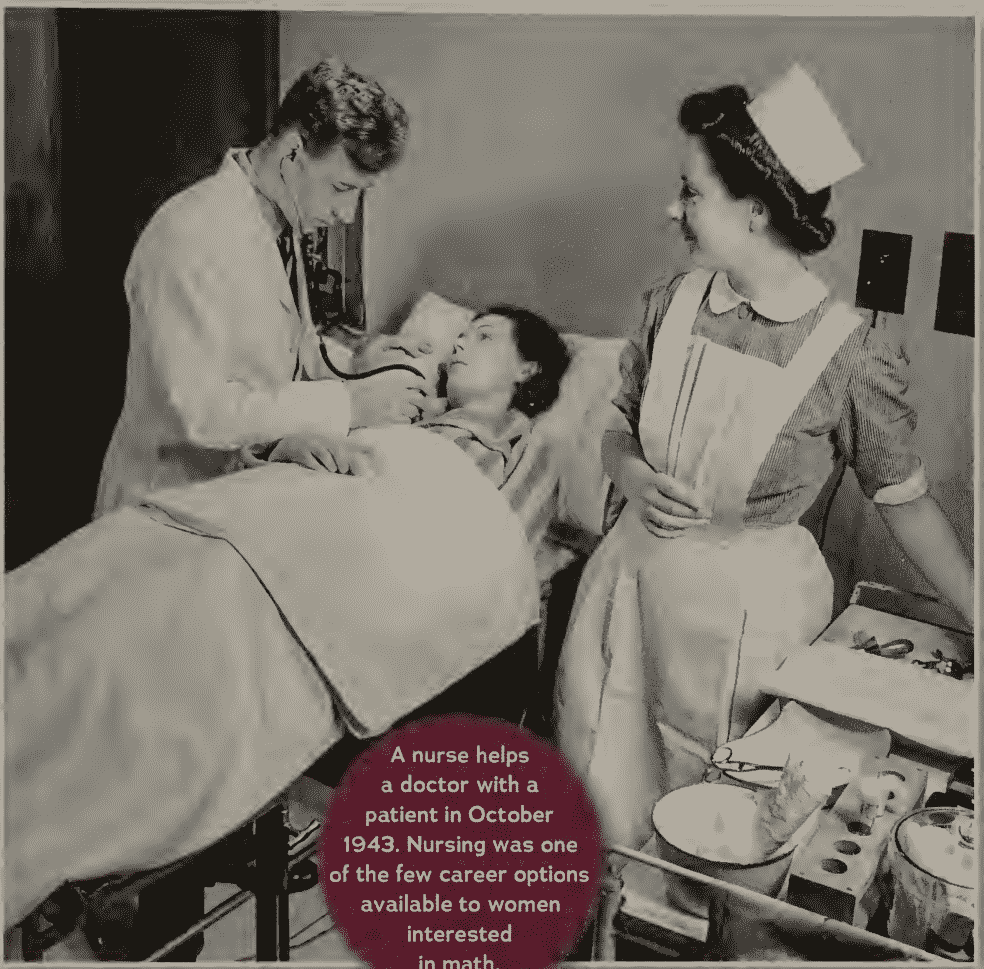

> 护士在1943年10月帮助医生照顾患者。护理工作是热爱数学的女性可选的少数职业选择之一。

贝蒂·珍于1941年高中毕业。她当时只有十六岁。她是学校里成绩第二的学生，还获得了该校历史以来最高的数学成绩。

# 第二章

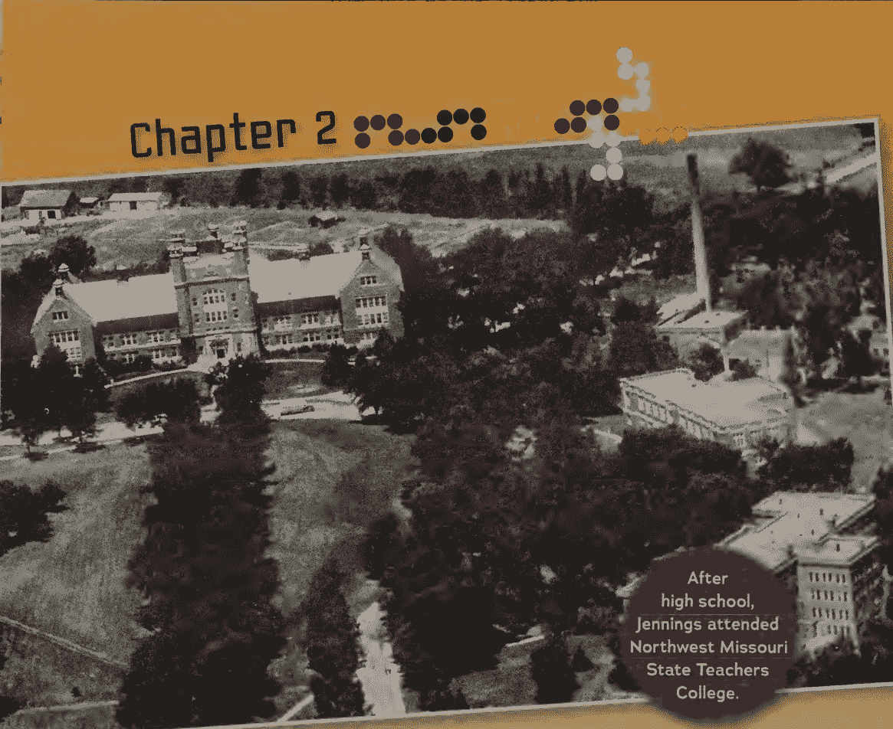

> 护士在1943年10月帮助医生照顾患者。护理工作是热爱数学的女性可选的少数职业选择之一。

## 人类计算机

贝蒂·珍于1941年高中毕业。她当时只有十六岁。她是学校里成绩第二的学生，还获得了该校历史以来最高的数学成绩。

（注：原文后续存在大量重复段落，已按要求不再重复输出核心翻译内容）

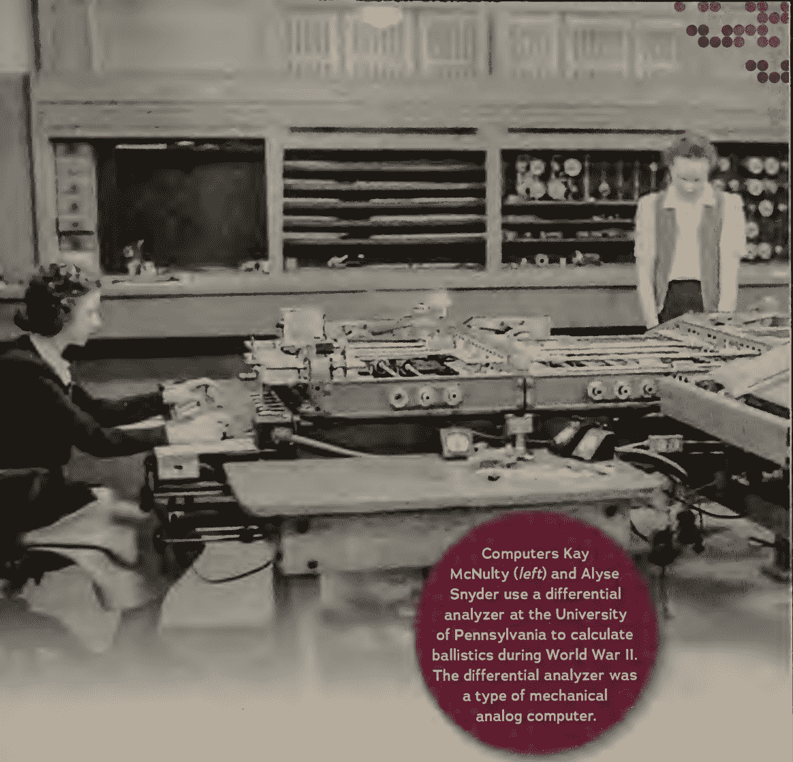

> 计算机凯·麦克尔蒂（Kay McNulty，左）和艾莉丝·斯奈德（Alyse Snyder）在宾夕法尼亚大学使用微分分析仪在第二次大战期间计算弹道。微分分析仪是一种机械模拟计算机。

尽管她的工作对战争努力意义重大，但詹宁斯（Jennings）厌倦了重复性的计算。她已经准备好迎接新的冒险。1945年，詹宁斯申请参加一项新项目的工作。

# 第三章

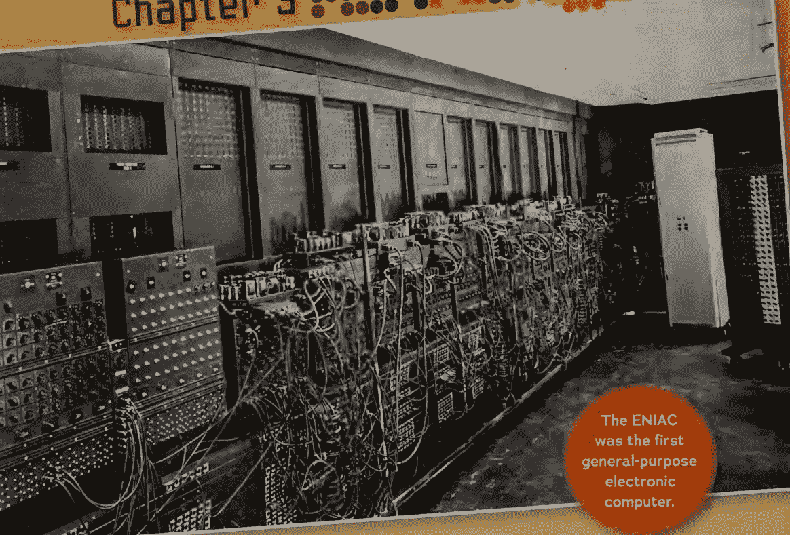

> ENIAC 是第一台通用电子计算机。

## ENIAC

1945年6月，詹宁斯是受雇的六名程序员之一，她们负责为一台名为“电子数值积分计算机”（ENIAC）的新型计算机编程。这六个人都是数学专业的。他们知道如何在计算器上运行数字，但 ENIAC 完全不同。首先，它占据了几乎整个房间。它高近9英尺（2.7米），长度达80英尺（24米），重量达30吨（27公吨）。它比人类计算机更快、更可靠。但它仍处于婴儿阶段。

ENIAC 是由宾夕法尼亚大学电气工程学院的约翰·莫奇奇利（John Mauchly）和约翰·普雷斯珀·埃克特（John Presper Eckert）开发的。它是第一台通用电子计算机。这意味着它可以用于完成许多类型的计算。军方希望使用这台机器以比人工手动更快、更可靠地计算弹道。但莫奇奇利和埃克特设计这台计算机也是为了解决许多其他问题。

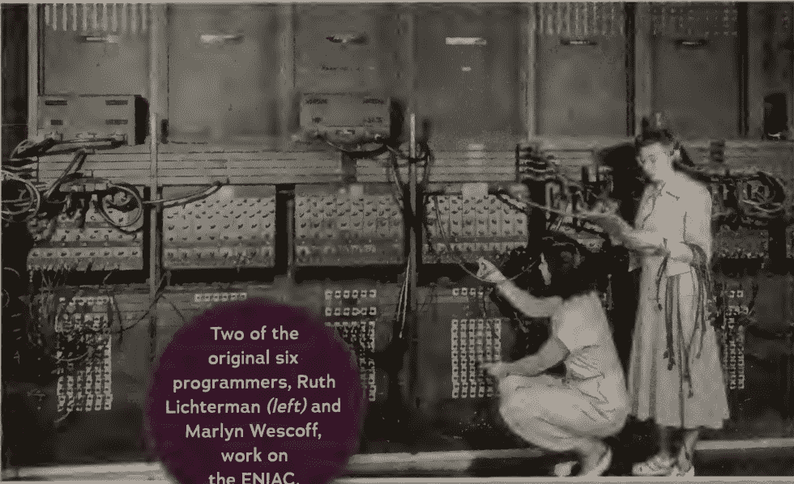

> 最初的六名程序员中的两位——露丝·利希特曼（Ruth Lichtenman，左）和玛丽莲·韦斯科夫（Marilyn Wescoff）正在操作 ENIAC。

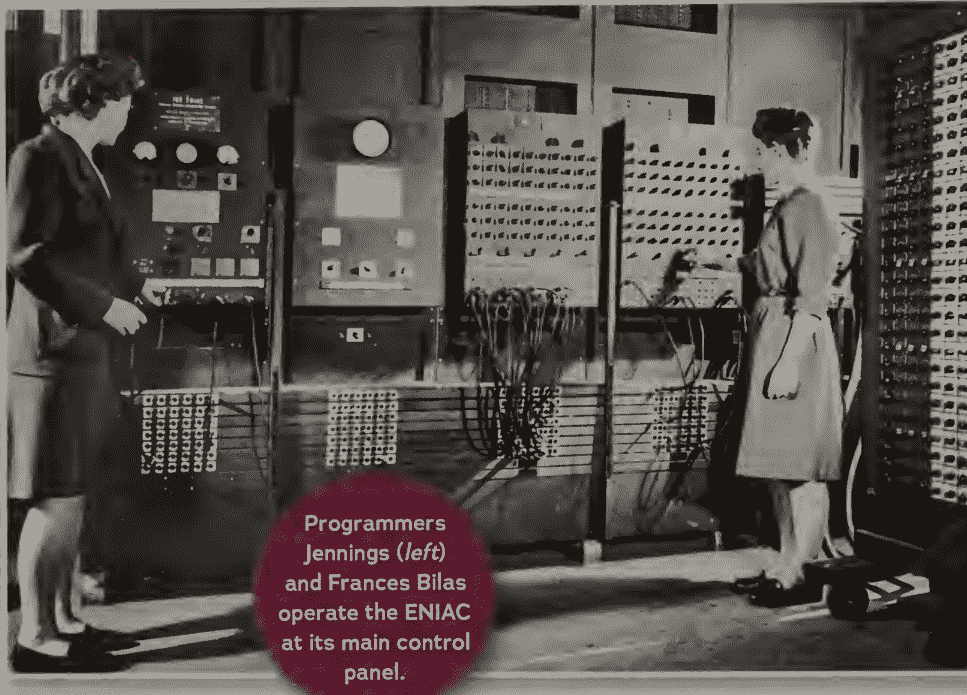

ENIAC 解问题的速度比当时的任何其他计算设备快一千倍。它有四十个执行不同功能的独立面板。它包含二十个累加器，可以进行加减法运算。每个累加器还可以在内存中存储一个十位的小数。

詹宁斯和同事们首先必须弄清楚 ENIAC 是如何工作的。但他们必须在从未见过实物的情况下学习它的工作原理。ENIAC 是极其机密的，极少数人拥有足够的权限看到计算机的运行。程序员们检查了 ENIAC 的电路图。莫奇奇利会回答他们在此过程中提出的任何问题。随后，随着1945年9月日本投降，二大战结束。10月，詹宁斯和她的程序员同事们第一次允许看到 ENIAC。詹宁斯和她的同事贝蒂·斯奈德（Betty Snyder）终于开始为 ENIAC 编程，为军方计算弹道。

1946年2月15日，莫奇奇利、埃克特和六名程序员向世界展示了 ENIAC。他们向科学界正式演示了詹宁斯和斯奈德的程序。演示取得了成功。它向世界证明了 ENIAC 是第一台成功运行程序的计算机。

> 技术杂谈
>
> “我们第一次看到 ENIAC 时感到非常兴奋，并对其规模感到惊叹。它比我们想象的要大得多、更壮丽，也更令人生畏。”
>
> —— 珍·巴蒂克（Jean Bartik）

1946年秋，ENIAC 从宾夕法尼亚大学搬到了马里兰州的阿伯丁丁试验场（Aberdeen Proving Ground）。詹宁斯等人继续改进它。在那年的12月，詹宁斯还嫁给了比尔·巴蒂克，并开始使用丈夫的姓。

1946年12月，巴蒂克被要求带领团队将 ENIAC 变成存储程序计算机。当时的计算机只能运行一个程序。为了运行新程序，必须重新布线。到1948年3月底，团队找到了将程序存储在内存中的方法。这意味着 ENIAC 编程变得更快了。ENIAC 一直运行到1955年。

> 技术杂谈
>
> “我们第一次看到 ENIAC 时感到非常兴奋，并对其规模感到惊叹。它比我们想象的要大得多、更壮丽，也更令人生畏。”
>
> —— 珍·巴蒂克（Jean Bartik）

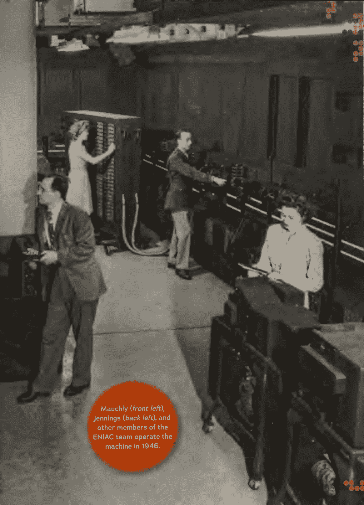

> 最初的六名程序员中的两位——露丝·利希特曼（Ruth Lichtenman，左）和玛丽莲·韦斯科夫（Marilyn Wescoff）正在操作 ENIAC。

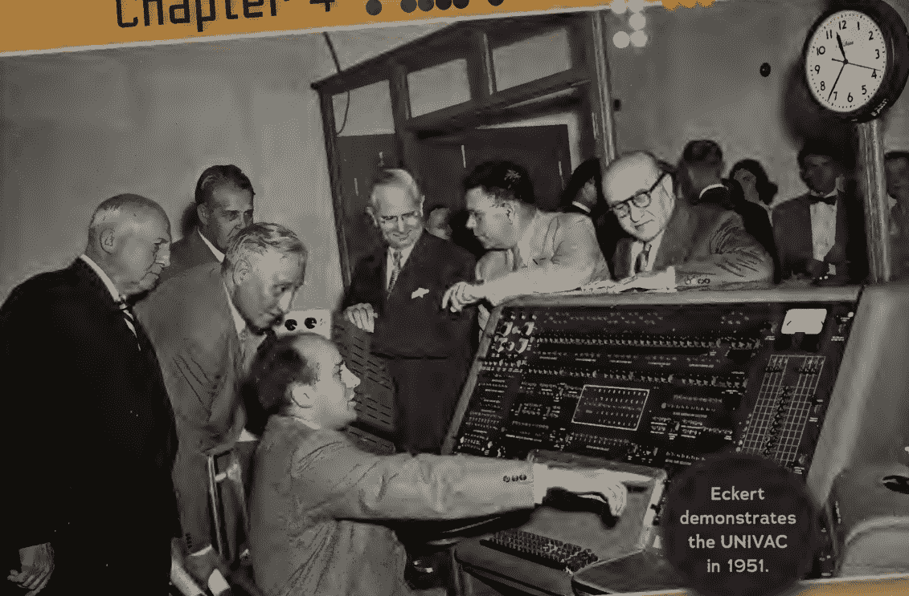

> ENIAC 是第一台通用电子计算机。

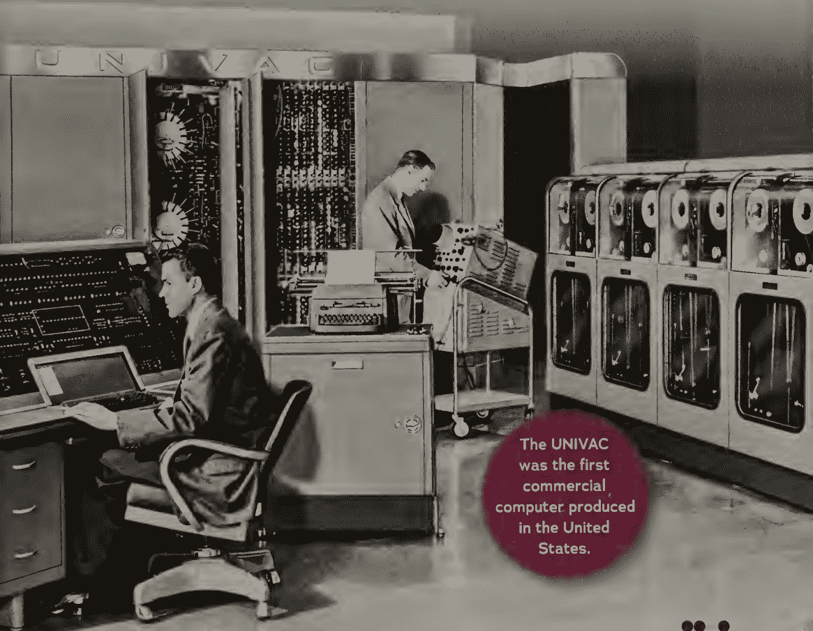

> ENIAC 是第一台通用电子计算机。

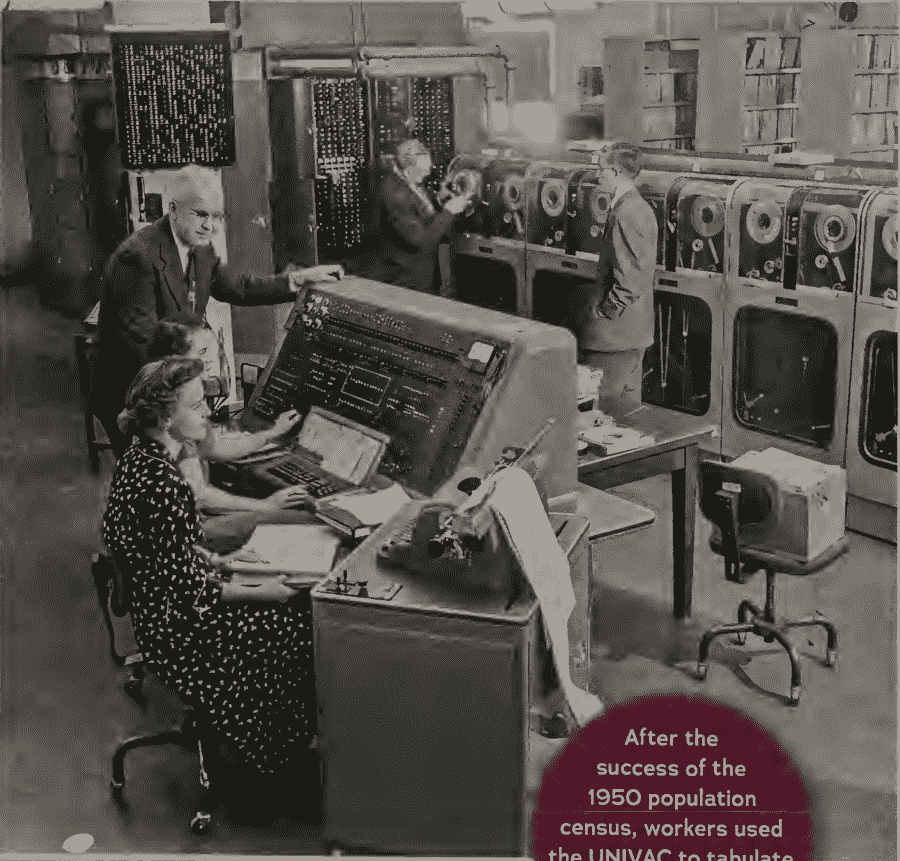

> ENIAC 是第一台通用电子计算机。

## 应得的认可

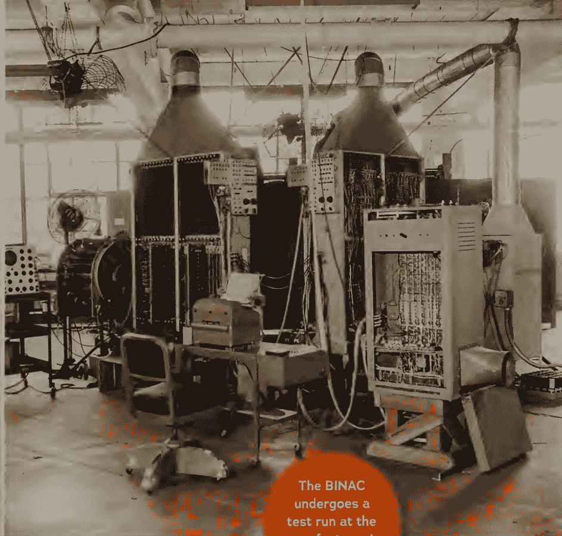

> ENIAC 是第一台通用电子计算机。

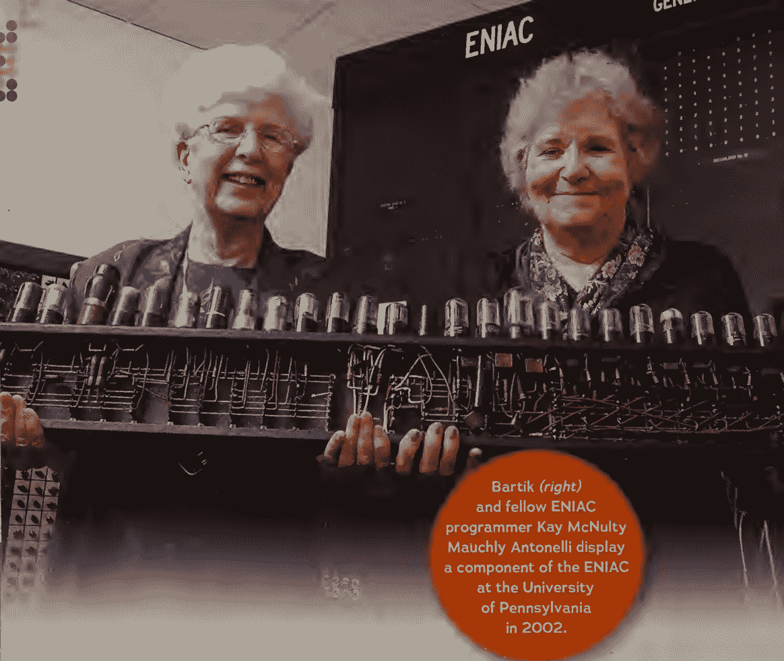

巴特克鼓励计算机领域的女性加入。她曾向大学和计算机行业的女性进行过多次演讲。

巴特克还获得了多项表彰其作为先驱程序员的荣誉。2002年，珍·詹宁斯·巴特克计算机博物馆在密苏里州西北部州立大学开放。

2008年，位于加利福尼亚州山景的计算机历史博物馆授予了巴特克“博物馆院士奖”。同年，巴特克获得了美国电气电子工程师协会颁发的“计算机先驱奖”。该奖表彰她作为首批计算机程序员之一所付出的开拓性努力。

计算机历史博物馆——该博物馆在2008年将巴特克（中间）选入其荣誉院士堂。

> 计算机历史博物馆致力于保护与计算机历史相关的文物。该博物馆在2008年将巴特克（中间）选入其荣誉院士堂。

## 技术演讲

> “我认为你应该做好准备，并努力工作——每一个成功的人都必须努力——并在机会敲门时打开大门。机会会以许多不同的形式出现。但我确实相信你应该热爱你所做的事。”
>
> —珍·巴特克，为进入计算机科学领域的年轻女性提供建议

2011年，巴特克因充血性心力衰竭去世。她留重要的遗产。在一个女性——不被鼓励追求数学和技术职业的时代，巴特克抓住了每一个机会发挥她的才华。在她的职业生涯中，许多人忽视了巴特克贡献的重要性。但作为世界上首批计算机程序员之一，巴特克帮助塑造了未来几十年里的这一领域。

## 时间线

### 1924

贝蒂·珍·詹宁斯于12月27日出生于密苏里州金特里县。

### 1941

美国参加第二次世界大战。

### 1945

詹宁斯从大学毕业。6月，詹宁斯被聘用参与 ENIAC（计算机）的工作。

### 1946

詹宁斯于12月14日与比尔·巴特克结婚。

### 1948

巴特克被埃克特-莫奇利公司聘为程序员，她在那里参与了 UNIVAC I 和 BINAC 的工作。

### 1967

巴特克获得宾夕法尼亚大学的英语硕士学位。Auerbach 出版社聘请她编写关于计算机的文章。

### 1997

巴特克入选国际科技女性荣誉堂。

### 2002

珍·詹宁斯·巴特克计算机博物馆开放。

### 2008

巴特克获得了来自计算机历史博物馆和美国电气电子工程师协会的奖项。

### 2011

巴特克于3月23日去世。

# 来源注释

- 6 Jean Jennings Bartik, Pioneer Programmer: Jean Jennings Bartik and the Computer That Changed the World (Kirsville, MO: Truman State University Press, 2013), 39.

- 12 Top Secret Rosies: The Female Computers of WWII, aired 2010 (Arlington, VA: PBS, 2010).

- 17 Bartik, Pioneer Programmer: Jean Jennings Bartik and the Computer That Changed the World, 84.

- 18 Bartik, Pioneer Programmer: Jean Jennings Bartik and the Computer That Changed the World, 22.

- 28 Janet Abbate, “Oral History: Jean Bartik,” Engineering and Technology History, August 3, 2001, http://ethw.org/Oral-History:Jean_Bartik.

# 词汇表

**累加器 (accumulator)**

计算机中存储数字的部分

**内存 (memory)**

计算机中存储信息的设备

**军火 (arsenal)**

武器的集合

**程序员 (programmer)**

编写程序的人，程序是计算机遵循的一系列指令集

**弹道学 (ballistics)**

关于子弹、导弹或炸弹运动的科学

**计算机 (computer)**

一种可以存储、编程和检索数据及信息的电子机器

# 更多信息

## 书籍

Pelleschi, Andrea. Mathematician and Computer Scientist Grace Hopper. Minneapolis: Lerner Publications, 2017. 了解格蕾丝·霍珀的生活和工作，她是另一位在20世纪40年代开始其职业生涯的先驱计算机科学家。

Sande, Warren. Hello World! Computer Programming for Kids and Other Beginners, Second Edition. Shelter Island, NY: Manning Publications, 2013. 探索计算机编程的世界。

Todd, Kim D. Jean Jennings Bartik: Computer Pioneer. Kirkville, MO: Truman State University Press, 2015. 了解更多关于珍·巴特克的卓越职业的信息。

## 网站

珍·詹宁斯·巴特克计算机博物馆

http://www.nmissouri.edu/archives/computing/tour.html

探索相库并了解更多关于巴特克作为程序员的工作。

## Scratch

https://scratch.mit.edu

学习基础计算机编程技能，并创建你自己的互动故事、游戏和动画。

# 计算机历史时间线

http://www.computerhistory.org/timeline/computers

了解计算机的所有历史。

# 索引

Aberdeen Proving Ground, 18

Auerbach Corporation, 26

弹道学, 12, 15, 17

弹道实验室, 12

二进制自动计算机 (BINAC), 23

计算机历史博物馆, 27

计算机（人类）, 12–13, 15

充血性心力衰竭, 28

数据决策, 26

埃克特, 20

埃克特-莫奇利公司, 20

电子积分器 (ENIAC), 14

美国电气电子工程师协会, 27

珍·詹宁斯·巴特克计算机博物馆, 27

数学, 6

莫奇利, 15

山景, 加利福尼亚州

海军, 9

诺斯罗航空, 23

密苏里州西北部州立大学, 27

珍珠, 9

雷明顿, 22

绝密玫瑰, 10, 17

通用自动计算机 (UNIVAC), 20

宾夕法尼亚大学, 15

美国人口局, 22

第二次世界大战, 5

# 关于作者

Jennifer Reed 是一位获奖的儿童书作家。她拥有来自佛蒙特艺术学院的艺术硕士学位（MFA）。

# STEM

你喜欢用数学解决问题吗？先驱程序员珍·巴特克也是如此。在第二次世界大战期间，女性承担了更多的技术工作。巴特克将她的热情转化为成功的事业。战后，一种新机器取代了这些计算。它是第一台全电子计算机，巴特克参与了它的制造和编程。但巴特克对数学的热爱是如何让她进入前沿技术的？了解她如何从一个天才学生变成计算机先驱。

# 传记

航空航工程师 April Ericsson

虚拟现实设计师 Jane McGonigal

动物科学家和活动家 Jane Goodall

宇航员 Mae Jemison

天体物理学家和太空倡者 Neil de Tyson
