# C 语言计算机系统与编程

## 前言

技术进步已在各个领域展现出显著的增长。这激发了人们借助编程方法论来学习计算机概念的需求。个人计算机曾被预言只为少数人拥有，如今却无处不在。计算机技术的实际进步围绕着计算机处理特定任务能力的提升。这是通过计算机处理能力的增强来实现的。计算机编程的概念有助于理解问题并找到合适的解决方案。

为了向学生介绍计算机编程概念，我们以 C 语言为媒介做出了努力。本书着重于计算机编程的基础、基本原则和概念。从计算机基础和操作系统等非常基础的概念开始，学生将接触到关于 C 语言各种编程结构和特性的详细讨论。

各种概念被安排在不同章节中，对主题进行详细描述。本书共 17 章，每章阐述一个基本和基础的概念。无需具备任何计算机和编程语言的先验知识。

*第 1 章* 描述了计算机的各种内部功能组件，如存储器、CPU 和其他外围设备，以及计算机的演化与代际。

*第 2 章* 定义了操作系统一词及其功能，并描述了它的各种类别。同时简要概述了 DOS、Windows 和 UNIX 操作系统及其命令。

*第 3 章* 简要概述了编程方法论的基础知识，如算法、流程图、它们的复杂性以及各种编程结构，还包括 COBOL、Pascal、Java 等编程语言。

*第 4 章* 揭示了各种数制转换背后的逻辑，重点强调二进制计数系统，进而描述数字在计算机内存中的表示。

*第 5 章* 简要介绍了 C 编程语言，详细阐述了其历史、特性、各种结构、程序结构及其用途。

*第 6 章* 详细阐述了 C 语言中使用的变量、关键字和基本数据类型的概念。数据类型定义了 C 变量的初始内存需求。本章还解释了 C 语言中决定变量在内存中存在性的存储类。

*第 7 章* 解释了在 C 语言中使用运算符构造表达式的语法。本章讨论了执行各种算术和逻辑运算所需的不同类型运算符。

*第 8 章* 定义了用于各种输入/输出操作的函数。本章重点介绍了这些操作中涉及的一些预定义函数。

*第 9 章* 描述了在 C 语言中使用迭代/循环和决策控制语句的方式。它解释了任何过程式语言所需的基本控制语句。

*第 10 章* 定义了模块化编程这一术语，并解释了实现模块化编程的方法。函数的概念是这一编程方式的核心。

*第 11 章* 概述了数组及其分类。数组是以非动态方式分配内存的实体。

*第 12 章* 探讨了 C 语言中字符串处理的概念。本章重点介绍了字符串的声明以及可以使用一些预定义字符串函数进行的各种操作。

*第 13 章* 描述了声明用户自定义数据类型（如结构体和联合体）的逻辑。本章还借助各种示例详细说明了它们的声明方式以及在编程中的使用。

*第 14 章* 聚焦于指针的概念以及如何高效地使用指针。本章讨论了指针的各种特性。

*第 15 章* 涉及动态内存分配。本章讨论了用于动态内存分配的各种数据结构和算法。

*第 16 章* 讨论了编程中涉及的一些基本特性。预处理指令负责使代码易于管理和维护，从而可以轻松地进行修改。

*第 17 章* 详细阐述了使用 C 编程进行文件处理的概念。

**Manish Varshney**  
**Neha Singh**

## 致谢

我们衷心感谢 Shri Siddhi Vinayak 学院集团董事长 Shri Anupam Kapoor 和 SRMS 学院集团董事长 Shri Dev Murti，感谢他们给予我们撰写本书的机会。作者也感谢 Shri Siddhi Vinayak 学院集团秘书 Shri Saurabh Mehrotra 和 SRMS 学院集团秘书 Shri Aditya Murti 给予的激励。

作者同样感谢 SSVIT 校长 Dr Anil Kumar 和学术院长 Shri Sudhakar Jain 为本书质量提升提出的宝贵建议。我们也感谢 SSVIT 全体教职员工始终如一的支持与合作。在本书编写期间，我们非常感谢家人们的耐心、支持、鼓励和启发。

最后，感谢新德里 CBSP&D 的 YN Arjuna 先生，他不仅配合和支持这项事业，还表现出了高度的责任感。

Manish Varshney  
Neha Singh


此页有意留空

此页有意留空

## 教学大纲

NCS-101/NCS-201 计算机系统与 C 语言编程——LTP 310

### 单元 1（10 讲）

- *计算机基础：* 数字计算机简介、计算机的基本操作、计算机的功能组件、计算机的分类。
- *操作系统简介：* [DOS、Windows、Linux 和 Android] 的用途、功能、服务与类型。
- *数制：* 二进制、八进制和十六进制数制，它们之间的相互转换，二进制算术。
- *编程基础：* 解决问题的方法、算法与流程图的概念。
- *计算机语言的类型：* 机器语言、汇编语言和高级语言，汇编器、编译器、加载器和链接器的概念。

### 单元 2（8 讲）

- *C 语言中的标准 I/O：* 基本数据类型——字符型、整型、短整型、长整型、无符号型、单精度和双精度浮点型，存储类别——自动、寄存器、静态和外部，使用数值和关系运算符的运算符与表达式，混合操作数，类型转换，逻辑运算符，位运算，赋值运算符，运算符优先级与结合性。
- *C 语言编程基础：* C 程序的结构，编写并执行第一个 C 程序，C 语言的组成要素。C 语言中的标准 I/O。

### 单元 3（10 讲）

- *条件程序执行：* 应用 if 和 switch 语句，if 与 else 的嵌套，switch 中 break 和 default 的使用，程序循环与迭代：while、do while 和 for 循环的使用，多重循环变量，break 和 continue 语句的使用。函数：简介、函数类型、带数组的函数、向函数传递值、递归函数。

### 单元 4（6 讲）

- *数组：* 数组表示法与表示形式，操作数组元素，使用多维数组。结构体、联合体、枚举数据类型。

### 单元 5（8 讲）

- *指针：* 简介、声明、应用。
- 文件处理、标准 C 预处理器、定义和调用宏、条件编译、向编译器传递值。

此页有意留空

## 1 计算机基础

随着计算机硬件领域日新月异的发展，学习基础知识并及时了解最新信息显得尤为重要。本章将帮助学生理解计算机系统及其组件的基本概念。如今，计算机已被广泛应用于科学技术各个领域的各类应用中。“计算机”一词指的是由许多组件组成的系统。一个计算机系统同时包含*硬件*和*软件*组件。

### 计算机的定义

从技术上讲，计算机是一种可编程机器。这意味着它可以执行一串已编程的指令，并响应赋予它的新指令。然而，如今这个术语最常用来指大多数人使用的台式机和笔记本电脑。当提及台式机型号时，术语“计算机”从技术上讲仅指计算机本身，而不包括显示器、键盘和鼠标。尽管如此，将所有这些一起称为计算机也是可以接受的。如果你非要较真的话，容纳计算机的那个箱子被称为“系统单元”。

个人计算机（或 PC）的一些主要部件包括主板、CPU、内存（或 RAM）、硬盘和显卡。虽然个人计算机是当今最常见的计算机类型，但也有其他几种类型的计算机。例如，“小型机”是一种功能强大的计算机，可以同时支持许多用户。“大型机”是一种大型高功率计算机，可以同时执行来自多个来源的数十亿次计算。最后，“超级计算机”是一种每秒能处理数十亿条指令的机器，用于进行极其复杂的计算。

计算机系统可以图形化地表示，如图 1.1 所示。

### 计算机系统概述

计算机的所有物理部件（或我们能触摸到的一切）被称为硬件。计算机系统的所有组件可以用以下简单的等式概括：

计算机系统 = 硬件 + 软件

软件赋予计算机“智能”。

硬件 = 内部设备 + 外围设备

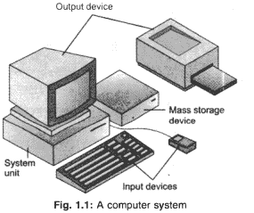

基本上，所有计算机，无论大小，都具有相同的一般设计，包括以下单元：中央处理单元（CPU）、内存以及输入/输出电路，它们位于**印刷电路板**上，也称为**系统板或主板**。

图 1.2 描述了计算机系统各组件之间的关系。计算机系统可以用图示方式表示，如图 1.3 所示。计算机系统的框图表示如图 1.4 所示。

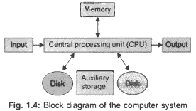

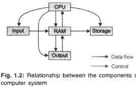

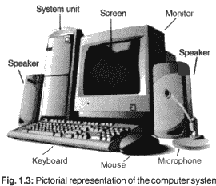

### 数据

在计算机术语中，数据指的是原始事实和数字。在计算领域，数据是已经被转换成更方便移动或处理的形式的信息。相对于当今的计算机和传输介质而言，数据是转换为二进制数字形式的信息。

例如，Manish、1978、‘B’、−163.89、+75.2 都是数据，因为这里没有给出格式。

### 信息

处理数据之后，我们获得有意义的信息，因此信息是数据经过处理、操纵和组织后产生的结果，这种处理方式增加了接收者的知识。换句话说，信息是数据被解释时所处的上下文。

### 计算机系统的基本应用

在 20 世纪 50 年代，计算机是巨大的、专用型的机器，被政府和大学等大型机构使用，用于执行复杂的数值任务，例如计算火星的精确轨道或规划导弹的弹道等。在 20 世纪 60 年代，商界开始将计算机用于商业目的。在 20 世纪 70 年代，个人计算机的发明彻底改变了世界，如今计算机几乎被应用于生活的各个领域。

### 与计算机相关的重要术语

计算机本质上被用作数据处理机。数据和信息这两个术语非常常用。你必须清楚理解两者之间的区别。

以下是计算机应用的基本领域：

- 商业与企业计算
- 天气预报
- 医药与医疗保健


-   通信
-   教育与参考
-   娱乐
-   计算机辅助制造
-   计算机辅助设计
-   会计

如今，计算机能够通过互联网交换信息。你可以从自己的计算机向邻居或地球另一端的朋友的计算机发送消息。学生可以使用计算机与同学交流，完成家庭作业、小组项目或其他与学校相关的活动。他们还可以使用计算机向老师提交作业和演示文稿。

### 商业与企业计算中的计算机

企业计算借助计算机彻底改变了商业环境，计算机能够执行许多耗时且复杂的任务，例如会计、库存控制、客户数据库、运输控制和财务分析。如今的桌面计算机功能多样且相对便宜。将所有公司桌面计算机联网，可以访问和存储公司的全部资源和信息，从而减少文书工作，提高信息流通效率。

### 天气预报

在预测未来天气之前，必须了解当前的情况。因此，需要进行定期、可靠且准确的测量。这些数据必须通过专用于天气信息的电信系统迅速发送到世界各地。观测数据被输入计算机，用于分析特定时间的天气模式。分析完成后，计算机将生成未来指定时间的天气预报。预报员利用计算机的输出，为各种客户量身定制天气预报。

### 教育与参考

计算机在课堂中被有效地用作互动学习资源。在图书馆中，人们可以直接通过计算机终端阅读杂志和期刊，无需在书架上寻找纸质原件。如今，通过网络可以实现在线学习和培训。坐在家里的学生可以与老师交谈，并获得问题的解答。虚拟教室如今已成为现实。

### 医学与医疗保健

计算机在医学中的作用、计算机在医疗保健中的使用以及计算机在医学领域的重要性。如今，计算机正被用于诊断疾病。

### 通信

计算机可以有效地用于与世界不同地区进行通信。

### 娱乐

在当今的电子时代，计算机几乎涉及一切领域。娱乐也不例外；事实上，随着数字信息的到来，娱乐实现了其最大的飞跃之一。电影、游戏、音乐，甚至书籍都深受计算机的影响。随着DVD（数字视频光盘）的出现，计算机已进入视频产业的很大一部分。但同时，这也带来了从光盘中提取电影并通过用户共享程序分发的可能。许多公司试图通过在光盘中添加程序等方式来解决这个问题，以防止信息被盗。

### 计算机辅助制造

计算机辅助制造（CAM）是使用基于计算机的软件工具，帮助工程师和机械师制造产品或制作产品原型。CAM是一种编程工具，允许你使用计算机辅助设计（CAD）制作3D模型。CAM于1971年首次用于汽车车身设计和工装。

### 计算机辅助设计

计算机辅助设计（CAD）是使用计算机技术来辅助产品设计。当前的软件包从2D矢量绘图系统到3D实体和曲面建模器，种类繁多。

### 会计

计算机在记录财务信息方面发挥着重要作用。现在有许多会计软件包可用，因此企业能够使用计算机化会计系统。计算机化会计系统提供与手工会计系统相同的功能。因此，大多数企业使用计算机系统而不是手工系统来记录财务信息，因为计算机系统更快，文件更容易共享，更改也更方便。

### 计算机的主要特性

现在让我们来识别计算机的主要特性。这些特性可以从速度、准确性、勤奋、通用性和存储能力等方面进行讨论。

#### 速度

如你所知，计算机工作速度非常快。我们花几个小时才能完成的计算，它只需几秒钟。假设要求你计算一千人的月平均收入。为此，你必须逐日累加所有人的所有收入来源，并算出每个人的月平均值。你需要多长时间？一天、两天还是一周？但是你的小型计算机只需几秒钟就能完成这项工作。你每天在电视上看到的天气预报，就是对各地温度、湿度、气压等大量数据进行汇总和分析的结果。计算机处理这些海量数据并给出结果只需几分钟。

你会惊讶地发现，计算机每秒可以执行数百万（1,000,000）条甚至更多的指令。

因此，我们用微秒（10⁻⁶秒）或纳秒（10⁻⁹秒）来衡量计算机的速度。由此可见计算机工作得多快。

#### 准确性

假设有人计算速度很快，但在计算中犯了很多错误。这样的结果是没用的。还有另一方面。假设你要把15除以7。你可能算到小数点后两位，说商是2.14。另一个人可能算到小数点后四位，说结果是2.1428。还有人可能算到小数点后九位，说结果是2.142857143。因此，除速度外，计算机还应具有计算的准确性或正确性。

计算机的准确度非常高，每次计算都以相同的精度执行。精度水平是根据计算机的设计来确定的。计算机出错仅仅是由于人为错误和不准确的数据。

#### 勤奋

计算机不会感到疲倦、注意力不集中、疲劳等。它可以连续工作数小时而不出错。如果要进行数百万次计算，计算机将以相同的精度执行每次计算。由于这种能力，它在日常工作中超过了人类。

#### 通用性

它意味着执行完全不同类型工作的能力。你可以用计算机准备工资单。下一刻，它可能被用于库存管理或生成电费账单。

#### 记忆能力

计算机有权存储任何数量的信息或数据。任何信息都可以保存并在你需要时随时调出，无论多少年。完全取决于你想在计算机中存储多少数据，以及何时丢失或检索这些数据。

#### 没有IQ

计算机是一个愚蠢的机器，没有用户的指令它什么也做不了。它以极快的速度和准确性执行指令。做什么以及按什么顺序做完全由你决定。因此，计算机不能像你那样自己做决定。

#### 感觉

计算机没有感觉或情感、品味、知识和经验。因此，即使长时间工作它也不会累。它不区分用户。

#### 存储

计算机有内置存储器，可以存储大量数据。你也可以将数据存储在辅助存储设备中，如磁盘，它们可以放在计算机外部，也可以带到其他计算机上使用。

### 计算机系统的功能组件

从微波炉中的控制器到大型超级计算机，计算机系统都包含提供五种功能的组件。一台典型的个人计算机有用于存储的硬盘和CD-ROM光盘、系统单元内部的存储器和CPU芯片、用于输入的键盘和鼠标，以及用于输出的显示器、打印机和扬声器。图1.5中的箭头表示功能单元之间的信息流向。

用图形表示如下：

计算机系统的组件可以分为三个不同的单元：

- 输入单元
- 处理单元
- 输出单元

计算机系统的输入单元负责输入阶段，CPU负责处理阶段，输出单元负责输出阶段。

现在让我们逐一讨论每个单元的功能。

#### 输入单元

输入单元处理如何从用户那里获取输入。任何向计算机输入数据的机器，例如键盘，都是输入设备，而显示器是输出设备。键盘以外的输入设备有时被称为*替代输入设备*。鼠标、轨迹球和光笔都是替代输入设备。输入设备是将你连接到计算机的设备。输入设备让你将数据和其他信息输入计算机，也让你向计算机发出特殊指令，以便它知道该做什么。例如，你可以用键盘输入数据，也可以使用扫描仪以图片形式输入数据。

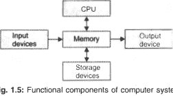

**键盘**

键盘是计算机最重要的输入设备之一。它是你与计算机沟通的主要方式。键盘是一种类似于打字机的按键组，通过按下按键将数据输入计算机。

大多数键盘采用ASCII（美国标准信息交换码）布局。这种布局包括数字小键盘、特殊功能键、特殊控制键以及打字键。

**打字键**

打字键就是包含字母表中26个字母的按键。这些键采用QWERTY排列。QWERTY代表标准字母键顶行前六个字母，由美国人克里斯托弗·肖尔斯于1890年首次设计。这种设计是为了让最常用的字母不彼此靠近，以防止人们打字太快，因为快速打字常常导致键盘卡键。当然，今天卡键已不再是问题。


但由于大多数人已经习惯了QWERTY键盘，因此没有必要改变它。

##### 数字小键盘

数字小键盘是位于键盘最右侧的一组17个按键。它包括0到9的所有数字、加号、减号以及一些其他按键。如果仔细观察，你会发现键盘上数字小键盘的按键排列与计算器上的按键排列非常相似！由于许多计算机用于商业目的，需要向计算机输入数字，因此设计了数字小键盘。这使得输入数字更加轻松快捷。

##### 功能键

功能键位于键盘最顶部的一排。它们被标记为“F1”、“F2”、“F3”，一直到“F12”。这些功能键主要用于简化应用程序的使用。它们根据打开的具体应用程序执行特殊命令。例如，在Word文档中按F7会打开拼写检查。在几乎所有的应用程序中，按F1会打开帮助菜单。此外，功能键还可以与其他键组合使用，例如与控制键组合来执行不同的任务！

##### 控制键

控制键是一些特殊按键，如del（删除）、ctrl（控制）、alt（替换）、shift（换档）和enter（回车）。删除键（或退格键）用于擦除Word文档中的字符。esc（退出）键通常用于退出程序或应用程序，而按下回车键则会执行某个功能或命令。tab键主要用于在Word文档中缩进。shift键通常与其他键配合使用。例如，按下shift键然后按一个字母，该字母将变为大写；而按下shift键再按一个数字，则会显示该数字上方所示的字符。最后，还有ctrl和alt键。与shift键类似，它们也与其他键配合使用，并且通常执行与功能键类似的功能。还有光标移动键。这些是箭头键，形状像倒置的T，位于打字键区和数字小键盘之间。这些键用于在屏幕上移动光标。例如，如果你在Word文档中，按上、下光标移动键，闪烁的光标会在不同行之间上下移动。

##### 键盘的工作原理

以下步骤说明了当我们按下键盘上的任意键时，键盘是如何工作的。

- 1. 你按下键盘上的“a”键。
- 2. 键盘向中央处理器（CPU）发送一个电信号，告知它有一个键被按下。
- 3. CPU几乎总是处于忙碌状态。因此，字母“a”会被临时存储在一个特殊的内存单元中，直到CPU准备处理它为止。
- 4. 键盘控制器告知中央处理器有信息正在等待处理。

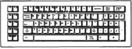

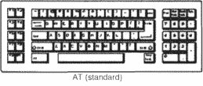

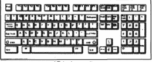

- 5. CPU会判断你按下该键时处于哪个应用程序中。例如，你可能同时打开了网络浏览器和Word文档。处理器会确定你是在Word文档中按下了“a”，还是在网络浏览器中按下。
- 6. 假设你在Word文档中按下了该键，这个字母将被添加到计算机的随机存取存储器中（占用一个字节的空间）。
- 7. 然后，字母“a”将显示在计算机屏幕上。

##### 鼠标

控制显示屏上光标或指针移动的设备称为鼠标。鼠标是一个小物体，你可以让它在一个坚硬、平坦的表面上滚动。它的名称来源于其形状——看起来有点像一只老鼠，其连接线可以想象成老鼠的尾巴，而且你必须让它在表面上快速移动。当你移动鼠标时，显示屏上的指针会向相同方向移动。鼠标至少包含一个按钮，有时多达三个，根据运行的程序不同，这些按钮具有不同的功能。一些较新的鼠标还包含一个滚轮，用于滚动长文档。

鼠标由斯坦福研究中心的道格拉斯·恩格尔巴特于1963年发明，并在20世纪70年代由施乐公司率先推广。鼠标是计算机人机工程学的一大突破，因为它在很大程度上让用户摆脱了对键盘的依赖。特别是，鼠标对于图形用户界面非常重要，因为你可以直接指向选项和对象，然后点击鼠标按钮。这类应用程序通常被称为“指向并点击”程序。鼠标对于图形程序也很有用，这类程序允许你像使用钢笔、铅笔或画笔一样使用鼠标来绘制图画。

##### 鼠标的工作原理

鼠标的工作原理如下：

- 1. 鼠标底部有一个滚球，当你移动鼠标时，它就会滚动。
- 2. 鼠标内部有两个滚轮。在大多数鼠标中，这些滚轮看起来像黑色横条。如果你打开鼠标底部的圆盘并取出滚球，就能看到这些滚轮。其中一个滚轮检测鼠标的水平移动，另一个检测鼠标的垂直移动。两个滚轮协同工作，就能确定鼠标移动的方向！
- 3. 当滚球滚动时，会带动滚轮滚动。当滚轮滚动时，它们会使一个特殊的圆盘旋转。该圆盘是圆形的，其外缘分布着矩形孔。
- 4. 在圆盘的一侧有一个红外LED灯，而在圆盘的另一侧、与LED灯相对的位置，有一个红外传感器。当圆盘旋转时，LED灯的光线会周期性地穿过矩形孔。
- 5. 传感器能够感知这些光脉冲。
- 6. 鼠标内置的处理器将这些脉冲转换为计算机能够理解的二进制数字，并通过鼠标线传输到中央处理器。

鼠标的工作原理如图1.6所示。

鼠标有三种基本类型：

- 1. **机械式：** 其底部有一个橡胶或金属滚球，可以向各个方向滚动。鼠标内部的机械传感器检测滚球的滚动方向，并相应地移动屏幕指针。
- 2. **光机式：** 与机械鼠标相同，但使用光学传感器来检测滚球的运动。
- 3. **光电式：** 使用激光来检测鼠标的移动。你必须将鼠标放在带有网格的特殊鼠标垫上移动，以便光学机制有一个参照系。光电鼠标没有机械运动部件。它们比机械式和光机式鼠标响应更快、更精确，但也更昂贵。

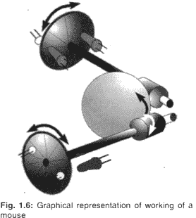

鼠标通过以下几种方式之一连接到个人电脑：

- 1. 串行鼠标直接连接到RS-232C串行端口或PS/2端口。这是最简单的连接类型。
- 2. PS/2鼠标连接到PS/2端口。
- 3. USB鼠标。

无线鼠标完全没有任何物理连接。它们依靠红外线或无线电波与计算机通信。无线鼠标比串口鼠标和总线鼠标都贵，但它们确实消除了有时会碍事的连接线。

鼠标的图片如图1.7所示。

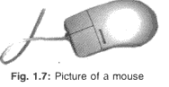

##### 扫描仪

扫描仪已经逐渐进入普通人的日常生活。它们是将图形图像输入计算机以进行修饰或通过万维网进行分发的一种方式。

## 扫描仪的类型

扫描仪有四种类型：

### 平板扫描仪

这种扫描仪提供一个平坦的玻璃表面，用于放置纸张、书籍和其他需要扫描的物体。扫描头在玻璃下方移动，扫过页面。通常可以选择配备自动进纸器，以便自动送入多张纸。这是最常用、用途最广的扫描仪。平板扫描仪的图片如图1.8所示。

### 馈纸式扫描仪

这种扫描仪只允许扫描纸张，而不能扫描书籍或其他厚物体。它使纸张经过固定的扫描头。馈纸式扫描仪与平板扫描仪相似。唯一的区别在于，平板扫描仪中要扫描的图像不移动，而馈纸式扫描仪中文件移动，就像纸张在打印机中移动一样。馈纸式扫描仪的图片如图1.9所示。

### 手持式扫描仪

手持式扫描仪是一种用手在被扫描图像上移动的扫描仪。手持式扫描仪体积小，比台式扫描仪便宜，但依赖使用者的操作技巧。

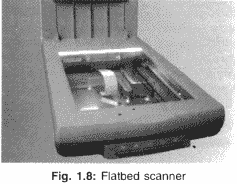


## 手持扫描仪

用户必须手持设备在纸张上移动。有些托盘可以保持扫描仪沿直线移动。这些扫描仪的工作原理类似平板扫描仪，只是由用户移动扫描头（扫描仪中负责扫描图像的部分）来代替某种电动机械。手持扫描仪生成的图像质量不是很好。手持扫描仪如图1.10所示。

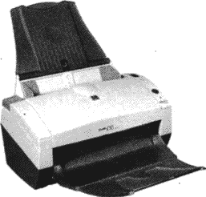

## 滚筒扫描仪

一种用于从图像获取最高分辨率的扫描仪。照片和透明片被粘贴、夹紧或安装到一个透明的圆筒（滚筒）中，在扫描过程中以超过1000 rpm的速度旋转。一个聚焦于单个像素的光源照射到滚筒上，并每次向滚筒下方移动一行。对于透明片，光从圆筒中心发出。对于不透明物品，使用反射光源。镜子滤除RGB值并将其发送到滚筒扫描仪的光电倍增管（PMT），该管比平板扫描仪和馈纸扫描仪中使用的CCD（电荷耦合器件）更灵敏，可以产生超过10,000 dpi的分辨率。如果使用一个PMT，需要对图像进行三次扫描。当使用三个PMT时，可以执行更快的单次扫描。滚筒扫描仪可用于生成非常精细的图形。滚筒扫描仪如图1.11所示。

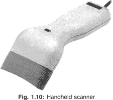

## 光学字符识别

光学字符识别（OCR）是计算机识别印刷或手写文本字符的过程。这涉及对文本字符逐字符进行照片扫描、分析扫描图像，然后将字符图像转换为字符代码（如ASCII），ASCII通常用于数据处理。在OCR处理中，对扫描图像或位图进行明暗区域分析，以识别每个字母或数字。当识别出一个字符时，它被转换成ASCII码。专为OCR设计的特殊电路板和计算机芯片用于加速识别过程。图书馆使用OCR对其馆藏进行数字化和保存。OCR还用于处理支票和信用卡签购单以及分拣邮件。每天有数十亿份杂志和信件通过OCR机器分拣，大大加快了邮件投递速度。OCR阅读器如图1.12所示。

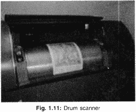

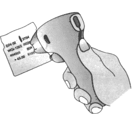

**图 1.12：** OCR阅读器

## 磁墨字符识别

磁墨字符识别（MICR）是一种使用特殊油墨和字符的字符识别系统。当含有这种油墨的文档需要被读取时，它会通过一台机器，该机器对油墨进行磁化，然后将磁性信息转换为字符。

MICR技术被银行使用。支票底部的数字和字符（通常包含支票号码、分类号码和账号）是用磁性油墨印刷的。要打印磁性油墨，你需要一台接受MICR碳粉的激光打印机。MICR提供了一种安全、高速的扫描和处理信息的方法。

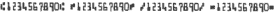

E-13B MICR字体示例。显示的是E-13B字体的14个字符。每个数字块两侧的控制字符（从左到右）是 *转接*、*本行*、*金额* 和 *破折号*。

## 光笔

光笔是一种利用光敏探测器在显示屏幕上选择对象的输入设备。光笔类似于鼠标，不同之处在于使用光笔时，您可以直接用笔指向屏幕上的对象来移动指针并选择对象。

光敏笔与视频终端相连，用于绘制图片或选择菜单选项。用户将笔带到屏幕上的所需点，然后按下笔按钮进行接触。与外观相反，笔不会向屏幕发光；相反，屏幕会射入笔内。屏幕像素不断刷新。当用户按下按钮时，笔感应到光，那一刻被照亮的像素标识出屏幕位置。

光笔如图1.13所示。

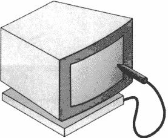

**图 1.13：** 光笔

## 条形码阅读器

条形码阅读器，也称为价格扫描器或销售点（POS）扫描器，是一种手持式或固定式输入设备，用于捕获和读取条形码中包含的信息。条形码阅读器由一个扫描器、一个解码器（内置或外置）和一根用于将阅读器与计算机连接的电缆组成。由于条形码阅读器只是捕获条形码并将其转换为数字和/或字母，因此数据必须发送到计算机，以便软件应用程序能够理解。条形码扫描器通过串行端口、键盘端口或称为 wedge 的接口设备连接到计算机。条形码阅读器的工作原理是检测穿过条形码的光束，并测量反射回来的光量。（条形码上的深色条纹反射的光比它们之间的白色空隙少。）扫描器将光能转换为电能，然后由解码器转换为数据并发送到计算机。条形码阅读器如图1.14所示。

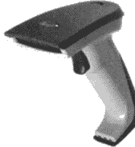

**图 1.14：** 条形码阅读器

## 操纵杆

操纵杆是一种旋转杆。类似于飞机的操纵杆，它使你能够在屏幕环境中移动，广泛用于计算机游戏行业。操纵杆如图1.15所示。

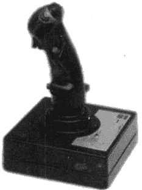

**图 1.15：** 操纵杆

## 数字化绘图板

数字化绘图板是一种指点设备，便于精确输入图形和设计。可以将图纸直接放在绘图板上，用户使用手写笔描摹轮廓或输入坐标位置。数字化绘图板如图1.16所示。

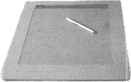

**图 1.16：** 数字化绘图板

## 触摸屏

触摸屏是一种指点设备，允许用户通过触摸屏幕与计算机交互。触摸屏有三种形式：压敏式、电容式和光束式。触摸屏如图1.17所示。

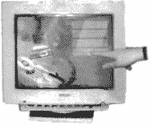

**图 1.17：** 触摸敏感监视器

## 空间鼠标

空间鼠标与普通鼠标不同，因为它有X轴、Y轴和Z轴。它可用于开发和漫游3-D环境。空间鼠标如图1.18所示。


**图 1.18：** 空间鼠标

## 光学标记阅读器

光学标记阅读器（OMR）可以读取数字或字母形式的信息并将其输入计算机。标记必须精确定位，如多项选择题试卷（图1.20）中所示。

**第七区块**

| 序号 | A | B | C | D | E | F | G |
|---:|:---:|:---:|:---:|:---:|:---:|:---:|:---:|
| 1 | ○ | ○ | ○ | ○ | ○ | ○ | ○ |
| 2 | ○ | ○ | ○ | ○ | ○ | ○ | ○ |
| 3 | ○ | ○ | ○ | ○ | ○ | ○ | ○ |
| 4 | ○ | ○ | ○ | ○ | ○ | ○ | ○ |
| 5 | ○ | ○ | ○ | ○ | ○ | ○ | ○ |
| 6 | ○ | ○ | ○ | ○ | ○ | ○ | ○ |

**图 1.20：** 示例多项选择题答卷

## 磁条阅读器

这种输入设备读取卡片上的磁条。出于安全原因很便利，它可以快速识别卡的主人。这种方法用于运行银行的自动柜员机（ATM），或为进入建筑物的人员提供快速识别。图1.21a显示了一张带有磁条的信用卡。


**图 1.21a：** 显示磁条的信用卡

## 智能卡

这种输入设备将数据存储在嵌入卡内的微处理器中（图1.21b）。

## 数码静态相机

这种输入设备将数据存储在嵌入相机的微处理器中。当存储器已满时，可以擦除并继续拍摄更多图像。然后可以将数字图像从相机下载到计算机，在计算机上显示、处理或打印。数码静态相机如图1.19所示。

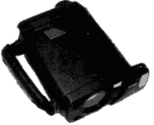

**图 1.19：** 数码静态相机


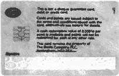

图 1.21b：一张显示方形微处理器芯片的商店卡

这使得可更新的信息得以存储在卡上。该方法用于为购买者累积积分的商店卡，以及存储手机号码。

## 语音数据输入

该系统接受语音作为输入数据或命令。人类语音非常复杂，涉及语调和面部表情，因此完整的语音识别还需要一段时间才能实现。然而，来自单个用户的简单命令可以用来控制机器。通过这种方式，瘫痪者可以操作轮椅或控制供暖和照明。图 1.22 显示了用于数据输入的麦克风。


图 1.22：用于数据输入的麦克风

## 声音采集

只要在计算机的扩展槽中添加声卡，就可以“录制”语音或音乐。声卡（图 1.23）将信息数字化为计算机可以理解的形式。

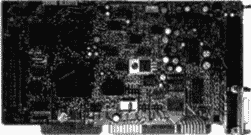

图 1.23：声卡

## 视频采集

在计算机的一个扩展槽中安装视频采集卡（图 1.24），就可以通过摄像机采集视频（照片）图像。视频采集卡将图像数字化。

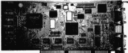

图 1.24：视频采集卡

## 处理单元

计算机系统的处理单元包含中央处理单元，它就像计算机系统的大脑。

### 中央处理单元（CPU）

CPU 是计算机的大脑。有时简称为处理器或中央处理器，CPU 是大多数计算发生的地方。就计算能力而言，CPU 是计算机系统中最重要的元素。

它执行计算机中的所有处理。它本身由三个主要子系统组成：第一个是控制单元，第二个是寄存器，第三个是算术逻辑单元（ALU）。

CPU 以取指-执行周期工作。通电时，CPU 从程序指定的位置取出第一条指令。

## 显示器的屏幕分辨率

PC 上的标准用户界面最初是纯文本模式。随着显示器分辨率的提高，应用程序现在使用单个像素以图形模式编写。最近的标准是屏幕上的 640 × 480 像素（称为 VGA），当前的标准是 800 × 600（称为 SVGA）。这使得使用日益复杂的可视界面成为可能，利用图形用户界面（GUI），如 Microsoft Windows 和 Mac OS，以及更发达的用户友好软件。图 1.29 描绘了不同的屏幕分辨率。

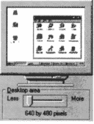

**图 1.29：**不同屏幕分辨率的示意图

## 打印机

你可以将计算机中的信息打印到纸上。通过打印，你创建了所谓的“硬拷贝”。有不同种类的打印机，速度和打印质量各异。计算机传递信息的一种最方便、最有用的方法是通过打印字符。

### 打印机的类型

两种主要类型的打印机是：

- 1. 击打式打印机
- 2. 非击打式打印机

### 击打式打印机

击打式打印机（图 1.30）使用包含多个金属针的打印头，这些针击打位于打印头和纸张之间的色带。有些打印头只有 9 根针来形成组成字符的点；有些有 24 根针，可以产生更好的分辨率。

图示如下：

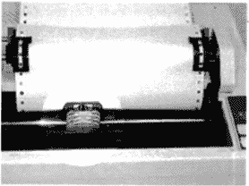

**图 1.30：**击打式打印机

在这一类别中，我们将讨论点阵打印机和菊轮打印机。

**点阵打印机：**在点阵打印机中，字符由点阵形成（图 1.31）。速度通常为每秒 30–550 个字符（cps）。它是打印机家族中最便宜、噪音最大的。获得的打印标准较差。这些打印机运行成本低且相对较快。它们适用于低质量的复写打印。

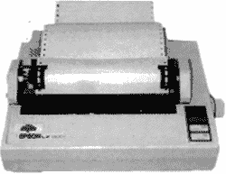

**图 1.31：**点阵打印机

**菊轮打印机：**类似打字机中的成型金属字符（图 1.32）安装在连接到旋转轮的延伸部分上，通过锤子和打印色带打印到纸上。这在文档打印过程中导致大量移动和噪音，因此打印速度慢（低于 90 cps）。打印标准类似于电动打字机产生的。由于轮上的字符是固定的，大小和字体只能通过使用不同的轮来更改。然而，这很少这样做。

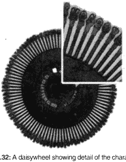

### 非击打式打印机

非击打式打印机比击打式打印机安静得多，因为它们的打印头不击打纸张。大多数非击打式打印机产生点阵图案。已经使用了多种不同的技术来提供各种打印机。非击打式打印机的主要类型如下：

- (a) 热敏打印机
- (b) 激光打印机
- (c) 喷墨打印机

**热敏打印机：**在热敏打印机中，字符由加热元件与特殊的热敏纸接触形成，当元件达到临界温度时形成变暗的点。热敏纸会因暴露在阳光和热下而随时间变暗。产生的打印质量较差。热敏打印机（图 1.33）广泛用于电池供电的设备中，例如便携式计算器。

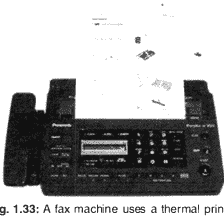

**图 1.33：**热敏打印机

**激光打印机：**激光打印机（图 1.34）使用激光束和干墨粉产生精细的点阵图案。这种打印方法每分钟可生成约 4 页 A4 纸。打印质量非常好，激光打印机也能产生非常高质量的打印图形图像。光导鼓首先被充电，然后使用高强度激光束对鼓上的选定区域放电。这些放电区域对应于打印文档的白色区域。墨粉被吸引到鼓上电荷高的部分。鼓旋转并将墨粉转印到电荷更大的纸上。最后，加热器将墨粉定影在纸上。

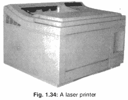

激光打印机的工作原理如图 1.35 所示。

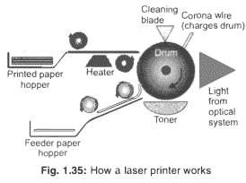

**喷墨打印机：**在喷墨打印机（图 1.36）中，字符是由带电或加热的墨水以细喷射方式喷到纸上而形成的。打印头中的各个喷嘴产生高分辨率（高达每英寸 400 点或 400 dpi）的点阵字符。喷墨打印机使用彩色墨盒，结合品红色、黄色和青色墨水来创建色调。还使用黑色墨盒以获得清晰的单色输出。这种打印方法每秒可生成多达 200 个字符，并允许高质量、廉价的彩色打印（图 1.36）。

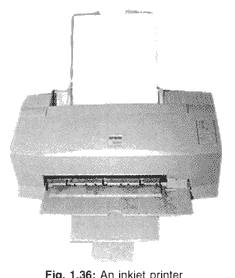

## 绘图仪

许多应用需要除打印输出之外的图形输出。绘图仪用于产生图表或图形。绘图仪是产生高质量图纸和图形的输出设备。绘图仪分类如下：

- 1. 笔式绘图仪
- 2. 静电绘图仪

### 笔式绘图仪

笔式绘图仪带有墨笔来绘制图像，笔式绘图仪分为以下两类：

- (a) 平板绘图仪
- (b) 滚筒绘图仪

**(a) 平板绘图仪：**这是一种绘图仪（图 1.37），纸张固定在平坦的表面上，笔移动以绘制图像。这种绘图仪可以使用几种不同颜色的笔进行绘制。绘图的大小仅受绘图仪平板尺寸的限制。

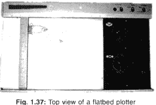

**(b) 滚筒绘图仪：**在滚筒绘图仪（图 1.38）中，笔在单轴轨道上移动，纸张本身在圆柱形滚筒上移动以增加另一轴或维度。因此，图形的大小仅受滚筒宽度的限制，并且可以是任意长度。


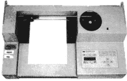

**图 1.38：** 鼓式绘图仪

- 1 拍字节（P/PB）= 2^10 太字节 = 1,125,899,906,842,624 字节
- 1 艾字节（E/EB）= 2^10 拍字节 = 1,152,921,504,606,846,976 字节

字节（byte）这个单位非常重要，因为任何一个字符都可以存储在一个字节中。也就是说，如果你想存储“SRMS”，它将占用 4 个字节，因为其中有 4 个字符需要存储。

## 内存

内存是计算机中的内部存储区域。术语“内存”指的是以芯片形式存在的数据存储，而“存储”一词则用于指存在于磁带或磁盘上的存储器。此外，术语“内存”通常用作物理存储器的简称，物理存储器指能够保存数据的实际芯片。有些计算机还使用虚拟内存，将物理内存扩展到硬盘上。每台计算机都带有一定数量的物理内存，通常称为主存储器或 RAM。你可以把主存储器想象成一排盒子，每个盒子可以保存一个字节的信息。因此，一台拥有 1 兆字节内存的计算机可以保存大约 1 百万字节（或字符）的信息。

计算机的内存通常被称为主存储器或主存。它通常被称为 CPU 的第三个组成部分。

## 静电绘图仪

静电绘图仪通过对纸张施加高电压来生成光栅图像。该电压吸引碳粉，随后通过加热将碳粉熔化到纸张上。这种绘图仪速度很快，但与笔式绘图仪相比，其质量通常被认为较差。

## 存储单位

由于计算机是一种只能理解电信号的电子设备，因此无论向它输入什么，都会首先转换为电信号。电信号只有两种状态：开（ON）或关（OFF）。这意味着计算机只能理解两个符号：开（ON，用 1 表示）和关（OFF，用 0 表示）。因此，计算机的语言仅由 1 和 0 组成，这种语言也称为二进制语言。为什么叫二进制语言？因为 bi 表示二；所以只有两个符号的语言就称为二进制语言。

两个二进制数字 0 和 1 称为比特（bit）。比特是最小的存储单位。更大的单位如下所列：

- 1 字节 = 8 比特
- 1 千字节（K/KB）= 2^10 字节 = 1,024 字节
- 1 兆字节（M/MB）= 2^10 千字节 = 1,048,576 字节
- 1 吉字节（G/GB）= 2^10 兆字节 = 1,073,741,824 字节
- 1 太字节（T/TB）= 2^10 吉字节 = 1,099,511,627,776 字节

## 存储器的类型

计算机使用两种类型的存储器：

1. 内部存储器（也称为主存储器或主存）。
2. 外部存储器（也称为辅助存储器或辅存）。

### 内部存储器

在计算机中，处理器无需通过计算机输入输出通道即可访问的所有存储空间称为内部存储器。内部存储器通常包括多种类型的存储，例如主存储器、高速缓存存储器和专用寄存器，这些都可以由处理器直接访问。

内部存储器是 CPU 存放正在运行的程序和数据的内置存储器。内部存储器有两种类型：

- (a) RAM（随机存取存储器）
- (b) ROM（只读存储器）

**（a）RAM（随机存取存储器）：** RAM 是随机存取存储器（random access memory）的缩写，是一种可以被随机访问的计算机存储器；也就是说，可以在不触碰前面字节的情况下访问任意字节。RAM 是计算机和打印机等其他设备中最常见的存储器类型。RAM 有两种基本类型：

1. 动态 RAM（DRAM）
2. 静态 RAM（SRAM）

这两种类型的区别在于它们保存数据所使用的技术不同，其中动态 RAM 更为常见。动态 RAM 需要每秒刷新数千次。静态 RAM 不需要刷新，因此速度更快；但它也比动态 RAM 更昂贵。两种 RAM 都是*易失性*的，这意味着当电源关闭时，它们会丢失其中的内容。

在通常用法中，RAM 一词与*主存储器*同义，即程序可用的存储器。例如，一台具有 8 MB RAM 的计算机拥有大约 8 百万字节可供程序使用的内存。相比之下，ROM（只读存储器）指的是用于存储启动计算机和执行诊断程序的特殊存储器。大多数个人计算机都有少量 ROM（几千字节）。事实上，这两种存储器（ROM 和 RAM）都允许随机访问。因此，准确地说，RAM 应称为*读/写 RAM*，而 ROM 应称为*只读 RAM*。RAM 的局限性在于：

- 存储容量有限
- 本质上是易失性的，即断电时其中的内容会被清除。

**（b）ROM（只读存储器）：** ROM 是只读存储器（read-only memory）的缩写，是一种已预先记录数据的计算机存储器。一旦数据被写入 ROM 芯片，就无法删除，只能读取。与主存储器（RAM）不同，ROM 即使计算机断电也会保留其内容。ROM 被称为非易失性存储器，而 RAM 是易失性的。大多数个人计算机都包含少量 ROM，用于存储关键程序，例如启动计算机的程序。此外，ROM 还广泛用于计算器和诸如激光打印机之类的外围设备中，激光打印机的字体通常存储在 ROM 中。ROM 的一种变体是 PROM（可编程只读存储器）。PROM 出厂时为空白芯片，可以使用一种称为 PROM 编程器的特殊设备将数据写入其中。

### 外部存储器

外部存储器有时也称为*后备存储器或辅助存储器*，允许永久存储大量数据。最常用的是在磁盘或磁带上进行某种磁记录的方法。最近，依靠激光束在光盘（CD-ROM）表面蚀刻标记的光学方法已变得流行，尽管它们仍然比磁介质更昂贵。外部存储器的容量很大，目前通常以数百兆字节甚至吉字节（十亿字节）来衡量。外部存储器的一个重要特性是，当计算机关机时，所存储的信息不会丢失。

最常见的外部存储设备有：硬盘、软盘、磁带、CD-ROM、视频光盘等。

现在我们将讨论一些外部存储设备。

### 软盘

软盘是一种带有磁涂层的薄盘，封装在柔性或半刚性保护套中。数据存储在磁道和扇区中。软盘的尺寸通常为 3.5 英寸。不过，也可能仍在使用较旧的软盘，这些软盘的尺寸为 5.25 英寸。双面高密度 3.5 英寸软盘可以容纳 1.44 MB 的数据。数据存储到软盘后，可以通过拨动软盘上的一个滑块来“写保护”。这会阻止任何新数据的存储或任何旧数据的删除。软盘现在几乎已经被光盘（CD）所取代。

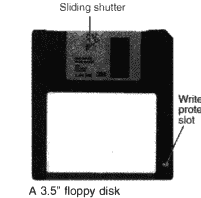

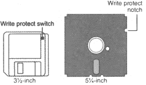

### 硬盘

硬盘是一种直接存取存储介质，具有刚性的硬磁盘。数据以磁化点的形式存储，这些磁化点排列在磁盘上的同心圆（磁道）中。每个磁道又划分为扇区。磁盘上磁道和扇区的数量称为其“格式”。

高数据传输速率要求磁盘以高速度旋转（约 3,600 rpm）。当磁盘旋转时，读/写磁头移动到正确的磁道上。磁盘是密封并润滑的，磁头悬浮在磁盘上方的一层气垫上以避免损坏。因此这些磁头被称为浮动磁头。硬盘的存储容量可以达到几个吉字节（GB），即数千兆字节（1000 MB）的信息。

单个硬盘通常由多个盘片组成。每个盘片需要两个读/写磁头，每个面一个。所有读/写磁头都连接到一个单独的存取臂上，因此它们不能独立移动。每个盘片具有相同数量的磁道，而横跨所有盘片的磁道位置称为柱面。例如，一个典型的 PC 用 84 兆字节硬盘可能有两个盘片（四个面）和 1,053 个柱面。显示硬盘内部结构的图片见图 1.39。

### 磁带

磁带是一种记录介质，由一条涂有精细磁性材料的薄带组成，用于记录模拟或数字数据。数据存储在横跨磁带宽度方向的帧中。帧被分组为块或记录，块之间用间隙隔开。磁带是一种串行存取介质，因此无法快速定位数据。与录像带类似，计算机磁带由柔性塑料制成，一侧涂有铁磁性材料。磁带最初使用卷盘，但后来被各种尺寸和形状的盒式磁带（图 1.40）和卡式磁带所取代。

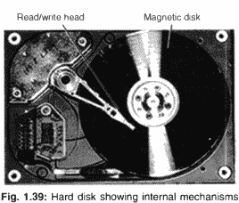

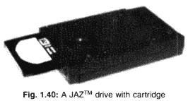


然而，磁带中可以存储大量信息。这一特性使其常用于硬盘的定期备份。

## 光盘（CD）

光盘（CD）是一种小巧、便携、圆形的介质，由模制聚合物制成（大小接近软盘），用于以数字形式电子记录、存储和播放音频、视频、文本及其他信息（图 1.41）。


**图 1.41：** CD-ROM

最初，CD 是只读的，但新技术允许用户自行刻录。CD 可能仍将在音乐录制和播放方面广受欢迎。一种较新的技术——数字多功能光盘（DVD），能在同样的空间内存储更多数据，并用于播放电影。

CD 的一些变体包括：

- CD-ROM
- CD-i
- CD-RW
- CD-ROM XA
- CD-R
- Photo CD
- Video CD

## 数字视频光盘或数字多功能光盘（DVD）

DVD 是一种与 CD-ROM 类似的光盘技术（图 1.42）。一张 DVD 至少可容纳 4.7 GB 数据，足以存储一整部电影。DVD 通常用作电影及其他将声音与图形相结合的多媒体演示的数字化介质。


| | |
|---|---|
| **媒体类型** | 光盘 |
| **容量** | ~4.7 GB（单面单层），~8.54 GB（单面双层） |
| **读取机制** | 1350 Kb/s（1×） |
| **写入机制** | 1350 Kb/s（1×） |
| **用途** | 数据存储、音频、视频、游戏 |

**图 1.42：** DVD

DVD 规格支持容量从 4.7 GB 到 17 GB、访问速率从 600 kbps 到 1.3 Mbps 的光盘。DVD 驱动器最大的优点之一是向后兼容 CD-ROM，也就是说，它们可以播放旧的 CD-ROM、CD-I 光盘和视频 CD，以及新的 DVD-ROM。较新的 DVD 播放器还可以读取 CD-R 光盘。DVD 使用 MPEG-2 压缩视频数据。

### DVD-Video 格式

DVD-Video 是最著名的 DVD 格式，用于通过 DVD 向机顶 DVD 播放器分发电影。DVD-Video 并不是一种不同的物理光盘格式，而是光盘上视频、音频和辅助材料的布局与格式规范。与用于音乐的 CD-Audio 格式一样，DVD-Video 专为分发专业制作的材料（电影和专辑）而设计，以便可以大规模制造用于零售。

DVD-Video 格式支持广泛的功能，远不止普通电影所用的那些。对于视频，它支持宽银幕和信箱模式的宽高比，以及多达 9 个用户可选的摄像机角度。对于音频，它支持

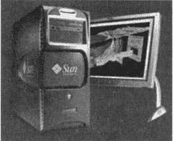

**图 1.45：** 工作站

现代计算机。19 世纪初，一位名叫约瑟夫-马里·雅卡尔（Joseph-Marie Jacquard）的法国发明家制造了一种织布机，可以在布料上织出复杂图案。这种织布机通过读取卡片上打孔形成的指令来自动控制。

一位名叫赫尔曼·霍勒里斯（Herman Hollerith）的美国人发明了使用穿孔卡片的机器，用于统计 1890 年美国人口普查的数据。霍勒里斯最终将公司卖给了名为 CTR（计算-制表-记录公司）的企业，该公司后来成为 IBM（国际商业机器公司）。

从理论角度来看，更有趣的是英国人查尔斯·巴贝奇（Charles Babbage）在 19 世纪的工作。巴贝奇于 1834 年设计了一种名为分析机（Analytical Engine）的机械计算设备。虽然他从未能制造出该设备（他无法获得资金来开发机器所需的精密加工的齿轮、轮子和杠杆系统），但他的想法包含了许多后来被现代计算机采用的概念。

## ABC：第一台数字电子计算机

第一台数字电子计算机是由约翰·文森特·阿塔纳索夫（John Vincent Atanasoff）和他的助手克利福德·贝里（Clifford Berry）于 1937 年至 1942 年间在爱荷华州立大学制造的。阿塔纳索夫-贝里计算机（ABC）使用穿孔卡片进行输入和输出，使用真空管电子设备以二进制格式处理数据，并使用旋转的电容器鼓来存储数据。

然而，ABC 只能执行一项任务：它被建造用于求解大型联立方程组（最多 29 个方程、29 个未知数），这是科学和工程中常见的一项繁重计算任务。因此，ABC 不是一台通用计算机。

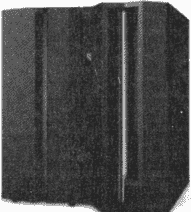

**图 1.46：** 大型机

类似地，另一台名为 Colossus 的专用电子计算机于 1943 年开始在英国建造，目的是破译德国密码。该项目的参与者有艾伦·图灵（Alan Turing）和马克斯·纽曼（Max Newman）。这台计算机的存在直到 20 世纪 70 年代才公开。

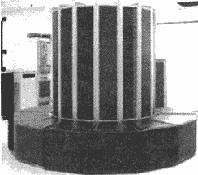

**图 1.47：** 超级计算机

## ENIAC：第一台通用电子计算机

第一台通用数字电子计算机——即可以编程执行各种计算任务的计算机——是 ENIAC（电子数值积分器和计算器）。它由约翰·莫奇利（John Mauchly）和 J. 普雷斯珀·埃克特（J. Presper Eckert）于 1945 年秋设计并建造。ENIAC 最初是为美国军方计算弹道表以瞄准大口径火炮而建造的。

ENIAC 是一台庞然大物式的机器，占满了整个大房间，重达 30 吨。它包括 1.8 万支真空管，耗电 200 千瓦（它首次开机时，其所在的费城社区灯光都变暗了）。ENIAC 是第一台通用计算机，因为它可以通过重新连接电缆和拨动开关这一繁琐的过程进行编程（给定不同的指令集来执行）。

后来的计算机更加灵活，因为它们采用了存储程序的思想。这一思想由数学家约翰·冯·诺依曼（John von Neumann）于 1945 年提出（他曾参与洛斯阿拉莫斯的曼哈顿计划）。在这种方案中，被处理的数据和计算机的指令程序都存储在内存中。现代计算机使用同样的方法。

莫奇利和埃克特后来加入了雷明顿·兰德公司的 UNIVAC 部门。UNIVAC I（通用自动计算机）是首台商用计算机，于 1951 年问世。

IBM（国际商业机器公司）于 1953 年以 701 计算机（图 1.48）进入计算机市场。到 1960 年，IBM 已在大型机市场中占据主导地位。大型机市场中的较小参与者包括 Burroughs、Control Data、General Electric、Honeywell、NCR、RCA 和 UNIVAC。

## 晶体管与集成电路

真空管消耗大量电能，而且容易烧毁，这给使用数千支真空管的早期计算机带来了问题。到 1960 年，晶体管取代真空管成为计算机中的电子开关器件。晶体管（20 世纪 50 年代由威廉·肖克利（William Shockley）等人在贝尔实验室开发）是一种固态半导体器件，通常由硅或锗制成。它比真空管小得多、可靠得多，且能耗低得多。一台以前占满相当大房间的真空管计算机，可以被一台只占几个机柜的晶体管计算机系统取代。使用晶体管的早期计算机的一个典型例子是 IBM 360，它在 20 世纪 60 年代中后期主导了大型机市场。

20 世纪 60 年代初，还出现了微芯片（即集成电路（IC））的发展，它由杰克·基尔比（Jack Kilby）和罗伯特·诺伊斯（Robert Noyce）发明（图 1.49）。集成电路将许多晶体管和其他电子元件集成为一个微型电路，制作在单片硅芯片上。

集成电路的发明使计算机变得更小，整个中央处理器（CPU）可以安装在一块电路板上。这些小型机比大型机更便宜、更小（计算机大约相当于大型文件柜中一个抽屉的大小），使更多企业和大学能够负担得起自己的计算机系统。

最成功的小型机是数字设备公司（DEC）制造的 PDP 和 VAX 系列。小型机与大型机一样是多用户系统，只是规模较小。

小型机如今基本上已是一类过时的计算机，已在很大程度上被高端微处理器工作站所取代。

## 微处理器

随着集成电路技术的发展，芯片制造商可以在微小的硅芯片上集成越来越多的电路。到 1971 年，一家名为 Intel 的公司开发出了第一台微处理器（也称为 MPU），它能够容纳整个 CPU


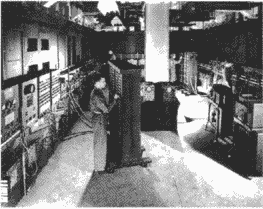

图 1.48：IBM 701 计算机

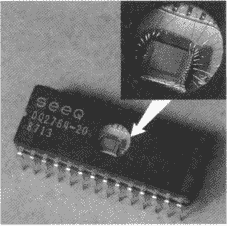

图 1.49：集成电路

在一块尺寸为 1/8 英寸 × 1/16 英寸的硅芯片上包含了 2300 个晶体管。

到 1974 年，英特尔推出了 8080 芯片，这是一种通用微处理器，性能是早期微处理器的十倍。不久之后，电子爱好者便开始基于快速发展的微处理器芯片构建小型计算机系统。

## 最早的微型计算机

第一款值得关注的商用微型计算机是 Altair 8800，由 MITS（微型仪器与遥测系统公司）销售，该公司由艾德·罗伯茨博士创立，总部位于新墨西哥州阿尔伯克基。这款计算机登上了 1975 年 1 月《大众电子》杂志的封面，以套件形式出售，价格为 397 美元，或组装完成版 439 美元。它使用 2 MHz 的英特尔 8080 处理器，配备 256 字节的 RAM。

请记住，没有软件，计算机什么都做不了，于是一些公司应运而生以满足这一需求。其中一家值得注意的小公司在阿尔伯克基成立，创始人是哈佛辍学生，为 Altair 计算机提供软件（一种 BASIC 语言）。这位创始人的名字叫比尔·盖茨，他（与合伙人保罗·艾伦）共同创立的公司就是微软。

几十家公司（其中大多数早已消失）开始销售微型计算机，其中大部分基于英特尔 8080 处理器并运行 CP/M 操作系统。其他公司则使用专有操作系统，如 Radio Shack、Atari 和 Commodore。特别值得一提的是由史蒂夫·乔布斯和史蒂夫·沃兹尼亚克于 1976 年 4 月 1 日创立的苹果公司。他们的 Apple II 计算机大获成功，尤其是在家庭和教育市场。

有两件事真正推动了 20 世纪 70 年代末和 80 年代初微型计算机市场的起飞：电子表格软件和 IBM PC。电子表格软件（第一个是丹·布里克林为 Apple II 编写的 VisiCalc）最终让商界人士相信微型计算机具有严肃的用途。IBM PC 于 1981 年发布，凭借 IBM 的品牌赋予了微型计算机合法性（请记住，IBM 是大型主机的制造商；人们常说“买 IBM 的东西永远不会被解雇”）。它使用 4.77 MHz 的英特尔 8088 处理器。

微软就为新 PC 提供操作系统一事找到了 IBM。比尔·盖茨告诉他们：“我们有一个可以在你们计划的新机器上运行的操作系统，”并达成了协议。事实上，微软并没有这样的操作系统，但他们迅速从第三方购买了一个，并将其改造为 PC-DOS。但盖茨真正聪明之处在于，他与 IBM 达成的协议允许微软将该操作系统也作为 MS-DOS 出售给其他公司……微软的未来就此奠定。

IBM PC 的销量飙升，IBM 在两年内主导了市场，并推出了使用英特尔 80286 处理器的 PC XT（1983 年）和 PC AT（1984 年）。

但是，几乎同样迅速的是，当其他公司（如康柏）开始发布“PC 兼容”计算机（也称为“PC 克隆机”）时，IBM 失去了在 PC 市场的主导地位。到 1986 年，克隆机占据了大部分市场，IBM 再也没有重新夺回主导地位。另一方面，微软向所有 PC 提供其操作系统，成为一家巨头公司。

## 图形用户界面

传统上，计算机非常难用，用户必须记住并输入所需的命令（这称为命令行界面）。为了让人更容易使用计算机，**图形用户界面（GUI）**被开发出来。在 GUI 中，用户与屏幕上的图形显示交互，其中包含图标、窗口和控件。命令通过菜单选择，而不是输入。

GUI 是在施乐帕洛阿尔托研究中心开发的，但施乐的管理层未能看到它的用途。然而，当苹果公司的史蒂夫·乔布斯看到 GUI 时，他认识到了它的价值。苹果从施乐获得了概念许可，进一步开发，并于 1984 年发布了第一台成功的 GUI 计算机——**麦金塔**。麦金塔计算机使用摩托罗拉 68000 系列微处理器（后来使用 PowerPC 系列微处理器）。

微软也很快意识到了 GUI 的价值，但其图形用户界面 **Windows** 在 PC 上取代 DOS 的过程很缓慢（最初的几个 Windows 版本还有很多不尽如人意的地方）。

## 计算机的代际

计算机发展的历史通常以计算设备的不同代际来指代。每一代计算机都以一项重大的技术发展为特征，这些技术从根本上改变了计算机的运作方式，使设备变得越来越小、越来越便宜、越来越强大、越来越高效和可靠。

### 第一代（1940–1956）：真空管

第一代计算机使用真空管作为电路，磁鼓作为存储器，体积通常非常巨大，占据整个房间。它们运行成本极高，不仅消耗大量电力，还产生大量热量，而这些热量常常导致故障。第一代计算机依靠机器语言执行操作，并且一次只能解决一个问题。输入基于穿孔卡片和纸带，输出显示在打印纸上。

UNIVAC 和 ENIAC 是第一代计算设备的例子。UNIVAC 是第一台交付给商业客户的商用计算机，1951 年交付给美国人口普查局。

### 第二代（1956–1963）：晶体管

晶体管取代了真空管，开创了第二代计算机。晶体管于 1947 年发明，但直到 20 世纪 50 年代末才在计算机中得到广泛应用。晶体管远比真空管优越，使计算机比第一代前身更小、更快、更便宜、更节能、更可靠。尽管晶体管仍然会产生大量热量，可能损坏计算机，但相较真空管已是巨大进步。第二代计算机仍然依赖穿孔卡片进行输入，以打印件作为输出。

第二代计算机从晦涩的二进制机器语言转向符号语言（即汇编语言），使程序员能够用单词来指定指令。高级编程语言也在这一时期被开发出来，例如 COBOL 和 FORTRAN 的早期版本。这些也是第一批将指令存储在内存中的计算机，其存储技术从磁鼓转向磁芯。这一代的第一批计算机是为原子能工业开发的。

### 第三代（1964–1971）：集成电路

集成电路的发展是第三代计算机的标志。晶体管被微型化并放置在硅芯片上，称为集成电路，这极大地提高了计算机的速度和效率。

用户不再使用穿孔卡片和打印输出，而是通过键盘和显示器与第三代计算机交互，并通过操作系统进行连接。操作系统允许设备在一个中央程序的监控下同时运行许多不同的应用程序。计算机第一次为大众所使用，因为它们比前代更小、更便宜。

### 第四代（1971 年至今）：微处理器

微处理器带来了第四代计算机，数千个集成电路被集成到单个硅芯片上。第一代中占据整个房间的设备，现在可以放在手掌中。1971 年开发的英特尔 4004 芯片将计算机的所有组件——从中央处理器、内存到输入/输出控制——都放在了一个芯片上。

1981 年，IBM 推出了其第一台面向家庭用户的计算机；1984 年，苹果推出了麦金塔。微处理器也走出了台式机的领域，进入了生活的许多领域，越来越多的日常产品开始使用微处理器。

随着这些小型计算机变得越来越强大，它们可以相互连接形成网络，这最终导致了互联网的发展。第四代计算机还见证了 GUI、鼠标和手持设备的发展。

### 第五代（现在及未来）：人工智能

基于人工智能的第五代计算设备仍在开发中，尽管今天已经有一些应用，例如语音识别。并行处理和超导体的使用正在帮助人工智能成为现实。量子计算、分子和纳米技术将在未来数年彻底改变计算机的面貌。第五代计算的目标是开发能够响应自然语言输入并具备学习和自组织能力的设备。

## 计算机硬件

术语 **硬件** 指的是计算机系统的物理组件（相对于软件而言）。计算机硬件包括计算机机箱内部的设备，以及连接到计算机的任何外围设备（例如鼠标和键盘）。

计算机的主要组件是 **主板**（也称为 **主电路板**、主逻辑板、母板或系统板）。主板是一块大型印刷电路板，上面装有微芯片、连接器和其他组件，并通过铜电路走线将这些组件连接在一起。

主板通常包含以下项目：

- **CPU**（中央处理器），数据实际处理发生的地方。
- **系统时钟** 电路（使所有数字芯片保持同步）。
- **其他控制器芯片**，充当交通警察，引导数据沿系统总线（连接芯片与 CPU 的电路）和 I/O 端口流动。
- **RAM**（主内存，以及用于添加更多内存的额外插槽）。


- ROM（包含BIOS）
- “CMOS存储器”
- 扩展插槽（用于添加扩展卡，如显卡和声卡）

除了主板之外，计算机的机箱中通常还包含**电源**（用于将墙壁插座中的交流电转换为计算机使用的低压直流电）以及位于机箱**扩展仓**中的若干存储设备（如硬盘驱动器、软盘驱动器、Zip驱动器、CD驱动器和DVD驱动器）。

## 配置与规格

每种配置都包含一组特定的部件或组件（包括硬件和软件），并按照特定的布局进行安排。另一个类似的术语，**体系结构**，也描述了计算机系统各组件的布局和交互方式。

每个系统配置都会有一个**规格说明**，列出该特定系统所包含组件的详细信息。下面你会看到一个典型的计算机系统规格说明，请仔细查看。桌面计算机系统的典型规格如下：

- 1. 处理器：Intel® Pentium® 4 处理器，3 GHz，800 MHz 前端总线，512 KB 二级缓存。
- 2. Microsoft® Windows® XP Professional。
- 3. 内存：512 MB DDR SDRAM，频率 400 MHz（可扩展至 4 GB）。
- 4. 硬盘：250 GB Serial ATA，寻道时间 7 ms，7200 RPM，512 KB 缓存。
- 5. 软驱：3.5 英寸 1.44 MB。
- 6. 光驱：12× DVD-ROM / 48× CD-RW  combo驱动器。
- 7. 扩展插槽：1 个 AGP 和 5 个 PCI。
- 8. 外部端口：六个 USB 2.0（两个在前面板），一个并行口，一个串行口，两个 PS/2 口，以及一个 IEEE 1394 端口。
- 9. 调制解调器：56K PCI 传真/调制解调器。
- 10. 显卡：256 MB RADEON™ 9800 AGP 显卡。
- 11. 显示器：17 英寸 CRT（16 英寸可视区域），1,024 × 768，0.27 dp。
- 12. 声卡：Sound Blaster® Audigy™2 声卡，支持 Dolby® 5.1 立体声。
- 13. 扬声器：Bose® B775 环绕声扬声器系统，带低音炮。
- 14. 网络：以太网 10/100。
- 15. 键盘：101 键多功能键盘。
- 16. 鼠标：Logitech® MX™ 500 光电鼠标，带滚轮。
- 17. 机箱：塔式机箱，带 6 个扩展仓（其中两个仅供内置驱动器使用）。
- 18. 应用软件：Microsoft® Office Professional 2003。

## 计算机软件

计算机软件是指计算机指令或数据。任何可以以电子方式存储的内容都是软件。存储设备和显示设备是硬件。

**软件**和**硬件**这两个术语既可以作名词也可以作形容词。例如，你可以说：“问题出在软件上”，意思是程序或数据有问题，而不是计算机本身有问题。你也可以说：“这是一个软件问题。”

软件和硬件之间的区别有时令人困惑，因为它们紧密相连。显然，当你购买一个程序时，你是在购买软件。但要购买该软件，你需要购买记录该软件的磁盘（硬件）。

我们知道软件是用于执行任务的一组指令。软件可以分为两类，即应用软件和系统软件。应用软件是面向应用的，例如库存程序和工资程序。同样，系统软件用于面向系统的任务。例如编译器、汇编器和加载器。

## 软件分类

- 软件分为两大类：
  - (a) 应用软件
  - (b) 系统软件

## 应用软件

应用软件是为计算机应用于常见问题和任务而开发的。它们可用于商业应用、科学和工程应用等等。个人效率程序根据其在文字处理、电子表格生成、图形演示和数据库维护中的使用性质进行分类。应用软件也以软件包的形式提供，通常附有用户手册。下面介绍一些应用软件：

### 文字处理器

文字处理器用于准备报告、个人或商务信函、桌面出版等。它们提供格式化功能，例如使用不同的字符样式、行间距和页码等。使用文字处理器准备的文档可以轻松地在任何类型的打印机上打印。

### 电子表格

电子表格软件用于准备包含数字或字符形式的信息或数据的文档。信息按行和列排列，以便进一步处理和分系、准备报告和生成图表。它还能执行算术运算和使用函数。

### 数据库软件

数据库是与个人或组织相关的记录。数据库软件具有编辑和更新文件中数据的能力。通过对数据进行处理，可以准备并打印员工的工资明细、年度销售明细等。计算机的主要应用之一就是数据库管理。

## 系统软件

系统软件是为特定类型的硬件而设计的。例如，磁盘操作系统用于协调计算机的外围设备。系统软件控制计算机的活动、应用程序、进出内存和磁盘存储的数据流。操作系统、编译器、汇编器、链接器和加载器都是系统软件的示例。

系统软件还处理通信应用中的数据以及计算机网络中通信系统内的数据。通信软件将数据从一台计算机传输到另一台计算机。这些程序在计算机系统之间传输数据的同时，还提供数据安全和错误检查。

系统软件的示例包括操作系统、编译器、解释器和汇编器，我们将在本书后面讨论这些内容。

## 总结

- 计算机是一种电子设备，它接收信息，根据程序处理信息，并产生输出。
- 计算机系统有五个基本功能单元。
- 中央处理器（CPU）是计算机的大脑。
- 算术逻辑单元（ALU）是计算机中对数据执行算术和逻辑运算的单元。
- 控制单元控制计算机各组件的整体活动。
- 存储单元是存储所有输入数据和结果的单元。
- 存储程序概念使用存储单元来存储指令或操作码以及数据或操作数。
- 随机存取存储器（RAM）是计算机中的临时存储介质。计算机要处理的所有数据都从存储设备或键盘传输到 RAM。
- 只读存储器（ROM）是一种永久存储介质，用于存储启动程序。
- 软盘用于永久存储数据。
- 硬盘是可靠且永久的存储盘。它有一组涂有磁性材料的金属盘，安装在一个以 7200 rpm 转速旋转的中心主轴上。
- 光盘（CD）是一种用于永久存储数据的光盘。
- 键盘是用于向计算机输入数据的输入设备。
- 键盘包含功能键、数字键和切换键（大写锁定、数字锁定和滚动锁定）等。
- 鼠标是一种输入设备，通过在平面上向任意方向移动来选择命令。
- 使用图形界面开发的软件需要鼠标。
- 外围输入设备用于辅助将数据输入计算机系统。
- 打印机是一种输出设备，用于在纸上或其他硬拷贝介质（如缩微胶片）上打印文本或图形。
- 打印机有两种基本类型：击打式和非击打式。
- 小型计算机最常用的打印机是点阵打印机，它以点阵形式构成字符。
- 激光打印机是速度最快的非击打式静电打印机。它们以高速度产生高质量打印输出。
- 喷墨打印机是一种非击打式打印机。它将微小的墨滴喷射到纸上，形成字符和图形图像。
- 绘图仪是一种输出设备，用于在大尺寸纸张上打印工程图纸或图形。

## 练习

### A部分

**选择题**

- 1. 以下哪项不是微型计算机？
  - (a) 台式机
  - (b) 笔记本电脑
  - (c) 大型机
  - (d) 掌上电脑

- 2. 个人计算机主电路板的另一个名称是……
  - (a) RAM板
  - (b) 外围板
  - (c) 主板
  - (d) 中央处理芯片

- 3. 第一台可编程的通用计算机是
  - (a) IBM PC
  - (b) Altair
  - (c) HOOVERVAC
  - (d) ENIAC

- 4. 第一个微处理器芯片是由谁开发的？
  - (a) IBM
  - (b) Apple
  - (c) Motorola
  - (d) Intel

- 5. 个人计算机是一种
  - (a) 微型计算机
  - (b) 终端
  - (c) 个人数字助理
  - (d) 大型机

- 6. 以下哪项不是设计为便携式的？
  - (a) 笔记本计算机
  - (b) PDA
  - (c) 膝上型计算机
  - (d) 小型计算机

- 7. 以下哪种软件不会被归类为系统软件？
  - (a) Microsoft Word
  - (b) Microsoft Windows
  - (c) 设备驱动程序
  - (d) 硬盘恢复实用程序

- 8. 以下哪种不会被归类为应用软件？
  - (a) Microsoft Excel
  - (b) Microsoft Access
  - (c) Macintosh OSX
  - (d) Adobe Photoshop

- 9. 如果您的计算机报告某个文件的大小为 1 千字节，那么它占用了多少空间？
  - (a) 8 字节
  - (b) 1,024 字节
  - (c) 1,048,576 字节
  - (d) 正好 1,000 字节

- 10. 用于在计算机中以数字形式存储字母的代码称为
  - (a) ROM代码
  - (b) ASCII
  - (c) PCMCIA
  - (d) SCSI


## 2 操作系统简介

计算机软件可分为两大类：应用软件和系统软件。根据布鲁克希尔（1997）的说法，“应用软件由用于执行特定于机器用途的任务的程序组成。应用软件的示例包括电子表格、数据库系统、桌面出版系统、程序开发软件和游戏。”当我们提到计算机程序时，通常指的就是应用软件。这种软件旨在为用户解决特定问题。

另一方面，系统软件更为透明，普通计算机用户较少注意到它。这种软件“提供了一种通用的编程环境，程序员可以在其中创建满足其特定需求的应用程序。这种环境提供了硬件层面不具备的新功能，并执行与运行应用程序相关的任务”（纳特，1997）。系统软件充当计算机硬件与用户需要在计算机上运行的应用软件之间的接口。

图2.1展示了应用软件和系统软件之间的关系。

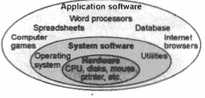

**图2.1：** 应用软件与系统软件之间的关系

### 操作系统

操作系统是计算机上运行的最重要的程序。每台通用计算机都必须有操作系统才能运行其他程序。操作系统执行基本任务，例如识别键盘输入、将输出发送到显示器屏幕、跟踪磁盘上的文件和目录，以及控制磁盘驱动器和打印机等外围设备。

对于大型系统，操作系统承担着更大的责任和权力。它就像交通警察——确保同时运行的不同程序和用户互不干扰。操作系统还负责安全性，确保未经授权的用户无法访问系统。

操作系统提供了一个软件平台，其他程序（称为应用程序）可以在此平台上运行。应用程序必须编写为在特定操作系统之上运行。

我们知道操作系统是程序的集合，它是用户与计算机之间的接口。操作系统是连接用户与计算机中电子硬件的程序。它是一组程序，负责监督计算机的活动并激活硬件组件（如CPU、主内存、磁盘驱动器、键盘、显示器和打印机等）的操作。一些最初加载到RAM中的启动程序存储在ROM中，主要是计算机系统制造商记录的BIOS程序。操作系统中用于复制文件、删除文件、格式化磁盘、打印文件等操作的服务程序通常存储在磁盘上。如果硬件出现任何故障，屏幕上会显示错误消息。

图2.2展示了操作系统与计算机系统其他部分之间的关系。

### 操作系统的功能

在任何计算机中，操作系统：

- 控制磁盘驱动器和打印机等外围设备
- 控制程序的加载和运行
- 组织程序之间的内存使用
- 组织程序和用户之间的处理时间
- 组织程序和用户之间的优先级
- 维护用户的安全和访问权限
- 处理错误和用户指令。

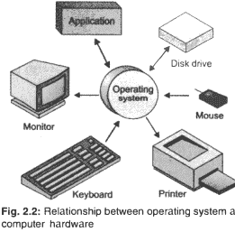

在个人计算机上，**操作系统**将：

- 处理程序进出内存的传输
- 允许用户将文件保存到后备存储器
- 控制数据传输到打印机等外围设备
- 提供用户与计算机之间的接口，例如Windows XP和OSX。
- 发出简单的错误消息。

### 操作系统的角色

操作系统执行以下各种角色：

**处理器管理**

操作系统负责使用**调度算法**管理处理器在不同程序之间的分配。调度程序的类型完全取决于操作系统，具体取决于预期的目标。

**随机存取存储器管理**

操作系统负责管理分配给每个应用程序（以及相关情况下每个用户）的内存空间。如果没有足够的物理内存，操作系统可以在硬盘上创建一个内存区域，称为“虚拟内存”。虚拟内存允许你运行需要的内存比系统中RAM可用内存更多的应用程序。但是，这种内存要慢得多。

**输入/输出管理**

操作系统通过驱动程序（也称为外围设备管理员或输入/输出管理员）实现程序对硬件资源访问的统一和控制。

**应用程序执行管理**

操作系统负责通过分配资源来确保应用程序顺利执行

## 填空题

- 1. _____和_____是输入设备的示例。
- 2. 程序的打印输出被视为______。
- 3. 存储在CD上的工资程序被视为______。
- 4. 点阵打印机是______的示例。
- 5. 激光打印机是______的示例。
- 6. 点阵打印机的速度以______表示。
- 7. 激光打印机的速度以______表示。
- 8. RAM是一种______存储器。
- 9. 软盘的存储容量是______。
- 10. 软盘中的同心圆称为______。
- 11. ROM也称为______。
- 12. ROM是一种______存储器。
- 13. 硬盘比主存储器______。
- 14. CD-ROM的存储容量是______。
- 15. 存储在CD上的信息通过______访问。

## B部分

*简答题*

- 1. 提及计算机的基本功能单元。
- 2. 借助清晰的图表解释计算机的工作组织。

## C部分

*长答题*

- 1. 定义计算机系统的概念，并详细定义计算机系统各单元的工作方式。
- 2. 定义键盘一词，并定义键盘的完整工作方式。
- 3. 定义鼠标一词，并定义鼠标的完整工作方式。
- 4. 定义激光打印机一词，并定义激光打印机的完整工作方式。
- 5. 举例区分主存储器和辅助存储器。
- 6. 举例区分系统软件和应用软件。
- 7. 定义计算机系统的各种功能组件。
- 8. 详细定义计算机系统的应用。
- 9. 正确解释计算机的历史。
- 10. 正确解释计算机系统的代际。

- 32. _____单元用于存储信息。
  （a）输入
  （b）输出
  （c）控制
  （d）存储器

- 33. 在存储程序概念中，_____和_____存储在同一内存中。
  （a）数据和指令
  （b）数据和操作数
  （c）指令和操作码
  （d）以上都不是

- 34. 微处理器是_____计算机的心脏。
  （a）数字
  （b）模拟
  （c）a和b都是
  （d）以上都不是

- 3. 什么是存储程序概念或约翰·冯·诺依曼概念？
- 4. 什么是微处理器？
- 5. RAM和ROM之间有什么区别？
- 6. 提及计算机的基本功能单元。
- 7. 借助清晰的图表解释计算机的工作组织。
- 8. 提及个人计算机中使用的存储设备。
- 9. 解释主存储器、其属性和类型。
- 10. 为什么需要辅助存储器？简要描述辅助存储设备，如（i）软盘、（ii）硬盘和（iii）CD ROM。
- 11. 提及个人计算机的组件。
- 12. 易失性存储器和非易失性存储器有什么区别？


它们运行所需的资源。这意味着，一个无法正常响应的应用程序可以被“杀死”。

## 授权管理

操作系统负责与程序执行相关的安全，保证资源仅由具有相应授权的程序和用户使用。

## 文件管理

操作系统管理文件系统的读写，以及用户和应用程序的文件访问授权。

## 信息管理

操作系统提供一定数量的指标，可用于诊断机器是否正确运行。

## 操作系统的组成部分

操作系统由一组可用于管理与硬件交互的软件包组成。这组软件通常包括以下元素：

- **内核**，代表操作系统的基本功能，如内存、进程、文件、主要输入/输出和通信功能的管理。
- **外壳**，允许通过控制语言与操作系统通信，使用户无需了解所用硬件的特性以及物理地址的管理等，即可控制外围设备。
- **文件系统**，允许以树状结构记录文件。

## 操作系统的分类

操作系统可分为单用户和多用户两类。

### 单用户操作系统

单用户操作系统一次只允许一个用户登录。没有用户账户数据库，因此安全级别较低，用户无法保护自己的文件不被查看、复制或删除。

**这类操作系统的示例是 DOS 和 Windows Vista。**

### 多用户操作系统

多用户操作系统有一个用户数据库帐户，其中规定了用户对某些资源拥有的权限。由于访问受限，它比单用户操作系统更安全。

**这类操作系统的一个示例是 UNIX。**

## 操作系统的类型

下面介绍几种不同类型的操作系统。

### 多线程操作系统

当多个**“任务”**（也称为*进程*）可以同时运行时，该操作系统被称为**多线程**的。应用程序由一系列称为**“线程”**的指令组成。这些线程将根据被赋予的优先级轮流处于活动、待机、挂起或终止状态，也可以同时运行。

当系统具有**调度程序**（也称为*规划器*）时，该系统被称为**抢占式**的；调度程序根据优先级标准，在请求机器时间的各个进程之间分配机器时间。

当调度程序为每个进程分配时间配额时，该系统称为**分时**系统。多用户系统就是这种情况，它允许多个用户同时在同一台机器上使用不同或相似的应用程序。这种系统随后被称为**“事务处理系统”**。为此，系统为每个用户分配一段时间。

### 多处理器操作系统

**多处理**是一种并行操作多个处理器以获得比使用高端处理器更高的计算能力，或提高系统的可用性（在处理器发生故障时）的技术。

术语 SMP（*对称多处理*或*对称多处理器*）指的是所有处理器访问同一共享内存的体系结构。

多处理器系统不仅必须能够管理多个处理器之间的内存共享，还必须能够分配工作负载。

### 嵌入式系统

嵌入式系统是设计用于在小型机器上运行的操作系统，例如 PDA（*个人数字助理*）或自主性较低的自主电子设备（空间探测器、机器人、车载计算机等）。因此，嵌入式系统的一个基本特征是先进的能源管理能力和在有限资源下运行的能力。

用于 PDA 的主要“通用”嵌入式系统如下：

- PalmOS
- Windows CE/Windows Mobile/Windows Smartphone

### 实时系统

实时系统主要应用于工业领域，是设计用于在时间受限环境中运行的系统。实时系统还必须按照特定的时间约束可靠运行；换句话说，它必须能够正确处理在明确界定的时间间隔（定期或其他）内接收到的信息。以下是实时操作系统的一些示例：

- OS-9
- RTLinux（实时 Linux）
- QNX
- VxWorks

### 批处理操作系统

在批处理操作系统中，任务按批次执行；操作系统等待一批任务到达，然后对该批任务执行操作。

### 分时操作系统

分时操作系统在任务之间共享时间，例如，如果作业 A 需要 6 分钟完成，而操作系统预设的时间为 2 分钟，则它先执行作业 A 2 分钟，然后开始执行作业 B（下一个作业），以这种方式在到达的所有作业之间共享时间。

### 分布式操作系统

在分布式操作系统中，松散耦合的不同处理器处理不同的作业，并相互通信。

## 磁盘操作系统（DOS）

MS-DOS 是由微软公司开发的单用户操作系统。操作系统包含一组程序。当计算机开机时，COMMAND.COM 文件被加载到 RAM 中；计算机成功启动后，将显示 DOS 提示符或命令提示符。DOS 提示符显示与磁盘驱动器关联的字母，后跟一个 > 符号。对于软盘驱动器，显示 A> 或 A:>；对于硬盘驱动器，显示 C> 或 C:\>。这表示操作系统已准备好接收用户命令。DOS 操作系统由三部分组成，即常驻部分、初始化部分和暂驻部分。大多数命令程序位于常驻部分。启动时，要打开的文件和缓冲区的数量包含在初始化部分中，而暂驻部分是操作系统中灵活的部分。命令不区分大小写。

### DOS 的具体特性

以下是磁盘操作系统的具体特性。

#### 文件

文件是相关信息的集合。例如，就像书桌抽屉中文件夹的内容一样。磁盘上的文件可以包含信函、备忘录和可执行程序。

#### 程序

程序是特殊类型的文件。它们是使用计算机语言编写的一系列指令。这些程序指示计算机执行任务。

#### 目录

DOS 使用文件系统来存储其文件。该文件系统使用称为目录的存储区域。目录不过是一个可扩展的文件夹，可以容纳其他可扩展的文件夹。这些文件夹保存数据文件。目录是磁盘的内容清单。它包含文件的名称、大小和最后修改日期。所有不同的目录都存储在一个主目录下。这个目录称为根目录。

除目录外，DOS 还使用磁盘上的一个称为文件分配表（FAT）的区域。FAT 类似于书中的目录页。它保存有关文件存储在磁盘上位置的信息。

#### 多个目录

当有两个或更多用户共享一台计算机，或者你在从事多个不同项目时，目录中的文件数量可能会变得庞大而难以管理。使用目录是将文件分成方便分组的一种方式。任何目录都可以包含许多文件。该目录还可以包含其他目录或子目录。这种有组织的文件结构称为分层目录系统。

### DOS 的基本命令

下面介绍磁盘操作系统的基本命令。

#### DIR 命令

DIR 命令是用于显示磁盘目录内容的内部命令。为了在特定磁盘上定位数据文件和程序，DOS 使用目录和文件分配表（FAT）。

**示例**

`C:\>DIR`

此命令将显示默认驱动器中的磁盘目录。

`C:\>DIR/W`

此命令将以宽格式显示默认驱动器中的磁盘目录。

`C:\>DIR/P`

此命令将分页显示默认驱动器中的磁盘目录。当磁盘包含大量文件时，此命令非常有用。

`C:\>DIR A:`

此命令将显示 A 驱动器中的磁盘内容。

`C:\>DIR *.C`

此命令将仅显示默认驱动器中扩展名为 .C 的文件。这里的 * 称为通配符，表示所有匹配的字符都由 * 代表。

#### CLS 命令

CLS 命令用于清除屏幕。输入此命令后，之前显示的所有文本或消息都将从屏幕上移除。

CLS 命令的通用语法如下：

`C:\>CLS`

#### REN 或 RENAME 命令

REN 或 RENAME 命令用于重命名现有文件。请看下面在当前目录中重命名文件的示例。

**示例**

`C:\>REN A.BAK A.C`

或

`C:\>RENAME A.BAK A.C`

输入此命令后，文件 A.BAK 将重命名为 A.C。

#### DEL 命令

DEL 命令用于删除目录中的文件。

请看下面删除当前目录中文件的示例。

`C:\>DEL A.BAK`

此命令将删除文件 A.BAK。当目录中没有该文件时，将显示“错误的命令或文件名”消息。

`C:\>DEL *.BAK`

此命令将删除目录中所有扩展名为 .BAK 的文件。当目录中没有该文件时，将显示“错误的命令或文件名”消息。


**C:\>DEL \*.**  
此命令将删除该目录中的所有文件。使用此命令时，会显示提示信息“Are you sure to delete all files (y/n)?”。按 y 确认删除。

## ERASE 命令

ERASE 命令用于擦除或删除目录中的文件。参考以下示例来擦除目录中的文件。

**C:\>ERASE A.BAK**  
此命令将擦除目录中的文件 A.BAK。当该文件在目录中不存在时，会显示“Bad command or file name”提示信息。

**C:\>ERASE \*.**  
此命令将擦除目录中的所有文件。输入此命令后，会显示提示信息“Are you sure to delete all files (y/n)?”。按 y 确认删除。

## DATE 命令

DATE 命令用于显示当前系统日期。计算机还维护一个日历。此命令将以 mm-dd-yyyy（月-日-年）格式显示当前系统日期，用户可以输入新日期。参考以下示例来显示当前日期。

**C:\>DATE**  
Current date is Sun 09-25-2005  
Enter new date (mm-dd-yyyy):

## TIME 命令

TIME 命令用于显示当前系统时间。计算机还维护一个时钟。此命令将以（小时：分钟：秒）格式显示当前系统时间，用户可以输入新时间。参考以下示例来显示当前时间。

**C:\>TIME**  
Current time is 11:37:25.34p  
Enter new time:

## CD 命令

CD（更改目录）命令用于将目录更改为磁盘上的另一个指定目录/位置。如果所提及的目录不存在，会显示“invalid directory”提示信息。

参考以下示例：

- 1. **C:\>CD ABC:**  
   此命令会将当前目录更改为磁盘上指定的 ABC 目录。现在提示符显示如下。  
   `C:\ABC>`

- 2. **C:\>CD TC**  
   `C:\TC>CD ABCP`  
   这些命令会将当前目录更改为磁盘上指定的 TC 目录，然后更改为 ABCP 目录。现在提示符显示如下。  
   `C:\TC\ABCP>`

- 3. **C:\>CD TC\ABCP**  
   此命令也会将目录更改为磁盘上指定的 TC 目录，然后更改为 ABCP 目录。现在提示符显示如下。  
   `C:\TC\ABCP>`

- 4. **C> cd furniture:**  
   将你转移到名为“FURNITURE”的目录。

- 5. **C> cd \furniture\chairs:**  
   将你转移到名为“FURNITURE”目录下的“CHAIRS”目录。

- 6. **C> cd.. :**  
   将你在路径中向上移动一级。

- 7. **C> cd \**  
   将你带回到根目录（本例中为 c:）。

## MD 命令

MD（创建目录）命令用于在存储设备中创建一个新目录以存储程序。参考以下示例来创建新目录：

**C:\>MD ABCP**  
此命令将在当前目录中创建一个新目录。要转移到新目录，可使用 CD 命令。

**C:\>CD ABCP**  
**C:\ABCP>**

## RD 命令

RD（删除目录）命令用于从磁盘上永久删除一个目录。请注意，在使用 RD 命令之前，应删除该目录中的所有文件。另外，你必须退出正在删除的目录。

参考以下示例：

如果我们想要删除 TC 目录中的 ABCP 目录，则必须遵循以下步骤：

- 1. 首先，我们删除 ABCP 目录中的所有内容  
   `C:\TC\ABCP>DEL *.*`  
   All files in directory will be deleted!  
   Are you sure (y/n) ? Press y to confirm the delete option.

- 2. 然后，我们转到 ABCP 目录的父目录并执行 RD 命令。  
   `C:\TC\ABCP>CD`  
   `C:\TC>RD ABCP`  
   这些命令之一可用于从磁盘中删除 ABCP 目录。

## COPY 命令

COPY 命令用于将文件复制到磁盘上的新位置或目录。不能将文件以相同名称复制到同一目录中的自身。  
参考以下示例：

- (I) C:\>COPY AB.TXT AB.BAK  
  此命令将文件 AB.TXT 复制到同一目录中，并命名为 AB.BAK。命令中第一个文件名 AB.TXT 是源文件，文件 AB.BAK 是目标文件，即 AB.TXT 的副本。

- (II) C:\>COPY AB.TXT A:  
  此命令将文件 AB.TXT 从 C 驱动器复制到 A 驱动器，并以相同名称复制。

- (III) C:\>COPY AB.TXT A: AB.BAK  
  此命令将文件 AB.TXT 从 C: 驱动器复制到 A: 驱动器，但目标文件命名为 AB.BAK。

- (IV) C:\>COPY *.* A:  
  此命令将 C: 驱动器当前目录中的所有文件以其各自的文件名复制到 A: 驱动器。

- (V) C:\>COPY *.C A:  
  此命令将 C: 驱动器当前目录中的所有 C 程序文件以其各自的文件名复制到 A: 驱动器。

COPY 命令还可以与关键字 CON 结合使用，以在控制台中创建文件。

- (VI) C:\>COPY CON sample.txt  
  此命令用于创建 sample.txt 文件并写入内容，然后按 F6，文件将自动保存。

## TYPE 命令

此命令用于在监视器屏幕上显示文件的内容。TYPE 命令还可以使用关键字 PRN 在控制台中将文件内容发送到打印机。  
参考以下示例：

- (I) C:\>TYPE AB.TXT:  
  此命令将在屏幕上显示文件 AB.TXT 的内容。

- (II) C:\>TYPE AB.TXT >PRN  
  此命令将打印文件 AB.TXT 的内容。

## FORMAT 命令

FORMAT 命令用于格式化新磁盘。它是一个位于硬盘上的实用程序。操作系统只能使用已格式化的磁盘来存储文件或程序。参考以下示例来格式化一张新软盘：将新软盘插入 A 驱动器并给出以下命令。

C:\>FORMAT A:

如今，成包出售的新软盘都已格式化，无需再次格式化。如果格式化任何旧软盘，其中的内容将被自动擦除。

## DISKCOPY 命令

DISKCOPY 命令用于将一个磁盘各个目录中的所有内容复制到另一张磁盘。它速度更快，并且便于制作备份副本。  
参考以下示例：

C:\>DISKCOPY A: C:

现在，A 驱动器中的软盘内容被复制到硬盘驱动器 C。

## CHKDSK 命令

CHKDSK 命令用于获取关于磁盘的报告，例如磁盘目录、文件、可用存储空间等。参考以下示例来检查 A 驱动器中的软盘。

**C:\>CHKDSK A:**

现在，会显示 A 驱动器中的软盘详细信息。也可以使用 SCANDISK 命令显示详细信息。

## UNIX 操作系统

UNIX 是一种操作系统，最初于 20 世纪 60 年代开发，此后一直在不断开发。所谓操作系统，是指让计算机工作的一组程序。它是一个稳定的、多用户、多任务的系统，适用于服务器、台式机和笔记本电脑。

UNIX 系统也有类似于 Microsoft Windows 的图形用户界面（GUI），它提供了一个易于使用的环境。然而，对于图形程序未涵盖的操作，或者在没有窗口界面可用的情况下（例如在 telnet 会话中），则需要了解 UNIX。

### UNIX 的类型

UNIX 有许多不同的版本，尽管它们有共同的相似之处。最流行的 UNIX 变体是 Sun Solaris、GNU/Linux 和 MacOSX。

### UNIX 的组成部分

UNIX 操作系统由三部分组成：内核、shell 以及文件和进程。

**内核**

UNIX 的内核是操作系统的核心：它为程序分配时间和内存，并通过系统调用处理文件系统和通信。

为了说明 shell 和内核如何协同工作，假设用户输入 `rm myfile`（其效果是删除该文件）。shell 在文件系统中搜索包含程序 `rm` 的文件，然后通过系统调用请求内核在 `myfile` 上执行程序 `rm`。当进程 `rm myfile` 运行完毕后，shell 会将 UNIX 提示符 `%` 返回给用户，表示它在等待进一步命令。

**Shell**

Shell 充当用户和内核之间的接口。当用户登录时，登录程序会检查用户名和密码，然后启动另一个称为 shell 的程序。Shell 是命令行解释器（CLI）。它解释用户输入的命令并安排执行。命令本身是程序：当它们终止时，shell 会给用户另一个提示符（在我们的系统上是 %）。

熟练的用户可以自定义自己的 shell，而且用户可以在同一台机器上使用不同的 shell。

历史记录 — Shell 会保存你输入的命令列表。如果需要重复执行某个命令，可以使用光标键在列表中上下滚动，或输入 history 查看先前命令的列表。

**文件和进程**

在 UNIX 中，一切都是文件或进程。进程是正在执行的程序，由唯一的 PID（进程标识符）标识。文件是数据的集合。它们由用户使用文本编辑器、运行编译器等方式创建。

文件的示例：

- 文档（报告、论文等）
- 用某种高级编程语言编写的程序文本
- 可直接被机器理解、而普通用户难以理解的指令，例如二进制数字集合（可执行文件或二进制文件）
- 目录，其中包含关于其内容的信息，内容可能是其他目录（子目录）和普通文件的混合。

### UNIX 的特定功能

以下是 UNIX 操作系统的特定功能：

**区分大小写**

UNIX 中的命令区分大小写。这意味着，小写字母 a 和大写字母 A 被视为不同的字符。


## cat 命令

`cat` 命令用于查看文本文件。`cat` 是 concatenate（连接）的缩写。请注意，cat 命令会在输入每一行后立即回显该行。

### 示例

- **（I）`cat /etc/passwd`**

  此命令在屏幕上显示 `/etc/passwd` 文件。

- **（II）`cat /etc/profile`**

  此命令在屏幕上显示 `/etc/profile` 文件。请注意，该文件的部分内容可能会滚动出屏幕。

- **（III）`cat file1 file2 file3 > file4`**

  此命令将前三个文件的内容合并到第四个文件中。

## sort 命令

sort 命令用于对名为 `students_list` 的文件内容进行排序。

### 示例

```
$cat > students_list
Abhi       20101
Revathi    20125
Preethi    20104
Ravi       20121
Ctrl-D
$
```

使用 sort 命令，上述列表可以按字母顺序排序，如下所示：

```
$sort students_list
Abhi       20101
Preethi    20104
Ravi       20121
Revathi    20125
```

## wc 命令

wc 命令用于统计文件中的行数、单词数和字符数。

### 示例

```
$wc students_list
5 10 53 students_list
```

请注意，该文件中有 5 行、10 个单词和 53 个字符。另外请注意，每一行都以按下回车键结束，回车键由一个不可见的换行符表示。这些字符也被计入，因此字符数为 53，而不是实际的 48 个字符。

wc 命令具有以下选项：

- （I）`wc -l` 将显示文件中的行数。

### 示例

```
$wc -l students_list
```

上述命令的输出是 `students_list` 文件中的行数。

- （II）`wc -w` 将显示文件中的单词数。

### 示例

```
$wc -w students_list
```

上述命令的输出是 `students_list` 文件中的单词数。

- （III）`wc -c` 将显示文件中的字符数。

### 示例

```
$wc -c students_list
```

上述命令的输出是 `students_list` 文件中的字符数。

## grep 命令

grep 命令用于在给定文件中搜索给定的单词或模式，并显示匹配的行。

考虑以下示例，用于显示学生的注册号。

```
$grep Abhi students_list
Abhi 20101
```

## 过滤器

过滤器指任何可以从标准输入读取数据、执行某些操作并将结果写入标准输出的命令。

考虑以下示例：

```
$who
cseabhi tty1 sep 29 13:01
itreva tty2 sep 29 14:15
ituser1 tty3 sep 29 15:45
$
```

上述列表可以筛选出特定用户，并按字母顺序显示，如下所示：

```
$who | grep it | sort
itreva tty2 sep 29 14:15
ituser1 tty3 sep 29 15:45
```

## LINUX 操作系统

Linux 是一个基于 UNIX 的免费开源操作系统。Linux 最初由林纳斯·托瓦兹（Linus Torvalds）在全球开发者的协助下创建。Linux 可以免费下载、编辑和分发。Linux 是一个非常强大的操作系统，并且在全世界逐渐流行起来。

### Linux 的优势

以下是 Linux 操作系统的优势：

- **低成本：** 由于 Linux 及其大部分软件都附带 GNU 通用公共许可证，因此无需花费时间和大量金钱来获取许可证。也无需担心你在 Linux 中使用的任何软件。

- **稳定性：** 与其他操作系统相比，Linux 具有很高的稳定性。无需重启 Linux 系统即可保持性能水平。它很少死机或变慢。它的连续运行时间可达数百天或更长。

- **性能：** Linux 在各种网络上都能提供高性能。它能够同时处理大量用户。

- **网络功能：** Linux 为网络功能提供了强大的支持；可以在任何运行 Linux 的计算机上轻松设置客户端和服务器系统。它可以比其它操作系统更快地执行诸如网络备份之类的任务。

- **灵活性：** Linux 非常灵活。Linux 可用于高性能服务器应用程序、桌面应用程序和嵌入式系统。你可以仅为特定用途安装所需的组件。你也可以限制特定计算机的使用。

- **兼容性：** 它可以运行所有常见的 Unix 软件包，并且可以处理所有常见的文件格式。

- **更多选择：** 有大量的 Linux 发行版可供选择，这为你提供了更广泛的选择。每个组织都开发和维护不同的发行版。你可以选择自己最喜欢的一个；其核心功能都是相同的。

- **快速简便的安装：** Linux 发行版带有用户友好的安装程序。

- **更好地利用硬盘：** 即使硬盘几乎已满，Linux 也能很好地利用其资源。

- **多任务处理：** Linux 是一个多任务操作系统。它可以同时处理许多事情。

- **安全性：** Linux 是最安全的操作系统之一。文件所有权和权限使 Linux 更加安全。

- **开源：** Linux 是一个开源操作系统。你可以轻松获取 Linux 的源代码并进行编辑，以开发出属于你自己的操作系统。

如今，Linux 被广泛用于基本的家庭和办公用途。它也是用于高性能业务和 Web 服务器的主要操作系统。Linux 对世界产生了重大影响。

### Linux 与 Windows 的对比

Linux 是一个开源操作系统。人们可以更改代码并向 Linux 操作系统添加程序，这将有助于你的计算机更好地运行。Linux 的出现是对 Windows 垄断地位的一种回应。你无法更改 Windows 操作系统的任何代码。你甚至无法查看哪些进程在执行什么操作，也无法构建自己的扩展。Linux 希望程序员扩展和重新设计其操作系统。Linux 用户可以编辑其操作系统并设计一个新的操作系统。

所有版本的 Windows 都来自微软。Linux 则来自不同的公司，如 Lindows、Lycoris、Red Hat、SUSE、Mandrake、Knoppix、Slackware。

Linux 是可定制的，而 Windows 则不是。例如，NASLite 是 Linux 的一个版本，它可以从一张软盘启动，并将一台旧计算机转换为文件服务器。这个超小型 Linux 版本能够实现网络、文件共享以及充当 Web 服务器。

Linux 可以免费用于桌面或家庭使用，但 Windows 则价格昂贵。对于服务器使用，Linux 比 Windows 便宜。微软允许一份 Windows 副本在一台计算机上使用。而你可以在任意数量的计算机上运行 Linux。

Linux 具有很高的安全性。你必须使用用户 ID 和密码登录 Linux。你可以以 root 用户或普通用户身份登录。root 用户拥有完全权限。

Linux 以比 Windows 更少的 bug 而闻名。

Windows 必须从主分区启动。Linux 可以从主分区或扩展分区内的逻辑分区启动。Windows 必须从第一块硬盘启动。Linux 可以从计算机中的任何磁盘启动。

Windows 使用一个隐藏文件作为其交换文件。通常，此文件与操作系统位于同一分区（高级用户可以选择将该文件放在另一个分区）。Linux 使用一个专用分区作为其交换文件。

Windows 使用反斜杠分隔目录，而 Linux 使用普通正斜杠。

Windows 文件名不区分大小写。Linux 文件名区分大小写。例如，`abc` 和 `aBC` 在 Linux 中是不同的文件，而在 Windows 中它们则指向同一个文件。

Windows 和 Linux 在文件层次结构上有着不同的概念。Windows 使用基于卷的文件层次结构，而 Linux 使用统一的方案。Windows 使用字母表的字母来表示不同的设备和不同的硬盘分区。例如，`c:`、`d:`、`e:` 等，而在 Linux 中 `/` 是主目录。

Linux 和 Windows 都支持隐藏文件的概念。在 Linux 中，隐藏文件以 `.` 开头。例如，`.filename`。

在 Linux 中，每个用户都有一个主目录，他/她的所有文件都保存在该目录下，而在 Windows 中，用户可以将文件保存在驱动器的任何位置。这使得备份其内容变得困难。而在 Linux 中，进行备份则很容易。

## WINDOWS 操作系统

Windows 是微软公司出品的个人计算机操作系统，它与一些常用的商业应用程序（如 Microsoft Word 和 Excel）一起，已成为大多数公司以及大多数家庭中个人用户的事实上“标准”。

1985 年的原始 Windows 版本向家庭和商用 PC 用户介绍了许多图形用户界面（GUI）的概念，这些概念最初是在施乐公司的实验实验室开发的，并由苹果公司的 Lisa 和 Macintosh 电脑推向市场。一些知名的 Windows 版本包括：

- Windows 286
- Windows 386
- Windows 3.0 和 3.11
- Windows 95
- Windows 98
- Windows NT
- Windows 2000
- 用于小型移动计算机的 Windows CE
- Windows Me
- Windows XP
- Windows Vista
- Windows 7
- Windows 8

随着互联网的出现，微软已将 Windows 重新定位为一种“通往世界的窗口”，其在 Web 浏览器领域取得领先地位的努力使 Internet Explorer 成为最流行的浏览器。微软的 .NET 计划代表了其试图在提供促进 Web 上远程应用程序服务使用的产品和服务方面占据行业主导地位的尝试。

### 桌面简介

启动计算机后，你所看到的区域称为桌面。不同计算机的桌面通常有所不同。这是因为某些


当计算机安装新程序时，项目会被添加；其他项目会被随意删除。你将学习如何更改桌面外观。

你现在看到的中央和右侧空白区域实际上是桌面。每当要求你使用桌面时，该请求指的是你看到的整个区域。但如果要求你在桌面上右键单击，则指的是桌面的空白区域。从现在起，除非另有说明，否则“桌面”一词总是指显示器屏幕的整个区域。

Microsoft Windows 桌面由多个部分组成。从屏幕左上角到左下角，有一些被称为图标的小图片或图像。每个图标都用于让计算机执行某种操作。

图形上，桌面区域表示如下：

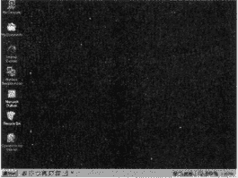

## 桌面


“我的电脑”用于浏览计算机内容并执行其他日常操作。


如果您的计算机属于网络，“网上邻居”用于与其他计算机进行通信。


当您删除计算机上的某些内容（文件夹或文件）时，它们会进入名为“回收站”的区域，在那里您仍然有机会恢复（找回或还原）它们。


文件夹是您将用来存储或定位工作的容器之一。您最终将学习如何创建和操作文件夹。

我的电脑、网上邻居和回收站程序是一种称为“系统文件夹”的文件夹；它们是计算机附带的标配。它们具有精美的（艺术性）图标。您创建的文件夹为黄色，带有一个小标签，被视为“用户创建”的文件夹。

## 任务栏

在屏幕底部，有一个（或可能有一个）长条对象。它被称为任务栏。在任务栏左侧，有一个带有“开始”字样的区域 [开始按钮图片] 或 [开始按钮图片]。其外观取决于您使用的 Windows 版本，但在任何版本中它的作用完全相同。

在“开始”按钮的右侧，有一个宽阔的区域，计算机启动时它是空的。这实际上被称为任务栏。随着您持续使用计算机，此区域将充满一些对象。在某些版本（Windows 95、98、Windows Server 2003）中，任务栏的颜色可能是灰色（或银色）。在其他一些版本（Windows Millennium）中，任务栏可能偏黄。在 Windows XP 中，任务栏可能是蓝色的。

任务栏最右侧有一个称为“托盘区域”的部分。该区域显示的内容之一就是当前时间（按计算机设置的时间）。

图形上，任务栏表示如下：

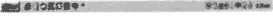

## 窗口

窗口是计算机显示器上显示内容的一个（通常）矩形区域，它似乎独立于屏幕的其余部分来呈现其内容（例如目录、文本文件或图像的内容）。窗口是构成图形用户界面（GUI）的元素之一。

GUI 是一种人机界面（即人们与计算机交互的系统），它使用窗口、图标、下拉菜单和指针，并且可以通过鼠标（通常在一定程度上也可以通过键盘）进行操作。图标是表示程序（或命令）、文件、目录（也称为文件夹）或设备（如硬盘或软盘）的小图片或符号。

与控制台的命令行界面（CLI）相比，GUI 具有明显优势；CLI 仅显示文本（即没有图像），并且只能通过键盘访问。GUI 使计算机更易于学习和使用，也促进了计算机主要新应用的开发，包括桌面出版和 CAD（计算机辅助设计）。

## 窗口元素

以下是窗口的基本元素：

### 应用程序窗口

应用程序窗口是几乎所有程序的主要部分。应用程序窗口的常见元素包括控制菜单、菜单栏和边框。图形上表示如下：

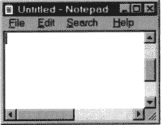

### 对话框

从技术上讲，对话框也是窗口。对话框通常与应用程序相关联，帮助执行特定任务或为应用程序提供详细信息。大多数对话框缺少一些控制按钮和边框，并且在窗口内部会有其他按钮来完成请求，例如“确定”和“取消”。

图形上表示如下：


### 边框

边框是“形成某物外缘的部分”。如上例所示，应用程序窗口的边缘有一条细边框（就是像这样：[图标] 的部分）。边框不仅定义了窗口在桌面上的位置，还可以用来改变大多数窗口的大小。如果用鼠标指向边框，指针将变为双向箭头，如下所示：[图标]。如果此时按住鼠标按钮，就可以拖动边框，从而改变窗口的大小。

### 标题栏

标题是“总括性的或描述性的标题”。标题就是“位于顶部或开头的标题、副标题或主题”。因此，上述应用程序窗口的标题栏为：[图标] 无标题 - 记事本 [图标]；或者更具体地说，无标题 - 记事本，因为控制按钮是附属物。除了标识窗口外，标题栏还允许您通过按住标题并移动鼠标来在桌面上移动窗口。

### 控制按钮

控制按钮是标题栏上的所有小按钮，但它们实际上不属于标题的一部分。这些包括：

### 控制菜单

在 Windows 3.x 中，激活控制菜单的按钮始终如下所示：[图标]。

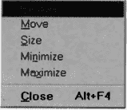

在 Windows 95 中，该按钮是程序图标的缩略版，例如：[图标]。无论哪种情况，该按钮都位于标题栏的左侧。按下它会显示一个菜单，其中包含几个标准的窗口操作命令，例如：

请注意，所有这些命令都可以使用鼠标通过其他窗口元素完成；它们的主要用途在于当您必须使用键盘执行这些功能时。

### 最小化按钮

在 Windows 3.x 中，此按钮如下所示：[图标]。按下它会移除窗口，并在桌面上某个位置替换为程序图标。单击该图标会弹出控制菜单，以便您可以重新打开窗口。在 Windows 95 中，该按钮如下所示：[图标]。按下它会移除窗口，但会将该程序的按钮保留在任务栏上。如果用鼠标右键单击该按钮，它将像 Windows 3 一样弹出控制菜单。但如果用鼠标左键单击该程序的按钮，程序窗口将立即恢复。

### 最大化/还原按钮

在 Windows 3.x 中，最大化按钮如下所示：[图标]。按下它会使窗口尽可能大——通常和屏幕一样大。然后按钮将变为“还原按钮”：[图标]，您可以按此按钮将窗口恢复为之前的大小。在 Windows 95 中，最大化按钮如下所示：[图标]。它的功能与 Windows 3 中的对应按钮相同，只是窗口（通常）只会向下扩展到任务栏。这使您可以看到所有其他在任务栏上有按钮的程序，从而可以使用鼠标在它们之间轻松切换。Windows 95 中的“还原按钮”如下所示：[图标]。

### 关闭按钮

Windows 3.x 没有此按钮。在 Windows 95 中，它如下所示：[图标]。按下此按钮只是关闭窗口的一种方法，而且是最简单的。但在对话框上要小心

对话框：当此按钮激活时，它通常与按“取消”按钮的效果相同，因此请确保你不需要保存对话框中所做的任何更改。关闭窗口的其他方式包括：如果是应用程序窗口，双击控制菜单或单击“文件”菜单然后选择“退出”；如果是对话框，则单击“确定”按钮。

## 帮助按钮

某些 Windows 95 标题栏上的一个特殊附加按钮是这个：[问号按钮]。如果按下它，鼠标指针上会出现一个问号。然后当你在该窗口中点击其他内容时，会看到一个小方框，描述你所点击内容的功能和/或使用方法：


## 调整大小手柄

调整大小手柄是某些 Windows 95 窗口新增的功能，实际上是边框的延伸，位于窗口右下角。当你

## 菜单栏

几乎每个应用程序窗口的标题栏正下方都有一个菜单栏。菜单栏上的每个单词都是一个独立的菜单。如果你单击某个单词，相应的菜单就会出现，如下所示：


有些程序具有级联菜单，这意味着菜单中的某一项会带你进入另一个相关菜单。Windows 95 中一个非常常见的例子是“开始”菜单（顺便说一下，它不是菜单栏的一部分，而是任务栏上的一个按钮）：

请注意，你可以通过侧面的右箭头来识别级联菜单。

## 弹出菜单

另一种菜单类型是弹出菜单。与其他菜单不同，弹出菜单没有


任务栏中间部分包含当前打开的每个应用程序窗口的按钮。这使得同时做许多事情变得非常容易。要在程序之间切换，只需单击任务栏上对应的按钮。当然，这也可以让你了解你打开了哪些程序以及它们是什么。

在任务栏的另一端是“系统托盘”。该托盘包含时钟以及各种小型应用程序的微型图标。只需将指针指向其中一个图标，就会弹出一个简要说明，描述该小程序或其状态。例如，系统托盘最左侧的黄色扬声器图标可以让你控制音量。如果你指向时钟，它会短暂显示日期。

任务栏也是一个窗口。与应用程序窗口一样，你可以更改其大小；但任务栏只有一侧有边框（未贴着显示屏边缘的那一侧）。你最多只能将任务栏扩大到桌面大小的一半，但窗口会很乐意让你把它缩小到只剩边框！

你也可以移动任务栏，但与其他窗口不同，它必须贴在显示屏的一侧并占据该侧的整个长度。要移动任务栏，只需在任务栏上没有被按钮覆盖的部分按住鼠标按钮，然后将其拖到你想要的屏幕任意一侧。

## 图标

图标是“一种图像；一种表示”。它用于表示窗口、程序、文件或任何其他对象。图标的行为因其所代表的内容而异，但通常需要双击图标才能激活它。在 Windows 95 中，在大多数图标上单击鼠标右键会显示一个菜单，其中提供了你可以对该图标执行的其他工具。


## 探索你的计算机

计算机启动后，你就可以开始探索你的计算机了，即你可以看到计算机上有哪些内容（文件、应用程序等）。

有几种方法可以让你在计算机中导航。但常用的方法如下：

- 1. 开始按钮和任务栏
- 2. 我的电脑
- 3. Windows 资源管理器

现在我们将逐一讨论这些问题。

### 开始按钮和任务栏

你可以使用任务栏和“开始”按钮在 Windows 98 中轻松导航。无论你打开了多少个窗口，这两个功能都始终在桌面上可用。

*“开始”按钮*

“开始”菜单是启动程序的主要导航工具。它还提供对某些系统设置的访问。开始菜单位于屏幕左下角。

- **程序：** 子菜单，其中包含计算机上安装的所有程序。
- **文档：** 最近打开过的文档的子菜单。
- **设置：** 系统设置和控制面板的子菜单。
- **搜索：** 用于不同类型搜索的子菜单。其中一种是查找文件和文件夹的搜索。
- **帮助：** 一个帮助向导，提供有关 Windows 2000 特定区域的常见问题的解答。
- **运行：** 为高级用户提供的命令行界面。
- **关闭：** 让用户可以选择关闭计算机（关机）、重新启动或注销。

图形上，“开始”菜单如下图所示（第54页顶部）。


大多数初学者不知道自己有多少程序，也不知道这些程序叫什么名字。如果你属于这一类，不妨花一分钟时间环顾四周。也就是说，单击“开始”按钮，然后依次单击“所有程序”。然后，每当你看到带有箭头的菜单选项时，将指针指向它或单击它，即可查看该组中程序的名称。阅读一些程序名称并查看它们的图标，以便开始熟悉计算机中的内容。

### 任务栏

如果你将计算机的硬盘想象成一个文件柜，其中存储着所有程序和文档（文件），那么你可以将 Windows 桌面想象成你真实的“木质”桌面。Windows 桌面上只放着你当前正在处理的东西，就像你真实的桌面一样。

在任意给定时刻，你可能会在桌面上打开多个程序、文件夹和文档。“当前在桌面上打开的任何内容”的简称是 *任务*。也就是说，我们可以将桌面上的每个打开项——无论它是什么——称为“任务”，即“进行中的任务”的简称。Windows 任务栏大致位于屏幕底部中央，如下图所示：


每个任务栏按钮代表一个打开的程序（一个“进行中的任务”）

当你打开大量程序窗口时，它们会堆叠在 Windows 桌面上，就像纸张会堆在真实桌面上一样。你可以使用任务栏来进行某种“洗牌”，从而控制当前哪些内容可见或不可见。以下是一些可以用任务栏完成的相关操作：

- 如果某个程序窗口被埋没在杂乱中，单击其任务栏按钮即可立即将其置于堆栈顶部。
- 你也可以单击某个任务的任务栏按钮使其不可见（这样它就不会占用桌面空间），然后再次单击同一按钮使其重新可见。
- 你也可以通过右键单击任务栏按钮并选择“关闭”来关闭任何打开的任务（从而将其从桌面移除并放回文件柜中）。

### 我的电脑

当双击桌面上的“我的电脑”图标时，会打开“我的电脑”资源管理器窗口，显示当前计算机上的存储介质列表。这些介质可以包括软盘驱动器、CD-ROM、DVD-ROM、可移动磁盘（如 ZIP 磁盘）和硬盘驱动器。

- **3½ 软盘：** 软盘驱动器。要访问软盘上的文件，请双击软盘图标。
- **本地磁盘：** 硬盘驱动器。通常 C: 驱动器是存储 Windows 2000 文件的主驱动器。可能存在多个本地磁盘。要访问文件和文件夹，请双击本地磁盘图标。
- **光盘：** CD-ROM 驱动器。双击光盘图标即可访问 CD 上的文件和文件夹。只有当存在 **CDR/RW** 驱动器时，CD 才是只读的。


- **可移动磁盘：** 可移动磁盘可以是各种便携式媒体，从 ZIP 磁盘到 USB 闪存盘。

## 搜索文件和文件夹

此工具允许用户在计算机上搜索文件。要打开搜索窗口，请依次转到“开始”→“搜索”→“文件或文件夹”。

- **搜索内容：** 在此输入用户要查找的文件名。
- **搜索范围：** 文件可能所在的位置。该工具还将搜索给定位置中的所有子文件夹。
- **重新开始：** 清除搜索结果。
- **立即搜索：** 开始搜索。
- **还可以按以下条件搜索：** 为搜索结果添加更多筛选条件。例如，如果知道文件的创建日期或上次修改日期，用户可以勾选日期复选框并输入日期或日期范围。

可以使用一些通配符来帮助缩小搜索范围。

- **星号 (*)** 可以包含在文件名中，代替零个或多个字符。例如，如果用户输入 `tax_return_*`，结果将是 `tax_return_1998`、`tax_return_1999`、`tax_return_2000` 等。
- **问号 (?)** 可以包含在文件名中，代替单个字符。例如，搜索 `tax_return_200?` 将返回文件 `tax_return_2000`、`tax_return_2001`、`tax_return_2002` 等。

## 系统托盘

系统托盘位于屏幕的右下角。系统托盘中有一个时钟和当前在系统上运行的程序的其他图标。通常，右键或左键单击这些图标会显示一些用于与该程序交互的选项。

系统托盘如下图所示：


系统托盘

## 控制面板

控制面板是计算机设置的主要配置位置。要打开控制面板，请依次转到“开始”→“设置”→“控制面板”。每个控制项都有许多图标。有些控制项会调整系统中的敏感设置，有些则调整鼠标和键盘等输入设备的工作方式。以下是一些基本设置的列表。

- **添加/删除程序：** 这是用于从计算机中正确删除软件的控制面板。不要仅仅删除程序，这一点很重要，因为在安装程序时会创建其他系统条目，而仅删除程序并不会删除这些条目。
- **日期/时间：** 用于设置计算机日期和时间的控制面板。
- **键盘：** 用于键盘设置的控制面板，例如键入时光标闪烁的速率。
- **鼠标：** 用于鼠标设置的控制面板，例如双击速度。根据鼠标类型的不同，此控制面板可能因机器而异。
- **区域选项：** 此控制面板包含使用何种货币类型或如何显示数字等设置。

控制面板如下图所示：


## Windows 资源管理器

Windows 资源管理器是 Microsoft Windows 中提供的一种文件管理工具。您可以使用 Windows 资源管理器查看计算机上可用的所有资源。

### 启动资源管理器

单击**开始**按钮，指向**程序**，然后指向**附件**，再单击**Windows 资源管理器**。

### 启动资源管理器的其他方法

以下是启动资源管理器的其他方法：

- 右键单击“开始”按钮，然后单击“资源管理器”。
- 右键单击“我的电脑”图标，然后单击“资源管理器”。
- 按住“Windows”键 + e

### Windows 管理工具和实用提示

资源管理器窗口如下图所示：

### 菜单栏

资源管理器窗口的**菜单栏**可以访问资源管理器可用的所有命令。要查看每个菜单命令的功能说明，请单击某个命令，然后将鼠标指针悬停在它上面。有关命令的信息将显示在窗口底部的状态栏中。（注意：如果未显示状态栏，请单击**查看**菜单，然后单击**状态栏**命令。）将指针滑过其他命令和子命令可查看更多说明。

资源管理器窗口的主区域分为两个窗格。

- 左侧窗格标记为*所有文件夹*。您将看到所有可用驱动器以及驱动器中的文件夹。
- Windows 资源管理器右侧窗格显示在左侧窗格中选定的驱动器或文件夹的*内容*。您的文档和程序存储在文件夹中，文件夹以黄色文件夹图标表示。

**文件夹有时也称为目录。**

- 可以使用 +（加号）和 −（减号）展开和收起文件夹。

### 资源管理器窗口


### 回收站

回收站是已删除文件和文件夹的存储区域。可以从回收站恢复已删除的项目。一旦清空回收站，文件将永久消失。

- 要从回收站还原文件，请选择该文件，然后选择“文件”，再选择“还原”。（或者，选择该文件，右键单击该文件，然后选择“还原”。）
- 按 Shift+Delete 键，文件不会进入回收站——而是会从硬盘中永久删除。

您可以使用**查看**菜单上的命令更改文件和文件夹的显示方式。

### 更改文件夹中项目的显示外观

如果要更改文件夹中项目的外观，请执行以下操作：
单击**查看**菜单，然后单击以下命令之一：

- 大图标
- 小图标
- 列表
- 详细信息

您还可以根据视图按名称、大小、日期和类型对项目进行排序。试用**查看**菜单上的**排列图标**命令。另一种排序方法是单击内容窗格中的列标题。

### 更改资源管理器窗口面板的大小

将鼠标指针放在分隔两个面板的栏上。当看到双向箭头（↕）时，左键单击并将栏向右或向左拖动以调整面板大小。

### 显示文件夹的内容

如果要显示文件夹的内容，请执行以下操作：

- 双击文件夹名称

**或者**

- 单击文件夹左侧的加号 (+)。

### 打开程序

如果要打开的程序位于桌面上，只需双击其图标即可打开。但是，如果它不在桌面上，请执行以下步骤：

1. 单击屏幕左下角的**开始**
2. 单击**程序**
3. 选择要打开的程序。

该过程如下图所示：


## 管理文件和文件夹

在 Windows 98 中，您可以根据自己的偏好组织文档和程序。您可以将这些文件存储在文件夹中，并且可以移动、复制甚至搜索文件和文件夹。

### 创建文件夹

以下是在 Windows 98 中创建新文件夹需要遵循的步骤。

1. 选择要在其中创建文件夹的驱动器或文件夹
2. 在右侧窗格的空白区域中右键单击
3. 选择**新建**
4. 选择**文件夹**
5. 输入该文件夹的名称

该过程如下图所示：


Windows 98 中的文件名最多可包含 255 个字符（包括空格）。但是，文件名不能包含以下任何字符：\\ / : * ? " < > |。

### 删除文件或文件夹

以下是在 Windows 98 中删除文件需要遵循的步骤。

1. 选择要删除的文件/文件夹
2. 按键盘上的 Delete 键
3. 确认删除

当您删除任何文件或文件夹时，它会被自动存储在回收站中。

### 从回收站还原文件

当我们想要删除任何文件时，该文件会自动进入回收站，如果我们想要从回收站还原文件，则必须遵循以下步骤：

1. 双击桌面上的“回收站”图标。
2. 在回收站中选择所需文件
3. 单击“文件”菜单中的“还原”命令。

如果在命令提示符下从软盘（A: 或 B: 驱动器）删除文件，该文件不会进入回收站。

### 将文件移动/复制到其他文件夹

以下是将文件移动/复制到其他文件夹需要遵循的步骤。

1. 选择要移动或复制的文件夹
2. **移动文件**——只需将其拖到目标位置即可
3. **复制文件**——单击屏幕顶部的“编辑”→“复制”。然后转到目标文件夹并单击“编辑”→“粘贴”

### 将文件/文件夹复制到软盘

以下是将文件/文件夹复制到软盘需要遵循的步骤。

1. 选择要移动或复制的文件夹
2. 在右侧窗格中右键单击文件或文件夹
3. 选择**发送到** →
4. 选择**3.5 软盘 (A)**
5. 您也可以将文件拖到左侧窗格中的 3.5” 软盘 (A:\\) 中

该过程如下图所示：


## 将文件/文件夹从软盘复制到其他驱动器

以下是将文件/文件夹从软盘复制到其他驱动器所需遵循的步骤：

- 在左侧窗格中选择 3.5 英寸软盘 (A:)。
- 选择要从软盘驱动器复制的文件/文件夹。
- 将其拖到目标位置。

## 重命名文件或文件夹

以下是重命名文件或文件夹所需遵循的步骤：

- 选择要重命名的文件或文件夹。
- 右键单击它。
- 选择**重命名**。
- 重命名文件。

该过程如下图所示：


## 在计算机上查找文件

以下是在我们的计算机系统上查找文件所需遵循的步骤：

- 单击**开始**。
- 单击**查找**。
- 选择**查找文件或文件夹**。
- 输入你的搜索条件。你不需要填写每个字段。只需输入要用于搜索的条件。切换不同的选项卡（日期、高级、名称和位置）以进一步搜索。
- 单击**立即查找**按钮。


## 使用通配符搜索

通配符是一种键盘字符，例如星号 (*) 或问号 (?)，用于在搜索文件、文件夹、打印机、计算机或人员时表示一个或多个字符。当你不知道真正的字符是什么或不想键入完整名称时，通常使用通配符代替一个或多个字符。

下表显示了 (*) 和 (?) 通配符的工作方式：

| 通配符 | 用途 |
| --- | --- |
| **星号 (*)** | 使用星号替代零个或多个字符。如果你要查找一个你知道以“gloss”开头但记不住其余部分文件名的文件，请键入以下内容：`gloss*`。这将定位所有以“gloss”开头的任意文件类型的文件，包括 Glossary.txt、Glossary.doc 和 Glossy.doc。要将搜索范围缩小到特定文件类型，请键入：`gloss*.doc`。这将定位所有以“gloss”开头且文件扩展名为 .doc 的文件，例如 Glossary.doc 和 Glossy.doc。 |
| **问号 (?)** | 使用问号替代名称中的单个字符。例如，如果你键入`gloss?.doc`，将找到 Glossy.doc 或 Gloss1.doc 文件，但不会找到 Glossary.doc。 |

## 打开文件和文件夹

找到所需文件后，可以双击将其打开。

现在我们必须遵循以下步骤来打开任何文件或文件夹：

- 在桌面上，双击**我的电脑**。将打开“我的电脑”窗口。
- 双击包含要打开的文件或文件夹的驱动器。
- 双击该文件或文件夹。

## 使用常用文件

你可以快速打开经常使用的文档和程序。“开始”菜单会列出最近使用的文档，以便你可以快速重新打开它们。桌面上的“我的文档”文件夹是存储常用文件和文件夹的便捷位置；为了轻松访问经常使用的文件，你还可以为其创建快捷方式。快捷方式不会改变文件的位置——快捷方式只是一个指针，让你可以快速打开该文件。如果删除快捷方式，原始文件不会被删除。

要打开最近使用的文档，我们必须遵循以下步骤：

- 单击**开始**按钮，然后指向**文档**。将显示最近打开的文档列表。
- 单击列表中的某个文档。该文档随即打开。


## 创建快捷方式

创建快捷方式需要遵循以下步骤：

- 在资源管理器中，**右键单击**要创建为快捷方式的文件。
- 从弹出菜单中选择**发送到**，然后选择**桌面（创建快捷方式）**。
- 单击**确定**以确认。
- 最小化资源管理器窗口以验证快捷方式已创建。

**另一种创建快捷方式的方法如下：**

- 在桌面上的任意位置**右键单击**。
- 选择**新建**，然后选择**快捷方式**。
- 单击**浏览**按钮。
- 在“浏览”窗口中，找到**Windows 文件夹**并**双击**它。然后找到**tour.exe**文件，单击一次以将其选中。
- 单击**打开**按钮。
- 单击**下一步**按钮，然后单击**完成**。

## 删除快捷方式

删除快捷方式需要遵循以下步骤：

- **右键单击**要删除的快捷方式。
- 从弹出菜单中选择**删除**，然后单击**是**进行确认。

## Windows 基本附件

Windows 操作系统自带一些基本附件，如计算器、画图、记事本、写字板等。让我们进一步了解如何使用这些附件。

### 记事本

记事本是一个基本文本编辑器，可用于处理简单文档或创建网页。要创建或编辑需要格式化的文件，请使用写字板。

### 打开记事本

要打开记事本，请单击**开始**，指向**所有程序**，指向**附件**，然后单击**记事本**。该过程如下图所示：


### 画图

画图是一种绘图工具，可用于创建简单或精细的绘图。这些绘图可以是黑白或彩色的，并且可以保存为位图文件。你可以打印绘图、将其用作桌面背景或粘贴到另一个文档中。你甚至可以使用画图来查看和编辑扫描的照片。

你还可以使用画图来处理图片，例如 .jpg、.gif 或 .bmp 文件。你可以将画图图片粘贴到已创建的另一个文档中，或将其用作桌面背景。

### 打开画图

要打开画图，请单击**开始**，指向**所有程序**，指向**附件**，然后单击**画图**。该过程如下图所示：


### 计算器

你可以在标准模式下使用计算器进行简单计算，或在科学模式下进行高级科学和统计计算。

### 打开计算器

要打开计算器，请单击**开始**，指向**所有程序**，指向**附件**，然后单击**计算器**。该过程如下图所示：


### 写字板

你可以使用写字板创建或编辑包含格式或图形的文本文件。对于基本文本编辑或创建网页，请使用记事本。

### 打开写字板

要打开写字板，请单击**开始**，指向**所有程序**，指向**附件**，然后单击**写字板**。该过程如下图所示：


## 剪贴板

剪贴板是已剪切或复制项目的存储区域。每次执行剪切或复制操作时，都会用刚剪切或复制的内容替换剪贴板上的旧信息。你可以随意多次粘贴剪贴板信息，直到用其他内容替换它。

## 关闭计算机

关闭计算机所需遵循的步骤如下：

- 单击**开始**。
- 单击**关闭系统**（将出现“关闭 Windows”对话框）。
- 单击**关闭**。
- 单击**确定**。

该过程如下图所示：


## 总结

- 操作系统是用于操作计算机系统的系统软件。
- 操作系统可分为两类：（a）单用户操作系统，和（b）多用户操作系统。
- 单用户操作系统意味着一次只能有一个用户工作。
- 多用户操作系统意味着多个用户可以同时工作。
- DOS、Windows 95 是单用户操作系统的例子。
- UNIX、LINUX、WINDOWS NT 是多用户操作系统的例子。


## 习题

### A 部分

*选择题*

- 1. 哪个命令可以显示所有文件名相同但扩展名不同的文件？
    (a) Dir filename.*
    (b) Dir filename.ext
    (c) Dir *.sys
    (d) Dir *.ext

- 2. 哪个命令只显示文件和目录名称，而不显示大小、日期和时间信息？
    (a) Dir/w
    (b) Dir a:
    (c) Dir /b
    (d) Dir /s

- 3. 哪种软件用于启动计算机系统？
    (a) 命令
    (b) 用户界面
    (c) 操作系统
    (d) 实用程序

- 4. 引导（Booting）是指
    (a) 执行自检
    (b) 检查计算机内存
    (c) 将操作系统加载到计算机内存中
    (d) 执行一条命令

- 5. 以下哪项管理功能不是操作系统执行的？
    (a) 软件管理
    (b) 信息管理
    (c) 设备管理
    (d) 内存管理

- 6. 以下哪个是单用户多任务操作系统？
    (a) MS-DOS
    (b) Windows-XP
    (c) Windows 2000
    (d) UNIX

- 7. GUI 是
    (a) 硬件
    (b) 语言解释器
    (c) 软件界面
    (d) 操作系统

- 8. 多道程序设计（Multiprogramming）是指
    (a) 同时在 RAM 中拥有多个程序
    (b) 多任务处理
    (c) 用多种语言编写程序
    (d) 以上都不是

- 9. 多道程序设计是以下哪项的先决条件
    (a) 多任务处理
    (b) 操作系统
    (c) 同时运行多个程序
    (d) 以上都不是

- 10. 以下哪项不是 GUI 组件？
    (a) 单选按钮
    (b) 菜单
    (c) 命令
    (d) 文本框

- 11. MS-DOS 提供哪种类型的用户界面？
    (a) GUI
    (b) CUI
    (c) ABI
    (d) MGI

- 12. 第一个操作系统是在哪一年开发的？
    (a) 1910
    (b) 1940
    (c) 1950
    (d) 1980

- 13. MS-DOS 是在哪一年开发的？
    (a) 1991
    (b) 1984
    (c) 1971
    (d) 1961

- 14. CHKDSK 命令用于
    (a) 分析硬盘错误
    (b) 诊断硬盘错误
    (c) 报告磁盘上文件的状态
    (d) 以上全部

- 15. DOS 中的内部命令是
    (a) Cls、rd、label
    (b) Dir、ren、sys
    (c) Time、type、dir
    (d) Del、disk copy、label

- 16. 从复选框列表中最多可以选中多少个选项？
    (a) 根据需要任意多个
    (b) 列表中呈现的所有选项
    (c) 1
    (d) 0

- 17. 哪个命令用于查看版本？
    (a) Version
    (b) Ver
    (c) Verson
    (d) 以上都不是

- 18. 哪个命令可用于创建磁盘的磁道和扇区？
    (a) Fdisk
    (b) Format
    (c) Chkdsk
    (d) Attrib

- 19. 哪个命令用于将 A 盘中所有扩展名为 .txt 的文件复制到当前登录的驱动器和目录？
    (a) Copy a: *.txt   (b) Copy *.txt a:
    (c) Copy *.txt   (d) Copy *.txt all.txt

- 20. 哪个命令用于在磁盘上创建根目录和 FAT？
    (a) CHKDSK   (b) Command.com
    (c) Format   (d) Fat

- 6. 结合适当示例，定义 WINDOWS 操作系统的概念。
- 7. 结合 Windows 操作系统，定义 DESKTOP（桌面）的概念。
- 8. 结合 Windows 操作系统，定义 taskbar（任务栏）的概念。
- 9. 结合 Windows 操作系统，定义 Menu Bar（菜单栏）的概念。
- 10. 结合 Windows 操作系统，定义 MY COMPUTER（我的电脑）的概念。

### 填空题

- 1. Edit 是 ________ 的一个示例。
- 2. MS-word 是 ________ 的一个示例。
- 3. 在 MS-DOS 中显示文件，使用 ________ 命令。
- 4. 在 UNIX 中显示/复制文件，使用 ________ 命令。
- 5. 在 UNIX 中，命令是 ________ 敏感的。
- 6. GUI 是 ________ 的缩写。
- 7. ________ 是网络操作系统的一个示例。
- 8. ________ 是多用户操作系统的一个示例。
- 9. 将使用 MS-DOS 的 ________ 命令来复制当前目录中所有文件的名称。
- 10. DOS 是 ________ 的一个示例。

### B 部分

**简答题**

- 1. 软件是什么意思？软件有哪些不同的分类？
- 2. 硬件是什么意思？并解释计算机系统中使用的各种硬件项目？
- 3. 结合适当示例，区分应用软件和系统软件？
- 4. 结合适当示例，定义 UNIX 操作系统的概念。
- 5. 结合适当示例，定义 LINUX 操作系统的概念。

### C 部分

**长答题**

- 1. 定义 Windows 资源管理器的概念，并说明 Windows 资源管理器的工作方式。
- 2. 结合适当示例，定义基本的 Windows 附件。
- 3. 如何在 Windows 环境中打开记事本（NOTEPAD）？结合适当示例说明。
- 4. 如何在 Windows 环境中打开写字板（WORDPAD）？结合适当示例说明。
- 5. 如何在 Windows 环境中打开画图（PAINT）？结合适当示例说明。
- 6. 如何在 Windows 环境中打开计算器（Calculator）？结合适当示例说明。
- 7. 如何在 Windows 环境中打开 MSWORD？结合适当示例说明。
- 8. 如何在 Windows 环境中打开 MSEXCEL？结合适当示例说明。
- 9. 如何在 Windows 环境中打开 MSPOWERPOINT？结合适当示例说明。
- 10. 定义术语“操作系统”，并解释操作系统的用途。说出四种流行的操作系统。

## 3 编程基础

计算机编程是编写、测试、调试/排除故障以及维护程序源代码的过程。该源代码使用编程语言编写。代码可以是对现有源代码的修改，也可以是全新的内容。编程的目的是生成一个表现出特定预期行为（定制化）的程序。编写源代码的过程需要多方面的专业知识，包括应用领域知识、专用算法和形式逻辑。

在编程环境的背景下，我们将讨论以下术语：

- 汇编器
- 编译器
- 解释器
- 链接器
- 加载器

### 编程环境

编程环境是集成到软件应用程序中的一种环境，它提供了 GUI 构建器、文本或代码编辑器、编译器和/或解释器以及调试器。

编程环境可以图形化地表示，如图 3.1 所示。

### 汇编器

汇编器是一种将程序从汇编语言翻译成机器语言的程序。

### 编译器

一种将*源代码*转换为*目标代码*的程序。编译器之所以得名，是因为它的工作方式：查看整个源代码并收集和重新组织指令。因此，编译器不同于*解释器*，解释器是逐一检查并执行每一行源代码，而不查看整个程序。解释器的优点是可以立即执行程序。编译器则需要一些时间才能生成可执行程序。然而，由编译器生成的程序比由解释器执行的相同程序运行得快得多。

每种高级编程语言（严格解释性语言除外）都附带一个编译器。实际上，编译器就是语言本身，因为它定义了哪些指令是可接受的。

由于编译器将源代码转换为目标代码，而目标代码对于每种类型的计算机都是唯一的，因此同一语言有许多可用的编译器。例如，有一种


图 3.1：编程环境

为计算机程序员提供软件开发设施。IDE 通常包含源代码编辑器、编译器和/或解释器、构建自动化工具，并且通常还包含调试器。有时还会集成版本控制系统和各种工具，以简化 GUI 的构建。许多现代 IDE 还具有类浏览器、对象检查器和类层次结构图，用于面向对象的软件开发。

IDE 旨在通过提供具有相似用户界面的紧密结合组件来最大化程序员的生产力。这意味着计算机程序员在使用离散的开发程序时，需要进行的模式切换要少得多。

通常，IDE 专用于特定的编程语言，以提供与该语言编程范式最匹配的功能集。然而，也有一些多语言 IDE 在使用，例如 Eclipse、Active State Komodo、较新版本的 Net Beans 和 Microsoft Visual Studio。

### 软件（程序）开发生命周期

软件开发生命周期（SDLC）是一个详细计划的模型，说明如何创建、开发、实施并最终停用软件。它是一个完整的计划，概述了软件将如何诞生、成长并最终从其功能中退役。尽管某些模型没有明确说明程序将如何停用，但众所周知，在不断变化的 Web、软件和编程技术世界中，软件最终都会有终结之时。

### SDLC 的各个阶段

开发软件有多种方式。几乎每个基于技术的公司都有自己开发软件的方式。尽管不同公司遵循不同的开发理论，但它们肯定会遵循以下一般阶段：

**规划**

在创建程序之前，程序员必须知道要创建什么。因此，软件开发公司利用这个阶段来确定当前市场的需求。调查和项目提案在此阶段很常见。管理层通常参与此阶段，以确定开发人员需要做什么以及他们的工作将如何影响市场。

**设计**

在管理层批准计划和分配的预算之后，下一步是创建程序的架构。开发人员一起工作并讨论开发程序的方式。软件的工作流程在此阶段概述。某些软件开发模型以相当简单的方式处理此阶段，例如迭代开发模型通常将此阶段视为软件实际创建的开始。初始程序在此开发模型部分创建。

**测试**

必须确保所创建的程序在不同环境中都能良好运行。常规测试方式要求测试人员在不同条件下使用该程序。另一种测试方式是让正常和预期用户在实际条件下以受限制的方式测试程序，以便在软件发布供一般使用之前可以进行必要的修改。测试阶段可能包括以 beta 测试方式实施软件，以确保它能同时承受多个用户的使用。

**实施**

一旦测试完成并且软件被宣布适合实施，它就会公开发布出售或从 beta 版本中移除


版本。最初，可能会面临修复不同用户所发现错误的严峻挑战。

创建后程序自动执行。

## 维护

软件正确实施后，开发人员在该软件中的角色并未就此结束。相反，他们必须对该软件做出响应式工作。计算机程序员不是去寻找所创建软件中的问题，而是为这些问题提供答案。

## 终止

没有软件会永远存在。更新不断进行，有时软件需要被完全废弃。新编程语言的演变或同一软件对不同平台的适配，也可能导致原始软件的终止。

## 编写并执行程序

以下是在任何编程环境中编写和执行程序通常遵循的步骤：

- 1. 程序首先用编程语言的编辑器编写。
- 2. 然后对程序进行编译或解释，自动生成该程序的目标代码。
- 3. 然后对程序进行链接，自动创建直接可执行文件。程序被执行并创建直接可执行文件。

在C编程语言中，编写和执行程序的过程如下所示：

- 1. 首先，在C语言编辑器中创建源文件，即 `first.c`
- 2. 然后在 `ALT+F9` 的帮助下编译 `first.c` 文件，自动生成目标文件，即 `first.obj`
- 3. 然后在 `CTRL+F9` 的帮助下链接程序，该特定文件的直接可执行文件被自动

## 数字计算机

我们知道，信息处理在决策中起着非常重要的作用。在这种背景下，计算机在大规模信息处理中发挥着重要作用。在这里，我们研究计算机是什么以及计算机的组织结构。计算机运行程序或语句集。我们将讨论约翰·冯·诺依曼所作的重要贡献。目标是理解计算机的定义、计算机的工作概念、存储程序概念和微处理器。

## 数字计算机的基本功能单元

计算机是一种电子设备，它接收信息，根据程序处理信息，并产生输出。计算机程序可以用高级语言编写，如 Pascal、FORTRAN、COBOL 等。有些程序也用汇编语言编写程序来执行所需的任务。

计算机系统由硬件和软件组成。硬件指的是计算机的任何物理、电气、机电组件。例如，键盘和鼠标被视为硬件术语。软件指的是为实现特定任务而编写的程序或指令集。

计算机系统具有以下五个基本功能单元：

- (a) 输入单元
- (b) 输出单元
- (c) 控制单元
- (d) 存储单元
- (e) 算术逻辑单元
- 中央处理器

图形化地，计算机系统可以表示如下：


## 问题解决技术

问题解决是一个创造性的过程，它体现了系统化和机械化。可以采取许多步骤来提高个人在问题解决方面的表现水平。

### 问题解决的步骤

问题解决技术通常包括以下步骤来寻找解决方案。

### 问题定义阶段

解决任何问题的成功在于首先要充分理解问题。我们不能指望解决一个我们不理解的问题。因此，理解问题是迈向问题解决的第一步。它是*必须做什么*，而不是*如何做*。我们必须定义解决问题所需执行的一组任务。

### 开始着手问题

解决问题的方法有很多，可能的解决方案也有多种。因此，很难立即识别哪条路径可能更高效。有时，即使问题已经定义，你也不知道从哪里开始解决。这种阻碍有时是因为你在完全理解或想出解决方案之前，就过度关注实现细节。最好的建议是不要过多担心细节。当问题的复杂性被理解后，细节可以稍后再处理。

### 使用具体示例

要开始解决问题，我们可以利用启发式方法，即指导原则。这种方法允许我们通过选择一个想要解决的特定问题，并尝试找出解决该特定问题的机制来开始工作。通常，解决特定问题的细节更容易制定，因为机制与问题之间的关系更加清晰明确。这种专注于特定问题的方法可以为我们提供解决一般问题所需的立足点。

### 问题之间的相似性

开始的方法之一是考虑一个具体的例子。另一种方法是利用以往的经验来处理当前的问题。因此，重要的是看当前问题与我们过去已解决的问题之间是否有任何相似之处。一个人经验越丰富，在处理给定问题时就能运用越多的工具和技术。但有时，这也会阻碍我们发现更好或更理想的解决方案。在问题解决中，需要培养的一项重要技能是从不同角度审视问题的能力。一个人必须能够比喻性地将问题颠倒、翻转、侧转、后转、前转等等。一旦培养了这种技能，就有可能着手解决任何问题。

### 从解决方案反向推导

在某些情况下，我们可以假设已经拥有了问题的解决方案，然后尝试反向推导到起点。即使是对问题解决方案的猜测，也可能足以让我们获得开始解决问题的立足点。通过记录所采取的各种步骤和所做的探索，我们可以系统化研究并避免重复劳动。另一种有助于培养问题解决能力的做法是，一旦我们解决了问题，有意识地反思我们是如何发现解决方案的。

### 使用计算机作为问题解决工具

计算机是一种资源——一种多功能工具——可以帮助你解决遇到的一些问题。计算机是一种非常强大的通用工具。计算机可以解决或帮助解决多种类型的问题。计算设备还可以通过多种方式提高你愿意投入解决问题的时间和精力的有效性。因此，花时间学习如何有效使用这一工具将被证明是非常值得的。在本节中，我们讨论开发程序所涉及的步骤。程序开发是一个多步骤的过程，要求你理解问题、制定解决方案、编写程序，然后进行测试。这一关键过程决定了程序的整体质量和成功程度。如果你使用良好的结构化开发技术仔细设计每个程序，你的程序将是高效的、无错误的且易于维护的。

以下是我们借助计算机系统解决任何问题的步骤：

- 1. 制定算法程序和流程图
- 2. 用计算机语言编写程序（例如，C编程语言）
- 3. 使用某种编辑器输入程序
- 4. 测试并修正计算机程序
- 5. 运行程序，输入数据，并得到结果

## 算法的设计

程序开发的第一步是设计并描述一个精确的计划，明确你希望计算机做什么。这个以操作序列形式呈现的计划称为算法。算法只是程序背后的一个提纲或想法，类似于C语言，但有些语句是用英语而不是编程语言写的。然后，期望每个伪代码语句都可以轻松、机械地转换为几行实际代码。

### 算法定义

算法是定义特定问题解决方案的有限步骤集。算法用伪代码表示——类似于C语言，但有些语句是用英语而不是编程语言写的。开发高效的算法需要大量的练习和技巧。必须指出，高效的算法是能够用最少的


系统的资源，例如内存和处理器时间。算法是语言无关的、结构良好且详尽的。算法使程序员能够使用任何高级语言将问题转化为计算机程序。

## 算法应遵循的准则

算法需要满足以下准则：

- (a) **输入：** 应当有零个或多个需要提供的值。
- (b) **输出：** 至少应产生一个结果。
- (c) **确定性：** 每一步都必须清晰且无歧义。
- (d) **有限性：** 如果我们追踪算法的步骤，那么在所有情况下，算法都必须在有限步数后终止。
- (e) **有效性：** 每一步都必须足够基本，使得仅使用纸笔的人在原则上能够执行。每一步不仅应当是确定的，而且应当是可行的。

## 算法的特征

任何算法都必须具备以下特征：

### 正确理解问题

正确理解问题是设计高效算法的必要条件。这通常是问题定义阶段的结果。

### 使用过程/函数来强调模块化

为了有助于程序的开发、实现和可读性，通常最好将程序模块化（分段）。独立的函数执行特定且定义明确的任务。在应用模块化时，重要的是要注意不要过度分解，以至于因碎片化而导致实现难以阅读。然后，程序可以实现为对最终实现中所需的各种过程的调用。

### 变量名的选择

恰当的变量名和常量名可以使程序更有意义且更易于理解。这种做法往往使程序更具自文档性。在过程/算法开始时明确定义所有变量和常量也很有帮助。例如，对于星期几，最好使用变量 day，而不是变量 a 或其他名称。

### 程序的文档化

可以将有关代码段的简要信息包含在程序中，以方便调试并提供信息。文档中一个相关的部分是在程序执行期间程序员向用户呈现的信息。由于程序通常由不熟悉程序工作方式和输入要求的人使用，因此必须提供适当的文档。也就是说，程序必须指定需要用户给出哪些响应。还应注意避免这些说明中的歧义。此外，程序应当“捕获”对其请求的错误响应，并以适当的方式告知用户。

## 编写算法以描述逻辑

我们现在已经理解了什么是算法及其特征。因此，为以下问题编写一些算法：

### 问题 1

设计一个算法，输入两个数，然后打印这两个数的和。

**算法：**

1. 开始
2. 输入 a 和 b
3. 令 c = a + b
4. 打印 c
5. 结束

### 问题 2

设计一个算法，输入两个数，然后打印两个数中较大的一个。

**算法：**

1. 开始
2. 输入 a 和 b
3. 如果 a > b，则
4. 打印 a
5. 否则
6. 打印 b
7. 结束

### 问题 3

设计一个算法，计算并打印一组数据值的平均值。

**算法：**

1. 开始
2. 将数据值的总和与计数设置为零。
3. 只要还有数据值，就将下一个数据值加到总和上，并将计数加 1。
4. 要计算均值，请将总和除以计数。
5. 显示平均值。
6. 停止

### 问题 4

设计一个算法，计算给定数的阶乘。

**算法：**

1. 开始
2. 读取数字 n
3. [初始化] i ← 1，fact ← 1
4. 重复步骤 4 到 6，直到 i = n
5. fact ← fact * i
6. i ← i + 1
7. 打印 fact
8. 停止

### 问题 5

设计一个算法，检查给定数是否为素数。

**算法：**

1. 开始
2. 读取数字 num
3. [初始化] i ← 2，flag ← 1
4. 重复步骤 4 到 6，直到 i < num 或 flag = 0
5. Rem ← num mod i
6. 如果 rem = 0，则
   flag ← 0
   否则
   i ← i + 1
7. 如果 flag = 0，则
   打印 数字不是素数
   否则
   打印 数字是素数
8. 停止

## 算法的正确性与终止性

如果对于满足某个条件（称为算法的前置条件）的每个输入数据，输出数据都满足某个预定义的条件（称为算法的后置条件），我们就说该算法是正确的。

### 示例

**DIV (A, B)**

1. R ← A/B
2. 返回 R

对于该算法，我们有：
前置条件：A、B 是实数，且 B<>0。
后置条件：R = A/B。

算法正确性的证明包含两部分：

1. 部分正确性。如果算法终止，那么它将给出正确的结果（结果将满足后置条件）。
2. 终止性。证明算法会终止。

### 算法的终止性

算法的终止性是指算法在什么条件下终止。这个概念在迭代和递归的情况下非常有用。

## 流程图

流程图在编程中用于以图形方式描述信息通过计算机进行处理并获得所需结果的路径。流程图是算法的图形化表示。它使用相互连接的符号来表示信息流和处理过程。它将显示如何解决问题或执行任务的大致轮廓。制作流程图是为了更好地理解算法。

### 流程图设计中使用的基本符号

以下基本符号用于流程图的设计：

| 符号 | 含义 |
|---|---|
| 圆角矩形 | 开始/结束 |
| 菱形 | 问题、决策（用于分支） |
| 平行四边形 | 输入/输出 |
| 箭头 | 直线或箭头表示控制流的方向 |
| 圆形 | 连接符（将流程图的一部分连接到另一部分） |
| 矩形 | 处理、指令 |
| 注释符号 | 注释、解释、定义 |

以下是高级编程中使用的附加符号。

| 符号 | 含义 |
|---|---|
| 六边形 | 准备（可与“do Loops”一起使用） |
| 预定义处理符号 | 引用单独的流程图 |

### 流程图示例

**问题 1**

绘制一个流程图，输入两个数并打印这两个数的和。

**解答**


**问题 2**

绘制一个流程图，输入一个数并打印该数的阶乘。

**解答**


**问题 3**

绘制一个流程图，输入一个数并检查该数是否为素数。

**解答**


## 从算法到程序

我们知道，算法是一种工具，用于以类似英语句子的简单语言来设计高效、正确且可维护的程序。我们还注意到，算法不是计算机程序。计算机程序是用编程语言编写的。

以下是每个程序员在编写和执行高效程序时必须遵循的步骤。

1. 首先，程序员必须理解问题。
2. 理解问题后，程序员为该问题编写算法。
3. 最后，程序员基于该算法用任何编程语言编写代码。

上述规则可以总结如下：

- 定义并分析问题
- 制定算法
- 将算法转换为程序
- 编译、测试和调试计算机程序
- 文档化并维护计算机程序

## 自顶向下设计或逐步求精

一旦我们定义了问题并对如何解决它有了想法，我们就可以使用现有的算法设计技术。大多数问题都很复杂或庞大，因此我们一次只能关注非常有限的逻辑或指令范围。一种试图适应这种人类局限性的算法设计技术被称为**自顶向下设计或逐步求精**。

自顶向下设计提供了处理计算机算法中遇到的逻辑复杂性和细节的方法。它允许系统地构建问题的解决方案。这样，只有在已对整体结构（包括问题各部分之间的关系）进行了充分基础工作之后，才会遇到实现的具体和复杂细节。

在将自顶向下设计应用于任何问题之前，必须至少已有解决方案的轮廓。有时这可能需要对问题进行冗长而有创造性的研究，而有时问题描述本身可能就为自顶向下设计提供了必要的起点。

自顶向下设计就是一次提取有关解决方案的总体陈述，然后将它们分解为更精确的子任务/子问题。这些子问题应该更准确地描述如何达到最终目标。反复将任务分解为一个


将一个问题的分解为子任务，再将每个子任务分解为更小的子任务，这一过程必须持续到子问题能够实现为一条程序语句为止。每次分解时，都必须明确这些子问题之间如何相互作用。这样，问题解决方案的整体结构才能得以保持。保持整体结构对于使算法易于理解，以及使解决方案的正确性得以证明都非常重要。

自顶向下设计的图解如下：

## 自顶向下设计的优点

自顶向下方法具有以下优点：

- 将底层工作与高层对象分离，可实现模块化设计。
- 模块化设计意味着开发工作可以独立进行。
- 拥有“骨架”代码可以清晰展示底层模块如何集成。
- 更少的操作错误（为了减少错误，因为每个模块都必须单独处理，程序员有更多时间进行处理）。
- 大大节省时间（每个程序员只参与大项目的一部分）。
- 非常优化的处理方式（每个程序员必须将自己的知识和经验应用到其负责的部分（模块）中，从而使项目成为优化后的项目）。
- 易于维护（如果输出中出现错误，很容易识别可能产生该错误的模块）。

## 自顶向下编程的缺点

自顶向下编程的缺点在于，功能需要插入到低层对象中，否则在低层对象开发完成之前，功能将会缺失。

## 数据组织

在纯数学中，一个值可能占用任意数量的位。然而，计算机大致使用一些特定数量的位。常见的集合有：单个位、四位一组（称为半字节 nibble）、八位一组（称为字节 byte）、16位一组（称为字 word）、32位一组（称为双字 double word 或 dword）、64位一组（称为四字 quad word 或 qword），等等。因此，这些大小并不是任意的。这些特殊值存在是有充分理由的。本节将介绍计算机中常用的位组。

### 位

二进制计算机中最小的数据“单位”是单个位。由于单个位是


### 双字

双字（double word）正如其名称所示，是一对字。因此，双字长度为32位。

### 千字节

在十进制系统中，kilo 代表 1,000，但在二进制系统中，kilo 是 1,024（2¹⁰）。从技术上讲，1 千字节（kilobyte）是 1,024 字节，但它常被随意用作 1,000 字节的同义词。例如，一台具有 256 K 主存的计算机一次可以在内存中存储约 256,000 字节（或字符）。

1 兆字节（megabyte）是 2²⁰（约 100 万），1 吉字节（gigabyte）是 2³⁰（约 10 亿）。

在计算机文献中，kilobyte 通常缩写为 K 或 Kb。为了区分十进制 K（1,000）和二进制 K（1,024），IEEE 提议遵循以下约定：用小写 k 表示十进制 kilo，用大写 K 表示二进制 kilo，但这一约定并未被严格遵循。

### 兆字节

在十进制系统中，前缀 mega 表示一百万，但在二进制系统中，mega 代表 2²⁰ 或 1,048,576。因此，一兆字节根据上下文不同，可以是 1,000,000 或 1,048,576 字节（相当于 1,024 K）。

### 吉字节

1,024 兆字节构成 1 吉字节。

### 太字节

一太字节（terabyte）是 2⁴⁰ 或 1,099,511,627,776 字节。它可以表示为 10 的 12 次方，即 1,000,000,000,000 字节。一太字节等于 1,024 吉字节，位于拍字节（petabyte）度量单位之前。虽然如今的消费级硬盘通常以吉字节计量，但 Web 服务器和文件服务器可能拥有数太字节的空间。单个 500 GB 硬盘也可以描述为半太字节硬盘。

## 编程简介

现在我们将讨论各种类型的编程语言。

### 编程语言

编程语言是为指示计算机执行特定任务而使用的词汇和语法规则集合。术语“编程语言”通常指高级语言，如 BASIC、C、C++、COBOL、FORTRAN、Ada 和 Pascal。每种语言都有自己独特的关键字集合（它能理解的词）以及用于组织程序指令的特殊语法。

高级编程语言虽然比人类语言简单，但比计算机实际理解的语言（称为机器语言）更复杂。每种不同类型的 CPU 都有自己独特的机器语言。

介于机器语言和高级语言之间的是称为汇编语言的语言。汇编语言与机器语言相似，但用其编程要容易得多，因为它允许程序员用名称代替数字。机器语言仅由数字组成。

高于高级语言的是称为第四代语言的语言（通常缩写为 4GL）。4GL 远离机器语言，代表了最接近人类语言的计算机语言类别。

无论使用哪种语言，你最终都需要将程序转换为机器语言，以便计算机能够理解。有两种方法可以做到这一点：

1. 编译程序
2. 解释程序

### 编程语言的世代

编程语言共有五代。

### 第一代语言（1GLs）：机器语言

第一代语言是最低级的计算机语言。程序员通过二进制指令将信息传递给计算机。二进制指令相当于计算机用于执行操作的开关信号。该语言由 0 和 1 组成。在 20 世纪 40 年代和 50 年代，科学家们坐在配备拨动开关的控制面板前编程，这样他们就可以输入由 0 和 1 组成的指令字符串。

最低级的编程语言（除了使用可编程微码的计算机之外）是机器语言。机器语言是计算机唯一理解的语言。虽然计算机很容易理解机器语言，但人类几乎无法使用机器语言，因为它完全由数字组成。因此，程序员使用高级编程语言或汇编语言。汇编语言包含与机器语言相同的指令，但指令和变量具有名称，而不仅仅是数字。用高级语言编写的程序由编译器翻译成汇编语言或机器语言。汇编语言程序由称为汇编器的程序翻译成机器语言。每个 CPU 都有自己独特的机器语言。因此，程序必须在不同类型计算机上运行时重写或重新编译。

编程语言各代的图解如下：


### 第二代语言（2GLs）：汇编语言

第二代语言也称为汇编语言。

汇编语言是一种使用 CPU 的可读指令的低级编程语言。在 PC 上，汇编语言看起来像这样：

```
mov ebx, eax
mov esi, 66
mov [edx+ebx*4+4], ecx
mov [ebx], ah
```

要将其编译为机器代码，你需要一个汇编器。它只是汇编语言的编译器。

许多编译器可以输出 C 或 C++ 代码对应的汇编语言版本。

汇编语言的问题在于它需要高水平的技术知识，而且编写速度慢。在你编写十行汇编语言（也就是十条指令）的同一时间内，你可以编写十行 C 语言，也许相当于 500 条指令！

### 汇编语言的优点

汇编语言的优点如下：

1. 汇编语言的符号化编程更容易理解，并节省程序员的大量时间和精力。
2. 更容易纠正错误和修改程序指令。
3. 汇编语言具有与机器级语言相同的执行效率，它能够在汇编语言程序与其对应的机器语言程序之间进行一对一转换。

### 汇编语言的缺点

汇编语言的缺点如下：

1. 主要缺点之一是汇编语言依赖于机器。为某台计算机编写的程序可能无法在具有不同硬件配置的其他计算机上运行。
2. 汇编语言的编写和解读要困难得多。此外，汇编语言是特定于平台的，而许多较高级语言则不是，因为它们针对不同平台构建了虚拟机。


**机器语言和汇编语言统称为低级语言。**

## 第三代语言（3GL）：高级语言

第三代语言（3GL）是一种为人类更容易理解而设计的编程语言，包括命名变量、抽象数据类型和代数表达式语法等特性。与第二代编程语言相比，另一个关键区别是它抽象掉了底层处理器。一个代码片段可能是：

```
Let                 b = c + 2 * d
```

第三代语言最早出现于20世纪50年代末，FORTRAN、ALGOL和COBOL是这类语言的早期例子。大多数“现代”语言（BASIC、C、C++、Delphi和Java）也属于第三代语言。大多数3GL都支持结构化编程。

诸如C、FORTRAN或Pascal之类的编程语言，使程序员能够编写或多或少独立于特定类型计算机的程序。这类语言被认为是高级语言，因为它们更接近人类语言，而更远离机器语言。相比之下，汇编语言被认为是低级语言，因为它们非常接近机器语言。

高级语言相对于低级语言的主要优点在于它们更易于阅读、编写和维护。归根结底，用高级语言编写的程序必须通过编译器或解释器翻译成机器语言。

第一批高级编程语言是在20世纪50年代设计的。现在有几十种不同的语言，包括Ada、Algol、BASIC、COBOL、C、C++、FORTRAN、LISP、Pascal和Prolog。

**C语言并不是纯粹的高级语言，它通常被称为中级语言，因为在C语言中，我们既可以进行高级编程，也可以进行低级编程。**

### 高级语言的优点

高级语言的优点如下：

- 1. 高级语言相对于低级语言的主要优点在于它们更易于阅读、编写、修改和维护。
- 2. 文档编写简单。
- 3. 高级语言类似于英语，因此易于学习和使用。
- 4. 学习这些语言不需要任何计算机硬件背景；因此，非专业人士也可以学习这些语言。
- 5. 用高级语言编写的程序与计算机的结构无关。高级语言是面向问题的，而不是面向机器的。
- 6. 用高级语言编写程序比汇编语言更容易、更快，也更容易理解。高级语言的编写速度比汇编语言快十倍。
- 7. 高级语言程序比汇编语言程序更容易理解。

### 高级语言的缺点

高级语言的缺点如下：

- 1. 高级语言程序通常比等效的汇编语言程序占用更多空间，执行速度也更慢。
- 2. 高级语言的运行速度较慢，因此与机器语言相比，计算时间更长。
- 3. 内存利用效率低。高级语言编写的程序占用大量内存。
- 4. 必须学习用特定高级语言编写程序的特殊规则。

**尽管存在这些缺点，高级语言仍然被普遍使用，因为它们易于学习和使用。**

## 第四代语言（4GL）

第四代语言（4GL）是由类似于人类语言语句的语句组成的语言。第四代语言通常用于数据库编程和脚本。吉姆·马丁（Jim Martin）创造了“应用特定”语言这一术语，指围绕特定系统构建的非过程化高级语言。前三代语言开发得相当快，但给计算机编程仍然令人沮丧、缓慢且容易出错，导致了第一次“编程危机”——分配给程序员的工作量远远超过了可用程序员时间。与此同时，在某些领域积累了大量经验，人们发现可以通过向特定应用添加受限的编程语言来对其进行泛化。于是，报表生成语言应运而生：向这类语言输入数据格式描述和要生成的报表描述，然后将其转换为COBOL（或其他语言）程序，该程序实际包含读取和处理数据并将结果放在页面上的命令。

其他的成功第四代语言包括：数据库查询语言，例如SQL；Focus、Metafont、PostScript、RPG-II、S、IDL-PV/WAVE、Gauss、Mathematica，以及数据流语言，如AVS、APE和Iris Explorer。

### 第四代语言的优点

第四代语言的优点如下：

- 1. 它们拥有友好的界面。
- 2. 它们比之前使用的高级语言更容易使用。
- 3. 4GL中包含的编程语言与英语语言结构密切相关。

### 第四代语言的缺点

第四代语言的缺点如下：

- 1. 程序的运行速度比早期语言世代慢，因为其等效机器代码要长得多，执行起来也更复杂。
- 2. 4GL近期流行的原因与快速微处理器的发展密切相关。

## 第五代语言（5GL）

第五代语言（5GL）是包含可视化工具以帮助开发程序的编程语言。第五代语言的一个典型例子是Visual Basic。第五代语言通常与人工智能领域相关。人工智能通过逻辑编程构建，对现实世界环境或情境进行建模。人工智能旨在支持计算机内灵活、明智的行为模式。

第五代语言类别中的主要竞争者如下：

- Prolog 2
- 专家系统
- 基于知识的系统

## 编程语言的目标

除了编程语言为计算机提供指令的主要目的外，人们还尝试设计一种服务于所有目的的“通用”计算机语言，尽管所有这些尝试都未能被接受。对多样化计算机语言的需求源于语言使用场景的多样性：

- 程序范围从个人爱好者编写的小型脚本到数百名程序员编写的大型系统。
- 程序员的专业水平各不相同，从最需要简单性的新手，到能够适应相当复杂性的专家。
- 程序必须在从微控制器到超级计算机的系统中平衡速度、大小和简单性。
- 程序可能编写一次后几代人都不会更改，也可能几乎不断修改。
- 最后，程序员可能只是品味不同：他们可能习惯于讨论问题并用特定语言来表达问题。

编程语言发展的一个共同趋势是增加使用更高抽象层次解决问题的能力。最早的编程语言与计算机的底层硬件紧密相连。随着新编程语言的发展，添加了许多特性，使程序员能够表达那些距离简单翻译为底层硬件指令更遥远的想法。由于程序员较少受计算机复杂性的束缚，他们的程序可以用更少的程序员努力完成更多的计算。这使他们能够在每个时间单位内编写更多功能。

## 编程语言的用途

编程语言与大多数其他人类表达形式不同，它们需要更高程度的精确性和完整性。当使用自然语言与他人交流时，人们可以含混不清、犯一些小错误，但仍然期望对方理解自己的意图。然而，打个比方说，计算机“完全按照被告知的内容执行”，无法“理解”程序员原本打算编写的代码。语言定义、程序和程序员的输入这三者的组合，必须在该程序的控制域内，完整指定程序执行时发生的外部行为。

计算机程序可以在无人交互的批处理过程中执行，程序员也可以使用编程语言在解释器的交互会话中编写命令。“命令”只是单行程序，其执行可以链接在一起。当一种语言用于向软件应用程序（如shell）发出命令时，它被称为脚本语言。

## 编程语言的质量要求

无论软件开发的方法是什么，最终的程序都必须满足一些重要的基本属性，例如：

- **效率：** 程序消耗的系统资源量（处理器时间、内存空间、慢速设备、网络带宽，甚至在某种程度上还包括用户交互）越少，其效率就越高。
- **可靠性：** 程序的结果有多频繁是正确的？这取决于防止由数据转换引起的错误传播，以及防止由缓冲区溢出、下溢和除零引起的错误。
- **健壮性：** 程序在多大程度上预见到数据类型冲突和其他不兼容性，这些不兼容性会导致运行时错误和程序停止？重点主要在于用户交互和异常处理。
- **可用性：** 程序输出的清晰性和直观性可以成就或毁掉它的成功。这涉及广泛的文本和图形元素，使程序易于且舒适地使用。
- **可移植性：** 程序源代码可以在其上编译和运行的硬件和操作系统平台范围。这主要取决于用于该源代码语言的特定平台编译器的范围，而不是与程序直接相关的任何东西。

## 使用高级编程语言进行系统化程序开发

我们知道，程序员通常使用高级编程语言是因为其简单性。在本节中，我们将讨论各种高级编程语言及其用途。


## LOGO（逻辑导向和图形导向）

这原本是一种翻译器，主要面向儿童开发。它帮助儿童轻松学习基本的数学和几何技能。

## FORTRAN（公式翻译）

FORTRAN 是最古老的编程语言之一，由 IBM 的一个程序员团队在约翰·巴科斯（John Backus）的领导下开发，并于 1957 年首次发布。FORTRAN 这个名字是 FORmula TRANslation（公式翻译）的缩写，因为它旨在将数学公式轻松转换为代码。

FORTRAN 通常被称为*科学语言*，是第一种*高级*语言，使用了有史以来第一个编译器。在 FORTRAN 出现之前，计算机程序员必须使用机器/汇编代码编程，这是一项极其困难且耗时的任务，更不用说调试代码这件可怕的苦差事了。其设计目标是创建一种编程语言，它应该：易于学习、适用于各种应用、*机器无关*，并能允许复杂的数学表达式以类似于常规代数符号的方式书写。同时，其执行效率几乎与汇编语言一样高。由于用 FORTRAN 编写代码要容易得多，程序员编写程序的速度比之前提高了 500%，而执行效率仅降低了 20%，这使他们能够更多地关注问题的求解方面，而不是编码本身。

FORTRAN 具有如此开创性，不仅因为它是第一种高级语言，还因为它的编译器，该编译器被认为催生了如今称为*编译器理论*的计算机科学分支。发布几年后，FORTRAN 发展出了许多不同的*方言*（由于程序员为了让其更适合个人需求而进行特殊*调整*），这使得程序很难从一台机器移植到另一台机器。

## COBOL（面向商业的通用语言）

COBOL 是一种高级编程语言，最早由 CODASYL 委员会（数据系统语言会议）于 1960 年开发。此后，制定新 COBOL 标准的责任由美国国家标准协会（ANSI）承担。

ANSI 已为 COBOL 制定了两项？不，是三项标准：分别于 1968 年、1974 年和 1985 年发布。一项将面向对象编程引入 COBOL 的新标准预计将在未来几年内出台。

COBOL 一词是 COmmon Business Oriented Language（面向商业的通用语言）的缩写。正如其完整名称所示，COBOL 的设计目的是开发商业应用，通常是面向文件的应用。它并非为编写系统程序而设计。例如，你不会用 COBOL 来开发操作系统或编译器。

## PASCAL

发音为 *pass-kal*。一种由 Niklaus Wirth 于 20 世纪 60 年代末开发的高级编程语言。该语言以布莱兹·帕斯卡（Blaise Pascal）的名字命名，他是 17 世纪的法国数学家，制造了最早的机械加法机之一。

Pascal 最为人称道的是它与结构化编程技术的契合。该语言的性质迫使程序员有条不紊且仔细地设计程序。因此，它如今是一种受欢迎的教学语言。

尽管 Pascal 在学术界取得了成功，但在商业领域只取得了有限的成功。专业程序员对 Pascal 的部分抵触源于它的不灵活性以及缺乏用于开发大型应用程序的工具。

为了解决其中一些批评，Wirth 设计了一种名为 Modula-2 的新语言。Modula-2 在许多方面与 Pascal 类似，但包含更多特性。

## PL/1

PL/1 是 IBM 于 20 世纪 60 年代中期开发的产品，最初命名为 NPL（New Programming Language，新编程语言）。为了避免与英国国家物理实验室（National Physical Laboratory）混淆，NPL 更名为 PL/1。如果该编译器是在英国以外开发的，这个名字可能会保留为 NPL。在这种新语言开发之前，所有先前的语言都专注于某一特定应用领域，如科学、人工智能或商业。PL/1 的设计初衷并非如此。它是第一次大规模尝试设计一种可用于多种应用领域的语言。

## C++

C++ 是一种通用编程语言，具有高级和低级语言能力。它是一种静态类型、自由形式、多范式、通常编译执行的语言，支持过程式编程、数据抽象和泛型编程。

C++ 被视为一种中级语言。这意味着 C++ 兼具高级和低级语言特性。Bjarne Stroustrup 博士于 1979 年在贝尔实验室开发了 C++，作为 C 编程语言的增强版，并将其命名为“带类的 C”（C with Classes）。1983 年，它更名为 C++。增强功能从添加类开始，随后陆续加入了虚函数、运算符重载、多重继承、模板和异常处理等特性。

## JAVA

JAVA 是由 Sun Microsystems 开发的一种高级编程语言。Java 最初名为 Oak，是为手持设备和机顶盒设计的。Oak 并不成功，因此 Sun 于 1995 年将其更名为 Java，并修改了语言，以利用蓬勃发展的万维网。

Java 是一种与 C++ 类似的面向对象语言，但经过简化，消除了导致常见编程错误的语言特性。Java 源代码文件（扩展名为 .java 的文件）被编译成一种称为字节码（bytecode）的格式（扩展名为 .class 的文件），然后可由 Java 解释器执行。编译后的 Java 代码可以在大多数计算机上运行，因为大多数操作系统（包括 UNIX、Macintosh OS 和 Windows）都有 Java 解释器和运行时环境，即 Java 虚拟机（VM）。字节码也可以通过即时（JIT）编译器直接转换为机器语言指令。

Java 是一种通用编程语言，具有许多使其非常适合在万维网上使用的特性。小型 Java 应用程序称为 Java 小程序（applets），可以从 Web 服务器下载，并由兼容 Java 的 Web 浏览器（如 Netscape Navigator 或 Microsoft Internet Explorer）在你的计算机上运行。

## 正确、高效且可维护的程序的设计与实现

编写计算机程序（指令）并不是什么难事，只要你熟悉至少一种计算机语言。但程序的可接受性绝对是一个大问题。我们编写的程序应该能被用户接受。

以下问题与计算机程序的可接受性密切相关。

### 算法的正确性

在理论计算机科学中，当算法被称为相对于规范是正确的时，就断言了算法的正确性。功能正确性指的是算法的输入-输出行为（即对每个输入都能产生正确的输出）。这里要区分完全正确性和部分正确性：完全正确性额外要求算法终止；部分正确性只要求如果返回了答案，那么答案是正确的。由于停机问题没有通用解决方案，完全正确性的断言可能要难得多。

例如，如果我们依次检查整数 1、2、3、……，试图找到某种现象的例子——比如奇完全数——编写一个部分正确的程序是很容易的（用整数分解来检查 n 是否为完全数）。但要说这个程序是完全正确的，就等于断言了数论中目前尚不知道的某个结论。

证明必须是数学证明，并假设算法和规范都是形式化给出的。特别是，它并不是针对在特定机器上实现该算法的特定程序的正确定性断言。后者会涉及内存限制等考量。

### 算法的效率

在计算机科学中，**效率**用于描述算法与其消耗的各种资源量相关的特性。最常遇到的两个参数是：

- 1. 速度或运行时间——算法完成所需的时间。
- 2. 空间——算法运行期间使用的内存或'非易失性存储'。

但效率也可能适用于：

- 传输大小或外部存储器，例如所需的带宽或磁盘空间。

尽可能提高代码效率的过程称为优化。在自动优化（即编译器优化）的情况下——由编译器（应请求或默认）执行——通常侧重于速度开销，或反之侧重于空间开销。还有一些非常简单的编程技术和'规避策略'可以真正同时改善这两方面，而且通常与硬件、软件或语言无关。因此，将嵌套条件语句重新排序，把最不常出现的条件放在前面（例如：先检查患者的血型是否为'AB-'，再检查年龄是否大于 18 岁，因为这种血型的人群比例仅约 1%，所以可以在 99% 的情况下避免在运行时执行第二次检查），可以减少实际的指令路径长度——优化编译器几乎肯定意识不到这一点，但程序员即使没有专业的医学知识，也能相对容易地研究出来。

### 算法效率的分析

每个算法完成任务时都会使用计算机的某些资源，如中央处理时间和内存。由于计算资源成本高昂，因此最好设计在 CPU 时间和内存使用方面经济的算法。算法的效率考虑与算法的设计、实现和分析紧密相连。算法分析的必要性不那么明显，但它有几个目的：

- 分析可能比实验更可靠。如果通过实验，我们只能了解程序在特定测试用例上的行为，而分析可以保证其在所有输入上的性能。
- 它有助于人们在问题的不同解决方案之间做出选择。正如我们将看到的，同一个问题可能有许多不同的解决方案。仔细的分析和比较可以帮助我们决定哪一个最适合我们的目的，而不必将所有方案都实现并测试。
- 我们可以在花时间编写代码之前预测程序的性能。在一个大型项目中，如果等到所有代码都写完才发现某些东西运行得非常慢，那将是一场大灾难；但如果我们先进行分析，就有时间发现速度问题并解决它们。
- 通过分析算法，我们可以更好地了解哪些部分快、哪些部分慢，以及为了加速算法，应该改进什么或绕开什么。没有更简单的方法来设计高效算法，但如下所示的一些建议有时在设计高效算法时会很有用。


## 算法复杂性分析

算法通常具备以下特性和能力：

-   必要时易于修改。
-   对于明确定义的问题，它们是正确的。
-   所需的计算机时间、存储和外设更少，即更经济。
-   它们有足够的文档，能够让不熟悉内部工作细节的其他人使用。
-   解决方案让设计者和用户感到满意和称心。
-   它们能够用作其他问题的子过程。

两个或多个算法可以用不同方式解决同一问题。因此，定量度量很有价值，因为它提供了一种比较两个或多个旨在解决同一问题的算法性能的方法。这是一个重要的步骤，因为使用在时间和所需资源方面更高效的算法可以节省时间和金钱。

### 计算算法复杂性

我们可以根据所解决问题的规模（通常为 n）来表征算法的性能。解决同一类中较大的问题需要更多的计算资源。表3.1展示了针对一系列 n 值求解该问题的相对成本。

表3.1显示，只有非常小的问题才能用呈指数行为的算法求解。当 n = 100 时，指数级问题所需的时间将难以估量地长。在另一个极端，具有对数依赖性的算法所需时间则要少得多（如表3.1中 log₂n 的情况，仅需13步）。

| log₂n | n | n log₂n | n² | n³ | 2ⁿ |
|---:|---:|---:|---:|---:|---:|
| 1 | 2 | 2 | 4 | 8 | 4 |
| 3.322 | 10 | 33.22 | 10² | 10³ | >10³ |
| 6.644 | 10² | 664.4 | 10⁴ | 10⁶ | >>10²⁵ |
| 9.966 | 10³ | 9966.0 | 10⁶ | 10⁹ | >>10³⁰ |
| 13.287 | 10⁴ | 132877 | 10⁸ | 10¹² | >>10²⁵⁰⁰ |

这些例子强调了算法行为随问题规模变化这一特性的重要性。算法分析还为特定问题提供了其固有计算复杂性的理论模型。

### 渐近记号

O记号给出了函数在常数因子范围内的上界。对于给定函数 g(n)，我们用 O(g(n)) 表示函数集合。

O(g(n)) = {f(n) : 存在正常数 c 和 n₀，使得对所有 n ≥ n₀，有 0 ≤ f(n) ≤ cg(n)}

使用O记号，我们通常只需检查算法的整体结构即可描述其运行时间。例如，以下算法的双重嵌套循环结构，立即可得出最坏情况运行时间的 O(n²) 上界。

```
for i=0 to n
    for j=0 to n
        print i,j
        next j
    next i
```

我们说“运行时间是 O(n²)”是指最坏情况运行时间（它是 n 的函数）是 O(n²)。换言之，无论为每个 n 值选择怎样的特定规模为 n 的输入，该组输入上的运行时间都是 O(n²)。

### 使用大O记号的规则

大O界限因为忽略常数，通常能非常简洁地表达运行时间界限。下面是一些可以简化界限的大O性质。最重要的性质是，大O只给出上界。如果一个算法是 O(N²)，并不表示它一定要花 N² 步（或 N² 的常数倍），但它不能超过 N²。因此，任何 O(N) 的算法也是 O(N²) 的算法。如果这看起来令人困惑，不妨把大O想象成“&lt;”。任何小于 N 的数也小于 N²。

-   1. 忽略常数因子：O(c f(N)) = O(f(N))，其中 c 是常数；例如 O(20 N³) = O(N³)。
-   2. 忽略较小项：如果 a &lt; b，则 O(a+b) = O(b)，例如 O(N²+N) = O(N²)。
-   3. 仅上界：如果 a &lt; b，那么 O(a) 算法也是 O(b) 算法。例如，O(N) 算法也是 O(N²) 算法（但反之不然）。
-   4. 从渐近的角度看（即对于足够大的 N），N 和 log N 比任何常数都大。因此，如果 k 是常数，通过忽略较小项，O(N + k) 算法也是 O(N)。类似地，O(log N + k) 算法也是 O(log N)。
-   5. 上一项的另一个结果是，O(N log N + N) 算法（即 O(N (log N + 1))）可以简化为 O(N log N)。

### 算法的最坏情况和平均情况行为

算法的最坏情况和平均情况行为是通常考虑的两个性能度量。这两个度量既适用于算法的空间复杂度，也适用于时间复杂度。对于规模为 n 的给定问题，最坏情况复杂度对应于所有规模为 n 的问题中遇到的最大复杂度。为了确定算法的最坏情况复杂度，我们选择一组输入条件，迫使算法在每一步朝最终目标前进时尽可能少地取得进展。在许多实际应用中，衡量算法的期望复杂度而不是最坏情况行为非常重要。期望复杂度给出了算法在所有可能的规模为 n 的问题上的平均行为度量。

举一个简单例子：假设我们希望描述一个算法对有序元素列表进行线性搜索以查找某个值 x 的行为。

`1 2 3 4 5 ··· N`

在最坏情况下，算法在终止前会检查列表中的所有 n 个值。

在平均情况下，我们假设 x 在位置 1 被找到的概率是 1/n，在位置 2 是 2/n，依此类推。

因此，平均搜索成本 = 1/n (1 + 2 + 3 + ······ + n) = 1/n (n/2 (n + 1))

## 结构化编程

结构化编程是构建编程语言的多种不同方式之一。它最初被引入是为了摆脱早期使用的“意大利面条式”代码，并提供某种手段，使程序员能够更容易地理解其他程序员编写的代码。结构化编程是一种面向过程的设计和编写程序的方法。

结构化编程语言不允许代码中的操作以任意顺序发生。代码中可用于定义执行流程的构造数量有限。如果要生成真正的结构化程序，应避免使用这些额外的构造。

结构化程序在翻译成目标编程语言之前，可以用伪代码写出来。该伪代码构成程序规范的一部分，任何了解结构化编程的人都可以阅读，无论他们是否知道编写该程序所用的具体语言。

### 结构化编程中的构造

结构化编程提供了若干构造，用于定义程序语句的执行顺序。

### 顺序

结构化程序中的语句通常按照它们在源代码中列出的顺序执行。如果一个代码片段包含三个依次排列的语句，那么语句一先执行，语句二其次，语句三最后。要改变这种直接的顺序执行序列，需要使用下面描述的其他结构化编程构造之一。


上述构造的伪代码如下：

```
Statement-1
Statement-2
Statement-3
```

**示例**

```
Input a
b = 5 + 2 * a
print b
```

### 块

语句可以组合成块。在允许单个语句的地方，可以用语句块替代。用于标记每个块开始和结束的符号或关键字因所使用的编程语言而异。

上述构造的伪代码如下：

```
{
Statement-1
Statement-2
Statement-3
}
```

### 子程序

子程序是从前后代码中分离出来的一段代码。子程序通常由一系列执行特定任务的语句组成。所执行的任务通常由赋予子程序的名称来标识。一旦定义了子程序，就可以在程序中的一个或多个位置调用它。这允许程序多次执行相同任务，而无需重复相同的代码。单个调用语句替代（代表）子程序中的所有语句。可以向子程序传递参数，这些参数提供执行任务所需的数据，也可能返回值供后续处理使用。子程序既可以与调用程序一起编译（内部），也可以单独编译（外部）。其图形表示如下：


上述构造的伪代码如下：

```
Call subroutine-1 (var1, var2)
subroutine-1 (var1, var2)
{
statement-1
statement-2
}
```

**示例**

```
call output (a, b)
output (a, b)
{
print a
print b
}
```


## 结构化程序设计中的分支结构

分支语句有两种类型。`if` 语句用于条件执行单条语句，或用于从两条语句中选择一条执行。`case` 语句（有时也称为 `select` 语句）允许从三条或更多条语句中选择一条执行。

### If 语句

通过使用 `if` 语句，可以有条件地执行语句。`if` 语句指定一个条件，当 `if` 语句执行时会对该条件进行测试。如果条件为真，则执行紧随其后的语句，否则跳过该语句。

可选地，可以在 `if` 语句上附加第二条语句，当条件为假时执行。

`if` 语句的图形表示如下：


上述结构的伪代码如下：

```text
if condition
true-statement
else
false-statement
```

### 示例

```text
if x > y
print “x is bigger than y”
else
print “x is not bigger than y”
```

### Case 语句

`case` 或 `select` 语句允许根据字段的值从多条语句中选择一条执行。通常还有一条附加语句，当没有任何指定值被匹配时执行。`case` 语句的图形表示如下：


上述结构的伪代码如下：

```text
case fieldname
value1: statement-1
value2: statement-2
value3: statement-3
otherwise: other-statement
```

### 示例

```text
case size
1: print “small”
2: print “medium”
3: print “large”
otherwise: print “unknown”
```

## 结构化程序设计中的循环结构

循环允许同一条语句连续执行多次。根据重复次数是否已知，以及（在重复次数未知且依赖于条件的情况下）循环是否可以在首次执行前因终止条件已满足而被跳过，可以使用三种不同的循环结构。

### For 循环

`for` 循环允许一条语句执行指定的次数。`for` 循环语句的图形表示如下：


`for` 循环以一个循环控制变量开始，该变量被赋予一个特定的初始值。然后，每次循环时该控制变量按指定量递增（或递减），直到达到指定的终止值，此时执行循环后面的语句。

上述结构的伪代码如下：

```text
for (initial-value, final-value, increment)
statement-1
```

### 示例

```text
for (a = 3, a < 12, a = a + 2)
print a
```

上述代码段将打印 3 5 7 9 11。

### While 循环

`while` 循环允许一条语句一直执行，直到满足给定条件。如果在执行循环之前条件已满足，则循环不会执行。一旦条件满足，执行将继续进行循环后面的语句。其图形表示如下：


上述结构的伪代码如下：

```text
while not condition
statement-1
```

### 示例

```text
while not end-of-file
{
read record
write record
}
```

### Do Until 循环

`until` 循环也允许一条语句一直执行，直到满足给定条件，但条件会在循环执行一次之后才进行测试。一旦条件满足，将执行循环后面的语句。其图形表示如下：


上述结构的伪代码如下：

```text
do
statement-1
until condition
```

## 结构化程序设计的优点

结构化程序设计具有以下优点：

- 最重要的优点是降低了复杂性。
- 模块化使程序员能够以合乎逻辑的方式处理问题。
- 此外，使用逻辑结构确保了控制流清晰明确。
- 另一个优点是提高了生产力。
- 模块化允许多个程序员同时处理一个项目。
- 模块可以被多次重用，这节省了时间、降低了复杂性，并提高了可靠性。
- 通过替换单个模块而不是大量代码，可以更轻松地更新或修复程序。

## 小结

- 计算机编程（通常简称为编程或写代码）是编写、测试、调试/排除故障以及维护计算机程序源代码的过程。
- 编译器是一种系统软件，用于将高级语言转换为等效的机器级语言。
- 解释器也是一种系统软件，用于将高级语言转换为等效的机器级语言，但执行是逐行进行的。
- 加载器是一种程序，用于将程序段加载到主内存中。
- 链接器也是一种程序，用于将目标代码转换为等效的直接可执行代码。
- 编程语言可以分为第一代语言、第二代语言、第三代语言、第四代语言和第五代语言。
- 第一代语言也称为机器语言。
- 第二代语言也称为汇编语言。
- 第三代语言也称为高级语言。
- 算法是为逐步解决任何问题而设置的一组指令。
- 流程图是解决任何问题的图形化表示。

## 练习

### A 部分

*选择题*

- 1. 算法的含义是
   (a) 计算机程序
   (b) 计算机计划
   (c) 程序中的错误
   (d) 计算机语言
   
- 2. 在计算机开发的哪个阶段，书面计划被转换成计算机语言？
   (a) 编码
   (b) 编译
   (c) 调试
   (d) 算法开发
   
- 3. 以下哪一项是程序开发生命周期的第一步？
   (a) 分析		(b) 设计
   (c) 编码		(d) 维护
   
- 4. 在以下哪种方式中，问题的解决方案使用图形符号来描述？
   (a) 流程图
   (b) 算法
   (c) 自顶向下开发
   (d) 以上都不是
   
- 5. 以下哪一项不应该出现在算法中？
   (a) 明确的起点
   (b) 英语句子
   (c) 明确的终点
   (d) 以上都不是
   
- 6. 流程图中不使用哪种符号？
   (a) 椭圆		(b) 矩形
   (c) 多边形		(d) 箭头线
   
- 7. 以下哪项是低级编程语言的示例？
   (a) C
   (b) C++
   (c) Java
   (d) 机器语言
   
- 8. C 语言是以下哪项的示例？
   (a) 高级语言
   (b) 低级语言
   (c) 中级语言
   (d) 以上都不是
   
- 9. 以下哪个软件将高级语言转换为机器语言？
   (a) 操作系统
   (b) 调试器
   (c) 编译器
   (d) 文本编辑器
   
- 10. 使用哪种编程技术，可以将复杂程序划分为较小的问题？
   (a) 结构化编程
   (b) 模块化编程
   (c) 自顶向下编程
   (d) 以上都不是
   
- 11. 以下哪项不是良好的计算机编程实践？
   (a) 使用换行
   (b) 使用缩进
   (c) 在程序中编写注释
   (d) 使用字母作为变量名
   
- 12. Java 是以下哪项的示例？
   (a) 第一代语言
   (b) 第二代语言
   (c) 第四代语言
   (d) 第五代语言
   
- 13. 在结构化编程中，以下哪项被严格禁止？
   (a) Go to 语句
   (b) 循环
   (c) 子程序
   (d) 函数
   
- 14. 以下哪项与代码的可重用性无关？
   (a) 子程序
   (b) 循环
   (c) 判断
   (d) 函数
   
- 15. 以下哪项在执行时不使用条件？
   (a) 函数
   (b) 循环
   (c) 分支 (case)
   (d) 判断

### 填空题

- 1. ________ 是中级编程语言的示例。
- 2. ________ 是低级编程语言的示例。
- 3. BASIC 是 ________ 的示例。
- 4. ________ 将高级语言程序逐步转换为机器语言程序，并同时执行它。
- 5. ________ 总是用类似英语的句子来描绘给定问题的解决方案。
- 6. 在流程图中，________ 符号用于开始/结束。
- 7. 在流程图中，________ 符号用于处理。
- 8. 在流程图中，________ 符号用于决策。
- 9. ________ 用于在流程图中表示循环。
- 10. 算法的效率取决于 ________。

### B 部分

*简答题*

- 1. 定义算法的概念。
- 2. 用适当的示例区分算法和流程图。
- 3. 写出程序开发生命周期的所有步骤。
- 4. 用适当的示例列举结构化编程中建议的四种结构。
- 5. 用适当的示例区分编译器和解释器。
- 6. 用适当的示例区分第一代语言和第二代语言。
- 7. 用适当的示例定义术语“结构化编程”。
- 8. 我们如何衡量算法的效率？
- 9. 编写一个算法，输入两个数字并输出它们之间的最大值。
- 10. 画一个流程图，输入三个数字并输出它们之间的最大值。

### C 部分

*长答题*

- 1. 定义术语“程序开发生命周期”，并定义其所有阶段。


1. 使用合适的示例定义术语“程序开发生命周期”。
2. 使用合适的示例定义术语“编译器”、“解释器”、“加载器”和“链接器”。
3. 定义术语“编程语言”，并给出编程语言的分类及合适的示例。
4. 什么是流程图？定义流程图中使用的所有符号，并给出一个示例。
5. 使用合适的示例定义术语“结构化编程”，并定义结构化编程中使用的各种结构。
6. 使用合适的示例区分高级编程语言和低级编程语言。
7. 描述系统开发的自顶向下和自底向上方法。
8. 你如何理解算法的效率？如何评估它？
9. 绘制一个流程图，输入 10 个数并输出其中的最大数。
10. 编写算法，输入 10 个数并输出其中的最大数。
11. 编写算法并绘制流程图，输入 10 个数并输出这些数的和。
12. 编写算法并绘制流程图，输入一个数并判断该数是否为素数。
13. 编写算法并绘制流程图，输入一个数并判断该数是否为回文数。
14. 编写算法并绘制流程图，输入一个数并判断该数是否为阿姆斯特朗数。
15. 编写算法并绘制流程图，输入一个数并输出该数的逆序。

## 4 数制

数制用于以定量的形式表示信息。一些常见的数制包括二进制、八进制、十进制和十六进制。基为 r（base 也称为 radix）的数制是一个具有 r 个不同符号来表示 r 个数字的系统。这些符号数字组成的字符串表示一个数。为了确定一个数所代表的值，我们将数字乘以其位值（位值是 r 的整数次幂，取决于该数字所在的位置），然后求出加权数字之和。

我们都熟悉的数制是**十进制计数系统**，即**基数为 10** 的数制。另一方面，计算机使用**二进制计数系统**，即**基数为 2**。其他数制，尤其是**十六进制（基数为 16）**，以及程度较低的**八进制（基数为 8）**，也用于计算机的研究和编程，但这只是因为它们提供了一种更紧凑的表示二进制值的记法。在内部，计算设备只识别二进制数制。

### 数制的分类

以下是数制的分类：

- **十进制数制**——是一种众所周知的基数为 10 的数制。十进制数制包含的数字为 0、1、2、3、4、5、6、7、8、9。
- **二进制数制**——是一种众所周知的基数为 2 的数制。二进制数制包含的数字为 0、1。
- **八进制数制**——是一种众所周知的基数为 8 的数制。八进制数制包含的数字为 0、1、2、3、4、5、6、7。
- **十六进制数制**——是一种众所周知的基数为 16 的数制。十六进制数制包含的数字为 0、1、2、3、4、5、6、7、8、9、A、B、C、D、E、F。

### 十进制数制

十进制数制是最常用的数制，基数为十。十进制数不一定包含小数点：563、5.63 和 .563 都是十进制数。其他数制主要用于计算领域，包括二进制数制、八进制数制和十六进制数制。

小数 0.3、0.51 和 0.023 可以表示为十进制分数 3/10、51/100 和 23/1,000。它们都是有限小数。这些分数同样可以表示为百分比 30%、51% 和 2.3%。

### 十进制转换为二进制

反复将该数除以 2（得到整数商和余数，与 Modula-2 的 Div 和 Mod 命令相同）。第一个余数是二进制数的 LSB（最低有效位或最低有效数字，即数字右侧的那个数字）。下一个余数是下一位，依此类推，直到值为 0。

我们从下往上写出余数。

**示例 2**

将 $(25)_{10}$ 转换为八进制数制。

**解：**

这个除法问题的形式为 $25_{10} \div 8$：

$25_{10} \div 8 = 3$

$25 - 24 =$ 余数 1 ----> 1（LSD，最低有效数字）

$3 \div 8 = 0$

$3 - 0 =$ 余数 3 ----> 3（MSD，最高有效数字）

现在，从 MSD 写到 LSD，得到 $(31)_8$。

**示例 3**

将 $(258)_{10}$ 转换为八进制。

这个除法问题的形式为 $258_{10} \div 8$：

$258_{10} \div 8 = 32$

$258 - 256 =$ 余数 2 ----> 2（LSD）

$32 \div 8 = 4$

$32 - 32 =$ 余数 0 ----> 0

$4 \div 8 = 0$

$4 - 0 =$ 余数 4 ----> 4（MSD）

现在，从 MSD 写到 LSD。结果为 $(402)_8$。

### 将十进制小数转换为八进制

要将十进制小数转换为八进制，必须将小数乘以 8。然后，你需要取出小数点左侧出现的数字。第一个取出的数字将是 MSD，并会紧随小数点之后。最后一个取出的数字将是 LSD。该过程持续进行，直到达到所需精度。此类问题可能会产生包含混合十进制数的结果，这要求将整数部分和小数部分分开，以得到其等效的八进制转换。

**示例**

将 $(0.0175)_{10}$ 转换为八进制。

这个乘法问题表示如下：

$.0175_{10}$

$\times 8$

$.1400 ----> 0$（MSD）

$.1400$

$\times 8$

$1.1200 ----> 1$

$.1200$

$\times 8$

$.9600 ----> 0$

$.9600$

$\times 8$

$7.6800 ----> 7$

$.6800$

$\times 8$

$5.4400 ----> 5$

$.4400$

$\times 8$

$3.5200 ----> 3$

$.5200$

$\times 8$

$4.1600 ----> 4$

$\times 8$

$1.2800 ----> 1$（LSD）

从 MSD 写到 LSD，最终应得到 $(.01075341)_8$。

### 十进制转换为十六进制

以下是我们将十进制数转换为等效十六进制数必须遵循的步骤。

1. 将给定数字除以 16。按整数除法处理。
2. 然后写下余数（以十六进制表示）。
3. 再次将结果除以 16。按整数除法处理。
4. 重复步骤 2 和 3，直到结果为 0。
5. 十六进制值是从下到上的余数数字序列。

### 将十进制小数转换为十六进制

要将十进制小数转换为十六进制，必须将小数乘以 16。然后，你需要取出小数点左侧出现的数字。第一个取出的数字将是 MSD，并会紧随小数点之后。最后一个取出的数字将是 LSD。继续操作直到达到所需精度。此类问题可能会产生包含混合十进制数的答案，这要求将整数部分和小数部分分开，以得到其等效的十六进制转换。

**示例 1**

将十进制数 1128 转换为十六进制。

**注释**

| 除法 | 结果 | 余数（十六进制） |
|---|---:|---:|
| 1128 / 16 | 70 | 8 |
| 70 / 16 | 4 | 6 |
| 4 / 16 | 0 | 4 |
| **答案** |  | **468** |

首先将该数除以 16。

在本例中，1128 除以 16 等于 70.5。因此整数除法结果为 70（去掉小数点后的任何数字）。

余数为（70.5 − 70）乘以 16，即（0.5 乘以 16），等于 8。

然后，再次将结果除以 16（“除法”列中的数字 70 来自上一个结果）。

在本例中，70/16 = 4.375。因此整数除法结果为 4（去掉小数点后的任何数字）。

余数为（0.375 乘以 16），即 6。

重复操作。注意这里 4/16 = 0.25。因此整数除法结果为 0。

余数为（0.25 − 0）乘以 16，即 4。

因为结果已经是 0，所以停止（0 除以 16 始终为 0）。

好了，这就是答案。这些数字来自“余数”列中的值（从下往上读取）。

**示例 2**

将十进制数 256 转换为十六进制。

| 除法 | 结果 | 余数（十六进制） |
|---|---:|---:|
| 256 / 16 | 16 | 0 |
| 16 / 16 | 1 | 0 |
| 1 / 16 | 0 | 1 |
| **答案** |  | **100** |

**示例 3**

将十进制数 921 转换为十六进制。

| 除法 | 结果 | 余数（十六进制） |
|---|---:|---:|
| 921 / 16 | 57 | 9 |
| 57 / 16 | 3 | 9 |
| 3 / 16 | 0 | 3 |
| **答案** |  | **399** |

**示例 4**

将十进制数 188 转换为十六进制。

| 除法 | 结果 | 余数（十六进制） |
|---|---:|---:|
| 188 / 16 | 11 | C（十进制 12） |
| 11 / 16 | 0 | B（十进制 11） |
| **答案** |  | **BC** |

注意，这里的答案不是 1112，而是 BC。请记住，你必须以十六进制而不是十进制书写余数。

**示例 5**

将十进制数 590 转换为十六进制。

| 除法 | 结果 | 余数（十六进制） |
|---|---:|---:|
| 590 / 16 | 36 | E（十进制 14） |
| 36 / 16 | 2 | 4（十进制 4） |
| 2 / 16 | 0 | 2（十进制 2） |
| **答案** |  | **24E** |


## 示例

将 0.695₁₀ 转换为十六进制数制。

### 解答

```text
                 .695
              ×    16
              --------
                4.170
                6.950
              --------
               11.120        MSD ←── B₁₆
                  16
              --------
                .720
                1.200
              --------
                1.920        1₁₆
                  16
              --------
                5.520
                9.200
              --------
               14.720        E₁₆
                  16
              --------
                4.320
                7.200
              --------
               11.520        LSD ←── B₁₆
```

所以答案为 0.B1E₁₆

## 二进制数制

计算机的基本部件包括中央处理器（CPU）、内存、键盘或其他输入设备，以及屏幕或其他输出设备。但计算机如何知道要加什么、减什么？它的内存又如何记住它计算出的答案？我们认识到，计算机内部并没有真正的大脑。实际上，它通常由塑料、金属和硅制成。然而，计算设备在许多方面的表现仿佛它真的拥有大脑。

要找到答案，我们必须仔细观察我们是如何表示数字的。我们的数制中有十个数字：0、1、2、3、4、5、6、7、8、9。有趣的是，“digit”这个词也指手指或脚趾。以十为基础的数制称为十进制。

计算机在计算和算术运算中并不使用十进制的十个数字。其CPU和计算机内存由数百万个微型开关组成，这些开关要么处于“开”状态，要么处于“关”状态。数字0和1可以用来表示“开”和“关”这两种状态。

因此，我们可以看到，计算设备可以使用基于两个数字的数制来工作。这种数制称为二进制数制。这种计数系统是如何运作的呢？首先，让我们更仔细地看看我们自己的十进制系统。正如你在算术课上学到的，十进制系统基于位，即位置。也就是说，每个数字的位置决定了该数字的值。例如，数字17中，7在个位，1在十位。数字138中，1在百位，3在十位，8在个位。用数字表示就是 (1×100) + (3×10) + (8×1) = 138。

二进制的构成方式完全相同，只是其位值基于数字2。在二进制系统中，我们有个位、二位、四位、八位、十六位，依此类推。每一位的值是其右边位的值的两倍（2×）。

以下是十进制和二进制数字的比较：

| 十进制 | 二进制 | 十进制 | 二进制 |
|---:|---:|---:|---:|
| 0 | 0 | 6 | 110 |
| 2 | 10 | 7 | 111 |
| 3 | 11 | 8 | 1000 |
| 4 | 100 | 9 | 1001 |
| 5 | 101 | 10 | 1010 |


由于计算机实际上由可以处于“关”或“开”状态的微型开关组成，你可以把二进制数看作一系列电灯开关。1表示开关处于“开”状态，0表示开关处于“关”状态。

正如你所看到的，在二进制系统中，数字可能会变得相当长。例如，要表示数字10，我们需要四个开关，或者说四个位。然而，计算机内部的真实开关非常微小，并且能够非常迅速地开启和关闭。二进制记数系统非常适合计算机。

16384、32768（2的幂）用于转换。

## 二进制转十进制

- 将二进制转换为十进制非常简单，可以按如下方法进行：
- 假设我们要将8位值 **10011101** 转换为十进制值，可以使用如下公式：


如你所见，我们将数字 1、2、4、8、16、32、64、128（2的幂）按数值倒序排列，然后在下面写出二进制值。要转换，你只需要在下方为1的每一位，取上一行对应的值，然后将这些值相加。例如，在我们的示例中，128 + 16 + 8 + 4 + 1 = 157。对于16位值，你需要将以下值相加：1、2、4、8、16、32、64、128、256、512、1024、2048、4096、8192、16384、32768（2的幂）进行转换。

因为我们知道二进制是基2的，所以上述内容可以写成：

1*2^7 + 0*2^6 + 0*2^5 + 1*2^4 + 1*2^3 + 1*2^2 + 0*2^1 + 1*2^0 = 157。

### 示例 1

将二进制 **11101** 转换为十进制

基本上，这等同于：

1*(2^4) + 1*(2^3) + 1*(2^2) + 0*(2^1) + 1*(2^0)

或

1*(16) + 1*(8) + 1*(4) + 0*(2) + 1*(1)

从后往前计算更容易，原因如下：

- 计算数字的位数需要额外的时间，而且可能会数错。
- 如果你不记得某个2的幂的值，很容易从上一个值推算出来。例如，如果你不记得2*2*2的值，只需将2*2的值翻倍即可。

| 说明 | 乘法 | 结果 |
|---|---:|---:|
| 从最后一位开始，它是1，将该位乘以2^0，注意任何数的0次幂总是1 | 1*(2^0) | 1 |
| 11101（当前位为粗体） |  |  |
| 处理前一位，它是0，将该位乘以递增的2的幂 | 0*(2^1) | 0 |
| 11101（当前位为粗体） |  |  |
| 处理前一位，它是1，注意2^2表示2*2 | 1*(2^2) | 4 |
| 11101（当前位为粗体） |  |  |
| 处理前一位，它是1，注意2^3表示2*2*2 | 1*(2^3) | 8 |
| 11101（当前位为粗体） |  |  |
| 处理前一位，它是1，注意2^4表示2*2*2*2 | 1*(2^4) | 16 |
| 11101（当前位为粗体） |  |  |
| 这里我们停止，因为没有更多位需要处理了 |  |  |
| 这个数字来自各结果的求和 | 答案 | 29 |

### 示例 2

将二进制 1010 转换为十进制

| 乘法 | 结果 |
|---|---:|
| 0 × (2^0) | 0 |
| 1 × (2^1) | 2 |
| 0 × (2^2) | 0 |
| 1 × (2^3) | 8 |
| **答案** | **10** |

是否必须像上面那样构建一个表格？不是的，这取决于你的个人偏好。有些人更注重视觉化，表格可能会有所帮助。没有表格也很容易。如果你想快速数数，只需记住乘数的值总是前一个值的两倍。

- 1, 2, 4, 8, 16, 32, 64, 128, 256, 512, ...

| 2的幂 | 结果 |
|---|---:|
| 2^0 | 1 |
| 2^1 = 2 | 2 |
| 2^2 = 2*2 | 4 |
| 2^3 = 2*2*2 | 8 |
| 2^4 = 2*2*2*2 | 16 |

### 示例 3

将二进制 1010001 转换为十进制。  
同样，我从后往前计算：  
(1*1) + (0*2) + (0*4) + (0*8) + (1*16) + (0*32) + (1*64) = 1 + 0 + 0 + 0 + 16 + 0 + 64 = 81

### 将二进制小数转换为十进制

记住你的二进制位值。从小数点开始向右移动，有1/2位、1/4位、1/8位、1/16位和1/32位。如果某一位是1，只需将该分数加到结果中即可得到最终结果。  
因此，0.11（二进制）等于 1/2 + 1/4，即十进制0.75。  
0.101（二进制）等于 1/2 + 1/8 = 十进制0.625。  
这种数学方法让二进制在处理与十进制相同的运算时变得简单。

## 二进制转八进制

将二进制转换为八进制也是一个简单的过程。从二进制小数点开始，将二进制数字分成每三位一组，并将每组转换为相应的八进制数字。对于整数部分，可能需要在最高位（MSB）添加一个0以凑满三位一组。请注意，这不会改变二进制数的值。同样，在表示小数部分时，可能需要在最低位（LSB）添加末尾的0，以形成完整的三位一组。

### 示例 1

将 (010111)_2 转换为八进制。  
111 = 7（LSB）  
010 = 2（MSB）  
因此，(010111)_2 = (27)_8

### 示例 2

将 (0.110101)_2 转换为八进制。  
110 = 6（MSB）  
101 = 5（LSB）  
因此，(0.110101)_2 = (0.65)_8

## 二进制转十六进制

将二进制转换为十六进制是另一个简单的过程。从二进制小数点开始，将二进制数字分成每四位一组，并将每组转换为相应的十六进制数字。对于整数部分，可能需要在最高位（MSB）添加一个0以凑满四位一组。请注意，此添加不会改变二进制数的值。同样，在表示小数部分时，可能需要在最低位（LSB）添加末尾的0，以形成完整的四位一组。

### 示例 1

将 (10101111)_2 转换为十六进制

### 解答

0111 = 7（LSB）  
0101 = 5（MSB）  
因此 (10101111)_2 = (57)_16

### 示例 2

将 (0.0011111)_2 转换为十六进制

### 解答

0011 = 3（MSB）  
1111 = F（LSB）  
因此 (0.0011111)_2 = (0.3F)_16

## 二进制算术

二进制算术是所有计算机以及大多数其他数字系统的关键。  
在此上下文中，我们将讨论二进制加法和二进制减法的概念。


## 二进制加法

尤其，加法是最重要的二进制算术运算，因为它可以用来执行所有其他算术运算，如减法、乘法和除法。因此，充分理解二进制加法十分重要。

### 加法规则

下表显示了二进制加法的四条基本规则。

| A + B | 和 | 进位 |
|---|---:|---:|
| 0 + 0 | 0 | 0 |
| 0 + 1 | 1 | 0 |
| 1 + 0 | 1 | 0 |
| 1 + 1 | 0 | 1 |

### 示例1

| 十进制 | 二进制 |
|---:|---:|
| 5 | 101 |
| + 3 | + 011 |
| 8 | 1000 |

### 示例2

| 十进制 | 二进制 |
|---:|---:|
| 74 | 1001010 |
| + 19 | + 10011 |
| 93 | 1011101 |

## 二进制减法

二进制减法的过程可以看作是加上一个负数。例如，9 − 4 可以看作是 9 + (−4)。然而，要确定二进制数的负数表示，必须熟悉反码和补码。

### 二进制数的反码

二进制数的反码是将所有的1变为0、所有的0变为1，如下面的示例所示。

| 数字 | 反码 |
|---:|---:|
| 10001 | 01110 |
| 101001 | 010110 |

### 二进制数的补码

二进制数的补码是在反码表示的基础上加1得到的，如下面的示例所示：

| 数字 | 反码 | 补码 |
|---:|---:|---:|
| 10001 | 01110 | 01110 |
|  |  | + 1 |
|  |  | 01111 |
| 101001 | 010110 | 010110 |
|  |  | + 1 |
|  |  | 010111 |

### 使用反码进行减法

对于从较大的数中减去较小的数，反码方法如下：

- 1. 求出较小数的反码
- 2. 将反码加到较大的数上
- 3. 取出最后的进位并加到结果中。这一步称为循环进位。

### 示例

11001 − 10011

### 解

第1步结果：01100
第2步结果：100101
第3步结果：00110′
验证：25 − 19 = 6

对于从较小的数中减去较大的数，反码方法如下：

- 1. 求出较大数的反码
- 2. 将反码加到较小的数上
- 3. 如果没有进位，结果与答案符号相反，并且是答案的反码
- 4. 改变符号并对结果取反码，得到最终答案。

### 示例

1001 − 1101

### 解

第1步结果：0010
第2步结果：1011
第3步结果：− 0100
验证：9 − 13 = − 4

### 使用补码进行减法

对于从较大的数中减去较小的数，补码方法如下：

- 1. 求出较小数的补码
- 2. 将补码加到较大的数上
- 3. 丢弃最后的进位（在这种情况下总是有一个进位）。

### 示例

11001 − 10011

### 解

第1步结果：01101
第2步结果：10010
第3步结果：00110
同样，验证：25 − 19 = 6

对于从较小的数中减去较大的数，补码方法如下：

- 1. 求出较大数的补码
- 2. 将补码加到较小的数上
- 3. 最左列没有进位。结果为补码形式，并且是负数。
- 4. 改变符号并对结果取补码，得到最终答案。

### 示例

1001 − 1101

### 解

第1步结果：0011
第2步结果：1100
第3步结果：− 0100
同样，验证：9 − 13 = − 4

### 二进制乘法

二进制系统中的乘法与十进制系统中的乘法方式相同：

- 1 * 1 = 1
- 1 * 0 = 0
- 0 * 1 = 0

### 示例

```
  101
×  11
─────
  101
 1010
─────
 1111
```

> 注意，乘以2非常容易。要乘以2，只需在末尾加一个0。

### 二进制除法

二进制除法遵循与十进制除法相同的规则。为简单起见，省略余数。

### 示例

```
1101011/11
10011    r 10
   11)11011
      − 11
      ────
       101
       − 11
       ────
        101
         11
        ────
         10
```

## 八进制数制

虽然八进制曾经是一种主要数制，尤其是在数字设备公司的PDP/8和其他旧式计算机系统中，但如今已很少使用。八进制系统建立在二进制系统之上，以3位为边界。八进制数制：

- 使用基数 8
- 只包含数字0到7（任何其他数字都会使该数成为无效的八进制数）。

每个位置的加权值如下：

| 8^5 | 8^4 | 8^3 | 8^2 | 8^1 | 8^0 |
|---:|---:|---:|---:|---:|---:|
| 32768 | 4096 | 512 | 64 | 8 | 1 |

### 八进制到十进制转换

要将八进制转换为十进制，请将每个位置的值乘以其八进制权重，并将每个值相加。

### 示例1

将 (127662)₈ 转换为十进制形式。

### 解

1×8^5 + 2×8^4 + 7×8^3 + 6×8^2 + 6×8^1 + 2×8^0
1×32768 + 2×4096 + 7×512 + 6×64 + 6×8 + 2×1
32768 + 8192 + 3584 + 384 + 48 + 2
答案为 32768 + 8192 + 3584 + 384 + 48 + 2 = 44978

### 示例2

将 (237.04)₈ 转换为十进制形式。

### 解

| 位置 | 8² | 8¹ | 8⁰ | 8⁻¹ | 8⁻² |
|---|---:|---:|---:|---:|---:|
| 权重 | 64 | 8 | 1 | 0.125 | 0.015625 |
| 八进制数 | 2 | 3 | 7 | 0 | 4 |
| 十进制值 | 128 | 24 | 7 | 0 | 0.0625 |

总计 = 128 + 24 + 7 + 0 + 0.0625 = (159.0625)₁₀

### 八进制到二进制转换

八进制数的主要应用是表示二进制数，因为以八进制形式阅读大数比以二进制形式更容易。由于每个八进制数字都可以用三位二进制数表示（见下表），因此从八进制转换为二进制非常容易。只需将每个八进制数字替换为相应的三位二进制数即可，如下面的示例所示。

下表显示了八进制数字和等效的二进制数字。

| 八进制数字 | 二进制数字 |
|---:|---:|
| 0 | 000 |
| 1 | 001 |
| 2 | 010 |
| 3 | 011 |
| 4 | 100 |
| 5 | 101 |
| 6 | 110 |
| 7 | 111 |

### 示例1

将 (13)₈ 转换为等效的二进制数。

### 解

(13)₈ = (010011)₂

### 示例2

将 (37.12)₈ 转换为等效的二进制数。

### 解

(37.12)₈ = (011111.001010)₂

### 示例3

将 (127662)₈ 转换为等效的二进制数。

1　2　7　6　6　2
001　010　111　110　110　010
这给出了二进制数 001010111110110010，或者以更易读的格式表示为 0010 1011 1110 1100 10。

### 八进制到十六进制转换

这是一个中间转换。要实现八进制到十六进制的转换，需要遵循以下步骤。

- 第1步：将八进制转换为二进制或十进制数。
- 第2步：将十进制/二进制转换为十六进制数。

### 示例

将 (53.7)₈ 转换为等效的十六进制数制。

### 解

第一步是将 53.7 转换为等效的二进制形式，如下所示：

5　|　3.　|　7₈
101　|　011　|　111₂

现在将二进制数字按四位分组，并在需要处添加零以补全分组；然后将二进制转换为十六进制。

0010　|　1011.　|　1110₂
　2　|　B　|　E₁₆

因此，53.7₈ 等于 2B.E₁₆。

## 十六进制数制

与八进制数制一样，十六进制（或基数为16）数制提供了一种便捷的二进制数表示方式。下表显示了十六进制小数点前最多3位、小数点后2位的十六进制数制权重。基于下表：

| 十六进制 | 二进制 |
|---|---|
| D C C | 1101 1100 1100 |
| 1 0 0 3 | 0001 0000 0000 0011 |
| F 3 A 2 | 1111 0011 1010 0010 |

### 十六进制到八进制转换

- (1) 先将八进制（十六进制）转换为二进制。
- (2a) 如果需要八进制，从LSB开始将二进制数按每3位一组重新组织。
- (2b) 如果需要十六进制，从LSB开始将二进制数按每4位一组重新组织。

### 示例

将 5A8₁₆ 转换为八进制。

5A8₁₆ = 0101 1010 1000（二进制）
        = 2 6 5 0（八进制）

## 二进制编码

用二进制数表示十进制数的通常方式称为纯二进制编码。还可以使用许多其他有效的编码来构成十进制数。这些编码总结如下：

### 8421 BCD 码

在8421二进制编码十进制（BCD）表示中，每个十进制数字都被转换为其4位纯二进制等效值。

例如：57₁₀ = 0101 0111₂。加法类似于十进制加法，正常的二进制加法从右到左进行。例如：

| 十进制 | BCD | 备注 | 十进制 | BCD | 备注 |
|---:|---:|---:|---:|---:|---:|
| 6 | 0110 | 6的BCD | 42 | 0100 0010 | 42的BCD |
| +3 | 0011 | 3的BCD | +27 | 0010 0111 | 27的BCD |
|  | 1001 | 9的BCD |  | 0110 1001 | 69的BCD |

当任何加法的结果超过9（1001）时，必须在该和上加六（0110），以弥补4位数字中可用的六个无效BCD码。如下例所示：

| 十进制 | BCD | 备注 |
|---:|---:|---|
| 8 | 1001 | 8的BCD |
| +7 | 0111 | 7的BCD |
|  | 1111 | 超过9（1001），因此 |
|  | 0110 | 加六（0110） |
|  | 0001 0101 | 15的BCD |

注意，在最后一个例子中，从第一组4位进位而来的1形成了一个新的4位数，因此表示“15”中的“1”。

在上述示例中，BCD数在每4位边界处断开，以便于阅读。在写下BCD数时，这不是必需的。

这种编码是二进制编码（每个十进制数映射到四位）加权（每一位表示一个数，如1、2、4等）编码的一个实例。

### 4221 BCD 码

4221 BCD 码是另一种二进制编码的十进制码，其中每一位的权重分别为4、2、2和1。与BCD编码不同，它没有不合适的表示。十进制数0到9具有以下4221等效值：

| 十进制 | 4221 | 反码 |
|---:|---:|---:|
| 0 | 0000 | 1111 |
| 1 | 0001 | 1110 |
| 2 | 0010 | 1101 |
| 3 | 0011 | 1100 |
| 4 | 1000 | 0111 |
| 5 | 0111 | 1000 |
| 6 | 1100 | 0011 |
| 7 | 1101 | 0010 |
| 8 | 1110 | 0001 |
| 9 | 1111 | 0000 |

4221表示的反码在十进制运算中非常重要。在形成该码时，请记住以下规则：

- 小于十进制5时，先使用表示2的最右边的位
- 大于十进制5时，先使用表示2的最左边的位
- 十进制5 = 2 + 2 + 1，而不是4 + 1。

### 格雷码

格雷码是一种重要的编码，因其速度而被使用，而且相对不易出错。在纯二进制编码或8421 BCD中，从7（0111）计算到8（1000）时


它要求同时交换 4 位。如果不这样做，那么在转换过程中可能会瞬间产生各种数字，从而产生可能被读取的虚假数字。

格雷码避免了这种情况，因为在连续的数字之间只有一位发生变化。要构造这种编码，有两条主要规则。首先，从全 0 开始，然后通过改变最低有效位（LSB）来继续，这将带来一个新的状态。

前 16 个格雷码数字如下所示。

| 十进制 | 格雷码 |
|---:|:---|
| 0 | 0000 |
| 1 | 0001 |
| 2 | 0011 |
| 3 | 0010 |
| 4 | 0110 |
| 5 | 0111 |
| 6 | 0101 |
| 7 | 0100 |
| 8 | 1100 |
| 9 | 1101 |
| 10 | 1111 |
| 11 | 1110 |
| 12 | 1010 |
| 13 | 1011 |
| 14 | 1001 |
| 15 | 1000 |

## ASCII 码

众所周知，计算机内部只能处理 0（零）和 1（一）。这是事实，并且通过 0 和 1 的序列，计算机可以将任何数值表示为其二进制转换形式，这是一个非常简单的数学运算。

然而，用 0 和 1 来表示字母和其他非数字字符并没有那么显而易见的方法。因此，为了做到这一点，计算设备使用 *ASCII 表*，这些表或列表包含了罗马字母表中的所有字母以及一些附加字符。在这些表中，每个字符总是由相同的序号表示。例如，大写字母“A”的 ASCII 码总是用序号 65 表示，这很容易用二进制中的 0 和 1 来表示：65 表示为二进制数是 1000001。

标准 ASCII 表定义了 128 个字符代码（从 0 到 127），其中前 32 个是控制代码（不可打印），其余 96 个字符代码是可表示的字符。

|   | 0 | 1 | 2 | 3 | 4 | 5 | 6 | 7 | 8 | 9 | A | B | C | D | E | F |
| --- | --- | --- | --- | --- | --- | --- | --- | --- | --- | --- | --- | --- | --- | --- | --- | --- |
| 0 | NUL | SOH | STX | ETX | EOT | ENQ | ACK | BEL | BS | TAB | LF | VT | FF | CR | SO | SI |
| 1 | DLE | DC1 | DC2 | DC3 | DC4 | NAK | SYN | ETB | CAN | EM | SUB | ESC | FS | GS | RS | US |
| 2 |   | ! | " | # | $ | % | & | ' | ( | ) | * | + | , | - | . | / |
| 3 | 0 | 1 | 2 | 3 | 4 | 5 | 6 | 7 | 8 | 9 | : | ; | < | = | > | ? |
| 4 | @ | A | B | C | D | E | F | G | H | I | J | K | L | M | N | O |
| 5 | P | Q | R | S | T | U | V | W | X | Y | Z | [ | \\ | ] | ^ | _ |
| 6 | \` | a | b | c | d | e | f | g | h | i | j | k | l | m | n | o |
| 7 | p | q | r | s | t | u | v | w | x | y | z | { | \| | } | ~ | DEL |

*此面板按十六进制排列以便阅读：行号代表第一位数字，列号代表第二位数字。例如，“A”字符位于第 4 行第 1 列，因此在十六进制中表示为 0x41 (65)。*

由于当今大多数系统使用 8 位字节，可以表示 256 个不同的值，因此除了 128 个标准 ASCII 码之外，还有另外 128 个被称为 *扩展 ASCII* 的代码，它们依赖于平台和区域设置。所以存在不止一个扩展 ASCII 字符集。

## EBCDIC

EBCDIC（扩展二进制编码十进制交换码）是 IBM 为其大型操作系统开发的用于字母和数字字符的二进制代码。它是 IBM 的 OS/390 操作系统在其 S/390 服务器上使用的文本文件代码，并且成千上万的公司将其用于遗留应用程序和数据库。在 EBCDIC 文件中，每个字母或数字字符都用 8 位二进制数（由八个 0 或 1 组成的字符串）表示。定义了 256 个可能的字符（字母表中的字母、数字和特殊字符）。

IBM 的 PC 和工作站操作系统不使用 IBM 专有的 EBCDIC。相反，它们使用行业标准的文本代码 ASCII。转换程序允许不同的操作系统将文件从一种代码转换为另一种代码。

## 小结

- 数制表示数字在计算机内存中的表示方式。
- 数制分为四类：
  - (a) 十进制数制
  - (b) 二进制数制
  - (c) 八进制数制
  - (d) 十六进制数制
- 十进制数制包含 10 个数字，即从 0 到 9，其基数为 10。
- 二进制数制只包含两个数字，即 0 或 1，其基数为 2。
- 八进制数制包含八个数字，即从 0 到 7，其基数为 8。
- 十六进制数制包含 16 个数字/字符，即从 0 到 9 以及 A 到 F，其基数为 16。
- BCD 表示二进制编码的十进制，在 BCD 中我们保持 4 位一组。
- 字母数字代码是数字和字符的组合。
- ASCII 表示美国信息交换标准代码。
- EBCDIC 表示扩展二进制编码十进制交换码。

## 练习

### A 部分

#### 选择题

- 1. 二进制数制的基数是
  - (a) 2
  - (b) 10
  - (c) 8
  - (d) 以上都不是

- 2. 十进制数制的基数是
  - (a) 10
  - (b) 2
  - (c) 16
  - (d) 以上都是

- 3. 八进制数制的基数是
  - (a) 8
  - (b) 2
  - (c) 16
  - (d) 以上都是

- 4. 十六进制数制的基数是
  - (a) 16
  - (b) 2
  - (c) 10
  - (d) 以上都是

- 5. 二进制数可以通过以下方式相减：
  - (a) 1 的补码
  - (b) 2 的补码
  - (c) a 和 b 两者
  - (d) 以上都不是

- 6. BCD 表示
  - (a) 二进制编码的十进制
  - (b) 二进制码十进制
  - (c) 二进制紧凑十进制
  - (d) 以上都不是

- 7. 以下是一个有效的八进制数
  - (a) 198
  - (b) 156
  - (c) 199
  - (d) 289

- 8. 以下是一个有效的十六进制数
  - (a) X2y
  - (b) ab2b
  - (c) 0i2
  - (d) 以上都不是

- 9. 以下是一个有效的二进制数
  - (a) 00100
  - (b) 12300
  - (c) 23400
  - (d) 以上都不是

- 10. 以下是一个有效的十进制数
  - (a) 234
  - (b) de3
  - (c) we3
  - (d) 以上都不是

#### 判断正误

- 1. 二进制数制的基数是 3。
- 2. 十进制数制的基数是 10。
- 3. 八进制数制的基数是 8。
- 4. 十六进制数制的基数是 15。
- 5. 二进制数制中数字的总数是 2。
- 6. 八进制数制中数字的总数是 8。
- 7. 十六进制数制中数字/字符的总数是 16。
- 8. 十进制数制中数字的总数是 10。
- 9. AB2 是一个有效的十六进制数。
- 10. 278 是一个有效的八进制数。

#### 填空题

- 1. 二进制数制的基数是 ________。
- 2. 八进制数制的基数是 ________。
- 3. 十六进制数制的基数是 ________。
- 4. 十进制数制的基数是 ________。
- 5. (3456)₁₀ 的二进制等价数是 ________。
- 6. (1001010)₂ 的八进制等价数是 ________。
- 7. (1001 0110)₂ 的十六进制等价数是 ________。
- 8. (567)₈ 的十六进制等价数是 ________。
- 9. (1001)₂ + (1000)₂ 的结果是 ________。
- 10. 1001001 的 1 的补码是 ________。

### B 部分

#### 简答题

- 1. 定义术语“数制”。
- 2. 用适当的例子定义术语“十进制数制”。
- 3. 用适当的例子定义术语“二进制数制”。
- 4. 用适当的例子定义术语“八进制数制”。
- 5. 用适当的例子定义术语“十六进制数制”。
- 6. 用适当的例子定义二进制加法的过程。
- 7. 用适当的例子定义二进制减法的过程。
- 8. 用适当的例子定义二进制乘法的过程。
- 9. 用适当的例子定义二进制除法的过程。
- 10. 用适当的例子区分二进制数制和 BCD 码。

### C 部分

#### 长答题

- 1. 用适当的例子定义 1 的补码和 2 的补码过程。
- 2. 将下列二进制数转换为等价的八进制数：
  - (a) 110001100
  - (b) 100011001
  - (c) 100010111
  - (d) 10111011
- 3. 将下列十进制数转换为等价的八进制数：
  - (a) 1789.456
  - (b) 1234.678
  - (c) 1345.789
  - (d) 1456.890
- 4. 将下列十六进制数转换为等价的八进制数：
  - (a) AB23
  - (b) BC23
  - (c) AE45
  - (d) DF35
- 5. 将下列八进制数转换为等价的十进制数：
  - (a) 1473
  - (b) 1345
  - (c) 1657
  - (d) 1275
- 6. 将下列八进制数转换为等价的二进制数：
  - (a) 1473
  - (b) 1345
  - (c) 1657
  - (d) 1275
- 7. 将下列八进制数转换为等价的十六进制数：
  - (a) 1473
  - (b) 1345
  - (c) 1657
  - (d) 1275
- 8. 将下列二进制数转换为等价的十进制数：
  - (a) 11000.0010
  - (b) 11111.011
  - (c) 1110.001
  - (d) 1100.01
- 9. 将下列十六进制数转换为等价的十进制数制：
  - (a) AB23
  - (b) AE45
  - (c) BE45
  - (d) DF34
- 10. 用适当的例子区分 1 的补码和 2 的补码过程。


## 5 C语言基础

在之前的章节中，我们向你介绍了问题求解的概念，特别是与计算机编程相关的概念。在本章中，我们将介绍C语言——一种标准化、具有工业级强度的编程语言，以其强大的能力和可移植性而闻名，是使用计算机实现这些问题求解技术的载体。

语言是两个人之间的交流方式。为了进行交流，这两个人必须理解同一种语言。但即使两个人不懂同一种语言，翻译者也可以帮助将一种语言转换成另一个人能理解的另一种语言。与翻译者类似，用户与计算机之间通过计算机语言进行的交流也需要这种转换。计算机语言的一种形式能被用户理解，另一种形式则能被计算机理解。需要一个翻译器（或编译器）将用户形式转换为计算机形式。与其他语言一样，计算机语言也遵循特定的语法，即句法。

### 程序与编程语言

在前一章中，我们已经看到，计算机必须输入一组详细的指令和数据来求解问题。这种我们称为算法的过程，是按逻辑顺序排列的一系列步骤。我们还看到，流程图是给计算机的指令序列的图形化表示。它也可以作为解释问题求解过程的文档。在实践中，有必要使用编程语言来表达算法。

**用编程语言表达的过程称为计算机程序。**

开发计算机编程语言的主要目标是让大量的人能够使用计算机，而无需详细了解计算机的内部结构。这些语言被设计为与机器无关。大多数编程语言被理想地设计为可以在任何计算机上执行程序，无论它是由谁制造的，也无论它是什么型号。

编程语言可以分为两类：

- **低级语言或面向机器的语言：** 设计受机器电路和结构支配的语言称为**机器语言**。这种语言难以学习和使用。它专用于给定的计算机，并且因计算机不同而不同，即这些编程语言是**机器相关的**。设计这些语言是为了获得更好的机器效率，即更快的程序执行速度。这类语言也称为低级语言。另一种低级语言是汇编语言。我们将以助记符的形式编写汇编语言程序。每台机器都提供一组不同的助记符，仅用于该机器，具体取决于机器所使用的处理器。

- **高级语言或面向问题的语言：** 这类语言特别侧重于以简洁、精确且无歧义的方式描述问题求解的过程。每种高级语言都遵循一套精确的规则。它们被开发出来是为了让应用程序能够在各种计算机上运行。这些编程语言是*机器无关的*。属于这一类的语言有FORTRAN、BASIC和PASCAL等。它们易于学习，用这些语言编写程序所需的工作量要少得多。但是，计算机无法理解它们，需要借助称为编译器或翻译器的其他程序将它们翻译成机器语言。

### C语言——简介

C语言是1972年在美国AT&T贝尔实验室开发的一种编程语言。它由一位名叫丹尼斯·里奇的人设计并编写。70年代末，C语言开始取代当时更贴近机器的语言，如PL/I、ALGOL等。没有人强迫使用C语言。它并没有被定为贝尔实验室的“官方”编程语言。因此，C语言在没有广告的情况下声名远播，用户群体不断壮大。里奇似乎相当惊讶，竟然有这么多程序员喜欢C语言，而不是FORTRAN或PL/I等较老的语言，或Pascal和APL等较新的语言。但事实就是这样。

C编程语言最初由贝尔实验室的丹尼斯·里奇开发，计划在带有UNIX操作系统的PDP-11上运行。虽然它早期被指定在UNIX下运行，但人们对它在IBM PC及兼容机的MS-DOS操作系统下运行也产生了浓厚兴趣。由于表达简洁、代码紧凑、适用范围广，它在这种环境下是一流的语言。此外，由于C编译器编写简单且容易实现，它通常是任何新计算机（包括微型计算机、小型计算机和大型计算机）上可用的第一种高级语言。

C不是最好的入门语言，因为它在本质上有些难以理解。它允许程序员使用从高级语言到非常接近汇编语言级别的低级语言的广泛过程。似乎没有任何可用性的限制。一位经验丰富的C程序员曾说过：“你可以用C编写任何程序”，而这句话在我使用这种语言的亲身感受中得到了充分支持。然而，伴随着这种自由而来的是大量责任，因为很容易编写出一个自我毁坏的程序，原因在于一些愚蠢的小错误，而一个好的Pascal编译器会标记这些错误并称之为致命错误。使用C语言时，你很快就会发现自己更多时候要靠自己。1972年，C编程语言由丹尼斯·里奇在贝尔实验室开发。C是一种简单的编程语言，语法相对容易理解，关键字也很少。但C语言本身是无用的。C本身没有输入/输出命令，也不支持字符串作为关键数据类型。没有预定义的有用数学函数。C需要借助库，因为C本身是无用的。这增加了C编程语言的复杂性。通过使用ANSI库和其他方法，标准库的问题得到了解决。

#### 为什么要使用C？

C语言已被成功用于各种可以想象到的编程问题，从操作系统到电子表格，再到专家系统，而且从Apple Macintosh到Cray超级计算机等各种性能等级的机器都可以使用高效的编译器。C语言成功的最主要因素似乎纯粹基于实际考虑：

- 编译器的可移植性
- 标准库概念
- 强大且多样的运算符集
- 优雅的语法
- 在需要时可直接访问硬件
- 以及通过手工编写独立代码来优化应用程序的简便性。

C语言通常被称为“中级”编程语言。这并不是说它缺乏编程能力，而更多的是指它能够访问系统的低级功能。大多数高级语言（如FORTRAN）将程序员可能想要做的所有事情都内置在语言中。低级语言（如汇编器）除了访问机器基本指令集之外，不提供任何其他功能。而中级语言（如C）可能不提供高级语言中的所有构造，但它为你提供了产生所需结果所需的全部构建块！

### C语言的历史

C语言是1972年在美国AT&T贝尔实验室开发的一种编程语言。它由丹尼斯·里奇设计和编写。与其他编程语言（如Pascal）相比，C允许对输入和输出进行精确控制。

现在让我们看看它的历史发展。20世纪60年代末是贝尔电话实验室计算系统研究的动荡时期。到1960年，许多编程语言已经出现，几乎每一种都有特定目的。

例如，COBOL用于商业或业务应用，FORTRAN用于科学应用，等等。于是，人们开始思考为什么不能有一种通用语言。因此，成立了一个国际委员会来开发这样一种语言，最终发明了ALGOL60。但这种语言从未流行起来，因为它太抽象、太通用。为了改进这一点，剑桥大学开发了一种名为“组合编程语言”（CPL）的新语言。但这种语言非常复杂，因为它有太多特性，而且很难学习。剑桥大学的马丁·理查兹精简了CPL的特性，开发了一种名为“基础组合编程语言”（BCPL）的新语言。但不幸的是，它的功能变得弱得多，而且过于专门化。AT&T贝尔实验室的肯·汤普森同时开发了一种称为B的语言，作为对CPL的进一步简化。但与BCPL一样，它也过于专门化。里奇继承了B和BCPL的特性，并自己添加了一些特性，开发了一种称为C的语言。事实证明，C非常紧凑且连贯。里奇最初在使用了UNIX操作系统的DEC PDP-11上实现了C。多年来，C语言的事实标准是随UNIX第5版操作系统一起提供的版本。微型计算机的日益普及催生了大量C语言实现。在源代码级别，这些实现中的大多数高度兼容。然而，由于没有标准，因此存在差异。为了克服这种状况，ANSI于1983年成立了一个委员会，为C语言定义了ANSI标准。

### C语言的用途

C最初用于系统开发工作，特别是构成操作系统的程序。为什么要用C？主要是因为用C编写的代码运行速度几乎与汇编语言编写的代码一样快。C语言的一些用途示例可能包括：

- 操作系统
- 语言编译器
- 汇编器
- 文本编辑器
- 打印后台处理程序
- 网络驱动程序
- 现代程序
- 数据库
- 语言解释器
- 实用工具


## “C”程序的结构

正如我们已经看到的，要解决一个问题，需要考虑三件主要的事情。首先，输出应该是什么？其次，需要哪些输入来产生这个输出？第三，使用这些输入来产生所需输出的指令步骤是什么？如前所述，每种编程语言都遵循一套规则；因此，用 C 编写的程序也遵循称为语法的预定义规则。C 是一种区分大小写的编程语言。所有 C 程序都由一个或多个函数组成。每个 C 程序中必须存在的一个函数是 main ( )。这是程序执行开始时第一个被调用的函数。基本上，main ( ) 概述了程序做什么。虽然 main 没有出现在关键字列表中，但不能用它来命名变量。C 程序的结构如下所示，其中 func1 ( ) 到 funcn ( ) 表示用户自定义函数。

```text
Preprocessor directives
Global data declarations
main ( ) /* main function*/
{
Declaration part;
Program statements;
}
/*User defined functions*/
func1 ( )
{
***********
}
func2 ( )
{
***********
}
funcn ( )
{
***********
}
```

C 程序的结构。

## 一个简单的 C 程序

通过以上部分，你已经熟悉了一种编程语言和 C 程序的结构。现在是时候编写一个简单的 C 程序了。

这个程序将说明如何打印出消息“This is my First Program”。

### 示例

**编写一个程序在屏幕上打印一条消息。**

```c
/*Program to print a message*/
#include <stdio.h> /* header file*/
void main ( ) /* main function*/
{
printf("This is my First Program\n"); /* output statement*/
}
```

上述程序的解释如下：每个 C 程序都包含一个名为 **main ( )** 的函数。这是计算机程序的起点。这是执行开始的地方。它通常会调用其他函数来帮助完成其工作，其中一些是我们自己编写的，另一些来自提供的标准库。

**#include <stdio.h>** 是对一个名为 stdio.h 的特殊文件的引用，该文件包含编译程序时必须包含在程序中的信息。这些所需信息的包含将由编译器自动处理。你几乎在每个 C 程序的开头都会看到它。基本上，C 程序中所有以 **#** 开头的语句都称为预处理器指令。这些将在后面的单元中讨论。只需记住，此语句允许你使用一些预定义函数，例如 **printf()**。

**main()** 声明函数的开始，而两个花括号 { } 显示函数的开始和结束。C 中的花括号用于将语句组合在一起作为函数或循环体。这种分组被视为复合语句或块。函数中的每个语句都以分号 (;) 结尾。**printf("This is my First Program\n");** 在屏幕上打印这些文字。要打印的文本放在双引号中。文本末尾的 \n 告诉程序在输出中打印一个新行。这意味着如果我们再给出一个 printf 语句，它将被打印在下一行。

注释可以出现在程序中的任何位置，只要它们放在分隔符 /* 和 */ 内。这些注释有助于识别程序的主要特征或解释各种程序功能的底层逻辑。虽然对教学有用，但这样简单的计算机程序几乎没有实际用途。让我们考虑一些更实际的事情。让我们看看下面的示例，即完整的程序开发生命周期。

## 运行 C 程序

如果我们想运行 C 程序，那么我们必须使用编辑-编译-链接-执行过程的概念。

*编辑-编译-链接-执行过程*

在诸如 C 这样的编译语言中开发程序至少需要四个步骤：

- 1. **编辑**（或编写）程序
- 2. **编译**它
- 3. **链接**它
- 4. **执行**它

我们现在将分别介绍每个步骤。

### 编辑

你用人类可以理解的单词和符号编写计算机程序。这是开发阶段的*编辑*部分。你直接在屏幕上的窗口中输入程序，并将生成的文本保存为单独的文件。这通常被称为*源文件*（你可以使用 DOS 中的 TYPE 命令或 UNIX 中的 **cat** 命令读取它）。传统上，C 程序的文本存储在扩展名为 .c 的文件中，.c 代表 C 编程语言。

### 编译

你不能直接执行源文件。要在任何计算机系统上运行，源文件必须转换为计算机中央处理器（例如 80x87 微处理器）能够理解的二进制数。此过程会生成一个中间目标文件，扩展名为 .obj，.obj 表示对象。

### 链接

大多数人想到的第一个问题是*为什么需要链接？*主要原因是许多编译语言带有可以添加到程序中的库例程。这些函数由编译器制造商编写，用于执行各种任务，从输入/输出到复杂的数学函数。对于 C 语言，标准输入和输出例程包含在库（stdio.h）中，因此即使是最基本的程序也需要库函数。链接后，文件扩展名为 .exe，表示可执行文件。

### 执行

因此，文本编辑器生成 .c 源文件，这些文件进入编译器，编译器生成 .obj 目标文件，这些文件进入链接器，链接器生成 .exe 可执行文件。然后，你可以像运行其他应用程序一样运行 .exe 文件，只需在 DOS 提示符下键入其名称，或使用 Windows 菜单运行即可。

图形表示如下：


## 使用 Microsoft Windows 环境的 C 语言

如果我们想使用 Microsoft Windows/DOS 环境，那么我们必须按照以下步骤执行任何 C 程序：

### 编辑阶段

C 语言的直接可执行文件是 TC.exe，首先我们必须找到 tc.exe 文件，然后双击它，Turbo C 环境的编辑器将自动打开，我们必须在此环境中编写程序：

### 编译和链接

对于 Turbo C 环境，首先我们必须将程序保存为 filename.c，然后借助 ALT+F9 编译它，如果出现任何错误，则将这些错误报告给用户，然后我们借助 CTRL+F9 链接程序，然后自动创建直接可执行文件。

### 执行

当源文件被编译并创建 .obj 文件后，我们必须链接它，然后自动创建直接可执行文件，并且程序会自动执行。

### 错误

首先突出显示第一个错误。使用**搜索**菜单中的**下一个错误**查看后续错误（如果适用）。如果你收到错误消息，或者发现程序在最终运行时不起作用（至少不是按你预期的方式），你将不得不返回到源文件（.c 文件）进行修改，并再次经历整个开发过程！

## 使用 UNIX 环境的 C 语言

在所有 UNIX 系统上，可以通过联机手册获得有关 C 编译器的进一步帮助。在本地 UNIX 系统上键入 **man cc** 以获取更多信息。

请注意，UNIX 是区分大小写的操作系统，名为 firstprog.c 和 FIRSTPROG.c 的文件在这些系统上被视为两个单独的文件。默认情况下，UNIX 系统按如下方式一步编译和链接程序：

```bash
cc firstprog.c
```

此命令创建一个名为 a.out 的可执行文件，该文件会覆盖任何现有的 a.out 文件。UNIX 上的可执行文件通过键入其名称来运行。在这种情况下，程序执行如下：

```bash
a.out
```

要更改可执行文件的名称，请键入：

```bash
cc -o firstprog firstprog.c
```

这将生成一个名为 firstprog 的可执行文件，运行方式如下：

```bash
firstprog
```

## 在 TURBO C 环境中编写程序的一般说明

以下是在 TURBO C 环境中编写程序的一般说明。

- 1. 首先，我们必须使用 TURBO C 环境编写程序，然后将其保存为 first.c，其中 first 是文件的主名称，.c 是该文件的扩展名。
- 2. 然后，我们必须借助 ALT+F9 编译它，然后自动创建目标文件，即 First.obj，它以机器语言编写。
- 3. 然后，我们必须借助 CTRL+F9 链接它，然后自动创建直接可执行文件，即 First.exe，并且程序会自动执行。

## 向程序添加注释

注释是你放入源代码中的给自己（或他人）的笔记。所有注释都会被编译器忽略。它们的存在只是为了你的方便。注释主要用于记录源代码的意图和目的，以便你以后能记住你的函数如何以及如何


要使用它，你还可以应用注释来临时移除一行代码。只需用注释符号将代码行括起来即可。

在 C 语言中，注释的开始由 `/*` 字符对表示。注释以 `*/` 结束。例如，这是一个语法正确的 C 注释：

`/* 这是一个注释。 */`

注释可以跨越多行，并且可以出现在任何位置，但不能出现在任何 C 关键字、函数名或变量名的中间。在 C 语言中，你不能在一个注释中包含另一个注释，也就是说，注释不能嵌套。现在让我们最后一次看看我们的第一个程序，不过这次带上了注释：

```c
main( ) /* main function heading */
{
    printf("\n Hello, World! \n"); /* Display message on the screen */
}
```

这个程序规模不大，还不需要注释语句，但原理是相同的。

## 程序执行过程的图示表示

下图展示了程序执行过程的图示表示。


## C 字符集

当你编写程序时，你用包含字符集中字符的文本行来表达 C 源文件。当程序在目标环境中执行时，它使用字符集中的字符。这些字符集是相互关联的，但不需要具有相同的编码或完全相同成员。

每个字符集为基本 C 字符集中的每个字符分配一个不同的代码值。一个字符集还可以包含具有其他代码值的附加字符。C 语言字符集包含字母、数字和特殊字符，如下所示：

1. 字母，包括小写和大写字母——a–z 和 A–Z。
2. 数字 0–9
3. 特殊字符包括：

```text
!  "  #  %  &  '  (  )  *  +  ,  -  .  /  :  ;  <  =  >  ?  [  \  ]  ^  _  `  {  |  }  ~  $
```

## 标识符和关键字

标识符是给各种程序元素起的名称，如常量、变量、函数名和数组等。程序中的每个元素都有自己独特的名称，但除非符合 C 语言中的有效名称，否则不能随意选择任何名称。让我们首先研究定义名称或标识符的规则。

### 形成标识符的规则

标识符根据以下规则定义：

- 1. 它由字母和数字组成。
- 2. 第一个字符必须是字母字符或下划线。
- 3. 允许使用大写和小写。相同文本但不同大小写是不等价的。
   例如：TEXT 与 text 不同。
- 4. 除了特殊字符下划线（_）之外，不能使用其他特殊符号。

例如，一些有效的标识符如下：

```text
X
XY123
_XI
Temp1
tax_rate1
```

例如，一些无效的标识符如下所示：

- 123——第一个字符必须是字母。
- "X."——不允许。
- order-no——不允许使用连字符。
- error flag——不允许使用空格。

### 关键字

关键字是保留字，在 C 中具有标准的、预定义的含义。它们不能用作程序定义的标识符。以下是 C 关键字的列表：

| char | white | do | typedef | auto |
|---|---|---|---|---|
| int | if | else | switch | case |
| printf | double | struct | break | static |
| long | enum | register | extern | return |
| union | const | float | short | unsigned |
| continue | for | signed | void | default |
| goto | sizeof | volatile |  |  |

通常，所有关键字都是小写的，尽管相同名称的大写形式可以用作标识符。

## 摘要

- C 语言是一种中级语言，这意味着我们可以用 C 语言进行高级编程，也可以进行低级编程。
- C 语言由丹尼斯·里奇在 AT & T 贝尔实验室开发。
- 在 Windows 环境中，我们可以借助 Alt+F9 键编译 C 语言程序。
- 在 Windows 环境中，我们可以借助 Ctrl+F9 键链接 C 语言程序。
- `#include` 是一个预处理指令，它告诉编译器我们想要在程序中包含头文件。
- `main( )` 是一个预定义函数，它告诉编译器程序从这里开始执行 `main( )`。
- 在 C 语言中，我们可以借助 `//` 或 `/*` 和 `*/` 添加注释。
- C 语言是一种区分大小写的语言，这意味着所有预定义关键字必须用小写字母书写。
- `;` 用于终止语句。
- C 语言的一些使用示例可能是：
  - 操作系统
  - 语言编译器
  - 汇编器
  - 文本编辑器
  - 打印后台处理程序
  - 网络驱动程序
  - 现代程序
  - 数据库
  - 语言解释器
  - 实用程序。

## 练习

### A 部分

**选择题**

- 1. C 通常被称为
  - (a) 中级语言
  - (b) 高级语言
  - (c) 低级语言
  - (d) 第三代语言
- 2. C 语言的一些使用示例可能是
  - (a) 打印后台处理程序
  - (b) 网络驱动程序
  - (c) 以上两者都是
  - (d) 网站设计
- 3. 在 C 中，我们可以
  - (a) 在库中使用和添加函数
  - (b) 不能在库中使用和添加函数
  - (c) 可以使用但不能从库中添加函数
  - (d) 不能使用但可以在库中添加函数
- 4. C 程序运行的顺序是
  - (a) 编辑 | 编译 | 执行 | 链接
  - (b) 编译 | 编辑 | 链接 | 执行
  - (c) 编辑 | 编译 | 链接 | 执行
  - (d) 编译 | 链接 | 执行 | 编辑
- 5. 可执行文件由_____创建
  - (a) 链接器
  - (b) 编译器
  - (c) 文本编辑器
  - (d) 以上所有
- 6. _____不是关键字
  - (a) Union
  - (b) Continue
  - (c) Start
  - (d) Default
- 7. C 的字符集不包括
  - (a) + - / ^ *
  - (b) 空格，. ; $
  - (c) 导航键
  - (d) # & ! { } [ ]
- 8. 预处理指令
  - (a) 不是自由布局
  - (b) 它们以 # 开头
  - (c) 应该在第一列
  - (d) 以上所有
- 9. C 程序中的主函数
  - (a) 必须出现在所有 C 程序中
  - (b) 调用 C 程序中的其他函数
  - (c) 以上两者都是
  - (d) 以上都不是
- 10. 命令 printf(“Hello World\n”); 将会
  - (a) 给出语法错误
  - (b) 打印 hello world\n
  - (c) 打印 hello world 并换行
  - (d) 取决于编译器

**判断正误**

- 1. C 最初是为在 UNIX 上使用而开发的。
- 2. 编译器将源代码编译成 .obj 目标文件。
- 3. C 语言中有 36 个关键字。
- 4. C 是一种高级语言。
- 5. C 语言非常适合结构化编程。
- 6. 对于简单的 C 程序，不需要链接。
- 7. 我们使用 Alt+F9 编译 C 程序。
- 8. 执行时第一个被调用的函数是 main。
- 9. 包含 printf 的库是 stdio.h。
- 10. 所有作为注释编写的内容都会被编译器忽略。

### B 部分

**简答题**

- 1. 定义 C 编程语言的历史。
- 2. 我们在 C 语言中如何添加注释？请定义它。
- 3. 我们为什么使用 C 语言？请用适当的例子定义。
- 4. 定义 C 语言的用途。
- 5. 定义 C 语言中使用的字符集。
- 6. 定义执行 C 程序的各个阶段。
- 7. 定义 C 语言中使用的各种关键字。
- 8. 定义创建标识符的各种规则。
- 9. 定义创建整数类型变量的各种规则。
- 10. 定义构造字符类型变量的各种规则。

### C 部分

**长答题**

- 1. C 是一种中级语言，请给出适当的解释。
- 2. 定义 C 编程语言的基本结构。
- 3. 定义 C 语言中的编辑、编译、链接和执行过程。
- 4. C 是一种结构化编程语言吗？请给出适当的解释。
- 5. 定义 C 编程语言的各种特性。
- 6. 定义术语“程序”和“编程语言”，并给出适当的解释。
- 7. 定义程序执行过程的图示表示。
- 8. 定义术语“注释”以及我们如何在 C 语言中添加注释？
- 9. 定义 Windows 环境中的编辑-编译-链接过程。
- 10. 定义 UNIX 环境中的编辑-编译-链接过程。


## 6 C 语言中的数据类型

C 语言定义的所有数据类型都由称为*字节*的内存单元组成。在大多数计算机体系结构中，一个字节由八个比特位构成，每个比特位存储一个 1 或 0。这八个比特位具有两种状态，共产生 256 种组合（2⁸）。因此，占用两个字节的整数可以存储 0 到 65535（0 到 2¹⁶）之间的数字。不过，整数变量通常使用第一个比特位来存储该数字是正数还是负数，因此它们的取值范围在 −32768 到 +32767 之间。

正如我们提到的，C 语言中定义了八种基本数据类型。其中五种用于存储不同大小的整数，三种用于存储*浮点*值（带小数点的值）。C 语言不允许使用基本数据类型来存储文本。文本由单个字符组成，而字符通过数字来定位。在最后一个示例中，我们使用了其中一种整数类型：*int*。这是 C 语言中最常用的类型。

计算机程序中应用的大多数数据由整数类型构成，稍后我们将讨论浮点类型。按大小顺序，从最小的开始，整数类型依次为 **char、short、int、long** 和 **long long**。较小的类型具有占用内存较少的优点，较大的类型则会带来性能损失。*int* 类型的变量存储的是不会造成这种性能损失的最大可能的整数。因此，*int* 变量的大小可能会因你所使用的计算机类型而有所不同。

*char* 数据类型通常为一个字节，之所以这样命名，是因为它们通常用于存储单个字符。其他类型的大小取决于计算机的硬件。大多数计算机是“32 位”的，这指的是它们设计用于处理的数据大小。在“32 位”机器上，*int* 数据类型占用 4 个字节（2³²）。**short** 通常较小，**long** 可能比 **int** 大或与其相同大小，最后，**long long** 用于处理非常大的数字。

你使用的变量类型总体上不会对应用程序的速度或内存使用产生重大影响。除非有特殊需求，否则你只需使用 *int* 变量即可。在本章中，我们将尝试指出少数几个可能比较重要的情况。十年前，大多数计算机使用 16 位处理器；这限制了 *int* 变量的大小为 2 个字节。当时，**short** 变量通常也是 2 个字节，而 **long** 则为 4 个字节。如今，在 32 位机器上，默认类型 *int* 通常已经足够大，可以满足过去需要 **long** 类型变量的需求。**long long** 类型是较晚引入的，用于处理非常大的数值。

有些计算机更擅长处理真正的大数字，因此这些机器上的数据类型大小会更大。要了解你的计算机上每种数据类型的大小，可以编译并运行这段代码。它使用了一个新的语言概念 `sizeof()`。它会告诉你一种数据类型占用多少字节。

### 数据类型与存储

要在计算机内部存储数据，我们首先需要确定程序中所需的数据元素类型。有几种不同的类型：

| 数据类型 | 保留字 | 位数 | 最小值 | 最大值 | `printf` 和 `scanf` 格式说明符 |
|---|---:|---:|---:|---:|---|
| 有符号字符 | **Char** | 8 | −128 | 127 | `%hd`、`%d`、`%c` |
| 无符号字符 | **Unsigned char** | 8 | 0 | 255 | `%u` |
| 有符号短整型 | **Short**、short int<br>Signed short、<br>Signed short int | 16 | −32,768 | 32,767 | `%hd`、`%d` |
| 无符号短整型 | **Unsigned short**、<br>**Unsigned short int** | 16 | 0 | 65535 | `%u` |
| 有符号整型 | **Int**、signed int<br>Signed int | 32 | −2,147,483,648 | 2,147,483,647 | `%d` |
| 无符号整型 | **Unsigned**、<br>**Unsigned int** | 32 | 0 | 4,294,967,295 | `%u` |
| 有符号长整型 | **Long**、long int、<br>Signed long、<br>Signed long int | 32/64 | −9,223,372,036,854,775,808 | 9,223,372,036,854,775,807 | `%ld` |
| 无符号长整型 | **Unsigned long**、<br>Unsigned long int | 32/64 | 0 | 18,446,744,073,709,551,615 | `%lu` |
| 浮点型 | **Float** | 32 | 1.175494351e−38 | 3.402823466e+38 | `%f`、`%e` |
| 双精度浮点型 | **Double** | 64 | 2.2250738585072014e−308 | 1.7976931348623158e+308 | `%lf`、`%le`（`printf` 中使用 `%f`、`%e`） |
| 长双精度浮点型 | **Long double** | 64/128 | 3.36210314311e−4932 | 1.189731495357231765e+4932 | `%Lf`、`%Le` |

例如，在下面的 C 程序中，*a, b, c, d* 是变量，但变量 *e* 未声明且在声明之前就被使用了。编译源代码后，看看以下代码的输出是什么？

```
void main()
{
    int a, b, c;
    char d;
    a = 30;
    b = 50;
    c = a + b;
    d = 'a';
    e = d;
    ...........
    ...........
}
```

编译这段代码后，将生成一条消息：变量 *e* 未定义。

### 声明变量

在任何数据存储到内存之前，我们必须为这些内存位置指定一个名称。为此，我们需要进行声明。声明将一组标识符与特定的数据类型相关联。所有变量都需要在程序语句中出现之前进行声明，否则访问变量会产生垃圾值或诊断错误。声明变量的语法如下：

`<数据类型> <变量名>;`

### 示例

如果我们定义 int a，这行代码的含义是：a 是一个整型变量，系统会自动为该变量分配两个字节的内存。

### 整数变量

我们需要了解的第一种变量类型是 int 类——integer（整数）的缩写。一个 int 变量可以存储范围在 -32768 到 +32767 之间的值。你可以将其视为最大的正整数或负整数：不允许有小数部分。要声明一个 `int`，你需要使用如下指令：

```
int 变量名;
```

例如：

```
int a;
```

这表示你要创建一个名为 a 的 int 变量。

要为我们的整数变量赋值，我们可以使用下面的 C 语句：

```
a=10;
```

C 编程语言使用“=”字符进行赋值。`a=10;` 形式的语句应被理解为：取数值 10，并将其存储在与整数变量 a 关联的内存位置中。“=”字符不应被视为相等，否则编写如下形式的语句：

```
a=a+10;
```

会让数学家们抓狂！这条语句应被理解为：*取当前存储在与整数变量 a 关联的内存位置中的值；将数值 10 加上去，然后将该值放回与 a 关联的内存位置中。*

### 小数变量

如上所述，整数变量没有小数部分。整数变量通常用于计数，而*实数*则用于算术运算。C 语言使用两个关键字之一来声明与小数关联的变量：`float` 和 `double`。它们提供不同的精度级别，如下所述。

### Float（浮点型）

float（浮点数或单精度浮点数）约有 7 位精度，范围约为 1.E−36 到 1.E+36。一个 float 占用四个字节来存储。

### Double（双精度型）

double（双精度浮点数）约有 13 位精度，范围约为 1.E−303 到 1.E+303。一个 double 占用八个字节来存储。

### 示例

如果我们想定义一个 float 类型的变量 total，可以如下定义：

```
float total;
```

如果我们想定义一个 double 类型的变量 total，可以如下定义：

```
double sum;
```

要为我们的浮点型和双精度型变量赋一个数值，我们可以使用下面的 C 语句：

```
total=0;
sum=12.50;
```

### 字符变量

C 语言只有数字和字符的概念。有些学过 BASIC 等入门语言的程序员常常会惊讶地发现，C 语言不理解字符串，但字符串只是字符数组，而 C 语言确实有数组的概念，我们将在本课程后面遇到。

要声明一个字符类型的变量，我们使用关键字 `char`——一个字节存储一个字符。

### 示例

```
char c;
```

要为一个 `char` 数据类型赋值或存储字符值很容易——字符变量只是一个用单引号括起来的符号。例如，如果 c 是一个 char 变量，你可以使用下面的 C 语句将字母 A 存储在其中：

```
c='A'
```

注意，你只能在 `char` 变量中存储单个字符。稍后我们将讨论字符串的使用，这非常容易造成混淆，因为字符串常量是写在双引号之间的。但就目前而言，请记住：char 变量是 ‘A’，而不是 “A”。

### 初始化变量

当变量被声明时，可以通过两种方式为它们赋予初始值：

### 在类型声明中

在声明时赋值

### 示例

```
int a = 100;
float b = 0.4e-5;
char c = 'a';
```


## 使用赋值语句

在声明完成之后即可进行赋值。

### 示例

```
int a, b, c;
a = 1000;
b = 0.4e-5;
c = 'a';
```

## 常量

常量是一种标识符，在整个程序执行过程中其值不能改变，而变量的值则不断变化。

### C 常量的分类

C 常量可分为两大类：

- (a) 基本常量
- (b) 次要常量

这些常量进一步分类如下图所示。


这里我们只讨论基本常量，即整型、实型、字符型和字符串常量。

### 整型常量

**构造整型常量的规则**

构造整型常量时必须遵循以下规则。

- 整型常量必须至少包含一位数字。
- 不能包含小数点。
- 可以是正数或负数。
- 如果整型常量前面没有符号，则默认为正数。
- 整型常量中不允许出现逗号或空格。
- 整型常量的允许范围为 -32768 到 32767。

确切地说，整型常量的范围取决于编译器。对于 16 位编译器（如 Turbo C 或 Turbo C++），范围为 -32768 到 32767。对于 32 位编译器，范围会更大。

**整型常量的分类**

此外，这些常量还可以根据数字的基数进行分类，如下所示：

**1. 十进制整型常量**

这些常量由 0 到 9 的数字组成，且第一位不能为 0。

**示例**

1        44        3277 是有效的十进制整型常量

以下为无效的十进制常量：

| 无效的十进制常量 | 原因 |
|---|---|
| `12, 45` | 不允许使用逗号 |
| `36.0` | 非法字符 |
| `1 010` | 不允许有空格 |
| `10 - 10` | 非法字符 - |
| `0900` | 第一位不能为零 |

**2. 八进制整型常量**

这些常量由 0 到 7 的数字组成。为了将该常量标识为八进制数，第一位必须是零。

**示例**

有效的八进制整型常量如下：

0          01          0743          0777

无效的八进制整型常量如下：

| 无效的八进制整型常量 | 原因 |
|---|---|
| 743 | 不是以 0 开头 |
| 0438 | 非法字符 8 |
| 0777.77 | 非法字符 |

**3. 十六进制整型常量**

这些常量以 0x 或 0X 开头，后面跟取自十六进制数字 0 到 9、a 到 f 或 A 到 F 的数字组合。

以下为有效的十六进制常量：

0X0        0X1        0XF77        0xabcd.

| 无效的十六进制常量 | 原因 |
|---|---|
| 0BEF | 未包含 x |
| 0x.4bff | 非法字符 (.) |
| 0XGBC | 非法字符 G |
| 1 | 需要十进制或指数 |
| 1,00.0 | 不允许使用逗号 |
| 2E+10.2 | 指数写在整数之后 |
| 3E 10 | 空格 |

这些常量可取的最大值如下：

| 整型常量 | 最大值 |
|---|---:|
| 十进制整型 | 32767 |
| 八进制整型 | 77777 |
| 十六进制整型 | 7FFF |

**4. 无符号整型常量**

超出普通整型数值范围的两倍；它们不是负数。在数字前加上字符 U 表示无符号。

**5. 长整型常量**

用于超出普通整型的数值范围，并在末尾附加 L。

**示例**

| 常量 | 描述 |
|---|---|
| 50000U | 十进制无符号 |
| 1234567889L | 十进制长整型 |
| 0123456L | 八进制长整型 |
| 07777777U | 八进制无符号 |

### 浮点常量或实型常量

实型常量也称为浮点常量。实型常量可以写成两种形式——小数形式和指数形式。

**构造浮点常量的规则**

构造以小数形式表示的实型常量时应遵循以下规则：

- 实型常量必须至少包含一位数字。
- 必须包含小数点。
- 可以是正数或负数。
- 默认符号为正。
- 实型常量中不允许出现逗号或空格。

有效浮点常量示例：

+325.38      42.56      -32.78      -48.589

无效浮点数示例如下：

当常量的值过小或过大时，通常使用指数形式来表示实型常量。

在指数形式的表示中，实型常量分为两部分。出现在 'e' 之前的部分称为尾数，而 'e' 之后的部分称为指数。

**以指数形式构造浮点常量的规则**

构造以指数形式表示的实型常量时必须遵循以下规则：

- 尾数部分和指数部分应由字母 e 分隔。
- 尾数部分可以有正号或负号。
- 尾数部分的默认符号为正。
- 指数部分必须至少包含一位数字，该数字必须是正整数或负整数。默认符号为正。
- 以指数形式表示的实型常量范围为 -3.4e38 到 3.4e38。

**示例**

3.2e-5      4.1e8      -0.2e+3      3.2...e-5

### 字符常量

字符常量是用单引号 ' ' 括起来的单个字符。例如，下面是一些字符常量：
'B', 'X', '4', '$'

'\0' 是空字符，其值为零。字符常量具有与计算机所采用的字符集相关联的整数值。当前使用的是 ASCII 字符集，它采用 7 位代码，共有 2^7 = 128 个不同字符。数字 0–9 的 ASCII 值为 48-57，'A' 的 ASCII 值为 65，'a' 的值为 97，它们按顺序排列。

**例如，**

'A' 为 65，空格为 32

**构造字符常量的规则**

构造字符常量时必须遵循以下规则：

- 字符常量是包含在单引号内的单个字母、单个数字或单个特殊符号。两个引号都应指向左。例如，'A' 是有效的字符常量，而 'A' (右引号) 不是。
- 字符常量的最大长度为 1 个字符。例如：'C'

**转义序列**

有些不可打印字符可以通过在其前面加上 '\\' 反斜杠字符来打印。在字符常量和字符串字面量中，可以编写各种**转义序列**。每个转义序列都确定单个字符的代码值。

可以使用转义序列来表示以下字符代码：

- 无法直接书写的字符（如 `\n`）
- 难以正确阅读的字符（如 `\t`）
- 在不同目标字符集中可能改变值的字符（如 `\a`）
- 在不同目标环境中不得改变值的字符（如 `\0`）

以下是转义序列列表：

| 转义序列 | 字符 |
|---|---|
| `\n` | 换行 |
| `\r` | 回车 |
| `\t` | 水平制表符 |
| `\v` | 垂直制表符 |
| `\b` | 退格 |
| `\f` | 换页（进纸） |
| `\a` | 警报（响铃） |
| `\'` | 单引号（'） |
| `\"` | 双引号（"） |
| `\?` | 问号（?） |
| `\\` | 反斜杠（\\） |

### 字符串常量

字符串常量是用双引号括起来的字符集合。

**示例**

"Red light"  "Blue Sea hundred"  "hello world".

### 符号常量

符号常量是一个名称，用来替代一个字符序列或一个数值常量、字符常量或字符串常量。在编译程序时，符号常量的每次出现都会被其对应的字符序列替换。

语法如下：

```
#define name text
```

其中 name 表示符号名称（大写），text 表示值或文本。

**示例**

```
#define Q 100
#define MAX1 100
#define TRUE 1
#define FALSE 0
#define SIZE 10
```

### 预处理器

**使用符号常量的优点**

使用符号常量的优点如下：

- 可用于为值指定名称
- 只需在一个地方进行值的替换，每当文本中出现该名称时，预处理器执行时就会赋予其值。这节省了时间。如果符号常量在程序中出现了 20 次，则只需在一个地方进行更改。

## 用户自定义类型声明

在 C 语言中，用户可以定义一个表示现有数据类型的标识符。这个用户自定义的数据类型标识符随后可用于声明变量。

定义用户自定义类型的一般语法如下：

```
typedef type identifier;
```

其中 `type` 表示现有的数据类型，`identifier` 指的是为该数据类型指定的名称。

**示例**

```
typedef int salary;
typedef float average;
```


这里，salary 代表 int，average 代表 float。它们可以稍后用于声明变量，如下所示：

salary dept1, dept2;
average section1, section2;

因此，dept1 和 dept2 被间接声明为整数数据类型，而 section1 和 section2 被间接声明为浮点数据类型。

```c
enum identifier {
  saturday,
  sunday = 0,
  monday,
  tuesday,
  wednesday,
  thursday,
  friday
} workday;
```

## 枚举类型声明

枚举由一组具名的整数常量组成。枚举类型声明给出（可选的）枚举标签的名称，并定义具名整数标识符的集合（称为“枚举集合”/“枚举器常量”、“枚举器”或“成员”）。具有枚举类型的变量存储该类型定义的枚举集合中的某一个值。

枚举类型的变量可用于索引表达式，以及作为所有算术和关系运算符的操作数。枚举为 #define 预处理指令提供了一种替代方案，其优点是值可以自动生成，并且遵循正常的作用域规则。

在 ANSI C 中，定义枚举器常量的表达式始终具有 int 类型；因此，与枚举变量关联的存储空间就是单个 int 值所需的存储空间。枚举常量或枚举类型的值可以在 C 语言允许使用整数表达式的任何地方使用。

定义枚举数据类型的一般语法如下：

enum identifier {value1, value2 .... value n};

identifier 是用户定义的枚举数据类型，可用于声明变量，这些变量的取值只能是花括号内所列值之一。定义之后，我们可以将变量声明为这种“新”类型，如下所示。

enum identifier V1, V2, V3, ........ Vn

枚举变量 V1、V2、........ Vn 只能取 value1、value2 ..... value n 中的某一个值。

### 示例

```c
enum DAY /* Defines an enumeration type */
```

默认情况下，值 0 与 Saturday 相关联。标识符 Sunday 被显式设置为 0。其余标识符默认被赋予 1 到 5 的值。

## 存储类别

变量可以通过其数据类型和存储类别来表征。对变量进行分类的一种方式是依据其数据类型，另一种方式是依据其存储类别。数据类型指的是变量所表示的值的类型，而存储类别指的是变量的持久性及其在程序中的作用域，即变量在程序中被识别的部分。

与变量关联的存储类别有时可以通过变量声明在程序中的位置来确定，也可以通过为变量声明添加关键字前缀来确定。

此外，变量的存储类别告诉我们：

- 变量将存储在何处。
- 如果未专门指定初始值，变量的初始值是什么（即默认初始值）。
- 变量的作用域是什么，即变量的值在哪些函数中可用。
- 变量的生命周期是什么，即变量将存在多长时间。

C 语言包含四种存储类别，如下所示：

- (a) 自动存储类别
- (b) 寄存器存储类别
- (c) 静态存储类别
- (d) 外部存储类别

现在我们将逐一讨论这些存储类别。

### 自动存储类别

以下是自动存储类别的要点：

- 它们在程序块的起始处声明，例如在花括号（{ }）内。进入块时自动分配内存，退出块时自动释放内存。
- 自动变量的作用域限于声明它们的块，包括嵌套在该块内的任何块。因此，它们也被称为**局部变量**。
- 定义块之外的任何块都不能直接访问自动变量（通过变量名），但其他块和/或函数可以使用指针间接访问它们。
- 自动变量在声明时可以指定为 auto 存储类别。但是，并不强制使用关键字 auto，因为默认情况下，块内的存储类别就是 auto。
- 带有初始化器的自动变量在每次进入或访问声明它们的块时都会被初始化。

定义为自动存储类别的变量具有以下特征：

|  |  |
| --- | --- |
| 存储 | 内存 |
| 默认初始值 | 不可预测的值，通常称为垃圾值 |
| 作用域 | 限定于定义变量的块内 |
| 生命周期 | 直到控制流保持在定义变量的块内 |

以下程序演示了如何声明自动存储类别变量，以及如果变量未初始化，它将包含一个垃圾值。

```c
void main( )
{
auto int i, j;
printf ( "\n%d %d", i, j );
}
```

上述程序的输出可能是……

1223 1224

这里，1223 和 1224 是 i 和 j 的垃圾值。当你运行此程序时，可能会得到不同的值，因为垃圾值是不可预测的。因此，一定要确保正确初始化自动变量，否则很可能会得到意外结果。请注意，此存储类别的关键字是 **auto**，而不是 automatic。

自动变量的作用域和生命周期通过以下程序说明。

```c
void main( )
{
    auto int i = 2;
    {
        printf ( "\n%d", i );
    }
    printf ( "%d", i );
}
```

上述程序的输出是：

2 2 2

这是因为所有 **printf ( )** 语句都发生在定义 i 的最外层块（块是一对花括号内的所有语句）内。这意味着 i 的作用域限定于定义它的块内。一旦控制流离开定义变量的块，变量及其值将不可挽回地丢失。

为了理解这一点，请看下面的程序片段：

```c
void main ( )
{
    auto int i = 4;
    {
        auto int i = 5;
        {
            auto int i = 6;
            printf ( "\n%d", i );
        }
        printf ( "%d", i );
    }
    printf ( "%d", i );
}
```

上述程序的输出将是：

6 5 4

上述代码的解释如下：

请注意，编译器将这三个 i 视为完全不同的变量，因为它们定义在不同的块中。一旦控制流离开最内层块，值为 6 的变量 i 就丢失了，因此第二个 `printf()` 中的 i 指的是值为 5 的 i。类似地，当控制流离开下一个内层块时，第三个 `printf()` 中的 i 指的是值为 4 的 i。

### 寄存器存储类别

以下是寄存器存储类别的要点：

- 自动变量在主内存中分配存储空间；然而，对于大多数计算机来说，访问内存中的数据比直接在 CPU 中处理要慢得多。
- 寄存器是位于 CPU 本身内部的内存，数据可以快速存储和访问。通常，编译器决定何时将哪些数据存储在 CPU 的寄存器中。
- 然而，C 语言提供了 register 存储类别，使程序员可以向编译器建议：如果可能的话，特定自动变量应分配到 CPU 寄存器中，但 CPU 没有义务这样做。
- 因此，寄存器变量对程序执行的效率提供了一定程度的控制。
- 重复使用或访问时间关键的变量可以声明为 register 存储类别。
- 变量可以如下声明为寄存器变量：

```c
register int var;
```

定义为寄存器存储类别的变量具有以下特征：

|  |  |
| --- | --- |
| 存储 | CPU 寄存器 |
| 默认初始值 | 垃圾值 |
| 作用域 | 限定于定义变量的块内 |
| 生命周期 | 直到控制流保持在定义变量的块内 |

存储在 CPU 寄存器中的值总是比存储在内存中的值访问得更快。因此，如果变量在程序的许多地方使用，最好将其存储类别声明为 register。循环计数器是频繁使用变量的一个很好的例子。我们可以将它们的存储类别命名为 register。

### 示例

```c
void main()
{
register int i ;
for (i = 1; i <= 100 ; i++)
printf("%d", i);
}
```

这里，即使我们将 i 的存储类别声明为 register，也不能肯定地说 i 的值会存储在 CPU 寄存器中。为什么？因为 CPU 寄存器的数量有限，而且它们可能正忙于执行其他任务。在这种情况下会发生什么……变量会表现得就像其存储类别是 auto 一样。并非每种类型的变量都可以存储在 CPU 寄存器中。

例如，如果微处理器有 16 位寄存器，那么它们无法容纳 float 值或 double 值，这两种值分别需要 4 字节和 8 字节。但是，如果你对 float 或 double 变量使用 register 存储类别，你不会收到任何错误消息。所发生的一切只是编译器会将这些变量视为 auto 存储类别。

### 外部存储类别

以下是外部存储类别的要点：

- 到目前为止，我们看到的所有变量都具有有限的作用域（声明它们的块）和有限的生命周期（如自动变量）。
- 然而，在某些应用中，拥有可从任何块内访问的数据和/或在程序整个执行期间保持存在的数据可能很有用。此类变量称为全局变量，C 语言提供了能够满足这些要求的存储类别，即 `external`（extern）和 `static`（static）类别。


- 外部变量的声明如下：

  ```
  extern int var;
  ```

- 外部变量可以像声明其他任何变量一样，在源代码文件中任何函数块之外声明；即通过指定其类型和名称（extern 关键字可以省略）。
- 通常，如果在源文件的开头同时进行声明和定义，则可以省略 extern 关键字。如果程序由多个源文件组成，并且变量在例如 file1.c 中定义、在 file2.c 和 file3.c 中使用，则必须在 file2.c 和 file3.c 中使用 extern 关键字。
- 但是，通常的做法是将变量和函数的 extern 声明集中放在一个单独的头文件（.h 文件）中，然后通过 #include 指令包含进来。
- 此类变量的内存在程序开始执行时分配，并一直保持分配状态，直到程序终止。对于大多数 C 实现，为外部变量分配的每个内存字节都会被初始化为零。
- 外部变量的作用域是全局的，即文件中声明之后的所有源代码。声明之后的所有函数都可以通过其名称访问外部变量。但是，如果在函数内声明了同名的局部变量，则对该名称的引用将访问局部变量。
- 外部变量可以像自动变量一样在声明中初始化；但是，初始化器必须是**常量表达式**。初始化只在编译时执行一次，即在为变量分配内存时执行。
- 一般来说，良好的编程实践是避免使用外部变量，因为它们破坏了函数作为“黑盒”或独立模块的概念。
- 黑盒概念对于开发模块化程序至关重要。使用外部变量时，程序中的任何函数都可以访问和修改该变量，这也会使调试变得更加困难。这并不是说永远不应该使用外部变量。
- 在某些场合，使用外部变量可以显著简化算法的实现。可以说，外部变量应该谨慎使用，并且尽量少用。

存储类被定义为外部的变量的特征如下：

| 特征 | 值 |
|---------|-------|
| 存储 | 内存 |
| 默认初始值 | 零 |
| 作用域 | 全局 |
| 生命周期 | 只要程序执行未结束 |

外部变量与我们之前讨论过的变量不同，它们的作用域是全局的，而不是局部的。外部变量在所有函数之外声明，但所有想要使用它们的函数都可以使用。下面的例子说明了这一事实

```
int i=0;
void main( )
{
    printf ("\ni = %d", i );
    incre( );
    incre( );
    decre( );
    decre( );
}
void incre( )
{
    i = i + 1 ;
    printf ( "\non incrementing i = %d", i );
}
void decre( )
{
    i = i - 1 ;
    printf ( "\non decrementing i = %d", i );
}
```

上述代码的输出如下：

```
on incrementing i = 1
on incrementing i = 2
on decrementing i = 1
on decrementing i = 0
```

上述输出的解释如下：

因为 i 是在所有函数之外声明的，所以函数 `incre()` 和 `decre()` 可以使用 i 的值。

让我们看一下下面的程序片段

```
int x = 120 ;
void main( )
{
extern int y;
printf ( "\n%d %d", x, y ) ;
}
int y = 130 ;
```

这里，x 和 y 都是全局变量。由于它们都在所有函数之外定义，因此两者都属于外部存储类。

注意以下两者之间的区别：

```
extern int y ;
int y = 130 ;
```

这里，第一个语句是声明，而第二个是定义。当我们声明一个变量时，不会为它保留空间；而当我们定义它时，会在内存中为其保留空间。我们必须声明 y，因为在遇到 y 的定义之前，它已经在 `printf( )` 中被使用了。没有必要声明 x，因为它的定义在使用之前已经完成。还要记住，一个变量可以被声明多次，但只能被定义一次。

现在让我们看一下下面的程序片段，以及该代码片段的输出是什么

```
int x = 100;
void main( )
{
    int x = 200 ;
    printf ( "\n%d", x ) ;
    display( ) ;
}
void display( )
{
    printf ( "\n%d", x ) ;
}
```

上述代码的输出如下：

```
200
100
```

上述代码片段的解释如下：

这里 x 在两个地方定义，一次在 `main( )` 外面，一次在它里面。当控制流到达 `main( )` 中的 `printf( )` 时，打印的是哪个 x？每当出现这种冲突时，局部变量优先于全局变量。因此 `printf( )` 输出 200。当 `display( )` 被调用，控制流到达其中的 `printf( )` 时，不存在这种冲突。因此这一次打印的是全局变量 x 的值，即 100。

**静态变量也可以在所有函数之外声明。** 在所有实际用途中，它将被视为外部变量。然而，**该变量的作用域仅限于声明它的那个文件。** 这意味着，对于在该变量定义所在文件之外的其他文件中定义的任何函数，该变量都是不可用的。

## 静态存储类

以下是静态存储类的要点

- 正如我们所看到的，外部变量在整个程序中具有全局作用域（前提是在变量定义所在文件之外的文件中使用 extern 声明），并且其生命周期覆盖整个程序运行期间。
- 类似地，静态存储类提供覆盖整个程序的生命周期；但是，它提供了一种限制此类变量作用域的方法，并且在定义变量时使用关键字 static 作为类说明符来声明静态存储类。
- 与外部变量一样，这些变量在内存分配时会被**自动初始化为零**。静态存储类既可以用于自动变量，也可以用于外部变量，例如：

  `static extern var;`

- 静态自动变量即使在其定义所在的块终止后仍然存在。因此，函数中静态变量的值会在对同一函数的重复调用之间保留。
- 静态自动变量的作用域与自动变量相同，即局限于其定义所在的块；但是，所分配的存储在程序运行期间是永久的。
- 静态变量可以在声明中初始化；但是，初始化器必须是**常量表达式**，并且初始化只在编译时为静态变量分配内存时执行一次。

定义为**静态**存储类的变量的特征如下：

| 特征 | 值 |
|---------|-------|
| 存储 | 内存 |
| 默认初始值 | 零 |
| 作用域 | 局限于变量定义所在的块 |
| 生命周期 | 变量的值在不同的函数调用之间持续存在 |

比较下图中给出的两个程序及其输出，以理解**自动**存储类和**静态**存储类之间的区别。

| 使用自动存储的程序 | 使用静态存储的程序 |
|---|---|
| `void main()`<br>`{`<br>`increment();`<br>`increment();`<br>`increment();`<br>`}`<br>`void increment()`<br>`{`<br>`auto int i = 1;`<br>`printf("%d\n", i);`<br>`i = i + 10;`<br>`}` | `void main()`<br>`{`<br>`increment();`<br>`increment();`<br>`increment();`<br>`}`<br>`void increment()`<br>`{`<br>`static int i = 1;`<br>`printf("%d\n", i);`<br>`i = i + 10;`<br>`}` |
| 上述程序片段的输出如下 | 上述程序片段的输出如下 |
| 1<br>1<br>1 | 1<br>11<br>21 |

上述程序片段的解释如下：

上述程序由两个函数 **main()** 和 **increment()** 组成。函数 **increment()** 从 **main()** 中被调用了三次。

每次它都会递增 i 的值并打印出来。两个程序中唯一的区别是，一个对变量 i 使用 **auto** 存储类，而另一个使用 **static** 存储类。

与 **auto** 变量一样，**static** 变量也局限于声明它们的块。它们之间的区别在于，**static** 变量不会在函数不再活动时消失。它们的值会持续存在。如果控制流再次回到同一个函数，**static** 变量仍保留着上一次的值。

在上面的例子中，当变量 i 是 **auto** 时，每次调用 **increment()** 它都会被重新初始化为 1。当函数终止时，i 消失，它新得到的值 10 也就丢失了。结果是：无论我们调用 **increment()** 多少次，i 每次都初始化为 1。

另一方面，如果 i 是 **static**，它只被初始化为 1 一次，之后永远不会再被初始化。在第一次调用 **increment()** 期间，i 被递增为 10。因为 i 是 static，这个值会持续保留。下一次调用 **increment()** 时，i 不会被重新初始化为 1；相反，它旧的值 10 仍然可用。i 的当前值（即 10）被打印出来，然后 i = i + 10 给它加上 10，得到值 11。当第三次调用 **increment()** 时，i 的当前值（即 21）被打印出来，i 再次被递增。简而言之，如果存储类是 **static**，那么语句 **static int i = 1** 只会执行一次，无论同一个函数被调用多少次。

## 何时使用哪种存储类

丹尼斯·里奇为 C 语言程序员提供了多种具有不同特性的存储类，他相信程序员最有能力决定在何时使用这些存储类中的哪一个。我们可以为在不同编程情况下使用不同存储类制定一些基本原则，目的是：

- (a) 节省变量占用的内存空间
- (b) 提高程序的执行速度


- (c) 双精度浮点型
- (d) 长双精度浮点型

- 7. 关于 extern 变量，以下哪项是错误的？
    - (a) 其作用域是全局的
    - (b) extern 变量存储在单独的 .h 文件中
    - (c) 如果在开头声明并定义，extern 可以省略。
    - (d) 以上都不是
- 8. 布尔变量可以取
    - (a) 真或假值
    - (b) 字符串
    - (c) 0 或 1
    - (d) 以上全部
- 9. long double 的大小是
    - (a) 64    (b) 32
    - (c) 以上两者  (d) 80
- 10. 浮点字面量的默认类型是
    - (a) Double    (b) Float
    - (c) Long
    - (d) 以上都不是

## 判断正误

- 1. char 数据类型只有一个字节。
- 2. double 数约有 13 位精度，占用 8 字节存储。
- 3. unsigned int 的范围是 0 到 65535，占用 8 字节存储。
- 4. #define 是用于定义常量的预处理器指令。
- 5. 静态变量会自动初始化为 null。
- 6. 格式说明符 %f 表示将下一个值转换为有符号十进制整数。
- 7. 所有外部变量的作用域都是全局的。
- 8. printf 和 scanf 接受固定数量的参数。
- 9. %x 是无符号整数的格式说明符。
- 10. unsigned int 占用 32 位存储。

## B 部分

### 简答题

- 1. 定义 C 语言中使用的各种数据类型，并定义数据类型的范围。
- 2. 定义 C 语言中使用的各种存储类别，并给出适当示例。
- 3. 区分 auto 和 static 存储类别，并给出适当解释。
- 4. 区分 static 和 extern 存储类别，并给出适当解释。
- 5. 区分 register 和 static 存储类别，并给出适当解释。
- 6. 定义 C 语言中的自动存储类别，以及何时使用自动存储类别的概念。
- 7. 定义 C 语言中的静态存储类别，以及何时使用静态存储类别的概念。
- 8. 定义 C 语言中的 extern 存储类别，以及何时使用 extern 存储类别的概念。
- 9. 定义何时使用哪种存储类别的各种规则。
- 10. 定义 C 编程语言中各种数据类型的范围。

## C 部分

### 长答题

- 1. 我们何时使用 long 数据类型代替 int 数据类型？请解释。
- 2. 定义 C 语言中使用的标准输入函数。
- 3. 定义 C 语言中使用的标准输出函数。
- 4. 编写一个程序，输入华氏温度并将其转换为等效的摄氏温度。
- 5. 编写一个程序，在屏幕上打印 Hello World。
- 6. 定义术语“数据类型”，并定义数据类型的分类。
- 7. 定义枚举数据类型的概念，以及我们如何在 C 语言中定义枚举数据类型。
- 8. 定义 C 语言中使用的用户自定义数据类型的概念，并给出适当解释。
- 9. 区分预定义数据类型和用户自定义数据类型，并给出适当解释。
- 10. 定义 typedef 关键字的通用语法，并给出适当解释。

## 7 运算符和表达式

我们已经学习了 C 编程中的变量、常量、数据类型以及如何声明它们。下一步是在表达式中使用这些变量。要编写表达式，我们需要运算符和变量。

**表达式**是运算符和操作数的一个序列，它执行以下一项或多项操作：

- 指定值的计算
- 指定对象或函数
- 产生副作用

**运算符**对一个或多个操作数执行操作（求值）。**操作数**是运算符作用于其上的子表达式。本单元重点介绍 C 中可用的不同类型的运算符，包括每个运算符的语法、用法以及它们在 C 中的使用方式。

### 赋值语句

我们知道，变量基本上是内存位置，它们可以保存某个值。但是，如何给变量赋值呢？C 为此提供了一个赋值运算符。该运算符的功能是将表达式右侧的值或变量赋值给左侧的变量。

赋值表达式的语法如下：

```
Variable = constant / variable/ expression;
```

左侧变量的数据类型应与右侧常量/变量/表达式的数据类型匹配，但在可能进行自动类型转换的少数情况下除外。赋值语句的一些示例如下：

```
b = c; /* b 被赋值为 c 的值 */
b = 10; /* b 被赋值为 10*/
b = c+5; /* b 被赋值为表达式 c+5 的值 */
```

赋值语句右侧的表达式可以是：

- 算术表达式
- 关系表达式
- 逻辑表达式
- 混合表达式

上述表达式在运算符类型方面有所不同。将变量和常量连接到变量的右侧。

#### 示例

```
int a;
float b,c, avg, t;
avg = (b+c) / 2; /*算术表达式 */
a = b && c; /*逻辑表达式*/
a = (b+c) && (b<c); /* 混合表达式*/
```

### 算术运算符

C 中的基本算术运算符与大多数其他计算机语言中的相同，并且对应于我们通常的数学/代数符号。

C 语言中存在以下算术运算符。

| 运算符 | 含义 |
|---|---|
| + | 加法 |
| - | 减法 |
| * | 乘法 |
| / | 除法 |
| % | 模运算（用于取余数） |

下面给出一些代数表达式及其 C 表示法的示例。

| 表达式 | C 表示法 |
|---|---|
| $(a^3+bc)$ | $((a*a*a)+(b*c))$ |
| $(a^2+cd)$ | $((a*a)+(c*d))$ |

算术运算符都是二元运算符，即所有运算符都有两个操作数。整数除法产生整数结果。例如，表达式 10/3 求值为 3，表达式 15/4 求值为 3。C 提供了模运算符 %，它产生整数除法后的余数。模运算符是只能用于整数操作数的整数运算符。表达式 x%y 产生 x 除以 y 后的余数。因此，10%3 产生 1，15%4 产生 3。在计算机系统上，尝试除以零是未定义的，通常会导致运行时错误。通常，C 中的算术表达式以直线形式编写。因此，“a 除以 b”写作 a/b。

算术表达式中的操作数可以是整数、浮点、双精度类型。为了有效地开发 C 程序，您有必要理解 C 语言中浮点数和整数值隐式转换所使用的规则。

规则如下：

- 整数和整数之间的算术运算符总是产生整数结果。
- 浮点数和浮点数之间的运算符产生浮点数结果。
- 整数和浮点数之间的运算符产生浮点数结果。

如果数据类型是 double 而不是 float，那么我们得到的是 double 数据类型的结果。

#### 示例

| 操作 | 结果 |
|---|---:|
| 7/3 | 2 |
| 7.0/3 | 2.33 |
| 7/3.0 | 2.33 |
| 7.0/3.0 | 2.33 |

括号在 C 表达式中的使用方式与代数表达式相同。

#### 示例

b * (c + d)。

有时，表达式的类型和赋值运算符左侧变量的类型可能不同。在这种情况下，表达式的值会根据 =（赋值运算符）左侧变量的类型进行提升或降级。

#### 示例

考虑以下赋值语句：

```
int i;
float b;
i = 5.6;
b = 30;
```

在第一个赋值语句中，float（5.6）被降级为 int。因此 i 得到值 5。在第二个语句中，int（30）被提升为 float，b 得到 30.0。

如果我们有一个复杂表达式，比如：

```
float a, b, c;
int s;
s = a * b / 6.0 * c;
```

其中有些操作数是整数，有些是浮点数，那么它将根据左侧操作数进行提升或降级。在这种情况下，由于 s 是整数，将发生类型转换。

#### 算术优先级规则

算术优先级规则如下：

- 1. 括号处于“最高优先级”。对于嵌套括号，先计算最内层的括号。

#### 示例

如果我们有以下算术表达式

```
(((4+5)*6)/7)
```

求值顺序如下所示

```
( ( (4+5) * 6) / 7 )
```


- 2. 接下来计算乘法、除法和取模运算符。如果表达式中包含多个乘法、除法和取模运算符，则从左到右进行计算。这三者具有相同的优先级。

### 示例

如果我们有以下算术表达式：

`6*5+7*7`

求值顺序如下所示。


首先计算 6*5，然后计算 7*7，最后将 6*5 和 7*7 的结果相加。

- 3. 最后计算加法和减法。如果表达式中包含多个加法和减法运算符，则从左到右进行计算。结合性为从左到右。

### 示例

如果我们有以下算术表达式

`9/5-7+5/2`

求值顺序如下：


`9/5-7+5/2`

**示例：** 确定运算的层次结构并计算以下表达式：

`k = 3 * 3 / 4 + 5 / 5 + 8 - 2 + 5 / 8`

### 解答

```
k = 9 / 4 + 5 / 5 + 8 - 2 + 5 / 8    operation: *
k = 2 + 5 / 5 + 8 - 2 + 5 / 8    operation: /
k = 2 + 1 + 8 - 2 + 5 / 8    operation: /
k = 2 + 1 + 8 - 2 + 5 / 8    operation: /
k = 2 + 1 + 8 - 2 + 0    operation: +
k = 3 + 8 - 2 + 0            operation: +
k = 11 - 2 + 0               operation: +
k = 9 + 0                    operation: +
k = 9                        operation: +
```

## 关系运算符

为了计算两个表达式之间的比较，我们可以使用关系和相等运算符。关系运算的结果是一个布尔值，根据其布尔结果，该值只能是真或假。我们可能想要比较两个表达式，例如，知道它们是否相等，或者一个是否大于另一个。以下是在 C 中可以使用的关系和相等运算符列表。

以下是关系运算符：

| 运算符 | 含义 |
|---|---|
| `==` | 等于 |
| `!=` | 不等于 |
| `>` | 大于 |
| `<` | 小于 |
| `>=` | 大于或等于 |
| `<=` | 小于或等于 |

下表表示了关系运算符、条件以及该运算符的含义。

| 关系运算符 | 条件 | 含义 |
|---|---|---|
| `==` | `x==y` | x 等于 y |
| `!=` | `x!=y` | x 不等于 y |
| `<` | `x<y` | x 小于 y |
| `<=` | `x<=y` | x 小于或等于 y |
| `>` | `x>y` | x 大于 y |
| `>=` | `x>=y` | x 大于或等于 y |

### 示例

```
(7 == 5) // evaluates to false.
(5 > 4)  // evaluates to true.
(3 != 2) // evaluates to true.
(6 >= 6) // evaluates to true.
(5 < 5)  // evaluates to false.
```

当然，除了只使用数值常量外，我们还可以使用任何有效的表达式，包括变量。假设 $a = 2$，$b = 3$ 和 $c = 6$。

```
(a == 5) // evaluates to false since a is not equal to 5
(a*b >= c) // evaluates to true (2*3 >= 6) is true
(b+a > c) // evaluates to false since (3+2 > 6) is false
((b=2) == a) // evaluates to true
```

### 注意

小心！运算符 `=`（一个等号）与运算符 `==`（两个等号）不同，前者是赋值运算符（将右侧的值赋给左侧的变量），而后者（`==`）是相等运算符，用于计算其两侧的两个表达式是否彼此相等。因此，在最后一个表达式 `((b=2) == a)` 中，我们首先将值 2 赋给 `b`，然后将其与同样存储值 2 的 `a` 进行比较，因此运算结果为真。

## 逻辑运算符

与其他计算机语言一样，C 语言中的逻辑运算符用于计算可能为真或假的表达式。涉及逻辑运算的表达式经过计算后，其结果只能是两个值之一：真或假。到目前为止，我们只研究了简单条件。如果要在做出决策的过程中测试多个条件，就必须在单独的 If 语句中执行简单测试（将在下一章详细介绍）。C 语言提供了逻辑运算符，可以通过组合简单条件来形成更复杂的条件。

在 C 语言中存在以下逻辑运算符。

| 运算符 | 含义 |
|---|---|
| `&&` | 逻辑与 |
| `\|\|` | 逻辑或 |
| `!` | 逻辑非 |

### 非运算符 !

运算符 ! 是 C 语言中执行布尔运算 NOT 的运算符，它只有一个操作数，位于其右侧，它所做的只是反转该操作数的值，如果其操作数为真则产生假，如果其操作数为假则产生真。基本上，它给出对其操作数求值的相反布尔值。

在 C 语言中，NOT 运算符由 `!` 符号表示。

NOT 运算符的真值表如下：

| $a$ | $!a$ |
|---|---|
| 真 | 假 |
| 假 | 真 |

上表显示 NOT 运算符用于反转结果。

### 示例

```
!(5 == 5) // evaluates to false because the expression at its right (5 == 5) is true.
!(6 < 4) // evaluates to true because (6 < 4) would be false.
!true // evaluates to false
!false // evaluates to true.
```

### 与运算符 &&

逻辑运算符 `&&` 和 `||` 用于计算两个表达式以获得单个关系结果。运算符 `&&` 对应于布尔逻辑运算 AND。如果它的两个操作数都为真，则此运算结果为真，否则为假。

AND 运算符的真值表如下：

| $a$ | $b$ | $a \&\& b$ |
|---|---|---|
| 真 | 真 | 真 |
| 真 | 假 | 假 |
| 假 | 真 | 假 |
| 假 | 假 | 假 |

上表显示，如果我们在两个条件之间施加 AND 运算符，那么当两个条件都为真时，最终条件的结果为真。

### 或运算符

运算符 `||` 对应于布尔逻辑运算 OR。如果两个操作数中任何一个为真，则此运算结果为真，因此仅当两个操作数本身都为假时才为假。以下是 a || b 的可能结果：

OR 运算符的真值表如下

### || 运算符

| a | b | a \|\| b |
|---|---|---|
| 真 | 真 | 真 |
| 真 | 假 | 真 |
| 假 | 真 | 真 |
| 假 | 假 | 假 |

上表显示，如果我们在任意两个条件之间施加 OR 运算符，那么当任一条件为真或两个条件都为真时，最终条件的结果为真。

### 示例

```
((5 == 5) && (3 > 6)) // evaluates to false (true && false).
((5 == 5) || (3 > 6)) // evaluates to true (true || false).
```

下表显示了 C 语言中逻辑运算符的运算符优先级和结合性。

| 运算符 | 结合性 |
|---|---|
| `&&` | 从右到左 |
| `\|\|` | 从左到右 |

## 条件运算符

C 语言提供了一个条件运算符(?:)，它与 If/else 结构密切相关。条件运算符是 C 语言中唯一的三元运算符——它接受三个操作数。操作数与条件运算符一起构成条件表达式。第一个操作数是条件，第二个操作数表示条件为真时整个条件表达式的值，第三个操作数表示条件为假时整个条件表达式的值。

条件运算符的一般语法如下：

`Condition? result1 : result2`

如果条件为真，表达式将返回 result1，否则将返回 result2。

### 示例 1

```
x = (y<25)? 9: 10;
```

这意味着，如果 (y<25)，则 x = 9，否则 x = 10。

### 示例 2

```
7==5? 4: 3 // returns 3, since 7 is not equal to 5.
```

### 示例 3

```
(a>b)? printf("a is greater than b \n") : printf("b is greater than a \n");
```

如果 a 大于 b，则执行第一个 printf 语句，否则执行第二个 printf 语句。

### 示例 4

```
7==5+2? 4 : 3 // returns 4, since 7 is equal to 5+2.
```

### 示例 5

```
5>3? a : b // returns the value of a, because 5 is greater than 3.
```

### 编程问题

以下程序演示了条件运算符的概念。

| 程序 | 输出 |
|---|---|
| `// conditional operator`<br>`#include<stdio.h>`<br>`#include<conio.h>`<br>`void main()`<br>`{`<br>`    int a,b,c;`<br>`    clrscr();`<br>`    a=2;`<br>`    b=7;`<br>`    c=(a>b)? a : b;`<br>`    printf("\n The value of c is %d",c);`<br>`    getch();`<br>`}` | `7` |

在此示例中，a 为 2，b 为 7，因此被求值的表达式 (a>b) 不为真，于是问号后指定的第一个值被舍弃，转而采用冒号后的第二个值，即 b，其值为 7。

## 位运算符

当你学习使用像 C 这样的高级语言编程时（尽管在高级语言中 C 算是相当低级的），其理念是避免过多担心硬件。你希望有能力呈现数学抽象，例如集合等，并拥有高-

高级语言特性，如线程、高阶函数、异常。

高级语言大多试图让你尽可能不感知硬件。显然，这并非完全正确，因为效率仍然是一些编程语言的主要考量。

特别是，C语言是为了更容易编写操作系统而产生的。与其用汇编语言编写UNIX（这是一个缓慢的过程，因为汇编代码写起来很繁琐，而且可移植性差），目标是要有一种语言，允许良好的控制流、一些抽象（结构体、函数调用），并且能够高效编译、快速运行。

编写操作系统需要按地址操作数据，这需要操作单个位或位组。

此时两组运算符就很有用：*按位*（bitwise）运算符和*移位*（bitshift）运算符。

你可以在C、C++和Java（大概C#也有，因为它基本上就是Java）中找到这些运算符。按位运算符允许你读取和操作某些类型变量中的位。

尽管C语言提供了这些特性，但在计算机编程入门课程中却并不常教。这是因为入门课程更倾向于强调抽象。由于许多院系使用Java，出现了一种趋势，即增加抽象的内容，而不深入底层表示。

例如，有些语言支持栈、队列、哈希表等。这些“现成”的数据结构旨在为程序员提供执行特定任务的对象，同时免去你理解数据表示方式和细节的负担。

然而，如果你打算从事系统编程或其他形式的底层编码（操作系统、设备驱动程序、套接字编程、网络编程），了解如何访问和操作位是很重要的。

## 按位与

如果我们将其应用于一个具体的运算符，这一点就更有意义了。在C/C++/Java中，`&`运算符是按位与。以下是一个定义`&`的表格，定义单个位上的AND。

| xᵢ | yᵢ | xᵢ & yᵢ |
|---:|---:|---:|
| 0 | 0 | 0 |
| 0 | 1 | 0 |
| 1 | 0 | 0 |
| 1 | 1 | 1 |

**示例**

| 变量 | b₃ | b₂ | b₁ | b₀ |
|---|---:|---:|---:|---:|
| x | 1 | 1 | 0 | 0 |
| y | 1 | 0 | 1 | 0 |
| z = x & y | 1 | 0 | 0 | 0 |

## 按位或

`|`运算符是按位或（它是一条竖线）。以下是一个定义`|`的表格，定义单个位上的OR。

| xᵢ | yᵢ | xᵢ \| yᵢ |
|---:|---:|---:|
| 0 | 0 | 0 |
| 0 | 1 | 1 |
| 1 | 0 | 1 |
| 1 | 1 | 1 |

**示例**

| 变量 | b₃ | b₂ | b₁ | b₀ |
|---|---:|---:|---:|---:|
| x | 1 | 1 | 0 | 0 |
| y | 1 | 0 | 1 | 0 |
| z = x \| y | 1 | 1 | 1 | 0 |

## 按位异或

`^`运算符是按位异或。通常的按位或运算是*包含*或。异或仅在两个位中恰好一个为真时才为真。异或运算相当有趣，但我们把可以用异或做的有趣事情留到下一组笔记中讨论。

以下是一个定义`^`的表格，定义单个位上的XOR。

| xᵢ | yᵢ | xᵢ ^ yᵢ |
|---:|---:|---:|
| 0 | 0 | 0 |
| 0 | 1 | 1 |
| 1 | 0 | 1 |
| 1 | 1 | 0 |

**示例**

| 变量 | $b_3$ | $b_2$ | $b_1$ | $b_0$ |
|---|---:|---:|---:|---:|
| $x$ | 1 | 1 | 0 | 0 |
| $y$ | 1 | 0 | 1 | 0 |
| $z = x \oplus y$ | 0 | 1 | 1 | 0 |

## 按位取反

只有一个一元按位运算符，那就是按位取反。按位取反会翻转所有位。关于它没什么好说的，除了它与一元负号不是同一个运算。

以下是一个定义`~`的表格，定义单个位上的NOT。

| $x_i$ | $\sim x_i$ |
|---:|---:|
| 0 | 1 |
| 1 | 0 |

**示例**

| 变量 | $b_3$ | $b_2$ | $b_1$ | $b_0$ |
|---|---:|---:|---:|---:|
| $x$ | 1 | 1 | 0 | 0 |
| $z = \sim x$ | 0 | 0 | 1 | 1 |

## 位移运算符

在位移运算符中，我们有两个运算符：（i）`<<`（按位左移）和（ii）`>>`（按位右移）。

### 按位左移（`<<`）

按位左移在我们想将一个整数（不是浮点数）乘以2的幂时很有用。

该运算符与许多其他运算符一样，接受两个操作数，如下所示：

`a << b`

该表达式返回$a$乘以2的$b$次幂的值。

为什么它被称为左移？

**答案：**取$a$的二进制内部表示，在右边添加$b$个零，从而将所有位向左“移动”$b$位。

**示例：4 << 2。**

4在二进制数制中是100。在末尾添加2个零得到10000，也就是16，即$4 \times 2^2 = 4 \times 4 = 16$。

4 << 3是多少？只需添加3个零得到100000，即$4 \times 2^3 = 4 \times 8 = 32$。

注意，向左移动一次会将总数乘以2。多次向左移动1位就相当于将这个数反复乘以2。换句话说，就是乘以2的幂。

**示例**

- $5 << 3 = 5 \times 2^3 = 5 \times 8 = 40$
- $8 << 4 = 8 \times 2^4 = 8 \times 16 = 128$
- $1 << 2 = 1 \times 2^2 = 1 \times 4 = 4$

据说位移运算比普通算术运算更高效，但我还没有写过一个电脑游戏:)

负数的位移运算需要了解负数的二进制表示。

**示例**

- $8 << 6$ 返回 512
- $1 << 5$ 返回 32
- $5 << 4$ 返回 80
- $4 << 3$ 返回 32
- $4 << 8$ 返回 1024
- $3 << 7$ 返回 384
- $6 << 5$ 返回 192
- $0 << 3$ 返回 0
- $2 << 8$ 返回 512
- $4 << 8$ 返回 1024

### 按位右移（`>>`）

按位右移则相反，它去掉右边的位。

假设我们有：

`a >> b`

该表达式返回$a$除以2的$b$次幂的值。

**示例：8 >> 2。**

8在二进制中是1000。执行右移2位涉及去掉最后2位：1000，剩下10，也就是2。

8 >> 2 等同于 $8 / 2^2 = 8 / 4 = 2$。

但如果我们有一个不是2的幂的左操作数呢？让我们试试9 >> 2。

9是1001。现在去掉最后2位，剩下10，即2。这确实说得通，因为$9 / 4 = 2.25$，向下取整为2。

另一个例子：29 >> 3。

29在二进制中是11101。去掉最后3位，剩下11，也就是十进制中的3。验证：$29 / 8 = 3.625$，向下取整为3，所以没问题。

**示例**

- 114 >> 4 返回 7
- 36 >> 1 返回 18
- 96 >> 4 返回 6
- 55 >> 0 返回 55
- 151 >> 3 返回 18
- 140 >> 1 返回 70
- 181 >> 0 返回 181
- 66 >> 0 返回 66
- 12 >> 1 返回 6
- 130 >> 0 返回 130

## 按位运算的用途

偶尔，你可能想实现大量的布尔变量，而不占用太多空间。

一个32位int可以存储32个布尔变量。通常，单个布尔变量的最小大小是一个字节。C语言中所有类型的大小都必须是字节的整数倍。然而，表示一个布尔值只需一位。

你也可以用位来表示（小）集合的元素。如果某位为1，则元素i在集合中，否则不在。

你可以使用按位与来实现集合交集，使用按位或来实现集合并集。

## 关于按位运算符的事实

考虑表达式x + y。x或y会被改变吗？答案是不会。

大多数内置二元运算符不会修改参数的值。这也适用于逻辑运算符——它们不会修改参数。

有一些执行赋值的运算符，如`+=`、`-=`、`*=`等。按位运算符也有相应的赋值形式；例如，`&=`、`|=`、`^=`。几乎所有二元运算符都有一个在后面带`=`的版本。

**示例**

以下示例展示了C语言中按位运算符的使用。

```c
#include <stdio.h>
/* a demonstration of C bitwise operators */
void main()
{
    int d1 = 4,/* 100 */
        d2 = 6,/* 110 */
        d3;

    printf("\nd1=%d", d1);
    printf("\nd2=%d", d2);

    d3 = d1 & d2; /* 0100 & 0110 = 0100 (=4) */
    printf("\n Bitwise AND d1 & d2 = %d", d3);

    d3 = d1 | d2; /* 0100 | 0110 = 0110 (=6) */
    printf("\n Bitwise OR d1 | d2 = %d", d3);

    d3 = d1 ^ d2; /* 0100 ^ 0110 = 0010 (=2) */
    printf("\n Bitwise XOR d1 ^ d2 = %d", d3);

    d3 = ~d1; /* one's complement of 0000 0100 is 1111 1011 (-5) */
    printf("\n Ones complement of d1 = %d", d3);

    d3 = d1 << 2; /* 0000 0100 left shift by 2 bits is 0001 0000 */
    printf("\n Left shift by 2 bits d1 << 2 = %d", d3);

    d3 = d1 >> 2; /* 0000 0100 right shift by 2 bits is 0000 0001 */
    printf("\n Right shift by 2 bits d1 >> 2 = %d", d3);

    getch();
}
```

上述程序的输出如下：

```
d1=4
d2=6
Bitwise AND d1 & d2 = 4
Bitwise OR d1 | d2 = 6
Bitwise XOR d1 ^ d2 = 2
Ones complement of d1 = -5
Left shift by 2 bits d1 << 2 = 16
Right shift by 2 bits d1 >> 2 = 1
```

## C语言简写运算符

C语言有一种特殊的简写形式，可以简化某些类型的赋值语句的编码。

**示例**

`a = a + 2;` 可以写成：`a += 2;`

`+=`运算符告诉编译器，`a`被赋值为`a + 2`的值。

这种简写适用于C语言中的所有二元运算符。


通用语法如下：

```
变量 运算符 = 变量 / 常量 / 表达式
```

| 运算符 | 示例 | 含义 |
|---|---|---|
| `+=` | `a+=2` | `a=a+2` |
| `-=` | `a-=2` | `a=a-2` |
| `*=` | `a*=2` | `a=a*2` |
| `/=` | `a/=2` | `a=a/2` |
| `%=` | `a%=2` | `a=a%2` |
| `&&=` | `a&&=c` | `a=a&&c` |
| `\|\|=` | `a\|\|=c` | `a=a\|\|c` |
| `>>=` | `a>>=c` | `a=a>>c` |
| `<<=` | `a<<=c` | `a=a<<c` |
| `&=` | `a&=c` | `a=a&c` |
| `\|=` | `a\|=c` | `a=a\|c` |

## 示例

下表列出了 C 语言中一些基本的速记赋值运算符。

| 表达式 | 等价于 |
|---|---|
| `Value += increase;`<br>`a += 5;`<br>`a /= b;`<br>`Price *= units + 1;` | `Value = Value + increase;`<br>`a = a + 5;`<br>`a = a / b;`<br>`Price = Price * (units + 1);` |

## 编程问题

以下程序演示了 `+=` 运算符的概念。

| 程序 | 输出 |
|---|---|
| `// 复合赋值运算符`<br>`#include <stdio.h>`<br>`void main()`<br>`{`<br>`    int a,b=3;`<br>`    a = b;`<br>`    a+=2; // 等价于 a=a+2`<br>`    printf("\n 变量 a 的值是 %d",a);`<br>`}` | `5` |

## 其他运算符

现在我们将讨论 C 编程语言中使用的其他一些运算符。

### (a) 逗号运算符 (,)

逗号运算符（,）用于分隔两个或多个表达式，这些表达式出现在原本只期望一个表达式的位置。当需要计算一组表达式（公式）的值时，只考虑最右边的表达式。

### 示例

```
a = (b=3, b+2);
```

该语句首先将值 3 赋给 b，然后将 `b+2` 赋给变量 a。因此，最终变量 a 的值为 5，而变量 b 的值为 3。

通常，逗号运算符（,）用在 for 循环中（将在下一章介绍）

```
for (i = 0,j = n;i<j; i++,j--)
{
printf("A");
}
```

在这个示例中，for 是循环结构（将在下一章讨论）。在此循环中，`i = 0` 和 `j = n` 由逗号（,）分隔，`i++` 和 `j--` 也由逗号（,）分隔。

### (b) sizeof () 运算符

该运算符接受一个参数，该参数可以是类型或变量本身，并返回该类型或对象所占用的字节数：

```
a = sizeof(char);
```

在上述声明中，a 的值为 1 字节，因为字符变量占用 1 字节内存。

```
a=sizeof(int);
```

在上述声明中，a 的值为 2 字节，因为整型变量占用 2 字节内存。

`sizeof` 返回的值是一个常量，因此它总是在程序执行之前就确定下来。

### (c) 自增和自减（++ , --）

自增运算符使变量加 1，自减运算符使变量减 1。这些运算符可以写成两种形式，即放在变量之前或放在变量之后。如果自增/自减运算符写在变量之前，则称为前置自增/前置自减运算符；如果写在变量之后，则称为后置自增/后置自减运算符。

### 示例

`a++` 或 `++a` 等价于 `a = a+1`，而 `a--` 或 `--a` 等价于 `a = a - 1`

**前置**和**后置**运算符的重要性体现在它们用于表达式中时。**前置自增（前置自减）** 变量会使变量先自增（自减）1，然后将变量的新值用于表达式中。**后置自增（后置自减）** 变量则先在表达式中使用变量的当前值，然后再将变量自增（自减）1。

具体说明如下：

- 1. **如果我们写 `b=a++`**

  这一行的含义是先将 `a` 的初始值赋给 `b`，然后再将 `a` 的值自增。

**示例**

```c
int a=10;
int b;
b=a++;
```

在这种情况下，b 的值为 10，a 的值为 11。

- 2. **如果我们写 `b=++a`**

  这一行的含义是先将 `a` 的值自增，然后将自增后的值存储到 `b` 中。

**示例**

```c
int a=10;
int b;
b=++a;
```

在这种情况下，b 的值为 11，a 的值为 11。

- 3. **如果我们写 `b=a--`**

  这一行的含义是先将 `a` 的初始值赋给 `b`，然后再将 `a` 的值自减。

**示例**

```c
int a=10;
int b;
b=a--;
```

在这种情况下，b 的值为 10，a 的值为 9。

- 4. **如果我们写 `b=--a`**

  这一行的含义是先将 `a` 的值自减，然后将自减后的值存储到 `b` 中。

**示例**

```c
int a=10;
int b;
b=--a;
```

在这种情况下，b 的值为 9，a 的值为 9。

这些运算符的结合性是自右向左的。

**示例 1**

```c
int a = 2, b=3;
int c;
c = ++a - b--;
printf ("a=%d, b=%d,c=%d \n", a,b,c);
```

**输出**

```
a = 3, b = 2, c = 0.
```

解释如下：

由于运算符的结合性是自右向左的，首先对 `b` 进行求值。因为它是后置自减运算符，所以表达式中使用 `b` 的当前值，即 3，然后 `b` 再自减 1。接着，`a` 使用前置自增运算符，所以先将 `a` 自增为 3。因此，表达式的计算结果为 0。

**示例 2**

```c
int a = 1, b = 2, c = 3;
int k;
k = (a++)+(++b) + ++a - --c;
printf("a=%d,b=%d, c=%d, k=%d",a,b,c,k);
```

上述代码的输出如下：
`a = 3, b = 3, c = 2, k = 6`

求值过程解释如下：

```
K    = (a++) + (++b) + ++a - --c
     = (a++) + (3) + 2 - 2                    第1步
     = (2) + (3) + 2 - 2                      第2步
     = 6                                      最终结果
```

### (d) 类型转换运算符

我们知道，当不同类型的常量和变量混用在表达式中时，它们会被转换为相同的类型。这就是自动类型转换。

以下类型转换规则会被隐式地采用：

1. 所有 char 和 short int 类型转换为 int 类型。所有 float 类型转换为 double 类型。
2. 对于二元运算符，如果两个操作数中一个是 **long double**，则另一个操作数转换为 **long double**；
   否则，如果一个操作数是 **double**，则另一个转换为 **double**；
   否则，如果一个操作数是 **long**，则另一个转换为 **long**；
   否则，如果一个操作数是 **unsigned**，则另一个转换为 **unsigned**。

C 语言会将所有操作数“向上”转换为最大操作数的类型（按内存需求而言最大，例如 **float** 需要 4 字节存储空间，**int** 需要 2 字节存储空间，因此如果一个是 int，另一个是 float，则 int 会转换为 float）。

上述所有转换都是自动转换或隐式转换。

现在我们还可以将一种数据类型转换为另一种数据类型，这称为显式转换。

通用语法如下：
`(类型) 表达式`

其中 *类型* 是标准的 C 数据类型。

例如，如果你想确保表达式 a/5 的结果类型为 **float**，你可以写成：
`(float) a/5`

**cast（强制转换）** 是单目运算符，其优先级与其他任何单目运算符相同。

## 运算符优先级和结合性

在编写包含多个操作数的复杂表达式时，我们可能会对哪个操作数先求值、哪个后求值产生疑问。例如，在表达式：

`a = 5 + 7 % 2`

中，我们可能会怀疑它真正的含义是：

`a = 5 + (7 % 2) // 结果为 6，还是 a = (5 + 7) % 2 // 结果为 0`

正确答案是两个表达式中的第一个，结果为 6。C 语言中每个运算符都有既定的优先级顺序，不仅是算术运算符（其优先级来源于数学），而且适用于 C 语言中可能出现的所有运算符。从最高优先级到最低优先级，顺序如下：

| 级别 | 运算符 | 描述 | 结合性 |
|---:|---|---|---|
| 1 | `::` | 作用域 | 左到右 |
| 2 | `() [] . -> ++ --` | 后缀 | 左到右 |
| 3 | `reinterpret_cast const_cast static_cast`<br>`++ -- ! ~ sizeof new delete`<br>`& * (指针)` | 一元（前缀）<br>间接寻址和引用 | 右到左 |
| 4 | `+ -`<br>`(类型)` | 一元符号运算符<br>类型转换 | 右到左 |
| 5 | `* / ->*` | 指向成员的指针 | 左到右 |
| 6 | `* / %` | 乘法 | 左到右 |
| 7 | `+ -` | 加法 | 左到右 |
| 8 | `<< >>` | 移位 | 左到右 |
| 9 | `< <= > >=` | 关系 | 左到右 |
| 10 | `== !=` | 相等 | 左到右 |
| 11 | `&` | 按位与 | 左到右 |
| 12 | `^` | 按位异或 | 左到右 |
| 13 | `\|` | 按位或 | 左到右 |
| 14 | `&&` | 逻辑与 | 左到右 |
| 15 | `\|\|` | 逻辑或 | 左到右 |
| 16 | `?:` | 条件 | 右到左 |
| 17 | `= += -= *= /= %= <<= >>= &= ^= \|=` | 赋值 | 右到左 |
| 18 | `,` | 逗号 | 左到右 |


分组定义了当表达式中存在多个同级别运算符时，运算符的求值优先级顺序。

通过使用括号符号 ( ) 消除可能存在的歧义，可以调整并提高所有这些运算符优先级级别的可读性，如以下示例所示：

`a = 5 + 7 % 2;`

既可以写成：

`a = 5 + (7 % 2);`

也可以写成：

`a = (5 + 7) % 2;`

具体取决于我们想要执行的操作。

因此，如果你要编写复杂的表达式，并且不完全确定优先级级别，请始终添加括号。这也会使代码更易于阅读。

## 编程问题

### 问题 1

编写一个程序，输入两个数字，并打印这两个数字的加法、减法、乘法和除法结果。

### 解决方案

```c
#include<stdio.h>
#include<conio.h>
void main()
{
int a,b,c;
clrscr();
printf("\n Enter the values of a and b");
scanf("%d %d",&a,&b);
c=a+b;
printf("\n The addition is %d",c);
c=a-b;
printf("\n The subtraction is %d",c);
c=a*b;
printf("\n The multiplication is %d",c);
c=a/b;
printf("\n The division is %d",c);
getch();
}
```

### 问题 2

编写一个程序，输入圆的半径，并打印该圆的面积。

### 解决方案

```c
#include<stdio.h>
#include<conio.h>
void main()
{
float radius,area;
clrscr();
printf("\n Enter the radius");
scanf("%f",&radius);
area=3.14*radius*radius;
printf("\n The area of circle is %f",area);
getch();
}
```

## 总结

- 运算符是表示特定动作的符号。
- 算术运算符用于执行操作数之间的算术运算。
- 关系运算符用于根据某个特定条件返回真或假。
- 逻辑运算符用于执行某些逻辑运算。
- 赋值运算符用于将值赋给变量。
- 如果在两个条件之间应用 AND 运算符，则当两个条件的结果都为真时，该条件的结果才为真。
- 如果在两个条件之间应用 OR 运算符，则当其中一个条件为真或两个条件都为真时，该条件的结果为真。
- NOT 运算符用于反转给定条件的结果。
- `++` 和 `--` 运算符用于增加和减少值。
- 逗号运算符用于在循环内分隔变量的值。
- 位运算符用于在 C 语言中执行底层编程。

## 练习

### A 部分

#### 选择题

- 1. 算术运算符不包括
  (a) +  (b) −  (c) *  (d) ^

- 2. 复合赋值运算符包括
  (a) +=  (b) ==  (c) >>=  (d) 以上全部

- 3. !(5==6) 的结果为
  (a) 1  (b) 5  (c) True  (d) False

- 4. 1<<5 返回
  (a) True  (b) False  (c) 32  (d) 1

- 5. a -= b 等价于
  (a) b=a-b  (b) b=b-a
  (c) a=a-b  (d) a=b-a

- 6. 4 << 3 表示
  (a) 4 远大于 3
  (b) 4*2^3  (c) 3*2^4
  (d) 以上都不是

- 7. 运算符的优先级按递减顺序排列为
  (a) :: > sizeof() > type > &&
  (b) sizeof() > type > &&
  (c) type > sizeof() > && > ::
  (d) && > : > sizeof() > type

- 8. a = 5 + 7 % 2 的结果是
  (a) 0  (b) 6
  (c) a 和 b 都对  (d) 以上都不是

- 9. >= 表示
  (a) 小于等于
  (b) 大于等于
  (c) 可能大于也可能等于
  (d) 以上都不是

- 10. !(true) 的结果为
  (a) True  (b) False
  (c) a 和 b 都对  (d) 错误的求值

#### 判断正误

- 1. 赋值运算符将右侧的值赋给左侧的值。
- 2. ^ 是 C 语言支持的算术运算符。
- 3. && 是 C 语言支持的位运算符。
- 4. sizeof() 运算符可以接受类型或变量作为其参数。
- 5. ^ 表示按位异或非（bitwise NOR）。
- 6. /= 表示复合语句。
- 7. <= 表示小于或等于。
- 8. << 用于我们需要乘以 2 的幂时。
- 9. a = 11 % 3 将 1 赋给 a。
- 10. ++ 运算符等价于 += 1。

### B 部分

#### 简答题

- 1. 定义 C 语言中使用的各种运算符。
- 2. 定义 C 语言中使用的各种位运算符。
- 3. 定义 C 语言中一元运算符的概念。
- 4. 定义 C 语言中的运算符优先级和结合性。
- 5. 用适当的示例定义 ++ 和 -- 运算符的工作方式。
- 6. 用适当的示例定义按位与（AND）运算符的工作方式。
- 7. 用适当的示例定义按位或（OR）运算符的工作方式。
- 8. 用适当的示例定义按位左移（Left-Shift）运算符的工作方式。
- 9. 用适当的示例定义按位右移（Right-Shift）运算符的工作方式。
- 10. 用适当的示例定义按位异或（XOR）运算符的工作方式。

### C 部分

#### 长答题

- 1. 用适当的示例定义 AND 运算符的工作方式。
- 2. 用适当的示例定义 OR 运算符的工作方式。
- 3. 用适当的示例定义 NOT 运算符的工作方式。
- 4. 用适当的示例定义按位与（AND）运算符的工作方式。
- 5. 用适当的示例定义按位或（OR）运算符的工作方式。
- 6. 用适当的示例定义按位非（NOT）运算符的工作方式。
- 7. 用适当的示例定义按位异或（XOR）运算符的工作方式。
- 8. 编写一个程序来实现 OR 运算符的功能。
- 9. 编写一个程序来实现 NOT 运算符的功能。
- 10. 编写一个程序来实现 AND 运算符的功能。

## 8 输入和输出函数

C 语言程序执行的基本操作之一是为程序提供输入值，并将程序产生的数据输出到标准输出设备。我们可以通过赋值语句（如 `x = 5; a = 0;` 等）为变量赋值。另一种方法是使用输入函数 `scanf()`，该函数可用于从键盘读取数据。对于输出结果，我们广泛使用了 `printf()` 函数，该函数将结果发送到终端。C 语言中有多种函数可以执行输入/输出操作。这些函数统称为标准输入/输出库。每个使用标准输入/输出函数的程序都必须在开头包含语句 `#include <stdio.h>`。

### 输入/输出的类型

在 C 语言中，输入/输出（I/O）函数可以分为两大类。

#### 控制台 I/O 函数

借助控制台 I/O 函数，我们可以从键盘读取输入，并将输出写入 VDU（可视化显示单元）。

#### 文件 I/O 函数

借助文件 I/O 函数，我们可以从文件中读取输入，并将输出写入文件。

在本章中，我们只讨论控制台 I/O 函数；文件 I/O 函数将在“文件处理”一章中讨论。

### 控制台 I/O 函数

屏幕和键盘合称为控制台。控制台 I/O 函数可以进一步分为两类——格式化控制台 I/O 函数和非格式化控制台 I/O 函数。它们之间的基本区别在于，格式化函数允许根据我们的需求对从键盘读取的输入或在 VDU 上显示的输出进行格式化。例如，如果要在屏幕上显示平均分数和百分比的数值，则可以使用格式化函数来确保输出的显示位置、两个数值之间有多少空格、小数点后的位数等细节。

控制台 I/O 函数可分类如下图中所示：


现在我们将逐一讨论这些函数。

### 格式化控制台 I/O 函数

从上图可知，`printf()` 和 `scanf()` 属于格式化控制台 I/O 函数类别中的函数。

这些函数允许我们以固定格式提供输入，并让我们以指定形式获得输出。

现在我们将逐一讨论这些预定义函数。

### printf() 函数

标准库函数 `printf` 用于格式化输出。它接受一个字符串和一个可选的变量或字符串列表进行输出。变量和字符串按照 `printf()` 函数中的规格说明进行输出。

以下是 `printf()` 函数执行的重要任务：

- `printf()` 在屏幕上显示信息。
- `printf()` 返回打印的字符数。
- `printf()` 显示你放在双引号内的文本。
- `printf()` 需要使用反斜杠字符（转义序列）来显示某些特殊字符。
- `printf()` 可以通过 `%` 转换字符来显示变量。
- `printf()` 格式化一个字符串参数，后跟任何额外的参数。

`printf()` 函数的一般语法如下：

`printf("格式字符串", 变量列表);`

其中格式字符串可以包含：

- 直接按原样打印的字符
- 以 `%` 符号开头的转换说明
- 以 `\` 符号开头的转义序列

下表给出了 C 语言中基本数据类型的格式说明符。

| 数据类型 | 类型 | 格式说明符 |
|---|---|---|
| 整型 | 短整型（有符号） | `%d` 或 `%i` |
|  | 短整型（无符号） | `%u` |
|  | 长整型（有符号） | `%ld` |
|  | 长整型（无符号） | `%lu` |
|  | 无符号十六进制 | `%x` |
|  | 无符号八进制 | `%o` |
| 实型 | 单精度浮点型 | `%f` |
|  | 双精度浮点型 | `%lf` |
| 字符型 | 有符号字符 | `%c` |
|  | 无符号字符 | `%c` |
| 字符串 |  | `%s` |

我们还可以在格式说明中提供以下可选说明符：

| 说明符 | 说明 |
|---|---|
| `-` | 减号，用于在指定字段宽度内左对齐输出 |
| `dd` | 指定字段宽度的数字 |
| `.` | 小数点，将字段宽度与精度分隔开（精度指小数点后的位数） |
| `dd` | 指定精度的数字 |

这些可选说明符的解释如下：

字段宽度说明符告诉 `printf()` 在打印一个值时应使用屏幕上的多少列。


## 示例

`%5d` 表示：“将变量作为十进制整数打印在 5 列的字段中”。如果要打印的值没有填满整个字段，则该值会右对齐，并在左侧用空格填充。

如果在格式说明符中包含减号（如 `%-5d`），则表示需要左对齐，该值将在右侧用空格填充。

## 编程示例

指定字段宽度在创建数值表格时很有用，如下面的程序所示。

```c
#include<stdio.h>
#include<conio.h>
void main( )
{
clrscr();
printf("\n%f %f %f", 10.0, 15.5, 135.9 );
printf("\n%f %f %f", 310.0, 1220.9, 3102.3 );
getch();
}
```

以下是输出：

```text
10.000000 15.500000 135.900000
310.000000 1220.900000 3102.300000
```

尽管数字已经打印出来，但数字没有正确对齐，因此难以阅读。更好的方法如下所示：

```c
void main( )
{
clrscr();
printf("\n%10.1f %10.1f %10.1f", 10.0, 15.5, 135.9 );
printf("\n%10.1f %10.1f %10.1f", 310.0, 1220.9, 3102.3 );
getch();
}
```

这会得到更好的输出：

```text
01234567890123456789012345678901
10.0                         15.5                         135.9
310.0                       1220.9                       3102.3
```

即使在显示字符串时，也可以使用格式说明符。下面的程序可以说明这一点：

```c
void main( )
{
char f[ ] = "Manish";
char s[ ] = "Varshney";
char f1[ ] = "Vineet";
char s1[ ] = "Agrawal";
printf ("\n%20s%20s", f, s );
printf ("\n%20s%20s", f1, s1 );
getch();
}
```

以下是输出：

```text
01234567890123456789012345678901234567890
                    Manish                         Varshney
                    Vineet                         Agrawal
```

上述输出的解释如下：

格式说明符 `%20s` 保留 20 列用于打印字符串，然后在这 20 列中右对齐打印该字符串。这有助于将不同长度的名称正确对齐。显然，格式 `%-20s` 会使字符串左对齐。

### 在 printf() 语句中使用转义序列

我们之前已经看到，换行符 `\n` 插入到 printf() 的格式字符串中时，如何将光标移到下一行的开头。换行符是一种“转义序列”，之所以这样称呼，是因为反斜杠符号 (\) 被视为“转义”字符——它使字符串脱离正常的解释方式，从而使下一个字符被识别为具有特殊含义的字符。

下面的示例展示了 `\n` 以及一个新的转义序列 `\t`（称为“制表符”）的用法。`\t` 将光标移动到下一个制表位。80 列屏幕通常有 10 个制表位。换句话说，屏幕被分成 10 个区域，每个区域有 8 列。打印一个制表符会将光标移到下一个打印区域的开头。

## 示例

```c
#include<stdio.h>
#include<conio.h>
void main( )
{
clrscr();
printf("You\tare\ta\tgood\tboy ");
getch();
}
```

上述代码的输出如下：

You are a good boy

下表列出了完整的转义序列。

| 转义序列 | 含义 |
|---|---|
| `\a` | 产生蜂鸣声或闪烁；光标位置不变。 |
| `\b` | 将光标移动到上一行的最后一列。 |
| `\f` | 将光标移动到下一页的开头。 |
| `\n` | 换行 |
| `\r` | 回车（将光标移动到当前行的第一列。） |
| `\t` | 水平制表符 |
| `\v` | 垂直制表符 |
| `\\` | 打印单个 `\` |
| `\"` | 用于引号 |
| `%%` | 打印 `%` |

## 标准输入函数 `scanf()`

`scanf()` 函数允许我们从键盘输入数据，这些数据将按特定方式格式化。转换说明符参数告诉 scanf 如何转换传入的数据。

`scanf()` 语句的一般语法如下：
`scanf("format string", list of addresses of variables);`

- 以下是与 `scanf()` 函数相关的重要点：
  - `scanf` 以字符串参数开始，并且可能包含其他参数。
  - 其他参数必须是指针。
  - `scanf` 返回成功输入的数量。

## 示例

```c
scanf("%d %f %c", &a, &b, &c);
```

请注意，我们向 `scanf()` 函数发送的是变量的地址（地址通过使用 '&'（“取地址”运算符）获得）。这是必要的，因为从键盘接收的值必须被放入与这些地址对应的变量中。通过键盘输入的值必须用空格、制表符或换行符分隔。不要在格式字符串中包含这些转义序列。

我们在 `printf()` 函数中学到的所有格式说明也都适用于 `scanf()` 函数。

## 编程问题

### 问题 1

编写一个程序，输入两个数字并打印这两个数字的和。

### 解决方案

```c
#include<stdio.h>
#include<conio.h>
void main()
{
int a,b,c;
clrscr();
printf("\n Enter the value of a ");
scanf("%d",&a);
printf("\n Enter the value of b");
scanf("%d",&b);
c=a+b;
printf("The answer is %d \n",c);
}
```

上述程序的解释如下：
第一条指令声明了三个整型变量：a、b 和 c。前两个 `printf` 语句只是在屏幕上显示消息，请求用户输入值。然后 `scanf` 函数从键盘读取值到 a 和 b 中。这些值相加，结果 c 连同适当的消息显示在屏幕上。请注意，您可以在 `printf` 语句中将消息与值一起包含。

输入程序，编译并链接，结果就是你的第一个交互式程序。尝试修改它，让它完成一些更有挑战性的任务。也可以尝试修改消息。你只需要记住，不能存储超出整型变量范围的值，也不能计算结果超出范围或带有小数部分的值。

### 问题 2

编写一个程序，输入两个数字并打印这两个数字的加法、乘法、减法和除法。

### 解决方案

```c
#include<stdio.h>
#include<conio.h>
void main()
{
int a,b,c;
printf("\n enter the values of a and b");
scanf("%d %d",&a,&b);
c=a+b;
printf("\n the addition is %d",c);
c=a-b;
printf("\n the subtraction is %d",c);
c=a*b;
printf("\n the multiplication is %d",c);
c=a/b;
printf("\n the division is %d",c);
getch();
}
```

## 非格式化控制台 I/O 函数

格式化与非格式化 I/O 函数的基本区别在于，格式化函数允许根据我们的需求对从键盘读取的输入或显示在 VDU（显示器）上的输出进行格式化。例如，如果要在屏幕上显示平均分和百分比的数值，那么这些输出在屏幕上的显示位置、两个值之间有多少空格、小数点后保留几位等细节，都可以通过格式化函数进行控制。

在非格式化控制台 I/O 函数中，我们无法按照需求进行格式化。

在这一类别中，我们将讨论以下非格式化 I/O 函数。

- getchar()
- putchar()
- getch()
- putch()
- getche()
- gets()
- puts()

### Getchar() 函数

getchar() 函数用于从键盘读取单个字符。

getchar() 函数的一般语法如下：

```c
int getchar (void);
```

**示例**

```c
/* getchar example: typewriter */
#include <stdio.h>
#include<conio.h>
void main ()
{
char c;
puts ("Enter text. Include a dot ('.') in a sentence to exit");
do
{
c=getchar();
putchar (c);
} while (c != '.');
getch();
}
```

上述程序的输出如下：

一个简单的打字机。每次按下 ENTER 键后，每个句子都会被回显，直到文本中包含句点 (.)。

### Putchar() 函数

putchar 是 C 编程语言中的一个函数，用于向标准输出流 stdout 写入单个字符。其原型如下：

```c
int putchar (int character)
```

要打印的字符作为参数传入函数，如果写入成功，则返回参数字符。否则，返回文件结束符（EOF）。

putchar 函数在 C 标准库头文件 stdio.h 中有定义。

**示例**

```c
/* putchar example: printing alphabet */
#include <stdio.h>
#include<conio.h>
void main ()
{
char c;
clrscr();
for (c = 'A'; c <= 'Z'; c++)
{
putchar (c);
}
getch();
}
```

### Getch() 函数

getch() 函数用于从控制台获取下一个可用按键。该


### getch() 函数

getch() 函数从控制台获取下一个可用的按键。屏幕上不会回显任何内容（如果可能，getche() 函数会回显按键）。当没有可用按键时，函数会一直等待，直到按下某个键。该函数在 conio.h 头文件中可用。

getch() 函数的一般语法如下：

```c
int getch( void );
```

### 示例：使用 getch() 函数输入字符的 WAP 程序

```c
#include<stdio.h>
#include<conio.h>
void main ()
{
char ch;
clrscr ();
printf ("Enter any character: ");
ch=getch();
printf ("You have pressed %c",ch);
getch ();
}
```

上述程序的输出如下：

```
Enter any character: M
You have pressed M
```

### putch() 函数

putch() 函数用于在屏幕上写入一个字符。该函数在 conio.h 头文件中预定义。

putch() 函数的一般语法如下：

```c
void putch (character);
```

### 示例

以下示例演示了 putch() 函数的概念。

```c
#include<stdio.h>
#include<conio.h>
void main()
{
char ch;
clrscr();
printf("\n Enter a character ");
scanf("%c",&ch);
putch(ch);
}
```

上述程序的输出如下：

```
Enter a character C
```

### getche() 函数

getche() 函数读取每次键盘输入，并在不按回车键的情况下将其回显到屏幕。

### 示例

```c
#include <stdio.h>
void main(void)
{
char ch;
do {
ch = getche();
printf("%c", ch);
} while(ch != 'q');
getch();
}
```

上述代码的输出如下：

该程序从键盘接受字符并打印该字符，直到我们按下 q。

### getch() 和 getche() 函数的区别

getche() 与 getch() 几乎相同。除了保持屏幕或等待输入一个字符以退出输出屏幕之外，它还会打印用户输入的字符。

### gets() 函数

gets 函数可用于从键盘获取单个字符串。与 scanf 不同，gets 也会获取空格。它接受一个参数，即字符串。格式如下：

```c
gets(string);
```

它会持续将字符存储在字符串中，直到用户按下回车键。读取单个字符串时，你最好使用此函数而不是 scanf。

要使用 gets，你需要 stdio.h 头文件。

### 示例

编写一个程序，借助 gets() 函数输入一个字符串并打印该字符串。

### 解决方案

```c
#include<stdio.h>
```

6. 以下哪种不是缓冲区类型
   (a) 无缓冲 (b) 数组缓冲
   (c) 全缓冲 (d) 行缓冲

7. 应使用 ____ 显式刷新缓冲区
   (a) Flush (b) `fflush()`
   (c) 以上两者
   (d) 以上都不是

8. 输入函数还包括
   (a) `getchar()` (b) `gets()`
   (c) `getch()` (d) 以上所有

9. 对于输出，我们可以使用
   (a) `putchar()` (b) `printf()`
   (c) 以上两者
   (d) 以上都不是

10. `char a[25];` 表示编译器
    (a) 为 a 随机保存 26 个位置
    (b) 为 a 连续保存 26 个位置
    (c) 为 a 随机保存 25 个位置
    (d) 为 a 连续保存 25 个位置

### 判断正误

1. 在 C 语言中，所有 I/O 功能都由库函数执行。
2. C 语言中用于 I/O 的库包是 stdio.h。
3. 旧的 C 程序应在 UNIX 环境中进行修改。
4. 用于输入的标准输入函数是 scanf()。
5. 用于输出的标准输出函数是 printf()。
6. 在 printf() 的情况下，每个变量前都加上 & 符号。
7. 每个程序必须有输入和输出。
8. 我们从用户处取值并赋给变量被称为输出。
9. 我们从用户处获取输入并执行计算以得到结果，这被称为输出。
10. 输入和输出是两个连续的阶段。

### B 部分：简答题

1. 简要定义各种输入输出函数。
2. 简要说明 printf() 函数的工作原理。
3. 简要区分 printf() 和 putchar() 函数。
4. 简要说明 scanf() 函数的工作原理。
5. 简要区分 getch() 和 getche() 函数。
6. 通过示例说明 getch() 函数的工作原理。
7. 通过示例说明 getche() 函数的工作原理。
8. 通过示例说明 putch() 函数的工作原理。
9. 通过示例说明 putchar() 函数的工作原理。
10. 通过示例说明 getchar() 函数的工作原理。

### C 部分：长答题

1. 定义 C 语言中用于输入输出的各种函数。
2. 定义 C 语言中输入输出函数的分类。
3. 用适当的示例区分 getch() 和 getche() 函数。
4. 用适当的示例区分 getch() 和 getchar() 函数。
5. 编写一个程序，借助 getchar() 和 putchar() 函数输入一个字符并打印该字符。
6. 编写一个程序，借助 printf() 和 scanf() 函数输入一个数字并打印该数字，并进行适当解释。
7. 借助适当的解释定义 gets() 函数的工作原理。
8. 借助适当的解释定义 puts() 函数的工作原理。
9. 编写一个程序，借助适当的解释输入一个字符串并打印该字符串。
10. 编写一个使用 getch() 函数输入字符的程序。

## 9 条件语句和循环

程序由计算机要执行的多条语句组成。并非所有程序都按照它们在程序中出现的顺序从头到尾顺序执行所有语句。C 程序可能需要在程序中的某个特定点执行逻辑测试。根据逻辑测试的结果，将执行几种可能操作中的一种。这被称为**分支**。在选择过程中，将从可用的几组语句中选择一组语句来执行。假设需要重复执行一组语句直到满足某个逻辑条件，那么程序中就需要**循环**。这些可以通过各种控制语句来实现。

这些**控制语句**决定了程序中的“控制流”，并使我们能够指定程序中各种指令由计算机执行的顺序。通常，高级过程式编程语言需要三种基本的控制语句：

- 顺序指令
- 选择/判断指令
- 重复或循环指令

**顺序**指令意味着按照指令在源文件中出现的顺序逐条执行。这通常作为默认行为内置于语言中，C 语言也是如此。如果一条指令不是控制语句，那么下一条要执行的指令将只是顺序中的下一条。

**选择**意味着根据特定条件或变量的值执行不同的代码段。这允许程序根据不同的条件采取不同的行动路线。C 语言提供以下选择结构：

- if
- if else
- 嵌套 if
- if else if else
- switch case

**重复/循环**意味着多次执行相同的代码段。一段代码可以执行固定的次数，也可以在某个条件为真时执行。C 语言提供三种循环语句：

- while
- do...while
- for
- 嵌套循环

本章向你介绍 C 编程语言中可用的判断和循环控制语句，并提供一些示例程序。

### 判断控制语句

在 C 程序中，判断会根据表达式的值一次性跳转到程序的不同部分。C 中的判断可以通过多种方式实现。最重要的是**if...else**语句，它在两个备选方案之间进行选择。该语句也可以不带**else**使用，作为简单的 if 语句。另一个判断控制语句**switch**会根据单个变量的值为多个备选代码段创建分支。


## if 语句

它用于仅在条件满足时执行一条指令或一系列/一组指令。在 if 语句中，首先对表达式进行求值，然后根据表达式（关系或条件）的值是“真”还是“假”，将控制权转移到特定语句或一组语句。

if 语句的不同实现形式如下：

- 简单 if 语句
- if-else 语句
- 嵌套 if-else 语句
- else if 语句

### 简单 if 语句

它用于仅在给定条件为真时执行一条指令或一组指令。

简单 if 语句的语法如下：

```c
if (condition)
    statement;
```

其中，condition 是要求值的表达式。如果此条件为**真**，则执行语句。如果为**假**，则忽略语句（不执行），程序继续执行条件语句之后的下一条指令。

简单 if 语句的流程图如下：


如果我们想要执行多条语句，可以在花括号 { } 内指定一个语句块。

语法如下：

```c
if (condition)
{
block of statements;
}
```

**编程问题**

**问题 1**

编写一个程序，计算员工的净工资。如果工资总额小于 15000，则净工资等于工资总额；否则净工资等于工资总额减去工资总额的 15%。

**解决方案**

```c
#include <stdio.h>
#include<conio.h>
void main ( )
{
float gross_salary, net_salary;
clrscr();
printf("Enter gross salary of an employee\n");
scanf("%f",&gross_salary);
if (gross_salary <15000)
net_salary= gross_salary;
if (gross_salary >=15000)
net_salary = gross_salary - 0.15*gross_salary;
printf("\nNet salary is Rs.%.2f\n", net_salary);
getch();
}
```

上述代码的输出如下：

输入员工的工资总额
12000
净工资为 Rs.12000.00
输入员工的工资总额
16000
净工资为 Rs.13600.00

### if...else 语句

if...else 语句用于当需要根据所评估条件的逻辑值（真/假）执行不同的指令序列时。

if else 语句的一般语法如下：

```c
if <condition>
{
<Statements1>;
}
else
{
<Statements2>;
}
```

上述 if else 语句的执行过程如下：

- 如果上述条件的结果为真，则执行 if 条件下的语句；如果上述条件的结果为假，则指针自动转到 else 部分，并执行 else 的语句。当我们希望根据 if 和 else 语句执行多条语句时，需要使用 `{ }`。

上述语句的流程图如下：


**编程问题**

**问题 1**

编写一个程序，输入两个数字，然后打印它们之间的最大数字。

**解决方案**

```c
#include<stdio.h>
#include<conio.h>
void main()
{
int a,b;
clrscr();
printf("\n enter the values of a and b");
scanf("%d %d",&a,&b);
if(a>b)
printf("\n the maximum number is %d", a);
else
printf("\n the maximum number is %d", b);
getch();
}
```

上述代码的输出如下：

输入 a 和 b 的值
23 56
最大数字是 56。

**问题 2**

编写一个程序，输入两个数字，然后打印它们之间的最小数字。

**解决方案**

```c
#include<stdio.h>
#include<conio.h>
void main()
{
int a,b;
clrscr();
printf("\n Enter the values of a and b");
scanf("%d %d",&a,&b);
if(a<b)
printf("\n the minimum number is %d", a);
else
printf("\n the minimum number is %d", b);
getch();
}
```

上述代码的输出如下：

输入 a 和 b 的值
23 56
最小数字是 23。

**问题 3**

编写一个程序，判断给定的数字是偶数还是奇数。

**解决方案**

```c
#include <stdio.h>
#include<conio.h>
void main( )
{
int x;
clrscr();
printf("Enter a number:\n");
scanf("%d",&x);
if (x % 2 == 0)
printf("\n given number is even\n");
else
printf("\n given number is odd\n");
getch();
}
```

上述代码的输出如下：

输入一个数字：
8
给定的数字是偶数
输入一个数字
11
给定的数字是奇数

### 嵌套 if...else

在嵌套 if...else 语句中，整个 if...else 结构被写在 if 语句体或 else 语句体内。

语法如下：

```c
if (condition_1)
{
    if (condition_2)
    {
        Statements_1_Block;
    }
    else
    {
        Statements_2_Block;
    }
}
else
{
    Statements_3_Block;
}
Statements_4_Block;
```

上述结构的执行过程如下：

这里，对 condition_1 进行求值。如果它为假，则执行 Statements_3_Block，然后继续执行 Statements_4_Block；否则，如果 condition_1 为真，则对 condition_2 进行求值。当 condition_2 为真时执行 Statements_1_Block，否则执行 Statements_2_Block，然后将控制权转移到 Statements_4_Block。

嵌套 if 结构的流程图如下：


**编程问题**

**问题 1**

编写一个程序，输入三个数字，并借助嵌套 if 打印最大数字。

**解决方案**

```c
#include <stdio.h>
#include<conio.h>
void main()
{
int one,two,three;
clrscr();
printf("\n enter three numbers");
scanf("%d%d%d", &one, &two, &three);
if ( one>two)
{
if (one>three)
printf("\n the maximum number is %d",one);
else
printf("\n the maximum number is %d",
three);
}
else
{
if (two>three)
printf("\n the maximum number is %d",two);
else
printf("\n the maximum number is %d",
three);
}
getch();
}
```

上述代码的输出如下：

输入三个数字  
12  
34  
55  
最大数字是 55

**问题 2**

编写一个程序，输入三个数字，并借助嵌套 if 打印最小数字。

**解决方案**

```c
#include <stdio.h>
#include<conio.h>
void main()
{
int one,two,three;
clrscr();
printf("\n enter three numbers");
scanf("%d%d%d",&one,&two,&three);
if ( one<two)
{
if (one<three)
printf("\n the minimum number is %d",one);
else
printf("\n the minimum number is %d",
three);
}
else
{
if ( two<three)
printf("\n the minimum number is %d",
two);
else
printf("\n the minimum number is %d",
three);
}
getch();
}
```

上述代码的输出如下：

输入三个数字  
12  
34  
55  
最小数字是 12

### if else if else 语句

为了基于多个条件展示多路决策，我们使用 *else if* 语句。它通过级联多个比较来工作。一旦其中一个条件为真，就执行其后的语句或语句块，并且不再进行进一步的比较。if else if else 的一般语法如下：

```c
if (condition_1)
{
Statements_1_Block;
}
else if (condition_2)
{
Statements_2_Block;
}
...
else if (condition_n)
{
Statements_n_Block;
}
else
Statements_x;
```

**编程问题**

**问题 1**

编写一个程序，输入三个数字，然后借助 if else if else 打印它们之间的最大数字。

**解决方案**

```c
#include <stdio.h>
#include<conio.h>
void main()
{
int a,b,c;
clrscr();
printf("\n enter the values of a b and c");
scanf("%d %d %d",&a,&b,&c);
if(a>b && a>c)
printf("\n the maximum no is %d",a);
else if(b>c)
printf("\n the maximum number is %d",b);
else
printf("\n the maximum number is %d",c);
getch();
}
```

上述代码的执行过程如下：

这里，条件按从上到下的顺序求值。一旦任何条件求值为真，则执行与该条件关联的语句，并将控制权转移到 Statements_x，跳过其后的其余条件。但如果所有条件都求值为假，则执行最终 else 后面的语句，随后执行 Statements_x。

if else if else 语句的流程图如下：


上述代码的输出如下：
输入 a、b 和 c 的值
23
56
45
最大数是 56。

## 问题 2

编写一个程序，输入三个数字，然后借助 `if else if else` 打印它们之间的最小值。

### 解决方案

```c
#include <stdio.h>
#include <conio.h>
void main()
{
int a,b,c;
clrscr();
printf("\n Enter the values of a b and c");
scanf("%d %d %d",&a,&b,&c);
if(a<b && a<c)
printf("\n the minimum number is %d", a);
else if(b<a && b<c)
printf("\n the minimum number is %d", b);
else
printf("\n the minimum number is %d", c);
getch();
}
```

上述代码的输出如下：
输入 a、b 和 c 的值
23
56
45
最小数是 23

## 问题 3

编写一个程序，根据下面提到的标准为学生评定成绩：

- 分数小于等于 50 分，给予“D”等级
- 分数高于 50 但低于 60 分，给予“C”等级
- 分数在 60 到 75 之间，给予“B”等级
- 分数大于 75 分，给予“A”等级

### 解决方案

```c
#include <stdio.h>
#include <conio.h>

void main()
{
int result;
printf("Enter the total marks of a student:\n");
scanf("%d",&result);
if (result <= 50)
printf("Grade D\n");
else if (result <= 60)
printf("Grade C\n");
else if (result <= 75)
printf("Grade B\n");
else
printf("Grade A\n");
}
```

上述代码的输出如下：
输入学生的总成绩：
80
A 等级

## switch 语句

虽然 `if` 适合在两个备选方案之间进行选择，但当需要多个备选方案时，它会很快变得繁琐。C 语言对此问题的解决方案是 `switch` 语句。`switch` 语句是 C 语言的多重选择语句。它用于在程序执行中选择多个备选路径之一，其工作方式如下：一个变量依次与一系列整数或字符常量进行测试。当找到匹配时，执行与该匹配关联的语句序列。

当我们想根据给定条件检查各种情况时，就必须使用 switch case 语句的概念。有时你会发现自己编写了一个庞大的 `if` 块，其中包含许多 `else if` 语句。

switch 语句可以帮助简化一些事情。它允许你测试单个表达式返回的值，然后执行相关的代码片段。

你可以拥有任意数量的 case，包括一个 default（默认）情况，如果所有 case 都不匹配，则执行 default。

switch case 的一般语法如下：

```c
switch (expression)
{
case 1: <statements>;
break;
case 2: <statements>;
break;
case 3: <statements>;
break;
------------------------
------------------------
------------------------
case n: <statement>;
break;
default: <statement>;
}
```

上述 switch case 的执行过程如下：

如果表达式满足 case 1，则执行 case 1 的语句，并且 switch 自动终止；如果表达式满足 case 2，则执行 case 2 的语句，并且 switch 自动终止；这个过程会针对 n 个 case 进行。如果表达式不满足任何 case，则程序指针自动转到 default，执行 default 的语句。

## switch case 语句的局限性

switch 语句是一种强大的语句，用于处理多种备选情况，并为 C 程序提供了良好的呈现。但是 switch 语句有一些限制，如下所示：

逻辑运算符不能与 switch 语句一起使用。例如，`case k>=20:` 是不允许的。

switch case 变量只能具有 int 和 char 数据类型。因此不允许使用 float 或任何其他数据类型。

例如，在下面给出的 switch 语法中：

```c
switch(ch)
{
case 1: statement-1;
break;
case 2: statement-2;
break;
}
```

在这里，`ch` 可以是整数或字符，不能是浮点数或任何其他数据类型。

## break 与 switch 一起使用

`break` 语句用于终止 switch 语句，并根据用户需求终止任何循环。

在这里，我们将讨论 `break` 与 switch 语句一起使用的用法。

### 示例

下面的示例展示了 `break` 与 switch 语句一起使用的用法。

如果我们编写以下代码：

```c
switch(a)
{
case 1: printf("\n You Pressed 1");
case 2: printf("\n You Pressed 2");
case 3: printf("\n You Pressed 3");
}
```

在上面的示例中，如果我们向 a 输入 1，那么输出将是“你按下了 1，你按下了 2，你按下了 3”，因为这里我们没有使用 break 语句。

但如果我们编写以下代码：

```c
switch(a)
{
case 1: printf("\n You Pressed 1");
break;
case 2: printf("\n You Pressed 2");
break;
case 3: printf("\n You Pressed 3");
break;
}
```

在上面的示例中，如果我们向 a 输入 1，那么输出将是“你按下了 1”，并且 switch 自动终止；如果我们输入 2，那么输出将是“你按下了 2”，并且 switch 自动终止；如果我们向 a 输入 3，那么输出将是“你按下了 3”，并且 switch 自动终止；也就是说，break 用于区分 switch 语句中的各个 case。

## default 与 switch 一起使用

如果我们对 switch 语句使用 `default` 语句，那么当所有条件都不满足时，将执行 default 中的语句。

## 编程问题

### 问题 1

程序将根据括号中表达式返回的内容进行分支。然而，事情并非表面看起来那样。请检查这个示例的输出：

```c
#include <stdio.h>
#include <conio.h>
void main()
{
int a;
printf("Pick a number from 1 to 4:\n");
scanf("%d", &a);
switch (a)
{
case 1:
printf("You chose number 1\n");
case 2:
printf("You chose number 2\n");
case 3:
printf("You chose number 3\n");
case 4:
printf("You chose number 4\n");
default:
printf("That’s not 1,2,3 or 4!\n");
}
}
```

上述代码的输出如下：

从 1 到 4 中选一个数字：
你选择了数字 2
你选择了数字 3
你选择了数字 4
那不是 1、2、3 或 4！

你会注意到，程序会选中正确的 case，但也会继续执行它下面的所有 case（包括 default），直到到达 switch 块的右花括号。为了防止这种情况发生，我们需要在 case 中插入另一个语句，即 `break` 语句，我们稍后会讨论。

### 问题 2

编写一个程序，输入一个字符，并借助 switch case 语句检查该字符是否是元音字母。

### 解决方案

```c
#include<stdio.h>
#include<conio.h>

void main()
{
char c;
clrscr();
printf("\n Enter the character");
scanf("%c",&c);
switch(c)
{
case 'a':
case 'A':
    printf("\n The given character is Vowel");
    break;
case 'e':
case 'E':
    printf("\n The given character is Vowel");
    break;
case 'i':
case 'I':
    printf("\n The given character is Vowel");
    break;
case 'o':
case 'O':
    printf("\n The given character is Vowel");
    break;
case 'u':
case 'U':
    printf("\n The given character is Vowel");
    break;
default:
    printf("\n The given character is consonant");
}
getch();
}
```

### 问题 3

以下是在各种语言中编写的简单示例，它们使用 switch 语句根据用户输入的整数值打印几种可能的行中的一种。这里广泛使用缺少 **break** 关键字来使程序执行从一个块贯穿到下一个块。例如，如果 n = 5，第三个 case 语句将与控制变量匹配。由于这一行后面没有语句，也没有 **break** 关键字，因此执行会继续通过 `case 7:` 行，到达下一行，该行产生输出。此后的 break 行会使 switch 语句结束。如果用户输入了多位数字，则执行 **default** 块，产生错误消息。

```c
switch(n) {
case 0:
printf("You typed zero.\n");
break;
case 1:
case 9:
printf("n is a perfect square\n");
break;
case 3:
case 5:
case 7:
printf("n is a prime number\n");
break;
case 2:
printf("n is a prime number\n");
case 4:
case 6:
case 8:
printf("n is an even number\n");
break;
default:
printf("Only single-digit numbers allowed\n");
break;
}
```

### 问题 4

编写一个程序，根据用户选择的选择执行以下操作。

- i. 如果选择是 1，计算数字的平方
- ii. 如果选择是 2 和 4，计算数字的平方根
- iii. 如果选择是 3，计算给定数字的立方
- iv. 否则，原样打印数字

### 解决方案

```c
#include<stdio.h>
#include<conio.h>
#include<math.h>
void main()
{
int n,choice;
printf("\n Enter any number:\n ");
scanf("%d",&n);

printf("Choice is as follows:\n\n");
printf("1. To find square of the number\n");
printf("2. To find square-root of the number\n");
printf("3. To find cube of a number\n");
printf("4. To find the square-root of the number\n\n");
printf("Enter your choice:\n");
scanf("%d",&choice);
switch (choice)
{
case 1 : printf("The square of the number is %d\n",n*n);
break;
case 2 :
case 4 : printf("The square-root of the given number is %f",sqrt(n));
break;
case 3: printf("The cube of the given number is %d",n*n*n);
default : printf("The number you had given is %d",n);
break;
}
getch();
}
```

上述代码段的输出如下：

输入任意数字：
4

选择如下：
1. 计算数字的平方
2. 计算数字的平方根
3. 计算数字的立方
4. 计算数字的平方根

输入你的选择：
2
给定数字的平方根是 2

## 循环控制语句

在循环中，会执行一系列语句，直到满足某个用于终止循环的条件。程序循环包括两个部分：一部分是循环体，另一部分称为控制语句。每次执行循环体时都会测试控制条件。根据控制语句在循环中的位置，控制可能是


循环过程可以分为入口控制循环（entry-controlled loop）和出口控制循环（exit-controlled loop）。在入口控制循环中，首先测试条件，如果满足，才执行循环体。在出口控制循环中，测试在循环体末尾进行，因此第一次循环体会无条件执行。

执行。在循环体指令执行后，再次评估测试条件，如果为真，则再次执行循环体。循环体的重复执行过程一直持续，直到测试条件最终变为假，控制转移出循环。退出时，程序继续执行循环体之后的语句。如果循环体只包含一条语句，则不必加花括号，但加上花括号是一种良好的编程实践。

一般而言，循环过程包括以下四个步骤：

1. 设置并初始化计数器。
2. 执行循环中的语句。
3. 测试执行循环所需的特定条件。
4. 递增计数器。

C语言提供了三种用于执行循环操作的循环结构，它们是：

1. while语句。
2. do语句。
3. for语句。

## 嵌套循环

- while循环会重复执行一个操作，直到操作条件返回**false**。当程序员事先不知道循环会被遍历多少次时，这很有用。
- do...while循环类似，但条件是在循环体执行后才检查。这确保了循环体至少运行一次。
- for循环通常用于循环将遍历固定次数的情况。

## While循环

当程序中的单条语句或某组语句需要根据某个测试条件重复执行时，通常使用*while语句*。while循环的一般语法如下：

```c
while (test condition)
{
    body of the loop
}
```

while是入口控制循环语句。先测试条件，只有当条件为真时才执行循环体。

while循环的流程图如下：

### 示例

```c
.......
.......
x = 10; -------- Initialization
while (x < 16) -------- Test condition
{
printf("%d",x); -------- body of the loop
x = x+1;
}
.......
```


上述示例展示了一个简单程序：先测试条件，由于条件满足，因此执行循环体。该过程恰好执行六次，打印出10到15。最后当x变为16时，测试失败，循环结束。程序继续执行循环之后的语句。

## 编程问题

### 问题1

编写一个程序，使用while循环打印从1到100的所有数字。

**解决方案**

```c
#include<stdio.h>
#include<conio.h>
void main()
{
int i;
i=1;
while(i<=100)
{
printf("\n %d",i);
i++;
}
getch();
}
```

### 问题2

编写一个程序，使用while循环打印从100到1的数字。

**解决方案**

```c
#include<stdio.h>
#include<conio.h>
void main()
{
int i;
i=100;
while(i>=1)
{
printf("\n %d",i);
i--;
}
getch();
}
```

### 问题3

编写一个程序，使用while循环只打印从1到100的偶数。

**解决方案**

```c
#include<stdio.h>
#include<conio.h>
void main()
{
int i;
i=1;
while(i<=100)
{
if(i%2==0)
printf("\n %d",i);
i++;
}
getch();
}
```

### 问题4

编写一个程序，使用while循环只打印从1到100的奇数。

**解决方案**

```c
#include<stdio.h>
#include<conio.h>
void main()
{
int i;
i=1;
while(i<=100)
{
if(i%2==1)
printf("\n %d",i);
i++;
}
getch();
}
```

### 问题5

使用while循环生成‘N’个自然数的程序：

**解决方案**

```c
#include <stdio.h> // include the stdio.h file
void main() // Start of your program
{
int n, i=0; //Declare and initialize the variables
printf("Enter the upper limit number"); // Message to the user
scanf("%d", &n); //read and store the number
while(i<=n) // While statement with condition
{ // Body of the loop
printf("%d",i); // print the value of i
i++; // increment i to the next natural number.
}
```

在上述程序中，使用循环概念来生成自然数。这里n和i被声明为整型变量，i被初始化为0。程序向用户显示一条消息，要求用户输入一个自然数作为上限。scanf语句读取并存储该数字。然后while循环检查i的值是否小于n（即用户输入的数字）；如果为真，控制进入循环体，使用printf指令打印i的值，并将i递增到下一个自然数。此过程重复，直到i的值等于或大于用户输入的数字。

### 问题6

编写一个程序，输入一个数字，并使用while循环打印该数字的位数。

**解决方案**

```c
#include<stdio.h>
#include<conio.h>
void main()
{
int n,digit=0;
clrscr();
printf("\n enter the number");
scanf("%d",&n);
while(n>0)
{
n=n/10;
digit++;
}
printf("\n the number of digits are %d", digit);
getch();
}
```

### 问题7

编写一个程序，输入一个数字，并使用while循环打印该数字各位数字之和。

**解决方案**

```c
#include<stdio.h>
#include<conio.h>
void main()
{
int n,sum=0,r;
clrscr();
printf("\n enter the number");
scanf("%d",&n);
while(n>0)
{
r=n%10;
n=n/10;
sum=sum+r;
}
printf("\n the sum of digits is %d",sum);
getch();
}
```

### 问题8

编写一个程序，计算给定自然数的阶乘。

**解决方案**

```c
#include <stdio.h>
#include <conio.h>
void main()
{
int x;
long int fact = 1;
printf("Enter any number to find factorial:\n"); /*Read the number*/
scanf("%d",&x);
while (x > 0)
{
fact = fact * x; /* factorial calculation*/
x=x-1;
}
printf("Factorial is %ld",fact);
getch();
}
```

上述代码段的输出如下：

输入任意数字以计算阶乘：

5

阶乘是120

这里，while循环中的条件被求值，循环体重复执行直到条件

## 问题 9

（2016年9月26日最高人民法院审判委员会第1691次会议通过，自2017年1月1日起施行）

法释〔2016〕23号

根据《中华人民共和国刑法》《中华人民共和国刑事诉讼法》的有关规定，结合审判实践，现就办理减刑、假释案件具体应用法律的若干问题规定如下：

第一条 减刑、假释是激励罪犯改造的刑罚执行制度，减刑、假释的适用应当贯彻宽严相济刑事政策，最大限度地发挥刑罚的功能，实现刑罚的目的。

第二条 对于罪犯符合刑法第七十八条第一款规定“可以减刑”条件的案件，在人民法院作出减刑裁定前，应当征求人民检察院的意见。人民检察院对人民法院作出的假释裁定或者假释建议书，认为不当的，应当在法定期限内提出书面意见。

第三条 确有悔改表现是指同时具备以下条件：

- （一）认罪悔罪；
- （二）遵守法律法规及监规，接受教育改造；
- （三）积极参加思想、文化、职业技术教育；
- （四）积极参加劳动，努力完成劳动任务。

对职务犯罪、破坏金融管理秩序和金融诈骗犯罪、组织（领导、参加、包庇、纵容）黑社会性质组织犯罪等罪犯，不积极退赃、协助追缴赃款赃物、赔偿损失，或者服刑期间利用个人影响力和社会关系等不正当手段意图获得减刑、假释的，不认定其“确有悔改表现”。

```c
void main()
{
int i;
i=100;
do
{
printf("\n%d",i);
i--;
}while(i>=1);
getch();
}
```

```c
}while(i<=100);
getch();
}
```

### 问题3

编写一个程序，使用do...while循环只打印从1到100的偶数。

**解决方案**

```c
#include<stdio.h>
#include<conio.h>
void main()
{
int i;
i=1;
do
{
    if(i%2==0)
    printf("\n%d",i);
    i++;
}while(i<=100);
getch();
}
```

### 问题4

编写一个程序，使用do...while循环只打印从1到100的奇数。

**解决方案**

```c
#include<stdio.h>
#include<conio.h>
void main()
{
int i;
i=1;
do
{
    if(i%2==1)
    printf("\n%d",i);
    i++;
```

### 问题5

使用do...while循环生成‘N’个自然数的程序。

**解决方案**

```c
#include<stdio.h>
void main()
{
int n, i=0; //Declare and initialize the variables
printf("Enter the upper limit number"); //Message to the user
scanf("%d", &n); //read and store the number
do
{
i=i+1;
printf("\n%d",i);
}while(i<=n);
getch();
}
```

### 问题6

编写一个程序，输入一个数字，并使用do...while循环打印该数字的位数。

**解决方案**

```c
#include<stdio.h>
#include<conio.h>
void main()
{
int n,digit=0;
clrscr();
printf("\n Enter the number");
scanf("%d",&n);
do
{
n=n/10;
digit++;
}while(n>0);
printf("\n the number of digits are %d",digit);
getch();
}
```

### 问题7

编写一个程序，输入一个数字，并使用do...while循环打印该数字各位数字之和。


## 示例

```c
for (i = 0; i<10; i = i+1)
{
printf("%d",i);
}
```

for 循环将执行 10 次。每次都会打印出一个等于 i 当前值的数值。

循环语句的各种形式如下：

- (a) `for(condition;increment/decrement)`

    `body;`

    第一个语句留空表示不进行初始化。

- (b) `for(initialization;condition;)`

    `body;`

    最后一个语句留空表示不执行递增/递减。

- (c) `for(initialization;increment/decrement)`

    `body;`

    第二个条件语句留空表示没有控制循环退出的测试条件。因此，在缺少第二个语句的情况下，需要在循环体内测试条件，否则会导致无限循环，控制永远无法退出循环。

- (d) `for(;;increment/decrement)`

    `body;`

    初始化需要在循环之前完成，测试条件在循环体内检查。

- (e) `for(initialization;;)`

    `body;`

    测试条件和控制变量的递增/递减需要在循环体内完成。

- (f) `for(;condition;)`

    `body;`

    初始化需要在循环之前完成，控制变量的递增/递减需要在循环体内完成。

- (g) `for(;;)`

    `body;`

    初始化需要在循环之前完成，测试条件和控制变量的递增/递减需要在循环体内完成。

## for 循环的附加特性

1. 在 for 语句中可以同时初始化多个变量。
   例如：
   `for (p=1,q=0; n<18; ++n)`

2. 与初始化部分一样，递增部分也可以有多个部分。
   例如，
   `for (a=2,b=30; n <= m; n=n+1,m=m-1)`

   ```c
   {
   p = b/a;
   printf("%d",p);
   }
   ```

3. 在初始化部分和递增部分的赋值语句中使用表达式也是允许的。
   例如
   `for (w = (a+b); w>0; w=w/2) is valid.` 是有效的。

4. 如有必要，for 语句中的一个或多个部分可以省略。
   例如，
   `e = 2;`
   `for (; e != 10 ;)`

   ```c
   {
   printf("%d",e);
   e = e + 2;
   }
   ```

在 for 语句中，初始化部分和递增部分都被省略了。在这种情况下，这些部分留空。但是，分隔各部分的分号必须保留。如果测试条件不存在，for 语句将构成一个无限循环。

## 编程问题

### 问题 1

编写一个程序，借助 for 循环只打印从 1 到 100 的数字。

### 解决方案

```c
#include<stdio.h>
#include<conio.h>
void main()
{
int i;
for(i=1;i<=100;i++)
printf("%d\n",i);
getch();
}
```

```c
if(i%2==1)
printf("\n%d",i);
}
getch();
}
```

### 问题 2

编写一个程序，借助 for 循环打印从 100 到 1 的数字。

### 解决方案

```c
#include<stdio.h>
#include<conio.h>
void main()
{
int i;
for(i=100;i>=1;i--)
printf("\n%d",i);
getch();
}
```

### 问题 3

编写一个程序，借助 for 循环只打印从 1 到 100 的偶数。

### 解决方案

```c
#include<stdio.h>
#include<conio.h>
void main()
{
int i;
for(i=1;i<=100;i++)
{
if(i%2==0)
printf("\n%d",i);
}
getch();
}
```

### 问题 4

编写一个程序，借助 for 循环只打印从 1 到 100 的奇数。

### 解决方案

```c
#include<stdio.h>
#include<conio.h>
void main()
{
int i;
for(i=1;i<=100;i++)
{
if(i%2==1)
printf("\n%d",i);
}
getch();
}
```

### 问题 5

使用 for 循环生成“N”个自然数的程序。

### 解决方案

```c
#include < stdio.h >
void main()
{
int n, i; //Declare and initialize the variables
printf("Enter the upper limit number"); // Message to the user
scanf("%d", &n); //read and store the number
for(i=1;i<=n;i++)
printf("\n%d",i);
getch();
}
```

### 问题 6

编写一个程序，输入一个数字，并借助 for 循环打印该数字的位数。

### 解决方案

```c
#include<stdio.h>
#include<conio.h>
void main()
{
int n,digit=0;
clrscr();
printf("\n enter the number");
scanf("%d",&n);
for(;n>0;n=n/10)
{
digit++;
}
printf("\n the number of digits are %d",digit);
getch ();
}
```

### 问题 7

编写一个程序，输入一个数字，并借助 for 循环打印该数字各位数字之和。

### 解决方案

```c
#include<stdio.h>
#include<conio.h>
void main()
{
int n,sum=0,r;
clrscr();
printf("\n enter the number");
scanf("%d",&n);
for(;n>0;n=n/10)
{
r=n%10;
sum=sum+r;
}
printf("\n the sum is %d",sum);
getch();
}
```

### 示例

编写一个程序，生成下面给出的模式：

- 1
- 1 2
- 1 2 3
- 1 2 3 4

```c
/* Program to print the pattern */
#include<stdio.h>
#include<conio.h>
void main()
{
int i,j;
clrscr();
for (i=1;i<=4;++i)
{
printf("%d \n",i);
for(j=1;j<=i;++j)
printf("%d ",j);
}
getch();
}
```

## 嵌套循环

嵌套循环是在一个循环中包含另一个循环语句的循环。这类循环用于创建矩阵。任何循环都可以在自身中包含多个循环语句。如果我们在循环中使用循环，就称为嵌套循环。其中，外层循环用于计算行数，内层循环用于计算列数。

嵌套循环的一般语法如下：

```c
for (initializing ; test condition ; increment / decrement) //Outer Loop
{
statement;
for (initializing ; test condition ; increment / decrement) // Inner Loop
{
body of inner loop;
}
statement;
}
```

嵌套循环的执行过程如下：

首先执行外层循环，根据外层循环执行内层循环，再根据内层循环执行语句。当内层循环终止时，指针会自动转到外层循环；当外层循环终止时，整个循环终止。

这里，*内层 for 循环* 编写在 *外层 for 循环* 内部。对于每一个 *i* 值，*j* 从 1 取值到 i，然后 i 的值递增，外层循环进入下一次迭代，j 的取值范围再次从 1 到 i。

## 编程问题

### 问题 1

编写一个程序，打印从 1 到 10 的乘法表。

### 解决方案

```c
#include<stdio.h>
#include<conio.h>
void main()
{
int i,j;
clrscr();
for(i=2;i<=10;i++)
{
for(j=1;j<=10;j++)
printf("\n%d",i*j);
}
getch();
}
```

```c
{
printf("%d ",i);
i=i+2;
if (i>=20)
goto outside;
}
outside : printf("over");
}
```

上述代码的输出如下：
2 4 6 8 10 12 14 16 18 20 over

## BREAK 语句

*break 语句* 允许你结束 *迭代语句（do、for 或 while）* 或 *switch 语句*，并在逻辑结束之外的任何点退出。**break** 只能出现在这些语句之一中。

**break** 语句的形式如下：

```c
break;
```

在迭代语句中，**break** 语句结束循环，并将控制权转移到循环外的下一条语句。在嵌套语句中，**break** 指令只结束最内层的 **do、for、switch 或 while** 指令。

在 **switch** 指令中，**break** 将控制权从 **switch** 体内转移到 **switch** 语句外的下一条语句。

### break 与 switch 语句一起使用

**break** 与条件 switch 语句以及 do、for 和 while 循环语句一起使用。在 **switch** 语句中，**break** 使程序执行 **switch** 之后的下一条语句。如果没有 **break** 语句，从匹配的 **case** 标签到 **switch** 结束（包括 **default**）的每一条语句都会被执行。

以下示例演示了 break 与 switch 语句一起使用的情况：

### 没有 break 的 switch

```c
switch(c)
{
case 1:printf("\n hello world");
case 2: printf("\n Hi");
case 3: printf("OOPs");
}
```

如果我们定义 c=1，那么输出将是 hello world Hi 和 Oops，因为我们没有使用 break 语句。

使用 break 语句。

### 带 break 的 switch

```c
switch(c)
{
case 1:printf("\n hello world");
    break;
case 2: printf("\n Hi");
    break;
case 3: printf("OOPs");
    break;
}
```

如果我们定义 c=1，那么输出将是 hello world，并且 switch 会自动终止；如果我们定义 c=2，那么输出将是 Hi，并且 switch 会自动终止；如果我们定义 c=3，那么输出将是 Oops，并且 switch 会自动终止。

### break 在循环中的使用

在循环中，**break** 终止最近的封闭 **do、for 或 while** 语句的执行。控制权传递给已结束语句之后的下一条语句（如果有的话）。

在嵌套语句中，**break** 语句只结束直接包含它的 **do、for、switch 或 while** 语句。你可以使用 **return** 或 **goto** 语句从嵌套更深的结构中转移控制权。

## 示例

以下示例演示了 break 语句与 for 循环一起使用的情况。

```c
#include <stdio.h>
void main()
{
int i;
for (i = 1; i < 10; i++)
{
printf("%d\n", i);
if (i == 4)
break;
}
getch();
// Loop exits after printing 1 through 4
```

上述程序的输出如下：
1
2


上述代码会打印数值 1、2、3、4，当 `i` 的值为 4 时，循环借助 break 语句自动终止。

## 编程问题

### 问题 1

编写一个程序，计算一个数的第一个最小除数。

### 解决方案

```
#include <stdio.h>
#include<conio.h>
void main( )
{
int div,num,i;
clrscr();
printf("Enter any number:\n");
scanf("%d",&num);
for (i=2;i<=num;++i)
{
if ((num % i) == 0)
{
printf("Smallest divisor for number %d is %d",num,i);
break;
}
}
getch();
}
```

上述代码段的输出如下：
请输入任意数字：
9
数字 9 的最小除数是 3

## CONTINUE 语句

**continue** 语句在某种程度上与 break 语句相反。它会强制循环进入下一次迭代，跳过其自身与循环测试条件之间的任何代码。在 while 和 do-while 循环中，continue 语句会使控制直接转到测试条件，然后继续循环过程。对于 for 循环，则会继续执行循环的增量部分。continue 语句的一个很好的用途是在发生错误时重新开始语句序列。

*continue* 语句结束循环的当前迭代。程序控制权从 continue 语句转移到循环体的末尾。

continue 语句的一般语法如下：

```
continue;
```

**continue** 语句只能出现在迭代语句的循环体内。

**continue** 语句会结束迭代（*do、for* 或 *while*）语句中动作部分的执行，并将控制权转移到该语句的循环继续部分。例如，如果迭代声明是 *for* 语句，控制权会先转移到条件部分的第三个表达式，然后再转移到条件部分的第二个表达式（测试）。

在嵌套语句中，**continue** 指令只会结束直接包含它的 *do、for* 或 *while* 语句的当前迭代。

## 编程问题

### 问题 1

编写一个程序，显示 0 到 20 之间除 10 之外的所有数字。

### 解决方案

```
#include<stdio.h>
#include<conio.h>
void main()
{
int i;
clrscr();
for (i = 0; i < 21; i++ )
{
if ( i == 10 )
{
continue;
}
printf("\n %d",i);
}
getch();
}
```

### 问题 2

编写一个程序，打印前 20 个自然数，跳过能被 5 整除的数字。

### 解决方案

```c
#include <stdio.h>
#include<conio.h>
void main( )
{
    int i;
    clrscr();
    for (i=1;i<=20;++i)
    {
        if ((i % 5)== 0)
            continue;
        printf("%d ",i);
    }
}
```

上述代码段的输出如下：

1 2 3 4 6 7 8 9 11 12 13 14 16 17 18 19

## 多重循环变量

如果在单个循环中定义多个变量，那么这一特定概念称为多重循环变量。我们可以借助逗号（,）运算符在 for 循环中定义多重循环变量。

### 示例

如果我们定义下面的循环：
for(i=1,j=1;i<=10;i++)
在这个循环中，i 和 j 就是多重循环变量。

## EXIT 函数

Exit 是定义在 stdlib.h 头文件中的一个函数。

exit 的目的是以特定的退出代码结束当前程序。其原型为：

void exit (int exit code);

某些操作系统会使用该退出代码，调用程序也可能获取它。按照惯例，退出代码为 0 表示程序正常完成，任何其他值表示发生了某种错误或意外结果。

## 总结

- 条件语句用于根据用户需求检查特定条件。
- 在 C 语言中，我们有 if else、if else if else、嵌套 if 和 switch case 语句，用于根据用户需求检查特定条件。
- if else 用于根据用户需求检查简单条件。
- if else if else 用于根据用户需求检查多种条件。
- switch 语句是 C 语言的多重选择语句。它用于在程序执行过程中选择若干备选路径之一。
- 如果我们想根据特定条件多次执行某条语句，那么这一概念称为循环。
- 在 C 语言中，我们有 while、do...while、for 和嵌套循环。
- 在 while 循环中，当给定条件为真时执行语句；当给定条件的结果为假时，循环自动终止。
- 在 do...while 循环中，语句至少执行一次。
- 嵌套循环是指循环中的循环。嵌套循环中的第一个循环称为外层循环，外层循环内部的另一个循环称为内层循环。
- 在嵌套循环中，首先执行外层循环，然后基于外层循环执行内层循环，再基于内层循环执行语句。当内层循环终止时，指针自动回到外层循环；当外层循环终止时，整个循环终止。
- break 语句用于根据特定条件终止 switch 或循环。
- continue 语句用于根据特定条件继续循环。

## 练习

### A 部分

*选择题*

- 1. if 语句的一般语法是
    (a) `if<condition> {statement;} else {statements;}`
    (b) `if <condition> statement; else statement;`
    (c) a 和 b 都对
    (d) 以上都不对
- 2. 关于 if 语句，哪个说法是错误的
    (a) 如果条件为真，则执行 if 中的语句。
    (b) 每个 if 语句后面都需要有分号。
    (c) if 语句执行后，控制权转移到 else
    (d) if 和 else 条件永远不可能同时执行
- 3. 如果我们有多个条件，可以使用
    (a) if - else - if
    (b) 嵌套 if
    (c) switch case
    (d) 以上全部
- 4. 在 switch case 语句中，参数可以是
    (a) int
    (b) char
    (c) a 和 b 都对
    (d) 逻辑运算符
- 5. 在 switch case 中，default 语句在什么时候执行
    (a) 所有条件都满足时
    (b) 没有条件满足时
    (c) break 语句之后
    (d) 以上全部
- 6. while 中的语句会执行
    (a) 直到条件为假
    (b) 直到条件保持为真
    (c) 取决于条件
    (d) 取决于语句
- 7. 以下不是循环操作的是
    (a) for
    (b) do...while
    (c) if else
    (d) 嵌套 while
- 8. do...while 语句
    (a) 如果条件为假，至少执行一次
    (b) 需要在 while 语句后加分号
    (c) a 和 b 都对
    (d) 以上都不对
- 9. 使用 break 语句时
    (a) 会将控制权转移出循环
    (b) 会终止程序
    (c) 在每个程序中只能使用一个 break
    (d) 以上全部
- 10. 在 if else if 语句中
    (a) 可以执行多条语句
    (b) 可以测试多个条件
    (c) a 和 b 都对
    (d) 以上都不对

### 判断正误

- 1. 如果条件为真，则执行 else 中的语句。
- 2. if 语句后面不一定要包含 {} 花括号。
- 3. 如果我们有很多备选分支，就可以使用 switch 语句。
- 4. switch 只能使用 int 和 char 数据类型。
- 5. 在 do...while 循环中，条件在循环开始时进行测试。
- 6. do...while 和 while 循环完全相同。
- 7. 在 for 循环中，初始化语句每次运行时都会执行。
- 8. break 语句甚至能让您跳出 switch 语句。
- 9. 在 switch 中，如果没有条件满足，控制权会跳出循环。
- 10. while 循环会一直执行，直到条件变为假。

### B 部分

*简答题*

- 1. 定义条件语句的概念，以及我们如何使用这些条件语句？
- 2. 用恰当的说明区分 if else if else 与 switch 语句。
- 3. 用恰当的说明区分 while 和 do while 循环。


- 4. 编写一个 C 程序，检查给定数字是偶数还是奇数。
- 5. 编写一个 C 程序，检查给定数字是正数、负数还是零。
- 6. 编写一个 C 程序，检查给定字符是大写、小写、数字还是其他。
- 7. 编写一个 C 程序，检查该字符是大写、小写、数字还是其他。
- 8. 编写一个 C 程序，将大写转换为小写。
- 9. 编写一个 C 程序，将小写转换为大写。
- 10. 编写一个 C 程序，打印 0 到 9 之间给定数字的单词形式。

## C 部分

*长答题类型问题*

- 1. 编写一个 C 程序，打印 1 到 99 之间给定数字的十位数的单词形式。
- 2. 编写一个 C 程序，对两个给定的整数进行关系运算。
- 3. 编写一个 C 程序，对两个给定的浮点数进行关系运算。
- 4. 编写一个 C 程序，根据给定的分数判断属于哪个等级。
- 5. 编写一个 C 程序，找出两个给定数字中的最大值。
- 6. 编写一个 C 程序，找出两个给定数字中的最小值。
- 7. 编写一个 C 程序，找出三个给定数字中的最大值。
- 8. 编写一个 C 程序，找出三个给定数字中的最小值。
- 9. 编写一个 C 程序，使用 && 运算符找出三个给定数字中的最大值。
- 10. 编写一个 C 程序，使用 && 运算符找出三个给定数字中的最小值。
- 11. 编写一个 C 程序，显示一周中的某一天名称。这里给定的输入范围是 1 – 7。
- 12. 编写一个 C 程序，找出四个给定数字中的最大值。
- 13. 编写一个 C 程序，找出四个给定数字中的最小值。
- 14. 编写一个 C 程序，判断给定字符是否为元音。
- 15. 编写一个 C 程序，使用三元运算符找出两个数字中的最大值。
- 16. 编写一个 C 程序，使用三元运算符找出两个数字中的最小值。
- 17. 编写一个 C 程序，使用三元运算符找出三个数字中的最大值。
- 18. 编写一个 C 程序，使用三元运算符找出三个数字中的最小值。

## 10 模块化编程

结构化编程（有时称为*模块化编程*）是过程式编程的一个子集，它对所编写的程序强制执行逻辑结构，使其更高效、更易于理解和修改。某些语言如 Ada、Pascal 和 dBase 在设计时就具备鼓励或强制逻辑程序结构的特性。

结构化编程经常采用自顶向下的设计模型，开发人员将整体程序结构划分为独立的小节。一个已定义的函数或一组相似函数被编码在单独的模块或子模块中，这意味着代码可以更高效地加载到内存中，并且模块可以在其他程序中重用。模块经过单独测试后，再与其他模块集成到整体程序结构中。

程序流程遵循简单的分层模型，使用诸如“for”、“repeat”和“while”之类的循环结构。不鼓励使用“Go To”语句。

结构化编程最早由 Corrado Bohm 和 Giuseppe Jacopini 提出。这两位数学家证明了任何计算机程序都可以仅用三种结构重写：决策、顺序和循环。Edsger Dijkstra 后来的文章*《Go To 语句被认为有害》*对结构化编程的流行趋势起了重要作用。最常采用的方法论由 Dijkstra 开发。在这种模型中（通常被认为等同于结构化编程，尽管也存在其他模型），开发人员将程序划分为多个子部分，每个子部分只有一个入口点和一个出口点。

在模块化编程概念中，我们将讨论 C 语言中函数的概念。

### 函数在模块化编程中的使用

几乎所有语言都可以使用结构化编程技术来避免非结构化语言的常见缺陷。非结构化编程必须依靠开发者的自律来避免结构问题，因此可能导致程序组织不佳。大多数现代过程式语言都包含鼓励结构化编程的特性。面向对象编程（OOP）可以被视为一种结构化编程，它使用结构化编程技术控制程序流程，并为模型中的数据增加了更多的结构。

为了使编程简单且易于调试，我们将较大的程序分解为执行“定义明确的任务”的较小子程序。这些子程序被称为函数。到目前为止，我们只定义了一个函数 main ( )。学完本单元后，你将能够定义许多其他函数，并且 main ( ) 函数可以在程序中的多个不同位置调用这些函数，以执行所需的处理。函数是*模块化编程*中非常重要的工具，在模块化编程中，我们将大型程序分解为小的子程序或模块（在 C 语言中即函数）。使用函数降低了复杂性，使编程简单且易于理解。

在本章中，我们将讨论如何定义函数以及如何从主程序访问它们。我们还将讨论各种类型的函数以及如何调用它们。最后，你将学习一种有趣且重要的编程技术，称为*递归*，即函数调用自身。

程序员知道，与一个非常长的程序相比，由众多函数编写的程序更易于维护、更新和调试。通过模块化（函数化）方式进行编程，多个程序员可以独立处理不同的函数，这些函数可以在以后组装起来创建整个项目。

理想情况下，你的 `main()` 函数应该非常短，并且主要由函数调用组成。每个函数都有自己的名称。当程序中遇到该名称时，程序执行会分支到该函数的函数体。函数执行完毕后，执行返回到调用它的程序代码区域，然后程序继续执行下一行代码。

### 函数的定义

*函数*是一个自包含的可执行代码块，可以被任何其他函数调用。在许多程序中，一组语句需要在程序的不同位置使用不同的数据集重复执行，这时就会想到函数的概念。你可以将这些重复的语句保存在一个函数中，并在需要时调用它们。当一个函数被调用时，控制权转移到被调用的函数，该函数被执行，然后将控制权返回给调用函数（即函数调用之后的语句处）。

当我们将一个复杂的程序划分为多个模块时，这些特定的模块就被称为函数。前面我们已经提到，C 语言的优点之一是 C 函数易于定义和使用。C 函数可以分为两类，即库函数和用户自定义函数。main 是用户自定义函数的一个例子。printf 和 scanf 属于库函数类别。用户自定义函数与库函数的主要区别在于，前者需要用户自己编写，而后者在编写程序时不需要用户开发。然而，用户自定义函数可以成为 C 程序库的一部分。

*函数*是一个对数据进行操作并经常返回值的子程序。你已经熟悉每个 C 程序都拥有的那个函数：`int main(void)`。优秀的 C 程序员编写的程序由许多这样的小函数组成。因此，函数调用用下图表示：


### 函数的类型

函数分为以下两类：

- (A) 用户自定义函数
- (B) 预定义函数

在本章中，我们将讨论用户自定义函数的概念。

### 使用函数的优点

在 C 语言中使用函数有很多优点：

- 1. 它促进了自顶向下的模块化编程。在这种编程风格中，


首先从高层解决整体问题，而每个较低层级函数的细节则稍后处理。

- 2. 通过在适当位置使用函数，可以缩短源程序的长度。
- 3. 易于定位和隔离故障函数，以便进一步调查。
- 4. 一个函数可以被许多其他程序使用。这意味着 C 程序员可以在他人已完成的工作基础上继续构建，而不是从头开始。

## 用户定义函数的要素

在 C 语言中，用户定义函数包含三个阶段，如下所示：

- 函数的声明或函数原型
- 函数的调用
- 函数体

### 函数的声明或函数原型

函数的声明或函数原型用于说明函数是什么，即它接收多少个参数，以及该函数的返回数据类型是什么。

定义函数的一般语法如下：
`<return data type> functionname(arguments)`

根据声明，函数声明分为四类：

- a. 带参数且有返回值类型
- b. 带参数但无返回值类型
- c. 无参数但有返回值类型
- d. 无参数且无返回值类型

### 注意

- 如果函数接受参数，则在主函数内进行输入；如果函数不接受参数，则在函数体内进行输入。
- 如果函数返回值，则在主函数内进行打印；如果函数不返回值，则在函数体内进行打印。

### 函数的调用

我们必须根据参数和返回值来调用函数；如果函数不返回任何值，则不需要将该函数存储在变量中。

### 示例

如果我们将 `int add(int,int)` 定义为原型，则在调用时必须按如下方式调用该函数：
`c=add(a,b);`

如果我们将 `void add(int,int)` 定义为原型，则在调用时必须按如下方式调用该函数：
`add(a,b);`

如果我们将 `int add()` 定义为原型，则在调用时必须按如下方式调用该函数：
`c=add();`

如果我们将 `void add()` 定义为原型，则在调用时必须按如下方式调用该函数：
`add();`

### 函数体

最后，我们必须将函数体写在主程序之外，即位于 main 函数的上方或下方。

## 带参数且有返回值类型

在这种声明类型中，我们既需要传递参数，也需要将值返回给主函数。

### 例如

如果我们定义 `int add (int,int)`，这行的意思是 add 是一个带有两个整数参数的函数，并且根据这些参数返回一个整型值。

### 编程问题

**问题 1**

编写一个程序，定义两个数字，并借助函数打印这两个数字的和，使用带参数且有返回值的情况。

**解答**

| 程序 | 输出 |
|---|---|
| `// function example` | 结果为 8 |

```c
#include <stdio.h>
#include<conio.h>
int addition(int,int);//function prototype
void main ()
{
    int z;
    z = addition (5,3);//calling of the function
    printf("\n The result is %d",z);
}

int addition (int a, int b)
{
    int r;
    r=a+b;
    return (r);
}
```

我们可以看到 main 函数首先声明了一个 int 类型的变量 z。紧接着，我们看到一个对名为 addition 的函数的调用。仔细观察，我们会发现函数调用的结构与上面几行代码中函数本身的声明之间存在相似之处：


形参和实参之间有明确的对应关系。在主函数中，我们调用 addition 并传递了两个值：5 和 3，它们分别对应于为函数 addition 声明的 int a 和 int b 参数。

当从 main 内部调用该函数时，控制权从 main 转交给函数 addition。调用中传入的两个参数值（5 和 3）被复制到函数内部的局部变量 int a 和 int b 中。

函数 addition 声明了另一个局部变量（int r），并通过表达式 r=a+b，将 r 赋值为 a 加 b 的结果。由于为 a 和 b 传入的实际参数分别是 5 和 3，因此结果是 8。

接下来的代码行：

`return (r);`

结束函数 addition，并将控制权返回给最初调用它的函数（此处是 main）。此时，程序从被 addition 调用中断的位置继续正常执行。另外，由于函数 addition 中的 return 语句指定了一个值：变量 r 的内容（return (r);），而此时 r 的值为 8。这个值就成为该函数调用表达式求值后的值。


因此，函数返回的值就是函数调用表达式求值后得到的值，变量 z 将被设置为 addition (5, 3) 返回的值，即 8。换句话说，你可以想象对函数 addition (5,3) 的调用被其返回的值（8）直接替换。

main 函数中的下一行代码是：

`printf("\n The result is %d",z);`

正如您可能已经预料到的，这行代码将在屏幕上打印结果。

**问题 2**

编写一个程序，输入两个数字，并借助函数打印这两个数字中的最大值，使用带参数且有返回值的情况。

**解答**

```c
#include<stdio.h>
#include<conio.h>
int maximum(int,int);//function prototype
void main()
{
    int a,b,c;
    clrscr();
    printf("\n Enter the values of a and b");
    scanf("%d %d",&a,&b);
    c=maximum(a,b);//Calling of a function
    printf("\n The maximum number is %d",c);
    getch();
}

int maximum(int x,int y)
{
    if(x>y)
        return x;
    else
        return y;
}
```

**问题 3**

编写一个程序，输入一个数字，并借助函数打印该数字的阶乘，使用带参数且有返回值的情况。

**解答**

```c
#include<stdio.h>
#include<conio.h>
int fact (int);//function Prototype
void main()
{
int n,f;
clrscr();
printf("\n Enter the number");
scanf("%d",&n);
f=fact(n);
printf("\n The factorial is %d",f);
getch();
}
int fact(int x)
{
int f=1;
while(x>0)
{
f=f*x;
x--;
}
return(f);
}
```

**问题 4**

编写一个程序，输入一个数字，并借助函数打印该数字的位数，使用带参数且有返回值的情况。

**解答**

```c
#include<stdio.h>
#include<conio.h>
int digit(int);//function prototype
void main()
{
int n,d;
clrscr();
printf("\n enter the number");
scanf("%d",&n);
d=digit(n);//calling of a function
printf("\n the number of digits are %d",d);
getch();
}
int digit(int n)
{
int d;
while(n>0)
{
n=n/10;
d++;
}
return(d);
}
```

## 带参数且无返回值类型

在这种声明类型中，我们必须传递参数，但函数不会返回任何特定值。当函数不返回任何特定值时，返回数据类型必须是 void。

### 例如

如果我们定义 `void add (int, int)`，这行的意思是 add 是一个接受两个整数参数的函数，并且根据这些参数不返回任何特定值，这意味着打印操作在函数体内完成。

### 编程问题

**问题 1**

编写一个程序，定义两个数字，并借助函数打印这两个数字的和，使用带参数且无返回值的情况。

**解答**

```c
#include<stdio.h>
#include<conio.h>
void add (int, int);//function prototype
void main()
{
int a,b;
clrscr();
printf("\n enter the values of a and b");
scanf("%d %d",&a,&b);
add(a,b);//calling of a function
```


```c
getch();
}
void add (int x, int y)
{
    int z;
    z=x+y;
    printf("\n the addition is %d", z);
}
```

## 问题 2

编写一个程序，输入两个数字，借助函数打印它们之间的最大值，并使用有参数且无返回值的情况。

### 解决方案

```c
#include<stdio.h>
#include<conio.h>
void maximum(int,int);//function prototype
void main()
{
int a,b;
clrscr();
printf("\n enter the values of a and b");
scanf("%d %d",&a,&b);
maximum(a,b);//calling of a function
getch();
}
void maximum(int x, int y)
{
if(x>y)
printf("\n the maximum number is %d",x);
else
printf("\n the maximum number is %d", y);
}
```

## 问题 3

编写一个程序，输入一个数字，借助函数打印该数字的阶乘，并使用有参数且无返回值的情况。

### 解决方案

```c
#include<stdio.h>
#include<conio.h>
void fact (int);//function prototype
void main()
{
int n;
clrscr();
printf("\n enter the number");
scanf("%d",&n);
fact(n);
getch();
}
void fact(int x)
{
int f=1;
while(x>0)
{
f=f*x;
x--;
}
printf("\n the factorial is %d",f);
}
```

## 问题 4

编写一个程序，输入一个数字，借助函数打印该特定数字的位数，并使用有参数且无返回值的情况。

### 解决方案

```c
#include<stdio.h>
#include<conio.h>
void digit(int);//function prototype
void main()
{
int n,d;
clrscr();
printf("\n enter the number");
scanf("%d",&n);
digit (n);//calling of a function
getch();
}
void digit (int n)
{
int d;
while(n>0)
{
n=n/10;
d++;
}
printf ("\n the number of digits are %d",d);
}
```

## 无参数但有返回值

在这种声明类型中，我们不向函数传递参数，但函数会返回值。

### 例如

如果我们定义 `int add()`。这一行的意思是 `add` 是一个不接受任何参数但返回整型值的函数。

### 编程问题

### 问题 1

编写一个程序，输入两个数字，借助函数打印这两个数字相加的结果，并使用无参数但有返回值的情况。

### 解决方案

```c
#include<stdio.h>
#include<conio.h>
int add ();//function prototype
void main()
{
int c;
clrscr();
c=add();//calling of a function
printf("\n the addition is %d",c);
getch();
}
int add ()
{
    int a,b,c;
    printf("\n enter the values of a and b");
    scanf("%d %d",&a,&b);
    c=a+b;
    return(c);
}
```

### 问题 2

编写一个程序，输入两个数字，借助函数打印它们之间的最大值，并使用无参数但有返回值的情况。

### 解决方案

```c
#include<stdio.h>
#include<conio.h>
int maximum();//function prototype
void main()
{
int m;
clrscr();
m=maximum();//calling of a function
printf("\n The maximum number is %d",m);
getch();
}
int maximum()
{
int a,b,c;
clrscr();
printf("\n enter the values of a and b");
scanf("%d %d",&a,&b);
if(a>b)
return(a);
else
return(b);
}
```

### 问题 3

编写一个程序，输入一个数字，借助函数打印该数字的阶乘，并使用无参数但有返回值的情况。

### 解决方案

```c
#include<stdio.h>
#include<conio.h>
int fact ();//function prototype
void main()
{
int f;
clrscr();
f=fact();
printf("\n the factorial is %d",f);
getch();
}
int fact()
{
int n,f=1;
clrscr();
printf("\n enter the number");
scanf("%d",&n);
while(n>0)
{
f=f*n;
n--;
}
return(f);
}
```

### 问题 4

编写一个程序，输入一个数字，借助函数打印该特定数字的位数，并使用无参数但有返回值的情况。

### 解决方案

```c
#include<stdio.h>
#include<conio.h>
int digit();//function prototype
void main()
{
int d;
clrscr();
d=digit();//calling of a function
printf("\n the number of digits are %d",d);
getch();
}
int digit ()
{
int n,d;
clrscr();
printf("\n enter the number");
scanf("%d",&n);
while(n>0)
{
n=n/10;
d++;
}
return (d);
}
```

## 无参数且无返回值

在这种声明类型中，我们不向函数传递参数，并且函数不返回任何值。

### 例如

如果我们定义 `void add()`。这一行的意思是 `add` 是一个不接受任何参数且不返回任何值的函数。

### 编程问题

### 问题 1

编写一个程序，输入两个数字，借助函数打印这两个数字相加的结果，并使用无参数且无返回值的情况。

### 解决方案

```c
#include<stdio.h>
#include<conio.h>
void add ();//function prototype
void main()
{
add();
getch();
}
void add ()
{
int a,b,c;
printf("\n enter the values of a and b");
scanf("%d %d",&a,&b);
c=a+b;
printf("\n the addition is %d",c);
}
```

### 问题 2

编写一个程序，输入两个数字，借助函数打印它们之间的最大值，并使用无参数且无返回值的情况。

### 解决方案

```c
#include<stdio.h>
#include<conio.h>
void maximum();//function prototype
void main()
{
maximum();//calling of function
getch();
}
void maximum()
{
int a,b;
clrscr();
printf("\n enter the values of a and b");
scanf("%d %d",&a,&b);
if(a>b)
printf("\n the maximum value is %d",a);
else
printf("\n the maximum value is %d",b);
}
```

### 问题 3

编写一个程序，输入一个数字，借助函数打印该数字的阶乘，并使用无参数且无返回值的情况。

### 解决方案

```c
#include<stdio.h>
#include<conio.h>
void fact ();//function prototype
void main()
{
fact();
getch();
}
void fact()
{
int n,f=1;
clrscr();
printf("\n enter the number");
scanf("%d",&n);
while(n>0)
{
f=f*n;
n--;
}
printf("\n the factorial is %d",f);
}
```

### 问题 4

编写一个程序，输入一个数字，借助函数打印该特定数字的位数，并使用无参数且无返回值的情况。

### 解决方案

```c
#include<stdio.h>
#include<conio.h>
void digit();//function prototype
void main()
{
digit();
getch();
}
void digit ()
{
int n,d;
clrscr();
printf("\n enter the number");
scanf("%d",&n);
while(n>0)
{
n=n/10;
d++;
}
printf("\n the number of digits are %d",d);
}
```

## 按值调用与按引用调用

传递给函数的参数可以有两种类型，即：

- 按值传递
- 按地址传递

第一种类型指的是按值调用，第二种类型指的是按引用调用。
在按值调用中，只有变量的副本值被传递给函数，如果在函数中进行了任何更改，这些更改不会反映到主程序中。
但在按引用调用中，实际地址被传递给函数，如果在函数中进行了任何更改，这些更改必然会反映到主程序中。

例如，考虑**程序1**

```c
#include<stdio.h>
#include<conio.h>
void interchange(int,int);
void main()
{
int x=50, y=70;
interchange(x,y);
printf("x=%d y=%d",x,y);
}
void interchange(int x1,int y1)
{
int z1;
z1=x1;
x1=y1;
y1=z1;
printf("x1=%d y1=%d",x1,y1);
}
```

这里传递给函数 `interchange` 的值是按值传递的。

考虑**程序2**

```c
#include<stdio.h>
#include<conio.h>
void interchange(int *,int *);
void main()
{
int x=50, y=70;
interchange(&x,&y);
printf("x=%d y=%d",x,y);
}
void interchange(int *x1,int *y1)
{
int z1;
z1=*x1;
*x1=*y1;
*y1=z1;
printf("*x=%d *y=%d", *x1,*y1);
}
```

这里函数是按引用调用的。换句话说，通过使用符号 `&` 传递地址，通过使用符号 `*` 访问值。

它们之间的主要区别可以通过分析程序1和程序2的输出来看出。

程序1（即按值调用）的输出是：
x1=70 y1=50 x=50 y=70

但程序2（即按引用调用）的输出是：
*x=70 *y=50 x=70 y=50

这是因为在按值调用的情况下，值被传递给名为 `interchange` 的函数，在那里值被交换并打印为：
x1=70 y1=50

而且由于没有值返回，因此主函数中 x 和 y 的原始值，即：
x=50 y=70 被打印出来。

但在按引用调用的情况下，变量的地址被传递，因此在函数 `interchange` 中发生的任何更改都会反映在地址位置中，因此也会反映在主函数的原始函数调用中，而无需显式的返回值。所以值被打印为 *x=70 *y=50 和 x=70 y=50。

## 递归

在函数体内，如果函数调用自身，这种机制称为“递归”，该函数称为“递归函数”。现在让我们详细研究这种机制并理解其工作原理。

- 正如我们在这个机制中所看到的，会发生一连串的函数调用，因此递归函数必须在某处停止，否则将导致无限调用。因此，在这个机制中要记住的最重要的事情是，每个“递归函数”都应该有一个终止条件。
- 让我们举一个非常简单的计算数字阶乘的例子，我们都知道这是用公式 5! = 5*4*3*2*1 计算的。
- 首先，我们将为此编写非递归或迭代函数。

### 示例

编写一个程序，借助非递归函数求一个数的阶乘。

```c
#include <stdio.h>
#include<conio.h>
void main ()
{
int n, factorial;
int fact(int);
printf("Enter any number:\n");
scanf("%d", &n);
factorial = fact(n); /* function call */
printf("Factorial is %d\n", factorial);
}

/* Non-recursive function of factorial */
int fact (int n)
{
int res = 1, i;
for (i = n; i >= 1; i--)
res = res * i;
return (res);
}
```

上述代码段的输出如下：

```
Enter any number: 5
Factorial is 120
```

它是如何工作的？

假设我们以 n = 5 调用这个函数。
迭代过程：

- i=5 res = 1*5 = 5
- i=4 res = 5*4 = 20
- i=3 res = 20*3 = 60
- i=2 res = 60*2 = 120
- i=1 res = 120*1 = 120

现在让我们递归地编写这个函数。

在递归编写任何函数之前，我们首先必须检查问题，看它是否可以通过递归来实现。

例如，我们知道 n! = n* (n − 1)!（数学公式）
或 fact(n) = n*fact(n − 1)
或 fact(5) = 5*fact(4)


这意味着该函数调用自身，但参数值**减少了 1**。

现在修改上述程序，使其能够输入一个数字，并借助递归打印该数字的阶乘。

```c
/*Program to find factorial using recursion*/
#include<stdio.h>
#include<conio.h>
int fact(int);
void main()
{
int n, factorial;
clrscr();
printf("Enter any number: \n");
scanf("%d",&n);
factorial = fact(n); /*Function call */
printf("Factorial is %d\n", factorial);
getch();
}
/* Recursive function of factorial */
int fact(int n)
{
int res;
if(n== 1) /* Terminating condition */
return(1);
else
res = n*fact(n-1); /* Recursive call */
return(res);
}
```

上述代码片段的输出如下：
输入任意数字：5
阶乘是 120
它是如何工作的？

假设我们用 n = 5 调用这个函数。


因此，递归函数首先向最内层的条件推进，即终止条件，然后带着值返回到最外层的调用，并利用先前返回的值产生结果。

**注意：** 这种机制只适用于那些自身重复的问题。这类问题既可以通过循环实现，也可以通过递归函数实现，哪种更容易理解就使用哪种。

## 作用域规则

变量的作用域是指程序中可以访问该变量的那部分。有两条作用域规则支配变量（和符号）的作用范围：

- *变量的作用域是定义它的代码块*，即变量仅在其被定义的代码块内有效。
- *如果在同一代码块中定义了两个同名变量，则最近的声明有效，并隐藏原变量。*

### 全局变量

全局变量是其作用域覆盖整个程序的变量。这意味着它们必须在任何函数之外定义，通常放在程序顶部。*每个函数都可以访问和修改全局变量。没有充分理由时，尽量避免使用全局变量。*

如果我们在主程序之外定义变量，那么该变量就称为全局变量，并且可以在程序中的任何位置访问该变量。

### 示例

```c
int a=34;
void main()
{
int b;
}
```

这里 a 是全局变量，我们可以在程序中的任何位置访问它。

### 局部变量

如果我们在主函数内部定义变量，那么该变量对于主函数来说是局部的；如果我们对那个函数定义变量，则……

- 8. void add(int, int) 将接受两个参数和一个数据类型。
- 9. 我们可以将地址作为参数传递给函数。
- 10. 全局变量是其作用域止于某个函数的变量。

## B 部分

*简答题*

- 1. 用适当的例子定义模块化编程的概念。
- 2. 定义函数的概念，以及我们如何创建函数。
- 3. 定义函数的各个阶段。
- 4. 用适当的例子定义单独编译的概念。
- 5. 编写一个 C 程序，借助函数求两个整数的和。
- 6. 编写一个 C 程序，借助函数求两个整数中的最大值。
- 7. 编写一个 C 程序，借助函数求两个整数中的最小值。
- 8. 编写一个 C 程序，借助函数求圆的面积。
- 9. 编写一个 C 程序，借助函数求球的体积。
- 10. 编写一个 C 程序，借助函数判断给定的数字是偶数还是奇数。

## C 部分

*长答题*

- 1. 编写一个 C 程序，借助函数判断给定的年份是否为闰年。
- 2. 编写一个 C 程序，借助函数将单个数字打印成对应的英文单词。
- 3. 编写一个 C 程序，借助函数将 11–19 范围内的数字打印成英文单词？
- 4. 编写一个 C 程序，将整十数（10, 20, 90）打印成英文单词。
- 5. 编写一个 C 程序，借助函数将 0–99 范围内的数字打印成英文单词。
- 6. 编写一个 C 程序，借助函数将 0–999 范围内的数字打印成英文单词。
- 7. 编写一个 C 程序，借助函数读取并打印十个数字。
- 8. 定义术语“模块化编程”，并说明使用模块化编程概念的优势。
- 9. 编写一个程序，输入年份并借助函数判断给定年份是否为闰年。
- 10. 编写一个程序，输入一个字符并借助函数判断该字符是小写字母还是大写字母。

其中 ar 被定义为一个大小为 100 的数组，用于存储整型数据类型的分数。该集合中的每个元素称为数组元素，使用称为下标的整数值来标识数组中的各个元素。ar 数组是 200 个连续内存单元的集合，如下所示：


在上图中，由于每个整数值占用 2 字节，因此在内存中分配了 200 字节。

本章通过示例说明了数组的使用、数组的类型、声明和初始化。

## 11 数组

数组可以分为以下几类：

- 1. 一维数组
- 2. 多维数组（二维数组、三维数组）

### 一维数组

如果我们想线性地存储数据，即想存储同一类型的多个数据项，那么我们必须使用一维数组的概念。

定义一维数组的通用语法如下：
<数据类型> <数组名> [大小]；
其中数据类型是有效类型（如 int、float...），数组名是有效的标识符，元素字段（始终用方括号 [] 括起来）指定数组必须包含多少个这样的元素。

以下是一些数组声明的示例：

```c
int ar[100];
float b[50];
char cr[45];
```

在 C 语言中使用数组有两个限制：

- 声明的数组的存储量必须在执行前的编译时指定。这意味着数组具有固定大小。
- 数组的数据类型统一适用于所有元素；因此，数组被称为同构数据结构。

例如，一个名为 billy 的包含 5 个 int 类型整数值的数组可以表示如下：

其中每个空白面板代表数组的一个元素，本例中为 int 类型的整数值。这些元素从 0 到 4 编号，因为数组中第一个下标始终是 0，无论其长度如何。


因此，要声明一个如上图所示的名为 billy 的数组，只需：
int billy [5]；

**注意：** 方括号 [] 内表示数组将容纳的元素数量的字段必须是常量值，因为数组是非动态内存块，其大小必须在执行前确定。

### 一维数组大小的指定

数组的大小应使用符号常量来声明，而不是固定的整数量（用于单个元素的下标是整数量）。使用符号常量可以更容易地修改使用数组的程序。所有对数组大小的引用都可以通过更改符号常量的值来调整。

要将大小声明为 50，请使用以下定义的符号常量 SIZE：

```c
#define SIZE 50
```

以下示例演示了如何声明数组、向数组中读取值，以存储一个班级学生的分数。

### 示例

编写一个程序，声明数组、向数组中读取值并显示它们。

```c
/* Program to read values in an array*/
```


```c
#include <stdio.h>
#define SIZE 5 /* SIZE is a symbolic constant */

void main()
{
    int i = 0; /* Loop variable */
    int stud_marks[SIZE]; /* array declaration */
    clrscr();
    /* enter the values of the elements */
    for( i = 0; i < SIZE; i++)
    {
        printf ("Element no. =%d", i+1);
        printf("Enter the value of the element:");
        scanf("%d",&stud_marks[i]);
    }
    printf("\n following are the values stored in the corresponding array elements: \n\n");
    for( i = 0; i < SIZE; i++)
    {
        printf("Value stored in a[%d] is %d\n", i, stud_marks[i]);
    }
    getch();
}
```

上述代码片段的输出如下：

```
Element no. = 1 Enter the value of the element: 11
Element no. = 2 Enter the value of the element: 12
Element no. = 3 Enter the value of the element: 13
Element no. = 4 Enter the value of the element: 14
Element no. = 5 Enter the value of the element: 15

Following are the values stored in the corresponding array elements.
Value stored in a[0] is 11
Value stored in a[1] is 12
Value stored in a[2] is 13
Value stored in a[3] is 14
Value stored in a[4] is 15
```

### 数组初始化

数组可以在声明时进行初始化。初始值必须按照它们将被分配给各个数组元素的顺序出现，放在花括号内并用逗号分隔。

### 声明时初始化数组元素

这些值被赋给各个数组元素，放在花括号内并用逗号分隔。数组初始化的语法如下：

```c
data-type array-name[size] = {val1, val2, ...... valn};
```

其中，val1 是第一个数组元素的值，val2 是第二个元素的值，valn 是第 n 个数组元素的值。注意，在声明时初始化值时，无需指定大小。

让我们看看下面给出的一些示例：

```c
int digits[10] = {1,2,3,4,5,6,7,8,9,10};
int digits[] = {1,2,3,4,5,6,7,8,9,10};
int vector[5] = {12,-2,33,21,13};
float tempe[10] = {3.2, 2.3, 41.4, 3.2, 2.3, 32.3, 41.1, 10.8, 11.3, 42.3};
double width[] = {17.3333456, -1.212121213, 222.191345};
int height[10] = {60, 70, 68, 72, 68};
```

### 字符数组初始化

在 C 语言中，字符数组以字符串的形式实现。就初始化而言，字符串的处理方式有所不同。一个称为空字符的特殊字符 `'\0'` 会隐式地附加在每个字符串的末尾。当外部或静态字符串字符数组被赋予一个字符串常量时，大小规格通常省略并自动分配；它将包含末尾添加的 `'\0'` 字符。

例如，考虑以下两个赋值语句：

```c
char thing[3] = "TIN";
char thing[] = "TIN";
```

在上述两个语句中，赋值方式不同。第一个语句不是字符串，而只是一个存储三个字符 `'T'`、`'I'` 和 `'N'` 的数组，等同于写：

```c
char thing[3] = {'T', 'I', 'N'};
```

而第二个是一个包含四个字符的字符串 `"TIN\0"`。如下所示，对第一个赋值进行修改，即可使其成为字符串。

```c
char thing[4] = "TIN";
```

### 访问数组的值

在程序中数组可见的任何位置，我们可以像访问普通变量一样单独访问其任意元素的值，从而既能够读取也能够修改该值。

格式如下：


`name[index]`

沿用之前的示例，其中 billy 有 5 个元素，且每个元素都是 int 类型，我们可以用来引用每个元素的名称如下：

例如，要将值 75 存储到 billy 的第三个元素中，我们可以编写以下语句：

`billy[2] = 75;`

并且，例如，要将 billy 的第三个元素的值传递给名为 a 的变量，我们可以写：

`a = billy[2];`

因此，表达式 `billy[2]` 在所有用途上都等同于一个 int 类型的变量。

请注意，billy 的第三个元素由 `billy[2]` 定义，因为第一个是 `billy[0]`，第二个是 `billy[1]`，因此第三个是 `billy[2]`。同理，它的最后一个元素是 `billy[4]`。因此，如果我们写 `billy[5]`，我们将访问 billy 的第六个元素，从而超出数组的大小。

在 C 语言中，超出数组的有效索引范围在语法上是合法的。这可能会引发问题，因为访问越界元素不会导致编译错误，但可能导致运行时错误。允许这样做的原因将在后面开始使用指针时进一步了解。

在这一点上，重要的是要能够清楚地区分方括号 `[ ]` 与数组相关的两种用法。它们执行两种不同的任务：一种是在声明数组时指定数组的大小；另一种是为具体的数组元素指定索引。不要混淆方括号 `[ ]` 的这两种可能用途与数组。

```c
int billy[5]; // declaration of a new array
billy[2] = 75; // access to an element of the array.
```

如果仔细阅读，你会发现类型说明符总是出现在变量或数组声明之前，而绝不会出现在访问操作之前。其他一些有效的数组操作如下：

```c
billy[0] = a;
billy[a] = 75;
b = billy[a+2];
billy[billy[a]] = billy[2] + 5;
```

### 编程问题

### 问题 1

编写一个程序，输入 10 个数字，然后借助数组输出这 10 个数字。

**解答：**

```c
#include<stdio.h>
#include<conio.h>
void main()
{
    int a[10],i;
    clrscr();
    for(i=0;i<10;i++)
    {
        printf("\n enter the element");
        scanf("%d",&a[i]);
    }
    printf("\n the array elements are");
    for(i=0;i<10;i++)
    {
        printf("\n%d",a[i]);
    }
    getch();
}
```

### 问题 2

编写一个程序，输入 10 个数字，并输出其中的最大数。

**解答：**

```c
#include<stdio.h>
#include<conio.h>
void main()
{
    int a[10],i,max;
    clrscr();
    for(i=0;i<10;i++)
    {
        printf("\n enter the element");
        scanf("%d",&a[i]);
    }
    max=a[0];
    for(i=1;i<10;i++)
    {
        if(max<a[i])
            max=a[i];
    }
    printf("\n the maximum number is %d", max);
    getch();
}
```

### 问题 3

编写一个程序，输入 10 个数字，并输出其中的最小数。

**解答：**

```c
#include<stdio.h>
#include<conio.h>
void main()
{
    int a[10],i,max;
    clrscr();
    for(i=0;i<10;i++)
    {
        printf("\n enter the element");
        scanf("%d",&a[i]);
    }
    max=a[0];
    for(i=1;i<10;i++)
    {
        if(max<a[i])
            max=a[i];
    }
    printf("\n the maximum number is %d",max);
    getch();
}
```

### 问题 4

编写一个程序，输入 10 个数字，并输出其中的最小数。

**解答：**

```c
#include<stdio.h>
#include<conio.h>
void main()
{
    int a[10],i,min;
    clrscr();
    for(i=0;i<10;i++)
    {
        printf("\n enter the element");
        scanf("%d",&a[i]);
    }
    min=a[0];
    for(i=1;i<10;i++)
    {
        if(min>a[i])
            min=a[i];
    }
    printf("\n the minimum number is %d", min);
    getch();
}
```

### 问题 5

编写一个程序，输入 10 个数字，并输出所有数字的总和。

**解答：**

```c
#include<stdio.h>
#include<conio.h>
void main()
{
    int a[10],i,sum=0;
    clrscr();
    for(i=0;i<10;i++)
    {
        printf("\n enter the element");
        scanf("%d",&a[i]);
    }
    for(i=0;i<10;i++)
    {
        sum=sum+a[i];
    }
    printf("\n the sum is %d",sum);
    getch();
}
```

### 问题 6

编写一个程序，输入 10 个数字，并输出所有数字的平均值。

**解答：**

```c
#include<stdio.h>
#include<conio.h>
void main()
{
    int a[10],i,sum=0;
    float avg;
    clrscr();
    for(i=0;i<10;i++)
    {
        printf("\n enter the element");
        scanf("%d",&a[i]);
    }
    for(i=0;i<10;i++)
    {
        sum=sum+a[i];
    }
    avg=sum/10;
    printf("\n the Average is %f",avg);
    getch();
}
```

### 问题 7

编写一个程序，输入 10 个数字，并按升序输出这些数字。

**解答：**

```c
#include<stdio.h>
#include<conio.h>
void main()
{
    int a[10],i,j,temp;
    clrscr();
    for(i=0;i<10;i++)
    {
        printf("\n enter the element");
        scanf("%d",&a[i]);
    }
    for(i=0;i<10;i++)
    {
        for(j=i+1;j<10;j++)
        {
            if(a[i]>a[j])
            {
                temp=a[i];
                a[i]=a[j];
                a[j]=temp;
            }
        }
    }
    printf("\n the array in ascending order is ");
    for(i=0;i<10;i++)
    {
        printf("\n %d",a[i]);
    }
    getch();
}
```

### 问题 8

编写一个程序，输入 10 个数字，并按降序输出这些数字。

**解答：**

```c
#include<stdio.h>
#include<conio.h>
void main()
{
    int a[10],i,j,temp;
    clrscr();
    for(i=0;i<10;i++)
    {
        printf("\n enter the element");
        scanf("%d",&a[i]);
    }
    for(i=0;i<10;i++)
    {
        for(j=i+1;j<10;j++)
        {
            if(a[i]<a[j])
            {
                temp=a[i];
                a[i]=a[j];
                a[j]=temp;
            }
        }
    }
    printf("\n the array in descending order is ");
    for(i=0;i<10;i++)
    {
        printf("\n %d",a[i]);
    }
    getch();
}
```

### 多维数组

假设你正在编写一个国际象棋程序。棋盘是一个 8×8 的网格。你会使用什么数据结构来构成它？你可以使用一个具有……


这个二维数组也可以看作是由多个一维数组组成的一维数组。该数组的另一种视图如下：


这个二维数组可以看作一个有40个元素的一维数组，其中每个元素是一个包含14个值的数组。

### 访问二维数组元素

在 labScores 示例中，假设我们希望表示第二个学生（对应第 1 行）在第 10 次实验（对应第 9 列）中得了 90 分。我们可以使用如下语句：

`labScores[1][9] = 90;`

数组下标可以是整数常量（如上述示例）、变量或表达式。它们应在数组的边界范围内。

### 二维数组初始化

我们可以按如下方式声明并初始化一个数组 A：

```c
//declaration
int A[3][4] = {{8, 2, 6, 5}, //row 0
               {6, 3, 1, 0}, //row 1
               {8, 7, 9, 6}}; //row 2
```

该数组的内存布局可以如下所示：


### 编程问题

### 问题 1

编写一个程序，输入一个 3*3 矩阵，并以矩阵形式打印其中的元素。

**解答**

```c
#include<stdio.h>
#include<conio.h>
void main()
{
    int a[3][3],i,j;
    clrscr();
    for(i=0;i<3;i++)
    {
        for(j=0;j<3;j++)
        {
            printf("\n enter the element");
            scanf("%d",&a[i][j]);
        }
    }
    printf("\n the matrix is");
    for(i=0;i<3;i++)
    {
        for(j=0;j<3;j++)
        {
            printf("\t%d",a[i][j]);
        }
        printf("\n");
    }
    getch();
}
```

### 问题 2

编写一个程序，输入两个 3*3 矩阵，并打印两个矩阵的和。

**解答**

通常的矩阵加法定义在两个维度相同的矩阵上。两个 *m* 行 *n* 列矩阵 A 和 B 的和，记为 A + B，仍是一个 *m* 行 *n* 列矩阵，通过将对应元素相加得到。例如：如果我们要将以下矩阵相加：

$$
\begin{bmatrix}0 & 1 & 2\\9 & 8 & 7\end{bmatrix}
+
\begin{bmatrix}6 & 5 & 4\\3 & 4 & 5\end{bmatrix}
$$

将对应的元素逐对相加，并化简得到最终结果：

$$
\begin{bmatrix}0+6 & 1+5 & 2+4\\9+3 & 8+4 & 7+5\end{bmatrix}
=
\begin{bmatrix}6 & 6 & 6\\12 & 12 & 12\end{bmatrix}
$$

## 课程核心

本课程旨在帮助学员掌握人工智能的基本概念、核心技术及实际应用场景，通过理论与实践相结合的方式，培养学员解决实际问题的能力。

- 第一章：人工智能导论
- 第二章：机器学习基础
- 第三章：深度学习与神经网络
- 第四章：自然语言处理
- 第五章：计算机视觉
- 第六章：强化学习

| 章节 | 课时 | 难度 |
|------|------|------|
| 第一章 | 4 | 低 |
| 第二章 | 6 | 中 |
| 第三章 | 8 | 高 |
| 第四章 | 6 | 中 |
| 第五章 | 6 | 中 |
| 第六章 | 4 | 高 |

> 人工智能不仅是一种技术，更是一种改变世界的思维方式。

```c
scanf("%d",&a[i][j]);
}
printf("\n enter elements of the second Matrix:\n");
for(i=0;i< p;i++)
{
    for(j=0;j< q;j++)
        scanf("%d",&b[i][j]);
}
printf("The first matrix is:\n");
for(i=0;i< m;i++)
{
    for(j=0;j< n;j++)
        printf("%d ",a[i][j]); //print the first matrix
    printf("\n");
}
printf("The second matrix is:\n");
for(i=0;i< p;i++)
{
    for(j=0;j< q;j++)
        printf("%d ",b[i][j]);
    printf("\n");
}
if(n!=p)
{
    printf("Aborting!!!!!!\n multiplication of the above matrices not feasible.");
    exit(0);
}
else
{
    for(i=0;i< m;i++)
    {
        for(j=0;j< q;j++)
        {
            c[i][j] = 0;
            for(k=0;k< n;k++)
            {
                c[i][j] = c[i][j] + a[i][k] * b[k][j];
            }
        }
    }
    printf("\n multiplication of the above two matrices are:\n\n");
    for(i=0;i< m;i++)
    {
        for(j=0;j< q;j++)
            printf("\t%d ",c[i][j]);
    }
    printf("\n");
}
getch();
}
```

### 问题 4

编写一个程序，输入一个矩阵，并打印该矩阵的转置。

**解答**

转置矩阵是将给定矩阵的所有行变为列、所有列变为行所得到的矩阵。矩阵 A 的转置记作 Aᵀ。


用 C 语言编写的程序如下：

```c
#include<stdio.h>
#include<conio.h>
void main()
{
    int a[3][3],i,j;
    clrscr();
    for(i=0;i<3;i++)
    {
        for(j=0;j<3;j++)
        {
            printf("\n enter the element");
            scanf("%d",&a[i][j]);
        }
    }
    printf("\n the transpose of the matrix is");
    for(i=0;i<3;i++)
    {
        for(j=0;j<3;j++)
        {
            printf("\t%d",a[j][i]);
            printf("\n");
        }
    }
    getch();
}
```

### 三维数组

C 语言允许使用超过二维的数组，其维数上限取决于编译器。

多维数组的一般形式为

**type array_name[s1][s2][s3]...[sm];**

任何数组的元素总数都是声明中包含的所有大小（维度）的乘积。因此，它等于 `s1*s2*s3*...*sm`。

对于大多数应用，二维数组就足够了。在一般应用中，三维是你可以预见的最高维度。在科学计算、天气预报、时空分析等领域，还需要更高维的数组。

### 数组的动态分配，或未知/可变大小数组

如果我们想要动态分配内存，就必须使用数组动态分配的概念。

### 固定大小数组的问题

声明一个固定大小的数组（如 `int a[10000];`）存在两个典型问题：

- **超出上限。** 选择一个真正的上限通常是不可行的，因为程序员无法控制用户感兴趣的数据集大小。错误地假设最大值永远不会被超出，是许多编程错误的根源。声明非常大的数组会极度浪费内存，而且如果这样的数组很多，可能导致程序在某些系统中无法运行。
- **无法扩展。** 对于典型的数据集，使用较小的尺寸可能更高效，但会阻止程序处理更大的数据集。如果不检查数组边界，大数据集将越过数组末尾，造成灾难性后果。固定大小的数组无法按需扩展。

通过动态分配合适大小的数组，或在数组需要扩展时重新分配内存，可以避免这些问题。这两种操作都是通过将数组声明为指针，并使用 malloc/calloc 函数分配内存，再用 `free` 函数释放不再需要的内存来实现的。

该主题的详细信息将在指针章节中讨论。

### 向函数传递数组

我们可以将一维数组和多维数组传递给函数。我们将逐一讨论这些概念。

### 一维数组

有时，调用一个需要很长的参数列表的函数很不方便。

一种解决方法是将变量收集到一个数组中，然后向函数传递一个指向该数组的**指针**。这种方法将在指针部分非常详细地描述，但现在你需要知道，实际上传递给函数的并不是数组本身，而只是数组在内存中的位置。这被称为**按引用传递**。数组名引用的是数组在内存中的位置，即其**地址**。

如果我们写 `int max(int *)` 或 `int max(int[])`，这两行的含义是：`max` 是一个函数，我们在其中传递整型指针，即整个数组，并根据该数组返回一个整型变量。

### 编程问题

### 问题 1

编写一个程序，输入 5 个数字，并借助函数打印这 5 个数字的和。

**解答**

```c
#include <stdio.h>
int addNumbers(int fiveNumbers[]); /* declare function */
void main()
{
    int array[5];
    int i;
    printf("Enter 5 integers separated by spaces: ");
    for(i=0; i<5; i++)
    {
        scanf("%d", &array[i]);
    }
    printf("\n their sum is: %d\n", addNumbers(array));
    return 0;
}
int addNumbers(int fiveNumbers[])
/* define function */
{
    int sum = 0;
    int i;
    for(i=0 ; i<5 ; i++) {
        sum+=fiveNumbers[i]; /* work out the total */
    }
    return sum; /* return the total */
}
```

请注意，我在函数声明和定义中都留空了数组的大小——编译器会为你计算出来。另外，当我在 C 语言中调用该函数时，我传递的是数组名。这相当于传递 `&array[0]`——第一个元素的地址。稍后你将学习取地址运算符。

### 问题 2

编写一个程序，输入 10 个数字，并借助函数打印其中的最大数。

**解答**

```c
#include<stdio.h>
#include<conio.h>
int max(int []);
void main()
{
    int a[10],i,m;
    clrscr();
    for(i=0;i<10;i++)
    {
        printf("\n enter the value of a[%d]",i);
        scanf("%d",&a[i]);
    }
    m=max(a);
    printf("\n The maximum number is %d",m);
    getch();
}
int max(int p[])
{
    int m,i;
    m=p[0];
    for(i=1;i<10;i++)
    {
        if(m<p[i])
            m=p[i];
    }
    return(m);
}
```

## 多维数组

这与传递一维数组类似，但在函数声明中，你必须指定所有维度的大小（但最左边的一个是可选的）。下面的程序演示了如何将多维数组传递给函数。

```c
#include <stdio.h>
void printArray(int array[][4]); /* declare function */
void main()
{
    int array[3][4] = {0,1,2,3,4,5,6,7,8,9,10,11};
    printArray(array);
}

void printArray(int array[][4])
/* define function */
{
    int i, j;
    for(i=0 ; i<3 ; i++) {
        for(j=0 ; j<4 ; j++)
            printf("%2d ", array[i][j]);
    }
    printf("\n");
}
```

### 小结

- 数组是相同数据类型元素的集合，并拥有一个共同的名字。
- 数组可分为以下类别：（a）一维数组 （b）多维数组。
- 如果我们要以矩阵形式存储数据，就必须使用二维数组的概念。
- 数组在计算机编程中起着非常重要的作用。
- 我们可以借助指针将数组传递给函数。


-   如果我们定义 `int a[10]`，这行代码的含义是：`a` 是一个包含 10 个整数元素的数组，系统会为该数组分配 20 字节的内存。
-   如果我们定义 `int a[3][3]`，这行代码的含义是：`a` 是一个包含 3 行 3 列的数组，该数组共存储 9 个元素，系统会为其分配 18 字节的内存。

### 练习

### A 部分

*选择题*

-   1. 数组的不同类型包括
    -   (a) 一维
    -   (b) 二维
    -   (c) 多维
    -   (d) 以上全部

-   2. 定义数组的通用语法是
    -   (a) `<数据类型><数组名>[大小]`
    -   (b) `<大小><数组名>[数据类型]`
    -   (c) a 和 b 都对
    -   (d) 以上都不对

-   3. 涉及二维数组的应用示例有
    -   (a) 房间的座位安排表
    -   (b) 月度预算
    -   (c) 成绩册
    -   (d) 以上全部

-   4. 我们可以使用以下语法声明二维数组
    -   (a) `<数据类型><数组名>[列数] [行数]`
    -   (b) `<数据类型><数组名>[行数] [列数]`
    -   (c) a 和 b 都对
    -   (d) 以上都不对

-   5. 多维数组可以拥有
    -   (a) 多行
    -   (b) 多列
    -   (c) 同时拥有 a 和 b
    -   (d) 以上都不对

-   6. 固定大小数组的问题包括
    -   (a) 无法扩展其大小
    -   (b) 难以定义最大大小
    -   (c) 内存浪费
    -   (d) 以上全部

-   7. 我们可以通过以下方式将数组传递给函数
    -   (a) 数组的地址
    -   (b) 数组的名称
    -   (c) 同时通过 a 和 b
    -   (d) 以上都不对

-   8. 多维数组可以是
    -   (a) 同质的
    -   (b) 异质的
    -   (c) 同时是 a 和 b
    -   (d) 可选的

-   9. 要对两个二维数组求和
    -   (a) 它们的大小必须相同
    -   (b) 行数必须相同
    -   (c) 列数必须相同
    -   (d) 行和列都必须相同

-   10. 数组下标可以是
    -   (a) 整数常量
    -   (b) 字符型
    -   (c) 浮点型
    -   (d) 以上全部

### 判断正误（正确/错误）

-   1. 数组是同类数据的集合。
-   2. 整个数组在内存中连续存储。
-   3. 我们只能顺序访问数组的数据元素。
-   4. 多维数组是非同质的。
-   5. 多维数组可以定义为数组的数组。
-   6. 二维数组是多维数组的一种类型。
-   7. 我们不能动态分配数组。
-   8. 将数组传递给函数时，我们传递的是一个指向它的指针。
-   9. 在多维数组中，必须指定所有维度的大小。
-   10. 多维数组仅限于三维。

### B 部分

*简答题*

-   1. 结合适当的示例说明数组的概念。
-   2. 结合适当的示例说明数组的分类。
-   3. 为什么我们要使用数组的概念？请给出恰当的解释。
-   4. 编写一个 C 程序，计算前 N 个数的和。
-   5. 编写一个 C 程序，计算 M 到 N 之间所有数的平均值。
-   6. 编写一个 C 程序，显示 1 到 100 之间的偶数或奇数。
-   7. 编写一个 C 程序，显示两个范围之间的偶数或奇数。
-   8. 编写一个 C 程序，显示两个范围之间的偶数或奇数。
-   9. 编写一个 C 程序，显示 1000 到 2000 之间的闰年。
-   10. 编写一个 C 程序，显示指定范围内的闰年。
-   11. 编写一个 C 程序，使用数组找出 10 个数中的最大值。
-   12. 编写一个 C 程序，使用数组找出 10 个数中的最小值。
-   13. 编写一个 C 程序，找出数组中最大值的位置。
-   14. 编写一个 C 程序，找出数组中最小值的位置。
-   15. 编写一个 C 程序，找出数组中最大值和最小值的位置。
-   16. 编写一个 C 程序，交换数组中的最大值和最小值。
-   17. 编写一个 C 程序，使用数组找出 N 个数中的第二大值。
-   18. 编写一个 C 程序，使用数组找出 N 个数中的第二小值。
-   19. 编写一个 C 程序，使用数组找出 N 个数中的第二大值和第二小值。
-   20. 编写一个 C 程序，使用数组找出 N 个数中的第二大值和第二小值的位置。
-   21. 编写一个 C 程序，使用数组交换 N 个数中的第二大值和第二小值。
-   22. 编写一个 C 程序，读取并输出 3x3 矩阵。
-   23. 编写一个 C 程序，读取并显示 3x3 矩阵的转置。
-   24. 编写一个 C 程序，求矩阵的和。
-   25. 编写一个 C 程序，求两个矩阵的乘积。
-   26. 编写一个 C 程序，读取并显示 mxm 矩阵。
-   27. 编写一个 C 程序，读取并显示 mxn 矩阵的转置。
-   28. 编写一个 C 程序，计算两个 mxn 矩阵的和。
-   29. 编写一个 C 程序，计算两个 mxn 矩阵的乘积。

### C 部分

*长答题*

-   1. 编写一个 C 程序，打印两个范围之间的数字。
-   2. 编写一个 C 程序，在输入为 1000 之前打印数字。
-   3. 编写一个 C 程序，在输入为 1000 之前打印正数、负数和零。
-   4. 编写一个 C 程序，在输入为 1000 之前统计正数、负数和零的个数。
-   5. 编写一个 C 程序，在输入为 1000 之前对正数和负数求和。
-   6. 编写一个 C 程序，在输入为 1000 之前计算正数和负数的平均值。
-   7. 编写一个 C 程序，在输入为 1000 之前计算给定数字的阶乘。
-   8. 编写一个 C 程序，使用数组读取并显示 N 个数。
-   9. 编写一个 C 程序，使用数组计算十个数的平均值。
-   10. 编写一个 C 程序，使用数组计算 N 个数的平均值。

将字符数组定义为 `char` 类型，并在字符串名称后面的方括号中写入数组中字符的数量。

定义字符串的通用语法如下：

```
char string-name[size];
```

### 示例

```
char name[25];
char address[30];
char city[20];
```

### 字符串的初始化

在讨论了字符数组之后，字符串的初始化必须采用比一维数组更简单的形式。

`char month[] = {'j','a','n','u','a','r','y','\0'};`

这样，字符串 `month` 被初始化为 “January”。这种做法完全有效，但 C 语言提供了一种特殊的字符串初始化方式。上述字符串可以初始化为 `char month[] = "January";` 字符串的字符被包含在一对双引号中。编译器负责处理这对双引号中闭合的字符串。编译器负责将字符串中字符的 ASCII 码放入内存，并在末尾存储空终止符。

```
/*String.c 字符串变量*/
#include <stdio.h>
main()
{
char month[15];
printf ("Enter the string");
gets (month);
printf ("The string entered is %s", month);
}
```

在这个示例中，字符串存储在字符变量 `month` 中，并在以下语句中显示：

```
printf("The string entered is %s", month);
```

它是一个一维数组。每个字符占用一个字节。ASCII 值为 0 的空字符（`\0`）结束字符串。下图显示了字符串 “January” 在计算机内存中的存储情况，回顾一下，`\0` 表示一个 ASCII 值为零的单个字符。


以空字符 ‘\0’ 结尾的字符串。

字符串变量可以是任何有效的 C 变量名，并且必须以数组的形式声明。字符串变量声明的一般形式是：

```
char string_name[size];
```

### 示例

如果我们定义以下字符类型数组：

```
char month[10];
char address[100];
```

数组的大小应比字符串实际占用的空间多一个字节，因为编译器会在字符串末尾追加一个空字符。

### 字符串常量

字符串常量用双引号括起来，并且可以赋值给字符指针。另外，你也可以将字符串常量赋值给一个字符数组——可以不指定大小，也可以指定大小，但不要忘记为空字符留出空间！

让我们借助以下代码片段来解释这一点：

```
/* 代码片段 1 */
{
char *s;
s="Manish";
printf("%s \n",s);
}
```

```
/* 代码片段 2 */
{
char s[100];
strcpy(s, "Manish");
printf("%s \n",s);
}
```


这两个片段产生相同的输出，但它们的内部行为却大不相同。在片段 2 中，你不能写 `s = "Manish";`。要理解其中的差异，你必须了解 C 语言中字符串常量表是如何工作的。当你的程序被编译时，编译器会放置目标代码文件，其中包含你的机器代码和程序中所有已声明字符串常量的表。在片段 1 中，语句 `s = "Manish";` 使 `s` 指向字符串常量表中字符串 `Manish` 的地址。由于该字符串位于字符串常量表中，因此严格来说它是可执行代码的一部分，你无法修改它。你只能指向它，并以只读方式使用它。在片段 2 中，字符串 `Manish` 同样存在于常量表中，因此你可以将它复制到名为 `s` 的字符数组中。由于 `s` 不是一个地址，语句 `s = "Manish";` 在片段 2 中无法工作，甚至无法编译。

scanf() 从键盘读取数据到数组中，直到按下回车键。scanf() 会在输入结束时将 `'\0'` 放入数组。printf() 函数将数组中的字符打印到显示器上，字符串末尾的 `'\0'` 除外。scanf() 和 printf() 函数中使用的 `%s` 是字符串的格式说明符。

## 示例

编写一个程序，从键盘读取一个名字，并将消息 Hello 显示到显示器上。

### 解决方案

```c
/*Program that reads the name and display
the hello along with your name*/
#include <stdio.h>
#include <conio.h>
void main()
{
char name[10];
clrscr();
printf("\n enter your name : ");
scanf("%s", name);
printf("Hello %s\n", name);
getch();
}
```

上述代码段的输出如下：

```text
Enter your name: Manish
Hello Manish
```

在上述示例中，声明 `char name[10]` 为数组 name[ ] 分配了 10 字节的内存空间（或 16 位计算）。我们将基地址传递给 scanf 函数，scanf() 函数会填充键入的字符。

## 使用不同格式技术显示字符串

使用带 %s 格式的 printf 函数可以在屏幕上显示字符串。

例如，下面的语句显示整个字符串：`printf("%s", name);`

我们还可以指定字符数组（字符串）显示的精度。

例如，如果要从 20 个字符的字段宽度中显示前 5 个字符，你必须这样写：`printf("%20.5s", name);`

如果在格式中包含减号（如 `%-10.5s`），字符串将按左对齐方式打印。`printf("%-10.5s", name);`

### 示例

编写一个程序，按以下格式显示字符串“MANI”：

```text
M
MA
MAN
MANI
MANI
MAN
MA
M
```

### 解决方案

```c
/* Program to display the string in the above
shown format*/
#include <stdio.h>
#include <conio.h>
void main()
{
int x, y;
static char string[ ] = "MANI";
printf("\n");
for (x=0; x<4; x++)
{
y = x + 1;
/* reserves 4 character of space on to the
monitor and minus sign is for left justified*/
printf("%-4.*s \n", y, string);
/* and for every loop the * is replaced by value
of y */
}
/* y value starts with 1 and for every time it is
incremented by 1 until it reaches to 4*/
}
for (x=3; x>=0; x--)
{
y = x + 1;
printf("%-4.*s \n", y, string);
/* y value starts with 4 and for every time it is
decrements by 1 until it reaches to 1*/
}
```

上述代码段的输出如下：

```text
M
MA
MAN
MANI
MANI
MAN
MA
M
```

## 字符串数组

字符串数组是以表格形式存储的多个字符串。声明字符串数组与声明字符串相同，只是它需要额外的维度来存储字符串的数量。

定义字符串数组的一般语法如下：

```c
char array-name[size][size];
```

例如，

```c
char names[4][25];
```

其中 `names` 是字符数组的名称，第一个方括号中的常量将给出我们要存储的字符串数量，第二个方括号中的值将给出字符串的最大长度。

### 示例

```c
char names[3][10] = {"manish", "priya", "shiva"};
```

它可以由一个大小为 [3][10] 的二维数组表示，如下所示：

| 0 | 1 | 2 | 3 | 4 | 5 | 6 | 7 | 8 | 9 |
|---|---|---|---|---|---|---|---|---|---|
| m | a | n | i | s | h | \0 |   |   |   |
| p | r | i | y | a | \0 |   |   |   |   |
| s | h | i | v | a | \0 |   |   |   |   |

## 编程问题

### 问题 1

编写一个程序，在字符串数组中初始化 3 个名字，并将它们显示到显示器上。

### 解决方案

```c
#include <stdio.h>
#include <conio.h>
void main()
{
int n;
char names[3][10] = {"Manish", "Pragati", "Shiva"};
clrscr();
for(n=0; n<3; n++)
printf("%s \n", names[n]);
getch();
}
```

上述代码段的输出如下：

```text
Manish
Pragati
Shiva
```

## 内置字符串函数及其应用

头文件 `<string.h>` 包含一些字符串操作函数。以下是 C 语言中常用的字符串管理函数列表。

### strlen() 函数

该函数统计并返回字符串中的字符数。长度不包含空字符。

`strlen()` 函数的一般语法如下：

```c
strlen(string);
```

其中 `n` 是接收字符串长度值的整型变量。

#### 示例

```c
length = strlen("Manish");
```

该函数返回 6，并存储在 `length` 变量中。

### 问题

编写一个程序，从键盘读取一个字符串，并使用 `strlen()` 函数将字符串的长度显示到显示器上。

### 解决方案

```c
#include <stdio.h>
#include <string.h>
#include <conio.h>
void main()
{
char name[80];
int length;
clrscr();
printf("Enter your name: ");
gets(name);
length = strlen(name);
printf("Your name has %d characters\n", length);
getch();
}
```

上述代码的输出如下：

```text
Enter your name: Manish
Your name has 6 characters
```

### strcpy() 函数

在 C 语言中，你不能简单地将一个字符数组赋值给另一个字符数组。你必须逐个元素地复制。字符串库 `<string.h>` 包含一个名为 `strcpy` 的函数，专门用于此目的。`strcpy` 函数用于将一个字符串复制到另一个字符串。

`strcpy` 函数的一般语法如下：

```c
strcpy(str1, str2);
```

其中 `str1`、`str2` 是两个字符串。字符串 `str2` 的内容被复制到字符串 `str1` 中。

### 问题

编写一个程序，从键盘读取一个字符串，使用 `strcpy()` 函数将该字符串复制到第二个字符串，并将两个字符串显示到显示器上。

### 解决方案

```c
#include <stdio.h>
#include <string.h>
#include <conio.h>
void main()
{
char first[80], second[80];
clrscr();
printf("Enter a string: ");
gets(first);
strcpy(second, first);
printf("\n first string is : %s, and second string is: %s \n", first, second);
}
```

上述代码的输出如下：

```text
Enter a string: Manish
First string is: Manish, and second string is: Manish
```

### strcmp() 函数

字符串库函数中的 `strcmp` 函数逐字符比较两个字符串，当 ASCII 值出现差异或任一字符串结束时停止比较，并返回字符的 ASCII 差值，该值为整数。如果返回值为*零*，则表示两个字符串相等；负值表示第一个字符串小于第二个字符串；正值表示第一个字符串大于第二个字符串。

`strcmp()` 函数的一般语法如下：

```c
n = strcmp(str1, str2);
```

其中 `str1` 和 `str2` 是要比较的两个字符串，`n` 是不同字符的返回值。

#### 示例

- `strcmp("Newyork", "Newyork")` 将返回零，因为两个字符串相等。
- `strcmp("their", "there")` 将返回 9，这是 ASCII 字符‘i’和‘r’之间的数值差。
- `strcmp("The", "the")` 将返回 32，这是 ASCII 字符‘T’和‘t’之间的数值差。

### 问题

编写一个程序，使用 `strcmp()` 函数比较两个字符串。

### 解决方案

```c
#include <stdio.h>
#include <string.h>
#include <conio.h>
void main()
{
```


```c
{
char first[80], second[80];
int value;
clrscr();
printf("Enter a string: ");
gets(first);
printf("Enter another string: ");
gets(second);
value = strcmp(first, second);
if(value == 0)
    puts("The two strings are equal");
else if(value < 0)
    puts("The first string is smaller ");
else if(value > 0)
    puts("the first string is bigger");
getch();
}
```

上述代码的输出如下：

输入一个字符串：MANISH  
输入另一个字符串：VARSHNEY  
第一个字符串较小

## strcmpi() 函数

该函数与 strcmp() 相同，用于比较两个字符串，但不区分大小写。

### 示例

`strcmpi("THE","the");` 将返回 0。

### 问题

编写一个程序，输入两个字符串，并输出恰当的信息，说明这两个字符串按字母顺序是否相等，且不区分大小写。

### 解决方案

```c
#include <stdio.h>
#include <conio.h>
#include <string.h>
void main()
{
    char s[80], s1[80];
    clrscr();
    printf("\n enter first string");
    scanf("%s", s);
    printf("\n enter second string");
    scanf("%s", s1);
    if(strcmpi(s, s1) == 0)
        printf("\n both the strings are alphabetically equal");
    else
        printf("\n both the strings are not alphabetically equal");
    getch();
}
```

上述代码的输出如下：

输入第一个字符串 Manish  
输入第二个字符串 MANISH  
两个字符串按字母顺序相等。

## strcat() 函数

strcat 函数用于将一个字符串连接到另一个字符串。它接受两个字符串作为参数；第二个字符串的字符将被追加到第一个字符串的末尾。

strcat() 函数的一般语法如下：

```c
strcat(str1, str2);
```

其中 str1 和 str2 是两个字符串参数，字符串 str2 被追加到字符串 str1 的末尾。

### 问题

编写一个程序，读取两个字符串，并将第二个字符串追加到第一个字符串的末尾。

### 解决方案

```c
#include <stdio.h>
#include <string.h>
#include <conio.h>
void main()
{
    char first[80], second[80];
    clrscr();
    printf("Enter a string:");
    gets(first);
    printf("Enter another string: ");
    gets(second);
    strcat(first, second);
    printf("\n the concatenated string is %s\n", first);
    getch();
}
```

上述代码的输出如下：

输入一个字符串：Manish  
输入另一个字符串：Varshney  
连接后的字符串是 Manish Varshney

## strlwr() 函数

strlwr 函数将字符串中的大写字符转换为小写字符。

一般语法如下：

```c
strlwr(str1);
```

其中 str1 是要转换为小写字符的字符串。

### 示例

`strlwr("MANISH")` 转换为 manish。

### 问题

编写一个程序，使用预定义函数将字符串转换为小写字符。

### 解决方案

```c
#include <stdio.h>
#include <string.h>
#include <conio.h>
void main()
{
    char first[80];
    clrscr();
    printf("Enter a string: ");
    gets(first);
    printf("Lower case of the string is %s", strlwr(first));
    getch();
}
```

上述代码片段的输出如下：

输入一个字符串：SHIVA  
该字符串的小写形式是 shiva

## strupr() 函数

该函数将字符串中的所有字符从小写转换为大写。

strupr() 函数的一般语法如下：

```c
strupr(string);
```

示例：`strupr("manish")` 将把字符串转换为 MANISH。

### 问题

编写一个程序，输入一个小写字符串，然后将其转换为大写，并输出大写字符串。

### 解决方案

```c
#include <stdio.h>
#include <conio.h>
#include <string.h>
void main()
{
    char s[80];
    clrscr();
    printf("\n enter the string in lowercase characters");
    scanf("%s", s);
    printf("\n the uppercase string is %s", strupr(s));
    getch();
}
```

上述代码片段的输出如下：

输入小写字符串  
manish  
大写字符串是 MANISH

## strrev() 函数

strrev 函数用于反转给定的字符串。

strrev() 函数的一般语法如下：

```c
strrev(str);
```

其中字符串 str 将被反转。

示例：`strrev("program")` 将字符串中的字符反转为 "margorp"。

### 问题

编写一个程序，输入一个字符串，并借助预定义函数输出该字符串的反转结果。

### 解决方案

```c
#include <stdio.h>
#include <string.h>
#include <conio.h>
void main()
{
    char first[80];
    clrscr();
    printf("Enter a string:");
    gets(first);
    printf("\n reverse of the given string is : %s", strrev(first));
    getch();
}
```

上述代码的输出如下：

输入一个字符串：Shiva  
给定字符串的反转是：avihS

## strspn() 函数

strspn 函数返回第一个字符串与第二个字符串开始不匹配的位置。

strspn() 函数的一般语法如下：

```c
n = strspn(first, second);
```

其中 **first** 和 **second** 是要比较的两个字符串，*n* 是第一个字符串从第几个字符开始与第二个字符串不匹配。

### 问题

编写一个程序，返回第一个字符串与第二个字符串开始不匹配的位置。

### 解决方案

```c
#include <stdio.h>
#include <string.h>
#include <conio.h>
void main()
{
    char first[80], second[80];
    clrscr();
    printf("\nEnter first string: ");
    gets(first);
    printf("\nEnter second string: ");
    gets(second);
    printf("\nAfter %d characters there is no match", strspn(first, second));
    getch();
}
```

上述代码的输出如下：

输入第一个字符串：HELLOBROTHER  
输入第二个字符串：HELLOSISTER  
5 个字符之后出现不匹配

## 其他字符串函数

现在我们将讨论其他一些重要的字符串函数。

### strncpy() 函数

**strncpy** 函数与 strcpy 相同。它将一个字符串的字符复制到另一个字符串，直到指定的长度。

strncpy() 函数的一般语法如下：

```c
strncpy(str1, str2, No. of characters);
```

### 示例

```c
strncpy(str1, str2, 10);
```

其中 **str1** 和 **str2** 是两个字符串。字符串 **str2** 的 10 个字符被复制到字符串 **str1** 中。

### strncmp() 函数

**strncmp** 函数与 **strcmp** 相同，区别在于它按指定长度比较两个字符串。

上述函数的一般语法如下：

```c
n = strncmp(str1, str2, 10);
```

其中比较 **str1** 和 **str2** 的前 10 个字符，*n* 是返回的不相同字符的数值。

### strstr() 函数

**strstr** 函数接受两个参数：字符串的地址和第二个字符串作为输入。它返回第二个字符串在第一个字符串中开始位置的地址。

上述函数的一般语法如下：

```c
cp = strstr(first, second);
```

其中 first 和 second 是两个字符串，cp 是字符指针。

## 编程问题

### 问题 1

编写一个程序，在不使用 strcat() 函数的情况下连接两个字符串。

### 解决方案

```c
#include <string.h>
#include <stdio.h>
#include <conio.h>
void main()
{
    char str1[10];
    char str2[10];
    char output_str[20];
    clrscr();
    int i = 0, j = 0, k = 0;
    printf("\n Enter first string: ");
    gets(str1);
    printf("\n Enter second string: ");
    gets(str2);
    while (str1[i] != '\0')
        output_str[k++] = str1[i++];
    while (str2[j] != '\0')
        output_str[k++] = str2[j++];
    output_str[k] = '\0';
    puts(output_str);
    getch();
}
```

上述程序的输出如下：

输入第一个字符串 Manish  
输入第二个字符串 Varshney  
ManishVarshney

### 问题 2

编写一个程序，在不使用 strlen() 函数的情况下求字符串长度。

### 解决方案

```c
#include <stdio.h>
#include <string.h>
#include <conio.h>
void main()
{
    char string[60];
    int len = 0, i = 0;
    printf("\n enter the string: ");
    gets(string);
    while (string[i++] != '\0')
        len++;
    printf("Length of input string = %d", len);
    getch();
}
```

上述程序的输出如下：

输入字符串 Manish  
输入字符串的长度 = 6

### 问题 3

编写一个程序，在不使用 strupr() 函数的情况下将给定字符串中的小写字母转换为大写。

### 解决方案

```c
#include <stdio.h>
#include <conio.h>
void main()
{
    int i = 0;
    char source[10], destination[10];
    printf("\n enter the source string");
    gets(source);
    while (source[i] != '\0')
    {
        if ((source[i] >= 'a') && (source[i] <= 'z'))
            destination[i] = source[i] - 32;
        else
            destination[i] = source[i];
        i++;
    }
    destination[i] = '\0';
    puts(destination);
    getch();
}
```

上述程序的输出如下：

输入源字符串 manish  
MANISH

## 总结

- 字符串是字符序列。
- 如果要正确使用字符串，字符串必须以空字符结尾。
- 使用动态内存分配时，请记住要考虑空字符终止符。
- string.h 库中有许多有用的函数。
- strlen() 是 string.h 中的预定义函数，用于计算字符串的长度。
- strcmp() 是 string.h 中的预定义函数，用于比较两个字符串。
- strcat() 是 string.h 中的预定义函数，用于连接两个字符串。
- strrev() 是预定义函数，用于反转字符串。
- 字符串无非是以 '\0' 结尾的字符数组。
- 作为数组，字符串的所有字符都存储在连续的内存位置中。
- 虽然 scanf() 可用于接收多词字符串，但 gets() 可以更简洁地完成同样的工作。
- printf() 和 puts() 都可以处理多词字符串。
- 可以使用多个标准库函数（如 strlen()、strcpy()、strcat() 和 strcmp()）来操作字符串，这些函数可以处理字符串。更重要的是，我们模仿了其中一些函数，以了解这些标准库函数的编写方式。
- 虽然原则上可以使用二维数组来处理多个字符串，但在实践中，更倾向于使用字符串指针数组，因为它占用空间更少且处理字符串更有效。
- malloc() 函数可用于在程序执行过程中动态分配内存空间。


下表给出了 string.h 头文件中所用所有函数的基本概念。

| 字符串函数 | 用途 |
| --- | --- |
| `strlen` | 返回字符串中的字符数 |
| `strlwr` | 将字符串中的所有字符转换为小写字符 |
| `strcat` | 将一个字符串添加到另一个字符串的末尾 |
| `strcpy` | 将一个字符串复制到另一个字符串 |
| `strcmp` | 比较两个字符串，如果两者相等则返回零。 |
| `strdup` | 复制一个字符串 |
| `strchr` | 在字符串中查找给定字符的首次出现位置 |
| `strstr` | 在另一个字符串中查找给定字符串的首次出现位置 |
| `strset` | 将字符串中的所有字符设置为给定的字符或符号 |
| `strrev` | 反转一个字符串 |

## 练习

### A 部分

**选择题**

- 1. 在 `char *strcpy(char *s1, const char *s2)` 中
  - (a) 将字符串 s2 复制到 s1 中，返回 s1 的值。
  - (b) 将字符串 s1 复制到 s2 中，返回 s1 的值。
  - (c) 将字符串 s2 复制到 s1 中，返回 s2 的值。
  - (d) 将字符串 s1 复制到 s2 中，返回 s2 的值。
- 2. `char *strcat(char *s1, const char *s2)`
  - (a) 将字符串 s1 追加到字符数组 s2 的末尾，返回 s1 的值。
  - (b) 将字符串 s2 追加到字符数组 s1 的末尾，返回 s1 的值。
  - (c) 将字符串 s2 追加到字符数组 s1 的末尾，返回 s2 的值。
  - (d) 将字符串 s1 追加到字符数组 s2 的末尾，返回 s2 的值。
- 3. `int strcmp( const char *s1, const char *s2)`
  - (a) 如果两者相同，函数返回 0；如果 s1 < s2，返回一个小于 0 的数；如果 s1 > s2，返回一个大于 0 的数。
  - (b) 如果两者相同，函数返回 1。
  - (c) 如果两者相同，函数返回 <0。
  - (d) 以上都不是
- 4. `strlen()` 函数返回
  - (a) 字符串的长度（包括空字符）
  - (b) 字符串的长度（不包括空字符）
  - (c) 字符串的 ASCII 值
  - (d) 以上都不是
- 5. 如果我们需要比较一个字符串的前 x 个字符，我们将使用
  - (a) strcpy
  - (b) strncpy
  - (c) strxcpy
  - (d) 以上都不是
- 6. 在 strcat 函数中
  - (a) s2 末尾的空值被删除
  - (b) s1 末尾的空值被删除
  - (c) a 和 b 都是
  - (d) 以上都不是
- 7. 在 strchr() 中，如果在字符串中未找到该字符
  - (a) 返回 0
  - (b) 返回该字符
  - (c) 返回 null
  - (d) 不返回任何值
- 8. 用于存储所有字符串函数的库是
  - (a) string.h
  - (b) conio.h
  - (c) stdio.h
  - (d) 以上全部
- 9. 字符串在内存中存储为
  - (a) 指向地址的指针
  - (b) 字符数组
  - (c) 地址数组
  - (d) 以上全部
- 10. 如果我们想将一个字符串从一个内存位置复制到另一个内存位置
  - (a) strcpy()
  - (b) strncpy()
  - (c) memcpy()
  - (d) 以上都不是

**判断正误**

- 1. 字符串是以空字符结尾的字符数组。
- 2. 这些函数期望一个指向字符串中第一个字符的指针。
- 3. 所有比较函数都同时比较整个字符串。
- 4. 语句 `char *strcat(char *s1, const char *s2)` 将 s1 连接到 s2 中。
- 5. memmove() 与 memcpy 完全相同。
- 6. strncmp 最多比较 n 个字符。
- 7. `strchr()` 返回一个指针，指向 `*s` 中 `(char)c` 的首次出现位置。
- 8. 头文件 `<string.h>` 声明了字符串函数。
- 9. strcpy() 返回一个整数值。
- 10. strcmp() 函数返回一个字符指针。

### B 部分

**简答题**

- 1. 定义术语“字符串”，并说明我们如何在 C 语言中处理字符串。
- 2. 用适当的示例说明 strlen() 函数的工作原理。
- 3. 用适当的示例说明 strcat() 函数的工作原理。
- 4. 用适当的示例说明 strcpy() 函数的工作原理。
- 5. 用适当的示例说明 strrev() 函数的工作原理。
- 6. 用适当的示例说明 strlwr() 函数的工作原理。
- 7. 用适当的示例说明 strupr() 函数的工作原理。
- 8. 编写一个程序，输入一个字符串，并借助用户自定义函数以标题大小写打印该字符串。
- 9. 编写一个程序，输入一个字符串，并借助用户自定义函数以句子大小写打印该字符串。
- 10. 编写一个程序，输入一个字符串，并输出该字符串中有多少个字符。

### C 部分

**长答题**

- 1. 编写一个程序，输入一个字符串，并借助用户自定义函数计算该字符串的长度。
- 2. 编写一个程序，输入一个字符串，然后借助用户自定义函数将该字符串复制到另一个字符串中。
- 3. 编写一个程序，输入两个字符串，然后借助用户自定义函数打印连接后的字符串。
- 4. 编写一个程序，输入一个字符串，并借助用户自定义函数检查给定字符串是否为回文。
- 5. 编写一个程序，输入一个字符串，并借助用户自定义函数以大写形式打印该字符串。
- 6. 编写一个程序，输入一个字符串，并借助用户自定义函数以小写形式打印该字符串。
- 7. 编写一个程序，输入一段文本和一个字符串，并检查该字符串是否在文本中。
- 8. 编写一个程序，输入一个字符串，并输出该字符串中元音字母的总数。
- 9. 用适当的示例说明 strncmp() 函数的工作原理。
- 10. 用适当的示例说明 strncpy() 函数的工作原理。

## 13 结构体与联合体

到目前为止，我们已经了解了如何使用数组存储数字、字符、字符串，甚至这些基本类型的大规模集合。但如果我们想存储某种相关的、包含不同类型的数据集合，该怎么办呢？例如，关于某位员工的文件可能包括其姓名、年龄、工作时间、薪水等。在物理世界中，这些信息通常存放在某人的文件柜里。在编程中，如果你拥有大量相关信息，你会以有条理的方式将它们组合在一起。假设你有一组员工，并且想创建一个数据库！如果到处散落着大量松散的变量，那显然是不行的。这时，我们需要一个单一的数据实体，能够将所有相关信息存储在一起。但这不能仅靠数组来实现，因为对于数组而言，我们只能组合具有相同数据类型的多个数据元素，它们存储在连续的内存位置中，并通过下标单独访问。这正是用户自定义数据类型——*结构体*派上用场的地方。

*结构体*通常被称为用户自定义数据类型。C 语言的*结构体*允许你在一个地方（即该结构体）存储任意类型的多个变量。一个结构体可以包含 C 语言的任何数据类型，包括数组和其他结构体。结构体内的每个变量被称为该结构体的一个*成员*。它们可以容纳任意数量的变量，而且你可以创建结构体数组。这种灵活性使得结构体非常适合在 C 语言中创建数据库。与结构体类似，还有另一种用户自定义数据类型，称为*联合体*，它允许程序员以多种方式使用同一块存储空间，即声明为联合体的变量可以在其存储空间内，在不同时间存储不同类型的数据。在本单元中，我们将讨论用户自定义数据类型：结构体和联合体。

### 结构体的定义

结构体是单一名称下的一组变量。这些变量可以是不同的类型，并且每个变量都有一个名称，可以通过该名称从结构体中选取它。结构体是将若干相关信息组合在一起的合适方式。

结构体可以被定义为一个新的命名类型，从而扩展可用类型的数量。它可以使用其他结构体、数组或指针作为其某些成员，不过除非小心处理，否则这可能会变得复杂。也就是说，我们可以认为结构体是不同数据类型且具有共同名称的集合。struct（STRUCTURE 的缩写）是不同类型变量的集合。结构体有时也被称为抽象数据类型，或简称为 ADT。我们已经知道如何使用数组存储一组相同类型的变量。结构体中的变量称为成员或字段，并通过其名称访问。数组中的变量称为元素，并使用方括号和索引访问。

### 结构体的声明

要声明一个结构体，必须以关键字 struct 开头，后面跟结构体名称或结构体标签，并在花括号内

结构体成员变量的列表。请注意，结构体声明实际上并不会创建任何变量。

### 方法一

结构体声明的一般语法如下：

```c
struct structure-tag
{
    datatype variable1;
    datatype variable2;
    datatype variable3;
    ...
};
```

### 示例 1

考虑一个学生数据库，其中每个学生都有学号、姓名、课程和所得分数。因此，要将这些数据用名为 student 的结构体标签组合起来，我们可以如下声明该结构体：

```c
struct student
{
    int roll_no;
    char name[20];
    char course[20];
    int marks_obtained;
};
```

需要记住的一点是，到目前为止还没有为结构体分配内存。这只是结构体的定义，它告诉我们存在一个名为 student 的用户自定义数据类型，由以下成员组成。使用这种结构体类型，我们必须按如下方式创建结构体变量：

```c
struct student stud1, stud2;
```

此时，我们创建了用户自定义数据类型 student 的两个实例或结构体变量。现在将分配内存。分配的内存量将是构成结构体模板一部分的所有数据成员的总和。在上述示例中，为 stud1 和 stud2 分配了 44 字节内存。

### 方法二

声明结构体的第二种方法如下：

```c
struct
{
    int roll_no;
    char name[20];
    char course[20];
    int marks_obtained;
} stud1, stud2;
```

在这种情况下，缺少标签名 student，但它仍然是一个有效的结构体声明。在这个例子中，两个变量分配到的内存与结构体成员的总大小相等。拥有标签名的好处是，我们可以在程序中根据需要随时声明任意数量的该标签名结构体变量。如果你有一个只想在程序中定义的小型结构体，可以像下面这样将定义和声明放在一起。这将定义一个 struct telephone 类型的结构体，并声明它的三个实例。

### 示例 2

考虑一个声明并定义电话计费结构体、包含三个实例的示例：

```c
struct telephone
{
    int tele_no;
    int cust_code;
    char cust_address[40];
    int bill_amt;
} tele1, tele2, tele3;
```

这里的 tele1、tele2 和 tele3 是占用 46 字节内存的结构体变量。

## 使用 typedef 关键字的简写结构体

为了使源代码更简洁，你可以使用 typedef 关键字为结构体创建一个同义词。下面是一个使用 typedef 关键字定义 address 结构体的示例，这样当你想要创建它的实例时，可以省略 struct 关键字。

```c
typedef struct{
    unsigned int house_number;
    char street_name[50];
    int zip_code;
    char country[50];
} address;
```

现在，address 将成为一种用户自定义数据类型，你可以按如下方式定义用户自定义数据类型 address 的变量：

address billing_addr;  
address shipping_addr;

typedef 语句不占用存储空间，它只是定义了一个新类型。

## 访问结构体的成员

我们可以借助点运算符直接访问结构体的所有数据成员。访问结构体成员的一般语法如下：

```c
structure_variable.member_name;
```

### 示例

让我们定义一个结构体 student，其中 sno 和 name 是数据成员。

```c
struct student
{
    int sno;
    char name[25];
};
```

如果我们想要访问 sno 和 name，可以直接按如下方式访问：

s.sno 和 s.name

但如果结构体变量不是普通变量，而是指针类型变量，那么我们需要使用 -> 符号代替点运算符来访问结构体的成员。

```c
struct student
{
    int sno;
    char name[25];
}*s;
```

现在我们想要访问 sno 和 name，可以直接按如下方式访问：

s->sno 和 s->name

## 结构与 sizeof 函数

它用于获取任何数据类型（甚至包括任何结构体）的大小。让我们看一个简单的程序：

### 示例

```c
#include <stdio.h>
typedef struct __address{
    int house_number;// 2 bytes
    char street[50]; // 50 bytes
    int zip_code; // 2 bytes
    char country[20];// 20 bytes
} address;//74 bytes in total
void main()
{
    // it returns 80 bytes
    printf("Size of address is %d bytes\n", sizeof(address));
}
```

你永远不会得到和预期完全一致的结构体大小。sizeof 函数返回的结构体大小会比实际更大，因为编译器会对结构体成员进行填充，以便每个成员都能被更快地、无延迟地访问。因此，当你从其他程序写入的文件中读取整个结构体时，应当格外小心。

**编程练习**

### 问题 1

编写一个程序，输入包含 sno、name、age 和 city 的学生记录，然后借助结构体打印该记录。

**解答：**

```c
#include<stdio.h>
#include<conio.h>
struct student
{
int sno,age;
char name[25];
};
void main()
{
clrscr();
printf("\n enter the enrollment number");
scanf("%d",&s.sno);
printf("\n enter the name");
scanf("%s",s.name);
printf("\n enter the age");
scanf("%d",&s.age);
printf("\n the enrollment number is %d",s.sno);
printf("\n the name is %s",s.name);
printf("\n the age is %d",s.age);
}
```

上述代码片段的输出如下：

输入注册号 0001  
输入姓名 Manish  
输入年龄 30  
注册号是 0001  
姓名是 Manish  
年龄是 30

### 问题 2

编写一个程序，用于存储并检索 student 结构体中的值。

**解答：**

```c
#include<stdio.h>
#include<conio.h>
struct student
{
    int roll_no;
    char name[20];
    char course[20];
    int marks_obtained;
};
void main()
{
    student s1;
    clrscr();
    printf("Enter the student roll number:");
    scanf("%d",&s1.roll_no);
    printf("\n enter the student name: ");
    scanf("%s",s1.name);
    printf("\n enter the student course");
    scanf("%s",s1.course);
    printf("\n Enter the student percentage\n");
    scanf("%d",&s1.marks_obtained);
    printf("\n data entry is complete");
    printf("\n the data entered is as follows:\n");
    printf("\n the student roll no is %d",s1.roll_no);
    printf("\n the student name is %s",s1.name);
    printf("\n the student course is %s",s1.course);
    printf("\n the student percentage is %d",s1.marks_obtained);
    getch();
}
```

上述代码片段的输出如下：

输入学生学号：1234  
输入学生姓名：MANISH  
输入学生课程：MSC(COMPUTER)  
输入学生百分比：84  
数据输入完成  
输入的数据如下：  
学生学号是 1234  
学生姓名是 MANISH  
学生课程是 MSC(COMPUTER)  
学生百分比是 84。

## 初始化结构体

与其他 C 变量类型一样，结构体也可以在声明时进行初始化。这个过程类似于数组的初始化。结构体声明后面跟一个等号，初始化值列表用逗号分隔并放在花括号中。

### 示例 1

让我们定义一个具有 sno、name 和 age 的结构体 student，然后在声明时初始化这些值。

**解答：**

```c
struct student
{
    int sno, age;
    char name[25];
} s={1001,23,"manish"};
```

在一个以结构体作为成员的结构体中，需要按顺序列出初始化值。它们按照结构体定义中成员列出的顺序被放置到结构体成员中。

**编程练习**

### 问题 1

编写一个程序，访问已使用一些初始值初始化的结构体中的值。

**解答：**

```c
#include<stdio.h>
#include<conio.h>
struct telephone
{
    int tele_no;
    int cust_code;
    char cust_name[20];
    char cust_address[40];
    int bill_amt;
};
void main()
{
    struct telephone tele =
    {
        2314345,
        5463,
        "Manish",
        "Bareilly",
        2435
    };
    printf("The values are initialized in this program.");
    printf("\n the telephone number is %d", tele.tele_no);
    printf("\n the customer code is %d", tele.cust_code);
    printf("\n the customer name is %s", tele.cust_name);
    printf("\n the customer address is %s", tele.cust_address);
    printf("\n the bill amount is %d", tele.bill_amt);
    getch();
}
```

上述代码的输出如下：

这些值已在此程序中初始化。  
电话号码是 2314345  
客户代码是 5463  
客户姓名是 Manish  
客户地址是 Bareilly  
账单金额是 2435

## 结构体数组

到目前为止，我们已经学习了如何将不同类型的数据组合在一起，并作为一个结构体单元来引用。现在，我们进入现实世界问题的下一步。以学生及其成绩为例。在这种情况下，为了避免声明各种数据变量，我们将与学生成绩相关的所有数据组合成一个单元，并称之为 student。现在出现的问题是，与学生相关的数据不会只属于一个学生，我们需要存储多个学生的数据。对于这种情况，一种方法是声明一个结构体，然后创建足够数量的该结构体类型的变量。但是，管理如此大量的数据变量会变得非常繁琐，因此更好的选择是声明一个数组。稍微回顾一下数组的概念，我们会想起这样一个事实：数组就是同类型数据的集合。

因此，如果我们声明如下：

```c
int a [20];
```

如果我们想要存储任意员工、学生或任何人的多条记录，那么就必须考虑结构体数组的概念。

与通常的数据类型一样，你可以将一组类型相似的变量存储在数组中。

定义结构体数组的一般语法如下：

```c
struct <structure name>
{
    <data members>;
} <structure variable> [size];
```

**示例**

```c
struct student stud[20];
```

我们可以按如下方式访问该数组的学号：

```c
stud[0].roll_no;
stud[1].roll_no;
stud[2].roll_no;
stud[3].roll_no;
...
stud[19].roll_no;
```

请记住，对于包含二十个元素的数组，其下标范围是从 0 到 19（总共二十个元素）。

**编程练习**

### 问题 1

编写一个程序，输入 10 条学生记录，每条记录包含 sno、name、age 和 city，然后借助结构体打印这些记录。

**解答：**

```c
#include<stdio.h>
#include<conio.h>
struct student
{
    int sno, age;
```


```c
char name[25],city[10];
}s[10];
void main()
{
int i;
clrscr();
for(i=0;i<10;i++)
{
printf("\n enter the student number");
scanf("%d",&s[i].sno);
printf("\n enter the name");
scanf("%s",s[i].name);
printf("\n enter the age");
scanf("%d",&s[i].age);
printf("\n enter the city");
scanf("%s",s[i].city);
}
printf("\n the students records are as follows");
for(i=0;i<10;i++)
{
printf("\n the student number is %d",s[i].sno);
printf("\n the name is %s",s[i].name);
printf("\n the age is %d",s[i].age);
printf("\n the city is %s",s[i].city);
}
getch();
}
```

```c
printf ("Enter the student data one by one\n");
for(i=0;i<19;i++)
{
printf ("Enter the roll number of %d student", i+1);
scanf ("%d",&stud[i].roll_no);
printf ("Enter the name of %d student",i+1);
scanf ("%s",stud[i].name);
printf ("Enter the course of %d student",i+1);
scanf ("%s",stud[i].course);
printf ("Enter the marks obtained of %d student",i+1);
scanf ("%d",&stud[i].marks_obtained);
}
printf ("the data entered is as follows\n");
for (i=0;i<19;i++)
{
printf ("The roll number of %d student is %d\n",i+1,stud[i].roll_no);
printf ("The name of %d student is %s\n",i+1,stud[i].name);
printf ("The course of %d student is %s\n",i+1,stud[i].course);
printf ("The marks of %d student is %d\n",i+1,stud[i].marks_obtained);
}
getch();
}
```

## 问题 2

编写一个程序，读取并显示20名学生的数据。

### 解决方案

```c
#include <stdio.h>
#include<conio.h>
struct student
{
int roll_no;
char name[20];
char course[20];
int marks_obtained ;
};
void main( )
{
struct student stud [20];
int i;
clrscr();
```

## 问题 3

编写一个程序，利用数组的概念，读取并打印五名学生的数据，每名学生有三门科目的成绩。

### 解决方案

```c
#include<stdio.h>
#include<conio.h>
struct student
{
int roll_no;
char name [20];
char course [20];
int subject [3];
};
void main( )
{
struct student stud[5];
int i,j;
printf ("Enter the data for all the students:\n");
for (i=0;i<=4;i++)
{
printf ("Enter the roll number of %d student",i+1);
scanf ("%d",&stud[i].roll_no);
printf("Enter the name of %d student",i+1);
scanf ("%s",stud[i].name);
printf ("Enter the course of %d student",i+1);
scanf ("%s",stud[i].course);
for (j=0;j<=2;j++)
{
printf ("Enter the marks of the %d subject of the student %d\n",i+1,j+1);
scanf ("%d",&stud[i].subject[j]);
}
}
printf ("The data you have entered is as follows:\n");
for (i=0;i<=4;i++)
{
printf ("The %d th student's roll number is %d\n",i+1,stud[i].roll_no);
printf ("The %d th student's name is %s\n",i+1,stud[i].name);
printf ("The %d th student's course is %s\n",i+1,stud[i].course);
for (j=0;j<=2;j++)
{
printf ("The %d th student's marks of %d th subject are %d\n",i+1, j+1,stud[i].subject[j]);
}
}
getch();
}
```

如果我们想要访问 `<structurename1>` 的数据成员，可以直接借助 `<structure_variable1>.<data_members1>` 来访问。如果我们想要访问 `<structurename2>` 的数据成员，可以直接借助 `<structure_variable2>.<data_members2>` 来访问。

## 结构体中的结构体或嵌套结构体

嵌套结构体指的是结构体中的结构体。

定义嵌套结构体的一般语法如下：

```c
struct <structurename1>
{
    <data_members1>;
    struct <structurename2>
    {
        <data_members2>;
    } <structure_variable2>;
} <structure_variable1>;
```

### 示例

如果我们定义如下结构体：

```c
struct date
{
    int day, month, year;
    struct time
    {
        int hour, min, sec;
    } t;
} d;
```

如果我们想要访问日、月和年，可以直接借助 `d.day`、`d.month`、`d.year` 来访问；如果我们想要访问时、分和秒，可以直接借助 `d.t.hour`、`d.t.min` 和 `d.t.sec` 来访问。

下面的示例演示了嵌套结构体的概念。

```c
#include<stdio.h>
#include<conio.h>
struct course
{
    int couno;
    int coufees;
};
struct student
{
    int studno;
    struct course sc;
    struct course sc1;
};
void main()
{
    struct student s1;
    int x;
    s1.studno=100;
    s1.sc.couno=123;
    s1.sc.coufees=5000;
    s1.sc1.couno=200;
    s1.sc1.coufees=5000;
    x = s1.sc.coufees + s1.sc1.coufees;
    printf("\n The student number is
```

然而，能量字段中的数据仍然覆盖了名称字段——重新排列 printf 使得输出与上一个示例不同。

联合体保存的是一个 int 变量，而不是 `char *`。通常，当把 int 传递给字符串格式说明符 `%s` 时，我的程序会崩溃——其他编译器可能会产生不同的结果。

## 联合体变量数组

其概念与结构体相同。然而，由于新数据会覆盖其他字段中已有数据的问题，如果只是简单地将下面示例中的所有 `struct` 替换为 `union`，结构体版本的代码将无法正常工作。

```c
#include <stdio.h>
#include <conio.h>
typedef union robot ROBOT;
union robot
{
char *name;
int energy;
};
void main()
{
int i;
ROBOT robots[3];
robots[0].name = "Lunar Lee";
robots[0].energy = 50;
robots[1].name = "Planetary Pete";
robots[1].energy = 20;
robots[2].name = "Martian Matt";
robots[2].energy = 30;
for(i=0;i<3;i++)
{
/* printf("Robot %d is called %s", i, robots[i].name); */
printf("and has %d units of energy.\n", robots[i].energy);
}
getch();
}
```

上述程序的输出如下：

并且有 50 单位的能量。  
并且有 20 单位的能量。  
并且有 30 单位的能量。

我注释掉显示名称的 printf 的原因是因为我一次性初始化了所有内容。因此，当程序执行到 for 循环时，名称字段已经被覆盖了。

## 结构体中的联合体

我看不出有什么明显的理由会使用联合体，但这里有一个它们可能有用的情况。假设我们希望结构体的一个字段根据用户的指定包含一个字符串或一个整数。看这个例子：

```c
#include <stdio.h>
#include <conio.h>
struct choice
{
union {
char *name;
int age;
};
int number;
};
void main()
{
struct choice example;
char d[4];
printf("You can enter a name OR an age.\n");
printf("Would you like to enter a name? (Yes or No) : ");
gets(d);
if(d[0]=='y' || d[0]=='Y') {
printf("\n What's your name? ");
gets(example.name);
} else {
printf("\n what's your age? ");
scanf("%d", &example.age);
}
printf("\n what's your favourite number? ");
scanf("%d", &example.number);
if(d[0]=='y' || d[0]=='Y')
printf("Your name is %s ", example.name);
else {
printf("\n your age is %d ", example.age);
printf("and your favourite number is %d.\n", example.number);
}
printf("The size of the struct is %d\n", sizeof(example));
getch();
}
```

上述程序的输出如下：

输出取决于你输入的内容，但我将梳理一下这个程序：

你可以在结构体声明中**内联**声明一个联合体（inline 这个术语的意思是“嵌入其中”）。因此，choice 的第一个字段可以是 `char *` 或 `int`。进入 main 函数后，声明了一个名为 example 的 struct choice 变量，以及一个名为 d 的定长 char 数组。程序提示用户做出“是/否”选择——响应被存储到 d 中。然后程序检查 d 的第一个字符是否为 Y 或 y——如果是，用户可以输入姓名，否则输入年龄。输入一个最喜欢的数字是必须的。然后程序打印出用户输入的内容。最后一个 printf 显示结构体的大小：在所有情况下都是 8 字节。

## 联合体与结构体的区别

在 C 语言中，结构体和联合体的区别如下：

1. 联合体分配的内存等于联合体成员中所需的最大内存，而结构体分配的内存等于所有成员所需内存的总和。
2. 在联合体中，所有成员共用一个内存块；而在结构体中，每个成员都有自己的内存空间。

## 总结

- 结构体是不同数据项的集合，并且具有一个共同的名称。
- 定义结构体的一般语法如下：
  - `struct <structure name>`
  - `{`
  - `<data members>;`
  - `}<structure variable>;`
- 我们可以借助 `<structure variable>` 和 `.`（点）运算符直接访问结构体的所有数据成员。
- 当我们想要借助结构体存储一条以上的记录时，必须使用结构体数组的概念。
- 嵌套结构体指的是结构体中的结构体。
- 联合体就像结构体一样，是不同类型变量的集合。但是，对于联合体，你一次只能在一个字段中存储信息。

## 练习

### A 部分

*多项选择题*

1. 声明一个结构体需要
   (a) struct 关键字后跟名称
   (b) 结构体可以在 main 之前定义
   (c) 使用同质数据类型
   (d) 以上都不是

2. 如果我们想要访问某个字段的数据成员，可以使用
   (a) `.` 运算符
   (b) `->` 运算符
   (c) a 和 b 中的任意一个
   (d) 以上都不是

3. `struct student { int sno; char name[25]; } s;` 表示
   (a) Student 是一个结构体，包含 sno 和 name 作为成员
   (b) s 是指向结构体变量的指针
   (c) s 是一个结构体，包含 sno 和 name 作为成员
   (d) 以上都不是

4. `struct student { int sno, age; char name[29]; } *s;`  
   在结构体中，我们如何访问学生的年龄？
   (a) s.age        (b) s->age  
   (c) a 和 b 都可以  (d) 以上都不是

5. 如果我们想要存储更多数据，可以使用
   (a) 结构体数组
   (b) 数组的结构体


- (c) 以上两者皆是
- (d) 以上都不是

- 6. 指向结构体的指针保存着
    - (a) 结构体变量的内存地址
    - (b) 结构体的内存地址
    - (c) 以上两者皆是
    - (d) 以上都不是

- 7. 在函数声明中，你需要指定
    - (a) 类型、名称和参数
    - (b) 类型、地址、参数、
    - (c) 以上两者皆是
    - (d) 以上都不是

- 8. 我们可以访问第二个结构体的成员
    - (a) struct_var1.struct_var2.data_member
    - (b) struct_var2.struct_var1.data_member
    - (c) 以上两者皆是
    - (d) 不能这样做

- 9. 结构体可用于
    - (a) 保存多维空间中点的位置
    - (b) 作为其他结构体的成员
    - (c) 用于创建链表
    - (d) 以上所有

- 10. 在联合体中
    - (a) 每个成员使用一块内存
    - (b) 分配的内存等于成员的最大内存
    - (c) 以上两者皆是
    - (d) 以上都不是

### 判断正误

- 1. 结构体是不同类型变量的集合。
- 2. 结构体中的变量只能通过其地址访问。
- 3. 结构体的大小是其包含的变量大小之和。
- 4. sizeof() 函数返回的大小比实际大小要小。
- 5. 指向结构体的指针存储结构体的内存地址。
- 6. 我们不能在结构体内声明结构体。
- 7. 在联合体中，你一次只能存储一条信息。
- 8. 结构体不能包含一个指向自身的指针字段。
- 9. 对于联合体，各字段共享同一块内存空间。
- 10. 我们可以在结构体中内联声明联合体。

### B部分

*简答题*

- 1. 定义结构体的概念并给出适当解释。
- 2. 定义联合体的概念并给出适当解释。
- 3. 用适当的解释区分结构体和联合体。
- 4. 用C语言编写一个程序，使用结构体读取并显示个人信息。
- 5. 用C语言编写一个程序，使用结构体求圆的面积。
- 6. 用C语言编写一个程序，使用结构体求三个数中的最大值。
- 7. 用C语言编写一个程序，使用结构体求三个数中的最小值。
- 8. 用C语言编写一个程序，使用结构体读取并显示个人信息。
- 9. 用C语言编写一个程序，使用结构体读取并显示带有出生日期的个人信息。
- 10. 用C语言编写一个程序，使用结构体读取并显示10名学生的个人信息。

### C部分

*长答题*

- 1. 用C语言编写一个程序，使用 typedef 读取并显示数字。
- 2. 用C语言编写一个程序，使用 typedef 读取并显示个人信息。
- 3. 用C语言编写一个程序，使用 typedef 读取并显示个人信息。
- 4. 用C语言编写一个程序，使用 typedef 读取并显示完整的个人信息。
- 5. 用C语言编写一个程序，读取并显示复数。
- 6. 用C语言编写一个程序，读取并显示两个复数。
- 7. 用C语言编写一个程序，读取并显示两个复数之和。
- 8. 用C语言编写一个程序，读取并显示两个复数之差。
- 9. 用适当的例子区分结构体和联合体。
- 10. 定义联合体一词，并详细解释为什么我们要使用联合体的概念。

## 14 指针

如果你想精通C编程语言的代码编写，你必须对如何使用指针有透彻的实用知识。C语言初学者觉得困难的事情之一就是指针的概念。本章的目的是介绍指针及其在C编程中的高效使用。实际上，主要困难在于C的指针术语，而不是实际概念。

C以三种主要方式使用指针。首先，它们用于创建*动态数据结构*，这些数据结构由运行时从堆分配的内存块构建而成。其次，C使用指针来处理传递给函数的*可变参数*。第三，C中的指针提供了访问数组中存储信息的另一种方式，这在处理字符串时尤其有价值。

普通变量是内存中可以保存一个值的位置。例如，当您将一个变量*i*声明为整数时，系统会为它预留四个字节的内存。在程序中，您通过名称*i*来引用该内存位置。在机器级别，该位置有一个内存地址，这四个字节可以保存一个整数值。指针是指向另一个变量的变量。这意味着它保存着另一个变量的内存地址。换句话说，指针并不像传统意义上那样保存一个值；相反，它保存的是另一个变量的地址。它通过保存该变量的地址来指向该变量。因为指针保存的是地址而不是值，所以它有两个部分。指针本身保存地址。

该地址指向一个值。这里有指针和被指向的值。只要你小心确保程序中的指针始终指向有效的内存位置，指针就可以成为有用、强大且相对无麻烦的工具。

### 指针背后的概念

计算机的内存由一组顺序排列的存储单元组成，这些存储单元称为字节。每个字节都有一个与之关联的编号，称为地址。当我们在程序中声明一个变量时，编译器会立即分配一块特定的内存来保存该变量的值。由于每个单元都有唯一的地址，因此这块内存将有一个唯一的起始地址。该块的大小取决于变量允许变化的范围。例如，在32位PC上，整数变量的大小为4字节。在较老的16位PC上，整数为2字节。在C语言中，诸如整数之类的变量类型的大小在所有类型的机器上不一定相同。如果您想知道您的系统上各种数据类型的大小，运行示例中给出的以下代码就能获得该信息。

### 示例

编写一个程序来了解你的系统上各种数据类型的大小。

### 解答

```c
#include <stdio.h>
#include<conio.h>
void main()
{
clrscr();
printf ("\n size of an int = %d bytes", sizeof (int));
printf ("\n size of a float = %d bytes", sizeof (float));
printf ("\n size of a char = %d bytes", sizeof (char));
getch();
}
```

```
Size of int = 2 bytes
Size of float = 4 bytes
Size of char = 1 byte
```

### 指针的特征特性

以下是指针的特性


- 在编程中使用指针，程序执行时间会更快，因为数据是直接借助地址进行操作的。
- 在编程中使用指针，将节省内存空间。
- 在编程中使用指针，内存访问将非常高效。
- 在编程中使用指针，可以分配动态内存。

普通变量是内存中可以保存一个值的位置。例如，当你将一个变量`num`声明为整数时，编译器会预留2字节的内存（取决于PC）来保存该整数的值。在程序中，你通过名称`num`引用该内存位置。在机器级别，该位置有一个内存地址。

`int num = 100;`

我们可以通过名称`num`或通过其内存地址来访问值100。由于地址仅仅是一些数字，它们可以存储在任何其他变量中。

这种保存其他变量地址的变量称为指针。

定义指针的一般语法如下：

`<datatype> * <pointername>;`

换句话说，指针只是一个包含地址的变量，该地址是内存中另一个变量的位置。指针变量通过保存另一个变量的地址来“指向”该变量。由于指针保存的是地址而不是值，它有两个部分。指针本身保存地址。该地址指向一个值。有一个指针和被指向的值。这一事实在你适应之前可能会有点令人困惑，但一旦你熟悉了它，它就极其简单且非常强大。

将这一概念形象化的一个好方法是查看下图。

### 地址运算符和间接运算符

现在我们将考虑如何确定变量的地址。C语言中可用于此目的的运算符是“&”（取地址）运算符。运算符&及紧随其后的变量返回与之关联的变量的地址。C的另一个一元指针运算符是“*”，也称为地址处的值或间接运算符。它返回存储在该地址的值。

这可以借助以下示例来说明。

### 示例

编写一个程序，打印与变量关联的地址以及存储在该地址的值。


## 解决方案

```c
#include <stdio.h>
#include<conio.h>
void main()
{
    int qty = 5;
    clrscr();
    printf("Address of qty = %u \n", &qty);
    printf("Value of qty = %d \n", qty);
    printf("Value of qty = %d \n", *(&qty));
    getch();
}
```

上述代码的输出如下：

```
Address of qty = 65524
Value of qty = 5
Value of qty = 5
```

对上述输出的解释如下：

请仔细查看 printf 语句。格式说明符 `%u` 用于扩大地址可能覆盖的数值范围。系统生成的变量地址并不是固定的，因为下次执行同一个程序时，这个地址可能会有所不同。请记住，一元运算符作用于单个操作数。当 `&` 放在变量 `qty` 前面时，它会返回该变量的地址。注意，`&` 运算符只能用于简单变量或数组元素，不能用于表达式、常量或寄存器变量。观察上面程序的第三行。`*(&qty)` 返回存储在地址 65524 处的值，在本例中即 5。因此，`qty` 和 `*(&qty)` 的值都为 5。

## 指针类型声明与赋值

我们已经知道 `&qty` 返回 `qty` 的地址，而这个地址可以存储在一个变量中，如下所示：

```c
ptr = &qty;
```


在 C 编程语言中，每个变量在使用之前都必须声明其数据类型。这一点对于指针同样适用。我们知道 `ptr` 并不是像普通整型变量那样普通的变量。我们将指针变量的数据类型声明为它所指向的地址中将要存储的数据的类型。由于 `ptr` 是一个变量，它包含整型变量 `qty` 的地址，因此可以如下声明：

```c
int *ptr;
```

其中 `ptr` 被称为指针变量。在 C 语言中，我们通过在指针变量名称前面加上星号（`*`）来定义指针变量。`*` 告诉编译器我们需要一个指针变量，即预留内存中存储地址所需的字节。`int` 表示我们打算使用指针变量来存储一个整数的地址。

让我们考虑下图中所示的内存映射。

### 示例 1

编写一个程序来演示 `&` 和 `*` 运算符之间的关系。

### 解决方案

```c
#include <stdio.h>
#include<conio.h>
void main()
{
    int qty = 5;
    int *ptr; /* declares ptr as a pointer variable
                 that points to an integer variable */
    clrscr();
    ptr = &qty; /* assigning qty’s address to ptr ->
                   Pointer Assignment */
    printf("Address of qty = %u \n", &qty);
    printf("Address of qty = %u \n", ptr);
    printf("Address of ptr = %u \n", &ptr);
    printf("Value of ptr = %d \n", ptr);
    printf("Value of qty = %d \n", qty);
    printf("Value of qty = %d \n", *(&qty));
    printf("Value of qty = %d", *ptr);
    getch();
}
```

上述代码段的输出如下：

```
Address of qty = 65524
Address of qty = 65524
Address of ptr = 65522
Value of ptr = 65524
Value of qty = 5
Value of qty = 5
Value of qty = 5
```

### 示例 2

编写一个程序，尝试引用一个未初始化指针的值。

### 解决方案

```c
#include <stdio.h>
#include<conio.h>
void main()
{
    int *p; /* a pointer to an integer */
    clrscr();
    *p = 10;
    printf("the value is %d", *p);
    printf("the value is %u", p);
    getch();
}
```

这会产生错误。指针 `p` 未初始化，在声明时它指向内存中的随机位置。它可能指向系统堆栈、全局变量、程序的代码空间或操作系统。当你说 `*p = 10;` 时，程序只会尝试向 `p` 所指向的任意随机位置写入 10。程序可能会立即崩溃，也可能悄无声息地破坏程序中其他部分的数据，而你却永远不会察觉到。几乎总是，未初始化的指针或错误的指针地址会导致这种故障。

这可能使错误难以追踪。请确保在解引用指针之前，将所有指针初始化为有效的地址。

在变量声明中，可以通过将另一个变量的地址赋给指针变量来初始化它。请记住，其地址被赋给指针变量的那个变量必须在该程序中提前声明。

这个概念在下面的示例中进行了说明。

### 示例

```c
#include <stdio.h>
#include<conio.h>
void main()
{
    int *p; /* a pointer to an integer */
    int x;
    clrscr();
    p = &x;
    *p = 10;
    printf("The value of x is %d", *p);
    printf("\nThe address in which x is stored is %d", p);
    getch();
}
```

上述代码段的输出如下：

```
The value of x is 10
The address in which x is stored is 52004
```

这条语句将值 10 放入内存位置，该位置的地址就是 `p` 的值，即 `x`。我们知道 `p` 的值是 `x` 的地址，而 `x` 的旧值被替换为 10。这相当于将 10 赋给 `x`。因此，我们可以使用指针和间接运算符间接地改变一个变量的值。

## 指向指针的指针

指针的概念可以进一步扩展。正如我们之前所看到的，指针变量可以被赋值为普通变量的地址。现在，这个变量本身也可以是另一个指针。这意味着一个指针可以包含另一个指针的地址。

这个概念借助以下示例进行说明。

### 示例

编写一个程序，声明一个指向指针的指针。

### 解决方案

```c
#include<stdio.h>
#include<conio.h>
void main()
{
    int i = 100;
    int *pi;
    int **pii;
    clrscr();
    pi = &i;
    pii = &pi;
    printf("Address of i = %u \n", &i);
    printf("Address of i = %u \n", pi);
    printf("Address of i = %u \n", *pii);
    printf("Address of pi = %u \n", &pi);
    printf("Address of pi = %u \n", pii);
    printf("Address of pii = %u \n", &pii);
    printf("Value of i = %d \n", i);
    printf("Value of i = %d \n", *(&i));
    printf("Value of i = %d \n", *pi);
    printf("Value of i = %d \n", **pii);
    getch();
}
```

上述代码段的输出如下：

```
Address of i = 65524
Address of i = 65524
Address of i = 65524
Address of pi = 65522
Address of pi = 65522
Address of pii = 65520
Value of i = 100
Value of i = 100
Value of i = 100
Value of i = 100
```

这可以通过下图形化地表示。

## 空指针赋值

将整数值赋给指针变量是没有意义的。一个例外是赋值为 0，这有时用于表示某种特殊条件。一个宏用来表示空指针。那个宏叫做 `NULL`。因此，使用 `NULL` 设置指针的值，比如赋值语句 `ptr = NULL`，告诉我们该指针变成了空指针。类似地，正如可以测试一个整数值是否为零，例如 `if (i == 0)`，也可以使用 `if (ptr == NULL)` 来测试空指针，或者可以将指针设置为 `NULL` 以表示它不再使用。

这可以借助以下示例进行说明。

### 示例

编写一个程序来说明 NULL 指针的概念。

### 解决方案

```c
#include<stdio.h>
#include<conio.h>
#define NULL 0
void main()
{
    int *pi = NULL;
    clrscr();
    printf("The value of pi is %u", pi);
    getch();
}
```

上述代码段的输出如下：

```
The value of pi is 0
```

## 指针与数组

当声明一个数组时，编译器会分配一个基地址和足够的存储空间，以在连续的内存位置中容纳数组的所有元素。基地址是数组第一个元素（索引 0）的位置。编译器还将数组名定义为指向第一个元素的常量指针。假设我们声明一个数组 `X` 如下：

```c
static int X[6] = {1, 2, 3, 4, 5, 6};
```

假设 `X` 的基地址是 1000，并且假设每个整数占用两个字节，那么六个元素将存储如下：

| 元素 | x[0] | x[1] | x[2] | x[3] | x[4] | x[5] |
|---|---:|---:|---:|---:|---:|---:|
| 值 | 1 | 2 | 3 | 4 | 5 | 6 |
| 地址 | 1000 | 1002 | 1004 | 1006 | 1008 | 1010 |

名称 `X` 被定义为指向第一个元素 `x[0]` 的常量指针，因此 `X` 的值是 1000，即 `X[0]` 存储的位置。也就是说：

```
X = &x[0] = 1000
```

如果我们声明 `P` 为整型指针，那么我们可以通过以下赋值使指针 `P` 指向数组 `X`：

```c
P = X;
```

这等价于：

```c
P = &X[0];
```

现在我们可以使用 `P++` 来访问 `X` 的每个值，从一个元素移动到另一个元素。`P` 和 `X` 之间的关系如下所示：

```
P = &x[0] (= 1000)
P+1 = &x[1] (= 1002)
P+2 = &x[2] (= 1004)
P+3 = &x[3] (= 1006)
P+4 = &x[4] (= 1008)
P+5 = &x[5] (= 1010)
```

元素的地址通过其索引和数据类型的比例因子来计算。例如，`X[3]` 的地址 = 基地址 + (3 × 整型的比例因子) = 1000 + (3 × 2) = 1006。

在处理数组时，除了使用数组索引，我们还可以使用指针来访问数组元素。注意，`*(P + 3)` 给出 `X[3]` 的值。指针访问方法比数组索引更快。

## 指针规则

关于指针的一个好处是，管理它们如何工作的规则非常简单。这些规则可以层层组合以获得复杂的结果，但每条单独的规则仍然很简单。

### 指针和指针所指对象

指针存储对某个对象的引用。不幸的是，对于指针所指的对象，并没有固定的术语，而且在不同的计算机语言中，指针所指向的事物种类繁多。

我们使用术语“指针所指对象”（pointee）来表示指针所指向的事物，并且我们坚持指针/指针所指对象关系的基本属性，这些属性在所有语言中都是成立的。

术语“引用”（reference）与“指针”（pointer）的含义基本相同——“引用”意味着更高层次的讨论，而“指针”则意味着传统编译语言将指针实现为地址。对于这里介绍的基本指针/指针所指对象规则，这两个术语实际上是等价的。


上图显示了一个名为 `x` 的指针，它指向一个存储值为 42 的指针所指对象。指针通常画成一个盒子，它存储的引用画成一个从盒子开始指向其指针所指对象的箭头。

分配一个指针以及为它分配一个指针所指对象，是两个独立的步骤。你可以将指针/指针所指对象结构视为在两个层次上运作。要使事情正常工作，两个层次都必须设置好。最常见的错误是专注于编写操作指针层次的代码，却忘记了设置指针所指对象层次。有时，不触及指针所指对象的指针操作被称为“浅”操作，而对指针所指对象的操作被称为“深”操作。

### 解引用

解引用操作从指针开始，沿着它的箭头访问其指针所指对象。目的可能是查看指针所指对象的状态，或者改变指针所指对象的状态。

对指针的解引用操作只有在指针具有指针所指对象时才有效——必须分配指针所指对象，并且必须将指针设置为指向它。指针代码中最常见的错误是忘记设置指针所指对象。由于该错误导致的代码中最常见的运行时崩溃是解引用操作失败。


在Java中，错误的解引用会被运行时系统礼貌地标记出来。在C、C++和Pascal等编译型语言中，错误的解引用有时会导致程序崩溃，有时又会以某种微妙、随机的方式破坏内存。因此，编译型语言中的指针错误可能很难追踪。

## 指针赋值

两个指针之间的**指针赋值**会使它们指向同一个指针所指对象。因此，赋值`y = x;`会使`y`与`x`指向同一个所指对象。

指针赋值不会触及所指对象。它只是将一个指针改为与另一个指针具有相同的引用。指针赋值之后，这两个指针就被称为“共享”同一个所指对象。

## 指针算术

指针变量也可以用于算术表达式。可以对指针执行以下操作。

- 1. 指针可以递增或递减，以指向不同的位置，例如

  ```
  ptr1 = ptr2 + 4;
  ptr++;
  --ptr;
  ```

  但是，`ptr++`会使指针`ptr`指向其类型的下一个地址值。

  例如，如果`ptr`是一个指向float的指针，初始值为65526，那么在执行`ptr++`或`ptr = ptr+1`之后，`ptr`的值将变为65530。因此，如果我们递增或递减一个指针，其值会按它所指向的数据类型的长度增加或减少。

- 2. 如果`ptr1`和`ptr2`是正确声明并初始化的指针，则以下操作是有效的：

  ```
  res = res + *ptr1;
  *ptr1 = *ptr2 + 5;
  prod = *ptr1 * *ptr2;
  quo = *ptr1 / *ptr2;
  ```

  注意，最后一条语句中`/`和`*`之间有一个空格，因为如果你连写`/*`，它会被视为注释的开始，导致该语句失败。

- 3. 像`ptr1 = ptr2`、`ptr1 < ptr2`和`ptr2 != ptr1`这样的表达式是允许的，前提是指针`ptr1`和`ptr2`指向相同或相关的变量。这些比较在处理数组时很常见。

## 不能对指针执行的操作

假设`p1`和`p2`是指向相关变量的指针。以下操作不能用于指针：

- 1. 指针变量不能相加。例如，`p1 = p1 + p2`是无效的。
- 2. 不允许将指针与常量相乘或相除。例如，`p1 * p2`或`p2 / 5`是无效的。
- 3. 当指针的值被引用，但该指针并未指向一个有效的内存块时，就会发生无效的指针引用。假设`p`和`q`是两个指针。如果我们在`q`未初始化时执行`p = q`，那么指针`p`也会变成未初始化，此时对`*p`的任何引用都是无效的指针引用。

**注意：** 一旦我们创建了一个指向某个变量的指针，我们可以将它重新赋值为另一个变量的地址，也可以通过执行**指针算术**来移动它。

假设我们有一个int指针ptr。如果我们执行`ptr++`、`++ptr`或`ptr+=1`，实际上是将指针向前移动2个字节（即其数据类型的大小）。因此，它将指向计算机内存中的其他位置。

类似地，`ptr--`、`--ptr`和`ptr-=1`会将int指针“向后”移动2个字节。

而且你也不限于以1为步长移动：`ptr+=n`会将它“向前”移动`n*2`个字节（假设ptr是int指针）。数据类型越大，步长越大。所以如果ptr是一个double指针，`ptr-=3`会将它“向后”移动`3*8 = 24`个字节。

可用于指针的算术赋值运算符是`+=`和`-=`。不能使用`ptr*=2`和`ptr/=2`！

## 示例

以下是指针算术的示例。

### 示例1

```
char s[100];
char *ptr = s;
ptr += 1;
```

### 解决方案

我假设ptr增加1个字节，指向数组中的第2个元素，因为字符数组每个字符占用1个字节。

### 示例2

```
int i[100]; // suppose the size of an int is 4 bytes
int *ptr = i;
ptr += 1;
```

### 解决方案

由于数据类型是整数类型，占用4个字节，所以这里ptr增加4个字节。

### 示例3

```
int i[100];
void *ptr = i;
ptr += 1; // So how many bytes is the ptr increased by here?
// Will it point to the 2nd element of the array.
```

### 解决方案

如果我知道数组中元素的字节大小，但不知道实际类型。我怎样才能让`void *`指针指向数组的下一个元素呢？

## 将指针传递给函数

我们知道，在函数中，参数通常可以通过以下两种方式之一传递给函数：

- 1. 按值传递方法
- 2. 按引用传递方法

在第一种方法中，当参数按值传递时，实际参数的值的一份副本被传递给被调函数。因此，函数内对变量所做的任何更改都不会影响实际参数列表中的变量。

然而，当参数按引用传递时（即，当一个指针作为参数传递给函数时），传递的是变量的地址。无论是在被调函数中还是在调用函数中，都可以自由访问该地址的内容。因此，通过引用调用的函数可以更改调用中使用的变量的值。

下面的程序说明了这种区别。

### 问题1

编写一个程序，使用传值方法和传引用方法交换两个值。

### 解决方案

```
/* Program that illustrates the difference between ordinary arguments, which are passed by value, and pointer arguments, which are passed by reference */
#include <stdio.h>
#include <conio.h>

void swapVal ( int, int ); /* function prototype */
void swapRef ( int*, int* ); /* function prototype */

void main ()
{
    int x = 10;
    int y = 20;
    printf("Pass by Value Method \n");
    printf("Before calling function swapVal x=%d y=%d", x,y);
    swapVal (x, y); /* copy of the arguments are passed */
    printf ("\n after calling function swapVal x=%d y=%d", x,y);
    printf("\n\n pass by Reference Method");
    printf ("\n before calling function swapRef x=%d y=%d",x,y);
    swapRef (&x,&y); /*address of arguments are passed */
    printf("\n after calling function swapRef x=%d y=%d",x,y);
    getch();
}

/* Function using the pass by value method*/
void swapVal (int x, int y)
{
    int temp;
    temp = x;
    x = y;
    y = temp;
    printf ("\nWithin function swapVal x=%d y=%d",x,y);
}

/*Function using the pass by reference method*/
void swapRef (int *px, int *py)
{
    int temp;
    temp = *px;
    *px = *py;
    *py = temp;
    printf ("\nWithin function swapRef *px=%d *py=%d",*px,*py);
}
```

上述代码段的输出如下：

```
Pass by Value Method
Before calling function swapVal x=10 y=20
Within function swapVal x=20 y=10
After calling function swapVal x=10 y=20

Pass by Reference Method
Before calling function swapRef x=10 y=20
Within function swapRef *px=20 *py=10
After calling function swapRef *px=20 *py=10
```

对上述程序段的解释如下：

该程序包含两个函数：*swapVal*和*swapRef*。

在函数*swapVal*中，参数x和y是按*值*传递的。因此，对参数的任何更改都只局限于发生更改的函数内部。注意，即使在函数*swapVal*内部交换了x和y的值，x和y的值仍然保持不变。

现在考虑函数*swapRef*。该函数接收两个指向整数变量的*指针*作为参数，这些参数由声明中出现的间接运算符标识为指针。这意味着在函数*swapRef*中，参数x和y是按*引用*传递的。因此，在函数*swapRef*内部对参数所做的任何更改都会反映到函数*main()*中。注意，在函数调用*swapRef*之后，x和y的值被交换了。

### 返回多个值的函数

使用*按引用调用*方法，我们可以让一个函数一次返回多个值，这在*按值调用*方法中是不可能的。

### 示例

如果我们编写以下函数原型

```
int * sort(int *);
```

这一行的意思是：sort是一个函数，它接受一个整数类型的指针，即一个整数类型的数组，并根据该数组返回一个整数类型的指针，即整个数组。

这个概念通过下面的问题来说明。

### 问题

编写一个程序，输入10个数字，并借助函数按升序打印这些数字，使用带参数并有返回类型的方法。

### 解决方案

```
#include <stdio.h>
#include <conio.h>

int * sort (int *);

void main()
{
    int a[10],*p,i;
    clrscr();
    for(i=0;i<10;i++)
    {
        printf("\n enter the value of a[%d]",i);
        scanf("%d",&a[i]);
    }
    p=sort(a);//Calling of the function
    printf("\n the sorted array is ");
    for(i=0;i<10;i++)
    {
        printf("\n %d",*(p+i));
    }
    getch();
}

int *sort(int *p)
{
    int temp,i,j;
    for(i=0;i<10;i++)
    {
```


```c
for(i=j+1;i<10;i++)
{
    if(*(p+i)>*(p+j))
    {
        temp=*(p+i);
        *(p+i)=*(p+j);
        *(p+j)=temp;
    }
}
return(p);
}
```

## 数组与指针

指针和数组密切相关。诸如 int arr[5] 这样的数组声明会让编译器选取一个地址来存储 5 个整数序列，而 arr 就是该地址的名称。在这种情况下，数组名就是整数序列起始的地址。注意，该值既不是序列中的第一个整数，也不是整个序列，它仅仅是一个地址。

现在，如果 arr 是一维数组，则第一个数组元素的地址可以写成 &arr[0] 或简写为 arr。此外，第二个数组元素的地址可以写成 &arr[1] 或简写为 (arr+1)。一般来说，第 (i+1) 个数组元素的地址既可以表示为 &arr[i]，也可以表示为 (arr+i)。因此，我们有两种不同的方式来书写数组元素的地址。后一种表达式 (arr+i) 是地址的符号表示，而不是算术表达式。由于 &arr[i] 和 (arr+i) 都表示 arr 的第 i 个元素的地址，所以 arr[i] 和 *(arr+i) 都表示该地址的内容，即 arr 的第 i 个元素的值。

注意，不能将任意地址赋给数组名或数组元素。因此，诸如 (arr+i) 和 arr[i] 的表达式不能出现在赋值语句的左侧。因此，我们可能会编写如下语句：

```c
&arr[0] = &arr[?]; /* Invalid */
```

然而，我们可以通过指针将一个数组元素的值赋给另一个数组元素，例如：

```c
ptr = &arr[0]; /* ptr is a pointer to arr[0] */

arr[1] = *ptr; /* Assigning the value stored at address to arr[1] */
```

下面的程序说明了上述概念。

### 问题

编写一个使用指针访问一维数组元素的程序。

#### 解决方案

```c
#include<stdio.h>
#include<conio.h>
void main()
{
    int arr[5] = {10, 20, 30, 40, 50};
    clrscr();
    int i;
    for (i=0; i < 5; i++)
    {
        printf ("i=%d \t arr[i]=%d \t *(arr+i)=%d \t", i, arr[i], *(arr+i));
        printf (" &arr[i]=%u \t arr+i=%u \n", &arr[i], (arr+i));
    }
    getch();
}
```

上述代码段的输出如下：

```text
i=0 arr[i]=10 *(arr+i)=10 &arr[i]=65516 arr+i=65516
i=1 arr[i]=20 *(arr+i)=20 &arr[i]=65518 arr+i=65518
i=2 arr[i]=30 *(arr+i)=30 &arr[i]=65520 arr+i=65520
i=3 arr[i]=40 *(arr+i)=40 &arr[i]=65522 arr+i=65522
i=4 arr[i]=50 *(arr+i)=50 &arr[i]=65524 arr+i=65524
```

### 指针与多维数组

C 语言允许使用多维数组，将其按连续位置存储在内存中，并在后台执行更多地址运算。考虑一个二维数组。

```c
int arr[ 3 ][ 3 ] = {{1, 2, 3}, {4, 5, 6}, {7, 8, 9}};
```

编译器将二维数组视为数组的数组。如你所知，数组名是指向数组中第一个元素的指针。因此，arr 指向第一个包含 3 个元素的数组，也就是二维数组的第一行（即第 0 行）。类似地，`(arr + 1)` 指向第二个包含 3 个元素的数组（即第 1 行），依此类推。这个指针的值 `*(arr + 1)` 表示整行。由于第 1 行是一维数组，`(arr + 1)` 实际上是指向第 1 行第一个元素的指针。现在将此指针加 2，因此 `*(arr + 1) + 2` 是指向第 1 行元素 2（即第三个元素）的指针。该指针的值 `*(*(arr + 1) + 2)` 表示第 1 行第 2 列的元素。

这些关系如下图所示：


### 指针数组

就像可以有整数数组或浮点数数组一样，也可以有指针数组。由于指针包含地址，指针数组就是地址的集合。例如，多维数组可以用指针数组来表示，而不是用指向一组连续数组的指针来表示。

二维数组可以定义为整数指针的一维数组，写法如下：

```c
int *arr[3];
```

而不是传统的数组定义 `int arr[3][5];`

类似地，n 维数组可以定义为 `(n − 1)` 维指针数组，写法如下：

```c
data-type *arr[subscript 1][subscript 2]... [subscript n−1];
```

subscript1、subscript2 表示每个下标对应的最大元素数量。

### 指针与字符串

正如我们在字符串中看到的那样，C 语言中的字符串是以空字符（写作 `\0`）结尾的字符数组，该字符指定了字符串在内存中的终止位置。与一维数组类似，字符串可以通过指向字符串中第一个字符的指针来访问。字符串的值是其第一个字符的（常量）地址。因此，可以说字符串是一个常量指针。字符串可以声明为字符数组或 `char *` 类型的变量。

可以按如下所示进行声明：

```c
char country[ ] = "INDIA";
char *country = "INDIA";
```

两者都将变量初始化为字符串 "INDIA"。第二个声明创建了一个指针变量 `country`，它指向内存中某处字符串 "INDIA" 中的字母 I。

一旦在指针变量 `country` 中获得了基地址，`*country` 将产生该地址处的值，可通过以下语句打印：

```c
printf ("%s", *country);
```

下面这个程序在运行时使用库函数 `malloc` 为字符指针动态分配内存。我们稍后将讨论 malloc 函数。

这样做的一个优点是无需像初始化传统字符数组那样预先保留固定大小的内存块。

### 问题 1

编写一个程序，测试给定的字符串是否为回文。

#### 解决方案

```c
/* Program tests a string for a palindrome
using pointer notation */
# include <stdio.h>
# include <conio.h>
# include <stdlib.h>
short int palindrome(char *, int); /*Function
Prototype */
void main()
{
char *palin, c;
int i = 0, count;
palin = (char *) malloc (20 * sizeof(char));
printf("\nEnter a word: ");
do
{
c = getchar ();
palin[i] = c;
i++;
}while (c != '\n');
i = i-1;
palin[i] = '\0';
count = i;
if (palindrome(palin,count) == 1)
printf ("\n entered word is not a palindrome");
else
printf ("\n entered word is a palindrome");
getch();
}
short int palindrome(char *palin, int len)
{
short int i = 0, j = 0;
for(i=0, j=len-1; i < len/2; i++,j--)
{
if (palin[i] == palin[j])
continue;
else
return(1);
}
return(0);
}
```

上述代码段的输出如下：

```text
Enter a word: dalda
Entered word is not a palindrome
Enter a word: accbba
Entered word is a palindrome.
```

### 指向字符串的指针数组

数组可以包含指针。我们可以构造一个由字符串组成的数组，称为字符串数组。数组中的每一项都是一个字符串，但在 C 语言中，字符串本质上是指向其第一个字符的指针，因此字符串数组中的每一项实际上是指向字符串第一个字符的指针。考虑以下字符串数组的声明：

```c
char *country[] =
{
"INDIA", "CHINA", "BANGLADESH",
"PAKISTAN", "US"
};
```

声明中的 *country[ ] 表示一个包含 5 个元素的数组。声明中的 char* 表示数组 country 的每个元素的类型都是“指向 char 的指针”。

因此，country[0] 将指向 INDIA，country[1] 将指向 CHINA，依此类推。

因此，即使数组 country 的大小是固定的，它也可以访问任意长度的字符串。不过，稍后必须在程序中为每个字符串分配指定数量的内存，例如 country[i] = (char*) malloc(15 * sizeof (char))。country 指针字符串本可以放入二维数组中，但这种数据结构每一行必须有固定的列数，而且该列数必须与最长的字符串一样大。因此，当存储大量字符串且大多数字符串比最长字符串短时，会浪费大量内存。

由于可以通过引用相应的数组元素来访问单个字符串，因此也可以通过使用间接运算符来访问单个字符串元素。

例如，`*(*(country + 3) + 2)` 指的是数组 country 中第四个字符串的第三个字符。

### 问题 2

编写一个程序，输入字符串列表，并使用一维指针数组按字母顺序重新排列它们，其中每个指针指示一个字符串的开头：

#### 解决方案

```c
/* Program to sort a list of strings in alphabetical
order using an array of pointers */
# include <stdio.h>
# include <conio.h>
# include <stdlib.h>
# include <string.h>
void readinput (char *[ ], int);
void writeoutput (char *[ ], int);
void reorder (char *[ ], int);
void main( )
{
char *country[ 5 ];
int i;
clrscr();
for (i = 0; i < 5; i++)
{
country[i] = (char*) malloc (15 * sizeof (char));
}
printf ("Enter five countries on a separate line\n");
```


- (a) 5 2
- (b) 25 4
- (c) 5 4
- (d) 以上都不是

2. 我们将指针声明为 (type *pointer name)，其中 type 表示

- (a) 指针的类型
- (b) 它指向的数据的类型
- (c) 没有意义
- (d) 可选的

3. 可以通过以下方式获取变量 a 的地址

- (a) &a
- (b) *a
- (c) address(a)
- (d) address(*a)

4. 如果 a 指向一个字符串，那么我们可以使用以下方式访问第 5 个字符

- (a) * (a+5)
- (b) a[5]
- (c) a 和 b 都可以
- (d) 以上都不是

5. *a++ 可以被视为

- (a) (*a)++
- (b) *(a++)
- (c) a 和 b 都可以
- (d) 以上都不是

6. 定义指针的一般语法是

- (a) <数据类型> * <指针名>;
- (b) <数据类型> <指针名>;
- (c) <数据类型> &<指针名>;
- (d) 以上都不是

7. & 运算符被称为

- (a) 引用运算符
- (b) 取地址运算符
- (c) a 和 b 都可以
- (d) 以上都不是

8. * 运算符被称为

- (a) 取值运算符
- (b) 乘法运算符
- (c) a 和 b 都可以
- (d) 以上都不是

9. 以下代码的输出是：

```c
main()
{
    int i = 5, j = 2;
    junk(i, j);
    printf("\n%d %d", i, j);
}

junk(int i, int j)
{
    i = i * i;
    j = j * j;
}
```

10. 以下代码的输出是：

```c
main()
{
    int i = 5, j = 2;
    junk(&i, &j);
    printf("\n%d %d", i, j);
}

junk(int *i, int *j)
{
    *i = *i * *i;
    *j = *j * *j;
}
```

- (a) 5 2
- (b) 25 4
- (c) 5 4
- (d) 以上都不是

## 判断对错

1. &x 以十六进制格式返回“x 的地址”。
2. %p 是地址的格式说明符。
3. ‘*’ 标识符作为解引用运算符，可以翻译为“指向的值”。
4. 基地址是数组最后一个元素的地址。
5. 数组下标方法比指针方法更快。
6. 指针可以存储指向指针的引用。
7. 你不能通过指针访问变量来修改它。
8. 一个函数可以包含多个 return 语句。
9. 函数中的每个 return 语句可能返回不同的值。
10. 即使你不向函数传递任何参数，并且函数不返回任何值，该函数仍然可能有用。

## B 部分

### 简答题

A. 指出以下程序中存在的错误（如果有）。

1.
```c
void main()
{
    int i = 135, a = 135, k ;
    k = pass(i, a);
    printf("\n%d", k);
}
pass(int j, int b)
int c;
{
    c = j + b;
    return ( c );
}
```

2.
```c
void main()
{
    int p = 23, f = 24;
    manish( &p, &f );
    printf ( "\n%d %d", p, f );
}
manish ( int q, int g )
{
    q = q + q;
    g = g + g;
}
```

3.
```c
void main()
{
    int k = 35, z ;
    z = vineet_check ( k );
    printf ( "\n%d", z );
}
vineet_check ( m )
{
    int m ;
    if ( m > 40 )
        return ( 1 );
    else
        return ( 0 );
}
```

4.
```c
void main()
{
    int i = 35, *z ;
    z = function ( &i );
    printf ( "\n%d", z );
}
function ( int *m )
{
    return ( m + 2 );
}
```

### B. 以下程序的输出是什么？

1.
```c
void main()
{
    int i = 0;
    i++;
    if ( i <= 5)
    {
        printf ( "\nC adds wings to your thoughts" );
        exit();
        main();
    }
}
```

2.
```c
void main()
{
    int i = 0;
    i++;
    if ( i <= 5)
    {
        [illegible]
        printf ( "\nC adds wings to your thoughts" );
        main();
    }
}
```

3.
```c
void main()
{
    int i = 0;
    i++;
    if ( i <= 5)
    {
        printf ( "\nC adds wings to your thoughts" );
        exit();
    }
}
```

4.
```c
main()
{
    static int i = 0;
    i++;
    if ( i <= 5)
    {
        printf ( "\n%d", i );
        main();
    }
    else
        exit();
}
```

## C 部分

### 长答题

1. 编写一个 C 程序，借助指针将大写转换为小写。
2. 编写一个 C 程序，借助指针将小写转换为大写。
3. 编写一个 C 程序，借助指针以单词形式打印 0 到 9 之间的给定数字。
4. 编写一个 C 程序，借助指针以单词形式打印 1 到 99 之间的十位数给定数字。
5. 编写一个 C 程序，借助指针对两个给定的整数进行关系运算。
6. 编写一个 C 程序，借助指针对两个给定的浮点数进行关系运算。
7. 编写一个 C 程序，借助指针判断给定的分数属于哪个等级。
8. 编写一个 C 程序，借助指针找出两个给定数字中的最大值。
9. 编写一个 C 程序，借助指针找出两个给定数字中的最小值。
10. 编写一个 C 程序，借助指针找出三个给定数字中的最大值。
11. 编写一个 C 程序，借助指针找出三个给定数字中的最小值。
12. 编写一个 C 程序，借助指针并使用 && 运算符找出三个给定数字中的最大值。
13. 编写一个 C 程序，借助指针并使用 && 运算符找出三个给定数字中的最小值。
14. 编写一个 C 程序，借助指针显示一周中的星期名称。这里给定的输入范围是 1–7。
15. 编写一个 C 程序，借助指针找出四个给定数字中的最大值。
16. 编写一个 C 程序，借助指针找出四个给定数字中的最小值。
17. 编写一个 C 程序，借助指针判断给定字符是否为元音。
18. 编写一个 C 程序，借助指针打印 1 到 100 的数字。
19. 编写一个 C 程序，借助指针对前 100 个数字求和。
20. 编写一个 C 程序，借助指针对前 N 个数字求和。
21. 编写一个 C 程序，借助指针对从 M 到 N 的数字求和。
22. 编写一个 C 程序，借助指针计算 1 到 100 的平均值。
23. 编写一个 C 程序，借助指针对前 N 个数字求和。
24. 编写一个 C 程序，借助指针对 M 到 N 的数字求平均值。
25. 编写一个 C 程序，借助指针显示 1 到 100 之间的偶数或奇数。
26. 编写一个 C 程序，借助指针显示前 N 个数字中的偶数或奇数。
27. 编写一个 C 程序，借助指针显示两个范围之间的偶数或奇数。
28. 编写一个 C 程序，借助指针显示 1000 到 2000 之间的闰年。
29. 编写一个 C 程序，借助指针显示给定范围内的闰年。
30. 编写一个 C 程序，借助指针打印两个范围之间的数字。
31. 编写一个 C 程序，借助指针打印直到输入 1000 为止的数字。
32. 编写一个 C 程序，借助指针打印直到输入 1000 为止的正数、负数和零。
33. 编写一个 C 程序，借助指针统计直到输入 1000 为止的正数、负数和零的个数。
34. 编写一个 C 程序，借助指针对直到输入 1000 为止的正数和负数求和。
35. 编写一个 C 程序，借助指针计算直到输入 1000 为止的正数和负数的平均值。
36. 编写一个 C 程序，借助指针计算给定数字的阶乘，直到输入 1000 为止。

## 15 动态内存分配

内存分配意味着为特定目的保留内存。操作系统和应用程序通常在启动时保留固定数量的内存，并在处理需要时分配更多内存。如果没有足够的可用内存来加载应用程序的核心内核，它就无法启动。尽管虚拟内存功能可以模拟几乎无限的内存，但始终需要一定量的“真实”内存。

在 C 语言中，内存分配分为两部分：

- (a) 静态内存分配
- (b) 动态内存分配

(a) *静态内存分配*

静态内存分配是指在编译时分配内存。编译器为声明的变量分配所需的内存空间。通过使用地址运算符，可以获取保留的地址，并且该地址可以赋给一个指针变量。由于大多数声明的变量具有静态内存，因此将指针值赋给指针变量的这种方式被称为静态内存分配。内存是在编译期间分配的。在 C 语言中，静态内存分配是借助数组和简单变量完成的。

例如

如果我们定义 int a[100]。这一行的含义是 a 是一个包含 100 个整数元素的数组，并且为这个数组分配了 200 字节的内存。

(b) *动态内存分配*

动态内存分配是指在程序运行期间分配内存。它使用 malloc( ) 或 calloc( ) 等函数动态获取内存。如果使用这些函数动态获取内存，并且将这些函数返回的值赋给指针变量，那么这种赋值被称为动态内存分配。内存是在运行期间分配的。

### 用于动态内存分配的函数

在 C 语言中，以下是用于动态内存分配和释放的函数。我们将讨论以下函数：

- malloc() 函数
- calloc() 函数
- realloc() 函数
- free() 函数

所有这些函数都预定义在 stdlib.h 或 alloc.h 头文件中。

(d) *malloc() 函数*

malloc 函数是标准 C 中用于动态分配内存的函数之一。它的函数原型如下：

```c
void *malloc(size_t size);
```

我们也可以为 malloc 函数编写以下语法：

```c
<指针变量>=<数据类型 *> malloc(元素个数 * sizeof(数据类型);
```

malloc 需要一个参数——你想要动态分配的字节数。如果内存分配成功，malloc 将返回一个 void 指针——你可以将其赋值给


赋给一个指针变量，该指针将存储所分配内存的地址。
如果内存分配失败（例如内存不足），`malloc` 将返回一个 `NULL` 指针。

## 示例

创建包含十个 `int` 对象数组的标准方法：
`int array[10];`
若要动态分配类似的数组，可以使用以下代码：

```c
/* 为包含十个 int 类型元素的数组分配空间。 */
int *ptr = malloc(10 * sizeof (int));
if (ptr == NULL) {
    /* 内存无法分配，程序应在此处适当处理错误。 */
} else {
    /* 如果 ptr 不为 NULL，则分配成功。 */
}
```

`malloc` 返回 `NULL` 表示没有可用内存，或者发生了其他阻止内存分配的错误。

## 编程问题

### 问题 1

编写一个程序，输入有多少个数字，然后输入这些数字，并借助 `malloc` 函数打印出它们之间的最大值。

#### 解决方案

```c
#include<stdio.h>
#include<conio.h>
#include<stdlib.h>
void main()
{
    int *p, n, i, max;
    clrscr();
    printf("\n enter how many elements");
    scanf("%d",&n);
    p=(int *) malloc(n*sizeof(int));
    for(i=0;i<n;i++)
    {
        printf("\n enter the element");
        scanf("%d",&p[i]);
    }
    max=p[0];
    for(i=1;i<n;i++)
    {
        if(max<p[i])
            max=p[i];
    }
    printf("\n the maximum number is %d",max);
    getch();
}
```

### 问题 2

编写一个程序，输入有多少个数字，然后输入这些数字，并借助 `malloc` 函数打印出它们之间的最小值。

#### 解决方案

```c
#include<stdio.h>
#include<conio.h>
#include<stdlib.h>
void main()
{
    int *p, n, i, min;
    clrscr();
    printf("\n enter how many elements");
    scanf("%d",&n);
    p=(int *) malloc(n*sizeof(int));
    for(i=0;i<n;i++)
    {
        printf("\n enter the element");
        scanf("%d",&p[i]);
    }
    min=p[0];
    for(i=1;i<n;i++)
    {
        if(min>p[i])
            min=p[i];
    }
    printf("\n the minimum number is %d", min);
    getch();
}
```

### 问题 3

编写一个程序，输入有多少个数字，然后输入这些数字，并借助 `malloc` 函数打印所有数字的总和。

#### 解决方案

```c
#include<stdio.h>
#include<conio.h>
#include<stdlib.h>
void main()
{
    int *p, n, i, sum=0;
    clrscr();
    printf("\n enter how many elements");
    scanf("%d",&n);
    p=(int *) malloc(n*sizeof(int));
    for(i=0;i<n;i++)
    {
        printf("\n enter the element");
        scanf("%d",&p[i]);
    }
    for(i=0;i<n;i++)
    {
        sum=sum+p[i];
    }
    printf("\n the sum is %d",sum);
    getch();
}
```

## (b) calloc() 函数

`calloc` 函数为一个包含 `n` 个对象的数组分配空间，每个对象的大小为 `size`。该空间被初始化为所有位均为零。

标准 C 库将 `calloc()` 函数声明如下：

`void * calloc(size_t elements, size_t sz);`

我们也可以将 `calloc()` 函数的语法定义如下：

`<指针变量> = (<数据类型*>) calloc (元素个数, sizeof(数据类型));`

`calloc()` 为一个数组分配空间，每个元素占用 `sz` 字节的存储空间。每个元素的空间被初始化为二进制零。换句话说，`calloc()` 与 `malloc()` 类似，不同之处在于它处理的是对象数组而不是单个存储块，并且它会对所分配的存储进行初始化。以下示例使用 `calloc()` 分配了一个包含 100 个 `int` 的数组：

`int *p = (int*) calloc (100, sizeof(int));`

## 编程问题

### 问题 1

编写一个程序，输入有多少个数字，然后输入这些数字，并借助 `calloc` 函数打印出它们之间的最大值。

#### 解决方案

```c
#include<stdio.h>
#include<conio.h>
#include<stdlib.h>
void main()
{
    int *p, n, i, max;
    clrscr();
    printf("\n enter how many elements");
    scanf("%d",&n);
    p=(int *) calloc(n,sizeof(int));
    for(i=0;i<n;i++)
    {
        printf("\n enter the element");
        scanf("%d",&p[i]);
    }
    max=p[0];
    for(i=1;i<n;i++)
    {
        if(max<p[i])
            max=p[i];
    }
    printf("\n the maximum number is %d", max);
    getch();
}
```

### 问题 2

编写一个程序，输入有多少个数字，然后输入这些数字，并借助 `calloc` 函数打印出它们之间的最小值。

#### 解决方案

```c
#include<stdio.h>
#include<conio.h>
#include<stdlib.h>
void main()
{
    int *p, n, i, min;
    clrscr();
    printf("\n enter how many elements");
    scanf("%d",&n);
    p=(int *) calloc(n,sizeof(int));
    for(i=0;i<n;i++)
    {
        printf("\n enter the element");
        scanf("%d",&p[i]);
    }
    min=p[0];
    for(i=1;i<n;i++)
    {
        if(min>p[i])
            min=p[i];
    }
    printf("\n the minimum number is %d", min);
    getch();
}
```

### 问题 3

编写一个程序，输入有多少个数字，然后输入这些数字，并借助 `calloc` 函数打印所有数字的总和。

#### 解决方案

```c
#include<stdio.h>
#include<conio.h>
#include<stdlib.h>
void main()
{
    int *p, n, i, sum=0;
    clrscr();
    printf("\n enter how many elements");
    scanf ("%d", &n);
    p=(int *) calloc(n, sizeof(int));
    for(i=0;i<n;i++)
    {
        printf("\n enter the element");
        scanf("%d",&p[i]);
    }
    for(i=0;i<n;i++)
    {
        sum=sum+p[i];
    }
    printf("\n the Sum is %d",sum);
    getch();
}
```

## malloc() 与 calloc() 函数的区别

`malloc()` 和 `calloc()` 函数都用于分配动态内存。两者的运作方式略有不同。`malloc()` 接受一个大小并返回一个指向内存块的指针，该内存块至少为指定大小：`void *malloc( size_t size );` `calloc()` 接受元素个数以及每个元素的大小，并返回一个指向内存块的指针，该内存块至少足以容纳所有这些元素：

`void *calloc( size_t numElements, size_t sizeOfElement );`

这两个函数之间有一个主要区别和一个次要区别。主要区别在于 `malloc()` 不会初始化所分配的内存。第一次 `malloc()` 给你一个特定的内存块时，内存可能满是零。如果内存已被分配、释放和重新分配，那么它很可能没有被保留为零。这意味着，不幸的是，程序在简单情况下（内存从未被重新分配时）可能正常运行，但在更复杂的使用中（内存被重用时）可能会出问题。`calloc()` 将所分配的内存全部填充为零位。这意味着，任何你将用作 `char` 或任意长度的 `int`（无论有符号还是无符号）的内容都保证为零。任何你将用作指针的内容都被设置为全零位。这通常是一个空指针，但并不保证。任何你将用作 `float` 或 `double` 的内容都被设置为全零位；在某些类型的机器上这是一个浮点零，但并非在所有机器上都是如此。

这两个函数之间的次要区别是 `calloc()` 返回一个对象数组；`malloc()` 返回一个对象。有些人使用 `calloc()` 来明确表示他们想要一个数组。

## (c) free() 函数

当你使用 `malloc()` 或 `calloc()` 分配内存时，内存取自可用于程序的动态内存池。这个池有时被称为堆（heap），并且是有限的。当你的程序用完特定一块动态分配的内存时，你应该释放（deallocate）或释放（free）该内存，以便将来可以再次使用。要释放动态分配的内存，请使用 `free()`。其原型为

`void free(void *ptr);`

`free()` 函数释放由 `ptr` 指向的内存。这块内存必须是通过 `malloc()`、`calloc()` 或 `realloc()` 分配的。如果 `ptr` 为 `NULL`，`free()` 不执行任何操作。


从上述图 (a) 中可以清楚地看到，栈的大小为 4 个位置，`Sp = -1` 表示栈为空，我们可以将新元素压入栈中。图 (b) 展示了当我们依次将元素 12、13 和 14 压入栈时栈的增长情况。图 (c) 展示了弹出 2 次后栈的状态。此时再对该栈执行一次弹出操作将导致一个称为“栈下溢”的错误。图 (d) 展示了在依次压入 16、17、18 和 19 后栈的内容。如果你试图再添加一个元素，栈将产生一个“栈上溢”错误。

**注意：** 我们也可以将 `SP` 称为栈指针。

## 栈的操作

栈上有两种操作，它们是：

- 压栈（Push）
- 弹栈（Pop）

### 1. 压栈（Push）

压栈操作用于向栈中插入一个新元素。在插入时，首先检查栈是否已满。如果栈已满，则生成错误消息“栈上溢”。

### 2. 弹栈（Pop）

弹栈操作用于从栈中删除一个元素。在删除时，首先检查栈是否为空。如果栈为空，则生成错误消息“栈下溢”。

### Push 和 Pop 函数的算法

#### 假设

- `sp` 为栈指针，其初始值为 -1
- `max_stack` 为栈的大小
- `stack[]` 为一个数组
- `element` 为要添加或删除的元素

#### 向栈中压入一个元素的算法

```
Step: 1) 开始
Step: 2) 获取要压入栈中的元素
Step: 3) 如果 (Sp == max_stack)
显示“栈已满”
否则
{
    Sp = Sp + 1
    stack[Sp] = item
}
Step: 4) 返回主程序
```

#### 从栈中弹出一个元素的算法

```
Step: 1) 开始
Step: 2) 如果 (Sp == -1)
显示“栈为空”
否则
{
    element = stack[Sp]
    Sp = Sp - 1
}
Step: 3) 返回元素
```

### 编程问题

#### 问题 1

下面给出的程序使用数组实现了栈数据结构。在该程序中，元素通过 `push()` 函数压入数组 `stack[]`。传递给 `push()` 的参数是数组的基地址、元素在栈中要放置的位置以及元素本身。`push()` 函数会注意确保用户不会试图将元素放置在超出栈边界的位置。这是通过检查存储在 `pos` 中的值来实现的。`pop()` 函数弹出存储在 `stack[]` 中的最后一个元素。因为 `top` 保存的是栈中最后一个元素的位置。

该问题也被称为栈的静态实现或栈的数组实现。

```c
/* 在栈中弹出和压入元素 */
#include<stdio.h>
```


```c
#include<conio.h>
#define MAX 10

void push(int);
int pop();

int stack[MAX];
int top;

void main()
{
    int n;
    clrscr();

    top = -1; /* stack is empty */

    push(10);
    push(20);
    push(30);
    push(40);

    n = pop();
    printf("\n item popped out is : %d", n);

    n = pop();
    printf("\n item popped out is : %d", n);
}

/* pushes item on the stack */
void push(int data)
{
    if (top == MAX - 1)
        printf("\n Stack is full");
    else
    {
        top++;
        stack[top] = data;
    }
}

/* pops off the items from the stack */
int pop()
{
    int data;
    if (top == -1)
    {
        printf("\n stack is empty");
        return (-1);
    }
    else
    {
        data = stack[top];
        top--;
        return (data);
    }
}
```

## 问题 2

在本程序中，栈是使用链表实现和维护的。这种实现比使用数组的实现更加复杂，其额外优势在于我们可以压入任意数量的元素。每次向栈中压入一个元素时，`push()`（使用 `malloc()`）都会创建一个新节点。链表中的每个节点包含两个成员，`data` 保存数据，`link` 保存下一个节点的地址。链表的末尾通过其 link 部分保存 NULL 的节点来标识。`pop()` 函数弹出栈中最后插入的元素，并释放为其分配的内存。`stack_display()` 显示栈中保存的所有元素。`count()` 统计并返回栈中存在的元素个数。

这个问题也被称为栈的动态实现或链式实现。

```c
#include<stdio.h>
#include<conio.h>
#include<alloc.h>

struct node
{
    int data;
    struct node *next;
} *top = NULL;

void push(struct node **, int);
int pop(struct node **);

void main()
{
    int item;

    push(&top, 11);
    push(&top, 12);
    push(&top, 13);
    push(&top, 14);
    push(&top, 15);
    push(&top, 16);
    push(&top, 17);

    clrscr();

    stack_display(top);
    printf("No. of items in stack = %d", count(top));

    printf("\n Items extracted from stack : ");
    item = pop(&top);
    printf("%d ", item);
    item = pop(&top);
    printf("%d ", item);
    item = pop(&top);
    printf("%d ", item);

    stack_display(top);
    printf("No. of items in stack = %d", count(top));
}

/* adds a new element on the top of stack */
void push(struct node **top, int item)
{
    struct node *q;
    q = (struct node *) malloc(sizeof(struct node));
    q->data = item;
    q->next = *top;
    *top = q;
}

/* removes an element from top of stack */
int pop(struct node **top)
{
    int item;
    struct node *q;
    /* if stack is empty */
    if (*top == NULL)
        printf(" stack is empty");
    else
    {
        q = *top;
        item = q->data;
        *top = q->next;
        free(q);
        return (item);
    }
}

/* displays whole of the stack */
void stack_display(struct node *top)
{
    printf("\n");
    /* traverse the entire linked list */
    while (top != NULL)
    {
        printf("%2d ", top->data);
        top = top->next;
    }
    printf("\n");
}

/* counts the number of nodes present in the linked list representing a stack */
int count(struct node *q)
{
    int c = 0;
    /* traverse the entire linked list */
    while (q != NULL)
    {
        q = q->next;
        c++;
    }
    return c;
}
```

## 链表

链表是节点的集合，每个节点分为两部分：(a) 信息字段和 (b) 下一个节点的地址。

链表之所以被称为链表，是因为列表中的每一项都是结构的一部分，该结构与包含下一项的结构相链接。这种类型的列表被称为链表，因为它可以被视为一个列表，其顺序由从一个项到下一个项的链接给出。

链表的图形表示如下：


每个项都有一个节点，节点包含两个字段，一个存放变量，另一个存放列表中下一项的地址（即指向下一项的指针）。因此，链表是由逻辑链接排序的结构集合，这些逻辑链接作为数据的一部分存储。

考虑以下示例来说明链接的概念。假设我们定义如下结构：

```c
struct linked_list
{
    float age;
    struct linked_list *next;
};
```

语句 `struct linked_list node1, node2;` 为每个节点创建空间，每个节点包含两个空字段：

```
node1
    node1.age
    node1.next

node2
    node2.age
    node2.next
```

可以通过以下语句使 node1 的 next 指针指向 node2：

```c
node1.next = &node2;
```

该语句将 node2 的地址存储到字段 node1.next 中，从而在 node1 和 node2 之间建立链接。类似地，我们可以组合这个过程，创建一个称为 null 的特殊指针值，并将其存储在最后一个节点的 next 字段中。

### 链表的优点

链表是一种动态数据结构，因此在程序执行期间，链表的大小可以增长或缩小。链表不需要任何额外空间，因此不会浪费额外内存。它在高效地重新排列各项方面提供了灵活性。

链表的局限性在于，与数组相比，它消耗额外的空间，因为每个节点还必须包含列表中下一项的地址。在链表中搜索单个项既繁琐又耗时。

### 链表的类型

链表有不同种类，如下所示：

- 线性单向链表
- 循环单向链表
- 双向链表
- 循环双向链表。

### 链表的应用

链表概念对于模拟许多不同的抽象数据类型（如队列、栈和树）非常有用。如果我们将插入操作限制在列表的一端，将删除操作限制在另一端，那么我们就有了队列的模型；也就是说，我们可以在后端插入一个项，并从前端移除一个项，遵循先进先出的原则。如果我们将插入和删除操作限制在列表的一端（即开头）发生，那么该模型称为栈。栈本质上都是一维的。树表示二维链表。树在日常生活中经常遇到；一个例子是组织结构图，另一个是体育比赛图表。

这里我们只讨论线性链表的概念，其他链表在数据结构课程中讨论。

### 线性链表

显示元素之间邻接关系的列表称为线性列表。它也可以定义为由有序的元素集合组成。线性链表是链表中最常用的数据结构。表示线性列表的一种简单方法是扩展每个节点，使其包含一个指向下一个节点的链接或指针。

图形表示如下：


在上图中，变量 *Head* 包含一个地址或指针，它给出了列表中第一个节点的位置。列表的最后一个节点没有后继节点，因此其指针字段中没有存储实际地址。在这种情况下，会存储一个 null 值作为地址。从特定节点的链接字段发出的箭头指示该结构中它的后继节点。线性链表的基本操作包括插入、删除和查找。我们将在以下各节中详细讨论它们。

### 基本操作

在上一节中，我们已经给出了线性链表的定义。现在我们将讨论可以在线性链表上执行的一些基本操作。

1. **插入**  
   此操作可以在列表的第一个、最后一个或内部添加一个新节点。

2. **删除**  
   此操作可以删除列表的第一个、最后一个或内部的一个节点。

3. **查找**  
   此操作是在链表中查找包含特定值的节点。

要执行这些操作，必须对链表中的第一个和最后一个节点进行某种方式的标记。参见下图，*head* 是


一个指向第一个节点的指针，而链接字段中的斜杠表示终端节点。


步骤3. 将指针*head*设置为指向新节点。  
参见下图。


为了方便起见，我们还需要两个指针*cur*和*prev*，分别表示当前节点和前一个节点。现在，我们可以详细讨论这些操作了。

## 1. 插入

插入操作是在链表中添加一个新节点。它可以发生在任何位置——链表的开头、末尾或中间。在这里，我们只给出insertfirst和insertlast的细节。执行该操作时，我们需要一个临时指针*new*，它指向将要添加到链表中的节点。

### (a) 在头部插入

要将一个新节点添加到线性链表的头部，我们需要构造一个新节点，并由指针*new*指向它。假设有一个全局变量*head*指向链表中的第一个节点。新节点指向链表中的第一个节点。然后将*head*设置为指向新节点。

下图逐步展示了该过程：

步骤1. 创建一个新节点，由指针*new*指向。参见下图。


步骤2. 将新节点链接到链表的第一个节点。参见下图。


```pascal
Procedure insert head
{Procedure insert a node at the beginning of the linked list.}
Procedure Insert Head (var head: pointer;
new: pointer)
begin
    new^.info := Info;
    new^.link := null; {create a new node.}
    if (head = null) then {the list is empty}
        head := new
    else
    begin
        new^.link := head;
        head := new
    end;
end;
```

### C语言实现

上述过程的C语言实现如下：

```c
struct node
{
    int info;
    struct node * next;
}*start=NULL;
void insertabegin()
{
    struct node * temp;
    temp=(struct node *) malloc(sizeof(struct node));
    printf("\n enter the information");
    scanf("%d",&temp->info);
    temp->next=NULL;
    if(start==NULL)
        start=temp;
    else
    {
        temp->next=start;
        start=temp;
    }
}
```


### (b) 在尾部插入

要将一个新节点添加到线性链表的尾部，我们需要构造一个新节点并将其链接字段设置为“null”。假设链表非空，找到最后一个节点，并将其链接字段改为指向新节点。

下图逐步展示了该过程：

步骤1. 创建新节点。初始化指针**cur**指向链表的第一个节点，而指针**prev**的值为null。参见下图。


步骤2. 遍历整个链表，直到链表末尾。遍历整个链表，直到指针**prev**和**cur**前进到链表末尾。要将**cur**和**prev**向前移动一个节点，我们首先移动指针**prev**，然后移动**cur**。参见下图。


步骤3. 将新节点的LINK字段的值设置为null。参见下图。


步骤4. 将指针**prev**指向的节点链接到新节点。参见下图。

### 在尾部插入的过程

```pascal
{Procedure to insert a node at the end of the linked. Assume the list is not empty.}
Procedure InsertLast (prev, new: pointer);
begin
var
head: pointer;
cur: pointer;
begin
    new^.info := Info; {create a new node.}
    new^.link := null;
    prev := null; {initialize the pointers prev and cur.}
    cur := head;
    while (cur != null) do {traverse the entire list until find the last node}
    begin
        prev := cur;
        cur := prev^.link;
    end; {end of while}
    new^.link := cur; {link the new node at the end of list}
    prev^.link := new
end;
end;
```

### C语言实现

上述过程的C语言实现如下：

```c
struct node
{
    int info;
    struct node * next;
}*start=NULL;
void insertatlast()
{
    struct node * p,*temp;
    p=(struct node *) malloc(sizeof(struct node));
    printf("\n enter the information");
    scanf("%d",&p->info);
    p->next=NULL;
    if(start==NULL)
```

下图逐步展示了该过程：

步骤1. 初始化指针`cur`指向链表的第一个节点，而指针`prev`的值为null。参见下图。


步骤2. 遍历整个链表，直到指针`cur`指向链表的最后一个节点。参见下图。


步骤3. 将指针`prev`所指向节点的LINK字段设置为nil。参见下图。


步骤4. 删除指针`cur`所指向的最后一个节点。参见下图。


### 删除最后一个节点的过程

```pascal
{ Procedure to delete the last node in the linked list. Assume the linked list is not empty.}
procedure DeleteLast (prev: pointer);
var cur: pointer;
    head: pointer;
begin
    cur := head; {initialize the pointers prev and cur.}
    prev := null;
    while (cur^.link <> null) do {traverse the entire list until the pointer cur points to the last node}
    begin
        prev := cur;
        cur := prev^.link;
    end; {end of while}
    prev^.link := null; {set the LINK portion of the node pointed by prev}
    cur := null; {discard the node pointed by cur}
end;
```

### C语言实现

上述过程的C语言实现如下：

```c
struct node
{
    int info;
    struct node * next;
}*start=NULL;
void deleteLast()
{
    struct node * curr,*temp;
    if(start==NULL)
    {
        printf("\n list is empty");
        getch();
        exit(1);
    }

    temp=start;
    while(temp->next!=NULL)
    {
        curr=temp;
        temp=temp->next;
    }

    curr->next=NULL;
    printf("\n the deleted item is %d",temp->info);
    free(temp);
}
```

### (c) 删除任意节点

要删除链表中包含特定值x的节点，我们使用一个局部变量`cur`指向该节点，并用另一个变量`prev`保存前一个节点。

下图逐步展示了该过程：

步骤1. 初始化指针**cur**指向链表的第一个节点，而指针**prev**的值为null。参见下图。


步骤2. 遍历整个链表，直到指针**cur**指向包含值**x**的节点，且**prev**指向其前一个节点。参见下图。


步骤3. 将指针**prev**指向的节点链接到**cur**节点之后的节点。参见下图。


步骤4. 删除**cur**指向的节点。参见下图。


### 删除内部节点的过程

```pascal
{ Procedure to delete the node that contains value x in the linked list. Assume the linked list is not empty.}
procedure DeleteInside (x: datatype; prev: pointer);
var cur: pointer;
    head: pointer;
begin
    cur := head; {initialize the pointers prev and cur.}
    prev := null;
    {traverse the entire list until the pointer cur points to the node that contains value of x}
    while (cur^.info != x) do
    begin
        prev := cur;
        cur := cur^.link;
    end; {end of while}
    prev^.link := cur^.link; {linked the node pointed by prev to the node after cur’s node}
    cur := null {dispose the node pointed by cur}
end;
```

### C语言实现

上述过程的C语言实现如下：

```c
struct node
{
  int info;
  struct node * next;
}*start=NULL;
void deletepos()
{
  struct node * curr,*temp;
  int pos,i;
  if(start==NULL)
  {
    printf("\n list is empty");
    getch();
    exit(1);
  }
  printf("\n enter the position");
  scanf("%d",&pos);
  temp=start;
  for(i=0;i<pos;i++)
  {
    curr=temp;
    temp=temp->next;
    if (temp==NULL)
    {
      printf("\n wrong position");
    }
  }
  curr->next=temp->next;
  printf("\n the deleted item is %d", temp-
```


```c
->info);
free(temp);
}
```


## 3. 搜索

只要链表不为空，我们就可以在链表中搜索包含特定值 e 的节点。要完成此操作，我们需要两个指针：prev 和 cur。搜索完成后，指针 cur 将指向包含值 e 的节点，而 prev 将保存 cur 的前驱节点。下图逐步展示了该过程。

步骤 1：初始化指针 cur 指向链表的第一个节点，而指针 prev 的值为 null。参见下图。


步骤 2：将 prev 设置为指向 cur 所指向的节点。参见下图。


步骤 3：将 cur 设置为指向 prev 之后的节点。参见下图。


步骤 4：重复步骤 2 和步骤 3，直到 cur 指向包含值的节点。参见下图。


### 搜索过程

> {搜索以 head 指向的链表中的每个值的过程。如果找到，cur 应指向该节点；否则，cur 应指向链表中的最后一个节点。如果 cur 指向第一个节点，prev 应为 null 值；否则，prev 应指向其前一个节点。}

```pascal
Procedure Search (head, cur, prev: pointer; e: datatype);
begin
  cur := head; {initialization}
  prev := null;
  while (cur^.info != e) and (cur^.link != null)
  do
  begin
    prev := cur;
    cur := cur^.link
  end;
end;
```

### C 语言实现

上述过程的 C 语言实现如下：

```c
struct node
{
  int info;
  struct node * next;
}*start=NULL;
void search()
{
  struct node * curr,*temp;
  int n,flag=0;
  if(start==NULL)
  {
    printf("\n list is empty");
    getch();
    exit(1);
  }

  printf("\n enter the number which you want to search");
}
```

### 二分搜索

书。你不会从第 1 页开始阅读每一个条目！相反，你会翻到大约你预期该项所在的页面。如果幸运，你会立刻找到该项。如果没有，你会知道书的哪个部分会包含该项（如果它存在的话），然后只对该部分重复此过程。

如果你总是将数据分成两半并检查中间项，那么每次要检查的剩余项数量都会减半。这比线性搜索好得多，在线性搜索中，每次不成功的比较只会排除一个项。

### 算法

- 二分搜索的算法如下：
  - bottom = 第一个元素
  - top = 最后一个元素
  - 当 ((top>=bottom) 且（未找到）) 时循环
    - mid := (top+bottom)/2
    - 如果 (list(mid) = 要查找的项) 则
      - found := true
    - 否则如果 (要查找的项 > list(mid)) 则
      - bottom := mid +1
    - 否则
      - top := mid - 1
    - 结束 if
  - 结束循环
  - 如果 found = true
    - 所需项在数据库中
  - 否则
    - 所需项不在数据库中
  - 结束 if

### C 语言实现

二分搜索的 C 语言实现如下：

```c
#include<stdio.h>
#include<conio.h>
void main()
{
int a[10],n,i,j,temp;
int beg,end,mid,target;
clrscr();
printf("enter the array elements: ");
for(i=0;i<n;i++)
scanf("%d",&a[i]);
//Sorting process
for(i=0;i<n-1;i++)
{
for(j=0;j<n-i-1;j++)
{
if(a[j+1]<a[j])
{
temp=a[j];
a[j]=a[j+1];
a[j+1]=temp;
}
}
}
printf("the sorted numbers are:");
for(i=0;i<n;i++)
printf("%4d",a[i]);
beg=a[0];
end=a[9];
mid=(beg+end)/2;
printf("\n enter the number to be searched:");
scanf("%d",&target);
while(beg<=end && a[mid]!=target)
{
if(target<a[mid])
end=mid-1;
else
beg=mid+1;
mid=(beg+end)/2;
}
if(a[mid]==target)
{
printf("\n the number is found at position
%2d",mid);
}
else
{
printf("\n the number is not found");
}
getch();
}
```

### 示例

给定一个数组，我们希望借助二分搜索方法查找值 123，如下所示。

排序是将数据按数值或字母顺序排列的过程。通常需要将数组中的元素按数值从最高到最低（降序）或反之（升序）排列。如果数组包含字符串值，则可能需要按字母顺序排列（这实际上是使用 ASCII 值的升序）。


对数组进行排序的过程需要交换值。虽然这看起来是一个简单的过程，但计算机必须小心，确保在交换过程中不丢失任何值。考虑下面的困境：

假设 grade[1] = 10 且 grade[2] = 8，你想要交换它们的值，使得 grade[1] = 8 且 grade[2] = 10。你不能直接这样做：

`grade[1] = grade[2];`
`grade[2] = grade[1]; // DOES NOT WORK!!!`

在第一步中，存储在 grade[1] 中的值被擦除，并由 grade[2] 替换。结果是 grade[1] 和 grade[2] 现在具有相同的值。哎呀！那么 grade[1] 中的值发生了什么？它丢失了！！！

为了交换两个值，你必须使用一个**第三个变量**（一个“临时保存变量”）来临时保存你不想丢失的值：

**// 交换变量**
`temp = grade[1]; // holding variable`
`grade[1] = grade[2];`
`grade[2] = temp;`

此过程成功交换（“交换”）了两个变量的值（不会丢失任何值）。

## 数组排序的方法

对数组进行排序的方法有成百上千种。每种方法的基本目标都相同：将每个数组元素与另一个数组元素进行比较，如果它们位置错误就交换。冒泡排序是最容易理解的算法之一，我们将从这种排序开始研究。

### 冒泡排序

**冒泡排序**是一种简单的排序算法。它的工作方式是重复遍历待排序的列表，每次比较两个项，如果它们的顺序错误就交换它们。对列表的遍历会重复进行，直到不需要交换为止，这表示列表已排序。该算法的名称来源于较小的元素“冒泡”到列表顶部的方式。由于它仅使用比较来操作元素，因此它是一种比较排序。

冒泡排序是排序算法中的一种简单排序技术。在冒泡排序算法中，我们通过形成相邻元素对来排列列表中的元素。这意味着我们反复遍历要排序的列表，每次比较两个项，如果它们的顺序不正确就交换它们。另一种理解冒泡排序算法的方式是如其名，较小的元素会冒泡到顶部。以下是使用 C 语言实现冒泡排序算法的源代码，该代码对无序整数列表进行排序。

以下程序实现了数组的冒泡排序概念。

```c
#include <stdio.h>
#include <stdlib.h>
void swap(int *x,int *y)
{
int temp;
temp = *x;
*x = *y;
*y = temp;
}
}
void bubblesort(int list[], int n)
{
    int i,j;
    for(i=0;i<(n-1);i++)
    for(j=0;j<(n-1-i);j++)
    if(list[j] > list[j+1])
    swap(&list[j],&list[j+1]);
}
void printlist(int list[],int n)
{
    int i;
    for(i=0;i<n;i++)
    printf("%d ",list[i]);
}
void main()
{
    const int MAX_ELEMENTS = 10;
    int list[MAX_ELEMENTS];
    int i = 0;
    // generate random numbers and fill them to the list
    for(i = 0; i < MAX_ELEMENTS; i++) {
        list[i] = rand();
    }
    printf("The list before sorting is:\n");
    printlist(list, MAX_ELEMENTS);
    // sort the list
    bubblesort(list,MAX_ELEMENTS);
    // print the result
    printf("The list after sorting using bubble sorting algorithm:\n");
    printlist(list, MAX_ELEMENTS);
}
```

### 逐步示例

让我们以数字数组“5 1 4 2 8”为例，使用冒泡排序算法将数组从最小数排序到最大数。在每一步中，以**粗体**书写的元素正在被比较。

*第一趟*

( 5 1 4 2 8 ) ( 1 5 4 2 8 )
这里，算法比较前两个元素，并交换它们。
( 1 5 4 2 8 ) ( 1 4 5 2 8 )
( 1 4 5 2 8 ) ( 1 4 2 5 8 )
( 1 4 2 5 8 ) ( 1 4 2 5 8 )

现在，由于这些元素已经按顺序排列，算法不会交换它们。

*第二趟*

( 1 4 2 5 8 ) ( 1 4 2 5 8 )
( 1 4 2 5 8 ) ( 1 2 4 5 8 )
( 1 2 4 5 8 ) ( 1 2 4 5 8 )
( 1 2 4 5 8 ) ( 1 2 4 5 8 )

现在，数组已经排好序，但我们的算法不知道它是否已完成。算法需要一整趟没有任何交换才能知道结束。

*第三趟*

( 1 2 4 5 8 ) ( 1 2 4 5 8 )
( 1 2 4 5 8 ) ( 1 2 4 5 8 )
( 1 2 4 5 8 ) ( 1 2 4 5 8 )

最后，数组已排好序，算法可以终止。

## 编程问题

### 问题 1

编写一个程序，输入 10 个数字，然后按升序对这些数字进行排序。

### 解决方案

```c
#include<stdio.h>
#include<conio.h>
void main()
{
    int a[10],i,j,temp;
    clrscr();
    for(i=0;i<10;i++)
    {
        printf("\n enter the element");
        scanf("%d",&a[i]);
    }
    for(i=0;i<10;i++)
    {
        for(j=i+1;j<10;j++)
        {
            if(a[i]>a[j])
            {
                temp=a[i];
                a[i]=a[j];
                a[j]=temp;
            }
        }
    }
    printf("\n the sorted array in ascending order is");
}
```


```c
for(i=0;i<10;i++)
{
    printf("\n%d",a[i]);
}
getch();
```

## 问题 2

编写一个程序，输入10个数字，然后按降序对这些数字进行排序。

### 解决方案

```c
#include<stdio.h>
#include<conio.h>
void main()
{
    int a[10],i,j,temp;
    clrscr();
    for(i=0;i<10;i++)
    {
        printf("\n enter the element");
        scanf("%d",&a[i]);
    }
    for(i=0;i<10;i++)
    {
        for(j=i+1;j<10;j++)
        {
            if(a[i]<a[j])
            {
                temp=a[i];
                a[i]=a[j];
                a[j]=temp;
            }
        }
    }
    printf("\n the sorted array in descending order is");
    for(i=0;i<10;i++)
    {
        printf("\n%d",a[i]);
    }
    getch();
}
```

## 总结

- 指针最重要的应用是动态内存分配。
- 如果我们要在运行时分配内存，那么这种概念被称为动态内存分配。
- `malloc()`、`calloc()`、`free()` 和 `realloc()` 是用于动态内存分配的预定义函数。
- `malloc()` 函数的一般语法如下：
  `<指针变量> = (<数据类型 *>) malloc(元素个数 * sizeof(数据类型));`
- `calloc()` 函数的一般语法如下：
  `<指针变量> = (<数据类型 *>) calloc(元素个数, sizeof(数据类型));`
- 栈是一种遵循后进先出（LIFO）概念的数据结构。
- Push 是用于将元素插入栈中的函数。
- Pop 是用于从栈中删除最顶层元素的函数。
- 链表是节点的集合，每个节点分为两部分：（a）信息部分，（b）下一个节点的地址。
- 顺序查找意味着我们要线性地查找数据。
- 二分查找仅在数据按升序或降序排序时才能实现。

## 练习

### A 部分

### 多项选择题

- 1. 我们可以使用以下哪种方式在运行时分配内存？
  - (a) malloc
  - (b) calloc
  - (c) realloc
  - (d) 以上所有
- 2. 在栈中，插入和删除可以在何处进行？
  - (a) 顶部
  - (b) 底部
  - (c) 以上两者
  - (d) 以上都不是
- 3. calloc 函数的语法是
  - (a) void *calloc(size_t size_t);
  - (b) void *calloc(size_t numElements, size_t sizeOfElements);
  - (c) `void *calloc(void*ptr, size_t size);`
  - (d) 以上所有
- 4. 对已满的栈执行 push 操作会导致
  - (a) 下溢
  - (b) 上溢
  - (c) 元素插入
  - (d) 以上都不是
- 5. 不同类型的链表有
  - (a) 线性链表
  - (b) 循环链表
  - (c) 循环双向链表
  - (d) 以上所有
- 6. push 操作意味着
  - (a) 在栈中插入一个元素
  - (b) 在队列中插入元素
  - (c) 在链表中插入元素
  - (d) 以上都不是
- 7. pop 操作意味着
  - (a) 从栈中删除最顶层的元素
  - (b) 从队列中删除最顶层的元素
  - (c) 从链表中删除元素
  - (d) 以上都不是
- 8. LIFO 特性由什么遵循？
  - (a) 栈
  - (b) 队列
  - (c) 链表
  - (d) 以上都不是
- 9. malloc() 函数预定义在哪个头文件中？
  - (a) malloc.h
  - (b) alloc.h
  - (c) 以上两者
  - (d) 以上都不是
- 10. calloc() 函数预定义在哪个头文件中？
  - (a) calloc.h
  - (b) alloc.h
  - (c) 以上两者
  - (d) 以上都不是

### 判断正误

- 1. 在静态内存分配中，编译器为变量分配内存。
- 2. malloc 函数用于动态内存分配。
- 3. 在压入元素时，我们检查栈是否为空。
- 4. push 是一个用于将元素插入栈顶的函数。
- 5. pop 是一个用于从栈中删除最顶层元素的函数。
- 6. 在动态内存分配中，内存在程序运行时分配。
- 7. calloc 函数预定义在 alloc.h 头文件中。
- 8. 排序意味着将数据按升序或降序排列。
- 9. 二分查找仅在数据按升序或降序排序时才能实现。
- 10. 链表借助指针和 malloc() 函数来实现。

### B 部分

### 简答题

- 1. 解释动态内存分配的概念并给出适当说明。
- 2. 区分静态内存分配和动态内存分配。
- 3. 解释栈的概念以及如何使用栈实现动态内存分配。
- 4. 解释链表的概念以及如何使用链表实现动态内存分配。
- 5. 编写一个程序，借助数组将元素压入栈中。
- 6. 编写一个程序，借助数组从栈中弹出元素。
- 7. 编写一个程序，借助链表将元素压入栈中。
- 8. 编写一个程序，借助链表从栈中弹出元素。

## 16 预处理器指令

C 中的预处理器，顾名思义，是在处理之前所做的工作。在你的编译器编译代码之前，你可以向编译器发出各种指令，指示如何处理源代码及其编译。C 预处理器的主要目的是扩展编程环境的范围，使你的代码更具可移植性和可管理性。此外，使用预处理器指令开发的代码往往比普通代码更易于维护，因为可以以最小的麻烦和副作用引入更改。

理论上，“预处理器”是在编译器接触源代码之前应用的一个翻译阶段。C 预处理器不是编译器的一部分，而是编译过程中的一个独立步骤。C 预处理器只是一个文本替换工具，它在源代码被编译之前过滤源代码。预处理器或多或少提供了自己的语言，对程序员来说可以是一个非常强大的工具。所有预处理器指令或命令都以符号 `#` 开头。

预处理器使程序更容易开发、阅读和修改。预处理器使 C 代码在不同机器架构之间可移植，并使语言得以定制。

预处理器通过三种方式对源代码执行文本替换：

- 1. *文件包含：* 将另一个文件的内容插入到你的源文件中，就像你亲自将其全部输入一样。
- 2. *宏替换：* 将一段文本的实例替换为另一段文本。
- 3. *条件编译：* 根据各种情况，安排编译器看到或完全不看到源代码的某些部分。

### 预处理器的类型

标准 C 中定义的预处理器只有少数几个，其中一些组合使用，但它们让你用更少的精力实现更多的功能。此外，你的编译器必须提供更多的预处理器，以最大限度地利用你的编程环境和编程潜力，但请记住，它们在使用时会产生非常特定的目标代码，这些代码不太具有可移植性。

根据提供的功能，预处理器大致可分为以下几类。

- 1. **#define 和 #undef** — 用于定义和取消定义宏。
- 2. **#error** — 用于调试。
- 3. **#include** — 用于合并源代码文件。
- 4. **#if、#else、#else if 和 #endif** — 用于条件编译，类似于 if-else 语句。
- 5. **#ifdef 和 #ifndef** — 基于 #define 和 #undef 的条件编译。
- 6. **#line** — 控制程序行和文件宏。
- 7. **#pragma** — 用于向编译器提供指令。高度特定于所使用的编译器。


在这里，定义周围的括号强制表达式在应用任何周围运算符之前被求值。这应该使宏更加可靠。

## #UNDEF

这个预处理指令用于取消定义一个先前定义的宏，以防止错误和误用。它们对于正确使用 #ifdef 和 #ifndef 预处理指令也是必需的。换句话说，这个预处理指令用于将宏局部化到需要它们的代码段。一旦被取消定义，该宏在 #undef 语句之后就不能再在代码中引用。

#undef 预处理指令的一般形式如下：

```c
#undef MACRO_NAME
```

下面的示例演示了 #undef 的工作方式。

```c
#include <stdio.h>
#include<iostream.h>
#define PIE 3.14
#define AREA (PIE)*(x)*(x)
#undef PIE //PIE cannot be used any longer but AREA can be.
void main ()
{
clrscr();
printf ("%f", AREA (10)); //Prints 314.159265 ... as answer.
getch();
}
```

## #ERROR

该预处理指令用于调试。在编译期间，一旦遇到该预处理指令，编译器将停止编译，并在编译输出/结果窗口中显示与该预处理指令关联的错误消息。根据编译器的不同，错误消息中还会附带其他调试信息。#error 的一般语法如下：

```c
#error message
```

还请注意，消息不需要放在双引号中。

下面的示例演示了 #error 的工作方式。

```c
#include <stdio.h>
#include<iostream.h>
void main ()
{
clrscr();
#error i am error and while i am here i will not let this program compile
getch();
}
```

## 使用 #include 从其他文件读取

预处理器指令 #include 是一条指令，用于在该位置读取另一个文件的全部内容。这通常用于读取库函数的头文件。头文件包含库中使用的函数和类型的详细信息。在程序使用库函数之前，必须包含这些头文件。#include 的一般语法如下：

```c
#include <filename.h>
```

或者

```c
#include "filename.h"
```

上述指令会使 "filename.h" 文件的内容在该位置被读取、解析并编译。使用 < > 和 " " 的区别在于预处理器搜索 filename.h 的方式。对于用 < >（尖括号）括起来的文件，将在存储库的标准目录（include 目录）中进行搜索。而对于用 " "（双引号）括起来的文件，则会在“当前目录”或包含源文件的目录中搜索。因此，" " 通常用于包含你自己编写的头文件，而 < > 通常用于包含为你提供的（由其他人编写的）头文件。库头文件名用尖括号 < > 括起来，这告诉预处理器在库定义的标准位置查找头文件。

对于大多数 UNIX 系统，这里是 /usr/include。对于基于 DOS/Windows 系统的 Turbo C 编译器，则是 c:/tcl/include。在多文件程序中使用 #include 对程序员很有帮助，因为每个程序文件的开头都需要某些信息。可以将这些信息放入名为 "globals.h" 的文件中，并通过以下代码行包含在每个程序文件中：

```c
#include "globals.h"
```

如果我们想使用与输入输出操作相关的内置函数，无需编写这些函数的原型和定义。我们只需写

```c
#include <stdio.h>
```

然后通过函数调用即可调用这些函数。标准头文件 stdio.h 收集了与输入输出操作相关的函数原型（声明）和定义。

扩展名 ".h" 仅仅代表“header（头文件）”，反映了 #include 指令通常位于源文件顶部（头部）这一事实。".h" 扩展名不是强制性的——你可以任意命名自己的头文件，但 .h 是传统做法，也是推荐的。将公共声明和定义放入头文件意味着，如果它们发生变化，只需在一个地方进行修改，这是一个更可行的系统。

你可以在头文件中放置以下内容：

- 全局变量和函数的外部声明。
- 结构体定义。
- Typedef 声明。

但是，有几类内容不应放在头文件中：

- 定义全局变量的实例。如果将这些定义放在头文件中，并在多个源文件中包含该头文件，变量最终会被重复定义。
- 函数体（也属于定义实例）不能放在头文件中。因为头文件最终可能包含函数的多个副本，从而导致“重复定义”错误。人们有时会将常用的函数放在头文件中，然后通过 #include 将它们（一次性地）引入到使用该函数的每个程序中，或者使用 #include 将构成程序的多个源文件组合在一起，但这两种做法都不是好习惯。更好的做法是学习如何使用编译器或链接器将分别编译的目标文件组合在一起。

## #IF、#ELSE、#ELIF 和 #ENDIF

这里之所以将 #if、#else、#elif 和 #endif 放在一起讨论，是因为它们几乎总是一起使用。它们被称为条件编译预处理指令，因为它们允许你基于一个布尔条件有选择地编译代码。这里的条件必须是常量表达式，因为条件是在编译时而非运行时求值的，所以表达式中的所有值都应在编译前正确定义，因此变量不能在表达式中使用。

现在我们来详细逐个评估这些预处理指令的功能。
使用 #if 语句的一般形式如下：

```c
#if condition
statement1
statement2
.
.
.
Statement N.
#endif
```

如果第一条语句中指定的条件求值为真，则编译 #if 和 #endif 之间的语句。这里的 #endif 用于标记 if 块的结束。

下面的 C 源代码展示了 #if 预处理指令编译器的使用。

```c
#include <stdio.h>
#include<conio.h>
#define MACRO 0
void main ()
{
clrscr();
#if MACRO == 0
printf ("MACRO is false");
#endif
getch();
}
```

#else 预处理指令是 #if 预处理指令的对应项，类似于条件语句中 else 关键字是 if 关键字的对应项。当关联的 #if 条件不成立时，它提供要编译的代码。换句话说，它提供了一条替代的编译路径。

使用 #else 预处理指令的一般形式如下：

```c
statement1
statement2
.
.
.
statementN.
#else
Statement N+1
Statement N+2
.
.
.
Statement N+M.
#endif
```

下面的 C 源代码展示了 #else 预处理指令的使用。

```c
#include <stdio.h>
#include<conio.h>
#define MACRO 1
void main ()
{
clrscr();
#if MACRO == 0
printf ("MACRO is false");
#else
printf ("MACRO is true");
#endif
getch();
}
```

#elif 预处理指令可以展开为 #else if，用于构造类似于 if-else 阶梯的结构。它形成的结构允许多种编译选项，控制流会不断沿阶梯向下移动，直到所有条件都被求值为假；但如果某个条件求值为真，则同一层级中阶梯的其余步骤会被跳过。还可以通过嵌套阶梯产生不同的层级。C89 中至少支持 8 层，C99 中至少支持 63 层，但编译器通常支持更多的层级。此外，出于效率和快速编译的考虑，你可能希望限制嵌套的层级。如果阶梯的最低层有 #else 预处理指令，那么当所有条件都不成立时，与其关联的代码将被编译。同样，#endif 预处理指令用于标记 #elif 块的结束。

使用 #elif 预处理指令的一般形式如下：

```c
#if condition
statement1
statement2
.
.
.
StatementN.
#elif
statementN+1
statementN+2
.
.
.
statementN+M.
.
.
.
... A levels
#else
Statement N+M+A+1
Statement N+M+A+1
.
.
.
Statement N+M+A+Z
#endif
```

下面的 C 源代码展示了 #elif 预处理指令的使用。

```c
#include <stdio.h>
#include<conio.h>
#define MACRO 4
void main ()
{
clrscr();
#if MACRO == 0
printf ("MACRO has value 0");
#elif MACRO == 1
printf ("MACRO has value 1");
#elif MACRO == 2
```


```c
printf ("MACRO has value 2");
#elif MACRO == 3
printf ("MACRO has value 3");
#else
printf ("Macro value is not 1, 2 or 3 "); // This statement will compile
#endif
getch();
}
```

`#endif`，正如你在上面看到的，用于标记 `#if`、`#else` 和 `#elif` 块的结束。它也用于标记下一节中给出的 `#ifdef` 和 `#ifndef` 的结束。关于 `#endif`，你必须知道的一个重要特性是，它总是与最近的“条件编译预处理器”相关联。当你使用 C 预处理器提供的嵌套特性创建多个级别时，这一特性尤其重要。

## `#ifdef` 和 `#ifndef`

`#ifdef` 和 `#ifndef` 也是条件编译预处理器的一种，但有一点不同。它们基于 `#ifdef` 和 `#ifndef` 预处理器工作，并且可以与 `#else` 和 `#elif` 预处理器结合使用。

`#ifdef` 代表 “if defined”（如果已定义），`#ifndef` 代表 “if not defined”（如果未定义）。它们生效的条件是一个宏是否被定义。如果后面的宏已被定义，则由 `#ifdef` 指定的代码会被编译；而如果后面的宏未被定义，则由 `#ifndef` 指定的代码会被编译。这两个预处理器都使用 `#endif` 来标记条件编译代码的结束。

`#ifdef` 和 `#ifndef` 都可以像 if-else 语句一样嵌套。标准 C 规定，任何符合标准 C 的编译器必须提供至少 8 层嵌套，而 C99 规定必须支持最多 63 层嵌套。

`#ifdef` 也可以写作 `#if defined`，两种形式是等价的。

`#ifdef` 预处理器的一般形式如下：

```c
#ifdef MACRO
statement1
statement2
.
.
.
StatementN.
#endif
```

`#ifndef` 预处理器的一般形式如下：

```c
#ifndef MACRO
statement1
statement2
.
.
.
StatementN.
#endif
```

下面的源代码展示了 `#ifdef` 和 `#ifndef` 预处理器的用途。

```c
#include <stdio.h>
#include<conio.h>
#define MYMACRO 100
void main ()
{
clrscr();
#ifdef MYMACRO
printf ("MYMACRO is defined"); // This line will compile
#else
printf ("MYMACRO is not defined");
#endif
#ifdef OURMACRO
printf ("OURMACRO is not defined"); // This line will not compile
#else
printf ("OURMACRO is defined");
#endif
#ifdef EVERYBODYSMACRO
printf ("EVERYBODYSMACRO is defined");
#else
printf ("EVERYBODYSMACRO is not defined");
// This line will compile
getch();
}
```

## `#line`

`#line` 预处理器用于更改两个宏 `__LINE__` 和 `__FILE__` 的值。

- `__LINE__`：这是一个动态宏，存储当前正在编译的行的行号。随着编译器的推进，该值会不断更新。
- `__FILE__`：该宏存储正在编译的源文件的文件名。

`#line` 预处理器的一般形式是：

`#line number "filename"`

这里文件名是可选的。文件名字符串会替换 `__FILE__` 的字符串值，而数字会改变 `__LINE__` 的值。

`#line` 的主要用途是在调试和罕见的编程场景中。

下面的 C 源代码展示了 `#line` 预处理器的工作原理。

```c
#include <stdio.h>
#include<conio.h>
void main ()
{
printf ("\n%d", __LINE__); //Prints 6
printf ("\n%d", __LINE__); // Prints 101
printf ("\n%d", __FILE__); // Prints original source file name
#line 103 "Super C"
printf ("\n%d", __FILE__); //Prints Super C
getch();
}
```

## `#pragma`

`#pragma` 完全由编译器定义，且几乎因编译器而异。标准 C 只提及了这个预处理器，但既没有定义也不支持它的使用。编译器可以自由定义自己的 `#pragma`。此外，C99 支持一个新的运算符 `_Pragma`，它提供了 `#pragma` 的替代方案。

## `#` 和 `##` 预处理器运算符

`#` 和 `##` 的独特之处在于，它们不是预处理器，而是作用于预处理器的运算符。它们在用途和应用上略有不同，并且很少使用，允许预处理器处理非常罕见的情况。

`#` 称为字符串化运算符，它将其前面的参数转换为带引号的字符串。`#` 的用法如下面的 C 源代码所示，应仔细研究。

```c
#include <stdio.h>
#include<conio.h>
#define creatstring(s) #s
void main ()
{
clrscr();
printf (creatstring (C is Easy)); // Interpreted as printf ("C is Easy");
getch();
}
```

`##` 称为粘贴运算符，用于连接两个记号。`##` 的用法如下面的源代码所示。

```c
#include <stdio.h>
#include<conio.h>
#define combine(Part1, Part2) Part1##Part2
void main ()
{
int variable = 400;
clrscr();
printf("%d", combine (vari, able)); // Interpreted as printf ("%d", variable);
getch();
}
```

## C 中的预定义宏

正如你上面所了解的，宏是用于特殊目的的预定义词，使用 `#define` 预处理器创建。除了你自己定义的宏之外，每个编译器都有大量你可以使用的内置宏。标准 C 定义并支持 10 个非常有用的内置宏，其中 5 个由 C99 添加。

这些宏是：

- (a) `__LINE__`：这是一个动态宏，存储当前正在编译的行的行号。随着编译器的推进，该值会不断更新。
- (b) `__FILE__`：该宏存储正在编译的源文件的文件名。
- (c) `__DATE__`：该宏以月/日/年的格式存储编译日期。

- 宏调用会被替换为宏展开（即其含义）。在函数调用中，控制权连同参数一起传递给函数定义，函数定义被执行，并且可能会向调用者返回一个值。
- 宏运行程序更快，但会增加程序大小。函数使程序规模更小、更紧凑。
- 如果一个宏被调用 100 次，程序的大小会增加。如果一个函数被调用 100 次，程序大小不会增加。
- 当定义非常小时，最好使用宏。当定义较大时，最好使用函数。

## 总结

- 预处理指令是包含在程序代码中的行，它们不是程序语句，而是给预处理器的指令。
- 我们可以借助 `#define` 预处理指令来定义常量。
- 我们可以借助 `#include` 预处理指令来包含头文件。
- 预处理指令使程序员能够编写易于开发、阅读、修改和移植到不同计算机系统的程序。
- 我们可以在程序中使用各种预处理指令，例如 `#define`、`#include`、`#ifdef - #else - #endif`、`#if` 和 `#elif`。
- 像 `#undef` 和 `#pragma` 这样的指令也很有用，尽管它们很少使用。

## 练习

### A 部分

*多项选择题*

1. 宏可以
   - (a) 使用 `#define` 定义
   - (b) 一直存在，直到用 `#undef` 取消定义
   - (c) 接受 `#` 和 `##`
   - (d) 以上所有

2. 条件编译可以使用以下方式执行
   - (a) `#ifdef`
   - (b) `#ifndef`
   - (c) `#elif`
   - (d) 以上所有

3. `#elif` 指令可以
   - (a) 仅当宏先前已定义时才允许编译程序的一部分
   - (b) 用于指定某个条件，使它们所包围的代码部分必须满足该条件
   - (c) 以上两者
   - (d) 以上都不是

4. `#line` 允许我们
   - (a) 设置代码文件中的行号
   - (b) 设置出错时出现的文件名
   - (c) 以上两者
   - (d) 以上都不是

5. 预处理指令是指
   - (a) 从编译器到程序员的消息
   - (b) 从编译器到链接器的消息
   - (c) 从程序员到预处理器的消息
   - (d) 从程序员到微处理器的消息

6. 以下哪些是格式正确的 `#define` 语句：
   - (a) `#define INCH PER FEET 12`
   - (b) `#define SQR (X) ( X * X )`
   - (c) `#define SQR(X) X * X`
   - (d) `#define SQR(X) ( X * X )`

7. 头文件是：
   - (a) 包含标准库函数的文件
   - (b) 包含定义和宏的文件
   - (c) 包含用户自定义函数的文件
   - (d) 位于当前工作目录中的文件


- 8. 下列哪一项不是预处理指令
  - (a) #if    (b) #elseif
  - (c) #undef    (d) #pragma
- 9. 程序中所有宏替换都在何时完成
  - (a) 程序编译之前
  - (b) 编译之后
  - (c) 执行期间
  - (d) 以上都不是
- 10. 在程序中，语句：

  `#include "filename"` 会被文件“filename”的内容替换
  - (a) 编译之前
  - (b) 编译之后
  - (c) 执行期间
  - (d) 以上都不是

## 判断正误

- 1. 预处理指令以 # 开头。
- 2. 预处理指令借助 ; 来终止。
- 3. #include 是一条预处理指令，用于在程序中包含任何头文件。
- 4. #line 是一条预处理指令。
- 5. __LINE__ 是 C 语言中的一个预定义宏。
- 6. __FILE__ 是 C 语言中的一个预定义宏。
- 7. 预处理器在实际编译开始之前执行。
- 8. 宏必须始终用大写字母书写。
- 9. 宏应始终容纳在一行内。
- 10. 不允许带参数的宏。

## B 部分

### 简答题

- 1. 在给定的程序文件中可以有多少条 #include 指令？
- 2. 以下两条 #include 指令有什么区别：

  `#include "conio.h"`
  `#include <conio.h>`
- 3. 以下程序段的输出是什么？

```c
void main()
{
int i = 2 ;
#ifdef DEF
i *= i ;
#else
printf("\n%d", i) ;
#endif
}
```

- 4. 以下程序段的输出是什么？

```c
#define PRODUCT(x) ( x * x)
void main()
{
int i = 3, j ;
j = PRODUCT( i + 1) ;
printf("\n%d", j) ;
}
```

- 5. 以下程序段的输出是什么？

```c
#define PRODUCT(x) ( x * x)
void main()
{
int i = 3, j, k ;
j = PRODUCT( i++ ) ;
k = PRODUCT ( ++i ) ;
printf("\n%d %d", j, k) ;
}
```

- 6. 以下程序段的输出是什么？

```c
# define SEMI ;
void main()
{
int p = 3 SEMI ;
printf ( "%d", p ) SEMI
}
```

- 7. 定义 C 编程语言中预处理指令的概念。
- 8. 定义 C 语言中使用的各种预定义预处理指令。
- 9. 定义 #line 预处理指令的一般语法。
- 10. 定义 #line 预处理指令的工作方式。
- 5. 编写一个宏，输入三个数字，并打印其中的最大数。
- 6. 编写一个宏，输入两个数字，并打印其中的最小数。
- 7. 编写一个宏，输入三个数字，并打印其中的最小数。
- 8. 编写带参数的宏定义，用于计算三角形、正方形和圆的面积与周长。将这些宏定义存储在名为"areaperi.h"的文件中。在程序中包含此文件，并调用宏定义来计算不同正方形、三角形和圆的面积与周长。
- 9. 编写一个宏定义，求两个数的算术平均值。
- 10. 编写一个宏定义，求一个数的绝对值。

## C 部分

### 论述题

- 1. 编写一个宏，测试输入的字符是否是小写字母。
- 2. 编写一个宏，测试输入的字符是否是大写字母。
- 3. 编写一个宏，测试一个字符是否是字母。
- 4. 编写一个宏，输入两个数字，并打印其中的最大数。

## 17 C 语言中的文件处理

到目前为止，在前面章节中看到的示例都涉及标准输入和输出。当使用变量存储数据时，除非采取某种方式保存，否则程序退出时数据就会丢失。本章讨论处理文件的方法，以及一种用于存储数据的数据结构。C 语言将文件简单地视为字节的顺序流。每个文件要么以文件结束标志结束，要么以系统维护的管理数据结构中记录的指定字节数结束。C 语言支持两种类型的文件：*二进制文件* 和文本文件。

这两种文件之间的区别在于存储方式。在文本文件中，所有内容都以文本形式存储，即即使存储一个整数 54，它也会存储为 3 字节的字符串——"54\0"。在文本文件中，可能会发生某些字符转换。例如，*换行* (\n) 字符可能会转换为回车、换行对。Turbo C 就是这样做的。因此，读写的字符与外部设备上的字符之间可能不存在一一对应的关系。*二进制文件*包含的数据是以主存内部存储所使用的相同格式写入的。

例如，整数 1245 根据机器不同会存储为 2 字节，而在文本文件中则需要 5 字节。数值具有标准长度这一事实使二进制文件更易于处理。不需要特殊的字符串到数字的转换。

C 语言中的磁盘 I/O 是通过使用库函数来完成的。Turbo C 所遵循的 ANSI 标准定义了一整套 I/O 函数。

但由于 C 最初是为 UNIX 操作系统编写的，UNIX 标准定义了处理 I/O 操作的第二套例程。两种标准都定义的第一种方法称为缓冲文件系统。第二种是未缓冲文件系统。

在本章中，我们将首先讨论缓冲文件函数，然后在后续部分讨论未缓冲文件函数。

### 文件

抽象地说，文件是存储在辅助存储设备（通常是某种磁盘）上的字节集合。这些字节可以被解释为，例如，文本文档中的字符、单词、行、段落和页面；属于数据库的字段和记录；或图形图像中的像素。特定文件所附带的含义完全取决于程序处理该文件所使用的数据结构和操作。可以想象（而且有时确实会发生）一个图形文件被设计用于处理文本数据的程序读取并显示。结果是（可能）没有产生有意义的输出，这也是意料之中的。文件只是一种机器可读的存储介质，程序和数据库存储在其中供机器使用。

### 文件的分类

本质上，程序员处理两种文件：文本文件和二进制文件。

### 文本文件

文本文件可以是一个计算机可以顺序处理的字符流。它不仅按顺序处理，而且只能按向前方向处理。因此，文本文件通常在任一时刻只以一种操作（读取、写入或追加）打开。

同样，由于文本文件只处理字符，它们一次只能读取或写入一个字符的数据。（在 C 编程语言中，允许函数处理文本行，但这些函数本质上仍然一次处理一个字符。）C 中的文本流是一种特殊类型的文件。根据操作系统的要求，换行字符可能会转换为回车/换行组合，或从回车/换行组合转换回来，具体取决于数据是写入文件还是从文件读取。其他字符转换也可能发生，以满足操作系统的存储要求。这些转换是透明的，之所以发生是因为程序员已经表明了处理文本文件的意图。

### 二进制文件

二进制文件与文本文件没有区别。它是字节的累积。在 C 编程语言中，字节和字符是相同的。因此，二进制文件也被称为字符流，但有两个关键区别。

- 1. 不会对数据进行特殊处理，每个数据字节在写入磁盘或从磁盘读取时都不经过处理。
- 2. C 编程语言不对文件施加任何结构限制，计算机程序员可以以任何方式读取或写入文件。

二进制文件既可以按顺序处理，也可以根据应用的需要使用随机访问技术进行处理。在 C 编程语言中，使用随机访问技术处理文件时，需要在读取或写入数据之前将当前文件位置移动到文件中的适当位置。这表明了二进制文件的第二个特征——它们通常同时使用读写操作进行处理。

例如，数据库文件将作为二进制文件生成和处理。记录更新操作将涉及定位适当的记录、将该记录读入内存、以某种方式更改它，最后将记录写回文件中适当位置的磁盘。这类操作对许多二进制文件来说很常见，但在处理文本文件的应用程序中很少见。

### 使用文件指针在 C 语言中进行文件处理

我们知道，以*文件结束*标记结尾的字节顺序流称为*文件*。当文件被打开时，该流与文件相关联。默认情况下，程序开始执行时会自动打开三个文件及其流——*标准输入*、*标准输出*和*标准错误*。流为文件和程序之间提供通信渠道。

例如，标准输入流使程序能够从键盘读取数据，标准输出流使程序能够将数据写入屏幕。打开文件会返回一个指向 FILE 结构（在 <stdio.h> 中定义）的指针，该结构包含大小、当前文件指针位置、文件类型等信息，以便对文件执行操作。

该结构还包含一个称为*文件描述符*的整数，它是操作系统维护的表（即*打开文件表*）的一个索引。该表的每个元素都包含一个称为*文件控制块*（FCB）的块，操作系统使用它来管理特定文件。

标准输入、标准输出和标准错误使用文件指针 *stdin*、*stdout* 和 *stderr* 进行操作。我们现在将要讨论的一组函数属于缓冲文件系统的范畴。该系统之所以被称为缓冲文件系统，是因为这些例程自动保留读写所需的全部磁盘缓冲区。


```c
main()
{
    FILE *fp1;
    FILE *fp2;
    int ch;
    if((fp1=fopen("f1.dat","r")) == NULL)
    {
        printf("Error opening input file\n");
        exit(0);
    }
    if((fp2=fopen("f2.dat","w")) == NULL)
    {
        printf("Error opening output file\n");
        exit(0);
    }
    while (!feof(fp1))
    {
        ch=getc(fp1);
        putc(ch,fp2);
    }
    fclose(fp1);
    fclose(fp2);
}
```

上述代码段的输出如下：

如果文件“f1.dat”不存在，那么输出将是：

Error opening input file

如果磁盘已满，那么输出将是：

Error opening output file

如果没有错误，那么程序执行后，“f2.dat”将包含“f1.dat”中的所有内容；如果“f2.dat”之前不为空，则其内容将被覆盖。

## 问题 2

编写一个程序，逐字符读取名为 myfile.txt 的现有文件，并借助 getc() 使用变量 n 统计该文件中包含多少个美元字符（$）。

### 解决方案

```c
#include <stdio.h>
#include <conio.h>
void main ()
{
    FILE * pFile;
    int c;
    int n = 0;
    clrscr();
    pFile=fopen ("myfile.txt","r");
    if (pFile==NULL)
        printf("Error opening file");
    else
    {
        do
        {
            c = getc (pFile);
            if (c == '$')
                n++;
        } while (c != EOF);
        fclose (pFile);
        printf ("File contains %d$.\n",n);
    }
    getch();
}
```

## 问题 3

编写一个程序，创建一个名为 alphabet.txt 的文件，并借助 putc() 将 ABCDEFGHIJKLMNOPQRSTUVWXYZ 写入其中。

### 解决方案

```c
#include <stdio.h>
#include <conio.h>
void main ()
{
    FILE * pFile;
    char c;
    clrscr();
    pFile=fopen("alphabet.txt","w");
    for (c = 'A'; c <= 'Z'; c++)
        putc (c, pFile);
    fclose (pFile);
    getch();
}
```

## 问题 4

编写一个程序，逐字符读取名为 myfile.txt 的现有文件，并借助 getc() 使用变量 n 统计该文件中包含多少个美元字符（$）。

### 解决方案

```c
#include <stdio.h>
#include <conio.h>
void main ()
{
FILE * pFile;
int c;
int n = 0;
clrscr();
pFile=fopen ("myfile.txt","r");
if (pFile==NULL) perror ("Error opening file");
else
{
do
{
c = fgetc (pFile);
if (c == '$')
n++;
} while (c != EOF);
fclose (pFile);
printf ("File contains %d$.\n",n);
}
getch();
}
```

## 问题 5

编写一个程序，创建一个名为 alphabet.txt 的文件，并借助 fputc() 将 ABCDEFGHIJKLMNOPQRSTUVWXYZ 写入其中。

### 解决方案

```c
#include <stdio.h>
#include <conio.h>
void main ()
{
FILE * pFile;
char c;
pFile = fopen ("alphabet.txt","w");
if (pFile!=NULL)
{
for (c = 'A'; c <= 'Z'; c++)
fputc ((int) c, pFile);
fclose (pFile);
}
getch();
}
```

## 整数输入/输出函数

在本类中，我们将讨论 getw() 和 putw() 函数。

### getw() 和 putw() 函数

这些是面向整数的函数。它们类似于 getc 和 putc 函数，用于读写整数值。当我们只处理整数数据时，这些函数会很有用。

putw() 函数用于将整数打印到文件流中，putw() 函数的一般语法如下：

```c
putw(integer,FILEPOINTER);
```

getw() 函数用于从 FILE POINTER 读取整数值。getw() 函数的一般语法如下：

```c
getw(FILEPOINTER);
```

### 问题

编写一个程序，创建一个包含数字 1 到 30 的数据文件，然后读取该数据文件，将所有偶数写入 EVEN 文件，将所有奇数写入 ODD 文件，然后打印 EVEN 和 ODD 文件的内容。

### 解决方案

```c
/*Example program for using getw and putw functions*/
#include <stdio.h>
#include<conio.h>
void main()
{
FILE *f1,*f2,*f3;
int number,I;
printf("Contents of the data file\n\n");
f1=fopen("DATA","w");
for(I=1;I<=30;I++)
{
scanf("%d",&number);
if(number==-1)
break;
putw(number,f1);
}
fclose(f1);
f1=fopen("DATA","r");
f2=fopen("ODD","w");
f3=fopen("EVEN","w");
while((number=getw(f1))!=EOF)/* Read from data file*/
```

因为值将以字符形式读取，所以这就足够了。此外，如果我们想以某种特定格式将数据写入文件，使用上述函数是不可能的。因此，C 提供了一组格式化输入/输出函数。这些函数定义在标准库中，接下来将进行讨论。

## fscanf() 和 fprintf()

这些函数用于格式化输入和输出。它们与 scanf() 和 printf() 相同，只是第一个参数是文件指针，指定要读取或写入的文件，第二个参数是格式字符串。

这些函数的一般语法如下：

```c
int fscanf(FILE *fp, char *format, . . .);
int fprintf(FILE *fp, char *format, . . .);
```

这两个函数都返回一个整数，表示实际读取或写入的字节数。

### 问题

编写一个程序，从文件中读取格式化数据（账号、姓名和余额），并以格式化方式在屏幕上打印余额为零的客户信息。

### 解决方案

```c
#include<stdio.h>
#include<conio.h>
void main()
{
int account;
char name[30];
double bal;
FILE *fp;
if((fp=fopen("bank.dat","r"))== NULL)
    printf("FILE not present \n");
else
    do{
        fscanf(fp,"%d%s%lf",&account,name,&bal);
        if(!feof(fp))
        {
            if(bal==0)
                printf("%d %s %lf\n",account,name,bal);
        }
    }while(!feof(fp));
fclose(fp);
getch();
}
```

上述代码的输出如下：

该程序以只读模式打开文件“bank.dat”（如果存在），读取记录，并打印零余额记录的信息（账号、姓名和余额）。

假设文件内容如下：

| 账号 | 姓名 | 余额 |
| --- | --- | --- |
| 101 | Manish | 1200 |
| 102 | Vineet | 1500 |
| 103 | Swathi | 0 |
| 104 | Ajay | 1600 |
| 105 | Pragati | 0 |

输出将如下：

| 账号 | 姓名 | 余额 |
| --- | --- | --- |
| 103 | Swathi | 0 |
| 105 | Pragati | 0 |

## 块输入/输出函数

块输入/输出函数从文件读取/向文件写入一个块（特定字节数）。块可以是一条记录、一组记录或一个数组。这些函数也定义在标准库中，描述如下：

- fread()
- fwrite()

这两个函数允许读写数据块。它们的语法如下：

```c
int fread(void *buf, int num_bytes, int count, FILE *fp);
int fwrite(void *buf, int num_bytes, int count, FILE *fp);
```

对于 fread()，buf 是指向内存区域的指针，该区域从文件接收数据；对于 fwrite()，它是指向要写入文件的信息的指针。num_bytes 指定要读取或写入的字节数。这些函数在处理二进制文件时非常有用。通常，这些函数用于从文件读取或向文件写入记录数组。上述函数的用法如下面的程序所示。

### 问题

编写一个程序，使用 fread() 和 fwrite() 创建一个记录文件，然后读取并打印该文件。

之前调用 ungetc 的所有效果都将被丢弃。

当在文本文件上使用 fseek 时，如果偏移量不是零或不是通过 ftell 获取的值，请记住，在某些平台上，文本文件会发生一些格式转换，这可能导致意外的重新定位。

在打开用于更新（读写）的流上，调用 fseek 可以在读取和写入之间切换。

### 参数

以下是传递给 fseek() 函数的参数。

- (i) *stream*  
  指向标识流的 FILE 对象的指针。
- (ii) *offset*  
  相对于 *origin* 偏移的字节数。
- (iii) *origin*  
  偏移量从该位置开始计算。它由 <stdio.h> 中定义的以下常量之一指定：

| 常量 | 含义 |
| --- | --- |
| SEEK_SET | 文件开头 |
| SEEK_CUR | 文件指针的当前位置 |
| SEEK_END | 文件末尾 |

### 返回值

如果成功，函数返回零值。否则，返回非零值。

### 示例

以下示例演示了 fseek() 函数的概念。

```c
#include <stdio.h>
#include <conio.h>
void main ()
{
    FILE * pFile;
    clrscr();
    pFile = fopen ( "myfile.txt", "w" );
    fputs ( "I am an apple", pFile );
    fseek ( pFile, 9, SEEK_SET );
    fputs ( " sam", pFile );
    fclose ( pFile );
    getch();
}
```

此代码成功执行后，文件 example.txt 中将包含：This is a sample.

### (b) ftell 函数

ftell 函数用于获取文件流中的当前位置。

ftell() 函数的一般语法如下：

```c
long int ftell ( FILE * stream );
```

上述函数返回流的位置指示器的当前值。对于二进制流，返回的值对应于从文件开头开始的字节数。对于文本流，不保证该值是从文件开头开始的准确字节数，但返回的值仍可用于通过 fseek 将位置指示器恢复到此位置。

### 参数

以下是可以在 ftell() 函数中传递的参数。

**流**

指向标识流的 FILE 对象的指针。

### 返回值

成功时，返回位置指示器的当前值。

如果发生错误，则返回 -1L，并将全局变量 errno 设置为正值。该值可由 perror 解释。

### 示例

```c
#include <stdio.h>
#include <conio.h>
void main ()
{
    FILE * pFile;
    long size;
    pFile = fopen ("myfile.txt","rb");
    if (pFile==NULL) perror ("Error opening file");
    else
    {
        fseek (pFile, 0, SEEK_END);
        size=ftell (pFile);
        fclose (pFile);
        printf ("Size of myfile.txt: %ld bytes.\n", size);
    }
}
```


```c
}
getch();
}
```

该程序以字节为单位打印出 myfile.txt 文件的大小。

## (c) rewind() 函数

rewind() 函数用于将位置指示器设置到开头。

rewind 函数的一般语法如下：

```c
void rewind ( FILE * stream );
```

上述函数将与 *stream* 关联的位置指示器设置到文件的开头。

调用 rewind 相当于：

```c
fseek ( stream, 0L, SEEK_SET );
```

与 fseek 不同的是，rewind 会清除错误指示器。

对于以更新（读+写）模式打开的流，调用 rewind 可以在读取和写入之间切换。

### 参数

以下是可以在 rewind() 函数中传递的参数：

- stream：指向标识该流的 FILE 对象的指针。

### 返回值

此函数不返回任何值。

### 示例

```c
#include <stdio.h>
#include <conio.h>
void main ()
{
int n;
FILE * pFile;
char buffer [27];
pFile = fopen ("myfile.txt","w+");
for ( n = 'A' ; n<='Z' ; n++)
fputc ( n, pFile);
rewind (pFile);
fread (buffer,1,26,pFile);
fclose (pFile);
buffer[26]='\0';
puts (buffer);
getch();
}
```

上述程序段的说明如下：

创建一个名为 myfile.txt 的文件，用于读写，并填入字母表。然后对该文件执行 rewind，读取其内容并存储在缓冲区中，再将其写入标准输出：

ABCDEFGHIJKLMNOPQRSTUVWXYZ

## (d) fsetpos

fsetpos 用于设置文件流的位置指示器。

fsetpos 函数的一般语法如下：

```c
int fsetpos ( FILE * stream, const fpos_t * pos);
```

上述函数将与 stream 关联的内部文件位置指示器更改为新位置。position 参数是指向 fpos_t 对象的指针，该对象的值应事先通过调用 fgetpos 获得。

调用此函数后，流的内部文件结束指示器被清除，并且之前调用 ungetc 所产生的所有影响都会被丢弃。

对于以更新（读+写）模式打开的流，调用 fsetpos 可以在读取和写入之间切换。

### 参数

以下是可以在 fsetpos() 函数中传递的参数：

- (i) *stream*：指向标识该流的 FILE 对象的指针。
- (ii) *position*：指向 fpos_t 对象的指针，该对象包含先前通过 fgetpos 获得的位置。

### 返回值

如果成功，该函数返回零值。

否则，它返回非零值，并将全局变量 errno 设置为正值，该值可以使用 perror 进行解释。

### 示例

```c
#include <stdio.h>
#include <conio.h>
void main ()
{
```

```c
printf("Cannot open %s for reading \n", filename );
exit(1); /* terminate program */
}
linecount = 1 ;
reply[0] = '\0' ;
c = getc( fp ); /* Read 1st character if any */
while ( c != EOF && reply[0] != 'Q' && reply[0] != 'q' )
{
    putchar( c ); /* Display character */
    if ( c == '\n' )
        linecount = linecount + 1 ;
    if ( linecount == 20 )
    {
        linecount = 1 ;
        printf("Press Return to continue, Q to quit");
        gets( reply );
    }
    c = getc ( fp );
}
fclose( fp );
getch();
}
```

## 问题 5

编写一个程序，比较用户指定的两个文件，并显示一条消息，说明这些文件是相同还是不同。这是大多数操作系统提供的比较命令的基础。

### 解答

```c
#include <stdio.h>
void main()
{
    FILE *fp1, *fp2, *fopen();
    int ca, cb;
    char fname1[40], fname2[40] ;
    printf("Enter first filename:");
    gets(fname1);
    printf("Enter second filename:");
    gets(fname2);
    fp1 = fopen( fname1, "r" ); /* open for reading */
    fp2 = fopen( fname2, "r" ); /* open for writing */
    if ( fp1 == NULL ) /* check does file exist etc */
    {
        printf("Cannot open %s for reading \n", fname1 );
        exit(1); /* terminate program */
    }
    else if ( fp2 == NULL )
    {
        printf("Cannot open %s for reading \n", fname2 );
        exit(1); /* terminate program */
    }
    else /* both files opened successfully */
    {
        ca = getc( fp1 );
        cb = getc( fp2 );
        while (ca != EOF && cb != EOF && ca == cb)
        {
            ca = getc( fp1 );
            cb = getc( fp2 );
        }
        if ( ca == cb )
            printf("Files are identical \n");
        else if ( ca != cb )
            printf("Files differ \n");
        fclose( fp1 );
        fclose( fp2 );
    }
    getch();
}
```

## 问题 6

编写一个文件复制程序，将文件“prog.c”复制到“prog.old”。

### 解答

```c
#include <stdio.h>
#include<conio.h>
void main()
{
    FILE *fp1, *fp2, *fopen();
    int c ;
    fp1 = fopen ("prog.c", "r" ); /* open for reading */
    fp2 = fopen ("prog.old", "w" ); /* open for writing */
    if ( fp1 == NULL ) /* check does file exist etc */
    {
        printf("Cannot open prog.c for reading \n");
        exit(1); /* terminate program */
    }
    else if (fp2 == NULL)
    {
        printf("Cannot open prog.old for writing \n");
        exit(1); /* terminate program */
    }
    else /* both files O.K. */
    {
        c = getc(fp1);
        while (c != EOF)
        {
            putc(c, fp2); /* copy to prog.old */
            c = getc(fp1);
        }
        fclose ( fp1 );/* Now close files */
        fclose ( fp2 );
        printf("Files successfully copied \n");
    }
    getch();
}
```

## 问题 7

上述程序只能将特定文件 prog.c 复制到文件 prog.old。我们可以通过提示用户输入要复制的文件，并相应地打开它们，使其成为一个通用程序。

### 解答

```c
#include <stdio.h>
#include<conio.h>
void main()
{
    FILE *fp1, *fp2, *fopen();
    int c ;
    char fname1[40], fname2[40] ;
    clrscr();
    printf("Enter source file: ");
    gets(fname1);
    printf("Enter destination file: ");
    gets(fname2);
    fp1 = fopen( fname1, "r"); /* open for reading */
    fp2 = fopen( fname2, "w"); /* open for writing */
    if ( fp1 == NULL) /* check does file exist */
    {
        printf("Cannot open %s for reading \n", fname1);
        exit(1); /* terminate program */
    }
    else if (fp2 == NULL)
    {
        printf("Cannot open %s for writing \n", fname2);
        exit(1); /* terminate program */
    }
    else /* both files O.K. */
    {
        c = getc(fp1);        /* read from source */
        while (c != EOF)
        {
            putc( c, fp2); /* copy to destination */
            c = getc(fp1);
        }
        fclose ( fp1 );/* Now close files */
        fclose ( fp2 );
        printf("Files successfully copied \n");
    }
    getch();
}
```

## 18 数值库

cmath 声明了一组函数，用于计算常见的数学运算和变换。

### 三角函数

在三角函数部分，我们将讨论以下函数：

| 函数 | 描述 |
|---|---|
| cos() | 计算余弦 |
| sin() | 计算正弦 |
| tan() | 计算正切 |
| acos() | 计算反余弦 |
| asin() | 计算反正弦 |
| atan() | 计算反正切 |
| atan2() | 使用两个参数计算反正切 |

#### (c) cos()

cos() 函数用于计算余弦。

cos() 函数的一般语法如下：

```c
double cos (double x );
float cos (float x );
long double cos ( long double x );
```

```c
#include <math.h>
void main ()
{
double param, result;
clrscr();
param = log(2.0);
result = tanh (param);
printf ("The hyperbolic tangent of %lf is %lf.\n", param, result );
getch();
}
```

上述函数的输出如下：

0.693147 的双曲正切值为 0.600000。

### 指数和对数函数

| 函数 | 描述 |
|---|---|
| Exp | 计算指数函数 |
| log | 计算自然对数 |
| log10 | 计算以 10 为底的对数 |
| modf | 分解为小数部分和整数部分 |

#### (a) exp()

exp() 函数用于计算指数函数。

exp() 函数的一般语法如下：

```c
double exp (double x );
float exp (float x );
long double exp ( long double x );
```

上述函数返回 x 的指数函数，即 e 的 x 次幂。

##### 参数

x——浮点值。

##### 返回值

上述函数返回 x 的指数值。

如果结果的大小大到无法在返回类型的对象中表示，则函数返回 HUGE_VAL，并将全局变量 errno 的值设置为 ERANGE 值。

##### 可移植性

在 C 语言中，只有该名称的 double 版本存在。

##### 示例

```c
#include <stdio.h>
#include <math.h>
#include<conio.h>
void main ()
{
double param, result;
param = 5.0;
clrscr();
result = exp (param);
printf ("The exponential value of %lf is %lf.\n", param, result );
getch();
}
```

上述程序的输出如下：

5.000000 的指数值为 148.413159。

#### (b) log()

log() 函数用于计算自然对数。

log() 函数的一般语法如下：

```c
double log (double x );
float log (float x );
long double log ( long double x );
```

上述函数返回 x 的自然对数。

自然对数是以 e 为底的对数，是自然指数函数（exp）的逆运算。对于以 10 为底的对数，存在一个专门的 log10 函数。

##### 参数

x——浮点值。

如果参数为负数，则会发生定义域错误，并将全局变量 errno 设置为 EDOM 值。

如果参数为零，则函数返回负的 HUGE_VAL，并将全局变量 errno 的值调整为 ERANGE 值。

##### 返回值

x 的自然对数。

##### 可移植性

在 C 语言中，只有该名称的 double 版本存在。

##### 示例

```c
#include <stdio.h>
#include <math.h>
#include<conio.h>
```


```c
void main ()
{
double param, result;
clrscr();
param = 5.5;
result = log (param);
printf ("ln(%lf) = %lf\n", param, result );
getch();
```

上述程序的输出如下：
ln(5.50000) = 1.704748.

### (c) log10()

log10 函数用于计算以 10 为底的对数。  
log10 的一般语法如下：

```c
double log10 (double x );
float log10 (float x );
long double log10 (long double x );
```

上述函数返回 *x* 的以 10 为底的对数。

### 参数

- *x* — 浮点值。  
如果参数为负数，会发生定义域错误，并将全局变量 `errno` 设置为 `EDOM`。  
如果参数为零，函数返回一个负的 `HUGE_VAL`，并将全局变量 `errno` 设置为 `ERANGE`。

### 返回值

对于大于零的 *x*，返回 *x* 的以 10 为底的对数。

### 可移植性

在 C 语言中，只有该名称的 double 版本存在。

### 示例

```c
#include <stdio.h>
#include <math.h>
#include <conio.h>
void main ()
{
double param, result;
param = 1000.0;
clrscr();
result = log10 (param);
printf ("log10(%lf) = %lf\n", param, result );
getch();
}
```

上述程序的输出如下：
log10(1000.000000) = 3.000000

### (d) modf()

modf 是一个用于将一个值拆分为小数部分和整数部分的函数。  
modf 函数的一般语法如下：

```c
double modf ( long double x, long double * intpart );
long double modf ( long double x, long double * intpart );
float modf ( float x, float * intpart );
```

上述函数将 *x* 拆分为两部分：整数部分（存储在 `intpart` 所指向的对象中）和小数部分（由函数返回）。每个部分都与 *x* 具有相同的符号。

### 参数

以下是需要在 modf() 函数中传递的参数。

- *x* — 浮点值。
- *intpart* — 指向一个对象的指针，该对象用于存储整数部分。

### 返回值

上述函数返回 *x* 的小数部分，并带有相同的符号。

### 可移植性

在 C 语言中，只有该名称的 double 版本存在。

### 示例

```c
#include <stdio.h>
#include <math.h>
#include <conio.h>
void main ()
{
double param, fracpart, intpart;
clrscr();
param = 3.14159265;
fracpart = modf (param, &intpart);
printf ("%lf = %lf + %lf \n", param, intpart, fracpart);
```

上述程序的输出如下：
sqrt(1024.000000) = 32.000000

## 取整、绝对值与余数函数

| 函数 | 含义 |
|---|---|
| `ceil` | 向上取整 |
| `fabs` | 计算绝对值 |
| `floor` | 向下取整 |
| `fmod` | 计算除法余数 |

### (a) ceil()

ceil 函数用于查找不小于 *x* 的最小整数值。  
ceil 函数的一般语法如下：

```c
double ceil (double x );
float ceil (float x );
long double ceil (long double x );
```

上述函数返回不小于 *x* 的最小整数值。

#### 参数

- *x* — 浮点值。

#### 返回值

不小于 *x* 的最小整数值。

#### 可移植性

在 C 语言中，只有该名称的 double 版本存在。

#### 示例

```c
#include <stdio.h>
#include <math.h>
#include <conio.h>
void main ()
{
printf ("ceil of 2.3 is %.1f\n", ceil (2.3) );
printf ("ceil of 3.8 is %.1f\n", ceil (3.8) );
printf ("ceil of -2.3 is %.1f\n", ceil (-2.3) );
printf ("ceil of -3.8 is %.1f\n", ceil (-3.8) );
getch();
}
```

上述程序的输出如下：
ceil of 2.3 is 3.0  
ceil of 3.8 is 4.0  
ceil of -2.3 is -2.0  
ceil of -3.8 is -3.0

### (b) fabs()

fabs() 函数用于计算绝对值。  
fabs() 函数的一般语法如下：

```c
double fabs (double x );
float fabs (float x );
long double fabs (long double x );
```

上述函数返回 *x* 的绝对值（|x|）。

#### 参数

- *x* — 浮点值。

#### 返回值

*x* 的绝对值。

#### 可移植性

在 C 语言中，只有该名称的 double 版本存在。

#### 示例

```c
#include <stdio.h>
#include <math.h>
#include <conio.h>
void main ()
{
    clrscr();
    printf ("The absolute value of 3.1416 is %f\n", fabs (3.1416) );
    printf ("The absolute value of -10.6 is %f\n", fabs (-10.6) );
    getch();
}
```

上述程序的输出如下：
The absolute value of 3.1416 is 3.141600  
The absolute value of -10.6 is 10.600000

### (c) floor()

floor 函数用于向下取整。  
floor 函数的一般语法如下：

```c
double floor (double x );
float floor (float x );
long double floor (long double x );
```

上述函数返回不大于 *x* 的最大整数值。

#### 参数

- *x* — 浮点值。

#### 返回值

不大于 *x* 的最大整数值。

#### 可移植性

在 C 语言中，只有该名称的 double 版本存在。

#### 示例

```c
#include <stdio.h>
#include <math.h>
#include <conio.h>
void main ( )
{
clrscr();
printf ("floor of 2.3 is %.1f\n", floor (2.3) );
printf ("floor of 3.8 is %.1f\n", floor (3.8) );
printf ("floor of -2.3 is %.1f\n", floor (-2.3) );
printf ("floor of -3.8 is %.1f\n", floor (-3.8) );
getch();
}
```

上述程序的输出如下：

floor of 2.3 is 2.0  
floor of 3.8 is 3.0  
floor of -2.3 is -3.0  
floor of -3.8 is -4.0

### (d) fmod()

fmod() 函数用于计算除法的余数。  
fmod() 函数的一般语法如下：

```c
double fmod (double numerator, double denominator );
float fmod (float numerator, float denominator);
long double fmod (long double numerator,
long double denominator);
```

上述函数返回 *numerator/denominator* 的浮点余数。

除法运算的余数是从被除数中减去整数商乘以除数得到的结果：

remainder = numerator - quotient * denominator

#### 参数

以下是可以在 fmod() 函数中传递的参数。

- *numerator* — 作为除法被除数的浮点值。
- *denominator* — 作为除法除数的浮点值。

#### 返回值

上述函数返回参数相除后的余数。

#### 可移植性

在 C 语言中，只有该名称的 double 版本存在。

#### 示例

```c
/* fmod example */
#include <stdio.h>
#include <math.h>
#include <conio.h>
void main ( )
{
clrscr();
printf ("fmod of 5.3 / 2 is %f\n", fmod (5.3,2) );
printf ("fmod of 18.5 / 4.2 is %f\n", fmod (18.5,4.2) );
getch();
}
```

上述程序的输出如下：

fmod of 5.3 / 2 is 1.300000  
fmod of 18.5 / 4.2 is 1.700000

## 其他标准 C 函数

以下是其他标准 C 函数。

### (a) abort()

函数 abort() 终止当前程序。根据执行情况，返回值可以表示失败。  
abort 函数的一般语法如下：

```c
void abort(void);
```

### (b) assert()

assert() 宏用于测试错误。如果 *exp* 的值为零，assert() 会将信息写入 stderr 并退出程序。如果定义了宏 NDEBUG，assert() 宏将被忽略。  
assert 的一般语法如下：

```c
assert(exp);
```

### (c) exit()

exit() 函数停止程序。*exit_code* 被传递为程序的返回值，通常零表示成功，非零表示错误。  
exit() 函数的一般语法如下：

```c
void exit(int exit_code);
```

### (d) system()

system() 函数通过将给定的 *command* 传递给默认命令解释器来运行它。  
如果命令执行无误，返回值通常为零。如果 *command* 为 NULL，system() 将测试是否有可访问的命令解释器。如果有可用的命令解释器，则返回非零值；如果没有，则返回零。  
system() 函数的一般语法如下：

```c
int system(const char *command);
```

## 摘要

- 如果我们想要永久存储数据，那么我们必须使用 C 语言中的文件处理概念。
- FILE *p 是一个文件指针，用于存储文件的名称。
- fgetc() 和 fputc() 函数用于逐字符读写文件。
- fscanf() 和 fprintf() 是预定义的函数，用于向文件输入和从文件输出语句。
- 文件分为两类：（a）文本文件，（b）二进制文件。
- 对于二进制文件，我们必须使用 fread() 和 fwrite() 函数进行读写。
- 对于随机访问，我们必须使用 fseek()、ftell()、rewind() 函数。

## 练习

### A 节

#### 选择题

- 1. 以下不能是文件打开模式的是
  - (a) w+
  - (b) a+b
  - (c) t
  - (d) 以上都不是
- 2. 如果我们必须以二进制模式打开一个文件进行写入，那么我们必须使用
  - (a) w+b
  - (b) wb+
  - (c) w+a
  - (d) 以上都是
- 3. 使用 fclose 函数关闭文件的格式是
  - (a) int fclose(FILE * stream);
  - (b) fclose(FILE * stream);
  - (c) a 和 b 都是
  - (d) 以上都不是
- 4. 表示无符号十六进制整数的说明符是
  - (a) u
  - (b) x
  - (c) h
  - (d) i
- 5. fgets() 接受以下参数
  - (a) 指向数组的指针
  - (b) 最大字符数
  - (c) 指向文件对象的指针
  - (d) 以上都是
- 6. fwrite() 函数接受的参数有
  - (a) 指向数组的指针
  - (b) 字节大小
  - (c) 元素个数
  - (d) 以上都是
- 7. 为了随机访问，我们可以使用
  - (a) fseek 函数
  - (b) ftell 函数
  - (c) fgetpos 函数
  - (d) 以上都是
- 8. asin() 函数不具有以下返回类型
  - (a) float
  - (b) long double
  - (c) int
  - (d) double
- 9. atan2() 函数具有
  - (a) 1 个参数和 2 个返回值
  - (b) 2 个参数和 1 个返回值
  - (c) 1 个参数和 1 个返回值
  - (d) 没有参数，也没有返回类型
- 10. 偏移量可以通过以下方式改变
  - (a) SEEK_SET
  - (b) SEEK_CUR
  - (c) a 和 b 都是
  - (d) BEGIN

#### 判断正误

- 1. fprintf() 用于将一组数据值写入文件。
- 2. ftell() 会告知作为参数指定的文件的类型。


## ANDROID：下一代平台

尽管Android拥有许多现有移动平台所不具备的创新功能，其设计者还借鉴了许多在无线领域已被证明行之有效的成熟方法。诚然，其中许多功能在现有的专有平台上也有，但Android以一种自由开放的方式将它们结合起来，同时解决了这些竞争平台上的许多缺陷。

Android的吉祥物是一个绿色的小机器人，如图所示。你会经常看到这个小家伙（小姑娘？）被用来描绘与Android相关的资料。Android是新一代移动平台中的第一个，它使其平台开发者在竞争中占据了明显的优势。Android的设计者研究了现有平台的优点和缺点，然后融入了它们最成功的特性。

与此同时，Android的设计者避免了其他人过去所犯的错误。


Android的各种特性如下：

- **a. *自由和开放源代码***  
  在这个平台上开发没有版税费用，也不需要会员费、测试费以及签名或认证费用。Android应用程序可以通过多种方式进行分发和商业化。Android是一个开源平台。无论是开发者还是手机制造商，都无需为开发该平台支付版税或许可费。Android的底层操作系统采用GNU通用公共许可证第2版（GPLv2）授权，这是一种强copyleft许可证，任何第三方的改进都必须继续遵守开源许可协议的条款。Android框架则根据Apache软件许可证（ASL/Apache2）分发，该许可证允许分发源代码的开源和闭源版本。商业开发者（尤其是手机制造商）可以选择增强平台，而不必将他们的改进提供给开源社区。相反，开发者可以从诸如针对特定手机的改进等增强中获利，并按照他们希望的任何许可方式重新分发他们的工作。

  Android应用程序开发者能够按照他们喜欢的任何许可方案分发其应用程序。开发者可以编写开源免费软件或传统的授权应用程序以获取利润，以及介于两者之间的任何形式。

- **b. *熟悉且廉价的开发工具***  
  与一些需要开发者注册费、审查和昂贵编译器的专有平台不同，开发Android应用程序没有前期成本。

- **c. *免费提供的软件开发工具包***  
  Android SDK和工具是免费提供的。开发者在同意Android软件开发工具包许可协议的条款后，可以从Android网站下载Android SDK。

- **d. *熟悉的语言，熟悉的开发环境***  
  在集成开发环境（IDE）方面，开发者有几种选择。许多开发者选择流行且免费的Eclipse IDE来设计和开发Android应用程序。Eclipse是Android开发中最流行的IDE，并且有一个Android插件可用于促进Android开发。

  Android应用程序可以在以下操作系统上开发：

  - Windows XP 或 Vista
  - Mac OS X 10.4.8 或更高版本（仅限 x86）
  - Linux（已在 Linux Ubuntu 6.06 LTS（Dapper Drake）上测试）

- **e. *对开发者而言合理的学习曲线***  
  Android应用程序使用一种备受推崇的编程语言编写：Java。Android应用程序框架包括传统的编程结构，如线程、进程，以及专门设计的数据结构，用于封装移动应用程序中常用的对象。开发者可以依赖熟悉的类库，如java.net和java.text。用于图形和数据库管理等任务的专业库是使用明确定义的开放标准（如OpenGL嵌入式系统（OpenGL ES）或SQLite）实现的。

- **f. *支持开发强大的应用程序***  
  在过去，手机制造商常常与可信赖的第三方软件开发者建立特殊关系（OEM/ODM关系）。这个精英软件开发者群体编写原生应用程序，如短信和网页浏览，这些程序作为手机核心功能集的一部分随手机一同发布。为了设计这些应用程序，制造商会授予开发者特权内部访问权限，并让其了解手机内部软件框架和固件的知识。

  在Android平台上，原生应用程序和第三方应用程序之间没有区别，从而促进了应用程序开发者之间的健康竞争。所有Android应用程序使用相同的库。Android应用程序对底层硬件有着前所未有的访问权限，使开发者能够编写更强大的应用程序。

  应用程序可以被扩展或完全替换。例如，Android开发者现在可以自由设计针对特定电子邮件服务器（如Microsoft Exchange或Lotus Notes）定制的电子邮件客户端。

- **g. *丰富、安全的应用程序集成***  
  如果你还记得我之前分享的故事，你会注意到我在片刻之间访问了各种各样的手机应用程序：短信、电话拨号器、相机、电子邮件、图片信息和浏览器。每个都是手机上运行的独立应用程序——有些是内置的，有些是购买的。每个都有自己独特的用户界面。没有一个是真正集成的。Android则不同。Android平台最引人注目和创新性的功能之一就是精心设计的应用程序集成。Android提供了所有必要的工具来构建更好的“捕鼠器”，如果你愿意这么说的话，它允许开发者编写应用程序，无缝利用网页浏览、地图、联系人管理和消息传递等核心功能。应用程序还可以成为内容提供者，并以安全的方式在彼此之间共享数据。

  像Sygma这样的平台曾因恶意软件而遭受挫折。Android强大的应用程序安全模型有助于保护用户和系统免受恶意软件的侵害。

- **h. *没有昂贵的发布障碍***  
  Android应用程序不需要像BREW和Symbian等其他平台那样进行昂贵且耗时的测试和认证程序。

- **i. *应用程序的“自由市场”***  
  Android开发者可以自由选择他们想要的任何收入模式。他们可以开发免费软件、共享软件或试用软件、广告驱动和付费应用程序。Android的设计初衷是彻底改变可以开发的无线应用程序种类的规则。过去，开发者面临着许多与应用程序功能或特性无关的限制：

  - 商店对特定类型竞争应用数量的限制。
  - 商店对定价、收入模式和版税的限制。
  - 运营商不愿为较小的用户群体提供应用程序。

  有了Android，开发者可以编写并成功发布他们想要的任何类型的应用程序。开发者可以为较小的用户群体定制应用程序，而不是像移动运营商经常坚持的那样只做大规模赚钱的应用。垂直市场应用-

## 专利查新（一）

专利查新是专利技术研究工作中最重要的组成部分。其目的主要有：

- 1. 了解专利申请的最新动态，以免重复研究、重复开发、避免侵犯他人专利权。
- 2. 了解一项专利的技术现状，选择正确的技术攻关方向。
- 3. 掌握一项专利技术领域的现有水平，为卫生规划提供依据。
- 4. 了解竞争对手的情况，在竞争中争取主动。

目前，专利查新工作仍然以手工检索为主。这里应该指出，随着世界专利文献数量的迅猛增长和专利文献载体的多样化，手工检索已经越来越不能适应科研工作的需要。为了适应这种新形势，我们应努力掌握计算机检索技术，并应用它来进行专利查新。

计算机检索包括联机检索和光盘检索。这两种检索方法虽然有区别，但其检索原理是相同的，都是通过检索词与数据库中的文献标识进行比较来获取信息。联机检索的优点是信息量大、检索速度快，但费用较高。光盘检索的优点是费用较低，但信息量有限。


- c. **SQLite：** SQLite 是 Android 中用于数据存储的数据库引擎。
- d. **WebKit：** 它是用于显示 HTML 内容的浏览器引擎。
- e. **OpenGL：** 用于将 2D 或 3D 图形内容渲染到屏幕上。
- **位置管理器：** 位置管理，使用 GPS 或蜂窝基站。
- **资源管理器：** 管理我们在应用程序中使用的各种类型的资源。

## c. Android 运行时

Android 运行时由 Dalvik 虚拟机和核心 Java 库组成。

- a. **Dalvik 虚拟机：** 它是一种用于 Android 设备上运行应用程序的 JVM，针对低处理能力和低内存环境进行了优化。与 JVM 不同，Dalvik 虚拟机不运行 .class 文件，而是运行 .dex 文件。.dex 文件在编译时由 .class 文件构建，并在低资源环境中提供更高的效率。Dalvik VM 允许同时创建多个虚拟机实例，提供安全性、隔离、内存管理和线程支持。它由 Google 的 Dan Bornstein 开发。
- b. **核心 Java 库：** 这些库不同于 Java SE 和 Java ME 库。然而，这些库提供了 Java SE 库中定义的大部分功能。

## d. 应用程序框架

这些是我们的应用程序直接交互的模块。这些程序管理手机的基本功能，如资源管理、语音通话管理等。作为开发者，你只需将这些视为我们构建应用程序的一些基本工具。

应用程序框架的重要模块包括：

- **活动管理器：** 管理应用程序的活动生命周期。
- **内容提供者：** 管理应用程序之间的数据共享。
- **电话管理器：** 管理所有语音通话。如果我们想在应用程序中访问语音通话，就会使用电话管理器。

## e. 应用程序

应用程序是 Android 架构中的最顶层，也是我们的应用程序将要适配的地方。每台设备都预装了几个标准应用程序，例如：

- 短信客户端应用
- 拨号器
- 网页浏览器
- 联系人管理器

作为开发者，我们能够编写一个应用程序来替换任何现有的系统应用程序。也就是说，你在访问任何特定功能时都不会受到限制。你实际上是无限的，可以用 Android 做任何你想做的事情（只要你的应用程序用户允许）。因此，Android 为开发者开启了无限的机会。

## 应用程序

以下是 Android 应用程序的基础知识：

- Android 应用程序由一个或多个应用程序组件（活动、服务、内容提供者和广播接收器）组成。
- 每个组件在整个应用程序行为中扮演不同的角色，并且每个组件都可以单独激活（甚至由其他应用程序激活）。
- 清单文件必须声明应用程序中的所有组件，并且还应该声明所有应用程序要求，例如所需的 Android 最低版本以及所需的任何硬件配置。
- 非代码应用程序资源（图像、字符串、布局文件等）应包含针对不同设备配置的替代资源（例如不同语言的字符串）。

4. 定义二维数组的概念。编写一个程序，输入两个 3×3 矩阵，并打印两个矩阵的乘积。

或者

定义指针的概念。同时定义动态内存分配以及动态内存分配的各种函数。

5. 定义排序的概念，并编写一个程序，输入 10 个姓名，然后按升序对这些姓名进行排序。

或者

区分函数和宏，并编写一个程序，输入两个数字，借助宏打印最大值。

## 模拟试卷 2

[模拟试卷] ECS-101

B.Tech.（工学士）

第一/第二学期考试

C语言中的计算机概念与编程

满分：200

时间：3小时

### A部分

1. 尝试所有20道题。（20×1=20）

- (a) 以下哪个最先被求值？
    - i. &&
    - ii. ||
    - iii. !

- (b) 以下哪个在 C 中无效？
    - i. class a Class{public:int x;};
    - ii. /* A comment */
    - iii. char x=12;

- (c) 以下哪个不是 main() 的有效声明？
    - i. int main()
    - ii. int main(int argc, char *argv[])
    - iii. 两者都可以

- (d) 判断真或假：!(1 && 0 || 1 !1)
    - i. 真
    - ii. 假
    - iii. 无效语句

- (e) 通过指针访问结构体时使用什么运算符？
    - i. ->
    - ii. >>
    - iii. *

- (f) 以下哪个使用更少的内存？
    - i.
      ```c
      struct astruct
      {
          int x;
          float y;
          int v;
      };
      ```
    - ii.
      ```c
      union aunion
      {
          int x;
          float v;
      };
      ```
    - iii. char array[10];

- (g) 非全局变量默认是什么：
    - i. static
    - ii. auto
    - iii. register

- (h) 求值 !(1&&1||1&&0)
    - i. 错误
    - ii. 真
    - iii. 假

- (i) 代码：

    ```c
    int z,x=5,y=10,a=4,b=2;
    z = x++ - y * b / a;
    ```

    上面示例代码中 z 将包含什么数字？
    - i. 5
    - ii. 6
    - iii. 10
    - iv. 11
    - v. 12

- (j) 哪个函数将从文件中读取指定数量的元素？
    - i. fileread()
    - ii. getline()
    - iii. readfile()
    - iv. fread()
    - v. gets()

- (k) int testarray[3][2][2] = {1, 2, 3, 4, 5, 6, 7, 8, 9, 10, 11, 12};

    上面示例代码中 testarray[2][1][0] 包含什么值？
    - i. 3
    - ii. 5
    - iii. 7
    - iv. 9
    - v. 11

- (l) 代码：

    ```c
    int a=10,b;
    b=a+++ ++a;
    printf("%d, %d, %d, %d",b,a++,a++);
    ```

(b) 编写一个C程序，使用选择排序算法对10个整数进行排序。

6. **尝试回答以下任意一部分**  
*(10 × 1 = 10)*

(a) 编写一个函数 `prime`，如果它的参数是素数，则返回1，否则返回0。  
(b) 编写一个C程序，计算给定文本文件中的单词数量。

年龄在50到60岁之间的人。使用 `and` 作为继续语句。

7. **尝试回答以下任意一部分**  
*(10 × 1 = 10)*

(a) 编写一个函数 `prime`，如果它的参数是素数，则返回1，否则返回0。  
(b) 编写一个C程序，计算给定文本文件中的单词数量。

## 模拟试卷 3

[模拟试卷] ECS-101

B.Tech.（工学士）

第一/第二学期考试

C语言中的计算机概念与编程

满分：100

时间：3小时

### A部分

1. 本题包含20道客观题/填空题/匹配题。选择/填写/匹配正确答案。

- (a) 一组由计算机执行的预录指令称为：
    - i. 操作
    - ii. 硬件
    - iii. I/O 设备
    - iv. 程序

- (b) 以下哪种是机器无关的？
    - i. 机器语言
    - ii. 汇编语言
    - iii. 高级语言
    - iv. 自然语言

- (c) 以下哪项是个人计算机应用软件？
    - i. COBOL
    - ii. PowerPoint
    - iii. Basic
    - iv. 以上都不是

- (d) 有两种类型的缺陷或错误 ______、______ 和 ______。

- (e) 以下哪个不是‘C’语言的关键字？
    - i. const
    - ii. main
    - iii. size
    - iv. void

- (f) ‘C’是一门______编程语言。

- (g) 语句终止符由什么表示
    - i. :
    - ii. ;
    - iii. n
    - iv. 空白

- (h) 运算符 `%` 只能应用于
    - i. 浮点值
    - ii. 整数值
    - iii. 双精度值
    - iv. 以上所有

- (i) 上述代码的输出是什么？

    ```c
    main()
    printf("%c", A);
    ```

    - i. 65
    - ii. a
    - iii. A
    - iv. 错误

- (j) 执行 `printf("%4d", 25);` 显示的输出为 ______。

- (k) 以下代码的输出是 ______。

    ```c
    main()
    int i=0;
    for (i; i++;)
    printf("%d", i);
    ```

- (l) 以下程序的输出为 ______。

    ```c
    main()
    {
      int i;
      for (i=0; i<25; i++);
      printf("%d", i);
    }
    ```

- (m) switch case 语句中的______语句会跳过所有剩余语句并退出 switch 块。

- (n) 递归调用发生在何时
    - i. 函数调用自身
    - ii. 函数调用另一个函数
    - iii. 选项调用另一个函数
    - iv. 以上都不是

- (o) 函数 `main()` 是
    - i. 内置函数
    - ii. 可选的
    - iii. 用户自定义函数
    - iv. 以上所有

- (p) 函数声明以______结束。

- (q) C 语言中的数组下标总是从
    - i. −1
    - ii. 10
    - iii. 1
    - iv. 任意值


### H
- 硬件 1
- 十六进制系统 93
- 高级编程语言 77

### I
- if else 156, 159
- if 语句 156
- 实现 67
- 间接寻址运算符 232
- 输入单元 68
- int 119
- 集成开发 311
- 解释器 66

### J
- 干扰 5
- JAVA 83

### K
- 内核 37
- 关键字 110
- 基于知识的系统 80

### L
- 语言解释器 117
- LED 7
- 库函数 181
- 线性链表 256
- 链表 255
- 链接器 66
- LINUX 操作系统 46
- 加载器 66
- 局部变量 190, 183
- 逻辑运算符 137
- LOGO 82
- long 120
- 循环 155
- 低级语言 79

### M
- 机器语言 78
- 宏替换 270
- 大型机 1
- 维护 68
- malloc() 函数 247
- 内存单元 68
- MICR 10
- 微处理器 12
- 小型计算机 24
- 现代程序 117
- 模块化编程 180
- 主板 2
- MSB 94
- 多维数组 199
- 多级目录 39
- 多处理 37

### N
- 嵌套 if 158
- 嵌套循环 173
- 嵌套结构 225
- 网络驱动程序 117
- 网络互联 46
- 非击打式打印机 15
- 非运算符 137
- 空字符 208

### O
- OCR 9
- 八进制系统 93
- 操作系统 35
- 运算符 134
- 输出库 147
- 输出单元 68

### P
- PASCAL 82
- 按引用传递 204
- 光电倍增管 9
- 绘图仪 19
- 指针 204, 235
  - 指针运算 237
  - 指针赋值 237
  - 指针变量 233
- 弹出 253
- 可移植性 43
- 预定义函数 114
- 预处理器 270
  - 预处理指令 113
- 打印假脱机程序 117
- printf() 148
- 进程 42
- prolog 280
- 压入 253
- putch() 152, 287
- putchar() 151
- puts() 153

### R
- RAM 15
- realloc() 函数 251
- 实时系统 38
- 寄存器 128
- 关系运算符 136

### S
- 调度算法 36
- SDLC 67
- 选择 155
- 顺序搜索 263
- shell 37
- 关机 53
- 一维数组 195
- SMP 38
- 软件 1
- SQL 80
- 栈 252
- static 128
  - 静态内存分配 247
  - 静态RAM（SRAM） 20
- strcat() 213
- strcmp() 212
- strncmp() 213
- 字符串 208
- strlen() 211
- strlwr() 213
- strrev() 214
- strstr() 215
- 结构体 218
- 结构化编程 86
- strupr() 214
- 光笔 10
- switch case 161
- 系统托盘 53

### T
- 终止 68
- 文本编辑器 111
- 文本文件 284
- 第三代语言（3GL） 79
- 分时操作系统 38
- 晶体管 28
- 类型转换运算符 143
- typedef 275

### U
- 联合体 226
- UNIX 37
- 实用程序 117

### V
- 变量 148
- 虚拟内存 36
- 语音识别 29

### W
- 楔形 11
- windows vista 37

