# 计算机视觉与图像处理：基础与应用

编辑者：

Sk Md Obaidullah, KC Santosh, Teresa Goncalves, Nibaran Das 和 Kaushik Roy


编辑者：

Sk Md Obaidullah, KC Santosh, Teresa Gonçalves, Nibaran Das 以及 Kaushik Roy


编辑者................................................................ ix

贡献者........................................................... xiii

# 序言

我们被各种信息包围。如今，我们需要多种数字手段来自动管理、过滤和检索文档信息。文档分析和挖掘正成为计算机应用的重要部分。为了执行这些任务，需要各种分类和聚类方法。文档分类需要在训练数据集中进行，并进一步用于训练分类器。因此，文本分析成为文本挖掘的一个主要方面。在此范围内，第5、6、7章提供了针对不同文本分类问题的基于图的模型。

互联网技术给我们的日常生活带来了巨大的变化。现在，我们需要自动从文档中提取、存储和检索信息。文档分析和挖掘需要各种分类和聚类方法来完成。文档分类需要将其归到相应的类别或领域。因此，文本分析成为文本挖掘的一个主要方面。

文档处理问题广泛分为两类：离线和在线。在第9章中，作者讨论了使用生成的离线图像特征进行离线识别。有趣的是，本章展示了离线和在线领域如何结合以实现性能。

第10章讨论了棕榈叶稿的手写字符识别。棕榈叶稿是来自南亚和东南亚的古代文献。经过几个世纪，这些手稿已经受损。本章讨论了如何将棕榈叶图像转换为机器编码文本，以便对文档进行编辑、检索、访问和处理。书中详细介绍了针对该问题应用手写字符识别的各种挑战。

我们希望这本书能够帮助文档分析和机器学习领域的研究人员，因为书中讨论了不同的现实问题及其实验结果。此外，希望对文档分析问题进行研究性项目或论文的本科生或研究生能从书中获得帮助。

Sk Md Obaidur

KC Santosh

Teresa Gonçalves

Nibaran Das

Kaushik Roy

# 编辑者

Sk Md Obaidullah 在贾达普普尔大学（Jadavpur University）获得工程博士，在加尔加塔大学（University of Calcutta）获得计算机科学与应用技术硕士，并分别于2017年、2009年和2004年在维迪亚萨萨加尔大学（Vidyasagar University）获得计算机科学与工程学士。他曾于2017年11月至2018年9月在埃沃拉大学（University of Évora）担任欧洲委员会资助的伊拉斯谟博士后研究员。他在学术界拥有超过11年的专业经验，其中5年用于研究。目前，他是加尔加塔阿莱亚大学（Aliah University）计算机科学与工程系的副教授。他在知名期刊和具有声誉的/国际会议上发表了65多篇研究论文。他是文档图像处理、医学图像分析、模式识别和机器学习领域的活跃研究人员。


KC Santosh（IEEE高级会员）是南达科他州大学（USD）计算机科学系的助理教授兼研究生课程主任。Santosh 博士还担任泰勒大学（Taylor's University）计算与信息技术学院的访问副教授。在加入USD之前，Santosh 博士曾在美国国家医学图书馆（NLM）、美国国立卫生研究院（NIH）担任研究员。他曾在法国洛林林大学（Université de Lorraine）的LORIA研究中心担任博士后研究科学家，与工业合作伙伴ITESO直接合作。他还在法国国立计算机及研究数学南西分中心（INRIA Nancy Grand research centre）担任研究科学家，并在那里完成了计算机科学博士学位。在此之前，他曾在泰国玛萨大学（Thammasat University）的SIIT担任研究生研究员。他发表了120多篇经过同行评审的文章，撰写了两本书，并编辑了多个期刊和会议论文集。Santosh 博士担任《国际机器学习与网络控制学期刊》（International Journal of Machine Learning & Cybernetics）的副主。Santosh 博士在人工智能、机器学习、模式识别、计算机视觉、图像处理、数据挖掘和大数据方面展现了深厚的专业知识，应用领域涵盖医疗保健和医学成像、生物识别、法庭、语音/音频分析、卫星成像、机器人技术和物联网。

Teresa Gonçalves 是葡萄牙埃沃拉大学（University of Évora）信息学系的助理教授。她在埃沃拉大学获得信息学博士学位（2008年），并分别于1992年和1996年在利斯本新大学（New University of Lisbon）科学与技术学院获得信息工程五年制学士学位和硕士学位。

她在知名期刊和会议上发表了60多篇研究论文，并曾担任多个国际会议的组织者和程序委员会主席。她曾担任由葡萄牙政府和欧洲委员会资助的多个研究和流动性项目的负责人（PI）。研究兴趣包括机器学习和数据挖掘（特别是针对文本数据和图像）、推荐系统和演化算法。她负责计算机科学本科、硕士和博士阶段的多门课程。在成功指导了两名博士生和六名硕士生后，她目前正指导六名博士生和六名硕士生，主要研究将机器学习方法应用于文本或图像相关的问题。

Nibaran Das 是贾达普普尔大学计算机科学与工程系的副教授。在加入贾达普普尔大学之前，Das 博士于2005年至2006年期间在盐湖区的Techno India学院担任讲师。他曾在2012年至2014年间断断续地在埃沃拉大学担任过期六月的博士后研究科学家。他还于2007年在德国凯尔泽斯陶滕大学（University of Kaiserslautern）的DFKI多媒体分析与数据挖掘能力中心（MADM）担任研究实习生。Das 博士担任《Sadhhana：工程科学学院公告》期刊的副主。Das 博士在深度学习、模式识别、图像处理和机器学习方面展现了专业知识，并应用于手写识别（尤其是字符识别）和医学图像分析。他发表了125多篇文章，并撰写了《智能通信应用近期发展研究手册》（Handbook of Research on Recent Developments in Intelligent Communication Application，IGI Global）并合著了会议论文集。他在所在系指导了30多名硕士生。Das 博士还于2014年至2015年担任IEEE加尔加塔分会青年专业人士小组主席。他是孟加拉语每月计算机杂志《Computer Jagat》的创始编辑。他是其专业领域内高质量期刊（IEEE, Springer, Elsevier）以及高质量会议和研讨会（由IEEE和Springer赞助）的定期审稿人。

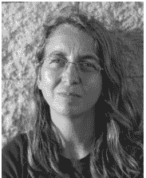


编辑者


**Kaushik Roy** 在国立西里尔理工学院（NIT Silchar）获得计算机科学与工程学士学位，并分别于1998年、2002年和2008年在贾达普普尔大学获得计算机科学与工程硕士和博士学位。他曾在印度统计学院加尔加分院（ISI-Kolkata）担任项目相关人员，并在加尔加塔计算机发展协会（CDAC-Kolkata）担任科学官员。他还在印度莫哈拉拉·阿布尔·卡拉姆·阿扎德技术大学（Maulana Abul Kalam Azad University of Technology）担任助理教授（地位于西孟加尔。


# 贡献者

Teresa Gonçalves 埃沃拉大学，葡萄牙

Shubana 阿莱亚大学，加尔加塔

Chayan Halder 工程与管理大学，加尔加塔

Jakut 清迈大学，泰国

Papangkorn Inaw 清迈大学，泰国

Jeerut Chaiwan 清迈大学，泰国

Himadri Mukherjee 西孟加尔大学，加尔加塔

Niladri Sekhar Das 印度统计学院（ISI），加尔加塔

Kashyap Raiyani 埃沃拉大学，葡萄牙

Ankita Dhar 西孟加尔大学，加尔加塔

Payel Rakshit 赫什塔拉学院，加尔加塔

Mridul Ghosh 希德德斯瓦里学院，加尔加塔

Shibaprasad Sen 工程与管理大学，加尔加塔


# 第1章 文档分析中的人工智能

Himadri Mukherjee, Payel Rakshit, Ankita Dhar, Sk Md Obaidullah, KC Santosh, Santanu Phadikar 和 Kaushik Roy

## 1.1 引言

技术的飞速发展促进了文档的数字化。随着时间的推移，数字文档的数量显著增加[1, 2]。现在信息可以在互联网上轻松获取并易如地分发。如此海量的文档需要高效的处理。数字化文档大致可分为两类，即图像文档和文本文档。对于文档而言，理解其书写内容至关重要。这需要光学字符识别（OCR）[3–5]。一旦识别出字符，就需要使用基于自然语言处理（NLP）[6–8]的方法来理解其内容。对于文本文档，OCR 和 NLP 领域的研究始于上个世纪，英语等语言的各种系统已实现商业化[9–11]，但印地语系语言（Indic languages）尚未取得重大进展[12]。这一现象的原因之一是印地语系文字的复杂性。这与缺乏用于研究的标准（且免费）数据集也有有关。

## 1.2 光学字符识别

光学字符识别 [13, 14]是指解码文档中书写内容的任务。它不涉及对所写文本的理解，但涉及将文档的扫描件或图片进行转换、识别字符，并对识别出的单词和字符给出文本输出。文档可以是手写的，也可以是打印的。对于手写文档，在识别之前需要考虑不同的变体。在书写时，经常观察到文本具有不同程度的倾斜。在处理文档时，处理这些倾斜非常重要。图 1.1 展示了一个具有多个角度倾斜字符的文档。

另一个需要解决的因素因素是不同字符之间的相似性。例如，自然形成的数字“3”与孟加拉语中的“З”相似。

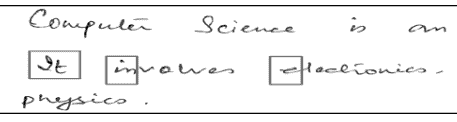

图 1.1：描绘不同字符多个角度倾斜的文档。

## 用于文档图像分析的人工智能

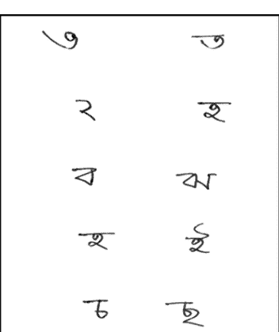

图 1.2：孟加拉语不同字符之间的相似性。

处理此类情况非常重要，否则如果解释错误，整个句子可能会发生变化。另一个重要方面是书写者之间和书写者内部的差异。经常观察到手写文本在字符层面表现出差异。也就是说，同一个字符在两次书写时略有不同。这被称为书写者内部差异。当两个不同的书写者书写相同的内容时，会观察到另一种差异。大多数情况下，不同人的字迹各异。这被称为书写者间差异。因此，系统应该能够处理这些差异。图 1.3 和 1.4 展示了孟加拉语文本的书写者间差异和内部差异。

共有 11 种印地语系文字用于编写孟加拉语、印地语、泰卢固语、泰米尔语、乌尔德语等各种语言。表 1.1 列出了这些语言所使用的文字细节、每种文字的大致总人口以及它们在印度使用的区域。这些文字之间具有某种程度的相似性 [15]，因此 OCR 系统必须能够检测出细微差别以获得结果。

### 1.2.1 处理噪声

任何种类的不需要的数据被称为噪声。这是一个特定于问题的术语。某类数据对于某个问题可能是噪声，但在另一个问题中可能具有首要意义。现实生活的数据并不完美。它们经常受到不同类型噪声的污染。手写文档也不例外，它们通常是有损且带有噪声的。

## 使用机器学习进行文档处理

这段文字主要由两个不同人的手写体完成。其中字符的结构、写作风格和字母的排列表现出完全不同的差异。每个书写都有其独特特征，为手写文本的清晰度和深度增加了新的维度。保持清晰度是数字手写分析的巨大挑战，这证明了这一点。

这段文字主要由两个不同人的手写体完成。其中字符的结构、写作风格和字母的排列表现出完全不同的差异。每个书写都有其独特特征，为手写文本的清晰度和深度增加了新的维度。保持清晰度是数字手写分析的巨大挑战，这证明了这一点。

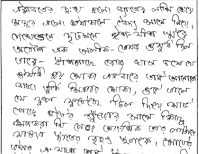

图 1.3：由两个不同书写者写的文本。

这段文字主要由两个不同人的手写体完成。其中字符的结构、写作风格和字母的排列表现出完全不同的差异。每个书写都有其独特特征，为手写文本的清晰度和深度增加了新的维度。保持清晰度是数字手写分析的巨大挑战，这证明了这一点。

这段文字主要由两个不同人的手写体完成。其中字符的结构、写作风格和字母的排列表现出完全不同的差异。每个书写都有其独特特征，为手写文本的清晰度和深度增加了新的维度。保持清晰度是数字手写分析的巨大挑战，这证明了这一点。

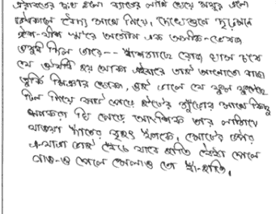

图 1.4：由图 1.3 中相同的书写者书写的相同文本。这用于展示内部差异。

## 用于文档图像分析的人工智能

## 表 1.1

| 语言 | 使用的文字 | 大致用户数（百万） |
| --- | --- | --- |
| 印地语 (Hindi) | 天城文 (Devanagari) | 182.00 |
| 马拉地语 (Marathi) | 天城文 (Devanagari) | 68.10 |
| 康坎语 (Konkani) | 天城文 (Devanagari) | 7.60 |
| 梵语 (Sanskrit) | 天城文 (Devanagari) | 0.03 |
| 辛德语 (Sindhi) | 天城文 (Devanagari) | 21.40 |
| 尼泊语 (Nepali) | 天城文 (Devanagari) | 13.90 |
| 米特里语 (Maithili) | 天城文 (Devanagari) | 34.70 |
| 博多语 (Bodo) | 孟加拉文 (Bangla) | 0.50 |
| 孟加拉语 (Bangla) | 孟加拉文 (Bangla) | 181.00 |
| 阿萨语 (Assamese) | 孟加拉文 (Bangla) | 16.80 |
| 曼普尔语 (Manipuri) | 孟加拉文 (Bangla) | 13.70 |
| 泰卢固语 (Telugu) | 泰卢固文 (Telugu) | 69.80 |
| 泰米尔语 (Tamil) | 泰米尔文 (Tamil) | 65.70 |
| 乌尔德语 (Urdu) | 乌尔德文 (Urdu) | 60.60 |
| 克什米语 (Kashmiri) | 乌尔德文 (Urdu) | 5.60 |
| 古吉拉特语 (Gujarati) | 古吉拉特文 (Gujarati) | 46.50 |
| 马雅拉姆语 (Malayalam) | 马雅拉姆文 (Malayalam) | 35.90 |
| 奥里亚语 (Oriya) | 奥里亚文 (Oriya) | 31.70 |
| 卡纳纳达语 (Kannada) | 卡纳达达文 (Kannada) | 3.63 |
| 旁遮普语 (Punjabi) | 古遮亚文 (Gurmukhi) | 1.05 |
| 多格里语 (Dogri) | 古遮亚文 (Gurmukhi) | 3.80 |
| 桑塔尔语 (Santali) | 罗马字母 (Roman) | 6.20 |

这些噪声包括不需要的笔画、墨水溢出、纸张折痕、污渍等，如图 1.5 和 1.6 所示。

```
A car is a thing that get - it power.
an engine, that - present - side the
from to write, - a car has four wheels
ner itself to help it run, on the road -.
The invention of the car - has been brought-
up in the 18th century .
```

图 1.5：文档中的墨水溢出（黑框）和意外标记（灰框）。

## 使用机器学习进行文档处理

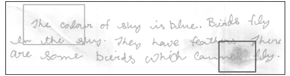

图 1.6：文档中的纸折痕（浅灰色框）和污渍（深灰色框）。

```
A car is a transport road vehicle which is used
to carry the passengers. Car is also called
an automobile The word automobile
comes from Greek word auto and the
French word mobile.
The meaning of the word automobile means
self-moving, self-moving means that it
does not need any horsepower
```

图 1.7：在处理文档时识别这些区域的不同类型取消标记。图 1.7 展示了书写时的某些类型的涂鸦和取消标记。

## 1.2.2 分割


将文本分割为单个标记对于 OCR（光学字符识别）来说至关重要。对不同印地语语言的手写文本进行分割是一项困难的任务 [21, 22]，因为不同字符之间存在共同点。字符中还存在非连接组件。当孤立观察时，这些组件似乎是噪声，但当整个字符出现时就具有意义。处理这些问题非常有挑战性，尽管研究人员已经针对印地语语言的字符、行和单词的分割提出了不同的技术 [23–25]，但尚未开发出一套完整的分割方案。由于上一节讨论的写写者内部差异，分割也是困难的。图 1.8 说明了这一点。

## 1.2.3 应用

光学字符识别是一个广阔的领域，有大量的应用。可以找到使用先进方法处理不同语言的 OCR 系统，如孟加拉语、英语、拉丁语、西尔语、阿拉伯语、希伯来语、印地语、孟加拉（Bengali）、天城文、泰米尔语、中文、日语、韩语等。在以下领域中可以看到一些广泛的应用：

### 1.2.3.1 法律行业

在法律行业中，OCR 在纸质文档数字化方面起着重要作用。为了节省空间，文档被扫描并输入计算机数据库。OCR 简化了这一过程并使文档可搜索 [27, 28]。

### 1.2.3.2 银行

OCR 最广泛的应用之一是银行业。它可以在无需人工干预的情况下处理支票。当支票插入机器时，上面书写的文字会被立即扫描，正确的金额将直接转移到指定的账户。然而，这种技术 [27, 28] 对于打印文本更为理想，因为它仅对手写文本准确率有限。

### 1.2.3.3 医疗保健

OCR 通过减少大量的纸质工作为医疗保健做出了贡献。医疗专业人员通常处理大量的患者数据表格。当将相关数据放入电子数据库并可以随时需要访问时，这项任务就变得更容易了。在这里，OCR 用于从表格中提取信息并存入数据库 [27, 28]。

### 1.2.3.4 CAPTCHA（验证码）

如今，CAPTCHA 是一个非常常见的术语。许多人类活动如交易、入学和注册都在互联网上进行，需要密码来防止黑客滥用 [29]。通过 CAPTCHA，会生成一张由一系列字母和数字组成的图像，这些图像被扭曲技术、尺寸和字体变化、干扰性背景、随机分段、高亮和图像中的噪声所遮蔽。OCR 在此处的作用是减少噪声并分割图像以使其可追溯 [26]。

### 1.2.3.5 自动车牌识别

自动车牌识别系统使用 OCR 来识别车辆注册牌。

### 1.2.3.6 手写识别

## 1.3 自然语言处理

自然语言处理 (NLP) [33] 涉及对文本中内容的理解。一旦识别出文本中的字符，基于 NLP 的方法就会介入以实际理解所写内容的含义。NLP 有多种应用，包括文本摘要 [34]、问答 [35]、文本分类 [36, 37]、情感分析 [38] 和词义消歧 [39]。不同非印地语语言的研究进展显著 [40, 41]，但对于印地语语言并非如此。原因之一是缺乏可用资源。对于印地语语言，分割也非常困难，尽管研究人员已经针对印地语语言的字符、行和单词的分割提出了不同的技术 [23–25]，但尚未开发出一套完整的分割方案。由于上一节讨论的写写者内部差异，分割也是困难的。图 1.8 说明了这一点。

### 1.3.1 分词

将文本分割为单个标记对于 OCR 来说至关重要。对不同印地语语言的手写文本进行分割是一项困难的任务 [21, 22]，因为不同字符之间存在共同点。字符中还存在非连接组件。当孤立观察时，这些组件似乎是噪声，但当整个字符出现时就具有意义。处理这些问题非常有挑战性，尽管研究人员已经针对印地语语言的字符、行和单词的分割提出了不同的技术 [23–25]，但尚未开发出一套完整的分割方案。由于上一节讨论的写写者内部差异，分割也是困难的。图 1.8 说明了这一点。

分词是将字符串分割为单词。

表 1.2

| 分词级别 | 输出 |
|---|---|
| 单词级别 | Today is Friday |
| 句子级别 | Tomorrow is Saturday |
| 字符级别 | Today is Friday |

### 1.3.2 停用词移除

文本中的某些字符和标记符号被称为停用词。停用词是取决于上下文的，例如，在句子中如：“You go”和“You go?” 尽管这两个句子完全相同，但一个是陈述句，另一个是疑问句。

### 1.3.3 词干提取

词干提取涉及从单词推导出根形式。这如下所示：

- 根形式：খে拉
- 词形式：খেছি、খে了、লেতে

### 1.3.4 词性标注

词性标注是对句子中的每个单词标注其词性。通常，同一个词的不同词性如下：

这里，“নীল”在第一个句子中作为形容词，而在第二个句子中作为名词。

### 1.3.5 句法分析

句法分析是对句子相对于句法结构的分析。它对于确定单词的含义非常有帮助。

### 1.3.6 应用

自然语言处理的一些不同应用在下文中详细介绍。

#### 1.3.6.1 文本摘要

文本摘要 [43, 44] 是从给定文本中提取最相关信息的技术。“相关文本”是一个特定问题的。文本可能包含与各种主题的信息。摘要通常涉及从文本中提取特定类型的信息。忽略无关信息很重要。

#### 1.3.6.2 问答

问答 [45, 46] 涉及对用户提出的查询进行自动响应。它可以用于医疗相关的应用程序以及自动辅导系统。自动客户处理系统也是需要的。这种系统涉及对文本的分析，以理解用户的意思，然后生成相应的回复。

#### 1.3.6.3 文本分类

文本分类 [47, 48] 根据某些标准对文本进行分组的任务。文本可以根据领域 [36] 如体育、医疗等进行分组。随着互联网文档数量的巨大增加，这非常重要。对这些信息进行分类和排序对于其高效检索很重要。

#### 1.3.6.4 情感分析

情感分析 [49, 50] 是分析文本中不同类型信息的过程，例如情感和观点相关信息。它可以通过自动建议某些人为错误忽略的文本的重要性。

#### 1.3.6.5 词义消歧

词义消歧 [51, 52] 是当一个单词有多个含义时，确定句子中单词实际含义的过程。例如，“bank”这个词可能意味着“河岸”，也可能是“存钱的地方”。在理解摘要和评估等不同应用的文本含义之前，理解不同词汇的含义非常重要。例如，在句子“I will go to the bank for a loan（我要去银行贷款）”中，“bank”指的是金融机构，而不是河岸。词汇的含义高度取决于上下文，分析邻近文本有助于推导出其含义。

## 1.4 结论

人工智能多年来取得了显著发展，并提供了不同的简化解决方案。文档图像处理也随着时间的推移而不断进步。文档处理涉及识别和理解。从文档图像中识别字符、单词和句子需要优化的字符识别技术，随后通过自然语言处理来实现理解。非印地语语言在这些领域的研究进展显著，而印地语语言则进展尚不。在本章中，我们介绍了 OCR 和 NLP 的一些途径，这些途径对于开发一个能够真正理解印地语言文档的完整系统至关重要。

# 2 孟加拉语手写孤立字符识别

Payel Rakshit, Chayan Halder 和 Kaushik Roy

## 2.1 引言

从图像中识别字符是计算机视觉领域最重要的任务之一。近年来，光学字符识别（OCR）由于在印度等国家对脚本的潜力，已成为手写字符研究中一个非常有趣的领域。然而，当考虑手写字符时，这项任务是非常困难的。最近，关于手写字符识别的各种方法已经出现 [1-2]。Bhowmik 等人基于支持向量机 (SVM) 提出了两阶段方法，而 Bhattacharya 等人使用多层感知机 (MLP) 对孟加拉语字符识别取得了良好的准确率。Mait 等人通过卷积神经网络 (CNN) 开发了多种脚本的识别方法。同时，Surinta 等人利用嵌入软计算的范式贡献了局部梯度描述符 [7]。Das 等人开发了一种通过双通道的方法进行孤立字符识别 [8]。Sarkhel 等人提出了一种多目标方法用于孤立字符识别 [9]。Pramanik 和 Bag 提出了基于形状分解的孟加拉语字符识别想法 [10]。Sarkhel 等人还介绍了热门脚本的识别技术 [11]。Kumar 等人对 OCR 的特征选择进行了研究 [12]。此外，Santosh 和 Wendling 尝试对天城文、孟加拉语、奥里亚等脚本进行孤立字符识别 [13]。Radon 变换用于生成字符的多投影配置，动态时间规整 (DTW) 用于匹配该配置。

手写字符识别现有方法通常由几个步骤组成。其中两个主要步骤是特征提取和分类器设计。从相关综述中可以找到一些已知且流行的分类器，包括多层感知机 (MLP) [5]、径基函数 (RBF) [3]、改进二次函数 (MQDF) [5]、支持向量机 (SVM) [3]、最近邻等。一些前沿方法常用的已知特征包括方向、梯度、曲率、G 变换、小波变换以及统计/结构特征 [6]。在一些字符/文档识别研究中，使用了 CNN [6] 来获得更高的准确率。文献表明，尽管已有字符识别方法，但在性能方面仍有提升。在本章中，在较大的数据库上对孤立孟加拉字符进行了研究。同时，利用标准的孤立孟加拉手写字符改进了现有方法。这些任务有两个需要同时优化的目标：最大化识别性和最小化有效成本。

2.2 节介绍了提议框架，描述了数据库、特征和分类方法；2.3 节介绍使用前沿方法的结果和讨论；最后，2.4 节包含我们的结论。

## 2.2 提议框架

光学字符识别系统在实际识别字符之前通常遵循许多步骤。初步步骤包括对输入数据进行清洗和归一化，这需要执行一些预处理步骤。在我们提出的孤立手写字符识别中，首先需要将采集的手写字符从数据采集表图像中清洗并提取，以创建孤立字符图像数据库。

图 2.1 提议字符识别系统的框图。

手写字符识别的现有方法通常包含几个步骤。其中两个主要步骤是特征提取和分类器设计。从相关综述中可以找到一些已知且流行的分类器，包括多层感知机 (MLP) [5]、径基函数 (RBF) [3]、改进二次函数 (MQDF) [5]、支持向量机 (SVM) [3]、最近邻等。

### 2.2.1 数据库

在该工作中，使用了一个之前采集的包含 250 位写者的孤立孟加拉手写数据库，由 89,815 个孤立孟加拉字符、64,515 个字母、12,650 个数字和 12,650 个元音变符号组成。数据库的详情见表 2.1。

表 2.1

| 数据库 | 总写字者数 | 总字符数 |
|---|---|---|
| 我们自己的数据库 | 250 | 89,815 |
| ISI 手写字符数据库 [17] | 20 | 1,500 |
| CMATERdb 3.1.2 [8] | 240 | 12,000 |

### 2.2.2 特征提取

本所提工作的特征提取阶段由基于 64 维轮廓链码的特征组成，该特征从字符/数字的孤立灰度图像中提取。64 维特征的计算技术如下：

首先，对输入图像进行二值化处理并计算边界框。之后，考虑每个边界框的轮廓点。然后，通过对边界框进行等分创建 $7\times7$ 的分块。对于这些分块中的每个轮廓点，根据其频率计算四个方向的链码。通过这种方式，对于每个分块，得到四个代表四个方向链码频率的整数值，从而产生一个 $7\times7\times4=196$ 维特征。接着，在每个分块上应用高斯滤波器，将这些分块下采样为 $4\times4$ 分块，最终产生 $4\times4\times4=64$ 维的链码特征。

### 2.2.3 属性选择与分类

属性选择：属性选择对于提高系统在计算复杂度方面的性能至关重要。此外，它减少了某些可能降低准确性的冗余属性。在本文工作中，使用了过滤类型特征选择方法，因为它不会将给定的特征集修改为针对任何特定分类器调优的精简特征集。特征还原仅用于 CMATERdb 3.1.2。采用了基于过滤的相关性特征选择方法，并结合贪心搜索来降维。由于其计算开销较小且对已有的特征进行泛泛化选择，该选择方法比包装方法（wrapper methods）更有效。在本文工作中，特征还原将特征维度从 64 降到了 47。关于属性选择和基于过滤的相关性特征子集方法的细节可以在 [18] 中找到。

分类：针对这三个数据库应用了三种不同的分类方法。使用了随机森林、简单逻辑和基于实例的 K-NN (IBK) 分类方法，以获得所有可用数据库的最佳识别性能。

- **随机森林**：这是几种监督学习算法之一，创建不同数量的决策树（从而形成一个决策树森林）。在训练期间，它随机选择不同的特征来创建决策树。它并不是搜索最重要的特征，而是通过袋装法在池中搜索最佳特征，从而产生更好的分类模型。这使得与其他同时代的分类器相比，该分类器更加稳定且更准确。在测试阶段，在预测未见样本时，从所有单个回归树的预测中取平均值，或使用多数投票进行最终决策。细节可以在 [19] 中找到。

- **基于实例的 K-NN (IBK)**：通常的 K-NN 分类技术寻找 K 个邻居，当前类的的新实例可以分配给这些邻居。当 K 值为 1 时，它总是检查最近的邻居，并且在本质上是增量的。通常，它不依赖训练阶段，或者说在训练期间工作量很少；高效的训练阶段会对某些索引进行处理，以减少测试阶段的时间复杂度，测试阶段需要通过详尽比较来找到未知类新实例的邻居。基于实例的 K-NN (IBK) 分类是通常 K-NN 的扩展，使用特定实例来提高监督 K-NN 的性能。这种技术不维护一组源自特定实例的抽象。它减少了传统 K-NN 方法对大量存储需求的问题。IBK 是一种监督学习算法，从带标记的实例示例中学习。

表 2.2

单个孟加拉语字符的精确率、召回率和 F₁ 分数

| 字符 | 精确率 | 召回率 | F₁ 分数 |
|---|---|---|---|
| 0 | 0.995 | 0.998 | 0.996 |
| ১ | 0.992 | 0.999 | 0.995 |
| ২ | 0.994 | 0.999 | 0.997 |
| ৩ | 0.979 | 0.997 | 0.988 |
| ৪ | 0.995 | 0.998 | 0.996 |
| ৫ | 0.991 | 0.998 | 0.995 |
| ৬ | 0.989 | 0.994 | 0.991 |
| ৭ | 0.997 | 0.999 | 0.998 |
| ৮ | 0.998 | 0.996 | 0.997 |
| অ | 0.995 | 0.997 | 0.996 |
| আ | 0.993 | 0.997 | 0.995 |
| ই | 0.995 | 0.997 | 0.996 |
| ঈ | 0.996 | 0.996 | 0.996 |
| এ | 0.997 | 0.995 | 0.996 |
| ঐ | 0.998 | 0.997 | 0.998 |
| ও | 0.999 | 0.998 | 0.998 |
| ঔ | 0.998 | 0.997 | 0.997 |
| ঐ | 0.995 | 0.997 | 0.996 |
| ঋ | 0.998 | 0.995 | 0.997 |
| ক | 0.996 | 0.995 | 0.996 |
| খ | 0.995 | 0.999 | 0.997 |
| গ | 0.998 | 0.999 | 0.998 |
| ঘ | 0.995 | 0.996 | 0.996 |
| ঙ | 0.995 | 0.997 | 0.996 |
| চ | 0.997 | 0.997 | 0.997 |
| ছ | 0.998 | 0.998 | 0.998 |
| জ | 0.997 | 0.999 | 0.998 |
| ঝ | 0.998 | 0.997 | 0.997 |
| ঞ | 0.998 | 0.998 | 0.998 |
| ট | 0.995 | 0.997 | 0.996 |
| ঠ | 1 | 0.997 | 0.998 |
| ড | 0.999 | 0.992 | 0.996 |
| ধ | 0.997 | 0.998 | 0.998 |
| ন | 0.996 | 0.997 | 0.996 |
| প | 0.996 | 0.991 | 0.993 |
| ফ | 0.997 | 0.998 | 0.998 |
| ব | 0.997 | 0.997 | 0.997 |

表 2.2（续）

单个孟加拉语字符的精确率、召回率和 F₁ 分数

| 字符 | 精确率 | 召回率 | F₁ 分数 |
|---|---|---|---|
| ধ | 0.999 | 0.998 | 0.998 |


| ম | 0.996 | 0.998 | 0.997 |
| প | 0.995 | 0.996 | 0.995 |
| খ | 0.995 | 0.997 | 0.996 |
| ব | 0.998 | 0.998 | 0.998 |
| ড | 0.998 | 0.991 | 0.995 |
| ম | 0.996 | 0.997 | 0.997 |
| য | 0.996 | 0.994 | 0.995 |
| র | 0.998 | 0.993 | 0.996 |
| ল | 1 | 1 | 1 |
| শ | 0.998 | 0.993 | 0.996 |
| ষ | 0.998 | 0.998 | 0.998 |
| স | 1 | 0.995 | 0.998 |
| হ | 1 | 0.997 | 0.998 |
| ড | 0.999 | 0.998 | 0.998 |
| চ | 0.996 | 0.996 | 0.996 |
| জ | 0.997 | 0.992 | 0.995 |
| এ | 0.998 | 1 | 0.999 |
| ঐ | 0.999 | 0.997 | 0.998 |
| ঔ | 0.998 | 0.998 | 0.998 |
| + | 0.998 | 0.995 | 0.997 |
| ত | 0.993 | 0.992 | 0.993 |
| থ | 0.996 | 0.998 | 0.997 |
| প | 0.995 | 0.987 | 0.991 |
| ব | 0.998 | 0.994 | 0.996 |
| ভ | 0.996 | 0.994 | 0.995 |
| ু | 0.996 | 0.997 | 0.996 |
| চ | 0.998 | 0.995 | 0.996 |
| ে | 0.997 | 0.995 | 0.996 |
| আ | 0.999 | 0.998 | 0.999 |
| ঔ | 0.999 | 0.998 | 0.998 |


图 2。单个孟加拉语字符的精确率、召回率和 F 分数。

# 孟加拉语手写字符识别

## 多字符艺术识别

- 3.4 特征提取..................................................................... 34

### 3.1 引言

脚本识别 [1–8] 是图像处理和模式识别领域的一个研究课题，它是国际化文档处理中一个非常重要的阶段。这是因为脚本识别是 OCR 的前提，没有它，OCR 系统无法将图像转换为便于阅读的脚本。为所有类型的脚本设计通用的 OCR 是可能的，特别是在印度等国家，其脚本包含非常复杂的符号。因此，良好的脚本识别技术可以帮助我们选择正确的软件包。在过去的几年里，已经提出了许多自动脚本识别的工作，但尚未完全解决诸如多字体内联、词级、字符级、复杂背景、断行、噪声数据和方向性等因素。目前尚未实现的一个特征是多字符艺术识别，即字符在颜色、纹理、大小和背景上差异巨大。图 3 显示了我们提出的方法的流程图。

## 使用机器学习进行文档处理


图 3 我们提出的方法的流程图。

## 3.2 文献综述

[10] 利用多通道 Gabor 滤波提取旋转不变纹理特征来识别 15 种不同纹理，该技术已被用于识别波斯语、希腊语、俄语、英语和马拉雅语。[11] 的作者提出了一种词级脚本识别技术：其工作分两个阶段进行，考虑了准确性和速度之间的平衡，用于识别孟加拉语、天罗米语和罗马脚本。第一阶段使用链式编码直方图进行特征提取，返回 64 维特征，速度快但准确性较低。第二阶段针对准确率较低的样本，从 400 维提取梯度特征。对于分类决策，采用了投票方法。[12] 利用打印文本顶部和底部轮廓的独特特征，从打印文档中分离泰卢固语、天罗米语和英语。实验跨越了 2400 行文本，识别准确率为 99.67%。[13] 的作者利用极大互信息来识别其多字体文档。

# 艺术多字符脚本识别 31

卡纳达语和印地语，包含400张图像的数据集。它们通过边缘方向直方图（EDH）捕捉特征，并使用 K 最近邻算法（KNN）和支持向量机（SVM）进行分类。[14] 的作者使用了灰度共现矩阵（GLCM）、Gabor 能量、小波能量、小波对数均值偏差、小波共现签名、小波对数共现签名以及小波尺度共现签名，对 100 种脚本中的 30 种不同字体进行了纹理特征提取。[15] 的作者讨论了中文、阿拉伯语、英语、天城文字（Devanagari）和孟加拉语的识别：他们使用了形状属性特征，这些特征使用了 matras（用于孟加拉语）和 shirokhes（用于天城文字），以及带有孟加拉语和天城文字线条的顶线、基准线、低线、上线和分割线，并结合了区域形状特征；对于中文和阿拉伯语文本行，考虑了垂直黑色信息和运行长度滑特征（Run Length Smoothing Features）；对于英语和阿拉伯语文本分离，他们使用了基于组件最低点分布和水库主原理的统计特征。

## 3.3 数据收集与预处理

由于数据收集是图像处理和文本识别的准备工作，因此验证方法的研究非常重要。收集真实的艺术多字符脚本进行研究并非易事。我们从印度加尔各答的不同地区收集了不仅不是以不同脚本书写，而且在尺寸、颜色、纹理、背景等方面差异巨大的文本。然而，仅凭这些脚本对于我们的工作是不够的。因此，我们为实验制作了合成艺术多字符脚本/图像。到目前，我们已经成功从公司广告牌、T恤涂鸦、电影院海报、告示、彩旗、墙书、报纸等处收集了 49 张真实图像。我们使用了分辨率从 8 MP 到 20 MP 不等的手机，以及一台分辨率为 24.2 MP 并配备 18-55 mm 镜头的数单反相机（尼康 D3300）。从这些真实图像中提取了 2628 个字符，此外还从 833 张合成图像中提取了 178 个天城文字、1599 个孟加拉文字和 851 个罗马文字。

印地语是印度最广泛使用的语言之一，约有 2 亿人口，主要居住在北部、西部和东部地区，并将这种语言作为交流媒介；西孟拉邦也有约 1.9 亿人使用这种语言进行交流。尽管英语是印度的外语，但我们国家有约 3.4 亿人在教育机构、企业、工作场所和其他部门使用英语。

图 3.2 显示了我们数据集的各种示例图像。其中一些具有简单的背景，另一些具有复杂的背景。在 (a) 中，图像是


(a)


(b)

(c)


(d)

**图 3.2**

我们数据库中的一些示例图像。(a) 显示了一张真实图像，而 (b)–(d) 是合成图像。

该图像是从一个作为标志的横幅上拍摄的，位于路边，图像不仅用两种不同的脚本（天城文字、罗马字母）书写，而且是以艺术化的方式呈现。(b)、(c) 和 (d) 是结合了孟加拉语和罗马字母的合成艺术图像：在 (b) 中图像由孟加拉语形成，然后是罗马字母和孟加拉语；在 (c) 中孟加拉语后是罗马字母；在 (d) 中罗马字母后是孟加拉语。

从这些图像可以看出，图像不仅在颜色、尺寸、字体和纹理上不同，而且在背景（包、T恤、墙壁等）也各不相同。在这种情况下，自动检测感兴趣区域是一项非常复杂的任务。因此，为了使这一变得简单，我们手动检测感兴趣区域（ROI）。

每幅图像的 ROI 都是手动提取的，应用 Otsu [16] 二值化算法将图像转换为二值图，然后是灰度图。使用连通组件标记和不交集分析的自动分割算法 [17] 被用于从双脚本单词中提取单个字符。在这项工作中，我们考虑了三种不同的脚本，分别为罗马字母、天城文字和孟加拉语。单词由具有 $3_c$ 种组合的双脚本字符组成，即：孟加拉语与天城文字、罗马字母和孟加拉语结合。

从图 3.3 可以看出，在自动分割后，只有部分图像分割良好，而许多图像没有很好分开。因此，为了解决这个问题，我们需要对自动分割中那些分割不完全的部分进行手动分割。

在二值化过程中，某些图像没有被良好的二值化，单个字符形成了不连通的组件。因此，为了使

# 艺术多字符脚本识别

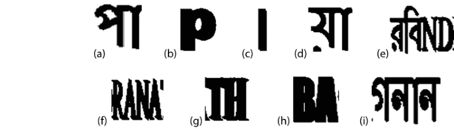

## 图 3.3

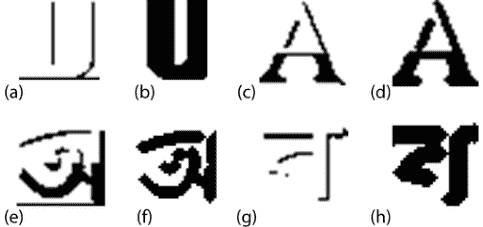

不连通的组件位于 (a)、(c)、(e) 和 (g) 中。分割良好的字符位于 (b)、(d)、(f) 和 (h) 中。


不连通的组件位于 (a)、(c)、(e) 和 (g) 中。分割良好的字符位于 (b)、(d)、(f) 和 (h) 中。

```
Algorithm 1: joining
Input: I, N where I is binary image and N is the number of components
1. T = 0
2. If (N > 1) repeat 3 to 5 until N = 1
3. I = EDT
4. T = T + 0
5. Output: component I
```

## 3.4 特征提取

特征提取是识别过程中非常重要的阶段。在这工作中，我们考虑了两类型的特征，即基于拓扑的特征和纹理特征。

### 3.4.1 基于拓扑的特征

基于拓扑的特征提取字符的基本属性。考虑了以下特征：

- **面积**：面积测量具有强度值的像素数量。面积可以表示为 `Area = ∑_{m,n} 1` (3.1)，其中 `m` 和 `n` 表示范围 R。

- **长轴长度**：在椭圆中，有两个焦点 a 和 b；这些点之间的距离之和代表长度 n+p，其中 n 和 `p` 是从每个焦点到椭圆上任意点 c 的距离。

- **短轴长度**：观察图 3.5，`√((n+p)²-m²)`。

- **离心率**：离心的含义是“偏心”。这意味着随着离心率增加，焦点相对于中心的比例增大。它可以表示为 `Eccentricity = g/h` (3.2)，其中 `g` 是从中心 c 到焦点 f2 的距离，`h` 是从该焦点 f2 到顶点 a 的距离，这是一个 0 到 1 之间的标量值。当比例为 0 时，图 3.6 是一个圆，当比例为 1 时，它是一条线。

- **等效直径（Equivalent Diameter）**：等效直径可以表示为：

```
$$E_d = \sqrt{\frac{(4 * \text{Area of the region})}{\pi}} \quad (3.4)$$
```

该标量代表该区域的直径。

- **固性程度（Solidity）**：该标量衡量对象面积与其凸壳包面积的比例。因此，对象的固性程度可以表示为：

```
$$\text{Solidity} = \frac{\text{Area}}{\text{ConvexArea}} \quad (3.5)$$
```

- **范围（Extent）**：范围衡量对象面积与其包含在内部或在其周围的边界矩形面积的比例，这是一个标量值：

```
$$\text{Extent = Area / Area of Bounding Rectangle} \quad (3.6)$$
```

- **周长（Perimeter）**：周长测量区域边界周围相邻像素之间的距离；非零值像素是边界的一部分，并与至少一个零值像素相连。

- **圆度（Circularity）**：圆度衡量对象的紧凑性。它包围了给定周长的面积。它可以表示为：

```
$$\text{Circularity} = \frac{p^2}{4*\pi*A} \quad (3.7)$$
```

其中 P 和 A 分别是对象的周长面积。

## 3.4.2 纹理特征

纹理特征描述图像或图像区域的内容，并提供了重要的低级特征和均向能量（图 3.8）。

离散 Gabor 波变换将均向能量作为纹理特征返回 [25, 26]。它变换一个具有 MXN 维的 `g(x, y)`，可以表示为：

```
$$W_{cd}(x,y) = \sum_{a} \sum_{b} g(x-a,b)\psi_{ab}(a,b) \quad (3.8)$$
```

## 艺术多字符识别

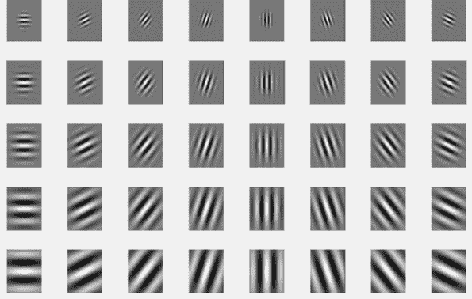

**图 3.8**

具有五个尺度和八个方向的 Gabor 波的实部。

其中

`c` 和 `d` 分别表示尺度和方向；

`a` 和 `b` 是滤波器掩码的大小。

`ψ` 是 `ψ` 的复共轭，其中 `ψ` 是一个小波，可以表示为：

```
$$\psi(x,y) = \left(\frac{1}{2\pi\sigma_x\sigma_y}\right)\exp\left(-\frac{1}{2}\left(\frac{x^2}{\sigma_x^2} +\frac{y^2}{\sigma_y^2}\right)\right)\exp(2\pi jwx)$$
```

通过使用生成函数，我们可以得到如下 Gabor 波：

```
$$\psi_{so}(x,y) = m^{-c}\psi(x',y')$$
```

其中

```
$x' = r^{-c}(x\cos\theta + y\sin\theta)\text{ and } y' = (-x\sin\theta + y\cos\theta)$
```

对于 `m > 1` 且 `θ = π/t1`，

这里，`tl` 代表滤波器的标量总数。

能量内容可以被视为图像 `g` 的尺度 `c` 和方向 `d`，如下：

```
$$\E_{cd}(g) = \sum_{x}\sum_{y}|W_{cd}(x,y)|$$
```

从 Gabor 波中获得了 2560 个特征，但其中许多是冗余的，处理如此大量的特征会降低我们工作的性能。在这方面，我们使用 PCA 进行了降维 [27]。通过使用 PCA，我们基于拓扑的特征中考虑了 60 个纹理特征，获得了 12 个。因此，本工作考虑了 72 个特征。

## 3.5 实验

### 3.5.1 估计过程

为了估计我们技术的的性能，可以测量正确识别率（CRR）：

`CRR = (Number of images correctly recognised) * 100% / (Total number images)` (3.13)

除了 CRR 外，统计和均方根误差（RMSE）指标在识别中也起着至关重要的作用，定义如下：

`Kappa = (observed accuracy - expected accuracy) / (1 - expected accuracy)` (3.14)

`RMSE = ∑_{m=1}^{S}∑_{n=1}^{T}[f(m,n)-g(m,n)]² / ST` (3.15)

这里，我们使用了五折交叉验证来估计我们技术的性能。在五折过程中，整个数据集被分为五个等大小的部分，其中一部分被视为测试部分，其余部分作为训练集；所有结果的平均值产生最终结果。

### 3.5.2 结果与分析

我们使用不同的分类器测试了我们的方法，如 SVM [28]、RBF [29]、随机森林 [30] 和 MLP [31]，表 3.1 描述了它们相应分类器的不同参数值。

## 艺术多字符识别

### 表 3.1 具有不同参数的分类器

| 分类器 | 均方根误差 | Kappa 统计量 | CRR(%) |
| :--- | :--- | :--- | :--- |
| SVM | 0.2210 | 0.8419 | 71.29 |
| RBF | 0.2155 | 0.8685 | 91.90 |
| 随机森林 | 0.2790 | 0.8771 | 93.90 |
| MLP | 0.2894 | 0.8852 | 94.95 |

### 表 3.2 使用随机森林双语识别最高准确率的混淆矩阵

| 孟语 (Bangla) | 天罗纳底语 (Devanagari) | 罗马语 (Roman) |
| :--- | :--- | :--- |
| 加语 | 54 | 45 |
| 天罗纳底语 | 14 | 23 |
| 罗马语 | 34 | 18 |

从表 3.1 可以看出，MLP 的准确率最高 (94.95%)，之后是随机森林 (93.90%)、RBF (91.90%) 和 SVM (71.29%)。MLP 的 Kappa 统计量和 RMSE 分别为 0.8852 和 0.2894。在 MLP 中，学习率取 0.3，动量为 2，我们发现隐藏层得到了最佳结果。表 3.2 列出了我们数据集上性能最好的分类器的混淆矩阵。在表 3.2 中，可以看到某些字符没有被正确识别：54 个字符被正确分类为孟语，但 45 和 21 个被分类为天罗纳底语和罗马语。这是由于字符形状的相似性问题导致的。

## 3.6 结论

艺术多字符识别是一个非常新的问题 [32–35]。尺寸、颜色、纹理、背景和倾斜使得这个问题具有挑战性。通过我们的技术，观察到的准确率为 94.95%，但通过使用预处理和其他特征提取算法可以提高这一率。数据库创建是另一个问题，收集更多自然图像是我们的下一个计划。使用机器学习处理文档

## 参考文献

1. Ghosh, D., Dubey, T., & Shivaprasad, A. 字符识别——综述。IEEE Transactions on Pattern Analysis and Machine Intelligence, 32(12), 2142–2261 (2010).

2. Obaidullah, S. M., Bose, A., Mukherjee, H., Santos, K., Das, N., & Roy, K. 多语言文档手写识别的极端学习。Journal of Electronic Imaging, 27(5), 052114 (2018).


## 参考文献

3. Obaidullah, S. M., Santos, K., Halder, C., Das, N., & Roy, K. 手写文档的自动字符识别：页面、块、行级方法。International Journal of Machine Learning and Cybernetics, 10(1), 1–20 (2019).

4. Obaidullah, S. M., Halder, C., Das, N., & Roy, K. 11 种官方字符的页面级手写文档数据集。Multimedia Tools and Applications, 77(2), 1643–1678 (2018).

5. Obaidullah, S. M., Goswami, C., Santos, K., Das, N., Halder, C., & Roy, K. 使用矩阵分离多语言文档进行有效手写识别。International Journal of Pattern Recognition and Artificial Intelligence, 31(05), 1753003 (2017).

6. Obaullah, K., Santos, K., Halder, C., Das, N., & Roy, K. 词级多语言文档图像数据集和字符识别结果。International Journal of Computer Vision and Image Processing (IJCVIP), 7(2), 81–94 (2017).

7. Obaidullah, S. M., Santos, K., Das, N., Halder, C., & Roy, K. 多语言文档中的手写字符识别：综述。International Journal of Pattern Recognition and Artificial Intelligence, 32(10), 1856012 (2018).

8. Hangarge, M., Santos, K., & Pardesh, R. 手写字符识别的方向角余弦变换。2012 第13 届国际文档分析与识别会议 (pp. 344–358). IEEE (2013).

9. Mori, S., Sun, C., & Yamamoto, K. OCR 研究与发展的历史回顾。Proceedings of the IEEE, 80(7), 1029–1058 (1992).

10. Tan, N. R. 不变特征纹理及其在自动字符识别的应用。IEEE Transactions on Pattern Analysis and Machine Intelligence, 20(7), 751–756 (1998).

11. Chandra, S., Pal, Franke, K., & Pal, U. 词级字符识别的两阶段方法。在第10 届国际文档分析与识别会议，2009. ICDAR (pp. 926–930). IEEE (2009).

12. Padma, M. C., & Vijaya, P. 使用判别法识别泰加尔语和英语字符。Journal of Computer Science, 1, 64–78 (2009).

13. Manjula, S., & Hegadi, R. 使用最大化信息进行多语言文档识别。2017年国际能量、通信、数据分析与软计算会议 (ICCEDS) (pp. 1679–1682). IEEE (2017).

14. Busch, A., Boles, W. W., & Sridharan, S. 字符识别的纹理。IEEE Transactions on Pattern Analysis and Machine Intelligence, 27(11), 1720–1732 (2005).

## 艺术多字符脚本识别

15. Pal, U., & Chaudhuri, B. B. 英语、中文、阿拉伯脚本的自动识别。In: Proceedings of Sixth International Conference on Devanagari and Bangla Line. In: Document Analysis and Recognition, 2001 (pp. 790–794). IEEE (2001)

16. Otsu, N. 一基于灰度直方图的阈值方法。IEEE Transactions on Systems, and Cybernetics, 9(1), 62–66 (1979).

17. Sridevi, N. 用于11世纪手写泰米尔脚本分类的优化的极端机器学习 (2013)。

18. Vincent, L. 形态学算法。In: Dougherty, ed., Mathematical Morphology in Image Processing, Marcel Dekker, New York, 255–258 (1992).

19. Samet, H., & Tamminen, M. 由线性b树表示的任意维度的高效标记。IEEE Transactions on Pattern Analysis and Machine Intelligence. 10(4), 579 (1998)。

20. Silvela, J., & Portillo, J. 宽度优先搜索及其图像处理中的应用。IEEE Transactions on Image Processing, 10(8), 1194–1199 (2001).

21. Breu, H., Gil, J., Kirkpatrick, D., & Werman, M. 线性欧几里得距离变换算法。IEEE Transactions on Pattern Analysis and Machine Intelligence, 17(5), 529–533.

22. Zhang, T. Y., & Suen, C. Y. 数字模式细化的快速并行算法。Communications of the ACM, 27, 236–239 (1984).

23. Yang, M., Patel, K., & Rosin, J. 形状提取技术综述，Pattern Recognition, Recognition-Yin Ye (Ed.), pp. 43–90 (2008)。

25. Ma, W. Y., & Manjunath, B. S. 纹理特征与相似性学习。In: Proceedings CVPR96 IEEE Society Conference on Computer Vision and Pattern Recognition (pp. 42–43). IEEE (1996).

26. Zhang, D., Wong, A., Indrawal, M., & Lu, G. 基于Gabor特征的内容图像检索。IEEE Transactions PAMI, 13–15 (2000)。

27. Jolliffe, I. T. 主成分分析，系列。Springer Series in Statistics, 第2版, Springer, New York (2002), XXIX, 487页. 28插图。

28. Cusco, C., Ciocca, G., & Schettini, R. 使用SVM的图像标注。In: Internet Imaging V (Vol. 5304, 330–339). International Society for Optics and Photonics (2003).

29. Er, M. J., Wu, S., Lu, J., & Toh, H. L. 使用径向基函数(RBF)神经网络的人脸识别。IEEE Transactions on Neural Networks, 13(3), 697–710 (2002)。

30. Rodriguez-Galano, V. F., Fhimer, B., Logan, J., Chica-Olm, M., & Sanchez, J. P. 随机森林分类器用于土地分类的有效性评估。ISPRS Journal of Photogrammetry and Remote Sensing, 67, 93–104 (2012)。

31. Alkan, A., Koklukaya, E., & Subasi, A. 使用逻辑回归和人工神经网络进行EEG癫痫自动检测。Journal of Neuroscience Methods, 148(2), 67–176 (2005)。

32. Santosh K. C–g-Dice: 基于图挖掘的文档信息提取。International Journal on Document Analysis and Recognition (IJDAR), 18(4), 337–355 (2015)。

33. Santosh, K. C., & Belaid, A. 基于客户相关性的文档提取及其评估。In: 2013 12th International Conference on Document Analysis and Recognition (pp. 35–39). IEEE (2013).

34. Bouguelia, M. R., Nowczyk, S., Santosh, K. C., & Verikas, A. 同意不反对：无需众包的带噪标签主动学习。International Journal of Machine Learning and Cybernetics, 9(8), 1307–1319 (2018)。

35. Vajda, S., & Santosh, K. C. 使用无监督聚类的快速k-最近邻分类器。In: International Conference on Recent Trends in Image Processing and Pattern Recognition (pp. 185–193). Springer, Singapore (2016)。

# 4nA 关于极端学习机及其应用的研究

**作者**：Himadri Mukherjee, Sahana Das, Subhashmita Ghosh, Sk Md Obaidullah, KC Santosh, Nibaran Das and Kaushik Roy

## 目录

- 4.1 引言
- 4.2 预备知识
- 4.3 ELM的激活函数
  - 4.3.1 Sigmoid函数
  - 4.3.2 硬限幅函数
  - 4.3.3 径向基函数
  - 4.3.4 正弦函数
  - 4.3.5 三角形函数
- 4.4 ELM的演变
- 4.5 ELM的应用
  - 4.5.1 文档分析中的ELM
  - 4.5.2 医学中的ELM
  - 4.5.3 音频信号处理中的ELM
  - 4.5.4 模式识别中的ELM
- 4.6 ELM的问题
- 4.7 结论
- 参考文献

## 4.1 引言

极端学习机（`ELMs`）的主要问题是人工神经网络中出现的缓慢学习率。`ELM`是单层前馈网络（`SHLFNN`），用于回归和分类。

- 利用均匀分布随机创建输入到隐藏层的权重，被称为“随机投影”。
- 为了求解输出权重，使用最小二乘法。

`ELMs`是随机投影的一种现代形式，具有拟合任何结构的假设特性。最初，Huang等人[1]提出了`ELM`以解决梯度下降引起的问题。但在20世纪40年代，McCulloch和Pitts[2]给出的逻辑观点开启了神经网络的路径。当输出层被投影时，`ELM`用于解释线性方程。

## 使用机器学习处理文档

在本章中，我们将讨论预备知识、扩展和问题。

## 极限学习机及其应用

其中隐藏层输出矩阵为 `H`。

```
$H = \begin{bmatrix} G(w_1, b_1, x_1) & \dots & G(w_L, b_L, x_1) \\ G(w_1, b_1, x_M) & \dots & G(w_L, b_L, x_M) \end{bmatrix}$
```

```
$B = \begin{bmatrix} \beta_1 \ : \ \beta_L \end{bmatrix}$
```

```
$Y = \begin{bmatrix} Y_1 \ : \ Y_M \end{bmatrix}$
```

其中

`$(x_i, y_i)_{i\in\{1,2,\dots,M\}}$` 是训练集。

`$x_i = (x_1, x_2, \dots, x_M)$` 应该是输入向量。

`$y_i = (y_1, y_2, \dots, y_o)$` 是输出向量。

对于训练集 `$(x_i, y_i)$`、隐藏神经元的数量 `$L$` 以及激活或传递函数 `$g()`，`ELM` 算法由三个步骤组成。

1. 为隐藏层随机分配输入权重 `$w_i$` 和偏置 `$b_i$`。
2. 确定从隐藏层到输出层的 `$G(w_y, b_y, x)$`。
3. 最后，根据上述公式 4.3 和 4.4 计算 `$\beta$`。

## 4.3 ELM 的激活函数

激活函数是人工神经网络（`ANN`）最强大的特征之一，`ANN` 是用于学习和验证非常复杂材料的单层前馈神经网络。激活函数的主要目的是将输入神经转换为输出信号。现在的问题是，如果我们不用这个函数会怎样？如果没有它，输出函数只是一个简单的线性函数，`ANN` 就变成了一个线性回归模型，无法学习任何复杂的数据集。

大多数情况下，`ELM` 处理 `sigmoid`（逻辑）、`sine`（正弦）、`hardlimit`（硬限）、`tribas`（三角）和 `rad-bas`（径基）激活。以下是对这些函数的简要讨论。

### 4.3.1 Sigmoid 函数

Sigmoid 激活函数产生“S”型形成曲线，范围在 0 到 1 之间。该函数被广泛使用且易于理解，但有一些主要方面导致 Sigmoid 函数失去了流行。这些问题导致该函数以 0 为中心。它会饱和并杀掉梯度，而且收敛缓慢。其方程如下：

```
$$g(w,b,x) = \frac{1}{1+\exp(-w.x+b)} \quad (4.5)$$
```

### 4.3.2 Hardlimit 函数（Hardlim）

激活函数 hardlimit（写为 `hardlim`）强制节点在达到阈值值时输出 1，否则设置为 0。这种激活函数主要用于感知器学习。该传递函数的输出严格为 0 或 1。其方程如下：

```
$$g(w,b,x)=1 \quad \text{若} (w.x-b) \geq 0$$
$$g(w,b,x)=0 \quad \text{若} (w.x-b) \leq 0 \quad (4.6)$$
```

### 4.3.3 径基函数（Radbas）

`ELM` 中的 `radbas` 激活函数是一种实值激活函数。它仅定义在欧几里得空间上。径基聚合主要应用于函数近似问题。`ELM-radbas` 函数使用高斯核函数。对于该函数，输出范围可以在 -1 到 +1 之间。其方程如下：

```
$$g(w,b,x) = 1 \exp(-b||x-w||^2) \quad (4.7)$$
```

### 4.3.4 正弦函数

正弦激活（称为 `sine C`）是 `ELM` 中用于说明分类和回归的一种非常流行的函数。对于这种激活函数，负输入和大正数输入的输出收敛于 0。该函数的定义如下：


# 极限学习机及其应用

正如我们所知，将值除以 0 会导致未定义方程。因此，上述函数有一个例外，即当 $x$ 等于 0 时，SinC(0) 被特别注明。值 1 是一个例外。

```
$$y = \frac{\sin(x)}{x} = 0 \quad \text{对于 } x \neq 0$$
$$y = \frac{\sin(x)}{x} = 1 \quad \text{对于 } x = 0 \quad (4.9)$$
```

### 4.3.5 三角基函数 ('Tribas')

三角基函数的图形形状像三角形，也被称为 'hat'（帽）、'triangle'（三角）和 'tent'（帐篷）。为此函数推导出真实的信号，主要使用核变换函数。以下方程由该传递函数推导出。

```
$$g(w,b,x)=1 \quad \text{若 } -1\leq x\leq 1$$
$$g(w,b,x)=0 \quad \text{否则} \quad (4.10)$$
```

## 4.4 ELM 的演变

由于 ELM 的一些局限性，建立了 ELM 的演变思想。简要实现了以下演变：

- 增量式 ELM（I-ELM）用于处理学习过程中出现的复杂问题。在这里，隐藏神经元被随机分配到隐藏层，输出权重也经过聚合。

- 演化 ELM（E-ELM）为了最小化最小乘误差而提出。在传统的 ELM 模型中，存在大量的隐藏神经元，因此权重的泛化性能不理想。由于这些原因，引入了 E-ELM 的概念。为了解决分类基准问题，提出了剪枝 ELM（P-ELM）。

## 4.5 ELM 的应用

大多数情况下，ELM 处理 'sigmoid'、'sine'、'hardlimit'、'tribas' 和 'rad-bas' 激活。以下是应用讨论。

### 4.5.1 文档分析

Obaidullah 等 [13] 对脚本识别进行了实验。极限学习机被广泛识别模式。Chacko 等 [14] 结合 SVM 使用 ELM 来识别手写数字。

### 4.5.2 医学中的 ELM

机器学习在 [16–21] 领域做出了巨大贡献。Li 等使用 ELM 识别甲状腺刺激激素。Daliri 等 [23] 展示了 ELM 可以检测肺癌。

### 4.5.3 音频处理中的 ELM

Mukherjee 等 [25] 展示了 ELM 在乐器识别方面的应用。另一个例子中，他们使用 ELM 进行语音活动检测 [26]。语音检测是语音处理的一个非常重要的步骤。

### 4.5.4 其他模式识别领域的 ELM

Mohammed 等 [27] 定义了如何通过 ELM 通过 2D 双向分量识别人脸。Zong 等 [29] 实现了 ELM 识别多标签脸。

## 4.6 ELM 的挑战

尽管极限学习机在许多领域都很受欢迎，但一些问题仍然存在。主要问题之一是无法从 ELM 中获得任何最优解。ELM 在并行计算或分布式计算中无法发挥作用。与学习算法相比，其性能相当不稳定。为了解决分类问题和其他边界，需要对 ELM 进行更多测试。

## 4.7 结论

在本章中，我们讨论了极端学习机（ELMs）的架构，并介绍了它们的算法、激活函数类型、扩展和应用。我们探讨了 ELMs 的流行程度以及不同变体中存在的所有缺陷。为了克服 ELMs 的缺陷，研究人员引入了一些扩展。ELMs 是模式重组、技术和其他领域的一种非常特殊的方法，而目前存在的开放问题为研究人员带来了进一步的任务。

## 参考文献

- 1. Huang, G. B., Zhu, Q. Y., & Siew, C. K. (2004, July). Extreme learning: A new learning scheme of feed forward neural networks. In: Proceedings of the 2004 IEEE International Joint Conference on Neural Networks, (Vol. 2, pp. 985–990). IEEE.

- 2. McCulloch, W. S., & Pitts, W. (1943). A logical calculus of ideas immanent in nervous activity. The Bulletin of Mathematical Biophysics, 5(4), pp. 115–133.

- 3. Cao, C. R. (1971). Generalized Inverse of Matrices and Its Applications. John Wiley & Sons, New York.

- 4. Rong, H. J., Ong, Y. S., Tan, A. H., & Zhu, Z. (2008). A fast pruned-extreme learning for classification problem. Neurocomputing, 72(1-3), 359–366.

- 5. Huang, G. B., Zhou, D., Ding, X., & Huang, G. B. (2012). Extreme learning machine for regression and multicast classification. IEEE Transactions on Systems, Man, and Cybernetics (B Cybernetics), 42(2), 513–529.

- 6. Huang, G. B., Chen, L., & Siew, C. K. (2006). Universal approximation using incremental constructive feedforward networks with random hidden nodes. IEEE Transactions on Neural Networks, 17(4), 879–892.

- 7. Zhu, Q. Y., Qin, A. K., Sugan, P. N., & Huang, G. B. (2005). Evolutionary extreme learning machine. Pattern Recognition, 38(10), 1759–1763.

- 8. Rong, H. J., Ong, Y. S., Tan, A. H., & Zhu, Z. (2008). A fast pruned-extreme learning for classification problem. Neurocomputing, 72(1-3), 359–366.

- 9. Cao, J., Lin, Z., Huang, G. B., & Liu, N. (2012). Voting based extreme learning machine. Information Transactions, 185(5), 66–77.

- 10. Liang, N. Y., Huang, G. B., Saratchandran, P., & Sundararajan, N. (2006). A fast and accurate online sequential learning algorithm for feedforward networks. IEEE Transactions on Neural Networks, 17(6), 1411–1423.

- 11. Li, M. B., Huang, G. B., Saratchandran, P., & Sundararajan, N. (2005). Fully complex extreme learning machine. Neurocomputing, 68, 306–314.

- 12. Feng, G., Huang, G. B., Liu, Q., & Gay, R. L. (2009). Error minimized extreme learning machine with growth of hidden nodes and incremental learning. IEEE Transactions on Neural Networks, 20(8), 1352–1357.

- 13. Obaullah, S. M., Bose, A., Mukherjee, H., Santosh, K. C., Das, N., & Roy, K. K. (2018). Extreme learning machine for handwritten Index in manuscript documents. Journal of Electronic Information, 27(5), 05124.

- 14. Chacko, B. P., Krishnan, V. V., Raju, G., & Anto, P. (2012). Handwritten character recognition using wavelet energy and extreme learning machine. International Journal of Machine Learning and Cybernetics, 3(2), 149–161.

- 15. Mahmoud, S. A., & Olatunji, S. (2009). Automatic recognition of off-line handwritten (Arabic) numerals using support vector and extreme learning machines. International Journal of Imaging, 2(09), 34–53.

- 16. Ricker, D. D., Santosh, K. C., & Hegadi, R. S. (2019). Automated bone segmentation and labeling from CT images. Journal of Medical Systems, 43(3).

- 17. Vajda, S., Karim, A., Jaeger, S., Santosh, K. C., Xue, Z., Antani, S., & Thomas, G. (2018). Feature selection for automatic screening in chest radiographs. Journal of Medical Systems, 42(8).

- 18. Ricker, D. D., Hegadi, R. S., & Santosh, K. C. (2018). A systematic review on orthopedic simulators for psycho-motor skill and surgical training. Journal of Medical Systems, 42(9).

- 19. Santosh, K. C., & Wendling, L. (2018). Angular signature-based chest radiograph classification. Medical and Biological Engineering and Computing, 1–12.

- 20. Santosh, K. C., & Antani, S. (2018). Automated detection of pulmonary region abnormalities. IEEE Transactions on Medical Imaging, 37(5), 1168–1177.

- 21. Zoha, F., Antani, S., & Santosh, K. C. (2018). Circle-like element detection in x-rays using normal cross-correlation and unsupervised clustering. Medical Imaging 2018: Vol. 10574, p. 10541. International Society for Physics and Optics.

- 22. Li, L. N., Ouyang, J. H., Chen, H., & Liu, D. Y. (2012). A computer aided diagnosis system for thyroid disease using extreme learning machine. Journal of Medical Systems, 36(5), 3327–3337.

- 23. Dali, M. R. (2012). A hybrid system for the diagnosis of lung cancer based on genetic algorithm and fuzzy extreme learning machines. Journal of Medical Systems, 36(2), 1001–1005.

- 24. Karpagachevchev, S., Anthan, M., & Sivakumar, M. (2012). Classification of electrocardiogram signals with support vector machines and extreme learning machine. Neural Computing and Applications, 21(6), 1331–1339.

- 25. Mukherjee, H., Obaullah, S. M., Pradhik, S., & Roy, K. (2018). Instrument screening from noise audio using LPCCs features and extreme learning. Multimedia Tools and Applications, 1–26.

- 26. Mukherjee, H., Obaullah, S. M., Santosh, K. C., Pradhik, S., & Roy, K. (2018). Line spectral frequency-based features and extreme learning machine for voice activity detection from audio. International Journal of Speech Technology, 1–8.

- 27. Mohammed, A. A., Minhas, R., Wu, Q. J., & Sid-Ahmed, M. A. (2011). Human face recognition based on multidimensional PCA and extreme learning machine. Pattern Recognition, 44(10-11), 2588–2597.

- 28. Wang, H., Hussain, M. F., Mukherjee, H., Obaullah, S. M., Hegadi, R. S., Roy, K., & Santosh, K. C. (2018). An empirical study: ELM in face matching. In International Conference on Trends in Image Processing & Pattern Recognition (pp. 277–287). Springer, The Netherlands.

- 29. Yong, W., & Huang, G. B. (2011). Face recognition on extreme learning machine. Neurocomputing, 74(16), 2541–2551.

- 30. He, Q., Shang, T., Zhuang, F., & Shi, Z. (2013). Parallel extreme learning machine for regression based on MapReduce. Neurocomputing, 102, 52–58.

- 31. Li, G., & Niu, P. (2013). An enhanced extreme learning machine based on ridge regression for regression. Neural Computing and Applications, 22(3–4), 803–810.

- 32. Balasundaram, S. (2013). On extreme learning machine for e-insensitive regression in the primal by Newton method. Neural Computing and Applications, 22(3–4), 559–567.

# 5 一种基于图的网页文本分类模型

Ankita Dhar, Niladri Sekhar Dash 和 Kaushik Roy

## 目录

- 5.1 引言 53

- 5.2 相关工作 54

    - 5.2.1 英语 54

    - 5.2.2 中文、日语和波斯语 55

    - 5.2.3 阿拉语和乌尔都语 56

    - 5.2.4 孟加拉以外的印度语言 56

    - 5.2.5 孟加拉语 57

- 5.3 提议方法 58

    - 5.3.1 数据收集 58

    - 5.3.2 数据处理 59

    - 5.3.3 基于图的表示 60

    - 5.3.4 分类器 60

- 5.4 结果与分析 61

    - 5.4.1 与现有方法的对比 63

- 5.5 结论 64

- 致谢 64

- 参考文献 64

## 使用机器学习进行文档处理


语言的一个方面，即术语的频率。使用词袋模型（`bag-of-words`）对文本文档进行表示被认为是自给自足的，因为它没有表达术语或术语之间的语法或语义关系。在分类短文本时，这些关系变得非常重要，因为在相似类别的测试中使用同义词或关联术语，捕捉术语之间的语法语义关系对于识别是必要的。

在本次实验中，设计了一种基于图的文本分类方法，涉及语法、语义关系以及术语频率，以增强文本分类系统的性能。实验在一个包含9000份孟加拉语文本文档的数据集上进行，这些涵盖了从在线新闻语料库、各种杂志和网页获得的八个类别。文本文档集被视为图，执行加权图算法来提取子图，这些子图可以进一步用于从考虑的数据集中生成特征向量进行分类。采用加权图算法来提取最合适的子图，这成功地提高了分类的计算效率。与传统的向量空间模型和词袋模型相比，基于图的模型通过考虑文本文档的结构信息，运行更加高效。基于图的模型由于能够封装有关文本的重要事实（如术语的排序、术语共现以及不同术语之间的关系），正成为表示文本的替代方法。此外，与研究人员应用于孟加拉文本分类的现有方法相比，基于图的学习方法显示了涉及相关知识的优势。

本文的组织结构如下：第5.2节通过对该领域的文献进行调查，提供了文本分类的基础和各种机器学习算法。第5.3节提供了关于数据收集、用于预处理的方法、用于特征提取的图生成以及分类算法的细节。第5.4节探讨了基于图的方法获得的结果和其他感知。在分析结果和潜在发展之外，第5.4节还提供了几种常用分类算法之间的比较，以及与现有方法的比较。在第5.5节中，文章得出了结论并展示了一些未来方向。

## 5.2 相关工作

### 5.2.1 英语

从文献调查中可以观察到英语文本分类受到了研究人员的高度关注。这里简要讨论了几项工作。例如，Dasondi等人 [1] 提出了一种新的文本分类技术，用于分类社交媒体的文本文档。该方法自动分析文本模式，并根据分析的模式提取其正向和负向方向。该方法利用术语出现的可能性、句子的生成以及为术语分配权重来观察文本数据的位置。他们对方法进行了公式化，可以使用图形模型观察术语的各种组合。估计的概率和分配的权重用于生成有向权重和图，并根据该图对文本文档进行分类。Guru等人 [2] 引入了一种替代方案，用于为文本分类选择最合适的特征集子集。基于特征集和标准特征选择方法，所提的方法为簇中的特征分配排名，而不是单独分配排名。根据他们的研究，第n名的特征簇比第(n + 1)名的特征簇具有主导地位得多。因此，开发了特征簇来帮助区分一个类别与另一个类别。他们技术的优势因素在于其在对特征簇进行排名时自动丢弃相关特征的能力。此外，该方法根据低排名但主导地位特征的选择，有效地处理了重叠类别。实验在三个标准数据集上扩展，使用了支持向量机（`SVM`）和朴素贝叶斯（`NB`）等四种常用算法，以观察系统相对于现有方法的性能。由于As等人 [3] 对六个数据集（`Kla`、`REL`、`WAP`、`Enreo`和`Spam`）上的九种特征选择方法进行了比较研究，其中`Kla`和`REO`是使用`NB`和`SVM`算法时高度倾斜的数据集。Koswari等人 [4] 提出了一种名为快速深度学习（`RMDL`）的技术，通过深度学习网络的集成学习来提高准确性，从而解决感知深度学习网络的问题。他们在`IMDB`数据集上进行了实验，使用15个`RMDL`模型获得了90.79%的最大准确率，并观察到`RMDL`与传统方法相比表现更好。Feng等人 [5] 提出了一种基于匹配评分函数的概率模型对术语进行加权的新方案，并观察了在大小文本上分别使用`KNN`和`SVM`的方法的有效性。

### 5.2.2 中文、日语和波斯语

除了英语，这里还可以参考针对中文、日语和波斯语进行的各种工作。列举几个，Wang和Liu Liu [6] 引入了一种基于图的`KNN`的中文文本文档分类的新颖技术。他们使用特征选择方法减少了特征维度，并提出了一种改进的基于图的文本分类方法，使用`KNN`算法为训练集中的文本文档分配特定领域。从他们的结果中可以观察到，在准确度和执行时间方面，基于图的模型性能优于传统的基于`VSM`的`KNN`方法。Wei等人 [7] 对包含12类14,150份中文文本文档的中文语料库进行了实验，涉及三个参数：(i) 绝对频率、相对频率与`N-gram`频率之间的性能比较；(ii) 稀疏性和特征相关之间的比较；(iii) 0/1逻辑、`N-gram`频率数值和`TF-IDF`值之间的性能比较。Wenliang等人 [8] 使用包含37份文档的14,459篇文本的`NEU TC`数据集，并应用文档处理和卡方统计来开发标记的类分布。他们还使用了称为全局聚类模型（`Global CM`）的模型。Mikawa等人 [9] 提出了一种使用扩展余弦测量的对日本日报和客户评论进行分类的有效方法。该方法基于向量空间模型衡量两个文档之间的距离。在波斯语的情况下，Parvin等人 [10] 使用归一化互信息结合词典对五类波斯语文档进行分类，并在`K=1`时获得了81.45%的最大准确率。

### 5.2.3 阿拉伯语和乌尔都语

除了英语、中文、日语和波斯语，还探索了用于阿拉伯语的多种文本分类技术。提到，Al Tahrawi [11] 使用卡方方法将来自半岛阿拉伯新闻语料库的1500篇文章均匀分布在五个领域。Al-Radaieh和Al-Khateeb [12] 提出了一种基于关联规则的用于阿拉伯医疗文档分类的分类算法；Haralamb等人 [13] 使用`TF-IDF`和依赖语法特征在观察`Kalimat`数据集上实施了系统挖掘和路由程序；Al Ij [14] 提出了关于使用`NB`和`SVM`对乌尔都语文档进行分类的统计方法的比较研究。他们主要使用特定技术对文档进行预处理，以开发标准且低维的特征向量。从实验可以看出，当`n`值增加到3时性能会增加，但当达到4时性能会下降。

提取自涵盖体育七个子领域的各种新闻语料库。他们的实验表明，结合方法比其他方法表现更好。对于泰米尔语文本文档的分类，ArunaDevi 和 Saveeth [16] 使用了 `C-特征提取技术`，该技术考虑了词项对。对于马拉拉地语文本，Patil 和 Bogiri [17] 使用标签引导（`LINGO`）算法，根据用户配置文件对 20 类的 200 份文档进行了马拉拉地语文本自动分类。在另一个实验中，Patel 和 Game [18] 使用了四种算法，证明 `NB` 在分类马拉拉地语文本文档的准确率和时间上更为有效。Sarmah 在 [19] 和 Mohanty 等人 [20] 分别使用特定语言的 `WordNet` 对阿斯萨姆语和梵语的文本进行了分类。在阿斯萨姆语 [19] 的情况下，考虑了四类，并获得了 90.27% 准确率这一令人鼓舞的结果。

### 5.2.5 孟加拉语 (Bangla)

该领域文本分类方法的演进状态在孟加拉语方面处于非常糟糕的。该领域信息的缺乏表明，在我们意识到对这种语言需要更多研究之前，有一段漫长的路程在等着我们。这里报告了在该语言进行的一些工作。Mansur 等人 [21] 应用了 `N-gram` 方法进行文本分类，仅包含了《Pratham Alo》孟加拉语报语料库中一年的数据。在另一个实验中，Mandal 和 Sen [22] 实验了监督学习方法，对由22,218 个标记组成的 1000 份标记文档进行五类分类。他们使用 `SVM` 方法实现了 89.14% 的最高准确率。另一方面，Kabir 等人 [23] 使用随机梯度下降（`SGD`）分类器对九类类别的文本文档进行分类，达到了 93.85% 的准确率，这比之前的结果更好。在另一项工作 [24] 中，基于 `TF-IDF` 和 `SVM` 算法对孟加拉语文本领域的分类观察到了 92.57% 的准确率。Dhar 等人 [25] 使用余弦相似度和欧几里得距离算法，基于 `TF-IDF` 权重方案对来自五个领域（商业、国家、医疗、体育和科学）的 1000 份文本文档进行分类；他们在余弦相似度量上达到了 95.80% 的最高准确率。在另一项研究中，Dhar 等人 [26] 提出了一种新的简化技术方案，其中从对 1960 份五个领域的文本文档进行的训练中提取的标记集中，考虑了前 40% 的词项，并使用 `LIBLINEAR` 分类器获得了令人鼓舞的结果。简要调查表明，迫切需要开发自动文本分类系统，至少对于孟加拉语用户，以便以更精炼更高效的方式服务他们的目的。

## 5.3 拟议方法

图 5.1 展示了所提方法的概述。在利用基于图的特征提取模型获取的特征基础上，实现了一种多层感知器分类算法，用于对从各种网络源获取的 9000 份孟加拉语文本文档进行分类。实验结果详情见第 5.4 节。

### 5.3.1 数据收集

从文献调查中观察到，基于领域的孟加拉语文本文档数量不足，因此我们必须建立自己的数据库来执行文本分类任务。数据是任何实验结果中最重要的元素，必须在质量和数量方面进行充分收集。

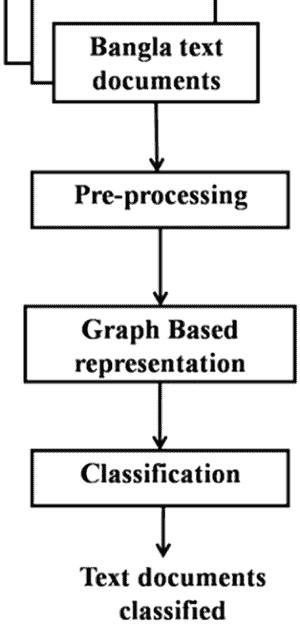

图 5.1

拟议方法的流程图。

## 表 5.1

每个领域的文本文档分布

| 领域 | 文档数量 |
| --- | --- |
| 商业 (Business) | 1100 |
| 娱乐 (Entertainment) | 1100 |
| 食品 (Food) | 1000 |
| 医疗 (Medical) | 1000 |
| 国家新闻 (State News) | 1400 |
| 体育 (Sports) | 1400 |
| 科技 (Science and Technology) | 1000 |
| 旅游 (Travel) | 1000 |
| 总计 (Total) | 9000 |

数据库的开发需要大量关注，以确保在进行实验时不出现错误，并可能适当的结果。实验涉及的文本文档获取自各种在线孟加拉语语料库：涵盖八个领域的杂志和网页，即商业 (`B`)、体育 (`SP`)、娱乐 (`E`)、科学技术 (`ST`)、医疗 (`M`)、旅游 (`T`) 和国家新闻 (`P`)，正如领先的孟加拉语报纸所提到的。八个领域中每个区域的孟加拉语文本文档的分布如表 5.1 所示。文本文档的网络源为 `anabladazar.com`、`bartmanpatrika.com`、`ebela.ineshirepe.wordpress.com`、`ebanglare.com`、`recipebangla.com`、`banglaadda.com`、`amaderchhuti.com`、`ebanglatravel.com`。

### 5.3.2 预处理

使用特定语言的 `WordNet` 对阿斯萨姆语和梵语的文本进行分类是由 Sarmah 在 [19] 和 Mohanty 等人 [20] 完成的。在阿斯萨姆语 [19] 的情况下，考虑了四类，并获得了 90.27% 准确率这一令人鼓舞的结果。

### 5.3.3 基于图的表示

在目前的实验中，实现了一种基于加权图的表示方案。图模型已应用于多个领域 [27]。然后使用分类算法为数据集中的文本分配类别。

图 `Z` 由三元组表示：`Z = (V, E, W)`，其中 `V` 是节点集合，`E` 是连接节点的边集合，`W` 表示边的特征权重。

根据特定的序列，如果两个词出现在特定的文本文档中，则从前一个节点到后一个节点分配一条边。特征权重向量：通过公式 1 确定，其中 `W(p,q)` 代表分配给词 `p` 和 `q` 的权重；`f(p,q)` 表示词 `p` 和 `q` 在文本文档中的出现次数；`f(p)` 表示词 `p` 的出现次数，`f(q)` 表示该特定文本文档中词 `q` 的单独出现次数。`W(p,q)` 越高，两个节点之间的边越强。

### 5.3.4 分类器

多层感知器 (`MLP`) 是模式识别问题中流行且常用的分类器之一 [28–31]，它是一种前馈神经网络架构，将输入数据映射到一组输出数据。我们的实验选择了 `MLP` 配置为 `i-hl-o`（即 `i` 表示属性的数量，`hl` 表示隐藏层的数量，`o` 是输出文本的数量）。


### 5.3.3 基于图的表示

在目前的实验中，实现了一种基于加权图的表示方案。图模型已应用于多个领域 [27]。然后使用分类算法为数据集中的文本分配类别。

图 Z 由三元组表示：`Z = (V, E, W)`，其中 `V` 是节点集合，`E` 是连接节点的边集合，`W` 表示边的特征权重。

- **节点**：从训练集获取的唯一词项。
- **边**：取决于词在文本文档中的出现。对于特定的序列，如果两个词出现在特定的文本文档中，则从前一个节点到后一个节点分配一条边。
- **特征权重向量**：通过公式 1 确定，其中 `W(p,q)` 代表分配给词 `p` 和 `q` 的权重；`f(p,q)` 表示词 `p` 和 `q` 在文本文档中的出现次数；`f(p)` 表示词 `p` 的出现次数，`f(q)` 表示该特定文本文档中词 `q` 的单独出现次数。`W(p,q)` 越高，两个节点之间的边越强。

```
$W(p,q) = \frac{f(p,q)}{f(p) + f(q) - f(p,q)} \quad (5.1)$
```

不同文本类别的特征趋势如图 5.2 所示。

### 5.3.4 分类器

多层感知器 (MLP) 是模式识别问题中流行且常用的分类器之一 [28–31]，它是一种前馈神经网络架构，将输入数据映射到一组输出数据。它涉及至少三个点表面，由每个表面的神经元数量界定，呈现为一个采用非线性激活函数的有向图。我们的实验选择了 MLP 配置为 `i-hl-o`（即 `i` 表示属性的数量，`hl` 表示隐藏层的数量，`o` 是输出文本的数量）。

# 基于图的网页文本文档分类模型

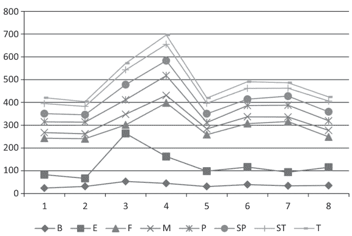

图 5.2

八类文本的特征趋势。

类别。它采用反向传播法来训练架构。隐藏层神经元的数量根据训练数据集特征向量的范围计算得出。该架构中的每个神经元都有一个 sigmoid 函数，该架构是基于迭代次数在 1,500 次之间、学习率 0.3 以及动量 0.2 的基础上训练的。

## 5.4 结果与分析

本节展示了对 9,000 份文档进行孟加拉语文本分类任务的结果，根据 [32, 33] 中用到的 K 折交叉验证，K 值为 5，将文档分为八个不同的类别。通过使用多层感知机（MLP）分类算法，在减少的特征集上进行 1,500 次迭代，获得了 98.62% 的最高准确率。在本次实验中，使用了广泛使用的开源分类实现 WEKA [34] 来应用 MLP。表 5.2 展示了在生成的数据集上基于 1,500 次迭代和五折交叉验证应用 MLP 得到的混淆矩阵。分类和错误率通过以下公式计算：

```
$Classification = \frac{\text{正确分类的文档}}{\text{文本文档总数}} *100% $ (5.2)
```

```
$Misclassification = \frac{\text{错误分类的文档}}{\text{文本文档总数}} *100 $ (5.3)
```

## 使用机器学习进行文档处理

# 表 5.2

使用 MLP 获得的混淆矩阵

| B | 1065 | 1 | 0 | 3 | 13 | 1 | 14 | 3 |
|---|---|---|---|---|---|---|---|---|
| E | 3 | 1088 | 0 | 0 | 4 | 1 | 0 | 0 |
| F | 0 | 0 | 997 | 2 | 0 | 0 | 0 | 1 |
| M | 1 | 1 | 2 | 986 | 8 | 0 | 2 | 0 |
| P | 12 | 2 | 0 | 12 | 1370 | 2 | 1 | 1 |
| SP | 1 | 4 | 0 | 0 | 3 | 1390 | 0 | 2 |
| ST | 6 | 0 | 0 | 0 | 0 | 0 | 993 | 1 |
| T | 3 | 1 | 1 | 0 | 6 | 0 | 1 | 987 |

根据混淆矩阵，每个领域正确分类文本文档的平均百分比以及错误率见表 5.3。基于所采用的方法，系统性能下降是因为由于两个或多个类别的文本文档中标记（tokens）的组织或排列相似相似，导致了文本文档的错误分类。从表 5.3 可以观察到，商业（Business）和国家新闻（State News）领域的文本文档错误率高于其他文本领域，这是因为这些文本的内容非常相似。

本次实验实现的性能水平还与其他常用的分类算法进行了比较，即多项式贝叶斯（NBMN）、多变量贝叶斯（NBMV）、决策树（J48）和 K-近邻算法（KNN 5），以测试我们系统的稳健性。所有分类器的获得准确率见表 5.4，基于精确率、召回率和 F2 测量的比较分析见图 5.3，从图中可以看出，在孟加拉语文本文档分类的情况下，本实验采用的方法使用 MLP 的性能优于其他方法。表现最差的是 NBMV；J48 和 NBMN 分别获得第二、第三、第四名。

# 表 5.3

正确与错误分类的平均百分比

| 领域 (Domains) | 正确分类 (%) | 错误分类 (%) |
|---|---|---|
| 商业 (Business) | 96.82 | 3.18 |
| 娱乐 (Entertainment) | 98.90 | 1.10 |
| 食品 (Food) | 99.70 | 0.30 |
| 医疗 (Medical) | 98.60 | 1.40 |
| 国家新闻 (State News) | 97.85 | 2.15 |
| 体育 (Sports) | 99.28 | 0.72 |
| 科技 (Science and Technology) | 99.30 | 0.70 |
| 旅游 (Travel) | 98.70 | 1.30 |
| 平均 (Average) | 98.64 | 1.36 |

# 表 5.4

分类器比较

| 分类器 (Classifier) | 准确率 (%) |
|---|---|
| MLP | 98.62 |
| NBMN | 96.49 |
| NBMV | 94.20 |
| J48 | 97.09 |
| KNN | 97.98 |

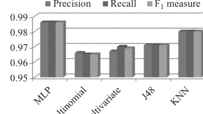

图 5.3

分类器之间的比较。

# 5.4.1 与现有方法的比较

所提出的工作与孟加拉语的一些现有工作进行了比较。由于现有数据库的缺失，在比较中，仅遵循了其他研究人员用于训练模型的方案。对包含 9000 份孟加拉语文本文档的数据库使用 MLP 算法进行了评估。所有方法的获得准确率见下表 5.5。从表中可以看出，所提方法在文本文档分类方面的性能优于传统的机器学习算法。

# 表 5.5

所提方法与现有方法的比较

| 参考文献 (References) | 使用的特征 (Feature Used) | 数据规模 | 准确率 (%) |
|---|---|---|---|
| Mansur 等 [21] | N-gram | 9000 | 93.79 |
| Mandal 和 Sen [22] | TF-IDF | 9000 | 96.21 |
| Kabir 等人 [23] | TF-IDF | 9000 | 96.83 |
| Islam 等人 [24] | TF-IDF & Chi Square | 9000 | 95.36 |
| 所提方法 (Proposed Method) | Graph-Based | 9000 | 98.62 |

## 5.5 结论

本章介绍了一种基于图表示的多层感知机算法，用于将孟加拉语文本分类到相应的类别。结果与其他常用的分类器进行了比较，从实验观察到多层感知机在文档分类方面优于其他算法。未来，该实验可以扩展到更多的孟加拉语领域。我们计划尝试基于深度学习 [36] 和主动学习 [37] 等其他机器学习技术以获得更好的结果。此外，还可以探索 [38, 39] 中述的动态规划方法和 ELM [40] 在其他语言数据集的应用。

# 致谢

作者之一感谢 DST 以学金形式的支持。

## 参考文献

- 1. Das, V., Pathak, M., Rathore, N.S.: 社交媒体图技术的实现，Proc of CDAN, p. 7, 2016.
- 2. Guru, D.S., Suhil, M., Raju, L.N., Kumar, N.V.: 单变量过滤选择的替代方案，Pattern Recognition Letters, 103, pp. 31, 2018.
- 3. Asim, M.N., Wasim, M., Ali, M.S.: 文本分类的特征选择方法比较，Proc of INTELLECT, p. 8, 2017.
- 4. Kowsari, K., Heidary, M., Brown, D.E., Mohammad, K.J., Barnes, L.E.: 用于分类的随机多模态深度学习，Proc of ICISDM, p. 2018.
- 5. Feng, G., Sun, T., Zhang, B.A.: 文本分类的概率模型词权重方案，Pattern Recognition Letters, 110, pp. 29, 2018.
- 6. Wang, Z., Liu, Z.: 基于图的 KNN 文本分类，Proc of FSKD, 2363–2366, 2010.
- 7. Wei, Z., Miao, D., Zhao, R., Li, W.: 中文文本分类的基于 N-Gram 的特征选择和表示，International Journal of Computational Intelligence Systems, 2, pp. 365–374, 2009.
- 8. Wenliang, C., Huizen, W., Jingbo, Z., Tianshun, Y.: 利用全局信息的文本自动聚类，Proc of AIRS, pp. 2005.
- 9. Mikawa, I., Goto, M.: 文本分类中距离度量学习的扩展代价量建议，Proc of ICMSME, pp. 1741–1746, 2011.
- 10. Parvin, H., Dabashi, A., Minaei, B.: 使用波斯词典改进波斯语文本分类，Proc of ICDCAI, pp. 495–502, 2012.
- 11. Al-Tahrawi, M.: 使用逻辑回归的阿拉伯文本分类，International Journal of Intelligent Systems and Applications, 6(pp), 71–78.
- 12. Al-Radaideh, Q., Khalateeb, S.S.: 用于阿拉伯语的关联规则分类器，International Journal of Knowledge Engineering and Data Mining, pp. 225–275, 2013.
- 13. Haralambous, Y., Eldiris, Y., Lenca, P.: 基于依赖句法特征选择的语言文本分类，Proc of ICALP, p. 10, 2014.
- 14. Ali, A., Ijaz, M.: 乌尔都语文本分类，Proc of ICFIT, pp. 1–7, 2009.
- 15. Gupta, N., Gupta, V.: 使用朴素贝叶斯的旁遮普语文本分类及混合方法，Proc of SEANLP, pp. 99–122, 2012.
- 16. ArunaDevi, K., Saveeth, R.: 使用 C 特的泰米语文本分类新方法，International Journal of Research & Development, 2, pp. 343–345, 2014.
- 17. Patil, J., Bogori, N.: 马拉地语文档自动分类，International Journal of Advanced Research in Computer Science and Management Studies, 3, pp. 280–287, 2015.
- 18. Patel, M., Game, P.: 马拉地语文本分类比较，IEEE International Journal on Information Technology, 4, pp. 11–22, 2014.
- 19. Sarmah, J., Saharia, N., Shikhar, K.: 利用 ASME Wordnet 的文档分类新方法，Proc of IGWC, pp. 324–329, 2012.
- 20. Mohanty, S., Santi, P., Mishra, R., Mohapatra, R., Swain, S.: 基于语义的单词文本分类：印度语言视角，Proc of ICECCE, pp. 321–324, 2006.

## 使用机器学习进行文档处理

- 23. Kabir, F., Siddique, S., Kotwal, M.R.A., Huda, M.N.: 基于随机梯度下降 (SGD) 分类器的孟加拉文本文档分类，Proc. of ICCIP, pp. 1–4, 2015.
- 24. Islam, M.S., Jubayer, F.E.Md., Ahmed, S.I.: 基于 TF-IDF 算法的支持向量机用于孟加拉文档分类，Proc. of ICECE, pp. 191–196, 2017.
- 25. Dhar, A., Dash, N.S., Roy, K.: 通过距离测量进行文本文档分类：多领域孟加拉文本文档的实验，Proc. of ICCACA, pp. 1–6, 2017.
- 26. Dhar, A., N.S., Roy, K.: TF-IDF 特征在在线网络文本库文档分类中的应用，Proc. of FICTA, pp. 51–59, 2017.
- 27. Santos, K.C.: g-DICE: 基于图挖掘的文档内容利用，文档分析与识别国际期刊， 18(4), pp. 337–355, 2015.
- 28. Pence, F., Gungor, T.: 基于树的文档结构分析方法及其网络搜索中的应用，自然语言工程，pp. 565–609, 2014.
- 29. Obaidullah, S.M., Halder, C., Santos, K.C., Das, N., Roy, K.: PHIndic_11: 用于脚本识别的 11 个问题的页级手写图像数据集，Multimedia Tools and Applications, pp. 1643–1678, 2017.
- 30. Obaidullah, S.M., Goswami, C., Santos, K.C., Roy, K.: 在多脚本文档中通过有效的脚本识别分离带有“Matra”的印地语，国际人工智能与模式识别国际期刊 [IPRAI]，World Scientific, 7, pp. 175003 (17页), 2017.
- 31. Obaidullah, S.M., Santos, K.C., Halder, C., Das, N., Roy, K.: 词级多脚本印地文档图像数据集及脚本识别基准结果，计算机视觉与图像处理国际期刊 (IJCVIP)，IGI Global, 7, pp. 81–94, 2017.
- 32. Obaidullah, S.M., Santos, K.C., Halder, C., Das, N., Roy, K.: 手写文档自动脚本识别：页级、块级、行和词级方法，机器学习与网络安全国际期刊，pp. 1–20, 2017.
- 33. Santos, K.C., Wendling, L.: 基于非线性投影测量的字符识别，计算机科学前沿，09(5), pp. 678–690, 2015.
- 34. Hall, M., Frank, E., Holmes, G., Pfahringer, R., Reutemann, P., Witten, I.: Weka 数据挖掘软件：更新，ACM SIGKDD 探索快报，11(1), pp. 1–10, 2018.
- 35. Vajda, S., Santos, K.C.: 使用无监督聚类的 k-最近邻分类器，Proc. of Rtip2, pp. 185–193, 2016.
- 36. Ukil, S., Ghosh, S., Obaidullah, S.M., Santos, K.C., Roy, K., Das, N.: 用于词级手写脚本识别的深度学习。arXiv Prean:1801.01627, 2018.
- 37. Bougelia, M.R., Nowczyk, S., Santos, K.C., Verikas, A.: 同意不一致：无需众包的噪标签主动学习，机器学习与网络安全国际期刊，9, p. 13, 2017.
- 38. Santos, K.C.: 基于 dwt-Radon 的字符识别，Proc. of ICDAR, pp. 264–268, 2011.
- 39. Santosh, K.C., Nattee, C., Lamiroy, B.: 基于空间相似性的笔画数和顺序自由聚类，Proc. of ICFHR, pp. 652–657, Das, Roy, 2010.
- 40. Obaidullah, S.M., Bose, A., Mukherjee, M., Santosh, K.C., Das, N., Roy, K.: 用于多脚本文档中手写印地脚本识别的极端学习机，电子成像期刊，27(5), p. 51214, 2018.


# 6 文档分类中的距离量研究

Ankita Dhar, Niladri Sekhar Dash 和 Kaushik Roy

## 目录

- 6.1 引言............................................................................... 70
- 6.2 文献综述............................................................................... 70


# 文档分类中的距离度量研究

## 目录

- 6.2.1 印欧语系 ................................................................ 70
- 6.2.2 汉藏语系 ................................................................ 70
- 6.2.3 日本语系 ................................................................ 71
- 6.2.4 亚非语系 ................................................................ 72
- 6.2.5 达罗毗德语系 ................................................................ 72
- 6.2.6 雅兰语系 ................................................................ 73
- 6.3 拟议方法 ................................................................ 73
- 6.3.1 数据收集 ................................................................ 74
- 6.3.2 预处理 ................................................................ 74
- 6.3.3 特征提取与选择 ................................................................ 75
- 6.3.4 距离测量 ................................................................ 76
- 6.3.4.1 平方欧式距离 ................................................................ 76
- 6.3.4.2 曼哈顿距离 ................................................................ 76
- 6.3.4.3 马哈拉诺比斯距离 ................................................................ 76
- 6.3.4.4 闵可斯基距离 ................................................................ 78
- 6.3.4.5 切比雪夫距离 ................................................................ 78
- 6.3.4.6 坎布拉距离 ................................................................ 78
- 6.4 结果与讨论 ................................................................ 78
- 6.4.1 与现有方法的比较 ................................................................ 81
- 6.5 结论 ................................................................ 81
- 致谢
- 参考文献 ................................................................ 82

## 6.1 引言

计算机能够通过数据挖掘和机器学习的各种方法执行高效的自动化工作。随着互联网的快速发展，数字文本数据量激增。此外，对每个文本数据进行人工调查是一项耗力、易出错且耗时的工作。因此，迫切需要为这些非结构化文本资源提供一种高效的自动分类系统。

针对波斯语和乌尔都语的研究也较少。例如，Lin 等人 [1] 提出了一种名为文本处理相似性（SMTP）的新相似性度量，考虑了三种情况：(i) 特征出现在两个文本文档中；(ii) 特征仅出现在一个文本文档中；以及 (iii) 特征未出现在任何文本文档中。他们在 TF-IDF 上对 WebKB、Reuters-8 和 RCV1 进行了实验，在 K 值分别为 11、11 和 8 时，获得了 0.8467、0.9488 和 0.7130 的准确率。在另一个实验中，Wandabwa 等人 [2] 通过根据其内容分配权重提取了最相关的特征。然后他们估计了数据集中高排名特征在分类任务中的距离。他们在一个包含 15,000 随机维基百科人物文档的数据集上进行了实验，这些文档包含 URI、名称和文本等元素。Wu 等人 [3] 通过使用 20 份报纸、RT-2K、IMDB 和 Reuters-2157 数据集，提出了一种在分类中平衡术语权重过大和权重不足的方法。Koswari 等人 [4] 提出了一种名为随机多层学习（RDML）的技术，通过深度学习网络的集成解决了感知理想深度学习准确率的问题。他们使用 IMDB 数据集进行实验，使用 15 个 RLDS 模型获得了 70.97% 的最高准确率，并观察到 RDML 与传统方法相比表现。Feng 等人 [5] 提出了一种基于匹配评分概率方法的术语加权新方案，并分别观察了在小型大型文本上使用 K-NN 和 SVM 的有效性。在波斯语方面，Parvin 等人 [6] 使用归一化互信息结合同义词表对五个类别的波斯语文本文档进行分类，在 K=1 时获得了 81.45% 的最大准确率。Ali 和 Ijaz [7] 对使用 NB 和 SVM 进行乌尔都语文本文档分类的统计方法进行了比较研究。他们主要使用特定语言的技术处理文档，以开发标准且低维的特征向量。从实验可以看出，当 n 值增加到 3 时性能有所提高，但当值达到 4 时。

## 6.2.2 汉藏语族

除了英语、波斯语和乌尔都语之外，还可以参考针对汉语的各种工作。Wei 等人 [8] 在一个包含 14,150 篇来自 12 类中文文本文档的语料库上进行了实验，基于三个参数：(i) 绝对频率、相对频率与 N-gram频率之间的性能比较；(ii) 稀疏性与特征性之间的比较；(iii) 0/1 逻辑值、N-gram 数值和 TF-IDF 值的性能比较。Wenliang 等 [9] 使用了来自 37 个领域的 14,459 篇文本的 NEU TC 数据集，并应用文档频率和卡方统计来开发标记的类别分布。他们还使用了一种称为全局 CM 的全局聚类模型进行中文文本分类。

## 6.2.3 日语语族

Mikawa 等人 [10] 提出了一种使用扩展余弦测量的有效方法，对日语《每日新闻》和客户评论进行分类。该方法基于向量空间模型衡量两个文档之间的距离。

## 6.2.4 亚非语族

阿拉伯语也探索了各种文本分类技术。例如，Boukil 等人 [11] 使用 TF-IDF 方案提取特征后，利用卷积神经网络对阿拉伯语进行分类。Al-Tahrawi 和 Al-Khatib [12] 在 Al-I-Jazeera 数据集上使用多项式神经网络并取得了令人鼓舞的结果。Raho 等人 [13] 研究了 BBC 阿拉伯数据集上不同情况的学习模型性能，其结果非常有用。

## 6.2.5 达罗毗语族

简要讨论了达罗毗语族文本分类的最新研究。对于泰米尔语文档的分类，ArunaDevi 和 Saveeth [14] 使用了特征提取技术，考虑了术语对。

## 6.2.6 印度雅利语族

简要讨论了印度雅利语族文本分类的最新研究。例如，Gupta 和 Gupta [15] 结合了 NB 和本体技术来分类从新闻语料库中提取的涵盖七个子领域的 184 份旁遮普语文档，他们的实验表明结合方法优于其他方法。Patil 和 Bogiri [16] 使用标签引导算法（LINGO）对 200 份古吉拉特语文档进行了自动文本分类。Rakholi 和 Saini [17] 实现了贝叶斯模型来分类六类别的 280 份古吉拉特语文档，分别获得了 88.96% 和 75.74% 的准确率。Sarmah 等人 [18] 和 Mohanty 等人 [19] 使用特定语言 WordNet 对阿萨姆语和梵语进行了分类。在阿萨姆语的情况下 [18]，考虑了四个类别，并获得了 90.27% 的令人鼓舞的结果。对于孟加拉语，文本分类方法的现状表明，我们还需要很长的时间才能开发该语言的自动文本分类系统。这里报告了该语言的一些工作。Alam 和 Islam [20] 使用逻辑回归模型研究了 37,226 篇文章的文本特征并获得了 0.95 的精确率。Mandal 和 Sen [21] 使用四种监督学习方法对五个类别的 1000 份标记文档进行了实验，通过 SVM 方法实现了 89.14% 的最大准确率。Kabir 等人 [22] 使用随机梯度下降（SGD）分类器分类来自九个不同领域的文档，获得了 93.85% 的准确率，这优于之前的。在另一项工作 [23] 中，基于 TF-IDF 和 SVM 算法对 12 类孟加拉语文本文档观察到了 92.57% 的准确率。Dhar 等人 [24] 使用多层感知器模型对 4000 篇文章进行文本表示方案并实现了 98.03%。在另一项工作 [25] 中，作者通过加权方案修改布谷搜索算法对 9000 篇文章进行了优化，并获得了 98% 的准确率。这里的简要调查表明，为了有效地为孟加拉语用户开发自动文本分类系统，我们还需要走很长的路。

## 6.3 所提方法论

图 6.1 展示了所提方法的概述。在使用特征提取方法（词频-逆文档频率-逆类别频率）获取的特征集上，实现了对从各种孟加拉语网页获取的 9000 份文档的分类。实验结果详情见第 6.4 节。


图 6.1 方法方法的视图。

### 6.3.1 数据收集

数据的质量和数量都是任何实验结果的重要因素。数据库的开发需要很多关注，以便在执行实验时不出现错误并获得适当的结果。然而，从简要文献调查中观察到，基于类别的孟加拉语文本文档不足，因此我们必须建立自己的数据库。实验中的文本文档来自各种在线孟加拉语语料库、杂志和网页，正如领先报纸所述，涵盖八个领域：商业 (B)、体育 (SP)、要新闻 (P)、娱乐 (E)、旅游 (T)、医学 (M)、食品 (F) 和科学技术 (ST)。这八个领域的文本文档分布见表 6.1。文本文档的网页来源有 anandabazar.com、bartmanpatrika.com、ebela.in、deshirice.wordpress.com、ebanglarecipe.com、recipebangla.com、banglaadda.com、amaderhchutthi、ebanglatravel.com。

### 6.3.2 预处理

数字文档由字符、单词和短语等线性符号组成。对于相应文本文档中的字符序列，在实施特征提取和选择方法之前，需要进行分词。分词是将句子切分为标记（tokens）的过程。在没有分割句子的情况下，它们根据“空格”分隔符进行分割。分词后，检索后的术语计数为 2,806,159。分词数据允许系统处理得更快、更高效，并减少对系统资源的压力。这在依赖良好性能的系统中是一个优势。由于并不是所有提取的标记...

#### 表 6.1：每个领域的文本文档分布

| 领域 | 文档数量 |
|---|---|
| 商业 | 1100 |
| 娱乐 | 1100 |
| 食品和食谱 | 1000 |
| 医学 | 1000 |
| 要新闻 | 1400 |
| 体育 | 1400 |
| 科学技术 | 1000 |
| 旅游 | 1000 |
| 总计 | 9000 |

为了确保数据集中的数据具有足够的信息以保留在特征集中，必须去除停用词以清洗和过滤数据。在实验中，考虑了标点符号、代词、英语等价词、后词、英语和孟加拉数字、感叹词、部分形容词、连词、部分副词以及所有的冠词，获得了 1,310,119 个标记。考虑停用词既取决于特定语言，也取决于特定问题。

### 6.3.3 特征提取与选择

标准且广泛加权的方案——词频-逆文档频率（TF-IDF）被改进为一种新方法并命名为 TF-IDF-ICF，它通过引入逆类频率（ICF）来从数据集中开发特征向量 [26]。逆文档频率（IDF）基本上用于衡量术语在相关和非相关文本文档之间的差异。实验表明，当术语 $t$ 是领域 $x$ 的目标术语时，它在领域 $x$ 的文本中出现的概率高于非 $x$ 的领域。根据这一观察，提出了 ICF 来衡量术语对领域的的区分能力。

TF 统计标记 $t$ 在特定文本 $d$ 中的出现。在这里，对数归一化被视为每个术语 $t$ 的归一化词频。

```
TF = log \frac{O_{t,d}}{\sum_{td}} (6.1)
```

IDF 通常预测术语 $t$ 在整个数据集中的相关性。文档频率（IDF）使用下公式统计数据集中若干文本中术语 $t$ 的出现，其中 $N$ 代表数据集。

```
IDF = log \frac{N}{CF(t)} (6.2)
```

类频率（CF）统计标记 $t$ 在所有领域统计中的出现次数。ICF 根据以下公式进行估计，其中 $C$ 是实验中考虑的整体类别。

```
ICF = log \frac{N}{CF(t)} (6.3)
```

提出的 TF-IDF-ICF 是一种新方案，它在考虑 TF-IDF 的同时考虑标记 $t$ 在领域 $c$ 中的出现，并使用公式 6.4 衡量 $t$ 的权重。在所有情况下，都考虑了术语的归一化值以获得更具体且相关的特征向量。

```
TF-IDF-ICF = TF * IDF * ICF                               (6.4)
```

本实验考虑的八类不同文本类特征特征趋势如图 6.2 所示。

### 6.3.4 距离测量

距离度量是许多机器学习任务中的重要事项。距离测量的目的是估计两个术语之间的相似性或差异性。考虑的距离度量包括平方欧几得距离、曼哈顿距离、马拉诺比斯距离、闵夫斯基距离、切比距离和坎布拉距离。

#### 6.3.4.1 平方欧几得距离

平方欧几得距离量的公式与欧几得距离相同，但区别在于它进行了平方，以便为距离较远的术语分配逐渐增加的权重。它使用以下公式进行估计：

```
Dis(i, j) = (i_i - j_i)² + (i_j - j_j)² + ... + (i_n - j_n)²                                     (6.5)
```

平方欧几得距离考虑了对应文本文档的两个术语之间平方的和。

#### 6.3.4.2 曼哈顿距离

曼哈顿距离有多种名称，如街区距离、L1距离或绝对值距离。它测量沿直交轴两个术语之间的距离，并使用公式 6.6 计算。与欧几得和平方欧几得距离相比，这种距离测量受偏差的影响较小。

```
Dis(i, j) = |i - j| = ∑ |i_i - j_i|                                     (6.6)
```

#### 6.3.4.3 马拉诺比斯距离

马拉诺比斯距离考虑了不同数据的均值或质心。它测量两个术语相对于质心的相对距离。对于距离质心越远的术语，马拉诺比斯距离越大。距离由公式 6.7 表示，其中 $SD$ 是 $i_i$ 和 $j_j$ 在数据集上的标准差。

协方差矩阵表示与对象相关的协方差。使用协方差的原因是为了获得两个或多个对象共同的结果。它通常用于需要开发不同对象簇之间相关性的分类和聚类任务。

```
$$Dis(i, j) = \sum_{l=1}^{n} \frac{(i_l - j_l)^2}{SD_l^2}$ $\quad (6.7)$
```

#### 6.3.4.4 闵夫斯基距离

闵夫斯基距离可以认为是欧几得距离和曼哈顿距离的泛化，使用以下公式计算，其中 $m$ 是被视为 1 或 2 的正整数值。

```
$$Dis(i, j) = \sum_{l=1}^{n} |i_l - j_l|^{1/m}$ $\quad (6.8)$
```

#### 6.3.4.5 切比距离

切比距离可以定义在特征向量上，用于测量两个向量空间沿标准坐标轴的最大差值。它使用以下公式进行测量。

```
$$Dis(i, j) = \max|i_l - j_l|$ $\quad (6.9)$
```

#### 6.3.4.6 坎布拉距离

坎布拉距离探索了一对坐标之间一系列分数差异之和。每个变量的值在 0 到 1 之间，对小变化非常敏感。给定向量 $i$ 和 $j$ 的坎布拉距离使用公式 6.10 表示。它是向量空间中考虑的术语对距离的数值测量。

```
$$Dis(i, j) = \sum_{l=1}^{n} \frac{|i_l - j_l|}{|i_l| + |j_l|}$ $\quad (10)$
```

## 6.4 结果与讨论


# 提出的 TF-IDF-ICF 方案

提出的 `TF-IDF-ICF` 是一种新方案，它在考虑 `TF-IDF` 的同时考虑标记 $t$ 在领域 $c$ 中的出现，并使用公式 6.4 衡量 $t$ 的权重。在所有情况下，都考虑了术语的归一化值以获得更具体且相关的特征向量。

本实验考虑的八类不同文本类特征趋势如图 6.2 所示。

| 领域 | 准确率 (%) | 错误率 (%) |
| --- | --- | --- |
| 商业 | 97.64 | 2.36 |
| 娱乐 | 99.10 | 0.90 |
| 食品 | 99.60 | 0.40 |
| 医疗 | 98.10 | 1.90 |
| 国家新闻 | 97.21 | 2.79 |
| 体育 | 98.00 | 2.00 |
| 科技 | 98.60 | 1.40 |
| 旅游 | 99.30 | 0.70 |
| 平均 | 98.44 | 1.56 |

本章介绍了一种基于多种距离度量（即平方欧几里得距离、哈顿距离、马哈拉斯距离、闵氏距离、切比距离和坎伯拉距离）的特征提取方案（`TF-IDF-ICF`），将孟加拉语文档分类到相应文本类别的方法。从实验中可以观察到，孟加拉语文本文档分类中，马哈拉斯距离与其他指标相比表现更好。未来，该实验可以扩展到包含更多孟加拉数据集以及更多领域或文本类别。此外，还可以引入新的混合方法来将文本文档分类到其预定义的文本类别中。我们还计划尝试其他的机器学习技术，例如基于深度学习 [29] 和主动学习 [30] 方法的方法，以获得更好的结果。如 [31, 32] 所述，基于动态规划的方法以及 [33] 中的 `ELM`（极端学习机），也可以在文本分类中进行探索。未来，该研究可以在其他语言的数据集上进行探索。

## 致谢

作者之一感谢 `DST` 以 `INSPIRE` 学金的形式提供的支持。

## 参考文献

- 1. Lin, Y.S., Jiang, J.Y., Lee, S.J.: 文本分类与聚类的相似性度量, IEEE Transactions on Knowledge and Data Engineering, 26(7), pp. 1575–1990, 2014.
- 2. Wandabwa, H., Zhang, D., Sammy, K.: 基于属性距离加权 K 近邻的文本分类, Proc. of ICIT, pp. 225–228, 2016.
- 3. Wu, H., Gu, X, Gu, Y.: 监督词加权中权重权重与权重不足的平衡, Information Processing and Management, 53(2), pp. 547–557, 2017.
- 4. Kowarski, K., Heidarsafaa, M., Brown, D.E., Meimandi, K., Barnes, L.E.: `RMDL`: 用于分类的随机多模态深度学习, Proc. of ICDISM, p. 11, 2018.
- 5. Feng, G., Li, S., Sun, T., Zhang, B.A.: 用于文本分类的基于概率模型的词加权方案, Pattern Recognition Letters, 110, pp. 23–29, 2018.
- 6. Parvin, H., Dahbashi, A., Parvin, S., Minaei, B.: 使用波斯语同义词改进文本分类与聚类, Proc. of ICDAI, pp. 493–500, 2012.
- 7. Ali, A., Ijaz, M., Dauchat, J., Zhao, R., Li, W: 用于中文文本分类的基于 N-Gram 的特征选择和文本表示, International Journal of Computational Intelligence Systems, 2, pp. 365–374, 2009.
- 8. Wei, Z., Miao, D, U: 乌尔语文本分类, Proc. of ICIT, pp. 1–7, 2009.
- 9. Wenliang, C., Xingizhen, C., Weibo, J., Tianshan, Y.: 利用全局信息用于文本分类的自动词聚类, Proc. of AIRS, pp. 1–11, 2005.
- 10. Mikawa, K., Ishidat, T., Goto, M: 用于文本分类距离度量学习的扩展余弦度量建议, Proc. of ICMSC, pp. 1741–1746, 2011.
- 11. Boulik, S., Biniz, M., El Adani, F., Cherrat, L., El Moutaaakel, A.E.: 使用深度学习技术的阿拉伯文本分类, International Journal of Grid and Distributed Computing, pp.103–114, 2018.
- 12. A-Tahrawi, M.M., Al-Khatib, S.N.: 使用多项式网络的阿拉伯文本分类, Journal of King Saud University-Computer and Information Sciences, 27, pp. 437–449, 2015.
- 13. Raho, G., Al-Shalabi, R., Kanaan, Nassar, A.: 基于阿拉伯文本分类的分类分类算法：特征选择比较研究, International Journal of Advanced Computer Science and Applications Ijacsa, 6, pp. 23–28, 2015.
- 14. ArunaDevi, K., Suresh, R.: 使用 C-Feature 进行文本分类的新方法, International Journal of Scientific Research & Development, 2, pp. 333–345, 2014.
- 15. Gupta, N., Saha, V.: 使用朴素贝叶斯、质心和混合方法的旁遮普语文本分类, Proc. of SEALP, pp. 109–112, 2012.
- 16. Patil, J., Bogori, N.: 马拉地语文档的自动文本分类, International Journal of Research in Computer Science and Management Studies, 3, pp. 280–287, 2015.
- 17. Rakholi, R.M., Saini, R.: 古吉拉特语文档的朴素贝叶斯分类器, International Journal of Science and Technology, 5, pp. 1–9, 2017.
- 18. Sarmah, J., Saharia, N., Shikhar, K.: 使用阿萨姆语词网进行文档分类的新方法, Proc. of IGWCE, pp. 324–329, 2012.
- 19. Mohanty, S., Santi, P., Mishra, R., Mohapatra, R., Swain, S.: 使用词网的语义文档分类：印度语言视角, Proc. of ICECCE, pp. 321–324, 2006.
- 20. Mansur, M., U Zaman, N., Khan, M.: 报纸语料库中孟加拉语 N-Gram 文本分类分析, Proc. of ICCIT, 8, 2006.
- 21. Mandal, A.K., Sen, R.: 用于孟加拉语文档分类的监督学习方法, International Journal of Artificial Intelligence & Applications, 5(5), pp. 93–105, 2014.
- 22. Kabir, F., Siddique, S., Kotwal, M.R.A., Huda, M.N.: 使用随机梯度下降 (`SGD`) 分类器的孟加拉语文本分类, Proc. of ICCCEP, pp. 1–4, 2015.
- 23. Islam, M., Subayer, F.E.M., Ahmed, S.I.: 带有 `TF-IDF` 算法的支持向量机用于孟加拉语文档分类, Proc. of ICECCE, pp. 191–196, 2017.
- 24. Dhar, A., Das, N.S., Roy, K.: 基于 `TF-IDF` 文本分析方案的孟加拉语网页文档分类, Proc. of CSI, pp. 477–484, 2018.
- 25. Dhar, A., Das, N.S., Roy, K.: 基于改进布谷优化算法的分类, Proc. of RTIP, pp. 640–651, 2019.
- 26. Dhar, A., Das, N.S., Roy, K.: 基于逆类频率的孟加拉语文档分类, Proc. of It-SIU, pp. 1–6, 2018.
- 27. Obaidah, S.M., Santosh, K.C., Halder, C., Das, N., Roy, K.: 多脚本识别：页级与词级, International Journal of Machine and Cybernetics, 9, 2017.
- 28. Santosh, K.C., Wendling, L.: 非线性投影字符识别, Frontiers of Computer Science, 9, pp. 678–690, 2015.
- 29. Ukil, S., Ghosh, S., Obaidah, S.M., Santosh, K.C., Das, N., Roy, K.: 用于脚本识别的深度学习, arXiv:1801.0127.
- 30. Bouguela, M., Nowaczyk, S., Santosh, K.C.: 无众包噪声标签主动学习, International Journal of Machine and Cybernetics, 9, 2017.
- 31. Santosh, K.C.: 基于 dtw-Radon 的字符识别, Proc. of ICDAR, pp. 264–268, 2011.
- 32. Santosh, K.C., Nattee, C., Lamiroy, B.: 基于笔画数量和顺序的空间相似性, Proc. of ICFHR, pp. 652–657, 2010.
- 33. Obaidullah, S.M., Bose, A., Mukherjee, M., Santosh, K.C., Das, N., Roy, K.: 用于多脚本文档识别的极端学习机, Journal of Electronic Imaging, 27(5), p.51214, 2018.

# 文档分类中距离的研究

## 7 引言

近年来，基于内容的文档管理系统在计算机和信息科学领域引起了极大关注。这种需求背后的原因是数字文档的大规模可用性以及更高效地访问这些文档的需求。因此出现了“文本分类”（`TC`）的概念，它也可以称为文本分类或主题检测。文本分类是文本挖掘中的一个动态研究领域，指使用分类技术将文档分配到相应的类别中以便有效地管理信息。如果文本文档被分类，那么从这些文本中搜索和检索信息将是快速且有效的。

## 使用机器学习进行文档处理

目前文本分类（`TC`）在许多框架中都有应用。某些应用包括基于词汇的文档索引、文档过滤、词义消歧以及在线资源的层次分类。通常，在最近的场景中，文本分类具有多种用途，需要对文档的筛选、组织和修改进行灵活访问。它也适用于网络自动化与文本形式的数据搜索和检索相关的场景。

20世纪90年代，机器学习方法在文本分类领域变得流行。文本分类有着深远的历史。在该领域已经探索了多种技术以提高多种语言的性能，但针对印度语言（尤其是孟加拉语）提出的方法非常少。常用且广泛的文本表示方法是词袋模型，它有时会使用短语、词序列或 `N-gram` 模型。在处理文本时，主要关注点是在应用特征选择或特征加权方案之前，需要从数据集中提取词或 `N-gram`。文本分类不再是手动分类文档，也不基于手工规则，而是使用机器学习技术，通过基于标记文档的分类规则进行训练。

在目前的实验中，考虑了唯一词袋（`UOWs`）和文本类别之间的接近性，以提高自动分类孟加拉语文本文档系统的效率。类别的接近性基于 `UOW` 模型确定的。然后，采用评分算法根据语料库中接近程度的频率为不同领域的接近性分配不同的分数。在开发特征集后，从来自八个领域（即商业、旅游、食品、州新闻、娱乐、体育、医学以及科技）的各种在线新闻语料库、杂志和网页获取了朴素多项贝叶斯（`NBM`）文本文档。实验在一个包含 9000 条数据的数据库上进行了评估。

本章的其余部分结构如下：7.2 节简述了相关工作，7.3 节提出了本文的方法，包括对数据收集、预处理技术、特征提取与选择方法以及所用分类器的讨论。7.4 节分析了结果，并与多种分类算法进行了比较，并将所提方法与现有方法进行了对比。7.5 节总结了全文并展示了该领域的未来方向。

## 7.2 现有工作

从文献综述可以发现，英语文本分类受到了研究者的极大关注。这里简要讨论了几项工作。`Dey Sarkar` 等人 [1] 研究了一种使用朴素贝叶斯分类器的聚类技术，用于分类来自13数据集的文档，获得了令人鼓舞的结果。`Guru` 和 `Suh` [2] 在 `20Newsgroups` 数据集上使用支持向量机（`SVM`）和 K-最近邻（`K-NN`）算法，基于 `Term_Class` 相关性方法对他们的实验进行了评估。`Jin` 等人 [3] 提出了一种结合随机梯度下降（`SGD`）分类器的方法，用于分类 `Reuters-21578` 和 `20Newsgroups` 数据集的文档。`Wang` 和 `Zhang` [4] 引入了两种新方案，通过使用逆类别频率（`ICF`）到 `TF-IDF` 以及基于 `ICF` 的方法作为文本分类的特征提取方案。`Telelez` 等人 [5] 提出了一种中等且多建议的分类算法，无论类别和语言如何，都能有效管理文本分类。他们将该方法定义为微文本分类模型，由各种文本表示、转换和监督学习算法组成，以便于易地实现分类。他们的方法对于非正式编写的文本证明是有效的。`Linh` 等人 [6] 提出了一种使用狄利克雷过滤器处理方向数据的分类技术。标记的训练文本文档被用于自动确定每个文本领域形成的、合适且标记的主题数量。他们的观察显示了该方法在识别性、可解释性以及高维复杂散乱数据库分类方面的优势。

除了英语，还可以参考针对中文、日语和波斯语开展的各种工作。例如，`Wei` 等人 [7] 使用了一个包含来自12类类的 14,150 份中文文本文档的中文语料库，并对三个因素进行了实验：(i) 绝对频率、相对文本频率与 `N-gram` 频率之间的性能比较；(ii) 稀疏性与特征相关性的比较；(iii) 0/1 逻辑值、`N-gram` 频率数值和 `TF-IDF` 值之间的性能比较。`Wenliang` 等人 [8] 在一个包含 37 个领域 14,459 篇文本的标准数据集上进行了实验，使用文档频率和卡方统计来建立词项的类别分布。他们还使用了一种称为全局 `CM` 的全局聚类方法进行中文文本分类。`Mikawa-wa` 等人 [9] 引入了一种基于扩展余弦测量的日语文本分类高效方法，用于《每日新闻》报和客户评论的分类。该方法基于向量空间模型确定两个文档之间的距离。在波斯语文本分类方面，`Parvin` 等人 [10] 使用归一化互信息作为词典，将文本文档分为五个文本类别，并在 `K=1` 时达到了 81.45% 的最高准确率。

除了英语、中文和波斯语，针对阿拉伯语还探索了多种文本分类技术。例如，`Al-Tahrawi` [11] 使用卡方方法对来自半岛阿拉伯语新闻语料库的均匀分布在五个领域的 1500 篇新闻文章进行了分类。`Al-Radaide` 和 `Al-Khateeb` [12] 提出了一种基于关联规则的分类算法用于分类阿拉伯文档；`Haralamb` 等人 [13] 在从 `Kalimat` 语料库获取的数据集上实现了轻量词提取和根提取程序，并结合 `TF-IDF` 和依赖句法特征。`Ali Ijaz` [14] 提出了关于使用 `NB` 和 `SVM` 分类乌尔都语文本文档的统计方法的比较研究。他们主要使用特定语言的方法对文档进行预处理，以开发一个健壮但特征较少的向量。从实验可以看出，当 `n` 值增加到 3 时，性能会提高，但当值达到 4 时性能会下降。

近期，针对印度语言的文本分类也进行了一些研究工作。这里简要描述了其中一些。例如，`Gupta` 和 `Gupta` [15] 结合了 `NB` 和基于本体的技术来分类来自涵盖七个子领域的 184 份旁遮普语文本文档。他们的实验表明，结合方法与其他方法相比性能更好。对于泰米尔语文本文档的分类，`ArunaDev` 和 `Sveeth` [16] 使用了 `C` 特征提取技术，该技术考虑了词对。对于马拉地语文本文档分类，`Patil` 和 `Bogiri` [17] 提出了一种自动文本分类技术，基于标签引导（`LINGO`）算法根据用户配置文件对来自20个类别的200 份文档进行分类。在另一个实验中，`Patil` 和 `Game` [18] 使用了四种算法，证明 `NB` 在准确性和时间上对马拉地语文档的分类更为有效。使用特定语言的 `WordNet` 对阿萨姆语和梵语进行文本分类的工作由 `Sarmah` 等人 [19] 和 `Mohanty` 等人 [20] 完成。在阿萨姆语 [19] 的情况下，考虑了四个类别，并获得了 90.27% 的令人鼓舞的准确率。

然而，对于孟加拉语，文本分类方法的评估处于糟糕的状态。该领域信息的缺乏表明，在对该语言进行更多研究之前还有很长的路要走。这里报道了一些针对孟加拉语的工作。`Mansur` 等人 [21] 使用 `N-gram` 方法对来自孟加拉语新闻语料库 `Pratham Alo` 的数据进行分类。在另一个实验中，`Mandal` 和 `Sen` [22] 对四种监督学习方法进行了实验，将1000 份标记文本分为五个类别，并使用 `SVM` 方法达到了 89.14% 的最高准确率。另一方面，`Kabir` 等人 [23] 使用 `SGD` 分类器对来自九个不同类别的文档进行分类，达到了 93.85% 的准确率，比之前的方法更好。在另一项工作 [24] 中，基于 `TF-IDF` 和 `SVM` 算法分类 12 个文本领域的孟加拉语文本文档时观察到了 92.57% 的准确率。

# 文本分类中领域邻近性研究


# 文本分类中领域邻近性研究

以及科学。他们的结果显示，最高准确率（95.80%）是通过余弦相似性（`Cosine Similarity`）测量实现的。在另一项工作中，Dhar 等人 [26] 提出了一种新的降维技术，考虑了基于 `TF-IDF` 方法从训练文本文档中提取的词术语集中前 40% 的术语。实验在来自五个领域的 1960 份文档上进行，并使用 `LIBLINEAR` 作为分类器取得了令人鼓舞的结果。这里介绍的简要调查表明，为了高效地服务孟加拉语（`Bangla`）用户的需求，我们在开发一种自动文本分类系统方面还需要很长一段路。

## 7.3 所提方法论

图 7.1 所示了所提方法的概述。在利用特征提取方法（词袋模型 `UBoWs` 和文本类别之间的邻近性）获取的特征集上，实现了朴素贝叶斯多项分类算法，对从各种网络源获取的 9000 份孟加拉语文本文档进行分类。实验结果的细节见第 7.4 节。

### 7.3.1 数据收集

无论从质量还是数量上，数据都是任何实验结果的重要因素。开发数据库需要大量关注，以确保实验过程中不会出现错误并获得适当的结果。然而，从简要的文献调查中发现

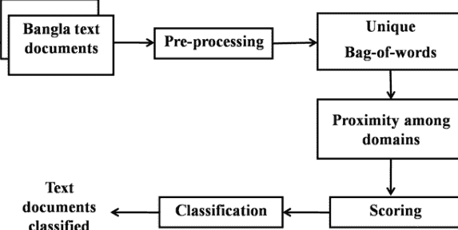

图 7.1 所提方法的框图。

## 表 7.1

| 领域 | 文档数量 |
| :--- | :--- |
| 商业 | 1100 |
| 娱乐 | 1100 |
| 食品 | 1000 |
| 医学 | 1000 |
| 国家新闻 | 1400 |
| 体育 | 1400 |
| 科技 | 1000 |
| 旅行 | 1000 |
| 总计 | 9000 |

我们注意到基于领域的孟加拉语文本文档数量不足，因此我们必须建立自己的数据库来执行此任务。实验涉及的文本文档来自在线孟加拉语语料库、杂志和网页，涵盖了八个领域：商业 (`B`)、体育 (`SP`)、国家新闻 (`P`)、娱乐 (`E`)、医学 (`M`)、食品 (`F`)、科技 (`ST`) 和旅行 (`T`)，正如领先新闻所示。这八个领域每个领域的文本文档的分布见表 7.1。文本文档的网络源为 `anabadasar.com`、`bartmanpatrika.com`、`ebla.in`、`des.word.com`、`ebanglicepipe.com`、`recipebangla.com`、`banglaadda.com`、`amaderchhuti.com`、`ebanglatral.com`。

### 7.3.2 预处理

字符、单词和短语等表示的线性序列用于形成数字文本文档。对于相应文本文档中的给定字符序列，在应用特征提取和选择方案之前，需要进行分词（`tokenization`）。分词是将句子分成称为标记（`tokens`）的片段的任务。如果不将句子切分成标记，就无法进行进一步处理。句子的拆分是以“空格”作为分隔符进行的，从数据集中检索到的单词总数为 2,806,159。分词后的数据加速了系统的处理，使其更高效并减轻了系统资源的负担。这在依赖良好性能的系统中被证明是一个优势。由于从数据集中提取的所有单词并非都与特征集相关或具有信息，因此必须移除停用词（`stopwords`）以过滤数据。在当前的实验中，标点符号、代词、英语等价词、后置词、英语和孟加拉语数字、感叹词是需要移除的。

## 7.4 结果与分析

本节展示了对来自八类的 9,000 文档进行孟加拉语文本分类的结果。为了这一目的，使用了广泛接受的开源分类工具 `WEKA` [31] 来实现此处所考虑的分类器。在观测数据集上进行了 K 折交叉验证，其中 K 选择为 10 [32]。使用 `NBM` 分类算法在 1,200 次迭代中实现的最高准确率为 97.30%；混淆矩阵见表 7.4。还针对不同的交叉验证折进行了实验，并使用表现最好的交叉验证折对不同的迭代次数进行了实验。获得的结果如表 7.5 和表 7.6 所示。图 7.3 提供了基于系统性能各种参数的领域准确率。

根据使用 `NBM` 进行 10 折交叉验证后获得的混淆矩阵，每个领域的正确分类文本平均百分比和误分类率见表 7.7，其通过以下公式计算：

> $P(t|v) = \frac{\sum_{t' \in B_v} N_{vt'}}{N_v}$ (7.4)
>
> $Classification = \frac{\text{Correctly classified documents}}{\text{Total number of documents}} \times 100$ (7.5)
>
> $Misclassification = \frac{\text{Incompletely classified documents}}{\text{Total number of documents}} \times 100$ (7.6)

### 表 7.4 使用 NBM 得到的混淆矩阵

| | B | E | F | M | P | SP | ST | T |
| :--- | :--- | :--- | :--- | :--- | :--- | :--- | :--- | :--- |
| B | 1024 | 8 | 0 | 22 | 4 | 0 | 0 | 0 |
| E | 0 | 1070 | 0 | 0 | 17 | 4 | 0 | 0 |
| F | 0 | 0 | 990 | 4 | 0 | 0 | 0 | 6 |
| M | 7 | 0 | 0 | 968 | 16 | 0 | 0 | 9 |
| P | 19 | 4 | 0 | 12 | 1363 | 2 | 0 | 0 |
| SP | 4 | 12 | 0 | 0 | 8 | 1372 | 0 | 4 |
| ST | 9 | 0 | 0 | 9 | 3 | 0 | 979 | 0 |
| T | 0 | 10 | 6 | 0 | 0 | 2 | 0 | 982 |

### 表 7.5 不同交叉验证折的 NBM 性能

| Folds | 5 | 10 | 15 | 20 |
| :--- | :--- | :--- | :--- | :--- |
| Accuracy (%) | 96.12 | 97.30 | 95.39 | 95.24 |

### 表 7.6 不同训练次数的 NBM 性能

| Iterations | 500 | 1000 | 1500 | 2000 |
| :--- | :--- | :--- | :--- | :--- |
| Accuracy (%) | 95.98 | 97.30 | 96.42 | 95.47 |

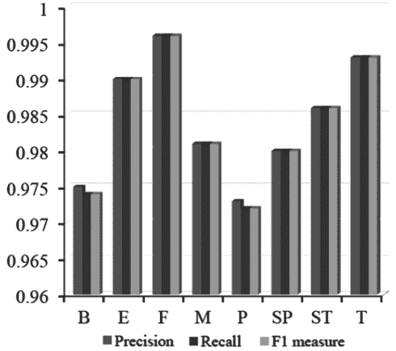

图 7.3 基于精确率、召回率和 F1 值的领域评估。

### 表 7.7 正确与错误分类的平均百分比

| Domains | Correct Classification (%) | Incorrect Classification (%) |
| :--- | :--- | :--- |
| Business | 93.10 | 6.90 |
| Entertainment | 98.10 | 1.90 |
| Food | 99.00 | 1.00 |
| Medical | 96.80 | 3.20 |
| State News | 97.36 | 2.64 |
| Sports | 98.00 | 2.00 |
| Science and Technology | 97.90 | 2.10 |
| Travel | 98.20 | 1.80 |
| Average | 97.31 | 2.69 |

实验获得的结果还与常用算法进行了比较，即多层感知器 (`MLP`) [33]、随机森林 (`RF`) [34]、基于规则的 (`PART`) 和 `LogisticBoost` (`LB`)，以测试系统的稳健性。对比分析见表 7.8，从中可以看出本实验采用的方法在使用 `NBM` 时优于其他方法。表现最好的是 `SVM`；`MLP`、`RF` 和 `PART` 分别获得第二、第三、第四和第五名。

### 表 7.8 分类器比较

| Classifiers | Accuracy (%) |
| :--- | :--- |
| NBM | 97.30 |
| MLP | 96.89 |
| SVM | 94.21 |
| RF | 96.19 |
| PART | 94.43 |
| LB | 95.98 |

## 7.5 结论

本章介绍了一种基于特征提取方案（唯一词袋和领域间的接近性）的 `NBM` 算法将孟加拉语文档分类到各自的文本类别。结果与常用分类器进行了比较，实验表明 `NBM` 的性能优于其他算法。在未来，该实验可以扩展到包含更多全领域的孟加拉语文档，还可以引入新的混合方法将文档分类到其他语言。我们还计划尝试深度学习等其他机器学习技术以获得更好的结果。

## 致谢

作者之一感谢 `DST` 对其 `INSPIRE` 奖学金计划的支持。

## 参考文献

1. Dey Sarkar, S., Goswami, S., Aktar, J.: A Novel Feature Selection for Text Classification Using Bayes, Scholarly Research Notices, 2014.


2. Guru, D., Suhil, M.: A Novel Term Measure for Textization, Proc. of ICACTA, pp. 20–25.

3. Jin, P., Zhang, Y., Chen, X.: Bag-Of-Embeddings for Textization, Proc. of ICACTA, pp. 20–25.

4. Jin, P., Zhang, Y., Chen, X.: Bag,- of ,,,.,,...22.5ization for..

5.ization for Textization, Journal of Science and Engineering, pp. 149–223.

6. ArunaDev, K., Saveeth, R.: Text Classification Using Syntax-Based Feature, International Conference on Natural Language Processing, p. 10.

7. Kabir, F., Siddique, S., Kotwal, M.R.A., H, M.N.: Bangla Text Categorization Using Stochastic Gradient Descent (SGD) Classifier, Proc. of ICCCEP, pp. 1–4.

8. Islam, M.S., Jafar, F.EM., Ahmed, S.I: A Support Vector Machine with TF-IDF Algorithm to Categorize Bengali Document, Proc of ICECCE, pp. 191–196.

9. Dhar, A., Dash, N.S., Roy, K.: Classification of Text Documents through Distance Measurement: Experiment with Multi-Domain Bangla Text Documents, Proc of ICACCA, p. 16.

10. Marathi, International Journal of Advanced Research in Computer Science and Management Studies, 03.

11. Patil, M, G.: Comparison of Marathi Classifiers, ACEEE, International Journal on Information Technology, 04, pp. 11–22.

12. Bengali, International Journal of Artificial Intelligence & Applications, 05(5), pp. 93–105.

13. Mansur, U., Uzman, N., Khan, M.: Analysis of N-Gram Text Categorization for Bengali in a Newspaper Corpus, Proc of ICCIT, p. 08.

14. Mandal, A.K., Sen, R.: Supervised Learning Methods for Bangla Web Categorization, International Journal of Artificial Intelligence & Applications.

15. Arabic, Journal of Intelligent Systems, 6(6).

16. Arabic, International Journal of Knowledge and Engineering.

17. Arabic, International Journal of Knowledge and Engineering.

18. Arabic, International Journal of Knowledge and Engineering.

19. Arabic, International Journal of Knowledge and Engineering.

20. Syntax-Based, International Conference on Natural Language Processing, p. 10.

21. Arabic, International Journal of Knowledge and Engineering.

22. Arabic, International Journal of Knowledge and Engineering.

23. Marathi, International Journal of Science and Engineering, pp. 149–223.

24. Marathi, International Journal of Science and Engineering.

25. Marathi, International Journal of Science and Engineering.

26. Marathi, International Journal of Science and Engineering.

27. Marathi, International Journal of Science and Engineering.

28. Marathi, International Journal of Science and Engineering.

29. Marathi, International Journal of Science and Engineering.

30. Marathi, International Journal of Science and Engineering.

31. [31].

32. [32].

33. [33].

34. [34].

# 文本分类领域邻近性研究

- 26. Dhar, A., Dash, N.S., Roy, K.: 用于在线孟加语文本语料库分类的TF-IDF特征应用，Proc. of FICTA, pp. 51–59, 2017.

- 27. Kibriya, A.M., Frank, E., Pfringer, B., Holmes, G.: 用于文本分类的多项朴素贝叶斯修订版，Proc. of ACFAI, pp. 488–499, 2005.

- 28. Kim, S.B., Han, K.S., Rim, H.C., Myaeng, S.H: Naive Bayes文本分类的一些有效技术，IEEE Transactions on Knowledge and Data Engineering, 18(11), pp. 1457–1466, 2005.

- 29. Rehman, A., Javed, K., Babri, H.: 自动文本检索中的词权重方法，Information Processing and Management, 53(2), pp. 473–489, 2017.

- 30. Wilbur, J., Kim, W.: 文本分类中文档内词频的无效效性，Information Retrieval, 12(5), pp. 509–525, 2009.

- 31. Hall, M., Frank, E., Holmes, G., Pfringer, B., Reutemann, P., Witten, I.H.: Weka数据挖掘软件：更新，ACM SIGKDeplorations Newsletter, 11(1), pp. 10–18, 2009.

- 32. Obaillah, Sk.M., Santosh, K.C., Halder, C., Das, N., Roy, K.: 从手写文档中识别印地脚本：页面、区块和单词级手写脚本，pp. 1–20, 2017.

- 33. Obaillah, Sk.M., Halder, C., Santosh, K.C., Das, N., Roy, K.: PHDIndic_11: 用于脚本识别的11种官方印地脚本页面级手写文档图像数据集，Multimedia Tools and Applications, 77, pp. 1643–1678, 2017.

- 34. Obaillah, Sk.M., Santosh, K.C., Das, N., Halder, C., Roy, K.: 通过“Matra”分离印地脚本以实现多脚本文档中有效的手写脚本识别，International Journal of Artificial Intelligence & Pattern Recognition, 31, 1753003, 2017.

- 35. Bouguelia, M.R., Nowczyk, S., Santosh, K.C., Verikas, A.: 同意不一致：无需众包的噪声标签主动学习，International Journal of Machine Learning and Cybernetics, 9, p. 13, 2017.


# 基于 Twitter 数据集的攻击识别与作者画像分析的监督学习

Kashyap Raiyani and Roy Bayot

## 目录

- 8.1 引言 ................................................................................ 101
- 8.2 攻击识别概述 ................................ 102
- 8.2.1 数据集 ...................................................................... 102
- 8.2.2 数据特征 ................................................... 104
- 8.2.3 数据预处理 ....................................................... 105
- 8.2.4 特征提取 ....................................................... 106
- 8.2.5 实验设置 ...................................................... 107
- 8.2.6 系统建模 ........................................................ 107
- 8.2.7 结果 ...................................................................... 109
- 8.3 作者画像概述 ............................................ 109
- 8.3.1 数据集 .................................................... 110
- 8.3.2 预处理 ............................................................ 110
- 8.3.3 特征提取 ................................................... 111
- 8.3.4 实验设置 ...................................................... 111
- 8.3.5 算法与模型微调 ........................ 112
- 8.3.6 结果 ................................................... 113
- 8.4 结论与未来工作 ........................ 116
- 参考文献 ....................................................... 116

## 8.1 引言

每个文档都有其独特的表示方式。基于这种说明，有方法可以识别作者的性别以及写作背后的攻击性。这些知识在处理法医学、网络欺凌和仇恨言论检测时至关重要，例如，了解作者画像可能具有基础性的意义。在类似于法庭语言学的情况下，能够理解可疑短信的语言特征（特定作者使用的风格）并通过分析文本来识别特征（作为证据的表达），将无疑有助于考虑嫌疑人。同样，从营销的角度来看，公司可能希望了解哪一类的人喜欢或不喜欢他们的产品，以及他们谈论产品时的态度如何。博客和在线评论可以帮助获取这些信息。然而，在大多数情况下，如果没有适当系统，这些知识无法自动检索。幸运的是，在机器学习或监督学习的帮助下，可以通过训练提供正确数据集的系统来自动分类/识别性别和攻击性。尽管这些是机器生成的数据，但无论信誉问题如何，这种学识都可以帮助手动交叉验证获得的值。为了这项实践，我们使用社交媒体（Facebook 和 Twitter）数据集训练了一个用于性别和攻击性识别的独立模型。为了衡量模型的性能，它们被提交到了两个共享任务中，即任务 1：攻击识别和任务 2：作者画像。模型的结果超过了自动识别作者性别和攻击性水平的平均性能。这些模型适用于阿拉伯语、英语、印地语和西班牙语等多种语言。使用的主要概念是数据/文本分析、元数据选择和系统开发。额外的研究可以获取模型未见过的词汇，使模型更具适应性。

## 8.2 攻击识别概述

文本挖掘以及从文本语料库中获取有意义且相关的信息已成为研究人员和以决策支持系统为优先考虑的公司的一项重要领域。表 8.1 讨论了近期关于攻击和仇恨言论语言识别的研究。

### 8.2.1 数据集

对于任何机器学习方法，数据集都起着重要作用。这里使用的数据获取自名为“挑衅、攻击和网络欺凌”[12] 研讨会的“攻击识别”[11] 共享任务。该数据集包含 15,000 条用印地语（包括罗马字母脚本和天瓦纳里字母脚本）和英语编写的 Facebook 帖子和评论。它们被标记了三个标签，即“公开攻击性 (OAG)”、“隐藏攻击性 (CAG)”或“非攻击性 (NAG)”。这里的想法是使用监督学习预测未知帖子或评论的标签。在进行进一步处理之前，对数据进行了可视化处理，以便更好地进行 Twitter 攻击识别和作者画像。

### 表 8.1 相关工作

| 参考文献 | 特征 | 方法 | 观察结果 |
|---|---|---|---|
| [1] | 词袋、单字、双元、三元和字符级 n-gram | 词泛化 | “侧重于基于知识的特征。” |
| [2] | 字符 n-gram、单词 n-gram 和单词跳跃 n-gram | 字符 4-gram | “挑战在于区分画像和仇恨言论。” |
| [3] | 二分类 | 使用二分类（单字）创建攻击性词汇 | “能够以 86% 的准确率检测攻击词汇。” |
| [4] | 词典、语言、n-gram、语法、word2Vec | 开发滥用语言语料库 | “模型优于传统的黑名单、正则表达式和 NLP 模型。” |
| [5] | 词典、词袋、聚类 | 使用分布语义查找语境或共现 | “使用的特征足以精确分类仇恨言论并从言论中检测仇恨言论。” |
| [6] | 字符 4-gram、单词向量以及结合 n-gram 的单词向量 | 神经网络和最大池化 | “Word2vec 嵌入优于所有其他。” |
| [7] | 单词 n-gram 和单词跳跃 n-gram | 带有单词特征的卷积门控循环网络 | “捕捉了短文本中的词序列和顺序信息，并设定了新基准” |
| [8] | 使用的标签包括攻击性、滥用、仇恨言论、攻击行为、网络欺凌和正常 | 标记并公开了 80,000 条推文 | “它们能够分类行为状态是仇恨还是正常。” |
| [9] | 二分类分类器 | 将数据划分为子类别直到变成二分类 | “与多标签分类器相比，二分类提供了更好的结果。” |
| [10] | 词性 (POS)、语法依赖和仇恨关键词 | 使用贝叶斯逻辑回归、支持向量机和随机森林决策树 | “鉴于目前的特征集，集成分类或堆叠分类方法最适合分类仇恨。” |

## 使用机器学习进行文档处理

理解与系统建模。每种语言有两个数据文件。

1. `en_train/hi_train.csv` 包含训练集，有 12,000 条记录。（过度攻击性 = 2708，过度攻击性 = 4240，非攻击性 = 5052）。
2. `en_dev/hi_dev.csv` 包含测试集，有 3001 条记录。（过度攻击性 = 711，高度攻击性 = 1057，非攻击性 = 1233）。

模型的方法/设计取决于数据特性以及数据所含的特征。数据特性在 8.2.2 节中讨论，随后是预处理和特征提取。

### 8.2.2 数据特性

推文主要通过 API 提取，提取器定义了地理区域、语言和感兴趣的话等范围/属性。在性别识别和攻击性识别的背景下，考虑的最常见数据特性如下：

- 数据收集区域：借助这些信息，很容易预测/移除数据集中不的噪声。例如，对俚语的理解、用户行为/讽刺的共同特征。
- 特定语言停用词的使用：通常情况下，观察到 30% 的用户帖子包含常用词。例如，如果推文是英文，那么这些词就是 `is`、`a` 等。
- 缩写/术语方面的词汇模态：通常在非正式通信中，人们倾向于使用缩写或术语，而不是编写完整的单词。例如 ROFL、LOL 等。
- 表情符号的使用及其对推文的影响：显然，表情符号比文本提供了更深入的洞察，或者可以为推文增加意义。这里的重点是检查分布水平以及表情符号为数据集增加了多少噪声。
- 在监督学习的情况下，数据集上的类别/标签分布：对于机器学习方法来说，分布均匀的数据集更好，但许多数据集受到类别不平衡的影响。
- 标签（hashtags）的使用：由于是 Twitter 和 Facebook 数据集，它包含标签和单词。在进行任何预处理之前，需要考虑这些标签在语境中的含义。


表 8.2 显示了数据集的数据特性。

## 表 8.2 数据集特性

| 数据收集区域 | 印度 |
| :--- | :--- |
| 英文停用词 | 高 |
| 模态缩写/术语 | 高 |
| 表情符号的使用 | 分布于类别 |
| 类别/标签分布 | 不平衡 |
| 标签的使用 | 高 |

### 8.2.3 数据预处理

数据预处理是任何系统建模中最最重要的阶段，通常在预处理时会考虑数据特性。在这里，对于之前提到的数据特性，讨论了推文预处理。

- **词干（Stem words）**：根据语言形态学。词干是不带后缀的词。从单词中删除后缀或将其转换为词干形式不会影响其语义意义。此外，它减少了数据集中不同单词的数量。这在使用数据集创建字典时可能非常有帮助。规则如下：
  - 规则：`regexp =~ '^(?i)(ing|ed)(ment)(ion)?$'`

- **停用词**：在许多无法捕捉句子语义的情况下，删除停用词很有帮助。同样，它有助于缩短句子长度，并通过只保留句子中有意义的词来扩展分布的语言噪声。另一方面，当用户想要捕捉句子的（语义）意义时，不建议删除停用词。

- **符号表情符号**：在大多数文本媒体通信中，表情符号用于表示作者的情绪。通常，所有文本平台都有表情符号（图像），但大多数人使用符号表情符号。为了做到，使用了以下表达式：
  - `[sD]?-D-x[X-D]?` 表示 笑 - :-D ; D ; :-D ; xD, XD, X-D
  - `[sD]?\(|\:\(- \?[:^\S:]*)` 表示 笑 - - ;), ) ; (:), ( ; (; :- 
  - `<3\^*` 表示 爱 - <3, *"
  - `[sD]?\(|\:\(- \?\)` 表示 眨眼 - - ;), ) ; :-D ; D ; (; (: ":"
  - `[sD]?\(|\:\(- \?[:^\S:]*)` 表示悲伤 - -:( ; (:), (:), (: ":"
  - `[sD]?\(|\:\(- "\0*` 表示 哭 - -;:( ;), (: ":"

- **缩写/术语**：缩写/术语取决于数据收集区域，相应地，使用正则表达式将此类单词替换为它们的原始形式。

- **分段**：最常用的字符 `#` 后面跟着许多单词。在大多数情况下，研究不使用此信息，但这里使用 `ekphrasis` [13] 来移除分段并找到后续的单词。

表 8.3 显示了对数据集进行的预处理。

## 表 8.3 数据集预处理

| 语言 | 英文 |
| :--- | :--- |
| 词干 | ✓ |
| 停用词 | ✓ |
| 符号表情符号 | ✓ |
| 缩写/术语 | ✓ |
| 分段 | ✓ |

### 8.2.4 特征提取

... (内容) ... 通常，提取的最常见特征是字符级单字（unigrams）、双词组（bigrams）和三词组（trigrams）。除了这些，`TFIDF Vectorizer`、`Doc2Vec`、`Word2Vec`、分布式词袋 (DBOW)、分布式内存 (DMC) 和分布式内存 (DMC) 也被使用。表 8.4 显示了这些特征。

## 表 8.4 数据集提取的特征

| 特征/语言 | 英文 | 印地语 |
| :--- | :--- | :--- |
| Unigram | ✓ | |
| Bigram | ✓ | |
| Trigram | ✓ | |
| TFIDF Vectorizer | ✓ | |
| Word2Vec - DBOW | ✓ | |
| Word2Vec - DMC | ✓ | |
| Word2Vec - DMM | ✓ | |

### 8.2.5 实验设置

为了进行建模，使用了两种方法：(a)传统机器学习或(b)深度学习。对于线性模型使用逻辑回归；对于深度学习，使用 `Keras` [14] 作为前端，`Tensorflow` [15] 作为后端。分别使用 9600、2399 和 3001 个样本进行训练和验证。

### 8.2.6 系统建模

深度学习算法有长短期记忆 (LSTM)、卷积神经网络 (CNN) 和循环神经网络 (RNN)。除了这些，Facebook FastText 分类也位于英文数据集中。

## 表 8.5 不同特征集的逻辑回归准确率

| 特征/词组 | 单字 | 双词组 | 三词组 |
| :--- | :--- | :--- | :--- |
| TFIDF Vectorizer | 56.91 | 56.49 | 56.99 |
| DBOW | 54.86 | 54.32 | 53.56 |
| DMC | 46.63 | 48.30 | 48.30 |
| DMM | 52.31 | 53.65 | 53.40 |
| DBOW + DMC | 54.48 | 53.73 | 53.69 |
| DBOW + DMM | 54.40 | 54.82 | 54.53 |

## 表 8.6 深度学习算法的准确率 [17]

| 方法 | 测试集准确率 (%) |
|---|---|
| 单层 LSTM | 37.93 |
| 多层 LSTM | 39.20 |
| Conv1D & GlobalMaxPooling1D | 37.37 |
| 100 隐藏层的 Conv1D & MaxPooling1D | 37.73 |
| 带有 LSTM 的卷积 | 39.03 |
| 带有双向 LSTM 的卷积 | 37.53 |
| FastText 文本分类 | 54.00 |
| 使用 Skip Gram 模型的 FastText 分类 | 37.00 |
| 使用 Conv1D、MaxPooling1D 和双向 LSTM 的 FastText | 38.53 |
| 使用 Keras 的多输入 RNN | 37.00 |
| 拼接：双向 LSTM | 38.00 |
| 拼接：带 Conv1D 和 MaxPooling1D 的双向层 | 37.50 |

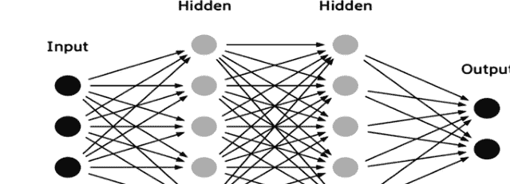

## 表 8.7 稠密架构参数

| 层 | 节点数 | 激活函数 |
|---|---|---|
| 输入 | 字典大小 | 无 |
| 第 1 层隐藏层 | 512 | Relu |
| 第 2 层隐藏层 | 256 | Sigmoid |
| 输出 | 3 | Softmax |

## Twitter 攻击性识别与作者画像

## 表 8.8 结果：稠密模型 vs. FastText [17]

| 模型/语言 | FB: 英语 | FB: 印地语 | Twitter: 英语 | Twitter: 印地语 |
|--- | --- | --- | --- | --- |
| 稠密型 | 58.13 | 59.51 | 60.09 | 48.30 |
| FastText | 57.53 | 58.38 | 55.44 | 45.28 |

### 8.2.7 结果

使用了四个测试类别：(a) Facebook 和 (b) Twitter（英语）；以及 (c) Facebook 和 (d) Twitter（印地语）。在这里，使用 Facebook 测试数据是为了检查监督学习的水平，而使用 Twitter 测试数据是为了检查迁移学习。稠密模型与 FastText 模型进行了比较。表 8.8 显示了提交系统的结果。

## 8.3 作者画像概览

文档处理的一个方面是作者身份识别，即根据给定的文本预测特定作者。作者画像是一个子领域，其中预测的不是特定作者，而是作者的年龄和性别等特征。画像提取方法简单地从提取出的不同特征中进行迁移。

Stamatatos [18] 提供了一篇概述各种特征的论文。它概述了词汇、字符、语法、语义和特定应用的特征。这些特征类型在 PAN 作者画像任务的提交中非常明显，PAN 是会议与实验室论坛（CLEF）的一个正在进行的项目。虽然有各种选举，但与我们的任务相关的有 PAN 2015 [19]（其任务是对四种语言的推文进行分类）和 PAN 2016 [20]（其任务是进行跨领域评估）。提取的特征主要类型包括基于风格、基于内容、n-gram、基于信息检索和基于共词的模型，这些已用于 [21, 22]。词 n-grams 也被用于 [23–25] 等工作。TFIDF n-grams 用于 [26, 27]。POS n-grams 用于 [26, 28]。另一组特征来自词向量。目前提出了多种向量实现方法。其中被广泛使用的是 Mikolov [29, 30] 提出的 `Word2Vec`。`Word2Vec` 算法有两种模式：连续袋模型（continuous bag of words）和跳词模型（skipgrams）。为了获得词向量，程序必须从随机数初始化向量。然后，它从 Wikipedia 等大型语料库中读取。利用语料库中给定的词序列，程序使用代表单词的初始随机向量来预测其他单词。例如，在连续袋模型中，目标单词是使用周围的上下文词预测的。相反，跳词模型使用一个单词来预测其上下文词。

### 表 8.9 PAN 2015 数据集的年龄分布

| 语言/年龄 | 18–24 | 25–34 | 35–49 | 50+ |
|---|---|---|---|---|
| 英语 | 58 | 60 | 22 | 12 |
| 西班牙语 | 22 | 56 | 22 | 10 |

### 8.3.1 数据集

来自 PAN 有两个数据集。第一个是 PAN 2015 数据集 [19]。它包含具有四种语言（英语、西班牙语、意大利语和荷兰语）不同数量推文的用户。然而，我们只使用英语和西班牙语部分。用户数量不同。英语有 152 个用户，西班牙语有 110 个。该数据集根据性别进行了平衡，并提供了性别和性格的标签。年龄分为四个不同的类别：18–24、25–34、35–49 和 50 以上。这在表 8.9 中所示。性格方面包括外向性、神经质、宜人性、责任心和经验开放。

第二个数据集来自 PAN 2016。它包含具有四种语言（英语、西班牙语、意大利语和荷兰语）不同数量推文的用户。然而，我们只使用英语和西班牙语部分。用户数量不同。英语有 152 个用户，西班牙语有 110 个。该数据集根据性别进行了平衡，并提供了性别和性格的标签。年龄分为四个不同的类别：18–24、25–34、35–49 和 50 以上。

### 8.3.2 预处理

没有进行任何预处理。对于每种语言，读取推文。然后将推文合并成一个。

## 表 8.10 PAN 2016 数据集的年龄分布

| 语言/年龄 | 18–24 | 25–34 | 35–49 | 50+ |
|---|---|---|---|---|
| 英语 | 28 | 140 | 182 | 80 |
| 西班牙语 | 16 | 64 | 126 | 38 |

### 8.3.3 特征提取

提取了一些特征。这些包括词袋、词 n-grams 和词性 n-grams。第一个是归一化词频，它根据词的数量归一化。第二个是 TFIDF，它根据逆文档频率归一化。实验中也使用了词双词和三词。还有词性 n-grams。这仅包括单词和双词。另一项特征是词向量的平均值。我们使用了 `Gensim` [33] 的 `Word2Vec` 实现获取维度为 100 和 300 的词向量。

### 8.3.4 实验设置

有很多需要测试的内容。首先，我们想知道哪些传统特征是年龄、性别和性格分类的指示。我们想观察使用词向量是否能分类带来相当或更好的改进。

最后，我们想看看深度学习架构是否能产生更好的结果。由于有两个数据集（具有不同的分类算法模式），以及有不同的测试项目，我们创建了两组设置。如图 8.2 所示。第一种设置在首次处理 PAN 2015 和 PAN 2016 数据集时使用了十折交叉验证。在这种设置中，一个训练示例是每个用户推文的拼接。既有特征（如词袋、词性 n-grams 和词 n-grams）结合支持向量机 [34] 和各种内核用于 PAN 2015。这使我们能够比较这些特征在该数据集上的效果。

第二种设置使用了留出法和 PAN 2016 数据集。在这种设置中，一个训练示例是一条推文。数据集首先按用户分为 70% 训练集和 30% 测试集。训练示例由来自 70% 部分的每条推文组成。测试示例也由来自 30% 部分的每条推文组成。

# 112 使用机器学习处理文档

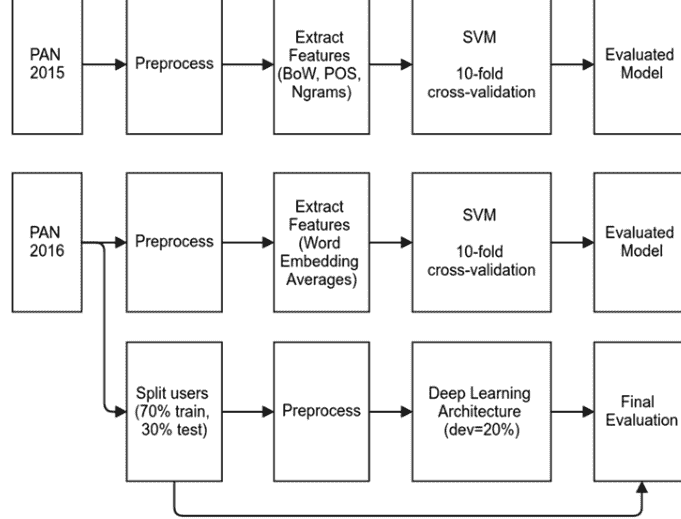

图 8.2 不同设置的示意图。

### 8.3.5 算法与模型微调

实验使用了两种学习算法：支持向量 (SVM) 和卷积神经网络 (CNN)。在第一部分，我们使用了带有线性核的 SVM，误差项的默认惩罚参数设置为 1，以观察哪些传统特征对该问题效果最好。随后进行了威尔科克森符号秩检验 [36]，以检查结果之间的差异是否显著。

然后，对于词向量平均值，我们实验了多项式核和基函数核。我们实验了阶数为 1、2 和 3 的多项式核，误差项的惩罚参数设置为 0.01、1 或 100。我们还实验了 gamma 为 0.01、1 或 100 的径向基函数核，其对误差项的惩罚与之前相同。我们使用的卷积神经网络遵循 Kim [35] 的方法，由一个嵌入层以及随后的过滤器大小为 3、4 和 5 的卷积层组成，每个过滤器有 100 个特征图。我们使用 tanh 函数作为非线性激活。在特征图之后执行了最大池化。然后添加了丢弃层（dropout）。我们的丢弃概率为 0.5。

## Twitter 上的攻击性识别与作者画像分析

我们的第一组实验涉及检查哪些特征为 PAN 2015 最佳分类。所有任务的结果在论文 [37] 中有更详细的解释。在词袋（bag-of-words）特征中，TF 的结果优于归一化频率。在 n-gram 特征中，对于英语，三元组（trigrams）的效果优于二元组（bigrams）。从统计差异来看，只有 TFIDF 为西班牙语提供了结果。从表中可以看出，TFIDF 在英语和西班牙语上的准确率最高。性别分类准确率见表 8.11。

### 表 8.11 PAN 2015 性别分类结果

| 特征 | 英语 | 西班牙语 |
|---|---|---|
| BOW | TF | 0.511 | 0.550 |
| | TFIDF | 0.683 | 0.690 |
| Text n-grams | Bigrams | 0.623 | 0.700 |
| | Trigrams | 0.652 | 0.520 |
| POS n-grams | Unigrams | 0.659 | 0.770 |
| | Bigrams | 0.659 | 0.750 |
| | Uni+bi | 0.660 | 0.780 |
| Combo | | 0.671 | 0.800 |

### 表 8.12 PAN 2015 年龄分类结果

| 特征 | 英语 | 西班牙语 |
|---|---|---|
| BOW | TF | 0.395 | 0.460 |
| | TFIDF | 0.691 | 0.470 |
| Text n-grams | Bigrams | 0.638 | 0.640 |
| | Trigrams | 0.553 | 0.460 |
| POS n-grams | Unigrams | 0.579 | 0.550 |
| | Bigrams | 0.611 | 0.670 |
| | Uni+bi | 0.593 | 0.700 |
| Combo | | 0.650 | 0.720 |

在词袋特征中，TFIDF 在英语上取得了最好的结果。在 n-gram 特征中，单元组和二元组的组合为西班牙语带来了最佳结果。从统计差异来看，只有英语的词袋特征结果和西班牙语的 n-gram 结果相互之间存在差异。从表中看到，TF 特征在英语上的准确率为 69.1%；它高于归一化频率，甚至高于最佳特征的组合。然而，对于西班牙语，最佳特征的拼接提供了最高准确率，即 72.0%。

所有人格特征的均方误差见表 8.13。大多数结果在统计上互不存异。从幅度来看，TFIDF 在英语上效果最好，而所有特征的组合在西班牙语上表现良好。但注意的是，这些幅度是非常细微的。

我们的第二个实验涉及使用向量平均值作为分类特征，并在 PAN 2016 数据上进行十折交叉验证。实验获得的最高准确率总结见表 8.14。英语分类获得的最高准确率为 68.2%，使用了阶数为 3 且 C = 100 的多项式核。这些结果的变化性比最低的要多。

### 表 8.13 PAN 2015 人格 MSE 平均值结果

| 特征 | 英语 | 西班牙语 |
|---|---|---|
| BOW | TF | 0.029 | 0.033 |
| | TFIDF | 0.025 | 0.027 |
| Text n-grams | Bigrams | 0.027 | 0.029 |
| | Trigrams | 0.028 | 0.032 |
| POS n-grams | Unigrams | 0.035 | 0.126 |
| | Bigrams | 0.038 | 0.027 |
| | Uni+bi | 0.040 | 0.029 |
| Combo | | 0.029 | 0. |

### 表 8.14 PAN 2015 性别分类准确率

| 任务/语言 | 英语 | 西班牙语 |
|---|---|---|
| Gender | 0.682 | 0.671 |
| Age | 0.448 | 0.513 |

对于英语，最高准确率为 44.8%。细节见另一篇论文 [38]。使用 gamma = 1 且 C = 100 的径向基函数的 SVM 得到的结果约为 50.0%。另一方面，西班牙语的最高准确率为 67.1%，这是由使用 gamma = 1 和 C = 100 的径向基函数的分类器提供的。


我们的第三个实验使用 CNN 对 PAN 2016 数据集的推文进行分类。表 8.15 显示了英语和西班牙语的 CNN 结果。我们可以从上表中观察到许多趋势。首先，我们观察到对推文使用多数预测可以改进结果。其次，我们注意到增加维度会提高准确率。虽然准确率提高的次数与恶化的次数相等，但幅度显示并非如此。这与使向量变为可训练或不可训练、静态或动态是一样的。使向量可训练或动态会提高准确率。一种解释可能是向量随着更多训练数据得到了精调。英语性别分类增长了 1.5% 和 7.7%。

### 表 8.15：PAN 2016 推文与用户评估准确率对比

| | 英语 | | | | 西班牙语 | | | |
|---|---|---|---|---|---|---|---|---|
| | 年龄 | | 性别 | | 年龄 | | 性别 | |
| | 静态 | 非静态 | 静态 | 非静态 | 静态 | 非静态 | 静态 | 非静态 |
| 100 条推文 | 0.407 | 0.397 | 0.618 | 0.623 | 0.541 | 0.481 | 0.561 | 0.551 |
| 用户 | 0.481 | 0.473 | 0.651 | 0.667 | 0.547 | 0.560 | 0.557 | 0.550 |
| 300 条推文 | 0.410 | 0.409 | 0.626 | 0.613 | 0.538 | 0.467 | 0.693 | 0.653 |
| 用户 | 0.496 | 0.473 | 0.643 | 0.721 | 0.547 | 0.547 | 0.507 | 0.587 |

分别使用 100 维和 300 维进行机器学习分类。在维度 100 维的情况下，西班牙语年龄分类增长了 1.3%，而使用 300 维则没有产生差异。此外，使用 300 维度的西班牙语性别分类增加了 8.0%。然而，其他用例在调整向量时反而降低了结果。最大的降幅为 4.0%，来自使用 100 维度的性别分类。

## 8.4 结论与未来工作

在对攻击性识别和作者画像这两个主要方面进行深入讨论后，得出以下结论。

在攻击性识别方面，普通/常规的密集型架构（`plain/normal dense architecture`）优于其他先进架构。唯一的缺点是密集型架构只能用于规模较小的数据，因为遇到的每个词的索引会导致矩阵表示越大，从而导致计算资源的使用率越高。此外，字典中未出现且表示/索引较大的词汇会被丢弃。这可以在未来的工作中得到解决。此外，该模型没有捕捉句子的语义含义，如词性和形态学。这也可以在未来的工作中予以考虑。

在作者画像方面，通过查看 PAN 2015 数据集，我们可以得出：使用标准的 `TFIDF` 在英语分类任务中仍然优于其他特征。然而，各种特征的结合对于西班牙语分类任务更好。同时，针对性格的回归给出的结果相似。使用词向量的平均值作为 PAN 2016 数据集的分类器特征可能会获得相当的结果，尽管由于我们使用了不同的数据集，这种方法并不准确。最后，将 CNN 架构结合词向量似乎根据向量大小以及向量牵引力（`vector traction`）平均能产生更高的准确率。然而，由于目前的设置不同，我们在未来应该对此进行更好的测试。

## 参考文献

1. Anna Schmidt, and Michael Wiegandt. 2017. A Survey on Hate Speech Detection Using Natural Language Processing. In: Proceedings of the Fifth International Workshop on Natural Language Processing for Social Media, Association for Computational Linguistics, pages 1–10, Valencia, Spain.

2. Shervin Malmas, and Marcos Zampieri. 2021. Detecting Hate Speech in Social Media. In: Proceedings of the International Conference Recent Advances in Natural Language Processing (RANLP), pages 467–472.

3. Irene Kok, and Yuzhou Wang, 2013. Locate the Hate: Detecting Tweets Against Blacks. In: Proceedings of the Twenty-Seventh AAAI Conference on Artificial Intelligence, pages 1621–1622.

4. Chhibaka Nobata, Joel Tetreault, Ahmet Thomas, Yashar Mehado, and Yi Chang, 2016. Abusive Language Detection in Online User Content. In: Proceedings of the 25th International Conference on World Wide Web, pages 145–153, International World Wide Web Steering Committee.

5. Alexander Schiefold, and Thomas Davidson. 2017. Identifying Hate Speech in Social Media. XRDS: Crossroads, The ACM Magazine for Students, 24(2):56–59.

6. Björn Gammbach, and Utpal Kumar Sikdar. 2017. Using Convolutional Neural Networks to Classify Abusive Language Online. In: Proceedings of the First Workshop on Abusive Language Online, pages 85–90.

7. Ziqi Zhang, David Robinson, and Jonathan Tepper. 2018. Detecting Hate Speech on Twitter Using a GRU Based Deep Neural Network. In: Lecture in Computer Science, Springer Verlag.

8. Antoni-Maria Fanta, Constantinos Djouvas, Despoina Chatzakou, Ilias Leontidis, Jeremy Reich, Gianluca Strughi, Athena Vakakali, Michael Sirivianos, and Nicolas Kourtellis. 2018. Large Scale Crowdsourcing and Characterization of Twitter Abusive Behavior. arXiv preprint:1802.00393.

9. Karthik Ninarth, Roi Reich, and Henry Lieberman, 2011. The detection of cyberbullying. In: The Social Media Web, pages 11–17.

10. Pete Burnap, and Matthew L Williams, 2015. Hate speech on twitter: An application of machine classification and statistical modeling for policy and decision making. Policy and Internet, 7(2):223–242.

11. Ritesh Kumar, Aishwarya N Reganti, Akshit Bhatia, and Tushar Maheshwari. 2018b. Aggression-annotated Corpus of Hindi-English Code-mixed Data. In: Proceedings of the 11th Language Resources and Evaluation Conference (LREC). Miyazaki, Japan.

12. Ritesh Kumar, Atul Kr Sherva, and Christos Doukeridis. 2018a. Benchmarking Aggression Identification in Social Media. In: Proceedings of the First Workshop on Trolling, Aggression and Cyberbullying (TRAC), Santa Fe, USA.

13. Christos Baziotis, Nikos Peleikis, and Christos Doukeridis. 2017. Diaries at semeval-2017 task 4: Deep Lstm with attention for message-level and sentiment analysis. In: Proceedings of the 11th International Workshop on Semantic Evaluation (SemEval-2017), pages 747–754.

14. François Chollet, 2015. Keras://keras.io.

15. Martin Abadi, Paul Barham, Zheng Chen, Andy Dean, Mathieu Devlin, Geoffrey Irving, Michael Isard, Manunjath Kudlur, John Levenberg, Paul Tucker, Vijay Vasudevan, and Xiaqing Zheng. 2016. Tensorflow: A system for large-scale machine learning.

16. Jeffrey Pennington, Richard Summer, and Christopher Manning. 2014. Glove: Global vectors for word representation. In: Empirical Methods in Language Processing (EMLP), pages 1532–1543.

17. Kashyap Raiyani, Teresa Gonçalves, and Vitor Beires Nogueira. 2018. “Fully Connected Network to identify aggression over Facebook”. In: Workshop on Trolling, Aggression and Cyberbullying (TRAC).

18. Efstafios Statatos, 2009. A survey of modern authorship. Journal of the American Society for Information Science and Technology, 60(5):538–556.

19. Francisco Regal, Fabio Celli, Paolo Rosso, Martin Potthast, and Ben Stein. 2015. Overview of the 3rd Author Profiling Task at PAN 2015.

20. Francisco Regal, Paolo Rosso, Ben Valverde, Walter Daelemans, Martin Potthast. 2016. Overview of the 4th Author Profiling Task at PAN 2016: Cross-genre evaluations.

21. Carlos Elnález-Garibay, Azucena Montes, Gerardo Serrano, Juan Antonio Núñez-Jaárez, Odolfo Jonathan Salinas-López, and Juan Ek. 2015. Tweets classification using corpus tags, character and pos n-grams.

22. Suraj Mahajan, Aftab Hassan and Thamar Solorio. 2015. Using wide range of features for author profiling. In: 6th Conference and Labs of the Evaluation Forum (CLEF 2015): Experimental IR multilingual, multimodality, and interaction, pages 23–31.

23. Fahad Najib, Waqas Arshad Cheema, and Rao Muhammad Adeel Nawab. 2015. Author’s traits prediction on twitter using content based approach.

24. Scott Swann, Julien Perez, Caroline Brun, Shakar Mirkin, and Claude Roux. 2015. Xrice Personal Language Engine for Multilingual Author Profiling.

25. Maite Giménez, Delia Irazú Hernández, and Ferran Pla. 2015. Segmenting target audiences: Automatic author profiling using trees.

26. Andreas Grivas, Anastasia Krithara, and George Giannakopoulos. 2015. Author profiling using stylometric and structural groupings.

27. Alonso Palomino-Garibay, Adolfo T Camacho-Gonzalez, Ricardo A FierroVillaneda, Irazu Hernandez-Farias, Davide Buscaldi, Ivan V Meza-Ruiz, et al. 2015. A random forest approach for authorship profiling.

## Twitter上的攻击性识别与作者画像分析

29. Tomas Mikolov, Kai Chen, Greg Corrado, and Jeffrey Dean. 2013. 向量空间中词表示的高效估计。arXiv预， arXiv:1301.3781。

30. Tomas Mikolov, Ilya Sutskever, Kai Chen, Greg S Corrado, and Jeff Dean. 2013. 单词和短语的分布式表示及其组合性。In: 自然信息处理系统进展，页码3111–3119。

31. Robert R McCraee, Paul T Costa Jr. 1999. 人格的五因素理论。人格手册。理论与研究，2:139–153。

32. Helmut Schmidt. 2013. 使用决策树的概率性词性标记。In: 语言处理新方法，第154页。

33. Radim Reháěček, and Peter Soska. 2010. 针对大型语料库的主题建模挑战的软件框架。In: LREC 2010 NLP框架新挑战工作会议集，页码4–50，瓦莱塔，马耳他。ELRA。http://is.muni.cz/publication/884893/en。

34. Corinna Cortes, and Vladimir Vapnik. 1995. 支持向量网络。机器学习，20(3):273–297。

35. Yoon Kim. 2014. 用于句子分类的卷积神经网络。ArXiv预，arXiv:1408.5882。

36. RF Woolson. 2007. 威尔科克符号秩检验。临床试验百科全书，页码1–3。

37. Roy Bayot, and Teresa Gonçalves. 2016. 使用SVM和语言特征的多语言作者画像分析。

38. Roy Bayot, and Teresa Gonçalves. 2016. 使用SVM和词嵌入平均值的作者画像分析——用于Pan at clef 2016的笔记本。


# 9 使用生成的离线图像计算的特征进行在线孟拉语手写字符识别的影响

Shibaprasad Sen, Ankan Bhattacharyya and Kaushik Raj

## 目录

9.1 引言............................................................................................... 121

9.2 文献综述...................................................................... 126


# 第9章 使用离线图像进行手写孟加拉语的在线识别

## 9.1 引言

在线手写识别（OHR）系统的主要目标是为给定的手写笔序列提供文本（Unicode）解释。通常，一个笔画由笔点序列 `(x, y, t)` 表示，其中 `(x, y)` 是笔点的位置，`t` 是时间戳。尽管OHR的研究始于20世纪90年代后期，但由于以下原因，研究人员目前对该领域表现出新的兴趣：

- (a) 移动设备的广泛使用（许多设备配备了触摸屏），由于其价格便宜且易于获取，已成为生活的一部分。这些设备可以轻松地记录在线手写输入 [1]。
- (b) 使用通用脚本编写的文本，这些脚本没有采用标准的键盘布局（如高棉语），且在软键盘上难以打字。
- (c) 深度学习、语音识别、光学字符识别和机器翻译等领域的研究进展，这些技术可以被应用于OHR任务中。

在本章中，我们专注于生成一个在线识别手写孟加拉语字符的系统。研究孟加拉语不仅是因为该语言在该领域目前的存在，这激励我们开展一些实质性的工作，以利用尖端的机器学习方法，并进行必要的定制。此外，孟加拉语是印度最流行的语言之一。它是印度使用的官方语言和官方文字之一，并且它也是孟加拉国的官方语言。该字母文字源自古老的婆罗米文字。孟加拉语的书写风格像其他印欧雅利安语文字（如天城文）一样，是从左到右的。孟加拉语字母的基本字符集包含39个辅音和11个元音。孟加拉语字母的基本字符集如图9.1所示[2]。

## 9.2 文献综述

结合字符图像。在本章中，我们描述了完整的识别流程，从字符数据库的准备到预处理，再到预处理数据的特征提取细节，最后通过某些分类器对手写字符进行识别 [3,4]。本章还建议了通过整合相关信息来增强在线信息生成的特征强度 [5]。虽然第一批商业OHR系统在90年代就出现了，但它们的能力有限，成功率不高。我们认为OHR的许多领域尚未解决，在这里我们简要总结了研究人员在识别在线手写字符时面临的一些挑战：

- i) 不同个体书写风格的差异使得识别过程具有挑战性。
- ii) 即使是同一个人，书写速度也有很大差异。书写越快意味着像素点越少 [6]。
- iii) 笔画数量[7]的变化给在线手写字符识别带来了挑战。如图9.2所示，该字符分别使用二、三和最多四笔书写。
- iv) 书写字符笔画顺序的变化使得问题变得更加困难。例如，如图9.3所示，用四笔书写字符“ব”，但笔画出现的顺序是不同的。
- v) 字符之间的形状相似性是另一个挑战，如图9.4所示。
- vi) 不同用户有不同的书写风格。图9.5展示了同一个字符“ক”以不同风格书写的场景。

| | | | | |
|---|---|---|---|---|
| অ | আ | ই | ঈ | উ |
| ঊ | ঋ | এ | ঐ | ও |
| ঔ | ক | খ | গ | ঘ |
| ঙ | চ | ছ | জ | ঝ |
| ঞ | ট | ঠ | ড | ঢ |
| ণ | ত | থ | দ | ধ |
| ন | প | ফ | ব | ভ |
| ম | য | র | ল | শ |
| ষ | স | হ | ৎ | ড় |
| ঢ় | য় | ৎ | ঃ | ঁ |

图9.1 孟加拉语字母集。

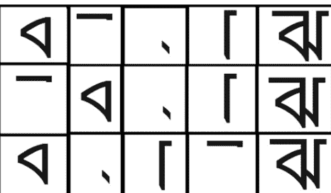

图 9.2 使用不同笔画书写相同字符“ব”的插图。


图 9.3 书写同一字符的笔顺变化。

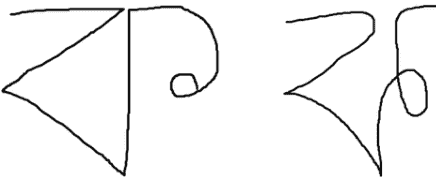

图 9.4 某些形状相似的字符示例。


图 9.5 书写同一字符的不同书写风格示意。

面对这些各种挑战，随着在线设备的日益普及以及将手写文本转换为可编辑电子内容的渴望，在线手写识别（OHR）研究人员越来越关注不同语言的手写字符识别 [8]。文献中已有关于天城文[9–16]、英语[17–24]以及古鲁木语/古吉拉特语[25–37]脚本的研究资料。一些工作涉及了新的机器学习概念，如深度学习[38–45]和极端学习机[46]。关于孟加拉语脚本，虽然存在一些研究出版物（见下文），但进展仍处于起步阶段。

Roy 等人在 [2] 中提出了整体特征提取技术，该技术可以从书写板上的笔画中收集顺序和动态信息。这些特征通过二次分类器进行评估，以识别手写的孟加拉语字符。[47] 中的作者展示了方向代码和点浮直方图特征在识别四种常用印度语脚本方面的有效性。作者还使用了一些常规分类器，如多层感知器（MLP）、最近邻（NN）和隐藏马尔可夫模型（HMM）进行分类。[48] 强调了一种不同的方案，在该方案中首先在字符级提取组成部分。之前提到的顺序和动态特征从笔画中提取以进行识别。然后将识别出的笔画序列与已建立的规则库匹配，以构建字符。

Parau 在 [49] 中强调了一种基于笔画的字符识别机制，为每个笔画类建立一个 HMM。作者根据字形层面上笔画的相似性，将所有字符的笔画手动分为 54 类。字符通过预先建立的查找表，从识别出的笔画序列形成。作者在 [50] 中使用基于方向代码的特征来识别手写的孟加拉字母。Bandopadhyay 等人在 [51] 中提到另一种基于笔画的字符识别方法，他们从所有字符样本中收集的组成笔画生成了基于形状的特征。笔画的识别使用了动态时间规整（DTW）技术 [52]。[53] 中的作者还实验了基于笔画的字符识别，通过将方案分为九个区域以及倾角、书写方向、曲率、x 和 y 坐标的标准差以及笔画曲率来生成特征。SVM 分类器 [54] 用于笔画分类。Sen 等人在 [55–58] 中讨论了使用基于距离的特征、全局特征、局部特征、基于豪斯道夫距离的特征、面积质量分布和弦长特征对在线手写孟加拉字符的有效性。

这些研究工作通过引入新特征和结合不同的特征向量 [59]，在提高在线手写孟加拉字符识别准确率方面做了努力。在本章中，尝试将离线图像信息与在线模式生成的特征相结合，以提高字符识别准确率。这项工作的目的有两个：第一，从在线信息生成离线字符图像以便用于离线工作；第二，通过引入对应的离线信息来提高字符识别准确率。

本文的结构如下：第 9.2 节介绍了用于在线手写孟加拉字符识别的常用特征提取简要回顾。第 9.3 节处理数据库准备和预处理机制。第 9.4 节描述了用于在线和离线模式下识别在线手写孟加拉字符的特征生成过程。第 9.5 节报告了不同分类器在在线和离线模式下的分类结果。该节还规定了将离线信息与在线模式产生的特征相结合以提高识别准确率的机制。最后，第 9.6 节总结了实验步骤并确保了未来的规划。

### 9.2.1 基于方向代码的特征 [50]

收集的字符数据在应用此特征提取技术之前首先经过一些预处理阶段。预处理步骤包括消除冗余（重复）笔点，然后将生成的点重采样为固定数量的几乎等距的点（图 9.6）。

每个预处理后的字符样本被分割成 K 个子区域，并为所有子区域估计方向代码特征。由于字符可能包含单个或多个笔画，第 $i$ 个笔画的子区域数量通过公式 9.1 计算。

$$K_i = \text{round} \frac{X_i}{X} \quad (9.1)$$

笔画长度 $X_i$ 通过相加组成它的序列中两个连续点之间的距离来计算。字符样本的总长度 $X$ 计算为 $X = \sum X_i$，$i$ 的值表示表示样本的笔画数。如果 $\sum K_i \neq K$，则需要进行微调使 $\sum K_i = K$。

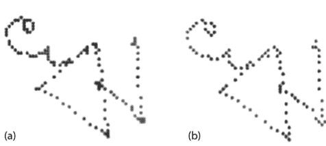

**图 9.6** (a) 具有三个笔画的字符的笔点。(b) 重采样后的字符笔点。

然而，如果第 $i$ 个笔画的笔数不是 $K$ 的倍数，则需要再次重采样以生成新的点序列，使得数量变为最接近 $K$ 且点几乎等距。

笔画的划分如图 9.7 所示。考虑到字符样本有三个笔画，它们在预处理阶段后包含 46、27 和 28 个点。这三个笔画的长度计算比例为 4:3:3。因此，如果对字符样本考虑 10 个子区域，观察到第一个笔画的点数不是 4 的倍数。因此，作者再次对第一个笔画进行了重采样，这次第一个笔画的点数应为 48，这是 4 的最接近倍数。同样，第三个笔画在第二次重采样后应有 27 个点，这是 3 的最接近倍数，而第二个笔画由于 27 已经是 3 的倍数，无需进一步重采样。

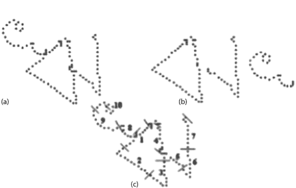

**图 9.7** (a) 图 9.6a 中字符样本第二次重采样的影响。(b) 根据书写顺序的字符三个组成笔画。(c) 每个笔画的子区域数量。

将字符样本划分为 K 个段后，测量方向代码。假设第 $i$ 个笔画包含点序列 $p_1, p_2, ... p_n$。再次考虑从 $p_b$ 移动到 $p_{b+1}$ 时与 x 轴的角为 $\alpha_b, b=1,2, ..., n-1$ ($0^\circ \le \alpha_b < 360^\circ$)。在这种特征提取方法，描述从一个点到下一个点方向变化的信息起着重要作用。从一个点到下一个点的方向变化可以用 Freeman 方向代码（从 1 到 8 的 8 个可能值）来表示 [60]。

笔画的第一个像素的方向代码被视为 0。因此，字符的每个笔画都由方向代码测量值表示。

为每个划分区域计算与测量的方向代码对应的直方图。由于方向变化的测量由九个值之一（0 到 9）表示，因此每个划分区域的直方图包含九部分。如果整个字符包含 K 个划分区域，则会产生一个 $9 \times N$ 的元素特征向量。

### 9.2.2 区域和局部特征

Sen 等人 [58]的研究表明，他们发现在识别在线手写孟加拉语字符时，某些特征（通过计算面积、质量分布和弦长）具有很强的效性。这些特征通过首先将样本划分为 [58] 中提到的基于四叉树的图像分割方法，从字符的局部区域中提取的。详细的特征提取机制在下文中描述。

#### 9.2.2.1 区域特征

在情况下，孟加拉语字符的形状各不相同。因此，在不同的四叉树深度下观察时，不同字符中不同组成部分的结构必须是不同的。考虑到这一点，我们假设对此类字符段的曲线下方面积进行分块计算可能会产生判别性特征，这反过来可能对提高字符识别准确性起到重要作用。分块计算曲线下方面积的示例如图 9.8 所示。可能存在没有像素点的块，在这种情况下，该区域的计算面积被视为 0。通过观察样本的块结构模式，可以认为产生的特征可能在高效分类字符方面发挥有用作用。公式 9.2 中的复合辛普森法则被用于寻找区域面积。

```
Area = \sum_{k=1}^{n-1} \left(\frac{h}{3}\right)^*(y_{k} + 4*y_{middle} + y_{k+1}) \quad (9.2)
```

其中 $n$ 表示每个块中从 $y_1$ 到 $y_n$ 的笔画点数量。$(y_{k+1})$ 是块中连续笔画点的 $y$ 坐标值。$h$ 和 $y_{middle}$ 的测量值通过评估公式 9.3 和 9.4 得到。

```
h = \frac{mod(x_{k+1} - x_k)}{2} \quad (9.3)
```

$$y_{middle} = \frac{y_k + y_{k+1}}{2} \quad (9.4)$$

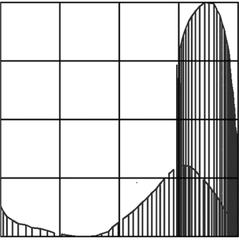

图 9.8 使用复合辛普森法则在四叉树深度为二的字符样本进行分块面积特征计算的说明。

对于特定的字符样本，当样本字符被分为 $N\times N$ 个块时，通过评估公式 9.1 总共估计 $N\times N$ 个值。这些计算出的面积值被视为特征。

#### 9.2.2.2 局部特征

##### 9.2.2.2.1 质量分布

质量分布描述了不同四叉树深度块内的数据点数量。由于孟加拉字符形状的不同，不同块中的像素数量也不同。因此，对像素进行分块计数对于区分不同形状的字符可能起至关重要的作用。样本的测量质量分布反映在图 9.9 的四叉树深度 3 中。灰色像素表示块中的像素。

##### 9.2.2.2.2 弦长

弦长特征通过计算每个块中字符段的长度来估计，并视为区分不同字符形状的特征。

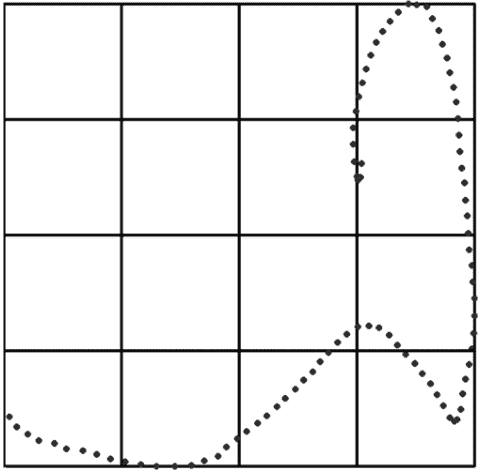

**图 9.9** 四叉树深度质量分布特征计算的说明。

如果 $p_1, p_2, p_3, ..., p_n$ 是某个块的像素点序列，则通过相加从 $p_i$ 到 $p_u$ 的连续点之间的距离来测量该段的长度。由于不同字符的结构模式不同，发现计算出的段长度差异显著。因此，产生的特征向量对于这种模式分类问题可能是有效的。计算此特征的详细步骤在 [58] 中提到。

### 9.2.3 基于点的特征 [2, 48]

在这种特征提取技术中，字符样本由特征向量序列 $t = [t_1, ..., t_N]$ 表示，其中 $t_i = (t_{i1}, t_{i2}, t_{i3})^T$。在这里，$t_{i1}, t_{i2}$ 表示通过样本均值 $\mu$ 归一化的笔坐标，测量值为：

```
$$\mu = \frac{1}{N} \sum_{i=1}^N p_i$$
```

```
$$t_{i1} = \frac{(x_i - \mu_x)}{\sigma_y}$$
```

```
$$t_{i2} = \frac{(y_i - \mu_y)}{\sigma_y}$$
```

标准差 ($\sigma_y$) 计算公式为：

```
$$\sigma_y = \sqrt{\frac{1}{N-1} \sum_{i=1}^N (y_i - \mu_y)^2}$$
```

且 $t_{i3}$ 的测量值为：

```
$$t_{i3} = \frac{(x_i - \mu_x)}{\sigma_x}$$
```

### 9.2.4 转换计数 [61]

提出的技术将字符缩放到 $N \times N$ 大小的窗口中，如果该像素是前景像素，则将位置样本设置为 1，否则设置为 0（背景像素）。计算二值化图像的重心 (CG)，然后将样本分为四个区域。对于每个子区域，沿着四个方向 $\theta=0^{\circ};90^{\circ};45^{\circ};135^{\circ}$ 计算从前景到背景的转换。

| 行号 | 计数 |
|---|---|
| 1 | 1 |
| 2 | 3 |
| 3 | 1 |
| 4 | 0 |
| 5 | 0 |
| 6 | 1 |
| 7 | 1 |
| 8 | 0 |
| 9 | 1 |
| 10 | 1 |


图 9.10 字符的转换计数。

### 9.2.5 拓扑特征 [61]

#### 9.2.5.1 交叉点

此特征有助于区分字母表中少数结构相似的字符对。例如，“b”和“v”在结构上相似，但“v”由于环的形成在左下方有一个交叉点。因此，交叉点的存在对于区分相似形状起着重要作用。为了估计此特征，对字符样本的像素点进行采样，使得点之间的距离为单位距离。此特征检查字符样本是否包含环。

## 9.3 数据库准备与预处理

### 9.3.1 数据收集表的设计

## 9.4 特征提取

### 9.4.1 基于定向豪斯道夫距离 (DHD) 的特征

## 9.5 实验结果与分析

## 9.6 结论

参考文献


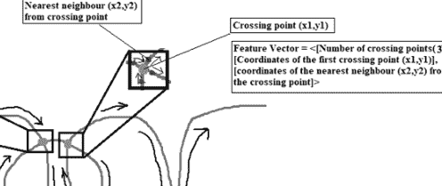

图 9.11 字符样本 '��' 中交叉点的识别。

基于离线图像的手写孟加拉语在线识别 133

## 9.3 数据库准备与预处理

### 9.3.1 数据收集表单的设计

数据库开发过程的主要阶段是数据收集表单或表单的设计。在表单设计过程中，考虑了多种因素。人口中的不同因素可能会影响手写特征，如性别、年龄、教育程度、宗教。此外，不同间隔的写作也会影响不同个体的手写风格。为了捕捉这些变化并简化问题，数据收集表单设计包含了孟加拉语脚本中最常用的字符。分别设计了孤立字符数据收集表和手写文本数据收集表。孤立字符包括孟加拉语中可用的所有字母字符以及数字和元音。数据收集表单分为两个区域：在表头区域收集写者信息，在书写区域，写者需要用自己的手迹写下建议的字符。图 9.12 的左侧显示了一个空白收集表，所有字段都已标记以便于理解，而图的右侧显示了对应的填充表。

| 表头 | 年龄 | 性别 | 备注 | 组号 | | | 年龄 | 手写 | 教育 | 组号 | | |
|---|---|---|---|---|---|---|---|---|---|---|---|---|
| | | | | | | | | | | | | |
| | | | | | | | | | | | | |
| | | | | | | | | | | | | |
| | | | | | | | | | | | | |
| | | | | | | | | | | | | |
| | | 书写 | | | | | | | | | | |
| | | | | | | | | | | | | |
| | | | | | | | | | | | | |
| | | | | | | | | | | | | |
| | | | | | | | | | | | | |
| | | | | | | | | | | | | |
| | | | | | | | | | | | | |
| | | | | | | | | | | | | |
| | | | | | | | | | | | | |
| | | | | | | | | | | | | |
| | | | | | | | | | | | | |
| | | | | | | | | | | | | |

FIGURE 9.12 空白字符数据收集表（左）和一张填充后的表（右）。

在表单设计期间，考虑了书写孟加拉语时的所有元音、字母以及元音符号。孤立字符数据收集表单的设计总共考虑了 11 个元音、40 个辅音、10 个元音符号和 10 个数字。

在数据收集期间，要求个人以自然速度在表单提供的书写区域内书写样本孤立字符和样本打印文本。写者在不同的日期还会获得每个数据收集表（空白），以便捕捉写者内部差异以及写者之间的差异。数据收集过程中考虑了不同性别、文化、年龄组和教育程度的人员。考虑了 8 到 70 岁的人员，包括学生、退休人员、毕业生、研究生和不同职业的人士。将自然变异纳入数据库，以创建标准的孤立字符和文本数据库 [62,63]，这有助于评估字符文本识别算法是否稳健。对于字符级数据库，字符写在如图 9.12 所示的框内。在下一步中，测量每个框边界的坐标，然后存储来自所有框的字符级信息（`x`、`y` 坐标以及笔触状态）。

本节描述了此处开发的两种不同类型数据库的详细统计数据。百名志愿者在孤立字符数据库的设计期间做出了贡献，从每个个人那里收集了三组孟加拉语字母字符。尽管最初有 135 名志愿者同意有助于开发此字符数据库，但只有 100 名志愿者完成了要求。该数据库包含大约 12000 个字母、3300 个元音、3000 个元音符号和 3000 个数字。每个收集的数据集包含 `x` 和 `y` 坐标，并采用特定的 `.dat` 格式：`<数字数字 (Writer_id) 数字数字 (Set_id)>`。例如，第一个孤立表命名为 `0000_01`，其中 `0000` 代表第一个写者，“01” 代表该写者的第一组；这两个字段被隔开。

## 9.4 特征提取

### 9.4.1 基于豪斯夫距离 (DHD) 的特征

在本文工作中，利用在线信息从离线图像中提取了现有的 HD 特征。

使用了常用的 `maxmin` 函数来计算从集合 `P` 到集合 `Q` 的正向 HD，使用公式 9.5。

```
h(P,Q) = \max_{x \in P} \min_{y \in Q} \{d(x,y)\} \quad (9.5)
```

当集合 `P` 和 `Q` 点由 `a` 和 `b` 表示时。在实验中，`d(x,y)` 测量 `x` 和 `y` 之间的欧几里得距离。同样，`h(Q,P)`（反向 HD）从集合 `Q` 估计到集合 `P`。图 9.13a 说明了从区域 `P` 每个点到区域 `Q` 其他所有点的距离计算，区域 `P` 每个点的最小距离被标记为。在这些最小距离中，最大值被视为正向 HD 并反映在图 9.13b 中。同样，反向 HD 的计算显示在图 9.14a 中。分析过程中注意到，计算出的 `h(P,Q)` 和 `h(Q,P)` 值大部分时间并不相等。因此，在本文工作中，作者从每个区域到所有其他区域测量了正向和反向 HD 值（DHD）。这种特征提取策略为每个区域生成 `N-1` HD 值，从而为整个字符估计了 `N*(N-1)` HD 特征。

为了在离线模式下提取基于 HD 的特征，对之前生成的字符图像进行二值化，并在四叉树深度为二时，通过考虑像素重复之前在线模式使用的程序。


FIGURE 9.13 (a) 距离的计算。


FIGURE 9.14 (b) 反向 HD 的计算。

使用机器学习处理文档


```
0 0 0 0 0 1 1 0 0 0 0
0 0 0 0 0 1 1 0 0 0 0
0 0 0 0 0 1 1 0 0 0 0
0 0 0 0 0 1 1 0 0 0 0
0 0 0 0 0 1 1 0 0 0 0
0 0 0 0 0 1 1 0 0 0 0
0 0 0 0 0 1 1 0 0 0 0
0 0 0 0 0 1 1 0 0 0 0
0 0 0 0 0 1 1 0 0 0 0
0 0 0 0 0 1 1 0 0 0 0
0 0 0 0 0 1 1 0 0 0 0
0 0 0 0 0 1 1 0 0 0 0
```

图 9.15 从在线信息生成的字符图像相应的二值化图像。

## 9.5 实验结果与 DHD 流程

使用四种常用的分类器对字符图像在线和离线模式提取的特征进行评估：多层感知器 (`MLP`)、支持向量机 (`SVM`)、`BayesNet` 和简单逻辑，其中字符样本用于分类 16 个区域（四叉树深度为二）。表 9.1 记录了上述分类器针对字符图像在线和离线模式产生的分类准确率。

表 9.1 表明对于所有分类器，使用在线信息产生的特征向量强度都高于从离线字符图像生成的特征集。

表 9.1 用于字符在线和离线模式的基于 HD 特征的不同分类器识别准确率

| 分类器 | 在线模式 | 离线模式 | 在线 + 离线 |
|---|---|---|---|
| `MLP` | 95.57 | 93.54 | 95.92 (带 `pca` 92.61) |
| `BayesNet` | 88.61 | 84.99 | 88.37 |
| `SVM` | 94.43 | 91.8 | 93.78 |
| Simple Logistic | 95.36 | 92.72 | 94.89 |

# 基于离线图像的手写孟加拉语在线识别

## 表 9.2：误分类字符对

| 原始字符（200个样本） | 误分类为（200个样本中的数量） |
| --- | --- |
| ব | ভ(8) |
| ন | ল(8) |
| য | ঘ(6) |
| গ | ড(4) ঢ(4) |
| ধ | ম(4) ম(4) |

在线和离线模式产生的特征向量也被结合在一起，以观察其结合的效果。在此阶段，`MLP` 达到了最佳准确率 95.92%，这高于分别从字符图像的在线或离线模式提取特征时所获得的准确率。获得的结果确保了在线模式产生的特征向量的强度增加了信息量。在此阶段，表 9.2 显示了少数被误识别的字符。

当我们仅仅观察 `MLP` 分类器对这两个向量的预测得分时，发现在某些情况下，离线特征向量的正确选择预测得分更高。我们观察到，正确选择的预测得分在特征中并不是最高的。为了提高整体字符识别性能，对 `MLP` 的前五个预测选择尝试了后期融合技术 [30]；即在利用 `MLP` 通过两种特征向量（在线模式和离线模式）对字符进行分类之后。在该方案中，`MLP` 分类器针对每个模态（`m`）“在线模式”和“离线模式”分别训练。每个模态被分配了一个特定于每个活动 `s`（预测选择）的专家信任得分 `e_{sm}`。该得分定义为通过模态 `m` 对于活动 `s` 的性能度量 `P_{sm}`（来自分类器的观测概率/百分比）计算出的归一化性能，如公式 9.6 定义。

```
e_{sm} = \frac{P_{sm}}{\sum_m P_{sm}} \quad (9.6)
```

最终决策计算如下：对于每个观测，将标签分配给两种模态中信任得分最高的活动。对于每个观测值 `O_p`，我们应用了公式 9.7 定义的 `argmax` 融合算子。

```
s_j = \text{argmax}(e_n^{\text{online based}}, e_n^{\text{offline based}}) \quad (9.7)
```

带有最大融合算子的后期融合技术的应用，提供了两种模态之间信任得分最高的字符预测选择。因此，结果选择可以从基于点或基于曲率的模态中产生。结果是整体笔画识别准确率提高，达到了 96.74%。

# 基于机器学习的文档处理

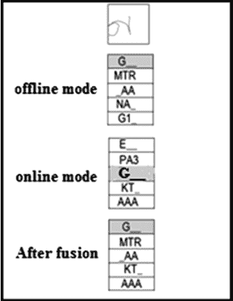

**图 9.16** 使用在线、离线和后期融合方法进行字符符号预测的选择。

图 9.16 展示了在 `MLP` 分类后应用后期融合技术的结果。该图强调了 `MLP` 对在线和离线模式生成的两种特征向量生成的 শ (G) 的前五个识别选择。通过观察该图可以看出，离线模式的特征将字符正确识别为最高选择。另一方面，在线模式生成的特征未能将该字符识别为最高选择。当应用后期融合时，基于分类器，字符样本随后被正确识别，从而提高了整个系统的性能。

应用后期融合技术后，误分类字符的数量减少，如表 9.3 所示。

## 表 9.3：采用后期融合技术后的误分类字符

| 原始字符（200个样本） | 误分类为（200个样本中的数量） |
| --- | --- |
| শ | স(5) |
| র | ন(4) |
| ব | ভ(5) |
| ᅮ | ㅜ(2) ᅮ(1) |
| 뭇 | 뭇(3) 뭇(2) |

## 9.6 结论

在本工作中，通过为在线手写孟加拉语字符图像创建一个相应的离线版本，提高了从中生成的特征集的效率。其意图不仅是为了增强字符识别，还要建立可以用于进一步研究的在线和离线数据库。虽然组合特征集比分别从字符图像在线和离线版本创建的单个特征向量反映了更好的性能，但整体准确率提高并不多。应用的后期融合方案产生了更好的结果并提高了准确率。然而，由于强相似性，仍有字符被误分类。因此，我们计划在未来引入更多特征来区分这些形状相似的字符，以提高整体识别率。

## 参考文献

- 1. S. Agarwal, and V. Kumar. 2005. Online character recognition. In: Proceedings of 3rd International Conference on Information Technology and Applications, 698–703.
- 2. F. Alvaro, and R. Zanibi. 2013. A shape-based layout for classifying spatial relationships in handwritten math. In: Proceedings of ACM Symposium on Document Engineering, 123–126.
- 3. C. Wahlmann, and H. Burkhart. 2004. The independent handwritten recognition system using graph and cluster dynamic warping. IEEE Trans. Pattern Anal. Intel. 26(3), 299–310.
- 4. M. Farha, G. Srinivasa, A. J. Ashwini, and K. Hemant. 2013. Online character recognition.
- 5. C. Tappert, J. Suen, and T. Takahara. 1990. The state of online handwriting recognition.
- 6. G. D. Vescovo, and A. Rizzi. 2007. Online recognition by holistic approach.
- 7. M. F. Zafar, D. Mohammad, and M. Anwar. 2006. Recognition of online characters by back propagation.
- 8. W. Zhao, J. F. Liu, and X. Tang. 2002. Online English based on cascade of HMMs.
- 9. R. K. Bawa, and R. Rani. 2011. Recognition of online gurmukhi.
- 10. M. Gupta, N. Gupta, and R. Agrawal. 2012. Online Gurmukhi using support vector machine.
- 11. J. R. Prasad, and U. Kulkarni. 2015. Gujarati recognition using adaptive fuzzy classifier.
- 12. M. K. Sachan, G. Leah Singh, and V. K. Jain. 2011. A novel method to recognize online Gurmukhi script.
- 13. M. K. Sachan, G. Leah Singh, and V. K. Jain. 2011. A system for online Gurmukhi script recognition.
- 14. K. C. Santosh, and J. Iwata. 2012. Stroke-based curve recognition.
- 15. K. C. Santosh, C. Nattee, and B. Lamirov. 2012. Relative positioning of stroke-based clustering: A new approach to online Devanagari character recognition.
- 17. A. Sharma, and K. Dahiya. 2012. Online recognition of Gurmukhi and Devanagari characters in mobile phone devices.
- 18. A. Sharma, R. Kumar, and R. K. Sharma. 2008. Online handwritten Gurmukhi character recognition using elastic matching.
- 19. A. Sharma, R. Kumar, and R. K. Sharma. 2009. Rearrangement of recognized strokes in online handwritten Gurmukhi words recognition.
- 20. A. Sharma, R. Kumar, and R. K. Sharma. 2010. HMM-based online handwritten Gurmukhi character recognition.

# 基于离线图像的手写孟加拉语在线识别

- 23. M. R. Bouguelia, S. Nowacki, A. Verikas, and K. C. Santosh. 2017. 同意于不一致：无众包包的噪声标签主动学习。Int. J. Mach. Learning. Cybernet., 1–13.
- 24. J. Du, J. Zhai, and J. Hu. 2017. 用于在线中文手写识别的深度学习写者适应。Int. J. Doc. Anal. Recon. 20(1), 69–78.
- 25. A. El-Sawy, E. El-Bakry, and M. Loey. 2016. 基于 LeNet-5 的手写数字识别 CNN。In: Proceedings of the International Conference on Advanced Intelligent Systems and Informatics, 566–575.
- 26. J. D. Prusa, and T. M. Khosgoftar. 2017. 用新的文本表示法改进深度神经网络设计。Int. J. Big Data 4(1), 7 (2017). Doi: 10.1186/s40537-017-0065-8
- 27. X. Tang, J. Ding, and K. Hao. 2017. 深度网络超参数优化的分段级可视化新方法。Int. J. Pattern Recogn. Artif. Intell. 32(5), 1850102-1-1850102-15.


- 28. W. Wang, G. Tan, and H. Wang. 2017. 从中国在线评论中提取基于属性的意见的算法性能跨域比较。Int. J. Machine. Cybernet. 8(3), 1053–1070.
- 29. Q. Wu, Z. Gui, S. Li, and J. Ou. 2017. 直接连接的卷积神经网络。Int. J. Pattern Recogn. Artif. 32(5), 1859007-1-1859007-17.
- 30. A. Fu, C. Dong, and L. Wang. 2015. 极端学习机稳定性和泛化性的实验研究。Int. J. Mach. Learn. Cybernet. 6(1), 129–135.
- 31. K. Roy, N. Sharma, and U. Pal. 2007. 在线手写识别系统。In: Proceedings of the International Conference on Advances in Pattern Recognition, 117–122.
- 32. T. Mandal, U. Bhattacharya, S. K. Parui, K. Das, and D. Mandalapur. 2010. 印度脚本的在线手写识别——第一个基准测试。In: Proceedings of the 12th International Conference on Frontiers in Handwriting Recognition, 200–205.
- 33. K. Roy. 2012. 孟加拉语在线手写识别的基于笔的设计。Int. J. Mod. Eng. Recon. 2(4), 2534–2540.
- 34. S. K. Parui, G. Gupta, U. Bhattacharya, and B. B. Chaudhuri. 2008. 使用 HMM 的在线手写孟加拉语字符识别。In: Proceedings of the International Conference on Pattern Recognition, 1–4.
- 35. U. Bhattacharya, B. K. Gupta, and S. K. Parui. 2007. 用于孟加拉语字符在线手写识别的方向编码特征。In: Proceedings of the International Conference on Document Analysis and Recognition, 58–62.
- 36. A. Bandopadhyay, and B. Chakraborty. 2009. 在线手写识别系统的开发：手写孟加拉语字符的案例研究。In: Proceedings of the World Congress on Natural and Bi Inspired Computing, 514–519.
- 37. R. Ghosh. 2015. 用于在线孟加拉语和天城文字符识别的新型特征提取方法。In: Proceedings of the International Conference on Signal Processing and Integrated Networks, 483–488.
- 38. S. Sen, R. Sarkar, and K. Roy. 2016. 一种在线手写孟加拉语字符识别的简单有效技术。In: Proceedings of the 4th International Conference on Frontiers in Intelligent Computing: Theory and Application, 201–209.
- 39. N. Joshi, G. Sita, A. G. Ramakrishnan, and V. Deepu. 2005. 在线手写天城文字符的机器识别。In: Proceedings of the International Conference on Data Analysis and Recognition, 1156–1160.
- 40. S. Sen, A. Bhattaryya, A. Das, and R. Roy. 2016. 用于线识别的特征向量设计。In: Proceedings of the 1st International Conference on Communication, 485–494.
- 41. S. Sen, R. Sarkar, and K. Roy. 2016. 基于哈夫斯距离的在线孟加拉语识别。In: Proceedings of the 5th International Conference on Intelligent Computing, 541–549.
- 42. S. Sen, M. Mitra, S. Chowdhury, and R. Roy. 2016. 基于四树的在线孟加拉语字符分割与特征提取。In: Proceedings of the 7th International Big Data, 246–256.
- 43. J. Demsar. 2006. 统计分类器的深度学习。Int. J. 7, 1–30.
- 44. M. Hall, E. Frank, G. Holmes, and P. Reutmann. 2009. WEKA 软件的发展。ACM Newsletter(11), 1–18.
- 45. J. Pinquier, S. Karaman, L. Guyot, and R. Megret. 2012. 用于多特征融合的策略。In: Proceedings of the International Conference on Multimedia sensors, 319–325.
- 46. S. Sen, A. Bhattaryya, C. Santosh, and D. Roy. 2018. 基于空域拓扑特征的孟加拉语字符识别。Int. J. Pattern Recogn. Artif. Intell. 32(10), 1856012.
- 47. K. C. Santosh, N. Natee, and B. Lami. 2012. 基于笔画顺序的天城文字符识别。In: International Graph on Recognition, 368–372.
- 48. K. C. Santosh. 2011. 基于支持向量机的在线识别。10.1109/DAR.
- 49. K. C. Santosh, N. Natee, and B. Lami. 2010. 基于空间相似性的在线识别。In: International Conference on Frontiers, 652–657.
- 50. S. Sen, M. Sid, and M. Ahmadi. 2015. 基于神经网络的天城文识别。Front. Comput. Sci., 9(5), 678–690.
- 51. A. Kumar, S. Bhattachya, and U. Pal. 2007. 基于隐马尔夫模型的在线手写识别系统。In: Students' Symposium, 300–304.
- 52. H. Freeman. 1974. 计算机处理。Int. J. 6(1), 57–97.
- 53. K. C. Santosh. 2014. 基于扩展特征的识别。10.1109/ICSP.
- 54. Sk. Md. Obaidullah, C. Halder, N. Das, and K. Roy. 2017. 四种印度脚本的单词级数据集。Multimedia Tool. Appl., 7(2), 81–94.
- 55. Sk. Md. Obaidullah, C. Halder, N. Das, and K. Roy. 2016. 基于图像变换的孟加拉语单词级。Int. J. Intell. Eng., 4(1), 1–20.
- 56. Tripathi, S. Paul, and V. Pandey. 2021. 孟加拉语笔画顺序标准化。In: Proceedings of the International Conference on Enhanced Education, 1–5.
- 57. Gerrit J. den Burg, and Patrick J. Groenen. 2016. GenSVM：通用分类支持向量机。J. Mach. Learn. 17(22), 1–42.
- 58. H. Swethalakshmi, C. S. Sekhar, and V. S. Chakravarthy. 2007. 用于天城文和泰米尔语字符识别的时空特征。In: The International Conference on Artificial Neural Networks, 230–239.
- 59. H. Swethalakshmi, A. Jayaraman, V. S. Chakravarthy, and C. S. Sekhar. 2006. 使用支持向量机的天城文和泰卢固语在线手写字符识别。In: Proceedings of the International Workshop for Frontiers in Handwriting Recognition, 367–372.
- 60. Sk. Md. Obaidullah, K. C. Santosh, N. Das, C. Halder, and K. Roy. 2018. 多脚本文档图像中的手写印度脚本识别：综述。Int. J. Pattern Recogn. Artif. Intell. 32(10), 1856012.
- 62. K. C. Santosh, and L. Wendling. 2015. 基于非线性多投影文件的字符识别。Front. Comput. Sci., 9(5), 678–690.
- 63. S. D. Connell, R. M. K. Sinha, and A. K. Jain. 2000. 无约束行级天城文字符识别。In: Proceedings of the 15th International Conference on Pattern Recognition, 368–371.


# 10 贝叶经手写字符识别

Papangkorn Inkeaw, Jeerayat Chaijaruwanish 和 Jakramate Bootkrajang

## 目录

- 10.1 引言 .................. 145
- 10.2 贝叶经 .................. 146
- 10.3 贝叶经光学手写字符识别 (OHCR) 的挑战 .................. 146
- 10.4 贝叶经的文档处理与识别 .................. 148
    - 10.4.1 预处理 .................. 149
    - 10.4.1.1 二值化 .................. 149
    - 10.4.1.2 降噪 .................. 150
    - 10.4.1.3 倾斜校正 .................. 150
    - 10.4.2 分段 .................. 150
    - 10.4.2.1 文本行分段 .................. 150
    - 10.4.2.2 字符分段 .................. 151
    - 10.4.3 识别 .................. 152
    - 10.4.3.1 基于分段的方法 .................. 152
    - 10.4.3.2 无分段的方法 .................. 153
- 10.5 针对兰纳语贝叶经的 OHCR 系统 .................. 153
    - 10.5.1 预处理 .................. 153
    - 10.5.2 布局分析 .................. 155
    - 10.5.3 分段 .................. 156
    - 10.5.4 识别 .................. 157
- 10.6 结与展望 .................. 158
参考文献 .................. 158

## 10.1 引言

光学手写字符识别 (OHCR) 是一种著名的自动方法，用于将手写文档图像转换为机器编码文本。尽管过去十年中已经开发了多种 OHCR 技术，但 OHCR 仍然是一个不断增长的研究领域。此外，OHCR 技术现在已应用于办公自动化系统。同时，最近的研究方向正在扩大 OHCR 技术在数字图书馆古代文档处理中的应用。OHCR 的挑战与书写媒介的类型以及字母的复杂性有关。每种书写媒介都需要特定的预处理技术，而字母的特征则决定了字符分段和识别方法的设计。

在古代贝叶经上进行 OHCR 时，手稿通常状况较差，因此需要细致的预处理步骤来处理各种噪声。行标记的缺失也为行分段过程中增加了一些不确定性。更重要的是，大多数贝叶经广泛存在南亚和东南亚语言，在这些语言中，可能接触和破损的字母、元音和声调标记的组合使得问题变得更加复杂。

在本章中，我们将阐明在贝叶经上执行 OHCR 所的相关问题。随后，我们将概述目前先进的方法，包括成功应用于该任务的预处理、行分段、字符分段和字符识别步骤。最后，我们通过古代斯里兰卡达法（Dhamma）字符识别系统的运行示例来结束本章。

## 10.2 贝叶经

贝叶经是用干燥棕榈叶制成的古代文献。在古代，棕榈叶是南亚和东南亚主要的书写材料。经过数百年的时间，这些手稿已经受损。为了保护这些可能具有价值的文档，多个机构已开始在各地的当地社区进行调查。已经找回了许多无价的手稿，特别是在斯里兰卡、印度、老挝、缅甸、柬埔寨和泰国。图 10.1 显示了在泰国北的贝叶经示例，描述了传统医学，这对于进一步的研究非常重要。这些手稿是通过微胶片化、扫描和摄影技术进行保存和归档的。通常，几片棕榈叶被放在一张图像中，称为“叶”（folio）。以叶页的形式存储贝叶经可以缩短数字化时间并节省存储空间。

## 10.3 贝叶经 OHCR 的挑战

以图像形式存储贝叶经在某种程度上限制了与文档的交互。相反，更理想是将导入的贝叶经图像转换为机器编码文本，以便方便地对文档进行编辑、检索、访问和处理。遗憾的是，手动执行图像到文本的转换成本高昂。

OHCR 是解决这一问题的可行方案。通常，OHCR 过程包含四个任务，即预处理、分段、识别和后处理。OHCR 的挑战通常与书写媒介的类型和字母的复杂性有关。在这里，我们将介绍在这四个步骤中在贝叶经上执行 OHCR 时相关的常见问题。这些问题在开发用于贝叶经的 OHCR 系统期间应当得到解决。

图像质量通常是 OHCR 过程中遇到的第一个问题。许多贝叶经图像是在没有标准设备的情况下拍摄的，导致图像质量存在差异。虽然通常首选使用专业级扫描仪进行数字化，但在数字化极具价值且脆弱的原件时，策展人员会选择数码相机。因此，很难确保物体完全平整放置。不均匀的光照也导致文本与背景之间的对比度差。此外，大多数贝叶经图像在拍摄时没有任何行标记。这导致在生成的图像中存在某些倾斜（即图像相对于水平轴的旋转）。

几种类型的噪声进一步恶化了这种情况。根据研究 [1]，贝叶经上的噪声可以分为三类，即组件噪声、叶纹和叶孔。图 10.2 展示了这些噪声的示例。小的组件噪声似乎不仅由于书写媒介的自然老化产生，还由于图像二值化过程产生。此外，手稿是干燥叶片，自然制备没有经过造纸工艺，因此叶纹通常沿着裂缝出现。最后，为了装订手稿，棕榈叶在页面中间区域周围穿了一个或两个孔。这些孔变成了在进一步处理之前应该移除的伪影。由于这些挑战，OHCR 系统的预处理步骤中需要有效的图像处理技术。

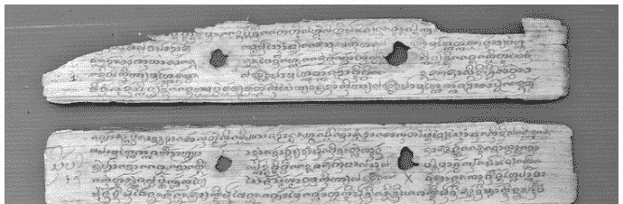

图 10.1 在泰国发现的贝叶经示例。

对于贝叶经，每个字符都是使用尖锐书写工具在长矩形切割的叶子上刻画的。从贝叶经中提取文本行的困难在于，行与行之间拥挤，间距非常小。由于是手写，行可能是倾斜的或向上/向下弯曲的。与拉丁字母从左到右排列字符不同，贝叶经中发现字母是以多层级风格书写的。某些字符位于另一个字符的下方或上方。它们倾向于超出主行范围，与相邻行的字符接触或重叠。在尝试对贝叶经叶页进行行分段和字符分段时，需要意识到这些问题。

最后，大量的字符类别、手写风格的变、无约束书写以及视觉相似字符的存在，被认为是字符识别任务中具有挑战性的问题。此外，由于贝叶经上出现的字母是现代不再使用的古代字符，只有少少数标记示例可用于训练识别模型。在贝叶经的 OHCR 中，训练示例的缺乏是构建有效识别模型的主要挑战。

## 10.4 贝叶经的文档处理与识别

文档图像处理和识别因其在许多应用中的潜力和技术挑战而受到了研究社区的广泛关注。许多文档的有效方法截至目前，已经提出了图像预处理、分割、识别和后处理方法。

## 10.4.1 预处理

在预处理任务中，将输入的文档图像转换为合适的格式，希望能尽可能去除大部分噪声，并进行前景和背景分离。其中，对应字符的像素（被视为前景）和对应背景的像素通常被分别指定为二值 1 和 0。棕叶手稿的预处理任务还包括二值化和偏斜校。

### 10.4.1.1 二值化


# 二值化

二值化是文档图像分析的常用起点，将灰度图像值转换为二值表示。二值化技术的性能影响很大，并直接影响分割和识别任务的性能。一种简单且著名的二值化方法是阈值法。根据阈值的选择，二值化方法通常可分为两类：全局阈值和局部阈值。对于全局阈值，根据图像的全局特征计算单个阈值值。例如，大津法 [3] 是一种广名的全局二值化技术。在局部自适应阈值中，阈值在较小的局部图像区域、区域或窗口内计算。目前已提出了许多局部自适应阈值技术，例如自适应平均法、Niblack 方法 [4]、Sauvola 方法 [5]、Wolf 方法 [6] 和 nick 方法 [7]。另一种二值化方法是基于训练的方法。该方法使用分类器将每个像素分类为前景像素或背景像素。在 ICFHR 2016 巴厘岛棕叶手稿图像手写体分析竞赛二值化挑战赛中，提出了两种基于训练的二值化方法 [8]。该比赛的优者 ICFHR G1 [8] 采用了全卷积网络 (FCN)。它接收一个彩色子图像并输出子图中每个像素属于前景的概率。第二种方法 ICFHR G2 [8] 使用两个神经分类器将每个像素分类为背景或非背景。[9] 报道了针对棕叶手稿的文档图像分析方法的对比研究。该研究利用来自东南亚的棕叶手稿（即巴厘岛、高棉语和巽达语棕叶手稿）对二值化、文本行分割、孤立字符识别、单词识别和转录进行了全面测试。报告显示，Niblack 方法、ICFHR G1 和 ICFHR G2 分别在巽达语、高棉语和巴厘岛手稿上获得了最高的 F 分。阈值方法的比较表明，Niblack 和 NICK 方法分别在巴厘岛和高棉语手稿上获得了最高的 F 分。

## 10.4.1.2 噪声消除

在文档图像转换为二值图像后，需要移除被认为是噪声的干扰组件。[1] 提出了一种通过移除第 10.2 节中提到的三种噪声来实现的降噪技术。通过分析连通组件的大小（例如一组相互接触的前景像素）来过滤较小组件，而通过检查每个组件的宽高比来检测叶片条纹。为了移除叶片孔洞，通过对输入图像应用全局阈值生成了掩码，并用它来去除叶片。

## 10.4.1.3 偏斜校正

为了纠正偏斜，必须确定输入文档图像相对于水平轴的旋转角度。检测文档偏斜有几种常用方法。某些方法使用霍夫变换 [10, 11] 进行线检测。检测出的线条角度的中位数依赖于对连通组件的检测 [12, 13]，这些组件大致等于字符，然后找到连接质心的平均角度。相比之下，某些方法直接使用投影轮廓分析 [14, 15] 来检测文档偏斜。将文档页面以多个角度进行投影，并计算每条投影线上前景像素数量的方差。平行于校正方向的投影可能会具有最大的文档方差。检测到文档偏斜后，必须按照该角度旋转文档图像以纠正这种偏斜。

# 10.4.2 分割

在分割任务中，二值文档图像被逐渐分离，以获得若干孤立的字符或单词图像作为结果。它涉及行分割和字符分割。

## 10.4.2.1 文本行分割

大多数文档分析和识别都从行分割开始。[1, 16–19] 使用了多种投影轮廓技术。这些方法的目标是基于图像水平投影轮廓的峰值或谷值，提取文本行的估计中位或缝隙位置。另一种文本分割方法尝试寻找通过文本行的最优路径 [20–23]。这些行分割方法在二值文档图像上运行，因此需要初始二值化方法。相比之下，已经提出了一些不依赖二值化过程有效性的分割方法。[24] 中提出的一种方法通过分析水平投影轮廓创建了文本行的中轴。两条相邻行通过缝隙切割算法分离。[25] 提出了一种自适应路径查找方法来寻找文本的中轴。为了处理跨越多行的组件，使用改进的 A* 路径规划技术分离两条相邻的行 [26]。一项对比研究 [9] 显示，自适应路径查找方法在三个棕叶手稿数据集上取得了优于缝隙切割法的结果。

## 10.4.2.2 字符分割

行分割后，每行文本中的字符被分割成孤立的字符图像，将在识别任务中进行识别。字符分割方法可以分为三种策略，即剖析法、基于识别的分割和整体方法 [27]。剖析法被认为一种启发式方法。由于不同的字母不同，剖析法针对其设计的字母具有特殊性。通常用作轮廓信息 [28, 29]、储层 [30] 和骨架 [29, 31] 的特征。另一方面，基于识别的分割利用字符模型的反馈来确定分割点。最近的一研究显示，基于识别的方法通常优于剖析法 [32]。基于识别的分割方法通常包含两个阶段，即过度分割阶段和分割搜索阶段。通常在过度分割阶段使用剖析法来获取候选分割点。候选分割点用于将给定的单词分割成若干片段。这些片段表示在一种表示所有可能分割假设的适当数据结构中。大多数粘连数字的方法在有向无环图 (DAG) 中表示可能的分割假设 [33–35]。问题是如何搜索最佳分割路径。现有方法考虑了 Viterbi 算法 [33, 36] 和最短路径算法 [34, 37]。或者，也可以使用无向图来表示分割假设 [36]。最佳分割假设是通过应用改进的 Viterbi 算法获得的一组线性子图。

# 使用机器学习进行文档处理

属于某些复杂书写风格的字符。针对复杂手写字符设计的基于识别的分割方法，可能是处理泰国手写字符的方法 [38]。该方法通过分析单词图像的储池属性来获取分割点。使用贪心算法确定最佳分割点。在我们之前的工作 [39] 中，通过分析背景和前景骨架来获取候选分割点。这些点被用于获取单词图像的冗余片段。然后，使用这些片段来形成一个假设图。使用划分算法将假设图划分为多个子图，每个子图对应一个被分割的字符。与之前的两种方法不同，整体分割方法避免了将单词图像分割成有意义的片段。它寻求一次性识别单词图像。为了实现这一目标，需要一个标记的单词图像数据集来训练整体分割模型。我们将在下一节讨论这种方法，即单词识别。

# 10.4.3 识别

大多数光学手写字符识别（OHCR）流水线的共同点是字符字符识别任务，即图像实际上被转换为文本；这是现有方法无法提供满意结果的任务。字符识别方法可以分为两类，即基于分割的方法和无分割的方法。

## 10.4.3.1 基于分割的方法

基于分割的方法需要孤立的字符图像作为输入。适当的特征提取和有效的分类器可以提高识别率。文献中提出了许多用于手写字符识别的特征提取方法。著名的特征提取方法包括方向梯度直方图（HOG） [40]、尺度不变特征变换描述符 [41]、图像矩描述符 [42–48]、傅里叶描述符 [49]、多投影谱 [50, 51] 以及链码 [49, 52, 53]。此外，研究人员报告，将几个特征组合成特征向量可以提高识别性能 [54–56]。为了识别孤立字符图像，有几种分类模型可用，例如 `kNN`、支持向量机（SVM）和多层感知器（MLP）等。

另一种识别方法是采用卷积神经网络（CNN）作为识别模型。CNN 在学习识别模型的同时进行特征提取。一种著名的架构是 LeNet-5 [57]，它在手写数字分类上表现良好。目前已经提出了几种字符识别的架构，例如 SPnet [58]、Vanilla [9] 以及用于棕榈叶手稿字符识别的 SHL-CNN [59]。通常情况下，由于分类器的高度复杂性，CNN 需要大量的训练样本才能达到最佳性能。根据我们的经验，使用小型训练集教育 CNN 模型可能会导致严重的过拟合。

## 10.4.3.2 无分割方法

在无分割的字符识别中，单词图像可以直接作为输入发送到分类器。这种方法中一种流行的识别模型是循环神经网络长短期记忆（RNN-LSTM） [60] 与连接时分类（CTC） [61] 的结合。RNN 与前馈神经网络相似，不同在于它们可以使用内部状态（内存）来处理输入序列。然而，在训练阶段经常遇到梯度消失问题，即权重向量的梯度变得太小，无法用于学习。引入 LSTM 架构是为了解决梯度消失问题。LSTM 网络在 RNN 中增加了乘法门和加法反馈 [60]。关于使用 RNN-LSTM 进行单词识别的最新研究可以在 [62, 63] 中找到。

# 10.5 用于兰纳棕榈叶手稿的 OHCR 系统

在本节中，我们展示了一个用于兰纳棕榈叶手稿的运行 OHCR 系统作为示例。这些手稿是兰纳智慧知识的重要来源。该系统由四个主要任务组成，如图 10.3 所示，即预处理、布局分析、分割和字符识别。在预处理任务中，将棕榈叶图像从页文件中分割出来。每个棕榈叶图像都经过增强并转换为二值图像。在布局分析中，检测二值图像中的文本布局。在分割任务中，每个文本被单独分解为孤立的字符图像。最后，在字符识别任务中，所有字符由分类器识别。输出输入棕榈叶图像的机器编码文本。

## 10.5.1 预处理

系统从预处理任务开始 OHCR 过程。由于棕榈叶手稿通常以包含多个棕榈叶图像的页文件存档，因此需要从页文件中提取每个棕榈叶以方便 OHCR 进行。为了实现这一点，提出了一种棕榈叶手稿的页面分割方法 [64]。该方法由两个主要步骤组成：(1) 对象检测和 (2) 对象选择。

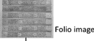

### 预处理流程

- 棕榈叶分割
- 棕榈叶图像
- 二值化
- 倾斜检测
- 降噪
- 布局分析

### 分割流程

- 文本行分割
- 块分割
- 字符分割
- 字符识别

> 棕榈叶手稿光学手写字符识别过程
> 
> **图 10.3** 兰纳棕榈叶手稿光学手写字符识别过程流程图。

在第一步中，将 RGB 色彩空间的页文件转换为 L*a*b* 色空间。所有由 a* 和 b* 表示的像素被聚类为 k 类。然后，使用聚类数作为每个像素的标签生成标记图像。最后，每个连通分量表示为页文件中的一个对象。第二步是对对象进行基于规则的选择，将其分为棕榈叶或非棕榈叶。这三个规则是根据棕榈叶手稿的形状信息设计的。从页文件中提取棕榈叶图像后，使用 NICK 方法将其转换为二值图像。在降噪之前，利用叶脉纹噪声进行倾斜校正，因为叶脉纹与棕榈叶页面上的文本行平行。叶脉纹相对于 x 轴的角可用于推断图像的倾斜。使用霍夫变换检测文档倾斜。下一步是降噪步骤。为了处理叶洞，区分了背景板和棕榈叶。RGB 颜色的原始棕榈叶图像转换为 L*a*b*。所有由 a* 和 b* 表示的像素被聚类为两类。假设棕榈叶是原始图中最大的对象，我们可以直观地将最大的类分配给棕榈叶像素组。接下来，使用聚类数作为像素的标签生成标记图像。由于叶洞噪声通常是棕榈叶的一部分并接触背景，因此会检测二值图像中相邻背景像素的分量。将这些分量从二值图像中移除。对于叶脉纹噪声，通过滤波器对二值图像进行平滑处理，如图 10.4 所示。此外，从二值图像中移除类似于直线且与 x 轴平行的连通分量。最后，通过考虑尺寸极小的组件来移除小组件。

## 10.5.2 布局分析

通过观察兰纳棕榈叶手稿，我们发现了四种布局对齐模式，如图 10.5 所示。对于这些模式，文本布局从棕榈叶的左侧到右侧排列。可以通过某些垂直线分隔。为了找到这些分割线，获取并分析二值棕榈叶图像的垂直投影。我们假设同一布局中字符之间的间隙明显小于布局之间的间隙。在计算投影谱之前，我们需要减少由字符间间隙引起的敏感性，以便将同一布局中的字符合并为一个分量。因此，对二值图像应用形态学膨胀操作 [65]。然后，计算投影谱。接下来，检测所有洞的开启点和关闭点对。每对点对应二值棕榈叶图像上的每个布局。

```
| d 0 | d 0 | d 0 | d 0 | d 0 | d 0 | d 0 | d 0 | d 0 | d 0 | d 0 | d 0 |
| d X | d X | d X | d X | d X | d X | d X | d X | d X | d X | d X | d X |
| d 0 | d 0 | d 0 | d 0 | d 0 | d 0 | d 0 | d 0 | d 0 | d 0 | d 0 | d 0 |
```

**图 10.4** 用于平滑二值棕榈叶图像的滤波器。滤波器中心的像素是目标。任何被方形掩码“d”覆盖的像素都会被忽略。如果被方形掩码“0”覆盖的像素值都为零，则目标像素的值固定为相同的值。

| 布局模式 | 棕榈叶示例 |
|---|---|
| 模式 I | ![image] |
| 手稿的内容或注释位于页面居中。 | ![image] |
| 模式 II | ![image] |
| 内容居中，手稿的注释或页码位于左侧 | ![image] |
| 模式 III | ![image] |
| 内容居中，页码（在保存过程中添加）位于右侧 | ![image] |
| 模式 IV | ![image] |
| 内容居中，原始页面位于左侧，额外的页码位于右侧 | ![image] |

**图 10.5** 兰纳经（Lanna Dhamma）棕榈叶手稿上的四种文本布局模式。

## 10.5.3 分割

OHCR 流程的下一步是分割步骤，它极大影响了识别性能。每个文本布局的二值图像被逐渐分离，以获得若干孤立的字符。我们将这项任务分为三个步骤：(1) 文本行分割，(2) 块分割和 (3) 字符分割。

在行分割中，我们采用了在 [18] 中提出的文本行分割方法的概念。首先确定给定二值图像中的文本行数。与 [18] 不同，文本行的数是通过分析整个图像的水平投影剖图估计的。投影剖图中的峰值数量被设定为文本行数，因为文本行的整体曲率往往倾向于线性的，尽管某些部分可能是弯曲的。

在块分割中，将文本行分离成小块，而不考虑其语义。此任务是为了为字符分割准备合适的输入图像，因为字符分割在输入为较小字符块时效果更好。这可以通过分析每行文本的垂直投影剖图轻松实现。首先，计算每行文本的垂直投影剖图。然后通过扫描找到投影为零的位置，从投影剖图中提取出字符之间的间隙。为了避免将字符切割成冗余的块，忽略了较小的间隙。同时，较大的间隙被用作切割点，将文本行分为小块。

在字符分割中，每个块中的字符被分离为孤立的字符。为此，我们在 [39] 中提出了一种基于识别的字符分割方法。该方法包含三个阶段：(1) 确定候选分割点，(2) 在假设图中表示分割，以及 (3) 确定最佳分割假设。在第一阶段，我们分析了单词图像的骨架，以识别用于将单词图像分离成片段的候选分割点。在第二阶段，我们将所有的分割假设表示为无向图。该图被划分为对应于分割字符图像的子组。我们定义了一个置信函数，将来自识别模型的反馈与分割字符的预期宽度和高度相结合，以引导划分算法。使用多层感知器作为识别模型。我们设计了一种动态规划算法来为图划分问题寻找全局最优解，即使置信函数最大化。

## 10.5.4 识别

字符识别是我们 OHCR 系统的最后一个任务。在这项任务中，需要将孤立字符分类到其对应的字符类别。为了提高独立书写识别的准确性，我们提出了一种使用智能矩特征选择（LDMS）的手写兰纳经字符高效字符识别方法 [54]。LDMS 从一组全面的基于形状的矩描述符中获取一组优化的设计特征。它包含三个阶段：(1) 确定每个有效矩描述符的阶，(2) 确定矩描述符的最佳组合，以及 (3) 使用可继承的双目标组合遗传算法进行优化的矩特征选择。考虑矩特征是因为它们提供了尺度和旋转不变性，以及噪声鲁棒性。通过实验，选取了包括 Meixner、Charlier、Tchebiche 和 Hahn 在内的四个有效矩描述符来形成特征向量。采用 KNN 作为分类器，因为它对数据分布的假设性较少。

# 10.6 总结与展望

在本章中，我们讨论了在棕榈叶手稿上执行 OHCR 相关的问题。在开发用于棕榈叶手稿的 OHCR 系统期间应强调这些问题。我们概述了先进的预处理、线性分割、字符分割和字符识别步骤，这些步骤已成功应用于该任务。展示了一个古代兰纳经字符识别系统的工作示例。尽管目前提出了各种方法，但改进棕榈叶手稿 OHCR 系统仍有空间。与人类识别能力的应用需求相比，目前 OHCR 系统对棕榈叶手稿的识别率仍然不足。此外，OHCR 的大多数最新方法是使用深度学习方法提出的，但由于训练数据集的局限性，这些方法无法应用于棕榈叶手稿。需要构建大型训练数据集，以开发使用深度学习方法的棕榈叶手稿高效 OHCR 方法。

# 参考文献

1. Inkeaw, P., et al., Lanna Dharma handwritten character recognition on palm leaves manuscript based on Wavelet transform. In: 2015 IEEE International Conference on Signal and Image Processing Applications (ICSIPA). 2015.
2. Klomsae, A., Image feature extraction for Lanna Dharma handwritten character recognition. In: Department of Computer Science. Chiang Mai University, Thailand. 2012.
3. Otsu, N., A threshold selection method from gray-level histograms. IEEE Transactions on Systems, Man, and Cybernetics.
4. Inkeaw, P., et al., Lanna Dharma handwritten character recognition on palm leaves manuscript based on Wavelet transform. In: 2015 IEEE International Conference on Signal and Image Processing Applications (ICSIPA). 2015.
5. Klomsae, A., Image feature extraction for Lanna Dharma handwritten character recognition. In: Department of Computer Science. Chiang Mai University, Thailand. 2012.


## 参考文献

- 6. Otsu, N., A threshold selection method from gray-level histograms. IEEE Transactions on Systems, Man, and Cybernetics.
- 7. Inkeaw, P., et al., Lanna Dharma handwritten character recognition on palm leaves manuscript based on Wavelet transform. In: 2015 IEEE International Conference on Signal and Image Processing Applications (ICSIPA). 2015.
- 8. Klomsae, A., Image feature extraction for Lanna Dharma handwritten character recognition. In: Department of Computer Science. Chiang Mai University, Thailand. 2012.
- 9. Otsu, N., A threshold selection method from gray-level histograms. IEEE Transactions on Systems, Man, and Cybernetics.
- 10. Inkeaw, P., et al., Lanna Dharma handwritten character recognition on palm leaves manuscript based on Wavelet transform. In: 2015 IEEE International Conference on Signal and Image Processing Applications (ICSIPA). 2015.
- 11. Klomsae, A., Image feature extraction for Lanna Dharma handwritten character recognition. In: Department of Computer Science. Chiang Mai University, Thailand. 2012.
- 12. Otsu, N., A threshold selection method from gray-level histograms. IEEE Transactions on Systems, Man, and Cybernetics.
- 13. Inkeaw, P., et al., Lanna Dharma handwritten character recognition on palm leaves manuscript based on Wavelet transform. In: 2015 IEEE International Conference on Signal and Image Processing Applications (ICSIPA). 2015.
- 14. Klomsae, A., Image feature extraction for Lanna Dharma handwritten character recognition. In: Department of Computer Science. Chiang Mai University, Thailand. 2012.
- 15. Otsu, N., A threshold selection method from gray-level histograms. IEEE Transactions on Systems, Man, and Cybernetics.
- 16. Inkeaw, P., et al., Lanna Dharma handwritten character recognition on palm leaves manuscript based on Wavelet transform. In: 2015 IEEE International Conference on Signal and Image Processing Applications (ICSIPA). 2015.
- 17. Klomsae, A., Image feature extraction for Lanna Dharma handwritten character recognition. In: Department of Computer Science. Chiang Mai University, Thailand. 2012.
- 18. Otsu, N., A threshold selection method from gray-level histograms. IEEE Transactions on Systems, Man, and Cybernetics.
- 19. Inkeaw, P., et al., Lanna Dharma handwritten character recognition on palm leaves manuscript based on Wavelet transform. In: 2015 IEEE International Conference on Signal and Image Processing Applications (ICSIPA). 2015.
- 20. Klomsae, A., Image feature extraction for Lanna Dharma handwritten character recognition. In: Department of Computer Science. Chiang Mai University, Thailand. 2012.
- 21. Otsu, N., A threshold selection method from gray-level histograms. IEEE Transactions on Systems, Man, and Cybernetics.
- 22. Inkeaw, P., et al., Lanna Dharma handwritten character recognition on palm leaves manuscript based on Wavelet transform. In: 2015 IEEE International Conference on Signal and Image Processing Applications (ICSIPA). 2015.
- 23. Klomsae, A., Image feature extraction for Lanna Dharma handwritten character recognition. In: Department of Computer Science. Chiang Mai University, Thailand. 2012.
- 24. Otsu, N., A threshold selection method from gray-level histograms. IEEE Transactions on Systems, Man, and Cybernetics.
- 25. Inkeaw, P., et al., Lanna Dharma handwritten character recognition on palm leaves manuscript based on Wavelet transform. In: 2015 IEEE International Conference on Signal and Image Processing Applications (ICSIPA). 2015.
- 26. Hart, P.E., N. Nilsson, B. Raphael, and A. Formal, Basis for the heuristic determination of minimum cost paths IEEE Transactions on Systems Science and Cybernetics, 1968.

## 基于机器学习的文档处理

27. Casey, R.G., and E. Lecolinet, 图像分割中方法与策略的综述. IEEE Transactions on Pattern Analysis and Machine Intelligence, 1996, 18(7): p. 690–706.
28. Shi, Z., and V. Govindaraju, 连写手数字模式的分割与识别. Pattern Recognition, 1997, 30(9): p. 1501–1504.
29. Elnagar, A., and R. Rajhaj, 连写手数字模式的分割. Pattern Recognition, 2003, 36(6): p. 625–634.
30. Pal, U., A. Belaid, and C. Touschy, 使用水库概念的接触式数字分割. Pattern Recognition Letters, 2003, 24(1): p. 261–272.
31. Pravesit, S., and A. Thamammano, 沿海手写手稿的分割. In: 第6届IEEE国际智能系统会议. 2012.
32. Ribas, F.C., L. Oliveira, A. S Brito, and R. Sabourin, 手写数字分割：一项比较研究. International Journal on Document Analysis and Recognition (IJDAR), 2013, 16(2): p. 127–137.
33. Elagouni, K., 等, 用于自然文本OCR的结合尺度字符识别与语言知识的方法. In: 第10次IAPR国际文档分析系统工作会议. 2012.
34. Fujisawa, H., Y. Nakano, and K. Kurino, 字符识别的分割方法：从分割到结构分析. Proceedings of the IEEE, 1992, 80(7): p. 1079–1090.
35. Yi-Kai, C., and W. Jing-Fa, 使用背景和前景分析的单次或多次接触手写数字字符串分割. IEEE Transactions on Pattern Analysis and Machine Intelligence, 2000, 22(11): p. 1304–1317.
36. Oliveira, L.S., R. Sabourin, F. Bertolozzi, and C.Y. Sun, 手写数字字符串的自动识别：一种识别与验证策略. IEEE Transactions on Pattern Analysis and Machine Intelligence, 2002, 24(11): p. 1438–1454.
37. Ji, J. L., Peng, and B. Li, 基于图模型优化的历史汉字分割方法. In: 第11次IAPR国际文档分析系统工作会议. 2014.
38. Chatinarat, A., 使用比例不变识别技术的泰国手写分割. In: 未来计算机与通信国际会议. 2009.
39. Inkeaw, P., and B. Briggs, 用于人体检测的方向的方向梯度直方图. In: Journal on Document Analysis and Recognition (IJDAR), 2018, 21(1): p. 21–39.
40. Dalal, N., M.F. Karaaba, L.R.B. Schomer, and M.A. Wiering, 使用局部梯度特征描述符的手写字符识别. Engineering Applications of Artificial Intelligence, 2015, 45: p. 405–414.
41. Saymouri, M., A. Hmid, and H. Qjida, 针对二值化和灰度图像的charlier矩的快速计算. In: 信息科学与技术 (CIST) 2012研讨会.
42. Saymouri, M., A. Hmid, H. Qjida, and A. Fast, 用于图像分析的meixner不变矩的快速计算. Circuits, Systems, and Signal Processing, 2015, 34(3): p. 875–900.

## 棕榈叶手稿的字符识别

- 4. Liu, J.G., H.F. Li, F.Y. Chen, and F. Lam, 通过矩计算的快速离散余弦变换. Journal of VLSI Signal Processing Systems for Signal, Image and Video Technology, 1998, 19(3): 257–268.
- 5. Zhou, J., 等, 基于正交矩的图像分析. 柏林，海 Springer Berlin Heidelberg, 2005.
- 6. Pew-Thian, Y. Ramesaran, and O.S. Huat, 基于Krawtch矩的图像分析. Image Processing, IEEE Transactions on Communications, 2003, 12(11): 1367–1377.
- 7. Mukundan, R.S., and P.A. Lee, 基于切比雪夫矩的图像分析. IEEE Transactions on Image Processing: A Publication of the IEEE Signal Society, 2001.
- 8. Hosny, K.M., 使用Gegenbauer矩的图像表示. Pattern Recognition, 2011, 32(6): 795–804.
- 9. Gonzalez, R.C., and R.E. Woods, 数字图像处理, 第三版. Prentice-Hall, 2006.
- 10. Santosh, K.C., 等, 基于DTW的字符识别. In: 国际文档分析与识别会议, 2011.
- 11. Santosh, K.C., and L. Wendling, 基于非线性多投影配置的字符识别. Frontiers of Computer Science, 2015, 9(5): 678–690.
- 12. Jain, J., 等, 用于手写字符识别的改进直方图特征. 柏林，海德堡 Springer Berlin, 2012.
- 13. Santosh, K.C., and E. Iwata, 基于笔画的曲线识别. In: 字符识别进展, X. Ding, 编辑, SpringerOpen, p. 175–192.
- 14. Inkeaw, P., 等, 使用最优设计特征集的手写字符识别. International Journal on Document Analysis and Recognition (DAR), 2017, 20(4): 259–274.
- 15. Shridhar, M., and A. Badrel, 使用傅里叶和拓扑描述符的高精度字符识别算法. Pattern Recognition, 1984, 17(5): 515–524.
- 16. Wu, T., 等, 用于中文识别的改进描述符. In: 第三次智能信息技术专题会议, 2009.
- 17. Lecun, Y., Bottou, Y. Bengio, and P. Haffner, 基于梯度的文档识别. Proceedings of the IEEE, 1998, 86(11): 2278–2324.
- 18. Dae-Gun, K., Song, Kang, and S. Han, 用于字符级分类的卷积神经网络. IEEE Transactions on Smart Processing & Computing, 2017, 6(1): 53–59.
- 19. Bai, J., 等, 使用从不同语言学习的深度卷积网络字符识别. In: 国际图像处理会议 (ICIP), 2014.
- 20. Hochreiter, S., and J. Schmiduber, 长短期记忆. Neural Computing, 1997, 9(8): 1735–1780.
- 21. Graves, A., 等, 连接主义序列分类. In: 第23次机器学习国际会议, ACM: Pittsburgh. p. 369–376.
- 22. Ahmed, S., 等, 使用循环神经网络评估草体与非草体脚本. Neural Computing, 2016, 27(3): p. 603–613.
- 23. Sarraf, S., 通过长短期记忆进行法语单词识别快速综述. Arxiv-Prints, 2018.
- 24. Inkeaw, P., 等, 用于彩色图像的棕榈叶页面分割. Cham: Springer International, 2016.
- 25. Burger, W., and M. Burge, 数字图像处理：算法导论. London: Springer Publishing. 2016.

## 索引

### A

- **攻击性识别**
  - 数据分布, PAN 2015/2016, 110
  - 数据预处理, 104–105
  - 数据集, 102
  - 密集算法, 109
  - 密集架构, 109
  - 密集与快速文本, 109
  - 实验设置, 107
  - 特征提取, 106
  - 逻辑回归, 特征集, 107
  - 相关工作, 103
  - 测试类别, 109

- **ANNs**, 参见 **神经网络**
- **人工神经网络 (ANNs)**, 44

- **艺术多字符识别**
  - 数据收集/预处理
  - 自动分割
    - 算法, 32
    - 二值化, 32–33
    - 组件图像, 33
    - 组件合并算法, 33
    - 欧几里得变换


# 索引

## A

- 算法, 33
- 洪水填充算法, 33
- ROI, 32, 33
- 样本图像, 32
- Zhang细化算法, 33

## 实验

- 分类器, 39
- 混淆矩阵, 39
- 估计过程, 38
- 结果分析, 38–39
- 特征提取
  - 纹理特征（参见 纹理特征）
  - 拓扑特征（参见 拓扑特征）
- 文献综述, 30–31
- 提出的工作，流程图, 30

## 作者画像

- 年龄分布, PAN 2015/2016, 110
- 算法/模型微调, 112–113
- CLEF, 109
- 数据集, 110
- 实验设置, 111
- 特征提取, 111
- 插图，设置, 112
- 预处理, 110–111
- 结果, 113–116
  - 年龄分类准确率结果, PAN 2015, 114
  - 英语性别分类准确率, PAN 2015, 115
  - 通过推文和用户的评估, PAN 2016, 115
  - 性别分类准确率结果, PAN 2015, 113

## B

- 词袋方法, 54, 86
- 孟加拉
  - 字母集, 122
  - 字符
    - 不同笔画, 123
    - 形状相似, 124
    - 笔画顺序变化, 124
    - OHR, 123
    - 书写风格, 122, 124
  - 孟加拉手写字符；参见 字符
  - 识别系统
    - 单个字符, 22–23
  - 孟加拉文本文档，实验, 54
- 二值化, 149–150
- 鸟瞰视角，提出的方法, 73

## C

- CAG，详见 Coverly aggressive
- 字符识别系统框图, 17
- 比较研究
  - CMATERdb 3.1.2, 25
  - 数据库的当前性能, 25
  - 直接比较, 24
  - 间接比较, 21–24
  - ISI 手写字符数据库, 25
  - 孤立字符识别方法, 24
- 框架
  - 属性选择, 18
  - 分类, 18–19
  - 数据库, 17–18
  - 特征提取阶段, 18
  - IBK, 19
  - MLP, 19–20
  - 随机森林, 19
  - 简单逻辑, 19
  - 精确率, 20–21, 22–23
  - 提出的方法, 20–21
  - 召回率, 21, 22
- 循环性, 36
- CLEF，详见 Conference and labs of the evaluation forum
- CNN，详见 Convolution neural network
- 通信, 53–54
- 组件连接算法, 33
- 评估论坛会议与实验室 (CLEF), 109
- 连接性时间分类 (CTC), 153
- Coverly aggressive (CAG), 102
- 凸区域, 35
- 卷积神经网络 (CNN), 15
- CTC，详见 Connectionist temporal classification

## D

- 有向无环图 (DAG), 151
- DAG，详见 Directed acyclic graph
- DBOW，详见 Distributed bag of words
- 字典/索引, 116
- 数字文档，类型, 2
- 距离测量
  - 堪培拉距离 (Canberra distance), 78
  - 切比雪夫距离 (Chebyshev distance), 78
  - 特征趋势，八类文本类别, 77
  - 马哈氏距离, 76, 78, 79, 80
  - 曼哈顿距离, 76
  - 闵可夫斯距离, 78
  - 平方欧氏距离, 76
- 分布式词袋 (DBOW), 106
- 分布式内存拼接 (DMC), 106
- 分布式内存平均 (DMM), 106
- DMC，详见 Distributed memory concatenated
- DMM，详见 Distributed memory mean
- DTW，详见 Dynamic time warping
- 动态时间规整 (DTW), 16, 125

## E

- 离心率, 34
- 边缘, 60
- 边缘方向直方图 (EDH), 31
- EDH，详见 Edge direction histogram
- ELMs，详见 Extreme learning machines
- 等效直径, 36
- 欧几里变换算法, 33
- 欧拉数, 35
- 范围, 36
- 极端学习机 (ELMs), 43
  - 激活函数
    - 硬限制 (hardlimit), 46
    - radbas, 46
    - sigmoid, 46
    - 正弦 (sine), 46–47
    - tribas, 47
  - 算法, 45
  - 应用
    - 音频信号处理, 49
    - 文档分析, 48–49
    - 医学, 49
    - 模式识别, 49
    - 挑战, 49
    - 差异, 43–44
    - 蜕变, 47–48
  - 基础知识, 44–45

## F

- FCN，详见 Fully convolutional network
- 特征权重向量, 60
- 洪水填充算法, 33
- 全卷积网络 (FCN), 149
- 书写者间差异, 3, 4
- 逆类类频率 (ICF), 75
- 逆文档频率 (IDF), 75

## G

- Gabor 滤波法方法, 30
- Gabor 波波, 37–38
- 基于图的文本分类
  - 阿拉伯语/乌尔德语, 56
  - 孟加拉语, 57
  - 中/日语, 55–56
  - 分类/误分类, 61
  - 分类器，比较, 63
  - 混淆矩阵, MLP, 62
  - 正确/错误分类, 62
  - 英语, 54–55
  - 孟加拉语以外的印度语言, 56–57
  - 提出的方法分类器, 60–61
  - 数据收集, 58–59
  - 文档分布，领域, 59
  - 与现有方法的比较, 63–64
  - 特征趋势，文本类别, 61
  - 流程 (pipeline), 58
  - 预处理, 59–60
  - 表示方案, 60

## H

- 手写体识别系统 (HOCR), 8
- 手写字符识别, 16
- 隐马尔可夫模型 (HMM), 125
- HMM，详见 Hidden Markov model
- HOCR，详见 Handwriting recognition systems

## I

- IBK，详见 Instance-based K-NN
- 印度德米文字, 3, 5, 29
- 基于实例的 K-NN (IBK), 19
- 书写者内差异, 3

## K

- K 折交叉验证, 94–95

## L

- 标签引导聚类 (LINGO), 57, 88
- LINGO，详见 Label induction grouping
- 长短期记忆 (LSTM), 107
- LSTM，详见 Long short-term memory

## M

- 马哈氏距离, 76, 79, 80
- 主轴长度, 34
- 曼哈顿距离, 76
- 闵可夫斯距离, 78
- 短轴长度, 34
- MLP，详见 Multi-layer perceptron
- 多层感知器 (MLP), 15, 19–20, 60, 92, 105

## N

- NAG，详见 Non-aggressive
- 朴素多项贝叶斯 (NBMN), 62, 86
- 朴素多变量贝叶斯 (NBMV), 62
- 自然语言处理 (NLP), 2
  - 应用
    - 问答, 10
    - 文本分类, 10
    - 文本摘要, 10
    - 词义消歧, 10–11
    - 解析, 10
    - 语音标记，部分, 9
    - 词干提取, 9
    - 去停用词, 9
    - 分词 (tokenization), 8, 9
- NBMN，详见 Naive Bayes multinomial
- NMV，详见 Naive Bayes multivariate
- 最近邻 (NN), 125
- NLP，详见 Natural language processing
- NN，详见 Nearest neighbor
- 节点, 60
- 非侵入性 (NAG), 102

## O

- 医疗保健, 7
- 法律行业, 7
- 孟加拉语字符，相似性, 3
- 印度系文字, 3
- 书写者间与书写者内差异, 3
- 多级倾斜度, 2
- 噪声, 3, 5–6
  - 划线，类型, 6
  - 墨水飞溅/意外标记, 5
  - 纸张折/污垢, 6
  - 分割, 6
- 方向性, 35
- 显性侵入性 (OAG), 102

## P

- 棕叶经文档图像处理与识别
  - 二值化, 149–150
  - 降噪, 150
  - 预处理, 149
  - 分割（详见 Segmentation task）
  - 倾斜校正, 150
- 像素填充, 155
- anna Dhamma，文本布局, 156
- 噪声/图像伪迹, 147–148
- 泰国北部, 147
- OHCR 过程, 146–148
- 兰纳语 OHCR 系统
  - 光学手写字符识别流程图, 154
  - 布局分析, 155
  - 预处理, 153–154
  - 识别, 157
  - 分割, 156–157
- 词性 (POS), 106
- 周长, 36
- POSs，详见 Part-of-speech
- 精确率, 20–21, 22–23

## R

- Radbas 激活函数, 46
- 随机森林, 19
- 随机多模型深度学习 (RMDL), 71
- 召回率, 21, 22–23
- 循环神经网络-长短期记忆 (RNN-LSTM), 153
- 感兴趣区域 (ROI), 31
- RMDL，详见 Random multidimensional deep learning
- RNN-LSTM，详见 Recurrent neural network-short-term memory
- ROI，详见 region of interest
- 运行平滑特征 (Run Smoothing Features), 31
- 达罗毗荼语言, 72
- 特征趋势, 93
- 目标, 85
- 印欧雅利语系, 72–73
- 日语系, 72
- 文献综述, 87
  - ICF, 87
  - LINGO, 85
  - 研究工作, 88
  - SGD, 87
  - SVM, 87
  - TF-ID 权重方案, 88–89
- 提出的方法类别/领域占比, 94
- 数据收集, 74, 89–90
- 分类器, 95
- 距离测量（详见 Distance measurement）
- 特征提取与选择, 75–76, 91–92
- 预处理, 74–75
- 文本文档分类，领域, 74
- 提出的方法与现有方法的比较分析/分类, 96
- 混淆矩阵, NBM, 94
- 正确/错误分类, 96
- 交叉验证折, 95
- 领域级评估, 95
- 汉藏语系, 71–72

## S

- 分割任务
  - 字符分割, 151–152
  - 识别
    - 基于分割的方法，无分割方法, 153
  - 文本行, 150–151
- Shirokhes，详见 Single layer feed neural network
- sigmoid 激活函数, 46
- 文本处理相似性测量 (SMTP), 71
- 正弦激活函数, 46–47
- 单层前馈神经网络 (SHLFFNN), 43
- 坚实, 36
- 最先进方法, 22
- 支持向量机 (SVM), 15, 31, 55, 87, 112, 136
- SVM，详见 Support vector machine
- 亚罗姆非语系, 72
- 词袋方法, 86
- 分类/误分类, 80
- 混淆矩阵, 79
- 正确/错误分类, 80
- 距离度量, 80
- 领域级评估, 79

## T

- 词频-逆文档频率 (TF-IDF), 75
- 文本分类系统
  - 应用, 86
  - UBOs, 86
- 文本分类/主题发现, 85
- 文本特征定义, 36
  - Gabor 波波, 37–38
  - 均值方向能量, 36
  - 拓扑特征, 34–36
    - 面积, 34
    - 椭圆离心率, 35
    - 具有焦点的椭圆, 34
    - 椭圆方向, 35
- 三角形基函数, 47

## U

- UBoWs，详见 Unique bag of words
- 唯一词袋 (UBoWs), 86

## W

- 加权图算法, 54
- 词级脚本识别, 30

## Z

- Zhang Suen 细化算法, 33
