# 计算机视觉：从表面到三维物体


## 从表面到三维物体

克里斯托弗·W·泰勒 编  
史密斯-凯特韦尔眼科研究所  
美国加利福尼亚州旧金山  


## 计算机视觉

## 从表面到三维物体

Chapman & Hall/CRC  
Taylor & Francis Group  
6000 Broken Sound Parkway NW, Suite 300  
Boca Raton, FL 33487-2742  
Chapman & Hall/CRC 是 Taylor & Francis Group 旗下的印记品牌，隶属于 Informa 公司  
不主张美国政府的原创作品权利  
在美国以无酸纸印刷  
10 9 8 7 6 5 4 3 2 1  
国际标准书号：978-1-4398-1712-4（精装）  
本书包含来自真实且备受推崇的来源的信息。已尽合理努力出版可靠的数据和信息，但作者和出版商不对所有材料的有效性和使用后果承担责任。作者和出版商已尽力追溯本出版物中所有复制材料的版权所有者，如果未获许可以此形式出版，特此向版权所有者致歉。如有任何受版权保护的材料未被确认，请写信告知我们，以便我们在未来的重印中予以纠正。

除美国版权法允许的情况外，未经出版商书面许可，不得以任何电子、机械或其他方式（包括影印、缩微胶片和录音，或任何信息存储或检索系统）重印、复制、传播或利用本书的任何部分，无论是现在已知的还是日后发明的。

如需许可影印或使用本作品的电子资料，请访问 www.copyright.com (http://www.copyright.com/) 或联系版权清算中心 (CCC)，地址：222 Rosewood Drive, Danvers, MA 01923，电话：978-750-8400。CCC 是一个非营利组织，为各种用户提供许可和注册。对于已获得 CCC 影印许可的组织，已另行安排付款系统。

商标声明：产品或公司名称可能是商标或注册商标，仅用于标识和说明，无意侵犯。
# vi ■ 目录

- 1. **第七章 ■ 视觉皮层中的非交换场论** — 125  
  Alessandro Sarti, Giovanna Citti
- 2. **第八章 ■ 视觉皮层中与轮廓、表面和物体相关的编码** — 145  
  Rüdiger von der Heydt
- 3. **第九章 ■ 视觉表面编码：一种神经分析方法** — 163  
  Christopher W. Tyler, Lora T. Likova
- 4. **第十章 ■ 物体和表面形成中的3D与时空插值** — 183  
  Philip J. Kellman, Patrick Garrigan, Evan M. Palmer
- 5. **第十一章 ■ 3D形状的知觉表征** — 209  
  James T. Todd
- 6. **参考文献** — 219
- 7. **索引** — 241

## 引言：中等级表面表征在3D物体编码中的作用

Christopher W. Tyler  

## 视觉编码

视觉编码的主要目标是确定周围环境中物体的性质和运动。为了规划和协调动作，我们需要对场景布局的动态、空间配置以及其中物体的动态进行功能性表征。然而，视觉阵列的性质具有与物体空间构型完全不同的度量结构。在物理上，物体是由粘合在一起的粒子聚合体组成的。物体可以是刚性的或柔性的，但无论哪种情况，一个不变的粒子集合被连接起来形成一个给定的物体。

尽管在我们面前的场景中，物体可能是稳定且不变的，但将物体存在传达给眼睛的线索却远非稳定。它们可能在亮度或颜色上发生变化，可能被反射、高光或中间物体的遮挡所干扰。携带物理物体结构信息的各种线索，如边缘结构、双眼视差、颜色、阴影、纹理和运动矢量场，通常携带不一致的信息。这些线索中的许多可能是稀疏的，在那些没有边缘或纹理线索来传递物体形状信息的间隙中，物体结构的信息缺失（见图0.1）。

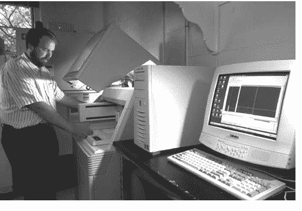

计算性物体理解的典型方法是从物体的二维（2D）轮廓中推导出形状。然而，对于复杂的物体结构，物体形状无法从轮廓的2D形状来确定。在图0.1所示的场景中，许多物体具有非传统形状，边缘之间几乎没有表面纹理，并且相对于相机平面倾斜设置。尽管结构边缘由亮度和颜色过渡很好地定义，但有些阴影必须被理解为非结构边缘，而且结构边缘必须根据其三维（3D）空间构型来编码，而不仅仅是其2D位置。在自然场景中，3D信息由立体视差、线性透视、运动视差和其他线索提供。当然，在图1的2D表示中，只有线性透视可用，而且在表面上没有线条或网格纹理的情况下，其作用相当有限。

因此，物体的3D结构需要：

- 1. 在各种边缘线索之间进行全局整合，以推导出3D空间中边缘结构的最佳估计，以及
- 2. 在无形状信息的区域中，根据稀疏深度线索进行3D插值

这些是具有挑战性的任务，涉及视觉场景的显式3D表征，但无论是计算技术还是关于视觉系统如何实现这些任务的实证研究，都尚未解决这些问题。

因此，神经或计算表征物体结构的一个基本要求是，在局部视觉线索中缺失或信息不一致的区域，填充三维物体结构的细节。生成这种三维表征是后部脑区的基本作用，但大脑中用于联合处理多个深度线索的皮层结构却鲜为人知，尤其是在多种视觉线索的联合处理方面。针对物体结构问题的计算方法往往采用低级或高级方法。低级方法从局部特征识别开始，试图通过层级收敛来构建物体表征，主要使用前馈逻辑，并对结果进行一些循环反馈调整（Marr, 1982; Grossberg, Kuhlmann, and Mingolla, 2007）。高级方法，或称贝叶斯方法，从可能的物体结构词汇开始，并在视觉阵列中寻找证据以判断可能存在哪个物体（Huang and Russell, 1998; Rue and Hurn, 1999; Moghaddam, 2001; Stormont, 2007）。这两种方法对于具有稳定2D结构（在视觉场景中平移时）的物体，比对具有完整3D结构的物体（如图1中的物体）的操作，或对于在复杂3D场景中的移动，效果要好得多。

## 表面作为视觉编码中的中等级不变量

针对3D物体结构问题，一个更有成效的方法是将分析重点放在物体结构的中等级不变量上，例如表面、对称性、刚性、纹理不变量或表面反射属性。

# X ■ 引言

这些属性中的每一个在3D姿态、视点、照度水平、雾霾对比度以及其他环境条件变化下都是不变的。在数学术语中，给定一组物体点**X**，其上有一个等价关系A ~ A′，任何函数*f*: **X** → **Y**在变换的等价类上是常数。各种计算分析已将这些不变量纳入其物体识别方案中，但中等级视觉中一个被忽视的方面是3D表面结构，它是世界中物体不可避免的属性。因此，本书的主要主题是关注物体表征的这一重要中等级不变量，既是为了确定其在人类视觉中的作用，也是为了分析表面结构作为一种计算表征在提高解码环境物体结构能力方面的潜力。

表面是我们与世界物体互动的关键属性。无论是触觉还是视觉，除了通过表面，人们很少体验物体。即使是透明物体也是通过其表面来体验的，表面之间的材料因透明而不可见。透明表面与不透明表面之间的区别在于，不透明物体只有近表面可见，而透明物体的近表面和远表面都可见。（只有半透明物体是从内部体验的，因为光线穿过它们以照亮材料的密度。然而，内部没有特征，也没有可观的形状信息。）因此，对于几乎所有物体来说，表面都占据主导地位。因此，开发一种表示我们面前大量表面的方法，是物体处理的关键阶段。

对于平面表面，诸如亮度阴影、线性透视、方形或圆形物体的纵横比以及纹理梯度等扩展线索，都可以指定平面表面的倾斜度（见*图0.2*）。Zimmerman、Legge和Cavanagh（1995）进行了实验，通过判断完整视觉场景中一个表面内嵌的一对正交线的相对长度来测量表面倾斜度的准确性。对于所有三种线索类型，倾斜度判断的准确度都在3°以内，没有证据表明向正面平面的退缩（如果图像表面污染了估计，这种退缩是预期的）。然而，对不连续表面的深度估计被强烈压缩。这些结果强调了表面重建在人类深度估计中的关键作用。

在评估表面在空间中的位置时，阿尔哈曾在他的*光学*（公元约1000年）中认为：“视觉无法感知可见物体与自身之间的距离大小，除非这些距离沿着一条

被概念化为与该点表面曲线相切的圆的曲率半径的倒数。对于在切平面中某个角度 $\theta$ 的截面：

$$\kappa_\theta = \frac{1}{r_\theta} \tag{0.1}$$

随着 $\theta$ 绕该点旋转，它描述了表面的一个曲率函数。光滑表面上的任意一点仅有一个最大曲率方向和一个最小曲率方向，且最大和最小曲率方向在切平面中总是相互正交。高斯将这些极值定义为该表面上该点的*主曲率*：

$$\kappa_1 = \max(\kappa_\theta) \quad \kappa_2 = \min(\kappa_\theta) \tag{0.2}$$

其中

$$\theta_{\kappa_2} = \theta_{\kappa_1} \pm \frac{\pi}{2}$$

每一点的主曲率都是表面的基本内在属性。这种内在的二维曲率现在被称为高斯曲率 $K$，由两个主曲率的乘积给出：

$$K = \kappa_1 \cdot \kappa_2 \tag{0.3}$$

**图 0.3** 表面曲率。在任何表面的局部点上，都存在正交的最大和最小曲率，它们的切线（虚线）定义了一个局部坐标系，表面法线（粗线）建立在该坐标系上。

如果一个表面本质上是平坦的，比如一张纸，它永远不可能被弯曲成具有内在曲率的形式，例如球面。即使将这张平坦的纸弯曲，使一个方向上的曲率为正，另一个（最小）方向上的曲率也将为零（如圆柱体）。因此，构成高斯曲率的乘积（公式 0.3）将保持为零。然而，对于球面（或任何其他凸形）上的任意一点，最大和最小曲率都具有相同的符号，因此 $K$ 在表面的所有位置都是正的。

当将高斯曲率应用于物体时，出现的一个问题是，随着物体尺寸的变化，$K$ 的值也会变化。作为形状的一种度量，这是一个不理想的属性，因为例如我们认为球体无论大小都具有相同的形状。为克服此问题，可以提出的一种方案是将局部高斯曲率 $K$ 归一化为物体表面的全局平均曲率 $\hat{H}$（见公式 0.4），以提供归一化高斯曲率 $K_{\mathrm{norm}}$ 的度量。物体仅当平均曲率 $\hat{H}>0$ 时才实际存在，因此应将其视为对归一化高斯曲率概念的一种限制（即，$\hat{H}\leq 0$ 的孤立表面片纯粹是一种数学构造，不可能是真实物体）。因此，归一化高斯曲率以相对于物体中心 $\Theta$ 的极角坐标表示，定义为

$$K_{\mathrm{norm}}(\Theta)=K(\Theta)/\hat{H},\qquad \hat{H}>0 \tag{0.4}$$

其中平均曲率 $H=(\kappa_1+\kappa_2)/2$，全局平均曲率是局部平均曲率相对于其中心在所有角度上的积分 $\hat{H}=\int H\,d\Theta$。

因此，对于所有半径的球体，$K_{\mathrm{norm}}=1$，而不是像 $K$ 那样随半径变化，从而在球坐标中形成一个映射，它用一个独立于其尺寸的函数有效地对物体的形状进行编码。局部高斯曲率与全局平均高斯曲率相匹配的区域，$K_{\mathrm{norm}}=1$；而像晶体刻面一样平坦的区域，$K_{\mathrm{norm}}=0$；在从一个刻面过渡到下一个刻面的地方则会出现高值。

另一个值得关注的形状属性是平均曲率，定义为两个主曲率的平均值。恒定平均曲率指定了一类表面，在这些表面上 $H$ 处处恒定。在极限情况下，平均曲率处处为零，即 $H=0$。这是由分子表面张力自组织原理所支配的表面表现出的趋势，例如肥皂膜。薄膜内的表面张力以肥皂泡所依附的周长所定义的方式，使表面的曲率最小化。

原则上，肥皂膜在金属丝框架上呈现的形状就是极小曲面。注意，如果 **H** = 0，则 **κ₁** = −**κ₂**，且高斯曲率乘积处处为负（或为零）。因此，极小曲面总是具有负的高斯曲率，这意味着它们在局部呈马鞍形，没有正曲率的圆形凸起或凹陷。表面张力原理会将任何净正曲率区域展平，直到平均曲率为零。

直到1967年，人们一直认为只有两种极小曲面具有 **H** = 0 的性质，即负曲率超球面和虚曲率双曲面。自那时以来，人们发现了大量的此类曲面。这些是非常有趣的曲面，具有类生物共振性，表明极小曲面原理在生物系统中被普遍采用（或近似采用）（图 0.4）。因此，简单地规定 **H** = 0 便会产生大量有趣的曲面形态，这些形态在神经处理中可能与在生物形态中一样重要。侧抑制在神经系统各个层面上的普遍运作，是一种可与表面张力相类比的最小化原理。人们通常认为它作用于某一组织（如视网膜或视觉皮层）中神经阵列的二维函数。然而，对于任何有效三维的神经连接形式，侧抑制很可能通过遵循数学极小曲面原理（或其动态表现形式）来形成神经连接的极小曲面。

针对定义域 $\Gamma(x)$ 上的1D情形，Nitzberg、Mumford 和 Shiota（1993）将此最小化问题表述为曲率 $\kappa$ 上弹性泛函的极小值：

$$E = \int_{\Gamma}(\nu + \alpha\kappa^2)\,dx, \tag{0.5}$$

其中 $\nu$ 和 $\alpha$ 是常数。

利用一组稀疏的深度线索 $\Phi$，可以定义一个函数 $f : \mathbb{R}^3 \to \mathbb{R}$，它估计到未知表面 $S$ 的带符号几何距离，然后使用轮廓提取算法来提取逼近其零集的表面函数：

$$Z(f) = \{S(\Phi) \in \mathbb{R}^3 : S(\Phi) = 0\} \tag{0.6}$$

为了使问题在计算上易于处理（并成为二维皮层片内神经表征的现实模型），我们可以提出将视觉过程早期分离的各种不同知觉线索绑定起来。

## 多种表面线索

对表面属性的研究通常聚焦于由纯立体线索所表示的表面，但物理表面几乎总是由多种视觉线索来定义。因此，重要的是将表面的多模态表示视为知觉的基本要素，将世界中反射结构的属性整合为统一的表面表示：

$$\Phi(x,y)=f(d_S(x,y),d_D(x,y),d_M(x,y),d_T(x,y)...) \qquad (0.9)$$

其中 $d_X(x,y)$ 是由每个独立距离线索（$S$，亮度明暗；$D$，双眼视差；$M$，运动视差；$T$，纹理梯度等）计算出的独立自我中心距离，$f()$ 是实际运作的线索组合规则。

该表达式表明来自这些不同模态的信息被组合成一个统一的深度知觉，但它并未指定将它们聚合起来的组合规则。对于通常提出的贝叶斯组合规则，

$$f()=\left\|\sigma_X^2/d_X\right\|_2 \qquad (0.10)$$

其中 $\sigma_X^2$ 是每个距离线索的噪声方差。

如果在每种视觉模态中分别执行表面重建（具有独立的噪声源），则表面距离估计应根据其绝对信噪比进行组合。来自各种模态（$S$、$D$、$M$、$T$、…、$X$）的信号将组合起来以改进表面距离估计；从第二个表面识别模态添加关于物体轮廓的信息绝不会降低表面重建精度。

还提出了更现实的、后贝叶斯版本的组合规则（Tyer，2004）。将区域分配给特定边界的主要规则是遮挡规则。如果一个由视差定义的结构包围了某个区域，则该区域被视为遮挡了边界外部的区域。边界被认为“拥有”包围内部的区域，因此该区域被赋予与边界相同的深度。因此，包围外部的区域更遥远，并且“属于”下一个


## 经验证据表明大脑中的表面表示

表面表示通常以亮度传播和纹理分割来讨论，但这些是通向真正表面表示的弱推断。来自感知、心理物理、神经生理和计算来源的证据正在支持表面层面的描述在大脑中运作。早期视觉处理流（Nienborg et al., 2005; Bredfeldt and Cumming, 2006; Samonds, Potetz, and Lee, 2009）中已报告表面特异性神经编码，随后这种特征也被发现是大脑皮层中空间表示的时间叶和顶叶流的特征。在时间叶流中，对立体表面方向敏感的神经元在视觉区域 V4（Hinkle and Connor, 2002）以及中间时区（MT）（Nguyenkim and DeAngelis, 2003）和中上时区（MST）（Sugihara et al., 2002）中被报道。更深入的时间叶中，上丛沟的外侧银质区的许多神经元对立体表面的复杂形状具有选择性（Sakata et al., 1999; Janssen et al., 2001; Tanaka et al., 2001; Liu, Vogels, and Orban, 2004）。此外，Joly, Vanduffel, and Orban.（2009）观察到在猴脑中枢下颞叶皮层的一个小区域——外侧时区（Tes），该区域包含高度选择性的立体差异神经元，表现出对立体差异的深度结构敏感性。即使在额叶，在腹侧前运动皮层中，面积 F5a（F5 最前方的部分）也表现出对立体差异的深度结构敏感性，同时也观察到 2D 形状敏感性，这表明该区域处理完整的 3D 形状，可能反映了规范神经元的活动。

同样，顶叶的多个区域参与表面形状的编码。在猴脑中，顶叶后内侧裂的外围区域的大量神经元对三维立体表面方向具有选择性（Shikata et al., 1996; Taira et al., 2000; Tsutsui et al., 2001, 2002）。这些大量研究表明，多模态表面表示是大脑层级中腹侧和背侧处理流的重要组成部分。此外，Durand et al.（2007）利用功能磁共振成像（fMRI）在猴脑中显示，虽然多个内顶叶区域（腹侧、侧面和前内顶叶区域 CIP、LIP、AIP 在侧面；后内侧和内侧 IP 区域 PIP 和 MIP 在内侧）对立体刺激有反应，但 AIP 及其相邻的 LIP 部分对小物体的立体表面形状敏感。有趣的是，与猴脑中腹侧下颞叶皮层已知的 3D 形状表征不同，AIP 的神经表征似乎强调用于抓握运动规划所需的物体参数（Srivastava et al., 2009）。这一解释为理解背侧和腹侧流中表面形状的双重编码提供了基础。

在人类皮层中，Tyler et al.（2006）专注于后部皮层，发现侧后复合体（LOC）的一个背侧区域专门用于编码立体和动态深度线索所代表的表面结构。他们认为该区域是编码视觉物体的通用表面结构的第一层。沿着内侧裂（IPS）延伸，Durand et al.（2009）确定了视网膜区域 V7 对深度位置和通用深度结构都有混合敏感性，而 IPS 的背侧中部（DIPSM）和背侧前部（DIPSA）区域对深度结构敏感，而不敏感于深度位置。这三个区域也对 2D 形状敏感，表明它们携带完整的 3D 形状信息。同样，Georgieva et al.（2009）报告了五个 IPS 区域、背侧 LOC、后下侧外侧皮层（ITG）以及腹侧前运动皮层的参与，这些区域共同参与从世界物体的深度表面结构中提取和处理 3D 形状。

## 结论

本综述强调空间视觉被视为一种主动的物体表示过程，其中自组织的神经表示网络可以通过局部深度线索阵列形成对所观察的物理世界中物体结构的整合表面表示。该描述与在顶叶-后部皮层的神经网络中实现的方式相容，而非仅仅是抽象的认知架构。这一概念化识别了一个超越局部轮廓或场域中位移探测器的原子概念的主动神经编码过程，能够解释我们对当前视野中表面结构的视觉体验的某些动态过程。一旦 3D 表面结构被编码，场景中的元素可以被分割成我们所熟知的“物体”功能单元。

本书的贡献从计算和神经实现的角度，发展了表面表示问题的所有层次的先进理论和实证方法。这些前沿贡献涵盖了从表面估计的基本地面问题，到中层表面分割过程的分析，再到复杂黎曼空间方法的表面表示和评估。总之，它们代表了一种针对视觉场景中物体结构及其相互关系的棘手问题的根本新方法，并有望在计算解析场景信息的能力以及我们对大脑神经电路中如何编码此类信息方面取得决定性进展。

## 致谢

将认知科学与计算视觉方法相结合以实现 3D 表面重建的思想源自由 Christopher Tyler 和 Jun Zhang 开发的工作坊，并得到美国空军科学研究办公室的支持。部分在 Ch 0、1、3、7、9（Christopher Tyler、Tai-Sing Lee、David Gu、Alessandro Sarti 和 Lora Likova）的作者部分得到了 AFOSR 赠款 #FA9550-09-0678 给 Christopher Tyler 的支持。

## 贡献者

**Yiannis Aloimonos**  
计算机科学系  
马里兰大学  
学院公园，马里兰州

**Giovanna Citti**  
数学系  
博洛尼亚大学  
意大利博洛尼亚

**James Coughlan**  
斯密-凯特韦尔眼科  
&nbsp;&nbsp;&nbsp;&nbsp;研究所  
旧金山，加利福尼亚州

**Patrick Garrigan**  
心理学系  
圣若瑟大学  
费城，宾夕法尼亚州

**David Xianfeng Gu**  
计算机科学系  
纽约州立大学石溪分校  
石溪市，纽约州

**Volodymyr V. Ivanchenko**  
斯密-凯特韦尔眼科  
&nbsp;&nbsp;&nbsp;&nbsp;研究所  
旧金山，加利福尼亚州

**Philip J. Kellman**  
心理学系  
加州大学洛杉矶分校  
洛杉矶，加利福尼亚州

**Tai Sing Lee**  
计算机科学系  
神经认知基础中心  
卡内基梅隆大学  
匹兹堡，宾夕法尼亚州

**Yunfeng Li**  
心理学系  
&nbsp;&nbsp;&nbsp;&nbsp;科学  
普渡大学  
威斯康星州韦斯特拉法叶

**Lora T. Likova**  
斯密-凯特韦尔脑电成像  
&nbsp;&nbsp;&nbsp;&nbsp;中心  
斯密-凯特韦尔眼科  
&nbsp;&nbsp;&nbsp;&nbsp;研究所  
旧金山，加利福尼亚州

**Feng Luo**  
数学系  
Rutgers 大学  
新布朗茅斯，新泽西州


## 场景统计与 3D
### 表面感知

Brian Potetz  
Tai Sing Lee  

### 目录

- 1.1 介绍 .................................................................................... 1
- 1.2 亮度与深度之间的相关性 .................................................... 2
- 1.3 表征自然 3D 场景的线性统计特征 ........................................ 8
- 1.4 影响深度推断的意义 .......................................................... 13
- 1.5 深度推断的统计推断 .......................................................... 16
- 1.6 结论与未来方向 .................................................................. 22
- 致谢 .......................................................................................... 23

## 1.1 介绍

从单张图像中推断深度信息通常通过构建基于光的相互作用物理模型，然后将这些模型反向求解以获取深度。一旦反向，这些模型高度欠定，需要许多假设，例如漫反射表面、表面平滑、均匀的反射率或无投射阴影。我们对这些假设在真实场景中的相对优劣知之甚少。对真实场景中图像与其三维（3D）结构的联合分布的统计理解，将使我们能够用基于真实场景的概率先验取代这些假设和简化。此外，统计研究可能会发现物理模型中并不明显的全新信息来源。真实场景受到环境中许多规律的影响，例如物体的自然几何形状、物体在空间中的排列方式、自然光的分布规律以及观察者位置的规律性。尽管计算机视觉中用于 3D 形状推断的当前算法很少利用这些趋势，但统计模型的潜在有用性以及统计方法在视觉中的日益成功表明，研究图像与深度图之间的统计关系是有价值的。自然界中已有研究发现了有意义且可利用的统计趋势，这些趋势可用于设计新的表面推断算法，也可帮助理解人类如何在真实场景中感知深度（Howe 和 Purves, 2002；Potetz 和 Lee, 2003；Torralba 和 Oliva, 2002）。本章我们将介绍我们在研究 3D 场景结构与二维（2D）图像之间的统计关系所得出的部分结果，并讨论其对理解人类 3D 表面感知及其背后的计算原理的意义。

## 1.2 亮度与深度之间的相关性

为了理解自然场景中使我们能够从 2D 图像推断 3D 结构的统计规律，我们进行了研究，以调查深度与光在自然场景中的相关结构。我们收集了超过 100 个城市和农村场景的核配准强度和高分辨率范围图像数据库（对应像素在空间中对应同一点）。这些扫描使用 Riegl LMS-Z360 激光范围扫描仪进行。Z360 利用集成的 CCD 传感器和带有旋转镜的飞行时间激光扫描仪，收集核配准的范围和彩色数据。该扫描仪的最大测量范围为 200 米，深度精度为 12 毫米。然而，对于数据库中的每个场景，我们对多次扫描进行了平均，以获得小于 6 毫米的精度。原始范围测量以米为单位。所有扫描均在球坐标系下进行。我们在各种农村和城市场景中进行了扫描。所有图像均在户外、晴朗天气下拍摄，扫描仪与地面平行。典型的空间分辨率约为每度 20 像素。

为了开始理解 3D 形状与 2D 外观之间的统计趋势，我们首先通过研究 3D 场景内的简单线性相关性来进行统计调查。我们分析了对应的强度和范围补丁，计算了特定像素（在强度图像或范围补丁中）与该补丁中其他像素之间的相关性，使用以下公式：

$$\rho = \operatorname{cor}[X,Y] = \frac{\operatorname{cov}[X,Y]}{\sqrt{\operatorname{var}[X]\operatorname{var}[Y]}}$$  (1.1)

补丁大小为 25 × 25 像素，略大于每个维度约 1 度的视觉角度，在计算协方差时，我们对强度补丁和范围补丁分别减去了它们在所有补丁中的对应均值。

其中一个导致图像间差异的重要变异来源是光源的照射强度。光照强度的差异会导致每个图像补丁对比度的变化，这相当于乘以一个常数。为了计算对光照强度不变的统计量，以往关于自然图像统计（不包含范围数据）的研究（Field, 1994；van Hateren 和 van der Schaaf, 1998）集中在光强度值的对数，而不是强度本身。零和线性滤波器因此对比度的变化不敏感。同样，我们也对范围数据取对数。正如 Huang 等人（2000）所解释，同一形状的大对象和小对象在视觉上会因大对象位于适当远距离、小对象位于近距离而显得相同。然而，大对象的原始范围测量会因乘数因子与小对象的测量不同。在对数范围数据中，两者相差一个加法常数。因此，零和线性滤波器对这两个对象的响应会完全相同。

图 1.1 展示了三个示例相关性图。图 1.1a 展示了中心像素（13,13）的强度与强度补丁中所有像素的相关性。图 1.1b 展示了中心像素（13,13）的范围与范围补丁中所有像素的相关性。我们观察到，相邻的范围像素之间的相关性远高于相邻的亮度像素。这表明，范围数据的低频分量包含的能量远高于亮度图像，且范围图像的空间频谱衰减速度快于亮度图像，后者的空间频谱幅度大约为 $\frac{1}{f}$（Ruderman 和 Bialek, 1994）。这一发现是合理的，因为导致范围图像高频变化的因素（如闭合轮廓或表面纹理）通常也会导致亮度图像的变化。然而，


在亮度图像中发现的大部分高频变化，例如阴影和表面标记，在距离图像中却观察不到。这些相关性与自然图像和自然距离图像所特有的相对平滑程度有关。具体来说，自然距离图像在某种意义上比自然图像更平滑。精确建模自然图像和距离图像的这些统计特性，对于稳健的计算机视觉算法以及一般的感知推断至关重要。特别是平滑属性，在现代计算机视觉技术中无处不在，例如图像去噪和修复（Roth and Black, 2005）、基于图像的渲染（Woodford et al., 2006）、立体视觉恢复形状（Scharstein and Szeliski, 2002）、明暗恢复形状（Potetz, 2007）等。

图1.1c显示了像素(13,13)的强度与该距离图像块内各像素之间的相关性。这里有两个重要效应。第一个是相关图中存在一个总体上的垂直倾斜，表明在图像块内位置较低的像素处，亮度值与深度呈更强的负相关。这一结果是因为我们数据库中的场景是从上方照明的。因此，朝上的表面通常比朝下的表面更亮；反过来说，较亮的表面比暗表面更可能朝上。因此，当某个给定像素较亮时，其到该像素的距离通常小于到图像内略低位置像素的距离。这就解释了像素(13,13)的强度与距离图像块内较低位置像素的深度之间越来越强的负相关。

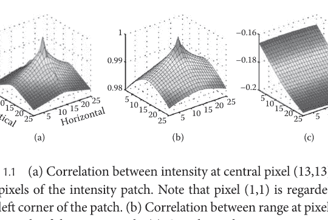

在图1.1c中，更令人惊讶的是深度与强度之间的相关性显著为负。具体来说，在给定像素处，强度与深度的相关系数约为−0.20。换句话说，较亮的像素往往更接近观察者。从历史上看，基于物理的明暗恢复形状方法通常认为明暗线索仅能提供相对的深度信息。我们的发现表明，图像强度数据中还存在着一种绝对深度线索，可以帮助从二维图像更准确地推断深度。

关于自然三维场景的这一实证发现，可能与一种类似的心理物理学观察有关：在其他条件相同的情况下，较亮的刺激会被感知为更接近观察者。这种心理物理现象可追溯到列奥纳多·达·芬奇，他曾说：“在大小和距离相同的物体中，看起来更明亮者，会被眼睛感知为更近”（MacCurdy, 1938）。因此，我们将这一实证相关性称为_达·芬奇相关性_。艺术家们有时会利用这一线索来创造令人信服的深度错觉（Sheffield et al., 2000; Wallschlaeger and Busic–Snyder, 1992）。

上个世纪，心理物理学家通过严谨的受控实验验证了达·芬奇的观察（Ashley, 1898; Carr, 1935; Coules, 1955; Farne, 1977; Langer and Bülthoff, 1999; Surdick et al., 1997; Taylor and Sumner, 1945; Tyler, 1998; Wright and Ledgeway, 2004）。在心理学文献中，这种效应被称为_相对亮度_（Myers, 1995）。人们提出了许多可能的解释来说明这种感知偏差为何存在。一种常见的解释是，来自远处物体的光更容易被大气吸收（Cutting and Vishton, 1995）。然而，在大多数条件下，例如在室外阳光场景中，大气倾向于将太阳光直接散射到我们眼中，因此在有雾霾的条件下，较远的物体反而显得更亮（Nayar and Narasimhan, 1999）。此外，我们的数据库是在晴朗无云的条件下获取的，且距离不足以引发大气效应（最大距离约为200米）。还有人提出了纯心理学性质的其他解释（Taylor and Sumner, 1945）。尽管这些可能是导致我们感知偏差的因素，但它们无法解释对真实场景的实证观察。

通过考察哪些图像最强烈地表现出达·芬奇相关性，我们得出结论：这种相关性的主要原因来自环境中的阴影效应（Potetz and Lee, 2003）。例如，在接近度与亮度之间相关性非常强的一类图像是树木和茂密树叶的图像。由于照明光源来自上方且不受树木遮挡，树木或灌木最外层的叶子通常受到最多的光照。越往树深处，树叶越有可能被邻近的叶子遮挡，因此较近的像素往往更亮。同样的效应也可能在任何具有复杂表面凹面和内部结构的场景中引起接近度与亮度之间的相关性。因为光源通常位于这些凹面的外部，所以凹面的内部往往处于阴影中，比物体外部更暗。同时，这些凹面比物体外部离观察者更远。成堆的物体（如图1.2所示）以及衣物和织物的褶皱都是这一现象的其他典型例子。

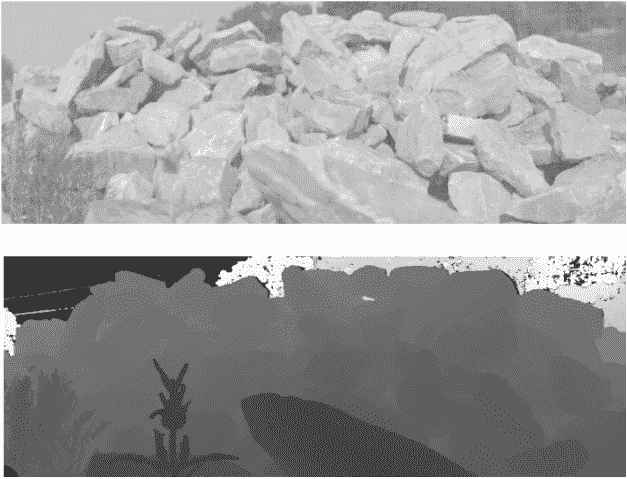

**图1.2** *(参见第94页后的彩色插页)* 我们数据库中的一个示例彩色图像（上）和距离图像（下）。为了说明，距离图像通过将深度显示为灰度深浅来展示。请注意，彩色图像中的暗区域往往位于阴影中，而阴影区域比石堆明亮照明的外表面更可能位于稍微远离观察者的位置。我们数据库中的这张示例图在接近度与亮度之间具有特别强的相关性。

为了检验我们的假设，我们将数据库划分为城市场景（如建筑立面和雕像）和乡村场景（树木和岩石地形）。

城市场景主要包含光滑的人造表面，凹面或裂缝较少，因此我们预测这些图像的接近度与亮度相关性会降低。另一方面，如果原始数据集中发现的相关性是由大气效应引起的，我们预计这种相关性在乡村和城市场景中会同样存在。城市数据库中的平均深度（32米）与乡村数据库（40米）相似，因此大气效应在这两个数据集中应该相近。我们发现，乡村数据集计算出的相关性增强到−0.32，而城市数据集的相关性则明显较弱，约为−0.06。

在Langer和Zucker（1994）的研究中，观察到对于恒定反照率的连续朗伯表面，在半球形漫射光照明下并从上方观察时，较亮像素更接近观察者的趋势可以通过场景渲染方程预测出来。直观地说，原因是：在漫射照明条件下，表面最亮的区域是那些最暴露于天空的区域。当从上方观察时，表面的峰值更靠近观察者。尽管这些理论结果尚未推广到更一般的环境，但我们的结果表明，在自然场景中这些趋势仍然存在，即使场景是从侧面观察、在来自单一方向的强光下，甚至当照明方向相对于观察者是倾斜的时候也是如此。尽管存在这些差异，这两种现象似乎都与一个观察有关：凹区域更有可能处于阴影中。我们所有图像都是在无云、晴朗的条件下，并带有来自上方的倾斜照明拍摄的，这一事实表明，这一线索可能比最初认识到的更重要。

有趣的是，自然场景中接近度与亮度之间的相关性依赖于图像形成的几个复杂特性。必须存在具有裂缝和凹面的复杂三维表面，并且必须存在投射阴影来填充这些凹面。此外，我们预计，如果没有漫射照明和光线多次反射（光线在到达眼睛之前经过多个表面反射），单点光源的强烈照明会大大减弱这种效应（Langer and Zucker, 1994）。投射阴影、复杂三维表面、漫射照明和光线多次反射都是图像形成现象，而试图反演图像形成物理模型的深度推断方法通常会忽略这些现象。这些现象所需的数学计算过于繁琐，难以反演。然而，综合起来看，这些图像形成行为最终产生了最简单的


可能的形状与外观之间的关系——近距离与亮度之间的绝对相关性。这一发现说明了继续探索自然三维场景统计规律的必要性。

## 1.3 表征自然三维场景的线性统计特征

在前一节中，我们解释了像素强度与近距离之间的相关性。我们现在将分析扩展，包括像素强度与其他像素近距离之间的相关性。所有这些相关性的集合构成了深度与强度之间的交叉相关。交叉相关是一个重要的统计工具：如我们稍后所解释，如果知道特定图像及其范围图像之间的完整交叉相关，那么给定图像后，我们可以使用简单的线性回归技术完美推断三维形状。虽然从单张图像中完全估计交叉相关是不可能的，但我们展示了单个场景的这种相关结构遵循几种稳健的统计规律。这些规律使我们能够仅用三个参数来近似一个场景的完整交叉相关，而这三个参数即使在形状和强度信息非常稀疏的情况下也可以测量。通过这种方式近似交叉相关，我们可以实现一种全新的统计驱动的深度推断方式，可与其他深度线索（如立体视觉）一起使用。

给定一个图像 $i(x,y)$ 及其范围图像 $z(x,y)$，该特定场景的交叉相关由

$$(i \star z)(\Delta x, \Delta y) = \iint i(x,y)z(x+\Delta x,y+\Delta y)\,dx\,dy \tag{1.2}$$

将其视为在傅里叶域内的交叉相关是有帮助的。如果我们用 $I(u,v)$ 和 $Z(u,v)$ 表示 $i(x,y)$ 和 $z(x,y)$ 的傅里叶变换，则 $i \star z$ 的傅里叶变换为 $Z(u,v)I^*(u,v)$。$ZI^*$ 称为 $i$ 与 $z$ 的交叉谱。请注意，$ZI^*$ 包含实部和虚部。此外，本节中未对强度或范围数据（以米为单位）应用对数或其他任何变换。这使我们能够在兰伯特（Lambertian）模型假设的框架下评估 $ZI^*$，如我们稍后所示。

如果已知给定图像的交叉谱，并且该谱远离零，那么可以通过线性回归估计三维形状：$Z = I(ZI^*/II^*)$。本节展示，仅用三个参数，就可以构建 $ZI^*$ 的良好近似。粗略地说，这三个参数是：场景中近距离/亮度相关性的强度、平坦阴影表面在场景中出现的频率，以及场景中主导光照方向。该模型可用于改善各种情况下的深度推断。

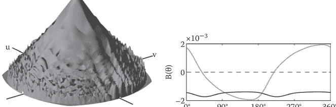

图 1.3 (a) 我们数据库中一场景的 $| \text{real}[ZI^*(r,\theta)] |$ 的对数-对数极坐标图。(b) 同一场景的 $B(\theta)$。$\text{real}[B_K(\theta)]$ 用黑色绘制，$\text{imag}[B_K(\theta)]$ 用灰色绘制。该图是我们数据库中大多数场景的典型表现。如方程 1.5 所预测，$\text{imag}[B_K(\theta)]$ 在光照方向（在此例中，极左侧，接近 180°）处取得最小值。此外，$\text{real}[B_K(\theta)]$ 通常是均匀负的，这很可能是由物体凹陷处的投影阴影引起的。（Potetz and Lee, 2006.）

图 1.3a 展示了我们数据库中一张图像的 $| \text{real}[ZI^*(r,\theta)] |$ 的对数-对数极坐标图。这个交叉谱的整体形状看起来非常接近功率定律。具体来说，我们发现 $ZI^*$ 可以用 $B(\theta)/r^\alpha$ 合理建模，其中 $r$ 是极坐标中的空间频率，$B(\theta)$ 是仅依赖于极角 $\theta$ 的函数，实部和虚部各有一条曲线。我们通过将傅里叶平面分为四个 45° 扇区（垂直、前向对角线、水平、后向对角线），分别测量每个扇区内的下降率，然后对每个扇区的方向进行平均并拟合为功率定律。所有扇区的 $\alpha$ 值（平均超过 28 张图像）列于表 1.1。

| 方向 | II\* | Real[ZI\*] | Imag[ZI\*] | ZZ\* |
|---|---:|---:|---:|---:|
| 水平 | 2.47 ± 0.10 | 3.61 ± 0.18 | 3.84 ± 0.19 | 2.84 ± 0.11 |
| 前向对角线 | 2.61 ± 0.11 | 3.67 ± 0.17 | 3.95 ± 0.17 | 2.92 ± 0.11 |
| 垂直 | 2.76 ± 0.11 | 3.62 ± 0.15 | 3.61 ± 0.24 | 2.89 ± 0.11 |
| 后向对角线 | 2.56 ± 0.09 | 3.69 ± 0.17 | 3.84 ± 0.23 | 2.86 ± 0.10 |
| 平均 | 2.60 ± 0.10 | 3.65 ± 0.14 | 3.87 ± 0.16 | 2.88 ± 0.10 |

对于每个扇区，功率定律拟合与实际谱之间的相关系数范围从 0.91 到 0.99，表明每个扇区都很好地符合功率定律。（注意，对方向取平均会平滑掉谱中的一些细微结构。）此外，$\alpha$ 在不同方向上变化不大，说明我们的模型对 $ZI^*$ 有很好的拟合。

请注意，表中还显示图像功率谱 $I(u,v)I^*(u,v)$ 也遵循功率定律。自然图像功率谱遵循功率定律这一观察是自然图像最强健和最重要的统计趋势之一（Ruderman and Bialek, 1994），其根源在于自然图像的尺度不变性。具体来说，一个被放大的图像，如 $i(\sigma x, \sigma y)$，在统计性质上与未放大的图像相似。这一统计特性预测 $II^*(r,\theta) \approx 1/r^2$。$II^*$ 的功率定律结构在图像处理和计算机视觉中证明了极高的用途，促成了图像压缩、图像去噪以及多项其他应用的进展。同样，发现 $ZI^*$ 也遵循功率定律，可能对三维形状推断产生非常有用的意义。

如前所述，如果知道图像/范围图像对的完整协方差结构，就可以通过线性回归利用方程 $Z = I(ZI^*/II^*)$ 来重建范围图像。因此，我们特别关注估计回归核 $K = ZI^*/II^*$。只要 $II^*(u,v) \neq 0$，则 $IK$ 是原始范围图像的完美重建。表 1.1 中的发现预测 $K$ 也遵循功率定律。通过从 $\alpha_{\mathrm{real}[ZI^*]}$ 和 $\alpha_{\mathrm{imag}[ZI^*]}$ 中减去 $\alpha_{II^*}$，我们发现 $\mathrm{real}[K]$ 在 $1/r^{1.1}$ 处下降，而 $\mathrm{imag}[K]$ 在 $1/r^{1.2}$ 处下降。因此，我们有 $K(r,\theta) \approx B_K(\theta)/r$。

现在我们知道 $K$ 可以大致近似为 $1/r$ 的功率定律，我们可以对其为何倾向于这种形式提供一些洞察。请注意，$K$ 的 $1/r$ 下降不能由尺度不变性预测。如果图像和范围图像在一起表现出规模不变性，那么 $II^*$ 和 $ZI^*$ 都会遵循 $1/r^2$ 的功率定律，而 $K$ 的幅度将大致保持均匀。因此，尽管自然图像看起来具有统计尺度不变性，但 $K \approx B_K(\theta)/r$ 的发现表明自然场景（即图像与范围图像结合在一起）不具有尺度不变性。

$K$ 的虚部 $1/r$ 下降可以通过线性兰伯特（Lambertian）阴影模型解释，该模型假设斜向光照条件。回顾，兰伯特阴影模型预测像素强度由

$$i(x,y) \propto \vec{n}(x,y) \cdot \vec{L} \tag{1.3}$$

其中 $\vec{n}(x,y)$ 是点 $(x,y)$ 处的单位表面法向量，$\vec{L}$ 是单位光照方向。线性兰伯特模型是通过取兰伯特反射方程的泰勒展开式的线性项得到的。在假设恒定的色度和光照条件，且光照来自上方的情况下，则 $i(x,y)=a\,\partial z/\partial y$，其中 $a$ 是某个常数。在傅里叶域中，$I(u,v)=a2\pi jvZ(u,v)$，其中 $j=\sqrt{-1}$。因此，我们有

$$ZI^*(r,\theta)=-\frac{j}{a2\pi r\sin(\theta)}\,II^*(r,\theta) \tag{1.4}$$

$$K(r,\theta)=-j\frac{1}{r}\frac{1}{a2\pi\sin(\theta)} \tag{1.5}$$

因此，兰伯特阴影模型预测 $\mathrm{imag}[ZI^*]$ 应遵循功率定律，其指数 $\alpha_{\mathrm{imag}[ZI^*]}$ 应比 $\alpha_{II^*}$ 大一，这与表 1.1 中的实验结果一致。

方程 (1.4) 预测，只有 $ZI^*$ 的虚部应遵循功率定律，而 $ZI^*$ 的实部应为零。然而，在我们的数据库中，实部通常比虚部更强。实部的傅里叶变换对应于交叉相关函数的偶对称部分，它包含直接相关 $\operatorname{cov}[i,z]$，即前文提到的达·芬奇（da Vinci）相关——即强度像素与范围像素之间的相关。$\mathrm{real}[ZI^*]$ 与达·芬奇相关在空间上的下降率相关。一个解释 $ \mathrm{real}[ZI^*]$ 以 $1/r^3$ 下降速率的观察是：更深的凹陷和凹槽应该更加阴影，因此更暗。具体来说，$ \mathrm{real}[ZI^*]$ 的 $1/r^2$ 下降预测，近距离与亮度之间的相关性应与其测量的视角宽度成反比。这符合我们的直觉：如果两个深度相同的表面凹陷具有相同的深度，那么视角较窄的那个应该更暗。

图 1.4 展示了 $B_K$ 在城市和农村场景中的示例。这些图表明，农村场景中蕴含大量凹槽和阴影时，实部的 $B_K$ 最强（最负）。这些图还说明了


**FIGURE 1.4** 自然场景和城市场景及其 $B_K(\theta)$。表面有凹陷和投影阴影的图像，$real[B(\theta)]$（黑线）有显著负值，而具有显著平坦阴影表面的图像，$imag[B(\theta)]$（灰线）较强。

$K$ 的虚部遵循方程 (1.5)，$\operatorname{imag}[B_K(\theta)]$ 紧随一个正弦曲线，其相位由主导照明角度决定。因此，$B_K$（以及 $K$ 和 $Zf^*$）可以仅用三个参数来近似：da Vinci 相关性的强度（与场景中复杂三维表面和阴影的程度相关）、主导光照方向的角度，以及场景中 Lambertian 关系的强度（即方程 (1.5) 中的系数 $1/\alpha$，与场景中平滑的 Lambertian 表面的显著性相关）。我们可以利用此近似方法改进深度推断。

## 1.4 对深度推断的意义

掌握自然场景统计特征后，我们更有信心开发出成功的深度推断算法。一个例子是范围图像超分辨率。通常，我们可能拥有场景的高分辨率彩色图像，但只有低分辨率的范围图像（范围图像记录相机与场景中每个像素之间的 3D 距离）。这常发生在我们的范围图像是通过立体深度推断算法获得的。立体算法依赖于平滑性约束，无论是显式的还是隐式的，导致生成的范围图像的高频组成部分不可靠（Cryer et al., 1995; Scharstein and Szeliski, 2002）。激光测距仪是另一种常见的低分辨率范围数据来源。激光测距仪通常按像素顺序获取每个像素，高分辨率扫描可能需要几分钟。这些慢速的扫描时间在实际应用中可能不切实际，因此在许多情况下，只有稀疏的范围数据可用。在其他情况下，使用低成本的扫描仪，它们只能捕获稀疏的深度值。

利用高分辨率的亮度（或彩色）图像中的单眼线索，有望改进对范围图像高空间频率的估计。一项最近的研究提出了一种称为“形状配方”（shape recipes）的方法来解决此问题（Freeman and Torralba, 2003; Torralba and Freeman, 2003）。形状配方的基本原理是，形状与外观之间的关系可以从低分辨率的图像对中学习，然后对高分辨率的亮度图像进行外推并应用，从而推断范围图像的高空间频率。该方法的一个优势是，单眼推断中隐含的重要变量，如照明方向和材料反射特性，可能已隐含地从低分辨率的范围图像和亮度图像中学习到。

从我们的统计研究中，我们发现 $K = ZI^*/II^*$ 中的细节在不同尺度之间并不推广，正如形状配方所假设的那样。然而，$K$ 的粗糙结构大致遵循 $1/r$ 的幂律。我们可以直接利用这一统计趋势。我们可以简单地使用低分辨率的范围图像估计 $B_K(\theta)$，利用 $1/r$ 幂律将 $K \approx B_K(\theta)/r$ 外推到更高的空间频率，然后使用该 $K$ 的估计来重建高频范围数据。具体而言，从低分辨率的范围图像和亮度图像中计算 $ZI^*$ 和 $II^*$ 的低分辨率谱。从低分辨率图像的最高频次八分之一中，我们估计 $B_{II}(\theta)$ 和 $B_{ZI}(\theta)$。任何标准的插值方法均可用于估计这些函数。我们选择基于可变滤波器（Adelson and Freeman, 1991）的 $cos^3(\theta + \pi\phi/4)$ 基函数。现在，我们可以估计范围图像 $z$ 的高空间频率。其中 $F_{low}$ 是低通滤波器，用于滤除 $z$ 中高空间频率部分，这些部分的深度信息要么不可靠，要么缺失。

基于上述统计趋势和对 da Vinci 相关性的分析，本文提出的模型避免了原始形状配方模型中的一些错误假设，因此相较于 Freeman 和 Torralba（2003）的原始方法，本方法在以下两方面实现了改进，同时使用的参数要少得多。图 1.5 展示了本算法的输出示例。

本文所述的幂律方法可以被视为一种统计上知情的、对已知的 _linear shape from shading_（线性形状从阴影）算法的推广（Pentland, 1990），该算法因其高效性而仍然流行。线性形状从阴影试图仅凭方程 (1.5) 从单张图像中重建三维线索，忽略了阴影信息和 da Vinci 相关性。如前所述，da Vinci 相关性是投射阴影、复杂三维表面、漫反射光以及光照相互反射的乘积。这四种图像形成现象在确定性图像形成模型中极其难以求解，因此大多数以往的深度推断算法都忽略了它们。然而，这四者共同产生了一个简单的统计关系，可以通过高效的线性算法（如方程 1.7）加以利用。正是通过对自然范围图像和强度图像的统计研究，才使这些统计线索的强度变得清晰。

本文所述的幂律算法为通过将其结果与线性形状从阴影技术（Pentland, 1990）进行比较，提供了测试 da Vinci 阴影线索有效性的新机会。当我们让算法仅使用阴影信息（将 $K_{powerlaw}(r, \theta)$ 的实部设为零）时，算法的有效性下降至原性能的 27%。当仅使用阴影信息（将 $K_{powerlaw}(r, \theta)$ 的虚部设为零）时，算法仍保留了原性能的 72%（Potetz and Lee, 2006）。因此，在自然场景中，线性阴影线索的效果显著优于线性阴影线索。这些结果表明，阴影线索的作用远比之前预期的更为重要。这是一个重要的实证观察，因为从阴影进行形状推断的研究在计算机视觉领域中受到的关注远少于从阴影进行形状推断。这一发现凸显了阴影线索的重要性以及对自然场景进行统计研究的好处。

正如前文对 da Vinci 相关性的分析所预测的那样，阴影与阴影线索的相对性能强烈依赖于所考虑图像的类别。在植被场景中，阴影线索负责了 96% 的算法性能；在岩石地形场景中，阴影线索负责了 76% 的性能；而在城市场景中，阴影线索仅负责了 35% 的性能。

## 1.5 统计推断在深度推断中的应用

上述方法展示了仅使用二阶线性统计量所能达到的局限性。研究这些简单模型很重要，因为它们有助于我们理解形状与外观之间的统计关系。然而，简单的线性系统只能捕获完整统计推断框架所能实现的一小部分。从图像中推断三维形状既复杂又高度不足约束：对于任何给定的二维图像，都有无数种可能的三维场景解释。我们的目标是找到那些更可能的解。强大的统计方法将是实现这些目标的必要条件。本节讨论了现代统计推断技术在从图像中推断三维形状中的应用。

近年来，计算机视觉领域取得了巨大的进展，特别是利用大联合概率分布的图形模型（Fei-Fei and Perona, 2005; Freeman et al., 2000; Sun et al., 2003; Tang et al., 2005; Torralba et al., 2003; Zhu and Tu, 2002）。图形模型为将丰富的自然场景统计线索直接纳入深度推断问题提供了强大的框架。从图像 $I$ 推断形状（深度）$Z$ 的贝叶斯推断涉及估计后验分布 $P(Z \mid I)$ 的性质。然而，后验分布 $P(Z \mid I)$ 的维度过于巨大，无法直接建模。一个与视觉相关的重要观察是，变量之间的依赖性通常是局部的。这使得联合分布可以分解为若干“潜在函数”的乘积，每个函数的维度低于原始分布（如图 1.6 所示）。换言之，

$$P(I,Z) \propto \prod_a \phi_a(\vec{x}_a) \tag{1.8}$$

其中 $\vec{x}_a$ 是 $I$ 和 $Z$ 中的一些变量子集。这种分解定义了一个称为“因子图”的图形模型：一个双部分图，包含一个节点集合（对应每个随机变量），以及另一集合节点（对应每个潜在函数）。


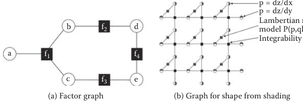

**FIGURE 1.6** (a) 一个示例因子图。该图表示一个包含五个随机变量的联合概率分布的因子化：$P(a,b,c,d,e) \propto f_1(a,b,c)f_2(b,d)f_3(c,e)f_4(d,e)$。 (b) 一个用于利用线性约束节点求解经典兰伯特(Lambertian)形状从光照问题的因子图。该三维（3D）形状的表示是两倍过完备的，包括每个像素的 $p$ 和 $q$ 斜率值。黑色方块表示线性约束节点，它们强制解的可整合性（integrability）。灰色方块表示编码反射函数的因子节点。

multivariate distribution) and a set of factor nodes (one for each potential function). Each factor node is connected to each variable referenced by its corresponding potential function. (See Figure 1.6 for an example, or reference (Frey, 1998) for a review of factor graphs.) Factor graphs that satisfy certain constraints can be expressed as Bayes networks, or for other constraints, as Markov random fields (MRFs). Thus, these approaches are intimately connected and are equivalent in terms of neural plausibility.

Exact inference on factor graphs is possible only for a small subclass of problems. In most cases, approximate methods must be used. There are a variety of existing approaches to approximate the mode of the posterior distribution (MAP, or maximum *a posteriori*) or its mean (MMSE, or minimum mean-squared error), such as Markov chain Monte Carlo (MCMC) sampling, graph cuts, and belief propagation. In this section, we explore the use of the belief propagation algorithm. Belief propagation is advantageous in that it imposes fewer restrictions on the potential functions than graph cuts (Kolmogorov and Zabih, 2001) and is faster than MCMC. Belief propagation is also interesting in that it is highly neurally plausible (Lee and Mumford, 2003; Rao, 2004) and has been advanced as a possible model for statistical inference in the brain (Pearl, 1988).

Belief propagation has been applied successfully to a wide variety of computer vision problems (Freeman et al., 2000; Potetz, 2007; Sun et al., 2003; Tang et al., 2005) and has shown impressive empirical results on a number of other problems (Frey and Dueck, 2007; Kschischang and Frey, 1998). Initially, the reasons behind the success of belief propagation were only understood for those cases where the underlying graphical model did not contain loops. The many empirical successes on graphical models that did contain loops were largely unexplained. However, recent discoveries have provided a solid theoretical justification for “loopy” belief propagation by showing that when belief propagation converges, it computes a minimum of a measure used in statistical physics known as the Bethe free energy (Yedidia et al., 2000). The Bethe free energy is based on a principled approximation of the KL-divergence between a graphical model and a set of marginals and has been instrumental in studying the behaviors of large systems of interacting particles, such as spin glasses. The connection to Bethe free energy had an additional benefit in that it inspired the development of algorithms that minimize the Bethe free energy directly, resulting in variants of belief propagation that guarantee convergence (Heskes et al., 2003; Yuille, 2002), improve performance (Yedidia et al., 2000, 2003), or in some cases, guarantee that belief propagation computes the *globally* optimal MAP point of a distribution (Weiss and Freeman, 2007).

Belief propagation estimates the marginals $b_i(x_i)=\sum_{\mathbf{X}\setminus x_i}P(\mathbf{X})$ by iteratively computing *messages* along each edge of the graph according to the following equations:

$$
m_{i\to f}^{t+1}(x_i)=\prod_{g\in\mathcal{N}(i)\setminus f}m_{g\to i}^{t}(x_i) \tag{1.9}
$$

$$
m_{f\to i}^{t+1}(x_i)=\sum_{\tilde{\mathbf{x}}_{\mathcal{N}(f)\setminus i}}\phi_f(\tilde{\mathbf{x}}_{\mathcal{N}(f)})\prod_{j\in\mathcal{N}(f)\setminus i}m_{j\to f}^{t}(x_j) \tag{1.10}
$$

$$
b_i(x_i)\propto\prod_{g\in\mathcal{N}(i)}m_{g\to i}^{t}(x_i) \tag{1.11}
$$

where $f$ and $g$ are factor nodes, $i$ and $j$ are variable nodes, and $\mathcal{N}(i)$ is the set of neighbors of node $i$ (Heskes, 2004). Here, $b_i(x_i)$ is the estimated marginal of variable $i$. Note that the expected value of $\bar{X}$ or equivalently, the minimum mean-squared error (MMSE) point estimate, can be computed by finding the mean of each marginal. If the most likely value of $\bar{X}$ is desired, also known as the maximum *a posteriori* (MAP) point estimate, then the integrals of Equation (1.10) are replaced by suprema. This is known as *max-product belief propagation*.

to a straightforward computation of Equation (1.13), which is \(O(M^4)\). In (Potetz and Lee, 2008), we show how this approach can be used to compute messages in time \(O(M^2)\) for all potential functions of the form

$$
\phi(\vec{x}) = g\left(\sum_i g_i(x_i)\right) \tag{1.17}
$$

This reduces a problem from exponential time to linear time with respect to the number of variables connected to a factor node. Potentials of this form are common in graphical models, in part because they offer advantages in training graphical models from real data (Friedman et al., 1984; Hinton, 1999; Roth and Black, 2005; Zhu et al., 1998).

This approach reduces a problem from exponential time to linear time with respect to the number of variables connected to a factor node. With this efficient algorithm, we were able to apply belief propagation to the classical computer vision problem of shape from shading, using the factor graph shown in Figure 1.6 (see Potetz, 2007 for details). Previously, the general problem of shape from shading was solved using gradient descent-based techniques. In complex, highly nonlinear problems like shape from shading, these approaches often become stuck inside local, suboptimal minima. Belief propagation helps to avoid difficulties with local minima in part because it operates over whole probability distributions. Gradient descent approaches maintain only a single 3D shape at a time, iteratively refining that shape over time. Belief propagation seeks to optimize the single-variate marginals \( b_i(x_i) \) for each variable in the factor graph.

Solving shape from shading using belief propagation performs significantly better than previous state-of-the-art techniques (see Figure 1.7). Note that without the efficient techniques described here, belief propagation would be intractable for this problem, requiring over 100,000 times longer to compute each iteration. In addition to improved performance, solving shape from shading using belief propagation allows us to relax many of the restrictions typically assumed by shape-from-shading algorithms in order to make the problem tractable. The classical definition of the shape-from-shading problem specifies that lighting must originate from a single point source, that surfaces should be entirely matte, or Lambertian in reflectance, and that no markings or colorations can be present on any surface. The flexibility of the belief propagation approach allows us to start relaxing these constraints, making shape from shading viable in more realistic scenarios.

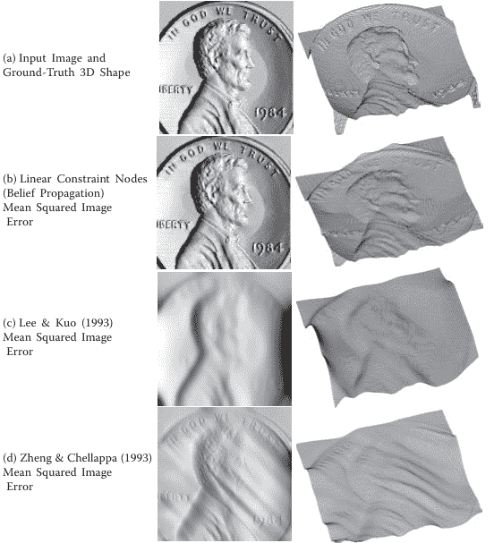

**FIGURE 1.7**  我们使用循环信念传播（行 b）推断光照下的形状与光照的结果与以往方法（行 c 和 d）的对比。每行包含一个三维（3D）线框图（右侧）和在光源位置 (1,0,1) 处渲染（左侧）的表面。 (a) 原始表面。该列的渲染作为后续三列 SFS（形状与光照）算法的输入。 (b) 使用我们线性约束节点方法恢复的表面。 (c) 使用 Lee 和 Kuo (1993) 所述方法恢复的表面。该算法在张等人 (1999) 综述的六种 SFS 算法中表现最佳。 (d) 使用 Zheng 和 Chellappa (1991) 所述方法恢复的表面。我们的方法（行 b）在显著改善了以往领先方法。特别重要的是，恢复的表面渲染与原始输入图像非常相似。这意味着每个像素的 Lambertian 约束得到了满足，而原始与恢复表面之间的任何错误主要归因于这里使用的自然三维形状的简化先验概率模型。


我们开发的高效置信传播技术在多种感知推断任务中具有类似应用。这些以及其他统计推断技术有望显著推进计算机视觉的最新技术水平，并提升我们对感知推断的整体理解。

除了性能提升之外，上述由明暗恢复形状的方法还提供了新的灵活性，使明暗信息能够在更通用和更现实的场景中得到利用。以往的由明暗恢复形状的方法通常高度依赖朗伯反射方程的精确形式，因此只能应用于具有特定（即哑光）反射特性且没有表面标记的表面。同时，还假设了特定的光照条件。上述方法直接应用于形状与明暗之间关系的统计模型，因此不依赖于朗伯方程的精确形式或特定的光照布置。此外，本文描述的高效高阶置信传播技术使得利用3D形状先验概率的更强、非成对模型成为可能。由于深度推断问题高度欠约束，而且自然图像允许大量合理的3D解释，因此利用3D表面先验概率的精确模型至关重要。了解哪些3D形状在自然界中常见、哪些形状在*先验上*不大可能或奇怪，是深度推断的一个非常重要的约束。最后，由明暗恢复形状问题的因子图表示（见图1.6）可以自然地推广到利用其他深度线索，如遮挡轮廓、纹理、透视，或达·芬奇相关性和阴影线索。从双目立体像对推断深度的最新方法通常在马尔可夫随机场（MRF）上采用置信传播。这些方法可以相当直接地与我们的由明暗恢复形状框架相结合，从而以统计最优的方式同时利用明暗和立体线索。深度推断的统计方法使人们能够朝着更统一、更稳健的深度推断框架努力，这很可能成为未来视觉研究的一个主要领域。

## 致谢

本工作得到了 NSF CISE IIS 0713206 和 AFOSR FA9550-09-1-0678 对 T. S. Lee 的资助，以及 NSF 研究生研究奖学金对 B. Potetz 的资助。

## 主动分割：一种新方法

Ajay Mishra
Yiannis Aloimonos

- 2.1 引言 26
- 2.2 背景 29
  - 2.2.1 图像分割 30
    - 2.2.1.1 基于区域的方法 30
    - 2.2.1.2 基于轮廓的方法 31
  - 2.2.2 运动分割 32
- 2.3 基于注视的分割 33
  - 2.3.1 计算概率边界边缘图 34
  - 2.3.2 为什么是极坐标？ 36
  - 2.3.3 寻找最优轮廓 38
    - 2.3.3.1 笛卡尔到极坐标边缘图 38
    - 2.3.3.2 通过极坐标边缘图寻找最优割：内部与外部分割 40
- 2.4 结果 42
- 2.5 注视策略 46
  - 2.5.1 稳定性分析 47
- 2.6 结论 49

### 2.1 引言

将场景（或图像）分割成区域是视觉处理中的一个重要步骤。区域比单个像素更具区分性，且数量少于像素总数。这使得区域更适合用于高层视觉处理，如跟踪、目标识别和三维（3D）重建，并且计算开销更低。但要使分割成为视觉算法的关键第一步，分割算法的输出需要具有一致性，并且不应需要任何用户输入。

我们给出一个当前最先进的例子来解释分割算法完全自动且一致意味着什么。我们这里只考虑图2.1a所示的单张图像，但我们的分析并不局限于单张图像。大多数分割算法本质上都是统计优化过程，需要直接或间接（通过其他阈值）估计区域数量才能对场景进行分割。图2.1b、c是使用（Shi 和 Malik，2000）对图2.1a进行分割的结果，其参数（区域数量）分别设置为10和60。如果关注场景中的树木，图2.1b比图2.1c更有意义，因为图2.1c中树木被过分割成大量小区域。这种分割被称为*过分割*，因为感兴趣区域被分割成许多小区域。然而，如果关注图2.1a中的小马，那么图2.1c更有意义，因为马在图像中仅由两个区域组合而成。另一方面，图2.1b中的分割甚至没有与马对应的区域。这是欠分割的情况，其中小区域被合并形成更大的区域。根据哪个区域重要以及其存在的尺度，需要为（Shi 和 Malik，2000）设置合适的参数，以输出有意义的分割。

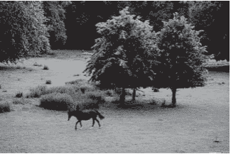
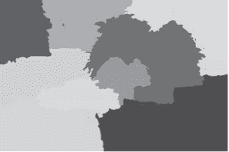

(a) (b)

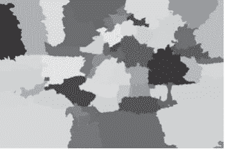

(c)

**图 2.1** *（见第94页之后的彩色插页。）* Jianbo Shi 和 Jitendra Malik（2000）对图像（a）的分割结果，分别对应区域数量选择为10和60的两种情况，如（b）和（c）所示。如果树木是感兴趣的目标，则（b）中的分割是合适的；而如果马是感兴趣的目标，则（c）中的分割更合适。

但是，在真实场景中，场景中可能存在多个感兴趣区域，而且它们的尺度可能差异很大，本例就是如此。因此，一致且自动的分割算法应当能够分割感兴趣区域，无论其在图像中的大小如何。

这种分割与感兴趣区域相关联。与当前算法不同，它只将感兴趣区域分割为前景，而将场景中的其他一切作为背景。事实上，我们知道人类（灵长类）的视觉系统以类似方式工作。它通过在场景中不同显著位置进行一系列注视来观察和理解动态场景（视频）或静态场景（图像）。研究人员已对人眼注视的位置进行了大量研究（Cerf等，2008；Walther和Koch，2006），但对注视期间人类视觉系统所进行的操作知之甚少。同样众所周知的是，人类视网膜的结构决定了只有这些注视点周围的小邻域被中央凹以高分辨率捕获，而场景的其余部分则由视网膜周边的传感器以较低分辨率捕获。我们认为，视觉系统作为第一步，会分割其正在注视的区域。我们提出，人类视觉系统不是一次性分割整个场景或图像，而是针对场景中的每次注视，以单个区域为单位对场景进行分割。例如，当视觉系统的注意力被吸引到马（图2.2a）时，它会分割出马（图2.2b）；当注意力被吸引到树木（图2.2c）时，它会分割出树木（图2.2d）。

设计分割算法的另一个重要因素是它如何使用视觉线索来找到目标区域。视觉线索有两类：一类是仅来自单一图像的单目线索（即强度、颜色和纹理），另一类是双目线索（如深度）以及利用场景的两幅或更多图像计算得到的运动线索。通常，现有的分割算法只处理这两类线索中的一类。最重要的是，从仅使用单目线索的图像分割算法到使用运动线索分割图像中区域的运动分割算法，其基本框架发生了显著变化。相反，理想分割算法的框架应该与线索无关，也就是说，从我们只有单目线索的情况到颜色、纹理、深度和运动线索全部可用的情形，寻找区域的方法不应改变。

在本章中，我们对分割问题进行建模，使其结合所有可用线索来分割当前注视的感兴趣区域。我们的


-   [分割过程是一个两步骤的过程：首先，使用所有可用的视觉线索来生成概率边界边缘图。边缘像素在该图中的灰度值与该像素位于区域边界的概率成正比。在第 2.3.1 节中，详细说明了如何获得该图。第二步，固定点在场景中要么由视觉注意力模块选择，要么由其他有意义的策略选择。第一步得到的概率边界边缘图随后从笛卡尔空间转换到以固定点为极点的极坐标系。在笛卡尔空间中，包含固定点的区域的闭合边界被描述为在极坐标系中的概率边界边缘图的最优切割（如第 2.3.2 节所述）。将分割框架划分为两步是重要的，因为这样可以确保视觉线索仅用于获得更好的概率边界边缘图。一旦该图计算完成，对于场景（或图像）中选择的每一个固定点，分割都被定义为最优。

-   本章其余部分的组织如下：下一节详细讨论现有的分割算法。第 2.3 节描述了我们的分割算法。第 2.4 节以定量分析的形式展示实验结果。第 2.5 节讨论固定点策略以及分割输出对固定点位置的稳定性。我们以对该领域未来研究的建议结束本章。

## 2.2 背景

-   在没有先验知识或上下文，仅凭信号处理的基础上，无论分割算法如何，它都需要决定何时停止生长区域并停止分割过程。该输入来自用户。没有任何用户输入，将图像分割成区域是一个 ill-posed 问题，因为分割的细粒度或粗糙程度取决于何时停止过程。大多数流行的算法都是这类全局方法。此外，自动估计任何给定图像的输入参数通常都很困难。

-   多种交互式算法被提出，其目标是始终将整张图像分割为前景和背景两个区域。这些算法种类繁多，用户输入方式各异。它们不是自动的，不能用于构建自主视觉系统。它们主要用于交互式应用，如图像/视频编辑和图像数据库。

-   诸如 (Rother et al., 2004; Yu and Shi, 2001) 的算法始终将整张图像分割为前景和背景两个区域。Boykov 和 Jolly (2001) 将前景/背景分割问题表述为二元标签问题，并通过最大流算法 (Boykov and Kolmogorov, 2004) 精确求解。该方法需要用户标记一些像素为前景或背景以构建颜色模型。Blake 等人 (2004) 在 (Boykov and Jolly, 2001) 的基础上，使用高斯混合马尔可夫随机场更好地学习前景和背景模型。Rother 等人 (2004) 的算法要求用户指定一个包含前景目标的边界框。Arbelaez 和 Cohen (2008) 要求为图像中的每个区域提供一个种子点，前景/背景分割至少需要两个种子点。虽然这些方法取得了令人印象深刻的结果，但它们不能作为自动分割算法，因为它们高度依赖用户输入。Yu 和 Shi (2001) 的算法尝试通过空间注意力基于的方法自动选择种子点，然后在其归一化切割公式中加入额外约束。

-   (Bagon et al., 2008; Veksler, 2008) 的算法只需要用户提供一个种子点。Veksler (2008) 的算法对目标对象的形状施加约束，要求对象呈星形，即倾向于分割凸形物体。该算法的用户输入至关重要，必须精确指定星形的中心位置。Bagon 等人 (2008) 的算法只需在感兴趣区域上标记一个种子点，并使用组合框架分割前景区域，但计算量较大，需要多次迭代才能得到最终分割。

### 2.2.1.2 轮廓基于方法

-   轮廓基于分割方法首先在图像中寻找边缘碎片，然后将这些碎片连接成封闭的轮廓，每个封闭轮廓所包围的区域即为分割结果。由于图像中存在纹理和低对比度区域，检测边缘碎片是一个挑战。连接边缘碎片的第二步是基于图像统计的概率方式进行的。Williams 和 Jacobs (1997) 使用一阶马尔可夫模型来约束轮廓形状，并通过随机游走完成轮廓。Ren 和 Malik (2002) 则使用多尺度来利用方向信息将轮廓连接起来。

-   但仅凭整体流来判断小区域的划分是困难的。

-   b. 3D 方法通过识别具有一致 3D 运动的簇来实现分割 (Adiv, 1985; Costeira and Kanade, 1995; Nelson, 1991; Sinclair, 1993; Thompson and Pong, 1990; Torr and Murray, 1994; Zhang et al., 1988)，采用多种技术。例如，Weber 和 Malik (1997) 的方法基于图像形成的交替模型，这些约束在航空影像等领域可被证明是合理的。此时，场景的平面性使得注册过程得以实现 (Ayer et al., 1994; Triggs et al., 2000; Wiles and Brady, 1995; Zheng and Chellappa, 1993)，未补偿的区域对应于独立运动。

-   该思想被扩展以处理一般场景，通过根据场景复杂度选择合适的模型 (Torr et al., 1998)，或利用平面加平移约束拟合多个平面 (Iirani and Anandan, 1998; Sawhney et al., 2000)。大多数技术通过 3D 运动估计来独立检测移动物体，无论是显式还是隐式。一些方法利用伪运动估计与观测流场之间的不一致，另一些则结合立体深度或其他传感器提供的部分伪运动信息。所有基于运动的技术面临的核心问题是，从流场中唯一确定 3D 运动极为困难。一些研究关注结构从运动的鲁棒性问题，特别是小视场下移动相机观察深度变化不足的场景，会导致平移与旋转难以区分 (Adiv, 1989)。

## 2.3 固定点基于分割

-   自主视觉早期尝试 (Aloimonos et al., 1988; Bajcsy, 1988; Christensen and Eklundh, 2000) 之后，在计算机视觉和心理学视角上对固定点问题进行了大量研究 (Pahlavan et al., 1996)。尽管取得了显著进展，但固定点的操作仍未融入计算机视觉的基础之中，即固定点并未成为低、中层计算机视觉算法中的参数。

-   本文遵循此路径，将分割这一计算机视觉核心问题与固定点相结合。固定点位于图像中的某个区域内，该区域内的所有点（包括固定点）都被该区域的边界（或深度边界）所包围。因此，分割包含固定点的区域等价于寻找包围该区域的轮廓，该轮廓是边缘像素在图像边缘图中的连通集合，围绕固定点形成封闭边界。该方法与轮廓基于分割相似，但有两点区别：首先，我们只关注固定点所在区域的最优轮廓；其次，最优轮廓在极坐标系中寻找，而非 Cartesian 空间（如 Williams 和 Jacobs (1997) 所使用），这使得分割过程不受区域规模影响（后文通过示例说明）。此外，轮廓基于的完成算法仅关注边缘碎片的方向，而我们除了方向外，还利用边缘像素的强度来寻找围绕固定点的封闭轮廓。边缘像素的强度表示该像素位于区域边界的概率，这种边缘图称为 *probabilistic boundary edge map*。

-   接下来，我们将解释如何利用不同线索生成概率边界边缘图，阐述在极坐标系中寻找最优轮廓而非 Cartesian 空间的理由，并给出获取固定点周围最优轮廓的具体算法细节。

-   最后，必须强调我们追求的是物理意义上的分割定义。也就是说，我们并非仅仅寻找包含固定点的区域，而是寻找包含固定点的表面。换句话说，围绕图形并将其与背景分隔的封闭边界是深度边界。

### 2.3.1 计算概率边界边缘图

-   如前所述，概率边界边缘图编码了边缘像素位于区域边界的概率，其灰度值即为该概率。理想情况下，该图中较亮的边缘像素应为真正的边界点。


FIGURE 2.3 (a) (See color insert following p. 94.) 第一个帧的运动序列。(b) 由 Martin、Fowlkes 和 Malik (2004) 给出的 (a) 的概率边界边缘图。(c) 灰度图中显示的光流向量的大小（亮度编码大小）。(d) 包含运动线索后的最终边界边缘图。

沿图像的区域边界（深度边界）。我们将探讨如何生成这种概率边界边缘图。

我们的初始概率边界边缘图是 Berkeley 边缘检测器（Martin et al., 2004）的输出。Martin et al. 从标记数据（约 300 张图像）中学习了边缘像素的颜色和纹理属性，并使用该信息区分边界边缘和内部边缘。见图 2.3b（图 2.3a 的边缘图）作为边缘检测器典型输出的示例。与 Canny 等二值边缘检测器不同，它成功消除了伪造的纹理边缘并突出了边界边缘，但仍然存在一些强内部边缘（BC、CD、CF），它们不是深度边界。

现在，为了抑制这些强内部边缘段并强化边界边缘（AG、GF、FE、EA），我们可以使用运动和立体线索。我们知道，内部边缘上的位移或流变化小于边界边缘上的变化。因此，我们可以查看边缘两侧的流和位移变化，并据此修改其概率（或灰度值）。

我们将边缘图分割为直线段（如 AB、BC、CD 等，如图 2.3b 所示），并在其两侧各选取宽度 *w*、距离 *r* 的矩形区域（见图 2.3c）。随后，我们在矩形区域内计算平均位移和平均流的值。平均位移的绝对差 Δ*d* 与平均流的大小 Δ*f* 是判断该段是否位于深度边界的概率指标。Δ*d* 和 Δ*f* 越大，该段成为边界的可能性越高。我们选择矩形区域在边缘段两侧等距 *r* 处选取，因为在边界处流或位移比物体内部更易受到影响。实验中我们将 *r* 和 *w* 设为 5 和 10 像素， respectively。

现在，边缘段上像素的亮度被修改为

$I'(x,y)=\alpha_b I(x,y)+(1-\alpha_b)(\Delta f/\max(\Delta f))$ 或 $I'(x,y)+I(x,y)=(1-\alpha_b)(\Delta d/\max(\Delta d))$

分别对应运动和立体线索，其中 *I*(.) 和 *I'*(.) 分别是原始和改进后的边缘图；αᵦ 是单眼线索边界估计相对重要性的权重。实验中我们取 αᵦ = 0.2。改进后的概率边界边缘图显示于图 2.3d，内部边缘变暗，边界边缘变亮。

## 3.2.2 为什么使用极坐标？

在解释如何找到以注视点为中心的最优闭合边界之前，先说明我们选择在极坐标系中进行此操作的原因。假设我们要在图 2.4a 中红色注视点的圆盘上找到最优轮廓。圆盘的梯度边缘图（图 2.4b）包含两条同心圆。大圆是圆盘的实际边界，小圆仅是圆盘内部的边缘。假设边缘图正确地将边界轮廓强度赋值为 0.78，内部轮廓强度为 0.39（强度范围 0~1）。两条圆的长度分别为 400 和 100 像素。在笛卡尔空间中追踪边界和内部轮廓的代价分别为 88 = (400·(1−0.78)) 和 61 = (100·(1−0.39))。显然，内部轮廓代价更低，因而会被视为最优，尽管边界轮廓更亮，理应是最优。

这一“倾向于短轮廓而非长轮廓”的问题在基于图切割的方法中已被识别出来，最小切割通常倾向于取“短路”，即在图像中取短路径（Sinop and Grady, 2007）。

为解决此“短路”问题，我们必须将这些轮廓转换到一种空间，使得轮廓长度不再依赖其在笛卡尔空间中所包围的面积。在这种空间中，追踪轮廓的代价与其在笛卡尔空间的尺度无关。极坐标空间具有此性质，我们利用它来解决尺度问题。轮廓从笛卡尔坐标系转换到极坐标系，如图 2.5e 所示的 $I^{pol}_{rgb}()$ 示例。

设 $F_{in}(r,g,b)$ 和 $F_{out}(r,g,b)$ 为内部和外部的颜色分布，它们分别用每通道 10 个 bin 的归一化 3D 直方图表示。除了第一列和最后一列节点外，新的数据项为所有节点提供：

$$U_p(l_p)=\begin{cases}\dfrac{I_n\left(F_{in}\left(F_{in}\left(I^{pol}_{rgb}(r_p,\theta_p)\right)\right)}{Z_p}, & \text{if } l_p=0\\[6pt]\dfrac{I_n\left(F_{in}\left(F_{in}\left(I^{pol}_{rgb}(r_p,\theta_p)\right)\right)}{Z_p}, & \text{if } l_p=1\end{cases}$$

其中 $Z_p=\ln(F_{in}(I^{pol}_{rgb}(r_p,\theta_p)))+\ln(F_{out}(I^{pol}_{rgb}(r_p,\theta_p)))$。我们再次使用图切算法最小化能量函数 $Q(f)$，引入新的数据项。

边界在极坐标系中的左侧（标签 0）与右侧（标签 1）之间的分界线，如果是一条连通路径，且连接 $(r_1, 0°)$ 到 $(r_1, 360°)$，则在笛卡尔空间中对应一个闭合轮廓。但如果该路径的两端点是 $(r_1, 0°)$ 与 $(r_1, 360°)$，且 $r_n \ne r_1$，则假设其中一个端点错误。首先假设 $(r_1, 0°)$ 与 $(r_1, 360°)$ 为正确端点，此时数据项修改为：对于 $p\in(r,\theta),\ \theta\in\{0°,360°\},\ 0\le r\le r_1$，设 $U(l_p=1)=D$，$U(l_p=0)=0$。随后假设 $(r_n, 0°)$ 与 $(r_n, 360°)$ 为正确端点，修改为 $U(l_p=1)=D$，$U(l_p=0)=0$ 当 $p\in(r,\theta),\ \theta\in\{0°,360°\},\ 0\le r\le r_n$。对两种情况分别最小化能量函数，选择能量最小的二值分割结果。

## 2.4 结果

我们在 20 部平均长度为七帧的视频以及 50 对立体图像上评估了所提算法的性能，它们分别对应地面真实分割。对于每个序列和立体对，仅识别并分割最显著的感兴趣对象。


\begin{tabular}{cc}
**Algorithm** & **F-measure Score** \\
Bagon et al. & 0.87 ± 0.010 \\
Alpert et al. & 0.86 ± 0.012 \\
Our Method & 0.83 ± 0.019 \\
NCut & 0.72 ± 0.012 \\
MeanShift & 0.57 ± 0.023 \\
\end{tabular}

2.5 FIXATION STRATEGY

The proposed method clearly depends on the fixation point; thus, it is important to select the fixations automatically. Fixation selection is a mechanism that depends on the underlying task as well as other senses (like sound). In the absence of these cues, one has to concentrate on generic visual solutions. There has been a significant amount of research done on the topic of visual attention (Itti et al., 1998, Serences and Yantis, 2006; Walther and Koch, 2006), primarily to find the salient locations in the scene where the human eye may fixate. For our segmentation framework, as shown in the next section, the fixation just needs to be inside the objects in the scene. As long as this is true, the correct segmentation will be obtained. Fixation points amount to features in the scene, and the recent literature on features comes in handy (Lowe, 2004; Mikolajczyk and

We calculated the overlap values for 100 textured regions and 100 smooth regions from the Berkeley Segmentation Database (BSD) and Alpert Segmentation Database. It is clear from the graph in Figure 2.11a that the overlap values are better for the smooth regions than for the textured regions. Textured regions might have strong internal edges, making it possible for the original optimal path to be modified as the fixation moves to a new location. However, for the smooth regions, there is a stable optimal path around the fixation; it does not change dramatically as the fixation moves to a new location. We also calculate the overlap values for the 100 frames from video sequences; first with their boundary edge map given by (Martin et al., 2004), and then using the enhanced boundary edge map after combining motion cues. The results are shown in Figure 2.11b. We can see that the segmentation becomes stable as motion cues suppress the internal edges and reinforce the boundary edge pixels in the boundary edge map (Martin et al., 2004).

We proposed here a novel formulation of segmentation in conjunction with fixation. The framework combines monocular cues with motion and stereo to disambiguate the internal edges from boundary edges. The approach is motivated by biological vision, and it may have connections to neural models developed for the problem of border ownership in segmentation (Craft et al., 2007). Although the framework was developed for an active observer, it applies to image databases as well, where the notion of fixation amounts to selecting an image point that becomes the center of the polar transformation. One of the reasons for getting good segmentation with only monocular cues is the better probabilistic boundary edge map given by (Martin et al., 2004). Our contribution here was to formulate an old problem—segmentation—in a different way and show that existing computational mechanisms in state-of-the-art computer vision are sufficient to lead us to promising automatic solutions. Our approach can be complemented in a variety of ways, for example, by introducing a multitude of cues. An interesting avenue has to do with learning edges.

In Figure 2.9, we also provide a visual comparison between the output of the proposed segmentation and the interactive Grabcut algorithm (Kass et al., 1998) and Normalized Cut (Malik et al., 2001) for some of the difficult images from the berkeley segmentation Database. For normalized cut, the best parameter (between 5 to 20) for each image is manually selected and the corresponding segmentation is shown in the last row of Figure 2.9.

## Mechanisms for Propagating Surface Information in 3D Reconstruction

James Coughlan

## CONTENTS

- Introduction ................................................ 51
- Markov Random Fields for Stereo ......................... 53
  - Model Improvements and Refinements ................. 55
  - How MRFs Propagate Information ........................ 56
- Tractable Inference and Learning .......................... 57
  - Learning MRF Parameters .................................. 59
- More Realistic Priors .......................................... 59
- Biological Plausibility ......................................... 61
- Discussion ........................................................ 62
- Acknowledgments .............................................. 63

## INTRODUCTION

Bayesian and other related statistical techniques have emerged as a dominant paradigm in computer vision for estimating three-dimensional (3D) surfaces in the presence of noisy and sparse depth cues. In particular, for 3D reconstruction problems, these techniques have been implemented using Markov random fields (MRFs), which are probabilistic models that express how variables arranged in a spatial structure jointly vary, such as a rectangular grid of disparity variables aligned to a pixel lattice in a stereo model. Such MRF models incorporate powerful priors on surface geometry, which allow 3D estimates to combine evidence from depth cues with prior knowledge of smoothness constraints. They embody a natural mechanism for propagating surface information from regions with highly informative depth cues to neighboring regions with unreliable or missing depth cues, without crossing over depth discontinuities. Recent advances in inference algorithms have enlarged the range of statistical models that are tractable for computer implementation, enabling the use of increasingly realistic and expressive models and leading to some of the most robust and accurate 3D estimation algorithms to date. Finally, a “belief propagation” framework allows these models to be implemented on a massively parallel computer architecture, raising the possibility that they may be realized in a biologically plausible form.

3D reconstruction is a major theme in computer vision, with techniques for estimating shape from a variety of cues, including shading (Haines and Wilson, 2008), texture (White and Forsyth, 2006), and multiview stereo (Seitz, Curless, Diebel, Scharstein, and Szeliski, 2006). A fundamental challenge of 3D reconstruction is estimating depth information everywhere in a scene despite the fact that depth cues are noisy and sparse. These properties of depth cues mean that depth information must be propagated from regions of greater certainty to regions of lesser certainty. The 3D reconstruction problem that is perhaps the most mature in computer vision is stereo using two or more calibrated cameras with known epipolar geometry. The most successful stereo algorithms use MRFs (Chellappa and Jain, 1993), which are probabilistic models that express the joint distribution of variables arranged in a network structure, with the state of any variable exerting a direct influence on the states of its neighbors. In the case of stereo (here we consider two-view stereo), a basic MRF model consists of a lattice (grid) of disparity variables, one for each pixel in the image. For any disparity hypothesized at a given pixel, there is (usually ambiguous) evidence from the corresponding match between the left and right images that this disparity implies. Nearest-neighbor connections enforce a prior smoothness constraint on disparities, which equates to a related smoothness constraint on depths in the scene. Inference is performed using a global optimization method such as graph cuts (Boykov, Veksler, and Zabih, 2001) or belief propagation (Yedidia, Freeman, and Weiss, 2001), which determines a near-optimal assignment of disparities to each pixel given the image data. The MRF framework embodies a natural mechanism for propagating surface information in the presence of noisy and sparse data.


-   [该章节旨在向计算机视觉研究人员（非计算机视觉专家）介绍该框架的基本原理（该框架适用于任何三维重建问题，而不仅仅是两帧立体），并讨论最近在更真实的表面几何模型方面的扩展，指出最近的研究表明信念传播（或接近其形式）可能以生物学上可信的形式实现。最后，我建议未来研究的可能方向。

## MARKOV RANDOM FIELDS FOR STEREO

在本节中，我们介绍了一个简单的 MRF（马尔可夫随机场）形式ulation（公式）的立体视觉，该公式使用贝叶斯模型进行描述。（其他统计变体如条件随机场（Lafferty, McCallum, and Pereira, 2001; Scharstein and Pal, 2005）虽然我们在下文中提及，但它们是流行的替代方案，具有相似性。）我们得到两幅灰度图像 $L$ 和 $R$（左图和右图），它们被假设已经校正，使得一幅图像中的像素在同一行的另一幅图像中必定对应另一幅图像中的像素。未知的差值场由 $D$ 表示，$D_r$ 表示像素位置 $r$ 处的差值。对于一个特定的差值 $D_r$（$r=(x,y)$），其解释如下：在左图中 $(x+D_r,y)$ 对应右图中的 $(x,y)$。

我们定义了一个对差值场 $D$ 的先验，以强制平滑性：

$$
P(D)=\frac{1}{Z}e^{-\beta V(D)}
$$  
(3.1)

其中 $Z$ 是一个归一化常数，确保 $P(D)$ 在 $D$ 的所有可能取值上总和为 1，$\beta$ 是一个正常数，控制概率分布的尖锐度（进而决定先验相对于似然的重要性，如下文所述），以及

$$
V(D)=\sum_{\langle rs\rangle} f(D_r,D_s)
$$  
(3.2)

其中求和遍历所有相邻像素对 $r$ 和 $s$。这里，$f(D_r,D_s)$ 是一个能量函数，惩罚相邻像素之间的差值差异，能量值越高，惩罚越严重。（换句话说，非零的第一导数（幅度和方向）或包含相邻图像结构的更高层次描述符（如 DAISY）（Tola, Lepetit, and Fua, 2008）的值越大，就越被惩罚。）

- 3. MRF 模型可以是多尺度的（Felzenszwalb and Huttenlocher, 2006），具有金字塔结构，将原始差值网格与下采样（粗糙化）后的版本相结合。

- 4. 方程 (3.3) 中的条件独立性假设可以通过使用条件随机场来放松，从而得到更真实的后验分布。

### 如何 MRF 传播信息

我们现在简要说明 MRF 模型如何在图像中传播噪声和稀疏的差值线索。这一过程的基本原理是：先验和似然分布在不同的差值假设之间竞争，而这两个信息来源的相对强度会自动根据哪个来源更可靠而变化。

在图 3.1 中，我们展示了一个简单的场景例子，该场景仅包含一个与相机平行的平面（因此正确的差值场在整个图像中是均匀的，值为 $d_o$）。整个表面包含一种高度纹理化、非周期的图案，除了中间的一个无纹理区域外，纹理部分在图像的所有位置都提供了强有力的证据支持正确的差值 $d_o$，并几乎没有支持其他任何差值（实际上，似然模型可能不那么具有区分度，但我们为了论证的简化假设近乎完美的差值歧视能力）。相比之下，中间的无纹理区域没有直接证据倾向于某一特定差值。如果仅使用似然模型进行推理，中间区域必然会失败。然而，通过将先验与似然相结合，可以很容易看出，一个在整个图像上均匀取值为 $d_o$ 的差值场将比任何偏离 $d_o$ 的差值场具有更高的后验概率，因为任何偏离 $d_o$ 的差值场不仅不如正确的差值场平滑，而且在似然模型的支持范围内（即支持相同的差值范围），其平滑性更差。

更真实的例子也可以分析，它们表现出类似行为，其中 MRF 先验模型即使在差值线索噪声或缺失的情况下，也能传播表面信息。

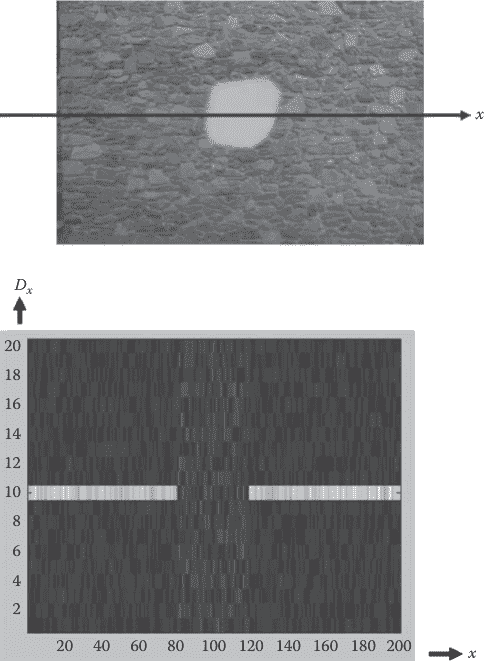

**FIGURE 3.1** 理想化的差值信息在图像中传播的示例。上图：前后平行表面（石墙）的图像，在图像上叠加了一个 $x$ 轴切片。下图：所有可能的 $x$ 值对应的不同差值 $D_x$ 的支持情况，亮度与支持程度成正比。在纹理部分的切片中，差值 $d_0 = 10$ 被强烈支持；而在切片中心的无纹理部分，所有差值的支持程度大约相等。详细解释请参见正文。

### 可处理推理与学习

立体 MRF 模型（以及许多其他贝叶斯模型）面临的重大挑战是估计 MAP（最大后验概率），这等同于最小化方程 (3.8) 中的能量函数。在一般情况下，没有保证能够找到精确的 MAP。

在足够多的迭代之后，这一系列“交谈”很可能会收敛到一个共识，指明每个变量最可能的状态。

在 BP（belief propagation，信念传播）中，变量之间交换的信息在整个 MRF 中传播。信息在每次 BP 迭代中只能从变量传递到其邻域变量，但经过足够多次迭代后，信息可以在所有变量之间传递。BP 开始时，信息表达不偏向任何一种状态，但经过足够多次迭代后，信息变得更“强烈”，表达出对特定状态的强烈偏好。

最后，我们指出，使用 BP（或图切算法）进行立体推理仍然比简单（但精度较低）的立体算法慢，每对图像需要几秒甚至几分钟的时间。然而，对这些算法效率的提升以及计算机硬件的持续改进，正在不断提高执行速度。

### 学习 MRF 参数

“Markov Random Fields for Stereo”章节中的 MRF 模型包含若干自由参数（如 $\beta$、$\tau$ 和 $\mu$），必须正确设置才能使模型真实且准确，从而做出良好的推理。

已有成熟的程序（Scharstein and Pal, 2005）用于从“标记”数据样本（即左/右图像对和真实（“地面真实”）差值）中学习 MRF 参数。然而，直到最近，很少有数据集包含了地面真实差值场，这使得学习 MRF 参数变得困难。幸运的是，这一障碍正在被清除，因为现在越来越多的数据集包含了地面真实，这些数据是通过激光测距仪（用于测量场景中几乎每个像素的精确深度，从而得到差值）获得的。

从数据中学习 MRF 参数不仅提供了一种系统的方式来选择模型参数（反映自然场景中深度和强度的统计特性），也提高了模型性能，通过将模型估计的差值场与地面真实差值进行比较来衡量（Zhang and Seitz, 2005）。

### 更真实的先验

MRF 先验在方程 (3.1) 中的一个重要局限性是它惩罚相邻像素之间的差值差异，这意味着它偏向于前后平行的表面。这种偏向在许多现实场景中是不恰当的，因为现实场景中常包含倾斜的表面。即使在我们所考虑的玩具例子中，这一点也同样成立。


-   [MRF传播信息的部分在斜面上可能会失败：如果图像的有纹理区域之外，先验可能难以将线性变化的差异向外传播。（任何平面都有一个关联的差异场 \(D_r = ax + by + c\)，其中 \(r = (x,y)\)，即差异在 *x* 和 *y* 坐标上是线性的。）

-   我所在的实验室正在研究如何克服这种前视平行偏差，具体应用场景是为视障轮椅使用者进行地形分析。该应用（Ivanchenko 等，2008）使用立体相机对地面进行拍摄，使得光学轴与地面的夹角约为 45°。目标是检测地形不规则，如障碍物、地面坑洞和路沿石，并将这些信息传递给轮椅使用者。

-   我们设计了一种实时算法，用于快速、商用立体算法（该算法与立体相机硬件集成）检测并报告地形不规则。该立体算法基于简单的窗口相关，而非 MRF 模型，因此运行速度极快，能够每秒处理大量帧。使用这种快速算法的缺点是输出的差异估计稀疏且带有噪声，并且会平滑掉深度 discontinuities（ discontinuities）。然而，这种差异估计的质量足以检测大型地形不规则，如树木和其他障碍物。当算法未能检测到场景中除主地面平面（如人行道）之外的显著偏差时，似乎应采用更高级的立体算法（如 MRF 模型）来更详细地分析场景。第二种算法可能会揭示出第一种算法漏掉的路沿石或其他细微的深度不连续。

-   地面的倾斜导致地面的差异在相邻图像行之间显著变化，违背了前视平行假设。为解决此问题，我们正在尝试对其中一张图像进行畸变，以消除地面平面上的差异。（该思想最初由 Burt、Wixson 和 Salgian [1995] 提出。）因此，仅位于地面平面之外的场景点会有非零差异，而与地面平面平行的平面（例如人行道边缘的道路）会具有 *统一的差异*。通过这种方式，图像数据被转换，使得前视平行假设更加合适。

-   这种转换对我们的应用可能很有价值，但更通用的解决方案是引入一个假设：局部平面表面（无论其俯仰和倾斜程度如何）是普遍存在的。实现这一假设的一种方法是惩罚差异场二阶导数偏离零的程度。至少，该假设必须评估三个连续像素之间的关系，因为二阶导数需要三个连续样本来估计（二阶导数为零意味着三个点在三维空间中共线）。这种措施超出了本章中所介绍的两两 MRF 的能力，而使用更强大的 MRF 并实现三元（三元组）交互则计算需求极大。最近的工作（Woodford 等，2008）用比传播算法（BP）更高效的能量最小化算法替代 BP，从而为该问题提供了可行的立体算法，其性能在非前视平行表面上传播表面信息方面尤为出色。

## 生物学可信度

偶尔，我会被神经科学家和心理物理学家询问本章所描述的 MRF 模型是否与生物视觉系统有关。虽然我对生物视觉了解有限，但我想指出其他人的研究表明，MRF‑BP 框架（或许可以加入多个深度线索）在生物上可能是可信的。

从生物学角度来看，该框架最重要的属性之一是其完全可并行化：可以在硬件系统中实现 BP，为 MRF 的每个变量分配一个计算节点，并通过邻接变量之间的有向连接表示 BP 消息。每次 BP 迭代时，消息在节点之间沿这些连接从一个变量向邻居节点流动。Lee 和 Mumford（2003）认为 BP 可能是大脑中信息从上到下、从下到上传递的模型。随后的研究（Ott 和 Stoop，2006）表明，对于二值变量的 MRF（即每个变量只能取两种状态），BP 可以以连续时间更新的方式形式化，其动态行为与 Hopfield 网络非常接近。其他工作（Doya 等，2006）则放宽了二值假设，将 BP 与射击网络模型联系起来。

## 讨论

本章介绍了基于 MRF 框架的 3D 重建方法，用于在噪声和稀疏深度线索存在的情况下传播表面信息。该框架能够自动根据可靠性对先验和似然信息进行加权，并且是计算机视觉中许多表现优异的立体算法的基础（参见 Charstein 和 Szeliski，2002），同时也维护了 vision.middlebury.edu/stereo/ 网站，该网站实时更新最先进的立体算法性能排名。虽然标准 MRF 立体算法的先验强制了前视平行偏差，但最近的研究表明，采用更真实的先验——考虑到局部平面表面的频繁出现及其任意俯仰和倾斜——具有重要意义。

尽管 3D 重建算法在近年来有了显著提升，但仍有大量工作待完成。尽管最近的研究重点放在从训练数据中学习模型参数，但用于训练和测试的图像往往包含更多纹理丰富、色彩鲜艳的物体，这质疑了即使是表现最好的算法也能够推广到真实场景的能力。可能需要开发更多的性能指标，以奖励那些能够减少当前普遍出现的 catastrophic inference 错误的算法——这些错误往往导致某些点的差异被错误估计数十像素。

更真实的先验也将是进一步提升算法的关键。增加现实性的代价可能是需要使用更高层次的先验，以表示连贯的表面，例如明确边界的平面和柱形斑块，而不是基于像素的深度或差异场。

另一个改进方向是将多种深度线索（包括单眼线索，如阴影和纹理）与标准的差异线索一起整合。例如，Saxena、Sun 和 Ng（2007）利用这些线索从单色图像中估计深度场。同时，将时间信息（即多帧视频）整合进去也很重要。

最后，需要改进优化技术（如 BP）以实现上述扩展，这些改进可能会影响未来研究的方向。

## 致谢

作者获得国家科学基金会第 IIS0415310 号资助。衷心感谢 Volodymyr Ivanchenko 和 Ender Tekin 对本稿提供的有益反馈。

## 3D 表面表示（利用里曼流）

- Wei Zeng
- Feng Luo
- Shing-Tung Yau
- David Xianfeng Gu

### 目录
## 引言 66
## 3D 表面表示 66
## 里曼流 67
## 简要历史 68
## 表面上的里曼流 68
## 表面上的 Yamabe 流 69
## 平滑表面里曼流理论 70
## 基本群与普遍覆盖空间 70
## 里曼度量与高斯曲率 70
## 共形变形 71
## uniformization 定理 72
## 球形、欧氏和双曲几何 74
## 平滑表面里曼流 76
## 离散表面里曼流理论 77
## 背景几何 77
## 离散里曼度量 78
## 离散高斯曲率 78


将曲面 S 转换为其共形表示（D<sub>s</sub>，λ<sub>s</sub>，H<sub>s</sub>）是一个具有挑战性的问题。里奇曲率流为计算它提供了强大的工具。

内在曲率流在过去50年中已在黎曼几何学中得到了成功应用。最近的一个例子出现在三维流形的庞加莱猜想的证明中（Perelman，2002，2003a，2003b），其中里奇流被用作基本工具。

这些流根据给定黎曼度量的曲率对其进行形变。其中最著名的是里奇流和Yamabe流。两者都可用于设计具有特殊曲率性质的黎曼度量。

里奇流根据其里奇曲率使黎曼度量变形。特别地，它可用于寻找具有常里奇曲率的度量。这背后有一个简单的物理直觉。给定一个带黎曼度量的紧致流形，该度量会诱导出曲率函数。如果度量改变，曲率也会相应改变。度量可以按如下方式变形：在每个点处局部缩放度量，使缩放因子与该点处的曲率成正比。变形之后，曲率会发生改变。重复这一变形过程，度量和曲率都会像热扩散一样演化。最终，曲率函数在处处变为常数。

另一种内在曲率流称为Yamabe流。它与里奇流具有相同的物理直觉，只不过它由数量曲率而非里奇曲率驱动。对于二维流形，Yamabe流本质上等价于里奇流。但对于更高维流形，在达到常数量曲率度量方面，Yamabe流比里奇流灵活得多。

由于内在曲率流在度量设计上的能力，两种曲率流近来已被引入工程领域：曲面上的离散里奇流和曲面上的离散Yamabe流。通过这些工作，曲率流的力量已从纯粹的理论研究扩展到解决实际问题。

应当指出，在工程领域中，流形通常使用离散构造来近似，例如分段线性网格；为了利用曲率流解决实际问题，我们需要

另一种相关的离散化方法称为*圆模式*；它同时考虑原始网格的组合结构和几何结构，可以看作是圆堆积的一种变体。圆模式由Bowers和Hurdal（2003）提出，并由Bobenko和Springborn（2004）证明是某个凸能量的极小化器。Kharevych、Springborn和Schröder（2006）开发了一种高效的圆模式算法。

## 曲面上的Yamabe流

Yamabe问题旨在为紧黎曼流形寻找具有常数量曲率的共形度量。第一个证明（有缺陷）由Yamabe（1960）给出，随后由包括Trudinger（1968）、Aubin（1976）和Schoen（1984）在内的多位研究者纠正并补充为完整证明。Lee和Parker（1987）对该主题给出了全面综述。

Luo（2004）研究了曲面上的离散Yamabe流。他引入了多面体度量的离散共形变化的概念，这一概念在开发离散Yamabe流和该领域相关的变分原理中起到了关键作用。基于离散共形类和几何考虑，Luo给出了离散Yamabe能量作为微分1形式的积分，并证明该能量是局部凸函数。他还由此推导出Yamabe流的曲率演化是一个热方程。

在Springborn、Schröder和Pinkall（2008）近期的一项工作中，他们成功地将Luo引入的Yamabe能量与Milnor-Lobachevsky函数等同，并将曲率演化的热方程与余切拉普拉斯方程等同。他们基于显式公式构造了一个算法。Gu、Luo和Yau（2009）的另一项近期工作使用了Luo（2004）原始的离散Yamabe能量，在寻找离散共形度量方面产生了同样高效的算法。

本章其余部分的安排如下。我们首先介绍光滑背景下曲面里奇流的一些基本概念和理论。然后介绍离散背景和计算该流的数值算法。在最后一节中，我们简要描述其在脑图分析、曲面匹配和Teichmüller形状空间中的应用。有关离散曲率流及其变分原理的更多细节可在Luo（2004）中找到。这里介绍的算法的细节和源代码可在Gu和Yau（2008）以及Gu、Luo和Yau（2009）中找到。

$r_1,r_2$ 分别是 $\mathbf r$ 关于 $u_1$ 和 $u_2$ 的偏导数。*黎曼度量*或*第一基本形式*为

$$\langle d\mathbf r,d\mathbf r\rangle=\sum\langle r_i,r_j\rangle\,du_i\,du_j,\quad i,j=1,2.$$ (4.1)

高斯映射 $G:S\to S^2$ 将曲面 $S$ 上的每一点 $p$ 映射为单位球面 $S^2$ 上的法向量 $\mathbf n(p)$。*高斯曲率* $K(p)$ 定义为*高斯映射的雅可比行列式*。直观地说，它是高斯球面上的高斯像的无穷小面积与曲面上的无穷小面积之比。

设 $\partial S$ 为曲面 $S$ 的边界，$k_g$ 为测地曲率，$dA$ 为面积元素，$ds$ 为线元素，$\chi(S)$ 为 $S$ 的欧拉示性数。总曲率由拓扑决定，满足如下高斯-博内定理：

$$\int_S K\,dA+\int_{\partial S}k_g\,ds=2\pi\chi(S).$$ (4.2)

## 共形变形

设 $S$ 是嵌入在 $\mathbb R^3$ 中的曲面。$S$ 具有由 $\mathbb R^3$ 的欧几里得度量诱导的黎曼度量，记为 $\mathbf g$。假设 $u:S\to\mathbb R$ 是定义在 $S$ 上的标量函数。可以验证 $\bar{\mathbf g}=e^{2u}\mathbf g$ 也是 $S$ 上的黎曼度量。此外，$\mathbf g$ 所测量的角度与 $\bar{\mathbf g}$ 所测量的角度相等。因此，我们说 $\bar{\mathbf g}$ 是 $\mathbf g$ 的共形变形。

共形变形将无穷小圆映射为无穷小圆，并保持各无穷小圆之间的交角。在图4.1中，我们用有限圆近似无穷小圆来说明这一性质。我们在纹理上放置一个规则的圆堆积图案，并使用共形参数化将纹理映射到曲面，纹理上的所有圆在曲面上看起来仍然是圆，且所有圆之间的相切关系都保持不变。

当黎曼度量发生共形变形时，曲率也会相应地改变。假设 $\mathbf g$ 变为 $\bar{\mathbf g}=e^{2u}\mathbf g$。那么，高斯曲率将变为

$$\bar K=e^{-2u}(-\Delta_{\mathbf g}u+K).$$ (4.3)

曲率必须与曲面欧拉数的符号匹配：对于 χ(S) > 0 取 +1，对于 χ(S) = 0 取 0，对于 χ(S) < 0 取 -1。

因此，我们可以使用任意闭曲面的单值化度量将其万有覆盖空间嵌入到三个标准曲面之一：对于具有正欧拉数的亏格零曲面，嵌入球面 S<sup>2</sup>；对于具有零欧拉数的亏格一曲面，嵌入平面 E<sup>2</sup>；对于具有负欧拉数的高亏格曲面，嵌入*双曲空间* H<sup>2</sup>（见图4.2）。相应地，我们可以说，具有正欧拉数的曲面具有球面几何；具有零欧拉数的曲面具有欧几里得几何；具有负欧拉数的曲面具有双曲几何。

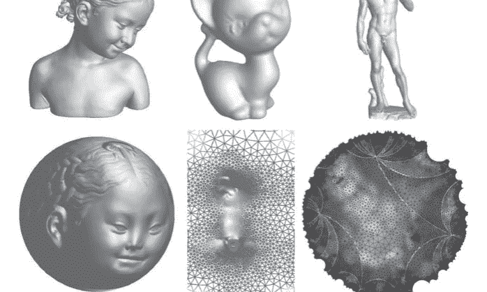


$$
(\mathbb{H}^2)\ \cos\theta_i=\frac{\cosh l_j\cosh l_k-\cosh l_i}{\sinh l_j\sinh l_k} \tag{4.15}
$$

$$
(\mathbb{E}^2)\ \cos\theta_i=\frac{-l_i^2+l_j^2+l_k^2}{2l_jl_k} \tag{4.16}
$$

基于余弦定理，光滑曲面上的曲率流可以推广到离散情形。

## 光滑曲面 Ricci 流

假设 \(S\) 是带黎曼度量 \(\mathbf{g}\) 的光滑曲面。Ricci 流根据高斯曲率 \(K(t)\)（由度量自身诱导）来变形度量 \(\mathbf{g}(t)\)，其中 \(t\) 是时间参数：

$$
\frac{d g_{ij}(t)}{dt}=-2K(t)g_{ij}(t) \tag{4.17}
$$

Ricci 流与热扩散过程之间存在类比关系。假设 \(T(t)\) 是曲面上的温度场。热扩散方程为 \(dT(t)/dt=-\Delta_gT(t)\)，其中 \(\Delta_g\) 是由曲面度量诱导的 Laplace–Beltrami 算子。随着 \(t\) 增加，温度场变得越来越均匀，最终将变成常数。

在物理意义上，Ricci 流诱导的曲率演化与曲面上的热扩散完全相同，如下所示：

$$
\frac{dK(t)}{dt}=-\Delta_{g(t)}K(t) \tag{4.18}
$$

其中 \(\Delta_{g(t)}\) 是由度量 \(\mathbf{g}(t)\) 诱导的 Laplace–Beltrami 算子。如果用 \(\mathbf{g}(t)=e^{2u(t)}\mathbf{g}(0)\) 替换方程 (4.17) 中的度量，则 Ricci 流可以简化为

$$
\frac{du(t)}{dt}=-2K(t) \tag{4.19}
$$

这表明度量应根据曲率而变化。下面的定理假设方程 (4.17) 中定义的 Ricci 流是收敛的，并导出一个共形均匀化度量。对于

类似地，如果我们假设网格嵌入到三维球面 \(S^3\) 中，那么每个面都是球面三角形。我们称该网格具有球面背景几何（见**图 4.2a**）。每个面的角度和边长满足球面余弦定理。

此外，如果我们假设网格嵌入到三维双曲空间 \(\mathbb{H}^3\) 中，那么所有面都是双曲三角形。我们称该网格具有双曲背景几何（见**图 4.2c**）。每个面的角度和边长满足双曲余弦定理。

在下面的讨论中，当需要时，我们会明确指定网格的背景几何。否则，相关概念或算法适用于所有类型的背景几何。

## 离散黎曼度量

网格 \(\Sigma\) 上的离散黎曼度量是具有锥奇异点的分段常数度量。在具有欧几里得度量的网格上，度量是具有锥奇异点的离散欧几里得度量。每个顶点都是一个锥奇异点。类似地，具有球面背景几何的网格上的度量是具有锥奇异点的离散球面度量；具有双曲背景几何的网格上的度量是具有锥奇异点的离散双曲度量。

网格 \(\Sigma\) 的边长足以定义离散黎曼度量：

$$
l:E\to\mathbb{R}^{+}
$$

只要对于每个面 \(f_{ijk}\)，边长满足三角形不等式 \(l_{ij}+l_{jk}>l_{ki}\)（适用于三种背景几何），并满足球面几何的另一个不等式 \(l_{ij}+l_{jk}+l_{ki}<2\pi\)。

## 离散高斯曲率

顶点 \(v_i\in\Sigma\) 上的离散高斯曲率 \(K_i\) 可以通过角度亏空计算：

$$
K_i=\begin{cases} 2\pi-\displaystyle\sum_{f_{ijk}\in F}\theta_i^{jk}, & v_i\notin\partial\Sigma\\[4pt] \pi-\displaystyle\sum_{f_{ijk}\in F}\theta_i^{jk}, & v_i\in\partial\Sigma \end{cases}
$$

其中 \(\theta_i^{jk}\) 表示面 \(f_{ijk}\) 中顶点 \(v_i\) 处的角，\(\partial\Sigma\) 表示网格的边界。离散高斯曲率由离散度量决定。

## 离散 Gauss–Bonnet 定理

Gauss–Bonnet 定理（方程 [4.2]）指出总曲率是一个拓扑不变量。它在网格上仍然成立，如下所示：

$$
\sum_{v_i\in V} K_i + \lambda \sum_{f_i\in F} A_i = 2\pi\chi(M) \tag{4.23}
$$

其中 \(A_i\) 表示面 \(f_i\) 的面积，\(\lambda\) 表示背景几何的常曲率：球面几何为 +1，欧几里得几何为 0，双曲几何为 −1。

## 离散共形形变

共形度量形变保持无穷小圆以及它们之间的交角。度量的离散共形形变使用有限半径的圆来近似无穷小圆。

圆填充度量的概念由 Thurston 于 1976 年提出（见 Thurston, 1980），如图 4.4 所示。设 \(\Gamma\) 是定义在顶点上的函数 \(\Gamma: V\to\mathbb{R}^+\)，它为顶点 \(v_i\) 分配一个半径 \(\gamma_i\)。类似地，设 \(\Phi\) 是定义在边上的函数 \(\Phi:E\to[0,\pi/2]\)，它为每条边 \(e_{ij}\) 分配一个锐角 \(\Phi(e_{ij})\)，并被称为边上的权重函数。在几何上，\(\Phi(e_{ij})\) 是以 \(v_i\) 和 \(v_j\) 为圆心的两个圆的交角。网格 \(\Sigma\) 上的顶点半径函数和边权重函数的组合 \((\Gamma,\Phi)\) 被称为 \(\Sigma\) 的 *圆填充度量*。

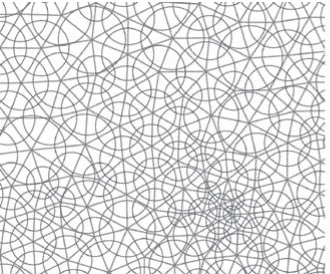

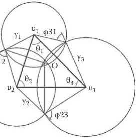

**图 4.4** 圆填充度量。(a) 平面圆填充度量。(b) 三角形上的圆填充度量。

**图 4.5**（见第 94 页后彩色插页）双曲 Ricci 流。(a) 亏格为二的花瓶模型，标有一组典型基本群生成元，这些生成元将曲面切割成一个具有八条边的拓扑圆盘：\(a_1,b_1,a_1^{-1},b_1^{-1},a_2,b_2,a_2^{-1},b_2^{-1}\)。(b) 基本域被共形地展平到带有标记边的 Poincaré 圆盘上。(c) Möbius 变换将边 \(b_1 \Rightarrow b_1^{-1}\) 移动。(d) 八个基本域副本通过八个 Möbius 变换一致地粘合。(e) 覆盖空间的有限部分被展平到 Poincaré 圆盘上。(f) 放大覆盖空间上的一个区域，八个基本域在此交汇。找不到接缝或重叠。(g) 由双曲展平诱导的共形参数化。棋盘格的角得到良好保持。

图 4.4 展示了圆填充度量。每个顶点 \(v_i\) 都有一个半径为 \(r_i\) 的圆。对于每条边 \(e_{ij}\)，交角 \(\phi_{ij}\) 由 \(v_i\) 和 \(v_j\) 的两个圆定义，这两个圆要么相交，要么相切。

同一网格上的两个圆填充度量 (\(\Gamma_1\), \(\Phi_1\)) 和 (\(\Gamma_2\), \(\Phi_2\)) 是 _共形等价的_，如果 \(\Phi_1 = \Phi_2\)。_共形形变_ 的圆填充度量只修改顶点半径，并保持边上的交角 \(\Phi\) 不变。

## 容许曲率空间

带有边权重 \(\Phi\) 的网格 \(\Sigma\) 被称为 *加权网格*，记作 \((\Sigma,\Phi)\)。下面，我们想要阐明加权网格的所有可能圆填充度量和所有可能曲率所构成的空间。设顶点集为 \(V=\{v_1,v_2,\ldots,v_n\}\)，半径为 \(\mathbf r=\{r_1,r_2,\ldots,r_n\}\)。令 \(u_i\) 为

$$
u_i=\begin{cases}\log r_i & \mathbb E^2\\[2pt]\log\tanh\dfrac{r_i}{2} & \mathbb H^2\\[2pt]\log\tan\dfrac{r_i}{2} & \mathbb S^2\end{cases} \tag{4.24}
$$

其中 \(\mathbb E^2\)、\(\mathbb H^2\) 和 \(\mathbb S^2\) 表示网格的背景几何。我们用向量 \(\mathbf u=(u_1,u_2,\ldots,u_n)^T\) 表示 \((\Sigma,\Phi)\) 上的圆填充度量。类似地，我们用曲率向量 \(\mathbf k=(K_1,K_2,\ldots,K_n)\) 表示网格顶点处的高斯曲率。所有可能的 \(\mathbf u\) 构成 *容许度量空间*，所有可能的 \(\mathbf k\) 构成 *容许曲率空间*。

根据 Gauss–Bonnet 理论（方程 [4.23]），总曲率必须为 \(2\pi\chi(\Sigma)\)，因此曲率空间是 \(n-1\) 维的。为了归一化度量，我们对度量向量 \(\mathbf u\) 添加一个线性约束 \(\sum u_i=0\)。因此，度量空间也是 \(n-1\) 维的。如果所有交角都是锐角，那么由圆填充诱导的边长满足三角形不等式。对 \(\mathbf u\) 没有进一步的约束。因此，容许度量空间就是 \(\mathbb R^{n-1}\)。

如果存在度量向量 \(\mathbf u\) 诱导出曲率向量 \(\mathbf k\)，则称 \(\mathbf k\) 是 *容许的*。加权网格 \((\Sigma,\Phi)\) 的容许曲率空间是一个凸多胞形，由下面的定理描述。详细证明可见 Chow 和 Luo (2003)。

### 定理 4.4

*设* \((\Sigma,\Phi)\) 是一个具有欧几里得背景几何的加权网格，\(I\) 是顶点的一个真子集，\(F_I\) 是顶点都在 \(I\) 中的面的集合，链环集 \(\operatorname{Lk}(I)\) 由面 \((e,v)\) 构成，其中 \(e\) 是一条边，\(v\) 是该面中的第三个顶点，

$$
\operatorname{Lk}(I)=\{(e,v)\mid e\cap I=\varnothing,\ v\in I\} \tag{4.25}
$$


## 离散曲面里奇流

假设 $(\Sigma,\Phi)$ 是一个具有初始圆填充度量的加权网格。离散里奇流定义如下：

$$\frac{du_i(t)}{dt}=({\bar K}_i-K_i)$$  (4.27)

其中 $\bar{\mathbf K}=(\bar K_1,\bar K_2,\ldots,\bar K_n)^T$ 是用户定义的目标曲率。离散里奇流与光滑里奇流（式 (4.2)）具有相同的形式，后者根据高斯曲率来变形圆填充度量，如式 (4.27) 所示。

离散里奇流可以在变分框架下表述——即，它是某种特殊能量形式的负梯度流。令 $(\Sigma,\Phi)$ 为具有球面（欧氏或双曲）背景几何的加权网格。对于任意两个顶点 $v_i$ 和 $v_j$，以下对称关系成立：

$$\frac{\partial K_i}{\partial u_j}=\frac{\partial K_j}{\partial u_i}$$  (4.28)

令 $\omega=\sum_{i=1}^{n}K_i\,du_i$ 为微分一次形式（Weitraub, 2007）。对称关系保证该一次形式在度量空间中是闭的（无旋）：

$$d\omega=\sum_{i,j}\left(\frac{\partial K_i}{\partial u_j}-\frac{\partial K_j}{\partial u_i}\right)du_i\wedge du_j=0$$  (4.29)

根据斯托克斯定理，以下积分与路径无关：

$$f(u)=\int_{u_0}^{u}\sum_{i=1}^{n}(\bar K_i-K_i)\,du_i$$  (4.30)

其中 $u_0$ 是任意初始度量。因此，上述积分是良定义的，被称为*离散里奇能量*。离散里奇流是离散里奇能量的负梯度流。诱导出 **k** 的离散度量是能量的极小值点。

84 ■ Wei Zeng 等人

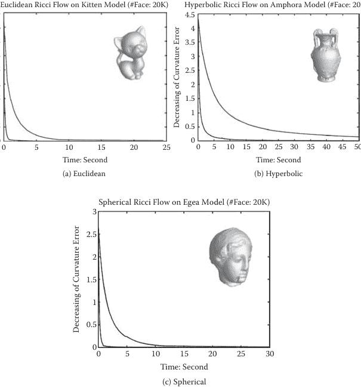

(a) 欧氏

(b) 双曲

(c) 球面

**图 4.6** 里奇流的性能。(a) 欧氏里奇流（RF），用于欧拉数为零的小猫模型；(b) 双曲里奇流（RF），用于欧拉数为负（−2）的花瓶模型；(c) 球面里奇流（RF），用于欧拉数为正（+2）的人头模型。横轴表示时间；纵轴表示最大曲率误差。蓝色曲线对应牛顿法；绿色曲线对应梯度下降法。网格约有 30k 个面。测试在一台配备 1.7 GHz CPU 和 1 G 内存的笔记本电脑上进行。所有算法均使用 C++ 编写，在 Windows 平台上运行，未使用任何其他数值库。

2. 里奇流和 Yamabe 流都是变分的。里奇流和 Yamabe 流的能量形式是凸的。但里奇流的度量空间（**u** 的定义域）是凸的，而 Yamabe 流的度量空间是非凸的。因此，使用牛顿法优化里奇能量是稳定的。对于 Yamabe 能量优化，算法需要更加谨慎。

[第 106 页]

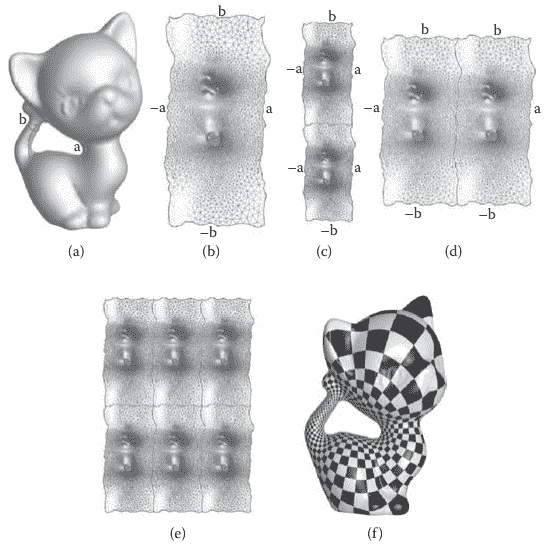

**图 4.7.** *（参见第 94 页后的彩色插页。）* 欧氏里奇流。(a) 亏格为一的小猫模型，标记了一组典型基本群生成元 *a* 和 *b*。(b) 一个基本域被共形展开到平面上，标记了四条边 *aba*⁻¹*b*⁻¹。(c) 一个平移将边 *b* 移至 *b*⁻¹。(d) 另一个平移将边 *a* 移至 *a*⁻¹。(e) 小猫网格的万有覆盖空间在平面上的布局，它铺满了整个平面。(f) 共形参数化用于纹理映射。将棋盘格纹理放置在 (b) 中的参数化上。由于所有棋盘格的角点角度都被保留，因此可以验证共形性。

3. Yamabe 流能够自动调整连接性以适应目标曲率，这使得它很有实用价值。在 Yamabe 流过程中，如果算法检测到退化三角形（其中某个角变为 π），则算法交换该角所对的边，并继续流动。遗憾的是，这种在流动过程中根据目标曲率调整连接性的重要技术无法直接推广到里奇流。

[第 107 页]

沿用前述讨论中的符号，令 $M$ 是嵌入 $\mathbb{R}^3$ 中的三角网格。令 $e_{ij}$ 为一条以 $v_i$ 和 $v_j$ 为端点的边。$d_{ij}$ 是由 $\mathbb{R}^3$ 的欧氏度量诱导出的 $e_{ij}$ 的边长。定义在顶点上的函数 $u: V \to \mathbb{R}$ 称为*离散共形因子*。边长 $l_{ij}$ 定义为

$$l_{ij}=e^{u_i+u_j}d_{ij}$$

令 $K_i$ 和 $\overline{K}_i$ 分别表示当前顶点曲率和目标顶点曲率。离散 Yamabe 流定义为

$$\frac{du_i(t)}{dt}=\overline{K}_i-K_i,$$

初始条件为 $u_i(0)=0$。Yamabe 流的收敛性已在 Luo (2004) 中得到证明。

此外，Yamabe 流是如下 Yamabe 能量的梯度流，令 $\mathbf{u}=(u_1,u_2,\ldots,u_n)$，其中 $n$ 为顶点总数：

$$f(\mathbf{u})=\int_{\mathbf{u}_0}^{\mathbf{u}}\sum_{i=1}^{n}(\overline{K}_i-K_i)\,du_i.$$

与里奇流类似，可以证明

$$\frac{\partial K_i}{\partial u_j}=\frac{\partial K_j}{\partial u_i}$$

Yamabe 能量是良定义且凸的。Hessian 矩阵可以很容易地构造如下。假设面 $f_{jk}$ 和 $f_{ji}$ 与边 $e_{ij}$ 相邻，定义边 $e_{ij}$ 的*权重*为

$$\omega_{ij}=\cot\theta_k+\cot\theta_l$$

其中 $\theta_k$ 是 $f_{ijk}$ 中在 $v_k$ 处的角，$\theta_l$ 是面 $f_{jil}$ 中在 $v_l$ 处的角。如果边位于边界上，且仅与 $f_{ijk}$ 相连，则

$$\omega_{ij}=\cot\theta_k$$

[第 108 页]

通过直接计算可以证明，曲率与共形因子之间的微分关系为

$$dk_i=\sum_j\omega_{ij}(du_i-du_j).$$  (4.37)

因此，Yamabe 能量的 Hessian 矩阵由下式给出

$$\frac{\partial^2 f(u)}{\partial u_i\partial u_j}=-\frac{\partial K_i}{\partial u_j}=\begin{cases}\omega_{ij},&i\ne j\\-\sum_k\omega_{ik},&i=j\end{cases}$$  (4.38)

在线性子空间 $\sum_i u_i=0$ 上，Hessian 矩阵是正定的。利用 Hessian 矩阵公式 4.38，可以有效地优化 Yamabe 能量 4.33。但主要的困难在于，对于固定连接性的网格，*容许度量空间* $\Omega(u)$ 不是凸的：

$$\Omega(u)=\{u\mid \forall f_{ijk}\in M,\ l_{ij}+l_{jk}>l_{ik}\}.$$  (4.39)

因此，在使用牛顿法的优化过程中，我们需要在每一步确保度量 **u** 位于容许度量空间 $\Omega(u)$ 中。如果检测到退化三角形 $f_{ijk}$，则我们交换其最长边。例如，如果 $\theta_k$ 超过 $\pi$，则交换边 $e_{ij}$，如图 4.8 所示。离散里奇流的主要困难在于找到具有所有锐角边交角的良好初始圆填充。对于离散 Yamabe 流，这个问题不存在。因此，Yamabe 流在实践中通常能产生更好的共形性。图 4.9 展示了使用 Yamabe 流的共形参数化。在 (a) 和 (b) 中，边界的

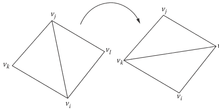

**图 4.8**  边交换。

[第 109 页]

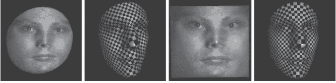

**图 4.9** 使用 Yamabe 流的共形参数化。(a, b) 边界曲率为常数。(c, d) 四个角处的曲率为 $\pi/2$，其余各处为零。

目标曲率为 $2\pi/m$，其中 $m$ 是边界顶点的总数。在 (c) 和 (d) 中，四个角处的曲率为 $\pi/2$，其余各处为零。图 4.10 展示了具有 3 条边界的零亏格曲面上的双曲 Yamabe 流。目标曲率对于内部顶点为 −1，对于边界顶点为 0。边交换的次数取决于初始连接性、初始曲率和目标曲率。

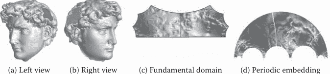

**图 4.10** 具有负欧拉数的曲面上的双曲 Yamabe 流。(a) 和 (b) 为一个具有 3 条边界的零亏格曲面的左视图和右视图。(c) 双曲空间 $\mathbb{H}^2$ 上的基本域。(d) $\mathbb{H}^2$ 上的周期共形嵌入。

## 应用

使用里奇流的 3D 曲面共形表示具有广泛的应用。

## 共形脑部映射

在医学影像中，比较不同的皮层表面有助于监测神经疾病的进展，或用于诊断


**图 4.10** 具有负欧拉数的曲面上的双曲 Yamabe 流。(a) 和 (b) 为一个具有 3 条边界的零亏格曲面的左视图和右视图。(c) 双曲空间 $\mathbb{H}^2$ 上的基本域。(d) $\mathbb{H}^2$ 上的周期共形嵌入。


## 3D 表面表示使用里奇流

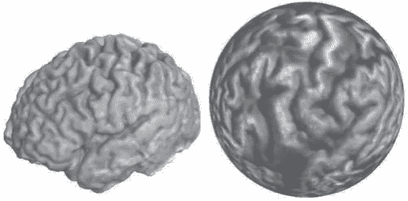

(a) 大脑皮层表面

(b) 符合大脑映射

**FIGURE 4.11** 符合大脑映射。(a) 一个大脑皮层表面，它是一个拓扑球体。(b) 将 (a) 映射到单位球体的球形符合映射。

潜在异常。人脑皮层表面高度卷曲。直接比较两个皮层表面的形状很困难。通过使用符合形状表示，我们可以将大脑表面映射到单位球体上，从而轻松比较它们的球形图像。通过测量它们符合因子和平均曲率函数之间的差异，可以量化形状之间的距离。图 4.11 展示了这种符合大脑映射的示例。详细信息见 Gu et al. (2004)。

大脑皮层表面上存在显著的生物学特征。在大脑表面匹配过程中，我们可以通过如下方式强制这些标志的对齐。如图 4.12 所示，皮层表面沿标志切开，然后映射到带有圆形孔的规范圆盘上。匹配过程中，对应的边界被对齐在一起。这保证了对应标志之间的匹配。

### 表面匹配

给定两个嵌入在 \(\mathbb{R}^3\) 中的表面 \(S_1, S_2\)，我们希望找到一个良好的匹配 \(f:S_1\to S_2\)，该匹配最小化它们之间的畸变。直接在 \(\mathbb{R}^3\) 中匹配表面通常很困难。如图 4.13 所示，我们计算两个符合映射 \(\phi_i:S_i\to\mathbb{D}\)，\(i=1,2\)，其中 \(\mathbb{D}\) 是规范单位盘。然后我们可以找到一个映射 \(\bar f:\mathbb{D}\to\mathbb{D}\)，它诱导出 \(f\)：

\[f = \phi_2^{-1} \circ \bar f \circ \phi_1 \tag{4.39}\]

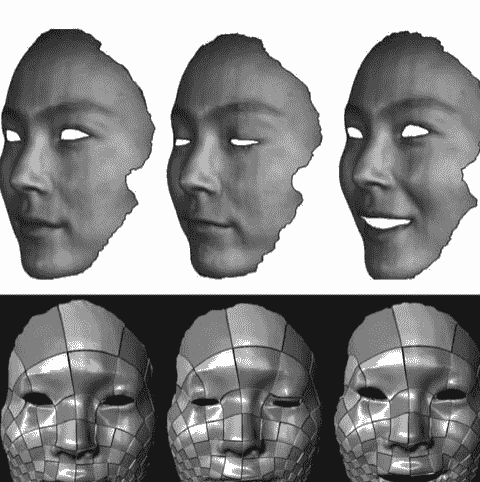

图 4.14 展示了一个用于 3D 人脸、不同表情的匹配结果。匹配结果通过一致的纹理映射说明。详细信息见 Zeng et al. (2008)。

具有相同拓扑的表面可以根据其符合结构进行分类。如果两个表面之间存在符合映射，则它们是符合等价的。所有符合等价类的空间称为 _Teichmüller space_。根据 Teichmüller 理论，Teichmüller space 也是一个有限维的黎曼多态。

所有属为零的封闭表面都符合映射到单位球体上；因此，属为零的封闭表面的 Teichmüller space 只包含一个点。属为一的封闭表面的维度为二。属为 \(g\) 的封闭表面的维度为 \(6g - 6\)。

给定一个在 \(\mathbb{R}^3\) 中的表面，其 Teichmüller 坐标可以通过里奇流计算。这些坐标可用于形状分类和索引。例如，图 4.15 展示了属为零、三条边界的表面 Teichmüller 形状空间。首先，我们使用里奇流计算出双曲度量，使得边界成为地质线。在双曲度量下三条边界的长度构成了 Teichmüller 坐标。

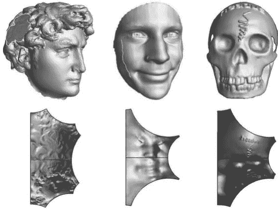

**FIGURE 4.15** (**See color insert following p. 94.**) 属为零、三条边界的表面 Teichmüller 空间。

该方法可推广到高属表面，如图 4.16 所示。首先，使用里奇流计算出双曲度量，该度量与原始的欧几里得度量相符合。然后，在基本群的每个同胚类中存在唯一的地质线。地质线的长度构成一个谱，该谱可以作为 Teichmüller 空间的坐标。详细信息见 Jin et al. (2008)。

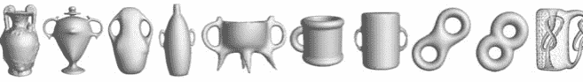

**FIGURE 4.16** 双曲度量下的地质线谱可以用于分类高属表面。

本文提出了一种严谨且通用的框架，用于在 3D 欧几里得空间中表示任意拓扑的 3D 表面。表面的几何信息被分解为四层——拓扑、符合结构、黎曼度量和平均曲率——这四层共同决定了表面在刚性运动下的唯一性。

里奇曲率流是计算表面表示的关键工具。本文介绍了最近被引入工程领域的离散曲率流方法：离散里奇流和离散ヤマベ流，用于表面。这些方法简要应用于大脑映射、表面匹配和 Teichmüller 形状空间。

未来，我们将研究里奇流与中层视觉之间的关系。

本工作得到 NSF CCF-0448399、NSF DMS-0528363、NSF DMS-0626223 和 NSF IIS-0713145 的支持。

视觉系统可以通过以下两种方式解释表面线索：形状可以被忽略（即使用平面近似），或者在解释视觉线索之前先估计表面形状以消除形状对解释的影响。

日常生活中众多运动和视觉任务需要我们的视觉系统使用密集的表面表示。例如，简单的把杯子放在桌子上这件事。即使桌面没有纹理，也没有用于表面位置和方向的视觉线索，人类 apparently 仍然能够轻松完成这项任务。在这种情况下，可以假设从桌子边缘的视觉线索会在桌面上传播，从而帮助完成放置任务。要注意，视觉系统不得不依赖稀疏的视觉线索来构建密集的表面表示的情况并不少见。除了缺乏纹理外，视觉场景可能只有极少量高度可靠且信息丰富的线索（例如来自正规形状强边缘的线索），这些线索在信息不足的位置难以有效使用。此类线索传播应依赖于对表面形状的先验知识，以便正确插值。

最真实的线索传播场景是当视觉表面平坦或缓慢弯曲且其方向已知时。对于非平坦表面，线索的解释取决于表面形状。虽然大多数之前的研究只关注平面或仅有一个主曲率方向的表面（如圆柱），本章考虑了更一般的非平坦表面情况。具体来说，它探讨了当视觉线索同时依赖于视角和形状时的线索集成问题。

在第一节中，我简要回顾了用于估计视觉场景及视觉表面属性的线索集成框架。线索集成考虑单个位置的证据，而线索传播则通过（插值）从多个位置的证据来补偿缺失或弱视线索。第二节讨论了检测弱线索并将其信息传播到相应位置的方法。第三节聚焦于非平坦表面，并提出形状估计先于线索解释的假设。我们报告了两项心理物理实验的发现，表明形状线索参与斜度线索的解释。


-   [例如，视觉、听觉和触觉（Ernst, Banks, and Bülthoff, 2000; Ernst and Banks, 2002; Battaglia, Jacobs, and Aslin, 2003）。]
-   在数学上，可以将条件独立性表示为条件概率的乘积。此外，还可以根据贝叶斯规则重写场景属性 $S$ 条件于线索 $I_1$ 和 $I_2$ 的概率。这使得可以根据观测到的线索（因果）推断场景属性（原因）：
  $$P(S\mid I_1,I_2)=\frac{P(I_1,I_2\mid S)P(S)}{P(I_1,I_2)}\propto P(I_1\mid S)P(I_2\mid S)P(S)$$  (5.1)
  这里右侧的条件概率描述了线索 $I_1$、$I_2$ 是如何由场景属性 $S$ 生成的，而 $P(S)$ 指示了关于 $S$ 的先验信息。分母可以忽略，因为它在给定场景下是常数。在独立高斯噪声的情况下，方程 (5.1) 导出了一个简单的线性规则用于线索整合（Cochran, 1937）：
  $$\hat{S}=\omega_1\hat{S}_1+\omega_2\hat{S}_2$$  (5.2)
  其中，$\hat{S}_1,\hat{S}_2$ 是从单个线索得到的场景属性估计；$\hat{S}$ 是综合线索估计；$\omega_1,\omega_2$ 是线索权重。可以证明，权重与线索不确定性（即噪声的方差）成反比，且综合估计的不确定性小于其任一组成部分的不确定性。线索不确定性和相应的线索权重会随视觉条件变化，而视觉系统的重要功能之一是据此调整线索权重。当权重已知时，方程 (5.2) 提供了简单的方法，以整合单个线索的估计，从而提高整体估计的准确性。
-   **Cue Conflict**
    由于视觉线索独立性仅是一种近似，如果感知系统能够补偿对线性规则的偏离，性能可以进一步提升。一种这种非线性，称为 *cue conflict*，当线索估计相差过大而无法有意义地结合时出现。这种差异最初被解释为处理错误和离群点（Landy et al., 1995）。为避免错误估计，较弱的线索会被下权或甚至从线索组合中剔除，使线索整合对离群点具有鲁棒性。
    这种对 cue conflict 的启发性处理最近在概率贝叶斯框架中得到合理化，即将大的 cue conflict 与错误的先验假设联系起来（Knill, 2003, 2007）。先验假设（而非场景属性的先验概率）是线索关于视觉场景的信息性所在。例如，如果假设世界由圆形物体组成，投影的圆形轮廓的长宽比是物体方向的良好线索。但如果世界中的物体轮廓为椭圆形（先验受限较弱），则长宽比线索的强度会大幅下降。该例子的核心思想是假设世界由圆形和椭圆形物体的混合体组成。
    在不同的观看条件下，每类物体的出现概率可能不同。这可以用混合先验模型来建模，指定每类物体的概率。随后，在冲突期间对线索的选择性衰减是基于每个先验模型的证据。数学上，线索似然的混合先验描述了线索是如何由不同物体类别生成的：
    $$P(I \mid S) = \pi_1 \times P(I \mid S, M_1) + \pi_2 \times P(I \mid S, M_2) \cdots$$  (5.3)
    这里与每个先验假设 $M_1, M_2$ 关联的概率通过 $\pi_1, \pi_2$ 加权，形成对线索 $I$ 的完整似然模型。权重反映了每个先验假设在当前环境中适用的程度。当出现大的冲突时，表明物体可能来源于先验受限较弱的集合。根据方程 (5.3)，当较不受约束的先验占主导时，会出现线索衰减效应。由于较不受约束的先验意味着线索信息更少，在 cue conflict 中线索权重会下降。
-   **Example of Robust Cue Integration**
    为展示线索整合的基本概念，我设计了一个简单的视觉示例，如图 5.1 所示。这里视觉表面形状由四个线索表示：纹理、遮光、遮蔽和轮廓。要注意，并非所有线索在同一时间都可用。特别是，在小倾斜（上行）时，仅有纹理和遮光线索存在；而在较大倾斜（下行）时，四个线索全部可用。左列的线索与表面形状一致，而为了演示 cue conflict，右列的遮光线索被使其与表面形状不一致。
    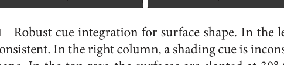
    在小倾斜时，遮光线索是最强的线索。根据线索整合框架，纹理和遮光线索被结合，遮光线索在组合中占主导。当线索不一致时，纹理线索的权重较小，会被从组合中剔除（上右图）。此时形状的感知仅基于遮光，尽管存在冲突，仍显得完全真实。这表明线索整合在出现离群点（即使离群点是正确的纹理线索）时具有鲁棒性。为演示线索强度随视觉条件变化的情况，考虑倾斜较大（下行）时的情形。此时会出现两个额外的形状线索——轮廓线索和遮蔽线索。此时轮廓线索最强，其余线索的贡献相对较小。在线索一致的情况下（下左图），形状感知保持完整。而在线索不一致的情况下（下右图），相对较弱的遮光线索被从组合中剔除。这是因为遮光线索因与更强的轮廓线索不一致而成为离群点。结果是，在较大倾斜时，遮光不再与表面形状相关，而是被感知为表面的颜色（下右图）。因此，视觉条件改变了线索的强度，决定了线索如何被结合或忽略。
-   **Cue Promotion**
    另一种线索整合的非线性发生在线索概率变为多模态，或多个线索依赖于共同参数（Landy et al., 1995; van Ee, Adams, and Mamassian, 2003; Adams and Mamassian, 2004）的情况下。当线索似然呈多模态时，线索可以相互交互以消除歧义：一个线索帮助另一个在其似然函数中选择特定的峰值。当线索依赖于共同参数时，交互的目的是促进线索（cue promotion）。促进线索的一个目标是消除线索对共同参数的相互依赖；另一个目标是将线索统一量纲，以便有意义地结合。例如，双眼视差和动态深度效应线索都随观看距离（共同参数）而变化，但变化方式本质不同。仅在一个观看距离时，它们产生一致的深度图像，可用于解出观看距离并恢复线索独立性。
    虽然关于 cue promotion 的具体机制大致未知，但它在算法层面并不构成重大挑战。事实上，Landy et al. (1995) 提出了多种方法来解求深度线索的共同参数。然而，如果某个场景属性的线索也依赖于随空间位置变化的表面形状，联合解决线索和形状可能并非易事（Ivanchenko, 2006）。更具计算可行性的解决方案是独立估计表面形状，其他场景属性。从某种意义上说，这类似于独立估计线索。相关讨论将在下一节中展开。
    总之，线索整合框架对信息提取和处理做出了若干主要假设，如使用简单的视觉特征（线索）和线索独立性。一方面，这些假设相当通用，能够简化计算和学习；另一方面，这些假设仅近似真实。视觉系统似乎通过 cue promotion 和歧义消除来补偿线索之间的简单依赖。为进一步提升性能，视觉系统会根据观看条件调整线索权重和先验概率。总体而言，线索整合框架使得


在单一空间位置上考虑线索时，这是对场景属性进行简单、鲁棒且统计最优估计的基础。

## 噪声线索情况下的线索传播

线索传播扩展了线索整合框架，允许在不同空间位置组合视觉线索。只有当视觉表面在某个邻域内具有相似属性时，这种整合的好处才是显而易见的；因此，我们只考虑平面或缓慢弯曲的表面。在这些情况下，由于视觉信息的冗余性，信息量大但稀疏的线索可以替代信息量较少的邻近线索。

James Coughlan 在本书第3章“3D重建中表面信息传播的机制”中详细描述了一种表面信息传播机制。该机制不仅在计算和学习时间上易于处理，而且在生理学上似乎也是合理的。它还允许在事先不知道表面位置和方向的情况下，沿着表面传播信息。只需指定一个先验约束，例如某个表面参数的平滑性，就足以产生一致且密集的表面表示。这些约束规定了信息在传播过程中如何被插值。

这里我从线索整合理论的角度审视这一机制，并在计算公式与线索概率之间建立一些类比。我重点关注视觉信息被传播到具有噪声且不可靠线索的表面区域的情况，并表明这种情况类似于线索冲突。主要目标是分析线索传播的条件，并比较不同先验约束在表面重建中的作用。作为一个例子，我使用基于双眼视差的三维（3D）表面重建，这与 Coughlan 在本书第3章中描述的内容相似。寻找双眼对应关系仍然是计算机视觉中的一个热门话题（Sun, Shum, and Zheng, 2002; Zhang and Seitz, 2005; Seitz et al., 2006）。其中一些挑战是强视觉线索的稀缺以及多个匹配假设的存在。尽管后一个特征不同于经典线索整合框架的假设（其中单峰高斯分布代表单一假设），但相同的原则仍然适用。例如，随着线索强度因观察条件变化而下降，先验信息的作用相应增加。

Coughlan 在本书第3章中描述的信息传播模型基于将表面概率化为马尔可夫随机场（MRF）。MRF 在计算机视觉中被广泛使用，用于表示具有局部交互的随机变量网格的联合概率（Weiss, 1997; Weiss and Freeman, 2001）。与线索整合类似，MRF 结合了图像线索的证据和线索的先验概率。与线索整合不同，MRF 对相邻变量施加约束以表示局部交互。

有多种方法可以对 MRF 进行推理，这些方法可以最大化边际概率或最大*后验*（MAP）概率。这些方法被证明在 MRF 无环的情况下表现最优，但也显示在含环情况下表现良好（Cochran, 1937; Felzenszwalb and Huttenlocher, 2006）。其中一种方法是信念传播，正如 Coughlan 在本书第3章中所建议的。这是因为 BP 明确描述了相邻变量如何交换与局部表面属性假设相关的消息。

就当前讨论而言，只需说明在 BP 过程中，MRF 中的每个变量向其邻居发送消息，并且该过程在整个网格中迭代，直到消息收敛。这些消息的内容反映了发送者基于所有局部可用证据（包括先验）对接收者可能性的最佳猜测。如果我们将离散可能性与一组关于视觉属性（例如图像中的视差）的假设联系起来，那么可以说，通过消息更新，BP 基于局部证据和先验约束之间的折衷动态地重新评估所有可能的假设。

注意，BP 没有明确的机制将强线索（即那些可能性具有强峰的线索）传播到包含弱线索（即那些可能性没有强峰的线索）的位置。然而，这种传播确实发生在 MRF 框架中。此外，如果线索传播区域包含具有平坦可能性的变量，传播可以得到促进。Coughlan 在本书第3章中描述了这种情况，其中视差信息从纹理图像区域传播到无纹理区域。注意，无纹理区域没有视差线索；因此，相应的可能性是平坦的。传播之所以发生，是因为算法收敛到的 MAP 是可能性和平滑先验的乘积，而对于具有相似可能性的变量，后者更高。因此，无纹理区域内部最初平坦的可能性获得了与区域边缘相似的值。重要的是，在这种情况下，具有平坦可能性的区域没有与传播进入该区域的证据相矛盾的证据。

这里我们考虑一种情况，即线索存在于整个图像中，但在某些区域是微弱或嘈杂的（如同低对比度纹理区域中发生的那样）。因此，线索可能性不是平坦的，而是有少数微弱的峰，对应于多个匹配假设。一些峰是立体图像对中一个或两个图像中的随机噪声的结果。尽管这些嘈杂的可能性看起来类似于平坦的，但传播是有限的。正如计算机模拟所显示的，具有嘈杂可能性的区域中的变量收敛到 MAP 概率，这些概率很少或没有受到邻近强可能性区域的影响。因此，在可能性不完全平坦的情况下，传播是有限的。

从算法上讲，这可以解释为：当噪声区域内两个变量的可能性巧合地表达相似的假设时，这些假设会被平滑先验强化。具有这种强化可能性的变量成为传播的主要障碍。这是因为它们的可能性中表达的假设往往不支持传播进入该区域的假设（反之亦然）。需要更多的研究来更好地理解 MRF 中信息传播的因素。这里我提出一些改进噪声线索区域传播的解决方案。

一个直接的解决方案是不考虑具有噪声或弱线索的区域。这是基于相关的立体视觉中视差验证过程的常见做法。该过程的明显缺点是视差图中出现空洞。另一个解决方案是使用多尺度 MRF，其中粗尺度上的短距离传播对应于细尺度上的长距离传播。然而，一个更有原则的方法是检测弱可能性并将其展平。离散弱可能性的初步定义可以基于其峰值的幅度与单水平预期平均值之间的比较。如果可能性的峰不比期望平均值大很多，则该可能性是弱的。注意，检测弱可能性类似于在线索冲突期间发现弱线索。此外，展平过程类似于在鲁棒线索整合期间忽略不一致的线索。这是因为平坦的可能性不携带任何假设，因此不能被视为线索。

有趣的是，尽管可能性展平方法纯粹是从实际考虑中得出的，但它有理论上的依据。它基于第一节中讨论的线索冲突的概率理论。在数学上，该理论描述了使线索具有信息量的先验假设的混合。对于寻找双眼对应关系的问题，我们可以将图像建模为至少两类物体的混合。一类包含强边缘（例如，物体轮廓和高对比度纹理），另一类包含低对比度强度的图像区域（例如，物体表面的均匀颜色和低对比度纹理）。对于第一类物体，我们可以使用信息量很强的边缘线索；而对于第二类物体，线索的信息量较弱。根据先验混合方法，我们可以将完整的线索可能性表示为

$$P(I\mid S)=\pi_{edge}P(I\mid S,M_{edge})+\pi_{intensity}P(I\mid S,M_{intensity}) \tag{5.4}$$

这里可能性的第一个成分来自信息丰富的边缘线索，第二个成分来自信息较弱的强度线索。边缘强度可用于指示每个先验模型适用的权重。那么一个表示匹配误差 $m(D)$ 在某个图像位置和视差 $D$ 下的可能性公式（Coughlan, 2011, this volume），

$$P(m(D)\mid D)=\frac{1}{Z}e^{-\mu m(D)} \tag{5.5}$$

可以重写为

$$P(m(D)\mid D)=\frac{1}{Z'}\left[\pi_{edge}e^{-\mu_1m(D)}+\pi_{intensity}e^{-\mu_2m(D)}\right] \tag{5.6}$$

其中 $\mu_2<\mu_1$ 以反映强度线索比边缘线索信息量少的事实。在边际情况 $\mu_2=0,\pi_{intensity}=1$ 且 $\pi_{edge}=0$ 下，我们得到上述的展平可能性方法。注意，为了检测具有弱可能性的线索，可以直接分析可能性峰，这比测量边缘强度更有益。前者的优势在于它能够发现弱可能性的原因不仅是低对比度纹理，还有高度规则的纹理（即产生多个匹配假设的纹理）。

正如计算机模拟所示，展平弱可能性大大改善了视差信息向弱线索区域的传播。这种方法特别适用于立体算法，因为它们通常依赖某种平滑约束来证明线索传播的合理性。


106 弗拉基米尔·V·伊万琴科

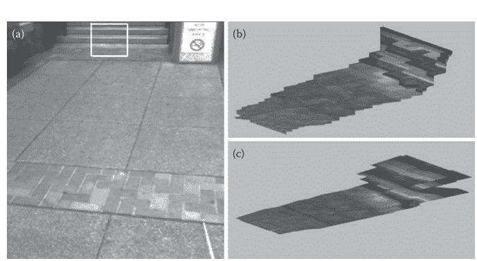

并且提供了一种合理的方式，沿着表面插值信息。唯一通常不强制执行平滑性约束的图像区域对应于物体边界；但那些区域通常具有带有强线索的高对比度像素，因此不受传播的影响。因此，线索冲突理论似乎至少适用于一个计算机视觉问题，在该问题中，它促进了信息传播以及从稀疏线索生成密集立体图。

图5.2展示了基于上述展平方法对表面区域的三维重建。注意，重建的表面是密集的，并且没有基于相关的立体匹配中常见的空洞。可以在VGA图像分辨率和32个视差级别下，以近实时（在GPU上小于200毫秒）运行BP算法（Ivanchenko, Shen, and Coughlan, 2009）。

我们特意重建了一个远处的图像区域，因为视差线索的强度随着观看距离的增加而减弱。这使得远处区域成为观察弱线索和分析平滑性约束作用的良好候选，平滑性约束在线索强度减弱时增强。注意，该约束描述了世界中视觉表面的属性，而非描述图像属性的先验混合。

在三维重建中，我们使用了两种不同的平滑性约束：一种强制视差平滑，另一种强制视觉表面高程平滑。这些约束为沿表面自动插值信息提供了一种方式，同时也使表面重建偏向于生成前平行表面块（视差先验）或与地平面平行的表面块（高程先验）。从图5.2中可以看出，楼梯的重建表面根据相应的平滑性假设而具有不同的形状。两种重建仅在线索较强（即具有强边缘）的位置看起来相似。

注意，虽然展平方法有助于获得密集的表面表示，但在线索较弱的区域，表示形式会受到平滑性约束的影响。哪种重建以及相应的平滑性约束更好？这个问题没有唯一答案。影响约束选择的因素包括环境结构、任务要求以及最终表示的紧凑性（例如，视差级别的数量）。

总之，本节从线索整合的角度分析了考夫兰（Coughlan）在本书第三章中描述的信息传播方法。具体来说，我们考虑了强线索跨越平坦或缓慢弯曲的表面传播到弱线索或噪声线索区域的情况。为了保证传播效率，有人建议将仅具有弱峰的线索似然完全展平。这在概率方法下是合理的，该方法考虑了每个线索的先验假设的混合。为了找到密集的视差图，立体图像被建模为两类物体的混合：一类具有强边缘，另一类具有低对比度强度。注意，第一类物体在自然图像中通常很稀疏，并且具有强线索；第二类物体不那么稀疏，但线索较弱。为了在某个图像位置定义每个类别的先验概率，可以使用边缘强度或直接分析线索似然。虽然先验混合描述了图像属性，但还有另一类描述表面的先验。本节分析了这两种先验（高程平滑性和视差平滑性）对三维重建的影响。

## 非平坦表面的线索解释

到目前为止，我们描述了线索如何在单个位置被整合，以及它们如何沿着平坦或缓慢弯曲的表面传播到不同位置。在非平坦表面的一般情况下，我们必须处理这样一个事实：某些表面属性的视觉线索也可能取决于表面形状。例如，考虑用于倾斜的纹理透视缩短线索。在非平坦表面的情况下，该线索同时取决于表面倾斜和形状。因此，为了从倾斜的角度解释该线索，应将形状的影响与倾斜的影响分开。此外，如果多个线索出现在非平坦表面的同一位置，由于“解释消除”现象，它们不再独立。例如，不同的倾斜线索可能相互依赖于表面形状。这违反了线性线索组合理论的假设，并可能使线索整合成为一个困难的问题。

这个问题的一个解决方案是模块化方法。类似于在线索整合中，每个线索由独立模块分别处理，我们可以为表面形状和倾斜的估计分配单独的模块。然后，例如，在倾斜模块中，关于形状的信息将以固定的先验来表示。在估计完成后，会发生有限的交互，模块之间交换信息以更新其先验。

支持模块化方法的另一个观察结果是，形状的线索可能非常复杂且具体。例如，考虑用于形状的着色线索。该线索取决于光源方向向量、光谱、表面反射特性等。很难想象这种特定线索与表面倾斜线索之间存在交互机制。另一方面，如果在形状处理模块的输出端以独立于线索的形式（例如表面曲率）表示形状，则将这种表示纳入倾斜线索的解释会容易得多。因此，简洁性原则表明，表面形状应单独估计，并用于表面线索的正确解释和整合。此外，根据第二节中描述的原理，形状信息可用于沿非平坦表面传播稀疏线索。换句话说，形状估计有助于在稀疏的位置自动插值表面线索。

用于形状处理的感知机制尚待研究，但我们的目标是确定人类视觉系统是否可以使用形状信息来正确解释表面线索。为了研究这个问题，我们进行了两个心理物理学实验，详见Ivanchenko（2006）。这些实验使用倾斜辨别任务来分析形状线索对受试者表现的作用。视觉线索是着色和纹理。注意，这些线索同时受表面的倾斜和形状影响。换言之，用于倾斜的线索相互依赖于表面形状，反之亦然。刺激形状由波纹表面表示，这些表面在大尺度上是平面的，在小尺度上具有大致垂直的脊状图案。表面在三种条件下渲染：纹理、着色和组合线索（参见**图5.3**）。

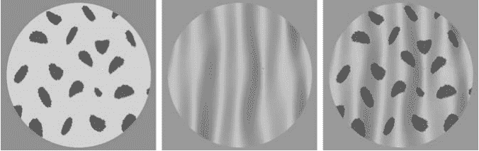

**图5.3** 倾斜辨别任务中的线索条件。纹理（左）由反应-扩散过程生成，并且统计上均匀。着色（中）是漫反射和环境分量的混合，点光源位于表面上方。组合线索条件（右）同时具有两种线索。表面形状是二维高斯函数的混合，这些高斯函数在网格上对齐并具有大致垂直的方向。

注意，着色条件下的刺激对倾斜的线索非常弱，并且存在朝向前平行解释的偏差。为了减少这种偏差，我们使用了包括同一条件下表面两次顺序呈现试验的倾斜辨别任务。在每次试验中，受试者必须选择倾斜角度更大的表面。受试者的表现通过心理测量函数进行汇总。

为了理解视觉系统如何处理倾斜信息，我们将受试者的表现与线性线索组合所预期的表现进行了比较。如下所示，线性模型假设在估计倾斜时不估计形状。或者，视觉系统可以使用关于表面形状的信息来进行倾斜估计。为了测量辨别任务中的表现，我们计算了心理测量函数的阈值。假设高斯噪声，阈值与噪声的标准差成正比。根据线性规则，纹理（σₜₑₓ）和着色


(\(\sigma_{shad}\)) 条件可用于计算联合条件下的期望线性阈值 (\(\sigma_{linear}\))：

\[
\frac{1}{\sigma_{linear}^{2}}=\frac{1}{\sigma_{tex}^{2}}+\frac{1}{\sigma_{shad}^{2}}\tag{5.7}
\]

注意，只有在视觉系统忽略形状（例如使用平面近似）时，这样的规则才适用。如果视觉系统利用形状估计来辅助斜度估计，线性规则就不是最优的。这是因为应用于斜度辨别的线性规则描述的是两种斜度线索的整合，但忽略了它们与形状线索的交互。在联合线索条件下，最优情况下，形状估计的整体准确率会提高，并且在这些过程相互作用时还能进一步改善斜度估计。我们发现，联合线索条件下的平均阈值显著低于期望线性阈值（\(t\)-检验，\(p = 0.046\)）。因此，被试的表现远优于线性规则所的预期，这表明形状和斜度估计过程会相互作用。

为了获取形状线索在斜度辨别中作用的更多证据，我们进行了第二个实验，将纹理和阴影线索分离。具体来说，我们使后者对斜度线索的解释不提供信息。这是通过将图像中的纹理投影水平平移实现的。尽管操作如此剧烈，线索冲突却几乎不可察觉，纹理仍然被视为附着在阴影所描绘的视觉表面上。经过这种操作后，联合线索条件下的阈值相比第一个实验测得的阈值显著增加（\(t\)-检验，\(p = 0.015\)）。由于我们的刺激操作对形状线索而非斜度线索造成了冲突，因此我们得出结论：准确的形状信息对斜度线索的解释至关重要。总体而言，两个心理物理实验的结果表明，利用形状信息能提高被试在斜度辨别任务中的表现，而缺乏一致的形状信息会显著降低被试的表现。我们得出结论：人类视觉系统利用形状线索来正确解释斜度线索。

## 结论

在本章中，我们从线索整合理论的视角回顾了Coughlan在本书第3章中描述的信息传播机制。我们发现信息传播的计算模型与线索整合的基本原理之间有许多相似之处。我们还发现，线索冲突理论可用于改善信息向弱线索和噪声线索区域的传播。利用这一改进，我们从具有稀疏强线索的立体图像对中获得了稠密的3D表面重建。重要的是，3D重建的形状取决于先验约束的形式，这种约束有助于沿平坦或缓慢弯曲的表面插值信息。对于非平坦表面，我们证明人类视觉系统利用形状信息来增加斜度视觉线索的信息量。这与以下假设一致：表面形状被单独估计，以促进其他线索的解释，并在线索稀疏的位置进行插值。

## 致谢

我要感谢James Coughlan、David Knill和Ender Tekin对手稿的有益反馈。

将观察者记忆中的形状与2.5维草图进行匹配。如果它们不熟悉，观察者就必须从多个观察方向观察物体，并将可见表面整合成3D形状表征。

从深度线索重建和识别表面或许是可能的，尽管目前还没有可以可靠完成此任务的计算模型。人类观察者也无法可靠地完成。这些失败表明，大脑可能使用另一种方法恢复3D形状，这种方法不依赖深度线索作为形状信息的唯一甚至主要来源。请注意，观察者还有另外两个信息来源：由图-底组织产生的2D视网膜形状，以及代表自然世界统计特征的3D形状先验。图-底组织已在第一段中定义，下面将讨论。3D形状先验包括3D对称性和3D紧凑性。这些先验最近被本文作者用于他们的3D形状感知模型中（Pizlo, 2008; Sawada and Pizlo, 2008a; Li, 2009; Li, Pizlo, and Steinman, 2009; Sawada, 2010; Pizlo et al., 2010），将在下一节讨论。

## 图-底组织

图-底组织的概念由格式塔心理学家在20世纪上半叶提出（Wertheimer, 1923/1958; Koffka, 1935）。格式塔心理学家强调，我们并不感知视网膜图像。我们看到的是物体和场景，能够感知地判断它们的形状、大小和颜色，但我们很难（甚至完全不能）判断它们的视网膜图像。尽管观察条件（观察方向、距离和光源色度）发生变化，我们仍能真实地看到物体的形状、大小和颜色，这一事实分别被称为*形状恒常性*、*大小恒常性*和*颜色恒常性*。观察条件的变化会改变*视网膜图像*，但*知觉*保持恒定。这些恒常性是如何实现的？格式塔心理学家指出，知觉可以通过*简单性原则*的作用来解释。具体来说，根据格式塔学派的观点，知觉是视网膜图像的最简单解释。图6.1和图6.2说明了简单性原则如何解释知觉。图6.1可以解释为两个重叠的矩形，或两个相接的六边形。前者更容易被看到，因为它更简单。显然，两个对称的矩形是比两个非对称六边形更简单的解释。图6.2a可以解释为两条形成X形的线，或两条在顶点相接的V形线（V被感知为垂直或水平）。

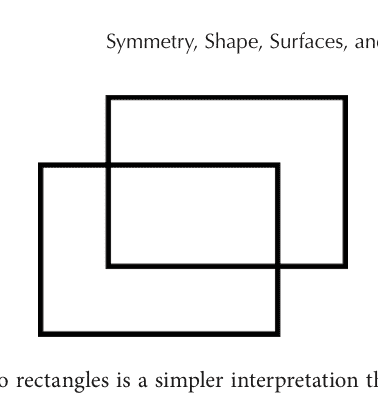

读者更可能看到前一种解释，因为它更简单。在图6.2b中，读者感知到两个相接的封闭形状。注意，图6.2b是由图6.2a“闭合”两个水平V形得到的。视网膜上的封闭2D形状几乎总是由3D形状的遮挡轮廓产生的。因此，这种解释更有可能。所以，全局闭合很可能会改变对X的局部解释。闭合等空间全局方面影响空间局部知觉的事实，反驳了Marr对格式塔心理学的批评。Marr（1982）声称，所有知觉分组的例子都可以通过递归应用邻近性、相似性和平滑性的局部算子来解释。如果Marr是对的，那么知觉的“整体就等于部分之和”。图6.2b为Marr的主张提供了一个反例。


一般而言，形成知觉形状不能通过总结空间局部算子的结果来解释。算子必须是空间全局的。

很明显，知觉比视网膜图像更有序、更丰富、更简单，也更真实。这一事实表明视觉系统向视网膜图像添加了信息。这种“构型性”效应能被形式化吗？再看图6.1，你看到两个“完美的”矩形。它们之所以完美，是因为代表边缘的线被感知为笔直且平滑的。考虑到视网膜的输出更像图6.3所示，这非常了不起。具体来说，视网膜受体对连续的视网膜图像进行离散采样，而且采样实际上是不规则的。对矩形连续边缘的知觉可以通过插值和平滑产生。具体来说，可以构建一个包含两个分量的代价函数：第一个评估知觉解释与数据之间的差异（误差），第二个评估知觉解释的复杂度。知觉对应于代价函数的最小值。显然，两个具有直线边缘的矩形比一组不相关的点或两个边缘参差不齐的矩形是更好（更简单）的解释。这个例子表明，传统的费希纳式感知方法是不可取的。

根据费希纳（1860/1966）的方法，知觉是视网膜测量的结果。认为这类属性

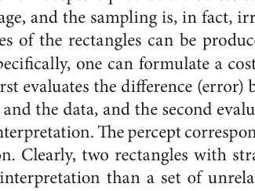


of the retinal image as light intensity or position could be measured by the visual system. It is less obvious how 3D shape can be measured on the retina. When we view a Necker cube monocularly, we see a cube. This percept cannot be a *direct* result of retinal measurement, because this 2D retinal image is actually consistent with infinitely many 3D interpretations. The only way to explain the percept is to assume that the visual system “selects” the simplest 3D interpretation. Surely, a cube, an object with multiple symmetries, is the simplest 3D interpretation of any of the 2D images of the cube (except for several degenerate views). Note also that a cube is a maximally compact hexahedron. That is, a cube is a polyhedron with six faces whose volume is maximal for a given surface area. Recall that both symmetry and compactness figured prominently in the writings of the Gestalt psychologists (Koffka, 1935).

We now know that it is more adequate to “view” 3D shape perception as an inverse problem, rather than as a result of retinal measurements (Pizlo, 2001, 2008). The forward (direct) problem is represented by the retinal image formation. The inverse problem refers to the perceptual inference of the 3D shape from the 2D image. This inverse problem is ill posed and ill conditioned, and the standard (perhaps even the only) way to solve it is to impose *a priori* constraints on the family of possible 3D interpretations (Poggio, Torre, and Koch, 1985). In effect, the constraints make up for the information lost during the 3D to 2D projection. The resulting perceptual interpretation is likely to be veridical if the constraints represent regularities inherent in our natural world (natural world statistics). If the constraints are deterministic, one should use regularization methods. If the constraints are probabilistic, one should use Bayesian methods. Deterministic methods are closer to the concept of a Gestalt simplicity principle, whereas probabilistic methods are closer to the concept of a likelihood principle, often favored by empiricists. Interestingly enough, these two methods are mathematically equivalent, as long as simplicity is formulated as an economy of description. This becomes quite clear in the context of a minimum description length approach (Leclerc, 1989; Mumford, 1996). The close relation between simplicity and likelihood was anticipated by Mach (1906/1959) and discussed more recently by Pomerantz and Kubovy (1986). Treating visual perception as an inverse problem is currently quite universal, especially among computational modelers. This approach has been used to model binocular vision, contour, motion, color, surface, and shape perception (for a review, see Pizlo, 2001).

It follows that if one is interested in studying the role of *a priori* constraints in visual perception, one should use distal stimuli that are as different from their retinal images as possible. This naturally implies that the distal stimuli should be 3D objects or images of 3D objects. In such cases, the visual system will have to solve a difficult inverse problem, and the role of constraints can be easily observed. If 2D images are distal stimuli, as in the case of examples in Figures 6.1, 6.2, and 6.3, *a priori* constraints may or may not be involved depending on whether the visual system “tries” to solve an inverse problem. As a result, the experimenter may never know which, if any, constraints are needed to explain a given percept. Furthermore, veridicality and constancy of the percept are poorly, if at all, defined with such stimuli. Also, if effective constraints are not applied to a given stimulus, then the inverse problem remains ill posed and ill conditioned. This means that the subjects’ responses are likely to vary substantially from condition to condition. In such a case, no single model will be able to explain the results. This may be the reason for why the demonstrations involving 2D abstract line drawings (like those in Kanizsa’s 1979 book) are so difficult to explain by any single theory. Figure–ground organization and amodal completion are hard to predict when the distal stimulus is 2D. We strongly believe that figure–ground organization should be studied with 3D objects. Ambiguities rarely arise with images of natural 3D scenes, because the visual system can apply effective constraints representing natural world statistics.

We want to point out that perceptual mechanisms underlying figure–ground organization are still largely unknown. But we hope that our 3D shape recovery model will make it easier to specify the requirements for the output of figure–ground organization. Once the required output of this process is known, it should be easy to study it. The next section describes our new model of 3D shape recovery. A discussion of its implications is presented in the last section.

## Using Simplicity Principle to Recover 3D Shapes

We begin by observing that 3D shape is special because it is a complex perceptual characteristic, and it contains a number of regularities. Consider first the role of complexity. Shapes of different objects tend to be quite different. They are different enough so that differently shaped objects never produce identically shaped retinal images. For example, a chair and a car will never produce identically shaped 2D retinal images, regardless of their viewing directions, and similarly with a teapot, book, apple, and so forth. This implies that each 3D shape can be uniquely recognized from any of its 2D images. This fact is critical for achieving shape constancy. More precisely, if the observer is familiar with the 3D shape, whose image is on his or her retina, this shape can be unambiguously identified. What about the cases when the 3D shape is unfamiliar? Can an unfamiliar shape be perceived veridically? The answer is yes, as long as the observer’s visual system can apply effective shape constraints to perform 3D shape recovery. Three-dimensional symmetry is one of the most effective constraints. It reduces the ambiguity of the shape recovery problem substantially. The role of 3D symmetry will be explained next.

Figure 6.4a consists of 13 points, images of vertices of a 3D symmetric polyhedron shown in Figure 6.4b. The polyhedron in Figure 6.4b is perceived as a 3D shape; the points in Figure 6.4a are not. The points in Figure 6.4a are perceived as lying on the plane of the page. Formally, when a single 2D image of N unrelated points is given, the 3D reconstruction problem involves N unknown parameters, the depth values of all points. The problem is so underconstrained that the visual system does not even “attempt” to recover a 3D structure. As a result, we see 2D, not 3D, points. When points form a symmetric configuration in the 3D space, the reconstruction problem involves only one (rather than N) unknown parameter—namely, the 3D aspect ratio of the configuration (Vetter and Poggio, 1994; Li, Pizlo, and Steinman, 2009; Sawada, 2010). Note that the visual system must organize the retinal image first and (1) determine that the image could have been produced by a 3D symmetric shape and (2) identify which pairs of image features are actually symmetric in the 3D interpretation.

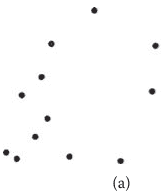

(a)

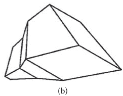

(b)

**FIGURE 6.4** Static depth effect. The three-dimensional (3D) percept produced by looking at (b) results from the operation of the 3D symmetry constraint when it is applied to an organized retinal image. The percept is not 3D when the retinal image consists of a set of unrelated points, like that in (a). (Reprinted with permission from Pizlo et al., 2010.)

These two steps can be accomplished when the 2D retinal image is organized into one or more 2D shapes. Clearly, the visual system does this in the case of Figure 6.4b, but not Figure 6.4a. The only difference between the two images is that the individual points are connected by edges in Figure 6.4b. Obviously, the edges are not drawn arbitrarily. The edges in the 2D image correspond to edges of a polyhedron in the 3D interpretation. The difference between Figure 6.4a and Figure 6.4b is striking: the 3D percept in the case of Figure 6.4b is automatic and reliable. In fact, the reader cannot avoid seeing a 3D object no matter how hard he or she tries. Just the opposite is true with Figure 6.4a. It is impossible to see the points as forming a 3D configuration. Adding “meaningful” edges to 2D points is at least as powerful as adding motion in the case of kinetic depth effect (Wallach and O’Connell, 1953). We might, therefore, call the effect presented in Figure 6.4, a static depth effect (SDE).

How does symmetry reduce the uncertainty in 3D shape recovery? In other words, what is the nature of a symmetry constraint? A 3D reflection cannot be undone, in a general case, by a 3D rigid rotation, because the determinant of a reflection matrix is “−1,” whereas the determinant of a rotation matrix is “+1.” However, a 3D reflection is equivalent to (can be undone by) a 3D rotation when a 3D object is mirror symmetric. It follows that, given a 2D image of a 3D symmetric object, one can produce a virtual 2D image of the same object, by computing a mirror image of the 2D real image. This is what Vetter and Poggio (1994) did. A 2D virtual image is a valid image of the same 3D object, only if the object is mirror symmetric. So, a 3D shape recovery from a single 2D image turns out to be equivalent to a 3D shape recovery from two 2D images, when the 3D shape is mirror symmetric. It had been known that two 2D orthographic images determine the 3D interpretation with only one free parameter (Huang and Lee, 1989).

The fact that a mere configuration of points and edges in the 2D image gives rise to a 3D shape perception encouraged us to talk about 3D shape *recovery*, as opposed to *reconstruction*. The 3D shape is not actually *constructed* from individual points. Instead, it is produced (recovered) in one computational step. The one-parameter family of 3D symmetric interpretations consistent with a single 2D orthographic image is illustrated in Figure 6.5. The 2D image (line drawing) is shown on top. The eight shaded objects are all mirror symmetric in 3D, and they differ from one another with respect to their aspect ratio. The objects on the left-hand side are wide, and the objects on the right-hand side are tall. There are infinitely

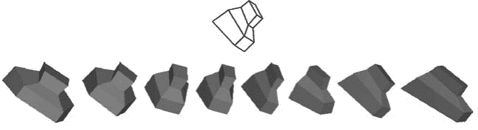

**FIGURE 6.5** 阴影的三维（3D）物体展示了可能的、3D 对称解释的线条图（上方）所对应的所有 3D 形状的一个参数族。

many such 3D symmetric shapes. Their aspect ratio ranges from infinitely large to zero. Each of these objects can produce the 2D image shown on top. How does the visual system decide among all these possible interpretations? Which one of these infinitely many 3D shapes is most likely to become the observer’s percept? We showed that the visual system decides about the aspect ratio of the 3D shape by using several additional constraints: maximal 3D compactness, minimum surface area, and maximal planarity of contours (Sawada and Pizlo, 2008a; Li, Pizlo, and Steinman, 2009; Pizlo et al., 2010). These three constraints actually serve the purpose of providing an interpretation (3D recovered shape) that does not violate the nonaccidental (generic) viewpoint assumption. Specifically, the recovered 3D shape is such that the projected image would not change substantially under small or moderate changes in the viewing direction of the recovered 3D shape. In other words, the 3D recovered shape is most likely. This means that it is also the simplest (Pizlo, 2008).

Several demonstrations illustrating the quality of 3D shape recovery from a single 2D image can be viewed at [http://www1.psych.purdue.edu/~sawada/minireview/](http://www1.psych.purdue.edu/~sawada/minireview/). In Demo 1, the shapes are abstract, randomly generated polyhedra. In Demo 2, images of 3D models of real objects, as well as real images of natural objects are used. In Demo 3, images of human bodies are used. In all these demos, the 2D contours (and skeletons) were drawn by hand and “given” to the model. First, consider the images of randomly generated polyhedra, like those in Figure 6.4b (go to Demo 1). The 2D image contained only the relevant contours—that is, the visible contours of the polyhedron. The model had information about where the contours are in the 2D image and which points and which contours are symmetric in 3D. Obviously, features that are symmetric in 3D space are not symmetric in the 2D image. Instead, they are skew-symmetric (Sawada and Pizlo, 2008a, 2008b). There is an invariant of the 3D to 2D projection of a mirror-symmetric object. Specifically, the lines connecting the 2D points that are images of pairs of 3D symmetric points are all parallel to one another in any 2D orthographic image, and they intersect at a single point (called a vanishing point) in any 2D perspective image. This invariant can be used to determine automatically the pairs of 2D points that are images of 3D symmetric points. Finally, the model had information about which contours are planar in 3D. Planarity constraint is critical in recovering the back, invisible part of the 3D shape (Li, Pizlo, and Steinman, 2009). We want to point out, again, that the information about where in the image the contours are and which contours are symmetric and which are planar in 3D corresponds to establishing figure-ground organization in the 2D image. Our model does not solve the figure-ground organization (yet). The model assumes that figure-ground organization has already been established. It is clear that the model recovered these polyhedral shapes very well. The recovered 3D shapes are accurate for most shapes and most viewing directions. That is, the model achieves shape constancy. Note that the model can recover the entire 3D shape, not only its front, visible surfaces. The 3D shapes recovered by the model were similar to the 3D shapes recovered by human observers (Li, Pizlo, and Steinman, 2009).

Next, consider examples with 3D real objects (Demo 2). One of us marked the contours in the image by hand. Note that the marked contours were not necessarily straight-line segments. The contours were curved, and they contained “noise” due to imperfect drawing. The reader realizes that marking contours of objects in the image is easy for a human observer; it seems effortless and natural. However, we still do not know how the visual system does it. After the contours were drawn, the pairs of contours that are symmetric in 3D and the contours that are planar were labeled by hand. Because objects like a bird or a spider do not have much volume and the volume is not clearly specified by the contours, the maximum compactness and minimum surface area constraints were applied to the convex hull of the 3D contours. The convex hull of a set of points is the smallest 3D region containing all the points in its interior or on its boundary. Again, it can be seen that the 3D shapes were recovered by the model accurately. Furthermore, the recovered 3D shapes are essentially identical to the shapes perceived by the observer. Our 3D shape recovery model seems to capture all the essential characteristics of human visual perception of 3D shapes.

Finally, consider the case of images of models of human bodies. Note that two of the three human models are asymmetric. The skeletons of humans were marked by hand, and the symmetric parts of skeletons were manually identified, as in the previous demos. Marking skeletons was no more difficult than marking contours in synthetic images. The most interesting aspect of this demo is the recovery of asymmetric human bodies. The human body is symmetric in principle, but due to changes in the position and orientation of limbs, the body is not symmetric in 3D. Interestingly, our model is able to recover such 3D asymmetric shapes. The model does it by first correcting the 2D image (in the least squares sense) so that the image is an image of a symmetric object. Then, the model recovers the 3D symmetric shape and uncorrects the 3D shape (again, in the least squares sense), so that the 3D shape is consistent with the original 2D image (Sawada and Pizlo, 2008a; Sawada, 2010). The recovered 3D shape is not very different from the true 3D shape and from the perceived 3D shape.

## SUMMARY AND DISCUSSION

We described the role of 3D mirror symmetry in the perception of 3D shapes. Specifically, we considered the classical problem of recovering 3D shapes from a single 2D image. Our computational model can recover the 3D structure (shape) of curves and contours whose 2D image is identified and described. Finding contours in a 2D image is conventionally referred to as a figure–ground organization. The 3D shape is recovered quite well, and the model’s recovery is correlated with the recovery produced by human observers. Once the 3D contours are recovered, the 3D surfaces can be recovered by interpolating the 3D contours (like wrapping the 3D surfaces around the 3D contours) (Pizlo, 2008; Barrow and Tenenbaum, 1981). It follows that our model is quite different from the conventional, Marr-like approach. In the conventional approach, 3D visible surfaces (2.5D sketch) were reconstructed first. Next, the “2.5D shape” was produced by changing the reference frame from viewer centered to object centered. But does a 2.5D representation actually have shape? Three-dimensional shape refers to spatially global geometrical characteristics of an object that are invariant under rigid motion and size scaling. However, 3D surfaces are usually described by spatially local features such as bumps, ridges, and troughs. Surely, specifying the 3D geometry of such surface features does say something about shape, but spatially local features are not shapes. Spatially local features have to be related (connected) to one another to form a “whole.” Three-dimensional symmetry is arguably the best, perhaps even the only way to provide such a relational structure and, thus, to represent shapes of 3D objects. But note that visible surfaces of a 3D symmetric shape are never symmetric (except for degenerate views). If symmetry is necessary for shape, then arbitrary surfaces may not have shape. At least, they may not have shape that can lead to shape constancy with human observers and computational models.

Can our model be generalized to 3D shapes that are not symmetric? The model can already be applied to nearly symmetric shapes (see Demo 3). For a completely asymmetric shape, the model can be applied as long as there are other 3D constraints that can substantially reduce the family of possible 3D interpretations. Planarity of contours can do the job, as shown with an earlier version of our shape recovery model (Chan et al., 2006). Planarity of contours can often reduce the number of free parameters in 3D shape recovery to just three (Sugihara, 1986). With a three-parameter family of possible interpretations, 3D compactness and minimum surface area are likely to lead to a unique and accurate recovery. This explains why human observers can achieve shape constancy with asymmetric polyhedra, although shape constancy is not as reliable as with symmetric ones.

Finally, we will briefly discuss the psychological and physiological plausibility of one critical aspect of our model. Recall that the model begins with computing a virtual 2D image, which is a mirror reflection of a given 2D real image. Is there evidence suggesting that the human visual system computes 2D virtual images? The answer is “yes.” When the observer is presented with a single image of a 3D object, he or she will memorize not only this image, but also its mirror reflection (Vetter, Poggio, and Bülthoff, 1994). Note that a mirror image of a given 2D image of a 3D object is useless unless the 3D object is symmetric. When a 3D object is asymmetric, the virtual 2D image is not a valid image of this object. This means that the observer will never be presented with a virtual image of an object, unless the 3D object is mirror symmetric. When the object is mirror symmetric, then a 2D virtual image is critical, because it makes it possible to recover the 3D shape. The computation of a virtual image has been demonstrated not only in psychophysical but also in electrophysiological experiments (Logothetis, Pauls, and Poggio, 1995; Rollenhagen and Olson, 2000).


## 视觉皮层中的非交换场论

Alessandro Sarti
Giovanna Citti

- 引言 126
- 皮层的神经几何结构 127
  - 感受野剖面集与旋转平移李群 127
  - 简单细胞的作用与李代数 128
  - 非交换结构 129
  - 关联场与结构的积分曲线 130
  - 皮层的算子结构 131
  - 作为相空间的皮层 132
  - 视网膜平面上的旋转与平移生成元 133
  - 不确定性原理 134
  - 相干态与感受野剖面 135
  - 简单细胞的输出与Bargmann变换 136
  - 概率测度 138
  - 密度算子与P表示 138
  - 边界的张量结构 139
  - 皮层活动的传播与福克-普朗克方程 141
  - 图像的张量结构 143
- 致谢 144

### 引言

我们提出一种新的视觉皮层数学模型，它考虑并整合了几何和概率两方面。

从几何角度来看，皮层近来被描述为一个配备有亚黎曼度量的非交换李群（Hoffman, 1989; Ben-Shahar and Zucker, 2003; Bressloff et al., 2001; Citti and Sarti, 2006; Franken et al., 2007; Petitot and Tondut, 1999）。相应的李代数由两个向量场生成，它们的积分曲线与Field、Hayes和Hess（1993）的关联场形状完全一致，这些关联场由视觉皮层的水平连接在神经上实现。

简单细胞能够提取边界的位置和朝向（即位置变量和动量变量）；因此，在Sarti、Citti和Petitot（2008）中，皮层结构被认定为辛空间，而该空间又可被解释为视网膜平面的相空间。这个相空间的元素是算子，特别是群的生成元。于是，皮层流形在形式上等价于量子场论中的相空间。

Daugman（1985）已经隐含地采用了类似的观点，他提出使用经典海森堡不确定性原理的极小值来模拟感受野剖面。在这里，我们证明了一个类似的不确定性原理，但直接从几何结构的非交换性推导出它。该原理的极小值是能够在最小不确定性下检测位置和朝向的函数；它们被称为*相干态*。

从世界空间到其相空间的自然映射，是通过与相干态卷积得到的Bargmann变换来完成的。接下来我们将证明，简单细胞的作用——恰好是与感受滤波器进行卷积——实现了这种变换。简单细胞输出的范数通常被解释为能量函数，它总是正的，是复杂细胞的输出。因此，经过适当归一化的Bargmann变换的范数将被视为一个概率测度。于是，与图像相关联的是一个自然的算子，用以解释概率分布，即密度算子（Carmichael, 2002）。

这种方法与Mumford（1994）提出的概率模型一致，并在August和Zucker（2003）、Duits和Franken（2007）、Franken、Duits和ter Haar Romeny（2007）、Williams和Jacobs（1997a）以及Zucker（2000）中得到了进一步利用。他们提出了这样的假设：皮层中的信号可被描述为马尔可夫过程。这一考虑反过来导出了皮层相空间中的福克-普朗克方程。其解表达了具有特定方向的一个点属于某条轮廓的概率，并通过三维（3D）皮层空间中的水平连接来实施。包含图像边界信息的Bargmann变换输出通过福克-普朗克方程传播，从而产生边界补全和图形的填充。

将传播后的解从3D皮层空间投影到视网膜平面，我们得到密度算子，它给出了与感知图像相关的张量表示。

在下一节中，我们将遵循Citti和Sarti（2006）介绍皮层的神经几何结构。在第三节中，我们将从概率的角度重新解释神经几何结构，方法是用相应的算子替换李代数的向量场生成元（即执行“二次量子化”）。

### 皮层的神经几何结构

#### 感受野剖面集与旋转平移李群

视网膜平面$M$将被视为具有坐标$(x,y)$的二维（2D）平面$\mathbb{R}^2$。当视觉刺激$I(x,y): M \subset \mathbb{R}^2 \to \mathbb{R}_+$激活视网膜层时，位于$M$中每个点$(x,y)$处的细胞并行地利用其感受野剖面（RP）处理视网膜刺激。单个细胞的RP可以建模为Gabor滤波器（参见[图7.1](#figure-71)）：

$$\Psi_0(\xi,\eta)=e^{-(\xi^2+\eta^2)}e^{2i\eta} \tag{7.1}$$

所有其他观察到的剖面都可以通过平移和旋转$\Psi_0(\xi,\eta)$得到（参见Lee, 1996）。我们将用$A_{x,y,\theta}$表示$\mathbb{R}^2$上旋转和平移群的作用，它根据以下法则将每个向量$(\xi,\eta)$关联到一个新向量$(\tilde{\xi},\tilde{\eta})$：

$$(\tilde{\xi},\tilde{\eta})=A_{x,y,\theta}(\xi,\eta)=\begin{pmatrix}x\\y\end{pmatrix}+\begin{pmatrix}\cos(\theta)&-\sin(\theta)\\\sin(\theta)&\cos(\theta)\end{pmatrix}\begin{pmatrix}\xi\\\eta\end{pmatrix} \tag{7.2}$$

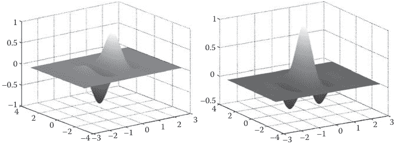

**图7.1** Gabor滤波器的实部（左）和虚部（右），用于建模简单细胞的感受野剖面。

于是，群对剖面集的作用变为

$$\Psi_{x,y,\theta}(\tilde{\xi},\tilde{\eta})=\Psi_0\left(A^{-1}_{x,y,\theta}(\tilde{\xi},\tilde{\eta})\right)$$

#### 简单细胞的作用与李代数

并行滤波的整体输出O由信号$I(\tilde{\xi},\tilde{\eta})$与滤波器组的乘积的积分给出：

$$O(x,y,\theta)=\int_M I(\tilde{\xi},\tilde{\eta})\Psi_{(x,y,\theta)}(\tilde{\xi},\tilde{\eta})\,d\tilde{\xi}\,d\tilde{\eta} \tag{7.3}$$

输出$O$在朝向选择性方面非常弱。已有多个模型被提出来解释初级视觉皮层中强朝向选择性的出现。即使产生强朝向选择性的基本机制存在争议（例如，“推-拉”模型[Miller, Kayser, and Priebe, 2001; Priebe et al., 1998]、“涌现”模型[Nelson, Sur, and Somers, 1995]、“循环”模型[Shelley et al., 2000]，仅举几例），然而很明显，皮层内回路能够滤除所有虚假方向，并严格保留简单细胞最大响应的方向。

对于固定的$(x,y)$，我们用$\bar{\theta}$表示最大响应的点：

$$\max_{\theta}\|O(x,y,\theta)\|=\|O(x,y,\bar{\theta})\| \tag{7.4}$$

这时我们说点$(x,y)$被提升到点$(x,y,\bar{\theta})$（参见图7.2）。如果图像的所有点都以相同方式被提升，那么二维图像$I$的等值线就被提升到三维皮层空间$(x,y,\bar{\theta})$中的新曲线。向量$(\cos(\bar{\theta}),\sin(\bar{\theta}))$在点$(x,y)$处与$I$的等值线相切，因此所选$\bar{\theta}$值就是$I$的边界朝向。Citti和Sarti（2006）还证明了三维提升曲线与以下向量场所张成的平面相切：

$$\vec{X}_1=(\cos(\theta),\sin(\theta),0), \quad \vec{X}_2=(0,0,1) \tag{7.5}$$

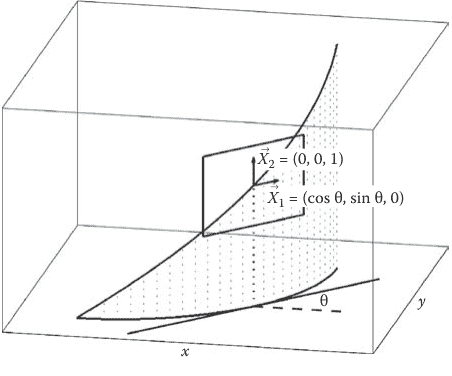

**图7.2** *（参见第94页后的彩色插页）* 一条二维曲线（蓝色）及其在旋转平移群中的三维皮层提升（红色）。蓝色曲线的切向量是$(\cos(\theta),\sin(\theta))$，因此其提升曲线的切向量位于由$\vec{X}_1$和$\vec{X}_2$张成的平面内。

#### 非交换结构

我们明确指出，向量场$\vec{X}_1,\vec{X}_2$对于旋转和平移的群法则是左不变的，因此它们是对应李代数的生成元。如果计算对易子，我们得到向量$\vec{X}_3$：

$$\vec{X}_3=[\vec{X}_1,\vec{X}_2]=(-\sin(\theta),\cos(\theta),0) \tag{7.6}$$

因为它不为0，所以李代数不是交换的。而且，$\vec{X}_3$与$\vec{X}_1$和$\vec{X}_2$线性无关。

这种非交换性质可以从向量场$\vec{X}_j$的积分曲线来观察。从点$(0,0,0)$出发，先沿向量场$\vec{X}_1$方向移动，再沿


## 图7.3 旋转平移群的两条积分曲线的合成是不可交换的，取决于向量场的作用顺序。

沿着向量 \(\vec{X}_2\)，我们到达点 (x, y, θ)，不同于我们先沿向量场 \(\vec{X}_2\) 移动、再沿向量 \(\vec{X}_1\) 移动所能到达的点 (x_1, y_1, θ_1)（见图7.3）。

结构中的自然曲线是向量场 \(\vec{X}_1\) 和 \(\vec{X}_2\) 从固定点 (x_0, y_0, θ_0) 出发的积分曲线：

\[
\begin{aligned}
\gamma' &= (x', y', \theta') = \vec{X}_1(x, y, \theta) + k\vec{X}_2(x, y, \theta) = (\cos(\theta), \sin(\theta), k)\\
\gamma(0) &= (x_0, y_0, \theta_0)
\end{aligned}
\tag{7.7}
\]

【第151页】

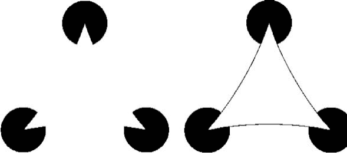

**图7.5** 具有弯曲边界的卡尼察三角形（左）及其在群中的测地线补全（右）。测地线不是直线的，因为它们在包含曲率\(\kappa\)的群中最小化距离（公式7.11）。

## 皮层作为相空间

在 Sarti、Citti 和 Petitot (2008) 中，我们将简单细胞的空间与视网膜平面的相空间等同起来。感受野中心位于点 \((x,y)\) 的简单细胞可以等同于一个算子，该算子选择该点处边界的方向。然后它等同于以下形式

\[
\omega = -\sin(\theta)\,dx + \cos(\theta)\,dy \tag{7.9}
\]

注意，这是固定点处接触空间的一般酉元素的表示，或者等价地，相空间的表示。其核是由一阶算子 \(X_1\) 和 \(X_2\) 生成的二维平面，其中 \(X_j\) 是向量场的算子版本，是群的生成元，在公式 (7.5) 中定义：

\[
X_1 = \cos(\theta)\,\partial_x + \sin(\theta)\,\partial_y,\qquad X_2 = \partial_\theta
\]

这些算子描述沿向量场 \(\vec{X}_1,\vec{X}_2\) 方向的传播。

这些算子被识别为向量空间的生成元，因此定义相差一个常数。通常选择这个常数，使得算子关于 \(R^2 \# S^1\) 上的标准数量积是自伴的，该数量积定义为

\[
\langle b, h \rangle = \int_0^\pi \int_{\mathbb{R}^2} b(x,y,\theta)\,\overline{h(x,y,\theta)}\,dx\,dy\,d\theta,
\]

其中 \(\overline{h}\) 是 \(h\) 的复共轭。

【第153页】

分别。这些算子也将分别被解释为位置算子和角动量算子。它们满足与算子 \(X_1, X_2\) 以及向量场 \(\vec{X}_1, \vec{X}_2\) 相同的对易规则：

\[
[Y_1, Y_2] = Y_3,\quad [Y_1, Y_3] = 0,\quad [Y_2, Y_3] = Y_1 \tag{7.12}
\]

其中

\[
Y_3 = \partial_\eta
\]

是沿与 \(Y_1\) 正交方向的平移生成元，正如相应的向量 \(X_3\) 是沿与 \(X_1\) 正交方向的平移生成元一样。

算子 \(Y_1\) 和 \(Y_2\) 表示沿二维关联场曲线的传播（见图7.4）。

注意，它们关于 \(R^2\) 中的数量积是自伴的：

\[
\langle f, g \rangle_{R^2} = \int_{\mathbb{R}^2} f(\xi,\eta)\,\overline{g(\xi,\eta)}\,d\xi\,d\eta
\]

## 不确定性原理

Daugman (1985) 将感受野轮廓解释为海森堡不确定性原理的最小值。他的关键论点是：简单细胞能够同时检测位置和方向，但这两个量并不对易。因此，量子力学中由海森堡首次引入的经典不确定性原理在这里适用。粗略地说，它表明不可能同时精确检测位置和动量，并且它们测量的方差不能低于一个固定的不确定程度。然而，存在一类称为“相干态”的函数，能够使这两个量的不确定程度都达到最小。这些最小值就是 Gabor (1946) 滤波器，Daugman (1985) 证明了它们是简单细胞感受野轮廓的良好模型。

Folland (1989) 证明了不确定性原理不仅适用于海森堡群的生成元，还适用于任何一对不对易的算子。因此，在我们的背景下，对旋转和平移的李代数生成元最小化不确定性原理似乎更自然。由于我们寻找的是定义在二维空间上的函数，我们将使用向量场在二维变量下的表示，即公式 7.11 中引入的向量场 \(Y_1\) 和 \(Y_2\)。

【第155页】

*证明：* 证明可参见 Folland (1989) 的定理1.34。它源于一个事实：极小化者必须满足不确定性原理中的等式：

\[
|\langle Y_3 u, u \rangle| = 2\,\|(Y_1 - a_1)u\|\,\|(Y_2 - a_2)u\|.
\]

因此，Schwartz不等式（公式 [7.15]）也必须是等式：

\[
|\operatorname{Im}\langle Y_2 u, Y_1 u \rangle| = \|Y_2 u\|\,\|Y_1 u\| \tag{7.16}
\]

如果数量积等于范数的乘积，则向量 \(Y_2 u\) 和 \(Y_1 u\) 必须是平行的：

\[
Y_1 u = i\lambda\, Y_2 u.
\]

直接验证表明，公式 (7.1) 中定义的 Gabor 滤波器 \(\Psi_0\) 满足此方程。如前所述，所有其他滤波器都是通过旋转和平移从这个滤波器获得的，因此它们是 Perelomov (1986) 意义上的相干态。Lee (1996) 已证明这些态与感受野轮廓的实验数据一致（图7.6）。

让我们注意，这些极小化者是群的可约表示的相干态。在 Barbieri 等人 (2010) 中，我们使用了算子 \(Y_j\) 的不可约表示，因此我们在傅里叶域中具有固定频率的函数集合中搜索极小化者，并获得了经典的风车结构，这一结构由 Bosking 等人 (1997) 通过实验观察到。

## 简单细胞的输出与Bargmann变换

我们回忆一下，相干态张成定义在 \(\mathbb{R}^2\) 上的函数的整个希尔伯特空间。它们不是该空间的基，但构成一个框架。这

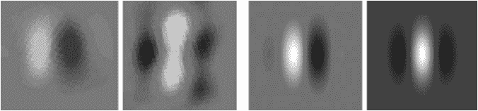

**图7.6** De Angelis 等人测量的简单细胞感受野轮廓（经 De Angelis 等人，1995 许可转载）以及相应的 Gabor 函数（右），不确定性原理（公式 [7.13]）的极小化者。

等同于说，\(\mathbb{R}^2\) 上的任何函数 \(f\) 都可以表示为相干态的线性组合：

\[
f(\xi,\eta) = \int C(x,y,\theta)\,\Psi_{x,y,\theta}(\xi,\eta)\,dx\,dy\,d\theta,
\]

但系数 \(C(x,y,\theta)\) 并不唯一（Folland, 1989）。

公式 (7.3) 中定义的单个简单细胞的输出可以表示为数量积：

\[
O(x,y,\theta) = \langle I, \Psi_{x,y,\theta} \rangle,
\]

它自然具有将 \(I\) 投影到框架中特定元素 \(\Psi\) 方向上的含义。由于函数 \(\Psi\) 是相干态，整个输出将被等同于 Bargmann 变换，该变换正定义为与整个滤波器组的数量积（Antoine, 2000）：

\[
B_I(x,y,\theta) = \int I(\xi,\eta)\,\Psi_{x,y,\theta}(\xi,\eta)\,d\xi\,d\eta \tag{7.17}
\]

该变换将定义在二维空间上的图像 \(I(\xi,\eta)\) 映射到定义在相空间上的三元函数。它从滤波器的性质继承了正则性质。容易验证：

\[
X_j B_I(x,y,\theta) = \int I(\xi,\eta)\,Y_j\Psi_{x,y,\theta}(\xi,\eta)\,d\xi\,d\eta.
\]

根据命题7.2，这意味着输出满足

\[
X_1 B_I = i\,X_2 B_I.
\]

因此，Bargmann 变换是由 \(X_1\) 和 \(X_2\) 生成的 Cauchy–Riemann (CR) 结构中的全纯函数（关于 CR 结构的定义，参见 Folland, 1989）。在这种情况下，经典的复导数

\[
\frac{d}{dz} = \partial_x - i\partial_y
\]

被替换为关于算子 \(X_j\) 的导数。因此，简单细胞输出 \(B_I\) 在这个拟复结构中是全纯的，因为

\[
\frac{d}{dz} B_I = X_1 B_I - i X_2 B_I = 0.
\]


这使得可以用相关性来解释$\rho(\xi,\eta,\tilde{\xi},\tilde{\eta})$。实际上，函数$\rho$是对所有中心位于$(\xi,\eta)$和$(\tilde{\xi},\tilde{\eta})$的滤波器之间的相关性按概率测度$P$加权后，再对$\theta_0$求和的结果。

函数$\rho$通常被称为*算子*，尽管它只是该算子的积分核，这是一种不严格的用法：

$$
f \mapsto \int \rho(\xi,\eta,\tilde{\xi},\tilde{\eta})f(\xi,\eta)\,d\xi d\eta \tag{7.19}
$$

我们在这里给出的表示是$P$-表示，因为它是由相干态对算子$\rho$进行对角表示。我们明确地提醒，我们必须使用这种对角的$P$-表示，因为相干态构成一个过完备框架。在这种情况下，我们可以应用由Glauber和Sudarshan提出的如下定理：

> **定理7.1** *$\rho$的对角表示是可逆的，意思是给定$P$，我们就有$\rho$的表达式；反之，如果已知$\rho$，则有可能以唯一的方式恢复$P$。*  
> （证明见Glauber, 1963和Sudarshan, 1963。）

在这个意义上，概率$P$与密度算子$\rho$是等价的。

## 边界的张量结构

为了理解该算子应用于图像时的含义，我们将考虑一种简单情形：中心位于$(x_0,y_0)$且具有优选方向$\theta_0$的感受野被替换为作用在$(x_0,y_0)$处的二维向量$(\cos(\theta_0),\sin(\theta_0))^t$（其中$t$表示向量转置）。这样，前面的算子就变为方程（7.20）：

$$
\begin{aligned}
\rho(\xi,\eta,\tilde{\xi},\tilde{\eta}) ={}& \int (\cos(\theta_0),\sin(\theta_0))^t\,\delta_{\xi,\eta}(x_0,y_0)P(x_0,y_0,\theta_0)\\
&\quad (\cos(\theta_0),\sin(\theta_0))\delta_{\tilde{\xi},\tilde{\eta}}(x_0,y_0)\,dx_0\,dy_0\,d\theta_0 \tag{7.20}\\
={}& \int (\cos(\theta_0),\sin(\theta_0))^t P(\xi,\eta,\theta_0)(\cos(\theta_0),\sin(\theta_0))\delta_{\tilde{\xi},\tilde{\eta}}(\xi,\eta)\,d\theta_0
\end{aligned}
$$

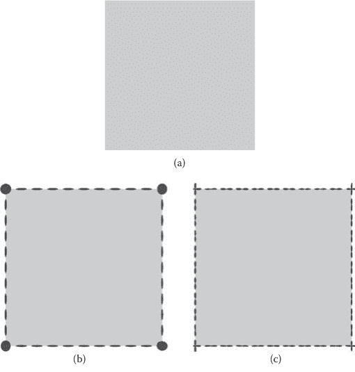

**图7.7** 灰色正方形的边界表示：(a) 原始图像；(b) 根据方程（7.20）用二阶张量表示；(c) 根据密度算子方程（7.18）用无穷阶张量表示。在此例中，感受野的尺寸远小于正方形的尺寸。

因此，$\rho$仅在$(\xi,\eta)=(\tilde{\xi},\tilde{\eta})$时非零，且其值为矩阵：

$$
\rho(\xi,\eta,\tilde{\xi},\tilde{\eta})=\int \begin{pmatrix} \cos^2(\theta_0) & \cos(\theta_0)\sin(\theta_0) \\ \cos(\theta_0)\sin(\theta_0) & \sin^2(\theta_0) \end{pmatrix}P(\xi,\eta,\theta_0)\,d\theta_0
$$

通过这种简化，我们只需将每个点$(\xi,\eta)$与一个秩为2的张量关联起来，该张量表达了边界的几何性质，可被视为核$\rho$的二阶近似。另一方面，由于$\rho$定义了函数空间上的一个算子，我们将密度算子$\rho$解释为无穷阶张量。

例如，考虑一个灰色正方形的图像（见图7.7上方）。首先，概率$P$作为Bargmann变换的能量（方程（7.20））获得，并施加了非极大值抑制。在远离边界处，概率$P$为0。在边界的每个点$(x_0,y_0)$上，概率$P$是三维皮层空间中的一个Dirac测度，集中于$(x_0,y_0,\theta_0)$处，其中$\theta_0$是该点边界的朝向；而在角点处，$P$是两个Dirac测度之和。

在此例中，相干态的尺寸远小于正方形。因此，我们可以应用秩2张量近似。这为我们提供了沿边界的“细棒”以及角点处的球状张量，正如Medioni、Lee和Tang（2000）的经典方法那样。在图7.7(b)中，展示了由方程（7.20）获得的二阶张量场。

在图7.7(c)中，边界表示通过密度算子（方程7.18）可视化。由Glauber–Sudarshan定理，密度算子与概率$P$一一对应，因此它保留了概率密度分布中包含的所有信息，并对应一个无穷秩张量场。与二阶情形类似，无穷秩张量表示沿边界提供细棒；而在角点处提供完整的十字，保持了边界的两个不同方向。

因此，密度算子能够表示任意复杂的结构，我们将在后续章节中看到这一点。

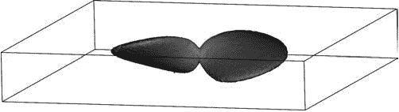

**图7.8** 相空间中Fokker–Planck方程的基本解。图中绘制了强度的等值面。

## 皮层活动的传播与Fokker–Planck方程

在“关联场与结构的积分曲线”一节中，我们观察到群的不同点通过向量场的积分曲线相连接，这些曲线在皮层中由水平连接实现。这种连接可以在随机框架下由以下随机微分方程（SDE）建模，该方程最早由Mumford（1994）引入，随后由August和Zucker（2003）、Williams和Jacobs（1997a）以及Sarti和Citti（2010）进一步讨论：

$$
(x',y',\theta')=(\cos(\theta),\sin(\theta),N(0,\sigma^2))=\bar{X}_1+N(0,\sigma^2)\bar{X}_2
$$

如果我们假设连接是从自然图像的边缘分布中学习得到的，那么这个模型与Sarti和Citti（2010）是一致的。

在图7.9中，Fokker–Planck方程的基本解$\Gamma$分别以二阶张量（左）和通过密度算子表示的无穷阶张量（右）进行可视化。

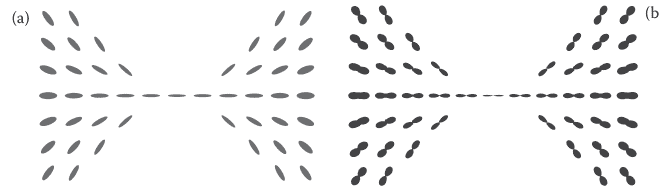

**图7.9** *（见第94页后的彩色插页。）* Fokker–Planck方程的基本解$\Gamma$，分别以二阶张量（左[a]）和通过密度算子表示的无穷阶张量（右[b]）进行可视化。

## 图像的张量结构

概率密度$P(x,y,\theta)$是Bargmann变换的模，包含图像边界的信息，它通过以下方程进行传播：

$$
X_1u(x,y,\theta)+\sigma^2X_{22}u(x,y,\theta)=P(x,y,\theta) \tag{7.23}
$$

其中方程（7.22）中的Dirac delta已被强迫项$P(x,y,\theta)$取代。等价地，分布$u(x,y,\theta)$可以通过卷积乘积获得：

$$
u(x,y,\theta)=\Gamma(x,y,\theta)*P(x,y,\theta)
$$

其中$\Gamma(x,y,\theta)$是Green函数，是（7.22）的解。

对于图7.7中的正方形，所得的$u(x,y,\theta)$填充了整个图形并在内部形成了结构。在图7.10中，$u(x,y,\theta)$的二维投影分别通过秩2张量场（左）和对应于密度算子的无穷秩张量场（右）进行可视化。在这两种情况下，图形内部诱导的张量类似于球体（即它们比边界处的张量更具各向同性）。无穷秩张量场保留了关于物体整体形状的更多信息。它忠实地表示了经过水平连接传播后整个三维皮层相空间的信息内容。

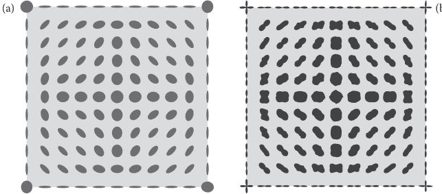

**图7.10** *（见第94页后的彩色插页。）* 通过Fokker–Planck基本解传播提升后的边界而获得的正方形内部结构。概率密度分别以二阶张量（左[a]）和通过密度算子表示的无穷阶张量（右[b]）进行可视化。

## 致谢

作者感谢G. Sanguinetti帮助生成了文中部分图形。


## 视觉皮层中与轮廓、表面和物体相关的编码

Rüdiger von der Heydt

### 目录

- 引言 ... 145
- 结果 ... 147
  - 表面颜色¹ ... 147
  - 表面深度 ... 150
  - 边界归属 ... 152
  - 物体相关编码 ... 158
- 讨论 ... 160
- 尾注 ... 162

### 引言

在视觉皮层的早期处理阶段，信息以视网膜图像的映射图形式排列。然而，与直觉相反，均匀表面并非由均匀分布的神经活动来映射。我们可以感知均匀表面的三维（3D）形状，但立体视觉神经元仅被表面的轮廓激活，而非均匀的内部。我们感知到均匀颜色的图形，但颜色选择性神经元对图形内部的响应大约只有对其边界响应的五分之一。皮层神经元如何编码轮廓和表面特征已广为人知，但我们仍不了解大脑如何“组织”这些特征信号来表示表面和物体。在本章中，我总结了相关研究，表明视觉皮层在轮廓信号中编码表面颜色、表面的深度次序以及边界归属。边界归属的信号（即决定知觉图形-背景组织的边界单侧归属）是关键发现，因为它揭示了特征分组的机制。我将讨论系统如何利用这些机制来表示物体和计算表面属性。

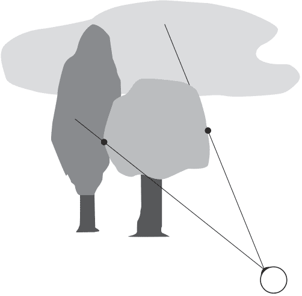

**图 8.1** 图像分割问题与遮挡轮廓的定义。

生物视觉系统从图像中推断三维结构，并已进化到在一个具有特定物理结构的世界中执行此任务。视觉的基本问题是三维场景被投影到二维（2D）感受器表面上；在空间中相距很远的事物在投影中会形成相邻区域（图 8.1）。由此产生的图像由对应于不同物体的区域组成。区域之间的边界由位置几何关系决定，被称为*遮挡轮廓*。因此，理论上，三维场景的图像可以分解或“分割”为由轮廓分隔的区域。然后，分割结果可用于推断物理表面和物体形状。在实践中做到这一点很困难，而灵长类视觉系统投入了数亿个细胞来完成这项任务。

## 结果

### 表面颜色¹

现代视觉研究最令人惊讶的发现之一是视觉皮层神经元的朝向选择性，以及皮层表征中对边缘（强度和颜色的不连续性）的强调。通过观察跨均匀着色物体表面表征的神经元活动剖面，可以理解这一点（图 8.2）。此处呈现的结果基于在清醒行为条件下对猕猴视觉皮层进行的单细胞记录（Friedman, Zhou, and von der Heydt, 2003）。曲线显示了神经元放电频率随感受野（RF）位置相对于一个正方形图形的变化。曲线代表具有近中央凹感受野的神经元的平均响应；正方形的边长为 4° 或 6°，是感受野大小的倍数。V2 和 V1 颗粒上层中约 80% 的神经元具有强烈的朝向选择性。如图 8.2 中的顶部曲线所示，这些细胞对边缘有响应，但对正方形的均匀内部几乎无响应。下方的曲线显示，非朝向和弱朝向细胞虽然被均匀表面激活，但也在约 3 倍的程度上强调边缘。结果，这些皮层区域的总活动在边缘处比在正方形中心处高约五倍（底部曲线；在组合朝向和非朝向细胞的活动剖面时，考虑了细胞的相对数量，以及在任何给定朝向下只有一小部分朝向细胞被边缘激活，而所有非朝向细胞都有活动贡献）。

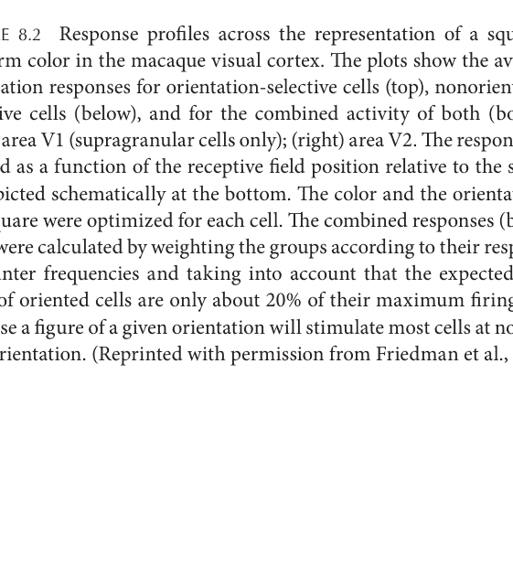

一个重要点是，颜色选择性神经元在朝向细胞中的比例至少与非朝向细胞中的比例一样高（Friedman, Zhou, and von der Heydt, 2003）。由于朝向选择性神经元占绝大优势，这意味着颜色信息主要由朝向选择性的边缘响应携带。

边缘信号如何编码表面颜色？边缘选择性神经元在其感受野位于两种不同颜色区域之间的边界时产生响应。如果神经元要信号化表面的颜色，而不仅仅是边缘的存在，它们就应该能够区分颜色位于哪一侧。我们发现大多数细胞能区分边缘处颜色差异的极性。图 8.3 显示了这样一个神经元的例子。

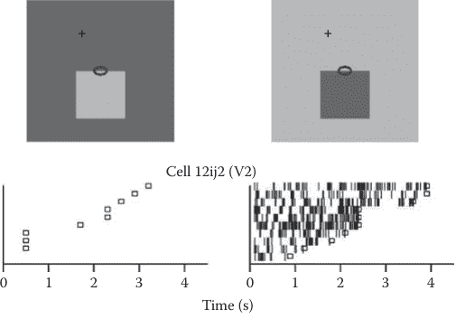

**图 8.3** 边缘对比度极性的选择性。V2 中一个示例神经元的响应。光栅图显示了重复呈现上述刺激（椭圆表示感受野）时的动作电位序列。小方块标记猴子注视期的结束。（修改自 Zhou et al., 2000。经许可使用）

（图 8.2 的响应剖面未显示对比度极性的选择性，因为响应是在不考虑对比度偏好的情况下跨神经元平均的。）因此，朝向神经元的边缘响应携带方向性颜色信息，这对编码表面颜色至关重要。

皮层中边缘信号的强烈主导地位难以与我们注视均匀颜色表面时的主观体验相调和；中心的颜色并不比边缘处淡。解决这一悖论的一种尝试是“填充”理论，该理论假设存在一种表征，其中颜色信号从表面边界扩散到内部并填满它，从而产生知觉所暗示的均匀分布。我们想知道是否 V1 或 V2 的某类神经元亚群参与了这一过程，以及我们记录到的方块中心的一些信号（图 8.2）是否可能反映了填充。因此，我们研究了一种幻觉性填充的范式。我们测量了猴子的知觉填充，并记录了同一动物视觉皮层中的神经信号（Friedman, Zhou, and von der Heydt, 1999; von der Heydt, Friedman, and Zhou, 2003）。我们发现，当填充发生时，V1 和 V2 中的非朝向神经元继续在其感受野处信号化刺激的实际颜色，而非所感知的颜色。然而，朝向神经元的颜色边缘信号则以与填充一致的速度衰减。

我们得出结论，表面颜色的均匀外观在低级视觉区域的神经活动中没有同构的对应物。表面颜色可能是从边缘信号计算出来的，这大概发生在更高级的水平。知觉的均匀性并不对应于均匀分布的活动，而可能反映了一种更抽象的表征。

### 表面深度

颜色信息在感受器层面直接可用，但深度是图像中丢失的维度，需要由系统重建。灵长类和许多其他物种有专门的机制来实现这一点，即利用双眼图像之间的视差，提供双眼立体视觉。由于视差信息源自对两幅不同图像中的匹配结构，而这在均匀图像区域无法进行，因此立体视觉信息具有典型的稀疏性。例如，对于均匀正方形，立体视觉信息可从边缘获得，而非表面。视差可以定义正方形轮廓的深度，但并不指示轮廓内部表面是平坦、凸起还是凹陷，也不指示它位于轮廓深度还是轮廓之后。它可能是前方的一个物体，或者是通过方形窗口看到的后方表面。

皮层中深度表示的稀疏性如图 8.4 所示，顶部一行显示了三个视差选择性神经元的响应剖面。在每种情况下，刺激都是一个均匀正方形，并以该神经元的最优选视差呈现。结果，正方形的边缘产生了强烈响应。然而，表面没有引起任何活动，正如预期的那样，因为感受野中没有结构能够刺激视差选择性响应机制。

图 8.4 第二行显示了另一种情况。它显示了相同神经元对随机点立体图的响应，该立体图将正方形呈现为在深度中漂浮在背景表面前方。（在这种刺激中，图形由视差定义，但


单眼视图下没有轮廓，被称为“独眼”（Julesz, 1971）。与均匀图形的情况一样，这些方块以每个神经元的最佳视差呈现。因此，可以预期只要感受野位于方块内部，神经元就会被激活。V1神经元的情况确实如此，如细胞1的示例所示。然而，V2神经元常常再次以边缘选择性方式作出反应，当感受野位于独眼方块内部时并不产生活动，尽管随机点纹理具有最佳视差（von der Heydt, Zhou, and Friedman, 2000）。

V2神经元能够检测独眼图形的轮廓，这一现象令人惊叹。这些神经元对颜色定义的边缘作出反应，就像V1的简单细胞和复杂细胞一样，并且也对没有边缘对比度的独眼边缘作出反应。显然，这两种情况需要完全不同的机制来确定哪个区域是前景，哪个区域是背景。

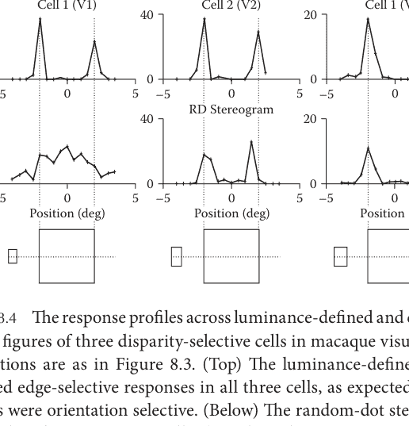

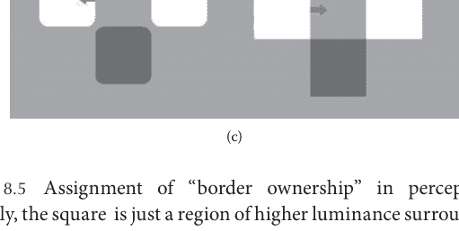

灰色区域和棕色区域之间的边界既可以被视为一侧灰色物体的轮廓，也可以被视为另一侧棕色物体的轮廓。另一方面，深度的不连续性是一个完美的线索，因为它能显示哪一侧在前。对随机点立体图中的边缘作出反应的细胞通常（75%）对边缘极性（表面的深度排序）具有选择性。例如，图8.4中的细胞3对随机点立体图中的远-近边缘（方块的左边缘）作出反应，但对近-远边缘（方块的右边缘）没有反应。

格式塔心理学家做出了一个令人惊讶的观察：视觉系统即使在没有明确线索（如随机点立体图中的视差）的情况下也会分配边界。在图8.5a中，白色区域被感知为一个物体，黑-白边界被感知为其轮廓。显然，系统具有决定哪些区域可能是物体、哪些是背景的规则，并“自动地”应用这些规则。这种对图形和背景进行分配的强迫性在鲁宾的花瓶图形（Rubin, 1921）中得到了很好的体现。我的版本如图8.5b所示。在这里，不同的规则似乎相互冲突，并且分配在两种替代之间来回翻转，这两种替代都导致对熟悉形状的感知。

边界归属的改变不仅影响表面的深度排序，还可能意味着被感知物体的重组。图8.5c左侧显示了四个圆角方块。右侧显示了没有圆角的相同方块。可以看出，感知重组了这些区域：现在感知到的是两条条带，而不是四个方块，而之前的背景中心区域现在看起来像一个透明叠加层。

图8.5中演示的知觉解释显然涉及图像上下文。例如，在图8.5c中用箭头标记的边缘在两种配置中是局部相同的，但根据上下文，分配不同。改变显示中其他部分的细节会导致新的解释。

边界归属和图形-背景的概念在文献中被并行使用，以描述这些知觉现象。边界归属概念在解释和建模知觉观察方面的力量已得到承认（Nakayama, Shimojo, and Silverman, 1989; Sajda and Finkel, 1995），但大脑如何编码边界归属或图形-背景长期是一个谜。Sajda和Finkel推测，同步振荡可能是神经编码的载体。然而，最近的单细胞记录提出了一个简单得令人惊讶的答案（Zhou, Friedman, and von der Heydt, 2000）。关键的发现是，单个神经元具有（固定的）边界归属偏好，并且每段轮廓由两组具有相反边界归属偏好的神经元表示（图8.6）。因此，两组的差异活动指示了边界归属的方向。

除其他观察外，对颜色定义的图形和随机点立体图的神经元反应的比较也为这一观点提供了支持（图8.7）。光栅图显示了V2神经元在八种不同条件下的反应，如刺激示意图所示，这些示意图应被理解为刺激配置的透视图。顶部的四个条件（a,b,c,d）是颜色定义图形的测试：感受野左侧和右侧的图形位置分别显示在左列和右列；两行a-b和c-d显示的是两种对比极性的测试。底部部分显示立体测试。同样，左列和右列显示左侧和右侧的图形位置，但在该测试中，“图形”要么是浮动在背景前方的方块（e,h），要么是通过其可以看到后方表面的窗口（f,g）。可以看出，对于颜色定义的显示，该神经元偏好图形在左侧。对于立体图，当前表面位于感受野左侧时（e,f），它作出反应；当前表面位于右侧时（g,h），它保持沉默。因此，对于定义表面深度顺序的立体图，该神经元根据其感受野内的立体边缘明确地作出反应，并选择左侧边界归属（来自Zhou et al., 2000）。在这些条件下，方块形状的位置无关紧要：边缘可以是方块图形的右边缘（e），也可以是方块窗口的左边缘（f）。但对于颜色定义的显示，神经元根据形状的位置作出反应：图形在左侧时反应强于图形在右侧时。因此，在没有视差线索的情况下，神经元“假设”方块是一个物体，周围区域是背景。这正是我们在图8.5a中感知白色方块的方式。

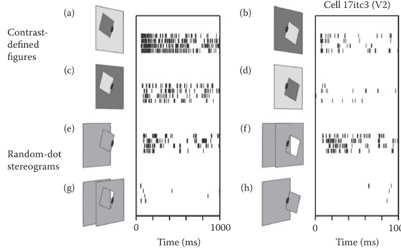

**图8.7** 一个示例神经元对亮度定义图形轮廓（a,b,c,d）和视差定义图形（e,f,g,h）的反应。深度配置通过示意性地以透视方式描绘方块图形（e,h）和窗口（f,g）来说明。椭圆形表示感受野的投影。（经Qiu和von der Heydt, 2005许可转载。）

图8.5c中所演示的表面重组也可以在V2的神经元反应中观察到，如图8.8所示（Qiu and von der Heydt, 2007）。我们比较了单个方块的显示（图8.8a）、透明显示（图8.8b）以及四个圆角方块的显示（图8.8c），后者不产生透明度知觉。注意，在顶行的显示中，感受野（椭圆）下方的边缘在（a）和（c）中归属左侧，但在（b）中归属右侧。在下面的显示中，归属相反。

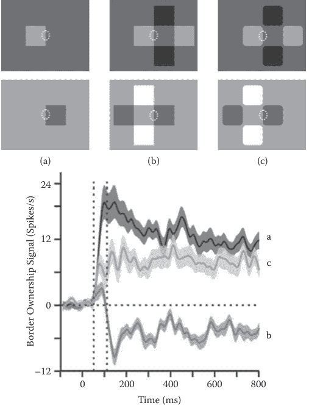

**图8.8** 边界归属信号在透明显示中与知觉重组并行。在（a）和（c）的上方图中，虚线椭圆标记的边界归属左侧，但在显示（b）的上方图中，它归属右侧。在下方图中，归属相反。所有六个显示中的局部边缘完全相同。曲线显示了相应的边界归属信号（顶部和底部显示的反应之间的差异）；平均127个细胞，误差带表示平均值的标准误差（SEM）。（修改自Qiu和von der Heydt, 2007。已获许可。）

曲线显示了V2神经元平均边界归属信号的时间过程。可以看出，（b）的信号与（a）和（c）相比发生了反转。这表明神经元根据透明的解释来分配边界归属（BOS）。特别引人注目的是（b）和（c）的反应之间的差异，它们仅在“X连接点”的存在/缺失上不同。b中的信号反转发生略有延迟（虚线垂直线）。这些结果

-   [在深度编码的情况下，我们观察到类似的过渡：在V2中，3D边缘选择性出现，细胞对环形图的轮廓作出反应。这里的细胞通常对边缘极性敏感，这意味着它们信号表面的深度顺序。这表明这些神经元在编码形状之外（仅凭边缘的位置和方向即可完成此任务）还用于表示表面。也许表面的3D形状也来源于轮廓表示。

边界所有权编码是将多种发现联系在一起的线索。它有助于我们理解视皮层如何在传入的感官信息上施加结构，以及中央机制如何利用这种结构进行选择性处理。边界所有权涉及将轮廓与区域关联。最有趣的方面是全局形状处理，这从对在受体场周围大区域内完全相同的显示表现出不同反应（图8.6a,b）中可见。这意味着正方形的四条边被分配给一个共同区域，这是一种“绑定”形式，即创建物体表示的核心。在我们的模型中，我们提出了一种两种相互连接的神经连接机制：一种收敛方案用于特征信号的集成，另一种发散方案的反馈连接用于调节特征神经元的增益。这种增益变化导致了在偏好侧和非偏好侧的图形出现不同放电率的现象。除了由视觉刺激引起的这种效应外，反馈连接还参与顶向注意，用于选择性增强被关注物体（B细胞）所代表的特征信号。大量V2神经元表现出这种由刺激驱动的群化和顶向注意调制的双重影响（Qiu, Sugihara, and von der Heydt, 2007）。此外，神经元表现出与边界所有权偏好侧相关的注意调制不对称，这与模型的预测一致。

我们的模型不同于许多其他感知组织模型，因为它假设存在专用的神经电路用于群化。我们的群化不是由皮层内水平连接的自组织活动产生的（这些连接的长度和传导速度受限），而是由额外的一类神经元（G细胞）产生。我们假设这些细胞不属于模式识别路径，而是专门用于为中央过程提供一个结构，以便它们可以在此基础上形成介于特征表示和中央认知机制之间的接口。这种功能特异性是一个重要的区别：G细胞具有相对较大的受容场，缺乏高分辨率，因此不需要高分辨率来进行形状识别。因此，系统只需要相对较小的G细胞数量即可覆盖视觉空间。

我建议，这种一般方案也可以解释大脑如何表示表面。表面表示可能对应于当任务需要特定表面信息时，系统激活的一组G细胞。以在山中徒步为例，视觉系统需要提供关于待踩对象（如岩石）的位置信息以及脚触及点的表面法线。计算表面法线需要激活一簇对应岩石位置的G细胞，这些细胞随后会选择性增强岩石轮廓信号。增强后的轮廓信号随后由下游的“表面法线计算器”收集。神经元在V4中表征线条的三维方向（Hinkle and Connor, 2002），从轮廓元素的三维方向出发，系统可以计算表面的近似方向和曲率以及其法线。类似的过程可以用于从轮廓信号计算表面色彩。因此，我设想表面表示更像是系统在需要时调用的一个过程，而不是代表空间中表面点的神经活动模式。

## ENDNOTE

¹ “Color” in this paper refers to both chromatic and luminance dimensions. Thus, I include gray values among the colors.

to the brain or to artificial sensing systems, however, share none of these properties. The visual cues conveying the presence of objects may change in luminance or color, and they may be disrupted by reflections or occlusion by intervening objects as the view point changes. The various cues such as shading, texture, color binocular disparity, edge structure, and motion vector fields may even carry inconsistent object information. As exemplified by the dodecahedron drawn by Leonardo da Vinci (Figure 9.1a), any of these cues may be sparse, with a lack of information about the object structure across gaps where cues are missing. Also, any cue may be variable over time. Nevertheless, despite the sparse, inconsistent, and variable nature of the local cues, we perceive solid, three-dimensional (3D) objects by interpolating the sparse depth cues into coherent spatial structures generally matching the physical configuration of the objects.

在更受限的领域——物体在世界中的表面结构——表面被感知为不仅仅是二维平面，而是复杂的三维多面体。这里我们用“多面体”指的是连续的二维子空间，位于三维欧几里得空间中。一个令人信服的感知表面完成的例子，

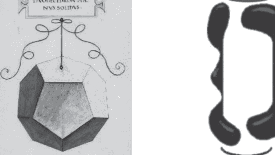

3D空间，而不是物体的反射或注意力在视觉场2D空间中的显著性。图9.2说明，为了匹配人类视觉处理的特性，这种实现必须符合Tyler（1973, 1991）发现的连续表面弯曲的立体学限制。这种表面平滑限制现在已经在Nienborg等人（2004）的脑皮层细胞中得到验证，表明即使在初级视皮层，表层深度结构的重建也具有重要意义。一旦每种视觉模态（如亮度、视差、运动）的深度结构被定义后，这些线索的整合应当使用贝叶斯方法来建模，依据每个线索的可靠性估计，得出视野中观察者所面对的整体三维结构的单一估计。

表面表示需要一种表面*插值*机制，以在场域信息缺失的区域表示表面。这种插值类似于将膜“收缩”包裹在不规则物体（如家具）周围。

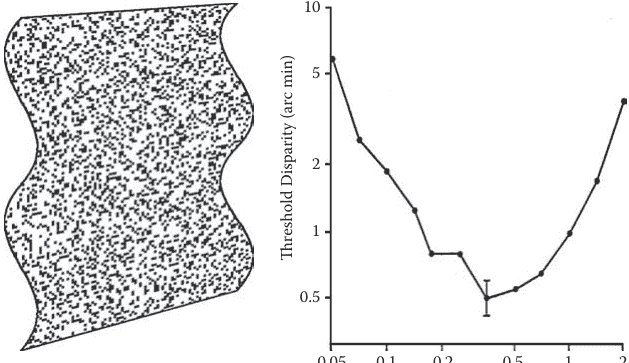

图9.2 (a) 随机点表面的立体波纹示意。(b) 检测立体波纹深度的阈值，作为波纹空间频率的函数。(From Tyler, 1991. With permission.) 峰值灵敏度（最低阈值）出现在0.4周期/度（2.5度/周期）的低值，这意味着立体处理相对于对比处理具有相当大的平滑程度。

与(2D)受体场总和机制不同，后者随着刺激信息量的增加而反应增强，插值机制的特征是随着刺激信息的*减少*而*增加*（或至少不降低）其反应，当需要更广泛的插值时亦然。（当然，在达到某一点后插值会失败，反应最终降至零。）

在识别物体表面后，我们面临特征相对于彼此以及相对于其他物体的定位问题。定位在物体可能被重叠噪声或部分遮挡（如老虎在树后、脸在窗帘后）的条件下尤为复杂。然而，视觉系统仍能在特征和边缘定义不清的刺激下实现惊人的精确定位（Toet and Koenderink, 1988; Kontsevich and Tyler, 1998; Likova and Tyler, 2003）。此外，样本间隔是理论上对定位的关键参数。具体而言，低层次滤波器集成无法在视网膜中心区域的2到3弧分范围内以外实现插值行为（Morgan and Watt, 1982），尽管物体的典型边缘（如面部轮廓或显示器边缘）可能相距数度。因此，大多数物体形状所需的插值远超这些滤波器的范围。这对定位任务构成了“长距离插值问题”，在高斯斑点和伽马带等延伸刺激的位置编码方面引发了广泛关注（Morgan and Watt, 1982; Hess and Holliday, 1992; Levi, Klein, and Wang, 1994）。

## NEED FOR 3D SURFACE REPRESENTATION

表面重建方法的一个推论是，物体阵列严格以其表面来表示，如Nakayama和Shimojo（1990）所提议。大量研究表明，表面在将感知输入组织成连贯表征方面发挥关键作用。例如，Norman和Todd（1998）表明，如果两个需对比的视野位置位于同一表面上，而非空空间中，那么对它们相对深度的判别能力会显著提升。这一结果暗示了表面层面的解释，尽管它可能仅仅是利用表面的存在提供了更多关于深度的信息。


要评估的深度区域。Nakayama、Shimojo和Silverman（1989）提供了许多关于表面在知觉组织中的重要性的演示。他们表明，当场景解释允许物体形成连续表面的一部分而不是孤立的片段时，对物体（如面孔）的识别会大大增强，即使在这两种情况下关于物体的视网膜信息是相同的。这项研究还关注了表面边界所有权的问题，即表面被感知为在其他表面前方而非后方。尽管他们的处理突出了知觉组织的有趣问题，但并未对实现此类结构的神经或计算机制提供任何见解。

位置编码的局部滤波器规模较小所引发的一个关键问题是长程插值机制。为了解决这个问题，Kontsevich和Tyler（1998）开发了一种用于物体位置的采样范式，其中物体由如图9.3所示的采样亮度分布定义。这种采样范式是探测有助于形状知觉的亮度信息属性的有力手段。令人惊讶的是，人类定位的精度几乎*独立*于样本间距。数据显示，仅两到三个样本就包含了视觉系统所能处理的关于1°高斯凸起的全部信息。增加更多样本（通过提高采样密度）并没有进一步

图9.3 Kontsevich和Tyler（1998）用于研究长程插值过程的采样高斯亮度分布（经许可转载。）

影响高斯位置的可辨别性，只要样本间距超过局部滤波器的3弧分范围。Kontsevich和Tyler（1998）验证了这一极限的惊人局部性预测，发现当间距从30弧分降至3弧分时，定位性能保持不变，但一旦样本间距进入3弧分范围内，则表现出阶梯式改善（达到游标水平）。样本位置被随机化，以防止它们被用作位置线索。

从这项研究可以得出的启示是，需要某种长程插值机制来确定我们面前延伸物体的形状（因为位置任务是形状辨别的一种形式）。一旦细节超出局部滤波器的范围，编码形状的能力就会下降。然而，位置仍然可以以比样本间距精细得多的分辨率来指定，这意味着存在一种插值机制来确定高斯峰的位置，尽管该峰值并未在样本中被一致地表示。

这项工作的结论是：（1）插值机制对于较大的样本数量效率低下，因为它只使用了两到三个样本的信息，尽管可用的样本数量多达其10倍；（2）插值机制可以在长程范围内操作，以确定隐含物体的形状和位置，其精度远高于样本间距（约6弧分）；（3）该机制并不是对任何特定范围内样本的简单积分器。

## 3D表面表征的功能作用的证据

Likova和Tyler（2003）在3D表面插值范式中解决了物体定位的单一深度图假设。他们使用了改编自Kontsevich和Tyler（1998）的稀疏采样图像（图9.4），但通过将视差线索与亮度线索结合，将概念扩展到第三维。样本线的亮度携带亮度剖面信息（图9.4a），其在两只眼睛中位置的视差携带视差剖面信息（图9.4b）。这样，两个独立的深度线索可以根据需要组合或分离。亮度剖面和视差剖面都是相同的高斯分布，并且两者

图9.4 立体图对，展示了Likova和Tyler（2003）实验中使用的采样高斯剖面示例，分别由（a）仅亮度，（b）仅视差，以及（c）亮度与视差的组合定义。应将面板对自由融合以获得立体效果。（经许可转载。）

类型的剖面在峰值位置和宽度上始终一致。观察者被呈现由仅亮度调制（图9.4a）、仅视差（图9.4b）或亮度与视差组合定义单个高斯剖面（图9.4c）所定义的采样高斯剖面。观察者的任务是在每次试验中对联合高斯凸起相对于参考线的位置做出左/右判断，使用任何可用的线索。阈值表现通过最大熵Ψ阶梯程序（Kontsevich和Tyler, 1999）测量。值得注意的是，随着亮度逐渐消失在黑色背景中，亮度剖面会引发强烈的深度感。如果在印刷面板中这一点不明显，那么在监视器屏幕上肯定可以清楚地看到。图9.4b的自由融合可以感知立体深度剖面（交叉融合时为向前）。图9.4c显示了两种线索在实验条件下产生抵消为平面的水平上的组合。局部轮廓的位置是明确的，但插值峰值，例如对应于重建某人鼻子的形状以定位其鼻尖，是无法支持的。

仅由视差进行的定位比仅由亮度进行的定位准确得多，这立即表明深度处理在采样刺激的定位中起着重要作用（见图9.5，灰色圆圈）。仅视差的定位精度可细至1到2弧分，需要在间隔16弧分的样本之间进行精确插值以定位函数峰值。这一表现与纯亮度剖面的表现形成对比，后者约为15弧分（图9.5，水平线）。组合相同的亮度和视差高斯剖面（图9.5，黑色圆圈）提供的定位表现在性质上与仅视差给出的相似（图9.5，灰色圆圈）。它并没有表现出多种线索插值假说所预测的任何函数的最低阈值的近似，而是再次呈现一种零条件，即在设备可测量的范围内无法定位峰值。与多种线索假说相反，即使有完整的亮度信息，一旦刺激被感知为平面，其峰值位置就无法定位。这个零点只能意味着亮度信息本身不足以指定亮度剖面

图9.5 *（参见第94页后的彩色插页。）* 位置定位任务的典型结果。灰色圆圈是仅由视差定义的剖面的阈值；黑色圆圈是由视差和亮度定义的阈值。灰色虚线显示了仅视差的模型拟合；实线显示了组合视差和亮度的模型拟合，正如通过所需视差量来抵消来自纯亮度的感知深度所预测的那样（Likova和Tyler, 2003）。水平线显示了纯亮度的阈值。注意组合亮度/视差函数中零点的左移。

在该采样刺激中的位置。定位精度的下降只能通过以下假说来解释：插值发生在单一的深度线索通路内。

也许图9.5中结果最令人吃惊的方面是，采样剖面中的位置辨别可以被轻微视差剖面的添加完全抵消，以抵消来自亮度变化的感知深度。需要强调的是，在每次试验中，来自视差的位置信息与来自亮度的位置信息是相同的，因此如果两个线索被独立处理，添加第二个线索预计会增强辨别位置的能力。相反，深度信号对基于亮度的位置信息的抵消意味着亮度目标是


假设你是一个高级文档工程师和翻译员，请参考下面的注意事项了解 Markdown 文档的格式，然后参考示例，将给定英文文本翻译成中文。

## 注意事项

-   粗体（**bold**）和斜体（*itatic*）需要翻译翻译内容并保留符号。
-   内联代码（`code`）和代码块不需要翻译。
-   链接（[link](https://example.org)）需要翻译其内容，但保留网址。
-   列表，表格，引用块保留格式，翻译内容
-   原文可能有多行，不要漏掉任何一行，并且注意一定不要重复输出原文！！！
-   输出应包含在“[content]...[/content]”中

## 示例

原文：

[content]
-   [Feynman's learning method](https://wiki.example.org/feynmans_learning_method) is inspired by **Richard Feynman**, the Nobel Prize winner in physics. 

1.  With Feynman's skills, you can understand the knowledge points in depth in just `20 min`, and it is memorable and *hard to forget*. 

```
if (condVar > someVal) {console.log("xxx")}
```
[/content]

译文：

[content]
-   [费曼学习法](https://wiki.example.org/feynmans_learning_method)的灵感源于诺贝尔物理奖获得者**理查德·费曼**。

1.  运用费曼技巧，你只需花上`20 min`就能深入理解知识点，而且记忆深刻，*难以遗忘*。

```
if (condVar > someVal) {console.log("xxx")}
```
[/content]

## 以下是需要翻译的文本

[content]

processed exclusively through the depth interpretation. Once the depth interpretation is nulled by the disparity signal, the luminance information does not support position discrimination (null point in the solid curve in Figure 9.5).

This evidence suggests that depth surface reconstruction is the key process in the accuracy of the localization process. It appears that visual patterns defined by different depth cues are interpreted as objects in the process of determining their location.

Evidently, the full specification of objects in general requires extensive interpolation to take place, even though some textured objects may be well defined by local information alone. The interpolated position task may therefore be regarded as more representative of real-world localization of objects than the typical Vernier acuity or other line-based localization tasks of the classic literature. It consequently seems remarkable that luminance information, per se, is unable to support localization for objects requiring interpolation. The data indicate that it is only through the interpolated depth representation that the position of the features can be recognized. One might have expected that positional localization would be a spatial form task depending on the primary form processes (Marr, 1982). The dominance of a depth representation in the performance of such tasks indicates that the depth information is not just an overlay to the 2D sketch of the positional information. Instead, it seems that a full 3D depth reconstruction of the surfaces in the scene must be completed before the position of the object is known.

A promising paradigm for studying the surface interpolation process is to use a circular version of the sampled-shape task of Likova and Tyler (2003), with targets that are Gaussian bulges defined by disparity (Figure 9.6), luminance, or motion cues. The samples may be in the form of a random-dot pattern constrained (Figure 9.6b) to a minimum dot spacing of half the average dot spacing (in all directions). Thus, the samples carrying the luminance, disparity, and motion information will always be separated by a defined distance, preventing discrimination by local filter processing. The shape/position/orientation information therefore has to be processed by some form of interpolation mechanism. Varying the luminance of the sample points of the type of Figure 9.6b in the same Gaussian shape generates the equivalent luminance figure, and such sampled figures can be used to generate the equivalent figure for structure-from-motion (cf, Regan and Hamstra, 1991, 1994; Regan, Hajdur, and Hong, 1996).

FIGURE 9.6 (a) Stereopair of a Gaussian bulge in a random-dot field. It should be viewed with crossed convergence. (b) Similar stereopair in two-dimensional sampled noise with a minimum spacing of 25 pixels. Note the perceived surface interpolation in these sampled stereopairs, and that the center of the Gaussian is not aligned with the pixel with the highest disparity.

## CORTICAL ORGANIZATION OF THE SURFACE REPRESENTATION

A striking aspect of the cortical representation of depth structure is provided by the results of a functional Magnetic Resonance Imaging (fMRI) study of the cortical responses in the human brain to disparity structure (Tyler et al., 2006). An example of the activation to static bars of disparity (presented in a dynamic noise field, with a flat disparity plane in the same dynamic noise as the null stimulus) is shown in Figure 9.7. The only patches of coherent activation (at the required statistical criterion level) are in the dorsal retinotopic areas V3A and V3B and as well as in the lateral cortex posterior to V5, in a cortical region identified as KO by the standard kinetic border localizer (Van Oostende et al., 1997), although our stimuli

FIGURE 9.8 (See color insert following p. 94.) (a) An example of the stimulus pairs. Gaussian bumps defined by shading (presented above and below the horizontal median in the left/test hemifield) and by disparity (in the right/comparison hemifield). (b) Evidence for a generic depth map in the dorsolateral occipital cortex (average of six brains). Test hemifield: Mean group cortical response to four depth cues (see key) at a dorsolateral occipital cortical location that is a candidate for the generic depth map. Note the similarity of response amplitudes for the four individual depth cues (multicolored upward bars), and no significant response in the modality alternation experiment (yellow downward bar), where disparity and shading cues are counterposed (St – Sh). Comparison hemifield: Disparity response under each condition (except the last, where the disparity was held constant as a control for the modality alternation condition). (Tyler et al., 2006)

(test) hemifields is shown in Figure 9.8. Each bar represents the activation for the contrast between full- and quarter-strength versions of the depth cue specified in the legend. The perceived depths for the four cues in the test hemifield were equated for the full-strength stimuli during each scan by performing a depth-matching task against a stereo-defined bump in the comparison hemifield.

The final condition shown in Figure 9.8 was a confrontation test for alternation between the disparity and shading cues equated for perceived depth. Thus, no response is expected in an area encoding perceived depth. This contrast cancels the signal in the response in both hemifields (yellow bars; Figure 9.8), and the slightly negative one for the purely stereoscopic hemifield may be understood as adaptation to the intensive stereoscopic stimulation. The double dissociation pattern was not seen in any other area of cortex.

# ## THE SURFACE CORRESPONDENCE PROBLEM

There has recently been substantial interest in the mechanism by which the motion of a surface defined purely by disparity cues is appreciated (Patterson, 1999, 2002; Lu and Sperling, 1995, 2001). For spatiotemporal structure of a stereoscopic surface, there is a fundamental ambiguity about how the surface at one time has transformed toward the surface at a later time. For example, did it move laterally, did it move in depth, or did it move in some combination of the two? This is what we term the _surface correspondence problem_, a global 4D (i.e., 3D spatiotemporal) generalization of the local correspondence problem (see Figure 9.5): what principle defines which point on the later surface corresponds to a given point on the surface at the earlier time? Much of recent computational neuroscience has been driven by two correspondence problems: (1) the binocular correspondence problem highlighted by Julesz (1971) and (2) its temporal counterpart of the motion correspondence problem delimited by the “Braddick limit” (Braddick, 1974). The temporal case generalizes to the aperture problem of local correspondence over time in motion analysis (Marr, 1982), with its solution via the intersection-of-constraints rule, an instantiation of the rigidity constraint. To these seminal problems we now add the _surface correspondence problem_, a meld of the stereo and motion correspondence problems, but one that operates at the next level of the processing hierarchy.

Thus, the surface correspondence problem is logically independent from, but interacts with, the two lower-level correspondence problems to achieve with a global 4D solution. We expect identification of this problem to start a new series of investigations of constraints underlying its global solution to the perceived dynamics of 3D surface transformations. In particular, there is an ambiguity between the rigid lateral (x-axis) motion of a stereoscopically defined surface (Figure 9.9a) and the nonrigid set of local motions for the same scale surface replacement if the correspondence matching were defined by motion orthogonal to the surface structure (as depicted in Figure 9.9b) for sinusoidal cyclopean surfaces. Our preliminary data suggest that if a stereoscopic sinusoid is alternated between two nearby phases, we may expect to perceive it as moving laterally in a _globally_ rigid solution (Figure 9.9a), despite the fact that the nearest neighbor rule would imply nonrigid shape change (Figure 9.9b; the nearest neighbor

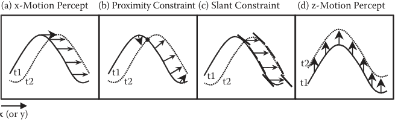

**FIGURE 9.9** (**See color insert following p. 94.**) (a) 表示立体波形表面（以 z,x 空间的截面图，即俯视图）两个连续相位（实线和虚线）的示意图。箭头指示了为观察侧向运动所需的对应位置，而表面波形在两个相位之间交替变化。 (b) 亲和约束无法解释观察到的知觉。 (c) 表面倾斜约束能够提供解释 (a) 中知觉所需的匹配。 (d) 在近轴和远轴位置之间交替的正弦波形强制产生立体轴向运动的知觉。

我们将其实现为一种**相互亲和约束**，以最小球接触两表面的切线弦距离为度量。换句话说，侧向运动表现出更高的概率“权重”。下面还将考虑其他选项。

这个新的*表面对应*问题应当与构建表面所需的*符号对应*问题（Grimson, 1982; Green, 1986; He and Nakayama, 1994）清楚地区分开来。相关研究关注局部亮度元素之间的对应关系，这些元素通过差分*运动线索*定义表面结构，属于经典的视觉运动-结构范式。在此情形下，表面是立体地定义的，然后在两个深度配置之间交替。关键问题是：t₁ 与 t₂ 时刻的表面位置如何对应？该问题与定义表面的元素（如图 9.6a 中的点）无关：即使这些元素在 t₁ 与 t₂ 之间完全改变，表面对应仍然保持不变。例如，即使表面配置不变，只要动态噪声元素在 t₁ 与 t₂ 之间完全改变位置和特征，也不会产生表面运动的知觉。

在心理物理层面上，表面对应问题是定量而非定性的，因为必然存在一个跳跃大小的平衡点，使得运动从立体表面的侧向 (x,y) 转为深向 (z) 运动（即立体运动）。这一转变的解释是，局部对应自然导致侧向立体运动的知觉，因为局部视差在变化。要看到立体表面的侧向运动，系统必须进行基于表面的对应匹配，如图 9.9c 所示，对 t₁ 与 t₂ 两个配置之间的表面进行匹配。

在任何欧几里得度量的 3D 空间中（无论水平/垂直缩放如何），最近的点都必须重新分配，以产生均匀的侧向运动。这种重新分配可以视为某种全局过程的有效标志，该过程负责产生立体表面的侧向运动知觉。例如，基于表面的匹配对表面倾斜具有选择性，因此只能匹配到具有相同倾斜的相邻区域（图 9.9c）。因此，基于表面的匹配会强制产生侧向的立体运动，因为具有相同倾斜的最近表面斑块始终位于纯侧向方向（对于纯侧向位移的计算表面而言）。特别是，表面倾斜约束会禁止任何两表面交叉点的稳定性，因为在这些点处两表面的倾斜方向相反。

本概述所回顾的证据指向表面表示在“粘合”或“收缩包裹”中的关键作用，用于将物体组件以适当的关系关联起来。它也强调了这种表面“收缩包裹”的固有三维性。

 sinusoidal 立体差异结构被知觉为该结构的运动（见图 9.9a）这一事实，引发了这样的问题：立体结构在三维空间中运动是否由与静态差异结构相同的皮层机制处理，又是否由与其 y 轴运动相同的机制处理 z 轴运动。为回答此问题，我们需要一个范式，能够在三维结构静止、水平移动（y 轴）或深向移动（z 轴）时分离其响应。如果三个刺激激活相同的皮层区域，则无法得出结论，因为该区域可能对多种推断提供基础。但如果任意两个刺激激活不同的皮层区域，则提供了强有力的证据，表明其背后的神经机制存在差异。

事实上，在侧皮层的皮层区域中，已观察到显著的差异激活，如图 9.10 所示。解释为：y 轴和 z 轴的立体运动均独立于深度结构本身进行处理；前后平行立体运动的处理方式类似于 hMT+ 中的侧向亮度基运动，但也激活另一个腹侧区域；而 z 轴立体运动则在处理层级上被编码于不同的区域（Likova and Tyler, 2007），该层级也包含腹侧区域。

处理顺序对表面插值和立体运动的影响可在流程图（图 9.11）中体现。局部视差已知在 V1 中处理，尽管图 9.10 的实验未直接检查此点，因为三种比较中均将局部视差等同。静态视差图像的表面结构插值必须通过 V1 的背侧区域实现。

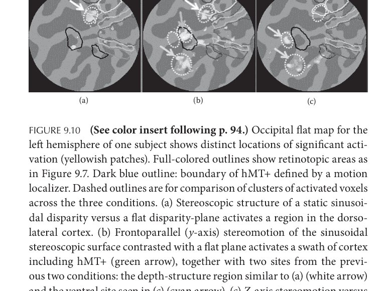

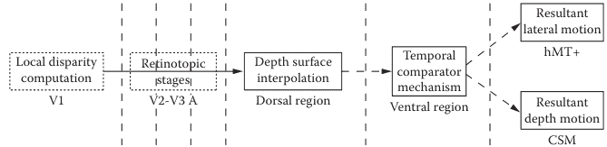

**FIGURE 9.11** 由图 9.10 的激活暗示的处理流程示意图。方框表示带有皮层区域标签的处理阶段，箭头表示连接路径，虚线表示推测性的连接。垂直虚线表示基于先前研究的逻辑序列分隔。

腹侧区域仅在表面结构出现时间变化时被激活，因此很可能是一种*时间比较机制*，适用于两种深度运动类型。该机制需要来自表面插值机制的输入，但我们目前缺乏直接证据表明背侧与腹侧区域之间存在连接路径。

图 9.10c 中未出现背侧激活并不意味着没有表面结构激活，而是缺乏改变表面结构以在 z 轴（测试）到 y 轴（对照）方向改变运动方向时产生激活；而图 9.10a,b 的条件则涉及深度结构的改变，因为对照为平坦立体表面。图 9.11 的流程图最后一步是将立体运动的 y 轴（hMT+ 区域）和 z 轴（CSM 区域）分别表示为独立的表征。分离是由 fMRI 激活强制要求的，但连接仍属推测性（正如 Maunsell 和 Van Essen, 1983 在其早期神经生理研究中所指出的那样）。需要进一步实验才能完整阐明流程图的所有细节。

**CONCLUSION**

表面表示的概念需要一种表面插值机制，以在视野信息缺失的区域表示表面。典型的受体场汇总机制随着刺激信息量的增加而增强响应，而插值机制的特征是随着刺激信息的减少而增强响应，且需要更广泛的插值。因此，插值机制的大脑位置可能通过寻找 fMRI 激活区域来确定。


这些神经元在亮度信息密度降低时，反而会增强对深度结构刺激的反应（或不会显著降低其反应）。基于所有视觉通道都存在单一深度插值机制的证据（Tyler et al., 2006），应对同一深度结构的视差、运动和纹理密度线索进行实验，以检验以下预测：对于所有三种深度结构线索，当点密度降低时，相同的皮层插值位点会表现出增强的反应。

总之，本综述的主要成果是三维表面插值的概念，即：空间处理的主要方式是通过完整三维空间度量内的自组织表面表征（或注意罩，见第9章）。直到这种表面表征形成之后，知觉系统似乎才能定位场景的各个组成部分（Likova & Tyler, 2003）。这一观点与更传统的概念截然相反，后者认为视觉刺激的首要属性是它们的位置，其他属性都附着在这个位置坐标上（Marr, 1982）。相比之下，注意罩的概念是一个灵活的网络，用于内部表征外部物体结构。在这个概念中，注意罩本身就是一个知觉坐标框架。它通过组织（“收缩包裹”）自身来优化由视网膜图像中双眼和单眼深度线索复合体所隐含的空间解释。直到这一深度重建过程完成，坐标位置才能被赋予外部场景。在这个意义上，定位次于视觉输入的完整深度表征。空间形态通常被视为一种主要是二维的属性，可以被旋转到第三维，而在本文中它变成了一个基本的三维概念，二维投影只是其衍生特征。

这一分析的最终结果是对绑定问题的本质提供了一个新颖的视角。各个分离的刺激属性和局部特征通过全局三维表面表征的“粘合剂”被绑定成一个连贯的物体。这一观点与那种通过专门感受野和识别回路将场景分解为其组成元素的概念形成了根本性的对立。本综述所回顾的证据强调了注意罩以可抓握的基质形式对表面进行“收缩包裹”这一过程所固有的三维性；该基质能够将图像投射到感觉中枢上的物体组成部分凝聚在一起。这种主动的绑定过程很容易用合理的神经组件进行计算实现，这些神经组件可能位于人类皮层中的三维重建位点。

## 物体与表面形成中的三维和时空插值

Philip J. Kellman  
Patrick Garrigan  
Evan M. Palmer

### 目录

- 引言 — 184
- 视觉插值的若干现象 — 185
  - 插值现象的分类 — 185
  - 轮廓与表面过程 — 188
- 静态二维场景中的轮廓插值模型 — 190
  - 视觉插值的几何学 — 190
  - 插值的起始条件 — 190
  - 轮廓的可关联性 — 191
  - 一个物体还是两个？ — 192
  - 定量变化 — 193
  - 生态学基础 — 193
- 三维轮廓插值 — 194
  - 轮廓插值的实验研究 — 196
- 三维表面插值 — 197
- 时空插值 — 200
- 从亚符号表征到符号表征 — 203
- 大脑中的三维知觉 — 205

### 引言

正如大卫·马尔（David Marr）在其经典著作*《视觉》*（1982）中所指出的，理解视觉知觉涉及多个分析层面的问题。这一观察不仅适用于研究者必须提出的问题类型的概念差异，也适用于视觉处理的不同层次。视觉研究者们在理解早期皮层滤波方面取得了巨大进展。而在另一端，研究已经揭示了一些高级表征所在的区域，例如物体或面孔的表征。然而，在这些层次之间，存在着相当大的空白。这一“中间视觉”的空白涉及马尔的所有层面：用于计算轮廓、表面和物体表征的信息的理解；所涉及的表征和过程；以及皮层区域的位置和作用。尽管马尔强调这些层面在它们提出的问题方面具有实质性的独立性，但对“中间”所发生事情的理解滞后也与这些层面之间的相互作用有关。理解任务和信息为过程描述铺平了道路。同样，关于过程和表征的详细假说也指导着有意义的神经生理学研究。

中间视觉的基础是三维（3D）表征。表面的形状是什么？我们如何表征三维物体的形状，并从物体投射到眼睛的不完整、零碎的投影中获得这些表征？在普通环境中，大多数物体的视野都部分地被其他物体遮挡，而且随着物体和观察者的移动，可见区域会以复杂的方式变化，我们又如何获得物体和表面的描述？

尽管许多传统的视觉研究方法试图发现如何通过从静态二维（2D）图像进行推断来获得有意义的知觉表征，但越来越清楚的是，人类视觉既将复杂的三维和时空信息作为输入，也构建三维表面表征作为输出。尽管人类视觉在某些任务中可能会利用捷径，但三维表面表征在我们理解世界和与之互动的能力中都扮演着许多重要角色。

在本章中，我们讨论几项旨在增进我们对三维和时空表面与物体形成的理解的研究。具体而言，我们关注的是当视觉系统必须跨越输入中的空间和时空间隙进行插值时，是如何实现表面或物体表征的。人类视觉系统拥有卓越的机制，能够从零碎的输入中恢复连贯的物体和表面表征。具体来说，物体和表面知觉依赖于插值过程，这些过程克服了二维、三维和时空显示中轮廓和表面的间隙。最近的研究表明，这样做的机制有着深刻的内在联系，因为它们利用了共同的几何规律性。

### 视觉插值的若干现象

在普通的知觉中，物体和表面的部分遮挡无处不在。例如，图10.1左侧的（a）–（d）分图显示了被栅栏遮挡的房屋视图。即使在单一的静态视图中，我们也能够获得栅栏后面场景的某些表征。如果行走的观察者按顺序看到这几个视图，我们就会得到一个非常完整的表征，如图10.1c所示。

感知完整物体和连续表面需要知觉过程在输入中的间隙之间连接可见区域，以实现对完整性和形状的准确表征。这些过程通常是在静态二维表征中研究的。然而，知觉与一个三维世界打交道，并部分地产生物体轮廓和表面的真正三维表征。此外，当物体或观察者移动时，物体的可见区域会随时间变化，使物体形成的要求变得更加复杂。视觉系统不仅要处理空间上的碎片化，还要处理时间上的碎片化。因此，我们可以将现实世界中的轮廓和表面知觉视为从分布在四个维度（三个空间维度和时间）上的信息到三维空间表征的映射。如果运动也被表征，视觉物体和表面形成就是从碎片化的四维（4D）输入到连贯的、功能上有意义的4D表征的映射。

这些现象在形式上是相似的，因为图10.1a、10.1b和10.1c中给出了中心图形相同的物理规定轮廓，并且每种情况下完成的物体都由相同的物理规定轮廓和插值轮廓集合所定义。（图10.1d仅包含图中部相应的插值。）

### 插值现象的分类

许多现象涉及在间隙之间连接可见轮廓和表面（图10.2）。图10.2a显示了部分遮挡。六


出现了不相连的蓝色区域；然而，你的视觉系统将它们连接成一个延伸至黑色遮挡物后面的单一物体。该物体的整体形状清晰可见。这一场景的知觉组织还导致对黑色表面上圆形开孔的知觉，通过这些开孔可以看到蓝色物体和更远的白色表面。图10.2b展示了错觉轮廓或错觉物体的相关现象。在这里，视觉系统跨越间隙连接轮廓，形成一个出现在阵列中其他表面中央的白色图形。图10.2c展示了错觉图形的透明版本；图形被创建，但人们也可以看到左下方的一个黄点*并不*作为被遮挡物体的一部分出现，尽管它位于蓝色物体的插值轮廓和真实轮廓之内。这种遮挡下的表面插值现象似乎是表面扩展或“填充”现象家族中的一员，例如亚布斯（Yarbus, 1967）研究的颜色扩展现象以及跨越盲点的填充现象。

## 静态2D场景中的轮廓插值模型

轮廓插值与表面插值的互补过程协同工作，将视网膜图像中的物体片段跨间隙连接起来，并恢复被遮挡物体的形状（例如，Grossberg和Mingolla, 1985；Kellman和Shipley, 1991）。物体的插值边界，无论是被遮挡的还是错觉的，都约束着表面在图像中未指定区域的扩展，即使这些插值边界与其他边界并不相连（Yin、Kellman和Shipley, 1997, 2000）。在此，我们简要回顾开发一个4D轮廓插值和表面知觉模型的背景。

### 视觉插值的几何学

理解视觉物体和表面形成的一个首要问题是：什么样的刺激关系会导致其发生？回答这个问题在多个方面具有根本意义。它使我们能够理解视觉插值的本质。一些可见片段被连接起来，而另一些则没有。发现导致物体形成的几何关系和相关刺激条件，类似于理解一种语言的语法（例如，什么构成一个结构良好的句子）。在这一层次上的理解，对于领悟物理世界与我们对它的心理表征之间最深刻的联系也至关重要。描述导致物体形成的刺激关系起初是描述性的，但随着统一原则的揭示，它们帮助我们将在视觉系统所使用的信息与支配表面投影到眼睛的物理定律联系起来，无论这些定律是关于世界运作方式的深层约束（例如，Gibson, 1979；Marr, 1982），还是场景统计（例如，Geisler et al., 2001）。

### 插值的起始条件

关于轮廓插值的一个重要事实是，插值轮廓在视觉场景中的位置受到高度限制。一般来说，插值轮廓起始并终止于可见轮廓中的接合点或角点（切线不连续点）——即轮廓没有唯一方向的位置（Shipley和Kellman, 1990；Rubin, 2001）。有些人提出，二阶不连续点（一阶连续但曲率发生变化的点）也可能微弱地触发插值（Shipley和Kellman, 1990；Albert和Hoffman, 2000；Albert和Tse, 2000；Albert, 2001；最新讨论见Kellman, Garrigan, and Shipley, 2005）。切线不连续点产生于被遮挡物体投影到眼睛的光学过程：可以证明，一个物体遮挡另一个物体的光学投影将包含这些图像特征（Kellman & Shipley, 1991）。希普利和凯尔曼（1990）观察到，插值轮廓通常起始并终止于切线不连续点，并表明去除这些点会消除或显著减少轮廓插值。海特格等人（1992）将切线不连续点称为“关键点”，并提出了一个神经上合理的模型来从图像中提取它们。通过使诱导元素的角部变圆，可以操纵错觉轮廓图像中切线不连续点的存在与否，这会削弱轮廓插值（例如，Albert和Hoffman, 2000；Kellman等人，2005；Shipley和Kellman, 1990；Palmer, Kellman, and Shipley, 2006）。

### 轮廓可关联性

是什么决定了哪些可见轮廓片段会被连接起来形成物体？尽管切线不连续点通常是轮廓插值的必要条件，但它们并不充分。毕竟，图像中的许多角点是物体的角，而不是某条轮廓从中间表面后方通过（或从前方通过，如错觉轮廓）的点。

轮廓插值关键依赖于可见轮廓片段的几何关系，特别是进入切线不连续点的成对边缘的相对位置和方向。这些关系已用*轮廓可关联性*（Kellman和Shipley, 1991；Singh和Hoffman, 1999a）进行了形式化描述。可关联性是一个数学概念，它定义了可以通过插值连接的边缘与不能连接的边缘之间的类别区分（见Kellman和Shipley, 1991, 175–177）。轮廓可关联性的核心思想是平滑性（例如，插值轮廓至少一次可微），但它也包含单调性（插值轮廓


**图10.6** 可关联与不可关联轮廓的示例。

这一区分很重要，因为物体知觉通常涉及对两个可见片段是否属于同一物体的离散判断。图10.6展示了可关联与不可关联边缘的示例，既包括部分遮挡物体的知觉，也包括错觉物体的知觉。顶行中形成了完整的物体，而底行则没有。物体形成对后续加工具有深远影响，例如生成缺失区域的表征、生成整体形状描述，以及与记忆中的项目或类别进行比较。研究表明，视觉区域作为单一物体或不同物体的一部分进行表征，对信息加工有许多重要影响（Baylis和Driver, 1993；Zemel等人，2002；Kellman, Garrigan, and Shipley, 2005）。

### 定量变化

尽管将可见区域离散分类为连接或分离很重要，但同样有理由相信，在可关联边缘类别内部存在定量变化（Kellman和Shipley, 1991；Banton和Levi, 1992；Shipley和Kellman, 1992a, 1992b；Field, Hayes, and Hess, 1993；Singh和Hoffman, 1999b）。例如，菲尔德、海耶斯和赫斯（1993）报告了实验中可关联性降至约90°极限的下降趋势。辛格和霍夫曼（1999a）提出了可关联性随角度变化而定量下降的表达式。

### 生态学基础

可关联性的概念有时被描述为格式塔良好延续原则的形式化（Wertheimer, 1923/1938）。近期研究表明，良好延续与可关联性是知觉组织中既独立又相关的原则（Kellman等人，2003）。两者都体现了关于轮廓平滑性的潜在假设（Marr, 1982），但它们接收不同的输入并具有不同的约束条件。与这两条原则相关的平滑性假设反映了物理世界在投射到眼睛时的重要方面。图像统计研究表明，这些原则在匹配世界中实际轮廓的结构方面接近最优。通过分析自然图像中的轮廓关系，盖斯勒等人（2001）发现，控制两个边缘元素共现概率的统计规律性与可关联性的几何结构高度相关。与同一轮廓相关的两个可见边缘段在大多数情况下都满足数学上的可关联性标准。

### 3D轮廓插值

物体形成过程是三维的。图10.7给出了一个例子——一个可以通过交叉双眼自由融合的立体图。人们会看到一个具有明确3D形状的生动透明表面。物体形成以边缘的3D位置和方向作为输入，并输出3D结构（Kellman和Shipley, 1991；Carman和Welch, 1992；Kellman等人，2005；Kellman, Garrigan, and Shipley, 2005）。

直到最近，还没有关于产生3D插值的刺激条件的解释。凯尔曼等人（2005）提出，3D插值可能受一个直接的三维推广所支配


**图10.7** *（见第94页后的彩色插图。）* 三维（3D）插值。该显示是一个可以通过交叉双眼自由融合的立体图。对3D空间中输入边缘的位置和方向（此处由立体视差给出）的指定，导致产生一个在深度上弯曲的、生动的、连贯的透明表面。


假设你是一个高级文档工程师和翻译员，请参考下面的注意事项了解 Markdown 文档的格式，然后参考示例，将给定英文文本翻译成中文。

## 注意事项

-   粗体（**bold**）和斜体（*itatic*）需要翻译翻译内容并保留符号。
-   内联代码（`code`）和代码块不需要翻译。
-   链接（[link](https://example.org)）需要翻译其内容，但保留网址。
-   列表，表格，引用块保留格式，翻译内容
-   原文可能有多行，不要漏掉任何一行，并且注意一定不要重复输出原文！！！
-   输出应包含在“[content]...[/content]”中

## 示例

原文：

[content]
-   [Feynman's learning method](https://wiki.example.org/feynmans_learning_method) is inspired by **Richard Feynman**, the Nobel Prize winner in physics. 

1.  With Feynman's skills, you can understand the knowledge points in depth in just `20 min`, and it is memorable and *hard to forget*. 

```
if (condVar > someVal) {console.log("xxx")}
```
[/content]

译文：

[content]
-   [费曼学习法](https://wiki.example.org/feynmans_learning_method)的灵感源于诺贝尔物理奖获得者**Richard Feynman**。

1.  运用费曼技巧，你只需花上`20 min`就能深入理解知识点，而且记忆深刻，*hard to forget*。

```
if (condVar > someVal) {console.log("xxx")}
```
[/content]

## 以下是需要翻译的文本

[content]

## 2D relatability. As in the 2D case, interpolated contours between 3D edges must be smooth, monotonic, and bend no more than 90°. Similarly, where 3D interpolated contours meet physically given edges, the orientations of the physically given part and the interpolated part must match.

Formally, we define, for a given edge and any arbitrary point, the range of orientations that fall within the limits of relatability at that point. In the Cartesian coordinate system, let Θ be an angle in the x‑y plane, and φ an angle in the x‑z plane (for simplicity, in both cases zero degrees is the orientation parallel to the x‑axis). Positioning one edge with orientation Θ = φ = 0 and ending at the point (0, 0, 0), and positioning a second edge at (x, y, z) somewhere in the volume with x > 0, the range of possible orientations (θ, φ) for 3D‑relatable edges terminating at that point are given by  

$$\tan^{-1}\!\left(\frac{y}{x}\right) \le \theta \le \frac{\pi}{2} \tag{10.2}$$

and  

$$\tan^{-1}\!\left(\frac{z}{x}\right) \le \varphi \le \frac{\pi}{2} \tag{10.3}$$

As in the 2D case, we would expect quantitative variation in the strength of interpolation within these limits. The lower bounds of these equations express the absolute orientation difference (180° for two collinear edges ending in opposite directions) between the reference edge (edge at the origin) and an edge ending at the arbitrary point oriented so that its linear extension intersects the tip of the reference edge. The upper bounds incorporate the 90° constraint in three dimensions.

How might the categorical limits implied by the formal definition of 3D relatability be realized in neural architecture? In 2D cases, it has been suggested that interpolation occurs through lateral connections among contrast‑sensitive oriented units having particular relations (Field, Hayes, and Hess, 1993; Yen and Finkel, 1998). Analogously, 3D relatability specifies a “relatability field” or volume within which relatable contour edges can be located. At every location in the volume, relatable contours must have a 3D orientation within a particular range specific to that location.

The interpolation field suggests that, contradictory to some 2D models of contour interpolation, early visual cortical areas that do not explicitly code 3D positions and contour orientations may be insufficient for the neural implementation of 3D contour interpolation (Kellman, Garrigan, and Shipley, 2005). As we discuss below, there are interesting considerations regarding exactly where the neural locus of contour interpolation may be.

## Experimental Studies of Contour Interpolation

An objective performance paradigm for testing 3D contour relatability was devised by Kellman, Garrigan, Shipley, Yin, and Machado (2005) and is illustrated in Figure 10.8. In their experiments, subjects were shown stereoscopically presented 3D planes whose edges were either relatable or not. Examples of relatable and non‑relatable pairs of planes are shown in the columns of Figure 10.8. Orthogonal to relatability are two classes of stimuli, converging and parallel planes, shown in the rows of Figure 10.8. In these experiments, subjects were asked to classify stimuli like the ones shown as either parallel or converging. The idea is that, to the extent that 3D relatability leads to object formation, judging the relative orientations of 3D relatable planes should be easier and quicker than judging the relative orientations of 3D non‑relatable planes.

Kellman et al. (2005) found that subjects could make this classification more accurately and quickly when the planes were 3D relatable. This result  


**FIGURE 10.8** Experimental stimuli used to test three‑dimensional (3D) object formation from 3D relatability. It was predicted that sensitivity and speed in classifying displays like these as either converging or parallel would be superior for displays in which unitary objects were formed across the gaps by contour interpolation, and that object formation would be constrained by 3D relatability. Both predictions were confirmed experimentally (Kellman et al., 2005).

is consistent with 3D relatability as a description of the geometric limits of 3D contour interpolation and object formation. A variety of other experiments indicated that the results depended on 3D interpolation, rather than some other variable, such as an advantage of certain geometric positions for making slant comparisons. (For details, see Kellman et al., %.,,, [1],,<unk><unk><unk><unk><unk><unk><unk><unk><unk><unk><unk><unk><unk><unk><unk><unk><unk><unk><unk><unk><unk><unk><unk><unk><unk><unk><unk><unk><unk><unk><unk><unk><unk><unk><unk><unk><unk><unk><unk><unk><unk><unk><unk><unk><unk><unk><unk><unk><unk><unk><unk><unk><unk><unk><unk><unk><unk><unk><unk><unk><unk><unk><unk><unk><unk><unk><unk><unk><unk><unk><unk><unk><unk><unk><unk><unk><unk><unk><unk><unk><unk><unk><unk><unk><unk><unk><unk><unk><unk><unk><unk><unk><unk><unk><unk><unk><unk><unk><unk><unk><unk><unk><unk><unk><unk><unk><unk><unk><unk><unk><unk><unk><unk><unk><unk><unk><unk><unk><unk><unk><unk><unk><unk><unk><unk><unk><unk><unk><unk><unk><unk><unk><unk><unk><unk><unk><unk><unk><unk><unk><unk><unk><unk><unk><unk><unk><unk><unk><unk><unk><unk><unk><unk><unk><unk><unk><unk><unk><unk><unk><unk><unk><unk><unk><unk><unk><unk><unk><unk><unk><unk><unk><unk><unk><unk><unk><unk><unk><unk><unk><unk><unk><unk><unk><unk><unk><unk><unk><unk><unk><unk><unk><unk><unk><unk><unk><unk><unk><unk><unk><unk><unk><unk><unk><unk><unk><unk><unk><unk><unk><unk><unk><unk><unk><unk><unk><unk><unk><unk><unk><unk><unk><unk><unk><unk><unk><unk><unk><unk><unk><unk><unk><unk><unk><unk><unk><unk><unk><unk><unk><unk><unk><unk><unk><unk><unk><unk><unk><unk><unk><unk><unk><unk><unk><unk><unk><unk><unk><unk><unk><unk><unk><unk><unk><unk><unk><unk><unk><unk><unk><unk><unk><unk><unk><unk><unk><unk><unk><unk><unk><unk><unk><unk><unk><unk><unk><unk><unk><unk><unk><unk><unk><unk><unk><unk><unk><unk><unk><unk><unk><unk><unk><unk><unk><unk><unk><unk><unk><unk><unk><unk><unk><unk><unk><unk><unk><unk><unk><unk><unk><unk><unk><unk><unk><unk><unk><unk><unk><unk><unk><unk><unk><unk><unk><unk><unk><unk><unk><unk><unk><unk><unk><unk><unk><unk><unk><unk><unk><unk><unk><unk><unk><unk><unk><unk><unk><unk><unk><unk><unk><unk><unk><unk><unk><unk><unk><unk><unk><unk><unk><unk><unk><unk><unk><unk><unk><unk><unk><unk><unk><unk><unk><unk><unk><unk><unk><unk><unk><unk><unk><unk><unk><unk><unk><unk><unk><unk><unk><unk><unk><unk><unk><unk><unk><unk><unk><unk><unk><unk><unk><unk><unk><unk><unk><unk><unk><unk><unk><unk><unk><unk><unk><unk><unk><unk><unk><unk><unk><unk><unk><unk><unk><unk><unk><unk><unk><unk><unk><unk><unk><unk><unk><unk><unk><unk><unk><unk><unk><unk><unk><unk><unk><unk><unk><unk><unk><unk><unk><unk><unk><unk><unk><unk><unk><unk><unk><unk><unk><unk><unk><unk><unk><unk><unk><unk><unk><unk><unk><unk><unk><unk><unk><unk><unk><unk><unk><unk><unk><unk><unk><unk><unk><unk><unk><unk><unk><unk><unk><unk><unk><unk><unk><unk><unk><unk><unk><unk><unk><unk><unk><unk><unk><unk><unk><unk><unk><unk><unk><unk><unk><unk><unk><unk><unk><unk><unk><unk><unk><unk><unk><unk><unk><unk><unk><unk><unk><unk><unk><unk><unk><unk><unk><unk><unk><unk><unk><unk><unk><unk><unk><unk><unk><unk><unk><unk><unk><unk><unk><unk><unk><unk><unk><unk><unk><unk><unk><unk><unk><unk><unk><unk><unk><unk><unk><unk><unk><unk><unk><unk><unk><unk><unk><unk><unk><unk><unk><unk><unk><unk><unk><unk><unk><unk><unk><unk><unk><unk><unk><unk><unk><unk><unk><unk><unk><unk><unk><unk><unk><unk><unk><unk><unk><unk><unk><unk><unk><unk><unk><unk><unk><unk><unk><unk><unk><unk><unk><unk><unk><unk><unk><unk><unk><unk><unk><unk><unk><unk><unk><unk><unk><unk><unk><unk><unk><unk><unk><unk><unk><unk><unk><unk><unk><unk><unk><unk><unk><unk><unk><unk><unk><unk><unk><unk><unk><unk><unk><unk><unk><unk><unk><unk><unk><unk><unk><unk><unk><unk><unk><unk><unk><unk><unk><unk><unk><unk><unk><unk><unk><unk><unk><unk><unk><unk><unk><unk><unk><unk><unk><unk><unk><unk><unk><unk><unk><unk><unk><unk><unk><unk><unk><unk><unk><unk><unk><unk><unk><unk><unk><unk><unk><unk><unk>


通过先前针对静态物体所识别的轮廓和表面插值过程，碎片得以形成。由于持久化和更新过程，轮廓是否被插值受到轮廓关联性（Kellman and Shipley, 1991; Kellman, Garrigan, and Shipley, 2005）的相同几何关系的约束，这些几何关系也决定了静态阵列中的单元形成。

由于支撑插值的空间关系受到高度约束，对先前所见碎片的准确表征对于允许时空物体形成发生并准确运作至关重要。Palmer, Kellman, and Shipley (2006) 将物体形成的要求与关于视觉机制的提议结合起来，这些机制在时空关联性（STR）模型中随时间表征、更新和连接物体碎片。该模型解释了在图10.1所示情境下对动态遮挡物体的感知。

在一系列实验中，Palmer, Kellman, and Shipley (2006) 发现了支持STR的持久化、位置更新和关联性概念的证据。持久化概念得到支持，因为观察者的表现仿佛他们看到动态遮挡物体的时间比其物理暴露时长更长。位置更新概念得到支持，因为观察者在区分仅因碎片水平对齐方式不同而异的两种形状配置时高度准确。由于动态遮挡物体水平移动，且遮挡区域两侧的两个匹配边缘并非同时可见，观察者的准确表现表明他们掌握了两个边缘的位置信息，尽管在任何时刻至少有一个边缘被遮挡。最后，轮廓和表面插值过程在这些显示中运作的概念得到了支持，因为在预测支持物体形成的条件下，辨别表现具有显著优势。具体来说，符合STR几何约束的配置产生的敏感度明显优于不符合的配置。这种效应依赖于物体形成的特点也在另一条件中得到体现：在遮挡点仅移除6%的像素（使轮廓连接处变圆）就会导致表现可靠地变差，尽管碎片的整体配置得以保留。最后这一结果是从先前发现中预测出来的，即轮廓连接处变圆会削弱轮廓完成过程（Albert, 2001; Shipley and Kellman, 1990; Rubin, 2001）。

当轮廓插值过程受到损害时，物体的三个投影碎片就不太可能被感知为一个单一视觉单元，辨别表现也随之受损。

Palmer, Kellman, and Shipley (2006) 提出了“*动态视觉图标*”的概念——一种在其中执行STR的持久化和位置更新（或许还有插值）功能的表征。这一思想扩展了视觉图标表征的概念，该概念最初由Sperling (1960)发现，并由Neisser (1967)命名，它随时间接受信息，允许感知者整合不再物理可见的视觉信息。感知不是一个瞬时过程，而是随时间延伸的，视觉图标是一种表征，它在信息消失后以空间准确的格式忠实维持视觉信息达100毫秒或更久。动态视觉图标的提议增加了这样的观点：所表征的信息可以基于先前获得的速度信息进行位置更新。目前尚不清楚这一特征是已知视觉图标表征中先前未被探索的方面，还是意味着一种特殊表征。清楚的是，视觉信息不仅随时间和空间累积，而且底层表征是针对持续事件的处理而调整的。

动态视觉图标尚未探索的一个方面是它是否在所有三个空间维度上纳入位置变化信息。如果是这样，这种表征可能在真正的4D时空物体形成过程中处理计算。迄今为止的大多数研究，以及Palmer, Kellman, and Shipley (2006)提出的STR理论，都集中于2D轮廓完成过程和运动信息。一个更全面的3D插值概念，包含位置变化和随时间整合，尚未通过实验进行研究。未来的工作将解决这个问题，并尝试将Kellman, Garrigan, and Shipley (2005)的3D物体形成工作与Palmer, Kellman, and Shipley (2006)的STR理论和发现统一起来。

## 从亚符号表征到符号表征

增进我们对轮廓插值过程理解的一种方法是构建轮廓插值机制模型，并将其表现与人类感知进行比较。其中一种模型以灰度图像为输入，使用模拟的简单细胞和复杂细胞检测轮廓连接点（Heitger et al., 1992），并使用类似于轮廓关联性的几何约束在其间进行插值（Heitger et al., 1998）。

该模型的输出是沿插值路径的像素位置上的激活图像。这些激活出现在人们报告感知到错觉轮廓的图像位置。

一个更新的模型（Kalar et al., 2010）推广了Heitger et al. (1998)模型中提出的框架，以同时插值错觉轮廓和遮挡轮廓。该模型是轮廓关联性和同一性假说（即错觉物体和遮挡物体共享一个共同的底层插值机制）的神经实现，它在各种情境下生成与人类感知一致的错觉和遮挡轮廓图像（例如，图10.12）。

然而，这类模型有一个重要缺点。这些模型的输入是*图像*，其中像素值代表亮度。模型的输出是错觉、遮挡（以及真实）轮廓的图像。也就是说，这些模型接收代表每个像素位置亮度的图像，并返回代表每个像素位置错觉和遮挡插值*活动*的图像。输出中没有任何东西表明不同像素彼此相连，或它们构成轮廓的一部分等等。没有东西描述构成完整物体的区域，更不用说提供其形状的描述。在这个意义上，这类模型容易被误解，因为观察者在查看输出时提供了所有这些额外的描述。


[第224页]

要解释人类感知，这些模型提供的重要过滤信息必须输入到产生更高层次符号描述的机制中。除了将轮廓（无论是物理定义的还是插值的）表示为未绑定像素值集合之外，还必须有一个更整体的描述，具有形状、范围及其与场景中其他轮廓的几何关系等属性。

这是关于物体和表面感知研究的一个非常普遍的观点。使用相对局部滤波器的视觉模型描述了处理的重要基本方面。在更高层次上，一些物体识别模型假设诸如轮廓形状、纵横比或体积基元之类的标记作为描述。困难的问题在中间：我们如何从局部滤波器响应达到更高层次的符号描述？这个问题对于理解3D形状和表面感知尤其重要。需要更高层次的形状描述来解释我们在物体识别中对形状的使用以及我们对相似性的感知。正如格式塔心理学家近一个世纪前所观察到的，两个形状尽管由非常不同的元素组成，但可能被视为相似的。形状不可能是局部滤波器激活的总和。理解将局部响应绑定为统一物体并实现这些物体更抽象描述的过程，是未来研究的关键挑战。

3D和时空感知的研究也为理解视觉的皮层过程提出了重要问题。大量研究和建模集中于早期皮层区域V1和V2，作为插值过程的可能位置（Mendola et al., 1999; Sugita, 1999; Bakin, Nakayama, and Gilbert, 2000; Seghier et al., 2000），用于错觉轮廓和遮挡轮廓。基于他们在3D插值上的结果，Kellman, Garrigan, and Shipley (2005)提出插值过程涉及所有三个空间维度，并且不太可能在早期区域完成。这一提议有几个原因。首先，V1和V2中的方向敏感单元编码2D方向特征，这不足以解释3D插值。其次，人们可以假设2D方向与视差敏感细胞的输出相结合，可能以某种方式为3D插值提供基础。然而，证据表明，视差敏感细胞的类型不足以解释3D插值。


在这些早期区域中可用的信息是不充分的：尽管深度计算需要相对视差，但具有视差敏感性的 V1 神经元似乎对随注视而变化的绝对视差敏感（Cumming 和 Parker，1999）。第三，即使相对视差也不能直接产生对现实世界中深度间隔的知觉。这里存在两个问题。其一，从视差中获得深度间隔涉及恒常性问题；给定的深度间隔会因观看距离的不同而产生不同的视差差异（Wallach 和 Zuckerman，1963）。要获得深度间隔，视差信息必须与来自其他来源的、关于至少一个点的自我中心距离信息相结合。图 10.13 说明了这个问题以及第二个问题。Kellman 等人（2005）的实验数据表明，处于特定倾斜度的边缘片段为三维插值过程提供了输入。然而，倾斜度不仅取决于点之间的深度间隔，还取决于它们的间距。此外，三维倾斜度可以由多种来源指定。三维插值的可能神经基质是某个皮层区域，在该区域中，由多种贡献线索计算出的实际倾斜信息是可用的。这些要求远远超出据推测发生在 V1 或 V2 中的计算。


**图 10.13** 视差、边缘长度与倾斜度之间的关系。*深度与视差：*世界中的给定深度间隔 *d* 随着观看距离的增加产生递减的视差。如果点 R 和 S 距离更远，则由它们给出的间隔 d 所产生的视差差异小于 P 和 Q。*倾斜度：*从视差获得倾斜度不仅依赖于恢复深度间隔，还依赖于定义该深度间隔的点之间的垂直间距（α > β）。

这样的计算可能发生在哪里？虽然尚未确定明确的神经位点，但使用尾侧顶内沟（cIPS）单细胞记录的研究表明，存在调谐于三维倾斜度的单元（Sakata 等，1997）。值得注意的是，这些单元似乎对特定的三维朝向作出反应，无论该朝向是由立体信息还是纹理信息所指定。这些发现指出了三维可连接性所需的输入单元类型——即发出三维朝向和位置信号的单元——可能存在于神经系统的何处。

除了三维处理的位置之外，关于其机制的性质仍有许多有待了解。是否存在这样的皮层区域：对轮廓或表面片段的三维位置和朝向敏感的单元在表征三维关系的网络中相互作用？目前，我们还不知道这样的网络，但心理物理学结果表明它值得寻找。

所有这些同样的问题也适用于时空物体形成。我们拥有令人印象深刻的能力，能从跨越空间和时间间隙累积的片段中构建连贯的物体和场景。这些能力在皮层中的何处实现？又有哪些机制在先前可见的片段从视野中消失后，基于速度信息存储它们并更新其位置？一个引人注目的可能性是，这与三维插值所涉及的皮层区域相同。至少，这样的结果将与一个把从片段中创造物体的过程统一起来的大统一理论相一致。尽管各个实验通常分别处理 2D、3D 和时空插值，但它们可能是一个更全面的 4D 过程的一部分。理解所涉及的计算及其神经基质，是未来研究中基础而激动人心的问题。

## 三维形状的知觉表征

James T. Todd

### 目录

- 引言 ........................................ 209
- 局部属性图 .......................... 210
- 特征图 ................................... 214

### 引言

人类观察者具有非凡的能力，能够根据投射到视网膜上的光线模式确定环境中物体的三维（3D）结构。已知光学刺激的几个不同方面都能为环境的三维布局提供有用信息，包括明暗、纹理、运动和双眼视差。尽管已有大量计算模型被开发出来，用于从这些不同来源的光学信息估计三维结构，但分析自然图像的有效算法却被证明出奇地难以捉摸。我怀疑，其中一个可能的原因是，目前很少有研究去识别物体结构中构成观察者知觉知识基本成分的具体方面。毕竟，要计算形状，首先必须定义什么是“形状”。

关于形状概念的一次启发性讨论，近 50 年前由理论地理学家 William Bunge（1962）首次发表。Bunge 认为，一个合适的形状度量必须满足四个标准：它应该是客观的；它不应少于形状本身，例如一组位置坐标；它不应多于形状本身，例如用傅里叶级数或泰勒级数去拟合它；它也不应违背我们关于什么构成形状的直觉观念。最后这一标准对于理解人类知觉尤为重要，它凸显了文献中使用的大多数三维表征的缺陷。例如，所有观察者都会同意，一个大球和一个小球具有相同的形状——球——但这些物体在几乎所有表征三维结构的标准度量上都不同（见 Koenderink，1990）。在本章中，我将考虑两类通用的数据结构——映射和图——几乎所有现有计算模型都用它们来表征三维形状，并且我还会考虑它们作为人类知觉模型的相对优缺点。

### 局部属性图

考虑图 11.1 中呈现的光滑曲面图像。显然，明暗模式中包含足够的信息，可以产生令人信服的三维形状知觉，但关于所描绘的物体，我们究竟知道些什么，从而定义了我们知觉表征的基础？几乎所有现有的从明暗、纹理、运动或双眼视差计算任意表面三维结构的理论模型，都被设计成生成一种特定形式的数据结构，我们通常将其称为 *局部属性图*。其基本思想非常简单而强大。一个视觉场景被分解为一个由小局部邻域组成的矩阵，每个邻域用一个数字（或一组数字）来表征，以表示三维结构的某个特定局部方面。

这类数据结构中最常见的一种是深度图，其中表面的每个局部区域由其到观察点的距离来定义。虽然深度图经常用于表征三维形状，但它们有几个不可取的特征。最重要的是，它们对位置、朝向或尺度的变化极其不稳定。由于这些变换对三维形状知觉的影响可以忽略不计，我们会期望潜在的知觉表征也应对这些变化保持不变，但深度图并不满足这一标准。


**图 11.1** 光滑曲面的明暗图像。观察者对这个物体了解了什么，从而定义了我们知觉表征的基础？

通过使用更高阶的微分结构来表征每个局部区域，可以在一定程度上提高局部属性图的稳定性。深度图 $Z=f(X,Y)$ 表示表面的零阶结构，但也可以通过对该结构在正交方向上取空间导数来定义更高阶的性质。深度图的一阶空间导数 $(f_X,f_Y)$ 定义了表面深度梯度的模式（即朝向图）。类似地，其二阶空间导数 $(f_{XX},f_{XY},f_{YY})$ 定义了表面上的曲率模式。请注意，这些更高阶的微分结构可以用多种方式参数化。例如，许多计算模型使用水平和垂直方向上的表面深度梯度 $(f_X,f_Y)$ 来表示局部朝向，这有时被称为梯度空间。另一种可能是用 *倾斜度* $(\sigma)$ 和 *倾斜方向* $(\tau)$ 来表示表面朝向，它们分别相当于单位球面上的纬度和经度。

此外，还有不同的坐标系来表示二阶微分结构。一种常见的做法是指定每个局部区域的最大和最小曲率 $(k_1,k_2)$，这


- 这些局部性质都是度量性的，即理论上可以用适当的数值表示每个可见表面点的深度、方向或曲率，并在适当空间中进行缩放，以便轻松计算不同点之间的距离。然而，还有其他与局部表面结构相关的根本非度量性质，最好用序数或名义关系来描述。例如，考虑图 11.3 中所描绘的物体的绘图。在人类视觉和机器视觉领域，关于这种多面体物体的分析已有大量文献（例如，参见 Waltz, 1975; Winston, 1975; Biederman, 1987）。这些分析通常专注于局部特征及其序数和拓扑关系（如上方或下方、连接或不连接）。这些特征通常分为两类：点奇点，称为 *vertices*，以及线奇点，称为 *edges*。这些特征之间的连接模式在数学上被称为图。


20 世纪 70 年代，机器视觉研究者（如 Clowes, 1971; Huffman, 1971, 1977; Mackworth, 1973; Waltz, 1975）首次严谨地尝试用特征图来表示物体结构。这一早期工作的重要启发来自绘画艺术的现象学观察：通过绘制少量线条来描绘物体的边缘和遮蔽轮廓，就可以完整地传达物体的三维形状，这暗示了这些基本特征的结构描述可能是一个强大的 3D 结构表示方法。为了证明这种方法的可行性，研究人员能够详尽地 catalog 不同类型的平面多面体线条图中可能出现的顶点，然后用这些顶点标记图中的哪些线条对应于凸边、凹边或遮蔽边缘。随后，类似的程序被开发用于处理其他情况。


the occlusion contours of smoothly curved surfaces (Koenderink and van Dorn, 1982; Koenderink, 1984; Malik, 1987).

A closely related approach was proposed by Biederman (1987) for modeling the process of object recognition in human observers. Biederman argued that most namable objects can be decomposed into a limited set of elementary parts called *geons*, and that the arrangement of these geons can adequately distinguish most objects from one another, in much the same way that the arrangement of phonemes or letters can adequately distinguish spoken or written words. A particularly important aspect of Biederman’s theory is that the different types of geons are defined by structural properties, such as the parallelism or cotermination of edges, which remain relatively stable over variations in viewing direction. Thus, the theory can account for a limited degree of viewpoint invariance in the ability to recognize objects across different vantage points (see also Tarr and Kriegman, 2001).

In principle, the edges in a graph representation can have other attributes in addition to their pattern of connectivity. For example, they are often labeled to distinguish different types of edges, such as smooth occlusion contours, or concave or convex corners. They may also have metrical attributes, such as length, orientation, or curvature. Lin Chen (1983, 2005) proposed an interesting theoretical hypothesis that the relative perceptual salience of these different possible edge attributes is systematically related to their structural stability under change, in a manner that is similar to the Klein hierarchy of geometries. According to this hypothesis, observers should be most sensitive to those aspects of an object’s structure that remain invariant over the largest number of possible transformations, such that changes in topological structure (e.g., the pattern of connectivity) should be more salient than changes in projective structure (e.g., straight versus curved), which, in turn, should be more salient than changes in affine structure (e.g., parallel versus nonparallel). The most unstable properties are metric changes in length, orientation, or curvature. Thus, it follows from Chen’s hypothesis that observers’ judgments of these attributes should produce the lowest levels of accuracy or reliability.

There is some empirical evidence to support that prediction. For example, Todd, Chen, and Norman (1998) measured accuracy and reaction times for a match to sample task involving stereoscopic wire frame figures in which the foil could differ from the sample in terms of topological, affine, or metric structure. The relative performance in these three conditions was consistent with Chen’s predictions. Observers were most accurate


and had the fastest response times when the foil was topologically distinct from the sample, and they were slowest and least accurate when the only differences between the foil and standard involved metrical differences of length or orientation. A similar result was also obtained by Christensen and Todd (2006) using a same–different matching task involving objects composed of pairs of geons like those shown in Figure 11.4. Thresholds for different types of geometric distortions were measured as a function of the number of changed pixels in an image that was needed to detect that two objects had different shapes. The ordering of these thresholds was again consistent with what would be expected based on the Klein hierarchy of geometries (see also Biederman and Bar, 1999). Still other evidence to confirm this pattern of results was obtained in shape discrimination tasks of wire-frame figures that are optically specified by their patterns of motion (Todd and Bressan, 1990).

The relative stability of image structure over changing viewing conditions is a likely reason why shape discrimination by human observers is primarily based on the projected pattern of an object’s edges and occlusion contours, rather than pixel intensities or the outputs of simple cells in the primary visual cortex. The advantage of edges and occlusion contours for the representation of object shape is that they are invariant over changes in surface texture or the pattern of illumination (e.g., see Figure 11.3), thus providing a greater degree of constancy. That being said, however, an important limitation of this type of representation as a model of human perception is that there are no viable theories at present of how these features could be reliably distinguished from other types of image contours that are commonly observed in natural vision, such as shadows, reflectance edges, or specular highlights. The solution to that problem is a necessary prerequisite for successfully implementing an edge-based representation that would be applicable to natural images in addition to simple line drawings.

## References

+   Adams WJ, Mamassian P (2004) Bayesian combination of ambiguous shape cues. _J Vision_ 4:921–929. doi:10.1167/4.10.7.
+   Adelson EH, Freeman WT (1991) The design and use of steerable filters. _IEEE Trans Patt Anal Mach Intell (PAMI)_ 13:891–906.
+   Adiv G (1985) Determining 3D motion and structure from optical flow generated by several moving objects. _IEEE Trans Patt Anal Mach Intell (PAMI)_ 7:384–401.
+   Adiv G (1989) Inherent ambiguities in recovering 3D motion and structure from a noisy flow field. _IEEE Trans Patt Anal Mach Intell (PAMI)_ 11:477–489.
+   Albert MK (2001) Surface perception and the generic view principle. _Trends Cogn Sci_ 5:197–203.
+   Albert MK, Hoffman DD (2000) The generic-viewpoint assumption and illusory contours. _Perception_ 29:303–312.
+   Albert MK, Tse PU (2000) The role of surface attraction in perceiving volumetric shape. _Perception_ 29:409–420.
+   Aloimonos J, Weiss I, Bandyopadhyay A (1988) Active vision. _Int J Comput Vision_ 1:333–356.
+   Alpert S, Galun M, Basri R, Brandt A (2007) Image segmentation by probabilistic bottom-up aggregation and cue integration. In _Proc IEEE Comput Vision Patt Recogn (CVPR)_ 23:1–8.
+   Antoine JP (2000) Coherent states, wavelets and beyond. In _Contemporary Problems in Mathematical Physics_ (Cotonou, 1999). River Edge, NJ: World Sci. Publishing, 3–46.
+   Arbelaez P, Cohen L (2008) Constrained image segmentation from hierarchical boundaries. In _Proc IEEE Comput Vision Patt Recogn (CVPR)_ 24:454–467.
+   Ashley M (1898) Concerning the significance of light in visual estimates of depth. _Psych Rev_ 5:595–615.
+   Aubin T (1976) Equations différentielles non linéaires et problème de Yamabe concernant la courbure scalaire. _J Math Pures Appl_ 55:269–296.
+   August J, Zucker SW (2003) Sketches with curvature: The curve indicator random field and markov processes. _IEEE Trans Patt Anal Mach Intell (PAMI)_ 25:387–400.
+   Ayer S, Schroeter P, Bigfin J (1994) Segmentation of moving objects by robust motion parameter estimation over multiple frames. In _Proc ECCV_, Berlin: Springer-Verlag, 316–327.

[PAGE 238]

## References

Bagon S, Boiman O, Irani M (2008) What is a good image segment? A unified approach to segment extraction. In Forsyth D, Torr P, Zisserman A (eds) *Computer Vision—ECCV 2008*, LNCS, Springer-Verlag 5305:30–44.

Bajcsy R (1988) Active perception. *Proc. IEEE, Computer Vision*, 76:966–1005.

Bakin JS, Nakayama K, Gilbert C (2000) Visual responses in monkey areas V1 and V2 to three-dimensional surface configurations. *J Neurosci* 21:8188–8198.

Banton T, Levi DM (1992) The perceived strength of illusory contours. *Percept Psychophys* 52:676–684.

Barbieri D, Citti G, Sanguinetti G, Sarti A (2010) An uncertainty principle underlying the pinwheels structure in the primary visual cortex, *arXiv* 1007.1395.

Barrett WA, Mortensen EN (1997) Interactive live-wire boundary extraction. *Medical Image Analysis*, 1:331–341.

Barrow HG, Tenenbaum JM (1981) Interpreting line drawings as three-dimensional surfaces. *Artif Intell* 17:75–116.

Battaglia PW, Jacobs RA, Aslin RN (2003) Bayesian integration of visual and auditory signals for spatial localization. *J Opt Soc Am A* 20:1391–1397.

Baylis GC, Driver J (1993) Visual attention and objects: Evidence for hierarchical coding of location. *J Exp Psych: Human Percept Perf* 19:451–470.

Ben Shahar O, Zucker SW (2003) Geometrical computations explain projection patterns of long-range horizontal connections in visual cortex. *Neural Comput* 16:445–476.

Biederman I (1987) Recognition-by-components: A theory of human image understanding. *Psych Rev* 94:115–147.

Biederman I, Bar M (1999) One-shot viewpoint invariance in matching novel objects. *Vision Res* 39:2885–2889.

Blake A, Bülthoff HH, Sheinberg D (1993) Shape from texture: Ideal observer and human psychophysics. *Vision Res* 33:1723–1737.

Blake A, Rother C, Brown M, Perez P, Torr P (2004) Interactive image segmentation using an adaptive GMMRF model. In *Eur Conf Computer Vision (ECCV)*, 428–441.

Bobenko AI, Springborn BA (2004) Variational principles for circle patterns and Koebe’s theorem. *Trans Amer Math Soc* 356:659–689.

Bober M, Kittler J (1994) Robust motion analysis. In _Proc IEEE Comput Vision Patt Recogn (CVPR)_ 10:947–952.

Bosking W, Zhang Y, Schoenfeld B, Fitzpatrick D (1997) Orientation selectivity and the arrangement of horizontal connections in tree shrew striate cortex. *J Neurosci* 17:2112–2127.

Bowers PL, Hurdal MK (2003) Planar conformal mapping of piecewise flat surfaces. In _Visualization and Mathematics III_, Hege HC, Polthier K (eds), Springer-Verlag: Berlin, 3–34.

Boykov YY, Kolmogorov V (2004) An experimental comparison of min-cut/max-flow algorithms for energy minimization in vision. *IEEE Trans Patt Anal Mach Intell (PAMI)* 26:359–374.


- Boykov YY, Jolly JP (2001) Interactive graph cuts for optimal boundary and region segmentation of objects in n-D images. In IEEE Int Conf Comput Vis 1:105–112.
- Boykov Y, Veksler O, Zabih R (2001) Fast approximate energy minimization via graph cuts. IEEE Trans Patt Anal Mach Intell (PAMI) 23:1222–1239.
- Braddick O (1974) A short-range process in apparent motion. Vision Res 14:519–527.
- Bradley DC (2001) Early visual cortex: Smarter than you think. Curr Biol 11:95–98.
- Bredfeldt CE, Cumming BG (2006) A simple account of cyclopean edge responses in macaque V2. J Neurosci 26:7581–7596.
- Bressloff PC, Cowan JD, Golubitsky M, Thomas PJ, Wiener M (2001) Geometric visual hallucinations: Euclidean symmetry and the functional architecture of striate cortex. Phil Trans Roy Soc B 40:299–330.
- Buckley D, Frisby JP, Blake A (1996) Does the human visual system implement an ideal observer theory of slant from texture? Vision Res 36:1163–1176.
- Bunge W (1962) Theoretical Geography. C. W. K. Gleerup: Lund, Sweden.
- Burt P, Wixson L, Salgian G (1995) Electronically directed “focal” stereo. In: International Conference on Computer Vision (ICCV) 95:94–101.
- Burt PJ, Bergen JR, Hingorani R, Kolczynski R, Lee WA, Leung A, Lubin J, Shvayster H (1989) Object tracking with a moving camera. In IEEE Proc Workshop Visual Motion, 2–12.
- Carandini M, Ringach DL (1997) Predictions of a recurrent model of orientation selectivity. Vision Res 37:3061–3071.
- Carman GJ, Welch L (1992) Three dimensional illusory contours and surfaces. Nature 360:585–587.
- Carmichael HJ (2002) Statistical Methods in Quantum Optics 1: Master Equations and Fokker-Planck Equations. Springer: Berlin.
- Carner C, Jin M, Gu X, Qin H (2005) Topology-driven surface mappings with robust feature alignment. IEEE Trans Visualiz Comput Graphics (VCG) 16:543–550.
- Carr H (1935) An Introduction to Space Perception. Longmans Green: London.
- Cerf M, Harel J, Einhäuser W, Koch C (2008) Predicting human gaze using low-level saliency combined with face detection. In Adv Neural Inf Proc Syst (NIPS) 20:241–248.
- Chan MW, Stevenson AK, Li Y, Pizlo Z (2006) Binocular shape constancy from novel views: The role of a priori constraints. Percept Psychophys 68:1124–1139.
- Chellappa R, Jain A (eds) (1993) Markov Random Fields: Theory and Application. Academic Press: Boston.
- Chen L (1983) Topological structure in visual perception. Science 218:699–700.
- Chen L (2005) The topological approach to perceptual organization. Visual Cogn 12:553–637.
- Chow B (1991) The Ricci flow on the 2-sphere. Journal of Differential Geometry 33:325–334.
- Chow B, Luo F (2003) Combinatorial Ricci flows on surfaces. J Diff Geom 63:97–129.
- Christensen HI, Eklundh JO (2000) Active vision from multiple cues. In Proc 1st IEEE Int Workshop Biol Motiv Comput Vision (BMVC ’00), London UK: Springer-Verlag, 209–216.
- Christensen J, Todd JT (2006) What image measures are best correlated with the discriminability of 3D objects? J Vision 6:321, doi:10.1167/6.6.321.
- Citti G, Sarti A (2006) A cortical based model of perceptual completion in the roto-translation space. J Math Imaging Vision 24:307–326.
- Clark JJ, Yuille AL (1990) Data Fusion for Sensory Information Processing Systems. Kluwer Academic: Dordrecht.
- Clowes MB (1971) On seeing things. Artif Intell 2:79–116.
- Cochran WG (1937) Problems arising in the analysis of a series of similar experiments. J Roy Stat Soc, Suppl 4:102–118.
- Collins C, Stephenson K (2003) A circle packing algorithm. Comput Geometry: Theory Appl 25:233–256.
- Costeira J, Kanade T (1995) A multi-body factorization method for motion analysis. In Int Conf Comput Vision 70:41–54.
- Coughlan JM (2011) Mechanisms for propagating surface information in 3-D reconstruction. In Tyler CW (ed) (2010) Computer Vision: From Surfaces to 3D Objects.
- (1955) Effect of photometric brightness on judgments of distance. J Exp Psychol 50:19–25.
- Craft E, Schütze H, Niebur E, von der Heydt R (2007) A neural model of figure–ground organization. J Neurophysiol 97:4310–4326.
- Cryer JE, Tsai PS, Shah M (1995) Integration of shape from shading and stereo. Patt Recogn 28:1033–1043.
- Cumming BG, Johnston EB, Parker AJ (1993) Effects of different texture cues on curved surfaces viewed stereoscopically. Vision Res 33:827–838.
- Cumming BG, Parker AJ (1999) Binocular neurons in V1 of awake monkeys are selective for absolute, not relative, disparity. J Neurosci 19:5602–5618.
- Cutting JE, Vishton PM (1995) Perceiving layout and knowing distances: The integration, relative potency, and contextual use of different information about depth. In Epstein W, Rogers SJ (eds) Perception of Space and Motion, Handbook of Perception and Cognition. Academic Press: San Diego, 69–117.
- Daugman JG (1985) Uncertainty relation for resolution in space, spatial frequency and orientation optimized by two-dimensional visual cortical filters. J Opt Soc Amer A 2:1160–1169.
- De Angelis GC, Ohzawa I, Freeman RD (1995) Receptive-field dynamics in the central visual pathways. Trends Neurosci 18:451–458.
- Doya K, Ishii S, Pouget A, Rao R (eds) (2006) The Bayesian Brain: Probabilistic Approaches to Neural Coding. MIT Press: Cambridge.
- Duits R, Franken E (2007) Left-invariant stochastic evolution equations on SE(2) and their applications to contour enhancement and contour completion via invertible orientation scores. ArXiv 0711.0951v4.
- Durand JB, Nelissen K, Joly O, Wardak C, Todd JT, Norman JF, Janssen P, Vanduffel W, Orban GA (2007) Anterior regions of monkey parietal cortex process visual 3D shape. Neuron 55:493–505.
- Durand JB, Peeters R, Norman JF, Todd JT, Orban GA (2009) Parietal regions processing visual 3D shape extracted from disparity. NeuroImage 46:1114–1126.
- Ernst MO, Banks MS (2002) Humans integrate visual and haptic information in a statistically optimal fashion. Nature 415:429–433.
- Ernst MO, Banks MS, Bülthoff HH (2000) Touch can change visual slant perception. Nature Neurosci 3:69–73.
- Fantoni C, Gerbino W (2003) Contour interpolation by vector-field combination. J Vision 3:281–303.
- Fantoni C, Hilger JD, Gerbino W, Kellman PJ (2008) Surface interpolation and 3D reliability. J Vision 8:29, 1–19, http://journalofvision.org/8/7/29/, doi:10.1167/8.7.29.
- Farnè M (1977) Brightness as an indicator to distance: Relative brightness per se or contrast with the background? Perception 6:287–293.
- Fechner G (1860/1966) Elements of Psychophysics. Holt, Rinehart & Winston: New York.
- Felzenszwalb P, Huttenlocher D (2006) Efficient belief propagation for early vision. Int J Comput Vision 70:41–54.
- Field DJ (1994) What is the goal of sensory coding? Neural Comput 6:559–601.
- Field DJ, Hayes A, Hess RF (1993) Contour integration by the human visual system: Evidence for a local association field. Vision Res 33:173–193.
- Folland GB (1989) Harmonic Analysis in Phase Space. Princeton, NJ: Princeton Univ Press.
- Fowlkes CC, Martin DR, Malik J (2007) Local figure/ground cues are valid for natural images. J Vision 7:1–9, doi:10.1167/7.8.2.
- Franken E, Duits R, ter Haar Romeny BM (2007) Nonlinear diffusion on the 2nd Euclidean motion group. In Sgallari F, Murli A, Paragios N (eds) SSVM, Lect Notes Comput Sci, Springer, Berlin, 4485:461–472.
- Freeman WT, Pasztor E, Carmichael OT (2000) Learning low-level vision. Int J Comput Vision 40:25–47.
- Freeman WT, Torralba A (2003) Shape recipes: Scene representations that refer to the image. In Adv Neural Inf Proc Syst (NIPS) 15, MIT Press: Cambridge, MA.
- Frey BJ (1998) Graphical Models for Machine Learning and Digital Communication. MIT Press: Cambridge, MA.
- Frey BJ, Dueck D (2007) Clustering by passing messages between data points. Science, January.
- Frey BJ, Koetter R, Petrovic N (2002) Very loopy belief propagation for unwrapping phase images. In Advances in Neural Information Processing Systems 14. Dietterich TG, Becker S, Ghahramani Z (eds), MIT Press: Cambridge, MA, 737–744.
- Friedman JH, Stuetzle W, Schroeder A (1984) Projection pursuit density estimation. Journal of the American Statistical Association 79:599–608.
- Friedman HS, Zhou H, von der Heydt R (1999) Color filling-in under steady fixation: Behavioral demonstration on monkeys and humans. Perception 28:1383–1395.
- Friedman HS, Zhou H, von der Heydt R (2003) The coding of uniform color figures in monkey visual cortex. J Physiol (Lond) 548:593–613.


Hamilton RS (1982) 三维多重体具有正曲率。_J Diff Geom_ 17:255–306.

He ZJ, Nakayama K (1994) 表面形状而非特征决定了显现运动中对应关系的强度。_Vision Res_ 34:2125–2135.

Heitger F, Rosenthaler L, von der Heydt R, Peterhans E, Kubler O (1992) 模拟神经轮廓机制：从简单到终点细胞。_Vision Res_ 23:963–981.

Heitger F, von der Heydt R, Peterhans E, Rosenthaler L, Kubler O (1998) 模拟神经机制：表示异常轮廓。_Image Vision Comput_ 16:407–421.

Heskes T (2004) 关于循环信念传播定点的唯一性。_Neur Comput_ 16:2379–2413.

Heskes T, Albers K, Kappan B (2003) 近似推理与受约束优化。在_UAI_，313–320。

Hess RF, Holliday IE (1992) 人类视觉系统中空间位置的编码：尺度和对比的影响。_Vision Res_ 32:1085–97.

Hillis JM, Watt SJ, Landy MS, Banks MS (2004) 从纹理和立体差异中得到倾斜：最优线索组合。_J Vision_ 4:967–992，doi:10.1167/4.12.1.

Hinkle DA, Connor CE (2002) 猴脑区V4中三维方向调制。_Nature Neurosci_ 5:665–670.

Hinton G (1999) 专家的乘积。在_International Conference on Artificial Neural Networks_ 1:1–6。

Hoffman WC (1989) 视觉皮层是一个接触束。_Appl Math Comput_ 32:137–167.

Horn BKP (1989) 从阴影信息获取形状。在_Shape from shading_。MIT Press: Cambridge, MA，123–171。

Howe CQ, Purves D (2002) 视觉统计可以解释长度异常感知。_Proc Nat Acad Sci_ 99:13184–13188.

Huang J, Lee AB, Mumford D (2000) 范围图像的统计特性。在_IEEE Conf Comput Vision Patt Recogn_ (_CVPR_) 16:1324–1331。

Huang T, Russell S (1998) 基于贝叶斯分析的目标识别及其在交通监控中的应用。_Art Intell_ 103:1–17。

Huang TS, Lee CH (1989) 从正交投影中得到运动和结构。_IEEE Trans Patt Mach Intell_ (_PAMI_) 11:536–540。

Huffman DA (1971) 不可能物体作为无意义句子。_Mach Intell_ 6:295–323。

Huffman DA (1977) 图中多边形线条的可实现配置。_Mach Intell_ 8:493–509.

Irani M, Anandan P (1998) 统一处理二维和三维场景中的移动目标检测。_IEEE Trans Patt Anal Mach Intell_ (_PAMI_) 20:577–589.

Itti L, Koch C, Niebur E (1998) 一个基于显著性的视觉注意模型，用于快速场景分析。_IEEE Trans Patt Anal Mach Intell_ (_PAMI_)，20:1254–1259。

Ivanchenko VV (2006) _Cue-Dependent and Cue-Invariant Mechanisms in Perception and Perceptual Learning_。PhD Diss，University of Rochester，NY。

Ivanchenko VV, Coughlan J, Gerry B, Shen H (2008) 基于计算机视觉的盲轮椅用户清晰路径指引。在_Proc 10th Int ACM SIGACCESS Conf Comput Access_，10:291–292。

Ivanchenko VV, Jacobs RA (2004) 视觉倾斜的线索不变学习。_J Vision_ 4:295a。

Ivanchenko VV, Shen H, Coughlan JM (2009) 实时在GPU上实现的基于高度的立体。_IEEE Workshop on Appl Comput Vision_。Snowbird，Utah。

Jacobs RA (2002) 什么决定了视觉线索的可靠性？_Trends Cogn Sci_ 6:345–350。

Janssen P, Vogels R, Liu Y, Orban GA (2001) 猴脑颞下部神经元对三维边界和表面选择性。_J Neurosci_ 21:9419–9429。

Jin M, Kim J, Luo F, Gu X (2008) 离散表面里奇流。_IEEE Trans Visualiz Comput Graphics (VCG)_ 14:1030–1043。

Jin M, Zeng W, Luo F, Gu X (2009) 计算特鲁尔形状空间。_IEEE Trans Visualiz Comput Graphics (VCG)_ 15:504–517。

Johnston EB, Cumming BG, Parker AJ (1993) 深度模块的整合：立体感和纹理。_Vision Res_ 33:813–826。

Joly O, Vanduffel W, Orban GA (2009) 猴脑腹侧前运动皮层处理立体差异中的三维形状。_NeuroImage_ 47:262–272。

Julesz B (1971) _Cyclopean Perception的基础_。University of Chicago Press: Chicago，IL。

Kalar DJ, Garrigan P, Wickens TD, Hilger JD, Kellman PJ (2010) 一个统一模型，解释幻觉轮廓和被遮盖轮廓的插值。_Vision Res_ 50:284–299。

Kanizsa G (1976) 主观轮廓。_Sci Amer_ 234:48–52。

Kanizsa G (1979) _视觉中的组织_。Praeger: New York。

Kapadia MK, Gilbert CD, Westheimer G (1995) 通过改变局部上下文提高视觉敏感性：人类观察者和猴V1的平行研究。_Neuron_ 15:843–856。

Kass M, Witkin A, Terzopoulos D (1988) 蛇：主动轮廓模型。_Int J Comput Vision_ 1:321–331。

Kellman PJ, Garrigan PB, Kalar D, Shipley TF (2003) 好的连续性和相关性：相关但不同的原则。_J Vision_ 3:120。

Kellman PJ, Garrigan PB, Shipley TF (2005a) 三维空间中的物体插值。_Psych Rev_ 112:586–609。

Kellman PJ, Garrigan PB, Shipley TF, Yin C, Machado L (2005b) 3D插值在物体感知中的表现：基于客观性能范式的证据。_J Exp Psych: Human Percept_ 31:558–583。

Kellman PJ, Machado LJ, Shipley TF, Li CC (1996) 3D物体完成的决定因素。_Invest Ophthal Visual Sci, Supp_ 37:S685。

Kellman PJ, Yin C, Shipley TF (1998) 一个共同机制用于幻觉和被遮盖物体的完成。_Journal J Exp Psych: Human Percept_ 24:859–869。

Kharevych L, Springborn B, Schröder P (2006) 通过圆形图案进行离散共形映射。_ACM Trans Graphics_ 25:412–438。

Knill DC (2003) 深度线索的混合模型及其概率结构。_Psych Rev_ 43:831–854。

Knill DC (2007) 稳健线索整合：一个贝叶斯模型及在立体和图形线索下对倾斜的冲突研究中的证据。_J Vision_ 7:5，1-24，http://journalofvision.org/7/7/5/，doi:10.1167/7.7/5。

Knill DC (1998) 理想观察者扰动分析揭示了人类从纹理中推断表面方向的策略。_Vision Res_ 38:2635–2656。

Knill DC Saunders JA (2003) 人类是否优化地整合立体和纹理信息以判断表面倾斜？_Vision Res_ 43:2539–2558。

Koebe P (1936) 映射的接触问题。_Ber Sächs Akad Wiss Leipzig, Math.-Phys Kl_ 88:141–164。

Koenderink JJ (1984) 隐蔽轮廓告诉我们关于实体形状的什么？_Perception_ 13:321–330。

Koenderink JJ (1990) _实体形状_。MIT Press: Cambridge，MA。

Koenderink JJ, van Doorn AJ (1982) 平滑物体的形状及轮廓的终止方式。_Perception_ 11:129–137。

Koenderink JJ, van Doorn AJ, Kappers AML (1995) 深度立体。_Perception_ 24: 115–126。

Koenderink JJ, van Doorn AJ, Kappers AML (1996) 图像表面态度和局部深度比较。_Percept Psychophys_ 58:163–173。

Koenderink JJ, van Doorn AJ, Kappers AML, Todd JT (2001) 歧义与“心理眼”在图像立体中的作用。_Perception_，30:431–448。

Koffka K (1935) _Gestalt Psychology的原理_。Routledge & Kegan Paul: London。

Kolmogorov V, Zabih R (2001) 使用图切割在存在遮挡时计算视觉对应。_IEEE Int Conf Comput Vision. (ICCV)_ 2:508–515。

Kontsevich LL, Tyler CW (1998) 估计物体位置时使用了多少视觉对象？_Vision Res_ 38:3025–3029。

Kontsevich LL, Tyler CW (1999) 贝叶斯自适应估计心理测量斜率和阈值。_Vision Res_ 39:2729–2737。

Kovacs I, Julesz B (1993) 闭合曲线远不止是不完整的曲线：闭合在图-地分割中的效果。_Proc Nat Acad Sci_ 90:7495–7497。

Kritikos HN, Cho JH (1997) Bargman变换和相位空间滤波，_Prog Electromag Res (PIER)_ 17:45–72。

Kschischang FR, Frey BJ (1998) 在图形模型中通过概率传播对复合码进行迭代解码。_IEEE Journal of Selected Areas in Communications (JSAC)_ 16:219–230。

Lafferty J, McCallum A, Pereira F (2001) 条件随机场：用于序列数据的概率模型，用于分割和标记。在_Proc Int Conf Mach Learning_ 18:282–289。

Lan X, Roth S, Huttenlocher DP, Black MJ (2006) 学习更高阶马尔可夫随机场的高效信念传播。在_Eur Conf Comput Vision_ 10:269–282。

Landy MS, Maloney LT, Johnston EB, Young M (1995) 测量与建模深度线索组合：弱融合的辩护。_Vision Res_ 35:389–412。

Langer MS, Bülthoff HH (1999) 在阴天中从阴影中感知形状。_Tech Report_ 73，Tübingen，Germany。

Langer MS, Zucker SW (1994) 在阴天中从阴影中感知形状。_J Opt Soc of Amer A_ 11:467–478。

Leclerc YG (1989) 构建简单稳定的图像分割描述。_Int J Comput Vision_ 3:73–102。

Lee JM, Parker TH (1987)  Yamabe问题。_Bull Amer Math Soc_ 17:37–91。


-   [李·李·李 (Lee KM) 和 郭·CCJ (Kuo CCJ) (1993) 利用线性三角形元表面模型实现基于阴影的形状 (Shape from shading with a linear triangular element surface model). _IEEE Trans Patt Anal Mach Intell (PAMI)_ 15:815–822.
-   [李·李 (Lee TS) (1996) 使用 2D Gabor 小波进行图像表示 (Image representation using 2D Gabor wavelets). _IEEE Trans Patt Anal Mach Intell (PAMI)_ 18:951–979.
-   [李·李 (Lee TS), 戴夫·穆福德 (D. Mumford) (2003) 层次贝叶斯推理在视觉皮层中的应用 (Hierarchical Bayesian inference in the visual cortex). _J Opt Soc Amer A_ 20:1434–1448.
-   [利维·戴米 (Levi DM), 克莱·S·阿尔文 (Klein SA), 汪·H·王 (Wang H) (1994) 位置和对比度在弱视及周边视觉中的辨别 (Discrimination of position and contrast in amblyopic and peripheral vision). _Vision Res_ 34:3293–3313.
-   [利维特·J·B (Levitt JB), 戴夫·基佩·D·奇佩 (Kiper DC), 杰伊·穆肖恩 (Movshon JA) (1994) 斑马 V2 的受体场与功能架构 (Receptive fields and functional architecture of macaque V2). _J Neurophysiol_ 71:2517–2542.
-   [利维克·M (Lewicki M), 罗宾·P·M (Rao RPM), 奥尔森·巴·阿尔萨 (Olshausen BA) (eds) (2002) _概率模型的大脑: 知觉与神经功能 (Probabilistic Models of the Brain: Perception and Neural Function)_. 卡姆布里奇, MA: MIT Press.
-   [李·F·F (Li FF), 佩罗·P (Perona P) (2005) 用贝叶斯层次模型学习自然场景类别 (A Bayesian hierarchical model for learning natural scene categories). _IEEE Comput Vision Patt Recogn (CVPR)_ 21:524–531.
-   [李·Y (Li Y) (2009) 立体体的知觉: 佩金斯定律 (Perception of parallelepipeds: Perkins's law). _Perception_ 38:1767–781.
-   [李·Y (Li Y), 兹尔·P·Z (Pizlo Z), 斯坦曼·R·M (Steinman RM) (2009) 一个计算模型, 从单一的 2D 视网膜表示中恢复物体的 3D 形状 (A computational model that recovers the 3D shape of an object from a single 2D retinal representation). _Vision Res_ 49:979–991.
-   [利科瓦·L·T (Likova LT), 克利夫·C·W (Tyler CW) (2003) 稀疏采样亮度模式的峰值定位基于插值的 3D 物体表示 (Peak localization of sparsely sampled luminance patterns is based on interpolated 3D object representations). _Vision Res_ 43:2649–2657.
-   [利科瓦·L·T (Likova LT), 克利夫·C·W (Tyler CW) (2007) 人类颞叶皮层中的立体运动处理 (Stereomotion processing in the human occipital cortex). _Neuroimage_ 38:293–305.
-   [刘·Y (Liu Y), 罗格·R (Vogels R), 奥尔班·G·A (Orban GA) (2004) 从纹理和立体差异中获取深度在猴颞叶皮层中的汇聚 (Convergence of depth from texture and depth from disparity in macaque inferior temporal cortex). _J Neurosci_ 24:3795–3800.
-   [洛托赫特·N·K (Logothetis NK), 保罗·J (Pauls J), 保罗·T (Poggio T) (1995) 猴颞叶皮层中的形状表示 (Shape representation in the inferior temporal cortex of monkeys). _Curr Biol_ 5:552–563.
-   [罗威·D·G (Lowe DG) (2004) 尺度不变键点的独特图像特征 (Distinctive image features from scale-invariant keypoints). _Int J Comput Vision_, 60:91–110.
-   [卢·Z·L (Lu ZL), 斯佩灵·G (Sperling G) (1995) 人类视觉运动知觉的功能架构 (The functional architecture of human visual motion perception). _Vision Res_ 35:2697–2722.
-   [卢·Z·L (Lu ZL), 斯佩灵·G (Sperling G) (2001) 人类视觉运动知觉的三系统理论: 综述与更新 (Three-systems theory of human visual motion perception: Review and update). _J Opt Soc Amer A_ 18:2331–2370.
-   [罗·F (Luo F) (2004) 离散表面上的组合雅贝流 (Combinatorial Yamabe flow on surfaces). _Commun Contemp Math_ 6:765–780.
-   [罗·F (Luo F), 顾·X (Gu X), 戴·J (Dai J) (2007) 离散表面的变分原理 (Variational Principles for Discrete Surfaces). _Advanced Lectures in Mathematics_. 高等教育出版社和国际出版社: 波士顿, MA.
-   [麦克库迪·E (MacCurdy E) (ed) (1938) _利奥纳多·达·芬奇的笔记, 第 II 卷 (The Notebooks of Leonardo da Vinci, Volume II)_. 雷纳尔与亨特: 纽约, NY.
-   [马赫·E (Mach E) (1906/1959) _感觉的分析 (The Analysis of Sensations)_. 多佛: 纽约.
-   [麦克库特·A·K (Mackworth AK) (1973) 解释立体场景的图片 (Interpreting pictures of polyhedral scenes). _Artif Intell_ 4:121–137.
-   [马尔克·J (Malik J) (1987) 解释弯曲物体的线条图 (Interpreting line drawings of curved objects). _Int J Comput Vision_ 1:73–103.
-   [马尔克·J (Malik J), 贝洛尼·S (Belongie S), 莱昂·T (Leung T), 施·J·B (Shi JB) (2001) 轮廓和纹理分析用于图像分割 (Contour and texture analysis for image segmentation). _Int J Comput Vision_, 43:7–27.
-   [马尔·D (Marr D) (1982) _视觉: 计算性研究人类视觉信息的表示与处理 (Vision: A Computational Investigation into the Human Representation and Processing of Visual Information)_. W.H. 弗里曼和公司: 纽约.
-   [马丁·D, 福克斯·C, 马尔克·J (Martin D, Fowlkes C, Malik J) (2004) 利用局部亮度学习自然图像边缘的检测 (Learning to detect natural image boundaries using local brightness, [ content>[content] 
-   [马丁·D, 福克斯·C, 泰伊·D, 马尔克·J (Martin D, Fowlkes C, TAID, Malik J) (2001) 人类分割自然图像的数据库及其在评估分割算法和测量生态统计学中的应用 (A database of human segmented natural images and its application to evaluating segmentation algorithms and measuring ecological statistics). In _Proc 8th Int'l Conf. Computer Vision_ 2:416–423.
-   [马恩斯·J·H (Maunsell JH), 戴夫·E.·S (van Essen DC) (1983) 猴中间时视区 (MT) 中神经元的功能属性 I. 对刺激方向、速度和取向的选择性 (Functional properties of neurons in middle temporal visual area of the macaque monkey. I. Selectivity for stimulus direction, speed, and orientation). _J Neurophysiol_ 49:1127–1147.
-   [梅迪奥·G·G (Medioni GG), 李·M (Lee MS), 唐·C·K (Tang CK) (2000) _一个用于分割和分组的计算框架 (A Computational Framework for Segmentation and Grouping)_. 爱尔塞维尔: 纽约.
-   [门多拉·J·D (Mendola JD), 戴尔·A·M (Dale AM), 菲儿·B (Fishl B), 刘·A·K (Liu AK), 托特尔·R·B (Tootell RB) (1999) 功能磁共振成像揭示人类视觉皮层中幻觉轮廓和真实轮廓的表示 (The representation of illusory and real contours in human cortical visual areas revealed by functional magnetic resonance imaging). _J Neurosci_ 19:8560–8572.
-   [米科拉·库克 (Mikolajczyk K), 施密特·S (Schmid S) (2002) 一个不变于仿射的兴趣点检测器 (An affine invariant interest point detector). In _Proc Eur Conf Comput Vision (ECCV)_. Springer-Verlag.
-   [米勒·K·D (Miller KD), 卡伊瑟·A (Kayser A), 普里贝·N·J (Priebe NJ) (2001) 对比度依赖的非线性在对比度不变的取向调节模型中局部出现 (Contrast-dependent nonlinearities arise locally in a model of contrast-invariant orientation tuning). _J Neurophysiol_ 85:2130–2149.
-   [穆哈德·B (Moghaddam B) (2001) 视觉识别的主成分多重体和概率子空间 (Principal manifolds and probabilistic subspaces for visual recognition). _IEEE Trans Patt Anal Mach Intell (PAMI)_ 24:780–788.
-   [摩根·M·J (Morgan MJ), 瓦特·R·J (Watt RJ) (1982) 人类空间视觉中插值机制 (Mechanisms of interpolation in human spatial vision). _Nature_ 299:553–555.
-   [穆滕森·E·N (Mortensen EN), 伯顿·W·A (Barrett WA) (1995) 智能剪刀用于图像组合 (Intelligent scissors for image composition). In _SIGGRAPH_ 95:191–198.
-   [穆福德·D (Mumford D) (1994) 弹性与计算机视觉 (Elastica and computer vision). In _Algebraic Geometry and its Applications_, West Lafayette, IN, 1990, 491–506. Springer: New York.
-   [穆福德·D (Mumford D) (1996) 模式理论: 统一视角 (Pattern theory: A unifying perspective). In _Perception as Bayesian Inference_, Knill DC, Richards W (eds). Cambridge University Press: Cambridge, UK, 25–62.
-   [穆雷·M·M (Murray MM), 维尔·G·R (Wylie GR), 希格斯·B·A (Higgins BA), 扬·D·C (Javitt DC), 施罗德·C·E (Schroeder CE) (2002) 幻觉轮廓处理的空间-时间动力学: 结合高密度电图、源分析和功能磁共振成像 (The spatio- temporal dynamics of illusory contour processing: Combined high-density electrical mapping, source analysis, and functional magnetic resonance imaging). _J Neurosci_ 22:5055–5073.
-   [米尔·D·G (Myers DG) (1995) 心理学 (Psychology). Worth Publishers: 纽约.
-   [纳根·A (Nagel A), 斯坦·E·M (Stein EM), 瓦恩格·S (Wainger S) (1985) 由向量场定义的球和度量 I: 基本性质, _Acta Math_ 155:103–147.
-   [中山·K (Nakayama K), 何·Z (He Z), 島本·S (Shimojo S) (1995) 视觉表面表示: 低层次与高层次视觉之间的关键联系 (Visual surface representation: A critical link between lower-level and higher-level vision). In _An Invitation to Cognitive Science_. Visual Cognition. Osherson DN (ed), 1–70. Cambridge, MA: The MIT Press.
-   [中山·K (Nakayama K), 島本·S (Shimojo S) (1990) 朝着对视觉表面表示的神经理解 (Towards a neural understanding of visual surface representation). _The Brain: Cold Spring Harbor Symposium on Quantitative Biology_, In Sejnowski T, Kandel ER, Stevens CF, Watson JD (eds), 55:911- 924. Cold Spring Harbor Laboratory: Cold Spring Harbor, NY.
-   [中山·K (Nakayama K), 島本·S (Shimojo S) (1996) 体验与感知视觉表面 (Experiencing and perceiving visual surfaces). In _Perception as Bayesian Inference_, Knill DC, Richards W (eds), 391-407. Cambridge, MA: Cambridge University Press.
-   [中山·K (Nakayama K), 島本·S (Shimojo S), 斯尔弗·G·H (Silverman GH) (1989) 立体深度: 其与图像分割、分组以及被遮挡物体识别的关系 (Stereoscopic depth: Its relation to image segmentation, grouping, and the recognition of occluded objects). _Perception_ 18:55-68.
-   [纳伊尔·S·K (Nayar SK), 纳西曼·S·G (Narasimhan SG) (1999) 视觉在恶劣天气中的作用 (Vision in bad weather). In _IEEE Int Conf Comput Vision (ICCV)_ 2:820-827.
-   [内瑟·U (Neisser U) (1967) _认知心理学 (Cognitive Psychology)_. Appleton-Century-Crofts: 伊斯特·诺韦克, CT.
-   [内尔森·R·C (Nelson RC) (1991) 移动观察者对运动的定性检测 (Qualitative detection of motion by a moving observer). _Int J Comput Vision_, 7:33-46.
-   [内尔森·S·B (Nelson SB), 斯·M (Sur M), 多默·C (Somers DC) (1995) 猫视皮层简单细胞中取向选择性的出现模型 (An emergent model of orientation selectivity in cat visual cortical simple cells). _J Neurosci_ 15:5448-5465.
-   [阮·金·JD (Nguyenkim JD), 德·安盖利·G·C (DeAngelis GC) (2003) 猫视皮层取向方向的三维表面编码: 猴中间时视区神经元 (Disparity-based coding of three-dimensional surface in cat visual cortical orientation by macaque middle temporal neurons). _J Neurosci_ 23:7117-7128.
-   [尼诺博·H (Nienborg H), 梅·H (Bridge H), 普·A·J (Parker AJ), 克·G (Cumming BG) (2004) V1 细胞的受体场大小限制了对立体调制敏感度的空间分辨率 (Receptive field size in V1 neurons limits acuity for perceiving disparity modulation). _J Neurosci_ 24:2065-2076.
-   [尼诺博·H (Nienborg H), 梅·H (Bridge H), 普·A·J (Parker AJ), 克·G (Cumming BG) (2005) V1 中神经元对立体调制的时间分辨率的限制 (Neuronal computation of disparity in V1 limits temporal resolution for detecting disparity modulation). _J Neurosci_ 25:10207-10219.
-   [尼茨堡·M (Nitzberg M), 穆福德·D (Mumford D), 施奥特·T (Shiota T) (1993) _过滤、分割和深度 (Filtering, Segmentation and Depth)_. Springer: 柏林.
-   [诺曼·J·F (Norman JF), 托德·J·T (Todd JT) (1996) 局部表面结构的可辨别性 (The discriminability of local surface structure). _Perception_ 25:381-398.
-   [诺曼·J·F (Norman JF), 托德·J·T (Todd JT) (1998) 平滑表面和空空间中的立体间隔及顺序深度关系的立体辨别 (Stereoscopic discrimination of interval and ordinal depth relations on smooth surfaces and in empty space). _Perception_ 27:257-272.
-   [诺曼·J·F (Norman JF), 托德·J·T (Todd JT), 菲利普·F (Phillips F) (1995) 从多个光学信息来源中获取表面取向的知觉 (The perception of surface orientation from multiple sources of optical information). _Percept Psychophys_ 57:629-636.
-   [奥多贝兹·J·M (Odobez JM), 博·P (Bouthemy P) (1995) 利用 2D 运动模型的稳健估计进行 MRF 运动分割 (MRF-based motion segmentation exploiting a 2D motion model robust estimation). In _Int Conf Image Process_ 95:3628.
-   [奥特·T (Ott T), 斯托普·R (Stoop R) (2006) 信念传播在二值马尔可夫场上的神经动力学 (The neurodynamics of belief propagation on binary Markov random fields). _Neur Inf Process Syst (NIPS)_ 19:1082-1088.
-   [帕哈沃·K (Pahlavan, K), 乌林·T (Uhlin T), 埃克伦德·J·O (Eklundh JO) (1996) 动态凝视与主动感知 (Dynamic fixation and active perception). _Int J Comput Vision_, 17:113-135.
-   [帕尔默·E·M (Palmer EM), 皮尔·J (Kellman PJ), 斯蒂芬·T (Shipley TF) (2006) 动态被遮挡和幻象物体感知理论 (A theory of dynamic occluded and illusory object perception). _J Exp Psych: Gen_ 35:513-541.
-   [帕特森·R (Patterson R) (1999) 立体视差运动感知 (Stereoscopic (cyclopean) motion sensing). _Vision Res_ 39: 3329-3345.


Patterson R (2002) 人类视觉运动感知的三系统理论：回顾与更新：评论. *美国光学学会杂志 A* 19:2142–2143.
Pearl J (1998) *智能系统中的概率推理：似然推断网络*. Morgan Kaufmann: 旧金山, 加利福尼亚州.
Pentland AP (1990) 由阴影恢复线性形状. *国际计算机视觉杂志* 4:153–162, 3月.
Perelman G (2002) Ricci 流的熵公式及其几何应用. *技术报告 arXiv.org*, 2002年11月11日.
Perelman G (2003a) 某些三维流形上 Ricci 流解的有限灭绝时间. *技术报告 arXiv.org*, 2003年7月17日.
Perelman G (2003b) 三维流形上带手术的 Ricci 流. *技术报告 arXiv.org*, 2003年3月10日.
Perelomov AM (1986) *广义相干态及其应用*. Springer-Verlag: 柏林.
Peterhans E, von der Heydt R (1989) 猴子视觉皮层中轮廓感知的机制. II. 桥接间隙的轮廓. *神经科学杂志* 9:1749–1763.
Petitot J (1994) 感知的现象学、定性物理学与层论整体部分学, 载于*第16届国际维特根斯坦研讨会论文集, 维也纳*, Verlag Hölder-Pichler-Tempsky, 387–408.
Petitot J, Tondut Y (1999) 迈向神经几何学：皮层纤维化、接触结构与模态主观轮廓. *数学、信息科学与人文科学*, 145, EHESS, CAMS, 巴黎, 5–101.
Pizlo Z (2001) 感知被视为逆问题. *视觉研究* 41:3145–3161.
Pizlo Z (2008) *3D形状：其在视觉感知中的独特地位*. MIT出版社: 剑桥.
Pizlo Z, Sawada T, Li Y, Kropatsch WG, Steinman RM (2010) 基于真实性、复杂性、对称性和体积的3D形状感知新方法. *视觉研究* 50:1–11.
Poggio T, Torre V, Koch C (1985) 计算视觉与正则化理论. *自然* 317:314–319.
Polat U, Sagi D (1994) 感知空间相互作用的结构. *视觉研究* 34:73–78.
Pomerantz JR, Kubovy M (1986) 知觉组织的理论方法：简洁性与似然原则. 载于*感知与人类表现手册：第2卷. 认知过程与表现*, Boff KR, Kaufman L, Thomas JP (编). Wiley: 纽约, 36.1–36.46.
Potetz B (2007) 使用线性约束节点的视觉高效置信传播. 载于*2007年IEEE计算机学会计算机视觉与模式识别会议论文集 (CVPR 2007)*. IEEE计算机学会, 明尼阿波利斯, 明尼苏达州.
Potetz B, Lee TS (2003) 自然场景中二维图像与三维结构之间的统计相关性. *美国光学学会杂志 A* 20:1292–1303.
Potetz B, Lee TS (2006) 自然场景中的标度定律与3D形状的推断. 载于Weiss Y, Schölkopf B, Platt J (编), *神经信息处理系统进展* 18:1089–1096. 剑桥, 马萨诸塞州: MIT出版社.
Potetz B, Lee TS (2008) 使用线性约束节点的高阶团高效置信传播. *计算机视觉与图像理解* 112:39–54.
Priebe NJ, Miller KD, Troyer TW, Krukowski AE (1998) 猫视觉皮层中的对比度不变方向调谐：丘脑皮层输入调谐与基于相关性的皮层内连接. *神经科学杂志* 18:5908–5927.
Qiu FT, Sugihara T, von der Heydt R (2007) 图形-背景机制为选择性注意提供结构. *自然神经科学* 10:1492–1499.
Qiu FT, von der Heydt R (2005) 视觉皮层中的图形与背景：V2结合立体线索与格式塔规则. *神经元* 47:155–166.
Qiu FT, von der Heydt R (2007) 透明叠加的神经表征. *自然神经科学* 10:283–284.
Ramachandran VS, Ruskin D, Cobb S, Rogers-Ramachandran D, Tyler CW (1994) 论错觉轮廓的感知. *视觉研究* 34:3145–3152.
Rao RPN (2004) 递归神经回路中的贝叶斯计算. *神经计算* 16:1–38.
Regan D, Hajdur LV, Hong XH (1996) 定向纹理定义形状的二维长宽比辨别. *视觉研究* 36:3695–3702.
Regan D, Hamstra SJ (1991) 运动定义和对比度定义形式的形状辨别：方形度是特殊的. *感知* 20:315–336.
Regan D, Hamstra SJ (1994) 由单独视差、视差加亮度以及视差加运动定义的矩形的形状辨别. *视觉研究* 34:2277–2291.
Ren X, Malik J (2002) 基于图像统计的轮廓完成概率多尺度模型. 载于*欧洲计算机视觉会议论文集 (ECCV)* 7:312–327.
Ringach DL, Shapley R (1996) 错觉轮廓与模态外边界完成的空间和时间特性. *视觉研究* 36:3037–3050.
Rizzolatti G, Fadiga L, Gallese V, Fogassi L (1996) 前运动皮层与运动动作的识别. *认知脑研究* 3:131–141.
Rizzolatti G, Sinigaglia C (2010) *脑中的镜子：我们的心智如何分享动作、情绪与体验*. 牛津大学出版社: 牛津.
Rodin B, Sullivan D (1987) 圆填充向黎曼映射的收敛. *微分几何杂志* 26:349–360.
Rollenhagen JE, Olson CR (2000) 猕猴颞下皮层单神经元中的镜像混淆. *科学* 287:1506–1508.
Roth S, Black MJ (2005) 专家场：学习图像先验的框架. 载于*计算机视觉与模式识别会议 (CVPR)*, 860–867.
Rother C, Kolmogorov V, Blake A (2004) “GrabCut”：使用迭代图割的交互式前景提取. *ACM图形学汇刊* 23:309–314.
Rubin E (1921) *视觉感知的图形*. Gyldendals: 哥本哈根.
Rubin N (2001) 连接点在表面完成和轮廓匹配中的作用. *感知* 30:339–366.
Ruderman DL, Bialek W (1994) 自然图像的统计：森林中的标度. *物理评论快报* 73:814–817.
Rue H, Hurn MA (1999) 贝叶斯目标识别. *生物计量学* 86:649–660.
Sabra AI (1989) (编与译) *伊本·海赛姆的光学*. 瓦尔堡研究所: 伦敦, 155.
Saidpour A, Braunstein ML, Hoffman DD (1994) 运动结构中表面不连续处的插值. *感知与心理物理学* 55:611–622.
Sajda P, Finkel LH (1995) 中间级视觉表征与表面感知的构建. *认知神经科学杂志* 7:267–291.
Sakata H, Taira M, Kusunoki M, Murata A, Tanaka Y (1997) 深度知觉和手部动作视觉控制中的顶叶联合皮层. *神经科学趋势* 20:350–357.
Sakata H, Taira M, Kusunoki M, Murata A, Tsutsui K, Tanaka Y, Shein WN, Miyashita Y (1999) 具有立体视觉的操作对象三维特征的神经表征. *实验脑研究* 128:160–169.
Samonds JM, Potetz BR, Lee TS (2009) 合作与竞争性相互作用促进猕猴初级视觉皮层中的立体计算. *神经科学杂志* 29:15780–15795.
Sarti A, Malladi R, Sethian JA (2000) 主观表面：一种完成缺失边界的方法. *美国国家科学院院刊* 97(12):6258–6263.
Sarti A, Citti G (2010) 使用李群的自然图像边缘随机模型. *视觉杂志* (印刷中).
Sarti A, Citti G, Petitot J (2008) 初级视觉皮层的辛结构. *生物控制论* 98:33–48.
Sawada T (2010) 3D形状对称性的视觉检测. *视觉杂志* 10:6:4. doi: 10.1167/10.6.4.
Sawada T, Pizlo Z (2008a) 从单一2D图像检测立体形状的镜像对称性. *IEEE CVPR 计算机视觉中的知觉组织研讨会*, 6:1–8.
Sawada T, Pizlo Z (2008b) 斜对称的检测. *视觉杂志* 8:5:14:1–18. doi: 10.1167/8.5.14
Sawhney HS, Guo Y, Kumar R (2000) 3D场景中的独立运动检测. *IEEE 模式分析与机器智能汇刊 (PAMI)*, 22:1191–1199.
Saxena A, Sun M, Ng A (2007) 从单张静态图像学习3D场景结构. 载于*ICCV 三维表征与识别研讨会 (3D RR-07)*.
Scharstein D, Pal C (2005) 学习用于立体的条件随机场. 载于*IEEE 计算机视觉与模式识别会议录 (CVPR)* 21:838–845.
Scharstein D, Szeliski R (2002) 密集双帧立体对应算法的分类与评估. *国际计算机视觉杂志* 47:7–42.
Schoen R (1984) 黎曼度量的共形形变到常标量曲率. *微分几何杂志* 20:479–495.
Seghier M, Dojat M, Delon-Martin C, Rubin C, Warnking J, Segebarth C, Bullier J (2000) 移动的错觉轮廓激活初级视觉皮层：一项fMRI研究. *大脑皮层* 10:663–670.
Seitz SM, Curless B, Diebel J, Scharstein D, Szeliski R (2006) 多视图立体重建算法的比较与评估. 载于*IEEE 计算机视觉与模式识别会议录 (CVPR)* 22:519–526.
Serences JT, Yantis S (2006) 选择性视觉注意与知觉连贯性. *认知科学趋势*, 10:38–45.
Shahar B, Zucker S (2003) 几何计算解释视觉皮层中长程水平连接的投射模式. *神经计算* 16:445–476.


- Sullivan J, Blake A, Isard M, MacCormick J (2001) 贝叶斯物体在图像中的定位。*Int J Comput Vision* 44:111–135.
- Sun J, Shum HY, Zheng NN (2002) 利用贝尔传播进行立体匹配。在 *Computer Vision: ECCV, Lecture Notes in Computer Science*, Heyden A, Sparr G, Nielsen M, Johansen P (eds). 2351:510–524.
- Sun J, Zheng NN, Shum HY (2003) 利用贝尔传播进行立体匹配。*IEEE Trans Pattern Anal Mach Intell (PAMI)* 25:787–800.
- Surdick RT, Davis ET, King RA, Hodges LF (1997) 通过多种视觉线索在不同观看距离下对距离感知的认识及准确性。 *Presence: Teleoperators Virtual Env* 6:513–531.
- Taira M, Tsutsui KI, Jiang M, Yara K, Sakata H (2000) 梭状回皮层神经元通过双眼视差的梯度来表示表面方向。*J Neurophysiol* 83:3140–3146.
- Tanaka H, Uka T, Yoshiyama K, Kato M, Fujita I (2001) 梭状回皮层中处理由立体差异定义的形状。*J Neurophysiol* 85:735–744.
- Tang KL, Tang CK, Wong TT (2005) 利用张量贝尔传播进行密集立体视觉。*IEEE Conf Comput Vision Patt Recogn (CVPR)* 21:132–139.
- Tarr MJ, Kriegman DJ (2001) 视觉中“视角”定义是什么。*Vision Res* 41:1981–2004.
- Taylor IL, Sumner FC (1945) 当视距固定时，个体色彩的实际亮度和距离。*J Psychol* 19:79–85.
- Thompson WB, Pong TC (1990) 检测移动物体。*Int J Comput Vision* 4:39–57.
- Thurston WP (1980) *几何与三维多态体的拓扑学*。普林斯顿大学讲义笔记。普林斯顿大学出版社：普林斯顿，新泽西。
- Thurston WP (1985) 有限黎曼映射定理。在 *An International Symposium at Purdue University on the Occasion of the Proof of the Bieberbach Conjecture*，3月，1985年。
- Todd JT, Bressan P (1990) 从最小视差序列中感知三维仿射结构。*Percept Psychophys* 48:419–430.
- Todd JT, Chen L, Norman JF (1998) 关于欧几里得、仿射和拓扑结构在三维形式辨识中的相对显著性。*Perception* 27:273–282.
- Todd JT, Norman JF (1995) 视觉上对表面方向的相对辨识。*Perception* 24:855–866.
- Todd JT, Norman JF, Koenderink JJ, Kappers AML (1997) 纹理、照明和表面反射对立体形状感知的影响。*Perception* 26:806–822.
- Todd JT, Reichel FD (1989) 平滑曲面的视觉感知与认知中的序结构。*Psych Rev* 96:643–657.
- Toet A, Koenderink JJ (1988) 对Gabor斑块的微小空间位移辨识阈值。*Vision Res* 28:133–143.
- Tola E, Lepetit V, Fua P (2008) 快速局部描述符用于密集匹配。在 *Proc Comput Vision Patt Recogn (CVPR)* 28:1–8.
- Tyler CW, Kontsevich LL (1995) 立体处理机制：立体注意力与深度重建中的表面感知。*Perception* 24:127–153.
- Tyler CW, Likova LT, Kontsevich LL, Wade AR (2006) 皮层区域KO对深度结构的特异性。*NeuroImage* 30:228–238.
- Ullman S (1976) 填补空白：主观轮廓的形状及其生成模型。*Biol Cybernet* 25:1–6.
- van Ee R, Adams WJ, Mamassian P (2003) 贝叶斯模型中线索交互作用：立体倾斜感知的双稳现象。*J Opt Soc Am A* 20:1398–1406.
- van Hateren JH, van der Schaaf A (1998) 自然图像的独立成分滤波器与初级视皮层简单细胞的比较。*Proc Roy Soc B* 265:359–366.
- Van Oostende S, Sunaert S, Van Hecke P, Marchal G, Orban GA (1997) 人体中的运动后区（KO）的特性：一项fMRI研究。*Cereb Cortex* 7:690–701.
- Veksler O (2008) 图-切割图像分割的星形先验。*Eur Conf Comput Vision (ECCV)* 10:454–467.
- Vetter T, Poggio T (1994) 对称三维物体是二维物体识别的容易情况。*Spat Vision* 8:443–453.
- Vetter T, Poggio T, Bülthoff HH (1994) 对称性和虚拟视图在三维物体识别中的重要性。*Curr Biol* 4:18–23.
- von der Heydt R, Friedman HS, Zhou H (2003) 寻找色彩填充的神经机制。在 *Filling-in: From Perceptual Completion to Cortical Reorganization*。Pessoa L, De Weerd P (eds)。牛津大学出版社：牛津，106–127。
- von der Heydt R, Zhou H, Friedman HS (2000) 猴视皮层中立体边缘的表示。*Vision Res* 40:1955–1967.
- Wallach H, O'Connell DN (1953) 运动深度效应。*J Exp Psychol* 45:205–217.
- Wallach H, Zuckerman C (1963) 立体深度的不变性。*Amer J Psychol* 76:404–412.
- Wallschlaeger C, Busic-Snyder C (1992) *艺术家、建筑师和设计师的基础视觉概念与原则*。McGraw Hill：波士顿。
- Walther D, Koch C (2006) 模型显著原型物体的注意力。*Neural Networks* 19:1395–1407.
- Waltz D (1975) 从带阴影场景的绘图中生成语义描述。*The Psychology of Computer Vision*, Winston PH (ed), McGraw-Hill: New York, 19–91.
- Weber J, Malik J (1997) 在弱透视下，通过稠密光流进行刚体分割和形状描述。*IEEE Trans Patt Anal Mach Intell (PAMI)* 19:139–143.
- Weiss Y (1997a) 通过传播贝叶斯信念来解释图像。*Adv Neur Inf Proc Syst (NIPS)* 9:908–915.
- Weiss Y (1997b) 层间平滑性：利用非参数混合估计进行运动分割。*IEEE Conf Comput Vision Patt Recogn (CVPR)* 13:520–526.
- Weiss Y, Freeman WT (2001) 在任意图上，max-product信念传播算法的最优解的可行性。*IEEE Trans Inf Theory, Special Issue on Codes on Graphs and Iterative Algorithms* 47:723–735.
- Weiss Y, Freeman WT (2007) 自然图像的好模型是什么？在 CVPR 2007: Proceedings of the 2007 IEEE Computer Society Conference on Computer Vision and Pattern Recognition。Minneapolis, MN: IEEE Computer Society。
- Weintraub SH (2007) 微分形式：向量微积分的补充。Academic Press：纽约。
- Wertheimer M (1923) 研究感知形态的组织法 II [感知形态的组织法则]。Psychol Forsch 4:301–350.
- Wertheimer M (1923/1938) 感知组织的原则。在 Readings in Perception, Beardslee DC, Wertheimer M (eds), D. Van Nostrand: New York, 115–135.
- White R, Forsyth D (2006) 结合线索：从阴影和纹理到形状。*Proc Comput Vision Patt Recogn (CVPR)* 22:1809–1816.
- Wiles CS, Brady M (1995) 关闭多重运动的循环。*Proc Int Conf Comput Vision (ICCV)* 5:308–313.
- Williams LR, Jacobs DW (1997a) 概率完成场的局部并行计算。*Neural Comput* 9:859–881.
- Williams LR, Jacobs DW (1997b) 概率完成场：幻觉轮廓形状和显著性的神经模型。*Neural Comput* 9:837–858.
- Winston PH (1975) 学习结构描述。*The Psychology of Computer Vision*, Winston PH (ed), McGraw-Hill: New York, 157–200.
- Woodford OJ, Reid ID, Torr PHS, Fitzgibbon AW (2006) 专家场域用于基于图像的渲染。*In Proceedings of the 17th British Machine Vision Conference, Edinburgh* 3:1109–1118.
- Woodford OJ, Torr PHS, Reid ID, Fitzgibbon AW (2008) 在二阶平滑先验下进行全局立体重建。*IEEE Proc Comput Vision Patt Recogn (CVPR)* 24:2115–2128.
- Wright M, Ledgeway T (2004) 亮度条纹与位移条纹之间的相互作用。*Spatial Vision* 17:51–74.
- Xu C, Prince JL (1998) 蛇形、形状和梯度向量流。*IEEE Trans Image Processing* 7:359–369.
- Yamabe H (1960) 亚姆贝问题。*Osaka Math J* 12:21–37.
- Yang Z, Purves D (2003) 自然场景中表面的图像/来源统计。*Network* 14:371–390.
- Yarbus AL (1967) 眼动与视觉。*Plenum Press: NY.*
- Yedidia JS, Freeman WT, Weiss Y (2000) 一般化贝尔传播。*Adv Neur Inf Proc Syst (NIPS)* 12:689–695.
- Yedidia JS, Freeman WT, Weiss Y (2001) 理解贝尔传播及其一般化。*MERL Cambridge Research Tech Report TR 2001–2016.*
- Yedidia JS, Freeman WT, Weiss Y (2003) 理解贝尔传播及其一般化。在 Lakemeyer G, Nebel B (eds), Exploring Artificial Intelligence in the New Millennium。Morgan Kaufmann: San Francisco, 239–269.


Yedidia JS, Freeman WT, Weiss Y (2005) 构建自由能近似和广义置信传播算法. _IEEE Trans Inf Theory_ 51:2282-2312.

Yen SC, Finkel LH (1998) 通过纹状皮层网络提取感知显著轮廓. _Vision Res_ 38:719-741.

Yin C, Kellman PJ, Shipley TF (1997) 表面补全在部分遮挡物体的视觉整合中补充边界插值. _Perception_ 26:1459-1479.

Yin C, Kellman PJ, Shipley TF (2000) 表面整合影响深度辨别. _Vision Res_ 40:1969-1978.

Young MJ, Landy MS, Maloney LT (1993) 纹理和运动线索组合对深度知觉的扰动分析. _Vision Res_ 33:2685-2696.

Yu SX, Shi J (2001) 带偏置的分组. In _Adv Neur Inf Process Syst (NIPS)_ 13:1327-1334.

Yuille AL (2002) 最小化Bethe和Kikuchi自由能的CCCP算法：置信传播的收敛替代方案. _Neural Comput_ 14:1691-1722.

Yves C de V (1991) 圆堆叠的变分原理. _Invent Math_ 104:655-669.

Zahn CT (1971) 用于检测和描述格式塔簇的图论方法. _IEEE Trans Comput_ 20:68-86.

Zemel R, Behrmann M, Mozer M, Bavelier D (2002) 经验依赖的知觉分组和基于对象的注意. _J Exp Psych_ 28:202-217.

Zeng W, Zeng Y, Wang Y, Gu X, Samaras D (2008) 基于全纯微分的三维非刚性曲面匹配与配准. In _Eur Soc Comput Vision (ECCV)_ 10:1-14.

Zhang R, Tsai PS, Cryer JE, Shah M (1999) 由明暗恢复形状：综述. _IEEE Trans Pattern Anal Mach Intell (PAMI)_ 21:690-706.

Zhang J (2005) 物体一体性：拓扑知觉方法的本质. _Visual Cogn_ 12:683-690.

Zhang J, Wu S (1990). 视觉知觉的结构. _Proc Nat Acad Sci, USA_ 87:7819-7823.

Zhang L, Seitz S (2005) MRF立体视觉的参数估计. In _IEEE Proc Comput Vision Patt Recog (CVPR)_ 21:288-295.

Zheng Q, Chellapa R (1991) 由明暗恢复光照方向、反照率和形状的估计. _IEEE Trans Pattern Anal Mach Intell (PAMI)_ 13:680-702.

Zhang Z, Faugeras OD, Ayache N (1988) 利用刚性约束分析包含多个运动物体的立体场景序列. In _Int J Comput Vision_, 2:177-186.

Zheng Q, Chellapa R (1993) 运动平台上获取的图像序列中的运动检测. In _Int Conf Acoust, Speech, Signal Process_, 18:201-204.

Zhou H, Friedman HS, von der Heydt R (2000) 猴视觉皮层中边缘归属的编码. _J Neurosci_ 20:6594-6611.

Zhu SC, Tu ZW (2002) 数据驱动马尔可夫链蒙特卡洛图像分割. _IEEE Trans Patt Anal Mach Intell (PAMI)_ 24:657-673.

Zhu SC, Wu YN, Mumford D (1998) 框架：滤波器、随机场和最大熵——走向纹理建模的统一理论. _Int J Comput Vision_ 27:1-20.

Zimmerman GL, Legge GE, Cavanagh P (1995) 图像深度线索：一种新视角. _J Opt Soc Am A_ 12:17-26.

Zucker SW (2000) 曲线指示随机场：通过边缘相关的曲线组织. In _Perceptual Organization for Artificial Vision Systems_, Boyer KL, Sarkar S (eds). Kluwer Academic: Norwell MA, 265-288.

## 计算机科学/计算机视觉

物体理解的典型计算方法从物体的二维轮廓中提取形状信息。然而，对于复杂的物体结构，这种平面方法无法确定物体形状；结构边缘必须根据其完整的三维空间配置进行编码。**计算机视觉：从表面到三维物体**是第一本全面探讨真实三维物体表征这一挑战性问题的著作。它引入了数学和概念上的进展，为分析世界的复杂场景结构提供了前所未有的框架。

该书从计算和神经实现两个角度介绍内容，涵盖了表面表征问题各个层面的新颖分析技术。本书中的前沿贡献涵盖了从用于表面估计的地平面的基本问题，到表面分割过程的中间层分析，再到用于表征和评估表面的复杂黎曼空间方法。

## 特色

- 涵盖完整的三维场景重建，而非过去使用的简化二维平面算法
- 探索场景分析计算算法方面的前沿研究
- 呈现神经、行为、数学和计算方法的整合、互补处理
- 借鉴了该领域一些领先理论家的贡献
- 包含大量复杂过程的图形，其中许多为彩色

这本插图丰富的著作重新审视了三维物体表征的问题。它全面综述了当前视觉场景中表面结构的计算重建方法。

