# ComputerCraft：Minecraft 中的 Lua 编程

## 致谢

感谢大家！

## 第1章：引言

本书将教你如何使用 Minecraft 中的 ComputerCraft 模组以及 Lua 编程语言进行编程。

### Minecraft

Minecraft 由 Markus “Notch” Persson 创作，并由游戏公司 Mojang 进一步开发。它于2009年首次向全世界发布，并在全球范围内取得了巨大成功。

尽管游戏包含战斗和其他传统游戏活动，但让 Minecraft 如此有趣且不同于许多其他游戏的是在虚拟世界中建造物体（图1-1）。

玩家可以在“创造”模式中操作，在那里他们可以自由漫游，并用方块建造建筑甚至机器。这些方块类型不同，可以纯粹用于结构，也可以具有某种特殊用途。其中

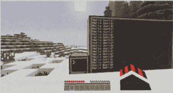

一些更有趣的方块包括：

- 红石——传导信号
- 红石灯——发光
- 活塞——推动方块
- 粘性活塞——可以拉动方块，也可以推动方块
- 红石火把——作为红石相关物体（上述所有物体）的电源
- 红石中继器——可以延长红石信号（火把、按钮、拉杆的正常限制是15个方块），还可以设置延迟，并且只允许信号单向通过

### 技术

Minecraft 玩家富有创造力，许多人已经开始寻找在 Minecraft 中建造极其复杂机器的方法。其中一些在 Minecraft 中重现现实世界物体的例子包括：

- 数字时钟
- 发射方块的加农炮
- 数字逻辑门
- BUD 或方块更新检测器
- 电梯
- 8位存储器
- 计算器

图1-2和图1-3展示了几个有趣的 Minecraft 创作。

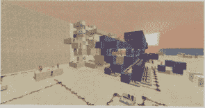


图1-3. 一个9位可编程门锁的构造

### 模组

Minecraft 平台相当开放，允许开发者创建原版游戏的扩展。这些扩展会向游戏添加新型的专用方块，或添加玩家可能觉得有用的其他功能。

这些模组通常被打包成一个“模组包”，可以一次下载并添加到 Minecraft 中。

一些可用的有趣模组包括：

- Gems+——添加蓝宝石、红宝石等宝石。
- Mo’creatures——向游戏添加新的动物和生物
- MAtmos——向游戏添加环境音效
- Equivalent Exchange——使你能够使用 EMC 值将物品兑换为其他物品（数值越高越昂贵），例如用64个泥土换1个煤炭
- Macro / Keybind Mod——记录操作并回放
- MineVideo Mod——录制你的游戏视频
- Modern Weapons——添加枪支等物品
- PortalCraft——添加可发射传送门的枪
- Optifine——提高游戏帧率（减少卡顿）

其中一个模组（ComputerCraft）允许你向游戏中添加一台计算机，然后用 Lua 编程语言为其编程。

本书重点介绍如何用 Lua 为 ComputerCraft 编程。

## 第2章：ComputerCraft

ComputerCraft 是 Minecraft 的一个模组，通过使用可编程计算机、海龟以及打印机甚至软盘等一系列其他有趣功能，开启了各种可能性。它包含在两个最知名的模组包中：Tekkit/Technic 模组包，以及新秀 Feed The Beast。

尽管在电脑游戏中使用计算机这个概念似乎有点奇怪，但对于想要入门简单编程并获得可见且令人满意结果的人来说，它非常合适。

### 安装 ComputerCraft 模组

ComputerCraft 模组需要 Minecraft Forge API，因此它不是最容易安装的模组，但仍然相当容易。目前，ComputerCraft 的最新版本适用于 Minecraft 1.4.6，但令人困惑的是，ComputerCraft 的版本是 1.4.8。正如我已经提到的，你可以下载包含 ComputerCraft 模组的 Feed The Beast 或 Tekkit/Technic。不过，我们将向你展示如何将它安装到干净的 Minecraft 版本中。

这些说明适用于 Windows，但可以很容易地适配其他操作系统。

首先，如果你还没有归档软件，需要下载一个。我建议你安装 WinRAR（我的首选）或 7-Zip。WinRAR 可从此处下载：http://www.rarlab.com/，7-Zip 可从此处下载：http://www.7-zip.org/

现在，我们将安装正确版本的 Forge，只需浏览到链接 http://tinyurl.com/MF1-4-6

你会看到一个类似于图2-1的网页。

计时器归零后，按下跳过广告按钮，你的压缩包就会开始下载。


图2-1. 下载 ComputerCraft

我们需要安装的第二样东西是实际的 ComputerCraft 模组。链接如下：http://adf.ly/GKM9

现在我们已有了两个所需的文件夹，我们只需

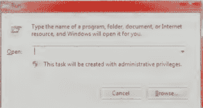

图2-2. 查找 ComputerCraft 安装文件夹

把它们放到正确的位置。如果你按住键盘上的 Windows 键，然后按 R，屏幕左下角应该会出现一个类似这样的菜单（图2-12）。

在这里，我们输入 %appdata%，然后打开名为“.minecraft”的文件夹。还有其他方法可以进入这个文件夹，但我发现这是最快的方法。这里存储着你所有的 Minecraft 游戏数据，但对于模组，我们

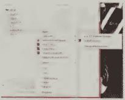

*图 2-3. 用 WinRAR 打开 Minecraft 文件*

首先，你需要进入“bin”文件夹，然后右键单击“minecraft”文件；如果你开启了文件扩展名显示，则右键单击“minecraft.jar”。这里就要用到我们的压缩软件。由于我使用的是 WinRAR，所以右键单击该文件时会出现这些选项（图 2-3）。

单击“open with...”，然后选择你使用的任意压缩软件。现在找到你的下载文件夹所在位置，双击“forge”文件夹。选中 forge 文件夹中的所有内容，直接将其拖到 Minecraft 文件夹中。

关闭这两个窗口并运行 Minecraft，以确保一切仍然正常。我们几乎已经完成模组的安装，因为剩下要做的就是回到我们的 .minecraft 文件夹，右键单击窗口中的任意空白处，单击“new folder”（新建文件夹）按钮，并将其命名为“mods”。只需将你下载的 computercraft 文件夹复制或移动到我们刚刚创建的“mods”文件夹中，就完成了！有时你会发现已经有一个“mods”文件夹，这种情况下你就不需要再创建一个。

### ComputerCraft 命令行

既然你已经安装了 ComputerCraft，你想做的第一件事就是制作你的第一台电脑——图 2-4 展示的是一台普通电脑，图 2-5 展示的是一台高级电脑。本书中的示例使用其中任意一种都可以。

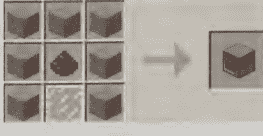

*图 2-4. 电脑配方*

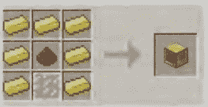

*图 2-5. 高级电脑配方*

右键单击你的新电脑后，我们就可以开始了。首先，我们需要学习如何在电脑本身中导航。它使用“目录”来工作；所有内容都在目录中，我们需要学习如何使用它们。要查看当前目录中的内容，请输入“ls”（list，列出）或“dir”（directory，目录）。

这两个命令的作用完全相同。命令“ls”是 Linux 世界中人们用来列出目录内容的方式，而“dir”是相同的命令，可以追溯到 Microsoft DOS 和 Windows 命令行的时代。

你应该会看到类似图 2-6 的内容。

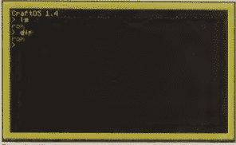

*图 2-6. 电脑命令行*

我们的目录中唯一的东西是另一个目录“rom”。为了立即区分程序和目录，我推荐使用高级电脑；虽然更昂贵，但它们配备了比标准电脑更多方便的工具，包括颜色编码。它将目录显示为绿色，将程序显示为白色。

要进入我们的“rom”目录，我们输入“cd rom”，然后按 Enter。命令“cd”代表“change directory”（更改目录）。输入“cd rom”后（此处并非双关），输入“ls”或“dir”命令，查看其中有什么（图 2-7）。

现在事情变得有趣了。我们现在有四个选项：apis、programs、startup 和 help。如果我们“cd”进入“programs”，会看到一大堆各种各样的程序，包括 apis。要了解任何程序的更多信息，只需输入“help”，然后输入程序名称。里面有一些相当有趣的东西，所以我建议你把它们都看一遍。

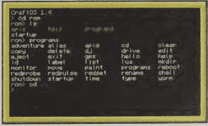

*图 2-7. 命令*

现在我们想回到主目录。要向上返回一级，可以输入 cd ..；要创建你自己的目录，请输入命令 mkdir，然后输入新目录的名称。

创建一个目录来存放你的所有东西是个好主意，包括你在学习本书过程中制作的示例项目。

在 rom 之上的根目录中创建这个目录。如果你当前在 rom 目录中，请输入：

```
cd ..
```

向上移动到该目录，然后输入：

```
mkdir mystuff
cd mystuff
```

见图 2-8。

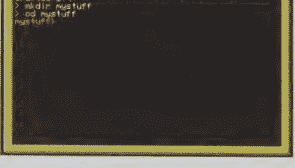

*图 2-8. 为你的东西创建目录*

### Lua 命令行

要进入纯 Lua 命令行，请在命令行中输入 lua。从现在开始，你输入命令行的所有命令都将被假定为 Lua 编程语言。

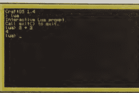

*图 2-9. Lua 命令行中的算术运算*

因此，在这个示例中，我们输入了命令

```lua
print(2 + 2)
```

...到 Lua 中，它告诉了我们答案 4。

在第 3 章中，我们将回到 Lua 命令行，学习更多关于如何使用这种强大编程语言的知识。

### Lua 编辑器

虽然 Lua 命令行非常适合在我们学习语言时进行实验，但它不会记住我们输入的命令。为此，我们需要使用一个编辑器，它允许我们创建和编辑包含 Lua 程序的文件，我们可以运行、打印这些程序，或将它们传输到软盘，以便从一台电脑移动到另一台电脑。

要制作一个程序，只需输入 edit，然后输入你的程序名称。你将被带到一个类似图 2-10 的屏幕。

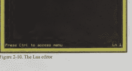

*图 2-10. Lua 编辑器*

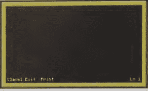

*图 2-11. Lua 选项*

这里将是你必然会编写数百个有用程序的地方，但首先让我们更仔细地看看它。在右下角，我们可以看到当前所在的行。左下角告诉我们按 Control 键以查看访问菜单（图 2-11）。按下 Control 键（不要按住）后，我们会看到这三个选项：

使用方向键左右导航，或按单词开头的字母。Save 和 Exit 不言自明，但如果你希望将程序整齐地打印在纸上以便保存（图 2-12），可以选择 Print 选项。

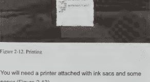

*图 2-12. 打印*

你需要一台装有墨囊的打印机和一些纸（图 2-13）。

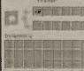

*图 2-13. 添加打印机*

### 用 Lua 控制红石

现在来编写我们的第一个程序。目前我们只是要点亮一盏灯，但之后我们会有密码保护的门，甚至还有摩尔斯电码发送器。

第一步是切换到你打算存放所有程序的文件夹（*mystuff*），方法是输入：

```
cd mystuff
```

然后，要创建并编辑程序文件，请输入：

```
edit redstonetest
```

接下来，在编辑器中输入以下文本（图 2-14）：

```lua
rs.setOutput("left", true)
sleep(3)
rs.setOutput("left", false)
```


*图 2-14. 控制红石*

之后，保存并退出你的程序（按 Ctrl，然后用方向键选择 Save，再选择 Exit 选项）。

要运行程序，只需输入其名称即可运行。但首先，请在电脑的左侧放置一盏红石灯，如图 2-15 所示。

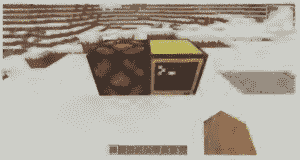

你的灯应该会亮三秒钟，然后熄灭。恭喜你，你刚刚在 ComputerCraft 中编写了你的第一个程序！

### ComputerCraft 显示器

显示器非常方便，尤其是最近新增的触摸屏显示器，但之后会详细说明。普通显示器和高级显示器的合成配方如图 2-16 和图 2-17 所示（与标准显示器不同，高级显示器支持触摸屏）。

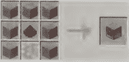

*图 2-16. 显示器配方*

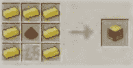

*图 2-17. 高级显示器配方*

你可以将显示器并排摆放，制作出更大的屏幕，如图 2-18 所示。


*图 2-18. 大型显示器*

要输出到显示器，请输入 *monitor*，然后输入显示器所在的一侧，再输入程序名称，因此它可能看起来像这样：*monitor left test*（图 2-19）。

但是，如果你希望通过文本输入，则需要通过电脑来进行，而不是通过显示器。

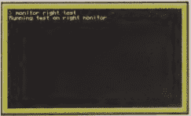

*图 2-19. 使用显示器*


## 第3章：Lua 编程

Lua 是一门新语言，因其灵活性和易用性而越来越受欢迎。ComputerCraft 的开发者选择 Lua，是为了让你能够编写程序，在 ComputerCraft 模组内部控制 Minecraft。

Lua 是一门容易学习的语言。如果你用过 Python，你会发现它特别容易，因为语法相当相似。

在学习 Lua 时，你会发现打开 Lua 命令行（图 3-1）会很有用，这样你就可以输入命令并尝试各种操作。

如果你不确定如何启动 Lua 命令行以及它的用途，请回顾第 2 章。

Lua 编程语言并非 ComputerCraft 独有。大多数类型的计算机都可以使用它。还有一个在线 Lua 解释器，它的工作方式类似于 ComputerCraft 的 Lua 命令行，只不过它没有 ComputerCraft 特有的、用于控制红石等操作的命令。

你可以在这里找到在线 Lua 解释器：

http://www.lua.org/demo.html

图 3-2 展示了它的用法。只需在顶部的框中输入 Lua 命令，然后按 Run 运行代码。任何 print 命令的结果或错误都会显示在下面的框中。

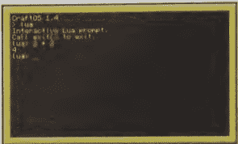

图 3-1. Lua 命令行

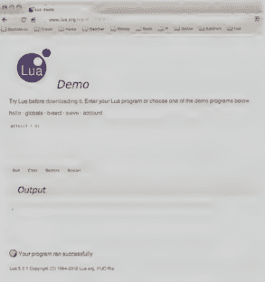

图 3-2. 在线 Lua

### 简单求和

所有编程语言都允许你进行计算并显示结果。试着在 Lua 命令行中输入以下内容：

```lua
print(2 + 2)
```

这会显示答案（4）。这并不意外！

print 命令告诉 Lua 在命令行中显示 () 内的任何内容。因此，我们也可以直接这样做：

```lua
print(4)
```

试一试。但是，把算式放在 () 内时，会先执行该算式，然后显示算式的结果，而不是算式本身。

### 变量

变量是一种给值命名的办法。试着在 Lua 命令行中输入以下内容：

```lua
a = 23
print(a)
```

第一行把值 23 赋给名为 a 的变量，第二行打印 a 的值。你几乎可以用任何喜欢的名字作为变量名，但变量名不能包含空格，并且按照惯例，它应该以小写字母开头。你可以使用下划线字符（_）来分隔单词。

例如，你可以这样写：

```lua
number_of_blocks = 100
print(number_of_blocks)
```

你也可以在算式中使用变量。试着输入以下命令：

```lua
number_of_blocks = 100
print(number_of_blocks)
number_of_blocks = number_of_blocks + 1
print(number_of_blocks)
```

Lua 会先显示答案 100，然后显示 101。

代码行 `number_of_blocks = number_of_blocks + 1` 给 `number_of_blocks` 加上了 1。

在到目前为止的示例中，我们使用的变量保存的是数字。变量可以保存不同类型值，而不仅仅是数字。也许最常见的变量类型叫作字符串。

在程序员中，string 一词就是指一些文本。它可以是一个单词、一个句子，甚至是一个网页的全部内容。

分别用正确密码和错误密码多试几次这个程序。

注意，如果条件为真，则要运行的命令序列末尾会用 end 关键字标记。同样重要的是，要缩进应执行的代码，这样你就能立即看出条件为真时会运行什么，而不是 if 语句之外将始终运行的命令。按一次 tab 键来缩进“if”语句内的代码行。

我们可以扩展这个示例，使得如果输入了错误密码，你就会收到不同的消息。为此，我们使用如下所示的 if else 命令。

```lua
password = io.read()
if password == "computercraft" then
    print("Opening Door")
else
    print("Wrong Password")
end
```

### 循环

如果你想多次做某件事，就需要把想重复的命令放进 while 循环中。例如，如果你想让人们不断尝试猜测密码，可以把上面的代码放进这样的循环中：

```lua
while true do
    password = io.read()
    if password == "computercraft" then
        print("Opening Door")
    else
        print("Wrong Password")
    end
end
```

第一行（while true do）会确保一直到最后一行的 end 为止的所有命令都将永远重复执行。之所以是永远，是因为在这个例子中，while 后面的条件为 true。

true 这个值称为布尔值。这类值只能是 true 或 false。我们稍后会在控制红石的场景中看到它们，其中 true 表示开，false 表示关。

如果你只想允许某人输错五次密码，那么可以像下面这样修改代码：

```lua
fails = 0
while fails < 5 do
    password = io.read()
    if password == "computercraft" then
        print("Opening Door")
    else
        print("Wrong Password")
        fails = fails + 1
    end
end
print("You are only allowed 5 attempts. Exiting")
```

现在，我们使用一个名为 fails 的变量来统计输入错误密码的次数。当它超过 5 时，继续留在 while 循环中的条件（即 fails 小于 5）不再为真，Lua 会退出 while 循环，并打印一条消息，说明尝试次数已超过限制。

这种“while”循环适用于只想一直做某件事，直到某个条件不再为真的情况。另一种常见情况是你可能想循环一定次数，这称为“for”循环。

下面的示例会打印数字 1 到 10。试着把它输入到一个程序中（将其命名为“fortest”）并运行。

```lua
for i = 1, 10 do
    print(i)
end
```

试着把 10 改成 100，然后再次运行。

### 函数

当你用任何语言编写程序时，如果不小心，总有一天一切都会变得过于复杂，难以弄清发生了什么。保持简单且易于修改的一个好办法，是把程序分解成可管理的块，这些块称为函数。

通过把代码段放进函数，你还能获得一个额外好处：不必在程序中重复自己，只需从程序的不同位置调用同一个函数即可。

对于函数，实际上你需要能够做两件事。第一是定义函数，也就是指定函数中将包含哪些命令；第二是让函数运行。让函数运行称为“调用”函数。

要定义函数，使用“function”命令。我们先定义一个非常简单的函数，它每次被调用时只打印三行文本。

要试一下，请切换到你之前创建的“mystuff”目录，并输入以下命令：

```
edit functiontest
```

然后在保存文件之前，将以下内容输入编辑器。

```lua
function printWelcome()
  print("This program is written")
  print("in the programming language Lua")
  print("Lua comes from Brazil")
end

printWelcome()
printWelcome()
printWelcome()
```

保存程序并退出编辑器，然后输入以下命令来运行它：

```
functiontest
```

你应该会看到整条消息被打印三次。

我们可以使用“for”循环，而不是一个接一个地调用该函数三次。把代码改成与下面的清单一致，然后再次运行。消息将被打印 10 次。

```lua
function printWelcome()
  print("This program is written")
  print("in the programming language Lua")
  print("Lua comes from Brazil")
end

for i = 1, 10 do
  printWelcome()
end
```

函数还可以接受所谓的参数。例如，如果我们想写一个函数，让它数到我们选择的某个数字，可以这样写：

```lua
function count(numberOfTimes)
  for i = 1, numberOfTimes do
    printWelcome()
  end
end
```

然后你可以用以下方式让它数到 10：

```lua
count(10)
```

要让它数到 1000，你只需这样做：

```lua
count(1000)
```

如果你希望函数有多个参数，只需在定义函数和调用函数时都用逗号分隔它们。

修改 count 示例，使其接受两个参数：fromNumber 和 toNumber。

```lua
function count(fromNumber, toNumber)
  for i = fromNumber, toNumber do
    printWelcome()
  end
end
```

```lua
count(5, 20)
```

函数还能做另一件事：返回值。当函数返回值时，意味着你可以把返回的值赋给一个变量。

我们来写一个把摄氏度温度转换为华氏度的函数：

```lua
function c2f(c)
  f = c * 9 / 5 + 32
  return f
end
```

```lua
temp = c2f(20)
print(temp)
```


return 命令会退出函数，并将指定值返回——在此例中，即 'T'。

### 列表

变量只能保存单个值，但有时我们希望能够将一系列事物收集到一个列表中。你稍后将在摩尔斯电码示例中使用这个例子。Lua 列表中的项可以是任何类型的值。它们可以是数字、字符串，甚至是另一个列表。

下面的示例展示了如何定义一个颜色列表，然后一次一个地打印出来。

```lua
colors = {'red', 'orange', 'yellow',
          'green', 'blue',
          'white', 'black'}

for i, color in ipairs(colors) do
  print(color)
end
```

在此例中，列表被赋予了颜色名称的值，每个值都是字符串。for 循环使用了一个特殊命令 "ipairs"，它允许 "for" 循环同时使用列表中每个项目的位置 (i) 和颜色字符串 (color) 进行计数。

我们可以通过修改示例来证明这一点，同时打印列表中的位置和字符串，如下所示：

```lua
colors = {'red', 'orange', 'yellow',
          'green', 'blue', 'white', 'black'}
for i, color in ipairs(colors) do
  print(i, color)
end
```

这将产生如下输出：

```
1    red
2    orange
3    yellow
4    green
5    blue
6    white
7    black
```

你还可以通过方括号表示法，根据项目在列表中的位置来查找其值。尝试在 Lua 控制台中输入以下内容：

```lua
colors = { 'red', 'orange', 'yellow',
  'green', 'blue', 'white',
  'black' }
print(colors[3])
```

你会得到答案 yellow，即列表中的第三项。

你可以使用相同的 [] 表示法来更改特定项目。现在在控制台中输入以下内容：

```lua
colors[3] = "purple"
print(colors[3])
```

现在会得到答案 purple。该命令已将列表中的第三个元素从 yellow 改为 purple。

你还可以向列表中添加和移除项目。

要向列表末尾添加元素，请使用 table.insert 命令。如下面的示例所示，该示例会将颜色 gray 添加到列表末尾。

```lua
colors = { 'red', 'orange', 'yellow',
  'green', 'blue',
  'white', 'black' }
table.insert(colors, 'gray')

print(colors[8])
```

如果不想将颜色添加到列表末尾，而是想指定列表中应添加元素的位置，下面的代码将把新颜色添加到列表开头。

```lua
colors = { 'red', 'orange', 'yellow',
  'green', 'blue',
  'white', 'black' }
table.insert(colors, 1, 'gray')

print(colors[1])
```

作为 insert 的第二个参数，数字 1 表示新项目应插入到列表中第一个元素之前。

### 小结

对于一门相当复杂的编程语言来说，这是一个非常简短的介绍。不过，它应该能让你开始使用 Lua，并允许你使用 ComputerCraft 完成你想要的大多数事情。

如果你想了解更多关于 Lua 的信息，请访问官方网站 www.lua.org。

## 第4章：密码保护门

凭借我们对 Lua 和 ComputerCraft 的基础知识，我们可以开始制作一些非常酷的东西。密码保护门在服务器上非常有用，尤其是当你是唯一知道如何使用 ComputerCraft 模组的人时。

在开始这个程序之前，有一件非常重要的事情需要了解，那就是如果你的程序中有这样一行：

```lua
while true do
```

……一旦程序运行，你就无法停止它，除非你打破实际的计算机方块，或者按住 CTRL 键并按下 T。这一行在密码程序中是主要部分，因此记住 CTRL-T（用于终止）以停止程序以便编辑它非常重要，因为你可能在某个时候想要更改密码。

### 硬件

在开始编程之前，我们需要按照图 4-1 所示设置方块。

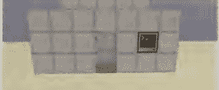

图 4-1. 密码保护门。

当然，你使用什么类型的方块或门并不重要，这只是一个示例。另外，如果你希望计算机位于门的上方或右侧，你必须将下面程序代码中使用的侧面从 "left" 改为门所在计算机的任意一侧。

你可以使用 "left"、"right"、"front"、"back"、"bottom" 或 "top"。

### 软件

控制门的程序相当短，可以轻松输入。如果你更喜欢下载包含代码的文件，可以从以下网址获取：https://github.com/simonmonk/computercraft_examples

要将此程序安装到你的 ComputerCraft 安装中，请遵循附录 A 中的说明。

```lua
while true do
  term.clear()
  term.setCursorPos(1, 1)
  print("Please enter the password:")
  password = read("*")
  if password == "password" then
    rs.setOutput("left", true)
    sleep(3)
    rs.setOutput("left", false)
  end
end
```

现在，我将逐行分解这个程序，并解释其工作原理。正如我上面提到的，`while true do` 这一行只是让程序在无限循环中运行。

```lua
term.clear()
```

这一行会在每次循环时清除屏幕。

```lua
term.setCursorPos(1, 1)
```

这会将光标位置设置在 (1, 1)，即屏幕的右上角。

```lua
print("Please enter the password:")
```

这是屏幕上显示的提示用户操作的文字。

下一行需要更多解释：

```lua
password = read("*")
```

password 是变量，必须用等号定义。命令 read 表示它正在等待输入内容，而 (*) 表示输入时，输入的内容会显示为 `*s`。请注意，这是 ComputerCraft 特有的功能，因此如果你在没有运行 ComputerCraft 的 Lua 上尝试，它可能无法工作。

```lua
if password == "password" then
```

这将查看变量 password，即我们输入的内容，而 == 表示将其与我们放在另一边的任何内容（即文本 "password"）进行比较。这意味着如果你想更改密码，就必须更改引号内的内容。该命令随后结束这一行，因此如果你输入的内容与引号内的内容（你的密码）匹配，它就会执行某些操作。

这里还有一个缩进，表示它位于 *if* 语句内部。

```lua
rs.setOutput("left", true)
```

这是说红石信号在计算机左侧开启，穿过方块，并触发门。

```lua
sleep(3)
```

这会让计算机等待 3 秒后再继续，然后 `rs.setOutput("left", false)` 会关闭计算机左侧的红石信号，从而关闭门。我个人认为让门保持开启 3 秒差不多合适，但你可以根据自己的需要更改。

最后，第一个 *end* 标记了 *if* 语句应执行内容的结束点，*then* 作为开始点，而第二个 *end* 标记了 *while true do* 循环应停止的位置。

由于这个程序只有 11 行长，你可以轻松地将其输入，但例如，下一个程序手动输入会非常繁琐，因此你也可以参考附录 A 获取下载本书所有 Lua 程序的说明。

### 小结

这是一个很好的入门小项目。你可以通过多种方式使其更复杂，例如增加最大尝试次数，或者添加一些无需编辑程序即可更改密码的选项。

在进入下一个项目（一个复杂得多的程序）之前，尽情实验和享受乐趣吧。

## 第5章：摩尔斯电码发送器

这个项目允许你在计算机中输入一条消息，然后使用红石灯以摩尔斯电码的形式闪烁显示该消息。


图 5-1. 摩尔斯电码发送器。

要构建摩尔斯电码发送器，你需要一台计算机和一个或多个红石灯。

### 硬件

使用红石将两者连接起来，根据你希望灯的距离多远，每 15 格红石就需要一个中继器。

像我这样隐藏红石的技巧是将输出设置为 bottom 而不是 left，如下面的程序代码所示。这意味着你可以根据需要轻松隐藏红石，因为它可以被其他材料覆盖。

图 5-1 展示了计算机位于红石下方的一种布置，但只要你将程序指定为连接到计算机的正确侧面，你就可以以任何你想要的方式连接它。


图 5-2 展示了计算机终端，它会提示输入要转换为点和划（短闪烁和长闪烁）的消息。

该程序无法将所有字符都转换为摩尔斯电码；它只能处理大写字母、小写字母以及数字 0 到 9。它还可以处理空格，空格只是一个停顿。

如果你输入了它无法转换的字符，它就会直接忽略该字符。

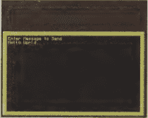

图 5-2. 向摩尔斯电码发送器发送命令。

图 5-3 展示了红石灯亮起的摩尔斯发送器。


图 5-3. 红石灯亮起的摩尔斯发送器。

### 软件

这个程序比较长，可能没人愿意手动输入，所以如果你想下载它，请参见附录 A。

该程序使用两个列表，一个用于字母，一个用于数字。

```lua
letters = {
    ".-", "-...", "-.-.", "-..", ".", "..-.",
    "--.", "....", "..", ".---", "-.-", ".-..",
    "--", "-.", "---", ".--.", "--.-", ".-.",
    "...", "-", "..-", "...-", ".--", "-..-",
    "-.--", "--.."
}

numbers = {"-----", ".----", "..---",
    "...--", "....-", ".....", "-....", "--...",
    "---..", "----."}
```

列表中的每个元素都是由划和点组成的字符串。划表示长闪烁，点表示短闪烁。

*sendMorse* 函数是大部分操作发生的地方。它接收单个字母编码，并将其以摩尔斯电码的形式闪烁输出。

所谓 letterCode，指的是在 Lua 中用来表示该字母的数字。每个字母都有一个数字，例如字母 A 的值为 65。Lua 代码 `string.byte("A", 1)` 会返回该字母编码。

因此，该函数通过四个 if 语句处理四种可能的字母类型。

```lua
function sendMorse(letterCode)
    if letterCode >= string.byte("A", 1)
        and letterCode <= string.byte("Z", 1) then
        dashesAndDots =
            letters[letterCode-string.byte("A", 1)+1]
        for i = 1, string.len(dashesAndDots) do
            sendDashOrDot(string.byte(dashesAndDots, i))
        end
    end
    if letterCode >= string.byte("a", 1)
        and letterCode <= string.byte("z", 1) then
        dashesAndDots =
            letters[letterCode-string.byte("a", 1)+1]
        for i = 1, string.len(dashesAndDots) do
            sendDashOrDot(string.byte(dashesAndDots, i))
        end
    end
    if letterCode >= string.byte("0", 1)
        and letterCode <= string.byte("9", 1) then
        dashesAndDots =
            numbers[letterCode-string.byte("0", 1)+1]
        for i = 1, string.len(dashesAndDots) do
            sendDashOrDot(string.byte(dashesAndDots, i))
        end
    end
    if letterCode == string.byte(" ", 1) then
        sendDashOrDot(0)
    end
end
```

第一个语句检查它是否在 A 到 Z 之间，第二个检查是否在 a 到 z 之间，第三个检查它是否为数字，最后一个检查是否为空格字符。

在这些 if 语句的每一个中，都有一个循环，它会遍历编码中的每个点或划字符，并调用 *sendDashOrDot* 函数来实际控制红石。

```lua
function sendDashOrDot(dashOrDot)
    if dashOrDot == 46 then
        rs.setOutput("left", true)
        sleep(0.5)
        rs.setOutput("left", false)
        sleep(0.5)
    elseif dashOrDot == 45 then
        rs.setOutput("left", true)
        sleep(1.5)
        rs.setOutput("left", false)
        sleep(1.5)
    elseif dashOrDot == 0 then
        sleep(3)
    end
end
```

该函数还使用三个 if 语句来判断要进行的闪烁是点对应的短闪烁、划对应的长闪烁，还是空格对应的完全不闪烁。

要进行每次闪烁，首先必须用命令 *rs.setOutput("left", true)* 打开红石，然后使用 *sleep* 命令延迟半秒，再关闭红石。最后再延迟 0.5 秒。

如果你想让闪烁更快，就需要缩短这些延迟。

划的闪烁时长应为点的闪烁时长的三倍。

程序的主要部分位于任何函数之外，因此会在程序运行时直接执行。它会清空终端，并提示用户输入要发送的字符串。

```lua
term.clear()
term.setCursorPos(1, 1)
print("Enter Message to Send")
message = read()
```

然后它会遍历字符串中的每个字母，并将其发送给 *sendMorse* 函数。

```lua
for i = 1, string.len(message) do
    sendMorse(string.byte(message, i))
end
```

如果你愿意，可以把从 term.clear() 开始的所有内容放入一个 while true 循环中，这样每次想发送消息时就不必重新运行程序。

### 小结

这是一个编程上相当棘手的项目，因为你需要使用数组并操作字符串来找出各个字母的字符编码。你应该会发现，如果你能看懂这段代码，就能在 ComputerCraft 中完成大多数事情。

## 第6章：计算机网络

ComputerCraft 实际上允许你在一个世界中创建不止一台计算机，更重要的是，还能把这些计算机连接成一个网络。要做到这一点，你只需要添加几台计算机，并在它们的侧面安装无线调制解调器。


图 6-1. ComputerCraft 中的计算机网络

在这个项目（图 6-1）中，有两台计算机（其中一台隐藏在 图 6-1 的屏幕后面），你可以在一台计算机的终端上输入消息，消息会传输到另一台计算机，并显示在连接该计算机的大屏幕上。

### 设置发送计算机

从硬件层面来说，你只需要一台计算机和一个无线调制解调器。记住无线适配器连接在计算机的哪一侧，因为你需要在这程序中指定它。

发送端程序名为 "sender"，可以连同本书中使用的其他程序一起从 https://github.com/simonmonk/computercraft_examples 下载。有关安装该程序的更多信息，请参见附录 A。另外，发送端和接收端程序都不长，因此很容易手动输入。

下面是发送端的完整程序。

```lua
while true do
  term.clear()
  term.setCursorPos(1, 1)
  print("Please enter message to send:")
  message = read()
  rednet.open("right")
  rednet.broadcast(message)
  rednet.close("right")
  sleep(0.1)
end
```

该程序会一直循环，等待输入消息。输入消息后，它会使用 rednet.open 打开到无线网络的连接。作为参数传入的一侧（这里是 "right"）必须与无线接入点连接在计算机上的那一面相匹配。

rednet.broadcast 命令会把消息发送到与这台计算机连接的所有计算机。最后使用 rednet.close 关闭连接。

### 设置接收计算机

接收端的设置与发送端相同，另外增加一台用于显示消息的显示器。

接收端程序仍然相当简单。有关如何下载和安装它的详细信息，请参见附录 A，你也可以使用编辑器输入它。

```lua
rednet.open("left")
while true do
  id, message = rednet.receive(1)
  if message then
    print(message)
  end
end
```

首先会建立到左侧无线接入点的连接。然后有一个循环，只有当你对程序按下 CTRL-T 时才会退出。在这个循环内部，会调用 rednet.receive 来检查是否有消息。

你会注意到，调用 `rednet.receive` 的结果被赋给了两个变量（id 和 message）。这是因为该函数返回两个值。第一个值是发送消息的计算机的 id（这是一个数字），第二个值是包含消息的字符串。

if 语句确保在打印消息之前确实接收到了消息。

当你启动接收计算机时，记得通过以下命令让它在显示器上运行：

```
monitor right receiver
```

如果你的显示器连接在计算机的右侧以外的其他侧面，请在上面的命令中相应修改。

### 发送消息

按上述说明启动接收端运行，然后转到发送计算机并启动发送端程序（图 6-2）。

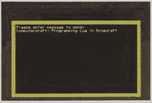

图 6-2. 发送消息

输入你想发送的消息并按回车键。如果一切正常，消息就会出现在接收计算机的显示器上。

### 小结

没有什么能阻止你构建更大的计算机网络，并让它们彼此发送消息。例如，你可以让一台控制计算机

向其他计算机发送无线网络命令，从而控制活塞或红石灯。可能性无穷无尽！

## 第7章：Minecraft 中的推特

我们觉得，在玩Minecraft时能够阅读推文会很酷。在这个项目中，你不仅可以阅读推文，还可以设置在收到推文时通过红石激活活塞来通知你。


图7-1. Minecraft中的推特

当活塞被激活、你得知有推文到达后，就可以去计算机的控制台上查看它（图7-2）。

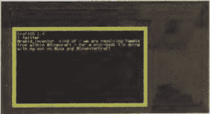

图7-2. 在Minecraft中阅读推文

### 硬件

你可以按任何方式使用计算机发出的红石信号，但在上述布局中，红石控制一个活塞，在收到推文时露出一个萤石块（图7-3）。


图7-3. 新推文到达后

### 代码

要让程序运行，首先必须启用ComputerCraft的网页访问功能。为此，你需要使用TextPad或NotePad等编辑器打开“minecraft/config”文件夹中的“ComputerCraft.cfg”文件，并将以下代码从：

```
enableapi http {
    general=false
}
```

改为：

```
enableapi http {
    general=true
}
```

然后在同一个文本文件中继续向下找到：

```
EnableAPI_http=false
```

改为：

```
EnableAPI_http=true
```

完成这些修改后，再次保存文件并重启Minecraft。

代码使用Twitter API从指定的推特用户名获取最新推文，因此你可能想更改第一行，使其指向你自己的推特用户名。

```
name = "Simonmonk2"
```

```lua
page = "http://api.twitter.com/1/statuses/" ..
       "user_timeline.xml?screen_name=" .. name ..
       "&count=1"
old_text = ""

while true do
    tweet_page = http.get(page)
    response = tweet_page.readAll()
    tweet_page.close()
    start_of_tag = string.find(response,
                     "<text>")
    end_of_tag = string.find(response,
                     "</text>")

    if (start_of_tag and end_of_tag) then
        text = string.sub(response,
             start_of_tag + 6, end_of_tag - 1)
        if (text ~= old_text) then
            print(text)
            old_text = text
            rs.setOutput("bottom", true)
            sleep(3)
            rs.setOutput("bottom", false)
            sleep(3)
        end
    end
    sleep(20)
end
```

Twitter API返回包含消息的XML。实际消息本身会处于一个`<text>`标签内，因此代码会找到`<text>`和`</text>`的位置，并截取中间的内容作为文本。

主循环会一直持续下去，但20秒的休眠确保了每20秒才检查一次Twitter上的推文。

我们不希望在没有新推文时触发通知，因此获取到的消息会与变量`old_text`中的消息进行比较，只有二者不同时，才会打印消息并激活红石。

当你收到消息并看到红石做出反应时，就可以去计算机控制台阅读消息了。

### 小结

这个项目开启了各种各样的可能性。这不仅意味着你在Minecraft中也能通过Twitter被联系到，而且稍加努力，你还可以在收到电子邮件或Facebook消息时得到提醒。

- 右键对应计算机的背面
- 前进键对应计算机的顶面
- 停止键对应计算机的正面

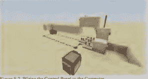

### 代码

海龟通常在没有燃料的情况下不会移动。幸运的是，有一种方法可以绕过这个限制。我们可以通过修改配置文件`config/CCTurtle.cfg`，让海龟无需喂煤就能运行。

将这一行：

```
turtleNeedsFuel=true
```

改为：

```
turtleNeedsFuel=false
```

代码分为两部分。一个程序在计算机上运行（TurtleSend），另一个在海龟本身上运行，通过海龟的无线调制解调器接收来自计算机的命令。

### TurtleSend

这是在计算机上运行的程序。它打开一个连接到计算机“右侧”无线调制解调器的连接。如果你把调制解调器装到了其他侧面，记得修改这里。

```lua
while true do
    rednet.open("right")
    if rs.getInput("left") then
        rednet.broadcast("l")
    elseif rs.getInput("back") then
        rednet.broadcast("r")
    elseif rs.getInput("top") then
        rednet.broadcast("g")
    elseif rs.getInput("front") then
        rednet.broadcast("s")
    end
    rednet.close("right")
    sleep(0.9)
end
```

打开连接后，如果连接到按钮的红石处于激活状态，`rs.input`函数就会返回`true`。当按钮激活时，计算机就广播一条包含单个字母命令的消息：`'r'`、`'l'`、`'g'`或`'s'`，分别表示左转、右转、前进或停止。

### TurtleReceive

海龟上的接收代码与计算机上的代码相对应。但它不是检测按钮按下，而是检测来自无线调制解调器的传入消息。如果发现了消息，它就会发送相应的海龟移动命令。

变量`moving`用于决定是否执行`turtle.forward()`命令。这样海龟就可以自动前进，除非收到停止命令。

```lua
rednet.open("right")
while true do
    id, message = rednet.receive(1)
    if message == "r" then
        turtle.turnRight()
    elseif message == "l" then
        turtle.turnLeft()
    elseif message == "g" then
        moving = true
    elseif message == "s" then
        moving = false
    end
    if moving then
        turtle.forward()
    end
end
```

### 小结

扩展这个项目的一个明显方法是给海龟添加额外的命令，让它能够挖掘等。你也可以把这个项目和前面的项目结合起来，让海龟跳一小段舞，甚至让它来找你！

## 附录A：示例程序

本书中使用的示例程序都是开源的，可以从 https://github.com/simonmonk/computercraft_examples 下载。

### 在 ComputerCraft 中安装程序

你不必把示例程序手动输入到ComputerCraft中。如果你愿意，可以下载这些程序并将它们安装到ComputerCraft中。然后你只需要运行它们即可。

具体操作如下。

首先，在浏览器中打开 https://github.com/simonmonk/computercraft_examples ，然后点击标有ZIP的图标。它看起来像一朵云，下面有一个箭头。

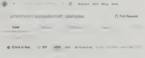

图A-1: GitHub仓库

这会下载一个包含这些程序的zip文件。将该文件解压到某个方便的位置，比如桌面。

接下来，在你的计算机上，你需要找到ComputerCraft的安装目录。

我们在安装章节中导航过的`.minecraft`文件夹就在这里。然后进入“saves”，你会注意到这些文件夹的名称就是你各世界的名称。接下来

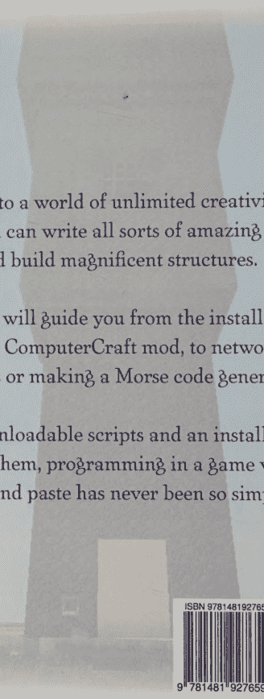

欢迎来到一个充满无限创意的世界，在这里你可以编写各种令人惊叹的程序，建造宏伟的建筑。

这本书将引导你从安装ComputerCraft模组开始，一直到让计算机联网或制作莫尔斯电码生成器。

有了可下载的脚本和相应的安装指南，在没有复制粘贴功能的游戏中进行编程从未如此简单！


