# 计算机与社会：向善计算 (Chapman & Hall／CRC 计算教材)

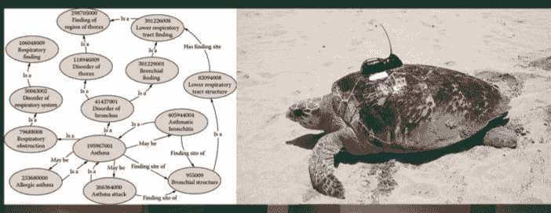

| SHA 计算路径 | 其他数据源 | 模型改进 |
|---|---|---|
| 统一结构化表示 | 反转 (4) | 基于物理的仿真 |
| CFR | AWP | KFR | AWP | NSR | 地真值 (2) | 经验模型 |
| 地震破裂预测 | 衰减关系 | 强度测量 (1) |

系列主编

# John Impaglizzo

霍夫斯特大学名誉教授

Andrew McGettrick

斯特拉斯克莱大学计算机与信息科学系

# 目标与范围

本系列涵盖了传统的计算领域，以及相关领域，如软件工程、人工智能、计算机工程、信息系统和信息技术。该系列将适用于本科生和研究生的教科书，通常遵循专业协会的全球课程标准。编辑部希望鼓励新颖富有想象力的想法和建议，并乐于帮助和鼓励新作者。编辑部欢迎符合以下要求的建议：对计算各个方面提供突破性且富有想象力的视角；在全新且令人兴奋的背景下介绍主题；为新兴领域（如多媒体、安全和移动系统）开启机会；捕捉新兴计算领域的新进展和应用；以及解决为计算提供支持的主题，如数学、统计学、生命和物理科学以及商业。

http://www.taylorfrancis.com

- 附录......................................................................................................... 232

# 引言

这本书的诞生源于个人热情与实际观察的交汇。这些热情既源于我，也源于这些章节中介绍的人物。对于多年来教授传统和跨学科计算机科学课程所积累的实际观察，我负有责任。

许多被称为“社会与计算机”的课程通常是为初学者设计的，但这些课程是有目的的。然而，将这些课程放在这一水平上的做法引起广泛的争议，在一些阵营中，人们质疑这些课程是否属于计算机科学。毕竟，如果课程中没有技术内容，它还能被称为计算机科学吗？我并不希望陷入这种争论；支持性的证据是必要的。

移动设备支持人们如何有效学习。像企业所有者一样思考——战略性地。关键的首要业务决策。成为一个 Apple 开发者。首个软件应用正式发布。更多应用陆续推出。DevelopEase：初创公司的幕后故事。财务考量。任务分配。在公立学校引入新软件的挑战。DevelopEase 的具体成就。研讨会与培训。课堂案例：加利福尼亚州贝克斯菲尔德。更贴近生活的案例。DevelopEase 的未来计划。致谢。练习与活动。

（注：由于原文文本在“Introduction”后出现了大量重复的段落，根据“不要重复输出原文”的原则，此处译文仅针对逻辑完整的部分进行翻译。）

# 引言

缺乏技术性的“干货”，并强化了这种观点：计算领域的社会问题并不是“真正的计算机科学”的核心部分。在第二种情况下，学生可能会获得深度的客户项目经验，但无法了解毕业后可以拥有的广泛机会。本书通过提供兼具广度和深度的材料来解决这些问题，将其清晰地置于计算课程的领域。通过提供专业机会的案例，让学生能够利用他们的计算教育让世界变得更好，这本书证明了：无论他们对计算和社会的哪个领域感兴趣，那里都有适合他们的职业热情。

每一章都假设读者在计算的一个或多个领域拥有技术知识。根据计算专业的关注侧重点和学生的背景，书中的某些部分可能看起来相对容易理解，而另一些部分则很有挑战性。该手稿早期版本的评审者证实了这一点；他们对难度水平以及使用本材料的课程合理安排的意见直接反映了他们自己学生的背景。然而，正如我编写这本书的初衷的那样，大家达成共识，这不是一本为缺乏计算背景的学生准备的书。这些简介中的材料平衡了这种预期：即学生接触过计算课程前几年所涵盖的主题，但程序各不相同，因此需要一些技术解释。

对于技术准备较少的学生，书中提供了充足的信息，使得高年级学生能够很好地跟上。对于技术准备更充分或对额外深度感兴趣的学生，每一章中都慷慨地分布了侧栏（sidebars）。这种教学技巧允许想要额外材料的学生获得它们，而不想要或不需要材料的学生可以将其跳过。如果读者决定跳过每一章，每章的主要技术和和社会目标仍然可以实现。

# 引言

将移动设备上的软件运行到学校系统中。本章的风格与其他章节截然不同。它深入探讨了创建初创公司时必须解决的业务问题。因此，本章面向多个读者群体。它面向对教育软件、移动设备以及残障学生感兴趣的学生。本章也面向对技术公司业务流程有浓厚兴趣的学生。它还面向那些希望接触额外领域（如技术营销）并希望在这些领域专业地应用其计算技能的学生。

2010年夏天，在ITiCSE会议上，一个工作小组编写了一份非常优秀的报告，题为：“增强我们计算课程中的社会问题组成：为了社会良好的计算”（Enhancing the Social Issues Components in Our Computing Curriculum: Computing for the Social Good）。该报告（在本节末尾有完整引用）非常出色地概述了将影响社会问题的纳入计算机程序课程的常见教学方法。在随后的章节中，我对该小组的工作表示衷心的谢意，并向您推荐该文档作为一份优秀的参考资料。

针对本科课程，ACM共有五份课程文件：计算机科学、信息技术、信息系统、软件工程和计算机工程。在这些课程指南中，社会性话题都被确定为核心材料和选修材料。可以从ACM网站（http://www.acm.org/education/curricula-recommendations）下载这些课程指南。正如引言前部分所暗示的，对于纳入社会材料尚未达成统一的方法：包括在哪里、包含多少等。每位讲师都必须做出自己的决定，并考虑以下最低因素：

学生准备情况：（这一维度是人口统计特征、课程类型、该课程的要求以及社会问题在课程中的分布情况的综合体。）

班级规模：（小、中、大的定义完全是相对的。然而，如果需要容纳数百名学生的大型演讲堂，那么与使用少于20人的小教室相比，一种完全不同的教学方法将更有效。）

对教学学生感兴趣并准备良好的教职人员：（你是唯一的导师吗？其他人对团队教学感兴趣吗？是否轮流授课？）

遵循ACM或IEEE指南的程度，以及是否考虑 ABET认证。

使用此书有许多方法。建议您分析自己在上述每个类别中的兴趣和限制条件。然后决定是使用练习和活动部分中的某个项目比较合适，还是使用一个或多个章节的一系列较小项目，或是依赖非项目类问题。章节按顺序阅读效果良好，因为它们的安排是为了创建一个渐进的流程；然而，以任何顺序使用这些章节也是完全可能的，因为任何两个章节之间没有直接的依赖关系。

一种标准方法是将本书作为独立课程的主文本，学生每周或每隔一周分析一个章节，取决于他们的准备水平和技术熟练程度。一个侧重于对其中一个章节进行扩展分析的学期项目（取自练习和活动部分），可以在课程早期开始，并贯穿整个学期，期间通过分析其他章节来寻找共同主题，并辅助完成项目。

对于技术背景较浅或兴趣较低的学生，可以在选定的章节上花费更多周数。例如，第1、4、7章的技术预期最低。第5和6章的技术预期最高，而第2和3章介于两者之间。

使用本书进行独立课程的另一种选择是选择具有共同技术或非技术主题（环境、医疗保健、安全、高性能计算）的特定章节，并使用这些简介（profiles）紧密检查计算的该方面。

本书也可以作为补充文本使用，选择方法类似，即决定使用多少章节、使用哪一个以及使用哪些作业。在这种情况下，主要区别在于简介的选择要么与课程中使用的其他材料互补，要么与之形成对比。所选简介可以涵盖其他地方未涉及的主题（医疗领域数据标准化的新兴趋势），或者为其他地方浅表介绍的主题增加深度（缺乏良好示例的自然现象科学建模）。

# 引言

最后，我创建了一个配合本书的网站。该网站包含了供教师和学生的各种材料和资源。您可以通过以下网址访问网站：www.computers-and-society.com。

Tel: 508-647-7000

E-mail: info@mathworks.com

# 致谢

正如这些大多数章节所展示的，要实现一个项目不仅需要一个好主意。本书也是如此。多年来我一直对计算领域的社会问题充满热情，并一直想写一本书。我的长期同事兼朋友 John Impagliaço（朋友们有时会用皇室尊称称呼他）在这项及其他工作中一直是我坚定的支持者。几年前，也许是听腻了对我想要写更多学术论文之外的文章的热情唠叨，John 给了我一个为 *ACM Inroads* 杂志写专栏的机会，他是该杂志的主编。在那之后的一段时间，是 John 在听到我欢快地分享写书的愿望后，将我介绍给了 Taylor & Francis 的编辑 Randi Cohen。John 可能在想，我接下来还会开始谈论写些什么。

Randi 作为一名编辑，是一个非常棒的合作伙伴。我从一个有些毫无防备的首次写书作者成长为一个没那么毫无防备的首次写书作者，Randi 总是帮助和支持。尽管我在其他平台写过很多东西，但承担一本书完全是一场全新的冒险。对于胆小的人来说：每当我有疑问（或者有时我没有）时，Randi 都会给我直接的信息和实用的建议。如果那不是我想听到的答案，我仍然感到被尊重。随着时间的推移，我意识到她亲切、平易近人的态度不仅是她的本，更是建立在丰富的经验和知识之上的。我学到的关于如何应对写这样本书的挑战越多，就越意识到 Randi 做得很好。每一项任务都与她所交谈的对象完美契合。在写这本书期间，我经历了一些个人生活的动荡，这无疑推迟了我的进度。对于 Randi 在我极度困难的时期给予的理解和包容，我感激不尽。我期待至少能继续和她一起享受我们年度的蔬菜午餐。

我必须感谢在我身后的其他一些，他们支持我走过了这一路。我的父母，他们那驱使我总是提问更多问题并进一步调查的、永不满足的好奇心。我的父亲在本书完成之前就去世了；我知道他想看到它。我期待着最终（终于）把其中一份送到我妈妈的门口。妈妈也会开心的，因为这意味着我有更多时间可以陪她聊天。其他作为我个人领路者和宝贵支持者的人还有 David Alexander, Bob Solomon, Geri Portnoy, Ellen Prediger 和 Kim Dean。非常感谢你们。

# 作者

Lisa C. Kaczmarczyk 博士拥有超过 18 年的教职经验，研究专业为计算机科学教育应用学习理论。她在德克萨斯大学奥斯汀分校获得了跨学科博士学位。她完成了对计算机科学、教育、数学教育和心理学教老师的研究。她的论文利用人工神经网络对人类学习进行建模，随后进行了受试者研究，以调查其计算模型的预测情况。Kaczmarczyk 博士还在俄勒冈大学获得了计算机科学硕士学位，东北大学获得了信息系统硕士学位，并在特普斯大学获得了西班牙语和戏剧的双学学士学位。

Kaczmarczyk 博士曾在研究型大学、私立本科院校和社区学院任教过计算机科学课程。除了传统的计算课程外，她还开发了认知科学、技术与可持续性，以及计算机科学开创性论文的修辞与文学分析课程。她发表了大量同行评审文章，并多次担任 SIGCSE、ICER 和 Grace Hopper 女性计算庆典会议的委员会成员。她曾获得美国国家科学基金会的资助，目前担任 NSF 资助研究项目的外部评估员。Kaczmarczyk 博士是 ACM 教育委员会成员，是 *ACM Inroads* 杂志的副编辑，并多年来为 *Inroads* 写定期专栏。Kaczmarczyk 博士维护着一个关于她的专业活动和兴趣的博客：http://computing4society.blogspot.com/。

# 第一章

# 秘鲁安第斯山区远地区的减贫工作

## 1.0 引言

数百年来，生活在秘鲁安第斯山区非常偏远地区的农民、牧场主和其他人在极其恶劣的环境中与自然保持着平衡。他们演出了一种适应确保生存的文化和意识形态。当工业化世界入侵他们的生活时，平衡被打破了，他们陷入了深度贫困。由政府组织、私营公司和计算机科学家组成的国际合作启动了一个项目，旨在缓解他们的贫困，同时允许他们保留核心价值观。

同意参与这一不寻常项目的村民们发挥了成功的首要作用，因为外部团队尊重村民的非西方生活方式和文化。计算机科学家们虽然精通传统的软件工程实践，但意识到在项目的每个阶段都需要采用非传统的方法。他们通过将软件工程最核心的原则适应村民的文化，成功地应用了这些原则。最后，计算机科学家认为他们和安第斯村民一样学到了很多。对于参与这个项目的每个人来说，生活都发生了永久性的改变。

从技术上讲，本章重点关注软件工程的前端，即需求收集和规范开发，以及安装一个在访问的计算机科学家离开后仍能运行的计算系统的方法。本章遵循了受访者的引导，他们不断关注软件工程师即使在采用发达国家接受的方法时，也必须愿意适应当地文化。这是一个充满冒险和惊喜的侧写。

计算机科学家和村民们一致认为，对于一个文化敏感型计算项目，其准备工作比获取技术技能要多得多。语言能力有帮助，但并非必须的。需要的是：文化敏感性、保持开放的心态、愿意付出非凡努力进行创造性思考、并愉快地改变方向。

## 计算机与社会：计算向善

当事情没有按计划进行时，并且在不带偏见的情况下倾听。

如果你对其他文化感兴趣，如果你想作为工作的一部分去旅行并沉浸在他人的生活中，如果你将身体和情感挑战视为学习经历，那么从事所谓的“开发项目”可能是你作为计算机科学家的道路。你有无限的机会与不同的文化合作，无论是在你的国内还是国外，利用计算机科学帮助人们改善自己的生活。

# 描写

在海拔 12,000 英尺（3,666 米）处，距离最近的“旅游景点”步行或骑驼需数英里，丹尼尔·赫尔南德斯镇对外界几乎不存在。这里没有提供时尚的高端酒店、生态度假村或青年旅馆，孤立的村民主要是农民——非常贫困的农民。假设有电的话。

尽管如此，数百年来，直到20世纪中叶，农民及其家庭与脆弱的生态系统和严酷的气候保持着微妙的平衡。安第斯山区无论住在小镇还是山坡上的孤立牧场，都演化出了与环境的可持续共生。当地语言是克丘亚语（发音为 Ketch），85%的人口在使用；15%的人口使用西班牙语。大多数人口不识字，但直到最近一直不需要读写；传统非常深厚，并口头相传。在这片恶劣的土地上，人们相互依赖，并在需要时在城镇之间行走，形成了紧密的相互依存的社区。对于大多数人来说，下山仍然是不常见的事件。不幸的是，在20世纪的最后几十年里，随着跨国公司和奸商人的出现，孤立的小镇和农民面临着

## 第一章：秘鲁安德斯偏远地区的减贫工作

## 1.1 村庄的系统性贫困与健康问题

秘鲁地形从海平面直到安德斯山脉的15,000英尺（4,572米）以上。许多人在高山上生活，彼此相远，外界鲜为人知。秘鲁的一个地区被称为万兰卡韦利卡（Huancavelica），位于安德斯山脉中南部。在这里你会发现丹尼尔镇。111个社区，人口约8,000人，稀疏在几乎无法通行的山峰、山谷、令人惊叹的悬崖和陡峭的坡地上。对于现代西方社会来说，这里是无法进入的。道路上的沟和颠簸足以让在没有系好座椅且身材矮小的情况下，每一个球都松动，并让头部撞到天花板上。这里生长有限；主要作物是土豆、玉米和大麦，这取决于海拔，因此它们是许多从食物、衣物到交通工具以及下方城市销售材料等产品的主要来源（图1.1）。

全球化给安德斯人民带来了严峻的问题。例如，这里有丰富的矿产，包括黄金。黄金采矿的副产品包括流入溪流的有毒化学物质以及来自烟囱的空气污染。在村民不知情的情况下，饮用水可能会被污染。软饮料公司在交通路线和小镇上投放汽水饮料和零食的广告。对于主要依靠以物换经济生活的人来说，软饮料不仅昂贵，而且导致了营养不良和其他健康问题，包括以前存在的牙科问题。最后，丧心天良的商人毫无预警地出现，利用人们对不断变化的市场需求缺乏了解的弱点，往往以极低的价格购买产品，然后在城市以高得多的价格转售。这些发展破坏了安德斯居民脆弱的生存平衡。

极度贫困是首要结果；他们偏远的地理使得传统的政府机构很难帮助他们（图1.2）。镇民们想要维持他们的生活方式和文化遗产，但他们也想获得在21世纪现实中有效生存的知识。如何才能实现这一点呢？

## 1.2 作为贫困应对方案的软件工程项目

对于初露的计算机科学家来说，这种困境具备了软件工程项目所有即将发生的迹象。在这种情况下，计算机和计算专业人士可以独特地完成什么？他们可以提供与外界的交流以及可获取的知识。在这个总体目标之外，最初并不清楚哪些范围的政府和非营利组织感兴趣，什么样的硬件和软件组合将证明是最有效的，以及计算系统将如何建立和维护。软件工程的既有原则必须适应当地的环境和文化。十一个个镇通过两国和几十个热情、敬业的人士的合作开发了一个试点项目。

软件工程指南，无论是工业界的还是包含在教科书中的，都指出：在你触碰键盘或开始布局技术设计之前，你必须真正理解用户的需求。否则，你的项目注定会失败。因此，需要重要的“需求收集与规范（Requirements Gathering and Specification）”任务。某些教科书没有告诉你，在世界上许多地方，基于北美的正式书面合同、律师和官方文件的模型并不适用。然而，收集准确需求以开发功能性解决方案的基本原理是适用的。

## 1.3 在安德斯地区需求收集面临的诸多挑战

一位秘鲁政府代表与新西兰奥克兰科技大学的罗根·穆勒（Logan Muller）有过接触，并了解罗根之前在社会公益计算项目方面的经验，他联系了新西兰国际发展开发署（NZID），询问两国政府是否可以就我们讨论的安德斯山谷减贫项目进行合作。这些机构达成了协议。秘鲁外交关系部选择了最贫困、最偏远的镇参与该项目。需要一种真正的方法。罗根·穆勒和大学另一位计算机科学家艾莉森·杨（Alison Young）为NZID撰写了一份正式的资金申请书；资金于2003年春季获批。

在任何情况下，准确收集的一个根本性要求是各方相互信任并开放交流。在这种情况下，尽管秘鲁村民愿意努力工作改善他们的处境，但他们有很多理由不信任地区以外的人。

需要克服的问题：**不信任**。在过去的几十年里，村民不得不反复应对腐败的政府官员和恐怖组织，这些组织摧毁了村庄，赶走了人口，并为了看似毫无意义的原因杀人。跨国矿业和制造业公司迁入获取自然资源。随着环境恶化的开始和公共健康显然受到损害，公司的帮助承诺并没有兑现。当地政府代表要么无力产生影响，有时则是腐败并与更强大的利益集团冲突，以牺牲当地居民为代价，而当地居民清楚自己正被经济剥削，但没有资源采取有意义的行动（图1.3）。他们需要与外界交流的能力，以获得可以用于未来生存的知识。

数百年来维持社区的文化问题也使他们容易受到剥削。村民有一句言：“Un Solo Pensimiento, Una Fuerza, y Un Solo Sentimiento”，粗译为：“一种思想，一种力量，一种情感”。他们还有明确的伦理：“Ama（不要偷），Ll（不要懒）”。这些简单的话承认了相互依赖性，这种依赖性确保了他们在恶劣气候中生存了几个世纪。不幸的是，这些信仰也让村民容易受到不遵循相同职业或个人伦理的人的剥削。例如，当遇到陌生人时，村民会假设对方有积极意图并渴望开放协作交流；他们不会预料到会被利用。来自村外的人可能会称他们“天真”；然而，这个词意味着一种文化比另一种文化更先进或“更好”。

![img/bf8add7edb5e7f3b883ac394bac5e5_29_0.png]

图1.3 1995年至2003年安塔班巴村民相对于世界需求的支付。（版权所有：2011年7月1日，艾莉森·克尔和罗根·穆勒。）

## 1.4 如何建立信任并收集需求？

秘鲁电信公司OSIPTEL希望将宽带互联网延伸到农村社区，特别是那里电话服务几乎不存在且无法安装。一个名为CGIAR的国际农业援助组织希望提高山地土豆农民的产量，使土豆含有更多维生素。该团体国际土豆组织（Organization Internacional de la Papa，总部位于秘鲁利马）也希望提高土豆的维生素产出，并协助村民学习在哪里销售他们的产品。通过他们，这些机构确定了几个人作为联络员和项目经理：鲁本恩·布斯塔曼德（Ruben Bustamante），一位拥有计算机网络设置和维护大学水平培训以及在减贫项目方面丰富经验的秘鲁人；以及罗伯托·瓦加斯（Roberto Vargas，化名），一位在许多项目社区广为人知的男性，以公平和对种族及性别问题的敏感性以及良好的文化价值观而闻名。

从2004年4月开始，这些秘鲁项目经理和罗根·穆勒进行了数次初步访问，与村民讨论潜在项目，回答问题，解决疑虑，最重要的是：

## 计算与社会：科技向善

了解每个小镇的人们认为他们需要什么。在这个过程中，他们寻找并招募了具有技术天赋并对参与项目感兴趣的居民联络员（当地人）。Logan 迅速产生了浓厚的兴趣，希望利用他的计算机技能来帮助安第斯山区的人们（图 1.4）。Logan 和 Ruben 一起对每个小镇进行了实地分析，Logan 也逐渐赢得了信任。Logan 会说西班牙语，这非常有帮助；Ruben 会说当地主流语言克丘亚语（Quechua），因此在所有小镇中他还承担了主要的向导、司机和翻译的角色。每个小镇要解决的问题各不相同，人口结构也大不相同。例如，有些小镇有大量逃离恐怖主义袭击的单身女性；另一些位于高海拔地区的地区非常分散，主要由马铃豆种植者组成；而另一些小镇则主要由羊驼饲养者居住。每个社区都需要根据其人口构成、现有的子群体以及当地的社会政治网络制定定制化的策略。因此，项目经理及其当地团队花费了几天甚至几周的时间，在每个社区内寻找当地群体，以收集他们所有的观点。

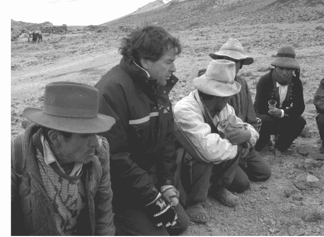

**图 1.4** Logan 与一群安第斯男士举行户外会议。（版权所有：2011年7月1日，Alison Clear 和 Logan Muller。）

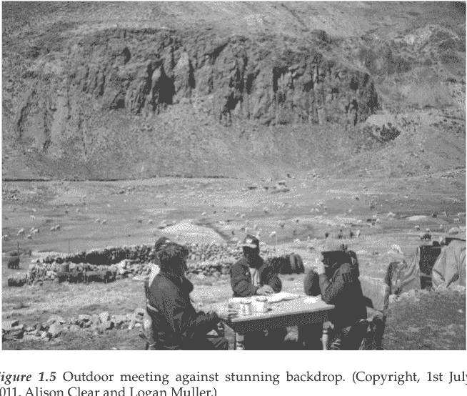

所有小镇的一个共同点是存在民主选举产生的市长和委员会。这些官员是公开、受人尊敬的，并做出了许多决策，但总是以公开协商的方式进行，并听取其他居民的意见。总的来说，他们花费了近两年的时间与村民交谈、提澄清性问题、做记录并招募当地人员。在新西兰的 Alison Young 通过电子邮件和 Skype 进行远程协作，提供技术建议和外部视角。

村民的需求是什么？正如通常情况一样，“客户需求”并不是以技术信息的形式呈现。需要计算机科学家将村民的需求转化为一套可行的方案系统，同时在每一步都检查他们的技术想法在要实施的严酷环境中是可行的。

用他们自己的话进行总结和转述，村民要求提供资源以：

- 自学如何种出更有营养的马铃豆。

- 自学当买家到达时，他们的产品在任何给定时间下什么是公平的市场价格。

3. 发现为什么他们的水不健康，以及可以采取哪些行动来解决。

4. 为他们的孩子改善教育机会。

项目负责的任务是将这些信息转化为一套具体的需求，并据此开发技术规范。

## 1.5 组织和列出最终需求

大多数需求都围绕设计一个系统，通过建立通信网络来解决上述的人类需求。此外，系统必须整合到现有社区中，而不是破坏它们。所有小镇的共同主题是需要与外部世界通信以获取信息。

幸运的是，利益相关者完全愿意支持某种形式的互联网连接以实现目标。考虑到这一切，Ruben、Logan 和 Alison（现已秘鲁）在当地招募的志愿者的建议下（图 1.6），提出了以下需求列表：

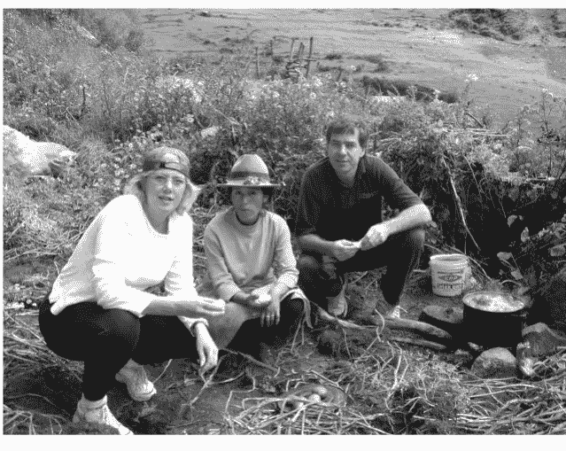

图 1.6 Alison 和 Logan 举行午餐会议。（版权所有：2011年7月1日，Alison Clear 和 Logan Muller。）

## 第一章：秘鲁安第斯偏远地区的减贫工作

- 一个通用的高级框架必须适用于所有小镇，出于设置、培训和维护的实际考虑。

- 在通用框架内，每个小镇都需要定制化。每个小镇都有不同的需求和文化差异。

- 必须考虑到每个小镇及周边地区的所有利益相关者：这些利益相关者包括农民、牧民、流离失所的女性、处于传统角色的男女、教师和学生。

- 系统的开发方式必须使其在安装、运行和使用后本质上是自给自足的。

- 当设备到达并安装时，要维护并增加所有利益相关者之间的信任，因为人类往往倾向于偏袒某一组而非另一组。由于村民之前曾受到过外部实体的剥削，遵循这一要求显得尤为紧迫。

- 设计一种解决语言和识字障碍的方法。

- 自尊问题对女性来说是一个大问题。系统如何特别支持她们？

- 设计系统时，不忽视社区的凝聚力和相互依赖性至关重要——这是他们核心的伦理和关于如何生存的感悟。

- 计算机系统的安装和使用不需要干扰现有的系统和文化价值观。它必须支持而非改变或破坏传统文化。

逻辑需求包括：

- 在决定购买什么设备以及如何运输时，必须考虑小镇的偏远位置。这些小镇的海拔在 10,000 至 15,000 英尺（3,048 至4,572 米）之间，沿着土路和石路相隔数英里。由于地形原因无法飞行。必须使用陆地车辆。

- 由于大多数小镇是通过共识民主选举产生的，且市长非常受尊敬，因此获得他们的合作至关重要；必须避免碎片化的沟通。连接网络的系统技术需求包括：

- 获取可靠的卫星信号。

- 在供应匮乏的情况下构建网络。

## 计算与社会：科技向善

- 寻找并培训更多的当地人进行持续维护并在每个小镇开展教育工作。

- 意识到并补偿许多地区一年有九个月下雨的事实，这意味着存在广泛的云层和潮湿导致的设备故障风险。

- 准备好随时思考并随机发挥。系统可靠性至关重要，备件可能需要几周才能获得。

如你所见，设计和构建网络的技术挑战是由文化和地理挑战造成的。一个在城市地区甚至海平面附近的农村地区简单的系统，在考虑了所有背景因素后，变成了一项复杂的任务。

## 1.6 与所有利益相关者确认需求的准确性

传统方法是列出上述需求清单，并将其展示给所有利益相关者进行初步批准。然后生成正式文件，并由主要利益相关者的代表签字。显然，这种方法不适用于该项目。

因此，Ruben、Logan 和他们的任务小组招募人员花费大量时间重新访问早先发现的社会群体，重复他们认为听到的内容并对其进行确认或修改（图 1.7）。发生了更多长时间、更深入的会议，以便每个人都能发表意见并达成共识。没有创建、签署或归档正式的需求文档。这在村民的文化体系内运作是绝对必要的。项目经理在会议期间几乎没有做笔记。在私下里，他们对所学的内容做了详尽的记录，并在访问不同群体时相互比较经验。但项目经理主要学会了在口头传统中工作。协议与变更

# 第一章：秘鲁安第斯山区山区地区的扶贫工作

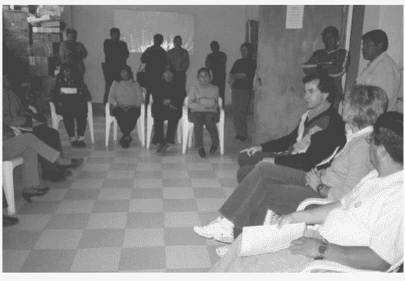

**图 1.7** Alison 和 Logan 正在听村民讨论该项目。（版权所有，2011年7月1日，Alison Clear 和 Logan Muller。）

该项目是通过基于相互信任的动态对话而实现的。最终，每个社区都对他们的需求达成了共识，项目经理随之开始开发规格说明。

## 1.7 安第斯山脉非传统的规格说明开发

随着需求收集的完成，该项目的这一阶段并没有遵循传统的文档和合同驱动模型。尽管如此，它遵循了良好的规格说明开发背后的基本原则，即：规格说明必须根据需求描述系统必须“做什么”；而这些“做什么”的内容将引出“怎么做”。

在这种情况下，基于对所有利益相关者需求的仔细探索，“做什么”的内容已基本浮出水面。然而，项目的最初初衷是帮助马铃薯农民和羊驼主主，在审查需求时，已经非常明确了“做什么”包含了教育、健康和心理需求——前提是必须服务整个系统（镇民），并帮助人口系统地降低他们的贫困水平。

外部利益相关者新西兰援助署（New Zealand AID）、OSIPTEL 和 CIP 只要看到明显的进展就会感到满意。他们都意识到，如果要在长期成功，这个过程将是一个缓慢的过程。

计算机与社会：为了善而计算

### 主要外部利益相关者的缩写

- OSIPTEL—秘鲁电信公司

- CGIR—一家国际援助组织

- CIP—国际马铃薯中心

- NZAID—新西兰国际发展开发署

- GILAT—安第斯山区村庄的互联网服务提供商

- Unitec—位于新西兰奥克兰的学院，Logan 和 Alison 在那里工作

- CIC—信息与赋权中心。在每个村庄设置计算机的物理场所。

注：组织的链接请见附录

## 1.8 规格说明：社会、文化、技术实现的交织

该项目发生在两个地区：Huancavelica 和 Apurimac。回想一下，参与项目的有 11 个城镇。两个城镇位于 Hancavelica（Daniel Hernandez 和 Colcabamba），九城镇位于 Apurimac，包括：Antabamba, Totora, El Oro, Pachagonas, Huarquirca, Sabarino。

所有 11 个城镇的一个共同基本技术需求是获取可靠的卫星信号以建立互联网连接。如果没有可靠的信号，访问将变得不可预测，对于忙碌的村民来说，系统将无法使用。每个用户都要从他们本就紧凑的生活中抽时间走到电脑前去使用。因此，每个城镇卫星天线的正确角度至关重要。Eutelsat（一个覆盖拉丁美洲的欧洲的卫星系统）是最便宜的替代方案，但卫星相对于城镇位置及其卫星天线的位置会导致连接不可靠。Eutelsat 的入射角非常低，仅为 17 度，考虑到频繁的雨、雪和电风暴的天气状况（图 1.8），这变得更加棘手。相反，SatMex（一个覆盖墨西哥的卫星系统）成本更高，但对于安第斯山区的地理位置更好。最终选择了 SatMex。城市中使用的低频宽带无线（800 MHz 的 Wimax）在安第斯城镇既无法获得也负担不起。因此，使用了较旧但良好的

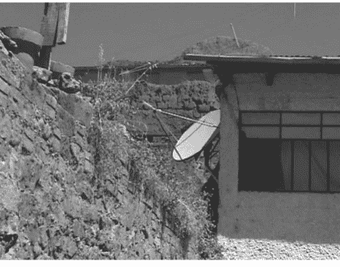

**图 1.8** 卫星天线以最佳角度安装。（版权所有，2011年7月1日，Alison Clear 和 Logan Muller。）

建立了良好的 2.4 Ghz 无线连接，从而保证了更容易获得良好的服务和可靠的信息。互联网服务提供商是 GILAT Network Systems。

正如需求列表所预测，计算机科学家及其团队必须进行创造性思考才能让许多技术问题得到解决。例如，在 Daniel Hernandez，最初在尝试寻找对齐卫星天线的正确焦点时遇到了问题。当时还没有卫星天线，但这些信息是决定使用哪种卫星系统决策的一部分。机智地，他们制作了一个自制天线将两个办公室连接起来。他们从一个可以相当廉价获得的天线开始。然后给一个中锅贴上铝箔，利用其反射性通过太阳来确定焦点（图 1.9）。

他们在焦点处一根橡胶软管的末端放置了一个 USB wifi 接收器，并利用它在小镇上进行无线传输，距离达 1.24 英里（2 公里）。

另一个共同需求是：以通信和教育为中心的、类似的活动需求。因此，每个城镇都选择了几乎相同的设备并进行了安装。每台机器都是 Pentium 4 处理器，配备 512 Mg RAM 内存，平均配备 40G 硬盘。每台用户机器运行 Windows XP。这些机器在利马很容易获得，万一发生灾难（例如，在狭窄的山路上由于颠簸导致导致部分零件掉进峡谷一侧），可以在山下获得备件。幸运的是，由于包装非常仔细且运气不错，这个问题并没有出现，所有机器都完好无损地到达。

# 计算机与社会：为了善而计算

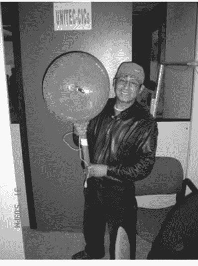

**图 1.9** 著名的锅卫星天线。（版权所有，2011年7月1日，Alison Clear 和 Logan Muller。）

机器上安装的软件是 Microsoft Office（西班牙语版）、Internet Explorer 浏览器（西班牙语版）和电子邮件。选择这些软件包是因为它们易于获取并提供了一个良好的标准平台。前三个应用程序使所有用户能够搜索并查询他们需要的信息。此外，一家名为 SkillSoft 的公司捐赠了一套教育软件，包括儿童节目和成人西班牙语课程。这套软件此前由 Unitec 使用了多年。培训当地人员使用应用程序、操作系统、硬件和网络，是确保项目被接受的重要组成部分，也是确保系统长期可持续性的要求。在大多数情况下，最初的教育培训者是项目经理早期招募担任城镇联络员的人员。选择现场维护人员或培训人员是基于他们在某些技术领域的经验，或者他们表现出天赋或只是为了了解他们城镇新系统的细节。“工作描述”非常简单，依赖于对项目的表现兴趣和投入，而不是不切切先教育。培训不是一次性活动，而是一个持续的过程，因为新人们会带来其他人并帮助他们学习。因此，知识和系统的使用在社区中以不断扩大的范围传播，使越来越多的人（农民、妇女、教师等）成为独立用户。这也是支持并符合历史相互依存和共享价值观计划的一部分。

第一章：秘鲁安第斯山区山区地区的扶贫工作

**图 1.10** 其中一个 CIC 中心。（版权所有，2011年7月1日，Alison Clear 和 Logan Muller。）

“信息与赋权中心”（图 1.10）。这个名字是经过深思熟虑的，作为整体计划的一部分，传递信息：这些计算机中心是为了帮助人们帮助他们自己。作为该计划的一部分，并继续解决需求中识别出的信任和沟通问题，每个城镇都培训了自己的教育培训师，而这些人员最初是由项目经理 Ruben、Logan 和 Alison 培训的。

## 1.9 导致定制的各种

并非所有城镇最初都连接到了互联网。在 Huancavelica 地区，位于 Daniel Hernandez 和 Colcabamba 的中心 CIC 首先连接到互联网，使用的 ADSL 连接如下：

ADSL 铜线链路 → 一个 Linux 服务器 → 20 台机器（Colcabamba）

在 Apurimac 地区，中心 CIC 以类似的方式进行连接，并建立了一个无线局域网，将图书馆、医疗中心与 CIC 连接起来。

八个分中心最初并没有连接到互联网，但配备了六到十台电脑、Microsoft Office 和教育软件。这套配置用于培训人们个人电脑的使用和维护、文字处理、电子表格，并为人们有机会访问位于 Antambamba 的主 CIC 的教育活动提供支持。后来，两个分中心通过 OSIPTEL 接入了互联网，随后，他们使用 VOIP 在 Antambamba 和 Huacuira 之间进行通信，使村民能够绕过不存在或负担不起的电话服务。

## 1.10 快速成果和具体结果

目标受众——马豆农们立即开始在晚上利用电脑研究如何种植高产的马豆，从而帮助解决严重的营养不良问题。此外，这些农民每天都能在线查看城市里马豆的市场价格，因此当买家意外出现在山上时，他们准备好进行有效的还价（图 1.1）。最后，农民们与 CIP（马豆中心）进行交流，接受来自他们专家的建议，并远程参与 CIP 的子计划。马豆农活动的成功至关重要，因为该项目的一部分是秘鲁外交关系部和 ZAID 启动的整个减贫行动的开端。

牧场主有时也是马豆农，他们上线学习了他们拥有的其他商品的市场价格，例如羊驼毛，这些商品在城市里很有需求。此外，他们还学习了执行各项任务的新方法，例如使用剪刀代替刀具更高效地剪下羊驼毛。许多牧场主住在远离城镇的地方，通过参与 CIC 项目，他们感到与社区的联系更加紧密了。

老师们通过在其他人没有使用电脑时带学生来使用。除了利用 Skillsoft 教育软件进行传统的教育活动外，教师和孩子都能够学到有助于他们在 21 世纪过得更好的技能，无论他们是打算留在城镇还是搬到城市。这些软件程序非常受欢迎，以至于没有老师或学校的偏远城镇的学生有时会步行几小时到达一个 CIC 中心学习（图 1.12）。教师是发声最频繁的群体之一，经常询问是否可以获得更多电脑分配给学校，或者他们是否可以在中心有更多的使用时间。

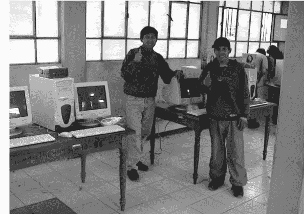

图 1.11 位用户展示了他们对系统的看法。（版权所有，2011年7月1日，Alison Clear 和 Logan Muller。）

许多女性存在的自尊问题也得到了解决，特别是那些过去因恐怖主义流离失所的女性。传统上，女性留在家中，她们很早就告诉项目经理，她们想为社区做出更多贡献。一旦 CIC 建立起来，许多女性在孩子上学或由朋友、家人照顾的期间会在白天上网。她们学习了许多基本技能，例如如何用西班牙语读写，以及如何使用浏览器等基本互联网功能。从那里开始，她们能够对社区的需求进行研究（图 1.13）。

由于使用了 CIC，妇女小组取得了一些特别令人深刻的成功。例如，一组女性发现了一个极具前景的资助机会；她们提交了申请并获得了资金支持。这些资金和随之而来的信息资源使女性学会了如何改善河岸的排水系统。有了这些新知识，她们招募男性协助完成繁重工作，从而形成了新的纽带，并赢得了自我的尊重。

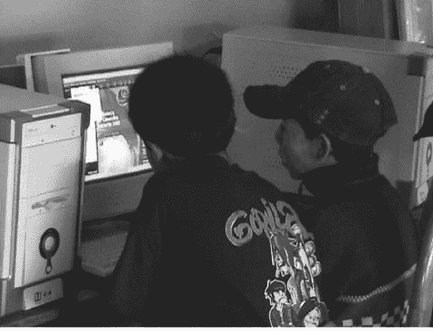

**图 1.12** 沉浸在教育材料中。（版权所有，2011年7月1日，Alison Clear 和 Logan Muller。）

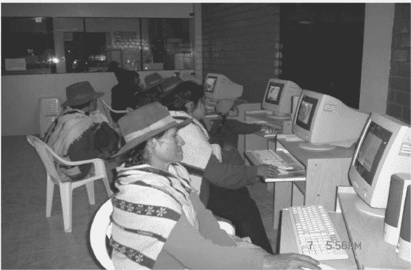

**图 1.13** 电脑一直备受青睐。（版权所有，2011年7月1日，Alison Clear 和 Logan Muller。）

另一组女性通过在线调查发现，附近的一处金矿作业将有毒尾矿排入流经她们村庄附近的溪流。几个世纪以来，这些溪流一直是饮用水和其他用途的水源。尽管她们无法阻止污染，但由于意识到上游的水被污染了，她们停止了使用。这对近年来出现的严重健康问题产生了积极影响。

在某些情况下，妇女们学会了通过向来到山上的买家出售工艺品和布料来赚取收入。自尊问题在那些拥有大量“流离失所”女性的城镇尤为明显，这些女性主要是以家庭为中心的社会成员，在传统的以家庭为核心的社会中几乎没有地位。能够使用电脑为社区做出财务贡献让她们有了自豪感和归属感（图 1.14）。

她们特意确保这些努力不会破坏传统价值观。当地培训人员与妇女举行了特别会议，讨论她们的贡献是有价值的，并可以用来加强社区价值观。

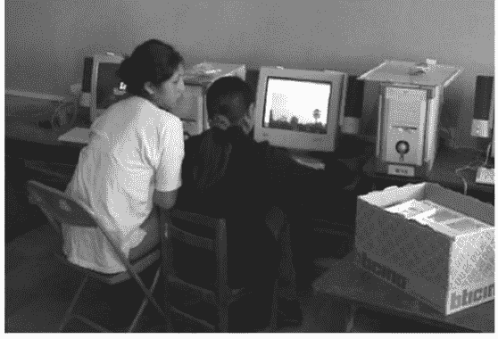

图 1.14 一对一教学。（版权所有，2011年7月1日，Alison Clear 和 Logan Muller。）

## 计算机与社会：为了向善

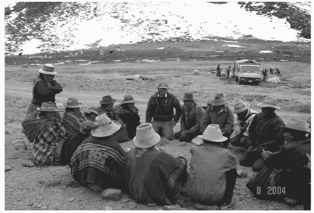

**图 1.15** （见彩色插图）分享信息。（版权所有，2011年7月1日，Alison Clear 和 Logan Muller。）

增强了她们的自尊，因为她们能够为社区做出更多贡献。当妇女学会使用电子邮件时，许多人能够与几个月没有联系的孩子保持定期交流，加强了家庭关系。

## 1.11 问题与挑战

即使是最详尽的需求收集和规范制定，也无法预测并消除所有问题。一个问题让项目负责人、当地教育者和普通民众感到特别头疼。在分中心 Totora，市长决定控制 CIC 中心并限制电脑的使用。目前还不清楚他的动机，但社区反对了，当地议会反对了，并召开了多次会议。压力不仅来自他自己的人，还来自联合国人员和秘鲁政府代表/项目经理 Ruben Bustamante。市长违背传统价值观和规范的行为变得更加神秘。在一年多的时间里，人们与项目代表之间进行了讨论。起初，讨论是耐心且理性的。最后耐心耗尽，并威胁要移除电脑。

另一个问题描述在关于 2006 年的未发表论文中，该论文是由新西兰惠灵顿维多利亚大学的一名研究生写的。他报告说，至少在一个情况下，前往最近中心的四英里路程对学生来说太远了，孩子们想去，但由于天气不好、旅行时间和其他负担，这段路程几乎不可行。因此，项目的一个子群体没有得到充分的服务。该论文建议未来的项目迭代或从其分支出的项目，应评估如何解决这个问题，因为在如此重要且受期待的项目中排除部分人群是不可接受的。

并利用信息来改善人们的生活质量。

（作者从西班牙语翻译）。

当地联系人兼培训师埃尔莎·胡曼·克门特（Elsa Huaman Clemente）分享了当地女性对使用电脑系统感到格外高兴的经历，以及她本人观察的变化：

- 学习新知识[她们特别喜欢这一点]，
- 改变人们的生活（尤其是“流离失所者”），让他们觉得生活很有价值，并觉得自己是该地区的一员；此外，由于他们从未用过电脑，曾觉得只有有钱的人[才能这样做]……这些经历加强了群体的联系，在某些方面，这种经历缓解了他们经历过暴力生活的处境。

（作者从西班牙语翻译）。

埃尔莎对该项目的长期影响做了更通用的评论（英文）：

人们对这个项目感激不尽，因为它给他们的生活带来了巨大的变化。现在，他们有了更好的机会来提高产品的质量和数量，根据市场需求扩大业务，并创造更好的经济状况和教育质量。

埃尔莎在丹尼尔·埃尔南德斯（Daniel Hernandez）镇附近的一个小社区长大，并被选为当地联系人兼培训师/教育者。她 7 岁时开始上小学，每天步行 30 分钟。直到她上中学，家里一直没有电，而且电费昂贵，他们用得非常节约，这让她在完成家务后才能在晚上学习。埃尔莎想在中学毕业后继续教育，但没有钱付学费。她的第一份工作是住在厨师兼清洁工，每天工作 18 小时，

# 第一章：秘鲁安第斯山脉偏远地区的减贫

每周 7 天。她的工资相当于每月少于 70 美元。起初，这是唯一可用的工作，但后来一个非政府组织（NGO）在她的社区开始工作，并在接下来的五年里与他们合作。由于没有社区开发工作的经验，她在工作中学边学，并发现这种工作非常有意义，尽管她通常每天要步行三四小时到达偏远社区。她曾三次参与了需要走一整天路程的项目，因此她会和其中一名居民住一周，或者直到项目完成。

看到这些比她的社区更远离“所谓文明”的社区面临着贫困和孤立，对埃尔莎产生了深远的影响。她用英文说道：

“即使我们家里东西也不多，但和这些人相比，我们生活得像国王一样。如果你有钱，因为他们的孤立，你也买不到任何东西。他们的饮食就是土豆：早餐、午餐和晚餐。他们没有任何其他蔬菜。”

三年后，该 NGO 资助埃尔莎学习了三年的农业并获得了学位，实现了她对深造教育的愿望。她从未见过电脑，但参加了一个月的课程，她说“时间还不够长，但让我入门了。那真的很贵，我每天得坐两小时大巴。”

当该 NGO 的工作完成后，埃尔莎在万卡韦维利卡大学（University of Huancavelica）担任了三个月的志愿者职位，在此期间她学习了关于电脑和业务的一切知识。她的决心得到了回报：“那时候没有多少懂计算机知识的人，所以我提供了一份为期六个月的工作……得到了工作机会！！！！”

当秘鲁-新西兰项目到达丹尼尔·埃尔南德斯时，埃尔莎想参与其中。她被选为当地联系人，后来成为男女的调度员和培训师。她必须每天面对并克服社区带给她的孤立、性别角色预期和自尊心等问题。她教所有年龄段的人，为每组学习者制定了定制活动。她对项目最喜欢的部分是，当她看到每个人因为她的努力而学习并对自己感觉更好时。她也喜欢社区作为一个团队来解决棘手的挑战——从而将传统的咨询式问题解决方法与新技术结合起来。

当埃尔莎获得项目负责人洛根（Logan）和艾莉森（Alison）资助前往新西兰学习英语和计算机时，她的生活被彻底改变。她于 2011 年 9 月获得计算机系统学士学位，她说“热爱它的每一个方面”。她希望在计算机领域找到工作，并利用她的技能继续通过计算机帮助弱势群体。鉴于她目前为止的决心和坚持，无疑她将在梦想的下一步中取得成功。

## 1.13 改变的生活：报告与评估

大多数正式的软件工程项目都会对项目的最终结果产生某种形式的正式文档。在这种情况下，Unitec 的代表写了两份报告并发送回给 NZAID，描述了项目的成功之处。在写报告期间，官方文档尚不可用。这里对文档内容的讨论取自作者艾莉森·杨（Alison Young）和洛根·穆勒（Logan Muller）的记忆。那名研究生在论文中提到了该项目及其成果的成功。他的结果包括对选定村民的采访报告。在所有三种情况下（论文和 NZAID 报告），调查结果都支持了该项目的整体成功，即通过赋能让他们借助计算机帮助自己，从而实现并显著降低了他们的贫困水平。这些文件还证实了成功直接源于：项目团队在做出任何技术决定之前，努力理解当地人口的观点。成功取决于以符合用户社区既有规范和结构的方式收集需求和规格。在安第斯山脉 1 个小镇的项目继续帮助那里的人们，并且本质上是自给自足的。公民们继续使用他们的系统进行教育、通信和经济改善。

除了减贫带来的广泛社会效益外，许多人的生活也发生了巨大的变化。没有空间容纳所有的故事，但有两个故事值得特别关注。第一个生活发生巨大变化的人是当地项目经理鲁本·布斯塔曼特（Ruben Bustamante）。由于他在该项目中建立的人脉，鲁本被邀请到新西兰学习英语。在学习一年后，他回到秘鲁家人身边，实现了毕生的梦想——建立一家生态旅游业务，以便分享秘鲁的特色，并以文化敏感和环境可持续的方式进行。

克拉拉·佩尼亚（Clara Peña，化名）是一位单身母亲，10 岁时恐怖分子在拒绝交出她后杀了她的大部分家人。相反，她的家人把她送藏起来，她在那里住了十年。当她回到家里发现家人发生了不幸时，她开始在一个当地村庄担任神父的管家，最终成为该项目的一部分。由于她卓越的贡献，她获得资助与女儿前往新西兰，两人在那里学习了英语，克拉拉工作了三年开了自己的业务。当她回到秘鲁时，她拥有了经营业务技巧，尽管大多数与克拉拉背景相似的人无法出国留学，但许多人实现了他们以前都不敢梦想的未来。这包括上述许多改善了家庭和社区健康及生活状况的男女。

他个人致力于：“利用计算来让受剥削的社会重新获得他们的支持系统。在这个项目中，计算是他们用以重新织合社区并获得话语权的工具。”

他建议对计算感兴趣的学生尽可能修读所有面向项目的课程，并特别强调设计和大规模规划。他鼓励每位学生都利用出国留学的机会，无论是几个月还是一年，亲身体验其他文化的运作方式对于一个优秀的计算机科学家来说是不可或缺的，无论他们毕业后从事什么样的工作。他鼓励学生对从最贫困的人那里可以学到什么保持开放心态，而不是仅仅关注我们专业人士能为用户做什么。

在 Logan Muller 和 Alison Young 最后一次离开秘鲁之前，他们帮助 Daniel Hernandez 建造了一栋房子，专门供来自海外的学生来参与这个项目而住。这实现了所有最初项目负责人的个人目标：让未来的计算机科学家有机会为这个项目做出贡献，在实地了解安第斯地区正在发生的事情，以及他们可以做什么来帮助（图 1.17）。此外，Logan Muller 和 Alison Young 都教授大学课程，专门为学生提供可用于弱势群体项目的知识和技能。

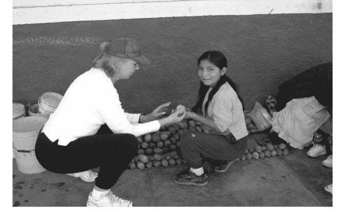

**图 1.17** Alison 正在检查产品。（版权所有，2011年7月1日，Alison Clear 和 Logan Muller。）

## 第一章：秘鲁偏远安第斯山地区的减贫工作

## 个人简介：ALISON YOUNG

作为一名身高 5 英尺 8 寸（1.72 米）、留着红发的女性，Alison Young 在身材较矮、肤色较深的安第斯人中脱颖而出。除了外表显眼，她发现要与一直生活在海拔 15,000 英尺（4,572 米）处的人生活是多么困难。尽管如此，作为新西兰团队的代表，以及一位热于帮助他人的计算教授和系主任，她对这个项目的重要性和快乐直言不讳。Alison 认为学生可以修的最重要的课程是那些关注**系统分析**的课程。她还强调任何关注**需求收集**和**规范开发**的计算课程，但很快指出，坚实的**伦理与可持续性**知识也是不可或缺的。她将自己在这些领域的研究归功于她能够充分为项目做出贡献，无论是在新西兰使用电子邮件和 Skype 与 Logan、Ruben 通信，还是在访问村庄时现场。此外，她用行动证明了女性完全能够像男性一样胜任计算机相关工作。

Alison 愿意分享她在安第斯山区期间的一些不常经历。最可怕的经历发生在某一天，团队的几个成员正坐在一辆装满计算设备的卡车在前往偏远小镇的崎岖山路上颠簸。突然，他们发现路被巨大的岩石刻意地挡住了。不远处坐着一群持枪的男人。团队由于紧张，担心那些人可能是恐怖分子，下车移动岩石。要么这样做，要么掉头，而那些人正跟在他们身后。无论他们做什么，都是待宰的羔羊，所以他们决定表现得自然并向前。幸运的是，他们推开岩石并尽可能快地开车时，没有被打扰。

这是 Alison 因为喜欢孩子而分享的比较有趣的故事之一（图 1.18）。在一个村子里，团队必须停下来休息、聊天和社交。很快，许多妇女和她们的小孩子围住了 Alison，因为她正享受与社区里最小成员们的相处。她既不会说西班牙语也不会丘丘语，当她正享受着互动时，Logan 突然违背了他的惯常行为，突然告诉她上卡车，他们立刻开车离开。显然，那些妇女在讨论要给 Alison 几个自己的孩子！从他们的角度来看，这是一种巨大的荣誉，但对于新西兰人特别是 Alison 来说，这可能是一个极其尴尬的文化时刻。

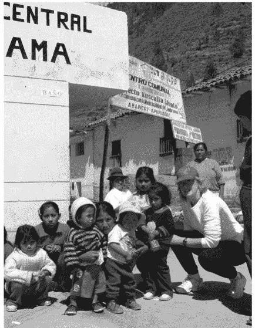

**图 1.18** Alison 总是和村里的孩子待在一起。（版权所有，2011年7月1日，Alison Clear 和 Logan Muller。）

Alison 现在教授几门直接结合了她在秘鲁经验的计算课程，除了传统的软件工程课程外。她将这个项目的教训融入到许多计算机科学课程中，既针对那些获得该领域学位的学生，也针对那些为了满足要求而修读单门课程的学生。

她认为，每位计算学生，无论是否想从事“开发”工作，都应该坚实地理解他们的职业如何影响他人——从产生污染的软件，到有助于保护传统社会的软件。她同意 Logan 的观点，传统社会在如何与周围世界保持联系方面有很多可以教我们的。为了证明这些观点，她和 Logan 曾多次巡回美国，向计算机专业的学生们他们具有社会责任感的计算项目的重要性。

## 1.14 安第斯项目的未来和全球性影响

其他国家的几个项目是以安第斯项目为蓝本的。在巴西，贝洛奥里森特（Belo Horizonte）一个巨大的扩张贫民窟中实施了“以社区为中心的赋权”的 CIC 模型。Logan Muller 帮助了该项目，旨在缩小富人和贫民窟居民之间的社会、数字和经济鸿沟。目前，Logan 正在泰国负责一个项目，建立一个数字存储库，让原住民能够归档受同化和其他全球力量威胁的传统和语言。他强调，尽管环境不同，但正如上一节所讨论的，只有计算机科学家才能为这些项目带来的技能是相同的。

在项目正式结束几年后，当地村民通过电子邮件发送给秘鲁和新西兰项目经理的报告显示，计算机系统仍在广泛使用。在 ISP 和 OSIPTEL 的持续支持下，经过当地培训的人员继续维护设备。因此，该项目的一个关键目标——创建一个文化融合、自给自足的基于互联网的减贫项目——已实现（图 1.19）。

对该项目最好的主观评价来自 Elsa Huaman Clemente，她说道（英文译文）：

> 项目之所以成功，是因为该模型非常契合该地区的传统，即承认当地文化。通过提供互联网连接，该项目试图教人们如何利用祖先的知识和经验，将积极的工具与新技术相结合，并使其在未来具有可持续性。

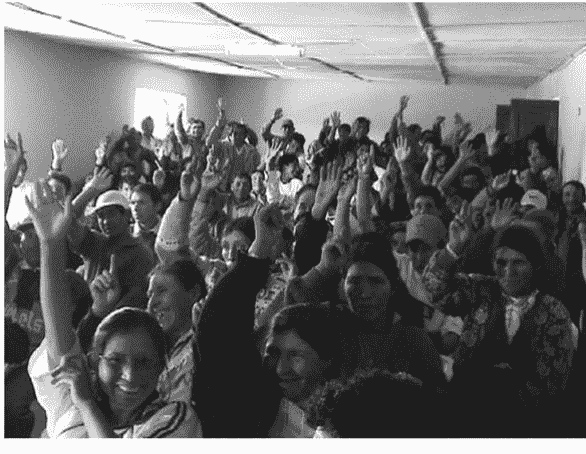

图 1.19 达成了共识。（版权所有，2011年7月1日，Alison Clear 和 Logan Muller。）

## 1.15 谢谢

- Alison (Young) Clear，新西兰克莱彻奇理工学院院长、系主任
- Logan Muller 博士，可持续性专家，新西兰
- Ruben Bustamante，秘鲁
- Elsa Huaman Clemente，新西兰 Unitec 计算毕业生
- William Griswold，加州大学圣地亚哥分校计算机科学与工程系教授

目前有流行的项目开发方法，如敏捷开发（Agile）或极端编程（Extreme Programming）、继承自瀑布模型的更传统的方法，以及你学习过的其他方法。选择一个你熟悉的项目开发模型，并讨论它如何在秘鲁项目中成功应用。请按照模型的基本准则逐点进行说明。承认模型可能需要修改；请解释并证明你的修改理由。

如果你认为你选择的模型无法通过修改来应用于秘鲁项目，请以同样的详细程度解释为什么不能。

## 第一章：秘鲁安第斯山区偏远地区的减贫工作

1. 尽管本章受访的大多数人都是高技术计算专业人士，但他们几乎无一例外地对项目的技术细节感兴趣。他们始终倾向于讨论“软性”话题。请推测为什么会这样。

2. 针对论文中提出的问题，即居住在真正偏远村庄的孩子因为离最近的`CIC`（计算机信息中心）太远而停止使用电脑，你会如何解决这个问题？（假设你没有无限资源在每个城镇都设立更多的中心）

3. 根据你对这些社区文化的了解，你推测导致市长对托托拉（`Totora`）产生抵抗的问题是什么？作为计算机科学家，你会采取什么不同的做法来解决它（如果有的话）？

4. 项目：像本章这样的计算项目并不非得发生在世界的偏远地区。在你居住地几天的路程范围内可能也有可以从类似的项目中获益的地方。找到一个（可能需要）。一旦找到，请根据你从这个秘鲁案例研究中学到的知识，制定一个如何执行需求收集过程的计划。

5. 在维持传统文化价值观与向城镇带来21世纪技术之间存在着紧张关系。几乎所有的村民都非常有热情，准备好学习和使用这些系统。尽管如此，你还能想到哪些可能在该报告中没有强调的伦理考量？

6. 你将如何利用良好的软件工程技能和该项目的背景来解决上一个问题中识别出的伦理问题？

7. 当电脑不可避免地开始损坏或过时时，村民可以做什么来更新或更换它们，同时保持他们的独立性和自我价值感？

8. 为什么像安第斯农民这样的偏远文化，对于一个计划成为计算机科学家并在本国从事传统行业工作的学生来说是值得研究的？

9. 你的学院或大学提供哪些课程可以帮助你准备这类项目？如果这些课程不是必修课，你计划上它们吗？解释你的答案。

10. 你的学院或大学提供哪些非计算课程可以帮助你准备这类项目？（可能需要一些研究）。请解释每门课程将如何帮助你应对类似本项目的任务。

11. 如果你是一家跨国高科技公司的首席技术官，而该公司想在一个居住着没有权力人口的偏远地区建立办公室，你会做什么来避免剥削居民？

12. 团队项目：项目负责人没有写下任何正式需求。他们报告说使用纸片来唤起记忆。更重要的是，他们非常努力地学习在口头传统中工作。这种方法与大多数西方工程准则背道而驰。如果你面临一种被告知无法从用户那里写下任何信息的情况，他们能写下任何东西吗？你会如何处理这种情况？讨论一些想法。

13. 团队/学期项目：接上一个问题，分为两组。一组是用户，另一组是软件团队。

教师将为两组提供关于用户是谁以及一般性问题的概述——仅为概述。你的教师选定的问题将可以通过计算解决方案合理解决的问题，尽管这个解决方案可能还没有定义得很清楚。

以下是教师可能提供给你的示例：“用户是（选择一组），居住在（选择一个地点）；他们在（选择一个问题：营养不良、缺乏教育等）方面面临问题。他们已经获得并接受了来自外部小组的援助。该外部小组将包括一个或两个他们熟悉的当地人。”

每个小组（用户、软件团队）都应制定如下计划：

用户提出关于问题的真实且非常详尽的信息。讨论细节直到你们达成共识（不要吵架！）。每个用户都应该扮演一个对解决方案有利益（直接或间接）的人的角色。

软件团队制定一个从用户那里收集需求的计划（不准写字！！每位团队成员都应该拥有一套对本项目有用的定义技能。

一旦两支团队都准备就绪，大家聚在一起并在保持角色的同时，尝试对问题和解决方案达成共同理解（不准写字！）。

## 附录

### 链接

村民作品的 URL

- http://www.municolcolabamba.gob.pe/portal/
- http://hyperdisc.unitec.ac.nz/unitec-peru/

秘鲁在远程服务中心方面有一个非常活跃的邮件列表。他们通过下面的`DGroups`链接的小组被称为`Peru-digital`。

访问网站：http://dgroups.org/alfa-redi-global/peru-digital

`Skillsoft`——为减贫项目捐赠教育软件的公司

- http://www.skillsoft.com/about/default.asp

## 第二章：通过数字图像管理改进患者护理

### 2.0 引言

本章介绍了一家领先儿童医院的放射科如何改进其用于存储和管理数字图像的系统。数字图像领域的尖端进展使该放射科翻新了其使用的系统。最先进的进展使数字图像管理发生了变化。数字图像技术的进步使得计算成为可能。具有专业愿景的人在医疗行业中取得了进展。放射科的设立是为了让情况变得更好。这种技术支持了对早产婴儿的护理人员。正如本章所展示的，拥有具有背景的伙伴至关重要。数字图像的进展使得计算成为可能。具有专业愿景的人在医疗行业中取得了进展。放射科的设立是为了让情况变得更好。这种技术支持了对早产婴儿的护理人员。正如本章所展示的，拥有具有背景的伙伴至关重要。数字图像的进展使得计算成为可能。具有专业愿景的人在医疗行业中取得了进展。放射科的设立是为了让情况变得更好。这种技术支持了对早产婴儿的护理人员。正如本章所展示的，拥有具有背景的伙伴至关重要。数字图像的进展使得计算成为可能。具有专业愿景的人在医疗行业中取得了进展。放射科的设立是为了让情况变得更好。这种技术支持了对早产婴儿的护理人员。

### 计算机与社会：为了向善而计算

理解网络、数据管理、架构和编程。一些高性能计算的研究也将很有帮助。

除了本章中所描述和强调的技术技能外，你还需要在大团队中良好工作的能力，并且必须非常有组织性。为了晋升到负责项目的职位，你需要卓越的沟通和演示技巧。如果你想说服高层管理人员或潜在客户你想法的可行性，你必须理解他们的观点，这通常包括预算和资源问题。帮助你进入这些领域的技能可以来自商业或工业工程课程、经济学、项目管理、会计和统计学。正如在医疗领域工作的计算机科学家的两种不同简介所示，医学计算提供了一个直接改善人们生活的机会，并提高医疗服务的效率和效果。挑战无处不在，但技术和社会变革的机会同样广泛。

### 案例

Joseph 和 Grace（化名）在 40 岁初相遇并结婚，决定尽快要孩子。他们做了所有正确的事：遵循营养和运动的建议，进行定期的体检，并关注有关高龄父母怀孕的最新文献。一切进展顺利，直到突然在怀孕近 6 个月时，Grace 分娩了双胞胎：Ann 和 Timothy，每个人体重 1 磅 9 盎司，长 13 英寸（图 2.1）。如此小的婴儿被称为微早产儿；根据目前的技术，他们的生存机会约为 50%。他们留在新生儿重症监护室（`NICU`），那里有全天候的区域。监护仪不断监测他们的心率、氧饱和水平和血压。根据 Grace 的说法，接下来的三个月是“没有安全带的过山车”。情况变好，情况变差，然后回升……他们的监护仪报警声响了又响，然后响又响……每一天

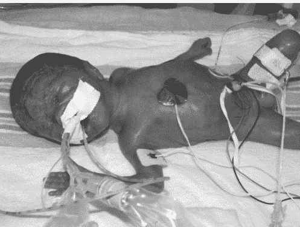

**图 2.1** 出生后不久的提摩西。

看着孩子的情况……真是精疲力竭……我感到自己毫无控制力，感到完全的无助。

在费城儿童医院（`CHOP`）新生儿重症监护室（`NICU`）的婴儿们状况很少能稳定超过几个小时。为了评估发生的每一次医疗危机，并试图阻止其他可预见的微早产医疗问题，婴儿们处于持续的监测之下。每个婴儿都使用高科技设备进行了数十次诊断，产生了数百张详细的高分辨率数字图像。海量数据的收集是必要的，并且必须能够随时待命。对于格蕾丝（Grace）和约瑟夫（Joseph）来说，这种情况是几个月噩梦般的模糊状态——不断观察并讨论最新测试的结果。幸运的是，他们的影像数据结果和诊断获取非常迅速，因为 `CHOP` 正在实施一种尖端的计算系统以确保这种情况的发生。他们能在 `CHOP` 是非常幸运的。

### 2.1 早产的发育挑战

遗憾的是，格蕾丝和约瑟夫的情况并不独特。大约每 8 次出生中就有 1 次被认为是早产，而足月出生发生在 37 至 41 周之间。早产定义为在 37 周之前出生，任何在 31 周 6 天之前的出生都被认为是严重早产。“微早产儿”一词适用于任何体重低于 1000 克（约 2 磅 3 盎司）的婴儿。安（Ann）和提摩西（Timothy）处于这一光谱的低端。出生越早，需要的干预程度就越高，以便不仅为孩子提供生存机会，还能获得良好的长期结果。

胎儿发育发生在一个相当为人知的过程中，每一天、每一周、每个月都在为复杂的互联系统的形成增加贡献。早产婴儿容易受到各种问题的影响，因为他们在内部系统获得充分发育的机会之前就出生了。有些问题可能是短期的，有些可能持续终生。许多问题介于两者之间。

让我们关注第三孕期，因为在 26 周（月）或之前出生的婴儿很少能存活。在第三孕期，婴儿从母亲获得免疫系统。因此，像安和提摩西这样在 26 周出生的婴儿缺乏免疫系统，极易感染各种病原体。此外，他们身体中有太多的部分发育不全，无法在外界存活。安和提摩西在生命的第一年接受了多次手术和其他干预，但他们产生了一系列复杂的认知和运动技能障碍，这很可能是大脑发育中断的结果。计算技术通过使用基于计算的数字影像测试来帮助我们理解这种发育，这些测试允许研究人员和护理提供者非侵入性地观察全身的发育。计算技术对我们了解胎儿大脑发育以及当正常发育被中断时会发生什么做出了巨大贡献。

在出生前的最后两个月（第 8 个月和第 9 个月），大脑的新皮层部分真正开始发力，快速地产生和修剪神经元。只有哺乳动物具有新皮层。大脑的这一部分控制感觉、感知以及与高级动物相关的普通认知功能的相互作用。发育按照已知的顺序进行：首先是感官和运动功能，然后是空间定向注意机制，最后是执行复杂模式处理的能力。

神经元及其连接的轴突和树突是大脑用于通信的机制。想象许多细胞通过一套复杂的电化学传输电缆系统连接在一起。信息沿着神经元传递，导致思考、决策和记忆。这种加速的生长和修剪在出生后继续进行，并在生命的头两或三年内逐渐减慢。

注意：人类神经网络主题是一个非常复杂的领域，这里只是概述性的基础知识。如果你觉得大脑非常迷人，那么在计算机科学中，你可以选择学习人工神经网络（`ANN`），它是人工智能的一个分支。你将学习更多关于大脑如何工作以及如何模拟其生长和行为的知识。

我们将大脑认为是一个弯曲的、波浪状的具有沟和褶皱的整体（见图 2.2）。这些褶皱包含的表面积（因此包含更多的神经元）比简单的头部曲率测量所能显示的要多得多。然而，在发育早期，大脑表面实际上相当光滑。大脑在最后一个孕期开始折叠，大约在第 34 周完成这一过程（已进入第 8 个月）。同时，另一项重要活动正在进行：在连接神经元的轴突周围形成细胞膜鞘；这些鞘加速了神经元之间电信号的传输。这一过程被称为髓鞘。

早产婴儿在这些和其他相互依赖的过程完成之前就进入了世界。因此，婴儿对外部环境影响极其敏感，而这些影响对足月婴儿几乎或没有影响。任何诊断测试、任何为了维持他们生命的侵入性程序都是创伤性的。这种创伤带有长期影响，这是在有选择的情况下尽量减少测试次数的原因。

鉴于保持早产儿生存是首要任务，技术创新的任务就是提供解决方案以帮助人类减少创伤性事件。

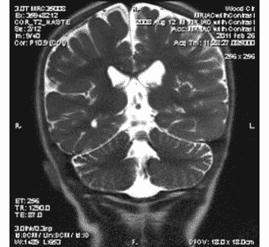

**图 2.2** 2 岁大脑后视图，显示了褶皱和曲线。（版权所有2011，费城儿童医院。保留所有权利。）

困扰问题的现实是，X 光、超声波和心电图等影像测试对婴儿存活至关重要，对于设计和维护系统的专业人员来说，确保快速获取诊断结果是首要任务。附录列了一些早产问题和相关的影像技术。

### 2.2 数字图像未得到有效管理时患者面临的问题

让我们来看一个最坏的可能场景。该场景是根据不仅来自安和提摩西的数据，还根据对全美人的访谈创建的真实合成方案。它通过对医疗数据管理的讨论进行了补充。为此场景分享经验的人保持匿名。

正如章节所述，在他们生命的前六个月里，安和提摩西进行了数十次相关的数字诊断测试、手术和干预。如果打印出来，每个人的文件都会非常厚。现在，才 2 岁，是进行另一次进展评估的时候了。安表现出认知和运动发育延迟。

场景：安和她的父母拜访了专门治疗早产儿的史密医生（`Dr. Smith`）。史密医生希望调出安的所有医疗记录和先数字图像，以便对安面临的困难做出最佳诊断（评估）。史密医生当天带着一台放在推车上的现代计算机终端在各个办公室间移动。她使用一个名为 `Enterprise Viewer` 的应用程序。注意，`Enterprise Viewer` 是一个应用程序而不是计算机终端。`Enterprise Viewer` 是供非诊断临床医生查看来自各个“领域”图像的应用程序。注意：在像 `CHOP` 这样的大型医院，约有 1400 名医生和员工可以访问 `Enterprise Viewer`，任何时候可能有 200 名患者正在使用它。应用程序对图像传输的需求可能非常高。因此，`Enterprise Viewer` 的构建考虑了速度和数据访问的集成。它通常不会缓存任何需要存储在某处的数据（与存档和 `Enterprise Viewer` 同时包含相同数据相比，后者会增加网络流量、存储成本等）。

史密医生当天在大型城市医院的一个郊卫星诊所工作，输入安的识别信息，出现了一些数据。但并非所有数据，史密医生也清楚，因为她认识 Ann，只需一眼屏幕就能发现信息缺失了。如果史密医生是第一次和 Ann 会面，某些数据的缺失可能不会显而易见。她使用的专有系统可能已知、也可能不知这一事实。更糟糕的是，史密医生必须等待几分钟才能看到不完整的记录。与此同时，Ann 在父亲的怀里坐立不安并开始哭泣，因为一个常见的问题是对触碰过度敏感。当图像终于到达时，史密医生只能看到最近的 2 张数字图像——那是上个月拍摄的。其中有一张 `MRI` 扫描（图 2.3）和一张 X 光片。她知道还有很多其他图像，时间跨度可以追溯到过去两年，而且是在几个部门拍摄的。她还知道，某些图像可能被拍摄多次，以密切跟踪 Ann 的发育情况，并帮助判断何时采取干预最为合适。她需要这些历史。

史密医生做了一个艰难的决定。如果她判断情况并不危急，可以直接向其他部门手动提交数据请求，让 Ann 稍后回来。她也可以派人去各个部门，看看是否可以获取纸质版图像并带回来——而此时 Ann 在尖叫，她的家人在等待。或者，她也可以根据最近但不完整的信息进行检查、评估和建议的行动方案。后者对家庭来说是最快且最无痛苦的，但可能会错过完整的纵向病史所提供的关键信息。最后，如果史密医生认为信息至关重要且立即需要，她可以送 Ann 去往其他部门，要求重新测试，并将结果立即送回给她。这可能会不必要地让幼儿暴露在辐射中，并增加医疗保健系统的成本。

| 3OT MRC35028 | H | Wood Cf |
|---|---|---|
| | Ex: 354B6212 | | MRIACWithContrast |
| three plane localizer | 2008 Aug 12 MR IAC with Contrast |
| Se: 1/2 | | Acc IAC with Contrast |
| In: 10 | | 251 L-69 |
| Sag: L0 | Acq Tm: 11:26:58232500 | |

**图 2.3** 2岁儿童的 MRI 头部扫描。（版权 2011，费城儿童医院。保留所有权利。）

### 计算机与社会：为了良善而计算

听起来像是一组糟糕的选择吗？确实如此，但这是某些医院的常见问题，护理提供者和诊断人员并不喜欢它。管理者也是如此。护理提供者、护士和医生希望将时间花在患者护理上，却发现自己不得不花时间在浪费且昂贵的、更不用说不必要的活动上，并让患者“跑来跑去”——更不用说更贵的账单和冗余的、甚至是侵入性的检查。这都是由于管理患者数据的计算机系统未能有效处理现代复杂的医疗保健数据。

### 2.3 人为问题的首要技术原因——单一供应商系统

导致这种局面的结构是如何形成的？这种情况随着时间的推移逐渐形成，随着医院的扩大，每个部门购买了当时看来合理的系统。医院拥有系列产生数字图像的部门，例如放射科、心脏科、病理科、肿瘤科、呼吸科、新生儿科等，每个部门都需要计算和基于计算的技术基础设施。多样化导致了去中心化、缺乏冗余、多个故障点以及硬件和软件的过时。

同时，费城儿童医院（`CHOP`）像许多现代医院一样，依赖复杂的设备进行诊断测试，如 X 光（见图 2.4）、`MRI`、超声等。数字图像及其相关的元数据必须在某处进行组织、存储和访问。这些“学”部门的诊断人员是专门分析的人——

| | | |
|---|---|---|
| | Ex: 354B6212 | | MRIACWithContrast |
| three plane localizer | 2008 Aug 12 MR IAC with Contrast |
| Se: 1/2 | | Acc IAC with Contrast |
| In: 10 | | 251 L-69 |
| Sag: L0 | Acq Tm: 11:26:58232500 | |

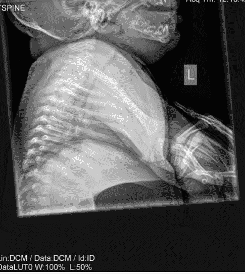

**图 2.4** 2岁儿童的 MRI 头部扫描。（版权 2011，费城儿童医院。保留所有权利。）

### 2.4 典型的单一供应商系统架构

典型系统的架构到底是什么样的？它包括：护理提供者和放射科医生使用的 `PACS` 和查看器；控制数据处理、操作和检索的软件；提供数据的底层存储服务器。还有代表的工作站。`CHOP` 的原始工作流架构如图 2.5 所示。各种工作站由终端表示。从图中可以看出，有各种子网、存储设备和相互连接的独立硬件，很难追踪通信和存储路径。现在应该很清楚了，为什么这项（此处仅涉及了放射科）的基础设施导致了上述问题的产生。`CHOP` 放射科的问题由于运营问题而加剧了运营问题，因为单一供应商控制了更新计划、维护成本以及对定制和修改请求的响应。供应商还“拥有”数据，因为他们存储并控制了访问数据的方式。`CHOP` 与任何使用单一供应商的医院一样，依赖于该供应商（无论其意图如何）提供所有服务。如果系统宕机，成本（技术成本、损失患者的时间）可能会轻松升至数百万美元。2005 年之前，当 `CHOP` 放射科的 `PACS` 系统宕机时，每小时会损失 9 万美元的收入和劳动力成本。

护理提供者希望与患者交流，而不是花时间学习新的计算技术。同样的想法也适用于诊断人员。

> **注意：** HIPAA 法规（《健康信息可携带性与责任法案》）在处理患者数据方面非常严格，并根据联邦医疗保健改革倡议发生快速变化。电子健康记录（EMR）为医院的计算挑战增加了全新的维度，本章几乎未触及。第 5 章有更多关于健康记录和联邦医疗保健改革的信息。

# 第二章：通过数字图像管理改进患者护理

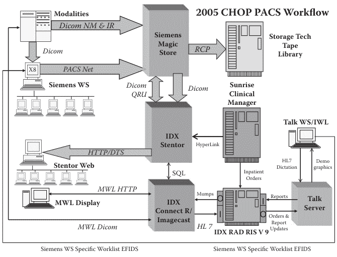

**图 2.5**（参见彩色插图）2005年放射科的PACS工作流。（版权所有 2005，费城儿童医院。保留所有权利。）

他们需要知道如何与自己的图像数据协作，并尽可能少地考虑设备。升级对 CHOP 的员工来说造成了特别大的干扰，因为他们被要求在短时间内学习新的 GUI 系统、流程和设备。

随着医疗技术的快速进步，系统迁移的频率日益增加。随着图像变得越来越大、复杂，以及伴随其来的信息元数据在患者的治疗过程中不断增加，长期数据存储已成为医疗归档的一个非常现实且日益增长的问题。有时，对于儿科患者或任何有先天性问题的人，数据可能需要保存几十年，远超最初归档这些数据的设备寿命。因此，必须进行额外的迁移以避免由于数据退化导致的数据丢失。

如果上述问题不足以动摇单一供应商的实用性，那么随着新技术驱动的设备允许越来越高的分辨率，系统需求正呈指数级增长。例如，在 20 世纪 90 代，传统的 MRI 在一次“检查”中大约拍摄 50 张照片，其中检查是指一组通常来自一个（也可能是多个）身体部位的图像集。现在，一次 MRI 可以拍摄 8,000 张图像。更广泛地说，在不同类型的数字检查中，1,000,000 次检查大约需要 33 TB 的存储空间（30,000 次检查大约需要 1 TB 的存储空间）。CHOP 放射科通常每年进行 210,000 次检查。图 2.6 列出了根据产生图像设备对许多图像和检查的大致尺寸和空间需求。随着医疗技术进一步进入三维和交互式数字成像领域且分辨率不断提高，克里斯·汤姆森（Chris Tomlinson）说：“XYZ 轴正在同时冲击我们所有人。”

随着图像变得越来越复杂，就需要更高的带宽；归档存储必须更大，每张图像的元数据必须是易于共享的资源。遗憾的是，在单一供应商架构中，数据在不同图像和系统类型之间并不一定兼容。这种互连性问题的一个表现是，数字图像的元数据可能会与图像本身分离，导致访问时间变长（图 2.7）。

不言而明，在使用单一供应商垂直系统所产生的所有这些技术问题，在医疗保健成本飙升以及在不损害以患者为中心的护理的情况下提高效率的压力下，变得变得更加棘手。

## 2.5 对 CHOP 单一供应商问题的初步分析

费城儿童医院在应对“PACS 监狱”（PACS jail）问题挑战中处于领先地位。CHOP 于 1855 年成立，是美国第一所儿童医院，是北美最大的儿童医院，也是世界第二大儿童医院。CHOP 拥有 546 张床位，在其网页（`www.chop.edu`）上列出了专科和服务，并维护一个独立的合作设施，其专门的 IT 部门雇用了约 500 人。IT 部门为医院的所有部门服务。

克里斯·汤姆森（Chris Tomlinson）与典型的放射科主任不同，他并非来自放射学背景。他在 CHOP 的 IT 组开始职业生涯。他之前的经验包括在安达·安德森（Arthur Andersen）担任大型医疗保健公司项目的顾问。凭借这些经验并拥有 MBA 学位，克里斯能够从高层次、整体的视角评估 CHOP 的计算和 IT 问题。克里斯在全国范围内获得了认可（荣获《CIO杂志》2009 年“值得关注人物”奖）。在 IT 部门工作期间，他成为了管理团队的一员，并负责了医院计算的许多领域。IT 部门与放射科之间有时存在冲突，因为

| 每种模式的平均存储需求 | | | | | | | |
| :--- | :--- | :--- | :--- | :--- | :--- | :--- |
| 图像 | 宽度 | 高度 | 深度 | MB/图像 | MB/检查 | |
| 血管造影 成像设备 | 40 | 1024 | 1024 | 16 | 2.0 | 80 |
| 骨密度测量设备 | 0 | 0 | 0 | 0 | 0.0 | 0 |
| 心脏科成像设备 | 90 | 640 | 640 | 8 | 0.4 | 35 |
| C型臂成像设备 | 5 | 640 | 480 | 8 | 0.3 | 1 |
| CR - 单板成像设备 | 4 | 2000 | 2500 | 16 | 9.5 | 38 |
| CR - 多板成像设备 | 4 | 2000 | 2500 | 16 | 9.5 | 38 |
| CT - 单层成像设备 | 100 | 512 | 512 | 16 | 0.5 | 50 |
| CT - 多层成像设备 | 400 | 512 | 512 | 16 | 0.5 | 200 |
| CT - 64层成像设备 | 1000 | 512 | 512 | 16 | 0.5 | 500 |
| DR 成像设备 | 4 | 2000 | 2500 | 16 | 9.5 | 38 |
| 胶片数字化设备 | 3 | 2000 | 2500 | 16 | 9.5 | 29 |
| 荧光透成像设备 | 24 | 1024 | 1024 | 16 | 2.0 | 48 |
| 乳腺摄影成像设备 - 2K | 4 | 2000 | 2000 | 16 | 7.6 | 31 |
| 乳腺摄影成像设备 - 4K | 4 | 4000 | 4000 | 16 | 30.5 | 122 |
| MR 成像设备 | 200 | 256 | 256 | 16 | 0.1 | 25 |
| 核医学成像设备 | 8 | 128 | 128 | 16 | 0.0 | 0 |
| PET 成像设备 | 150 | 128 | 128 | 16 | 0.0 | 5 |
| PET/CT 成像设备 | 400 | 512 | 512 | 16 | 0.5 | 200 |
| 超声成像设备 | 40 | 640 | 480 | 8 | 0.3 | 12 |
| 图像采集站 | 40 | 640 | 480 | 8 | 0.3 | 12 |

图 2.6 常见数字图像的平均存储需求。（版权所有 Acuo Technologies®，2009）。

## 2.6 只要了解计算历史，解决方案是显而易见的

克里斯，

# 计算机与社会：为了善而计算

作为一名计算机专业人士，能够预见到他人未发现的解决方案，你必须将 CHOP 孤岛系统问题放在历史计算机科学的角度来看待。例如，取决于你的年龄，你可能还记得 20 世纪 80 年代经典的状况：当时有几十种个人电脑、相互竞争的 DOS 操作系统（MS-DOS 和 PC-DOS）以及 CP/M 系统。如果你想买个人电脑，你不需要从商店或邮寄购买一套现成的系统。首先，你必须研究所有可用计算机品牌和型号。然后，你必须决定购买哪种操作系统。幸运的是，只有三个主要的竞争者。尽管如此，无论你购买什么，都会导致你只能使用某些应用程序而无法使用其他。因此，你必须找出所需的应用程序软件版本可以在你选择的硬件和操作系统上运行。

即使在购买了所有硬件和软件后，你的工作还没有结束；你必须安装操作系统（是的，即使是普通用户也必须安装操作系统，或者让别人替他们安装）。这是一项微不足道的工作。当时没有 NICE 驱动的安装程序让你只需一直点击“下一步”按钮直到完成。接下来是应用程序软件的安装，这可能非常复杂且不符合用户习惯。

只要你作为一个孤立系统的用户感到满意，你就可以进行工作了。标准少之又少，你必须时刻保持警惕，找出为什么某些功能可以按预期工作而另一些功能却不能。在不涉及细节的情况下，可以说，20 世纪 80 年代初想要在计算机之间交换数据的个人电脑用户面临着真正的挑战。（互联网？别想了。）数据共享的选项可能令人不快，有时甚至包括手动回退方法，如“鞋带网络（sneaker-net）”。

不用说，只有最精通计算机的用户才会自己完成所有的设置工作。大多数人会雇佣个人或组织来确定硬件和软件配置并组装系统。如果系统仍然无法工作，他们会回到同一个地方修理问题。这些服务并不便宜，而且耗时。不仅如此，用户在很大程度上被锁定依赖于任何了解底层发生什么情况的人。听起来熟悉吗？就像医院的某个部门雇佣了一家供应商来管理他们的医学影像数据。一旦购买，这些部门就受限于该供应商和系统，而且对结果并不总是感到满意。

市场力量和技术创新最终解决了早期家用电脑用户的互连性问题（大部分）。另一方面，医院等大型现代企业组织有更复杂、专门的需求和技术需要处理，同时还要全速运行以跟上医学数字影像创新的步伐。他们现在面临着系统间不兼容的巨大问题。市场力量和其他外部压力（如成本上升、政府医疗倡议以及医院工作人员发现自己用于非患者护理活动的时间越来越少）正推动着解决跨平台问题的需求。他们需要一种企业级、高效、具有成本效益、以提供者为中心（隐含地以患者为中心）的计算架构。厂商中立存档库（VNA）是解决单供应商系统问题的最新计算创新之一。

## 2.7 什么是厂商中立存档库？

虽然尚未建立 VNA 的正式定义或一套规范，但存在某些基本特征，可以解决单供应商 PACS 系统问题以及受困“PACS 监狱”的问题。下文描述：使用一定量的医学术语是不可避免的。侧边栏讨论了两个重要的概念——HL7 和 DICOM。如果你感兴趣了解更多，章节末尾的词表和参考文献提供了额外信息。

### HL7 和 DICOM

计算机学生熟悉由美国国家标准学会（ANSI）的一个小组委员会开发的 ASCII 标准。你可能也意识到，该标准多年来已经演进，包含了非英语/非美国字符。自 20 世纪 60 年代后期以来，政府购买的所有计算机都包含了该标准。

## 56 计算机与社会：科技向善

- VNA 必须以非专有格式存储所有数字图像对象及相关数据。
- VNA 必须提供动态标签映射（Tag Mapping）或变形转换（Morphing）。“标签”是医学影像中对象属性（Object Attribute）的术语。动态标签映射/变形意味着可以将任何 PACS 查看器生成的 DICOM 图像标签实时转换为任何其他 PACS 查看器识别的格式。你可能认为这一要求承认了并非所有 PACS 查看器厂商都完全遵循 DICOM 标准，而标准允许并在某些意义上鼓励使用非标准标签来描述图像中的“其他”属性。真正的担忧是当使用非标准属性（称为私有标签 Private Tag）来描述一个已经与标准关联定义标签的属性时。
- 与上述要求相关：必须使用非专有 API 来输入并正确分类系统设计用于管理的任何电子文档。此要求承认了目前尚无查看器 API 的标准。目前，针对 DICOM 和非 DICOM 对象的标准化讨论正在进行，使用的是一种名为 XDS（跨企业文档共享）的格式。
- VNA 必须支持完整的 DICOM 命令语言集，用于访问和管理存储的数据（FIND/MOVE/STORE/COMMIT）。
- VNA 必须处理向数字图像添加新信息的操作。从实践上讲，这意味着系统必须维护嵌入每张数字图像的患者备注的最新运行历史。

VNA 必须支持各种硬件服务器和存储架构，包括自动备份和故障转移机制的提供。这一要求同时解决了组件灵活性和恢复操作的问题。

VNA 必须包含一个支持 SQL 的独立商业数据库。正如你可能知道的，SQL 是全球数据库系统中数据存储和检索常用的语言，不仅限于医学信息系统。

### 2.7.2 迁移要求

将旧数据迁移到 VNA 必须考虑到可能的“不洁”或“脏”数据，并确保其成功传输。注意：“不洁”或“脏”数据与标准格式偏差太大，必须进行重新格式化（“清洗”）。

一旦归档并符合接受的数据格式标准，旧数据就不应再因任何软件或硬件升级而需要再次迁移或“重新清洗”（唯一的可能例外是国际标准发生变化，但这似乎与当前趋于稳定的一致性趋势相悖）。

VNA 必须能够迁移并接受非 DICOM 对象。除了上述列出的各种文档类型外，JPEG 和 PDF 是非 DICOM 数字图像的典型示例。

在数据从旧系统迁移期间，所有数字数据必须保持可供临床使用。

未来的数据迁移应由客户端（即医院）驱动并控制。

### 2.7.3 迁移后要求

一旦 VNA 系统完全安装并上线，客户端（医院）应对其数据拥有控制权。在实践中，这意味着每个部门可以根据其特定的临床和法律需要按需删除、压缩或移动图像。

未来的硬件更改应通过即插即交换进行。

所有上述操作必须在不对医院环境工作流产生负面影响的情况下进行。

最后，你经常会看到以下要求：

VNA 必须与其他医疗信息系统接口，使用 HL7 标准通信额外的医疗数据。关于此点的更多信息请参阅 HL7 侧边栏。

长长名单……但总之：

- 集中式图像存储
- 标准化图像管理
- 跨部门无缝通信
- 以上所有内容，加上每个“学科”内部的定制外观和工作流能力

## 2.8 Chris Tomlinson 提倡建立厂商中立存档

为了给转换为 VNA 提供最具说服力的理由，Chris Tomlinson 需要确定一个厂商来实施系统，并对 CHOP 员工进行使用和维护的培训。凭借自己的计算机背景，Chris 已经熟悉厂商中立存档的概念以及销售这些产品的公司。其中一家公司是 Acuo Technologies，一家总部位于明尼苏达州明尼阿利斯的美国公司。Acuo 清晰愿景和对标准的严格遵守给 Chris 留下了深刻印象。由于之前见过一些公司高管，他们之间已经存在一定的理解和信任。在关于项目的对话中，Chris 强调了信任对实施此类大型项目的重要性；他必须相信并说服他的上级 Acuo 会履行合同协议。

作为展示对 VNA 概念和选择 Acuo 作为供应商信心的部分，Chris 决定对他自己的部门——放射科进行初步转换提案，作为概念验证。在假设放射科一切顺利的情况下，他向 CHOP 管理层提交的提案的一部分包括证据，证明 Acuo 有灵活性处理整个企业范围内其他产生数字图像部门的系统。

考虑到 Chris 希望实现企业范围的推广以及卫星及农村医院的离线连接，决定在销售 VNA 概念和系统时采取的方法面临着额外挑战。他决定强调上述的概念验证，同时指出其产生的影响。心脏科将是第二个加入的部门。出于几个原因，这是一个战略性选择。首先，放射科是 CHOP 最大的“学科”之一，每年产出约 210,000 项检查，而心脏科保持着良好的合作关系，并准备好合作开展 VNA 项目。放射科将首先进行，心脏科随其后，并正在与病理科讨论加入。多个部门对安装 VNA 感兴趣是一个关键的卖点。

要说服其他“学科”支持 VNA 项目并没有什么困难。

[注：提供的 OCR 文本在后几页包含重复/碎片化的部分（例如“illa gorilla”、“data- silo-ed systems”）。根据文档流的语境，以下代表了所提供片段的连贯叙述：]

Acuo Technologies 的特性被认为最符合 CHOP 的需求，而且有助于管理层对其提案的接受。Acuo 已经在大型站点安装了 VNA，拥有成功记录。此外，Acuo 的技术嵌入在其他供应商的系统中，CHOP 正在使用其中一些系统。

Chris 准备了一份详细的书面提案，包含技术和业务流程信息，进行了个人演示，回答了许多尖锐问题，并最终成功说服了 CHOP 支持该厂商中立项目。

## 计算机与社会：科技向善

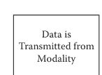

DICOM C_STORE（存储）

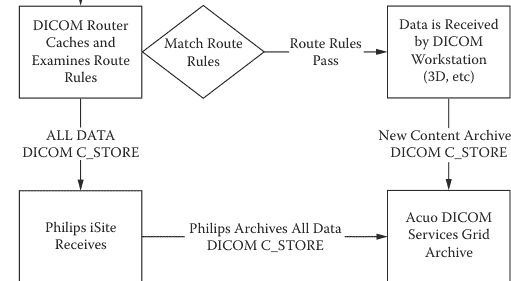

| 设备 – 1 – 3 天+ |
| :--- | :--- |
| Acuo 路由器 | 分钟 |
| iSite PACS | 90+ 天缓存 |
| 3D 工作站 | 周 |
| Acuo 归档 | 10 天缓存 |
| GMAS | 永久存档 |

总结：1–3 天内数据保留 4 份

10 天内数据保留 3 份

结论 – 在 GMAS 异步流期间，数据始终存在多个副本。

**图 2.9** CHOP 高级数据流。（版权所有 Acuo Technologies®，2009年）。

### CHOP DICOM 归档接入的 Acuo 工作流

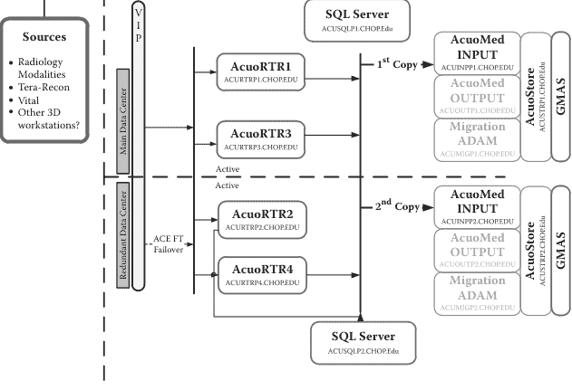

**图 2.10** DICOM 路由器和归档接入的 Acuo 工作流。（版权所有 Acuo Technologies®，2009年）。

## DICOM 与您的照片

如果您使用数字单反（SLR）相机，在 Photoshop 中查看其中一张照片的元数据，您会发现一个专门用于输入与 DICOM 图像关联的患者数据的标签！如果您使用 Photoshop 等软件处理图像，您已经理解了将数据嵌入图像中并使用 JPEG 标准将其压缩为一个图层的过程。以几乎相同的方式，CHOP 数字图像（或任何医疗 DICOM 图像）的像素可以用几种格式之一表示：原始格式（DICOM 未压缩，分辨率最高且操作能力最低，但占用空间最大）、无损压缩 JPEG（完全可逆的压缩）或有损压缩 JPEG（一种不可逆的压缩格式）。这种在每张图像中嵌入所有元数据标签的方法被称为 SOP（服务-对象对）实例。

虽然这不是当前 DICOM 标准的一部分，但 Acuo 确保对元数据所做的任何更改不仅保留在数据库中，而且作为运行历史存储在图像本身中。这种情况可能发生在许多情况下，例如患者新入院、出院或转院（称为 ADT）。在这些时刻，医疗提供人员或诊断可能会在他们请求的图像副本上添加有关新患者状态的注释。Acuo 与某些竞争对手不同，它会访问存储数字图像的数据库，重新打开图像，并将新数据直接添加到存储的副本中。这不仅保持了信息的实时更新和冗余，Acuo 还能声称，即使发生此类故障（例如患者/检查信息数据库丢失），所有图像也可以恢复到其当前状态，并从图像历史中恢复数据库。

当图像在设备中短期留存时，使用 Acuo 专利算法可以对如何最有效地将数据路由到本地存储服务器以及可能的其他工作站做出快速决策。系统考虑了诸如由 CHOP 定义的 DICOM 元数据衍生的临床策略、传输日期和时间以及针对每个接收设备的优化通信配置。图 2.9 流程图“DICOM C_STORE”指的是执行此路由和存储的 DICOM 语言。请另参见图 2.9 中的“DICOM Router Caches...”以及图 2.10 中 AcuoRT1-4 的扩展视图。数字图像及其相关元数据将在这些本地服务器中保留 1-3 天，或者直到接收设备（例如工作站）确定处理完成。路由决策并非完全基于理论，还取决于 CHOP 关于他们希望将特定数据发送到医院内部或其他地方的标准。

最终，所有数字数据都存储在两个地方：Acuo DICOM 服务网格归档（图 2.9），该部分在图 2.10 中被分为位于主数据中心的输入服务器和位于 13 英里外的冗余数据中心。这些服务器包含运行在 Windows 服务器上的 RAID 驱动器。与输入设备生成的图像相关的元数据被写入 SQL 数据库服务器以实现查找和检索。短段时间后（通常在几分钟内），数据将被推送到每个地点的 IBM GMAS（网格医疗归档解决方案）进行理论上的无限存储。GMAS 是一种包括医疗影像在内的多种类型内容的物理存储解决方案，根据需要可以将数据复制到多个位置。

## 2.10 从供应商归档检索数据

在一天中或夜晚的任何时间，都可能有很多图像检索请求。例如，坐在 PACS 查看器前的放射科医生可能想要调用一张图像，而医生可能希望从企业级查看器中调出五分钟后将查看的特定患者的所有图像。CHOP 的目标是能够在 6 秒内将 VNA 中的任何图像检索到企业级查看器，并在 10 秒内检索到诊断查看器，无论该数据当前位于系统的何处。企业级查看器是不计费的，而供医生使用的 PACS 查看器则不然。

### CHOP 用于 RIS 驱动更新（修复）消息的 Acuo 工作流

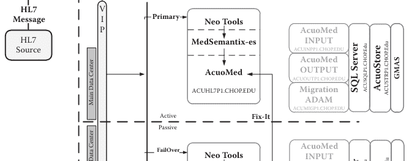

图 2.12 CHOP 中 RIS 驱动的（修复）消息的 Acuo 工作流。（版权所有 Acuo Technologies®，2009年）。

然而，Shannon 从 2007 年年中与 Chris Tomlinson 第一次见面起就发挥了主要作用。

请注意，这些项目团队中的任何一个职位对于拥有计算机学位的学生来说都是理想的。每个职位的重点不同，为不同兴趣领域的学生提供了选择。需要考虑的变量包括：你有多喜欢直接与人打交道、进行高层设计还是低层实现，或者是计算机组织的业务端。

# 个人简传：香农·韦伯 (SHANNON WERB)

正如你在书中遇到的许多成功的计算机专业人士一样，Shannon 对工作充满了热情和激情。同样重要且普遍的是，Shannon 像喜欢技术一样喜欢与人相处。在 11 年后，Shannon 拥有两个其他公司由不同人担任的职位：首席技术官 (CTO) 和首席运营官 (COO)。Shannon 一直在忙。不仅他有 50% 的时间在外，而且几乎每天（包括周末）都有某种形式的“工作”要处理。作为 COO，他的工作是运营性的：重点是管理包括设计师、代码开发人员、迁移专家和支持人员在内的多个开发团队。不可避免，作为“责任在此”的人，他经常与客户进行互动。

当他戴上 CTO 的帽子时，Shannon 会深度参与推广和教育——用他的话——Acuo 的解决方案。这个词的选择并非偶然。它们反映了他在与未来和现有客户互动时的取向。提供解决方案是非常愉快的事，而且是以让客户满意他们解决了真实问题同时也学到了某些东西的方式来做的。他能够平衡 CTO 和 COO 的两个世界，这并不意外，与 Shannon 的对话充满了“极客气”（再次，用他的话），同时也富有表现力且能言善辩。

Shannon 决定自己一个小男孩对计算机感兴趣。他谈到自己过去在小学休息期间如何玩 Apple IIe（如果你不知道那是什么机器，应该去查查——它改变了个人计算的世界）。在进入初中之前，他买了一本书并自学了 BASIC。

到了初中时，Atari 正风靡一时——最早的游戏导向机器之一，尽管它还能做更多——他设法在家里买了一个。事实上，他的家人支持他，很快就有了一个 Atari 400、另一台 Apple 以及一些非常早期的 DOS PC。这种早期的支持值得注意的是，他的父母都没有参与过计算机行业或相关领域。事实上，起初他父亲认为计算机科学的职业对他儿子来说不是一个好主意。尽管如此，他们鼓励了他的兴趣。现在，Shannon 和他的兄弟在父母的全力支持下都进入了这个领域。

可能没有什么能阻挡 Shannon，因为他在高中时正在使用最早版本的 Windows，然后 Prodigy 出世了（去查查！）。Shannon 说他“对它能做的一切感到惊奇，尽管我阅读文本的速度比它在屏幕上绘制的速度快。”公告板系统 (BBS)、调制解调器、实际上传和下载文件的能力（哇，当 28.8k [调制解调器] 出现时我们能做些什么啊！）。然后是大学——一切变得越来越好。他主修计算机科学和信息系统管理 (MIS)。

一旦他详述完自己对计算机一生的痴迷，Shannon 就指出了职业生涯初期人际技巧有多么重要。起初他认为良好的技术和绝妙的主意是业务成功的关键因素。他证明了事实如此。现在，大约 17 年后，他说技能可能比其他技能更重要；如果没有人际技巧，你就无法像他与 Acuo Technologies 的同事那样从零开始建立一家公司。Shannon 是这样描述的：

从概念、资金、设计、构建、招聘、测试、销售、发布、支持，几乎又回到了起点。多年来，我学到的可能比通过任何与技术相关的东西要多……对我来说最“不寻常”的是，几年前我曾坚信更好的技术、它的“效用性”会卖掉它并建立公司，但事实远不止于此。营销和关系（可能后者更重要）真正让一家拥有良好技术的公司脱颖而出。这不是对功能进行 SWOT 分析，客户是从他们信任的人那里购买良好的技术。

换句话说，如果没有稳固的人际技巧，成功的业务没有任何一个方面在巅峰性能下运作。不仅是在领导岗位上。正是由于这些人，加上不断跟进最新的技术，让 Shannon 能从早期的数据录入职位移动到技术管理层，一直到他现在公司高管的位置。

优先处理自己的活动是 Shannon 最大的挑战之一，特别是考虑到他有一个家庭，妻子在医学影像领域工作，他们有一个孩子和多个宠物。他归功于妻子帮助他平衡个人生活和工作（“她做得比我好”）。她是他的主要榜样。Shannon 喜欢周末在他们的木屋度过，尽量不接电话，大概带着所有的宠物。他特别喜欢看女儿与技术的互动，并思考由于一直环绕着她的海量技术，她的未来会有多么不同。

也许并不意外，其他的榜样在他的家人中。他的父亲在所做的每件事上都表现出“驱动力和决心”，他的母亲密切关注他们的家庭生活。Shannon 现在清楚地知道，他承担的工作和投入与任何工作一样多。

其他的榜样是他一生中教过他事情的人——他回想起了从小学一直到大学的特定个人。这些人帮助培养了他将他人纳入其核心专业活动中的愿望。Shannon 对现在的计算机学生有什么建议？由于他自己也获得了计算机学位，他指出了数学、理论和编程的用处。前两者很有趣，因为它们证明了计算机科学中看似抽象的领域在计算这个非常具体的世界中起着重要作用。当涉及到人生的选择时：“练习在有限的睡眠中生存！……但认真地说，找到你喜欢的，并让它不仅仅是一份工作——让它成为你每天醒来都想要参与、想要做出改变的职业，然后坚持下去。”

CHOP 团队由以下角色和人员组成：项目赞助人、项目经理、来自信息系统的领域专家以及硬件管理员（服务器、存储、局域网和数据库）。

Chris Tomlinson 不出意料是项目赞助人，为他工作的 Irv Evans 是项目经理。领域专家是来自放射科的一小组医学影像专家，他们能够为两个团队将处理的图像提供细节信息。

## 2.13 实施：启动与设计

实施过程由几个阶段组成。为了简单起见，我们将它们称为：启动与设计、VNA 实施、迁移和上线。跨越前两个阶段的边界的是发现阶段，在这些阶段会对现有系统相对于新系统进行评估。

首先，双方的项目经理（Irv Evans 和 Shannon Werb）开始敲定一份共同的工作说明书，随后是一份共同的项目计划。其目标是确保两个团队从开始就达成共识。工作说明书花费了一个月的时间制定，项目计划花费大约九个月。合同于 2008 年 6 月签署。

在这个阶段存在哪些有趣的技术问题？你可能已经预测到其中一些：范围界定、在规范完成前急于实施的压力、让所有人站在同一阵线上、一方做出的另一方并不知情的假设。这些都是经典的软件工程挑战。此外，CHOP 是大型医院中早期采用 VNA（中立影像归档）的机构之一，对于 Shannon Werb 来说，双方都存在“拉锯”的情况。在技术上，VNA 有许多“首创”，例如使用 IBM 刀片服务器，用较旧的 IBM MAS（医学存档解决方案）替换为新的 GMAS（网格医学存档解决方案）。获得的两个关键教训是：应用经理与客户项目经理紧密合作的重要性，以及技术与销售人员之间同步的重要性。

## 2.14 实施：VNA 的实施

首批可操作的设计决策之一是获取适当硬件存储基础设施，这在 CHOP 完成，且 CHOP 的 IT 部门坚持了其设置和功能。在最初的销售谈判中，CHOP 要求最大冗余，它希望维护四份数据副本——两份本地副本和一份异地备份。此外，他们还希望继续进行磁带备份。这可能是每个团队的销售和工程人员尚未完全同步的情况，因为维护每张数字图像六份副本的完整影响并未被讨论。没有其他人实施过完全类似这样的项目，也没有类似的安装可供比较。事实证明，双方团队都有人认为需要四份数据副本，但对于这些副本是否应该包含磁带备份存在某些误解。最初的实施结果是四份数据副本加上两份磁带备份。最初计划是为每张数字图像制作六份副本。

大约九个月后，大家意识到并开始讨论实际上计划保留多少份数据副本。到此时，也变得清晰，磁盘空间的填满速度比预期的快一倍。通过这些讨论，双方达成共识：每张数字图像保留六份副本远超需求，即使对于大型医院记录系统有着严格的数据安全和冗余需求也是如此。更不用说即使 CHOP 自己也认为需要如此大的冗余，维护六份图像数据的成本也是令人望而却步的。幸运的是，这个问题在项目进展到足以导致任何重大问题之前就已经被发现了。

与此同时，Acuo 和 CHOP 合作评估从其遗留系统迁移到 VNA 的数据量和质量。这是发现阶段的一部分，被称为数据审计。CHOP 遗留数据量非常惊人：追溯到 1999 年的 900,000 项研究产生的 30 TB 数据分布在 MAS 的磁盘空间和磁带上。MAS 已经满了。几乎没有空间为迁移活动专门留服务器空间。CHOP 对这第一个惊喜的反应是增加了两个专门用于即将到来的迁移过程的驱动器。为了让未来的空间状况更加紧迫，预测显示影像数据量呈指数级增长。近期将需要更多的存储，且速度没有放缓的迹象。

数据审计期间的第二个惊喜是需求比预期的要大。图像是在研究层面进行审计的，这意味着不会对每张单独图像进行详细检查。相反，通过对研究进行抽样来发现存在哪些类型的标准化问题。“这里的‘脏数据’指的是无法以当前形式迁移的数字图像，通常是因为包含了专有的元数据，或者由于偏离标准格式太远，以至于必须重新格式化（“清洗”）以符合 DICOM 标准。此外，研究必须符合访问 CHOP 放射科信息系统（行业内通常称为 RIS）的标准。RIS 是一个用于管理放射科数字信息的应用程序，例如患者元数据、订单和相关的财务规划。几家供应商销售 RIS 系统。CHOP 打算迁移到 VNA 的图像在拼写和术语使用等领域必须与其相关的 RIS 记录匹配。

遗憾的是，事实并非如此。迁移所需的时间比预想的要长，并且需要额外的自定义数据清洗过程。Acuo 开始处理这些例程，因此在进入复杂的迁移过程之前，能够包含适当的模块。

官方图表和规范经过了修订。项目的这一阶段又增加了几个月。尽管如此，到 2009 年中期，VNA 已经安装并运行，使得传入的数字图像可以直接存储在其中。2009 年底，VNA 架构和存储环境进行了了升级。随着升级，从单供应商系统到 VNA 的遗留数据迁移于 2009 年 12 月 1 日正式开始。

# 第二章：通过数字管理改善患者护理

## 2.15 实施：迁移与上线

将遗留数据迁移到 VNA 是一个高度结构化的过程。除非发现特定的不迁移原因，否则所有研究都将被考虑迁移。因此，首要任务是识别已迁移到 VNA 的研究并将其从计划的迁移中排除。例如，用户可能会通过即时查询/检索请求访问 VNA 系统的数据。如果他们编辑了与遗留系统中的重复版本不一致的数据，当旧版本随后被迁移时，它将覆盖较新的编辑版本。另一个例子是，可能某些数据根本不会被迁移。CHOP 决定暂时他们不会迁移任何非 DICOM 数据，因为其中大部分数据是非标准化的，并且锁定在遗留供应商系统中无法访问。

第二个重要步骤如上所述：数据审计。数据审计是 VNA 项目阶段重叠的一个例子。数据审计过程既可以放在“VNA 实施”中，也可以放在“迁移”中，因为初始调查和对数据类型的发现是在迁移开始之前进行的，而对脏图像的实际清洗是在软件“行内”处理并从遗留系统重定向数据的迁移过程中自动完成。

为 CHOP 制定了迁移计划，目标是尽可能移动，同时又不干扰医院日常工作（例如通过占用共享带宽）或损害流程完整性。CHOP 计划迁移每天 24 小时、每周 7 天；然而，在白天迁移速度减慢了一半，以确保影响 MAS 的活动（例如企业备份过程）不受影响。

一旦迁移过程开始，很少有人工干预。数据从旧系统移动到新系统。在迁移过程中，每张图像都是单独移动的，这另一种说法是迁移是在图像层面进行的，而不是在研究层面进行的数据审计。

CHOP 决定了自动生成的进度报告的类型和频率。CHOP 使用的 Acuo 默认设置是每天生成一份“回执（phone home）”电子邮件，发送给 Irv（CHOP VNA 项目经理）和另一位放射科 IT人员。Chris Tomlinson 接收每周更新。迁移的速度非常有趣——值得思考：到 2010 年 8 月，数据已完成从 1999 年到 2007 年 1 月的迁移，占总数据的 34%。迁移于 2011 年 1 月底完成。这些数字和日期中有什么让你感到印象深刻的发现吗？

不久后，开始了第二阶段——迁移成功后的的验证，并预计在 2011 年夏季期间完成。

## 利益者视角下的变化

到目前为止，使用 PACS 视器的放射科医生对结果表示非常满意，原因有几点。首先，他们可以继续使用他们最熟悉的 GUI。其次，他们可以选择自己想要使用的查看器，因为他们的查看器可以接入 VNA 系统。数据迁移过程是在他们完全没有感知的情况下完成的。无论数据是否已经迁移，研究数据始终可用。第四，图像及相关数据的检索速度明显加快，而且他们拥有一套丰富的应用程序工具可以使用。

非诊断医生（包括使用企业级查看器 Enterprise Viewer 的医生和其他直接护理提供人员）同样感到很高兴。除了列出的诊断医生的原因外，他们还很高兴因为他们可以同时或连续查看患者的图像。他们可以访问以前可以访问的任何其他医院计算系统。

患者及其家人并没有意识到所有这些变化，但他们受益于更高效的医生工作系统，而医生反过来也能更快速地获取更完整的信息。我们在本章开头介绍的那个拥有漂亮双胞胎的母亲 Grace 拥有非技术背景（她是一名对计算感兴趣的社工作者），但对数字影像系统给出了非常积极的评价。她必须为 Ann 和 Timothy 安排频繁诊，在不断的治疗预约和杂务中穿插时间。孩子们现在是学走路的孩子，非常活跃。Grace 经常精疲力竭。尽管如此，她注意到并对医生在线向她展示的内容感到非常高兴：

> “吞咽测试……对住院和门诊都非常有帮助，而婴儿会有轻微的吸入，这意味着在 във所知的情况下，他们在进食/饮水时会将流体吸入肺部。吞咽测试可以显示他们是否正在吸入/穿入，这样我就可以[采取行动]。”

## 第二章：通过数字影像管理改善患者护理

正如预期的那样，PACS 供应商最初对 VNA 项目并不非常兴奋。他们正在失去医疗数字图像管理计算系统唯一提供者的地位。然而，当很明显不仅 CHOP 在该项目中领先，而且全国其他医院也可能效仿时，他们找到了一种利用局面让自己有利的方法。现在，他们能够宣传自己提供 PACS 和企业级查看器开发及成本方面的专业知识，这些查看器正被用于这种先进的影像管理。

CHOP 院层对该项目表示满意。从财务角度来看，该项目的投资是有回报的。根据 Chris Tomlinson 的说法，CHOP 已节省了 500 万美元。这些是数据和预测，因为之前的系统维护和升级成本是已知，而 VNA 系统的成本也是已知的。因此，可以进行成本的对比。未来的成本节省对每个人来说都是量化的。

## 计算机科学家的家长视角

Joseph 是一个在高科技行业工作了近二十年的专业计算机科学家。他访问过其他医院，包括其他医院。尽管压力巨大，他每天都在担心他的孩子是否能活，他在 CHOP 注意到的第一件事之一就是这里“不同”。他说：“Wi-Fi 简直太棒了。”整个医院都有开放的 Wi-Fi，他可以在笔记本电脑上查看（但无法访问）多个 CHOP 网络。在大多数访问期间，他都带着笔记本电脑，因为他和妻子创建了一个特殊的博客，让家人和朋友了解宝宝的进展（图 23 和 24）。这种安排让 Joseph 和 Grace 告诉人们发生了什么，并在住院的四个月里与外界保持通信。它还消除了大部分来自亲属朋友的电话。Joseph 和 Grace 没有时间或精力与每一个想要提供帮助的人交流。人们可以在博客文章上评论，提供他们的支持并因此感到参与其中。

Joseph 还注意到 CHOP 与他访问过的医院之间的区别。先进的设备和数字影像让他印象深刻，特别是当有 Wi-Fi 时：

图 23 Ann，2.5 岁。（Copyright 2010 Lisa Kaczmarczyk）。

用于在新生重监护室的设备之间传输数据。晚些，当他的孩子状况更稳定后，Chris Tomlinson 带 Joseph 参观了放射科使用的一些最新技术。整个医院的技术（无处不在的 Wi-Fi、先进数字设备和影像管理系统）让 Joseph 特别印象深刻，因为这没有以 CHOP 的使命为代价。先进的设备和数字影像让他印象深刻，特别是有 Wi-Fi 时：用于新生重监护室的设备之间传输数据。“Wi-Fi 简直太棒了。”整个医院都有开放的 Wi-Fi，他可以在笔记本电脑上查看（但无法访问）多个 CHOP 网络。在大多数访问期间，他都带着笔记本电脑，因为他和妻子创建了一个特殊的博客，让家人和朋友了解宝宝的进展（图 23 和 24）。这种安排让 Joseph 和 Grace 告诉人们发生了什么，并在住院的四个月里与外界保持通信。它还消除了大部分来自亲属朋友的电话。Joseph 和 Grace 没有时间或精力与每一个想要提供帮助的人交流。人们可以在博客文章上评论，提供他们的支持并因此感到参与其中。

Joseph 还注意到 CHOP 与他访问过的医院之间的区别。先进的设备和数字影像让他印象深刻，特别是有 Wi-Fi 时：

图 23 Ann，2.5 岁。（Copyright 2010 Lisa Kaczmarczyk）。

图 24 Timothy，2.5 岁。（Copyright 2010 Lisa Kaczmarczyk）。

---

## 计算机与社会：为了行善而计算

虽然我们在本章中没有讨论过，但 CHOP 有一个整个部门可能发现 VNA 有用。跨越 TB 级患者数据。第五章讨论了一个开发医疗数据库系统的全国性项目。

## 第二章：通过数字图像管理改善患者护理

## 2.18 致谢

- Chris Tomlinson—费城儿童医院放射科行政总监及 Radiology Associates 放射科执行总监

- Shannon Werb—Acuo Technologies 首席技术官兼首席运营官

- Roberta Bruni—Nativity Medical Center新生儿科医生，加州大学旧金山分校学儿科副教授

- Peter DePascale—新泽西州州立学院（位于新泽西州尤英市）计算机科学副教授

- Irv Evans—项目经理，Lisa Hasebeck 儿童医院

- Michael Padula—费城儿童医院新生儿科分科医学总监兼医学信息总监，宾夕法尼亚大学医学院临床儿科医学助教授

- Jeff Timbrook—Acuo Technologies 首席执行官

## 2.19 练习与活动

1. “常见问题”章节（附录 D）列出了许多类型的诊断数字影像检查。选择其中一种。找出一次检查由多少切片组成，以及一次检查需要多少磁盘空间。

2. 从程序的角度研究 DICOM 标准。将其与另一种语言（任你选择）进行比较——它们有什么相同和不同之处？请具体说明。

3. 除了 Acuo Technologies 之外还有其他 VNA 供应商，包括 Abrio Healthcare Solutions, Inc. 和 TeraMedica Healthcare Technology。它们在行业中是如何定位的？

4. 有被称为“超级 PACS”、“PACS 存档”或“DICOM 存档”的系统，有时会与 VNA 混淆。这些系统在哪些方面不是 VNA？

5. ISO 对于 HL7 和 DICOM 的作用是什么？

6. 有计算机科学家专门在人工网络领域创建人类大脑发育的模型和模拟。找到至少两人并简要总结他们的工作。他们的工作在医学上可能起什么作用？

7. 为什么单供应商系统通常比 VNA 慢？

8. 为什么单供应商系统往往无法为医疗提供者检索全量的现有数据？

9. 如果你是示例场景中的 Smith 博士，你会怎么做？一旦做出了决定，你向 Ann 的父母解释了什么？

10. 你目前计算机课程中的哪些课程目目最能帮助你作为计算机专业人士进入医疗领域？

11. 计算机专业人士在医疗领域有很多种可能的角色。哪些角色最吸引你？

12. 研究原始的 CHOP 架构图。你能识别或推测出系统中的哪些弱点？

13. DICOM 标准中有哪些支持 VNA 要求的类（Classes）？

14. XDS-I 的开发将如何影响 DICOM 标准？

15. VNA 的使用不必局限于医院环境。你还能想到哪些其他组织可以从 VNA 中获益？

16. 除了遵守合同协议之外，CHOP 和 Acuo 之间信任的存在对项目的成功为何如此重要？

17. 团队合作在任何成功的大型计算机项目中都起着关键作用。在审查 VNA 的设计和实施时，你可以在哪些阶段推断团队合作非常好，在过程的哪些阶段推断团队合作得不理想？

18. 考虑到要迁移的数据跨越 1999–2010 年，为什么截至 2007 年 1 月仅迁移了 34% 的数据？请注意，此时的迁移进度已超过了迁移数据年数的 50%。

19. 每一个选择都有优缺点。单供应商系统相比 VNA 有哪些优点？为什么这些优点被 VNA 的优点所抵消？

## 附录 A：某些数字图像产生“学科”简要描述

Timothy 和 Ann 使用或接触了所有这些学科。

放射学（Radiology）：这一医学分支使用多种技术来诊断和治疗疾病。它们的共同点是使用辐射。X射线是最常用的技术；超声和核磁共振（MRI）也广为人大众所知。放射学中较不为人知的成像技术包括超声、荧光透、核医学、PET 和 CT 扫描以及介入放射学。在出生第一年里，Ann 和 Timothy 在大多数这些领域都做过检查。

一项特别有趣的放射学检查是吞咽检查（Swallow Study）。这种技术使用动态 X 线。Timothy 和 Ann 都做过

## 第二章：通过数字图像管理改善患者护理

放射学（Radiology）：这一医学分支使用多种技术来诊断和治疗疾病。它们的共同点是使用辐射。X射线是最常用的技术；超声和核磁共振（MRI）也广为人大众所知。放射学中较不为人知的成像技术包括超声、荧光透、核医学、PET 和 CT 扫描以及介入放射学。在出生第一年里，Ann 和 Timothy 在大多数这些领域都做过检查。

一项特别有趣的放射学检查是吞咽检查（Swallow Study）。这种技术使用动态 X 线。Timothy 和 Ann 都做过

新生儿学（Neonatology）：新生儿专科。

肾脏学（Nephrology）：肾脏专科。

听力学（Audiology）：听力学。

内分泌学（Endocrinology）：激素及相关疾病专科。

眼科（Ophthalmology）：眼科专科。

神经眼科（Neuro-ophthalmology）：大脑与眼睛。

胃肠学（Gastroenterology）：消化系统专科。（等等，文本重复/杂乱，根据上下文进行清理）

胃肠学（Gastroenterology）：消化系统专科。

肺病学（Pulmonology）：肺医学。

耳鼻喉科（Otolaryngology）：耳、喉科。

## 附录 B：某些数字影像检查简要描述

计算机层扫描（CT）：可以是侵入性的（在使用对比剂时），也可以是非侵入性的。CT 产生动态图像。

内镜检查（Endoscopy）：使用带光内镜观察食道、胃、十二指肠、结肠。

膀胱尿路造影（VCUG）：使用荧光透检查膀胱和尿道。对比剂使目标区域显示更清晰。

核磁共振成像（MRI）：比 CT 扫描显示更细微的细节。射波发送到包裹在磁场中的患者。图像是通过人体与射波的相互作用产生的。体内有金属的人不能使用 MRI。

## 附录 C：医学信息学缩写列表

- ADT：入院、出院、转院

- CLIM：临床生命周期信息管理

- DICOM：见 HL7 & DICOM 侧栏

- DICOM SOP 类：见 HL7 & DICOM 侧栏

- 与 DICOM 图像相关的 DICOM 标签：见 HL7 & DICOM

- EMR（电子病历）：通常指特定医疗机构保留的病历。EMR 是电子健康记录（EHR）的子集，后者包含来自多个源的各种数据。

- 企业级查看器（Enterprise Viewer）：医疗提供者使用的具有附加功能的查看器。

- GMAS：网格医学存档解决方案

- HL7：健康水平 7。见 HL7 & DICOM 侧栏

- 设备类型（Modality）：产生数字图像的技术。

- PACS：医学存档与通信系统

- PACS 查看器：诊断医生使用的具有附加功能的查看器

- RHIO：区域健康信息组织

- XDS：跨企业文档共享。一种用于跨网络共享医疗患者记录的标准。文档从包含所需信息的存储器实时访问并重构供用户查看。

- XDS-I：用于 DICOM 图像的跨企业文档共享

## 附录 D：某些常见问题及相关数字影像检查

- 脑性麻痹（CP）：有几种类型的 CP。它们共同具有以下症状：肌肉张力、姿势和协调性异常。CP 会导致发育延迟，包括；头部控制不

## 第二章：通过数字图像管理改善护理

3个月大后仍无法控制、8个月大时无法支撑坐立、姿势异常、极端烦躁或哭闹。脑瘫（CP）的诊断实验室检查包括：

- 头颅超声：检测脑出血和血流模式

- 计算机断层扫描 (CT)：检测中枢神经系统病变

- 磁共振成像 (MRI)：检测大脑中的微小病变

- 正电子发射断层扫描 (PET扫描)：监测脑代谢

**婴儿期慢性肺疾病 (CLD)：** 极低体重婴儿（小于1000克）护理中的常见并发症。发生于接受长期机械通气和补充氧气治疗的早产和足月儿婴儿中。某些血流问题可能会持续多年。存在许多严重的并发症，包括盲症、认知延迟、进食回避和便秘。由于影响了所有身体系统，CLD的数字诊断检查非常多，但常见的初始诊断检查包括超声心动图和肺部超声。

**胃食管反流 (GR)：** 胃内容物（“胃”）向上移动到食道、上气道、喉部和肺部。婴儿的症状包括烦躁、吐奶和食物反流。另一些人会导致睡眠障碍。GR的数字检查包括：

- 内窥镜检查（见上文定义）

- 钡剂食道——见上文定义的“吞咽研究”

- 核医学显像扫描——对摄入放射性物质进行二维扫描，以寻找肿瘤或其他阻塞

- 食管压力监测——测量食道内的压力。将一根管放置食道内；管子上的开口可以感知食道不同部分的压力。当食道挤压管子时，计算机会分析这些压力，以便医生能够判断它们是否正常。

**呼吸窘迫综合征 (RDS)：** 由细胞和身体组织氧气供应不足引起。早产儿中非常常见，是肺部未完全发育的结果。肺部缺乏一种保持肺泡开放的表面活性物质。肺泡塌陷，导致吸氧能力下降——引发连锁反应，导致呼吸衰竭不断加重。另见慢性肺疾病。RDS的数字文本：参见慢性肺疾病。

**葡萄球菌感染（金黄色葡萄球菌）：** 虽然这种状况不涉及数字图像，但它最近引起了大量媒体报道，因此包含在内。这种微生物通过组织侵入引起疾病，通常通过皮肤破口。耐甲氧西林金黄色葡萄球菌（`MRSA`）是一种“葡萄球菌”感染，对越来越多的抗生素和其他治疗具有耐药性。它最早发现于医院人群，那里高密度的易感患者增加了传播。大多数人的皮肤上都有葡萄球菌，但它们具有抗性，且人们并不知道它们的存在。早产婴儿和其他免疫风险人群极易受到感染，且特别难以治疗。

## 附录 E：资源与参考文献

- Acuo Technologies: `www.acuotech.com`
- 费城儿童医院: `www.chop.edu`
- 官方 DICOM 标准委员会战略文件：`http://medical.nema.org/geninfo//Strategy.pdf`
- HL7 网站：`http://www.hl7.org/`
- 书籍：《The End of Medicine. How Silicon Valley (and Naked Mice) Will Reboot Your Doctor》，作者：Andy Kessler (2006) 出版社：Harper Collins。这是本章提到的“趣味”书籍。
- 书籍：《Mosby's Pediatric Nursing Reference, Sixth Edition》，作者：Betz Sowden, (2008) 出版社：Elsevier。查找儿童医疗问题事实信息的极佳参考。
- 书籍：《Principles of Health Interoperability HL7 and SNOMED》，作者：Tim Boston (2010) 出版社：Springer。对医疗标准的较为深入的讨论，很好地将计算与医学信息学相结合。这远超本章范围，但到结束时，你将非常熟悉医学标准化及其背后的计算方法。
- 博客：“Life as a Health CIO.”`http://geekdoctor.blogspot.com/` 该网站由一位跨学科的计算-医疗首席信息官（`CIO`）维护，将让你了解医疗计算的所有最新进展。不适合心软的人阅读，因为跟上对话需要大量的准备时间，但一旦你实现了这一点，这将是一个有趣且信息丰富的资源。

## 第三章

## 海外公民的互联网投票

## 3.0 引言

本章介绍了通过计算技术提高海外美国公民投票能力的尝试演变。特别是本章重点介绍了一个由计算机科学家、选举官员以及在投票问题领域专家组成的组织，他们开发了一个成功的海外投票试点项目，并在2008年大选中供美国军队使用。

在一些计算机科学家中，互联网投票主题极具争议。任何有观点的人通常都有非常强烈的观点，并会从技术角度进行辩护。有趣的是，尽管计算机科学的某些领域专家存在分歧，但很少有领域能引发像互联网投票那样的激情。为了清楚地说明这一点，我们包含了一些介绍互联网投票反对者视角的材料。导致观点分歧的几个问题围绕着关键数据和过程的管理与控制。需要多大的安全性？什么水平是可以接受的？如何测试并从经验证明你已经达到了可接受的安全水平？

作为一名计算机科学家，要得出一个良好的专业意见，你需要了解最先进的网络技术，并对安全问题了如指掌。你需要理解网络攻击的现状以及如何反击。你需要掌握在软件和硬件层面破坏或破解数据的最新方法，以及如何消除或绕过此类尝试。你还需要了解你的计算机架构。

但不仅如此。接受本文件采访的几个人中，有人直接或间接地评论了，不要在技术真空中运行，而是理解组织结构和文化是多么重要。他们指的是项目盛行的政治、政策和决策者文化。（你可能）需要了解为什么现状是这样，以及我们是如何走到这里的。因此，本章包含了关于投票方法和技术演变的相关背景。

`` 美国（图3.1）以及对其他国家互联网投票的有限参考。

由于我们讨论的是投票以及在范围内传输高度敏感的数据，本章重点关注网络和安全设计的复杂性。许多问题需要提出并回答，我们涵盖了这些问题，展示了该项目如何令许多选举官员以及自愿使用该系统的海外选民感到满意。

## 故事：在澳大利亚投票

Keith 是一位美国公民，与他的澳大利亚本土妻子一起定居在澳大利亚。在美国生活多年后，他们由于家庭原因决定搬到澳大利亚。两人都是自雇人士。

得益于互联网的部分原因，他能够选择居住地，并定居在一个远离城市的世外桃源海边小镇。虽然基斯（Keith，一个化名）并不是一名政治活动分子，但在家里，他总是热衷地关注选举并确保自己投票。在他移民后不久，令人兴奋且充满争议的 2008 年总统大选初选就开始了。“我知道会有这样……一场重要的选举将影响我出生国的政治局势，可能在未来多年里都是如此……我每天都读文章，晚上都看‘tele’（澳洲英语中是‘电视’的意思），所以我我觉得自己正跟上事件的节奏。当我喜欢某个新闻时，我会欢呼；当我不喜欢时，我会担心。”

当基斯发现自己感到非常惊讶时，要在美国境外投票，他必须应对一套复杂的官僚程序，其中包括：必须跋涉许多英里、证明自己的身份、在美国建立一个“合法居住地”、向该县申请邮寄缺席票，并希望这些选票能及时送达，以便他填写并邮寄回美国的同一个县！随着搬迁到世界另一端带来的其他紧迫任务（“我如何开启电源？”以及“为什么方向盘在汽车的另一侧——这意味着我必须用左手换挡吗？？”），处理投票的过程完全超出了基斯的考虑范围。

## 3.1 投票：美国宪法保障的权利

美国公民认为自己投票是理所当然的——无论他们实际上是否经常地行使这项权利。许多人并没有意识到，任何公民都能选择自己的政府代表的能力是经过多年才实现的，而且为了在法律上保障所有公民都有投票权，曾进行过许多政治斗争。女性在 1920 年通过宪法第十九条修正案获得投票权；旨在禁止种族和颜色歧视的《选举权法案》直到 1965 年才出现（此前禁止种族和颜色歧视的宪法修正案已被证明很容易推翻），1971 年的第二十六条修正案将所有州和联邦选举的投票年龄降至 18 岁。那是大约 40 年前的事。

在这些法律和宪法修正案颁布之前，每个州决定谁可以投票，通常基于性别、种族或财产所有等因素的歧视性法律。历史上，曾出现过法律允许投票的人被州和地方政策阻碍投票的情况。大多数人通常引用投票歧视的经典案例是“人头税”（Poll Tax）。人头税主要在美国重建后的南方地区使用；该法律要求人们支付费用才能投票。这专门针对黑人和贫穷的白人公民，试图阻止他们投票。最近，对于州要求在投票站出示特定形式的政府证明是否具有歧视性，一直存在争议。这些“选民身份识别法”（Voter ID Laws）的支持者声称，其目的是消除欺诈。然而，由于几乎没有记录在案的与身份相关的投票欺诈行为，他们声称最大的影响是剥夺了贫困、农村或老年人的投票权。

无论对选民身份识别法有何看法，今天大多数美国人都会同意，公民无论直接还是间接地被阻止投票，这种想法本身就违背了大多数美国人所理解的民主基本原则。如果你对民主的定义还不清楚：根据《美国传统英语词典》，民主是“由人民的政府，通过选出的代表直接或间接地行使的权力”。从技术层上说，如果你被剥夺了法律投票权，你就是“被剥夺投票权的”（disenfranchised）。

## 3.2 美国的投票权剥夺

如果你像基斯那样发现，自己突然无法在选举中投票，不是因为违法，而是因为太复杂了，该如何？住在海外的其他公民也报告说，有时发现应对“系统”进行投票让他们力不从心。他们通常不知道如何通过邮寄处理好一切；正如基斯的情况那样，他们甚至不知道如何去查询。政府工作人员（外交官、和平兵团、军方）通常在世界范围内频繁移动，通常通知很短，有时甚至是秘密行动，邮政系统几乎跟不上他们的脚步。

这对于估计的 600 万美国人来说是一个问题，他们出于选择或义务留在海外，并希望继续参与母国的政治进程。他们认为投票是自己的权利，理想情况下应该像居住在美国本土的美国人一样方便。今天的全球经济以计算技术为支撑。考虑一种基于计算的解决方案来解决海外投票问题，利用已有的广泛计算机网络，似乎是合理的。在我们讨论那些对解决海外投票权剥夺问题有强烈意愿、并开发出一套互联网投票系统的计算机科学家及其同事之前，我们需要简要介绍我们是如何形成美国公民的现代投票系统的。

## 3.3 过时的观念和技术？

我们今天所依赖的投票系统的基础，是在只有少数公民被允许投票的时代开发的——通常是 21 岁以上的白人男性财产所有者。当时的美国是一个农业国家；人们流动不多，生活围绕着当地的组织和机构展开。在 19 世纪初，一个人出生、成长并去世时却没有离开家超过 20 英里，这并不稀奇。美国的投票系统逐渐发展为依赖于两条路线之一，这合逻辑。最老的路线是让公民亲自出现在投票站，证明身份（这可能简单到只需认出邻居），并在确保选票隐私“安全”的情况下被允许投票。

第二条投票路线随着国家开始工业化以及美国邮政局服务的普及而发展。尽管大多数公民仍然亲自前往投票站，但在某些情况下，公民可以申请邮寄缺席票，选票必须在选举日之前送达门口、被填写并返回。这两个系统对于许多居住在美国本土的人来说运作得相当良好。多年来，投票系统不断演变，使得投票站更容易触达，缺席票更容易申请。美国邮政局以及时递送国内邮件闻名。随着时间的推移，选民隐私和投票秘密通过各种方式得到了加强，使得投票欺诈和操纵变得困难。

然而，一旦离开美国边界，投票往往变得困难得多。直到最近，所有缺席票都必须通过邮件返回。这种情况在 2009 年《军事和海外投票赋权法》（MOVE Act）签署后得到一定缓解。其条款之一允许海外选民通过电子方式以及邮件申请选票。

## 3.4 互联网投票：为什么不呢？

如果有这个问题，这是一个引导的问题。它触及了许多人对全球连接世界的希望与恐惧的核心。我们能否支持美国公民无论在何处都拥有民主？与此同时，环绕地球的数据是否可靠、准确、隐私且安全？我们如何知晓？我们如何验证这些因素？应该做出哪些承诺？在何处做出？每一个对计算机投票（任何形式）持有观点的人都意识到没有免费的午餐。总会有选择要做：技术选择、政治选择和伦理选择。我们如何决定，作为一个社会，我们愿意做出什么样的权衡？

例如，通过互联网寄回标记好的选票可能会出现问题。使用电子邮件吗？电子邮件以极不安全而闻名。使用网站吗？诈骗者潜伏着制造伪造网站，在那里可以收集个人数据或植入恶意病毒。在涉及投票时，“保证”用户进入正确的网站是至关重要的。“可能”或 90% 的保证是不够的。技术高明的犯罪分子在理论上可以中断数据流并插入符合他们利益的选票。或者他们可以简单更改合法选民创建的选票数据。

当遇到阻塞或系统宕机时，数据将会丢失。拦截数据并非易事。加密技术已变得非常复杂，许多公司和个人致力于开发最新的防黑客技术。两种常用的加密方法是对称密钥加密和公钥加密。两者都需要一个电子“密钥”来访问数据。对称加密使用相同的密钥对数据进行编码和解码。这种方法更快，且所需的资源比公钥加密少，后者需要一对公钥/私钥对，一个用于编码，另一个用于解码。然而，使用密钥对提供了安全性。

所谓“安全”意味着什么？就正式定义达成共识是一个基础性问题，这导致了计算机科学家之间就电子投票系统的优点和潜力产生了一些激烈且善意的分歧。其底层的问题是：

- 需要多大的安全性？
- 能达到多大的安全水平？
- 多大的安全水平是可以接受的？
- 如何通过测试并实证证明你已经达到了约定的安全水平？

然而，几乎所有计算机科学家都同意，四个基本属性属于“安全”的定义。这些属性是机密性、完整性、身份验证和授权。不同的技术提供一个或多个属性的子集。例如，上述讨论的对称加密和公钥加密技术支持机密性属性。加密哈希函数是支持完整性和身份验证属性的重要算法工具。

根据演讲者和背景的不同，有时还会提到两个属性是问责制和审计——本质上是验证这四个基本属性的能力。任何旨在实现“安全”的应用程序都必须确定技术与安全属性的最佳交集，以支持应用程序的关键需求。

电子投票的概念并不新颖。触摸屏终端在美国的一些州已很常见，就像机器纸质选票（如图 3.2 所示）。对于某些人来说，下一个逻辑步骤是通过互联网投票，特别是当涉及到帮助那些没有其他可靠选择的公民时。事实上，一些国家已经部分或完全通过互联网投票数多年，包括：加泰罗尼亚（西班牙的一个地区）、奥地利和爱沙尼亚。爱沙尼亚进行全国互联网投票。包括法国和菲律宾在内的许多国家目前对其部分军事和平民人口进行海外电子投票。

``

**图 3.2** 触摸屏是计算机增强投票技术的一个示例。

美国在达成标准方面一直很困难，部分原因是不仅对什么水平的安全是可以接受的争议，还对“验证”数据准确性的含义存在争议。对基本术语（以及其他方面）缺乏共识导致了各州和县各种技术关切，以及不同的法律和监管态度。同样重要的是，美国人对于依赖互联网来保障宪法权利等基本问题往往非常谨慎。

鉴于对安全的定义尚未达成通用的共识，讨论可靠的互联网投票需求可能具有争议性，这也许并不令人意外。幸运的是，有一些大多数各方都会同意的原则。美国国防部表示：

一个完整的互联网投票系统将提供选民识别与身份验证、选民注册、选举管理、选票派送、投票、统计和结果报告。（国防部，2007 年 5 月，第 14 页。完整参考文献见附录）

该表述包含内置的假设：选票保密和选民隐私是至关重要的。从计算的角度来看，这意味着与选民及其选票相关的每条数据在任何时候都必须是安全的。最初，选民及其选票的信息被收集在一起，随后将个人身份信息从选票中分离。在这些操作过程中，绝不能出现数据损坏或操纵的机会。

## 3.5 安全与隐私：互联网投票面临的关键技术挑战

显然，计算机安全和数据隐私是互联网投票项目计算中最重要的两个领域。投票是一项私人事务，任何人都不应该访问针对任何问题或候选人的个人选票。

除了上述项目外，还存在与传统的国内投票共同的潜在问题。例如，系统如何防止或至少最大限度地减少那些想要破坏民主进程的人的胁迫？最近，当伊拉克和阿富汗开始稳定并建立民主选举产生的政府时，这个问题引起了大量媒体关注。从那时起，其他国家经历了社会动荡，如何保证公平自由的选举是一个持续的挑战。另一个关键问题的例子是：如何设计互联网投票系统以保证匿名性？就像纯纸质投票一样，选民的身份需要被验证，但他们的选择必须是安全且永久匿名的。如何设计电子系统以防止黑客入侵并发现人们投给了谁？如何防止选票的追踪以及避免选票被更改的危险？

为什么在互联网上“保证”正确性如此困难？互联网最初由美国国防部设计，用于少数受信任的站点，目的是在发生核攻击等国家紧急情况下确保通信。因此，数据的冗余是首要考虑的问题，而不是数据的安全性。如果华盛顿特区受到攻击，敏感数据的多个副本可以在全国各地的存储库中访问。这种遗产一直延续，因为互联网已经变成一个由各种系统连接的全球网络，从电话线到卫星的一切连接在一起，将最先进的超级计算机与 25 年历史的遗留框架连接。结果是，我们似乎可以与任何地方的任何人进行通信，由于内置的冗余，数据几乎总是能传输——除非有人故意干扰我们的努力。虽然这不是电子系统所特有的，但互联网的脆弱性引起了对这一问题的关注。

## 3.6 复杂度与性能：自上而下与自下而上的挑战

在计算中，风险与复杂度成正比。为了说明想要保护数据的人与想要利用数据的人之间持续的战斗有多复杂，请考虑以下示例（感谢 Alec Yasins，一位经验丰富的投票项目成员，我们很快会介绍）：

示例 1。

程序结果的数量随决策数量呈指数级增长。这意味着如果一个程序做出 n 个决策，每个决策有 m 个结果，那么可能的决策路径数量就是 mn。为了说明投票系统处理的复杂度，让我们采取一个简化的例子，并关注最基本的决策之一（忽略用户界面、数据管理、安全和隐私问题）：正确记录每个用户的选择：

- (a) 如果选票上有 4 场比赛，如果每个比赛平均有 3 种可能的选择，那么就有 3⁴ 种不同的选择组合。总共有 81 条路径。
- (b) 如果选票上有 15 场比赛，如果每个比赛平均有 3 种不同的选择组合，那么就有 3¹⁵ 种可能。这产生了 14,348,907（超过一千万）种不同的程序路径。
- (c) 如果这 15 场比赛平均有 4 个选择选项，数量将增加到 1,073,741,824（超过十亿）。

看到数据记录和存储可能变得多么精确了吗？考虑一下，在某些州（特别是美国西部），选票措施（针对问题而非个人或政党的投票）可能多达几十项，因为这是向公民展示新想法的一种常见的基层方法。

为什么这如此重要？这种巨大的复杂度参数有许多影响，但一个容易理解的影响是，几乎无法测试所有可能的代码路径。专家科学家会优化他们的测试用例，并使用那些最可能发现错误的用例。随着复杂性的增加，错误风险以及检测该错误的难度也随之增加。即使在不太可能的假设下，为所有投票系统分配超级计算机以最大化时间性能，意外的逻辑错误仍然可能逃过最勤奋的编码人员并测试人员。对于投票系统来说，错误容忍度非常低。这与银行系统完全不同，在银行系统中，某种程度的错误是可以接受且被允许的，并且能够保持可接受的利润率（银行客户可能会对银行计算机软件出现任何错误产生不满，特别是考虑到近期的经济衰退以及银行所扮演的角色，但那是另一个问题了）。

在真实的投票场景中，涉及联邦、州和县级的选择，可能无法测试一半的路径。开发者应该追求多少百分比？多少才够用？25% 呢？10% 呢？当然，对于任何软件工程项目，你愿意投入投票系统的时间和资源越多，你能检查的路径就越多；幸运的是，现在有现代甚至不断改进的方法可以减少你需要检查的路径百分比，从而对程序的性能获得强信心。但你永远无法 100% 把握，某些电子投票系统的批评者认为，任何比例都是不足的。这个问题变成了一个更多哲学和伦理上的问题，而非技术上的问题。

你愿意容忍的风险水平是多少？在目前的非互联网投票系统中已经存在某种程度的风险，我们为什么要容忍它？情感是深烈的——这是我们民主政治进程的自然结果，也是每个人都必须自己回答的问题：考虑到潜在的收益，“足够好”到底是到什么程度？

示例 2。

随着代码长度和复杂性的增加，插入到软件中的恶意代码变得越来越难以检测。这种破坏性代码可以操纵程序功能或数据完整性——或者两者兼有。黑客与努力维护安全系统的开发人员之间无休止的军备竞赛中每天提高自己的技能。许多投票系统采用 100,000 到 500,000 行代码，这强烈表明，对于一个复杂的攻击者来说，注入一个产生不准确结果的 bug 相对容易，而且不太可能通过代码审查被发现。之前对程序复杂性的讨论表明，通过测试检测恶意漏洞可能也非常困难。

因此，许多数据安全工作的重点在应用程序层和系统层。洋葱路由（Onion Routing）是一种支持复杂网络匿名性的有趣技术。数据从源头传输到最终目的地，期间会经过许多中间节点（可能多达数百个）。经过“洋葱路由”的数据具有层加密，在每个节点都会被逐层“剥离”，假设该节点拥有正确的加密技术和知识来执行操作。因此，会发生许多连续的安全检查，路径上任何节点的可疑事件都会触发警报标志。随后采取的行动取决于应用程序，可以包括停止进程、重新路由数据或其他自定义的响应。另外两种广为人知的网络安全技术包括防火墙的战略性部署和虚拟专用网络（VPN）的使用。

计算机安全专家通常会同意，仅靠软件永远无法检测篡改。还需要硬件层面的安全检查。在安全密集型系统中，在计算机中包含防篡改模块（TPM）是常见做法。这种不可重写的芯片包含一个用于检测篡改的检查代码。首先检查第一个引导加载程序，然后检查操作系统，接着检查应用程序是否发生了完整性违规。

## 3.7 政治挑战

政府和为之工作的人引导着许多新技术的发展方向；哪些技术受到支持和鼓励，哪些被忽视，哪些又被积极抵制。如果科学技术能为每一个政策问题产生清晰的“基于数据的解决方案和答案”，那就好了。但现实是，数据是由人解释的，而人们在做每一个决策时都会带入视角和偏见。这些差异本身并不是问题。民主制度的一部分就是它允许我们重视意见和解释的差异，而这些差异正是人性的一部分。从实践上来说，作为一名专业的计算机科学家，你不仅需要理解自己的观点，还需要理解你所在机构架构的视角和操作行为。换句话说，你不仅需要计算专业知识，还需要组织文化方面的专业知识。这些外部因素直接影响你如何完成任务。

所有这些政治讨论对于海外美国公民使用互联网投票意味着，同样真诚且受过良好教育的人在优劣上无疑会有分歧。因为从历史上看，海外选民一直与军事相关，而军事又与一个特定的政党相关。这有时导致政治观点并非基于对互联网投票技术优劣的考虑，而是基于感知的选民基础和政治影响力。这种决策方法在多个层面上都是缺陷的：首先，假设军事人员构成了一个单一的投票群体是不公平的；其次，有许多非军事海外选民因为他们更难识别且不属于一个易于分类的政治群体而经常被忽视。

## 3.8 帮助海外选民的初步努力

美国正缓慢地向电子互联网投票移动。已经实施了一些系统，选民可以登录安全网站并请求选票。这节省了前端时间，因为请求几乎是瞬时收到的。必须将选票与请求进行匹配；方法取决于选民所属的州。如果获得批准，选民就可以下载选票，或者选票可能会通过邮寄发送给他们。然而，正如之前讨论的，在虚拟情况下，选民仍然必须通过传统的邮政服务寄回标记过的选票，这有很多出现问题的机会。MOVE 法案的一部分要求州公布收到缺席选票的人员。有一种机制可以验证递送；然而，该列表并不报告选票是否被计数或无效。对于选民来说，假设他们知道自己被剥夺了投票权，他们没有实际的救济措施。尽管海外选民面临许多挑战，但轶事报告显示，许多人对投票技术使用的逐步改进感到非常满意。

永远不会有一个适用于所有州的互联网投票系统，因为美国的宪法结构决定了其在许多治理领域具有灵活性。显然，面向海外美国选民的互联网投票系统需要灵活性和易于定制（以适应不同的州要求），以及对工作人员和选民的培训与教育。特别重要的是时效性；最灵活、友好、方便的电子投票系统，如果选票到达太晚无法计数，也是毫无意义的。

## 3.9 原型互联网投票

国防部长负责协助选民在联邦选举中行使投票权利的联邦职能，这些权利由《统一和海外公民缺席投票法案》（UOCAVA）规定。2000 年底，联邦投票协助计划（FVAP）代表国防部管理 UOCAVA，在 4 个州赞助了一个小型互联网投票试点项目，被称为 VOI（网络投票）。选民可以使用他们的个人电脑注册选民，然后在稍后的时间请求并下载选票，在填写后进行上传。这个可行性项目在 2000 年大选总统选举中成功实施。结果是，国会指示国防部实施一个规模更大的演示项目。该项目被称为 SERVE 项目（SERVE 的缩写是 Secure Electronic Registration and Voting，即安全电子注册与投票）。

SERVE 是一个雄心勃勃的实验项目。联邦投票协助计划（FVAP）明确了任务：

> 该系统 [SERVE] 设想允许选民在任何时间、任何地点使用连接互联网的计算机进行注册和投票。它将允许选民在一个物理地点注册，并在另一个地点投票，而无需通过邮件通知其选举官员物理地址的变更。系统设计的其他组件……包括向选民投递正确的选票样式；确保选票完整性；准确捕捉选民意图和选民验证；以及维护选票秘密性。为了提供高水平的保护，SERVE 在系统的硬件、软件和人为要素中依赖于多层冗余检查与平衡。项目包含了灾难恢复策略。作为 2000 年为 VOI 开发技术的增强，SERVE 技术包含了用于选民身份识别和认证的漫游数字证书，因此选民不需要支持智能卡的计算机。加密缓解了对网络安全和选民隐私的威胁。数字签名被用于防止买票欺诈，并纳入了控制措施以打击选民投票和胁迫。FVAP [联邦投票协助计划] 开发了广泛的测试、实施和选后评估策略，用于确定 SERVE 项目是否满足了原始目标。（国防部，2007 年 5 月第 19 页）

SERVE 项目的范围极具野心。支持者使用了现有技术。建立了一个官方的独立同行评审委员会来评估项目的成功与失败。遗憾的是，由于在广为人报道的名为 SERVE 报告（见附录）的文件中讨论的安全问题，该项目在完成之前被终止了。项目的过早终止让许多人感到遗憾，他们认为该系统没有得到公平的机会。

## 某些选举术语

**选票样式 (Ballot Style)** 指你收到的选票类型：选票上的内容。哪些职位、人物和选民测量案是可以投票的。选票的细节随选区而异。选票样式种类繁多。佛罗里达州的奥卡洛卢萨县（Okaloosa County）有数百种选票样式。

**选票设计完整性 (Ballot Design Integrity)** 指所有选票的布局是否正确。不仅选票上的信息是正确的，选票的组织结构是否正确？总之：每种选票样式都有合理的布局，这个短语询问的是选票布局与样式之间的匹配是否正确。

**准确捕捉选民意图 (Accurately Capture Voter Intent)** 指系统是否准确地捕捉了选民想要的（例如意图），无论使用何种投票方法（纸质、触摸屏、互联网等）。通常情况下，这个短语取决于投票系统是否足够清晰。例如：在标记的选票上，选民是否能准确地（通过笔、通过打孔）表达他们想要什么？如果发生了错误，无论是有意的还是无意的该怎么办？在触摸屏或计算机终端上，我们讨论的是用户界面问题。一个经典的经验法是不要将任何一场选举比赛或测量案的选项分散在多个屏幕上。

**选民选票验证 (Voter Ballot Verification)** 指确保有一种检查选民选票选择的次要方法。在本章中，我们将讨论比较纸质选票与电子文件的方法。

## 3.10 策略变更：BRAVO行动基金和奥卡洛卢萨项目

许多对 SERVE 项目停滞深表失望的人决定不再放弃利用最新计算技术帮助海外公民更成功地投票的梦想。当你与他们任何一个人交谈时，你无法感受到他们对海外投票的热情。这些人中的大多数是高度敬业的专业人士，他们在“本职工作”之外捐出时间，证明电子投票可以是安全、可靠、透明且具有可审计性的来实现的。其中一个位于佛罗里达州奥卡洛卢萨县的小组决定，全县范围内的当地基层努力比尝试另一个联邦倡议在开发概念验证项目方面更有成功。

奥卡洛卢萨县是埃格林空军基地（Eglin Air Force Base）和大量选民的所在地。当时担任县选举主管的帕特·霍兰（Pat Hollarn）几乎想在 2008 年总统大选之前让它运行，因为无论政治立场站在哪一边，这显然是一次非常重要的选举。谁能忘记围绕伊拉克和阿富汗战争的热情、动荡不安的世界经济，以及麦凯恩/帕林与奥巴马/拜登竞选组合之间的巨大差异？

由一组经验丰富的专业人士制定了一项计划；项目经理是卡罗·帕奎特（Carol Paquette），她曾管理过 VOIP 和 SERVE 项目。一家拥有丰富经验的西班牙公司 Scyt Electronic Systems 被选中开发该系统。他们的应用程序系统被称为 Pnyx（发音为：“Nix”）。在美国成立了一个非营利实体来正式代表该项目，并支持可能后续的其他项目——BRAVO 行动基金会。BRAVO 是缩写：为海外选民提供远程访问权限（Bring Remote Access to Voters Overseas）。

选择了一支独立评估员团队对 Scyt 系统进行源代码审查和架构安全审查，以确保这个受许多批评者管理的项目具有透明度和开放性。

## 个人简介：卡罗·帕奎特 (CAROL PAQUETTE)

在她漫长而丰富的职业生涯中，作为奥卡洛卢萨远程投票项目经理的卡罗·帕奎特经常听到科学家说“这做不到”。她说，证明怀疑者是错误的是非常有趣的，回过头来说“嗯，我们正在做到”。她发现，成功让那些根深蒂固的人为了社会或商业利益改变他们业务的方式是令人振奋的。因此，卡罗在私营行业和联邦政府负责过许多尖端技术项目并不意外。

她生动地记得里根政府早期的日子，当时许多年轻工作人员来到华盛顿，惊讶地发现白宫办公室里没有计算机。当总统遭到枪击时，人们更多地注意到，电信领域的落后构成了真正的安全威胁。必须做些事情来让白宫进入现代计算时代。由于在多个联邦项目中担任领导职务，她在华盛顿计算界已经久负盛名，被选中领导一个特别办公室来分析并解决局面。尽管面临压力，卡罗还是引入了数字设备公司（Digital Equipment Corporation）的计算机并进行联网，并解决了如何让它们与 IBM 计算机通信的问题。这在当时并非易事。事实上，那个项目是一个典型的例子。她的导师是她职业中的主管沃尔特·永多夫博士（Walter Yondorf），一直支持她反对那些会直接否定的老派怀疑者。除了政治和技术挑战的压力外，还存在一个她是女性的固有问题。在她的职业生涯中，无论在工业界还是政府，她经常被误认为是秘书。当她是执行会议上唯一的女性时，这种情况尤为常见。海外投票是卡罗感到热情的项目之一，她将其视为需要克服的挑战。对她来说，“如果你认为所有公民都应该投票并让这些投票计数，那么每个美国人就应该关注这个项目。”她相信，她关心，而且她越是听到“这做不到”，卡罗就越坚定要做到，并且以严谨、有效和严格的安全及隐私保护来实现。鉴于她多年来在看似艰巨的项目上的成功，有理由预计电子投票最终也将成功并被接受。

## 个人简介：亚莱克·雅辛斯 (ALEC YASINSAC)

亚莱克·雅辛斯是在技术主管大卫·华格纳（David Wagner）领导的审查团队中担任行政主管的全职成员，负责对 Scyt 系统进行评估。他在履行全职教学职责之外承担了这项任务，并投入大量时间检查项目的每个技术方面。他不仅希望确保一个没有 Bug 的系统以搜寻任何安全或隐私漏洞，还为了

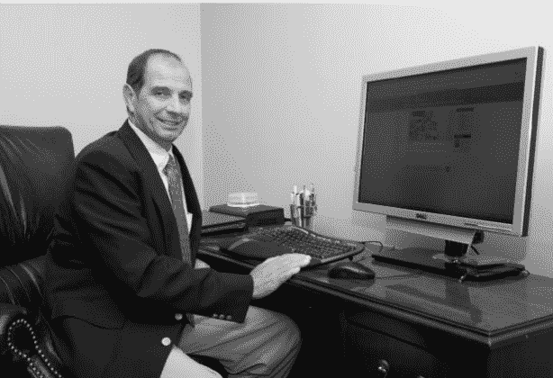

让整个技术开发过程对任何感兴趣的公众成员保持透明。他任务中最艰巨的部分是处理海量需要细致审查的代码，以及数据和架构安全问题上惊人的复杂性。

Alec 一直热于帮助海外选民。他曾是一名职业海军陆战队队员，亲身体验了在不断奔波时投票有多困难。通常他的选票没有被计入，尽管在任何特定的选举中，他可能不知道自己的票是否被计入。

尽管他现在拥有弗吉尼亚大学的计算机科学博士学位，并担任南阿拉巴马大学计算机与信息学院的教授和院长（在美国），但 Alec 出身平民进入计算领域。他在阿拉拉契亚农村长大，就读于当地的一所学院，主修数学，并学习了寥寥几门课程：COBOL 和 Fortran。他非常高兴我们现在不再依赖打孔卡了。多一次移动就会损坏它们，并可能完全毁掉几天的工作。

在结婚并加入海军陆战队后，他立即被认定为具有计算机工作技能。在 20 世纪 70 年代后期，接受过计算机科学正式训练的人并不多，对海军陆战队来说方便的是，Alec 在那里。20 年来，他在许多系统中获得了日益丰富的经验。他将自己脱颖而出的能力很大归功于他最长的导师、博士导师以及现任朋友 Bill Wolf 博士。“他是一个真实的人，”在困难时期一直支持他，并经常为 Alec 出额外努力，邀请他去家里，并在周日举办研讨会，只为了让 Alec 参加。

Alec 不仅仅是一个拥有特殊技能的计算机科学家，还有一个美的家庭生活。他把大部分空闲时间与家人在一起，在他们的河上船上钓鱼。然而，对海外投票的热情从未离开他的脑海；他曾提议在一个周日的下午在船上接听关于这个项目的电话。

## 3.11 Okaloosa 投票项目的设计与架构

所有关键数据和过程都受到严格控制。远程投票自助机站设立在英国、德国和日本三个国家美国空军基地附近的酒店内（图 3.4）。经过专门培训的选举工作人员被飞往那里管理这些站台。在每家酒店，都有两台笔记本电脑：一个投票终端和一个身份验证终端（图 3.5）。这些终端通过 VPN 加密连接到西班牙的一台离线服务器（图中的“共享中央数据中心”）。笔记本电脑之间没有直接连接。西班牙的中央服务器位于一个安全数据中心。该设施提供了稳固的物理和电子安全：服务器房受到持续视频监控，只有带有生物识别安全通过卡的授权人员才能访问。数据中心拥有许多电信服务的高带宽连接。数据中心内部的网络基础设施由多级防火墙、过滤通信端口和其他通信安全措施组成，以保护投票系统不受恶意流量的渗透。此外，所有到中央服务器的外部连接通过带有 SSL/TLS（安全套接层/传输层安全）的 VPN 运行，提供了额外的黑客攻击保护。

身份验证终端运行 Windows 操作系统，由经过培训的选举工作人员用于验证选民的身份。身份验证通过连接到位于佛罗里达州奥卡卢萨县服务器上的 Oracle 数据库来实现，该数据库

包含了所有合规选民的记录（图中的“全州选民注册系统”）。选民出示其或所需的身份，并由选民注册系统进行比对。如果允许投票，选举工作人员会给选民一张带有其加密身份代码的自定义智能卡。该智能卡还包含与该选民相关的自定义选票样式 ID。然后，选民走向一个私密的自助机，那里有一台运行 Linux 系统的投票终端笔记本电脑。

选民插入智能卡，发生了几件事。自定义的选票信息通过分配的个性化 ID 被更改，系统检索了正确的候选人和选票措施选择。这些选择显示在网页上。

在选民结束会话之前，他们在笔记本电脑上显示了一个摘要屏幕。系统创建了一份硬件打印件，选民将其与摘要屏幕进行对比。如果打印件和摘要屏幕匹配且选民对信息满意，她就会按下“投票”按钮，他们的选票被加密并应用了数字签名。电子选票存储在中央服务器中。

投票期间。如果笔记本电脑被盗，对小偷来说它们毫无用处。Linux 投票终端每天早上从 CD 启动并重置，由经过培训的人员加载 Scylt 软件。软件直接从这些 CD 上实时运行，这些 CD 在每天晚上移除并安全存储。Windows 认证机到 Okaloosa 县数据服务器的连接每天都会重新检查和验证。在夜晚，这些机器本质上是电子骨架，没有任何连接。尽管这种硬件剥离和从 CD 运行初看可能像是在技术上的倒退，但 Pnyx 系统的复杂性证明了投票站运行安全的投票系统并不需要复杂的硬件。所有的复杂性都远离了投票的酒店房间，集中在可以进行管理的数据中心。

Pnyx 使用的语言和应用程序需要快速且高效，因此使用 C++ 编写，以实现该语言擅长的低级系统功能。Web 界面和其他面向公众的代码使用 Java 编写，原因有两个：第一，Java API 提供了强大的图形能力，使得创建易用界面的这一重要任务变得简单得多；其次，Java 代码具有高度的可移植性。展望未来，当技术不可避免地发生变化时，这种投票系统有望简单地实现。

佛罗里达州州部认证了 Scylt 系统，包含每件硬件和软件细节的文档可供公众阅读（见附录）。

根据 Scylt 代表的说法，他们将公开特性（用于数字签名的 RSA、已知哈希函数如 SHA-1 以及用于加密的 DES）与专利架构和应用层协议独特结合，使得该试点成功。

## 3.1 人为和技术措施的成功成果

93名海外投票者通过 Okaloosa 项目参加了2008 年总统选举。从技术角度来看，一切进展顺利；一位在海外住了15年的投票者不得不说：“在该计划之前，我总是通过邮寄投票。这是我唯一的途径。我不总是对此感到高兴，因为如果互联网投票可以在任何个人电脑上进行，对投票者来说将是最有用且最方便的。投票者可以在任何时间、任何地点投票。如果投票者经常旅行或时间有限，从任何地方安全可靠地投票的能力至关重要。”

## Kiosk 如何与本地系统集成？

- 现有本地系统
- Kiosk 系统组件
- LEO = 本地选举办公室

PC 将是理想的。在这里，你可以看到系统运行的高层原理。VRDB 指投票者注册数据库；认证终端；LEO – 本地选举办公室是投票者所在的所在地。“PKI”是“公密钥基础设施”的缩写。这是带有数字签名权限的软件，运行在中央服务器上，与其他电子投票管理系统 (EMS)一起。

当然，互联网安全将继续是一个主要挑战。投票者的 PC，尤其是个人电脑，在防受攻击保护的良好程度方面是一个未知数。这不是一个新问题，如果用户将来要从家里投票，就必须解决这个问题。

另一方面，人们越来越期待能够通过互联网开展业务，因此在线投票系统的增量式发展并不令人意外。问题的某些部分已经得到了很好的理解，正如 `Operation BRAVO` 试点所示的那样。在任何地方创建一个安全的 `kiosk` 环境是可能的，因为正如我们看到的，关键数据处理运行在中央服务器上。

## 计算与社会：为了善而计算

投票者认证是一个已经在传统投票场所进行的过程。开发 `EMS` 的某些挑战与州分布式和灵活的性质有关。我们在本章开头提到过这一点，但值得重申：投票系统的运行没有一个每个州和县都会同意的“唯一方式”。这种差异是每个州都有其特定的当地条件（人口、地理位置等）需要适应的原因。

在更技术层面上，数据格式的标准化是一个挑战性问题，尽管它并非投票所有。事实上，你将在全书中看到这个问题。随着社会快速进入数据化海量时代，专利系统往往难以提取并与其他数据合并。全球有几家 `EMS` 供应商拥有良好的“客户”。从一个系统提取数据到另一个系统或升级系统版本都是昂贵的。为什么从一个系统提取数据到另一个或升级 `EMS` 软件对投票很重要？作为一名计算机科学家，你有工具来思考并解决这个问题。当科学与公共政策相互作用时，总会有棘手的问题。计算特别复杂，因为这个领域非常新，技术变化非常快。当对一个争议性问题达成共识时，可能已经没有意义了。互联网投票的技术问题本身很复杂，但通常归结在本章前面讨论的一个问题：风险评估，以及为了实现宪法保障的社会权利可以忍受多大程度风险？在某些情况下，根深蒂固的观点决定了互联网是否能成为海外或其他投票者的接受媒介。支持者认为，互联网投票变成现实只是时间问题，而且该主题是一个道德问题，我们必须解决海外投票问题。然而，你必须自己决定。

## OPERATION BRAVO 基金

`Operation BRAVO` 基金 (`www.operationBRAVO.org`) 虽然最初成立于 2007 年是为了监督 `Okaloosa` 投票项目，但它有一个更大的愿景。董事会热衷于解决剥夺投票权的海外投票者问题。他们希望让海外的美国人更容易投票，无论他们身在何处都能方便投票。这包括军事人员、各种外交和其他政府人员以及公民。他们认为非营利基金是促进规模和容易验证技术解决方案的最有效方式。基金相信计算技术可以解决这些潜在投票者面临的各种挑战。用他们的话说：

> “具体而言，`Operation BRAVO` 基金认为，纸质选票程序的实用且可复制的电子方案可以显著改善海外缺席投票。”

该机构完全由志愿者运营。尽管如此，他们在短时间内完成了一切。

几个新项目正在筹备中。首先，该基金收到了资助资金，研究如何改善伤残退伍军人和现役人员的投票。这些人员通常在美国但不在家里。他们可能位于当地管辖区（他们合法注册投票的地区）之外的医院或其他机构。他们需要缺席投票，但面临额外的挑战：这些人中有些人可能患有创伤后应激障碍 (`PTSD`)、脑损伤或身体残疾。当无障碍问题增加到地理问题时，缺席投票面临着额外的挑战。

# 致谢

- `Alec Yasinsac` 博士——南阿拉巴马大学计算机与信息科学院长、教授

- `Carol Paquette`——`Operation BRAVO` 董事会成员

- `Operation BRAVO` 董事会

- `Gerard Cervello`——西班牙巴塞罗 `Scytl` 安全电子投票公司咨询总监

- `Eunjin Jung`——旧金山大学计算机科学系助理教授

- 分享其经验的美国武装力量若干成员。

# 练习与活动

- 1. 数据隐私并不是计算领域的一个新技术挑战，但它对于民主国家的投票行为而言具有特殊意义。结合你对计算机科学概念的理解并作为证据，你认为保护选民数据隐私和完整性最有前景的方法是哪些？

- 2. 假设存在本章中美国国防部所定义的“全面互联网投票”。你是否看到了该系统中需要保护的最易脆弱的点？

- 3. 针对上一个问题中识别出的每个脆弱点，确定保护数据隐私和完整性的策略。

- 4. 个人的需求与期望与该组织认为的义务和规则之间往往存在冲突。以互联网投票为例，哪些是潜在的冲突领域？列出双方的观点（选民；负责投票完整性的群体）。

- 5. 对于是否应该推行全面互联网投票，你的个人立场是什么？请结合技术和非技术信息在内充分地辩护你的立场。

- 6. 小组活动：你的教师将根据互联网投票的实施情况，随机将你分配到“支持”或“反对”团队。

    a. 每个团队应从计算机科学家的角度研究他们的立场。

    b. 在教师的引导下举行一场辩论。邀请外部见证人参加辩论，请他们就以下方面对每个团队的有效性发表评论：

    - 你们论点的逻辑性

    - 对你们立场的技术支持

    - 你们支持论点的有效性

    - 你们立场的组织与展示

# 第三章：海外公民的互联网投票

- 7. `SERVE` 项目在充分实施之前由于某些计算机科学家的担忧而停止了。即使是一些在网络和安全方面拥有技术专长的计算机科学家对互联网投票的价值也未达成一致。请解释你个人认为 `SERVE` 是否应该被允许继续。充分地辩护你的立场。

- 8. 除了网络和安全，如果你想从事互联网投票或涉及跨互联网高度敏感数据的类似项目，哪些计算课程将是有用的？为什么？

- 9. 除了上一个问题中确定的课程外，还有哪些计算课程是有用的？（提示：思考一下影响这些项目的社会和政治力量）。

- 10. 如果一个互联网投票系统以某种方式失败了，谁来负责？

- 11. 以下每门计算机科学课程与互联网投票有何关联？（如果你认为它们没有关联，请辩护你的观点）。

    - 数据库

    - 算法

    - 自动机理论

    - 计算机体系

    - 分布式计算

    - 数据结构

    - 操作系统

    - 人工智能

    - 软件工程

    - 用户界面设计

- 12. 深入调查其中一个已经在使用互联网投票的地点（国内或国际）。该地点比本章列出的更多。报告你所选择的地点是如何实施互联网投票的，谁在使用，以及它为什么成功了或没有成功。

- 13. 在探索互联网投票时，采取自上而下（政府主导）的方法与自下而上（区域性）的方法相比，其技术优势是什么？

- 14. 如果你来自美国以外的国家，互联网投票本身在你的国家是如何体现的？在你的回答中包括：它是如何被使用的（或不使用），该问题是如何被感知，以及你对你国家互联网投票未来可行性的看法。这个问题需要你进行外部调查，例如对家人和朋友进行调查，并对你国家的新闻或其他出版物进行基础的探索性研究。

- 15. 互联网投票的伦理和道德问题有哪些？列出它们。

- 16. 目前对互联网投票数据安全和选民隐私最主要的的技术威胁是什么？也就是说，黑客和其他目前正在使用哪些工具和技术可能用于操纵互联网投票？这是一个不断发展的话题，因此你将不得不进行调查。

- 17. 针对你在上一个问题中列出的威胁，最有效的威胁缓解策略是什么？（提示：查看 `SERVE` 报告获取灵感）。

- 18. “`Mixer`（混合器）”是一个行业术语，指执行第 4.11 节描述的执行随机化和分离的服务器和/应用程序。混合器广泛用于许多安全系统中，在这些系统中，某处共同收集的数据会被分离。它们的潜在缺陷之一是，尽管它们分离了数据（在这种情况下是将选民与其投票分离），但它们没有验证选民与选票之间的 1:1 关系。这种功能方面的安全影响是什么？（也就是说，可能会出现什么问题？）

- 19. 洋葱路由（`Onion Routing`）是网络上的一种混合器技术实现，因为人和选票沿路径是分离的，而不是在起点或终点。然而，洋葱路由目前无法防止黑客看到数据何时被发送或接收。这种防止他人看到数据正在传输的挑战是互联网数据安全中最困难的挑战之一。请从三个角度解决这个问题：技术、理论、实际操作。（也就是说，每一者对解决这个问题有什么看法？）

- 20. 投票软件可以用许多编程语言开发。然而，每种语言都有优缺点。选择三种语言并列出它们的优缺点（例如 `Java`、`C++`、`Python`）。

- 21. 在章节结束时，我们介绍了缺乏标准的问题，并说这是互联网投票的一项重大技术挑战。你们解决了吗？解释专有格式的供应商带来了什么问题。

# 第三章：海外公民的互联网投票

## 附录

- `Scytlt` 的白皮书：`http://scytlt.com/eng.`

- `Operation BRAVO` 网站：`http://www.operationBRAVO.org/`

- 佛罗里达州选举：`http://election.dos.fl.us/`

- `FVAP`——联邦协助计划：`http://www.fvap.gov/`

- 美国国防部投票评估报告（2001年6月）

- `HAVA`——帮助美国投票法（2002年）：`http://www.fec.gov/hava/`

- `UOCAVA` 法（1986年）：统一人和海外公民法：`http://www.fvap.gov/resources/uocava.pdf`

- `UOCAVA` 调查（2007年）：`ocaava-report-4-printing.pdf`

- `NIST`——美国标准与技术研究院：`http://www.nist.gov/index.html`

- `NIST` 报告：`http://www.vote.nist/uocava-threatanalysis-final.pdf`

- `EAC`——选举委员会：`http://www.eac.gov/index.` 正在评估 `UOCAVA` 投票的现有和未来程序及建议。

- `EAC` 报告：`http://www.eac.gov/News/docs/uocava-report-4-printing.pdf`

关于两个实施的国际互联网投票系统的信息：

- 爱尼亚：国防部：扩大 `UOCAVA` 公民电子投票（2007年5月）`http://www.fvap.gov/resources/media/ivas207.pdf` p28-29

- 加泰罗尼亚：`http://scytlt.com/docs/pub/science/Report_on_the_Elections_to_the_Parliament_of_Catalonian_evoting_pilot.pdf`

114

计算机与社会：科技向善

# 反对意见文件

新闻文章

- `http://www.tampabayay.com/opinion/editorials/article917344.ece`

- `http://www.verifiedvoting.org/article.php?id=5867`

技术报告与信函

- 针对 2007 年5 月国防部关于 `UOCAVA` 公民投票技术报告的回复（2007年6月）`http://www.seversecurityreport.org/`

- “对 2007 年5 月国防部关于 `UOCAVA` 公民投票技术报告的评论”`http://www.servescurityreport.org/`

`SERVE_Jr_v5.3.pdf`

# 参考文献

《美国英语遗产词典》（第4版）。（2000）。纽约：`Houghton Mifflin`，第483页。

# 第章

## 社交网络与计算机建模助力海龟

## 4.0 引言

本章介绍了世界上最古的海龟保护组织如何利用在线通信媒体与其利益相关者接触，扩大其活动范围并增加其整体公众影响力。除了拥有几个精心设计的网站外，他们还战略性地实施了 `Facebook` 页面、博客、`YouTube` 视频和 `Twitter`，以覆盖从儿童、政府官员到普通公众在内的多元化受。他们不仅了解自己的媒体，还以用坚实的研究数据支持其演示陈述而闻名。因此，本章还讨论了如何使用计算模型将包含许多“未知因素”的复杂信息以非常易于解释的视觉格式呈现出来。在人员和资源有限的情况下，该组织正在利用技术建立一个活跃的支持者社区，并提高他们为海龟事业所做工作的效率。

本章具有一些独特特征。例如，社交网络并不总是被视为提高“底线”的工具。特别是计算机科学学科，有时会忽视社交网络对于专业计算机科学家的相关性。本章的案例介绍说明了这种错误认知是多么错误的。与任何技术一样，社交网络媒体可以用得好，也可以用得坏。无论如何，一种将各种社交媒体整合并与组织的环保目标相结合的综合战略，被证明是极其强大的。

通过计算机科学技能，你可以理解如何利用这些媒体。也许最明显且最重要的技能是理解用户界面（`UI`）设计。在线界面根据你所有效的媒体受众而不同。一种尺寸并不适用于所有。除了 `UI` 课程外，图形和多媒体课程也有帮助，这样你就能触手可及最新的工具——并知道如何正确地使用它们。

如果你尚未精通社交网络工具，你就需要变得精通。作为博客、`Facebook`（等）的活跃且敏锐的用户，你 116

计算机与社会：科技向善

可以观察每种媒体的细微差别，并研究为什么为什么“起作用”或不起作用。通过积极贡献（即发布），你将学习到当人们在线参与对话时会发生什么。某些媒体在某些情况下可能并不合适，你应该知道为什么。如果你对便携式计算设备感兴趣，这也会很有帮助，因为越来越多的人期望从所谓的“非传统”硬件访问在线资源。

值得注意的是，如果你在营利性组织工作，熟练地使用社交媒体正迅速成为一项让营销、销售、培训和其他领域的技术人员脱颖而出的技能。如果你感兴趣如何在不投入大量资金的情况下最大限度地利用技术，如果你对为环保事业或非营利组织工作感兴趣，本章提供了你作为计算机科学家如何从事这一职业的见解。机会是巨大的，因为社交媒体如果使用得当，可以吸引受众。

# 轶事

2004年9月6日，`Merygo` 是一只成熟的红龟，她离开巴拿时，壳上系着一个无害的定位发射器。虽然按海龟的标准来说很小（红龟仅长到约 30 英寸 [88 厘米]，重量最大 165 磅 [75公斤]），但 `Merygo` 在海滩的一个巢中产了大约 130 个蛋，在筑巢季节中持续了五个晚上。任务完成后，她前往加勒比海，在远处珊瑚礁的觅食场休息几年。不幸的是，`Merygo` 从未到达她的珊瑚礁。她在仅仅两周后被人类捕获并吃掉。尽管国际禁止出售海壳及其制制品，但她那绚丽斑斓的彩色壳可能被卖掉了。

像 `Kawana` 这样的棱龟体型巨大（高达 1,200 磅/544 公斤），速度快，力量大，潜水深度像鲸鱼一样（超过 3,000 英尺/1,100 米），而且它们喜欢吃水母。不幸的是，它们的体型可能成为它们的致命伤，就像 `Kawana` 发生的情况一样。她在2005年7月岸边准备筑巢时，被渔民的刺网困住，并困在水下直到淹死。尽管国际上有巨大的压力要求修改商业渔具以防止139 误捕海龟，但每年仍有数千只海龟被捕并死亡。对于最大的海龟来说，这个问题尤为严重，因为“龟回避装置”有大龟无法通过的逃生口。其他类型的渔具完全没有逃生机制。棱龟和所有海龟一样，处于国际濒危物种名单上，面临着真正的灭绝危险。

## 4.1 有限的资源与看似无穷无尽的任务

普通大众和许多政策制定者都不理解海龟对全球生态系统和健康经济有多重要。普通大众和许多政策制定者都不理解海龟对全球生态系统和健康经济有多重要。在某些情况下，这种知识缺失是因为这种横跨极地到热带的动物具有惊人的复杂性，并且会经常消失几年（图4.1）。另一方面，现代技术让我们更好地理解它们在维持社会平衡方面的作用。计算机辅助帮助科学家将复杂信息转化为![](img/bfadd7b5e7f3b8ac394b5e5.png）118 非技术受众理解的形式。图4.1 海滩上的海龟。（版权所有 `Turtle Conservancy`，2011。`www.conserveturtles.org`）

 4.2 收集和消化数据的挑战

海龟数量减少的一些后果是广为人知的。海龟的独特之处在于它们在维持海洋和海滩生态系统的平衡中起着作用。每隔几年，所有种类的雌龟都会爬上陆地产下卵。它们将蛋埋在沙中孵化几周。蛋孵出微小的幼龟，它们挖掘而出并成群涌向海洋。图4.2 显示了一只刚从巢中爬出的长约 3 英寸的幼棱龟。即使没有人类出现（偷窃海龟、捕获海龟、使海滩无法进入或

## 第四章：社交网络与计算机模型助力海龟保护 119

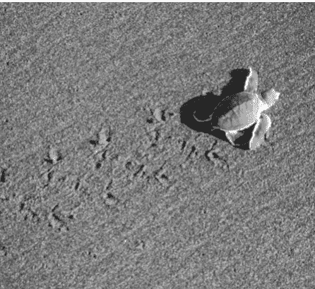

图 4.2 浮龟幼体正向海洋冲刺。（版权所有：海龟保护协会，2011。`www.conserveturtles.org`）

在危险的环境中，有些蛋不会孵化，而有些蛋会被自然捕食者发现并破开。这些被破坏的蛋将养分扩散到通常缺乏养分的海滩沙丘中，帮助各种植物和草类的生长。科学论文研究了这些营养交换，并证实了它们在维持健康海滩生态系统中的益益作用。海龟曾成千上万地同时出现在数百个海滩，但现在在世界上任何地方都不再是如此。在不再支持其曾经生物多样性的海滩上可以看到这种影响。

另一方面，在许多其他地区，获取关于海龟及其对环境和经济影响的事实数据非常复杂。这些数据必须具有足够的说服力，才能赢得公众、政府和政策制定者的信任。同样复杂的目标是，将这些数据呈现为有用信息，以影响对实施和执行海龟保护措施的态度。

海龟在过去的 100 年里数量下降如此剧烈，以至于没有一个基准可以评估“健康”种群或其对维持“健康”物种的影响。目前也无法通过控制实验来明确证明海龟的流失对环境最终对人类生活造成了什么影响。然而，有一些有趣的线索暗示了可能出现的问题。例如，像 `Kawana` 这样的浮龟主要捕食水母，这控制了水母种群的数量。渔民传传了一些轶事，提到在某些海域，海龟曾非常丰富，但现在却罕见踪影。水母种群数量激增，干扰了他们寻找和捕获维持生存所需鱼类的能力。另一个例子涉及几种在热带珊瑚礁上进食生物的海龟，它们维持着这些生物种群的平衡。当海绵的生长被棱龟 `Meryg` 抑制时，海绵会不受控制地繁殖，并有效导致珊瑚窒息。由于连锁效应，珊瑚礁的流失还会影响渔业、旅游业以及其他与珊瑚礁健康直接或间接相关的行业。科学界有大量的推测，认为海龟的消失加剧了全球变暖导致的水温升高问题，并加速了这些栖着数十种动植物的珊瑚礁死亡。

所有海龟物种都面临着严重的灭绝危险。危机四伏。有些海龟因其肉或汤而受到珍视；有些因其美丽的外壳（龟壳珠宝）而曾风靡一时，直到国际条约取缔了合法（而非非法）贸易；有些则被视为催情药而受觊。其他海龟受到污水和农业径流污染的影响而病变；有些因摄入塑料等污染物（它们看起来像美味的水母）以及混合了食用动植物的原油而死。成千上万的海龟作为现代商业捕鱼方式的兼捕猎物而死亡。

这些死亡意味着什么？除了审美问题外，还有一个非常实实的答案：海龟是海洋物种中的“矿井里的金丝雀”，或者更正式地称为“关键物种”。海龟处于复杂海洋食物链的顶端，它们的死亡对许多其他动植物甚至对某些陆地环境产生了破坏性的连锁反应。如何毫无疑问地“证明”这些后果？你做不到。海龟保护组织（`ST`）面临的一个持续性挑战是收集并有效传播科学数据。

## 4.3 计算机辅助建模支持知情决策

ST 的科学顾问 Milani Chaloupka 使用一种名为贝叶斯网络（BBN）的模型来处理海龟数据。如果你上过概率论或人工智能课程，可能遇到过贝叶斯网络。贝叶斯网络利用条件概率来显示不同因素之间的关系。条件概率是描述具有缺失或推测性数据的复杂情景的理想选择——正如海龟管理一样。

## 第四章：社交网络与计算机模型助力海龟保护

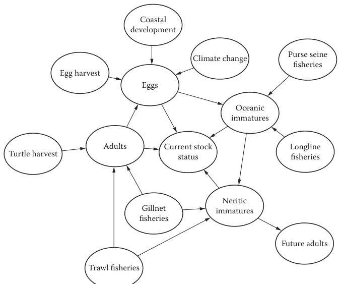

图 4.3 绿龟与渔业危害。（版权所有：M. Chaloupka，2007）

数据整合自多个来源，包括模拟实验、出版材料、利益相关者和专家意见。

首先，构建一个网络图来显示某个特定兴趣主题的数据子集之间的已知关系（图 4.3）。在这个示例中，Chaloupka 展示了渔业相关危害与绿龟种群之间的关系。你可以从图中看到，成年绿龟受到海龟捕捞、拖网渔业和刺网渔业的影响。成年绿龟数量减少会影响蛋的数量和当前的种群状态。这些关系已知是真实的。接下来，Chaloupka 详细列出了概率数据，显示了在给定不同危害组合下对目标项目（如成年绿龟的丰度）的影响（图 4.4）。从表格中可以看出，计算结果（未显示）表明，在无海龟捕捞、无拖网渔业和无刺网渔业的最佳情况下，成年绿龟数量高度丰的概率为 95%。如果发生了海龟捕捞和刺网捕鱼，但没有拖网渔业，则成年绿龟数量丰富的概率仅为 15%。

## 计算机与社会：向善计算

| | 父节点 | | | | |
|---|---|---|---|---|---|
| 海龟捕捞 | 拖网渔业 | 刺网渔业 | 低 | 高 |
| 1 | 无 | 无 | 0.050 | 0.950 |
| 2 | 无 | 是 | 0.500 | 0.500 |
| 3 | 是 | 无 | 0.250 | 0.750 |
| 4 | 无 | 是 | 0.750 | 0.250 |
| 5 | 是 | 无 | 0.500 | 0.500 |
| 6 | 是 | 无 | 0.850 | 0.150 |
| 7 | 是 | 无 | 0.800 | 0.200 |
| 8 | 是 | 是 | 0.970 | 0.030 |

图 4.4 基于不同危害的绿龟丰度概率。（版权所有：M. Chaloupka，2007）

贝叶斯网络基于严谨的数学理论和应用，因此这些“简单”的图表和表格更容易受到重视。此类网络图和相关表格在缺乏“证明”的情况下，为关注领域提供易于消化的焦点非常有用。我们示例中的数据可能被政府官员用于制定多种管理策略，例如在决定季节性关闭日期的同时，尽可能增加渔民的作业时间。其他 BBN 模型已经或可以用于检查海龟捕捞（即故意捕获）、沿海开发（例如在筑巢海滩附近建造人工结构）、盗猎，以及评估河流和污水排放口进入海洋污染物的影响。能够快速生成和操作这些模型的软件在消除人为错误和测试不同方案方面起着重要作用。Milani Chaloupka 使用的一些软件包括 `R`（Unix 用户对这种常用的统计软件非常熟悉）和 `HUGIN EXPERT`（一种商业决策支持系统）。

还有其他评估模型，其中许多基于计算。DNA 评估是新兴领域——计算生物学的一部分。DNA 评估是一种种群评估的遗传方法。新的算法不断开发以满足分析需求。由于海龟迁移性极强、难以追踪、每年繁殖并在生命某些阶段会相互混合，DNA 分析和遗传模型有助于建立从家族谱系到详尽种群结构的遗传关系。为了增加趣味性，某些类型的海龟在水面上进食，另一些在海底，而且除了一个例外（夏威夷的绿龟）外，只有雌性海龟会离开海洋。

## 第四章：社交网络与计算机模型助力海龟保护

已经孵化。这使得评估种群数量变得更加困难；海龟通常在死亡后才会被看到——这并不是评估海龟种群任何方面情况的科学方法。

此外，还有生态系统模型、聚合模拟以及其他的贝叶斯分析。根据 Chaloupka 的说法，所有这些模型都在试图解决“数据问题”，即缺乏关于海龟生存许多方面的数据。由 Chaloupka 参与的一份国家研究委员会（National Research Council）报告说明了评估目的如下：

评估模型用于评估种群状态相对于恢复目标的进展，比较不同人类活动和自然压力源对种群的相对影响，并确定导致海龟死亡的人类活动是否阻碍了恢复或增加了灭绝风险。（NRC 2010, p. 31——参见附录中的参考文献）

显然，对于对环境和生物学感兴趣的计算机科学家来说，这是一项极其巨大的工作。

## 4.4 通过卫星追踪海龟以了解它们的行为

不可避免的是，对于谁应该对是否以及如何限制捕捞海龟等决策负责，将会产生分歧。海龟“不属于”任何人。它们不尊重国际边界，并会根据本能迁移模式定期跨越数千英里的海洋。尽可能地了解海龟去哪里以及做什么至关重要，这样海龟保护协会（STC）才能加强其产生全球意识的努力，并在海龟受到负面影响时要求政府和工业界对其行为负责。

（至少对某些人来说）想象与海龟一起游泳并跟随它迁徙是有趣的。遗憾的是，这并不实际。因此，STC 在海龟的背壳上利用卫星追踪发射器标签。这些标签是专门为海龟设计的，且无害的（图 4.5）。发射器内置了 ID 代码，并将数据传输到由 Argos 卫星系统维护的轨道卫星（有关发射器标签和 Argos 公司的链接请参见附录）。当三到四颗卫星接收到来自一个发射器的数据，就可以确定海龟的纬度和经度。除了 ID 和位置，许多发射器还收集潜水剖面、温度、表面时间和其它传感器数据。

## 计算机与社会：行善计算

**图 4.5** 带有发射器的红角龟。（版权所有海龟保护协会，2011。www.conserveturtles.org）

数据随后被转发到地面站，由站内人员进行解码。STC 的员工每天收到来自 Argos 地面站的邮件，其中包含了他们部署的所有发射器的数据。

来自卫星发射器的数据也用于基础研究，以提高对海龟及其生存威胁的意识。数据的重要教育用途在 STC 每年的“海龟之旅”（Tour de Turtle）计划中得到了体现。追踪海龟从产卵海滩移动到觅食场成为 STC 最受欢迎的公众活动之一（图 4.6）。当我们研究 STC 的网络业务时，我们将更详细地讨论这一活动。

## 4.5 传播信息

提高意识既是一个技术问题，也是一个社会问题。一旦 STC 以科学方法识别出易于理解的辩护性信息（例如由 BBN 模型生成的），就面临更大的挑战——将这些信息传递给适当的受众。STC 需要告知许多受众关于海龟保护的重要性，包括教育工作者、大众、政府和工业界官员以及儿童。传统上，STC（像许多其他非营利组织一样）依赖于几种推广和筹资金的方法。这些包括直接邮寄募集、分发传单和手册、在公共活动中演讲，以及亲自游说可能产生影响的各——特别是那些持中立态度的人。

## 第四章：社交网络与计算机模型助力海龟保护

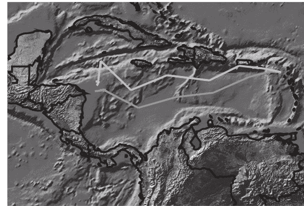

**图 4.6（见彩色插页）红角龟的迁移路径。（版权所有海龟保护协会，2011。www.conserveturtles.org)**

这些活动是非常耗费人力的。必须有人负责创建并通过邮政服务处理邮件的地址和分发。然后，由于传统直邮的回复率远低于 10%，必须有人进行直接的个人诉求跟进。成为 STC 成员的人会收到一份纸质简报。STC 的员工会参加从当地艺术节到政治会议的各种活动——在这些场合可以获得许可向观众演讲。必须有人寻找并跟踪所有潜在的聚会，参加它们并反复阐述自己的观点。圣诞期间，不断需要给公众、政客和其他官员打电话——必须额外雇佣人手来接听电话。STC 的技术与研究专家 Daniel Evans 评论说，过去在圣诞节，办公室里的每个人都可能被征调去接电话。他们需要每一个可用的人力，因为运营资金的大部分来自年底的税前捐赠。STC 的运作处于一个真正的“丰收或歉收”环境中，高度依赖海洋的喜忧、志愿者的可用性以及与当地和国际利益相关者的物理接触。

有时，STC 的某人会想出绝妙的营销主意。灵感迸发的最佳例子是海龟车牌。这是 STC 执行董事 David Godfrey 的主意，他花了两年时间游说在佛罗里达州的车牌收藏中增加一块官方海龟车牌，驾驶员可以支付额外费用来获得。

## 计算机与社会：行善计算

最终他成功了，该车牌在 1996 年向公众开放。目前它是佛罗里达州销量第二高的“个性化”车牌，其收入为研究和保护工作提供了大量的持续资金。该车牌还极大地提高了 STC 的知名度和信誉。州外居民可以直接从 STC 网站购买装饰性车牌，这产生了额外的收入。

困境始终在于：下一步是什么？任何组织，无论是非营利还是营利，都不能依靠根据需要出现的绝妙主意。提高意识、推广、研究、教育和倡导必须持续（听起来熟悉吗？这是 STC 使命宣言的一部分）。必须实施某种可靠且持续的方法，并考虑到像海龟保护协会这样的组织面临的资源限制。

## 4.6 社交网络技术改变“常态”

大多数计算机专业的学生不知道，互联网起源于 20 世纪 60 年代的互联开发。标准化出现在 80 年代初，紧随其后的是互联网服务提供商的出现，随后这种曾经的政府和学术通信媒介商业化并向公众开放只是时间问题。早期的小组讨论平台（如公告板和 Usenet）逐渐演变为日益图形化的通信手段。（你知道电子邮件自 60 年代中期就存在了吗？）最终，万维网（Web）诞生了。最近的进展导致了所谓的 Web 2.0，包含了通常被归类为“社交媒体”或“社交网络”的应用。基于 Web 的通信，特别是社交网络，使海龟保护协会能够彻底改变其业务模式，并直面面对一些最困难的挑战。

Daniel Evans 在承担其他任务外，还负责 STC 的计算机系统和应用程序。他致力于有效利用计算机来辅助研究、公众教育、社区推广、通用网络和倡导。这是一项艰巨的工作。然而，每当一项新的互联网技术出现时，Daniel 都会将其整合到海龟保护中。他将每个新的计算机应用程序集成到 STC 现有的在线应用程序中，使它们能够非常有针对性地相互引导。孤立地讨论每个应用程序是困难的，但我们将观察 STC（海龟保护协会）对这些工具使用的演变，以及它们如何帮助他们“传播信息”。

## 4.7 开发有效的网页是首位

### 4.7.1 海龟保护协会的主要页面

STC 在线实施的第一项工作就是网站。他们的网站于 1996 年上线，不出意外，那是丹尼尔·埃文斯（Daniel Evans）加入该机构的一年。让任何访问互联网的人看到对 STC 及其使命的介绍，是一次巨大的飞跃。

在 STC 主站（www.conservturtles.org；图 4.7）找一台电脑。你的直觉反应是什么？做下心理记录或书面笔记——我们稍后会回来。但首先，让我们从用户界面和图形设计的角度来看顶层页面。即屏幕“版空间”。这是一个图形设计师使用的术语，他们

图 4.7（见彩色插图）海龟保护协会主网页。（版权所有 海龟保护协会，2011.www.conservturtles.org）

## 计算机与社会：科技向善

将网页看作就像画家手中的调色板。人们在调色板上安排物品的方式可能会导致你的（数字）艺术作品吸引观众，或者让他们离开去他人的网页。幸运的是，有几条适用于网站设计（顺便说，也适用于摄影）的基本经验法则。这些经验法则基于关于人类对什么内容感兴趣或无聊的认知和神经学证据。

第一条经验法则：屏幕上的东西必须抓住观众的注意力。

第二条经验法则：页面应该防止观众“掉进边缘”。这意味着观众的视线应该被含蓄地包含在计算机屏幕内，这样你就可以应用：

第三条经验法则：屏幕应该让观众的眼睛在页面上游走，遵循某种有趣的路径，而不要显得太明显。

如果你遵循这三条经验法则，你就离创建一个成功的（即引人入胜的）页面又近了一步。注意，我们没有提到颜色、字体或任何此类内容。

回到你对页面的第一个直觉反应，同时观察并记住。页面被组织成有组织的图形和文本部分。顶部附近有一个中心图形（在实时版本中会旋转），以吸引观众的注意力。屏幕边缘有许多尺寸平衡的图形，充当边框。观众在视觉上很难“掉出”屏幕。如果你发现自己正在看屏幕的不同部分，并且反复回到这些部分好几次？你应该知道为什么。如果你不知道，也许你真的看过了实时网站，或者你严重睡眠不足。诚然，你可能是少数极少数不符合上述认知/神经学模型的人群之一。这并没什么问题。但在你得出这个结论之前，请集结坚实的证据，说明为什么你从坚实的用户界面角度来看并不觉得该页面有趣。

在掌握了基本布局后，我们进入了颜色、字体、图形，甚至更微妙的设计问题。这些项目没有这样的“规则”。如果有，每个页面看起来都会一模一样，而且默认情况下是无聊的！然而，对于典型人类在认知上如何运作，我们可以说明几点，并看看它们在 STC 页面上的适用程度。这些与其说是需要记住的规则，不如说是可以为了不同的效果而刻意实施或忽略它们。

首先，人类一次只能跟踪有限数量的事物。你可能清楚这一点；你越疲劳或压力越大，你能跟踪的东西就越少。“七”在这方面已变成了一个魔数——人类的大脑可以

## 第四章：社交网络与计算机建模海龟

### 表 4.1 深水地平号油溢事故前后 STC 网站流量

| 期间 | 访问人数 | 超过 30 分钟会话 | 页面浏览次数 | 访问网站的国家 |
| --- | --- | --- | --- | --- |
| 2010年1月至4月 | 73,000 | 98,000 | 331,000 | 167+ |
| 2010年5月至12月 | 124,143 | 暂无 | 690,000 | 205 |

来源：版权所有 海龟保护协会。www.conserveturtles.org, 2021.

在开始在心理上“丢失”东西之前，可以很容易区分七件事（加二减二——谁说人都是一样的？）“七”可以应用于高层，如不同的区域，也可以应用于低层，如不同的行项目、颜色或七种模式等。这正是专家级用户界面设计师部分根据经验、部分根据用户测试、部分凭直觉进行工作的地方。

STC 是如何实现其主页的用户界面的？例如，如果你用批判性的眼光看，你会注意到有大量的颜色，但印象主要是蓝色和白色的。在这个页面上，并持续在从 STC 页面链接的所有其他页面上，他们通过对颜色、标志、主题、组织和语调的意识使用，建立了一个平衡的呈现。边框内部是文本：词汇、短语和句子经过分类，使得不同的用户有许多选择查看每个子区域。屏幕上几乎什么都没有，包括每个图形。

## 第四章：社交网络与计算机建模助力海龟保护

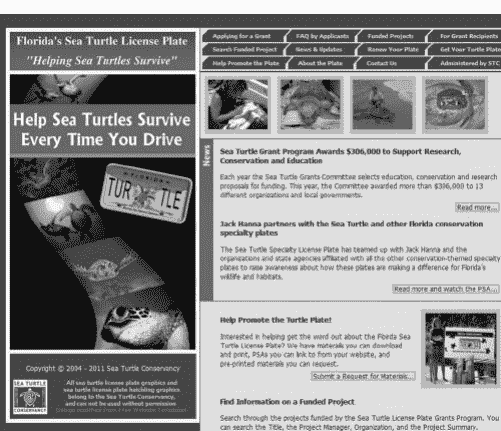

图 4.10（见彩色插图）帮助海龟网页。（海龟保护协会，2011）。www.conserveturtles.org

人类活动对佛罗里达海龟筑巢地的影响（资助项目 06-011E）。这张 DVD 上的信息基于易于消化的格式呈现的可靠数据。该 DVD 与之前讨论的 BBN 建模目标一致：让非技术利益相关者能够做出明智的决策。

另一个有趣的、技术驱动的资助项目，很大程度上是为了响应对海上钻探的呼声，以及这些地点产生的噪音对红海龟迁徙可能造成的未知影响。（注意，该资助是在 2010 年深水地平溢油事故之前授予并实施的。）人们对太平洋海军测试的声学效应也提出了类似的担忧，因此对油井声学效应的研究具有潜在收益。海龟如何导航尚未完全明确，但有强力迹象表明它们依赖于磁场和其他人类通常无法检测的感官线索。在这个项目中（资助项目 06-021R），海龟佩戴了对外壳无害的声学记录标签，以及卫星追踪和 GPS 设备。从海龟身上收集移动数据使用 `MATLAB®` 进行分析，以更好地了解海龟遇到了什么，以及它们是如何做出反应的。计算机科学的专业知识对于这类需要准确且易于解释的仿真和模型的项目非常有帮助。

## 计算机与社会：计算向善

2010 年获得的一项资助正在对一个新的卫星跟踪系统进行基准测试，该系统可以取代标准的 ARGOS 发送器（资助项目 10-026R）。该实验系统被视为“绿色”技术，因为它将使用太阳能 GPS 标签。科学家在建议摘要中指出，如果成功，这种跟踪海龟的方法不仅具有成本效益，还能提供关于海洋迁徙、筑巢和觅食活动的更深、更广的信息。此外，由于需要深入理解 GPS 系统的工作原理，嵌入式系统编程可能是这个持续项目的重要部分。

## 4.8 为什么 STC 网站非常成功

显然，网站的使用已被证明对 STC 极其有效。正如我们刚刚讨论的，每个页面都经过精心设计以完成几项任务：提供面向目标受众或受众的重点，为该受众提供详细的教育和通用意识信息，并鼓励观众参与保护海龟事业。此外，每个网站都以某种方式与其他所有 STC 网站连接，确保观众可以轻松从组织的活动的一个区域移动到另一个区域。每个页面的设计平衡了一致性和创造力，经过仔细规划的视觉移动，并融入了相关的视频、图片和互动活动。

那么，海龟保护协会最终是如何拥有如此成功的网络存在的？Daniel Evans 与 STC 的营销与通信协调员合作设计网站。他们遵循良好的设计流程和界面设计规范。简单来说，他们采取了自上而下的方法，从不忘记网站的目标和预期结果的焦点。换句话说：我们想为 STC 实现什么，我们又如何知道自己已经实现了？

在创建第一个 STC 网站时，由于大多数人早期对复杂网站设计的尝试还很初浅，在技术上创建了一个“非常基础”的网站，但上面有**大量**信息。这种过度拥挤的屏幕空间与他们讨论大局时关于外观和细节程度的想法整合在一起：即网站的树形结构会是什么样的，以及如何让整个网站具有导航性。一致性的决策渗透到单个页面的底层细节中，使每个页面都成为基本主题，同时具有多样性和趣味性。这一过程一直持续到另外两个网站上线，并在今天随着新内容和工具的出现而持续。Daniel 和 STC 营销/通信协调员继续分析和评估他们的网站。他们认为，与他们所做的其他帮助海龟的活动一样，这是一个不断进行中的工作。

## 4.9 现场的博客

“blog”一词是“web log”（网络日志）的缩写，但已经没有人使用那个术语了。在博客的早期，看到该词被写为“blog”以表示这个缩写短语很常见。一些早期的“博客”面临的问题是，它们仅仅是无聊人的论坛，用来聊脑子里出现的什么就聊什么——本质上是供全世界阅读的私人日记。正如你预期的那样，由于互联网上没有东西会永远消失（你可以删除它，但并不意味着它仍然在许多地方存档，以供创意或偶然的搜索发现），博主们经历过尴尬的时刻。

然而，当使用得当时，博客可以为博主吸引大量的粉丝。在营销和公共关系领域，众所周知，博客是社区建设的绝佳工具。事实上，许多关于如何有效推销你自己或你的组织的研讨会强烈建议，博客是首要创建的东西——甚至可能在网站之前。

博客允许发布者写出引发思考、信息丰富且具有启发性的思想，并要求世界与她以及彼此之间进行对话。一个有效的博主会定期发布博客并回复观众的评论。如果博主特别出色，他们的博客将病毒式传播，并被新闻服务和其他在线作家采纳，随后这些人将为他们完成大部分传达信息和参与社区的工作。

博客被大众受众认为不仅具有参与性，而且是某个领域的权威，这是一种去身份标识的营销。海龟保护协会创建的博客名为“实地笔记”（Notes from the field），人们可以关注它。许多帖子是关于他们正在的工作以及正在被追踪的海龟。许多帖子是关于他们正在做的努力以及面临的挑战。博客向公众提供信息并让社区参与海龟保护的一种方式。

当 2010 年 4 月 20 日深水地平溢油事故发生时，STC 的博客暂时沉默，因为整个组织都投入其中。由于与佛罗里达州机构、联邦机构（以及小组）的良好关系以及参与政策讨论的声誉，当 STC 请求帮助时，他们得到了肯定的答复。他们获知了灾难应对的许多方面。

当博客在 6 月 27 日再次发布时，他们开始定期发布帖子，通常为一两种类型。大多数帖子是关于受溢油影响的海龟的详细统计数据：

# 第四章：社交网络与海龟计算机建模

这表明观众对海龟保护协会（STC）产生了联系感和社区感。

使用博客（以及我们稍后将讨论的 Facebook）报道油油泄漏事件，让 STC 更加强烈地意识到使用社交媒体是多么有效。这次经历促使他们决定大力利用这些平台来报告他们的其他活动，包括他们建立的合作、研究助理（RAs）的专业工作，以及当前实习生的工作内容。

他们的许多研究助理和实习生在托尔图盖罗（Tortuguero）度过一段时间后，已经建立了自己的组织。与 STC 的观众分享这些信息不仅具有参与性，而且是极好的公共关系。

对于任何个人或团体来说，创建一个成功的互动博客都是一项挑战。STC 与其他小型或资源有限的组织一样，需要吸引观众，这需要详细且定期发布。同时，跟上这些发布也是一项挑战。优先级排序至关重要，这一点在博客于 4 月 20 日陷入沉默并在溢泄漏发生后的几个月内保持沉默时表现得尤为明显。

然而，他们他们付出是有回报的：更多人订阅了 STC 的时事，而随后成为成员的人一直是该组织的坚实支持者。问题仍然存在：如何让更多阅读时事的人成为成员。

## 4.10 YouTube！

在创建了前两个网站后，海龟保护协会的工作人员也加入了，并利用了 YouTube 的爆发性增长。YouTube 席卷全球是因为它太容易使用了，即使是由于缺乏非技术背景的用户也能查看视频，并且只需少许学习就能上传视频。在上线后一年内，YouTube 占用的带宽超过了整个互联网，根据最新报告，它仍持续保持着这种情况。

YouTube 可以被称为最早的几个真正的“社交网络网站”之一，因为人们可以（并且确实）发布他们想象到的任何视频，然后告诉朋友去观看。这些朋友（以及其他人）可以（并留下）评论，随之产生对话。

YouTube 的易用性和开放访问让像 STC 这样的团体能够利用其广泛的覆盖范围以及用户在软件标记的视频之间游走的倾向。STC 发布了他们在筑巢季节期间在托尔图盖罗海滩工作的视频——这是一场令人惊叹的活动，即使从远处观看也是如此。

托尔图盖罗研究人员和实习生工作的视频旨在将他们的范围扩大到另一个群体：潜在的未来海龟研究人员。STC 还上传了与他们的教育努力相关的动画，并尝试了其他类型的视频。在深水地平线石油泄漏事件后，国家野生动物基金会更新了一个视频，显示 STC 将海龟巢转移到肯尼迪太空中心的救援设施。（某些链接请见附录。）

正如 STC 发现的那样，YouTube 带来了一些他们在实施网站时遇到过的挑战。特别是由于 YouTube 上的内容非常多，很难引导观众进入特定的 YouTube 网站，然后将他们拉回 STC 网站。换句话之，YouTube 上的干扰因素太多了。

对于一个需要保留自身内容的组织来说，这种移动性构成了真正的挑战。作为回应，STC 将 YouTube 用于某些无法直接在其网站上发布或发布视频的特定活动。正如博客一样，他们仍在研究利用 YouTube 的最佳方法。

但可能错误地暗示了 YouTube 在海龟保护方面没有帮助，事实并非如此。有数百万观众观看视频，有时某个特定视频会“病毒式传播”，这意味着其观看量呈指数级增长。

在一个特别重要且有影响力的事件中，STC 利用一个意想不到的机会让一个视频病毒式传播并顺势为。2007 年，一名访问巴哈马的游客使用手机手机记录了一段海龟被残忍杀死的真实视频。该视频被发布到了 YouTube 上。

STC 看到视频后发起了一场抗议的媒体活动。他们集结当地且有效的在线推广工具来传播有关该视频的消息，随后呼吁公众请愿巴哈马政府禁止捕捞海龟。由此产生的负面影响是巨大的，巴哈马政府可能预见到了一场公共关系和旅游业噩梦，因为他们听取了建议。

海龟捕变为非法，禁令得到了执行。如果没有使用多个社交网络应用程序以及发现机会并立即知道如何利用机会的能力，这次活动的深远影响绝不会发生（图 4.11）。

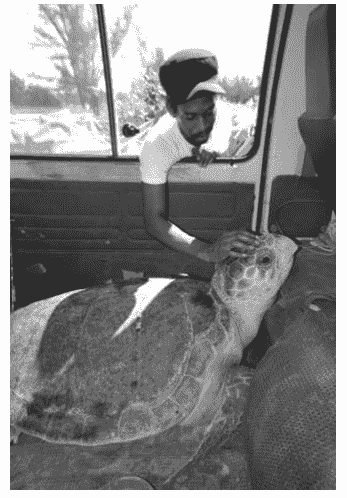

图 4.11 在巴哈马获救的红龟。（版权所有海龟保护协会，2011。`www.conserveturtles.org`）

## 在巴哈马全力以赴禁止捕捞海龟

由海龟保护协会执行主任 David Godfrey 讲述。

> “那是 2007 年，我们收到了视频和照片，显示在巴哈马一个开放码头上的杀害海龟的情况。我们一直知道合法捕捞的存在，但这些记录给了我们向政府施压的动力。我们取得结果的方法之一是通过一个名为 Care2 的社会活动家网站上的在线请愿。该请愿立即跃成为 Care2 上最受欢迎的内容之一，我不记得确切的签名人数，但它大大超过了我们的目标。如果你现在去看我们的旧请愿书，你会发现来自巴哈马的公告，他们已经禁止了捕捞海龟。这是该网站的链接：`http://www.care2.com/share/detail/1233976`
>
> ## 计算与社会：向善计算
>
> 请愿书和 STC 定期的 Care2 网站由 STC 的通讯经理 Rocio Johnson 维护。你可以在这里查看我们目前的发布内容：`http://www.care2.com/group/ConserveTurtles`
>
> 有一个家伙发布了与我们类似的请愿书，他已经发布了。如果你查看它是如何运作的，你可以浏览个人请愿签名和评论，该网站拥有数百万成员。
>
> 在使用该网站捕获请愿书并关注消息后，我们还在时事报中刊登了相关报道，时事报发送给全球约 5,000 名海龟活动人士，并在上面发布了更新。我们还与巴哈马的几个当地团体合作，他们与当地官员会并向巴哈马施加压力。其中一位名叫 Sam Dumbcomb 的女性，她领导着一个名为 ReEarth 的小组。她与环境部长会了几几次，并在政府权衡方案时保持该问题处于核心位置。我们当然直接给巴哈马的官员写信，敦促他们为了保护海洋资源实施禁令。STC 的卫星追踪研究显示，巴哈马海域许多海龟实际上在佛罗里达的海滩孵化并筑巢。这一事实也引起了数千佛罗里达海龟活动人士的高度兴趣，他们也向巴哈马官员表达了自己的观点。”

## 谁能忽视 Facebook？

阅读本章的人可能都熟悉 Facebook。只需简单讨论它的起源和功能，就能理解 STC 目前如何使用它。

Facebook 的著名故事始于 2003 年的大学宿舍，是一个不快乐的哈佛学生为了复制失去的女朋友而发起的项目，而现在该应用程序允许几乎任何拥有浏览器的人在各种世界中与他们的“朋友”互动。

对于不熟悉的读者来说，Facebook 似乎可能仅仅是一个拖延时间的玩具，而且可能许多人都是这样使用它的。事实上，Facebook 所代表的大众传播力量充满了开发机遇。

## 第四章：社交网络与计算机建模助力海龟

对于希望研究 Facebook 并将其作为 STC 公关计划一部分的组织来说，Facebook 的潜力不仅仅在于随机聊天。Facebook 像 YouTube 一样，扩展了全球影响力，如果使用得当，可以以最少的人力产生巨大的影响。

STC 遵循其之前的模型，即研究如何将 Facebook 整合到其整体社交媒体规划中并开始尝试。2009 年，他们创建了几种类型的 Facebook 页面。

他们最初的计划是让 Facebook 页面发挥产生总额的功能，回归到早期的（互联网时代之前的）直接筹款模式。他们创建了两个站点。

一个是“点赞”（Like）页面（以前被称为“粉丝”页面）。STC 的点赞页面具有 Facebook 用户熟悉的常规功能，包括一个公开可写的“留言板”、带有其他 STC 网站链接的信息板块、照片和活动列表，并提到请求 `RSVP`（回复是否参加）。

使用 `RSVP` 是一种培养受众忠诚感和执行力的知名方法，而 Facebook 让实施 `RSVP` 变得非常简单。STC 很快发现，与其他社交网络工具相比，Facebook 作为意识工具的效果比作为直接筹款工具更有效。

正如我们在讨论 STC 博客时提到的，事实证明 Facebook 在传播深水地平线溢油事件以及他们参与海龟救援行动的消息方面是一项强大的工具。点赞页面像博客一样发布有关其他 STC 活动的信息。该页面有大量的流量，STC 的员工积极地发布并回复这些信息（表 4.3）。

第二个 STC Facebook 页面位于“事业应用”（Causes Application）部分。该页面的流量较小，成员也较少，对于（你可以在这里找到：`http://www.causes.com/causes/49577`）可能困难。

一个意外的发现是，为了建立事业页面，他们必须建立一个全新的账户。他们无法使用其他 Facebook 账户、转移名称，或以任何方式将两个账户联系起来。

与 YouTube 一样，STC 正在考虑更好地利用此页的方法。目前，该页面通过点赞页面的帖子进行更新。也许事业页面将被用作最初打算的筹款工具，或者作为具有不同侧重点或目标受众的另一种意识产生工具。也许它将被用于某些完全不同的事情。

## 表 4.3 STC Facebook 点赞页面示例流量

| 时间范围 | 帖子浏览量 | 帖子反馈 | 日活跃用户 | 月活跃用户 | 点赞数 |
|---|---:|---:|---:|---:|---:|
| 2010 年 7 月至 2011 年 4 月 | 139,528 | 1,218 | 从 7 增加到 681 | 从 66 增加到 1,529；增长 19% | 1,954（2011 年 4 月 11 日）；增长 4.8% |

比多账户要求更惊讶的发现是，如果一个人与某个组织没有关联，他们也可以为组织建立 Facebook 页面！这种情况发生过一次，有人创建了一个以他们名字命名的页面，推测是有意图，但 STC 无法访问或控制其内容。

这种情况变得很有问题，他们不得不向 Facebook 请求解决这一问题。使用 Facebook 的另一个相关挑战是内容会被定期监控，有时决定是删除还是忽略某个可疑的帖子是很棘手的。

例如，另一个小组会在 STC 网站页面上发布信息，引导读者访问他们的网站。STC 与任何小组一样，都希望页面的焦点落在自己的组织上。观点是：删除帖子的后果是什么？

## 4.12 Twitter——进行中的工作

Twitter 是较新的社交网络媒体之一，它的变化之快，以至于关于其功能的任何陈述在报纸印刷之前可能就已经过时了。

它最初是一个“微博客”应用程序，由年长较大的用户（即非高中或大学年龄段）使用，通过快速的简短笔记保持彼此信息更新（每条消息限制 140 个字符），后来爆发为数百万精通技术的用户的选择，用来分享关于……任何事情的笔记。

尽管有很多关于人们用自我中心的、无意义且无关的垃圾信息（如“我现在正躺在地下室的沙发上”）占用带宽的负面报道，也有许多严肃的 Twitter 用户。

Twitter 正在课堂中作为学生快速响应和简答测试的工具进行测试。它用于发布新闻稿，以及专业和业余记者对政治事件、自然灾害和其他“事件”的快速报道。它还用于调查问卷的分发和收集作为法律程序中的证据。

Twitter 变得无处不在，以至于海龟保护组织（Sea Turtle Conservancy）在 2009 年开始测试它来回答“海龟之旅”（Turtles Tour）粉丝的问题（`twitter@conservurtles`）。

最初的想法是，一个专门的 STC “推特”可以为兴奋或焦虑想了解心仪海龟状况的粉丝提供几乎实时的信息。然而，事实证明这项任务易行难，因为涌入的推文量几乎需要全天候关注。

这种流量无疑是“之旅”受欢迎的标志；只要有人能发推文，计划就能运作良好。但最终很明显，在“之旅”期间，并不总是有人能投入这么多时间发推文。有太多的事情要处理。

策略发生了变化。目前，STC 主要使用 Twitter 发布针对始终在线受众的简短新闻稿。推特用户就是这类受众，因为他们随身携带移动设备。因此，接触这一人群最快的方法是他们可以在多任务处理时阅读的简洁信息。

当 STC 评估这一策略时，一些专家已经声称 Twitter 已经到头，其他社交网络工具和应用程序将取代它。无疑，Daniel Evans 和 STC 将继续关注这些趋势。

## 4.13 社交网络对海龟保护事业的整体影响

你可能注意到，正如海龟保护组织逐渐意识到的，随着社交媒体的使用，他们的业务模式正在发生变化。他们的使命没有改变，基础教育、外展和研究保持基本不变。

但通过将许多劳动密集型活动转向新技术，他们正将主要活动转向提高意识而非直接募集。正如他们发现的，通过社交媒体进行的意识宣传可以产生意想不到且高效的结果。

STC 的另一项本章未涉及的胜利是，由于他们扩大了与当地社区的经济和社会伙伴关系，生态旅游显著增加。放弃捕捞海龟的当地经济通常能够通过生态旅游收入来替代并增加他们的经济机会。

这种现象需要几个关键要素的共同作用：计算机科学技能（特别是用户界面设计）、跨学科兴趣（无论是公共关系、海龟生物学还是在线通信）以及适应并顺应不断变化的意愿。

STC 也没有预料到社交工作会在多大程度上极大增强他们开展外展和提高意识的能力。过去，通过参加活动和物理接触个人及群体，他们触及的人数有严格的限制。

一个人做的事情是有限的，在活动之间奔波的时间有限，每天能打的电话有限，能写和寄出的信也有限。现在，虽然员工仍然参与其中一些活动，但他们已经扩大了范围，深入了以前完全无法触及的社区和群体。他们以高度多样化定制的格式向数百万人传递他们的信息。

## 计算机与社会：科技向善

全球各地的利益相关者。得益于计算技术，许多工作可以在完全离开佛罗里达州办公室的情况下完成。

这并不意味着 STC 的员工不再四外奔波——事实并非如此。然而，现在他们能够将更多的精力集中在前往最关键的地方，无论是在墨西哥湾，前往他们正努力拯救的濒危栖息地，还是访问美国或海外他们希望建立合作关系的政府或公民机构，或是参加那些亲临现场最为有效的活动。

意识的提高在其他方面也证明了其益。众所周知，熟悉程度会增加兴趣和参与度。STC 现有好几个邮件列表，其中超过半数的人并不是成员。然而，他们是潜在的成员，根据统计概率，他们中的许多人最终将成为成员。

STC 的成员会收到《Velador》通讯。这些人已经通过其他成员捐赠了资金。然而，一旦他们开始收到通讯，就有 8–15% 的人会进行额外捐赠。

STC 有证据表明，通过电子邮件、博客回复、Facebook 帖子和网站统计数据，他们的受众群体大幅扩大，显示材料下载量增加、电子通讯订阅请求增加，当然还有捐赠数量的增加。

十年前，根据丹尼尔·埃文斯（Daniel Evans）的，典型的成员是中年女性。现在他们看到了所有群体，包括许多年轻人。男女比例接近相等。

当 2009 年经济衰退袭击美国时，新成员数量减少。这是几乎所有慈善和非营利组织都能看到的现象，并且对其中许多组织来说是一个严峻的困境。

然而，由于 STC 通过活跃的社区建设建立了忠诚度，在经济衰退期间，续费和捐赠反而增加了。人们挺身而出，表达对海龟保护使命和 STC 工作的支持。

“海龟大巡游”（The Tour de Turtles）恰好在美国陷入经济混乱之时开始。尽管时机如此，但这项巡游赛从一开始就是一个巨大的收入来源，因为人们和组织领养了海龟，或者以海龟的名义进行捐赠。这些都是社交网络发挥最佳作用的经典案例。

## 4.14 接下来做什么？挑战与新计划

正如早期的预测计算机的出现将导致无纸化社会，而实际上计算机的使用产生的纸张比以往任何时候都多一样，STC 仍然面临着如何与有限的人员工作的挑战。

社交网络技术具有巨大的全球影响力，但也伴随着一些成本。有人必须跟进网页设计更新、博客发布、在线新闻稿、推特、YouTube、播客和视频发布。员工必须跟上最新的计算技术；当你读到这段文字时，几乎肯定会有某些新的热门社交网络应用。

佛罗里达办公室大约有六名常驻员工，哥斯达黎加办公室有一名，华盛顿特区有一名。决定如何使用计算技术以及如何平衡投入其中的人员时间，是一场永无止境的探索。

海龟保护协会（The Turtle Conservancy）已经制定或正在开发相关计划，如何更有效地利用社交网络。通过与另一个组织合作，他们刚刚开始开发一个专门针对高中学生的群体。

这一年龄段的许多对社区服务感兴趣，并且正变得精通技术。该计划被称为 `AdvKids`（`www.iseurtle.org`）。AdvKids 将由孩子们运营，并为他们提供分享想法和参与志愿者倡导活动的机会。

从长远来看，让加入的孩子维护网站内容，会让他们考虑与海龟保护和计算相关的职业。他们将看到计算技术如何成为一项令人兴奋且有意义的事业的核心。在太晚之前，他们他们在选择大学专业时可能会坚持他们的科学和数学课程，并考虑跨学科职业。

创建 AdvKids 并让这些年较大的孩子参与的另一个原因是：他们将为目前通过教育资源和在线海龟活动（`http://converturtles.org/turtletides.php`）接触的儿童，与通过 Facebook 和 YouTube 等应用程序接触的青少年之间搭建桥梁。

STC 增加了针对 K-12 受众（约 5-18 岁）的演讲，最初重点关注 K-8（约 5-13 岁）。他们在佛罗里达州和其他其他州进行当地演讲。

他们经常使用 Skype 进行这些演讲，因为有了这项技术，他们无需旅行就能接触到遥远的观众。这些教育演讲不仅引起了儿童的兴趣，也引起了传统媒体的关注，导致向该组织的推荐人数增加。

这个项目和 AdvKids 一样刚刚起步，他们正在努力扩大其影响力。

STC 还计划专注于其早期目标之一，即增加居住在濒危海龟产卵地海滩的人的积极参与。他们希望加大努力解决佛罗里达州快速消失的屏障岛海滩问题，大西洋 80% 的海龟在此产卵。他们目前正在处理长线渔具的破坏性使用，

这每年在佛罗里达海岸及等地杀死成千万只海龟。佛罗里达是大西洋海龟种群的主要产卵地，在经过二十年的艰难努力后，由于长线钓鱼，海龟数量再次严重下降。增加对商业利益者的拓展和倡导被认为是至关重要的，因为他们代表了建筑、休闲、旅游和渔业利益。寻找一种利用社交网络有效接触这些利益相关者并引导他们进入互利共赢对话的方法是 STC 正在讨论的话题。最后，STC 将努力更好地维持兴趣。参与的机会有很多，特别是在哥斯达黎加的尔图古盖哈罗（Tortuguero）的活动。媒体方面，还有内容组织的问题。STC 希望在每个媒体网站上显示哪些主要项目？这些是 STC 正在讨论的问题。他们知道保持专注并继续传递海龟保护的核心信息的重要性。

## 4.15 致谢

- David Godfrey，执行主管，Sea Turtle Conservancy，佛罗里达州
- Daniel Evans，技术与研究专家，Sea Turtle Conservancy，佛罗里达州
- Milani Chaloupaque，生态建模服务，昆士大学
- Peter Despasquale，计算机科学副教授，新泽西学院计算机科学系，新泽西州

## 4.16 练习与活动

1. 从视觉设计和用户界面角度观察 Tour de Turtles 页面。这些页面的哪些方面有效？
2. 从视觉设计和用户界面角度观察 Tour de Turtles 页面。这些页面的哪些方面无效？你会如何改进？
3. 作为计算机科学家，你可以向 Sea Turtle Conservancy 提出什么建议，以利用 YouTube 帮助海龟保护运动？
4. 作为计算机科学家，你可以向 Sea Turtle Conservancy 提出什么建议，考虑到观众非常容易在程序内“离开”并去往其他地方？
5. 在“Turtle Tides”页面下，有三个用 Java 编写的游戏。尝试每一个游戏。选择一个你喜欢的类型，然后使用 Java 创建一个相同类型的游戏，使用一组不同的图片（滑动益智）、单词（单词搜索游戏）或卡片（养成游戏）。作为主题并收集内容，请选择一个在线的非营利组织。在提交项目时，务必包含原始网站的链接！
6. 在第 5 题描述的相同页面下，选择其中一个游戏并尝试用 Java 以外的语言重写。描述你从这次经历中对 Java 和你的语言学到了哪些技术知识。
7. 小组项目/作业第一部分：像专业软件工程师一样工作，开发一套需求和

## 计算机与社会：科技向善

从初中或高中学生处获得的规格，概述了建立一个成功的“儿童网站”所需的各项条件。

8. 小组项目/作业第二部分：使用你在作业第一部分中编写的需求（Reqs）与规格（Specs）文档，为你的儿童网站创建基于 UML 的用例。
9. 小组项目/作业第三部分：开发非功能性原型或模型（mock-ups），并从你收集儿童网站需求的同一批学生处获取反馈。
10. 小组项目/作业第四部分：安排一个符合你学期进度（季度或学期）的开发项目。根据你拥有的时间，至少完整实现一个网站项目部分。做好一个部分比粗劣地完成几个部分要好！确保对你的网站进行调试，并让一些用户进行测试。
11. 小组项目/作业——可以是第五部分或一项独立作业：对于 STC（学生技术中心）如何利用社交网络工具（任何一种）来吸引并让初中高中观众参与儿童网站，你可以提供哪些建议？
12. 很有可能，甚至可以说是必然，在本章编写时，已经出现了一些新的社交网络技术。如果是这样，一位希望在物质资源限制下最大化利用该技术的计算机科学家，可以向 STC 提供哪些具体的建议？
13. 男性人口中有百分之十在某种程度上存在色盲。这意味着我们讨论的大多数设计准则和其他设计相关的理念并不能以相同的方式适用。如果你的班上有任何人患有色盲，并愿意分享他们对网站的观察，请大家一起进行讨论。
14. 世界上存在大量有身体或认知障碍的人群。选择其中一种进行研究，然后就 CCC（计算机咨询中心）关于他们对某一（自选）社交媒体应用的使用，讨论并记录观察结果和建设性建议。
15. 找到另一个非营利组织（由你选择）的网页，并从图形设计/用户界面的角度对其进行评估。你学校有哪些课程可以帮助你准备作为计算机科学家在环保组织中工作？确保你使用了计算机科学（CS）课程！
16. 环顾四周，寻找一些活跃和不活跃（就观众参与度而言）的博客。提示：有一个与计算机科学教育相关的非常活跃的博客。分析什么样的模式让博客更成功或更不“成功”。这里有一个限制：避免代表极端观点（即煽动性的）的博客，因为那无法为大多数组织（无论是非营利组织还是其他）提供有帮助的数据。

## 第四章：社交网络与计算机建模海龟

17. 项目：全球范围内存在海龟问题，因为所有七种海龟都处于严重濒危状态。仅生活在澳大利亚周围的平背龟（flatback sea turtle）是最不为人知的物种之一。调查平背龟生存的关键问题，包括但不限于它们的栖息地和主要危害，以及主要的利益相关者是谁（找出至少三位利益相关者）。写一份关于平背龟现状的报告。确保回答以下问题：
    - a. 我们知道了什么，又还了解了什么？
    - b. 哪些是经验之谈，哪些是有数据支持的？
    - c. 然后包含至少三条建议，说明什么类型的数据收集和建模对你确定的利益相关者是有用的，以便他们在与平背龟接触的领域做出明智决策。
18. 对你选择的一种濒危物种进行文献检索，并找出计算机科学（例如数据模型等）如何被用于学习/或辅助该物种（例如数据收集、信息传播等，如本章中对海龟所描述的那样）。
19. 从博客或 Facebook 网站中删除内容会有意料之外的后果。如果你删除得太频繁，可能会引起粉丝群的反感。另一方面，如果你处于 STC 的立场，并允许无关或适得其反的信息留在你的网站上，请设想并决定你将如何处理以下类型的帖文：
    - a. 另一个海龟倡议小组在你的网站上发布了他们网站的链接。你认识这个小组，并且与他们有良好但不亲密的关系。
    - b. 另一个濒危物种（非海龟）的保护小组在你的网站上发布了他们网站的链接。
    - c. 有人在你的网站上发表了一篇礼貌的帖子，认为应该允许贫困的土住民群体为了生计而捕猎海龟。
    - d. 有人在你的网站上发了一篇帖子，抱怨你没有对古巴的海龟给予足够的关注。（古巴有海龟吗？你可能需要对古巴和 STC 进行一些研究来回答这个问题。）

## 附录

### 链接

海龟保护（Sea Turtle Conservancy）主页：

http://www.conserveturtles.org/

海龟之旅（Tour de Turtles）主页：

http://www.tourdeturtles.org/

帮助海龟（Helping Sea Turtles）主页：

http://www.helpingseaturtles.org/

海龟保护组织主博客：

http://www.conserveturtles.org/seaturtleblog/

YouTube 对 David Godfrey 的采访，关于他们在深水地号油溢事故后重新安置海龟巢的工作：

http://www.youtube.com/watch?v=vNmgdMp75WI

推广 2008 年海龟之旅的 YouTube 视频（刻意幽默且具有启发性）

http://www.youtube.com/watch?v=PHhAwFGs-ZQ

海龟 SIRTRACK 平台发射器终端

http://www.sirtrack.com/downloads/ppt_sea_turtle.pdf

Lay, Kevin. "通过卫星跟踪野生动物", Sirtrack, Inc.

http://www.sirtrack.com/downloads/argos.pdf

Argos, Inc. 全球跟踪与环境监测

http://www.argos-system.org/

### 书籍与文章

Chaloupka, Milani. (2007). "使用贝叶斯网络评估渔具风险"。发表于东南亚评估海龟死亡 SEAFDEC-FAO 研讨会。2007年3月19-23日，泰国曼谷。

国家研究委员会海龟评估委员会。(2010). "海龟现状与趋势：整合人口与数量"。可下载地址：http://nap.edu/catalog/12889.html

Carr, Archie. (1956). 《风之路》（Windward Road）。佛罗里达州大学出版社。这本书被认为是海龟保护界的经典之作。它将自传与自然史相结合，读起来非常有趣。

## 第五章：儿童护理中的最佳实践建议

## 5.0 引言

这是关于医学领域计算机科学的书中的第二个案例章节。然而，这次的故事和计算活动大不相同。本章关于一个国家级机构与一群医生之间的新合作，该机构通过计算机项目支持儿童医院，而医生们想要分析特定患者群体的数据。医生拥有内容知识，而机构拥有计算机专业知识。这些小组协作得非常紧密。有趣的是，团队中有人具有跨学科的计算机-医学背景。开发该系统面临许多技术挑战。保护高度敏感数据是架构设计的关键关注点。该项目具有应用研究导向。

# 计算机与社会：科技科技向善

这一切的最终目的是为了进行应用研究和分析。要从事实施此类项目的职业，所需的计算机科学技能包括架构、数据库设计和数据安全。用户界面设计原则也会有所帮助，此外对大型软件工程项目的通用经验也同样重要。

对于这类项目，对医学和生物学的兴趣将至关重要。一些化学和人类生物学的课程（任何有的）将有所帮助。对于书中描述的许多项目，协作性的团队工作是至关重要的。如果你对自然科学的应用研究感兴趣，或者想为医疗保健改革倡议做出贡献，医疗计算是一个非常值得考虑的领域。你将处于许多领域的前沿，从系统设计到制定数据管理的国际标准。有营利和非营利企业都会雇佣人员在这些领域工作。在大型医院工作也是一种选择。无论你去哪里，你都有机会看到你的工作在国家层面产生的影响。

## 案例

三家示例医院（在此被称为“小型社区”医院、“区域性”医院和“大城市儿童”医院）设有新生儿重监护病室（NICU），即专门治疗新生儿的部门。小型社区医院每年接收一到两个患有称为膈膜疝的罕见疾病的出生儿。全国范围内患有此疾病的婴儿死亡率很高。在小型社区医院，可能有一到几名医生（新生儿科医生）在治疗膈膜疝方面的经验有限。区域性医院平均每年遇到 2 到 3 名患有膈膜疝的儿童，员工通常有 2 到 10 名新生儿科医生。与小型社区医院的新生科医生一样，这些医生在治疗这种疾病方面缺乏经验。大城市儿童医院每年看到 10 到 30 名患有膈膜疝的婴儿。他们配备了 6 到 30 名新生儿科医生以及儿科外科专家，在处理这种疾病方面拥有丰富经验，因为许多危重婴儿被转入到他们的 NICU 接受这种及其他罕见疾病的治疗。他们可以提供

各种特殊疗法和药物来治疗这种疾病。

# 第五章：儿童医疗护理的最佳实践建议

膈肌是呼吸至关重要的肌肉，将胸腔和腹部隔开。膈膜疝婴儿患有一种出生缺陷，即膈肌肌肉上有一个孔。腹腔内容物（如肠道、胃或肝脏）可能会进入胸腔，并防止肺部正常生长。在过去的一个时期，通常做法是在修复膈肌上的孔洞（有时使用补片）并将腹部器官移回原位后立即进行手术。医学知识的进步表明，由于膈膜疝婴儿中常见的并发症，立即手术并不总是最佳实践。例如，肺部发育问题和肺部血压升高在该类人群中很常见，这可能导致受影响的婴儿需要接受一种名为 ECMO（体外膜肺氧合）的程序，该程序通过颈部插管将血液泵出体，在机器中进行气体交换，同时绕过婴儿的心脏和肺部。ECMO 具有很强的侵入性，对身体有创伤，并可能导致严重的并发症。膈肌的手术修复也是创伤性的，这使得决定执行何种程序变得更加困难。如果婴儿肺部塌陷或发生肺部血压剧增，本就危生命的状况会变得更糟。另一方面，由于膈肌未修复而导致的肠道错位可能会干扰其他关键身体功能。

因此，儿科外科医生倾向于在婴儿接受 ECMO 时进行膈膜疝修复，一些人倾向于在婴儿脱离 ECMO 后立即进行手术，另一些人则倾向于在脱离后等待一段时间，希望肺部变得更强。没有标准答案，因为有许多变量影响短期和长期结果。每种手术方案都有其风险和收益。医生和新生儿科医生在决定何时手术时依靠培训和个人经验。即使在大城市儿童医院这样的医院内部，不同的医生也可能偏好不同的手术时。医生希望提高护理质量并增加获得最积极结果的机会。为了实现这一结果，他们需要关于哪些实践有可能长期成功的信息，不仅针对膈膜疝，还针对其他罕见和不常见的情况。医生们想要但尚未拥有的是关于针对特定场景和背景下最佳实践的科学依据信息。

## 5.1 儿科实践建议需要数据

由于几个原因，严重疾病患者特殊亚群中的最佳实践并不完全为人所知。首先，尽管这些许多疾病在新生儿人群中正变得越来越常见，但它们分布在许多机构中，因此对于任何一家医院或任何一个新生儿科医生来说，通常是相对罕见的。其次，有许多组织正在收集和计算机化数据以供分析，但数据量以及现有术语和代码集的多样性往往令人难以应付。这导致组织选择一个重点领域或限制收集的数据类型。第三，计算机科学家和医学信息人员刚刚开始合力，创建用于数据收集和分析的实用库。数据库技术以及存储和检索大型数据集的方法已比几年前有了许多进步。

在医生的诊室或医院环境中，数据已经被收集了。例如，美国和其他发达国家的几乎所有新生儿都会接受一系列测试以确定其健康状况并为随后的发育设定基准。有公认的程序和测试，每项测试都会收集大量数据。尽管如此，仍需要对特定亚群和疾病（如患有先天异常和代谢疾病的婴儿）收集广泛的整体数据。

# 第五章：儿童医疗护理的最佳实践建议 155

# 聚合分析示例

### 成年人：乳腺癌

一个影响数百万人的突破性医学发现案例是：强有力证据表明，治疗早期侵润性乳腺癌的最常见且长期程序之一对许多患者来说并不是必要的。目前的发现表明，美国 20% 的新确诊乳腺癌患者（约 4 万名女性）属于这一类。这种程序可能切除淋巴结。切除淋巴结会有不适的副作用，包括手臂慢性肿胀。研究仍在调查其他组乳腺癌患者可能或可能从这种程序中获益。

如果你读过第第二章，你已经熟悉费城儿童医院（CHOP），它是北美最大的儿童医院。杰克（杰基）埃万斯是 CHOP NICU 的医学总监。面对提高这些危重婴儿护理质量的需求，以及由于罕见疾病发生分散导致难以从社区中学习的事实，她可能产生了建立协会——儿童医院新生科医生联盟（CHNC）的想法。杰基·埃万斯联系了卡纳·穆蒂博士，这位学生曾在芝加哥儿童纪念医院接受过培训，两人聚集了其他感兴趣的医生。他们在 2007 年成立了 CHNC，最初有 17 家成员医院。该小组制定了以下使命宣言：

> “儿童医院新生科医生联盟（CHNC）致力于通过共享数据、信息和想法，通过基准比较、研究以及安全和质量改进，改善儿童医院 NICU 内婴儿的护理和预后。”

正式上，该联盟开发的目的是：

- 促进个人和聚合数据的跟踪和趋势分析
- 为临床研究和质量改进提供协作数据收集和分析
- 建立基准标准

## 计算机与社会：科技向善

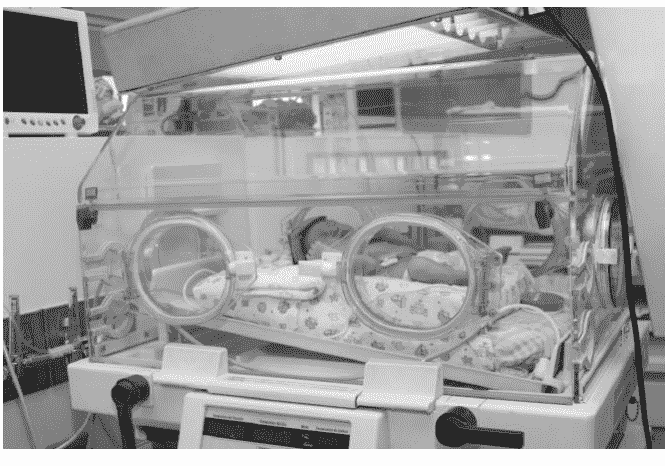

**图 5.1** NICU 监护病室内育儿箱中的新生婴儿。

CHNC 医院成员的标准反映了该合作伙伴患者的重点。这些标准包括以下内容，将在列出后进行解释（图 5.1）：

- 在独立的儿童医院内设有 III 级新生儿监护病室，并为入院患者提供胸外科手术服务和 ECMO（体膜肺氧）
- NICU 至少有 25 张床
- NICU 每年至少收治患者 400 人
- 超过 50% 的院外出生（outborn）

这意味着什么？

独立的儿童医院是指专门治疗儿童患者的医院，而不是同时收治儿童和成人的医院。正如开篇案例所描述的，新生儿监护病室是医院内专门负责治疗危重新生婴儿的科室。新生儿监护病室有几个等级，提供日益复杂的服务范围。它们被美国儿科学学院（AAP）确定为 I、II 或 III 级。III 级单位提供最全面、最复杂的护理水平，并且通常拥有该地区少数熟悉罕见亚科的医生。最具挑战性的患者病例会被转往具有 III 级单位的儿童医院。通常，这些患者是极早产儿，或者是危重和/或需要手术干预的足月新生儿

## 第五章：儿童医疗最佳实践建议 157

以及或需要手术干预。III 级 NICU 的亚科护理进一步根据 A–D 字母分类，其中 III级比 B、C 或 D 级单位提供更好的选择。美国各地对这些分类的定义存在差异，这解释了第一个要点中增加信息的原因，以澄清医院必须提供的特定程序。

接下来的两个要点涉及 NICU 要求的最小容量和最低收治人数。最后一个要点是指每年从其他医院转诊入院的婴儿数量。请注意，婴儿通常在其他地方出生（例如“院外出生”），一旦确定他们有当地医疗设施无法处理的严重医疗需求，就会被转到专科儿童医院。

CHNC 是一个由医生、护士和其他 NICU 工作人员组成的基层组织，目前包括 25 家大型儿童医院。2008 年，CHNC 选举了一个九人小组的执行小组，由 Jackie Evans 担任主席。该小组之间合作非常紧密，并在内部分配责任。执行委员会成员的完整列表位于侧边栏“CHNC 执行委员会成员”中。创始团队的另一位成员是 Janet MS，她接受过呼吸治疗师培训，目前担任加利福尼亚州奥克兰儿童医院的新生儿/儿童研究经理。该联盟主要通过达成共识来运作，执行小组在各个分小组和任务组中提供领导。CHNC 主席的职责包括：

- 监督 CHNC 的所有功能
- 作为 CHNC 对数据库管理机构的发言人（下一节将解释这一点）
- 组织整个 CHNC 年会的会议议程

## CHNC 执行团队

Jacquelyn Evans，医学博士，费城（Philadelphia）儿童医院新生儿/婴儿重症监护病室医疗监，宾夕法尼亚大学医学院新生儿科副主任，宾夕法尼亚州宾夕法尼亚市

Karna Murthy 博士，西北大学费恩伯医学院和芝加哥儿童纪念医院儿科助理教授，芝伊利诺伊州芝加哥市

## 计算机与社会：科技向善

Janette Asselin，硕士硕士，加利福尼亚州奥克兰儿童医院新生儿/儿童研究经理

David J. Durand，医学博士，加利福尼亚州奥克兰儿童医院与研究中心新生儿科主任

Franceyne Dyer 博士，埃默里大学医学院和亚特兰塔埃格尔斯顿亚特兰塔医疗保健，乔治亚州亚特兰塔市

# 第五章：儿童医疗保健的最佳实践建议

## 计算机与社会：科技向善

**图 5.1** NICU 监护病室内育儿箱中的新生婴儿。

CHNC 医院成员的标准反映了该合作伙伴患者的重点。这些标准包括以下内容，将在列出后进行解释（图 5.1）：

- 在独立的儿童医院内设有 III 级新生儿监护病室，并为入院患者提供胸外科手术服务和 ECMO
- NICU 至少有 25 张床
- NICU 每年至少收治患者 400 人
- 超过 50% 的院外出生

这意味着什么？

独立的儿童医院是指专门治疗儿童患者的医院，而不是同时收治儿童和成人的医院。正如开篇案例所描述的，新生儿监护病室是医院内专门负责治疗危重新生婴儿的科室。新生儿监护病室有几个等级，提供日益复杂的服务范围。它们被美国儿科学学院（AAP）确定为 I、II 或 III 级。III 级单位提供最全面、最复杂的护理水平，并且通常拥有该地区少数熟悉罕见亚科的医生。最具挑战性的患者病例会被转往具有 III 级单位的儿童医院。通常，这些患者是极早产儿，或者是危重和/或需要手术干预的足月新生儿。III 级 NICU 的亚科护理进一步根据 A–D 字母分类，其中 III 级比 B、C 或 D 级单位提供更好的选择。美国各地对这些分类的定义存在差异，这解释了第一个要点中增加信息的原因，以澄清医院必须提供的特定程序。

接下来的两个要点涉及 NICU 要求的最小容量和最低收治人数。最后一个要点是指每年从其他医院转诊入院的婴儿数量。请注意，婴儿通常在其他地方出生（例如“院外出生”），一旦确定他们有当地医疗设施无法处理的严重医疗需求，就会被转到专科儿童医院。

CHNC 是一个由医生、护士和其他 NICU 工作人员组成的基层组织，目前包括 25 家大型儿童医院。2008 年，CHNC 选举了一个九人小组的执行小组，由 Jackie Evans 担任主席。该小组之间合作非常紧密，并在内部分配责任。执行委员会成员的完整列表位于侧边栏“CHNC 执行委员会成员”中。创始团队的另一位成员是 Janet MS，她接受过呼吸治疗师培训，目前担任加利福尼亚州奥克兰儿童医院的新生/儿童研究经理。该联盟主要通过达成共识来运作，执行小组在各个分小组和任务组中提供领导。CHNC 主席的职责包括：

- 监督 CHNC 的所有功能
- 作为 CHNC 对数据库管理机构的发言人（下一节将解释这一点）
- 组织整个 CHNC 年会的会议议程

## CHNC 执行团队

Jacquelyn Evans，医学博士，费城（Philadelphia）儿童医院新生儿/婴儿重症监护病室医疗监，宾夕法尼亚大学医学院新生儿科副主任，宾夕法尼亚州宾夕法尼亚市

Karna Murthy 博士，西北大学费恩伯医学院和芝加哥儿童纪念医院儿科助理教授，伊利诺伊州芝加哥市

Janette Asselin，硕士，加利福尼亚州奥克兰儿童医院新生儿/儿童研究经理

David J. Durand，医学博士，加利福尼亚州奥克兰儿童医院与研究中心新生儿科主任，加利福尼亚州奥克兰市

Franceyne Dyer 博士，埃默里大学医学院和亚特兰大埃格尔斯顿亚特兰大医疗保健，乔治亚州亚特兰大市

Michael Padula，医学博士，费城（Philadelphia）儿童医院新生儿科信息学医疗监，宾夕法尼亚大学医学院临床儿科助理教授，宾夕法尼亚州宾夕法尼亚市

Eugenia Pallotto，医学博士

Kristina Rever，医学博士，俄亥俄州国立儿童医院副教授，俄亥俄州哥伦布市

Billie Lou Short，医学博士，华盛顿特区国家儿童中心新生儿科主任

该联盟主要通过达成共识来运作，执行小组在各个分小组和任务组中提供领导。CHNC 主席的职责包括：

- 监督 CHNC 的所有功能
- 作为 CHNC 对数据库管理机构的发言人（下一节将解释这一点）
- 组织整个 CHNC 年会的会议议程

CHNC 是一个由医生、护士和其他 NICU 工作人员组成的基层组织，目前包括 25 家大型儿童医院。2008 年，CHNC 选举了一个九人小组的执行小组，由 Jackie Evans 担任主席。该小组之间合作非常紧密，并在内部分配责任。执行委员会成员的完整列表位于侧边栏“CHNC 执行委员会成员”中。创始团队的另一位成员是 Janet MS，她接受过呼吸治疗师培训，目前担任加利福尼亚州奥克兰儿童医院的新生/儿童研究经理。

接下来的两个要点涉及 NICU 要求的最小容量和最低收治人数。最后一个要点是指每年从其他医院转诊入院的婴儿数量。请注意，婴儿通常在其他地方出生（例如“院外出生”），一旦确定他们有当地医疗设施无法处理的严重医疗需求，就会被转到专科儿童医院。

## 计算机与社会：科技向善

**图 5.1** NICU 监护病室内育儿箱中的新生婴儿。

CHNC 医院成员的标准反映了该合作伙伴患者的重点。这些标准包括以下内容，将在列出后进行解释（图 5.1）：

- 在独立的儿童医院内设有 III 级新生儿监护病室，并为入院患者提供胸外科手术服务和 ECMO
- NICU 至少有 25 张床
- NICU 每年至少收治患者 400 人
- 超过 50% 的院外出生

这意味着什么？

独立的儿童医院是指专门治疗儿童患者的医院，而不是同时收治儿童和成人的医院。正如开篇案例所描述的，新生儿监护病室是医院内专门负责治疗危重新生婴儿的科室。新生儿监护病室有几个等级，提供日益复杂的服务范围。它们被美国儿科学学院（AAP）确定为 I、II 或 III 级。III 级单位提供最全面、最复杂的护理水平，并且通常拥有该地区少数熟悉罕见亚科的医生。最具挑战性的患者病例会被转往具有 III 级单位的儿童医院。通常，这些患者是极早产儿，或者是危重和/或需要手术干预的足月新生儿。III 级 NICU 的亚科护理进一步根据 A–D 字母分类，其中 III 级比 B、C 或 D 级单位提供更好的选择。美国各地对这些分类的定义存在差异，这解释了第一个要点中增加信息的原因，以澄清医院必须提供的特定程序。

接下来的两个要点涉及 NICU 要求的最小容量和最低收治人数。最后一个要点是指每年从其他医院转诊入院的婴儿数量。请注意，婴儿通常在其他地方出生（例如“院外出生”），一旦确定他们有当地医疗设施无法处理的严重医疗需求，就会被转到专科儿童医院。

## 第五章：儿童医疗保健的最佳实践建议

| Sensation 64 | CHOP MRI |
|---|---|
| 例: 3536823 | CTHead3Drecons |
| 颜色 | 2004年4月01 F CT Head 3d recons |
| 序列:90/17 | 组:CT Head 3d recons |
| 入 1/18 | 2011年2月05 |
| 0.0 | Imp Im: 14:30:23 |

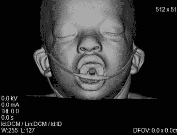

**图 5.4** 心肺皮肤综合征儿童的头部 CT 扫描，这是一种极罕见的遗传疾病。（版权所有 2011，费城儿童医院。保留所有权利。）

小组的合作伙伴在执行委员会中加入了一位具有患者护理和医学信息学跨学科背景的新生儿科医生——Michael Padula 博士。除了在新生儿重监病室 (NICU) 的全职职责外，Mike Padula 正在俄勒冈州波特兰的健康与科学大学获得生物信息学硕士学位。他能够在医学与计算的世界之间建立桥梁。由于 Jeannette Aslett 虽然不在联盟内部，但与美国儿童健康协会 (CHCA) 签约提供临床问题解决的专家建议，CHNC 执行委员会将会有两位具有双重内容专业知识的人员。

在听取了医生提出的案例后，Kate Conrad 对通过其成员医院 NICU 的儿童进行了一些统计分析。他们发现了事实证据，支持了这样说法：现有的关于最佳实践的公共数据并未涵盖对儿童至关重要的特定新生儿群体。要了解她学到的内容，请参考表 5.1。“所有患者”下的列对于这项讨论最为重要。你可以看到，在他们的医院中，绝大多数 NICU 婴儿（74%）是“医疗类”婴儿，尽管他们病情严重，但并不需要手术。然而，“医疗类”婴儿和“手术类”婴儿在医院的平均天数相同（各占 50%）。Kate 所知道以及医生们所知道的是，其他机构正在持续进行的数据收集和分析很大程度上集中在医疗类婴儿身上。对于以下群体，收集的信息较少，背景细节不足：

## 表 5.1 CHCA 成员医院 NICU 患者构成

| | <1500 克 | | | >1500 克 | | | |
|---|---|---|---|---|---|---|---|
| | 医疗类 | 手术类 | 总计 | 医疗类 | 手术类 | 医疗类 | 总计 |
| 总病例 | 74% | 26% | 100% | 13% | 7% | 61% | 19% | 100% |
| 住院天 | 50% | 50% | 100% | 23% | 22% | 27% | 28% | 100% |

来源：美国儿童健康协会 (Child Health Corporation of America)，儿科健康信息系统，2007年。

消耗大部分资源（医生时间和医疗费用）的群体是：他们的手术类 NICU 患者！这真是一个巨大的发现。

## 维护医学信息数据库的机构

许多机构目前正在不同细节水平上收集患者群体的数据。事实上，确实有几十家机构专注于诸如癌症患者、儿科癌症患者、重症监护室 (ICU) 患者等子群体。为了让你直观了解这些机构的职责及其优劣势，这里有两个例子。第一个例子适用于整个人群，第二个专门针对儿童医疗保健。你会发现，这些大型且有效的机构帮助改善了成千上万人的医疗护理。对于如何继续识别和传播最佳实践，我们从这些机构身上也可以中学到很多东西。

## 国家医疗安全网络 (NHSN)

NHSN 是展示为什么收集全国数据可以导致发现并传播更好医疗实践的极佳案例。作为美国疾病控制预防中心 (CDC) 的一部分，NHSN 收集大量的临床数据。美国所有的医疗提供者和医院都被要求向 CDC 报告某些疾病的发生情况。CDC 在 NHSN 中维护着巨大的聚合数据库并向公众开放。NHSN 数据不限于任何年龄组或其他人口统计特征，而是涵盖整个生命周期和各种人群。

## 第五章：儿童医疗保健的最佳实践建议

例如，所有医疗相关感染 (HAI) 的发生情况都会报告给 CDC。过去使用的术语是“医院感染”，但随着门诊诊所和非传统医疗环境（尤其是在农村地区）的使用日益增加，这一通用术语更准确地反映了此类事件。HAI 是在进入医疗部门后几小时（通常为 48 小时）内出现的感染，且有证据表明潜期发生在此期间。患者出院后出现的感染可能是在患者留院期间的某些情况下获得的。HAI 有不同类型，如血症感染、肺炎和尿路感染，它们可以通过多种方式获得。想一想，即使在最勤恳的医院里，不可避免地存在多少细菌、病毒和真菌（图 5.5a）。截至 2002 年，美国发生了约 170 万例 HAI，导致 99,000 人死亡。CDC 在 2009 年报告称，HAI 的总体直接医疗成本在 280 亿至 450 亿美元之间。在易感人群中死亡率更高。大量的 HAI 发生在 ICU 中。例如，所有 HAI 发生在社区。医院工作人员采取了哪些措施来减少。HAI 发生在环境中。HAI 发生在生命中。HAI 发生在良好的。HAI 发生在计算：

HAI 发生在

 金黄色球菌

 化链球菌

 肺炎球菌

 野芽孢菌

 霍乱菌

 肺炎克伯菌

 大肠菌：沙门菌

 百日咳

 白喉杆菌

 幽门螺菌

 破毒杆菌

 破伤菌

 淋奈球菌

 梅毒螺旋

(a)

 (b)

图 5.5 (a) 细菌无处不在（见彩色插图）。(b) 手卫生规程。

## 第五章：儿童医疗保健的最佳实践建议

这项研究清楚地表明，手部消毒频率与患者感染的发生率之间存在直接关系。在巩了这些重要知识后，医护人员不仅能够维持高标准的卫生实践，而且改变了行为，避免接触他们此前并未意识到正在接触的区域。事实证明，当实施这些简单措施时，感染率大幅降低——治疗感染的相关成本也随之减少。

对于某些读者来说，手部卫生的重要性似乎是显而易见的（图 5.5b）。这是一个重要的点：手部卫生的重要性并不总是像现在这样显而易见，对表面接触的意识增强也不如现在这样清晰。这些领域之所以能发展出最佳实践，是因为我们现在有了数据来支持它们。当这些数据在全国范围内变得容易获取用于检查、研究和传播时，医疗实践发生了转变，甚至普通人群也几乎在不加思考的情况下接受了这些信息。

另一方面，从全美如此庞大的人口中收集特定疾病的大量发生率的方法存在一种权衡。国家医院安全网络（NHSN）并不包含关于患者的整体性数据：患有某些疾病的患者可能还患有哪些其他疾病、可能会出现哪些并发症、他们面临哪些其他疾病的风险、患有这些疾病患者的随访结果。这些数据仅仅是发生次数的统计数字。那些希望理解特定患者身上变量之间复杂关系并采取有效预防措施的研究人员和从业者需要更精细的数据。

## 蒙特州新生婴儿网络——VON

VON 于 1988 年作为一家非营利组织成立，是由来自全球 700 多家医疗中心的专门从事新生儿和婴儿护理的医疗专业人士组成的。他们的使命声明包括以下：

> “VON 致力于提高新生婴儿及其家庭医疗服务的质量和安全性……为了支持其使命，网络维护了一个包含高危新生婴儿护理和结果信息的数据库。该数据库为参与单位提供独特、可靠和秘密的数据，用于质量管理、流程改进、内部审计和同行评审。

VON 使用并发症发生率作为质量衡量标准。并发症有几个相关的定义。共同点是，并发症是指原始疾病诊断之外可能存在的两种或更多疾病状况。

例如，坏死性小肠结肠炎（NE）是早产儿或严重疾病新生儿的常见并发症。根据美国国立卫生研究院的说法，NE 是肠道组织的坏死。NE 通常发生在医院环境中，但原因尚不明。除了早产儿外，NE 高风险人群还包括喂母乳的婴儿、在发生过 NE 爆发的育儿室中的婴儿以及接受过体外换血的婴儿。VON 维护了特定出生体重范围和人口统计学特征下 NE 发生的数据。这类统计信息非常有益，因为它提供了该医疗状况发生的汇总视图。

然而，还有一些 VON 没有设计用于跟踪的因素。VON 不收集患有先天性异常或代谢疾病的新生儿的详细信息。当并发症发生率统计数据应用于单个医院水平时，这种挑战就会显现出来。NE 等疾病的总体发生率自然会出现在拥有高级护理单元（例如 III 级）的儿童医院中。这些统计数据可能会错误地暗示这些医院存在问题。这种认知通常是误导性的。许多严重并发症病例出现在新生儿重症监护病房（NICU）级别较低的医院中。这些医院将其最严重的病例转到专门负责这些疾病的医疗中心，从而提高了它们的发生率统计数据。如果没有更详细的统计信息，很难评估单个医院统计数据的真伪，也难以确定哪些计划可以降低这些稀有疾病的发生率。

表 5.1 中的其他列进一步说明了 CHCA 成员医院 NICU 婴儿如何根据体重（使用传统的极低出生体重截止点）进行分类。如你所见，成员医院 NICU 治疗了更大比例的高体重非手术类婴儿——而不是那些通常被数据收集小组针对性进行调查和分析、并由社区和地区医院服务的极早产儿。这群高体重患者群体（通常是病情最重的）是需要集中数据收集和分析的人群。一个用于收集和组织这些数据的数据库系统是对这一问题的明确回应。

凭借坚实的数据作为 CHNC 成员报告极具说服力的证明，凯特·康拉德（Kate Conrad）获得了确定项目需求的资源，并草拟了一份支持该数据库项目的商业计划书。CHNC 领导于 2009 年 2 月向 CHCA 董事会提交了他们的提案。除了数据库有明确的医疗需求外，该项目还有一个极具说服力的行政论据。新生儿学部门通常为儿童医院带来最大的收入份额。这些资金支持了其他无法自给自足的医院专科。因此，除了关于医疗和社会需求的所有临床和统计证据外，还有一个支持该项目的明确的财政论据。拟议数据库的几乎每个方面都与 CHCA 的使命保持一致。

CHCA 董事会同意了。接下来，该联盟作为一个法律非营利实体被建立。该小组的名称（儿童医院新生儿联盟）于 2009 年 7 月提交商标注册，并于 2010 年 2 月获得批准。CHNC 在“计算机与软件服务及科学服务”类别下注册，进一步归类为：

- “与其相关的科学技术服务、研究与设计；工业分析和研究服务；计算机硬件和软件的设计与开发。”

商标描述包含一个“商品和服务”的子类。CHCA 意图通过这种方式帮助成员医院。虽然系统将不是免费的，但从一开始，CHCA 就计划将数据库定价在覆盖成本的水平而非盈利。该数据库正式命名为儿童医院新生儿数据库（CHND）。

## 5.4 CHCA 开发团队

多年来她对数据库充满兴趣，并担任顾问工作，这让她在孩子还小时拥有了将热情付诸行动的灵活性。

与此同时，在培养孩子和担任数据库顾问的同时，伊芙琳（Evelyn）决定兼职回到学校，攻读第二个学士学位。她选择了学习信息技术。她需要出色的多任务处理能力和项目管理技能来应对所有这些活动。展示行业相关技能有很多方法，当她准备好回到传统的有薪劳动力市场时，她提出了“休假”建议，并强调了她在技术和管理方面的技能。

47岁时，伊芙琳回归工作，利用了她作为顾问、工程师和项目经理的经验。她还发现拥有计算机科学学位对于提供教育背景非常有帮助。当时她的家人住在堪萨斯城，她在那里找到了 CHCA。她说，他们认可了她的能力并“给了她一个机会”。她被聘用于从事一份“理想的工作”：担任公司 IT 人员与医院之间的联系人。最终，如你所知，她被任命为 CHND 开发的项目负责人。

2010年，伊芙琳从堪萨斯城搬到了加利福尼亚州。她继续远程负责 CHND 项目。她按照堪萨斯时间工作，即美国中部时间，这比加州快两小时。远程工作面临着挑战。时差以及她对项目的投入经常导致每天工作 12 小时，而且像任何远程职位一样，存在感到孤立的潜在威胁。然而，伊芙琳仍与 CHCA 总部的同事保持着联系。她每个月会飞回堪萨斯与她的团队面对面。在加利福尼亚州的家里，她继续平衡工作和个人生活，这包括成为一名热衷的网球运动员。

伊芙琳将她在 CHCA 的职位和 CHND 项目描述为“虽然辛苦，但是是我职业生涯中最满意的两年”。她指出自己并不是受过正规训练的项目经理。她将自己的成功很大程度上归功于她的技术教育以及边做边学的意愿。她对 CHND 团队迄今为止完成的工作感到非常自豪，特别是他们一年内完成了大部分系统的部署截止日期。目前仍有许多工作要完成，包括处理增强请求、新需求和法规以及与其他电子系统的集成。她对项目的未来发展感到兴奋，并表示“终点尚未出现”。

项目团队被分为两组：运营支持和开发/实施。在第一年半，由于重点是开发和部署，运营支持由三位团队负责人组成：凯特（Kate）、伊芙琳（Evelyn）和帕蒂（Patti）。团队负责人身兼数职。例如，伊芙琳有时会参与讨论具体的实施问题，而帕蒂则提供一系列服务，包括对临床医生请求的分诊以及培训医院员工。

开发/实施最初由一名全职和两名兼职合同程序员与 David Naas 一人一起工作。最终，CHCA 聘用了 3 名全职软件开发人员。CHCA 的开发人员将时间分配在多个项目上。目前有一名开发人员 100% 全职负责 CHND，而其他人则投入 10-15% 的时间。David 还负责评估除本项目之外的其他架构项目。由于人们合作进行规划和解决问题，运营支持活动与开发/实施活动之间的界限往往变得模糊。

## 5.5 新生儿数据库的设计与实施策略

在理想的软件工程场景中，新数据库的创建遵循类似以下的高级路径：

1. 确定系统的用户是谁，并研究他们目前如何与数据交互。确定目前存在的数据和信息，并从用户那里了解他们的优先级，以及他们对该流程目前的满意和不满意之处。
   - a. CHND 用户：我们说的是医生？护士？非临床数据录入人员？管理员？IT 部门人员？还有谁？
   - b. 医学/临床数据：我们说的是电子健康记录（EHRs）吗？纸质医疗记录？两者兼有？其他数据？如果有，是什么？这些记录中的数据是否标准化？如果是，标准是怎样的？

2. 对现有数据和信息流建立正式模型。UML（统一建模语言）图多年来一直用于此类。你可能已经熟悉 UML 图，因为它们在整个软件工程领域都在使用。

3. 根据第1步和第2步中学到的所有内容，为建议的新型数据和信息流建立正式模型。

4. 设计并实现数据库系统和前端界面。这是一个巨大且复杂的任务，无法用一句话充分体现。如果你上过数据建模课程，就会知道 CHND 的子步骤包括但不限于：
   - a. 开发临床数据的详细模式
   - b. 考虑到不仅是数据，还有使用的数据库（关系型、OOP、XML），识别合适的临床概念和关系
   - c. 构建数据库——从零开始或使用现成产品
   - d. 创建一个符合用户需求和资源的用户界面

5. 从早期原型开始，让广泛的用户参与数据库系统使用，并随着项目变得日益复杂而继续进行测试。根据需要调整设计和实施。不要假设一次测试和更改实施就足够了。

## 5.6 谁是 CHND 的用户？

CHND 的医生推动并持续驱动着 CHND 的需求。他们发起了该项目并定期与 CHCA 保持合作。尽管，用户的识别并没有看起来那么简单。有几组用户的需求并不显而易见。最初，用户被确定为 CHCA 的成员医院，包括仅从事临床、仅进行研究以及两者兼顾的医院。此外，医生是国际数据标准化委员会最可能的候选人，这一主题随着项目的发展将变得更加重要。

## 5.7 CHND 的数据是什么？

在联盟成员和 CHND 开发团队的多次对话后，一组包含 26 个模块和 817 个数据元素的集合被标记为核心集。每个模块代表一个从医院角度来看逻辑合理的业务单元。首先开发的模块将用于输入高级业务信息。这些模块将跟踪婴儿在医院期间的通用信息。

示例模块包括：

- “身份识别”，用于人口统计信息（一个核心模块）
- “转运与入院”（关于谁将婴儿转诊到儿童医院、如何转运、何时入院、初步评估以及转诊医院发送的任何信息——一个核心模块）
- “MPP”，用于母体产前信息（关于母亲的信息）
- 以及其他，如：“感染”、“手术”、“诊断”、“神经系统”、“孤立诊断”、“出院信息”（与入院信息类似）、“死亡率”、“返回家中时所需的支持”（药物、喂养等）

## 5.8 收集医疗记录数据面临着独特的挑战

正如之前讨论，为了使新生儿数据库能够履行其使命，它需要为每个患者及其状况收集尽可能多的数据。这一要求意味着理想情况下需要将患者及其状况的医疗记录录入系统。数据库字段和逻辑结构将依赖于获取有关字段的正确信息，以及医疗记录中每个项目的可能的各种数据和格式。某些数据项目可以假设在发达国家的任何医院医疗记录中都存在。这些项目包括人口统计信息、健康史、体格检查结果、测试结果、药物、过敏史、转诊、保险和账单信息（图 5.6）。然而，CHND 开发人员即使在处理这些“基础”信息时也要面临一个问题：其中任何一类别的深度和广度各不相同。例如，记录了多少人口统计学信息以及哪些信息？被认为相关或可接受的数据部分取决于医院政策，另一部分取决于患者认为哪些是相关的。某些文化认为某些数据比其他数据更敏感，因此不会将其纳入常规访谈或问卷中。某些亚文化（如青少年）如果担心信息会传回权威人士，可能会有动力隐瞒信息，例如药物使用或性活动。即使是医疗记录中的“基础”数据可能也不包含预期信息。

CHCA 开发团队从 CHNC 中吸取了经验，后来发现某些数据将是未知的。最重要的是，他们了解到医生要求不应获取任何数据字段。遗憾的是，有时记录中缺少可能有用的数据，因为这些数据根本无法获取。例如，如果询问患者（或在父母的情况下询问父母）服用什么药物以及剂量，患者可能不确定。在一个来自真实成年患者的示例中，患者在年度常规体检中被问及目前服用哪些药物。患者在接诊表上写道：“我每天吃两次 X 药来控制血压；这是另一位医生开的，但我忘了确切的剂量”。

医疗记录显示如下：“患者服用药物 X，不确定剂量，可能是每天两次 0.5 毫克”（可能是因为 0.5 毫克是典型的起始剂量）。实际上，患者每天服用两次 1.5 毫克。医疗记录的注释解释了这一点，但在 CHND 中如何处理呢？0.5 毫克与 1.5 毫克之间的差异很大，很容易扭曲分析。处理未知数据的有效方法需要建立在设计中。

除了围绕数据完整性保证的问题外，提取非常年幼儿童的儿科记录内容还面临着特殊挑战。首先，生长信息至关重要且变化迅速。数据包括身高、体重、头围和体质量。如果数据缺失或不准确，评估医疗状况和得出有效治疗方案的整个背景就会受到损害。在过去的几十年里，儿童有多个名字或更改名字已变得常见。婴儿出生于姓氏不同的父母，被收养或安置于寄养。在任何这些情况下，他们的名字可能会改变，或以多个名称被引用。第三，包含的数据可能引用了特定年龄或未诊断出医疗疾病儿童的接受发育标准。遗憾的是，由于发育标准的定义会随背景的不同而存在差异。需要额外的数据来澄清背景；患者记录通常包含有关母亲的信息，有时还包括父亲的信息。对于已知或怀疑有先天性疾病的婴儿，或者出生前的创伤影响了婴儿状况的情况，尤为如此。

最后，医疗数据的标准化（特别是新生儿学）尚处于起步阶段。尽管存在日益被接受的标准（部分由于立法对医疗保健改革的推动），但在 CHND 团队希望的详细程度上，数据和定义还没有明确的统一标准。幸运的是，展望未来，医疗数据领域有几个重要的、演进中的术语。在存在重叠的情况下，标准机构正致力于将其整合。与 CHND 项目相关的当前或未来最重要的标准包括：ICD-9 和 ICD-10、SNOMED-CT、RxNorm 和 LOINC。这些技术标准中的几个已在侧边栏中进行了讨论。在 CHND 项目的初始开发阶段，联合会医生决定将输入的数据映射到 ICD-9 代码定义上。ICD 标准代表“国际疾病分类”。对于建立并测试系统的 beta 版本来说，这一决定是最简单的选择，因为 ICD 第 9 版被带有 EHR（电子健康记录）系统的成员医院广泛使用。已经制定了计划，在日后将部分数据转换为 SNOMED-CT。SNOMED-CT 是一个更详细的分类标准。

自愿参加数据库极早期测试的 CHCA 成员医院表现出了这些差异。此外，一些医院使用 EHR 软件，一些则没有，另一些正处于过渡期。EHR 软件由不同的供应商提供，这些供应商限制了数据的输入和显示方式。尽管如此，系统仍然被建立了，我们现在将从电脑前的人的角度来看数据输入流程。

### 5.9 用户数据流层：抽象者的视角

CHND 项目的数据输入人员被称为“抽象者”（Abstractors）（图 5.7）。从他们的角度来看，系统必须易用且在逻辑上一致。抽象者的逻辑一致性和易用性基于医院内临床新生儿学数据的组织方式。早期的需求收集确定了每个屏幕都必须包含与特定数据集或子集相关的所有信息（例如，人口统计学信息应全部在一个屏幕上）。抽象者不应该为了输入相关数据而切换屏幕，也不应该向上或向下滚动或进行任何阻止他们查看的操作。通过能够看到一个逻辑集合的所有数据，抽象者对患者的访问片段有了完整的视图。由于可以看到一个模块的所有信息，他们不太可能犯数据输入错误。

对于新患者，识别模块将显示为一组需要填充的空字段。如果患者由于之前的就诊已存在于系统中，页面将自动填充已知数据，克里斯汀（Christine）只需要输入新或更改的数据即可。她可以随时保存正在进行的工作。验证检查在每个页面的两个点进行。首先，克里斯汀在每个单独的字段中输入，系统会检查使用的格式是否有效。例如，数字日期字段不能包含任何字母数据，如果包含，当克里斯汀尝试移动到下一个字段时，该条目将被标记。

字段验证是防止潜在高昂错误的重要方法，因为用户（“任何”数据程序的用户）在注意力转移到其他数据上之前，会收到他们拼写错误的提醒。对于 CHND 提取员来说，幸运的是系统内置了一些自动数据格式化功能。例如，输入为“6/17/61”的日期将自动转换为“06/17/1961”。如果存在必填字段而克里斯汀在页面图表或正在转录的电子健康记录（EHR）中没有相关信息，她可以点击“未知”（unknown），在字段中插入占位符。此操作允许她继续后续工作，同时向系统指示数据缺失，并满足了联盟医生不遗留任何空字段的要求。

第二次验证检查发生在克里斯汀到达页面末尾时。当她试图通过选择“下一个”或“上一个”按钮或点击不同的模块来切换到另一个模块时。

是什么决定了克里斯汀以及她所在医院的其他提取员在计算机屏幕上看到的模块？每家医院都决定了它们想在系统中使用的哪些模块，以及每个模块内显示哪些字段。这些决定创建了医院数据收集的概况，并每年进行一次审查。因此，每家医院都定制了自己的数据输入屏幕，而提取员看到的正是这些屏幕。之前讨论的核心模块集适用于几乎所有的患者和医院。

默认情况下，如果克里斯汀选择了“下一个”按钮，她将从“识别”模块跳转到下一个核心模块。或者，克里斯汀也可以通过从侧边栏导航列表中选择模块来覆盖内置的顺序。

通常情况下，一旦完成核心模块，克里斯汀就会转而填写更专门的模块。这些模块是一个子集，由医院选择的模块与适用于该特定患者的模块的交集组成。导航栏中患者模块的可见性是根据当前患者就诊输入的信息动态触发的。

第二层更详细的模块被称为 VON 模块（在早前的侧边栏中讨论过的佛蒙特-牛津网络，Vermont Oxford Network）。这些模块收集具有更具体的诊断和症状信息，类似于 VON 收集的信息。第三组更详细的可用模块是基于加利福尼亚围产质量护理协作组织（CPQC）所属医院所需的信息。该组织在加利福尼亚州拥有广泛的医院和非医院利益相关者网络，并与 CHNC 和 CHCA 共享许多相同的数据收集和医疗质量改进目标。

当我们的提取员输入了所有数据并准备好关闭患者就诊时，她会选择“出院”（Discharge）模块。从她的角度来看，这是最后一步，并请求数据永久存储在 CHND 中。

## 过渡中的医疗保健——电子健康记录

医疗保健技术正在发生快速变化。美国及其他地区的医疗提供者越来越多地将其医疗、财务和行政记录迁移到电子存储和管理系统中。有各种供应商和软件系统供选择，其手动数据输入是常态，有时由全职员工完成，他们的唯一任务就是跟进这些信息流。将所有现有的当前和历史健康记录转换为电子格式是一项巨大的任务。较小的医疗机构可能没有专门从事此工作的人员。

尽管创建电子健康记录（EHR）的努力已经持续了多年，但它们受到了联邦医疗改革立法的推动。你可以在章节末尾找到一个侧边栏（电子健康记录与医疗改革），其中讨论了改革立法强制要求的电子记录保存要求。将所有个人医疗保健数据转换为标准的电子格式对于 CHND 项目的长期有效性至关重要。

EHR 正如其名——一种电子格式的患者健康记录。就像过去的图书馆和对书籍信息的管理一样，个人患者的信息传统上一直保存在纸质文件系统中，有时会占据多墙装满按字母顺序排列文件夹的抽屉。就像旧的图书馆目录系统一样，当有人想要某个患者的信息时，他们必须搜索抽屉。有时信息在预期的位置，有时不在。有时文件中的信息会引用其他信息，例如，儿童记录会引用父母一方或双方的记录。为了进一步增加复杂性，手动健康记录还增加了一层复杂性，因为它们有历史并具有长期性。法律记录等额外文件可能在文件中（高级医疗保健指令、授权书）。与卡片索引（通常一个索引包含所有可用信息）不同，一个医疗记录文件夹理论上可能为一个具有长期病史的患者包含几英寸的纸质文件。这些纸由许多具有不同风格、惯例和法律效力程度的人撰写，必须对它们进行分类、研究和分析，以便完全理解患者的情况。在重症护理意味着必须快速做出决策的情况下，并不总有时间条理地查看文件。这是一个非常适合计算机化的局面。

在医学界，提到“电子健康记录”（Electronic Health Record）和“电子医疗记录”（Electronic Medical Record）这两个术语是合适的。尽管公众倾向于交替使用这些术语，或者在涉及数据管理时简单地使用后者，但在数据管理方面，存在着重要的区别。电子医疗记录（EMR）是电子健康记录（EHR）的子集。`EMR` 是 `EHR` 的子集。`EMR` 是在医疗机构开发的、关于每次就诊的记录，通常按“就诊”（encounter）进行排列，这是医疗提供者首选的术语。

相反，`EHR` 包含了 `EMR` 的所有数据，以及从其他来源获取的新信息，特别是当数据在设施之间传输时。因此，在 `CHND` 项目的讨论中使用了 `EHR`。另一个术语个人健康记录（PHR）有时会出现；这是由患者或在儿童情况下家庭保留的记录。有时 `PHR` 包含其他来源未捕获的有用信息。`PHR` 不是 `CHND` 项目的数据收集来源。

## SNOMED-CT

最广泛使用的医学临床术语集是 `SNOMED-CT`，医学标准化命名（Systemized Nomenclature of Medicine—Clinical Terms）的缩写。通常简称为 `SNOMED`，该术语集是由美国和英国以前存在的术语集合并而成的。

目前，`SNOMED` 由非营利的国际健康术语标准组织（`IHTSDO`）维护和推广；他们的重点是提供全球范围内“安全有效的健康交换”。

随着时间的推移，`SNOMED` 已扩展并演变为一种基于概念、术语和关系的层次结构，涵盖了几乎所有的领域。`SNOMED` 图形提供了概念之间关系的可视化。参见图 5.8，“哮喘”（Asthma）概念的关系示例。

如果你学习过基于数据库的设计，这种概念和关系的图表布局应该是熟悉的。概念设计中的每个节点包含一个唯一的名称和数字标识符（例如，概念：“哮喘”，标识符“195967001”）。

与其他哮喘相关的概念有自己的节点（例如，“哮喘性支管炎”，标识符“405944004”）。哮喘“可能是”哮喘性支管炎，而哮喘性“是”哮喘。

这里没有显示，概念节点还包含同义词识别信息。通常这些同义词是更常用的术语，可能不是唯一的（例如，心脏发病是“心肌梗死”更常用的术语）。

在更深层次上，有用于识别概念类别和子类的标签，以及机器可读和人类可读的数据字段和标识符。录录提供了 `SNOMED-CT` 结构完整信息的资源。

## LOINC 和 RxNorm

第二个国际接受的大医学术语集是逻辑观察名称和代码（Logical Observation Names and Codes，`LOINC`）。根据他们的网站，`LOINC` 的使命是“促进临床结果的交换和汇总，用于临床护理、结果管理和研究，提供一组用于识别实验室和其他临床观察的通用代码和名称”。

`LOINC` 由一个名为 Regenstief Institute 的研究机构维护。他们的网站表示，`LOINC` 的主要目的是提供：“一种标准命名法，使得临床数据能够从产生数据的实验室电子传输到医院、医生诊所和支付方，并将这些数据（现在超过 50,000 个观察术语）用于临床护理和管理。”

`LOINC` 标准是对 `SNOMED` 术语的补充，并出现在许多相同的文档、电子记录以及美国联邦机构的参考资料中。`LOINC` 也在全球范围内广泛采用。

第三项国际可见的大型标准化努力 `RxNorm`，适用于在美国批准使用的临床药物（对大多数人来说，这些是处方药）。与 `SNOMED` 和 `LOINC` 类似，`RxNorm` 以机器可读的格式定义术语，并提供基础设施指南，以促进数据库搜索以及创建电子健康记录标准术语的总体目标。

## 第五章：儿童医疗的最佳实践建议

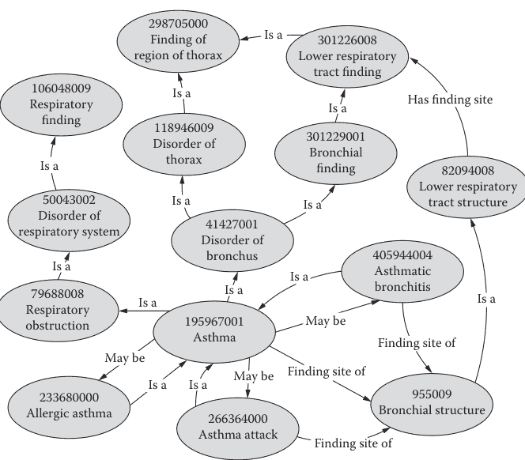

**图 5.8 哮喘概念的 `SNOMED-CT` 本体碎片。(Hristidis, V., Ed. 2010. Information Discovery on Electronic Health Records. Boca Raton, FL: CRC Press.)**

## 5.10 应用流层：下一层

在本节中，我们将讨论当像 Christine 这样的数据提取员在电脑前向 `CHND` 输入医疗信息时，在后台正发生什么。数据提取员并不知道服务器的存在、它们的位置，或它们是如何通信的——而且他们也不想知道这些细节。然而，从技术上讲，有很多工作在进行。

有 4 台服务器，全部位于 `CHCA` 总部的现场：一个 Web 服务器、一个邮件服务器、一个数据和一个应用程序服务器。邮件和数据服务器是物理的，而 Web 和应用程序服务器是虚拟的。

邮件服务器专门用于电子邮件，无法与其他服务器联系。这种分离防止了任何电子邮件或附件有意或无意地访问医疗数据。数据服务器包含 `SQL` 数据库，且只能通过应用程序服务器访问。

Web 服务器是与客户端（即数据提取员及其浏览器）通信的唯一服务器。作为客户端的数据提取员被阻止直接访问应用程序服务器。Web 服务器和应用程序服务器在物理上保持分离，为系统增加了另一层安全性。

显示 `CHND` 应用的 `.Net ASP` 页面每次在数据提取员请求页面时从 `CHCA` Web 服务器提供。支持大多数常用浏览器：Internet Explorer 6 或更高版本、Firefox、Safari、Opera，以及针对 iPhone 和 iPad 显示格式的版本。需要启用 `Javascript`。

响应页面请求时，应用程序服务器将适当的 `Javascript` 下载到浏览器，并重构页面供数据提取员查看。从 `Javascript` 命令执行物理页面构建的代码构建在浏览器中。

当数据提取员输入时，数据会存储在 Web 服务器的屏幕上（即按页存储）。当他选择新患者病历时，数据也会存储。每当数据提取员移动到新页面时，`Write` 函数触发一个事件。作为响应，页面级检查会询问以下问题：

1. 页面是否是脏的（即数据是否已更改？）
2. 页面是否有效？

如果页面是脏的且有效的，就会调用代理程序，该程序转调用 `CHCA` 应用程序服务器。客户端验证在 Web 服务器的浏览器中进行。浏览器执行验证代码，数据被封装在加密对象和 `http post` 请求中。

请求使用 `SSL`（安全套接层）。`SSL` 是应用程序开发者广泛使用的标准浏览器加密协议。你可能注意到有时 URL 以 `"https"` 而不是 `"http"` 开头；这一小区别表明你正在传输和接收的数据已加密，很可能使用了 `SSL` 协议或称为 `TLS`（传输层安全）的变体。

数据到达 `CHCA` Web 服务器，服务器对其进行“水化”（rehydrates）——使用常用术语，即解包、解密和重新填充对象。

另一组验证检查将会进行，重复了第一组验证检查。这种重复确保了在浏览器端更改期间没有遗漏任何内容、传输成功且数据在未被更改的情况下到达。如果数据出现问题，此时数据提取员将收到数据无法处理的消息。否则，数据将存储在数据库中，并至少规范化到第三范式（3NF）。

假设数据成功通过了 Web 服务器的验证，数据将被重新加密并传递给 `CHCA` 应用程序服务器。两个服务器之间的通信限制在安全端口。数据再次被水化回对象，应用程序服务器确定执行了什么操作。

目前所有请求或是 `Fetch`（获取数据）或是 `Write`（写入数据）。未来可能会添加其他请求。应用程序服务器从数据库检索数据。

向 Web 服务器发送响应的过程与刚才描述的过程相反。简而言之，数据被封装、加密、流向 Web 服务器，并返回到客户端在浏览器上重水化为 `html`。

数据提取员会看到响应——OK，他们就可以继续；不是 OK，他们必须根据消息和特定情况决定如何处理。

## 5.11 传输数据流：额外的安全性

有几个需要区分的安全相关术语：身份验证（Authentication）、授权（Authorization）和验证（Validation）。

身份验证发生在登录时，指的是确保数据提取员（或其他用户）允许进入系统。（正如我们之前提到的，`CHCA` 成员使用 `Active Directory` 进行初始登录。）每家医院都同时进行身份验证。

## 第五章：儿童医疗的最佳实践建议

授权是一种基于角色的访问检查，决定系统用户允许执行的操作。目前只有一个用户角色，即数据提取员。随着系统在开发阶段的扩展，以及数据输入之外的操作发生，将会产生多个角色。

可能需要多个角色。例如，个人身份信息（`PII`）没有从临床数据中剥离，但在数据库中进行了加密。对 `PII` 的访问比其他数据受到严格限制。

一旦用户从数据库请求汇总信息以及即时生成报告的功能添加到系统中，确保医院和用户只接收源于自身的 `PII` 将至关重要。

验证指的是凭据的验证，我们在讨论字段数据、页面跟踪以及数据提交到数据库进行最终写入时并未看到的。

额外的系统安全性通过在 Web 服务器和应用程序服务器之间放置防火墙来实现。这完成了分离服务器并确保它们之间进行安全通信的任务。

随着使用量和数据量的扩大，前端服务器和后端应用程序服务器都会增长（即增加新服务器）。目前由于只有少数医院与数据库协作，系统负载较低。然而，随着 `CHND` 的广泛分布，可以接入更多的虚拟机。我们还计划在必要时添加负载均衡器。

系统的另一层安全性与缓存有关。浏览器不缓存任何数据。`PII` 和其他敏感数据始终从 `CHND` 本身检索和交付。任何缓存仅发生在应用程序服务器上。

延迟是不可避免的，但它非常短，没有数据提取员抱怨过；他们更担心数据安全，而不是对输入的即时响应。用户屏幕上的下拉菜单包含不高度敏感的数据。这减少了对数据库的调用，同时消除了敏感数据被适当检索并交付到页面中的。

开发团队正在监控延迟问题，以防系统需要调整以加快数据和消息的传递。

我们上述的数据加密目前使用 `SOAP`。`SOAP`（最初是但现在不再是缩写）是一种常用于 Web 的消息框架协议。未来，随着人类数据提取员的角色被移除，电子健康记录系统能够直接与 `CHND` 通信，医院可能会以不同的格式发送数据。

# 第五章：儿童医疗最佳实践建议

系统。因此，开发团队计划使用加密 `HL7` 测试数据和消息传输。`HL7` 将越来越多地定义医院电子记录保存的标准。

## HL7

以下关于 `HL7` 的信息的第一部分重复了第 2 章中 `HL7` 和 `DICOM` 的侧边栏内容。

`HL7` 是医疗信息化领域规模最大、影响力最大的国际标准制定组织（SDO）。`HL7` 是 Health Level Seven 的缩写，创建于 1987 年。根据其网站（www.hl7.org），“它是健康技术互操作性标准的全球权威机构，成员来自 55 个国家。`HL7` 的愿景是创建医疗保健领域最好且使用最广泛的标准”。

从计算的角度来看，很有趣的是，`HL7` 的名字源于 `OSI` 模型的第 7 层：应用层。你可能在操作系统课程中回想过，应用层处理数据定义和通信协议。

截至 2011 年夏季，`HL7` 版本 3 已开发完成。`HL7 V3` 使用面向对象的模型来指导标准制定。该模型被称为参考信息模型（`RIM`）。

根据 `HL7` 开发框架文档，“`RIM`……对 `HL7` 消息字段中携带的信息之间存在的语义和词法连接提供了显式表示”。换句话说，`RIM` 提供了一种将应用程序的标准参考术语映射到标准模型的机制。从现在起，来自应用程序的数据可以被同样遵循 `RIM` 模型的医疗应用程序所理解。

`RIM` 由具有属性、数据类型和关系的对象类（`OO Classes`）组成。任何针对新规范或更新规范的设计模型都应该从 `RIM` 中的类派生自己的对象类。

规范模型组件（如结构图和用例）用 `UML` 语法表示。`HL7` 非常复杂（章节末尾提供了相关资源），因为它被设计为适用于医疗信息化的所有领域。

与其非常成功且被广泛采用的前身 `HL7 V2` 一样，`HL7 V3` 旨在保留核心互操作需求的同时，具有高度的灵活性和适应性。

`HL7` 还开发并维护临床体系（CDA）的结构和编码标准。`CDA` 版本 2 于 2005 年发布，构成了创建将讨论的临床护理报告（CCR）等文档的基础。

正如其名称所示，`CDA` 文档用于临床文档的电子交换，这些文档可能是患者电子健康记录（EHR）的一部分。`CDA` 标准基于 `XML`，遵循 `HL7 RIM` 版本 3 和 `HL7 V3` 数据类型。

由于其标准化和基于 `XML` 的特性，`CDA` 文档可以通过电子邮件、各种常用附件以及其他传输方法（如 `ftp`）发送。虽然需要标准和一组最少的 `XML` 元数据，但 `CDA` 的实现在语义上变得日益复杂，使所有机构在向标准化 `EHR` 迁移期间都能参与其使用。

例如，`CDA` 文档可以包含非 `XML` 格式的信息，如 `pdf` 和 Word 文。这种灵活性增加了 `CHCD` 团队数据提取过程的复杂度，但被认为是保持项目进展的必要。

`CDA` 文档可以包含关于患者的各种信息。对 `CHCD` 最可能相关的信息包括患者入院和出院时的状况、体格检查和诊断测试的结果，以及治疗细节和对治疗的反应。

2011 年 2 月，`HL7` 宣布将于 3 月发布“绿色 `CDA`”实施指南，这是一种用于 `CDA` 模板的简化 `XML`。根据新闻稿，此次发布是鼓励和支持使用 `EHR` 的持续努力的一部分，这也是美国联邦医疗改革立法案（“电子健康记录的有意义的使用”）的要求。

鼓励试点站点使用新的绿色 `CDA`；随着它们的创建，它们将成为 `CHCD` 团队访问的数据输入的一部分。关于该项目和其他快速演进的标准化项目的更多信息，可以在附录的链接中找到。

`CDA` 架构最大的实现之一是护理连续性文档（`CCD`），它将 `CDA` 标准应用于现有的临床护理记录（`CCR`）。`CCR` 是另一种基于 `XML` 的标准，在这种情况下它由 ASTM 国际组织批准。如你所见，有很多临床文档，并且正在努力简化它们数据交换的能力。

## 5.12 架构框架的原理

根据 Martin Fowler（链接见附录）的定义，系统架构可以认为是“系统的核心元素，难以更改的部分。构建其他部分的基础。”

该项目的首席开发者和架构师 David Naas 在设计和实现 `CHND` 架构时，将此记在心中。由于包括易用性、向后浏览器兼容性以及最重要的安全性在内的许多重要原因，除了终端前的 Abstractor 之外，软件和硬件必须位于位于堪萨斯市（Kansas City）的 `CHCA`。坦率地说，David 有一个经过道路测试的系统来形成该项目的框架。

David Naas 在多年前（利用他的业余时间）建立了该系统的早期版本。他多年来将其作为许多应用程序和领域的基础框架。

他的架构哲学是创建一个用于长期的系统。因此，在创建一个可重用的架构时，他创建了一组通用类，例如一组用于用户名加密的工具，以及用于读取、写入和更新数据的工具。

当像 `CHND` 这样的项目出现时，就会创建特定的应用程序模块并将其层叠在此框架之上。开发人员必须专注于项目的业务使用。David 对用于 `CHND` 的框架所做的唯一调整是添加特定数据。

David 选择 `SQL Server 2008` 作为底层数据库，因为它与许多领域都有接口。选择 `SQL Server 2008` 的第二个原因是它是被很好理解的。

从设计开始，他就知道 `CHND` 会受到攻击。他预见并规划了这些威胁。除了伦理考量（这要求他通过深度思考和架构设计来应对威胁）外，美国联邦 `HIPAA`（健康保险流通与责任法案）法规在维护医疗信息的机密性方面非常严格。任何违反 `HIPAA` 法规定的医疗提供者、机构或组织都会陷入巨大的麻烦。

我们已经讨论了应用程序和客户端通信路径上的某些安全措施。回顾一下：在技术层，支持用户界面的 Web 服务器与支持处理逻辑的服务器分离（给好奇的人来说：这与 `MVP` 监督控制器的使用有关）。

Web 服务器上没有共享或感知任何数据库数据或电子邮件。数据或个人通信相互交互或访问数据库数据在物理上是不可能。

在更高层次上，虽然医院提交给 `CHND`，但它们只能请求访问它们自己的数据。它们不能访问任何其他医院的数据。

那么，问题出现了，联盟将如何实现该项目的原始目的，即为医生提供从他们所有数据中收集的最佳实践信息？

创建这些分析的基础设施和应用程序代码是第 2 阶段开发的核心，工作刚刚开始。然而，简单的答案是，数据分析和报告创建将在 `CHCA` 内部完成，在 `CHCA` 和 `CHNC` 之间传输的聚合信息将确保医生获得所需的内容。

还将实施更多的技术保护，我们

## 第五章：儿童医疗保健的最佳实践建议

当我们讨论项目的下一步走向时，将简要讨论这一点。但我们首先需要完成第一阶段——即摘要员（Abstractors）数据输入实施是如何测试的，以及从中汲得了哪些教训。

## 5.14 `CHND` 的 Beta 版本

有十二家医院志愿测试系统的第一个功能版本。该 Beta 版本于 2009 年 12 月完成并部署到这些医院。

正如我们在章开头提到的，有些医院拥有功能完善的 `EHR` 系统，有些正在向电子记录转换，而有些仍在使用完全基于纸的系统。

在两周的时间里，摘要员使用了新系统，并向 `CHCA` 团队报告了他们的体验。在此期间，整个 `CHCA` 和 `CHNC` 团队获取了关于摘要员以及他们对数据流需求的重要信息。

首先，在 `CHND` 系统中输入记录数据的摘要员往往不是医生，而是根据每家医院的背景由一系列不同的人组成。

在较大的儿童医院中，可能需要护士人员全职负责电子记录的数据录入，并遵循公认标准与供应商 `EHR` 系统软件限制共同决定的惯例。较小的儿童医院可能将数据录入工作分配给护士和其他经过培训的人员。

摘要员直接与在电子或纸质记录系统中进行初始录入的提供者交流的能力差异很大。

在初始 Beta 测试期间最重要的发现是，开发团队没有与摘要员进行深入的交流。这就是为什么直到软件进行 Beta 测试时，开发团队才知道执行数据输入的人员是如此多样。

这种用户群的广泛性是 `CHCA` 项目团队面临的最大且意料之外的挑战之一。随着反馈的到来，开发者了解了哪些环节运行良好、哪些需要修改，他们也了解了摘要员使用的实际流程。

正如我们在本章末尾提到这些信息一样，`CHCA` 的开发团队在他们的实施周期中也相对晚才获取了这些信息。我们之前描述的顺畅数据输入过程，是在道路上经历了某些波折之后才实现的。

摘要员在向 `CHND` 原型中输入数据时，通常遵循以下程序之一：

- 从现有的 `EHR` 中提取数据并打印在纸上，然后手动将信息输入到新系统。
- 从纸质系统提取数据并手动将信息输入到新系统。
- 一位摘要员使用 `iPad` 接口访问其医院的 `EHR`，并通过 `iPad` 将数据传输到新系统。

显然，系统的首次部署包含了大量的数据记录冗余，而且在列出的第一个数据输入程序中，系统仅仅在两个电子系统之间插入了一个手动操作！因此，CHCA 开发团队将项目的第二阶段首要任务设定为：消除重复数据录入，并开发一个自动化数据录入系统。然而，他们仍然专注于第一阶段的目的，即开发、测试和调试新的数据设计、功能和通用可用性。例如，在这一初始测试期间，他们准确决定了如何处理无法输入为 `NULL` 的未知数据。系统需要重新实现以处理这个问题以及许多其他问题。系统关闭了两周，期间开发者重新设计了数据库结构、字段规范和错误检查。在不允许空字段的情况下，他们创建了 32 个特殊的“null”字段，在数据未知时在特定位置使用，以防止任何字段为空。他们还修复了一旦真实用户通过其节奏进行操作，就会出现的许多漏洞。

也许在这次首次短时间试中学学到的第二个重要教训，是摘要员的重要作用，以及在需求和测试对话中更紧密地让他们参与。为了响应对系统进行具包容性共享的需求，CHCA 在堪萨斯州举办了一场用户会议，摘要员、医生和其他数据输入人员参加了会议。CHCA 进行了实操培训、工作讨会，以及可能同样重要的——在所有对 CHND 成功实施有利益的人员之间加强了（在某些情况下启动了）对话。其中一次会议导致了对需求的修订，以考虑所有新信息。另一个结果是形成了一个摘要员的小组，他们将引导所有摘要员之间的持续对话，并将信息回传给 CHCA 开发团队。从现实意义上说，这建立了一个与联盟成员医生类似的结构和角色。

尽管有这些挫折，项目仍按开发时间表完成了。分配给用户测试的一个月由于整个系统必须完成的更改而扩展到了三个月，但 CHCA 团队在其他地方补回了时间。

2010 年 4 月，修订后的 Beta 版本被部署到 25 家成员医院。通过与摘要员团队合作，CHND 开发团队了解了专门来自每家医院正在使用的 EHR 系统的额外挑战。数据的信任和完整性作为一个非常重要的问题走到了前沿。例如，数据很难提取，因为其格式无法很好地转换为 ICD-9 标准。这些数据应该如何处理？另一些数据在现有的医院 EHR 系统中难以定位，摘要员必须遵循耗时的路径才能找到它们。

更使问题复杂的是，来自 EHR 的数据并不是“可信赖”的。不可信的数据是摘要员报告的可能经过二手或三手的数据，这意味着它可能在无意中被更改过。另一个潜在错误源是，有时数据是由年轻医生（例如住院医生）在经历了长时间压力工作后，值夜班时输入的。他们精疲力竭，有时会产生简单的拼写错误，导致系统中的不准确。

## 5.15 来自应用开发者的视角

Shakthi Nandivada 作为应用开发人员之一，分享了他对团队使用 SCRUM 方法所得教训的回忆。开发小组建立了一个严密的时间表，他们每天见面互相检查并汇报前一天的进展。然后他们会列出未来 15 天的预计计划（以小时为单位）。每天都制定了一个截止日期。每天都可以根据过去 24 小时内发生的情况调整计划的截止日期。有时，如果某个开发者的进度落后或需要某种帮助，另一位开发者会过去协助。

快速并正式地承认，开发过程有时为了整体的向前推进而向后回退。

然而，软件开发的完整 SCRUM 方法有时会很困难，因为团队成员同时在处理多个项目。CHND 的小时级预测和每日计划经常受到该项目之外因素的影响。开发团队必须准备好一个项目会对另一个项目的进度产生负面影响，并此随时调整他们的工作。

团队面临的另一个密切相关的挑战与通信和集成测试有关。他们通过惨训了解到，在一个正在进行中的项目中，严密的沟通是多么重要。根据原始计划，每位开发者在将代码交给另一位开发者重新检查之前，应该执行自己的单元测试。当某个特定业务单元模块（例如“胃肠道异常”）的所有代码都由所有开发者测试完毕后，这些单元将被集成并交给 Evelyn 进行用户内部测试。Evelyn 会像医院用户一样对整个模块进行测试。如果业务单元模块通过了 Evelyn 的测试，它将获得授权向实际医院进行正式的 Beta 发布。然而，该流程中存在一个无法预见的缺陷。

早期，团队将任务分配给两名主要的应用程序开发人员，其中一个负责用户界面代码，另一个负责“服务”应用程序，两人都负责数据库应用程序代码。然而，其中一个模块变得特别棘手。在特殊情况下，用户界面和底层系统层无法正确集成，导致开发人员反复开发这些模块好几次，每次都在修改并取消对方的更改。一位团队成员将其描述为“互相踩脚”。最终，他们意识到需要坐在一起讨论，并明确各自之间的职责关系：哪人主要负责代码的哪个部分，以及他们将如何共同进行集成？

这段艰难经历和随后的对话的结果是，从那时起，团队采用了一种本质上水平的方法而非垂直的方法：每个业务逻辑模块（例如“胃肠道异常”）将按屏幕页面进行划分。开发者将负责该页的用户界面、服务层应用程序和数据库应用程序。因此，每个页面都将自上而下进行集成。在所有页面集成之前，会对这些单元执行单元测试，并将胃肠道异常模块（以我们的为例）发送给 Evelyn 进行她的内部用户验收测试。

# 第五章：儿童医疗保健的最佳实践建议

## 5.16 接近 CHND 第一阶段实施的尾声

在写作期间，CHND 已录入了超过 12,000 条记录，且数量正在迅速增长。每条记录都是一次独特的 NICU 护理经历，包含了可以获取的关于每个患者及其状况的所有细节。核心模块组的最后一部分已于 2010 年 6 月发布。随着数据提取员对其内容和功能提供反馈，核心部分仍在不断完善。

正在开发中的五个模块是“特殊诊断”集的一部分。这组模块正在填充联盟会医生最感兴趣的数据，这些数据是他们对特定疾病汇总信息并制定最佳实践建议的核心需求数据。这些模块包括：

- “胃肠道异常”：一组导致肠道梗阻的先天性疾病。2010 年 12 月 17 日发布。
- “坏死性性肠炎”：由细菌感染引起的肠道组织死亡及随后的肠毒症。2010 年 12 月发布。
- “支气管发育不全”：肺部无法正常工作的疾病，通常是因为发育不完全。2011 年 2 月 24 日发布。
- “缺氧缺血性脑病”：由于缺氧导致中枢神经细胞受损的疾病。2011 年夏季发布。
- “先天性横隔膜疝”：肠道部分通过膈膜的疾病。2011 年夏季发布。

此外，还有两个模块专门设计用于测试第二阶段的分析过程：“中心静脉管”和“感染”。成员医院的医生对所有这些模块都感到非常兴奋，特别是这两个，因为它们将是首批用于分析的模块。

一旦基础实施完成，并且许多成员医院测试了核心和关键补充模块，CHND 开发的重点将发生转移。错误将继续被修复，增强请求将被考虑并执行，并对 UI 进行调整。更多的成员医院将获得该软件，数据将继续录入数据库。然而，在此时，开发的重心转向了创建工具，为医院提供协助其数据分析和质量改进的信息。从最初的从医院到 CHND 的单向数据流，现在需要将数据返回给医院供其使用。CHCA-CHNC 团队将这些活动称为“第二阶段”。

## 5.17 为第二阶段做准备：分析开发和改进倡议

### 5.17.1 CHCA 的数据分析软件开发

第二阶段的核心是分析和报告生成。第二阶段是一个漫长的过程，目前处于开发和早期测试阶段。以下讨论描述了正在进行并将持续几几年的工作。项目中的每个人都意识到并感到兴奋，开发方向将根据不断出现的、尚未知的数据分析和想法不断增长和演变。

目前，当成员医院请求报告时，Evelyn 会执行手动查询并提取所需的数据。她的团队正在开发一种作为“数据市”（Data Mart）的软件，以消除对耗时即时查询的需求。数据市是一种旨在支持数据库报告和分析的软件工具。（注：原文此处有大量重复句子，译文已去重保留核心含义）。……CHCA-CHNC 团队将这些活动称为“第二阶段”。

### 5.17.2 CHCA 的质量改进倡议

CHCA 长期以来与医院合作开发医疗质量改进倡议。开发团队正在对 CHND 项目的部分构建差距分析（GAP analysis）。正如其名称所示，差距分析是一种评估某事物（例如疾病、事件或过程）当前状态的形式方法，将其与理想状态进行比较，并利用这些信息确定如何从当前状态移动到理想状态。一个六家医院小组参与了这一差距分析。CHCA 汇总 CHND 的输入数据并审查其准确性。这些结果将报告给成员医院的首席信息官（CIO），并附有关医院如何改进收集和记录数据准确性的建议。这也不是新活动，因为 CHCA 已经在通过建议质量改进想法与医院合作。这项最新的分析已经初见成效，在收集的 817 个数据项中，只有 30 个可以完全“信任”，意味着它们几乎总是准确的任何“不可信”的数据将不会自动提取到系统中。在解决此问题之前，将继续手动输入数据。

## 计算机与社会：科技向善

系统。随着流程改进计划针对差距分析所揭示的领域，每个人都预期数据提取员（Abstractors）的人工工作量将显著减少。

在相关工作中，Patti Duda 与统计学家合作，评估来自医院数据的评分者间信度。评分者间信度（IRR）是判断专家之间一致程度的一种重要统计方法。IRR 以 0–100% 的百分比报告，百分比越高越好。在许多研究领域，90–95% 的 IRR 被认为是理想的，或在某些情况下是要求的。如果你上过统计学课程，将学习到计算 IRR 的方法。对于我们而言，重要的是要知道报告给成员医院的数据能告诉他们在电子数据录入的准确性方面表现如何。为了参与 CHND 项目，医院必须保持至少 90% 的 IRR。如果医院收到其 IRR 低于 90% 的报告，这是一个红旗，提醒他们仔细检查数据和录入流程。作为在该领域为医院提供支持的一部分，Patti 接手了培训数据提取员如何使用 Web应用程序进行数据收集。现在她负责解答数据提取员的问题并提供行政协助。

CHCA 在去年春末雇佣了一名专门负责质量改进（QI）的人员来推进这些工作。新的 QI 员工是一名注册护士。她将致力于使用 CHND 数据的项目。这些主题有时会用从提取的其他数据进行补充，QI 团队可以与医院护理人员和其他医院员工进行有效沟通。她承担的项目由 CHNC 执行委员会驱动。QI 护士与统计学家将在使用 CHND 和局外网（extranet）以支持 QI 倡议方面进行紧密合作。

### 5.17.3 CHNC 的许多新倡议

CHNC 人员的活动也在发生变化。随着项目进入第 2 阶段，执行委员会的讨论除了持续的数据库维护问题和增强功能外，变得更加关注伙伴关系的未来和成员的增长。第 2 阶段对所有联盟成员来说变得更加令人兴奋。他们现在可以开始讨论希望如何查询数据库获取信息，以及如何利用数据进行研究和医疗质量改进。他们想进行什么样的查询？应该如何排列这些优先级？要生成什么类型的报告？哪些信息最有用？应该如何呈现？

# 第五章：儿童医疗保健的最佳实践建议

似乎这些还不够让他们忙碌，他们将重新审视 CHNC 更宏观的愿景，包括评估潜在的研究项目和额外的质量改进（QI）项目。CHNC 执行成员之一 Jean Pallotto 博士最近负责了 QI 开发。议程上的更多话题是根据他们从数据中学到的知识可以实施的教育倡议，以及支持所有新项目和活动的人员需求。

## 5.18 CHND 的长期技术计划与挑战

### 5.18.1 术语标准的演进

目前输入 CHND 的所有诊断数据都在与 ICD-9 代码标准对齐。然而，从手术模块开始，在情况下使用了 SNOMED-CT 代码，因为 SNOMED-CT 的全球分布更广，对 ICD 代码的术语覆盖范围更大。此外，ICD 代码对于医生所需的详细信息来说不够细致。某些 ICD 代码之间重叠，这使得准确识别患者状况的低级细节变得困难。最终，项目将整合一个团队称为“智能医疗对象”（IMO）的功能，该过程将所有诊断代码映射到 SNOMED-CT 或 ICD-10。

大多数遵循 HL7 建议的医院使用 HL7 版本 2。CHND 系统将整合版本 3，预计其接受这种格式数据的能力领先于或符合医院向该标准的转变。美国医疗改革立法正在推动 EHR 供应商系统适应这一标准，以响应医院使用 HL7 V3 的需求。

### 5.18.2 消除冗余数据输入

项目计划的后续部分包括开发电子 EHR 记录提取流程。该流程将减少数据提取员的工作量；理想情况下，他们只需要处理来自手动纸质记录的输入并对有问题的数据进行检查。数据输入的重复将大幅减少。电子提取工具将平滑整个数据输入路径，释放人员（通常是护士）从事其他患者护理活动。

### 5.18.3 整合临床与行政数据库

在长期计划的另一部分，CHCA 打算整合 CHND 与其他系统的数据。一个特定目标是 CHCA 儿童健康信息系统（PHIS），这是一个基于医院账单的行政数据库。Kate Conrad 使用 PHIS 数据库生成的统计结果来帮助 CHND 项目向 CHCA 董事进行计划。Patti Duda 已深入参与 PHIS 产品，包括内部工作以及培训医院如何利用它。整合这些临床和行政数据将为分析团队提供丰富的额外信息。

## 5.19 前进与回顾

根据联盟执行委员会的说法，项目已经走了很远，他们对目前的进展表示满意。对于他们和 CHCA 来说，也有学习曲线。数据收集过程向 CHNC 揭示了设计这个项目是多么复杂。医生们还没有深入他们真正关心的分析工作。然而，执行委员会和 CHCA 领导层仍然致力于前进并全力投入其中。从数据收集中获得的信息向 CHNC 揭示了设计这个项目是多么复杂。医生们还没有深入他们真正关心的分析工作。然而，执行委员会和 CHCA 领导层仍然致力于前进并全力投入其中。从数据收集中获得的信息向 CHNC 揭示了设计这个项目是多么复杂。医生们还没有深入他们真正关心的分析工作。然而，执行委员会和 CHCA 领导层仍然致力于前进并全力投入其中。从数据收集中获得的信息向 CHNC 揭示了设计这个项目是多么复杂。医生们还没有深入他们真正关心的分析工作。然而，执行委员会和 CHCA 领导层仍然致力于前进并全力投入其中。从数据收集中获得的信息向 CHNC 揭示了设计这个项目是多么复杂。医生们还没有深入他们真正关心的分析工作。然而，执行委员会和 CHCA 领导层仍然致力于前进并全力投入其中。从数据收集中获得的信息向 CHNC 揭示了设计这个项目是多么复杂。医生们还没有深入他们真正关心的分析工作。然而，执行委员会和 CHCA 领导层仍然致力于前进并全力投入其中。从数据收集中获得的信息向 CHNC 揭示了设计这个项目是多么复杂。医生们还没有深入他们真正关心的分析工作。然而，执行委员会和 CHCA 领导层仍然致力于前进并全力投入其中。

## 5.20 David 的最后想法

尽管他一直在寻找改进系统的方法，但他对构建到系统中的功能感到自豪。

## 计算机与社会：为了善而计算

……会反噬你。他特别提到了在计划中保留代码审查，保持其紧凑且详尽，并检查他人的工作，无论这些人是你的同事还是下属。密切遵守标准，即使这在初期需要花费时间。确保你的代码是可维护的；它必须运行良好且编写得当。当情况发生变化时（变化是不可避免的），你会后悔走了捷径。在一个令他感到痛苦的过去项目中，David 记得自己花了 5 到 6 个月来修复别人编写的代码，因为问题没有在及早被发现。

第三，David 说，基本需求太容易无法锁定并向所有人明确了。这可能导致像本章描述的情况这种情况——抽象者（Abstractors）的视角被排除在早期的讨论之外。当那个特定事件被发现时，David 正“深陷另一个项目”，他必须花时间来敲定新代码，同时又不让他的其他项目受到影响。

第四，David 指出，当你达到了作为招聘经理或招聘委员会成员对新员工有投入建议的水平时，招聘具有正式计算机科学背景的技术人员会有很大影响。他的经验告诉他，正式的计算教育提供了对软件设计原则的理解，以及对产品开发全过程（而不只是写代码）重要性的认识，而其他背景的开发者往往缺乏这些。计算机专业的毕业生学习更快，对效率问题和最佳方法了如指掌，并能够处理测试、规划和需求。换句话说，计算机毕业生带来了开发稳健系统所需的广博而深厚的背景，并能够在短时间内应对突如其来的规则。David 总是寻找既有经验又有计算机科学教育背景的新员工。

尽管组织中的高级别人员可能具有也可能不具有高度的技术背景，但让他们参与系统设计和开发的关键要素是很有帮助的。在这些对话中，可以作为资源分配来讨论标准化方案——在它变得至关重要之前——以及既符合客户又组织目标的开发时间表。

第五，不要害怕实验。采用新技术总有风险，但你不会坐在那里等待为此接受培训的。

最后，不要因为某些选择“酷”就去考虑实现和设计。你面临着忽视最终目标的风险；永远不要忘记最终目标，这个目标可能比看起来要实用得多，并能产生重要的结果。这是从事项目任何方面工作最重要的原因。David 脑中始终明确，CHND 项目的目标是帮助医生。

# 第五章：儿童医疗保健的最佳实践建议

## 电子健康记录与医疗改革

### 医疗改革——美国复苏法案

尽管许多机构已经在努力解决如何更好地利用医学计算机科学的需求，但美国联邦医疗改革立法增加了激励和紧迫性。互操作性比以往任何时候都重要。这项法律通常以成本效益和效率的角度进行讨论。自奥巴马政府于 2009 年 2 月 17 日签署《美国恢复与再投资法案》以来，媒体对联邦和州医疗改革进行了大量的报道。公众和国会面临巨大的压力，要求产生“结果”并对这些结果进行严谨的评估。因此，致力于利用计算机科学建立和传播最佳实践的机构处于风风中心并面临着压力。

《美国复苏法案》整体财务分配法令的 A 部分第八部分规定：

> 应提供 400,000,000 美元用于比较有效性的分配……本段中拨款的资金将……鼓励开发和使用临床注册库、临床数据网络和其他用于生成或获取结果数据的其他形式的电子健康数据……

A 部分第 XIII 章（“健康信息技术”）继续进行医疗改革的资金分配。本节包括一项向国家标准与技术局局长提供 200,000,000 美元的规定……用于通过技术标准分析和建立测试基础设施等活动，继续推进医疗保健信息企业整合的工作……以及……300,000,000 美元用于支持区域或次国家级的健康信息交换努力……

B 部分深入探讨了医疗改革的细节，重点关注电子健康记录、标准和互操作性。B 部分的许多章节详细说明了如何实施电子健康记录（EHR）。第 XIII 章 A 小节首先引入了“有意义的使用”（Meaningful Use）一词，该术语贯穿整个立法。

## 202 计算机与社会：为了善而计算

2010 年 7 月 28 日，美国卫生和人类服务部公布了实施认证 EHR 技术的详细标准和激励。之前的文件已经定义了“认证”的含义。2011 年 1 月 18 日，国家信息技术协调员办公室（简称为 ONC）公布了其最终规则，详细说明了医疗保健管理的认证计划。这对指南旨在帮助各州实施医疗信息互操作性、电子健康记录以及支持它们的技术基础设施。该法案被称为“有意义的使用——最终规则”。

### 有意义的使用——最终规则

“有意义的使用”指南和法规的第一阶段开发经历了一段公众意见征求和调整。对于非医疗专业人士来说，这极其复杂，此处尝试讨论规则中影响`CHND`项目的部分。还有许多额外的详细文件，其中一些列在附录中，如果你想深入研究该法律。

第一阶段于 2010 年 7 月 28 日定稿并发表在《联邦公报》上。这些法规适用于符合医疗保险标准的医院（Medicare Eligible Hospitals），并在某些情况下可能适用于个人护理提供者（即医生）。“有意义的使用”第一阶段有许多具体目标。

（注：原文文本中关于阶段 1 和阶段 2 的存在大量重复，已进行处理以保持逻辑连贯，同时保留了来源中的所有独特信息。）

第一阶段于 2010 年 7 月 28 日定稿并发表在《联邦公报》上。这些法规适用于符合医疗保险标准的医院，并在某些情况下可能适用于个人护理提供者（即医生）。“有意义的使用”第一阶段有许多具体目标。

（此处省略原文重复的段内容）

这些数据对新生儿最佳实践仅间接影响父母及其他密切的家属。

### 5.21 致谢

- Jacquelyn Evans, MD，费城儿童医院新生儿重监护室医疗监，宾夕法尼亚大学学院新生儿科分部主任
- Kate Connor, FACHE，美国复苏公司副总裁
- Michael Padula, MD，费城儿童医院新生儿科信息学总监，宾夕法尼亚大学学院临床儿科助理教授
- Elyn Werban，美国复苏公司产品开发经理
- David Naas，美国复苏公司高级开发人员兼首席架构师
- Shakti Nandivada，美国复苏公司应用开发人员
- Andrew Begel,微软研究院研究员，微软公司，雷德蒙德
- Rriram Mohan，计算机科学与软件工程助理教授，罗斯霍尔曼理工学院，印第纳州哈特

### 5.22 练习与活动

如果你在医学研究领域工作，即使不是执业者（即不是医生或护士），也会有许多伦理问题需要你思考和行动。

医学的进步意味着我们可以拯救更多生命，但其中也存在权衡。进入医学领域，即使作为计算机科学家，你也必须面对对生命、死亡和质量的感受——不仅是在理论上，而是针对真实的人。

这个问题延续了计算机科学家在医学领域进行艰难决策的主题。由于涉及问题的重要性和复杂性，第一个问题很大；包含多个部分。

# 204 计算机与社会：为了善而计算

你的教师将决定分配哪部分或哪些部分，以及你将是独立工作还是小组工作。例如，你可能首先被分配独立工作，通过一篇正式的论文或短期的研究项目来整理思路，然后分组在教师的引导下进行小组讨论。

- 1. 个人、小组或混合个人/个人/小组活动：对于处理帮助极度病重或早产婴儿生存的数据你有什么感受，尽管这些婴儿可能一生都面临严重的身体和认知问题？请回答以下几点：
    a. 考虑孩子承受的人性（而非财务）成本。
    b. 考虑父母或其他照顾者承受的情感和其他人性成本。
    c. 考虑财务成本，仅出生后前几周在新生儿重监护病房（NICU）的费用可能高达万美元。
    d. 考虑你个人的道德和伦理信仰体系，然后考虑作为计算机科学家，这些信仰如何影响你在医疗领域的工作。
    e. 请记住，由于你不是医生或护士，你面对的是真实的人。

提示：这些没有标准答案。从事医疗计算项目有非常直接的益处，但也涉及一些最具争议的伦理问题。即使你从未面对过病人，你的工作也会产生影响。

- 2. 如果你读过 CHOP 简介，你就知道医学计算的进步是如何影响高分辨率数字图像的传输和存储的。最终，CHND 项目可能会将放射和其他图像的 TB 级数据集成到其数据库中。
    a. 这种集成会带来哪些技术挑战？
    b. 你将如何从架构上解决问题？
    c. CHCA 开发团队使用了改进的 SCRUM 方法来开发 CHND。考虑到他们面临的许多限制和压力，还有哪些正式方法可能适用于他们？请说明你的理由。

- 4. 数据库的主要目的是获取特定状况的详细数据，以便对其进行分析并提供最佳实践建议。你会推荐哪些数据挖掘技术？为什么？

- 5. 一旦数据库填充完毕，目前认可的 AI 方法将如何应用于信息发现？

# 第五章：儿童医疗护理中的最佳实践建议 205

- 6. 截至目前，《联邦医疗保健改革和有意义的使用——最终规则》（Federal Health Care Reform and Meaningful Use—The Final Rule）尚未直接影响 CHND 的设计。然而，接受该简介访谈的一位计算机科学家表示，未来可能会产生影响。根据你对“有意义的使用”的了解，你认为他在技术层面上可能是指什么？

- 7. 你为什么认为《联邦医疗保健改革》法案中适用于电子健康记录的部分被称为“有意义的使用”？

- 8. 个人项目：联系你的医生或其他医生，并采访他们将如何使用像 CHND 这样的数据库。他们不一定得是儿科医生或新生儿学家。请找出什么对他们来说最有用。如果他们已经使用如 VON 或由疾病控制预防中心（CDC）开发的数据库，请询问他们如何使用，以及优缺点是什么。如果他们知道如 VON 或 CDC 使用的数据库但没有使用，请找出原因。

- 9. 大组项目：该项目可以整体或部分完成，并将根据你教师的进行进行定制。一种方法是将这些问题应用于第 1 阶段实施（本章的重点）。更高级的方法是将这些问题应用于第 2 阶段（简介末尾简要描述）。CHCD 的架构是专有的，因此简介中的信息仅以高层级呈现。你的任务是为第 1 阶段或第 2 阶段开发更详细的架构。
- 分阶段开发架构：
    a. 你对技术需求了解多少？（列出它们）
    b. 你对用户需求了解多少？（列出它们）
    c. 你需要了解哪些技术和用户需求？
    d. 进行调查，并就你如何处理这些需求做出有充分支持（即：写下来并解释）的决定。
    e. 创建 UML 用例图
    f. 为以下几个层级开发架构设计：
        i. 独立数据库（进入低细节细节）
        ii. 针对用户的 UI（开发非功能性截图）
        iii. 连接数据库到远程医院和诊所的网络设计
        iv. 一个可行的安全系统，考虑到你正在设计的每一层。

# 参考文献

- HL7 新闻发布页：http://www.hl7.org/press/PressReleasesRSS.cfm
- LOINC：http://loinc.org/
- RxNorm：http://www.nlm.nih.gov/research/umls/rxnorm/
- 临床文档架构标准信息：http://www.hl7.org/implement/standards/cca
- GreenCDA 项目：http://wiki.hl7.org/index.php?title=GreenDA_Project.
- SNOMED-CT 信息和用户指南：http://www.nlm.nih.gov/research/ummls/Snomed/snomed_main.html
- Regenstrief：http://www.regenstrief.org/
- Martin Fowler 关于架构设计的文章。该网站链接了许多 Fowler 关于软件开发和敏捷方法的有趣文章。http://martinfowler.com/articles/designDead.html
- 关于 Model View Presenter 和 Supervisor Controller 的信息：：由 Martin Fowler 编写：http://martinfowler.com/eaDev/ModelViewPresenter.html, http://martinfowler.com/eaDev/SupervisingPresenter.html
- 微软版：msdn.microsoft.com/en-us/magazine/cc18690.
- 书：Hristidis, Vagelis. 信息发现 (2010) CRC Press, 佛罗里达州
- 佛罗蒙特网络 (VON)：http://www.toxford.org/about/about.aspx
- 国家卫生安全网络 (NHSN)：http://www.cdc.gov/shsn/
- HALs 统计信息概论：http://emedicine.medscape.com/article/96022-overview
- 美国恢复法案：http://www.recovery.gov/About/Pages/About.aspx
- 有意义的使用——最终规则：http://www.recovery.gov/News/press/Pages/20100315_HHS_HealthIT.aspx
- 国家生物信息中心。国立健康研究院部门：http://www.nci.nlm.nih.gov/pubmedhealth/
- 国立健康研究院：http://

# 第六章

# 利用地震模型保护生命

## 6.0 引言

地震对生命和财产具有极大的破坏性。本章介绍了一个利用尖端超级计算机技术创建详细地震模型和模拟的科学家组织。他们位于全球著名的地震地区之一（加利福尼亚州洛洛矶矶），科学家们进行基于物理的严格计算，供其他科学家、政府机构、保险公司及许多人使用。该科学家团队使用彩色二维到四维地图和图表展示数据，以便让受教育良好的非地球科学观众理解。此外，他们还参与了广泛的科普和教育活动，并将儿童作为主要目标。

地震预测永远不会是一个“被解决的问题”。我们永远无法百分之百确定地震何时发生、何地发生以及强度有多大。然而，科学计算和对网格技术的进一步利用正在提高预测的可靠性：地震在某些地理区域如何表现、余震何时可能发生，以及长断层发生地震的概率更高。

科学计算需要大量的计算机科学技能。这些技能在章中都得到了详细介绍，但最重要的几个包括对高性能计算、并行网络、海量多核心系统以及科学导向编程语言（如 Fortran）的深入理解。这可能不需要说，坚实的数学和物理背景是前提。

除了许多技术技能之外，你还需要具备处理复杂性和多个（有时是矛盾的）变量的能力。必须对模型中包含哪些数据或排除哪些数据做出决定。

## 210 计算机与社会：科技向善

或者进行模拟，你必须习惯于在一个艰难的技术决策是你的工作常态的环境中工作。为了实现这一目标，对该领域（地球科学）的理解非常有帮助。建议修读地球科学和地质学相关的课程。如果你对与公众打交道感兴趣，你需要技术写作课程、公共演讲经验，并练习将技术信息转化为适用于不同受众的有效形式。

如果你是一名计算机科学家，且除了其他因素外，还对地质过程感到着迷并希望帮助预防和缓解自然灾害，那么地球科学中的科学计算是一个极佳的途径。你可能需要获得高级学位（硕士或博士）才能真正进入技术工作的核心，但创建一个跨学科研究生学位的机会已经存在并等待着你。

## 逸事

海伦娜（Helene，化名）正沉浸在她在加州办公室里与导师的交谈中。附近，一栋新建筑正在施工。突然，发生了一巨大的震动——巨大的玻璃窗剧抖着，感觉就像其中一台多层起重机可能撞击了外墙。对话停止了，他们惊讶地互相看了几秒。突然，结实的混凝土地板在脚下像波浪一样波动。地震了！他们向走廊出口跑去——然后停停了。除了海伦娜感觉整个早上都有点晕车外，她并无大碍。她和导师很幸运，尤其是室外是非常危险的。

弗朗索索（François，也是化名）2004年和妻子孩子在斯里兰卡度假。他们刚刚和旅行团一起在城市里度过了几天美好的时光，正聚在一起前往海岸享受几日的阳光和冲浪。他们的巴士出现了机械故障，他们延误了30分钟等修理。第二辆巴士准时出发，计划稍后会合。但他们再也没有会合。当弗朗索索的旅游巴士正在维修时，一场地震引发的海啸冲击了海滩，向内陆咆哮了几英里。不久后，弗朗索索在不知情的情况下向灾区开车，他这样描述那个场景：“道路两旁尸体像火柴一样堆得有几英尺高。大多数人没有穿衣服，因为他们的衣服被水冲掉了。”弗朗索索的家人很幸运，因为公众完全没有预警即将到来的灾难。

## 6.1 地震科学的技术与社会挑战

地震发生的频率比许多人想象的要常见，而且人在地震发生时并没有做好准备。地震带来的危险有两种。地面运动（即地震震动）是首要原因，因为所有可能掉落的松散物体，无论是人为还是自然的：建筑物、建筑碎片、家具、平衡不稳定的巨石。飞行和坠落的物体是奔跑到户外通常比待在室内、蹲下并远离窗户和未固定的物体更危险的主要原因。次要危险公众较少知晓，但可能更具破坏性：土壤液化、滑坡、海啸和火灾。土壤液化是指原本坚固的土壤暂时失去其刚性的现象。想象一下，如果你的房子或公寓下方的地面突然无法均匀地支撑它，会发生什么？海啸发生于地震垂直断裂海底时，位移了大量海水。水以长波的形式迅速移开，并逐渐减速、汇聚成数十英尺高的海平面暴涨，横扫数英里路径上的所有物体。

研究地震面临着许多挑战。地震危险性分析（SHA），即预测地震何时发生以及它们将如何表现，是地震研究人员面临的最重要也最复杂的问题。如果能更好地理解地震发生前、发生中和之后的行为，那么在地震发生时（而不是是否会发生），社会可以得到更好的教育、充分的准备并更加安全。事实上，对于世界上许多地区，科学家确实可以确定会发生大地震——但无法确定是何时、具体在何地或规模有多大。

地震是极其复杂的现象，需要跨学科研究，科学家只能提供概率而无法提供保证。例如，他们可以确定地说，在加州著名的圣安德烈亚斯断层附近还会发生另一场大地震；很可能发生在读这本书的任何人的一生中。科学家还可以很有把握地说，在该断层不靠近墨西哥边界的部分，我们“该”发生一次大地震了。

## 计算机与社会：科技向善

地震最常发生在断层，即地壳出现断裂的地方。断层有不同类型，但它们的共同点是，当两个地壳地块以某种方式相互移动时就会发生。地块的移动量被称为滑动速率，但通常地块在断层沿线的某处被锁定在一起。断层的应力不断增加，直到释放，以便一个地块能够跟上另一个地块的运动。这种释放通常是突然且剧烈的，向地球发送冲击波。地震的行为是动态且突现的：连续的、意料的，并且带有许多相互作用的变量。数据不断从科学家的脚下移动（双关）。更复杂的是，断层通常是更大互连系统或地理上接近的断层系统的一部分。当一个断层滑动时，岩石中应力的释放会向许多方向扩散，并触发其他断层上的额外地震。

为了保护人们，地震危险性分析至关重要。它利用数学模型预测地震可能发生的地点和时间。这使得城市规划者能够设计更安全的建筑，应急服务部门能够做好更好的准备。目标是将原始数据转化为拯救生命的行动信息。

## 6.2 科学计算是地震科学的核心

对于人们来说，理解视觉图像比理解大批数值数据容易得多。建模和仿真是科学计算的标志；一个良好的模型可以向科学家和普通人传达密密技术文本无法传达的信息。创建最佳的用户界面是一项软件工程/用户界面任务。地震系统模型和其行为仿真可以在断层破裂之前、期间和之后进行开发。这些模型应该提供大规模的操作和显示，并能够从许多角度进行检查——可以随意地旋转、切片、缩放和调整。

计算机科学的每个领域和课程都有其用武之地：从硬件到机器码层面的知识；对硬件的深入理解——固件接口与优化、操作系统的内部机制、编程语言和算法、数据库、网络。这些计算的任何一个领域都无法单独分析和实现。每个领域都必须与其他领域结合起来，以实现系统性能的最大化。如果你作为一个计算机科学家想要创建地震模型，你必须在所有这些领域都具备技能。你必须理解从极底层到高层代码应用程序，复杂的计算交互是如何发生的。

例如，考虑此类系统的硬件和固件需求；任何现代的独立台式计算机甚至无法开始处理所需的计算量。事实上，很少有超级计算机能够处理经常收集的 TB （太字节）级数据。这需要巨大的计算能力。还需要能够充分利用现有硬件组件的高性能调优分析程序。惊人的存储容量和快速检索数据的能力至关重要。如果你想在科学建模领域工作，在可能的情况下，你应该修读概率与统计学、算法理论和分布式计算技术的课程。

分布式计算是目前科学家处理数据量和系统负载的最先进方法，以达到创建和执行动态 4D地震仿真所需的水平。因此，在各种硬件平台上对多个操作系统交互的深度知识以及任务分配的优化也至关重要。未来计算机科学家学习的每个领域都相关；如果还没有被提到，并不意味着它不适用。

## 第六章：利用建模结果保护生命

## 6.3 SCEC：技术与社会性的响应

- 收集加州南部及其他地区的地震数据
- 将这些信息整合到对地震现象的基于物理的综合理解中
- 将这种理解作为有用的知识传给整个社会，以降低风险

使命宣言中的第一项反映了该组织的信念：局部和全球地震现象具有重要的共同点。SCEC 作为一个伞形组织，帮助全球感兴趣的科学家和研究人员聚集在一起，促进地震科学的进步。加州南部及其著名的断层带是一个天然实验室，研究人员在其中参与、协作并分享信息。通过建立伙伴关系和合作，SCEC 致力于实现一个对地震现象更准确的通用性理解这一目标。

SCEC 使命的第二项反映了他们的信念：应用物理原理是开发地震现象准确模型和仿真的关键。直到最近，物理学在地震系统科学中尚未得到充分利用。通过将物理学纳入模型和仿真的开发，SCEC 希望捕获并建模比以前更多的变量和细节。这些数据有助于回答一些令人困惑的问题，例如为什么地震在沉积盆地中会被放大，以及为什么震动有时会向意想不到的方向出现。

帮助社会为地震做好准备并降低地震风险是 SCEC 使命的重要部分，这体现在其使命宣言的第三项中。从成立以来，SCEC 就投入了大量的时间、精力和人员用于科普、教育和交流。这些活动将在本章稍后部分详细讨论。

## 6.4 推进地震理解的计算项目

地震动力学建模被描述为科学中最困难的计算问题之一。之前讨论过的三维和四维仿真是探索地震危险性分析（Seismic Hazard Analysis）的最佳方法之一。从系统级模型可以推导出涌现行为。涌现行为面临一个共同问题：没有足够的（或有时没有）先验信息来帮助开发行为模式。更复杂的是，面临着一个关键挑战，即决定将哪些数据纳入模型，以及忽略哪些数据。这些决定在部分取决于可用的计算资源以及对如何最大化其有效性的深入理解。

SCEC 的科学人员通过参考计算路径及其相关项目来描述他们的地震系统仿真演变。他们开发了一个初始理论设计，显示了每个路径的关系和目标（图 6.1）。由于这种集成设计路径，在处理每个路径时会出现一些重叠。

路径 1，“经验模型”，在 SCEC 建立之前，它描述了使用大量的工程计算来模拟数据。这种活动被称为概率地震危险性分析（PSHA）。这些 PSHA 数据用于创建危险图。危险图显示了特定地理区域的地面震动强度（图 6.2）。有时也会包含其他数据。图 6.2 是加利福尼亚州洛杉矶地区的地图，显示了 50 年内超过概率为 2% 的地面运动水平。轴是纬度和经度；下方的轴表示相对于重力的加速度单位，周期为 3 秒。加速度从左到右增加。例如，危险图上的蓝色区域在未来 50 年内有 2% 的概率经历约 0–1 g 的地面运动加速度。浅紫色区域在未来 50 年内有 2% 的概率经历约 1 g 的地面运动。

### SHA 计算路径

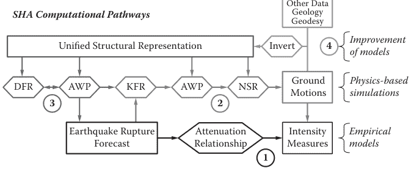

图 6.1 SCEC 集成危险性分析路径。（图片感谢 Thomas Jordan，2007 年。）

## 第六章：利用建模结果保护生命

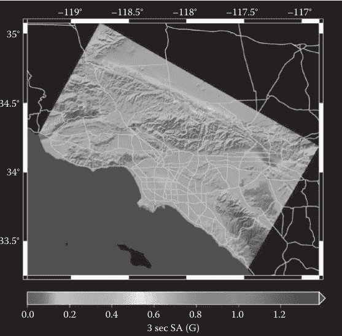

图 6.2（见彩色插图）由 PSHA 数据生成的传统危险图。（版权所有：加州南部地震中心，2010 年）。

专业建筑师和工程师在设计符合建筑规范的结构时参考危险图，保险公司在计算损失估计时也是如此。危险曲线通常与危险图结合使用，显示强度的概率（图 6.3）。

图 6.3 显示了给定地理区域的危险曲线，由我们即将介绍的 `OpenSHA` 创建。x 轴表示增加的峰值地面速度（PGV），y 轴表示超过 PGV 的概率。例如，PGV 为 30 cm/sec 的地震概率约为 .1 (10⁻¹)。在危险图中，这些概率适用于未来 50 年。

尽管很有用，但 SCEC 研究人员认为传统的 PSHA 仿真结果仅是第一步，因为某些影响地面运动的地震物理方面是无法包含的。SCEC 的科学家来自不同的地球、物理科学和计算背景，他们认为迫切需要两点：引入现代物理方法分析自然系统，以及对高性能计算的最先进使用。

## 计算机与社会：向善计算

## 危险曲线

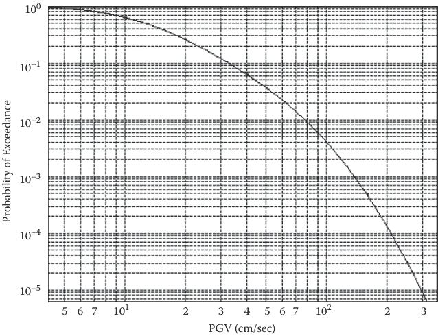

图 6.3 危险曲线。（版权所有南加州地震中心，2010 年。）

系统。此类超级计算机将发挥两个主要作用：增加计算的计算能力，并实现数据和结果的高级图形化表示。图 6.1 中的路径 2 和 3 指的是对基于物理的计算进行增量添加，这些计算最终被统一。这些路径将在下文介绍 `CyberShake` 和 `CME` 时进行讨论。路径 4 代表了 SCEC 为扩展基于物理的模拟而采取的新型和实验性方法，将在后续几个章节中进行讨论。

### 6.5 计算模拟项目与支持平台

`TeraShake-1` 和随后的 `TeraShake-2` 是基于 `Fortran` 编写的计算项目，用于创建由运动学和动力学源破裂模型产生的地面运动（破裂速度和波传播）模拟。“运动学”指的是不包含物体质量或作用在物体上的作用力的地面运动模型。运动学模拟将假设恒定的破裂速度和使用预定的连续时间间隔的滑移。“动态”指的是包含作用在物体上的外力影响地面运动模型。动态模拟将利用物理学来创建动态场景，其中取决于特征的因素会影响破裂速度、滑移和波传播。这些项目被称为“TeraShake”，是因为每次模拟都会产生数 TB（太字节）的数据。例如，一个典型的 `TeraShake-1` 模拟每次可能生成 90,000–120,000 个文件，产生 43 TB 的数据，并在 2,048 个处理器上耗时 100 CPU 小时。

`TeraShake` 是 SCEC 最早的重大模拟项目之一。一个早期模拟模拟了安德烈亚斯断层南部约 230 公里范围内的 7.7 级地震。其技术目标是以最高效的方式将数据分析分布在许多处理器上。SCEC 与加利福尼亚州圣地哥超级计算机中心的计算机科学家进行了合作。其中一个特定的 `TeraShake` 模拟在超级计算机中心运行了大约 240 个 CPU，耗时 5 天，产生了约 50 TB 的数据。这随后被用于创建地震波传播的惊人 4D 可视化。`TeraShake-1` 和 `TeraShake-2` 获得的知识导致了 Shake 地震场景（ShakeOut Earthquake Scenario）的模拟，我们将在本章后部分讨论。

`OpenSHA` 是一个始于 2003–2004 年的项目。（试着猜一下：你认为 `OpenSHA` 代表什么？）`OpenSHA` 是一个基于 `Java` 的开源软件，旨在支持当前和未来的地震危险建模与分析。`OpenSHA` 包含一个图形界面，用户（包括非地震学家）可以在其中输入自己的地震数据并对其进行操作。用户还可以使用各种发布的模型进行计算，其中许多模型是由 SCEC 资助开发的。推理引擎会在用户似乎……时提供建议、指导和警报。`OpenSHA` 的技术目标是作为一个“即插即用”系统。如果你对 `OpenSHA` 背后的计算机架构和哲学细节感兴趣，请参考 `OpenSHA` 网站（`www.opensha.org`）的附录。（附记：你猜出 `OpenSHA` 代表什么了吗？）

`CyberShake` 创建于 2005 年，是一个平台，增加了计算危险曲线所需的一套计算工作流和数据管理工具。`CyberShake` 最初用于基于工程和基于物理的计算（图 6.1 中的路径 1 和 2），其最终目标是完全整合、存储、访问并以其他高效方式大规模管理危险曲线建模。2005 年，`CyberShake` 成功将其计算设施与 `TeraGrid`（一个性的超级计算机网络）上的外部站点集成。一次典型的模拟利用 120 个 CPU，耗时 8 小时——比之前的模拟尝试有了显著提高。由于增加了这些计算资源，到 2006 年，`CyberShake` 研究人员已经产生了新的地图和模拟（图 6.4），大大加深了对普恩特山脉（Puente Hills）断层附近的洛杉矶重要区域的理解。

## 计算机与社会：向善计算

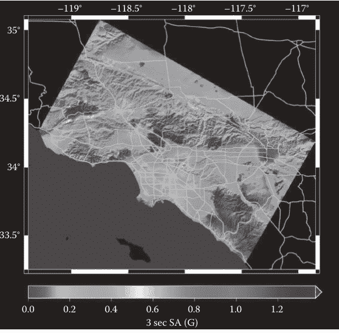

图 6.4（彩色插）由 `CyberShake` 创建的危险图。（版权所有南加州地震中心，2010 年）。

`CyberShake` 扩展到了路径 3 计算，简单来说，它将所有已知的基于物理的计算和因素整合到危险曲线的发展中。包含了更长的断层应力时间尺度，试图更完整地理解板块构造运动（以缓慢著称）如何沿特定断层逐渐积累应力。由于其基于物理的方法，`CyberShake` 能够在其 PSHA（概率地震危险分析）计算中包含盆地效应和破裂传播方向等现象，而这些现象是不包含在经验模型中的。记住，PSHA 代表概率地震危险分析，即产生用于创建危险曲线的数据计算。

图 6.4 显示的区域与图 6.3 中的传统危险图相同。起初看去，这两张危险图可能没有很大区别。然而，如果你仔细观察，会发现两张地图之间的差异。`CyberShake` 地图比传统地图具有更高的细节水平。

## 第六章：利用地震建模结果保护生命

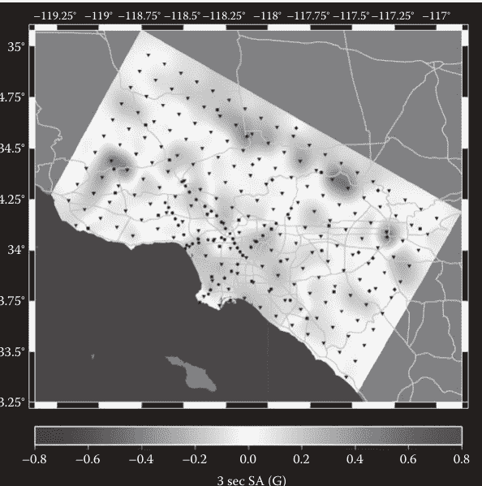

图 6.5（见插）对比 `CyberShake` 与传统地图的地图。（版权所有南加州地震中心，2010 年。）

`CyberShake` 地图底层的数据代表了大量关于该区域运动行为的预测。图 6.5 显示了图 6.2 和 6.4 中所示的相同区域。6.5 中的每个黑色形状代表一个计算了 `CyberShake` 危险曲线的位置。红色区域表示 `CyberShake` 显示的危险高于传统地图，蓝色区域表示 `CyberShake` 显示的危险低于。

2009 年，使用 `CyberShake` 平台产生了一整套危险曲线和地图。利用一系列网格和工作流工具，`CyberShake` 在德克萨斯先进计算中心的 `Ranger` 超级计算机上运行了近两个月，当时是世界上第六快的计算机。为南加州约 225 个不同位置产生了危险曲线，为该地区的地震危险提供了更准确的评估。为了计算这些危险曲线，`CyberShake` 总共执行了 190 项任务，平均使用 4400 个核心，为这次运行产生了 176 TB 的输出数据。

## 计算机与社会：向善计算

在最初简化数据存储和检索的管理工具的基础上，社区建模环境（CME）于 2001 年启动。这一关键系统最初是由致力于所有计算路径（2–4）的科学家团队贡献的。如今，CME 名称被内部和外部研究人员用于指代使用 SCEC 支持的系统进行地震建模和分析的高性能计算环境（图 6.6）。CME 的目的是提供一种能够改进跨国地震科学研究的网络基础设施。CME 的一个目标是随着新项目的开发能够增长，因此它必须支持算法原型设计、地震危险地图创建以及断层动力学模拟，且是技术和非技术人员都能操作的方式。CME 的改进和增强需要与新技术同步进行，并

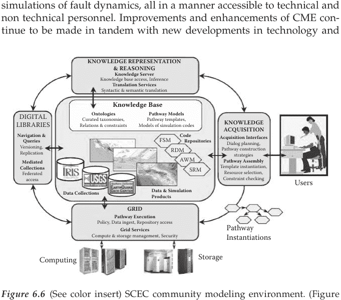

图 6.6（见彩色插）SCEC 社区建模环境。（图片由 Thomas Jordan 提供。）

# 第六章：利用地震建模结果保护生命 223

分析方法。如果你（一名计算机学生）喜欢在高度复杂环境中创建生产力软件的想法，那么在这个领域你可以加入另一个支持地震科学的活跃角色。

CME 的另一个目标与它包含的 `OpenSHA` 一样，是在提供灵活性的同时保持简单。像 `OpenSHA` 一样，CME 是开源软件并基于 `Java` 面对象编程（OOP）。如果你查看图 6.6，你会发现 CME 整合了可以访问许多不同数据库（例如：美国地质调查局、地震数据中心）的数字库、用户可以选择以帮助其创建模拟的产品，以及一个知识引擎。这些资源旨在向用户呈现他们需要的目标信息。

在整个开发周期中，CME 扩展以适应分布式数据、来自 `Java` 以外的语言（包括 `Fortran`、`C`、`MATLAB`、`Perl` 和 `Python`）以及网格计算的使用（参见侧栏“什么是网格计算？”）。CME 集成到网格网络更新了我们讨论过的作为计算路径 1–4 的模拟方法（图 6.6 中的“路径实例化”）。随着分布式数据的引入，数据安全变成了一个关键问题，因此实施了额外的软件和硬件措施来保护信息。确保跨互联网的数据安全是一项任务（参见第 3 章关于互联网投票的示例，了解该话题可能变得多么激烈），计算机科学在此发挥着重要作用。

正在 CME 内开发的路径 4 致力于开发“反演过程”的模拟。例如，模拟将取自地震波的数据并尝试发现断层最初是如何破裂的。从科学角度来说，这非常有挑战性，因为目前的计算到为止只创建了一维模型——这本质上是路径 1 的重新开始。基于物理的模型构建和模拟方法需要进一步探索，并创建计算模型来表达这些结果。从计算角度来看，反演过程模拟非常有挑战性，因为即使使用现有技术，带宽需求也极高，而且真实的地质模拟所需的图形数据分辨率尚未达到。对于从事科学计算图形开发子领域的计算机科学家来说，有机会为实现创建反演过程模拟的目标做出贡献。

# 什么是网格计算？

在网格中，内存和处理分布在并行运行的计算机上，以解决高度复杂的问题。

# 计算机与社会：计算机计算机

网格在科学计算中非常常见。通常，每台计算机内部都有多个核心。可以使用不同的拓扑结构来创建网格，但在网格规模扩大到包含更多处理能力时，必须解决一些常见问题。

存在创建多少进程的问题。太少处理可能会变慢，太多则处理也可能变慢（你能想到为什么会这样吗？）。进程必须以平衡的方式分布。平衡并不意味着“相等”。（为什么？）负载均衡是一个主要关注的问题；进程分布必须对计算能力的变化做出几乎瞬时的响应。进程可能在单个节点上相邻运行。这会在节点之间产生开销，必须将其降至最低。数据将如何被分解并分布以供跨网格处理？根据对必须执行的计算任务的分析，创建领域和子领域。有策略性地放置缓冲区，以便在进程产生必须交给另一个进程的数据时使用。数据的大小、位置和持有时间必须经过仔细计算。何时不进行缓冲……

节点之间以及它们内部的进程将相互通信。只传递数据消息，如果处理得不当，这可能成为延迟和带宽问题的严重来源。目标是减少系统的通信过载并降低传输率。消息可以聚合到缓冲区中以减少延迟，但作为数据缓冲，必须就如何安排通信调用和聚合做出决定。某些通信必须立即进行；另一些必须等待另一个发生。当你同步时，何时不同步……

计算机科学的目标是在考虑到正在创建的建模和模拟类型背景的所有变量的情况下，最大化跨网格网络的性能。如果错了，你的网格将无法扩展。事实上，如果你做错了并增加了对系统的要求，你的系统退化得会越来越快。这绝对是对并行系统设计各个方面都有广泛且深入理解的计算机科学家面临的任务。

第六章：利用地震建模结果保护生命 225

# 6.6 教育外展工作

尽管对地震行为的理解不完全，但必须做出关于地震风险减少和应急响应的经济、政治和社会决策。遗憾的是，人性会忽略或推迟处理这些压倒性的问题。因此，除了技术挑战之外，存在一个迫在眉睫的社会挑战：当不可避免的地震发生时，如何处理公众认知、准备和行为。在 SCEC 工作和位于 SCEC 的人们不仅对他们的工作着迷，而且觉得有道德义务将他们的结果用于公共利益。要在外展工作中取得成功，你不仅需要出色的科学技能，还需要出色的沟通和公共演讲技巧。我们需要享受将复杂的科学和计算信息翻译成不同格式以适应不同受众的挑战。技术写作或对你的软件工程项目进行公开演示将非常有用的经历。

首先，关于地震有一些 SCEC 想要消除的常见神话。有些神话看起来相对无害，甚至有趣。对于某些人来说，他们认为地震更有可能发生在早上，或者加利福尼亚州将掉入海洋。这些神话相对无害，但另一些绝对不是：许多人认为地震中最安全的方法是跑到户外，这是糟糕的行为之一；另一些人认为他们不会因为建筑规范而受伤，因此不需要采取任何保护措施。人们会对视觉效果产生反应——你如何向非技术观众有效展示复杂的模拟或计算模型呢？

关于安全和其他主题的神话是 SCEC 及其地震国家联盟的伙伴在 2008 年创建“加利福尼亚州大演习”（Great California ShakeOut）的重要原因。这项全州活动是 SCEC 在“宣传”地震准备方面最大、最可见的有效努力。这是一项自愿的教育演习，ShakeOut 让公共和私营机构参与，并练习地震发生时该（问题：你知道该做什么吗？）。最初是一项南加州活动，公众需求将其扩展到全州——2009 年有约 690 万参与，2010 年达到 7900 万。参与者来自 K-12 学校、大学、企业、政府和医疗机构、社区组织以及个人。调查显示，这次演习促使许多参与者超越单日活动，并在活动前后都开发了补充活动。同样的报告以及采访显示，人们学到了很多，并感到准备和保护自己方面感觉良好。

226 计算机与社会：为向善而计算

消息已经传开，美国其他州甚至其他国家都在考虑以加州大震演（Great California Shakeout）为模型和灵感，创建他们自己的地震演习。

计算机科学家、学生和专业人士是 SCEC 许多教育和外工作的关键部分。例如，SCEC 维护着两组活跃的夏季实习计划，其中一项明确跨越了计算与地震科学领域。由于地震建模和模拟的迫切需求，计算机专业的学生与地球科学及其他地球科学的学生、人员并肩工作，解决真实且困难的问题。过去的计算机科学学生曾接触过 GPS、可视化软件、多种编程语言、分布式系统以及人工智能的应用。这些项目的成果成为 SCEC 公共档案的一部分，SCEC 利用此推进科学并教育公众。

## 6.7 SCEC 支持的研究取得的具体成果

毫无疑问，SCEC 正在成功实现其使命宣言。在此重申，其使命是：

- 收集南加州及其他地区的地震数据
- 将这些信息整合到对地震现象的全面的、基于物理的理解中
- 将这种理解作为有用的知识传给整个社会，以降低风险

以下是第一和第二点要点已经实现的示例。

首先，SCEC 创建了显著改进的地震危险性地图，这些地图用于量化长期预期和预测。这些地图及其数据已被引用并纳入由联邦政府机构创建的国家地震危险性地图。其次，SCEC 为之前的严重地震创建了模拟运动时间历。第三，`TeraShake` 模拟揭示了为什么发生在洛杉矶以东远处的圣安德烈亚斯断层某段的地震，会以直角方向直接汇聚到市中心。

以下是使命宣言中第三点要点已经实现的示例：

首先，SCEC 生成了改进的已知断层滑移率模型，这有助于预测地震发生的时间和严重程度。建筑师和执业工程师在断层附近的特定场址进行设计和施工时，一直依赖这些新模型——这在南加州等许多地方是不可避免的。其次，研究人员与工程师合作使用 SCEC 的模拟来评估结构是否需要修缮和修改。第三，在给定区域的许多不同场景下对模拟地震进行了测试，以区分不同结构将对断层破裂事件做出反应。

作为 SCEC 支持的工作对其他机构和城市产生影响的一个示例，考虑他们对 PEER 高层建筑计划的贡献。位于加利福尼亚州伯克利的太平洋地震工程研究中心（PEER）是一个多组织研究项目，专注于“发现……能够实现建筑[极高层建筑]的方法；其超出建筑规范规范性规定的范围”（摘录自 PEER 网站；见附录）。他们的最终目标是为高层建筑开发新的设计标准，以便在地震发生时保护它们。根据 SCEC 的说法，PEER 研究中使用的所有模拟数据均来自 SCEC——数千个数据点。最初关注美国西岸城市，所学到的经验可以应用于全球范围内正在建造高层建筑的许多其他城市。

如果没有计算机科学家的贡献以及计算机科学高性能计算领域的改进，这些成功成果都不可能实现。从 PC 到超级计算机，再到分布式集群和密集网格，计算软件和硬件的每一次进步都让 SCEC 能够实施和测试其关于地震的理论。计算机科学家和地震科学家共同推动各自的边界。当计算机科学家推向科学计算边界时，地震科学家就能产生更详细且立即实用的结果。相反，地震科学家的迫切需求激发了计算机科学家的想象力和创造力，寻找在不断扩大的平台上有效优化多维模拟的新方法。

## 6.8 未来的挑战与计划

应用于自然世界的科学高性能计算是计算机科学中最具跨学科性和富有创造性的应用之一。这不仅需要计算知识的广度和深度，而且与其它领域的专家合作是所肯定的。展望未来，还有其他高度复杂的自然科学难题，例如气候变化，它们可能会从研究 SCEC 在科学计算和跨学科协作方面采取成功的方法中获益。正如 SCEC 所证明的，协作、任务分工和信息共享不仅是有效的，而且是关重要的。

### 6.8.1 扩展协作

工作永远做不完：需要收集更多数据、开发更好的模型和模拟、创建更快更有效的计算平台以支持整个研究和数据管理，以及更多需要接受基础防震和风险降低教育的社区。SCEC 扩展这些努力的一种方式是以（各种方式）支持全美从事基础地震研究的多个学科的研究人员。目标是将他们的结果整合到对地震现象全面的理解中。来自 65 个研究机构的研究人员正朝着这一目标合作。此外，加拿大的几家机构参与了 SCEC 附属地震研究，并与瑞士、新西兰、墨西哥和台湾进行积极协作。这些地区中的许多直接位于构造断层上，因此也有自己的地震威胁。2010年秋季和2011年春季新西兰基督城发生的严重地震是广为人知的例子。2011年日本地震和海啸的灾难性结合证明了为什么建立多机构协作和数据共享是至关重要的，SCEC 希望继续扩大协作，例如与中东国家地区的合作。

### 6.8.2 迈向千万亿级模拟

千万亿级计算的一个尖端应用是 SCEC 的 PetraShake。TeraShake 模拟生成了 TB 级的数据，而增加模拟的分辨会产生更多信息。作为参考，美国地质调查局，2011年2月的新西兰地震和2011年3月的日本地震达到了9.0级。在两次地震发生之前，SCEC 模拟了一个面积为 800 x 400 x 100Km³ 的场景，使用了160K个步长。在该场景中产生了 PB 级的数据。

SCEC 还准备使用 CyberShake 平台进行千万亿级模拟。他们计划将模拟范围从南加州扩大到整个州，并推动模拟包含更高频率运动。这将模拟规模扩大300倍，需要千万亿级机器、新架构和新工具。

运行模拟涉及的计算挑战急剧增加。在这种规模下，需要计算机科学知识来解决内存分配和分区、数据存储、负载均衡、消息传递和通信等特殊问题。复杂的是，涉及千万亿级计算的实验通常分布在许多机构，如圣地亚和德州。随着架构配置数量和多样性的增加，迁移应用程序的可能性也随之增加。迁移必须在完成后对系统透明，且不影响模拟生成的质量和及时性。

## 6.9 结语

记得 Helene 和 François 吗？从现实角度来看，他们很幸运没有在地震经历中受伤。Helene 和他们的主管在地震发生时没有犯错，就像许多不明真相那样。François 什么也没有做错；他是在错误的时间出现在错误的地点，而当时没有社会或技术基础设施向他和同伴警告即将到来的自然灾害。运气不应该是人们幸存并免受伤害的主要因素。

有些事情无论地球科学还是世界上所有的计算能力可能永远无法实现，例如精确到天或甚至年的初始地震发生时间和地点预测。相反，目前可以以显著精度（精确到天）预测一些余震的信息。基于此，SCEC 及其附属研究人员的协作工作每天都有条理、坚定地致力于通过有效利用技术和教育推广来改变保护人的平衡。专注于高性能计算优化和应用的计算机科学家同样坚定且奉献的工作，持续为创建模拟所需的工具、技能和理论提供支持。

## 6.10 致谢

- Thomas Jordan，南加地震中心 (SCEC) 主管，加利福尼亚州洛洛杉矶
- Mark Bentley，传播、教育与外活动总监，SCEC，加利福尼亚州洛洛杉矶
- Francine Berman，伦斯勒理工学院研究副总裁，加州大学圣地亚哥分校超级计算机中心前主任
- Alexander Kaczmarczyk
- Mark Ardis，斯文斯理工学院教员，新泽西州霍霍肯

## 6.11 练习与活动

1. 想象你想为你居住地 5 英里内的某处断层创建一个 3D 图形模型。了解该断层的起始和结束位置。为了简单起见，我们假设该断层没有侧支。请列出所有你能想到的、需要考虑纳入或排除在模型中的每一个因素——无不遗漏。提示：如果你不确定什么构成“因素”，可以回看“地震科学的技术与社会挑战”一节以获取灵感。

2. 现在，你已经完成了问题 1 中的列表，请决定在模型中包含哪些数据，排除哪些数据。你的挑战是创建一套审慎的参数，以指导该断层模型的开发。为每种选择提供理由。

3. 以你问题 2 中的列表为进入下一步：你想设计一个断层破裂时行为的动态模拟（即 3D 模型）。像你在问题 1 中做的那样，创建一个你可能需要的额外数据的综合列表。如果你发现静态模型中遗漏了一些数据，请将其添加并做好说明。然后创建第二个列表，从中删除你在动态模拟中可以不需要的数据，就像你在问题 2 中处理静态断层模型时做的那样。为保留的每一项和删除的每一项都提供理由。

4. 从科学的角度来看，你在问题 1-4 中的选择会有什么实际后果？也就是说，在推进对地震系统的理解方面，你做了哪些权衡？请根据本章提供的信息，在你对地震问题和参数的理解范围内进行回答。

5. 从计算的角度来看，你在问题 1-4 中的选择会有什么实际后果？也就是说，你具体做了哪些权衡——具体来说，你的选择如何影响所需的计算资源（软件和硬件）？

6. 从人类和社会的角度来看，你在问题 1-4 中的选择会有什么实际后果？也就是说，在实现 SCEC 使命的第三目标方面，你做了哪些权衡？

7. 创建一个高层面向软件工程的描述/设计，说明你的两个模型（3D 静态断层模型和动态破裂模拟）如何进行修改，以便向 13-18 岁的青少年展示。如果由真人或电脑旁白解释模型，请包含一份涵盖重要要点的简报。

8. 你知道地震发生时该做什么吗？访问 SCEC 网站确认你的判断是否正确。你相信多少地震迷言？讨论你将如何说服你的家人为地震做准备，即使他们出于某种原因认为“这大不了”。你如何利用你的计算机计算背景来增强你的论点？

9. 使用模型和模拟进行地震建模有哪些技术缺陷？作为一名计算机科学家，可能如何克服或至少缓解这些缺陷？

10. 这不是关注所有类型的地震，例如深海地震或火山地震。选择其中一种，并尽可能详细地推测为了给这些场景之一创建一个实用的模拟，需要包含或删除哪些变量。重点关注行为以及需要理解这种行为的原因。

11. 如何利用社交媒体来促进改进地震危险性分析和更好地保护公众的目标？

12. 科学界对于是否可以或应该从系统级模型中学习（与紧密隔离因素并单独关注每个因素相反）存在争论。从计算的角度来看，反对系统级模型的论点是什么？

13. 假设你有有限的预算提供教育活动。理想情况下，你想教育小学生（约 6-11 岁）、初中生（约 12-14 岁）、高中生（约 15-18 岁）、父母和当地企业。然而，你现在无法负担教育所有这些群体。应该先教育哪些群体？为你的答案提供充分的理由。

14. 你的老板交交你一项任务：拿一张危险地图（使用本章中的某一张），并向一群对图形、自然科学和计算感兴趣的高中生解释它。他们上过第一门物理课程（可能基于微积分，也可能不是——你不知道）、第一门地球科学以及一门 Java 入门编程课程。为这群人开发一份演示文稿。

**额外积分：** 寻找一些具有上述背景的意愿参与的高中生，尝试你的演示。请他们反馈哪些部分有效、哪些无效，以及你可以做什么来为下一组学生改进演示。

## 附录

### 链接

字体 SCEC 主网站：www.scec.org

- SCEC 实习信息：www.scec.org/education/college/internships
- SCEC 出版列表：www.scec.org/resources/catalog/index.html
- 常见的地震迷言：www.scec.org/education/public/allmyths.html
- PEER：http://peer.org
- OpenSHA 网站：www.opensha.org
- 美国地质调查：www.usgs.gov

### 书籍、手册、报告

- 在活跃地震带生活 (Living on an Active Earth)：国家科学院出版社，华盛顿
- 地震带的探索 (Pushing Down in Earthquake Country)：www.earthcountry.info
- 南加地震中心：传播、教育与活动回顾
- 科学家与工程师高性能计算导论：CRC Press，佛罗里达州博卡顿

### 学术文章

- Callaghan, S. 等。“使用分布式高吞吐量超级工作流减少时间：CyberShake 的经验。”第四届 IEEE 电子科学会议，2008，印第安波利
- Cui, Y. 等 迈向千万亿级地震模拟，Acta Geotechnica, DOI `10.1007/s11440-008-0055-2`, Springer, 2008.

# 第七章

## 当追求梦想意味着创立自己的业务

### 7.0 引言

有时，改变生活的事件会促使人们改变职业方向并开始创业。这就是本章的主题。一位计算机科学家受其个人生活的启发，决定单干创业并创立了一家公司。她对移动设备应用开发有一个想法；当时没有人创建过她脑海中的软件。她意识到她的应用有一个市场利基，并以专注一的决心进行追求，在此过程中学习了创建和经营一家软件和服务公司的含义。其受众主要是公立教育系统和残障学生。因此，该简介包含了关于学习理论，以及向课堂引入技术和服务的的相关信息。

这是作为书中最后一个简介的自然良人选。毕竟，在我们讨论过的所有组织和团体之后，将创业作为计算机科学家的一种可行选择是非常重要的。这个简介中的商业导向比其他任何一个都更强。创业需要动力和决心，但只要规划得当，就可以实现。

在技术上，我们关注的是移动设备。这是另一个爆发式增长领域。实用的计算技能包括 `C` 语言或信息科学全范围的课程。特别是，能够快速学习新语言、编写紧凑高效的代码并遵循他人创建的标准。多媒体课程对于在便携设备上开发吸引人的应用程序非常重要，用户界面设计原则也同样如此。

你需要的其他技能涵盖了创业的业务方面。你可以参加涵盖从销售、营销到会计等所有内容的课程越多越好。如果你有正式演示的经验，也会很有帮助——任何你能找到的进行演示的机会，都要抓住它。即使你最终将其中一些活动委托给其他专业人士，你也将需要对他们在你业务中扮演的角色有坚固的理解。你将负责；你需要能够就业务的全部技术和非技术方面进行交流。你不想落入一个经典的陷阱：由于对业务基础知识理解不足，导致伟大的技术想法失败。

一些计算机科学家很早就知道想成为创业者。另一些人则在职业生涯后期才发现。无论你是想建立一家拥有许多员工的公司，还是想作为顾问独资工作，或者介于两者之间，本章将让你体验这种经历的感受。

## 逸事

Margaret Ellis 是一名专业系统工程师，当她的孩子之一患重病时，尽管尽了最好的医疗服务，孩子仍留下了永久性的认知和运动障碍。突然，作为一名活跃的家长，Margaret 被推入了一个新世界，即如何确保孩子获得最好的教育。她希望女儿尽可能地接受包容性教育——能够体验并与他们互动，而不会感到“异类”。在教育软件中，她没有看到她认为帮助女儿所需的内容。她意识到普通的 K-12 学校可以从创新的教育应用中获益。但任何技术和应用的引入和使用都必须从教学和技术角度得到良好的执行。需要有人来解决这个问题。Margaret 面临的问题变成了：该怎么办？

### 7.1 发现 iPod 在教育中的潜力

那是 2009 年 8 月。她的女儿 7 岁了。Margaret 正在兼职照顾女儿。Margaret 的丈夫 Matt 最近订购了一台带有 iPod touch 的 Macintosh 电脑作为促销奖励。另一位家庭成员给了她一张 iTunes 充值卡，以便她为 iPod 购买应用程序（通常称为“Apps”）。Margaret 全心投入照顾女儿，开始仔细研究 Apple Store 和其他公司提供的教育软件。她买了几款 App 进行尝试。

许多移动设备（特别是 iPod touch）的一个大卖点是，它们能够呈现支持不同学习风格的材料。什么是学习风格？简单来说，就是某人最习惯的学习方式或方法。每个人都有利用所有感官进行学习的能力，除非在某种程度上受到了深远影响，例如听聋或盲症。有些人是视觉导向的；另一些人更倾向于听觉，或动觉。有些人对抽象概念更适应，有些人则对具体事物更适应。计算机专业的学生可能对此非常熟悉：有些人能在讲座环境中表现良好，另一些人倾向于读书，而另一些人只想上手操作电脑。这些都是听觉、视觉和动觉学习风格偏好的例子。根据最新的研究，学习风格偏好至少部分源于遗传。人们创建了许多“评估工具”来从学习风格偏好的维度对人们进行评估。附录中列出了一些较为人知的调查表。

学习风格调查表的结果有时会被误解和解读，用来给人们“贴标签”或“分类”。至关重要的一点是强调，学习风格是“偏好”而非固有的特征。虽然学习风格可能在某种程度上受遗传影响，但遗传并不是完全决定性的。研究表明，早期的习化可能会强调某种学习风格而非另一种。从从小开始，孩子们为了适应他们所处的家庭和社会环境而做出努力。仅仅因为一个人对视觉学习有偏好（例如阅读），并不意味着他们无法在听觉环境（例如讲座）中学习。教学和学习越能涵盖多种学习风格偏好，就越容易提供帮助。这就是 iPod touch 在教育环境中的潜力引起了 Margaret 的注意（图 7.1）。与书籍、讲座或实验室不同，像 iPod 这样的设备本质上是视觉的；它本质上是动觉的，它的设计旨在提供高质量的声音。

在察觉之前，Margaret 就有了“一大堆主意”。她看了学校和治疗课程中目前的做法，心想“我们可以做得更好”。她开始提问并寻找某来承担这项事业。这个人必须在技术上精通，理解学前和小学教育，最好还具有对残障儿童的知识。那人在哪里？这是她在与老师、家长、治疗师、朋友和专业同事交流时不断问自己的问题。在某个时刻，她突然意识到：“是我！我拥有这些技能！是我！”成为软件企业家和企业所有者的舞台已经搭好了。

### 7.3 第一个 iPod touch 应用程序：5 只南瓜

“5 Pumpkins”是许多幼儿在学校学会唱的一首诗。原作者未知，这首诗属于公有领域，并有多个版本。一个例子是：

- 五只小南瓜坐在栅栏上。
- 第一只说：“噢我的天，天晚了。”
- 第二只说：“空气中有女巫。”
- 第三只说：“但我不在乎！”
- 第四只说：“让我们跑吧，跑吧，跑吧。”
- 第五只说：“我准备好玩玩了！”

呼——呼！风吹过，五只小南瓜滚消失了视线中。

这首诗是 Margaret 第一个软件应用程序的灵感（图 7.2）。由于几个原因，这个选择是逻辑性的。首先，已经存在一套围绕“5 只南瓜”创建的教育活动和工具。其次，孩子们觉得这首歌很有趣。第三，5 只南瓜可以针对一个或另一个进行定制。

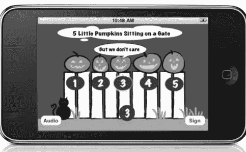

**图 7.2**（见彩色插页）《5个南瓜》的截图。（版权所有 2009 DevelopEase, LLC.）

它是关于数字计数练习的完美载体。第四，这项练习可以在软件中进行优化以运行在移动设备上。在设计该应用时，玛格丽特（Margaret）受到了“自适应书籍”的启发。自适应书籍在历史上是一种实体书，孩子可以通过不同的方式与页面互动，例如使用魔术贴将物品匹配。并非所有的自适应书籍都具有教育意义——许多是玩具或附带玩具的。制作自适应书籍既耗时又耗费精力，因为这涉及取来几本书，将它们剪碎，然后组合成一本包含可操作性物理活动的混合书籍。自适应书籍通常会经过层膜处理，以抵御由于许多孩子操作带来的磨损。这增加了相关的成本和劳动投入。有些图书员拥有丰富的自适应书籍收藏，但许多人却完全没有。

作为软件开发人员和教育者，玛丽丽特意识到自适应书籍背后的理念可以融入软件应用程序中，从而消除体力劳动、销毁实体书籍的费用，并无限延长书籍的使用寿命。玛格丽特拥有教育和专业经验，她可以在所有必要的技术和教学方法上汲取经验。故事可以以新的方式为孩子活起来。现代图形和用户界面进步带来的所有可能性都可以加入到电子自适应书中。这些想法反映了玛格丽特作为计算机科学家的另一一个指导哲学：“软件的构建是为了更好地完成一项已经存在的工作。”

根据玛格丽特的说法，《5个南瓜》确实是一项心血之作。她在几个朋友的帮助下亲自创建了这个程序，同时平衡着家庭责任以及监管一个由 25 名专业人士组成的女儿护理团队的艰巨任务。由于玛格丽特拥有计算机科学背景，为《5个南瓜》编写代码在技术上并没有很有挑战性。她对自己的能力充满信心。这种信心是激发她的因素之一——她觉得她的计算机科学背景使她完全准备好为 iPod touch 设计并创建一个可靠的应用程序。她特别回想起一门课。那是她在本科期间上的一门多媒体课程。这门课是一门实验性的荣誉班课程。选择这门课的决定部分出于逻辑，部分出于直觉，部分是因为这门课听起来比其他备选课程更有趣。回想起来，玛格丽特说，选择那门选修课被证明比她想象的有用得多。

《5个南瓜》的原始版本使用她当地社区的志愿者进行了测试和完善。玛格丽特估计经历了大约两周的“密集”测试，在测试期间，她再次将她的软件工程技能投入实用，以定位会干扰目标受众应用程序可用性的漏洞或用户界面问题。

在继续讲述《5个南瓜》的故事以及随之而来的应用之前，我们需要转一下一下，讨论一下快速演变的移动技术市场无处不在的挑战。玛格丽特必须不断意识到新的“热点”技术并关注发展趋势。为了让我们也能完全理解她的工作背景，我们需要这样做。

## 7.4 跟上最新的移动设备

如果你是以下任何设备的用户，或者喜欢跟上最新的设备，那么以下的大部分技术信息可能对你来说很熟悉。事实上，技术变化如此之快，当你读到这里时，本节中的某些细节不可避免地已经发生了变化。在任何时刻最新发布的内容（写作时的 Windows Phone 就是一个例子）要么已经非常成熟，要么已进入市场，要么正在与其他设备为了市场份额进行持续的斗争。谁知道在你读到这里时会出现什么新的硬件和软件呢。

那么，为什么要讨论移动技术的“当前”状态呢？理解 DevelopEase 进入市场的大大背景、创业之初就存在的影响以及最近存在的影响至关重要。通过简要地共同检查这些设备，也可以准确地预测移动设备的未来方向、应用开发的使用，以及 DevelopEase 作为一家初创公司未来可能面临的挑战。对成为创业者感兴趣的计算机学生需要进行这类对话——细节要比这里能写的详尽得多——以便创建他们的商业计划并进行有效的竞争。（iPhone 以及此处讨论的其他产品的最新技术规格 URL 列在附录中）。

### 7.4.1 iPod touch

iPod touch 是 iPod 系列中最新、最复杂的设备，该系列最初是一个简单的音乐播放器。iPod 仍然有多种变体，包括 iPod shuffle、iPod nano 和 iPod classic。前两种 iPod 仍然面向那些想要高便携性音乐播放器的用户。iPod shuffle 是最基础的设备，尽管它可以播放音乐、有声书和播客。iPod touch 增加了存储和显示照片、播放收电的能力，还包含了一些吸引那些要求略高的“边运动边听音乐”爱好者的功能。与 shuffle 不同，nano 有屏幕。iPod nano 和 shuffle 都非常小，因此用户在走路、跑步时可以完全完全忽略自己携带了什么。iPod classic 稍微大一点，因为它的主要卖点是它包含的存储空间比 shuffle 或 nano 都得多。然而，classic 仍然非常便携，并为存储和播放音乐、视频和照片而设计。

iPod touch 是所有 iPod 中最复杂的，不仅作为便携式多媒体设备，还包含了一些吸引那些要求略高的“边运动边听音乐”爱好者的功能。与 shuffle 不同，nano 有屏幕。iPod nano 和 shuffle 都非常小，因此用户在走路、跑步时可以完全忽略自己携带了什么。iPod classic 稍微大一点，因为它的主要卖点是它包含的存储空间比 shuffle 或 nano 都得多。然而，classic 仍然非常便携，并为存储和播放音乐、视频和照片而设计。

iPod touch 是所有 iPod 中最复杂的，不仅作为便携式多媒体设备，还包含了一些吸引那些要求略高的“边运动边听音乐”爱好者的功能。与 shuffle 不同，nano 有屏幕。iPod nano 和 shuffle 都非常小，因此用户在走路、跑步时可以完全忽略自己携带了什么。iPod classic 稍微大一点，因为它的主要卖点是它包含的存储空间比 shuffle 或 nano 都得多。然而，classic 仍然非常便携，并为存储和播放音乐、视频和照片而设计。

iPod touch 是所有 iPod 中最复杂的，不仅作为便携式多媒体设备，还包含了一些吸引那些要求略高的“边运动边听音乐”爱好者的功能。与 shuffle 不同，nano 有屏幕。iPod nano 和 shuffle 都非常小，因此用户在走路、跑步时可以完全忽略自己携带了什么。iPod classic 稍微大一点，因为它的主要卖点是它包含的存储空间比 shuffle 或 nano 都得多。然而，classic 仍然非常便携，并为存储和播放音乐、视频和照片而设计。

iPod touch 是所有 iPod 中最复杂的，不仅作为便携式多媒体设备，还包含了一些吸引那些要求略高的“边运动边听音乐”爱好者的功能。与 shuffle 不同，nano 有屏幕。iPod nano 和 shuffle 都非常小，因此用户在走路、跑步时可以完全忽略自己携带了什么。iPod classic 稍微大一点，因为它的主要卖点是它包含的存储空间比 shuffle 或 nano 都得多。然而，classic 仍然非常便携，并为存储和播放音乐、视频和照片而设计。

iPod touch 是所有 iPod 中最复杂的，不仅作为便携式多媒体设备，还包含了一些吸引那些要求略高的“边运动边听音乐”爱好者的功能。与 shuffle 不同，nano 有屏幕。iPod nano 和 shuffle 都非常小，因此用户在走路、跑步时可以完全忽略自己携带了什么。iPod classic 稍微大一点，因为它的主要卖点是它包含的存储空间比 shuffle 或 nano 都得多。然而，classic 仍然非常便携，并为存储和播放音乐、视频和照片而设计。

iPod touch 是所有 iPod 中最复杂的，不仅作为便携式多媒体设备，还包含了一些吸引那些要求略高的“边运动边听音乐”爱好者的功能。与 shuffle 不同，nano 有屏幕。iPod nano 和 shuffle 都非常小，因此用户在走路、跑步时可以完全忽略自己携带了什么。iPod classic 稍微大一点，因为它的主要卖点是它包含的存储空间比 shuffle 或 nano 都得多。然而，classic 仍然非常便携，并为存储和播放音乐、视频和照片而设计。

iPod touch 是所有 iPod 中最复杂的，不仅作为便携式多媒体设备，还包含了一些吸引那些要求略高的“边运动边听音乐”爱好者的功能。与 shuffle 不同，nano 有屏幕。iPod nano 和 shuffle 都非常小，因此用户在走路、跑步时可以完全忽略自己携带了什么。iPod classic 稍微大一点，因为它的主要卖点是它包含的存储空间比 shuffle 或 nano 都得多。然而，classic 仍然非常便携，并为存储和播放音乐、视频和照片而设计。

iPod touch 是所有 iPod 中最复杂的，不仅作为便携式多媒体设备，还包含了一些吸引那些要求略高的“边运动边听音乐”爱好者的功能。与 shuffle 不同，nano 有屏幕。iPod nano 和 shuffle 都非常小，因此用户在走路、跑步时可以完全忽略自己携带了什么。iPod classic 稍微大一点，因为它的主要卖点是它包含的存储空间比 shuffle 或 nano 都得多。然而，classic 仍然非常便携，并为存储和播放音乐、视频和照片而设计。

### 7.4.2 iPad

在某些方面，iPad 是 iPod touch 的逻辑升级，但在另一些方面又不是。潜在客户如何看待 iPad 取决于那个人想做什么。写作时，iPad 尺寸大得多，绝对不是那种可以装在牛仔裤口袋里的东西。

等一下，iPod classic 稍微大一点，因为它的主要卖点是它包含的存储空间比 shuffle 或 nano 都得多。然而，classic 仍然非常便携，并为存储和播放音乐、视频和照片而设计。

iPod touch 是所有 iPod 中最复杂的，不仅作为便携式多媒体设备，还包含了一些吸引那些要求略高的“边运动边听音乐”爱好者的功能。与 shuffle 不同，nano 有屏幕。iPod nano 和 shuffle 都非常小，因此用户在走路、跑步时可以完全忽略自己携带了什么。iPod classic 稍微大一点，因为它的主要卖点是它包含的存储空间比 shuffle 或 nano 都得多。然而，classic 仍然非常便携，并为存储和播放音乐、视频和照片而设计。

iPod touch 是所有 iPod 中最复杂的，不仅作为便携式多媒体设备，还包含了一些吸引那些要求略高的“边运动边听音乐”爱好者的功能。与 shuffle 不同，nano 有屏幕。iPod nano 和 shuffle 都非常小，因此用户在走路、跑步时可以完全忽略自己携带了什么。iPod classic 稍微大一点，因为它的主要卖点是它包含的存储空间比 shuffle 或 nano 都得多。然而，classic 仍然非常便携，并为存储和播放音乐、视频和照片而设计。

等一下，原文内容有些重复。

iPod classic 稍微大一点，因为它的主要卖点是它包含的存储空间比 shuffle 或 nano 都得多。然而，classic 仍然非常便携，并为存储和播放音乐、视频和照片而设计。

iPod touch 是所有 iPod 中最复杂的，不仅作为便携式多媒体设备，还包含了一些吸引那些要求略高的“边运动边听音乐”爱好者的功能。与 shuffle 不同，nano 有屏幕。iPod nano 和 shuffle 都非常小，因此用户在走路、跑步时可以完全忽略自己携带了什么。iPod classic 稍微大一点，因为它的主要卖点是它包含的存储空间比 shuffle 或 nano 都得多。然而，classic 仍然非常便携，并为存储和播放音乐、视频和照片而设计。

iPod touch 是所有 iPod 中最复杂的，不仅作为便携式多媒体设备，还包含了一些吸引那些要求略高的“边运动边听音乐”爱好者的功能。与 shuffle 不同，nano 有屏幕。iPod nano 和 shuffle 都非常小，因此用户在走路、跑步时可以完全忽略自己携带了什么。iPod classic 稍微大一点，因为它的主要卖点是它包含的存储空间比 shuffle 或 nano 都得多。然而，classic 仍然非常便携，并为存储和播放音乐、视频和照片而设计。

iPod touch 是所有 iPod 中最复杂的，不仅作为便携式多媒体设备，还包含了一些吸引那些要求略高的“边运动边听音乐”爱好者的功能。与 shuffle 不同，nano 有屏幕。iPod nano 和 shuffle 都非常小，因此用户在走路、跑步时可以完全忽略自己携带了什么。iPod classic 稍微大一点，因为它的主要卖点是它包含的存储空间比 shuffle 或 nano 都得多。然而，classic 仍然非常便携，并为存储和播放音乐、视频和照片而设计。

iPod touch 是所有 iPod 中最复杂的，不仅作为便携式多媒体设备，还包含了一些吸引那些要求略高的“边运动边听音乐”爱好者的功能。与 shuffle 不同，nano 有屏幕。iPod nano 和 shuffle 都非常小，因此用户在走路、跑步时可以完全忽略自己携带了什么。iPod classic 稍微大一点，因为它的主要卖点是它包含的存储空间比 shuffle 或 nano 都得多。然而，classic 仍然非常便携，并为存储和播放音乐、视频和照片而设计。

iPod touch 是所有 iPod 中最复杂的，不仅作为便携式多媒体设备，还包含了一些吸引那些要求略高的“边运动边听音乐”爱好者的功能。与 shuffle 不同，nano 有屏幕。iPod nano 和 shuffle 都非常小，因此用户在走路、跑步时可以完全忽略自己携带了什么。iPod classic 稍微大一点，因为它的主要卖点是它包含的存储空间比 shuffle 或 nano 都得多。然而，classic 仍然非常便携，并为存储和播放音乐、视频和照片而设计。

### 7.4.5 Windows Phone

2010 年 11 月最新发布的是 Windows Phone。这是微软公司对苹果和谷歌设备的直接挑战，时间将证明该产品是否会被开发者社区接受，特别是对于教育类应用。

244 计算机与社会：向善而行

## 7.4.6 黑莓 Torch (BlackBerry Torch)

并不是人都熟悉“RIM”，即 Research in Motion，它是极其著名的流行 PDA 设备创造者。在许多方面，黑莓（大多数人指该系列产品）代表了便携式效率设备的初始阶段。人们可以看到商务人士（现在仍然如此）紧盯着他们的黑莓手机。尽管它目前没有开发社区或教育应用程序，但重要的是，我们要感谢黑莓推广了“将便携式手持设备作为严肃工具”的理念。这种认知和一些核心功能已经渗透到我们在本章讨论的所有其他设备中。

## 7.5 移动设备支持人们有效学习

移动设备在支持公认的有效教学研究的同时，也为解决学校财政环境困难提供了一种途径。国家研究委员会编写的一本名为《人们如何学习》的里程碑式著作指出了几项的重要性：迁移（Transfer）、协作学习（Collaborative Learning）、基于问题的学习（Problem Based Learning）和情境学习（Situated Learning）。

迁移是指学生成功地将一次经历中的学习应用到另一个情境中，并能够快速学习新信息。“近迁移”最常见，即这些经历在某种程度上镜像了现实生活体验。例如，如果一个学生在课堂上使用 iPod touch 学习，他们更有可能舒适地拿起另一台移动设备（上述列表中的任何一个）并在课堂上或家里启动它。这种迁移的发生是因为学生已经对硬件的外观、手感、触摸屏的使用非常熟悉，而且用户界面是专门为移动设备设计的。

情境学习发生在工具与活动匹配时，即存在良好的契合。例如，如果一个学生使用 iPod touch 访问基于多媒体的教育软件，例如使用 DevelopEase 应用程序“全球之源”（Global Roots）来学习语言和地理，他们正在使用一个刻意利用多媒体的设备，以及一个充分利用该能力的软件。结果是，学生对整个学习体验感到更加舒适，预期的结果也更容易“记在脑子里”。

基于问题的学习顾名其名。要求学生通过解决问题来学习，而不是死记硬背或通过漏洞运行应用程序，这将带来更深层次的学习。教育软件的批评者经常指出，伪装拙劣的游戏附带了无关的问题。学生会很快学会如何绕过这些问题并进入冒险的下一个部分。或者如果一个学生必须在符合发育水平的水平进行批判性思考以推进软件应用程序，这通常在他们参加的测试之后持续很长时间。例如，在 DevelopEase 应用程序“快乐假期”（Jolly Holiday）中，学生必须将物品放置在圣诞树周围正确的位置。如果他们没有正确放置，就必须思考物品没有留在原位的原因或者什么放置方式更好。例如，他们不能将每个物品都堆叠在树枝上。某些物品属于树下、树顶或树上。

协作学习涉及学习的社会属性。学生作为一个小组工作完成任务。他们可能在活动的某些部分选择单独工作，但协调（“协作”）是至关重要的。移动技术在这方面有特殊优势。移动设备可以随学生携带；学生不再局限于实验室环境或特定的座位。移动设备及其应用程序可以更轻松地适应学生和环境，而不是反过来。学生去户外进行生态练习，分成小组，将数据收集到设备中，然后聚在一起比较笔记并分享数据。协作也可以在每个孩子没有自己设备的情况下进行。在章的末尾，我们将讨论一位使用她的个人 iPad 来完成此事的老师。

## 教育游戏与软件简史

教育软件的存在时间与个人电脑一样久远。这些程序中的许多最初都是稍微增强的游戏，因为计算机游戏一直和计算机存在的时间一样久。最早运行在手持平台上的程序之一是 1977 年首次亮相的马陆（Mattel）足球游戏。足球游戏的设计是为了促进社交互动，因为两个人可以在同一台设备上玩游戏。这种社交属性是该游戏成功的原因之一，作为手持游戏平台也取得了广泛成功。任天堂在 20 世纪 80 年代出现并同样成功。足球游戏和任天堂都没有被作为教育产品进行营销。

手持设备上的两种教育应用程序出现在 20 世纪 80 年代，每种都受到了许多教育工作者的批评。第一类软件俗称为“教育娱乐化”（edutainment），主要是一个在其中加入了一些练习题让玩家解决的趣味。这类软件在今天仍然存在，并经常被批评为学术学习效果很差。对这类应用程序的正式研究和观察显示，孩子们很快发现，要解决的问题与游戏之间几乎没有相关性；他们还发现了跳过问题的简单方法。例如，在某些情况下，学生只需猜一次，应用程序就会提供正确答案并进入游戏的下一部分。或者，在某些应用程序中，会有有限的答案供选择，只需尝试每个答案直到找到正确答案为止。这不需要思考。第二类从 20 世纪 80 年代开始开发的教育软件，因为仅仅是将讲座投射到屏幕上而受到谴责。换句话说，信息可能以大量文本的形式呈现，也许配有一些图片，然后是问题或测验。研究表明这类应用程序是枯燥的且在教学上是的。早期的教育软件没有获得高声誉，需求也很低。

开发新技术的问题在于成本高昂。最近，开发者之间有一种日益增长的共识，仅仅有新技术是不够的。新技术需要一种基于健全教学原则的新方法，以利用这些原则。敏锐的用户必须评估哪些真正适合并支持他们的需求。

## 7.6 像所有者一样思考

在投入开发程序之前，玛丽特思考了这些问题并创建了一份商业计划，询问了……不可避免的是，每个问题都引发了另一个。然而，当她完成商业计划时，对独立开发者和公司所有者之间的区别有了更深刻的理解。玛丽特的商业计划参考了许多资源。除了依靠她在行业和学校系统的专业经验外，她还咨询并向成功创业的人寻求了反馈和建议。她建立了一个专业圈子，作为她在没有直接经验的领域的导师。

### 什么是导师？

作为寻求导师的人（“受导师”），寻找并请求某人担任导师是你的责任。在专业知识和性格方面找到合适的契合点是重要的。随着职业生涯的发展和需求的改变，更换或增加导师是常有的。

# 计算机与社会：为了善而计算

248

考虑到这些活动，行业导师通常不是你日常工作中的同事。在大型企业中，此人可能处于不同的部门；在较小的商业环境中，导师可能完全在另一家公司工作。导师应该拥有广泛的影响力。他们还应该对你所在的组织有所了解；或者在受导师想要创业的情况下，导师应该具有成功创办和维护类似形式业务的经验。通过保持距离（即：不是你的老板，或者任何对你的利益有直接或间接影响的人），你的导师可以站在“高处”视角，利用他们的经验和专业知识提供建议，而不会产生冲突的意图。这种距离也意味着你作为受导师，可以向导师询问几乎任何问题，并讨论几乎任何情况，而无需担心引起内部的反作用。与导师的对话通常被认为是保密的。你们双方都可能向对方透露你不希望公开的信息。这种程度的个人信任和相互信任，是导师们选择保持匿名或深居幕后的原因。

寻找导师是一项需要像对待任何技术性工作一样被认真对待的任务。在计算行业中，导师不仅需要上述的知识和经验，还需要对创办竞争性业务的过程和潜在陷阱具有第一手经验。此人可以执行此类任务，如帮助开发或审查你的业务计划、建议完成业务决策的策略、就监管程序提供建议，并指出你不知道的资源。

你与潜在导师之间的初步对话，类似于你与软件项目的客户之间的初步对话。你们双方讨论彼此的期望，以查看是否匹配。有些导师将扮演或愿意扮演更积极、更像“随叫随到”的角色来安排计划中的会议。负担在于你而不是导师，需要由你采取主动并明确你的需求以及你想去向哪里，正如之后发起联系和设定对话议程将是你的责任一样。作为回报，你的导师可以在你想要学习和告诉他们的领域对你进行指导。导师还可以帮助你拓展到关于职业和业务的新领域、新方向线或新思维方式中，并建议你可能没有考虑过的增长领域。当你们双方拥有一个愿景、激情和共同目标时，这种关系将是无价之宝。高科技行业的几位企业家在匿名状态下谈到，他们认为拥有一位导师对他们的成功至关重要；或者讲述了没有导师或没有选择合适的导师如何让他们的经营变得更加困难。

# 什么是赞助人（Sponsor）？

关于导师所说的一切几乎也适用于寻找和建立与赞助人的关系。这两者角色之间的主要区别在于，赞助人扮演的角色更为公开，并且“在桌上占有一席”。在关键时刻，赞助人会积极地为你发声。拥有赞助人并不否定你对积极发展人际关系、领导力和影响技能的需求，但它意味着你需要一个在你真正需要时可以为你出命的大人物。一个理想的赞助人像导师一样，是在你领域或活动中表现出色的人——例如创建过成功的初创公司。他们拥有影响力并能为你打开门。他们是你的公关人员。赞助人愿意在公开场合支持你，形式包括为你的风险投资人或其他资金背书，或向不认识你的潜在客户推荐。

你与赞助人之间的关系与导师有所不同。在接触潜在赞助人以及与赞助人的持续交流中，你想要展示你的成就以及你是如何解决问题的。例如，在创办新的软件业务时，证明你已经创建了成功的应用程序，并且有一个你打算开发的、经过证明的市场，可能是很有用的。在开发移动设备应用程序的情况下，这可能意味着展示你的第一款待售应用程序、它所收到的好评，以及你进行广泛调研的需要应用程序或服务的市场。

尽管在这一点上会有不同的观点，但在考虑将赞助人视为独立于导师的某个人时，赞助人并不是你向其请教问题的人。记住，赞助人是在你要求时，愿意为你挺身而出并为你打开大门的人。因此，他们必须对你、你的能力和潜力充满信心。你在何时联系赞助人以及向他们提出什么要求时要进行策略性的选择，考虑到同事和议程可能存在潜在的交叉，以及赞助人可能面临的职业风险。鉴于这种限制，有时你不需要与某人建立正式的赞助关系。某些潜在赞助人会希望以更正式的方式行动。更随意的关系会影响你们双方的互动方式，这是你们在关系早期就此建立并相互理解的。

# 当导师同时也是赞助人时

让不同的人分别担任导师和赞助人具有明显的优势。在某些情况下，一个人会兼任这两种角色。这种关系必须在你们双方之间相互理解，以避免昂贵的误解。当一个人愿意担任这两种角色，且你对这种安排满意时，你必须在与该人的互动上采取额外的策略谨慎。如果你的导师-赞助人工作在你的组织内，或者以其他方式具有潜在的（且可能是不同的）职业议程，你必须仔细计划向这个人提出哪些问题、如何向他们展示，并仔细评估你所透露的个人信息量。这可能很微妙，但许多人都有这种关系。

也许最重要的信息是，无论你处于技术职业的早期阶段还是正在建立自己的软件公司，寻找并建立有效的导师关系都是至关重要的。在此过程中寻找愿意担任你赞助人的人也同样重要。找到合适的人至关重要，这样你的业务和职业增长才不会损害。

# 第七章：追求激情 251

- 考虑到上述问题的答案，哪种产品或服务的多元化最合理？
- 在尚未产生积极现金流的阶段，创业业务将如何获得支持？

在讨论业务的起源时，我们已经接触了这些问题及其答案。主要客户是与残障人士工作的老师和治疗师。次要（增长）客户是普通教师。所有这些客户都需要新的、创新的方式来解决个性化需求。移动设备（`iPod touch`）上的教育应用程序可以满足这一需求。

其他问题可以通过展示玛丽回答了它们、通过常用的业务计划布局来解决。通过列出业务决策及其理由，创业者确定了哪些是核心，并识别了次要追求（识别哪些不是计划的核心正是专业网络和导师可以发挥关键作用的地方）。

**业务**：在 K-12 教室中设计并营销教育应用程序，并以关注残障儿童为重点。

理由：

- `iPod touch`是增长市场中非常成熟的产品。
- `iPod`是苹果或任何其他公司提供的支持严肃应用开发的移动设备产品线中最价格实惠的，这使得预算有限的客户群体（例如公共教育系统）能够负担得起。
- 苹果根据需要为其应用程序开发者提供材料、支持和反馈。
- `iPod`应用开发拥有成熟公司（苹果）的坚实支持，该公司希望客户能够轻松地找到并购买应用程序。
- 苹果在线商店是 `iPod touch` 分发的中心且为人知的场所。因此，营销和分销的负担和费用也相对较小。
- 为 `iPod touch` 开发的应用可以迁移到产品线中的其他设备，适用于那些希望使用 `iPad` 等设备的用户。这扩大了潜在的客户群体，并为未来的产品扩张提供了清晰的机会。

**业务决策：** 支持教育类 `iPod` 应用使用的服务，包括研讨会、培训、定制以及为残障儿童家庭提供的 Web 应用服务。

**证明理由：**

- 学校系统中的现有和潜在客户对移动设备有广泛经验，并希望如何在有效使用和管理硬件及软件方面获得协助。
- 研讨会和培训是吸引新客户的低成本、高效率方法。
- 一系列现有的培训和研讨会在客户做出初始购买决定后，继续建立并培养良好的客户关系。它们在提供持续服务的同时为业务创造收入。
- Web 服务解决了那些感到压力巨大的家庭的需求，他们每天必须在复杂的社会和服务医疗系统中穿梭以支持他们的孩子。Web 服务为业务创造收入。

## 7.8 成为 Apple 开发者

决定成为 Apple 开发者对于 Margaret 和 DevelopEase 来说是一个合逻辑的决定。如上文所述，她的经历已经让她坚信，`iPod touch`是为特殊需求学生提供教育应用程序的理想载体。此外，在她做出这一决定时（2009年），在生产移动技术和广泛营销应用方面，苹果电脑公司几乎没有几个强有力的竞争对手。最近，正如我们在移动设备章节中讨论的那样，微软和谷歌已经引入了竞争平台。

从 Margaret 的观点来看，成为成功的 Apple 开发者的程序是简单且符合逻辑的。这吸引了她基于计算机科学背景对清晰“需求”的渴望。一旦她正式加入开发者社区并支付 99 美元的费用（作为业务开支列除），她就获得了详细的文档和示例来指导她完成过程。Margaret 发现苹果提供的工具非常“酷”。这些工具包括 `Xcode` IDE、一个名为 `Interface Builder` 的图形化编辑器，以及一个名为 `Cocoa` 的开发框架，该框架包含了专门支持触摸屏 `iOS` 应用程序各种活动的库和 API。这些工具是苹果员工在开发操作系统时使用的相同工具，独立应用开发者使用它们不仅可以更容易遵循苹果的标准指南，而且当他或她需要向其他 `iOS` 开发者提问技术问题时，有一个通用的交流形式。在大多数情况下，当 Margaret 不理解技术问题时，她会停下来并自己研究解决。换句话说，她应用了自己的解决问题和调试技巧。

为苹果移动设备开发的应用程序是用 `Objective-C` 编写的，这是一种包含源自 `Smalltalk` 特性的 OOP 语言。`Objective-C` 最初于 20 世纪 80 年代初开发作为 `C` 语言的超集。因此，它是最早的商业 OOP 语言之一，尽管它没有像 `C++` 和 `Java` 那样获得同样的知名或广泛的平台支持。每种语言的支持者之间存在大量的相互批评，包括语言之间的相似性，以及哪种语言提供了“最佳”功能。这些讨论中的主要参与者包括太阳系统公司、微软公司、自由软件基金，当然还有苹果电脑公司。每个组织对技术问题以及其他组织所谓的议程都有自己的观点。有时，对话的政治属性与争论的技术细节同样有趣。

当 5 Pumpkins 通过了本地用户测试后，Margaret 花了大约 18 小时整理了苹果要求的所有材料。然后，她将应用和材料提交给苹果公司进行考虑。这可能是她最焦虑的时期之一——担心第一个软件应用程序将受到这样一个大型且强大公司的怎样的对待。不到一周后，她得知 5 Pumpkins 已获得批准并将被纳入苹果在线商店。尽管仍有一些纸文工作需要填写，但主要障碍已经过去。DevelopEase 在市场上有了第一款产品。

## 7.9 第一个软件应用程序正式发布

5 Pumpkins 于 2009 年 10 月 22 日亮相，这是 DevelopEase LLC（有限责任公司）在弗吉尼亚州 9 月 16 日正式成立一个月多余后。消费者初始版本及后续更新版本（截至本文时为 2011 年 1 月）的成本为 9 美元；应用版本 1.04 占用 12.4 MB 空间。Margaret 决定了 5 Pumpkins 收多少费用。开发者设定自己的价格并可以随时更改。5 Pumpkins 使用手语解释器来讲述南瓜的故事，目标群体是初级手语使用者或肢体或视觉障碍儿童。该应用程序也可以在没有手语的情况下使用。

5 Pumpkins 的开发目标是：

- 因果关系
- 跨越中线。跨越中线是指身体的一侧（如手或脚）越过身体另一侧以执行动作的能力。
- 视觉感知能力
- 排序
- 在触摸和拖放动作中使用手指孤立动作的精细运动技能
- 双手协作：稳定并与 `iPad` 交互
- 早期语言发展

5 Pumpkins 的学术目标是：

- 识别数字 1–5
- 1:1 对应
- 按 1 数数
- 序数第一到第五

5 Pumpkins 符合弗吉尼亚州学前班和一年级数学的几项教育标准：

- K.1 学生在给定两个包含 10 个或更少元素的集合时，将使用一对一对应的概念识别出哪一个比另一个集合多、更少或数量相同。
- K.3 学生在给定三个物体和/或图片的有序集合时，将指示每个项目从左到右、从右到左、从上到下和/或从下到上的顺序位置。
- 1.1 学生将数出给定集合中 1 到 100 之间的物体，并写出相应的数字。

5 Pumpkins 还符合弗吉尼亚州学前班英语学习的一项教育标准：

- K.1 学生将展示口语使用方面的增长。
  - a. 听各种文学形式，包括故事和诗歌。
  - b. 参加齐读并背诵具有重复模式的短诗、歌曲和故事。
  - c. 参加创意戏剧。
  - d. 开始区分口头句子、单词和音节。
  - e. 识别押韵词。
  - f. 按韵律模式产生韵词。

## 7.10 更多应用程序随其后

### Jolly Holiday

Jolly Holiday 于 2009 年 12 月 30 日在苹果在线商店亮相，消费者成本为 1.99 美元。版本 1.01 占用 20.1 MB 空间。该应用程序是为了利用重大节日而有意发布的（与 5 Pumpkins 策略性地配合万圣节发布的方式相同），主要关注语言和运动发育。当物品放置正确时，孩子们将物品拖放到圣诞树上，红鼻子鹿鲁道（由一个戴着毛茸茸角的年轻女性形象呈现）用手语做出标志性的手势，作为一种庆祝和积极鼓励的形式。

Jolly Holiday 的开发目标是：

- 空间意识
- 学习介词（在下方、在……之上）
- 眼手协调
- 区分物体（例如糖果棒、雪花、装饰品）
- 坚持完成任务直到结束（即所有物体都已正确放置）
- 使用手语

计算机与社会：科技向善

## 在我的梦想中 (In My Dreams)

《In My Dreams》（图7.3）于2010年2月4日在Apple在线商店发布。1.0.0版本与《5 Pumpkins》一样，售价为99美元。该应用程序占用3.8 MB空间。该应用程序通过一系列多样、同步且可定制的方法促进读写能力，这与DevelopEase认可并支持多样化学习风格的理念一致。应用程序的重点是名词、动词和介词的基础语法。用户将物体与单词匹配；如果成功，物体图像将播放动画，用户可以使用箭头移动到下一页。目标群体是语言治疗师和阅读专家，尽管也鼓励其他教师尝试该程序。这种方法似乎是成功的；一位用户在Apple在线商店上公开发了评论，表示尽管她是一位语言病学家，且该程序适用于她的客户，但它对所有孩子都有益。

《在我的梦想中》的发展目标是：

图7.3 《在我的梦想中》截图。（版权所有2010，DevelopEase, LLC。）

- 提高音系意识
- 扩展词汇
- 认识印刷单词具有意义
- 视觉追踪
- 为沟通提供多种选择：手语、书面文本、语音
- 使用涉及听觉、视觉和触觉的多感官阅读法

《在我的梦想中》的学术目标是：

- 使用单词描述位置和动作
- 区分词性
- 将声音与印刷文字匹配（即1:1对应）
- 识别句子结构

## GLOBAL ROOS 小学初级翻译

《Global Roos》（图7.4）于2010年2月11日在Apple在线商店发布。1.0.0版本售价2.99美元，占用22.5 MB空间。该应用程序比其他应用稍贵的原因之一是，DevelopEase将该应用的所有收入都捐赠给了弗吉尼亚州布莱克斯斯堡（Blacksburg）希望小学的一个基金。该基金专门用于为学生购买技术设备。

| | |
|---|---|
| 法语 | |
| 德语 | |
| 韩语 | |
| 图片交流 | |
| 手语 | |
| 西班牙语 | |

**图7.4** 《Global Roos》截图。（版权所有2010 DevelopEase, LLC。）

《Global Roos》的重点是学习简单的语言翻译并介绍其他文化的全球意识。通过使用Develop总部所在地附近的母语者，他们试图让所代表的文化不那么抽象而更具“人性”。所有这些说话者都自愿参与了这个项目。孩子们听到语言，看到说话者，并有机会正确识别使用每种语言的国家。

《Global Roos》的版本教授了8种语言的10个短语，包括手语。视觉呈现（图片、视频、动画）是该以及所有DevelopEase教育软件的特征。

《Global Roos》符合弗吉尼亚州历史和社会科学标准中的幼儿园、一年级、二年级和三年级：

- K.4 学生将使用简单的地图和地球仪
  - 培养这种意识：地图是某地的画作，用于显示物品所在地；地球仪是地球的圆形模型
  - 描述故事和现实生活中提到的地点
  - 定位陆地和水域特征。
- K.5 学生将培养这种意识：地图和地球仪
  - 显示俯视图
  - 显示较小的物体
  - 显示物体的位置。
- 1.4 学生将通过以下方式培养地图技能：
  - 识别地图符号，包括陆地、水域、城市和道路
  - 在地图上使用基本方向
  - 在地图和地球仪上识别美国和弗吉尼亚州的形状
  - 在美国地图上定位美国首都华盛顿特区和弗吉尼亚州首府里士满。
- 2.4 学生将通过以下方式培养地图技能：
  - 在地图上定位美国、中国和埃及
  - 理解环境与古代中国和埃及文化的关系
  - 美国地图上定位波华坦（Powhatanhan）、拉科塔（Lakota）和普埃布（Pueblo）印第人的地区
  - 理解环境与波华坦、拉科塔和普埃布印第人文化的关系。
- 学生将通过以下方式培养地图技能：
  - 定位并标注七大洲五大洋以创建世界地图
  - 使用赤道和本午线识别北球、南球、东球和西球
  - 定位西班牙、英国和法国
  - 定位克里斯托弗·哥伦探索的美洲地区（巴哈马的萨尔瓦多）、胡安·庞塞·德·莱昂（佛罗里达州圣奥古斯廷附近）、雅克·卡蒂埃（加拿大魁北克附近）和克里斯托弗·纽波特（弗吉尼亚州詹姆斯敦）
  - 使用简单的字母定位特定地点

## DevelopEase：幕后故事

企业的形成比计划所暗示的要复杂得多。有很多由此产生的问题需要处理和谈判。玛格丽特描述正式经营的第一年是一场基础知识的速成。它消耗了她的生活。

### 财务考虑

财务是任何创业者最棘手的领域之一。很少有计算机科学家在金融世界接受过正式训练。因此，许多公司因为没有预见到成本范围而陷入困境。但除此之外，发现创业成本如此高昂往往也令人惊讶。资源上有大笔小支出，成本会不断累积。成本包括传单和简册、培训材料、购买基础设备（如复印机或传真机）、设立办公室、聘请会计师或财务规划师等外部专业人士。将所有环节到位并朝着正收益努力需要时间。取决于业务目标是保持小型、中型还是向国际实体发展，业务策略和路径会有所不同。然而，大多数组织都会经历几个典型的资金/财务阶段。针对创业者的建议强调了在每个阶段关注特定问题的重要性。以下是早期资金阶段的总结以及每个阶段的支持内容。请记住术语会有所不同，且边界不像标签可能暗示的那样清晰：

启动融资（整个阶段现金流通常为负）

- 初始小型资本化（对于DevelopEase而言，第一个应用程序以及开发它所需的费用）
- 早期产品或服务开发及广告资金（对于DevelopEase而言，向首批潜在客户宣传）

中期融资（理想情况下，现金流在该阶段的某处变为正）

- 客户和产品/服务已存在并开始增长（对于DevelopEase而言，教育应用、工作坊、咨询）
- 客户增长以及营销活动扩张
- 支持活动委托的资金（对于DevelopEase而言，例如聘请软件外包协助应用开发）

## 第七章：追求激情意味着创立自己的业务 261

第一个“办公室”是在家里，任何可以被征用的空间都可以。DevelopEase 最初在玛格丽特的家里运营。后来，DevelopEase 找到了廉价的共享办公空间。初创企业搬到共享办公室也很常见，因为这非常实用。专用的办公室提供了比家里更具功能性的工作环境。最终，如果一切顺利，初创公司将能够搬进非共享的办公室。DevelopEase 已经搬到了自己的办公室。其优势在于：可以控制物理和环境布局以及向公众的展示，并且能够根据需求立即进行扩展或重新调整。

大多数企业家（包括玛格丽特在内）都投入了个人资源来启动业务。她还向她的首批客户学校之一捐赠了 `iPod touch`。为了长期的稳定，创业者会同时寻找外部资金。理想情况下，这些资金将在他们建立客户群和创造积极收入流的过程中支持他们。玛格丽特和 DevelopEase 曾在几项针对当地学校的教育技术资助计划中担任过付费顾问。

### 7.11.2 任务委派

主要活动的任务委派对创业者来说通常是一个挑战，因为很难独立完成所有事情。正如任何首次参与项目的学生所深知的那样，凭个人之力是不可能完成一个非常复杂的项目的。成功的企业家（以及技术团队成员）会仔细考虑如何利用他人的专业知识，以及任务委派将如何根据项目以及所需的知识和技能而变化。尽管如此，委派任务不仅仅是寻找简历上带有某些技术术语的人。软件工程专业的学生知道，理解目的和目标有多重要，以及性格的匹配是如何决定成败的。

玛格丽特特别担心她聘佣的开发者不仅要具有创建 `iPod touch` 程序的先经验（或学习这些技能的能力），而且要共享她对业务使命的愿景和激情。因此，她挖掘了自己的人脉和网络，以寻找她认识并信任的程序员。由于已经熟悉这些员工，更容易传达她的要求和顾虑，并对她的人投入更高水平的信任。尽管玛格丽特每天与开发人员保持着紧密接触，但由于她在选拔人员时非常仔细，她的任务因此减轻了。

### 7.12 向公立学校引入新软件的挑战

尽管显然符合州政府规定的课程标准，但 DevelopEase 仍面临其他障碍，以使其应用在学校获得认可。理解这些问题的最好方法是首先观察教师面临的挑战。美国（以及许多其他国家）的教育模式基于一种哲学：每个人都应该获得获得成就的平等机会。在实践中，这种信念促进了一个目标，无论学生面临什么挑战，都为所有学生提供平等的机会。在理想情况下，每个孩子都将接受全面且个性化的学术教育，并从与同伴同学的社交互动中获益。

在促进社会和教育机会均等方面，高度多样化的学生群体往往共享同一个教室。学生的多样性可能体现在经济方面、兴趣和天赋、背景准备、家庭支持以及学习风格上。不仅如此，正如老师和家长所熟知的，儿童的成长速度不同。例如，1 月出生的 8 岁孩子和次年 11 月出生的 8 岁孩子在发育上可能存在巨大的差异。然而，他们可能在同一个教室里。

进一步来说，幼儿园（大约 5 岁）的学制曾是全天制，而有些州或县要求半天制，且幼儿园仍是可选的。所有这些因素意味着任何一个老师都必须非常灵活、富有创造力，并精通许多内容领域以及适用于其年龄段的教学技巧。

政治和盛行的联邦政策也会影响老师。美国的公立学校（和其他地方也一样）受到关于资金优先事项和资源分配政治决策变化的影响。在几十年来，在几个重要方向上发生了转变。

首先，全美公立教育的资金减少，导致班级规模扩大。随着班级规模的增加，多样性因素不可避免地变得更有挑战性。根据一位中学老师的说法，虽然有正式研究报告不同年龄段的学生比例，但预算减少的压力往往高于人数。一位小学老师说，他读过一项研究，结论是在小学班级（美国大约是 5-11 岁）中，24 个学生中每多 1 个学生，就会增加等同于 6 个学生的工作量。

这些数字对他来说特别有意义，因为在他教书的 20 年里，他班的学生人数从大约 22 人增加到几乎该数字的两倍。对于这位老师来说，教室氛围的差异增加了紧张感并导致生产力下降，当班级人数超过 30 人后，这变成了一个明显的阻碍，他说：“我知道我的效能受到了损害。”

与此同时，尽管班级规模不断扩大，但联邦驱动的倡议旨在开发衡量成功的指标，并反过来与资金挂钩，一些从业人员认为这些指标阻碍了创新。围绕 21 世纪技术驱动型成功公立教育的政治问题是激烈且时而引发极化的。无论一个人对公立学校评估问题的政治立场如何，人们普遍认同，资金和政治让人们很难专注于教学，更不用说技术创新了。

残障儿童的父母面临着额外的问题。他们经常不得不与保险公司斗争以支付辅助技术。除非父母和/或学区富有，否则资金的缺乏可能会防止教育技术进入家庭和教室。`DevelopEase` 的目标之一是提供移动设备上教育应用实用性的确定证明，以便保险提供者更容易在资金上提供支持（图 7.5）。

玛格丽特在包容教育方面的观点对于解决那些面对日益增加的学生和官僚挑战而崩溃的教育者的需求是有益的。包容教育虽然没有联邦政府在其《残疾学生教育法》（IDEA）的文件中正式定义，但通常被认为符合联邦定义的“最少限制环境”（LRE）法规。LRE 规定学校应尽可能在普通教室中教育残障学生，并提供必要的援助以实现这一目标。

全包容模式是 `DevelopEase` 的一个卖点。如果所有学生在某种障碍（认知、运动等）上都处于一个光谱中，尽管有特定的障碍但没有预定义的固定限制，老师就必须更有创造力地进行个性化教育。这正是移动设备及其应用程序，特别是 `DevelopEase` 应用发挥用场的地方。在与潜在和现有客户的对话中，玛格丽特特别强调了如何做到。

你可以自己观察并推断出学术和和

264

计算机与社会：科技向善

**图 7.5** 对 `DevelopEase` 应用程序感到满意。（版权所有 2009 DevelopEase, LLC.）

……该公司应用程序的发展目标。请注意，并没有迹象表明这些应用程序仅适用于残障儿童。因此，任何阅读这些目标的家长、教师或治疗师都可以判断其自己或其学生的需求是否与他们正在查看的特定应用程序相匹配。为了看到这确实正在发生，可以阅读 Apple Online Store 上的证言，发现这些应用程序正被各种发育阶段的儿童使用。

## 7.13 `DevelopEase` 的具体成就

### 7.13.1 研讨会与培训

通过定制研讨会为客户提供额外价值是 `DevelopEase` 业务日益增长的一部分。`DevelopEase` 主要提供两类研讨会：系统购买前和系统购买后。

购买前研讨会通常会有各种学校人员参加，从做出最终购买决策的管理员开始。在系统购买前研讨会上，玛格丽特将向潜在客户展示来自 `DevelopEase` 以及其他公司的优质教育应用程序，以及它们如何在课堂中使用。她会评估客户的需求和资源，并根据对客户最有帮助的内容来建议应用程序。

通常，玛格丽特会展示与应用程序配套的示例练习（例如《5 颗南瓜》（`5 Pumpkins`）），并展示其“学术目标”与州教育标准之间的直接联系（图 7.6）。她发现，这种方法是证明她的应用程序根据学校必须达到的评估标准在学术上是严谨的有效方法。此外，通过这种方式在技术与教育之间建立桥梁，她证明自己及其公司在技术和教学上都是合格的。

系统购买前的研讨会可能包括有关硬件的初步信息（通常是 `iPod touch`，尽管某些学校可能会选择 `iPad`）以及 `DevelopEase` 将如何执行安装和配置以满足该学校的环境。

系统购买后研讨会则更进一步。此时，学校已经承诺购买 `iPad` 以及 `DevelopEase` 或其他教育应用程序。在这种培训中，参与者通常是教师、治疗师和其他教育者或支持人员，他们将每天与应用程序和移动设备进行交互。

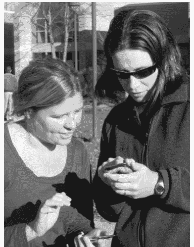

图 7.6 玛格丽特（左）与一名用户对比笔记。（版权所有 2009 DevelopEase, LLC.）

如果要求，玛格丽特将协助学校人员解决基本的维护问题，例如如何存储数据、从单个学生的 `iPad` 上传和下载数据、如何提供安全或网络过滤，以及如何同步 `iPad` 以便它们从相同的设置开始（如果需要的话）。

换句话说，玛格丽特将确保用户能够专注于他们最关心的事情，即与学生一起。有时，系统购买后研讨会会进一步深入探讨教学建议和练习，提供具体的想法和教学计划，帮助教师将应用程序整合到课程中。根据学校的需求，玛格丽特可能会在一段时间内举办多次研讨会，每场针对不同的领域。

### 7.13.2 课堂案例：加利福尼亚州贝克斯菲尔德

悉尼·哈特（Sydney Harter）是加利福尼亚州贝克斯菲尔德塞萨尔·查韦科学磁性学校的一名幼儿园级教师。她在普通教育和特殊教育教学方面都有多年经验。悉尼在普通教育教室里使用《5 颗南瓜》，并对此充满热情。她的方法将教学法与对困难经济下教学预算限制的认识结合在一起。

兴趣的交汇使悉尼在班级使用了《5 颗南瓜》。她拥有一台 `iPad`，一直在查看 Apple Online Store 提供的各种教育软件。她看到了《5 颗南瓜》，购买了它，并使用光学投影仪在课堂上进行了测试，以便全班同学都能使用该应用程序。

结果是积极的。她说这个应用程序“就像在看电影”，她更进一步使其具有参与性。悉尼找到了一种方法来解决每个孩子没有自己设备的问题。首先，她让孩子们站在投影仪旁，控制“翻页”以及与应用程序的物理交互，应用程序像书本一样移动（因此具有“自适应”（Adaptive）设计的标记）。

同时，25 个孩子一起观看并唱着《5 颗南瓜》的歌，同时用美国手语比划故事，并带有词汇和数字计数。

目前，悉尼大约每隔一天就会结合日记应用程序使用一次《5 颗南瓜》。她认为《5 颗南瓜》对于广泛的学生群体来说是理想的，原因有几个：“音乐真的能吸引孩子的注意力”以及“孩子们学得”。此外，他们作为一种有趣的活动而非目的本身学习了 `iPad` 技术（她继续使用自己的个人设备）。

悉尼报告说，孩子的父母非常喜欢将手语作为一种新的、不同的方式来应对视觉学习者和动觉学习者。

第七章：追求梦想意味着建立自己的业务 267

《5 颗南瓜》支持悉尼对加利福尼亚州教育标准中识别数字的要求。此外，《5 颗南瓜》支持她的目标，即让学生每月记忆 5 个高频词汇（总共 40 个）。最后，美国手语有助于加强普通课程中的多个概念。悉尼坚信，互动式应用程序对于以互动方式满足这些目标和要求特别有用。

尽管她目前在普通教育教室教学，但过去悉尼与许多不同的特殊教育儿童合作过，包括自闭症儿童。她认为《5 颗南瓜》和类似的 `iPod`/`iPad` 应用程序对这些儿童特别有用，因为它们为孩子提供了许多表达自己的方式。（见侧边栏“什么是自闭症”）

## 什么是自闭症以及什么是自闭谱系障碍？

美国使用的“自闭症障碍”官方定义见于《精神疾病诊断与统计手册》（当前版本为第 4 卷，带有文本修订版，因此常用缩写为 `DSM-IV-TR`）。英国使用类似的描述。

根据严格的术语来说，并没有所谓的“自闭症”，而是一系列自闭谱系障碍（ASDs）的状况。它们被列为广泛性发育障碍（PDDs）的一个子类。关于自闭症的原因，以及在某些情况下应该如何在医学上对其进行分类和治疗，存在竞争性的观点。在帮助自闭症患者这一共同目标的群体之间，争议可能会非常激烈。我们的讨论同意尽可能地遵守最广泛接受的基础信息。

两种形式的自闭谱系障碍显然具有遗传起源：瑞特症征（Rett Syndrome），它主要影响女性（10,000-15,000 名患有自闭症的女性中的 1 名），以及儿童智力性障碍（Childhood Disintegrative Disorder），主要影响男性（研究小组通常认为，100,000 名患有自闭症的男性中少于 2 名具有遗传起源，或者是胎儿发育早期创伤或感染的结果）。

对于更常见的自闭谱系障碍的原因，人们知甚少。对成功治疗的了解多于对原因的。目前，自闭症的治疗包括早期识别以及家庭和学校的强化干预。正在进行大量工作以提高关于自闭症的的知识。

268 计算机与社会：科技向善

用于分类自闭症的官方症状标准（来自 `DSM-IV TR`）对于希望为这一群体创建有效界面的计算机专业人士具有重要意义，对于开发移动设备的教育软件来说更是如此。简而言之，这些标准包括社交互动和交流方面的困难、发育延迟，以及对特定主题、常规程序或运动行为的过度痴迷。（详细资源请参考附录）。

一位曾教过自闭症儿童的老师认为，使用 `iPod touch` 在教育和社会方面对帮助自闭症儿童具有巨大的潜力。他说，大多数自闭症孩子渴望与同伴在一起并与其互动，但可能在此方面遇到困难。

通过给他们所有“酷炫”技术（他使用了别人描述 `iPod` 时使用的同一个词汇），每个孩子都有自己的设备；自闭症儿童可以分享教育体验，同时拥有个性化的应用程序。孩子可以将注意力集中在自己的移动设备上，而不会被周围的人所淹没。他们可以按照自己的节奏和随意的频率使用 `iPod` 并配合程序。

应用程序可以与他们对话，并鼓励某些特定的行为和运动技能。这位老师认为，像 `DevelopEase` 创建的此类应用程序才刚刚开始接触利用移动设备支持自闭症及其他发育延迟儿童的认知、运动和社会发展的领域。

## 7.13.3 更贴近生活的案例

在自己所在的弗吉尼亚州，Margaret 和 `DevelopEase` 在学校部署 `iPod touch` 设备和教育应用程序方面取得了显著进展。位于布拉克斯堡的蒙特马里县公立学校已将这项技术纳入了几个环境。

Kipp 小学在媒体报道中受到关注，因为他们目前在某些课程中使用 `iPod touch` 和 `DevelopEase` 应用程序，并且通过学校图书馆还有额外的 `iPod` 可以借用。当地的 NBC 附属台播报了一个关于该公司的故事（可在 `DevelopEase` 网站上观看），介绍了 `iPad` 如何被 Margaret 女女儿所在班级的所有孩子使用。

在广播中，一位特种教育教师谈到这种技术性的学习方法对所有学生都有益，因为每个人都想用 `iPod`。Margaret 对“酷炫”力量的信念正在得到证实。

`DevelopEase` 网站包含了一份来自父母、老师和治疗师在 `iPod touch` 上使用 `DevelopEase` 应用程序的完整证言列表。他们描述了从学前儿童到 28 岁成人的成功案例。证言提到了社交能力、学习和联系的改善。许多证言谈到了使用 `iPod touch` 应用程序所产生的兴奋感和动力。

证言中提到的一些孩子有发育延迟，而另一些则没有。一份证言特别提到了对自闭症儿童使用这些应用程序，支持了 Sydney Harter 对该软件在该人群实用性的信念。

对 Margaret 来说，一个重要资源是她与附近拉福德大学教员 Matt Dunleaf 建立的长期合作关系。Matt 进行教育环境移动技术的资助研究。他的 `iLearn` 团队使用 `iPod touch` 开发符合许多弗吉尼亚州教育标准的互动和参与性活动。

Margaret 是 `iLearn` 团队中关于特教学生使用应用程序的专家，也是团队与遵循全融合模式学校合作的专家。Margaret 和 Matt 每月见一次面进行协调、分享和头脑风暴。与拥有相似热情的教育工作者合作是相互鼓励和共同创造的重要来源。

他们共同与两个学区的 12 所学校合作。Margaret 在 `iLearn` 资助项目中起着关键作用，负责设置并支持将使用 `iPod touch` 的老师。她为老师提供实操培训，并根据他们的需求提供最新的应用程序建议，尽管这些可能不一定是 `DevelopEase` 的应用程序。

通过与 Matt Dunleavy 合作以及致力于严格的 `DevelopEase` 项目，Margaret 支持了一个共同目标，即为该地区的学生建立一个应用程序使用流水链，以及随后的劳动力培训体系。

## 7.14 `DevelopEase` 的未来计划

Margaret 正在梳理关于 `DevelopEase` 短期和未来的许多想法。她拥有的想法远比她可能实施的要多，这是计算机行业小型企业创业者的典型“问题”。

每个主意都必须根据她的商业计划进行战略性评估，而商业计划不是一份静态文件，而是会定期进行重新评估和修订。此外，每个主意还必须根据其是否符合公司首要目标以及她已拥有或合理预期获得的资源来衡量评估。

`DevelopEase` 将继续扩展那些成功且需求巨大的领域，如帮助学校安装移动设备和支持基础设施。定制化培训也有需求并将持续下去；对 Margaret 个人来说，一个副作用是她能够再次成为老师。帮助他人的机会让她想起了早期担任教室教师的职业。

她还将继续维护一小需要整理其孩子复杂数据的客户。一种可能的新方法可能是通过互联网向学校和家长提供持续服务——时间将证明。

`DevelopEase` 目前与弗吉尼亚州的四个学校系统合作，并正在向第五个系统扩张。Margaret 在整个弗吉尼亚州开展拓展和营销，并与弗吉尼亚州教育部沟通，了解更多与学校合作的方式。

她几乎不断地往返于学校以及当地和区域性会议，推广她的公司和他们能提供的服务。`DevelopEase` 长期计划之一是扩展到其他州。在技术方面，`DevelopEase` 正在其现有应用程序基础上进行开发，计划推出及其潜在客户需要的相关应用程序。

几个领域正在开发中或正被考虑开发。这些包括为治疗中心和医院量身定制的应用程序和服务、数据管理以及教学技术。数据管理的潜在应用的一个领域是组织特教教师和治疗师为每位学生保留的信息。

学生的文件可能包含大量信息，包括测试成绩、评估、医疗背景、特教资格、个性化教学计划、进度报告和个人目标。如果数据目前是纸质形式，则有机会通过将其放入具有易用界面的电子形式中，来减少管理这些文件花费的时间。`DevelopEase` 是

第七章：追求激情意味着创立你的业务 271

**图 7.7** 另一个 `DevelopEase` 应用的快乐用户。（版权所有 2009 DevelopEase, LLC.）

她通过聘佣一名当地毕业生担任计算机职位并让他能够留在当地，已经支持了当地经济。由于该地区相当乡村化，工业较少，这是一项具有重大意义的积极成就。如果没有她与马特（Matt）的配合，这个招聘机会就不会存在。

玛格丽特（Margaret）希望未来她也能聘佣一些人参与咨询和培训工作，这样她就能花出一点时间做她办公司初衷——即一些操作性的技术和教育类项目开发。创建导致她创立自己公司的应用是她的第一个激情，并且将永远是她的激情。正如她所说，“你对自己所做的事情充满激情。”

# 个人简介：玛格丽特·埃利斯（MARGARET ELLIS）

玛格丽特是直系家人中唯一在计算机科学领域工作的人，也是唯一的创业企业家。

# 计算机与社会：向善的计算

商业管理和创业类书籍经常警告人们，要防止没有意识到成功建立一家公司需要多少时间以及必须放弃多少生活的陷阱。作为回应，玛格丽特指出，在 `DevelopEase` 出现很久以前，支持大女儿的工作就是她生活中全神投入的一部分，当时她根本没有奢侈品可以放弃。事实上，她将从事这项工作视为“一种奢侈”，因为她能够继续工作帮助她的女儿和其他孩子，并将其转化为一份职业。她还有另一个同样投入心注的女儿。

玛格丽特拥有一项让她度过了平衡家庭和业务需求的所有压力和长时间工作的性格特质，那就是对挫折具有很高的忍受度。面对问题时，她想要解决它，并会坚持下去直到问题解决。无论问题是她某一个应用中的代码 `Bug`，还是战略性的业务挑战，都不重要。

商业书籍警告的另一个领域是经常缺席的父母/配偶对家庭的影响，即那些长时间工作且不在家的创业者。这个潜在的陷阱对玛格丽特来说也没有问题。正如之前提到的，是她的丈夫首先建议了围绕她的应用建立业务的想法，并选择了支持她。她说，“他真的为我尽了力。”

紧接着这句话，玛格丽特特别强调，她不仅拥有健康的家庭动态，她的家人也受到了她的工作以及她对儿童及其家庭生活所做出的切实变化的启示。

她自己的教育经历对 `DevelopEase` 的成功至关重要。玛格丽特在弗吉尼亚州布拉克克斯斯堡的弗吉尼亚州理工大学（Virginia Tech）获得了数学教育的本士学位。当时，她想成为一名学校老师。她还获得了计算机科学和法语的辅修学位。正是通过计算机科学辅修，玛格丽特在创建 `DevelopEase` 时证明了她的实用性。

毕业后，她担任了教 7-12 年级（大约 11-17 岁）的老师。后来，她回到弗吉尼亚理工大学攻读计算机科学硕士学位。随后进入行业担任系统工程师。在她第一个孩子严重生病后，她先转为兼职，接着在 2008 年决定全职在家。

与此同时，她花费了越来越多的时间在倡导性问题以及与学校和社会支持系统的合作上。正是在这段时期，发生了导致创建 `DevelopEase` 的经历。

第七章：追求激情意味着创立自己的业务 273

当被问及会给想要经营业务的计算机学生提供什么建议时，她的第一个评论是“他们必须对自己所做的充满激情”。这句话在讨论任何课程之前提出的，尽管她承认几乎她上过的每一门计算机科学课程都直接或间接地帮助了她。

她列举了例子：数据结构、编程语言、软件工程、网络、数据库……她认为几乎她上过的每一门计算机科学课程都对她直接或间接的帮助，这比其他课程更重要。对于计算机学生和潜在创业者来说：“你们必须对自己所做的充满激情。”

## 7.15 致谢

- 玛格丽特·埃利斯，`DevelopEase LLC`

# 计算机与社会：向善的计算

## 7.16 练习与活动

1. 以书中列出的设备为起点，目前的先进移动设备有哪些？它们在过去的 6-12 个月中发生了哪些变化？

2. 哪些先进移动设备最适合教学用途？请结合硬件、软件和用户界面来证明你的答案。

3. 哪些在移动设备上的教育应用最能吸引高中生群体（如果你不在美国，大约是 14-18 岁）？你可以包括现有的应用或你认为需要的应用。无论何种情况，请说明你的理由。如果相关，请考虑文化背景问题（如国家、性别、宗教或其他）。

4. 哪些在移动设备上的教育应用最能吸引初中群体（如果你不在美国，大约是 11-14 岁）？你可以包括现有的应用或你认为需要的应用。无论何种情况，请说明你的理由。如果相关，请考虑文化背景问题（如国家、性别、宗教或其他）。

5. 哪些在移动设备上的教育应用最能吸引中等群体（年龄大于 17 岁）？这个年龄群体差异很大，因此你必须首先定义你的群体和大学类型——技术学院、证书课程、两年制学位授予院校、四年或五年制学位授予院校、“传统”年龄 18-21 岁、“较大”年龄、兼职学生。你可以包括现有的应用或你认为需要的应用。无论何种情况，请说明你的理由。如果相关，请考虑文化背景问题（如国家、性别、宗教或其他）。

6. 对于上述每个问题，哪些关键因素会导致你描述的应用在目标群体中失败？

7. 如果可以在计算机相关领域开发业务，你会做什么？解释你为什么选择这个业务，以及你想针对哪个市场利基。

8. 对于你选择的创业业务，你目前的课程中需要学习哪些课程？

9. 评估你作为创业者的个人优势和缺点。它们是什么？你最需要获得外部帮助（技术或其他）的地方在哪里？在进行评估时，务必将你的性格考虑在内。

10. 学期项目：为一家计算初创公司的早期阶段制定一个计划。考虑本章讨论的所有问题，并为前两年制定一份正式的商业计划书。

11. 学期项目：计划经营一家营销移动设备的业务。你的目标“客户”将是富裕的慈善家，他们希望支持非洲农村地区的的艾滋病（HIV）教育。慈善家将确保根据需要购买并分发许多 `iPod touch` 设备。这不需要担心。考虑本章讨论的所有问题，并想出一份详细的“销售推销”，以向那些希望被说服资助你业务的慈善家进行展示。

12. `DevelopEase` “Jolly Holiday”仅列出了开发性目标。根据你对该应用程序的了解，推测其学术目标是什么。

13. 你居住或上学的地区（如果你在美国），小学（约 6–11 岁）的科学和技术州教育标准是什么？如果你不在美国，相同年龄段儿童有哪些科学和技术教育标准？这些标准是由谁开发的？

14. 你在上一个问题中选择的教育标准与一个或多个 `DevelopEase` 应用程序的目标如何匹配？

15. 针对一个假设的学校制定一份正式论点（书面或口头），说明他们应该使用 `iPod touch` 和 `DevelopEase` 应用程序。`DevelopEase` 支持教育的全内融合模式，因此你应该在你的案例中使用教育的全内融合模式作为支持。

- 定义你学校的人口统计特征
- 选择一个目标年龄段
- 为不同的受众调整你的营销推销：
  - 管理人员
  - 普通教育教师
  - 特殊教育教师

16. 在 `Apple Store` 中寻找另一个针对残障儿童的应用程序，并与 `DevelopEase` 的应用程序之一进行比较。各自的优缺点是什么？

17. 如果你有移动设备，请与团队合作，使用 `Apple` 或 `Android` 规范设计一个关于科学或计算技术主题的教育应用程序。目标群体是初中生（约 12–14 岁）。

18. 与团队（相同或不同的团队）合作构建上一个问题设计的应用程序。你从这次经历中学习到了什么？

## 附录

### 网络资源

`DevelopEase` 网站：`http://developease/DevelopEase/Welcome.html`

`The Games Lab` 网站：`http://gameslab.radford.edu/`

教育中交互移动游戏的研究。`iLearn` 项目使用了 `iPod touch`。

`Apple` 计算机开发者页面：`http://developer.apple.com/ologies/`

弗吉尼亚州教育部标准：`http://www.doe.virginia.gov/testing/sol/standards_docs/index.html`

`Rightslaw`：`http://www.rightsl.com/` 关于非残障能力问题的通用资源，包括 `IDEA` 和 `LRE`。

`Gregoric Associates`，`Gregoric Style Delineator` 的创建者：`http://gregorc.com/`

`Experience Based Learning Systems, Inc.` `http://www.learningfromexperience.com/` 关于 `Kolb` 风格调查和其他相关信息。

### 网络资源

Bransford, John D., Ann. L. Brown & Rodney R. Cocking, 编选. (2000). 《人们如何学习：心理、经验与学校》。华盛顿，特区，国家学院出版社。这是一本关于人类学习最新研究的易于理解的书，侧重于儿童。

Klopter, Eric. (2008). 《增强学习》。麻省理工学院出版社。对移动设备的历史及其在游戏和教育应用程序中的应用带有某种学术视角。

《精神疾病诊断与统计手册第四版，修订版》。(2000)，华盛顿，特区，美国精神协会。

Sears, Andrew and Julie Jacko. (2009). 《人机交互：为多样化的用户和领域设计》。佛罗里达州博卡拉顿，CRC 出版。每一章都关注不同人群或行业的用户界面问题。群体包括老年人、特定的认知障碍和身体残疾。

Siegal, Bryna. (1996). 《自闭症儿童的世界》。牛津大学出版社。关于自闭症谱系障碍（ASD）的相关主题的研究信息。

Waltz, Mitzi. (2002). 《自闭症谱系障碍：理解诊断并寻求帮助》。加州塞巴斯托，O'Reilly & Assoc.。包含大量的资源列表，包括许多美国以外的资源。

# 计算机科学

《计算机与社会：向善计算》包含了深入的案例研究，并有大量发人深省的章末问题，适用于计算机工程、计算机科学、计算机信息科学、信息技术、健康信息科学、工商管理和政治科学以及许多其他专业的本科生和研究生。案例研究的复杂性质使其能够用于独立的社会和专业问题课程、毕业设计课程，或作为可以编织进各种计算或业务课程的个人案例研究。

Kacmaczyk 的书对不同领域的人士如何使用计算，以及计算的使用如何影响这些个人以及社会，提供了一个独特且新颖视角。

Kacmaczyk 的书应该是所有学院或大学图书馆的“必读之书”。

> - Carol L. Sprading，博士
> 密苏里州马梅维尔西北密苏里州立大学副教授

由于计算机科学家每天做出的决策具有社会背景和影响，因此对社会和计算的共同理解可以整合到计算机科学教育中。《计算机与社会：向善计算》通过具体的例子和案例研究展示了凭借你的计算机学位可以做什么，强调了全球计算专业人士和组织的积极工作。

每一章都介绍了一个参与计算核心活动的企业、非营利组织或企业家，这些活动明显造福了社会或环境，包括发展国家的文化适应、尖端医疗和保健、教育创新、濒危物种工作以及为海外选民提供帮助。计算主题的涵盖范围从社会计算到高性能计算。这些简介中人物和活动的多样性提供了你毕业后可以成就的广阔愿景。

这本书鼓励你积极批判性地接触材料，在每章末提供了丰富的练习和活动。不同难度的的问题帮助你将材料应用于自身或周围环境，并从未来计算专业人士的角度对材料进行批判性思考。书中还整合了个人项目、团队项目、短期项目和学期项目。其他辅助资源可以在补充网页上获得。
