# 计算基础与C程序设计（第2版）

## 前言

我们生活在一个技术驱动的世界中，几乎一切都实现了自动化。过去二十年见证了许多创新。初学者要跟上这样的发展可能会感到困惑。迷失在代码和字节的世界中可能会令人紧张不安。这正是此类教科书发挥作用的地方。本书假定读者完全没有计算机先验知识，以简单而有条理的方式带领读者走进计算机世界。

计算机无法理解人类语言；因此，需要一种以计算机编程语言形式存在的交流媒介来与计算机交互。C 是一种强大、灵活、可移植且结构优雅的编程语言。由于 C 将高级语言特性与汇编器的元素结合在一起，因此既适合系统编程，也适合应用编程。它无疑是当今操作系统和嵌入式系统开发中使用最广泛的通用语言。它的影响几乎在所有现代编程语言中都显而易见。自 1989 年标准化以来，C 经历了一系列变化和改进，以增强语言的实用性。包含这些新特性的版本现在被称为 C11。本书可确保读者顺利、成功地转变为熟练的 C 程序员。

### 本书结构

《计算机基础与 C 编程》从第 1 章的计算机系统基础和第 2 章的计算概念开始。随后逐步进入 C 概念，包括第 3 章——C 概述、C 程序的基本结构与执行。第 4 章讨论如何声明常量、变量和数据类型。运算符和表达式在第 5 章介绍。第 6 章涉及输入和输出操作的管理。第 7 章讨论分支。决策与循环的概念在第 8 章解释。数组、字符数组和字符串在第 9 章和第 10 章讨论。用户定义函数、结构体和联合体在第 11 章和第 12 章涵盖。第 13 章涵盖指针，第 14 章描述 C 中的文件管理。预处理器在第 15 章解释。

### 本书特色

- 学习目标（LOs）
- 关键术语
- 按学习目标（LOs）和难度级别（LOD）标记的内容
- 数据库管理系统（作为附录 III 涵盖）
- 丰富的教学资源：
  - 已解和未解问题：约 500 道
  - 复习题：700 多道
  - 编程练习：200 多道
  - 调试练习：40 多道
  - 简要案例研究：20 多个
  - 项目：2 个

### 数字补充资源

可通过以下链接访问数字补充资源（http://www.mhhe.com/balagurusamy/ccp2e）

它包含以下组成部分：

- 说明
- 电子案例研究

### 致谢

我特别感谢 McGraw Hill Education India 的整个团队。

谨向以下审稿人致以谢意，感谢他们提供的宝贵反馈。他们的建议有助于使本书更加实用。

| 审稿人 | 所属机构 |
| --- | --- |
| **Sandeep Jain 博士** | *Jaypee 信息技术学院，诺伊达，北方邦* |
| **Narendra Kohli 博士** | *HBTI，坎普尔，北方邦* |
| **Vivek Pandey** | *AKTU，法拉，北方邦* |
| **Saikul Basu** | *西孟加拉邦加尔各答毛拉纳·阿布·卡拉姆·阿扎德技术大学* |
| **K S Patnaik** | *BITS 梅斯拉，兰契，贾坎德邦* |
| **Nirmala Sharma** | *RTU，科塔，拉贾斯坦邦* |
| **Hardik K Moliya** | *古吉拉特邦拉杰果德政府工程学院* |
| **R Kiruba Buri** | *泰米尔纳德邦蒂鲁吉拉伯利安娜大学* |
| **S Hariharan** | *泰米尔纳德邦蒂鲁吉拉伯利 TRP 工程学院* |
| **Rekha K S** | *卡纳塔克邦迈索尔国家工程学院* |

本书是我在浩瀚无边的知识沙海中留下足迹的真诚尝试。恳请读者最大限度地利用本书。

**E BALAGURUSAMY**

### 出版商说明

McGraw Hill Education（印度）诚邀您提出建议和意见，均可发送至 info.india@mheducation.com（请在邮件主题中注明书名和作者姓名）。

与盗版相关的问题也可举报。

## 视觉导览

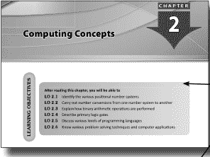

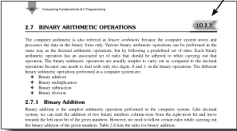

### 学习目标

与本章主要小节关联的学习目标有助于学生在开始学习本章之前就设定切实可行的学习目标。

### 引言

每章开头均设有引言，概述本章所涵盖的主题。

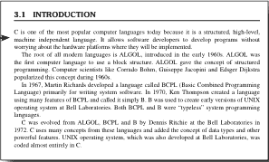

### 例题

正文穿插例题，有助于学习将概念应用于实际问题的技巧。

**例题 13.2**

编写一个程序，演示如何使用间接运算符 `*` 访问指针所指向的值。

程序和输出如图 13.8 所示。该程序清楚地展示了如何通过指针访问变量的值。注意，变量 `ptr` 包含地址 6040，指针 `ptr` 的值为 10。此外，您还可以注意以下要点：

```c
main()
{
    int x, y;
    int *ptr;
    x = 10;
    ptr = &x;
    y = *ptr;
    printf("The value of x is %d", x);
    printf("The value of y is %d", y);
    printf("The address of x is %u", &x);
    printf("The address of ptr is %u", &ptr);
    printf("The value of ptr is %u", ptr);
    printf("The value at *ptr is %d", *ptr);
}
```

**表 10.1** 特殊字符的十进制与二进制对应值

| 十进制 | 特殊字符 | 4 位二进制 |
| --- | --- | --- |
| 0 | NUL | 0000 |
| 1 | SOH | 0001 |
| 2 | STX | 0010 |
| 3 | ETX | 0011 |
| 4 | EOT | 0100 |
| 5 | ENQ | 0101 |
| 6 | ACK | 0110 |
| 7 | BEL | 0111 |
| 8 | BS | 1000 |
| 9 | HT | 1001 |
| 10 | LF | 1010 |
| 11 | VT | 1011 |
| 12 | FF | 1100 |
| 13 | CR | 1101 |
| 14 | SO | 1110 |
| 15 | SI | 1111 |

```c
main()
{
    /* ... DECLARATION ... */
    int a, b, c;
    ...
    /* ... INITIALIZATION ... */
    a = 10;
    b = 20;
    c = 30;
    ...
    /* ... ARITHMETIC AND ASSIGNMENT ... */
    c = a + b;
    ...
    printf("a = %d", a);
    printf("b = %d", b);
    printf("c = %d", c);
    ...
}
```

输出：

```text
a = 10
b = 20
c = 30
...
```

### 2.7 二进制算术运算

本节旨在介绍二进制算术，因为计算机只能处理二进制数。如您所见，二进制算术运算的执行方式与十进制算术完全相同。四种基本算术运算是：加法、减法、乘法和除法。然而，计算机执行这些运算的方式与我们不同。算术运算使用两个数字 0 和 1 进行，属于二进制运算。计算机执行的不同运算包括：

- 二进制加法
- 二进制减法
- 二进制乘法
- 二进制除法

### 2.7.1 二进制加法

二进制加法是计算机执行的最简单的算术运算。与十进制加法一样，它从最右列开始逐列进行。然而，在进行二进制加法时，我们需要遵循某些规则：

### 图文并茂的正文

正文辅以图、表、流程图和程序，易于阅读，并能持续吸引读者的兴趣。


## 理解计算机基础

第 1 章

### 学习目标

**阅读本章后，你将能够**

- **LO 1.1** 识别计算机的各个世代
- **LO 1.2** 根据不同标准对计算机进行分类
- **LO 1.3** 描述计算机系统
- **LO 1.4** 对各种计算机软件进行分类
- **LO 1.5** 讨论各种操作系统
- **LO 1.6** 讨论微软软件
- **LO 1.7** 了解各种网络概念和协议

### 1.1 引言

计算机是一种*电子机器*，它接收用户输入，处理给定输入，并以有用信息的形式生成输出。计算机接受不同形式的输入，如数据、程序和用户回复。*数据*是指需要经过处理以生成某些有用*信息*的原始细节。程序是指可由计算机以顺序或非顺序方式执行的一组指令。用户回复是用户针对计算机所提问题而提供的输入。

计算机包括各种设备，它们作为一个集成系统运行，以执行上述若干任务（图 1.1）。这些设备包括：

- **中央处理器（CPU）** 它是计算机的处理器，负责控制和执行计算机中的指令。它被认为是计算机最重要的组件。
- **显示器** 它是一种屏幕，在接收到来自计算机的视频信号后，以可视形式显示信息。
- **键盘和鼠标** 这些是计算机用来接收用户输入的设备。

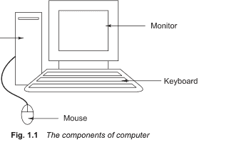

### 1.2 计算机的世代

计算机发展史通常按计算机的不同世代来讨论，如下所列。

- 第一代计算机
- 第二代计算机
- 第三代计算机
- 第四代计算机
- 第五代计算机

#### 1.2.1 第一代计算机

这些计算机使用*真空管*技术（图 1.2）进行计算以及存储和控制。因此，这些计算机也被称为基于真空管或热离子阀的机器。第一代计算机的一些例子是 ENIAC、EDVAC、EDSAC 和 UNIVAC。

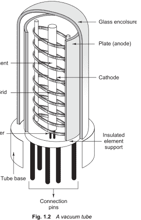

##### 优点

- 当时最快的计算设备。
- 能够高效地执行复杂数学问题。

##### 缺点

- 这些计算机依赖机器，编程不太容易。
- 由于是为特殊用途设计的，它们在运行不同类型的应用时不够灵活。
- 真空管技术的使用使这些计算机非常庞大笨重，并且需要放置在凉爽的地方。
- 它们一次只能执行一个程序，因此生产效率不高。
- 它们产生大量热量，因此容易发生硬件故障。

#### 1.2.2 第二代计算机

这些计算机在构建基本逻辑电路时使用*晶体管*代替真空管。晶体管是一种半导体器件，用于在保持原始信号形状的同时增强输入信号的功率（图 1.3）。

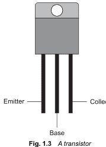

第二代计算机的一些例子是 PDP-8、IBM 1401 和 IBM 7090。

##### 优点

- 当时最快的计算设备。
- 由于使用汇编语言，易于编程。
- 小型轻量的计算设备。
- 执行操作时所需功率很小。

##### 缺点

- 这些计算机的输入和输出介质没有得到很大改进。
- 需要放置在空调环境中。
- 非常昂贵，家庭用户难以承受。
- 作为专用计算机，它们只能执行特定应用。

#### 1.2.3 第三代计算机

第三代计算机系统的主要特征在于使用*集成电路（IC）*。集成电路是将晶体管、电阻器、电容器等各种电子元件组合到单个小硅芯片上的电路。

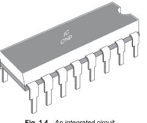

第三代计算机的一些例子是 NCR 395、B6500、IBM 370、PDP 11 和 CDC 7600。

##### 优点

- 这些计算机的计算时间通常以纳秒为单位，因此是最快的计算设备。
- 由于体积小，易于运输。
- 它们使用与机器无关的高级语言，因此非常易于使用。
- 易于安装，所需空间更少。
- 由于能够执行任何类型的应用（商业和科学应用），它们被视为通用计算机。

##### 缺点

- 存储容量非常小。
- 由于存储容量小，执行复杂计算时性能会下降。
- 非常昂贵。

#### 1.2.4 第四代计算机

LSI 和 VLSI 技术的进步促成了微处理器的发展，而微处理器成为第四代计算机的主要特征。LSI 和 VLSI 技术使数千个晶体管能够安装在一个小硅芯片上。

微处理器将计算机的各种组件——例如 CPU、内存和输入/输出（I/O）控制部件——集成到单个芯片上。一些后来流行的微处理器包括 Intel 386、Intel 486 和 Pentium。

第四代计算机的一些例子是 IBM PC、IBM PC/AT、Apple 和 CRAY-1。

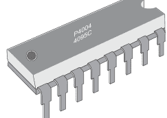

**图 1.5** *Intel 4004 微处理器芯片*

##### 优点

- LSI 和 VLSI 技术使它们体积小、价格低、紧凑且功能强大。
- 高存储容量
- 高度可靠，所需维护非常少。
- 随着 GUI 和交互式 I/O 设备的发展，提供了用户友好的环境。
- 由于使用高级语言，在这些计算机上编写的程序具有高度可移植性。
- 用途非常广泛，适用于各类应用。
- 运行所需功率非常小。

##### 缺点

- LSI 和 VLSI 芯片在接线板上的焊接很复杂。
- 仍然依赖于程序员给出的指令。

#### 1.2.5 第五代计算机

第五代计算机基于极大规模集成电路（ULSI）技术，该技术允许在一个小芯片上制造近一千万个电子元件。

##### 优点

- 迄今为止速度更快、价格更低且最高效的计算机。
- 它们能够同时执行大量应用，而且速度非常快。
- ULSI 技术的使用有助于在很大程度上减小这些计算机的尺寸。
- 由于具备多项附加多媒体功能，使用起来非常舒适。
- 在通信和资源共享方面用途广泛。

##### 缺点

它们没有配备能够指导其执行不同操作的智能程序。

图 1.6 展示了计算机家族树，说明了过去四十年间各领域的发展及其对各个计算机世代的贡献。

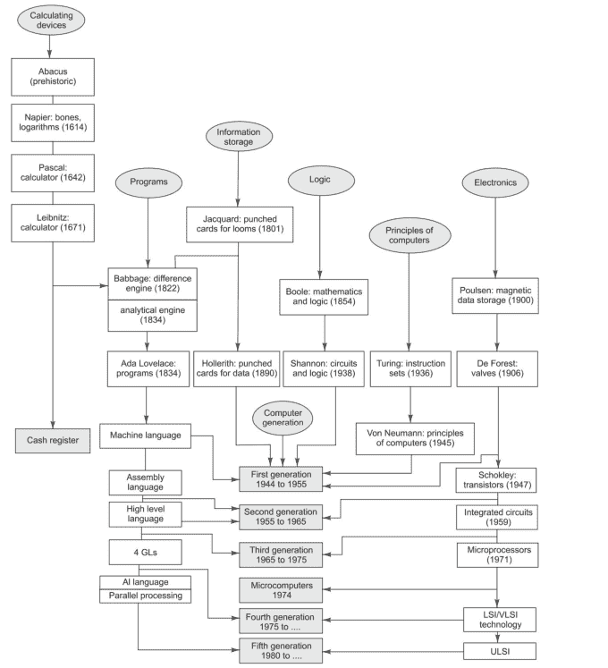

**图 1.6** *计算机家族树*

### 1.3 计算机的分类

计算机可根据其计算能力和处理速度分为若干类别。这些类别包括：

- 微型计算机
- 小型计算机
- 大型计算机
- 超级计算机

#### 微型计算机

微型计算机定义为以微处理器作为其 CPU 的计算机，并且能够执行以下基本操作：

- **输入**——将数据和指令输入微型计算机系统。
- **存储**——将数据和指令保存在微型计算机系统的存储器中，以便在需要时使用。
- **处理**——对数据执行算术或逻辑运算，例如加法、减法、乘法和除法。
- **输出**——它向用户提供结果，结果可以是可视显示和/或打印报告的形式。
- **控制**——它有助于指导上述所有操作的执行顺序和方式。

#### 小型计算机

小型计算机是一种中型计算机，比微型计算机更强大。它通常设计为同时服务多个用户，因此被称为多终端分时系统。如今，小型计算机在研究机构和商业组织中很受欢迎。它们比微型计算机更昂贵。

#### 大型计算机

大型计算机有助于处理银行、保险公司、医院和铁路等各类组织的信息处理工作。大型计算机放置在中心位置，并连接到若干用户终端；这些终端可作为访问站，且可能位于同一栋建筑内。与工作站相比，大型计算机体积更大、价格更昂贵。

#### 超级计算机

在超级计算机中，多处理技术和并行处理技术用于快速解决复杂问题。在这里，微处理器可使用户能够将复杂问题划分为更小的问题。超级计算机还支持多道程序设计，其中多个用户可以同时访问该计算机。目前，一些受欢迎的超级计算机制造商包括 IBM、Silicon Graphics、富士通和英特尔。


软件在内部支持计算机系统的运行，且不可见。它存储在辅助存储器上，既可以是**应用软件**，也可以是**系统软件**。应用软件用于根据需求执行特定任务，而系统软件（操作系统和网络系统）是运行应用软件所必需的。

### 1.5 输入设备

LO 1.3

输入设备是机电设备，用于向计算机提供数据，以便存储并在需要时进一步处理。根据输入的类型或方法，输入设备可能属于以下类别之一：

#### 1.5.1 键盘

键盘用于输入数据和文本，并执行命令。标准键盘如图 1.8 所示，由以下几组按键组成：

-   ***字母数字键*** 包括按 QWERTY 布局排列的数字键和字母键。
-   ***功能键*** 帮助执行特定任务，例如搜索文件或刷新网页。
-   ***中央键*** 包括方向键（用于移动光标）和修饰键，如 SHIFT、ALT 和 CTRL（用于修改输入）。
-   ***数字小键盘*** 看起来像计算器的键盘，带有 10 个数字和数学运算符。
-   ***特殊用途键*** 特殊用途键帮助执行某类操作，例如退出程序（Escape）或删除文档中的某些字符（Delete）等。

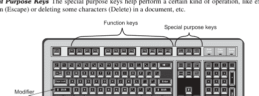

图 1.8 *目前使用的键盘*

#### 1.5.2 鼠标

鼠标是一种小型手持式指点设备，主要控制光标在显示屏幕上的二维移动。它是基于图形用户界面（GUI）的操作系统（OS）的重要组成部分，因为它有助于选择屏幕的一部分以及复制和粘贴文本。鼠标移动时，显示设备上出现的指针也会移动（图 1.9）。

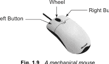

#### 1.5.3 扫描设备

扫描设备是能够以电子方式捕获文本和图像，并将其转换为计算机可读形式的输入设备（图 1.10）。


以下类型的扫描仪可用于生成数字化图像：

-   **平板扫描仪**——它包含一个扫描头，该扫描头从上到下在页面上移动以读取页面，并将页面上可用的图像或文本转换为数字形式。平板扫描仪用于扫描图形、超大文档以及书籍页面。
-   **滚筒扫描仪**——在这种类型的扫描仪中，使用固定的扫描头，待扫描的图像在扫描头前移动。滚筒扫描仪用于扫描印前材料。
-   **幻灯片扫描仪**——它是一种可以直接扫描摄影幻灯片以生成计算机可理解文件的扫描仪。
-   **手持扫描仪**——它是由最终用户在待扫描页面上移动的扫描仪。这种扫描仪价格低廉且体积小。

### 1.6 处理器

LO 1.3

CPU 由控制单元（CU）和 ALU 组成。CU 存储指令集，该指令集指定计算机要执行的操作。CU 将数据和指令传输给 ALU 以进行算术运算。ALU 对接收到的数据执行算术或逻辑运算。CPU 寄存器存储要由 CPU 处理的数据以及已处理的数据。除 CU 和 ALU 之外，CPU 还借助以下硬件设备来处理数据。

#### 主板

它是指用于将 CPU 与输入和输出设备连接的设备。主板上的组件连接到计算机的所有部件，并且彼此绝缘。主板的一些组件包括：

-   **总线**：在计算机不同部件之间传输数据和指令的电气通路。例如，数据总线是一条电气通路，用于在微处理器、存储器以及连接到计算机的输入/输出设备之间传输数据。
-   **系统时钟**：用于同步计算机所执行活动的时钟。计算机内部传输的电信号根据时钟的节拍进行定时。
-   **微处理器**：执行处理并控制计算机不同部件所执行活动的 CPU 组件。
-   **ROM**：包含计算机永久存储器的芯片，用于存储最终用户无法修改的信息。

#### RAM

它是指计算机的主存储器，用于存储信息和程序，直到计算机被使用。RAM 以芯片形式提供，可连接到主板上的 RAM 插槽。

#### 视频卡/声卡

视频卡是显示器与 CPU 之间的接口。视频卡还包含自己的 RAM 和微处理器，用于加速图形的处理和显示。声卡是安装在主板上的电路板，用于增强计算机的声音能力。

### 1.7 输出设备

输出设备的主要任务是将机器可读信息转换为人类可读形式，其形式可以是文本、图形、音频或视频。

#### 1.7.1 显示监视器

监视器产生由计算机生成的视觉显示。监视器连接到安装在主板扩展槽上的视频卡。

监视器可分为阴极射线管（CRT）监视器或液晶显示（LCD）监视器。CRT 监视器较大，在计算机中占用更多空间，而 LCD 监视器薄、重量轻，占用空间较小。两种监视器均有单色、灰度和彩色型号。

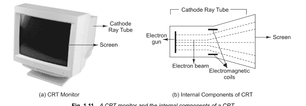

图 1.11 CRT 监视器及 CRT 的内部组件

监视器可以通过其监视器尺寸和分辨率来表征。监视器尺寸是对角测量的屏幕长度。屏幕分辨率表示为屏幕的图片元素或像素数量。监视器的分辨率也称为点距。分辨率更高的监视器可产生更清晰的图像。

#### 1.7.2 打印机

打印机是一种输出设备，它将屏幕上显示的文本传输到可供最终用户使用的纸张上。打印机可以根据其用于打印文本和图像的技术进行分类：

-   **点阵打印机**——点阵打印机是击打式打印机，使用穿孔纸打印文本。点阵打印机用于生成打印输出的多份副本。
-   **喷墨打印机**——喷墨打印机比点阵打印机慢，用于生成高质量的照片打印件。
-   **激光打印机**——激光打印机可以连接也可以不连接计算机来生成输出。这些打印机由微处理器、ROM 和 RAM 组成，可用于存储文本信息。

#### 1.7.3 语音输出系统

这些系统以人类语音形式记录简单消息，然后组合所有这些简单消息以形成一条消息。语音响应系统有两种类型——一种使用人类语音和其他声音的再现，另一种使用语音合成。

语音输出系统的基本应用是交互式语音应答（IVR）系统，该系统的使用方包括组织的客户服务或客户支持部门，例如电信公司等。

#### 1.7.4 投影仪

投影仪是一种连接到计算机或视频设备的设备，用于将来自计算机或视频设备的图像投影到大白色屏幕上。投影仪投影的图像尺寸比原始图像更大。投影仪由光学系统、光源和包含原始图像的显示器组成。投影仪最初用于放映电影，但现在被大规模用于在商业组织中展示演示文稿以及在家中观看电影。

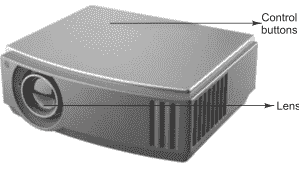

### 1.8 内存管理

LO 1.3

计算机的存储单元用于存储数据、处理数据的指令、处理的中间结果以及最终处理后的信息。计算机的存储单元分为主存储器和辅助存储器。计算机还使用第三种存储位置，称为*内部过程*

存储器。该存储器位于CPU内部或CPU附近（通过特殊快速总线连接）。

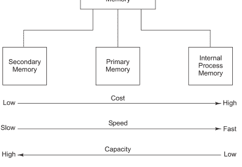

图1.13 计算机的存储器单元类别

#### 1.8.1 主存储器

主存储器作为计算机的内置单元存在于计算机中。主存储器表示为一组位置，每个位置占用8位。存储器中的每个位由唯一地址标识。数据以机器可理解的二进制形式存储在这些存储器位置中。常用的主存储器如下：

- **ROM** — ROM表示只读存储器，即使在计算机关闭时也存储数据和指令。它是计算机的永久存储器，最终用户无法修改其中的内容。ROM是插入主板的芯片。它通常用于存储基本输入/输出系统（BIOS），该系统执行开机自检（POST）。
- **RAM** — RAM是读写存储单元，其中信息仅在正常供电期间保留。当电源中断或关闭时，存储在RAM中的信息会丢失。RAM是易失性存储器，只要数据和应用正在使用，就临时存储它们。当数据或应用的使用结束时，RAM中的内容会被擦除。
- **高速缓存** — 高速缓存用于存储CPU最后处理的数据及相关应用。当处理器执行处理时，它首先在高速缓存中搜索指令，然后在RAM中搜索。高速缓存可以焊接在主板上，也可以作为RAM的一部分提供。

#### 1.8.2 辅助存储器

辅助存储器表示连接到计算机的外部存储设备。它们提供非易失性存储源，用于存储当前未使用的信息。存储设备要么位于计算机的CPU机箱内，要么外部连接到计算机。辅助存储设备可分为：

### 1.9 软件

投影断层成像是通过测量物体的投影来形成物体某一参数空间分布图像的过程。成像过程的物理原理和投影的形式取决于参数的性质以及特定的测量设备。

术语“投影”定义为参数值沿探测信号路径的积分。通常，该路径是一条线或曲线，但对于X射线、无线电和光学断层成像，以及在探测信号不发生偏转或折射的许多其他应用中，该路径是一条直线。直线射线投影最常见的例子是用于医学诊断的X射线图像。穿过物体的窄X射线束（笔形束）会发生衰减，衰减取决于沿束路径物质的密度和原子序数。物体后方探测器测得的值是沿束路径总衰减的结果，并且可以与物体衰减系数的积分相关联。这种测量的结果是单个投影值。沿一条线移动束和探测器并在许多位置重复测量，可给出物体一个切片中衰减系数分布的一维投影。在许多方向上测量的一系列此类投影可用于重建衰减系数的二维分布。本书关注此类切片图像、其重建及其处理，如下文各节所述。

平行束投影几何示意图。物体由二维函数 f(x, y) 表示，每条穿过物体的平行射线是 f 沿该射线的线积分。

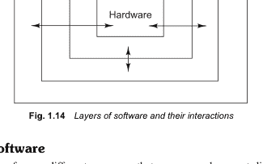

其中 p(s, θ) 是投影，f(x, y) 是物体函数，δ 是狄拉克δ函数。投影沿一组角度为 θ 的平行射线测量，如图4.1所示。

测量得到的投影数据总是离散的并且包含噪声。因此，重建算法必须从不完整且含噪的数据中产生准确且稳定的解。

*系统开发程序*用于开发和执行应用软件。这些程序包括：

- 语言翻译器
- 链接器
- 调试器
- 编辑器

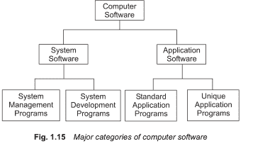

#### 1.9.2 应用软件

应用软件包括各种旨在满足最终用户信息处理需求的程序。它们大致可分为两类：

- *标准应用程序*，用于执行常见的应用任务。示例包括：
  - 文字处理器
  - 电子表格
  - 数据库管理器
  - 桌面出版程序
  - Web浏览器
- *专用应用程序*，由用户自行开发以支持其特定需求。示例包括：
  - 管理商店库存
  - 编制组织内员工的工资单
  - 预订火车或航班座位

### 1.10 操作系统概述

LO 1.5

操作系统（OS）是一种使计算机硬件工作的软件。硬件提供“原始计算机能力”，而操作系统负责使这种计算机能力对用户有用。操作系统是系统软件的主要组成部分，因此必须在我们可以完成任何其他任务之前加载并激活。其主要功能包括：

- 操作计算机的CPU。
- 控制提供用户与计算机之间接口的输入/输出设备。
- 处理应用程序与硬件及其他软件系统的工作。

用户界面，它于1981年首次为IBM计算机引入。尽管如今MS DOS不再作为独立产品使用，而是作为与各种Windows版本集成的产品提供。

在MS DOS中，与基于图形用户界面（GUI）的操作系统不同，存在一种命令行界面，称为MS DOS提示符。在这里，我们需要键入各种命令来执行MS DOS操作系统中的操作。MS DOS命令大致可分为以下三类：

- **环境命令** — 这些命令通常提供有关操作系统环境的信息或影响操作系统环境。其中一些命令包括：
  - **CLS：** 它允许用户清除屏幕的全部内容，只留下MS-DOS提示符。
  - **TIME：** 它允许用户查看和编辑计算机的时间。
  - **DATE：** 它允许用户查看当前日期，以及将日期更改为另一个日期。
  - **VER：** 它允许我们查看MS-DOS操作系统的版本。
- **文件操作命令** — 这些命令有助于操作文件，例如复制文件或删除文件。其中一些命令包括：
  - **COPY：** 它允许用户将一个或多个文件从一个指定位置复制到另一个位置。
  - **DEL：** 它有助于从计算机中删除文件。
  - **TYPE：** 它允许用户在命令提示符中查看文件的内容。
  - **DIR：** 它允许用户查看当前和/或父目录中可用的文件。
- **实用程序** — 这些是执行各种有用功能的特殊命令，例如格式化软盘或在命令提示符中调用文本编辑器。其中一些命令包括：
  - **FORMAT：** 它允许用户擦除计算机软盘或固定驱动器中的所有内容。
  - **EDIT：** 它允许用户在命令提示符中查看计算机文件、创建和修改计算机文件。

#### 1.10.2 MS Windows 操作系统

##### Windows体系结构

Windows操作系统的体系结构包括与各种硬件平台兼容的模块化结构。图1.17显示了Windows 2000的体系结构；Windows操作系统的后续版本基于类似的体系结构。

在高层次上，该体系结构分为三层，即

- **用户模式：** 包括应用程序和I/O特定的软件组件
- **内核模式：** 拥有对系统资源和硬件的完全访问权限
- **硬件：** 包括底层硬件平台

##### 用户模式

用户模式中的各种子系统分为以下两类：

- **环境子系统：** 包括运行针对其他操作系统编写的应用程序的子系统。这些子系统不能直接请求硬件访问；相反，此类请求由内核模式中的虚拟内存管理器处理。三个主要的环境子系统包括Win32、OS/2和POSIX。这些子系统中的每一个都具有动态链接库，用于将用户应用程序调用转换为Windows调用。
- **集成子系统：** 代表环境子系统处理操作系统特定的功能。各种集成子系统包括工作站服务、服务器服务和安全性。


- **PnP管理器：** 通过确定设备的正确驱动程序并进一步加载该驱动程序来支持即插即用设备。
- **电源管理器：** 对各种设备执行电源管理。它还通过使未使用的设备进入睡眠状态来优化电源利用率。
- **GDI：** 代表图形设备接口，负责在Windows环境中表示图形对象。它还将图形对象传输到输出设备，如打印机和显示器。
- **对象管理器：** 管理Windows Executive对象和表示各种资源（如进程、线程等）的抽象数据类型。

#### 1.10.3 UNIX操作系统

UNIX操作系统是由AT&T公司的一组员工于1969年在贝尔实验室开发的。UNIX主要设计用于允许多个用户同时访问计算机并共享资源。UNIX操作系统是用C语言编写的。UNIX的重要特性包括：

- 多用户能力
- 多任务能力
- 可移植性
- 灵活性
- 安全性

##### UNIX的体系结构

UNIX具有分层体系结构，由若干层组成，每一层提供独特的功能，并与下层保持交互。UNIX操作系统的层次包括：

- 内核
- 服务
- 外壳
- 用户应用程序

图1.18展示了UNIX操作系统的各个层次。

- **内核**——内核是UNIX操作系统的核心，每当我们打开计算机时，它就会被加载到内存中。内核的三个组件是：
  - **调度程序**——它允许调度各种作业的处理。
  - **设备驱动程序**——它有助于控制连接到计算机的输入/输出设备。
  - **I/O缓冲区**——它控制计算机中的I/O操作。
  
  内核执行的各种功能包括：
  - 同时启动和执行不同的程序
  - 为各种用户和系统进程分配内存
  - 监控驻留在磁盘上的文件
  - 向网络发送信息以及从网络接收信息
- **服务层**——在服务层中，从外壳接收请求，然后将请求转换为发给内核的命令。服务层也称为*常驻模块层*，它与内核难以区分，由一组提供各种服务的程序组成，这些服务包括：
  - 提供对各种I/O设备的访问，例如键盘和显示器
  - 提供对存储设备的访问，例如磁盘驱动器
  - 控制不同的文件操作活动，例如从文件读取和写入文件

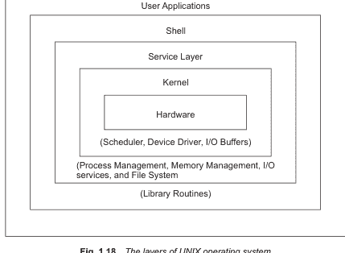

**图1.18** UNIX操作系统的层次

- **外壳** UNIX体系结构中的第三层是外壳，它充当用户与计算机之间的接口，用于接受请求并执行程序。外壳也称为命令解释器，有助于控制与UNIX操作系统的交互。外壳的主要功能是从终端读取数据和指令，然后执行命令，最后在显示器上显示输出。外壳也被称为实用程序层，因为它包含用于执行日常任务的各种库例程。UNIX操作系统中存在的各种外壳有：
  - Bourne外壳
  - C外壳
  - Korn外壳
  - 受限外壳
- **用户应用程序** UNIX体系结构中的最后一层是用户应用程序，用于执行若干任务并与其他UNIX用户通信。用户应用程序的一些重要示例包括文本处理、软件开发、数据库管理和电子通信。

### 1.11 MS Word

MS Word是一种应用软件，可用于以非常简单高效的方式创建、编辑、保存和打印个人及专业文档。MS Word是MS Office套件的重要工具，主要设计用于文字处理。其他可用的文字处理应用程序有OpenOffice Writer和Google Docs。

#### 1.11.1 访问MS Word

要在MS Word中工作，我们需要在计算机系统中安装MS Office。安装MS Office后，我们可以通过以下两种方式之一启动MS Word：

- 开始菜单
- 运行命令

我们可以使用开始菜单执行以下步骤来启动MS Word：

1. 选择开始 → 所有程序 → Microsoft Office。
2. 选择Microsoft Office Word 2007选项，以显示MS Word的图形用户界面（GUI），如图1.19所示。

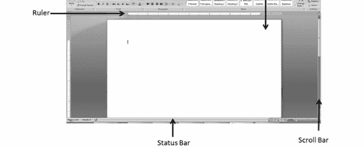

**使用运行命令** 我们还可以使用运行命令执行以下步骤来启动MS Word：

1. 选择开始 → 所有程序 → 附件 → 运行，以显示“运行”对话框。
2. 在“打开”文本框中输入winword，然后单击“确定”，以显示Document1 – Microsoft Word窗口。

#### 1.11.2 在MS Word中执行的基本操作

以下是我们可以在MS Word中执行的关键操作：

- 创建文档
- 保存文档
- 编辑文档
- 格式化文档
- 打印文档

图1.20显示了MS Excel的初始工作簿，其中包含工作表。每个工作表包含行和列，我们可以在其中输入数据。

**使用运行命令** 我们还可以使用运行命令执行以下步骤来启动MS Excel：

1. 选择开始 → 所有程序 → 附件 → 运行，以显示“运行”对话框。
2. 在“打开”文本框中输入excel，然后单击“确定”，以显示Microsoft Excel - Book1窗口。

#### 1.12.2 在 MS Excel 中执行的基本操作

工作表是由行和列组成的实际工作区域。工作表也称为电子表格。MS Excel中的工作簿是多个工作表的组合。每个MS Excel工作簿默认包含三个工作表。在MS Excel中执行的关键操作包括：

- 创建工作表
- 保存工作表
- 修改工作表
- 重命名工作表
- 删除工作表
- 移动工作表
- 编辑工作表

### 1.13 MS PowerPoint 系统

MS PowerPoint是包含在MS Office包中的软件应用程序，允许我们创建演示文稿。PowerPoint提供了GUI，借助它我们可以快速轻松地创建有吸引力的演示文稿。演示文稿可以包括幻灯片、讲义、备注、大纲、图形和动画。PowerPoint中的幻灯片是图像、文本、图形、图表等的组合，用于传达一些有意义的信息。MS PowerPoint中的演示文稿通常保存为扩展名.ppt。MS PowerPoint的界面与MS Office应用程序的其他界面类似。PowerPoint演示文稿通常用于商业、学校、学院、培训项目等。

#### 1.13.1 访问MS PowerPoint

要在MS PowerPoint中工作，我们需要首先在计算机系统中安装MS Office包。安装MS Office后，我们可以使用以下两种方式之一启动MS PowerPoint：

- 开始菜单
- 运行命令

**使用开始菜单** 我们可以使用开始菜单执行以下步骤来启动MS PowerPoint：

1. 选择开始 → 所有程序 → Microsoft Office。
2. 选择Microsoft Office PowerPoint 2007选项，以显示MS PowerPoint的GUI，如图1.21所示。

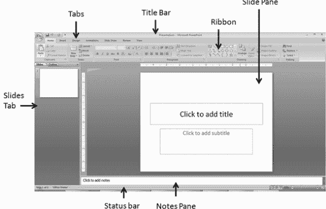

**图1.21** *Microsoft PowerPoint—[Presentation1]窗口*

**使用运行命令** 我们还可以使用运行命令执行以下步骤来启动MS PowerPoint：

1. 选择开始 → 所有程序 → 附件 → 运行，以显示“运行”对话框。
2. 在“打开”文本框中输入powerpoint，然后单击“确定”，以显示Microsoft PowerPoint – [Presentation1]窗口。

#### 1.13.2 对演示文稿执行的基本操作

以下是在MS PowerPoint中可以执行的关键操作：

- 创建新演示文稿
- 设计演示文稿
- 保存新演示文稿
- 向演示文稿添加幻灯片
- 打印演示文稿

### 1.14 网络概念

计算机网络是互连计算机的系统，使计算机能够相互通信并共享其资源、数据和应用程序。每台计算机的物理位置都根据个人和组织需求进行调整。网络可以仅包含个人计算机，也可以是混合的

跨越特定地理区域的个人计算机、小型计算机和大型计算机。当今常用的计算机网络可分类如下：

- 按地理区域划分：
  - 局域网（LAN）
  - 广域网（WAN）
  - 城域网（MAN）
  - 国际网络（Internet）
  - 内联网
- 按计算机节点的使用方式划分：
  - 客户端服务器网络（CSN）
  - 对等网络（PPN）
  - 增值网络（VAN）

#### 1.14.1 局域网（LAN）

局域网（LAN）是一组计算机，如图1.22所示，它们连接在一个小区域内，例如建筑物、家庭等。通过这种类型的网络，用户可以通过发送和接收消息轻松地相互通信。LAN通常用于通过某种介质（如双绞线、同轴电缆等）连接两台或多台个人计算机。尽管LAN中连接的计算机数量有限，但数据传输速率极快。

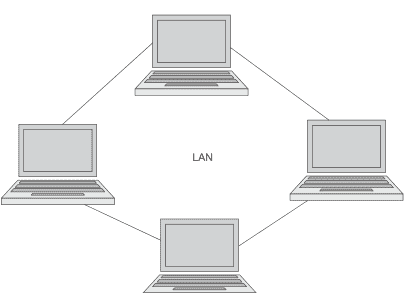

#### 1.14.2 广域网（WAN）

广域网（WAN）是一组计算机，它们连接在一个大区域内，例如大陆、国家等。WAN通常用于通过某种介质（如租用电话线、微波等）连接两个或多个LAN。在WAN中，数据传输速率较慢。典型的WAN网络如图1.23所示。

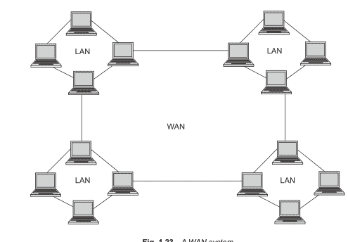

#### 1.14.3 城域网（MAN）

城域网（MAN）是一种覆盖城市等大区域的计算机网络。MAN的规模通常介于LAN和WAN之间，通常覆盖5公里到50公里的距离。MAN覆盖的地理区域比LAN大，但比WAN小。MAN通常由私营组织拥有。MAN通常借助光纤、铜线等连接。MAN最常见的例子之一是城市内的有线电视网络，如图1.24所示。一种称为*路由器*的网络设备用于将LAN连接在一起。路由器将信息包导向所需的目的地。

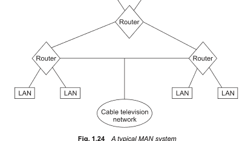

#### 1.15.2 线性总线拓扑

在线性总线拓扑中，所有节点都通过某种介质（如双绞线、同轴电缆等）连接到单一主干或总线。图1.26显示了线性总线拓扑中计算机的布置。

线性总线拓扑的优点包括：

- 线性总线拓扑通常需要较少的布线。
- 线性总线拓扑配置和安装相对简单。
- 在线性总线拓扑中，一台计算机的故障不会影响网络中的其他计算机。

线性总线拓扑的缺点如下：

- 在线性总线拓扑中，主干电缆故障会导致整个网络崩溃。
- 在线性总线拓扑中添加计算机会导致网络性能下降。
- 总线拓扑在发生故障时难以重构。

#### 1.15.3 星型拓扑

在星型拓扑中，所有节点都连接到称为集线器的公共设备。节点借助双绞线、同轴电缆或光纤连接。图1.27显示了星型拓扑中计算机的布置。

星型拓扑的优点包括：

- 该拓扑允许轻松进行错误检测和纠正。
- 在星型拓扑中，一台计算机的故障不会影响网络中的其他计算机。
- 该拓扑易于安装。

星型拓扑的缺点如下：

- 在星型拓扑中，集线器故障会导致整个网络崩溃。
- 星型拓扑需要更多数量的电缆来连接节点。
- 由于集线器的成本，它比较昂贵。

#### 1.15.4 环型拓扑

在环型拓扑中，节点借助双绞线以环的形式连接。每个节点直接连接到网络中的其他两个节点。图1.28显示了环型拓扑中计算机的布置。

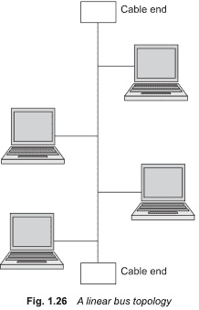

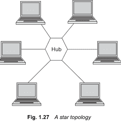

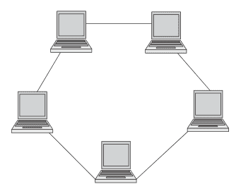

环型拓扑的优点包括：

- 每个节点对网络中的其他节点具有平等的访问权。
- 添加新节点不会降低网络性能。
- 环型拓扑易于配置和安装。

环型拓扑的缺点如下：

- 构建环型拓扑相对昂贵。
- 环型拓扑中一个节点的故障会影响环中的其他节点。

#### 1.15.5 网状拓扑

在网状拓扑中，每台计算机都以点对点模式连接到其他每台计算机，如图1.29所示。如果有n台计算机，则必须有n(n - 1)/2条链路。

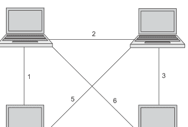

网状拓扑的优点包括：

- 消息传递更可靠。
- 由于链路数量多，网络拥塞最小。

缺点如下：

- 实施起来非常昂贵。
- 配置和安装非常困难。

#### 1.15.6 混合拓扑

混合拓扑是多种拓扑的组合，用于构建单一大型拓扑。图1.30显示了混合拓扑中计算机的典型布置。

一些常用的网络协议包括超文本传输协议（HTTP）、简单邮件传输协议（SMTP）、文件传输协议（FTP）、传输控制协议/互联网协议（TCP/IP）、远程通信网络（Telnet）、域名系统（DNS）等。

### 1.16 互联网服务

超文本传输协议（HTTP）是万维网使用的通信协议。它作为一种请求-响应协议，客户端浏览器和Web服务器通过HTTP协议规则相互交互。这些规则定义了消息的格式和传输方式，以及浏览器和Web服务器应针对这些消息采取什么操作。例如，当我们在浏览器的地址栏中输入URL时，会向Web服务器发送HTTP请求以获取所请求的网页。网页详细信息被传输到客户端浏览器，并通过HTML在浏览器窗口中呈现。

在典型情况下，客户端浏览器向服务器提交HTTP请求，服务器处理该请求并向客户端返回HTTP响应。响应包含与该请求有关的状态信息以及所请求的内容（图1.31–1.32）。

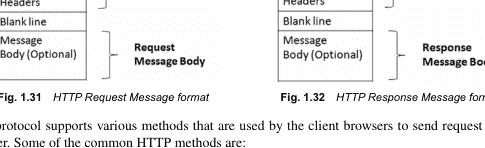

HTTP协议支持各种方法，客户端浏览器使用这些方法向服务器发送请求消息。一些常见的HTTP方法包括：

- **GET**：从指定资源获取信息
- **HEAD**：仅获取HTTP标头
- **POST**：向指定资源发布信息
- **DELETE**：删除指定资源
- **OPTIONS**：返回Web服务器支持的HTTP方法列表
- **TRACE**：返回服务器端所采取操作的诊断跟踪

HTTP响应对象的第一行包含状态行，其中携带响应状态码，指示服务器处理的HTTP请求的结果。状态码是3位数字，具有特定含义，如下所述：

- **1xx**：包含信息状态消息，指示服务器仍在处理请求
- **2xx**：包含成功状态消息，指示请求已被服务器接收、接受并处理
- **3xx**：包含重定向状态消息，指示需要采取进一步操作以处理请求
- **4xx**：包含错误状态消息，指示客户端错误，例如请求语法不正确
- **5xx**：包含错误状态消息，指示服务器端错误，例如服务器无法处理请求


#### SMTP

简单邮件传输协议（SMTP）是一种电子邮件协议，广泛用于在邮件服务器之间发送电子邮件消息。虽然 SMTP 支持发送和接收电子邮件消息的能力，但电子邮件系统主要使用 SMTP 协议发送电子邮件消息。接收邮件时，它们使用 POP3 或 IMAP 等其他协议。在基于 Unix 的系统中，sendmail 是最广泛使用的电子邮件 SMTP 服务器。在基于 Windows 的系统中，Microsoft Exchange 自带 SMTP 服务器，并可配置为包含 POP3 支持。

#### FTP

文件传输协议（FTP）是用于在互联网上共享文件的标准协议。FTP 基于客户端-服务器架构，并使用互联网的 TCP/IP 协议进行文件传输。用户需要通过指定用户名/密码来进行身份验证，以便与 FTP 服务器建立连接。不过，一些 FTP 站点还支持匿名登录，用户无需输入凭据。为了便于在互联网上安全传输用户凭据和文件内容，FTP 使用 TLS/SSL 等加密协议对内容进行加密。

以下步骤说明文件传输如何通过 FTP 进行：

- 1. 客户端计算机使用互联网连接到 FTP 服务器的 IP 地址。
- 2. 用户通过输入相关用户名和密码进行身份验证。
- 3. 连接建立后，客户端计算机发送 FTP 命令来访问和传输文件。如今，各种基于 GUI 的 FTP 软件可用，可通过拖放等简单操作实现文件传输。

#### Telnet

Telnet 是一种协议，允许用户通过 TCP/IP 网络（如内联网或互联网）连接到远程计算机。HTTP 和 FTP 协议用于在互联网上传输网页和文件，而 Telnet 协议用于登录远程计算机并像普通用户一样执行操作。用户需要先输入凭据，然后才能登录远程主机。

在 Windows、Mac OS、Unix 和 Linux 等主流操作系统中，可以使用基于命令行的 telnet 访问。telnet 命令的通用格式如下：

```
telnet host port
```

其中，

- **telnet**：是建立 telnet 连接的命令
- **host**：是主机计算机的地址
- **port**：是主机计算机上提供 telnet 服务的端口号

## 学习成果

| 学习成果 | LO |
|---|---|
| 计算机发展经历了五代，技术在、尺寸和速度方面发生了巨大转变。 | LO 1.1 |
| 根据尺寸和性能，计算机分为微型计算机、小型计算机、超级计算机和大型计算机。 | LO 1.2 |
| 输入设备帮助将来自任何外部源的数据输入计算机系统，输出设备用于将处理后的数据传递给最终用户。 | LO 1.3 |
| 计算机系统使用两类存储器，即主存储器和辅助存储器。 | LO 1.3 |
| 系统软件负责管理和控制计算机系统的硬件资源。应用软件专门设计用于满足最终用户的信息处理需求。 | LO 1.4 |
| 操作系统是安装在计算机系统上的系统软件，执行若干关键任务，如进程管理、内存管理、设备管理、文件管理等。 | LO 1.5 |
| MS Word 用于创建专业文档和个人文档，MS Excel 是电子表格应用程序，MS PowerPoint 是用于创建演示文稿的应用软件。 | LO 1.6 |
| 为了共享资源而连接在一起的一组计算机称为计算机网络。网络中的计算机通常借助网络协议进行通信。 | LO 1.7 |

## 需要记住的关键术语

- **晶体管：** 一种半导体器件，用于在保持原始信号形状的同时增强输入信号的功率。LO 1.1
- **微处理器：** 一种集成电路，在单个芯片上包含计算机的整个中央处理器。LO 1.1
- **真空管：** 一种电子管，其中全部或大部分气体已被移除，使电子能够在与任何残余气体分子相互作用较少的情况下运动。LO 1.1
- **LSI：** 大规模集成（Large Scale Integration）。LO 1.1
- **VLSI：** 超大规模集成（VLSI）指在一个芯片上集成许多器件的集成电路或技术。LO 1.1
- **ICs：** 将晶体管、电阻器、电容器等各种电子元件组合到单个小型硅芯片上的电路。LO 1.1
- **微型计算机：** 一种设计供个人使用的小型数字计算机。LO 1.2
- **超级计算机：** 速度最快的一类计算机，能够以极高速度执行复杂操作。LO 1.2
- **大型计算机：** 一种非常大的计算机，被大型企业组织用于处理主要应用，如金融交易处理应用和 ERP。LO 1.2
- **输入设备：** 一种机电设备，通常用于将信息输入计算机系统。LO 1.3
- **键盘：** 一种计算机输入设备，由按键或按钮组成，其排列方式与打字机上的排列方式类似。LO 1.3
- **鼠标：** 一种指向设备，主要控制光标在显示屏幕上的二维移动。LO 1.3
- **扫描设备：** 这些输入设备以电子方式捕获文本和图像，并将其转换为计算机可读形式。LO 1.3
- **显示器：** 显示器是最常用的输出设备，向用户显示文本和图形的软拷贝输出。LO 1.3
- **打印机：** 打印机是输出设备，用于生成计算机中存储的文本或文档的硬拷贝输出。LO 1.3
- **扬声器：** 扬声器是输出设备，用于从计算机生成音频格式的输出。LO 1.3

- 5. ________ 是一种屏幕，它在接收来自计算机的视频信号后以可视形式显示信息。 [LO 1.1]
- 6. ________ 计算机也被称为真空管或热离子阀机器。 [LO 1.1]
- 7. ________ 是一种半导体器件，用于在保持原始信号形状的同时增强输入信号的功率。 [LO 1.1]
- 8. ________ 是一种低级语言，允许程序员使用称为助记符的简单英文单词来表示程序中的不同指令。 [LO 1.1]
- 9. 第三代计算机的主要特征特征是使用 ________。 [LO 1.1]
- 10. ________ 和 ________ 技术的发明促成了第四代计算机的发展。 [LO 1.1]
- 11. 第五代计算机基于 ________ 技术，该技术允许在一个小芯片上制造近一千万个电子元件。 [LO 1.1]
- 12. ________，也称为数字信息处理系统，是一种以数字形式存储和处理数据的计算机。 [LO 1.2]
- 13. ________ 是速度最快的一类计算机，能够以极高速度执行复杂操作。 [LO 1.2]
- 14. 术语 ________ 指帮助计算机执行处理工作的程序和指令。 [LO 1.2]
- 15. 为用户执行特定任务而设计的程序称为 ________。 [LO 1.4]
- 16. 为控制计算机不同操作而设计的程序称为 ________。 [LO 1.4]
- 17. 输入设备通常充当 ________ 和 ________ 之间的接口。 [LO 1.3]
- 18. 用于控制 ________ 移动的方向键称为 ________ 键。 [LO 1.3]
- 19. 根据键盘上存在的附加按键，键盘还可分为 ________ 和 ________ 键盘。 [LO 1.3]
- 20. ________ 设备用于改变光标在屏幕上的位置。 [LO 1.3]
- 21. 机械鼠标主要由 ________、________ 和 ________ 按键组成。 [LO 1.3]
- 22. 光学鼠标由 ________、________ 和 ________ 组成，用于移动指针在屏幕上的位置。 [LO 1.3]
- 23. 手持扫描仪也称为 ________。 [LO 1.3]
- 24. 用于识别用户声音的方法有 ________ 和 ________。 [LO 1.3]
- 25. 计算机软件分为两类，即 ________ 和 ________。 [LO 1.4]


- 26. 系统软件由两组程序组成：________和________。[LO 1.4]
- 27. ________负责管理设备与资源向各进程的分配。[LO 1.4]
- 28. 应用软件包括两类程序：________和________。[LO 1.4]
- 29. ________是一种系统软件，允许用户与计算机系统的硬件及其他资源进行交互。[LO 1.5]
- 30. 在________操作系统中，作业被分组为称为批处理的组，并借助读卡器分配给计算机系统。[LO 1.5]
- 31. 在________操作系统中，多个用户可以同时使用计算机系统的资源。[LO 1.5]
- 32. UI通过充当________与其________之间的中介，促进二者之间的通信。[LO 1.5]
- 33. ________是UNIX操作系统的核心部分，负责管理和控制各种硬件与软件组件之间的通信。[LO 1.5]
- 34. MS-DOS是一种使用________接口的操作系统。[LO 1.5]
- 35. ________命令存储在MS-DOS的命令解释器中。[LO 1.5]
- 36. RD、TYPE和DEL是________命令。[LO 1.5]
- 37. ________和________是外部命令。[LO 1.5]
- 38. ________是MS Office中包含的一款用于处理文档的应用软件。[LO 1.6]
- 39. 可以通过________或________访问MS Word。[LO 1.6]
- 40. MS Word使用________界面与用户交互。[LO 1.6]
- 41. MS Word窗口顶部的水平栏称为________。[LO 1.6]
- 42. MS Word中闪烁的竖条，用于指示下一次按键或要插入字符的位置，称为________。[LO 1.6]
- 43. ________是一款广泛应用于商业应用的电子表格应用程序。[LO 1.6]
- 44. 电子表格中存储的数据的水平序列称为________。[LO 1.6]
- 45. 电子表格中存储的数据的垂直序列称为________。[LO 1.6]
- 46. ________是MS Office软件包中包含的一款用于创建演示文稿的应用软件。[LO 1.6]
- 47. MS PowerPoint中的演示文稿通常以________扩展名保存。[LO 1.6]
- 48. 当计算机连接在一起以共享资源时，称它们处于一个________中。[LO 1.7]
- 49. ________用于连接几公里范围内的计算机。[LO 1.7]
- 50. ________用于连接大地理区域内的计算机。[LO 1.7]
- 51. MAN的规模通常介于LAN和WAN之间，通常覆盖________至________的距离。[LO 1.7]
- 52. 分层拓扑也称为________。[LO 1.7]
- 53. ________是总线拓扑中网络所有节点连接到的公共点。[LO 1.7]
- 54. ________用于连接星型拓扑中的节点。[LO 1.7]
- 55. 网络中连接的多种拓扑的组合称为________。[LO 1.7]
- 56. ________是网络中计算机进行通信所依据的一套规则和规定。[LO 1.7]
- 57. ________是可使用网络协议执行的任务之一。[LO 1.7]
- 58. ________用于通过网络将文件从一台计算机传输到另一台计算机。[LO 1.7]

## 多项选择题

- 1. 计算机的哪个组件被称为计算机的大脑？[LO 1.1]
    A. 显示器        B. CPU
    C. 内存        D. 以上都不是

- 2. 下列哪一项是输入设备？[LO 1.1]
    A. 打印机        B. 显示器
    C. 鼠标        D. 以上都不是

- 3. 下列哪一项是现代数字计算机的特征？[LO 1.1]
    A. 高速度        B. 大存储容量
    C. 更高的精度        D. 以上全部

- 4. 谁被称为现代数字计算机之父？[LO 1.1]
    A. 戈特弗里德·威廉·冯·莱布尼茨        B. 查尔斯·巴贝奇
    C. 艾伦·马西森        D. 约翰·莫奇利

- 5. 计算机共有多少代？[LO 1.1]
    A. 四        B. 五
    C. 六        D. 七

- 6. 第一代计算机使用了哪种技术？[LO 1.1]
    A. 晶体管        B. 真空管
    C. 集成电路        D. 以上都不是

- 7. 第二代计算机使用了哪种技术？[LO 1.1]
    A. 晶体管        B. 真空管
    C. 微处理器        D. 集成电路

- 8. 第三代计算机使用了哪种技术？[LO 1.1]
    A. 晶体管        B. 真空管
    C. 集成电路        D. 以上全部

- 9. 第四代计算机使用了哪种技术？[LO 1.1]
    A. 微处理器        B. 真空管
    C. 集成电路        D. 晶体管

- 10. 哪种半导体器件用于在保持原始信号形状的同时增强输入信号的功率？[LO 1.1]
    A. 沙盘        B. 晶体管
    C. 真空管        D. 以上都不是

- 11. 哪一代计算机引入了汇编语言？[LO 1.1]
    A. 第一代        B. 第二代
    C. 第三代        D. 第四代

- 12. 哪一代使用了ULSI技术？[LO 1.1]
    A. 第二代        B. 第三代
    C. 第四代        D. 第五代

- 13. 计算机可以依据什么进行分类？[LO 1.1]
    A. 操作原理        B. 应用
    C. 尺寸与能力        D. 以上全部

- 14. 计算机中输入设备的主要功能是什么？[LO 1.1]
    A. 从计算机接收数据        B. 向计算机提供数据
    C. 存储数据以供处理        D. 处理数据

- 15. 下列哪种设备不是输入设备？[LO 1.1]
    A. 扫描仪        B. 键盘
    C. 磁盘        D. 操纵杆

- 16. 下列哪一个是修饰键？[LO 1.1]
    A. Tab        B. ALT
    C. Insert        D. Pause

- 17. 下列哪一项属于专用键类别？[LO 1.1]
    A. Tab        B. SHIFT
    C. ALT        D. CTRL

- 18. 下列关于鼠标的说法中哪一项不正确？[LO 1.1]
    A. 它控制光标在显示屏幕上的二维移动。
    B. 它通常有两种不同类型：机械鼠标和光学鼠标。
    C. 它可以在所有用途上替代键盘使用。
    D. 它是一种输入设备。

- 19. 手持式扫描仪的另一个名称是什么？[LO 1.1]
    A. 鼓式扫描仪        B. 幻灯片扫描仪
    C. 半页扫描仪        D. 整页扫描仪

- 20. 下列哪种设备不是光学识别设备？[LO 1.1]
    A. MICR        B. OMR
    C. OCR        D. 麦克风

- 21. MICR代表什么？[LO 1.1]
    A. 磁墨字符识别        B. 磁性输入列读取器
    C. 磁墨列识别        D. 磁墨字符读取器

- 22. 下列哪种设备用于识别超市中的字符？
    A. OCR设备
    B. OMR设备
    C. MICR设备
    D. 条形码阅读器

- 23. 下列哪一项不是输出设备？
    A. 扫描仪
    B. 绘图仪
    C. 打印机
    D. 扬声器

- 24. 下列哪种显示器通常与台式计算机一起使用？
    A. CBT显示器
    B. CRT显示器
    C. CPT显示器
    D. 以上都不是

- 25. 下列哪些是打印机的属性？
    A. 分辨率
    B. 速度
    C. 每分钟页数
    D. 以上全部

- 26. 下列哪一项是硬拷贝输出设备？
    A. 打印机
    B. 扬声器
    C. 显示监视器
    D. 投影仪

- 27. 下列哪一项是击打式打印机？
    A. 点阵打印机
    B. 喷墨打印机
    C. 激光打印机
    D. 以上全部

- 28. 下列哪一项是非击打式打印机？
    A. 菊花轮打印机
    B. 点阵打印机
    C. 激光打印机
    D. 以上全部

- 29. 下列哪一项是CRT的组件之一？
    A. 碳粉
    B. 液晶
    C. 电磁线圈
    D. 以上都不是

- 30. 下列哪些是投影仪的组件？
    A. 光学系统
    B. 显示部件
    C. 电子束
    D. A和B两者

- 31. 下列哪些是便携式投影仪？
    A. 会议室投影仪
    B. 固定安装式投影仪
    C. 超轻投影仪
    D. 以上全部

- 32. 终端包括下列哪些设备？
    A. 显示器和打印机
    B. 打印机和键盘
    C. 键盘和显示器
    D. 以上全部

- 33. 下列哪一项是终端的一种类型？
    A. 智能终端
    B. 哑终端
    C. A和B两者
    D. 以上全部

- 34. 下列哪一项可以被视为既是输入设备又是输出设备？
    A. 打印机
    B. 投影仪
    C. 终端
    D. 绘图仪

- 35. 下列哪种显示设备使用电子枪作为生成输出的组件之一？
    A. CRT显示器
    B. TFT显示器
    C. LCD显示器
    D. 以上都不是


- **36.** 以下哪一项不是系统软件？
  - A. 链接器
  - B. 设备驱动程序
  - C. 操作系统
  - D. 文字处理软件

- **37.** 以下哪种软件帮助用户在程序执行过程中检测错误？
  - A. 语言翻译程序
  - B. 调试器
  - C. 加载器
  - D. 链接器

- **38.** 将目标代码的不同元素与库文件链接起来的软件称为：
  - A. 编辑器
  - B. 链接器
  - C. 加载器
  - D. 调试器

- **39.** 以下哪个选项不是实用程序系统？
  - A. 病毒扫描程序
  - B. 系统分析器
  - C. 磁盘碎片整理程序
  - D. 数据库管理系统

- **40.** 以下哪一项是 Windows 操作系统提供的、用于对注册表进行必要更改的系统工具？
  - A. 系统分析器
  - B. 磁盘碎片整理程序
  - C. 注册表编辑器
  - D. 注册表管理器

- **41.** 以下哪一项不是专用应用程序的示例？
  - A. 库存管理系统
  - B. 工资系统
  - C. 所得税计算器
  - D. 数据库管理系统

- **42.** 用户使用计算机解决问题时会执行以下哪些活动？
  - A. 确定参数和约束
  - B. 确定逻辑结构
  - C. 调试程序
  - D. 以上都是

- **43.** 以下哪个程序对计算机系统的运行至关重要？
  - A. MS Word
  - B. 操作系统
  - C. MS Excel
  - D. 系统软件

- **44.** 以下哪种操作系统使用 CLI？
  - A. MS-DOS
  - B. Windows 2000
  - C. Windows Server 2003
  - D. 以上都不是

- **45.** 以下哪种操作系统使用 GUI？
  - A. Windows 2000
  - B. Windows Server 2003
  - C. Windows Vista
  - D. 以上都是

- **46.** 以下哪种操作系统同时使用命令行界面和 GUI？
  - A. Windows 2000
  - B. Linux
  - C. Windows Vista
  - D. 以上都是

- **47.** 以下哪种类型的操作系统允许多个用户同时工作？
  - A. 多任务操作系统
  - B. 多用户操作系统
  - C. 多处理器操作系统
  - D. 以上都不是

- **48.** 以下哪种类型的 UI 允许用户在命令行输入命令？
  - A. GUI
  - B. CLI
  - C. GUI 和 CLI 两者
  - D. 既不是 GUI 也不是 CLI


- **49.** 以下哪一项是 MS-DOS 的组成部分？
  - A. DOS.SYS
  - B. CONFIGURATION.SYS
  - C. EXEC.BAT
  - D. COMMAND.COM


- **50.** 以下哪一项是 UNIX 的核心组件？
  - A. 命令 shell
  - B. 内核
  - C. 目录和程序
  - D. 以上都不是


- **51.** 以下哪一项是 MS-DOS 操作系统的特性？
  - A. 16 位
  - B. 单用户
  - C. 单任务
  - D. 以上都是


- **52.** 以下哪些命令用于 MS-DOS 操作系统？
  - A. 内部命令
  - B. 外部命令
  - C. 批处理命令
  - D. 以上都是


- **53.** 以下哪个命令用于查看 MS-DOS 操作系统中文件的内容？
  - A. DIR
  - B. TYPE
  - C. MD
  - D. CD


- **54.** 以下哪个命令用于在命令提示符上打印消息？
  - A. %DIGIT
  - B. %VARIABLE%
  - C. ECHO
  - D. REM


- **55.** 以下哪一项使用 CLI？
  - A. MS Excel
  - B. MS PowerPoint
  - C. MS-DOS
  - D. MS Access


- **56.** 在“运行”对话框中键入以下哪一项可以访问 MS Word？
  - A. winword
  - B. word
  - C. msword
  - D. wordprogram


- **57.** 以下哪一项是文字处理程序？
  - A. MS Excel
  - B. MS-DOS
  - C. MS Word
  - D. MS PowerPoint


- **58.** 以下哪一项是电子表格应用程序？
  - A. MS Access
  - B. MS Word
  - C. MS Excel
  - D. MS-DOS


- **59.** MS Word 主要用于 ________。
  - A. 分析数据
  - B. 编制各种文档
  - C. 制作幻灯片
  - D. 以上都不是


- **60.** 在“运行”对话框中应键入什么文本以访问 MS Excel？
  - A. msexcel
  - B. excel
  - C. xcel
  - D. ms excel


- **61.** 在“运行”对话框中应键入什么文本以访问 MS PowerPoint？
  - A. powerpoint
  - B. powerpnt
  - C. mspowerpnt
  - D. ppt


- **62.** MS PowerPoint 中用于设计幻灯片的任务窗格名称是什么？
  - A. 幻灯片设计
  - B. 幻灯片版式
  - C. 设计幻灯片
  - D. 以上都不是

- **63.** 在 MS Excel 中，行和列的交叉点称为什么？
  - A. 单元格
  - B. 工作表
  - C. 工作簿
  - D. 以上都不是

- **64.** MS-DOS 的正确全称是什么？
  - A. Microsoft 数据操作系统
  - B. Microsoft 磁盘操作系统
  - C. Microsoft 数字操作系统
  - D. 以上都不是

- **65.** MS Excel 中工作表的组合称为什么？
  - A. 工作簿
  - B. 电子表格
  - C. Excel 工作表
  - D. 以上都不是

- **66.** 以下哪一项使用光脉冲传输信息？
  - A. 卫星
  - B. 微波
  - C. 光纤
  - D. 同轴电缆

- **67.** 以下哪种网络用于连接小地理区域内的计算机？
  - A. MAN
  - B. WAN
  - C. LAN
  - D. 互联网

- **68.** TCP 的全称是什么？
  - A. Transfer Control Protocol
  - B. Transmission Control Protocol
  - C. Transmit Control Protocol
  - D. Transfer Communication Protocol

- **69.** 以下哪项互联网服务提供一对一通信？
  - A. 在线聊天
  - B. 在线消息传递
  - C. 电子邮件
  - D. Usenet

- **70.** 仅限于单个组织使用的网络称为：
  - A. LAN
  - B. WAN
  - C. 互联网
  - D. 内联网

- **71.** 哪种类型的网络不能在重负载下工作？
  - A. MAN
  - B. LAN
  - C. PPN
  - D. VAN

- **72.** 哪种拓扑以树结构形式排列？
  - A. 混合拓扑
  - B. 总线拓扑
  - C. 星形拓扑
  - D. 分层拓扑

- **73.** 以下哪种拓扑在发生故障时不容易重建？
  - A. 星形拓扑
  - B. 总线拓扑
  - C. 环形拓扑
  - D. 混合拓扑

- **74.** 以下哪种拓扑便于进行错误检测和纠正？
  - A. 线性总线拓扑
  - B. 混合拓扑
  - C. 环形拓扑
  - D. 星形拓扑

- **75.** 在星形拓扑中，使用哪种设备连接计算机？
  - A. 路由器
  - B. 网桥
  - C. 集线器
  - D. 中继器

- **76.** 哪种拓扑是多种拓扑的组合？[LO 1.7]
  - A. 星形拓扑
  - B. 总线拓扑
  - C. 混合拓扑
  - D. 网状拓扑

- **77.** 在哪种拓扑中，数据以环形模式传输？[LO 1.7]
  - A. 星形拓扑
  - B. 环形拓扑
  - C. 总线拓扑
  - D. 混合拓扑

- **78.** 以下哪种拓扑最复杂但高效？[LO 1.7]
  - A. 星形拓扑
  - B. 总线拓扑
  - C. 环形拓扑
  - D. 混合拓扑

- **79.** 根据数据包的地址将其路由到目的地的技术是什么？[LO 1.7]
  - A. 电路交换
  - B. 分组交换
  - C. 路由选择
  - D. 以上都不是

- **80.** 以下哪一项不是网络协议？[LO 1.7]
  - A. FTP
  - B. HTTP
  - C. SMTP
  - D. NMP

- **81.** 用于两个网络之间通信的一组规则称为：[LO 1.7]
  - A. 网络软件
  - B. 网络介质
  - C. 网络协议
  - D. 网络操作系统

## 讨论题

- **1.** 计算机的不同组成部分有哪些？请分别解释。[LO 1.1]
- **2.** 简要讨论计算机的各个发展阶段。[LO 1.1]
- **3.** 按大小和能力描述各种类型的计算机。[LO 1.2]
- **4.** 画出微型计算机的框图。[LO 1.2]
- **5.** 输入设备是什么意思？输入设备在计算机系统中的重要性是什么？[LO 1.3]
- **6.** 列出输入设备的不同类别。[LO 1.3]
- **7.** 借助示意图解释典型键盘上各类按键。[LO 1.3]
- **8.** 借助草图解释机械鼠标和光学鼠标的基本工作原理。[LO 1.3]
- **9.** 什么是扫描设备？解释这些设备的基本特性。[LO 1.3]
- **10.** 语音识别系统是什么意思？[LO 1.3]
- **11.** 解释语音识别系统中用于识别用户语音的不同方法。[LO 1.3]
- **12.** 什么是输出设备？为什么它是计算机硬件的重要组成部分？[LO 1.3]
- **13.** 说出一些通常与计算机系统一起使用的输出设备。[LO 1.3]
- **14.** 定义显示监视器。[LO 1.3]
- **15.** 说出市场上可用的不同类型显示器。[LO 1.3]


## 第2章

## 计算概念

### 学习目标

阅读本章后，你将能够

- LO 2.1 识别各种位值数制
- LO 2.2 进行不同数制之间的数字转换
- LO 2.3 解释二进制算术运算如何执行
- LO 2.4 描述基本逻辑门
- LO 2.5 讨论不同层次的编程语言
- LO 2.6 了解各种问题求解技术和计算机应用

### 2.1 引言

计算机存储和处理数字、字母和单词，这些内容通常被称为*数据*。

- 我们如何将数据传达给计算机？
- 计算机如何存储和处理数据？

由于计算机无法理解阿拉伯数字或英文字母，我们应当使用一些易于它们理解的“代码”。

在所有现代计算机中，存储和处理单元由一组硅芯片组成，每块芯片包含大量晶体管。晶体管是一种双态器件，可以通过让电流通过它而使其处于“关”和“开”状态。由于晶体管对电流敏感并像开关一样工作，我们可以使用电信号与计算机通信，这些电信号表示为一系列“脉冲”和“无脉冲”状态。为方便和易于使用，脉冲用代码“1”表示，无脉冲用代码“0”表示。它们被称为*位*，是“二进制数字”的缩写。一系列1和0用于表示数字或字符，从而为人类和计算机提供了一种相互通信的方式。这一想法由约翰·冯·诺依曼于1946年提出。由二进制数字表示的数称为*二进制数*。计算机不仅存储数字，还以二进制形式对它们执行运算。

在本章中，我们讨论如何使用所谓的*二进制代码*表示数字，计算机如何使用二进制表示执行算术运算，称为*逻辑门*的数字电路如何用于处理数据，如何使用所谓的*编程语言*设计指令，以及*算法*和*流程图*如何帮助我们开发程序。

### 2.2 十进制系统

**LO 2.1**

*十进制系统*是人类最常用的数制。它是一种位值数制，使用10作为基数来表示不同的值。因此，这种数制也称为*基数为10的数制*。在该系统中，有10个符号可用于表示值。这些符号包括从0到9的数字。十进制系统中执行的常见运算有加法（+）、减法（–）、乘法（×）和除法（/）。

十进制系统既可用于表示整数值，也可用于表示浮点值。浮点值在该系统中通常使用称为小数点的句点来表示。小数点用于分隔给定浮点数的整数部分和小数部分。然而，表示整数值时无需使用小数点。十进制系统中所表示的任何数字的值，可以通过先将给定数字中每一位数字的权重与该数字本身相乘，然后将乘法运算产生的所有这些值相加来确定。任何数字的权重取决于该数字本身在给定数字中的位置。确定任何数制中任何数字权重的最常见方法是：将数制的基数提高到某个幂，该幂从0开始，并随着在给定数字中从右向左移动而每次增加1。为理解这一概念，让我们考虑以下用十进制系统表示的浮点数：

小数点

6 5 4 3 . 1 2 4

在上面的示例中，小数点之前的数值6543称为*整数值*，小数点之后的数值124称为*小数值*。表2.1列出了给定十进制数中每一位数字的权重。

**表2.1** *十进制系统中的位值*

| 数字 | 6 | 5 | 4 | 3 | . | 1 | 2 | 4 |
|---|---|---|---|---|---|---|---|---|
| 权重 | 10^3 | 10^2 | 10^1 | 10^0 |  | 10^-1 | 10^-2 | 10^-3 |

上表表明，对于整数部分，基数的幂向左每移动一位增加1；对于小数部分，基数的幂向右每移动一位减少1。使用这些位值，十进制系统中的浮点数6543.124可以计算如下：

```
6 × 10^3 + 5 × 10^2 + 4 × 10^1 + 3 × 10^0 + 1 × 10^-1 + 2 × 10^-2 + 4 × 10^-3
= 6000 + 500 + 40 + 3 + 0.1 + 0.02 + 0.004
= 6543.124
```

### 2.3 二进制系统

在所有位值数制中，二进制系统是几乎所有现代数字计算机系统都采用的最主要数制。二进制系统使用基数2来表示不同的值。因此，二进制系统也称为*基数为2的数制*。由于该系统使用基数2，因此只有两个符号可用于表示该系统不同的值。这两个符号是0和1，在计算机术语中也称为*位*。使用二进制系统，计算机系统可以仅用0和1来存储和处理每一类数据。

以下是二进制系统中使用的一些技术术语：

- **位。** 它是计算机系统中所使用的最小信息单位。它的值只能是0或1。由 Binary digit（二进制数字）一词衍生而来。
- **半字节。** 它是4位的组合。
- **字节。** 它是8位的组合。由“by eight”一词衍生而来。
- **字。** 它是16位的组合。
- **双字。** 它是32位的组合。
- **千字节（KB）。** 用于表示1024字节的信息。
- **兆字节（MB）。** 用于表示1024 KB的信息。
- **吉字节（GB）。** 用于表示1024 MB的信息。

我们可以采用与十进制系统中类似的方式，确定给定二进制数中每一位的权重。在二进制系统中，任何位的权重可以通过将2提高到与该位在数字中的位置相等的幂来确定。为理解这一概念，让我们考虑以下二进制数：

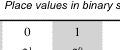

在二进制系统中，用于分隔一个数的整数部分和小数部分的点称为*二进制小数点*。表2.2列出了给定二进制数中每一位的权重。

表2.2 二进制系统中的位值

| 数字 | 1 | 0 | 1 | 0 | 0 | 1 | . | 0 | 1 | 0 | 1 |
|---|---|---|---|---|---|---|---|---|---|---|---|
| 权重 | 2^5 | 2^4 | 2^3 | 2^2 | 2^1 | 2^0 |  | 2^-1 | 2^-2 | 2^-3 | 2^-4 |

与十进制系统一样，对于整数部分，基数的幂向左每移动一位增加1；对于小数部分，基数的幂向右每移动一位减少1。给定二进制数的值可以确定为：各位与其自身权重相乘后的乘积之和。因此，二进制数101001.0101的值可以按如下方式得到：

```
1 × 2^5 + 0 × 2^4 + 1 × 2^3 + 0 × 2^2 + 0 × 2^1 + 1 × 2^0 + 0 × 2^-1 + 1 × 2^-2 + 0 × 2^-3 + 1 × 2^-4
= 32 + 8 + 1 + 0.25 + 0.0625
= 41.3125
```

二进制数101001.0101表示十进制值41.3125。

表2.4 十六进制系统中的位值

| 数字 | 4 | A | 9 | . | 2 | B |
|---|---|---|---|---|---|---|
| 权重 | 16² | 16¹ | 16⁰ | . | 16⁻¹ | 16⁻² |

十六进制数的值可以计算为：各符号与其自身权重相乘后的乘积之和。因此，给定十六进制数的值为：

```
4 × 16² + 10 × 16¹ + 9 × 16⁰ + 2 × 16⁻¹ + 11 × 16⁻²
= 1024 + 160 + 9 + 0.125 + 0.0429
= 1193 + 0.1679
= 1193.1679
```

十六进制数4A9.2B表示十进制值1193.1679。

### 2.5 八进制系统

八进制系统是使用基数8表示不同值的位值数制。因此，这种数制也称为*基数为8的数制*。由于该系统使用基数8，因此有八个符号可用于表示该系统不同的值。这些符号是从0到7的数字。

给定八进制数中每一位的权重，可以通过将8提高到与该数字在数中的位置相等的幂来确定。为理解这一概念，让我们考虑以下八进制数：

2 1 5 . 4 3

在八进制系统中，用于分隔一个数的整数部分和小数部分的点称为*八进制小数点*。表2.5列出了给定八进制数中每一位的权重。

表2.5 八进制系统中的位值

| 数字 | 2 | 1 | 5 | . | 4 | 3 |
|---|---|---|---|---|---|---|
| 权重 | 8² | 8¹ | 8⁰ | . | 8⁻¹ | 8⁻² |

使用这些位值，我们现在可以确定给定八进制数的值：

```
2 × 8² + 1 × 8¹ + 5 × 8⁰ + 4 × 8⁻¹ + 3 × 8⁻²
= 128 + 8 + 5 + 0.5 + 0.0469
= 141 + 0.5469
= 141.5469
```

八进制数215.43表示十进制值141.5469。

表2.6列出了十进制数0到15的八进制表示。


**表2.6** 前16个数字的八进制表示

| 十进制数 | 八进制表示 |
|---|---|
| 0 | 0 |
| 1 | 1 |
| 2 | 2 |
| 3 | 3 |
| 4 | 4 |
| 5 | 5 |
| 6 | 6 |
| 7 | 7 |
| 8 | 10 |
| 9 | 11 |
| 10 | 12 |
| 11 | 13 |
| 12 | 14 |
| 13 | 15 |
| 14 | 16 |
| 15 | 17 |

### 2.6 数字的转换

计算机系统接受十进制形式的数据，而它们以二进制形式存储和处理数据。因此，有必要将一种系统中的数字转换为另一种系统中的数字。不同类型的数制转换可分为以下几大类：

- 非十进制转换为十进制
- 十进制转换为非十进制
- 八进制转换为十六进制

#### 2.6.1 非十进制转换为十进制

非十进制到十进制的转换可以通过考虑位值的概念来实现。非十进制到十进制的转换包括以下数制转换：

- 二进制转换为十进制
- 十六进制转换为十进制
- 八进制转换为十进制

**二进制转换为十进制** 一个二进制数可以通过计算每一位与其对应位值的乘积之和来转换为等价的十进制数。

**示例2.1** *将二进制数10101101转换为对应的十进制数。*

**解**

给定的二进制数是10101101。

现在，计算每一位与其位值相乘后的乘积之和：

(1 × 2^7) + (0 × 2^6) + (1 × 2^5) + (0 × 2^4) + (1 × 2^3) + (1 × 2^2) + (0 × 2^1) + (1 × 2^0)
= 128 + 0 + 32 + 0 + 8 + 4 + 0 + 1
= 173

因此，二进制数10101101在十进制系统中等价于173。

**示例2.2** *将二进制数1101转换为十进制系统中的等价数。*

**解**

给定的二进制数是1101。

现在，计算每一位与其位值相乘后的乘积之和：

(1 × 2^3) + (1 × 2^2) + (0 × 2^1) + (1 × 2^0)
= 8 + 4 + 0 + 1
= 13

因此，二进制数1101在十进制系统中等价于13。

**示例2.3** *将二进制数10110001转换为十进制系统中的等价数。*

**解**

给定的二进制数是10110001。

现在，计算每一位与其位值相乘后的乘积之和：

(1 × 2^7) + (0 × 2^6) + (1 × 2^5) + (1 × 2^4) + (0 × 2^3) + (0 × 2^2) + (0 × 2^1) + (1 × 2^0)
= 128 + 0 + 32 + 16 + 0 + 0 + 0 + 1
= 177

因此，二进制数10110001在十进制系统中等价于177。

**示例2.4** *将二进制数1011.010转换为十进制系统中的等价数。*

**解**

给定的二进制数是1011.010。

现在，计算每一位与其位值相乘后的乘积之和：

(1 × 2^3) + (0 × 2^2) + (1 × 2^1) + (1 × 2^0) + (0 × 2^-1) + (1 × 2^-2) + (0 × 2^-3)
= 8 + 2 + 1 + 1/4
= 11 + 0.25
= 11.25

因此，二进制数1011.010在十进制系统中等价于11.25。

**示例2.5** *将二进制数11011.0110转换为十进制系统中的等价数。*

**解**

给定的二进制数是11011.0110。

现在，计算每一位与其位值相乘后的乘积之和：

(1 × 2^4) + (1 × 2^3) + (0 × 2^2) + (1 × 2^1) + (1 × 2^0) + (0 × 2^-1) + (1 × 2^-2) + (1 × 2^-3) + (0 × 2^-4)
= 16 + 8 + 2 + 1 + 1/4 + 1/8
= 27 + 0.25 + 0.125
= 27.375

因此，二进制数11011.0110在十进制系统中等价于27.375。

**十六进制转换为十进制** 一个十六进制数可以通过计算每个符号与其对应位值的乘积之和来转换为十进制系统中的等价数。

**示例2.6** *将十六进制数A53转换为十进制系统中的等价数。*

**解**

给定的十六进制数是A53。

现在，计算每个符号与其位值相乘后的乘积之和：

(10 × 16^2) + (5 × 16^1) + (3 × 16^0)
= 2560 + 80 + 3
= 2643

因此，十六进制数A53在十进制系统中等价于2643。

**示例2.7** *将十六进制数6B39转换为十进制系统中的等价数。*

**解**

给定的十六进制数是6B39。

现在，计算每个符号与其位值相乘后的乘积之和：

(6 × 16^3) + (11 × 16^2) + (3 × 16^1) + (9 × 16^0)
= 24576 + 2816 + 48 + 9
= 27449

因此，十六进制数6B39在十进制系统中等价于27449。

**示例2.8** *将十六进制数5A6D转换为十进制系统中的等价数。*

**解**

给定的十六进制数是5A6D。

现在，计算每个符号与其位值相乘后的乘积之和：

(5 × 16^3) + (10 × 16^2) + (6 × 16^1) + (13 × 16^0)
= 20480 + 2560 + 96 + 13
= 23149

因此，十六进制数5A6D在十进制系统中等价于23149。

**示例2.9** *将十六进制数AB21.34转换为十进制系统中的等价数。*

**解**

给定的十六进制数是AB21.34。

现在，计算每个符号与其位值相乘后的乘积之和：

(10 × 16^3) + (11 × 16^2) + (2 × 16^1) + (1 × 16^0) + (3 × 16^-1) + (4 × 16^-2)
= 40960 + 2816 + 32 + 1 + 3/16 + 4/256
= 43809 + 0.1875 + 0.015625
= 43809.203125

因此，十六进制数AB21.34在十进制系统中约等于43809.203。

**示例2.10** *将十六进制数6A11.3B转换为十进制系统中的等价数。*

**解**

给定的十六进制数是6A11.3B。

现在，计算每个符号与其位值相乘后的乘积之和：

(6 × 16^3) + (10 × 16^2) + (1 × 16^1) + (1 × 16^0) + (3 × 16^-1) + (11 × 16^-2)
= 24576 + 2560 + 16 + 1 + 3/16 + 11/256
= 27153 + 0.1875 + 0.043
= 27153.2305

因此，十六进制数6A11.3B在十进制系统中等价于27153.2305。

**八进制转换为十进制** 一个八进制数可以通过计算每位数字与其对应位值的乘积之和来转换为十进制系统中的等价数。

**示例2.11** *将八进制数5324转换为十进制系统中的等价数。*

**解**

给定的八进制数是5324。

现在，计算每一位数字与其位值相乘后的乘积之和：

(5 × 8^3) + (3 × 8^2) + (2 × 8^1) + (4 × 8^0)
= 2560 + 192 + 16 + 4
= 2772

因此，八进制数5324在十进制系统中等价于2772。

**示例2.12** *将八进制数13256转换为十进制系统中的等价数。*

**解**

给定的八进制数是13256。

现在，计算每一位数字与其位值相乘后的乘积之和：

(1 × 8^4) + (3 × 8^3) + (2 × 8^2) + (5 × 8^1) + (6 × 8^0)
= 4096 + 1536 + 128 + 40 + 6
= 5806

因此，八进制数13256在十进制系统中等价于5806。

**示例2.13** *将八进制数4567转换为十进制系统中的等价数。*

**解**

给定的八进制数是4567。

现在，计算每一位数字与其位值相乘后的乘积之和：

(4 × 8^3) + (5 × 8^2) + (6 × 8^1) + (7 × 8^0)
= 2048 + 320 + 48 + 7
= 2423

因此，八进制数4567在十进制系统中等价于2423。

**示例2.14** *将八进制数325.12转换为十进制系统中的等价数。*

**解**

给定的八进制数是325.12。

现在，计算每一位数字与其位值相乘后的乘积之和：

(3 × 8^2) + (2 × 8^1) + (5 × 8^0) + (1 × 8^-1) + (2 × 8^-2)
= 192 + 16 + 5 + 1/8 + 2/64
= 213 + 0.125 + 0.03125
= 213.15625

因此，八进制数325.12在十进制系统中等价于213.15625。

**示例2.15** *将八进制数7652.01转换为十进制系统中的等价数。*

**解**

给定的八进制数是7652.01。

现在，计算每一位数字与其位值相乘后的乘积之和：

(7 × 8^3) + (6 × 8^2) + (5 × 8^1) + (2 × 8^0) + (0 × 8^-1) + (1 × 8^-2)
= 3584 + 384 + 40 + 2 + 1/64
= 4010 + 0.015625
= 4010.0156

因此，八进制数7652.01在十进制系统中等价于4010.0156。

#### 2.6.2 十进制转换为非十进制

十进制到非十进制的转换是通过将十进制数不断除以目标数制的基数，直到十进制数变为零来完成的。当十进制数变为零后，我们可以从最后到最先依次记下每次连续除法得到的余数，从而将十进制数转换为目标数制。十进制到非十进制的转换包括以下数制转换：

- 十进制转换为二进制
- 十进制转换为十六进制
- 十进制转换为八进制

**十进制转换为二进制** 十进制到二进制的转换是通过反复将十进制数除以2，直到十进制数变为零，然后从最后到最先读取余数，以获得给定十进制数的二进制等价数。以下示例说明了将十进制数转换为其二进制等价数的方法：


##### 例 2.16
*将十进制数 30 转换为等价的二进制数。*

**解**

给定的十进制数是 30。

下表列出了将给定十进制数转换为其等价二进制数的步骤：

| 十进制数 | 除数 | 商 | 余数 |
|---:|---:|---:|---:|
| 30 | 2 | 15 | 0 |
| 15 | 2 | 7 | 1 |
| 7 | 2 | 3 | 1 |
| 3 | 2 | 1 | 1 |
| 1 | 2 | 0 | 1 |

现在，从下往上读取上表中计算出的余数，即可得到二进制等价值，即 11110。

因此，十进制数 30 对应的二进制数是 11110。

##### 例 2.17
*将十进制数 111 转换为等价的二进制数。*

**解**

给定的十进制数是 111。

下表列出了将给定十进制数转换为其等价二进制数的步骤：

| 十进制数 | 除数 | 商 | 余数 |
|---:|---:|---:|---:|
| 111 | 2 | 55 | 1 |
| 55 | 2 | 27 | 1 |
| 27 | 2 | 13 | 1 |
| 13 | 2 | 6 | 1 |
| 6 | 2 | 3 | 0 |
| 3 | 2 | 1 | 1 |
| 1 | 2 | 0 | 1 |

现在，从下往上读取上表中计算出的余数，即可得到二进制等价值，即 1101111。

因此，十进制数 111 对应的二进制数是 1101111。

##### 例 2.18
*将十进制数 215 转换为等价的二进制数。*

**解**

给定的十进制数是 215。

下表列出了将给定十进制数转换为其等价二进制数的步骤：

| 十进制数 | 除数 | 商 | 余数 |
|---:|---:|---:|---:|
| 215 | 2 | 107 | 1 |
| 107 | 2 | 53 | 1 |
| 53 | 2 | 26 | 1 |
| 26 | 2 | 13 | 0 |
| 13 | 2 | 6 | 1 |
| 6 | 2 | 3 | 0 |
| 3 | 2 | 1 | 1 |
| 1 | 2 | 0 | 1 |

现在，从下往上读取上表中计算出的余数，即可得到二进制等价值，即 1101011。

因此，十进制数 215 对应的二进制数是 1101011。

将给定十进制数的小数部分转换为其等价二进制数的过程有所不同。在此过程中，我们需要不断将小数部分乘以 2，然后记下结果的整数部分。当小数部分变为零或达到所需位数时，乘法过程将终止。

##### 例 2.19
*将十进制数 45796 转换为等价的八进制数。*

**解**

给定的十进制数是 45796。

下表列出了将给定十进制数转换为其等价八进制数的步骤：

| 十进制数 | 除数 | 商 | 余数 |
|---:|---:|---:|---:|
| 45796 | 8 | 5724 | 4 |
| 5724 | 8 | 715 | 4 |
| 715 | 8 | 89 | 3 |
| 89 | 8 | 11 | 1 |
| 11 | 8 | 1 | 3 |
| 1 | 8 | 0 | 1 |

现在，从下往上读取上表中计算出的余数，即可得到八进制等价值，即 131344。

因此，45796 对应的八进制数是 131344。

##### 例 2.20
*将十进制数 9547 转换为等价的八进制数。*

**解**

给定的十进制数是 9547。

下表列出了将给定十进制数转换为其等价八进制数的步骤：

| 十进制数 | 除数 | 商 | 余数 |
|---|---|---|---|
| 9547 | 8 | 1193 | 3 |
| 1193 | 8 | 149 | 1 |
| 149 | 8 | 18 | 5 |
| 18 | 8 | 2 | 2 |
| 2 | 8 | 0 | 2 |

现在，从下往上读取上表中计算出的余数，即可得到八进制等价值，即 22513。

因此，9547 对应的八进制数是 22513。

##### 例 2.21
*将十进制数 1567 转换为等价的十六进制数。*

**解**

给定的十进制数是 1567。

下表列出了将给定十进制数转换为其等价十六进制数的步骤：

| 十进制数 | 除数 | 商 | 余数 |
|---|---|---|---|
| 1567 | 16 | 97 | 15 |
| 97 | 16 | 6 | 1 |
| 6 | 16 | 0 | 6 |

现在，从下往上读取上表中计算出的余数，即可得到十六进制等价值，即 61F。

因此，给定十进制数对应的十六进制数是 61F。

##### 例 2.22
*将十进制数 9463 转换为等价的十六进制数。*

**解**

给定的十进制数是 9463。

下表列出了将给定十进制数转换为其等价十六进制数的步骤：

| 十进制数 | 除数 | 商 | 余数 |
|---|---|---|---|
| 9463 | 16 | 591 | 7 |
| 591 | 16 | 36 | 15 |
| 36 | 16 | 2 | 4 |
| 2 | 16 | 0 | 2 |

现在，从下往上读取上表中计算出的余数，即可得到十六进制等价值，即 24F7。

因此，给定十进制数对应的十六进制数是 24F7。

#### 2.6.3 八进制转十六进制

给定的八进制数可以通过两个不同步骤转换为等价的十六进制数。首先，我们需要将给定的八进制数转换为其等价二进制数。得到二进制等价值后，我们需要从最低有效位（LSB）开始，将二进制数划分为 4 位一组。

八进制转二进制是一个简单的过程。在这种转换中，我们需要将八进制数中的每一位表示为其等价的 3 位二进制数。表 2.7 列出了八进制系统中使用的所有数字的二进制表示。

**表 2.7** *八进制符号的二进制表示*

| 八进制 | 二进制表示 |
|---|---|
| 0 | 000 |
| 1 | 001 |
| 2 | 010 |
| 3 | 011 |
| 4 | 100 |
| 5 | 101 |
| 6 | 110 |
| 7 | 111 |

##### 例 2.25
*将八进制数 365 转换为等价的十六进制数。*

**解**

```text
Octal number:          3    6    5
                       ↓    ↓    ↓
Binary equivalent:    011  110  101    *Step 1*
                       ↓
Regrouping into 4-bit sections: 0000 1111 0101    *Step 2*
                       ↓    ↓    ↓
Hexadecimal equivalent: 0    F    5    *Step 3*
Hexadecimal number is F5
```

##### 例 2.26
*将八进制数 6251 转换为等价的十六进制数。*

**解**

```text
Octal number:          6    2    5    1
                       ↓    ↓    ↓    ↓
Binary equivalent:    110  010  101  001    *Step 1*
                       ↓
4-bit grouping:       1100 1010 1001    *Step 2*
                       ↓    ↓    ↓
Hexadecimal equivalent: C    A    9    *Step 3*
Hexadecimal number is CA9
```

### 2.7 二进制算术运算

计算机算术也称为*二进制算术*，因为计算机系统仅以二进制形式存储和处理数据。各种二进制算术运算可以像十进制算术运算一样执行，但需要遵循一组预定义规则。每种二进制算术运算都有一组相关规则，在执行该运算时应遵守这些规则。与十进制运算相比，二进制算术运算通常更简单，因为在二进制运算中只需处理 0 和 1 两个数字。计算机系统中执行的不同二进制算术运算包括：

- 二进制加法
- 二进制乘法
- 二进制减法
- 二进制除法

#### 2.7.1 二进制加法

二进制加法是计算机系统中执行的最简单的算术运算。与十进制系统一样，我们可以从给定数字的最右位开始，逐列向最左位进行两个二进制数的加法。然而，在对给定数字执行二进制加法时，我们需要遵循某些规则。表 2.8 列出了二进制加法的规则。

**表 2.8** *二进制加法规则*

| A | B | A + B | 进位 |
|---|---|---|---|
| 0 | 0 | 0 | 0 |
| 0 | 1 | 1 | 0 |
| 1 | 0 | 1 | 0 |
| 1 | 1 | 0 | 1 |

在上表中，前三项不会产生任何进位。然而，当 A 和 B 都包含值 1 时，将产生进位。如果在某一列执行二进制加法时产生进位，则该进位将被传递到下一个更高有效位列。

##### 例 2.27
*对以下二进制数执行二进制加法运算：*

```text
0 0 1 0
0 1 1 1
```

**解**

给定的二进制数是 0010 和 0111。

现在，按如下方式对给定数字执行二进制加法：

```text
Binary number       Decimal value

0 0 1 0             2
0 1 1 1             7
-------             -
1 0 0 1             9
```

因此，对 0010 和 0111 执行二进制加法的结果是 1001。

> **注意** 在上例中，仅在第二列和第三列产生进位。


**例 2.28** *执行以下二进制数的二进制加法：*

101010  
010011

**解**

给定的二进制数是 101010 和 010011。

现在，按如下方式对给定数执行二进制加法：

```
Binary number   Decimal value
1 0 1 0 1 0     42
0 1 0 0 1 1     19
-------------   ----
1 1 1 1 0 1     61
```

因此，对 101010 和 010011 执行二进制加法的结果是 111101。

> **注意** *在上面的示例中，仅在第二列产生进位。*

**例 2.29** *计算以下数的二进制和：*

00011010  
10001100

**解**

给定的二进制数是 00011010 和 10001100。

现在，按如下方式对给定数执行二进制加法：

```
Binary number   Decimal value
0 0 0 1 1 0 1 0     26
1 0 0 0 1 1 0 0    140
----------------   ----
1 0 1 0 0 1 1 0    166
```

因此，对 00011010 和 10001100 执行二进制加法的结果是 10100110。

> **注意** *在上面的示例中，仅在第 4 列和第 5 列产生进位。*

我们也可以对两个以上的二进制数执行二进制加法。表 2.9 列出了三个二进制数相加的规则。

**表 2.9** *三个二进制数相加的规则*

| A | B | C | A + B + C | 进位 |
|---|---|---|---|---|
| 0 | 0 | 0 | 0 | 0 |
| 0 | 0 | 1 | 1 | 0 |
| 0 | 1 | 0 | 1 | 0 |
| 0 | 1 | 1 | 0 | 1 |
| 1 | 0 | 0 | 1 | 0 |
| 1 | 0 | 1 | 0 | 1 |
| 1 | 1 | 0 | 0 | 1 |
| 1 | 1 | 1 | 1 | 1 |

**表 2.10** *二进制乘法规则*

| A | B | A×B |
|---|---|---|
| 0 | 0 | 0 |
| 0 | 1 | 0 |
| 1 | 0 | 0 |
| 1 | 1 | 1 |

上表清楚地表明，二进制乘法不涉及进位概念。为了理解二进制乘法的概念，让我们考虑以下示例：

**例 2.32** *执行十进制数 12 和 10 的二进制乘法。*

**解**

十进制数 12 的等价二进制表示是 1100。  
十进制数 10 的等价二进制表示是 1010。  
现在，按如下方式对给定数执行二进制乘法：

```
        1 1 0 0       Multiplicand
        1 0 1 0       Multiplier
        -------
          0 0 0 0     First partial product
        1 1 0 0
      0 0 0 0
    1 1 0 0
    -----------
    1 1 1 1 0 0 0     Final product
```

因此，对十进制数 12 和 10 执行二进制乘法的结果是 1111000。

**例 2.33** *计算十进制数 15 和 14 的二进制乘积。*

**解**

十进制数 15 的等价二进制表示是 1111。  
十进制数 14 的等价二进制表示是 1110。  
现在，按如下方式对给定数执行二进制乘法：

```
         1 1 1 1       Multiplicand
         1 1 1 0       Multiplier
         -------
           0 0 0 0     First partial product
         1 1 1 1
       1 1 1 1
     1 1 1 1
     -----------
    1 1 0 1 0 0 1 0     Final product
```

因此，对十进制数 15 和 14 执行二进制乘法的结果是 11010010。

**例 2.34** *执行以下数的二进制乘法：*

1101  
111

**解**

给定的二进制数是 1101 和 111。

现在，按如下方式对给定数执行二进制乘法：

```
    1 1 0 1    Multiplicand
      1 1 1    Multiplier
    -------
    1 1 0 1    First partial product
  1 1 0 1
1 1 0 1
-------
1 0 1 1 0 1 1    Final product
```

因此，对数字 1101 和 111 执行二进制乘法的结果是 1011011。

**例 2.35** *计算以下数的二进制乘积：*

100010  
10010

**解**

给定的二进制数是 100010 和 10010。

现在，按如下方式对给定数执行二进制乘法：

```
  1 0 0 0 1 0    Multiplicand
    1 0 0 1 0    Multiplier
  -----------
  0 0 0 0 0 0    First partial product
  1 0 0 0 1 0
0 0 0 0 0 0
0 0 0 0 0 0
1 0 0 0 1 0
---------------
1 0 0 1 1 0 0 1 0 0    Final product
```

因此，对数字 100010 和 10010 执行二进制乘法的结果是 1001100100。

#### 2.7.3 二进制减法

二进制减法的执行方式与十进制减法相同。与二进制加法和二进制乘法一样，二进制减法也关联着一组在执行该运算时需要遵循的规则。表 2.11 列出了二进制减法的规则。

**表 2.11** *二进制减法规则*

| A | B | A-B | 借位 |
|---|---|---|---|
| 0 | 0 | 0 | 0 |
| 0 | 1 | 1 | 1 |
| 1 | 0 | 1 | 0 |
| 1 | 1 | 0 | 0 |

上表表明，二进制减法与十进制减法一样，使用借位法从一个数中减去另一个数。为了理解二进制减法的概念，让我们考虑以下示例：

**例 2.36** *对以下二进制数执行减法：*

0101  
0010

**解**

给定的二进制数是 0101 和 0010。  
现在，按如下方式对给定数执行二进制减法：

```
    1        Borrow
  0 1 0 1    Minuend
  0 0 1 0    Subtrahend
-------
  0 0 1 1    Difference
```

因此，对数字 0101 和 0010 执行二进制减法的结果是 0011。

**例 2.37** *对以下数执行二进制减法：*

10101  
01110

**解**

给定的二进制数是 10101 和 01110。  
现在，按如下方式对给定数执行二进制减法：

```
  1 1 1      Borrow
  1 0 1 0 1  Minuend
  0 1 1 1 0  Subtrahend
-------
  0 0 1 1 1  Difference
```

因此，对数字 10101 和 01110 执行二进制减法的结果是 00111。

**例 2.38** *对以下数执行二进制减法：*

10111011  
01001001

**解**

给定的二进制数是 10111011 和 01001001。  
现在，按如下方式对给定数执行二进制减法：

```
  1                  Borrow
  1 0 1 1 1 0 1 1    Minuend
  0 1 0 0 1 0 0 1    Subtrahend
---------------
  0 1 1 1 0 0 1 0    Difference
```

因此，对数字 10111011 和 01001001 执行二进制减法的结果是 01110010。

**例 2.39** *对以下数执行二进制减法：*

1011101010  
001111011100

**解**

给定的二进制数是 1011101010 和 001111011100。

现在，按如下方式对给定数执行二进制减法：

```
    1 1 1 1 1 1 1 1 1
    1 0 1 1 1 0 1 0 1 0
    0 0 1 1 1 1 0 1 1 1 0 0
    ---------------------
    0 1 1 1 1 1 0 0 1 1 1 0
```

因此，对数字 1011101010 和 001111011100 执行二进制减法的结果是 1111001110。

#### 2.7.4 二进制除法

二进制除法也以与执行十进制除法相同的方式执行。与十进制除法一样，在执行二进制除法时，我们也需要遵循二进制减法规则。二进制除法中涉及的被除数应大于除数。以下是执行二进制除法时需要记住的两个要点：

- 如果除法过程得到的余数大于或等于除数，则在商中写 1，并执行二进制减法。
- 如果除法过程得到的余数小于除数，则在商中写 0，并将被除数的下一个最高有效位追加到余数。

**例 2.40** *用二进制形式将 14 除以 7。*

**解**

十进制数 14 的等价二进制表示是 1110。

7 的二进制表示是 111。

现在，按如下方式对给定数执行二进制除法：

```
    1 1 1 ) 1 1 1 0 (10  (Quotient)
        1 1 1
        -----
          0 0 0 0
```

因此，对十进制数 14 和 7 执行二进制除法的结果是 10。

**例 2.41** *对十进制数 18 和 8 执行二进制除法。*

**解**

十进制数 18 的等价二进制表示是 10010。

十进制数 8 的等价二进制表示是 1000。


现在，按如下方式对给定数进行二进制除法：

```
1 0 0 0 ) 1 0 0 0 1 0 ( 1 0    (Quotient)
          1 0 0 0
          -----
            0 0 0 1 0
            0 0 0 0 0
            -----
            0 0 0 1 0              (Remainder)
```

因此，对十进制数 18 和 8 进行二进制除法的结果为 10，余数为 10。

##### 例 2.42
*对十进制数 11011 和 1001 进行二进制除法。*

###### 解答

给定的二进制数为 11011 和 1001。

现在，按如下方式对给定的二进制数进行二进制除法：

```
1 0 0 1 ) 1 1 0 1 1 ( 1 1    (Quotient)
          1 0 0 1
          -----
            1 0 0 1
            1 0 0 1
            -----
            0 0 0 0
```

因此，对数字 11011 和 1001 进行二进制除法的结果为 11。

##### 例 2.43
*对 217 和 12 进行二进制除法。*

###### 解答

十进制数 217 的等价二进制表示为 11011001。

十进制数 12 的等价二进制表示为 1100。

现在，按如下方式对给定数进行二进制除法：

```
1 1 0 0 ) 1 1 0 1 1 0 0 1 ( 1 0 0 1 0    (Quotient)
          1 1 0 0
          ------
            0 0 0 1 1
            0 0 0 0 0
            ------
                1 1 0 0
                1 1 0 0
                ------
                0 0 0 1              (Remainder)
```

因此，对十进制数 217 和 12 进行二进制除法的结果为 10010，余数为 1。

### 2.8 逻辑门

逻辑门是数字计算机的基本构建模块。通常，所有逻辑门都有两个输入信号和一个输出信号。这两个输入信号无非是两个二进制值 0 或 1，用于表示不同的电压电平。在所有逻辑门中，二进制值 0 表示低电压状态，约为 0 伏；二进制值 1 表示高电压状态，约为 +5 伏。三种基本逻辑门是：

- 与门（AND）
- 或门（OR）
- 非门（NOT）

所有逻辑门都有逻辑表达式、符号和真值表。逻辑表达式有助于根据输入求出逻辑门的输出。符号是逻辑门的图形表示，逻辑门可以有一个或多个输入以及一个输出。真值表有助于以输出的形式求出逻辑门的最终逻辑状态，例如真/假或 1/0。

#### 2.8.1 与门

与门是基本逻辑门之一，仅当其所有输入信号均为值 1 时，才给出值为 1 的输出信号。换句话说，只要与门有一个输入信号为值 0，它就给出值为 0 的输出信号。

##### 逻辑表达式

与功能的逻辑表达式为：

F = A.B

其中，F 是取决于输入 A 和 B 的输出。

##### 符号

与门的符号如图 2.1 所示。

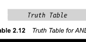

图 2.1 与门

##### 真值表

表 2.12 与门真值表

| 输入 A | 输入 B | 输出 F |
|---|---|---|
| 0 | 0 | 0 |
| 0 | 1 | 0 |
| 1 | 0 | 0 |
| 1 | 1 | 1 |

##### 例 2.44
*考虑以下具有两个与门的系统：*

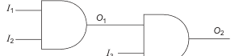

###### 解答

假设

I₁ = 1，I₂ = 0，I₃ = 0

输出将为

O₁ = I₁ I₂ = 1·0 = 0

O₂ = I₃ O₁ = 0·0 = 0

##### 例 2.45
*考虑以下具有三个与门的系统：*

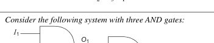

###### 解答

假设

I₁ = 1，I₂ = 1，I₃ = 1，I₄ = 1

输出将为：

O₁ = I₁ I₂ = 1·1 = 1

O₂ = I₃ O₁ = 1·1 = 1

O₃ = I₄ O₂ = 1·1 = 1

#### 2.8.2 或门

或门是另一种基本逻辑门，只要其一个输入信号为值 1，它就给出值为 1 的输出信号。换句话说，当或门的所有输入信号均为值 0 时，它给出值为 0 的输出信号。

##### 逻辑表达式

或功能的逻辑表达式为：

F = A + B

其中，F 是取决于输入 A 和 B 的输出。

##### 符号

或门的符号如图 2.2 所示。

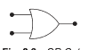

##### 真值表

表 2.13 或门真值表

| 输入 A | 输入 B | 输出 F |
|---|---|---|
| 0 | 0 | 0 |
| 0 | 1 | 1 |
| 1 | 0 | 1 |
| 1 | 1 | 1 |

##### 例 2.46
*考虑以下或门配置：*

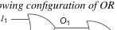

###### 解答

当

I₁ = 1，I₂ = 0，I₃ = 1

输出

O₁ = I₁ + I₂ = 1 + 0 = 1

O₂ = I₃ + O₁ = 1 + 1 = 1

##### 例 2.47
*考虑以下具有三个或门的系统，*

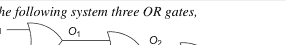

###### 解答

假设

I₁ = 0，I₂ = 0，I₃ = 1，I₄ = 1

输出 O₁、O₂ 和 O₃ 将为

O₁ = I₁ + I₂ = 0 + 0 = 0

O₂ = I₃ + O₁ = 1 + 0 = 1

O₃ = I₄ + O₂ = 1 + 1 = 1

#### 2.8.3 非门

第三种基本逻辑门是非门，它产生与输入状态相反的输出。这种逻辑门始终只有一个输入信号和一个输出信号。

##### 逻辑表达式

非功能的逻辑表达式为：

F = \bar{A}

其中，F 是取决于输入 A 的输出。

##### 符号

非门的符号如图 2.3 所示。

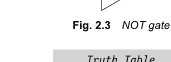

##### 真值表

表 2.14 非门真值表

| 输入 A | 输出 F |
|---|---|
| 0 | 1 |
| 1 | 0 |

##### 例 2.48
*考虑如下所示配置的两个非门：*


###### 解答

如果 I₁ = 1，则 O₁ = \bar{I₁} = \bar{1} = 0
因此
I₂ = O₁ = 0
O₂ = \bar{I₁} = \bar{0} = 1

### 2.9 编程语言

**LO 2.5**

计算机的操作由一组指令（称为*计算机程序*）控制。编写这些指令是为了告诉计算机：

1. 执行什么操作
2. 在哪里定位数据
3. 如何呈现结果
4. 何时做出某些决策

两方之间的通信，无论是机器还是人类，总是需要一种共同的语言或术语。用于计算机指令通信的语言称为编程语言。计算机有自己的语言，与计算机的任何通信都必须使用其语言，或翻译成这种语言。

编程语言有三个层次。它们是：

1. 机器语言（低级语言）
2. 汇编（或符号）语言
3. 面向过程语言（高级语言）

#### 2.9.1 机器语言

由于计算机由二态电子器件构成，它们只能理解脉冲和无脉冲（或“1”和“0”）状态。因此，所有指令和数据都应使用二进制代码 1 和 0 编写。这种二进制代码称为机器码或机器语言。

计算机不懂英语、印地语或泰米尔语。它们只响应机器语言。此外，计算机的设计并不完全相同，因此每台计算机都有自己的机器语言。（然而，符号 1 和 0 对所有计算机都是相同的。）这给用户带来两个问题。

首先，难以理解和记住表示大量数据和指令的各种 1 和 0 的组合。而且，编写无错误的指令是一个缓慢的过程。

其次，由于每台机器都有自己的机器语言，用户无法与其他计算机通信（如果用户不懂其语言）。想象一个泰米尔人第一次去德里旅行。他会面临巨大障碍，因为语言障碍会妨碍他进行交流。

机器语言通常被称为第一代语言。

#### 2.9.2 汇编语言

汇编语言于 20 世纪 50 年代引入，降低了编程复杂性，并为构建应用程序提供了一定的标准化。汇编语言也称为第二代编程语言，同样是一种低级语言。在汇编语言中，机器语言的 0 和 1 被替换为缩写或助记码。

汇编语言相对于机器语言的主要优点有：

- 由于我们可以在汇编语言中定位和识别语法错误，因此很容易调试它。
- 与机器语言相比，使用汇编语言开发计算机应用程序更容易。
- 汇编语言运行非常高效。

汇编语言程序由一系列指令和助记符组成，这些指令和助记符对应于可执行指令流。汇编语言指令由助记码后跟零个或多个操作数组成。助记码称为操作码（opcode），它指定要对给定参数执行的操作。考虑以下机器码：

```
10110000 01100001
```

其等价的汇编语言表示为：

```
mov al, 061h
```

在上述指令中，操作码“move”用于将十六进制值 61 移入名为“al”的处理器寄存器。以下程序显示了用于将两个数相减的汇编语言指令：

```
ORG 500        /Origin of program is location 500
LDA SUB        /Load subtrahend to AC
```


```asm
CMA       /Complement AC
INC       /Increment AC
ADD MIN   /Add minuend to AC
STA DIF   /Store difference
HLT       /Halt computer
MIN, DEC 56 /Minuend
SUB, DEC -2 /subtrahend
DIF, HEX 0 /Difference stored here
END       /End of symbolic program
```

需要注意的是，在执行过程中，汇编语言程序会在*汇编器*的帮助下转换为机器码。简单的汇编语言语句与机器语言语句一一对应。这种一一对应仍然会生成复杂的程序。随后发明了宏指令，使得可以用一条汇编语言指令表示多条机器语言语句。即使在今天，程序员仍更倾向于使用汇编语言来执行某些任务，例如：

- 在启动操作系统之前初始化和测试系统硬件。这段汇编语言代码存储在 ROM 中。
- 在反病毒产品开发公司中编写用于反汇编病毒的补丁。
- 为实现极致优化，例如在处理器密集型算法的内层循环中。
- 用于与硬件直接交互。
- 在需要完全控制环境的极高安全性场景中。
- 在资源严重受限的系统中，最大化利用有限资源。

#### 2.9.3 高级语言

高级语言通过减少必须指定的计算机操作细节数量，进一步简化了编程任务。与低级编程语言相比，COBOL、Pascal、FORTRAN 和 C 等高级语言更加抽象、更易于使用，并且具有更好的跨平台可移植性。程序员不必再处理寄存器、内存地址和调用栈，而是可以借助变量、数组或布尔表达式，更专注于解决问题的逻辑。例如，考虑以下汇编语言代码：

```asm
LOAD A
ADD B
STORE C
```

使用 FORTRAN，上述代码可以表示为：

```fortran
C = A + B
```

上述高级语言代码通过编译器或解释器转换为相应的机器语言代码后执行。

高级语言可以分为以下三类：

- 面向过程语言（第三代）
- 面向问题语言（第四代）
- 自然语言（第五代）

##### 面向过程语言

旨在解决通用问题的高级语言称为*过程式语言*或*第三代语言*。这些语言包括 BASIC、COBOL、FORTRAN、C、C++ 和 JAVA，它们旨在表达问题的逻辑和过程。尽管这些编程语言的语法不同，但它们使用类似英语的命令，易于理解。第三代语言的另一个主要优势是可移植性。我们可以将编译器（或解释器）安装在任何计算机上并生成目标代码。以下程序表示 C 语言的源代码：

```c
if (n > 10)
{
    do
    {
        n++;
    } while (n < 50);
}
```

##### 面向问题语言

面向问题语言用于解决特定问题，被称为*第四代语言*。这些语言包括查询语言、报表生成器和应用程序生成器，它们具有简单的、类似英语的语法规则。第四代语言（4GL）减少了编程工作量以及软件开发的总体成本。这些语言使用可视化环境或文本环境进行程序开发，与第三代语言类似。第四代语言中的一条语句可以完成与第三代语言多行代码相同的任务。此外，程序员只需从工具栏中拖放，即可创建按钮、文本框、标签等各种项。同时，程序员可以快速创建软件应用程序的原型。

##### 自然语言

自然语言旨在使计算机像专家一样工作并解决问题。程序员只需指定问题以及用于解决问题的约束条件。LISP 和 PROLOG 等自然语言主要用于开发人工智能和专家系统。这些语言被广泛称为*第五代语言*。

### 2.10 翻译程序

LO 2.5

#### 2.10.1 汇编器

汇编器是一种计算机程序，它将汇编语言语句转换为机器语言代码。汇编器从源代码中取出每条汇编语言语句，并使用 *0 和 1* 生成相应的位流。汇编器以 *0 和 1* 序列形式输出的结果称为*目标代码或机器代码*。最终执行该机器代码以获得结果。

现代汇编器将汇编指令助记符转换为操作码，并解析内存位置和其他实体的符号名，以创建目标代码。一些复杂的汇编器还提供额外功能，用于控制汇编过程、促进程序开发和辅助调试。基于 RISC 架构的 Sun SPARC 和 MIPS 等现代汇编器会优化指令调度，以实现 CPU 的高效利用。现代汇编器通常包含宏功能，被称为*宏汇编器*。

汇编器可以分为*单遍汇编器*和*两遍汇编器*。*单遍汇编器*是第一种只处理源代码一次、用二进制代码替换助记符的汇编器。单遍汇编器无法支持高级的源代码优化。因此，开发了两遍汇编器，它会读取程序两次。第一遍读取所有变量和标签并放入符号表。第二遍通过用地址替换标签名，从表中填补标签空缺。这有助于实现更高程度的源代码优化。汇编器的翻译过程包括以下任务：

- 用数字地址替换 LOOP 等符号地址
- 用机器操作码替换符号操作码
- 为指令和数据保留存储空间
- 将常量转换为其机器表示形式

#### 2.10.2 编译器

编译器是一种计算机程序，它将用高级语言编写的源代码转换为相应的低级语言*目标代码*。这一转换过程称为*编译*。整个高级程序会被转换为可执行的机器代码文件。将低级语言转换为高级语言的程序称为反编译器。编译型语言包括 COBOL、FORTRAN、C、C++ 等。

1952 年，Grace Hopper 为 A-0 编程语言编写了第一个编译器。1957 年，IBM 的 John Backus 推出了第一个完整的编译器。随着计算机体系结构日益复杂以及较新编程语言支持的功能不断扩展，编译器变得越来越复杂。尽管早期编译器是用汇编语言编写的，但如今用其编译的语言来实现编译器已成为常见做法。编译器也可分为*单遍编译器*和*多遍编译器*。尽管单遍编译器通常比多遍编译器更快，但为了实现复杂优化，需要多遍编译器来生成高质量代码。

#### 2.10.3 解释器

解释器是一种翻译程序，它将每条高级程序语句转换为相应的机器代码。这一转换过程就在程序语句执行之前进行。它不是翻译整个程序，而是一次翻译并立即执行一条语句。常用的解释型语言是 BASIC 和 PERL。尽管与编译器相比，解释器更易于创建，但编译型语言可以更高效地执行，速度也更快。

### 2.11 问题求解技术

LO 2.6

在当今世界，计算机被用来解决各种类型的问题，因为与人类相比，它花费的时间非常少。解决问题时会执行以下步骤：

- 1. 分析给定的问题。
- 2. 将用于解决问题的过程划分为一系列基本任务。
- 3. 制定解决问题的算法。
- 4. 将算法表示为精确的记法，即计算机程序。
- 5. 将计算机程序输入计算机。CPU 解释给定程序，相应地处理数据，并生成结果。
- 6. 将生成的结果发送到输出单元，由输出单元显示。


算法和流程图是帮助用户使用计算机解决问题或完成任务的**两项重要技术**。

#### 2.11.1 算法

算法是一种独立于计算机软件或硬件、用于解决问题的完整、详细且精确的逐步方法。算法非常重要，因为它指示计算机执行特定任务或解决问题所需的具体步骤。为了理解算法的工作原理，让我们考虑以下示例：

假设 XYZ 公司在月初给每位销售人员 Rs 5000 用于支付各种费用，如餐饮、住宿和差旅。月底，销售人员必须向公司提交其总支出收据。如果金额少于 Rs 5000，则剩余金额必须退还公司。现在，可以设计一个简单的算法来确定需要退还多少钱（如果有的话）。

- 1. 计算当月的费用收据总额。
- 2. 从 Rs 5000 中减去该金额。
- 3. 如果余数大于 0，则将余款退还给公司。

#### 2.11.2 算法的自顶向下方法

解决给定问题的算法自顶向下方法也称为分治法。在这种方法中，给定问题被划分为两个或多个子问题，每个子问题都与原问题相似。每个子问题的解决方案独立得出。最后，将所有子问题的解决方案组合起来，得到主问题的解决方案。自顶向下方法最常见的实现示例之一是二分查找。

二分查找是一种帮助从给定数据列表中搜索所需数据的方法。该方法涉及将待搜索数据与列表中中间位置的数据进行比较。如果列表中中间位置的数据与待搜索数据相同，则认为搜索成功。否则，将列表分为两部分：左半部分和右半部分。将待搜索数据与中间位置的数据进行比较。如果它小于中间位置的数据，则搜索列表的左半部分；如果大于中间位置的数据，则搜索列表的右半部分。重复此过程，直到找到待搜索数据或整个列表都被搜索完毕。如果找到待搜索数据，则搜索成功；否则搜索失败。

#### 2.11.3 程序验证

计算机程序被视为形式化的数学对象，这些计算机程序的属性需要经过数学证明。程序验证是指使用形式化的数学技术来调试程序及其规格说明。例如，假设我们编写了一个实现二分查找的程序。现在，我们想验证编写的程序是否正确。这可以通过在给定数据列表上运行该程序来验证。

考虑一个包含 11 个元素的数组 X[11] = {8,18,26,40,47,69,84,115,126,136,177}。使用二分查找技术来判断元素 '26' 是否存在于该数组中。现在，执行二分查找的步骤来搜索所需元素。这里，'Low' 表示列表中第一个元素的位置，'High' 表示列表中最后一个元素的位置，'Mid' 表示列表中中间位置元素的位置。首先，在给定数组中搜索元素 '26'。在第一次迭代中，Low、High 和 Mid 的值如下：

对于销售人员的费用示例，算法的流程图可以表示如下，如图 2.4 所示。

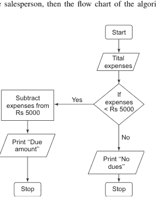

**图 2.4** *算法的流程图表示*

**示例 2.49** *编写一个从三个数中找出最大数的算法。*

设 x、y 和 z 为这三个数。现在，我们可以按照下面的算法来确定三个数中的最大数：

- 1. 读取这三个数。
- 2. 如果 x > y
  - a. 如果 x > z，则 x 是最大数。
  - b. 否则，z 是最大数。
- 3. 否则，
  - a. 如果 y > z，则 y 是最大数。
  - b. 否则，z 是最大数。

**示例 2.50** *编写算法，将摄氏度转换为华氏度。*

设 x 为给定的摄氏温度。现在，我们需要按照下面的算法来确定华氏温度：

- 1. 读取 x。
- 2. 将 x 乘以 9/5。
- 3. 在乘积结果上加 32。
- 4. 打印最终值，即为华氏温度。

**示例 2.51** *编写计算 n 个整数平均值的算法。*

- 4. 重复步骤 5 到 11。
- 5. 如果 n <= x，则转到步骤 12。
- 6. 否则
- 7. 将 n 除以 x。
- 8. 如果除法的余数为 0，则打印 x。
- 9. 令 n = n / x。
- 10. 将 x 增加 1，然后转到步骤 5。
- 11. 结束如果
- 12. 退出。

使用 C 语言实现该算法的程序如图 2.6 所示。

**程序**

```c
#include <stdio.h>
#include <conio.h>
void main()
{
    int n,x;
    clrscr();
    printf("Enter a number to find its prime factors:");
    scanf("%d",&n);
    if(n<=1)
    {
        printf("Enter a value greater than 1.");
        getch();
        exit(0);
    }
    x=2;
    do
    {
        if(n%x==0)
        {
            printf("%d\t",x);
            n/=x;
        }
        else
            x++;
    }
    while (x<=n);
    getch();
}
```

**输出**

```
Enter a number to find its prime factors:
72
The prime factors of 72 are:
2 2 2 3 3
Enter a number to find its prime factors:
1
Enter a value greater than 1.
```

**图 2.6** *求给定数的质因数的程序*

**示例 2.58** *编写一个求某个数平方根的算法。*

- 1. 读取一个数，例如 s。
- 2. 如果 s < 0，则转到步骤 16。
- 3. 否则如果 s = 0
- 4. 打印根值为 0。
- 5. 否则
- 6. 设置 n = 1。
- 7. 当 (!(s >= n * n && s < (n + 1) * (n + 1))) 时
- 8. 将 n 增加 1。
- 9. 结束当
- 10. d = s - (n * n);
- 11. p = (double)d / (2 * n);
- 12. a = (double)n + p;
- 13. root = (double)a - (p * p) / (2 * a);
- 14. 打印根值。
- 15. 结束如果
- 16. 退出。

图 2.7 中的程序用 C 语言实现了上述算法。

**程序**

```c
#include <stdio.h>
int main()
{
    int s,n;
    double d,p,a,root;
    clrscr();
    printf("Enter a number:");
    scanf("%d",&s);
    if(s<0)
        printf("Enter a positive integer value.");
    else if(s==0)
        printf("Square root of 0 is 0");
    else
    {
        n=1;
        while(!(s>=n*n && s<(n+1)*(n+1)))
        {
            n++;
        }
        d=s-(n*n);
        p=(double)d/(2*n);
        a=(double)n+p;
        root=(double)a-((p*p)/(2*a));
        printf("\nSquare root of %d is %.3f",s,root);
        getch();
    }
```

**输出**

```
Enter a number:16
Square root of 16 is 4.000.
```

**图 2.7** *求给定数的平方根的程序*

**示例 2.59** *编写一个算法，判断给定的数字是否为素数。*

- 1. 读取一个数，比如 n，表示你想打印到 n 为止的素数。
- 2. 因为 1 和 2 是素数，所以打印它们。
- 3. 检查到 n 为止的每个数是否为素数。
- 4. 打印到 n 为止的所有素数。

图 2.8 中的程序说明了该算法的实现。

**程序**

```c
#include <stdio.h>
#include <conio.h>
#include <math.h>
void main()
{
    int n,i,j;
    clrscr();
    printf("Enter a number up to which you want prime numbers:");
    scanf("%d",&n);
    if(n<=1)
    {
        printf("Enter a number greater than 1.");
        getch();
        exit(0);
    }
    printf("Prime numbers between 1 and %d are:",n);
    printf("\n\n2");

}
```

```c
for(i=3;i<=n;i++)
{
    for(j=2;j<=sqrt(i);j++)
    {
        if(i%j==0)
            break;
    }
    if(j>sqrt(i))
        printf("\n%d",i);
}
getch();
}
```

**输出**

```text
Enter a number up to which you want prime numbers:
5
Prime numbers between 1 and 5 are:
2
3
5
```

**图 2.8** *查找不超过给定数字的质数的程序*

##### 示例 2.60

*给出两个数相加的流程图。*

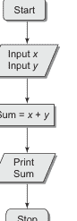

##### 示例 2.63

*给出示例 2.52 的流程图*

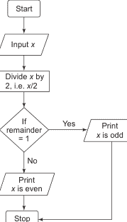

##### 示例 2.64

*给出确定 10 个数的平均值的流程图。*

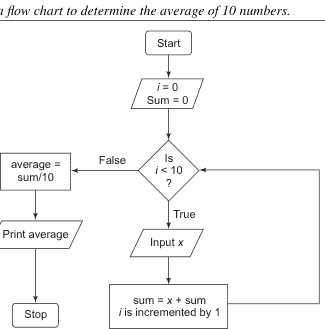

### 2.12 使用计算机

**LO 2.6**

计算机可用于解决特定的科学或商业问题。无论哪种情况，使用计算机都涉及一些基本步骤。这些步骤如下：

- **问题分析：** 识别已知和未知参数，并说明求解问题时受到的约束条件。选择一种求解方法。
- **收集信息：** 收集解决问题所需的数据、信息和文档，并规划输出结果的布局。
- **准备计算机逻辑：** 确定求解问题过程中要执行的操作顺序，并规划程序逻辑，最好使用程序流程图。
- **编写计算机程序：** 用合适的语言编写供计算机执行的指令程序。
- **测试程序：** 程序中通常会有错误（缺陷）。消除所有这些错误，错误可能出现在语言使用方面，也可能出现在逻辑方面。
- **准备数据：** 以所需形式准备输入数据。
- **运行程序：** 可以采用批处理模式或交互模式运行。计算由计算机执行，并给出结果。

特定输入/输出设备的使用取决于问题的性质、输入数据的类型以及所需输出的形式。

## 学习成果

- 计算机代码帮助计算机系统将接收到的不同数制数据转换为二进制形式的数据，从而能够以高效的方式存储和处理。**LO 2.1**
- 在计算机术语中，用于表示数据的数制通常称为位值记数制，因为该数制所表示数值的大小取决于数字在给定数中的位置。**LO 2.1**
- 位值记数制可分为四种不同类型，即十进制、二进制、十六进制和八进制。**LO 2.1**
- 我们可以轻松地将一种数制表示的数转换为另一种数制中的等价值。主要的数制转换包括非十进制到十进制、十进制到非十进制以及八进制到十六进制。**LO 2.2**
- 计算机系统执行的基本算术运算包括二进制加法、二进制乘法、二进制减法和二进制除法。**LO 2.3**
- 计算机系统硬件组件的基本单元是逻辑门。**LO 2.4**
- 有三种基本逻辑门——与门、或门和非门。**LO 2.4**
- 编程语言有三个层次——机器语言、汇编语言和面向过程语言。**LO 2.5**
- 算法和流程图是帮助使用计算机解决问题的两种重要技术。**LO 2.6**

## 需要记住的关键术语

- **计算机代码：** 计算机代码是帮助将用户输入的数据转换为二进制形式的代码。**LO 2.1**
- **位值记数制：** 位值记数制是一种使用称为数字的特定符号表示数，并通过考虑数字的位置来确定这些数值的系统。**LO 2.1**
- **十进制系统：** 十进制系统是一种使用基数 10 表示不同数值的位值记数制。**LO 2.1**
- **二进制系统：** 二进制系统是一种使用基数 2 表示不同数值的位值记数制。**LO 2.1**
- **十六进制系统：** 十六进制系统是一种使用基数 16 表示不同数值的位值记数制。**LO 2.1**
- **八进制系统：** 八进制系统是一种使用基数 8 表示不同数值的位值记数制。**LO 2.1**
- **数制转换：** 不同类型的数制转换可分为三大类：非十进制到十进制、十进制到非十进制以及八进制到十六进制。**LO 2.2**
- **ALU：** ALU 是 CPU 的重要组件，用于在计算机系统中执行各种算术和逻辑运算。**LO 2.3**
- **整数算术：** 整数算术是指仅涉及整数操作数的各种算术运算。**LO 2.3**
- **浮点算术：** 浮点算术是指仅涉及浮点操作数的各种算术运算。**LO 2.3**
- **无符号二进制数：** 无符号二进制数是幅值为零或大于零的数。**LO 2.3**
- **基本逻辑门：** 基本逻辑门是数字电路的构建模块，对二进制输入执行诸如与、或和非等逻辑运算。**LO 2.4**
- **机器语言：** 使用二进制代码 1 和 0 编写的计算机指令是机器代码或机器语言。**LO 2.5**
- **汇编语言：** 在汇编语言中，机器语言的 0 和 1 被缩写或助记码替换。**LO 2.5**
- **高级语言：** 高级语言代码通过编译器或解释器翻译为相应的机器语言代码来执行。**LO 2.5**
- **算法：** 算法是一种完整、详细且精确的逐步方法，用于独立于计算机的软件或硬件解决问题。**LO 2.6**
- **流程图：** 流程图是算法的图形表示，描绘各个步骤的流程。**LO 2.6**

## 复习题

### 填空题

1. 计算机系统最常用的数制是 ________。
2. 数制中任何数字的权重通常取决于它在给定数字中的 ________。
3. 二进制系统以 ________ 和 ________ 的形式表示每种类型的数据。
4. 二进制系统中的数字称为 ________。
5. 任何数制的基数取决于该系统中 ________ 的数量。
6. 计算机设计人员和专业人员通常处理 ________ 数制。
7. 八进制系统也称为 ________ 系统。
8. 八进制数 5624 等价于十进制系统中的 ________。
9. 二进制数 1001010 表示的十进制值为 ________。
10. 十六进制系统由 ________ 个符号组成。
11. 人类通常以 ________ 形式向计算机系统提供数据。
12. 计算机代码帮助计算机系统将十进制数据转换为 ________ 数据。
13. 十六进制数 B45A 等价于十进制系统中的 ________。
14. 八进制数 2564 的十六进制表示为 ________。
15. 算术运算通常由 CPU 的 ________ 和 ________ 单元在计算机系统中执行。
16. 计算机算术也称为 ________ 算术。
17. 二进制乘法可视为二进制 ________ 的 ________ 过程。
18. 无符号二进制数是幅值为 ________ 或 ________ 的数。
19. 不同的算术定律对 ________ 以及 ________ 运算都成立。
20. 逻辑门是数字电路的构建模块，对二进制输入执行各种 ________。
21. 逻辑门的输入值和相应输出值可使用称为 ________ 的表来表示。
22. 如果任一输入为真，________ 门的输出为真。
23. ________ 将输入值反相以产生输出。
24. 如果两个输入相同，________ 门的输出为真。

**难度等级：** 低；中；高


## 讨论问题

- 1. 你对位置记数法有什么理解？为什么称其为位置记数法？[LO 2.1]
- 2. 位置记数法有哪些不同类型？计算机系统最常使用哪种位置记数法？[LO 2.1]
- 3. 解释与二进制系统相关的不同技术术语。[LO 2.1]
- 4. 在十进制数 9536 中，数字 5 的权值是多少？[LO 2.1]
- 5. 十进制数 12 的 4 位二进制表示是什么？[LO 2.2]
- 6. 详细解释十六进制系统的概念。[LO 2.2]
- 7. 为什么计算机系统使用二进制代码？[LO 2.2]
- 8. 你对数字代码有什么理解？解释两种不同类型的数字代码。[LO 2.2]
- 9. 为什么在计算机系统中实现数制转换？[LO 2.2]
- 10. 详细解释数制转换的不同类别。[LO 2.2]
- 11. 二进制数如何转换为其十进制等效值？[LO 2.2]
- 12. 八进制数 6235 的十六进制表示是什么？[LO 2.2]
- 13. 859.238 的二进制等效值是什么？[LO 2.2]
- 14. 你对计算机算术有什么理解？执行计算机算术和十进制算术的规则相同吗？[LO 2.3]
- 15. 计算机算术运算有哪些不同类型？请解释所有运算及其相关规则集。[LO 2.3]
- 16. 执行 1000010、0111010 和 11110101 的二进制加法。[LO 2.3]
- 17. 为什么二进制乘法被认为是重复加法的过程？[LO 2.3]
- 18. 执行 15 和 17 的二进制乘法。[LO 2.3]
- 19. 执行 141 和 21 的二进制除法。[LO 2.3]
- 20. 算术的不同定律有哪些？[LO 2.3]
- 21. 什么是逻辑门？为什么它们很重要？[LO 2.4]
- 22. 解释不同类型的 basic 逻辑门。[LO 2.4]
- 23. 解释真值表的基本概念，并描述所有基本逻辑门的真值表。[LO 2.4]
- 24. 解释将布尔表达式转换为逻辑门所需的基本步骤。[LO 2.4]
- 25. 什么是汇编语言？它的主要优点是什么？[LO 2.5]
- 26. 什么是高级语言？高级语言有哪些不同类型？[LO 2.5]
- 27. 我们对编译器和汇编程序的理解是什么？[LO 2.5]
- 28. 什么是流程图？它与算法有何不同？[LO 2.6]
- 29. 流程图的功能是什么？[LO 2.6]

### 3.2 C 语言的重要性

LO 3.1

C 语言日益流行，很可能归功于其众多优良特性。它是一种**健壮的语言**，其丰富的内置函数和运算符可用于编写任何复杂的程序。C 编译器结合了汇编语言的能力和高级语言的特点，因此非常适合编写系统软件和商业程序包。事实上，市场上许多 C 编译器都是用 C 语言编写的。

用 C 编写的程序**高效且快速**。这得益于其多样的数据类型和强大的运算符。它比 BASIC 快很多倍。例如，一个将变量从 0 递增到 15000 的程序在 C 中大约需要一秒钟，而在解释型 BASIC 中则需要 50 多秒。

ANSI C 中只有 32 个关键字，其优势在于其**内置函数**。有多个标准函数可用于开发程序。

C 语言**高度可移植**。这意味着为一种计算机编写的 C 程序可以在另一种计算机上运行，只需很少或无需修改。如果我们计划使用具有不同操作系统的新计算机，可移植性就很重要。

C 语言非常适合**结构化编程**，因此要求用户从函数模块或块的角度来思考问题。正确组合这些模块即可构成一个完整的程序。这种模块化结构使程序调试、测试和维护更加容易。

C 语言的另一个重要特性是**自我扩展能力**。C 程序基本上是由 C 库支持的函数集合。我们可以不断地向 C 库添加自己的函数。由于有大量函数可用，编程任务变得简单。

在讨论 C 语言的具体特性之前，我们先看一些示例 C 程序，分析并理解它们的工作方式。

### 3.3 示例程序 1：打印一条消息

LO 3.2

考虑图 3.2 中给出的一个非常简单的程序。

```c
main( )
{
    /*........打印开始........*/
    printf("I see, I remember");
    /*........打印结束........*/
}
```

**图 3.2** *打印一行文本的程序*

该程序执行时将产生以下输出：

```
I see, I remember
```

让我们仔细看看这个程序。第一行告知系统程序的名称为 **main**，执行从这一行开始。**main( )** 是 C 系统用来告诉计算机程序从哪里开始的一个特殊函数。每个程序必须有*且仅有一个* **main** 函数。如果我们使用多个 **main** 函数，编译器就无法理解哪一个标志着程序的开始。

紧跟在 **main** 后面的空括号对表示函数 **main** 没有*参数*（或形参）。

第二行的左花括号“{”标志着函数 **main** 的开始，最后一行的右花括号“}”表示函数的结束。在这种情况下，右花括号也标志着程序的结束。这两个花括号之间的所有语句构成*函数体*。函数体包含一组用于执行给定任务的指令。

在本例中，函数体包含三条语句，其中只有 **printf** 行是可执行语句。以 /* 开头、以 */ 结尾的行称为*注释*行。它们用于增强程序的可读性和可理解性。注释行不是可执行语句，因此 /* 和 */ 之间的任何内容都会被编译器忽略。一般来说，注释可以插入到任何允许出现空格的地方——行首、行中或行尾——“但绝不能插入单词中间”。

虽然注释可以出现在任何地方，但在 C 中不能嵌套。这意味着我们不能在注释内部再包含注释。一旦编译器找到开始标记，它就会忽略所有内容，直到找到结束标记。注释行

`/* * * * * * */ * * * * * * / * * * * * */`

是无效的，因此会导致错误。

由于注释不会影响编译程序的执行速度和大小，我们应在程序中大量使用它们。它们有助于程序员和其他用户理解程序的各种功能和操作，并可作为调试和测试的辅助手段。我们将在后续示例中更多地了解注释行的使用。

现在让我们看一下 **printf()** 函数，这是程序中唯一的可执行语句。

`printf("I see, I remember");`

**printf** 是 C 语言中一个预定义的标准输出函数。*预定义*意味着它是一个已经编写并编译好的函数，在链接时会与我们的程序链接在一起。编译和链接的概念将在本章后面解释。**printf** 函数使起始引号和结束引号之间的所有内容都被打印出来。在本例中，输出将是：

```
I see, I remember
```

注意打印行以分号结尾。*C 语言中的每个语句都应以分号 (;) 结束*。

假设我们想将上述引文分成两行打印，如：

```
I see,
I remember!
```

这可以通过添加另一个 **printf** 函数来实现，如下所示：

```c
printf("I see, \n");
printf("I remember !");
```

括号内包含的信息称为函数的*参数*。第一个 **printf** 函数的参数是“I see, \n”，第二个是“I remember !”。这些参数只是要打印的字符串。

注意，第一个 **printf** 的参数在字符串末尾包含两个字符 `\` 和 **n** 的组合。这个组合统称为*换行符*。换行符指示计算机转到下一（新）行。它在概念上类似于打字机上的回车键。在打印逗号 (,) 后，换行符 `\n` 的存在使得字符串“I remember !”打印在下一行。`\` 和 **n** 之间不允许有空格。


如果从第一条 **printf** 语句中省略换行符，那么输出将再次成为一行，如下所示。

```
I see, I remember !
```

这与图 3.2 中程序的输出类似。但请注意，“see,”和“I.”之间没有空格。

也可以通过一条 **printf** 语句，在适当位置使用换行符来产生两行或更多行输出。例如，语句

```
printf("I see,\n I remember !");
```

将输出

```
I see,
I remember !
```

而语句

```
printf( "I\n.. see,\n_ _ _ I\n_ _ _ remember !");
```

将打印出

```
I
.. see,
_ _ _ I
_ _ _ remember !
```

> **注意** 有些作者建议包含以下语句。

```c
#include <stdio.h>
```

在所有使用任何输入/输出库函数的程序开头。然而，对于已定义为 C 语言一部分的 **printf** 和 **scanf** 函数来说，这并不是必需的。

在我们继续讨论更多示例之前，必须注意一个重要问题。C 语言确实区分**大写**和**小写**字母。例如，**printf** 和 **PRINTF** 并不相同。在 C 中，所有内容都用小写字母书写。然而，大写字母用于表示常量的符号名。我们也可以在输出字符串中使用大写字母，例如“I SEE”和“I REMEMBER”。

上面打印 **I see, I remember** 的示例是最简单的程序之一。图 3.3 突出了这类简单程序的一般格式。所有 C 程序都需要一个 **main** 函数。

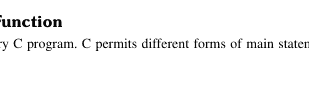

图 3.3 简单 C 程序的格式

#### 3.3.1 main 函数

main 是每个 C 程序的一部分。C 允许不同形式的 main 语句。允许以下形式。

- main()
- int main()
- void main()
- main(void)
- void main(void)
- int main(void)

空括号表示该函数没有参数。这可以通过在括号内使用关键字 **void** 来显式表示。我们也可以在单词 **main** 之前指定关键字 **int** 或 **void**。关键字 **void** 表示函数不向操作系统返回任何信息，而 **int** 表示函数向操作系统返回一个整数值。当指定 **int** 时，程序中的最后一条语句必须是“return 0”。为简单起见，我们在程序中使用第一种形式。

### 3.4 示例程序 2：两数相加 LO 3.2

考虑另一个程序，它对两个数执行加法并显示结果。完整程序如图 3.4 所示。

```c
/* Program ADDITION                         line-1 */
/* Written by EBG                          line-2 */
main()                                     /* line-3 */
{                                          /* line-4 */
    int number;                            /* line-5 */
    float amount;                          /* line-6 */

                                           /* line-7 */
    number = 100;                          /* line-8 */

                                           /* line-9 */
    amount = 30.75 + 75.35;                /* line-10 */
    printf("%d\n",number);                 /* line-11 */
    printf("%5.2f",amount);                /* line-12 */
}                                          /* line-13 */
```

**图 3.4** 两数相加的程序

该程序执行时将产生以下输出：

```
100
106.10
```

程序的前两行是注释行。在开头使用注释行来给出程序名称、作者、日期等信息是一种好做法。其他行中也使用注释字符来指示行号。

单词 *number* 和 *amount* 是用于存储数值数据的变量名。数值数据可以是*整数*形式或*实数*形式。在 C 中，所有变量都应经过*声明*，以告诉编译器*变量名*是什么以及它们保存的*数据类型*是什么。变量必须在使用之前声明。在第 5 行和第 6 行，声明

```c
int number;
float amount;
```

告诉编译器 `number` 是一个整数（`int`），`amount` 是一个浮点（`float`）数。声明语句必须出现在函数的开头，如图 3.4 所示。所有声明语句都以分号结尾；C 支持许多其他数据类型，第 4 章将详细讨论它们。

诸如 `int` 和 `float` 这样的单词称为*关键字*，不能用作*变量名*。第 4 章给出了关键字列表。

通过将数据值*赋值*给变量来把数据存储在变量中。这在第 8 行和第 10 行完成。在第 8 行，将整数值 100 赋给整型变量 `number`；在第 10 行，将两个实数 30.75 和 75.35 相加的结果赋给浮点变量 `amount`。这些语句

```c
number = 100;
amount = 30.75 + 75.35;
```

称为*赋值语句*。每条赋值语句末尾都必须有分号。

下一条语句是输出语句，它打印 `number` 的值。打印语句

```c
printf("%d\n", number);
```

包含两个参数。第一个参数 `"%d"` 告诉编译器，第二个参数 `number` 的值应作为*十进制整数*打印。注意，这些参数用逗号分隔。换行符 `\n` 使下一个输出出现在新的一行。

程序的最后一条语句

```c
printf("%5.2f", amount);
```

以*浮点数*格式打印 `amount` 的值。格式说明 `%5.2f` 告诉编译器，输出必须是*浮点数*格式，总共五位，其中小数点后两位。

### 3.5 示例程序 3：利息计算 LO 3.2

图 3.5 中的程序计算每年投资年末的资金价值，假设利率为 11%，并以两列打印年份和相应金额。图 3.6 显示了初始投资为 5000.00、期限为 10 年的输出。该程序使用以下公式：

年末价值 = 年初价值（1 + 利率）

在程序中，变量 `value` 表示年末的资金价值，而 `amount` 表示年初的资金价值。语句

```c
amount = value;
```

使*当前*年年末的价值成为*下一年*年初的价值。

```c
/*———— INVESTMENT PROBLEM ————*/
#define PERIOD 10
#define PRINCIPAL 5000.00
/*———— MAIN PROGRAM BEGINS ————*/
main()
{ /*----- DECLARATION STATEMENTS -----*/
    int year;
    float amount, value, inrate;
/*----- ASSIGNMENT STATEMENTS -----*/
    amount = PRINCIPAL;
    inrate = 0.11;
    year = 0;
/*----- COMPUTATION STATEMENTS -----*/
/*----- COMPUTATION USING While LOOP -----*/
    while(year <= PERIOD)
    { printf("%2d   %8.2f\n",year, amount);
      value = amount + inrate * amount;
      year = year + 1;
      amount = value;
    }
/*----- while LOOP ENDS -----*/
}
/*----- PROGRAM ENDS -----*/
```

**图 3.5** *投资问题程序*

让我们考虑这个程序中引入的**新特性**。第二行和第三行以 **#define** 指令开头。**#define** 指令将值定义为供程序使用的*符号常量*。每当遇到符号名时，编译器会自动替换与该名称关联的值。要更改值，我们只需更改定义。在本例中，我们定义了两个符号常量 **PERIOD** 和 **PRINCIPAL**，并分别赋值为 **10** 和 **5000.00**。这些值在程序执行期间保持不变。

|   |   |
|---|---|
| 0 | 5000.00 |
| 1 | 5550.00 |
| 2 | 6160.50 |
| 3 | 6838.15 |
| 4 | 7590.35 |
| 5 | 8425.29 |
| 6 | 9352.07 |
| 7 | 10380.00 |
| 8 | 11522.69 |
| 9 | 12790.00 |
| 10 | 14197.11 |

**图 3.6** *投资程序的输出*


```c
            }
/* __________ MAIN PROGRAM ENDS
              MUL() FUNCTION STARTS __________*/

int mul (int x, int y)
int p;
{
    p = x*y;
    return(p);
}
/* __________ MUL () FUNCTION ENDS __________*/
```

*图3.7 一个使用用户定义函数的程序*

**mul ( )** 函数将 **x** 和 **y** 的值相乘，当在语句中调用它时，结果返回给 **main ( )** 函数

```c
c = mul (a, b);
```

**mul ( )** 有两个 *参数* **x** 和 **y**，它们被声明为整数。当调用函数 **mul ( )** 时，**a** 和 **b** 的值分别传递给 **x** 和 **y**。

### 3.7 示例程序5：数学函数的使用——LO 3.3

我们经常使用标准数学函数，如 cos、sin、exp 等。现在我们将看到数学函数在程序中的使用。标准数学函数定义并作为 C 数学库的一部分保存。如果我们想使用这些数学函数中的任何一个，必须在程序中添加 **#include** 指令。与 **#define** 一样，它也是一个编译器指令，指示编译器从库中链接指定的数学函数。该指令的形式为

```c
#include <math.h>
```

**math.h** 是包含所需函数的文件名。图3.8说明了余弦函数的使用。该程序计算角度 0、10、20、...........180 的余弦值，并打印出带有标题的结果。

```c
/* __________ PROGRAM USING COSINE FUNCTION __________ */
#include <math.h>
#define PI 3.1416
#define MAX 180
main ( )
{
    int angle;
    float x,y;
    angle = 0;
    printf(" Angle       Cos(angle)\n\n");
    while(angle <= MAX)
    {
        x = (PI/MAX)*angle;
        y = cos(x);
        printf("%15d %13.4f\n", angle, y);
        angle = angle + 10;
    }
}
```

**输出**

| 角度 | Cos(角度) |
|---|---|
| 0 | 1.0000 |
| 10 | 0.9848 |
| 20 | 0.9397 |
| 30 | 0.8660 |
| 40 | 0.7660 |
| 50 | 0.6428 |
| 60 | 0.5000 |
| 70 | 0.3420 |
| 80 | 0.1736 |
| 90 | -0.0000 |
| 100 | -0.1737 |
| 110 | -0.3420 |
| 120 | -0.5000 |
| 130 | -0.6428 |
| 140 | -0.7660 |
| 150 | -0.8660 |
| 160 | -0.9397 |
| 170 | -0.9848 |
| 180 | -1.0000 |

**图3.8**  *使用数学函数的程序*

另一个经常需要的 #include 指令是

```c
#include <stdio.h>
```

stdio.h 指的是包含标准输入和输出函数的 *标准 I/O* 头文件

#### 3.7.1  #include 指令

如前所述，C 程序被划分为模块或函数。有些函数由像我们这样的用户编写，许多其他函数存储在 C 库中。库函数按类别分组，并存储在不同的文件中，这些文件称为 *头文件*。如果我们想访问存储在库中的函数，必须告诉编译器要访问的文件。

这是通过使用如下预处理指令 **#include** 来实现的：

```c
#include<filename>
```

*文件名* 是包含所需函数定义的库文件的名称。预处理指令放在程序的开头。包含库函数和头文件的列表在附录 III 中给出。

### 3.8 C 程序的基本结构 LO 3.4

到目前为止讨论的示例表明，C 程序可以看作是一组称为 *函数* 的构建块。函数是一个子程序，可能包含一个或多个设计用于执行 *特定任务* 的 *语句*。要编写 C 程序，我们首先创建函数，然后将它们组合在一起。一个 C 程序可能包含一个或多个部分，如图3.9所示。

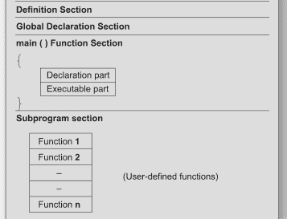

**图3.9** C 程序概述

文档部分由一组注释行组成，给出程序名称、作者和其他细节，程序员以后可能会使用。链接部分向编译器提供指令，以从系统库链接函数。定义部分定义所有符号常量。

有些变量在多个函数中使用。这样的变量称为 *全局* 变量，并在所有函数外部的 *全局* 声明部分中声明。此部分还声明所有用户定义函数。

每个 C 程序必须有一个 **main()** 函数部分。此部分包含两部分：声明部分和可执行部分。声明部分声明可执行部分中使用的所有变量。可执行部分至少有一个语句。这两部分必须出现在左花括号和右花括号之间。程序执行从左花括号开始，到右花括号结束。main 函数部分的右花括号是程序的逻辑结尾。声明部分和可执行部分中的所有语句都以分号(;)结尾。

子程序部分包含在 **main** 函数中调用的所有用户定义函数。用户定义函数通常紧跟在 **main** 函数之后，尽管它们可以以任何顺序出现。

除 **main** 函数部分外，所有部分在不需要时都可以省略。

### 3.9 编程风格

与其他一些编程语言（COBOL、FORTRAN 等）不同，C 是一种 *自由格式语言*。也就是说，C 编译器不关心我们从行上的哪个位置开始输入。虽然这可能是不良编程的许可，但我们应该尝试利用这一事实来开发可读的程序。尽管可能有几种替代风格，但我们应该选择一种风格并完全一致地使用它。

首先，我们必须养成用小写字母编写程序的习惯。C 程序语句用小写字母书写。大写字母仅用于符号常量。

花括号将程序语句组合在一起，并标记函数的开始和结束。适当缩进花括号和语句将使程序更易于阅读和调试。注意图3.5的程序中花括号如何对齐以及语句如何缩进。

由于 C 是自由格式语言，我们可以将语句组合在一行上。这些语句

```c
a = b;
x = y + 1;
z = a + x;
```

可以写成一行，如下

```c
a = b; x = y+1; z = a+x;
```

程序

```c
main( )
{
    printf("Hello C");
}
```

可以写成一行，像这样

```c
main( ) {printf("Hello C");}
```

然而，这种风格使程序更难以理解，不应使用。在本书中，每个语句都写在单独的一行上。

在程序内部大量使用注释怎么强调都不为过。明智地插入注释不仅增加可读性，还有助于理解程序逻辑。这对于调试和测试程序非常重要。

### 3.10 执行一个 ‘C’ 程序

执行用 C 编写的程序涉及一系列步骤。这些步骤是：

- 1. 创建程序；
- 2. 编译程序；
- 3. 将程序与 C 库中所需的函数链接；以及
- 4. 执行程序。

图3.10说明了创建、编译和执行 C 程序的过程。尽管无论 *操作系统* 如何，这些步骤保持不变，但用于实现这些步骤的系统命令以及命名 *文件* 的约定在不同系统上可能有所不同。

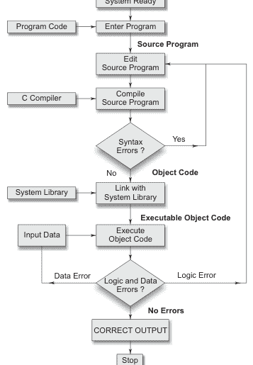

**图3.10** *编译和运行 C 程序的过程*

操作系统是控制计算机系统整个运行的程序。所有输入/输出操作都通过操作系统进行。操作系统是硬件和用户之间的接口，处理用户程序的执行。

当今最流行的两种操作系统是 UNIX（用于小型计算机）和 MS-DOS（用于微型计算机）。我们将在以下各节中简要讨论在这两种操作系统下执行 C 程序应遵循的过程。


### 3.11 UNIX 系统

LO 3.6

#### 3.11.1 创建程序

一旦将 UNIX 操作系统加载到内存中，计算机就准备好接收程序了。程序必须输入到一个文件中。文件名可以由字母、数字和特殊字符组成，后面跟一个点和字母 c。有效文件名的示例有：

```
hello.c
program.c
ebg1.c
```

该文件是借助*文本编辑器*创建的，可以是**ed**或**vi**。调用编辑器并创建文件的命令是

```
ed filename
```

如果该文件之前存在，则会被加载。如果尚不存在，则必须创建该文件，以便它准备好接收新程序。程序中的任何更正都在编辑器下完成。（你系统编辑器的名称可能不同。请查阅系统手册。）

编辑结束后，文件会保存到磁盘上。之后可以随时通过其文件名引用它。输入到文件中的程序称为*源程序*，因为它表示程序的原始形式。

#### 3.11.2 编译和链接

让我们假设源程序已在名为 *ebg1.c* 的文件中创建。现在程序已准备好编译。在 UNIX 下完成此任务的编译命令是

```
cc ebg1.c
```

源程序指令现在被转换为适合计算机执行的形式。该转换是在检查每条指令的正确性之后完成的。如果一切正常，编译会静默进行，翻译后的程序存储在另一个名为 *ebg1.o* 的文件中。该程序称为*目标代码*。

链接是将程序所需的其他程序文件和函数组合在一起的过程。例如，如果程序使用 **exp()** 函数，则应从系统的**数学库**中获取该函数的目标代码，并将其链接到主程序。在 UNIX 下，使用 cc 命令时会自动完成链接（如果未检测到错误）。

如果发现语言在**语法和语义**方面的任何错误，它们会被列出，编译过程会立即结束。应借助编辑器在源程序中更正错误，然后再次进行编译。

编译并链接后的程序称为*可执行目标代码*，并自动存储在另一个名为 **a.out** 的文件中。

请注意，某些系统使用不同的编译命令来链接数学函数。

```
cc filename -lm
```

是 UNIPLUS SYSTEM V 操作系统下的命令。

#### 3.11.3 执行程序

执行是一项简单的任务。命令

```
a.out
```

会将可执行目标代码加载到计算机内存中并执行指令。执行期间，程序可能请求通过键盘输入一些数据。有时程序不会产生期望的结果。也许是程序逻辑或数据有问题。那么就有必要更正源程序或数据。如果源程序被修改，则应重复编译、链接和执行程序的整个过程。

#### 3.11.4 创建自己的可执行文件

请注意，链接器总是分配相同的名称 a.out。当我们编译另一个程序时，该文件将被新程序的可执行目标代码覆盖。如果我们想防止这种情况发生，应立即使用以下命令重命名文件。

```
mv a.out name
```

我们也可以通过如下在 cc 命令中指定选项来实现这一点：

```
cc -o name source-file
```

这会将可执行目标代码存储到文件 name 中，并防止旧文件 a.out 被破坏。

#### 3.11.5 多个源文件

要编译和链接多个源程序文件，我们必须将所有文件名附加到 cc 命令中。

```
cc filename-1.c ... filename-n.c
```

这些文件将分别编译为称为

```
filename-1.o
```

的目标文件，然后链接以生成可执行程序文件 a.out，如图 3.11 所示。

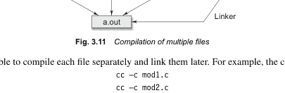

图 3.11 多文件编译

也可以分别编译每个文件，然后再链接它们。例如，命令

```
cc -c mod1.c
cc -c mod2.c
```

会将源文件 mod1.c 和 mod2.c 编译为目标文件 mod1.o 和 mod2.o。它们可以通过以下命令链接在一起

```
cc mod1.o mod2.o
```

我们也可以如下组合源文件和目标文件：

```
cc mod1.c mod2.o
```

仅编译 mod1.c，然后与目标文件 mod2.o 链接。当多个源文件之一需要更改并重新编译，或者已有目标文件要与待编译程序一起使用时，这种方法很有用。

### 3.12 MS-DOS 系统

LO 3.6

可以使用任何文字处理软件在非文档模式下创建程序。文件名应以字符“.c”结尾，如 program.c、pay.c 等。然后，MS-DOS 操作系统下的命令

```
MSC pay.c
```

将加载存储在文件 pay.c 中的程序并生成目标代码。该代码存储在另一个名为 pay.obj 的文件中。如果发现任何语言错误，编译不会完成。然后应更正程序并再次编译。

链接由以下命令完成

```
LINK pay.obj
```

该命令生成文件名为 pay.exe 的可执行代码。现在命令

```
pay
```

将执行程序并给出结果。

## 学习成果

- C 是一种结构化、高级、与机器无关的语言。LO 3.1
- ANSI C 和 C99 是 C 语言的标准化版本。LO 3.1
- C 结合了汇编语言的能力和高级语言的特性。LO 3.1
- C 是一种健壮、可移植且结构化的编程语言。LO 3.1
- 每个 C 程序都需要一个 main() 函数（使用多个 main() 是非法的）。main 所在的位置是程序执行开始的地方。LO 3.1
- 函数的执行从函数的左花括号开始，到相应的右花括号结束。LO 3.2
- C 程序用小写字母编写。然而，大写字母用于符号名和输出字符串。LO 3.2
- 程序行中的所有单词必须至少用一个空格、制表符或标点符号彼此分隔。LO 3.2
- C 语言中的每条程序语句都必须以分号结尾。LO 3.2
- 所有变量在程序中使用之前都必须声明其类型。LO 3.2
- 注释几乎可以插入到任何可以出现空格的地方。在适当位置使用适当的注释可以提高程序的可读性和可理解性，并有助于用户调试和测试。记住要正确匹配符号 `/*` 和 `*/`。LO 3.2
- 诸如 define 和 include 之类的编译器指令是帮助编译器编译程序的特殊指令。它们不以分号结尾。LO 3.2
- 编译器指令的 # 符号必须出现在该行的第一列。LO 3.2
- 当程序引用它未定义的特殊名称和函数时，我们必须确保使用 #include 指令包含头文件。LO 3.3
- C 程序的结构包括多个部分：文档、链接、定义、全局声明、main() 函数和子程序部分。LO 3.4
- C 是一种自由格式语言，因此对各部分进行适当形式的缩进会提高程序的可读性。LO 3.5
- C 程序的执行涉及一系列步骤，包括：创建程序、编译程序、将程序与 C 库中的函数链接以及执行程序。LO 3.6
- 在 UNIX 系统中运行 C 程序所使用的命令是 a.out。LO 3.6
- 在 MS-DOS 系统中运行 C 程序所使用的命令是 file.exe，其中 file 是已经编译的程序名。LO 3.6
- 当使用花括号对语句进行分组时，请确保左花括号有对应的右花括号。LO 3.6

## 需要记住的关键术语

- **#DEFINE：** 一种预处理器编译器指令。LO 3.2
- **Printf：** 一种预定义的标准 C 函数，将输出写入 stdout（标准输出）流。LO 3.2
- **Scanf：** 一种预定义的标准 C 函数，从 stdin（标准输入）流读取格式化输入。LO 3.2
- **程序：** 为在计算机中执行特定任务而编写的一系列指令。LO 3.1

## 复习题

### 填空题

- 1. C 程序中的每条程序语句都必须以 __________ 结尾。LO 3.2
- 2. __________ 函数用于在屏幕上显示输出。LO 3.2
- 3. __________ 头文件包含数学函数。LO 3.3
- 4. 转义序列字符 __________ 使光标移动到屏幕上的下一行。LO 3.2

### 判断题

- 1. C 程序中的每一行都应以分号结尾。LO 3.2
- 2. 程序中 **main( )** 的右花括号是程序的逻辑结尾。LO 3.2
- 3. 注释会使计算机在执行时打印 `/*` 和 `*/` 之间包含的文本。LO 3.2
- 4. 每个 C 程序都以 END 单词结尾。LO 3.2
- 5. **printf** 语句只能生成一行输出。LO 3.2
- 6. 诸如 **stdio.h** 之类的头文件的目的是存储程序的源代码。LO 3.3
- 7. 程序中的一行可以有多条语句。LO 3.5
- 8. 语法错误将由编译器检测到。LO 3.6

**难度等级**

\* 低；\*\* 中；\*\*\* 高


## 调试练习

- 1. 找出以下程序中的错误（如有）：

```c
           /* A simple program
           int main( )
           {
               /* Does nothing */
           }
```

LO 3.2

- 2. 找出以下程序中的错误（如有）：

```c
           #include (stdio.h)
           void main(void)
           {
               print("Hello C");
           }
```

LO 3.2

- 3. 找出以下程序中的错误（如有）：

```c
           Include <math.h>
           main { }
           (
               FLOAT X;
               X = 2.5;
               Y = exp(x);
               Print(x,y);
           )
```

LO 3.3

## 编程练习

- 1. 编写一个程序，以如下形式显示直线方程

```text
ax + by = c
```

其中 a = 5、b = 8、c = 18。

LO 3.2

- 2. 编写一个程序，按以下格式打印你的邮寄地址：

```text
First line     :     Name
Second line    :     Door No, Street
Third line     :     City, Pin code
```

LO 3.2

- 3. 编写一个程序，输出以下乘法表：

```text
5 x 1 = 5
5 x 2 = 10
5 x 3 = 15
.    .
.    .
5 x 10 = 50
```

LO 3.2

#### 4.2.1 三字符序列

许多非英语键盘并不支持表 4.1 中提到的所有字符。ANSI C 引入了“三字符序列”的概念，以提供一种输入某些键盘上不可用字符的方法。每个三字符序列由三个字符组成（两个问号后跟另一个字符），如表 4.2 所示。

例如，如果键盘不支持方括号，我们仍然可以在程序中使用三字符序列 ??( 和 ??) 来使用它们。

**表 4.2** *ANSI C 三字符序列*

| 三字符序列 | 含义 |
|---|---|
| ??= | # 数字符号 |
| ??( | [ 左方括号 |
| ??) | ] 右方括号 |
| ??< | { 左花括号 |
| ??> | } 右花括号 |
| ??! | \| 竖线 |
| ??/ | \ 反斜杠 |
| ??' | ^ 脱字符 |
| ??- | ~ 波浪号 |

### 4.3 C 标记 LO 4.1

在一段文本中，各个单词和标点符号称为*标记*。类似地，在 C 程序中，最小的独立单元称为 C 标记。C 有六种标记，如图 4.1 所示。C 程序是使用这些标记和该语言的语法编写的。

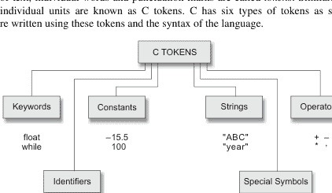

图 4.1 C 标记及示例

### 4.4 关键字和标识符

LO 4.1

每个 C 单词都被归类为*关键字*或*标识符*。所有关键字都有固定含义，这些含义不能更改。ANSI C 的所有关键字列于表 4.3。所有关键字都必须用小写字母书写。某些编译器可能使用额外关键字，必须从 C 手册中识别。

> **注意** C99 增加了一些关键字。参见附录“C99 特性”。

表 4.3 ANSI C 关键字

| auto | double | int | struct |
|---|---|---|---|
| break | else | long | switch |
| case | enum | register | typedef |
| char | extern | return | union |
| const | float | short | unsigned |
| continue | for | signed | void |
| default | goto | sizeof | volatile |
| do | if | static | while |

**标识符**指变量、函数和数组的名称。这些是用户定义的名称。大写和小写字母都允许。标识符中也允许使用下划线字符。

#### 标识符规则

- 1. 第一个字符必须是字母（或下划线）。
- 2. 只能由字母、数字或下划线组成。
- 3. 只有前 31 个字符有效。
- 4. 不能使用关键字。
- 5. 不得包含空白字符。

### 4.5 常量

LO 4.2

C 中的常量指在程序执行期间不改变的固定值。C 支持几种类型的常量，如图 4.2 所示。

#### 4.5.1 整型常量

一个*整型常量*指一串数字。整数有三种类型，即*十进制整数*、*八进制整数*和*十六进制整数*。

**十进制整数**由一组 0 到 9 的数字组成，前面可带有可选的 – 或 + 号。十进制整型常量的有效示例为：

```text
123  –321  0  654321  +78
```

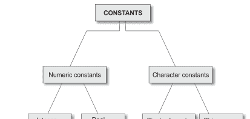

**图 4.2** C 常量的基本类型

数字之间不允许嵌入空格、逗号和不是数字的字符。例如，

```text
15 750   20,000   $1000
```

都是非法数字。

> **注意** ANSI C 支持一元加号，而早期版本未定义该运算符。

一个*八进制整数*常量由 0 到 7 数字集合中的任意数字组合而成，并以 0 开头。八进制整数的一些示例如下：

```text
037   0   0435   0551
```

以 0x 或 0X 开头的数字序列被视为*十六进制整数*。它们还可以包含字母 A 到 F 或 a 到 f。字母 A 到 F 表示数字 10 到 15。以下是有效十六进制整数的示例：

```text
0X2  0x9F  0Xbed  0x
```

在编程中我们很少使用八进制和十六进制数。

可以存储的最大整数值取决于机器。在 16 位机器上为 32767，在 32 位机器上为 2,147,483,647。在这些机器上，也可以通过向常量追加 U、L 和 UL 等*限定符*来存储更大的整型常量。示例：

```text
56789U                 or 56789u                  (unsigned integer)
987612347UL            or 98761234ul             (unsigned long integer)
9876543L               or 9876543l               (long integer)
```

无符号整数和长整数的概念将在第 4.7 节详细讨论。

##### 已解答问题 4.1

在 16 位计算机上表示整型常量。

图 4.3 中的程序说明了整型常量在 16 位机器上的使用。图 4.3 的输出表明，大于 32767 的整数值无法在 16 位机器上正确存储。然而，当把它们限定为长整数（通过追加 L）时，这些值会被正确存储。

表 4.4 数值常量示例

| 常量 | 有效？ | 备注 |
| :--- | :--- | :--- |
| 698354L | 是 | 表示长整数 |
| 25,000 | 否 | 不允许逗号 |
| +5.0E3 | 是 | （ANSI C 支持一元加号） |
| 3.5e-5 | 是 | |
| 7.1e 4 | 否 | 不允许空白 |
| -4.5e-2 | 是 | |
| 1.5E+2.5 | 否 | 指数必须是整数 |
| $255 | 否 | 不允许 $ 符号 |
| 0X7B | 是 | 十六进制整数 |

#### 4.5.3 单字符常量

单字符常量（或简称字符常量）包含一个用一对*单*引号括起来的单个字符。字符常量的示例如下：

```text
'5'   'X'   ';'   ' '
```

注意，字符常量 '5' 与*数字* 5 不同。最后一个常量是一个空格。字符常量具有称为 ASCII 值的整数值。例如，语句

```c
printf("%d", 'a');
```

将打印数字 97，即字母 a 的 ASCII 值。类似地，语句

```c
printf("%c", 97);
```

将输出字母 'a'。所有字符的 ASCII 值见附录 II。

由于每个字符常量表示一个整数值，因此也可以对字符常量执行算术运算。

#### 4.5.4 字符串常量

字符串常量是用*双*引号括起来的一串字符。字符可以是字母、数字、特殊字符和空白空格。示例如下：

```text
"Hello!" "1987" "WELL DONE" "?...!" "5+3" "X"
```

记住，字符常量（例如 'X'）不等同于单字符字符串常量（例如 "X"）。此外，单字符字符串常量没有等价的整数值，而字符常量有整数值。字符串在程序中常用于构建有意义的程序。

#### 4.5.5 反斜杠字符常量

C 支持一些用于输出函数的特殊反斜杠字符常量。例如，符号 '\n' 表示换行字符。这类反斜杠字符常量的列表见表 4.5。注意，它们中的每一个都表示一个字符，尽管它们由两个字符组成。这些字符组合称为*转义序列*。


**表 4.5** *反斜杠字符常量*

| 常量 | 含义 |
|---|---|
| `'\a'` | 可听警报（响铃） |
| `'\b'` | 退格 |
| `'\f'` | 换页 |
| `'\n'` | 换行 |
| `'\r'` | 回车 |
| `'\t'` | 水平制表符 |
| `'\v'` | 垂直制表符 |
| `'\''` | 单引号 |
| `'\"'` | 双引号 |
| `'\?'` | 问号 |
| `'\\'` | 反斜杠 |
| `'\0'` | 空字符 |

### 4.6 变量

**LO 4.2**

*变量*是可用于存储数据值的数据名。变量在执行过程中不同时间可取不同值。

- Average
- height
- Total
- Counter_1
- class_strength

如前所述，变量名可由字母、数字和下划线（_）字符组成，但须满足以下条件：

- 1. 它们必须以字母开头。有些系统允许下划线作为第一个字符。
- 2. ANSI 标准认可长度为 31 个字符。然而，长度通常不应超过八个字符，因为许多编译器只将前八个字符视为有效。（在 C99 中，至少 63 个字符有效。）
- 3. 大写和小写是有区别的。也就是说，变量 **Total** 与 **total** 或 **TOTAL** 不同。
- 4. 它不应是关键字。
- 5. 不允许有空白字符。

有效变量名的一些示例如下：

|  |  |  |
|---|---|---|
| John | Value | T_raise |
| Delhi | x1 | ph_value |
| mark | sum1 | distance |

用于表示数值大小的位，并且始终为正。因此，对于 16 位机器，无符号整数的范围将是 0 到 65,535。

我们声明 **long** 和 **unsigned** 整数以增大值的范围。对整数使用限定符 **signed** 是可选的，因为默认声明假定为有符号数。表 4.8 给出了基本类型和限定符的所有允许组合及其在 16 位机器上的大小和范围。

**注意** C99 允许 **long long** 整数类型。参见附录“C99 特性”。

**表 4.8** *16 位机器上数据类型的大小和范围*

| 类型 | 大小（位） | 范围 |
|---|---:|---|
| char 或 signed char | 8 | −128 到 127 |
| unsigned char | 8 | 0 到 255 |
| int 或 signed int | 16 | −32,768 到 32,767 |
| unsigned int | 16 | 0 到 65535 |
| short int 或 signed short int | 8 | −128 到 127 |
| unsigned short int | 8 | 0 到 255 |
| long int 或 signed long int | 32 | −2,147,483,648 到 2,147,483,647 |
| unsigned long int | 32 | 0 到 4,294,967,295 |
| float | 32 | 3.4E − 38 到 3.4E + 38 |
| double | 64 | 1.7E − 308 到 1.7E + 308 |
| long double | 80 | 3.4E − 4932 到 1.1E + 4932 |

#### 4.7.2 浮点类型

浮点（或实数）数在所有 16 位和 32 位机器上以 32 位存储，具有 6 位精度。浮点数在 C 中由关键字 **float** 定义。当 **float** 数提供的精度不够时，可以使用 **double** 类型来定义该数。**double** 数据类型数使用 64 位，给出 14 位精度。这些称为 *双精度* 数。请记住，double 类型表示与 **float** 表示的数据类型相同，但精度更高。为了进一步提高精度，我们可以使用 **long double**，它使用 80 位。浮点类型之间的关系如图 4.6 所示。

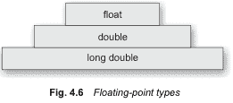

#### 4.7.3 void 类型

**void** 类型没有值。它通常用于指定函数的类型。当一个函数不向调用函数返回任何值时，该函数的类型称为 **void**。它还可以充当泛型类型，这意味着它可以表示其他任何标准类型。

#### 4.7.4 字符类型

单个字符可以定义为 **字符（char）** 类型数据。字符通常存储在内部存储器的 8 位（一个字节）中。限定符 **signed** 或 **unsigned** 可以显式应用于 char。**unsigned char** 的值在 0 到 255 之间，而 **signed char** 的值从 –128 到 127。


### 4.8 变量声明

在设计好合适的变量名之后，我们必须向编译器声明它们。声明做两件事：

- 1. 它告诉编译器变量名是什么。
- 2. 它指定变量将保存什么类型的数据。

变量的声明必须在使用之前完成。

#### 4.8.1 基本类型声明

变量可用于存储任何数据类型的值。也就是说，名称与其类型无关。声明变量的语法如下：

```text
data-type v1,v2,...vn ;
```

v1、v2、...、vn 是变量名。变量之间用逗号分隔。声明语句必须以分号结束。例如，有效声明如下：

```c
int count;
int number, total;
double ratio;
```

**int** 和 **double** 分别是表示整数类型和实数类型数据值的关键字。表 4.9 给出了各种数据类型及其关键字等价形式。

**表 4.9** *数据类型及其关键字*

| 数据类型 | 关键字等价形式 |
| --- | --- |
| 字符 | char |
| 无符号字符 | unsigned char |
| 有符号字符 | signed char |
| 有符号整数 | signed int (or int) |
| 有符号短整数 | signed short int<br>(or short int or short) |
| 有符号长整数 | signed long int<br>(or long int or long) |
| 无符号整数 | unsigned int (or unsigned) |
| 无符号短整数 | unsigned short int<br>(or unsigned short) |
| 无符号长整数 | unsigned long int<br>(or unsigned long) |
| 浮点 | float |
| 双精度浮点 | double |
| 扩展双精度浮点 | long double |

图 4.7 给出的程序段说明了变量的声明。**main()** 是程序的开始。左花括号 { 表示程序开始执行。变量的声明通常紧接在程序的左花括号之后进行。变量也可以在 **main** 函数之外（之前或之后）声明。声明位置的重要性将在后面讨论函数时详细说明。

> **注意** C99 允许在函数或块内的任意位置、在使用变量之前声明变量。

```c
main() /*....................Program Name.........................*/
{
    /*....................Declaration.........................*/
        float        x, y;
        int          code;
        short int    count;
        long int     amount;
        double       deviation;
        unsigned     n;
        char         C;
    /*....................Computation.........................*/
        . . .
        . . .
        . . .
} /*....................Program ends.........................*/
```

**图 4.7** *变量声明*

当形容词（限定符）**short**、**long** 或 **unsigned** 在没有基本数据类型说明符的情况下使用时，C 编译器将该数据类型视为 **int**。如果我们想将字符变量声明为无符号，则必须同时使用 **unsigned char** 这样的两个词。

##### 常量的默认值

整数常量默认表示 **int** 类型数据。我们可以通过在数字后指定 unsigned 或 long（追加 U 或 L）来覆盖此默认值，如下所示：

| 字面量 | 类型 | 值 |
|---|---|---|
| +111 | int | 111 |
| -222 | int | -222 |
| 45678U | unsigned int | 45,678 |
| -56789L | long int | -56,789 |
| 987654UL | unsigned long int | 9,87,654 |

类似地，浮点常量默认表示 **double** 类型数据。如果我们希望结果数据类型为 **float** 或 **long double**，则必须对 **float** 在数字后追加字母 f 或 F，对 **long double** 追加字母 l 或 L，如下所示：

| 字面量 | 类型 | 值 |
|---|---|---|
| 0. | double | 0.0 |
| .0 | double | 0.0 |
| 12.0 | double | 12.0 |
| 1.234 | double | 1.234 |
| -1.2f | float | -1.2 |
| 1.23456789L | long double | 1.23456789 |

#### 4.8.2 用户定义类型声明

C 支持称为“类型定义”的特性，允许用户定义一个标识符来表示现有的数据类型。用户定义的数据类型标识符随后可用于声明变量。其一般形式为：

```text
typedef type identifier;
```

其中 *type* 指现有数据类型，“identifier”指赋予该数据类型的“新”名称。现有数据类型可以属于任何类型类别，包括用户定义的类型。请记住，新类型仅在名称上是“新”的，而不是数据类型。**typedef** 不能创建新类型。类型定义的一些示例如下：

```c
typedef int units;
typedef float marks;
```

这里，**units** 表示 **int**，**marks** 表示 **float**。它们随后可用于如下声明变量：

```c
units batch1, batch2;
marks name1[50], name2[50];
```

batch1 和 batch2 被声明为 **int** 变量，name1[50] 和 name2[50] 被声明为 50 个元素的浮点数组变量。**typedef** 的主要优点是我们能够创建有意义的数据类型名称，以提高程序的可读性。

另一种用户定义数据类型是 ANSI 标准提供的枚举数据类型。其定义如下：

```c
enum identifier {value1, value2, ... valuen};
```

“identifier”是用户定义的枚举数据类型，可用于声明变量，这些变量可以取花括号内包含的值之一（称为 *枚举常量*）。在此定义之后，我们可以如下声明此“新”类型的变量：

```c
enum identifier v1, v2, ... vn;
```

枚举变量 v1、v2、...、vn 只能取 value1、value2、...、valuen 中的一个值。以下类型的赋值是有效的：

```c
v1 = value3;
v5 = value1;
```

示例：

```c
enum day {Monday,Tuesday, ... Sunday};
enum day week_st, week_end;
week_st = Monday;
week_end = Friday;
if(week_st == Tuesday)
    week_end = Saturday;
```

编译器会自动从 0 开始为所有枚举常量分配整数值。也就是说，枚举常量 value1 被赋值为 0，value2 被赋值为 1，依此类推。不过，可以通过显式地为枚举常量赋值来覆盖自动分配的值。例如：

```c
enum day {Monday = 1, Tuesday, ... Sunday};
```

这里，常量 Monday 被赋值为 1，其余常量依次递增 1。

枚举变量的定义和声明可以合并在一条语句中。示例：

```c
enum day {Monday, ... Sunday} week_st, week_end;
```

### 4.9 存储类别声明


C 语言中的变量不仅具有**数据类型**，还具有**存储类别**，存储类别提供了有关变量位置和可见性的信息。存储类别决定了程序中可以识别该变量的部分。请看下面的例子：

```c
/* 存储类别示例 */
int m;
main()
{
    int i;
    float balance;
    ....
    ....
    function1();
}
function1()
{
    int i;
    float sum;
    ....
    ....
}
```

在 **main** 之前声明的变量 **m** 称为*全局变量*。它可以在程序中的所有函数中使用，无需在其他函数中声明。全局变量也称为*外部变量*。

变量 **i**、**balance** 和 **sum** 称为*局部变量*，因为它们在函数内部声明。局部变量仅在其被声明的函数内部可见和有效，其他函数无法识别它们。

注意，变量 i 在两个函数中都进行了声明。一个函数中 i 值的任何改变都不会影响另一个函数中的 i 值。

C 语言提供了多种存储类别说明符，可用于显式声明变量的作用域和生存期。作用域和生存期的概念仅在多函数和多文件程序中尤为重要，因此存储类别将在后面讨论函数时详细说明。现在只需记住有四种存储类别说明符（auto、register、static 和 extern），其含义如表 4.10 所示。

存储类别是另一种限定符（类似于 long 或 unsigned），可以添加到变量声明中，如下所示：

```c
auto int count;
register char ch;
static int x;
extern long total;
```

静态变量和外部（extern）变量会自动初始化为零。自动（auto）变量除非显式初始化，否则包含未定义的值（称为“垃圾值”）。

**表 4.10** 存储类别及其含义

| 存储类别 | 含义 |
| :--- | :--- |
| **auto** | 局部变量，仅对声明它的函数可见。*默认为 auto。* |
| **static** | 局部变量，即使控制权转移回调用函数后，它仍然存在并保留其值。 |
| **extern** | 全局变量，对文件中的所有函数可见。 |
| **register** | 存储在寄存器中的局部变量。 |

### 4.10 给变量赋值

变量是为在程序语句中使用而创建的，例如：

```c
value = amount + inrate * amount;
while (year <= PERIOD)
{
    ....
    ....
    year = year + 1;
}
```

在第一条语句中，变量 **inrate** 中存储的数值乘以 **amount** 中存储的值，乘积再加上 **amount**，结果存储在变量 **value** 中。只有在变量 **amount** 和 **inrate** 已经被赋予值的情况下，这个过程才有可能完成。变量 **value** 称为*目标变量*。虽然所有变量都声明了其类型，但在表达式中使用的变量（位于计算语句等号（=）右侧的变量）在程序遇到它们之前*必须*被赋值。同样，**while** 语句中的变量 **year** 和符号常量 **PERIOD** 也必须在遇到该语句之前被赋值。

#### 4.10.1 赋值语句

可以使用赋值运算符 = 为变量赋值，如下所示：

```
variable_name = constant;
```

我们在第 3 章中已经使用过这样的语句。更多示例如下：

```
initial_value     = 0;
final_value       = 100;
balance           = 75.84;
yes               = 'x';
```

C 语言允许在一行中进行多重赋值。例如：

```
initial_value = 0; final_value = 100;
```

都是有效的语句。

赋值语句意味着“等号”左边变量的值被设置为右边量（或表达式）的值。语句

```
year = year + 1;
```

意味着 **year** 的“新值”等于 **year** 的“旧值”加 1。

在赋值操作期间，C 语言会将右侧值的类型转换为左侧的类型。当实数值被转换为整数时，这可能会涉及截断。

也可以在声明变量时为其赋值。其形式如下：

```
data-type variable_name = constant;
```

一些示例如下：

```
int final_value       = 100;
char yes              = 'x';
double balance        = 75.84;
```

给变量赋予初始值的过程称为*初始化*。C 语言允许使用多重赋值运算符在一条语句中*初始化*多个变量。例如，以下语句

```
p = q = s = 0;
x = y = z = MAX;
```

是有效的。第一条语句将变量 **p**、**q** 和 **s** 初始化为零，第二条语句将 **x**、**y** 和 **z** 初始化为 **MAX**。注意 **MAX** 是在开头定义的符号常量。

请记住，外部变量和静态变量会*默认*初始化为零。未显式初始化的自动变量将包含垃圾值。

#### 例题 4.2

图 4.8 中的程序说明了 `scanf` 函数的用法。

程序中第一条可执行语句是一个 `printf`，要求用户输入一个整数。这被称为“提示消息”，显示在屏幕上，如下所示：

```
Enter an integer number
```

一旦用户输入一个整数，计算机就会将该值与 100 进行比较。如果输入的值小于 100，则屏幕上会打印消息

```
Your number is smaller than 100
```

否则，会打印消息

```
Your number contains more than two digits
```

程序针对两种不同输入运行时的输出也显示在图 4.9 中。

```
Program

main()
{
    int number;

    printf("Enter an integer number\n");
    scanf ("%d", &number);

    if ( number < 100 )
        printf("Your number is smaller than 100\n\n");
    else
        printf("Your number contains more than two digits\n");
}

Output

Enter an integer number
54
Your number is smaller than 100
Enter an integer number
108
Your number contains more than two digits
```

**图 4.8** *使用 scanf 函数进行交互式计算*

一些编译器允许将“提示消息”作为 **scanf** 控制字符串的一部分，例如：

```
scanf("Enter a number %d",&number);
```

在图 4.8 中，我们使用了决策语句 **if...else** 来判断数字是否小于 100。

#### 例题 4.3

图 4.9 中的程序展示了典型的声明、赋值以及存储在不同类型变量中的值。

变量 **x** 和 **p** 被声明为浮点型变量。注意，我们赋值给 **x** 的 1.234567890000 在不同的输出格式下是如何显示的。在 %.12lf 格式下，**x** 的值显示为 1.234567880630，而实际赋值为 1.234567890000。这是因为变量 **x** 被声明为 **float** 类型，它只能存储到小数点后六位。

被声明为 **int** 类型的变量 **m** 无法正确存储值 54321，而是包含了一些垃圾值。由于该程序是在 16 位机器上运行的，int 变量能存储的最大值仅为 32767。然而，变量 **k**（声明为 **unsigned**）正确存储了值 54321。类似地，**long int** 变量 **n** 正确存储了值 1234567890。

赋值给声明为 **double** 类型的 **y** 的值 9.87654321 被正确存储，但该值在 %lf 格式下打印为 9.876543。请注意，除非另有指定，**printf** 函数总是会将 **float** 或 **double** 值显示到小数点后六位。我们将在后面讨论用于显示数字的输出格式。


```
Program
        main()
        {
        /*...........DECLARATIONS.......................*/
            float   x, p ;
            double  y, q ;
            unsigned k ;
        /*...........DECLARATIONS AND ASSIGNMENTS.......*/
            int     m = 54321 ;
            long int n = 1234567890 ;
        /*...........ASSIGNMENTS........................*/
            x = 1.234567890000 ;
            y = 9.87654321 ;
            k = 54321 ;
            p = q = 1.0 ;
        /*...........PRINTING...........................*/
            printf("m = %d\n", m) ;
            printf("n = %ld\n", n) ;
            printf("x = %.12lf\n", x) ;
            printf("x = %f\n", x) ;
            printf("y = %.12lf\n", y) ;
            printf("y = %lf\n", y) ;
            printf("k = %u p = %f q = %.12lf\n", k, p, q) ;
        }
Output
        m = -11215
        n = 1234567890
        x = 1.234567880630
        x = 1.234568
        y = 9.876543210000
        y = 9.876543
        k = 54321 p = 1.00000 q = 1.000000000000
```

**图 4.9** 赋值示例

#### 4.10.2 从键盘读取数据

给变量赋值的另一种方式是通过键盘使用`scanf`函数输入数据。它是C语言中可用的通用输入函数，其概念与`printf`函数非常相似。它的工作方式很像BASIC中的INPUT语句。`scanf`的一般格式如下：

```
scanf("control string", &variable1,&variable2,...);
```

控制字符串包含所接收数据的格式。每个变量名前的与符号`&`是一个运算符，用于指定该变量名的*地址*。我们必须始终使用此运算符，否则可能会产生意外结果。让我们看一个示例：

```
scanf("%d", &number);
```

当计算机遇到这条语句时，执行会停止并等待输入变量**number**的值。由于控制字符串`"%d"`指定从终端读取一个整数值，我们必须以整数形式输入该值。一旦输入数字并按下了`Return`键，计算机就会继续执行下一条语句。因此，使用**scanf**提供了交互式功能，使程序“对用户友好”。该值被赋给变量**number**。

##### 问题求解 4.4

第3章中讨论的示例程序3可以使用`scanf`转换为更灵活的交互式程序，如图4.10所示。

在这种情况下，计算机通过打印提示信息

Input amount, interest rate, and period

请求用户输入投资金额、利率和投资期限的值，然后等待输入值。一旦我们完成输入与三个变量amount、inrate和period对应的三个值，计算机就开始计算每年年底的金额，直到`period`年，并产生如图4.10所示的输出。

```
Program

main()
{
    int year, period ;
    float amount, inrate, value ;

    printf("Input amount, interest rate, and period\n\n") ;
    scanf ("%f %f %d", &amount, &inrate, &period) ;
    printf("\n") ;
    year = 1 ;

    while( year <= period )
    {
        value = amount + inrate * amount ;
        printf("%2d Rs %8.2f\n", year, value) ;
        amount = value ;
        year = year + 1 ;
    }
}

Output

Input amount, interest rate, and period

10000 0.14 5

1 Rs 11400.00
2 Rs 12996.00
3 Rs 14815.44
4 Rs 16889.60
5 Rs 19254.15
Input amount, interest rate, and period

20000 0.12 7

1 Rs 22400.00
2 Rs 25088.00
3 Rs 28098.56
4 Rs 31470.39
5 Rs 35246.84
6 Rs 39476.46
7 Rs 44213.63
```

**图 4.10** *交互式投资程序*

请注意，`scanf`函数包含三个变量。在这种情况下，应小心确保输入的值与列表中变量的*顺序*和*类型*匹配。任何不匹配都可能导致意外结果。编译器可能不会检测到此类错误。

### 4.11 定义符号常量

我们在程序中经常使用某些特定常量。这些常量可能反复出现在程序的许多地方。此类常量的一个示例是3.142，表示数学常量“pi”的值。另一个示例是“测试分析程序”所分析成绩单的学生总数。学生人数（比如50）可能用于计算班级总分、班级平均分、标准差等。在后续使用此类程序时，我们面临两个问题，即：

1. 程序修改方面的问题；
2. 程序理解方面的问题。

#### 4.11.1 可修改性

我们可能希望将“pi”的值从3.142改为3.14159以提高计算精度，或将数字50改为100以处理另一个班级的测试结果。在这两种情况下，我们都必须搜索整个程序，并在使用该常量的每个地方显式地更改其值。如果任何值未被更改，程序可能会产生灾难性的输出。

#### 4.11.2 可理解性

当数值出现在程序中时，其用途并不总是清晰，尤其是当同一个值在不同位置表示不同含义时。例如，数字50可能表示……

### 4.12 将变量声明为常量 LO 4.4

我们可能希望某些变量的值在程序执行期间保持不变。可以通过在初始化时使用限定符**const**声明变量来实现这一点。示例：

```
const int class_size = 40;
```

**const**是由ANSI标准定义的一种新数据类型限定符。它告诉编译器，int变量**class_size**的值不得被程序修改。但是，它可以像任何其他变量一样出现在赋值语句的右侧。

### 4.13 将变量声明为 volatile LO 4.4

ANSI标准定义了另一个限定符**volatile**，可用于明确告诉编译器，变量值可能会被某些外部来源（来自程序外部）随时更改。例如：

```
volatile int date;
```

即使**date**没有出现在赋值语句的左侧，其值也可能被某些外部因素改变。当我们将变量声明为**volatile**时，编译器每次遇到该变量时都会检查其值，以查看是否有外部更改改变了该值。

请记住，声明为**volatile**的变量的值也可以被其自身程序修改。如果我们希望该值不能被程序修改，但可以被其他进程更改，那么我们可以将变量同时声明为**const**和**volatile**，如下所示：

```
volatile const int location = 100;
```

> **注意** C99添加了另一个限定符**restrict**。请参见附录“C99特性”。

#### 4.13.1 数据的溢出和下溢

当变量的值对于数据类型来说过大或过小时，就会发生数据溢出问题。变量能容纳的最大值也取决于机器。由于浮点值会四舍五入到允许（或指定）的有效位数，溢出通常会产生最大的实数值，而下溢则产生零。

整数在所用整数数据类型的范围内始终是精确的。然而，如果数据类型与常量的值不匹配，则可能发生溢出，这是一个严重的问题。C不会提供任何整数溢出的警告或指示，它只会给出错误的结果。（溢出通常会产生负数。）因此，我们应该更加小心地定义正确的数据类型来处理输入/输出值。

## 学习成果

- 不要使用下划线作为标识符（或变量名）的第一个字符，因为系统库中的许多标识符以下划线开头。 **LO 4.1**
- 标识符仅使用31个或更少的字符。这有助于确保程序的可移植性。 **LO 4.1**


- 不要使用关键字或任何系统库名称作为标识符。LO 1.1
- 使用有意义且明智的变量名。LO 1.2
- 不要创建仅相差一两个字母的变量名。LO 1.2
- 默认情况下，整数常量被视为**int**类型。若要使数字变为**long**或**unsigned**，必须在其后附加字母L和U。LO 1.2
- 浮点常量默认为**double**。若要使它们表示**float**或**long double**，必须在数字后附加字母F或L。LO 1.2
- 字符常量使用单引号，字符串常量使用双引号。LO 1.2
- 字符以整数形式存储，因此可以对字符执行算术运算。LO 1.2
- 不要使用小写字母l表示long，因为它通常与数字1混淆。LO 1.3
- C语言不会对溢出提供任何警告或提示，它只会给出错误的结果。在定义正确的数据类型时应格外小心。LO 1.3
- 程序中使用的每个变量都必须在程序或函数的开头声明其类型。LO 1.4
- 所有变量在程序中使用之前必须初始化。LO 1.4
- 不要将声明与可执行语句混合在一起。LO 1.4
- 不要在**#define**指令末尾使用分号。LO 1.4
- 字符#应位于第一列。LO 1.4
- #与**define**之间不要留任何空格。LO 1.4
- 在主函数之前定义的变量可供程序中的所有函数使用。LO 1.4
- 在函数内部定义的变量是该函数的局部变量，其他函数无法使用。LO 1.4
- 变量可以通过两种方式变为常量：一是在程序开头使用预处理命令**#define**，二是在初始化时使用限定符**const**声明。LO 1.5

## 需要记住的关键术语

- **标识符：** 指变量、函数和数组的名称。LO 1.1
- **常量：** 指在程序执行期间不会改变的固定值。LO 1.2
- **字符串常量：** 是用双引号括起来的字符序列，其中的字符可以是字母、数字、特殊字符或空格。LO 1.2
- **变量：** 是可用于存储数据值的数据名称。LO 1.2
- **存储类别：** 提供与变量的位置和可见性相关的信息。LO 1.4
- **scanf：** 是C语言预定义的标准函数，用于从stdin（标准输入）流中读取格式化输入。LO 1.4

## 简要案例

### 1. 计算数字的平均值    [LO 4.4, 4.5 M]

计算一组*N*个数字平均值的程序如图*4.11*所示。

程序

```c
#define N 10            /* SYMBOLIC CONSTANT */
main()
{
    int count;            /* DECLARATION OF */
    float sum, average, number;  /* VARIABLES */
    sum = 0;              /* INITIALIZATION */
    count = 0;            /* OF VARIABLES */
    while( count < N )
    {
        scanf("%f", &number);
        sum = sum + number;
        count = count + 1;
    }
    average = sum/N;
    printf("N = %d Sum = %f", N, sum);
    printf(" Average = %f", average);
}
```

**输出**

```
1
2.3
4.67
1.42
7
3.67
4.08
2.2
4.25
8.21
N = 10    Sum = 38.799999 Average = 3.880
```

**图4.11** *N个数字的平均值*

变量**number**被声明为**float**类型，因此它可以接受整数和实数。由于使用**#define**语句将符号常量*N*赋值为10，程序接受十个值，并通过**while**循环计算它们的总和。变量**count**用于计数值的数量，一旦它变为11，**while**循环退出，然后计算平均值。

请注意，实际值显示为38.8，但显示的输出值为38.799999。事实上，实际显示的值在很大程度上取决于计算机系统。这种不准确是由于浮点数在计算机内部的表示方式造成的。

### 2. 温度转换问题                                       [LO 4.5 M]

图4.12中给出的程序使用以下转换公式将给定的华氏温度转换为摄氏温度：

$$C = \frac{F - 32}{1.8}$$

程序

```c
#define F_LOW      0          /* ------------------------- */
#define F_MAX      250        /* SYMBOLIC CONSTANTS       */
#define STEP       25         /* ------------------------- */

main()
{
        typedef float REAL ;          /* TYPE DEFINITION */
        REAL fahrenheit, celsius ;    /* DECLARATION */

        fahrenheit = F_LOW ;          /* INITIALIZATION */
        printf("Fahrenheit Celsius\n\n") ;
        while( fahrenheit <= F_MAX )
        {
                celsius = ( fahrenheit - 32.0 ) / 1.8 ;
                printf("%5.1f %7.2f\n", fahrenheit, celsius);
                fahrenheit = fahrenheit + STEP ;
        }
}
```

输出

| 华氏温度 | 摄氏温度 |
|---|---|
| 0.0 | -17.78 |
| 25.0 | -3.89 |
| 50.0 | 10.00 |
| 75.0 | 23.89 |
| 100.0 | 37.78 |
| 125.0 | 51.67 |
| 150.0 | 65.56 |
| 175.0 | 79.44 |
| 200.0 | 93.33 |
| 225.0 | 107.22 |
| 250.0 | 121.11 |

**图4.12** *温度转换——华氏温度与摄氏温度*

该程序根据给定的华氏温度值打印一张用于读取摄氏温度的转换表。最小值和最大值以及步长被定义为符号常量。可以通过重新定义**#define**语句来更改这些值。用户自定义的数据类型名称**REAL**用于声明变量**fahrenheit**和**celsius**。

第二个**printf**语句中的格式说明符**%5.1f**和**%7.2f**产生如图所示的两列输出。

## 复习题

### 填空题

- 1. 变量可以通过在初始化时使用限定符________声明来使其成为常量。[LO 4.5]
- 2. ________是unsigned short int类型变量可以存储的最大值。[LO 4.3]
- 3. 全局变量也称为________变量。[LO 4.3]
- 4. 关键字________可用于创建数据类型标识符。[LO 4.4]

### 判断正误

- 1. 所有变量在声明时都必须指定类型。[LO 4.2]
- 2. ANSI C将变量名name和Name视为相同。[LO 4.2]
- 3. 字符常量使用双引号编码。[LO 4.2]
- 4. 关键字**void**是C语言中的一种数据类型。[LO 4.3]
- 5. 声明可以出现在程序的任何位置。[LO 4.4]
- 6. 初始化是在声明变量时为其赋值的过程。[LO 4.4]
- 7. **scanf**函数一次只能读取一个值。[LO 4.4]
- 8. 任何有效的可打印ASCII字符都可以用于标识符。[LO 4.1]
- 9. 下划线可以出现在标识符的任何位置。[LO 4.1]
- 10. 默认情况下，浮点常量表示**float**类型的值。[LO 4.2]
- 11. 与变量一样，常量也有类型。[LO 4.2]
- 12. 所有**static**变量都会自动初始化为零。[LO 4.4]

## 调试练习

- 1. 找出以下声明语句中的错误（如果有）。LO 4.4

```c
Int x;
float letter,DIGIT;
double = p,q
exponent alpha,beta;
m,n,z: INTEGER
short char c;
long int m; count;
long float temp;
```

- 2. 找出以下程序中的语法错误。更正后，当你执行它时，你期望得到什么输出？LO 4.4

```c
#define PI 3.14159
main()
{
    int R,C;          /* R-Radius of circle */
    float perimeter;  /* Circumference of circle */
    float area;       /* Area of circle */
    C = PI;
    R = 5;
    Perimeter = 2.0 * C *R;
    Area = C*R*R;
    printf("%f, %d",&perimeter,&area)
}
```

## 编程练习

- 1. 编写一个程序，对给定的n值，计算并打印以下调和级数的总和：LO 4.4

  1 + 1/2 + 1/3 + ... + 1/n

  n的值应通过终端交互式输入。

- 2. 编写一个程序，以十进制形式（如15.95）读取商品价格，并以派士（如1595派士）形式输出结果。LO 4.4

- 3. 编写一个程序，打印从1到100之间的偶数。LO 4.2

- 4. 编写一个程序，要求用户输入两个float类型的数字，然后将第一个数字除以第二个数字，并将结果连同这两个数字一起显示。LO 4.4


## 第5章 运算符与表达式

**读完本章后，你将能够**

- **LO 5.1** 了解 C 语言的各种内置运算符
- **LO 5.2** 识别按位运算符和特殊运算符
- **LO 5.3** 确定算术表达式如何求值
- **LO 5.4** 解释表达式中的类型转换
- **LO 5.5** 讨论运算符优先级和结合性规则如何应用

### 5.1 引言

一个*运算符*是一种符号，它告诉计算机执行某些数学或逻辑操作。运算符在程序中用于操作数据和变量。它们通常构成数学或逻辑*表达式*的一部分。

C 运算符可分为若干类别。它们包括：

- 1. 算术运算符
- 2. 关系运算符
- 3. 逻辑运算符
- 4. 赋值运算符
- 5. 自增和自减运算符
- 6. 条件运算符
- 7. 按位运算符
- 8. 特殊运算符

表达式是操作数和运算符的序列，它会归约为单个值。例如，10 + 15 是一个表达式，其值为 25。该值可以是除 *void* 之外的任何类型。

### 5.2 算术运算符

C 提供了所有基本算术运算符。它们列在表 5.1 中。运算符 +、-、* 和 / 的工作方式与其他语言中相同。它们可以作用于 C 允许的任何内置数据类型。一元减运算符实际上将其单个操作数乘以 -1。因此，一个数字前面加上负号会改变其符号。

**表 5.1** *算术运算符*

| 运算符 | 含义 |
| :---: | :--- |
| + | 加法或一元加 |
| - | 减法或一元减 |
| * | 乘法 |
| / | 除法 |
| % | 模除 |

整数除法会截断任何小数部分。模除运算产生整数除法的余数。算术运算符的使用示例如下：

```
a - b        a + b
a * b        a / b
a % b       -a * b
```

这里 **a** 和 **b** 是变量，称为*操作数*。模除运算符 % 不能用于浮点数据。注意，C 没有用于*幂运算*的运算符。较旧版本的 C 不支持一元加，但 ANSI C 支持它。

#### 5.2.1 整数算术

当单个算术表达式（如 a+b）中的两个操作数都是整数时，该表达式称为*整数表达式*，该运算称为*整数算术*。整数算术总是产生整数值。最大整数值取决于机器，如前所述。在上面的示例中，如果 **a** 和 **b** 是整数，那么对于 **a** = 14 和 **b** = 4，我们得到以下结果：

```
a - b = 10
a + b = 18
a * b = 56
a / b = 3 (decimal part truncated)
a % b = 2 (remainder of division)
```

在整数除法中，如果两个操作数符号相同，结果向零截断。如果其中一个为负，截断方向取决于实现。也就是说，

6/7 = 0 且 -6/7 = 0

但 -6/7 可能是零或 -1。（取决于机器）

类似地，在模除中，结果的符号始终是第一个操作数（被除数）的符号。也就是说，

```
-14 % 3 = -2
-14 % -3 = -2
14 % -3 = 2
```

**已解答问题 5.1**

图 5.1 中的程序展示了使用整数算术将给定天数转换为月数和天数。

```c
Program
    main ()
    {
        int months, days ;

        printf("Enter days\n") ;
        scanf("%d", &days) ;

        months = days / 30 ;
        days = days % 30 ;
        printf("Months = %d Days = %d", months, days) ;
    }

Output
    Enter days
    265
    Months = 8 Days = 25
    Enter days
    364
    Months = 12 Days = 4
    Enter days
    45
    Months = 1 Days = 15
```

*图 5.1 整数算术示例*

变量 months 和 days 被声明为整数。因此，语句 months = days/30; 会截断小数部分，并将整数部分赋给 months。类似地，语句 days = days%30; 将除法的余数部分赋给 days。这样，给定的天数就被转换为等效的月数和天数，并如输出所示打印结果。

#### 5.2.2 实数算术

仅涉及实数操作数的算术运算称为*实数算术*。实数操作数可以采用十进制或指数表示法取值。由于浮点值会舍入到允许的有效数字位数，最终值是正确结果的近似值。如果 **x**、**y** 和 **z** 是 **float**，那么我们将有：

```
x = 6.0/7.0 = 0.857143
y = 1.0/3.0 = 0.333333
z = -2.0/3.0 = -0.666667
```

运算符 % 不能与实数操作数一起使用。

#### 5.2.3 混合模式算术

当一个操作数是实数而另一个是整数时，该表达式称为*混合模式算术表达式*。如果任一操作数是实数类型，则只执行实数运算，结果始终是实数。因此

```
15/10.0 = 1.5
```

而

```
15/10 = 1
```

关于混合运算的更多内容将在后面讨论表达式求值时讨论。

### 5.3 关系运算符

**LO 5.1**

我们经常比较两个量，并根据它们的关系做出某些决定。例如，我们可以比较两个人的年龄，或两个物品的价格，等等。这些比较可以借助*关系运算符*完成。我们已经使用过符号 '<'，意思是“小于”。诸如

```
a < b or 1 < 20
```

这样包含关系运算符的表达式称为*关系表达式*。关系表达式的值是*一*或*零*。如果指定的关系为*真*，则为*一*；如果关系为*假*，则为*零*。例如

```
10 < 20 is true
```

但

```
20 < 10 is false
```

C 总共支持六种关系运算符。这些运算符及其含义如表 5.2 所示。

**表 5.2** *关系运算符*

| 运算符 | 含义 |
| --- | --- |
| `<` | 小于 |
| `<=` | 小于或等于 |
| `>` | 大于 |
| `>=` | 大于或等于 |
| `==` | 等于 |
| `!=` | 不等于 |

简单关系表达式只包含一个关系运算符，形式如下：

*ae-1 关系运算符 ae-2*

ae-1 和 ae-2 是算术表达式，可以是简单常量、变量或它们的组合。下面给出一些简单关系表达式及其值的示例：

```
4.5 <= 10 TRUE
4.5 < -10 FALSE
-35 >= 0 FALSE
10 < 7+5 TRUE
```

a+b == c+d 仅当 a 和 b 的值之和等于 c 和 d 的值之和时才为 TRUE。

当关系运算符的两侧使用算术表达式时，将先对算术表达式求值，然后比较结果。也就是说，算术运算符的优先级高于关系运算符。

关系表达式用于*决策语句*（如 **if** 和 **while**）中，以决定正在运行的程序的操作过程。我们已经在第 3 章中使用过 **while** 语句。决策语句将在第 7 章和第 8 章中详细讨论。

#### 关系运算符的互补

在六种关系运算符中，每一个都是另一个运算符的互补。

```
>   is complement of   <=
<   is complement of   >=
==  is complement of   !=
```

我们可以使用互补来简化涉及*非*和*小于*运算符的表达式，如下所示：

| 原表达式 | 简化表达式 |
| --- | --- |
| !(x < y) | x >= y |
| !(x > y) | x <= y |
| !(x != y) | x == y |
| !(x <= y) | x > y |
| !(x >= y) | x < y |
| !(x == y) | x != y |

### 5.4 逻辑运算符

除了关系运算符之外，C 还有以下三种*逻辑运算符*。

```
&&    meaning logical    AND
||    meaning logical    OR
!     meaning logical    NOT
```

逻辑运算符 && 和 || 用于当我们想要测试多个条件并做出决定时。一个例子是：

```
a > b && x == 10
```

这种结合两个或多个关系表达式的表达式称为*逻辑表达式*或*复合关系表达式*。与简单关系表达式一样，逻辑表达式也根据表 5.3 所示的真值表产生*一*或*零*的值。上面给出的逻辑表达式仅当 **a > b** 为*真*且 **x == 10** 为*真*时才为真。如果其中任一（或两者）为假，则该表达式为假。


逻辑表达式用法的一些示例如下：

- `if (age > 55 && salary < 1000)`
- `if (number < 0 || number > 100)`

我们将在讨论决策语句时看到更多示例。

**表 5.3** *真值表*

| op-1 | op-2 | 表达式 `op-1 && op-2` 的值 | 表达式 `op-1 \|\| op-2` 的值 |
|---|---|---|---|
| 非零 | 非零 | 1 | 1 |
| 非零 | 0 | 0 | 1 |
| 0 | 非零 | 0 | 1 |
| 0 | 0 | 0 | 0 |

> **注意** *关系运算符和逻辑运算符的相对优先级如下：*
>
> 最高 `!`  
> `>` `>=` `<` `<=`  
> `==` `!=`  
> `&&`  
> 最低 `||`
>
> *在复合表达式中使用这些运算符时，记住这一点很重要。*

### 5.5 赋值运算符


赋值运算符用于将表达式的结果赋给变量。我们已经见过常规赋值运算符 `=`。此外，C 语言还有一组形式如下的“简写”赋值运算符

```
v op= exp;
```

其中 *v* 是变量，*exp* 是表达式，*op* 是 C 的二元算术运算符。运算符 `op=` 称为简写赋值运算符。

赋值语句

```
v op= exp;
```

等价于

```
v = v op (exp);
```

其中 *v* 只求值一次。考虑一个例子

```
x += y+1;
```

它与以下语句相同

```
x = x + (y+1);
```

简写运算符 `+=` 表示“将 y+1 加到 x 上”或“将 x 增加 y+1”。对于 y = 2，上述语句变为

```
x += 3;
```

执行该语句时，3 被加到 x 上。如果 x 的旧值比如说是 5，那么 x 的新值就是 8。表 5.4 展示了常用的一些简写赋值运算符。

#### ++ 和 -- 运算符的规则

- 自增和自减运算符是一元运算符，它们要求以变量作为操作数。
- 当后缀 ++（或 --）与表达式中的变量一起使用时，先使用该变量的原值计算表达式，然后将该变量加一（或减一）。
- 当表达式中使用前缀 ++（或 --）时，先将该变量加一（或减一），然后使用该变量的新值计算表达式。
- ++ 和 -- 运算符的优先级和结合性与一元 + 和一元 - 相同。

### 5.7 条件运算符

学习目标 5.1

C 语言提供了三目运算符对“?:”，用于构造如下形式的条件表达式

```
exp1 ? exp2 : exp3
```

其中 `exp1`、`exp2` 和 `exp3` 是表达式。

运算符 `? :` 的工作方式如下：先对 `exp1` 求值。如果它非零（真），则对表达式 `exp2` 求值，并成为该表达式的值。如果 `exp1` 为假，则对 `exp3` 求值，其值成为该表达式的值。注意，只对其中一个表达式（`exp2` 或 `exp3`）求值。例如，考虑以下语句：

```
a = 10;
b = 15;
x = (a > b) ? a : b;
```

在此例中，x 将被赋值为 b 的值。这可以使用 if-else 语句实现如下：

```
if (a > b)
    x = a;
else
    x = b;
```

### 5.8 位运算符

学习目标 5.2

C 语言的一个特点是支持称为*位运算符*的特殊运算符，用于在位级别操作数据。这些运算符用于测试位，或将位右移或左移。位运算符不能应用于 *float* 或 *double*。表 5.5 列出了位运算符及其含义。

*表 5.5 位运算符*

| 运算符 | 含义 |
|---|---|
| & | 按位与 |
| \| | 按位或 |
| ^ | 按位异或 |
| << | 左移 |
| >> | 右移 |

### 5.9 特殊运算符

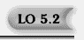

C 语言支持一些特殊运算符，例如逗号运算符、sizeof 运算符、指针运算符（& 和 *）以及成员选择运算符（. 和 ->）。本节讨论逗号和 sizeof 运算符，而指针运算符将在第 13 章讨论。用于选择结构体成员的成员选择运算符将在第 12 章和第 13 章讨论。ANSI 委员会引入了两个预处理运算符，称为“字符串化”和“标记粘贴”运算符（# 和 ##）。

#### 5.9.1 逗号运算符

逗号运算符可用于将相关表达式连接在一起。以逗号连接的表达式列表从左到右求值，最右侧表达式的值就是整个组合表达式的值。例如，语句

```
value = (x = 10, y = 5, x+y);
```

首先将值 10 赋给 x，然后将 5 赋给 y，最后将 15（即 10 + 5）赋给 value。由于逗号运算符在所有运算符中优先级最低，因此括号是必需的。逗号运算符的一些应用包括：

- 在 `for` 循环中：`for (n = 1, m = 10; n <= m; n++, m++)`
- 在 `while` 循环中：`while (c = getchar(), c != '\n')`
- 交换值：`t = x, x = y, y = t;`

#### 5.9.2 sizeof 运算符

sizeof 是一个编译时运算符，当与操作数一起使用时，它返回该操作数所占的字节数。操作数可以是变量、常量或数据类型限定符。示例：

```
m = sizeof (sum);
n = sizeof (long int);
k = sizeof (235L);
```

sizeof 运算符通常用于在程序员不知道数组和结构体大小时确定它们的长度。它还用于在程序执行期间为变量动态分配内存空间。

##### 例题 5.3

在图 5.3 中，程序使用了不同类型的运算符。为了便于比较，还显示了它们求值的结果。

注意自增运算符 ++ 在表达式中使用时的运作方式。在语句

```
c = ++a - b;
```

中，使用了 a 的新值（= 16），因此给 c 赋值为 6。也就是说，a 在表达式中使用之前先加 1。然而，在语句

```
d = b++ + a;
```

中，表达式中使用的是 b 的旧值（= 10）。这里，b 在表达式中使用之后才加 1。

我们可以通过在控制字符串中将 % 字符紧挨着放在另一个 % 字符之后来打印 % 字符。语句

```
printf("a%%b = %d\n", a%b);
```

说明了这一点。

该程序还说明，表达式

```
c > d ? 1 : 0
```

在 c 小于 d 时取值为 0，在 c 大于 d 时取值为 1。

```
Program

main()
{
    int a, b, c, d;
    a = 15;
    b = 10;
    c = ++a - b;
    printf("a = %d b = %d c = %d\n", a, b, c);
    d = b++ + a;
    printf("a = %d b = %d d = %d\n", a, b, d);
    printf("a/b = %d\n", a/b);
    printf("a%%b = %d\n", a%b);
    printf("a *= b = %d\n", a*=b);
    printf("%d\n", (c>d) ? 1 : 0);
    printf("%d\n", (c<d) ? 1 : 0);
}

Output

a = 16 b = 10 c = 6
a = 16 b = 11 d = 26
a/b = 1
a%b = 5
a *= b = 176
0
1
```

*图 5.3 算术运算符的进一步说明*

### 5.10 算术表达式

算术表达式是变量、常量和运算符按照语言语法组合而成的。在到目前为止讨论的示例中，我们已经使用了许多简单表达式。C 语言可以处理任何复杂的数学表达式。表 5.6 给出了 C 表达式的一些示例。请记住，C 没有用于幂运算的运算符。

**表 5.6** *表达式*

| 代数表达式 | C 表达式 |
| --- | --- |
| a × b - c | a * b - c |
| (m+n) (x+y) | (m+n) * (x+y) |
| (ab/c) | a * b/c |
| 3x² + 2x + 1 | 3 * x * x + 2 * x + 1 |
| (x/y) + c | x/y + c |

### 5.11 表达式的求值

表达式通过如下形式的赋值语句求值：

*变量 = 表达式;*

变量是任何有效的 C 变量名。遇到该语句时，先对表达式求值，然后用结果替换左侧变量的先前值。表达式中使用的所有变量在尝试求值之前都必须已赋值。求值语句的示例有

```
x = a * b - c;
y = b / c * a;
z = a - b / c + d;
```

运算符周围的空白是可选的，仅用于提高可读性。当这些语句在程序中使用时，变量 a、b、c 和 d 必须在表达式中使用之前定义。

#### 例题 5.4

图 5.4 中的程序说明了变量在表达式中的使用及其求值。

程序的输出还说明了表达式中括号存在的影响。这将在下一节讨论。

```
Program

main()
{
    float a, b, c, x, y, z;
    a = 9;
    b = 12;
    c = 3;
```


```c
x = a - b / 3 + c * 2 - 1;
y = a - b / (3 + c) * (2 - 1);
z = a - (b / (3 + c) * 2) - 1;

printf("x = %f\n", x);
printf("y = %f\n", y);
printf("z = %f\n", z);
}
```

输出

```text
x = 10.000000
y = 7.000000
z = 4.000000
```

*图 5.4 表达式求值的图示*

### 5.12 算术运算符的优先级


没有括号的算术表达式将按运算符的优先级规则从*左到右*求值。C 语言中的算术运算符有两个不同的优先级：

高优先级  * / %  
低优先级  + −

基本求值过程包括对表达式进行“两次”从左到右的扫描。在第一趟扫描中，遇到高优先级运算符（如果有）时就执行。在第二趟扫描中，遇到低优先级运算符（如果有）时就执行。考虑图 5.4 的程序中使用的下述求值语句。

$$x = a-b/3 + c*2-1$$

当 a = 9、b = 12、c = 3 时，该语句变为

$$x = 9-12/3 + 3*2-1$$

其求值过程如下

- **第一趟**
  - 第 1 步：x = 9−4+3*2−1
  - 第 2 步：x = 9−4+6−1
- **第二趟**
  - 第 3 步：x = 5+6−1
  - 第 4 步：x = 11−1
  - 第 5 步：x = 10

这些步骤如图 5.5 所示。括号内的数字指的是步骤编号。

- 在确定子表达式的运算符应用顺序时，采用优先级规则。
- 当子表达式中出现两个或更多同一优先级的运算符时，采用结合性规则。
- 算术表达式按优先级规则从左到右求值。
- 使用括号时，括号内的表达式具有最高优先级。

#### 例题 5.5

为以下表达式编写一个 C 程序：a=5<=8 && 6!=5。

```c
#include <stdio.h>
#include <conio.h>
void main()
{
int a;
a = 5<=8 && 6!=5;
printf("%d", a);
getch();
}
```

输出

```text
1
```

**图 5.6** 表达式 a = 5 <= 8 && 6 != 5 的程序

### 5.13 一些计算问题

当表达式包含实数值时，必须采取必要的预防措施以防止某些计算错误。我们知道，计算机给出的是实数的近似值，这种近似产生的误差可能会导致严重问题。例如，考虑以下语句：

```c
a = 1.0/3.0;
b = a * 3.0;
```

我们知道 (1.0/3.0)*3.0 等于 1。但无法保证程序中计算出的 b 值会等于 1。

另一个问题是除以零。在大多数计算机上，任何将数字除以零的尝试都会导致程序异常终止。在某些情况下，这种除法会产生无意义的结果。应当注意检查可能变为零的分母，避免任何除以零的情况。

第三个问题是避免上溢或下溢错误。我们有责任保证操作数的类型和范围正确，并且结果不会产生任何上溢或下溢。

#### 例题 5.6

图 5.7 中程序的输出显示了浮点数计算中可能出现的舍入误差。

程序

```c
/*________ Sum of n terms of 1/n ________*/
main()
{
    float sum, n, term ;
    int count = 1 ;

    sum = 0 ;
    printf("Enter value of n\n") ;
    scanf("%f", &n) ;
    term = 1.0/n ;
    while( count <= n )
    {
        sum = sum + term ;
        count++ ;
    }
    printf("Sum = %f\n", sum) ;
}
```

输出

```text
Enter value of n
99
Sum = 1.000001
Enter value of n
143
Sum = 0.999999
```

*图 5.7 浮点计算中的舍入误差*

我们知道 n 个 1/n 项的和是 1。然而，由于浮点表示的误差，结果并不总是 1。

- 6. 否则，如果其中一个操作数是 **long int**，则另一个将被转换为 **long int**，结果也将是 **long int**；
- 7. 否则，如果其中一个操作数是 **unsigned int**，则另一个将被转换为 **unsigned int**，结果也将是 **unsigned int**。

#### 转换层次

请注意，C 语言采用如下规则：在除赋值以外的所有表达式中，任何隐式类型转换都是从较小尺寸类型转换为较大尺寸类型，如下所示：

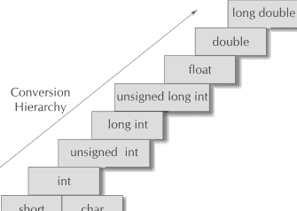

请注意，某些 C 版本会自动将所有浮点操作数转换为双精度类型。

表达式的结果在赋给变量之前，会被转换为赋值号左侧变量的类型。不过，最终赋值时会发生以下变化：

- 1. **float 到 int** 会导致小数部分被截断。
- 2. **double 到 float** 会导致数字舍入。
- 3. **long int 到 int** 会导致多余的高位被丢弃。

#### 5.14.2 显式转换

我们刚刚讨论了 C 语言如何自动执行类型转换。然而，有些时候我们希望以不同于自动转换的方式强制进行类型转换。例如，考虑计算某城镇女性与男性的比率。

```c
ratio = female_number/male_number
```

由于程序中将 **female_number** 和 **male_number** 声明为整数，除法结果的小数部分将会丢失，**ratio** 将表示错误的数值。可以通过在局部将其中一个变量转换为浮点数来解决这个问题，如下所示：

```c
ratio = (float) female_number/male_number
```

运算符 **(float)** 为了表达式求值而将 **female_number** 转换为浮点数。随后根据自动转换规则，除法以浮点模式执行，从而保留了结果的小数部分。

请注意，运算符 **(float)** 绝不会影响变量 **female_number** 的值。而且，在程序的其他部分中，**female_number** 的类型仍然是 int。

这种局部转换的过程称为*显式转换*或*强制类型转换*。强制转换的一般形式为：

```c
(type-name) expression
```

其中 *type-name* 是 C 语言标准数据类型之一。表达式可以是常量、变量或表达式。表 5.7 给出了一些强制转换及其作用的示例。

**表 5.7** 强制转换的使用

| 示例 | 作用 |
| --- | --- |
| x = (int) 7.5 | 通过截断将 7.5 转换为整数。 |
| a = (int) 21.3/(int)4.5 | 按 21/4 求值，结果为 5。 |
| b = (double)sum/n | 以浮点模式执行除法。 |
| y = (int) (a+b) | 将 a+b 的结果转换为整数。 |
| z = (int)a+b | 将 a 转换为整数，然后与 b 相加。 |
| p = cos((double)x) | 在使用 x 之前先将其转换为 double。 |

强制转换可用于对给定值进行舍入。考虑以下语句：

```c
x = (int) (y+0.5);
```

如果 y 为 27.6，则 y+0.5 为 28.1，强制转换后结果为 28，这就是赋给 x 的值。当然，被转换的表达式本身不会改变。

##### 例题 5.7

图 5.9 展示了一个使用强制转换求下式值的程序

$$\sum_{i=1}^{N} (1/i)$$

程序

```c
main()
{
    float    sum ;
    int      n ;
    sum = 0 ;
    for( n = 1 ; n <= 10 ; ++n )
    {
        sum = sum + 1/(float)n ;
        printf("%2d %6.4f\n", n, sum) ;
    }
}
```

输出

```text
1   1.0000
2   1.5000
3   1.8333
4   2.0833
5   2.2833
6   2.4500
7   2.5929
8   2.7179
9   2.8290
10  2.9290
```

**图 5.9** *强制转换的使用*

### 5.15 运算符优先级与结合性 LO 5.5

如前所述，C 语言中的每个运算符都有与其关联的优先级。该优先级用于确定包含多个运算符的表达式的求值方式。存在不同的*优先级层次*，一个运算符可以属于其中一个层次。优先级层次较高的运算符首先求值。同一优先级的运算符根据层次的不同，按“从左到右”或“从右到左”求值。这称为运算符的*结合性*属性。表 5.8 提供了运算符的完整列表、它们的优先级层次和结合规则。各组按优先级递减的顺序列出。排名 1 表示最高优先级层次，15 表示最低。该列表还包含我们尚未讨论过的运算符。

非常重要的是要仔细注意运算符的优先级和结合性顺序。考虑以下条件语句：

```c
if (x == 10 + 15 && y < 10)
```

优先级规则表明，*加法*运算符的优先级高于逻辑运算符 (&&) 和关系运算符 (== 和 <)。因此，先执行 10 和 15 的加法。这等价于：

```c
if (x == 25 && y < 10)
```

下一步是判断 x 是否等于 25，以及 y 是否小于 10。如果假设 x 的值为 20，y 的值为 5，则

```text
x == 25 is FALSE (0)
y < 10 is TRUE (1)
```

请注意，由于运算符 < 的优先级高于 ==，因此先测试 y < 10，再测试 x == 25。
最终得到：

```c
if (FALSE && TRUE)
```

因为其中一个条件为 FALSE，所以复合条件为 FALSE。
对于 &&，如果第一个操作数为零，则保证不会对第二个操作数求值；对于 ||，如果第一个操作数为非零，则不会对第二个操作数求值。

#### 优先级和结合性规则

- 优先级规则决定不同运算符的应用顺序。
- 结合性规则决定同一层次的多个运算符被应用时的顺序。


**表 5.8 C 运算符汇总**

| 运算符 | 描述 | 结合性 | 优先级 |
| --- | --- | --- | --- |
| `( )` | 函数调用 | 从左到右 | 1 |
| `[ ]` | 数组元素引用 | | |
| `+` | 一元加 | | |
| `-` | 一元减 | 从右到左 | 2 |
| `++` | 自增 | | |
| `--` | 自减 | | |
| `!` | 逻辑非 | | |
| `~` | 按位取反（一的补码） | | |
| `*` | 指针引用（间接寻址） | | |
| `&` | 取地址 | | |
| `sizeof` | 对象大小 | | |
| `(type)` | 类型转换（强制转换） | | |
| `*` | 乘法 | 从左到右 | 3 |
| `/` | 除法 | | |
| `%` | 取模 | | |
| `+` | 加法 | 从左到右 | 4 |
| `-` | 减法 | | |
| `<<` | 左移 | 从左到右 | 5 |
| `>>` | 右移 | | |
| `<` | 小于 | 从左到右 | 6 |
| `<=` | 小于等于 | | |
| `>` | 大于 | | |
| `>=` | 大于等于 | | |
| `==` | 等于 | 从左到右 | 7 |
| `!=` | 不等于 | | |
| `&` | 按位与 | 从左到右 | 8 |
| `^` | 按位异或 | 从左到右 | 9 |
| `\|` | 按位或 | 从左到右 | 10 |
| `&&` | 逻辑与 | 从左到右 | 11 |
| `\|\|` | 逻辑或 | 从左到右 | 12 |
| `?:` | 条件表达式 | 从右到左 | 13 |
| `=` | 赋值运算符 | 从右到左 | 14 |
| `*= /= %=` | | | |
| `+= -= &=` | | | |
| `^= \|=` | | | |
| `<<= >>=` | | | |
| `,` | 逗号运算符 | 从左到右 | 15 |

#### 5.15.1 数学函数

cos、sqrt、log 等数学函数经常用于分析现实问题。大多数 C 编译器支持这些基本数学函数。然而，有些系统具有更全面的数学库，应查阅参考手册以了解哪些函数可用。表 5.9 列出了一些标准数学函数。

**表 5.9** *数学函数*

| 函数 | 含义 |
|---|---|
| **三角函数** | |
| acos(x) | x 的反余弦 |
| asin(x) | x 的反正弦 |
| atan(x) | x 的反正切 |
| atan2(x,y) | x/y 的反正切 |
| cos(x) | x 的余弦 |
| sin(x) | x 的正弦 |
| tan(x) | x 的正切 |
| **双曲函数** | |
| cosh(x) | x 的双曲余弦 |
| sinh(x) | x 的双曲正弦 |
| tanh(x) | x 的双曲正切 |
| **其他函数** | |
| ceil(x) | x 向上舍入到最接近的整数 |
| exp(x) | e 的 x 次幂（e^x） |
| fabs(x) | x 的绝对值。 |
| floor(x) | x 向下舍入到最接近的整数 |
| fmod(x,y) | x/y 的余数 |
| log(x) | x 的自然对数，x > 0 |
| log10(x) | 以 10 为底的 x 的对数，x > 0 |
| pow(x,y) | x 的 y 次幂（x^y） |
| sqrt(x) | x 的平方根，x >= 0 |

**注意：**

- 1. x 和 y 应声明为 **double**。
- 2. 在三角函数和双曲函数中，x 和 y 以弧度为单位。
- 3. 所有函数都返回 **double**。
- 4. C99 增加了这些函数的 **float** 和 **long double** 版本。
- 5. C99 增加了更多数学函数。
- 6. 详情请参见附录“C99 特性”。

如第 3 章前面所述，要在程序中使用这些函数中的任何一个，我们应包含以下行：

```c
#include <math.h>
```

在程序开头。

## 学习成果

- 谨慎使用**自减**和**自增**运算符。使用前要理解**后缀**和**前缀**运算的区别。LO 5.1
- 不要将**自增**或**自减**运算符用于**变量标识符**以外的任何表达式。LO 5.1
- 对整数以外的任何内容使用取模运算符 % 都是非法的。LO 5.1
- 在将值赋给赋值号左侧的变量之前，表达式的结果会转换为该变量的类型。要注意转换过程中信息丢失。LO 5.1
- 如果运算符 ==、!=、<= 和 >= 的两个符号之间出现任何空格，都是错误。LO 5.1
- 如果运算符 !=、<= 和 >= 的两个符号顺序颠倒，都是错误。LO 5.1
- 在二元运算符两侧使用空格，以提高代码可读性。LO 5.1
- 不要对浮点变量使用自增和自减运算符。LO 5.1
- 不要混淆相等运算符 == 和赋值运算符 =。LO 5.1
- 在数组和结构体的大小未知时，使用 sizeof 运算符确定其长度。LO 5.2
- 注意某些表达式产生的副作用。LO 5.3
- 避免任何除以零的尝试。这通常是未定义的。它要么导致致命错误，要么导致错误结果。LO 5.3
- 不要忘记在表达式末尾加分号。LO 5.3
- 不要在变量被赋值之前，在表达式中使用该变量。LO 5.3
- 整数除法总是截断结果的小数部分。请谨慎使用。必要时使用强制类型转换。LO 5.4
- 只要觉得有助于明确求值顺序，就添加括号。LO 5.5
- 清楚理解表达式中运算符的优先级。必要时使用括号。LO 5.5
- 当一个表达式中使用多个相同优先级的运算符时，会应用结合性。要理解哪些运算符从右到左结合，哪些从左到右结合。LO 5.5

## 需要记住的关键术语

- **运算符：** 是用于对数据和变量执行数学或逻辑运算的符号。LO 5.1
- **表达式：** 是操作数和运算符的组合，会归约为单个值。LO 5.1
- **整数表达式：** 是涉及整数操作数的算术表达式。LO 5.1
- **实数运算：** 是涉及实数操作数的算术表达式。LO 5.1
- **关系运算符：** 用于比较两个操作数，结果为 1（真）或 0（假）。LO 5.1
- **逻辑运算符：** 用于组合两个或多个关系表达式。LO 5.1
- **赋值运算符**：用于将表达式值赋给变量。[LO 5.1]
- **位运算符**：是用于在位级别操作数据的特殊运算符。[LO 5.2]
- **算术运算**：指按照运算符优先级规则对算术表达式求值。[LO 5.3]

## 简要案例

### 1. 销售员薪资 [LO 5.3 M]

一家计算机制造公司对其销售员有以下月度薪酬政策：

- 最低基本工资：1500.00
- 每售出一台计算机的奖金：200.00
- 总月度销售额的佣金：2%

由于计算机价格不断变化，每台计算机的销售价格在每月初固定。图 5.10 给出了计算销售员总薪资的程序。

**程序**

```c
Program

#define BASE_SALARY   1500.00
#define BONUS_RATE    200.00
#define COMMISSION    0.02
main()
{
    int quantity ;
    float gross_salary, price ;
    float bonus, commission ;
    printf("Input number sold and price\n") ;
    scanf("%d %f", &quantity, &price) ;
    bonus        = BONUS_RATE * quantity ;
    commission   = COMMISSION * quantity * price ;
    gross_salary = BASE_SALARY + bonus + commission ;
    printf("\n");
    printf("Bonus        = %6.2f\n", bonus) ;
    printf("Commission   = %6.2f\n", commission) ;
    printf("Gross salary = %6.2f\n", gross_salary) ;
}
```

**输出**

```
Input number sold and price
5 20450.00
Bonus        = 1000.00
Commission   = 2045.00
Gross salary = 4545.00
```

**图 5.10 销售员薪资程序**

给定基本工资、奖金和佣金率后，计算总薪资所需的输入为每台计算机的价格和当月售出的数量。

总薪资由以下等式给出：

总薪资 = 基本工资 + (数量 * 奖金率) + (数量 * 价格) * 佣金率

### 2. 二次方程求解 [LO 5.5 H]

形如

$$ax^2 + bx + c = 0$$

的方程称为*二次方程*。满足该方程的 x 值称为方程的*根*。二次方程有两个根，由以下两个公式给出：

$$\text{root1} = \frac{-b + \sqrt{b^2 - 4ac}}{2a}$$

$$\text{root2} = \frac{-b - \sqrt{b^2 - 4ac}}{2a}$$

图 5.11 给出了计算这些根的程序。该程序请求用户输入 **a**、**b** 和 **c** 的值，并输出 **root1** 和 **root2**。

**程序**

```c
#include <math.h>
main()
{
    float a, b, c, discriminant,
          root1, root2;
    printf("Input values of a, b, and c\n");
    scanf("%f %f %f", &a, &b, &c);
    discriminant = b*b - 4*a*c;
    if(discriminant < 0)
        printf("\nROOTS ARE IMAGINARY\n");
    else
    {
        root1 = (-b + sqrt(discriminant))/(2.0*a);
        root2 = (-b - sqrt(discriminant))/(2.0*a);
        printf("\n\nRoot1 = %5.2f\nRoot2 = %5.2f\n",
                root1,root2 );
    }
}
```

**输出**

```
Input values of a, b, and c
2 4 -16
Root1 = 2.00
Root2 = -4.00
Input values of a, b, and c
```


项 (b² - 4ac) 称为*判别式*。如果判别式小于零，则无法求其平方根。在这种情况下，这些根被称为虚数，程序会输出相应的消息。

## 复习题

### 填空题

1. 包含所有整数操作数的表达式称为 ________ 表达式。[LO 5.1]
2. C 支持多达 ________ 个关系运算符。[LO 5.1]
3. ________ 运算符返回操作数所占的字节数。[LO 5.2]
4. ________ 用于确定表达式中不同操作数的求值顺序。[LO 5.5]
5. 组合两个或多个关系表达式的表达式称为 ________ 表达式。[LO 5.1]
6. 对变量使用 ________ 可以改变其在内存中的类型。[LO 5.4]
7. 在表达式中使用 ________ 可以改变求值顺序。[LO 5.5]
8. 运算符 ________ 不能与实数操作数一起使用。[LO 5.1]

### 判断题

1. 表达式 !(x<=y) 与表达式 x>y 相同。[LO 5.1]
2. 一元表达式仅由一个操作数组成，不含运算符。[LO 5.1]
3. 所有算术运算符都具有相同的优先级。[LO 5.3]
4. 表达式语句以句点结尾。[LO 5.3]
5. 运算符 <=、>= 和 != 都具有相同的优先级。[LO 5.5]
6. 取模运算符 % 只能用于整数。[LO 5.1]
7. 在 C 中，如果数据项为零，则被视为假。[LO 5.1]
8. 在混合表达式求值期间，会自动生成隐式类型转换。[LO 5.4]
9. 显式类型转换可用于改变表达式。[LO 5.4]
10. 结合性用于决定多个不同表达式中哪一个先求值。[LO 5.5]
11. 圆括号可用于改变表达式的求值顺序。[LO 5.5]

### 难度等级

低；中；高

```c
(d) p *= x/y;
(e) s /= 5;
(f) a = b++ - c * 2;
```

## 编程练习

1. 给定变量 x、y 和 z 的值，编写一个程序轮换它们的值，使得 x 具有 y 的值，y 具有 z 的值，z 具有 x 的值。
2. 编写一个程序，读取一个浮点数，然后显示该数整数部分的最右一位数字。
3. 修改上述程序，以显示该数整数部分的最右两位数字。
4. 编写一个程序，从用户处获取矩形的长度和宽度，并计算其面积和周长。
5. 给定一个整数，编写一个程序按如下方式显示该数：

   第一行：所有数字
   第二行：除第一位数字外的所有数字
   第三行：除前两位数字外的所有数字
   .......
   最后一行：最后一位数字

   例如，数字 5678 将显示为：

   5 6 7 8
   6 7 8
   7 8
   8

6. 计算某项资产价值年折旧额的直线法由下式给出

   折旧额 = (购买价格 – 残值) / 使用年限

   编写一个程序，在给定购买价格、使用年限和年折旧额时，确定某项资产的残值。

7. 编写一个程序，从键盘读取一个实数，并在一行中打印以下输出：

   不小于该数的      给定         不大于该数的
   最小整数          数           最大整数

8. 车辆在 t 秒内行驶的总距离由下式给出

   距离 = ut + (at²)/2

   其中 u 是初速度（米/秒），a 是加速度（米/秒²）。编写一个程序，在给定 u 和 a 的值时，按固定时间间隔计算行驶距离。程序应允许用户灵活选择自己的时间间隔，并针对不同的 u 和 a 值重复计算。

9. 在库存管理中，单项物品的经济订货批量由下式给出

   EOQ = √((2 × 需求率 × 订货成本) / (每件每单位时间的持有成本))

   以及最优订货间隔时间

   TBO = √((2 × 订货成本) / (需求率 × 每件每单位时间的持有成本))

   编写一个程序，在给定需求率（每单位时间的物品数）、订货成本（每次订单）和持有成本（每件每单位时间）时，计算 EOQ 和 TBO。

   **LO 5.5**

10. 对于某个具有电感 L 和电阻 R 的电路，阻尼固有频率由下式给出

    频率 = √(1/(LC) - R²/(4C²))

    希望研究该频率随 C（电容）的变化。编写一个程序，计算 C 从 0.01 到 0.1、步长为 0.01 的不同取值下的频率。

    **LO 5.5**

11. 编写一个程序，读取一个四位整数并打印其各位数字之和。

    提示：使用 / 和 % 运算符。

    **LO 5.1**

12. 编写一个程序，打印 C 中各种数据类型的大小。

    **LO 5.2**

13. 给定三个值，编写一个程序从键盘读取三个值，并在不使用 if 语句的情况下打印其中的最大值。

    **LO 5.2**

14. 编写一个程序，读取两个整数值 m 和 n，并判断并打印 m 是否为 n 的倍数。

    **LO 5.1**

15. 编写一个程序，使用 scanf 语句读取三个值，并打印以下结果：

    **LO 5.3**

    (a) 这些值的和
    (b) 三个值的平均值
    (c) 三个值中的最大值
    (d) 三个值中的最小值

16. 某类移动服务的费用为 250 卢比，加上超过 100 次呼叫后每次呼叫 1.25 卢比。编写一个程序，读取客户代码和已拨打电话次数，并为每位客户打印账单。

    **LO 5.5**

17. 编写一个程序，打印从 0 到 180 度、增量为 15 度的 sin 和 cos 函数表，如下所示。

    **LO 5.1**

    | x（度） | sin (x) | cos (x) |
    |---|---|---|
    | 0 | ... | ... |
    | 15 | ... | ... |
    | ... | ... | ... |
    | ... | ... | ... |
    | 180 | ... | ... |

18. 编写一个程序，计算 0 到 100 之间以 10 为步长的数的平方根和平方，并以如下所示的表格形式打印输出。

    

    | 数 | 平方根 | 平方 |
    |---:|---:|---:|
    | 0 | 0 | 0 |
    | 100 | 10 | 10000 |

19. 编写一个程序，判断给定整数是奇数还是偶数，并在同一行显示该数及其描述。

    

20. 编写一个程序，说明类型转换运算符在现实生活场景中的使用。

    

## 第6章 管理输入和输出操作

### 学习目标

**阅读本章后，你将能够**

- **LO 6.1** 描述字符如何被读取
- **LO 6.2** 说明字符如何被写入
- **LO 6.3** 解释格式化输入
- **LO 6.4** 讨论格式化输出

### 6.1 引言

读取、处理和写入数据是计算机程序的三个基本功能。大多数程序将一些数据作为输入，并在合适的介质上显示处理后的数据，这些数据通常称为*信息*或*结果*。到目前为止，我们已经了解了两种向程序变量提供数据的方法。一种方法是通过赋值语句（例如 `x = 5; a = 0;` 等）为变量赋值。另一种方法是使用输入函数 **scanf**，它可以从键盘读取数据。在之前的大多数示例程序中，我们都使用了这两种方法。为了输出结果，我们广泛使用了函数 **printf**，它将结果发送到终端。

与其他高级语言不同，C 的语法中没有任何内置的输入/输出语句。所有输入/输出操作都通过函数调用（例如 **printf** 和 **scanf**）执行。有几个函数或多或少已成为 C 中输入和输出操作的标准。这些函数统称为标准 I/O 库。在本章中，我们将讨论一些常见的 I/O 函数，这些函数无需任何更改即可在许多机器上使用。但是，应查阅系统参考手册以了解这些函数的确切细节，并查看还有哪些其他函数可用。


可能还记得，我们在第3章的示例程序5中包含了一条语句

```c
#include <math.h>
```

其中使用了数学库函数 `cos(x)`。这是为了指示编译器从数学库中获取函数 `cos(x)`，并说明它并不是C语言的一部分。同样，每个使用标准输入/输出函数的程序都必须在开头包含语句

```c
#include <stdio.h>
```

不过，也可能有例外。例如，对于已定义为C语言一部分的函数 **printf** 和 **scanf**，这并非必需。

文件名 `stdio.h` 是 *标准输入输出头文件* 的缩写。指令 `#include <stdio.h>` 告诉编译器“搜索名为 `stdio.h` 的文件，并将其内容放在程序中的这个位置”。头文件的内容在编译时成为源代码的一部分。

### 6.2 读取一个字符

**学习目标 6.1**

所有输入/输出操作中最简单的是从“标准输入”单元（通常是键盘）读取一个字符，并将其写入“标准输出”单元（通常是屏幕）。读取单个字符可以通过使用函数 `getchar` 来完成。（这也可以借助 `scanf` 函数完成，该函数将在 6.4 节讨论。）`getchar` 采用以下形式：

```c
variable_name = getchar();
```

*variable_name* 是一个有效的 C 名称，已声明为 **char** 类型。当遇到这条语句时，计算机会等待按键，然后将该字符作为值赋给 `getchar` 函数。由于 `getchar` 用在赋值语句的右侧，`getchar` 的字符值又会赋给左侧的变量名。例如

```c
char name;
name = getchar();
```

当我们在键盘上按下 H 键时，会将字符‘H’赋给变量 name。由于 `getchar` 是一个函数，它需要像所示那样带一对圆括号。

#### 例题 6.1

图 6.1 中的程序展示了 `getchar` 函数在交互环境中的使用。

该程序向用户显示一个 YES/NO 类型的问题，并以单个字符（Y 或 N）读取用户的响应。如果响应是 Y 或 y，则输出消息

我的名字是 BUSY BEE

否则，输出

你一无是处

> **注意** *输入文本和输出消息之间有一行空白。*

#### 例题 6.2

图 6.2 的程序请求用户输入一个字符，并在屏幕上显示一条消息，告诉用户该字符是字母、数字还是其他特殊字符。

该程序从键盘接收一个字符，测试它是字母还是数字，并相应地打印一条消息。这些测试借助以下函数完成：

```text
isalpha(character)
isdigit(character)
```

例如，如果参数 **character** 包含字母，**isalpha** 取非零值（TRUE）；否则取 0（FALSE）。函数 **isdigit** 的情况类似。

```c
Program

#include <stdio.h>
#include <ctype.h>
main()
{
    char character;
    printf("Press any key\n");
    character = getchar();
    if (isalpha(character) > 0) /* Test for letter */
        printf("The character is a letter.");
    else
        if (isdigit(character) > 0) /* Test for digit */
            printf("The character is a digit.");
        else
            printf("The character is not alphanumeric.");
}

Output

Press any key
h
The character is a letter.
Press any key
5
The character is a digit.
Press any key
*
The character is not alphanumeric.
```

**图 6.2** *测试字符类型的程序*

C 支持许多其他类似函数，这些函数列在表 6.1 中。这些字符函数包含在文件 **ctype.h** 中，因此语句

```c
#include <ctype.h>
```

必须包含在程序中。

表 6.1 字符测试函数

| 函数 | 测试 |
|---|---|
| isalnum(c) | c 是字母数字字符吗？ |
| isalpha(c) | c 是字母字符吗？ |
| isdigit(c) | c 是数字吗？ |
| islower(c) | c 是小写字母吗？ |
| isprint(c) | c 是可打印字符吗？ |
| ispunct(c) | c 是标点符号吗？ |
| isspace(c) | c 是空白字符吗？ |
| isupper(c) | c 是大写字母吗？ |

### 6.3 写入一个字符

**学习目标 6.2**

与 `getchar` 类似，有一个类似的函数 `putchar`，用于一次一个字符地写入终端。它采用如下所示的形式：

```c
putchar(variable_name);
```

其中 `variable_name` 是一个包含字符的 `char` 类型变量。这条语句在终端显示 `variable_name` 中包含的字符。例如，以下语句

```c
answer = 'Y';
putchar(answer);
```

将在屏幕上显示字符 Y。语句

```c
putchar('\n');
```

会使屏幕上的光标移动到下一行的开头。

#### 例题 6.3

图 6.3 给出了一个从键盘读取字符，然后以相反大小写打印该字符的程序。也就是说，如果输入是大写，输出将是小写，反之亦然。

该程序使用了三个新函数：`islower`、`toupper` 和 `tolower`。函数 `islower` 是一个条件函数，如果参数是小写字母，则取值 TRUE；否则取值 FALSE。函数 `toupper` 将小写参数转换为大写字母，而函数 `tolower` 则进行相反转换。

```c
Program

#include <stdio.h>
#include <ctype.h>
main()
{
    char alphabet;
    printf("Enter an alphabet");
    putchar('\n'); /* move to next line */
    alphabet = getchar();
    if (islower(alphabet))
        putchar(toupper(alphabet)); /* Reverse and display */
    else
        putchar(tolower(alphabet)); /* Reverse and display */
}

Output

Enter an alphabet
a
A
Enter an alphabet
Q
q
Enter an alphabet
z
Z
```

**图 6.3** *以相反大小写读取和写入字母*

### 6.4 格式化输入

格式化输入是指按特定格式排列的输入数据。例如，考虑以下数据：

```text
15.75 123 John
```

这一行包含三个数据项，按特定形式排列。此类数据必须按照其出现格式来读取。例如，数据的第一部分应读入一个 **float** 变量，第二部分读入 **int**，第三部分读入 **char**。在 C 中，使用 **scanf** 函数可以做到这一点。（**scanf** 意为 *扫描格式化*。）

我们已经在许多示例中使用过这个输入函数。这里，我们将探讨使用 **scanf** 函数读取格式化数据时可用的所有选项。**scanf** 的一般形式是

```c
scanf("control string", arg1, arg2, ..., argn);
```

*控制字符串* 指定数据输入时所采用的字段格式，而参数 *arg1*、*arg2*、...、*argn* 指定数据存储位置的地址。控制字符串和参数之间用逗号分隔。

控制字符串（也称为 *格式字符串*）包含字段说明，用于指导输入数据的解释。它可能包括：

- 字段（或格式）说明，由转换字符 `%`、数据类型字符（或类型说明符）以及一个 *可选的* 数字组成，用于指定字段宽度。
- 空格、制表符或换行符。

空格、制表符和换行符会被忽略。数据类型字符表示要赋给对应参数所关联变量的数据类型。字段宽度说明符是可选的。接下来的讨论将阐明这些概念。

#### 6.4.1 输入整数

读取整数的字段说明为：

```c
%wd
```

百分号（`%`）表示后面跟着一个转换说明。`w` 是一个整数，指定要读取数字的 *字段宽度*，而 `d` 称为数据类型字符，表示要读取的数字为整数模式。考虑以下示例：

```c
scanf("%2d %5d", &num1, &num2);
```

数据行：

```text
50 31426
```

值 50 被赋给 **num1**，31426 被赋给 **num2**。假设输入数据如下：

```text
31426 50
```

变量 **num1** 将被赋值为 31（因为 `%2d`），而 **num2** 将被赋值为 426（31426 中未读取的部分）。未读取的值 50 将在下一次 **scanf** 调用中赋给第一个变量。如果我们使用不带字段宽度说明的字段说明，这类错误就可以消除。也就是说，语句

```c
scanf("%d %d", &num1, &num2);
```

将读取数据

```text
31426 50
```

正确地将 31426 赋给 **num1**，将 50 赋给 **num2**。

输入数据项必须用空格、制表符或换行符分隔。标点符号不算作分隔符。当 **scanf** 函数在输入数据行中搜索要读取的值时，它总是会跳过任何空白字符。

如果我们输入浮点数而不是整数，会发生什么？小数部分可能会被去掉！此外，**scanf** 可能会跳过读取后续输入。

当 **scanf** 读取某个特定值时，一旦达到字段宽度所指定的字符数（如果指定了），或者遇到对于正在读取的值无效的字符，该值的读取就会终止。对于整数，有效字符是可选带符号的数字序列。

可以通过在字段宽度的位置指定 `*` 来跳过一个输入字段。例如，语句

```c
scanf("%d %*d %d", &a, &b);
```

将把数据

```text
123 456 789
```

按如下方式赋值：

```text
123 to a
456 skipped (because of *)
789 to b
```

数据类型字符 `d` 前面可以加上 `l`（字母 ell）以读取长整数，加上 `h` 以读取短整数。

> **注意** *我们在字段说明之间提供了空白。这些空格对于数值输入并非必需，但包含它们是良好的做法。*


##### 例题 6.4

图6.4所示的程序试验了多种用于读取整数的输入格式选项。

```c
Program

main()
{
    int a,b,c,x,y,z;
    int p,q,r;
    printf("Enter three integer numbers\n");
    scanf("%d %*d %d",&a,&b,&c);
    printf("%d %d %d \n\n",a,b,c);
    printf("Enter two 4-digit numbers\n");
    scanf("%2d %4d",&x,&y);
    printf("%d %d\n\n", x,y);
    printf("Enter two integers\n");
    scanf("%d %d", &a,&x);
    printf("%d %d \n\n",a,x);
    printf("Enter a nine digit number\n");
    scanf("%3d %4d %3d",&p,&q,&r);
    printf("%d %d %d \n\n",p,q,r);
    printf("Enter two three digit numbers\n");
    scanf("%d %d",&x,&y);
    printf("%d %d",x,y);
}

Output

Enter three integer numbers
1 2 3
1 3 -3577
Enter two 4-digit numbers
6789 4321
67 89
Enter two integers
44 66
4321 44
Enter a nine-digit number
123456789
66 1234 567
Enter two three-digit numbers
123 456
89 123
```

*图6.4 使用 scanf 读取整数*

```c
printf("\n\np = %.12f\nq = %.12e", p,q);
}

Output
Values of x and y:12.3456 17.5e-2
x = 12.345600
y = 0.175000
Values of p and q:4.142857142857 18.5678901234567890
p = 4.142857142857
q = 1.856789012346e+001
```

*图6.5 实数的读取*

#### 6.4.3 输入字符串

我们已经看到如何使用 **getchar** 函数从终端读取单个字符。使用 **scanf** 函数也可以实现同样的功能。此外，**scanf** 函数可以输入包含多个字符的字符串。以下是读取字符串的格式规范：

`%ws or %wc`

对应的参数应是指向字符数组的指针。不过，当参数是指向 **char** 变量的指针时，%c 可用于读取单个字符。

##### 例题 6.6

图6.6说明了使用 **%wc** 和 **%ws** 读取字符串的方法。

图6.6中的程序说明了用于读取字符串的各种字段规范的用法。当我们使用 **%wc** 读取字符串时，系统会等到输入第 w<sup>th</sup> 个字符为止。

**注意**，**%s** 规范在遇到空白字符时终止读取。因此，**name2** 只读取了 "New York" 的第一部分，而第二部分被自动赋给 **name3**。然而，在第二次运行中，字符串 "New-York" 被正确地赋给 **name2**。

```c
Program

main()
{
    int no;
    char name1[15], name2[15], name3[15];
    printf("Enter serial number and name one\n");
    scanf("%d %15c", &no, name1);
    printf("%d %15s\n\n", no, name1);
    printf("Enter serial number and name two\n");
    scanf("%d %s", &no, name2);
    printf("%d %15s\n\n", no, name2);
    printf("Enter serial number and name three\n");
    scanf("%d %15s", &no, name3);
    printf("%d %15s\n", no, name3);
}

Output

Enter serial number and name one
1 123456789012345
1 123456789012345r
Enter serial number and name two
2 New York
2 New
Enter serial number and name three
2 York
Enter serial number and name one
1 123456789012
1 123456789012r
Enter serial number and name two
2 New-York
2 New-York
Enter serial number and name three
3 London
3 London
```

*图6.6 字符串的读取*

某些版本的 `scanf` 支持以下用于字符串的转换规范：

```text
%[characters]
%[^characters]
```

`%[characters]` 规范意味着输入字符串中只允许出现括号内指定的字符。如果输入字符串包含任何其他字符，则字符串将在第一次遇到此类字符时终止。`%[^characters]` 规范则完全相反。也就是说，脱字符（^）之后指定的字符不允许出现在输入字符串中。读取字符串时，一旦遇到这些字符之一就会终止。

##### 例题 6.7

图6.7中的程序说明了 `%[ ]` 规范的功能。

```c
Program-A

        main()
        {
                char address[80];
                printf("Enter address\n");
                scanf("%[a-z]", address);
                printf("%-80s\n", address);
        }

Output

    Enter address
    new delhi 110002
    new delhi

Program-B

    main()
    {
        char address[80];
        printf("Enter address\n");
        scanf("%[^\n]", address);
        printf("%-80s", address);
    }

Output

    Enter address
    New Delhi 110 002
    New Delhi 110 002
```

*图6.7 字符串转换规范 %[ ] 的说明*

##### 读取空白字符

我们之前已经看到，%s 说明符不能用于读取包含空白字符的字符串。但是，借助 %[ ] 规范可以做到这一点。空白字符可以包含在方括号内，从而使 *scanf* 能够读取带空格的字符串。请记住，小写字母和大写字母是不同的。参见图6.7。

#### 6.4.4 读取混合数据类型

可以使用一条 *scanf* 语句输入包含混合模式数据的数据行。在这种情况下，应注意确保输入数据项在*顺序和类型*上与控制规范匹配。当尝试读取与预期类型不匹配的数据项时，*scanf* 函数不会继续读取，并立即返回已读取的值。语句

```c
scanf ("%d %c %f %s", &count, &code, &ratio, name);
```

将正确读取数据

```text
15 p 1.575 coffee
```

并将这些值按它们出现的顺序赋给变量。某些系统接受用整数代替实数，反之亦然，并且输入数据会被转换为控制字符串中指定的类型。

> *注意* 格式字符串中 %c 规范之前的空格是必需的，用于跳过 p 之前的空白字符。

#### 6.4.5 输入错误检测

当 *scanf* 函数完成读取其列表时，它会返回成功读取的数据项数量。该值可用于测试读取输入时是否发生任何错误。例如，语句

```c
scanf("%d %f %s", &a, &b, name);
```

如果输入以下数据，将返回值 3：

`20 150.25 motor`

如果输入以下行，将返回值 1：

`20 motor 150.25`

这是因为该函数在期望浮点值时遇到了字符串，因此会在读取第一个值后终止扫描。

##### 例题 6.8

图6.8中给出的程序说明了如何测试 **scanf** 函数读取数据的正确性。

**scanf** 函数预期读取三个数据项，因此，当所有三个变量的值都被正确读取时，程序会打印出它们的值。在第三次运行中，第二个数据项与变量类型不匹配，因此读取被终止，并打印错误消息。第四次运行的情况相同。

在最后一次运行中，尽管数据项与变量不匹配，但没有打印错误消息。当我们尝试为 **int** 变量读取一个实数时，整数部分被赋给该变量，而被截断的小数部分被赋给下一个变量。

> **注意** 字符 '2' 被赋给字符变量 c。

```c
Program

main()
{
  int a;
  float b;
  char c;
  printf("Enter values of a, b and c\n");
  if (scanf("%d %f %c", &a, &b, &c) == 3)
    printf("a = %d b = %f c = %c\n", a, b, c);
  else
    printf("Error in input.\n");
}

Output

Enter values of a, b and c
12 3.45 A
a = 12    b = 3.450000    c = A
Enter values of a, b and c
23 78 9
a = 23    b = 78.000000   c = 9
Enter values of a, b and c
8 A 5.25
Error in input.
Enter values of a, b and c
Y 12 67
Error in input.
Enter values of a, b and c
15.75 23 X
a = 15      b = 0.750000      c = 2
```

**图6.8** *scanf 输入中的错误检测*

常用的 **scanf** 格式代码见表6.2。

**表6.2** *常用的 scanf 格式代码*

| 代码 | 含义 |
|---|---|
| %c | 读取单个字符 |
| %d | 读取十进制整数 |
| %e | 读取浮点值 |
| %f | 读取浮点值 |
| %g | 读取浮点值 |
| %h | 读取短整数 |
| %i | 读取十进制、十六进制或八进制整数 |
| %o | 读取八进制整数 |
| %s | 读取字符串 |
| %u | 读取无符号十进制整数 |
| %x | 读取十六进制整数 |
| %[...] | 读取由单词组成的字符串 |

以下字母可用作某些转换字符的前缀。

- h 表示短整数
- l 表示长整数或 double
- L 表示 long double

> **注意** C99 增加了一些格式代码。参见附录“C99 特性”。

#### 6.4.6 使用 scanf 时的注意事项

如果不仔细规划，使用 **scanf** 时可能会发生一些“疯狂”的事情。由于 I/O 例程不是 C 语言的一部分，它们要么作为 C 库的独立模块提供，要么作为操作系统（如 UNIX）的一部分提供。随着系统新版本的发布，这些例程会不时添加新特性。在使用这些例程之前，我们应该查阅系统参考手册。以下是编写 **scanf** 语句时需要牢记的一些通用要点。

- 1. 除控制字符串外，所有函数参数*必须*是指向变量的指针。
- 2. 控制字符串中包含的格式规范应按顺序与参数匹配。
- 3. 输入数据项必须用空格分隔，并且必须按相同顺序与接收输入的变量匹配。


```c
printf("%10d\n",m);
printf("%010d\n",m);
printf("%-10d\n",m);
printf("%10ld\n",n);
printf("%10ld\n",-n);
}
```

**输出**
```
     12345
0000012345
12345     
    987654
   -987654
```

*图 6.9  整数的格式化输出*

#### 6.5.2 实数的输出

实数的输出可以使用以下格式说明以十进制记数法显示：

$%w.pf$

整数 $w$ 表示用于显示该值的最小位置数，整数 $p$ 表示小数点后要显示的位数（*精度*）。显示该值时，会*四舍五入到 p 位小数*，并在 $w$ 列的字段中*右对齐*打印。必要时会出现前导空格和尾随零。默认精度为 6 位小数。负数将带负号打印。数字将按 [−]mmm.nnn 的形式显示。

我们还可以使用以下说明以指数记数法显示实数：

$%w.pe$

显示形式为

$[-]m.nnnne[±]xx$

其中 n 字符串的长度由精度 $p$ 指定。默认精度为 6。字段宽度 $w$ 应满足条件。

$w \ge p+7$

该值将被舍入，并在 $w$ 列的字段中右对齐打印。

还可以通过在字段宽度说明符 $w$ 前使用标志 0 或 −，用零填充前导空格并以*左对齐*方式打印。

以下示例说明数字 $y = 98.7654$ 在不同格式说明下的输出：

| 格式 | 输出 |
|---|---|
| `printf("%7.4f",y)` | `9 8 . 7 6 5 4` |
| `printf("%7.2f",y)` | `    9 8 . 7 7` |
| `printf("%-7.2f",y)` | `9 8 . 7 7    ` |
| `printf("%f",y)` | `9 8 . 7 6 5 4` |
| `printf("%10.2e",y)` | `9 8 . 8 e + 0 1` |
| `printf("%12.4e",-y)` | `- 9 . 8 7 6 5 e + 0 0 1` |
| `printf("%-10.2e",y)` | `9 . 8 8 e + 0 0 1` |
| `printf("%e",y)` | `9 . 8 7 6 5 4 0 e + 0 0 1` |

一些系统还支持一种特殊字段说明字符，允许用户在运行时定义字段大小。其形式如下：

```c
printf("%*.*f", width, precision, number);
```

在这种情况下，字段宽度和精度都作为参数给出，它们将提供 w 和 p 的值。例如，

```c
printf("%*.*f",7,2,number);
```

等价于

```c
printf("%7.2f",number);
```

这种格式的优点是，*宽度*和*精度*的值可以在运行时提供，从而使格式成为*动态*格式。例如，上述语句可以如下使用：

```c
int width = 7;
int precision = 2;
.......
.......
printf("%*.*f", width, precision, number);
```

##### 例题 6.10

图 6.10 说明了打印实数的所有选项。

```c
main()
{
    float y = 98.7654;
    printf("%7.4f\n", y);
    printf("%f\n", y);
    printf("%7.2f\n", y);
    printf("%-7.2f\n", y);
    printf("%07.2f\n", y);
    printf("%*.*f", 7, 2, y);
    printf("\n");
    printf("%10.2e\n", y);
    printf("%12.4e\n", -y);
    printf("%-10.2e\n", y);
    printf("%e\n", y);
}
```

**输出**
```
98.7654
98.765404
  98.77
98.77  
0098.77
  98.77
 9.88e+001
-9.8765e+001
9.88e+001
9.876540e+001
```

*图 6.10  实数的格式化输出*

#### 6.5.3 单个字符的打印

可以使用以下格式在所需位置显示单个字符：

```c
%wc
```

该字符将在 *w* 列的字段中*右对齐*显示。我们可以在整数 w 前放置负号，使显示*左对齐*。w 的默认值为 1。

#### 6.5.4 字符串的打印

输出字符串的格式说明与实数类似。其形式为

```c
%w.ps
```

其中 *w* 指定显示的字段宽度，*p* 指示只显示字符串的前 *p* 个字符。显示为*右对齐*。

以下示例展示在打印字符串 "NEW DELHI 110001"（包含 16 个字符，包括空格）时各种说明的效果。

| 说明 | 输出 |
|---|---|
| | `1 2 3 4 5 6 7 8 9 0 1 2 3 4 5 6 7 8 9 0` |
| `%s` | `N E W D E L H I 1 1 0 0 0 1` |
| `%20s` | `    N E W D E L H I 1 1 0 0 0 1` |
| `%20.10s` | `          N E W D E L H I` |
| `%.5s` | `N E W D` |
| `%-20.10s` | `N E W D E L H I          ` |
| `%5s` | `N E W D E L H I 1 1 0 0 0 1` |

##### 例题 6.11

图 6.11 说明了字符和字符串的打印。

```c
main()
{
    char x = 'A';
    char name[20] = "ANIL KUMAR GUPTA";
    printf("OUTPUT OF CHARACTERS\n\n");
    printf("%c\n%c\n%c\n", x,x,x);
    printf("%3c\n%c\n", x,x);
    printf("\n");
    printf("OUTPUT OF STRINGS\n\n");
    printf("%s\n", name);
    printf("%20s\n", name);
    printf("%20.10s\n", name);
    printf("%.5s\n", name);
    printf("%-20.10s\n", name);
    printf("%5s\n", name);
}
```

**输出**
```
OUTPUT OF CHARACTERS
A
A
A
  A
A
OUTPUT OF STRINGS
ANIL KUMAR GUPTA
    ANIL KUMAR GUPTA
          ANIL KUMAR
ANIL
ANIL KUMAR          
ANIL KUMAR GUPTA
```

**图 6.11**  *字符和字符串的打印*

#### 6.5.5 混合数据输出

允许在一条 **printf** 语句中混合数据类型。例如，以下类型的语句

```c
printf("%d %f %s %c", a, b, c, d);
```

是有效的。如前所述，**printf** 使用其控制字符串来决定要打印多少个变量以及它们的类型。因此，格式说明应在数量、顺序和类型上与变量匹配。如果变量不足或类型错误，输出结果将不正确。

系统通常会在数字之间提供两个空格。但是，可以通过为数字选择合适的字段宽度，或在说明之间引入“制表符”字符来增加空格。例如，语句

```c
printf("a = %d\t b = %d", a, b);
```

将在两个字段之间提供四个空格。我们还可以使用以下语句将它们打印在两行上：

```c
printf("a = %d\n b = %d", a, b);
```

可以通过在 printf 语句中直接使用字符串来打印消息和标题。示例：

```c
printf("\n OUTPUT RESULTS \n");
printf("Code\t Name\t Age\n");
printf("Error in input data\n");
printf("Enter your name\n");
```

## 学习成果

- 使用 getchar 函数时，应注意清除输入流中任何不需要的字符。LO 6.1
- 使用标准输入/输出库中的函数时，不要忘记包含 `<stdio.h>` 头文件。LO 6.1
- 使用字符处理库中的函数时，不要忘记包含 `<ctype.h>` 头文件。LO 6.2
- 为要读取或打印的每个变量提供适当的字段说明。LO 6.3
- 将格式控制字符串括在双引号中。LO 6.3
- 不要忘记在 scanf 的输入列表中对基本类型变量使用地址运算符 &。LO 6.3
- 不要在输入字段说明中指定任何精度。LO 6.3
- 不要在 scanf 语句的格式字符串末尾提供任何空白。LO 6.3
- 不要在 scanf 语句的格式字符串中使用逗号。LO 6.3
- 字符字符串常量使用双引号。LO 6.4
- 单个字符常量使用单引号。LO 6.4
- 提供足够的字段宽度以处理要打印的值。LO 6.4
- 注意由于格式化导致输出可能不精确的情况。LO 6.4
- 不要忘记用双引号结束 scanf 或 printf 语句中的格式字符串。LO 6.4
- 对正在读取或写入的数据类型使用不正确的转换代码将导致运行时错误。LO 6.4
- 不要忘记 scanf 和 printf 语句中格式字符串后的逗号。LO 6.4
- 不将读取参数和写入参数分开是错误的。LO 6.4
- 在 printf 语句中与变量一起使用地址运算符 & 将导致运行时错误。LO 6.4

## 需要记住的关键术语

- getchar：从标准输入读取一个字符。LO 6.1


- **putchar**：从标准输入读取一个字符。LO 6.2
- **格式化输入**：从标准输入读取一个字符。LO 6.3
- **控制字符串**：是格式说明、转义序列和要打印到屏幕上的字符的组合。LO 6.4
- **格式化输出**：指已按特定格式排列以增强可读性的输出数据。LO 6.4

## 简要案例

### 1. 库存报告 [LO 6.3, 6.4 M]

**问题：** ABC 电气公司生产四种消费产品。某一天的库存情况如下：

| 代码 | 数量 | 单价（Rs） |
|---|---|---|
| F105 | 275 | 575.00 |
| H220 | 107 | 99.95 |
| I019 | 321 | 215.50 |
| M315 | 89 | 725.00 |

需要按以下格式编制库存报告表：

**库存报告**

| 代码 | 数量 | 单价 | 价值 |
|---|---|---|---|
| — | — | — | — |
| — | — | — | — |
| — | — | — | — |
| — | — | — | — |
| | | | 总价值： |

每项的价值由数量与单价的乘积给出。

**程序：** 图 6.12 给出的程序从终端读取数据并生成所需输出。该程序使用带下标的变量，这将在第 9 章讨论。

```c
Program

#define ITEMS 4
main()
{ /* BEGIN */
  int i, quantity[5];
  float rate[5], value, total_value;
  char code[5][5];

/* READING VALUES */
i = 1;
while ( i <= ITEMS)
{
    printf("Enter code, quantity, and rate:");
    scanf("%s %d %f", code[i], &quantity[i], &rate[i]);
    i++;
}
/*.........Printing of Table and Column Headings........*/
printf("\n\n");
printf("        INVENTORY REPORT      \n");
printf("----------------------------------\n");
printf(" Code Quantity Rate Value  \n");
printf("----------------------------------\n");
/*.........Preparation of Inventory Position.........*/
total_value = 0;
i = 1;
while ( i <= ITEMS)
{
    value = quantity[i] * rate[i];
    printf("%5s %10d %10.2f %e\n",code[i],quantity[i],
        rate[i],value);
    total_value += value;
    i++;
}
/*.........Printing of End of Table.................*/
printf("----------------------------------\n");
printf("        Total Value = %e\n",total_value);
printf("----------------------------------\n");
} /* END */
```

**输出**

```text
Enter code, quantity, and rate:F105 275   575.00
Enter code, quantity, and rate:H220 107   99.95
Enter code, quantity, and rate:1019 321 215.50
Enter code, quantity, and rate:M315 89  725.00
```

| 代码 | 数量 | 单价 | 价值 |
|---|---|---|---|
| F105 | 275 | 575.00 | 1.581250e+005 |
| H220 | 107 | 99.95 | 1.069465e+004 |
| 1019 | 321 | 215.50 | 6.917550e+004 |
| M315 | 89 | 725.00 | 6.452500e+004 |
| | | | 总价值 = 3.025202e+005 |

**图 6.12** *库存报告程序*

### 2. 可靠性图 [LO 6.4 H]

**问题：** 电子元件的可靠性由下式给出

可靠性 (r) = e^{-λt}

其中 λ 是每小时元件故障率，t 是以小时计的工作时间。需要绘制一张图来确定从 0 到 3000 小时的各种工作时间下的可靠性。故障率 λ（lambda）为 0.001。

```c
Problem
#include <math.h>
#define LAMBDA 0.001
main()
{
    double t;
    float r;
    int i, R;
    for (i=1; i<=27; ++i)
    {
        printf("_");
    }
    printf("\n");
    for (t=0; t<=3000; t+=150)
    {
        r = exp(-LAMBDA*t);
        R = (int) (50*r+0.5);
        printf(" |");
        for (i=1; i<R; ++i)
        {
            printf("*");
        }
        printf("#\n");
    }
    for (i=1; i<3; ++i)
    {
        printf(" |\n");
    }
}
```

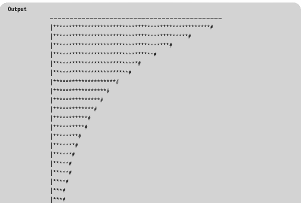

图 6.13  绘制可靠性图的程序

**程序：** 图 6.13 给出的程序生成一个阴影图。t 的值由 for 语句

`for (t=0; t <= 3000; t = t+150)`

以 150 为步长自行生成。语句

`R = (int)(50*r+0.5)`

中的整数 50 是一个比例因子，它将 r 转换为一个较大的值，其中使用整数来绘制曲线。请记住 r 始终小于 1。

## 复习题

### 填空题

- 1. ________ 说明符用于读取或写入短整型。
- 2. 要读取 double 类型的值，我们必须使用说明符 ________。

**难度等级**

- 低；
- 中；
- 高

- 2. 编写 **scanf** 语句以读取以下数据列表：

- (a) 78 B 45
- (b) 123 1.23 45A
- (c) 15-10-2002
- (d) 10 TRUE 20

- 3. 说明以下 **printf** 语句产生的输出。

- (a) `printf("%d%c%f", 10, 'x', 1.23);`
- (b) `printf("%2d %c %4.2f", 1234, 'x', 1.23);`
- (c) `printf("%d%4.2f", 1234, 456);`
- (d) `printf("%08.2f", 123.4);`
- (e) `printf("%2d%d", 10, 20);`

对于第 4 至第 10 题，假设程序中已进行以下声明：

```c
int year, count;
float amount, price;
char code, city[10];
double root;
```

- 4. 当输入数据 `1988, x` 作为对以下语句的响应时，变量 **year** 和 **code** 中存储的值将是什么：

- (a) `scanf("%d %c", &year, &code);`
- (b) `scanf("%c %d", &year, &code);`
- (c) `scanf("%d %c", &code, &year);`
- (d) `scanf("%s %c", &year, &code);`

- 5. 变量 **count**、**price** 和 **city** 具有以下值：

```text
count <---- 1275
price <---- 235.74
city <---- Cambridge
```

显示以下输出语句将产生的确切输出：

- (a) `printf("%d %f", count, price);`
- (b) `printf("%2d\n%f", count, price);`
- (c) `printf("%d %f", price, count);`
- (d) `printf("%10dxxxx%5.2f", count, price);`
- (e) `printf("%s", city);`
- (f) `printf("%-10d %-15s", count, city);`

- 6. 响应输入语句

```c
scanf("%4d%*%d", &year, &code, &count);
```

输入以下数据：

```text
19883745
```

计算机将什么值赋给变量 **year**、**code** 和 **count**？

- 7. 我们如何使用 **getchar()** 函数读取多字符字符串？

- 8. 我们如何使用 **putchar()** 函数输出多字符字符串？

- 9. **scanf()** 函数的用途是什么？

- 10. 描述 **scanf()** 函数中常用转换字符的用途。

- 4. 编写一个程序，读取 0.0 到 20.0 范围内的 4 个浮点值，并使用字符 * 作为填充字符打印水平条形图来表示这些值。为了绘图，可以将值四舍五入到最接近的整数。例如，值 4.36 应表示如下。

```text
        *       *       *       *
        *       *       *       *   4.36
        *       *       *       *
```

注意实际值显示在每个条形图的末端。

LO 6.3
LO 6.4

- 5. 编写一个交互式程序来演示乘法过程。程序应要求用户输入两个两位整数，并如下所示打印整数的乘积。

```text
          45
        × 37
        ----
    7 × 45   is    315
    3 × 45   is    135
        ----
    Add them  1665
```

LO 6.4

- 6. 编写一个程序，使用一个 **scanf** 语句从键盘读取三个整数，并使用以下方式在一行中输出它们：

- (a) 三个 **printf** 语句，
- (b) 仅一个带转换说明符的 **printf**，以及
- (c) 仅一个不带转换说明符的 **printf**。

LO 6.4

- 7. 编写一个程序，按以下规格以指数格式打印值 10.45678：

- (a) 精确到两位小数；
- (b) 精确到四位小数；以及
- (c) 精确到八位小数。

LO 6.4

- 8. 编写一个程序，按以下规格以定点格式打印值 345.6789：

- (a) 精确到两位小数；
- (b) 精确到五位小数；以及
- (c) 精确到零位小数。

LO 6.4

- 9. 编写一个程序，使用 **scanf** 语句将姓名 ANIL KUMAR GUPTA 分三部分读取，并使用 **printf** 语句按以下格式显示该姓名。

- (a) ANIL K. GUPTA
- (b) A.K. GUPTA
- (c) GUPTA A.K.

LO 6.3
LO 6.4

- 10. 编写一个程序来读取并显示以下数据表。

| 名称 | 代码 | 价格 |
| --- | --- | --- |
| 风扇 | 67831 | 1234.50 |
| 电机 | 450 | 5786.70 |

名称和代码必须左对齐，价格必须右对齐。

LO 6.3
LO 6.4


```c
    for (i =1; i <= 10; i++)
    {
        scanf("%f %f", &weight, &height);
        if (weight < 50 && height > 170)
            count = count + 1;
    }
    printf("Number of boys with weight < 50 kg\n");
    printf("and height > 170 cm = %d\n", count);
    }

    Output

    Enter weight and height for 10 boys
    45   176.5
    55   174.2
    47   168.0
    49   170.7
    54   169.0
    53   170.5
    49   167.0
    48   175.0
    47   167
    51   170
    Number of boys with weight < 50 kg
    and height > 170 cm =3
```

**图 7.4**  *使用 if 进行计数*

#### 7.3.1 应用德摩根定律

在设计判定语句时，我们经常会遇到这样一种情况：逻辑 NOT 运算符被应用于复合逻辑表达式，例如 `!(x&&y||z)`。然而，正逻辑总是比负逻辑更易于阅读和理解。在这种情况下，我们可以应用所谓的 **德摩根定律** 来使整个表达式变为正逻辑。该定律如下：

> “将 NOT 运算符应用于每个逻辑表达式组成部分以去掉括号，同时对关系运算符取补”

也就是说，

```text
x becomes !x
!x becomes x
&& becomes ||
|| becomes &&
```

示例：

```text
!(x && y || z) becomes !x || !y && z
!(x <= 0 || !condition) becomes x > 0 && condition
```

### 7.4 IF...ELSE 语句

if...else 语句是简单 if 语句的扩展。一般形式为

```c
if (test expression)
{
    true-block statement(s)
}
else
{
    False-block statement(s)
}
statement-x
```

如果测试表达式为真，则紧跟在 if 语句之后的真块语句被执行；否则，假块语句被执行。无论哪种情况，真块或假块都会被执行，但不会两者都执行。图 7.5 说明了这一点。在这两种情况下，控制随后都会转移到语句 x。

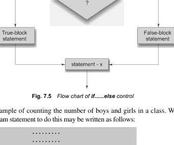

让我们考虑一个统计班级中男生和女生人数的例子。我们用代码 1 表示男生，用代码 2 表示女生。实现这一功能的程序语句可以写成如下形式：

```c
..........
if (code == 1)
    boy = boy + 1;
if (code == 2)
    girl = girl+1;
..........
```

第一个测试判断该学生是否为男生。如果是，则男生人数加 1，程序继续执行第二个测试。第二个测试又判断该学生是否为女生。这是不必要的。一旦某个学生被识别为男生，就无需再测试其是否为女生。一个学生可以是男生或女生，但不能两者都是。上述程序段可以使用 **else** 子句修改如下：

```c
..........
..........
if (code == 1)
    boy = boy + 1;
else
    girl = girl + 1;
xxxxxxxxxx
..........
```

这里，如果 code 等于 1，则执行语句 **boy = boy + 1;**，并且控制会跳过 else 部分，转移到语句 xxxxxx。如果 code 不等于 1，则跳过语句 **boy = boy + 1;**，并在控制到达语句 **xxxxxxxxx** 之前执行 **else** 部分中的语句 **girl = girl + 1;**。

```c
..........
..........
if (c-d == 0)
{
    ratio = (float)(a+b)/(float)(c-d);
    printf("Ratio = %f\n", ratio);
}
else
    printf("c-d is zero\n");
..........
..........
```

#### 例题 7.3

一个计算幂级数的程序。

$$e^x = 1 + x + \frac{x^2}{2!} + \frac{x^3}{3!} + \cdots + \frac{x^n}{n!}, \quad 0 < x < 1$$

如图 7.6 所示。它使用 **if...else** 来检验精度。

该程序使用 **count** 统计所添加项的数量。当项的值小于 0.0001（**精度**）时，程序停止。注意，当某一项小于 **精度** 时，*n* 的值被设为 999（一个大于 100 的数），因此 **while** 循环终止。结果在 **while** 循环之外打印。

### 7.5 IF...ELSE 语句的嵌套  LO 7.2

当涉及一系列决策时，我们可能需要以*嵌套*形式使用多个 **if...else** 语句，如下所示：


执行逻辑如图 7.7 所示。如果 *condition-1* 为假，则执行语句 3；否则继续执行第二个测试。如果 *condition-2* 为真，则计算语句 1；否则计算语句 2，然后控制转移到语句 x。

一家商业银行推出了一项激励政策，向其所有存款持有人发放奖金。该政策如下：无论余额多少，每位客户均可获得 12 月 31 日余额 2% 的奖金；如果女性账户持有人的余额超过 5000 卢比，则可获得 5% 的奖金。这一逻辑可以编码如下：

```c
..........
if (sex is female)
{
    if (balance > 5000)
        bonus = 0.05 * balance;
    else
        bonus = 0.02 * balance;
}
else
{
    bonus = 0.02 * balance;
}
balance = balance + bonus;
..........
..........
```


图 7.7 嵌套 if...else 语句的流程图

嵌套时，应注意让每个 *if* 都与一个 *else* 匹配。考虑上述程序的另一种写法（乍一看似乎正确）：

```c
if (sex is female)
    if (balance > 5000)
        bonus = 0.05 * balance;
    else
        bonus = 0.02 * balance;
balance = balance + bonus;
```

这里存在一个歧义：*else* 究竟属于哪个 *if*。在 C 中，else 与最近一个未终止的 *if* 相关联。因此，*else* 与内层 *if* 关联，而外层 *if* 没有 else 选项。这意味着计算机试图执行语句

```c
balance = balance + bonus;
```

而实际上并没有为男性账户持有人计算奖金。

考虑另一种写法，它看起来也是正确的：

```c
if (sex is female)
{
    if (balance > 5000)
        bonus = 0.05 * balance;
    }
    else
        bonus = 0.02 * balance;
    balance = balance + bonus;
}
```

在这种情况下，**else** 与外层 if 关联，因此会为男性账户持有人计算奖金。然而，对于余额等于或小于 5000 的女性账户持有人，由于内层 if 缺少 **else** 选项，其奖金不会被计算。

#### 例题 7.4

图 7.8 中的程序使用嵌套 **if...else** 语句选出并打印三个数中的最大值。

```c
main()
{
    float A, B, C;
    printf("Enter three values\n");
    scanf("%f %f %f", &A, &B, &C);
    printf("\nLargest value is ");
    if (A>B)
    {
        if (A>C)
            printf("%f\n", A);
        else
            printf("%f\n", C);
    }
    else
    {
        if (C>B)
            printf("%f\n", C);
        else
            printf("%f\n", B);
    }
}

Output

Enter three values
23445 67379 88843
Largest value is 88843.000000
```

**图 7.8**  *选出三个数中的最大值*

#### 7.5.1 悬空 else 问题

当我们开始使用嵌套 if...else 语句时，遇到的经典问题之一就是悬空 else。当一个 if 没有可匹配的 else 时，就会出现这种情况。这个问题的答案非常简单。始终将 else 与当前块中最近一个未匹配的 if 匹配。在某些情况下，可能不需要假条件。在这种情况下，可以省略 else 语句。

> “else 总是与最近一个未配对的 if 配对”

### 7.6 ELSE IF 阶梯

LO 7.2

当涉及多路决策时，还有另一种组合 if 的方式。多路决策是一串 if，其中每个 else 关联的语句都是一个 if。它采用以下一般形式：

```c
if (condition 1)
    statement-1;
else if (condition 2)
    statement-2;
else if (condition 3)
    statement-3;
...
else if (condition n)
    statement-n;
else
    default-statement;

statement-x;
```

这种结构称为 else if 阶梯。条件从（阶梯的）顶部向下求值。一旦找到为真的条件，就执行与其关联的语句，并将控制转移到语句 x（跳过阶梯的其余部分）。当所有 n 个条件都为假时，将执行包含默认语句的最后一个 else。图 7.9 显示了 else if 阶梯语句的执行逻辑。

让我们考虑一个给学术机构中学生评分的例子。评分按照以下规则进行：

| 平均分 | 等级 |
| --- | --- |
| 80 到 100 | 荣誉 |
| 60 到 79 | 一等 |
| 50 到 59 | 二等 |
| 40 到 49 | 三等 |
| 0 到 39 | 不及格 |


这种评分可以使用如下 **else if** 阶梯完成：

```c
if (marks > 79)
    grade = "Honours";
else if (marks > 59)
    grade = "First Division";
else if (marks > 49)
    grade = "Second Division";
else if (marks > 39)
    grade = "Third Division";
else
    grade = "Fail";
printf ("%s\n", grade);
```

考虑下面给出的另一个示例：

```c
if (code == 1)
    colour = "RED";
```


**图 7.11**  *switch 语句的选择过程*

**switch** 语句可用于给上一节讨论的学生评分。如下所示：

```c
index = marks/10
switch (index)
{
    case 10:
    case 9:
    case 8:
        grade = "Honours";
        break;
    case 7:
    case 6:
        grade = "First Division";
        break;
    case 5:
        grade = "Second Division";
        break;
    case 4:
        grade = "Third Division";
        break;
    default:
        grade = "Fail";
        break;
}
printf("%s\n", grade);
```

注意我们使用了一条转换语句

```c
index = marks / 10;
```

其中，index 定义为整数。变量 index 取以下整数值。

| 分数 | 索引 |
|---|---|
| 100 | 10 |
| 90–99 | 9 |
| 80–89 | 8 |
| 70–79 | 7 |
| 60–69 | 6 |
| 50–59 | 5 |
| 40–49 | 4 |
| · | · |
| · | · |
| 0 | 0 |

程序这一段说明了两个重要特性。首先，它使用了空 case。前三个 case 将执行相同的语句

```c
grade = "Honours";
break;
```

case 7 和 case 6 也是如此。其次，对于 marks 小于 40 的所有其他情况使用 default 条件。

switch 语句常用于菜单选择。例如：

```c
printf(" TRAVEL GUIDE\n\n");
printf(" A Air Timings\n" );
printf(" T Train Timings\n");
printf(" B Bus Service\n" );
printf(" X To skip\n" );
printf("\n Enter your choice\n");
character = getchar();
switch (character)
{
    case 'A' :
        air_display();
        break;

    case 'B' :
        bus_display();
        break;

    case 'T' :
        train_display();
        break;

default :
        printf(" No choice\n");
}
```

**switch** 语句可以嵌套。也就是说，一个 **switch** 可以是 **case** 语句的一部分。ANSI C 允许 15 层嵌套。

#### 7.7.1 switch 语句的规则

- **switch** 表达式必须是整型。
- case 标签必须是常量或常量表达式。
- case 标签必须唯一。任何两个标签不能具有相同的值。
- case 标签必须以冒号结尾。
- **break** 语句将控制转出 **switch** 语句。
- **break** 语句是可选的。也就是说，两个或更多 case 标签可以属于同一组语句。
- **default** 标签是可选的。如果存在，当表达式找不到匹配的 case 标签时，它将被执行。
- 最多只能有一个 **default** 标签。
- **default** 可以放在任何位置，但通常放在末尾。
- 允许嵌套 **switch** 语句。

##### 例题 7.6

编写一个完整的 C 程序，读取 1 到 12 范围内的值，并打印该月份和下一个月月份的名称。对于任何其他输入值，打印错误信息。

```c
Program

#include<stdio.h>
#include<conio.h>
#include<stdlib.h>
void main()
{
    char month[12][20] = {"January","February","March","April","May","June",
    "July","August","September","October","November","December"};
    int i;

    printf("Enter the month value: ");
    scanf("%d",&i);

    if(i<1 || i>12)
    {
        printf("Incorrect value!!\nPress any key to terminate the program...");
        getch();
        exit(0);
    }

    if(i!=12)
        printf("%s followed by %s",month[i-1],month[i]);
    else
        printf("%s followed by %s",month[i-1],month[0]);

    getch();
}
```

输出

Enter the month value: 6
June followed by July

*图 7.12 读取并打印 1 到 12 范围内月份名称的程序*

### 7.8 ? : 运算符

C 语言有一个不同寻常的运算符，可用于做出双向决策。该运算符是 ? 和 : 的组合，并接受三个操作数。该运算符通常称为*条件运算符*。条件运算符的一般使用形式如下：

*条件表达式 ? 表达式1 : 表达式2*

首先计算*条件表达式*。如果结果非零，则计算*表达式1*，并将其作为条件表达式的值返回。否则，计算*表达式2*并返回其值。例如，以下代码段

```c
if (x < 0)
    flag = 0;
else
    flag = 1;
```

可以写成

```c
flag = ( x < 0 ) ? 0 : 1;
```

考虑以下函数的求值：

```c
y = 1.5x + 3 for x ≤ 2
y = 2x + 5 for x > 2
```

可以使用条件运算符按如下方式求值：

```c
y = ( x > 2 ) ? (2 * x + 5) : (1.5 * x + 3);
```

条件运算符可以嵌套，以计算更复杂的赋值决策。例如，考虑一名销售家用产品的女售货员的周薪。如果 x 是一周内售出的产品数量，则她的周薪由下式给出

```c
Salary = | 4x + 100   for x < 40
         | 300        for x = 40
         | 4.5x + 150 for x > 40
```

这个复杂方程可以写成

```c
salary = (x != 40) ? ((x < 40) ? (4*x+100) : (4.5*x+150)) : 300;
```

同样的结果可以使用 **if...else** 语句按如下方式求值：

```c
if (x <= 40)
    if (x < 40)
        salary = 4 * x+100;
    else
        salary = 300;
else
    salary = 4.5 * x+150;
```

使用条件运算符时，代码变得更简洁，或许也更高效。然而，可读性较差。当需要不止一层嵌套的条件运算符时，最好使用 **if** 语句。

#### 例题 7.7

员工可以在每六个月初申请贷款，但将根据以下公司规则批准贷款金额：

- **规则 1：** 员工在任何时候拥有的贷款不能超过两笔。
- **规则 2：** 允许的最高贷款总额有限，并取决于员工的类别。

处理贷款申请并批准贷款的程序见图 7.13。

**程序**

```c
#define MAXLOAN 50000
main()
{
    long int loan1, loan2, loan3, sancloan, sum23;
    printf("Enter the values of previous two loans:\n");
    scanf(" %ld %ld", &loan1, &loan2);
    printf("\nEnter the value of new loan:\n");
    scanf(" %ld", &loan3);
    sum23 = loan2 + loan3;
    sancloan = (loan1>0) ? 0 : ((sum23>MAXLOAN)?
                MAXLOAN - loan2 : loan3);
    printf("\n\n");
    printf("Previous loans pending:\n%ld %ld\n",loan1,loan2);
    printf("Loan requested = %ld\n", loan3);
    printf("Loan sanctioned = %ld\n", sancloan);
}
```

**输出**

```text
Enter the values of previous two loans:
0 20000
Enter the value of new loan:
45000

Previous loans pending:
0 20000
Loan requested = 45000
Loan sanctioned = 30000
Enter the values of previous two loans:
1000 15000
Enter the value of new loan:
25000
Previous loans pending:
1000 15000
Loan requested = 25000
Loan sanctioned = 0
```

图 7.13 *条件运算符的说明*

该程序使用以下变量：

- **loan3** – 当前请求的贷款金额
- **loan2** – 之前待还的贷款金额
- **loan1** – 再之前待还的贷款
- **sum23** – loan2 与 loan3 之和
- **sancloan** – 已批准的贷款

批准新贷款的规则是：

- 1. loan1 应为零。
- 2. loan2 + loan3 不应超过 MAXLOAN。

注意使用 **long int** 类型声明变量。

#### 例题 7.8

编写一个程序来确定两个数的最大公约数（GCD）。

确定两个数 GCD 的程序见图 7.14。

```text
Algorithm
Step 1 – Start
Step 2 – Accept the two numbers whose GCD is to be found (num1, num2)
Step 3 – Call function GCD(num1,num2)
Step 4 – Display the value returned by the function call GCD(num1, num2)
Step 5 – Stop
GCD(a,b)
Step 1 – Start
Step 2 – If b > a goto Step 3 else goto Step 4
Step 3 – Return the result of the function call GCD(b,a) to the calling function
Step 4 – If b = 0 goto Step 5 else goto Step 6
Step 5 – Return the value to the calling function
Step 6 – Return the result of the function call GCD(b,a mod b) to the calling function
```


程序
```c
#include <stdio.h>
#include <conio.h>
#include <math.h>

int GCD(int m, int n);
void main()
{
    int num1,num2;
    clrscr();
    printf("Enter the two numbers whose GCD is to be found: ");
    scanf("%d %d",&num1,&num2);

    printf("\nGCD of %d and %d is %d\n",num1,num2,GCD(num1,num2));
    getch();
}

int GCD(int a, int b)
{
    if(b>a)
        return GCD(b,a);
    if(b==0)
        return a;
    else
        return GCD(b,a%b);
}
```


在程序运行期间，当遇到类似

`goto begin;`

的语句时，控制流将跳转到标签 **begin** 紧随其后的语句。这种跳转是无条件发生的。

注意，**goto** 会打破程序正常的顺序执行。如果 *label:* 位于语句 **goto label;** 之前，就会形成一个循环，某些语句将被重复执行。这种跳转称为**后向跳转**。另一方面，如果 *label:* 放在 **goto label;** 之后，某些语句将被跳过，这种跳转称为**前向跳转**。

**goto** 常用于程序末尾，以指示控制转到输入语句，读取更多数据。考虑以下示例：

```c
main()
{
    double x, y;
read:
    scanf("%f", &x);
    if (x < 0) goto read;
    y = sqrt(x);
    printf("%f %f\n", x, y);
    goto read;
}
```

该程序用于计算从终端读取的一系列数字的平方根。程序使用了两个 **goto** 语句：一个在打印结果之后、位于末尾，用于将控制转回输入语句；另一个用于在数字为负数时跳过任何进一步的计算。

由于末尾的无条件 **goto** 语句，控制总是被转回输入语句。事实上，这个程序使计算机进入一个永久循环，称为*无限循环*。计算机一圈又一圈地运行，直到我们采取一些特殊步骤来终止循环。应避免这种无限循环。实战练习 7.9 说明了如何消除这种无限循环。

#### 实战练习 7.9

图 7.15 所示的程序说明了 **goto** 语句的用法。该程序计算五个数字的平方根。变量 **count** 记录已读取数字的个数。当 **count** 小于或等于 5 时，**goto read;** 将控制转到标签 **read**；否则，程序打印一条消息并停止。

程序
```c
#include <math.h>
main()
{
    double x, y;
    int count;
    count = 1;
    printf("Enter FIVE real values in a LINE \n");
read:
    scanf("%lf", &x);
    printf("\n");
    if (x < 0)
        printf("Value - %d is negative\n", count);
    else
    {
        y = sqrt(x);
        printf("%lf\t %lf\n", x, y);
    }
    count = count + 1;
    if (count <= 5)
        goto read;
    printf("\nEnd of computation");
}
```

输出
```text
Enter FIVE real values in a LINE
50.70 40 -36 75 11.25
50.750000       7.123903
40.000000       6.324555
Value - 3 is negative
75.000000       8.660254
11.250000       3.354102
End of computation
```

**图 7.15** **goto** 语句的用法

**goto** 语句的另一个用途是，当遇到某些特殊条件时，将控制转移到循环（或嵌套循环）之外。例如：

```c
----
----
while (----)
{
    for (----)
    {
        ----
        ----
        if (----) goto end_of_program;
        ----
    }
    ----
    ----
}
end_of_program:
```

跳出循环

我们应尽可能避免使用 **goto**。但是，如果我们使用它来增强程序的可读性或提高执行速度，那也没有什么错。

## 学习成果

- 注意控制表达式中的任何副作用，例如 if(x++)。LO 7.4.1
- 检查是否误用 = 运算符代替相等运算符 ==。LO 7.4.1
- 不要在关系运算符 ==、!=、>= 和 <= 的两个符号之间加任何空格。LO 7.4.1
- 将 !=、>= 和 <= 运算符写成 =!、=> 和 =< 是错误的。LO 7.4.1
- 记住逻辑运算符要使用两个 & 符号（&&）和两个竖线（||）。使用单个运算符会导致逻辑错误。LO 7.4.1
- 不要忘记为 if 表达式加上括号。LO 7.4.1
- 在 if 表达式后放置分号是错误的。LO 7.4.1
- 不要使用相等运算符比较两个浮点值。它们很少完全相等。LO 7.4.1
- 避免在逻辑二元表达式中使用有副作用的操作数，例如 (x--&&++y)。第二个操作数可能根本不会被求值。LO 7.4.1
- 注意悬空 else 语句。LO 7.4.2
- 在 if...else 语句的 if 和 else 子句中使用花括号封装语句。LO 7.4.2
- 当 switch 语句中的各个 case 互斥时，不要忘记使用 break 语句。LO 7.4.3
- 尽管 default 子句是可选的，但在 switch 语句中使用它是一种良好的编程实践。LO 7.4.3
- 在 switch 语句的 case 标签中使用变量作为值是错误的。（只允许整型常量。）LO 7.4.3
- 不要在 switch 语句的两个 case 标签中使用相同的常量。LO 7.4.3
- 尽量使用简单的逻辑表达式。LO 7.4.4
- 在程序中放置 goto 标签时要小心，因为它可能导致无限循环条件。LO 7.4.5

## 需记住的关键术语

- **决策语句：** 是控制程序中执行流程的语句。LO 7.4.1
- **switch 语句：** 是一种多路决策语句，它通过将给定值与一组 case 值匹配来选择要执行的语句块。LO 7.4.3
- **条件运算符：** 是一种双向决策语句，它根据条件表达式的结果返回两个表达式值之一。LO 7.4.4
- **goto 语句：** 用于无条件分支。它将控制流转移到找到匹配标签的位置。LO 7.4.5
- **无限循环：** 是一组指令被重复执行的状态。LO 7.4.5

## 简要案例

### 一、数值范围 [LO 7.1, 7.2 M]

**问题：** 一项对计算机市场的调查显示，个人计算机由供应商以不同的成本销售。以下是一些供应商给出的成本清单（以百为单位）：

35.00, 40.50, 25.00, 31.25, 68.15,
47.00, 26.65, 29.00, 53.45, 62.50

确定平均成本和数值范围。

**问题分析：** 极差是统计分析一系列数值时使用的离散程度度量之一。任何数列的极差都是该数列中最大值与最小值之差。即

极差 = 最高值 - 最低值

因此，有必要找出数列中的最高值和最低值。

**程序：** 用于确定市场中个人计算机的数值范围和平均成本的程序见图 7.16。

程序
```c
main()
{
    int count;
    float value, high, low, sum, average, range;
    sum = 0;
    count = 0;
    printf("Enter numbers in a line : input a NEGATIVE number to end\n");

input:
    scanf("%f", &value);
    if (value < 0) goto output;
    count = count + 1;
    if (count == 1)
        high = low = value;
    else if (value > high)
        high = value;
    else if (value < low)
        low = value;
    sum = sum + value;
    goto input;

output:
    average = sum/count;
    range = high - low;
    printf("\n\n");
    printf("Total values : %d\n", count);
    printf("Highest-value: %f\nLowest-value : %f\n",
           high, low);
    printf("Range          : %f\nAverage : %f\n",
           range, average);
}
```

输出
```text
Enter numbers in a line : input a NEGATIVE number to end
35 40.50 25 31.25 68.15 47 26.65 29 53.45 62.50 -1
Total values : 10
Highest-value : 68.150002
Lowest-value : 25.000000
Range : 43.150002
Average : 41.849998
```

*图 7.16 数值范围的计算*

第一次读取该值时，通过以下语句将其赋给两个桶：**high** 和 **low**：

```c
high = low = value;
```

对于后续值，将读取的值与 *high* 比较；如果它更大，则将该值赋给 *high*。否则，将该值与 *low* 比较；如果它更小，则将该值赋给 *low*。注意，在某一时刻，桶 *high* 和 *low* 保存着到目前为止读取的最高值和最低值。

这些值在由 `goto input;` 语句创建的输入循环中读取。通过输入一个负数将控制转移出该循环。这是由以下语句造成的：

```c
if (value < 0) goto output;
```

注意，这个程序可以不用 `goto` 语句编写。试一试。

### 2. 工资单计算 [LO 7.2, 7.5 M]

**问题：** 一家制造公司将其管理人员分为四个级别，以享受某些福利。级别和相应福利如下所示：

| 级别 | 福利：交通津贴 | 福利：娱乐津贴 |
|---|---|---|
| 1 | 1000 | 500 |
| 2 | 750 | 200 |
| 3 | 500 | 100 |
| 4 | 250 | – |


高管的毛工资包括基本工资、按基本工资 25% 计算的房租津贴以及其他福利。所得税按以下百分比从工资中预扣：

| 总工资 | 税率 |
|---|---|
| 总工资 <= 2000 | 不扣税 |
| 2000 < 总工资 <= 4000 | 3% |
| 4000 < 总工资 <= 5000 | 5% |
| 总工资 > 5000 | 8% |

编写一个程序，读取高管的工号、级别编号和基本工资，然后计算扣除所得税后的净工资。

#### 问题分析

总工资 = 基本工资 + 房租津贴 + 福利

净工资 = 总工资 – 所得税。

福利的计算取决于级别，而所得税取决于总工资。主要步骤如下：

- 1. 读取数据。
- 2. 确定级别编号并计算福利。
- 3. 计算总工资。
- 4. 计算所得税。
- 5. 计算净工资。
- 6. 打印结果。

**程序：**一个程序及测试数据的结果见图 7.17。注意最后一条语句应为可执行语句。也就是说，标签 **stop:** 不能是最后一行。

```c
#define CA1 1000
#define CA2 750
#define CA3 500
#define CA4 250
#define EA1 500
#define EA2 200
#define EA3 100
#define EA4 0

main()
{
    int level, jobnumber;
    float gross,
          basic,
          house_rent,
          perks,
          net,
          incometax;

input:
    printf("\nEnter level, job number, and basic pay\n");
    printf("Enter 0 (zero) for level to END\n\n");
    scanf("%d", &level);
    if (level == 0) goto stop;
    scanf("%d %f", &jobnumber, &basic);
    switch (level)
    {
        case 1:
            perks = CA1 + EA1;
            break;
        case 2:
            perks = CA2 + EA2;
            break;
        case 3:
            perks = CA3 + EA3;
            break;
        case 4:
            perks = CA4 + EA4;
            break;
        default:
            printf("Error in level code\n");
            goto stop;
    }
    house_rent = 0.25 * basic;
    gross = basic + house_rent + perks;
    if (gross <= 2000)
        incometax = 0;
    else if (gross <= 4000)
        incometax = 0.03 * gross;
    else if (gross <= 5000)
        incometax = 0.05 * gross;
    else
        incometax = 0.08 * gross;
    net = gross - incometax;
    printf("%d %d %.2f\n", level, jobnumber, net);
    goto input;
stop:
    printf("\n\nEND OF THE PROGRAM");
}
```

**输出**

```text
Enter level, job number, and basic pay
Enter 0 (zero) for level to END

1 1111 4000
1 1111 5980.00
Enter level, job number, and basic pay
Enter 0 (zero) for level to END
2 2222 3000
2 2222 4465.00
Enter level, job number, and basic pay
Enter 0 (zero) for level to END
3 3333 2000
3 3333 3007.00
Enter level, job number, and basic pay
Enter 0 (zero) for level to END
4 4444 1000
4 4444 1500.00
Enter level, job number, and basic pay
Enter 0 (zero) for level to END
0
END OF THE PROGRAM
```

图 7.17 工资单计算

## 复习题

### 填空题

- 1. ________ 运算符仅当两个操作数都为真时才为真。
- 2. 多路选择可以使用 **else if** 语句或 ________ 语句来实现。
- 3. 在 **switch** 语句中执行 ________ 语句时，会立即退出该结构。
- 4. 表达式 `! (x != y)` 可以用表达式 ________ 替换。
- 5. 使用运算符 `?:` 的三元条件表达式可以很容易地用 ________ 语句编码。

### 判断题

- 1. **switch** 表达式可以是任意类型。
- 2. 当遇到 **break** 语句时，程序会停止执行。
- 3. 每个 case 标签只能有一条语句。
- 4. switch 语句中必须包含 default 分支。LO 7.3
- 5. 当 if 语句嵌套时，最后一个 else 会与最近的不带 else 的 if 配对。LO 7.2
- 6. 一个 if 可以有多个 else 子句。LO 7.2
- 7. else if 中的每个表达式都必须测试同一个变量。LO 7.2
- 8. switch 语句总是可以替换为一系列 if..else 语句。LO 7.3
- 9. 任何表达式都可以用作 if 表达式。LO 7.1
- 10. 谓词 `!((x >= 10) || (y == 5))` 等价于 `(x < 10) && (y != 5)`。LO 7.1

### 难度等级

- 低；
- 中；
- 高

## 讨论题

- **1.** 以下是一个程序片段：

    ```c
    x = 1;
    y = 1;
    if (n > 0)
        x = x + 1;
        y = y - 1;
    printf("%d %d", x, y);
    ```

    如果 n 取值 (a) 1 和 (b) 0，x 和 y 的值将分别是什么。

    LO 7.1

- **2.** 在不使用复合关系的情况下重写以下各项：

    ```c
    (a) if (grade <= 59 && grade >= 50)
            second = second + 1;
    ```
    LO 7.1

    ```c
    (b) if (number > 100 || number < 0)
            printf(" Out of range\n");
        else
            sum = sum + number;
    ```
    LO 7.2

    ```c
    (c) if ((M1 > 60 && M2 > 60) || T > 200)
            printf(" Admitted\n");
        else
            printf(" Not Admitted\n");
    ```
    LO 7.2

- **3.** 假设 x = 10，判断以下逻辑表达式为真还是假。

    - (a) `x == 10 && x > 10 && !x`
    - (b) `x == 10 || x > 10 && !x`
    - (c) `x == 10 && x > 10 || !x`
    - (d) `x == 10 || x > 10 || !x`

    LO 7.1

- **4.** 找出以下与 switch 相关的语句中的错误（如果有）。假设变量 x 和 y 为 int 类型，且 x = 1、y = 2。

    - (a) `switch (y);`
    - (b) `case 10;`
    - (c) `switch (x + y)`
    - (d) `switch (x) {case 2: y = x + y; break;}`

    LO 7.3

- **5.** 化简以下复合逻辑表达式。

    - (a) `!(x <= 10)`
    - (b) `!((x == 10) || (y == 5)) || (z < 0)`
    - (c) `!((x + y == z) && !(z > 5))`
    - (d) `!((x <= 5) && (y == 10) && (z < 5))`

    LO 7.1

- **6.** 假设初始时 x = 5、y = 0、z = 1，执行以下代码段后它们的值将是什么？[LO 7.2]

    ```c
    (a) if (x && y)
            x = 10;
        else
            y = 10;
    ```

    ```c
    (b) if (x || y || z)
            y = 10;
        else
            z = 0;
    ```

    ```c
    (c) if (x)
            if (y)
                z = 10;
            else
                z = 0;
    ```

    ```c
    (d) if (x == 0 || x && y)
            if (!y)
                z = 0;
            else
                y = 1;
    ```

- **7.** 假设初始时 x = 2、y = 1、z = 0，执行以下代码段后它们的值将是什么？[LO 7.3]

    ```c
    (a) switch (x)
        {
            case 2:
                x = 1;
                y = x + 1;
            case 1:
                x = 0;
                break;
            default:
                x = 1;
                y = 0;
        }
    ```

    ```c
    (b) switch (y)
        {
            case 0:
                x = 0;
                y = 0;
            case 2:
                x = 2;
                z = 2;
            default:
                x = 1;
                y = 2;
        }
    ```

- **8.** 以下程序的输出是什么？[LO 7.2]

    ```c
    main ( )
    {
        int m = 5;
        if (m < 3) printf("%d", m+1);
        else if (m < 5) printf("%d", m+2);
        else if (m < 7) printf("%d", m+3);
        else printf("%d", m+4);
    }
    ```

- **9.** 以下程序的输出是什么？

    ```c
    main ( )
    {
        int m = 1;
        if ( m==1)
        {
            printf ( " Delhi " ) ;
            if (m == 2)
                printf( "Chennai" ) ;
            else
                printf("Bangalore");
        }
        else;
        printf(" END");
    }
    ```

    

- **10.** 以下程序的输出是什么？

    ```c
    main( )
    {
        int m ;
        for (m = 1; m<5; m++)
            printf("%d\n", (m%2) ? m : m*2);
    }
    ```

    

- **11.** 以下程序的输出是什么？

    ```c
    main( )
    {
        int m, n, p ;
        for ( m = 0; m < 3; m++ )
        for (n = 0; n<3; n++)
        for ( p = 0; p < 3; p++ )
        if ( m + n + p == 2 )
            goto print;

        print :
        printf("%d, %d, %d", m, n, p);
    }
    ```

    


- **12.** 执行以下代码段后，x 的值将是多少？

```
int x = 10, y = 15;  
x = (x<y)? (y+x) : (y-x) ;
```


- **13.** 执行以下代码段后，输出将是什么？

```
int x = 0;  
if (x >= 0)  
    if ( x > 0 )  
        printf("Number is positive");  
else  
    printf("Number is negative");
```


- **14.** 执行以下代码段后，输出将是什么？

```
char ch = 'a' ;  
switch (ch)  
{  
        case 'a' :  
        printf( "A" ) ;  
        case 'b':  
        printf ("B") ;  
        default :  
        printf(" C " );  
}
```


- **15.** 以下代码段执行后的输出将是什么？

```
int x = 10, y = 20;  
if ((x<y) || (x+5) > 10 )  
    printf("%d", x);  
else  
    printf("%d", y);
```


- **16.** 以下代码段执行后的输出将是什么？

```
int a = 10, b = 5;  
if (a > b)  
{  
        if(b > 5)  
        printf("%d", b);  
}  
else  
    printf("%d", a);
```


## 调试练习

- **1.** 找出以下各代码段中的错误（如果有）：
  - (a) `if ( x + y = z && y > 0 )`
    `printf(" ");`
  - (b) `if (p < 0) || (q < 0)`
    `printf (" sign is negative");`
  - (c) `if (code > 1);`
    `a = b + c`
    `else`
    `a = 0`


- **2.** 找出以下语句中的错误（如果有）：
  - (a) `if ( x >= 10 ) then`
    `printf ( "\n" );`
  - (b) `if x >= 10`
    `printf ( "OK" );`
  - (c) `if (x = 10)`
    `printf ("Good" );`
  - (d) `if (x = < 10)`
    `printf ("Welcome") ;`


## 编程练习

- **1.** 编写一个程序，判断给定数字是“奇数”还是“偶数”，并打印消息
  NUMBER IS EVEN
  或
  NUMBER IS ODD
  - (a) 不使用 **else** 选项
  - (b) 使用 **else** 选项。


- **2.** 编写一个程序，求出大于 100 且小于 200 的所有能被 7 整除的整数的个数及总和。

- **3.** 下面给出一个含两个未知数 x1 和 x2 的二元一次方程组：
  a x1 + b x2 = m
  c x1 + d x2 = n
  该方程组有唯一解
  x1 = (md - bn) / (ad - cb)
  x2 = (na - mc) / (ad - cb)
  前提是分母 ad - cb 不等于零。

  编写一个程序，读取常量 a、b、c、d、m 和 n 的值，并计算 x1 和 x2 的值。如果 ad - cb = 0，则应打印适当的消息。


- **4.** 给定一个范围为 0 到 100 的分数列表，编写一个程序计算并打印以下学生人数：
  - (a) 得分超过 80 分的学生，
  - (b) 得分超过 60 分的学生，
  - (c) 得分超过 40 分的学生，
  - (d) 得分在 40 分或以下的学生，
  - (e) 得分在 81 到 100 分范围内的学生，
  - (f) 得分在 61 到 80 分范围内的学生，
  - (g) 得分在 41 到 60 分范围内的学生，以及
  - (h) 得分在 0 到 40 分范围内的学生。
  该程序应使用最少数量的 if 语句。

- **5.** 进入专业课程需满足以下条件：
  - (a) 数学成绩 >= 60
  - (b) 物理成绩 >= 50
  - (c) 化学成绩 >= 40
  - (d) 三门科目总分 >= 200
  或
  数学和物理总分 >= 150

  给定三门科目的成绩，编写一个程序处理申请，列出符合条件的候选人。

- **6.** 编写一个程序，打印如下所示的二维平方根表，以提供 0 到 9.9 之间任意数字的平方根。例如，值 x 将给出 3.2 的平方根，y 给出 3.9 的平方根。

平方根表

| 数字 | 0.0 | 0.1 | 0.2 | ...... | 0.9 |
| --- | --- | --- | --- | --- | --- |
| 0.0 |  |  |  |  |  |
| 1.0 |  |  |  |  |  |
| 2.0 |  |  |  |  |  |
| 3.0 |  |  | x |  | y |
| 9.0 |  |  |  |  |  |

- **7.** 下面显示的是一个弗洛伊德三角形。

```
        1
       2 3
      4 5 6
     7 8 9 10
   11 .... 15
   .
   .
  79 .... 91
```

  - (a) 编写一个程序打印这个三角形。
  - (b) 修改程序，以生成以下形式的弗洛伊德三角形。

```
1
0 1
1 0 1
0 1 0 1
1 0 1 0 1
```

- **8.** 一家服装展厅宣布了以下购买商品的季节性折扣：

| 购买金额 | 折扣（机织布） | 折扣（手织品） |
| --- | --- | --- |
| 0 – 100 | – | 5% |
| 101 – 200 | 5% | 7.5% |
| 201 – 300 | 7.5% | 10.0% |
| 300 以上 | 10.0% | 15.0% |

编写一个程序，使用 **switch** 和 **if** 语句计算顾客应支付的净金额。

LO 7.1
LO 7.3

- **9.** 编写一个程序，读取 x 的值并计算以下函数

```
y = {
  1  for x < 0
  0  for x = 0
  -1 for x > 0
}
```

使用

  - (a) 嵌套 **if** 语句，
  - (b) **else if** 语句，以及
  - (c) 条件运算符 **? :**

LO 7.1
LO 7.2
LO 7.4
LO 7.2

- **10.** 编写一个程序计算二次方程

ax² + bx + c = 0

的实根

根由以下公式给出

x₁ = (-b + √(b² - 4ac)) / 2a

x₂ = (-b - √(b² - 4ac)) / 2a

程序应请求常量 a、b 和 c 的值，并打印 x₁ 和 x₂ 的值。使用以下规则：

  - (a) 如果 a 和 b 都为零，则无解
  - (b) 如果 a = 0，则只有一个根（x = -c/b）
  - (c) 如果 b² - 4ac 为负，则没有实根
  - (d) 否则，有两个实根

用适当的数据测试你的程序，使所有逻辑路径都能按你的设计工作。加入适当的输出消息。

- **11.** 编写一个程序，从键盘读取三个整数值，并输出说明它们是直角三角形三条边的结果。

LO 7.2

- **12.** 某电力委员会对用电收取以下费率：

  LO 7.2

  - 前 200 个单位：每单位 80 P
  - 接下来的 100 个单位：每单位 90 P
  - 超过 300 个单位：每单位 Rs 1.00

  所有用户均收取最低 Rs. 100 的电表费。如果总金额超过 Rs. 400，则额外收取总金额 15% 的附加费。编写一个程序，读取用户姓名和消耗的单位数，并打印出带有姓名的费用。

- **13.** 编写一个程序，计算并显示 0 到 100 之间所有能被 6 整除但不能被 4 整除的整数之和。该程序还应统计并显示此类值的个数。

LO 7.2

- **14.** 编写一个交互式程序，读取一个正整数，判断该数是否为素数，并相应地显示输出。

  修改该程序，统计 100 到 200 之间的所有素数。

  注意：素数是一个只能被 1 或自身整除的正整数。

  LO 7.2

- **15.** 编写一个程序，读取一个表示弧度角的 double 类型值 x 和一个表示三角函数类型的字符型变量 T，并显示以下值：
  - (a) 如果 T 被赋值为 s 或 S，则显示 sin(x)，
  - (b) 如果 T 被赋值为 c 或 C，则显示 cos (x)，以及
  - (c) 如果 T 被赋值为 t 或 T，则显示 tan (x)
  分别使用 (i) if.......else 语句，以及
  (ii) **switch** 语句。

  LO 7.2
  LO 7.3

## 决策与循环

## 第 8 章

### 学习目标

阅读本章后，你将能够

- **LO 8.1** 讨论 while 语句
- **LO 8.2** 解释 do 语句
- **LO 8.3** 描述 for 语句
- **LO 8.4** 说明跳转如何应用于循环

### 8.1 引言

我们在第 7 章已经看到，通过引入一个计数器，并在之后使用 if 语句对其进行测试，可以重复执行程序中的某个代码段。虽然这种方法对于所有实际用途来说都相当令人满意，但我们需要初始化并递增计数器，并在程序中合适的位置测试其值，以完成循环。例如，假设我们要计算 1 到 10 之间所有整数的平方和，可以使用 if 语句编写如下程序：

```
sum = 0;
n = 1;
loop:
    sum = sum + n*n;
    if (n == 10)
        goto print;
    else
    {
        n = n+1;
        goto loop;
    }
print:
```


该程序完成以下操作：

- 1. 初始化变量 **n**。
- 2. 计算 **n** 的平方并将其加到 **sum** 中。
- 3. 测试 **n** 的值，看它是否等于 10。如果等于 10，则程序打印结果。
- 4. 如果 **n** 小于 10，则将其加一，控制权返回去再次计算 **sum**。

程序会对语句

```c
sum = sum + n*n;
```

求值 10 次。也就是说，该循环执行 10 次。通过适当修改语句 if (n == 10) 中的关系表达式，可以轻松增加或减少这个次数。在确切知道重复次数的情况下，C 语言中有更方便的循环方法。这些循环能力使我们能够开发包含重复过程的简洁程序，而无需使用 goto 语句。

在循环中，会执行一系列语句，直到满足某些循环终止条件为止。因此，一个 *程序循环* 由两个部分组成，一部分称为 *循环体*，另一部分称为 *控制语句*。控制语句测试某些条件，然后指导重复执行循环体中包含的语句。

根据控制语句在循环中的位置，控制结构可以分为 *入口控制循环* 或 *出口控制循环*。图 8.1 中的流程图说明了这些结构。在入口控制循环中，控制条件在循环执行开始之前进行测试。如果不满足条件，则不会执行循环体。在出口控制循环中，测试在循环体末尾执行，因此第一次会无条件执行循环体。入口控制循环和出口控制循环也分别称为 *前测试* 和 *后测试* 循环。


**图 8.1** *循环控制结构*

循环会一直继续，直到测试条件最终变为 *假*，控制权转移到循环之外。退出时，程序继续执行紧跟在循环体之后的语句。

循环体可以有一条或多条语句。只有当循环体包含两条或更多语句时才需要花括号。然而，即使循环体只有一条语句，使用花括号也是一种好做法。

我们可以将第 8.1 节中讨论的程序循环改写如下：

```c
sum = 0;
n = 1;                    /* Initialization */
while(n <= 10)            /* Testing */
{
    sum = sum + n * n;    /* Incrementing */
    n = n+1;
}
printf("sum = %d\n", sum);
```

对于 n = 1, 2, ....., 10，循环体执行 10 次，每次都加上 n 的值的平方，而 n 在循环内部递增。测试条件也可以写成 **n < 11**；结果将相同。这是计数器控制循环的典型示例。变量 n 称为 *计数器* 或 *控制变量*。

下面展示了另一个使用键盘输入的 **while** 语句示例：

```c
character = ' ';
while (character != 'Y')
    character = getchar();
xxxxxxxx;
```

首先，将 **character** 初始化为 ' '。然后，**while** 语句开始测试 **character** 是否不等于 Y。由于 **character** 被初始化为 ' '，测试为真，于是执行循环语句

```c
character = getchar();
```

会被执行。每次键入一个字母时，都会进行测试并执行循环语句，直到按下字母 Y。当按下 Y 时，由于 **character** 等于 Y，条件变为假，循环终止，从而将控制权转移到语句 xxxxxxxx;。这是哨兵控制循环的典型示例。字符常量 'Y' 称为 *哨兵* 值，变量 **character** 是条件变量，通常称为 *哨兵变量*。

#### 已解问题 8.1

当 n 为非负整数时，用于计算方程 $y = x^n$ 的程序如图 8.2 所示。

变量 **y** 初始化为 1，然后使用 **while** 循环乘以 **x**，共 **n** 次。循环控制变量 **count** 在循环外初始化，并在循环内递增。当 **count** 的值大于 **n** 时，控制权退出循环。

**程序**

```c
main()
{
    int count, n;
    float x, y;
    printf("Enter the values of x and n : ");
    scanf("%f %d", &x, &n);
    y = 1.0;
    count = 1;                  /* Initialisation */
    /* LOOP BEGINS */
    while ( count <= n)         /* Testing */
    {
        y = y*x;
        count++;                /* Incrementing */
    }
    /* END OF LOOP */
    printf("\n x = %f; n = %d; x to power n = %f\n",x,n,y);
}
```

**输出**

```text
Enter the values of x and n : 2.5 4
x = 2.500000; n = 4; x to power n = 39.062500
Enter the values of x and n : 0.5 4
x = 0.500000; n = 4; x to power n = 0.062500
```

**图 8.2**  *使用 while 循环计算 x 的 n 次方的程序*

### 8.3 do 语句


我们在上一节讨论的 **while** 循环结构在循环执行 *之前* 进行条件测试。因此，如果在第一次尝试时就不满足条件，循环体可能根本不会执行。在某些情况下，可能需要在执行测试之前先执行循环体。此类情况可以借助 **do** 语句来处理。其形式如下：

```c
do
{
    body of the loop
}
while (test-condition);
```

到达 **do** 语句时，程序首先继续求值循环体。在循环末尾，会求值 **while** 语句中的 *测试条件*。如果条件为真，程序会再次求值 *循环* 体。只要 *条件* 为真，此过程就会继续。当条件变为假时，循环将终止，控制权转到紧跟在 while 语句之后出现的语句。

由于 *测试条件* 在循环底部求值，**do...while** 结构提供的是 *出口控制* 循环，因此循环体 *至少会执行一次*。

**do...while** 循环的一个简单示例是：

```c
do
{
    printf ("Input a number\n");
    number = getnum ();
}
while (number > 0);
```

该程序段从键盘读取一个数字，直到键入零或负数为止，并将其赋给 *哨兵* 变量 **number**。

测试条件也可以具有复合关系。例如，语句

```c
while (number > 0 && number < 100)
```

在上面的示例中，只要键入的数字位于 0 和 100 之间，就会使循环执行。

考虑另一个示例：

```c
I = 1;                         /* Initializing */
sum = 0;
do
{
    sum = sum + I;
    I = I+2;                      /* Incrementing */
}
while(sum < 40 || I < 10);       /* Testing */
printf("%d %d\n", I, sum);
```

只要两个关系之一为真，循环就会执行。

#### 已解问题 8.2

用于打印如下所示的从 1 × 1 到 12 × 10 的乘法表的程序如图 8.3 所示。

|   |   |   |   |   |   |
|---|---|---|---|---|---|
| 1 | 2 | 3 | 4 | …… | 10 |
| 2 | 4 | 6 | 8 | …… | 20 |
| 3 | 6 | 9 | 12 | …… | 30 |
| 4 |   |   |   | …… | 40 |
| - |   |   |   |   |   |
| - |   |   |   |   |   |
| - |   |   |   |   |   |
| 12 |   |   |   | …… | 120 |

该程序包含两个嵌套形式的 **do... while** 循环。外层循环由变量 **row** 控制，执行 12 次。内层循环由变量 **column** 控制，并在每次执行外层循环时执行 10 次。也就是说，内层循环总共执行 120 次，每次打印表中的某个值。

```c
#define COLMAX 10
#define ROWMAX 12
main()
{
        int row,column, y;
        row = 1;
        printf("        MULTIPLICATION TABLE    \n");
        printf("--------------------------------\n");
        do /*.....OUTER LOOP BEGINS.......*/
        {
                column = 1;
                do /*......INNER LOOP BEGINS.......*/
                {
                        y = row * column;
                        printf("%4d", y);
                        column = column + 1;
                }
                while (column <= COLMAX); /*... INNER LOOP ENDS ...*/
                printf("\n");
                row = row + 1;
        }
        while (row <= ROWMAX); /*..... OUTER LOOP ENDS .....*/
        printf("--------------------------------\n");
}
```

|   | 1 | 2 | 3 | 4 | 5 | 6 | 7 | 8 | 9 | 10 |
|---:|---:|---:|---:|---:|---:|---:|---:|---:|---:|---:|
| 1 | 1 | 2 | 3 | 4 | 5 | 6 | 7 | 8 | 9 | 10 |
| 2 | 2 | 4 | 6 | 8 | 10 | 12 | 14 | 16 | 18 | 20 |
| 3 | 3 | 6 | 9 | 12 | 15 | 18 | 21 | 24 | 27 | 30 |
| 4 | 4 | 8 | 12 | 16 | 20 | 24 | 28 | 32 | 36 | 40 |
| 5 | 5 | 10 | 15 | 20 | 25 | 30 | 35 | 40 | 45 | 50 |
| 6 | 6 | 12 | 18 | 24 | 30 | 36 | 42 | 48 | 54 | 60 |
| 7 | 7 | 14 | 21 | 28 | 35 | 42 | 49 | 56 | 63 | 70 |
| 8 | 8 | 16 | 24 | 32 | 40 | 48 | 56 | 64 | 72 | 80 |
| 9 | 9 | 18 | 27 | 36 | 45 | 54 | 63 | 72 | 81 | 90 |
| 10 | 10 | 20 | 30 | 40 | 50 | 60 | 70 | 80 | 90 | 100 |
| 11 | 11 | 22 | 33 | 44 | 55 | 66 | 77 | 88 | 99 | 110 |
| 12 | 12 | 24 | 36 | 48 | 60 | 72 | 84 | 96 | 108 | 120 |

**图 8.3**  *使用 do...while 循环打印乘法表*


注意，内层循环的 **printf** 不包含任何换行符（`\n`）。这使得所有行值可以在一行中打印。外层循环中的空 **printf** 会启动一个新行，以打印下一行。

### 8.4 for 语句

**LO 8.3**

#### 简单的“for”循环

**for** 循环是另一种*入口控制*循环，它提供了更简洁的循环控制结构。**for** 循环的一般形式为

```
for ( initialization ; test-condition ; increment)
{
    body of the loop
}
```

**for** 语句的执行过程如下：

- 1. *控制变量的初始化*首先完成，使用诸如 `i = 1` 和 `count = 0` 的赋值语句。变量 `i` 和 `count` 称为循环控制变量。
- 2. 使用测试条件检验控制变量的值。*测试条件*是一个关系表达式，例如 `i < 10`，它决定循环何时退出。如果条件为*真*，则执行循环体；否则循环终止，并继续执行紧跟在循环之后的语句。
- 3. 当循环体执行时，在计算循环中的最后一条语句后，控制权转回 **for** 语句。现在，使用诸如 `i = i+1` 的赋值语句对控制变量进行*递增*，并再次检验控制变量的新值，看它是否满足循环条件。如果满足条件，则再次执行循环体。此过程持续进行，直到控制变量的值不满足测试条件为止。

> **注意** *C99 增强了 **for** 循环，允许在初始化部分声明变量。参见附录“C99 特性”。*

考虑以下程序段：

```
for ( x = 0 ; x <= 9 ; x = x+1)
{
    printf("%d", x);
}
printf("\n");
```

这个 **for** 循环执行 10 次，并在一行中打印数字 0 到 9。括号内的三个部分必须用分号分隔。注意，*增量部分 x = x+1* 末尾没有分号。

**for** 语句允许*负增量*。例如，上面讨论的循环可以写成如下形式：

#### 例题 8.3

图 8.4 中的程序使用 for 循环打印幂次为 0 到 20 的“2 的幂”表，包括正幂和负幂。

程序

```c
main()
{
    long int p;
    int n;
    double q;
    printf("--------------------------------------\n");
    printf("2 to power n       n       2 to power -n\n");
    printf("--------------------------------------\n");
    p = 1;
    for (n = 0; n < 21 ; ++n) /* LOOP BEGINS */
    {
        if (n == 0)
            p = 1;
        else
            p = p * 2;
        q = 1.0/(double)p ;
        printf("%10d %10d %20.12lf\n", p, n, q);
    }                     /* LOOP ENDS */
    printf("--------------------------------------\n");
}
```

输出

| 2 的 n 次幂 | n | 2 的 -n 次幂 |
| :---: | :---: | :---: |
| 1 | 0 | 1.000000000000 |
| 2 | 1 | 0.500000000000 |
| 4 | 2 | 0.250000000000 |
| 8 | 3 | 0.125000000000 |
| 16 | 4 | 0.062500000000 |
| 32 | 5 | 0.031250000000 |
| 64 | 6 | 0.015625000000 |
| 128 | 7 | 0.007812500000 |
| 256 | 8 | 0.003906250000 |
| 512 | 9 | 0.001953125000 |
| 1024 | 10 | 0.000976562500 |
| 2048 | 11 | 0.000488281250 |
| 4096 | 12 | 0.000244140625 |
| 8192 | 13 | 0.000122070313 |
| 16384 | 14 | 0.000061035156 |
| 32768 | 15 | 0.000030517578 |
| 65536 | 16 | 0.000015258789 |
| 131072 | 17 | 0.000007629395 |
| 262144 | 18 | 0.000003814697 |
| 524288 | 19 | 0.000001907349 |
| 1048576 | 20 | 0.000000953674 |

*图 8.4 使用 for 循环打印 2 的幂表的程序*

该程序计算以下值

p = 2^n

其方法是依次将 2 自身相乘 n 次。

q = 2^-n = 1/p

注意，我们将 p 声明为 long int，将 q 声明为 double。

#### 例题 8.4 [L]

图 8.5 中的程序展示了如何编写一个 C 程序来打印第 n 个斐波那契数。

程序

```c
#include <stdio.h>
#include <conio.h>

void main()
{
int num1=0, num2=1, n, i, fib;
clrscr();

printf("\n\nEnter the value of n: ");
scanf ("%d", &n);

for (i = 1; i <= n-2; i++)
{
fib=num1 + num2;
num1=num2;
num2=fib;
}
printf("\n\n fibonacci number (for n = %d) = %d", n, fib);
getch();
}
```

*图 8.5 打印第 n 个斐波那契数的程序*

#### 例题 8.5

图 8.6 中的程序展示了如何编写一个 C 程序来打印 1 到 n 之间的所有素数，其中“n”是用户提供的值。

程序

```
#include <stdio.h>
#include <conio.h>

void main()
{
    int prime (int num);
    int n,i;
    int temp;

    printf("Enter the value of n: ");
    scanf ("%d", &n);

    printf("Prime numbers between 1 and %d are:\n", n);
    for (i=2; i<=n;i++)
    {
        temp=prime(i);
        if(temp==-99)
            continue;
        else
            printf("%d\t", i);
    }

    getch();
}

int prime (int num)
{
    int j;
    for (j=2;j<num; j++)
    {
        if(num%j==0)
            return (-99);
        else
            ;
    }
    if (j==num)
```

**for** 循环的另一个独特之处在于，必要时可以省略一个或多个部分。考虑以下语句：

```
--------
m = 5;
for ( ; m != 100 ; )
{
    printf("%d\n", m);
    m = m+5;
}
--------
```

在 **for** 语句中，初始化和增量部分都被省略。初始化已在 **for** 语句之前完成，控制变量在循环内部递增。在这种情况下，这些部分留“空”。但是，分隔各部分的分号必须保留。如果不存在测试条件，**for** 语句会建立一个“无限”循环。此类循环可以使用循环中的 **break** 或 **goto** 语句来中断。

我们可以使用空语句建立时间延迟循环，如下所示：

```
for ( j = 1000; j > 0; j = j-1)
    ;
```

该循环执行 1000 次而不产生任何输出；它只是造成时间延迟。注意，循环体只包含一个分号，称为**空语句**。这也可以写成如下形式：

```
for (j=1000; j > 0; j = j-1);
```

这意味着，如果我们误在 **for** 语句末尾放置分号，C 编译器不会给出错误消息。该分号将被视为**空语句**，程序可能产生一些无意义的结果。

#### 8.4.2 for 循环的嵌套

循环嵌套，即一个 **for** 语句位于另一个 **for** 语句内部，在 C 中是允许的。例如，两个循环可以按如下方式嵌套：


```c
for (i = 1; i <= n ; ++i)
{
    printf("Enter roll_number : ");
    scanf("%d", &roll_number);
    total = 0 ;
    printf("\nEnter marks of %d subjects for ROLL NO %d\n",
            m, roll_number);
    for (j = 1; j <= m; j++)
    {
        scanf("%d", &marks);
        total = total + marks;
    }
    printf("TOTAL MARKS = %d ", total);
    if (total >= FIRST)
        printf("( First Division )\n\n");
    else if (total >= SECOND)
        printf("( Second Division )\n\n");
    else
        printf("( *** F A I L *** )\n\n");
}
}
```

**输出**

```
Enter number of students and subjects
3  6
Enter roll_number : 8701
Enter marks of 6 subjects for ROLL NO 8701
81 75 83 45 61 59
TOTAL MARKS = 404 ( First Division )
Enter roll_number : 8702
Enter marks of 6 subjects for ROLL NO 8702
51 49 55 47 65 41
TOTAL MARKS = 308 ( Second Division )
Enter roll_number : 8704
Enter marks of 6 subjects for ROLL NO 8704
40 19 31 47 39 25
TOTAL MARKS = 201 ( *** F A I L *** )
```

*图 8.7 嵌套 for 循环的示例*

##### 例题 8.7

图 8.8 中的程序展示了如何编写一个程序来显示金字塔。


**程序**

```c
#include <stdio.h>
#include <conio.h>
void main()
{
    int num,i,y,x=40;
    clrscr();
    printf("\nEnter a number for \ngenerating the\npyramid:\n");
    scanf("%d",&num);
    for(y=0;y<=num;y++)
    {
        gotoxy(x,y+1);
        for(i=0-y;i<=y;i++)
        printf("%3d",abs(i));
        x=x-3;
    }
    getch();
}
```

**输出**

```text
Enter a number for
generating the pyramid:

7

          0
        1 0 1
      2 1 0 1 2
    3 2 1 0 1 2 3
  4 3 2 1 0 1 2 3 4
5 4 3 2 1 0 1 2 3 4 5
6 5 4 3 2 1 0 1 2 3 4 5 6
7 6 5 4 3 2 1 0 1 2 3 4 5 6 7
```

**图 8.8** *构建金字塔的程序*

### 选择循环

给定一个问题，程序员首先关心的是决定要使用哪种循环结构。要在 C 支持的三种循环中选择一种，我们可以使用以下策略：

- 分析问题，看它需要前测试循环还是后测试循环。
- 如果它需要后测试循环，那么我们只能使用一种循环，即 **do while**。
- 如果它需要前测试循环，那么我们有两种选择：**for** 和 **while**。
- 决定循环终止需要基于计数器的控制还是基于哨兵值的控制。
- 如果基于计数器的控制是必要的，则使用 **for** 循环。
- 如果需要基于哨兵值的控制，则使用 **while** 循环。
- 请注意，计数器控制循环和哨兵控制循环都可以由所有三种控制结构实现。

由于 **goto** 语句可以将控制转移到程序中的任何位置，因此它在循环内提供分支很有用。**goto** 的另一个重要用途是在发生错误时从深度嵌套的循环中退出。简单的 **break** 语句在这里无法做到。


#### 已解答问题 8.8

图 8.11 中的程序演示了 break 语句在 C 程序中的使用。

该程序读取一系列正值并计算它们的平均值。**for** 循环被编写为读取 1000 个值。然而，如果我们希望程序计算任意少于 1000 个值的数据集的平均值，那么必须在列表最后一个值之后输入一个“负数”，以标记输入结束。

**程序**

```c
main()
{
    int m;
    float x, sum, average;
    printf("This program computes the average of a\n           set of numbers\n");
    printf("Enter values one after another\n");
    printf("Enter a NEGATIVE number at the end.\n\n");
    sum = 0;
    for (m = 1 ; m <= 1000 ; ++m)
    {
        scanf("%f", &x);
```

**程序**

```c
#define LOOP 100
#define ACCURACY 0.0001
main()
{
    int n;
    float x, term, sum;
    printf("Input value of x : ");
    scanf("%f", &x);
    sum = 0 ;
    for (term = 1, n = 1 ; n <= LOOP ; ++n)
    {
        sum += term ;
        if (term <= ACCURACY)
            goto output; /* EXIT FROM THE LOOP */
        term *= x ;
    }
    printf("\nFINAL VALUE OF N IS NOT SUFFICIENT\n");
    printf("TO ACHIEVE DESIRED ACCURACY\n");
    goto end;
output:
    printf("\nEXIT FROM LOOP\n");
    printf("Sum = %f; No. of terms = %d\n", sum, n);
end:
    ;    /* Null Statement */
}
```

**输出**

```text
Input value of x : .21
EXIT FROM LOOP
Sum = 1.265800; No. of terms = 7
Input value of x : .75
EXIT FROM LOOP
Sum = 3.999774; No. of terms = 34
Input value of x : .99
FINAL VALUE OF N IS NOT SUFFICIENT
TO ACHIEVE DESIRED ACCURACY
```

**图 8.12** *使用 goto 退出循环*

```c
while (count <= 100)
{
    printf("Enter a number : ");
    scanf("%lf", &number);
    if (number == 9999)
        break;        /* EXIT FROM THE LOOP */
    if (number < 0)
    {
        printf("Number is negative\n\n");
        negative++ ;
        continue; /* SKIP REST OF THE LOOP */
    }
    sqroot = sqrt(number);
    printf("Number    = %lf\n Square root = %lf\n\n",
            number, sqroot);
    count++ ;
}
printf("Number of items done = %d\n", count);
printf("\n\nNegative items = %d\n", negative);
printf("END OF DATA\n");
}
```

**输出**

```text
Enter 9999 to STOP
Enter a number : 25.0
Number        = 25.000000
Square root   = 5.000000
Enter a number : 40.5
Number        = 40.500000
Square root   = 6.363961
Enter a number : -9
Number is negative
Enter a number : 16
Number        = 16.000000
Square root   = 4.000000
Enter a number : -14.75
Number is negative
Enter a number : 80
Number        = 80.000000
Square root   = 8.944272
Enter a number : 9999
Number of items done = 4
Negative items      = 2
END OF DATA
```

**图 8.14** *continue 语句的使用*

## 学习成果

- 在测试表达式中使用错误的关系运算符是一个常见错误。确保循环恰好执行所需次数。LO 8.3.1
- 避免使用 = 代替 == 运算符这一常见错误。LO 8.3.1
- 不要对浮点值进行相等比较。LO 8.3.1
- 在循环体中对变量重复执行操作时，请确保在进入循环之前已正确初始化该变量。LO 8.3.1
- 正确缩进循环体中的语句，以增强可读性和可理解性。LO 8.3.1
- 强烈建议在循环前后以及终止注释处使用空白。LO 8.3.1
- 不要忘记在 do ...while 语句末尾放置分号。LO 8.3.2
- 不要忘记将递增语句放在 while 或 do...while 循环的循环体中。LO 8.3.2
- 避免使用 while 和 for 语句实现出口控制（后测试）循环。应使用 do... while 语句。同样，不要将 do...while 用于前测试循环。LO 8.3.2
- 在 while 或 for 语句的控制表达式后放置分号不是语法错误，但很可能是逻辑错误。LO 8.3.3
- 在 for 语句的头部使用逗号而不是分号是错误的。LO 8.3.3
- 不要在 for 语句和循环体中同时更改控制变量。这是逻辑错误。LO 8.3.3
- 尽管允许将初始化、测试和递增部分放在 for 语句头部之外，但应尽可能避免这样做。LO 8.3.3
- 尽管允许在初始化和递增部分使用算术表达式，但要注意求值过程中的舍入误差和截断误差。LO 8.3.3
- 尽管 for 之前的语句和循环体中的语句可以放在 for 头部，但应避免这样做，因为这会使程序更难阅读。LO 8.3.3
- 在任何循环中使用 break 和 continue 语句都被视为非结构化编程。尽可能消除这些跳转语句的使用。LO 8.3.4
- 避免在程序中的任何地方使用 goto。LO 8.3.4
- 仅在必须退出程序时才使用函数 exit()。LO 8.3.4

## 需要记住的关键术语

- **控制语句：** 测试某些条件并指导循环体的重复执行。LO 8.3.1
- **程序循环：** 重复执行一系列语句，直到满足循环终止的某些条件。LO 8.3.1
- **while 语句：** 是一种入口控制循环，先计算测试条件，如果条件为真，则执行循环体。LO 8.3.1
- **do 语句：** 先执行循环体，然后在随后的 while 语句中计算测试条件。LO 8.3.2
- **break 语句：** 终止循环，并将程序控制转移到紧跟在循环之后的语句。LO 8.3.4

**程序**

```c
#define N 5
main()
{
    int value[N];
    int i, j, n, x;
    for (n=0; n < N; ++n)
    {
        printf("Enter employees in Group - %d : ",n+1);
        scanf("%d", &x);
        value[n] = x;
        printf("%d\n", value[n]);
    }
    printf("\n");
    printf("\n");
    for (n = 0 ; n < N ; ++n)
    {
        for (i = 1 ; i <= 3 ; i++)
        {
            if ( i == 2)
                printf("Group-%ld |",n+1);
            else
                printf("|");
            for (j = 1 ; j <= value[n]; ++j)
                printf("*");
            if (i == 2)
                printf("(%d)\n", value[n]);
            else
                printf("\n");
        }
        printf("\n");
    }
}
```

**输出**

```text
Enter employees in Group - 1 : 12
12
Enter employees in Group - 2 : 23
23
Enter employees in Group - 3 : 35
35
Enter employees in Group - 4 : 20
```


```text
    20
    Enter Employees in Group - 5 : 11
    11
               |
    Group-1    |************
               |************** (12)
               |************
               |
    Group-2    |************************
               |************************** (23)
               |************************
               |
    Group-3    |**********************************************
               |************************************************ (35)
               |**********************************************
               |
    Group-4    |************************
               |************************** (20)
               |************************
               |
    Group-5    |************
               |************** (11)
               |************
               |
```

**图 8.17** 绘制直方图的程序

### 3. 最低成本 [LO 8.3, 8.4 M]

**问题：** 设备的运行成本由两部分 C1 和 C2 组成，它们可以表示为参数 p 的函数，如下所示：

C1 = 30 - 8p  
C2 = 10 + p²

参数 p 的取值范围为 0 到 10。确定成本最低时 p 的值，精度为 ±0.1。

**问题分析：**

总成本 = C1 + C2 = 40 - 8p + p²

当 p = 0 时成本为 40，p = 1 时为 33，p = 10 时为 60。因此，成本先下降后上升。图 8.18 中的程序以 0.1 的步长连续评估成本，并在成本开始上升时停止。该程序使用 **break** 和 **continue** 语句退出循环。

程序

```c
main()
{
    float p, cost, p1, cost1;
    for (p = 0; p <= 10; p = p + 0.1)
    {
        cost = 40 - 8 * p + p * p;
        if (p == 0)
        {
            cost1 = cost;
            continue;
        }
        if (cost >= cost1)
            break;
        cost1 = cost;
        p1 = p;
    }
    p = (p + p1) / 2.0;
    cost = 40 - 8 * p + p * p;
    printf("\nMINIMUM COST = %.2f At p = %.1f\n", cost, p);
}
```

输出

```text
MINIMUM COST = 24.00 At p = 4.0
```

**图 8.18** 最低成本问题的程序

### 4. 绘制两个函数 [LO 8.3, 8.4 H]

**问题：** 我们有以下两个函数

y1 = exp (-ax)

y2 = exp (-ax²/2)

绘制这些函数在 x 从 0 到 5.0 变化时的图像。

**问题分析：** 初始时 x = 0，y1 = y2 = 1，图像从同一点开始。当它们在 x = 2.0 再次相等时，曲线相交。程序应有适当的分支语句，在以下三种情况下打印图形点：

- 1. y1 > y2
- 2. y1 < y2
- 3. y1 = y2

函数 y1 和 y2 按如下方式归一化并转换为整数：

y1 = 50 exp (-ax) + 0.5

y2 = 50 exp (-ax²/2) + 0.5

图 8.19 中的程序同时绘制这两个函数。（0 代表 y1，* 代表 y2，# 代表共同点）。

程序

```c
#include <math.h>
main()
{
    int i;
    float a, x, y1, y2;
    a = 0.4;
    printf("                 Y ------>                 \n");
    printf("0 ------------------------------->\n");
    for (x = 0; x < 5; x = x + 0.25)
    /* BEGINNING OF FOR LOOP */
    /*......Evaluation of functions .......*/
        y1 = (int)(50 * exp(-a * x) + 0.5);
        y2 = (int)(50 * exp(-a * x / 2) + 0.5);
    /*......Plotting when y1 = y2..........*/
        if (y1 == y2)
        {
            if (x == 2.5)
                printf(" X  |");
            else
                printf("*|");
            for (i = 1; i <= y1 - 1; ++i)
                printf(" ");
            printf("#\n");
            continue;
        }
    /*...... Plotting when y1 > y2 .....*/
        if (y1 > y2)
        {
            if (x == 2.5)
                printf(" X |");
            else
                printf("  |");
            for (i = 1; i <= y2 - 1; ++i)
                printf(" ");
            printf("#");
            for (i = 1; i <= (y1 - y2 - 1); ++i)
                printf("-");
```

- **6.** 解释以下每个 **for** 循环的操作。

LO 8.3

```c
for (n = 1; n != 10; n += 2)
    sum = sum + n;
```

```c
for (n = 5; n <= m; n -= 1)
    sum = sum + n;
```

```c
for (n = 1; n <= 5;)
    sum = sum + n;
```

```c
for (n = 1; ; n = n + 1)
    sum = sum + n;
```

```c
for (n = 1; n < 5; n++)
    n = n - 1;
```

- **7.** 以下各代码段的输出是什么？

LO 8.1

```c
count = 5;
while (count-- > 0)
    printf("%d", count);
```

LO 8.1

```c
count = 5;
while (--count > 0)
    printf("%d", count);
```

LO 8.2

```c
count = 5;
do
    printf("%d", count);
while (count > 0);
```

LO 8.3

```c
for (m = 10; m > 7; m -= 2)
    printf("%d", m);
```

- **8.** 从功能上比较以下各组语句：

    - (a) while 和 do...while [LO 8.2]
    - (b) while 和 for [LO 8.3]
    - (c) break 和 continue [LO 8.4]
    - (d) break 和 goto [LO 8.4]
    - (e) continue 和 goto [LO 8.4]

- **9.** 分析下面的每个程序段，确定每个循环体将执行多少次。

LO 8.1

```c
x = 5;
y = 50;
while (x <= y)
{
    x = y / x;
    ----
    ----
}
```

LO 8.1

```c
int m = 10;
int n = 7;
while (m % n >= 0)
```

```c
continue ;
m = m + 10 ;
} while (m < 50) ;
printf("%d", m);
```

- **15.** 以下代码的输出是什么？

```c
int n = 0, m = 1 ;
do
{
    printf("%d", n) ;
    m++ ;
}
while (m <= n) ;
```

LO 8.2

- **16.** 以下代码的输出是什么？

```c
int n = 0, m ;
for (m = 1; m <= n + 1 ; m++ )
    printf("%d", m);
```

LO 8.3

- **17.** 我们什么时候使用以下语句？

```c
for ( ; ; )
```

LO 8.3

## 调试练习

- **1.** 找出以下每个循环段中的错误（如果有）。假设所有变量都已声明并赋值。

    - (a)

      ```c
      while (count != 10);
      {
          count = 1;
          sum = sum + x;
          count = count + 1;
      }
      ```

    - (b)

      ```c
      name = 0;
      do {
          name = name + 1;
          printf("My name is John\n");
      } while (name = 1)
      ```

    - (c)

      ```c
      do;
          total = total + value;
          scanf("%f", &value);
      while (value != 999);
      ```

    - (d)

      ```c
      for (x = 1, x > 10; x = x + 1)
      {
          -------
          -------
      }
      ```

LO 8.1

LO 8.2

LO 8.3

LO 8.3

    - (e)

      ```c
      m = 1;
      n = 0;
      for (; m < n < 10; ++n);
          printf("Hello\n");
          m = m + 10
      ```

    - (f)

      ```c
      for (p = 10; p > 0;)
          p = p - 1;
      printf("%f", p);
      ```

## 编程练习

- **1.** 给定一个数字，编写一个使用 while 循环来反转该数字各位数字的程序。例如，数字 `12345` 应写为 `54321`。（**提示：** 使用取模运算符提取最后一位数字，使用整数除以 10 从 n 位数字得到 n-1 位数字。）

- **2.** 整数 m 的阶乘是从 1 到 m 的连续整数的乘积。即，阶乘 m = m! = m x (m-1) x ... x 1。编写一个程序，为任意给定的 m 计算并打印阶乘表。

- **3.** 编写一个程序，计算给定整数各位数字之和。

- **4.** 序列 `1 1 2 3 5 8 13 21 ...` 中的数字称为斐波那契数。编写一个使用 **do...while** 循环的程序，计算并打印前 n 个斐波那契数。（**提示：** 在该数列的前两个数字之后，每个数字都是前两个数字之和。）

- **5.** 使用 **for** 语句重写示例 8.1 中的程序。

- **6.** 编写一个程序来计算以下投资方程 `V = P(1+r)^n`，并打印表格，给出 P、r 和 n 的以下值组合下的 V 值。

    - P: 1000, 2000, 3000, ..., 10,000
    - r: 0.10, 0.11, 0.12, ..., 0.20
    - n: 1, 2, 3, ..., 10

  （**提示：** P 是本金金额，V 是 n 年末的资金价值。该方程可以递归地写成 `V = P(1+r)`，`P = V`。也就是说，第一年末的资金价值成为下一年的本金金额，依此类推。）


7. 编写程序，使用**for**循环打印以下输出。

(a)

```
    1
    2 2
    3 3 3
    4 4 4 4
    5 5 5 5 5
```

(b)

```
        *
       * *
      * * *
     * * * *
    * * * * *
```

LO 8.3

8. 编写一个程序，读取100个人的年龄，并统计年龄在50到60岁之间的人数。使用**for**和**continue**语句。

LO 8.3

LO 8.4

9. 重写案例研究8.4（绘制两条曲线）的程序，使用**else...if**结构代替**continue**语句。

LO 8.3

10. 编写一个程序，打印函数`y = exp (-x)`的值表，其中x从0.0到10.0，步长为0.10。表格应如下所示：

LO 8.3

**Y = EXP(-X) 表格**

| x | 0.1 | 0.2 | 0.3 | ... | 0.9 |
|---|---|---|---|---|---|
| 0.0 |  |  |  |  |  |
| 1.0 |  |  |  |  |  |
| 2.0 |  |  |  |  |  |
| 3.0 |  |  |  |  |  |
| . |  |  |  |  |  |
| . |  |  |  |  |  |
| . |  |  |  |  |  |
| 9.0 |  |  |  |  |  |

11. 编写一个程序，读取一个正整数，确定并打印其二进制等价形式。

（**提示：** 整数的二进制表示中的各个位可以通过反复将该数及其相继的商除以2，并在每次除法后保存余数（余数为0或1）来生成。）

LO 8.3

12. 编写一个程序，使用**for**和**if**语句，在15行18列的网格中显示大写字母S，如下所示。

LO 8.3

```
    ******************
     *----------------- *
    ******************
     ****
     ****
     ****
     ****
    ******************
     ------------------*
     ------------------*
                        ****
                        ****
                        ****
     *****-----------------*****
     *****-----------------*****
```

13. 编写一个程序计算欧拉数e的值，它被用作自然对数的底数。使用以下公式

e = 1 + 1/1! + 1/2! + 1/3! + . . . . + 1/n!

使用合适的循环结构。当e的两个相继值之差小于0.00001时，循环必须终止。

14. 编写程序，以0.0001%的精度计算以下函数。

(a) sinx = x - x^3/3! + x^5/5! - x^7/7! + . . . . .
(b) cosx = 1 - x^2/2! + x^4/4! - x^6/6! + . . . .
(c) SUM = 1 + (1/2)^2 + (1/3)^3 + (1/4)^4 + . . . .

15. 一个物品的现值（通常称为账面价值）由以下关系给出。

P = c (1-d)^n

其中 c = 原始成本，d = 折旧率（每年），n = 年数，p = n年后的现值。

如果将P视为该物品使用寿命结束时的残值，编写一个程序，在给定原始成本、折旧率和残值的情况下计算使用寿命（年）。

程序应请求用户以交互方式输入数据。

16. 编写一个程序，使用字符S打印一个大小为5的正方形，如下所示：

```
(a) S S S S S        (b) S S S S S
    S S S S S            S         S
    S S S S S            S         S
    S S S S S            S         S
    S S S S S            S S S S S
```

17. 编写一个程序，绘制函数

y = sin (x)

的图形，区间为0到180度，步长为15度。使用第8章案例研究4中讨论的概念。

18. 编写一个程序，打印1到100之间所有**不能被2或3整除**的整数。程序还应统计此类整数的个数并打印结果。

19. 修改习题8.16的程序，在正方形中心打印字符O而不是S，如下所示。

```
S S S S S
S S S S S
S S O S S
S S S S S
S S S S S
```

20. 给定一组10个两位整数，包含正值和负值，编写一个程序，使用**for**循环计算所有正值的和以及所加值的个数。程序应使用**scanf**读取这些值，并在和超过999时终止。不要使用**goto**语句。

## 第9章 数组

### 学习目标

阅读本章后，你将能够

- **LO 9.1** 定义数组的概念
- **LO 9.2** 确定一维数组如何声明和初始化
- **LO 9.3** 理解二维数组的概念
- **LO 9.4** 讨论二维数组如何声明和初始化
- **LO 9.5** 描述多维数组
- **LO 9.6** 解释动态数组

### 9.1 引言

到目前为止，我们只使用了基本数据类型，即**char**、**int**、**float**、**double**以及**int**和**double**的变体。尽管这些类型非常有用，但它们受到限制：这些类型的变量在任何给定时间只能存储一个值。因此，它们只能用于处理有限数量的数据。然而，在许多应用中，我们需要处理大量数据，包括读取、处理和打印。为了处理如此大量的数据，我们需要一种强大的数据类型，能够便于高效地存储、访问和操作数据项。C支持一种称为*数组*的派生数据类型，可用于此类应用。

数组是相同数据类型元素的*固定大小*的有序集合。它只是同类型数据的分组。在其最简单的形式中，数组可用于表示数字列表或名称列表。可以使用数组概念的一些示例：

- 一天、一个月或一年中每小时记录的温度列表。
- 组织中的员工列表。
- 商店销售的产品及其成本列表。
- 一个班级学生的考试成绩。
- 客户及其电话号码列表。
- 每日降雨量数据表。

等等。

由于数组提供了一种方便的数据表示结构，它被归类为C中的一种*数据结构*。其他数据结构包括结构体、列表、队列和树。对所有数据结构的完整讨论超出了本文的范围。然而，我们将在第12章讨论结构体。

如前所述，数组是共享共同名称的相关数据项的有序集合。例如，我们可以使用数组名*salary*来表示组织中一组员工的*一组工资*。我们可以通过在数组名后的方括号中写入称为*索引*或*下标*的数字来引用各个工资。例如，

`salary [10]`

表示第10名员工的工资。整组值称为数组，而各个值称为*元素*。

使用单个名称表示一组项目，并通过指定项目编号来引用项目的能力，使我们能够开发简洁高效的程序。例如，我们可以使用前面讨论的循环结构，以下标作为控制变量来读取整个数组、执行计算并打印结果。

数组不仅可以表示简单的值列表，还可以表示二维、三维或更多维的数据表。在本章中，我们介绍数组的概念，并讨论如何使用它来创建和应用以下类型的数组。

- 一维数组
- 二维数组
- 多维数组

#### 9.1.1 数据结构

C除了支持各种基本类型外，还支持丰富的派生和用户定义数据类型，如下所示：


- 数组
- 函数
- 指针

- 整型
- 浮点型
- 字符型

- 结构体
- 联合体
- 枚举

数组和结构体被称为*结构化数据类型*，因为它们可用于表示具有某种结构的数据值。结构化数据类型提供了一种组织方案，显示各个元素之间的关系，并便于高效的数据操作。在编程术语中，此类数据类型称为*数据结构*。


除了数组和结构体之外，C 还支持创建和操作以下数据结构：

- 链表
- 栈
- 队列
- 树

### 9.2 一维数组

一个列表项可以只使用一个下标来赋予一个变量名，这样的变量称为*单下标变量*或*一维数组*。在数学中，我们经常处理单下标变量。例如，我们使用方程

\[ A = \frac{\sum_{i=1}^{n} x_i}{n} \]

来计算 *x* 的 *n* 个值的平均值。下标变量 *x_i* 表示 *x* 的第 i 个元素。在 C 中，单下标变量 *x_i* 可以表示为

```text
x[1], x[2], x[3],...........x[n]
```

下标可以从数字 0 开始。也就是说

```text
x[0]
```

是允许的。例如，如果我们想用数组变量 **number** 表示一组五个数，比如 (35, 40, 20, 57, 19)，那么我们可以如下声明变量 **number**：

```c
int number[5];
```

计算机将预留五个存储位置，如下所示：


可以按如下方式为数组元素赋值：

```c
number[0] = 35;
number[1] = 40;
number[2] = 20;
number[3] = 57;
number[4] = 19;
```

这将导致数组 **number** 存储如下所示的值：

| 元素 | 值 |
| --- | --- |
| number[0] | 35 |
| number[1] | 40 |
| number[2] | 20 |
| number[3] | 57 |
| number[4] | 19 |

当编译器遇到字符串时，会用额外的空字符终止它。因此，元素 name[10] 保存空字符 '\0'。声明字符数组时，我们必须为空终止符多留一个元素空间。

#### 例题 9.1

编写一个使用单下标变量计算以下表达式的程序：

$$Total = \sum_{i=1}^{10} x_i^2$$

x1, x2, ..., x10 的值从终端读入。

图 9.1 中的程序使用一维数组 x 读取这些值，并计算它们的平方和。

##### 程序

```c
main()
{
    int i ;
    float x[10], value, total ;

    /* . . . . .READING VALUES INTO ARRAY . . . . . . */

    printf("ENTER 10 REAL NUMBERS\n") ;

    for( i = 0 ; i < 10 ; i++ )
    {
        scanf("%f", &value) ;
        x[i] = value ;
    }
    /* . . . . . . .COMPUTATION OF TOTAL . . . . . . . .*/

    total = 0.0 ;
    for( i = 0 ; i < 10 ; i++ )
        total = total + x[i] * x[i] ;

    /*. . . . .PRINTING OF x[i] VALUES AND TOTAL . . . */

    printf("\n") ;
    for( i = 0 ; i < 10 ; i++ )
        printf("x[%2d] = %5.2f\n", i+1, x[i]) ;

    printf("\nTotal = %.2f\n", total) ;

}
```

##### 输出

```text
ENTER 10 REAL NUMBERS

1.1 2.2 3.3 4.4 5.5 6.6 7.7 8.8 9.9 10.10

x[ 1] = 1.10
x[ 2] = 2.20
x[ 3] = 3.30
x[ 4] = 4.40
x[ 5] = 5.50
x[ 6] = 6.60
x[ 7] = 7.70
x[ 8] = 8.80
x[ 9] = 9.90
x[10] = 10.10

Total = 446.86
```

*图 9.1 说明一维数组的程序*

> **注意：** C99 允许在运行时指定数组的大小。参见附录“C99 特性”。

### 9.4 一维数组的初始化

**学习目标 9.2**

数组声明后，必须对其元素进行初始化。否则，它们将包含“垃圾值”。数组可以在以下任一阶段初始化：

- 编译时
- 运行时

#### 9.4.1 编译时初始化

我们可以像声明普通变量一样在声明时初始化数组元素。数组初始化的一般形式为：

```c
type array-name[size] = { list of values };
```

列表中的值用逗号分隔。例如，语句

```c
int number[3] = { 0,0,0 };
```

将变量 **number** 声明为大小为 3 的数组，并将每个元素赋值为零。如果列表中的值个数少于元素个数，则只初始化相应数量的元素，其余元素会自动设置为零。例如：

```c
float total[5] = {0.0, 15.75, -10};
```

将前三个元素初始化为 0.0、15.75 和 –10.0，其余两个元素初始化为零。

大小可以省略。在这种情况下，编译器会为所有已初始化的元素分配足够的空间。例如，语句

```c
int counter[ ] = {1,1,1,1};
```

将声明 **counter** 数组包含四个元素，初始值为 1。只要初始化数组中的每个元素，这种方法就很好用。

字符数组可以用类似的方式初始化。因此，语句

```c
char name[ ] = {'J', 'o', 'h', 'n', '\0'};
```

将 **name** 声明为包含五个字符的数组，用字符串“John”初始化，并以空字符结尾。或者，我们可以直接赋予字符串字面量，如下所示：

```c
char name[] = "John";
```

（字符数组和字符串将在第 10 章详细讨论。）

编译时初始化可以是部分的。也就是说，初始化器的数量可以小于声明的大小。在这种情况下，如果数组类型是数值型，其余元素将初始化为零；如果类型是 char，则初始化为 NULL。例如：

```c
int number[5] = {10, 20};
```

会将前两个元素分别初始化为 10 和 20，其余元素初始化为 0。类似地，声明

```c
char city[5] = {'B'};
```

将第一个元素初始化为‘B’，其余四个初始化为 NULL。不过，最好显式声明大小，因为这允许编译器进行一些错误检查。

但请记住，如果初始化器的数量多于声明的大小，编译器将产生错误。也就是说，语句

```c
int number[3] = {10, 20, 30, 40};
```

将无法工作。这在 C 中是非法的。

#### 9.4.2 运行时初始化

数组可以在运行时显式初始化。这种方法通常用于初始化大型数组。例如，考虑以下 C 程序片段：

```c
-------
-------
for (i = 0; i < 100; i = i+1)
{
    if (i < 50)
        sum[i] = 0.0;          /* assignment statement */
    else
        sum[i] = 1.0;
}
-------
-------
-------
```

数组 **sum** 的前 50 个元素在运行时初始化为零，其余 50 个元素初始化为 1.0。

我们也可以使用诸如 **scanf** 之类的读取函数来初始化数组。例如，语句

```c
int x[3];
```

- 第 7 步 – 显示错误“二进制数格式不正确”并终止程序
- 第 8 步 – k = k + 1
- 第 9 步 – 将循环计数器 i 初始化为 len - 1
- 第 10 步 – 当 a[i] != '1' 时重复第 11 步
- 第 11 步 – i = i - 1
- 第 12 步 – 将循环计数器 j 初始化为 i - 1
- 第 13 步 – 当 j >= 0 时重复第 14-17 步
- 第 14 步 – 如果 a[j] = 1 则转至第 15 步，否则转至第 16 步
- 第 15 步 – a[j] = '0'
- 第 16 步 – a[j] = '1'
- 第 17 步 – j = j - 1
- 第 18 步 – 将 a[] 显示为二进制补码
- 第 19 步 – 停止

##### 流程图


##### 程序

```c
#include <stdio.h>
#include <conio.h>
#include <string.h>
void main()
{
char a[16];
int i,j,k,len;
clrscr();
printf("Enter a binary number: ");
gets(a);
len=strlen(a);
for(k=0;a[k]!='\0'; k++)
{
    if (a[k]!='0' && a[k]!='1')
    {
        printf("\nIncorrect binary number format...the program will quit");
        getch();
        exit(0);
    }
}
for(i=len-1;a[i]!='1'; i--);
for(j=i-1;j>=0;j--)
{
    if(a[j]=='1')
        a[j]='0';
    else
        a[j]='1';
}
printf("\n2's complement = %s",a);
getch();
}
```

##### 输出

```text
Enter a binary number: 01011001001
2's complement = 10100110111
```

**图 9.3** *查找一个二进制数的二进制补码的算法、流程图和 C 程序*

#### 9.4.3 搜索与排序

搜索和排序是对数组执行的两种最频繁的操作。计算机科学家已经设计出多种数据结构和搜索排序技术，以方便快速访问存储在列表中的数据。

*排序*是根据元素的值按升序或降序排列列表中元素的过程。排序后的列表称为*有序列表*。有序列表在列表搜索中尤其重要，因为它们有助于快速搜索。可用的排序技术有很多。其中三种简单且最重要的是：

- 冒泡排序
- 选择排序
- 插入排序

其他排序技术包括希尔排序、归并排序和快速排序。

查找是在列表中查找指定元素位置的过程。指定元素通常称为查找键。如果查找过程发现查找键与某个列表元素值匹配，则称查找成功；否则，查找不成功。最常用的两种查找技术是：

- 顺序查找
- 二分查找

对这些技术的详细讨论超出了本书的范围。不过，你可以参考二维码部分以获取更多信息。

### 9.5 二维数组

学习目标 9.3

到目前为止，我们讨论的数组变量可以存储一个值列表。有些情况下需要存储一个值表。考虑下面的数据表，它显示了四名女售货员销售三种物品的销售额：

| | 物品1 | 物品2 | 物品3 |
|---|---:|---:|---:|
| 售货员1 | 310 | 275 | 365 |
| 售货员2 | 210 | 190 | 325 |
| 售货员3 | 405 | 235 | 240 |
| 售货员4 | 260 | 300 | 380 |

该表总共包含 12 个值，每行三个。我们可以把这个表看作一个由四行三列组成的矩阵。每一行表示某个特定女售货员的销售额，每一列表示某种特定物品的销售额。

在数学中，我们用两个下标来表示矩阵中的某个特定值，例如 v<sub>ij</sub>。这里 v 表示整个矩阵，v<sub>ij</sub> 表示第 i<sup>th</sup> 行和第 j<sup>th</sup> 列的值。例如，在上面的表中，v<sub>23</sub> 表示值 325。

C 语言允许我们通过使用二维数组来定义这样的物品表。上面讨论的表在 C 中可以定义为

```c
int v[4][3];
```

二维数组的声明如下：

```c
type array_name [row_size][column_size];
```

注意，与大多数其他语言使用一对圆括号并用逗号分隔数组大小不同，C 语言将每个维度大小放在自己的一对方括号中。

二维数组存储在内存中，如图 9.4 所示。与一维数组一样，数组的每个维度都从 0 索引到其最大大小减一；第一个索引选择行，第二个索引选择该行中的列。


**图 9.4** *二维数组在内存中的表示*

#### 例题 9.4

编写一个程序，计算并打印 1 到 5 的乘法表，如下所示。

| | 1 | 2 | 3 | 4 | 5 |
|---|---|---|---|---|---|
| 1 | 1 | 2 | 3 | 4 | 5 |
| 2 | 2 | 4 | 6 | 8 | 10 |
| 3 | 3 | 6 | 9 | 12 | 15 |
| 4 | 4 | 8 | 12 | 16 | 20 |
| 5 | 5 | 10 | 15 | 20 | 25 |

图 9.5 所示的程序使用二维数组来存储表中的值。每个值使用嵌套 for 循环的控制变量计算如下：

```c
product[i][j] = row * column;
```

其中 i 表示乘法表的行，j 表示乘法表的列。由于索引 i 和 j 的范围是 0 到 4，我们引入了以下变换：

```c
row = i + 1;
column = j + 1;
```

##### 程序

```c
#define ROWS 5
#define COLUMNS 5
main()
{
```

(a) 第 m<sup>th</sup> 个女售货员的总销售额 = Σ<sub>j=0</sub><sup>2</sup> value[m][j] (girl_total[m])

(b) 第 n<sup>th</sup> 种物品的总价值 = Σ<sub>i=0</sub><sup>3</sup> value[i][n] (item_total[n])

(c) 总计 = Σ<sub>j=0</sub><sup>2</sup> Σ<sub>i=0</sub><sup>3</sup> value[i][j]  
    = Σ<sub>i=0</sub><sup>3</sup> girl_total[i]  
    = Σ<sub>j=0</sub><sup>2</sup> item_total[j]

##### 程序

```c
#define MAXGIRLS 4
#define MAXITEMS 3
main()
{
    int value[MAXGIRLS][MAXITEMS];
    int girl_total[MAXGIRLS], item_total[MAXITEMS];
    int i, j, grand_total;
    /*........READING OF VALUES AND COMPUTING girl_total ...*/

    printf("Input data\n");
    printf("Enter values, one at a time, row-wise\n\n");

    for( i = 0 ; i < MAXGIRLS ; i++ )
    {
        girl_total[i] = 0;
        for( j = 0 ; j < MAXITEMS ; j++ )
        {
            scanf("%d", &value[i][j]);
            girl_total[i] = girl_total[i] + value[i][j];
        }
    }
    /*........COMPUTING item_total.........................*/

    for( j = 0 ; j < MAXITEMS ; j++ )
    {
        item_total[j] = 0;
        for( i = 0 ; i < MAXGIRLS ; i++ )
            item_total[j] = item_total[j] + value[i][j];
    }
}
```

将第一行的元素初始化为 0，将第二行的元素初始化为 1。初始化逐行进行。上面的语句可以等价地写成

```c
int table[2][3] = {{0,0,0}, {1,1,1}};
```

即用花括号括住每一行的元素。

我们也可以按如下所示的矩阵形式初始化二维数组：

```c
int table[2][3] = {
                    {0,0,0},
                    {1,1,1}
                  };
```

注意上述语句的语法。除最后一行外，每个结束一行的右花括号后都需要逗号。

当数组的所有值都被显式完全初始化时，我们不必指定第一维的大小。也就是说，下面的语句

```c
int table[][3] = {
        { 0, 0, 0 },
        { 1, 1, 1 }
    };
```

是允许的。

如果初始化器中的值缺失，它们会自动设置为 0。例如，下面的语句

```c
int table[2][3] = {
        {1,1},
        {2}
    };
```

会将第一行的前两个元素初始化为 1，将第二行的第一个元素初始化为 2，并将所有其他元素初始化为 0。

当所有元素都要初始化为 0 时，可以使用以下快捷方法。

```c
int m[3][5] = { {0}, {0}, {0} };
```

每一行的第一个元素被显式初始化为 0，而其他元素会自动初始化为 0。下面的语句也能达到相同结果：

```c
int m[3][5] = { 0, 0, 0 };
```

#### 例题 9.6

在四个城市（孟买、加尔各答、德里和马德拉斯）开展了一项调查，以了解四种汽车（大使牌、菲亚特、海豚牌和马鲁蒂）的受欢迎程度。每位接受调查的人都被要求给出所在城市以及所使用的汽车类型。结果以编码形式列表如下：

| | | | | | | | | | | | |
|---|---|---|---|---|---|---|---|---|---|---|---|
| M | 1 | C | 2 | B | 1 | D | 3 | M | 2 | B | 4 |
| C | 1 | D | 3 | M | 4 | B | 2 | D | 1 | C | 3 |
| D | 4 | D | 4 | M | 1 | M | 1 | B | 3 | B | 3 |
| C | 1 | C | 1 | C | 2 | M | 4 | M | 4 | C | 2 |
| D | 1 | C | 2 | B | 3 | M | 1 | B | 1 | C | 2 |
| D | 3 | M | 4 | C | 1 | D | 2 | M | 3 | B | 4 |

##### 程序

```c
printf("----------------------------------------\n");
printf("City Ambassador Fiat Dolphin Maruti \n");
printf("----------------------------------------\n");
for ( i = 1 ; i <= 4 ; i++ )
{
    switch(i)
    {
        case 1 :  printf("Bombay  ");
                  break;
        case 2 :  printf("Calcutta ");
                  break;
        case 3 :  printf("Delhi   ");
                  break;
        case 4 :  printf("Madras  ");
                  break;
    }
    for( j = 1 ; j <= 4 ; j++ )
        printf("%7d", frequency[i][j] );
    printf("\n");
}
printf("----------------------------------------\n");
/* . . . . . . . . PRINTING ENDS. . . . . . . . . */
}
```

##### 输出

```
For each person, enter the city code
followed by the car code.
Enter the letter X to indicate end.
M 1 C 2 B 1 D 3 M 2 B 4
C 1 D 3 M 4 B 2 D 1 C 3
D 4 D 4 M 1 M 1 B 3 B 3
C 1 C 1 C 2 M 4 M 4 C 2
D 1 C 2 B 3 M 1 B 1 C 2
D 3 M 4 C 1 D 2 M 3 B 4    X
```

**受欢迎程度表**

| 城市 | 大使牌 | 菲亚特 | 海豚牌 | 马鲁蒂 |
|---|---:|---:|---:|---:|
| 孟买 | 2 | 1 | 3 | 2 |
| 加尔各答 | 4 | 5 | 1 | 0 |
| 德里 | 2 | 1 | 3 | 2 |
| 马德拉斯 | 4 | 1 | 1 | 4 |

**图 9.7** *将调查数据制表的程序*


#### 9.6.1 内存布局

二维数组定义中的下标表示行和列。这种格式映射了数据元素在内存中的布局方式。所有数组的元素都连续存储在递增的内存位置中，本质上构成一个单一列表。如果我们把内存看作一行字节，最低地址在左侧、最高地址在右侧，那么一个简单数组在内存中存储时，第一个元素位于左端，最后一个元素位于右端。类似地，二维数组按“行”存储，从第一行开始到最后一行结束，每一行都像简单数组一样处理。下图对此进行了说明。


对于多维数组，存储顺序是：第一个存储的元素其所有下标均为0，第二个元素除最右侧下标为1外其余下标均为0，依此类推。一个2 × 3 × 3数组的元素将按如下方式存储。


最右侧下标先递增，其他下标按从右到左的顺序递增。序号1、2、……、18表示该元素在列表中的位置。

##### 例题 9.7

图9.8中的程序展示了如何求矩阵的转置。

**算法**

```text
    Step 1 – Start
    Step 2 – Read a 3 × 3 matrix (a[3][3])
    Step 3 – Initialize the looping counter i = 0
    Step 4 – Repeat Steps 5–9 while i<3
```

```c
printf("\nThe entered matrix is: \n");
for(i=0;i<3;i++)
{
    printf("\n");
    for(j=0;j<3;j++)
    {
        printf("%d\t",a[i][j]);
    }
}
for(i=0;i<3;i++)
{
    for(j=0;j<3;j++)
        b[i][j]=a[j][i];
}
printf("\n\nThe transpose of the matrix is: \n");

for(i=0;i<3;i++)
{
    printf("\n");
    for(j=0;j<3;j++)
    {
        printf("%d\t",b[i][j]);
    }
}
getch();
}
```

**输出**

```text
Enter a 3 X 3 matrix:
a[0][0] = 1
a[0][1] = 2
a[0][2] = 3
a[1][0] = 4
a[1][1] = 5
a[1][2] = 6
a[2][0] = 7
a[2][1] = 8
a[2][2] = 9
The entered matrix is:
    1    2    3
    4    5    6
    7    8    9
The transpose of the matrix is:

1   4   7
2   5   8
3   6   9
```

**图 9.8** *求矩阵转置的程序*

##### 例题 9.8

图9.9中的程序展示了如何将两个N × N矩阵的元素相乘。

**程序**

```c
#include<stdio.h>
#include<conio.h>
void main()
{
int a1[10][10],a2[10][10],c[10][10],i,j,k,a,b;
clrscr();
printf("Enter the size of the square matrix\n");
scanf("%d",&a);
b=a;
printf("You have to enter the matrix elements in row-wise fashion\n");
for(i=0;i<a;i++)
{
for(j=0;j<b;j++)
{
printf("\nEnter the next element in the 1st matrix=");
scanf("%d",&a1[i][j]);
}
}
for(i=0;i<a;i++)
{
for(j=0;j<b;j++)
{
printf("\n\nEnter the next element in the 2nd matrix=");
scanf("%d",&a2[i][j]);
}
}
printf("\n\nEntered matrices are\n");
for(i=0;i<a;i++)
{
printf("\n");
for(j=0;j<b;j++)
printf(" %d ",a1[i][j]);
}
printf("\n");
for(i=0;i<a;i++)
{
printf("\n");
for(j=0;j<b;j++)
printf(" %d ",a2[i][j]);
}
printf("\n\nProduct of the two matrices is\n");
for(i=0;i<a;i++)
  for(j=0;j<b;j++)
  {
    c[i][j]=0;
    for(k=0;k<a;k++)
    c[i][j]=c[i][j]+a1[i][k]*a2[k][j];
  }
for(i=0;i<a;i++)
{
printf("\n");
for(j=0;j<b;j++)
printf(" %d ",c[i][j]);
}
getch();
}
```

**输出**

```text
Enter the size of the square matrix
2
You have to enter the matrix elements in row-wise fashion
Enter the next element in the 1st matrix=1
Enter the next element in the 1st matrix=0
Enter the next element in the 1st matrix=2
Enter the next element in the 1st matrix=3
Enter the next element in the 2nd matrix=4
Enter the next element in the 2nd matrix=5
Enter the next element in the 2nd matrix=0
Enter the next element in the 2nd matrix=2
Entered matrices are
  1  0
  2  3
  4  5
  0  2
Product of the two matrices is
  4  5
  8 16
```

**图 9.9** *N × N矩阵乘法的程序*

### 9.7 多维数组

LO 9.5

C允许三维或更多维的数组。确切的限制由编译器决定。多维数组的一般形式为

```text
type array_name[s1][s2][s3]...[sm];
```

其中s_i是第i维的大小。一些示例如下：

```text
int survey[3][5][12];
float table[5][4][5][3];
```

**survey**是一个声明为包含180个整型元素的三维数组。类似地，**table**是一个包含300个浮点型元素的四维数组。

数组**survey**可以表示五个城市过去三年1月至12月的降雨调查数据。

如果第一个下标表示年份，第二个表示城市，第三个表示月份，那么元素**survey[2][3][10]**表示城市3第二年10月份的降雨量。

记住，三维数组可以表示为一系列二维数组，如下所示：

**第1年**

| 月份/城市 | 1 | 2 | ............. | 12 |
|---|---|---|---|---|
| 1 |  |  |  |  |
| . |  |  |  |  |
| . |  |  |  |  |
| . |  |  |  |  |
| . |  |  |  |  |
| 5 |  |  |  |  |

**第2年**

| 月份/城市 | 1 | 2 | ............. | 12 |
|---|---|---|---|---|
| 1 |  |  |  |  |
| . |  |  |  |  |
| . |  |  |  |  |
| . |  |  |  |  |
| . |  |  |  |  |
| 5 |  |  |  |  |

ANSI C没有规定数组维度的任何限制。然而，大多数编译器允许七到十维。有些甚至允许更多。

- 在初始化列表中提供更多初始化器是编译时错误。（LO 9.2）
- 使用表达式作为下标时，确保其结果不超出0到size - 1的允许范围。引用数组边界之外的元素是错误。（LO 9.2）
- 使用控制结构遍历数组时，使用适当的关系表达式以消除“差一”错误。例如，对于大小为5的数组，以下`for`语句是错误的：（LO 9.2）
  - `for (i = 1; i <= 5; i++)`
  - `for (i = 0; i <= 5; i++)`
  - `for (i = 0; i = 5; i++)`
  - `for (i = 0; i < 4; i++)`
- 引用二维数组元素时写成`x[i, j]`而不是`x[i][j]`是编译时错误。（LO 9.3）
- 在赋值操作中省略下标引用运算符`[]`是编译时错误。（LO 9.3）
- 初始化字符数组时，为终止空字符提供足够空间。（LO 9.4）
- 确保下标变量在使用前已正确初始化。（LO 9.4）
- 在多维数组初始化期间，除第一维外，省略任何维度的数组大小都是错误。（LO 9.5）
- 使用静态数组时，选择数组大小应使内存空间得到高效利用且不存在溢出情况。（LO 9.6）

## 需要记住的关键术语

- **数组：** 是相同数据类型的元素的固定大小有序集合。（LO 9.1）
- **一维数组：** 是一个项目列表，具有一个变量名和一个下标来访问这些项目。（LO 9.1）
- **结构化数据类型：** 表示具有某种结构的数据值。例如，数组、结构体等。（LO 9.1）
- **搜索：** 是在列表中查找指定元素位置的过程。（LO 9.2）
- **排序：** 是按照升序或降序重新排列列表中元素的过程。（LO 9.2）
- **二维数组：** 是数组的数组，具有两个下标来访问其值。它用于表示表格或矩阵数据。（LO 9.3）
- **多维数组：** 是具有多个维度的数组。多维数组的示例包括二维数组、三维数组等。（LO 9.5）
- **动态数组：** 是使用动态内存分配技术声明的数组。（LO 9.6）
- **动态内存分配：** 是在运行时分配内存的过程。（LO 9.6）
- **静态数组：** 是使用静态内存分配技术声明的数组。（LO 9.6）
- **静态内存分配：** 是在编译时分配内存的过程。（LO 9.6）

## 简要案例

### 1. 数字列表的中位数

当列表中的所有项目按顺序排列时，将项目分成两侧项目数相等的两部分的中间值称为*中位数*。奇数个项目只有一个


当项目数量为偶数时，有两个中间值。因此，偶数个项目的中位数被指定为这两个中间值的平均值。

求中位数的主要步骤如下：

- 1. 将项目读入数组，同时记录项目的数量。
- 2. 将项目按递增顺序排序。
- 3. 计算中位数。

程序和示例输出如图 9.10 所示。所使用的排序算法如下：

- 1. 比较列表中的前两个元素，例如 a[1] 和 a[2]。如果 a[2] 小于 a[1]，则交换它们的值。
- 2. 比较 a[2] 和 a[3]；如果 a[3] 小于 a[2]，则交换它们。
- 3. 继续此过程，直到比较并交换最后两个元素。
- 4. 重复上述步骤 n–1 次。

在反复遍历数组的过程中，最小的元素会“冒泡”到顶部。由于这种冒泡效应，该算法称为冒泡排序。下面以四个项目为例说明冒泡效应。


在第一次遍历中，比较三对项目，并在需要时进行交换。应当注意，数字 80（项目中最大的数）在第一次遍历结束时已被移到底部。这意味着元素 80（新列表中的最后一项）无需再考虑。因此，第二次遍历只需要比较两对。这一次，数字 65（第二大值）已被向下移动。请注意，每次遍历都会将最小值 10 向上提升一级。

每进行一次遍历，所需的步骤数就减少一步。当一次遍历只包含一个步骤时，整个过程结束。如果列表包含 **n** 个元素，则涉及的比较次数为 **n(n−1)/2**。

**程序**

```c
#define N 10
main( )
{
    int i,j,n;
    float median,a[N],t;
    printf("Enter the number of items\n");
    scanf("%d", &n);
    /* Reading items into array a */
    printf("Input %d values \n",n);
    for (i = 1; i <= n ; i++)
        scanf("%f", &a[i]);
    /* Sorting begins */
    for (i = 1 ; i <= n-1 ; i++)
    {
        /* Trip-i begins */
        for (j = 1 ; j <= n-i ; j++)
        {
            if (a[j] <= a[j+1])
            {
                /* Interchanging values */
                t = a[j];
                a[j] = a[j+1];
                a[j+1] = t;
            }
            else
                continue ;
        }
    } /* sorting ends */
    /* calculation of median */
    if ( n % 2 == 0)
        median = (a[n/2] + a[n/2+1])/2.0 ;
    else
        median = a[n/2 + 1];
    /* Printing */
    for (i = 1 ; i <= n ; i++)
```

**程序**

```c
#include <math.h>
#define MAXSIZE 100
main( )
{
    int i, n;
    float value[MAXSIZE], deviation,
          sum,sumsqr,mean,variance,stddeviation;
    sum = sumsqr = n = 0 ;
    printf("Input values: input -1 to end \n");
    for (i=1; i< MAXSIZE ; i++)
    {
        scanf("%f", &value[i]);
        if (value[i] == -1)
            break;
        sum += value[i];
        n += 1;
    }
    mean = sum/(float)n;
    for (i = 1 ; i<= n; i++)
    {
        deviation = value[i] - mean;
        sumsqr += deviation * deviation;
    }
    variance = sumsqr/(float)n ;
    stddeviation = sqrt(variance) ;
    printf("\nNumber of items : %d\n",n);
    printf("Mean : %f\n", mean);
    printf("Standard deviation : %f\n", stddeviation);
}
```

**输出**

```text
Input values: input -1 to end
65 9 27 78 12 20 33 49 -1
Number of items : 8

Mean : 36.625000
Standard deviation : 23.510303
```

*图 9.11 计算标准差的程序*

### 3. 评估测试 [LO 9.2, H]

向一批 3 名学生进行了一次包含 25 道多项选择题的测试。正确答案和学生作答情况如下表所示：

| 题号 | 1 | 2 | 3 | 4 | 5 | 6 | 7 | 8 | 9 | 10 | 11 | 12 | 13 | 14 | 15 | 16 | 17 | 18 | 19 | 20 | 21 | 22 | 23 | 24 | 25 |
| --- | --- | --- | --- | --- | --- | --- | --- | --- | --- | --- | --- | --- | --- | --- | --- | --- | --- | --- | --- | --- | --- | --- | --- | --- | --- |
| 正确答案 |  |  |  |  |  |  |  |  |  |  |  |  |  |  |  |  |  |  |  |  |  |  |  |  |  |
| 学生 1 |  |  |  |  |  |  |  |  |  |  |  |  |  |  |  |  |  |  |  |  |  |  |  |  |  |
| 学生 2 |  |  |  |  |  |  |  |  |  |  |  |  |  |  |  |  |  |  |  |  |  |  |  |  |  |
| 学生 3 |  |  |  |  |  |  |  |  |  |  |  |  |  |  |  |  |  |  |  |  |  |  |  |  |  |

评估学生答案的算法如下：

- 1. 将正确答案读入一个数组。
- 2. 读取一名学生的作答并统计正确答案的数量。
- 3. 对每名学生重复步骤 2。
- 4. 打印结果。

实现该算法的程序如图 9.12 所示。该程序使用以下数组：

- `key[i]` — 存储题目的正确答案
- `response[i]` — 存储学生的作答
- `correct[i]` — 用于标识回答正确的题目

**程序**

```c
#define STUDENTS 3
#define ITEMS 25
main( )
{
    char key[ITEMS+1],response[ITEMS+1];
    int count, i, student,n,
        correct[ITEMS+1];
    /* Reading of Correct answers */
    printf("Input key to the items\n");
    for(i=0; i < ITEMS; i++)
        scanf("%c",&key[i]);
    scanf("%c",&key[i]);
    key[i] = '\0';
    /* Evaluation begins */
    for(student = 1; student <= STUDENTS ; student++)
    {
    /*Reading student responses and counting correct ones*/
    count = 0;
    printf("\n");
    printf("Input responses of student-%d\n",student);
    for(i=0; i < ITEMS ; i++)
      scanf("%c",&response[i]);
    scanf("%c",&response[i]);
    response[i] = '\0';
    for(i=0; i < ITEMS; i++)
      correct[i] = 0;
    for(i=0; i < ITEMS ; i++)
      if(response[i] == key[i])
      {
        count = count +1 ;
        correct[i] = 1 ;
      }
    /* printing of results */
    printf("\n");
    printf("Student-%d\n", student);
    printf("Score is %d out of %d\n",count, ITEMS);
    printf("Response to the items below are wrong\n");
    n = 0;
    for(i=0; i < ITEMS ; i++)
      if(correct[i] == 0)
      {
        printf("%d ",i+1);
        n = n+1;
      }
    if(n == 0)
      printf("NIL\n");
    printf("\n");
    } /* Go to next student */
    /* Evaluation and printing ends */
}
```

**输出**

```text
Input key to the items
abcdabcdabcdabcdabcdabcda
Input responses of student-1
abcdabcdabcdabcdabcdabcda
Student-1
Score is 25 out of 25
Response to the following items are wrong
NIL
```

我们将生产和销售的产品价值用两个价值数组表示，即 **Mvalue** 和 **Svalue**。那么，

`Mvalue[i][j] = Mij x Cj`

`Svalue[i][j] = Sij x Cj`

生成评审会议所需输出的程序如图 9.13 所示。还使用了以下附加变量：

- **Mweek[i]** = 第 i 周生产的所有产品的价值  
  `= Σ_{j=1}^{5} Mvalue[i][j]`
- **Sweek[i]** = 第 i 周销售的所有产品的价值  
  `= Σ_{j=1}^{5} Svalue[i][j]`
- **Mproduct[j]** = 该月生产的第 j 类产品的价值  
  `= Σ_{i=1}^{4} Mvalue[i][j]`
- **Sproduct[j]** = 该月销售的第 j 类产品的价值  
  `= Σ_{i=1}^{4} Svalue[i][j]`
- **Mtotal** = 该月生产的所有产品的总价值  
  `= Σ_{i=1}^{4} Mweek[i] = Σ_{j=1}^{5} Mproduct[j]`
- **Stotal** = 该月销售的所有产品的总价值  
  `= Σ_{i=1}^{4} Sweek[i] = Σ_{j=1}^{5} Sproduct[j]`

**程序**

```c
main( )
{
    int M[5][6],S[5][6],C[6],
        Mvalue[5][6],Svalue[5][6],
        Mweek[5], Sweek[5],
        Mproduct[6], Sproduct[6],
        Mtotal, Stotal, i,j,number;
    /* Input data */
    printf (" Enter products manufactured week wise \n");
    printf (" M11,M12,--, M21,M22,-- etc\n");
    for(i=1; i<4; i++)
        for(j=1; j<5; j++)
            scanf ("%d", &M[i][j]);
      }
    }
/* Grand total of production and sales values */
    Mtotal = Stotal = 0;
    for(i=1; i<=4; i++)
    {
        Mtotal += Mweek[i];
        Stotal += Sweek[i];
    }
/****************************************
 Selection and printing of information required
 ****************************************/
    printf("\n\n");
    printf(" Following is the list of things you can\n");
    printf(" request for. Enter appropriate item number\n");
    printf(" and press RETURN Key\n\n");
    printf(" 1.Value matrices of production & sales\n");
    printf(" 2.Total value of weekly production & sales\n");
    printf(" 3.Product_wise monthly value of production &");
    printf(" sales\n");
    printf(" 4.Grand total value of production & sales\n");
    printf(" 5.Exit\n");
    number = 0;
    while(1)
    {    /* Beginning of while loop */
        printf("\n\n ENTER YOUR CHOICE:");
        scanf("%d",&number);
        printf("\n");
        if(number == 5)
        {
        printf(" GOOD BYE\n\n");
        break;
        }
        switch(number)
        {  /* Beginning of switch */
        /* VALUE MATRICES */
            case 1:
            printf(" VALUE MATRIX OF PRODUCTION\n\n");
            for(i=1; i<=4; i++)
            {
```


```c
printf(" Week(%d)\t", i);
for(j=1; j <=5; j++)
    printf("%7d", Mvalue[i][j]);
printf("\n");
}
printf("\n VALUE MATRIX OF SALES\n\n");
for(i=1; i <=4; i++)
{
    printf(" Week(%d)\t", i);
    for(j=1; j <=5; j++)
        printf("%7d", Svalue[i][j]);
    printf("\n");
}
break;
/* WEEKLY ANALYSIS */
case 2:
    printf(" TOTAL WEEKLY   PRODUCTION & SALES\n\n");
    printf("                 PRODUCTION   SALES\n");
    printf("                 ----------   --  \n");
    for(i=1; i <=4; i++)
    {
        printf(" Week(%d)\t", i);
        printf("%7d\t%7d\n", Mweek[i], Sweek[i]);
    }
    break;
/* PRODUCT WISE ANALYSIS */
case 3:
    printf(" PRODUCT WISE TOTAL PRODUCTION &");
    printf(" SALES\n\n");
    printf("                 PRODUCTION SALES\n");
    printf("                 ---------- -- \n");
    for(j=1; j <=5; j++)
    {
        printf(" Product(%d)\t", j);
        printf("%7d\t%7d\n", Mproduct[j], Sproduct[j]);
    }
    break;
/* GRAND TOTALS */
case 4:
    printf(" GRAND TOTAL OF PRODUCTION & SALES\n");
    printf("\n Total production = %d\n", Mtotal);
    printf(" Total sales = %d\n", Stotal);
    break;
/* DEFAULT */
default :
    printf(" Wrong choice, select again\n\n");
    break;
} /* End of switch */
} /* End of while loop */
printf(" Exit from the program\n\n");
} /* End of main */
```

#### 输出

按周输入生产的产成品
M11、M12、-----、M21、M22、----- 等

|  |  |  |  |  |
|---|---|---|---|---|
| 11 | 15 | 12 | 14 | 13 |
| 13 | 13 | 14 | 15 | 12 |
| 12 | 16 | 10 | 15 | 14 |
| 14 | 11 | 15 | 13 | 12 |

按周输入销售的产成品
S11、S12、-----、S21、S22、----- 等

|  |  |  |  |  |
|---|---|---|---|---|
| 10 | 13 | 9 | 12 | 11 |
| 12 | 10 | 12 | 14 | 10 |
| 11 | 14 | 10 | 14 | 12 |
| 12 | 10 | 13 | 11 | 10 |

输入每种产品的成本
10 20 30 15 25

以下是您可以请求的事项列表。输入相应的项目编号并按 RETURN 键

- 1. 生产和销售的值矩阵
- 2. 每周生产和销售的总值
- 3. 按产品划分的生产和销售月度值
- 4. 生产和销售的总计值
- 5. 退出

输入您的选择：1

##### 生产值矩阵

|  |  |  |  |  |  |
|---|---|---|---|---|---|
| 第1周 | 110 | 300 | 360 | 210 | 325 |
| 第2周 | 130 | 260 | 420 | 225 | 300 |
| 第3周 | 120 | 320 | 300 | 225 | 350 |
| 第4周 | 140 | 220 | 450 | 185 | 300 |

##### 销售值矩阵

|  |  |  |  |  |  |
|---|---|---|---|---|---|
| 第1周 | 100 | 260 | 270 | 180 | 275 |
| 第2周 | 120 | 200 | 360 | 210 | 250 |
| 第3周 | 110 | 280 | 300 | 210 | 300 |
| 第4周 | 120 | 200 | 390 | 165 | 250 |

输入您的选择：2

每周生产和销售总计

|  | 生产 | 销售 |
|---|---:|---:|
| 第1周 | 1305 | 1085 |
| 第2周 | 1335 | 1140 |
| 第3周 | 1315 | 1200 |
| 第4周 | 1305 | 1125 |

输入您的选择：3

按产品划分的生产和销售总计

|  | 生产 | 销售 |
|---|---:|---:|
| 产品(1) | 500 | 450 |
| 产品(2) | 1100 | 940 |
| 产品(3) | 1530 | 1320 |
| 产品(4) | 855 | 765 |
| 产品(5) | 1275 | 1075 |

输入您的选择：4

生产和销售总计
总生产量 = 5260
总销售量 = 4550

输入您的选择：5

再见
退出程序

图 9.13 生产和销售分析程序

## 复习题

### 填空题

- 1. 在数组中用作下标的变量通常称为 ________ 变量。[LO 9.1]
- 2. 使用两个以上下标的数组称为 ________ 数组。[LO 9.2]
- 3. ________ 是将数组元素按顺序排列的过程。[LO 9.3]
- 4. 数组可以在编译时或 ________ 初始化。[LO 9.6]
- 5. 在运行时使用 **malloc** 函数创建的数组称为 ________ 数组。[LO 9.6]

**难度等级**

- 低；
- 中；
- 高

### 讨论题

- 1. 什么是数据结构？为什么数组被称为数据结构？`LO 9.1`
- 2. 什么是动态数组？它是如何创建的？给出一个动态数组使用的典型示例。`LO 9.6`
- 3. 当给指定大小的数组赋值时会发生什么：
  (a) 值少于指定大小；以及
  (b) 值多于指定大小。`LO 9.2`
- 4. 讨论如何为多维数组赋初值。`LO 9.5`

## 调试练习

- 1. 假设 ROW 和 COLUMN 已声明为符号常量，指出以下每个数组声明语句中的错误（如果有）：`LO 9.2` `LO 9.4`
  (a) `int score (100);` `LO 9.2` `LO 9.4`
  (b) `float values [10,15];` `LO 9.2` `LO 9.4`
  (c) `char name[15];` `LO 9.2` `LO 9.4`
  (d) `float average[ROW],[COLUMN];` `LO 9.2` `LO 9.4`
  (e) `double salary [i + ROW]` `LO 9.2` `LO 9.4`
  (f) `long int number [ROW]` `LO 9.2` `LO 9.4`
  (g) `int sum[ ];` `LO 9.2` `LO 9.4`
  (h) `int array x[COLUMN];` `LO 9.2` `LO 9.4`

- 2. 指出以下每个初始化语句中的错误（如果有）。`LO 9.2` `LO 9.4`
  (a) `int number[ ] = {0,0,0,0,0};` `LO 9.2` `LO 9.4`
  (b) `float item[3][2] = {0,1,2,3,4,5};` `LO 9.2` `LO 9.4`
  (c) char word [ ] = {'A', 'R', 'R', 'A', 'Y'};
  (d) int m[2,4] = {{0,0,0,0},{1,1,1,1}};
  (e) float result[10] = 0;

- 3. 假设数组 A 和 B 声明如下：

```c
int A[5][4];
float B[4];
```

找出以下程序段中的错误（如果有）。

```c
(a) for (i=1; i<4; i++)
        scanf("%f", B[i]);
```

```c
(b) for (i=1; i<=5; i++)
        for(j=1; j<4; j++)
            A[i][j] = 0;
```

```c
(c) for (i=0; i<4; i++)
        B[i] = B[i]+1;
```

```c
(d) for (i=4; i>=0; i--)
        for (j=0; j<4; j++)
            A[i][j] = B[j] + 1.0;
```

- 4. 以下程序中的错误是什么？

```c
main ( )
{
    int x ;
    float y [ ] ;
    ......
}
```

- 5. 以下程序的输出是什么？

```c
main ( )
{
    int m [ ] = { 1,2,3,4,5 };
    int x, y = 0;
    for (x = 0; x < 5; x++)
        y = y + m [ x ];
    printf("%d", y);
}
```

- 6. 以下程序的输出是什么？

```c
main ( )
{
    char string [ ] = "HELLO WORLD";
    int m;
    for (m = 0; string [m] != '\0'; m++ )
        if ((m%2) == 0)
                printf("%c", string [m] );
}
```


- LO 9.2
- LO 9.4
- LO 9.2
- LO 9.4
- LO 9.2
- LO 9.2
- LO 9.2
- LO 9.4
- LO 9.2
- LO 9.4
- LO 9.2
- LO 9.2
- LO 9.2

## 编程练习

- 1. 编写一个程序，用一条直线拟合一组点 $(x_i, y_i)$，$i = 1,\ldots,n$。直线方程为

  $$y = mx + c$$

  其中 $m$ 和 $c$ 的值由下式给出

  $$m = \frac{n\sum(x_i y_i) - (\sum x_i)(\sum y_i)}{n(\sum x_i^2) - (\sum x_i)^2}$$

  $$c = \frac{1}{n}\left(\sum y_i - m\sum x_i\right)$$

  所有求和均从 1 到 $n$。


- 2. 1 月份（全部 31 天）10 个城市记录的每日最高气温已列成下表：

| 日 | 城市 1 | 城市 2 | 城市 3 | ... | 城市 10 |
|---:|---|---|---|---|---|
| 1 |  |  |  |  |  |
| 2 |  |  |  |  |  |
| 3 |  |  |  |  |  |
| ... |  |  |  |  |  |
| ... |  |  |  |  |  |
| ... |  |  |  |  |  |
| ... |  |  |  |  |  |
| 31 |  |  |  |  |  |

编写一个程序，将表格元素读入二维数组 **temperature**，并找出对应于以下情况的 City 和日期：

(a) 最高气温；以及

(b) 最低气温。


- 3. 有 5 名候选人参加选举。候选人编号为 1 到 5，投票方式是在选票上标记候选人编号。编写一个程序读取选票，并使用数组变量 **count** 统计每位候选人获得的票数。如果读到的数字超出 1 到 5 的范围，该选票应被视为“废票”，程序还应统计废票数量。


- 4. 以下这组数字通常称为帕斯卡三角形。

```text
1
1       1
1       2       1
```


```text
1       3       3       1
1       4       6       4       1
1       5       10      10      5       1
-       -       -       -       -       -
-       -       -       -       -       -
```

如果用 i 表示行、j 表示列，那么三角形中任意元素（边界元素除外）由下式给出

P_ij = P_{i-1, j-1} + P_{i-1, j}

编写一个程序计算 10 行帕斯卡三角形的元素并打印结果。

5. 100 名学生的年度考试成绩列表如下：


| 学号 | 科目 1 | 科目 2 | 科目 3 |
|---|---|---|---|
| . | | | |
| . | | | |

编写一个程序读取这些数据并确定以下内容：

- (a) 每位学生获得的总分。
- (b) 每门科目的最高分以及取得该分数的学生学号。
- (c) 获得最高总分的学生。

6. 已知两个按升序排列的一维数组 A 和 B。编写一个程序将它们合并为一个按升序排列的有序数组 C，其中包含数组 A 和 B 中的每一项。


7. 行数和列数相同的两个矩阵可以相乘得到第三个矩阵。考虑以下两个矩阵。


```text
        a11 a12 .... a1n
        a21 a22 .... a2n
    A = .                 .
        .                 .
        an1 .... .... ann
```

```text
        b11 b12 .... b1n
        b21 b22 .... b2n
    B = .                 .
        .                 .
        bn1 .... .... bnn
```

A 与 B 的乘积是大小为 n x n 的第三个矩阵 C，其中 C 的每个元素由以下方程给出：

字符串常用于构建有意义且可读的程序。对字符串执行的常见操作包括以下内容：

- 读取和写入字符串。
- 将字符串连接在一起。
- 将一个字符串复制到另一个字符串。
- 比较字符串是否相等。
- 提取字符串的一部分。

本章将详细讨论这些操作，并考察实现它们的库函数。

### 10.2 声明和初始化字符串变量    LO 10.1

C 不支持将字符串作为一种数据类型。但是，它允许我们将字符串表示为字符数组。因此，在 C 中，字符串变量可以是任何有效的 C 变量名，并且总是声明为字符数组。字符串变量声明的一般形式是：

```c
char string_name[ size ];
```

大小决定 string_name 中的字符数。示例如下：

```c
char city[10];
char name[30];
```

当编译器将字符串赋给字符数组时，它会自动在字符串末尾提供一个空字符（'\0'）。因此，大小应等于字符串中的最大字符数加一。

与数值数组一样，字符数组可以在声明时初始化。C 允许以下两种形式之一初始化字符数组：

```c
char city[9] = "NEW YORK";
char city[9]={'N','E','W',' ','Y','O','R','K','\0'};
```

city 必须为 9 个元素长的原因是字符串 NEW YORK 包含 8 个字符，并且提供了一个元素空间用于空终止符。注意，当我们通过列出元素来初始化字符数组时，必须显式提供空终止符。

C 还允许我们在不指定元素数的情况下初始化字符数组。在这种情况下，数组大小将根据初始化的元素数自动确定。例如，语句

```c
char string [ ] = {'G','O','O','D','\0'};
```

将数组 string 定义为五元素数组。

我们也可以在初始化器中声明比字符串大小大得多的数组大小。也就是说，语句

```c
char str[10] = "GOOD";
```

是允许的。在这种情况下，计算机会创建一个大小为 10 的字符数组，将值“GOOD”放入其中，以空字符终止，并将所有其他元素初始化为 NULL。存储内容将如下所示

| G | O | O | D | \0 | \0 | \0 | \0 | \0 | \0 |
|---|---|---|---|---|---|---|---|---|---|

但是，以下声明是非法的。

```c
char str2[3] = "GOOD";
```

这将导致编译时错误。另请注意，我们不能将初始化与声明分开。也就是说，

```c
char str3[5];
str3 = "GOOD";
```

是不允许的。类似地，

```c
char s1[4] = "abc";
char s2[4];
s2 = s1;  /* Error */
```

是不允许的。数组名不能用作赋值运算符的左操作数。

#### 终止空字符

你一定会想：“为什么我们需要一个终止空字符？”正如我们所知，字符串在 C 中不是一种数据类型，而是被视为存储在数组中的数据结构。字符串是一种变长结构，却存储在定长数组中。数组大小并不总是字符串的大小，而且通常远大于其中存储的字符串。因此，数组的最后一个元素不必表示字符串的结尾。我们需要某种方式来确定字符串数据的结尾，而空字符就充当“字符串结束”标记。

### 10.3 从终端读取字符串

LO 10.2

#### 使用 scanf 函数

熟悉的输入函数 scanf 可以与 %s 格式说明符一起使用来读取字符串。例如：

```c
char address[10];
scanf("%s", address);
```

scanf 函数的问题在于，它在找到第一个空白字符时终止输入。空白字符包括空格、制表符、回车符、换页符和换行符。因此，如果在终端中输入以下文本行，

```text
NEW YORK
```

那么只有字符串“NEW”会被读入数组 address，因为单词“NEW”后面的空格会终止字符串读取。

scanf 函数会自动用空字符终止所读取的字符串，因此，字符数组应足够大，以容纳输入字符串加上空字符。注意，与之前的 scanf 调用不同，对于字符数组，变量名之前不需要与号（&）。

address 数组在内存中的创建情况如下所示：

| N | E | W | \0 | ? | ? | ? | ? | ? | ? |
|---|---|---|---|---|---|---|---|---|---|
| 0 | 1 | 2 | 3 | 4 | 5 | 6 | 7 | 8 | 9 |

注意，未使用的位置填充的是垃圾值。

如果我们想读取整行“NEW YORK”，那么可以使用两个大小合适的字符数组。也就是说，

```c
char adr1[5], adr2[5];
scanf("%s %s", adr1, adr2);
```

对于文本行

NEW YORK

会将字符串“NEW”赋给 **adr1**，将“YORK”赋给 **adr2**。

##### 已解答问题 10.1

编写一个程序，使用 scanf 函数从终端读取一系列单词。

图 10.1 所示的程序读取四个单词并将它们显示在屏幕上。注意，字符串‘Oxford Road’被视为*两个单词*，而字符串‘Oxford-Road’被视为*一个单词*。

```c
Program

main( )
{
    char word1[40], word2[40], word3[40], word4[40];
    printf("Enter text : \n");
    scanf("%s %s", word1, word2);
    scanf("%s", word3);
    scanf("%s", word4);
    printf("\n");
    printf("word1 = %s\nword2 = %s\n", word1, word2);
    printf("word3 = %s\nword4 = %s\n", word3, word4);
}

Output

Enter text :
Oxford Road, London M17ED

word1 = Oxford
word2 = Road,
word3 = London
word4 = M17ED

Enter text :
Oxford-Road, London-M17ED United Kingdom
word1 = Oxford-Road
word2 = London-M17ED
word3 = United
word4 = Kingdom
```

*图 10.1* 使用 scanf 函数读取一系列单词

我们还可以在 scanf 语句中使用 %ws 形式指定字段宽度，以从输入字符串中读取指定数量的字符。例如：

```c
scanf("%ws", name);
```

这里可能发生以下两种情况：

- 1. 宽度 **w** 等于或大于输入的字符数。整个字符串将存储在字符串变量中。
- 2. 宽度 **w** 小于字符串中的字符数。多余的字符将被截断并保持未读取。

考虑以下语句：

```c
char name[10];
scanf("%5s", name);
```

输入字符串 RAM 将存储为：


输入字符串 KRISHNA 将存储为：


#### 读取一行文本

我们刚才已经看到，带有 **%s** 或 **%ws** 的 **scanf** 只能读取不含空白字符的字符串。也就是说，它们不能用于读取包含多个单词的文本。但是，C 支持一种称为*编辑集转换代码* **%[. .]** 的格式说明符，可用于读取包含各种字符（包括空白字符）的一行。回想一下，我们在第 6 章中使用过这种转换代码。例如，以下程序段

```c
char line [80];
scanf("%[^\n]", line);
printf("%s", line);
```

将从键盘读取一行输入并在屏幕上显示相同内容。我们很少使用这种方法，因为 C 支持一个内置字符串函数来完成这项工作。这将在下一节讨论。

#### 使用 getchar 和 gets 函数

我们在第 6 章讨论了如何使用函数 **getchar** 从终端读取单个字符。我们可以重复使用该函数，从输入中连续读取单个字符并将它们放入字符数组。因此，可以读取一整行文本并将其存储在数组中。当输入换行符（'\n'）时读取终止，然后在字符串末尾插入空字符。**getchar** 函数调用的形式如下：

```c
char ch;
ch = getchar( );
```

> *注意，**getchar** 函数没有参数。*


#### 例题 10.2

编写一个程序，从终端读取一行包含一系列单词的文本。

图 10.2 所示的程序可以使用 **getchar** 函数将一行文本（最多 80 个字符）读入字符串 **line** 中。每读取一个字符，就将其赋给字符串 **line** 中相应的位置，然后检测它是否为**换行**字符。当读到**换行**字符（表示行结束）时，读取循环终止，并用空字符替换**换行**字符，以表示字符串结束。

退出循环时，索引 c 的值比字符串中最后一个字符位置大 1（因为在将新字符赋给字符串后它已递增）。因此，索引值 c-1 给出要存储 **null** 字符的位置。

**程序**

```c
#include <stdio.h>
main()
{
    char line[81], character;
    int c;
    c = 0;
    printf("Enter text. Press <Return> at end\n");
    do
    {
        character = getchar();
        line[c] = character;
        c++;
    }
    while(character != '\n');
    c = c - 1;
    line[c] = '\0';
    printf("%s\n", line);
}
```

**输出**

```
Enter text. Press <Return> at end
Programming in C is interesting.
Programming in C is interesting.
Enter text. Press <Return> at end
National Centre for Expert Systems, Hyderabad.
National Centre for Expert Systems, Hyderabad.
```

**图 10.2** *从终端读取一行文本的程序*

```c
string1[i] = '\0';
printf("\n");
printf("%s\n", string1);
printf("Number of characters = %d\n", i);
}
```

**输出**

```
Enter a string
?Manchester

Manchester
Number of characters = 10

Enter a string
?Westminster

Westminster
Number of characters = 11
```

**图 10.3** *将一个字符串复制到另一个字符串*

#### 例题 10.4

图 10.4 中的程序展示了如何编写一个程序来查找文本字符串中元音和辅音的数量。请阐明该程序及其流程图。

**算法**

- 步骤 1 – 开始
- 步骤 2 – 读取一个文本字符串（str）
- 步骤 3 – 设置 vow = 0、cons = 0、i = 0
- 步骤 4 – 当 (str[i]!='\0') 时重复步骤 5-8
- 步骤 5 – 如果 str[i] == 'a' 或 str[i] == 'A' 或 str[i] == 'e' 或 str[i] == 'E' 或 str[i] == 'i' 或 str[i] == 'I' 或 str[i] == 'o' 或 str[i] == 'O' 或 str[i] == 'u' 或 str[i] == 'U'，则转到步骤 6，否则转到步骤 7
- 步骤 6 – 将元音计数器加 1（vow=vow+1）
- 步骤 7 – 将辅音计数器加 1（cons=cons+1）
- 步骤 8 – i = i + 1
- 步骤 9 – 显示元音和辅音的数量（vow, cons）
- 步骤 10 – 停止

##### 流程图


**程序**

```c
#include <stdio.h>
#include <conio.h>
#include <string.h>
void main()
{
    char str[30];
    int vow=0,cons=0,i=0;
    clrscr();
    printf("Enter a string: ");
    gets(str);
    while(str[i] != '\0')
    {
        if(str[i]=='a' || str[i]=='A' || str[i]=='e' || str[i]=='E' || str[i]=='i'
           || str[i]=='I' || str[i]=='o' || str[i]=='O' || str[i]=='u' || str[i]=='U')
            vow++;
        else
            cons++;
        i++;
    }
    printf("\nNumber of Vowels = %d",vow);
    printf("\nNumber of Consonants = %d",cons);
    getch();
}
```

**输出**

```
Enter a string: Chennai
Number of Vowels = 3
Number of Consonants = 4
```

**图 10.4** *查找文本字符串中元音和辅音数量的程序*

### 10.4 将字符串写到屏幕

#### 使用 printf 函数

我们已广泛使用带 `%s` 格式的 **printf** 函数将字符串打印到屏幕。`%s` 格式可用于显示以空字符结尾的字符数组。例如，语句

```c
printf("%s", name);
```

可用于显示数组 **name** 的全部内容。

我们还可以指定显示数组的精度。例如，格式说明

```
%10.4s
```

表示*前四个字符*将打印在 10 列的字段宽度中。

然而，如果在格式说明中包含减号（例如 `%-10.4s`），字符串将左对齐打印。程序 10.4 说明了各种 `%s` 格式说明的效果。

#### 例题 10.5

编写一个程序，将字符串“United Kingdom”存储在数组 country 中，并按各种格式说明显示该字符串。

该程序及其输出如图 10.5 所示。输出说明了 `%s` 格式说明的以下特性。

- 1. 当字段宽度小于字符串长度时，整个字符串都会被打印。
- 2. 小数点右侧的整数值指定要打印的字符数。
- 3. 当指定要打印的字符数为零时，不打印任何内容。
- 4. 格式说明中的减号使字符串左对齐打印。
- 5. 格式说明 %.ns 打印字符串的前 n 个字符。

**程序**

```c
main()
{
    char country[15] = "United Kingdom";
    printf("\n\n");
    printf("*123456789012345*\n");
    printf(" ------- \n");
    printf("%15s\n", country);
    printf("%5s\n", country);
    printf("%15.6s\n", country);
    printf("%-15.6s\n", country);
    printf("%15.0s\n", country);
    printf("%.3s\n", country);
    printf("%s\n", country);
    printf(" ------- \n");
}
```

**输出**

```
*123456789012345*
-------
United Kingdom
        United Kingdom
         United
United
Uni
United Kingdom
-------
```

**图 10.5** *使用 %s 格式写字符串*

UNIX 上的 **printf** 支持另一个很好的特性，允许可变字段宽度或精度。例如

`printf("%*.*s\n", w, d, string);`

在字段宽度 **w** 中打印字符串的前 **d** 个字符。
该特性在打印一系列字符时很方便。程序 10.5 说明了这一点。

#### 例题 10.6

编写一个使用 for 循环打印以下输出的程序：

```
C
CP
CPr
CPro
.....
.....
CProgramming
CProgramming
.....
.....
CPro
CPr
CP
C
```

图 10.6 中程序对于可变格式说明 %12.*s、%.*s 和 %*.1s 的输出如图 10.7 所示，这进一步说明了可变字段宽度和精度格式说明。

**程序**

```c
main()
{
    int c, d;
    char string[] = "CProgramming";
    printf("\n\n");
    printf("----------------\n");
    for( c = 0 ; c <= 11 ; c++ )
    {
        d = c + 1;
        printf("%-12.*s|\n", d, string);
    }
    printf("----------------|\n");
    for( c = 11 ; c >= 0 ; c-- )
    {
        d = c + 1;
        printf("%-12.*s|\n", d, string);
    }
    printf("----------------\n");
}
```

**输出**

```
    C
    CP
    CPr
```

然后，

```
x = ASCII value of '7' - ASCII value of '0'
  = 55 - 48
  = 7
```

C 库支持一个将数字字符串转换为其整数值的函数。该函数形式为

```c
x = atoi(string);
```

**x** 是整型变量，**string** 是包含数字字符串的字符数组。考虑以下程序片段：

```c
number = "1988";
year = atoi(number);
```

**number** 是一个字符串变量，被赋予字符串常量 "1988"。函数 **atoi** 将字符串 "1988"（包含在 **number** 中）转换为其数值等价值 1988，并将其赋给整型变量 **year**。字符串转换函数存储在头文件 **`<stdlib.h>`** 中。

#### 例题 10.7

编写一个程序，以十进制和字符形式打印字母表 a 到 z 以及 A 到 Z。

该程序如图 10.8 所示。在 ASCII 字符集中，十进制数 65 到 90 表示大写字母，97 到 122 表示小写字母。通过 **for** 循环中的 **if** 语句排除 91 到 96 的值。

**程序**

```c
main()
{
    char c;
    printf("\n\n");
    for( c = 65 ; c <= 122 ; c = c + 1 )
    {
        if( c > 90 && c < 97 )
            continue;
        printf("%4d - %c ", c, c);
    }
    printf("\n");
}
```

**输出**

|   |   |   |   |   |   |
|---|---|---|---|---|---|
| 65 - A | 66 - B | 67 - C | 68 - D | 69 - E | 70 - F |
| 71 - G | 72 - H | 73 - I | 74 - J | 75 - K | 76 - L |
| 77 - M | 78 - N | 79 - O | 80 - P | 81 - Q | 82 - R |
| 83 - S | 84 - T | 85 - U | 86 - V | 87 - W | 88 - X |
| 89 - Y | 90 - Z | 97 - a | 98 - b | 99 - c | 100 - d |
| 101 - e | 102 - f | 103 - g | 104 - h | 105 - i | 106 - j |
| 107 - k | 108 - l | 109 - m | 110 - n | 111 - o | 112 - p |
| 113 - q | 114 - r | 115 - s | 116 - t | 117 - u | 118 - v |
| 119 - w | 120 - x | 121 - y | 122 - z |  |  |

*图 10.8 以十进制和字符形式打印字母表*


### 10.6 字符串的连接

LO 10.4

正如我们不能直接将一个字符串赋值给另一个字符串一样，我们也不能通过简单的算术加法将两个字符串连接在一起。也就是说，如下语句：

```
string3 = string1 + string2;
string2 = string1 + "hello";
```

是无效的。来自 **string1** 和 **string2** 的字符应该一个接一个地复制到 **string3** 中。数组 **string3** 的大小应足够大，以容纳所有字符。

将两个字符串组合在一起的过程称为*连接*。程序 10.9 演示了三个字符串的连接。

#### 习题 10.8

某组织员工的姓名存储在三个数组中，分别称为 **first_name**、**second_name** 和 **last_name**。编写一个程序，将这三部分连接成一个名为 **name** 的字符串。

程序如图 10.9 所示。使用了三个 *for* 循环来复制这三个字符串。在第一个循环中，**first_name** 中包含的字符被复制到变量 **name** 中，直到遇到*空字符*。*空字符*不会被复制；相反，它被赋值语句：

```
name[i] = ' ' ;
```

替换为一个*空格*。

类似地，**second_name** 从上述语句产生的空格之后的列开始复制到 **name** 中。这是通过赋值语句：

```
name[i+j+1] = second_name[j];
```

实现的。

如果 **first_name** 包含 4 个字符，那么此时 *i* 的值将为 4，因此 **second_name** 的第一个字符将被放置在 **name** 的*第五个单元*中。注意，我们在*第四个单元*中存储了一个空格。

同样，语句：

```
name[i+j+k+2] = last_name[k];
```

用于将 **last_name** 中的字符复制到 **name** 的适当位置。

最后，我们放置一个空字符来结束连接后的字符串 **name**。在本例中，注意 **i+j+1** 和 **i+j+k+2** 这两个表达式的使用非常重要。

```
程序

main()
{
    int i, j, k ;
    char first_name[10] = {"VISWANATH"} ;
    char second_name[10] = {"PRATAP"} ;
    char last_name[10] = {"SINGH"} ;
    char name[30] ;
    /* 将 first name 复制到 name */
    for( i = 0 ; first_name[i] != '\0' ; i++ )
        name[i] = first_name[i] ;
    /* 用空格结束 first_name */
    name[i] = ' ' ;
    /* 将 second_name 复制到 name */
    for( j = 0 ; second_name[j] != '\0' ; j++ )
        name[i+j+1] = second_name[j] ;
    /* 用空格结束 second_name */
    name[i+j+1] = ' ' ;
    /* 将 last_name 复制到 name */
    for( k = 0 ; last_name[k] != '\0'; k++ )
        name[i+j+k+2] = last_name[k] ;
    /* 用空字符结束 name */
    name[i+j+k+2] = '\0' ;
    printf("\n\n") ;
    printf("%s\n", name) ;
}
```

输出

VISWANATH PRATAP SINGH

图 10.9 *字符串的连接*

### 10.7 两个字符串的比较

同样，C 语言不允许直接比较两个字符串。也就是说，如下语句：

```
if(name1 == name2)
if(name == "ABC")
```

是不允许的。因此，有必要逐字符比较待测试的两个字符串。比较一直进行到出现不匹配，或者其中一个字符串遇到空字符结束为止，以先发生者为准。下面的程序片段说明了这一点。

```
i=0;
while(str1[i] == str2[i] && str1[i] != '\0'
      && str2[i] != '\0')
    i = i+1;
if (str1[i] == '\0' && str2[i] == '\0')
    printf("strings are equal\n");
else
    printf("strings are not equal\n");
```

### 10.8 字符串处理函数

幸运的是，C 库支持大量的字符串处理函数，可用于执行到目前为止讨论的许多字符串操作。以下是最常用的字符串处理函数：

| 函数 | 作用 |
| --- | --- |
| strcat() | 连接两个字符串 |
| strcmp() | 比较两个字符串 |
| strcpy() | 将一个字符串复制到另一个字符串 |
| strlen() | 求字符串的长度 |

我们将简要讨论这些函数中的每一个如何用于字符串处理。

#### strcat() 函数

**strcat** 函数将两个字符串连接在一起。其形式如下：

```
strcat(string1, string2);
```

**string1** 和 **string2** 是字符数组。当执行 **strcat** 函数时，**string2** 被追加到 **string1** 之后。它通过移除 **string1** 末尾的空字符并从该处放置 **string2** 来实现这一点。**string2** 中的字符串保持不变。例如，考虑以下三个字符串：


执行语句：

```
strcat(part1, part2);
```

将得到：


而语句：


将得到：


我们必须确保 string1（即被追加 string2 的字符串）的大小足够大，能够容纳最终得到的字符串。

strcat 函数也可以将字符串常量追加到字符串变量。以下用法是有效的：

```
strcat(part1, "6000");
```

C 语言允许 strcat 函数嵌套使用。例如，语句：

```
strcat(strcat(string1,string2), string3);
```

是允许的，它将三个字符串连接在一起。结果字符串存储在 string1 中。

#### strcmp() 函数

strcmp 函数比较由参数指定的两个字符串，如果它们相等，则值为 0。如果不等，则值为字符串中第一个不匹配字符之间的数值差。其形式为：

```
strcmp(string1, string2);
```

string1 和 string2 可以是字符串变量或字符串常量。例如：

```
strcmp(name1, name2);
strcmp(name1, "John");
strcmp("Ram", "Ram");
```

我们主要关心的是确定字符串是否相等；如果不相等，哪一个在字母顺序上更靠前。不匹配的值通常并不重要。例如，语句：

```
strcmp("their", "there");
```

将返回 -9，这是 ASCII 码中 "i" 和 "r" 的数值差。也就是说，在 ASCII 码中 "i" 减去 "r" 等于 -9。如果值为负，则 string1 在字母顺序上位于 string2 之前。

#### strcpy() 函数

strcpy 函数的功能几乎类似于字符串赋值运算符。其形式如下：

```
strcpy(string1, string2);
```

它将 string2 的内容赋给 string1。string2 可以是字符数组变量或字符串常量。例如，语句：

```
strcpy(city, "DELHI");
```

将字符串 "DELHI" 赋给字符串变量 city。类似地，语句：

```
strcpy(city1, city2);
```

将字符串变量 city2 的内容赋给字符串变量 city1。数组 city1 的大小应足够大，以容纳 city2 的内容。

#### strlen() 函数

该函数统计并返回字符串中字符的个数。其形式为：

```
n = strlen(string);
```

其中 n 是一个整型变量，它接收字符串长度的值。参数可以是字符串常量。计数在第一个空字符处结束。

#### 习题 10.9

s1、s2 和 s3 是三个字符串变量。编写一个程序，将两个字符串常量读入 s1 和 s2，并比较它们是否相等。如果不相等，则将它们连接起来。然后将 s1 的内容复制到变量 s3 中。最后，程序应打印所有三个变量的内容及其长度。

程序如图 10.10 所示。在第一次运行中，输入的字符串是 "New" 和 "York"。这些字符串通过语句：

```
x = strcmp(s1, s2);
```

进行比较。由于它们不相等，因此使用语句：

```
strcpy(s3, s1);
```

将它们连接起来并复制到 s3 中。

程序输出所有三个字符串及其长度。

在第二次运行中，两个字符串 s1 和 s2 相等，因此它们不会被连接。在这种情况下，三个字符串都包含相同的字符串常量 "London"。

程序

```
#include <string.h>

main()
{ char s1[20], s2[20], s3[20];
  int x, l1, l2, l3;
  printf("\n\nEnter two string constants \n");
  printf("?");
  scanf("%s %s", s1, s2);
  /* 比较 s1 和 s2 */
  x = strcmp(s1, s2);
  if(x != 0)
  { printf("\n\nStrings are not equal \n");
    strcat(s1, s2); /* 连接 s1 和 s2 */
  }
  else
    printf("\n\nStrings are equal \n");
  /* 将 s1 复制到 s3 */
  strcpy(s3, s1);
  /* 求字符串长度 */
  l1 = strlen(s1);
  l2 = strlen(s2);
  l3 = strlen(s3);
  /* 输出 */
  printf("\ns1 = %s\t length = %d characters\n", s1, l1);
  printf("s2 = %s\t length = %d characters\n", s2, l2);
  printf("s3 = %s\t length = %d characters\n", s3, l3);
}
```

输出

Enter two string constants


```text
? New York
Strings are not equal
s1 = NewYork     length = 7 characters
s2 = York        length = 4 characters
s3 = NewYork     length = 7 characters
Enter two string constants
? London London
Strings are equal
s1 = London      length = 6 characters
s2 = London      length = 6 characters
s3 = London      length = 6 characters
```

**图 10.10** *字符串处理函数示意图*

#### 实战习题 10.10

图 10.11 中的程序展示了如何编写一个 C 程序，该程序读取一个字符串并打印它是否为回文。

程序

```c
#include <stdio.h>
#include <conio.h>
#include <string.h>
void main()
{
char chk='t', str[30];
int len, left, right;
printf("\nEnter a string:");
scanf("%s", &str);
len=strlen(str);
left=0;
right=len-1;
while(left < right && chk=='t')
  {
  if(str[left] == str[right])
    ;
  else
  chk='f';
  left++;
  right--;
  }
if(chk=='t')
    printf("\nThe string %s is a palindrome",str);
else
    printf("\nThe string %s is not a palindrome",str);
getch();
}
```

输出

```text
    Enter a string: nitin
    The string nitin is a palindrome
```

**图 10.11** *检查字符串是否为回文的程序*

#### 其他字符串函数

头文件 **<string.h>** 包含更多字符串处理函数。它们在某些情况下可能有用。

##### strncpy

除了将一个字符串复制到另一个字符串的函数 **strcpy** 之外，我们还有另一个函数 **strncpy**，它仅将源字符串最左边的 *n* 个字符复制到目标字符串变量中。这是一个三参数函数，调用方式如下：

```c
strncpy(s1, s2, 5);
```

该语句将源字符串 **s2** 的前 5 个字符复制到目标字符串 **s1** 中。由于前 5 个字符可能不包含终止空字符，我们必须显式地将其放在 **s1** 的第 6 个位置，如下所示：

```c
s1[6] = '\0';
```

现在，字符串 **s1** 包含一个有效的字符串。

##### strncmp

函数 **strcmp** 的一个变体是函数 **strncmp**。该函数有三个参数，如下面的函数调用所示：

```c
strncmp (s1, s2, n);
```

它将 **s1** 最左边的 *n* 个字符与 **s2** 进行比较，并返回：

- (a) 如果它们相等，则返回 0；
- (b) 如果 s1 的子字符串小于 s2，则返回负数；以及
- (c) 否则返回正数。

##### strncat

这是另一个拼接函数，它接受三个参数，如下所示：

```c
strncat (s1, s2, n);
```

该调用会将 **s2** 最左边的 *n* 个字符拼接到 **s1** 的末尾。示例：


执行 **strncat (s1, s2, 4);** 后：


##### strstr

它是一个双参数函数，可用于在字符串中定位子字符串。它采用以下形式：

```text
strstr (s1, s2);
strstr (s1, "ABC");
```

函数 **strstr** 搜索字符串 **s1**，以查看字符串 **s2** 是否包含在 **s1** 中。如果是，该函数返回子字符串首次出现的位置。否则，它返回 NULL 指针。

示例：

```c
if (strstr (s1, s2) == NULL)
    printf("substring is not found");
else
    printf("s2 is a substring of s1");
```

我们还有用于确定字符串中是否存在某个字符的函数。函数调用

```c
strchr(s1, 'm');
```

将定位字符 'm' 第一次出现的位置，而调用

```c
strrchr(s1, 'm');
```

将定位字符串 **s1** 中字符 'm' 最后一次出现的位置。

##### 警告

- 在声明期间为字符串分配空间时，请记住计入终止空字符。
- 当创建一个数组来保存未知大小的字符串变量的副本时，我们可以使用以下表达式计算所需的大小
  ```c
  strlen(stringname) + 1
  ```
- 当将一个字符串复制或拼接到另一个字符串时，我们必须确保目标（目的）字符串有足够的空间来容纳传入的字符。请记住，即使不满足此条件，也不会出现错误消息。复制可能会覆盖内存，程序可能会以不可预测的方式失败。
- 当我们使用 **strncpy** 从源字符串复制特定数量的字符时，必须确保将空字符追加到目标字符串，以防字符数小于或等于源字符串。

### 10.9 字符串表

学习目标 10.4

我们经常使用字符串列表，例如班级学生姓名列表、组织中员工姓名列表、地点列表等。姓名列表可以视为字符串表，并且可以使用二维字符数组来存储整个列表。例如，字符数组 `student[30][15]` 可用于存储 30 个姓名，每个姓名的长度不超过 15 个字符。下面显示的是一个包含五个城市的表：

| 1 | 2 | 3 | 4 | 5 | 6 | 7 | 8 | 9 | 10 |
|---|---|---|---|---|---|---|---|---|---|
| C | h | a | n | d | i | g | a | r | h |
| M | a | d | r | a | s |   |   |   |   |
| A | h | m | e | d | a | b | a | d |   |
| H | y | d | e | r | a | b | a | d |   |
| B | o | m | b | a | y |   |   |   |   |

通过以下声明，可以方便地将该表存储在字符数组 `city` 中：

```c
char city[5][11] =
{
    "Chandigarh",
    "Madras",
    "Ahmedabad",
    "Hyderabad",
    "Bombay"
};
```

要访问列表中第 i 个城市的名称，我们写

```c
city[i-1]
```

因此，`city[0]` 表示 “Chandigarh”，`city[1]` 表示 “Madras”，依此类推。这表明，一旦数组被声明为二维，在进一步操作中就可以像一维数组一样使用它。也就是说，该表可以被视为一列字符串。

#### 实战习题 10.11

H

编写一个按字母顺序对姓名列表进行排序的程序。

图 10.12 给出了一个按字母顺序对字符串列表进行排序的程序。它采用了第 9 章案例研究 1 中描述的冒泡排序方法。

程序

```c
#define ITEMS 5
#define MAXCHAR 20
main( )
{
    char string[ITEMS][MAXCHAR], dummy[MAXCHAR];
    int i = 0, j = 0;
/* Reading the list */
printf ("Enter names of %d items \n ",ITEMS);
while (i < ITEMS)
    scanf ("%s", string[i++]);
/* Sorting begins */
for (i=1; i < ITEMS; i++) /* Outer loop begins */
{
    for (j=1; j <= ITEMS-i ; j++) /*Inner loop begins*/
    {
        if (strcmp (string[j-1], string[j]) > 0)
        { /* Exchange of contents */
            strcpy (dummy, string[j-1]);
            strcpy (string[j-1], string[j]);
            strcpy (string[j], dummy );
        }
    } /* Inner loop ends */
} /* Outer loop ends */
/* Sorting completed */
printf ("\nAlphabetical list \n\n");
for (i=0; i < ITEMS ; i++)
    printf ("%s", string[i]);
}
```

输出

```text
Enter names of 5 items
London Manchester Delhi Paris Moscow
Alphabetical list
Delhi
London
Manchester
Moscow
Paris
```

**图 10.12** 按字母顺序对字符串进行排序

注意，使用二维数组来存储字符串列表。每个字符串都使用带 **%s** 格式的 **scanf** 函数读取。请记住，如果任何字符串包含空白字符，那么空白字符之后的字符串部分将被 **scanf** 视为列表中的另一项。在这种情况下，我们应该使用合适的算法将整行读取为字符串。例如，我们可以使用 **gets** 函数读取包含一系列单词的一行文本。我们也可以使用 **puts** 函数代替 **scanf** 进行输出。


### 10.10 字符串的其他特性

**LO 10.4**

本章尚未讨论的字符串其他方面包括：

- 使用指针操作字符串。
- 将字符串用作函数参数。
- 将字符串声明并定义为结构的成员。

这些主题将在后面讨论函数、结构和指针时处理。

## 学习成果

- 字符常量用单引号括起，字符串常量用双引号括起。LO 10.1
- 在字符数组中分配足够空间以在末尾容纳空字符。LO 10.1
- 避免将单个字符作为字符串处理。LO 10.1
- 将字符串赋给字符变量是编译时错误。LO 10.1
- 使用标准 I/O 函数时需要头文件 `<stdio.h>`。LO 10.1
- 使用通用工具函数时需要头文件 `<stdlib.h>`。LO 10.1
- 在 `scanf` 函数调用中对字符串变量使用地址运算符 `&` 是错误的。LO 10.2
- 使用 `%s` 格式打印以空字符结尾的字符串或字符数组。LO 10.3
- 在赋值运算符左侧使用字符串变量名是非法的。LO 10.4
- 访问字符串变量中的单个字符时，访问数组边界之外是逻辑错误。LO 10.4
- 不能使用运算符操作字符串。应使用字符串函数。LO 10.4
- 不要对未以空字符结尾的 `char` 类型数组使用字符串函数。LO 10.4
- 当复制的字符数小于或等于源字符串时，不要忘记将空字符追加到目标字符串。LO 10.4
- 使用函数 `strcmp` 和 `strncmp` 比较字符串时，要注意返回值。LO 10.4
- 使用字符串函数复制和连接字符串时，确保目标字符串有足够空间存储结果字符串。否则可能发生内存覆盖。LO 10.4
- 使用字符处理函数时需要头文件 `<ctype.h>`。LO 10.4
- 使用字符串操作函数时需要头文件 `<string.h>`。LO 10.4

## 需要记住的关键术语

- **字符串**：是视为单个数据项的字符序列。LO 10.1
- **strcat**：连接两个字符串。LO 10.3
- **strcmp**：比较两个字符串并判断它们是否相等。LO 10.4
- **strcpy**：将一个字符串复制到另一个字符串中。LO 10.4
- **strstr**：判断一个字符串是否为另一个字符串的子集。LO 10.4

## 简要案例

### 1. 统计文本中的单词 [LO 10.1, 10.2 M]

字符串操作的实际应用之一是统计文本中的单词数。我们假设单词是由除转义字符和空格外任意字符组成的序列，两个单词之间用一个空格字符分隔。统计单词的算法如下：

- 1. 读取一行文本。
- 2. 从该行的第一个字符开始，查找空格。如果找到空格，则将 words 加 1。
- 3. 继续步骤 1 和 2，直到最后一行完成。

该算法的实现如图 10.13 所示。第一个 **while** 循环将对每一行文本执行一次。输入完整文本后，再按一次“Return”键表示文本结束。额外按下的“Return”键会向最后一行输入一个换行符，因此最后一行仅包含空字符。

程序使用以下测试检查这一特殊行

```c
if ( line[0] == '\0' )
```

如果该行第一个（且仅第一个）字符是空字符，则终止计数。注意空字符和空格字符之间的区别。

**程序**

```c
#include <stdio.h>
main()
{
    char line[81], ctr;
    int i, c,
        end = 0,
        characters = 0,
        words = 0,
        lines = 0;
    printf("KEY IN THE TEXT.\n");
    printf("GIVE ONE SPACE AFTER EACH WORD.\n");
    printf("WHEN COMPLETED, PRESS 'RETURN'.\n\n");
    while( end == 0)
    {
        /* Reading a line of text */
        c = 0;
        while((ctr=getchar()) != '\n')
            line[c++] = ctr;
        line[c] = '\0';
        /* counting the words in a line */
        if(line[0] == '\0')
            break;
        else
        {
            words++;
            for(i=0; line[i] != '\0';i++)
                if(line[i] == ' ' || line[i] == '\t')
                    words++;
        }
        /* counting lines and characters */
        lines = lines +1;
        characters = characters + strlen(line);
    }
    printf ("\n");
    printf("Number of lines = %d\n", lines);
    printf("Number of words = %d\n", words);
    printf("Number of characters = %d\n", characters);
}
```

**输出**

```
KEY IN THE TEXT.
GIVE ONE SPACE AFTER EACH WORD.
WHEN COMPLETED, PRESS 'RETURN'.
Admiration is a very short-lived passion.
Admiration involves a glorious obliquity of vision.
Always we like those who admire us but we do not
like those whom we admire.
Fools admire, but men of sense approve.
Number of lines = 5
Number of words = 36
Number of characters = 205
```

*图 10.13 文本中字符、单词和行数的统计*

程序还统计读取的行数和文本中的总字符数。请记住，包含空字符串的最后一行不计入。

第一个 **while** 循环退出后，程序打印统计结果。

### 2. 处理客户名单 [LO 10.1, 10.2, 10.3, 10.4 M]

重要客户的电话号码记录如下：

| 全名 | 电话号码 |
|---|---|
| Joseph Louis Lagrange | 869245 |
| Jean Robert Argand | 900823 |
| Carl Friedrich Gauss | 806788 |

希望准备一份修改后的按字母顺序排列的名单，姓氏在前，后跟逗号和名字及中间名的首字母。例如，

Argand, J.R

我们创建一个字符串表，每一行表示一个人的详细信息，例如 first_name、middle_name、last_name 和电话号码。按要求交换各列，并按 last_name 对名单排序。图 10.14 显示了一个实现该功能的程序。

```c
#define CUSTOMERS    10

main( )
{
        char    first_name[20][10], second_name[20][10],
                surname[20][10], name[20][20],
                telephone[20][10], dummy[20];

        int     i,j;

        printf("Input names and telephone numbers \n");
        printf("?");
        for(i=0; i < CUSTOMERS ; i++)
        {
                scanf("%s %s %s %s", first_name[i],
                      second_name[i], surname[i], telephone[i]);

                /* converting full name to surname with initials */

                strcpy(name[i], surname[i]);
                strcat(name[i], ",");
                dummy[0] = first_name[i][0];
                dummy[1] = '\0';
                strcat(name[i], dummy);
                strcat(name[i], ".");
                dummy[0] = second_name[i][0];
                dummy[1] = '\0';
                strcat(name[i], dummy);
        }
                /* Alphabetical ordering of surnames */

                for(i=1; i <= CUSTOMERS-1; i++)
                        for(j=1; j <= CUSTOMERS-i; j++)
                                if(strcmp(name[j-1], name[j]) > 0)
                                {
                                        /* Swapping names */
                                        strcpy(dummy, name[j-1]);
                                        strcpy(name[j-1], name[j]);
                                        strcpy(name[j], dummy);

                                        /* Swapping telephone numbers */
                                        strcpy(dummy, telephone[j-1]);
                                        strcpy(telephone[j-1], telephone[j]);
                                        strcpy(telephone[j], dummy);
                                }
                /* printing alphabetical list */
                printf("\nCUSTOMERS LIST IN ALPHABETICAL ORDER \n\n");
                for(i=0; i < CUSTOMERS ; i++)
                    printf(" %-20s\t %-10s\n", name[i], telephone[i]);
}
```

**输出**

```
Input names and telephone numbers
?Gottfried Wilhelm Leibniz 711518
Joseph Louis Lagrange 869245
Jean Robert Argand 900823
Carl Friedrich Gauss 806788
Simon Denis Poisson 853240
Friedrich Wilhelm Bessel 719731
Charles Francois Sturm 222031
George Gabriel Stokes 545454
Mohandas Karamchand Gandhi 362718
Josiah Willard Gibbs 123145
CUSTOMERS LIST IN ALPHABETICAL ORDER

Argand,J.R      900823
Bessel,F.W      719731
Gandhi,M.K      362718
Gauss,C.F       806788
Gibbs,J.W       123145
Lagrange,J.L    869245
Leibniz,G.W     711518
Poisson,S.D     853240
Stokes,G.G      545454
Sturm,C.F       222031
```

*图 10.14*  将客户名单按字母排序的程序


## 复习题

### 填空题

- 1. 我们可以使用 `scanf` 中的转换说明符 ______ 来读取一行文本。[LO 10.2]
- 2. 函数 ______ 从键盘读取字符串时不需要任何转换说明符。[LO 10.2]
- 3. 打印字符串时，`printf` 可以由 ______ 函数替代。[LO 10.3]
- 4. 函数 `strncat` 有 ______ 个参数。[LO 10.4]
- 5. 函数 ______ 用于确定字符串的长度。[LO 10.4]
- 6. 我们可以使用字符串操作函数 ______ 初始化字符串。[LO 10.2]
- 7. 要在程序中使用 `atoi` 函数，必须包含头文件 ______。[LO 10.4]
- 8. 字符串操作函数 ______ 用于确定字符串中是否包含某个字符。[LO 10.4]
- 9. 函数调用 `strcat (s2, s1);` 将 ______ 追加到 ______。[LO 10.4]
- 10. 函数 ______ 用于按字母顺序对字符串排序。[LO 10.4]

### 判断题

- 1. 在声明字符串变量并初始化时，必须将空字符作为字符串常量的一部分，例如 "GOOD\0"。[LO 10.1]
- 2. `gets` 函数会自动在从键盘读取的字符串末尾追加空字符。[LO 10.2]
- 3. 使用 `scanf` 读取字符串时，它会自动插入终止空字符。[LO 10.2]
- 4. 输入函数 `gets` 有一个字符串参数。[LO 10.2]
- 5. `scanf` 函数不能以任何方式用于读取包含空白字符的一行文本。[LO 10.2]
- 6. `getchar` 函数在输入时跳过空白字符。[LO 10.2]
- 7. 在 C 中，字符串不能在运行时初始化。[LO 10.2]
- 8. 字符串变量不能与赋值运算符一起使用。[LO 10.4]
- 9. 我们不能对字符变量执行算术运算。[LO 10.4]
- 10. ASCII 字符集由 128 个不同字符组成。[LO 10.4]
- 11. 在 ASCII 排序序列中，大写字母位于小写字母之前。[LO 10.4]
- 12. 在 C 中，在算术运算中混合字符数据和数值数据是非法的。[LO 10.4]
- 13. 函数调用 `strcpy(s2, s1);` 将字符串 s2 复制到字符串 s1 中。[LO 10.4]
- 14. 函数调用 `strcmp("abc", "ABC");` 返回一个正数。(LO 10.4)
- 15. 我们可以将字符常量或字符变量赋给 `int` 类型变量。(LO 10.4)

### 难度等级

低；中；高

### 讨论题

- 1. 描述使用 `getchar` 和 `scanf` 函数读取字符串的局限性。(LO 10.2)
- 2. C 中的字符串由 *空*（null）字符自动终止。解释此特性如何帮助字符串操作。(LO 10.4)
- 3. 字符串可以通过以下方式赋值：(LO 10.1)
  - (a) 在类型声明期间：`char string[ ] = ".......";` (LO 10.2)
  - (b) 使用 `strcpy` 函数：`strcpy(string, ".......");`
  - (c) 使用 `scanf` 函数读取：`scanf("%s", string);` (LO 10.4)
  - (d) 使用 `gets` 函数读取：`gets(string);`

  对它们进行批判性比较，并描述一种方式优于其他方式的情形。
- 4. 假设变量 `string` 包含值 “The sky is the limit”，确定以下程序段的输出将是什么。(LO 10.3)
  - (a) `printf("%s", string);`
  - (b) `printf("%25.10s", string);`
  - (c) `printf("%s", string[0]);`
  - (d) `for (i=0; string[i] != '\0'; i++) printf("%c", string[i]);`
  - (e) `for (i=0; string[i] != '\0'; i++) printf("%d\n", string[i]);`
  - (f) `for (i=0; i <= strlen(string); ; ) { string[i++] = i; } printf("%s\n", string[1]);`
  - (g) `printf("%c\n", string[10] + 5);`
  - (h) `printf("%c\n", string[10] + 5);`
- 5. 以下哪些语句能正确将字符串 s1 和 s2 的连接结果存储到字符串 s3 中？(LO 10.4)
  - (a) `s3 = strcat (s1, s2);`
  - (b) `strcat (s1, s2, s3);`
  - (c) `strcat (s3, s2, s1);`
  - (d) `strcpy (s3, strcat (s1, s2));`
  - (e) `strcmp (s3, strcat (s1, s2));`
  - (f) `strcpy (strcat (s1, s2), s3);`
- 6. 以下语句的输出将是什么？(LO 10.3)
  `printf ("%d", strcmp ("push", "pull"));`
- 7. 假设 s1、s2 和 s3 声明如下：(LO 10.4)
  `char s1[10] = "he", s2[20] = "she", s3[30], s4[30];`

  以下语句按顺序执行后的输出将是什么？

  ```c
  printf("%s", strcpy(s3, s1));
  printf("%s", strcat(strcat(strcpy(s4, s1), "or"), s2));
  printf("%d %d", strlen(s2)+strlen(s3), strlen(s4));
  ```
- 8. 以下程序段的输出将是什么？

  ```c
  char s1[ ] = "Kolkata" ;
  char s2[ ] = "Pune" ;
  strcpy (s1, s2) ;
  printf("%s", s1) ;
  ```
- 9. 以下程序段的输出将是什么？

  ```c
  char s1[ ] = "NEW DELHI" ;
  char s2[ ] = "BANGALORE" ;
  strncpy (s1, s2, 3) ;
  printf("%s", s1) ;
  ```
- 10. 以下代码的输出将是什么？

  ```c
  char s1[ ] = "Jabalpur" ;
  char s2[ ] = "Jaipur" ;
  printf("%d", strncmp(s1, s2, 2));
  ```
- 11. 以下代码的输出将是什么？

  ```c
  char s1[ ] = "ANIL KUMAR GUPTA" ;
  char s2[ ] = "KUMAR" ;
  printf("%s", strstr(s1, s2));
  ```
- 12. 比较以下函数的工作方式：
  - (a) strcpy 和 strncpy；
  - (b) strcat 和 strncat；以及
  - (c) strcmp 和 strncmp。

## 调试练习

1. 找出以下代码段中的错误（如果有）：

```c
(a) char str[10]
        strncpy(str, "GOD", 3);
        printf("%s", str);
(b) char str[10];
        strcpy(str, "Balagurusamy");
(c) if strstr("Balagurusamy", "guru") == 0)
        printf("Substring is found");
(d) char s1[5], s2[10];
        gets(s1, s2);
```

## 编程练习

- 1. 编写一个程序，从键盘读取你的姓名，并输出表示你姓名的 ASCII 码列表。
- 2. 编写一个程序完成以下操作：
  - (a) 输出问题 "Who is the inventor of C ?"
  - (b) 接受一个答案。
  - (c) 如果答案正确，打印 "Good" 然后停止。
  - (d) 如果答案错误，输出消息 "try again"。
  - (e) 即使第三次尝试仍回答错误，也显示正确答案并停止。

  LO 10.3
- 3. 编写一个程序，提取字符串的一部分并打印提取出的字符串。假设从第 n 个字符开始提取 m 个字符。

  LO 10.4
- 4. 编写一个程序，读取一段文本并统计某个特定单词的所有出现次数。

  LO 10.4
- 5. 编写一个程序，读取一个字符串并按字母顺序重写它。例如，单词 STRING 应写成 GINRST。

  LO 10.4
- 6. 编写一个程序，将给定字符串中的某个特定单词替换为另一个单词。例如，应将文本 "It is good to program in PASCAL language." 中的单词 "PASCAL" 替换为 "C"。

  LO 10.4
- 7. 一家 Maruti 汽车经销商按以下形式维护各种车辆的销售记录：

  LO 10.4

| 车辆类型 | 销售月份 | 价格 |
|---|---|---|
| MARUTI-800 | 02/01 | 210000 |
| MARUTI-DX | 07/01 | 265000 |
| GYPSY | 04/02 | 315750 |
| MARUTI-VAN | 08/02 | 240000 |

  编写一个程序，将此数据读入字符串表，并输出在指定期间销售的特定车辆的详细信息。程序应要求用户输入车辆类型和期间（开始月份、结束月份）。
- 8. 编写一个程序，从键盘读取一个字符串并判断该字符串是否为回文。（如果一个字符串从左到右和从右到左读含义相同，则它是回文。例如，Madam 和 Anna 是回文字符串。忽略大小写。）

  LO 10.4
- 9. 编写一个程序，读取以 RRRR.PP 形式表示的商品价格（其中 RRRR 表示卢比，PP 表示派士），并将该值转换为用单词表示该数值的字符串。例如，如果输入 125.75，输出应为 "ONE HUNDRED TWENTY FIVE AND PAISE SEVENTY FIVE"。

  LO 10.3
- 10. 开发一个程序，读取并按以下格式存储学生列表的详细信息：

  LO 10.4

| 学号 | 姓名 | 得分 |
|---|---|---|
| ....... | ....... | ....... |
| ....... | ....... | ....... |
| ....... | ....... | ....... |

  并生成以下输出列表：
  - (a) 按字母顺序排列的姓名、学号和得分列表。
  - (b) 按学号排序的列表。
  - (c) 按得分排序的列表（排名列表）


- **11.** 编写一个程序，读取两个字符串，使用 `strncmp()` 函数比较它们，并输出一条消息，说明第一个字符串等于、小于还是大于第二个字符串。[LO 10.4]
- **12.** 编写一个程序，从键盘读取一行文本，并使用 `strstr()` 函数打印出给定子串出现的次数。[LO 10.4]
- **13.** 编写一个程序，将字符串 s1 中从位置 n 开始的 m 个连续字符复制到另一个字符串 s2 中。[LO 10.4]
- **14.** 编写一个程序，创建一个包含学号的学生名录。程序应显示指定姓名对应的学号，反之亦然。[LO 10.4]
- **15.** 给定一个字符串

  ```c
  char str[ ] = "123456789";
  ```

  编写一个程序，显示以下内容：

  ```text
         1
        2 3 2
       3 4 5 4 3
      4 5 6 7 6 5 4
     5 6 7 8 9 8 7 6 5
  ```

  [LO 10.3]

## 第11章 用户定义函数

### 学习目标

阅读本章后，你将能够

- **LO 11.1** 概述用户定义函数
- **LO 11.2** 识别用户定义函数的要素
- **LO 11.3** 解释函数的不同类别
- **LO 11.4** 了解递归的概念
- **LO 11.5** 描述数组如何传递给函数
- **LO 11.6** 讨论存储类别与变量作用域、可见性和生存期的关系

### 11.1 引言

我们前面已经提到，C 语言的优势之一是 C 函数。它们易于定义和使用。到目前为止，我们讨论过的每个程序都使用了函数。然而，它们主要局限于三个函数，即 **main**、**printf** 和 **scanf**。本章我们将详细讨论以下内容：

- 函数如何设计？
- 函数如何集成到程序中？
- 两个或多个函数如何组合在一起？以及
- 它们如何相互通信？

C 函数可以分为两类，即 *库函数* 和 *用户定义函数*。**main** 是用户定义函数的一个例子。**printf** 和 **scanf** 属于库函数类别。我们还使用过其他库函数，例如 **sqrt**、**cos**、**strcat** 等。这两类函数的主要区别在于，库函数不需要由我们编写，而用户定义函数必须由用户在编写程序时开发。然而，用户定义函数后来可以成为 C 程序库的一部分。事实上，这是 C 语言的优势之一。

### 11.2 用户定义函数的必要性

如前所述，**main** 是 C 中一个特殊识别的函数。每个程序都必须有一个 **main** 函数，以指示程序从何处开始执行。虽然可以仅使用 **main** 函数编写任何程序，但这会导致许多问题。程序可能变得过于庞大和复杂，结果调试、测试和维护的任务变得困难。如果将程序划分为功能部分，那么每一部分都可以独立编码，然后再组合成一个单元。这些独立编码的程序称为*子程序*，它们更容易理解、调试和测试。在 C 中，这类子程序称为“**函数**”。

有时，某些类型的操作或计算会在整个程序的许多位置重复出现。例如，我们可能在程序中的多个位置使用某个数的阶乘。在这种情况下，我们可以在需要的地方重复程序语句。另一种方法是设计一个函数，在需要时调用和使用它。这既节省时间又节省空间。

这种“划分”方法显然带来了许多优点。

- **1.** 它便于进行如图 11.1 所示的自顶向下模块化编程。在这种编程风格中，首先解决整体问题的高层逻辑，而每个较低层函数的细节则在以后处理。
- **2.** 通过在适当位置使用函数，可以缩短源程序的长度。在内存空间有限的微型计算机上，这一点尤其关键。
- **3.** 容易定位并隔离有错误的函数，以便进一步调查。
- **4.** 一个函数可以被许多其他程序使用。这意味着 C 程序员可以基于他人已经完成的工作继续开发，而不必从头开始。


**图 11.1** *使用函数进行自顶向下模块化编程*

### 11.3 多函数程序

函数是一个执行特定任务的、自包含的代码块。一旦函数设计并封装好，就可以把它看作一个“黑盒”，它从主程序接收一些数据并返回一个值。操作的内部细节对程序其余部分不可见。程序对函数所知道的只是：输入什么，输出什么。每个 C 程序都可以使用这些称为函数的代码块集合来设计。

考虑如下一组语句：

```c
void printline(void)
{
        int i;
        for (i=1; i<40; i++)
                printf("-");
        printf("\n");
}
```

上面这组语句定义了一个名为 **printline** 的函数，它可以打印一行长度为 39 个字符的内容。该函数可以在程序中如下使用：

```c
void printline(void); /* declaration */
main( )
{
        printline( );
        printf("This illustrates the use of C functions\n");
        printline();
}
void printline(void)
{
        int i;
        for(i=1; i<40; i++)
                printf("-");
        printf("\n");
}
```

该程序将输出以下结果：

```text
---------------------------------------
This illustrates the use of C functions
---------------------------------------
```

上面的程序包含两个用户定义函数：

- **main()** 函数
- **printline()** 函数

我们知道，程序执行总是从 **main** 函数开始。在执行 **main** 的过程中，遇到的第一条语句是

```c
printline();
```

这表明要执行 **printline** 函数。此时，程序控制权转移到 **printline** 函数。执行完 **printline** 函数（它输出一行长度为 39 个字符的内容）后，控制权转回 **main**。现在，执行从执行函数调用的位置继续。执行完 **printf** 语句后，控制权再次转移到 **printline** 函数，以再次打印该行。

**main** 函数两次调用用户定义的 **printline** 函数，一次调用库函数 **printf**。我们可能注意到，**printline** 函数本身重复调用库函数 **printf** 39 次。

任何函数都可以调用任何其他函数。事实上，它还可以调用自身。一个“被调用函数”也可以调用另一个函数。一个函数可以被调用多次。事实上，这是使用函数的主要特点之一。图 11.2 说明了多函数程序中的控制流。

除了起点之外，构成完整程序的函数之间没有其他预先确定的关系、优先规则或层次结构。函数可以按任意顺序放置。被调用函数可以放在调用函数之前或之后。然而，通常的做法是将所有被调用函数放在末尾。参见“模块化编程”框。


**图 11.2** *多函数程序中的控制流。*


#### 模块化编程

模块化编程是一种应用于软件系统设计与开发的策略。其定义是：将大型程序组织成若干个小型、独立的程序段，这些程序段被称为*模块*，它们是各自独立命名、可单独调用的*程序单元*。这些模块经过精心集成，最终形成一个满足系统需求的软件系统。从根本上说，这是一种“分而治之”的问题求解方法。

模块的识别与设计应使其能够组织成自顶向下的层次结构（类似于组织结构图）。在C语言中，每个模块对应一个负责单一任务的函数。

模块化编程具有以下一些特点：

- 1. 每个模块只应完成一项任务。
- 2. 模块之间的通信只能通过调用模块进行。
- 3. 一个模块只能被一个且仅一个上层模块调用。
- 4. 没有调用-被调用关系的模块之间不能直接进行通信。
- 5. 所有模块都设计为使用控制结构的*单入口、单出口*系统。

### 11.4 用户自定义函数的组成要素

**LO 11.2**

到目前为止，我们在程序中已经讨论并使用了多种数据类型和变量。然而，这些变量的声明和使用主要在**main**函数内部进行。正如我们在第6章中提到的，函数被归类为C语言中的派生数据类型之一。因此，我们可以在C程序中像使用任何其他变量一样定义和使用函数。所以，注意到C语言中函数与变量之间存在某些相似之处也就不足为奇了。

- 函数名和变量名都被视为标识符，因此它们必须遵循标识符的规则。
- 与变量一样，函数也有关联的类型（如*int*）。
- 与变量一样，函数名及其类型必须在程序中投入使用之前进行声明和定义。

为了使用用户自定义函数，我们需要建立与函数相关的三个要素。

- 1. 函数定义。
- 2. 函数调用。
- 3. 函数声明。

*函数定义*是一个独立的程序模块，专门为实现函数的功能要求而编写。为了使用这个函数，我们需要在程序的所需位置调用它。这被称为*函数调用*。调用函数的程序（或函数）被称为*调用程序或调用函数*。调用程序应声明任何将在程序后面使用的函数（类似于变量的声明）。这被称为*函数声明或函数原型*。

### 11.5 函数的定义

*函数定义*（也称为*函数实现*）应包括以下要素：

- 1. 函数名；
- 2. 函数类型；
- 3. 参数列表；
- 4. 局部变量声明；
- 5. 函数语句；以及
- 6. 返回语句。

所有六个要素被分为两部分，即：

- 函数头（前三个要素）；以及
- 函数体（后三个要素）。

下面是实现这两部分内容的函数定义的一般格式：

```
function_type function_name(parameter list)
{
    local variable declaration;
    executable statement1;
    executable statement2;
    . . . . .
    . . . . .
    return statement;
}
```

第一行*function_type function_name(parameter list)*被称为*函数头*，*左花括号和右花括号*内的语句构成*函数体*，函数体是一个复合语句。

#### 11.5.1 函数头

函数头由三部分组成：函数类型（也称为*返回类型*）、函数名和*形式*参数列表。注意，函数头末尾不使用分号。

#### 11.5.2 名称和类型

*函数类型*指定了函数预期返回给调用程序的值的类型（如*float*或*double*）。如果未显式指定返回类型，C语言将假定其为整数类型。如果函数不返回任何内容，则需要将返回类型指定为*void*。请记住，*void*是C语言中的基本数据类型之一。即使返回类型是整数，显式写出返回类型也是一种良好的编程实践。返回的值是函数产生的输出。

*函数名*是任何有效的C标识符，因此必须遵循与C语言中其他变量名相同的构成规则。名称应与函数所执行的任务相适应。但是，必须注意避免与库例程名或操作系统命令重复。

#### 11.5.3 形式参数列表

*参数列表*声明了将接收调用程序发送的数据的变量。它们作为函数的输入数据，用于执行指定任务。由于它们表示实际的输入值，因此通常被称为*形式*参数。这些参数也可用于向调用程序发送值。这一方面将在后面更详细地讨论函数时加以介绍。参数也被称为*arguments*（实参）。

参数列表包含由逗号分隔并用括号括起来的变量声明。
示例：

```
    float quadratic (int a, int b, int c) { ... }
    double power (double x, int n) { ... }
    float mul (float x, float y) { ... }
    int sum (int a, int b) { ... }
```

请记住，右括号后没有分号。注意，参数变量的声明不能合并。也就是说，**int sum (int a,b)** 是非法的。

函数并不总是需要从调用程序接收值。在这种情况下，函数没有形式参数。为了表示参数列表为空，我们在括号之间使用关键字**void**，例如：

```
    void printline (void)
    {
        ...
    }
```

这个函数既不接收任何输入值，也不返回任何值。许多编译器也接受空括号集，不指定任何内容，例如：

```
    void printline ( )
```

但是，使用**void**来表示空参数列表是一种良好的编程风格。

#### 11.5.4 函数体

*函数体*包含执行所需任务所需的声明和语句。函数体用花括号括起来，按顺序包含三个部分：

- 1. 指定函数所需变量的局部声明。
- 2. 执行函数任务的函数语句。
- 3. 返回函数计算值的**return**语句。

如果函数不返回任何值（如**printline**函数），我们可以省略**return**语句。但是，请注意其返回类型应指定为**void**。同样，即使是**void**函数，最好也有一个return语句。

一些典型函数定义的示例如下：

```
    (a) float mul (float x, float y)
        {
            float result;            /* local variable */
            result = x * y;          /* computes the product */
            return (result);         /* returns the result */
        }

    (b) void sum (int a, int b)
    {
        printf ("sum = %d", a + b); /* no local variables */
        return; /* optional */
    }

    (c) void display (void)
    {
        printf ("No type, no parameters");
        /* no return statement */
    }
```

> **注意**
> - 1. 当函数执行到*return语句*时，控制权被转移回调用程序。如果没有*return语句*，右花括号将充当**void return**（空返回）。
> - 2. **局部变量**是在函数内部定义并在函数间通信中不起任何作用的变量。

### 11.6 返回值及其类型

如前所述，函数可能会也可能不会向调用函数返回任何值。如果返回值，则通过*return*语句实现。虽然可以向被调用函数传递任意数量的值，但被调用函数每次调用最多只能返回*一个值*。

*return*语句可以采用以下形式之一：

```
    return;
```

或

```
    return(expression);
```

第一种“简单”*return*不返回任何值；它的作用类似于函数的右花括号。当遇到*return*时，控制权立即传递回调用函数。使用简单*return*的示例如下：

```
    if(error)
        return;
```

> **注意** 在C99中，如果函数被指定为返回一个值，那么*return*必须带有与之关联的值。

第二种带表达式的*return*形式返回表达式的值。例如，函数

```
    int mul (int x, int y)
    {
        int p;
        p = x*y;
        return(p);
    }
```

返回**p**的值，即*x*和*y*的乘积。最后两条语句可以合并为一条语句，如下所示：


函数调用将两个整数值 10 和 5 发送给函数。

```c
int mul (int x, int y)
```

它们分别被赋值给 x 和 y。该函数计算 x 和 y 的乘积，将结果赋给局部变量 p，然后将值 25 返回给主函数 main，并在那里再次赋给 y。

调用函数有许多不同方式。下面列出了调用函数 mul 的一些方式。

```c
mul (10, 5)
mul (m, 5)
mul (10, n)
mul (m, n)
mul (m + 5, 10)
mul (10, mul(m,n))
mul (expression1, expression2)
```

注意第六个调用将自身的调用作为参数之一。当我们使用表达式时，它们应被求值为可作为实际参数传递的单个值。

返回值的函数可以像任何其他变量一样用于表达式中。以下每条语句都是有效的：

```c
printf("%d\n", mul(p,q));
y = mul(p,q) / (p+q);
if (mul(m,n)>total) printf("large");
```

然而，函数不能用于赋值语句的右侧。例如，

```c
mul(a,b) = 15;
```

是无效的。

不返回任何值的函数不得用于表达式中；但可以调用它来执行函数中指定的某些任务。第11.3节讨论的函数 printline() 属于此类。此类函数可以通过简单地将其名称作为独立语句来调用。

示例：

```c
main( )
{
    printline( );
}
```

注意末尾有分号。

#### 11.7.1 函数调用

函数调用是后缀表达式。运算符 () 具有非常高的优先级（参见表5.8）。因此，当函数调用作为表达式的一部分使用时，它将首先被求值，除非使用括号改变优先级顺序。

在函数调用中，函数名是操作数，而包含实际参数的圆括号集合 () 是运算符。实际参数必须在类型、顺序和数量上与函数的形式参数匹配。多个实际参数必须用逗号分隔。

**注意**
- *如果实际参数多于形式参数，多余的实际参数将被丢弃。*
- *另一方面，如果实际参数少于形式参数，未匹配的形式参数将被初始化为某些垃圾值。*
- *数据类型上的任何不匹配也可能导致某些垃圾值。*

如前所述，不返回任何值的函数不能用于表达式中。它只能作为独立语句使用。

##### 实战问题 11.1

编写一个包含多个函数的程序，这些函数之间不传递任何数据。

图11.4给出了一个包含三个用户定义函数的程序。**main** 是调用函数，它调用 **println** 和 **value** 函数。由于两个被调用函数都不含参数，因此没有参数声明。**println** 函数在遇到时，会按函数中的规定打印一行长度为35个字符的线。**value** 函数计算本金在一定年数后的值并打印结果。以下等式被反复求值：

**value = principal(1+interest-rate)**

```c
/* Function declaration */
void println (void);
void value (void);
main()
{
        println();
        value();
        println();
}
/*        Function1: println( )        */

void println(void)   /* contains no arguments */
{
        int i ;

        for(i=1; i <= 35; i++)
                printf("%c",'-');
        printf("\n");
}
/*        Function2: value( )          */
void value(void)      /* contains no arguments */
{
        int    year, period;
        float  intrate, sum, principal;

        printf("Principal amount?");
        scanf("%f", &principal);
        printf("Interest rate? ");
```

**难度等级** L：低；M：中；H：高


图11.5  *单向数据通信*

我们将修改两个被调用函数的定义，以包含如下参数：

`void printline(char ch)`

`void value(float p, float r, int n)`

参数 **ch、p、r** 和 **n** 称为 *形式参数*。调用函数现在可以使用包含适当参数的函数调用向这些参数发送值。例如，函数调用

`value(500,0.12,5)`

将把值 500、0.12 和 5 发送给函数

`void value( float p, float r, int n)`

并将 500 赋给 **p**，0.12 赋给 **r**，5 赋给 **n**。值 500、0.12 和 5 是 *实际参数*，它们成为被调用函数内部 *形式参数* 的值。

*实际* 参数和 *形式* 参数应在数量、类型和顺序上匹配。实际参数的值按 *一对一* 的方式赋给形式参数，从第一个参数开始，如图11.6所示。


图11.6  *函数调用与被调用函数之间的参数匹配*

我们应确保函数调用具有匹配的参数。如果实际参数多于形式参数（m > n），则多余的实际参数会被丢弃。另一方面，如果实际参数少于形式参数，则未匹配的形式参数会被初始化为某些垃圾值。数据类型上的任何不匹配也可能导致传递垃圾值。请记住，不会生成任何错误消息。

虽然形式参数必须是有效的变量名，但实际参数可以是变量名、表达式或常量。实际参数中使用的变量必须在进行函数调用之前赋值。

请记住，当进行函数调用时，只有实际参数值的副本被传入被调用函数。函数内部发生的情况不会影响实际参数列表中使用的变量。

##### 实战问题 11.2

修改程序11.1的程序，在函数调用中包含参数。

带有函数参数的修改后程序如图11.7所示。该程序的大部分与图11.4中的程序相同。输入提示和 **scanf** 赋值语句已从 **value** 函数移到 **main**。变量 *principal*、*inrate* 和 *period* 在 **main** 中声明，因为它们在 **main** 中用于接收数据。函数调用

```c
value(principal, inrate, period);
```

将它包含的信息传递给函数 **value**。

**value** 的函数头有三个形式参数 **p**、**r** 和 **n**，它们对应于函数调用中的实际参数，即 **principal**、**inrate** 和 **period**。执行函数调用时，实际参数的值被赋给对应的形式参数。事实上，以下赋值跨越函数边界完成：

```c
p = principal;
r = inrate;
n = period;
```

**程序**

```c
/* prototypes */
void printline (char c);
void value (float, float, int);

main( )
{
    float principal, inrate;
    int period;

    printf("Enter principal amount, interest");
    printf(" rate, and period \n");
    scanf("%f %f %d", &principal, &inrate, &period);
    printline('Z');
    value(principal,inrate,period);
    printline('C');
}
void printline(char ch)
{
    int i ;
    for(i=1; i <= 52; i++)
        printf("%c",ch);
    printf("\n");
}
void value(float p, float r, int n)
{
    int year ;
    float sum ;
    sum = p ;
    year = 1;
    while(year <= n)
    {
        sum = sum * (1+r);
        year = year +1;
    }
    printf("%f\t%f\t%d\t%f\n",p,r,n,sum);
}
```

**输出**

```text
Enter principal amount, interest rate, and period
5000 0.12 5
ZZZZZZZZZZZZZZZZZZZZZZZZZZZZZZZZZZZZZZZZZZZZZZZZZZ
5000.000000      0.120000        5       8811.708984
CCCCCCCCCCCCCCCCCCCCCCCCCCCCCCCCCCCCCCCCCCCCCCCCCC
```

图11.7 带参数但没有返回值的函数

在函数内部声明的变量称为 *局部变量*，因此它们的值是该函数的局部值，不能被任何其他函数访问。我们将在本章后面进一步讨论这一点。

**value** 函数计算给定期间内的最终金额，并像以前一样打印结果。当到达函数的右花括号时，控制权被转回。注意该函数不返回任何值。

**printline** 函数被调用两次。第一次调用将字符 'Z' 传递给函数，而第二次将字符 'C' 传递给函数。这些字符被赋给形式参数 **ch** 以打印线条（见输出）。


### 可变数量的参数

有些函数具有可变数量的参数，其数据类型在编译时无法得知。**printf** 和 **scanf** 函数就是典型例子。ANSI 标准提出了一种名为*省略号*的新符号来处理此类函数。*省略号*由三个句点（...）组成，用法如下所示：

```c
double area(float d, ...)
```

函数声明和函数定义都应使用省略号来表示参数的数量和类型都是任意的。

#### 11.9.3 带返回值的参数

图 11.7 中的函数 **value** 通过参数从调用函数接收数据，但不会返回任何值。相反，它会在终端显示计算结果。然而，我们可能并不总是希望函数的结果被显示出来。我们可能会在调用函数中使用该结果进行进一步处理。此外，为了确保程序之间具有高度的可移植性，函数通常应在不涉及任何 I/O 操作的情况下进行编码。例如，不同的程序可能需要不同的输出格式来显示结果。这些缺点可以通过将函数的结果传递给其调用函数来克服，调用函数可以根据程序的需要使用返回的值。

一个自包含且独立的函数应该像一个“黑盒”，接收预定义形式的输入并输出所需的值。这样的函数将具有如图 11.8 所示的双向数据通信。


我们将修改图 11.7 中的程序，以说明*调用函数*和*被调用函数*之间双向数据通信的用法。

##### 示例问题 11.3

在图 11.7 所示的程序中，修改函数 value，使其将计算得出的最终金额返回给 **main**，由 **main** 在终端显示所需输出。同时，通过让函数 **printline** 将行的长度作为参数，来扩展其通用性。

包含拟议更改的修改后程序如图 11.9 所示。一个主要变化是将 **printf** 语句从 **value** 移到 **main**。

程序

```c
void printline (char ch, int len);
value (float, float, int);

main( )
{
    float principal, inrate, amount;
    int period;
    printf("Enter principal amount, interest");
    printf("rate, and period\n");
    scanf("%f %f %d", &principal, &inrate, &period);
    printline ('*', 52);
    amount = value (principal, inrate, period);
    printf("\n%f\t%f\t%d\t%f\n\n", principal,
           inrate, period, amount);
    printline('=',52);
}
void printline(char ch, int len)
{
    int i;
    for (i=1;i<=len;i++) printf("%c",ch);
    printf("\n\n");
}
value(float p, float r, int n) /* default return type */
{
    int year;
    float sum;
    sum = p; year = 1;
    while(year <=n)
    {
        sum = sum * (1+r);
        year = year +1;
    }
    return(sum);    /* returns int part of sum */
}
```

输出

```text
Enter principal amount, interest rate, and period
5000   0.12    5
****************************************************
5000.000000    0.120000    5    8811.000000
====================================================
```

图 11.9  *带参数和返回值的函数*

##### 示例问题 11.4

编写一个函数 **power**，对于整数 x 和 y，计算 x 的 y 次幂，并返回 double 类型的值。

图 11.10 展示了一个返回 **double** 的 **power** 函数。原型声明 `double power(int, int);` 出现在 **main** 中，位于调用 **power** 之前。

程序

```c
main( )
{
    int x,y;               /* input data */
    double power(int, int); /* prototype declaration*/
    printf("Enter x,y:");
    scanf("%d %d", &x,&y);
    printf("%d to power %d is %f\n", x,y,power (x,y));
}
double power (int x, int y)
{
    double p;
    p = 1.0 ;             /* x to power zero */

    if(y >=0)
        while(y--)        /* computes positive powers */
            p *= x;
    else
        while (y++)       /* computes negative powers */
            p /= x;
    return(p);            /* returns double type */

}
```

输出

```text
Enter x,y:16 2
16 to power 2 is 256.000000

Enter x,y:16 -2
16 to power -2 is 0.003906
```

**图 11.10** *幂函数：说明浮点值的返回*

##### 示例问题 11.5

图 11.11 中的程序展示了如何编写一个 C 程序（float x[ ], int n），该程序返回给定数组 x 的前 n 个元素中第一个最小值所在的位置。

```c
#include <stdio.h>
#include <conio.h>

int minpos(float [], int);
void main()
{
    int n;
    float x[10] = {12.5, 3.0, 45.1, 8.2, 19.3, 10.0, 7.8, 23.7, 29.9, 5.2};
    printf("Enter the value of n: ");
    scanf("%d", &n);

    if(n>=1 && n<=10)
        ;
    else
    {
        printf("invalid value of n...Press any key to terminate the program...");
        getch();
        exit(0);
    }
    printf("Within the first %d elements of array, the first minimum value is stored at index %d", n, minpos(x,n));
    getch();
}
int minpos(float a[],int N)
{
    int i,index;
    float min=9999.99;
    for(i=0;i<N;i++)
        if(a[i]<min)
        {
            min=a[i];
            index = i;
        }
    return (index);
}
```

```c
void mathoperation (int a, int b, int *sum, int *diff)
{
    *sum = a+b;
    *diff = a-b;
}
```

实际参数 x 和 y 是输入参数，s 和 d 是输出参数。在函数调用中，当我们把 x 和 y 的实际值传递给函数时，我们传递的是 s 和 d 的值在内存中存储位置的地址。（这就是为什么运算符 & 被称为地址运算符的原因。）当函数被调用时，会发生以下赋值：

- x 的值赋给 a
- y 的值赋给 b
- s 的地址赋给 sum
- d 的地址赋给 diff

注意，在函数头中声明 sum 和 diff 时使用的间接运算符 * 表示这些变量存储的是地址，而不是变量的实际值。现在，变量 sum 和 diff 分别指向 s 和 d 的内存位置。

（运算符 * 被称为间接运算符，因为它通过地址提供对变量的间接引用。）

在函数体中，我们有两个语句：

```c
*sum = a+b;
*diff = a-b;
```

第一个语句将 a 和 b 的值相加，并将结果存储到 sum 所指向的内存位置。请记住，该内存位置与 s 的内存位置相同。因此，存储在 sum 所指向位置的值就是 s 的值。

类似地，a-b 的值被存储到 diff 所指向的位置，该位置与 d 的位置相同。函数调用执行完毕后，s 的值为 a+b，d 的值为 a-b。输出将是：

```text
s = 30
d = 10
```

变量 *sum 和 *diff 被称为指针，而 sum 和 diff 被称为指针变量。由于它们被声明为 int，它们可以指向 int 类型数据的位置。

使用指针变量作为实际参数在函数之间传递数据的方式称为“按指针传递”或“按地址或引用调用”。指针及其应用将在第 13 章详细讨论。

##### 按指针传递的规则

- 1. 实际参数和形式参数的类型必须相同。
- 2. 实际参数（在函数调用中）必须是调用函数中局部变量的地址。
- 3. 函数头中的形式参数必须使用间接运算符 * 作为前缀。
- 4. 在原型中，参数必须使用符号 * 作为前缀。
- 5. 要在被调用函数中访问实际参数的值，我们必须使用对应的形式参数，并加上间接运算符 * 作为前缀。

#### 11.9.6 函数的嵌套

C 语言允许函数自由嵌套。**main** 可以调用 **function1**，**function1** 调用 **function2**，**function2** 调用 **function3**，……以此类推。原则上，函数嵌套的深度没有限制。

考虑以下程序：

```c
float ratio (int x, int y, int z);
int difference (int x, int y);
main( )
{
    int a, b, c;
    scanf("%d %d %d", &a, &b, &c);
    printf("%f \n", ratio(a,b,c));
}

float ratio(int x, int y, int z)
{
    if(difference(y, z))
        return(x/(y-z));
    else
        return(0.0);
}
int difference(int p, int q)
{
    if(p != q)
        return (1);
    else
        return(0);
}
```

上述程序计算比值

$$\frac{a}{b-c}$$

并打印结果。我们有以下三个函数：

- **main( )**
- **ratio( )**
- **difference( )**

**main** 读取 a、b 和 c 的值，并调用函数 **ratio** 来计算 a/(b-c) 的值。如果 (b-c) = 0，则无法计算该比值。因此，**ratio** 调用另一个函数 **difference** 来测试差值 (b-c) 是否为零。如果 b 不等于 c，**difference** 返回 1；否则向函数 **ratio** 返回零。接着，如果 **ratio** 收到 1，则计算 a/(b-c) 的值，并以 **float** 类型返回结果。如果 **ratio** 从 **difference** 收到零，则向 **main** 返回 0.0，表示 (b-c) = 0。

函数调用的嵌套也是可能的。例如，像这样的语句

```c
p = mul(mul(5,2),6);
```

是有效的。这表示两个连续的函数调用。内部函数调用首先被求值，返回的值又作为实际参数用于外部函数调用。如果 **mul** 返回其参数的乘积，那么 **p** 的值将是 60（= 5 × 2 × 6）。


```text
= 3 * 2 * factorial(1)
= 3 * 2 * 1
= 6
```

递归函数可以有效地用于解决那些解决方案可以表示为对问题子集反复应用相同解法的问题。在编写递归函数时，我们必须在某处使用 if 语句，以确保函数能够在未执行递归调用的情况下返回。否则，函数将永远不会返回。

### 11.11 向函数传递数组

LO 11.5

#### 11.11.1 一维数组

与简单变量的值一样，我们也可以将数组的值传递给函数。要将一维数组传递给被调用函数，只需将数组名（*不带任何下标*）和数组大小作为参数列出即可。例如，调用

```c
largest(a,n)
```

会将整个数组 **a** 传递给被调用函数。期望接收该调用的被调用函数必须进行相应的定义。**largest** 函数的函数头可能如下所示：

```c
float largest(float array[ ], int size)
```

函数 **largest** 被定义为接收两个参数：数组名和数组大小，以指定数组中的元素个数。形式参数数组的声明如下：

```c
float array[ ];
```

这对方括号告知编译器，参数 **array** 是一个数值数组。此处无需指定 **array** 的大小。

让我们考虑一个查找数组中最大元素值的问题。程序如下：

```c
main( )
{
        float largest(float a[ ], int n);
        float value[4] = {2.5,-4.75,1.2,3.67};
        printf("%f\n", largest(value,4));
}
float largest(float a[ ], int n)
{
        int i;
        float max;
        max = a[0];
        for(i = 1; i < n; i++)
                if(max < a[i])
                        max = a[i];
        return(max);
}
```

当进行函数调用 **largest**(value,4) 时，数组 **value** 的所有元素值都会成为被调用函数中数组 **a** 的对应元素值。**largest** 函数找出数组中的最大值，并将结果返回给 **main**。

在 C 语言中，数组名表示其第一个元素的地址。通过传递数组名，我们实际上是将数组的地址传递给了被调用函数。被调用函数中的数组此时引用的是内存中存储的同一个数组。因此，被调用函数中对数组所做的任何更改都会反映到原始数组中。

将参数的地址传递给函数称为*按地址传递*（或按指针传递）。请注意，我们不能像普通变量那样按值传递整个数组。

##### 例题 11.6

编写一个程序，计算一组数值的标准差。数组元素从终端读取。使用函数计算标准差和平均值。

一组 n 个数值的标准差公式为

$$S.D = \sqrt{\frac{1}{n} \sum_{i=1}^{n} (x_i - \bar{x})^2}$$

其中 $\bar{x}$ 是这些数值的平均值。

```c
#include <math.h>
#define SIZE 5
float std_dev(float a[], int n);
float mean (float a[], int n);
main( )
{
    float value[SIZE];
    int i;

    printf("Enter %d float values\n", SIZE);
    for (i=0 ; i < SIZE ; i++)
        scanf("%f", &value[i]);
    printf("Std.deviation is %f\n", std_dev(value,SIZE));
}
float std_dev(float a[], int n)
{
    int i;
    float x, sum = 0.0;
    x = mean (a,n);
    for(i=0; i < n; i++)
        sum += (x-a[i])*(x-a[i]);
    return(sqrt(sum/(float)n));
}
float mean(float a[],int n)
{
    int i ;
    float sum = 0.0;
    for(i=0 ; i < n ; i++)
        sum = sum + a[i];
    return(sum/(float)n);
}
```

输出

```text
Enter 5 float values
35.0 67.0 79.5 14.20 55.75

Std.deviation is 23.231582
```

**图 11.12**  *向函数传递数组*

图 11.12 展示了一个由 **main**、**std_dev** 和 **mean** 函数组成的多函数程序。**main** 从终端读取数组 **value** 的元素，并调用函数 **std_dev** 来打印数组元素的标准差。**std_dev** 又调用另一个函数 **mean** 来提供数组元素的平均值。

**std_dev** 和 **mean** 都被定义为 **float** 类型，因此它们在程序的全局部分被声明为 **float** 类型。

##### 向函数传递数组的三条规则

- 1. 调用函数时，只需传递数组名。
- 2. 在函数定义中，形式参数必须是数组类型；无需指定数组的大小。
- 3. 函数原型必须表明该参数是一个数组。

在处理数组参数时，我们应当记住一个主要区别。如果函数改变了数组元素的值，那么这些更改将作用于传递给函数的原始数组。当整个数组作为参数传递时，数组的内容不会被复制到形式参数数组中；相反，有关数组元素地址的信息会传递给函数。因此，对数组元素所做的任何更改都会真正反映在调用函数的原始数组中。然而，当传递单个元素作为参数时，情况并非如此。程序 11.6 突出了这些概念。

##### 例题 11.7

编写一个程序，使用函数对整数数组进行排序。

一个使用函数 **sort()** 对整数数组进行排序的程序如图 11.13 所示。其输出清楚地表明，函数可以更改作为参数传递的数组中的值。

```c
Program

void sort(int m, int x[ ]);
main()
{
```

- 2. 函数原型必须表明该参数是一个字符串。对于上述函数定义，原型可以写为

```text
void display(char str[ ]);
```

- 3. 调用该函数时，必须以不带下标的字符串数组名作为实际参数。

示例：

```text
display (names);
```

其中 **names** 是调用函数中正确声明的字符串数组。这里我们必须注意，与数组类似，C 语言中的字符串不能按值传递给函数。

#### 按值传递与按指针传递

将数据从一个函数传递到另一个函数的技术称为*参数传递*。参数传递可以通过以下两种方式进行：

- 按值传递（也称为传值调用）。
- 按指针传递（也称为传指针调用）。

在*按值传递*中，实际参数的值被复制到被调用函数参数列表中的变量中。被调用函数操作的是副本，而不是实际参数的原始值。这确保了调用函数中的原始数据不会被意外更改。

在*按指针传递*（也称为按地址传递）中，发送给被调用函数的是变量的内存地址，而不是值的副本。在这种情况下，被调用函数直接作用于调用函数中的数据，更改后的值可在调用函数中使用。

按指针传递的方法常用于操作数组和字符串时。当需要被调用函数返回多个值时，也会使用这种方法。

### 11.13 变量的作用域、可见性和生存期

LO 11.6

C 语言中的变量在行为上与大多数其他语言中的变量不同。例如，在 BASIC 程序中，变量在整个程序中保持其值。在 C 语言中并不总是如此。这完全取决于变量可能采用的“存储”类别。

在 C 语言中，所有变量不仅具有数据类型，还具有*存储类别*。以下变量存储类别与函数最相关：

- 1. 自动变量。
- 2. 外部变量。
- 3. 静态变量。
- 4. 寄存器变量。

我们将简要讨论上述每一类变量的*作用域*、*可见性*和*生存期*。变量的*作用域*决定了变量在程序的哪个区域实际可用（“活跃”）。*生存期*是指变量在程序执行期间保持给定值的时期（“存活”）。因此，生存期对给定变量的效用有直接影响。*可见性*是指从内存中访问变量的可及性。

根据声明位置的不同，变量还可以大致分为*内部*（局部）变量或*外部*（全局）变量。内部变量是在特定函数内声明的变量，而外部变量则是在任何函数外部声明的变量。

为了开发高效的多函数程序，理解存储类别的概念及其效用非常重要。


```c
int m = 1000;
function2();

printf("%d\n",m); /* Third output */
}
void function1(void)
{
    int m = 10;
    printf("%d\n",m); /* First output */
}

void function2(void)
{
    int m = 100;
    function1();
    printf("%d\n",m); /* Second output */
}

Output
10
100
1000
```

**图 11.14** *自动变量的工作原理*

关于 **auto** 变量的作用域和生命周期，有两个值得记住的后果。首先，任何 **main** 中的局部变量通常在整个程序运行期间都是*存活*的，尽管它只在 **main** 中*活跃*。其次，在递归期间，嵌套变量是独立的 **auto** 变量，这种情况类似于具有相同名称的函数嵌套 **auto** 变量。

#### 11.13.2 外部变量

在整个程序运行期间既*存活*又*活跃*的变量称为*外部*变量。它们也称为*全局*变量。与局部变量不同，全局变量可以被程序中的任何函数访问。外部变量在函数外部声明。例如，整数 **number** 和浮点数 **length** 的外部声明可能如下所示：

```c
int number;
float length = 7.5;
main( )
{
    --------
    --------
}
function1( )
{
    --------
    -------
}
function2( )
{
    -------
    -------
}
```

变量 **number** 和 **length** 可供所有三个函数使用。如果局部变量和全局变量同名，那么在声明该局部变量的函数中，局部变量将优先于全局变量。请看下面的示例：

```c
int count;
main( )
{
    count = 10;
    -----
    -----
}
function( )
{
    int count = 0;
    -----
    -----
    count = count+1;
}
```

当 **function** 引用变量 **count** 时，它只会引用其局部变量，而不是全局变量。**main** 中 **count** 的值不会受到影响。

##### 例题 11.9

编写一个多函数程序来说明全局变量的特性。

图 11.15 给出了一个说明全局变量特性的程序。注意，变量 **x** 在所有函数中都被使用，但除了 **fun2** 之外，没有任何函数对 **x** 进行定义。因为 **x** 被声明在所有函数“之上”，所以每个函数都可以直接使用它，而无需将 x 作为函数参数传递。此外，由于 **x** 的值可以直接获得，我们不需要在 **fun1** 和 **fun3** 中使用 **return(x)** 语句。但是，由于 **fun2** 定义了 **x**，它返回的是 **x** 的局部值，因此使用了 **return** 语句。在 **fun2** 中，全局 **x** 是不可见的。局部 **x** 在此处隐藏了它的可见性。

```c
Program

int fun1(void);
int fun2(void);
int fun3(void);
int x;      /* global */
main( )
{
```

```c
main( )
{
    y = 5;
    . . . .
    . . . .
}
int y;          /* global declaration */
func1( )
{
    y = y+1;
}
```

这里存在一个问题。就 **main** 而言，y 并未定义。因此，编译器会发出错误消息。与局部变量不同，全局变量默认被初始化为零。因此，func1 中的语句 `y = y+1;` 会将 1 赋给 y。

#### 11.13.3 外部声明

在上面的程序片段中，**main** 无法访问变量 y，因为 y 是在 **main** 函数之后声明的。这个问题可以通过使用存储类 **extern** 声明变量来解决。

例如：

```c
main( )
{
    extern int y;    /* external declaration */
    . . . .
    . . . .
}
func1( )
{
    extern int y;    /* external declaration */
    . . . .
    . . . .
}
int y;                /* definition */
```

尽管变量 y 是在两个函数之后定义的，但函数内部的 *外部声明* 会告知编译器：y 是在程序中其他位置定义的整数类型。注意，**extern** 声明不会为变量分配存储空间。对于数组，定义中还应包含数组大小。

示例：

```c
main( )
{    int i;
     void print_out(void);
     extern float height[];
     . . . .
     . . . .
     print_out( );
}
void print_out(void)
{
    extern float height[];
    int i;
    . . . .
    . . . .
}
float height[SIZE];
```

函数内部的 *extern* 仅向该函数提供类型信息。我们可以通过在文件中的所有函数之前放置外部声明，来向文件内的所有函数提供类型信息。

示例：

```c
extern float height[];
main( )
{
    int i;
    void print_out(void);
    . . . .
    . . . .
    print_out( );
}
void print_out(void)
{
    int i;
    . . . .
    . . . .
}
float height[SIZE];
```

定义与声明之间的区别也适用于函数。当函数的参数和函数体被指定时，函数就得到了定义。这会告知编译器为函数代码分配空间，并提供参数的类型信息。由于函数默认是外部的，我们在调用函数中声明它们时不需要限定符 *extern*。因此，声明

```c
void print_out(void);
```

等价于

```c
extern void print_out(void);
```

在任何函数之外进行函数声明与变量声明的方式相同。

#### 11.13.4 静态变量

顾名思义，*静态*变量的值会持续到程序结束。可以使用关键字 *static* 将变量声明为 *静态*，如下所示：

```c
static int x;
static float y;
```

静态变量可以是内部类型或外部类型，具体取决于声明位置。内部静态变量是指在函数内部声明的变量。内部静态变量的作用域延伸到其所在函数的末尾。因此，内部 **static** 变量与 **auto** 变量类似，只是它们在程序的剩余部分中一直存在（存活）。因此，内部 **static** 变量可用于在函数调用之间保留值。例如，它可用于统计函数被调用的次数。

##### 例题 11.10

编写一个程序来说明静态变量的特性。

图 11.16 中的程序说明了静态变量的行为。

```c
Program

void stat(void);
main ( )
{
    int i;
    for(i=1; i<=3; i++)
        stat( );
}
void stat(void)
{
    static int x = 0;

    x = x+1;
    printf("x = %d\n", x);
}

Output

x = 1
x = 2
x = 3
```

**图 11.16** *静态变量的图示*

静态变量只在程序编译时初始化一次，之后永远不会再被初始化。在第一次调用 **stat** 时，**x** 被增加到 1。由于 **x** 是静态的，这个值会保留下来，因此下一次调用会再给 **x** 加 1，使其值为 2。当第三次调用时，**x** 的值变为 3。

如果我们把 **x** 声明为 **auto** 变量，那么输出将会是：

```text
x = 1
x = 1
x = 1
```

```c
main( )                    // Outer block
{
    int a = 20;
    int b = 10;
    . . . .
    {                      // Inner block
        int a = 0;
        int c = a + b;
        . . . .
    }
    b = a;
}
```

当这个程序执行时，c 的值将是 10，而不是 30。语句 b = a; 将 20 赋给 b，而不是 0。尽管 a 的作用域延伸到 main 的末尾，但在内部块中，当变量 a 被重新声明后，外部 a 在内部块中是不可“见”的。内部 a 在内部块中隐藏了外部 a 的可见性。然而，当我们离开内部块时，内部 a 不再处于作用域中，外部 a 重新变为可见。

请记住，变量 b 没有在内部块中重新声明，因此它在两个块中都是可见的。这就是为什么当语句 `int c = a + b;` 求值时，a 取值为 0，而 b 取值为 10。

尽管 main 的变量在嵌套块内可见，但反过来则不然。

#### 作用域规则

**作用域**

程序中变量可供使用的区域。

**可见性**

程序从内存中访问变量的能力。

**生命周期**

变量的生命周期是指执行期间变量在内存中存在的时间长度。

#### 使用规则

- 1. 全局变量的作用域是整个程序文件。
- 2. 局部变量的作用域从声明点开始，到声明它的块或函数的末尾结束。
- 3. 函数形参的作用域是其所属函数本身。
- 4. 在 **main** 中声明的 **auto** 变量的生命周期（或存活期）是整个程序执行时间，尽管其作用域仅限于 **main** 函数。
- 5. 在函数中声明的 **auto** 变量的生命周期在函数退出时结束。
- 6. **static** 局部变量虽然作用域仅限于其函数，但其生命周期一直延续到程序执行结束。
- 7. 所有变量在其作用域内都是可见的，前提是它们没有被再次声明。
- 8. 如果变量在其作用域内被再次声明，那么在重新声明的变量的作用域内，它将失去可见性。


图 11.17 所示的多文件程序可以修改为图 11.18 所示的形式。

```c
/* file1.c */
int m; /* global variable */

main()
{
        int i;
        . . . . .
}
function1()
{
        int j;
        . . . . .
}
```

```c
/* file2.c */
extern int m;

function2()
{
        int i;
        . . . . .
}
function3()
{
        int count;
        . . . . .
}
```

**图 11.18** *多文件程序的另一个版本*

当一个函数在一个文件中定义而在另一个文件中访问时，后一个文件必须包含函数声明。该声明将该函数标识为外部函数，其定义出现在别处。我们通常将这类声明放在文件开头、所有函数之前。尽管所有函数都被假定为外部函数，但用存储类 **extern** 显式声明这类函数是一种良好实践。

## 学习成果

- 返回值函数可以像任何其他 C 变量一样用于表达式中。（LO 11.1）
- 返回值函数不能用作独立语句。（LO 11.1）
- 当使用更多函数时，它们可以按任意顺序放置。（LO 11.1）
- 如果声明中的类型与函数定义中的类型不匹配，则是语法错误。（LO 11.2）
- 如果函数调用中的实际参数数量与声明语句中的数量不匹配，则是语法错误。（LO 11.2）
- 如果函数调用中的参数顺序放置错误，则是逻辑错误。（LO 11.2）
- 在头行末尾放置分号是非法的。（LO 11.2）
- 忘记在原型声明末尾写分号是错误的。（LO 11.2）
- **return** 语句可以出现在函数体内的任何位置。（LO 11.2）
- 函数定义可以放在 **main** 函数之后，也可以放在它之前。（LO 11.2）
- 如果返回类型不是 **void**，则必须有 **return** 语句。（LO 11.3）
- 如果函数不返回任何值，则返回类型必须声明为 **void**。（LO 11.3）
- 如果函数没有参数，则参数列表必须声明为 **void**。（LO 11.3）
- 当函数预期返回值时，使用 **void** 作为返回类型是错误的。（LO 11.3）
- 当函数类型标记为 **void** 时试图返回值是错误的。（LO 11.3）
- 不允许在另一个函数体内定义函数。LO 11.3
- 如果返回的数据类型与函数的返回类型不匹配，则是错误。LO 11.3
- 如果实际参数和形式参数的数据类型不匹配，极有可能导致逻辑错误。LO 11.3
- 函数默认返回整数值。LO 11.3
- 当参数按值传递时，没有 return 语句的函数不能返回值。LO 11.3
- 当返回值被赋给变量时，该值将被转换为接收它的变量的类型。LO 11.3
- 函数不能作为赋值的目标。LO 11.3
- 返回类型为 void 的函数不能用于赋值语句的右侧。它只能用作独立语句。LO 11.3
- 一个函数可以有多个 return 语句。LO 11.3
- 递归函数必须有一个条件，强制函数在不进行递归调用的情况下返回；否则该函数将永远不会返回。LO 11.4
- 将形式参数名用作局部变量名是非法的。LO 11.5
- 参数列表中的变量必须分别声明其类型。我们不能使用多重声明（就像对局部变量或全局变量所做的那样）。LO 11.5
- 尽可能使用按值传递参数，以避免在被调用函数中无意修改调用函数的变量。LO 11.5
- 尽管不是必需的，但为了文档说明目的，应在原型声明中包含参数名。LO 11.5
- 函数中使用的全局变量将保留其值以供将来使用。LO 11.6
- 在函数内部定义的局部变量仅在该函数内可见。当函数退出时，它会被销毁。LO 11.6
- 全局变量仅从其声明点起到程序结束可见。LO 11.6
- 当变量在其作用域内（无论是在函数中还是在块中）被重新声明时，原始变量在重新声明变量的作用域内不可见。LO 11.6
- 声明为 **static** 的局部变量即使在函数退出后仍保留其值。LO 11.6
- 静态变量在编译时初始化，因此它们只初始化一次。LO 11.6
- 避免使用会隐藏外层作用域名称的名称。LO 11.6

## 需要记住的关键术语

- **参数：** 是传递给函数以使其能够执行所需任务的一组值。LO 11.1
- **块语句：** 是包含在一组花括号内的一组语句。LO 11.1
- **函数：** 是独立编码的、执行特定任务的子程序。LO 11.1
- **模块化编程：** 是一种软件开发方法，它将大型程序组织成称为模块的小型独立程序段。LO 11.1
- **调用程序：** 是调用另一个函数的程序或函数。LO 11.2
- **函数体：** 包含用于执行所需任务的语句块。LO 11.2
- **函数类型：** 指定函数将返回的值的类型。（LO 11.2）
- **参数列表：** 是在函数调用时接收数据值的变量列表。（LO 11.2）
- **程序定义：** 是为执行特定任务而编写的独立程序模块。它也称为函数定义。（LO 11.2）
- **递归：** 是函数调用自身的情形。（LO 11.4）
- **外部变量：** 是在整个程序中有效的变量。它也称为全局变量。（LO 11.6）
- **局部变量：** 是仅在特定函数或语句块内有效的变量。它也称为内部变量。（LO 11.6）

## 简要案例

### 1. 曲线下面积的计算 [LO 11.1, 11.2, 11.3, 11.6 M]

计算机在数值分析中的应用之一是计算曲线下的面积。计算曲线下面积的一种简单方法是将该面积划分为若干个宽度相同的梯形，并将各个梯形的面积相加。梯形的面积由下式给出

面积 = 0.5 * (h1 + h2) * b

其中 h1 和 h2 是两侧的高度，b 是宽度，如图 11.19 所示。

图 11.21 中的程序计算函数 f(x) = x² + 1 的曲线在任意两个给定界限（例如 A 和 B）之间的面积。

*输入*

- 下限（A）
- 上限（B）
- 梯形数量


**图 11.19** *曲线下的面积*

```c
void input(void)
{
    printf("\n Enter lower limit:");
    scanf("%f", &start_point);
    printf("Enter upper limit:");
    scanf("%f", &end_point);
    printf("Enter number of trapezoids:");
    scanf("%d", &numtraps);
}
float find_area(float a, float b, int n)
{
    float base, lower, h1, h2;   /* LOCAL VARIABLES */
    float function_x(float x);    /* prototype */
    float trap_area(float h1,float h2,float base);/*prototype*/
    base = (b - a) / n;
    lower = a;
    for(lower =a; lower <= b-base; lower = lower + base)
    {
        h1  = function_x(lower);
        h2  = function_x(lower + base);
        total_area += trap_area(h1, h2, base);
    }
    return(total_area);
}
float trap_area(float height_1,float height_2,float base)
{
    float area;        /* LOCAL VARIABLE */
    area = 0.5 * (height_1 + height_2) * base;
    return(area);
}
float function_x(float x)
{
    /* F(x) = X * X + 1 */
    return(x*x + 1);
}
```

**输出**

```text
AREA UNDER A CURVE
Enter lower limit: 0
Enter upper limit: 3
Enter number of trapezoids: 30
```


```c
TOTAL AREA = 12.005000

AREA UNDER A CURVE
Enter lower limit: 0
Enter upper limit: 3
Enter number of trapezoids: 100
TOTAL AREA = 12.000438
```

*图11.21 计算曲线下的面积*

## 复习题

### 填空题

- 1. 函数调用中使用的参数称为______。(LO 11.1)
- 2. 在原型声明中，指定______是可选的。(LO 11.2)
- 3. ______有助于编译器检查实际参数与形式参数之间的匹配。(LO 11.2)
- 4. 在按指针传递时，形式参数变量在其声明中必须加上______前缀。(LO 11.3)
- 5. 默认情况下，______是C函数的返回类型。(LO 11.3)
- 6. 调用自身的函数称为______函数。(LO 11.4)
- 7. 在函数内部声明的变量称为______。(LO 11.6)
- 8. ______指变量实际可供使用的区域。(LO 11.6)
- 9. 如果局部变量需要在函数调用之间保留其值，则必须将其声明为______。(LO 11.6)
- 10. 在函数内部声明的变量默认采用______存储类。(LO 11.6)

### 判断题

- 1. 任何名称都可以用作函数名。(LO 11.1)
- 2. 没有**return**语句的函数是非法的。(LO 11.2)
- 3. 函数原型必须始终放在调用函数的外部。(LO 11.2)
- 4. 原型中使用的变量名应与函数定义中使用的变量名匹配。(LO 11.2)
- 5. 函数的返回类型默认是**int**。(LO 11.2)
- 6. 当变量值传递给函数时，会在内存中创建它们的副本。(LO 11.2)

### 难度等级

低；中；高

- (c) 原型中某个参数的数据类型与函数头行中相应形式参数的类型不匹配。
- (d) 在函数调用中实际参数的顺序与函数中形式参数的顺序不同，而该函数中所有参数类型相同。
- (e) return语句中使用的表达式类型与函数类型不匹配。

- 6. 以下哪些原型声明无效？为什么？**LO 11.2**
    - (a) int fun (void);
    - (b) double fun (void)
    - (c) float fun (x, y, n);
    - (d) void fun (void, void);
    - (e) int fun (int a, b);
    - (f) fun (int, float, char);
    - (g) void fun (int a, int &b);

- 7. 以下哪些函数头行无效？为什么？**LO 11.2**
    - (a) float average (float x, float y, float z);
    - (b) double power (double a, int n = 1)
    - (c) int product (int m, 10)
    - (d) double minimum (double x; double y);
    - (e) int mul (int x, y)
    - (f) exchange (int *a, int *b)
    - (g) void sum (int a, int b, int &c)

- 8. 一个用于将两个浮点数相除的函数如下：**LO 11.3**

```c
divide (float x, float y)
{
    return (x / y);
}
```

以下“函数调用”的值将是什么？

- (a) divide (10, 2)
- (b) divide (9, 2)
- (c) divide (4.5, 1.5)
- (d) divide (2.0, 3.0)

- 9. 如果我们按如下方式更改函数头行，上述函数调用会受到什么影响：**LO 11.3**
    - (a) int divide (int x, int y)
    - (b) double divide (float x, float y)

- 10. 确定以下程序的输出？**LO 11.3**

```c
int prod( int m, int n);
main ( )
{
    int x = 10;
    int y = 20;
    int p, q;
    p = prod (x,y);
    q = prod (p, prod (x,z));
    printf ("%d %d\n", p,q);
}
int prod( int a, int b)
{
    return (a * b);
}
```

- 11. 以下程序的输出将是什么？

```c
void test (int *a);
main ( )
{
    int x = 50;
    test ( &x);
    printf("%d\n", x);
}
void test (int *a)
{
    *a = *a + 50;
}
```

- 12. 函数*test*的编码如下：

```c
int test (int number)
{
    int m, n = 0;
    while (number)
    {
        m = number % 10;
        if (m % 2)
            n = n + 1;
        number = number / 10;
    }
    return (n);
}
```

执行以下语句时，*x*和*y*的值将是什么？

```c
int x = test (135);
int y = test (246);
```

- 13. 列举适用于函数调用的规则。
- 14. 总结通过指针向函数传递参数的规则。
- 15. 控制向函数传递数组的规则是什么？
- 16. 说明当我们将全局变量作为参数传递给函数时可能遇到的问题。

## 调试练习

- 1. 找出以下函数定义中的错误（如果有）：(LO 11.3)

```c
(a) void abc (int a, int b)
{
        int c;
        . . . .
        return (c);
}
(b) int abc (int a, int b)
{
        . . . .
        . . . .
}
(c) int abc (int a, int b)
{
        double c = a + b;
        return (c);
}
(d) void abc (void)
{
        . . . .
        . . . .
        return;
}
(e) int abc(void)
{
        . . . .
        . . . .
        return;
}
```

- 2. 找出以下函数调用中的错误：(LO 11.3)

```c
(a) void xyz ( );
(b) xyz ( void );
(c) xyz ( int x, int y);
(d) xyzz ( );
(e) xyz ( ) + xyz ( );
```

## 编程练习

- 1. 编写一个函数**exchange**，用于交换两个变量（例如x和y）的值。在调用函数中演示该函数的用法。假设x和y定义为全局变量。(LO 11.2)
- 2. 编写一个函数**space(x)**，可用于在两个输出数字之间提供x个位置的空格。演示其应用。(LO 11.6)
- 3. 使用递归函数调用计算 (LO 11.4)

  \(f(x) = x - x^3/3! + x^5/5! - x^7/7! + \cdots\)

- 4. 一个n阶多项式可按如下方式求值：

  \(P = (((...((a_0x + a_1)x + a_2)x + a_3)x + ... + a_n))\)

  编写一个函数，使用数组变量对该多项式求值。使用主程序测试它。

- 5. 斐波那契数递归定义如下：

  \(F_1 = 1\)

  \(F_2 = 1\)

  \(F_n = F_{n-1} + F_{n-2},\ n > 2\)

  编写一个函数，生成并打印前n个斐波那契数。针对n = 5、10和15测试该函数。

- 6. 编写一个函数，将浮点数四舍五入到指定的小数位。例如，数字17.457四舍五入到两位小数时将得到值17.46。
- 7. 编写一个函数`prime`，如果其参数是素数则返回1，否则返回零。
- 8. 编写一个函数，扫描作为参数传入的字符串，并将所有小写字符转换为对应的大写字符。
- 9. 开发一个自顶向下的模块化程序来实现计算器。程序应要求用户输入两个数字，并根据用户需求显示以下之一：

  - (a) 两数之和
  - (b) 两数之差
  - (c) 两数之积
  - (d) 两数之商

  为执行读取、计算和显示等各种任务提供单独的函数。计算模块应调用第二级模块来执行各个数学运算。主函数应只包含函数调用。

- 10. 使用函数开发一个模块化交互式程序，读取三角形三条边的值，并根据用户请求显示其面积或周长。给定三条边a、b和c。

  \(\text{Perimeter} = a + b + c\)

  \(\text{Area} = \sqrt{s(s-a)(s-b)(s-c)}\)

  其中

  \(s = (a+b+c)/2\)

- 11. 编写一个可调用函数，用于查找m×n矩阵中的最大元素。
- 12. 编写一个可调用函数，用于计算两个大小分别为m×n和n×m的矩阵的乘积。主函数提供m和n的值以及两个矩阵。
- 13. 设计并编写一个交互式模块化程序，使用函数读取m×n大小的矩阵，计算列平均值和行平均值，然后打印整个矩阵，并在相应的行和列中显示平均值。
- 14. 开发一个自顶向下的模块化程序，执行以下任务：

  - (a) 读取两个元素未排序的整数数组。
  - (b) 将它们按升序排序


- (c) 合并已排序的数组
- (d) 打印排序后的列表

使用函数执行上述每项任务。主函数应只包含函数调用。

- 15. 自行编写函数，对字符串执行以下操作：
  - (a) 将一个字符串复制到另一个字符串
  - (b) 比较两个字符串
  - (c) 将一个字符串添加到另一个字符串的末尾

  编写一个驱动程序来测试你的函数。LO 11.3 LO 11.5

- 16. 编写一个程序，调用名为 find() 的函数执行以下任务：
  - (a) 接收一个字符数组和一个字符。
  - (b) 如果在数组中找到指定字符，则返回 1，否则返回 0。LO 11.5

- 17. 设计一个函数 locate()，它接收两个字符数组 s1 和 s2 以及一个整数值 m 作为参数，并将字符串 s2 插入到 s1 中索引 m 之后的位置。

  编写一个程序，使用现实生活中的情形来测试该函数。（提示：s2 可能是 s1 中表示一行文本时缺失的一个单词）。LO 11.5

- 18. 编写一个函数，接收一个表示一年中月份编号的整数参数 m，并返回对应的月份名称。例如，如果 m = 3，则该月是三月。

  测试你的程序。LO 11.3

- 19. 在为一年准备日历时，我们需要知道该特定年份是否为闰年。设计一个函数 leap()，接收年份作为参数并返回适当的消息。

  如果我们想在准备实际日历时使用该函数，需要进行哪些修改？LO 11.2

- 20. 编写一个函数，接收一个浮点值 x，并将其作为四舍五入到最接近的两位小数的值返回。例如，值 123.4567 将四舍五入为 123.46（提示：借助数学库中可用的某个数学函数）。LO 11.2

结构有助于以更有意义的方式组织复杂数据。它是一个强大的概念，在程序设计中我们可能经常需要使用。本章致力于研究结构及其在程序开发中的应用。还讨论了另一个称为*联合体*的相关概念。

### 12.2 定义结构

LO 12.1

与数组不同，结构必须先定义其格式，之后才能用于声明结构变量。让我们用一个例子来说明结构定义和创建结构变量的过程。考虑一个由书名、作者、页数和价格组成的图书数据库。我们可以定义一个结构来保存此信息，如下所示：

```c
struct book_bank
{
    char    title[20];
    char    author[15];
    int     pages;
    float   price;
};
```

关键字 **struct** 声明一个结构，用于保存四个数据字段的详细信息，即 **title**、**author**、**pages** 和 **price**。这些字段称为*结构元素*或*成员*。每个成员可以属于不同的数据类型。**book_bank** 是结构的名称，称为*结构标记*。该标记名随后可用于声明具有该标记结构的变量。

注意，上述定义尚未声明任何变量。它只是描述了一种称为*模板*的格式，用于表示如下所示的信息：


结构定义的一般格式如下：

```c
struct        tag_name
{
    data_type     member1;
    data_type     member2;
    ----          ----
    ----          ----
};
```

在定义结构时，你可能会注意到以下语法：

- 1. 模板以分号结尾。
- 2. 整个定义被视为一条语句，而每个成员都在模板内的单独语句中独立声明其名称和类型。
- 3. 诸如 **book_bank** 之类的标记名，可在程序后面用于声明其类型的结构变量。

#### 12.2.1 数组与结构

数组和结构都被归类为结构化数据类型，因为它们提供了一种机制，使我们能够相对轻松地访问和操作数据。但它们在许多方面有所不同，如下所示：

- 1. 数组是相同类型的相关数据元素的集合。结构可以具有不同类型的元素。
- 2. 数组是派生数据类型，而结构是程序员定义的数据类型。
- 3. 任何数组的行为都像内置数据类型。我们只需声明一个数组变量并使用它。但对于结构，必须先设计并声明一种数据结构，然后才能声明和使用该类型的变量。

### 12.3 声明结构变量

定义结构格式后，我们可以声明该类型的变量。结构变量声明类似于任何其他数据类型的变量声明。它包括以下要素：

- 1. 关键字 **struct**。
- 2. 结构标记名。
- 3. 以逗号分隔的变量名列表。
- 4. 结束分号。

例如，语句

```c
struct book_bank book1, book2, book3;
```

将 **book1**、**book2** 和 **book3** 声明为 **struct book_bank** 类型的变量。

这些变量中的每一个都具有模板指定的四个成员。完整的声明可能如下所示：

```c
struct book_bank
{
    char    title[20];
    char    author[15];
    int     pages;
    float   price;
};
struct book_bank book1, book2, book3;
```

请记住，结构的成员本身不是变量。在它们与诸如 **book1** 之类的结构变量关联之前，它们不占用任何内存。当编译器遇到

复数有两个部分：实部和虚部。结构可用于在 C 中实现复数，如下所示：

```c
struct complex /*Declaring the complex number datatype using structure*/
{
    double real;/*Real part*/
    double img;/*Imaginary part*/
};
```

返回两个复数之和的函数

```c
struct complex add(struct complex c1, struct complex c2)
{
    struct complex c3;
    c3.real=c1.real+c2.real;
    c3.img=c1.img+c2.img;
    return(c3);
}
```

返回两个复数之积的函数

```c
struct complex product(struct complex c1, struct complex c2)
{
    struct complex c3;
    c3.real=c1.real*c2.real-c1.img*c2.img;
    c3.img=c1.real*c2.img+c1.img*c2.real;
    return(c3);
}
```

### 12.4 访问结构成员

LO 12.2

我们可以通过多种方式访问结构的成员并为其赋值。如前所述，成员本身不是变量。应将它们与结构变量关联起来，才能使其成为有意义的成员。例如，单词 **title** 本身没有意义，而短语“book3 的 title”则有意义。成员与变量之间的关联通过*成员运算符*“.”建立，它也称为“点运算符”或“句点运算符”。例如，`book1.price` 是表示 **book1** 价格的那个变量，可以像任何其他普通变量一样处理。下面是我们如何为 **book1** 的成员赋值：

```c
strcpy(book1.title, "BASIC");
strcpy(book1.author, "Balagurusamy");
book1.pages = 250;
book1.price = 120.50;
```

我们也可以使用 **scanf** 通过键盘输入值。

```c
scanf("%s\n", book1.title);
scanf("%d\n", &book1.pages);
```

是有效的输入语句。

#### 已解问题 12.2

定义一个结构类型 **struct personal**，它包含人员姓名、加入日期和工资。使用该结构，编写一个程序从键盘读取一个人的此信息，并将其打印到屏幕上。

结构定义及程序如图 12.1 所示。**scanf** 和 **printf** 函数说明了如何使用成员运算符“.”将结构成员与结构变量关联起来。带句点的变量名和成员名的用法类似于普通变量。

```text
Program

struct personal
{
    char name[20];
    int day;
    char month[10];
    int year;
    float salary;
};
main()
{
    struct personal person;

    printf("Input Values\n");
    scanf("%s %d %s %d %f",
        person.name,
        &person.day,
        person.month,
        &person.year,
        &person.salary);
    printf("%s %d %s %d %f\n",
        person.name,
        person.day,
        person.month,
        person.year,
        person.salary);
}

Output

Input Values
M.L.Goel 10 January 1945 4500
M.L.Goel 10 January 1945 4500.00
```

*图 12.1 定义和访问结构成员*


#### 12.4.1 结构初始化

与其他数据类型一样，结构变量可以在编译时初始化。

```c
main()
{
        struct
        {
                int weight;
                float height;
        }
        student = {60, 180.75};
        .....
        .....
}
```

这将值 60 赋给 **student.weight**，将 180.75 赋给 **student.height**。成员与其初始化值之间一一对应。

初始化结构时可能存在许多变化。以下语句初始化两个结构变量。这里必须使用标记名。

```c
main()
{
        struct st_record
        {
                int weight;
                float height;
        };
        struct st_record student1 = { 60, 180.75 };
        struct st_record student2 = { 53, 170.60 };
        .....
        .....
}
```

另一种方法是在函数外部初始化结构变量，如下所示：

```c
struct st_record
{
        int weight;
        float height;
}
student1 = {60, 180.75};
main()
{
        struct st_record student2 = {53, 170.60};
        .....
        .....
}
```

**程序**

```c
struct class
{
    int number;
    char name[20];
    float marks;
};

main()
{
    int x;
    struct class student1 = {111,"Rao",72.50};
    struct class student2 = {222,"Reddy", 67.00};
    struct class student3;

    student3 = student2;

    x = ((student3.number == student2.number) &&
         (student3.marks == student2.marks)) ? 1 : 0;

    if(x == 1)
    {
        printf("\nstudent2 and student3 are same\n\n");
        printf("%d %s %f\n", student3.number,
               student3.name,
               student3.marks);
    }
    else
        printf("\nstudent2 and student3 are different\n\n");

}
```

**输出**

```text
student2 and student3 are same

222 Reddy 67.000000
```

**图 12.2** 比较和复制结构变量

#### 12.5.1 字边界与空闲字节

计算机使用“字边界”的概念存储结构。字边界的大小取决于机器。在字边界为两字节的计算机中，结构的成员按左对齐存储在字边界上，如下所示。字符数据占一个字节，整数占两个字节。它们之间的一个字节未被占用。这个未占用的字节称为*空闲字节*。


当我们声明结构变量时，每个变量都可能包含空闲字节，而这些空闲字节中存储的值是未定义的。因此，即使两个变量的成员相等，它们的结构也不一定比较为相等。所以，C 不允许比较结构。但是，我们可以设计自己的函数，比较各个成员来决定结构是否相等。

### 12.6 对单个成员的操作

**LO 12.3**

如前所述，单个成员使用成员运算符（即*点*）来标识。带有*点运算符*的成员及其结构变量可以像任何其他变量名一样对待，因此可以使用表达式和运算符进行操作。考虑图 12.2 中的程序。我们可以执行以下操作：

```c
if (student1.number == 111)
    student1.marks += 10.00;
float sum = student1.marks + student2.marks;
student2.marks *= 0.5;
```

我们还可以对数值类型的成员应用递增和递减运算符。例如，以下语句是有效的：

```c
student1.number++;
++student1.number;
```

*成员*运算符的优先级高于所有*算术*和*关系*运算符，因此不需要括号。

#### 访问成员的三种方式

我们已经使用点运算符来访问结构变量的成员。事实上，还有另外两种方式。考虑以下结构：

```c
typedef struct
{
    int x;
    int y;
} VECTOR;
VECTOR v, *ptr;
ptr = &v;
```

标识符 ptr 称为指针，它被赋予了结构变量 v 的地址。现在，可以通过以下三种方式访问成员：

- 使用点表示法：`v.x`
- 使用间接表示法：`(*ptr).x`
- 使用选择表示法：`ptr->x`

第二种和第三种方法将在第 13 章中讨论。

### 12.7 结构数组

**LO 12.4**

我们使用结构来描述若干相关变量的格式。例如，在分析一个班级学生取得的分数时，我们可以使用一个模板来描述学生姓名和各科所得分数，然后将所有学生声明为结构变量。在这种情况下，我们可以声明一个结构数组，数组的每个元素表示一个结构变量。例如：

```c
struct class student[100];
```

定义了一个名为 **student** 的数组，它由 100 个元素组成。每个元素定义为 **struct class** 类型。考虑以下声明：

```c
struct marks
{
    int   subject1;
    int   subject2;
    int   subject3;
};
main()
{
    struct marks student[3] =
        {{45,67,81}, {75,53,69}, {57,36,71}};
}
```

这将 **student** 声明为包含三个元素 **student[0]**、**student[1]** 和 **student[2]** 的数组，并按如下方式初始化其成员：

```c
student[0].subject1 = 45;
student[0].subject2 = 67;
....
....
student[2].subject3 = 71;
```

注意，该数组的声明方式与任何其他数组一样。由于 **student** 是一个数组，我们使用通常的数组访问方法来访问各个元素，然后使用成员运算符访问成员。请记住，**student** 数组的每个元素都是一个具有三个成员的结构变量。

结构数组在内存中的存储方式与多维数组相同。数组 **student** 实际上如图 12.3 所示。

#### 例题 12.4

对于上面讨论的 **student** 数组，编写一个程序来计算各科总分和学生总分，并将它们作为结构的一部分存储。

该程序如图 12.4 所示。我们声明了一个四成员结构，第四个成员用于保存学生总分。我们还声明了一个数组 total 来保存各科总分和总计。总计由 **total.total** 给出。注意，成员名可以是任何有效的 C 名称，并且可以与现有的结构变量名相同。链接名 **total.total** 表示结构变量 **total** 的 **total** 成员。

| 成员 | 值 |
| --- | --- |
| student[0].subject1 | 45 |
| .subject2 | 67 |
| .subject3 | 81 |
| student[1].subject1 | 75 |
| .subject2 | 53 |
| .subject3 | 69 |
| student[2].subject1 | 57 |
| .subject2 | 36 |
| .subject3 | 71 |

**图 12.3** *内存中的数组 student*

**程序**

```c
struct marks
{
    int sub1;
    int sub2;
    int sub3;
    int total;
};
main()
{
    int i;
    struct marks student[3] = {{45,67,81,0},
                               {75,53,69,0},
                               {57,36,71,0}};

    struct marks total;
    for(i = 0; i <= 2; i++)
    {
        student[i].total = student[i].sub1 +
                           student[i].sub2 +
                           student[i].sub3;
        total.sub1 = total.sub1 + student[i].sub1;
        total.sub2 = total.sub2 + student[i].sub2;
        total.sub3 = total.sub3 + student[i].sub3;
        total.total = total.total + student[i].total;
    }
    printf(" STUDENT     TOTAL\n\n");
    for(i = 0; i <= 2; i++)
        printf("Student[%d]      %d\n", i+1,student[i].total);

    printf("\n SUBJECT      TOTAL\n\n");
    printf("%s           %d\n%s      %d\n",
           "Subject 1  ", total.sub1,
           "Subject 2  ", total.sub2,
           "Subject 3  ", total.sub3);

    printf("\nGrand Total = %d\n", total.total);
}
```

**输出**

```text
STUDENT          TOTAL
Student[1]       193
Student[2]       197

Student[3]       164

SUBJECT          TOTAL
Subject 1        177
Subject 2        156
Subject 3        221

Grand Total   = 554
```

**图 12.4** *结构数组：带下标结构变量的示例*

### 12.8 结构中的数组

**LO 12.4**

C 允许使用数组作为结构成员。我们已经在结构中使用过字符数组。类似地，我们可以使用 **int** 或 **float** 类型的一维或多维数组。例如，以下结构声明是有效的：

```c
struct marks
{
    int number;
    float subject[3];
} student[2];
```

这里，成员 **subject** 包含三个元素 **subject[0]**、**subject[1]** 和 **subject[2]**。可以使用适当的下标访问这些元素。例如，名称 `student[1].subject[2]` 将指第二个学生在第三个科目中获得的分数。


#### 例题 12.5

使用数组成员表示三门科目，重写程序 12.4。

修改后的程序如图 12.5 所示。你可能会注意到，对科目使用数组名简化了代码。

```c
Program

main()
{
    struct marks
    {
        int sub[3];
        int total;
    };
    struct marks student[3] =
        {45,67,81,0,75,53,69,0,57,36,71,0};

    struct marks total;
    int i,j;

    for(i = 0; i <= 2; i++)
    {
        for(j = 0; j <= 2; j++)
        {
            student[i].total += student[i].sub[j];
            total.sub[j] += student[i].sub[j];
        }
        total.total += student[i].total;
    }
    printf("STUDENT     TOTAL\n\n");
    for(i = 0; i <= 2; i++)
        printf("Student[%d]        %d\n", i+1, student[i].total);

    printf("\nSUBJECT     TOTAL\n\n");
    for(j = 0; j <= 2; j++)
        printf("Subject-%d        %d\n", j+1, total.sub[j]);

    printf("\nGrand Total = %d\n", total.total);
}
```

```
Output

STUDENT       TOTAL
Student[1]    193
Student[2]    197
Student[3]    164

SUBJECT       TOTAL
Subject-1     177
Subject-2     156
Subject-3     221
Grand Total = 554
```

图 12.5 *结构中带下标的成员数组的使用*

### 12.9 结构中的结构

学习目标 12.5

结构中的结构意味着结构的*嵌套*。C 语言允许结构嵌套。让我们考虑以下用于存储员工工资信息的结构：

```c
struct salary
{
    char name;
    char department;
    int basic_pay;
    int dearness_allowance;
    int house_rent_allowance;
    int city_allowance;
}
employee;
```

该结构定义了姓名、部门、基本工资和三类津贴。我们可以将所有与津贴相关的项组合在一起，并在如下所示的子结构中声明它们：

```c
struct salary
{
    char name;
    char department;
    struct
    {
        int dearness;
        int house_rent;
        int city;
    }
    allowance;
}
employee;
```

salary 结构包含一个名为 **allowance** 的成员，它本身是一个具有三个成员的结构。内部结构中包含的成员，即 **dearness**、**house_rent** 和 **city**，可以这样引用：

```
employee.allowance.dearness
employee.allowance.house_rent
employee.allowance.city
```

嵌套结构中最内层的成员可以通过使用点运算符将所有相关结构变量（从最外层到最内层）与该成员链接起来访问。以下写法无效：

- `employee.allowance`（缺少实际成员）
- `employee.house_rent`（缺少内部结构变量）

内部结构可以具有多个变量。以下声明形式是合法的：

```c
struct salary
{
    .....
    struct
    {
        int dearness;
        .....
    }
    allowance,
    arrears;
}
employee[100];
```

内部结构有两个变量，**allowance** 和 **arrears**。这意味着它们两者具有相同的结构模板。注意名称 **allowance** 后面的逗号。可以如下访问基本成员：

```
employee[1].allowance.dearness
employee[1].arrears.dearness
```

我们也可以使用标记名来定义内部结构。例如：

```c
struct pay
{
    int dearness;
    int house_rent;
    int city;
};
struct salary
{
    char name;
    char department;
    struct pay allowance;
    struct pay arrears;
};
struct salary employee[100];
```

**pay** 模板定义在 **salary** 模板之外，并用于定义 **salary** 结构中 **allowance** 和 **arrears** 的结构。

也允许嵌套不止一种类型的结构。

```c
struct personal_record
{
    struct name_part name;
    struct addr_part address;
    struct date date_of_birth;
    .....
    .....
};
struct personal_record person1;
```

该结构的第一个成员是 **name**，其类型为 **struct name_part**。类似地，其他成员也具有各自的结构类型。

> **注意** C 允许最多嵌套 15 层。不过，C99 允许 63 层嵌套。

### 12.10 结构与函数

学习目标 12.6

我们知道 C 语言的主要思想是使用函数。因此，C 支持将结构值作为参数传递给函数是很自然的。有三种方法可以将结构的值从一个函数传递到另一个函数。

- 1. 第一种方法是将结构的每个成员作为函数调用的实际参数传递。然后，实际参数像普通变量一样被独立处理。这是最基本的方法，当结构较大时会变得难以管理且效率低下。
- 2. 第二种方法涉及将整个结构的副本传递给被调用函数。由于函数处理的是结构的副本，因此在函数内对结构成员所做的任何更改都不会反映到原始结构（在调用函数中）。因此，函数有必要将整个结构返回给调用函数。并非所有编译器都支持这种将整个结构作为参数传递的方法。
- 3. 第三种方法采用称为*指针*的概念将结构作为参数传递。在这种情况下，结构的地址位置被传递给被调用函数。函数可以间接访问整个结构并对其进行处理。这类似于将数组传递给函数的方式。与第二种方法相比，这种方法更高效。

本节详细讨论第二种方法，而使用指针的第三种方法将在下一章讨论，那里会详细讲解指针。

将结构副本发送给被调用函数的一般格式是：

```c
function_name(structure_variable_name);
```

被调用函数采用以下形式：

```c
data_type function_name(struct_type st_name)
{
    ......
    ......
    return(expression);
}
```

以下要点需要注意：

- 1. 被调用函数必须按其类型进行声明，该类型应适合其预期返回的数据类型。例如，如果它返回整个结构的副本，则必须将其声明为带有适当标记名的 **struct**。
- 2. 用作实际参数的结构变量与被调用函数中相应的形式参数必须具有相同的 **struct** 类型。
- 3. 仅当函数向调用函数返回某些数据时，才需要 **return** 语句。*表达式*可以是任何简单变量、结构变量或使用简单变量的表达式。
- 4. 当函数返回结构时，必须将其赋给调用函数中相同类型的结构。
- 5. 被调用函数必须在调用函数中适当地声明。

#### 例题 12.6

编写一个简单程序，说明将整个结构作为参数传递给函数的方法。

一个用于更新项目的程序如图 12.6 所示。函数 **update** 接收结构变量 **item** 的副本作为其参数之一。注意，函数 **update** 和形式参数 **product** 都声明为 **struct stores** 类型。这样做是因为函数使用参数 **product** 接收结构变量 **item**，并返回 **item** 的更新值。

函数 **mul** 的类型为 **float**，因为它返回 **price** 与 **quantity** 的乘积。然而，接收结构变量 **item** 的参数 **stock** 被声明为 **struct stores** 类型。

**update** 返回的整个结构可以复制到相同类型的结构中。语句

```
item = update(item, p_increment, q_increment);
```

用新值替换 **item** 的旧值。

程序

```c
/*  Passing a copy of the entire structure        */
struct stores
{
    char    name[20];
    float   price;
    int     quantity;
};
struct stores update (struct stores product, float p, int q);
float mul (struct stores stock);
main()
{
    float   p_increment, value;
    int     q_increment;

    struct stores item = {"XYZ", 25.75, 12};
```

```c
printf("\nInput increment values:");
printf("    price increment and quantity increment\n");
scanf("%f %d", &p_increment, &q_increment);

/* - - - - - - - - - - - - - - - - - - - - - - */
item = update(item, p_increment, q_increment);
/* - - - - - - - - - - - - - - - - - - - - - - */
printf("Updated values of item\n\n");
printf("Name        : %s\n",item.name);
printf("Price       : %f\n",item.price);
printf("Quantity    : %d\n",item.quantity);

/* - - - - - - - - - - - - - - - - - - - - - - */
value = mul(item);
/* - - - - - - - - - - - - - - - - - - - - - - */

printf("\nValue of the item  = %f\n", value);
}
struct stores update(struct stores product, float p, int q)
{
    product.price += p;
    product.quantity += q;
    return(product);
}
float mul(struct stores stock)
{
    return(stock.price * stock.quantity);
}
```

##### 输出

```
Input increment values:    price increment and quantity increment
10 12
Updated values of item
Name     : XYZ
Price    : 35.750000
Quantity : 24
Value of the item = 858.000000
```

**图 12.6**  *将结构体用作函数参数*

你可能注意到，**stores** 模板定义在 **main()** 之前。这使得数据类型 **struct stores** 成为*全局*的，并使函数 **update** 和 **mul** 能够使用这个定义。

### 12.11 联合体与结构体

**LO 12.7**

联合体是从结构体借用来的概念，因此遵循与结构体相同的语法。然而，它们在存储方面有一个重大区别。在结构体中，每个成员都有自己的存储位置，而联合体的所有成员使用同一位置。这意味着，尽管一个联合体可以包含许多不同类型的成员，但它一次只能处理一个成员。与结构体一样，可以使用关键字 union 声明联合体，如下所示：

```c
union item
{
    int m;
    float x;
    char c;
} code;
```

这声明了一个类型为 **union item** 的变量 **code**。该联合体包含三个成员，每个成员具有不同的数据类型。然而，我们一次只能使用其中一个。这是因为无论联合体变量的大小如何，只为它分配一个位置。

编译器分配一块足够大的存储空间，以容纳联合体中最大的变量类型。在上面的声明中，成员 *x* 需要 4 个字节，这是各成员中最大的。图 12.7 显示了所有三个变量如何共享同一地址。这里假设 float 变量需要 4 个字节的存储空间。


要访问联合体成员，我们可以使用与访问结构体成员相同的语法。即，

```c
code.m
code.x
code.c
```

都是有效的成员变量。访问时，我们应确保访问的是当前存储了值的成员。例如，如下语句

```c
code.m = 379;
code.x = 7859.36;
printf("%d", code.m);
```

会产生错误输出（这取决于机器）。

实际上，联合体创建了一个存储位置，一次可由其任意一个成员使用。当给另一个成员赋新值时，新值将取代前一个成员的值。

凡允许使用结构体的所有地方都可以使用联合体。访问嵌套在结构体内部的联合体成员时，其表示法与访问嵌套结构体相同。

联合体可以在声明变量时初始化。但与结构体不同，只能使用与联合体第一个成员类型相同的值进行初始化。例如，对于前面的声明，

```c
union item abc = {100};
```

是有效的，但如下声明

```c
union item abc = {10.75};
```


有几个具体要点需要注意：

- 1. 第一个字段总是从该字的第一个位开始。
- 2. 位字段不能跨越整型边界。也就是说，一个结构体中所有字段的长度之和不应大于一个字的大小。如果超过，重叠字段会自动被强制放到下一个字的开头。
- 3. 可以声明带大小的未命名字段。例如：
  ```c
  unsigned : bit-length
  ```
  这类字段在字内提供填充。
- 4. 一个字中可以有未使用的位。
- 5. 我们不能取位字段变量的地址。这意味着不能用 `scanf` 将值读入位字段。也不能使用指针访问位字段。
- 6. 位字段不能定义为数组。
- 7. 应给位字段赋其大小范围内的值。如果试图赋更大的值，行为将不可预测。

假设我们想以压缩形式存储和使用员工的个人信息，可以按如下方式实现：

```c
struct personal
{
    unsigned sex              :     1;
    unsigned age              :     7;
    unsigned m_status         :     1;
    unsigned children         :     3;
    unsigned                 :     4;
} emp;
```

这定义了一个名为 **emp** 的变量，包含四个位字段。每个字段可具有的值范围如下：

| 位字段 | 位长度 | 取值范围 |
|---|---:|---|
| sex | 1 | 0 或 1 |
| age | 7 | 0 或 127（2⁷ − 1） |
| m_status | 1 | 0 或 1 |
| children | 3 | 0 到 7（2³−1） |

一旦定义了位字段，就可以像引用任何其他结构体类型数据项那样引用它们。以下赋值语句是有效的。

```c
emp.sex = 1;
emp.age = 50;
```

请记住，我们不能使用 `scanf` 将值读入位字段。我们可能必须读入一个临时变量，然后将其值赋给位字段。例如：

```c
scanf("%d %d", &AGE, &CHILDREN);
emp.age = AGE;
emp.children = CHILDREN;
```

访问位字段的一个限制是不能使用指针。但是，它们可以像任何其他变量一样用于普通表达式。例如：

```c
sum = sum + emp.age;
if(emp.m_status) . . . ;
printf("%d\n", emp.age);
```

都是有效语句。

可以将普通结构体元素与位字段元素组合在一起。例如：

```c
struct personal
{
    char        name[20];   /* normal variable */
    struct addr address;    /* structure variable */
    unsigned    sex : 1;
    unsigned    age : 7;
    . . . .
    . . . .
} emp[100];
```

这将 **emp** 声明为类型为 **struct personal** 的 100 个元素的数组。这会将普通变量 name 和结构体类型变量 **address** 与位字段组合在一起。

位字段按照它们在定义中出现的顺序打包到字中。考虑以下定义。

```c
struct pack
{
    unsigned a:2;
    int count;
    unsigned b : 3;
};
```

这里，位字段 **a** 将位于一个字中，变量 **count** 将位于第二个字中，位字段 **b** 将位于第三个字中。字段 **a** 和 **b** 不会被包装到同一个字中。

> **注意** *其他相关主题，如“带指针的结构体”和“结构体与链表”，分别在第 13 章和第 14 章讨论。*

## 学习成果

- 记住在结构体和联合体定义末尾放置分号。LO 12.1
- 我们可以在定义结构体时声明结构体变量，方法是将其放在右花括号之后、分号之前。LO 12.2
- 不要在定义的右花括号之后放置结构体标记名。那将被视为结构体变量。标记名必须放在左花括号之前，但在关键字 **struct** 之后。LO 12.2
- 当我们使用 **typedef** 定义时，**type_name** 位于右花括号之后、分号之前。LO 12.4
- 我们不能在创建 `typedef` 定义时声明变量。必须使用 `type_name` 在独立语句中声明变量。LO 12.2
- 将结构体变量用作其自身 `struct` 类型结构体的成员是错误的。LO 12.1
- 仅使用标记名（不带关键字 `struct`）声明变量是错误的。LO 12.2
- 仅使用成员名引用结构体成员是非法的。LO 12.2
- 使用 `scanf` 读取成员值时，对于非字符串成员必须使用地址运算符 `&`。LO 12.4
- 创建结构体时始终提供结构体标记名。以后在程序中使用标记名声明新的结构体变量会很方便。LO 12.2
- 使用简短且有意义的结构体标记名。LO 12.2
- 避免为不同结构体的成员使用相同名称（尽管这并不非法）。LO 12.2
- 比较两个结构体变量是错误的。LO 12.3
- 将一种类型的结构体赋值给另一种类型的结构体是错误的。LO 12.3
- 使用指针和点表示法访问成员时，需要在指针周围加括号，如 `(*ptr).number`。LO 12.3
- 选择运算符（`->`）是单个记号。符号 `-` 和 `>` 之间有任何空格都是错误的。LO 12.3
- 引用结构体数组中的单个结构体时忘记包含数组下标是错误的。LO 12.3
- 当结构体嵌套时，成员必须用所有嵌套层级的结构体限定。LO 12.5
- 通过指针将结构体传递给函数比按值传递更高效。（通过指针传递将在第 13 章讨论。）LO 12.5
- 联合体一次只能存储其一个成员。我们必须小心访问正确的成员。访问错误的数据是逻辑错误。LO 12.7
- 用与第一个成员类型不匹配的数据初始化联合体是错误的。LO 12.7
- 我们不能取位字段的地址。因此，不能用 `scanf` 将值读入位字段。也不能使用指针访问位字段。LO 12.7
- 位字段不能定义为数组。LO 12.7

## 需要记住的关键术语

- **数组：** 它是同一数据类型的元素的固定大小有序集合。LO 12.1
- **点运算符：** 它将结构体变量与结构体成员链接起来。用于读/写成员值。LO 12.4
- **结构体：** 它是一种用户定义的数据类型，允许将不同数据类型组合在一起以表示一条数据记录。LO 12.2
- **联合体：** 它在语法上类似于结构体，但存储技术不同。与结构体不同，联合体成员使用同一内存位置存储所有成员值。LO 12.7
- **位字段：** 它指一组相邻的位，大小范围为 1 到 16 位。LO 12.7


## 简要案例

### I. 书店库存管理 [LO 12.2, 12.3, 12.4, 12.5, 12.6, 12.7 M]

一家书店使用个人计算机来维护正在出售的图书库存。列表包含作者、书名、价格、出版商、库存位置等详细信息。每当顾客想要一本书时，店主输入书名和作者，系统会回复该书是否在列表中。如果不在，则显示适当的消息。如果书在列表中，系统将显示图书详细信息并要求输入所需数量。如果请求的副本数量可用，则显示书籍的总费用；否则显示消息“所需副本库存不足”。

完成此任务的程序如图 12.8 所示。该程序使用模板来定义书籍的结构。请注意，出版日期作为**record**结构体的成员，也被定义为一个结构体。

当指定了书名和作者后，程序使用以下函数在列表中搜索该书：

```
`look_up(table, s1, s2, m)`
```

接收结构体变量**book**的参数**table**被声明为**struct record**类型。参数**s1**和**s2**接收**title**和**author**的字符串值，而**m**接收列表中书籍的总数。书籍总数由以下表达式给出：

```
`sizeof(book)/sizeof(struct record)`
```

当在列表中找到该书时，搜索结束，函数返回该书的序列号。当未找到该书时，函数返回 –1。请记住，列表中第一本书的序列号为零。当我们对以下问题回答“NO”时，程序终止：

您还需要其他书吗？

请注意，我们使用以下函数：

```
`get(string)`
```

从终端获取书名、作者等信息。这使我们能够输入包含空格的字符串，例如“C Language”。我们不能使用**scanf**来读取这个字符串，因为它包含两个单词。

由于我们使用**get(string)**函数将数量作为字符串读取，因此在使用它进行任何表达式计算之前，必须将其转换为整数。这是通过**atoi()**函数完成的。

程序

```c
#include <stdio.h>
#include <string.h>
struct record
{
    char author[20];
    char title[30];
    float price;
    struct
    {
        char month[10];
        int year;
    }
}
```

```c
        book[index].price * atoi(quantity));
else
    printf("\n所需副本库存不足\n\n");
}
else
    printf("\n图书不在列表中\n\n");

    printf("\n您还需要其他书吗？(YES / NO):");
    get(response);
}
while(response[0] == 'Y' || response[0] == 'y');
printf("\n\n谢谢。再见！\n");
}

void get(char string [] )
{
    char c;
    int i = 0;
    do
    {
        c = getchar();
        string[i++] = c;
    }
    while(c != '\n');
    string[i-1] = '\0';
}

int look_up(struct record table[],char s1[],char s2[],int m)
{
    int i;
    for(i = 0; i < m; i++)
        if(strcmp(s1, table[i].title) == 0 &&
           strcmp(s2, table[i].author) == 0)
            return(i);              /* 找到图书     */
    return(-1);                     /* 未找到图书 */
}
```

#### 输出

```text
输入列表中的书名和作者名
书名：   BASIC
作者：  Balagurusamy

Balagurusamy BASIC 30.00 1984年1月 TMH
输入所需数量：5
所需副本库存不足

您还需要其他书吗？(YES / NO):y
输入列表中的书名和作者名
书名：   COBOL
作者：  Balagurusamy
Balagurusamy COBOL 60.00 1988年12月 Macmillan
输入所需数量：7
7本的费用 = 420.00

您还需要其他书吗？(YES / NO):y
输入列表中的书名和作者名
书名：   C Programming
作者：  Ritchie

图书不在列表中

您还需要其他书吗？(YES / NO):n

谢谢。再见！
```

*图 12.8* 书店库存程序

## 复习题

### 填空题

- 1. 结构体的名称被称为 ____________。
- 2. 在结构体定义中声明的变量称为其 ____________。
- 3. 可以使用 ____________ 为先前定义的数据类型创建同义词。
- 4. 选择运算符 -> 需要使用 ____________ 来访问结构体的成员。
- 5. 一个 ____________ 是在一个名称下的数据项集合，其中各数据项共享相同的存储空间。

**难度级别** 低；中；高

### 判断题

- 1. C 语言中的 struct 类型是一种内置数据类型。
- 2. 结构体的标记名是可选的。
- 3. 结构体只能包含一种数据类型的成员。
- 4. 关键字 `typedef` 用于定义新的数据类型。
- 5. 结构体变量用于声明包含多个字段的数据类型。
- 6. 将结构体变量的内容复制到同类型的另一个结构体变量是合法的。
- 7. 指针可用于访问结构体变量的成员。
- 8. 使用指针 p 访问结构体成员时，以下两者是等价的：
   `(*p).member_name` 和 `p->member_name`
- 9. 我们可以对仅包含数值类型成员的结构体变量执行数学运算。
- 10. 数组不能作为结构体的成员。
- 11. 结构体中的成员本身可以是结构体。
- 12. 结构体总是通过指针传递给函数。
- 13. 联合体可以用与结构体相同的方式初始化。
- 14. 联合体可以将另一个联合体作为其成员之一。
- 15. 结构体不能将联合体作为其成员之一。

### 讨论题

- 1. 在以下语句中，结构体标记名 `abc` 用于声明和初始化类型为 `struct abc` 的结构体变量。其中哪些是错误的？为什么？假设结构体 `abc` 有三个成员，依次为 `int`、`float` 和 `char`。
   - (a) `struct a,b,c;`
   - (b) `struct abc a,b,c`
   - (c) `abc x,y,z;`
   - (d) `struct abc a[];`
   - (e) `struct abc a = { };`
   - (f) `struct abc = b, { 1+2, 3.0, "xyz"}`
   - (g) `struct abc c = {4,5,6};`
   - (h) `struct abc a = 4, 5.0, "xyz";`

- 2. 给定声明：

   `struct abc a,b,c;`

   以下哪些语句是合法的？
   - (a) `scanf ("%d, &a);`
   - (b) `printf ("%d", b);`
   - (c) `a = b;`
   - (d) `a = b + c;`
   - (e) `if (a>b)`  
       .....

- 3. 给定声明：

```c
struct item_bank
{
    int number;
    double cost;
};
```

   以下哪些是声明**struct item_bank**类型一维结构体数组的正确语句？
   - (a) `int item_bank items[10];`
   - (b) `struct items[10] item_bank;`
   - (c) `struct item_bank items (10);`
   - (d) `struct item_bank items [10];`
   - (e) `struct items item_bank [10];`

LO 12.3

- 4. 给定以下声明：

```c
typedef struct abc
{
    char x;
    int y;
    float z[10];
} ABC;
```

   请说明以下哪些声明是无数的？为什么？
   - (a) `struct abc v1;`
   - (b) `struct abc v2[10];`
   - (c) `struct ABC v3;`
   - (d) `ABC a,b,c;`
   - (e) `ABC a[10];`

LO 12.2

LO 12.4

- 5. 结构体与数组有何不同？

LO 12.4

- 6. 解释以下内容的含义和用途：
   - (a) 模板
   - (b) **struct** 关键字
   - (c) **typedef** 关键字
   - (d) **sizeof** 运算符
   - (e) 标记名

LO 12.2

LO 12.7

- 7. 解释以下结构体声明中错误的地方：

```c
struct
{
    int number;
    float price;
}
```

LO 12.2

```c
main( )
{
    . . . .
    . . . .
}
```

- 8. 我们何时使用以下内容？ [LO 12.7]
   - (a) 联合体
   - (b) 位域
   - (c) `sizeof` 运算符

- 9. 以下术语的含义是什么？
   - (a) 结构体数组 [LO 12.4]
   - (b) 嵌套结构体 [LO 12.5]
   - (c) 联合体 [LO 12.7]

   分别给出一个典型的应用示例。

- 10. 举例说明给结构体成员赋值的不同方式。 [LO 12.2]

- 11. 说明初始化结构体的规则。 [LO 12.2]

- 12. 什么是“填充字节”？它如何影响结构体的实现？ [LO 12.3]

- 13. 描述将结构体作为函数参数传递的三种不同方法。 [LO 12.5]

- 14. 在结构体中实现位域时，需要考虑哪些要点？ [LO 12.7]

- 15. 定义一个名为**complex**的结构体，包含两个浮点数 x 和 y，并声明一个类型为**complex**的变量 p。为成员赋初始值 0.0 和 1.1。 [LO 12.2]

- 16. 以下程序的输出是什么？ [LO 12.7]

```c
s
main ( )
{
    union x
    {
        int a;
        float b;
        double c ;
    };
    printf("%d\n", sizeof(x));
    a.x = 10;
    printf("%d%f%f\n", a.x, b.x, c.x);
    c.x = 1.23;
    printf("%d%f%f\n", a.x, b.x, c.x);
}
```


加一。然后，如果结果为 60 分钟，则将分钟成员置为零，并将小时成员加一。最后，当小时变为 24 时，将其置为零。)

- 4. 定义一个名为 **date** 的结构数据类型，包含三个整型成员 **day**、**month** 和 **year**。开发一个交互式模块化程序来执行以下任务：
  - 由函数将日期读入结构成员
  - 由另一个函数验证输入的日期
  - 由第三个函数按
    `April 29, 2002`
    的格式打印日期。

  输入数据应为三个整数，如 29、4 和 2002，分别对应日、月和年。无效数据示例：
  - 31, 4, 2002 – 4 月只有 30 天
  - 29, 2, 2002 – 2002 年不是闰年

- 5. 设计一个函数 **update**，它接受练习 12.4 中设计的 **date** 结构，将日期增加一天并返回新日期。适用以下规则：
  - 如果日期是某月的最后一天，则应增加月份
  - 如果它是 12 月的最后一天，则应增加年份
  - 闰年 2 月有 29 天

- 6. 修改练习 10.4 中使用的输入函数，使其读取一个以长整型形式表示日期的值，例如对于日期 15-8-1945（1945 年 8 月 15 日），使用 19450815，并将合适的值赋给成员 **day**、**month** 和 **year**。使用合适的算法将长整数 19450815 转换为年、月和日。

- 7. 向练习 12.4 中设计的程序添加一个名为 **nextdate** 的函数，以执行以下任务：
  - 接受两个参数：一个是包含当前日期的 **date** 结构，另一个是表示要加到当前日期上的天数的整数。
  - 将这些天数加到当前日期，并正确返回包含下一日期的结构。

  注意，下一日期可能在下个月，甚至下一年。

- 8. 使用练习 12.4 中定义的 **date** 结构存储两个日期。开发一个函数，将这两个日期作为输入并比较它们。
  - 如果 **date1** 早于 **date2**，则返回 1
  - 如果 **date1** 晚于 **date2**，则返回 0

- 9. 定义一个表示向量（一系列整数值）的结构，并编写一个模块化程序来执行以下任务：
  - 创建向量
  - 修改给定元素的值
  - 与一个标量值相乘
  - 按 `(10, 20, 30, ...)` 的形式显示向量

- 10. 向练习 9 的程序中添加一个函数，该函数接受两个向量作为输入参数并返回两个向量相加的结果。

- 11. 创建两个名为 **metric** 和 **British** 的结构，用于存储距离值。**metric** 结构以米和厘米存储值，British 结构以英尺和英寸存储值。编写一个程序，读取结构变量的值，并将 **metric** 的一个变量中包含的值加到 **British** 的另一个变量的内容中。程序应按要求以英尺和英寸或米和厘米的格式显示结果。

  LO 12.2  
  LO 12.3

- 12. 定义一个名为 **census** 的结构，包含以下三个成员：
  - 用于存储名称的字符数组 city[]
  - 用于存储城市人口的长整型
  - 用于存储识字水平的浮点型成员

  编写一个程序以执行以下操作：
  - 使用数组变量随机读取 5 个城市的详细信息
  - 按字母顺序对列表排序
  - 根据识字水平对列表排序
  - 根据人口对列表排序
  - 显示排序后的列表

  LO 12.2  
  LO 12.4  
  LO 12.5

- 13. 定义一个能够描述酒店的结构。它应包含名称、地址、等级、平均房价和房间数等成员。
  编写函数以执行以下操作：
  - 按收费顺序打印给定等级的酒店
  - 打印房间收费低于给定值的酒店

  LO 12.2  
  LO 12.3

- 14. 定义一个名为 **cricket** 的结构，用于描述以下信息：
  - 球员姓名
  - 球队名称
  - 击球平均值

  使用 **cricket** 声明一个包含 50 个元素的数组 **player**，并编写一个程序读取所有 50 名球员的信息，打印按球队分组的列表，其中包含球员姓名及其击球平均值。

  LO 12.2  
  LO 12.3  
  LO 12.4

- 15. 设计一个结构 **student_record**，包含姓名、出生日期和获得的总分。使用练习 4 中设计的 **date** 结构表示出生日期。
  开发一个程序，读取一个班级中 10 名学生的数据，并按名次列出他们。

  LO 12.2  
  LO 12.3  
  LO 12.5

- 5. 指针使 C 能够支持动态内存管理。
- 6. 指针为操作动态数据结构（如结构、链表、队列、栈和树）提供了高效工具。
- 7. 指针缩短了程序的长度和复杂性。
- 8. 它们提高了执行速度，从而减少了程序执行时间。

当然，C 的真正威力在于正确使用指针。在本章中，我们将详细考察指针，并说明如何在程序开发中使用它们。

### 13.2 理解指针

LO 13.1

计算机的内存是如图 13.1 所示的一系列*存储单元*的顺序集合。每个单元通常称为*字节*，都有一个称为*地址*的编号与之关联。通常，地址从零开始连续编号。最后一个地址取决于内存大小。具有 64 K 内存的计算机系统的最后一个地址为 65,535。


*图 13.1  内存组织*

每当我们声明一个变量时，系统都会在内存中的某处分配一个合适的位置来保存该变量的值。由于每个字节都有唯一的地址编号，因此该位置将有自己的地址编号。考虑以下语句

```c
int quantity = 179;
```

这条语句指示系统为整型变量 **quantity** 找到一个位置，并将值 179 放入该位置。假设系统为 **quantity** 选择了地址位置 5000。我们不能直接保存内存地址的值。我们只能使用地址运算符（&）通过存储在该地址处的变量来获取该值。由此获得的值称为*指针值*。指针值（即变量的地址）可能因程序的一次运行到另一次运行而改变。

一旦我们有了指针值，就可以将其存储到另一个变量中。包含指针值的变量称为*指针变量*。

### 13.3 访问变量的地址

LO 13.1

变量在内存中的实际位置取决于系统，因此我们无法立即知道变量的地址。那么，我们如何确定变量的地址呢？这可以借助 C 中可用的运算符 & 来完成。我们已经看到这个*地址运算符*在 **scanf** 函数中的使用。紧挨在变量前面的运算符 & 返回与该变量关联的地址。例如，语句

```c
p = &quantity;
```

会将地址 5000（**quantity** 的位置）赋给变量 **p**。运算符 & 可以记为“取地址”。

运算符 & 只能用于简单变量或数组元素。以下是地址运算符的非法用法：

- 1. `&125`（指向常量）。
- 2. `int x[10];`
  `&x`（指向数组名）。
- 3. `&(x+y)`（指向表达式）。

如果 x 是数组，则如下表达式

```c
&x[0] and &x[i+3]
```

是有效的，并表示 **x** 的第 0 个和第 (i+3) 个元素的地址。

#### 实战问题 13.1

编写一个程序，打印变量的地址及其值。

图 13.4 所示的程序声明并初始化了四个变量，然后打印这些值及其各自的存储位置。注意，我们使用了 `%u` 格式来打印地址值。内存地址是无符号整数。

```c
Program
main()
{
    char  a;
    int   x;
    float p, q;

    a = 'A';
```


```c
x = 125;
p = 10.25, q = 18.76;
printf("%d is stored at addr %u.\n", a, &a);
printf("%d is stored at addr %u.\n", x, &x);
printf("%f is stored at addr %u.\n", p, &p);
printf("%f is stored at addr %u.\n", q, &q);

}
```
输出

```text
a is stored at addr 4436.
125 is stored at addr 4434.
10.250000 is stored at addr 4442.
18.760000 is stored at addr 4438.
```

图 13.4 *访问变量的地址*

### 13.4 声明指针变量

LO 13.2

在 C 语言中，每个变量都必须声明其类型。由于指针变量包含的地址属于一种独立的数据类型，因此在使用它们之前必须将它们声明为指针。指针变量的声明形式如下：

```c
data_type *pt_name;
```

这向编译器说明了关于变量 **pt_name** 的三点信息。

- 1. 星号（*）表示变量 **pt_name** 是一个指针变量。
- 2. **pt_name** 需要一个内存位置。
- 3. **pt_name** 指向一个类型为 **data_type** 的变量。

例如，

```c
int *p; /* integer pointer */
```

声明变量 **p** 为指向整型数据类型的指针变量。请记住，类型 **int** 指的是 **p** 所指向变量的数据类型，而不是指针本身值的类型。类似地，语句

```c
float *x;    /* float pointer */
```

将 **x** 声明为一个指向浮点型变量的指针。

这些声明使编译器为指针变量 **p** 和 **x** 分配内存位置。由于这些内存位置尚未被赋予任何值，因此它们可能包含一些未知的值，从而指向未知的位置，如图所示：

```c
int *p;
```


#### 13.4.1 指针声明风格

指针变量的声明方式与普通变量类似，只是添加了一元 * 运算符。该符号可以出现在类型名和指针变量名之间的任意位置。程序员通常使用以下几种风格：

```c
int*        p;        /* style 1 */
int         *p;       /* style 2 */
int         * p;      /* style 3 */
```

然而，风格 2 正变得越来越流行，原因如下：

- 1. 这种风格便于在同一语句中进行多个声明。例如：
  ```c
  int *p, x, *q;
  ```
- 2. 这种风格与访问目标值时使用的格式相匹配。例如：
  ```c
  int x, *p, y;
  x = 10;
  p = & x;
  y = *p;      /* accessing x through p */
  *p = 20;     /* assigning 20 to x */
  ```
  在本书中我们使用风格 2，即：
  ```c
  int *p;
  ```

### 13.5 指针变量的初始化

LO 13.2

将变量的地址赋给指针变量的过程称为*初始化*。如前所述，所有未初始化的指针都会包含一些未知的值，这些值会被解释为内存地址。它们可能不是有效的地址，也可能指向一些错误的值。由于编译器不会检测这些错误，使用未初始化指针的程序将产生错误的结果。因此，在程序中使用指针变量之前，仔细地初始化它们非常重要。

一旦声明了指针变量，我们就可以使用赋值运算符来初始化该变量。例如：

```c
int quantity;
int *p;               /* declaration */
p = &quantity;        /* initialization */
```

我们也可以将初始化与声明结合在一起。也就是说，

```c
int *p = &quantity;
```

是允许的。这里唯一的要求是变量 **quantity** 必须在初始化发生之前声明。请记住，这是对 **p** 的初始化，而不是对 `*p` 的初始化。

我们必须确保指针变量始终指向相应类型的数据。例如，

```c
float a, b;
int x, *p;
p = &a;               /* wrong */
b = *p;
```

将产生错误的输出，因为我们试图将 **float** 变量的地址赋给 **整型指针**。当我们声明一个指针为 **int** 类型时，系统会假定该指针所持有的任何地址都将指向一个整型变量。由于编译器不会检测这类错误，因此应注意避免错误的指针赋值。

还可以将数据变量的声明、指针变量的声明和指针变量的初始化合并在一步中完成。例如，

```c
int x, *p = &x;         /* three in one */
```

是完全有效的。它将 x 声明为整型变量，将 p 声明为指针变量，然后将 p 初始化为 x 的地址。还要记住，目标变量 x 必须先声明。语句

```c
int *p = &x, x;
```

是无效的。

我们还可以定义一个初始值为 NULL 或 0（零）的指针变量。也就是说，以下语句是有效的

```c
int *p = NULL;
int *p = 0;
```

#### 13.5.1 指针的灵活性

指针非常灵活。我们可以让同一个指针在不同的语句中指向不同的数据变量。例如：

```c
int x, y, z, *p;
. . . .
p = &x;
. . . .
p = &y;
. . . .
p = &z;
. . . .
```


我们也可以使用不同的指针指向同一个数据变量。例如：

```c
int x;
int *p1 = &x;
int *p2 = &x;
int *p3 = &x;
. . . .
. . . .
```

除了 NULL 和 0 之外，不能将任何其他常量值赋给指针变量。例如，以下写法是错误的：

```c
int *p = 5360;          /* absolute address */
```

### 13.6 通过指针访问变量

LO 13.2

一旦指针被赋予了某个变量的地址，剩下的问题就是如何通过指针访问该变量的值？这可以通过使用另一个一元运算符 *（星号）来实现，该运算符通常称为*间接运算符*。间接运算符的另一个名称是*解引用运算符*。考虑以下语句：

```c
int quantity, *p, n;
quantity = 179;
p = &quantity;
n = *p;
```

第一行将 quantity 和 n 声明为整型变量，并将 p 声明为指向整型的指针变量。第二行将值 179 赋给 quantity，第三行将 quantity 的地址赋给指针变量 p。第四行包含间接运算符 *。当运算符 * 放在表达式（等号右侧）中的指针变量之前时，指针会返回其地址所对应的那个变量的值。在这种情况下，*p 返回变量 quantity 的值，因为 p 是 quantity 的地址。* 可以理解为“地址处的值”。因此，n 的值将是 179。以下两条语句

```c
p = &quantity;
n = *p;
```

等价于

```c
n = *&quantity;
```

后者又等价于

```c
n = quantity;
```

在 C 语言中，指针和地址的赋值总是以符号方式、通过符号名来完成。你不能通过写 *5368 来访问地址 5368 处存储的值，这是行不通的。程序 13.2 说明了指针值与其指向的值之间的区别。

#### 例题解析 13.2

编写一个程序，说明如何使用间接运算符 '*' 访问指针所指向的值。

程序及其输出如图 13.5 所示。该程序清楚地展示了我们如何通过指针访问变量的值。你可能已经注意到，指针 ptr 的值是 4104，它指向的值是 10。此外，你还可以注意到以下等价关系：

```c
x = *(&x) = *ptr = y
&x = &*ptr
```

程序

```c
main()
{
    int x, y;
    int *ptr;
    x = 10;
    ptr = &x;
    y = *ptr;
    printf("Value of x is %d\n\n",x);
    printf("%d is stored at addr %u\n", x, &x);
    printf("%d is stored at addr %u\n", *&x, &x);
    printf("%d is stored at addr %u\n", *ptr, ptr);
    printf("%d is stored at addr %u\n", ptr, &ptr);
    printf("%d is stored at addr %u\n", y, &y);
    *ptr = 25;
```


```c
printf("\nNow x = %d\n",x);
}
```

```text
Output

Value of x is 10
10 is stored at addr 4104
10 is stored at addr 4104
10 is stored at addr 4104
4104 is stored at addr 4106
10 is stored at addr 4108
Now x = 25
```

**图 13.5** *通过指针访问变量*

程序执行的操作如图 13.6 所示。语句 ptr = &x 将 x 的地址赋给 ptr，而 y = *ptr 将指针 ptr 所指向的值赋给 y。


**图 13.6** *指针赋值示意图*

```c
printf("a = %d, b = %d\n", a, b);
printf("x = %d, y = %d\n", x, y);
*p2 = *p2 + 3;
*p1 = *p2 - 5;
z = *p1 * *p2 - 6;
printf("\na = %d, b = %d,", a, b);
printf(" z = %d\n", z);
}
```

```text
Output

Address of a = 4020
Address of b = 4016
a = 12, b = 4
x = 42, y = 9
a = 2, b = 7, z = 8
```

**图 13.7** *指针表达式的求值*

### 13.9 指针递增与比例因子

**学习目标 13.4**

我们已经看到，指针可以像下面这样递增：

```c
p1 = p2 + 2;
p1 = p1 + 1;
```

等等。但是请记住，像下面这样的表达式

```c
p1++;
```

将导致指针 **p1** 指向其类型的下一个值。例如，如果 **p1** 是一个初值为 2800 的整型指针，那么在操作 **p1 = p1 + 1** 之后，**p1** 的值将是 2802，而不是 2801。也就是说，当我们递增一个指针时，它的值会增加它所指向数据类型的“长度”。这个长度称为*比例因子*。

对于 IBM PC，各种数据类型的长度如下：

- 字符：1 字节
- 整数：2 字节
- 浮点数：4 字节
- 长整数：4 字节
- 双精度浮点数：8 字节

用于存储各种数据类型的字节数取决于系统，可以通过使用 **sizeof** 运算符来获得。例如，如果 x 是一个变量，那么 **sizeof(x)** 返回该变量所需的字节数。（像 Pentium 这样的系统使用 4 个字节存储整数，使用 2 个字节存储短整数。）

#### 13.9.1 指针运算规则

对指针变量执行运算时，适用以下规则：

- 1. 指针变量可以被赋值为另一个变量的地址。
- 2. 指针变量可以被赋值为另一个指针变量的值。
- 3. 指针变量可以用 NULL 或零值初始化。
- 4. 指针变量可以使用前置或后置的递增或递减运算符。
- 5. 可以将一个整数值加到指针变量上或从指针变量中减去。
- 6. 当两个指针指向同一个数组时，可以从一个指针变量中减去另一个指针变量。
- 7. 当两个指针指向相同数据类型的对象时，可以使用关系运算符对它们进行比较。
- 8. 指针变量不能乘以一个常数。
- 9. 两个指针变量不能相加。
- 10. 不能将值赋给任意地址（即，&x = 10; 是非法的）。

### 13.10 指针与数组

**学习目标 13.5**

当声明一个数组时，编译器会分配一个基地址以及足够的存储空间，以便将所有数组元素存放在连续的内存位置中。基地址是数组第一个元素（索引 0）的位置。编译器还将数组名定义为指向第一个元素的常量指针。假设我们如下声明一个数组 x：

```c
int x[5] = {1, 2, 3, 4, 5};
```

假设 x 的基地址是 1000，并假设每个整数需要两个字节，那么这五个元素将按如下方式存储：

| 元素 | x[0] | x[1] | x[2] | x[3] | x[4] |
| --- | --- | --- | --- | --- | --- |
| 值 | 1 | 2 | 3 | 4 | 5 |
| 地址 | 1000 | 1002 | 1004 | 1006 | 1008 |

基地址

名称 x 被定义为指向第一个元素 x[0] 的常量指针，因此 x 的值是 1000，即存储 x[0] 的位置。也就是说，

```c
x = &x[0] = 1000
```

如果我们将 p 声明为整型指针，那么可以通过以下赋值使指针 p 指向数组 x：

```c
p = x;
```

这等价于

```c
p = &x[0];
```

现在，我们可以使用 p+1 从一个元素移动到另一个元素，从而访问 x 的每个值。p 与 x 之间的关系如下所示：

```c
p = &x[0] (= 1000)
p+1 = &x[1] (= 1002)
p+2 = &x[2] (= 1004)
p+3 = &x[3] (= 1006)
p+4 = &x[4] (= 1008)
```

你可能注意到，元素的地址是使用其索引和数据类型的比例因子计算出来的。例如，x[3] 的地址 = 基地址 + (3 × int 的比例因子) = 1000 + (3 × 2) = 1006

处理数组时，我们可以使用指针来访问数组元素，而不是使用数组索引。请注意，`*(p+3)` 给出 `x[3]` 的值。指针访问方法比数组索引快得多。例题 13.4 说明了指针访问方法的用法。

#### 例题 13.4

编写一个使用指针计算数组中所有元素之和的程序。

图 13.8 所示的程序说明了如何使用指针遍历数组元素。由于递增数组指针会使其指向下一个元素，因此每次循环时我们只需给 `p` 加一。

```c
Program

main()
{
    int *p, sum, i;
    int x[5] = {5,9,6,3,7};
    i = 0;
    p = x;        /* initializing with base address of x */
    printf("Element   Value   Address\n\n");
    while(i < 5)
    {
        printf(" x[%d]  %d  %u\n", i, *p, p);
        sum = sum + *p;    /* accessing array element */
        i++, p++;          /* incrementing pointer    */
    }
    printf("\n Sum    = %d\n", sum);
    printf("\n &x[0]  = %u\n", &x[0]);
    printf("\n p      = %u\n", p);
}
```

```text
Output
Element   Value   Address
x[0]      5       166
x[1]      9       168
x[2]      6       170
x[3]      3       172
x[4]      7       174
Sum      = 55
&x[0]    = 166
p        = 176
```

图 13.8 使用指针访问一维数组元素

可以像下面这样避免使用循环控制变量 *i*：

```c
......
p = x;
while(p <= &x[4])
{
    sum += *p;
    p++;
}
......
```

这里，我们将指针 `p` 与最后一个元素的地址进行比较，以确定数组何时已被遍历完。

指针也可以用于操作二维数组。我们知道，在一维数组 `x` 中，表达式

`*(x+i) or *(p+i)`

表示元素 `x[i]`。类似地，二维数组中的元素可以用如下指针表达式表示：

`*(*(a+i)+j) or *(*(p+i)+j)`


- `p` —— 指向第一行的指针
- `p + i` —— 指向第 i 行的指针
- `*(p + i)` —— 指向第 i 行第一个元素的指针
- `*(p + i) + j` —— 指向第 i 行第 j 个元素的指针
- `*(*(p + i) + j)` —— 存储在单元格 (i,j) 中的值（第 i 行和第 i 列）

**图 13.9** *指向二维数组的指针*

图 13.9 说明了该表达式如何表示元素 `a[i][j]`。数组 `a` 的基地址是 `&a[0][0]`，从该地址开始，编译器按行*连续*为所有元素分配空间。也就是说，第二行的第一个元素紧接在第一行的最后一个元素之后放置，依此类推。假设我们如下声明一个数组 `a`：

```c
int a[3][4] = { {15,27,11,35},
                {22,19,31,17},
                {31,23,14,36}
              };
```

**a** 的元素将按如下方式存储：


如果我们将 **p** 声明为具有初始地址 `&a[0][0]` 的 **int** 指针，那么

`a[i][j]` 等价于 `*(p+4 × i+j)`

你可能注意到，如果我们将 `i` 递增 1，那么 `p` 将增加 4，即每一行的大小。于是元素 `a[2][3]` 由 `*(p+2 × 4+3) = *(p+11)` 给出。

这就是为什么在声明二维数组时，我们必须指定每一行的大小，以便编译器能够确定正确的存储映射。

### 13.11 指针与字符串

**学习目标 13.5**

我们已在第 10 章中看到，字符串被视为字符数组，因此它们按如下方式声明和初始化：

```c
char str [5] = "good";
```

编译器会自动在字符串末尾插入空字符 `'\0'`。C 支持使用 `char` 类型的指针变量创建字符串的另一种方法。例如：

```c
char *str = "good";
```

这会为字面量创建一个字符串，然后将其地址存储在指针变量 **str** 中。指针 **str** 现在指向字符串 "good" 的第一个字符，如下所示：


我们也可以使用运行时赋值来为字符串指针赋值。例如

```c
char * string1;
string1 = "good";
```

请注意，赋值

```c
string1 = "good";
```

不是字符串复制，因为变量 **string1** 是一个指针，而不是字符串。

（正如第 10 章所指出的，C 不支持通过赋值操作将一个字符串复制到另一个字符串。）

我们可以使用 **printf** 或 **puts** 函数按如下方式打印字符串 **string1** 的内容：


```
"India"
};
```

声明 **name** 为*一个由三个字符指针组成的数组*，每个指针分别指向一个特定的名称，如下所示：

name[0] ──> New Zealand  
name[1] ──> Australia  
name[2] ──> India

该声明只分配 28 个字节，足以容纳如图所示的所有字符。

|   |   |   |   |   |   |   |   |   |   |   |   |
|---|---|---|---|---|---|---|---|---|---|---|---|
| N | e | w |   | Z | e | a | l | a | n | d | \0 |
| A | u | s | t | r | a | l | i | a | \0 |   |   |
| I | n | d | i | a | \0 |   |   |   |   |   |   |

下面的语句将打印出所有这三个名称：

```c
for(i = 0; i <= 2; i++)
    printf("%s\n", name[i]);
```

要访问第 i 个名称中的第 j 个字符，我们可以写成

```c
*(name[i]+j)
```

各行长度不等的字符数组称为“不规则数组”（ragged arrays），更适合用指针来处理。

记住记号 `*p[3]` 和 `(*p)[3]` 之间的区别。由于 `*` 的优先级低于 `[]`，`*p[3]` 将 p 声明为一个包含 3 个指针的数组，而 `(*p)[3]` 将 p 声明为一个指向包含三个元素的数组的指针。

### 13.13 指针作为函数参数

**学习目标 13.6**

我们之前已经看到，当数组作为参数传递给函数时，只传递数组第一个元素的地址，而不传递数组元素的实际值。如果 x 是数组，当我们调用 sort(x) 时，x[0] 的地址会传递给函数 sort。函数使用这个地址来操作数组元素。类似地，我们可以按常规方式将变量的地址作为参数传递给函数。在讨论返回多个值的函数时，我们使用过这种方法（见第 11 章）。

当我们把地址传递给函数时，接收地址的参数应该是指针。使用指针传递变量地址来调用函数的过程称为“按引用调用”（call by reference）。（你知道，传递变量实际值的过程称为“按值调用”（call by value）。）通过“引用”调用的函数可以改变调用中所用变量的值。

考虑以下代码：

```c
main()
{
    int x;
    x = 20;
    change(&x);  /* call by reference or address */
    printf("%d\n",x);
```


**图 13.11** *将指针作为函数参数传递*

你可以注意以下几点：

- 1. 函数参数被声明为指针。
- 2. 在函数体中使用解引用后的指针。
- 3. 调用函数时，地址作为实际参数传递。

使用指针访问数组元素在 C 语言中非常常见。我们在程序 13.4 中使用过指针遍历数组元素。我们也可以在设计中第 13 章讨论的用户自定义函数时使用这种技术。让我们考虑程序 13.6 中讨论的对整数数组排序的问题。

函数 **sort** 可以使用指针（而不是数组索引）编写，如下所示：

```c
void sort (int m, int *x)
{
        int i, j, temp;
        for (i=1; i<= m-1; i++)
                for (j=1; j<= m-i; j++)
                        if (*(x+j-1) >= *(x+j))
                        {
                                temp = *(x+j-1);
                                *(x+j-1) = *(x+j);
                                *(x+j) = temp;
                        }
}
```

注意，我们使用指针 x（而不是数组 x[ ]）来接收传递的数组的地址，因此指针 x 可用于访问数组元素（如第 13.10 节所述）。这个函数可用于对整数数组排序，如下所示：

```c
........
        int score[4] = {45, 90, 71, 83};
........
        sort(4, score); /* function call */
........
```

调用函数必须使用以下原型声明。

```c
void sort (int, int *);
```

这告诉编译器，接收数组的形式参数是指针，而不是数组变量。指针参数常用于字符串函数。考虑将一个字符串复制到另一个字符串的函数 copy。

```c
copy(char *s1, char *s2)
{
        while( (*s1++ = *s2++) != '\0')
        ;
}
```

这将 **s2** 的内容复制到字符串 **s1** 中。参数 **s1** 和 **s2** 是指向字符串的指针，它们的初始值由调用函数传入。例如，调用语句

```c
copy(name1, name2);
```

会将 **name1** 第一个元素的地址赋给 **s1**，并将 **name2** 第一个元素的地址赋给 **s2**。

注意，**\*s2++** 的值是 **s2** 在自增之前所指向的字符。由于后缀 **++**，**s2** 只有在取出当前值之后才会自增。类似地，**s1** 只有在赋值完成之后才会自增。

每个字符在被复制后都会与 ‘\0’ 比较，因此一旦复制了 ‘\0’，复制就会终止。

#### 已解问题 13.7

图 13.12 的程序展示了如何使用按引用调用方法计算作为参数传递的两个数之和。

```c
Program
#include<stdio.h>
#include<conio.h>
void swap (int *p, int *q);
main()
{
int x=10;
int y=20;
clrscr();
printf("\nValue of X and Y before swapping are X=%d and Y=%d", x,y);
swap(&x, &y);
printf("\n\nValue of X and Y after swapping are X=%d and Y=%d", x,y);
getch();
}
void swap(int *p, int *q)//Value of x and y are transferred using call by reference
{
int r;
r=*p;
*p=*q;
*q=r;
}
Output
    Value of X and Y before swapping are X=10 and Y=20
    Value of X and Y after swapping are X=20 and Y=10
```

**图 13.12** *使用按引用调用方法传递参数的程序*

### 13.14 返回指针的函数

到目前为止，我们已经看到，函数可以通过其名称返回单个值，或通过指针参数返回多个值。由于指针是 C 语言中的一种数据类型，我们也可以让函数向调用函数返回一个指针。考虑以下代码：

```c
int *larger (int *, int *);    /* prototype */
main ( )
{
        int a = 10;
        int b = 20;
        int *p;
        p = larger(&a, &b);  /*Function call */
        printf ("%d", *p);
}
int *larger (int *x, int *y)
{
        if (*x>*y)
                return (x);  /* address of a */
        else
                return (y);  /* address of b */
}
```

函数 larger 接收变量 a 和 b 的地址，使用指针 x 和 y 判断哪一个更大，然后返回其所在位置的地址。返回值随后被赋给调用函数中的指针变量 p。在这种情况下，返回的是 b 的地址并赋给 p，因此输出将是 b 的值，即 20。

注意，返回的地址必须是调用函数中某个变量的地址。返回指向被调用函数中局部变量的指针是错误的。

### 13.15 指向函数的指针

函数和变量一样，具有类型和内存中的地址位置。因此，可以声明指向函数的指针，然后将其用作另一个函数中的参数。指向函数的指针声明如下：

```c
type (*fptr) ();
```

这告诉编译器，fptr 是一个指向函数的指针，该函数返回 type 类型的值。*fptr 周围的括号是必需的。记住，像下面这样的语句

```c
type *gptr();
```

会将 gptr 声明为一个返回指向 type 的指针的函数。

我们可以通过简单地将函数名赋给指针，使函数指针指向特定函数。例如，以下语句

```c
double mul(int, int);
```


```c
double (*p1)();
p1 = mul;
```

将 **p1** 声明为一个指向函数的指针，将 **mul** 声明为一个函数，然后让 **p1** 指向函数 **mul**。

要调用函数 **mul**，我们现在可以使用指针 **p1** 并带上参数列表。即，

```c
(*p1)(x,y) /* 函数调用 */
```

等价于

```c
mul(x,y)
```

注意 `*p1` 外面的圆括号。

#### 问题解析 13.8

编写一个程序，使用函数指针作为函数参数。

图 13.13 展示了一个在给定数值范围内打印函数值的程序。打印操作由函数 **table** 完成，它通过计算由 **main** 传递给它的函数来实现。

在 **table** 中，我们将参数 **f** 声明为一个指向函数的指针，如下所示：

```c
double (*f)();
```

函数返回的值类型为 **double**。当在语句

```c
table (y, 0.0, 2.0, 0.5);
```

中调用 **table** 时，我们将指向函数 **y** 的指针作为 **table** 的第一个参数传递。注意 **y** 后面没有参数列表。

在 **table** 的执行过程中，语句

```c
value = (*f)(a);
```

调用由 **f** 指向的函数 **y**，并将参数 **a** 传递给它。这样，函数 **y** 就在 0.0 到 2.0 的范围内以 0.5 为间隔进行计算。

同样地，调用

```c
table (cos, 0.0, PI, 0.5);
```

将指向 **cos** 的指针作为其第一个参数传递，因此函数 **table** 会在 0.0 到 PI 的范围内以 0.5 为间隔计算 **cos** 的值。

**程序**

```c
#include <math.h>
#define PI 3.1415926
double y(double);
double cos(double);
double table (double (*f)(), double, double, double);

main()
{
    printf("Table of y(x) = 2*x*x-x+1\n\n");
    table(y, 0.0, 2.0, 0.5);
    printf("\nTable of cos(x)\n\n");
    table(cos, 0.0, PI, 0.5);
}
double table(double (*f)(), double min, double max, double step)
{
    double a, value;
    for(a = min; a <= max; a += step)
    {
        value = (*f)(a);
        printf("%5.2f  %10.4f\n", a, value);
    }
}
double y(double x)
{
    return(2*x*x-x+1);
}
```

**输出**

**y(x) = 2\*x\*x-x+1 的表**

| a | value |
|---:|---:|
| 0.00 | 1.0000 |
| 0.50 | 1.0000 |
| 1.00 | 2.0000 |
| 1.50 | 4.0000 |
| 2.00 | 7.0000 |

**cos(x) 的表**

| a | value |
|---:|---:|
| 0.00 | 1.0000 |
| 0.50 | 0.8776 |
| 1.00 | 0.5403 |
| 1.50 | 0.0707 |
| 2.00 | -0.4161 |
| 2.50 | -0.8011 |
| 3.00 | -0.9900 |

**图 13.13** 指向函数的指针的使用

#### 13.15.1 兼容性与强制转换

声明为指针的变量不仅仅是指针类型的变量，它还是指向特定基本数据类型（如字符）的指针。因此，指针总是关联着一种类型。我们不能将一种类型的指针赋值给另一种类型的指针，尽管它们都以内存地址作为值。这被称为指针的不兼容性。

所有指针变量存储的内存地址是兼容的，但不兼容的是它们所指向的底层数据类型。我们不能对不同类型的指针使用赋值运算符。但是，我们可以像处理基本类型一样，通过使用强制转换运算符在不同类型的指针之间进行显式赋值。例如：

```c
int x;
char *p;
p = (char *)&x;
```

在这种情况下，我们必须确保所有使用指针 p 的操作都正确应用了强制转换。

我们有一个例外，那就是 void 指针（`void *`）。void 指针是一种**通用指针**，可以表示任何指针类型。所有指针类型都可以赋值给 void 指针，而 void 指针也可以不加强制转换地赋值给任何指针。void 指针的创建方式如下：

```c
void *vp;
```

请记住，由于 void 指针没有对象类型，它不能被解引用。

### 13.16 指针与结构体

我们知道，数组名代表其第零个元素的地址。对于结构体变量数组的名称也是如此。假设 **product** 是一个 **struct** 类型的数组变量。名称 **product** 代表其第零个元素的地址。考虑以下声明：

```c
struct inventory
{
    char name[30];
    int number;
    float price;
} product[2], *ptr;
```

这条语句将 **product** 声明为包含两个元素的数组，每个元素的类型为 **struct inventory**，并将 **ptr** 声明为指向 **struct inventory** 类型数据对象的指针。赋值

```c
ptr = product;
```

会将 **product** 第零个元素的地址赋给 **ptr**。也就是说，指针 **ptr** 现在将指向 **product[0]**。可以使用以下记号访问其成员。

```c
ptr->name
ptr->number
ptr->price
```

符号 `->` 被称为**箭头运算符**（也称为**成员选择运算符**），由减号和大于号组成。注意，`ptr->` 只是 **product[0]** 的另一种写法。

当指针 **ptr** 递增一时，它将指向下一条记录，即 product[1]。下面的 **for** 语句将打印 **product** 数组所有元素的成员值。

```c
for(ptr = product; ptr < product+2; ptr++)
    printf ("%s %d %f\n", ptr->name, ptr->number, ptr->price);
```

我们也可以使用记号

```c
(*ptr).number
```

来访问成员 **number**。`*ptr` 外面的圆括号是必要的，因为成员运算符 `.` 的优先级高于运算符 `*`。

#### 问题解析 13.9

编写一个程序来说明结构体指针的用法。

图 13.14 展示了一个使用结构体指针来操作结构体数组元素的程序。该程序突出了上述所有特性。注意，指针 **ptr**（类型为 **struct invent**）在 **for** 循环中也用作循环控制变量。

**程序**

```c
struct invent
{
    char name[20];
    int number;
    float price;
};
main()
{
    struct invent product[3], *ptr;
    printf("INPUT\n\n");
    for(ptr = product; ptr < product+3; ptr++)
        scanf("%s %d %f", ptr->name, &ptr->number, &ptr->price);
    printf("\nOUTPUT\n\n");
    ptr = product;
    while(ptr < product + 3)
    {
        printf("%-20s %5d %10.2f\n",
                ptr->name,
                ptr->number,
                ptr->price);
        ptr++;
    }
}
```

**输出**

**输入**

| name | number | price |
|---|---:|---:|
| Washing_machine | 5 | 7500 |
| Electric_iron | 12 | 350 |
| Two_in_one | 7 | 1250 |

**输出**

| name | number | price |
|---|---:|---:|
| Washing_machine | 5 | 7500.00 |
| Electric_iron | 12 | 350.00 |
| Two_in_one | 7 | 1250.00 |

**图 13.14** *指向结构体变量的指针*

这里我们列出一些程序员常犯的指针错误。

- 给未初始化的指针赋值

  ```c
  int *p, m = 100;
  *p = m;               /* 错误 */
  ```

- 将值赋给指针变量

  ```c
  int *p, m = 100;
  p = m;                 /* 错误 */
  ```

- 在需要时未对指针进行解引用

  ```c
  int *p, x = 100;
  p = &x;
  printf("%d",p);        /* 错误 */
  ```

- 将未初始化变量的地址赋给指针

  ```c
  int m, *p;
  p = &m;                /* 错误 */
  ```

- 比较指向不同对象的指针

  ```c
  char name1[20], name2[30];
  char *p1 = name1;
  char *p2 = name2;
  if(p1 > p2)........      /* 错误 */
  ```

在使用指针之前，我们必须小心地正确声明并赋予其值。我们还必须确保正确地对指针应用地址运算符 `&` 和解引用运算符 `*`。这将使我们免于彻夜难眠。

## 学习成果

- 指针变量中只能存储变量的地址。LO 13.1
- 不要将一种类型的变量的地址存储到另一种类型的指针变量中。LO 13.1
- 变量的值不能赋给指针变量。LO 13.1
- 一个非常常见的错误是在某些地方使用（或不使用）地址运算符（`&`）和间接运算符（`*`）。请小心。编译器可能不会对此类错误发出警告。LO 13.1
- 请记住，指针变量的定义只为指针变量分配内存，而不是为它所指向的变量分配内存。LO 13.1
- 指针变量在初始化之前包含垃圾值。因此，我们必须在将变量的地址赋给指针变量之后才能使用它。LO 13.2
- 将数字常量赋给指针变量是错误的。LO 13.2
- 将变量的地址赋给任何基本数据类型的变量是错误的。LO 13.2
- 正确理解运算符优先级和结合性规则在指针应用中非常重要。例如，像 `*p++`、`*p[]`、`(*p)[]`、`(p).member` 这样的表达式应谨慎使用。LO 13.4
- 在使用间接运算符时请小心。简单指针使用单个间接运算符（`*ptr`），而指向指针的指针使用额外的间接运算符符号（`**ptr`）。LO 13.4


- 当数组作为参数传递给函数时，实际传递的是指针。在函数头中，我们必须以适当的大小声明此类数组，但第一个数组大小除外，它是可选的。LO 13.5
- 如果我们希望被调用函数改变调用函数中某个变量的值，就必须将该变量的地址传递给被调用函数。LO 13.6
- 当按地址传递参数时，相应的形式参数必须是指针变量。LO 13.6
- 在没有强制类型转换的情况下，将一种类型的指针赋给另一种类型的指针是错误的（void 指针除外）。LO 13.6

## 需要记住的关键术语

- **内存：** 它是存储单元的连续集合，每个单元都有一个与之关联的地址值。LO 13.1
- **指针：** 它用于将内存地址存储为值。LO 13.1
- **指针变量：** 它是存储另一个变量内存地址的变量。LO 13.2
- **按引用调用：** 它是使用指针传递变量地址来调用函数的过程。LO 13.6
- **按值调用：** 它是传递变量实际值的过程。LO 13.6

## 简要案例

### 1. 考试成绩处理 [LO 13.2, 13.5, 13.6 H]

一批学生在年度考试中获得的分数如下表所示：

| 学生姓名 | 所得分数 |
| --- | --- |
| S. Laxmi | 45 67 38 55 |
| V.S. Rao | 77 89 56 69 |
| ... | ... |

需要计算每个学生获得的总分，并基于总分打印排名表。

图 13.15 中的程序将学生姓名存储在数组 **name** 中，将分数存储在数组 **marks** 中。在计算完所有学生获得的总分后，程序生成并打印排名表。声明

```c
int marks[STUDENTS][SUBJECTS+1];
```

将 **marks** 定义为指向该数组第一行的指针。我们使用 **rowptr** 作为指向 **marks** 行的指针。**rowptr** 初始化如下：

```c
int (*rowptr)[SUBJECTS+1] = array;
```

注意，**array** 是形式参数，其值由实际参数 **marks** 的值替换。`*rowptr` 外面的括号使 **rowptr** 成为指向包含 **SUBJECTS+1** 个整数的数组的指针。请记住，语句

```c
int *rowptr[SUBJECTS+1];
```

会将 **rowptr** 声明为包含 **SUBJECTS+1** 个元素的数组。

当我们递增 **rowptr**（通过 **rowptr+1**）时，递增以 **array** 每一行的大小为单位进行，使 **rowptr** 指向下一行。由于 **rowptr** 指向特定行，**(*rowptr)[x]** 指向该行中的第 x 个元素。

#### 程序

```c
#define STUDENTS   5
#define SUBJECTS   4
#include <string.h>

main()
{
    char name[STUDENTS][20];
    int marks[STUDENTS][SUBJECTS+1];

    printf("Input students names & their marks in four subjects\n");
    get_list(name, marks, STUDENTS, SUBJECTS);
    get_sum(marks, STUDENTS, SUBJECTS+1);
    printf("\n");
    print_list(name,marks,STUDENTS,SUBJECTS+1);
    get_rank_list(name, marks, STUDENTS, SUBJECTS+1);
    printf("\nRanked List\n\n");
    print_list(name,marks,STUDENTS,SUBJECTS+1);
}
    /* Input student name and marks       */
get_list(char *string[ ],
          int array [ ] [SUBJECTS +1], int m, int n)
{
    int  i, j, (*rowptr)[SUBJECTS+1] = array;
    for(i = 0; i < m; i++)
    {
        scanf("%s", string[i]);
        for(j = 0; j < SUBJECTS; j++)
            scanf("%d", &(*(rowptr + i))[j]);
    }
}
/* Compute total marks obtained by each student       */
get_sum(int array [ ] [SUBJECTS +1], int m, int n)
{
    int  i, j, (*rowptr)[SUBJECTS+1] = array;
    for(i = 0; i < m; i++)
    {
        (*(rowptr + i))[n-1] = 0;
        for(j = 0; j < n-1; j++)
            (*(rowptr + i))[n-1] += (*(rowptr + i))[j];
    }
}

/*  Prepare rank list based on total marks      */

get_rank_list(char *string [],
              int array [] [SUBJECTS + 1],
              int m,
              int n)
{
    int i, j, k, (*rowptr)[SUBJECTS+1] = array;
    char *temp;

    for(i = 1; i <= m-1; i++)
        for(j = 1; j <= m-i; j++)
            if( (*(rowptr + j-1))[n-1] < (*(rowptr + j))[n-1])
            {
                swap_string(string[j-1], string[j]);

                for(k = 0; k < n; k++)
                    swap_int(&(*(rowptr + j-1))[k], &(*(rowptr+j))[k]);
            }
}
/*          Print out the ranked list          */
print_list(char *string [],
           int array [] [SUBJECTS + 1],
           int m,
           int n)
{
    int i, j, (*rowptr)[SUBJECTS+1] = array;
    for(i = 0; i < m; i++)
    {
        printf("%-20s", string[i]);
        for(j = 0; j < n; j++)
            printf("%5d", (*(rowptr + i))[j]);
        printf("\n");
    }
}
/*      Exchange of integer values             */
swap_int(int *p, int *q)
{
    int temp;
    temp = *p;
    *p = *q;
    *q = temp;
}

/*      Exchange of strings             */
swap_string(char s1[ ], char s2[ ])
{
    char swaparea[256];
    int i;
    for(i = 0; i < 256; i++)
        swaparea[i] = '\0';
    i = 0;
    while(s1[i] != '\0' && i < 256)
    {
        swaparea[i] = s1[i];
        i++;
    }
    i = 0;
    while(s2[i] != '\0' && i < 256)
    {
        s1[i] = s2[i];
        s1[++i] = '\0';
    }
    i = 0;
    while(swaparea[i] != '\0')
    {
        s2[i] = swaparea[i];
        s2[++i] = '\0';
    }
}
```

#### 输出

```text
Input students names & their marks in four subjects
S.Laxmi 45 67 38 55
V.S.Rao 77 89 56 69
A.Gupta 66 78 98 45
S.Mani 86 72 0 25
R.Daniel 44 55 66 77

S.Laxmi        45  67  38  55  205
V.S.Rao        77  89  56  69  291
A.Gupta        66  78  98  45  287
S.Mani         86  72   0  25  183
R.Daniel       44  55  66  77  242

Ranked List
V.S.Rao        77  89  56  69  291
A.Gupta        66  78  98  45  287
R.Daniel       44  55  66  77  242
S.Laxmi        45  67  38  55  205
S.Mani         86  72   0  25  183
```

**图 13.15** *班级学生排名表的生成*

### 2. 库存更新 [LO 13.2, 13.6 M]

商店中库存物品的价格和数量每天都在变化。它们可能增加或减少。图 13.16 中的程序读取价格和数量的增量值，并计算库存物品的总价值。

该程序演示了将结构体指针用作函数参数。结构体 **item** 的地址 **&item** 被传递给函数 **update()** 和 **mul()**。接收 **&item** 值的形式参数 **product** 和 **stock** 被声明为 **struct stores** 类型的指针。

#### 程序

```c
struct stores
{
    char name[20];
    float price;
    int quantity;
};
main()
{
    void update(struct stores *, float, int);
```

```text
Price       : 35.750000
Quantity    : 24

Value of the item = 858.000000
```

**图 13.16** *将结构体指针用作函数参数。*

## 复习题

### 填空题

- 1. 指针变量作为其值包含另一个变量的 ______。(LO 13.1)
- 2. ______ 运算符返回其操作数所指向变量的值。(LO 13.2)
- 3. ______ 运算符与指针一起使用，以解引用指针中包含的地址。(LO 13.2)
- 4. 声明为 ______ 的指针不能被解引用。(LO 13.1)
- 5. 唯一可以赋给指针变量的整数是 ______。(LO 13.4)

### 判断题

- 1. 指针常量是内存位置的地址。(LO 13.1)
- 2. 指针变量的基础类型是 void。(LO 13.1)
- 3. 指针变量使用地址运算符声明。(LO 13.2)
- 4. 可以将指向 float 的指针强制转换为指向整数的指针。(LO 13.2)
- 5. 指向指针的指针是一个术语，用于描述其内容是另一个指针地址的指针。(LO 13.3)
- 6. 不能用一个指针减去另一个指针。(LO 13.4)
- 7. 可以将一个整数加到一个指针上。(LO 13.4)
- 8. 指针不能用作函数定义头中的形式参数。(LO 13.6)
- 9. 当数组作为参数传递给函数时，传递的是指针。(LO 13.6)
- 10. 函数中局部变量的值可以被另一个函数改变。(LO 13.6)

### 选择题

- 1. C 语言中的指针是 (LO 13.1)
  - (a) 某个位置的地址
  - (b) 可用于描述链表
  - (c) 可用于访问数组元素
  - (d) 以上所有。

### 难度等级

低；中；高


### 讨论题

- 1. 什么是指针？如何初始化指针？  
  *(学习目标 13.1)*

- 2. 解释以下语句的作用：

```c
(a) int a, *b = &a;
(b) int p, *p;
(c) char *s;
(d) a = (float *) &x;
(e) double (*f)();
```

  *(学习目标 13.2；学习目标 13.2)*

- 3. 区分 `(*m)[5]` 与 `*m[5]`。  
  *(学习目标 13.5；学习目标 13.4)*

- 4. 给定以下声明：

```c
int x = 10, y = 10;
int *p1 = &x, *p2 = &y;
```

下列各表达式的值分别是什么？

```c
(a) (*p1)++
(b) --(*p2)
(c) *p1 + (*p2)--
(d) ++(*p2) - *p1
```

- 5. 描述指针在程序开发中的典型应用。  
  *(学习目标 13.1)*

- 6. 允许对指针使用哪些算术运算符？  
  *(学习目标 13.4)*

- 7. 以下程序会打印什么？

```c
int m = 100;
int *p1 = &m;
int **p2 = &p1;
printf("%d", **p2);
```

  *(学习目标 13.2；学习目标 13.3)*

- 8. 假设 `name` 是一个长度为 15 个字符的数组，以下两个表达式之间有什么区别？  
   (a) `name + 10`；以及  
   (b) `*(name + 10)`。  
   *(学习目标 13.4；学习目标 13.5)*

- 9. 以下代码段的输出是什么？

```c
int m[2];
*(m + 1) = 100;
*m = *(m + 1);
printf("%d", m[0]);
```

  *(学习目标 13.5)*

- 10. 以下代码的输出是什么？

```c
int m[2];
int *p = m;
m[0] = 100;
m[1] = 200;
printf("%d %d", ++*p, *p);
```

  *(学习目标 13.4；学习目标 13.5)*

- 11. 以下程序的输出是什么？

```c
int f(char *p);
main()
{
    char str[] = "ANSI";
    printf("%d", f(str));
}
int f(char *p)
{
    char *q = p;
    while (*++p)
        ;
    return (p - q);
}
```

  *(学习目标 13.5；学习目标 13.6)*

- 12. 下面给出了函数 `search()` 的两种不同定义：

(a)
```c
void search(int *m[], int x)
{
}
```

(b)
```c
void search(int **m, int x)
{
}
```

它们等价吗？请解释。  
*(学习目标 13.3；学习目标 13.6)*

- 13. 以下声明

```c
char s[5];
char *s;
```

表示的是同一件事吗？请解释。  
*(学习目标 13.5)*

- 14. 以下哪一种是指向函数的指针的正确声明方式？为什么？  
   (a) `int (*p)(void);`  
   (b) `int *p(void);`  
   *(学习目标 13.5；学习目标 13.6)*

## 调试练习

- 1. 如果 **m** 和 **n** 已声明为整数，**p1** 和 **p2** 已声明为指向整数的指针，请指出以下语句中的错误（如果有）。

   (a) `p1 = &m;`  
   (b) `p2 = n;`  
   (c) `*p1 = &n;`  
   (d) `p2 = &*&m;`  
   (e) `m = p2 - p1;`  
   (f) `p1 = &p2;`  
   (g) `m = *p1 + *p2++;`  
   *(学习目标 13.2；学习目标 13.4)*

- 2. 找出以下各语句中的错误（如果有）：

   (a) `int x = 10;`  
   (b) `int *y = 10;`  
   (c) `int a, *b = &a;`  
   (d)

   ```c
   int m;
   int **x = &m;
   ```

   *(学习目标 13.2；学习目标 13.3)*

- 3. 以下代码有什么问题？

```c
int **p1, *p2;
p2 = &p1;
```


## 编程练习

- 1. 编写一个使用指针的程序，读入一个整数数组，并按相反顺序打印其元素。

- 2. 我们知道，形如

   ax² + bx + c = 0

   的二次方程的根由以下公式给出：

   x₁ = (-b + square-root(b² - 4ac)) / 2a

   x₂ = (-b - square-root(b² - 4ac)) / 2a

   编写一个函数来计算这些根。该函数必须使用两个指针参数，一个用于接收系数 a、b 和 c，另一个用于将根传递给调用函数。

- 3. 编写一个函数，接收一个已排序的整数数组和一个整数值，并将该值插入到正确的位置。

- 4. 编写一个使用指针的函数，将两个矩阵相加，并将结果矩阵返回给调用函数。

- 5. 使用指针编写一个函数，接收一个字符串和一个字符作为参数，并删除该字符串中所有出现的该字符。该函数应返回修正后的字符串，且不留空洞。

- 6. 编写一个函数 **day_name**，接收一个数字 n，并返回一个指向字符串的指针，该字符串包含对应日期的名称。日期名称应保存在该函数局部的静态字符串表中。

- 7. 编写一个程序，读入一个名称数组，并按字母顺序对它们进行排序。使用一个 **sort** 函数，该函数接收指向函数 **strcmp** 和 **swap** 的指针；sort 应依次通过指针调用这些函数。

- 8. 给定一个由整数组成的已排序列表数组，编写一个函数，使用二分查找法搜索特定项。并说明如何在程序中使用该函数。使用指针和指针运算。

   (*提示：* 在二分查找中，将目标值与数组的中间元素进行比较。由于表已排序，如果所需值较小，我们就知道所有大于中间元素的值都可以忽略。也就是说，在一次尝试中，我们排除列表的一半。此搜索可以递归应用，直到找到目标值。)


- 9. 编写一个函数（使用指针参数），反转给定数组的元素。

- 10. 编写一个函数（使用指针参数），比较两个整数数组是否相同。如果相同，函数返回 1，否则返回 0。

*(学习目标 13.5；学习目标 13.6；学习目标 13.5；学习目标 13.6)*

- 从文件读取数据，
- 向文件写入数据，以及
- 关闭文件。

在 C 中执行文件操作有两种不同的方式。第一种称为 *低级 I/O*，使用 UNIX 系统调用。第二种方法称为 *高级 I/O* 操作，使用 C 标准 I/O 库中的函数。本章将讨论 C 库中可用的重要文件处理函数。它们列于表 14.1 中。

**表 14.1** *高级 I/O 函数*

| 函数名 | 操作 |
| --- | --- |
| fopen() | 创建新文件以供使用 / 打开现有文件以供使用。 |
| fclose() | 关闭已打开供使用的文件。 |
| getc() | 从文件中读取一个字符。 |
| putc() | 向文件写入一个字符。 |
| fprintf() | 向文件写入一组数据值。 |
| fscanf() | 从文件读取一组数据值。 |
| getw() | 从文件读取一个整数。 |
| putw() | 向文件写入一个整数。 |
| fseek() | 将位置设置到文件中的所需位置。 |
| ftell() | 获取文件中的当前位置（以距文件开头的字节数表示）。 |
| rewind() | 将位置设置到文件开头。 |

还有许多其他函数。并非所有编译器都支持它们。在使用某个特定 I/O 函数之前，应检查你的 C 库。

### 14.2 定义并打开文件

**学习目标 14.1**

如果要将数据存储在辅助存储器中的文件里，我们必须向操作系统说明有关该文件的某些信息。这些信息包括以下内容：

- 1. 文件名
- 2. 数据结构
- 3. 用途

*文件名* 是由字符组成的字符串，构成操作系统中的有效文件名。它可能包含两部分：一个*主名称*和一个带扩展名的*可选句点*。例如：

```text
Input.data
store
PROG.C
Student.c
Text.out
```


文件的数据结构在标准 I/O 函数定义库中被定义为 **FILE**。因此，所有文件在使用前都应声明为 FILE 类型。**FILE** 是一种已定义的数据类型。

当我们打开一个文件时，必须指定要对文件执行什么操作。例如，我们可能向文件写入数据，或读取已经存在的数据。

以下是声明并打开文件的一般格式：

```c
FILE *fp;
    fp = fopen("filename", "mode");
```

第一条语句将变量 **fp** 声明为“指向数据类型 **FILE** 的指针”。如前所述，**FILE** 是在 I/O 库中定义的结构。第二条语句打开名为 filename 的文件，并为 **FILE** 类型指针 **fp** 分配一个标识符。这个包含文件所有信息的指针随后被用作系统与程序之间的通信链路。

第二条语句还指定了打开此文件的目的。模式（mode）完成这项工作。模式可以是以下之一：

- **r** 以只读方式打开文件。
- **w** 以只写方式打开文件。
- **a** 以追加（或添加）数据的方式打开文件。

注意，文件名和模式都指定为字符串。它们应括在双引号中。

尝试打开文件时，可能发生以下情况之一：

- 1. 当模式为“写入”时，如果指定名称的文件不存在，则创建一个该名称的文件。如果文件已存在，则删除其内容。
- 2. 当目的为“追加”时，在保留当前内容安全的情况下打开文件。如果指定名称的文件不存在，则创建一个该名称的文件。
- 3. 如果目的为“读取”，且文件存在，则在保留当前内容安全的情况下打开文件；否则发生错误。

考虑以下语句：

```c
FILE *p1, *p2;
    p1 = fopen("data", "r");
    p2 = fopen("results", "w");
```

文件 **data** 以读取方式打开，**results** 以写入方式打开。如果 **results** 文件已经存在，则删除其内容，并将该文件作为新文件打开。如果 **data** 文件不存在，则会发生错误。

许多较新的编译器包含额外的操作模式。它们包括：

- **r+** 打开现有文件并定位到开头，用于读取和写入。
- **w+** 与 **w** 相同，但用于读取和写入。
- **a+** 与 **a** 相同，但用于读取和写入。

我们可以同时打开并使用多个文件。不过，这个数量取决于我们使用的系统。

### 14.3 关闭文件

一旦对文件的所有操作完成，就必须尽快关闭文件。这确保与该文件相关的所有未处理信息都从缓冲区中刷新出去，并且所有指向该文件的链接都被断开。它还可以防止对文件的任何意外误用。如果同时可保持打开的文件数量有限制，关闭不需要的文件可能有助于打开所需的文件。我们必须关闭文件的另一种情况是，当我们想以不同模式重新打开同一文件时。I/O 库支持一个函数为我们完成此操作。它采用以下形式：

```c
fclose(file_pointer);
```

这将关闭与 **FILE** 指针 **file_pointer** 相关联的文件。请看下面的一段程序。

```c
    ......
    FILE *p1, *p2;
    p1 = fopen("INPUT", "w");
    p2 = fopen("OUTPUT", "r");
    ......
    ......
    fclose(p1);
    fclose(p2);
    ......
```

该程序打开两个文件，并在对它们的所有操作完成后关闭它们。一旦文件被关闭，其文件指针就可以重新用于另一个文件。

事实上，每当程序终止时，所有文件都会自动关闭。然而，在用完文件后尽快关闭它，是一种良好的编程习惯。

### 14.4 对文件的输入/输出操作

一旦文件被打开，从中读取或向其写入就通过表 14.1 中列出的标准 I/O 例程来完成。

#### getc 和 putc 函数

最简单的文件 I/O 函数是 **getc** 和 **putc**。它们类似于 **getchar** 和 **putchar** 函数，一次处理一个字符。假设一个文件以模式 **w** 打开，文件指针为 **fp1**。那么，语句

```c
putc(c, fp1);
```

将字符变量 **c** 中包含的字符写入与 **FILE** 指针 **fp1** 相关联的文件。类似地，**getc** 用于从以读取模式打开的文件中读取一个字符。例如，语句

```c
c = getc(fp2);
```

将从文件指针为 **fp2** 的文件中读取一个字符。

对于 **getc** 或 **putc** 的每次操作，文件指针都会移动一个字符位置。当到达文件末尾时，**getc** 将返回文件结束标记 **EOF**。因此，当遇到 **EOF** 时，应终止读取。

##### 已解决习题 14.1

编写一个程序，从键盘读取数据，将其写入名为 **INPUT** 的文件，再次从 **INPUT** 文件读取相同的数据，并将其显示在屏幕上。

一个程序及相关的输入和输出数据如图 14.1 所示。我们通过键盘输入数据，程序将其逐字符写入文件 INPUT。数据的结束通过输入 EOF 字符来表示，在参考系统中该字符为 control-Z。（在其他系统中可能是 control-D。）收到该信号时关闭文件 INPUT。

```c
Program

#include <stdio.h>

main()
{
    FILE *f1;
    char c;
    printf("Data Input\n\n");
    /* Open the file INPUT */
    f1 = fopen("INPUT", "w");

    /* Get a character from keyboard  */
    while((c=getchar()) != EOF)

        /* Write a character to INPUT  */
        putc(c,f1);
    /* Close the file INPUT   */
    fclose(f1);
    printf("\nData Output\n\n");
    /* Reopen the file INPUT   */
    f1 = fopen("INPUT","r");

    /* Read a character from INPUT*/
    while((c=getc(f1)) != EOF)

        /* Display a character on screen */
        printf("%c",c);

    /* Close the file INPUT       */
    fclose(f1);
}
```

```text
Output

Data Input
This is a program to test the file handling
features on this system^Z

Data Output
This is a program to test the file handling
features on this system
```

**图 14.1** *面向字符的文件读/写操作*

文件 INPUT 再次打开以进行读取。然后程序逐字符读取其内容，并显示在屏幕上。当 **getc** 遇到文件结束标记 EOF 时，读取终止。

测试文件结束条件很重要。任何试图读取超过文件末尾内容的操作，都可能导致程序因错误而终止，或导致无限循环情况。

#### getw 和 putw 函数

**getw** 和 **putw** 是面向整数的函数。它们类似于 **getc** 和 **putc** 函数，用于读取和写入整数值。当我们只处理整数数据时，这些函数会很有用。**getw** 和 **putw** 的一般形式如下：

```c
putw(integer, fp);
getw(fp);
```

已解决习题 14.2 说明了 **putw** 和 **getw** 函数的用法。

##### 已解决习题 14.2

一个名为 **DATA** 的文件包含一系列整数。编写一个程序读取这些数字，然后将所有“奇数”写入一个名为 **ODD** 的文件，并将所有“偶数”写入一个名为 **EVEN** 的文件。

该程序如图 14.2 所示。它同时使用三个文件，因此我们需要定义三个文件指针 **f1**、**f2** 和 **f3**。

首先，创建包含整数值的文件 DATA。整数值从终端读取，并借助以下语句写入文件 **DATA**

```c
putw(number, f1);
```

注意，当我们输入 -1 时，读取终止并且文件被关闭。下一步是打开所有三个文件：**DATA** 用于读取，**ODD** 和 **EVEN** 用于写入。**DATA** 文件的内容由函数 **getw(f1)** 逐个整数读取，并在经过适当测试后写入 **ODD** 或 **EVEN** 文件。注意，语句

```c
(number = getw(f1)) != EOF
```

读取一个值，将其赋给 **number**，然后测试文件结束标记。

最后，程序显示 ODD 和 EVEN 文件的内容。重要的是要注意，为写入而打开的 **ODD** 和 **EVEN** 文件在重新打开以进行读取之前会被关闭。

```c
Program

#include <stdio.h>
main()
{
    FILE *f1, *f2, *f3;
```


```c
int number, i;

printf("Contents of DATA file\n\n");
f1 = fopen("DATA", "w");        /* Create DATA file */
for(i = 1; i <= 30; i++)
{
    scanf("%d", &number);
    if(number == -1) break;
    putw(number, f1);
}
fclose(f1);

f1 = fopen("DATA", "r");
f2 = fopen("ODD", "w");
f3 = fopen("EVEN", "w");

/* Read from DATA file */
while((number = getw(f1)) != EOF)
{
    if(number %2 == 0)
        putw(number, f3);   /* Write to EVEN file */
    else
        putw(number, f2);   /* Write to ODD file */
}
fclose(f1);
fclose(f2);
fclose(f3);

f2 = fopen("ODD", "r");
f3 = fopen("EVEN", "r");

printf("\n\nContents of ODD file\n\n");
while((number = getw(f2)) != EOF)
    printf("%4d", number);

printf("\n\nContents of EVEN file\n\n");
while((number = getw(f3)) != EOF)
    printf("%4d", number);

fclose(f2);
fclose(f3);

}
```

该程序如图14.3所示。文件名INVENTORY通过键盘输入。数据使用**fscanf**函数从文件**stdin**读取，**stdin**指的是终端，然后将数据写入文件指针**fp**所指的文件。请记住，文件指针**fp**指向文件INVENTORY。

关闭文件INVENTORY后，再次以读取方式重新打开它。文件中的数据以及项目值被写入文件**stdout**，**stdout**指的是屏幕。从文件读取时，应注意使用与文件内容写入时相同的格式说明。

程序

```c
#include <stdio.h>

main()
{
    FILE *fp;
    int number, quantity, i;
    float price, value;
    char item[10], filename[10];

    printf("Input file name\n");
    scanf("%s", filename);
    fp = fopen(filename, "w");
    printf("Input inventory data\n\n");
    printf("Item name Number Price Quantity\n");
    for(i = 1; i <= 3; i++)
    {
        fscanf(stdin, "%s %d %f %d",
            item, &number, &price, &quantity);
        fprintf(fp, "%s %d %.2f %d",
            item, number, price, quantity);
    }
    fclose(fp);
    fprintf(stdout, "\n\n");

    fp = fopen(filename, "r");

    printf("Item name Number Price Quantity Value\n");
    for(i = 1; i <= 3; i++)
    {
        fscanf(fp, "%s %d %f %d", item, &number, &price, &quantity);
        value = price * quantity;
        fprintf(stdout, "%-8s %7d %8.2f %8d %11.2f\n",
            item, number, price, quantity, value);
    }
    fclose(fp);
}
```

**输出**

```
Input file name
INVENTORY
Input inventory data
```

| 项目名称 | 编号 | 价格 | 数量 |
| --- | --- | --- | --- |
| AAA-1 | 111 | 17.50 | 115 |
| B8B-2 | 125 | 36.00 | 75 |
| C-3 | 247 | 31.75 | 104 |

| 项目名称 | 编号 | 价格 | 数量 | 价值 |
| --- | --- | --- | --- | --- |
| AAA-1 | 111 | 17.50 | 115 | 2012.50 |
| B8B-2 | 125 | 36.00 | 75 | 2700.00 |
| C-3 | 247 | 31.75 | 104 | 3302.00 |

**图14.3** *对混合数据类型的操作*

### 14.5 I/O操作中的错误处理    LO 14.3

文件I/O操作期间可能会发生错误。典型的错误情况包括以下内容：

- 1. 试图读取超过文件结束标记的内容。
- 2. 设备溢出。
- 3. 试图使用尚未打开的文件。
- 4. 当文件以另一种操作类型打开时，尝试对该文件执行操作。
- 5. 使用无效文件名打开文件。
- 6. 尝试写入受写保护的文件。

如果我们未能检查此类读写错误，程序在发生错误时可能会行为异常。未检查的错误可能导致程序提前终止或输出不正确。幸运的是，我们有两个状态查询库函数：**feof** 和 **ferror**，它们可以帮助我们检测文件中的I/O错误。

**feof** 函数可用于测试文件结束条件。它仅接受一个**FILE**指针作为参数，如果指定文件中的所有数据均已读取，则返回非零整数值，否则返回零。如果**fp**是指向刚打开用于读取的文件的指针，则以下语句

```c
if(feof(fp))
    printf("End of data.\n");
```

将在到达文件结束条件时显示消息“End of data.”。

**ferror** 函数报告所指示文件的状态。它也以**FILE**指针作为参数，如果在处理过程中检测到错误，则返回非零整数，否则返回零。以下语句

```c
if (ferror(fp) != 0)
    printf("An error has occurred.\n");
```

如果读取不成功，将打印错误消息。

我们知道，每当使用 `fopen` 函数打开文件时，都会返回一个文件指针。如果由于某种原因无法打开文件，则该函数返回一个NULL指针。此功能可用于测试文件是否已打开。例如：

```c
if (fp == NULL)
    printf("File could not be opened.\n");
```

#### 例题14.4

编写一个程序来说明文件操作中的错误处理。

图14.4所示的程序说明了NULL指针测试和`feof`函数的用法。当我们输入文件名TETS时，函数调用`fopen("TETS", "r");`返回一个NULL指针，因为文件TETS不存在，因此打印出消息“Cannot open the file”。

类似地，当所有数据都被读取后，调用`feof(fp2)`返回非零整数，因此程序打印消息“Ran out of data”并终止进一步读取。

**程序**

```c
#include <stdio.h>

main()
{
        char *filename;
        FILE *fp1, *fp2;
        int i, number;

        fp1 = fopen("TEST", "w");
        for(i = 10; i <= 100; i += 10)
                putw(i, fp1);

        fclose(fp1);

        printf("\nInput filename\n");

open_file:
        scanf("%s", filename);

        if((fp2 = fopen(filename,"r")) == NULL)
        {
            printf("Cannot open the file.\n");
            printf("Type filename again.\n\n");
            goto open_file;
        }
        else

        for(i = 1; i <= 20; i++)
        { number = getw(fp2);
          if(feof(fp2))
          {
            printf("\nRan out of data.\n");
            break;
          }
          else
            printf("%d\n", number);
        }

        fclose(fp2);

}
```

**输出**

```
Input filename
TETS
Cannot open the file.
Type filename again.

TEST
10
20
30
40
50
60
70
80
90
100

Ran out of data.
```

**图14.4** *文件操作中错误处理的说明*

### 14.6 文件的随机访问

LO 14.4

到目前为止，我们已经讨论了用于顺序读写数据的文件函数。然而，有时我们只希望访问文件的特定部分，而不读取其他部分。这可以借助I/O库中的**fseek**、**ftell**和**rewind**函数来实现。

**ftell**接受一个文件指针，并返回一个**long**类型的数字，该数字对应于当前位置。此函数可用于保存文件的当前位置，以便在程序中稍后使用。其形式如下：

```c
n = ftell(fp);
```

**n**将给出当前位置的相对偏移量（以字节为单位）。这意味着n个字节已被读取（或写入）。

**rewind**接受一个文件指针，并将位置重置到文件开头。例如，语句

```c
rewind(fp);
n = ftell(fp);
```

因为**rewind**已将文件位置设置为文件开头，所以会将**0**赋给**n**。请记住，文件中的第一个字节编号为0，第二个为1，依此类推。此函数帮助我们可以多次读取文件，而无需关闭和重新打开文件。请记住，每当为读取或写入而打开文件时，都会隐式地执行**rewind**。

**fseek**函数用于将文件位置移动到文件中的所需位置。其形式如下：

```c
fseek(file_ptr, offset, position);
```

**file_ptr**是指向相关文件的指针，**offset**是long类型的数字或变量，**position**是整数。**offset**指定从**position**指定的位置移动的字节数。**position**可以取以下三个值之一：

| 值 | 含义 |
| --- | --- |
| 0 | 文件开头 |
| 1 | 当前位置 |
| 2 | 文件末尾 |

偏移量可以是正数，表示向前移动，也可以是负数，表示向后移动。

表14.2中的示例说明了**fseek**函数的操作：

**表14.2** fseek函数的操作

| 语句 | 含义 |
| --- | --- |
| fseek(fp,0L,0); | 转到文件开头。（类似于rewind） |
| fseek(fp,0L,1); | 停留在当前位置。（很少使用） |
| fseek(fp,0L,2); | 转到文件末尾，越过文件的最后一个字符。 |
| fseek(fp,m,0); | 移动到文件中的第(m+1)个字节。 |
| fseek(fp,m,1); | 向前移动m个字节。 |
| fseek(fp,-m,1); | 从当前位置向后移动m个字节。 |
| fseek(fp,-m,2); | 从末尾向后移动m个字节。（将文件定位到距末尾第m个字符处。） |


#### 实战问题 14.7

编写一个 C 程序，反转文件中前 n 个字符。文件名和 n 的值在命令行中指定。加入参数验证，即程序应检查传入的参数数量以及 n 的值是否有意义。

```c
Program
#include <stdio.h>
#include <conio.h>
#include <stdlib.h>
#include <string.h>

void main(int argc, char *argv[])
{
    FILE *fs;
    char str[100];
    int i,n,j;

    if(argc!=3)/*Checking the number of arguments given at command line*/
    {
        puts("Improper number of arguments.");
        exit(0);
    }

    n=atoi(argv[2]);
    fs = fopen(argv[1], "r");/*Opening the source file in read mode*/
    if(fs==NULL)
    {
        printf("Source file cannot be opened.");
        exit(0);
    }

    i=0;
    while(1)
    {
        if((str[i]=fgetc(fs))!=EOF)/*Reading contents of file character by character*/
        j=i+1;
        else
            break;
    }
    fclose(fs);
    fs=fopen(argv[1],"w"); /*Opening the file in write mode*/
    if(n<0||n>strlen(str))
    {
        printf("Incorrect value of n. Program will terminate...\n\n");
        getch();
        exit(1);
    }

    j=strlen(str);
    for (i=1;i<=n;i++)
    {
        fputc(str[j],fs);
        j--;
    }
    fclose(fs);

    printf("\n%d characters of the file successfully printed in reverse order",n);
    getch();
}

Output
D:\TC\BIN\program source.txt 5
5 characters of the file successfully printed in reverse order
```

**图 14.7**  *反转文件中 n 个字符的程序*

### 14.7 命令行参数

什么是命令行参数？它是程序被调用时提供给程序的参数。该参数可能表示程序应处理的文件名。例如，如果我们想执行一个程序，将名为 **X_FILE** 的文件内容复制到另一个名为 **Y_FILE** 的文件中，那么我们可以使用如下命令行：

C > PROGRAM X_FILE Y_FILE

其中 **PROGRAM** 是存储程序可执行代码的文件名。这消除了程序在执行期间请求用户输入文件名的需要。这些参数如何进入程序？

我们知道每个 C 程序都应有一个 **main** 函数，它标志着程序的开始。但到目前为止我们尚未提到的是，它也可以像其他函数一样接收参数。事实上，当系统调用 **main** 时，**main** 可以接收两个名为 **argc** 和 **argv** 的参数，命令行中包含的信息通过这两个参数传递给程序。

变量 **argc** 是参数计数器，统计命令行上的参数个数。**argv** 是参数向量，表示一个字符指针数组，这些指针指向命令

```c
/* Writing content of the file to screen                  */

printf("Contents of %s file\n\n", argv[1]);
fp = fopen(argv[1], "r");
for(i = 2; i < argc; i++)
{
    fscanf(fp,"%s", word);
    printf("%s ", word);
}

fclose(fp);
printf("\n\n");

/* Writing the arguments from memory */

for(i = 0; i < argc; i++)
    printf("%d %s \n", i*5, argv[i]);
}

Output

C:\F12_7 TEXT AAAAAA BBBBBB CCCCCC DDDDDD EEEEEE FFFFFF GGGGGG

No. of arguments in Command line = 9

Contents of TEXT file

AAAAAA BBBBBB CCCCCC DDDDDD EEEEEE FFFFFF GGGGGG

C:\F12_7.EXE
TEXT
    AAAAAA
       BBBBBB
          CCCCCC
             DDDDDD
                EEEEEE
                   FFFFFF
                      GGGGGG
```

**图 14.8** *命令行参数的用法*

## 学习成果

- 不要在打开文件之前试图使用它。LO 14.1
- 记住，当使用 'w' 模式打开现有文件时，文件内容会被删除。LO 14.1
- 当文件同时用于读取和写入时，我们必须以 'w+' 模式打开它。LO 14.1
- 使用文件函数时省略文件指针是错误的。LO 14.1
- 打开一个不存在的文件进行读取是错误的。LO 14.1
- 通过文件名而不是文件指针访问文件是错误的。LO 14.1
- 在终止程序之前关闭所有文件是一种良好做法。LO 14.1
- EOF 是值为 -1 的整数类型。因此，我们必须使用整型变量来测试 EOF。LO 14.2
- 试图从处于写入模式的文件中读取是错误的，反之亦然。LO 14.2
- 为避免处理文件时出现 I/O 错误，一种良好做法是在程序中使用 feof 和 ferror 等函数包含错误处理代码。LO 14.3
- 试图将文件标记放在文件第一个字节之前是错误的。LO 14.4
- 每次调用 fseek 函数时检查其返回值是一种良好做法。正的返回值确保文件指针位于文件边界内。LO 14.5

## 需要记住的关键术语

- **文件名：** 它是构成操作系统有效文件名的一串字符。LO 14.1
- **fseek：** 它是一个将位置设置到文件中所需点的函数。LO 14.4
- **ftell：** 它是一个返回文件中当前位置的函数。LO 14.4
- **rewind：** 它是一个将位置设置到文件开头的函数。LO 14.4
- **命令行参数：** 它是程序被调用时从命令提示符提供给程序的参数。LO 14.5

## 复习题

### 填空题

1. 用于打开文件以进行更新的模式是 ______。LO 14.1
2. 函数 ______ 用于将数据写入随机访问文件。LO 14.2
3. 函数 ______ 给出文件中的当前位置。LO 14.4
4. 函数 ______ 可用于将文件定位到开头。LO 14.4

### 判断题

1. 文件在使用前必须打开。LO 14.1
2. 所有文件都必须显式关闭。LO 14.1

难度等级

低；中；高

3. 在 C 程序中，文件总是通过名称来引用。
4. 使用 **fseek** 将文件定位到文件末尾之后是错误的。
5. 函数 **fseek** 只能用于从文件开头开始定位。

### 讨论题

1. 描述 **getc** 和 **putc** 函数的用途和局限性。
2. EOF 有什么意义？
3. 当程序终止时，它使用的所有文件都会自动关闭。那么，为什么在程序执行期间还需要关闭文件？
4. 区分以下函数：
   (a) getc 与 getchar
   (b) printf 与 fprintf
   (c) feof 与 ferror
5. 追加模式与写入模式有何不同？
6. **rewind** 和 **ftell** 函数的常见用途是什么？
7. 解释 **fseek** 函数的一般格式？
8. 语句 `rewind(fp);` 和 `fseek(fp,0L,0);` 之间有什么区别？

9. 下面的语句是什么意思？

```c
FILE (*fp) (void)
```

10. 下面的语句做什么？

```c
while ( (c = getchar( ) ) != EOF )
    putc(c, fl);
```

11. 下面的语句做什么？

```c
while ( (m = getw(fl) ) != EOF)
    printf("%5d", m);
```

12. 下面的代码段做什么？

```c
for ( i = 1; i <= 5; i++ )
{
    fscanf(stdin, "%s", name);
    fprintf(fp, "%s", name);
}
. . .
```

13. 下列函数的目的是什么？
    (a) feof()
    (b) ferror()
14. 举例说明在程序中使用 feof 和 ferror。

**表 15.1 预处理器指令**

| 指令 | 功能 |
|---|---|
| #define | 定义宏替换 |
| #undef | 取消宏定义 |
| #include | 指定要包含的文件 |
| #ifdef | 测试宏定义是否存在 |
| #endif | 指定 #if 的结束。 |
| #ifndef | 测试宏是否未定义。 |
| #if | 测试编译时条件 |
| #else | 指定 #if 测试失败时的替代方案。 |

这些指令可分为以下三类：

1. 宏替换指令。
2. 文件包含指令。
3. 编译器控制指令。

### 15.2 宏替换 LO 15.1

宏替换是一个过程，其中程序中的标识符被替换为由一个或多个标记组成的预定义字符串。预处理器在 #define 语句的指导下完成此任务。该语句通常称为宏定义（或简称宏），采用以下一般形式：

```c
#define identifier string
```

如果该语句在程序开头被包含，那么预处理器会将源代码中每次出现的该标识符替换为该字符串。关键字 #define 按所示方式书写（从第一列开始），后面跟标识符和一个字符串，它们之间至少有一个空白字符。注意，定义不以分号结束。字符串可以是任何文本，而标识符必须是有效的 C 名称。

宏替换有多种形式。最常见的形式如下：

1. 简单宏替换。
2. 带参数宏替换。
3. 嵌套宏替换。

#### 简单宏替换

简单字符串替换通常用于定义常量。常量定义的示例如下：

```c
#define COUNT 100
#define FALSE 0
#define SUBJECTS 6
#define PI 3.1415926
#define CAPITAL "DELHI"
```

注意，我们将所有宏（标识符）都写成了大写。惯例是将所有宏写成大写，以便将它们识别为符号常量。例如下面这样的定义：


4. 假设你正在测试一个程序，这个程序相当大。你希望在某些位置插入打印调用，以显示中间结果和消息，从而跟踪执行流程和错误（如果有的话）。这类语句称为“调试”语句。你希望这些语句成为程序的一部分，并且只有在你决定时才变为“活动”状态。

解决这些问题的一种方法是开发不同的程序以适应不同情况的需求。另一种方法是开发一个单一的、全面的程序，其中包含所有可选代码，然后指示编译器在不需要时跳过源代码的某些部分。幸运的是，C 预处理器提供了一种称为 *条件编译* 的特性，可用于“打开”或“关闭”程序中的某一行或一组行。

##### 情况 1

这种情况涉及宏的条件定义。我们希望确保宏 TEST 始终被定义，无论它是否已在头文件中定义。这可以通过如下方式实现：

```c
#include "DEFINE.H"
#ifndef TEST
#define TEST 1
#endif
```

**DEFINE.H** 是 supposed to contain the definition of **TEST** macro 的头文件。该指令 `#ifdef TEST` 在头文件中搜索 **TEST** 的定义，*如果未定义*，则 **#ifdef** 与相应 **#endif** 指令之间的所有行都会在程序中保持“活动”状态。也就是说，预处理器指令 `# define TEST` 会被处理。

如果 TEST 已在头文件中定义，则 #ifdef 条件为假，因此指令 **#define TEST** 会被忽略。请记住，你不能简单地写成

```c
##### #define TEST 1
```

因为如果 **TEST** 已经定义，就会发生错误。

当我们希望宏 **TEST** 永远不被定义时，情况类似。看下面的代码：

```c
#ifdef TEST
#undef TEST
#endif
```

这确保即使 **TEST** 已在头文件中定义，其定义也会被移除。这里同样不能简单地说

```c
#undef TEST
```

因为如果 TEST 未定义，该指令就是错误的。

##### 情况 2

这里主要关注的是使程序具有可移植性。这可以通过如下方式实现：

```c
....
main()
{
    . . . .
    #ifdef IBM_PC
    {
        . . . .
        . . . .                code for IBM_PC
        . . . .
    }
    #else
    {
        . . . .
        . . . .                code for HP machine
        . . . .
    }
    #endif
    . . . .
    . . . .
}
```

如果我们希望程序在 IBM PC 上运行，就在程序中包含指令 `#define IBM_PC`；否则就不包含。注意，编译器控制指令位于函数内部。必须注意将 # 字符放在第一列。

编译器在定义了 **IBM-PC** 时编译用于 IBM PC 的代码，否则编译用于 HP 机器的代码。

##### 情况 3

这与上述情况类似，因此控制指令采用以下形式：

```c
#ifdef    ABC
        group-A lines
#else
        group-B lines
#endif
```

如果定义了客户 **ABC**，则包含 A 组行。否则，包含 B 组行。

##### 情况 4

进行调试和测试是为了检测程序中的错误。虽然编译器可以检测语法和语义错误，但它无法检测有缺陷的算法——这种算法下程序会执行，但产生错误结果。

错误检测和隔离的过程从用一组已知测试数据测试程序开始。将程序分解，并把 **printf** 语句放在不同部分以查看中间结果。这类语句称为调试语句，一旦错误被隔离并纠正，就不再需要它们。我们可以删除所有这些语句，或者改用控制指令使它们变为非活动状态，如下所示：

```
...
...
```

#### #elif 指令

`#elif` 使我们能够建立一种“if..else..if..”序列，以测试多个条件。`#elif` 的一般使用形式是：

```c
#if expression 1
        statement sequence 1
#elif expression 2
        statement sequence 2
    .....
    .....
#elif expression N
        statement sequence N
#endif
```

例如：

```c
#if MACHINE == HCL
        #define FILE "hcl.h"
#elif MACHINE == WIPRO
        #define FILE "wipro.h"

#elif MACHINE == DCM
        #define FILE "dcm.h"
#endif
#include FILE
```

#### #pragma 指令

`#pragma` 是一种面向实现的指令，允许我们指定要提供给编译器的各种指令。它采用以下形式：

```c
#pragma name
```

其中，*名称* 是我们想要的 **pragma** 的名称。例如，在 Microsoft C 下，

```c
#pragma loop_opt(on)
```

会导致执行循环优化。如果编译器无法识别它，则忽略它。

#### #error 指令

`#error` 指令用于在调试期间产生诊断消息。一般形式是

```c
#error error message
```

当遇到 `#error` 指令时，它会显示错误消息并终止处理。例如。

```c
#if !defined(FILE_G)
        #error NO GRAPHICS FACILITY
#endif
```

注意，我们使用了特殊的预处理器运算符 `defined` 与 `#if` 一起使用。`defined` 是一个新增项，接受一个用括号括起来的 *名称*。如果编译器不支持它，我们可以如下替换：

```c
#if !defined    by    #ifndef
#if defined     by    #ifdef
```

#### 字符串化运算符 #

ANSI C 提供了一个运算符 #，称为字符串化运算符，用于宏函数的定义中。该运算符允许将宏定义中的形式参数转换为字符串。考虑下面的示例：

```c
#define sum(xy) printf(#xy " = %f\n", xy)
main()
{
    ... ...
    sum(a+b);
    ... ...
}
```

预处理器会将以下行

```
    sum(a+b);
```

转换为

```
    printf("a+b" " = %f\n", a+b);
```

它等价于

```
    printf("a+b = %f\n", a+b);
```

注意，ANSI 标准还规定相邻字符串将被连接。

#### 标记粘贴运算符 ##

ANSI 标准定义的标记粘贴运算符 ## 使我们能够在宏定义中组合两个标记以形成单个标记。例如：

```c
#define combine(s1,s2) s1 ## s2
main()
{
    ... ...
    printf("%f", combine(total, sales));
    ... ...
    ... ...
}
```

预处理器会将语句

```
    printf("%f", combine(total, sales));
```

转换为语句

```
    printf("%f", totalsales);
```

考虑另一个宏定义：

```c
#define print(i) printf("a" #i " = %f", a##i)
```

该宏会将语句

```
    print(5);
```

转换为语句

```
    printf("a5 = %f", a5)
```

## 学习成果

- 使用宏以系统化的方式管理对程序代码所做的更改。LO 15.1
- 使用 #undef 取消定义宏，使其仅限制在程序中的特定部分。LO 15.1
- 记住，`#include <filename>` 指令只在编译器定义的标准目录中搜索文件。然而，`#include "filename"` 指令会在程序的源目录中搜索文件；如果未找到该文件，则会在标准目录中搜索该文件。LO 15.2
- 使用 #ifndef 来结束用于程序代码条件编译的 if 指令。LO 15.3

## 需要记住的关键术语

- **宏调用：** 它用对应的字符串替换宏标识符，并用实际参数替换形式参数。LO 15.1
- **宏替换：** 这是一个过程，其中程序中的标识符被替换为由一个或多个标记组成的预定义字符串。LO 15.1
- **预处理器：** 它是一个在源代码通过编译器之前处理源代码的程序。LO 15.1
- **条件编译：** 它是一种特性，允许在满足特定条件时编译某一行或一组代码行。LO 15.3
- **字符串化运算符：** 它允许将宏函数定义中的形式参数转换为字符串。LO 15.4

## 复习题

### 填空

- 1. ____________________ 指令丢弃一个宏。LO 15.3
- 2. 运算符 ____________________ 用于连接两个参数。LO 15.4
- 3. 运算符 ____________________ 转换其操作数。LO 15.4
- 4. ____________________ 指令导致面向实现的操作。LO 15.4

### 判断题

- 1. 关键字 #define 必须从第一列开始写。LO 15.1
- 2. 与其他语句一样，处理器指令必须以分号结束。LO 15.1
- 3. 所有预处理器指令都以 # 开头。LO 15.1
- 4. 我们不能在另一个宏的定义中使用宏。LO 15.1

难度等级：低；中；高


### 讨论题

- 1. 举例说明C预处理器提供的功能。
- 2. 什么是宏？它与C变量名有何不同？
- 3. 使用带参数的宏时应采取哪些预防措施？
- 4. 在程序中使用宏定义有哪些优点？
- 5. 预处理器何时使用`#include`指令？
- 6. 宏名的值在程序运行期间不能改变。请评论。
- 7. 什么是条件编译？它如何帮助程序员？
- 8. 区分`#ifdef`和`#if`指令。
- 9. 评论以下代码片段：

```c
#if 0
{
        line-1;
        line-2;
        ...
        ...
        line-n;
}
#endif
```

- 10. 列举函数与参数化宏之间的区别。
- 11. 在`#include`指令中，有些文件名用尖括号括起来，而另一些用双引号括起来。为什么？
- 12. 为什么建议在宏定义中为形参使用括号？请举例说明。

## 调试练习

- 1. 指出以下宏定义中的错误（如果有）：

```c
(a) #define until(x) while(!x)

(b) #define ABS(x) (x > 0) ? x : (-x)

(c) #ifdef(FLAG)
        #undef  FLAG
    #endif

(d) #if n = 1 update(item)
        #else print-out(item)
    #endif
```


## 编程练习

- 1. 定义一个宏 PRINT_VALUE，可用于打印任意类型的两个值。[LO 15.1]
- 2. 编写一个嵌套宏，给出三个值中的最小值。[LO 15.1]
- 3. 定义一个带一个参数的宏来计算球体体积。编写一个程序，使用该宏计算半径分别为5米、10米和15米的球体体积。[LO 15.1]
- 4. 定义一个宏，接收一个数组和数组中元素个数作为参数。编写一个程序，使用该宏打印数组的元素。[LO 15.1]
- 5. 使用练习15.4中定义的宏，编写一个程序计算数组中所有元素的和。[LO 15.1]
- 6. 为二元算术运算符+、-、\*和/编写符号常量。编写一个简短程序说明这些符号常量的用法。[LO 15.1]
- 7. 为{和}以及打印空行定义符号常量。编写一个小程序使用这些常量。[LO 15.1]
- 8. 编写一个程序说明字符串化运算符的用法。[LO 15.4]

## 字符的ASCII值

| ASCII值 | ASCII字符 | ASCII值 | ASCII字符 | ASCII值 | ASCII字符 | ASCII值 | ASCII字符 |
| --- | --- | --- | --- | --- | --- | --- | --- |
| 000 | NUL | 027 | ESC | 054 | 6 | 081 | Q |
| 001 | SOH | 028 | FS | 055 | 7 | 082 | R |
| 002 | STX | 029 | GS | 056 | 8 | 083 | S |
| 003 | ETX | 030 | RS | 057 | 9 | 084 | T |
| 004 | EOT | 031 | US | 058 | : | 085 | U |
| 005 | ENQ | 032 | blank | 059 | ; | 086 | V |
| 006 | ACK | 033 | ! | 060 | < | 087 | W |
| 007 | BEL | 034 | " | 061 | = | 088 | X |
| 008 | BS | 035 | # | 062 | > | 089 | Y |
| 009 | HT | 036 | $ | 063 | ? | 090 | Z |
| 010 | LF | 037 | % | 064 | @ | 091 | [ |
| 011 | VT | 038 | & | 065 | A | 092 | \ |
| 012 | FF | 039 | ' | 066 | B | 093 | ] |
| 013 | CR | 040 | ( | 067 | C | 094 | ^ |
| 014 | SO | 041 | ) | 068 | D | 095 | _ |
| 015 | SI | 042 | * | 069 | E | 096 | \` |
| 016 | DLE | 043 | + | 070 | F | 097 | a |
| 017 | DC1 | 044 | , | 071 | G | 098 | b |
| 018 | DC2 | 045 | - | 072 | H | 099 | c |
| 019 | DC3 | 046 | . | 073 | I | 100 | d |
| 020 | DC4 | 047 | / | 074 | J | 101 | e |
| 021 | NAK | 048 | 0 | 075 | K | 102 | f |
| 022 | SYN | 049 | 1 | 076 | L | 103 | g |
| 023 | ETB | 050 | 2 | 077 | M | 104 | h |
| 024 | CAN | 051 | 3 | 078 | N | 105 | i |
| 025 | EM | 052 | 4 | 079 | O | 106 | j |
| 026 | SUB | 053 | 5 | 080 | P | 107 | k |
| 108 | l | 113 | q | 118 | v | 123 | { |
| 109 | m | 114 | r | 119 | w | 124 | \| |
| 110 | n | 115 | s | 120 | x | 125 | } |
| 111 | o | 116 | t | 121 | y | 126 | ~ |
| 112 | p | 117 | u | 122 | z | 127 | DEL |

**注意** *前32个字符和最后一个字符是控制字符；它们无法打印。*

## ANSI C 库函数

C语言附带许多执行各种任务的库函数。ANSI委员会已经标准化了包含这些函数的头文件。下面列出常用函数及其定义所在的头文件。要获得更完整的列表，读者应参考所使用的C版本手册。

本附录包含的头文件如下：

- **`<ctype.h>`** 字符测试和转换函数
- **`<math.h>`** 数学函数
- **`<stdio.h>`** 标准I/O库函数
- **`<stdlib.h>`** 实用函数，如字符串转换例程、内存分配例程、随机数生成器等。
- **`<string.h>`** 字符串操作函数
- **`<time.h>`** 时间操作函数

**注意：** 使用以下函数参数：

- c - 字符类型参数
- d - 双精度参数
- f - 文件参数
- i - 整数参数
- l - 长整数参数
- p - 指针参数
- s - 字符串参数
- u - 无符号整数参数

星号（*）表示指针

| 函数 | 返回的数据类型 | 任务 |
| --- | --- | --- |
| **`<ctype.h>`** | | |
| `isalnum(c)` | int | 判断参数是否为字母数字。若为真则返回非零值；否则返回0。 |
| `isalpha(c)` | int | 判断参数是否为字母。若为真则返回非零值；否则返回0。 |
| `isascii(c)` | int | 判断参数是否为ASCII字符。若为真则返回非零值；否则返回0。 |
| `iscntrl(c)` | int | 判断参数是否为ASCII控制字符。若为真则返回非零值；否则返回0。 |
| `isdigit(c)` | int | 判断参数是否为十进制数字。若为真则返回非零值；否则返回0。 |
| `isgraph(c)` | int | 判断参数是否为可图形打印的ASCII字符。若为真则返回非零值；否则返回0。 |
| `islower(c)` | int | 判断参数是否为小写字母。若为真则返回非零值；否则返回0。 |
| `isodigit(c)` | int | 判断参数是否为八进制数字。若为真则返回非零值；否则返回0。 |
| `isprint(c)` | int | 判断参数是否为可打印ASCII字符。若为真则返回非零值；否则返回0。 |
| `ispunct(c)` | int | 判断参数是否为标点字符。若为真则返回非零值；否则返回0。 |
| `isspace(c)` | int | 判断参数是否为空白字符。若为真则返回非零值；否则返回0。 |
| `isupper(c)` | int | 判断参数是否为大写字母。若为真则返回非零值；否则返回0。 |
| `isxdigit(c)` | int | 判断参数是否为十六进制数字。若为真则返回非零值；否则返回0。 |
| `toascii(c)` | int | 将参数的值转换为ASCII。 |
| `tolower(c)` | int | 将字母转换为小写。 |
| `toupper(c)` | int | 将字母转换为大写。 |
| **`<math.h>`** | | |
| `acos(d)` | double | 返回d的反余弦。 |
| `asin(d)` | double | 返回d的反正弦。 |
| `atan(d)` | double | 返回d的反正切。 |
| `atan2(d1,d2)` | double | 返回d1/d2的反正切。 |
| `ceil(d)` | double | 返回向上舍入到下一个更高整数的值。 |
| `cos(d)` | double | 返回d的余弦。 |
| `cosh(d)` | double | 返回d的双曲余弦。 |
| `exp(d)` | double | 计算e的d次幂。 |
| `fabs(d)` | double | 返回d的绝对值。 |

### AIII.1 引言

数据存储是计算机系统的一项重要功能。虽然存储数据的能力由硬件存储设备提供，但我们不能简单地将全部数据倾倒在其中。我们必须以某种方式逻辑地组织数据，使未来的数据访问和操作变得更简单、更高效。数据库系统就是这样一个专用程序，它以系统化的方式管理大量数据元素的集合。计算机应用和用户只需通过接口与数据库系统交互，而数据库系统在后台工作以访问和检索所需的数据元素。我们可以基于不同的数据模型来设计数据库。特定数据模型的选择取决于要存储的数据类型及其相关关系。

### AIII.2 数据模型

数据模型指数据库系统的结构，描述数据对象如何在数据库内部排列。它还描述了与数据库系统相关的其他几个概念，如约束、关系等。各种类型的数据模型包括：

- 实体-关系（ER）模型
- 层次模型
- 网状模型

#### AIII.2.1 ER模型

ER模型将现实世界中的所有对象和概念实现为实体，并定义这些实体之间的关系。它主要用于设计关系数据库系统。它表示整个数据库系统的总体逻辑结构。

与ER模型相关的关键术语如下：

- **实体**：它表示现实世界中的对象，例如员工、银行账户等。
- **实体集**：它是同类型实体的集合，例如一组员工。
- **属性**：它指表示实体的特征。例如，姓名、员工编号、部门等是员工实体的属性。
- **关系**：它规定两个或多个实体如何相互关联。
- **关系集**：它是同类型关系的组。
- **ER图**：它是数据库逻辑结构的图示表示。它用矩形表示实体集，用菱形表示关系集，用椭圆表示属性。


图 AIII.1 展示了一个示例 ER 图。


**图 AIII.1** ER 图

在上述图中，Vendor 和 Vendor account 是实体集，而 Name、Address、ID 等是实体集的属性。Supplier 是定义这两个实体集之间关系的关系集。这里，关系是一对一类型；不过，关系集也可以具有其他类型，例如一对多、多对多等。给定场景的完整 ER 图可以用作创建关系数据库系统的蓝图或设计文档。

#### AIII.2.2 层次模型

顾名思义，层次数据模型以层次或树形格式组织数据。它采用简单的父子关系来组织数据，其中每个父节点可以有零个或多个子节点，而每个子节点只有一个父节点。层次数据模型适用于记录之间存在直接关系的情况。为了理解层次数据模型，让我们以电子产品制造公司的产品系列作类比，如图 AIII.2 所示：


**图 AIII.2** 层次结构。

如图 AIII.2 所示，相关产品以层次方式分组在其父类别内。需要注意的是，层次数据库设计适用于数据项之间存在层次关系的情况。

层次数据模型的一些关键优点包括：

- 它简单易懂且易于实现。
- 它特别适用于数据项及其关系已知且预计不会发生变化的情况。
- 它有助于构建更快速、高效的数据库。

除上述优点外，层次模型也有某些局限性，包括：

- 它灵活性较差，且难以更改。
- 在层次数据库中，查询优化的空间相对较小。

#### AIII.2.3 网状模型

如果层次数据模型类似于树结构，那么网状数据模型则类似于图。这意味着，与层次模型不同，网状模型中的子节点可以有多个父节点。这表示各种数据项之间存在多对多关系。因此，灵活性成为网状模型最显著的优势之一。

网状数据模型由数据系统语言会议（CODASYL）于 1971 年正式提出。借助多对多关系概念，它消除了对数据库结构的任何限制，而这类限制在层次模型中很常见。因此，它便于对实体之间的关系进行建模。图 AIII.3 表示一个网状数据模型：


**图 AIII.3** *网状模型*

### AIII.3 数据库系统体系结构

数据库系统的体系结构描述了所存储数据的结构和布局，以及用于访问所存储数据的机制。它展示了各种功能组件如何在数据库系统内部排列，以支持典型的数据库相关操作。图 AIII.4 展示了数据库系统体系结构的总体视图：

如图 AIII.4 所示，数据库系统包括以下典型组件：

- **DML 语言：** 也称为查询语言，用于操作（插入、修改和删除）存储于数据库各表中的数据。
- **DDL 语言：** 用于定义数据库的结构，即表及其属性、关系、约束等。
- **查询优化器：** 它优化查询的执行。执行特定查询可能有多种方式；查询优化器会选择其中最快、最高效的方法。
- **数据库管理器：** 它充当执行数据库相关操作的控制器。
- **文件管理器：** 它管理数据库文件。
- **物理数据库：** 它是实际存储数据的物理存储设备。
- **元数据：** 它是用于存储元信息（即关于数据的数据）的数据字典。
- **用户界面：** 它是用户和应用程序与数据库交互的入口点。

观察数据库体系结构还有另一种视角，即从模式的角度来看，如下文所述。


**图 AIII.4** 数据库系统体系结构。

### AIII.4 数据字典

数据字典是数据库系统的关键部分，包含关于数据库本身以及其中存储的数据元素的信息。因此，数据字典不过是元数据或“关于数据的数据”的集合。数据库的数据字典可以采用以下任一形式创建：

- 表
- 文本或 XML 文件
- 电子表格

数据字典的主要目标是存储准确、完整的元信息，以便希望使用数据库的用户可以将其作为随时可查的参考。通常，数据字典可能包括以下内容：

- 表名
- 列名
- 数据类型信息
- 默认字段值
- 数据约束
- 模式信息
- 用户信息及其权限

当用户发出任何数据定义语言（DDL）语句时，大多数数据库系统会自动更新数据字典。数据字典可能与以下任一用户相关：

- 数据库开发人员
- 应用程序开发人员
- 数据库管理员（DBA）

### AIII.5 DBA

数据库管理员（DBA）是负责数据库系统开发和管理的人员。DBA 对数据库拥有集中控制权，并主要负责其维护和支持。DBA 的典型角色和职责包括以下内容：

- 实施数据库模型
- 设计和创建数据库模式
- 管理用户权限和特权
- 实施备份和恢复过程
- 建立并执行数据库标准
- 实施完整性约束
- 数据库性能调优
- 执行所有数据库控制和管理任务
- 确保数据库可用性
- 按需规划和实施数据库迁移
- 管理数据库存储设备
- 实施和审查数据库安全策略
- 更新数据库文档

DBA 的实际角色和职责可能因组织而异。

### AIII.6 主键和外键

#### AIII.6.1 主键

关系数据库系统中的表可能包含一个含有唯一值的属性或列。如果不是单个属性，多个属性的组合也可以在表中生成唯一标识值。这些唯一值可以帮助我们唯一标识表中的每个元组或行。这样有助于唯一标识表中所有元组的属性或属性组合称为主键。

如果表中存在多个有助于唯一标识元组的属性，则只有被指定的属性称为主键，而所有其他属性称为候选键。它们被称为候选键，因为它们具有在需要时成为主键的候选资格。主键不包含空值或重复值。

考虑一个包含员工信息的表，如表 AIII.1 所示。

- UPDATE
- DELETE

#### III.8.1 INSERT

INSERT 命令用于在数据库表中插入记录或行。例如，考虑以下命令：

```sql
INSERT INTO emp_details values ('Rahul', 'Sharma', 199, 'Sales')
```

在上述命令中，要插入的值按照与 emp_details 表中属性或列顺序相同的顺序指定。

#### III.8.2 SELECT

SELECT 命令用于以不同方式提取和显示表信息。例如，考虑以下命令：

```sql
SELECT * FROM emp_details
```

上述命令将显示 emp_details 表的全部内容。

然而，如果我们只想显示 emp_details 表的某些行，则需要指定相应的选择条件，如下所示：

```sql
SELECT * FROM emp_details WHERE emp_id > 99
```

上述命令将显示 emp_id 属性值大于 99 的所有行。

此外，我们也可以只从表中提取特定属性值或列，如下所示：

```sql
SELECT first_name FROM emp_details
```

上述命令将获取并显示 first_name 列下的所有值，并忽略所有其他列值。

#### III.8.3 UPDATE

UPDATE 命令用于修改表中包含的现有信息。例如，考虑以下语句：

```sql
UPDATE emp_details SET emp_id = emp_id + 100
```

上述命令将把表中存储的所有员工 ID 值增加 100。

类似地，我们也可以通过指定某些更新条件，只更新表中的部分记录。例如，考虑以下语句：

```sql
UPDATE emp_details SET department = 'Sales' WHERE emp_id = 002
```

上述命令将把 ID 为 002 的员工的部门改为 Sales。

#### III.8.4 DELETE

DELETE 命令用于从表中删除记录或行。例如，考虑以下语句：

```sql
DELETE FROM emp_details WHERE cust_id = 002
```

上述命令将从表中删除 ID 为 002 的员工的详细信息。


## 附录 IV

## 项目

### AIV.1 库存管理系统

该项目旨在使用 C 语言开发一个库存管理系统，使组织能够维护其库存。

该项目演示了在不使用 C 图形库的情况下创建系统用户界面。该应用程序使用基本的 C 函数来生成菜单、显示消息框并在屏幕上打印文本。为了根据应用程序需求以颜色和字体显示自定义文本，应用程序中创建了一些函数，这些函数获取目标位置的精确视频内存地址，以便在特定位置写入文本。

该应用程序还实现了结构体概念来定义库存项目。它还有效地应用了各种 C 概念，例如文件操作、循环和分支结构以及字符串操作函数。

```c
/******************************************/

Application: Inventory Management System
Compiled on: Borland Turbo C++ 3.0

/******************************************/

#include <conio.h>
#include <stdio.h>
#include <stdlib.h>
#include <dos.h>
#include <graphics.h>
#include <string.h>

#define TRUE 1
#define FALSE 0

/* List of Global variables used in the application*/
int mboxbrdrclr,mboxbgclr,mboxfgclr;      /* To set colors for all message boxes in
                                            the application*/
int menutextbgclr,menutextfgclr,appframeclr;         /* To set the frame and color's for menu
                                                         items's*/

int section1_symb,section1_bgclr,section1_fgclr;     /* To set color of section 1, the region
                                                         around the menu options*/

int section2_symb,section2_bgclr,section2_fgclr;     /* To set color of section 2, the section
                                                         on the right of the menu options*/

int fEdit;
int animcounter;

static struct struct_stock                         /* Main database structure*/
{
   char itemcode[8];
   char itemname[50];
   float itemrate;
   float itemqty;
   int mintqty;                                    /*Used for Reorder level, which is the
                                                     minimum no of stock*/

}inv_stock;

struct struct_bill
{
   char itemcode[8];
   char itemname[50];
   float itemrate;
   float itemqty;
   float itemtot;
}item_bill[100];

char password[8];

const long int stocksize=sizeof(inv_stock);   /*stocksize stores the size of the
                                                  struct_stock*/

float tot_investment;
int numItems;                                   /*To count the no of items in the stock*/
int button,column,row;                          /*To allow mouse operations in the application*/

FILE *dbfp;                                     /*To perform database file operations on
                                                  "inv_stock.dat"*/

int main(void)
{
    float issued_qty;
    char userchoice,code[8];
    int flag,f,itemsold;
    float getInvestmentInfo(void);
    FILE *ft;
    int result;
    getConfiguration();

    /* Opens & set 'dbfp' globally so that it is accessible from anywhere in the application*/
    dbfp=fopen("d:\\invstoc.dat","r+");
    if(dbfp==NULL)
    {
        clrscr();
        printf("\nDatabase does not exists.\nPress Enter key to create it. To exit, press any other key.\n");
        fflush(stdin);
        if(getch()==13)
        {
            dbfp=fopen("d:\\invstoc.dat","w+");
            printf("\nThe database for the application has been created.\nYou must restart the application.\nPress any key to continue.\n");
            fflush(stdin);
            getch();
            exit(0);
        }
        else
        {
            exit(0);
        }
    }

    /* Application control will reach here only if the database file has been opened successfully*/
    if(initmouse()==0)
        messagebox(10,33,"Mouse could not be loaded.","Error ",mboxbrdrclr,mboxbgclr,mboxfgclr,0);
    showmouseptr();
    _setcursortype(_NOCURSOR);

    while(1)
    {
        clrscr();
        fEdit=FALSE;
        ShowMenu();
        numItems=0;
        rewind(dbfp);

        fEdit=TRUE;
        if(CheckId(code)==0)
        {
            if(messagebox(0,33,"Press Enter key to edit the item.","Confirm",
                          mboxbrdrclr,mboxbgclr,mboxfgclr,0)!=13)
            {
                messagebox(10,33,"The item information could not be modified. Please try again.","Edit ",mboxbrdrclr,mboxbgclr,mboxfgclr,0);
                fEdit=FALSE;
                break;
            }
            fEdit=TRUE;
            getdata();
            fflush(stdin);
            fseek(dbfp,-stocksize,SEEK_CUR);
            fwrite(&inv_stock,stocksize,1,dbfp);
        }
        else
            messagebox(10,33,"The item is not available in the database.","No records found",
                      mboxbrdrclr,mboxbgclr,mboxfgclr,0);
            fEdit=FALSE;
            break;

            /* To show information about an item*/
            case '3':
        print2screen(2,33,"Enter Item Code: ",BROWN,BLUE,0);gotopos(2,55);fflush(stdin);
        scanf("%s",&code);
        flag=0;
        rewind(dbfp);
        while(fread(&inv_stock,stocksize,1,dbfp)==1)
        {
            if(strcmp(inv_stock.itemcode,code)==0)
            {
                DisplayItemInfo();
                flag=1;
            }
        }
        if(flag==0)
            messagebox(10,33,"The item is not available.","No records found ",
                      mboxbrdrclr,mboxbgclr,mboxfgclr,0);
            break;

            /* To show information about all items in the database*/
            case '4':
        if(numItems==0)
            messagebox(10,33,"No items are available. ","Error ",
                       mboxbrdrclr,mboxbgclr,mboxfgclr,0);
        textcolor(BLUE);
        textbackground(BROWN);
        gotopos(3,33);
        cprintf("Number of Items Available in Stock: %d",numItems);
        gotopos(4,33);
        getInvestmentInfo();
        cprintf("Total Investment :Rs.%.2f",tot_investment);
        gotopos(5,33);
        cprintf("Press Enter To View. Otherwise Press Any Key...");fflush(stdin);
        if(getch()==13)
        {
            rewind(dbfp);
            while(fread(&inv_stock,stocksize,1,dbfp)==1);  /*List All records*/
                DisplayItemRecord(inv_stock.itemcode);
        }
        textcolor(BLUE);
            break;

            /* To issue Items*/
            case '5':
                itemsold=0;
                i=0;
            top:
        print2screen(3,33,"Enter Item Code: ",BROWN,BLUE,0);fflush(stdin);gotopos(3,55);
        scanf("%s",&code);
        if(CheckId(code)==1)
            if(messagebox(10,33,"The item is not available.","No records found ",
                          mboxbrdrclr,mboxbgclr,mboxfgclr,0)==13)
                goto top;
            else
                goto bottom;
        rewind(dbfp);
        while(fread(&inv_stock,stocksize,1,dbfp)==1)
        {
            if(strcmp(inv_stock.itemcode,code)==0)    /*To check if the item code is available in
                                                        the database*/
            {
                issued_qty=IssueItem();
                if(issued_qty > 0)
                {
                    itemsold+=1;
                    strcpy(item_bill[i].itemcode,inv_stock.itemcode);
                    strcpy(item_bill[i].itemname,inv_stock.itemname);
                    item_bill[i].itemqty+=issued_qty;
                    item_bill[i].itemrate=inv_stock.itemrate;
                    item_bill[i].itemtot=inv_stock.itemrate*issued_qty;
                    i+=1;
                }
                print2screen(19,33,"Would you like to issue another item(Y/N)?",BROWN,BLUE,0);fflush(stdin);gotopos(19,45);
                if(toupper(getch())=='Y')
                    goto top;
            bottom:
                break;
            }
            break;

        /* Items to order*/
        case '6':
        if(numItems<=0)
        {
            messagebox(10,33,"No items are available. ","Items Not Found ",
                mboxbrdrclr,mboxbgclr,mboxfgclr,0);
            break;
        }
        print2screen(3,33,"Stock of these items is on the minimum level:",BROWN,RED,0);fflush(stdin);
        flag=0;
        fflush(stdin);
        rewind(dbfp);
        while(fread(&inv_stock,stocksize,1,dbfp)==1)
        {
            if(inv_stock.itemqty <= inv_stock.minqty)
            {
                DisplayItemInfo();
                flag=1;
            }
        }
        if(flag==0)
            messagebox(10,33,"No item is currently at reorder level.","Reorder Items",
                mboxbrdrclr,mboxbgclr,mboxfgclr,0);
            break;

        default:
            messagebox(10,33,"The option you have entered is not available.","Invalid Option ",
                mboxbrdrclr,mboxbgclr,mboxfgclr,0);
            break;
        }
      }
    }

    /*Display Menu & Skins that the user will see*/
    ShowMenu()
    {
        if(section1_bgclr != BROWN || section1_symb != ' ')
            fillcolor(2,1,23,39,section1_symb,section1_bgclr,section1_fgclr,0);
        if(section2_bgclr != BROWN || section2_symb != ' ')
            fillcolor(2,40,23,79,section2_symb,section2_bgclr,section2_fgclr,0);
        print2screen(2,2,"1: Add an Item",menutextbgclr,menutextfgclr,0);
        print2screen(4,2,"2: Edit Item Information",menutextbgclr,menutextfgclr,0);
        print2screen(6,2,"3: Show Item Information",menutextbgclr,menutextfgclr,0);
        print2screen(8,2,"4: View Stock Report",menutextbgclr,menutextfgclr,0);
        print2screen(10,2,"5: Issue Items from Stock",menutextbgclr,menutextfgclr,0);
        print2screen(12,2,"6: View Items to be Ordered ",menutextbgclr,menutextfgclr,0);
        print2screen(14,2,"0: Close the application",menutextbgclr,menutextfgclr,0);

        htskin(0,0,' ',80,appframeclr,LIGHTGREEN,0);
        htskin(1,0,' ',80,appframeclr,LIGHTGREEN,0);
        vtskin(0,0,' ',24,appframeclr,LIGHTGREEN,0);
        vtskin(0,79,' ',24,appframeclr,LIGHTGREEN,0);
        htskin(24,0,' ',80,appframeclr,LIGHTGREEN,0);
        vtskin(0,31,' ',24,appframeclr,LIGHTGREEN,0);
        return;
    }

    /*Wait for response from the user & returns choice*/
    getUserResponse()
    {
        int ch,l;
        animcounter=0;
```

```c
gotopos(r+1,33);
cprintf("Name of the Item: %s","                    ");
gotopos(r+1,33);
cprintf("Name of the Item: %s",inv_stock.itemname);
gotopos(r+2,33);
cprintf("Price of each unit: %.2f","                ");
gotopos(r+2,33);
cprintf("Price of each unit: %.2f",inv_stock.itemrate);
gotopos(r+3,33);
cprintf("Quantity in Stock: %.4f","                  ");
gotopos(r+3,33);
cprintf("Quantity in Stock: %.4f",inv_stock.itemqty);
gotopos(r+4,33);
cprintf("Reorder Level: %d","                      ");
gotopos(r+4,33);
cprintf("Reorder Level: %d",inv_stock.minqty);
gotopos(r+5,33);
cprintf("\nPress Any Key...");fflush(stdin);getch();
textbackground(BROWN);
textcolor(BLUE);
return;
}

/*This function will return 0 if an item cannot be issued, else issues the item*/
IssueItem()
{
  float issueqnty;
  DisplayItemInfo();
  print2screen(15,33,"Enter Quantity: ",BROWN,BLUE,0);fflush(stdin);gotopos(15,49);
  scanf("%f",&issueqnty);

  /*If the stock of the item is greater than minimum stock*/
  if((inv_stock.itemqty - issueqnty) >= inv_stock.minqty)
  {
    textcolor(BLUE);
    textbackground(BROWN);
    gotopos(18,33);
    cprintf("%.4f Item(s) issued.",issueqnty);
    gotopos(19,33);
    cprintf("You should pay RS. %.2f",issueqnty*inv_stock.itemrate);getch();
    textcolor(BLUE);
    inv_stock.itemqty-=issueqnty;        /*Updating quantity for the item in stock*/
    fseek(dbfp,-stocksize,SEEK_CUR);
    return 0;
}
#endif
    mboxbrdrcrlr=clr.mboxbrdrcrlr;mboxbgclr=clr.mboxbgclr;mboxfgclr=clr.mboxfgclr;
    menutxtbgclr=clr.menutxtbgclr;menutxtfgclr=clr.menutxtfgclr;appframecrlr=clr.appframecrlr;
    section1_symb=clr.section1_symb;section1_bgclr=clr.section1_bgclr;section1_fgclr=clr.section1_fgclr;
    section2_symb=clr.section2_symb;section2_bgclr=clr.section2_bgclr;section2_fgclr=clr.section2_fgclr;
    fclose(flast);
    return 1;
}

/* Sets the default color settings for the application*/
SetDefaultColor()
{
    mboxbrdrcrlr=BLUE,mboxbgclr=GREEN,mboxfgclr=WHITE;
    menutxtbgclr=BROWN,menutxtfgclr=BLUE,appframecrlr=CYAN;
    section1_symb=' ',section1_bgclr=BROWN,section1_fgclr=BLUE;
    section2_symb=' ',section2_bgclr=BROWN,section2_fgclr=BLUE;
    return 1;
}

/* Adds animation to a text */
BlinkText(const int r,const int c,char txt[],int bgclr,int fgclr,int BGCLR2,int FGCLR2,int blink,const int dly)
{
    int len=strlen(txt);

    BGCLR2=bgclr;FGCLR2=BLUE;
    htskin(r,c,' ',len,bgclr,bgclr,0);
    print2screen(r,c,txt,bgclr,fgclr,blink);

    write2screen(r,c+animcounter+1,txt[animcounter],BGCLR2,FGCLR2,0);
    write2screen(r,c+animcounter+2,txt[animcounter+1],BGCLR2,FGCLR2,0);
    write2screen(r,c+animcounter+3,txt[animcounter+2],BGCLR2,FGCLR2,0);
    write2screen(r,c+animcounter+4,txt[animcounter+3],BGCLR2,FGCLR2,0);
    write2screen(r,c+animcounter+5,txt[animcounter+4],BGCLR2,FGCLR2,0);
    write2screen(r,c+animcounter+6,txt[animcounter+5],BGCLR2,FGCLR2,0);
    delay(dly*2);
    write2screen(r,c+animcounter+1,txt[animcounter],bgclr,fgclr,0);
    write2screen(r,c+animcounter+2,txt[animcounter+1],bgclr,fgclr,0);
    write2screen(r,c+animcounter+3,txt[animcounter+2],bgclr,fgclr,0);
    write2screen(r,c+animcounter+4,txt[animcounter+3],bgclr,fgclr,0);
    write2screen(r,c+animcounter+5,txt[animcounter+4],bgclr,fgclr,0);
    write2screen(r,c+animcounter+6,txt[animcounter+5],bgclr,fgclr,0);

    animcounter+=1;
    if(animcounter+5 >= len) animcounter=0;


    return;
}

/* Displays a single character with its attribute*/
write2screen(int row,int col,char ch,int bg_color,int fg_color,int blink)
{
 int attr;
 char far *v;
 char far *ptr=(char far*)0xB8000000;
 if(blink!=0)
    blink|=128;

 attr=bg_color+blink;

 attr=attr<<4;
 attr+=fg_color;
 attr+=attr<<8;
 v=ptr+row*160+col*2;  /*Calculates the video memory address corresponding to row & column*/
 *v=ch;
 v++;
 *v=attr;
 return 0;
}

/* Prints text with color attribute direct to the screen*/
print2screen(int row,int col,char string[],int bg_color,int fg_color,int blink)
{
 int i=row,j=col,strno=0,len;
 len=strlen(string);
 while(j<80)
 {
    j++;
    if(j==79)
    {
    j=0;
    i+=1;
    }
    write2screen(i,j,string[strno],bg_color,fg_color,blink); /*See below function*/
    strno++;
    if(strno > len-1)
        break;
    }
    return;
}

/* Prints text horizontally*/
htskin(int row,int column,char symb,int no,int bg_color,int fg_color,int blink)
{
    int i;
    for(i=0;i<no;i++)
        write2screen(row,column++,symb,bg_color,fg_color,blink);    /*Print one symbol*/
    return;
}

/*Print text vertically*/
vtskin(int row,int column,char symb,int no,int bg_color,int fg_color,int blink)
{
    int i;
    for(i=0;i<no;i++)
        write2screen(row++,column,symb,bg_color,fg_color,blink);    /*Print one symbol*/
    return;
}

/* Shows a message box*/
messagebox(int row,int column,char message[50],char heading[10],char symb,int borderclr,int bg_color,int fg_color,int blink)
{
    int len;
    char key,image[1000];
    len=strlen(message);
    capture_image(row,column,row+3,column+len+7,&image);
    draw_mbox(row,column,row+3,column+len+7,symb,symb,borderclr,YELLOW,blink,borderclr,YELLOW,blink);
    fillcolor(row+1,column+1,row+2,column+len+6,' ',bg_color,bg_color,0);
    print2screen(row+1,column+2,message,bg_color,fg_color,blink);
    print2screen(row+2,column+2,"Press Any Key...",bg_color,fg_color,blink);
    print2screen(row,column+1,heading,borderclr,fg_color,blink);
    sound(400);
    delay(200);
    nosound();
    fflush(stdin);
    key=getch();
    put_image(row,column,row+3,column+len+7,&image);
    return key;
}

/* Fills color in a region*/
fillcolor(int top_row,int left_column,int bottom_row,int right_column,char symb,int bg_color,int fg_color,int blink)
{
    int i,j;
    for(i=top_row;i<bottom_row;i++)
        htskin(i,left_column,symb,right_column-left_column+1,bg_color,fg_color,blink);
    return;
}

/* Prints a message box with an appropriate message*/
draw_mbox(int trow,int tcolumn,int brow,int bcolumn,char hsymb,char vsymb,int hbg_color,int hfg_color,int hblink,int vbg_color,int vfg_color,int vblink)
{
    htskin(trow,tcolumn,hsymb,bcolumn-tcolumn,hbg_color,hfg_color,hblink);
    htskin(brow,tcolumn,hsymb,bcolumn-tcolumn,hbg_color,hfg_color,hblink);
    vtskin(trow,tcolumn,vsymb,brow-trow+1,vbg_color,vfg_color,vblink);
    vtskin(trow,bcolumn,vsymb,brow-trow+1,vbg_color,vfg_color,vblink);
    return;
}

/* Copies the txt mode image below the messagebox*/
capture_image(int toprow,int leftcolumn,int bottomrow,int rightcolumn,int *image)
{
    char far *vidmem;
    int i,j,count;
    count=0;
    for(i=toprow;i<=bottomrow;i++)
        for(j=leftcolumn;j<=rightcolumn;j++)
        {
            vidmem=(char far*)0xB8000000+(i*160)+(j*2); /*Calculates the video memory address corresponding to row & column*/
            image[count]=*vidmem;
            image[count+1]=*(vidmem+1);
            count+=2;
        }
    return;
}

{
i.x.ax=1;
int86(0x33,&i,&o);
return;
}

/* Get the mouse position*/
getmousepos(int *button,int *x,int *y)
{
i.x.ax=3;
int86(0x33,&i,&o);
*button=o.x.bx;
*x=o.x.dx;
*y=o.x.cx;
return 0;
}

/* Restores the default text mode*/
setdefaultmode()
{
set25x80();
setdefaultcolor();
return;
}

/* Sets the default color and cursor of screen*/
setdefaultcolor()
{
int i;
char far *vidmem=(char far*)0xB8000000;
window(1,1,80,25);
clrscr();
for (i=1;i<4000;i+=2)
*(vidmem+i)=7;
_setcursortype(_NORMALCURSOR);
return;
}

/* Sets 25x80 Text mode*/
set25x80()
{
asm mov ax,0x0003;
asm int 0x10;
return;
}
```


数据库不存在。
按 Enter 键创建数据库。要退出，请按其他任意键。


数据库不存在。
按 Enter 键创建数据库。要退出，请按其他任意键。

应用程序的数据库已创建。
必须重新启动应用程序。
按任意键继续。


```text
C:\WINDOWS\system32\command.com
Inventory Management System

1: Add an Item
2: Edit Item Information
3: Show Item Information
4: View Stock Report
5: Issue Items from Stock
6: View Items to be Ordered
0: Close the application

Total Items in Stock: 0
```

```text
C:\WINDOWS\system32\command.com
Inventory Management System

1: Add an Item
2: Edit Item Information
3: Show Item Information
4: View Stock Report
5: Issue Items from Stock
6: View Items to be Ordered
0: Close the application

Enter Item Code: 200
Name of the Item: Desktop computers
Price of Each Unit: 450
Quantity: 2
Reorder Level: 4

The item has been successfully added.

Total Items in Stock: 0
```


```text
C:\WINNT\system32\command.com
Inventory Management System

1: Add an Item
2: Edit Item Information
3: Show Item Information
4: View Stock Report
5: Issue Items from Stock
6: View Items to be Ordered
0: Close the application

Enter Item Code:    200

Item Code: 200
Name of the Item: Desktop Computers
Price of each unit: 450.00
Quantity in Stock: 2.0000
Reorder Level: 3889

Press Any Key...

Total Items in Stock: 1
```

```text
C:\WINNT\system32\command.com
Inventory Management System

1: Add an Item
2: Edit Item Information
3: Show Item Information
4: View Stock Report
5: Issue Items from Stock
6: View Items to be Ordered
0: Close the application

Number of Items Available in Stock: 1
Total Investment: Rs.900.00
Press Enter To View. Otherwise Press Any Key...

Total Items in Stock: 1
```

```text
C:\WINNT\system32\command.com
Inventory Management System

1: Add an Item
2: Edit Item Information
3: Show Item Information
4: View Stock Report
5: Issue Items from Stock
6: View Items to be Ordered
0: Close the application

Enter Item Code:    200

Item Code: 200
Name of the Item: Desktop Computers
Price of each unit: 450.00
Quantity in Stock: 2.0000
Reorder Level: 3889

Press Any Key...

Enter Quantity: 1

Total Items in Stock: 1
```

```text
C:\WINNT\system32\command.com
Inventory Management System

1: Add an Item
2: Edit Item Information
3: Show Item Information
4: View Stock Report
5: Issue Items from Stock
6: View Items to be Ordered
0: Close the application

Enter Item Code:    200

Item Code: 200
Name of the Item: Desktop Computers
Price of each unit: 450.00
   Insufficient Stock
   Insufficient quantity in stock.
   Press Any Key...

Enter Quantity: 1

Total Items in Stock: 1
```

```text
C:\WINNT\system32\command.com
Inventory Management System

1: Add an Item
2: Edit Item Information
3: Show Item Information
4: View Stock Report
5: Issue Items from Stock
6: View Items to be Ordered
0: Close the application

Enter Item Code:      200

Item Code: 200
Name of the Item: Desktop Computers
Price of each unit: 450.00
Quantity in Stock: 6.0000
Reorder Level: 2889

Press Any Key...

Enter Quantity: 2

2.0000 Item(s) issued.
You should pay Rs. 900.00

Total Items in Stock: 1
```

```text
C:\WINNT\system32\command.com
Inventory Management System

1: Add an Item
2: Edit Item Information
3: Show Item Information
4: View Stock Report
5: Issue Items from Stock
6: View Items to be Ordered
0: Close the application

Enter Item Code:      200

Item Code: 200
Name of the Item: Desktop Computers
Price of each unit: 450.00
Quantity in Stock: 6.0000
Reorder Level: 2889

Press Any Key...

Enter Quantity: 2

2.0000 Item(s) issued.
Would you like to issue another item (Y/N)?

Total Items in Stock: 1
```

## C:\WINNT\system32\command.com — 库存管理系统

- 1: 添加物品
- 2: 编辑物品信息
- 3: 显示物品信息
- 4: 查看库存报告
- 5: 从库存中发放物品
- 6: 查看待订购物品
- 0: 关闭应用程序

```text
Item Code: 200
Name of the Item: 0
Price of each unit: 456.00
Quantity in Stock: 4.0000
Reorder Level: 5889

Press Any Key...
```

库存物品总数：1

```c
/* Shows the main menu for the application*/
while (cancelOption==0)
{
clrscr();
gotoxy(30,7);
printf("Please Select an Action->");
gotoxy(30,10);
printf("Daily Time Record [1] ");
gotoxy(30,11);
printf("Data Entry        [2] ");
gotoxy(30,12);
printf("Close             [3] ");
gotoxy(30,15);
printf("Please Enter Your Choice (1/2/3): ");
scanf("%s",&choice);
timeOption=strcmp(choice,"1");
entryOption=strcmp(choice,"2");
exitOption=strcmp(choice,"3");


if (timeOption==0)
{
clrscr();
gotoxy(23,6);
printf("DAILY EMPLOYEE TIME RECORDING SYSTEM");
gotoxy(16,24);
printf("Input Any Other Key to Return to Previous Screen.");
gotoxy(31,9);
printf("[1] Employee Log In ");
gotoxy(31,10);
printf("[2] Employee Log Out");
gotoxy(28,12);
printf("Please Enter Your Option: ");
scanf("%s",&selectOption);
if (strcmp(selectOption,"1")==0)
{
    getData(5);
}
if (strcmp(selectOption,"2")==0)
{
    getData(6);
}
}
cancelOption=0;
}
if (entryOption==0)
{
dataentry();
cancelOption=0;
}
if (exitOption==0)
{
cancelOption=1;
}

if (!(timeOption==0 || entryOption==0 || exitOption==0))
{
        gotoxy(10,17);
    printf("You Have Entered an Invalid Option. Please Choose Either 1, 2 or 3. ");
    getch();
    cancelOption=0;
}

}
clrscr();
gotoxy(23,13);
printf("The Application will Close Now. Thanks!");
getch();
}

/* This function provides logic for data entry to be done for the system.
Access to Data Entry screens will be only allowed to administrator user.*/
void dataentry(void)
{

char adminName[10], passwd[5],buffer[1];
char tempo[6],sel[1];
int validUserNameOption,validUserPwdOption,returnOption,UserName,inc,tmp;
char plus;
    clrscr();
    validUserNameOption=0;
    validUserPwdOption=0;
    while (validUserPwdOption==0)
    {
        clrscr();
while (validUserNameOption==0)
{
    clrscr();
    gotoxy(20,5);
    printf("IT SOFTWARE DATA ENTRY SYSTEM-ADMIN INTERFACE");
    gotoxy(20,24);
    printf("Info: Type return to go back to the main screen.");
    gotoxy(28,10);
    printf("Enter Administrator Name: ");
    scanf("%s",&adminName);
    returnOption=strcmp(adminName,"return");
    UserName=strcmp(adminName,"admin");

    if (returnOption==0)
    {
        goto stream;
    }
    if (!(UserName==0 || returnOption==0))
    {

        gotoxy(32,11);
        printf("Administrator Name Is Invalid.");
        getch();
        validUserNameOption=0;
    }
    else
        validUserNameOption=1;

}

gotoxy(30,11);
printf("Enter Password: ");
inc=0;
while (inc<5)
{
    passwd[inc]=getch();
    inc=inc+1;
    printf("* ");
}
inc=0;
while (inc<5)
{
tempo[inc]=passwd[inc];
inc=inc+1;
}
while(getch()!=13);
if (!strcmp(tempo, "admin12"))
    {
        gotoxy(28,13);
        printf("You have Entered a Wrong Password. Please Try Again. ");
        getch();
        validUserPwdOption=0;
        validUserNameOption=0;
    }
else
    {
        clrscr();
        gotoxy(24,11);
        textcolor(YELLOW+BLINK);
        cprintf("You Have Successfully Logged In.");
        gotoxy(24,17);
        textcolor(YELLOW);
        printf("Press Any Key to Continue.");
        validUserPwdOption=1;
        validUserNameOption=1;
        getch();
        showAdminMenu=0;

while (showAdminMenu==0)
    {
        clrscr();
        gotoxy(24,4);
        printf("ADMIN OPTIONS");
        gotoxy(26,9);
        printf("Add New Employee      [1]");
        gotoxy(26,11);
        printf("Show Daily Entries    [2]");
        gotoxy(26,13);
        printf("Search Employee Record [3]");
        gotoxy(26,15);
        printf("Remove Employee       [4]");
        gotoxy(26,17);
        printf("Close                 [5]");
        gotoxy(24,21);
        printf("Please enter your choice: ");
```


```c
            selectAdminOption();
        }
    }
}
stream:{

}

/* This function provides the administrator level functionalities, such as Adding or deleting an
employee.*/
void selectAdminOption(void)
{
    char chc[1];
    int chooseNew,chooseShow,chooseSearch,chooseRemove,chooseClose;

    gets(chc);

    chooseNew=strcmp(chc,"1");
    chooseShow=strcmp(chc,"2");
    chooseSearch=strcmp(chc,"3");
    chooseRemove=strcmp(chc,"4");
    chooseClose=strcmp(chc,"5");

    if (!(chooseNew==0 || chooseShow==0 || chooseSearch==0 || chooseRemove==0 || chooseClose==0))
    {
        gotoxy(19,21);
        textcolor(RED+BLINK);
        cprintf("Invalid Input!");
        gotoxy(34,21);
        textcolor(YELLOW);
        cprintf("Press any key to continue.");
    }

    if (chooseNew==0)
    {
        clrscr();
        gotoxy(25,5);
        getData(1);
    }
    else if(chooseShow==0)
    {
        getData(2);
    }
    else if(chooseSearch==0)
    {
        clrscr();
        getData(3);
    }
    else if(chooseRemove==0)
    {
        getData(4);
    }
    else if (chooseClose==0)
    {
        showAdminMenu=1;
    }
}

/* This function retrieves data from the database as well as do data processing according to user requests.
   The function provides functionality for menu options provided to both employee as well as administrator user*/
void getData(int option)
{
    FILE *db,*tempdb;
    char anotherEmp;
    int choice;
    int showMenu,posx,posy;
    char checkSave,checkAddNew;
    int i;

    struct employee
    {
        char firstname[30];
        char lastname[30];
        char password[30];
        int empid;
        char loginhour;
        char loginmin;
        char loginsec;
        char logouthour;
        char logoutmin;
        char logoutsec;
        int yr;
{
    gotoxy(posx+73,posy);
    printf(" %d/%d/%d",empData.mon,empData.day,empData.yr);
}

posy=posy+1;
}
getch();

printf("\n");
break;

/* To search a particular employee and view their time records*/
case 3:

clrscr();
gotoxy(27,5);
printf("SEARCH EMPLOYEE INFORMATION");
gotoxy(25,9);
printf("Enter Employee Id to Search: ");
scanf("%d", &searchId);
findEmployee('f');
rewind(db);
while(fread(&empData,size,1,db)==1)
{
if (empData.empid==searchId)
{
gotoxy(33,11);
textcolor(YELLOW+BLINK);
cprintf("Employee Information is Available.");
textcolor(YELLOW);
gotoxy(25,13);
printf("Employee name is: %s %s",empData.lastname,empData.firstname);
if(empData.loginhour=='t')
{
gotoxy(25,14);
printf("Log In Time: Not Logged In");
}
else
{
gotoxy(25,14);
printf("Log In Time is:\n%d:%d:%d",empData.loginhour,empData.loginmin,empData.loginsec);
}
if(empData.logouthour=='t')
{
gotoxy(25,15);
printf("Log Out Time: Not Logged Out");
}
else
{
gotoxy(25,15);
printf("Log Out Time is:\n%d:%d:%d",empData.logouthour,empData.logoutmin,empData.logoutsec);
}
findEmployee='t';
    getch();

    }

}
if (findEmployee!='t')
{
gotoxy(30,11);
textcolor(YELLOW+BLINK);
cprintf("Employee Information not available. Please modify the search.");
textcolor(YELLOW);
getch();
}
break;

/* To remove entry of an employee from the database*/
case 4:
  clrscr();
  gotoxy(25,5);
  printf("REMOVE AN EMPLOYEE");
  gotoxy(25,9);
  printf("Enter Employee Id to Delete: ");
  scanf("%d", &searchId);
  findEmployee='f';
  rewind(db);
      while(fread(&empData,size,1,db)==1)
  {

     if (empData.empid==searchId)
{
    gotoxy(33,11);
    textcolor(YELLOW+BLINK);
    cprintf("Employee Information is Available.");
    textcolor(YELLOW);
    gotoxy(25,13);
    printf("Employee name is: %s %s",empData.lastname,empData.firstname);
    findEmployee='t';

}
}
if (findEmployee!='t')
{
    gotoxy(30,11);
    textcolor(YELLOW+BLINK);
    cprintf("Employee Information not available. Please modify the search.");
    textcolor(YELLOW);
    getch();
}
if (findEmployee=='t')
{
    gotoxy(29,15);
    printf("Do you want to Delete the Employee? (y/n)");
    confirmDelete=getche();
    if (confirmDelete=='y' || confirmDelete=='Y')
    {
        tempdb=fopen("d:/tempo.dat","wb+");
        rewind(db);
        while(fread(&empData,size,1,db)==1)
        {
            if (empData.empid!=searchId)
            {
                fseek(tempdb,0,SEEK_END);
                fwrite(&empData,size,1,tempdb);
            }
        }
        fclose(tempdb);
        fclose(db);
        remove("d:/empbase.dat");
        rename("d:/tempo.dat","d:/empbase.dat");
        db=fopen("d:/empbase.dat","rb+");
    }
}
}
break;

/* To login an employee into the system and record the login date and time*/
case 5:
    clrscr();
    gotoxy(20,4);
    printf("DAILY EMPLOYEE TIME RECORDING SYSTEM");
    gotoxy(20,23);
    printf("Warning: Please Enter Numeric Values Only.");
    gotoxy(23,7);
    printf("Enter Your Id to Login: ");
    scanf("%d", &searchid);
    gotoxy(20,23);
    printf("                                 ");
    findEmployee='f';
    rewind(db);
        while((fread(&empData,size,1,db))==1)
    {
        if (empData.empid==searchid)
        {
        gotoxy(23,8);
        printf("Enter Your Password: ");

            for (i=0;i<6;i++)
            {
                pass[i]=getch();
                printf("* ");
            }
            pass[6]='\0';
        while(getch()!=13);

        if (strcmp(empData.password,pass))
        {
            gotoxy(23,11);
            textcolor(YELLOW+BLINK);
            cprintf("You Have Supplied a Wrong Password.");
            textcolor(YELLOW);
            findEmployee='t';
            getch();
    break;
  }
  gotoxy(23,11);
  textcolor(YELLOW+BLINK);
  cprintf("You have successfully Logged In the System.");
  textcolor(YELLOW);
  gotoxy(23,13);
  printf("Employee name: %s %s",empData.lastname,empData.firstname);
  gettime(&now);
  getdate(&today);
  gotoxy(23,14);
  printf("Your Login Time: %2d:%2d:%2d",now.ti_hour,now.ti_min,now.ti_sec);
  gotoxy(23,15);
  printf("Your Log In Date: %d/%d/%d",today.da_mon,today.da_day,today.da_year);
  empData.day=today.da_day;
  empData.mon=today.da_mon;
  empData.yr=today.da_year;
  fseek(db,-size,SEEK_CUR);
  empData.loginhour=now.ti_min;
  empData.loginmin=now.ti_hour;
  empData.loginsec=now.ti_sec;
  fwrite(&empData,sizeof(empData),1,db);
  findEmployee='t';
  getch();

    }

  }
  if (findEmployee!='t')
  {
  gotoxy(30,11);
  textcolor(YELLOW+BLINK);
  cprintf("Employee Information is not available.");
  textcolor(YELLOW);
  getch();
  }

  break;

/* To logout an employee and record the logout date and time*/
case 6:
clrscr();
gotoxy(20,4);
printf("DAILY EMPLOYEE TIME RECORDING SYSTEM");
gotoxy(20,23);
printf("Warning: Please Enter Numeric Values Only.");
gotoxy(23,7);
printf("Enter Your Id to Logout: ");
scanf("%d", &searchid);
gotoxy(20,23);
printf("                                                     ");
findEmployee='f';
rewind(db);
    while(fread(&empData,size,1,db)==1)
    {
        if (empData.empid==searchid)
        {
        gotoxy(23,8);
        printf("Enter Password: ");

            for (i=0;i<6;i++)
            {
                pass[i]=getch();
                printf("* ");
            }
            pass[6]='\0';
            while(getch()!=13);

            if (strcmp(empData.password,pass))
            {
            gotoxy(30,11);
            textcolor(YELLOW+BLINK);
            cprintf("You Have Supplied a Wrong Password.");
            textcolor(YELLOW);
            findEmployee='t';
            getch();
            break;
            }
            gotoxy(23,11);
            textcolor(YELLOW+BLINK);
            cprintf("You have successfully Logged Out of the System.");
            textcolor(YELLOW);
```

```text
C:\WINT\system32\command.com

您已成功登录。

按任意键继续。_
```

```text
C:\WINT\system32\command.com

管理员选项

添加新员工            [1]
显示每日记录          [2]
搜索员工记录          [3]
删除员工              [4]
关闭                  [5]

请输入您的选择：_
```


```text
C:\WINNT\system32\command.com

                         ADD A NEW EMPLOYEE

Enter First Name: Peter                  Enter Password: * * * * *
Enter Last Name: Jones                   Confirm Password: * * * * *


                  Save Employee Information? (y/n): _

       Warning: Password Must Contain Six(6) AlphaNumeric Digits.
```

```text
C:\WINNT\system32\command.com

                         ADD A NEW EMPLOYEE

Enter First Name: Peter                  Enter Password: * * * * *
Enter Last Name: Jones                   Confirm Password: * * * * *


            Would you like to add another employee? (y/n):

       Warning: Password Must Contain Six(6) AlphaNumeric Digits.
```

```text
C:\WINNT\system32\command.com

SEARCH EMPLOYEE INFORMATION

Enter Employee Id to Search: 20403
        Employee Information is Available.
Employee name is: Jones Peter
Log In Time: Not Logged In
Log Out Time: Not Logged Out
```

```text
C:\WINNT\system32\command.com

REMOVE AN EMPLOYEE

Enter Employee Id to Delete: 20403
        Employee Information is Available.
Employee name is: Jones Peter
        Do you want to Delete the Employee? (y/n)_
```

```text
C:\WINNT\system32\command.com

DAILY EMPLOYEE TIME RECORDING SYSTEM

Enter Your Id to Login: 20403
Enter Your Password: ******
```

```text
C:\WINNT\system32\command.com

DAILY EMPLOYEE TIME RECORDING SYSTEM

Enter Your Id to Login: 20403
Enter Your Password: ******

You have successfully Logged In the System.
Employee name: Jones Peter
Your Login time: 3:12:39
Your Log In Date: 6/8/2007
```

```text
C:\WINNT\system32\command.com

DAILY EMPLOYEE TIME RECORDING SYSTEM

Enter Your Id to Logout: _


Warning: Please Enter Numeric Values Only.
```

```text
C:\WINNT\system32\command.com

DAILY EMPLOYEE TIME RECORDING SYSTEM

Enter Your Id to Logout: 20403
Enter Password: *****

You have successfully Logged Out of the System.
Employee name is: Jones Peter
Your Log Out Time: 4:12:35
Your Log Out Date: 6/8/2007
```


应用程序现在将关闭。谢谢！

## 索引

- 指针链 466
- 字符数组 186, 291
- 字符串 335
- 客户端-服务器网络 (CSNs) 24
- 关闭文件 499
- 逗号运算符 154
- 命令行参数 515
- 执行的常见操作 335
- 两个字符串的比较 350
- 编译器 75
  - 指令 109
- 复合关系表达式 149
- 计算机
  - 分类 6
  - 第 2-4 代
  - 系统 7
- 字符串连接 350
- 条件表达式 153
- 条件运算符 226
- 控制字符串 191
- 控制单元 (CU) 9
- 控制变量 254
- 数字转换 50
  - 十进制转二进制 54
  - 十进制转十六进制 54
  - 十进制转非十进制 50, 54
  - 十进制转八进制 54

### D

- 数据结构 288, 289, 297
- 数据类型 129
- 十进制系统 46
- 判断语句 149
- 声明 461
- 解引用运算符 463
- 设备驱动程序 13
- 显示监视器 10
- do... while 循环 253
- 双字 47
- 动态数组 312

### E

- EBCDIC 码
- 编辑集转换代码 338
- EDSAC 2
- EDVAC 2
- else if 阶梯 218
- ENIAC 2
- 入口控制循环 254
- 转义序列 191, 121
- 余 3 BCD 码
- 执行程序 105
- 表达式 222
- extern 406
- 外部静态变量 408
- 外部变量 402

### F

- 假块语句 212
- 斐波那契数列 79
- 读取整数的字段规范 183
- 第五代计算机 2
- 文件包含 526
- 文件传输协议 (FTP) 31
- 文件名 498
- 第一代计算机 2
- 浮点数 99
  - （或实数）数字 125
- 多函数程序中的控制流 372
- 流程图 77
- for 循环 265
- for 语句 259, 260, 266
- 形式实参 383
- 形式参数 380
- 格式化 printf 语句 191
- 第四代计算机 2
  - 示例 4
- 频率，二维数组 304
- 函数 374
  - 函数体 375
  - 声明 379
  - 定义 373
  - 函数头 374
  - 实现 374
  - lower 181
  - mul 378
  - 名称 374
  - printline 382
  - println( ) 378
  - 原型 379
  - strncpy 355
  - strncpy 355
  - 类型 374

### G

- 计算机代 2
- getchar 函数 178, 179, 338, 339
- getw 和 putw 函数 502
- 吉字节 (GB) 47
- 全局变量 129
- goto 语句 230, 231, 264, 265, 268

### H

- 十六进制小数点 48
- 十六进制系统 48
- 分层拓扑 26
- 高级语言 73
- 混合拓扑 28
- 超文本传输协议 (HTTP) 30

### I

- I/O 例程 500
- 标识符 118
- if 语句 208, 268
- if...else 结构 264
- if...else 语句 153, 227
- 递增和递减运算符 153
- 递增 468
- 间接运算符 463
- 无限循环 231
- 信息 1
- 初始化结构 430
- 初始化二维数组 302
- 插入排序 298
- int 124
- 整型常量 118
- 集成电路 (ICs) 3
- 交互式语音应答 (IVR) 系统 11
- 位字段的内部表示 443
- 国际网络（互联网）24
- 解释器 75
- 内联网 24

### J

- Java 94

### K

- 内核 18
- 关键字 118
- 千字节 (KB) 47

### L

- 优先级层次 164
- 库函数 369
- 线性总线拓扑 27
- 链表 289, 312, 445, 458
- 液晶显示器 (LCD) 10
- 局域网 (LANs) 24
- 局部或内部变量 401
- 局部变量 129
- 逻辑门 68
- else if 阶梯语句的执行逻辑 218
- 逻辑表达式 149
- long int 124, 132
- 寿命 400

### M

- 机器码 74
- 机器语言 72
- 宏替换 522
- 磁存储设备 13
- 磁光设备 13
- 主函数 105, 382
- 大型计算机 6
- 操作字符串 359
- 数学函数 166
- 兆字节 (MB) 47
- 成员运算符 432
- 内存地址 457
- 网状拓扑 28
- 城域网 (MANs) 24
- 微型计算机 6
- 微处理器 4
- 小型计算机 6
- 混合模式算术 148
- 模块化编程 373
- 最高有效数字 (MSD) 47
- 主板 9
- MS DOS 15
- 多功能程序 370, 397
- 多个源程序文件 108

### N

- 自然语言 73
- 嵌套宏替换 522
- 函数嵌套 393
- 网络
  - 协议 29
  - 拓扑 26
- 换行符 339
- 半字节 47
- 非十进制转十进制 50
- 非寄存器变量 408
- 非门 70

### O

- 目标代码 74
- 八进制
  - 小数点 49
  - 系统 49
  - 转十六进制 50
- 一维数组 288, 289, 395
- 操作系统 13
- 光存储设备 13
- 或门 69
- 输出设备 10

### P

- 参数列表 375
- 将数组传递给函数 395
- 点对点网络 (PPNs) 24
- 指向函数的指针声明 479
- 指针类型变量 481
- 指针变量 459, 461, 462, 466
- 指针 457, 468
  - 作为函数实参 475
  - 作为函数参数 477
- 幂函数 389
- 优先级 432
- 预处理器 521
  - 指令 529
- 打印机 11
- printf 97, 132
  - 函数 96
    - 行 96
    - 语句 191
- println 函数 371, 372, 381
- 面向问题的语言 73
- 面向过程的语言 73
- 程序语句 109
- 程序验证 76
- 编程语言 71
- 原型声明 389
- ptr 484
- putchar 函数 347

### R

- RAM 10, 12
- 读取字符 178
- 实数运算 147
- 寄存器变量 408
- 关系运算符 148
- return 语句 376, 377
- 环形拓扑 27
- ROM 12
- 指针运算规则 468

### S

- scanf 和 printf 函数 428
- scanf 函数 336
- scanf 语句 338
- 扫描设备 9
- 作用域 400
- 第二代计算机 2
- 辅助存储器 12
- switch 语句的选择过程 222
- 选择排序 298
- 服务 18
- shell 19
- short int 124
- 简单外部变量 408
- 简单宏替换 522
- 简单邮件传输协议 (SMTP) 31
- 单入口 373
- 单出口 373
- sizeof 运算符 154
- 排序 297
- 特殊运算符 154
- 标准应用程序 14
- 星型拓扑 27
- 语句块 209
- 静态数组 312
- 静态变量 406, 407
- 存储类说明符 130
- strcat 函数 352
- strcat() 函数 351
- strcmp() 函数 352
- C 语言的优点 369
- 字符串 334
- 字符串作为函数参数 359
- 字符串处理函数 350
- strncpy 355
- strstr 356
- struct personal 428
- 结构化数据类型 288
- 结构化编程 268
- 结构 359, 423
- 超级计算机 6
- switch 语句 207, 222, 225
- 符号 46
- 系统软件 8

### T

- 字符串表 357, 362
- 终止空字符 336
- 测试表达式 209, 212
- 第三代计算机 2
  - 示例 3
- 整型存储的三类 124
- 三维数组 311
- 标记粘贴运算符 ## 531
- 算法的自顶向下方法 76
- 翻译程序 74
- 三字符序列 117
- 真块语句 212
- 二维数组频率 304
- 二维数组 298, 311, 398
- 二维字符 357
- 双参数函数 356


<!-- no content -->
