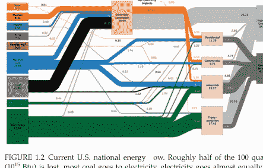
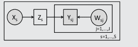
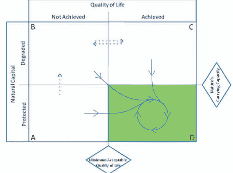
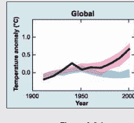
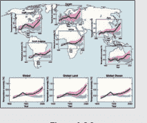
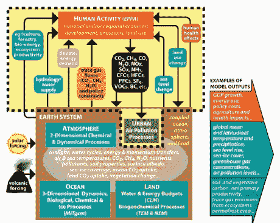
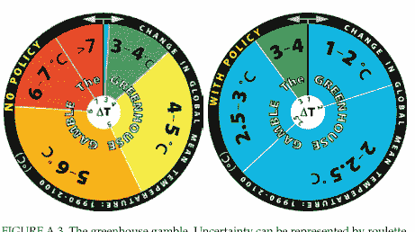
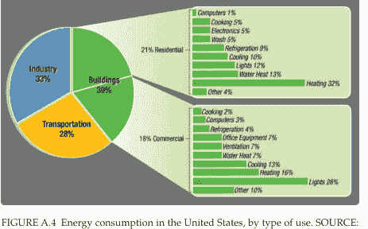

# 可持续性的计算研究

自然环境

## 可持续性

经济活力

健康社区

## 环境与社会可持续性计算研究委员会

- DEBORAH L. ESTRIN，加利福尼亚大学洛杉矶分校，*主席*
- ALAN BORNING，华盛顿大学
- DAVID CULLER，加利福尼亚大学伯克利分校
- THOMAS DIETTERICH，俄勒冈州立大学
- DANIEL KAMMEN，加利福尼亚大学伯克利分校
- JENNIFER MANKOFF，卡内基梅隆大学
- ROGER D. PENG，约翰斯·霍普金斯大学布隆伯格公共卫生学院
- ANDREAS VOGEL，SAP 实验室

### 工作人员

- LYNETTE I. MILLETT，高级项目官员
- VIRGINIA BACON TALATI，副项目官员
- SHENAE BRADLEY，高级项目助理

## 前言

计算机科学与信息技术为审视可持续性挑战提供了广泛的工具。计算机科学的进步已经为环境与可持续性研究人员提供了一套有价值的工具——计算建模、数据管理、传感器技术、机器学习及其他工具——而计算机科学的进一步研究还可能提供先进的方法、工具、技术和策略，以理解、应对和沟通可持续性挑战。

本研究源于美国国家科学基金会（NSF）计算机与信息科学与工程学部向国家研究委员会计算机科学与电信委员会（CSTB）提出的一项非正式请求。该项目由美国国家科学基金会资助。国家研究委员会为开展本研究而设立的环境与社会可持续性计算研究委员会，其任务说明如下：

> 计算具有许多潜在的“绿色”应用，包括改善节能、加强能源管理、减少许多部门的碳排放、改善环境保护（包括减缓和适应气候变化），以及提高对环境挑战和应对措施的认识。一个特设委员会将筹划并举办一次公开研讨会，以调查可持续性挑战、当前研究计划、以往举办的专题研讨会成果，以及这些领域中相关的产业和政府开发工作。研讨会将安排受邀报告和讨论，探讨能够推进可持续性目标并同时促进计算机科学进步的研究主题和具体研究机会，并考虑研究模式，重点关注可能由美国国家科学基金会支持的适用计算技术和长期研究，并强调问题驱动或用户驱动的研究。

委员会将通过向委员会作简报以及向研究界征集评论和白皮书来获取更多输入。委员会还将利用额外的审议会议形成一份共识报告，识别有前景的研究机会，编目适用的计算技术，提出“绿色”计算研究的总体框架，并建议长期研究目标与方向。委员会的共识报告将把研讨会摘要作为附录纳入。

委员会审视了业界当前正在开展的工作（以及现有信息技术立即应用的其他机会），并探讨了能够推进可持续性（能源与环境）目标、同时促进计算机科学进步的研究主题和具体研究机会。委员会考虑了研究模式，重点关注适用的计算技术和长期研究。

本报告将“计算与信息技术促进可持续性创新研讨会”的摘要作为附录 A 纳入，识别有前景的研究机会，编目适用的计算技术，提出面向可持续性的计算研究总体框架，并建议长期研究目标与方向。第 1 章给出了可能产生影响的领域示例。第 2 章描述了方法与途径；第 3 章主要面向计算机科学研究人员，阐述了为何应对可持续性挑战与计算机科学研究之间的相互作用值得关注。

应对这些挑战将涉及若干计算研究领域的进展，包括：可扩展性；鲁棒性；可靠性；实时观测与处理；低功耗计算；传感与驱动；以及人类与环境、观测和反馈系统之间的交互。计算机科学的若干具体领域以及 NSF 计算机与信息科学与工程学部当前研究计划所涉及的主题均具有相关性。

本报告凝聚了许多人的合作努力。研究委员会成员经过充分讨论后起草了

## 审稿人致谢

本报告草稿已由依据国家研究委员会报告审查委员会批准的程序选出的个人审阅，他们具有多元视角和技术专长。此次独立审查旨在提供坦诚而批判性的意见，帮助本机构使其出版的报告尽可能严谨，并确保报告在客观性、证据以及对研究任务的响应性方面达到机构标准。审查意见和报告草稿仍予保密，以维护审议过程的完整性。我们感谢以下个人对本报告的审阅：

- Alice Agogino，加利福尼亚大学伯克利分校
- Ruzena Bajcsy，加利福尼亚大学伯克利分校
- Jeff Dozier，加利福尼亚大学圣巴巴拉分校
- Brian Gaucher，IBM T.J. Watson 研究中心
- Roger Ghanem，南加利福尼亚大学
- Marija Ilić，卡内基梅隆大学
- David Shmoys，康奈尔大学，以及
- Bill Tomlinson，加利福尼亚大学欧文分校。

尽管上述审稿人提供了许多建设性意见和建议，但并未要求他们认可结论或建议，他们在报告发布前也未看到报告最终稿。本报告的审查由 Katharine 监督

## 摘要

大量且不断增多的文献描述了美国与世界面临的可持续性挑战的深刻性和多学科性质。尽管其中涉及深刻的技术挑战，可持续性从根源上说并不是一个技术问题，仅靠技术解决方案也不够。相反，最终需要经济、政治和文化的深度调整，并且每个领域都要作出重大、长期承诺，以大规模部署必要的技术解决方案。尽管如此，技术进步与使能因素在支持这种变革中具有明确作用，而信息技术（IT）[^1]是技术解决方案与社会解决方案之间的天然桥梁，因为它能改善沟通与透明度，以促进必要的经济、政治和文化调整。此外，IT几乎处于每一个大规模社会经济系统的核心——包括金融、制造以及能源生产与分配系统——因此这些系统中以可持续性为重点的变革与IT进步密不可分。简言之，如果国家与世界要实现更可持续的未来，IT创新将发挥至关重要的作用。

尽管IT绿色化——例如减少电子废弃物或计算机能耗——是计算界和IT产业的重要目标，但本报告的重点是“通过IT实现绿色化”，即应用计算来广泛促进可持续性。

本报告有双重目的：聚焦IT创新和计算机科学（CS）[^2]研究能够发挥作用的领域，并敦促计算研究界将其方法和方法论用于应对这些紧迫的全球挑战。重点是以能够产生显著、可衡量影响的方式应对中长期挑战。

计算研究促进环境与社会可持续性委员会的发现和建议原则涉及四个方面：(1) IT与CS同可持续性的相关性；(2) CS方法在问题解决中的价值，尤其是涉及可持续性挑战时；(3) 关键CS研究领域；(4) 面向可持续性的CS研究的战略与务实方法。

### 信息技术与计算机科学同可持续性的相关性

“可持续性”一个常被引用的定义来自联合国（UN）布伦特兰委员会的报告*我们共同的未来*：“可持续发展是既满足当代人的需要，又不损害后代人满足其自身需要的能力的发展。”[^3] 联合国在2005年世界首脑会议上扩展了这一定义，纳入可持续性的三大支柱：社会、环境和经济方面。[^4] 本报告对该术语采取同样宽泛的看法。尽管可持续性方面的许多关注一直集中在减缓气候变化上，相关努力旨在管理二氧化碳循环和增加可持续能源来源，但还有其他重要的可持续性挑战（如水资源管理、改进城市规划、支持生物多样性和粮食生产），这些挑战也能因计算研究的进步而转变，因此本报告也予以考虑。

从计算机科学的视角看待可持续性时，采取系统观是很自然的。对上述可持续性宽泛定义的一种展开是：一个系统除非能够无限期地运行到未来，否则就不是可持续的。系统要做到这一点，必然需要在时间和空间上进行优化——这些目标正是计算机科学许多内容的核心。

报告《SMART 2020：在信息时代实现低碳经济》[^5]有益地将把IT应用于可持续性的机会分为三大领域：(1) 建成基础设施与系统，(2) 生态系统服务与环境，(3) 社会技术系统。下文描述这些领域，并概述IT应用和计算机科学研究机会：

- *建成基础设施与系统。* 这一领域包括建筑、交通系统（个人、公共和商业）以及消费商品（大宗商品、公用事业产品和食品）。IT以多种方式为建成基础设施中的可持续解决方案作出贡献：从改进的传感器技术（例如智能建筑中的嵌入式传感器）和改进的系统模型，到改进的控制与优化（例如物流和智能电网），再到改进的通信与人机界面（使人们能够作出更有效的决策）。
- *生态系统与环境。* 这一领域涵盖评估、理解并积极影响（或不影响）环境和特定生态系统——这些努力代表了许多可持续性工作的交叉性挑战。该领域工作的规模和范围从考察物种栖息地的局部和区域努力，到流域管理，再到理解全球气候变化的影响。挑战的范围本身提出了一个问题：如何最好地评估各种可持续性活动的相对重要性，以着眼于显著影响。此外，计算技术对于发展科学知识和工程技术将很有价值，包括改进数据驱动科学、建模和仿真的方法，以提高生态学中的科学理解程度。
- *社会技术系统。* 社会技术系统涵盖社会、组织和个人，及其行为以及他们使用的技术基础设施。要对可持续性产生重大而持久的影响，就需要使个人、组织和民族国家长期的行为变化成为可能、得到鼓励并持续下去。IT，尤其是实时信息和工具，可以更好地使个人和组织能够作出日常、持续的

[^1]: 此处“信息技术”作广义定义，包括计算与通信能力。

[^2]: 此处“计算机科学”作广义定义，包括计算机与信息科学与工程。

[^3]: 联合国大会，1987年3月20日，《世界环境与发展委员会报告：我们共同的未来》，作为文件A/42/427《发展与国际合作：环境》的附件提交大会；《我们共同的未来，第2章：迈向可持续发展》，第1段，联合国大会。可访问 http://www.un-documents.net/ocf-02.htm。

[^4]: 联合国大会，2005年世界首脑会议成果，决议A/60/1，由大会于2005年9月15日通过。

[^5]: 气候组织，《SMART 2020：在信息时代实现低碳经济》（2008）。可访问 http://www.smart2020.org/publications/。

并且需要新的方法论来应对广泛的系统挑战——涵盖环境与生态系统、社会与经济因素，以及影响粮食生产、分配和消费的个人与组织行为。

- 开发和建设可持续且有韧性的基础设施构成了跨领域的挑战，尤其是当我们从涵盖经济和社会问题的广阔视角来看待可持续性时。自然和人为灾害风险的日益增长，进一步加剧了增强社会和物理基础设施韧性所面临的挑战。提高社会韧性以及应对不可避免的灾害的能力，将有助于实现可持续性。即使不考虑气候变化和资源消耗，地球人口规模的庞大也意味着一旦危机发生，其影响范围将是巨大的。这一领域的可持续性挑战涉及基础设施的规划与建模、灾害的预测与响应，以及信息技术如何助力发展可持续且有韧性的基础设施。

当然，可持续性所涵盖的范围远不止上文概述的领域和示例；这些示例在此用来说明需要面对的挑战的广泛性，以及计算机科学和信息技术可以发挥的作用。

## 计算机科学方法在解决问题中的价值

如下文各节所讨论的，计算机科学中若干关键的底层哲学和方法论，与可持续性问题的关键特征高度契合。

### 系统——规模、异构性、互联性、优化与人类交互

可持续性问题往往面临规模上的挑战——有时是因为问题空间的规模（例如地理或行星尺度），有时是因为潜在的影响范围（例如广泛的健康或经济影响），而通常两者兼而有之。可持续性问题在本质上通常也是异构的——几乎从来不只是单一变量导致挑战，也不存在单一的解决途径。可用于任何特定问题的输入、解决方案和技术千差万别。大多数可持续性挑战的产生，部分原因在于互联性——系统中多个相互关联的组成部分都会对系统的其他部分产生影响（有些是预期的，有些则不是）。可持续性挑战的解决方案通常需要在存在不确定性的情况下，在规模上找到接近最优的解决方案；而这些问题正是计算方法能够以日益提升的效力来应对的。

开发稳健解决方案的道路很可能是迭代和适应性的，需要随着时间的推移不断部署和完善；同时，随着科学认识的进步、技术的变化以及政治和经济体系的演变被纳入其中，已部署系统的适应性重新设计也要持续得到支持。因此，迭代——即根据持续努力进行调整、改进和学习——将是至关重要的，而且这种迭代往往必须在社会和行星尺度上进行。

迭代是计算机科学的另一项核心优势。从大规模软件系统和应用、以及大规模软件工程和系统部署的迭代方法中学习，有助于应对大规模的可持续性挑战。这一方法已在全球互联网工程和网络搜索部署等具体应用中得到验证，并已在众多成功的软件工程项目中得到有效运用。

由于可持续性挑战涉及处于持续变化中的、复杂且相互作用的系统之系统，因此要取得进展并根据情况变化做出必要调整，数据驱动的迭代方法将至关重要。一种方法是在实地部署技术，利用相对成熟的技术，首先探索空间并找出需要填补的缺口。基于这一初步探索所开发的数据和模型，可以为开发全新技术和手段提供背景，从而促成更好的解决方案。

**发现：计算机科学中快速迭代、渐进演化的问题解决方法，对于构建互联网和网络搜索引擎至关重要，也将有助于解决可持续性挑战。**

## 计算机科学研究领域

**发现：尽管当前的技术能够且应当立即投入使用，但计算机科学研究与信息技术创新对于应对可持续性挑战仍至关重要。要有效发挥计算机科学应对可持续性挑战的潜力，需要对计算机科学研究进行持续、适当结构和量身定制的投入。**

## 战略与务实路径

为了让计算机科学在应对全球可持续性挑战中发挥有效作用，应优先支持那些应对一个或多个重要可持续性挑战、并有望产生实际影响的研究——无论是直接产生影响，还是通过能够为其他领域带来杠杆效应的颠覆性贡献。上文列出的研究领域是委员会推荐的起点。

信息技术专家和计算机科学研究者面临的一个持续挑战是：确保技术和方法是可用且适当的解决方案，确保它们高度有效，并充分利用所能获得的最深入、最有力的洞见。

### 强调自下而上的方法和具体性

委员会认为，计算机科学在可持续性方面的研究，通常最好的方式不是一开始就追求普适性，而是从自下而上开始：即针对可持续性中特定而关键的问题制定结构良好的解决方案，然后在后期寻求推广这些解决方案。事实上，这在许多其他应用领域中已被证明是富有成效的方法。许多所需进展的取得将依赖于计算机科学研究（如前所述），但这些进展未必能立即作为普适方法显现出来。相反，要被视为计算机科学研究与可持续性交叉领域的重要贡献，该贡献首先必须具有在迈向更可持续未来的过程中带来切实改变的潜力。拥抱具体性将帮助研究人员打磨和筛选他们的方法，多样化的和经过改造的应用也会随之涌现。许多潜在的新应用正是通过自下而上的变革循环，以及推动这些变革循环的迭代设计过程，才得以发展并最终找到其普适性。这一方法以往的成功案例包括互联网协议、机器学习、面向对象语言和数据库。

### 使用适当的评估标准衡量提案与成果

对普适性的过早关注会损害具有高影响力的可持续性解决方案。然而，要被视为成功，关于可持续性的计算机科学研究最终必须为可持续性的普适性知识做出贡献，同时，该贡献或拟议的解决方案应当需要超越当前计算技术发展水平的新计算技术或思维。建立用于多学科工作的、既具有可操作性又有意义的指标

**框1.1**

**关于“可持续性”定义与委员会关注点的说明**

“可持续性”的一个常见定义来自联合国（UN）世界环境与发展委员会（布伦特兰委员会）：“[可]持续发展是既满足当代人的需求，又不损害后代人满足其自身需求能力的发展。”联合国在2005年世界首脑会议上扩展了这一定义，纳入了可持续性的三大支柱：社会、环境和经济方面。^2 本报告也采用类似的广泛视角。尽管可持续性的很多关注点集中在减缓气候变化上，相关努力旨在增强二氧化碳循环和增加可持续能源来源，但委员会认识到，还有许多其他可持续性挑战可以借助计算机科学、信息技术和计算^3研究的进步来应对。委员会的重点是解决中长期挑战，并产生显著且理想情况下可衡量的影响。

^1 联合国大会（1987年3月20日）。*《世界环境与发展委员会报告：我们共同的未来》*，作为文件A/42/427的附件转交联合国大会——发展与国际合作：环境；《我们共同的未来》第二章：迈向可持续发展；第1段。联合国大会。可查阅 http://www.un-documents.net/ocf-02.htm。

^2 联合国大会，2005年世界首脑会议成果文件，第A/60/1号决议，2005年9月15日由大会通过。

^3 本报告一般性地使用“计算”（computing）一词，意指包含信息与通信技术（ICT）。因此，“计算”和“ICT”在本报告中交替使用。

通过减少数据中心能耗和电子垃圾等努力实现IT的绿色化，应当是并且确实是计算社区和IT行业的一个重要目标。^2 然而，本报告的重点是所谓的“通过IT实现绿色化”，即利用

^2 2010年OECD报告《更绿色更智能：ICT、环境与气候变化》（载于*OECD，《OECD信息通信技术展望2010》*，OECD出版）指出，需要综合考虑ICT生命周期的各种影响（不仅包括使用阶段，还包括生产和使用寿命结束阶段）才能理解全部影响。近期《*麦肯锡季刊*》的一篇文章——雅克·布金（Jacques Bughin）、迈克尔·崔（Michael Chui）和詹姆斯·曼伊卡（James Manyika）合著的《云、大数据与智能资产：值得关注的十大技术型商业趋势》——为绿色IT提供了一些乐观的依据：“为全球数据中心供电所产生的温室气体，规模相当于阿根廷或荷兰等国家的排放量，到2020年这些排放可能增长四倍。然而，麦肯锡的研究表明，在智能电网、高效建筑和更优物流规划等领域使用IT，可以消除IT行业自身产生的碳排放量的五倍。” *麦肯锡季刊* 5(3):1–14。

跨学科的计算和信息技术促进可持续性，在信息和通信技术（ICT）的进步可能产生显著积极影响的领域和系统中。3

委员会认为，该领域本身一些最深刻的基础原理暗示了计算机科学（CS）和ICT能够为可持续性作出的独特贡献。例如，自动化“可查询”结构化数据这一概念本身就是许多计算机科学的核心。可持续性挑战的范围和规模与大量相关数据相伴，这使得深入洞察收集、结构化和理解这些数据所面临的挑战变得至关重要。计算。不可持续的人类活动所带来结果的复杂性和不可预测性，需要创新且灵活的方法来解决或减轻可持续性问题及其影响，而IT研究人员和实践者擅长在动态环境中进行创新并制定灵活的解决方案。委员会认为，计算研究人员和研究方法对于应对当前和未来可持续性方面的系统挑战至关重要。

本报告共分三章。第一章详细阐述了潜在影响领域，以说明IT在通向可持续性的更广阔道路上的作用与现有机遇。它回答了这样一个问题：计算研究在哪些方面以及在哪里可以产生可衡量的重大影响？第二章在讨论以下问题时描述了方法与途径：计算中的基础研究问题和方法如何与可持续性挑战相交汇？计算研究和IT创新中的问题解决和研究方法又如何应用于可持续性？特别是，委员会认为计算机科学在可持续性方面的一个重要目标是提供信息、支持、促进，有时甚至自动化决策——这些决策将导向对实现可持续性目标产生重大影响的行动。第三章主要面向计算机科学研究者，阐述了为什么解决可持续性挑战与计算机科学研究之间的相互作用值得关注，以及这种相互作用如何在多个维度上提供深刻而引人注目的发展机遇。附录A总结了委员会组织的“可持续性计算与信息技术创新研讨会”上的演讲和讨论。附录B介绍了委员会成员的传记。

## 实现重大可持续性目标的机遇

前瞻性的IT创新和持续的研究可以在许多领域对可持续性产生显著的积极影响。出于本报告的目的，这些领域被归为以下几类：4 建筑基础设施与系统、生态系统服务与环境、社会技术系统。5 下文将对每一类进行简要描述。

这三个不同的机遇领域之间显然存在多个交叉点。例如，家庭中的生态反馈设备（提供环境影响即时信息的工具）作为一种社会技术系统，5 与作为建筑基础设施一部分的更大型智能电网系统相互作用；个人移动设备依赖建筑基础设施并在社会技术情境中部署，它们提供的数据有助于构建更健壮的模型——这是一种交叉方法论——等等。

在所有这些领域，随着潜在解决方案的部署，需要密切关注对解决方案进行迭代和评估，以确保在某一可持续性问题的某个维度上取得的进展，不会随后被另一维度上出现的意外结果或副作用所抵消。下一个主要部分“信息技术与可持续性中的示例说明”提供了跨领域的示例，展示IT能够支持和加强可持续性工作的领域。

### 建筑基础设施与系统

建筑基础设施与系统包括建筑物（住宅和商业）、交通系统（个人、公共和商业）以及消费品（商品、公用事业和食品）。气候组织的《SMART 2020》报告考察了信息和通信技术在建筑基础设施中几个关键领域的应用，包括智能建筑、智能物流和智能电网。根据该报告，仅这三个领域就可在2020年使全球“一切照旧”情景下的温室气体（GHG）排放量减少15%。6

在工业化国家，建筑物占能源使用量的比例高达40%，占温室气体排放量的40%；在美国，建筑物消耗了所生产电力的70%以上。7 智能建筑利用IT系统在保持室内健康与舒适的同时更好地利用能源。嵌入式IT监测并控制环境-

4. 当然也可以有其他分类方式。选择这三个领域的部分灵感来自全球电子可持续性倡议的《SMART 2020：在信息时代实现低碳经济》（2008）。可在 http://www.smart2020.org/publications/ 获取。

5. “社会技术系统”涵盖社会、组织和个体及其行为，以及他们所使用的技术基础设施。

6. 全球电子可持续性倡议，《SMART 2020：在信息时代实现低碳经济》（2008）。可在 http://www.smart2020.org/publications/ 获取。

7. 世界可持续发展工商理事会，《建筑能效：事实与趋势——完整报告》（2008）。可在 http://www.wbcsd.org/pages/edocument/edocumentdetails.aspx?id=13559&nosearchcontextkey=true 获取。另见 http://www.eesi.org/buildings。

建筑中的环境和电气系统通过计算机化的智能传感器和电子设备网络进行管理。9根据SMART 2020报告，智能建筑在2020年可减少约15%的二氧化碳排放。10建筑物的可持续性通常远不止能源方面，还涉及材料的再利用和回收、可持续的建筑过程、改善室内空气质量、有效用水等。11

智能物流利用信息技术实现更有效的供应链（涉及行程和负载规划以及个人交通），既用于日常运营，也用于长期规划。信息技术的贡献包括更好的地理信息系统和设计软件，以促进更有效的交通网络；协作式多机构规划工具，以降低与理想生活方式相关的物流需求；以及更好的库存管理工具。计算创新还可以实现对消耗资源的更好管理。智能电网在整个电力网络中使用信息技术工具以实现优化。（智能电网的潜在应用将在下文“迈向更智能的电网”一节中更详细地描述。）

除了在能源消耗方面可以实现的减少之外，已建基础设施中更智能的水和污水处理系统还可以减少耗水量和废物。此外，大规模农业需要水资源和供应链管理；先进的信息技术可以增强精准农业，包括整合技术以更准确地预测作物产量。12（有关食品系统的更广泛讨论，请参见下文“可持续食品系统”一节。）

交通、城市和区域规划也为更可持续的发展提供了重要机会；需要计算和信息技术来实现显著更复杂的规划，以优化对新基础设施的投资。此外，制造业本身的变革（包括物流、传感、运输和操控）可以通过减少环境影响、节约能源和资源以及提高安全性来帮助实现可持续性目标。

9. 国家研究委员会，《实现高性能联邦设施：变革性变革的战略与方法》，华盛顿特区：国家学术出版社，2011年。
10. 全球电子可持续发展倡议，《SMART 2020：在信息时代实现低碳经济》（2008年）。可访问：http://www.smart2020.org/publications/。
11. 关于实现高性能“绿色”建筑相关的一些问题的介绍，参见国家研究委员会，《实现高性能联邦设施：变革性变革的战略与方法》，华盛顿特区：国家学术出版社，2011年。
12. 国家研究委员会，《迈向21世纪可持续农业系统》，华盛顿特区：国家学术出版社，2010年。

例如，同时捕捉多个变量之间的相互关系及其联合不确定性的模型，可以支持更深入的理解和更稳健的决策。

### 社会技术系统

对可持续性的大规模和长期影响将需要长期地促成、鼓励和维持期望的人类行为——包括个人、组织、市政当局和民族国家。旨在帮助行为援助和强化并提供进展信息的社会技术系统是全球可持续性努力的关键要素。此类系统及相关工具需要在各种规模上部署，并可应用于一系列问题，从在严重危机管理时期实现有效应对，到城市规划，再到促进对碳、水和生物多样性的行为影响（有时称为足迹分析）的理解。

机构行为需要转变，以实现持续、长期的环境变化。市场营销和公共教育举措非常重要，可以增进个人和机构对最佳实践的认识。然而，实时信息和工具可以更好地装备个人和组织，以根据不断变化的一系列情况做出日常、持续和重大的改变。可供关键决策者访问的信息仪表板是信息技术如何用于收集、分析、整理并及时向最需要的人提供关键信息的一个例子。例如，如果能源公用事业的财务激励从强调更便宜地提供更多电力转向强调提高给定服务水平的温室气体排放效率，那么将需要新的信息。收集此类信息将需要对客户需求动态、电网容量和供应可用性有更高的可见性和理解。此外，每个利益相关者都需要更有效的手段来沟通需求和权衡。类似地，为了使城市规划能够促进，比如说，减少个人交通的液体燃料消耗，街道设计、分区、种植、商业发展、水和废物管理以及公共交通的过程需要在多个管理机构和选民之间进行协调。

个人设备，尤其是传感器丰富的智能手机，不仅向用户提供信息和服务，还可以向科学家和研究人员提供传统运营网络可能遗漏的信息。此外，公民科学家正越来越多地参与科学问题解决，例如通过记录物种位置、空气质量和其他指标。15此外，环境挑战——由海平面上升和水温升高对环境造成的损害，或由寻找和开采材料造成的挑战——可以被监测、评估和跟踪。关于环境挑战的信息也可以使用更智能的信息技术进行传播。分析来自广泛来源的数据的能力的进一步进步，将有助于更好地理解环境危机如何开始以及如何在未来避免它们。

## 信息技术与可持续性的示例

本节包含三个与可持续性相关领域的示例，在这些领域中，信息技术可以产生显著影响，并且当前既有一定的活动，也有未来取得重大进展和影响的前景。这组示例并非详尽无遗，也不反映优先级排序。相反，选择这些示例是为了说明信息技术——无论是当前已知的技术还是新技术——如何应用于可持续性挑战，并展示可持续性含义的范围和多样性。下面列出的每个示例领域都横跨上述三个广泛领域。

- *智能电网。* 在第一个示例中，电网显然是已建基础设施的一部分，但随着新的可再生能源上线，它也有可能极大地影响区域生态系统（例如，部署在沙漠中的太阳能设施将影响沙漠生态系统）。管理智能电网，无论从供应侧还是消费侧（在任何情况下，这两者可能都不容易分开），都将需要社会技术系统，例如面向人类和人类组织的数据管理。
- *食品系统。* 第二个示例也涵盖已建环境（包括交通系统）、环境和生态系统（从对流域的宏观影响到精准农业策略的各个方面），并且与智能电网一样，它需要精密的工具和数据管理才能最有效。
- *可持续和有韧性的基础设施的发展。* 第三个示例提出了跨领域的可持续性挑战，尤其是在考虑涵盖经济层面的广泛可持续性时。

9. W. Willett, P. Aoki, N. Kumar, S. Subramanian, and A. Woodruff,《常识社区：为新手用户搭建移动感知和分析的脚手架》，第8届普适计算国际会议论文集（Pervasive '10），第301-318页（2010年5月）。

以及社会问题。这些挑战包括规划和建模基础设施，以及预测和应对日益频繁的自然和人为灾害。

## 迈向更智能的电网

能否以可持续的方式满足地球的能源需求，从根本上与全球电网在设计、部署和运营方面的基础性变革交织在一起。这一问题规模庞大且复杂，委员会在本讨论中的框架仅用于描述目的，并非旨在做到全面、具有规定性，或与其他描述该问题的方法直接冲突。¹⁶ 就电网而言，大多数关于稳定温室气体浓度潜在路径的分析都涉及三项相互关联的进展：深度效率提升、需求电气化和供应脱碳。¹⁷ 以美国为例，其目前每年消耗约 100 千万亿英制热量单位（Btu）（约 100 艾焦）的能源，从供应到需求的流动如图 1.2 所示。大约一半的能源供应用于发电。其中，煤炭所占份额最大，其温室气体强度在所有供应源中最高，但却是发展中经济体增加供应最便宜、最快的方式。相比之下，几乎所有可再生和零排放供应源也都用于发电，但这些在能源结构中只占很小比例。为了降低所输送电力的温室气体强度，这些供应源的份额必须大幅增加。然而，这样做将极大地改变供应的性质，因为这些资源的可用性随自然因素（如风和阳光）而变化，而非根据需要调度以满足需求。此外，这些供应源的地理位置受自然因素支配，因此它们接入电网的位置，以及由此产生的从供应到需求的流动模式，乃至用于输送这些电力流动的输电线路、变电站和设备，都可能与传统发电厂相关的流动模式大相径庭。这对 IT 具有重要影响，因为分布式能源生产的信息管理问题与更集中式生产的信息管理问题有着根本性的不同。管理由 50 万台风力发电机生产的电力需要先进的 IT——数据管理、算法和分析——而从 IT 的角度来看，管理几百座燃煤发电厂则要简单得多。

> ¹⁶例如，IBM Research 撰写的一篇关于不断发展的智能电网计算挑战的综述文章，围绕数据、电网仿真和经济调度方面的挑战展开：J. Xiong、E. Acar、B. Agarwal、A. Conn、G. Ditlow、P. Feldmann、B. Gaucher、A. Gupta、F.-L. Heng、J. Kalagnanam、A. Koc、D. Kung、D. Phan、A. Singhee 和 B. Smith，《用于下一代电网规划、监测和安全运行的大规模电力系统建模与仿真框架》。响应信息征询的特别报告：《下一代电网的计算需求》。DOE/LBNL 主合同编号 DE-AC02-05CH11231，分包合同编号 6940385（2011 年）。M. Ilic，《实现可持续能源服务的动态监测与决策系统》，《IEEE 学报》99:58-79（2011 年），指出人造输电网及其 IT 在实现可持续社会经济能源系统中的基础性作用。J. Kassakian、R. Schmalensee、K. Afridi、A. Farid、J. Grochow、W. Hogan、H. Jacoby、J. Kirtley、H. Michaels、I. Perez-Arriaga、D. Perreault、N. Rose 和 G. Wilson，《电网的未来：麻省理工学院跨学科研究》，可在 http://web.mit.edu/mitei/research/studies/the-electric-grid-2011.shtml#top 获取，旨在客观描述当今电网，并为指导电网演进提出政策、研究和数据方面的建议。

> ¹⁷加州科学技术委员会，《加州能源未来：展望 2050》，萨克拉门托（2011 年）。可在 http://www.cst.us/publications/2011/2011energy.pdf 获取。

图 1.2 当前美国国家能源流动。100 quads（10^15 Btu）中大约一半被损耗，大部分煤炭用于发电，电力几乎平均地流向住宅建筑、商业建筑和工业过程。资料来源：劳伦斯利弗莫尔国家实验室（2010 年）。数据基于 DOE/EIA-0384（2009 年）。可在 https://flowcharts.llnl.gov/ 获取。

在美国国家能源流动中，已有相当大比例的供应在发电、输电和转换过程中被浪费，而输送到住宅和商业建筑以及工业过程中的电力，也有很大一部分因低效或无效的使用而浪费。此外，减少目前以液态化石燃料为主的交通和工业过程相关的温室气体排放，将涉及电气化（例如插电式混合动力或电动汽车），因此将进一步增加需求。重大效率提升、对可变供应源的容纳以及电气化，都可能涉及代表需求方的机构和个人的模式与实践的变化，而这些在很大程度上依赖于获取可操作的信息。如下所述，IT 创新及其应用是这种转型各个方面的基础。

电网可以通过其关键组成部分来表征：发电、输电、配电和负荷。通常，这些组成部分都是孤立处理的。尽管多种电网转型方法都属于“智能电网”的范畴，但未来的根本性变化很可能是将关键组成部分作为一个相互关联的系统来整体对待。其他学科主要致力于推动构成能源供应链要素的物理组件的进步，而 IT 则有望主导这些要素如何运作以及整个复杂系统如何运行——即系统展现出哪些特性。以下章节首先描述智能电网带来的若干挑战，然后概述应对这些挑战的方法，尤其是从 IT 视角。最后，讨论计算机科学研究与 IT 创新的具体作用。

## 现代电网面临的挑战

下文讨论了现代电网面临的四大主要挑战：

- 电力消费增加及电网相应扩张；
- 当前的负荷跟踪供应模式，即根据实时电力需求调度容量，并部署粗略的预测分析以确保有足够的可用容量；
- 实施供应跟踪模式的困难，即对需求进行管理以更好地匹配可用供应；以及
- 对当前外部化成本进行适当的核算。

**消费增长** 生产力提高和生活水平改善与能源消费增长密切相关。即使在美国，尽管通过技术进步和效率措施，能源与国内生产总值（GDP）之比一直在稳步改善（尤其是自 1973 年石油危机以来），但总体能源消费仍在持续增长。在中国等近期工业化国家，这一问题尤为严重。消费的持续增长带来了多重挑战。

在发电方面，电力生产的快速增长往往使供应结构偏向煤炭等高碳、高颗粒物排放的能源，因为这类供应源目前更容易在需要时快速上线。这一趋势进一步加剧了温室气体排放问题。核电等低碳选项存在其他危害，而可再生来源通常无法按需调度、会产生其他环境影响，或者远离高密度消费区域。浪费性的生产和制造方式，尤其是在新兴工业化或快速增长的经济体中，进一步加剧了对气候的影响。IT 无法提供发电能力，但可以推动发电设施更有效地利用以满足增长的需求，促进向更理想的供应源转变，并帮助管理日益增长的需求。

除了提供充足的供应以满足不断增长的需求——这显然无法无限期持续——还必须能够通过输电网和配电网络可靠、安全地输送所生产的能源。每条输电线路和每件电气设备都有有限的容量和使用寿命。¹⁸ 与交通、通信甚至供水网络不同，调度操作或开关并不能明确决定每条线路上传输的电量。相反，电量是由底层物理规律隐式决定的，这些物理规律与一个分布式负荷集合相关，该负荷集合通过特定的导线和变压器互联方式连接到分布不同的发电机集合。个体消费者独立决定在每个负荷点取用多少电量，而集中式系统运营商则协调每台发电机的发电量，以在每条线路和变压器的容量限制以及每台发电机的排放限值内实时匹配供需。如果输配电基础设施有足够的冗余容量，这个约束优化问题相对容易处理。但随着对其容量的需求增加，问题就变得困难得多。一个通信传感器网络被叠加在电网上以监测其分布式状态，并使用精密的算法来预测需求、模拟流动、调度发电以及调整现有有限的控制点。因此，通过物理基础设施满足增长需求的能力

> ¹⁸例如，当一条线路上传输更多电力时，会产生更多热量，导致线路拉伸、变细和下垂。这会增加线路的电阻，使其进一步发热，并增加由于对地电容引起的寄生损耗，从而增加需求。所有这些因素都会导致故障，使部分输电或配电基础设施失效，从而对剩余部分造成可能过度的需求。

任何特定时期存在的基础设施，几乎都完全依赖于信息技术的进步。

负荷性质的变化以及分布式发电的更广泛引入，使这些挑战更加复杂。与纯阻性负载（如电热元件和白炽灯泡）不同，复杂负载实际上会导致所输送功率的一部分（称为无功功率）通过电网返回到发电机。从历史上看，这种“非单位功率因数”负载主要是异步电动机，它会在交流（AC）波形中引入相当简单的相移。但开关电源，例如计算机、荧光灯、电池充电器和电子设备直流（DC）适配器中所使用的电源，会在交流波形上引入复杂的畸变。住宅并网太阳能装置会逆转局部配电树内电力的流向。而电动汽车的引入则可能在充电过程中产生较高的点负荷。许多这类新型复杂负载已经具备通信和计算能力，因此它们有可能成为利用信息技术调节需求、从而成为电网“好公民”的先头部队。

使所有这些问题的复杂性进一步加剧的，是在多种时间尺度上影响发电、输电和用电各个环节的经济结构。在运营层面，供应商、消费者和经纪商的集合通常以不同的粒度和时间尺度（日前、小时前、分钟前）参与高度波动的批发能源市场。与此同时，消费者通常面对的是相对稳定的零售价格。更复杂的是，公用事业公司和电力供应行业在很大程度上仍然被激励去生产和输送更多能源，而不是更少。在世界上大多数地区，缺乏抑制增长的经济或其他激励措施。一个显著的例外是净计量——这种机制允许电力消费者通过在现场自行发电（通常是通过屋顶太阳能光伏装置）来抵消其从电网取用的电量，从而降低其成本。基本上，这可以理解为当本地发电量超过本地需求时，电表会倒转。虽然净计量相对普遍，但其渗透率仍然较低，足以将其作为抵消性需求纳入邻近配电树中，而不会对输电需求产生显著影响。更广泛、更无形的激励包括获得零净生活方式的个人满足感，这可能会开辟将生活质量与能源使用脱钩的途径。信息技术在为这些原本不可见的资源进行复杂核算以及提供消耗和生产的可见性方面，发挥着重要作用。

### 当前负荷跟踪供电模式

电网运行主要涉及协调一组可调度电源，包括基荷（核电、煤电和水电）、中间负荷（联合循环燃气轮机）和尖峰负荷（简单循环天然气）发电厂，以精确满足实时电力需求，涵盖负荷的正常波动、尖峰和偶发峰值。当然，需求并不是明确指定的，而是隐含在电力的使用中。通常，独立系统运营商会为其整个电网进行日前需求预测，并结合小时前甚至分钟前的调整，以驱动调度和市场机制，同时随时间推移在输电电网的所有特定点提供足够的发电容量。一定比例的在运容量被保留为“旋转备用”，用于匹配短期需求变化。供需匹配的不完善会表现为电能质量下降（如电压骤降或骤升、频率波动）。挑战包括以下方面：

- **峰值需求的高成本**：由于发电和输电能力必须按峰值需求建设，因此峰值需求驱动着整体投资。然而，由于需求存在显著变化，这部分投资中有相当大比例的利用率很低。从根本上说，负荷跟踪依赖于独立负荷的统计复用；尽管单个负荷非常突发，但众多此类负荷的总体相对平滑且可预测。然而，负荷之间的相关性，例如炎热夏季午后的空调或超级碗比赛间歇时冰箱压缩机循环，会产生非常大的总体峰值需求。启动时间短的发电方式往往效率较低，温室气体排放和运营成本较高。
- **预测准确性与市场波动**：预测需求与实际需求的错配会导致批发能源价格大幅快速波动。每一种新的广泛使用方式的变化（例如等离子电视、紧凑型荧光灯、电动汽车等的普及率提高）都会引发对预测准确性的担忧。矛盾的是，节能措施通过消除浪费，可能导致峰均比增大，并可能降低预测准确性，使电网更难管理。
- **储能限制**：电网级储能以抽水蓄能、压缩空气、热能储存、电池和其他少数可能形式存在，但储能容量仍然有限。储能通常成本高昂，且往返效率（从储能中提取的能量相对于储存量的比例）往往较低。小规模电池储能普遍但昂贵，充放电循环次数以及因此的电池寿命有限。如果考虑到电池制造和处置的影响，这种储能可能产生净负面环境影响。中等规模储能（例如1到100千瓦时）几乎不存在，尽管液流电池和电解/燃料电池方案仍在开发中。¹⁹
- **不可调度电源**：大多数可再生能源，如风能、太阳能和波浪能，都是不可调度的。也就是说，它们只能在特定时间以由各种环境因素决定的大小可用；无法按需调用。总体特征，如一天中太阳入射辐射或风的季节性模式，比精细特征（如过云遮挡或阵风与静风）可预测得多，而精细特征可能导致供电量迅速变化。

近些年来，高度工业化国家的发电增长大部分来自可再生电源。但在负荷跟踪模式（即根据需求调整电力输出的模式）下，这些电源的渗透率从根本上受到限制。

许多智能电网提案侧重于提高输电系统的容量和复杂性，以减少输电在供需匹配中的限制。这些方案包括长距离输电线路，在许多情况下使用高压直流，以便接入偏远的可再生电源，既提高可用性，又获得地理上的去相关性。在电网内部，尤其是分布式可再生资源存在的情况下，可能有足够的电力供应负荷，但缺乏将电力从发电点输送到用电点的容量。更好的预测、监测和调度旨在防止此类瓶颈。“智能电表”目前正在许多地区推广，可提供15分钟间隔的读数，而不是每月计量。它们的应用可以实现更准确的预测和更有效的调度，并引入分时电价或关键峰荷定价等激励措施，推动需求朝更有利于电网的形式转变。这些努力为这一复杂系统引入了一定程度的可观测性，从而为决策和行动开辟了道路。随着电网信息技术在电网各个层面发展出监测、通信、嵌入式处理和智能能力，它可以为供应与需求之间的互动关系奠定基础，从而提高可再生电源的渗透上限。

¹⁹ 例如，桑迪亚国家实验室刚刚宣布开发一种新的液态盐电解质系列，该技术可能催生出能够更好整合电网中可再生能源的设备。参见 http://www.sciencedirect.com/sandia_national_laboratories_researchers_find_energy_storage_solutions_in_metils-86320。

引入存储的目的是解耦发电与消费，使二者能够在最有效的时段进行。（但即使假设拥有巨大的存储容量，存储和发电过程中的低效也意味着完全解耦是不可能的。）同样重要的是协调负荷的能力，这通常通过利用热能等非电形式的储能来实现，但也常常利用实际任务中的灵活性。简而言之，提高电网可持续性的机会可归纳如下：（1）塑造需求，使其更紧密地匹配可再生能源发电的供应；当可再生能源发电充裕时，将其用于可转移的电力需求（如制冰机、热水、洗碗机、电动汽车充电）；（2）塑造需求，以平滑尖峰，从而减少对快速可调度电源的需求；（3）通过提高输电和使用效率降低总需求；以及（4）应用仪表化和建模来测量碳排放，作为碳定价和碳上限政策的一部分。

电力目前是公用事业供应资源中最不可见的一种。要在这些机会上取得进展，需要新的可见性形式，包括在价格、温室气体排放、消费和绩效方面的可见性。IT可以在关键方面做出贡献：例如，普遍的仪表化、监控和分析能够实现电力消耗及其负荷绩效的可见性。

提高可见性是开发集成式家庭或建筑能源管理系统的重要组成部分，这类系统可以就如何转移能源使用做出明智决策。这些系统需要灵活的用户界面和传感系统，以便能够接收关于何时适合（例如）延迟电动汽车充电、建筑供暖等信息。例如，此类系统可以与用户的日历集成，并连接到定价和其他发电侧信号（如太阳和风预测）。需要对用户界面、用户和电器行为的预测模型，以及可能的拍卖和定价机制进行研究。

集成能源管理系统还可以通过更渐进地加热和冷却建筑，或做出补偿性的电力消费选择，来应对尖峰问题。让用户看到这些选择的效果（例如，通过明确建筑何时达到所需温度、何时可以打开特定机器等）对于用户接受至关重要。还可以探索价格机制（例如，对突然变化收取更高费用）。

需要开展IT研究，以开发建筑传感、建模和智能控制的方法。例如，大多数办公楼表现出长期性能不佳（建筑某些部分过热，其他部分过冷；某些部分通风不良，其他部分风太大）。在设计阶段和运行期间改进建模有望减少此类问题并节省能源。24 IT在使减少浪费的机会显现出来，以及在建筑中并贯穿整个电网实现减少浪费的自动化方面，可以发挥重要作用。

## 信息技术和计算机科学在实现智能电网中的作用

如上所述，信息和数据管理对于迈向更智能、更可持续的电网至关重要。需要在所有层面开展计算机科学研究和采用方法论，以应对智能电网带来的广泛系统挑战。该领域研究与应用的初步“胜利”包括：能源效率和智能微电网与分布式能源管理，25 能效规划与建筑管理，26 以及智能电网与智能电动汽车规划及运营的集成。27 在这些领域中的许多领域，可能实现总体能耗节约三分之一到二分之一，同时改善服务并带来显著环境收益。在这些领域中的许多领域，关键步骤是设想：如果更大的信息和实时数据分析能够作为系统的嵌入组件，能源系统将如何运作。这将要求更加关注传感器技术与能源、交通和建筑系统的集成，传感器数据管理，以及分布式计算在处理远比当今典型情况更大的信息流（以及预测绩效和结果）中的作用。

需要有这样的用户界面，使人们能够直接表达对价格、舒适度、时间安排以及其电力组合“绿色度”等方面的偏好。这些偏好可能非常复杂且难以捕捉，需要可视化技术、加深对能源相关人类行为的理解、普及界面等。信息技术可能有助于鼓励能源消费者将消费模式转移到非高峰时段，此时消费通常更稳定，且来自更可持续的发电来源。为了识别具有可转移消费模式的特定客户，并向其推出分时电价，公用事业可以运用统计手段进行更复杂的预测分析。信息传播、社交网络和互联网营销是公用事业正在研究的其他途径，计算机科学也可能在这方面提供帮助。此外，采用分时电价后，每个客户的消费数据大幅增加，多层级电价的复杂性和计算成为一个问题，更好的分析软件可能对此有所帮助。28 改进的统计模型和数据库管理将对全国公用事业的能力产生宝贵的补充作用。

改进的建模和分析工具将有助于考虑需求自适应特性的需求预测（例如，回答诸如下述问题：周四人们愿意将需求时间转移多远？）。借助预测分析和天气数据，公用事业可以使用估计容量来改进其消费预测，这将显著改善其成本结构。

更一般地说，将需要用于在受控系统内设计定价的经济机制设计工具。复杂的统计模型可以通过假设检验来帮助验证这些模型。一个目标可能是将有发电能力的工厂纳入供应链，以补充高峰时段的供应，前提是温室气体排放没有恶化。这一目标还需要创造一种公用事业和热电联产工厂所有者都能接受的经济状况。从公用事业和热电联产双方的角度计算成本和收益，优化鼓励回售的最佳费率方案，并计入输电损耗和效率，构成了一个复杂而有趣的优化问题，而借助复杂的决策分析工具和统计模型可以大大简化。

展望更远的未来，如果开展适当的计算机科学研究，通过计算方法缓解可再生能源间歇性的能力将大大增强。这些资源可以变得更加可调度，而无需可再生能源与

- 24 国家研究委员会，*实现高性能联邦设施：转型变革的战略与方法*，华盛顿特区：国家学术出版社（2011年）。
- 25 C. Casillas和D.M. Kammen，*能源-贫困-气候关系*，*科学* 330：1181-1182（2010年）。
- 26 G. Crabtree、L. Glicksman、D. Goldstein、D. Goldston、D. Greene、D.M. Kammen、M. Levine、M. Lubell、B. Richter、M. Savitz和D. Sperling，*能源未来：思考效率——美国如何在内部实现能源安全和减少全球变暖*，美国物理学会关于低碳社会中能源效率潜力的报告，美国物理学会（2008年）。
- 27 S. Schewel和D.M. Kammen，*智能交通：协同电动车辆与移动信息系统*，*环境：科学与可持续发展政策* 52(5)：24-35（2010年）。
- 28 华盛顿大学的Shwetak Patel在委员会“可持续性计算与信息技术创新研讨会”上介绍了一种监测家庭用电量的技术。研讨会摘要见附录A。

传统电源或存储备份以及优化的基础设施投资。智能电网的成功，部分将取决于行业能否从当前静态的运行、管理和规划模式转向日益动态的模式——这一场景正是计算机科学研究和IT能够很好应对的。需要全新的态势感知工具来观察、监测和控制智能电网。这样做的计算负担非常巨大，而该行业几乎完全依赖供应商提供解决方案——这些供应商通常不会在研究开发方面投入大量资金。从静态平衡最优潮流切换到可实时、规模化求解的动态暂态分析，在今天尚无法实现，但这种能力将是管理未来双向、快速变化的智能电网所必需的。

IT和计算机科学方法将在协调资源与用户在时间和空间上的特征，以及减少对供需紧密匹配的需求方面发挥根本性作用。对于发展中国家的小型可持续能源系统、发达国家的微电网以及大陆尺度的能源系统，将需要不同的方法和技术。要应对这些及相关挑战，需要进行重大的计算机科学研究。

## 可持续食物系统

在过去一个世纪里，美国及世界其他地区的农业以生产力的急剧提升为特征，带来了相对廉价且充足的食物。推动这一增长的一些因素包括：化石燃料相对廉价，化肥和水资源丰富；农场生产的集中化和专业化，包括肉类加工中自动化和机器人使用的增加；农业机械化程度提高和新技术的出现；植物育种方面的进展；政府计划和补贴；以及市场的扩张和商业化。这些发展使得食物得以以前所未有的规模生产，并支撑了显著的人口增长。29 与其他许多行业不同，农业产出的增加并未伴随着投入的类似增加。例如，2005年的农田面积与1910年的农田面积相当。因此，美国农业的生产力有了巨大提升，用显著更少的资本、土地、劳动力和材料生产出了更多的食物。30

29 事实上，近期一期*《经济学人》*开展了一场关于计算是否属于20世纪最具意义的技术进步的“辩论”，而由瓦茨拉夫·斯米尔阐述的“反方”观点认为，通过哈伯-博斯固氮工艺生产足够的氮肥所推动的农业变革要重要得多。参见 http://www.economist.com/debate/days/view/598。

30 国家研究委员会，*《迈向21世纪的可持续农业系统》*，华盛顿特区：国家学术出版社，2010年。

然而，当前的农业实践对食物系统的可持续性，以及其所嵌入的更广泛的社会、经济和环境系统，都构成了挑战。农业的许多关注点一直集中在最大化生产以满足人类食物、饲料和纤维需求，而将环境和社会影响作为次要考虑。人们越来越担忧当前农业生产率趋势的负面后果，并担心这些趋势无法无限持续下去。农业生产率的提高导致了世界各地沿海和内陆水域出现低氧区，这是因为氮和磷浓度增加，改变了地球的生物地球化学循环。可持续的食物系统将是确保世界人口获得必要营养、同时不对环境和社会造成额外损害的关键。与电网一样，IT的机会在可持续农业的系统性问题中似乎最为突出。

国家研究委员会最近关于可持续农业的报告将“可持续农业系统”定义为：
- （1）满足人类食物、饲料和纤维需求，并有助于生物燃料生产；
- （2）提高环境质量和资源基础；
- （3）维持农业的经济活力；以及
- （4）提高农民、农场工人和整个社会的生活质量。31

31 国家研究委员会，*《迈向21世纪的可持续农业系统》*，华盛顿特区：国家学术出版社，2010年。

美国公共卫生协会在其关于可持续食物系统的政策声明中扩展了这些观点，将可持续食物系统定义为“提供健康食物以满足当前食物需求，同时维持健康的生态系统，使其能够以对环境的负面影响最小化为后代提供食物”。32

32 美国公共卫生协会，“迈向健康、可持续的食物系统”（2007年）。参见 http://www.apha.org/advocacy/policy/policysearch/default.htm?id=1361。

可持续食物系统需要同时实现上述四个目标，而不是仅针对任何单一维度进行优化。2012年国家研究委员会的一份关于两次研讨会的报告，对粮食安全、农业以及相关的可持续性挑战进行了广泛探讨。

大量的氮基肥料用于补充土壤养分，大量的除草剂和杀虫剂用于控制植物和昆虫害虫。此类肥料和杀虫剂使用量的增加，在洪水或暴雨期间会导致径流，从而污染河流、溪流和海湾。耕作土壤会导致土地退化，而在干旱地区耕作会消耗水资源用于灌溉。据估计，在美国，80%的可用饮用水被用于农业灌溉，而对地下含水层的过度抽取（即抽取速率超过自然补给速率）正威胁着美国中西部大片地区的农业活动。35

### 公共卫生影响

除了现代农业对环境的影响外，当前农业实践还对公共卫生产生影响。农场造成的空气和水污染不仅损害环境，也损害在受损环境中或附近生活和工作的人们的健康。工厂化养殖食用动物也增加了食源性病原体的风险，部分原因是动物被集中在封闭式动物饲养经营（CAFO）中，空间狭窄。高度加工食品的供需相互作用也对健康产生影响，尽管关于糖尿病和心脏病等疾病的具体机制和诱因的争论仍在继续。

## 发展可持续食物系统的方法

建立一个更可持续的全球食物系统并非易事。本部分概述了若干方法，其中任何一种都不足以单独奏效，但每种方法都有助于提高可持续性，并可从计算机科学和IT的贡献中受益。这些方法包括：
- 采用系统视角；
- 开发测量不同农业系统成本、收益和影响的方法；
- 使用精准农业；
- 为知情消费提供信息；以及
- 为本地食物采购建立社交网络。

### 采用系统视角

总体而言，需要对农业采取系统视角（正如前文所述的智能电网等可持续性其他领域所采取的系统视角一样），以理解并分析农业对环境、经济和社会的总体影响。系统视角适用于系统的所有节点。

系统。在农场本身，各个农场可以结合作物和牲畜生产，以减少对合成肥料的需求。传统农业侧重于通过简化农场生态系统（例如，通过单一种植）并施用外部投入（例如，水、肥料、农药和除草剂）来控制它。系统视角旨在减少或消除这些外部投入（及其相关的碳排放和污染排放），例如，通过设计和管理一个涉及更多物种的更为复杂的生态系统。^36 系统视角可以为如何开发使整个系统更具可持续性的方法提供指导。例如，与其孤立地看待一个（或多个）农场及其投入和产出，不如将粮食生产和消费的整个循环视为为种植供人消费的粮食提供自然资源。该循环包括土地、水和其他农场投入、作物、运输、加工、零售、消费以及回收或废弃物。在每个阶段，都会对环境和社会产生影响；因此，考虑农场、生态系统和社区（地方、区域和全球）之间的联系非常重要。信息技术的一个重要角色是使农民能够通过传感、预测建模和精密机械等机制来管理这些更复杂的系统。

## 衡量成本、效益和影响的方法论

非常需要开发方法和工具，以衡量不同农业系统的总成本、效益和影响。例如，针对动物粪肥的不同田间管理做法所产生的温室气体（GHG）排放进行比较研究，将有助于更好地量化农业系统的环境影响，并且正如智能电网情景一样，使价格更好地反映成本和价值。总体而言，评估不同耕作系统需要评估每个系统如何在生产力与效率同环境和社会影响之间取得平衡，并且需要分析复杂的高维且高度交互系统的行为。除了开发此类衡量方法的技术挑战外，在帮助生产者和消费者将这些方法视为准确且正当方面也存在重大挑战。新颖的可视化技术、解释功能、交互式模拟和其他技术可能在这方面有所帮助。

36. 害虫控制提供了一个从传统视角转向系统视角的例子。传统的害虫控制方式是施用农药，这几乎不需要了解害虫。更具可持续性的方法可能是使用温和的控制措施，这需要了解害虫的生命周期及其与农场生态系统其他部分的相互作用。

### 精准农业

过去50年来，信息和计算技术在农业中的使用大幅增加。它使农民能够评估田块内的变异，并在减少投入（特别是水、养分和农药施用）的同时总体上保持或提高产量。这里使用的技术包括全球定位系统、实时动态定位和地理信息系统，尤其是卫星。信息技术已经在该领域发挥重要作用，并将在未来继续发挥关键作用。这与衡量成本和效益的方法也存在联系：如果农业用水成本反映其真实成本，那么使用精准农业来减少水消耗的激励可能会大得多。

### 面向知情消费的信息

增加个人可获得的关于其所购买食品的性质及其生产方式的信息，可以帮助他们做出可持续的食品选择。已经出现了一个以可持续方式生产的食品的新兴市场。^37 目前传达此类信息的一种重要方法是通过制定标准、认证或其他生态标签计划。这些计划中的每一项都为食品生产者和分销商列出了一套标准，以努力实现各种环境、可持续性或健康目标。^38 在美国，或许最完善的食品标准是有机农业认证，它主要关注健康和环境目标，并未涉及可持续农业的更广泛目标。美国的食品标签要求提供一些信息，例如肉类和水果的原产国，但关于可持续性和食品运输（这对化石燃料使用有影响）的一般信息并不可获得。当前的标准和认证通常通过食品包装上的标识或其他印刷标签来传达。然而，在提供更丰富的可持续性信息以及帮助消费者梳理市场上不断增多的生态标签方面，仍存在潜力。智能手机的更广泛采用可能使这些信息更容易传播，因为用户可以在购买点搜索可持续性信息。一个用信息赋能个人的例子是蒙特雷湾水族馆的《海产观察指南》^39，它帮助人们就粮食的生产和消费做出可持续选择。向消费者提供有关食品生产可持续性的信息，以及可持续食品系统的其他方面（如健康和环境影​​响）的信息，将需要跨生产者和消费者平台共享和整合信息。开发和优化此类信息整合的基础设施和架构，将是信息技术的一项重要贡献。更一般地说，信息技术能够提供重大帮助的领域包括创建信息数据库、维护这些信息的时效性，以及通过社交网络和互联网连接农民与消费者。为消费者和大型采购者（如超市）优化可持续食品购买选择的分析软件的开发，是信息技术贡献的另一个丰富领域。

37. 美国国家研究委员会，*21世纪迈向可持续农业系统*，华盛顿特区：美国国家科学院出版社（2010）。第6章。

38. 生态标签索引。可访问：http://www.ecolabelindex.com/。

39. 蒙特雷湾水族馆的《海产观察指南》可访问：http://www.montereybayaquarium.org/cr/seafoodwatch.aspx。该指南提供了一份清单

### 教育与改革

需要工具来帮助消费者和政策制定者理解全球粮食系统带来的权衡，并引导这些权衡走向更高的可持续性。信息技术在这里的作用不仅是提供关于可获得性和技术的信息，还在于让人们能够接触具有相似兴趣的个人社区。通过需求侧改变食品消费来推动变革，存在众多机会。^41 鼓励在家制备甚至种植食物的努力，可能对总体分配需求产生重大影响。增加某些社区（例如低收入社区）中新鲜、健康食品的可获得性也会有所帮助。此外还存在其他挑战：预测购买者和个人将需要什么信息，展示能够鼓励更可持续消费习惯的信息，在不使消费者不堪重负的情况下教育他们了解可持续选择，等等。

41. Andrea Grimes、Martin Bednar、Jay David Bolter 和 Rebecca E. Grinter，《EatWell：在低收入社区分享与营养相关的记忆》，2008年ACM计算机支持协同工作会议论文集（2008）；Andrea Grimes 和 Richard Harper，《庆祝性技术：食品研究的新方向》，第二十六届SIGCHI人机交互系统年会论文集（2008）；以及 T. Alehmad、A. Balakrishnan、J. Wong、S. Fusel 和 S. Kiesler，《为可持续性而钓鱼：间接和直接说服的效果》，人机交互系统会议扩展摘要（2008）。

### 系统建模、预测与优化

总体提高粮食系统的效率将需要对一个复杂且交互的系统进行建模，并需要预测粮食短缺和过剩的方法，以帮助确保不同地区在

合理的成本。此外，如果有食品系统的综合模型可用，食品运往各市场的运输就可以依据可持续性成本函数进行优化。有了食品系统模型，人们还可以评估各种农业和耕作策略、食品供应圈的设计以及配送系统的成本与效益。

## 可持续且有韧性的基础设施

国家社会基础设施和实体基础设施的韧性带来了深刻且相互交织的可持续性挑战，尤其是当人们从涵盖经济和社会问题的广义可持续性视角来看时。例如，尽管交通运输是温室气体排放的主要来源，城市蔓延消耗了开放空间和农田，但社会可持续性领域存在相互竞争的激励因素，包括劳动者需要通勤上班、人们需要获得全食物，以及需要有可用空间让企业随时间变化和调整。自然和人为灾害风险不断增加，进一步加剧了社会和实体基础设施韧性方面的挑战。与气候变化、资源消耗和土地利用相关的可持续性关切与自然和人为灾害密切相关。^42 灾害必将增多，增强社会韧性及其应对灾害的能力将有助于可持续性。即使不考虑气候和资源消耗，世界人口的庞大规模也意味着危机一旦发生，其规模将更大。本节考察围绕基础设施的规划与建模、对日益增多的灾害进行预见和响应等方面的可持续性挑战，以及信息技术能够如何帮助发展可持续且有韧性的基础设施。本节重点关注作为大量人口集聚中心的城市，但所讨论的许多问题具有普遍适用性。

^42 国家研究委员会，*《适应气候变化的影响》*，华盛顿特区：美国国家科学院出版社（2010）。

### 发展更具可持续性和韧性的基础设施所面临的挑战

城市是高度复杂且不断演化的系统，涉及众多人员和过程的相互作用，以及自然基础设施和建成基础设施、法律和监管框架等众多方面。系统内用途的多样性又增加了一层复杂性。每栋建筑在特定城市中的用途和设计都是独特的；每座城市的基础设施都有鲜明特征。任何特定城市内部结构的异质性都会带来挑战——而且由于城市之间往往差异很大，对经验教训进行外推也具有挑战性。

正如城市日益复杂一样，其异质性也使应对灾害的挑战更加复杂。既有突发性自然灾害（如飓风、地震和洪水），也有突发性工程及其他人为灾害（如2010年深水地平线墨西哥湾漏油事件），还有“缓慢”或慢性灾害（如干旱、难民危机和海平面上升）。此外，无论是突发性还是慢性灾害，都存在持续的清理和恢复过程。许多情况最好被描述为自然和人为灾害的组合，兼具突发性和慢性的时间框架。43

与社会和实体基础设施韧性相关的问题具有复杂的时间线。例如，城市、郊区和农村地区是在很长时期内发展起来的，并且几乎不断被转作新用途。这些漫长的时间线造就了遗留系统，它们可能无法与更新的系统兼容，或者更新成本高昂。由于新基础设施往往实施成本高昂且耗时，且必须预见特定地区的未来需求，规划变得日益复杂。

同样，为一个地区应对潜在紧急情况做准备所需的时间以及能力也各不相同，不仅取决于该地区的特点，还取决于预期的灾害和危机类型。有些灾害（如飓风）至少会带来一定的提前预警，而另一些灾害（如地震）则在不可预测的时间发生。有些事件只在有限地区造成严重破坏，而另一些则影响广阔的地理区域。另一项挑战在于灾害事件的发生频率很高，以至于在一次事件（这本身就是一个重大可持续性挑战）之后的恢复工作，很可能在下一场重大灾害来袭之前尚未完成——无论是在同一地区，如飓风卡特里娜和深水地平线漏油事件所发生的情况，还是在不同地区争夺资源和关注，如2010年海地地震之后巴基斯坦发生严重洪灾。

## 信息技术在发展可持续且有韧性的基础设施中的作用

信息与通信技术提供了一系列方法、途径、应用和工具，这些将成为……

除了对当前灾害的影响进行建模外，信息技术还提供了机会，可对潜在灾害进行深入模拟，并让个人演练和管理特定组织对危机的响应，以磨练和完善其技能和方法。

**通信** 信息技术在危机发生前、发生时和发生后提供通信能力，用于协调活动并向受影响人群发布警报和警告。信息技术还为危机响应的其他阶段提供关键能力，例如通过建模与仿真预测可能后果，或帮助理解特定缓解措施的有效性。正如2007年NRC报告所讨论的，信息技术提供的能力可以帮助人们更好地理解信息、更清晰地把握灾害的动态现实，并帮助他们更快地制定更好的决策。信息技术提供了获取知识并与灾害管理专业人员和公众分享的工具。信息技术可以帮助更好地跟踪灾害管理各个阶段涉及的无数细节。^48

### 信息技术与计算机科学研究在建设可持续基础设施和培育韧性方面的作用

需要在信息技术和计算机科学研究以及方法论方法上取得进展，以实现更好的模拟，并更好地理解与实现更可持续发展相关的不确定性，而这种发展在面对灾害时也更具韧性。在鼓励公民参与、制定韧性和未来结果指标以及改善信息技术基础设施本身等领域也需要取得进展。

**性能** 对一个主要大都市地区的高端、行为逼真的模型运行仿真是一个缓慢的过程，目前即使在当今的高速计算机上，也常常需要数天时间。同样，构建一个新情景（即一揽子基础设施改进、分区变更、税收激励，或许还包括诸如征收通行费

> > 规模。”他描述了对此类系统建模的一些挑战：“我们缺乏软件工程和编程方法，无法组装、测试和验证一个集成解决方案……对漏油事件及其影响进行集成、完全多学科、参数化仿真研究的计算需求，相比之下会使精确的气候建模看起来像是在算盘上做儿戏。”丹·里德，《墨西哥湾的教训》（2010），可查阅：http://www.hpcdan.org/reeds_ruminations/2010/08/lessons-from-the-gulf-of-mexico.html。

> > ^48 国家研究委员会，*《改进灾害管理：信息技术在减灾、备灾、响应和恢复中的作用》*，华盛顿特区：美国国家科学院出版社（2007）。

或拥堵收费）可能需要交通、土地利用建模及其他领域的专家耗费数月时间。为日益复杂的系统建模创建高效得多的算法是一项重要挑战。一种自然的做法是对算法进行并行化。在许多情况下，这是相当可行的：例如，在对住宅区位选择进行建模时（在给定家庭和可能住房的特征的情况下，人们将决定住在哪里），可以使用大规模并行，让每个家庭独立做出决策。如果两个家庭试图同时搬入同一地点（这可能反映了现实生活中几个人同时试图租用或购买同一住房的情况），则必须撤销某些分配。然而，新的或改进的算法可能是性能提升的更丰富来源，这一点很重要，因为所设想的许多应用都需要巨大的性能提升（例如，在会议中实时使用模拟，或多次运行模拟以计算关于不确定性的信息）。此外，还应研究关键场景的预计算和结果之间的插值（当变化是平滑而非突变时），而不是从头计算每个场景的结果。就算法而言，应研究的一类新算法是多尺度模型，其中先以相对较粗的粒度（例如区域层面）运行模拟，然后将结果输入到每个区域内的进一步模拟运行中，以此类推。（更多建模内容请参见第2章。）在这种情况下，使用多尺度模型的原因在于性能。异构模型也与城市模拟相关——例如，将UrbanSim（区域尺度模型）与全州范围的货运流动性模型耦合。这可以通过仅在相对于先前模拟周期有显著变化或具有特定政策意义的区域内进行模拟来进一步优化，否则保持在较粗的层面。

### 不确定性管理

城市建模在多个层面充满不确定性，包括未来人口、全球经济状况、能源价格、气候变化影响等。在通过建模过程传播不确定性并将其纳入系统生成的指标方面已取得一些成功⁴⁹，但在统计技术和结果的有效呈现方面还有更多工作要做。

### 公民参与

迄今为止，公民科学（或公民信息收集）已被用于开放地图绘制等项目，但此类活动大多尚未与建模工作整合。利用公民科学家的精力和兴趣具有巨大潜力，既可以作为额外数据的来源，也可以作为公众参与和建模活动合法化的途径。利用现有技术（如移动应用、云服务、地图和定位服务、微通信平台、社交媒体等）为改进应急和灾害管理方法提供了众多机会。50

一些组织正在试验从公民那里收集态势感知，特别是公民对社交媒体的使用。51 与此同时，在数据质量、覆盖面和机构接受度等方面存在重大挑战。这里的技术方法可能包括声誉系统，使机构工作人员能够建立对特定观察者的信心，以及关联多个观察者数据并检测离群值的方法。

在灾害期间，应更加关注公众掌握的信息和资源，因为公众集体对灾害情况有更全面的认知，可能拥有日益复杂的技术来捕获和传播信息，并且是志愿者、物资和设备的重要来源。同样，公众提供的信息并不总是正确的；此外，充分利用这些信息可能需要大幅改变现有做法。很可能需要开发新的、自动化的和混合主动技术来管理和处理潜在的信息洪流。另一个重要因素是如何让全体人口参与进来，因为存在具有文化和语言差异以及其他特殊需求的群体。

### 未来结果的指标

模拟已经能够产生诸如温室气体排放、开放空间消耗以及紧凑型与低密度开发的比较度量等结果指标，涵盖多个年份和不同情景。然而，如上所述，还需要预测中断甚至潜在的灾难，这些中断和灾难可能源于气候变化、难民大规模迁移以及其他

50国家研究委员会，*针对移动设备警报和警告的公众响应：当前知识与研究差距研讨会摘要*，华盛顿特区：国家学术出版社（2011年）。

51Sarah Vieweg、Amanda Hughes、Kate Starbird 和 Leysia Palen，两次自然灾害事件中的微博发布：Twitter 可能对态势感知做出什么贡献，*2010年ACM人机交互会议论文集*，第1079-1088页。

# 2 面向可持续性的计算机科学研究议程要素

第1章对可持续性挑战的讨论表明，信息技术（IT）有众多机会对这些全球性挑战产生影响。计算机科学（CS）在可持续性领域的一个主要目标可以被视为提供信息、支持、促进，有时甚至是自动化决策——这些决策将导致对实现可持续性目标产生重大影响的行动。委员会使用广义的“决策”一词——涵盖个人行为、组织活动和政策制定。明智的决策及其相关行动是所有这些活动的根本。

实现信息驱动的决策的关键在于建立模型并用测量数据来喂养它们。各种算法方法，如优化或触发，可用于支持和自动化决策并推动行动。传感——即获取和收集测量数据——是这种方法的核心组成部分。在许多情况下，模型是基于各自然科学领域的先前工作建立的。然而，在许多情况下，这类模型尚未开发，或者现有模型不足以支持决策，需要加以完善。为了发现模型，需要分析数据的多个维度，要么用于检验假设，要么通过识别测量数据各维度之间的关系来建立假设。数据分析与数据挖掘工具——部分现有，部分有待开发——可以协助完成这一任务。

针对每个领域，都给出了聚焦于可持续性机遇的研究问题示例。这些讨论并未提供待解决问题的全面清单，但确实提供了既能推进计算机科学又能显著推进可持续性目标的典型工作示例。在研究CS与可持续性的研究机遇时，应尝试回答的问题包括：对可持续性的潜在影响是什么？取得有意义进展需要多大程度的CS创新？

如第1章所述，全球可持续性挑战的完整解决方案需要深刻的经济、政治和文化变革。就这些变革而言，本章讨论的CS和IT研究的潜在作用是间接的，但仍然重要。例如，CS研究可以关注创新方式，让公民就这些问题与政府及彼此进行审议和互动，且审议要紧密基于数据和科学理论。对于一些关键的可持续性挑战，如预期中的全球人口增长影响，CS研究的潜在贡献几乎完全是这种间接性质。例如，有可能利用建模和可视化研究的结果来改进教育，并更好地理解人口及相关问题。此外，在遥感、网络连接服务、自适应架构以及增强健康诊断和护理服务（尤其是农村地区）的方法等领域，IT的进步也与人口关切相关。CS和IT研究在应对这些挑战方面的其他贡献可能在于开发支持深思熟虑审议的工具，特别强调涵盖广泛不同的观点和视角。

本章描述的研究领域与测量、数据挖掘、建模、控制和人机交互等更广泛的主题非常吻合，这些主题当然是计算机科学中已经成熟的研究领域。这种与既有研究领域的重叠具有积极意义——尤其是研究社区已经建立，无需开发全新的研究领域。与此同时，委员会认为，这些领域确实存在对全球可持续性挑战产生重大影响的真正机会。要找到有效实现这些影响的途径，可能需要针对这些问题的新方法，而且几乎可以肯定需要开展研究的新方式。

就广泛的研究计划而言，一个重要问题是如何构建一个涵盖一系列基础问题、试点工作和部署技术的组合，同时保持对可持续性目标的关注。对于可持续性领域的任何给定研究领域，

努力可以在多个层面产生影响。首先，可以探索已知技术的直接适用性：我们目前已经能够利用计算技术和工具完成哪些事项，以及如何立即将它们应用于特定的可持续性挑战？其次，可以寻找以创新方式应用已知技术的机会：在哪些场景下，直接应用已知技术无法奏效，但将已知技术加以改造或转换以适应特定可持续性挑战的领域，似乎是大有可为的？这一过程往往会将技术本身转化为新的形态。最后，可以探寻那些需要创新和开发全新计算机科学技术、工具和方法论来应对可持续性挑战的领域。在认可上述整个谱系中各种方法的同时，委员会敦促将重点放在那些具有显著影响潜力的解决方案上，并敦促避免单纯为了技术本身而开发或改进技术。

推进可持续性目标正是本报告所概述的研究议程的核心。与任何以解决方案为导向的研究领域一样，这里存在一种张力：一方面是解决实质性的领域问题，或许还要创建与该领域特别相关的工具、技术和手段；另一方面是解决一般化的问题，或许以该领域为动机，但其解决方案能够推动更广泛领域的发展。（第3章将更详细地讨论这一挑战，并就如何以建设性方式组织研究项目和培育研究社区提出委员会的建议。）在专注于特定领域呈现的挑战时，细节的准确无误往往是工作产生有意义影响的关键。而要使工作产生更广泛的影响，则必须能够超越特定问题和场景的具体细节。计算机科学的许多力量源于开发恰当的抽象，这些抽象能够捕捉本质特征、隐藏不必要的细节，并将子问题的解决方案组合成更大问题的解决方案。关注于实现高影响力、适当性和可推广性的正确抽象非常重要。同时，描述解决方案中不可推广的方面也很重要。

**研究发现：** 尽管当前的技术能够且应该立即投入使用，但计算机科学研究与信息技术创新对于应对可持续性挑战将至关重要。有效地实现计算机科学应对可持续性挑战的潜力，将需要对计算机科学研究进行持续、结构适当且有针对性的投入。

**原则：** 应对可持续性挑战的计算机科学研究议程应包括在以下方面的持续努力：测量与仪器仪表；信息密集型系统；分析、建模、模拟与优化；以及以人为中心的系统。

## 测量与仪器仪表

从历史上看，传感器、仪表、量规和仪器都是在单一任务或系统的垂直集成背景下部署和使用的。例如，当测得的空气温度偏离目标设定值的幅度超出保护带时，区域恒温器会触发冷热空气流入特定房间；汽车中的歧管压力传感器决定发动机点火正时的调整；家庭电表是每月水电费账单的基础；水温、盐度和浊度传感器被放置在河流的特定汇合处，以确定混合和径流的影响；等等。具体场景的例子不胜枚举且极其多样，但它们有一个共同点：测量设备的选择、其在所属系统或过程中的位置和作用，以及对其所产生读数的解释，都是在设计阶段就先验地确定的，由此产生的系统基本上是封闭的——传感器读数不会在系统之外使用。

由于以下关键因素，这种状况在过去几十年中发生了巨大的变化：

-   **嵌入式计算。** 直到20世纪90年代，与模数转换、工程量单位换算以及相关存储和数据处理相关的电子设备，在体积和成本上都远超用于将物理现象转换为电信号的传感器。因此，这些电子设备是连接到远程传感器的共享资源。在过去的20年里，数字电子产品已缩小到其原有体积和成本的一小部分，被直接集成到传感器或执行器中，并且功能已扩展到包括相当通用的处理、存储和通信能力。现代仪器可配置、自包含的特性降低了部署成本，并促进了更广泛的使用。

-   **信息密集型操作。** 操作过程的主控制回路（在制造业中通常表示为设备-传感器-控制器-执行器-设备）通常会辅以大量的次级仪器，以实现优化。例如，在炼油厂的过程控制中，这种额外的仪表数据流有助于调整控制器以提高产量或减少有害副产品。在半导体制造中，它们与小规模过程扰动和大规模统计分析结合使用，以缩短学习曲线并更快地达到最终配置。在建筑环境调节中，多个传感点被聚合到区域控制器中。汽车仪表被融合起来向驾驶员显示实时里程信息。

-   **跨系统集成。** 为一个系统设计的测量越来越多地被用来提高其他系统的质量或性能。例如，许多“绿色建筑”中安装了光和运动传感器以调节人工照明量。但这些运动探测器随后也可用作复杂的供暖、通风和空调（HVAC）控制中的占用指示器。现代设计实践可能不再简单地将室内气候与外部因素隔离开来，而是寻求利用被动通风、供暖和制冷；要做到这一点，需要对建筑配置（如开/关的窗户和门状态）以及外部和内部环境属性（温度、湿度、风速等）进行仪器化测量。所有这些信息来源也可用于纵向分析，以推动重新调试、改造和优化运营。分时电表读数不仅用于分时定价，也用于指导节能措施。交通测量和内容状态仪器被应用于优化物流运营。

上述因素已将仪器仪表和测量的角色从系统设计过程中的附属元素，转变为一种综合性的、在很大程度上独立的物理信息服务设计和提供过程。对于许多可持续性挑战，需要这样的方法论：能够从基于设计过程中收集的适量数据的初始模型开始；然后，这些方法论将包括制定一个增量部署传感器的计划，该计划逐步改进模型并利用这些改进来实现系统目标。在许多可持续性应用中，如气候建模和建筑建模，最有效的方法可能涉及将基于机制的模型与

但是，这些通常是在事后以临时方式提供的。例如，在许多传感器应用中，测量的时间背景和传感器的位置对于解释数据至关重要，但通常没有系统地记录下来。同样，跨许多科学实验的测量收集也是如此。通常，上下文因素是以临时方式在传感点的命名约定、操作控制台的呈现屏幕或数据分析报告的标签中捕获的。

已知技术的直接应用可以用来收集各种仪器数据源，并将读数存入特定场景或实验的数据库中。同样，可以制作上下文信息的电子记录，以便对数据进行分析。收集、存储和查询处理基础设施可以任意扩展；可以运行流程来验证数据完整性并确保可用性；可以引入可视化工具来指导各利益相关方。

然而，要以通用方式提供这些能力（而不是作为每个特定领域或场景的设计和工程过程的结果），要么需要在所部署的技术方面进行重大创新，要么需要开发新技术。例如，对于直接受人类行为影响的信息，已有成熟的技术来定义其含义、上下文和解释，这些方面本质上与生成过程相关。⁴ 为了应对许多大规模可持续性挑战，需要为物理信息或非人类生成的信息开发类似的能力。

与这个定义性问题密切相关的是一系列与注册、查找、分类和编制目录相关的问题，这与人类生成的信息很相似，因为人们从物理文档转向互联的电子表示形式。当应用程序或系统要基于某类物理信息构建时，如何发现信息服务的集合？它们如何命名？如果要存储和检索此类信息，应该如何分类？如果要通过此类分类之外的方式访问物理信息，又该如何搜索？关键词搜索可能适用于捕获上下文、类型和角色的元数据，但对于数据流本身的特征呢？

今天，人们通过隐式地依赖收集仪器数据的封闭系统来解决这些问题。随着物理信息被更广泛地应用，如果要用其来回答跨领域的问题，就必须显式地表示封闭系统的模型。但人们期望物理信息的应用方式有所不同：从这些封闭系统转移到更加开放、由多个数据源组成并需要共同解释的系统——这种应用方式的转变是可持续性挑战中的典型情况。与封闭系统不同，开放系统的特征通常包括：许多具有不同背景的所有者和管理者；传感器的添加和移除是持续进行的；数据的格式和含义会有变化；测量的质量和可靠性各不相同；数据的解释方式会不断演变。

⁴ 例如，零售店的库存产品非常多样化，但已经有了完善的模式来捕获可能商品的分类、供应链或商店中的位置、价格、供应商和其他信息。订购、发货、入库、销售等行为会导致库存数据库发生特定变化。

赋予物理仪器以意义。然而，通用模型描述语言之类仍处于起步阶段。

### 物理信息服务的设计与容量规划

一旦仪器化能力的物理部署与所属系统的设计和实现解耦，许多新的研究问题便会出现。每个物理信息消费者可能需要在不同的时间尺度和分辨率水平上获取信息。此外，所需的分辨率水平可以根据测量目的动态变化。原则上，人们可以以尽可能细的分辨率测量一切，但这很少实际可行，因为受到功耗、本地内存、处理能力和网络带宽的限制。对于许多与可持续性相关的挑战而言，所需的是一个分布式系统，通过它可以把信息需求路由到相关传感器——就本讨论而言，指的是带宽相对较高的传感器——然后这些传感器可以根据需要调制其采样率和分辨率。[^5]

压缩感知（有助于节省带宽和功耗）和网络编码（利用网络拓扑提高吞吐量）方面的最新进展，增加了此类分布式系统的复杂性。可以设想这样的工具：它以一组信息消费者、一组可用传感器以及一个已知的网络拓扑作为输入，并输出一组融合了压缩感知和网络编码的传感与路由流程。然而，这种视角假设传感器的位置和网络拓扑已经已知。在几乎所有实际情形中，确定各个传感器的数量、位置和能力都是一项重要的设计步骤。为了支持这些设计决策，需要用于传感器布置和规模确定的算法。这些算法需要被测现象以及每个消费者信息需求的模型。这类模型将如何提供，又以何种表示形式提供？

如上所述，系统架构传统上按循环组织：被控对象—传感器—控制器—执行器—被控对象。在这种模型中，传感器读数被集中并聚合，以生成被控对象状态的估计。然后控制器确定适当的控制决策，并将其传输给执行器。然而，随着“被控对象”变成一个大型、空间分布的系统（例如城市、电网、生态系统），且数据量变得极其庞大，集中式集成状态估计和决策已不再可行。国际数据公司最近的一项研究[^6]表明，到2020年将存储超过35泽字节的数据。需要分布式算法，尽可能多地将计算和决策推送到传感器和执行器，从而减少需要移动和存储的数据量。与此同时，这些算法还需要避免丧失数据集成带来的优势（降低不确定性，改进预测和决策）。

最后，需要工具来支持规划与设计过程。这些工具需要向设计者提供反馈，例如增加传感和增加网络链路的边际效益、设计对未来信息需求的鲁棒性等。总之，在高度工程化的系统（如数据中心和大规模互联网服务）中出现的容量规划的所有方面，都会在物理信息服务基础设施的背景下出现。

### 物理基础设施的软件栈

针对上述问题的潜在解决方案表明，复杂的模型驱动预测控制和集成式跨系统优化将变得司空见惯，而非罕见。正如第1章所讨论的，在当今电网上，独立系统运营商试图预测未来需求，并调度供应和输电资源来满足需求，可能采用粗粒度分时电价，或在少数情况下通过关键峰值通知来影响需求形态。未来，建筑物的环境控制系统或许能够适应电网中不可调度可再生电力的可用性，利用建筑物固有的热储存来“绿化”电力组合并缓和需求曲线。分布式发电和储能在这种协作型电网中可能变得更加普遍。各种分析、预测和规划算法可以基于与电网、建筑物、零售设施、制造工厂相关的物理信息和人类生成信息运行。一个重要的问题是，这类控制算法和分析应用的执行环境是什么。物理资源的哪些便捷抽象能够简化此类算法的开发，对共享资源的访问又如何得到保护和管理？实际上，建筑物、电网、工厂、车队、流域的操作系统是什么？如今这些操作系统还很简陋，主要由大多专有的企业资源规划系统、建筑管理系统、数据库、通信结构、操作手册和手工流程临时拼凑而成。计算机科学研究的一项重要挑战是开发能够支持对这些复杂系统进行有效且灵活管理的系统和设计工具。

## 信息密集型系统

可持续性问题因其数据源的性质以及将产生的数据量之巨大，给信息密集型系统提出了许多研究问题。^7 计算机科学已广泛用于与离散形式的人类生成信息相关的问题，包括事务处理、通信、设计仿真、调度、物流跟踪与优化、文档分析、金融建模和社交网络结构。这些过程中的许多都会产生大量信息，不仅来自显式数据录入，也来自货物和服务在供应链各环节流动时或对此类底层数据进行分析时所产生的隐式信息收集。移动计算设备的激增不仅增加了新的数据量，也带来了新的数据种类。一些数据密集型过程是极高带宽的事件流，例如来自数百万网络用户的点击流。此外，计算机科学还广泛应用于连续过程的离散化形式，包括计算科学仿真与建模、多媒体和人机界面。在这两种情形中，都要采用大量数据挖掘、推理和机器学习，从通常低质量、部分相关的海量信息中提取具体洞见。

上述所有技术都能够而且必须应用于与可持续性相关的问题。然而，可持续性的若干方面，除了将不得不管理的海量数据之外，还要求更大的创新，甚至全新的技术，尤其是随着越来越多的非结构化数据被生成。在很大程度上，这些挑战源于需要理解和管理复杂系统的现有状态，而不是针对特定行为来设计系统。

### 大数据

关于即将到来的“大数据”浪潮——每天产生的海量结构化和非结构化数据，其规模增长到传统工具无法应对——以及科学总体必须如何应对它，这些观念在*《第四范式：数据密集型科学发现》*，[^8]中得到了阐述，该书提出了一种由数据密集型问题驱动的新兴科学方法，作为超越经验主义、分析和仿真的演进步骤。有用的数据集如果规模庞大或结构复杂，就会超出当今搜索、验证、分析、可视化、综合、存储和策管信息的能力。为了使某些类型的观测对科学家或决策者有用而必须进行的转换十分复杂，这使得更好的基础设施成为当务之急。这种基础设施是必要的，以便人们能够在他人的工作基础上继续发展，并且随着集成和综合层次逐级提高的数据产品被构建出来，拥有有用洞见的人群也能不断扩大。

不幸的是，可用软件工具与在上述规模上利用这些工具的能力之间的差距正在扩大。许多复杂系统的解决方案难以很好地并行化，因此将需要新的工具、算法，并且很可能需要混合系统。计算机科学研究需要超越“令人尴尬的并行”问题，寻找解决这些问题的新途径、新方法和新算法。需要更多的并行编程工具、方法和算法来利用这些大规模系统。[^9] 计算机科学的进步需要从描述性数据视角（报告“发生了什么、在哪里、有多少？”）转向更具预测性的视角（“可能会发生什么，如果……接下来会发生什么？”），最终转向更具规定性的

[^5]: 例如，考虑淡水溪流中的一支温度计。就水文分析而言，可能只需测量每日最高和最低温度并每周报告一次。但假设人们希望检测可能表明工业废水排放的突然温度变化。那么温度计可能需要以15秒的间隔测量并报告温度。

[^6]: 国际数据公司，《2011年数字宇宙研究：从混沌中提取价值》（2011年6月），可访问 http://www.emc.com/collateral/demos/microsites/emc-digital-universe-2011/index.htm。

[^8]: Tony Hey、S. Tansley 和 K. Tolle（编），*《第四范式：数据密集型科学发现》*，华盛顿州西雅图：微软研究院（2009）。

[^9]: 美国国家研究委员会2011年的一份报告详细阐述了并行编程方法取得重大进展所面临的挑战和日益迫切的需要，这些进展需与从体系结构到应用的整个传统计算栈上下的进步相结合。美国国家研究委员会，*《计算性能的未来：游戏结束还是下一层级？》*，华盛顿特区：美国国家科学院出版社（2011）。

方法（“面对变化性和不确定性，如何才能实现最佳结果？”）。

为了处理大数据，数据挖掘将需要新的方法或改进，包括聚类、神经网络、异常检测等。例如，智能电网的复杂性和不确定性将不断增加，尤其是当可再生能源在能源结构中占据更重要的地位时。这种日益增加的复杂性将产生越来越复杂的方程组，而为了在更大地理范围内提供安全且可调度的能源，这些方程组需要在不断缩短的时间尺度内求解。这一挑战意味着需要提升计算能力，以应对从相对简单的 N−1 故障分析到 N−x 故障分析，再到具备对运行于高性能计算系统上的、由稀疏矩阵和方程构成的超大型系统进行并行求解的能力。此外，还需要适当的语义层，以共同词汇和语言连接各种数据源，从而使其更具普遍适用性。

## 数据的异构性

由于可持续性问题涉及复杂系统，与这些系统相关的数据通常非常异构。挑战不仅在于数据量巨大，还源于其结构的异构性以及研究一个主题通常需要的数据集数量。在生态系统（渔业、森林、淡水系统）管理中，相关数据源从详细的地面测量（捕获放流调查、树木年轮芯数据），到交易数据（鱼类捕捞量、木材销售），再到由飞机和卫星收集的高光谱和激光雷达数据。如上所述，智能建筑的数据不仅包括能耗和室外天气数据，还包括房间占用情况、门窗状态（开或关）、恒温器设置、气流、HVAC 运行参数、建筑结构和材料等数据。处理如此多样的信息形式在较低程度上也出现在多模态多物理场模拟中，这类模拟通常使用专用适配器以及对各子系统所采用算法的深入理解，将多个主要仿真能力拼接在一起。类似情况也出现在数据融合问题和空中交通管制等大规模物流问题中。但是，对极其异构的信息及其处理进行此类管理通常是在特定领域基础上完成的。将需要新技术来系统性地做到这一点——例如，用转换与协调语言来编排该过程，或对可用替代模型进行自动转换——但要在可持续性问题上取得实质性进展所需的规模与保真度，要求对这些技术进行重大变革。此外，由于这些量将进入一个广泛的建模和自动化决策过程，而不是提供一次性的建议行动，因此有必要将不确定性量化与这些派生指标一起传递（见下文“不确定性下的决策”一节）。

## 应对有偏、含噪数据

许多数据源（在统计意义上）有偏且含噪。例如，天气和雷达数据是在特殊地点（如机场）收集的，这些地点很可能是为反映数据的主要用途而选择的，对于评估气候影响等其他感兴趣的主题而言可能远非理想。碳通量塔通常部署在指导仪器解释的模型已得到充分理解的地区，但这些地区不一定能代表重要的地形。许多公民科学家在其居住地附近进行观测，而不是遵循精心设计的时空采样计划。

传感器数据可能非常嘈杂。事实上，传感器网络革命旨在从部署少量昂贵、高精度的传感器，转向部署数量多得多的廉价（且可靠性较低）的传感器。此外，可持续性问题往往涉及对纵向数据（如历史天气记录、历史电力消耗、历史二氧化碳浓度）的分析，而这些数据由多代传感器和数据采集协议产生。因此，数据质量并不统一。每一代新传感器以及协议的每一次变化，都可能影响数据的偏差和噪声特性。

作为一个重要例子，气候变化的许多方面都集中在全球地表温度的上升上。尽管现在科学界广泛共识认为人类活动是全球气候变化的重要贡献因素，但关于该现象的确切性质以及（更重要的是）对未来的预测，仍有大量持续争论。特别是就全球地表温度而言，地球温度是一个非常复杂的现象，在任何时间点上都随地表位置大幅变化，并随时间以复杂方式变化。过去一百年间，已汇集了一个数据集，包含超过 16 亿次温度读数，这些读数来自陆地和海洋上的各个点位，使用各种仪器、按照各种方法、在超过 39,000 个独特站点采集。12 必须开展大量算法工作，才能从这一复杂、含噪、不完整的数据集中开发出有意义的温度重建。

大多数现有机器学习和数据挖掘工具所做的假设对这些类型的数据并不成立。它们假设数据是在单一时间和空间分辨率下收集的；因此需要能够处理异构数据的方法。现有的机器学习和预测性数据挖掘工具通常是在这样的假设下设计的：数据直接测量所需的输入-输出关系，而不是测量替代指标。最后，现有方法假设数据可以被清洗和合理化，以去除噪声、填补缺失值，并将多代和多源数据转换为一种通用格式。然而，这一过程往往是手工完成的，并由该研究领域训练有素的人员针对特定感兴趣的研究来执行。即便如此，它往往会产生一个“最小公分母”数据集，其中数值、空间和时间分辨率都被设置为数据中观察到的最粗水平。这一过程可能无法处理不同数据源的不同采样偏差和误差特性，因此有可能将误差引入数据。

一个根本性的计算机科学挑战是尽可能自动化这一清洗和合理化过程，使其系统化、能够扩展到海量连续数据流，并能够保留完整的信息内容。一个相关挑战是提供支持数据异常可视化检测的工具，并且一旦发现异常，就提供快速找到并修复所有类似异常的方法。分析人员会想问：“是否还有其他数据看起来像这张图？”并且在底层采样率、保真度和格式存在差异的情况下仍能获得有用的答案。

## 应对多源数据流

大多数早期机器学习和预测性数据挖掘工具是为分析单一数据集而设计的，其假设是数据直接测量所需的输入-输出关系；目标是学习从输入到输出的映射。这些技术日益……

12. 戈达德空间研究所（GISS）维护全球地表温度记录，以及有关其分析和 GISS 出版物的信息，可访问 http://data.giss.nasa.gov/gistemp/。另见美国国家研究委员会，*过去2000年的地表温度重建*，华盛顿特区：美国国家科学院出版社（2006），根据该文献，历史温度测量可追溯至约1880年，代用温度测量可追溯至数百万年前，但在过去两千年中最为普遍。

被应用于实时场景中，例如在大型互联网服务中，既用于对提供该服务的复杂分布式系统进行自适应优化，也用于使服务自适应以优化用户体验、所获利润等。计算机科学研究应对含噪、多代、多源数据流现实的一条路径是开发机器学习和数据挖掘算法，这些算法显式地对测量过程建模，包括其偏差、噪声、分辨率等，以捕捉未直接观测到的真正感兴趣现象。此类方法应以其原始、未处理的形式处理数据，从而能够捕捉并考虑每一代仪器的不同特性。在某些情况下，可以通过应用无监督学习方法提取输入与输出之间的关系，而不对输入值建立特定的物理解释，从而专注于经验模型开发。这种处理方式有时无需分离偏差、消除噪声和校准读数即可提供洞见。

统计学领域研究了潜变量模型，例如专栏 2.1 中描述的模型，其中感兴趣的现象由一个或多个潜（隐）变量（例如 Z_s）建模。然而，现有统计方法依赖于对支配潜变量的概率分布作出强参数假设。一个重要的研究挑战是将这些统计方法转化为计算机科学中已开发的各类灵活的非参数方法（支持向量机、树模型集成等）。17) 这种转化还会产生易于非统计学家和非计算机科学家应用的方法。

在某些情况下，这些技术的使用可能加剧信息质量与隐私之间的紧张关系。如果原始数据为增强隐私而被混淆，潜变量模型将试图撤销这种混淆并推断未混淆的形式。这样做何时是合适的？是否存在有效且广泛适用的方法，在仍然应用这些方法的同时保护隐私和专有权利？

这些问题提出的另一个挑战是如何验证隐变量模型。传统统计方法依赖于高度受限参数模型的拟合优度；现代机器学习方法依赖于有单独的留出数据来检验模型。这两种方法在这里都行不通——至少在其标准形式下行不通。一个有前景的方向是开发仿真方法来评估模型的可识别性；另一个方向是开发用于

17) R.A. Hutchinson、I.P. Liu 和 T.G. Dietterich。将提升回归树纳入生态潜变量模型，第二十五届 AAAI 人工智能会议，第 1343-1348 页（2011）。

## 框2.1

### 理解观测与真实之间的差距

含噪、多代、多源数据流的现实要求新的机器学习和数据挖掘算法显式地对测量过程建模，包括其偏差、噪声、分辨率等，以捕捉未直接观测到的真正感兴趣现象。¹ 此类方法应以其原始、未处理的形式处理数据，从而能够捕捉并考虑每一代仪器的不同特性。一般来说，这是观测与理解真实之间的差距。从基本意义上说，只要使用换能器测量现象，这种差距就存在——除了从输入刺激到输出读数的映射之外，还存在换能器如何耦合到产生刺激的底层现象的问题。加速度计如何粘接到振动梁上？土壤湿度传感器如何扰动周围土壤的水文行为？无论传感器精度如何，都可能存在现象学差距。

例如，考虑一名观察者进行生物多样性调查的情形。观察者访问一个地点，并填写所观察到全部物种的清单。所得数据提供的是检测记录，而不是物种真实存在或缺失的记录。后者可通过占据/检测模型²，如图 2.1.1 所示。

**图 2.1.1** 占据/检测模型的概率图模型表示。观测变量用阴影表示；S 是地点数；J 是对每个地点的访问次数。观察者在时间 j 访问地点 s，若检测到该物种则报告 Y_sj = 1，否则报告 0。若该物种存在于地点 s，则隐变量 Z_s = 1，否则为 0。X_s 是该地点属性的向量，X→Z 关系预测基于这些属性该物种是否会出现。这是主要关注的占据模型。W_s 是影响可检测性的属性向量（例如，观察者的专业水平、枝叶密度、天气、观察者花费的时间等）。Z→Y→W 关系表示检测模型，它预测在物种实际存在的情况下被检测到的概率（以及在物种实际缺失的情况下被错误报告的概率）。

¹S.K. Thompson 和 G.A.F. Seber，*《自适应抽样》*，华盛顿特区：Wiley Interscience（1996），为从生物学到生态学到公共卫生等领域的研究者提供了自适应抽样的入门介绍。

²D.I. MacKenzie、J.D. Nichols、J.A. Royle、K.H. Pollock、J.E. Hines 和 L.L. Bailey，*《占据估计与建模：推断物种出现的模式和动态》*，加利福尼亚州圣迭戈：Elsevier（2005）。

## 分析、建模、仿真与优化

计算机科学在可持续性中的一个关键作用是为模型开发提供技术。模型允许从物理世界中复杂的、至多部分经过工程设计的系统的依赖上下文且可能含噪的测量和观测中提取有意义的信息。模型允许将许多相互关联的方面分解为多个侧面，从而能够以某种渐进方式取得进展。模型为许多不同但相互关联的信息流提供参照框架。计算资源和计算机科学技术可通过多种方式发挥作用：细化网格大小和时间步长，改进模型对过程的表示（使其更复杂），以及在多个情景下运行模型（改变时间段、输入值等）。本节讨论三个相互关联的主题：多尺度模型、机理模型与统计模型的结合，以及不确定性下的优化。

### 开发和使用多尺度模型

多尺度模型是三个相互关联主题中的第一个，它在多个时间尺度和空间尺度上表示过程。例如，生物种群模型可能包括景观内每个生物体的个体级建模，并与区域尺度上群体行为的区块级建模以及大陆尺度上的种群级建模相耦合。森林火灾模型可包括单木生长和燃烧模型，并与林分尺度和景观尺度的可燃物载量建模相耦合，再与火灾点燃和天气的区域模型相耦合。全球多尺度天气模型可以在整个星球上以低分辨率运行，但在感兴趣区域以更高分辨率运行（例如用于预报飓风）。从某种意义上说，大多数可持续性问题之所以出现，是因为一个尺度上的行为（例如汽车的能源使用、沿迁徙飞行路线的土地利用）会影响非常不同尺度上的现象（例如全球气候变化、物种灭绝），而这些更大尺度的现象随后进入反馈循环，影响较小尺度上的活动。多尺度模型对于理解这类问题很重要。

空气流动和热传输能够为建筑物在不同HVAC配置下的表现提供良好的初步近似。然而，在实际运行中，室外环境条件、门窗状态（开启或关闭）、家具位置、其他设备（例如空间加热器、数字投影仪、自动售货机）的安装，以及人员数量和行为都可能产生非常不同的运行行为。将所有这些次要和三级因素引入机理模型可能非常困难；这些因素通常处于不断变化之中。另一种方法是，随着更多传感器被纳入建筑环境，可能会有足够的数据来拟合建筑物行为的统计模型——也就是开发经验模型。然而，此类统计模型实际上必须重新发现机理模型中的物理规律，而这可能需要海量数据。一个有吸引力的替代方案是将一个或多个数据驱动建模组件与机理模型集成起来。机理模型可以通过插入经统计训练的组件来修改，目标是让这些组件变换输入（初始状态和强迫项）、动力学和输出，从而使模型产生更准确的预测。

几乎所有关于将统计模型集成到机理模型中的现有工作都发生在计算机科学之外。一个关键挑战是将这些方法引入计算机科学，并对它们进行推广和分析。研究问题包括以下内容：哪些通用算法能够很好地拟合集成模型的统计组件？如何检测和防止过拟合（即，对此类集成模型而言，合适的正则化惩罚是什么）？评估此类模型预测准确性的良好方法是什么？许多评估机理模型的算法采用自适应网格；统计方法如何与网格自适应相结合？统计模型的拟合通常需要对机理模型进行数百或数千次评估。即使在最高分辨率下运行一次全球气候模型，也可能需要世界上最强大的超级计算机运行许多天。能否实施能够高效利用并尽量减少昂贵模型运行的实验设计？能否在机理模型的升尺度版本上拟合统计模型，然后降尺度以进行全分辨率运行？这在什么条件下可行？

## 不确定性下的决策

真正解决可持续性问题要求人们超越观察和分析，走向行动。但每一步都存在固有不确定性——在由建模和仿真提供信息的决策中，在测量中，在建模和仿真本身中，以及在构成系统的各因素的基本刻画中，可能都存在不确定性。就基于科学的决策而言，一个核心挑战是在不确定性下做出（最优或至少良好的）决策。必须考虑许多不确定性来源。第一，对许多系统的科学理解还远未完善，因此这些系统的许多方面仍然未知。第二，即使对于已有良好机理模型的方面，也常常缺乏以足够精度指定边界条件所需的数据，尤其是在需要纳入人类决策和活动时。第三，数据缺乏和运行模型的计算成本常常要求对尺度进行粗化，并引入其他近似。最后，当今的可持续性风险具有时间紧迫性，因此不能仅仅等待额外的科学和工程研究来解决这些不确定性。即使研究仍在继续，也必须采取行动。因此，行动选择还应考虑到以下事实：科学理解（和计算能力）预计会随时间改善，未来的决策可以建立在更好的科学基础之上。

实际上，必须将不确定性视为一种持续存在并在每个阶段都得到考虑的量。它是测量、数据收集和建模以及数据本身的产物。它既是分析、建模和仿真工作的输入，也是其输出。最后，决策不仅必须基于预期结果，还必须基于与各种备选方案相关的不确定性。16

在不确定性方面，有三个领域为计算机科学提出了有趣的研究挑战：不确定性的评估、表示和传播；鲁棒优化方法；以及序贯决策模型。

### 不确定性的评估、表示和传播

全球气候变化、自然资源管理和生态科学中采用的许多模型是确定性机理模型，不提供不确定性度量。最近，人们对评估这些模型中的不确定性产生了浓厚兴趣。主要方法是执行蒙特卡洛运行，其中模型参数和输入被改变，以反映其取值的不确定性，而不确定性的传播特征则反映在输出的变化程度上。尽管这很有价值，但它并未评估由模型构建决策和计算近似所导致的不确定性。研究问题包括以下内容：如何最小化蒙特卡洛不确定性评估的成本？例如，程序分析方法能否确定某些参数集合中的不确定性以良好方式（独立、加性、乘性）相互作用？能否提供方便而高效的工具，用于编写、调试和测试备选建模选择，以便评估这些选择所产生的不确定性？现有的自动化软件多样性工具——它们是为软件测试和安全性而开发的¹⁷——能否扩展用于生成模型多样性？

16 关于不确定性传播的挑战，以及尽管如此如何最好地利用模型来辅助决策，一组关于气候和另一主题的配套论文或许与此相关。气候变化背景下的科学不确定性是一个复杂问题。在本文中，作者认为基于未来情景模型的决策必须是自适应的。另一点是，估计模型不确定性的分布函数需要了解输入数据的分布。

模型通常是“从传感器到决策”流水线的一部分；在该流水线中，传感器测量值经过清洗和合理化处理，然后被送入一组模型，这些模型模拟不同政策选择的影响并评估其结果。然而，常见情况是某一阶段（例如数据清洗）的不确定性没有被保留并传播到后续阶段。现有关于工具（例如Kepler¹⁸）的科学工作并未提供不确定性的显式表示，也未提供沿此类流水线传播不确定性的标准方法。还需要开展更多工作来开发此类表示，并为自动化端到端不确定性评估提供支持。例如，应当可以自动化端到端蒙特卡洛不确定性评估。人们还可以设想扩展概率图建模中的置信传播方法，以便沿数据分析流水线自动传播不确定性。与用于表示政策备选方案的模块和用于计算目标函数的模块相结合，此类工作流工具可以为不确定性下的决策提供重要支持。

### 鲁棒优化方法

显式不确定性的评估旨在处理“已知的未知”。经典决策模型通常涉及选择使结果期望效用最大化的行动，依据——

根据某个潜在的统计模型。不幸的是，生态建模和环境政策的经验表明，存在许多“未知的未知”——即建模者和决策者所不了解、因而未被纳入模型的现象。19 一种可能的保护措施是鲁棒优化。20 这种方法不把模型参数视为已知，而是假定参数位于某个不确定性集合内，并针对这些集合中最坏情况下的实现进行优化。这些不确定性集合的大小可以改变，以衡量为了实现给定鲁棒性而必须承受的目标函数损失。鲁棒优化方法能够显著提高在偏离名义模型条件时维持性能的能力。现有的鲁棒优化方法通常假定决策模型可以表示为具有凸结构的优化问题（例如线性规划或二次规划）。鲁棒优化有时被认为过于保守。可以引入多个不确定性集合上的凸约束，以排除同时发生的极端事件，并降低第一代鲁棒优化方法的过度保守性。21 一个开放的理论问题是如何确定在优化问题中利用数据的最佳方式。在某些数据不足的问题中，问题变成了如何恰当地纳入关于数据的主观意见，以及描述不确定性的最佳方式是什么。另一个研究挑战是开发适用于可持续性应用中出现的复杂非线性模型的鲁棒优化方法。

### 最优序贯决策

大多数可持续性挑战无法通过单一时间点的决策来解决。相反，由于一个系统只有能够无限期地持续运行下去才算可持续，因此必须在很长的时期范围内反复做出决策。例如，在涉及自然资源管理的问题中，每年都有决策机会。在渔业中，必须确定每个物种的年度允许捕捞量。在森林中，必须规定树木采伐的地点和方式，以及诸如机械间伐以降低火灾风险等其他行动。在能源发电和输电中，必须选择新建发电设施和输电线路的位置。在管理全球气候变化方面，必须确定每年温室气体的减排量。解决序贯决策问题的最先进方法是将它们形式化为马尔可夫决策问题，并通过随机动态规划求解。然而，通过这类方法获得精确解，仅对状态空间相对较小（数万个状态）的过程可行。近年来，机器学习和运筹学领域已经开发出近似动态规划方法。22 这些方法通常采用线性函数逼近方法，以紧凑地表示随机动态规划所需的量。

可持续性问题的一个重要方面是，它们通常涉及时间和空间上的优化。例如，考虑设计生物保护区以保护受威胁和濒危物种及生态系统的问题。这个问题中存在许多相互矛盾的因素。大型连片保护区往往能保护许多物种并维护生物多样性。然而，这类保护区也更容易受到空间自相关威胁的影响，例如火灾、疾病、入侵物种和气候变化。因此，最优设计可能涉及一组沿着环境梯度（海拔、降水量等）分布的小型保护区。购买或保留保护区土地需要资金，因此一个好的设计还应将成本降至最低。另一个因素是，保护区通常无法在一年内完成设计和购买。相反，资金（通过政府预算和私人捐赠）在多年内逐步到位，地块也在多年内陆续出售。最后，每年都可以重新评估科学认知以及先前土地购买决策的有效性，在做出决策时应考虑这一点。

解决上述这类大规模时空序贯决策问题，已远远超出当前最先进方法的能力范围。在复杂网络系统的背景下，平衡复杂性与准确性尤其关键。需要开展新的研究，以开发能够捕捉每年状态的空间结构以及发生的空间转变（例如火灾、疾病）的方法。有些可持续性问题综合了上述三个因素——不确定性、鲁棒性和序贯决策。例如，在反馈技术中，它利用说服式界面技术25，并且主要关注住宅环境。个体使用量的减少可以使人们关注当前面临的问题，并在规模上对整体能源使用产生有限的直接影响。26 然而，仅人口增长就可能超过这些方法所实现的收益。对此，委员会指出，除了个体改变问题外，显著加强对社会、制度、政府和政策问题的关注也很重要。例如，一个具有挑战性的公共政策问题是：如何核实温室气体排放要求的合规性。例如，经过可靠验证的碳减排量不仅对全球进展很重要，对于在宏观层面指导可持续性努力也极具价值。27

本报告强调，除了前面提到的数据和隐私挑战之外，在个人层面及更高层面（组织和社会层面）的以人为中心的系统方面也存在研究机会。这类研究领域的示例包括：面向可理解性、透明性、合法化、商议和参与的可视化和用户交互设计；面向个人和机构的设备和仪表盘；拓展对人类行为的理解，使人们能够衡量、倡导并改变正在发生的事情；以及教育。以下将逐项进行简要讨论。

### 支持商议、公民参与、教育和社区行动

如第1章所述，迈向更加可持续的社会将需要大规模的文化、社会、政治和经济变革——而当今技术与其中许多变革深深交织在一起。技术有助于支持信息灵通且积极参与的公民群体。目前，公民参与充其量也只能算是不均衡的，而就重大问题进行深思熟虑的公共商议往往难以实现。然而，信息获取的便捷性、基于社区的知识的存在……

19 D.F. Doak 等，《理解与预测生态动力学：重大意外是否不可避免？》，《生态学》89(4):952–961（2008）。

20 A. Ben-Tal、L. El Ghaoui 和 A. Nemirovski，《鲁棒优化》，普林斯顿，新泽西州：普林斯顿大学出版社，2009年。

21 D. Bertsimas 和 A. Thiele，《鲁棒与数据驱动优化：不确定性下的现代决策》，载于《INFORMS运筹学教程：面向创新决策的模型、方法与应用》，第1–39页，2006年。

25 例如，参见 J. Froehlich、L. Findlater 和 J. Landay，《生态反馈技术的设计》，载于《第28届人机因素计算系统国际会议论文集》，纽约州纽约市：计算机协会，第1999–2008页，2010年。

26 关于这一问题的一篇引发思考的文章，参见 P. Dourish，《打印这张纸，杀死一棵树：将环境可持续性作为人机交互的研究主题》，LUCI 2009-004，加州大学欧文分校普适计算与交互实验室，2009年；以及相关文章：P. Dourish，《人机交互与环境可持续性：设计的政治与政治的设计》，载于《2010年ACM设计交互系统会议论文集》，丹麦奥胡斯，第1–10页，2010年。

27 参见国家研究委员会，《核实温室气体排放：支持国际气候协议的方法》，华盛顿特区：国家学院出版社，2010年。

存储库，以及在线搜索和社交网络能力正在改变人类学习、决策和互动的方式。这些技术可以应用于一个研究项目，该项目旨在设计、部署和测试创新方式，使公民能够审议并参与政府事务以及彼此互动，特别是在可持续性背景下与那些可能持有非常不同观点的人互动。这些审议应紧密关联数据（由专业科学家和公民科学家收集）和模拟结果——应提供可供性以帮助将讨论建立在科学证据之上。同样，面向幼儿园至12年级学生以及成人的在线课程可以探索例如与可持续性相关的持续科学和政策讨论；教育举措可以为满足可持续性目标所需的社会变革做出贡献。

除了为一般参与公民提供工具的机会外，在帮助科学家为这些关于可持续性和潜在倡议的更广泛讨论和辩论提供更有效输入方面，也有前景广阔的研究领域。这项研究的智力价值将集中在如何促进关于有争议问题的大规模在线审议；更广泛的影响将在于使科学探究的结果被更广泛地看到和讨论。例如，假设有一个网络支持关心可持续性的科学家之间进行在线审议，以形成关键点、强烈共识领域、分歧领域和支持性证据。这些审议将产生一个可持续性行动议程，可以通过设计得吸引所有年龄段人群的有趣互动环境向公众介绍。这些网站可以通过不同媒体渠道（传统和新兴）提供信息，并提供互动场景，人们可以用这些场景来回答问题并辩论解决方案。该系统的一个亮点将是一系列共识新闻故事，或许每周发布。这些故事可以基于科学家创建的议程项目，并按公众兴趣评级。

这种公共教育系统的核心组成部分可以是一个论坛，用于讨论科学数据、表达关于应呈现哪些故事以及何时呈现的观点，并建议如何构建这些故事（科学界用于建立共识立场的审议论坛）。这里的一个关键研究问题是开发帮助组织讨论的技术，既面向长期参与者，也面向有兴趣加入长期讨论但可能需要帮助理解讨论并做出有用贡献的人。论坛应包含可供性，使对建议、赞成和反对论点等进行分类变得容易且自然，以防止这类交流退化为纯粹的自由形式讨论板。另一种重要的可供性是为断言提供来源的钩子（鼓励将论点建立在科学数据之上的工具）。

另一个项目可能是一个高度可见的论坛，用于在审议环境中观点分歧很大的群体之间进行交流。同样，系统应包含可供性，使对论点和视角进行分类变得容易且自然，以及鼓励将论点建立在科学数据之上的工具。

教育技术的基础研究对于提高工具对文化和经济多样化人群的相关性和有效性也至关重要。可以说，仅更好地支持审议和参与还不够。支持社区行动也至关重要。近年来，技术作为成功社会变革的推动因素变得越来越突出。²⁸在另一个例子中，在地方层面，公民对环境指标（例如污染物）的感知增强了个人倡导变革的能力。随着精密传感器成本下降，可以预期终端用户会使用越来越多的此类传感器。一个参与并帮助跟踪这些信息的公民群体对于在关键问题上取得进展很重要，这种参与除了增加关键领域可用的信息量外，还会带来更多的教育和参与。然而，这提出了基础研究问题，从这些传感器的创建到我们在面对数据产生过程中固有的不确定性时有效使用数据的能力。

²⁸T. Hirsch 和 J. Henry，TXTmob：用于抗议人群的短信，载于《人因计算系统扩展摘要》，纽约：美国计算机协会，第1455-1458页（2005年）。DOI: http://doi.acm.org/10.1145/1056808.1056940.

## 面向可持续性的设计

为制造而设计、为大规模定制而设计以及以用户为中心的设计所开发的技术，可以扩展对“为可持续性而设计”含义的理解。诸如家电的ENERGY STAR评级和建筑的能源与环境设计先锋（LEED）评级等技术，在引导行业供应商和消费者转向更可持续实践方面取得了一定成功。这些努力可以极大地受益于前面描述的测量、信息收集和模型开发技术，但也可以使用HCI技术进行技术产品的占用、重用和端到端设计。这项研究可以扩展，以阐明过程、分销、中间件以及产品生产和分销的其他方面。技术进步还可以有助于跟踪、监测和分析产品的原材料、生产过程、分销以及最终处置。反过来，这些信息可以帮助为购买决策提供依据、提供更好的核算，并以其他方式提高消费经济的可持续性。

### 人类对感知、建模和仿真的理解

随着精密传感器、信息收集、建模和传播的可用性增加，需要开发技术，以有意义的形式向家庭、小群体和组织提供关于资源使用（例如电力或水消耗）的丰富、高度分解的信息。除了支持在组织和个人层面改进能源使用决策外，这些信息还可以为民用和环境工程师提供关于这些资源如何以及为何被消耗的新细节水平的图景，从而使他们的科学和实践得以进步。同时，这种可能性提出了具有挑战性的研究问题，涉及适当的信息量、如何处理数据中固有的不确定性、评估此类系统的技术、与供应侧其他系统（例如智能电网）的耦合，以及关于公平性、代表性、安全性和隐私的重要价值问题。更好的数据还可以推动建模和仿真，这有助于预测重要趋势、评估拟议政策实现目标的程度以及优化资源使用等活动。建模气候变化是一个明显的例子，但还有许多其他例子，包括对城市区域演变、货运以及森林或河流等自然环境的仿真。然而，为了有效并与政策制定和决策相关，此类建模工作必须仔细考虑其如何与审议和政治过程相结合。这提出了透明度、合法性、适当性和参与性设计的问题。

### 帮助组织和个人参与更可持续行为的工具

另一个研究领域涉及使人们更容易甚至可能更愉快地参与更可持续行为的工具。该领域众多例子中的一些包括提供实时公共交通到达和路线信息（特别是在移动设备上）、在线拼车匹配、自行车地理维基、Zipcar、Freecycle等。另一类工具提供生态反馈：有针对性的信息-

可以在电器或单个照明回路级别提供电能使用信息。由此产生许多可能性，包括关于使用情况的详细生态反馈，以及在供应侧与智能电网技术更紧密的耦合。对于水资源和天然气等其他资源，也可以提供类似的反馈。

然而，这种可能性引发了许多具有挑战性的研究问题。例如，向家庭提供多少信息是合适的？显然，信息过多可能会让家庭不知所措。如何处理数据中固有的不确定性？如何评估此类系统？传统的人机交互（HCI）评估技术，如实验室研究和小规模部署，是不够的，但长期的大规模部署又缓慢且昂贵，这意味着只能尝试少数几种方案（这与快速原型设计和迭代的需求相矛盾）。这些系统如何在供应侧与智能电网技术耦合？例如，电网可以向家庭发出信号，表明系统已接近容量极限，降低下一个小时的能源使用将非常有帮助（或者也许会导致更低的账单）；或者相反，可以通知家庭，这是一个进行某些非时间关键型活动的机会。这种安排将是自动化操作（脚本由家庭控制）与显式操作的结合。

另一组问题涉及公平性和代表性。例如，美国大多数家庭是低收入家庭，许多家庭租房居住，尽管该领域的大多数研究都集中在相对富裕的房主身上。能否设计出不会不公平地使某些家庭处于不利地位、特别是那些最无力承担额外费用的家庭的系统和政策？另一组挑战涉及安全与隐私。此类系统有可能减少资源消耗并更好地利用资源，但如果系统受到攻击，则存在明显的安全和隐私风险。与该问题相关的是围绕可用基础设施的责任和权力问题，这些问题必须得到解决。并非每个人都拥有房屋或支付能源费用，房东、居民、法律（激励措施、抑制措施等）、可用服务（绿色承包商）以及其他因素之间的关系会影响能源使用结果，并可能影响技术设计（例如，在验证谁有权访问哪些数据方面）。

目前很难获得关于能源细粒度使用的良好信息。建筑物通常没有配备用于生成这些数据的仪器，但如果没有更好的数据，就无法真正了解驱动能源使用的各种力量。更好地了解哪些电器在使用以及何时使用，有助于更全面地理解人类行为，并可能有助于识别能够对能源使用产生影响的干预措施。即使是像基于HVAC、照明和插头负载对建筑物能源使用进行细分分析这样的适度进步，也能产生有用的结果。虽然这看起来是一个纯粹的感知问题，但部署传感器、标记数据和解释结果的过程涉及人员，计算机科学研究者正处在这一领域某些创新的前沿。³⁰尽管取得了这些进展，但标记数据和解释结果的问题仍需更多关注。

³⁰例如，Patel等人开发了相对轻量级的方法来获取家庭中相当细粒度的数据，参见J. Froehlich、E. Larson、S. Gupta、G. Cohn、M. Reynolds和S.N. Patel著*《用于智能电网的分解式终端能源感知》*，*《IEEE普适计算》，智能能源系统专刊，2011年1月至3月*。

## 结论

本章提供了重要技术研究领域的示例，并概述了计算机科学与可持续发展的广泛研究议程。尽管有许多机会可以将成熟的技术和方法应用于可持续发展，但也存在一些难题——例如减缓气候变化——对于这些难题，当前方法充其量只能提供部分解决方案，而鉴于挑战的紧迫性，快速创新至关重要。本章重点强调的领域——测量与仪器；信息密集型系统；分析、建模与仿真；优化；以及以人为本的系统——与计算机科学中成熟的研究领域相对应。这种重叠具有明显的积极意义。然而，要找到产生重大影响的途径，可能需要针对这些问题采取新的方法，并且几乎可以肯定需要新的研究和研究管理方式。第3章探讨了开展和管理研究的方式，以便计算机科学研究能够对可持续发展挑战产生更大的影响。

# 3 增强计算机科学可持续发展研究的项目与制度机遇

实现可持续社会的挑战确实是全球性的，其复杂的相互依存关系影响着风险评估、解决方案的技术和社会机会以及经济和政治可行性。任何单一领域或学科都不可能指望“解决”这个问题的哪怕一个方面。然而，信息是许多方面取得进展的核心。因此，计算机科学（CS）——将信息与创新相结合——对于可持续发展至关重要。为了让计算机科学在应对全球可持续发展挑战中发挥其作用，应优先支持那些应对一个或多个重要可持续发展挑战（第1章中描述了示例）并能够产生显著影响的研究。这种影响可能是直接的，也可能通过带来重大杠杆机会的颠覆性贡献来实现，为其他领域提供显著支撑。无论如何，应优先考虑能够在切实程度上应对可持续发展挑战的机会。

本章探讨了计算机科学领域内部在涉及可持续发展的议题上取得重大进展的一些潜在障碍。它考虑了如何弥合传统研究对普遍性¹的追求与对可持续发展挑战产生具体影响的必要性之间的差距。本章旨在主要

¹委员会使用“普遍性”一词来涵盖“一般性”和“广度”这两个相关概念：一般性（解决方案能够通过相对直接的抽象来处理给定问题的更一般版本）和广度（解决方案可以被修改以适用于广泛的问题领域和空间）。对普遍性的追求体现了传统CS研究对可抽象性和广泛适用性的目标。

## 框3.1

**具有前景的计算机科学及相关可持续发展研究领域**

除本报告第2章讨论的研究领域外，以下列表提供了计算机科学和信息技术领域中可能出现的一些主题和领域示例，这些领域很可能为可持续发展取得进展提供机会。

- *恢复力与适应性系统科学。* 这可能是一个机遇领域，尤其是在应用于自我调节过程、生物多样性和适应性指标方面。
- *稳健性、恢复力、优雅降级以及抽象与实现解耦的设计*（例如，针对平均使用情况设计，并结合降级技术，而不是针对峰值设计并留有安全裕度）。
- *大规模定制，尤其是在编程语言中的作用。* 这可能是在生命周期许多阶段、许多编程级别上的一个机遇领域。
- *在情境中理解技术。* 如果不了解人们将如何使用技术，就无法理解技术将如何影响可持续发展。计算机科学在系统设计中强调可扩展性，这一点考虑到了技术在被使用时的实际效果，而不仅仅是设计时的效果。
- *设计思维。* 这一领域涉及发明人们会使用和参与的事物，它跨越多个领域。
- *搜索——多个领域数十年研究和创新所产生的深刻进步。* 搜索在物理世界中的对应物是什么？我们如何处理非结构化搜索、分类法、结构化查询处理——即搜索与科学发现相关的数据？
- *计算机视觉。* 该领域作为搜索和理解物理世界的一种方式，可能提供机遇。
- *面向发现的表示。* 这是在表示物理世界和可持续发展问题方面的一个机遇领域。
- *社交媒体。* 这一机遇领域涉及信息支持与共享、社区建设、结构化论证、感知、建模和观察。
- *超大规模系统自动化设计工具。* 这是一个机遇领域，包括开发能力以应对存在功能分解的挑战。

（这些领域）具有适用性，甚至超出了第2章所强调的领域。Box 3.1概述了其中一些领域。

举个例子，许多可持续发展挑战，尤其是与基础设施相关的挑战，凸显了架构的重要性。架构不仅包含子系统之间的结构连接，还包含关于系统将做什么的预期、其性能如何……

性能将如何扩展、哪些行为在允许范围内，以及子系统（或外部参与者）应如何与整个系统交互。这类挑战或许在第一章讨论的智能电网示例中体现得最为明显。然而，第一章中的其他示例——粮食系统以及可持续和韧性基础设施的发展——也清楚地表明，早期的架构选择（例如全球粮食系统中各个农场的预期角色和行为，或危机中第一响应者的预期通信能力）可能产生长期的影响。

系统的架构体现了早期的设计决策，并且在这些决策做出很久之后，仍对系统的用途、行为和效果产生重大影响。此外，需求不可避免地会随时间变化，因此需要灵活或可演化的设计。由于系统的架构在其生命周期中对系统几乎所有方面都有巨大影响，因此更大规模系统的架构必然值得投入大量的关注和资源。随着系统在规模上趋于全球化，计算机科学和软件工程学科一直在应对与架构相关的挑战，这些挑战涉及在大地理区域内运行、拥有无数输入和数百万用户的大型系统。因此，从硬件、软件、网络和信息系统的架构设计中获得的经验，更广泛地适用于为实现可持续性而进行的基础设施结构化、设计、维护、更新和演化过程。^3^

> 3 关于架构在软件密集型系统中的重要性的深入探讨，请参见以下报告的第3章：National Research Council, Critical Code: Software Producibility for Defense, Washington, D.C.: The National Academies Press (2010)。该报告对架构的重要性作了如下描述（第68-69页）：“架构代表了最早且往往最重要的设计决策——这些决策最难改变、也最关键要正确。架构使得在理解工程角度上什么是可行的、以及在当前技术状态下什么是不可行的基础上，来构建需求成为可能。它为利益相关者之间的沟通提供了一种机制，这些利益相关者包括基础设施提供者以及其他有互操作性需求的系统的管理者。它也是第一个处理所谓非功能属性的设计工件，这些属性包括性能、可修改性、可靠性和安全性，它们反过来决定了系统的最终质量和能力。架构是实现重用的重要推动因素，也是系统演化的关键，使得能够管理未来的不确定性。在这方面，架构是模块化的主要决定因素，因而也决定了多个设计决策彼此解耦的性质和程度。因此，当存在可能或潜在变化的领域时，无论是系统功能、性能、基础设施还是其他方面，都可以通过架构决策来封装这些变化，从而增加整体工程活动免受与这些局部变化相关的不确定性影响的程度。”

本报告尚未解决的一个问题是，计算机科学研究界在应对全球可持续性挑战方面准备得如何。在委员会看来，一个感知到的障碍是，将研究导向可持续性挑战可能与科学最终追求普遍性的目标相冲突。^4^ 下面将更详细地探讨这个问题。

> 4 计算机科学与领域科学的整合是1992年美国国家研究委员会报告的核心宗旨：National Research Council, Computing the Future: A Broader Agenda for Computer Science and Engineering, Juris Hartmanis and Herbert Lin (eds.), Washington, D.C.: National Academy Press (1992)。

迄今为止，最强大和最重要的计算机科学创新都具有普遍性这一特征。事实上，正是它们跨越广泛领域的实用性，使得它们的总体影响如此巨大。参见框3.2，其中列出了计算机科学一些最重要成就的简要清单。大学、研究实验室、院系和资助机构越来越认识到多学科研究的价值。然而，随着该领域的成熟，对领域驱动创新方法的重视相对减少，而更倾向于尝试直接通往普遍性的研究——即抽象性和广度。尽管如此，计算机科学的一个优势是，该领域能够并且确实将其进步建立在现实世界的问题上。正如第一章和第二章所述，计算机科学能够对可持续性做出重大而关键的贡献。本节认为，要对当今世界面临的紧迫挑战产生最大影响，计算机科学研究必须借鉴领域专家的深层知识、输入和背景。

在计算机科学的某些领域，普遍性被内置于问题定义中。当然，理论计算机科学的大部分内容都始于用抽象的符号语言表示目标问题。其他从一开始就以普遍性为焦点的研究例子包括冯·诺依曼计算机模型本身、诸如Fortran和ALGOL之类的编程语言，以及早期的人因研究（如道格·恩格尔巴特和艾伦·凯的工作）创造了人机交互的新模式。然而，在其他同样重要的领域，广泛的适用性在数年甚至数十年后才出现，因为研究人员从特定领域的问题出发，开发解决方案，然后才从这一系列具体贡献中概括并理解更深刻的真理。从高度具体项目开始的重要贡献例子包括万维网（最初构想为共享研究论文和科学信息的手段）和面向对象编程（早期的面向对象语言是为了解决离散事件模拟或图形交互等特定问题而开发的）。

本章认为，计算机科学对可持续性的研究最好采用自下而上的方法：即通过开发结构良好的

## 框3.2

### 普遍性与计算机科学最伟大的成就

下面的列表提供了对多年来计算机科学一些最重要成就的一种看法。这里的“计算机科学”被广泛地解释为包含信息和通信技术。^1^ 下面列出的大多数成就都是通过专注于开发特定领域的解决方案，并着眼于最终的抽象和普遍性来实现的。

- 普遍性——图灵机
- 可计算性和难解性——P、NP和复杂性类
- 存储程序计算机——执行任何事物
- 操作系统（相对于操作员）
- 互联网和互联网协议——将任何事物移动到任何地方
- 文件存储——将任何事物向前推进
- 编码、解码和密码学
- 编程语言及其翻译
- 分层设计（相对于垂直整合）——抽象作为基础
- 微处理器、个人计算机
- 音频/视频表示
- 分布式系统
- 自描述模式、文档
- 计算机辅助设计、计算机辅助制造、计算机辅助优化、计算机辅助工程（设计、模拟、构建、测试、测量、使用）
- 数据库查询语言和管理系统
- 连续用户输入（指针、点击器）
- 图形学：各种形式的用户界面
- 并行执行
- 物理现象的数值模拟
- Web、超文本和全局命名空间中的分布式标记
- 大规模关键字搜索
- 电子表格
- 调度、规划、优化
- 超大规模集成、设计规则、综合、验证、大规模系统生产
- 搜索技术、启发式方法
- 机器学习
- 图的结构

> 1 当然，对这个问题的看法还有其他角度。计算机科学与电信委员会（CSTB）著名的“lure track”图（见National Research Council, Innovation in Information Technology, Washington, D.C.: The National Academies Press (2003)）从催生数十亿美元产业的角度探讨了计算机科学和信息技术的创新。该列表包括分时、客户端/服务器计算、娱乐、互联网、局域网、工作站、图形用户界面、超大规模集成与设计以及精简指令集计算处理器。2004年发布的一份CSTB报告阐述了计算机科学的基本特征，并聚焦于七个关键主题：计算机科学（1）涉及符号及其操作，（2）涉及抽象的创建和操作，（3）创造并研究算法，（4）创造人工构造，（5）利用并应对指数增长，（6）寻求可计算内容的基本极限，（7）关注支撑技术成就的复杂、分析性、理性探究（National Research Council, Computer Science: Reflections on the Field, Reflections from the Field, Washington, D.C.: The National Academies Press (2004)）。这些列表之间的差异不如注意到以下这一点重要：在一个核心优势包括抽象和适应性的领域，聚焦问题解决的力量有多么强大。

针对可持续性中特定关键问题的解决方案，随后再寻求推广这些解决方案，而不是从一开始就追求普遍性。如前所述，许多进展需要计算机科学研究来推动，但这些进展可能不会立即显现为通用方法。委员会认为，从一开始就要求明确普遍性的证据，可能会阻碍紧密的跨学科合作，并最终阻碍重大进展。此外，许多可持续性挑战需要尽早解决，即使方案并不完美。与此同时，与可持续性相关的问题复杂、多面，有时甚至定义不清，这意味着密切关注实验稳健性和基础数学严谨性至关重要。

前面的章节阐释了这一总体方法。例如，假想的智能电网研究采用了一种根本上是计算机网络视角的问题处理方法（受互联网成功的启发），但最初并不打算对网络理论做出普遍性贡献。相反，通过聚焦于手头的问题——发电、配电和用电的集成控制——有可能在开发新的计算技术的同时，在这个关键问题上取得突破性进展。关于这些问题显然有一般的经验教训可以汲取。委员会建议，学习这些经验的最佳方式是从手头的特定可持续性挑战开始，取得进展，然后再寻求推广。

然而，这种方法并不意味着，可持续性中任何计算或IT问题的应用都应自动被视为面向可持续性的计算机科学研究。相反，要在CS研究与可持续性的交叉领域中被视为重大贡献，该贡献首先必须有可能在迈向更可持续未来的过程中产生真正的影响。其次，该贡献若成功，必须有可能增加关于可持续性的可推广知识，并且该贡献或提出的解决方案同时需要超越当前计算技术水平的新计算技术或思维。

评判研究成功与否的具体标准当然应随时间演变，由社群成员自己提出并讨论什么是最有价值的研究。然而，委员会强调“有可能产生真正影响”这一标准。鉴于许多可持续性挑战的规模和时间框架，如何最好地评估和评价影响，以及如何分离任何特定干预措施的效果，这本身就是一个开放的研究问题。

**原则：** 鼓励在学科边界及跨学科边界开展研究，充分了解具体情况，并具备良好的结构以处理规模、数据、集成、架构、模拟、优化、迭代以及人与系统方面。可持续性中的计算机科学研究应是一项跨学科努力，可持续性各领域的专家应作为研究的平等伙伴。

## 走向普遍性

尽管委员会强调，过早关注普遍性将不利于那些急需的高影响力可持续性解决方案，但普遍性也不应被忽视。事实上，特定领域的研究可以导向普遍性。然而，一个挑战是如何追求那种为计算机科学的力量贡献巨大的普遍性。本节将论证，领域特殊性和情境化的目的与最终产生结果的普遍性并不矛盾，而且无论如何，在大多数情况下普遍性都不是直接实现的。考虑CS和IT领域重要进展的发展。实现普遍性通常涉及开发结构良好的创新解决方案，将其应用于手头的问题，评估其有效性，并利用这一评估来指导进一步的改进、增强和新方向。然后，成功的方法会被提炼并应用于其他领域，这些领域可能与原问题领域相似，也可能更遥远。随着应用迭代的进行，方法的普遍性被发现并提炼。

为什么这种方法在计算机科学中如此有效？尽管计算机科学以信息为核心，但工具和方法最终都实例化于软件中。软件具有可塑性，非常适合迭代。软件技术在连续的迭代周期中开发、部署、使用和修改。开发现代软件不是通过一开始就一次性实现一个完美的软件系统来完成的。相反，软件工程的最新技术倡导迭代和架构灵活性。软件被设计为在整个生命周期中频繁更新。

这种创建软件系统的方法之所以发展起来，原因有很多。一个原因是，在非关键系统中，发布前发现所有甚至大部分bug所需的工作远远超过这种方法的价值。同样，功能集通过使用而扩展。任何特定目标系统可能具有的功能范围和数量都大于已实现的功能——如果不是这样，系统将更加复杂、难以使用，并且需要更长时间才能推出。因此，系统以适度的功能集推出，然后随着时间的推移添加新功能。这种方法使产品能够更快地投放市场，有助于避免或减少开发并不真正需要的功能，同时揭示实践中真正有效的做法。简而言之，在初始部署之后，现实（而不是预期或模拟的现实）引导功能集的演进。对所有计算系统所部署的人类系统的理解非常有限（尤其是因为对人类和组织的理解和建模充其量是非常不完整和有缺陷的）。因此，人们通常无法预知和模拟所有用途。计算机系统的世界已经发展为根据系统用户的需求来演进功能。这就形成了一种良性循环——用户开始期待灵活性和可塑性，从而确保反馈循环的发生。系统有版本，可根据可用性和功能需求推出。变更管理是这些系统的基本结构，它们是为持续变更而设计的。这些系统将创新和对创新的期待字面意义上地编码在其中。

思考计算机科学内在适应性的另一种方式是考虑一个“端到端”论证，即在系统研究中纳入真实应用。Saltzer、Reed和Clark提出的原始端到端论证如下：

> 系统中置于低层的功能，与在低层提供这些功能的成本相比，可能是多余的或价值甚微……该论证诉诸应用需求，并为在分层系统中将功能向上移动、更接近使用该功能的应用提供了理由。5

同样的逻辑对系统研究和创新具有启示意义。真实应用应尽可能高层地作为系统研究探索的一部分纳入，以保持功能和性能要求在有目的的轨道上。就本报告而言，真实性的概念必须包含对可持续性挑战的高影响力适用性。

计算机科学的这些基本原理与CS研究的方式以及研发投资的处理方式相关。这种“为变更而构建”的特性也促进了从一个应用程序到另一个应用程序的转换。算法及其实例化可以是自适应的，通过迭代修改以适应新的

## 教育与项目规划

上文描述的愿景意味着拓宽身为计算机科学家的含义。教育领域是一个重要的变革机会。这种变革应包括教育计算机科学学生，使其在重要的特定领域中借助计算、计算方法和系统方法产生影响。这种文化转变将鼓励这些学生在研究生院期间或为研究生工作做准备时⁶培养领域专业知识，直接与领域专家合作，并处理建模和预测能源使用、面向再利用的设计等主题。

成功实现这样的转变还需要在计算机科学应用中形成实验与创新的文化。此外，还需要研究基础设施才能取得进展。该基础设施应包括以下内容：（1）向社区提供可用的标准数据集、模型和挑战性问题，以帮助形成共同话语和创新目标，类似于机器人、语音、视觉等领域的重大挑战；（2）通过开放架构和测试平台建设共享基础设施，以便在真实组件（包括人和技术）的背景下进行有现实依据的迭代实验。此类架构可以大大有助于提高学术界实验研究的可行性和影响力，并创建一个支持迭代创新的生态系统。

目标领域内的教育和培训同样构成一个重要目标。一个挑战在于将问题从一个领域或学科转译到另一个领域或学科——例如，将电力和电网系统描述为动力系统与控制问题——然后将有时新暴露的假设转译回问题领域。信息和数据对于理解挑战、制定解决方案、部署解决方案、交流结果，以及促进基于工作成果的学习和新行为至关重要。因此，应对几乎所有可持续性挑战的一个重要组成部分，是将计算思维以及计算机科学和信息丰富的方法注入部署行业以及研究和任务机构。

**原则：计算机科学的本科和研究生教育应提供跨学科边界工作的经验。研究生培训资助和博士后奖学金应支持多学科培训。本科和**

⁶这些转变已在多个领域展开——例如生物计算。

- 支持多学科和跨学科团队在适当长的时间内聚焦于一个问题或一组问题的制度结构；⁹
- 鼓励计算机科学学生和博士后研究人员在相关政府机构、非政府组织和行业中工作的实习、职业路径和安置项目；
- 计算机科学学术研究与非传统产业伙伴——即大型IT公司之外——之间的协调，以界定问题范围、帮助培训学生并促进思想交叉融合；以及
- 由计算机科学和可持续性专家——实践者和研究人员——参与的定期高层峰会，以指导共同研究设计、评估进展并识别差距和机会。

关于普遍性自下而上涌现的概念化，与研究人员、大学系统和资助机构在以下方面相关：

- 研究人员——强调自下而上的方法会影响研究人员如何选择和着手其问题，以及如何开展学生培训。交叉培训、学习其他语言和词汇、沉浸式参与以及密集且持续的合作，都是未来研究开展方式的重要方面。尽管长期投入某一特定领域对于在可持续性挑战方面取得真正进展可能至关重要，但对计算机科学研究者而言，这种长期投入通常具有固有风险，因为可持续性中的具体问题可能被成功解决，但普遍性思想或技术未必会出现。
- 大学系统——关注自下而上的方法会影响大学如何激励教师并为其创建基础设施，以开展持续的多学科工作。计算机科学界在终身教职以及跨越学科边界的个人的晋升方面已取得进展。这种跨界是否得到充分鼓励和明确激励？发表率和发表压力比以往任何时候都高。发表对于成功的研发生态系统至关重要，但强调频繁发表是否会对那些处理困难应用领域——这些领域此前尚未被处理并转化为计算机科学问题——的研发追求产生负面影响？此外，许多真正多学科的工作将需要大型团队和合作；对计算机科学在大型多作者出版物中的贡献是否有适当认可？还有，对初级教师生产力的评估可能需要在计算机科学领域之外，扩展到评估研究者在可持续性领域的影响。与晋升相关的是聘任问题——多学科研究者被聘任在哪些院系，以及如何处理此类聘任，才能使研究者工作的多学科性质不会在其所属院系对其不利？
- 资助机构——强调自下而上的方法可能影响机构如何构建多学科项目。美国国家科学基金会是美国计算机科学研究的主要资助者。NSF过去的信息技术研究计划及其当前的网络使能发现与创新计划，已经证明了具有显著多学科特征项目的可行性以及可能产生的影响。但此类项目只支持少数计算机科学研究；在委员会看来，从评审小组、项目结构、评审标准等方面所体现的共同体观念，总体上并不有利于资助特定领域项目。一个挑战是，计算机科学前瞻性研究的典型评审人往往希望从一开始就看到普遍性，这对计算机科学研究共同体构成了根本性问题；如果共同体不作出适应，像NSF这样的资助机构对此几乎无能为力。

委员会对将可持续性科学、工程与教育（SEES）设立为NSF全范围投资领域感到鼓舞。SEES旨在采用基于系统的方法，“促进应对创造可持续人类未来挑战所需的研究和教育”，并强调跨学科努力。由于强调跨学科性以及NSF计算机与信息科学与工程学部的参与，SEES计划提供了一个机会，来展示核心学科所能提供的信息技术与计算机科学创新的深度，以及可持续性这一丰富且具有全球重要性的问题空间。

NSF有持续的机会利用其他机构的重要领域专业知识，以推行一项比与NSF内部其他研究学部交叉的项目更广泛的战略。这种扩展的战略将涉及一些项目，将研究人员与相关任务机构（如能源部、交通部、内政部和卫生部

以及卫生与公共服务部）。10 此外，至关重要的是确保资助结构支持数据共享、鼓励可引用性等，但与此同时，对共享的强调应与研究者实际收集数据并着手解决问题的需求相平衡。

资助机构可以发挥的另一个作用是资助长期项目并容忍风险，尤其是在这些多学科和跨学科、具有潜在高影响的研究领域。设立专项基金以鼓励将研究重点转向可持续性挑战，并激励扎实的、特定领域的合作与培训，可能会很有用。11

**原则：** 完善资助和项目选项，以强化并激励计算机科学研究中必要的跨界与整合，从而应对可持续性挑战。特别是，资助、晋升以及审查和评估（同行评审）模式应强调与组成领域的数据和部署进行深度整合。

**原则：** 在研究的所有阶段，都应有强有力的激励机制，促使研究者专注于解决那些解决方案能对可持续性挑战做出重大贡献的实际问题，同时要有深入的指标和评价标准来评估进展。

构建研究结构的另一个关键问题是将评估工具纳入其中，以确定工作优先级并评估有意义的影响。委员会在下面提供了一个评估框架。

## 评估、可行性与影响分析

多学科研究面临的最大挑战之一，是建立一套在组成学科中既可行又富有意义的评估指标。本章最后指出了优化研究成果和影响的方法论机会。每个建议的评估领域都必然包含这样一个问题：“但它能规模化吗？”；解决方案或系统影响潜力的一个早期衡量指标与规模相关。随着传感器变得更加强大（能够高频测量多种参数）且更加便宜，预计数据量将大幅增加。所提解决方案的每一步或每个组成部分都应设计成可大规模运作。然而，在可持续性方面，规模具有必须考虑的新含义。特别是，可持续性挑战中涉及的许多最棘手现象，其发生的时间尺度往往令人类难以理解，而且许多解决方案只有在规模化应用时才有意义。以下是评估项目时应考虑的一些可扩展性问题：

- 空间可扩展性要求阐明能够产生影响的最小规模（例如，接触点或密度、地理覆盖范围等）。
- 时间可扩展性包含实时、人类时间和规划时间的考虑；持续时间；相关时间尺度（起始、持续性、恢复力）；以及应对多个人类寿命时间尺度这一极具挑战性的问题。14
- 位置可扩展性涉及该方法在一系列与位置相关的背景下的适用性。
- 计算可扩展性指的是问题在数据生成方面的可处理性，以及该方法在能源消耗和资金支出方面的预期足迹。

> 14. B. Friedman 和 L.P. Nathan，*多寿命信息系统设计：人机交互社区的一项研究倡议*，2010年ACM计算机人类因素会议论文集，纽约：ACM出版社（2010），第2234-2246页。

对于这些维度中的每一个，一项定向创新的影响很可能难以精确量化。但研究人员有责任至少对其实现后预期的一阶可测量节约、效率提升或减轻的损害进行估计和论证。所提方案是基础性基础设施吗？是游戏规则改变者吗？新计算技术和概念的引入应伴随着影响评估（正面和负面）以及后续研究/评估，并辅以整合和迭代学习的计划。量化计算方法对可持续性结果的贡献是一项艰巨的挑战，尤其是在当前缺乏真实世界系统数据的情况下。专注于创建可公开获取的数据存储库，以便比较各方法对所选定性能指标的影响，可能在某些领域发挥作用。没有这样的数据，就几乎没有共同基础来系统比较不同方法及其潜在益处。研究者评估结果、研究社区开发评估影响的方法，这两点尤为重要，因为这些步骤可能对一种方法能否在其他情境中被借鉴和应用产生巨大影响。

## 结论

如第1章所述，应对可持续性挑战需要的不仅仅是信息技术、巧妙技术的应用和计算机科学研究。事实上，许多全球可持续性挑战的核心是资源消耗和生活水平问题。（见框3.3。）

> **框3.3**
> **走向信息丰富、可持续的未来**
>
> 大量分析表明，资源消耗是许多全球可持续性挑战的核心。与此同时，世界各地的人口都在努力改善其生活水平——尽管发展也伴随着效率提升，但这不可避免地意味着资源消耗的增加。
>
> 本报告中的大量讨论基于这样一个基础：努力提高效率，并用更可持续的材料和方法替代不太可持续的材料和方法。然而，信息技术和计算方法可能可以在更广泛的意义上缓解或减轻这一问题。将生活水平指标从资源密集型转向信息密集型的努力，有可能成为应对全球可持续性的一个重要杠杆，尽管这种转变将增加对更加“绿色”的信息技术解决方案本身的需求。在一个日益信息丰富且受碳约束的世界里，找到利用信息的方法，使其既能提升对生活水平的感知和现实，又能减少资源消耗，将至关重要。
>
> 转向信息丰富、资源密集度较低的生活方式的例子包括：调整交通实践，例如构建信息基础设施，以转变共享和替代交通方式（相对于私家车）的便利性和信任度；改进车辆技术；以及交通替代（如远程办公、社交媒体和电子商务）等等。
>
> 尽管这些例子强调了对个体生活水平改善标准的转变机会，但最终决定这些转变中能实现多少（如果有的话）的是地方、区域和联邦层面的政策选择和决策。因此，组织和政府的行动与决策将对能否实现向信息密集型选择的转变产生重大影响，从而改变社会运作方式，产生更可持续的成果。

尽管如此，委员会认为，计算机科学（CS）和信息技术（IT）研究对这些挑战可以做出深远而根本性的贡献。本章倡导一种自下而上的研究方法，既重视应用驱动的研究成果，也支持最终产生更具普遍适用性贡献的迭代过程。委员会主张建立一系列验证指标，明确探索某项工作在可持续性领域的真实影响。这些验证指标应包括直接涉及人类、经济和生态系统的指标，以及涉及规模概念的指标（规模是普遍性——可能尚未显现——的一个良好的一阶代理指标）。

信息技术是几乎所有大规模社会经济系统——金融系统、制造系统、能源系统等——的核心。一个重要后果（也是本报告关注的焦点）是，信息技术的进步已成为这些系统变革的关键推动因素。本报告的目标是聚焦那些信息技术创新和计算机科学研究能够发挥作用的领域，并敦促计算机研究界将其方法和方法论应用于这些紧迫的全球挑战。

# 附录A 关于创新计算与信息技术促进可持续性研讨会的摘要

## 引言

2010年5月26日，环境与社会可持续性计算研究委员会在华盛顿特区举办了“创新计算与信息技术促进可持续性研讨会”。研讨会的目标是调查可持续性挑战、当前的研究举措，以及先前举行的专题研讨会和相关行业与政府在这些领域的发展成果。研讨会设有特邀报告和讨论环节，探讨了能够推进可持续性目标并可能带来计算机科学（CS）进步的研究主题和具体研究机会。与会者还被要求考虑研究模式，重点关注适用的计算技术和可能由国家科学基金会（NSF）支持的长期研究，并强调以问题或用户为导向的研究。

本附录总结了研讨会小组成员和与会者的讨论。本附录中提供的四个研讨会环节的摘要，既是对报告内容的提炼，也是对后续讨论（包括其他与会者发表的评论）的提炼。尽管本摘要由委员会根据研讨会报告和讨论编写，但根据美国国家研究委员会关于研讨会摘要编写的指导方针，它不一定反映委员会的共识观点。

研讨会的环节标题如下：

- 环节1：以新颖的计算机科学/信息技术方法扩展科学与工程：“将数字转化为知识的需求”；
- 环节2：理解、跟踪和管理从科学到政策全过程中的不确定性；
- 环节3：通过人在回路中实现机构和个人变革；
- 环节4：克服科学发现的障碍并将科学转化为实践。

研讨会日程见附录A末尾。

## 第1场会议：以新颖的计算机科学/信息技术方法扩展科学与工程：“将数字转化为知识的需求”

研讨会的第一个环节讨论聚焦于计算机科学在帮助解决可持续性挑战方面的作用。研讨会采用了宽泛的可持续性定义。哥伦比亚大学的维贾伊·莫迪提供了计算机科学可以帮助应对某些挑战的可持续性领域实例；国际电子制造倡议的罗伯特·普法尔讨论了改善可持续性的电子系统和产品变革；太平洋生态信息学与计算生态学实验室的内奥·马丁内斯探讨了计算机科学在改善生态可持续性方面的作用；佐治亚理工学院的阿乔·阿梅库齐审视了围绕基础设施的规划与管理问题；加州大学默塞德分校的托马斯·哈蒙讨论了水资源挑战。

以下是计算机科学可以在应对可持续性挑战方面发挥作用的一些实例：

- *城市电力消耗。* 采集单个建筑能耗的细粒度精确测量数据和统计数据可能很困难，部分原因在于建筑类型的多样性和差异性。有了更好的测量数据，就可以建立一天内能源使用的有用模型，并找到机会，例如，在全天内储存多余能量以备高峰时段使用。
- *基础设施规划。* 在所需的时间跨度内大规模规划和发展有效的基础设施非常困难。缺乏关于人们实际居住地点、方式以及全天活动轨迹的数据，使这些挑战更加严峻。对人员流动的了解有限，对基础设施需求所在位置的了解局限，使得相应规划基础设施变得困难。遥感技术的进步有助于更好地了解现有基础设施的使用情况，可以帮助城市和公用事业部门制定更好的基础设施规划。
- *清洁水源。* 获得清洁水源是世界范围内一个持续且日益严峻的挑战。这一挑战中较为困难的组成部分之一是探测地表以下的水。尽管对地表和近地表水的探测已被充分理解，但寻找更深层水的技术仍然有限。需要更好的传感技术来帮助区分沙子、湿沙、淹没沙子的水等等。

以上示例只是计算机科学可为可持续性做出贡献的少数几个领域。研讨会参与者审视了广泛的可持续性挑战，其中特定的计算机科学/信息技术（IT）进步有助于解决这些挑战。在许多情况下，问题在于开发新方法，将原始数据（数字）转化为知识，并最终促进行动，从而产生更可持续的成果。下文描述了研讨会参与者在生态可持续性（即与多样化和高产的生物系统相关）、交通和水资源领域引用的研究机会，以及相关的计算机科学挑战。第一个环节以对跨学科工作的政策挑战以及将知识转化为可行动项目的简要探讨作结。

### 电子系统与产品及可持续性

国际电子制造倡议（iNEMI）是一个由电子制造商和附属机构组成的联盟，专注于电子领域的环境问题。^1 iNEMI每两年制定一份路线图，规划电子制造业实现可持续性目标的未来机遇与挑战。^2 iNEMI的工作始于关注有害物质。该联盟的早期目标旨在从电子清洗中消除氯氟碳化合物，去除电子产品中的铅，并减少卤化阻燃剂和聚氯乙烯（PVC）材料的使用。近期，重点已转向产品的整体能源使用，如下文所述。需要健全的科学方法来权衡相互冲突的设备需求之间的总体利弊，并对这些设备的长期可靠性和寿命进行建模。

可回收、使用无害材料或尽量减少能源和物质消耗的产品往往对环境危害较小。这些关注点之间常常存在权衡取舍。例如，使用更少的有害材料可能会增加制造某种设备所需的资源。在考虑物品尺寸时，通常存在尺寸与功能之间的权衡。例如，近年来随着功能增加，手机变得越来越大。这在计算产品整个生命周期内的潜在废弃物时尤为重要，尽管就手机而言，功能的增加可能意味着不再需要其他更大的设备。数字化是电子产品的功能减少所需硬件数量的另一个例子。随着数字音乐播放器日益普及，光盘播放器——以及光盘——变得越来越不必要。

生命周期分析是理解产品整体能源使用的关键，包括开采原材料、生产半导体和其他组件、组装、运输以及最终消费者使用产品所消耗的能源。计算研究可以帮助跟踪和理解产品生命周期中的所有这些投入。

“绿色计算”——让计算机本身更加环保——在降低能源消耗方面发挥着作用。例如，可以重新思考关于计算机运行环境的基本假设，以实现显著的能源节约。2011年iNEMI路线图建议重新设计服务器机房和机器，以便提高服务器机房的温度，从而减少冷却所需的能源量。

与会者指出，需要采用整体性的技术方法，以进一步促进电子领域的可持续性。以下领域需要持续的工作：在数字半导体技术方面，需要提高密度并降低成本；在传感器网络的集成方面，需要提供详细的能源使用数据；在电子封装技术方面；以及在计算机科学和信息技术算法与应用的创新方面。此外，与会者还建议，标准可能在此发挥重要作用。

### 生态可持续性

对生态可持续性的威胁包括生物多样性的丧失、物种灭绝和入侵，以及生态系统的开发利用。其中每一

用于核算价格和生物量等因素的信息可以被纳入基于对现代食物网理解的模型，从而可以更好地理解经济开发对生态系统的影响。例如，在一个简单的三物种食物链中（如大鱼吃小鱼、小鱼吃植物），向模型添加经济信息还可以将人类出于经济目的开发的影响与人类为维持生计而开发的影响区分开来。与会者讨论了基于网络的分析如何在可持续性的其他领域发挥作用。例如，关于生态网络推导出的规则也可能适用于能源网络和经济网络。能否在经济网络和食物网络之间进行有用的比较？食物是否在某种可操作的层面上像货币一样发挥作用？

### 交通与社会可持续性

与会者讨论了传统可持续性衡量指标（通常可能是空间和时间的函数）与社会可持续性衡量指标之间的联系。就社会可持续性而言，如图A.1所示，可持续性足迹成为生活质量相对于个人对环境影响的函数的变化率。与会者认为，在关于其他形式可持续性的讨论中，社会可持续性可以而且需要得到更严格的考量。

图A.1 在自然的承载范围内实现生活质量。来源：Jamie Montague Fisher 和 Adjo Amekudzi，《生活质量、可持续民用基础设施与可持续发展：战略性地扩展选择》，*城市规划与发展杂志* 137(1):39-78（2011年）。经美国土木工程师学会许可转载。

例如，在考察交通可持续性时可以考虑社会可持续性。“交通可持续性”的定义通常侧重于以减少对环境、经济和社会影响的方式运输物品（人员、货物和信息）。自20世纪60年代以来，所有主要大都市区都要求制定交通规划。尽管客户满意度已有一段时间被纳入交通规划，但关于客户需求的假设往往不正确。传统上，满意度被视为绩效的线性函数：例如，如果道路平滑度提高一倍，据推测客户满意度也会提高一倍。然而，该领域的研究发现，这条曲线并不适用于所有绩效属性。积极绩效的提升对满意度的影响通常较小，而消极绩效的减少对客户通常更为重要。

在这种情况下，要制定在传统意义和社会意义上都具有可持续性的交通规划，需要收集主观和客观的客户满意度数据，并将其纳入这些规划。需要收集广泛属性（安全性、生活质量、平滑度）的数据、不同因素的相对重要性的数据，以及客户如何评价不同属性的数据。此类信息使规划者能够区分对生活质量有积极影响和消极影响的绩效改进，并权衡两者之间的取舍。

计算机科学可以通过开发有效的公众数据收集系统，并提供更好的数据分析工具来为此类工作做出贡献，例如帮助评估有关路线和其他规划决策的不同选择。实时数据处理以及用于规划和预测交通需求的工具可以帮助城市规划者和决策者在规划未来基础设施时平衡经济和政策挑战。

## 可持续的水资源

计算机科学研究可以帮助解决寻找、跟踪和监测水源、用水需求以及可持续用水等复杂问题。更好的测量传感器、更好的分析模型和更好的优化算法都是计算机科学研究可以贡献的领域。例如，更多的水文数据和更好的模型可以帮助科学家创建虚拟流域，从而能够快速研究影响，并有可能像天气预报一样预测可用水量的数量和质量。

除了创建用于分析的虚拟流域外，为了增进对水资源的理解而需要改进计算机科学和信息技术的领域包括以下方面：

- *遥感。* 由于不可能到处都放置传感器，模型仍将很重要。仍然需要对面向模型的科学进行研究。然而，传感器可用于校准和微调这些模型。多尺度观测网络可以将粗粒度采集与部署在较小尺度上的更密集嵌套传感器结合起来。
- *高光谱信号处理。* 可以从植物和水反射的可见光和非可见能量中获取大量信息。尽管通过分析这些信息已经了解到很多，但通过更好地理解反射光谱模式，还可以了解更多。
- *空间分析。* 地理信息系统（GIS）和空间分析可用于新颖的识别和分类技术，并用于识别生态系统的特征。GIS影像还可用于检测生态系统的变化。
- *异构数据集成。* 将来自河流中嵌入式传感器和卫星图像的数据结合起来，可以提供有价值的资源图景。
- *工作流。* 需要善于从各种来源抓取数据并将其与空间数据存储库相结合的工具。这些软件工具可以创建输入文件并捕获模拟过程的历史记录。

- 在人为因素、接口和计算机支持的协同工作方面，最先进的技术是否足以支持应对大规模可持续性问题所需的大规模系统、模型和数据集？如果不够，哪些需求尚未得到满足？
- 在数据融合、数据同化、预测建模、仿真建模和政策优化中，处理不确定数据的适当技术是什么？
- 如何将显式不确定性表示集成到科学工作流工具中？
- 是否存在显式不确定性表示的替代方案，可以提高管理政策对所有这些不确定性来源的稳健性？

宾夕法尼亚州立大学的Chris Forest介绍了气候模型中不确定性来源和不确定性追踪的信息；美国国家标准与技术研究院的Peter Bajcsy讨论了用于在科学过程中追踪不确定性的科学工作流工具的开发；杜克大学的David Brown强调了不确定性下优化问题的新方法；加州理工学院的John Doyle探讨了分析“稳健却脆弱”系统的理论。

## 评估气候模型中的不确定性

对气候变化及其影响的评估和理解对于应对许多可持续性挑战至关重要。科学家使用各种技术，包括各种气候模型，来评估和理解气候变化。气候变化潜在的高影响意味着政策制定者面临艰难选择，包括但不限于减少排放、适应气候变化，以及/或者可能有助于缓解气候变化影响的地球工程。⁶

与会者讨论了不确定性在气候模型的开发和理解中的作用。从事气候预测问题的科学家也必须处理不确定性。这可以通过一个工作流计划来实现，该计划在气候预测过程的每个阶段捕获不确定性信息。在每个阶段内，都有数据、模型、预测、可能影响的评估以及决策。在每一点上，都有必须传播的不确定性来源。

⁶ 国家研究委员会，*美国的气候选择*，华盛顿特区：美国国家科学院出版社（2011年）。

## 评估不确定性

气候模型中存在两类不确定性：结构性和参数性。（每个模型内部的不确定性水平构成了气候模型的层级体系，如框A.1所述。框A.2随后展示了摘自政府间气候变化专门委员会（IPCC）所使用的高度复杂模型的数据汇总。）结构性不确定性源于模型的层级结构，并试图在模型速度与单个模型的复杂度和组成部分之间取得平衡。模型的构建需要大量时间；随着组件的增加，其复杂性也随之上升。软件系统中的现代工具和方法（如模块化）对于构建当前模型至关重要。然而，有些模型是在20世纪60年代和70年代构建的，早于这些工具的出现。例如，与会者指出，若干较老的模型之间无法进行比较——例如英国气象局哈德莱中心模型与美国国家大气研究中心的社区气候模型，或地球物理流体动力学实验室的气候模型——因为无法互换各模型的组件；这些软件的灵活性太差。

### 框A.1：气候模型的层级体系

最初的气候变化评估使用的是全球能量平衡模型。在过去50年中，又开发了若干其他类型的气候模型，形成了气候模型的层级体系。每个模型通常有五大主要组成部分——大气、海洋、冰、陆地、生态系统和人类活动——每个组成部分都可以在不同层级上纳入模型，使模型变得相当复杂。

最基本的模型是能量平衡模型，其运行速度非常快，但缺乏大量细节。就复杂性而言，下一个层级包括中等复杂程度的地球系统模型（EMICs），它们运行速度相当快，能够探索反馈和不确定性。15年前，麻省理工学院创建了最早的EMIC之一，其中包含了上述所有主要组成部分。该模型运行速度非常快，能够探索各系统之间的反馈，灵活性足以进行不确定性分析，并能将不确定性传播到不同阶段。

在下一个复杂性层级的是大气-海洋环流模型和地球系统模型，它们被政府间气候变化专门委员会（IPCC）所使用（框A.2的数据即引自这些模型）。

### 框A.2：气候变化观测与气候模型后报

图A.2.1

图A.2.2

图A.2.1显示了为IPCC第四次评估报告而运行的IPCC级大气-海洋环流模型的输出汇总。最宽的条代表对20世纪气候变化的预测，其数值范围代表20个不同的气候模型。最下面的条代表同一批模型在不含人为气候强迫情况下的预测。黑线是观测温度。对这两条线的比较提供了评估模型预测历史的能力。

图A.2.2将模型移至区域或大陆层面。代表预测不确定性的最宽条带变宽了。这些条带仍然与观测记录吻合，但这组相对粗略的图形典型地体现了不确定性信息通常被呈现给政策制定者的程度。

资料来源：政府间气候变化专门委员会（IPCC），《决策者摘要》，载于《气候变化2007：自然科学基础。第一工作组对政府间气候变化专门委员会第四次评估报告的贡献》（S. Solomon, D. Qin, M. Manning, Z. Chen, M. Marquis, K.B. Averyt, M. Tignor, and H.L. Miller [编]，英国剑桥：剑桥大学出版社，2007年）。

参数性不确定性涵盖特定模型中的可调参数。模型复杂度和模型成本限制了对参数不确定性空间进行全面采样的能力。每个模型中都存在众多不确定性——观测中的不确定性、气候系统自然变率产生的不确定性，以及模型组成部分本身的不确定性。随着这些参数逐一添加到模型中，模型的灵活性逐渐降低。人们尝试了各种技术来纳入每一种不确定性。然而，这些技术用途有限，因为构建辅助模型与构建气候模型本身一样复杂。

## 示例：综合全球系统模型

麻省理工学院（MIT）的综合全球系统模型（IGSM）（图A.2）是人类系统模型与地球系统模型的耦合体，它展示了不确定性分析如何应用于气候模型。^7 该模型使用多个组成部分：人类活动；大气、海洋、土地和生态系统的相互作用；以及生物地球化学交换。该模型的运行速度也相对较快。IGSM中包含以下不确定性：来自MIT经济、排放与政策成本模型的排放不确定性；气候系统响应（气候敏感性、^8 深海热吸收速率和辐射强迫）；碳循环不确定性；以及降水频率趋势。气候敏感性和海洋热吸收是气候响应的一部分，是不确定性的重要来源。观测数据可用于计算气候敏感性和海洋热吸收速率的概率分布。该计算可纳入MIT IGSM中，研究人员可以检验由此产生的全球平均地表温度变化的概率分布。

**图A.2** 麻省理工学院（MIT）的综合全球系统模型。注：二氧化碳（CO₂）；甲烷（CH₄）；一氧化碳（CO）；一氧化二氮（N₂O）；氮氧化物（NOₓ）；硫氧化物（SOₓ）；氨（NH₃）；氯氟烃（CFCs）；氢氟碳化物（HFCs）；全氟碳化物（PFCs）；六氟化硫（SF₆）；挥发性有机化合物（VOCs）；黑碳（BC）。资料来源：A.P. Sokolov, C.A. Schlosser, S. Dutkiewicz, S. Paltsev, D.W. Kicklighter, H.D. Jacoby, R.G. Prinn, C.E. Forest, J.M. Reilly, C. Wang, B. Felzer, M.C. Sarofim, J. Scott, P.H. Stone, J.M. Melillo, and J. Cohen,《MIT综合全球系统模型（IGSM）第2版：模型描述与基线评估》，联合项目报告系列（2005年7月），可在 http://globalchange.mit.edu/research/publications/696 获取。经许可转载。

向决策者解释这些不确定性也是一个挑战，计算机科学或许能够提供帮助。例如，研究人员比较了不采取温室气体（GHG）政策干预（即照常情景）与实施将二氧化碳（CO₂）浓度限制在约550 ppm的温室气体政策所产生的全球平均地表温度。为了传达由此产生的温度差异和预测概率，研究人员创建了"温室赌博轮盘"（图A.3）。该图可以轻松地向决策者传达预测和不确定性。

## 计算机科学家的潜在贡献

全球尺度的不确定性分析已得到较好的理解，但越来越需要理解区域和地方尺度的不确定性。更好地理解气候的区域影响

**图 A.3** 温室气体赌博。不确定性可以用轮盘来表示：（左）如果不采取政策降低温室气体（GHG）排放，可能会发生什么；（右）如果实施温室气体减排政策，可能会发生什么。每个扇区的大小表示相应温度变化发生的概率。来源：麻省理工学院全球变化科学与政策联合项目，见 http://globalchange.mit.edu/。经许可转载。

变化有助于更好地管理水资源、生态系统变化和空气质量问题。气候建模界目前还没有工具能够对模型进行采样以获取区域不确定性信息。例如，需要计算机科学家帮助确定气候系统中哪些参数在区域层面驱动不确定性，而这些参数与在全球层面驱动不确定性的参数并不相同。

如上文题为“评估不确定性”的一节所述，若干模型相当陈旧。模拟代码可追溯到20世纪60年代和70年代，其中许多是用Fortran编写的。需要重新设计这些代码，以利用计算语言、软件模块和互操作性方面的进步。

专家决策对气候建模过程至关重要。尽管研究人员在检查数据和确定概率时力求尽可能客观，但涉及的系统数量意味着大量校准是手工完成的。专家必须识别并排序流程每个阶段的不确定性，但专家的知识有限，会关注已知内容，而建模系统的边缘和边界可能未被探索。

## 科学工作流

与会者讨论了科学工作流的典型性质以及不确定性分析对其有效性的重要性。为分析而收集和生成的数据，其不确定性信息往往不可用。即使这些信息可用，也没有用于共享和管理这些信息的标准化数据结构。由于不确定性建模的复杂性，能够整合、计算和传播不确定性信息的软件工具非常少。即使关于不确定性的信息能够以某种方式传播，在可视化和传播不确定性信息方面仍然存在挑战。

跟踪不确定性困难的一个例子是使用多个传感和数据收集仪器。通常，在同一区域或空间中使用不止一种类型的仪器（例如相机和点传感器）来测量同一现象。于是出现一个问题：哪种测量更准确，在何处，在何时？使用多个仪器会引入若干类型的不确定性，包括与研究人员为显示测量结果而应用的变换相关的不确定性、与空间配准相关的不确定性，以及与时间同步相关的不确定性。为了应对这些不确定性，需要基于描述如何计算不确定性的形式化框架来发展不确定性理论。研究人员根据每种不确定性的水平来选择测量。随着不确定性框架的构建和使用，误差传播规则和方法使人们能够构建可应用于未来模型和计算的工作流。

第二个例子是管理和跟踪数据。数据通常来自多种来源，然后通过各种计算技术进行处理。当数据从模拟仪器转向研究结果的可视化表示时，不确定性通常会增加。例如，可视化特征可能是导出的，和/或高程和/或坡度可能是计算出来的。此外，收集的数据可能有许多用户，每个用户可能使用不同的软件工具套件来处理和分析数据。

这些例子让人对跟踪和核算不确定性所涉及的复杂性有所了解。一些经验教训变得明显。第一，不确定性信息的定义模糊；通常它要么是一个范围，要么是一个分布集。第二，使用误差传播进行不确定性建模的复杂性大于底层现象本身的复杂性。第三，也是最重要的，科学工作流适合管理不确定性建模；软件模块可以重用，并可以跟踪收集的数据如何被操作。

### 定义工作流

科学工作流的传统目标是自动化科学过程，从而产生科学产品，通常是数据集或可视化。工作流使科学家更容易操作、交流以及重用或重新利用数据集。工作流还允许在本地完成计算；或者，当管理特别大或复杂的数据集时，科学家可以利用远程计算资源。如前所述，工作流可用于跟踪和管理不确定性传播，并需要成为通用科学基础设施的一部分。如果所有计算信息（包括不确定性信息）都能交付给第三方和最终用户，那么捕获工作流和管理计算尤其有用。

工作流可以成为管理不确定性的沟通机制。通过动态可视化和共享工作流，科学家可以更容易地与政策制定者接触。工作流的设计可以考虑到共享。例如，标记和网络等社交媒体概念可以纳入工作流设计，使其更易于访问。

### 研究问题与挑战

在能够有效计算这些不确定性并（重要的是）使用科学工作流机制传达这些不确定性之前，必须解决若干关于跟踪和管理不确定性的开放问题。这些问题包括以下：

- 如何最好地捕获因数据转换而导致的不确定性和信息损失？
- 如何最好地在计算过程中自动收集关于不确定性方法和参数的来源信息？
- 如何最好地在计算工作流中传播不确定性，或者，如何最好地为没有此类规则的软件工具提供不确定性传播规则？
- 如何最好地将不确定性交付并呈现给决策者？决策者可能需要可定制的视图以提高其有效性；同时，其他利益相关方可能需要更广泛可访问的信息，因此还需要一个通用查看器。
- 管理不确定性的工作流服务能否与其他Web服务（例如地图绘制或共享工具）集成，以将不确定性交付给科学家和政策制定者？

与会者认为，面向可持续性的计算机科学（CS）研究议程需要支持关于不确定性表示和传播的研究。过去关于不确定性的信息很少。应鼓励内容管理者将不确定性与数据一起纳入，使用工作流管理和跟踪不确定性，并整合其他信息共享服务，最终形成更好的信息以支持决策。

## 不确定性下的鲁棒优化

近几十年来，优化取得了迅速进展，部分原因是计算机系统的普遍快速改进以及日益复杂算法的发展。求解具有数百万变量的大规模线性问题在计算上是可行的。然而，在这些优化问题中纳入关于不确定性的计算仍然是一个挑战。例如，对于政策决策，模型和计算会运行多次，并且在每次迭代期间进行更改。由于每次迭代都必须计算不确定性，因此运行包含不确定性的模型效率极低。目标是使不确定性核算在计算上易于处理，以便每个模型都能更快、更高效地运行。

鲁棒优化是应对优化问题中不确定性的一种方法。鲁棒优化提供计算可处理性并支持简约建模需求——人们不必担心概率分布的具体细节。鲁棒性是许多学科（包括机器学习和决策理论）中许多重要方法的固有且基本特征。

鲁棒优化不同于敏感性分析。尽管鲁棒优化和敏感性分析由相似因素驱动，但敏感性分析是优化后的工具；如果事先确保鲁棒性，解将不会过于敏感。鲁棒优化有时也被认为过于保守。保守性与所使用的不确定性集及其大小有关。需要一种改进的数据驱动优化理论。构建不确定性集有许多方法，但关于在优化问题中使用数据的正确方式仍存在开放的理论问题。在某些问题中，当数据不足时，问题变成：如何正确纳入关于数据的主观意见？描述不确定性的正确方式是什么？另一个挑战是，理想化问题往往在缺乏足够实际应用的情况下被研究。还有一个挑战是确保在任何决策过程中承认并考虑不确定性。

## 鲁棒但脆弱系统分析的理论与方法

与会者指出，需要开展基础研究，以增进对计算方法中各种权衡的理解，

例如效率与鲁棒性之间的权衡。真实系统的复杂性——而不是用于研究这些系统的机制的复杂性——体现了这些权衡。已有一些理论可用于考察鲁棒性、脆弱性和效率之间的权衡。例如，研究人员知道效率存在硬性限制并且是有界的。鲁棒性和脆弱性也有守恒定律，而且两者之间的权衡是切实可感的。来自其他学科的理论，包括系统工程、控制论、信息论和计算复杂性理论，提供了互补的方法，并且可以整合到关于鲁棒性、脆弱性和效率的理论中。

效率与鲁棒性存在于许多维度中，尽管各自本身已得到相当好的理解，但仍需要一个理论框架来传达其相互作用并考察固有的权衡。以下方面之间存在明确的权衡：

- 资源的有效利用（可持续性）
  - 消耗少量资源，产生少量废物。
  - 廉价组件，小规模资本投资。
  - 高效流程：设计、制造、维护、管理。
- 对扰动的鲁棒性
  - 拒绝外部干扰并抑制内部噪声。
  - 容忍组件故障和不确定性。
  - 抵御恶意攻击和劫持的安全性。
  - 可扩展至大系统规模。
  - 在长时间尺度上对巨大变化的演化能力。
  - 具有一致激励的人类参与者。
- 可预测、可验证、可理解
  - 对意外后果的限制。
  - 易于复现的实验和数据。
  - 模型（简单且可分析），简短定理、证明。
  - 可作为未来可靠指南的经验。⁹

人们可以通过跨学科比较来开始构建理论。尽管效率限制已被理解，但达到100%的效率即使并非不可能，也非常困难。相比之下，鲁棒性和脆弱性则远未被充分理解。系统某一部分的鲁棒性可能导致另一部分的脆弱性。幸运的是，演化能力和鲁棒性似乎是兼容的。能够很好地支持创新的架构和平台也能很好地支持鲁棒性。

文中讨论了如何发展新理论以涵盖所需鲁棒性要求的例子。网络理论或许能够帮助区分什么是相似性的偶然，什么是深层的结构性。然而，一个领域中存在相当好理解的网络，并不意味着这些理解能很好地迁移到另一个领域。通过比较不同领域中的网络结构和特性（例如，对比和比较气候历史、细胞系统和互联网架构），或许可以获得有用的知识，但这些知识需要首先得到验证。此外，参与者指出，需要更好地理解不同领域中复杂性、非线性、模块化、架构和演化能力的含义，以便科学家能够更有效地与政策制定者以及彼此沟通。

此外，大数据和大模型意味着许多事情可以通过数据或模型来演示。随着计算能力的提高，在许多方面，研究工作已从应对贫乏的数据和尚未被很好理解的优雅模型，转向应对海量数据集和尚未被很好理解的复杂模拟。在这种新环境中，演示与现实之间可能无意中产生更大的差距，而意料之外的脆弱性可能变得难以承受。

## 第3场会议：在人类参与循环中创造制度与个人变革

为了实现可持续性目标，制度层面和个人层面都需要行为改变。设计和开发更智能系统的重要问题涉及信息水平和将诱导行为改变的界面设计。人-系统交互（HSI）问题既出现在家庭和办公室中的个人身上，也出现在较大系统和设施的管理者身上。这些交互可能发生在不同的时间尺度上，既包括用户和操作员做出的日常决策，也包括涉及较长时间段的规划决策。此外，尽管HSI已取得许多进展，但文献中充斥着失败的认知模型，成为可持续性应用中HSI的警示故事。

专题讨论小组成员被要求在发言中结合可持续性挑战考察以下问题：

- 数据和信息如何以适当的粒度和时间框架呈现才能最为有效？哪些系统、应用和用户因素会影响人-系统交互设计选择？
- 描述各种情境和可能需要做出的权衡决策的潜在影响，包括以下方面：情境（如利益相关者等）的影响、大群体与小群体与个人的影响、收入的影响、城市与企业与个人使用的影响、中间件的作用、供应链等。
- 影响可持续性挑战的人为因素如何驱动技术的使用和设计？这种交互如何被考虑？何时真正需要电力、网络、产品及其他信息通信技术（ICT）？讨论人类选择及其对消费、处置和再利用的影响。

加州大学欧文分校的比尔·汤姆林森考察了为更可持续决策提供信息的计算倡议的当前使用和研究；华盛顿大学的什韦塔克·帕特尔探讨了向消费者提供公用设施使用数据的挑战；印第安纳大学的伊莱·布莱维斯考察了将可持续性理念纳入设计过程的可能性。

### 为更可持续的决策提供更好的信息

利用信息技术带来更可持续结果的一种方式，是向个人和组织提供信息以协助决策。参与者指出，这种协助可以在许多层面上提供。他们讨论了各种类型的工具，从可以帮助为相对简单的个人决策提供信息的工具；到可以帮助人们理解大型复杂挑战以及个人行动和行为可能如何起作用的工具；再到可以帮助理解和解决需要复杂和/或协调响应的复杂挑战的工具。

文中描述了若干例子，说明IT如何被用于更有效地执行小规模可持续性相关任务。它们包括以下内容：

- *使用移动电话协调鱼获销售。* 在20世纪90年代初，印度喀拉拉邦的渔民通常会有6%到8%的鱼获浪费。浪费主要是由于这些鱼缺乏买家。20世纪90年代末手机的普及迅速改变了这种错配。渔民在上岸时能够更容易地找到买家，浪费很快被消除。手机并非为解决环境问题而开发，但确实促成了这一意外积极结果。
- 非营利和非政府组织使用各种通信工具协调活动。Surfrider Foundation^10 利用各种IT基础设施组织海滩清理活动，包括短信、电子邮件活动和社交媒体工具。
- 智能电网的消费者工具。研究人员正在研究将受互联网启发的架构原则应用于能源电网的方法。对于消费者，正在探索有关智能电器的问题，这些电器在电力需求较低或可再生能源可用时自动运行。

另一类工具旨在帮助教育公众做出有关可持续性的选择。参与者讨论的例子范围从教育学龄儿童了解生态相互依赖性的工具，到帮助消费者在市场上进行更可持续购买的工具。比尔·汤姆林森领导的社会代码小组已开发了其中若干工具。文中讨论了其中一些工具和项目：

- EcoRaft。^11 该应用由生态学家贡献设计，旨在帮助8至12岁儿童在博物馆环境中学习生态学。一台大型显示器和几台平板电脑代表不同的生态系统。平板电脑允许交互，并可用于模拟物种从一个生态系统移植到另一个生态系统，鼓励儿童探索物种之间的相互依赖性以及恢复与保护之间的相互联系。EcoRaft的一个关键方面是主屏幕底部的一个按钮，该按钮会从模拟中移除所有物种。在科学博物馆中，儿童对互动展示倾向于做的第一件事就是按下任何可用的按钮。在这种情况下，该按钮没有标签，这意味着当前用户必须守护按钮或教育游戏新参与者，模拟了教育和行动主义的价值。

⁹ John Doyle，“Theory and Methodology of Robust-Yet-Fragile Systems Analysis，”在可持续性计算与信息技术创新研讨会上的报告，华盛顿特区，2010年5月26日。

^10 关于该组织的信息可在 http://www.surfrider.org/ 获取。

^11 Bill Tomlinson et al., The EcoRaft Project: A multi-device interactive graphical exhibit for learning about restoration ecology, in CHI'06, Extended Abstract on Human Factors in Computing Systems, New York, N.Y.: Association for Computing Machinery (2006). DOI: 10.1145/1125451.1125717.

更小尺度的时间、空间和复杂性。然而，最大且最具挑战性的环境问题并不处于人们容易理解的尺度上。可持续性所涉及的复杂尺度示例如下：

- *海平面上升的时间尺度。* 设想海平面可能在120年内上升40厘米的前景。普通大众如何理解其风险和后果？
- *供应链的地理尺度。* 另一个难以理解的尺度例子是全球供应链。在美国购买的产品通过供应链送达，而该供应链可能始于远在苏门答腊的棕榈油种植园。如何向消费者传达其所购产品在制造、运输和生命周期中可能产生的环境后果？
- *气候变化。* 气候变化的复杂性源于大量因素——如云量、二氧化碳排放、雨林枯竭——以及构成全球气候系统的这些因素之间的相互作用。信息技术——以及利用信息技术传达可持续性信息的方式——如何帮助人们理解气候变化所特有的日益增大的时间、空间和复杂性尺度？^17

^17 在向公众普及气候与可持续性问题上存在若干挑战，其中之一是区分天气与气候。人们太容易过度解读极热或极冷的日子。交互设计技术可帮助传达天气差异以及微妙的尺度变化，例如突出显示阿拉斯加冰川或海平面的变化状态。气候研究界也苦于界定天气和气候的“正常”状态：1950年至1980年的“正常”不同于1980年至2010年会被视为正常的状况。一些人主张将过去30年的一阶线性趋势作为基线估计，用于比较变化。

面对这些复杂问题，或许可以从通用信息技术与计算机科学方法中汲取经验。良好的架构设计可以消除无关的决策要求，使消费者能够快速轻松地选择可持续选项。例如，当互联网运行良好时，用户通常不知道也不需要知道所接收的信息来自何处：电子邮件经由全球各地的各种线路、路由器和服务器传输；网页由小部件填充，而这些小部件的数据可能来自任何地方。一位与会者提出，类似的架构方法可能适用于某些可持续性挑战。

可持续性议题中的另一大挑战是我们的公用事业和基础设施的遗留属性与固定性。大多数系统中存在大量遗留基础设施，构成重大挑战。例如，人们当然可以设想更环保的自动驾驶汽车，但从全部由单独控制的车辆组成的高速公路转向全部由自动驾驶车辆组成的高速公路十分困难；至少可以说，升级路径崎岖不平。

## 住宅能源测量与分项数据

与会者讨论了更好的信息如何帮助消费者在电力、水和燃气等家庭资源的使用上做出有效改变。现有文献表明，高粒度或高分辨率数据——例如有关单个电器使用模式的信息——最为有用。与会者观察到，过去几十年的文献表明，如果向消费者提供这类信息，消费量可能减少15%至20%。

过去，收集并提供此类信息的技术通常安装繁琐，且需要受过培训的技术人员安装。这些困难使其不适合大规模部署。过去这些工具之所以不成功，是因为给在家中安装这些工具的个人带来了过多负担。嵌入式系统和传感器等新技术可使信息采集与反馈工具变得实用得多。一个持续存在的研究挑战是确定哪些信息和界面效果最好。然而，在获得更多来自最终用户的信息和数据之前，人们无法开始回答关于新颖、有吸引力且有说服力的反馈应用有效性的更深入问题。传感与反馈相辅相成，共同为消费者打造最有效的工具。

### 收集使用数据的挑战

消费者、电器制造商和公用事业公司都能从家庭内部部署传感器所收集的任何数据中受益。消费者可利用分项数据了解其公用事业资源使用情况并做出改变。相比之下，消费者通常只能获得简单的月末账单，其中提供的可操作信息极少。如果消费者知道各个设备的资源消耗情况，他们可能会开始调整行为以实现更高效的消费。使用数据还可帮助制造商更好地了解其电器的使用情况。制造商对其电器的使用频率没有太多信息。对典型工作周期的更深入理解可纳入未来设计。

即便公用事业公司有动力推广节能活动，它们也几乎没有方法评估或验证这些活动是否有效。对公用事业公司而言，相关数据包括设备随时间的使​​用情况以及使用中的任何地区差异。目前，公用事业公司往往通过自我报告和民意调查来判断其在促使消费者行为方面的举措是否有效。另一个挑战是公用事业公司在家庭内部部署技术方面缺乏经验。此外，公用事业公司不愿承担在家庭中安装监测工具的额外费用。最终用户易于部署的传感器可为公用事业公司和消费者提供使用情况的验证与核实。

一旦验证与核实广泛可用，公用事业公司就能为客户提供更好的节能激励。此外，这些信息可使公用事业公司创建更好的需求响应模型。研究人员也可开发更好的使用模型。一个目标是建立国家能源数据语料库，这将对跨学科研究人员非常有用，也有助于满足大规模能源与可持续性信息需求。

本次研讨会这一环节讨论的研究聚焦于创建这样的技术：（1）提供关于家庭能源使用的高度细粒度分项数据；（2）可由最终用户部署。收集此类数据的传统方式是在每个插座、灯具或用水设施处部署传感器网络——这种方法繁琐、昂贵，而且正如以往经验所示，消费者不太可能去做。这表明需要找到一种从消费者角度看更简便的方法，理想情况下是一种插入单个插座却能监测家庭中电器层面的用电量或事件的设备。^18 以下是在这些方向上为收集电力、水和燃气三大资源数据而开展的研究示例。

- 正在开展研究，考察电噪声沿电力线的传播，以推断哪些设备正在被启动。这项研究融合了信号处理、机器学习和嵌入式系统方面的工作。这类设备优于智能电表，后者可能仅每15或20分钟提供一次信息。在某些情况下，房主或研究人员可能希望更短的时间间-

间隔。为了提供实时消耗数据，开发了一种磁阻传感器，它安装在断路器面板外侧，但可在屋内读取。公用事业公司已对该工具进行了现场测试，并取得一定成功，以确定消费者是否有能力自行安装。

- 测量和跟踪用水量也面临类似的挑战。显然，任何安装时需要切割管道的传感器都不适合消费者使用。一种单点水感应解决方案，安装在洗衣机软管接头上，可以观察阀门开启和关闭时发生的水锤现象，从而推断屋内正在使用哪个用水设备。由于冷水和热水系统是相互连通的，甚至可以用单个传感器开始分辨冷水和热水的使用情况。在公寓楼中，个别单元可能没有软管接头。在这种情况下，热水器是安装传感器的另一个位置。
- 收集燃气数据要困难得多。通常没有一个好位置可以放置单个传感器来确定电器何时启动，而且消费者自行安装燃气设备也存在安全隐患。不过，可以将传感器夹在电器上国家规定安装的调节器上。膜片的声学振动与流量成线性比例。通过测量这些振动，可以确定实时消耗信息。此外，燃气阀门开启和关闭时发生的瞬态事件会通过阀门本身表现出来。这些信息可用于准确确定正在使用哪种电器。

### 面向可操作反馈的界面

与会者指出，为提供上述各类分解数据和反馈而设计的界面，对于传感器成功有效的部署至关重要。典型的“界面”就是家中的简单电费和电表。电表并非为消费者读取而设计，而面向消费者的账单通常只提供周期结束时的读数。即使是典型电费账单中使用的单位也不是很友好：例如，大多数消费者是否理解千瓦时是什么意思？水费账单通常更加汇总，大多数包含长达3个月的用水量。如果由于漏水阀门等原因导致用水量出现峰值，消费者要到计费周期结束时才会知道。显然，界面设计有机会在传达更好、更可操作的信息方面发挥作用。不幸的是，目前能够提供接近实时的分解反馈的界面示例很有限。一个明显的例子是油电混合动力汽车，它在行驶时显示近似瞬时油耗，以及发动机和电池的相对使用情况。与会者观察到，如果以易于获取和理解的方式向消费者提供更多关于自身驾驶习惯的信息，消费者能够（而且确实会）改变行为并节约汽油。

与会者描述了验证前述设备功能的研究是如何从家庭内试验开始的。为了评估安装过程，研究人员观察了消费者自行安装设备的情况。设备安装到位后，研究人员可以评估提供给用户的能源管理系统的有效性。研究人员正在提出的一些问题是：借助分解反馈，能否引发行为改变，使能耗降低15%到20%？这种改变是否能真正长期保持？随着关于用户对各种界面反应的数据不断积累，研究人员已开始对个别界面进行迭代改进。一些已部署的设备也已与 Microsoft Hohm 和 Google PowerMeter 项目集成。

在诸如这里所举的设备与系统能够商业化部署之前，需要进行大规模研究。公用事业公司愿意参与大规模研究，但在部署研究技术时，即使是在20或30户家庭中进行小规模部署，要制造出足够的设备也是一项挑战；研究实验室通常不具备生产能力。一种解决方案是将研究环境中使用的技术商业化，使设备不仅可以从公用事业公司直接获得，也可以在零售店买到。例如，销售各种计算机外设和其他消费电子产品的 Belkin International 最近收购了一种在大学研究实验室开发的需求侧监测解决方案。

一般可持续性问题的时间尺度和复杂性难以理解。反馈机制正在开发中，并且有证据表明信息会改变行为。关于这种反馈将在多大程度上影响行为，以及在什么时间尺度上提供什么样的最佳反馈能产生最大的改变，仍需要更多知识。

### 可持续交互设计

与会者还讨论了关于可持续交互设计的一些总体高层原则——即系统设计应纳入可持续性考虑的理念。他们讨论了若干可持续交互设计原则，包括以下内容：

- *发明与废弃的衔接。* 任何新设计还应包括关于其所替代的材料或产品将如何处理的信息。
- *鼓励更新与再利用。* 人机交互（HCI）研究可以通过突出物品的未来价值发挥重要作用。
- *鼓励质量与平等。* 任何产品的第二和第三位用户都应获得与原所有者相同的满意度。21

许多项目至少融入了可持续交互设计的某些方面，其中几个已在前面章节中描述。其他例子包括 SAP 公司开展的企业研究和卡内基梅隆大学（CMU）人机交互研究人员完成的学术工作。SAP 开发了 Sourcemap22，它提供了一种跟踪和改进供应链的方法。利用开放数据平台，用户可以追踪他们每种食品的来源。例如，餐饮公司可以提供一个地图，显示其所有产品的运输路线；个人也可以确定其早餐中的每种食品经过了多远的运输。由 CMU 人机交互研究人员创建的 StepGreen23 是另一个例子，它允许用户追踪做出可持续选择带来的收益。用户可以识别自己已经在采取的可持续行动，例如关闭不用的灯或步行前往一英里以内的地点，也可以承诺未来做出可持续选择。StepGreen 追踪每个行动节省的金额（以美元计）和二氧化碳排放量。

交互设计还可以用于鼓励科学家、决策者和公民之间的对话。交互设计人员可以帮助弥合科学知识与公众认知之间的鸿沟，建立支持，并推动形成解决方案的对话。与会者指出，弥合这一鸿沟在气候科学领域尤其具有挑战性，而交互设计有机会发挥作用。例如，虽然前面提到的一些工具可以帮助人们做出更明智的选择以减少对气候的负面影响，但还需要一些工具来告知人们如何为气候变化这一长期可持续性挑战做好准备并作出应对。还需要交互系统来应对气候变化可能导致的自然灾害和危机严重程度上升。24 与会者讨论了“地球仪表盘”（Dashboard Earth）的概念，它可用来提供正在发生什么以及发生在何处的信息。交互设计还可用于开发交互系统，帮助在自然灾害中有序疏散，例如向地方、区域、国家和政府间政策制定者提供信息，说明谁可以去哪里，以及每个地点可以容纳多少人。交互设计可以用来劝导并向人们展示如何用更少的资源生活，这些问题关乎可持续性、准备和适应。需要像社交媒体这类工具的交互设计，来帮助劝导人们和各层级的组织在面对气候变化及其影响时关心他人。交互设计还可以帮助开展关于某些类型解决方案的公共讨论并争取支持，同时促进公众理解。与会者主张，所有上述工具乃至更多工具，都需要在地方、区域、国家和全球层面提供信息，并帮助人们在危机期间高效应对。

## 第4场会议：克服科学发现的障碍，将科学转化为实践

委员会成员 David Culler（加州大学伯克利分校）和 David Douglas（国立生态观测网络）主持了最后一场讨论，重点讨论了在为可持续性挑战开发和部署创新信息技术方面存在的一些障碍。本场会议的引导性问题如下：

- 将创新信息技术应用于可持续性挑战的动机和障碍是什么？它们在不同领域有何不同？

24 国家研究委员会，《适应气候变化的影响》，华盛顿特区：国家科学院出版社，2010年。

- 如果无法实现可复现性，那么旨在解决现实世界问题的大规模科学如何能够可信？
- 互联网转变为必须避免僵化的关键基础设施，这一转变可以提供哪些经验教训？
- 为使计算机科学在环境可持续性领域产生影响，经验主义、创新和应用应如何适当结合？

## 能源挑战

与会者建议在能源挑战的背景下考虑广泛的可持续性挑战。人们的基本资源需求（如水、能源和交通）相互关联，而这些资源之间的经济安排，构成了一个非常复杂的问题。然而，这些相互作用也意味着，能源挑战可以作为与其他有限资源相关的可持续性挑战的有用代理。

电网的主要功能是向地理上分布在数千英里范围内的数百万客户提供高质量、低成本的电力。消费者能够使用电网，而无需太多了解自己的用电模式或电力来源，这一事实促进了经济和工业的快速增长。人们能够基本上不加区分地使用一种相对廉价的资源——主要通过燃烧化石燃料产生的能源——来扩大促进经济增长的产品生产。此外，允许消费者始终不了解自身用电模式的使用模式，意味着电网一直承担着以极低成本提供高质量商品的任务。而且，人们一直期望电力能够按需即时输送。电网被期望在几乎不进行预测或需求预判（除非粒度非常粗）的情况下，并且在能源供应链沿线没有库存存储的情况下实现这些目标。

当前的能源模型日益复杂，拥有众多能源来源、各类利益相关者和消费者，并且运输过程中损失的比例不可忽视。一个紧迫的可持续性挑战围绕以下问题展开：如何减少能源使用，并且能否在不造成重大经济困难的情况下做到这一点？会议讨论了以下问题：计算机科学可以在哪里以及如何融入这一图景？

图 A.4 显示了美国按类型划分的能源使用百分比。其中每一类都代表着降低需求的机会。商业照明和住宅供暖分别占其相应建筑类型能耗的大部分，但若干其他较小项目构成了其余能源使用。也许减少其中若干“低垂的果实”项目，就能对降低总能耗作出显著贡献。

图 A.4 美国按使用类型划分的能源消费。来源：劳伦斯伯克利国家实验室。

## 改变能源系统的障碍

### 研发的范围与规模不足

### 为电力行业IT赋能创新提供资金

在受邀思考IT和计算机科学研究为可持续性作出贡献的机会时，与会者回顾了IT成功的历史，并思考这些成功是否能提供重要经验。美国国家研究委员会计算机科学与电信委员会的若干研究已经考察了IT研发投资的巨大回报，包括*推动高性能计算与通信计划以支持国家基础设施*（1995）；*资助一场革命：政府对计算研究的支持*（1999）；*让IT更好：扩展信息技术研究以满足社会需求*（2000）；以及*信息技术创新*（2003）。²⁵这些报告表明，联邦政府与产业界之间的研究伙伴关系如何最终促成了许多著名的数十亿美元产业的创建。这些结果提示，对IT进行正确投资可能带来可持续性方面的潜在回报。

CSTB报告中介绍的许多进展，例如处理器或网络方面的进展，都需要产业界和政府的大量资金投入。软件行业将约13.5%的收入用于研发，医疗保健行业的研发支出大致相同，而计算机硬件行业的研发支出约为前者的一半。²⁶相比之下，电力公用事业部门的研发支出约占收入的0.1%，这或许是因为该部门一直非常稳定，创新或推动创新的动力很少，而这一背景似乎正在迅速变化。²⁷

可持续性是一个庞大而广泛的问题，将有限的研究经费分配到有效目标是一项艰巨挑战。这种低支持水平以及由此导致的公用事业公司技术研究人员数量很少，其后果之一是学术研究人员与公用事业公司之间的合作机会十分罕见。

政府资助也有限。2010年，美国能源部提供了1.3亿美元，并建立了三个不同的能源创新中心。²⁸然而，一位研讨会参与者评论说，如果要向可持续能源来源作出重大转变，或要降低总能源消费，即使这一数额也远小于所需。

### 更可持续发电与用电的激励错位

如前所述，能源公用事业市场已经演变为以低价提供一种关键资源，供应几乎即时，而能源使用则更加分散。参与能源市场的每个行业都有其独特需求、监管要求和认证计划。各个行业和公司创建自己的技术标准。独特的行业和企业技术标准也使通用型解决方案不切实际。在这些类型的环境中部署监测和数据收集工具等努力面临挑战。用于监测城市内各资源系统——能源、水、食品——使用情况的设备，变得难以构建和部署。此外，这些监测设备如果内置于初始基础设施中，就需要能够收集各种数据，并足够坚固以长期运行。

25 国家研究委员会，*推动高性能计算与通信计划以支持国家基础设施*，华盛顿特区：国家科学院出版社（1995）；国家研究委员会，*资助一场革命：政府对计算研究的支持*，华盛顿特区：国家科学院出版社（1999）；国家研究委员会，*让IT更好：扩展信息技术研究以满足社会需求*，华盛顿特区：国家科学院出版社（2000）；国家研究委员会，*信息技术创新*，华盛顿特区：国家科学院出版社（2003）。

26 吉尔·尤斯科，《研发支出：数据一览》，Industryweek.com，2010年1月。可访问：http://www.industryweek.com/articles/rd_spending_by_the_numbers_17988.aspx。

27 尤斯科，《研发支出》，2010年，可访问：http://www.industryweek.com/articles/rd_spending_by_the_numbers_17988.aspx。

28 美国能源部，《奥巴马政府启动1.3亿美元建筑能效行动》，2010年2月12日，可访问：http://energy.gov/articles/obama-administration-launches-130-million-building-energy-efficiency-effort。

### 研究障碍

可持续性问题和能源危机的关键性质，加上其规模和复杂性，往往意味着研究人员要投入整个职业生涯来解决该问题的各个部分。这种规模和复杂性意味着，选择研究路径是一项高风险选择。如果研究人员所走的路径被证明不正确或是死胡同，这个错误可能会终结其职业生涯。此外，这些可持续性和能源问题本质上是多学科的，这又给往往局限于单一学科的学术工作增加了另一重障碍。

在计算机科学的许多子领域中，最终目标可以被相当清晰地定义，即使目标的描述简单到：让计算机更快。定义明确的目标也意味着对成功有清晰的定义。尽管在解决可持续性问题方面有一些可努力的目标，例如降低大气中的温室气体水平，但这些目标往往定义得不够明确（重点应放在降低能源使用，还是放在使用更可持续的能源来源上？），并且成功的基准也不够清晰。

## 计算机科学的潜在贡献

在研讨会的第四场会议中，与会者就计算机科学对可持续性的潜在进一步贡献进行了头脑风暴。计算机科学处于有利位置，可以提供有助于应对某些可持续性挑战的技术选项。此外，计算机科学独特的文化、方法论和方法，可能为可持续性中有用的方法论、流程和概念带来新的启示。发言者讨论了若干此类文化属性，包括以下方面：

- *创新文化。* 计算机科学家习惯于几乎不断开发和部署新工具，并快速完成这些工作。与会者认为，这种灵活、包罗万象的方法能够容纳更广泛的想法和更多的创造力。
- *大规模系统方法。* 计算机科学家拥有构建大型事物的经验，例如大规模集成电路，其包含数千万个在构建时必须正确的设计点，以及如今以数百万行代码计的软件制品。计算机科学家也理解系统方法。
- *对开放信息系统的理解。* 计算机科学家往往理解开放系统的价值，并且经常被迫应对系统级考虑的需求，例如兼容性和互操作性。分布式电网管理、生态系统理解、危机与灾害响应以及资源跟踪与优化都可以受益于开放、可互操作的信息系统。随着大量数据被收集，隐私和安全成为问题，而这同样是计算机科学家有经验管理的领域。^28
- *业务转型，通常以效率为目标。* 随着新技术出现，计算机科学行业已经多次转型。例如，与会者指出，数据中心现在与仅仅两年前截然不同。这种变化部分是由效率考虑驱动的。此外，计算机科学在以有趣的方式改造其他行业方面发挥了基础性作用，例如汽车所有权、媒体消费和银行业。智能手机、全球定位系统和人机交互的进步促成了短期用车服务（如Zipcar）的成功；电信网络和文件压缩的进步使互联网视频流成为录像店的可行替代方案；计算机和信息安全增强了对网上银行的信心。
- *在动态环境中开展教育。* 由于可持续发展努力是复杂的多学科问题，大学将需要新的方法来教导科学家和工程师解决这些问题。计算机科学在历史上通过非常迅速地转变教学技术，适应了课程变化和整体技术环境的变化。这些在计算机科学学科内开发的教育工具，可以帮助培养下一波科学家和工程师。

^27 互联网就是一个例子，其中计算机科学融入了开放信息系统、共享标准以及对知识产权的复杂理解。尽管关于适当的基础设施、标准和知识产权存在问题和争论，尤其是随着互联网越来越多地商业化，但仍然可以从计算机科学界汲取大量关于构建跨学科复杂系统的知识。

## 总结讨论

本次会议引发了研讨会参与者的广泛讨论。提出的几个关键要点概述如下：

- 在信息技术行业，重大创新是在小企业或初创公司中完成的，然后它们往往被大公司收购。这表明，在适当的组织结构和激励下，少量资金可以为可持续发展领域的高度创新项目提供资金。
- 尽管可持续发展在许多方面可以被视为一个技术问题，但仅靠技术解决方案无法解决。一些人推测，除了应对可持续发展挑战的重大科学和技术突破之外，还需要大规模的社会变革，甚至可能需要达到美国民权运动的规模。计算机科学家可以贡献工具，鼓励个人参与应对可持续发展挑战。
- 小企业通常需要难以获取的专门信息。计算技巧和技术可以通过提供收集、汇总、分发和分析数据的方式，以及适当的沟通和协调技术来提供帮助。^30
- 讨论解决方案时存在权衡。例如，提高服务器机房的温度可能会降低冷却负荷，但会导致更高的故障率。必须充分理解这些权衡和故障率，以便做出最佳权衡。
- 领域科学家（如生态学家、交通专家、土木和电力工程师）需要与从事创新的人（包括计算机科学家）分享信息和知识。计算机科学的第一步可能只是找到更好的方式来呈现这些数据，这将有助于政策制定者。决策者需要更清楚地理解数据，然后才能制定政策。

^30 举了一个例子，当地多家咖啡店有兴趣购买可生物降解产品。如今，可生物降解杯子更贵，只有大量购买才负担得起。它可以连接愿意购买和共享大批量货物的公司。此外，并非所有可生物降解杯子的生物降解程度都相同，这一信息缺口可以通过更可用的数据来解决。然而，计算机科学家通常对产品的化学组成了解甚少，因此也需要跨多个学科和行业进行协调。

## 研讨会日程

2010年5月26日
华盛顿特区

- **上午8:30-8:35** **欢迎**
    - *Deborah L. Estrin，加利福尼亚大学洛杉矶分校*
    - *环境与社会可持续性计算研究委员会主席*
- **上午8:35-10:45** **第一场：用新颖的计算机科学/信息技术方法拓展科学与工程：“将数字转化为知识的需求”**
    - *委员会回应人：Daniel Kammen，加利福尼亚大学伯克利分校*

在可持续发展及相关研究中，有哪些示例领域，其中学科研究和跨学科研究与计算机和信息科学新方法的结合能够产生新的创新和知识？一个例子是智能电网，它提供了一种物理和信息技术媒介，在其中可以实现更高水平的高效清洁能源和信息管理，并且需要更高水平的数据安全。讨论主题从电网管理到为低碳电动汽车引入智能管理和充电系统。另一个例子是生态韧性和生态系统功能，即对生态变化以及与生态稳健性相关的相互作用进行监测和建模，这需要新的时空分辨率工具、探索生态系统连通性动态的新方法，以及梳理人为影响的范围。

- *Vijay Modi，哥伦比亚大学：“计算机科学和信息技术对可持续发展的关键作用”*
- *Robert Pfahl，国际电子制造倡议公司：“通过电子系统和信息技术迈向可持续世界”*
- *Neo Martinez，太平洋生态信息学与计算生态学实验室：“数字：它们从何而来，以及如何利用它们在地球上更可持续地生活”*
- *Adjo Amekudzi，佐治亚理工学院：“将社会可持续性度量作为规划和设计的输入”*
- *Thomas Harmon，加利福尼亚大学默塞德分校：“环境网络基础设施与数据采集”*

上午11:00-下午1:00

### 第2场会议：理解、跟踪和管理科学到政策全流程中的不确定性

*委员会回应人：Thomas Dietterich，俄勒冈州立大学*

在科学到政策的流程中，不确定性的显式表示很少见。来自多个仪器信息融合的数据产品在输入模型时通常被当作精确值。预测和模拟模型的输出在输入政策制定时通常被当作精确值。管理中的政策优化（例如保护区设计、捕鱼配额、栖息地保护计划）通常对问题表述或目标中的不确定性不稳健。关于未来决策的不确定性和政策执行不完善，会给未来规划注入额外的不确定性。

- 应该显式捕获的不确定性来源有哪些？
- 哪些方法适合显式表示不确定性？
- 当前技术水平是否足以建模大规模可持续发展问题中存在的多种不同不确定性？如果不足，那些建模不充分的不确定性类型有什么特征？
- 哪些方法适合评估流程每个阶段的不确定性？需要解决哪些缺点？
- 人因、界面和CSCW（计算机支持的协同工作）的最新技术是否足以支持解决大规模可持续发展问题所需的大规模系统、模型和数据集？如果不足，哪些需求尚未满足？
- 在数据融合、数据同化、预测建模、模拟建模和政策优化中，处理不确定数据的适当技术有哪些？
- 流水线架构是否足够，还是我们需要一种完全耦合的架构，使政策问题能够一路回溯以指导数据收集和数据融合？
- 如何将显式不确定性表示集成到科学工作流工具中？
- 是否存在替代显式不确定性表示的方法，可以提高管理政策对所有这些不确定性来源的稳健性？

> *Peter Bajcsy，美国国家标准与技术研究院：“仪器与科学工作流”*

*Chris Forest，宾夕法尼亚州立大学：“评估气候模型中的不确定性”*

*David Brown，杜克大学：“不确定性下的稳健优化”*

*John Doyle，加州理工学院：“稳健却脆弱系统分析的理论与方法”*

下午1:30–3:00

### 第3场会议：借助人在回路创造机构与个人层面的变革

*委员会回应人：Alan Borning，华盛顿大学*

实现可持续发展目标要求在机构和个人层面发生行为改变。在设计和开发更智能的系统时，一个重要问题是如何嵌入有效的接口。人机系统交互文献中充满了反例和众多失败的认知模型，可作为前车之鉴。更复杂的是，人机系统交互问题既会出现在家庭和办公室中的个人身上，也会出现在更大系统或设施的管理者身上。此外，交互发生在不同尺度上——一方面是在用户的日常时间框架内，另一方面则以这样的方式发生：使来自系统的反馈能够被纳入系统本身，或被纳入考虑更大规模资源管理问题的决策者。

- 如何以适当的粒度和时间尺度呈现数据和信息，才能最有效？哪些系统、应用和用户因素会影响人机系统交互设计选择？
- 描述各种情境和可能需要做出的权衡决策的潜在影响，包括情境（如利益相关者等）的影响；大群体与小群体及个人的影响；收入的影响；由城市、企业或个人使用，或为其使用所产生的影响；中间件、供应链等的作用。
- 影响能源使用的人为因素如何驱动技术的使用和设计？如何对此加以考虑？电力、网络、产品等何时真正需要？讨论人的选择及其对消费、处置、再利用等的影响。

*Bill Tomlinson，加州大学欧文分校：“通过信息技术实现绿色化”*

*Shwetak Patel，华盛顿大学：“住宅能源测量与分解数据”*

*Eli Blevis，印第安纳大学：“可持续交互设计”*

# 附录B

## 委员会成员和工作人员传记

**Deborah L. Estrin（NAE）**，主席，是加州大学洛杉矶分校计算机科学教授，并同时在电气工程系任职；持有Jon Postel计算机网络讲席教授职位；是非营利组织Open mHealth的联合创始人。Estrin教授于1985年获得麻省理工学院计算机科学博士学位，于1980年获得加州大学伯克利分校学士学位。她的早期研究（当时她在南加州大学[USC]计算机科学系和USC信息科学研究所任教）专注于超大型全球网络的网络和路由协议设计，包括组播路由协议、面向可扩展性和稳健性的自配置协议机制，以及用于设计和研究大规模网络的工具与方法。2002年至2012年，她创立并领导了由美国国家科学基金会（NSF）资助的多学科嵌入式网络传感科学与技术中心（CENS），该中心开发了环境监测技术和应用（http://cens.ucla.edu）。目前，Estrin教授探索参与式感知和移动健康（mHealth）系统，利用移动设备的可编程性、邻近性和普及性；部署场景包括健康（http://openmhealth.org）、社区数据收集和教育（http://mobilizingcs.org）。Estrin教授曾担任众多NSF和美国国防高级研究计划局（DARPA）资助项目的联合首席研究员，并积极参与多项政府资助的研究。她主持了1997—1998年DARPA信息科学与技术研究组的传感器网络研究，以及2001年美国国家研究委员会（NRC）关于网络化嵌入式计算的研究，该研究产生了报告*《嵌入式，无处不在：网络化嵌入式计算机系统的研究议程》*。她后来主持了NEON（国家生态观测网络）设计委员会的传感器与传感器网络分委员会（www.neoninc.org）。Estrin教授还曾在NSF计算机与信息科学与工程（CISE）以及环境研究与教育（ERE）学部咨询委员会任职，并且是NRC计算机科学与电信委员会的前成员。她曾任*IEEE/ACM Transactions on Networking*编辑，并担任许多网络相关会议的程序委员会成员，包括SIGCOMM（数据通信专业组）、INFOCOM（国际计算机通信会议）、MobiCom和MobiSys。她曾担任第一届美国计算机协会（ACM）嵌入式网络化传感器系统会议SenSys 2003的指导委员会主席和大会联合主席，并担任*ACM Transactions on Sensor Networks*的首批副编辑之一。Estrin教授是ACM、美国科学促进会和电气与电子工程师协会的会士。她于2006年当选为首位ACM-W Athena讲师，2007年获得Anita Borg研究所“远见女性创新奖”，2008年入选国际女性技术名人堂，并于2008年获得洛桑联邦理工学院荣誉博士学位。Estrin教授于2007年当选美国艺术与科学院院士，于2009年当选美国国家工程院院士。

**Alan Borning**是华盛顿大学计算机科学与工程系教授、信息学院兼职教师，以及美国计算机协会会士。他于1971年获得里德学院数学学士学位，于1974年和1979年分别获得斯坦福大学硕士和博士学位。他的主要研究兴趣是人机交互和面向人类价值的设计。他当前的研究项目包括支持公民参与和公众参与的在线工具、帮助公交乘客的移动工具，以及设计系统以支持公众更有效地参与土地利用和交通审议，并以精细的模拟数据为支撑。早期他研究编程语言和UI（用户界面）工具包，包括基于约束的语言和系统，以及面向对象语言。

**David Culler（NAE）**是加州大学伯克利分校计算机科学教授兼系主任、电气工程与计算机科学系副主任，以及i4energy的教师主任；他于1980年获得加州大学伯克利分校学士学位，于1985年和1989年分别获得麻省理工学院硕士和博士学位。他于1989年加入电气工程与计算机科学系任教，并持有Howard Friesen讲席教授职位。他是美国国家工程院院士、美国计算机协会（ACM）会士和电气与电子工程师协会会士；曾入选ACM SIGMOD杰出成就奖，并入选《科学美国人》前50名研究人员和《技术评论》“将改变世界的10项技术”。他于1990年获得美国国家科学基金会（NSF）总统青年研究员奖，于1992年获得NSF总统教职员奖学金。他曾是美国国防高级研究计划局网络嵌入式系统技术项目的首席研究员（PI），该项目创建了基于TinyOS的无线传感器网络开放平台；他还是Arch Rock公司的联合创始人兼首席技术官，以及英特尔研究院伯克利分院的创始院长。他在小型嵌入式无线设备网络、行星规模互联网服务、并行计算机体系结构、并行编程语言和高性能通信方面开展了开创性工作，包括TinyOS、PlanetLab、工作站网络（NOW）和Active Messages。他曾为多家公司担任技术顾问委员会成员，包括People Power、Inktomi、ExpertCity（现为Citrix Online）和DoCoMo USA。他目前专注于利用信息技术解决能源问题，并担任NSF信息物理系统项目LoCal和ActionWebs的联合PI。

**Thomas Dietterich**是俄勒冈州立大学（OSU）教授，专注于计算机科学、生态学和可持续性政策交叉边界的跨学科研究。他与康奈尔大学的Carla Gomes共同担任为期5年的美国国家科学基金会（NSF）计算可持续性探索项目的首席研究员。他是OSU生态系统信息学项目领导团队成员，包括NSF生态信息学暑期研究所。Dietterich博士于1977年获得欧柏林学院学士学位，于1979年获得伊利诺伊大学硕士学位，于1984年获得斯坦福大学博士学位。他是OSU电气工程与计算机科学学院教授兼智能系统主任，于1985年加入该校任教。1987年，他被提名为NSF总统青年研究员。1990年，他与Jude Shavlik博士合著了题为*《机器学习读本》*的书

Learning，他还曾担任美国人工智能全国会议（AAAI-90）的技术程序联合主席。1992年至1998年，他担任期刊*机器学习*的执行编辑。他是人工智能促进协会（1994）、美国计算机协会（2003）和美国科学促进会（2007）的会士。2000年，他共同创办了免费*机器学习研究杂志*，目前是该刊编辑委员会成员。他于2000年担任神经信息处理系统（NIPS）会议技术程序主席，2001年担任大会主席。他曾任国际机器学习学会（IMLS）主席，并且是IMLS董事会成员，还在NIPS基金会顾问委员会任职。

**丹尼尔·卡门**是加州大学伯克利分校1935届杰出能源教授，同时在能源与资源组、戈德曼公共政策学院和核工程系兼任。他担任美国国务卿希拉里·克林顿的“美洲环境与气候伙伴关系（ECPA）”研究员。卡门博士是可再生与适用能源实验室（RAEL）创始主任、伯克利环境研究所联合主任以及交通可持续性研究中心主任。他已创立或担任董事的公司超过10家，并以专家和顾问身份为加利福尼亚州和美国政府服务。卡门博士在康奈尔大学和哈佛大学接受物理学教育，并在加州理工学院和哈佛大学担任博士后。在转到加州大学伯克利分校之前，他在普林斯顿大学伍德罗·威尔逊学院担任科学、技术与环境政策项目助理教授兼主任。自1999年以来，卡门博士担任政府间气候变化专门委员会（IPCC）多份报告的参与作者或协调主要作者。IPCC共同获得2007年诺贝尔和平奖。2010至2011年，卡门博士担任世界银行集团可再生能源与能源效率首席技术专家。他于2010年10月获任这一新设职位，在政策、技术和运营方面提供战略领导。目标是增强世界银行可再生能源和能源效率活动的实际影响，同时扩大该机构作为全球对话推动者的作用，推动能源发展转向更清洁、更可持续的路径。他已著或合著12本书，撰写250多篇同行评审期刊论文，在美国州和联邦国会简报中作证40多次，并向多国政府提供50多份技术报告。卡门博士还多年在全球环境基金技术审查委员会任职。他经常为国际新闻媒体撰稿或担任评论员，包括*新闻周刊*、*时代*、*纽约时报*、*卫报*和*金融时报*。卡门博士曾亮相*60分钟*（两次）、*新星*和*前线*，并主持探索频道六集系列节目*生态都市*。他是非洲科学院终身研究员和美国物理学会会士。在美国，他在美国国家科学院的一个委员会和一个专家组任职。

**詹妮弗·曼科夫**是卡内基梅隆大学人机交互研究所副教授。她在奥伯林学院获得文学学士学位，在佐治亚理工学院获得计算机科学博士学位。她的研究体现了一种以人为中心的数据驱动应用视角。她的目标是将实证方法与技术创新相结合，构建中间件（工具和流程），以支持创建有影响力的数据驱动应用。此类应用领域包括感知和影响节能行为、为慢性病患者提供网络界面，以及为残障人士提供辅助技术。曼科夫博士帮助创立了可持续人机交互（sustainable-chi）小组（sustainable-chi@googlegroups.com）。她的研究得到谷歌公司、英特尔公司、IBM、惠普、微软公司和美国国家科学基金会的支持。她曾获斯隆奖学金和IBM教师奖学金。

**罗杰·D·彭**是约翰斯·霍普金斯大学布隆伯格公共卫生学院生物统计学副教授。他在加州大学洛杉矶分校获得统计学博士学位。他是空气污染与健康风险评估以及时空数据统计方法领域的知名研究者。彭博士在可重复研究方法与标准领域是全国领军人物；他是期刊*生物统计学*的可重复研究编辑。他开发了新方法，整合复杂的国家数据库，以评估环境暴露对人群健康的影响，并开发了通过Web高效分发数据以传播可重复研究的软件。彭博士的研究具有高度跨学科性；其成果发表在主要实质性期刊和统计学期刊上，包括*美国医学会杂志*、*美国统计协会杂志*、*皇家统计学会杂志*和*美国流行病学杂志*。彭博士著有一打以上软件包，实现环境研究统计方法、可重复研究方法及数据分发工具。他还在统计计算和数据分析方面举办研讨会、教程和短期课程。

**安德烈亚斯·沃格尔**是加州帕洛阿尔托SAP实验室全球业务孵化器副总裁，目前从事在线游戏虚拟经济和推荐系统工作。此前，他孵化了智能电表数据分析产品，并开发了下一代可持续发展相关软件解决方案，包括涉及碳核算、能源管理和电动车辆的解决方案。他还帮助制定和实施SAP的可持续发展战略。加入SAP之前，沃格尔博士在全球担任多个研究、技术和业务职位——其中包括Borland首席科学家，以及Mspect首席技术官和联合创始人，在那里他开发移动数据网络监控解决方案。沃格尔博士拥有德国柏林洪堡大学计算机科学硕士和博士学位。他合著了四本关于公共对象请求代理体系结构（CORBA）、Enterprise JavaBeans和企业资源规划（ERP）的书，由J. Wiley and Sons出版。

### 工作人员

**莱内特·I·米利特**是美国国家科学院国家研究委员会计算机科学与电信委员会（CSTB）高级项目官员和研究主任。她目前指导多个CSTB项目，包括一项网络安全基础科学探索。她最近完成了项目，成果为*医疗保险和医疗补助服务中心信息技术战略与优先事项*。米利特女士的工作范围包括CSTB近期在软件、身份系统和隐私方面的大量工作。除其他项目外，她还指导了以下项目：*计算性能的未来：游戏结束还是下一关？*——考察计算性能历史上惊人的指数级增长放缓的原因与影响；*可信赖系统软件：证据充分吗？*——探索开发可信赖任务关键型系统的基本方法；*生物特征识别：挑战与机遇*——对生物特征识别技术的全面评估；*谁在那里？从隐私视角看身份验证*——讨论身份验证技术及其隐私影响；以及*身份证——没那么简单：关于全国身份系统的问题*——9/11后对大规模身份系统所带来挑战的分析。她拥有康奈尔大学计算机科学硕士学位，其工作获得美国国家科学基金会研究生奖学金支持。

以及英特尔公司；以及科尔比学院数学与计算机科学荣誉文学学士学位。

**Virginia Bacon Talati** 是美国国家科学院国家研究委员会计算机科学与电信委员会的项目副主管。她曾在美国国家工程院工程前沿项目担任项目助理。在赴美国国家科学院工作之前，她曾在美国全国学校董事会协会担任教育技术高级项目助理。她拥有佐治亚理工学院科学、技术与文化理学学士学位，以及乔治·梅森大学公共政策硕士学位，主攻科学与技术政策。

**Shenae Bradley** 是美国国家科学院国家研究委员会计算机科学与电信委员会的高级项目助理。她曾为计算性能持续增长委员会、无线技术前景与政策选项委员会以及“面向所有人的计算思维：系列研讨会规划委员会”等提供支持，这里仅举几例。此前，她曾担任 Ironworker Management Progressive Action Cooperative Trust 的行政助理，并在马里兰州/华盛顿特区/特拉华州大都市区为 Edgewood Management Corporation 管理多个公寓租赁社区。布拉德利女士目前正在马里兰大学帕克分校攻读家庭研究理学学士学位。

