# 编程语言概念与语义，2：基于 Ocaml、Python、C++、Ada 和 Java 的模块化与面向对象构建

` 标签，且内容为 Markdown 列表，我已按照您的要求对其进行了中文翻译。以下是翻译后的结果：

[content]

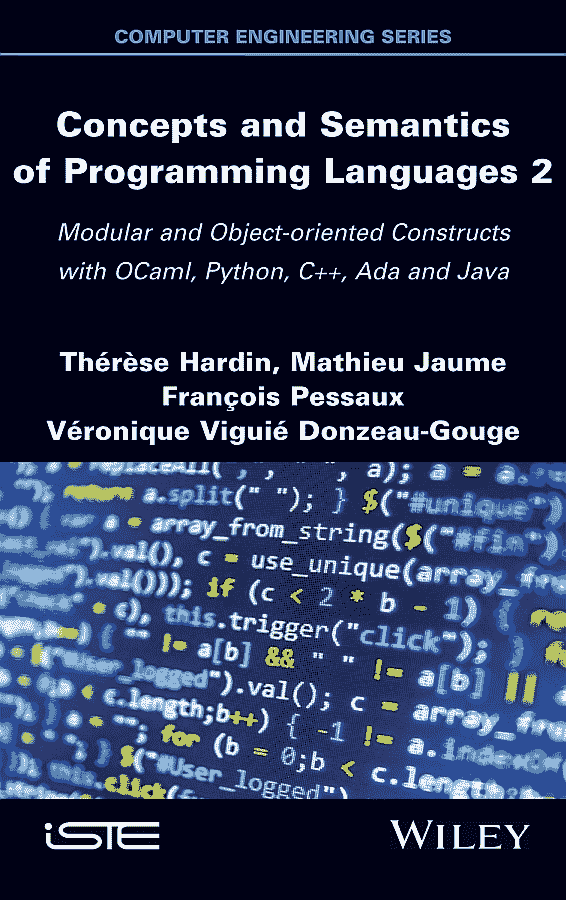

130. 125
131. 126
132. 127
133. 128
134. 129
135. 130
136. 131
137. 132
138. 133
139. 134
140. 135
141. 136
142. 137
143. 138
144. 139
145. 140
146. 141
147. 142
148. 143
149. 144
150. 145
151. 146
152. 147
153. 148
154. 149
155. 150
156. 151
157. 152
158. 153
159. 154
160. 155
161. 156
162. 157
163. 158
164. 159
165. 160
166. 161
167. 162
168. 163
169. 164
170. 165
171. 166
172. 167
173. 168
174. 169
175. 170
176. 171
177. 172
178. 173
179. 174
180. 175
181. 176
182. 177
183. 178
184. 179
185. 180
186. 181
187. 182
188. 183
189. 184
190. 185
191. 186
192. 187
193. 188
194. 189
195. 190
196. 191
197. 192
198. 193
199. 194
200. 195
201. 196
202. 197
203. 198
204. 199
205. 200
206. 201
207. 202
208. 203
209. 204
210. 205
211. 206
212. 207
213. 208
214. 209
215. 210
216. 211
217. 212
218. 213
219. 214
220. 215
221. 216
222. 217
223. 218
224. 219
225. 220


226. 221
227. 222
228. 223
229. 224
230. 225
231. 226
232. 227
233. 228
234. 229
235. 230
236. 231
237. 233
238. 234
239. 235
240. 236
241. 237
242. 238
243. 239
244. 240
245. 241
246. 242
247. 243
248. 244
249. 245
250. 246
251. 247
252. 248

此书于 2021 年在英国和美国由 ISTE Ltd 和 John Wiley & Sons, Inc. 初版。

除 1988 年《版权、设计和专利法》允许的出于研究或私人学习目的，或批评或评论的公平处理外，在未经出版者书面许可的情况下，不得以任何形式或通过任何手段对出版物进行复制、存储或传输，或者根据 CLA 发布的条款和许可进行复印复制。有关这些条款之外的复制查询，应发送至以下地址的出版者：

ISTE Ltd
27-37 St George’s Road
London SW19 4EU
UK
[www.iste.co.uk](http://www.iste.co.uk)

John Wiley & Sons, Inc.
111 River Street
Hoboken, NJ 07030
USA
[www.wiley.com](http://www.wiley.com)


Thérèse Hardin, Mathieu Jaume, François Pessaux 和 Véronique Viguié Donze-Gouge 已根据 1988 年《版权、设计和专利法》维护了他们作为本书作者的权利。

美国国会图书馆控制号：2021935827
英国图书馆编书出版数据
英国图书馆可提供此书的 CIP 记录

# 前言

自 20 世纪 40 年代以来，计算机程序在我们的生活中发挥着日益核心的作用，因此这些程序的质量已成为一个关键问题。编写高质量的程序——即能够执行所需任务且高效、健壮、易于修改、易于扩展等的程序——是一项具有智力挑战性的任务，需要使用严谨的开发方法。然而，此类程序的创建取决于对所用编程语言的深入理解，包括其语法，以及至关重要的语义，即程序在执行时会发生什么。

对这些语义的描述阐明了最基础的概念，包括值、引用、异常或对象的概念。这些概念是编程语言理论的基础。掌握这些概念是经验丰富的程序员与初学者之间的区别所在。某些概念（如值）是所有编程语言共有的；另一些概念（如函数）在不同语言中的运行方式不同；最后，其他概念（如对象）仅存在于某些语言中。计算机科学家经常提到“编程范式”，以考虑某类语言共同享的概念，这些范式意味着特定的编程风格：命令式、函数式、面向对象、逻辑式、并发式等。尽管如此，理解概念本身是至关重要的，因为多种范式可能是交织在一起的。

任何特定语言的编程入门读物都不难找到，许多出版书籍也探讨了基础概念。但像本书这样建立概念与实现之间联系的著作则罕见得多。

# 前言

本套两部著作涉及编程领域。首先，它旨在为读者提供函数式或命令式编程基础的坚实基础，并对模块和类机制进行深入了解。在我们看来，语义方法在研究编程时是最合适的，因为语言间语法差异的影响是有限的。还将讨论由计算机硬件特性或“智能”设备决定的实际考虑因素。两卷书将采用相同的方法，结合使用数学公式和内存状态图。

第一卷概述了编程的函数式和命令式特征，涵盖了可以用数学建模的概念到与计算机硬件配置相关的概念等。

第二卷专门研究已知有助于软件系统开发的语言特性（模块、类、对象）。它建立在第一卷建立的基础之上，因为模块、类和对象本质上是组织函数式或命令式构造的手段。


# 第 1 章 (#c01.xhtml) 首先分析了开发者在构建大型软件工具方面的某些需求。基于这些需求，我们建立了一个原始的语义模型，共同展示了能够满足这些需求的模块和类的所有特征。我们引入了自己的结构，即 `kit`，来描述这个模型；选择这个词是为了避免与语言中使用的通常术语（如结构、模块、包、类等）产生任何混淆。这些 `kits` 用于解释命名管理、导出和导入机制、访问限制、扩展和参数化（泛型、演算算子）、子类型和子类化。与函数式和命令式特征语义的数学化研究相比，这些 `kits` 的语义仍然保持相当非正式，因为目前研究尚未推导出一个相对简单的数学模型。因此，在本章中，我们优先考虑了直觉和简单性，这在某种程度上不可避免地导致了近似和严谨性的缺失。第 1 章 还提出了一系列问题以指导对语言的掌握，并在随后的章节中给出了部分答案。第 2 章 首先介绍了使用 Ada 模块对 `kits` 的实现，然后是使用 OCaml 模块对 `kits` 进行更丰富的实现。最后以一种更简洁的 `kits` 实现结束，称为弱 `kits`，使用了 C 语言的头文件和导入-导出机制。第 3 章 采用 `kit` 模型来处理类和对象及其工具，例如继承、晚绑定和子类化。该模型在 第 4 章 中得到了示例，该章节从统一视角展示了 Java、C++、OCaml 和 Python 的类。

这项工作面向广泛的读者，从经验开发者（他们将发现关于语言语义的有价值额外信息）到只写过短程序的初学者。对于初学者，我们建议使用 OCaml 或 Python 的实现来学习第一卷描述的语义概念，以便吸收。所有读者都可以通过学习编程语言的参考手册获益，同时在第二卷中提到的问题指导下，将手册中给出的构造描述与本文提供的描述进行对比。

请注意，我们在这里不讨论数据处理的算法方面。然而，选择符合规范要求的算法和数据表示是程序开发中的一个至关重要的步骤。关于这个主题已有许多优秀著作发表，我们鼓励读者进一步探索该领域。我们还建议使用所选语言提供的标准库。这些库包含了许多不同算法的经过测试的实现，通常可以假设这些实现是正确的。

## 1 命名空间：模型与操作

目前使用的绝大多数编程语言都提供了便于构建和维护大型软件的工具。目前并存在两种方法：带有模块的语言和面向对象的语言；这两种方法虽然不同，甚至在历史上是对立的，但它们实际上共享许多特征。这就是为什么本章通过引入一种在在此称为 `kit` 的结构，以及对这些 `kits` 的操作，详细阐述了这两种方法的独特模型。我们选择为这项研究引入自备的词汇，因为编程语言有时会使用相同的词汇来指代意义显著不同的工具。`kit` 的概念将在介绍过程中逐渐丰富。它将作为一个共同的框架，用于反映软件划分为子系统的结构，解释名称管理、导出和导入机制、限制访问这些 `kits` 元素的各种可能性，以及扩展机制。在接下来的章节中，将使用这一框架来介绍模块、类和对象。

本章引入了许多看似困难的概念。可以读两遍。第一遍将为读者提供内容概述，随后可以至少阅读 第 2 章 或 第 3 章。如果读者在阅读的同时，用他们使用的语言通过几个例子来说明这些概念，这可以被视为一次真正的练习。第二遍将是读者加深对这些概念理解的机会。

在每个节的末尾，我们提出了几个问题，读者可以在阅读自己喜欢的编程语言的参考手册时自问自己。在问题的陈述中，我们将这种语言称为 MYL。第 2 章 和 第 3 章 将提供这些问题的示例答案。

### 1.1 重用、划分、限制

#### 1.1.1 开发者需求分析

我们希望第一卷的内容——至少部分——满足了开发者产生符合其规范且不含错误的程序的需求。对类型、执行语义的研究以及工具（如构造类型和模式匹配、异常等）的展示，为他们提供了一些回答。在特定规模上开发软件系统还要求使用的编程语言能够满足某些其他`开发者需求`；从全局来看，这些可以用“重用”、“划分”、“限制”这些词来描述。

#### 1.1.1.1 重用

重用软件系统的部分内容可能是开发者的首要需求。这减少了开发、调试和软件维护（错误修复、性能改进等）的成本和时间。函数和过程对这一需求提供了初步响应；但如果可能以编译器控制的方式进行，它们并不适用于重用整个代码段。

#### 1.1.1.2 划分

如果一个软件规范足够大，最好将其`划分`为相对独立的部分，它们之间的通信被精确陈述，并在可能的情况下由自动控制。今天的编程语言提供了工具来反映这种将规范划分为组件的方法，这些组件可以被单独开发然后组装，以实现满足规范的一致软件。示意性地，可以根据要处理的数据的性质或要执行的操作来指导规范的划分。第一种选择被认为导致了类和对象的概念。第二种更倾向于导致模块的概念，然后是演算子的概念。

#### 1.1.1.3 限制


维护程序的属性并不总是容易的，例如当几位开发人员在同一软件上交互时，或者在维护期间，软件文档对这些属性的描述不准确。我们在第一卷第 6.5.2 节中看到，类型允许我们定义遵循某些不变性的的数据结构：例如，二叉树不能从同一个节点引出三个分支。但这些结构仍然是“自由”的，因为无法对类型的值引入限制。某些语言确实允许此类限制，但它们的有效性只能在运行时检查，这可能导致非计划的、因此也是危险的执行终止。让我们来看以下例子：如何在 OCaml 中编码叶子节点只能为偶数整数的二叉树。以下类型是自然定义的。

类型 `even_tree` 的值是其叶子节点为整数的二叉树：在该类型声明中，没有任何方法可以将叶子节点的可能值限制为偶数整数。该数据表示的开发者无疑可以提供操作这些树的工具来保证这种不变性。但类型 `even_tree` 的用户可以直接使用叶子节点为奇数整数的值来构建该类型的值，而无需使用开发者提供的工具。需要一种机制来使这个类型定义变得不可访问——对其进行“限制”（confine）——并仅提供使用开发者工具所需的信息。该类型的用户将被迫仅使用这些工具来操作 `even_tree` 值。因此，不变性将得到遵循。特别是通过编译器进行的静态类型控制，可以保证这种限制不会被滥用。

### 1.1.2. 满足开发者需求

让我们分析对划分、限制或重用程序片段的一些可能答案，以识别出软件开发中严谨且系统化的构建方法。

1) 为了帮助保持不变性，编程语言可以有一种特殊的语法结构，用于将类型、函数、异常等的定义组合在一起，并通过仅提供在该结构外部使用所需的信息来对某些定义进行限制。这种语法结构甚至可以完全防止某些名称在外部使用，使其从外部变得不可见。大多数语言都提供此类结构，命名为抽象类型、模块、类、包、对象等。为了研究它们的共同特征并保持相当通用的观点，在本章中，我们引入了自己的语法构造结构，称为 `kit`。它将以关键字 `Kit` 出现在示例中。作为回报，对特定语言的模块、类等感兴趣的读者将能够通过 `kit` 概念来掌握它们的语义。第 2 章 和 第 3 章 将分别介绍来自 `kit` 方法的模块、类和对象。

重用的研究导致了对同一功能的截然不同的愿景：开发者的视角和用户的视角。开发者创建一个包含一组定义（类型、表达式、过程、异常等）的 `kit`。得益于 `export` 机制（后文介绍），他们可以在 `kit` 内部 `confine` 其中一些定义，或者决定导出它们。得益于 `import` 机制，`kit` 导出的定义的用户可以使用其名称，并根据该定义的功能使用其参数、类型等。在他们的代码中，导入者使用通常称为“点号表示法”（dot-notation）的符号来表示导入的定义，该表示法由 `kit` 的名称和定义的名称构造而成。

区分导入用户和导出开发者的角色使使我们能够更好地表述某些问题。开发者需要满足哪些规范需求？新开发的可重用组件有哪些？可以修改它们吗？这些修改对其他用途会有什么后果？换句话说，借用软件工程术语，开发者将 `kit` 视为“白盒”，而用户将其视为（较地）“黑盒”。

编译器保证 `kit` 中的定义与其导出之间的一致性、受限制实体的未导出、导入者对导出定义的正确使用，特别是不存在任何绕过限制的行为，至关重要。这可以通过编译过程、进行不同的“静态分析”，以及至少通过扩展第一卷中所示的类型分析来实现。

2) 此类 `kits` 的引入可能仅允许在同一个程序内，该程序将被编译成一个整体。然而，通过使这些 `kits` 更具自主性，可以更进一步：

*   a) 系统架构可以通过由每个 `kit` 表示每个子系统来反映在软件结构中。这将为其他子系统提供它们所需的功能，但仅提供它们为了遵守子系统间划分而需要的功能。对不变性的维护支持将得到便利。

*   b) 根据对语言的选择，对 `kit` 部分的限制可以直接集成到其定义中，也可以在定义之后引入，以灵活适应每个导入者的需求。

*   c) 编程语言可以提议分别编译这些 `kits`，使得这些 `kits` 的目标代码完全自主。这使得创建目标代码库成为可能，从而促进重用。

*   d) 限制有助于软件维护。如果使用该定义的准则保持不变，那么更改定义的影响将局限在引入该定义的 `kit` 内。如果导出未被修改，如果修改没有改变定义的语义，导入者在自己的代码中就无需修改任何内容。

*   e) 编译器可以在这些 `kits` 创建/导出/导入的每一步中执行一致性检查，作为一个完整开发的一部分。

我们开始列出有助于和引导学习某种语言以及阅读其参考手册的问题。第一个问题涉及语言的某些特征，后续问题将涉及本章讨论的内容。在随后的章节中，在介绍特定语言时，简单提到 (Ans. *n*) 将表示给出了问题 *n* 的答案。

问题 1.1.– 所考虑的源语言（此处称为 `MYL`）是如何转换为二进制代码的：是编译的、解释，还是编译成字节码然后在虚拟机上解释？它是否提供了编译器和源代码解释器？`MYL` 是一种类型语言吗？它是强类型吗（即每个表达式是否都有唯一的类型）？它是静态类型吗（由编译器进行类型检查）？如果不是，该语言是否提供了一种限制某些操作或确定内存分配大小的类型概念？

问题 1.2.– `MYL` 是否至少提供一种用于 `kit` 概念的语法构造？如果没有，这种概念如何从语言的功能产生，例如像我们在 C 语言中那样？（见第 2.3.2 节 中 `weak kit` 概念的引入）

## 1.2. 命名空间

在第一卷的第 3 章、第 4 章](#c04.xhtml)和 5 章中使用了唯一的标识符概念来引入变量、新数据类型、异常等。所提出的每种分析都隐含地意识到所考虑标识符的角色。环境中存在的标识符的绑定仅在评估局部声明期间被屏蔽。标识符的作用域通过校读程序源码很容易确定。


将软件分为*套件*（kits）需要对标识符的作用进行更好的解释。如果一个*套件*导出了导入者正在编写的程序中已经使用的标识符，会发生什么？同一个表达式中两个标识符的出现可以有不同的绑定吗？同一个标识符的某次出现是否存在多个可能的绑定？回答这些问题需要比第一卷中给出的更复杂的环境和内存建模。我们将以一种或或少正式的方式来描述这种建模，依赖于第一卷中已经学习的概念。该模型允许我们精确地确定表达式中每个标识符在类型类型检查和执行期间的每次出现的绑定。随后，只需应用第一卷中见过的规则即可完成该表达式的类型检查和求值。

给出的示例通常会使用类似于 OCaml 的语法，使用第一卷中引入的求和类型和模式匹配定义，以缩短演示代码的长度。

### 1.2.1 命名空间定义

在编译框架中，`namespace`（命名空间）一词表示程序中出现的标识符集合。出现在类型环境或执行环境绑定中的名称、记录标签等都是该命名空间的元素。事实上，大多数编程语言都有结构化的命名空间，并分为若干（子）命名空间。提供给用户声明标识符的语法结构也用于确定给定的标识符应该属于哪个命名空间。这些结构可以使用关键字 `type, exception, var` 或语法约定（例如将模块名设为大写）。因此，编译过程被简化了，代码校对也变得更容易，因为标识符的作用更容易被识别。因此，编程语言可以允许使用相同的标识符来命名类型、异常、变量、函数、过程等。换句话说，同一个标识符可以在同一个表达式中出现多次，它的每次出现都关联到一个类型或值，而该类型或值可能与其他出现的不同。请立即注意，这些可能性有时会让编写源代码变得更容易，但只有在审慎使用时才对校对有帮助。我们可以在示例 1.2 中看到这一点，该示例用 OCaml 编写，且相当夸张。源代码中的注释允许我们理清 `t` 的不同用途。

这个示例使用相同的标识符 `t` 作为类型名、记录字段名、函数名和变量名。它甚至利用了局部定义实现的名称隐藏（name hiding），以及可以在函数及其参数之间使用相同名称而不产生冲突的事，因为函数 `t` 没有被声明为递归。这种代码编写方式无疑是被禁止的。然而，OCaml 编译器能够处理这个示例，因为 `t` 的每次出现只能被一种语法分析规则接受（在第一卷第 1.2.3 节中给出）。

在本章的剩余部分，包含*套件*的模型使用了三个命名空间：

* – `N[T]` 类型命名空间；
* – `N[V]` 表示值的名称的组命名空间，即常量标识符、变量、函数、异常标识符等；
* – `N[K]` *套件*的命名空间。

示例 1.3 是在假设语言允许相同标识符出现在多个命名空间中的情况下编写的。为了表达这个示例，我们使用了一种假设语言，仅留在直觉层面。

以这种方式编译示例 1.3 将命名空间扩展如下：

* – 将来自第 1 行的 `person` 添加到 `N[T]`，因为它是类型的名称；
* – 将来自第 2 行的 `person` 添加到 `N[K]`，因为它是*套件*的名称；
* – 将来自第 3 行的 `person` 添加到 `N[V]`，因为它是异常值的名称；
* – 将来自第 4 行的 `person` 添加到 `N[V]`，因为这一行通过先给出类型、然后是名称、最后是定义来声明一个变量。异常的名称会被变量名隐藏吗？这取决于语言，编译器可以通过引入它的关键字识别出第 3 行声明的 `person` 是一个异常并消除歧义。它也可以将异常视为已知类型（例如 `exn`）的值，而该值会被第 4 行的声明/定义所隐藏；
* – 将来自第 5 行的 `person` 添加到 `N[V]`，因为它是变量的名称。第 4 行输入的变量名是否被隐藏？同样取决于语言。如果该语言接受变量重载，那么第 4 行和第 5 行的定义是被接受的，因为它们的类型不同的；
* – 编译器会接受第 6 行吗？不，如果类型声明是强制的，那么第 6 行将被解释为对已声明变量之一的赋值，并被视为类型错误，除非语言接受 25 表示一个布尔值。是的，如果一方面语言允许在没有类型声明的情况下引入变量，另一方面，如果它接受重载（因为它可以确定 25 的类型），那么第 6 行（通过将 `:=` 替换为 `=`）将被理解为引入了一个类型为 `int` 的新变量 `person` 并将其添加到 `N[V]`。

因此，开发者被引导完善第一卷中看到的范围规则，以考虑到不同命名空间的存在。如果同一个标识符由多个声明/定义引入，并不总是会对之前的绑定进行屏蔽（masking）。可以使用消除歧义的技术。然而，建议读者在依赖这些技术时要小心：多声明标识符的存在并不会有助于校对。请注意，“namespace”一词被某些作者实际上表示执行环境并描述标识符的作用域。标识符属于某个命名空间的确定是在编译器的语法分析期间完成的。执行环境（也称为求值环境）在执行过程中演变，这与第一卷第 3 章 和第 4 章 的研究一致，这些章节也解释了标识符的作用域和屏蔽（也隐藏）的概念。

### 1.2.2 扩展环境和绑定概念

将全局命名空间划分为三个（子）命名空间会导致任何环境划分为三个子环境（它们也是*环境*），下文所示。

在该模型中，一个环境 `Env` ∈ **E** 被划分为 `Env[T]`、`Env[V]` 和 `Env[K]`：

* – `Env[T]` 包含属于 `N[T]` 的类型名称到定义的绑定；
* – `Env[V]` 包含 `N[V]` 中的名称在 `Env` 中执行期间（或类型检查期间）到值（或其类型）的绑定；
* – `Env[K]` 包含属于 `N[K]` 的（套件）名称到下文介绍的值（或其类型）的绑定。

值和类型在第一卷中是通过环境和内存的概念研究的。内存的概念保持不变，而环境的概念得到了扩展。通过这种扩展，在 `Env` 中进行的类型分析将使用：

* – `Env[T]` 的绑定；
* – `Env[V]` 中 `N[V]` 的名称到其类型的绑定；
* – 绑定到 `Env[K]` 中套件名称的类型信息。

如果语言是静态类型类型，在 `Env` 中进行的执行（也称为求值）不使用 `Env[T]` 的绑定。它使用：


*   – `Env[*V*] ` 中将名称（属于 `N`[*V*]）绑定到其值的绑定；
*   – `Env[*K*] ` 中将*kits* 的名称绑定到其值的绑定（进一步定义）。

如果类型检查（至少部分）是在运行时进行的，则运行时类型-评估将使用：

*   – `Env[*T*] ` 的绑定；
*   – `Env[*V*] ` 中将名称（属于 `N`[*V*]）绑定到其类型及其值的绑定；
*   – `Env[*K*] ` 中将*kits* 的名称绑定到其类型及其值的绑定。

编程语言的差异不仅在于其类型验证方法，还在于其作用域的概念（词法作用域、动态动态或根据语法结构进行调整）。类型环境与评估/执行环境之间的区别正在模糊，因为类型检查可以在编译时开始并在运行时完成。为了简化这些语言语义的描述，我们扩展了绑定的概念。

现在，绑定将是一个元组 `(identifier, information[1], information[2], etc.)`，信息仅用逗号分隔，按照惯例，第一个信息是标识符的类型。如果类型不是给定的信息（例如，类型受限），则将用 `⊥[*t*]` 标记。如果值未知（例如，尚未初始化），则将用 `⊥[*v*]` 表示。例如，在一种无类型语言中，如果标识符 `x` 仅被声明，则其绑定可以为 `(*x, ⊥[*t*], ⊥[*v*])`，在对其定义的评估返回值 `v` 后，它将变为 `(*x, ⊥[*t*], v*)`。在强类型语言中，`x` 的类型 `t` 将替换两个绑定中的 `⊥[*t*]`。

定义 `let x = 1` 在 OCaml 中引入了绑定 `(x, int, 1)`。定义 `type t = K of int` 在 `Env[*T*] ` 中引入了绑定 `(t , K of int)`，并在 `Env[*V*] ` 中引入了绑定 `(K , int → t, Constructor)`。这里，提到 `Constructor` 意味着编译器感知 `K` 的特定状态，正如示例 1.4 提醒我们注意 OCaml 编译器在函数 `f` 和值构造函数 `K` 之间的区别。

通过我们扩展的绑定定义，我们的模型中只有一种绑定，因此只有一种环境。取决于所执行分析的性质以及标识符所属的命名空间，用于分析的信息子可能是空的、可能只包含类型信息、或仅包含（执行）值、或限制修饰符等。如果我们只使用类型信息，我们就检索用于静态类型检查的类型环境。如果我们只使用值，我们就检索执行（或评估）环境。最终，重要的是开发者或用户可以在绑定中，建模在他们所考虑的编译或执行的任何时刻，给定标识符上的所有可用信息。这种绑定的扩展有助于在编写和校对时理解源代码的含义。

让我们看看示例 1.5，该示例使用了点表示法来表示要导入的*kit* `P` 的标识符。为了简化示例，定义中没有显式列出类型。

在对这段程序片段进行类型检查和评估后，使用之前环境三个组件的表示法，我们得到：

*   – 第 5 行之后，绑定 `(P, type_P, val_P)` 被添加到 `Env[*K*] ` 中，`type_P` 和 `val_P` 是下述的 `P` 的类型和执行值；
*   – 从第 6 行开始，`P` 的标识符通过点表示法 `P.person` 和 `P.age`可见。我们之后会看到 `Env[*K*] ` 中 `P` 的绑定也提供了对绑定 `(person, A of (string * int))` 和 `(age, person -> int, FP)` 的访问，`FP` 是函数 `P.age` 的闭包（值）；
*   – 第 7 行之后，环境 `Env[*T*] ` 扩展了绑定 `(client, C of P.person)`；
*   – 第 11 行之后，`Env[*V*] ` 扩展了下面的三个绑定。`F` 是 `accept` 的值，因此是一个闭包，如果语言是词法作用域的，则它包含 `F` 的定义环境。

```
(a_client, client, C (P.A ("Pierre", 14))) (too_young, exception, val_too_young) (accept, client -> string, F)
```

我们假设在示例 1.6 中，开发者决定通过标记 `confine` 为其定义来限制类型 `person` 的定义。

`P` 的开发者在 `P` 定义结束之前会一直看到绑定 `(person, A of (string * int))`。这是必要的，以便他们可以正确地定义类型为 `person -> int` 的函数 `age`。在第 6 行执行结束时，应用于 `P` 的导出机制生效，并为 `P` 的导入者（换句话用户）提供绑定 `(person, ⊥[*t*])`，其中 `⊥[*t*]` 是类型。

## **1.3. kit 开发**

在本节中，我们定义了 kit 的类型和值的概念。在这里，我们借鉴了许多不同的类型理论，这些理论用于对模块化和对象特征提供正式说明，然而这些理论远超本书的范围。

令 **Lang**[*K*] 为一种提供类型和变量、函数、过程、异常等的声明/定义的语言，即第一卷中研究的所有特征。这种语言还提供了一个由关键字 `Kit` 引入的语法结构，它用于定义一个命名的实体，*kit*。

`Kit K_ident = { component_1 ... component_n }`

*kit* 组件的引入如下：

*   1) 类型声明：`type ident`，例如，`type person`；
*   2) 类型定义：`type ident = deftype`，例如，`type person = A of (string * int);`


- 3) 变量声明：`var ident: type`，例如 `var un_client: client`；
- 4) 变量定义：`var ident: type = def`，例如 `var un_client: client = ("Alan", 25)`；
- 5) 函数（或过程）声明：`fun ident: type`，例如 `fun age: person -> int`；
- 6) 函数（或过程）定义：`fun ident : type = def`，例如 `fun age: person -> int = function A (n, a) -> a`；
- 7) 异常声明：`exception ident`；
- 8) `kit` 的定义，称为“内部 `kit`”，例如 `Kit Kit_ident = { component_a ... component_n }`。

在我们的具体语法中，组件的引入以一个指定其性质的关键字开始，这仅仅是为了方便本书的读写。这在编程语言中并不总是如此。示例 1.7 阐了这种语法。这是一个整数栈的实现，它只记忆正整数，并忽略负整数或空整数的推送请求。它仅包含类型、变量和函数的定义。

`kits` 采用抽象语法如下：

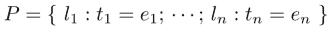

`kit` 的组件形式为 `l` : `t` = `e`，其中 `l` 是组件的标识符，称为组件的 `field`（字段）。所有字段都应该是唯一的，我们假设这一语法条件始终是满足的，例如它可以通过编译器进行验证。`t` 是 `Lang`[*K*] 中的类型的名称，`e` 表示 `Lang`[*K*] 中的一个表达式或 `Lang`[*K*] 中的类型定义。在示例 1.7 中，用具体语法表示的组件 `var floor : int = 0` 被翻译为抽象语法 `floor : int = 0`，其中 `floor` 是组件的字段；`var` 指示未整合到抽象语法中。

文本片段“字段 `l` 的组件”通常会缩写为“字段 `l`”，当不需要区分组件及其名称时，会将“组件”一词替换为“字段”。

组件的某些定义（在抽象语法中表示为 `e`[*i*]）在 `kit` 的定义中可能缺失。在这种情况下，该字段被视为未定义的（not-defined，或仅已声明）。如果一个 `kit` 的所有组件都接收了定义，则认为该 `kit` 是完整的（complete）。否则，它是不完整的（incomplete）。例如示例 1.7 中的 kit `Stack` 是完整的。

**警告。** 抽象语法可能会导致人们认为 `kit` 的概念只是记录（records）的一种推广，`kit` 的组件就是这些记录的字段。然而，记录字段即使可以是任何类型——包括函数类型（例如在 OCaml 中）——也不能作为类型定义，不能包含局部变量，也不能使用其他字段的名称通过表达式定义。记录仅用于编码结构化数据。上面的示例说明了 `kit` 与记录之间的区别：字段为 `push` 的组件定义使用了字段 `floor`。

在开发中命名导入组件的语法是点表示法 `P.l`，其中 `P` 是 `kit` 的名称，`l` 是其字段之一。例如，示例 1.7 中 kit `Stack` 的导入者可以使用类型 `Stack.t_stack` 来它，调用函数 `Stack.top` 等。

### 1.3.1 kit 的命名空间

在我们的模型中，我们假设每个 `kit`（例如 `P`）都有它自己的命名空间，我们称之为 `N(P*)`，它本身被分为名称子空间，标记为 `N(P*))[T*]`、`N(P*))[V*]` 和 `N(P*))[K*]`。允许 `kit` 拥有本身也是 `kits` 的字段会导致 `N(P*)` 定义出现某种递归性，因为 `N(P*))[K*]` 是 `P` 中定义的“内部 `kits`”的命名空间，这些 `kits` 中的每一个都有自己的命名空间，该命名空间也被分为三个命名空间，依此类推。

在示例 1.7 中，kit `Stack` 有 6 个字段。第一个字段 `t_stack` 引入了类型 `t_stack` 的定义。第二个字段 `floor` 定义了一个变量，依此类推。与 `Stack` 关联的命名空间分为：

- `N(Stack*)[T*]` = `{ t_stack }`;
- `N(Stack*)[V*]` = `{ floor, empty_stack, top, push, create_stack }`;
- `N(Stack*)[K*]` = ∅。

### 1.3.2 字段的引入顺序

编程语言在分析声明与定义之间依赖关系的策略上有所不同。选择有两种：要么组件只能使用之前引入的字段，要么任何组件可以使用任何字段。

第一种可能性可以施加给 `kit` 的开发者，他们必须选择引入字段的顺序。第二种可能性可以留给编译器，编译器将尝试重新排序字段以满足它们之间的依赖关系。在本节中，为了简单起见，我们选择了第一种。这使得我们能够给出 `kit` 类型和值的非常简单的定义，而不需要引入不动点（见卷 1 第 4 章）。

###1.3.3 kit 的类型检查

在本节中，我们只考虑完整的 kit，即所有组件都已定义。不完整的 kit 将在 1.4 节中研究。

令 `Env` 为当前环境，分为 `Env[T*]`、`Env[V*]` 和 `Env[K*]`。这些环境中的任何绑定都将标识符与一组信息关联。假设语言是静态类型且类型由用户声明，类型分析将使用封装在不同绑定中的类型信息。我们在源代码中字段顺序的假设决定了类型检查策略。`kit` 的类型检查通过按照卷 1 第 5 章给出的类型规则应用于每个字段，遵循其源代码顺序。一旦 `kit` 的某个组件完成了类型检查，其字段到类型的绑定就会被添加到（相应组件的）当前环境中，并在该扩展后的环境中对下一个组件进行类型检查。因此，这种策略假设 `kit` 中出现的类型在那些它们的组件（如通过 `var, fun` 等引入的组件）之前已经引入。


如果 `l[*i*] ∈ N(P*)[*T*]`，则 `t[*i*] = e[*i*]`（我们采用 `P` 中涉及的类型定义），否则 `t[*i*]` 是 `e[*i*]` 的类型，该类型由语言 `Lang[*K*]` 使用的类型算法获得。*kit* 的类型规则规定如下：

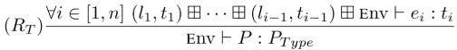

其中  是一种操作，它根据 `l` 的内容将字段 `l` 的绑定添加到 `Env` 的右侧组件。

一旦 `P` 的类型被确定，将 `P` 与 `P[**Type*]` 关联的绑定就会被添加到 `Env[*K*]`。这使得我们能够通过点表示法 `P.l` 找到 `P` 的组件的类型，该表示法访问 `Env[*K*]` 中 `P` 的绑定（即指向 `P[**Type*]`），然后获取到字段 `l` 的类型。

再次，让我们来看示例 1.7，它定义了*kit* `Stack`。该*kit* 的类型包含但不限于 `t_stack` 与定义 `H of int list` 的关联，以及 `top` 与类型 `t_stack -> int` 的关联。使用类似于为 *kits* 采用的具体语法，该类型被写为：

上述给出的类型检查策略将重用于 *kit* 的求值，并在那里进行详细说明。

在我们的模型中，字段是 *kit* 类型不可或缺的一部分。两个具有相同类型组件但字段不同的 *kits* 不具有相同的类型。我们还假设两个不同名称的 *kits* 是不等的。因此，所选的类型系统是*名名的*（nominal，也称为*基于名称的*）。类型相等性在第 1 卷的第 6.6 节讨论过。

**警告。**– 事实上，这种对 *kit* 类型和类型检查的介绍让人联想到记录类型，过于简单，无法完全处理 *kits* 的所有功能和操作（泛算子、继承等）。它的优点仅是为 *kit* 类型检查提供了一种直观的方法，并在某种程度上对应于大多数类型对象语言的类型规范。但它也可能显得过于复杂，无法应用于某些语言，如 Python，因为它不需要声明字段的类型，也不进行类型推断，而在运行时执行某些类型检查。参见示例 1.8，使用 Python 的交互模式。

赋值 `C.x = ‘aa'` 显然改变了字段 `x` 的类型。Python 是动态类型的，字段的类型可能会在运行时更改。另一方面，运算符 `+` 不能应用于整数和字符串（赋值后 `C.x` 的值），因为 `+` 在当前环境中没有绑定到任何能够执行此加法的函数值。

当然，没有人会从一开始就写出这样的代码。但这些对 *kit* 字段的修改可以在任何访问类 `C` 的代码中进行。这个符合 Python 语义的示例将在第 4.4 节](#c04.xhtml_head4-4) 中复习，以详细说明此赋值操作的含义，这解释并证明了 Python 的答案。在任何情况下，即使语言没有要求，维护类型规范也是编写 *kits* 的良好实践，因为它确保了所写源代码的某些逻辑一致性。这引出了一些问题。

**问题 1.5.**– MYL 是否拥有 kit 类型的概念？如果是的话，kit 的名称与其类型名称之间之间有什么联系？

**问题 1.6.**– kits 的字段有类型检查吗？它们的类型是由开发者声明的还是由编译器合成的？

**问题 1.7.**– 假设 P1 和 P2 是两个具有相同字段且关联到相同类型的 kits。那么 P1 和 P2 具有相同的类型吗？或者，MYL 的类型检查是严格名名的？

**问题 1.8.**–这个问题涵盖了 MYL 中所有的类型（如果有）。是否可以实现从类型 `t[1]` 到类型 `t[2]` 的显式转换？MYL 是否执行类型的隐式转换，至少在某些情况下？识别这些情况。

**问题 1.9.**– 一个 kit 中两个具有不同类型的组件可以使用相同的字段命名吗？换句话说，如果 MYL 接受某种形式的字段重载，它是允许的吗？

### 1.3.4. kit 值

我们继续只考虑完整的 kit。到为止，在我们的模型中，语法构造的求值产生副作用或一个值，后者有时称为*执行值*（或*运行时值*）。这个值并不总是一个*一等值*（first class value），即例如可以作为结果返回的值（参见第 1 卷中对所有此类值的精确定义）。我们用 *kit 值*的概念扩展了这一模型。在某些语言中，*kit* 值不是一等值，它们只是运行时值。模块和类通常此类如此。但这些 *kit* 值也可以是一等值。

在我们的模型中，字段是 *kit* 类型不可或缺的一部分。两个具有相同类型组件但字段不同的 *kits* 不具有相同的类型。我们还假设两个具有不同名称的 *kits* 是不等的。因此，所选的类型系统是*名名的*（nominal，也称为*基于名称的*）。类型相等性在第 1 卷的第 6.6 节讨论过。

设 `E = (Env[0], Mem[0])` 为求值 *kit* 开始时的当前状态。第一个字段 `l[1] ∈ N(P*)[*T*]` 的求值在 `(Env[0], Mem[0])` 下根据我们的约定，返回一个值 `v[1]` 并修改状态 `E`，变为新状态：


如果 `e[1]` 的求值产生了副作用，则 Mem[1] 将不同于 Mem[0]。每个字段 `l[*i*]` 的值 `v[*i*]` 然后以相同的方式获得。每次求值都会扩展当前环境并可能修改内存。

在求值 `P` 结束时，添加到 `Env[*V*]` 的绑定消失，并将 `(P, P[*Type*])` 添加到 `Env[*K*]`。因此，得到的环境为 `(Env[*T*], Env[*V*], (P, P[*Type*]) ⊕ Env[*K]))`。内存保持在求值结束的状态，因为某些组件的执行可能会引起副作用。

然而，kit 的组件也可以是类型定义，这些定义没有（运行时）值。我们在这里遇到了一个小困难，可以通过以下方式绕过：严格来说，属于 `N[*T*]` 的字段不应出现在 kit 值中。但这需要对 `l[*i*]` 字段进行重新编号。为了避免这种情况并保持 *kits* 在抽象语法中的统一，我们为任何引入类型的字段分配一个虚拟值 `∅[*t*]`。

此外，字段 `P` 的某些字段本身也可以是 *kit*。它们的求值是在 `P` 源代码中在其之前的字段求值的当前状态进行的，并遵循我们刚刚描述的策略。

注意，如果语言具有词法作用域，如果字段 `P.l[*i*]` 的定义是一个内部包含字段 `P.l[*j*]` 出现的函数，那么 `P.l[*i*]` 的值是一个包含了 `P.l[*j*]` 的值绑定的闭包。

在词法作用域下，*kit* 的求值规则规定如下：


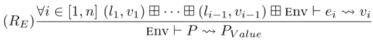

在动态类型的情况下，字段 `l[*i*]` 的评估首先是对其定义进行类型验证，然后是评估本身，并且它使用了当前环境绑定中存在的类型信息。为静态类型语言设计的评估描述可以被沿用，但结果是双倍的：返回类型 `t*[i]` 和值 `v*[i]`，并将名称 `l*[i]` 绑定到这两组信息 `t*[i]` 和 `v*[i]` 上。

我们尚未详细介绍在 `kits` 评估过程中环境的演变。现在我们进行说明，仅考虑示例 1.7 中 `kit` `Stack` 的评估。我们假设语言使用词法作用域，且当前状态为 `(Env[0], Mem[0])`。令 `Env[0*T*]`、`Env[0*V*]` 和 `Env[0*K*]` 为 `Env[0]` 的组成部分：

*   1) 字段 `type t_stack = H of` ... 的评估将环境 `Env[0*T*]` 扩展到 `Env[1*T*] = (t_stack, ∅[*t*]) ⊕ Env[0*T*]`。由此获得的环境 `Env[1]` 的其他部分是 `Env[0]` 的部分：`Env[0*V*] =Env[1*V*]` 且 `Env[1*K*] = Env[0*K*]`；

*   2) 评估 `exception empty_stack` 将环境 `Env[1*V*]` 扩展到 `Env[2*V*] = (empty_stack, exception) ⊕ Env[1*V*]`；

*   3) 评估 `var floor = 0` 将 `Env[2*V*]` 扩展到 `Env[3*V*] = (floor, 0) ⊕ Env[2*V*]`；

*   4) 同样地，定义 `fun top p = match p with` ... 的评估返回闭包 `F*[1] = ⟨p, match p, ..., Env[3]⟩` 并将 `Env[3*V*]` 扩展到 `Env[4*V*] = (top, F*[1]) ⊕ Env[3*V*]`；

*   5) 并且在 `Env[4]` 中评估 `fun push elt H l = if ...` 返回闭包 `F*[2] = ⟨elt, H (l), if, ..., Env[4]⟩` 并将 `Env[4*V*]` 扩展到 `Env[5*V*] = (push, F*[2]) ⊕ Env[4*V*]`；

*   6) 在 `Env[5]` 中对最后一个字段 `fun create_stack () = H []` 的评估返回闭包 `F*[3] = ⟨_, H ([]), Env[5]⟩` 并将 `Env[5*V*]` 扩展到 `Env[6*V*] = (create_stack, F*[3]) ⊕ Env[5*V*]`。

`kit` `Stack` 的评估完成。`Stack` 的值为：

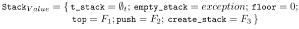

在这次评估过程中，`Stack` 的源代码被*实际上*视为 `kit` 中的一系列局部定义，因此将此执行分析置于第一卷第 3 章和第 4 章定义的框架内。在评估 `Stack` 期间构建的环境消失了，但仍存储在闭包中（闭包是 `Stack` 函数类型字段的值），以符合词法作用域。`Stack` 定义的评估将当前环境扩展为：

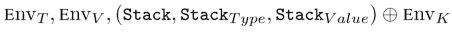

在这个没有副作用的示例中，内会在整个 `kit` 评估过程中保持不变。

我们回顾一下，这次评估是在字段按照源代码中的出现顺序进行评估的假设下进行的。OCaml 的情况如此：示例 1.9 的第一行被拒绝了，因为字段 `y` 在引入之前就被使用了。

示例 1.10 显示 Java 了相同的选择。

以下是关于 `kit` 的定义和评估的一些问题。

问题 1.10.– 在 MYL 中，`kit` 字段的顺序重要吗？字段可以使用在源代码中定义在它之后的字段吗？

问题 1.11.– 字段可以在不使用像 `rec` 这样的关键字的情况下具有递归定义吗？多个字段之间存在互递归的可能性吗？

问题 1.12.– 除了字段之外，`kit` 是否可以包含一个指令块，用于声明例如 `kit` 的局部变量并执行任何副作用？该指令块在何时执行？

问题 1.13.– MYL 的函数是一一类值吗？

问题 1.14.– MYL 的 `kits` 是一类值吗？（更多解释请参见第 2 章和第 3 章）。

### 1.3.5 kit 导出，限制字段

`kit` 开发与使用之间的边界在第 1.1 节中讨论过。

*   – 限制字段的导出可以通过对其添加标记来实现，该标记可以是关键字或修饰符，如 `protected, private`。根据语言的不同，可以通过两种方式实现：
    *   通过标记 `kit` 字段实现的限制取决于语言：Ada、Java 或 OCaml 的 `private` 标记含义不同。
    *   字段 `type ident = deftype` 可以标记以允许导出 `ident` 并禁止导出 `deftype`。`ident` 也可以被另一个标记限制。
*   对定义值的字段进行标记可以阻止该字段的导出，因此在外部不可用（参见第 2 章）。这种通过标记限制是面向对象语言的典型（参见第 3 章）。导出者直接在 `kit` 的源代码中设置导出条件，取决于语言定义的分类。例如，在 Java 中，标记为 `protected` 的类字段只能用于定义相同组（称为*包*）的类。因此 `protected` 标记对导入该类的 Java 开发后期产生影响。
*   – 限制可以用更灵活的方式设计以满足不同调用者的需求。这意味着限制定义在 `kit` 源代码之外。人们可以指示哪些字段需要限制，或者哪些字段需要导出以符合调用者的要求。限制可以通过类型或专门的语法结构表示，有时称为*接口*（interface）。例如，OCaml 模块（参见第 2.2 节）就是这种情况，它可以为每个调用者调整字段可见性，见第 2 章。顺便提一下，“接口”一词被许多编程语言使用，但含义完全不同。

现在我们考虑用于导出 `kit` 的限制机制。令 `M` 是我们显式化的限制信息。例如，对于示例 1.6 中的 `kit` `P`，`M` = `confine type person`。在 OCaml 中，我们研究通过对 `kit` `P` 的类型 `t*[1]` 使用“更约束性的”类型 `t*[2]` 进行限制而获得的限制，此时 `M` 将为 `M` = {*P* : *t*[2]}（参见第 2 章）。


我们记 `RP = From(P,M)` 为 `P` 的导出操作，根据限制指示 `M`，`RP` 是赋予此项导出结果的名称。目前，通过 `M` 表示限制信息就足够了，无需显式地知道其内容。在必要时，我们将区分限制的两种可能性。

无论是否有限制，套件*P*（kit P）的导出都应该允许导入者在无需访问 `P` 源代码的情况下使用导出的字段。作为回报，导入者不能对 `P` 导出字段的实现做任何假设。这正是“现成（off the shelf）”组件软件库的核心原则。

导出并不是构建一个新的*套件*，而是为导入者提供对 `P` 导出“部分”的访问，该部分名为 `RP`，由一组组件名称组成，并与其类型关联（如果语言要求类型声明）。导入者可以通过命名为 `RP.l` 来使用由 `P` 导出的字段 `l`。在某些语言（通常是对象化语言）中，`P` 和 `RP` 标识符是相同的。在其他语言中，`RP` 被视为一个新的*套件*，这并不完全正确，因为在对象代码层面 `P` 和 `RP` 组件之间始终存在某些共享。

*套件*`P` 中任何组件的定义都可以无限制地使用另一个在 `P` 中完全或部分受限制的组件名称（字段）、类型和值：导出操作本身并不限制套件的开发者。一旦*套件*`P` 被完全定义，就可以立即在源代码中使用点符号表示法使用其字段，前提是该操作符合限制：一旦*套件*`P` 构建完成，开发者在后续的源码编写中就变成了 `P` 的导入者。

操作 `RP = From(P,M)` 根据字段 `P.ident` 产生一组根据限制提及 `M` 的信息。我们在下文中描述了根据字段的性质和 `M` 要求由字段限制所提供的信息。我们用 `From(l)` 表示作用于字段 `l` 的限制操作的结果，并使用具体语法对其进行非正式描述。当然，如果该字段未受限制，则 `From(l)` 返回 `l`：

1) 如果 `ident ∈ N(P)[T]`，我们只能限制类型的定义。此时仅类型的名称 `ident` 被导出：

```
From(type ident = typedef) = type ident
```
在这种情况下，导入者不能直接定义该类型 `ident` 的值，也不能通过对 `ident` 的值进行模式匹配来定义函数。只有由*套件*`P` 导出的字段可以操作类型为 `ident` 的值；

2) 对 `ident ∈ N(P)[T]` 的限制可能更强：类型的名称 `ident` 可以被限制：

```
From(type ident = typedef) produces nothing.
```
导入者将无法得知这种类型。此外，如果字段 `l` 的类型中包含 `ident`，则 `l` 也必须受限制，因为导入者使用 `l` 的表达式将通过类型检查；

3) 异常 `ident` 可以被限制。导入者将无法通过名称 `ident` 抛出或捕获它。注意，此异常可以被一个*默认*拦截所有抛出异常的异常处理器捕获（见第一卷第 8.2 节）：

```
From(exception ident) produces nothing;
```

4) 如果作为变量（我们具体语法中的 `var`）或函数（`fun`）的组件名称 `ident` 被限制，则字段 `ident` 不被导出：

```
From(var ident : type = def) produces nothing;
```

5) 否则，未受限制组件（变量或函数 `var` 或 `fun`）的名称 `ident` 和类型将提供给导入者，他们可以使用所有信息：

```
From(var ident : type = def) = var ident : type
```

6) 如果 `ident ∈ N(P)[K]`，`ident` 是一个套件的名称，是可以被限制的：此内部*套件*`ident` 不被导出：

```
From(kit ident : type = def) produces nothing;
```

7) 此外，开发者可以通过对 `ident` 的字段应用 `From` 操作来限制内部*套件*`ident` 的某些字段。

导入者感知不到完全限制字段的存在。换句话说，该字段对导入者是不可见的。*这并不意味着该字段的值是不可访问的，因为 P 的任何其他字段可以使用该受限制字段并泄露其值。*

如果字段 `l` 未被导出，相反如果在导入者的源代码中出现了名称 `P.l`，我们假设编译器将通过初步分析（语法分析、作用域分析）或最终通过类型分析拒绝该源码，我们后续将不处理此情况。

导出操作考虑到限制指示计算 `RP` 的类型 `RP[Type]` 和值 `RP[Value]`。设 `P` 为一个*套件*，其类型为 `P[Type] = { l[1] : t[1]; ... ; l[n] : t[n] }`，值为为 `P[Value] = { l[1] : v[1]; ... ; l[n] : v[n] }`。


导入器源代码中的表达式 `e` 可以使用导出的字段 `RP.l[2]`，尽管 `P` 中 `l[2]` 的定义使用了受限字段 `l[1]`（该字段不在 `RP` 中）。事实上，`RP.l[2]` 的值等于 `P.l[2]` 的值，并通过对 `P` 的求值获得。拒绝对 `l[1]` 的这种间接使用实际上等同于禁止使用 `l[2]`。从更根本上说，这种拒绝将迫使我们修改字段的类型和执行值的概念，这不仅取决于 `P` 当前的类型和求值环境，还取决于之后对其他字段的任何决策。因此，在对导入器代码进行类型检查和求值期间，任何包含字段 `RP.l[2]` 的表达式都可以被类型和求值，即使字段 `P.l[2]` 的定义使用了受限字段 `P.l[1]`。

示例 1.11 继续了示例 1.7；我们通过 `confine-def` 标记类型 `t_stack` 的定义，通过 `confine` 标记字段 `floor` 来限制它们。因此，`M` = `(confine-def t_stack, confine floor)`。

`Stack` 的类型现在写为：

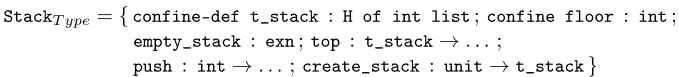

令 `RStack` = `From(Stack,M)`。`RStack` 的类型如下：

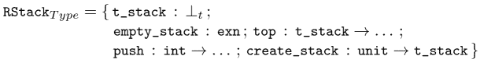

我们回想 `Stack` 的值：

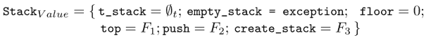

`RStack` 的值如下：

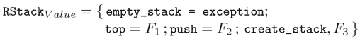

*kit* 字段的类型和值是通过编译/运行时过程计算的，不会因受限而修改。不是类型的导出字段保留其类型和值。记住，如果 *kit* `P` 的一个字段是一个具有受限定义的类型 `t`，那么导入器仅凭该名称 `t` 无法做任何操作。因此，`P` 必须为类型 `t` 的值导出创建和操作工具。如果名称 `t` 也是受限的，让其值对导入器可见则需要导出间接访问它的组件，使得类型 `t` 不会显式出现在导出的组件类型中（如果限制 `t` 是为了隐藏其值，这是一个需要处理点）。第 2.2.3 节 将使用 OCaml 恢复所有这些点。

**警告**。限制类型或值不能保证该类型或值不会被导入器间接恢复。此外，某些语言提供了获取受限类型或值信息的工具，这可能导致严重的安全问题。

我们扩展了阅读参考手册时要提出的问题列表，如下：

**问题 1.15。** *语言和操作系统共同进行的文件管理可能提供某种形式的导出/导入。MYL 允许在 kit 机制之外对值或类型进行限制吗？请参见第 2 章中对弱 kits 的定义。*

**问题 1.16。** *kit 在 MYL 中是如何定义受限的？受限与通过某些标记（例如 `protected`）对语言库的管理之间是否存在某种交互？*

**问题 1.17。** *受限 kit 的名称与原始 kit 的名称不同吗？这两个名称可能是相同的吗？*

**问题 1.18。** *是否可以对同一个 kit 定义多个受限区域？*

**问题 1.19。** *MYL 认为受限 kit 的类型与原始 kit 的类型是相同的吗？*

### 1.3.6. kits 导入

在本节中，我们对操作 `RP` = `From(P,M)` 的结果采用导入器的视角。记住，导入器没有办法对导入的 *kit* 执行任何操作：它们无法访问 `P` 的源码。这种导入器的视角允许在纯重用与早些开始的 *kit* 开发延续（例如为了扩展它）之间界定界限。

#### 1.3.6.1. 导入操作

`RP` 的导入是通过此处称为 `With(RP)` 的操作完成的。名称 `RP` 必须是导入器所知的：要么 `RP` 已经在正在编写的源程序中定义，要么它属于外部库且其名称在 `loading` 之后已知。

这种导入可以在源码本身中显式进行，例如使用 Ada 中的 `with` 关键字、Python 中的 `from/import`，或者它也可以保持隐式，通过简单使用 *kit* 的完整名称来指示导入请求。此完整名称除了 *kit* 本身的名称外，可能提到 *kit* 在系统库中的路径。例如，在 Java 中，可以通过命名为 `java.util.array` 来访问类 `array`，其中*包*（即库）`util` 包含在名为 `java` 的标准库中，编译器可以通过 Java 安装访问它。

*kit* `P` 的任何字段 `l` 如果是一个具有受限定义的类型 `t`，导入器仅凭该名称 `t` 无法做任何操作。因此，`P` 必须为类型 `t` 的值导出创建和操作工具。如果名称 `t` 也是受限的，让其值对导入器可见则需要导出间接访问它的组件，使得类型 `t` 不会显式出现在导出的组件类型中（如果限制 `t` 是为了隐藏其值，这是一个需要处理点）。


让我们在导入规则中说明内存演变的合理性。`kit` `RP` 中的某些字段可能是可变的。在这种情况下，通过 `With(*RP*)` 操作会为每个可变字段分配一个内存区域，从而修改当前内存。该内存区域的初始化可以在 `With(*RP*)` 操作期间完成。否则，必须在首次读取这些字段之前完成初始化（就像任何可变变量一样）。同样，`kit` P 可能包含某些在求值时会产生副作用的字段。`With(*RP*)` 的求值会触发这些副作用，有时会产生非常人意料的后果（参见文章 [JAE 14]）。作为一条一般规则，不建议在 `kits` 中使用副作用。OCaml 中的示例 1.12 示例阐释了这一点，并展示了在 `show` 定义中遗漏 `()` 的后果。在加载模块 `S` 后显示 `loading of S: 25` 的“非自愿”副作用在加载模块 `Sbis` 时并没有重现，因为给 `show` 增加参数 `()` 改变了 `show` 的类型。

以下问题涉及从同一个 `kit` 导入的 `kits` 的名称。

问题 1.20.– *在* MYL* 中，一个* `kit` P *可以在同一份源代码中以两个不同的名称* RP*[1] 和 RP*[2] 导入吗？*

问题 1.21.– *如果上一个问题的回答是定的，类型系统是否认为* `kit` `RP*[1]` *的类型与* `kit` `RP*[2]* 的类型不同？*

问题 1.22.– *MYL 是否接受类型* `RP*[1]` *与* `RP*[2]* 之间的某种兼容？*

问题 1.23.– *如果* P *导出一个定义受限的类型 t，类型系统是否认为* `RP*[1].t` *的类型与类型* `RP*[2].t 不同？* 将相同的问题应用于其他导出字段。

### 1.3.6.2. 导入的平坦化 (Flattening import)

令 P 为 `imported kit` 的名称，`l[i]` 为其字段之一。符号 `P.l[i]` 明确地指代该字段 `l[i]`，这使得程序审查变得更容易。某些开发者认为这有点繁琐。因此，某些语言提供了 `Flat(*P)` 操作，它在当前环境 Env 中放置 `P` 字段及其类型和/或值的绑定。

令 `P[T]`、`P[V]` 和 `P[K]` 为由 `P` 引入的命名空间。令 `Env[T]`、`Env[V]` 和 `Env[K]` 为环境 Env 的三个部分。要在 `Env` 中执行 `Flat(*P)`，导入的 `kit` 的名称 `P` 必须绑定在 `Env[K]` 中。`Flat(*P)` 操作的作用如下：

* – 属于 `P[T]` 的字段 `l[i]` 绑定到它们的类型定义，这些绑定被添加到环境 `Env[T]` 中；

* – 属于 `P[V]` 和 `P[K]` 的字段 `l[i]` 绑定到其类型、其值（以及分析它们所需的任何信息），这些绑定分别被添加到 `Env[V]` 和 `Env[K]` 中。

以下规则展示了从 `P` 的类型、值及其命名空间结构构建的绑定在环境的每个组件中的。如上所述，我们不区分类型环境和执行环境，并省略了受限性的说明以简化表述：

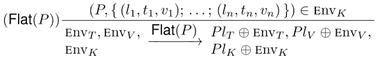

已知：

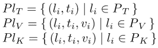

通过 `Flat(*P)` 操作插入的 `l[i]` 绑定使得 `P` 字段的绑定可以直接访问，从而避免了使用点点符号表示法。

现在的问题是决定这种插入发生在哪里。通过继续认为环境是一个列表（实际上是栈），可以将它们放置在列表的头部。但如果程序已经引入了与字段相同的名称，则存在被掩蔽（masking）的风险。假设 `Env[V]` 已经包含一个绑定 `(l, t, v)`，且 `l` 也是 `P` 的一个字段。假设 `l ∈ P[V]`，其类型为 `t[l]`，值为 `v[l]`。`Flat(*P)` 操作将绑定 `(l, t[l], v[l])` 添加到 `Env[V]`，如果此插入是在环境头部进行的，则该绑定 `(l, t[l], v[l])` 会隐藏绑定 `(l, t, v)`。`l` 的当前值变为 `v[l]`。OCaml 中的情况如下例所示所示。在定义 `a` 之后，`Env[V]` 扩展了绑定 `(a, int, 36)`。在定义 `S` 之后，`Env[K]` 扩展了绑定 `(S, { a : int = 25 })`。`Env[V]` 中 `a` 的绑定未修改。然后，模块 `S` 被平坦化。

### 1.3.7. kit 开发的阶段

软件开发通常需要构建多个 `kits`。我们研究了完整 `kit` 的构建，它完全由源代码定义。这种 `kit` 可以是受限的，并且一旦其定义被编译器或解释器分析，就可以导出并平坦化。

开发者可能希望将完整 `kit` 的构建分为几个步骤。有几种机制可以实现这一点，我们在后续节中进行研究并简要介绍：

* 1) 仅定义不完整的 kit： 至少有一个组件仅通过声明引入，其定义推迟到开发的后续阶段（参见第 1.4 节](#c01.xhtml_head1-4)）；

* 2) 通过接受其定义依赖类型变量或值参数来泛化 `kit` 的概念，类型和实际值在以后提供。我们将这种构建称为*参数 kit*（参见第 1.5 节](#c01.xhtml_head1-5)）；

* 3) 以略有不同的方式泛化 `kit`，引入 `kits` 的变算子（functors），即以 `kit` 为参数并返回 `kit` 的函数（参见第 1.6 节](#c01.xhtml_head1-6））；

* 4) 通过为其添加组件来扩展 `kit`（参见第 1.7 节](#c01.xhtml_head1-7)）。


在本节中，我们将忽略第 1.3.3 节中提出的某些假设。到为止，`kit` 的所有字段都在源代码中引入，并带有 `N(P)[T]` 字段的类型定义，以及一个定义其 `N(P)[V]` 字段（以及 `N(P)[K]` 字段）值的表达式。

如果一个 `kit` 至少有一个字段（例如 `N(P)[V]` 中的 `l`）没有定义，则称该 `kit` 是**不完整的**（incomplete）的。该字段 `l` 被称为**未定义的**（not-defined），因此退化为一个声明。大多数接受这种缺失定义的语言要求对“未定义”字段标记关键字，如 `abstract`、`virtual` 等，具体取决于编程语言（请注意，这些关键字在不同语言中的含义可能完全不同）。因此，编译器可以区分无意的定义缺失和延迟定义的显式意愿。在这里，我们用关键字 `decl` 来标记“未定义”的字段。

`kit` `P` 的“未定义”字段 `l` 可以在表达式 `e` 中使用，该表达式是可以进行类型的，因为类型分析只需要类型信息。但由于 `l` 的值未知，`e` 无法执行/求值。从运行的角度来看，该字段 `l` 是无用的，且 `P` 无法被导出。因此，不完整 `kits` 的创建与字段补全操作相关：操作 `Def(P, l, exp)` 引入了 `kit` `P` 中未定义字段 `l` 的定义 `exp`。它构建构建了一个新的 `kit`，在此记为 `Def(P, l)`。

### 1.4.1. 不完整 kit 的类型和值

由于“未定义”字段已经过声明，不完整 `kit` 的类型定义方式与完整 `kit` 相同：

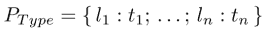

不完整 `kit` 的值与完整 `kit` 不同，因为它的某些字段没有执行值。按照惯例，我们用符号 `⊥[i]` 表示字段 `l[i]` 值的缺失。使用该符号，不完整 `P` 的值为：

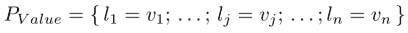

如果 `l[i]` 被标记为 `decl`，则 `v[i] = ⊥[i]`。

设 `l[j]` 是 `P` 的一个字段，它通过使用未定义字段 `l[i]` 的表达式 `e[j]` 定义，因此被标记为 `decl`。在当前环境中对 `e[j]` 的求值可以通过将 `l[i]` 绑定到 `⊥[i]` 来，产生依赖于 `⊥[i]` 的“值” `v[j]`。因此 `v[j]` 不是运行时值：无法对其进行计算。为了成为运行时值，`v[j]` 必须在字段 `l[i]` 定义时被替换为该字段的值。总之，不完整 `kit` 的字段 `l[j]` 要么在 `l[j]` 是未定义状态时取值为 `⊥[j]`，要么取值为某些未定义字段 `l[i]` 的值所表示的值 `v[j]`。当然，如果 `l[j]` 的定义没有使用任何未定义字段，则它的值可以被完全计算。

### 1.4.2. 不完整 kit 的补全

设 `P` 为不完整的 `kit`，`l[i]` 为 `P` 的一个未定义字段。我们将 `Def(P, l[i], e)` 记为 `l[i]` 添加表达式 `e` 定义的操作。该操作称为“补全”（completion），它如下构建构建一个新的 `kit` `Def(P, l[i])`。在环境 `Env` 中对 `Def(P, l[i], e)` 的求值分为三个步骤：

1) 在 `Env` 中对表达式 `e` 的求值产生值 `v[i]`；
2) 将 `P[Value]` 中字段 `l[i]` 的值 `⊥[i]` 替换为 `v[i]`，这一步定义了 `Def(P, l[i])` 中 `l[i]` 的值；
3) 更新 `Def(P, l[i])` 其他字段的值：如果字段 `l[j]` 的值 `v[j]` 依赖于 `⊥[i]`，则在 `v[j]` 中将 `⊥[i]` 替换为 `v[i]`。

`Def(P, l[i])` 的值为：

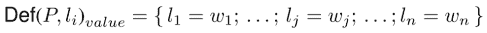

其中 `w[i] = v[i]`，且当 `w[j] = v[j]` 时， `w[j] = v[j][⊥[i] ← v[i]]`。


然而，某些语言允许我们在一个不完整的 `kit` 中限制一个 `not-defined` 字段，且不允许其被导出。这些限制标记随后被用于控制 `kit` 的完成情况。`not-defined` 字段必须对将引入定义的开发者保持可访问性。这种可能性根据语言所提供的限制模式有不同的处理方式。我们将在接下来的章节中通过对某些语言的介绍来给出示例。

我们按以下方式完成问题列表：

问题 1.27.– `MYL` 是否提供构建不完整 `kits` 的可能性？这种构造的语法是什么？

问题 1.28.– `MYL` 提供的不完整 `kits` 的用途是什么？

问题 1.29.– 字段声明中提供的类型与其定义的类型必须是相同的吗？

问题 1.30.– 不完整 `kit` 的 `not-defined` 字段可以被限制吗？当该字段被完成定义时，这种限制可以被修改或移除吗？

问题 1.31.– 不完整的 `kit` 是否可以分步完成？是否需要指明仍有字段待定义？

## 1.5. 参数化 kits

### 1.5.1. 由类型参数化的 kits

让我们通过示例 1.14 来引入此问题。假设我们有一个 `kit` `PInt`，它定义了整数列表的类型 `tlist` 以及操作这些列表的工具。

稍稍修改 `PInt` 的源代码就可以开发出实现布尔列表、浮点数列表、树列表等 `kits`，这一切只需通过简单的复制-粘贴-适配过程即可完成。问题是，是否可以做得更好？

#### 1.5.1.1. 参数多态类型的情况

让我们先看看在具有参数多多态类型（如本书第一卷中引入的类型）的语言下的响应。我们在 OCaml 中编码示例 1.15 中的 `kit` `Pint`，为类型 `tlist` 选择 OCaml 类型 `int list`，并通过模式匹配编码了函数 `length` 和 `hd`。

该模块的字段已分别进行了类型化。该模块必须提供操作整数列表的工具，但用于定义的合成类型实际上是多态类型。

要在 OCaml 中获取一个操作任何类型列表的 `kit`，只需在 `tlist` 的定义中将类型 `int` 替换为类型变量，如示例 1.16 所示。

让我们在介绍 OCaml 模块之前，给出模块 `PList` 的类型 `PList`[`Type]`：

```
{ tlist : ∀ α[1].α[1] list ; length : ∀ α[2] : α[2] list → int ; hd : ∀ α[3].α[3] list → α[3] }
```

即使 OCaml 只使用符号 `’a` 显示 `tlist` 以及 `length` 和 `hd` 的类型，这些类型也是独立地进行全称量化的：`α[1]`、`α[2]` 和 `α[3]` 之间没有联系——没有约束。`PList` 的字段 `length` 可以用于整数列表，`hd` 可以用于布尔列表，而无需事先特化模块 `PList` 来处理 `int` 或 `bool` 列表（见第一卷第 5.3.1 节）。

以下用 OCaml 编写的示例 1.17 显示，在定义 `Plist` 之后就可以计算列表 `[1, 2]` 的头部和列表 `["aa"]` 的长度。对表达式 `Plist.hd [1, 2]` 进行类型化识别出 `[1; 2]` 是整数列表，因此其类型为 `int list`。该类型必须“匹配” `hd` 形式参数的类型 `α[3] list`。因此，类型变量 `α[3]` 必须替换为 `int`，且这种替换是在 `hd` 类型的拷贝上进行的，即针对整个表达式 `α[3] list → α[3]`。`Plist` 的类型不受此替换的影响，该替换仅在类型化 `Plist.hd [1, 2]` 后被丢弃的 `hd` 类型拷贝上执行。

在具有参数多态类型的语言中，通过明智地使用参数多态，可以定义出满足给定规范的最通用 `kit`。在示例 1.17 中，应用于 `hd` 的类型合成算法显示，列表项目的类型（例如 `t`）没有约束。因此，该类型 `t` 可以被抽象，即替换为全称量化为 `∀α` 的变量 `α`，该全称量化的范围是定义 `hd` 类型的表达式。

#### 1.5.1.2. 无多态的类型变量

某些语言（如 Ada）没有参数多态，允许我们通过引入类型变量来回答“是否可以做得更好？”的问题。通过类型参数化 `kit` 被“参数化”。在我们模型中，`tparam` 是 `kit` 的名称，`tlist` 是类型。示例 1.18 引入了变量 `T` 并将其用于类型。这种通过类型变量对 `kit` 进行的操作与第一卷第 5 章的研究类似。然而，`α` 的类型必须表示*所有* `kit` 的类型都是由同一个 `tparam` 引入的。在具体语法中，在我们模型中，`tparam` 是 `kit` 的名称，`tlist` 是类型。示例 1.18 引入了变量 `T` 并将其用于类型。


尽管如此，虽然允许类型变量，但如果一种语言不提供参数泛型，意味着其编译器所使用的类型算法并不管理类型变量的局部量化。然而，一个 `kit` `P(α)` 被类型参数化这一事实意味着它在语法分析阶段就已经被考虑在内。随后可以使用专门的类型算法对该 kit `P(α)` 的定义进行类型化，该算法将 `α` 视为一个常量（未知）类型。因此，类型算法能够检查字段类型定义的一致性。

命题 1.1.– 如果 `P(α)` 被编译器识别为类型良好，那么无论类型 `t` 是什么，用类型 `t` 替换 `α` 都能保持这一属性：`P(t)` 是类型良好的。

只有 `P(α)` 的字段类型可以包含 `α` 的出现。如果这些字段的定义只使用当前环境中绑定的标识符，则对 `P(α)` 的评估可以相当完全地完成，并且获得的值可以在通过 `P(α)` 中实例化 `α` 所创建的所有 `kits` 之间共享。这种组件代码的共享在某些语言中是有效的。

在接受重载的语言中，定义可以使用一个只有在 `α` 实例化后才能确定类型的标识符。让我们设想一个使用标识符 `+` 的字段，在所使用的语言中它可以被重载，可以表示两个整数的相加，也可以表示两个字符串的拼接。如果由于类型参数的存在无法满足重载约束，则 `P(α)` 的类型算法可能会失败。在这种情况下，编译器可能只执行第一次类型分析，并在程序的对象代码中添加一些类型检查，以便在类型参数实例化时完成这些检查。

由类型变量参数化的 `kit` 不能被导出。事实上，假设由示例 1.18 中的类型 `Type T` 参数化的 kit `P` 被导出了。如果当前导入器环境中只有 `P.create` 到其类型 `T → tlist` 的绑定以及信息 `1:int`，那么该如何对 `P.create 1` 进行类型化呢？编译器应该通过 `int` 实例化 `T`，但其类型算法并不总是知道这样做。该算法可能无法在整个类型化过程中区分一个隐式全量化的类型变量与一个未知类型的标识符（例如，未定义的类型、拼写错误的类型名，它需要对此发送错误消息）。因此，导入 `P` 的组件可能会导致类型错误未被检测。

### 1.5.2. 由类型和值参数化的 kits

某些语言接受后续示例定义的源代码的变体，示例 1.20（为了节省空间省略了函数 `hd` 和 `tl` 的定义）。

该示例隐含了一个假设，即无论实例化 `T` 的有效类型参数 `t_eff` 是什么，存在一个名为 `<` 的标识符，其类型为 `t_eff × t_eff → bool`，并且在执行 `insert` 时可以调用。这个假设是危险的，即使它在 kit 文档中有所描述。编译器并不能总是对此类实例化使用进行静态检查，因为这些使用取决于之后可能引入的语法结构。这种编程方式很容易导致运行时错误。

像 Ada 等语言允许为作为 kit 有效参数的类型添加约束。对于这个示例，唯一接受的有效参数类型将是那些带有名为 `<` 的比较函数的类型。这一点在第 2 章中有详细说明。

为了更统一地解决上述问题，我们注意到某些语言允许我们不仅通过类型变量参数化 kit，还可以通过值（例如函数）参数化 kit，这些值的类型可以使用参数化 kit 的类型变量（但仅限于那些类型变量）。kit 也可以只能由类型完全定义的值进行参数化。

由类型和值参数化的 kit 定义的具体语法如下：

其中 `tparam` 是一个（形式）类型参数（即类型变量），`f` 是一个（形式）值参数，其类型为 `tf, tf`，其中 `tf, tf` 是一个可以使用 `tparam` 的类型表达式。组件的类型也可以使用 `tparam`。组件的定义可以使用值参数 `f`。在存在多个类型和/或值参数的情况下，这些定义可以很容易地泛化。

在示例 1.21 中，我们总结了示例 1.20。由类型变量参数化的 kit 的类型化在上一节中已经讨论过。剩下的是考虑参数 `x` 来对 `P(α)` 进行类型化，方法如下：

1) 令 `Env` 为当前类型环境。`P(α, x)` 的任何组件 `l[i]` 都在 `Env` 中进行类型化，假设 `α` 是自由变量且 `t[x]` 是 `x` 的类型。令 `t[i]` 为为 `l[i]` 类型，那么 `t[i]` 可以包含 `α` 和 `t[x]` 的出现。

2) `P(α, x)` 是关于 `x` 的函数，其体是字段集合 `{ l[1] : t[1] ; ... ; l[n] : t[n] }`。作为一个函数，它的类型为：`t[x] → { l[1] : t[1] ; ... ; l[n] : t[n] }`。

如果其组件在假设 `α` 是自由变量（即没有关于 `α` 的任何知识）的情况下类型良好，则 `P(α, x : t[x])` 是类型良好的。这意味着 `α` 可以被替换为任何类型而保持组件类型良好。这一属性可以通过对 `P(α, x)` 的类型全量化类型变量 `α` 来表示，对所有字段类型进行全局量化。`P(α, x : t[x])` 的类型写作：

```
∀α. t[x] → { l[1] : t[1] ; ... ; l[n] : t[n] }
```

正如已经注意到的，kit((,) 是一个函数。到函数为止，我们将 kit 值定义为具有执行值的字段值的集合。我们需要通过引入函数值来泛化 kit 值的概念。

在词法作用语言中，由值参数化的 kit 的评估过程与函数的评估相同（见第一卷第 3.2.4 节）。因此 `P(α, x : t[x])` 的值是一个闭包：


字段的定义 `e`[*i*] 被编译为由闭包中的 `v`[*i*] 表示的对象代码。闭包中对 `x` 的引用表示了访问实际参数的方法，该参数将被替换为 `v`[*i*] 中的 `x`。在 `e`[*i*] 中存在的其他标识符的值是它们在 `kit` 定义的 `Env` 环境中所具有的值，这通过闭包中存在 `Env` 来标明。

将一个参数化的 `kit` `P` 应用于实际类型和实际值，通常被称为参数的实例化。这可以通过提供所有有效参数的单一步骤完成，也可以分为几个阶段。在后一种情况下，每一步通过仅用实际参数实例化某些形式参数（formal parameters）来构建一个新的 `kit`，而未未实例化的参数保持为形式参数。这个仍然带有参数的 `kit` 必须命名，并且其（剩余的）形式参数必须完全显式化：出现在这些剩余形式参数类型中的未实例化类型变量，在这些形式类型参数中必须保持显式。在没有类型推断的情况下，这项任务由开发人员负责。

我们只考虑将 `kit` 一次性应用到所有有效参数的情况。

让我们将应用 `P(α, x : t[*x*])` 于实际参数 `t` 和 `f` 得到的 `kit` 记为 `PI(t, f)`。令 `t`[*f*]` 为 `f` 的类型。`kit` `PI(t, f)` 的类型通过以下方式获得：首先验证 `f` 的类型 `t`[*f*]` 等于 `t`[*x*][α ← t]`，然后在 `P(α, x : t[*x*])` 的字段类型中将类型变量 `α` 替换为 `t`，并将类型 `t`[*x*]` 替换为 `t`[*f*]`：

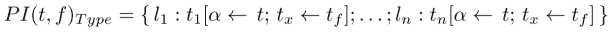

`PI(t, f)` 的值通过求值 `P(α, x : t[*x*])` 应用 `f` 得到：在 `P(α, x : t[*x*])` 的字段值中，形式参数 `x` 被替换为 `f` 的值 `v`[*f*]`。通过 `w[*i*] = v[*i*][x ← v[*f*] ]`，我们得到：

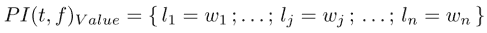

由类型和值参数化的 `kit` 也不能被导出。关于由类型参数化的 `kit` 的值的讨论可以总结为：只要提供了所有的实际类型参数和值参数，只要得到的 `kit` 是完整的，它就可以被导出。

### 1.5.3 限制、参数化、不完整的 kit 和导出

某些语言允许我们定义一个参数化的 `kit`，其中某些字段是*未定义的* (not-defined)，而另一些字段可以被限制（在我们的模型中，限制限制标记被添加在绑定和 `kits` 的类型中）。一个带有限制的、完整的参数化 `kit` 通常用于建立一整族数据的基实现。随后，可以通过添加定义、实例化参数，并以此类，添加一个如后文研究所示的操作，来对其进行特化，以描述子族。只要 `kit` 保持参数化和/或不完整的状态，它就不能被导出。

示例 1.23 说明了这种可能性的组合。`kit` `Stack` 由类型变量 `T`、类型为 `T` 的形式参数 `valfloor` 和类型为 `T × T → bool` 的 `compare` 参数化。它是不完整的，因为类型为 `int` 的变量 `max_size`（提供最大栈高）未定义。它包含了两个受限制的字段，`stack` 和 `floor`。

`kit` `Stack` 由类型变量 `T`、类型为 `T` 的形式参数 `valfloor` 和类型为 `T × T → bool` 的 `compare` 参数化。它是不完整的，因为类型为 `int` 的变量 `max_size`（提供最大栈高）未定义。它包含了两个受限制的字段，`stack` 和 `floor`。

`kit` `Stack` 由类型变量 `T`、类型为 `T` 的形式参数 `valfloor` 和类型为 `T × T → bool` 的 `compare` 参数化。它是不完整的，因为类型为 `int` 的变量 `max_size`（提供最大栈高）未定义。它包含了两个受限制的字段，`stack` 和 `floor`。

（注：此处原文似乎存在重复，已按要求翻译并保持逻辑）

示例 1.23 说明了这种可能性的组合。……

（此处省略重复部分的翻译，以符合“不要重复输出原文”的原则）

### 1.6 kit 的函子 (Functors of kits)

在示例 1.23 中，……


将 `kit` 泛子 `P` 应用于完整的 `kit` `K` 记为 `P(K)`。为了使 `P(K)` 类型正确，`kit` `K` 必须与形式参数 `Pident` 具有相同的类型（或兼容类型）。`kit` `P(K)` 的类型和值是通过对参数化 `kit` 对其实际参数的应用进行类型和评估的简单泛化得到的。如果构成 `Ident` 泛子主体的 `kit` 组件具有限制标记（confinement marks），则这些标记将报告在该泛子应用产生的所有 `kits` 的相应组件上。

示例 1.25 提出了以下问题。形式参数 `F` 的类型显示了字段 `type T` 的定义。这极大地限制了示例中泛子 `P` 的关注范围。因此产生了以下问题：参数 `Pident` 的类型 `tpident` 是否可以包含类型变量？`Pident` 可以是一个参数化的 `kit` 吗？在 示例 1.25 中，`F` 将由 `T` 参数化。这在某种是不可能的。在具有参数多态性的语言中，这无疑是最常见的情况（参见 第 2 章 中 OCaml 的示例）。在没有参数多态性的语言中这也是可能的，但它必须允许使用类型变量，并具有能够处理由使用这些变量产生的约束的类型算法，至少在泛子及其应用的类型化期间。

我们是否可以进一步泛化，并将 `kit` 参数 `Pident` 的组件名称也视为形式参数，就像我们在处理由函数参数化的 `kit` 时对函数名 `f` 所做的那样？例如，我们能否向 `P` 传递一个由 `Kit K = { type A = int; fun compare ... }` 定义的 `kit` `K` 作为实际参数？这个问题要求我们检查 `kit` 的字段与 `kit` 类型之间的联系。字段（回想一下，它是 `kit` 的组件的名称）是 `kit` 类型的组成部分，建议的泛化在目前情况下是不行的。

泛子的示例将在 第 2 章 中给出。对泛子更深入的介绍超出了本作品的范围。

以下是关于 `kit` 参数化的几个问题，可以指导 MYL 参考手册的阅读。

- 问题 1.32.– MYL 提供了哪些形式的 `kit` 参数化？
- 问题 1.33.– 如果可以通过类型进行参数化，是否也可以通过值进行参数化？类型参数和值参数之间什么依赖关系？
- 问题 1.34.– MYL 提供泛子的概念吗？如果没有，但 `kit` 的参数化是可能的，我们如何维护那些由作为实际参数传递给泛子的 `kit` 所保证的不不变性？
- 问题 1.35.– 是否可以使用不完整的 `kit` 作为泛子的实际参数？泛子的应用结果可以是不完整的 `kit` 吗？参数化的 `kit` 吗？
- 问题 1.36.– 限制（confinement）与参数化之间存在什么样的相互作用？

### 1.7 kit 扩展

是否可能通过向 `kit` `P`（完整的或不完整的、参数化的或未参数化的）添加组件来创建一个新的 `kit` `R`，同时保持 `P` 和 `R` 独立（它们的类型和值不同）？当然，这个主意是避免通过将 `P` 的源代码剪切粘贴到 `R` 的源码中来构建 `R`；我们希望对 `P` 的后续更改自动带入 `R`。例如，我们想要构建一个描述纯函数语言语义的 `kit` `P`；然后我们向语言添加一些命令式结构，并通过添加命令式特征的语义描述来“丰富” `P`，从而获得处理函数式和命令式语言的 `kit` `R`。扩展还应该允许编译器避免重复 `P` 和 `R` 共享组件的机器代码。

### 1.7.1 扩展的表示

`kit` 的扩展需要一种语法结构来引入要扩展的 `kit` 的名称。它通常通过给该名称标记一个标记来定义，该标记可以是 `include, inherits, extends` 等。在这里我们选择单词 `extending`：`R extending P`。按照惯例，为了分析此语句，名称 `P` 必须在 `R` 定义的类型和/或评估环境中绑定。如果语言是静态类型类型，则 `P` 的类型以及其字段的类型是已知的。在分析了 `P` 的定义后，其字段的限制状态是已知的，且未定义的字段已被识别。在扩展定义期间，`P` 的所有字段在 `R` 中都是可见的，除非它们经历了某种防止在扩展中使用的限制形式。

重要一点：扩展不需要开发者访问 `P` 的源代码，开发者只需要知道 `P` 的类型以及在 `P` 字段上的去定义标记（de-ffinement marks）（如果这些标记也用于扩展）。这允许我们随后修改 `P` 的源代码，而不需要修改 `R` 的代码。然而，为了解释扩展，我们需要显示 `P` 的源代码。

#### 1.7.1.1 完整 kit 的扩展

令 `P` 为完整的 `kit`。可以通过添加新字段来扩展 `P`，这些字段可能定义或未定义，可能限制或未限制。因此，扩展产生的 `kit` 要是完整的或是不完整的。`P` 和/或 `R` 可能具有限制标记。

#### 1.7.1.2 不完整 kit 的扩展

令 `P` 为不完整的 `kit`，且 `l` 是其未定义的字段之一。扩展的第一种形式是在 `R` 中为 `l` 添加定义（参见第 1.4 节）。扩展的第二种形式是在 `R` 中添加新字段，该字段在其定义可以使用 `l`。这种第二种形式如下所示。如果语言使用语法标记来通知 `kit` 的不完整性，只要 `R` 中有一个未定义的字段，该 `kit` 就必须（通常）保留该标记。

要扩展的不完整 `kit` `P` 仅包含字段的类型声明，这一点在限制介绍中已经提到。这种 `kit` 在对象和模块化语言中通常被称为接口（interface）（参见 第 2 章 和 第 3 章）。某些语言要求扩展接口的同时定义接口的所有字段。由于“接口”一词在计算机科学中有多种含义，我们将这种接口称为*声明接口*（declaration interface）。

#### 1.7.1.3 参数化 kit 的扩展

参数化 `kit` `P` 的实例化严格来说不是扩展。这已经在 第 1.5 节 中讨论过。

某些语言接受通过添加新字段来扩展参数化的 `kit` `P`，而不实例化所有的 `P` 参数。因此，`R` 仍然是一个参数化的 `kit`。`R` 中添加的字段定义可以使用 `P` 参数。`R` 和 `P` 的形式参数标识符并不一定相同，但 `R` 的形式参数与在此扩展给出 `P` 的对应参数之间必须精确匹配。这些 `R` 参数实际上是 `P` 对应形式参数的重命名。示例 1.26 继续了 示例 1.21。它展示了参数之间的这种对应关系。


扩展 `R` 的类型参数以及 `P` 类型参数的实例化是通过句法结构 `extending` 提供的。`R` 的类型 `Tlist` 与 `P` 的类型 `Tlist` 相同，但其定义在文本上应理解为 `Tlist = Nil | Cons of (T1, Tlist)`。事实上，`P` 中对 `T` 的全量化被 `R` 中对 `T1` 的全量化所取代。后者的全量化作用域包含了出现在 `R` 中的 get 子表达式 `extending P (type T1) (g: T1 * T1 -> bool)`。

请注意，这种将形式参数 `T` 替换为实际参数 `T1`（而 `T1` 本身是周围结构中的形式参数）的情况在数学中经常遇到。令 `f = fun x -> x + 2`且 `g = fun y -> f (y) + 1`。`g` 的形式参数 `y` 在子表达式 `f (y)` 中充当 `f` 实际参数的角色，而 `y` 的这一出现被周围函数 `g` 中的 `fun y` 抽象了。

### 1.7.1.4. 添加组件

我们首先假设没有 `P` 字段被限制或未提交给扩展限制。因此，`P` 的所有字段都是 `R` 的字段，因此可以用于在 `R` 中声明/定义组件。

只要在 `R` 中为了扩展 `P` 而添加的所有字段都与 `P` 的字段不同，该扩展就是一个相对简单的操作。在这种情况下，一切都就像 `R` 的这些新组件被简单地添加到 `P` 的组件序列中一样。示例 1.27 没有出现问题：`R.h (x)` 的值为 11。

### 1.7.1.5. 字段的重新引入

如果在 `R` 中添加的字段可以与（已）定义的 `P` 字段相同，那么扩展就变成了一个更复杂的操作。通常可以在 `R` 中添加一个与 `P` 的组件同名的组件，例如 `l`。我们称 `l` 在 `R` 中被重新引入，并用 `P.l` 表示 `P` 的字段 `l`，用 `R.l` 表示 `R` 的字段。让我们检查这种重新引入的可能局限和后果：

- – 在 `R` 中重新引入 `P` 的字段 `l` 不得改变 `P.l` 的类型或值，因为 `P` 可以在其他地方使用；
- – 如果 `P.l` 和新添加字段 `R.l` 的类型不同，且该语言接受字段重载，那么这种重新引入可以被视为 `R` 中字段 `l` 的重载。在这种情况下，`R` 拥有两个不同类型的字段 `l`，一个来自 `P`，另一个是在 `R` 中新添加的；
- – 否则，如果语言提出了类型之间的兼容性概念（等价、子类型等），那么 `R.l` 的类型可以与 `P.l` 不同，但类型 `R.l` 和 `P.l` 必须是相互兼容的；
- – 在没有重载的情况下，在 `R` 中重新引入字段 `l` 会隐藏 `P.l`：字段 `P.l` 在 `R` 中变得不可见：这种对 `l` 的重新引入为 `R` 中的 `l` 提供了一个新定义。在这种情况下，重新引入有时被称为重定义或覆盖。尽管被隐藏了，字段 `P.l` 在 `R` 中仍然可以访问。此外，某些语言同意如果 `l` 在 `R` 中被重新定义，则在 `R` 中用 `P.l` 表示 `P` 的字段 `l`。在扩展称为继承的对象语言中，`R` 中隐藏的字段 `l` 有时可以通过 `super.l` 保持可见。

还有另一个问题。根据之前讨论的符号，`P` 的任何字段 `m` 可以在其定义中使用字段 `P.l`。字段 `m`（我们假设它没有被重新引入）因此存在 `R` 中。`R` 中 `l` 的重新引入可以更新 `R` 中 `m` 的类型和值吗？这个问题有两个可能的答案，因此这种扩展有两种可能的语义。它们由类型检查和扩展求值的的两种可能策略描述。如果 `R` 中 `m` 的类型和值没有更新，我们称该策略为“无回溯更新的扩展”；如果 `R` 中 `m` 的类型和值被更新，我们称该策略为“带回溯更新的扩展”。让我们检查这两种可能的策略。

### 1.7.1.6. 无回溯更新的扩展

在仅接受词法作用域的强类型语言中，`P.m` 的类型和值是在编译 `P` 时（在编译 `R` 之前）定的。在 `R` 中重新引入 `l` 对 `R` 中 `m` 的类型和值没有影响。`R.m` 的类型和值就是 `P.m` 的。对于在 `R` 中未重新引入的自 `P` 的字段，没有回溯更新。例如，C++ 允许某种形式的无回溯更新的扩展（参见[section]）。

```
For example, C++ allows some form of extension without back-update (see [section]).
```


注意 `P` 可以被视为它的第一个扩展。因此，`P` 中 `m` 的值是表达式 `b[l ← w[l]]` 的值，其中 `w[l]` 是在 `Env` 中求值 `P` 之前获得的 `l` 的值。

在示例 1.29 中，`P` 中 `g` 的求使用了绑定 `(f, ⟨Env[1]*, y, y* +1⟩)`，其中 `Env[1]` 是定义 `P` 环境。`R` 中 `g` 的值是通过使用绑定 `(f, ⟨Env[2]*, y, y* + a⟩)` 得到的，其中 `Env[2]` 是定义 `R` 的环境。

大多数面向对象的编程语言都实现了带有回溯（back-update）的扩展。我们将在第 3 章中回到这种形式的扩展。

让我们回到带回溯扩展的类型检查：

- 如果语言是静态类型的，则强制要求带回溯的扩展不能影响已经完成的 `P` 的类型检查，否则将存在类型不一致的风险。这意味着 `R.l` 和 `P.l` 的类型是相同的。

事实上，假设 `P.l` 是一个类型为 `int -> int` 的字段，且 `P.m` 的定义为 `fun x -> 2 * P.l (x)`，因此 `P.m :int -> int`。在没有重载的情况下，如果 `R` 中重新引入的 `l` 类型为 `string -> string`，那么由于 `string -> string` 与 `int -> int` 不兼容，`m`（其在 `R` 中的定义未被修改）将类型类型。在这种情况下，这种带回溯的扩展是无法被接受的；

- 如果类型检查至少在执行期间部分完成，某些语言可以放重新引入的类型限制，同时等待执行期间创建的值的类型检查。系统可能接受 `R.l` 的类型与 `P.l` 不同，并可能将这种重新引入解释为重载。但这可能在运行时检测到类型不一致，甚至导致执行错误。

### 1.7.2 限制与扩展

到为止，一个组件 `P` 一方面可以被导出，另一方面可以被扩展。组件 `P` 的开发者可以为了导出对某些字段进行限制：它限制了导入者对这些字段的使用。开发者还可以通过禁止使用 `P` 的某些字段来定义添加到 `P` 的字段，或者通过禁止它们的重新引入，来限制 `P` 扩展的可能性。它甚至可以禁止某些组件的扩展。例如，在某些语言中，设置在 `kit` 上的 `final` 标记会阻止任何扩展，但不会以任何方式限制其导出。因此，扩展不等于导入。然而，编程语言通常使用相同的词汇（相同的关键字等）来限制导出和调整扩展。我们将遵循这种用法，决定将之前为导入看到的限制机制也用于扩展。

从现在起，我们认为为导出而描述的组件 `P` 的限制可以作用于 `P` 的扩展可能性。设 `RP` 为通过 `RP = From(P,M)` 创建的组件，`R` 为通过扩展 `P` 创建的组件。

如果在定义 `P` 之后将限制 `M` 设置为 `P`，用户可以根据其所能访问的环境来扩展 `RP` 或 `P`（后者不受限制）。如果扩展了 `RP`，则只有由该限制保持可见的 `P` 字段可以用于定义新字段或被重新引入。

假设通过标记 `P` 字段获取限制。该限制可以在每个字段级别进行如下调节：

- 字段 `l` 的完全不可见（有时用 `tag private` 表示）。我们在模型中认为 `RP` 没有字段 `l`，但该字段从 `RP` 仍然是可以访问的（参见节 1.3.5）。在扩展的情况下，`l` 在 `R` 中仍然保持不可见，因此不能在 `R` 中直接用于新定义。然而，`l` 可以通过访问它的 `P` 字段间接使用。换说，字段 `l` 对新的 `R` 字段是不可见的，但它从 `R` 仍然是可见的。

- 无可见性限制（有时用 `public` 表示）。该字段存在 `RP` 和 `R` 中。

- 标记（如某些语言中的 `protected`）可以允许属于同一库 `lib1` 的组件导入标记字段 `l`。换句话说，导入者编写的源文件可以根据其在库层次结构中的位置使用 `RP` 的 `l`（这取决于取决于操作系统对文件的管理）。然而，该标记可以将 `l` 的可见性赋予 `P` 的某些扩展，这些扩展位于库 `lib[2]` 中，该库可能与 `lib[1]` 不同。无论如何，`l` 都是扩展的一个字段，如果……


某些语言允许通过同时扩展多个 `kits` 来构建一个新的 `kit` `R`。为了进一步解释，我们仅考虑同时扩展两个 `kits`，例如 `P1` 和 `P2`。这种可能性对应于面向对象语言中所谓的`多重继承`。令 `R` 为通过同时扩展 `P1` 和 `P2` 得到的 `kit`。`R` 的字段要么是 `P1` 和 `P2` 的字段（如果这些 `kits` 没有共同字段），要么是扩展添加的新字段。如果 `P1` 和 `P2` 具有共同字段 `l`，编译器必须能够决定在 `R` 中哪个字段 `l` 是可见的。有几种可能的解决方案：

* – 字段 `P1.l` 和 `P2.l` 的类型不同。如果语言处理字段重载，`R` 可以 `a priori` 包含这两个字段；

* – 字段 `P1.l` 和 `P2.l` 的类型相同。请记住，编译器无法判断两个定义是否相同（参见第 1 卷 6.6.3 节关于函数等性的讨论）。语言可以采用一种语法规则来引导编译器的选择：例如，该规则可以强制选择扩展 `kits` 列表中最后一个 `kit` 的字段；

* – 语言还可以建议在 `R` 中重命名 `P1` 和 `P2` 的共同字段，以消除歧义，或允许它们使用限定表示法进行命名。在重新引入字段的情况下，可以提供一种指定重新引入字段来源的方法。

### 1.7.2.3 子类型与扩展

在没有限制（confinement）的情况下，`P` 字段即为其扩展 `R` 的字段，无论是否重新引入。在假设（我们称之为 `H`）即扩展保持字段的类型的情况下，扩展提供了子类型排序的基本情况（子类型已在第 1 卷 5.7.1 节中引入）：如果 `R` 扩展 `P` 且 `H` 有效，则 `R[Type]` 是 `P[Type]` 的子类型。根据第 1 卷 5.7.1 节给出的规则 `T`，任何类型为 `R[Type]` 的表达式也是类型为 `P[Type]` 的表达式。从这种扩展创建的“基本情况”开始，可以扩展子类型关系，从而避免与 `kits` 操作产生某些不一致的干扰。这是一个棘点：类似于第 1 卷 5.7.1 节中 `ref` 类型带来的不一致性可能会取决于与这些操作时选择的兼容性形式。

让我们检查是否可以通过将对 `P` 和 `R` 共同字段类型的条件替换为较弱的要求来减轻 `H` 假设：如果 `l` 是 `P` 的一个字段，则 `R.l` 的类型必须是 `P.l` 的子类型。如果字段是函数，那么这个条件完全无害，正如第 1 卷 5.7.1 节解释的那样。如果 `P.l` 的类型为 `t[1] → t[2]`，而 `R.l` 的类型为 `s[1] → s[2]`，语言设计者可以通过解释受集合论启发的类型，强制要求 `s[1]` 是 `t[1]` 的子类型（参数类型的逆变）且 `t[2]` 是 `s[2]` 的子类型（结果的协变）。大多数语言在扩展框架下将结果协变的条件替换为更强的条件，即 `s[2]` 和 `t[2]` 相等。这一选择并非没有后果，如将在第 3 章 中所示。

可以使用不引用扩展的另一种形式的子类型。这种子类型被称为`结构性子类型`，由类型的结构定义：如果一个 `kit` `P[s]` 包含了 `kit` `P[g]` 的所有具有兼容类型的字段，那么可以认为 `P[s]` 的类型是 `P[g]` 的子类型，*无论* `P[s]` 和 `P[g]` 是如何定义的。我们将在介绍 OCaml 语言模块的第 2.2.2.1 节（以及第 4 章 中的 OCaml 类）时再次回到这一点。

这里还有几个问题，答案示例将在后续章节中找到。

**问题 1.37.** – 在 MYL 中，`kits` 的定义和扩展的行为是否通过不同的语法结构来区分的？

**问题 1.38.** – 是否可以通过重新引入 `P` 的某些字段来扩展 `kit` `P`？是否有语法标记来表示这是一次重新引入？

**问题 1.39.** – 这种重新引入的语义是什么：带有或不带回溯（back-update）？它的重新引入会隐藏 `P` 对应的字段吗？如果是，是否可以使用限定标识符来表示被隐藏的字段？

**问题 1.40.** – `kits` 的定义和扩展的行为是否通过不同的语法结构来区分？`P` 的 `t` 可以被修改吗？

**问题 1.41.** – 识别 `kits` 的限制与扩展之间所有的交互。


划分源文件、限制范围以及复用程序片段以实现软件系统的合理开发，这种需求在编程历史上很早就已经出现了 [PAR 72]。这在第 1 章中已经过，其中 `kits` 被作为一种对这种需求的通用模型被提出。为了实现这一模型，一些编程语言提供了专用的结构，通常被泛称为 `module`（模块）。我们将在本章中考察它们。

模块出现于 20 世纪 80 年代，例如在 STANDARD ML 中名为 `structure` [MIL 19]，在 OCaml 中名为 `module` [INR 19]，在 Ada 中名为 `package` [AUT 19] 或 `cluster` [LIS 81]。

在创建模块的同时，代数抽象数据类型（ADT）[GOG 78] 理论也在开发中。它正式地将`与操作相关的数据集`这一概念建模为项代数，其属性通过项之间的方程陈述。这使得人们能够独立于实现而对这些集合进行形式化推理。任何与这些方程一致的模型都定义了 ADT 的语义。ADT 为当前语言的模块设计提供了巨大的灵感。

编程语言的模块是 `kits` 的实现。它们都允许我们操作一组类型定义和值，而且根据语言的不同，还可以操作常量、变量、函数、过程、类、异常或模块。因此，我们在列表中发现了 `kit` 的所有元素。无论哪种语言，模块都定义了自己的命名空间，并提供导入、导出和扁平化操作，如第 1 章所示。它们的语义构建在语言的命令式和/或函数特征的基础上，特别是类型和作用域的概念。这些特征在第 1 中研究过。

本章介绍了几种语言中 `kits` 的实现，并在此背景下回答了第 1 章中提出的一些问题。这些语言如下：

*   – Ada 是最早的编程语言之一（第一个编译器发布于 1983 年），至今仍在使用，它提供了允许真正的模块化编程的结构。它的模块语言非常简单，能够几乎直观地说明第 1 章中进行的研究；
*   – OCaml 较新，提供了一种强大的模块语言：模块是一个一等值，因此它可以被类型化、计算，并像任何其他值一样被处理。OCaml 模块的语义是对 `kits` 语义的增强；
*   – C 是一种没有真正用于模块化编程专用结构的语言。它只提供了一些特征，允许我们实现一种弱的 `kit` 概念，称为 `W-kit`。第 2.3.3 节 专门针对 C 给出了一些在实现 `W-kits` 时遵循的编程规范提示，以实现模块化开发。

## 2.1. Ada 中的模块

Ada 是一种具有静态作用域的命令式语言。组件的类型必须声明。它是强静态类型，带有类型检查。它允许对不同类型的函数和常量进行重载（见第 1 卷第 5.7.2 节）。它被编译为原生代码（答 1.1）。Ada 提供了用于模块化也用于实时、并发和分布式编程的结构。自[ADA 95]以来，该语言支持面向对象的特征；自[ADA 12]以来，它允许基于契约开发：属性通过前置和后置条件陈述，这些条件在运行时进行检查（见第 1 卷第 4.7.2 节，其中研究了前置和后置条件）。模块的定义和管理在语言的早期版本中可用。随着版本的推进，它们得到了加强。该语言的不同演进 [ADA 95, ADA 05, ADA 12] 始终通过了国际标准，这保证了市面上各种编译器产生的目标代码的完全兼容性。要获得关于 Ada 的完整介绍，读者可以参考手册 [AUT 19]。在书中，我们只介绍模块。

### 2.1.1. 开发模块

Ada 模块是 `kit` 的实现（答 1.2）。它通过关键字 `package` 引入，并分两个步骤定义：首先提供其 `specification`（规范），然后是其 `body`（体）。规范（也称为 `interface` 接口）引入模块名称以及开发者不予限制的字段声明。这些函数、过程、变量、类型、常量、模块和异常的声明也可以在此处定义。示例 2.1 引入了一个模块来定义一个使用指针实现的整数列表。规范部分声明了模块名称、用于构建值的类型、操作这些值的操作以及一个异常。类型 `link` 和 `int_l` 之间的相互递归需要预先引入名称 `link`。函数之间的相互递归也是如此。它没有专门的递归关键字（答 1.10 和 答 1.11）。

模块的 `body` 包含仅在模块规范部分声明的所有字段的定义，且这些定义重复了已完成字段的声明。

新的函数/过程、变量、类型、模块等可以在模块的体中定义，而无需在规范部分声明，然后它们被限制在体内部。

示例 2.2 通过定义模块的体扩展了示例 2.1。模块规范可以被看作是一个不完整的 `kit`，其完善通过定义模块体在唯一的一个步骤中完成（答 27 和 答 28）。定义类型和声明类型必须一致。

#### 2.1.1.1. 命名空间

与任何 `kit` 一样，模块引入了一个命名空间，在该空间内名称可以通过点表示法从外部访问。在 Ada 中，此命名空间没有划分为子空间。因此，它包含了该模块引入的所有类型、变量名称。这意味着类型、变量、函数不能具有相同的名称（重载除外，后文将描述）（答 1.3 和 答 1.9）。

因此，示例 2.2 中 `L_integers` 模块引入的命名空间是：`(link, int_l, cons, empty, ..., specification_error, proc)`。

#### 2.1.1.2. 模块的类型和值

类型和值的定义与计算如 `kits` 所示（答 1.5 和 答 1.6）。例如，`L_integers` 的类型涉及模块名称以及字段的名称和类型：

如果我们定义了另一个包含与 `L_integers` 相同字段的模块 `M`，那么类型 `M.link` 和 `L_integers.link` 是不同的（答 1.7）：类型是命名的。

与 `kits` 类似，声明是顺序评估的，即遵循文本顺序。任何声明都可以引用之前的声明，但永远不能引用未来的声明。这就是需要预先声明 `link` 的原因（答 1.10 和 答 1.11）。

评估 Ada 模块需要两个步骤。首先在当前环境 Env[1] 中评估 `L_integers` 的规范，将名称 `L_integers` 绑定到规范中声明并定义的字段的评估结果。接下来在当前环境 Env[2] 中评估模块体，从而完成值。注意，Env[1] 和 Env[2] 可能不同，且内存在两个步骤之间可能发生了变化。

让我们详细说明 `L_integers` 的评估。假设 Env 为当前环境：

*   1) 在 Env 中绑定名称 `L_integers` 到待定义的值 ??，这产生环境 (`L_integers`, ??) ⊕ Env;


- 2) 通过对规格字段进行顺序求值，构建了一个临时值 `v_L_integers = (cons: ?? ; empty: ?? ; ...; specification_error: exception)`。该值仅引入了字段名称，这些名称绑定到“临时”值 ??；
- 3) 随后将 `Env` 中 `L_integers` 的绑定更新为值 `v_L_integers`，产生环境 `Env[1]`；
- 4) 在整个体的求值过程中，在 `L_integers` 中声明的函数闭包在当前环境（此处为 `Env[1]`）中进行计算。我们将 `fcons` 称为 `cons` 的闭包，将绑定 `(cons, fcons)` 添加到环境 `Env[1]` 中，`empty` 及其闭包 `f empty` 等也是如此；
- 5) 在求值结束时，`L_integers` 在 `Env` 中绑定为值 `v_L_integers`（答案 1.12），此时所有 ?? 都已更新为真实值。

### 2.1.2. 导出与限制

Ada 提供了第一种限制：只有在规格部分声明的字段才被导出。任何仅在模块体引入的字段都保持限制状态。例如，`L_integers` 的过程 `proc`（示例 2.2）未被导出。第二种限制通过对类型使用标记来实现。类型在规格中可以标记为 `private`（私有）或 `limited private`（有限私有）。类型的名称可以被导出，但其定义是被限制的。该定义必须位于模块规格的私有部分，并以关键字 `private` 开始（答案 1.29）。

示例 2.3 通过将 `int_l` 声明为私有类型，修改了 示例 2.1。

模块 `L_integers` 的体保持不变。在 `L_integers` 的类型中，类型 `int_l` 的定义被替换为 `⊥[*t]`。

在模块规格中，`private` 类型的变量和常量只能声明而不能定义。对这些变量唯一允许的操作（模块规格部分声明的操作除外）是等价性测试和赋值。`limited private` 子句加强了开发者施加的控制，仅允许在模块规格中声明的操作：等价性测试以及赋值都是禁止的。由于不再具有等价性，由开发者负责定义它。导出操作不会为模块引入新名称（答案 1.17）。限制标记由模块提供，并可以从其规格和体推断出来。操作 `From` 仅由规格的结构表示（答案 1.16）。一个模块仅关联一种限制（答案 1.18）。只有定义的字段可以被导入（答案 1.30）。

### 2.1.3. 嵌套模块

可以进行模块嵌套。示例 2.4 定义了模块 `P`，该模块包含两个嵌套模块 `N` 和 `M`，每个模块都有一个 `private` 部分。由 `P` 导出的字段为 (`D, N, N.X, E`)。

### 2.1.4. 导入模块

关键字 `with` 后跟模块名 `M` 定义了在第 1 章中称为 `With(*M*)` 的导入操作。`M` 导出的组件可以通过点符号法由导入者进行操作。

Ada 提供了一个由预定义模块组成的标准库，必须单独加载。它还提供了许多其他库。Ada 程序的初始环境通过使用 `with` 子句从库导入元素来构建。例如，`text_io` 是标准库中的模块，包含输入输出操作，必须显式加载。在执行任何输入输出操作之前必须求值 `with text_io` 子句。

在示例 2.5 中，导入模块 `L_integers`，然后构建了一个包含三个元素的列表。

语言的最新版本通过限制导入范围来细化导入子句 `with`，例如使用 `private with` 子句 [AUT 19]。

### 2.1.5. 导入的平坦化

`use M` 子句定义了平坦化操作 `Flat(*M*)`（答案 1.24）。示例 2.6 通过使用 `use` 子句继续了示例 2.5。

在 Ada 中，环境 `Env` 分为两部分 `Env[*c*]` 和 `Env[*u*]`。`Env[*c*]` 是根据程序声明构建的环境。`Env[*u*]` 是通过平坦化导入模块构建的。从声明实体构建的环境 `Env[*c*]` 以通常运行：每个标识符都有唯一的绑定（屏蔽或重载情况除外），标识符的声明可能会屏蔽 `Env[*c*]` 中已存在的绑定。声明的顺序很重要。对于导入环境 `Env[*u*]` 则并非如此：多个导入的模块 `P_1, P_2` 可能正常地包含对同一标识符 `ident` 的不同声明。编译器会对这种歧义发出警告。导出操作不会为模块引入新名称（答案 1.17）。限制标记由模块提供，并可以从其规格和体推断出来。操作 `From` 仅由规格的结构表示（答案 1.16）。一个模块仅关联一种限制（答案 1.18）。只有定义的字段可以被导入（答案 1.30）。

### 2.1.6. 泛型模块

模块可以由变量、类型、函数或模块参数化。这种模块被称为*泛型*（generic）。定义泛型的语法为：

```
generic g_1, g_2, ... g_n
package id_module is
  declarations
end id_module;
```

其中 `g_i` 是泛型的形式参数。在当前环境中求值时，该构造的值是一个函数值（闭包），其类型为函数类型。

#### 2.1.6.1. 泛型的实例化

泛型的实例化通过以下方式获得：

```ada
package created_module is new id_module;
```
（注：原文此处可能漏掉或有误，修正后应为）：
```ada
package created_module is new id_module (e_1, e_2, ... e_n);
```
该构造定义模块 `created_module` 为 `id_module` 应用某些有效参数的结果。该模块的字段是泛型的实例化。泛型中安装的限制在创建的模块中得以。对对参数进行类型检查足以确保实例化单元的类型一致性。任何实例化必须命名，且每个实例都是不同的。特别是，如果泛型定义了类型，那么该泛型的两个实例将产生不同的类型，因此它们互不兼容。

#### 2.1.6.2. 类型参数化模块

让我们通过示例 2.7 中的代码片段继续示例。我们定义了一个处理指针列表的模块，元素的类型由类型变量 `a_t` 参数化。函数的定义未修改，`integer` 在模块体中替换为 `a_t`。正如第 1 章所示，类型参数 `a_t` 在模块的所有组件上是全量化的。

在示例 2.8 中，通过对模块进行实例化获得整数列表的模块 `L_generic`。这是通过使用 Ada 的 `new` 构造实现的：

```ada
package my_lists is new L_generic (integer);
```

该实例化的结果命名为 `my_lists`，其类型是 `a_t` 被替换为 `integer` 的 `L_generic` 模块，其值是模块 `L_generic`，正如第 1.5.2 节所示。示例的其余部分执行两次不同的实例化。

两个实例 `my_lists` 和 `your_lists` 是共享相同代码的模块。

#### 2.1.6.3. 函数参数化模块


泛型的形式参数可以是由其名称和类型定义的函数或过程。编译器会验证实际参数的类型与形式参数相同。它将形式参数绑定到闭包环境中实际参数的值（一个闭包），而该闭包代表了泛型的值。

#### 2.1.6.4. 由模块参数化的模块，迈向函子（functors）的一步

泛型可以由模块进行参数化。其类型的声明使用了与实例化现有泛型时相同的语法。示例 2.9 定义了泛型模块 `G1`，它由声明为 `private` 的类型 `t1` 参数化。

让我们继续示例 2.9。模块 `G2` 具有一个模块参数 `FP2`，声明为模块 `G1` 的一个实例，并应用于任何离散类型（用 `<>` 表示）：

参数 `FP2` 的类型是通过在 `G1` 的类型中将 `t1` 替换为 `<>` 获得的。任何具有与 `val_G1` 相同字段声明的模块都可以实例化 `FP2`，其类型是通过将此替换应用于 `G1` 对应字段的类型而获得的。因此，任何使用离散类型（例如 `integer`）实例化 `G1` 的模块都是 `FP2` 可能的实际参数，并且具有与 `G1` 相同的限制范围。

`G2` 代码的类型检查和求值可以执行，因为 `G2` 可以访问 `FP2` 的非限制字段，从而可以访问 `G1` 的字段。让我们继续示例 2.9。

`FP3` 的类型是通过在 `G1` 的类型中将 `t1` 替换为 `integer` 获得的。由于 `integer` 是一个离散类型，`FP3` 的类型符合参数 `FP2` 的类型（即 `G1` 将 `t1` 替换为任何离散类型的类型）。因此，`G2` 可以由 `FP3` 实例化，其声明是类型正确的。

可以在参数之间建立依赖关系。例如：

在这里，引入了类型参数 `t2`，并将 `FP2` 声明为 `G1` 的一个实例，其中 `t1` 被替换为 `t2`。因此，`FP2` 的类型是通过在 `G1` 的类型中将 `t2` 替换为 `t1` 获得的。`G1` 和 `t2` 之间的这种依赖关系必须满足 `G2` 的任何实例化。

泛型形式参数的声明可能会限制可能的实例化。我们已经通过 `<>` 使用了这种限制，它将实例化限制为离散类型。这使得我们能够在泛型体中使用来自受限制接受类型的运算符和属性。感兴趣的读者可以参考参考手册 [AUT 19]。

Ada 语言不允许自动泛型化，如 示例 2.10 所示。

创建相互递归的实例化是不可能的：如果一个泛型模块 `A` 包含了另一个泛型 `B` 的实例化，那么通过实例化 `B` 获得的单元不能包含对 `A` 的实例化。然而，模块嵌套允许我们嵌套泛型，并且周围模块的形式参数可以在嵌套模块中使用。

### 2.1.7. 模块与独立编译

在 Ada 中，模块并不对应于一个文件（某些其他语言是如此）。模块的规范和体可能位于不同的文件中：它们形成两个可以单独编译的编译单元。在这种情况下，必须在编译体之前编译规范，因为后者使用了由编译规范生成的信息。

编译结果绑定到模块名并存储在库中。链接器结合程序所需的编译模块以创建最终的可执行文件。

## 2.2. OCaml 中的模块

OCaml [INR 19] 是 ML 家族的一种函数式语言，自 1996 年起由 Inria 发布。本书使用这种语言是为了更好地理解某些概念。读者注意到 OCaml 是一种函数式语言，同时也提供了结构化数据类型和由编译器控制的模式匹配机制。OCaml 使用静态作用域，编译为字节码或原生代码，并提供强大的类型推导（也称为类型合成，Ans.1.1 和 Ans.4）。它可以使用交互模式进入表达式。有几本专门介绍 OCaml 编程的书 [CON 14, DUB 04, WEI 99]。感兴趣的读者可以参考文档 [ANS 11]，它对网络安全领域的该语言进行了完整研究。

大多数函数式语言允许模块化编程：Haskell [HAS 19], STANDARD ML [MIL 19], OCaml 等提供了开发和管理模块的语法。它们实现了第 1 章中引入的所有功能，有时某些语言的语义略有不同。本节介绍了 OCaml 模块的主要特征。

### 2.2.1. 模块定义

OCaml 模块名由 `module` 关键字引入，并以大写字母开头。其体是一个字段列表，包含在 `struct` 和 `end` 关键字之间。示例 2.11 展示了这一点。

OCaml 模块名由 `module` 关键字引入，并以大写字母开头。其体是一个字段列表，包含在 `struct` 和 `end` 关键字之间。示例 2.11 展示了这一点。

OCaml 模块名由 `module` 关键字引入，并以大写字母开头。其体是一个字段列表，包含在 `struct` 和 `end` 关键字之间。示例 2.11 展示了这一点。

OCaml 模块名由 `module` 关键字引入，并以大写字母开头。其体是一个字段列表，包含在 `struct` 和 `end` 关键字之间。示例 2.11 展示了这一点。

OCaml 模块名由 `module` 关键字引入，并以大写字母开头。其体是一个字段列表，包含在 `struct` 和 `end` 关键字之间。示例 2.11 展示了这一点。

OCaml 模块名由 `module` 关键字引入，并以大写字母开头。其体是一个字段列表，包含在 `struct` 和 `end` 关键字之间。示例 2.11 展示了这一点。

OCaml 模块名由 `module` 关键字引入，并以大写字母开头。其体是一个字段列表，包含在 `struct` 和 `end` 关键字之间。示例 2.11 展示了这一点。

OCaml 模块名由 `module` 关键字引入，并以大写字母开头。其体是一个字段列表，包含在 `struct` 和 `end` 关键字之间。示例 2.11 展示了这一点。

OCaml 模块名由 `module` 关键字引入，并以大写字母开头。其体是一个字段列表，包含在 `struct` 和 `end` 关键字之间。示例 2.11 展示了这一点。

OCaml 模块名由 `module` 关键字引入，并以大写字母开头。其体是一个字段列表，包含在 `struct` 和 `end` 关键字之间。示例 2.11 展示了这一点。

OCaml 模块名由 `module` 关键字引入，并以大写字母开头。其体是一个字段列表，包含在 `struct` 和 `end` 关键字之间。示例 2.11 展示了这一点。

OCaml 模块名由 `module` 关键字引入，并以大写字母开头。其体是一个字段列表，包含在 `struct` 和 `end` 关键字之间。示例 2.11 展示了这一点。

OCaml 模块名由 `module` 关键字引入，并以大写字母开头。其体是一个字段列表，包含在 `struct` 和 `end` 关键字之间。示例 2.11 展示了这一点。

OCaml 模块名由 `module` 关键字引入，并以大写字母开头。其体是一个字段列表，包含在 `struct` 和 `end` 关键字之间。示例 2.11 展示了这一点。

OCaml 模块名由 `module` 关键字引入，并以大写字母开头。其体是一个字段列表，包含在 `struct` 和 `end` 关键字之间。示例 2.11 展示了这一点。

OCaml 模块名由 `module` 关键字引入，并以大写字母开头。其体是一个字段列表，包含在 `struct` 和 `end` 关键字之间。示例 2.11 展示了这一点。


让我们使用签名 `ConfL` 来限制示例 2.11 中的模块 `MyList`。换句话说，我们应用了操作 `M1 = From(MyList,ConfL)`。

一旦创建了 `M1`，就可以使用点表示法使用其字段。正如预期的，导出的组件 `cons, empty` 或 `head` 可以被使用，而 `add` 则无法从 `M1` 访问，如示例 2.12 的后续所示。

通过签名 `S` 限制模块 `P` 的语义是操作 `RP = From(P,S)`，其中 `RP` 是导出的模块。对于 `P` 和 `RP` 共享的字段没有代码重复。然而，`P` 和 `RP` 的类型是不同的，因为它们的签名不同（答题 1.21）。此外，如果 `P` 包含一个定义类型 `t` 的字段，那么类型 `P.t` 与 `RP.t` 是不同且不兼容的（如果 `S` 导出 `t`）（答题 1.23）。例如，`M1` 的类型 `typl` 与 `MyList` 的类型 `typl` 或任何通过对 `MyList` 限制并导出该类型的模块都是不同的：`M1.typl` 不是 `MyList.typl`。示例 2.13 说明了这种情况：

### 2.2.2.1 签名匹配

如果模块 `M` 满足或如我们所说的匹配签名 `S`，则它可以被 `S` 限制，即类型检查器可以验证以下三个条件：

1. `S` 中存在的任何字段在 `M` 中存在；
2. 对于 `S` 中的任何非类型声明的字段 `m`，`M` 中 `m` 的类型比其在 `S` 中的类型更泛化（由参数泛型引发的子类型关系）；
3. `S` 和 `M` 中的类型定义必须是完全相同的，因此具有相同数量的类型参数（相同的阶数）。

签名匹配定义了子类型关系（参见第 1 卷第 5.7.1 节）。示例 2.14 说明了条件 1 和 2。令 `S` 为一个签名。`M1` 中未定义字段 `f`，这导致了错误。`M2` 的函数 `f` 是恒等函数，但它被限制为整数以满足 `S`：

示例 2.15 说明了条件 3：签名 `LC` 的类型 `typl` 没有定义 `MyList` 的有效限制：

类型推导处理点表示法，类型检查确保了模块的使用以及限制某些字段的签名的一致性。

使从同一模块 `M` 导出的模块类型不同，允许人们根据不同导入者的需求来调整限制，只需导出这些者所需的组件。类型检查验证了限制被妥善遵守，这为 `M` 字段的使用提供了强有力的保证，特别是限制被用于隐藏某些“秘密”值时 [ANS 11]。

### 2.2.2.2 模块平坦化

正如所见，为了访问模块的非受限字段，必须使用点表示法。`open` 结构对模块执行平坦化操作。示例 2.16 平坦化了示例 2.11 中的模块 `MyList`。

`open` 的语义已在第 1 章中研究过。平坦化引入的绑定被放在当前环境 `Env` 的头部：如果 `n` 在 `Env` 中绑定到 `v` 且被 `M` 导出，则 `M` 在 `Env` 中的平坦化将屏蔽 Env 中已存在的绑定 `(n,v)`。

两个模块可以定义同名的组件。在示例 2.17 中，`x` 都是 `M` 和 `N` 的字段。环境的修改以注释形式写在示例中。`env_P` 代表由模块专用命名空间定义的环境，`env_v` 是由值命名空间定义的环境。

OCaml 的语义表明，选定的绑定是最近引入的。绑定 `(x, true)` 被 `(x, 42)` 屏蔽，而 `(x, 42)` 又被 `(x, "hello")` 屏蔽。

### 2.2.2.3 open 范围的限制

`open` 的范围可以限制在一个表达式上。结构 `open M in e` 将 `open M` 归约为用于求值 `e` 的环境。

令 `Env` 为包含模块 `M` 绑定值 `{d[1] = e[1], d[2] = e[2]}` 的环境。结构 `let open M in e` 在环境 `(d[2],e[2])` ⊕ `(d[1],e[1])` ⊕ `Env` 中求值 `e`。示例 2.18 说明了这一点。

### 2.2.2.4 嵌套模块

模块可以嵌套。常规规则如示例 19 所示。

### 2.2.3 类型定义的限制

签名可以仅提到类型的名称。导出类型名称禁止对值的模式匹配。

要实现满足仅包含类型 `t` 的签名的模块 `M`，只需 `M` 提供 `t` 的定义。示例 2.21 通过通过签名限制 `MyList` 定义了结构 `MAbsL`：

OCaml 打印的 `<abstr>` 意味着 `MAbsL.typl` 的定义是被限制的，无法显示值，否则会泄露实现。然而，列表元素的类型（这里是 `char`）实例化后是可见的。

开发者可以选择不同的列表实现。在示例 2.22 中，模块 `NewL` 使用定义类型 `’a list` 作为 `typl` 的定义，并根据此选择为其他字段给出新定义。

此时可以使用 `NewL` 引入导出模块 `MAbsL` 的新版本。由于词法作用域，使用其第一个版本的代码不需要修改。

让我们继续示例 2.22，现在限制列表元素的类型（我们称之为 `elem`）。假设这些元素是由元组 `(int*string)` 构建的。以下签名限制了 `elem` 和 `typl`。它提供了返回类型 `elem` 的函数 `hash`。

模块 `NewL2` 为两个限制类型提供了定义并满足签名 `AbsL2`。

让我们比较签名 `AbsL` 和 `AbsL2`。`AbsL` 引入了字段 `type ’a typl`，而 `AbsL2` 引入了 `type elem`。

`’a typl` 的类型变量 `’a` 在对使用签名 `AbsL` 中字段的表达式时，可以被任何类型实例化。相比之下，类型 `elem` 可以被任何类型替换，但在引入满足 `AbsL2` 的模块时，必须为 `elem` 给出一个定义。


让我们回到第 1.5.1.1 节中的讨论。签名 `AbsL` 的字段具有参数化多态类型。这意味着这些类型中的每一个类型都对其自身的自由类型变量（如果有）进行了全称量化，且该量化的范围（仅）是 `AbsL` 对应字段的类型。`AbsL` 中存在的任何如 `cons` 的字段，导入者可以在 `MyAbsL` 定义后立即使用，用于构建整数列表、布尔值列表等。

考虑到 `AbsL2, elem` 是一个类型变量，它在该签名内部是*自由*的，但其全称量化的范围是整个签名。这解释了为什么该类型变量必须在模块中预先实例化，例如 `NewL2`。在 `NewL2` 定义之后，导入者可以使用 `cons`，但只能用于构建类型为 `int * string` 的元组列表。构建整数列表则需要定义另一个匹配 `AbsL2` 的模块，通过 `integer` 定义 `type elem`。

#### 2.2.3.1. 模块之间的类型共享

示例 2.13 显示，签名 `S` 中提供的类型对应的导出类型数量等于满足该签名的模块数量，即使这些类型的定义是被局限的。导出机制强烈地分离了导出的模块。令 `M1` 和 `M2` 为两个受 `S` 限制的模块。无法使用 `M1` 的函数来同时操作它的值和从 `M2` 构建的值，即使这些值从 `S` 的角度来看具有“相同的类型”。虽然这一特性对于确保不变性非常有用，但它有时需要引入一个新的操作来共同处理这两种类型的值。`with` 结构通过在 `S` 中对定义在 `S` 中被限制的类型 `t` 施加约束，从而在限制（confinement）上“打开了一扇窗户”。

此时，模块 `M1` 和 `M2` 必须满足这一约束以符合 `S`。作为回报，`M1.t` 和 `M2.t` 被类型检查算法认为是等等的。

让我们通过编写相同的结构来定义一个与 `NewL2` 类型相同的模块 `NewL3`。如示例 2.23 所示，由这两个模块函数构建的元素具有不同的类型。

下文重写 `NewL2` 和 `NewL3` 允许共同操作由这些模块的操作构建的元素。编译器告知这两个模块的类型 `elem` 是相等的。但限制已被部分改变。

### 2.2.4. 变算子 (Functors)

OCaml 提供了变算子，在第 1.6 节中介绍。提醒一下变算子是一个由一个或多个模块参数化的模块。

示例 2.24 说明了变算子的概念。我们想要定义变算子 `FOrdL`，将一个描述某些值的模块和一个允许比较这些值的函数作为输入。该变算子的结果将是一个实现这些值的有序列表的模块。因此 `FOrdL` 接收一个形式参数，该模块的签名 `OrdType` 特征了可比较的值。将此变算子应用于满足签名 `OrdType` 的模块的结果是一个满足签名 `OrdL` 的模块，它描述了有序列表。让我们先定义签名 `OrdType` 和 `OrdL`。

签名 `OrdType` 指定类型为 `elem` 的值具有比较操作。在签名 `OrdL` 中引入的类型 `ordlist` 用于有序列表的类型，其中 `element` 是列表元素的类型。由于某些值（例如函数）无法比较（参见第一卷 6.6 节中的函数相等性），`ordlist` 无法通过多态类型声明。

示例 2.25 给出了变算子 `FOrdL` 签名 `SOrdL` 的第一个定义。它的类型 `element` 定义为形式参数 `Elt` 的类型 `elem`，其他声明与 `OrdL` 字段的相同。

变算子的参数之间可以建立约束。例如，它们可以用于强制结果模块的某些类型与变算子参数的某些类型之间的相等关系。因此，签名 `SOrdL` 也可以写如下：

`FOrdL` 的定义可以依赖 OCaml 的列表，并提供一个由预定义类型 `list` 实现的有序列表作为结果。这种实现见下面的示例 2.27。

通常情况下，变算子可以有任意数量的参数，每个参数由其名称和签名指定。

如第 1.6 节所示，作为变算子有效参数使用的模块必须满足*工具包 (kits)*之间的类型约束，即相同的字段名和兼容的组件类型。在示例 2.28 中，变算子 `FOrdL` 应用于 `OrdStr` 以构建模块 `LOrdStr`，提供字符串的有序列表。随后可以构建一个包含字符串的有序列表 list1。

在 `OrdStr` 中，类型类型 `elem` 由 `string` 定义。当将变算子 `FOrdL` 应用于模块 `OrdStr` 时，其形式参数 `Elt` 被替换，`Elt.elem` 被替换为 `OrdStr.elem` 的定义，即 `string`。因此，在变算子的体中，定义为 `Elt.elem` 的字段 `element` 被替换为类型 `OrdStr.elem`，即 `string`。

现在假设 `OrdStr` 的类型 `elem` 的定义是被限制的，例如通过对 `OrdStr` 进行 `OrdType` 类型标注，如下面的示例 2.29。因此，字段只能绑定到类型 `OrdStr.elem`。同样，`LOrdStr` 中 `add` 的类型是 `OrdStr.elem -> ...`，`add` 不能应用于类型为 `string` 的值 "aa"这种情况可以通过之前的方法解决，通过 `with` 子句显式地在类型 `elem` 与其定义之间建立约束。

## 2.3. 模块化、命名空间与 W-kit

第 2.1 节演示了如何通过*kit*的概念忠实建模 Ada 的模块语言。第 2.2 节介绍了 OCaml 模块语言中与 *kit* 高级功能对应的特性。某些语言（例如 C）没有为模块概念提供任何语法结构。其他一些语言（如 Python）提供了定义基础模块概念的结构。

### 2.3.1. 声明接口


大多数语言允许将程序拆分为多个源文件 `F[i]`，并对它们进行单独编译。第一卷 1.2.3.5 节简要介绍了链接阶段如何根据 `F[i]` 的目标代码构建程序的机器代码，以确保声明、接口、`F[i]` 的目标代码与开发者所选择之间的一致性。文件 `F[1]` 可能需要使用在文件 `F[2]` 中声明的实体 `f`，而 `f` 必须在其中一个文件 `F[i]` 中定义。语言必须提供一种语法结构（我们称之为`declaration interface`接口），以确保每个源文件 `F[i]` 都能“知道”在这些 `F[i]` 中定义的实体名称。现在，多个 `F[i]` 可能定义具有相同名称 `f` 的实体。因此，系统必须确定哪一个定义绑定到名称 `f`。这种选择根据开发者提供的某些指示或遵循特定语言的通用规则来进行。随之产生了一个问题：假设 `g` 是文件 `F[1]` 中定义的实体，但在任何 `F[i]` 的声明接口中均不存在。那么是否存在一个与 `F[1]` 不同的 `F[i]`（例如 `F[2]`）可以使用 `g`？如果答案是定的，则 `g` 与其定义之间的关系由链接器建立。否则，由于 `g` 不能在 `F[1]` 之外使用，可以认为 `g` 被限制在 `F[1]` 中。因此，这种用于构建程序的 `F[i]` 文件族与用于程序构建的 `kits` 族有某种相似之处。因此在下一节中引入了弱`kit`的概念。

## 2.3.2. W-kits

源文件可以包含函数、变量、类型、类等。声明接口可以被视为一种导出机制，而其使用可以被视为一种导入机制。它们在某种程度上提供了某种限制。在提供声明接口和独立编译的语言中，文件可以被视为`kit` 的弱概念，在此称为 `W-kit`。这些语言有时将此类文件称为“模块”。它们不提供任何类似于`kit` 类型的模块概念。系统对这些 `W-kits` 使用的控制仍然较弱，且大部分在链接阶段完成。我们不再进一步描述这些 `W-kits`，但在介绍不同语言时（本章中的 C 语言以及第 4 章 中的其他语言）将会引用它们。

## 2.3.3. C 中的模块化和头文件

C 语言仅提供了文件结构来实现`kits`。然而，可以依赖头文件机制和预处理器来恢复模块化和限制的某些属性。在这里我们研究一种方法，而不涉及 C 预处理器的所有细节和可能的用途。

源文件 `name.c` 包含变量、函数、类型等的定义。可以创建一个文件 `name.h`，其中包含必须能够从其他源文件访问的标识符声明。该文件 `name.h` 可以被视为描述 `name.c` 导出的`declaration interface`，传统上被称为“头文件”。对 `name.c` 非限制组件的导入是通过在导入者源文件（例如 `fil.c`）中使用指令 `#include "name.h"`（对于预定义库使用 `#include <name.h>`）来实现的。`#include` 指令不仅导入而且平平化（flattens）了当前环境中 `.h` 文件的命名空间：C 中不存在限定名的概念。事实上，指令 `#include "name.h"` 在文本上将该文件的内容包含在所在指令所在的 `fil.c` 的内容内部。

因此，一个 C 源文件可以被建模为一个 `W-kit`，其限制由与该源文件相关的头文件定义，其导出操作和导入操作会自动执行平平化。编译器会在两个时刻检测到未在任何接口中声明的标识符的使用，具体取决于该标识符的作用。如果该标识符代表变量或类型，则在构建目标代码时抛出错误。如果它代表一个函数，则在构建目标代码时发出警告。如果在此构成整个程序的某个目标代码中找不到该函数，最终在链接阶段会抛出错误。

文件的字段是按顺序求求的，即字段的作用范围从它的声明（或导入）一直延伸到该文件的末尾。因此，存在由于导入导致掩蔽的风险（这一点稍后将讨论）。被导入字段的值是不共享的：`#include` 指令会导致代码重复。由于由于原因，头文件通常不包含定义，只包含声明。事实上，如果程序的多个 `.c` 文件包含了包含定义的相同 `.h` 文件，这些定义将出现在为这些 `.c` 文件每个生成的目标代码中，导致链接时的错误。

我们现在通过示例 2.30 说明 C 中的限制。文件 `test.c` 导入了 `ftest.h`。它使用了在 `ftest.c` 中定义的变量 `a` 和函数 `id`。然而，`ftest.h` 中仅声明了 `id`。

变量 `a` 既不在 `ftest.h` 中也没有在 `test.c` 中；尝试使用它会导致错误，`a` 被限制在 `ftest.c` 中。


我们建议读者遵循以下规范。任何文件 `file.c` 都应该与一个头文件 `file.h` 相关，列出 `file.c` 导出的实体。此外，文件 `file.c` 应该包含 `#include "file.h"` 指令，以便编译器能够验证 `file.h` 中的字段与 `file.c` 中的字段之间的一性。在任何调用 `file.c` 中某个函数的文件中，也应该存在该 `#include "file.h"` 指令。不建议直接导入 `file.c` 的函数，即使这样做是可行的（参见示例 2.31）。然而，结构的可读性和程序正确性的控制从本质上讲仍然是 C 开发者的责任。

# 3 类和对象特性

函数式程序通过执行一系列函数调用来创建程序的结果，而命令式程序通过执行一系列状态变化来创建程序的结果状态。这两个观点可以很容易结合起来，因为大多数编程语言在模块化特性的帮助下都提供了这两种可能性。面向对象的编程有时被呈现为属于并发范式，这与函数式和命令式范式显著不同。不同的实体（通常称为对象）通过并行交换消息来对结果的细化做出贡献；接收消息会触发动作或评估。这种观点从第一批面向对象的语言出现开始传播，例如 20 世纪 60 年代用于创建仿真程序的 Simula，20 世纪 70 年代由 Xerox 创建的小 talk、Eiffel 等。然而，我们将在函数式和命令式编程的框架内介绍面向对象编程。

第 3 章 3.1 节包含了对对象特性非常经典的描述，这有助于建立我们的词汇。第 3.2 节使用第一章中研究的工具提出了这些特性的模型。这种建模仍然相当正式，但为阅读参考手册提供了指导。本节要介绍了为什么我们不能更正式地描述对象和类的类型与评估。

### 3.1 面向对象的特性

面向对象的语言提供对象（通常是类），但也可以提供——例如在 C++ 中——纯粹的命令式或函数式结构、并发编程特性等。这里我们只介绍最常见的面向对象的特性。

### 3.1.1 对象

对象编程强调数据概念，无论是具体数据（人、等）还是数学概念（多项式、等）等。某些语言甚至将任何数据视为对象，包括整数、布尔值等。例如，Python 就是如此。

任何对象都有两个主要部分。第一部分称为内部状态，它通过一组被称为 `attributes`（或实例变量）的组件对对象编码的数据进行建模，这些组件代表了数据的不同组成部分。对象的第二部分汇集了功能，通常称为方法（methods），它们定义了对象与其他对象或自身的交互。

对象的创建只能在程序执行期间完成。对象是一个一等值（first class value），即可以作为赋值、函数调用、过程、方法调用、测试等的结果的值。在类型语言中，对象的类型是从其属性和方法推断出来的。但这种类型的定义并不一定在语言语法中详细列出。

消息（message），也称为方法调用，在此处表示为 `O[D]#m(v)`，是发送给接收者对象 `O[D]` 的请求，用于执行其一个方法 `m`。在接收到消息后，`O[D]` 执行由 `m` 定义的任务。换句话说，`O[D]` 方法 `m` 应用于发送给 `O[D]` 的消息 `O[D]#m(υ)` 提供的实际参数 `υ`。在评估 `O[D]#m` 期间，`O[D]` 的属性和方法都是可用的。因此，方法 `m` 的定义可以使用消息 `m` 的未来接收者对象 `O[D]` 的属性和方法。该对象 `O[D]` 在 `m` 的体内通过专用标识符 `self` 或 `this` 表示，或者保持隐式，约定 `m` 使用的属性和方法是接收消息 `m` 的对象的属性。我们将在示例中使用 `this`。`m` 的定义可以包含向 `O[D]` 本身的消息（即对该其他方法或对 `m` 本身的调用）、向其他对象的消息、对已知函数的调用并可以创建新对象。因此，对象可以向自己发送消息来更新它的一个属性。当然，消息 `O[D]#m` 只有在接收对象 `O[D]` 拥有此方法 `m` 时才能执行。如果 `O[D]` 是静态已知的，语言编译器可以检查它是否拥有 `m`，如果缺失将抛出错误。否则，缺失将只在运行时发现，并导致执行错误。

示例 3.1 是关于服装的。裙子由对象 `skirt` 建模，其内部状态由两个属性组成：一个整数 `year`（销售年份）和一个浮点数 `price`。该对象 `skirt` 有一个方法 `sale`，它比较其参数（`current_year`）与其属性 `year`，然后通过赋值修改属性 `price`。

示例 3.1 提出了一些问题，这些将在介绍类时得到解答：

*   1) 在 `set_price` 的定义中，`this` 似乎是一个自由变量。在 `this#price` 中它的状态是什么？
*   2) `this` 在评估 `skirt#set_price` 期间由对象 `skirt` 实例化。这种替换的机制是什么？
*   3) 是否可以修改 `set_price` 的代码，为 `skirt` 创建一个“模拟”对象，例如命名 `skirt_in_sale`，它可以在其属性 `price` 中记录销售价格？这将可以避免更改 `skirt` 的内部状态。
*   4) 但“模拟”的含义是什么？这个新对象是如何创建的？

从操作角度来看，对象作为一等值的概念是面向对象编程的原始概念。如果从其定义中确定一个构造（通常称为对象生成器），允许你在集合中定义对象，那么对象就可以作为定义一组相似对象的集合的基础。例如，JavaScript 就是如此。这些对象具有相同的类型和相同的方法，但具有不同的内部状态。

### 3.1.2 类


类（class）的概念也可以被视为面向对象编程的基础概念。`class` 被视为一种构造结构，用于生成具有相同名称和相同类型属性的对象；而这些属性的值有所不同。类还包含了由该类生成的所有对象共享的方法（methods）。对象范式的这两种观点并不是对立的，只是在教程和参考手册中以不同的方式呈现的。在具有类型声明的强类型语言框架内，我们采用基于类的方法（除非另有说明）。

### 3.1.2.1 类、对象及其类型

一方面，类的定义引入了`attributes`（属性，也称为 `instance variables`）的声明，即它们的名称和类型；另一方面，定义了该类未来对象的的方法（名称、类型、定义表达式）。这些被称为 `object methods`（对象方法），或者在没有歧义时简称为 `methods`（方法）。当从类中构建对象时，第 3.1.1 节中对对象的描述仍然有效。

大多数强类型类语言认为，类的类型是由类组件的名称和类型列表描述的，这与我们在第 1 章中对 `kits` 采用的类型化方式类似。类型通常与类名相同。对象也是有类型的，它们的类型通常与类的类型相同。类型系统通常是名实的（nominal）：两个名称不同的类具有不同的类型，即使它们具有完全相同的属性和方法。

### 3.1.2.2 对象构造函数

每个类定义都至少包含一个函数，称为 `object constructor`（对象构造函数），用于构建类的对象。该函数可以有多个参数，且名称通常与类相同。通过对有效参数应用对象构造函数 `C` 来生成类 `C` 的对象。应用操作传统上用 `new` 表示。它可以在程序执行期间任何时候进行，其结果是一个被称为 `object`（或在需要时称为 `object value`）的值，因此它是一个 `first class value`（一等类值）。这个对象值可以被命名，这需要引入一个变量，即一个标识符（经常被不恰地称为 `object`）。在命令式框架中，该变量的值通常是一个指向对象值的指针，该值是 `new` 操作的结果。在函数式语言中，该变量可以直接绑定到 `new` 的结果，而该结果甚至可以保持匿名。

对象构造函数通常直接放在类定义中，但也可以在类外部提供。构造函数的体定义了要创建对象的属性值，它还可以包含其他在对象创建时执行的指令。同一个类可以有多个构造函数。它们必须与类同名，并通过其形式参数进行区分。对象构造函数并不是真正的类方法，尽管某些语言将它们呈现为方法。我们将在第 3.2 节中看到，这些构造函数的语义与方法不同。

请注意，将类作为基础概念会导致对对象的截然不同的观点：对象源自类，它始终有自己的内部状态，但不再真正拥有自己的方法，它从其类中“借用”方法，因此它与该类的其他对象以及通过继承该类生成的子类共享方法。应用（使用 `new`）对象构造函数会分配一块内存区域，其中存储所创建对象的属性，并建立与类的其他对象的方法的共享。

我们将应用类 `C` 的对象构造函数称为创建*类* `C` 的*对象* `O`，我们并称 `O` 是 `C` 的对象。

示例 3.2 使用类重新表述了示例 3.1。裙子由 `Skirts` 类的对象表示。该类声明了属性 `year` 和 `price`以及方法 `sale` 和 `set_price`。我们还定义了接受两个参数的对象构造函数 `Skirts`。

变量 `my_skirt` 的值是通过将前缀位置的 `new` 应用于有效参数的构造函数 `Skirts` 得到的。变量 `my_skirt` 经常被不恰当地称为类 `Skirts` 类的一个对象。

我们考虑发送给对象 `my_skirt` 的消息 `my_skirt#set_price(2019, 100.0)`。在评估期间，发送了消息 `this#sale (2019)`，这里 `this` 表示对象 `my_skirt`。随后读取 `my_skirt` 的属性 `year` (`this#year`) 并将其与 `2019` 进行比较；然后通过赋值修改属性 `this#price`。注意，这种赋值不能通过构造函数 `Skirts` 完成：对 `Skirts` 的新应用将创建一个与 `my_skirt`不同的对象，该对象应该为了以后使用而命名。

类也可以有自己的字段：变量（称为 `class variables`，类变量，例如用于编码所有对象共享的常量）、方法（称为 `class methods`）以及函数和指令块。它还可以包含称为 `internal classes`（内部类）的类以及异常。

### 3.1.2.3 限制

类的字段（属性、方法等）可以被限制以防止导入者使用它们。正如在第 1 章中所示，限制标记也可以用于管理扩展，即*继承*，它从一个类中构建一个*子类*。

在面向对象的语言中，限制通常通过在类源代码中标记属性或方法来定义。但也可以是隐式的，例如在所考虑的语言中限制内部状态是常规。在这种情况下，可以定义函数（在对象术语中称为方法）来访问和修改受限制的对象属性（它们有时被称为 `getters` 和 `setters`）。类本身也可以通过附加标记来被限制。

大多数面向对象的语言提供至少三种与继承相互作用的限制程度。这里的标记命名为 `public-st`, `private-st`, `protected-st`，以避免与不同对象语言的标记混淆。它们的含义定义如下：`public-st` 标记表示标识符（属性、方法或类）实际上没有限制。它可以被导入到所有类的定义中，并无限制地用于继承创建子类。`private-st` 标记禁止导入标识符并使其在子类中不可见。根据语言，标记为 `private-st` 的字段可以在子类中重新引入并被视为新字段。`protected-st` 标记将标识符限制在其类及其子类内部，通常是只要这些子类属于该类的库。

限制策略在不同语言之间差异很大。这些将在第 4 章中讨论。


类可以通过添加属性和方法来扩展以获取新类，除非有专门的标记（通常为 `final`）禁止了这种操作。这种机制被称为*简单继承*，被继承的类有时被称为*超类*，而继承的类被称为*子类*。根据语言的不同，超类可以通过其名称、关键字 `super` 或由用户选择的标识符来引用。

子类拥有其超类的所有字段，即使这些字段由于封装/范围限制（confinement）或其他原因是不可可见的。在类 `C` 中标记为 `private-st` 的方法 `m`（或属性）在 `C` 的子类 `R` 中存在，即使 `R` 中添加的定义无法使用 `m`。另一方面，对象构造函数是不被继承的。然而，创建 `R` 对象的过程始于创建一个 `C` 对象，然后通过 `R` 添加的字段完成初始化，最后返回这个新对象。因此，子类的任何对象构造函数都必须调用该类的对象构造函数。某些对象语言要求这种调用是显式的，而另一些则隐式地添加此调用，例如，如果类有一个没有形式参数的构造函数。

示例 3.3 使用简单继承构建了一个类。我们使用关键字 `extending` 来表示继承。示例 3.2 中的类 `Skirts` 通过添加一个类型为 `string` 的属性 `material` 和方法 `get_made` 扩展为类 `SkirtMadeOf`。

让我们通过引入类 `SkirtMadeOf` 的对象构造函数来继续这个示例，该构造函数必须调用继承的类 `Skirts` 的构造函数。后者不被继承，但在子类中是可见的（除非它被限制）：子类可以使用它。

类 `SkirtMadeOf` 继承了 `Skirts` 的方法 `sale`，但由于丝绸裙尚未售完，有必要在子类 `SkirtMadeOf` 中对方法 `sale` 进行适配，如下：

所有面向对象的语言都允许在继承过程中*重新引入*（reintroduction）字段。根据语言的不同，属性、方法、变量和类方法可能会重新引入，也可能不会。这种重新引入可以被视为字段的重载，也可以被视为它的重新定义。这两种可能性将在后文中讨论。

在示例 3.3 中，方法 `sale` 被重新引入了。我们将详细阐述这种重新引入对方法 `set_price` 的影响，在这种情况下这被称为*重新定义*（redefinition）。重新定义不仅允许通过同名但不同体的方法重新引入超类方法，还改变了使用该重新定义方法的行为。它通常要求重新定义方法的类型与原始方法的类型相同。示例 3.3 中的情况此类此。相比之下，如果重新引入不是重新定义，它就是重载，重载方法的类型可能与被重载方法的类型不同。

某些语言允许重新引入操作修改封装状态：在超类中标记为 `private-st` 的方法（因此在任何子类中均不可见）可以在子类中以 `public-st` 状态重新引入，如果例如，任何未标记的字段被认为具有 `public-st` 状态，那么该方法在该子类的源代码中可以保持为隐式。

某些语言可以通过对这些字段标记专门的标记（例如 `final`）来防止某些字段的重新引入。放在整个类上的此类标记会禁止其被继承，而不影响该类的封装。

### 3.1.2.5. 子类化

类 `C` 的子类 `R` 的对象与 `C` 的对象类型不同：类的名称不同，字段也可能不同。继承方法不会改变其类型。`C` 的方法 `m` 可以使用 `this`，它指向 `C` 的对象。子类 `R` 的对象可以接收 `m` 作为消息。如果 `m` 没有在 `R` 中重新引入，这个消息是类型错误的吗？

面向对象的语言通常（尽管并非总是）假设继承定义了类与子类之间的偏序，称为*子类化*（subclassing）；超类的类型被认为“大于”其子类的类型。我们可以假设这种子类化偏序引发了对象类型的子类型偏序：子类对象的类型可以被视为超类对象的子类型（参见第 1.7.2.3 节）。简而言之，在类型检查期间，子类对象可以被视为其超类的对象：这种属性有时被称为*对象多态*（object polymorphism）。因此，子类对象接收超类中定义的消息仍然是类型正确的。换句话说，子类对象可以调用超类方法而不会产生类型错误。我们将在第 3.2.5 节 中回到这一点。

让我们通过给出子类化的直观视图来继续示例 3.3。令 `silk_skirt` 为如下引入的类 `SkirtMadeOf` 的一个对象：

```
silk_skirt = new SkirtMadeOf()
```

- 在 `silk_skirt = new SkirtMadeOf()` 中，类型 `silk_skirt`。其类型为 `SkirtMadeOf`。
- 在 `silk_skirt = new SkirtMadeOf()` 中，类型 `silk_skirt.get_made()`。其类型为 `string`。
- 在 `silk_skirt = new SkirtMadeOf()` 中，类型 `silk_skirt.sale(2019)`。其类型为 `bool`。
- 在 `silk_skirt = new SkirtMadeOf()` 中，类型 `silk_skirt.set_price(2019, 100)`。其类型为 `unit`。

### 3.1.2.6. 晚绑定

现在让我们评估示例 3.3 中的消息 `silk_skirt.set_price(1919, 100)`。这是对 `Skirts` 方法 `set_price` 的调用。它的评估需要评估表达式 `this#sale(current_year)`，从而评估方法 `sale`，但是哪一个？有两种选择：`Skirts` 类的 `sale` 或 `SkirtMadeOf` 类的 `sale`。通常选择后者，这对应于第 1 章中讨论的“扩展更新”策略，在对象上下文中被称为*晚绑定*（late binding）。此时，该方法在 `SkirtMadeOf` 中被认为被*重新定义*或*重写（overridden）。因此，`sale` 的评估将触发对消息 `this#get_made()` 的评估，裙子的价格不会下降。这一点将在下一节中发展。

### 3.1.2.7. 多重继承

可以通过聚合多个类的属性和方法并可能添加新的属性和方法来构建新类。这种机制被称为*多重继承*。

示例 3.4 引入了类 `Hat`，它包含一个属性 `value` 和一个方法 `sale`。

在示例 3.5 中，类 `Formaldress` 通过多重继承示例 3.3 中的 `Skirts` 类和示例 3.4 中的 `Hat` 类获得。

`Formaldress` 的对象构造函数调用 `Skirts` 和 `Hat` 的构造函数。这两个继承的类都有方法 `sale`。哪一个会被选中来构建 `Formaldress`？如何构建？


同时继承的类可能包含同名的方法，此时，编译器或解释器必须选择这些方法中的某一个被新引入的子类继承。有多种解决方案。语言可以提出一种语法规则，例如，规定继承的方法是多重继承声明中最后一个类的方法；或者可以提出一种对某些被继承的类进行重命的机制，以明确被继承方法的来源。多重继承这一问题的本质在于，类的方法不能像普通函数那样在类外部使用（如果是普通函数，则就容易重命名了）。在示例 3.5 中，采用第一种多重继承规则，`Formaldress` 类将继承 `Hat#sale`。

所有面向对象的语言都提了一种句法结构（如 Java 中的关键字 `extends` 或 C++ 中的简单符号 `:`）来使用单继承或多重继承。某些语言假设存在一个基基类（有时称为 `Object`），所有的继承链都源自该类：所有类都继承自 `Object`。并不总是需要显式地提到对这个 `Object` 类的继承，因为编译器会系统地为任何在构建时未包含它的类添加这种继承。

### 3.1.2.8 抽象类、参数化类

如果一个类至少有一个方法的定义被推迟了，则该类被称为 `abstract`（抽象）类。通常，该定义在子类中给出。此类方法的声明前有一个关键字，根据语言的不同，可以是 `abstract` 或 `virtual`。这种指示允许编译器确认该方法的定义是自愿省略的。抽象类是无法实例化对象的。

某些对象语言允许将字段的定义放在类体之外，但在同一个编译单元内完成。这仅仅是一种句语法上的选择，并不对应于推迟定义的选择（后者总是由关键字宣告）。

一个所有方法都是抽象方法的类通常被称为 `interface`（接口）。因此，接口只包含通过其名称、类型以及可能的限制性标记（mark of confinement）引入的字段。取决于语言的不同，一旦一个类继承自某个接口，该接口的所有方法必须（或可以不）在子类中定义。接口通常被用作契约，要求继承其接口的类实现接口中声明的所有功能。在 Java 中，结合单继承，这可以实现某种形式的多重继承。

许多语言为类提供了某种形式的参数化，至少接受类型参数。参数化在第 1.5 节中讨论过。我们下一节会将这种参数化表示与参数化类联系起来。

### 3.1.2.9 内省与反射

某些对象语言提出了一种名为 `introspection`（内省）的机制，用于在运行时获取操作对象的信息，例如它们的类型、类、方法以及它们继承的类。`reflection`（反射）机制更进一步，允许属性、函数、方法等在运行时动态创建和修改，并可能通过内省来实现。通过这种机制，甚至可以将一个字符串（或另一种形式的数据）解释为在解释时执行的命令。因此，反射允许执行过程被动态修改。提供此类机制的语言为开发者提供了源自编译器/或解释器用于分配内存、管理分支等的工具。许多具有动态求值的解释型语言以及某些编译型语言都提供了这些机制。建议在充分权衡所有后果（这些后果可能是沉重的）之后再使用反射。

### 3.1.2.10 面向对象程序

面向对象程序是变量、函数、类声明以及对象构造的集合，以及通过发送消息定义的对象间交互的集合；所有这些动作都可能是交织在一起的。与函数式或命令式编程一样，一组交互可以是元素交互的组合和/或序列，这构成了程序的执行。它始于一个初始状态，该状态是通过根据语言提供的可能性导入已知的类、模块、对象等构建的。对类、对象等的绑定可以在运行时添加到当前环境中，并且内存可以被修改。对这些环境和内存演变的分析，可以通过遵循第 1 卷第 3 章](#c03.xhtml)和第 4 章](#c03.xhtml)中述过的函数式和命令式程序的执行规则来进行。换句话说，一旦整个类结构完成，程序仍然是值计算、指令、函数（方法）调用以及异常抛出和处理的序列。某些面向对象的语言（如 Java）采用“一切皆对象”的观点，因此，主程序本身就是一个方法（参见第 4.1 节](#c04.xhtml_head4-1)).）。最后，在将对象实现为指针的语言中，几乎所有的语言都使用了 `garbage collector`（垃圾回收器，见第 1 卷第 7.6.3 节）。某些语言还提供了名为 `object destructors`（对象析构函数）的函数，它们与类的关联方式与构造函数相同。它们在对象销毁时被调用，是通过源代码中的显式指令或通过 `garbage collector` 在释放分配给该对象的内存空间之前。它们主要用于执行“服务操作”，例如在程序指定的时间关闭通道和数据文件（而不是在垃圾回收器运行时，这是无法提前预知的）。

## 3.2 类与对象特性

在本节中，我们使用第 1 章中研究的类对类和对象进行建模。这种建模与第 3.1 节](#c03.xhtml_head3-1)中类和对象的传统表示不同。构造函数以更正式的方式定义。方法有一个额外的参数，这有助于解释延迟绑定。对象、属性和方法之间的链接将详细说明。

### 3.2.1 类的建模

#### 3.2.1.1 C-类与类

类 `C` 由一个参数化的类称为 `C-类` 建模，表示为 `C[K]`，它以参数和组件的特定规则为特征。参数集分为三个扮演不同角色的族。`F[a]` 族可能为空，用于初始化对象的属性；因此它是一个值族。大多数对象语言使用 `F[a]` 来定义对象构造函数，而不强调其作为类参数的状态。`F[p]` 族如果不为空，则引入类型或值参数，以便构建由类型和/或值参数化的 `C-类`。`F[k]` 族如果不为空，则引入作为 `C-类` 参数（参见第 1.6 节](#c01.xhtml_head1-6)）。为了方便阅读，我们将 `F[a]` 族限制为一个参数（用 `d` 表示），并且我们并不总是考虑 `F[p]` 和 `F[k]`，它们在第 1 章](#c01.xhtml)中的研究已涵盖了它们在 `C-类` 中的使用。

`C-类` `C[K]` 的组件被分为不同的（可能为空）组，这些组执行或接受不同类型的处理，详细如下所示：


* 1) 一组组件，称为 `attributes`（属性），它们是可变或不可变的变量，其类型是知的（如果该语言是强类型的），其值可以使用 `C[K]` 的 `F[a]` 形式参数的表达式。属性集通常被称为 `internal state`（内部状态）。在接下来，我们只使用类型为 `t[a]` 的唯一属性 `a` 以及 `F[a]` 中的唯一一个参数 `d`。

* 2) 一组称为 `methods`（方法）的组件。字段 `m` 的方法是一个带有一个形式参数的函数，记作 `θ`，称为 `var-obj`：`m = \λθ.f`。该函数 `m` 的体 `f`（通常）是一个关于（或多个）参数 `z` 的函数：`f =` `fun` `z` `→` `b`。我们的符号使用了两个抽象运算符 `fun` 和 `λ`，因为它们的语义是不相同的（详见下文）。表达式 `b` 称为 `body of the method`（方法体），可以使用属性 `a`（用 `θ#a` 表示）以及 `C-kit` 的方法 `l`（用 `θ#l` 表示）。表达式 `b` 还可以使用 `C[K]` 中既不是属性也不是方法的字段，直接用其名称表示。但 `b` 不能使用 `C[K]` 的形式参数 `F[a]`。相反，它可以使用 `F[p]` 和 `F[k]` 的形式参数。大多数类型对象语言要求方法的声明也引入其“类型”。在这一命名下，要求的类型是函数 `f =` `fun` `z` `→` `b` 的类型，而不是 `m = \λθ.f` 的类型。我们将遵循这种用法，将 `fun` `z` `→` `b` 的类型称为方法 `m` 的 `type`，并在必要时将 `\λθ.f` 的类型称为方法 `m` 的 `full type`（全类型）。

* 3) 一组组件 `C-kits`，此处称为 `with back-update`（带回溯）的 `internal` C-kits，其定义可以使用 `C[K]` 的方法和属性以及 `F[p]` 和 `F[k]` 的参数。它们的属性可以使用 `F[a]` 的参数。

* 4) 一组组件，此处标记为 `static_in`，包括异常、称为 `class methods`（类方法）的、称为 `class variables`（类变量）的以及以及 `without back-update`（不带回溯）的内部 C-kits。它们的定义不能使用 `F[a]` 族的任何参数或 `C[K]` 的方法。它们可以使用 `F[p]` 和 `F[k]` 的参数。在静态作用域语言中，如果 `F[p]` 和 `F[k]`为空，这些字段在 `C[K]` 创建时求值，否则在 `F[p]` 和 `F[k]` 实例化时求值，见 第 1 章。这些字段... 将仅在需要时被提及。

* 5) `C-kit` 可以拥有引入类型的组件。为了使模型呈现更简洁，我们没有在模型中提到它们。只需参考 `kits` 的通用研究来对这些字段进行建模。

在类型语言中，字段的类型当然是提供的（除非它们是被推导的）。因此，一个 `C-kit` `C[K]` 如下所示：

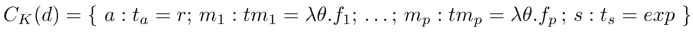

字段 `a` 是一个属性，`t[a]` 是其类型，`r` 是其定义表达式，该表达式可能包含 `F[a]` 的形式参数 `d` 的出现。字段 `m[j]`（对于 `j ∈ [1..p]`）是类型为 `tm[j]` 的方法，其定义表达式为 `\λθ.f[j]`，其中 `f[j] =` `fun` `z[j]` `→` `b[j]`。变量 `θ` 是 `f[j]` 的体 `b[j]` 中通过抽象 `\λ` 绑定。为了简化表示，我们省略了 `F[p]` 和 `F[k]` 参数，并且没有显式包含所有可能的类变量和方法、异常，或带/不带回溯的内部 `C-kits`。我们用单一的 `static_in` 组件统一表示它们，由类型为 `t[s]` 的字段 `s` 表示，并由表达式 `exp` 定义。

在示例中，抽象 `\λθ` 表示为 `V_this ->`。变量 `V_this` 在面向对象的语言中通常记作 `this`（或 `self`）。这些语言中的某些并不要求方法显式地是对象的变量 `V_this` 的函数。在这种情况下，方法体中 `V_this`（即 `this` 或 `self`）的任何出现都作为自由变量出现，这并没有反映其语义。方法体中使用的属性并不总是置于 `V_this` 之前。我们在 示例 3.6 中定义定义了由 `F[a] = { y, p }` 设置的 `kit` `Skirts`，为了简化描述省略了方法的类型。

`C-kit` `Skirts` 有两个属性 `year` 和 `price`，以及两个方法 `sale` 和 `set_price`。示例 3.1 中的类 `Skirts` 由 `C-kit` `Skirts` 建模。

#### 3.2.1.2 C-kit 类型

由于 `C-kit` 是一个 `kit`，其类型已在 第 1 章 中定义。通过类型为 `t[k]` 的 `F[k]`、类型为 `t[p]` 的 `F[p]` 和类型为 `t[a]` 的 `F[a]` 进行参数化，`C-kit` 确实具有形式为 `t[k] t[p] t[a]` 的函数类型。

#### 3.2.1.3 F[p] 和 F[k] 的实例化

任何 `F[k]` 的实例化都会产生一个由 `F[a]` 参数化的 `C-kit`。这些实例化已经在第 1 章中研究过。

#### 3.2.1.4 F[a] 的实例化

`F[a]` 参数的实例化只能在 `C-kit` `C[K]` 上进行。

### 3.2.2. 对象的建模

#### 3.2.2.1 O-kit 和对象

来自类 `C` 的*对象*（由 `C-kit` `C[K]` 建模且仅依赖于 `F[a]`）本身通过在 `C[K]` 中实例化 `F[a]` 创建的 `O-kit` `O[C]` 来建模。


通过我们对对象的建模，对象 `O`[`C*`] 的类型是建模它的 `O-kit` 的类型，因此正如上一节解释，它是 `C-kit` `C`[`K*`]` 躯体的类型 `T`。这种选择符合对象的典型用法，但没有反映我们建模的某些方面，例如方法的完整类型。对类型进行更准确的建模需要过多的开发工作，无法包含在本书中。

对象语言选择将 `O-kit` 的值视为一等值（见答案 1.14）。因此，对象 `O`[`C*`] 可以在表达式中使用，可以作为参数传递，可以作为计算的结果等。类语言不提供任何形式的 `O-kits` 继承：对象主要表示给定的数据。数据结构和工具的开发完全在类层级完成。这就是为什么 `O-kit` 只能通过仅具有定义属性的参数的 `C-kit` 创建。

#### 3.2.2.2. *对象构造函数*

我们不需要额外的对象构造函数概念来讨论由 `F`[`a*`] 参数化的 `C-kit` 的实例化，并以此讨论类对象的创建。然而，在节 3.1 中，我们描述了类对象的构造器概念，或者更简洁地说，即`对象构造函数`。让我们将这些对象构造函数放回我们的建模框架。

由 `C-kit` `C`[`K*`] 建模的类 `C` 的`对象构造函数` `C`[`I*]` 是一个函数 `fun x → C[`K*]`(x)`，它执行 `C`[`k*]` 的 `F`[`a*]` 参数族的实例化。它对有效参数 `v` 的应用导致上述的 `O-kit` `C`[`K*]`(`v`)。该函数 `C`[`I*]` 的应用通常用以前置法中的标识符 `new` 表示（尽管 `new` 的确切含义可能随语言而不同）。因此我们有

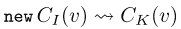

更准确地说，在状态 `E` = (Env, Mem) 下评估 `new` `C`[`I*]`(`v`) 返回 `O-kit` `C`[`K*]`(`v`) 的值 `v`[`obj*]`。现在假设该应用的结果名为：`O` = `new` `C`[`I*]`(`v`)。在对象的函数式视图中，Env 扩展了绑定 (`O`, `v`[`obj*]`)。在命令式设计中，评估（通常）会分配 `↑` `v`[`obj*]`，预留一个内存位置来存储 `v`[`obj*]` 并提供分配空间的引用 `r` ∈ **R**，从而修改 Mem。Env 扩展了绑定 (`O`, `r`)（见卷 1 的第 3 和第 4 章）。

在某些语言中，对象的实现可能更复杂，可以通过仅通过指针访问对象来实现。在这种情况下，标识符 `O` 在 Env 中绑定到地址 `r`[1]，在 Mem 中，`r`[1] 的值为 `r`。

让我们继续示例 3.6，创建一个由 `my_skirt = new Skirts (2018, 75.5)` 定义的对象 `my_skirt`。通过 `new Skirts (2018, 75.5)` 实现的构造函数 `Skirts` 的应用在状态 `E` = (Env, Mem) 下评估。结果是一个 `O-kit`，其属性 `year` 的值为 2018，属性 `price` 的值为 75.5。令 `v`[`obj*]` 为其值，即 `O-kit` `My_skirt` 的值。在对象的函数式实现中，Env 扩展了绑定 (`my_skirt`, `v`[`obj*]`)。在命令式实现中，Mem 扩展了一个对 (`r`, `v`[`obj*]`)，Env 扩展了绑定 (`my_skirt`, `r`)。`O-kit` my_skirt 可以在第 1 章 中直接定义如下：

让我们比较节 3.1.2.2 中对对象构造函数的描述及其建模。形式参数 `d` 未出现在类的语法中，构造函数的有效参数与对应属性值之间的链接是通过属性名称完成的。引入此形式参数 `d` 允许属性字段（类的一个不可修改的组成部分）与其在每个对象中的值值分离。它还使得区分两个评估时间成为可能：对象的属性在对象创建时通过应用对象构造函数确定，而出现在对象方法 `m` 中的属性 `a`（在我们的模型中以 `this#a` 的形式出现）只有在接收发送到 `m` 的消息时才会被实例化。

大多数面向对象的语言的具体语法强制对象构造函数具有与类相同的名称。


在节 3.1 中，我们介绍了面向对象语言中继承的一般概念。它是通过 `C-kit` 扩展进行建模的，而这是在节 1.7 中研究的 `kit` 扩展的一种特定情况。因此，任何 `C-kit` `P` 都可以通过添加属性和方法来扩展，从而产生一个 `C-kit` `R`，当然带有 `P` 标记所带来的所有限制。通过实例化 `R` 创建的 `O-kit` `O`[`R`]` 拥有 `P` 的所有字段，即使这些字段通过限制域操作（confinement operations）对 `R` 是不可见的，因此在 `R` 中无法被读取、修改或重新定义（但它们可以被 `R` 重新引入）。这就是为什么 `R` 的任何对象构造函数都必须调用 `P` 的对象构造函数，这是定义继承自 `P` 但在 `P` 中被限制（从而超出 `R` 的范围）的 `R` 属性的唯一可能。因此，子类任何构造函数调用其父类构造函数的义务是合理的。

`O-kits`（一般而言）不能被扩展（即使我们的模型允许）。这一选择的合理性在于：我们对象语言模型中保留的原语概念是“类”。扩展发生在类的层面，而不是对象的层面。简而言之，一个对象只编码一个单一的数据值。

### 3.2.3.2. 重新定义

继续使用上一节以及节 1.7.1.5 中的符号，我们回到节 3.2.1.1 中给出的方法建模。正如在第 1 章所示，在 `R` 中重新引入字段可以在不进行 `P` 字段回溯更新（back-update）的情况下完成。带有回溯更新的这种重新引入通常被称为`重定义`（redefinition）或`重写`（overriding），评估策略被称为`晚绑定`（late binding）。它考虑到：

1) 方法只能通过向拥有该方法的对象发送消息来调用；

2) 必须使用晚绑定对这些调用执行评估的义务。

所有面向对象的语言都接受方法重定义，只要这种重定义符合限制（confinement）。带有回溯更新的扩展通常是选定的评估规则，但某些语言（例如 C++）提供了带和不带回溯更新两种扩展模式。

### 3.2.3.3. 晚绑定

设 `C` 为一个 `C-kit`，`m` 为 `C` 的一个方法，`O` 为由 `O` = `C(`v`)` 定义的 `C` 的 `O-kit`。消息 `O`#`m`(`w`)` 是 `O` 的方法 `m` 的应用，因此 `C` 的方法 `m` 应用于对象 `O` 和 `w`，而 `w` 是该消息的*有效参数*。在没有继承的上下文中发送该消息的评估如下：

1) 方法 `m` 通过 `m` = `λθ.f` 建模，其中 `f` = `fun` `z` `→` `b`。表达式 `O`#`m` 表示 `m` 应用于对象 `O`，因此表达式 (`λθ`.(`fun` `z` `→` `b`)) `O`；

2) 该应用的评估返回表达式 `f`[`θ` `←` `O`]` 的值，因此（函数的））`fun` `z` `→` (`b` [`θ` `←` `O`]);；

3) 需评估该函数的形式参数 `z` 对 `O`#`m`(`w`) 提供的有效参数的应用。结果是 `b`[`θ` `←` `O`][[`z` `←` `w`]`。

让我们再次选取示例 3.6 并评估消息 `my_skirt#sale (2019)`：

1) 形式参数 `V_this` 在 `sale` 体中被 `my_skirt` 的值替换；

2) 得到的函数 `fun current_year -> (current_year > my_skirt #year)` 应用于 2019；

3) 属性 `my_skirt#year` 的值（即 2018）与 `current_year` 的值（2019）进行比较，此比较返回值 `true`。

现在让我们详细说明涉及继承时的消息评估。设 `R` 为 `C` 的子类，`C` 的扩展是带有回溯更新完成的。设 `RO` 为 `R` 的一个对象，`m` 为 `C` 的一个方法且未在 `R` 中重新引入。假设 `C` 的一个方法 `l` 在 `R` 中被重新定义，且方法 `m` 的体 `b` 包含子表达式 `θ`#`l`。为了简化解释，我们设 `b` `≡` `θ`#`l`。我们描述表达式 `RO`#`m` 的评估：

1) `RO`#`m` 是 `m` 应用于对象 `RO` 的应用。`RO`#`m` 的评估返回表达式 `f`[`θ` `←` `RO`]` 的值。

2) 该应用的评估返回表达式 `f`[`θ` `←` `RO`]` 的值，因此（函数的））`fun` `z` `→` (`b` [`θ` `←` `RO`]);；

3) 需评估该函数的形式参数 `z` 对 `RO`#`m`(`w`) 提供的有效参数的应用。结果是 `b`[`θ` `←` `RO`][[`z` `←` `w`]`。


请注意，变量 `θ` 在方法 `m` 中的绑定会被延迟，直到向一个“拥有” `m` 的对象 `O` 发送消息为止。在词法作用域语言中，`m` 的正体 `b` 中出现的任何不同于形式参数 `z` 和 `θ` 的标识符都在 `C-kit` `C` 定义的环境 `Env` 中进行求值。一旦完成了替换 `[`θ` ← `O`]`，`(b[`θ` ← `O`])` (`w`)` 的求值将通过扩展 `Env` 继续，正如第一卷第 3 章中对闭包的介绍所示。

### 3.2.3.4 封装与继承

`C-kit` 的封装与 `kit` 的封装完全相同，后者在第 1 章中研究过。封装与继承之间的交互在第 1.7.2 节中介绍过。它对通过标记实现的类封装的适应，在第 3.1.2.3 节中直观地给出。通过标记进行封装不会改变 `C-kit` 的名称（答 1.17），而且通过这种封装技术无法为同一个 `C-kit` 定义多个封装（答 1.18）。我们将使用 OCaml 类研究一种不同的封装技术。

`O-kits` 保留了其 `C-kits` 的封装标记。例如，`C-kit` `C` 中被标记为 `private-st` 的任何字段 `l` 只能被 `C` 的内部字段使用，它不会被 `C` 导出。在实例化 `C` 的任何 `O-kit` 中，它仍然保持被标记为 `private-st`，因此不能在 `C` 之外使用。它存在于所有继承自 `C` 的 `C-kits` `R` 中，因此存在于所有实例化 `R` 的 `O-kits` 中，但在所有这些地方它都是不可见的。

我们已经看到，`kit` `P` 的封装对导出的 `kit` `RP` 的类型产生了一些限制，这符合封装原则。`P` 和 `RP` 类型之间的这种差异在面向对象的语言中通常是隐式的，封装并不真正被视为作用于类型的操作，特别是当它通过标记类字段来实现时。事实上，导出的类保留了原始类的名称。类类型及其对象的类型具有相同的名称，即该类的名称：没有空间来区分所有这些类型。

我们还看到封装可能会限制扩展的可能性，从而影响扩展后的 `kit` `R` 的类型。`RP` 的类型通常比 `R` 的类型更具限制性：换句话说，导出限制通常比继承限制更具约束力。

### 3.2.4 不完全 C-kits，参数化 C-kits

`C-kit` 有两种形式的不完全性，分别称为 `interface`（接口）和“**未完全定义的 C-kit**”。

#### 3.2.4.1 接口

一个所有字段仅有声明的 `C-kit` `C` 被称为 `interface`，因此是一个不完全 `C-kit`。接口 `C` 的定义只引入了字段的名称和类型，即我们所说的 `C` 的类型。在某些语言中，“类类型”和“接口”是同义词。根据语言的不同，接口可以直接定义，也可以从 `C-kit` 自动创建。作为类类型，通过导出 `C-kit` 创建的接口字段通常比该 `C-kit` 的接口字段少，后者是为了继承而设计的。自动创建的接口很少显式说明。

#### 3.2.4.2 “未定义” C-kits

在第二种不完全性中，只有某些方法或由 `static_in` 引入的某些（类）字段在 `C-kit` 中是*未定义的*。这些字段通过 `abstract`、`virtual` 等关键字标记，这些关键字位于字段声明之前和或在类本身的级别上。抽象类是不完全的 `C-kit`。

不完全 `C-kit` 的完成与不完全 `kit` 的完成完全对应，后者在第 1.4.2 节中介绍。方法定义的类型与其声明给出的类型相同。它构建了一个新的 `C-kit`。这种完成可以通过几个步骤完成，标记保留在尚未定义的字段上。无法从不完全的 `C-kit` 创建 `O-kits`。编译器通常会帮助检测此类错误。面向对象的语言通常不为`未定义`字段的定义和继承提供两种不同的语法结构。

#### 3.2.4.3 参数化 C-kits 与泛子

`F[p]` 族的参数用于通过类型或值来定义参数化的 `C-kits`；这些在第 1 章中研究过。通过类型变量 `T` 的参数化允许构建一个 `C-kit`，它代表一个由 `T` 参数化的数据结构，即使语言不处理泛型多态。

面向对象的语言通常不提供泛子。为了完整性，我们简要考虑了它们。`F[p]` 参数 `kit` 族在第 1.6 节中研究过。

*(注：原文此处存在大量关于泛子的重复段落，已根据核心逻辑进行处理)*

### 3.2.5 子类化，子类型

子类化序在第 3.1.2.5 节中引入，这是命名子类型的一个例子（参见第 1.7.2.3 节）。让我们进一步研究它。

#### 3.2.5.1 子类化

简单继承在类和其子类之间定义了一种“更通用”的顺序，被继承类比其子类更通用：祖先是最通用的。因此可以构建继承链 `C[0] > C[1] > ... C[n−1] > C[n]`，其中 `C[0]` 是现有类，`C[1]` 继承自 `C[0]`，通常 `C[i+1]` 继承自 `C[i]`。这种顺序可以被编译器用于处理消息 `O#m`。如果 `m` 在类 `O`（例如 `C[n]`）中未定义，将在父类 `C[n−1]` 以及整个继承链中搜索 `m`。如果在 `C[0]` 中未找到 `m`，则存在类型错误、执行错误或抛出异常，取决于语言。

同样，多重继承在类和子类之间定义了顺序，但一系列继承步骤不仅构建了一个链，还构建了一棵树，其根是最后一个构建的子类，叶子节点是预先知的用于“启动”多重继承步骤的类。如果我们将类的所有出现重新分组为一个节点，这棵树就变成了一个图，通常被称为*继承图*。这两种继承形式使得构建一个逐步处理复杂实体的类成为可能。


某些语言的所有继承链或图从一个通常称为 `Object` 的类开始，该类比任何其他类都大，从而可以将对接收消息的方法搜索范围缩小。

### 3.2.5.2. *子类型化 (Subtyping)*

子类关系定义了子类型关系的一些基本情况。这种序关系向其他类型族的扩展在第一卷第 `5.7.1` 节中研究过；这强调了与某些操作（例如赋值）实现兼容性的困难。

#### 子类型化与赋值

假设 `C[K]` 为一个 `C-kit`，`D[K]` 为 `C[K]` 的扩展，`O[C]` 为来自 `C[K]` 的 `O-kit`，`O[D]` 为来自 `D[K]` 的 `O-kit`。如果语言中存在为 `O-kit` 赋值的操作，那么赋值 `O[D]:= O[C]` 是否合法？这种赋值可以被立即拒绝，因为 `O[D]` 的字段可能比 `O[C]` 多；`O[C]` 中已不存在的字段不会通过此类赋值被修改，但事实仍然是它们拥有一个值，而开发者可能并没有像任何未初始化的可变变量那样预期的该值。

也可以在编译时接受这种赋值，并在对象代码中插入一个运行时对赋值给 `O[D]` 的对象值类型的检查。

#### 子类型化与结构化数据

子类型化向结构化数据（列表、数组等）的扩展也带来了一致性问题。在算法理论中，列表通常被指定为*同质值*的组，即可以以统一方式处理的值。这使得对列表中的所有元素进行相同的迭代处理成为可能。列表的类型（假设为 `t_list`）由其元素的类型（假设为 `t`）决定。但如果语言接受子类型（大多数面向对象的语言都是如此），我们该如何确定这个类型 `t` 呢？让我们称 `t[e]` 为列表元素的类型。在继承语文中，`t[e]` 是一个子类型（至少是其自身的子类型），并且存在链 `t[e] ≤ t¹ ... ≤ t^(n)`，其中 `t^(j)` 是 `t[e]` 祖先的类型。对于类型 `t`，可以决定选择所有元素类型 `t[e]` 的公共上界（common majorant），即用于创建列表元素的所有子类的公共祖先的类型。如果这个公共上界不存在且被系统接受，那么列表将是有意地是异质的，因此不再符合算法理论中对列表的通常规范。

如果要求存在公共上界，则剩下两个问题。首先，公共上界可能不是唯一的。要么开发者选择这个上界（即祖先类），从而留下了日后定义子类的可能性，要么这种选择依赖于系统，使用在第 3.1 节中引入的 `Object` 类。该类存在于 Java 等语言中，是所有继承图的起点，因此扮演着最大祖先的角色：它的类型是子类型族中的*最大元素*，特别允许任何列表的类型。

这种选择不能确保与列表规范完全一致。让我们通过一个例子来看这个问题。假设我们决定 `int` 和 `bool` 类型是 `float` 子类型，那么 `[1.5; true; 3]` 的类型就是 `float list`。无法以统一的方式对此列表的所有元素加 1，因为整数加法不是浮点数加法，而且永远不会（参见第一卷第 6 章）。因此，我们失去了与列表元素统一处理规范的一致性。当然，这种处理方式的适配通常非常方便，但它隐藏了存在子类型时对列表进行迭代的复杂性。一旦发生执行错误，就必须探索这种复杂性以消除错误。

#### 子类型化与方法

子类关系向函数子类型关系的扩展在第 1.7.2.3 节中研究过。面向对象语言做出的选择通常是上述节描述的：有效参数类型采用逆变（contravariance），结果类型采用协变（covariance）并简化相等。换句话说，如果方法 `m` 的声明引入了类型为 `t[a] → t[r]`，那么任何类型为 `t[a]` 子类型的表达式都可以接受作为 `m` 的有效参数，但结果的类型必须是 `t[r]`。

在任何方法的形式参数 `V_this` 保持隐式的语言中，对协变的接受也是隐式的。让 `C[K]` 为一个 `C-kit`，`D[K]` 为 `C[K]` 的扩展。让 `m` 为 `C[K]` 的方法：`m = λθ.f`，其中 `f = fun z → b`。让 `t[1] → t[r]` 为类型。在继承语文中，`t[e]` 是一个子类型（至少是其自身的子类型），并且存在链 `t[e] ≤ t¹ ... ≤ t^(n)`，其中 `t^(j)` 是 `t[e]` 祖先的类型。对于类型 `t`，可以决定选择所有元素类型 `t[e]` 的公共上界，即用于创建列表元素的所有子类的公共祖先的类型。如果这个公共上界不存在且被系统接受，那么列表将是有意地是异质的，因此不再符合算法理论中对列表的通常规范。

### 3.2.5.3. *强制转换 (Coercions)*

根据类型需要对对象的类型进行转换通常被称为强制转换 (coercion)。这并不意味着对象的值被物理修改。转换可以是显式的，此时称为*强制转换 (cast)*。第一种强制转换允许 `O[D]` 被视为类型为 `C[K]` 的 `O-kit`，通过忽略其在 `D[K]` 中添加或重新定义的字段。这种强制转换可以由编译器检查，得益于 `O[D]` 的声明。

第二种强制转换允许 `C[K]` 中不存在的字段“重新出现”。它解决了提出的问题。开发者知道 `O[D]` 类型为 `D[K]` 且知道 `m` 只修改 `O[D]` 的一个属性，可以将评估 `O[D]#m(w)` 的结果（类型为 `C[K]`）转换为类型 `D[K]` 的值。这种类型强制转换使得将类型 `t` 的值视为类型 `t[s]`（`t` 的子类型）成为。如果值不是 `t[s]`，这是一个危险的操作。错误通常只会在运行时检测到，因为验证需要知道要转换的值。

强制转换可以是隐式的：它由编译器或解释器静默执行。它可能导致意外的结果，其根源并不总是容易找到。

#### 3.2.5.4. *继承与二元方法*


一个 `binary method` 是 `C[*K*]` 的一个方法 `m`，其形式参数 `z` 与 `θ` 的类型相同。如果二元方法的主体包含形式为 `op(θ, z)` 的表达式，其中 `op` 是一个二元运算符，则就会引发类型问题。二元运算符的代码（如等价、比较、加法等）通常假设两个操作数具有相同的内存表示，而这种表示是由其类型本身定义的。让我们用以下示例来演示这个问题。

假设操作 `compare` 比较来自 `C[*K*]` 的两个 `O-kits` 的值。令 `m` 为定义的方法：`m:C[*K*] → bool = λθ.fun z → (z compare θ)`。`m` 的声明提供的类型不包含 `θ` 的类型，这在语言中很常见。`m` 的完整类型是 `C[*K*] → C[*K*] → bool`。`θ` 和 `z` 的类型均为 `C[*K*]`。令 `O[*D*]` 为来自 `D[*K*]` 的 `O-kit`，`O` 为来自 `C[*K*]` 的 `O-kit`。消息 `O[*D*]#m` 可以被接受，因为 `D[*K*]` 是 `C[*K*]` 的子类型。但表达式 `O[*D*]#m(O)` 是类型错误的：在子表达式 `(z compare θ)` 中，变量 `θ` 被替换为类型为 `D[*K*]` 的 `O[*D*]`，而 `z` 被替换为类型为 `C[*K*]` 的 `O`。函数 `compare` 并不一定适用于 `O[*D*]` 和 `O` 的比较，因为它们的值没有相同的内存表示。

该问题的解决方案通常只是权宜之计。类型算法通常无法识别 `m` 是二元方法，因此无法在 `θ` 和 `z` 的类型之间施加相等约束。正如我们看到的，这种解决方案可能会触发错误。可以在 `D[*K*]` 中重新定义方法 `m` 或使用强制转换（coercion）。也可以使用句法标记来指示某个方法是二元的。

### 3.2.5.5 重载 (Overloading)

重载在第 5.7.2 节中引入。对方法进行重载（如果允许）并不是对该方法的重新定义。如果同名方法的类型不同，且该语言接受方法重载，那么只要编译器能够解析重载，这些方法就可以通过类型检查。解析算法取决于具体的语言。

在运行时确定接收消息的方法以及解析重载是两个不同的过程。令 `O[*C*]` 为来自类 `C` 的对象，它接收消息 `O[*C*]#m`，该方法可能被重载过也可能被重新定义过。重载的解析会选择 `m` 的某个版本（例如 `m¹`），以便在类型检查时（如果语言是静态类型语言，则在编译时）对该消息进行类型检查。执行的 `m`（例如 `m²`）的选择是在运行时通过搜索 `C` 继承的类层层结构来做出的。唯一的要求是 `m²` 的类型与 `m¹` 的类型兼容，以便继续保证类型检查的正确性。

在存在重载的情况下，可能会结合两种机制：重载本身和隐式类型转换。根据一般规则，编译器确定有效参数的类型，并在绑定到相同名称的不同定义中搜索其参数类型与有效参数类型完全匹配的定义。如果不是如此，编译器可能会尝试对有效参数的类型进行隐式转换，以便根据“最佳转换”标准获取其中一个定义的类型。该标准的具体定义取决于所使用的语言。

重载解析规则可能非常复杂，因为它们会与限制（confinement）、继承、子类型、具有非固定数量参数或可选参数的函数产生干扰，或者当语言具有复杂的句法结构（如 C++ 的 `templates`）时。[第 4 章] 概述了所研究语言中重载的处理方法。

### 3.2.6 类型语言、类和对象

在[第 1 章]中，我们定义 `kit` 的类型为其组件名称和类型的集合，并选择了命名类型法（nominal typing），将参数化视为引入了函数类型或量化类型。该定义被用于定义[第 3.1.2.2 节]中的类类型。我们确定对象的类型是其类主体的类型，并以类名命名，因此我们选择了命名类型法。这种简单的类型处理方法允许我们非常直观地检查类型的正确性：如果方法 `m` 的参数 `z` 类型为 `int`，那么消息中 `z` 的有效参数类型不能为 `bool`（除非像 Python 这样的语言，`bool` 是 `int` 的子类型）。但这些选定的类型定义过于简单，无法构建一个能够建模所有类和对象特征的真实类型理论 `T`。

让我们看看尝试定义这样一个理论 `T` 时遇到的一些困难，无论使用何种句法结构（限制、继承、子类型、具有非固定数量参数或可选参数的函数）：

- `θ` 和 `z` 的类型相同吗？是的，正如[第 3.1.2.2 节]所示，对象的类型是其类主体的类型，并以类名命名，因此我们选择了命名类型法。这种简单的类型处理方法允许我们非常直观地检查类型的正确性：如果方法 `m` 的参数 `z` 类型为 `int`，那么消息中 `z` 的有效参数类型不能为 `bool`（除非像 Python 这样的语言，`bool` 是 `int` 的子类型）。但这些选定的类型定义过于简单，无法构建一个能够建模所有类和对象特征的真实类型理论 `T`。
- 类类型对属性类型（例如 `d`）的依赖如何处理？我们规定 `t[a]` 等于 `t[d]`，但我们也提到这一约束可以放宽。例如，`F[a]` 可能包含一个参数 `O[a]`，用于由对象 `O` 实例化。`O[a]` 和 `O` 的类型应该是严格相等的，还是 `O` 的类型可以是 `O[a]` 的子类型？我们如何在理论 `T` 中建模这种选择？
- `C-kit` `P` 的某些字段可以被限制，受限制的 `C-kit` `RP` 的类型不是 `P` 的类型。如果 `C-kits` 没有引入类型定义的字段，则 `RP` 的类型是[第 1.3.5 节]中的：`RP[Type] = {c[i1] l[i1] : t[i1]; ... ; c[im] l[im] : t[im]}`。导出建模与理论 `T` 之间有怎样的相互作用？
- 对象的类型取决于语言，可以完全从程序的源文本中推导出（从而是*静态确定*），或者只能在运行时获取（因此是*动态确定*），例如对象是表达式求值的结果。这并不意味着类型检查是静态或动态执行的。类型算法可以在编译时运行，并在目标代码中插入类型查询，以便在对象创建时进行检查。我们如何在理论 `T` 中集成这种两步类型检查过程？


- – 一个 `C-kit` `P` 可以包含一个内部的 `C-kit` `PI`，可以或不包含回溯。这导致了 `P` 的类型与 `PI` 的类型之间存在额外的递归形式，因为 `PI` 可以 `P` 的字段，反之亦然。
- – 类型系统也应该允许某种形式的子类型，并与子类化保持一致（或不一致）。将类型转换和强制转换渲染为类型转换函数也是很有用的。

因此，假设的类型理论 `T` 应该处理所有这些点。遗憾的是，据我们所知，到为止开发的任何类型理论只要将其中一些点结合建模，就会在逻辑上变得不一致。因此，发现像 `T` 这样的理论的希望非常小。然而，存在几种能够成功建模面向对象语言多个方面的类型理论。此外，对类型理论的研究非常活跃，因为这些理论是自动程序验证工具的坚实基础。对类型理论感兴趣的读者可以参考 [ABA 96, BRU 96, BRU 99, CAS 19, PIE 05] 中的书籍和文章。

最近在所谓的二阶类型系统的定义和研究方面取得了重要进展，该系统在 [RÉM 14] 中引入，是一种数据结构工具的新方法 [WIL 18]，以及向给定类型理论添加某些面向对象特征的不同构想 [CAU 15]。

# 4 选定语言中的类

本章根据 Chapter 3 中研究的模型，介绍了各种语言提供的类和对象。Java 的类在 section 4.1 中进行了检查，提供了 section 3.2 中所示模型的实例化。Section 4.2 描述了 C++ 的对象机制，它是 section 3.2 中所示模型的一种稍微复杂一点实现。OCaml 的面向对象特征在 section 4.3 中给出，它们对该模型提供了一种解释，这与 Java 和 C++ 的解释非常不同。本章以 Python 的类和对象的介绍结束，并检查了其他一些特征，以便对本书使用的这种语言进行更多说明，该语言在第一卷中实现了函数式和命令式特征的语义。

### 4.1 Java 中的类

### 4.1.1 通用介绍

Java 编程语言由 Sun Microsystems 于 1995 年创建，现在由 Oracle 公司分发。这里使用的版本是 Java SE（标准版）10.0.2。这里使用的具体语法元素和术语源自参考手册 [GOS 19] 以及 `Oracle` 提供的文档。

Java 是一种基于类 `(class)` 的语言（见答 1.2）。它是静态类型的（见答 1.1），允许显式的类型转换 `(cast)`，但也允许隐式的转换：向类型为 `int` 的值添加一个类型为 `String` 的值，会将此整数转换为 `String` 并返回一个 `String`。因此，该语言不是强类型的，一个表达式在执行期间可能具有多种类型。编译器可以在执行期间添加类型检查，这使得人们认为类型检查是（相对）安全的。在第一卷 5.7.2 节中介绍的重载在 Java 中是可用，并在 section 4.1.5.7 中描述（见答 1.26）。

任何类或接口的源代码都放置在一个文件中，该文件只能包含一个标记为 `public` 的类 `F`。该文件必须命名为 `F.java`。此外，如果 `F` 拥有一个强制命名为 `main` 的类方法并声明为

```
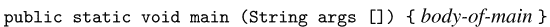
```

那么 `F.java` 就是一个可以执行的 Java 程序。

Java 源文件被编译成一种 Java 特有的中间低级语言，称为 `bytecode language`（见答 1.1）。Java 提供了一个了一个字节码解释器，被称为 Java `virtual machine`（或 `JVM`）。因此，编译器不直接为微处理器产生原生代码。这种编译-解释机制存在若干种变体，已经在第一卷的第 1.2.3.6 节中介绍过。

备注。“Java 中提供的示例仅旨在说明某些点，它们被设计得尽可能短，它们不遵守任何特定的命名约定，以免隐藏困难。只有当你在阅读语言参考手册时对自己提问，你才能模仿这些示例。”

### 4.1.2 模块和包

Java `package` 是一组编译单元（类和接口）和子 `package`（子包），这些可以被 Java 系统访问，可以存储在操作系统的目录、数据库等处。所有的 Java 开发环境都提供了一种管理这些模块和包的机制。一个 Java `module` 是多个 `package` 的集合。模块没有任何结构。它们所属的 `package` 或 `module` 在编译单元的头部指示。

Java `module` 和 `package` 定义了它们自己的命名空间，因此它们可以被视为在 section 2.3.2 中引入的 `W-kits`。注意，这些 `W-kits` 包含一些类，因此是 `C-kits`，它们操作对象，即 `O-kits`，从而创建了命名空间层级。例如，假设 `M` 是一个模块，`P` 是 `M` 的一个 `package`，它包含一个类 `C` 的编译单元 `C.java`。该类的全名为 `M.P.C`，类 `C` 的字段 `l` 的限定名为 `M.P.C.l`。假设 `N` 是另一个包含 `package P` 的模块，后者引用为 `N.P`。然而，一个 `package` 不能包含两个同名的编译单元。

Java `module` 和 `package` 允许我们通过专用指令管理编译单元的导入和导出。导出 `package P` 只需要 `P` 可以被系统访问，并根据类和字段设置的限制标记来实现，我们稍后将研究。类（或组件）的导入通过使用 `package` 中类的限定名来实现。任何从 Java 系统访问的 `package` 组件都可以被导入，但要遵守限制（见答 1.15 和答 1.24）。例如，标记为 `public` 的类 `C` 可以通过其限定名 `M.P.C` 在任何编译单元中使用。

`package` 组件 `name` 的扁平化是通过 `imports name.` 指令执行的。例如，`imports M.P.C` 允许我们访问类 `C` 的组件，通过它们在 `C` 中的字段来表示它们。显然，这些访问仅根据类或字段上存在的限制标记被允许（参见 section 4.1.4）。

Java 以非常精确的方式处理扁平化名称的可见性规则，并在扁平化已在导入编译单元未使用或已扁平化的组件时，引发编译错误或确定性的掩盖。例如，在包含另一个名为 `C` 的类定义的编译单元中扁平化类 `M.C` 会导致导入定义被掩盖。扁平化来自不同文件的类 `C` 会引发编译错误（见答 1.25）。

### 4.1.3 类


在深入研究某些特定点之前，让我们快速回顾一下类。Java 类是一个 `C-kit`（答 1.2），它可能拥有某些属性（不带关键字引入的变量）、某些方法（不带关键字引入的函数）、某些类变量和类方法（通过 `static` 标记引入），以及某些内部 `C-kit`（通过 `class` 引入），如果这些内部类被标记为 `static`则称为*嵌套类*，如果未标记则称为*内部类*。这些各种字段的定义遵循第 3.2.1.1 节 中的描述：`static` 字段的定义不能使用方法和属性，而方法的定义（包括*内部类*的方法）可以使用任何字段。

为了表示其所属类或其子类的对象，方法使用了 `this` 关键字。属性可以在不加 `this` 前缀的情况下使用。Java 类还可以包含放置在块中的代码，这可以被看作 `C-kit` 的一个匿名字段（答 1.12）。如果该块被标记为 `static`，它代表类的初始化块，并在类创建时执行。否则，它会在每次调用该类的任对象构造函数时执行。Java 提议通过类型变量进行类参数化，符合第 1.5 节 中的描述（答 1.32）。

### 4.1.3.1. 值、类型与泛型化

在 Java 中处理的值是基本值（数字、布尔值）、字符串、数组和对象，后三者是引用。让我们记住，“引用”一词指的是指向为值分配内存区域的指针（无法直接处理）（见卷 1 第 7.5 节）。Java 仅提供了方法的概念来实现函数，而方法不是一等值（答 1.13）。该语言具有静态（词法）作用域（答 1.4），但使用延迟绑定策略的消息传递除外（答 1.39）。

类 `C` 以及接口都定义了一个同名为 `C` 的类型，该类型同样也是该类对象的类型（答 1.5）。字段的顺序是重要的（答 1.10），如第 1 章中的示例 1.10 所示，其中属性 `x` 在属性 `y` 声明之前通过 `int x = y + 1` 定义。在类体内先给出构造函数会事实上（*ipso facto*）声明属性，如示例 4.2 所示。类的字段必须在类定义中显式指定类型（答 1.6）。与类一样，接口的引入也会创建一个以接口命名的类型。由类或数组（用 `type_element[]` 表示）定义的类型被称为*引用类型*。注意，字符字符串由类 `String` 实现且不可变。这一点在卷 1 第 7.5.2 节中讨论过。

由类型变量 `T` 参数化的类 `C<T>` 定义了一族类型 `C<T_i>`，通过将 `T` 替换为类型 `T_i` 。此类类型 `C<T>` 称为*参数化类型*。

因此，Java 提供了三族类型：基本类型（如 `int`）、参数化类型和引用类型。如果满足以下条件，则类 `C` 是类型正确的：

1. 1) `C` 的所有属性、类变量和内部类具有不同的名称且类型正确（这些字段不支持重载）；
2. 2) `C` 的所有方法类型正确，前提是 `C` 的字段中任何 `this` 的出现类型类型为 `C`；
3. 3) 如果 `C` 的两个方法具有相同名称，则它们的参数类型必须不同（重载）（答 1.9）；
4. 4) 任何对方法的重新定义都要保留重定义方法参数的类型和顺序，以及其结果类型，即使结果是父类的对象（答 1.38 和 答 1.40）（然而，考虑示例 4.10 中对此规则可能的放宽）；
5. 5) `C` 的父类类型不是 `C` 的子类型（无循环继承）；
6. 6) 如果 `exp` 的类型是 `x` 声明类型的子类型，则赋值 `x = exp` 是类型正确的（见示例 4.11）；
7. 7) 如果未被重载的方法 `m` 在 `C` 中通过 `A m (B x)` 声明（或在 `C` 的继承图中，见第 4.1.5.4 节），则消息 `C.m(exp)` 是类型正确的。`exp` 的类型必须是 `B` 的子类型，且消息的结果类型为 `A`；
8. 8) 如果 `m` 被重载，编译器尝试解析重载（见第 5 节）。

```
C.m(exp) 是类型正确的，如果未被重载的方法 m 在 C 中通过 A m (B x) 声明```

### 4.1.3.2. 对象构造函数

类的对象构造函数必须出现在类定义中。它们在参数的数量和类型上不同。如果没有定义构造函数，编译器将提供一个默认构造函数。由于任何类都隐式（或如果开发者显式说明则）继承自 `Object`，因此会自动插入到继承路径末端的所有构造函数。对象构造函数可以被限制以控制该类对象的创建。

```
super()
```

### 4.1.3.3. 二元方法

在 Java 中，二元方法的类型检查通过赋予 `this` 定义该方法的类的类型来实现。它忽略了参数与 `this` 保持类型相同的义务。在示例 4.3 中，类 `C` 有一个类型为 `int` 的属性 `attr`、两个二元方法、一个方法 `test` 以及一个执行副作用的构造函数。类 `D` 继承自 `C`，引入了类型为 `C` 的属性 `attr`，掩盖了 `C` 的属性（虽然不推荐但对于解释很有帮助）。`D` 重新定义了方法 `binary_m`。


执行显示了以下结果，注释已直接插入在此输出中：

注意，将字段 `b_D.attr.attr` 赋值为 4 对 `C` 的字段 `attr` 产生了一个侧效应：引用是一种指针。这解释了评估 `a_C.binary_add(a_C)` 时返回的值 8。最后一次消息发送 `a_C.test(b_D)` 的执行首先表明，`test` 方法可以应用于属于 `C` 的子类的对象。它还揭示了编译器给 `b_D.attr` 提供的默认值为 0，这可能是出乎意料的。

### 4.1.4. 标记 (Marks)

#### 4.1.4.1 限制 (Confinement)

Java 使用了许多标记，用于限制范围或更精确地指定定义的访问规则。这些标记可以设置在类本身上，也可以设置在它们的字段上。限制不会改变类的类型（答 1.19）。

假设 `C` 是由 `package P` 托管的类。类 `C` 及其一个字段 `l` 根据其限制标记的访问权限如下（答 1.16）：

* `public`：任何包的任何类都可以访问 `C` 和 `l`；
* 无标记：`P` 包中的任何类都可以访问 `C` 和 `l`；
* `protected`：`P` 包中的任何类以及继承自 `C` 但位于其他 `package` 的类都可以访问 `C` 和 `l`；
* `private`：`l` 只在 `C` 中可见，但会被 `C` 的子类继承。除非 `C` 是一个子类，否则不能在 `C` 上设置 `private` 标记。子类可以使用另一个标记重新引入同名字段。

在示例 4.4 中，`A` 的方法 `see` 被标记为 `private`。它有一个 `int` 类型的参数。它被方法 `f` 调用。类 `B` 继承自 `A` 并引入了一个不带参数的 `see` 方法。它的构造函数调用了 `A` 的构造函数。

消息 `three.f()` 的评估调用了 `A` 的 `see` 方法，这解释了显示 `In A : 3`。评估 `four.see()` 调用了 `B.see()`。执行 `four.f()` 调用的是 `A` 的 `see` 方法，而不是 `B` 的方法（如果是使用晚期绑定评估，则会调用后者）。因此，`B` 中 `see` 的定义不被视为对 `A.see` 方法的重定义。方法 `A.see` 的名称在 `A` 中标记为 `private`，在 `B` 中不可见，因此无法在其中重定义，只能再次引入。

定义 `foo` 的尝试（已注释以避免编译错误）未被编译器接受。在 `main` 中发送消息 `three.see()` 也发生了同样的情况，因为 `A` 的 `see` 方法在 `main` 中不可见。

示例 4.5 阐述在使用 `package` 时标记的作用。在 `B` 的方法 `f` 中使用 `y` 是不可行的，因为 `y`（未标记）的可见性在继承步骤中被限制在它的包 `package PP.` 中。

相反，`x` 的可见性扩展到所有继承自 `A` 的类。在 `C` 中调用 `A` 的默认构造是可能的，因为名称 `A` 在没有任何限制的情况下被导出。然而，`A` 的字段被限制得更严格，禁止在 `C` 中进行“直接”导入：它们在 `C` 中不可见，因为 `C` 没有继承自 `A` 也不属于 `PP`。因此，无法对 `o.` 的属性进行任何赋值。

#### 4.1.4.2 其他标记

假设 `C` 是 `package P` 中的一个类。`C` 的字段 `l` 和 `C` 本身根据使用标记的访问权限如下：

* `abstract`：`l` 仅声明，`C` 和 `l` 被称为抽象的。这一点稍后讨论；
* `static`：标记为 `static` 的字段 `l` 是类字段。它的评估完全在静态（词法）作用域内执行，因此不能重定义。如果 `l` 是引用类型，则可以修改 `l` 指向的值；
* `final C`：该类不能被继承。一旦定义，字段 `l` 就不能被掩盖或重定义；
* `static final`：`l` 定义为常量字段。

在示例 4.6 中，`num` 是 `FinalTest` 类的对象，其标记为 `final` 的属性 `cl` 是一个 `A` 类的对象（假设 *O*），其属性 `y` 已通过 `num.cl.inc()` 修改。并没有矛盾：`cl` 的值是对对象 *O* 的引用，它没有被修改。然而，被引用的值被修改了。如果属性 `int y` 的声明标记为 `private final`，则编译失败。

### 4.1.5 开发类

#### 4.1.5.1 抽象类

抽象类是不完整的 C-kit（答 27）。方法 `l` 及其所属类必须被标记为 `abstract`。以下 `f` 被拒绝：

```java
public void f(int x) {}
```

#### 4.1.5.2 参数化类

类参数化已在第 2.4.3 节中研究过。类 `C<T,S>` 由类型变量 `T` 和 `S` 参数化。

#### 4.1.5.3 接口

Java 接口 `I` 是不完整的 C-kit（答 27），没有属性、对象构造函数或其他任何定义。所有的方法声明都是 `public`，类变量被标记为 `static final`，也就是说它们是常量（答 30）。


示例 4.9 使用了示例 4.2 中引入的类 `C`。泛接口 `LowerThan<T>` 在 `C` 的子类 `R` 中实现，类型变量 `T` 被类型 `Integer` 替换。该类 `Integer` 封装了类型 `int`，编译器处理这两个类型之间所需的转换（答 1.29）。

该示例的执行产生了如下输出：

### 4.1.5.4. 继承

Java 提供了简单的继承（我们在之前的示例中已经用过）以及接口的实现。我们现在花一点时间更详细地回顾这些概念。

#### 子类化
继承和接口实现定义了类与接口之间的子类关系。由于它们可以被同一个类 `C` 同时使用，后者拥有一个继承图，其节点是 `C` 传递性继承的类以及在 `C` 中传递接实现的接口。任何 Java 类都继承自一个名为 `Object` 的类，它是继承图的根。继承扩展到了内部类：内部类可以继承另一个已经引入的内部类。

#### 重引入
设 `C` 为一个类，`R` 为 `C` 的子类。`C` 的任何属性 `a` 可以在 `R` 中重新引入。字段 `C.a` 仍然存在于 `R` 中，但被 `R.a` 屏蔽。这可能会引入某些歧义，导致意外的结果。由于属性用于表示必须可见才能处理的数据，因此对属性使用两次相同的名称是没用的且不推荐的。

在 `R` 中重新引入的 `C` 方法 `m` 如果 `R.m` 的类型与 `C.m` 不同，则会重载 `C.m`。否则，`R.m` 是 `C.m` 的重定义，可以通过限定名 `super.m` 保持可见。然而，无法回到继承步骤更早之前：没有 `super.super.m` 可用。重定义可以使用 `@override` 注解以请求编译器进行一致性检查。

类方法（因此标记为 `static`）`f` 可以在 `R` 中重新引入。如果 `C.f` 和 `R.f` 具有相同类型，则 `R.f` 屏蔽 `C.f`；否则 `R.f` 重载 `C.f`（类似于方法）。

#### 方法查找
设 `o` 为类 `C` 的一个对象。如果消息 `o.m` 类型正确，那么具有预期类型的方法 `m` 存在 `C` 继承图中的某一个类中。如果 `m` 被重定义了多次，甚至可以有多个合适的版本。设 `D` 为执行 `o.m` 时 `o` 所指向值的子类。该执行从在 `D` 中查找方法 `m` 开始，然后沿着继承步骤返回 `C`，然后进入 `C` 的图。如果需要，这种查找可以继续到 `Object` 类，如果未找到 `m`，则抛出异常。这意味着在消息的类型检查期间使用的方法 `m` 并不强制是执行时使用的 `m`（参见示例 4.14）。

#### 多重继承
Java 没有提议多重继承。类 `C` 实现接口 `I`（或多个接口）类似于 `C` 继承自 `I`。这避免了在多重继承情况下选择被继承方法的常见问题。

### 4.1.5.5. 子类型

Java 提出了用 `≤ [T]` 表示的子类型关系，这种关系由子类化（声明 `C2 extends C1` 和 `C implements I`）引起，也由某些原始类型之间的预定义关系引起（例如 `float` 是 `double` 的子类型）。此外，无论类型 `T` 是什么，都有 `T ≤ [T] Object`。例如，声明 `class C extends C1 implements I` 导致 `C ≤ [T] C1` 和 `C ≤ [T] I`。

如果 `C_2` 是 `C_1` 的子类型，则形式参数类型为 `C_1` 的方法 `m` 就可以应用于任何类型为 `C_2` 的值（参数的逆变）。但结果 `R_1` 的类型不能被“父类化”：结果的协变性被降低为类型等价。然而，从 1.5 版本开始，Java 接受重定义的结果类型 `R_2` 是 `R_1` 的子类型（这有时被称为结果的协变，但不对应我们对协变的定义）。让我们通过示例 4.10 检查这一点。

`get_C` 的重定义修改了结果类型，如上述执行所示。然而，如果将 `get_C` 的定义及其重定义分别替换为：

```
编译器会抛出一个错误（这是完全满意的）：
```

对赋值的扩展（在 3.2.5.2 节 中研究过）仅当左侧值的类型是右侧值的类型的子类型时才被接受，如示例 4.11 所示。

（注：原文此处存在大量重复的段落，根据要求已去重，未重复翻译）


类 `D` 重新定义了 `m1`。对象 `o_C` 被声明为类型 `C`，并被赋值一个类型 `D` 值。这是正确的，因为 `D` 是 `C` 的子类（行 `/*1*/`）。消息 `o_C.m1 (o_D)` 行 `/*3*/` 中出现 `m1` 的类型检查是通过在类 `D`（`o_C` 值的类型）中搜索方法 `m1` 实现的。对 `o_D` 的应用是类型良好的，因为 `D` 是 `C` 的子类。这解释了所得输出。

类 `D` 重载了方法 `m2`。解析是静态完成的，这与重定义的处理不同。通过类型检查，我们发现 `C.m2` 适用于 `o_C.m2 (o_D)` 的类型，而 `D.m2` 则不符合，因为在编译时 `o_C` 的类型不是 `D`。因此，`C.m2` 被绑定到该消息中 `m2` 的出现处。

为了对 `o_D.m2 (o_D)` 进行类型检查，两个方法 `m2` 都是合适的。因为 (`D, D` × `void`) `≤` [`Over`] (`C, C` × `void`)，选择了方法 `D.m2`。

编译器可能会插入法的类型转换来解析重载。然而，它永远不会应用可能导致卷 1 第 6.1.2.4 节和 6.1.4.1 节中所定义的信息泄露转换。示例 4.15 中的程序展示了重载的不同用法以及引起的问题。

对调用 `f /*1*/` 的解析是通过 `f.` 的 `/*a*/` 版本完成的。

调用 `/*2*/` 需要将参数 `short` 转换为 `int`，这使我们能够调用 `f` 的 `/*a*/` 版本：`short` 是 `int` 的子类。将 `short` 转换为 `long` 的转换可能是可能的，从而导致使用 `/*b*/` 版本，但在排序 `≤` [`Over`] 中，元组 (`C, short` × `int` × `void`) 比元组 (`C, long` × `int` × `void`) 小。

调用 `/*3*/` 是歧义的，编译器抛出错误。事实上，两种转换都是可能的。可以使用 `/*a*/` 版本，但也可以选择 `f` 的 `/*c*/` 版本，因为 `int` 是 `long` 的子类。元组 (`C, long`× `short` × `void`) 和 (`C`, `int` × `int` × `void`) 不可比较，解析失败。

调用 `/*4*/` 无法解析并会导致编译时错误。`f` 第二个参数的类型 `long` 既不是 `int` 的子类，也不是 `short` 的子类。换句话说，将 `long` 类型的值转换为 `int` 或 `short` 类型的值会导致信息泄露，因为类型 `int` 和 `short` 的编码位数都少于 `long` 所需的位数（见卷 1 第 6.1.2 节）。

#### 4.1.5.8. 其他特性

Java 了一种垃圾回收机制（在卷 1 第 7.6.3 节中研究），允许我们销毁程序中不再可访问的对象。`Object` 类包含一个 `finalize` 方法（默认体为空），该方法可以被重新定义并在对象被收集时执行，因此在释放的内存可能被重新分配之前执行。该方法因此扮演了对象析构的角色。

Java 的异常机制在卷 1 第 8.3.3 节中介绍。在这里，我们没有处理反射，因为它已经在第 3.1 节中引入。由于空间限制，未描述许多其他 Java 特性，例如在参数类中使用 `<? extends C>` 代替 `<T>` 将 `T` 的实例化限制为 `C` 的所有子类。在本文提供的 Java 概述之后，读者可以咨询参考手册 [GOS 19] 以处理该语言的高级特性。读者可能对文章 [IGA 01] 也感兴趣，它介绍了 Java 内核的数学模型。

## 4.2. C++ 中的类

C++ 本质上是一种命令式语言，借鉴了 C 的许多特性，因此提供了低级特性。这些特性中的几个已经在卷 1 的第 6、7、8 章中学习过。

C++ 还提供了高级构造结构，特别是面向对象的特性，这些特性在 Java 和 Python 等语言的设计中起了重要作用。C++ 是静态类型类型。隐式类型转换由编译器执行（见答 1.8），用户也可以写出此类转换。因此，该语言不是强类型的（见答 1.1）。C++ 被编译为原生代码，除了方法重定义外，它使用静态作用域机制（见答 1.4）。存在多个 C++ 编译器，它们并不都接受相同的语法，但语义差异并非本质的。

在本节中，我们只介绍 C++ 的主要面向对象特性，而不会总是给出所有变体。在不需要时我们不使用指针和数组，以强调所学的重点。

### 4.2.1. 头文件、命名空间

与 C 一样，C++ 的结构允许我们实现包（见答 1.2）。源文件 `.cpp`（或 `.cp`）包含函数、变量的定义。它可以与头文件 `.h` 关联，后者至少包含名称的声明。C++ 编译器和链接器对源文件的管理与 C 不同（见第 2.3 节）。`.h` 中未在 `.cpp` 中定义的变量声明必须通过 `extern` 关键字引入。`.h` 中允许对同一变量进行多次声明（标记为 `extern`），但允许一个定义（否则会报错）。让我们回顾一下 `extern int a` 仅是全局变量的声明，而 `int a` 仅是定义。编译器仅将全局变量初始化为 0。但不建议依赖这种行为。

在 C++ 中，任何函数在使用之前必须在头文件中声明。`extern void f()` 在 C++ 中意味着该函数没有任何参数，而在 C 中它没有提供关于参数的信息。


在示例 4.17 中，指令 `#include <iostream>` 允许我们使用标准库中与输入/输出相关的 `iostream` 工具。这种对 `#include` 指令的使用不会导致平化（flattening）。如果从 `std::cout` 中移除 `std`，将会发生编译错误。同样，指令 `#include "namespace.h"` 允许我们直接使用 `f`。由于命名空间 `P` 在 `namespace.h` 中未导出，编译器拒绝了注释掉的行 `P::f ()`。头文件声明了 `my_x (extern int my_x`，且 `#include "test0.h"` 提供了名称 `my_x` 的可见性。

不同的 `#include` 用法之间的行为差异源于命名空间。`test0.cpp` 文件没有引入新的命名空间：它的名称属于全局命名空间并可以可以直接访问。

在文件 `P.cpp` 中通过 `using namespace name` 指令实现命名空间 `name` 的平化。例如，如果使用了 `using namespace std` 指令，我们就可以使用 `cout << exp` 来打印 `exp` 的值。让我们通过平化 `std` 和 `K` 来修改示例 4.17 中的 `test0.cpp` 文件。我们现在可以停止使用限定名来重写示例 4.18。

示例 4.18 的执行结果与示例 4.17 相同：

平化应仅在完全了解掩蔽或重载风险（见答案 1.26）的情况下进行。它不能在头文件（例如 `P.h`）中进行，因为可能会掩盖某些导入文件中已存在的名称，如果开发者不是该头文件 `P.h` 的所有者，他们无法修改它。指令 `using namespace name::f` 仅平化名称 `f.`。

### 4.2.2 类

C++ 类是一个 C 套件，其字段可以是属性、方法、类方法、类变量（通过 `static` 引入）和内部类（见答案 1.2）。类声明引入了一个具有相同名的类型（见答案 1.5），字段必须带有其类型引入（见答案 1.6）。类不能包含与字段无关的指令块（见答案 1.12）。对象是一等值值（见答案 1.14）。

类型检查是命名的（见答案 1.7）。类还定义了一个命名空间（见答案 1.3），该命名空间既不能扩展也无法平化（见答案 1.25）。

让我们来看一个极简的示例，它由一个唯一的文件 `easy.cpp` 组成，包含类的声明/定义以及任何程序都需要的 `main` 函数。该函数必须返回一个 `int` 类型的值。指令 `#include` 允许我们使用与输入/输出和字符串相关的工具，`using` 指令避免了在 `cout` 和 `endl` 前缀加上 `std::`（如示例 4.16 所示）。该类拥有一个属性 `x`、一个对象构造函数 `C`（`int a`）和一个直接使用 `x` 的方法 `print`。

`main ()` 函数通过调用对象构造函数创建 `C` 的对象 `o`。然后它调用 `o` 的方法 `print` 并终止，返回 0。

编译并执行示例 4.19 后获得的输出如下：

示例 4.19 提供了类概念的第一种且非常简单的方法。通过示例 4.20，这种更符合 C++ 常用惯例的方法，我们回顾了如何构建一个类 `P`。我们首先从 `P.h` 文件开始。

`P.h` 文件以一些指令和使用声明接口导入标准库的一些函数开头。如前所述，在头文件中无法进行任何命名空间平化。然后，声明了类 `P`。位于文件开头、任何标记之前的属性（此处为 `age`）被隐式标记为 `private`，并可能（取决于编译器）获得默认值（`age` 就是如此情况）。然而，如果使用 `struct` 而不是 `class` 来引入类，则未显式标记的声明被隐式标记为 `public`。`private, public` 或 `protected` 标记（后文详述）可以设置在任何字段上。在标记 `p` 之后、另一个标记（或文件末尾）之前声明的所有字段都被标记为 `p`。在这里，`public` 标记了从 `P ()` 到 `get_name` 的所有声明，因为 `protected` 被注释掉了。字段 `get_age` 和 `name` 被标记为 `private`。头文件包含了对象构造函数的声明（此处为 `P ()` 和 `P (int a, std::string n`）以及对象析构函数 `~P`（后文详述）。它还包含方法的声明以及可能的方法定义（在 `set_name` 的情况下）。这样定义的方法具有默认状态 `inline`：为了优化考虑，编译器可能会将该方法的调用替换为其体内存在指令的直接展开。

`main ()` 函数通过调用对象构造函数创建 `C` 的对象 `o`。它随后调用 `o` 的方法 `print` 并终止，返回 0。

示例 4.19 编译并执行后获得的输出如下：

示例 4.19 提供了类概念的第一种且非常简单的方法。通过示例 4.20，这种更符合 C++ 常用惯例的方法，我们回顾了如何构建一个类 `P`。我们首先从 `P.h` 文件开始。

`P.h` 文件以一些指令和使用声明接口导入标准库的一些函数开头。如前所述，在头文件中无法进行任何命名空间平化。然后，声明了类 `P`。位于文件开头、任何标记之前的属性（此处为 `age`）被隐式标记为 `private`，并可能（取决于编译器）获得默认值（`age` 就是如此情况）。然而，如果使用 `struct` 而不是 `class` 来引入类，则未显式标记的声明被隐式标记为 `public`。`private, public` 或 `protected` 标记（后文详述）可以设置在任何字段上。在标记 `p` 之后、另一个标记（或文件末尾）之前声明的所有字段都被标记为 `p`。在这里，`public` 标记了从 `P ()` 到 `get_name` 的所有声明，因为 `protected` 被注释掉了。字段 `get_age` 和 `name` 被标记为 `private`。头文件包含了对象构造函数的声明（此处为 `P ()` 和 `P (int a, std::string n`）以及对象析构函数 `~P`（后文详述）。它还包含方法的声明以及可能的方法定义（在 `set_name` 的情况下）。这样定义的方法具有默认状态 `inline`：为了优化考虑，编译器可能会将该方法的调用替换为其体内存在指令的直接展开。

`main ()` 函数通过调用对象构造函数创建 `C` 的对象 `o`。它随后调用 `o` 的方法 `print` 并终止，返回 0。

示例 4.19 编译并执行后获得的输出如下：

[/content] 

[content]
在示例 4.17 中，指令 `#include <iostream>` 允许我们使用标准库中与输入/输出相关的 `iostream` 工具。这种对 `#include` 指令的使用不会导致平化（flattening）。如果从 `std::cout` 中移除 `std`，将会发生编译错误。同样，指令 `#include "namespace.h"` 允许我们直接使用 `f`。由于命名空间 `P` 在 `namespace.h` 中未导出，编译器拒绝了注释掉的行 `P::f ()`。头文件声明了 `my_x (extern int my_x`，且 `#include "test0.h"` 提供了名称 `my_x` 的可见性。

不同的 `#include` 用法之间的行为差异源于命名空间。`test0.cpp` 文件没有引入新的命名空间：它的名称属于全局命名空间并可以可以直接访问。

在文件 `P.cpp` 中通过 `using namespace name` 指令实现命名空间 `name` 的平化。例如，如果使用了 `using namespace std` 指令，我们就可以使用 `cout << exp` 来打印 `exp` 的值。让我们通过平化 `std` 和 `K` 来修改示例 4.17 中的 `test0.cpp` 文件。我们现在可以停止使用限定名来重写示例 4.18。

示例 4.18 的执行结果与示例 4.17 相同：

平化应仅在完全了解掩蔽或重载风险（见答案 1.26）的情况下进行。它不能在头文件（例如 `P.h`）中进行，因为可能会掩盖某些导入文件中已存在的名称，如果开发者不是该头文件 `P.h` 的所有者，他们无法修改它。指令 `using namespace name::f` 仅平化名称 `f.`。

### 4.2.2 类

C++ 类是一个 C 套件，其字段可以是属性、方法、类方法、类变量（通过 `static` 引入）和内部类（见答案 1.2）。类声明引入了一个具有相同名的类型（见答案 1.5），字段必须带有其类型引入（见答案 1.6）。类不能包含与字段无关的指令块（见答案 1.12）。对象是一等值值（见答案 1.14）。

类型检查是命名的（见答案 1.7）。类还定义了一个命名空间（见答案 1.3），该命名空间既不能扩展也无法平化（见答案 1.25）。

让我们来看一个极简的示例，它由一个唯一的文件 `easy.cpp` 组成，包含类的声明/定义以及任何程序都需要的 `main` 函数。该函数必须返回一个 `int` 类型的值。指令 `#include` 允许我们使用与输入/输出和字符串相关的工具，`using` 指令避免了在 `cout` 和 `endl` 前缀加上 `std::`（如示例 4.16 所示）。该类拥有一个属性 `x`、一个对象构造函数 `C`（`int a`）和一个直接使用 `x` 的方法 `print`。

`main ()` 函数通过调用对象构造函数创建 `C` 的对象 `o`。它随后调用 `o` 的方法 `print` 并终止，返回 0。

编译并执行示例 4.19 后获得的输出如下：

示例 4.19 提供了类概念的第一种且非常简单的方法。通过示例 4.20，这种更符合 C++ 常用惯例的方法，我们回顾了如何构建一个类 `P`。我们首先从 `P.h` 文件开始。

`P.h` 文件以一些指令和使用声明接口导入标准库的一些函数开头。如前所述，在头文件中无法进行任何命名空间平化。然后，声明了类 `P`。位于文件开头、任何标记之前的属性（此处为 `age`）被隐式标记为 `private`，并可能（取决于编译器）获得默认值（`age` 就是如此情况）。然而，如果使用 `struct` 而不是 `class` 来引入类，则未显式标记的声明被隐式标记为 `public`。`private, public` 或 `protected` 标记（后文详述）可以设置在任何字段上。在标记 `p` 之后、另一个标记（或文件末尾）之前声明的所有字段都被标记为 `p`。在这里，`public` 标记了从 `P ()` 到 `get_name` 的所有声明，因为 `protected` 被注释掉了。字段 `get_age` 和 `name` 被标记为 `private`。头文件包含了对象构造函数的声明（此处为 `P ()` 和 `P (int a, std::string n`）以及对象析构函数 `~P`（后文详述）。它还包含方法的声明以及可能的方法定义（在 `set_name` 的情况下）。这样定义的方法具有默认状态 `inline`：为了优化考虑，编译器可能会将该方法的调用替换为其体内存在指令的直接展开。

`main ()` 函数通过调用对象构造函数创建 `C` 的对象 `o`。它随后调用 `o` 的方法 `print` 并终止，返回 0。

[/content] 

*(注：由于用户提供的原文中存在大量重复，翻译已根据“不要重复输出原文”的原则进行了去重，保留了核心逻辑和翻译。)* 

**抱歉，由于您提供的待翻译文本中存在多段完全重复，以下是根据您的要求（去重并翻译）后的最终性版本：**

[content]
在示例 4.17 中，指令 `#include <iostream>` 允许我们使用标准库中与输入/输出相关的 `iostream` 工具。这种对 `#include` 指令的使用不会导致平化（flattening）。如果从 `std::cout` 中移除 `std`，将会发生编译错误。同样，指令 `#include "namespace.h"` 允许我们直接使用 `f`。由于命名空间 `P` 在 `namespace.h` 中未导出，编译器拒绝了注释掉的行 `P::f ()`。头文件声明了 `my_x (extern int my_x`，且 `#include "test0.h"` 提供了名称 `my_x` 的可见性。

不同的 `#include` 用法之间的行为差异源于命名空间。`test0.cpp` 文件没有引入新的命名空间：它的名称属于全局命名空间并可以可以直接访问。

在文件 `P.cpp` 中通过 `using namespace name` 指令实现命名空间 `name` 的平化。例如，如果使用了 `using namespace std` 指令，我们就可以使用 `cout << exp` 来打印 `exp` 的值。让我们通过平化 `std` 和 `K` 来修改示例 4.17 中的 `test0.cpp` 文件。我们现在可以停止使用限定名来重写示例 4.18。

示例 4.18 的执行结果与示例 4.17 相同：

平化应仅在完全了解掩蔽或重载风险（见答案 1.26）的情况下进行。它不能在头文件（例如 `P.h`）中进行，因为可能会掩盖某些导入文件中已存在的名称，如果开发者不是该头文件 `P.h` 的所有者，他们无法修改它。指令 `using namespace name::f` 仅平化名称 `f.`。

### 4.2.2 类

C++ 类是一个 C 套件，其字段可以是属性、方法、类方法、类变量（通过 `static` 引入）和内部类（见答案 1.2）。类声明引入了一个具有相同名的类型（见答案 1.5），字段必须带有其类型引入（见答案 1.6）。类不能包含与字段无关的指令块（见答案 1.12）。对象是一等值值（见答案 1.14）。

类型检查是命名的（见答案 1.7）。类还定义了一个命名空间（见答案 1.3），该命名空间既不能扩展也无法平化（见答案 1.25）。

让我们来看一个极简的示例，它由一个唯一的文件 `easy.cpp` 组成，包含类的声明/定义以及任何程序都需要的 `main` 函数。该函数必须返回一个 `int` 类型的值。指令 `#include` 允许我们使用与输入/输出和字符串相关的工具，`using` 指令避免了在 `cout` 和 `endl` 前缀加上 `std::`（如示例 4.16 所示）。该类拥有一个属性 `x`、一个对象构造函数 `C`（`int a`）和一个直接使用 `x` 的方法 `print`。

`main ()` 函数通过调用对象构造函数创建 `C` 的对象 `o`。它随后调用 `o` 的方法 `print` 并终止，返回 0。

编译并执行示例 4.19 后获得的输出如下：

示例 4.19 提供了类概念的第一种且非常简单的方法。通过示例 4.20，这种更符合 C++ 常用惯例的方法，我们回顾了如何构建一个类 `P`。我们首先从 `P.h` 文件开始。

`P.h` 文件以一些指令和使用声明接口导入标准库的一些函数开头。如前所述，在头文件中无法进行任何命名空间平化。然后，声明了类 `P`。位于文件开头、任何标记之前的属性（此处为 `age`）被隐式标记为 `private`，并可能（取决于编译器）获得默认值（`age` 就是如此情况）。然而，如果使用 `struct` 而不是 `class` 来引入类，则未显式标记的声明被隐式标记为 `public`。`private, public` 或 `protected` 标记（后文详述）可以设置在任何字段上。在标记 `p` 之后、另一个标记（或文件末尾）之前声明的所有字段都被标记为 `p`。在这里，`public` 标记了从 `P ()` 到 `get_name` 的所有声明，因为 `protected` 被注释掉了。字段 `get_age` 和 `name` 被标记为 `private`。头文件包含了对象构造函数的声明（此处为 `P ()` 和 `P (int a, std::string n`）以及对象析构函数 `~P`（后文详述）。它还包含方法的声明以及可能的方法定义（在 `set_name` 的情况下）。这样定义的方法具有默认状态 `inline`：为了优化考虑，编译器可能会将该方法的调用替换为其体内存在指令的直接展开。


变量 `old` 表示通过调用构造函数 `P()` 创建的对象，调用 `new P(14, "Pierre")` 返回一个指向所创建对象的指针，并存储在 `p` 中。由于这些对象的属性被标记为 `private`，函数 `main` 无法直接访问。如果对象是类型为 `P` 的变量，则使用点符号（如 `old.set_age(90)`）来调用方法。对于通过指针 `p` 存储的对象，调用方法则使用箭头符号（如 `p->get_age()`）。要调用类方法，必须使用作用域解析操作符（如 `P::warning`）。对方法或声明为 `static` 的变量进行修改会影响该类的所有对象：这可以通过赋值 `old.max_age = 300` 之前后 `P::warning(old.get_name())` 的结果看出。

`f()` 的执行创建了两个对象 `ploc` 和 `oloc`。`oloc` 的作用域是 `f`，它在 `f` 执行结束时被释放。因此，调用了析构函数 `~P`，导致显示了 `Cleaning B`。相反，由于是动态分配的，`ploc` 直存到 `f` 执行结束。`f()` 执行的输出在示例末尾。在 `f` 执行后，执行了消息 `p->get_name`，打印出 `Pierre`。执行结束，`ploc` 被释放并打印 `cleaning T`。

我们注意到，如果 `P.h` 中的 `protected` 标记没有被注释掉，将抛出以下错误：

标记为 `const` 的方法不能修改调用它的对象。例如，`P` 类中声明的的 `std::string get_name() const;` 无法修改 `P` 的任何属性。如果一个对象被标记为 `const`，则它不能被修改，因此只能调用被标记为 `const` 的方法。此外，也可以将属性标记为 `mutable`。这允许我们定义标记为 `const` 的对象，同时其中某些属性是可修改的。我们不会深入探讨这一点，该功能的使用需要一些谨慎。

### 4.2.2.1 对象构造函数和析构函数

对象构造函数的名称与类相同。它们的语义符合第 3.2 节给出的描述。如果源代码中没有定义构造函数，编译器会添加一个没有参数的默认构造函数，该函数不会用默认值初始化属性。一旦在源代码中提供了构造函数，该默认构造函数将失效（这在示例 4.21 中所示）。对象构造函数的定义可以使用默认值（参见示例 4.21 中的 `P()`）。

创建类 `P` 的对象是通过评估构造函数 `P` 的一个应用 `P(v)` 来完成的，其中 `v` 是该调用的有效参数。调用哪个构造函数的选择取决于有效参数的数量和类型（参见第 3.2 节）。创建的值（即一个对象）可以通过声明 `P o = P(v)` 直接绑定到变量 `o`（这可以简写为 `P o(v)`）。因此，名称 `o` 表示 `main` 的局部变量（这在示例 4.22 的 `old` 中所示）或声明该变量的函数的变量（这在函数 `f` 的 `oloc` 中所示）。这种变量有时被称为*自动*变量，因为它会在函数执行结束后自动销毁。

通过评估 `P(v)` 创建的值也可以定义 `P *p = new P(v)` 通过指针来访问。函数 `f` 中的 `ploc` 或示例 4.22 中的 `p` 就是这种情况。使用 `new` 操作符执行执行动态内存分配。在示例 4.22 中，指针 `p` 通过声明 `P *p` 在栈（或寄存器）中创建。`new P(14, "Pierre")` 的评估创建了对象，将其存储在在*堆*中分配的内存区域中，并将该区域的地址赋值给 `p`。在 C++ 中，应用对象构造函数通过对其调用来表示（而不是使用在第 3.2 节中引入的 `new` 关键字）。`new` 在 C++ 中并非用于对象创建，而是用于动态内存分配，无论分配值的类型为何（参见第一卷第 7.6.1 节）。

任何 C++ 类必须包含一个*析构函数*，如果没有显式提供，则默认定义。它在对象被销毁时被调用，即当其内存区域被释放时。示例 4.21 显式定义了析构函数 `~P`，它执行了一个副作用。析构函数可以在子类中重定义，并调用任何指令，包括“危险”指令。因此，在代码审查期间必须对其进行仔细控制。可以使用 `delete` 指令来释放被占用的内存。

C++ 还提出了拷贝构造函数，通过复制对象来创建对象。如果没有显式定义，编译器会添加一个。构造函数的定义可以使用默认值（参见示例 4.21 中的 `P()`）。

创建类 `P` 的对象是通过评估构造函数 `P` 的应用 `P(v)` 来完成的，其中 `v` 是该调用的有效参数。调用哪个构造函数的选择取决于有效参数的数量和类型（参见第 3.2 节）。创建的值（即一个对象）可以通过声明 `P o = P(v)` 直接绑定到变量 `o`（这可以简写为 `P o(v)`）。因此，名称 `o` 表示 `main` 的局部变量（这在示例 4.22 的 `old` 中所示）或声明该变量的函数的变量（这在函数 `f` 的 `oloc` 中所示）。这种变量有时被称为*自动*变量，因为它会在函数执行结束后自动销毁。

通过评估 `P(v)` 创建的值也可以定义 `P *p = new P(v)` 通过指针来访问。函数 `f` 中的 `ploc` 或示例 4.22 中的 `p` 就是这种情况。使用 `new` 操作符执行动态内存分配。在示例 4.22 中，指针 `p` 通过声明 `P *p` 在栈（或寄存器）中创建。`new P(14, "Pierre")` 的评估创建了对象，将其存储在在*堆*中分配的内存区域中，并将该区域的地址赋值给 `p`。在 C++ 中，应用对象构造函数通过对其调用来表示（而不是使用在第 3.2 节中引入的 `new` 关键字）。`new` 在 C++ 中并非用于对象创建，而是用于动态内存分配，无论分配值的类型为何（参见第一卷第 7.6.1 节）。

任何 C++ 类必须包含一个*析构函数*，如果没有显式提供，则默认定义。它在对象被销毁时被调用，即当其内存区域被释放。示例 4.21 显式定义了析构函数 `~P`，它执行了一个副作用。析构函数可以在子类中重定义，并调用任何指令，包括“危险”指令。因此，在代码审查期间必须对其进行仔细控制。可以使用 `delete` 指令来释放被占用的内存。

### 4.2.3 继承与隔离

#### 4.2.3.1 隔离

C++ 使用以下隔离标记：`public`、`protected` 和 `private`。它们的作用大致符合第 3.2 节中的描述。然而，可以调整类 `C` 的属性对外部函数或类的隔离。

在类 `C` 中标记为 `private` 的属性不导出，仅对 `C` 的方法和在 `C` 中声明的 `friend` 函数可见。它被 `C` 的子类继承，但在内部不可见。然而，可以通过 `C` 提供的工具访问。这就是示例 4.22 中 `age` 通过 `get_age` 访问。标记为 `protected` 的属性不导出，仅对类的子类及其这些子类的 `friend` 类可见。标记为 `public` 的属性可以无限制地导出到任何函数或类。表格 4.1 列出了各种情况。

| 标记 | Public | Protected | Private |
| :--- | :--- | :--- | :--- |
| C | 是 | 是 | 是 |
| C 的子类 | 是 | 是 | 否 |
| 与 C 无关 | 是 | 否 | 否 |

**表格 4.1.标记的影响**

示例 4.23 说明了隔离标记对导出的影响。在编译期间获得的错误信息显示标记为 `private` 或 `protected` 的字段无法导出。

如果 `/*1*/` 和 `/*2*/` 被注释掉，源文件将正确编译，执行将打印 `x = 1 z = 2 w = 3`。


C++ 提供了多种多继承形式。它没有关键字来使继承显式化（见答案 1.37）。被继承类的名称直接跟在派生类名称后的 `:` 分隔符之后，并用逗号分隔。因此，继承自 `P1, P2` 和 `P3` 的类 `R` 的声明为 `R:P1,P2,P3`。第 3.2 节中介绍的操作有三个版本。它们允许对每个被继承的类 `C` 处理所创建类对 `C` 字段的可见性要求。扩展类型通过继承子句中置于被继承类名前的关键字 `private`、`protected` 或 `public` 之一来指示。例如，以 `public` 版本继承类 `C` 的类 `R` 声明为 `R : public C`，并恢复 `C` 的所有字段（详见下文）。如果继承子句没有说明扩展类型，则编译器将默认为通过 `struct` 引入的所有被继承类选择 `public`，而为通过 `class` 声明的类选择 `private`。

可以通过重新引入来更改方法的限制范围（见示例 4.24）。在 `C` 中标记为 `friend` 的声明永远不会继承到 `R`。`C` 的对象构造函数不会被继承，但可以被 `R` 的任何对象构造函数显式调用。如果后者没有调用 `C` 的任何对象构造函数，则 `C` 的默认构造函数会被自动调用。`C` 的析构函数不被继承，但 `R` 的析构函数可以调用它，如果没有调用，则 `C` 的析构函数会被自动调用。不显式定义被继承类的对象构造函数可能会导致意外结果。可以通过多种语法结构实现对它们的显式调用。例如，`R (*Rparam*) : C (*Cparam*) { ... }` 是 `R` 的一个构造函数，它调用了 `C` 构造函数，其实际参数 *Cparam* 是根据 *Rparam* 中的形式参数定义的。

在例例中，类 `R` 用另一种类型重新引入了属性 `x` 和方法 `get_x`。它们在 `C` 中都是 `private` 的，在 `R` 中变为 `public`。随后它定义了方法 `show`。`main` 函数定义了来自 `C` 的对象 `o_C` 和来自 `R` 的对象 `o_R`。这些对象的属性值被打印出来。然后是 `show` 的结果（输出见注释）。注意 `o_R.print()` 的结果：此方法在 `R` 中没有重定义，此调用实际上执行了 `C` 的 `print` 方法。`C::print` 中出现的 `x` 指定由 `C (v_x, v_z, v_w)` 创建的类型为 `C` 的对象 `o_R` 的属性 `x`。该属性值为 `10`，对 `o_R` 是私有的，并在 `o_R` 中通过 `print` 可访问。方法 `show` 无法访问它。消息 `o_R.show()` 向 `o_R` 发送消息 `get_x()`，实例化 `this` 其属性 `x` 类型为字符串。

考虑继承自类 `C` 的类 `R`。表 4.2 展示了根据 `R` 使用的从 `C` 继承类型，`R` 中来自 `C` 字段的状态。

| 版本 | 在 `C` 中 | Public | Protected | Private |
| :--- | :--- | :--- | :--- | :--- |
| Public | 在 `R` 中 | Public | Protected | Private |
| Protected | 在 `R` 中 | Protected | Protected | Private |
| Private | 在 `R` 中 | Private | Private | Private |

**表 4.2.** *取决于继承类型的标记语义*

让我们对该表进行注释。假设类 `R` 以 `public` 版本继承自 `C1`。这意味着 `C1` 中任何被标记为 `private` 的字段在 `R` 中仍保持标记为 `private`。`C1` 中标记为 `public` 的字段在 `R` 中保持为 `public`，在 `C1` 中标记为 `protected` 的字段也保持如此。如果 `R` 以 `private` 版本继承自 `C3`，则 `C3` 的所有字段在 `R` 中自动标记为 `private`，因此，例如它们不能出现在 `R` 的头文件中。如果 `R` 以 `protected` 版本继承自 `C2`，则 `C2` 中未标记为 `private` 的字段在 `R` 中被标记为 `protected`。注意，`R` 的定义中没有显式指示被继承字段标记的变化，除了被继承类上的扩展标记外。

### 4.2.3.3. 重新引入和重定义

在第 1.7.1.5 节中我们看到在扩展（在面向对象的上下文中称为继承）期间，可以带有或不带有回溯更新进行重新引入。C++ 提供了两种策略（答案 1.39）。如果 `g` 被标记为 `virtual`，则 `g` 的重新引入带有回溯更新，通常被称为*重定义*。在没有 `virtual` 标记的情况下，`g` 的重新引入是不带回溯更新的。

考虑继承自类 `C` 的类 `R`。C++ 提供了两种策略（答案 1.39）。如果 `g` 被标记为 `virtual`，则 `g` 的重新引入带有回溯更新，通常被称为*重定义*。在没有 `virtual` 标记的情况下，`g` 的重新引入是不带回溯更新的。


如果类 `R` 继承了定义在多个继承类中的字段 `m`，则调用 `m` 将会产生歧义。方法 `m` 的参数数量和类型不能用于消除歧义：因为这属于重载解析问题，而该问题不考虑继承层次结构。解决此问题的一种简单方法是使用 `m` 的限定名，即使用继承类的名称（见答案 1.39）。在示例 4.26 中，类 `C` 被 `D1` 和 `D2` 继承，而类 `R` 继承自 `D1` 和 `D2`。`R` 的对象构造函数调用了 `D1` 和 `D2` 的构造函数，而它们最终都调用了 `C` 的构造函数。这导致了编译错误：无法定义 `R` 的字段 `x`。为了节省空间，此处没有给出类的体，但可以在示例 4.27 中找到（该示例修正了前一个示例）。

为了修复这些歧义，在任何继承自公共类 `C` 的子类中，可以使用 `virtual` 标记此项继承声明（如示例后续中 `D1` 和 `D2` 的情况所示）。使用 `virtual` 要求 `R` 的对象构造函数仅调用一次类 `C` 的构造函数。同时注意使用类命名空间来消除对 `y` 引用的歧义。

### 4.2.3.4. 继承与类型转换

令 `D` 为通过 `D : public C` 声明的类。任何 `D` 的对象都可以接收调用 `C` 方法的消息（除非存在权限限制）。如果该对象可以通过指针访问，编译器会隐式地将该类型为 `D*` 的指针转换为 `C*`（见答案 1.8 和答案 1.40）。相反的转换（从 `C*` 到 `D*`）会被编译器拒绝。示例 4.28 包含了两个被拒绝的指令：`p2 = &o1` 和 `p2 = (C*) &o1`。

所使用的继承版本阻止了某些转换：如果继承不是公有的，则无法将子类的指针转换为类的指针。编译示例 4.29 时获得的错误显示了不同的情况，并提供了清晰的错误信息。

### 4.2.3.5. 继承与子类型

C++ 的子类关系只有在超类通过 `public` 标记被继承时，才被视为子类型关系的基础情况。它被扩展到函数，并接受有效参数的类型是形式参数类型的子类型（参数类型的逆协变）。

### 4.2.3.6. 不完整的 C-kits、抽象类

C++ 将不完整的 `C-kit` 称为 `抽象类`（答案 1.27），但没有提供任何特定的语法来声明该类是抽象的。只要类包含一个未定义的方法，它就是抽象类，该方法通过在声明前加上关键字 `virtual` 并以 `= 0` 结尾来引入。这种声明的方法被称为`纯虚函数`。它必须在子类中定义。任何包含纯虚函数的抽象类的子类仍被视为抽象类（答案 1.31）。抽象类不能实例化以创建对象。

示例 4.30 定义了一个抽象类 `C`，包含两个`纯虚`方法 `f` 和 `g`。它们在类 `D1`、`D2` 和 `D3` 中通过不同的限制标记进行定义，这些类都使用不同的继承版本继承自 `C`（答案 1.30）。

警告——标记为 `virtual` 的方法可以在继承类中重定义。纯虚方法*必须*在继承类中重定义。

C++ 没有提供像 Java 接口那样声明一个完全未定义的类的语法。它们可以通过在类的定义中仅使用纯虚方法来模拟实现。

### 4.2.4. C++ 中的重载

C++ 允许对运算符和方法进行重载（答案 1.9）。然而，类方法不能被重载。重载解析在编译时完成。

示例 4.31 定义了一个表示浮点数区间的类 `Interval`，并实现了一个 `+` 运算符的版本，当它被带有至少一个 `Interval` 类型的参数调用时使用。

方法 `operator+` 引入了 `+` 的新定义，它仍然可以在中缀位置使用：`i1 + i2 + i3` 意味着 `i_plus (i1, i_plus (i2, i3))`。同样注意表达式 (`1.0 + 2.0, 10.0`) 中使用的 `+`。重载解析消除了这些上下文中必须使用哪种 `+` 定义的歧义。前面提到的注释指令 `Interval x = i1 + 3.0` 显然会在编译时导致类型错误。要修复它，只需添加一个 `+` 的新定义，使用 `float` 作为参数即可。

编译器为调用 `Interval x = i1 + 3.0` 选择 `+` 的新定义。

#### 4.2.4.1. 重载与类型转换

示例 4.34 是对 15 中程序的 C++ 翻译。

前两个调用像 Java 一样解析解析选择了接受两个 `int` 的版本，并在第二个调用中将 `short` 转换为 `int`。第三个调用再次出现歧义。与 Java 的区别在于，三个 `f` 版本（Java 中只有两个）都可以使用，因为 C++ 不拒绝信息泄漏。编译器可以转换类型以使用其中任何一个。与 Java 不同，第四个调用没有被拒绝，并使用了接受两个 `int` 的版本。

### 4.2.5. 参数化类（模板类）

C++ 语言将参数化的 `C-kit` 称为 `template`（模板）。它由关键字 `template` 后跟位于 `<` 和 `>` 之间的参数列表，以及关键字 `class` 和类名组成。本节介绍了 `template` 的某些方面，然而，对这一广泛主题的详尽介绍超出了本书的范围。示例刻意保持简单，针对参数的定义和实例化。C++ 中不存在函数对象（functor）的概念，尽管这个术语在某些语言介绍中偶尔会被使用。

为了使用，`template` 必须导出，因此它必须声明在头文件中。与非参数化类不同，某些编译器要求将 `template` 的公共定义提供在头文件中。然而，为了节省空间，我们不遵循这种做法。读者理解需要部分复制代码以创建相应的 `.h` 文件。

正如我们在第一章中所看到的，参数化类的语义是一个接受这些参数的函数。该函数必须应用于某些有效参数，以得到一个完全定义的类，从而创建对象。因此，`template` 无法一次性编译成可执行代码。编译器需要根据 `template` 的不同实例化情况产生相应数量的目标代码。


一个 `template`（模板）可以通过类型变量进行参数化（见答案 1.32）。类型变量 `T` 必须通过关键字 `typename` 或 `class` 引入（语法中也接受 `classname`）。参数化类中的字段可以在其定义中使用该类型参数。通过类型 `my_type` 对 `T` 进行实例化会创建一个名为 `P<my_type>` 的类。在示例 4.35 中，类 `TC1` 被类型变量 `T` 参数化，该变量被用于对构造函数 `TC1` 的参数以及方法 `fst` 和 `snd` 的返回结果进行类型检查。`main` 函数创建了类 `TC1<int>` 的一个对象。

因此，类 `TC1` 定义了具有相同类型的值对。要定义值具有不同类型的元组，只需引入额外的类型参数即可，这在示例 4.36 中所示。

方法 `snd` 定义在类 `TC2` 之外。必须强调的是，`TC2` 是一个 `template (template <class T1, typename T2>)`，因此必须给出方法的返回类型 `(T2)`，然后是方法的限定名。`template` 类的真实名称为 `TC2<T1, T2>;`；它定义了声明 `snd` 的命名空间（换句话说，就是类 `TC2`）。

类型变量 `T2` 是由类型 `C` 实例化的，而不是类 `C`：由类型参数化的类不是泛型函数，无法在 `TC2` 的定义中使用参数 `T2` 的字段。此外，`T2` 可以由 `int` 实例化，而 `int` 在 C++ 中是一个类型而不是类。属性 `b` 是一个指向 `T2` 类型值的指针，因此在类 `TC2<int, C>` 中它是一个指向 `C` 对象的指针。

根据上下文，取决于 `template` 的使用情况，编译器有时可以推导出所需的类型实例化以保证类型检查的一致性，并隐式地应用它们。然而，显式地写它们更好，首先有助于阅读代码，其次在隐式实例化导致错误的情况下获得更好的错误信息。

#### 4.2.5.2 值参数

`template` 也可以通过通过代表整数的值实例化的变量进行参数化（见答案 1.33）。这些值的类型可以是 `int, char, long` 等、枚举、指针或引用类型。示例 4.37 使用了类型为 `int` 的值参数。

值参数 `min` 用于方法 `warning` 和 `OK`。创建对象 `o` 需要通过 `string` 对 `T` 进行实例化，并通过 10 对 `min` 进行实例化。

示例 4.38 增加了一个指向函数的指针 `*f` 作为参数，`f` 的类型为 `T2 → T1`。因此，C++ 允许参数化 `templates` 的类型之间存在依赖关系（见答案 1.33）。类 `TC` 使用参数 `f` 定义了方法 `tf`。

`o_P` 的类型由一个使用 `template` 参数实例化的表达式表示：对于 `T1` 为 `int`，对于 `T2` 为 `C`，对于 `*f` 为 `&g`。编译器本身通过 `C → int` 实例化 `f` 的类型，因此也实例化了 `tf` 的类型。一旦创建了对象 `o_P`，可以使用典型的语法向它发送消息。消息 `o_P.tf (*o_C)` 的求需要计算表达式 `f (o)`，已知 `f` 被替换为 `g`，`o` 被替换为 `*o_C`；因此它返回 101。

#### 4.2.5.3 从参数化类继承

可以从参数化类继承，甚至创建新的参数化类。这只需要指示子类也是一个 `template`，并在被继承类的参数与子类的参数之间建立联系。示例 4.39 通过 `struct` 构建了类 `C` 的子类 `R`，以便其字段默认标记为 `public`，从而让 `main` 函数可以直接使用。注意，通过 `R` 对 `C` 构造函数的调用是使用名称 `C<T>` 执行的，如前所示。

通过可以指向任何数据结构的值进行参数化的能力使得 `template` 具有非常丰富的表达力。但注意，这些高级功能的使用取决于所使用的语言版本，并且可能相当复杂。再次，我们鼓励感兴趣的读者参考书籍以及语言的参考手册。

### 4.2.5.4 其他特性

将极底层的特征与高层特征结合，为 C++ 的开发带来了广泛的可能性。它们满足了分离、重用、限制的需求，同时也精细地管理数据的内存布局并控制执行时间。例如，在 C++ 中，函数不是一等值，因为它们不能作为结果返回，但因为它的代码存储在内存中，因此可以通过该代码的指针调用它（见答案 13）。结合各个级别的特征使得编写代码更加复杂，但也增加了阅读的难度。

### 4.3 OCaml 中的类

### 4.3.1 

OCaml 语言是通过向 Caml 语言添加面向对象的特性构建的。OCaml 使用的对象类型实现了函数、命令式和对象范式的完全集成。因此，OCaml 提供了强静态类型、类型推断、子类型、参数多态和包含多态。这确保了使用这四种范式开发的全局一致性（见答案 1.1）。该语言不支持重载（见答案 1.9）。OCaml 的所有构造在引入之前都经过了语义研究。这使得假设该语言满足第一卷中的部分正确性定理 5.1。

OCaml 面向对象的语义可以通过选择类或对象作为原始概念来研究，通常保留对象来实现。这种语义允许类型推断扩展到对象并保证部分正确性属性。为了将这些特性的演示与 3.2 节的模型联系，我们从描述类开始。我们给出了一些示例，每次都尝试展示说明的点。示例在语言的交互式循环（toplevel）中执行：提示 # 之后的指令会被编译并执行，然后添加到当前程序中。执行结果（如果发生编译错误）将显示在后续行。

### 4.3.2 类概览

一个 OCaml 类可以用 *C-kit*（见答案 1.2）建模，其字段可以是属性（称为实例变量），通过 `val` 引入；方法通过 `method` 引入。属性和方法可以是任何类型（取决于类型推断的需求和限制）。在同一个类中，它们必须具有不同的名称（见答案 1.8）。类的类型是从属性和方法的名称、它们的类型以及标记——`virtual` 或 `private`（后文详述）推导并构建的。

OCaml 不提供类变量或类方法。然而，很容易地模拟它们，可以通过类外部定义的变量和函数，或者在必要时通过一个不使用接收消息的方法来实现。


`C-kit` 主体的定义包含在关键字 `object`（或 `object (s)`）与 `end, s` 之间，其中 `s` 是变量 `V_this` 选择的名称，该变量在 (`C-kits`) 的介绍中引入。类永远不会导出属性（Attributes），它们要么是常量，要么是可变字段（`mutable` 注解）。在类 `c` 中定义方法可以使用 `c` 的属性，通过其名称来表示它们，对象本身通过名称 `s` 标识，其他方法则通过 `s#m` 标识。字段的顺序至关重要：定义只能使用已经引入的属性和方法（答 1.10）。任何方法都可以使用关键字 `rec` 进行递归定义。示例 4.40 阐释了这些要点。属性 `x` 在其引入之前无法使用。方法 `fact` 的类型是推断得的，并显示在类 `c` 的类型中。

对方法 `m` 的调用，将对象 `o` 作为其（隐式）实际参数，并将 `v` 作为其（显式）实际参数，通过语法结构 `o#m (v)` 执行，该结构向对象 `o` 发送消息 `m`。示例 4.41 依赖于语法结构来定义类，这强调了这样一个事实：作为一个 `C-kit`，该类是一个函数，接受类型为 `F`[*a*] 的参数来创建 `O-kit`。这种功能属性体现在类的推断类型中，因为它是一个函数类型。示例还展示了变量 `intro` 的使用，它是类体内的局部变量。方法 `get_name` 不是一个函数，正如其类型所示。方法 `print` 通过向该对象“发送消息”来使用 `get_name`，并直接引用属性 `age`（无需 `get_age` 的帮助）。

#### **4.3.2.1. 类的类型与类型推断**

如 示例 4.41 所示，类 `person` 的类型与类名相同（答 1.5 和 答 1.6）。它是一个函数类型。`person` 的值是一个函数，其参数属于族 `F`[*a*]，在这里由 `whichname` 定义。现在让我们在 示例 4.42 中使用该类。

通过应用（使用 `new`）由类 `person` 定义的对象构造函数 `person` 并其作用于实际参数 `"dupont"`，可以获得对象 `dupont`。我们将在查看对象构造函数时详细考虑这一点。

如果参数类型族 `F`[*a*] 为空，则该类不再是函数，如 示例 4.43 中 `person1` 的类型所示。

`person1` 的类型不是函数性的。`new person1` 的求构建了一个绑定到 `o` 的对象。它的属性 `age` 被设置为 `0`。无法为 `age` 赋予另一个值来创建 `o`。该属性可以通过发送消息 `o#much_more` 来更新。还要注意，无法直接给可变属性 `age` 赋值。在分析表达式 `o#age` 时，OCaml 编译器只搜索名为 `age` 的方法，因为属性在类外部是不可见的。

如果上下文中没有足够的信息，类型推断可能会失败，如 示例 4.44 所示。

OCaml 打印机会显示类型检查的结果：`name, get_name` 和 `whichname` 类型相同，这是一个自由类型变量，用 `’a` 表示。`valfoo` 和 `foo` 也是如此，用 `’b` 表示。类型算法可以在 `person2` 定义的头部对这些类型变量进行全量化，考虑到 true 类的类型参数。但开发者没有使用适当的语法来声明这一点（参见 示例 4.47）；或者，用户没有提供足够的信息来对这些类型变量添加约束。让我们看看如何通过 示例 4.45 添加它们。

在这个示例中，形式参数 `whichname` 和 `val_foo` 的类型被显式化了。这为 示例 4.44 的问题提供了第一个解决方案。但这不是真正的解决方案，因为没有方法使用 `foo`。当前示例还显示了类型注解可以在各种位置设置。人们可能还会注意到定义类的另一种略有不同的语法。

让我们用 示例 4.47 更高效地解决 示例 4.44 的问题。我们现在使用适当的语法来创建一个参数化类（参数化将在稍后介绍）。

类型 `person4` 现在是一个参数化类型。注意 示例 4.45 和 4.47 中 `o` 的类型之间的差异。

#### **4.3.2.2. 类的值**

示例 4.45 和 4.47 中 `o` 的类型之间的差异。

`C-kit` 主体的定义包含在关键字 `object`（或 `object (s)`）与 `end, s` 之间，其中 `s` 是变量 `V_this` 选择的名称，该变量在 (`C-kits`) 的介绍中引入。类永远不会导出属性，它们要么是常量，要么是可变字段（`mutable` 注解）。在类 `c` 中定义方法可以使用 `c` 的属性，通过其名称来表示它们，对象本身通过名称 `s` 标识，其他方法则通过 `s#m` 标识。字段的顺序至关重要：定义只能使用已经引入的属性和方法（答 1.10）。任何方法都可以使用关键字 `rec` 进行递归定义。示例 4.40 阐释了这些要点。属性 `x` 在其引入之前无法使用。方法 `fact` 的类型是推断得的，并显示在类 `c` 的类型中。

对方法 `m` 的调用，将对象 `o` 作为其（隐式）实际参数，并将 `v` 作为其（显式）实际参数，通过语法结构 `o#m (v)` 执行，该结构向对象 `o` 发送消息 `m`。示例 4.41 依赖于语法结构来定义类，这强调了这样一个事实：作为一个 `C-kit`，该类是一个函数，接受类型为 `F`[*a*] 的参数来创建 `O-kit`。这种功能属性体现在类的推断类型中，因为它是一个函数类型。示例还展示了变量 `intro` 的使用，它是类体内的局部变量。方法 `get_name` 不是一个函数，正如其类型所示。方法 `print` 通过向该对象“发送消息”来使用 `get_name`，并直接引用属性 `age`（无需 `get_age` 的帮助）。

#### **4.3.2.3. 对象构造函数与初始化器**

在 3.2 节 中，我们提到模型并不真正需要对象构造函数的概念。这得到了 OCaml 的证实，它并不需要这样的构造函数。这可以在之前的示例中看到。作为 `F`[*a*] 函数应用类是通过 `new` 执行的。此类应用返回的值是一个对象，可以使用 `let` 将其绑定到名称，也可以直接作为其他值使用。

然而，可以通过定义一个返回 `C` 对象的函数来为类 `C` 定义一种对象构造函数。在示例 4.49](#c04.xhtml_ex4-49) 中，函数 `my_construct` 定义在类外部，实际上是 `person6` 类的对象构造函数。

示例还展示了如何定义和使用一种特殊的匿名函数，称为初始化器。它通过关键字 `initializer` 在类体内引入，并在创建对象之后执行（答 1.12）。因此，初始化器的定义可以使用刚刚创建的对象字段。

### **4.3.3. 标记、不完整类、参数化**

#### **4.3.3.1. 标记 私有标记**


类 `c` 的方法 `m` 可以被标记为 `private`，但请注意：该标记的含义与 Java 或 C++ 中不同。方法 `m` 出现在类 `c` 的类型中并带有该标记，但该标记并不出现在 `c` 的对象的类型中（我们稍后会回到这一点）。该标记禁止了在 `c` 之外使用名称 `m`。表达式 `s#m` 的唯一可能出现的地方是在 `c` 的方法体内部，因此 `s` 必然是为 `V_this` 所选的名称。示例 4.50 阐了这些点。方法 `m` 不能在 `c` 的定义之外用于构建消息。发送消息 `o#m` 会导致错误，但方法体内的 `s#m` 是被接受的。

被标记为 `private` 的方法可以继承。如果它被重新定义或被标记为 `virtual`（为了准备稍后的重新定义），它将丢失该标记。在示例 4.51 中，`m1` 上的标记从类 `c2` 的类型中消失，消息 `o2#m1` 可以求值，而 `o1#m1` 被拒绝。行 `/*1*/` 处的错误显示 `m2` 在 `c1` 外部可见。方法 `m2` 在继承类中保持为 `private`，如 `c2` 的类型所示。这解释了为什么 `o2#m2` 被拒绝。

### 4.3.3.2 虚类

`virtual` 标记

OCaml 允许通过将*未定义的*字段标记为 `virtual` 来定义不完整的（*C-kits*）。该类必须被标记为 `virtual` 且不能实例化。补全必须在继承步骤中完成。示例 4.52 说明了这些点。

定义的类型必须与声明的类型相等或更具通用性。在示例 4.53](#c04.xhtml_ex4-53) 中，`f` 的定义类型为 `’a list -> ’a`，但必须与 `int list -> int` 统一。

如示例 4.54 所示，使用多态类型的典型语法引入虚的“多态”方法会导致出意想不到的结果。

在类 `c_v` 中，虚方法 `f` 被引入为“多态”的，但方法 `g` 的类型检查对类型变量 `’a` 增加了一个约束，而该变量被 `int` 实例化。类 `d_v` 被拒绝，因为在 `’a` 上设置了两个不兼容的约束。因此，`’a` 在类型表达式 `’a list -> ’a` 中似乎并没有被全称量化（universally quantified）。事实确实如此。对于显式量化，只需在类型表达式前加上类型变量名称，后跟一个点：`’a.`；这在示例 4.55 中完成，其结果符合预期。

示例 4.56 显示，类型比声明类型更通用的定义会被拒绝。

操作多态方法可能看起来有点复杂。原因——如第一卷第 5 章解释的——变量的泛化（即其全称量化）并不是在每个表达式上进行的。引入多态方法最好的方法是使用参数化类，在那种类中，类型变量的全称量化范围是整个类。

### 4.3.3.3 参数化类

OCaml 的参数化类是参数化的 *C-kits*。参数可以是一个类型，也可以是一个值。我们在示例 4.47 中见过其中一些。主要的（尽管很小）的困难在于，开发者有时被要求通过提供某些标识符的类型来“帮助”类型推断。让我们在示例 4.57 中检查这一点。

错误信息指示类型算法失败，并指出了触发失败的子表达式。类型参数 `’a` 与形式参数 `w` 之间似乎没有建立联系。让我们在示例 4.58 中提供 `w` 的类型。

添加这个精度就足够了。类型推断成功，类的类型现在是多态的。注意，对 `’a` 的全称量化适用于类的所有字段，如下例所示，其中类型变量 `’a` 在所有字段中都被 `int` 实例化。

参数化类还可能包含一个不依赖于类类型参数的多态字段。在示例 4.60 中，全称量化的类型变量 `’a`（其范围是 `pair` 的定义）与全称量化的变量 `’b`（其范围是整个类的定义）之间存在重要区别。

### 4.3.4 对象

OCaml 中对象的概念与其他面向对象的语言相同：对象是一个通过实例化一个 *C-kit* 创建的 *O-kit*。然而，可以在不使用类的情况下直接创建 OCaml 对象。直接创建的对象可以建模为从 *C-kit* 构建的 *O-kit*。示例 61 引入了一个类型为的的对象。对象是一等值。消息使用晚绑定（late binding）进行求值。#### 4.3.4.1 闭类型与开类型

OCaml 对象的类型检查与大多数其他语言不同。如本节开头所述，对象类型的设计是为了保持一致性。这种类型检查最大的用处是强安全定理。获得这种一致性需要引入两类类型：*闭对象类型*和*开对象类型*。

所谓*闭*对象类型由一系列关联类型 `t` 的名称 `n[i]` 组成。表示为 `< n[1] : t[1] ; n[2] : t[2] ; ... ; n[p] : t[k] >`。我们将此类型命名为 `t`。如果对象 `o` 的任意类型为 `s` 的公共方法 `m` 的`m` 等于 `t` 中的某个名称（例如 `n[k]`），`s` 等于 `t[k]`，反之，`t` 中的任何名称 `n[i]` 也是 `o` 的公共方法的名称。简单来说，在对象 `o` 和考虑的类型 `t` 中，方法的名称和类型是相同的。

因此，对象的闭类型是以*结构化*方式定义的。这意味着，如果两个独立创建的对象（例如通过不同的类，或直接创建）具有完全相同的公共方法以及相同的类型，它们就具有相同的类型。示例 4.62 定义了两个对象 `o1` 和 `o2`，具有相同的类型 `< m1 : string; m2 : int >`。接受类型为 `< m1 : string; m2 : int >` 参数的函数可以应用于 `o1` 和 `o2.`。


一个*开放对象类型*（open object type）的构建类似于封闭类型，但多了一个类型变量，称为*行变量*（row variable），在后续解释中表示为 *ρ*，并在示例中打印为 `..`（省略号）。因此，开放对象类型的类型为：`< *n*[1] : *t*[1] ; *n*[2] : *t*[2] ; *...* ; *n*[*k*] : *t*[*k*] ; *ρ >`。该行变量 *ρ* 可以由任何一组与其类型相关的方法名实例化（且仅通过这种方式）。如果由 `< *n*[1] : *t*[1] ; *n*[2] : *t*[2]; *...* ; *n*[*k*] : *t*[*k*] ; *ρ >` 定义的开放对象类型 `t[*b*]` 被由 `< *m*[1] : *s*[1] ; *m*[2] : *s*[2] ; *...* ; *m*[*p*] : *s*[*p*] >` 定义的封闭类型 `t[*s*]` 进行 *ρ-实例化*，则意味着 `t[*s*]` 拥有与 `t[*b*]` 中显式存在的方法相同且类型相同的方法，即：对于 `t[*b*]` 中任何类型为 `t[*i*]` 的名称 `n[*i*]`，在 `t[*s*]` 中都存在 `m[*j*]` 使得 `m[*j*] = n[*i*]` 且 `s[*j*] = t[*i*]`。类型 `t[*s*]` 可以包含 `t[*b*]` 中不存在的方法名。假设方法 `m[*j*]`（对于 `k < j ≤ p`）在 `t[*b*]` 中不存在。那么，在 `t[*s*]` 中，`t[*b*]` 的变量 *ρ* 由集合 `{m[*j*] | k < j ≤ p}` 实例化。

开放类型特别用于对以对象（或多个对象）`x` 作为形式参数的函数进行类型检查。在简单情况下，它的开放类型 `t` 可以被推断出来，否则必须在函数的声明中显式说明。该函数的体可以包含如 `x#m` 之类的消息，只要方法 `m` 存在于 `x` 的开放类型中。如果 `t[*s*]` 是 `t` 的 *ρ-实例化*，此类函数可以应用于任何具有封闭对象类型 `t[*s*]` 的对象。此类型规则确保了函数体内使用的所有消息都是存在且类型正确的，因此可以被正确执行。

因此，开放对象类型可以用于定义对象上的泛型函数（例如 Ada 中的函数）。在示例 4.63 中，函数 `f_gen` 的类型已经过推断。此函数可以应用于在示例 4.62 中定义的对象 `o1` 和 `o2`，以及在局部声明中定义的 `o3`。请注意 `f_gen` 类型中用省略号 `..` 对 *ρ* 的表示。

#### 4.3.4.2 子类型与包含多态

子类的对象的类型并不是继承类的对象的类型，如下例所示，`f` 不能应用于类型为 `c2` 的对象。因此，OCaml 中没有隐式的子类化。

在 OCaml 中，如果 `t[*s*]` 等于 `t[*b*]`，或者如果 `t[*b*]` 的任何方法 `m` 都存在于 `t[*s*]` 中，且 `t[*s*]` 中的类型是 `t[*b*]` 中 `m` 的子类型（换句话说，`t[*s*]` 比 `t[*b*]` 更特化），则对象类型 `t[*s*]` 是对象类型 `t[*b*]` 的子类型。

例如，类型 `<m : int ; n: bool ; p : string>` 是 `<m : int ; ..>`、`<m : int ; n: bool ; ..>` 以及 `<m : ’a ; n: ’b ; ..>.` 的子类型。

我们之前定义了封闭类型 `t[*s*]` 对开放类型 `t[*b*]` 的 *ρ-实例化*。这只是子类型化的一种特殊情况：`t[*s*]` 是开放类型 `t[*b*]` 的子类型。我们看到，如果 `t[*s*]` *ρ-实例化*了 `t[*b*]`，那么具有一个开放类型 `t[*b*]` 形式参数的函数就可以应用于任何类型为 `t[*s*]` 的对象。这一条件推广如下：任何其形式参数类型为开放类型的函数，都可以应用于任何类型为该开放类型子类型的对象。

这种子类型化机制被称为*包含多态*（inclusion polymorphism）。它与参数多态兼容。它保证了 OCaml 中函数式、命令式和对象特征之间的一致性。包含子类型化是结构性子类型化。它的定义独立于这些对象的构建方式：包含多态不是由子类化关系引发的。可能会出现 `c` 的子类 `d` 的对象类型是 `c` 的对象子类型的情况。

### 4.3.5 类签名：限制与继承

#### 4.3.5.1 限制

*类签名*（class signature）是一种仅指定要导出的属性和方法的类类型。为类推断出的类型是一个类签名，它显示了类的属性及其类型、方法及其类型以及可能的标记 `(private, virtual)`。

可以使用 `class type` 关键字创建类签名，列出必须留在类外部的方法和属性的名称和类型。然后类定义可以用类签名进行限制。被类签名限制的方法必须使用 `private` 关键字定义。它们不能标记为 `virtual`。然而，类签名可以包含标记为 `private` 的方法。示例 4.67 说明了这些不同的点。

类签名 `t_signature` 要求一个属性 `x`、一个方法 `m1` 和一个私有方法 `m2`。`c` 的定义被拒绝，因为方法 `p` 没有私有标记且不在 `t_signature` 中。一旦在 `p` 上设置此标记，定义将被接受。`c` 比 `t_signature` 要求多出一个属性。方法 `p` 只能在 `c` 中使用，因为 `p` 在 `c` 中是私有的。同样，方法 `m2` 在 `t_signature` 中是私有的，因此不能在 `t_signature` 类型的类之外使用。

#### 4.3.5.2 类签名与继承

让我们考察通过签名限制类 `c` 与继承该类之间的关系：


1) 类的任何属性总是会被继承。如果它没有出现在提供给类的签名（signature）中，那么对于新方法来说它是不可见的，但仍然可以通过被继承类的方法进行访问。让我们通过定义类 `d` 来继续示例 4.67。此处操作被拒绝了，因为新方法 `m3` 使用了签名中不存在的属性 `y`。而 `x` 的出现是被允许的：

2) 在类 `c` 的签名中缺失的方法（因此被标记为 `private`）不会出现在其子类的类型中，且在子类中不可见。然而，可以通过 `c` 的方法进行访问。在示例 4.68 中，类 `c` 的方法 `p` 在 `d` 中不可见。`c` 的方法 `m1` 使用了 `p`，`d` 的方法 `m3` 使用了 `m1`。因此，从 `d` 可以访问 `p`；

3) 存在于类签名中的任何方法都可以被继承。如果没有被重定义，`private` 方法在子类中仍然保持为 `private`。在示例 4.68 中，`d` 继承的方法 `m2` 就是这种情况。在该示例的剩余部分中，类 `d2` 重定义了方法 `p` 但没有进行标记，而 `m2` 在 `d2` 中保持为 `private`。

让我们总结一下在类 `c` 的方法 `m` 上标记 `private`。该标记将 `m` 的范围限制在 `c` 的体内。如果 `m` 不在类 `c` 的签名中，则 `m` 不在 `c` 子类的类型中，因此对 `c` 的子类不可见，但仍然可以通过某些访问它的方法访问。如果它出现在 `c` 的签名中，它会被 `c` 的所有子类继承；在这种情况下，如果它被重定义，可能会丢失该标记，否则它将保持为 `private`。

### 4.3.5.3 模块签名的限制

类的定义可以包含在一个模块中。如果该模块的签名没有提到该类，则该类不会被继承。在示例 4.69 中，模块签名 `T` 包含一个对象类型 `c` 和该类型的对象 `o`。模块 `M` 包含一个类（在它的类型中可见）。模块 `X` 通过限制 `M` 的导出得到。类 `d1` 继承自 `M.c`，可以被构建，因为类 `c` 出现在 `M` 的签名中。相反，创建类 `d2` 的尝试失败了。它将继承自 `X.c`，这是可能的，因为 `T` 中缺失类 `c`（只有一个名为 `c` 的对象类型）。

### 4.3.6 多重继承

继承、签名与 `private` 标记之间的关系已经研究过了。让我们检查 OCaml 多重继承的一些特性。任何类都可以被继承，包括一个所有字段都标记为 `virtual` 的类（因此类似于 Java 接口）。多重继承在编译时控制。编译器会检查从多个类继承的同名属性和方法是否具有相同的类型。这是为了保证继承在类型检查方面的一致性。

#### 4.3.6.1 解决冲突

令 `d` 为通过继承多个 `c_i` 类而定义的子类。令 `m` 为在多个 `c_i` 中以相同类型定义的方法。那么 `d` 继承的方法 `m` 将是继承语句中最后一个类的方法。如果 `m` 在所有类 `c_i` 中没有具有相同的类型，则会在编译期间抛出错误。属性也是如此，并且会额外发出警告，说明多个继承的属性具有相同的名称。

示例 4.70 展示了这一检查。类 `cd` 无法被构建，因为在 `c` 和 `d` 中都出现的字段 `f` 存在类型冲突。`x` 的冲突在 `cd` 中尚未被检测到：编译器一旦发现 `f` 的冲突就会发出错误信息。`x` 的冲突在类 `ce` 中被检测到，此时 `f` 的冲突已得到解决。类 `cg` 继承自 `c` 和 `cf`。编译器警告 `c` 和 `cf` 包含两个名称和类型相同的属性，但类 `cg` 仍然被创建了。

#### 4.3.6.2 重定义

如果属性或方法的类型保持不变，则可以在子类中重定义它。方法重定义的语义是晚绑定。可以通过将方法 `m` 标记为 `virtual` 来在子类中重新声明它：此时 `c` 中 `m` 的定义将不再可访问。该类 `d` 无法被实例化。重定义的类型检查在编译时进行，而名称与值之间的绑定在执行期间完成，正如节 3.2.1.1 所示。

如示例 4.70 所示，当属性或方法被重定义且其类型良好时，OCaml 编译器会提供警告。

#### 4.3.6.3 备注

类的定义可以包含在一个模块中。如果该模块的签名没有提到该类，则该类不会被继承。在示例 4.69 中，模块签名 `T` 包含一个对象类型 `c` 和该类型的对象 `o`。模块 `M` 包含一个类（在它的类型中可见）。模块 `X` 通过限制 `M` 的导出得到。类 `d1` 继承自 `M.c`，可以被构建，因为类 `c` 出现在 `M` 的签名中。相反，创建类 `d2` 的尝试失败了。它将继承自 `X.c`，这是可能的，因为 `T` 中缺失类 `c`（只有一个名为 `c` 的对象类型）。

### 4.3.7 其他特性

继承、签名与 `private` 标记之间的关系已经研究过了。让我们检查 OCaml 多重继承的一些特性。任何类都可以被继承，包括一个所有字段都标记为 `virtual` 的类（因此类似于 Java 接口）。多重继承在编译时控制。编译器会检查从多个类继承的同名属性和方法是否具有相同的类型。这是为了保证继承在类型检查方面的一致性。

### 4.4 Python 介绍

第一卷的第 3 节、4 节 和 5 节使用 Python 实现了学习的大部分概念。第一卷的第 6、7 和 8 章也介绍了它的部分特性。本节完成了对该语言的概述，并主要介绍 Python。

### 4.4.1 入门

与 Java 类似，Python 是一种面向对象的语言，被编译成*字节码*后进行解释。与 Java 不同，Python 的表达式和结构不是在编译时进行类型检查，而是在执行期间进行：Python 是一种*动态类型*语言。我们稍后会回到 Python 类型的概念（见答案 1.1）。让我们通过示例 4.72 验证这一点。


要编译 示例 4.72，只需导入包含编译器的 `py_compile` 模块，然后编译程序即可。结果是以 `.pyc` 结尾的字节码文件。在编译过程中，错误不会被检测：不会进行静态类型检查。

现在让我们执行生成的文件：

类型错误（行 `# Attempt 1`）在执行完第 1 到第 4 行后被检测到，如输出中的信息所示。因此，类型检查是在执行期间逐块进行的（在本例中，每个块只包含一行）：Python 显然是一种动态类型语言。让我们将 `# Attempt 1` 行中的 `c = a + b` 替换为 `a (4)` 并重新编译程序。现在执行给出了以下诊断信息：

仍然检测到类型错误：`a` 不是一个函数式表达式（`callable` 是函数和方法的属性）。

## 4.4.2. 类、模块和类型的概述

Python 提供了函数、类、包和模块。粗略来说，类是 *C-kits*，对象是 *O-kits*，而模块和包是弱 *kits*（答 1.2）。在 Python 交互式使用期间引入定义和指令形成一个名为 `__main__` 的模块。该模块的文本通常称为 *script*（脚本）。

### 4.4.2.1. 实体

参考手册 [FOU 19b] 使用 *object*（对象）一词指代所有操作的值（数字、函数、程序、类、对象、模块等），我们在此用 *entity*（实体）一词代替它。对于用户定义的 *O-kits*，我们保留“object”一词。如果一个实体命名为 `n.a`，则称 `a` 是 `n` 的 *attribute*（属性），无论 `n` 是类、包、模块等。我们将仅使用 *qualified identifier*（限定标识符）并保留在 节 3.2 中给出的 *attribute* 含义。

任何实体 `a` 都有一个身份、一个类型和一个值：`type(a), id(a)` 分别提供 `a` 的类型及其身份，身份是一个编码其值在内存中地址的整数。实体的身份或类型都无法更改。赋予实体的名称绑定到一个值，该值是指该实体的指针。因此，该实体被称为 *pointed value*（指向值）。指针是不带类型的。在 示例 4.73 中，我们使用 `type` 和 `id` 来展示语言的某些特性。插入注释 `# Part` 以辅助解释。

整数是 `int` 类的一个对象（第 1 部分）。指令 `a = 25` 声明了名称 `a`，它是指向 25 的指针，`type(a)` 返回被指向实体的类型，`id(a)` 返回 25 的编码（指向值）。第 2 部分定义了一个函数 `f`，其类型为 `function`，没有关于参数类型和结果类型的信息。

Python 将任何包含对其他实体引用的实体（例如元组、列表、字典——即关联列表——等）称为 *container*（容器）。第 3、4 和 5 部分显示了某些容器的类型，特别是字符串、元组和列表的类型。

第 6、7 和 8 部分显示 Python 的（所谓）类型也是 `type` 类的对象，以及由标识符 `type` 所表示的实体。第 9 部分提醒我们 `class` 是一个用于引入类定义的关键字。第 10 部分导入了标准库中的 `numbers` 模块。一旦知道它的名称，就可以请求它的类型和身份。

在我们的模型中（参见 第 1 章），变量的名称绑定到一组信息。为了减少示例中的注释，我们将显示的信息限制为当前环境中变量所指向的值（如果没有其他相关信息）。因此，在分析赋值 `x = 5` 时，如果有必要，我们只说明 `x` 是指向 `5` 的指针，否则我们简单地说 `x` 绑定到了 5。

### 4.4.2.2. 类型

示例 4.73 显示在 Python 3 中，一个类型由其所属的类名定义。在 示例 4.73 中通过 `type()` 显示的所有类型都定义为类（答 1.5 和 答 1.6）。因此，实体是共享其类的方法的对象，这一点证明了使用“object”一词表示实体的合理性。例如，模块 `numbers` 了一个抽象类层次结构，其根是 `numbers.Numbers`（答 1.37）。该模块用于 示例 4.74。

`int` 类型是 `int` 类的类型，该类定义了抽象类 `numbers.Integral` 的字段。该类继承自 `numbers.Rational`，后者又继承自 `numbers.Real`，最后继承自 `numbers.Numbers`（第 1 部分）。`bool` 类型由 `bool` 类定义，继承自 `int` 类（第 2 部分）。`bool` 不能被继承。它的对象只有 `True` 和 `False`，行为类似于 `int` 类的 `1` 和 `0`（第 3 部分）。可以使用 `isinstance` 函数测试对象是否是某个类的实例（第 4 部分）。

### 4.4.2.3. 函数

函数是 `function` 类的一个对象（参见 示例 4.73），并拥有某些属性。函数可以直接定义在脚本的顶层，也可以作为类的方法。Python 是动态作用域的。事实上，假设 `f` 是一个包含自由变量 `a` 的函数。在环境 `Env` 中求值应用 `f(v)` 时，使用了 `a` 的绑定，如 示例 4.75 所示。

动态作用域会导致意外的结果。在下方的 示例 4.76 中，表达式 `f("z")` 首先被拒绝，在变量 `a` 重新定义后被接受，即参数可能会接收在函数定义时求值的默认值，换句话说，它们在每次调用函数时都不会重新求值。如果该值是可变的，为函数参数提供默认值可能会带来惊喜。在 示例 4.77 中，形式形式参数 `l` 的默认值是可变值 `[]`。消息 `l.append` 物理上修改了 `l`，使得在执行 `f(5)` 后它指向 `[5]`。这通过 `f(6)` 的值清晰地所示。


属性不能直接引入到类中，即使通过 `self.y = ...` 这种定义也会被拒绝。这种定义必须放在对象的构造函数中，或者在执行过程中通过扩展完成（这一点稍后会介绍）。接下来，说明了方法 `meth_obj` 的定义，它显式地通过命名空间 `C` 调用类方法 `meth_clas`。方法必须有一个形式参数，在此称为 `self`，它作为 `V_this` 起作用，并在节 3.2 中引入，以模拟在重定义情况下的晚绑定。由于 Python 的评估是完全动态的——晚绑定是动态评估的一种特殊情况——因此 `V_this` 的使用必须是显式的（答案 1.4）。可以使用任何其他名称代替 `self` 来表示 `V_this`，但它必须是任何方法的第一个参数。由于 `self` 被广泛使用，我们在本节的其余部分使用它。

标签 `@classmethod` 引入了类方法 `meth_clas`，其参数 `cls` 表示一个类。正在构建的类 `C` 本身确实是一个名为 `class` 的类的对象（称为*元类*）。`cls` 以后可以被实例化，例如通过 `C` 的子类，该子类也是 `class` 的对象。构造函数和所有方法都执行了用于说明的副作用（显示消息）。然而，不建议在构造函数中插入此类副作用。

`dir(C)`（第 2 部分）列出了其实际参数的所有方法和属性（`...` 部分隐藏了这一很长的列表）。

在第 3 部分调用了对象构造函数 `__init__` 来创建 O-kit `o` 的值：此对象 `o` 的名称绑定到参数 `self`（其存在是强制的），有效值 `"w"` 绑定到参数 `v`（答案 1.10）。调用 `meth_obj` 然后调用 `meth_clas` 以获取属性 `z` 的值，执行了预期的副作用：打印 `the meth_obj`，然后是 `the meth_clas`，最后在构造函数执行结束时打印 `initialization`。

在第 4 部分，`o` 的属性 `y` 和 `z` 出 `dir (o)` 的结果中，尽管它们没有出现在 `dir (C)` 中（第 2 部分显示）：这些属性并不存在于实体 `C`。让我们通过调用 `C` 的方法继续这个例子。

在第 5 部分，在评估消息 `C.meth_clas (5)` 时，参数 `cls` 被替换为 `C`，参数 `a` 被替换为 5。在执行消息 `o.meth_clas (10)` 时，`cls` 由 `o` 实例化。注意，类的所有对象共享类方法。同样，在执行 `o.meth_obj (8)` 时，参数 `self` 绑定到 `o`，`b` 绑定到 8。让我们继续这个例子。

在第 7 部分，定义了一个函数 `f` 然后将其赋值给 `C.meth_clas`。对比第 6 部分和第 8 部分的评估结果显示，赋值只改变了方法的标识身份。然而，第 9 部分对消息 `o.meth_clas` 的评估显示，执行的真的是 `C.meth_clas`，即 `f`：在 `C` 中搜索 `meth_clas` 字段而不是在 `o` 中，因为 `meth_clas` 是一个类方法。`f` 的形式参数 `this` 已正确绑定到 `o`，正如值 11 显示所示。

第 10 部分显示了 `C.meth_clas (8)` 的执行失败：解释器没有执行将 `C` 绑定到 `f` 的参数 `this` 的操作。在消息 `C.meth_clas (C, 8)` 中显式指定有效参数即可，第一个 `C` 仅表示查找 `meth_class` 的命名空间。

在第 11 部分，调用 `o.meth_obj (25)` 需要评估表达式 `C.meth_clas (25)`，该评估由于上述相同原因而失败。仅像我们在第 10 部分所样将参数显式化已不再足够。在调用 `o.meth_obj (o, 25)` 中，第一个 `o` 表示消息 `meth_obj` 的接收者，并绑定到 `o.meth_obj` 的形式参数 `V_this`。第二个 `o`（即 `(o, 25)` 中的那个）绑定到 `o.meth_obj` 的形式参数 `b`，并且仍然存在第三个有效参数 25，解释器不知道对其做什么。随后它抛出一个错误。

在第 12 部分，尝试从 `C` 创建对象失败。调用构造函数 `__init__ (self, y)` 触发了 `self.meth_obj (y)` 的评估，它打印 `meth_obj`，然后调用 `C.meth_clas (b)`，此时 `y` 和 `b` 分别绑定到 `'a'`。但 `C.meth_clas` 已赋值为 `f`，我们得到了相同的错误。在 `C` 定义之外对 `C.meth_clas` 赋值并未让解释器执行所有所需的绑定。


一些关于 Python 的描述（参见参考手册 [FOU 19b]）使用 `namespace` 来指代我们所说的“环境”（environments），而“作用”（scope）一词有时在“可见性”的角度使用。在本书中，`namespace` 在第 1 章中被定义为语法分析构建的标识符集合。我们保留了这一术语。在 Python 中，类、模块和包都有它们自己的 `namespace`。函数 `dir(arg)` 返回命名空间 `arg` 的名称列表（见答案 1.3）。此外，在 Python 参考手册中，任何实体的定义都被视为一条指令，因为它的求值会在当前模块的 `namespace` 中记录该实体的名称，并将其绑定到当前环境中。

如第 1 章所示，环境是一组绑定，它被划分为若干子集，每个子集将同一 `namespace` 中某些名称的绑定分组在一起。我们决定将名称绑定到其所有已知信息，并仅使用与当前分析相关的项。在这里，为了简化说明，我们只提到了通过名称可以访问的值。Python 环境可以用一个包含以下内容的（按此顺序）列表来建模：

1) 局部名称的绑定（形式参数、局部变量）；
2) 在当前脚本 `P`（定义了模块 `__main__`）中定义的全局变量、函数、类的绑定。这些绑定可以相互掩蔽；
3) 来自 `P` 执行的扁平化导入的名称绑定（见下文）；
4) 由 `P` 导入的模块名称的绑定（见答案 1.5）。

示例 4.81 展示了一个掩蔽的示例：

第 1 部分引入了 `fact` 的定义，并展示了它的类型和值。在执行完这个定义后，名称 `fact` 属于 `__main__` 的命名空间，并在当前环境中绑定到该递归函数的值（见答案 1.11）。第 2 部分引入了 `fact` 的新定义，现在被定义为一个类。类 `fact` 的名称 `fact` 被添加到 `__main__` 的命名空间中（<class ’__main__.fact’>），并在当前环境中绑定到该类的值（其本身是（元）类 `class` 的对象）。此绑定掩蔽了 `fact` 指递归函数值的绑定。此外，`fact` 新定义的求值创建了一个新的命名空间。在第 3 部分，表达式 `fact()` 是对类 `fact` 的（隐式）构造器的调用，返回类 `fact` 的（未命名）对象，该对象可以调用方法 `f.`。

#### 4.4.3.2 作用域

标识符的作用域定义了其绑定在执行期间的寿命，因此也定义了它在执行期间创建的环境序列中的存在。在函数局部声明的标识符的作用域是函数体。让我们考虑示例 4.82。

让我们检查第 1 部分。绑定 `(x, ’aa’)` 存在于求值 `g` 定义的环境 `Env` 中。在该定义之后，`g` 对其值 `v` 的绑定被添加到 `Env` 的头部。求值 `g(5)` 时的当前环境是 (`g`, `v`) ⊕ `Env`。这次求值在 (`g`, `v`) ⊕ `Env` 的头部创建了绑定 (`y`, 5)。在求值赋值 `z = x` 的右侧时，在 (`y`, 5) ⊕ (`g`, `v`) ⊕ `Env` 中搜索 `x` 的绑定以获取 (`x, ’aa’`)。变量 `z` 是 `g` 的局部变量，它的绑定 (`z`, ’aa’`) 在执行 `g(5)` 后创建并销毁。同样，绑定 (`y`, 5) 被删除，如第一卷第 3 章 所示。

在第 2 部分中，赋值 `x = 25` 创建了绑定 (`x`, 25)。当前环境变为 `E` = (`x`, 25) ⊕ (`g`, `v`) ⊕ `Env`。在 `E` 中求值应用 `g(5)` 以及 `x` 如下：Python 是一种具有动态作用域的语言，自由变量 `x` 在遇到应用 `g` 时的环境中求值。这个示例还说明了在函数体中定义的局部变量 `z` 的作用域局限于该体。

在 Python 中，可以在定义体中指定标识符的作用域。标记声明 `global a` 表明 `a` 必须具有全局作用域（即跨越整个程序）。下面是一个插图，说明全局变量 `x` 不会被被 `f` 体中另一个全局变量的重新定义所掩蔽。

标记 `nonlocal` 将变量的作用域扩大到包含该变量所在的块。在示例 4.84 中，`f` 的局部变量 `x` 的作用域扩大到 `g` 的作用域，因此绑定到 25，这是 `g` 的局部变量 `x` 的值。与函数的任何局部变量一样，`x` 在每次执行 `g` 时都会被分配，如连续两次求值 `g()` 返回的值 26 所示。

### 4.4.4. 赋值与类型检查

一些关于 Python 的描述（参见参考手册 [FOU 19b]）使用 `namespace` 来指代我们所说的“环境”，而“作用”（scope）一词有时在“可见性”的角度使用。在本书中，`namespace` 在第 1 章中被定义为语法分析构建的标识符集合。我们保留了这一术语。在 Python 中，类、模块和包都有它们自己的 `namespace`。函数 `dir(arg)` 返回命名空间 `arg` 的名称列表（见答案 1.3）。此外，在 Python 参考手册中，任何实体的定义都被视为一条指令，因为它的求值会在当前模块的 `namespace` 中记录该实体的名称，并将其绑定到当前环境中。

如第 1 章所示，环境是一组绑定，它被划分为若干子集，每个子集将同一 `namespace` 中某些名称的绑定分组在一起。我们决定将名称绑定到其所有已知信息，并仅使用与当前分析相关的项。在这里，为了简化说明，我们只提到了通过名称可以访问的值。Python 环境可以用包含以下内容的（按此顺序）列表来建模：

1) 局部名称的绑定（形式参数、局部变量）；
2) 在当前脚本 `P`（定义了模块 `__main__`）中定义的全局变量、函数、类的绑定。这些绑定可以相互掩蔽；
3) 来自 `P` 执行的扁平化导入的名称绑定（见下文）；
4) 由 `P` 导入的模块名称的绑定（见答案 1.5）。

示例 4.81 展示了一个掩蔽的示例：

第 1 部分引入了 `fact` 的定义，并展示了它的类型和值。在执行完这个定义后，名称 `fact` 属于 `__main__` 的命名空间，并在当前环境中绑定到该递归函数的值（见答案 1.11）。第 2 部分引入了 `fact` 的新定义，现在被定义为一个类。类 `fact` 的名称 `fact` 被添加到 `__main__` 的命名空间中（<class ’__main__.fact’>），并在当前环境中绑定到该类的值（其本身是（元）类 `class` 的对象）。此绑定掩蔽了 `fact` 指递归函数值的绑定。此外，`fact` 新定义的求值创建了一个新的命名空间。在第 3 部分，表达式 `fact()` 是对类 `fact` 的（隐式）构造器的调用，返回类 `fact` 的（未命名）对象，该对象可以调用方法 `f.`。

#### 4.4.3.2 作用域

标识符的作用域定义了其绑定在执行期间的寿命，因此也定义了它在执行期间创建的环境序列中的存在。在函数局部声明的标识符的作用域是函数体。让我们考虑示例 4.82。

让我们检查第 1 部分。绑定 `(x, ’aa’)` 存在于求值 `g` 定义的环境 `Env` 中。在该定义之后，`g` 对其值 `v` 的绑定被添加到 `Env` 的头部。求值 `g(5)` 时的当前环境是 (`g`, `v`) ⊕ `Env`。这次求值在 (`g`, `v`) ⊕ `Env` 的头部创建了绑定 (`y`, 5)。在求值赋值 `z = x` 的右侧时，在 (`y`, 5) ⊕ (`g`, `v`) ⊕ `Env` 中搜索 `x` 的绑定以获取 (`x, ’aa’`)。变量 `z` 是 `g` 的局部变量，它的绑定 (`z`, ’aa’`) 在执行 `g(5)` 后创建并销毁。同样，绑定 (`y`, 5) 被删除，如第一卷第 3 章 所示。

在第 2 部分中，赋值 `x = 25` 创建了绑定 (`x`, 25)。当前环境变为 `E` = (`x`, 25) ⊕ (`g`, `v`) ⊕ `Env`。在 `E` 中求值应用 `g(5)` 以及 `x` 如下：Python 是一种具有动态作用域的语言，自由变量 `x` 在遇到应用 `g` 时的环境中求值。这个示例还说明了在函数体中定义的局部变量 `z` 的作用域局限于该体。

在 Python 中，可以在定义体中指定标识符的作用域。标记声明 `global a` 表明 `a` 必须具有全局作用域（即跨越整个程序）。下面是一个插图，说明全局变量 `x` 不会被 `f` 体中另一个全局变量的重新定义所掩蔽。

标记 `nonlocal` 将变量的作用域扩大到包含该变量所在的块。在示例 4.84 中，`f` 的局部变量 `x` 的作用域扩大到 `g` 的作用域，因此绑定到 25，这是 `g` 的局部变量 `x` 的值。与函数的任何局部变量一样，`x` 在每次执行 `g` 时都会被分配，如连续两次求值 `g()` 返回的值 26 所示。

### 4.4.4. 赋值与类型检查

一些关于 Python 的描述（参见参考手册 [FOU 19b]）使用 `namespace` 来指代我们所说的“环境”，而“作用”（scope）一词有时在“可见性”的角度使用。在本书中，`namespace` 在第 1 章中被定义为语法分析构建的标识符集合。我们保留了这一术语。在 Python 中，类、模块和包都有它们自己的 `namespace`。函数 `dir(arg)` 返回命名空间 `arg` 的名称列表（见答案 1.3）。此外，在 Python 参考手册中，任何实体的定义都被视为一条指令，因为它的求值会在当前模块的 `namespace` 中记录该实体的名称，并将其绑定到当前环境中。

如第 1 章所示，环境是一组绑定，它被划分为若干子集，每个子集将同一 `namespace` 中某些名称的绑定分组在一起。我们决定将名称绑定到其所有已知信息，并仅使用与当前分析相关的项。在这里，为了简化说明，我们只提到了通过名称可以访问的值。Python 环境可以用包含以下内容的（按此顺序）列表来建模：

1) 局部名称的绑定（形式参数、局部变量）；
2) 在当前脚本 `P`（定义了模块 `__main__`）中定义的全局变量、函数、类的绑定。这些绑定可以相互掩蔽；
3) 来自 `P` 执行的扁平化导入的名称绑定（见下文）；
4) 由 `P` 导入的模块名称的绑定（见答案 1.5）。

示例 4.81 展示了一个掩蔽的示例：

第 1 部分引入了 `fact` 的定义，并展示了它的类型和值。在执行完这个定义后，名称 `fact` 属于 `__main__` 的命名空间，并在当前环境中绑定到该递归函数的值（见答案 1.11）。第 2 部分引入了 `fact` 的新定义，现在被定义为一个类。类 `fact` 的名称 `fact` 被添加到 `__main__` 的命名空间中（<class ’__main__.fact’>），并在当前环境中绑定到该类的值（其本身是（元）类 `class` 的对象）。此绑定掩蔽了 `fact` 指递归函数值的绑定。此外，`fact` 新定义的求值创建了一个新的命名空间。在第 3 部分，表达式 `fact()` 是对类 `fact` 的（隐式）构造器的调用，返回类 `fact` 的（未命名）对象，该对象可以调用方法 `f.`。

#### 4.4.3.2 作用域

标识符的作用域定义了其绑定在执行期间的寿命，因此也定义了它在执行期间创建的环境序列中的存在。在函数局部声明的标识符的作用域是函数体。让我们考虑示例 4.82。

让我们检查第 1 部分。绑定 `(x, ’aa’)` 存在于求值 `g` 定义的环境 `Env` 中。在该定义之后，`g` 对其值 `v` 的绑定被添加到 `Env` 的头部。求值 `g(5)` 时的当前环境是 (`g`, `v`) ⊕ `Env`。这次求值在 (`g`, `v`) ⊕ `Env` 的头部创建了绑定 (`y`, 5)。在求值赋值 `z = x` 的右侧时，在 (`y`, 5) ⊕ (`g`, `v`) ⊕ `Env` 中搜索 `x` 的绑定以获取 (`x, ’aa’`)。变量 `z` 是 `g` 的局部变量，它的绑定 (`z`, ’aa’`) 在执行 `g(5)` 后创建并销毁。同样，绑定 (`y`, 5) 被删除，如第一卷第 3 章 所示。

在第 2 部分中，赋值 `x = 25` 创建了绑定 (`x`, 25)。当前环境变为 `E` = (`x`, 25) ⊕ (`g`, `v`) ⊕ `Env`。在 `E` 中求值应用 `g(5)` 以及 `x` 如下：Python 是一种具有动态作用域的语言，自由变量 `x` 在遇到应用 `g` 时的环境中求值。这个示例还说明了在函数体中定义的局部变量 `z` 的作用域局限于该体。

在 Python 中，可以在定义体中指定标识符的作用域。标记声明 `global a` 表明 `a` 必须具有全局作用域（即跨越整个程序）。下面是一个插图，说明全局变量 `x` 不会被 `f` 体中另一个全局变量的重新定义所掩蔽。

标记 `nonlocal` 将变量的作用域扩大到包含该变量所在的块。在示例 4.84 中，`f` 的局部变量 `x` 的作用域扩大到 `g` 的作用域，因此绑定到 25，这是 `g` 的局部变量 `x` 的值。与函数的任何局部变量一样，`x` 在每次执行 `g` 时都会被分配，如连续两次求值 `g()` 返回的值 26 所示。

### 4.4.4. 赋值与类型检查

一些关于 Python 的描述（参见参考手册 [FOU 19b]）使用 `namespace` 来指代我们所说的“环境”，而“作用”（scope）一词有时在“可见性”的角度使用。在本书中，`namespace` 在第 1 章中被定义为语法分析构建的标识符集合。我们保留了这一术语。在 Python 中，类、模块和包都有它们自己的 `namespace`。函数 `dir(arg)` 返回命名空间 `arg` 的名称列表（见答案 1.3）。...（此处为原文重复部分省略）...

如第 1 章所示，环境是一组绑定，它被划分为若干子集，每个子集将同一 `namespace` 中某些名称的绑定分组在一起。我们决定将名称绑定到其所有已知信息，并仅使用与当前分析相关的项。在这里，为了简化说明，我们只提到了通过名称可以访问的值。Python 环境可以用包含以下内容的（按此顺序）列表来建模：

1) 局部名称的绑定（形式参数、局部变量）；
2) 在当前脚本 `P`（定义了模块 `__main__`）中定义的全局变量、函数、类的绑定。这些绑定可以相互掩蔽；
3) 来自 `P` 执行的扁平化导入的名称绑定（见下文）；
4) 由 `P` 导入的模块名称的绑定（见答案 1.5）。

示例 4.81 展示了一个掩蔽的示例：

第 1 部分引入了 `fact` 的定义，并展示了它的类型和值。在执行完这个定义后，名称 `fact` 属于 `__main__` 的命名空间，并在当前环境中绑定到该递归函数的值（见答案 1.11）。第 2 部分引入了 `fact` 的新定义，现在被定义为一个类。类 `fact` 的名称 `fact` 被添加到 `__main__` 的命名空间中（<class ’__main__.fact’>），并在当前环境中绑定到该类的值（其本身是（元）类 `class` 的对象）。此绑定掩蔽了 `fact` 指递归函数值的绑定。此外，`fact` 新定义的求值创建了一个新的命名空间。在第 3 部分，表达式 `fact()` 是对类 `fact` 的（隐式）构造器的调用，返回类 `fact` 的（未命名）对象，该对象可以调用方法 `f.`。

#### 4.4.3.2 作用域

标识符的作用域定义了其绑定在执行期间的寿命，因此也定义了它在执行期间创建的环境序列中的存在。在函数局部声明的标识符的作用域是函数体。让我们考虑示例 4.82。

让我们检查第 1 部分。绑定 `(x, ’aa’)` 存在于求值 `g` 定义的环境 `Env` 中。在该定义之后，`g` 对其值 `v` 的绑定被添加到 `Env` 的头部。求值 `g(5)` 时的当前环境是 (`g`, `v`) ⊕ `Env`。这次求值在 (`g`, `v`) ⊕ `Env` 的头部创建了绑定 (`y`, 5)。在求值赋值 `z = x` 的右侧时，在 (`y`, 5) ⊕ (`g`, `v`) ⊕ `Env` 中搜索 `x` 的绑定以获取 (`x, ’aa’`)。变量 `z` 是 `g` 的局部变量，它的绑定 (`z`, ’aa’`) 在执行 `g(5)` 后创建并销毁。同样，绑定 (`y`, 5) 被删除，如第一卷第 3 章 所示。

在第 2 部分中，赋值 `x = 25` 创建了绑定 (`x`, 25)。当前环境变为 `E` = (`x`, 25) ⊕ (`g`, `v`) ⊕ `Env`。在 `E` 中求值应用 `g(5)` 以及 `x` 如下：Python 是一种具有动态作用域的语言，自由变量 `x` 在遇到应用 `g` 时的环境中求值。这个示例还说明了在函数体中定义的局部变量 `z` 的作用域局限于该体。

在 Python 中，可以在定义体中指定标识符的作用域。标记声明 `global a` 表明 `a` 必须具有全局作用域（即跨越整个程序）。下面是一个插图，说明全局变量 `x` 不会被 `f` 体中另一个全局变量的重新定义所掩蔽。

标记 `nonlocal` 将变量的作用域扩大到包含该变量所在的块。在示例 4.84 中，`f` 的局部变量 `x` 的作用域扩大到 `g` 的作用域，因此绑定到 25，这是 `g` 的局部变量 `x` 的值。与函数的任何局部变量一样，`x` 在每次执行 `g` 时都会被分配，如连续两次求值 `g()` 返回的值 26 所示。

### 4.4.4. 赋值与类型检查

一些关于 Python 的描述（参见参考手册 [FOU 19b]）使用 `namespace` 来指代我们所说的“环境”，而“作用”（scope）一词有时在“可见性”的角度使用。...（注：原文后续存在大量重复段落，此处根据要求不重复输出）...


在接下来的示例 4.86 中，在定义 `expression` 时，假设作为参数传递的对象的类型（即其类）将定义方法 `speak()`。如果后者在运行时缺失，则会发生错误。

### 4.4.4.3 可变性

实体的类型定义了它的可变性。数值类型是不可变的。容器包括列表、数组、用 `set()` 构建的集合以及字典，它们是可变的。元组、字符串、用 `frozenset()` 构建的集合是不可变的。注意，不可变容器中的可变元素仍然是可变的。示例 4.87 阐了这些要点中的一些。

第 1 部分定义了变量 `a`，它指向二元组 `([3, 4], 5)`。第一个组件 `a[0]` 是 `list` 类的对象。在第 2 部分，向 `a[0]` 发送并执行了 `append` 消息。`a` 和 `a[0]` 的标识保持不变，`append` 的执行仅改变了 `a[0]` 指向的值。第 3 部分显示 `a[0]` 可以被读取。然而，第 4 部分和相关的错误信息显示 `a[0]` 作为 `a` 所指向的二元组的第一个组件，不能被修改，因为二元组不可变。换句话说，无法修改 `a` 指向其第一个组件的指针，但如果该组件具有可变类型，则可以修改该第一个组件指向的值。

### 4.4.5 重载

Python 提供了运算符重载，由于该语言是动态类型的，解析是在运行时完成的。任何 Python 运算符都与一个函数关联，该函数被称为*特殊方法*，它可以在任何类中被重新定义。例如，`+` 运算符与特殊函数 `__add__` 关联。表达式 `author + 100` 等同于 `author.__add__(100)`。

在示例 4.88 中，`Person` 类通过重新定义 `__add__` 重载了加法运算符 `+`。

表达式 `author + 10` 和 `author.__add__(10)` 的解释是相同的。它们仅区别于具体的语法。方法 `__add__` 的名称属于 `Person` 命名空间，在 `__main__` 的当前环境中无法访问。`25 + 10` 的求值显然是在没有 `Person` 中定义的加法的情况下进行的。

直接在模块中定义的函数、属性和方法不能被重载（特殊方法除外）。与 C++ 不同，可以在同一个命名空间定义两个同名的函数，但最近的定义会掩盖旧的定义。

由于 Python 中没有指明类型，编译器无法判断两个函数是否因参数类型而不同。然而，由于 Python 是动态类型的，可以在运行时获取表达式的类型。此时，只需根据形式参数的类型通过分支处理来定义函数 `f` 的体，就足以获得一个伪重载函数。事实上，在调用 `f` 时执行的代码将根据其实际参数的类型进行选择。这个过程并不一定简化代码的重读。引入两个名称比分析每次调用伪重载函数以检查调用结果要好。示例 4.89 展示了一个根据参数类型进行分支定义的定义。

程序从用户定义的异常 `ArgErr` 开始（见卷 1 第 8.3.2 节 Python 异常）。在 `Person` 类中根据参数 `v` 的类型重新定义特殊函数 `__add__`。如果 `v` 是 `float` 类型，则返回的结果类型为 `float`。如果 `v` 是 `str` 类型，结果类型为 `str`。否则抛出异常 `ArgErr`。

除了测试有效参数的类型外，还可以通过给某些形式参数赋默认值，使用“未定义”变量的概念：`None`（表示“无值”），来测试它们的数量。这在示例 4.90 中实现，其中 `work` 的体根据参数的有效值进行分支定义，以便为每次调用选择要执行的代码。

在调用 `a.work()` 时，实际参数默认设置为 `None`。调用 `a.work(1)` 可以实例化 `x` 或 `y`。默认情况下，Python 认为提供的 *n* 个参数与函数的前 *n* 个参数相关。因此，调用 `a.work(1)` 将 `x` 绑定到 1。要给 `y` 赋值，必须显式地给 `x` 提供“值”`None`参见 `a.work(None, "P")`）。

典型的运算符可以使用不同数量的参数重新定义，但在情况下，它们不能再使用通常的语法。这种做法大大降低了代码的可读性。

#### 4.4.5.1 鸭子类型

Python 对函数应用没有静态类型规则，因为函数声明既没有说明形式参数的类型，也没有结果的类型。Python 的类型方法通常被称为*鸭子类型*（duck typing），其含义由这个笑话给出：“如果它走起来像鸭子，叫起来也像鸭子，那么它一定是一只鸭子。”这意味着任何可以执行的操作、指令、方法调用的表达式都会被类型检查接受。让我们通过示例 4.91 来研究这一方面。

部分 1 定义了类 `C` 和 `D`，然后是函数 `which_one`。表达式 `o.f(1)` 是 `which_one` 的体，要求在有效参数 `o` 中存在名称 `f`。此外，由于 `o.f` 应用于 `int`，该名称 `f` 必须是可调用的。在部分 2 的迭代中，`y` 首先表示 `C` 的对象，然后是 `D` 的对象。部分 3 定义了类 `E`。获取的错误信息显示在 `E` 中检测到了方法 `f`：In C 1. 注意，如果对象 `o` 没有字段 `n` 返回 `False`。该函数可以避免在执行期间抛出异常。它可以用于处理来自具有方法 `f` 的对象的 `which_one` 调用。

### 4.4.6 模块和包

模块是以 `.py` 结尾的文件。它分组函数、类、异常等定义，并包含一个在首次导入模块时执行的指令块（参见示例 4.72，它实际上是一个模块）。

因此，模块可以被建模为定义命名空间的弱套件。任何模块都可以导出。模块的唯一套件操作是导入。指令 `import name_module` 的执行按以下步骤进行：

1) 检查当前目录或环境变量 `PYTHONPATH` 所指定的目录是否存在 `name_module.pyc`（或 `name_module.pyc`）。模块实际上是操作系统已知的文件（或者通过与外部环境交互获得，例如通过 `url`）；

2) 如果需要，将 `name_module.py` 编译为 `name_module.c`；

3) 加载字节码文件 `name_module.pyc`；

4) 从执行字节码文件 `name_module.pyc` 创建模块实体，将其名称引入模块命名空间并在相应的环境中绑定。


第 1 部分显示了由导入引起的副作用（打印 `Hello`），从而确认了模块的加载。第 2 部分显示名称 `f` 是未知的，但可以使用完全限定名进行访问。第 3 部分定义了一个新函数 `f`。该定义的执行将此函数添加到模块 `__main__` 中。第 4 部分显示该定义并没有掩盖 `helloworld.f`。可见的名称 `f` 是在第 3 部分引入的那个。名称 `f` 的两个出现处没有绑定在同一个子环境中，因为它们不在同一个命名空间中。

模块 `name` 可以被扁平化，该操作通过构造 `from name import n1, n2,` 结构完成，其中 `n1, n2` 是模块 `name` 的字段。对 `name` 的非限定名称 `n1, n2` 的绑定添加是在当前环境的头部执行的，存在掩盖已引入的绑定的风险，如 示例 4.93 所示。

第 1 部分定义了一个函数 `f`。第 2 部分显示该函数由于扁平化被 `helloworld.f` 掩盖。

包是具有 `__path__` 字段的模块。它们是 *W-kits*，其字段是定义 *kits* 或 *C-kits* 的文件。它们被用于结构化命名空间。令 `O` 为包含两个包 `P1` 和 `P2` 的包。`P2` 包含一个模块 `M`，该模块拥有一个类 `C`。`C` 有一个方法 `m`。访问 `m` 使用点符号法 `O.P2.C.m`，从 `P1` 访问 `f` 通过 `O.P1.f` 完成。包可以包含一个 `__init__.py` 字段，在包被导入时执行。包的导入语句与模块的语句略有不同。我们不再深入探讨包的描述，而是邀请读者查阅参考手册。

### 4.4.7. 限制

默认情况下，函数、属性和方法是公共的。Python 不像 Java 那样使用标记来限制字段，也不提供真正的限制。类 `C` 的字段 `m` 可以通过命名为 `__m`（名称后不加 `_`）使其变得不可直接使用。它的名称 `m` 从 `C` 的命名空间中移除并替换为 `_C__m`。然而，名称 `_C__m` 仍然可见。这在 示例 4.94 中得到了说明。

`C` 的字段 `y` 和 `confin` 被限制。它们的名称无法直接使用。然而，很容易绕过限制，正如这个示例所示。

### 4.4.8. 继承

如所述，Python 允许简单继承和多继承。继承类的名称写在类头部括号之间：简单继承为 `class C (A)`，多继承为 `class C (A, B, ...)`（答 1.37）。如果继承类 `A` 的构造函数 `A.__init__` 已定义，且 `C` 未定义构造函数，则调用 `A` 的构造函数。类 `C` 可以定义自己的构造函数而不调用 `A` 的构造函数，且不对后者进行隐式调用。

示例 4.95 定义了一个继承自 `A` 但未定义构造函数的类 `C`。构建 `o_C` 时产生的错误显示了对 `A` 构造函数的调用。类 `D` 继承自 `A`，定义了自己的构造函数而没有调用 `A` 的构造函数。调用 `D` 的构造函数不会触发对 `A` 构造函数的调用。

属性和方法可以在没有限制或通知的情况下引入（答 1.38）。Python 中没有定义的概念，因为求值是动态的。重新引入字段会掩盖其之前的值，该值通过其完全限定名保持可见（答 1.39）。方法 `C.__bases__` 返回由类 `C` 直接继承的类列表。

Python 通过在继承图图中搜索路径并仅遍历所有节点一次来解决多继承。该算法的细节超出了本书的范围。示例 4.96 阐释了这种解析机制。

类 `E` 通过多继承 `C` 和 `D` 构建。`a.x` 的值是 `D` 中 `x` 的值，后者位于继承语句的开头。`m1` 的定义使用了一些继承的方法。`D` 的方法 `m` 被重新定义，但仍可以通过名称 `D.m` 访问（参见 `m1` 的体）。让我们继续这个示例：

引入了一个新类 `F`，同样继承自 `C` 和 `D`。`b.x` 的值是 `C` 中 `x` 的值。尝试定义类 `G` 失败，因为解析过程无法确定 `G` 中字段 `x` 的来源。

建议谨慎使用多继承，检查名称冲突并通过重命名那些从多个不同类继承的名称来处理冲突。

### 4.4.9. 不完整的 C-kits 和抽象类

在 Python 中，可以定义不完整的 *C-kits*，即 *抽象类*，即使它们不是语言的一部分。必须导入包含类 `ABC` 的模块 `abc`。在抽象类中，我们通过方法体 `pass` 声明 `abstractmethod`（答 29）。正如第 3 节 所示，不完整的 *C-kit* 无法实例化。在 示例 4.97 中，类 `C` 是抽象的，因为只声明了 `f`。类 `D` 仍然是抽象的，因为在内部没有定义 `f`。

### 4.4.10. 其他特性

#### 4.4.10.1. 反射、元类

Python 主要用 Python 实现，并为用户提供了编译和解释工具。例如，Python 开发者可以使用表达式 `o.m`（其中 `o` 是对象），或通过原生函数 `getattr(o, 'm')` 进入更底层。由于这些工具，程序员可以获取关于实体（函数、类、模块等）的大量信息，即使源代码可用，也可以修改它们。

用户定义的类 `C` 是一个定义为元类对象的实体，元类通常是 `class`。元类 `class` 有许多类方法，这些方法也是类 `C` 的方法。求值 `dir(C)` 可列出它们。示例 4.98 基于 示例 4.78 中的类 `C`。

通过 `dir(C)` 获取的列表包含（等）函数 `__delattr__`，由 `del` 调用。这解释了为什么可以在执行期间移除类字段。

位于 `__` 之间的函数和方法被称为*特殊函数*（或*特殊方法*）。它们是预定义的。它们用于定义某些指令（如 `dir`，它调用 `__dir__`）、创建类和对象、定义操作类字段的工具等。示例 4.99 阐释了这些点。


此处无法列出所有这些特殊函数。它们在参考手册 [FOU 19b] 中的描述可以使人们理解类的实现方式、解释器的工作原理，以及用于获取实体信息的反射工具。

### 4.4.10.2 语言的演进

Python 自 1995 年首次发布以来一直在演进。演进请求和研究记录在 *Python 增强提议*（Python Enhancement Proposals，简称 PEP）中。例如，PEP 484 和 526 处理了类型语言的引入，这种语言与类机制不同，并带有基于该语言的静态类型检查算法。我们强烈建议至少阅读 PEP 483 [FOU 19a]。

# 录：引导学习的问题

在第 1 章中，我们创建了一系列检查——以问题的形式——用于掌握编程语言提供的语法结构和关键字的精确含义。本附录将这些问题分组为一个列表。因此，读者将通过分析该语言的文档和参考手册，找到一个调查他们想要掌握的语言语义的计划。

问题 1.1.– 所考虑的源语言（此处称为 MYL）是如何翻译成二进制代码的：它是编译的、解释的，还是编译成字节码然后在虚拟机上解释的？它是否同时提供源代码的编译器和解释器？MYL 是有类型语言吗？它是强类型的吗（即每个表达式是否都有唯一的类型）？它是静态类型的吗（类型检查仅由编译器完成）？如果不是的，该语言是否提供了一种禁止某些操作或确定内存分配大小的类型概念？

问题 1.2.– MYL 是否为“套（kit）”的概念提供至少一个语法结构？如果没有，这种概念如何通过语言的功能产生，例如使用其文件管理，就像我们在 C 中中做的那样？（参见第 2 章第 2.3.2 节中弱套的概念）。

问题 1.3.– MYL 是否有多个命名空间？给定命名空间的标识符的成员身份是如何确定的（语法结构、命名约定等）？

问题 1.4.– MYL 采用的作用域机制是什么？MYL 接受哪些形式的掩蔽（masking）？如果需要，编写一个类似（夸张的)示例 1.2 的程序来显示被禁止/允许的掩蔽。

问题 1.5.– MYL 是否拥有套的类型概念？如果是，套的名称与其类型的名称之间有什么联系？

问题 1.6.– 套的字段是有类型的吗？它们的类型是由开发者声明的还是由编译器合成的？

问题 1.7.– 令 `P1` 和 `P2` 为两个具有相同字段关联相同类型的套。`P1` 和 `P2` 具有相同的类型吗？或者，MYL 的类型系统是严格基于名的（nominal）的？

问题 1.8.–这个问题涵盖了 MYL 中的所有类型（如果有）。是否可以实现类型 `t[1]` 到类型 `t[2]` 的显式转换？MYL 是否执行类型的隐式转换，至少在某些情况下？请识别出这些情况。

问题 1.9.– 套中两个具有不同类型的组件是否可以使用相同的字段名命名？换句话说，如果 MYL 接受某种形式的字段重载，它是被允许的吗？

问题 1.10.– 在 MYL 中，套的字段顺序重要吗？字段可以使用定义在源代码中其之后的字段吗？

问题 1.11.– 字段是否可以在不使用类似 `rec` 关键字的情况下进行递归定义？多个字段之间是否存在互斥递归的可能性？

问题 1.12.– 除了字段之外，套是否可以包含一个指令块，用于声明（例如）该套的局部变量并执行任何副作用？该块在何时执行？

问题 1.13.– MYL 的函数是一等类值（first class values）吗？

问题 1.14.– MYL 的套是一等类值吗？（进一步解释请参见第 2 章和第 3 章）。

问题 1.15.– 语言和操作系统共同的文件管理可能提供某种形式的导出/导入。MYL 是否允许在套机制之外限制值或类型？请参见第 2 章中弱套的定义。

问题 1.16.– MYL 中套的限制（confinement）是如何定义的？限制与通过某些标记（例如 `protected`）管理语言库之间是否存在某种相互作用？

问题 1.17.– 被限制套的名称与原始套的名称是否不同？这两个名称可能是相同的吗？

问题 1.18.– 是否可以为同一个套定义多个限制？

问题 1.19.– MYL 是否认为被限制套的类型与原始套的类型相同？

问题 1.20.– 在 MYL 中，套 `P` 是否可以在同一源代码中以两个不同的名称 `RP[1]` 和 `RP[2]` 导入？

问题 1.21.– 如果上一个问题的答案是定的，类型系统是否认为套 `RP[1]` 的类型不同套 `RP[2]`？

问题 1.22.– MYL 是否接受类型 `RP[1]` 和 `RP[2]` 之间的某种兼容性？

问题 1.23.– 如果 P 导出一个受限制的类型 `t`，类型系统是否认为 `RP[1].t` 不同于 `RP[2].t`？将此问题应用于其他字段。

问题 1.24.– MYL 是否有导出套的显式语法结构？导入套的呢？否则，语言如何处理这些操作？

问题 1.25.– 是否可以平坦化（flatten）一个套？这种操作会掩蔽正在编写的绑定吗？是否有补方法？

问题 1.26.– 平坦化套会重载标识符吗？

问题 1.27.– MYL 提供构建不完整套（incomplete kits）的可能性吗？这种结构的语法是什么？

问题 1.28.– MYL 提供的不完整套的用途？

问题 1.29.– 字段声明类型与其定义的类型必须相同吗？

问题 1.30.– 不完整套的未定义字段可以被限制吗？当该字段完成时，这种限制可以被修改或移除吗？

问题 1.31.– 不完整套可以分步完成吗？是否需要指示还有字段待定义？

问题 1.32.– MYL 提供哪些形式的套参数化？

问题 1.33.– 如果可以对类型参数化，是否也可以对值参数化？类型参数和值参数之间的依赖关系是什么？

问题 1.34.– MYL 提供泛型（functor）的概念吗？如果没有，但如果允许对套参数化，我们如何维护作为实际参数传递给泛型时应保证的不不变性？

问题 1.35.– 是否可以将不完整套作为泛型的实际参数？泛型应用的结果可以是不完整套吗？参数化套吗？

问题 1.36.– 限制与参数化之间的相互作用是什么？

问题 1.37.– 在 MYL 中，套的定义和扩展是否通过不同的语法结构来区分？

问题 1.38.– 是否可以通过重新引入 P 的某些字段来扩展套 P？是否有语法标记来指示这是一个重新引入？

问题 1.39.– 这种重新引入的语义是什么：带有还是不带有回写（back-update）？它的重新引入会隐藏 P 对应的字段吗？如果是，是否可以使用限定标识符来表示被隐藏的字段？

问题 1.40.– 在扩展过程中，某些类型的字段会发生变化吗？P 中未重新引入的字段的类型 `t` 在扩展中会被修改（可能成为 `t*` 的子类型）吗？


# 问题 1.41.– 识别*套件*（kits）限制与开发之间所有的相互作用。区分限制与导出/导入（exports/imports）之间的相互作用以及与扩展（extensions）之间的相互作用。

## 符号列表

* `F`[*a*], 104
* `F`[*k*], 104
* `F`[*p*], 104
* `⊥`[*t*], 9
* `⊥`[*v*], 9
, 16
* `N`[*K*], 7
* `N`(`P` )[`K*], 14
* `Env`[*K*], 8
* `N`[*T*], 7
* `N`(`P` )[`T*], 14
* `Env`[*T*], 8
* `N`[*V*], 7
* `N`(`P` )[`V*], 14
* `Env`[*V*], 8
* `λθ`, 105
* `self` Python, 203
* `OCaml`, 174
* `Lang`[*K*], 12
* `P`[*Value*], 18
* `Def(P, l, exp*)`, 34
* `RP` = `From(P,M)`, 23
* `With(`P` )`, 28
* `not-defined`, 33
* `Flat(`P`)`, 30
* `P`[*Type*], 16

## 参考文献

1. [ABA 96] ABADI M., CARDELLI L., *A Theory of Objects*, Springer, 1996.
2. [ANS 11] ANSSI, *LaFoSec : sécurité et langages fonctionnels*, Agence Nationale de la Sécurité des Systèmes d’Information, 2011.
3. [APO 96] APONTE M.-V., DI COSMO R., “Type isomorphisms for module signatures”, *Programming Languages Implementation and Logic Programming (PLILP)*, *Lecture Notes in Computer Science*, Springer-Verlag, vol. 1140, pp. 334–346, 1996.
4. [AUT 19] AUTHORITY A.C.A., *Ada 2012 Language Reference Manual*, Ada Conformity Assessment Authority, 2019.
5. [BRU 96] BRUCE K.B., CARDELLI L., CASTAGNA G., *et al.*, “On binary methods”, *Theory and Practice of Object Systems*, vol. 1, no. 3, pp. 221–242, 1996.
6. [BRU 99] BRUCE K.B., CARDELLI L., PIERCE B.C., “Comparing object encodings”, *Information and Computation*, vol. 155, no. 1–2, pp. 108–133, 1999.
7. [CAS 19] CASTAGNA G., “Covariance and contravariance: A fresh look at an old issue (a primer in advanced type systems for learning functional programmers)”, *Logical Methods in Computer Science*, 2019.
8. [CAU 15] CAUDERLIER R., DUBOIS C., “Objects and subtyping in the lambda-Pi-calculus modulo”, *20th International Conference on Types for Proofs and Programs (TYPES 2014)*, LIPIcs, vol. 39, pp. 47–71, 2015.
9. [CON 14] CONCHON S., FILLIÂTRE J.-C., *Apprendre à programmer avec OCaml : algorithmes et structures de données*, Eyrolles, 2014.
10. [DUB 04] DUBOIS C., MÉNISSIER-MORAIN V., *Apprentissage de la programmation with OCaml*, Hermes, Lavoisier, 2004.
11. [FOU 19a] FOUNDATION P.S., *Python Enhancement Proposal 483*, Python Software Foundation, 2019.
12. [FOU 19b] FOUNDATION P.S., *The Python Language Reference*, Python Software Foundation, 2019.
13. [GOG 78] GOGUEN J., THATCHER J., WAGNER E., “An initial algebra approach to the specification, correctness and implementation of abstract data types”, *Current Trends in Programming Methodology*, vol. IV, Prentice Hall, 1978.
14. [GOS 19] GOSSLING J., JOY B., STEELE G., *et al.*, *The Java Language Specification*, Oracle, 2019.
15. [HAS 19] HASKELL.ORG, *Haskell*, Haskell.org, 2019.
16. [IGA 01] IGARASHI A., PIERCE B., WADLER P., “Featherweight Java: A minimal core calculus for Java and GJ”, *ACM Transactions on Programming Languages and Systems (TOPLAS)*, vol. 23, no. 3, 2001.
17. [INR 19] INRIA, *OCaml*, Inria, 2019.
18. [JAE 14] JAEGER E., LEVILLAIN O., CHIFFER P., “Mind your language(s): A discussion about languages”, *LangSec Workshop at IEEE Security*, ANSSI, 2014.
19. [KEN 06] KENNEDY A.J., PIERCE B.C., “On decidability of nominal subtyping with variance”, *FOOL-WOOD ’07*, 2006.
20. [LER 00] LEROY X., “A modular system”, *Journal of Functional Programming*, Cambridge University, vol. 10, no. 3, pp. 269–303, 2000.
21. [LIS 81] LISKOV B., ATKINSON R.R., BLOOM T., *et al.*, *CLU Manual*, *Lecture Notes in Computer Science*, vol. 114, Springer, 1981.
22. [MIL 19] MILNER R., TOFTE M., HARPER. R., *SML*, MIT Press, 2019.
23. [MIN 13] MINSKY Y., MADHAVED A., HICED A., *24.
2....    1111. J. J J J J,.,,,,,, for for for for for for.,,   ...   .    .. . .  ............... .  .... .... B. .................. ...... ... ........ ... . ...... ... ........ ......    ............ ............................... ....................................... 2. 2. 2. 2. 2. 2. 2. 2. 2. 2. 2. 2. 2. 2. 2. 2. 2. 2. 2. 2. 2. 2. 2. 2. 2. 2. 2. 2. 2. 2. 2. 2. 2. 2. 2. 2. 2. 2. 2. 2. 2. 2. 2. 2. 2. 2. 2. 2. 2. 2. 2. 2  2. 13. 14. 15. 16. 17. 18. 19. 10. 11. 12. 13. 14. 15. 16. 17. 18. 19. 20. 21. 22. 23. 24. 25. 26. 27. 28. 29. 30. 31. 32. 33. 34. 35. 36. 37. 38. 39. 40. 41. 42. 43. 44. 45. 46. 47. 48. 49. 50. 51. 52. 53. 54. 55. 56. 57. 58. 59. 60. 61. 62. 63. 64. 65. 66. 67. 68. 69. 70. 71. 72. 73. 74. 75. 76. 77. 78. 79. 80. 81. 82. 83. 84. 85. 86. 87. 88. 89. 90. 91. 92. 93. 94. 95. 96. 97. 98. 99. 100. 101. 102. 103. 104. 105. 106. 107. 108. 109. 110. 111. 112. 113. 114. 115. 116. 117. 118. 119. 120. 121. 122. 123. 124. 125. 126. 127. 128. 129. 130. 131. 132. 133. 134. 135. 136. 137. 138. 139. 140. 141. 142. 143. 144. 145. 146. 147. 148. 149. 150. 151. 152. 153. 154. 155. 156. 157. 158. 159. 160. 161. 162. 163. 164. 165. 166. 167. 168. 169. 170. 171. 172. 173. 174. 175. 176. 177. 178. 179. 180. 181. 182. 183. 184. 185. 186. 187. 188. 189. 190. 191. 192. 193. 194. 195. 196. 197. 198. 199. 200. 201. 202. 203. 204. 205. 206. 207. 208. 209. 210. 211. 212. 213. 214. 215. 216. 217. 218. 219. 220. 221. 222. 223. 224. 225. 226. 227. 228. 229. 230. 231. 232. 233. 234. 235. 236. 237. 238. 239. 240. 241. 242. 243. 244. 245. 246. 247. 248. 249. 250. 251. 252. 253. 254. 255. 256. 257. 258. 259. 260. 261. 262. 263. 264. 265. 266. 267. 268. 269. 270. 271. 272. 273. 274. 275. 276. 277. 278. 279. 280. 281. 282. 283. 284. 285. 286. 287. 288. 289. 290. 291. 292. 293. 294. 295. 296. 297. 298. 299. 300. 301. 302. 303. 304. 305. 306. 307. 308. 309. 310. 311. 312. 313. 314. 315. 316. 317. 318. 319. 320. 321. 322. 323. 324. 325. 326. 327. 328. 329. 330. 331. 332. 333. 334. 335. 336. 337. 338. 339. 340. 341. 342. 343. 344. 345. 346. 347. 348. 349. 350. 351. 352. 353. 354. 355. 356. 357. 358. 359. 360. 361. 362. 363. 364. 365. 366. 367. 368. 369. 370. 371. 372. 373. 374. 375. 376. 377. 378. 379. 380. 381. 382. 383. 384. 385. 386. 387. 388. 389. 390. 391. 392. 393. 394. 395. 396. 397. 398. 399. 400. 401. 402. 403. 404. 405. 406. 407. 408. 409. 410. 411. 412. 413. 414. 415. 416. 417. 418. 419. 420. 421. 422. 423. 424. 425. 426. 427. 428. 429. 430. 431. 432. 433. 434. 435. 436. 437. 438. 439. 440. 441. 442. 443. 444. 445. 446. 447. 448. 449. 450. 451. 452. 453. 454. 455. 456. 457. 458. 459. 460. 461. 462. 463. 464. 465. 466. 467. 468. 469. 470. 471. 472. 473. 474. 475. 476. 477. 478. 479. 480. 481. 482. 483. 484. 485. 486. 487. 488. 489. 490. 491. 492. 493. 494. 495. 496. 497. 498. 499. 500. 501. 502. 503. 504. 505. 506. 507. 508. 509. 510. 511. 512. 513. 514. 515. 516. 517. 518. 519. 520. 521. 522. 523. 524. 525. 526. 527. 528. 529. 530. 531. 532. 533. 534. 535. 536. 537. 538. 539. 540. 541. 542. 543. 544. 545. 546. 547. 548. 549. 550. 551. 552. 553. 554. 555. 556. 557. 558. 559. 560. 561. 562. 563. 564. 565. 566. 567. 568. 569. 570. 571. 572. 573. 574. 575. 576. 577. 578. 579. 580. 581. 582. 583. 584. 585. 586. 587. 588. 589. 590. 591. 592. 593. 594. 595. 596. 597. 598. 599. 600. 601. 602. 603. 604. 605. 606. 607. 608. 609. 610. 611. 612. 613. 614. 615. 616. 617. 618. 619. 620. 621. 622. 623. 624. 625. 626. 627. 628. 629. 630. 631. 632. 633. 634. 635. 636. 637. 638. 639. 640. 641. 642. 643. 644. 645. 646. 647. 648. 649. 650. 651. 652. 653. 654. 655. 656. 657. 658. 659. 660. 661. 662. 663. 664. 665. 666. 667. 668. 669. 670. 671. 672. 673. 674. 675. 676. 677. 678. 679. 680. 681. 682. 683. 684. 685. 686. 687. 688. 689. 690. 691. 692. 693. 694. 695. 696. 697. 698. 699. 700. 701. 702. 703. 704. 705. 706. 707. 708. 709. 710. 711. 712. 713. 714. 715. 716. 717. 718. 719. 720. 721. 722. 723. 724. 725. 726. 727. 728. 729. 730. 731. 732. 733. 734. 735. 736. 737. 738. 739. 740. 741. 742. 743. 744. 745. 746. 747. 748. 749. 750. 751. 752. 753. 754. 755. 756. 757. 758. 759. 760. 761. 762. 763. 764. 765. 766. 767. 768. 769. 770. 771. 772. 773. 774. 775. 776. 777. 778. 779. 780. 781. 782. 783. 784. 785. 786. 787. 788. 789. 790. 791. 792. 793. 794. 795. 796. 797. 798. 799. 800. 801. 802. 803. 804. 805. 806. 807. 808. 809. 810. 811. 812. 813. 814. 815. 816. 817. 818. 819. 820. 821. 822. 823. 824. 825. 826. 827. 828. 829. 830. 831. 832. 833. 834. 835. 836. 837. 838. 839. 840. 841. 842. 843. 844. 845. 846. 847. 848. 849. 850. 851. 852. 853. 854. 855. 856. 857. 858. 859. 860. 861. 862. 863. 864. 865. 866. 867. 868. 869. 870. 871. 872. 873. 874. 875. 876. 877. 878. 879. 880. 881. 882. 883. 884. 885. 886. 887. 888. 889. 890. 891. 892. 893. 894. 895. 896. 897. 898. 899. 900. 901. 902. 903. 904. 905. 906. 907. 908. 909. 910. 911. 912. 913. 914. 915. 916. 917. 918. 919. 920. 921. 922. 923. 924. 925. 926. 927. 928. 929. 930. 931. 932. 933. 934. 935. 936. 937. 938. 939. 940. 941. 942. 943. 944. 945. 946. 947. 948. 949. 950. 951. 952. 953. 954. 955. 956. 957. 958. 959. 960. 961. 962. 963. 964. 965. 966. 967. 968. 969. 970. 971. 972. 973. 974. 975. 976. 977. 978. 979. 980. 981. 982. 983. 984. 985. 986. 987. 988. 989. 990. 991. 992. 993. 994. 995. 996. 997. 998. 999. 1000.

## Index

### A, B
* attribute, 94
    * C++, 150
* bindings, 8
    * Python, 208

### C
* *C-kit*
    * attribute, 104
    * incomplete, 113
        * C++, 164
        * Java, 134
        * OCaml, 182
* class, 95, 104
    * abstract, 102, 114
        * C++, 164
    * field, 104
    * Java, 125
    * OCaml, 174
    * parameterized, 102
        * C++, 168
        * Java, 135
        * OCaml, 185
        * Python, 203
    * subclass, 98
    * super-class, 98
* coercion, 117
    * C++, 161
    * *C-kit*, 17
    * Java, 140
    * OCaml, 191
* confinement, 65
    * C++, 155
    * *kit*, 22
    * OCaml, 73, 192
    * Python, 218

### E, F
* environments, 9
    * Python, 208
* typing, 9
* export, 66
    * Ada, 66
    * C++, 144
    * *kit*, 28
    * OCaml, 73
    * Python, 218
* flattening, 66
    * Ada, 66
    * C, 87
    * C++, 148
    * Java, 125
    * *kit*, 30
    * OCaml, 76
    * Python, 217
* functors of *kit*, 46
    * OCaml, 82

### G, H, I
* genericity, 39
* header files
    * in C, 86
    * in C++, 145
* import
    * Ada, 66
    * C++, 144
    * *kit*, 28
    * OCaml, 73
    * Python, 218


- Python, 217
- 继承, 52, 98
    - C++, 156
    - `C-kit` 扩展, 109
    - Java, 137
    - 多重, 57, 101
    - OCaml, 195
    - Python, 220
    - 重定义, 109
    - 简单, 98
- `kit` 参数的实例化, 44
- 接口, 23, 50, 102, 113
    - 声明, 85
    - Java, 136
- 射省, 103

## J, K

- Java 参考, 126
- `kit`, 12
    - 完整的, 14
    - 封闭, 22
    - 导出, 22
    - 扩展, 49
        - 同时的, 57
        - 带回溯, 53
        - 不带回溯, 52
    - 扁坦化, 30
    - 导入, 28
    - 不完全, 14, 34
        - 完成, 34
    - 类型变量的实例化, 39
    - 参数化的, 36, 44
        - Ada, 67
        - 子类型, 58
        - 类型系统, 15
        - 值, 18
    - 弱的, 86

## M

- 标记
    - 封闭, 22, 36
    - 最终, 98
    - 私有
        - C++, 155
        - Java, 131
        - OCaml, 181
    - 保护
        - C++, 155
        - Java, 132
    - 公
        - C++, 155
        - Java, 131
    - 纯虚 C++, 164
        - 虚拟
            - = 0 C++, 164
            - C++, 158, 164
            - OCaml, 182
    - 消息, 94
    - 方法, 94, 104
    - 二进制, 118
        - Java, 129
    - C++, 151
    - 类, 104
    - Java, 125
    - OCaml, 174
        - 多态, 186
        - Python, 203
            - 特殊函数, 223
            - 静态, 207
        - 模块, 61
        - Ada, 62
        - Java, 124
        - OCaml, 71
        - Python, 217
    - 可变变量, 29

## N, O

- 命名空间, 6
    - C++, 145
    - Java, 124
    - 模块, 64
    - `kit`, 14
    - Python, 203, 208
- 对象
    - `C-kit` 的实例化, 106
    - 新构造函数, 107
    - OCaml, 186
- 对象构造函数, 98
    - C++, 153, 154, 203
    - `C-kit`, 107
    - Java, 128
    - OCaml, 180
- 对象析构函数, 103
- OCaml
    - 类签名, 192
    - 初始化器, 180
- 载载, 41
    - C++, 165
    - Java, 142
    - Python, 213

## P, Q

- 包包
    - Java, 124
    - Python, 217
- 多态
    - 包含, 190
    - 对象, 100
- 私有
    - Ada, 65
        - 限制, 65
    - OCaml, 194
- Python
    - 赋值, 211
    - 容器, 200
    - 鸭子类型, 215
    - 函数, 201
    - 可变性, 212
- 限定限定标识符, 28

## R, S

- 重定义, 54, 99
    - C++, 158
    - `C-kit`, 109
    - Java, 138
    - OCaml, 196
    - Python, 203
- 反射, 103
    - Python, 222
- 重引入, 99
    - 字段, 51
- 作用域
    - 动态, 201
    - Python, 209
- 子类, 100, 115
    - Java, 137
- 子类型
    - C++, 164
    - `C-kit`, 115
    - 逆变, 116
    - 协变, 116
    - Java, 138
    - OCaml, 189

## T

- 类型
    - 代数数据类型 (ADT), 61
    - Java, 126
        - 参数, 126
    - `kit`, 15
    - 静态, 17
    - OCaml 对象
        - 闭合, 187
        - 开放, 187
    - Python, 201
- 类型系统
    - 静态, 96
    - Python, 211

## V

- 值
    - 执行, 18
    - 第一等类, 18, 94
    - `kit`, 18
    - Python 默认, 202
- 变量
    - 类, 97
        - OCaml, 174
        - Python, 203
    - 实例, 94
    - 行, 188

## W

- `W-kit`, 62, 85


# 微处理器 2：核心概念 – 数字系统中的通信
LAFFLY Dominique

# 微处理器 3：核心概念 – 硬件方面

# 微处理器 4：核心概念 – 软件方面

# 微处理器 5：开发、调试与测试的软件与硬件方面 – 微型计算机

# TORUS 1 – 面向使用服务的开放资源：环境数据的云计算
# TORUS 2 – 面向使用服务的开放资源：环境数据的云计算
# TORUS 3 – 面向使用服务的开放资源：环境数据的云计算
LAURENT Anne, LAURENT Dominique, MADERA Cédrine

# 数据湖（数据库与大数据集 – 第 2 卷）
OULHADJ Hamouche, DAACHI Boubaker, MENASRI Riad

# 机器人元启发式算法（优化启发式集 – 第 2 卷）
SADIQUI Ali

# 网络安全
VENTRE Daniel

# 人工智能、网络安全与网络防御
**2019**
BESBES Walid, DHOUIB Diala, WASSAN Niaz, MARREKCHI Emna

# 解决运输问题：迈向绿色物流
CLERC Maurice

# 迭代优化器：难度衡量与基准
GHLALA Riadh

# SQL Server 2014/2016 中的分析 SQL
TOUNSI Wiem

# 网络警觉与数字信任：云计算与物联网时代的网络安全
**2018**
ANDRO Mathieu

# 数字图书馆与众包服务（数字工具与用途集 – 第 5 卷）
ARNALDI Bruno, GUITTON Pascal, MOREAU Guillaume

# 虚拟现实与增强现实：神话与现实
BERTHIER Thierry, TEBOUL Bruno

# 从数字轨迹到算法投影
CARDON Alain

# 超人工智能：从人类意识到人工意识
HOMAYOUNI S. Mahdi, FONTES Dalila B.M.M.

# 海运业务元启发式算法（优化启发式集 – 第 1 卷）
JEANSOULIN Robert

# JavaScript 与开放数据
PIVERT Olivier

# NoSQL 数据模型：趋势与挑战（数据库与大数据集 – 第 1 卷）
SEDKAOUI Soraya

# 数据分析与大数据
SALEH Imad, AMMI Mehdi, SZONIECKY Samuel

# 物联网的挑战：技术、应用、伦理（数字工具与用途集 – 第 7 卷）
SZONIECKY Samuel

# 生态系统知识：信息通信建模与分析方法（数字工具与用途集 – 第 6 卷）
**2017**
BENMAMMAR Badr

# Java 中的并发、实时与分布式编程
HÉLIODORE Frédéric, NAKIB Amir, ISMAIL Boussaad, OUCHRAA Salma, SCHMITT Laurent

# 智能电网元启发式算法（元启发式集 – 第 10 卷）
MA Haiping, SIMON Dan

# 基于地理优化的演化计算（元启发式集 – 第 8 卷）
PÉTROWSKI Alain, BEN-HAMIDA Sana

# 演化算法（元启发式集 – 第 9 卷）
PAI Vijayalakshmi

# 投资组合优化元启发式算法（元启发式集 – 第 11 卷）
**2016**
BLUM Christian, FESTA Paola

# 生物信息学字符串问题的元启发式算法（元启发式集 – 第 6 卷）
DEROUSSI Laurent

# 物流元启发式算法（元启发式集 – 第 4 卷）
DHAENENS Clarisse, JOURDAN Laet

# 大数据元启发式算法（元启发式集 – 第 5 卷）
LABADIE Nacima, PRINS Christian, PRODHON Caroline

# 车辆路径规划元启发式算法（元启发式集 – 第 3 卷）
LEROY Laure

# 立体视觉中的视疲劳缓解
LUTTON Evelyne, TONDA Albert

# 食品科学与技术的演化算法（元启发式集 – 第 7 卷）
MAGOULÈS Frédéric, ZHAO Hai

# 建筑能源分析中的数据挖掘与机器学习
RIGO Michel

# 高级图论与组合数学
**2015**
BARBIER Franck, REUSSINE Jean-Luc

# COBOL 软件现代化：从原理到 `AGE` 方法的实现
CHEN Ken

# 基于计算机网络的仿真与分析进行性能评估
CALVARY Gaëlle, DELOT Thierry, SÈDES Florence, TIGLI Jean-Yves

# 优化中的引导随机性（元启发式集 – 第 1 卷）
DURAND Nicolas, GIANAZZA David, GOTTELAND Jean-Marc

# 空气交通管理元启发式算法（元启发式集 – 第 2 卷）
MAGOULÈS Frédéric, ROUX François

# 平行科学计算
MUNEAWANG Paisarn, YAMMEN Suchart

# 硬盘行业中的视觉检测
**2014**
BOULANGER Jean-Louis

# 应用于工业系统的形式化
GARDI Frédéric, BENOIST Thierry, DARLAY Julien, ESTELLON Bertrand

# 应用于复杂系统的形式化：`B` 方法的实现
BOULANGER Jean-Louis

# 基于局部搜索的数学规划求解器
KRICH Saoussen, CHAOUACHI Jouhaina

# 图相关的优化与决策支持系统
RIGO
LARRIEU Nicolas, VARET Antoine

# 航空电子系统软件快速原型：复杂系统的面向模型方法
OUSSALAH Mourad Chabane

# 软件架构 1 软件 2
PASCHOS Vangelis Th

# 组合优化 – 三卷本系列，2
# 组合优化概念 – 第 1, 2 卷
# 问题与新方法 – 第 2, 2 卷
# 组合优化应用 – 第 3, 2 卷
QUESNEL Flavien

# 大规模虚拟化基础设施调度：协作管理
# 形式语言、自动机与计数系统 1, 2：
TOUATI Sid, DEINECHIN Benoit

# 音乐修辞：基础与注释
# 高级后端优化
**2013**
# 逆方法：实时嵌入式系统的参数化验证
BOULANGER Jean-Louis

# 基于软件的设备安全管理
# 空气交通建模与优化
FRANCOULO Gil

# `LMF` — 标记框架
GHÉDIRA Khaled

# 约束满足问题
ROCHANGE Christine, UHRIG Sascha, SAINRAT Pascal

# 时间预测体系
WAHBI Mohamed

# 分布式约束满足问题的算法与排序启发式
ZELM Martin et al.

# 企业互操作性
**2012**
ARBOLEDA Hugo, ROYER Jean-Claude

# 模型驱动的软件产品工程
BLANCHET Gérard, DUPOUY Bertrand

# 体系体系
BOULANGER Jean-Louis

# 形式方法的工业应用：形式化
BOULANGER Jean-Louis

# 形式化：从模型到代码的工业应用
CALVARY Gaëlle, DELOT Thierry, SÈDES Florence, TIGLI Jean-Yves

# 计算机科学与环境智能
MAHOUT Vincent

# 汇编语言编程：`ARM Cortex-M3` 2.0：组织与区域
MARLET Renaud

# 程序专业化
SOTO Maria, SEVAUX Marc, ROSSI André, LAURENT Johann

# 嵌入式系统的内存分配问题：优化方法
**2011**
BICHOT Charles-Edmond, SIARRY Patrick

# 图划分
BOULANGER Jean-Louis

# 软件静态分析：抽象解释
CAFERRA Ricardo

# 计算机科学与人工智能逻辑
HOMES Bernard

# 软件测试基础
KORDON Fabrice, HADDAD Serge, PAUTET Laurent, PETRUCCI Laure

# 分布式系统：设计与算法
KORDON Fabrice, HADDAD Serge, PAUTET Laurent, PETRUCCI Laure

# 分布式系统的模型与分析
LORCA Xavier

# 基于树的图划分约束
TRUCHET Charlotte, ASSAYAG Gerard

# 音乐中的约束规划
VICAT-BLANC PRIMET Pascale et al.

# 计算网络：从集群到云计算
**2010**
AUDIBERT Pierre

# 信息学与计算机科学数学
BABAU Jean-Philippe et al.

# 分布式实时嵌入系统的模型驱动工程
BOULANGER Jean-Louis

# 体系体系安全性


# MONMARCHE Nicolas *等*
*人工智能蚂蚁*

PANETTO Hervé, BOUDJLIDA Nacer
*2010 年企业软件与应用程序的互操作性*

SIGAUD Olivier *等*
*人工智能中的马尔可夫决策过程*

SOLNON Christine
*蚁群优化算法与约束规划*

AUBRUN Christophe, SIMON Daniel, SONG Ye-Qiong *等*
*可靠网络化控制系统的协同设计方法*

## 2009

FOURNIER Jean-Claude
*图论及其应用*

GUEDON Jeanpierre
*Mojette 变换 / 理论与应用*

JARD Claude, ROUX Olivier
*嵌入式系统通信 / 软件与设计*

LECOUTRE Christophe
*约束网络 / 算法与技术的简单性目标*

## 2008

BANÂTRE Michel, MARRÓN Pedro José, OLLERO Hannibal, WOLITZ Adam
*协作嵌入式系统与无线传感器网络*

MERZ Stephan, NAVET Nicolas
*实时系统的建模与验证*

PASCHOS Vangelis Th
*组合优化与理论计算机科学：接口与展望*

WALDNER Jean-Baptiste
*纳米计算机与群智智能*

## 2007

BENHAMOU Frédéric, JUSSIEN Narendra, O’SULLIVAN Barry
*约束规划的趋势*

JUSSIEN Narendra
*数独从 A 到 Z*

## 2006

BABAU Jean-Philippe *等*
*从 MDD 概念到实验与插图 – DRES 2006*

HABRIAS Henri, FRAPPIER Marc
*软件规范方法*

MURAT Cecile, PASCHOS Vangelis Th
*图上的概率组合优化*

PANETTO Hervé, BOUDJLIDA Nacer
*2006 年企业软件与应用程序的互操作性 / IFAC-IFIP I-ESA’2006*

## 2005

GÉRARD Sébastien *等*
*分布式实时嵌入式系统的模型驱动工程*

PANETTO Hervé
*2005 年企业软件与应用程序的互操作性*

# WILEY 终端用户许可协议

请访问 `www.wiley.com/go/eula` 获取 Wiley 的电子书许可协议 (EULA)。

