# 编程语言概念（第11版）

## 学生数字资源

您的新教材提供为期 12 个月的数字资源访问权限，其中可能包括 VideoNotes（分步讲解编程概念的视频教程）、源代码、网络章节、测验等。详细资源列表请参阅教材前言。

请按照以下说明注册 Robert Sebesta 的*程序设计语言概念（第十一版）*配套网站。

- 1. 访问 www.pearsonhighered.com/cs-resources
- 2. 输入教材书名，或按作者姓名浏览
- 3. 点击“配套网站”
- 4. 点击“注册”，并按照屏幕上的说明创建登录名和密码

**刮开此处以显示您的访问代码。**

**此访问代码仅限原始购买者使用。**

请使用硬币刮开涂层，显示您的访问代码。

请勿使用锋利刀具或其他尖锐物体，以免损坏代码。

使用您在注册时创建的登录名和密码，开始使用随教材提供的数字资源。

### 重要：

此预付订阅不包括对 MyProgrammingLab 的访问权限；MyProgrammingLab 可在 www.myprogramminglab.com 购买。

此访问代码只能使用一次。此订阅自激活起 12 个月内有效，且不可转让。如果访问代码已被显示，则可能不再有效。若出现这种情况，您可以在配套网站的登录页面购买订阅。

如需技术支持，请访问 http://247pearsoned.custhelp.com

## 前言

### 第十一版的变化

*程序设计语言概念*第十一版的目标、整体结构和编写方法，与前十个版本保持一致。主要目标是介绍当代程序设计语言的基本构造，并为读者提供批判性评价现有及未来程序设计语言所需的工具。次要目标是为读者学习编译程序设计做好准备，具体方式是深入讨论程序设计语言结构、给出描述语法的形式化方法，并介绍词法分析与语法分析的方法。

第十一版在第十版基础上通过几类不同改动演变而来。为保持材料的时效性，删除了许多关于较旧程序设计语言的讨论，尤其是 Ada 和 Fortran。例如，第 6 章删除了对 Ada 记录、联合类型和指针的描述。同样，第 8 章删除了对 Ada for 语句的描述，第 11 章删除了对 Ada 抽象数据类型的讨论。

另一方面，第 12 章新增了一节关于反射的内容，其中包含两个完整程序示例；第 14 章新增了一节关于 Python 和 Ruby 中异常处理的内容；第 12 章还新增了一张表格，列出几种常见语言为支持面向对象程序设计而作出的设计选择。

在某些情况下，材料被移动了位置。例如，9.10 节被前移，成为新的 9.8 节。

有一处，第 10 章的示例程序 MAIN_2 原先用 Ada 编写，现在已改用 JavaScript 重写。

第 12 章经过大幅修订，新增若干段落、两个新小节，并进行了大量其他改动，以提高清晰度。

### 本书愿景

本书通过讨论各种语言构造的设计问题、考察一些最常见语言中这些构造的设计选择，并对各种设计方案进行批判性比较，来阐述程序设计语言的基本概念。

任何对程序设计语言的严肃研究，都需要考察一些相关主题，其中包括描述程序设计语言语法和语义的形式化方法，这些内容在第 3 章讨论。此外，还必须考虑各种语言构造的实现技术：词法分析和语法分析在第 4 章讨论，子程序链接的实现在第 10 章介绍。其他一些语言构造的实现则在本书其他不同部分讨论。以下段落概述第十一版的内容。

### 章节大纲

第 1 章首先说明学习程序设计语言的理由。然后讨论用于评价程序设计语言和语言构造的标准。还考察对语言设计的主要影响因素、常见设计权衡以及基本的实现方法。

第 2 章概述本书所讨论语言的演化。虽然没有试图完整描述任何一种语言，但讨论了每种语言的起源、目的和贡献。这一历史概述很有价值，因为它提供了理解当代语言设计的实践与理论基础所需的背景。它也促使读者进一步研究语言设计与评价。由于本书其余部分均不依赖第 2 章，因此该章可以单独阅读，独立于其他章节。

第 3 章描述用于描述程序设计语言语法的主要形式化方法——BNF。随后描述属性文法，它同时描述语言的语法和静态语义。然后探讨语义描述这一困难任务，包括简要介绍三种最常用的方法：操作语义、指称语义和公理语义。

第 4 章介绍词法分析和语法分析。本章面向那些课程体系中不再要求开设编译程序设计课程的计算机科学系。与第 2 章类似，本章自成一体，除依赖第 3 章外，可以独立于本书其余部分学习。

第 5 章至第 14 章详细描述程序设计语言主要构造的设计问题。在每种情况下，都会给出并评价若干示例语言的设计选择。具体而言，第 5 章涵盖变量的许多特征，第 6 章涵盖数据类型，第 7 章解释表达式和赋值语句。第 8 章描述控制语句，第 9 章和第 10 章讨论子程序及其实现。第 11 章考察数据抽象设施。第 12 章深入讨论支持面向对象程序设计（继承和动态方法绑定）的语言特性。第 13 章讨论并发程序单元，第 14 章关于异常处理，并简要讨论事件处理。


第15章和第16章描述了两种最重要的替代编程范式：函数式编程和逻辑编程。然而，函数式编程语言的一些数据结构和控制结构在第6章和第8章中讨论。第15章介绍Scheme，包括描述它的一些基本函数、特殊形式和函数形式，以及一些用Scheme编写的简单函数示例。简要介绍ML、Haskell和F#，以说明函数式语言设计中的一些不同方向。第16章介绍逻辑编程和逻辑编程语言Prolog。

## 致教师

在科罗拉多大学科罗拉多斯普林斯分校的大学三年级程序设计语言课程中，本书的使用方式如下：我们通常详细讲授第1章和第3章；尽管学生觉得第2章有趣且有益，但由于它缺乏硬核技术内容，课堂上很少花时间讲授。如前所述，由于后续章节没有任何材料依赖第2章，因此完全可以跳过第2章；又因为我们要求先修编译器设计课程，所以第4章不予讲授。

对于在C++、Java或C#方面有丰富编程经验的学生来说，第5章到第9章应该相对容易。第10章到第14章更具挑战性，需要更详细的讲授。

对于大多数大学三年级学生来说，第15章和第16章完全是新内容。理想情况下，应为需要学习这些章节材料的学生提供Scheme和Prolog的语言处理器。书中包含足够的材料，使学生能够尝试一些简单的程序。

本科课程可能无法覆盖最后两章的全部材料。然而，研究生课程应该能够通过跳过前面关于命令式语言的章节中的某些部分，来完整讨论这些章节的材料。

## 补充材料

以下补充材料可在 www.pearsonhighered.com/cs-resources/ 供本书所有读者使用。

- 一套讲义幻灯片。书中每章都有可用的PowerPoint幻灯片。
- 书中的所有插图。

本书的配套网站位于 www.pearsonhighered.com/cs-resources/。该网站包含关于少数几种语言的小型手册（约100页的教程）。这些手册假定学生已经懂得如何用某种其他语言编程，并为学生提供足够的信息来完成每种语言对应的章节材料。目前该网站包含C++、C、Java和Smalltalk的手册。

许多习题集的解答可在我们的教师资源中心 www.pearsonhighered.com/irc 供符合条件的教师使用。请联系贵校的培生教育代表，或访问 www.pearsonhighered.com/irc 进行注册。

## 语言处理器的可用性

关于本书讨论的一些编程语言，其处理器的信息可在以下网站找到：

|   |   |
|---|---|
| C、C++、Fortran 和 Ada | gcc.gnu.org |
| C# 和 F# | microsoft.com |
| Java | java.sun.com |
| Haskell | haskell.org |
| Lua | www.lua.org |
| Scheme | www.ph-scheme.org/software/drscheme |
| Perl | www.perl.com |
| Python | www.python.org |
| Ruby | www.ruby-lang.org |

JavaScript几乎包含在所有浏览器中；PHP几乎包含在所有Web服务器中。

所有这些信息也包含在配套网站上。

## 致谢

杰出审阅者的建议极大地促成了本书目前的形式和内容。按字母顺序，他们是：

- Aaron Rababaah — 马里兰大学东海岸分校
- Amar Raheja — 加州州立理工大学波莫纳分校
- Amer Diwan — 科罗拉多大学
- Bob Neufeld — 威奇托州立大学
- Bruce R. Maxim — 密歇根大学迪尔伯恩分校
- Charles Nicholas — 马里兰大学巴尔的摩县分校
- Cristian Videira Lopes — 加州大学欧文分校
- Curtis Meadow — 缅因大学
- David E. Goldschmidt
- Donald Kraft — 路易斯安那州立大学
- Duane J. Jarc — 马里兰大学大学学院
- Euripides Montagne — 中佛罗里达大学
- Frank J. Mitropoulos — 诺瓦东南大学
- Gloria Melara — 加州州立大学北岭分校
- Hossein Saiedian — 堪萨斯大学
- I-ping Chu — 德保罗大学
- Ian Barland — 拉德福德大学
- K. N. King — 佐治亚州立大学
- Karina Assiter — 温特沃斯理工学院
- Mark Llewellyn — 中佛罗里达大学
- Matthew Michael Burke
- Michael Prentice — 纽约州立大学布法罗分校
- Nancy Tinkham — 罗文大学
- Neelam Soundarajan — 俄亥俄州立大学
- Nigel Gwee — 南方大学巴吞鲁日分校
- Pamela Cutter — 卡拉马祖学院
- Paul M. Jackowitz — 斯克兰顿大学
- Paul Tymann — 罗切斯特理工学院
- Richard M. Osborne — 科罗拉多大学丹佛分校
- Richard Min — 得克萨斯大学达拉斯分校
- Robert McCloskey — 斯克兰顿大学
- Ryan Stansifer — 佛罗里达理工学院
- Salih Yurtas — 得克萨斯农工大学
- Saverio Perugini — 代顿大学
- Serita Nelesen — 加尔文学院
- Simon H. Lin — 加州州立大学北岭分校
- Stephen Edwards — 弗吉尼亚理工大学
- Stuart C. Shapiro — 纽约州立大学布法罗分校
- Sumanth Yenduri — 南密西西比大学
- Teresa Cole — 博伊西州立大学
- Thomas Turner — 中央俄克拉荷马大学
- Tim R. Norton — 科罗拉多大学科罗拉多斯普林斯分校
- Timothy Henry — 罗德岛大学
- Walter Pharr — 查尔斯顿学院
- Xiangyan Zeng — 福特谷州立大学

许多其他人在*《程序设计语言概念》*前几版的不同开发阶段提供了意见。他们的所有评论都很有用，并受到高度赞赏。按字母顺序，他们是：Vicki Allan、Henry Bauer、Carter Bays、Manuel E. Bermudez、Peter Brouwer、Margaret Burnett、Paosheng Chang、Liang Cheng、John Crenshaw、Charles Dana、Barbara Ann Griem、Mary Lou Haag、John V. Harrison、Eileen Head、Ralph C. Hilzer、Eric Joanis、Leon Jololian、Hikyoo Koh、Jiang B. Liu、Meiliu Lu、Jon Mauney、Robert McCoard、Dennis L. Mumaugh、Michael G. Murphy、Andrew Oldroyd、Young Park、Rebecca Parsons、Steve J. Phelps、Jeffery Popyack、Steven Rapkin、Hamilton Richard、Tom Sager、Raghvinder Sangwan、Joseph Schell、Sibylle Schupp、Mary Louise Soffa、Neelam Soundarajan、Ryan Stansifer、Steve Stevenson、Virginia Teller、Yang Wang、John M. Weiss、Franck Xia 以及 Salih Yurtas。

编辑 Matt Goldstein；编辑助理 Kelsey Loanes；产品管理团队负责人 Scott Disanno、Pavithra Jayapaul 和 Mahalatchoumy Saravanan，都值得我感谢，因为他们为快速而细致地出版第十一版付出了努力。

# 1 预备知识

- 1.1 学习编程语言概念的原因
- 1.2 编程领域
- 1.3 语言评价标准
- 1.4 对语言设计的影响
- 1.5 语言类别
- 1.6 语言设计权衡
- 1.7 实现方法
- 1.8 编程环境


在开始讨论编程语言的概念之前，我们必须考虑一些预备知识。首先，我们解释为什么计算机科学学生和专业软件开发人员应该学习语言设计和评价的一般概念。这一讨论对于那些认为掌握一两种编程语言的实用知识对计算机科学家来说已经足够的人尤其有价值。接下来，我们简要描述主要的编程领域。然后，由于本书要评价语言构造和特性，我们列出了一组可作为此类判断基础的标准。接着，我们讨论影响语言设计的两个主要因素：机器体系结构和程序设计方法论。之后，我们介绍编程语言的各种类别。接下来，我们描述语言设计过程中必须考虑的一些主要权衡。

由于本书还涉及编程语言的实现，本章概述了最常见的通用实现方法。最后，我们简要介绍几个编程环境的例子，并讨论它们对软件生产的影响。

## 1.1 学习编程语言概念的原因

学生们很自然会想知道学习编程语言概念会给他们带来什么益处。毕竟，计算机科学中还有许多其他主题值得认真研究。以下是我们认为很有说服力的一份学习编程语言概念的潜在益处清单：

- *增强表达想法的能力。* 人们普遍认为，人们能够思考的深度受其表达思想所用语言表达力的影响。那些对自然语言理解很弱的人，其思维的复杂性会受到限制，尤其是在抽象深度方面。换句话说，人们很难将无法用口头或书面方式描述的结构概念化。

程序员在开发软件的过程中也受到类似的限制。他们开发软件所用的语言限制了所能使用的控制结构、数据结构以及抽象的种类；因此，他们能构造的算法形式也同样受到限制。了解更丰富的编程语言特性可以减少软件开发中的此类限制。程序员通过学习新的语言构造，可以拓展其软件开发思维过程的范围。

有人可能会争辩说，了解其他语言的功能特性对被迫使用缺乏这些功能特性的语言的程序员来说并无帮助。然而，这种论点站不住脚，因为语言构造通常可以在不直接支持这些构造的语言中被模拟出来。例如，一个学过 Perl（Christianson 等，2012）中关联数组结构和用途的 C 程序员，可能会在该语言中设计出模拟关联数组的结构。换句话说，编程语言概念的学习会建立一种


20世纪60年代初，因为它更优雅，控制语句也更好，等等原因。它之所以没有（被采用），部分原因是当时的程序员和软件开发经理，他们中的许多人并未清楚地理解ALGOL 60的概念设计。他们觉得它的描述难以阅读（确实如此），更难理解。他们没有认识到块结构、递归和良好结构的控制语句的好处，因此未能看到ALGOL 60相对于Fortran的优势。

当然，正如我们将在第2章中看到的，还有许多其他因素导致了ALGOL 60缺乏认可。然而，计算机用户普遍不了解该语言的优点，这一事实起了重要作用。

一般来说，如果选择语言的人消息灵通，也许更好的语言最终会挤掉较差的语言。

## 1.2 编程领域

计算机已被应用于无数不同的领域，从控制核电站到在手机中提供视频游戏。由于计算机用途的这种巨大多样性，人们开发了目标迥异的编程语言。在本节中，我们简要讨论几个计算机应用领域及其相关语言。

### 1.2.1 科学应用

第一批数字计算机出现于20世纪40年代末和50年代初，是为科学应用而发明和使用的。当时，科学应用通常使用相对简单的数据结构，但需要大量的浮点算术计算。最常见的数据结构是数组和矩阵；最常见的控制结构是计数循环和选择。早期为科学应用发明的高级编程语言旨在满足这些需求。它们的竞争对象是汇编语言，因此效率是首要考虑。第一种用于科学应用的语言是Fortran。ALGOL 60及其大多数后代也打算用于这一领域，尽管它们也被设计用于相关领域。对于一些效率为首要考虑的科学应用，例如20世纪50年代和60年代常见的那些，没有后续语言显著优于Fortran，这解释了为什么Fortran仍在使用。

### 1.2.2 商业应用

计算机用于商业应用始于20世纪50年代。为此开发了专用计算机以及专用语言。第一种成功的商业高级语言是COBOL（ISO/IEC, 2002），其初始版本出现于1960年。它可能仍然是这些应用中最常用的语言。商业语言的特点是具有生成详细报告的功能、精确描述和存储十进制数字与字符数据的方式，以及指定十进制算术运算的能力。

在COBOL的发展和演进之外，商业应用语言几乎没有其他发展。因此，本书对COBOL中的结构只做了有限的讨论。

### 1.2.3 人工智能

人工智能（AI）是一个广泛的计算机应用领域，其特点是使用符号计算而非数值计算。符号计算是指对由名称而非数字组成的符号进行操作。此外，使用数据链表而非数组进行符号计算更为方便。这种编程有时比其他编程领域需要更大的灵活性。例如，在某些AI应用中，能够在执行期间创建和执行代码段是很方便的。

第一个为AI应用开发的广泛使用的编程语言是函数式语言Lisp（McCarthy et al., 1965），它出现于1959年。1990年之前开发的大多数AI应用都是用Lisp或其近亲之一编写的。然而，在20世纪70年代初，出现了针对其中一些应用的另一种方法——使用Prolog（Clocksin and Mellish, 2013）语言的逻辑编程。最近，一些AI应用已用C等系统语言编写。Scheme（Dybvig, 2009）是Lisp的一种方言，Prolog分别在第15章和第16章介绍。

### 1.2.4 Web软件

万维网由多种多样的语言支持，从标记语言（如HTML，它不是编程语言）到通用编程语言（如Java）。由于对动态Web内容的普遍需求，内容呈现技术中通常包含一些计算能力。这种功能可以通过在HTML文档中嵌入编程代码来提供。此类代码通常采用脚本语言的形式，如JavaScript或PHP（Tatroe, 2013）。还有一些类似标记的语言已被扩展以包含控制文档处理的构造，这些将在1.5节和第2章中讨论。

## 1.3 语言评价标准

如前所述，本书的目的是仔细考察各种编程语言构造和能力的底层概念。我们还将评价这些特性，重点关注它们对软件开发过程（包括维护）的影响。为此，我们需要一套评价标准。这样的标准列表必然是有争议的，因为甚至很难让两位计算机科学家就某种给定语言特性相对于其他特性的价值达成一致。尽管存在这些分歧，大多数人都会同意以下小节中讨论的标准是重要的。

表1.1显示了影响这些标准中最重要的四个标准中的三个的一些特性，标准本身将在以下小节中讨论。^2 请注意，表中只包含最重要的特性，与以下小节的讨论相对应。人们或许可以论证，如果考虑不那么重要的特性，几乎表中所有位置都可以包含“圆点”。

请注意，其中一些特性宽泛且有些模糊，例如可写性，而另一些则是具体的语言构造，例如异常处理。此外，尽管讨论可能似乎暗示这些标准具有同等重要性，但并非有意如此，而且显然并非如此。

### 1.3.1 可读性

判断编程语言最重要的标准之一是程序易于阅读和理解的程度。1970年之前，软件开发在很大程度上被认为就是编写代码。编程语言的主要正面特性是效率。语言构造更多地是从计算机而非计算机用户的角度设计的。然而，在20世纪70年代，软件生命周期概念（Booch, 1987）被提出；编码被降为小得多的角色，

**表1.1** 语言评价标准及影响它们的特性

**标准**

| 特性 | 可读性 | 可写性 | 可靠性 |
| --- | --- | --- | --- |
| 简单性 | • | • | • |
| 正交性 | • | • | • |
| 数据类型 | • | • | • |
| 语法设计 | • | • | • |
| 对抽象的支持 |  | • | • |
| 表达力 |  | • | • |
| 类型检查 |  |  | • |
| 异常处理 |  |  | • |
| 受限别名 |  |  | • |

2. 第四个主要标准是成本，表中未包含它，因为它与其他标准及影响它们的特性关系不大。

VAX对32位整数值的加法指令是

```assembly
ADDL operand_1, operand_2
```

其语义是

```text
operand_2 ← contents(operand_1) + contents(operand_2)
```

在这种情况下，任一操作数可以是寄存器或内存单元。

VAX指令设计是正交的，因为单条指令可以使用寄存器或内存单元作为操作数。有两种指定操作数的方式，它们可以以所有可能的方式组合。IBM的设计不是正交的。四种操作数组合可能性中只有两种合法，而且这两种需要不同的指令A和AR。IBM的设计受到更多限制，因此可写性较差。例如，你不能将两个值相加并将和存储在内存位置中。此外，由于这些限制和额外的指令，IBM的设计更难学习。

正交性与简单性密切相关。语言设计越正交，语言规则需要的例外就越少。更少的例外意味着设计具有更高程度的规则性，这使语言更容易学习、阅读和理解。任何学过相当一部分英语的人都能证明学习其许多规则例外的困难（例如，*i* 在 *e* 之前，除非在 c 之后）。

作为高级语言缺乏正交性的例子，考虑C中的以下规则和例外。尽管C有两种结构化数据类型：数组和记录（**结构体**），记录可以从函数返回，但数组不能。结构的成员可以是任何数据类型，除了`void`或相同类型的结构。数组元素可以是任何数据类型，除了`void`或函数。参数按值传递，除非它们是数组，在这种情况下，它们实际上是按引用传递的（因为在C程序中不带下标的数组名被解释为数组第一个元素的地址）。

作为上下文依赖的例子，考虑C表达式

```c
a + b
```

这个表达式通常意味着获取a和b的值并将它们相加。然而，如果a恰好是指针而b是整数，则会影响a的值。例如，如果a指向一个占用四个字节的浮点值，那么b的值在加到a之前必须进行缩放——在这种情况下乘以4。因此，a的类型影响b值的处理。b的上下文影响其含义。

过多的正交性也会引起问题。也许最正交的编程语言是ALGOL 68（van Wijngaarden et al., 1969）。ALGOL 68中的每个语言构造都有类型，并且对这些类型没有限制。此外，大多数构造产生值。这种组合自由允许极其复杂的构造。例如，一个


复合语句，或称语句组，主要用于控制结构。一些语言使用成对的特殊词或符号来构成组。C及其后裔语言使用花括号来指定复合语句。所有这些语言的可读性都有所降低，因为语句组总是以相同的方式终止，这使得当出现 end 或右花括号时，很难确定正在结束的是哪个组。Fortran 95 和 Ada（ISO/IEC，2014）通过为每种语句组使用不同的结束语法，使这一点更加清晰。例如，Ada 使用 end if 来终止选择结构，使用 end loop 来终止循环结构。这是一个例子，体现了简单性（导致更少保留字，如 Java 中）与更高可读性（可通过使用更多保留字获得，如 Ada 中）之间的冲突。

另一个重要问题是，语言中的特殊词是否可以用作程序变量的名称。如果可以，那么生成的程序可能会非常令人困惑。例如，在 Fortran 95 中，特殊词（如 Do 和 End）是合法的变量名，因此这些词在程序中的出现可能表示也可能不表示某种特殊含义。

- **形式和意义。** 设计语句使其外观至少部分地表明其用途，显然有助于可读性。语义（或含义）应直接来自语法（或形式）。在某些情况下，这一原则会被两种语言结构违反：它们外观相同或相似，但根据上下文具有不同的含义。例如，在 C 中，保留字 static 的含义取决于其出现的上下文。如果用于函数内部变量的定义，则表示该变量在编译时创建。如果用于所有函数外部变量的定义，则表示该变量仅在其定义所在的文件中可见；也就是说，它不会从该文件中导出。

关于 UNIX 的 shell 命令（Robbins，2005）的主要抱怨之一是，它们的外观并不总能表明其功能。例如，UNIX 命令 grep 的含义只能通过先前的知识，或者也许是对 UNIX 编辑器 ed 的聪明和熟悉来解读。对于 UNIX 初学者来说，grep 的外观不表示任何含义。（在 ed 中，命令 /regular_expression/ 搜索与正则表达式匹配的子字符串。在其前面加上 g 使其成为全局命令，指定搜索范围是正在编辑的整个文件。在命令后面加上 p 指定要打印包含匹配子字符串的行。因此，g/regular_expression/p（显然可以缩写为 grep）打印文件中包含与正则表达式匹配的子字符串的所有行。）

### 1.3.2 可写性

可写性是衡量一种语言用于为选定问题领域创建程序的容易程度的指标。大多数影响可读性的语言特征也影响可写性。这直接源于以下事实：

#### 1.3.3.1 类型检查

类型检查简单地说就是测试给定程序中的类型错误，可以由编译器或在程序执行期间进行。类型检查是语言可靠性的一个重要因素。由于运行时类型检查开销很大，编译时类型检查更可取。此外，程序中错误检测得越早，进行所需修复的开销就越小。Java 的设计要求几乎所有的变量和表达式的类型都在编译时检查。这实际上消除了 Java 程序运行时的类型错误。类型和类型检查将在第 6 章深入讨论。

未能进行类型检查（无论是在编译时还是运行时）导致无数程序错误的一个例子，是原始 C 语言（Kernighan 和 Ritchie，1978）中子程序参数的使用。在这种语言中，函数调用中实际参数的类型不会被检查以确定其类型是否与函数中对应的形式参数的类型匹配。一个 *int* 类型变量可以用作调用期望 *float* 类型作为形式参数的函数的实际参数，而编译器和运行时系统都不会检测到这种不一致。例如，由于表示整数 23 的位串与表示浮点数 23 的位串本质上无关，如果将一个整数 23 发送给期望浮点参数的函数，那么函数中对该参数的任何使用都会产生无意义的结果。此外，这类问题通常难以诊断。³ 当前版本的 C 通过要求对所有参数进行类型检查已经消除了这个问题。子程序和参数传递技术将在第 9 章讨论。

#### 1.3.3.2 异常处理

程序拦截运行时错误（以及程序可检测到的其他异常条件）、采取纠正措施然后继续执行的能力，显然有助于可靠性。这种语言设施称为**异常处理**。Ada、C++、Java 和 C# 包含广泛的异常处理能力，但在一些广泛使用的语言中（例如 C），此类设施几乎不存在。异常处理将在第 14 章讨论。

#### 1.3.3.3 别名

宽松地定义，别名是指在程序中有两个或多个不同的名称可用于访问同一个内存单元。现在普遍认为，别名是编程语言中的一种危险特性。大多数编程语言允许某种形式的别名——例如，两个指针（或引用）被设置为指向同一个变量，这在大多数语言中是可能的。在这样的程序中，程序员必须始终记住，改变

³ 为了应对这个问题和其他类似问题，UNIX 系统包含一个名为 *lint* 的实用程序，用于检查 C 程序中的此类问题。

图 1.1
冯·诺依曼计算机体系结构

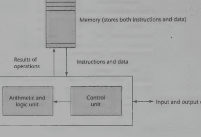

在冯·诺依曼体系结构计算机上执行机器码程序的过程称为*取指-执行周期*。如前所述，程序驻留在内存中，但在 CPU 中执行。每条要执行的指令都必须从内存移动到处理器。下一条要执行指令的地址保存在一个称为**程序计数器**的寄存器中。取指-执行周期可以用以下算法简单描述：

```
initialize the program counter
repeat forever
    fetch the instruction pointed to by the program counter
    increment the program counter to point at the next instruction
    decode the instruction
    execute the instruction
end repeat
```

算法中的“解码指令”步骤意味着检查指令以确定它指定了什么操作。当遇到停止指令时，程序执行终止，尽管在实际计算机上很少执行停止指令。相反，控制权从操作系统转移到用户程序以执行，然后在用户程序执行完成后再回到操作系统。在给定时间内存中可能有多个用户程序的计算机系统中，这个过程要复杂得多。

如前所述，函数式语言（或称应用式语言）是一种主要计算手段是将函数应用于给定参数的语言。在函数式语言中编程，可以不使用命令式语言中使用的那种变量，不使用赋值语句，也不使用迭代。尽管许多计算机科学家已经阐述了函数式语言（如 Scheme）的无数优点，但在设计出能够高效执行函数式语言程序的非冯·诺依曼计算机之前，它们不太可能取代命令式语言。在对这一事实表示惋惜的人中，最雄辩的是 John Backus（1978），他是原始版本 Fortran 的主要设计者。

尽管命令式编程语言的结构是依照机器体系结构塑造的，而不是依照编程语言用户的能力和倾向塑造的，但有些人认为使用命令式语言在某种程度上比使用函数式语言更自然。因此，这些人认为，即使函数式程序与命令式程序一样高效，命令式编程语言的使用仍将占主导地位。

### 1.4.2 程序设计方法学

20 世纪 60 年代末和 70 年代初，在结构化编程运动很大程度上开启下，对软件开发过程和编程语言设计进行了深入分析。

这项研究的一个重要原因是，随着硬件成本下降和程序员成本增加，计算的主要成本从硬件转向软件。编程生产率的提高相对较小。此外，计算机正在解决越来越大、越来越复杂的问题。与 20 世纪 60 年代初只是求解方程组来模拟卫星轨道不同，人们正在为大型复杂任务编写程序，例如控制大型炼油设施和提供全球航空公司预订系统。

20 世纪 70 年代的研究所产生的新的软件开发方法学被称为自顶向下设计和逐步求精。所发现的主要编程语言缺陷是类型检查不完整和控制语句不充分（需要大量使用 goto 语句）。

20 世纪 70 年代末，开始从面向过程的程序设计方法学向面向数据的程序设计方法学转变。简而言之，面向数据的方法强调数据设计，侧重于使用抽象数据类型来解决问题。

为了使数据抽象在软件系统设计中得到有效使用，必须由用于实现的语言来支持它。第一个提供哪怕有限的数据抽象支持的语言是 SIMULA 67（Birtwistle 等，1973），尽管该语言当然并未因这一特性而被推向流行。直到 20 世纪 70 年代初，数据抽象的好处才被广泛认可。然而，自 20 世纪 70 年代末以来设计的大多数语言都支持数据抽象，这将在第 11 章讨论。

面向数据软件开发演进的最新一步始于 20 世纪 80 年代初，即面向对象设计。面向对象方法学从数据抽象开始，它将处理与数据对象封装在一起并控制对数据的访问，还增加了继承和动态

方法绑定。继承是一个强大的概念，它极大地增强了现有软件潜在的复用性，从而为软件开发生产率的显著提高提供了可能。这是面向对象编程语言日益流行的一个重要因素。动态（运行时）方法绑定允许更灵活地使用继承。

面向对象编程是伴随着一种支持其概念的语言——Smalltalk（Goldberg and Robson, 1989）——发展起来的。尽管 Smalltalk 从未像许多其他语言那样被广泛使用，但如今对面向对象编程的支持已成为大多数流行命令式语言的一部分，包括 Java、C++ 和 C#。面向对象的概念也进入了 CLOS（Bobrow et al., 1988）和 F#（Syme et al., 2010）的函数式编程，以及 Prolog++（Moss, 1994）的逻辑编程。第12章将详细讨论对面向对象编程的语言支持。

从某种意义上说，面向过程编程与面向数据编程相反。尽管面向数据的方法如今在软件开发中占主导地位，但面向过程的方法并未被抛弃。相反，近年来，在面向过程编程方面，尤其是在并发领域，已经进行了大量研究。这些研究工作带来了对用于创建和控制并发程序单元的语言设施的需求。Java 和 C# 包含了此类能力。第13章将详细讨论并发。

软件开发方法学中的所有这些演进步骤都催生了支持它们的新语言构造。

## 1.5 语言分类

编程语言通常被分为四类：命令式、函数式、逻辑式和面向对象式。然而，我们不认为支持面向对象编程的语言构成一个单独的语言类别。我们已经描述了最流行的支持面向对象编程的语言是如何从命令式语言发展而来的。尽管面向对象软件开发范式与命令式语言通常使用的面向过程范式存在显著差异，但为支持面向对象编程而对命令式语言所做的扩展并不密集。例如，C 和 Java 的表达式、赋值语句和控制语句几乎相同。（另一方面，Java 的数组、子程序和语义与 C 的非常不同。）对于支持面向对象编程的函数式语言，也可以作出类似的表述。

有些作者将脚本语言视为编程语言的一个单独类别。然而，这一类别中的语言更多地是通过其实现方式（部分或完全解释）而非共同的语言设计联系在一起的。通常被称为脚本语言的语言——其中包括 Perl、JavaScript（Flanagan, 2011）和 Ruby——从任何意义上说都是命令式语言。

逻辑编程语言是基于规则的语言的一个例子。在命令式语言中，算法被非常详细地规定，并且必须包含指令或语句的具体执行顺序。然而，在基于规则的语言中，规则的规定没有特定顺序，语言实现系统必须选择使用规则的顺序以产生所需结果。这种软件开发方法与其他两类语言所使用的方法截然不同，并且可能需要一种完全不同类型的语言。最常用的逻辑编程语言 Prolog 以及逻辑编程将在第16章讨论。

近年来，出现了一类新的语言，即标记/编程混合语言。标记语言不是编程语言。例如，HTML 是最广泛使用的标记语言，用于指定 Web 文档中信息的布局。然而，一些编程能力已经逐渐进入 HTML 和 XML 的一些扩展中。其中包括 Java Server Pages Standard Tag Library（JSTL）和 eXtensible Stylesheet Language Transformations（XSLT）。这两者都将在第2章简要介绍。这些语言无法与任何完整的编程语言相比，因此第2章之后将不再讨论。

## 1.6 语言设计权衡

第1.3节描述的编程语言评估标准为语言设计提供了一个框架。不幸的是，该框架是自相矛盾的。Hoare（1973）在其富有洞见的语言设计论文中指出：“有如此多重要但相互冲突的标准，以至于协调并满足它们是一项重大的工程任务。”

相互冲突的两个标准是可靠性和执行成本。例如，Java 语言定义要求对所有数组元素的引用进行检查，以确保索引处于合法范围内。对于包含大量数组元素引用的 Java 程序，这一步会大大增加执行成本。C 不要求索引范围检查，因此 C 程序比语义等价的 Java 程序执行得更快，尽管 Java 程序更可靠。Java 的设计者用执行效率换取了可靠性。

另一个直接导致设计权衡的标准冲突例子是 APL 的情况。APL 包含一组强大的用于数组操作数的运算符。由于运算符数量众多，APL 中不得不加入大量新符号来表示这些运算符。此外，许多 APL 运算符可用于单个长而复杂的表达式中。这种高表达力的一个结果是，对于涉及大量数组操作的应用程序，APL 非常易写。事实上，一个非常小的程序就可以规定大量计算。另一个结果是 APL 程序的可读性非常差。紧凑简洁的表达式具有一定的数学美感，但除程序员本人外，其他人很难理解。著名作者 Daniel McCracken（1970）曾指出，他花了四个小时才读懂并理解一个四行的 APL 程序。APL 的设计者用可读性换取了可写性。

可写性与可靠性之间的冲突在语言设计中很常见。C++ 的指针可以通过多种方式操作，这支持高度灵活的数据寻址。由于指针存在潜在的可靠性问题，Java 中不包含指针。

语言设计（及评估）标准之间冲突的例子比比皆是；有些很微妙，另一些则很明显。因此，显而易见，在设计编程语言时选择构造和特性需要许多妥协和权衡。

## 1.7 实现方法

如第1.4.1节所述，计算机的两个主要组成部分是内存储器和处理器。内存储器用于存储程序和数据。处理器是一组电路，提供一组基本操作或机器指令的实现，例如算术和逻辑运算指令。在大多数计算机中，其中一些指令（有时称为宏指令）实际上是由一组称为微指令的指令实现的，而微指令定义在更低的层次上。由于软件永远看不到微指令，这里将不再进一步讨论它们。

计算机的机器语言是其指令集。在没有任何其他支持软件的情况下，其自身的机器语言是大多数硬件计算机“理解”的唯一语言。理论上，可以设计并建造一台以某种特定高级语言作为其机器语言的计算机，但这样的计算机会非常复杂且昂贵。此外，它将高度不灵活，因为很难（但并非不可能）将其用于其他高级语言。更实用的机器设计选择是在硬件中实现一种非常低级的语言，它提供最常用的基本操作，并要求系统软件为高级语言程序创建接口。

语言实现系统不可能是计算机上唯一的软件。还需要大量程序，称为操作系统，它提供比机器语言更高级的基本操作。这些基本操作提供系统资源管理、输入输出操作、文件管理系统、文本和/或程序编辑器，以及各种其他常用功能。由于语言实现系统需要许多操作系统设施，它们与操作系统接口，而不是直接与处理器（以机器语言）接口。

操作系统和语言实现分层叠加在计算机的机器语言接口之上。这些层可以被视为虚拟计算机，在更高层次上向用户提供接口。例如，

操作系统和 C 编译器提供了一台虚拟 C 计算机。借助其他编译器，一台机器可以变成其他类型的虚拟计算机。大多数计算机系统都提供若干不同的虚拟计算机。用户程序在虚拟计算机层之上形成另一层。计算机的分层视图如图 1.2 所示。

**图 1.2** 典型计算机系统提供的虚拟计算机分层接口

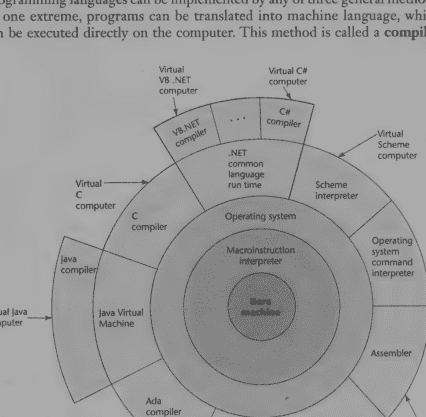

第一批高级编程语言的实现系统构建于 20 世纪 50 年代后期，是当时最复杂的软件系统之一。20 世纪 60 年代，人们进行了大量深入研究，以理解和形式化构建这些高级语言实现系统的过程。这些努力最大的成功在语法分析领域，主要因为实现过程的这一部分应用了当时已被充分理解的自动机理论和形式语言理论的部分内容。

### 1.7.1 编译

编程语言可以通过三种通用方法实现。一种极端是，程序可以被翻译成机器语言，并直接在计算机上执行。这种方法称为编译器实现，其优点是翻译过程完成后程序执行速度非常快。大多数语言的生产实现，例如 C、COBOL 和 C++，都采用编译器实现。

编译器所翻译的语言称为源语言。编译和程序执行的过程分若干阶段进行，其中最重要的阶段如图 1.3 所示。

**图 1.3** 编译过程

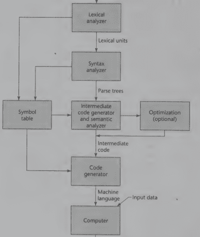

词法分析器将源程序的字符收集为词法单元。程序的词法单元包括标识符、特殊单词、运算符和标点符号。词法分析器忽略源程序中的注释，因为编译器用不到它们。

语法分析器从词法分析器取得词法单元，并利用它们构造称为*分析树*的层次结构。这些分析树表示程序的语法结构。在许多情况下，并不实际构造分析树结构；相反，会生成构建树所需的信息并直接使用。词法单元和分析树都将在第 3 章进一步讨论。词法分析和语法分析（或称解析）将在第 4 章讨论。

中间代码生成器生成另一种语言的程序，其层次介于源程序和编译器的最终输出——机器语言程序——之间。^4 中间语言有时看起来非常像汇编语言，事实上有时就是实际的汇编语言。在其他情况下，中间代码的层次略高于汇编语言。语义分析器是中间代码生成器不可分割的组成部分。语义分析器检查诸如类型错误之类的错误，这些错误在语法分析期间很难检测到，甚至无法检测到。

优化通过使程序更小、更快或两者兼有来改进程序（通常针对其中间代码版本）。由于许多优化在机器语言上难以进行，因此大多数优化都在中间代码上进行。

代码生成器将程序的优化中间代码版本转换为等价的机器语言程序。

符号表充当编译过程的数据库。符号表的主要内容是程序中每个用户定义名称的类型和属性信息。这些信息由词法分析器和语法分析器放入符号表，并由语义分析器和代码生成器使用。

如前所述，尽管编译器生成的机器语言可以直接在硬件上执行，但它几乎总是必须与某些其他代码一起运行。大多数用户程序还需要操作系统中的程序。其中最常见的是输入和输出程序。当用户程序需要所需的系统程序时，编译器会构造对这些程序的调用。在由编译器产生的机器语言程序能够执行之前，必须找到操作系统所需的程序，并将其链接到用户程序。链接操作通过将系统程序入口点的地址放入用户程序中对系统程序的调用中，把用户程序连接到系统程序。用户代码和系统代码合在一起有时称为*装入模块*或*可执行映像*。收集系统程序并将其链接到用户程序的过程称为*链接与装入*，有时简称为*链接*。它由称为链接器的系统程序完成。

**图 1.4** 纯解释

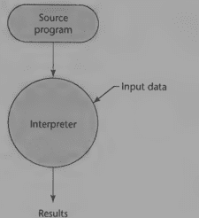

### 1.7.3 混合实现系统

有些语言实现系统是编译器和纯解释器之间的折中；它们将高级语言程序转换为一种为便于解释而设计的中间语言。这种方法比纯解释更快，因为源语言语句只被解码一次。这类实现称为**混合实现系统**。

图 1.5 展示了混合实现系统所使用的过程。它不将中间语言代码转换为机器代码，而只是解释中间代码。

Perl 采用混合系统实现。Perl 程序被部分编译，以便在解释之前检测错误并简化解释器。

Java 的初期实现都是混合式的。其中间形式称为**字节码**，可移植到任何具有字节码解释器和相关运行时系统的机器上。它们合在一起称为 Java 虚拟机。现在已有系统将 Java 字节码转换为机器代码，以获得更快的执行速度。

即时（JIT）实现系统首先将程序转换为中间语言。然后，在执行期间，当中间语言方法被调用时，将其编译为机器代码。机器代码版本会保留下来供后续调用使用。JIT 系统现在广泛用于 Java 程序。此外，.NET 语言全都采用 JIT 系统实现。

有时实现者可能为一种语言同时提供编译实现和解释实现。在这些情况下，解释器用于开发和调试程序。然后，在达到（相对）无错误状态后，程序会被编译以提高执行速度。

**图 1.5** 混合实现系统

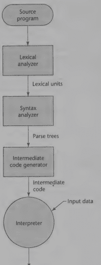

### 1.7.4 预处理器

预处理器是在程序编译之前对程序进行处理的程序。预处理器指令嵌入在程序中。预处理器本质上是一个宏展开器。预处理器指令通常用于指定要包含另一个文件中的代码。例如，C 预处理器指令

```c
#include "myLib.h"
```

会使预处理器将 myLib.h 的内容复制到程序中 #include 所在的位置。

其他预处理器指令用于定义表示表达式的符号。例如，可以使用

```c
#define max(A, B) ((A) > (B) ? (A) : (B))
```

来确定两个给定表达式中较大的一个。例如，表达式

```c
x = max(2 * y, z / 1.73);
```

会被预处理器展开为

```c
x = ((2 * y) > (z / 1.73) ? (2 * y) : (z / 1.73));
```

请注意，这是表达式副作用可能引发问题的情况之一。例如，如果传给 max 宏的两个表达式中任意一个具有副作用——例如 z++——就可能引发问题。由于两个表达式参数之一会被求值两次，这可能导致宏展开产生的代码将 z 递增两次。

## 1.8 编程环境

编程环境是软件开发中所用工具的集合。这个集合可能只包含文件系统、文本编辑器、链接器和编译器。也可能包含大量集成工具，每个工具都通过统一的用户界面访问。在后一种情况下，软件的开发和维护会大大增强。因此，编程语言的特征并不是衡量一个系统软件开发能力的唯一标准。现在我们简要描述几种编程环境。

UNIX 是一种较老的编程环境，最早于 20 世纪 70 年代中期发布，围绕可移植的多道程序设计操作系统构建。它为多种语言的软件生产和维护提供了一系列强大的支持工具。过去，UNIX 缺少的最重要特性是其工具之间统一的接口。这使得它更难以学习和使用。然而，现在人们常常通过运行在 UNIX 之上的 GUI 来使用 UNIX。UNIX GUI 的例子有 Solaris 通用桌面环境（CDE）、GNOME 和 KDE。这些 GUI 使 UNIX 的界面看起来类似于 Windows 和 Macintosh 系统的界面。

Borland JBuilder 是一种编程环境，为 Java 开发提供集成的编译器、编辑器、调试器和文件系统，这四者都通过图形界面访问。JBuilder 是一个用于创建 Java 软件的复杂而强大的系统。

Microsoft Visual Studio .NET 是软件开发环境演进中相对较新的一步。它是一个庞大而精细的软件开发工具集合，全部通过窗口式界面使用。该系统可用于以下五种 .NET 语言中的任意一种开发软件：C#、Visual Basic.NET、JScript（Microsoft 的 JavaScript 版本）、F#（一种函数式语言）和 C++/CLI。

NetBeans 是一个开发环境，主要用于 Java 应用程序开发，但也支持 JavaScript、Ruby 和 PHP。两者


Visual Studio 和 NetBeans 不仅是开发环境——它们还是框架，这意味着它们实际上提供了应用程序代码的公共部分。

## 小结

研究编程语言之所以有价值，有一些重要原因：它增强了我们在编写程序时使用不同构造的能力，使我们能更明智地为项目选择语言，并使学习新语言变得更容易。

计算机广泛应用于各种问题求解领域。特定编程语言的设计和评估高度依赖于它将被用于的领域。

评估语言的最重要标准包括可读性、可写性、可靠性和总体成本。这些标准将是我们考察和评判本书余下部分所讨论的各种语言特性的基础。

语言设计的主要影响因素一直是机器体系结构和软件设计方法学。

设计编程语言主要是一项工程成就，其中必须在特性、构造和能力之间做出一长串权衡取舍。

实现编程语言的主要方法有编译、纯解释和混合实现。

编程环境已成为软件开发系统的重要组成部分，而语言只是其中的一个组件。

## 复习题

1. 即使程序员可能从未真正设计过编程语言，为什么了解一些语言设计背景仍然有用？
2. 了解编程语言特性的知识如何使整个计算界受益？
3. 过去 60 年中，哪种编程语言主导了科学计算？
4. 过去 60 年中，哪种编程语言主导了商业应用？
5. 过去 60 年中，哪种编程语言主导了人工智能？
6. UNIX 的大部分是用什么语言编写的？
7. 语言中特性过多有什么缺点？
8. 用户定义运算符重载如何损害程序的可读性？

# 2 主要编程语言的演变

- 2.1 楚泽的 Plankalkül
- 2.2 伪代码
- 2.3 IBM 704 与 Fortran
- 2.4 函数式编程：Lisp
- 2.5 迈向成熟的第一步：ALGOL 60
- 2.6 商业记录计算机化：COBOL
- 2.7 分时技术的开端：Basic
- 2.8 为所有人提供一切：PL/I
- 2.9 两种早期动态语言：APL 和 SNOBOL
- 2.10 数据抽象的开端：SIMULA 67
- 2.11 正交设计：ALGOL 68
- 2.12 ALGOL 系列的一些早期后继语言
- 2.13 基于逻辑的编程：Prolog
- 2.14 历史上规模最大的设计工作：Ada
- 2.15 面向对象编程：Smalltalk
- 2.16 结合命令式与面向对象特性：C++
- 2.17 一种基于命令式的面向对象语言：Java
- 2.18 脚本语言
- 2.19 .NET 的旗舰语言：C#
- 2.20 标记与编程混合语言


本章介绍一系列编程语言的发展。它探讨每种语言的设计环境，并重点关注该语言的贡献及其开发动机。本章不包含对语言的全面描述；相反，我们只讨论每种语言引入的一些新特性。尤其值得关注的是那些对后续语言或计算机科学领域影响最大的特性。

本章不深入讨论任何语言特性或概念；这些内容留待后续章节。对这些特性的简要、非正式说明，足以支撑我们对这些语言发展历程的考察。

本章讨论许多读者不熟悉的各种语言和语言概念。这些主题只在后续章节中详细讨论。如果读者对此感到不安，不妨先学完本书其余部分再读本章。

这里讨论哪些语言是主观选择，一些读者会不快地注意到自己喜爱的一种或多种语言没有出现。然而，为使这段历史覆盖范围保持在合理篇幅内，有必要省略一些有人评价很高的语言。这些选择基于我们对每种语言对语言发展以及整个计算世界重要性的估计。我们也简要讨论书中后文提到的一些其他语言。

本章组织如下：各语言的最初版本通常按时间顺序讨论。然而，语言的后续版本与其最初版本放在一起讨论，而不是放在后面的小节中。例如，Fortran 2003 在与 Fortran I（1956）同一节中讨论。此外，在某些情况下，与某一有独立小节的语言相关的次要语言，也出现在该小节中。

本章包含 14 个完整示例程序的清单，每个程序使用不同的语言。本章不描述这些程序；它们旨在展示这些语言中程序的外观。熟悉任何常见命令式语言的读者应能阅读并理解这些程序中的大部分代码，但 Lisp、COBOL 和 Smalltalk 的程序除外。（第 15 章讨论了一个与 Lisp 示例类似的 Scheme 函数。）Fortran、ALGOL 60、PL/I、Basic、Pascal、C、Perl、Ada、Java、JavaScript 和 C# 程序解决的是同一个问题。请注意，此列表中的大多数当代语言都支持动态数组，但由于示例问题很简单，我们没有在示例程序中使用动态数组。此外，在 Fortran 95 程序中，我们避免使用那些本可以完全避免循环的特性，部分是为了让程序简单易读，部分只是为了说明该语言的基本循环结构。

图 2.1 是本章讨论的高级语言谱系图。

容易出错。其问题之一是使用数字代码来指定指令。例如，一条 ADD 指令可能由代码 14 指定，而不是由一个具有含义的文本名称指定，哪怕这个名称只有一个字母。这使程序非常难以阅读。更严重的问题是绝对寻址，它使程序修改变得繁琐且容易出错。例如，假设我们有一个存储在内存中的机器语言程序。此类程序中的许多指令会引用程序内的其他位置，通常是为了引用数据或指示分支指令的目标。在程序中除末尾之外的任何位置插入一条指令，都会使所有引用插入点之后地址的指令不再正确，因为这些地址必须增加，以便为新指令腾出空间。为了正确完成这次添加，必须找到并修改所有引用该添加位置之后地址的指令。删除指令时也会出现类似问题。不过在这种情况下，机器语言通常包含一条“空操作”指令，它可以替换被删除的指令，从而避免这个问题。

这些是所有机器语言的标准问题，也是发明汇编器和汇编语言的主要动机。此外，当时大多数编程问题都是数值问题，需要浮点算术运算和某种索引机制，以便方便地使用数组。然而，20 世纪 40 年代末和 50 年代初的计算机体系结构并未包含这两种能力。这些缺陷自然促使人们开发出某种更高层次的语言。

### 2.2.1 Short Code

这些新语言中的第一种名为 Short Code，由约翰·莫奇利于 1949 年为 BINAC 计算机开发；BINAC 是最早成功的存储程序电子计算机之一。Short Code 后来被移植到 UNIVAC I 计算机（美国售出的第一台商用电子计算机）上，并在数年间成为为这些机器编程的主要手段之一。尽管由于原始 Short Code 的完整说明从未发表，人们对其知之甚少，但 UNIVAC I 版本的编程手册确实留存了下来（Remington-Rand，1952）。可以稳妥地认为，这两个版本非常相似。

UNIVAC I 内存的字为 72 位，分为 12 个 6 位字节。Short Code 由待求值的数学表达式的编码形式组成。这些代码是字节对值，许多方程可以编码在一个字中。其中包括以下操作码：

```
01 -   06 abs value      1n (n+2)nd power
02 )   07 +              2n (n+2)nd root
03 =   08 pause          4n if <= n
04 /   09 (              5n print and tab
```


变量用字节对编码命名，用作常量的位置也是如此。例如，X0 和 Y0 可以是变量。语句

```
X0 = SQRT (ABS (Y0))
```

会被编码为一个字：00 X0 03 20 06 Y0。开头的 00 用作填充以填满该字。有趣的是，没有乘法代码；乘法只需像代数中那样将两个操作数并排放置来表示。

Short Code 并未翻译成机器码；相反，它是用纯解释器实现的。当时，这一过程被称为*自动编程*。它显然简化了编程过程，但代价是执行时间。Short Code 的解释执行速度大约比机器码慢 50 倍。

### 2.2.2 Speedcoding

在其他地方，人们正在开发解释系统，将机器语言扩展为包含浮点运算。John Backus 为 IBM 701 开发的 Speedcoding 系统就是这类系统的一个例子（Backus, 1954）。Speedcoding 解释器有效地将 701 转换为一台虚拟的三地址浮点计算器。该系统包含用于对浮点数据进行四种算术运算的伪指令，以及平方根、正弦、反正切、指数和对数等运算。条件分支和无条件分支以及输入/输出转换也是该虚拟架构的一部分。要了解这类系统的局限性，可以设想：加载解释器之后，剩余可用内存只有 700 个字，而且加法指令执行需要 4.2 毫秒。另一方面，Speedcoding 包含自动递增地址寄存器的新颖功能。直到 1962 年的 UNIVAC 1107 计算机，这一功能才出现在硬件中。由于这些特性，矩阵乘法可以用 12 条 Speedcoding 指令完成。Backus 声称，用机器码编程可能需要两周的问题，使用 Speedcoding 可以在几小时内编好程序。

### 2.2.3 UNIVAC“编译”系统

1951 年至 1953 年间，UNIVAC 由 Grace Hopper 领导的一个团队开发了一系列名为 A-0、A-1 和 A-2 的“编译”系统，这些系统将伪代码展开为机器码子程序，其方式与宏展开为汇编语言相同。这些“编译器”的伪代码源仍然相当原始，尽管即使如此，相比机器码仍是很大的改进，因为它使源程序短得多。Wilkes（1952）独立提出了类似的过程。

Glennie 的 Autocode 层级太低且面向机器，因此不应被视为编译系统。Backus 将功劳归于麻省理工学院的 Laning 和 Zierler。

Laning 和 Zierler 系统（Laning and Zierler, 1954）是第一个被实现的代数翻译系统。所谓代数，是指它翻译算术表达式，使用单独编码的子程序来计算超越函数（例如正弦和对数），并包含数组。该系统于 1952 年夏天在 MIT Whirlwind 计算机上以实验原型形式实现，到 1953 年 5 月实现了更可用的形式。翻译器生成一个子程序调用，以编码程序中的每个公式或表达式。源语言易于阅读，其中包含的唯一实际机器指令用于分支。尽管这项工作早于 Fortran 的工作，但它从未走出 MIT。

尽管有这些早期工作，第一个被广泛接受的编译型高级语言是 Fortran。以下小节记录了这一重要发展。

### 2.3.2 设计过程

甚至在 1954 年 5 月宣布 704 系统之前，就已经开始了 Fortran 的计划。到 1954 年 11 月，John Backus 和他在 IBM 的小组已经完成了题为“The IBM Mathematical FORmula TRANslating System: FORTRAN”的报告（IBM, 1954）。该文档描述了 Fortran 的第一个版本，我们称之为 Fortran 0，此时尚未实现。它还大胆地宣称，Fortran 将提供手写程序的效率以及解释型伪代码系统编程的便利性。文档又一次满怀乐观地声称，Fortran 将消除编码错误和调试过程。基于这一前提，第一个 Fortran 编译器几乎不包含语法错误检查。

Fortran 的开发环境如下：

- 计算机内存小、速度慢且相对不可靠；
- 计算机主要用于科学计算；
- 当时不存在高效且有效的计算机编程方式；
- 由于计算机成本相对于程序员成本很高，生成目标代码的速度是第一批 Fortran 编译器的首要目标。

Fortran 早期版本的特征直接源于这一环境。

### 2.3.3 Fortran I 概述

Fortran 0 在实现期间被修改，该时期从 1955 年 1 月开始，一直持续到 1957 年 4 月编译器发布。所实现的语言（我们称之为 Fortran I）在 1956 年 10 月出版的第一本 Fortran *Programmer's Reference Manual*（IBM, 1956）中进行了描述。Fortran I 包括输入/输出格式化、最多六个字符的变量名（在 Fortran 0 中只有两个字符）、用户定义的子程序，尽管它们

### 2.3.5 Fortran IV、77、90、95、2003 和 2008

Fortran III 曾被开发出来，但从未广泛分发。然而，Fortran IV 成为当时使用最广泛的编程语言之一。它在 1960 年至 1962 年期间发展演变，并被标准化为 Fortran 66（ANSI, 1966），尽管该名称很少被使用。Fortran IV 在许多方面是对 Fortran II 的改进。其最重要的新增功能包括变量的显式类型声明、逻辑 `if` 结构，以及将子程序作为参数传递给其他子程序的能力。

Fortran IV 被 Fortran 77 取代，后者于 1978 年成为新标准（ANSI, 1978a）。Fortran 77 保留了 Fortran IV 的大部分特性，并增加了字符串处理、逻辑循环控制语句，以及带可选 `else` 子句的 `if`。

Fortran 90（ANSI, 1992）与 Fortran 77 截然不同。最重要的新增功能是动态数组、记录、指针、多重选择语句和模块。此外，Fortran 90 子程序可以递归调用。

Fortran 90 定义中包含的一个新概念是从早期版本中移除某些语言特性。虽然 Fortran 90 包含了 Fortran 77 的所有特性，但语言定义中包含了一份建议在下一版本语言中移除的结构列表。

Fortran 90 包含两项简单的语法变更，改变了程序以及描述该语言的文献的外观。第一，取消了必需的固定代码格式，该格式要求语句的特定部分使用特定字符位置。例如，语句标号只能出现在前五个位置，语句不能从第七个位置之前开始。这种严格的代码格式是围绕穿孔卡片的使用而设计的。第二项变更是 FORTRAN 的官方拼写变为 Fortran。伴随这一变化的是 Fortran 程序中关键字和标识符使用全大写字母的惯例发生了改变。新惯例是关键字和标识符只有首字母大写。

Fortran 95（INCITS/ISO/IEC, 1997）延续了该语言的演进，但只做了少量更改。其中包括增加了一个新的迭代结构 `Forall`，以减轻并行化 Fortran 程序的任务。

Fortran 2003（Metcalf et al., 2004）增加了对面向对象编程、参数化派生类型、过程指针以及与 C 编程语言互操作性的支持。

Fortran 的最新版本 Fortran 2008（ISO/IEC 1539-1, 2010）增加了对用于定义局部作用域的块、提供并行执行模型的协同数组（co-arrays），以及用于指定无相互依赖循环的 `DO CONCURRENT` 结构的支持。

### 2.3.6 评价

最初的 Fortran 设计团队只把语言设计视为设计翻译器这一关键任务的必要前奏。此外，他们从未想到 Fortran 会被用于不是由……制造的计算机上

这一成果出自 IBM 之手。然而，IBM 之所以被迫考虑为其他 IBM 机器编写 Fortran 编译器，仅仅是因为 704 的后继机型 709 在 704 的 Fortran 编译器发布之前就已经公布。考虑到设计者们最初的目标并不宏大，Fortran 对计算机使用方式产生的巨大影响，以及所有后来的编程语言都受惠于 Fortran 这一事实，确实令人印象深刻。

Fortran I 以及 90 版本之前所有后继版本的一个特点，是允许高度优化编译器的存在，那就是所有变量的类型和存储在运行之前就已固定。执行期间不能分配新的变量或空间。这是以灵活性换取简单性和效率的牺牲。它排除了递归子程序的可能性，并使实现动态增长或改变形状的数据结构变得困难。当然，在 Fortran 早期版本开发的时代，正在构建的程序类型主要是数值计算性质的，与较新的软件项目相比要简单得多。因此，这种牺牲并不算大。

Fortran 的整体成功难以言过其实：它极大地改变了计算机的使用方式。当然，这在很大程度上归功于它是第一个被广泛使用的高级语言。与后来发展的概念和语言相比，早期版本的 Fortran 在多个方面存在不足，这也是意料之中的。毕竟，将 1910 年的福特 T 型车与 2015 年的福特野马进行比较，在性能和舒适度上并不公平。然而，尽管 Fortran 存在种种不足，Fortran 软件的巨大投资惯性以及其他因素，使其持续使用了近 60 年。

ALGOL 60 的设计者之一艾伦·佩利斯在 1978 年这样评价 Fortran：“Fortran 是计算世界的*通用语言*。它是最好意义上的街头语言，而不是介词意义上的街头语言。它能够生存下去并将继续生存下去，因为它已被证明是一个非常活跃的商业领域中极其有用的部分”（Wexelblat，1981，第 161 页）。

以下是一个 Fortran 95 程序的示例：

```fortran
! Fortran 95 example program
! Input:  An integer, List_Len, where List_Len is less
!        than 100, followed by List_Len-Integer values
! Output: The number of input values that are greater
!        than the average of all input values
Implicit none
Integer, Dimension(99) :: Int_List
Integer :: List_Len, Counter, Sum, Average, Result
Result= 0
Sum = 0
Read *, List_Len
If ((List_Len > 0) .AND. (List_Len < 100)) Then
! Read input data into an array and compute its sum
    Do Counter = 1, List_Len
        Read *, Int_List(Counter)
        Sum = Sum + Int_List(Counter)
    End Do
```

其中包含了列表处理指令。另一个使 IPL 语言未能流行的因素是它们是在不太知名的 Johnniac 机器上实现的。

IPL 语言的贡献在于它们的列表设计，以及它们证明了列表处理是可行且有用的。

IBM 在 20 世纪 50 年代中期对人工智能产生了兴趣，并选择定理证明作为示范领域。当时，Fortran 项目仍在进行中。Fortran I 编译器的高昂成本使 IBM 确信，他们的列表处理应该附加到 Fortran 上，而不是采用新语言的形式。因此，Fortran 列表处理语言（FLPL）被设计并实现为 Fortran 的扩展。FLPL 被用来构建一个平面几何的定理证明器，而平面几何在当时被认为是最适合机械定理证明的领域。

### 2.4.2 Lisp 的设计过程

麻省理工学院的约翰·麦卡锡于 1958 年夏季在 IBM 信息研究部门任职。他那个夏天的目标是研究符号计算，并为进行此类计算制定一组需求。他选择的试点问题领域是代数表达式的求导。从这项研究中得出一系列语言需求。其中包括数学函数的控制流方法：递归和条件表达式。当时唯一可用的高级语言 Fortran I 两者都不具备。

另一个源于符号求导研究的需求是动态分配的链表以及某种被遗弃列表的隐式释放机制。麦卡锡绝不允许他优雅的求导算法被显式的释放语句所干扰。

由于 FLPL 不支持递归、条件表达式、动态存储分配或隐式释放，麦卡锡清楚地认识到需要一种新的语言。

1958 年秋，麦卡锡回到麻省理工学院后，与马文·明斯基共同创建了麻省理工学院人工智能项目，由电子研究实验室资助。该项目的第一个重要工作是制作一个用于列表处理的软件系统。它最初用于实现麦卡锡提出的名为“Advice Taker”³ 的程序。这个应用成为开发列表处理语言 Lisp 的推动力。Lisp 的第一个版本有时被称为“纯 Lisp”，因为它是一种纯函数式语言。在下一节中，我们描述纯 Lisp 的发展。

3. Advice Taker 用正式语言书写的句子来表示信息，并使用逻辑推理过程来决定该做什么。

### 2.4.3 语言概述

#### 2.4.3.1 数据结构

纯 Lisp 只有两种数据结构：原子和列表。原子要么是符号（具有标识符的形式），要么是数值字面量。将符号信息存储在链表中的概念很自然，并且在 IPL-II 中已经使用。这样的结构允许在任意点进行插入和删除，这些操作在当时被认为是列表处理的必要部分。然而，最终确定 Lisp 程序很少需要这些操作。

列表通过用括号界定其元素来指定。元素仅限于原子的简单列表具有如下形式：

```
(A B C D)
```

嵌套列表结构也通过括号指定。例如，列表

```
(A (B C) D (E (F G)))
```

由四个元素组成。第一个是原子 A；第二个是子列表 (B C)；第三个是原子 D；第四个是子列表 (E (F G))，其第二个元素是子列表 (F G)。

在内部，列表存储为单链表结构，其中每个节点有两个指针，并代表一个列表元素。包含原子的节点，其第一个指针指向该原子的某种表示，如它的符号或数值，或者指向一个子列表的指针。子列表元素的节点，其第一个指针指向子列表的第一个节点。在两种情况下，节点的第二个指针指向列表的下一个元素。列表通过指向其第一个元素的指针来引用。

前面展示的两个列表的内部表示如图 2.2 所示。请注意，列表的元素水平显示。列表的最后一个元素没有后继，因此其链接为 NIL，在图 2.2 中用元素中的斜线表示。子列表以相同的结构显示。

#### 2.4.3.2 函数式编程中的过程

Lisp 被设计为一种函数式编程语言。在纯函数式程序中，所有计算都是通过将函数应用于参数来完成的。命令式语言程序中充斥的赋值语句和变量在函数式语言程序中都不是必需的。此外，重复过程可以用递归函数调用指定，从而使迭代（循环）变得不必要。函数式编程的这些基本概念使其与命令式语言编程显著不同。


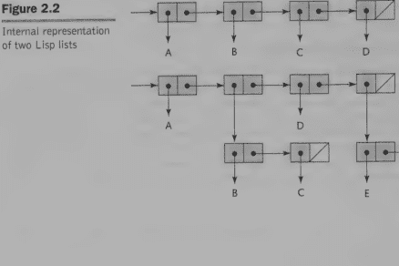

#### 2.4.3.3 Lisp 的语法

Lisp 与命令式语言差别很大，这不仅是因为它是一种函数式编程语言，还因为 Lisp 程序的外观与 Java 或 C++ 等语言中的程序截然不同。例如，Java 的语法是英语和代数的复杂混合体，而 Lisp 的语法则是简洁的典范。程序代码和数据的形式完全相同：用括号括起来的列表。再次考虑列表

```
(A B C D)
```

当它被解释为数据时，它是一个包含四个元素的列表。当它被看作代码时，它是名为 A 的函数应用于三个参数 B、C 和 D 的调用。

### 2.4.4 求值

Lisp 统治 AI 应用长达四分之一世纪。过去导致 Lisp 背负低效名声的大部分原因已经消除。许多当代实现都采用编译方式，所生成的代码执行起来比在解释器上运行源代码要快得多。除了在 AI 方面的成功，Lisp 还开创了函数式编程，这已被证明是编程语言研究中一个活跃的领域。如第 1 章所述，许多编程语言研究者认为，对于软件开发而言，函数式编程比使用命令式语言进行过程式编程要好得多。

以下是 Lisp 程序的一个示例：

```lisp
; Lisp Example function
; The following code defines a Lisp predicate function
; that takes two lists as arguments and returns True
; if the two lists are equal, and NIL (false) otherwise
(DEFUN equal_lists (lis1 lis2)
  (COND
    ((ATOM lis1) (EQ lis1 lis2))
    ((ATOM lis2) NIL)
    ((equal_lists (CAR lis1) (CAR lis2))
     (equal_lists (CDR lis1) (CDR lis2)))
    (T NIL)
  )
)
```

### 2.4.5 Lisp 的两个分支

现在有两种 Lisp 方言被广泛使用：Scheme 和 Common Lisp。接下来各小节将简要讨论它们。

#### 2.4.5.1 Scheme

Scheme 语言于 20 世纪 70 年代中期诞生于麻省理工学院（MIT）。它的特点是规模小、完全使用静态作用域（在第 5 章讨论），以及将函数视为一等实体。作为一等实体，Scheme 函数可以被赋值给变量、作为参数传递，并可作为函数应用的结果返回。它们还可以作为列表的元素。早期版本的 Lisp 并没有提供所有这些能力，也没有使用静态作用域。

作为一种语法和语义简单的小型语言，Scheme 非常适合教育应用，例如函数式编程课程和程序设计入门课程。第 15 章将较为详细地描述 Scheme。

#### 2.4.5.2 Common Lisp

在 20 世纪 70 年代和 80 年代初，人们开发并使用了许多不同的 Lisp 方言。这导致了常见的问题：用各种方言编写的程序缺乏可移植性。Common Lisp（Graham, 1996）就是为了纠正这种情况而创建的。Common Lisp 通过将 20 世纪 80 年代初期开发的几种 Lisp 方言（包括 Scheme）的特性合并为一种语言而设计。由于是这种混合体，Common Lisp 是一种相对庞大而复杂的语言。然而，它的基础是纯 Lisp，所以它的语法、原始函数和基本性质都来自该语言。

Common Lisp 认识到动态作用域提供的灵活性以及静态作用域的简洁性，因此它允许两种作用域。变量的默认作用域是静态的，但如果将变量声明为 *特殊*，则该变量变为动态作用域。

Common Lisp 拥有大量数据类型和结构，包括记录、数组、复数和字符串。它还有一种包的形式，用于将函数和数据的集合模块化并提供访问控制。

第 15 章将进一步介绍 Common Lisp。

### 2.4.6 相关语言

ML（MetaLanguage，元语言；Ullman, 1998）最初由爱丁堡大学的 Robin Milner 在 20 世纪 80 年代设计，用作程序验证系统“可计算函数逻辑”（LCF；Milner et al., 1990）的元语言。ML 主要是一种函数式语言，但它也支持命令式编程。与 Lisp 和 Scheme 不同，ML 中每个变量和表达式的类型都可以在编译时确定。类型与对象相关联，而不是与名称相关联。名称和表达式的类型根据其上下文推断。

与 Lisp 和 Scheme 不同，ML 不使用源自 lambda 表达式的括号化函数式语法。相反，ML 的语法类似于 Java 和 C++ 等命令式语言的语法。

Miranda 由英国坎特伯雷肯特大学的 David Turner（1986）在 20 世纪 80 年代初开发。Miranda 部分基于 ML、SASL 和 KRC 等语言。Haskell（Hudak and Fasel, 1992）在很大程度上基于 Miranda。与 Miranda 一样，它是一种纯函数式语言，没有变量，也没有赋值语句。Haskell 的另一个显著特点是使用惰性求值。这意味着，直到需要某个表达式的值时，该表达式才会被求值。这为该语言带来了一些令人惊讶的能力。

Caml（Cousineau et al., 1998）及其支持面向对象编程的方言 OCaml（Smith, 2006）源自 ML 和 Haskell。最后，F# 是一种相对较新的类型化语言，直接基于 OCaml。F#（Syme et al., 2010）是一种 .NET 语言，可以直接访问整个 .NET 库。作为 .NET 语言，这也意味着它可以与任何其他 .NET 语言顺利互操作。F# 既支持函数式编程，也支持过程式编程。它还完全支持面向对象编程。

ML、Haskell 和 F# 将在第 15 章进一步讨论。

## 2.5 迈向复杂化的第一步：ALGOL 60

ALGOL 60 对后来的编程语言影响深远，因此在任何语言历史研究中都具有核心重要性。

苏黎世小组的一位成员。正是 Naur 创建并出版了 *《ALGOL 公报》*。他花费了大量时间研究 Backus 引入 BNF 的论文，并决定应该使用 BNF 来正式描述 1960 年会议的结果。在对 BNF 进行了一些相对较小的修改之后，他用 BNF 编写了新的提议语言的描述，并在会议开始时将其分发给了 1960 年小组的成员。

### 2.5.6 ALGOL 60 概述

尽管 1960 年的会议只持续了六天，但对 ALGOL 58 的修改却是巨大的。其中最重要的新进展如下：

-   引入了块结构的概念。这使程序员可以通过引入新的数据环境（即作用域）来局部化程序的各个部分。
-   允许以两种不同的方式向子程序传递参数：传值和传名。
-   允许过程递归。ALGOL 58 的描述在这个问题上并不清楚。注意，尽管递归对命令式语言来说是新事物，但 Lisp 在 1959 年就已经提供了递归函数。
-   允许使用栈动态数组。栈动态数组是指其下标范围由一个或多个变量指定的数组，因此数组的大小是在存储分配给该数组时确定的，而这一分配发生在执行过程中遇到该声明时。第 6 章将详细描述栈动态数组。

一些可能对语言的成败产生重大影响的特性被提出后又遭到了否决。其中最重要的是带格式的输入输出语句，由于被认为依赖于机器，这些语句被省略了。

ALGOL 60 报告于 1960 年 5 月发表（Naur, 1960）。语言描述中仍然存在一些歧义，第三次会议定于 1962 年 4 月在罗马召开，以解决这些问题。在这次会议上，小组只处理问题；不允许对语言进行增补。会议的结果以《算法语言 ALGOL 60 修订报告》（Backus et al., 1963）为标题发表。

### 2.5.7 评价

在某些方面，ALGOL 60 取得了巨大的成功；在其他方面，它则是一次惨败。它几乎立即成为计算文献中交流算法的唯一可接受的正式手段，并且这种状态保持了 20 多年。自 1960 年以来设计的每一种命令式编程语言都受惠于 ALGOL 60。事实上，大多数都是直接的。


### 2.6.1 历史背景

COBOL 的开端与 ALGOL 60 有些相似，因为该语言也是由一个委员会在相对较短的时间内开会设计的。当时是1959年，商业计算的状况与几年前 Fortran 设计时的科学计算状况类似。一种用于商业应用程序的编译语言 FLOW-MATIC 已于1957年实现，但它属于一家制造商 UNIVAC，并且是为该公司的计算机设计的。另一种语言 AIMACO 正被美国空军使用，但它只是 FLOW-MATIC 的一个小变种。IBM 设计了一种用于商业应用程序的编程语言 COMTRAN（Commercial TRANslator），但尚未实现。还有几个其他语言设计项目正在规划中。

### 2.6.2 FLOW-MATIC

FLOW-MATIC 的起源至少值得简单讨论一下，因为它是 COBOL 的主要前身。1953年12月，Remington-Rand UNIVAC 公司的 Grace Hopper 撰写了一份颇具预见性的提案。提案建议“数学程序应该用数学符号编写，数据处理程序应该用英语语句编写”（Wexelblat, 1981, p. 16）。不幸的是，在1953年，要让非程序员相信计算机能够理解英语单词是不可能的。直到1955年，类似的提案才有希望获得 UNIVAC 管理层的资助，即便如此，最终还是靠一个原型系统才完成了最后的说服工作。这一推销过程的一部分包括编译和运行一个小程序，先使用英语关键字，然后使用法语关键字，最后使用德语关键字。UNIVAC 管理层认为这次演示非常了不起，并因此接受了 Hopper 的提案。

### 2.6.3 COBOL 设计过程

关于商业应用通用语言的第一次正式会议由美国国防部赞助，于1959年5月28日至29日在五角大楼举行（正好在苏黎世 ALGOL 会议一年之后）。与会者达成的共识是，当时命名为 CBL（Common Business Language，通用商业语言）的语言应具有以下总体特征：大多数人同意应尽可能使用英语，尽管少数人主张采用更数学化的表示法。语言必须易于使用，即使以降低能力为代价，也要扩大能够为计算机编程的人群基础。除了使语言易于使用之外，人们还认为使用英语可以让管理者阅读程序。最后，设计不应过度受实现问题的限制。

会议上最首要的关切之一是要尽快采取措施创建这种通用语言，因为当时已经有很多工作在创建其他商业语言。除了现有语言之外，RCA 和 Sylvania 也在开发自己的商业应用语言。很明显，通用语言产生得越晚，该语言就越难被广泛使用。基于这一点，会议决定对现有语言进行快速研究。为此，成立了“短期委员会”（Short Range Committee）。

早期就决定将语言的语句分为两类——数据描述和可执行操作——并让这两类语句位于程序的不同部分。短期委员会争论的问题之一是是否包含下标。许多委员会成员认为，下标对于数据处理人员来说过于复杂，而这些人被认为不习惯数学符号。类似的争论还围绕着是否应包含算术表达式。短期委员会的最终报告于1959年12月完成，该报告描述了后来被命名为 COBOL 60 的语言。

COBOL 60 的语言规范由美国政府印刷局于1960年4月出版（Department of Defense, 1960），被描述为“初始版”。修订版于1961年和1962年出版（Department of Defense, 1961, 1962）。该语言于1968年由美国国家标准协会（ANSI）标准化。接下来的三个修订版分别于1974年、1985年和2002年由 ANSI 标准化。该语言至今仍在不断发展。

### 2.6.4 评价

COBOL 语言提出了许多新颖的概念，其中一些后来出现在其他语言中。例如，COBOL 60 的 `DEFINE` 动词是第一个用于宏的高级语言结构。更重要的是，最早出现在 Plankalkül 中的层次化数据结构（记录）首先在 COBOL 中实现。此后的多数命令式语言都包含了这种结构。COBOL 也是第一种允许名称真正具有内涵意义的语言，因为它既允许长名称（最多30个字符），也允许词连接符（连字符）。

总体而言，数据部是 COBOL 设计的强项，而过程部相对较弱。每个变量都在数据部中详细定义，包括十进制数字的位数和隐含小数点的位置。文件记录也以这种详细程度进行描述，要输出到打印机的行也是如此，这使得 COBOL 非常适合打印会计报告。原始过程部最重要的弱点可能在于缺乏函数。1974年标准之前的 COBOL 版本也不允许带参数的子程序。

我们对 COBOL 的最后评论：它是第一种由美国国防部（DoD）强制要求使用的编程语言。这一强制要求是在其最初开发之后才出现的，因为 COBOL 并非专门为 DoD 设计。尽管 COBOL 有其优点，但如果没有这一强制要求，它很可能不会存活下来。早期编译器性能不佳，使这种语言的使用成本过高。当然，最终编译器变得更高效，计算机也变得更快速、更便宜，内存大得多。这些因素共同使 COBOL 在 DoD 内外都获得了成功。它的出现带来了会计的电子机械化，无论如何衡量，这都是一个重要的发展。

下面是一个 COBOL 程序的示例。该程序读取一个名为 BAL-FWD-File 的文件，其中包含某组物品的库存信息。除其他信息外，每条物品记录还包括当前库存数量（BAL-ON-HAND）和该物品的再订货点（BAL-REORDER-POINT）。再订货点是库存数量的阈值，达到该阈值时就必须订购更多。程序生成一个名为 REORDER-LISTING 的文件，列出必须再订货的物品。

```cobol
IDENTIFICATION DIVISION.
PROGRAM-ID. PRODUCE-REORDER-LISTING.

ENVIRONMENT DIVISION.
CONFIGURATION SECTION.
SOURCE-COMPUTER. DEC-VAX.
OBJECT-COMPUTER. DEC-VAX.
INPUT-OUTPUT SECTION.
FILE-CONTROL.
    SELECT BAL-FWD-FILE ASSIGN TO READER.
    SELECT REORDER-LISTING ASSIGN TO LOCAL-PRINTER.

DATA DIVISION.
FILE SECTION.
FD  BAL-FWD-FILE
    LABEL RECORDS ARE STANDARD
    RECORD CONTAINS 80 CHARACTERS.

01  BAL-FWD-CARD.
    02 BAL-ITEM-NO                PICTURE IS 9(5).
    02 BAL-ITEM-DESC              PICTURE IS X(20).
    02 FILLER                     PICTURE IS X(5).
    02 BAL-UNIT-PRICE             PICTURE IS 999V99.
    02 BAL-REORDER-POINT          PICTURE IS 9(5).
    02 BAL-ON-HAND                PICTURE IS 9(5).
    02 BAL-ON-ORDER               PICTURE IS 9(5).
    02 FILLER                     PICTURE IS X(30).
FD  REORDER-LISTING
    LABEL RECORDS ARE STANDARD
    RECORD CONTAINS 132 CHARACTERS.

01  REORDER-LINE.
    02 RL-ITEM-NO        PICTURE IS Z(5).
    02 FILLER            PICTURE IS X(5).
    02 RL-ITEM-DESC      PICTURE IS X(20).
    02 FILLER            PICTURE IS X(5).
    02 RL-UNIT-PRICE     PICTURE IS ZZZ.99.
    02 FILLER            PICTURE IS X(5).
    02 RL-AVAILABLE-STOCK PICTURE IS Z(5).
    02 FILLER            PICTURE IS X(5).
    02 RL-REORDER-POINT  PICTURE IS Z(5).
    02 FILLER            PICTURE IS X(71).

WORKING-STORAGE SECTION.
01 SWITCHES.
   02 CARD-EOF-SWITCH   PICTURE IS X.
01 WORK-FIELDS.
   02 AVAILABLE-STOCK   PICTURE IS 9(5).

PROCEDURE DIVISION.
000-PRODUCE-REORDER-LISTING.
   OPEN INPUT BAL-FWD-FILE.
   OPEN OUTPUT REORDER-LISTING.
   MOVE "N" TO CARD-EOF-SWITCH.
   PERFORM 100-PRODUCE-REORDER-LINE
       UNTIL CARD-EOF-SWITCH IS EQUAL TO "Y".
   CLOSE BAL-FWD-FILE.
   CLOSE REORDER-LISTING.
   STOP RUN.

100-PRODUCE-REORDER-LINE.
   PERFORM 110-READ-INVENTORY-RECORD.
   IF CARD-EOF-SWITCH IS NOT EQUAL TO "Y"
       PERFORM 120-CALCULATE-AVAILABLE-STOCK
       IF AVAILABLE-STOCK IS LESS THAN BAL-REORDER-POINT
           PERFORM 130-PRINT-REORDER-LINE.

110-READ-INVENTORY-RECORD.
   READ BAL-FWD-FILE RECORD
       AT END
           MOVE "Y" TO CARD-EOF-SWITCH.

120-CALCULATE-AVAILABLE-STOCK.
   ADD BAL-ON-HAND BAL-ON-ORDER
       GIVING AVAILABLE-STOCK.

130-PRINT-REORDER-LINE.
   MOVE SPACE             TO REORDER-LINE.
   MOVE BAL-ITEM-NO       TO RL-ITEM-NO.
   MOVE BAL-ITEM-DESC     TO RL-ITEM-DESC.
   MOVE BAL-UNIT-PRICE    TO RL-UNIT-PRICE.
```


```
    MOVE AVAILABLE-STOCK    TO RL-AVAILABLE-STOCK.
    MOVE BAL-REORDER-POINT TO RL-REORDER-POINT.
    WRITE REORDER-LINE.
```

## 2.7 分时系统的开端：Basic

Basic（Mather 和 Waite，1971）是另一种得到广泛使用、却鲜受尊重的编程语言。与 COBOL 一样，它在很大程度上被计算机科学家忽视了。同样，与 COBOL 一样，在其最早的版本中，它并不优雅，而且只包含少得可怜的一组控制语句。

20 世纪 70 年代末和 80 年代初，Basic 在微型计算机上非常流行。这直接源于早期 Basic 版本的两个主要特点。它易于初学者学习，尤其是那些非理工科背景的人；而且其较小的方言版本可以在内存很小的计算机上实现。⁶ 当微型计算机的能力增强、其他语言也得到实现后，Basic 的使用便减少了。20 世纪 90 年代初，随着 Visual Basic（微软，1991）的出现，Basic 的使用开始强劲复兴。

6. 一些早期的微型计算机包含驻留在 4096 字节 ROM 中的 Basic 解释器。

### 2.7.1 设计过程

Basic（Beginner's All-purpose Symbolic Instruction Code，初学者通用符号指令代码）最初由两位数学家约翰·凯梅尼（John Kemeny）和托马斯·库尔茨（Thomas Kurtz）在新罕布什尔州的达特茅斯学院（现达特茅斯大学）设计；他们在 20 世纪 60 年代初为多种 Fortran 和 ALGOL 60 方言开发了编译器。他们的理科学生在学业中学习或使用这些语言时，通常没什么困难。然而，达特茅斯主要是一所文科院校，理工科学生仅占学生总数的约 25%。1963 年春，学校决定专门为文科学生设计一种新语言。这种新语言将使用终端作为访问计算机的方式。该系统的目标如下：

- 1. 它必须便于非理科学生学习与使用。
- 2. 它必须“令人愉快且友好”。
- 3. 它必须让作业能快速得到处理结果。
- 4. 它必须允许自由且私密的访问。
- 5. 它必须认为用户时间比计算机时间更重要。

最后这一目标确实是一个革命性的概念。它至少部分基于这样一种信念：随着时间推移，计算机会变得便宜得多——事实也确实如此。

第二、第三和第四项目标的结合，促成了 Basic 的分时特性。在 20 世纪 60 年代初，只有让众多用户同时通过终端进行各自独立的访问，才能实现这些目标。

1963 年夏，凯梅尼开始为 Basic 第一版编写编译器，并通过远程访问一台 GE 225 计算机进行工作。Basic 操作系统的设计与编码始于 1963 年秋。1964 年 5 月 1 日凌晨 4 点，第一个使用分时 Basic 的程序被键入并运行。6 月，系统上的终端数量增至 11 台，到秋天则猛增到 20 台。

### 2.7.2 语言概述

Basic 的原始版本非常小，而且奇怪的是，它并非交互式：正在运行的程序无法从用户那里获取输入数据。程序以某种面向批处理的方式被键入、编译和运行。原始 Basic 只有 14 种不同的语句类型和一种数据类型——浮点型。因为当时认为目标用户中很少有人能理解整数类型与浮点类型之间的区别，所以这种类型被称为“数字”。总体而言，它是一种非常有限的语言，尽管很容易学习。

### 2.7.3 评价

原始 Basic 最重要的方面在于，它是第一种通过连接到远程计算机的终端而被广泛使用的语言。⁷ 当时终端才刚刚开始出现。在此之前，大多数程序是通过穿孔卡片或纸带输入计算机的。

7. Lisp 最初通过终端使用，但在 20 世纪 60 年代初并未被广泛使用。

Basic 的许多设计来自 Fortran，并受到 ALGOL 60 语法的一些轻微影响。后来，它以多种方式发展，几乎没有或根本没有努力将其标准化。美国国家标准学会发布了一项 Minimal Basic 标准（ANSI，1978b），但这仅代表语言特性的最低限度。事实上，原始 Basic 与 Minimal Basic 非常相似。

尽管可能令人惊讶，数字设备公司（Digital Equipment Corporation）使用了一种相当复杂的 Basic 版本，名为 Basic-PLUS，来编写重要的


## 用户设计与语言设计

**艾伦·库珀**

畅销书 *《About Face：用户界面设计精要》* 的作者艾伦·库珀也深度参与设计了可以说是最关注用户界面设计的语言——Visual Basic。对他而言，这一切都归结为一种使技术人性化的愿景。

### 关于 BASIC 的一些信息

**你是如何开始这一切的？** 我高中辍学，拥有加州一所社区学院的编程副学士学位。我的第一份工作是在旧金山的美国总统轮船公司（美国历史最悠久的远洋运输公司之一）当程序员。除了零星几个月，我一直是自雇人士。

**你目前的工作是什么？** Cooper 公司创始人兼董事长，该公司致力于使技术人性化（www.cooper.com）。

**你最喜欢的工作是什么，或者曾经是什么？** 交互设计顾问。

**你在语言设计和用户界面设计领域非常知名。对于设计语言与设计软件，以及设计其他任何东西，你有什么看法？** 在软件世界里，这几乎是一样的：了解你的用户。

### 关于那个早期的 Windows 版本

**20 世纪 80 年代，你开始使用 Windows，并谈到自己被它的优点所吸引：图形用户界面支持，以及让你能够创建可自行配置工具的动态链接库。那么你最终参与塑造的 Windows 的那些部分呢？** 微软在 Windows 中加入对实用多任务处理的支持，这令我印象深刻。其中包括动态重定位和进程间通信。

MS-DOS.exe 是 Windows 最初几个版本的 shell 程序。它是一个糟糕的程序，我相信它可以得到大幅改进，而我就是那个要做这件事的人。在业余时间，我立即开始编写一个比 Windows 自带的更好的 shell 程序。我把它叫做 Tripod。微软最初的 shell，即 MS-DOS.exe，是 Windows 最初取得成功的主要绊脚石之一。Tripod 试图通过更易于使用和配置来解决这个问题。

**那个“啊哈！”时刻是什么时候？** 直到 1987 年末，我在采访一位企业客户时，Tripod 的关键设计策略才突然出现在我脑海中。当这位信息系统（IS）经理向我解释，他需要为其各不相同的用户群创建并发布各种各样的 shell 解决方案时，我意识到一个难题：根本不存在所谓理想的 shell。每个用户都需要自己的个人 shell，并按照自己的需求和技能水平进行配置。一瞬间，我领悟到了 shell 设计问题的解决方案：它将是一个 shell 构建套件，一种工具，每个用户都能借助它，针对自己独特的应用与培训组合，精确构建自己所需的 shell。

**一个可以个性化的 shell，这个想法为何如此引人注目？** 与其由我告诉用户什么才是理想的 shell，不如让他们设计自己的、个性化的理想 shell。使用可定制的 shell，程序员会创建一个功能强大、范围广泛但也有些危险的 shell；而 IT 经理则会创建一个可以交给办公文员的 shell，只暴露该文员使用的那几个特定于应用的工具。


## 2.8 包罗万象的语言：PL/I

PL/I 是首次大规模尝试设计一种可用于广泛应用领域的语言。之前以及之后的大多数语言都专注于某一特定应用领域，例如科学计算、人工智能或商业处理。

### 2.8.1 历史背景

与 Fortran 一样，PL/I 也是作为 IBM 的产品开发的。到 20 世纪 60 年代初，工业界的计算机用户已经分化为两个截然不同的阵营：科学计算阵营和商业处理阵营。从 IBM 的角度来看，科学计算程序员可以使用大型 7090 或小型 1620 型 IBM 计算机。这一群体大量使用浮点数据和数组。Fortran 是其主要语言，尽管也使用一些汇编语言。他们有自己的用户组 SHARE，并且很少与从事商业应用的人员接触。

对于商业应用，人们使用大型 7080 或小型 1401 型 IBM 计算机。他们需要十进制和字符串数据类型，以及精细且高效的输入输出设施。他们使用 COBOL，尽管在 1963 年初（PL/I 的故事开始时），从汇编语言向 COBOL 的转换还远未完成。这类用户也有自己的用户组 GUIDE，并且很少与科学计算用户接触。

1963 年初，IBM 的规划者察觉到这种情况开始发生变化的苗头。这两个原本相距甚远的计算机用户群体正以某种被认为必然会导致问题的方式相互靠近。科学家们开始收集大量待处理的数据文件。这些数据需要更复杂、更高效的输入输出设施。商业应用人员开始使用回归分析来构建管理信息系统，这需要浮点数据和数组。人们开始意识到，计算设施很快将需要两台独立的计算机和两套技术人员，来支持两种截然不同的编程语言。<sup>8</sup>

这些认识自然引出了设计一种通用计算机的概念，这种计算机既能进行浮点运算也能进行十进制运算，从而既能支持科学计算也能支持商业应用。IBM System/360 系列计算机的概念由此诞生。与此同时，也产生了一种既能用于商业应用又能用于科学计算的编程语言的想法。为了周全起见，还加入了支持系统编程和列表处理的特性。因此，这种新语言将取代 Fortran、COBOL、Lisp，以及汇编语言的系统应用。

8. 当时，大型计算机设施需要全职的硬件维护人员和全职的系统软件维护人员。

### 2.8.2 设计过程

设计工作始于 1963 年 10 月 IBM 和 SHARE 组建的“SHARE Fortran 项目高级语言开发委员会”。这个新委员会很快召开会议，并成立了一个名为“3 × 3 委员会”的小组委员会，之所以这样命名，是因为它由来自 IBM 的三名成员和来自 SHARE 的三名成员组成。3 × 3 委员会每隔一周开会三到四天来设计该语言。

与 COBOL 的短程委员会一样，最初的设计计划在极短的时间内完成。显然，无论语言设计工作的范围如何，在 20 世纪 60 年代初，人们普遍认为这项工作可以在三个月内完成。PL/I 的第一个版本（当时名为 Fortran VI）原定于 12 月完成，距委员会成立不到三个月。委员会两次成功申请延期，将截止日期先后推迟到 1 月和 1964 年 2 月底。

最初的设计理念是，这种新语言将成为 Fortran IV 的扩展，并保持兼容性，但这一目标连同 Fortran VI 的名称很快被放弃了。直到 1965 年，该语言一直被称为 NPL（新编程语言）。关于 NPL 的第一份公开报告是在 1964 年 3 月的 SHARE 会议上发表的。随后在 4 月给出了更完整的描述，而实际将要实现的版本于 1964 年 12 月由位于英国赫斯利的 IBM 实验室的编译器小组发布（IBM，1964），该实验室被选定负责实现工作。1965 年，为避免 NPL 这个名称与英国国家物理实验室混淆，该语言更名为 PL/I。如果编译器不是在英国境外开发的，这个名字也许就会保留为 NPL。

### 2.8.3 语言概述

也许对 PL/I 最好的单句描述是：它包含了当时被认为是 ALGOL 60（递归和块结构）、Fortran IV（通过全局数据进行通信的独立编译）和 COBOL 60（数据结构、输入输出和报表生成设施）中最精华的部分，再加上大量新的构造，所有这些都被以某种方式拼凑在一起。由于 PL/I 已不再是一种流行的语言，我们不会尝试（即使是简要地）讨论该语言的所有特性，甚至不会讨论其最具争议的构造。相反，我们将提及该语言对编程语言知识宝库所做的一些贡献。

PL/I 是第一种具备以下设施的编程语言：

- 允许程序创建并发执行的子程序。虽然这是一个好主意，但在 PL/I 中实现得并不好。
- 能够检测和处理 23 种不同类型的异常或运行时错误。

```pli
DO;
/* READ INPUT DATA INTO AN ARRAY AND COMPUTE THE SUM */
  DO COUNTER = 1 TO LISTLEN;
    GET LIST (INTLIST (COUNTER));
    SUM = SUM + INTLIST (COUNTER);
  END;
/* COMPUTE THE AVERAGE */
  AVERAGE = SUM / LISTLEN;
/* COUNT THE NUMBER OF VALUES THAT ARE > AVERAGE */
  DO COUNTER = 1 TO LISTLEN;
    IF INTLIST (COUNTER) > AVERAGE THEN
      RESULT = RESULT + 1;
  END;
/* PRINT RESULT */
  PUT SKIP LIST ('THE NUMBER OF VALUES > AVERAGE IS:');
  PUT LIST (RESULT);
END;
ELSE
  PUT SKIP LIST ('ERROR-INPUT LIST LENGTH IS ILLEGAL');
END PLIEX;
```

## 2.9 两种早期动态语言：APL 和 SNOBOL

本节的结构与其他节不同，因为这里讨论的语言非常特殊。APL 和 SNOBOL 对后来的主流语言都没有太大影响。<sup>9</sup> APL 的一些有趣特性将在本书后面讨论。

在外观和用途上，APL 和 SNOBOL 截然不同。然而，它们有两个基本共同特征：动态类型和动态存储分配。两种语言中的变量本质上都是无类型的。变量在赋值时才获得类型，此时它采用所赋值的类型。存储只在变量被赋值时才分配给它，因为在此之前无法知道需要多少存储量。

### 2.9.1 APL 的起源与特征

APL（Brown 等人，1988）大约在 1960 年由 IBM 的 Kenneth E. Iverson 设计。它最初并非被设计为一种可实现的编程语言，而是打算作为一种描述计算机体系结构的工具。

9. 然而，它们确实对某些非主流语言产生过一些影响（J 基于 APL，ICON 基于 SNOBOL，AWK 部分基于 SNOBOL）。

SIMULA 实现一完成，Nygaard 和 Dahl 就开始努力扩展该语言，添加新特性并修改一些现有构造，以使该语言适用于通用应用。这项工作的成果是 SIMULA 67，其设计于 1967 年 3 月首次公开（Dahl 和 Nygaard，1967）。我们将只讨论 SIMULA 67，尽管 SIMULA 67 中一些令人感兴趣的特性在 SIMULA I 中也有。

### 2.10.2 语言概述

SIMULA 67 是 ALGOL 60 的扩展，从该语言中继承了块结构和控制语句。对于仿真应用而言，ALGOL 60（以及当时其他语言）的主要缺陷在于其子程序的设计。仿真需要允许子程序从先前停止的位置重新启动。具有这种控制方式的子程序被称为协程，因为调用者和被调用子程序之间具有某种平等的关系，而不是在大多数命令式语言中它们所具有的严格的“主/从”关系。

为了在 SIMULA 67 中支持协程，开发了类构造。这是一个重要的进展，因为数据抽象的概念始于它，而数据抽象为面向对象编程提供了基础。

有趣的是，直到 1972 年 Hoare（1972）认识到这一联系时，数据抽象这一重要概念才被明确归功于类构造。

## 2.11 正交设计：ALGOL 68

ALGOL 68 是语言设计中若干新思想的来源，其中一些后来被其他语言采用。正因为如此，尽管它在欧洲和美国都从未得到广泛使用，我们还是将其收录于此。

### 2.11.1 设计过程

ALGOL 家族的发展并未因 1962 年修订版 ALGOL 60 报告的发布而终止，尽管直到六年后才发布了下一个设计迭代版本。由此产生的语言 ALGOL 68（van Wijngaarden 等人，1969）与其前身截然不同。

ALGOL 68 最有趣的创新之一是其首要设计标准之一：正交性。回想一下我们在第 1 章中关于正交性的讨论。正交性的使用带来了 ALGOL 68 的几个创新特性，其中一个将在下一节中描述。


ALGOL 68。对这两者来说，实现都是个难题，但PL/I有IBM的资源可用于构建编译器，而ALGOL 68没有这样的依靠。

## 2.12 ALGOL 的一些早期后继语言

所有命令式语言都在一定程度上将自身的设计归功于ALGOL 60和/或ALGOL 68。本节将讨论这些语言的一些早期后继者。

### 2.12.1 设计中的简洁性：Pascal

#### 2.12.1.1 历史背景

尼克劳斯·维尔特（Wirth发音为“维特”）是国际信息处理联合会（IFIP）第2.1工作组的成员，该工作组于20世纪60年代中期成立，旨在继续推进ALGOL的发展。1965年8月，维尔特和C. A. R.（“托尼”）霍尔向工作组提交了一份关于对ALGOL 60进行增补和修改的适度提案，以此为该工作做出了贡献（Wirth和Hoare，1966）。工作组大多数人认为该提案相对ALGOL 60改进太小，因而加以拒绝。取而代之的是开发了一个复杂得多的修订版本，最终成为ALGOL 68。维尔特和其他几位工作组成员认为，鉴于语言本身及描述该语言的元语言都过于复杂，ALGOL 68报告本不应发布。这一立场后来被证明有其合理性，因为计算社区确实发现ALGOL 68文档（以及由此而来的该语言本身）颇具挑战性。

维尔特和霍尔版本的ALGOL 60被命名为ALGOL-W。它在斯坦福大学实现，主要用作教学工具，但仅有少数大学使用。ALGOL-W的主要贡献在于传参的值-结果（value-result）方法以及用于多路选择的**case**语句。值-结果方法是ALGOL 60按名传递（pass-by-name）方法的一种替代。两者都将在第9章讨论。**case**语句将在第8章讨论。

维尔特下一个大型设计工作仍然基于ALGOL 60，也是他最成功的语言——Pascal。<sup>10</sup> Pascal最初公布的定义于1971年发表（Wirth，1971）。该版本在实现过程中有所修改，并在Wirth（1973）中加以描述。那些常常被归功于Pascal的特性实际上来自更早的语言。例如，用户自定义数据类型是在ALGOL 68中引入的，**case**语句来自ALGOL-W，而Pascal的记录则与COBOL和PL/I的记录类似。

10. Pascal得名于布莱兹·帕斯卡（Blaise Pascal），他是17世纪法国哲学家和数学家，于1642年发明了第一台机械加法机（此外还有其他成就）。

#### 2.12.1.2 评价

Pascal最大的影响体现在编程教学上。1970年，大多数计算机科学、工程和科学专业的学生通过Fortran学习编程，尽管一些大学使用的是PL/I、基于PL/I的语言以及ALGOL-W。到20世纪70年代中期，Pascal已成为这类用途中使用最广泛的语言。这很自然，因为Pascal正是为编程教学而设计的。直到20世纪90年代末，Pascal才不再是高校编程教学中最常用的语言。

由于Pascal是作为教学语言设计的，它缺少许多对多种应用至关重要的特性。最典型的例子是：无法编写以变长数组为参数的子程序。另一个例子是不具备任何独立编译能力。这些缺陷自然导致了众多非标准方言的出现，例如Turbo Pascal。

Pascal在编程教学和其他应用中的流行，主要基于其简洁性与表现力的非凡结合。尽管Pascal存在一些不安全性，但它仍然是一种相对安全的语言，尤其是与Fortran或C相比。到20世纪90年代中期，Pascal在工业界和大学中的受欢迎程度都在下降，这主要是因为Modula-2、Ada和C++的兴起，这些语言都包含Pascal所不具备的特性。

下面是一个Pascal程序示例：

```pascal
{Pascal Example Program
  Input:  An integer, listlen, where listlen is less than
          100, followed by listlen integer values
  Output: The number of input values that are greater than
          the average of all input values }
program paspex (input, output);
  type intlisttype = array [1..99] of integer;
  var
    intlist : intlisttype;
    listlen, counter, sum, average, result : integer;
  begin
    result := 0;
    sum := 0;
    readln (listlen);
    if ((listlen > 0) and (listlen < 100)) then
      begin
        { Read input into an array and compute the sum }
        for counter := 1 to listlen do
          begin
            readln (intlist[counter]);
            sum := sum + intlist[counter]
          end;
        { Compute the average }
        average := sum / listlen;
{ Count the number of input values that are > average }
    for counter := 1 to listlen do
        if (intlist[counter] > average) then
            result := result + 1;
{ Print the result }
    writeln ('The number of values > average is:',
             result)
    end { of the then clause of if ((listlen > 0 ... }
else
    writeln ('Error-input list length is not legal')
end.
```

### 2.12.2 一种可移植的系统语言：C

与Pascal一样，C对已知语言特性集合的贡献并不大，但它在很长一段时间内得到了广泛使用。尽管最初是为系统编程而设计，C也非常适合种类繁多的应用。

#### 2.12.2.1 历史背景

C的祖先包括CPL、BCPL、B和ALGOL 68。CPL于20世纪60年代初在剑桥大学开发。BCPL是一种简单的系统语言，同样在剑桥开发，这次是由马丁·理查兹于1967年完成（Richards，1969）。

UNIX操作系统的最初工作由肯·汤普森在20世纪60年代末于贝尔实验室完成。第一个版本是用汇编语言编写的。在UNIX下实现的第一个高级语言是B，它基于BCPL。B由汤普森于1970年设计和实现。

BCPL和B都不是类型化语言，这在高级语言中很罕见，尽管它们比Java这类语言要低级得多。无类型意味着所有数据都被视为机器字，这虽然简单，但导致了诸多复杂性和不安全性。例如，在表达式中指定浮点运算而非整数运算就是一个问题。在BCPL的一种实现中，浮点运算的变量操作数以句点开头。前面没有句点的变量操作数则被视为整数。另一种做法是为浮点运算符使用不同的符号。

这个问题以及其他几个问题促使人们开发了一种基于B的新的类型化语言。该语言最初称为'NB，但后来命名为C，由丹尼斯·里奇于1972年在贝尔实验室设计和实现（Kernighan和Ritchie，1978）。C在某些方面通过BCPL、在其他方面直接受到了ALGOL 68的影响。这体现在其for和switch语句、赋值运算符以及指针处理方式上。

在C问世后的前十五年里，唯一的“标准”是Kernighan和Ritchie的那本书（1978年）。¹¹ 在这段时间里，语言缓慢发展，不同的实现者添加了不同的特性。1989年，ANSI制定了C语言的官方描述（ANSI，1989），其中包含了许多实现者已经加入该语言的功能。1999年，这一标准被更新（ISO，1999）。后一个版本对语言进行了几项重大变更，其中包括复数数据类型、布尔数据类型以及C++风格的注释（//）。我们将长期被称为ANSI C的1989年版本称为C89；将1999年版本称为C99。

#### 2.12.2.2 评价

C拥有足够的控制语句和数据结构设施，使其可用于许多应用领域。它还拥有丰富的运算符集合，提供了很高的表现力。

C既受欢迎又不受欢迎的最重要原因之一是其缺乏完整的类型检查。例如，在C99之前的版本中，可以编写不进行参数类型检查的函数。喜欢C的人欣赏其灵活性；不喜欢它的人则认为它不够安全。20世纪80年代C语言流行度大增的一个主要原因是，其编译器是广泛使用的UNIX操作系统的一部分。C语言被纳入UNIX，使程序员可以在多种不同类型的计算机上使用一个基本免费且相当不错的编译器。

下面是一个C程序示例：

```c
/* C Example Program
   Input: An integer, listlen, where listlen is less than
          100, followed by listlen integer values
   Output: The number of input values that are greater than
           the average of all input values */
int main() {
    int intlist[99], listlen, counter, sum, average, result;
    sum = 0;
    result = 0;
    scanf("%d", &listlen);
    if ((listlen > 0) && (listlen < 100)) {
        /* Read input into an array and compute the sum */
        for (counter = 0; counter < listlen; counter++) {
            scanf("%d", &intlist[counter]);
            sum += intlist[counter];
        }

        /* Compute the average */
        average = sum / listlen;
{ Count the number of input values that are > average }
    for (counter = 0; counter < listlen; counter++)
        if (intlist[counter] > average)
            result++;

    /* Print the result */
    printf("The number of values > average is: %d\n", result);
    } /* end of if */
else
    printf("Error-input list length is not legal\n");
}
```

11. 这种语言常被称为“K & R C”。


```c
/* Count the input values that are > average */
for (counter = 0; counter < listlen; counter++)
    if (intlist[counter] > average) result++;
/* Print result */
printf("Number of values > average is:%d\n", result);
}
else
    printf("Error-input list length is not legal\n");
}
```

## 2.13 基于逻辑的编程：Prolog

简单来说，逻辑编程就是使用一种形式化的逻辑表示法来与计算机交流计算过程。谓词演算是当前逻辑编程语言中所使用的表示法。

逻辑编程语言中的编程是非过程式的。这类语言中的程序并不精确说明结果如何计算，而是描述结果的必要形式和/或特征。要在逻辑编程语言中提供这种能力，需要一种简明的方式，既向计算机提供相关信息，又提供用于计算期望结果的推理过程。谓词演算提供了与计算机通信的基本形式，而由 Robinson（1965）首次提出的名为归结的证明方法则提供了推理技术。

### 2.13.1 设计过程

在20世纪70年代早期，艾克斯-马赛大学人工智能组的 Alain Colmerauer 和 Phillippe Roussel，与爱丁堡大学人工智能系的 Robert Kowalski 一起，完成了 Prolog 的基本设计。Prolog 的主要组成部分是一种用于指定谓词演算命题的方法，以及一种受限形式的归结（resolution）的实现。谓词演算和归结都将在第16章中描述。第一个 Prolog 解释器于1972年在马赛开发完成。所实现的语言版本在 Roussel（1975）中有所描述。Prolog 这个名字来源于 programming logic（编程逻辑）。

### 2.13.2 语言概述

Prolog 程序由语句集合组成。Prolog 只有少数几种语句，但它们可能很复杂。

Prolog 的一种常见用途是作为某种智能数据库。这种应用为讨论 Prolog 语言提供了一个简单的框架。

Prolog 程序的数据库由两类语句组成：事实和规则。以下是事实语句的示例：

```prolog
mother(joanne, jake).
father(vern, joanne).
```

这些语句表明 joanne 是 jake 的母亲，vern 是 joanne 的父亲。

规则语句的一个示例是

```prolog
grandparent(X, Z) :- parent(X, Y), parent(Y, Z).
```

这条规则说明，如果对于变量 X、Y 和 Z 的某些特定值，X 是 Y 的父/母且 Y 是 Z 的父/母成立，则可以推断出 X 是 Z 的祖父/母。

Prolog 数据库可以通过目标语句进行交互式查询，例如：

```prolog
father(bob, darcie).
```

这条语句询问 bob 是否为 darcie 的父亲。当这样的查询（或目标）提交给 Prolog 系统时，系统会使用其归结过程来尝试确定该语句的真实性。如果它能断定目标为真，就显示“true.”。如果无法证明，则显示“false.”。

### 2.13.3 评价

在20世纪80年代，有一小群计算机科学家相信，逻辑编程为摆脱命令式语言的复杂性，以及解决生产所需的大量可靠软件这一巨大问题提供了最佳希望。然而，迄今为止，逻辑编程尚未得到更广泛应用，主要有两个原因。首先，与其他一些非命令式方法一样，迄今为止，用逻辑语言编写的程序被证明相对于等效的命令式程序效率极低。其次，已经确定它只对少数相对较小的应用领域有效：某些类型的数据库管理系统和人工智能的某些领域。

有一种支持面向对象编程的 Prolog 方言：Prolog++（Moss，1994）。逻辑编程和 Prolog 将在第16章中进行更详细的描述。

## 2.14 历史上规模最大的设计工作：Ada

Ada 语言是有史以来最广泛、最昂贵的语言设计工作的成果。以下段落简要描述了 Ada 的发展历程。

### 2.14.1 历史背景

Ada 语言是为美国国防部（DoD）开发的，因此其计算环境的状态对决定其形态起到了重要作用。到1974年，国防部超过一半的计算机应用是嵌入式系统。嵌入式系统是一种将计算机硬件嵌入到其所控制或为其提供服务的设备中的系统。软件成本迅速上升，主要原因是系统日益复杂。国防部项目中使用了450多种不同的编程语言，但没有一种是由国防部标准化的。每个国防承包商都可以为每份合同定义一种新的、不同的语言。[^12] 由于这种语言泛滥，应用软件很少被重用。此外，也没有创建软件开发工具（因为它们通常依赖于语言）。当时使用的语言非常多，但没有一种真正适合嵌入式系统应用。出于这些原因，1974年，陆军、海军和空军各自独立地提议为嵌入式系统开发一种单一的高级语言。

### 2.14.2 设计过程

注意到这一广泛的兴趣，1975年1月，国防研究与工程主任 Malcolm Currie 成立了高级语言工作组（HOLWG），最初由空军中校 William Whitaker 领导。HOLWG 的成员来自所有军种，并与英国、法国以及当时的西德建立了联系。其初始章程是完成以下工作：

- 确定新的 DoD 高级语言的需求。
- 评估现有语言，以确定是否存在可行的候选语言。
- 建议采用或实现一套最小的编程语言。

1975年4月，HOLWG 为新语言编写了 Strawman 需求文档（Department of Defense, 1975a）。该文档分发给了各军种、联邦机构、选定的工业界和大学代表，以及欧洲的相关人士。

Strawman 文档之后，1975年8月发布了 Woodenman（Department of Defense, 1975b），1976年1月发布了 Tinman（Department of Defense, 1976），1977年1月发布了 Ironman（Department of Defense, 1977），最后于1978年6月发布了 Steelman（Department of Defense, 1978）。

经过一个冗长的过程，提交的众多语言提案被缩减为四个入围方案，所有方案都基于 Pascal。1979年5月，从四个入围方案中选定了 Cii Honeywell/Bull 的语言设计方案作为最终采用的设计。位于法国的 Cii Honeywell/Bull 设计团队是四个入围者中唯一的外国竞争者，由 Jean Ichbiah 领导。

1979年春，海军器材司令部的 Jack Cooper 为新语言推荐了 Ada 这个名字，随后被采纳。这个名字是为了纪念 Augusta Ada Byron（1815–1851），她是洛夫莱斯伯爵夫人、数学家，也是诗人拜伦勋爵的女儿。她被普遍认为是世界上第一位程序员。她与 Charles Babbage 合作，在他的机械计算机——差分机和分析机——上为多个数值过程编写程序。

ACM 在 *SIGPLAN 通讯*（ACM, 1979）上发表了 Ada 的设计及其原理，并分发给了超过10,000名读者。1979年10月在波士顿举行了一次公开测试与评估会议，来自美国和欧洲的100多个组织的代表参加了会议。到11月，已收到来自15个不同国家的500多份语言报告。大多数报告建议进行小幅修改，而不是剧烈变更或完全否定。根据这些语言报告，下一版需求规格说明——Stoneman 文档（Department of Defense, 1980a）——于1980年2月发布。

1980年7月，语言设计的修订版完成，并被接受为 MIL-STD 1815，即标准 *Ada 语言参考手册*。选择编号1815是因为这是 Augusta Ada Byron 的出生年份。1982年7月发布了另一修订版 *Ada 语言参考手册*。1983年，美国国家标准协会将 Ada 标准化。这一“最终”正式版本在 Goos 和 Hartmanis（1983）中有所描述。此后，Ada 语言设计被冻结了至少五年。

### 2.14.3 语言概述

本小节简要介绍 Ada 语言的四个主要贡献。

Ada 语言中的程序包提供了封装数据对象、数据类型规格说明和过程的手段。这反过来又为在程序设计中运用数据抽象提供了支持。

Ada 语言包含丰富的异常处理设施，使程序员能够在检测到各种异常或运行时错误中的任何一种之后获得控制权。

[^12]：这一结果在很大程度上是由于嵌入式系统广泛使用汇编语言，以及大多数嵌入式系统使用专用处理器这一事实。


人们普遍认为，Ada 95 的普及受阻是因为美国国防部不再要求在其军事软件系统中使用它。当然，还有其他因素阻碍了其普及程度的提高。其中最重要的是，在 Ada 95 发布之前，C++ 在面向对象编程领域已被广泛接受。

Ada 95 为成为 Ada 2005 增加了若干内容。其中包括类似 Java 的接口、对调度算法更多的控制，以及同步接口。

Ada 广泛应用于商业和国防航空电子、空中交通管制、轨道交通以及其他领域。

## 2.15 面向对象编程：Smalltalk

Smalltalk 是第一种完全支持面向对象编程的编程语言。因此，在讨论编程语言演化时，它是一个重要部分。

### 2.15.1 设计过程

促成 Smalltalk 发展的概念源于 Alan Kay 20 世纪 60 年代末在犹他大学完成的博士论文工作（Kay, 1969）。Kay 具有非凡的远见，预见到未来会出现强大的台式计算机。回想一下，第一批微型计算机系统直到 20 世纪 70 年代中期才上市，而且它们与 Kay 设想的机器仅有很遥远的关联；Kay 设想的机器每秒可执行一百万条或更多指令，并拥有数兆字节内存。这类机器以工作站的形式，直到 20 世纪 80 年代初才广泛可用。

Kay 认为，台式计算机将由非程序员使用，因此需要非常强大的人机交互能力。20 世纪 60 年代末的计算机主要是批处理式的，并且只供专业程序员和科学家使用。Kay 断定，要让非程序员使用，计算机必须具有高度交互性，并在用户界面中使用复杂的图形。一些图形概念来自 Seymour Papert 的 LOGO 经验，其中图形被用来帮助儿童使用计算机（Papert, 1980）。

Kay 最初设想了一个他称为 Dynabook 的系统，旨在成为通用信息处理器。它部分基于他曾参与设计的 Flex 语言。Flex 主要基于 SIMULA 67。Dynabook 采用了典型书桌的范式：书桌上放着许多纸张，其中一些被部分遮住。最上面的纸通常是注意的焦点，其他纸则暂时不在焦点上。Dynabook 的显示将模拟这一场景，用屏幕窗口表示桌面上的各张纸。用户可以通过击键以及用手指触摸屏幕来与这样的显示界面交互。Dynabook 的初步设计为 Kay 赢得了博士学位后，他的目标就是看到这样一台机器被建造出来。

Kay 设法来到 Xerox 帕洛阿尔托研究中心（Xerox PARC），并展示了他关于 Dynabook 的想法。这使他受雇于该中心，随后 Xerox 的学习研究组诞生。该组的首要任务是设计一种语言来支持 Kay 的编程范式，并在当时最好的个人计算机上实现它。这些努力产生了一个“临时”Dynabook，由 Xerox Alto 工作站和 Smalltalk-72 软件组成。它们共同构成了一个用于进一步开发的研究工具。利用这一系统开展了许多研究项目，其中包括若干教儿童编程的实验。伴随实验而来的是进一步发展，最终形成了一系列语言，并以 Smalltalk-80 告终。随着语言的发展，承载它的硬件能力也在增强。到 1980 年，该语言和 Xerox 硬件都几乎达到了 Alan Kay 早期的设想。

### 2.15.2 语言概述

Smalltalk 世界中只有对象，从整数常量到大型复杂软件系统，都是对象。Smalltalk 中的所有计算都通过同一种统一技术完成：向对象发送消息，以调用该对象的某个方法。对消息的回复是一个对象，它要么返回所请求的信息，要么只是通知发送者所请求的处理已经完成。消息与子程序调用之间的根本区别在于：消息被发送给一个数据对象，具体是发送给为该对象定义的某个方法。随后执行被调用的方法，这通常会修改接收消息的对象的数据；而子程序调用是向子程序的代码发送消息。通常，子程序要处理的数据作为参数发送给它。<sup>13</sup>

在 Smalltalk 中，对象抽象就是类，它们与 SIMULA 67 的类非常相似。可以创建类的实例，这些实例随后就成为程序中的对象。

Smalltalk 的语法与大多数其他编程语言不同，很大程度上是因为它使用消息，而不是算术和逻辑表达式以及传统控制语句。下一小节的示例说明了 Smalltalk 的一种控制结构。

### 2.15.3 评价

Smalltalk 在推动计算的两个不同方面发挥了巨大作用：图形用户界面和面向对象编程。如今作为软件系统用户界面主导方法的窗口系统，正是从 Smalltalk 发展而来的。今天，最重要的软件设计方法和编程语言都是面向对象的。尽管面向对象语言的一些思想源于 SIMULA 67，但它们在 Smalltalk 中走向成熟。显然，Smalltalk 对计算世界的影响广泛而持久。

13. 当然，方法调用也可以传递数据，供被调用的方法处理。

下面是一个 Smalltalk 类定义的示例：

```smalltalk
"Smalltalk Example Program"
"The following is a class definition, instantiations of which
can draw equilateral polygons of any number of sides"
class name                       Polygon
superclass                       Object
instance variable names          ourPen
                                 numSides
                                 sideLength
"Class methods"
    "Create an instance"
    new
        ^super new getPen

    "Get a pen for drawing polygons"
    getPen
        ourPen ← Pen new defaultNib: 2

    "Instance methods"
    "Draw a polygon"
    draw
        numSides timesRepeat: [ourPen go: sideLength;
                                  turn: 360 // numSides]

    "Set length of sides"
    length: len
        sideLength ← len

    "Set number of sides"
    sides: num
        numSides ← num
```

## 2.16 结合命令式和面向对象特性：C++

C 的起源已在 2.12 节讨论；Simula 67 的起源已在 2.10 节讨论；Smalltalk 的起源已在 2.15 节讨论。C++ 在 C 之上构建了借自 Simula 67 的语言设施，以支持 Smalltalk 开创的许多内容。C++ 从 C 演化而来，经过一系列修改来改进其命令式特性，并添加支持面向对象编程的构造。

### 2.16.1 设计过程

从 C 迈向 C++ 的第一步由 Bjarne Stroustrup 于 1980 年在贝尔实验室完成。对 C 的最初修改包括增加函数参数类型检查和转换，更重要的是增加了类，这些类与 SIMULA 67 和 Smalltalk 的类相关。还包括派生类、继承组件的公有/私有访问控制、构造函数和析构函数方法，以及友元类。1981 年期间，又加入了内联函数、默认参数和赋值运算符重载。由此产生的语言被称为 C with Classes，并在 Stroustrup (1983) 中描述。

考虑 C with Classes 的一些目标是很有用的。首要目标是提供一种语言，在其中可以像在 SIMULA 67 中那样组织程序——也就是使用类和继承。第二个重要目标是，相对于 C 应几乎没有性能损失。例如，数组索引范围检查甚至未被考虑，因为相对于 C 会造成显著的性能劣势。C with Classes 的第三个目标是，它可用于 C 能用于的每一个应用，因此 C 的几乎任何特性都不会被移除，甚至那些被认为不安全的特性也不会被移除。

到 1984 年，该语言通过加入虚方法、方法名和运算符重载以及引用类型而得到扩展；虚方法提供方法调用到特定方法定义的动态绑定。这个版本的语言被称为 C++，并在 Stroustrup (1984) 中描述。

1985 年，第一个可用的实现出现了：一个名为 Cfront 的系统，它把 C++ 程序翻译成 C 程序。这个版本的 Cfront 及其实现的 C++ 版本被命名为 Release 1.0，并在 Stroustrup (1986) 中描述。

1985 年至 1989 年间，C++ 继续演化，主要依据用户对第一个分发实现的反应。下一个版本被命名为 Release 2.0。其 Cfront 实现于 1989 年 6 月发布。加入 C++ Release 2.0 的最重要特性是支持多重继承（具有一个以上父类的类）和抽象类，以及一些其他增强。抽象类在第 12 章描述。

C++ 的 Release 3.0 在 1989 年至 1990 年间演化形成。它增加了提供参数化类型的模板和异常处理。C++ 的当前版本于 1998 年标准化，并在 ISO (1998) 中描述。

2002 年，Microsoft 发布了其 .NET 计算平台，其中包括一个新版本的 C++，名为 Managed C++，或 MC++。MC++ 扩展 C++，以提供对 .NET Framework 功能的访问。新增内容包括属性、委托、接口，以及用于垃圾回收对象的引用类型。属性在第 11 章讨论。委托在 2.19 节 C# 的引言中简要讨论。由于 .NET 不支持多重继承，MC++ 也不支持。


### 2.16.2 语言概述

由于 C++ 既有函数又有方法，因此它同时支持过程式编程和面向对象编程。

C++ 中的运算符可以重载，这意味着用户可以为用户定义类型上的已有运算符创建运算符。C++ 的方法也可以重载，这意味着用户可以定义多个同名方法，前提是这些方法的参数数量或参数类型不同。

C++ 中的动态绑定由虚方法提供。这些方法在通过继承相关联的一组类中，使用重载方法定义依赖于类型的操作。指向类 A 对象的指针也可以指向以类 A 为祖先的类的对象。当该指针指向一个重载的虚方法时，会动态选择当前类型的方法。

方法和类都可以模板化，这意味着它们可以参数化。例如，可以将方法编写为模板化方法，使其能够拥有针对多种参数类型的版本。类也具有同样的灵活性。

C++ 支持多重继承。C++ 的异常处理结构将在第 14 章讨论。

### 2.16.3 评价

C++ 迅速成为并至今仍是广泛使用的语言。其流行的一个因素是存在优质且廉价的编译器。另一个因素是它几乎完全向后兼容 C（这意味着 C 程序只需少量修改即可作为 C++ 程序编译），并且在大多数实现中可以将 C++ 代码与 C 代码链接——因此许多 C 程序员相对容易学习 C++。最后，在 C++ 首次出现时，面向对象编程开始受到广泛关注，C++ 是当时唯一适合大型商业软件项目的可用语言。

不利的一面是，由于 C++ 是一种非常庞大且复杂的语言，它显然具有与 PL/I 类似的缺点。它继承了 C 的大部分不安全因素，使其不如 Ada 和 Java 等语言安全。

### 2.16.4 一种相关语言：Objective-C

Objective-C（Kochan，2009）是另一种兼具命令式和面向对象特性的混合型语言。Objective-C 由 Brad Cox 和 Tom Love 于 20 世纪 80 年代初设计。最初，它由 C 加上 Smalltalk 的类和消息传递构成。在通过向命令式语言添加面向对象编程支持而创建的编程语言中，Objective-C 是唯一使用 Smalltalk 语法来提供这种支持的语言。

史蒂夫·乔布斯离开苹果并创立 NeXT 后，取得了 Objective-C 的许可，并将其用于编写 NeXT 计算机系统软件。NeXT 还发布了其 Objective-C 编译器，以及 NeXTstep 开发环境和实用工具库。NeXT 项目失败后，苹果收购了 NeXT，并使用 Objective-C 编写 Mac OS X。Objective-C 是所有 iPhone 软件所使用的语言，这解释了它在 iPhone 出现后人气迅速上升的原因。

Objective-C 从 Smalltalk 继承的一个特性是消息到对象的动态绑定。这意味着不会对消息进行静态检查。如果向一个对象发送消息而该对象无法响应该消息，直到运行时才会知道，此时会引发异常。

2006 年，苹果发布了 Objective-C 2.0，它增加了一种垃圾回收机制以及用于声明属性的新语法。遗憾的是，iPhone 运行时系统不支持垃圾回收。

Objective-C 是 C 的严格超集，因此该语言的所有不安全因素在 Objective-C 中都存在。

## 2.17 一种基于命令式的面向对象语言：Java

Java 的设计者从 C++ 出发，删除了一些构造，修改了一些构造，并添加了少数其他构造。由此产生的语言提供了 C++ 的大部分能力和灵活性，但规模更小、更简单、更安全。自最初设计以来，Java 已有相当大的发展。

### 2.17.1 设计过程

Java 与许多编程语言一样，是为某类应用而设计的，当时似乎没有令人满意的现有语言可用于这类应用。1990 年，Sun Microsystems 认定需要一种用于嵌入式消费电子设备的编程语言，例如烤面包机、微波炉和交互式电视系统。可靠性是这种语言的主要目标之一。在微波炉软件中，可靠性似乎并不是一个重要因素。如果烤箱的软件发生故障，可能不会对任何人构成严重危险，也最有可能不会导致巨额法律和解。然而，如果某一型号中的软件在已制造并售出上百万台之后被发现存在错误，召回这些产品将带来巨大成本。因此，可靠性是消费电子产品软件的一个重要特性。

在考虑 C 和 C++ 之后，他们认为两者都不适合为消费电子设备开发软件。尽管 C 相对较小，但它不提供面向对象编程支持，而他们认为这是必需的。C++ 支持面向对象编程，但被认为过于庞大和复杂，部分原因是它也支持面向过程编程。人们还认为，C 和 C++ 都没有提供必要的可靠性水平。因此，他们设计了一种新语言，后来被命名为 Java。其设计以提供比人们认为 C++ 所能提供的更高的简单性和可靠性为根本目标。

尽管 Java 最初的推动力来自消费电子领域，但早期使用 Java 的产品都没有上市。从 1993 年万维网开始广泛使用起，并且很大程度上由于新的图形化浏览器，Java 被发现是 Web 编程的有用工具。特别是 Java applet，它们是相对较小的 Java 程序，在 Web 浏览器中解释执行，其输出可包含在显示的 Web 文档中，在 20 世纪 90 年代中后期迅速变得非常流行。在 Java 流行的最初几年，Web 是其最常见的应用领域。

Java 设计团队由 James Gosling 领导，他此前曾设计 UNIX emacs 编辑器和 NeWS 窗口系统。

### 2.17.2 语言概述

如前所述，Java 基于 C++，但专门设计得更小、更简单、更可靠。与 C++ 一样，Java 既有类也有基本类型。Java 数组是预定义类的实例，而在 C++ 中它们不是，尽管许多 C++ 用户为数组构建包装类，以添加诸如索引范围检查之类的特性，而这种检查在 Java 中是隐式具备的。

Java 没有指针，但其引用类型提供了指针的某些能力。这些引用用于指向类实例。所有对象都分配在堆上。必要时，引用总是被隐式解引用。因此它们的行为更像普通的标量变量。

Java 有一种名为 `boolean` 的基本布尔类型，主要用于其控制语句（如 `if` 和 `while`）的控制表达式。与 C 和 C++ 不同，算术表达式不能用作控制表达式。

Java 与许多支持面向对象编程的前身语言（包括 C++）之间的一个显著区别是，在 Java 中无法编写独立子程序。所有 Java 子程序都是方法，并且定义在类中。此外，方法只能通过类或对象调用。其后果之一是，虽然 C++ 同时支持过程式编程和面向对象编程，但 Java 只支持面向对象编程。

C++ 与 Java 的另一个重要区别是，C++ 在其类定义中直接支持多重继承。Java 只支持类的单继承，不过通过使用其接口结构可以获得多重继承的某些好处。

未被复制到 Java 中的 C++ 构造包括结构体和联合体。

Java 通过其 `synchronized` 修饰符提供了一种相对简单的并发控制形式，该修饰符可以出现在方法和代码块上。无论哪种情况，它都会附加一个锁。该锁确保互斥访问或执行。在 Java 中，创建并发进程相对容易，这些并发进程在 Java 中称为 *线程*。


Java 对其对象采用隐式存储释放机制，通常称为**垃圾收集**。这使程序员无需在对象不再需要时显式删除它们。使用没有垃圾收集机制的语言编写的程序，常常会遭受所谓的*内存泄漏*问题，即存储空间被分配但从未释放。这显然可能导致所有可用存储最终被耗尽。对象释放的详细讨论见第6章。

与 C 和 C++ 不同，Java 仅在赋值类型强制转换（隐式类型转换）是拓宽转换（从“较小”类型到“较大”类型）时才允许使用。因此，**int 到 float** 的强制转换可以在赋值运算符上进行，但 **float 到 int** 的强制转换则不允许。

### 2.17.3 评估

Java 的设计者在剔除 C++ 的多余和/或不安全特性方面做得很好。例如，消除 C++ 中一半的赋值强制转换显然是朝着更高可靠性迈出的一步。数组访问的索引范围检查也使该语言更安全。并发特性的加入，以及用于图形用户界面、数据库访问和网络的类库，都增强了可以用该语言编写的应用程序范围。

Java 的可移植性，至少在中间形式方面，常常被归功于该语言的设计，但事实并非如此。任何语言都可以被翻译成中间形式，并在任何拥有该中间形式虚拟机的平台上“运行”。这种可移植性的代价是解释执行的开销，传统上这比执行机器代码慢大约一个数量级。Java 解释器的初始版本，称为 Java 虚拟机（JVM），确实至少比等效的已编译 C 程序慢 10 倍。然而，现在许多 Java 程序在执行前会使用即时（JIT）编译器翻译成机器代码。这使得 Java 程序的效率可以与使用传统编译语言（如 C++）编写的程序相媲美，至少在不考虑数组索引范围检查的情况下是如此。

Java 的使用增长速度超过了任何其他编程语言。最初，这是由于其在动态 Web 文档编程中的价值。显然，Java 迅速崛起的原因之一就是程序员喜欢它的设计。一些开发者认为 C++ 过于庞大和复杂，难以做到实用和安全。Java 为他们提供了一个替代方案，该方案拥有 C++ 的大部分功能，但语言更简单、更安全。另一个原因是 Java 的编译器/解释器系统是免费的，并且很容易在网络上获得。Java 现在被广泛应用于各种不同的应用领域。

最新版本的 Java，即 Java SE 8，于 2014 年发布。自第一个版本以来，该语言增加了许多重要特性。其中包括枚举类、泛型、新的迭代结构、lambda 表达式以及大量的类库。

其中最强大且广为人知的一个是 ksh（Bolsky 和 Korn, 1995），由贝尔实验室的 David Korn 开发。

另一种脚本语言是 awk，由贝尔实验室的 Al Aho、Brian Kernighan 和 Peter Weinberger 开发（Aho 等人，1988）。awk 最初是一种报表生成语言，但后来演变成一种更通用的语言。

### 2.18.1 Perl 的起源与特性

Perl 语言由 Larry Wall 开发，最初是 sh 和 awk 的结合体。Perl 自诞生以来已有了显著发展，现在它是一种功能强大，虽然仍有些原始，的编程语言。尽管它仍常被称为脚本语言，但它实际上更类似于典型的命令式语言，因为它在执行前总是会被编译，至少编译成一种中间语言。此外，它拥有各种结构，使其适用于广泛的计算问题领域。

Perl 有许多有趣的特性，本章仅提及其中一部分，后续章节将详细讨论。

Perl 中的变量是静态类型且隐式声明的。变量有三个不同的命名空间，由变量名的第一个字符表示。所有标量变量名以美元符号（$）开头，所有数组名以@符号开头，所有散列名（散列将在下文简要描述）以百分号（%）开头。这种约定使得程序中的变量名比任何其他编程语言的变量名都更具可读性。

Perl 包含大量隐式变量。其中一些用于存储 Perl 参数，例如实现中使用的特定形式的换行符。隐式变量通常用作内置函数的默认参数和某些运算符的默认操作数。这些隐式变量具有独特但难懂的名称，如 $! 和 @_。“隐式变量”的名称，如同用户定义的变量名一样，使用这三个命名空间，因此 $! 是一个标量。

Perl 的数组有两个特性使其区别于常见命令式语言的数组。首先，它们具有动态长度，这意味着它们可以在执行过程中根据需要增长和缩小。其次，数组可以是稀疏的，这意味着元素之间可以存在间隙。这些间隙不占用内存空间，并且用于数组的迭代语句 foreach 会跳过这些缺失的元素。

Perl 包含关联数组，称为散列。这些数据结构由字符串索引，并且是隐式控制的散列表。Perl 系统提供散列函数，并在必要时增大结构的大小。

Perl 是一种功能强大但有些危险的语言。其标量类型同时存储字符串和数字，通常以双精度浮点形式存储。根据上下文，数字可能会被强制转换为字符串，反之亦然。如果字符串在数值上下文中使用，且该字符串无法转换为数字，则使用零，并且不会向用户提供任何警告或错误消息。这可能导致编译器或运行时系统无法检测到的错误。数组索引无法检查，因为任何数组都没有设置下标范围。引用不存在的元素会返回 undef，在数值上下文中被解释为零。因此，在数组元素访问中也没有错误检测。

Perl 最初是作为 UNIX 下处理文本文件的实用工具。它过去是，现在仍然是广泛使用的 UNIX 系统管理工具。当万维网出现时，Perl 作为一种用于 Web 的通用网关接口语言而得到广泛应用，尽管现在它已很少用于此目的。Perl 被用作各种应用的通用语言，例如计算生物学和人工智能。

以下是一个 Perl 程序示例：

```perl
#### Perl 示例程序
# 输入：   一个整数 $listlen，$listlen 小于
#           100，后跟 $listlen 个整数值。
# 输出：   大于所有输入值平均值的输入值个数。
($sum, $result) = (0, 0);
$listlen = <STDIN>;
if (($listlen > 0) && ($listlen < 100)) {
    # 将输入读入数组并计算总和
    for ($counter = 0; $counter < $listlen; $counter++) {
        $intlist[$counter] = <STDIN>;
    } #- 结束 for (counter ...
    # 计算平均值
    $average = $sum / $listlen;
    # 统计大于平均值的输入值个数
    foreach $num (@intlist) {
        if ($num > $average) { $result++; }
    } #- 结束 foreach $num ...
    # 打印结果
    print "大于平均值的数值个数为：$result \n";
} #- 结束 if (($listlen ...
else {
    print "错误--输入列表长度不合法 \n";
}
```

### 2.18.2 JavaScript 的起源与特性

在第一个图形浏览器出现后的 1990 年代中期，Web 的使用呈爆炸式增长。HTML 文档本身是完全静态的，因此与其相关的计算需求很快变得至关重要。服务器端的计算通过通用网关接口（CGI）成为可能，该接口允许 HTML 文档请求在服务器上执行程序，并将此类计算的结果以 HTML 文档的形式返回给浏览器。而浏览器端的计算则变得


```
if ((listLen > 0) && (listLen < 100)) {

    // Get the input and compute its sum
    for (counter = 0; counter < listLen; counter++) {
        intList[counter] = prompt (
            "Please type the next number", "");
        sum += parseInt(intList[counter]);
    }

    // Compute the average
    average = sum / listLen;

    // Count the input values that are > average
    for (counter = 0; counter < listLen; counter++)
        if (intList[counter] > average) result++;

    // Display the results
    document.write("Number of values > average is: ",
                    result, "<br />");
} else
    document.write(
        "Error - input list length is not legal <br />");
```

### 2.18.3 PHP 的起源与特点

PHP（Tatroe 等，2013）由 Apache Group 成员 Rasmus Lerdorf 于1994年开发。他最初的动机是提供一种工具，帮助跟踪访问其个人网站的人。1995年，他开发了一个名为 Personal Home Page Tools 的软件包，这成为 PHP 的第一个公开发行版本。最初，PHP 是 Personal Home Page 的缩写。后来，其用户社区开始使用递归名称 PHP: Hypertext Preprocessor，这随后使原来的名称变得鲜为人知。PHP 现在作为开源产品进行开发、分发和支持。PHP 处理器驻留在大多数 Web 服务器上。

PHP 是一种嵌入 HTML 的服务器端脚本语言，专为 Web 应用而设计。当浏览器请求包含 PHP 代码的 HTML 文档时，PHP 代码会在 Web 服务器上被解释执行。PHP 代码通常生成 HTML 代码作为输出，这些输出会替换 HTML 文档中的 PHP 代码。因此，Web 浏览器永远不会看到 PHP 代码。

PHP 在语法外观、字符串和数组的动态特性以及动态类型的使用方面与 JavaScript 相似。PHP 的数组是 JavaScript 数组和 Perl 散列的结合。

PHP 的原始版本不支持面向对象编程，但在第二个版本中加入了这种支持。然而，PHP 不支持抽象类或接口、析构函数，也不支持对类成员的访问控制。

PHP 允许简单访问 HTML 表单数据，因此用 PHP 处理表单很容易。PHP 提供对许多不同数据库管理系统的支持。这使它成为构建需要 Web 访问数据库的程序的有用语言。

### 2.18.4 Python 的起源与特点

Python（Lutz，2013）是一种相对较新的面向对象解释型脚本语言。它的最初设计由 Guido van Rossum 于20世纪90年代初在荷兰的 Stichting Mathematisch Centrum 完成。现在，它的开发由 Python Software Foundation 进行。Python 正被用于与 Perl 相同类型的应用：系统管理、CGI 编程以及其他相对较小的计算任务。Python 是一个开源系统，可用于大多数常见的计算平台。Python 实现可在 www.python.org 获取，该网站还提供大量关于 Python 的信息。

Python 的语法并不直接基于任何常用语言。它会进行类型检查，但采用动态类型。Python 不用数组，而是包含三种数据结构：列表；不可变列表，称为*元组*；以及散列，称为*字典*。它有一组列表方法，例如 `append`、`insert`、`remove` 和 `sort`，还有一组字典方法，例如 `keys`、`values`、`copy` 和 `has_key`。Python 还支持列表推导式，它起源于 Haskell 语言。列表推导式将在第15.8节讨论。

Python 是面向对象的，包含 Perl 的模式匹配能力，并具有异常处理。当对象不再需要时，使用垃圾回收来回收对象。

对 CGI 编程，特别是表单处理的支持，由 `cgi` 模块提供。还提供支持 cookie、网络和数据库访问的模块。

Python 通过其线程包含对并发的支持，也通过其套接字包含对网络编程的支持。与其他非函数式编程语言相比，它还对函数式编程提供了更多支持。

Python 更有趣的特性之一是，任何用户都可以轻松扩展它。支持扩展的模块可以用任何编译型语言编写。扩展可以添加函数、变量和对象类型。这些扩展作为 Python 解释器的附加部分实现。

### 2.18.5 Ruby 的起源与特点

Ruby（Thomas 等，2005）由 Yukihiro Matsumoto（又名 Matz）于20世纪90年代初设计，并于1996年发布。此后它不断演进。Ruby 的动机是其设计者对 Perl 和 Python 的不满。尽管 Perl 和 Python 都支持面向对象编程，<sup>14</sup>

- 14. 实际上，Python 对面向对象编程的支持是部分的。

Lua 对其对象使用垃圾回收，这些对象全部分配在堆上。它使用动态类型，大多数其他脚本语言也是如此。

Lua 是一种相对小巧简单的语言，只有21个保留字。该语言的设计哲学是提供最基本的功能，以及相对简单的方式来扩展语言，使其适应多种应用领域。它的许多可扩展性源自其表数据结构，可以使用 Lua 的元表概念对该结构进行定制。

Lua 可以方便地用作其他语言的脚本语言扩展。与 Java 的早期实现一样，Lua 被转换为中间代码并进行解释。它很容易直接嵌入其他系统，部分原因是其解释器体积很小，仅约150K字节。

## 2.19 .NET 的旗舰语言：C#

C# 与新的开发平台 .NET<sup>16</sup> 一起由 Microsoft 于2000年发布。2002年1月，两者的生产版本均已发布。

### 2.19.1 设计过程

C# 基于 C++ 和 Java，但也包含来自 Delphi 和 Visual Basic 的一些思想。它的首席设计师 Anders Hejlsberg 还设计了 Turbo Pascal 和 Delphi，这解释了 C# 传承中来自 Delphi 的部分。

C# 的目的是为基于组件的软件开发提供一种语言，特别是为 .NET Framework 中的此类开发提供语言。在这种环境中，来自多种语言的组件可以轻松组合成系统。所有 .NET 语言，包括 C#、VB.NET、Managed C++、F# 和 JScript .NET<sup>17</sup>，都使用通用类型系统（CTS）。CTS 提供公共类库。所有五种 .NET 语言中的所有类型都继承自单一的类根 System.Object。符合 CTS 规范的组件类型所创建的对象可以组合成软件系统。所有 .NET 语言都编译为相同的中介形式——中间语言（IL）。<sup>18</sup> 然而，与 Java 不同，IL 从不被解释。在执行之前，使用即时编译器将 IL 转换为机器代码。

- 16. .NET 开发系统在第1章中简要讨论。
- 17. 许多其他语言已被修改为 .NET 语言。
- 18. 最初，IL 被称为 MSIL（Microsoft Intermediate Language），但显然许多人认为这个名字太长。

### 2.19.2 语言概述

许多人认为，Java 相对于 C++ 的最重要进步之一在于它排除了一些 C++ 特性。例如，C++ 支持多重继承、指针、结构体、枚举类型、运算符重载和 goto 语句，但 Java 这些都不包含。C# 的设计者显然不同意这种全盘移除特性的做法，因为除多重继承之外，所有这些特性都已被包含在新语言中。

然而，值得称赞 C# 设计者的是，在若干情况下，C# 中 C++ 特性的版本得到了改进。例如，C# 的枚举类型比 C++ 的更安全，因为它们从不隐式转换为整数。这使它们具有更高的类型安全性。结构体类型发生了显著变化，形成了一个真正有用的构造，而在 C++ 中它几乎没有任何用途。C# 结构体将在第12章讨论。C# 尝试改进 C、C++ 和 Java 中使用的 switch 语句。C# 的 switch 将在第8章讨论。

尽管 C++ 包含函数指针，但它们同样具有 C++ 变量指针固有的不安全性。C# 包含一种新类型——委托，它既面向对象又是类型安全的子程序引用。委托用于实现事件处理程序、控制线程执行以及回调。<sup>19</sup> 回调在 Java 中通过接口实现；在 C++ 中则使用方法指针。

在 C# 中，方法可以接受可变数量的参数，只要它们都是同一类型。这是通过使用数组类型的形式参数并在前面加上 params 保留字来指定的。

C++ 和 Java 都使用两种不同的类型系统：一种用于基元类型，一种用于对象。除了令人困惑之外，这还导致经常需要在两个系统之间转换值——例如，将基元值放入存储对象的集合中。C# 通过隐式装箱和拆箱操作，使两种类型系统的值之间的转换部分隐式化，这些操作将在第12章详细讨论。<sup>20</sup>

C# 的其他特性包括矩形数组（大多数编程语言不支持）和 foreach 语句（用于数组和集合对象的迭代器）。在 Perl、PHP 和 Java 5.0 中也能找到类似的 foreach 语句。此外，C# 包含属性，它们是公共数据成员的替代方案。属性被指定为带有 get 和 set 方法的数据成员，当对关联的数据成员进行引用和赋值时，这些方法会被隐式调用。

自2002年首次发布以来，C# 一直在持续而快速地演进。最新版本是 C# 5.0。C# 5.0 的新特性是异步函数。

### 2.19.3 评价

C# 旨在作为通用编程语言，对 C++ 和 Java 都加以改进。尽管可以说它的某些特性是一种退步，但 C# 包含一些使其超越前身语言的构造。它的一些特性肯定会被未来的其他编程语言采用。

- 19. 当一个对象调用另一个对象的方法，并且需要在该方法完成任务时得到通知，被调用的方法会回调其调用者。这称为回调。
- 20. 该特性是在 Java 5.0 中添加到 Java 的。


下面是一个 C# 程序的示例：

```csharp
// C# Example Program
// Input: An integer, listlen, where listlen is less than
//        100, followed by listlen integer values.
// Output: The number of input values that are greater
//        than the average of all input values.
using System;
public class Ch2example {
   static void Main() {
      int[] intList;
      int listlen,
          counter,
          sum = 0,
          average,
          result = 0;
      intList = new int[99];
      listlen = Int32.Parse(Console.ReadLine());
      if ((listlen > 0) && (listlen < 100)) {
      // Read input into an array and compute the sum
         for (counter = 0; counter < listlen; counter++) {
            intList[counter] =
                Int32.Parse(Console.ReadLine());
            sum += intList[counter];
         } //-- end of for (counter ...
      // Compute the average
         average = sum / listlen;
      // Count the input values that are > average
         foreach (int num in intList)
            if (num > average) result++;
      // Print result
         Console.WriteLine(
            "Number of values > average is:" + result);
      } //-- end of if ((listlen ...
      else
         Console.WriteLine(
            "Error--input list length is not legal");
   } //-- end of method Main
} //-- end of class Ch2example
```

## 2.20 标记-编程混合语言

标记-编程混合语言是一种标记语言，其中某些元素可以指定编程动作，例如控制流和计算。以下小节介绍两种这样的混合语言：XSLT 和 JSP。

### 2.20.1 XSLT

可扩展标记语言（XML）是一种元标记语言。这种语言用于定义标记语言。由 XML 派生的标记语言用于定义 XML 数据文档。尽管 XML 文档是人类可读的，但它们由计算机处理。这种处理有时仅包括转换为可有效显示或打印的替代形式。在许多情况下，这种转换是转换为 HTML，而 HTML 可由 Web 浏览器显示。在其他情况下，文档中的数据会像其他形式的数据文件一样被处理。

XML 文档到 HTML 文档的转换由另一种标记语言——可扩展样式表语言转换（XSLT）（www.w3.org/TR/XSLT）——来指定。XSLT 可以指定类编程操作。因此，XSLT 是一种标记-编程混合语言。XSLT 由万维网联盟（W3C）在20世纪90年代末定义。

XSLT 处理器是一种程序，它以 XML 数据文档和 XSLT 文档（后者也采用 XML 文档形式）作为输入。在此处理过程中，XML 数据文档使用 XSLT 文档中描述的转换被转换为另一个 XML 文档，21。XSLT 文档通过定义模板来指定转换，模板是 XSLT 处理器可在 XML 输入文件中找到的数据模式。XSLT 文档中的每个模板都关联有其转换指令，这些指令指定匹配数据在放入输出文档之前应如何转换。因此，模板（及其关联处理）充当子程序，当 XSLT 处理器在 XML 文档的数据中找到模式匹配时，这些子程序就被“执行”。

XSLT 还具有较低层次的编程构造。例如，它包含一种循环构造，允许选择 XML 文档中重复的部分。还有一个排序过程。这些较低层次的构造用 XSLT 标签指定，例如 `<for-each>`。

### 2.20.2 JSP

JavaServer Pages 标准标签库（JSTL）的“核心”部分是另一种标记-编程混合语言，尽管其形式和用途与 XSLT 不同。在讨论 JSTL 之前，有必要介绍 servlet 和 JavaServer Pages（JSP）的概念。servlet 是 Java 类的一个实例，它驻留在 Web 服务器系统上并在其上执行。servlet 的执行由 Web 浏览器正在显示的标记文档请求。servlet 的输出以 HTML 文档形式返回给请求的浏览器。在 Web 服务器进程中运行的一个程序称为 servlet 容器，它控制 servlet 的执行。servlet 通常用于表单处理和数据库访问。

JSP 是一组技术，旨在支持动态 Web 文档并提供 Web 文档的其他处理需求。当浏览器请求一个 JSP 文档（通常是 HTML 和 Java 的混合体）时，驻留在 Web 服务器系统上的 JSP 处理器程序会将该文档转换为 servlet。文档中嵌入的 Java 代码被复制到 servlet 中。纯 HTML 被复制到 Java 打印语句中，这些语句按原样输出它。JSP 文档中的 JSTL 标记会被处理，如下一段所述。JSP 处理器生成的 servlet 由 servlet 容器运行。

JSTL 定义了一组 XML 动作元素，用于控制 Web 服务器上 JSP 文档的处理。这些元素与 HTML 和 XML 的其他元素具有相同的形式。最常用的 JSTL 控制动作元素之一是 *if*，它把一个布尔表达式指定为属性。^22 *if* 元素的内容（开始标签（`<if>`）与其结束标签（`</if>`）之间的文本）是 HTML 代码，仅当布尔表达式的求值为 true 时，该 HTML 代码才会包含在输出文档中。*if* 元素与 C/C++ 的 *#if* 预处理命令相关。JSP 容器处理 JSP 文档中 JSTL 部分的方式，类似于 C/C++ 预处理器处理 C 和 C++ 程序的方式。预处理命令是指示预处理器如何从输入文件构造输出文件的指令。类似地，JSTL 控制动作元素是指示 JSP 处理器如何从 XML 输入文件构建 XML 输出文件的指令。

*if* 元素的一个常见用途是验证浏览器用户提交的表单数据。表单数据可由 JSP 处理器访问，并可用 *if* 元素进行测试，以确保它是合理的数据。如果不是，*if* 元素可以在输出文档中为用户插入错误消息。

对于多选控制，JSTL 有 *choose*、*when* 和 *otherwise* 元素。JSTL 还包括一个 *forEach* 元素，它遍历集合，而集合通常是来自客户端的表单值。*forEach* 元素可以包含 *begin*、*end* 和 *step* 属性，以控制其迭代。

## 小结

我们考察了若干编程语言的发展。本章让读者对语言设计中的当前问题有良好的认识。我们已为深入讨论当代语言的重要特性奠定了基础。

## 书目注释

关于早期编程语言发展的历史信息，也许最重要的来源是 *编程语言史*，由 Richard Wexelblat 编辑（1981）。它包含发展背景

22. HTML 中的属性嵌入在元素的开始标签中，提供关于该元素的更多信息。

- 18. 哪两个专业组织共同设计了 ALGOL 60？
- 19. 块结构出现在 ALGOL 的哪个版本中？
- 20. ALGOL 60 缺失的哪个语言元素损害了其广泛使用的机会？
- 21. 哪种语言被设计用来描述 ALGOL 60 的语法？
- 22. COBOL 基于哪种编程语言？
- 23. COBOL 的设计过程始于哪一年？
- 24. COBOL 中出现的哪种数据结构起源于 Plankalkül？
- 25. 哪个组织对 COBOL 的早期成功（就使用范围而言）负最大责任？
- 26. Basic 第一个版本的目标用户群是什么？
- 27. 为什么 Basic 在20世纪80年代初是一种重要的语言？
- 28. PL/I 旨在取代哪两种语言？
- 29. PL/I 是为哪一系列新计算机设计的？
- 30. SIMULA 67 的哪些特性现在是某些面向对象语言的重要组成部分？
- 31. ALGOL 68 引入了哪种数据结构创新，却常被归功于 Pascal？
- 32. ALGOL 68 中广泛使用了哪种设计准则？
- 33. 哪种语言引入了 case 语句？
- 34. C 中的哪些运算符是仿照 ALGOL 68 中的类似运算符设计的？
- 35. C 的哪两个特性使其安全性不如 Pascal？
- 36. 什么是非过程式语言？
- 37. 构成 Prolog 数据库的两种语句是什么？
- 38. Ada 是为哪个主要应用领域设计的？
- 39. Ada 的并发程序单元被称为什么？
- 40. Ada 的哪种构造为抽象数据类型提供支持？
- 41. Smalltalk 世界由什么构成？
- 42. 哪三个概念是面向对象编程的基础？
- 43. 为什么 C++ 包含 C 中已知不安全的特性？
- 44. Objective-C 从哪种语言借用了方法调用的语法？
- 45. Objective-C 的主要应用是什么？
- 46. Ada 和 COBOL 语言有什么共同点？
- 47. Java 的第一个应用是什么？
- 48. Java 的哪个特性在 JavaScript 中最为明显？
- 49. PHP 和 JavaScript 的类型系统与 Java 的类型系统有何不同？


- 7. Lisp 最初是一种纯函数式语言，但逐渐获得了越来越多的命令式特性。为什么？
- 8. 请详细描述你认为 ALGOL 60 未能成为被广泛使用的语言的三个最重要原因。
- 9. 你认为，为什么 COBOL 允许长标识符，而 Fortran 和 ALGOL 不允许？
- 10. 概述 IBM 开发 PL/I 的主要动机。
- 11. 考虑到 1964 年以来计算机和语言发展的历史，IBM 基于其开发 PL/I 的决策所依据的假设是否正确？
- 12. 用你自己的话描述编程语言设计中的正交性概念。
- 13. 为什么 PL/I 比 ALGOL 68 更广泛使用的主要原因是什么？
- 14. 支持和反对无类型语言这一想法的论据有哪些？
- 15. 除了 Prolog 之外，还有其他逻辑编程语言吗？
- 16. 对于“过于复杂的语言使用起来太危险，因此我们应该让所有语言保持小而简单”这一论点，你的看法是什么？
- 17. 你认为由委员会进行语言设计是一个好主意吗？请支持你的观点。
- 18. 语言不断演化。你认为对编程语言的变更施加什么样的限制是合适的？将你的答案与 Fortran 的演化进行比较。
- 19. 制作一个表格，列出所有主要的语言发展，包括它们发生的时间、首次出现的语言以及开发者的身份。
- 20. 微软和 Sun 之间就微软的 J++ 和 C# 以及 Sun 的 Java 的设计进行了一些公开交流。阅读其中一些文档（可在它们各自的网站上找到），并撰写一份关于委托方面分歧的分析。
- 21. 近年来，数据结构在脚本语言中不断发展，取代了传统数组。解释这些发展的年代顺序。
- 22. 解释为什么纯解释执行是几种新兴脚本语言可接受的实现方法的两个原因。
- 23. 你认为，为什么新脚本语言比新编译语言出现得更频繁？
- 24. 简要概括描述一种标记-编程混合语言。

## 编程练习

- 1. 为了理解记录在编程语言中的价值，用基于 C 的语言编写一个小程序，使用结构体数组存储学生信息，包括姓名、年龄、以浮点数表示的 GPA 以及以字符串表示的年级（例如“freshmen”等）。另外，用同样的语言编写相同的程序，但不使用结构体。
- 2. 为了理解递归在编程语言中的价值，编写一个实现快速排序的程序，首先使用递归，然后不使用递归。
- 3. 为了理解计数循环的价值，编写一个使用计数循环结构实现矩阵乘法的程序。然后只用逻辑循环——例如 `while` 循环——编写相同的程序。

本章首先定义术语*语法*和*语义*。然后，详细讨论描述语法最常用的方法——上下文无关文法（也称为巴科斯-瑙尔范式）。该讨论包括推导、语法分析树、歧义、运算符优先级和结合性的描述，以及扩展巴科斯-瑙尔范式。接下来讨论属性文法，它可用于描述编程语言的语法和静态语义。在最后一节中，介绍了三种描述语义的正式方法——操作语义、公理语义和指称语义。由于语义描述方法固有的复杂性，我们对它们的讨论是简短的。仅就其中一种方法（正如几位作者所做的那样）就可以轻松写出一整本书。

## 3.1 引言

提供简洁且易于理解的编程语言描述是一项困难但对该语言的成功至关重要的任务。ALGOL 60 和 ALGOL 68 最初以简洁的正式描述呈现；然而，这两种描述都不太容易理解，部分原因是每种描述都使用了新的符号。因此，这两种语言的接受程度都受到了影响。另一方面，一些语言则面临许多略有不同方言的问题，这是定义简单但不正式且不精确的结果。

描述语言的一个问题是必须理解该描述的人员的多样性。其中包括初始评估者、实现者和用户。大多数新编程语言在设计完成之前，都会受到潜在用户（通常是雇佣语言设计者的组织内部人员）一段时间的审查。这些人是初始评估者。这个反馈循环的成功在很大程度上取决于描述的清晰度。

编程语言实现者显然必须能够确定语言的表达式、语句和程序单元是如何形成的，以及它们执行时的预期效果。实现者工作的难度部分取决于语言描述的完整性和精确性。

最后，语言用户必须能够通过参考语言参考手册来确定如何编码软件解决方案。教科书和课程也参与这一过程，但语言手册通常是关于一种语言的唯一权威印刷信息来源。

编程语言的研究，就像自然语言的研究一样，可以分为对语法和语义的考察。一种编程语言的**语法**是其表达式、语句和程序单元的形式。其**语义**是这些表达式、语句和程序单元的含义。例如，Java **while** 语句的语法是

```
while (boolean_expr) statement
```

这种语句形式的语义是：当布尔表达式的当前值为 true 时，执行嵌入的语句。然后控制隐式地返回到布尔表达式以重复该过程。如果布尔表达式为 false，则控制转移到 `while` 构造之后的语句。

虽然为了便于讨论，语法和语义常常被分开，但它们是密切相关的。在精心设计的编程语言中，语义应该直接来自语法；也就是说，语句的外观应该强烈暗示该语句打算完成什么。

描述语法比描述语义更容易，部分原因是有简洁且普遍接受的符号可用于语法描述，但语义描述尚未开发出这样的符号。

## 3.2 描述语法的一般问题

一种语言，无论是自然的（如英语）还是人工的（如 Java），都是来自某个字母表的字符串集合。一种语言的字符串称为句子或语句。语言的语法规则规定了来自该语言字母表的哪些字符串属于该语言。例如，英语有大量复杂的规则来指定其句子的语法。相比之下，即使最大和最复杂的编程语言在语法上也非常简单。

为了简单起见，编程语言语法的正式描述通常不包括最低级语法单位的描述。这些小单位称为词素。词素的描述可以通过词法规范给出，该规范通常与语言的语法描述分开。编程语言的词素包括其数字字面量、运算符和特殊字等。人们可以将程序视为词素串而不是字符串。

词素被划分为组——例如，编程语言中的变量名、方法名、类名等形成一个称为*标识符*的组。每个词素组由一个名称或记号表示。因此，语言的记号是其词素的一个类别。例如，标识符是一个记号，它可以有词素或实例，如 `sum` 和 `total`。在某些情况下，一个记号只有一个可能的词素。例如，算术运算符符号 `+` 的记号只有一个可能的词素。考虑以下 Java 语句：

```
index = 2 * count + 17;
```

| 词素 | 记号 |
|---|---|
| `index` | 标识符 |
| `=` | 等号 |
| `2` | 整数字面量 |

|  |  |
| --- | --- |
| * | 乘法运算符 |
| count | 标识符 |
| + | 加法运算符 |
| 17 | 整数字面量 |
| ; | 分号 |

本章中的示例语言描述非常简单，大多数都包含词素描述。

### 3.2.1 语言识别器

一般来说，语言可以通过两种截然不同的方式形式化定义：通过识别和通过生成（尽管这两种方式本身都不能为试图学习或使用编程语言的人提供一个实用的定义）。假设有一种使用字符表 Σ 的语言 L。要使用识别方法形式化地定义 L，我们需要构造一种称为识别装置的机制 R，它能够读取来自字符表 Σ 的字符串。R 将指出给定输入字符串是否属于 L。实际上，R 要么接受要么拒绝给定字符串。这类装置就像过滤器，将合法句子与构造不正确的句子分开。如果向 R 输入 Σ 上的任意字符串时，R 仅当该字符串属于 L 时才接受它，那么 R 就是 L 的一种描述。由于就一切实际目的而言，大多数有用的语言都是无限的，这看起来可能是一个冗长且低效的过程。然而，识别装置并不用于枚举一种语言的所有句子——它们有不同的用途。

编译器的语法分析部分是其所翻译语言的识别器。在这一角色中，识别器无需测试某个集合中所有可能的字符串以确定每个字符串是否属于该语言。相反，它只需确定给定的程序是否属于该语言。因此实际上，语法分析器确定给定程序在语法上是否正确。语法分析器（也称为解析器）的结构将在第4章讨论。

### 3.2.2 语言生成器

语言生成器是一种可用于生成一种语言的句子的装置。我们可以把生成器想象成有一个按钮，每次按下它就会产生该语言的一个句子。由于按下按钮时生成器所产生的具体句子是不可预测的，因此作为语言描述工具，生成器似乎用途有限。然而，人们更喜欢某些形式的生成器而不是识别器，因为它们更易于阅读和理解。相比之下，编译器的语法检查部分（一种语言识别器）对程序员来说并不是那么有用的语言描述，因为它只能以试错方式使用。例如，要使用编译器确定某个特定语句的正确语法，程序员只能提交一个猜测的版本，并注意编译器是否接受它。另一方面，通常可以通过将特定语句与生成器的结构进行比较来确定其语法是否正确。

对于同一种语言，形式化生成装置与识别装置之间存在密切联系。这是计算机科学中的开创性发现之一，并促成了如今关于形式语言和编译器设计理论的许多知识。我们将在下一节回到生成器与识别器之间的关系。

## 3.3 描述语法的形式化方法

本节讨论通常称为文法的形式化语言生成机制，它们常用于描述编程语言的语法。

### 3.3.1 巴科斯-瑙尔范式和上下文无关文法

20世纪50年代中后期，诺姆·乔姆斯基和约翰·巴科斯在彼此无关的研究工作中，发展出了相同的语法描述形式体系，它随后成为最广泛使用的编程语言语法描述方法。

#### 3.3.1.1 上下文无关文法

20世纪50年代中期，著名语言学家（以及其他身份）诺姆·乔姆斯基描述了四类生成装置或文法，它们定义了四类语言（Chomsky, 1956, 1959）。其中两个文法类别——*上下文无关*文法和*正则*文法——被证明可用于描述编程语言的语法。编程语言词法单元的形式可以用正则文法描述。除少数例外，整个编程语言的语法可以用上下文无关文法描述。由于乔姆斯基是一位语言学家，他的主要兴趣是自然语言的理论性质。当时他对用于与计算机通信的人工语言没有兴趣。因此，直到后来，他的工作才被应用于编程语言。

#### 3.3.1.2 巴科斯-瑙尔范式的起源

在乔姆斯基关于语言类别的工作之后不久，ACM-GAMM 小组开始设计 ALGOL 58。ACM-GAMM 小组的重要成员约翰·巴科斯在1959年的一次国际会议上发表了一篇描述 ALGOL 58 的里程碑式论文（Backus, 1959）。这篇论文引入了一种用于规定编程语言语法的新形式化表示法。这种新表示法后来由彼得·瑙尔稍作修改，用于描述 ALGOL 60（Naur, 1960）。这种经过修订的语法描述方法被称为**巴科斯-瑙尔范式**，或简称**BNF**。

BNF 是一种描述语法的自然表示法。事实上，在公元前几百年，波你尼就使用了类似 BNF 的方法来描述梵语的语法（Ingerman, 1967）。

尽管 ALGOL 60 报告中 BNF 的使用并未立即被计算机用户接受，但它很快成为并且仍然是简洁描述编程语言语法的最流行方法。

值得注意的是，BNF 与乔姆斯基用于上下文无关语言的生成装置几乎相同，后者被称为**上下文无关文法**。在本章余下部分，我们将上下文无关文法简称为文法。此外，BNF 和文法这两个术语可互换使用。

#### 3.3.1.3 基础

**元语言**是一种用于描述另一种语言的语言。BNF 是一种用于编程语言的元语言。

BNF 使用抽象来表示语法结构。例如，一个简单的 Java 赋值语句可以用抽象 `<assign>` 表示（尖括号常用于界定抽象的名称）。`<assign>` 的实际定义可以表示为

```
<assign> → <var> = <expression>
```

箭头左侧的文本被恰当地称为**左部**（LHS），它是正在定义的抽象。箭头右侧的文本是左部的定义。它被称为**右部**（RHS），由词法单元、词素以及对其他抽象的引用混合组成。（实际上，词法单元也是抽象。）整个定义被称为**规则**，或**产生式**。在刚才给出的示例规则中，显然必须定义抽象 `<var>` 和 `<expression>`，`<assign>` 的定义才有用。

这条特定规则规定，抽象 `<assign>` 定义为抽象 `<var>` 的一个实例，后跟词素 `=`，再后跟抽象 `<expression>` 的一个实例。一个语法结构由该规则描述的示例句子是

```
total = subtotal1 + subtotal2
```

BNF 描述（或文法）中的抽象通常称为**非终结符号**，或简称**非终结符**；规则中的词素和词法单元称为**终结符号**，或简称**终结符**。BNF 描述（或文法）是规则的集合。

非终结符号可以有两个或更多不同的定义，表示该语言中两种或更多可能的语法形式。多个定义可以写成一条规则，不同定义之间用分隔符隔开

```
EXAMPLE 3.1  A Grammar for a Small Language

<program> → begin <stmt_list> end
<stmt_list> → <stmt>
          | <stmt> ; <stmt_list>
<stmt> → <var> = <expression>
<var> → A | B | C
<expression> → <var> + <var>
             | <var> - <var>
             | <var>
```

示例3.1的文法所描述的语言只有一种语句形式：赋值。一个程序由特殊单词 **begin**、随后是由分号分隔的语句列表、再随后是特殊单词 **end** 组成。表达式要么是单个变量，要么是由 + 或 - 运算符分隔的两个变量。这种语言中唯一的变量名是 A、B 和 C。

该语言中一个程序的推导如下：

```
<program> => begin <stmt_list> end
          => begin <stmt> ; <stmt_list> end
          => begin <var> = <expression> ; <stmt_list> end
          => begin A = <expression> ; <stmt_list> end
          => begin A = <var> + <var> ; <stmt_list> end
          => begin A = B + <var> ; <stmt_list> end
          => begin A = B + C ; <stmt_list> end
          => begin A = B + C ; <stmt> end
          => begin A = B + C ; <var> = <expression> end
          => begin A = B + C ; B = <expression> end
          => begin A = B + C ; B = <var> end
          => begin A = B + C ; B = C end
```

这个推导像所有推导一样，从开始符号开始，在这里是 `<program>`。符号 `=>` 读作“推导出”。序列中的每个后续字符串都是通过用该非终结符的某个定义替换其中一个非终结符，从前一个字符串推导出来的。推导中的每个字符串（包括 `<program>`）都称为*句型*。

在这个推导中，被替换的非终结符总是前一个句型中最左边的非终结符。使用这种替换顺序的推导称为*最左推导*。推导一直持续到句型中不包含非终结符为止。那个仅由终结符（或词素）组成的句型就是生成的句子。


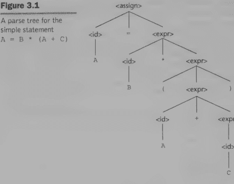

解析树的每个内部节点都标有一个非终结符，每个叶节点都标有一个终结符。解析树的每个子树描述了句子中某个抽象的一次实例化。

#### 3.3.1.7 歧义性

如果一个文法为某个句型生成了两个或更多不同的解析树，则该文法是歧义的。考虑示例3.3所示的文法，它是示例3.2所示文法的一个微小变体。

#### 示例 3.3 — 简单赋值语句的歧义文法

```
<assign> → <id> = <expr>
<id> → A | B | C
<expr> → <expr> + <expr>
       | <expr> * <expr>
       | ( <expr> )
       | <id>
```

示例3.3的文法是歧义的，因为句子`A = B + C * A`有两棵不同的解析树，如图3.2所示。歧义的产生是因为该文法指定的语法结构比示例3.2的文法稍少。

如前所述，文法可以描述某种语法结构，从而结构的部分含义可以从其解析树中确定。特别地，算术表达式中的某个运算符在解析树中生成得越低（因此必须越先求值），这一事实可以用来表示它优先于树中较高位置生成的运算符。例如，在图3.2的第一棵解析树中，乘法运算符生成在树中较低位置，这可能表示在表达式中它优先于加法运算符。然而，第二棵解析树则表示相反的含义。因此，看起来这两棵解析树表示了相互冲突的优先级信息。

注意，虽然示例3.2的文法不是歧义的，但其运算符的优先级顺序并非通常的顺序。在该文法中，包含多个运算符的句子的解析树，无论涉及的运算符是什么，表达式中最右边的运算符位于解析树的最低点，而树中其他运算符随着在表达式中向左移动而逐渐升高。例如，在表达式`A + B * C`中，`*`位于树的最低处，表示它应先执行。然而，在表达式`A * B + C`中，`+`位于最低处，表示它应先执行。

可以为我们一直在讨论的简单表达式编写一个文法，它既无歧义，又指定了`+`和`*`运算符的一致优先级，而不管这些运算符在表达式中出现的顺序如何。正确的顺序是通过使用不同的非终结符来表示具有不同优先级的运算符的操作数来指定的。这需要额外的非终结符和一些新规则。我们可以不使用`<expr>`同时作为`+`和`*`的操作数，而是使用三个非终结符来表示操作数，这使文法能够将不同的运算符强制到解析树的不同层次。如果`<expr>`是表达式的根符号，则可以通过让`<expr>`直接只生成`+`运算符，并使用新的非终结符`<term>`作为`+`的右操作数，来将`+`强制到解析树的顶部。接下来，我们可以定义`<term>`来生成`*`运算符，使用`<term>`作为左操作数，并使用新的非终结符`<factor>`作为其右操作数。现在，`*`将始终位于解析树中较低的位置，仅仅是因为在每次推导中它比`+`离开始符号更远。示例3.4的文法就是这样的文法。

#### 示例 3.4 — 无歧义表达式文法

```
<assign> → <id> = <expr>
<id> → A | B | C
<expr> → <expr> + <term>
       | <term>
<term> → <term> * <factor>
       | <factor>
<factor> → ( <expr> )
         | <id>
```

**图3.3** 使用无歧义文法为`A = B + C * A`生成的唯一解析树

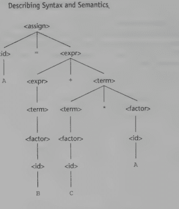

#### 3.3.1.9 运算符的结合性

当一个表达式包含两个具有相同优先级的运算符时（如`*`和`/`通常那样），例如`A / B * C`，需要一条语义规则来指定哪个运算符应优先。^2 这条规则称为结合性。

与优先级的情况一样，表达式的文法可以正确隐含运算符的结合性。考虑以下赋值语句的示例：

`A = B + C + A`

这条句子按照示例3.4的文法定义的解析树如图3.4所示。

**图3.4** 说明加法结合性的`A = B + C + A`的解析树

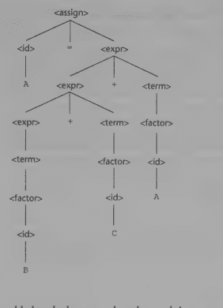

图3.4的解析树显示左侧的加法运算符低于右侧的加法运算符。如果加法是左结合的（这是典型情况），这是正确的顺序。在大多数情况下，计算机中加法的结合性无关紧要。在数学中，加法是可结合的，这意味着左结合和右结合的求值顺序含义相同。也就是说，(A + B) + C = A + (B + C)。然而，计算机中的浮点加法不一定是可结合的。例如，假设浮点数值存储7位精度。考虑将11个数字相加的问题，其中一个数字是10^7，另外十个是1。如果将这些小数（即1）逐个加到大数上，对该数没有影响，因为这些小数出现在大数的第8位。然而，如果先将小数加在一起，再将结果加到大数上，则7位精度的结果是1.000001 * 10^7。无论在数学中还是在计算机中，减法和除法都不是可结合的。因此，对于包含其中任一运算符的表达式，正确的结合性可能至关重要。

当文法规则的左部也出现在其右部的开头时，该规则称为左递归的。例如，示例3.4文法规则的左递归使其加法和乘法都成为左结合的。不幸的是，左递归不允许使用某些重要的语法分析算法。当要使用这些算法之一时，必须修改文法以消除左递归。这反过来又使文法无法精确指定某些运算符是左结合的。幸运的是，即使文法没有规定左结合性，编译器也可以强制执行。

在大多数提供幂运算符的语言中，幂运算符是右结合的。为了表示右结合性，可以使用右递归。如果文法规则的左部出现在右部的右端，则该规则是右递归的。诸如

```
<factor> → <exp> ** <factor>
        | <exp>
<exp> → ( <exp> )
        | id
```

这样的规则可以用来将幂运算描述为右结合运算符。

这可能不是构造的作者的本意。我们将在第8章中研究与这种else关联问题相关的实际问题。

现在我们将开发一个描述该if语句的无歧义文法。在许多语言中，if构造的规则是：当存在else子句时，它与最近的先前未匹配的then子句匹配。因此，在一个then子句与其匹配的else之间不能存在没有else的if语句。所以，对于这种情况，必须区分已匹配语句和未匹配语句，其中未匹配语句是没有else的if，而所有其他语句都是已匹配的。早期文法的问题在于它把所有语句都视为具有相同的语法重要性——也就是说，好像它们都是已匹配的。

为了反映不同的语句类别，必须使用不同的抽象，即非终结符。基于这些思想的无歧义文法如下：

```
<stmt> → <matched> | <unmatched>
<matched> → if <logic_expr> <matched> else <matched>
            | any non-if statement
<unmatched> → if <logic_expr> <stmt>
            | if <logic_expr> <matched> else <unmatched>
```

使用该文法，对于以下句型，只有一棵可能的解析树：

```
if (<logic_expr>) if (<logic_expr>) <stmt> else <stmt>
```

### 3.3.2 扩展 BNF

由于BNF存在一些小的不便之处，它已经以多种方式进行了扩展。大多数扩展版本被称为扩展BNF，或简称为EBNF，尽管它们并非完全相同。这些扩展并未增强BNF的描述能力；它们只是提高了其可读性和可写性。

各个版本的EBNF通常包含三种扩展。第一种扩展表示RHS中可选的部分，该部分由方括号界定。例如，C语言的if-else语句可以描述为

```
<if_stmt> → if (<expression>) <statement> [else <statement>]
```

如果不使用方括号，该语句的语法描述将需要以下两条规则：

```
<if_stmt> → if (<expression>) <statement>
            | if (<expression>) <statement> else <statement>
```

第二种扩展是在RHS中使用花括号来表示括起来的部分可以无限重复或完全省略。这种扩展允许用单条规则构建列表，而不是使用递归和两条


在编译器设计中，属性文法的基本概念总是以正式的方式使用；至少在每款编译器中都有正式的使用（参见 Aho 等人，1986 年）。

动态语义（即表达式、语句和程序单元的含义）将在 3.5 节讨论。

### 3.4.2 基本概念

属性文法是在上下文无关文法的基础上增加了属性、属性计算函数和谓词函数而构成的。属性与文法符号（终结符和非终结符）相关联，类似于变量，因为可以给它们赋值。属性计算函数（有时称为语义函数）与文法规则相关联，用于指定属性值如何计算。谓词函数与文法规则相关联，用于陈述语言的静态语义规则。

在我们正式定义属性文法并给出示例后，这些概念将变得更加清晰。

### 3.4.3 属性文法的定义

属性文法是在文法之上增加了以下特性的文法：

- 每个文法符号 X 都与一组属性 A(X) 相关联。A(X) 由两个不相交的集合 S(X) 和 I(X) 组成，分别称为综合属性和继承属性。**综合属性**用于在语法分析树中自下而上地传递语义信息，而**继承属性**则在语法分析树中自上而下或横向传递语义信息。

- 每条文法规则都与一组语义函数和一个可能为空的谓词函数集相关联，这些函数作用于该文法规则中符号的属性。对于规则 X₀ → X₁ ... Xₙ，X₀ 的综合属性通过形如 S(X₀) = f(A(X₁), . . . , A(Xₙ)) 的语义函数计算。因此，语法分析树中某个节点的综合属性值仅取决于该节点所有子节点的属性值。对于上述规则中的符号 Xⱼ（1 ≤ j ≤ n）的继承属性，通过形如 I(Xⱼ) = f(A(X₀), . . . , A(Xₙ)) 的语义函数计算。因此，语法分析树中某个节点的继承属性值取决于该节点的父节点及其兄弟节点的属性值。注意，为避免循环依赖，继承属性通常被限制为形如 I(Xⱼ) = f(A(X₀), . . . , A(Xⱼ₋₁)) 的函数。这种形式可以防止继承属性依赖于自身或语法分析树中其右侧的属性。

- 谓词函数的形式是属性集合 {A(X₀), . . . , A(Xₙ)} 与一组字面属性值的并集上的布尔表达式。属性文法允许的推导中，与每个非终结符相关联的每个谓词都必须为真。谓词函数值为假表示违反了该语言的语法或静态语义规则。

属性文法的语法分析树是基于其底层 BNF 文法的语法分析树，每个节点上附加一组可能为空的属性值。如果语法分析树中的所有属性值都已计算出来，则该树称为*完全属性化*。尽管在实践中并不总是这样做，但将属性值视为在编译器构造出完整的未属性化语法分析树之后进行计算，是一种方便的思路。

### 3.4.4 固有属性

**固有属性**是叶节点的综合属性，其值在语法分析树之外确定。例如，程序中变量实例的类型可能来自符号表，符号表用于存储变量名及其类型。符号表的内容根据前面的声明语句设置。最初，假设已经构造了未属性化的语法分析树并且需要属性值，那么唯一具有值的属性就是叶节点的固有属性。在给定语法分析树上的固有属性值后，可以使用语义函数计算其余属性值。

### 3.4.5 属性文法示例

作为一个非常简单的示例，说明如何使用属性文法来描述静态语义，请看下面这段属性文法片段，它描述了 Ada 过程中 **end** 之后的名称必须与该过程名匹配的规则。（这条规则无法用 BNF 表示。）<proc_name> 的字符串属性（记为 <proc_name>.string）是编译器在保留字 **procedure** 之后紧接着找到的实际字符串。注意，当属性文法中的语法规则里某个非终结符出现多次时，需要用带方括号的下标来区分它们。这些下标和方括号都不是所描述语言的一部分。

```
Syntax rule: <proc_def> → procedure <proc_name>[1]
               <proc_body> end <proc_name>[2] ;
Predicate: <proc_name>[1].string == <proc_name>[2].string
```

在此示例中，谓词规则规定子程序头中 <proc_name> 非终结符的名称字符串属性必须与子程序末尾 end 之后的 <proc_name> 非终结符的名称字符串属性匹配。

接下来，我们看一个更大的属性文法示例。该示例说明如何使用属性文法检查一条简单赋值语句的类型规则。该赋值语句的语法和静态语义如下：唯一的变量名是 *A*、*B* 和 *C*。赋值语句的右侧可以是变量，也可以是形如一个变量加另一个变量的表达式。变量可以是 *int* 或 *real* 两种类型之一。当赋值右侧有两个变量时，它们不必是相同类型。当操作数类型不相同时，表达式的类型始终为 real；当它们相同时，表达式类型与操作数类型相同。赋值语句左侧的类型必须与右侧的类型匹配。因此，右侧操作数的类型可以混合，但仅当目标类型与右侧求值所得结果的类型相同时，赋值才有效。属性文法规定了这些静态语义规则。

我们的示例属性文法的语法部分为：

```text
<assign> -> <var> = <expr>
<expr> -> <var> + <var>
        | <var>
<var> -> A | B | C
```

示例属性文法中非终结符的属性在以下段落中描述：

- *actual_type*——一种与非终结符 `<var>` 和 `<expr>` 关联的综合属性。它用于存储变量或表达式的实际类型（int 或 real）。对于变量而言，实际类型是固有类型；对于表达式而言，实际类型由 `<expr>` 非终结符的一个或多个子节点的实际类型决定。

- *expected_type*——一种与非终结符 `<expr>` 关联的继承属性。它用于存储表达式的期望类型（int 或 real），该类型由赋值语句左侧变量的类型决定。

完整的属性文法见示例 3.6。

**示例 3.6** 简单赋值语句的属性文法

- 1. 语法规则：`<assign> -> <var> = <expr>`
  语义规则：`<expr>.expected_type <- <var>.actual_type`

- 2. 语法规则：`<expr> -> <var>[2] + <var>[3]`
  语义规则：`<expr>.actual_type <-`
  `if (<var>[2].actual_type = int) and`
  `(<var>[3].actual_type = int)`
  `then int`
  `else real`
  `end if`
  谓词：`<expr>.actual_type == <expr>.expected_type`

- 3. 语法规则：`<expr> -> <var>`
  语义规则：`<expr>.actual_type <- <var>.actual_type`
  谓词：`<expr>.actual_type == <expr>.expected_type`

- 4. 语法规则：`<var> -> A | B | C`
  语义规则：`<var>.actual_type <- look-up (<var>.string)`

look-up 函数在符号表中查找给定的变量名，并返回该变量的类型。


由例 3.6 中的文法生成的句子 A = A + B 的语法分析树如图 3.6 所示。与文法中一样，树中重复的节点标签后添加了带括号的编号，以便能够无歧义地引用它们。

### 3.4.6 计算属性值

现在，考虑计算语法分析树的属性值的过程，这一过程有时称为装饰语法分析树。如果所有属性都是继承属性，那么该过程可以完全按照自顶向下的顺序进行，即从根到叶。反之，如果所有属性都是综合属性，那么该过程可以完全按照自底向上的顺序进行，即从叶到根。由于我们的文法同时具有综合属性和继承属性，求值过程不能沿任何单一方向进行。下面按一种可行的计算顺序给出属性求值：

- 1. `<var>.actual_type ← look-up(A)`（规则 4）
- 2. `<expr>.expected_type ← <var>.actual_type`（规则 1）
- 3. `<var>[2].actual_type ← look-up(A)`（规则 4）
   `<var>[3].actual_type ← look-up(B)`（规则 4）
- 4. `<expr>.actual_type ← int 或 real`（规则 2）
- 5. `<expr>.expected_type == <expr>.actual_type` 为 TRUE 或 FALSE（规则 2）

图 3.7 中的树展示了图 3.6 示例中属性值的流动。实线表示语法分析树；虚线表示树中的属性流动。

图 3.8 中的树展示了各节点上的最终属性值。在此示例中，A 被定义为 real，B 被定义为 int。

对于属性文法的一般情况，确定属性求值顺序是一个复杂问题，需要构造依赖图来显示所有属性依赖关系。

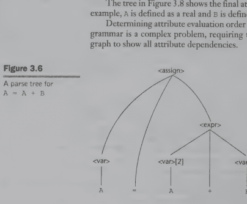

**图 3.7** 树中的属性流动

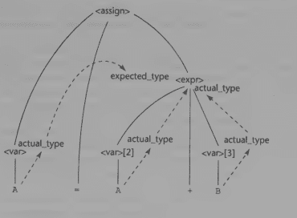

**图 3.8** 一棵完全属性化的语法分析树

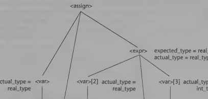

### 3.4.7 评估

检查语言的静态语义规则是所有编译器必不可少的一部分。即使编译器编写者从未听说过属性文法，也需要使用其基本思想来为自己的编译器设计静态语义规则检查。

使用属性文法描述一门现实中的当代编程语言的全部语法和静态语义，其主要困难之一在于属性文法的规模和复杂性。一门完整编程语言所需的大量属性和语义规则，使这类文法难以编写和阅读。此外，大型语法分析树上的属性值求值代价高昂。另一方面，不太形式化的属性文法是编译器编写者强大且常用的工具，他们更关心生成编译器的过程，而不是形式化。

## 3.5 描述程序的含义：动态语义

现在我们转向一项困难的任务：描述编程语言中表达式、语句和程序单元的动态语义（即含义）。由于现有记法强大且自然，描述语法相对简单。另一方面，对于动态语义，尚未设计出普遍接受的记法或方法。在本节中，我们简要描述已经开发出来的几种方法。在本节余下部分，当我们使用术语“语义”时，指的是动态语义。

需要一种描述语义的方法论和记法，背后有若干不同原因。程序员显然需要准确知道语言中的语句做什么，然后才能在程序中有效使用它们。编译器编写者必须确切知道语言结构意味着什么，才能为它们正确设计实现。如果存在编程语言的精确语义规范，那么用该语言编写的程序就有可能无需测试而被证明正确。此外，可以证明编译器产生的程序恰好表现出语言定义所给出的行为；也就是说，编译器的正确性可以得到验证。编程语言语法和语义的完整规范可用作自动生成该语言编译器的工具。最后，语言设计者——他们将开发其语言的语义描述——可以在此过程中发现其设计中的歧义和不一致。

软件开发人员和编译器设计者通常通过阅读语言手册中的英文解释来确定编程语言的语义。由于这类解释往往不精确且不完整，这种方法显然不能令人满意。由于缺乏编程语言的完整语义规范，程序很少能在不测试的情况下被证明正确，商业编译器也从不根据语言描述自动生成。

Scheme 是一种在第 15 章描述的函数式语言，是少数其定义包含形式语义描述的编程语言之一。然而，它所使用的方法并不是本章所描述的方法，因为本章侧重于适合命令式语言的方法。

### 3.5.1 操作语义

操作语义背后的思想是：通过指明语句或程序在机器上运行所产生的效果来描述其含义。对机器的影响被视为其状态的一系列变化，其中机器状态是其存储中值的集合。那么，一种显然的操作语义描述就是通过在计算机上执行程序的编译版本给出的。大多数程序员至少有一次编写过小型测试程序来确定某种编程语言结构的含义，而且常常是在学习该语言时这样做。本质上，这样的程序员所做的就是使用操作语义来确定该结构的含义。

使用这种方法进行完整的形式语义描述存在若干问题。首先，机器语言执行中的各个步骤以及由此引起的机器状态变化太小、太多。其次，真实计算机的存储太大且复杂。通常存在若干级存储设备，还有通过网络连接到数量众多的其他计算机和存储设备。因此，形式操作语义不使用机器语言和真实计算机。相反，专门为此过程设计中间级语言和面向理想化计算机的解释器。

操作语义的使用有不同层次。在最高层次上，关注的是完整程序执行的最终结果。这有时称为**自然操作语义**。在最低层次上，操作语义可用于通过考察程序执行时发生的完整状态变化序列来确定程序的精确含义。这种用法有时称为**结构操作语义**。

#### 3.5.1.1 基本过程

创建一种语言的操作语义描述的第一步，是设计一种合适的中间语言，其中该语言首要期望的特性是清晰性。中间语言的每个结构都必须具有明显且无歧义的含义。这种语言处于中间层次，因为机器语言层次太低，不易理解，而另一种高级语言显然也不合适。如果语义描述要用于自然操作语义，则必须为中间语言构造一台虚拟机（解释器）。该虚拟机可用于执行单条语句、代码段或整个程序。如果只需要单条语句的含义，则语义描述可以在没有虚拟机的情况下使用。在这种用法（即结构操作语义）中，可以目视检查中间代码。

操作语义的基本过程并不特殊。事实上，这一概念经常用于编程教材和编程语言参考手册中。例如，C 语言中 for 结构的语义可以用更简单的语句来描述，如下所示

| C 语句 | 含义 |
|---|---|
| for (expr1; expr2; expr3) {<br>...<br>} | expr1;<br>loop: if expr2 = 0 goto out<br>...<br>expr3;<br>goto loop<br>out: ... |

这种描述的人类读者是虚拟计算机，并假定它能够正确“执行”定义中的指令，并识别“执行”的效果。

用于形式操作语义描述的中间语言及其关联虚拟机通常高度抽象。中间语言是为了方便虚拟机，而不是人类读者。然而，就我们的目的而言，可以使用一种更面向人类的中间语言。作为这样一个例子，考虑以下语句列表，它足以描述典型编程语言中简单控制语句的语义：

```
ident = var
ident = ident + 1
ident = ident - 1
goto label
if var relop var goto label
```

在这些语句中，relop 是关系运算符集合 `(=, <>, >, <, >=, <=)` 中的一个，ident 是标识符，var 是标识符或常量。这些语句都很简单，因此易于理解和实现。

对这三条赋值语句稍作推广，就可以描述更一般的算术表达式和赋值语句。新语句为

```
ident = var bin_op var
ident = un_op var
```

其中 bin_op 是二元算术运算符，un_op 是一元运算符。当然，多种算术数据类型和自动类型转换会使这种推广复杂化。只需再添加少量相对简单的指令，就可以描述数组、记录、指针和子程序的语义。

第8章使用这种中间语言描述各种控制语句的语义。

#### 3.5.1.2 评估

形式操作语义的第一个也是最重要的用途是描述 PL/I 的语义（Wegner, 1972）。那个特定的抽象机器以及 PL/I 的翻译规则一起被命名为维也纳定义语言（VDL），以 IBM 设计该语言的城市命名。

操作语义为语言用户和语言实现者提供了一种有效的语义描述手段，只要描述保持简单且非形式化。不幸的是，PL/I 的 VDL 描述过于复杂，以至于没有实际用途。

操作语义依赖较低层次的编程语言，而不是数学。一种编程语言的语句是用较低级编程语言的语句来描述的。这种方法可能导致循环定义，即概念间接地根据自身来定义。接下来两节描述的方法要形式化得多，因为它们基于数学和逻辑，而不是编程语言。

### 3.5.2 指称语义

**指称语义**是用于描述程序含义的最严格且最广为人知的形式化方法。它牢固地建立在递归函数论之上。全面讨论使用指称语义描述编程语言语义必然冗长而复杂。我们的意图是向读者介绍指称语义的核心概念，并给出几个与编程语言规范相关的简单示例。

为编程语言构造指称语义规范的过程，要求为每个语言实体定义一个数学对象，以及一个将该语言实体的实例映射到该数学对象实例的函数。由于这些对象被严格定义，它们能够精确建模其对应实体的含义。这一思想基于这样一个事实：存在严格的方法来操作数学对象，但不存在这样的方法来操作编程语言构造。这种方法的困难在于创建对象和映射函数。该方法被命名为*指称*，因为数学对象指称相应语法实体的含义。

指称语义编程语言规范的映射函数，和数学中的所有函数一样，具有定义域和值域。定义域是函数的合法参数值的集合；值域是参数所映射到的对象的集合。在指称语义中，定义域称为**语法域**，因为被映射的是语法结构。值域称为**语义域**。

指称语义与操作语义相关。在操作语义中，编程语言构造被翻译成更简单的编程语言构造，这些更简单的构造成为该构造含义的基础。在指称语义中，编程语言构造被映射到数学对象，这些对象要么是集合，要么更常见地是函数。然而，与操作语义不同，指称语义并不建模程序的逐步计算处理过程。

#### 3.5.2.2 程序的状态

程序的指称语义可以根据理想计算机中的状态变化来定义。操作语义就是这样定义的，而指称语义的定义方式几乎相同。然而，在进一步简化中，指称语义仅根据程序所有变量的值来定义。因此，指称语义使用程序的状态来描述含义，而操作语义使用机器的状态。操作语义与指称语义的关键区别在于：操作语义中的状态变化由用某种编程语言编写的编码算法定义，而指称语义中的状态变化由数学函数定义。

设程序的状态表示为一组有序对，如下所示：

$$S = \{\langle i_1, v_1\rangle, \langle i_2, v_2\rangle, \ldots, \langle i_n, v_n\rangle\}$$

每个 i 是变量的名称，相关的 v 是这些变量的当前值。任何一个 v 都可以具有特殊值 **未定义**，这表示其关联变量当前未定义。设 VARMAP 为一个有两个参数的函数：变量名和程序状态。VARMAP (j, s) 的值是 vj（在状态 s 中与 j 配对的值）。大多数程序和程序构造的语义映射函数将状态映射到状态。这些状态变化用于定义程序和程序构造的含义。有些语言构造——例如表达式——被映射到值，而不是状态。

#### 3.5.2.3 表达式

表达式是大多数编程语言的基础。这里我们假设表达式没有副作用。此外，我们只处理非常简单的表达式：唯一的运算符是 + 和 *，并且一个表达式最多只能有一个运算符；唯一的操作数是标量整型变量和整数字面量；没有括号；表达式的值是一个整数。以下是这些表达式的 BNF 描述：

```bnf
<expr> → <dec_num> | <var> | <binary_expr>
<binary_expr> → <left_expr> <operator> <right_expr>
<left_expr> → <dec_num> | <var>
<right_expr> → <dec_num> | <var>
<operator> → + | *
```

我们在表达式中考虑的唯一错误是变量具有未定义值。显然，还可能发生其他错误，但它们都不是机器相关的。设 Z 为整数集合，并设 error 为错误值。那么 $Z \cup \{error\}$ 就是我们表达式指称规范的语义域。

给定表达式 E 和状态 s 的映射函数如下。为了区分数学函数定义和编程语言的赋值语句，我们使用符号 Δ = 来定义数学函数。此定义中使用的蕴含符号 => 将操作数的形式与其关联的 case（或 switch）构造连接起来。点号表示法用于引用一个节点的子节点。例如，`<binary_expr>.<left_expr>` 指 `<binary_expr>` 的左子节点。

```
M_e (<expr>, s) Δ= case <expr> of
    <dec_num> => M_dec(<dec_num>, s)
    <var> => if VARMAP(<var>, s) == undef
                then error
                else VARMAP(<var>, s)

    <binary_expr> =>
        if (M_e(<binary_expr>.<left_expr>, s) == undef OR
            M_e(<binary_expr>.<right_expr>, s) == undef)
        then error
        else if (<binary_expr>.<operator> == '+')
            then M_e(<binary_expr>.<left_expr>, s) +
                 M_e(<binary_expr>.<right_expr>, s)
            else M_e(<binary_expr>.<left_expr>, s) *
                 M_e(<binary_expr>.<right_expr>, s)
```

#### 3.5.2.4 赋值语句

赋值语句是表达式求值加上将目标变量设置为该表达式的值。在这种情况下，含义函数将状态映射到状态。该函数可以用以下方式描述：

```
M_a (x = E, s) Δ= if M_e (E, s) == error
    then error
    else s' = {<i_1, v'_1>, <i_2, v'_2>, ..., <i_n, v'_n>}, where
        for j = 1, 2, ..., n
            if i_j == x
                then v'_j = M_e (E, s)
                else v'_j = VARMAP (i_j, s)
```

注意，上面倒数第三行中的比较 i_j == x 比较的是名称，而不是值。

#### 3.5.2.5 逻辑预测试循环

逻辑预测试循环的指称语义看似简单。为便于讨论，我们假设还存在另外两个映射函数 M_sl 和 M_bl，它们分别将语句列表和状态映射为状态，将布尔表达式映射为布尔值（或 error）。该函数是


在公理语义学中，不存在机器或程序状态的模型，也不存在程序执行时状态变化的模型。程序的含义基于程序变量与常量之间的关系，这些关系对于程序的每次执行都是相同的。

公理语义学有两个不同的应用：程序验证和程序语义规格说明。本节在描述公理语义学时侧重于程序验证。

公理语义学是结合一种证明程序正确性的方法的发展而定义的。这种正确性证明在能够构造出来时，表明程序执行了其规格说明所描述的计算。在证明中，程序的每个语句前后都有一个逻辑表达式，用于指定对程序变量的约束。这些逻辑表达式（而不是像操作语义学那样使用抽象机的整个状态）被用来指定语句的含义。用于描述约束的记号——实际上也就是公理语义学的语言——是谓词演算。尽管简单的布尔表达式通常足以表达约束，但在某些情况下它们并不够。

当使用公理语义学来形式化地指定语句的含义时，该含义由语句对受其影响的数据的断言所产生的影响来定义。

#### 3.5.3.1 断言

公理语义学中使用的逻辑表达式称为谓词或断言。紧接在程序语句之前的断言描述程序该点上对程序变量的约束。紧接在语句之后的断言描述该语句执行后对这些变量（以及可能的其他变量）的新约束。这些断言分别称为该语句的前置条件和后置条件。对于两个相邻语句，第一个语句的后置条件充当第二个语句的前置条件。为给定程序开发公理描述或证明，要求程序中的每个语句都既有前置条件又有后置条件。

在以下各节中，我们从这样的角度考察断言：语句的前置条件由给定的后置条件计算得到，尽管也可以从相反的意义来考虑它们。我们假设所有变量都是整型。作为一个简单例子，考虑下面的赋值语句和后置条件：

```
sum = 2 * x + 1 {sum > 1}
```

前置条件和后置条件断言放在花括号中，以便与程序语句的组成部分区分开。该语句的一个可能前置条件是 {x > 10}。

在公理语义学中，特定语句的含义由其前置条件和后置条件定义。实际上，这两个断言精确地指定了执行该语句的效果。

在以下小节中，我们重点关注语句和程序的正确性证明，这是公理语义学的一种常见用途。公理语义学更一般的概念是用逻辑表达式精确陈述语句和程序的含义。程序验证是语言公理描述的一种应用。

#### 3.5.3.2 最弱前置条件

最弱前置条件是保证相关后置条件有效性的限制最少的前置条件。例如，在第 3.5.3.1 节给出的语句和后置条件中，{x > 10}、{x > 50} 和 {x > 1000} 都是有效的前置条件。本例中所有前置条件中最弱的是 {x > 0}。

如果对于一种语言的每种语句类型，都能从最一般的后置条件计算出最弱前置条件，那么用于计算这些前置条件的过程就为该语言的语义提供了一种简洁描述。此外，可以为该语言中的程序构造正确性证明。程序证明从使用程序执行结果的特性作为程序最后一条语句的后置条件开始。这个后置条件连同最后一条语句一起，用于计算最后一条语句的最弱前置条件。然后，这个前置条件被用作倒数第二条语句的后置条件。此过程一直持续到到达程序开头。此时，第一条语句的前置条件陈述了程序将计算出期望结果的条件。如果这些条件由程序的输入规格说明所蕴涵，那么该程序已被验证为正确。

**推理规则**是根据其他断言的值推断某个断言为真的方法。推理规则的一般形式如下：

```
S1, S2, ..., Sn
----------------
       S
```

该规则表明，如果 S1、S2、……、Sn 为真，则可以推断出 S 为真。推理规则的上半部分称为其*前件*；下半部分称为其*后件*。

**公理**是被假定为真的逻辑语句。因此，公理是没有前件的推理规则。

对于某些程序语句，从语句和后置条件计算最弱前置条件很简单，并且可以用一条公理来指定。然而，在大多数情况下，最弱前置条件只能用一条推理规则来指定。

要将公理语义学用于给定的程序设计语言，无论是用于正确性证明还是用于形式语义规格说明，该语言中的每一种语句都必须存在一条公理或一条推理规则。

#### 3.5.3.3 赋值语句

因此，{ y > 14 } 是该赋值语句及其后置条件的最弱前置条件。

注意，赋值语句左侧出现在其右侧并不影响计算最弱前置条件的过程。例如，对于

```
x = x + y - 3 {x > 10}
```

最弱前置条件是

```
x + y - 3 > 10
y > 13 - x
```

回想一下，公理语义学是为了证明程序的正确性而发展起来的。有鉴于此，此时自然会想：赋值语句的公理如何能用于证明任何东西？方法如下：一个同时具有前置条件和后置条件的给定赋值语句可以被视为一个逻辑语句或定理。如果赋值公理应用于该后置条件和赋值语句时产生给定的前置条件，则该定理得到证明。例如，考虑下面的逻辑语句：

```
{x > 3} x = x - 3 {x > 0}
```

对该语句及其后置条件使用赋值公理，产生 {x > 3}，即给定的前置条件。因此，我们证明了该示例逻辑语句。

接下来，考虑下面的逻辑语句：

```
{x > 5} x = x - 3 {x > 0}
```

在这种情况下，给定的前置条件 {x > 5} 与公理所产生的断言不相同。然而，显然 {x > 5} 蕴涵 {x > 3}。要在证明中使用这一点，需要一条称为后果规则的推理规则。后果规则的形式是

```
{P} S {Q}, P' ⇒ P, Q ⇒ Q'
------------------------------
{P'} S {Q'}
```

符号 ⇒ 表示“蕴涵”，S 可以是任意程序语句。该规则可以表述如下：如果逻辑语句 {P} S {Q} 为真，断言 P' 蕴涵断言 P，并且断言 Q 蕴涵断言 Q'，则可以推断出 {P'} S {Q'}。换言之，后果规则说明后置条件总是可以被弱化，而前置条件总是可以被强化。这在程序证明中非常有用。例如，它使得可以完成上述最后一个逻辑语句示例的证明。如果我们令 P 为 {x > 3}，Q 和 Q' 为 {x > 0}，P' 为 {x > 5}，则有

```
{ x > 3 } x := x - 3 { x > 0 }, { x > 5 } ⇒ { x > 3 }, { x > 0 } ⇒ { x > 0 }
---------------------------------------------------------------------------
{ x > 5 } x := x - 3 { x > 0 }
```

前件中的第一项（{ x > 3 } x := x - 3 { x > 0 }）已用赋值公理证明。第二项和第三项是显然的。因此，根据后果规则，后件为真。

#### 3.5.3.4 语句序列

语句序列的最弱前置条件不能用一条公理来描述，因为该前置条件取决于序列中语句的具体种类。在这种情况下，前置条件只能用一条推理规则来描述。设 S1 和 S2 是相邻的程序语句。如果 S1 和 S2 具有以下前置条件和后置条件

```
{ P1 } S1 { P2 }
{ P2 } S2 { P3 }
```

那么这种双语句序列的推理规则是

```
{ P1 } S1 { P2 }, { P2 } S2 { P3 }
----------------------------------
{ P1 } S1, S2 { P3 }
```

因此，对于我们的例子，{ P1 } S1; S2 { P3 } 描述了序列 S1; S2 的公理语义。该推理规则表明，要得到序列的前置条件，需要计算第二个语句的前置条件。这个新断言随后被用作第一个语句的后置条件，而第一个语句又可用来计算第一个语句的前置条件，该前置条件也是整个序列的前置条件。如果 S1 和 S2 是赋值语句 `x1 = E1` 和 `x2 = E2`，那么我们有

```
{ P3_{x2→E2} } x2 = E2 { P3 }
{ (P3_{x2→E2})_{x1→E1} } x1 = E1 { P3_{x2→E2} }
```

因此，序列 `x1 = E1; x2 = E2` 在后置条件为 P3 时的前置条件是 `{ (P3_{x2→E2})_{x1→E1} }`。

例如，考虑下面的序列和后置条件：

```
y = 3 * x + 1;
x = y + 3;
{ x < 10 }
```


第二个赋值语句的前置条件是

```
y < 7
```

它被用作第一个语句的后置条件。现在可以计算第一个赋值语句的前置条件：

```
3 * x + 1 < 7
x < 2
```

因此，{x < 2} 既是第一个语句的前置条件，也是这个由两个语句组成的语句序列的前置条件。

#### 3.5.3.5 选择

接下来我们考虑选择语句的推理规则，其一般形式为

```
if B then S1 else S2
```

我们只考虑包含 else 子句的选择语句。推理规则为

```
{B and P} S1 {Q}, {(not B) and P} S2 {Q}
{P} if B then S1 else S2 {Q}
```

这条规则规定，选择语句在布尔控制表达式为真和为假两种情况下都必须被证明。横线上方的第一个逻辑语句表示 then 子句；第二个表示 else 子句。根据该推理规则，我们需要一个前置条件 P，它能够同时用于 then 子句和 else 子句的前置条件。

考虑下面使用选择推理规则计算前置条件的示例。示例选择语句为

```
if x > 0 then
    y = y - 1
else
    y = y + 1
```

假设该选择语句的后置条件 Q 为 {y > 0}。我们可以对 then 子句使用赋值公理

```
y = y - 1 {y > 0}
```

这会产生 {y - 1 > 0} 或 {y > 1}。它可以作为 then 子句前置条件中的 P 部分。现在我们对 else 子句应用同一公理

```
y = y + 1 {y > 0}
```

它产生前置条件 {y + 1 > 0} 或 {y > -1}。由于 {y > 1} => {y > -1}，后果规则允许我们使用 {y > 1} 作为整个选择语句的前置条件。

#### 3.5.3.6 逻辑预测试循环

命令式编程语言的另一个基本构造是逻辑预测试循环，即 `while` 循环。计算 `while` 循环的最弱前置条件本质上比计算语句序列的最弱前置条件更困难，因为迭代次数并不总是能够预先确定。在迭代次数已知的情况下，循环可以展开，并作为一个语句序列来处理。

计算循环最弱前置条件的问题，类似于证明关于所有正整数的定理的问题。在后一种情况下，通常使用归纳法，而同样的归纳方法也可用于某些循环。归纳法的主要步骤是寻找归纳假设。在 `while` 循环的公理语义中，对应的步骤是寻找一个称为 `loop invariant` 的断言，它对于寻找最弱前置条件至关重要。

计算 `while` 循环前置条件的推理规则如下：

```
    {I and B} S {I}
    --------------------------------
    {I} while B do S end {I and (not B)}
```

在这条规则中，I 是循环不变式。这看起来简单，但实际并非如此。复杂性在于找到一个合适的循环不变式。

`while` 循环的公理描述写为

```
    {P} while B do S end {Q}
```

循环不变式必须满足若干要求才有用。首先，`while` 循环的最弱前置条件必须保证循环不变式为真。反过来，循环不变式必须在循环终止时保证后置条件为真。这些约束使我们从推理规则转向公理描述。在循环执行期间，循环不变式的真值必须不受循环控制布尔表达式的求值和循环体语句的影响。因此，才有 *不变式* 这一名称。

`while` 循环的另一个复杂因素是循环终止问题。不终止的循环不可能是正确的，而且实际上什么也计算不出来。如果 Q 是在循环退出后立即成立的后置条件，那么该循环的前置条件 P 就是这样一个条件：它保证循环退出时 Q 成立，并且还保证循环会终止。

`while` 构造的完整公理描述要求以下各项均为真，其中 I 是循环不变式：

- P => I
- {I and B} S {I}
- (I and (not B)) => Q
- 循环终止

再次说明，计算出的 I 可以作为 P，并且 I 满足这四项要求。与我们之前寻找循环前置条件的示例不同，这个前置条件显然不是最弱前置条件。考虑使用前置条件 {s > 1}。逻辑语句

```
{s > 1} while s > 1 do s = s / 2 end {s = 1}
```

很容易证明，而且这个前置条件比之前计算出的前置条件宽泛得多。如该过程所示，该循环和前置条件对于 s 的任意正值都成立，而不仅仅是 2 的幂。由于后果规则，使用比最弱前置条件更强的前置条件并不会使证明无效。

寻找循环不变式并不总是容易的。理解这些不变式的性质会有所帮助。首先，循环不变式是循环后置条件的一种弱化版本，同时也是循环的前置条件。因此，I 必须足够弱，以便在循环开始执行之前就能被满足；但当它与循环退出条件结合时，又必须足够强，以迫使后置条件为真。

由于证明循环终止很困难，这一要求常常被忽略。如果能够证明循环终止，那么该循环的公理描述称为完全正确性。如果能够满足其他条件但不能保证终止，则称为部分正确性。

在更复杂的循环中，即使只是为了部分正确性，找到一个合适的循环不变式也需要相当多的创造性。由于计算 while 循环的前置条件依赖于寻找循环不变式，因此使用公理语义证明含有 while 循环的程序的正确性可能很困难。

#### 3.5.3.7 程序证明

本节为两个简单程序提供验证。第一个正确性证明的示例针对一个非常短的程序，该程序由三条赋值语句组成的序列构成，用于交换两个变量的值。

```
{x = A AND y = B}
t = x;
x = y;
y = t;
{x = B AND y = A}
```

由于该程序完全由序列中的赋值语句组成，因此可以使用赋值公理和序列推理规则来证明其正确性。第一步是对最后一条语句和整个程序的后置条件使用赋值公理。这得到前置条件

```
{x = B AND t = A}
```

接下来，我们将这个新的前置条件作为中间语句的后置条件，并计算它的前置条件，即

```
{ y = B AND t = A }
```

接下来，我们将这个新断言作为第一条语句的后置条件，并应用赋值公理，得到

```
{ y = B AND x = A }
```

除了 AND 运算符上操作数的顺序之外，这与程序的前置条件相同。由于 AND 是对称运算符，因此我们的证明完成了。

下面的示例是一个计算阶乘函数的伪代码程序的正确性证明。

```
{n >= 0}
count = n;
fact = 1;
while count <> 0 do
    fact = fact * count;
    count = count - 1;
end
{fact = n!}
```

前面描述的寻找循环不变式的方法不适用于本例中的循环。这里需要一些创造性，而简要研究代码会有所帮助。该循环按最后一步乘法先算的顺序计算阶乘函数；也就是说，假设 n 大于 1，则先计算 (n - 1) * n。因此，不变式的一部分可以是：

```
fact = (count + 1) * (count + 2) * . . . * (n - 1) * n
```

但我们还必须确保 count 始终非负，为此可以将其加入上面的断言，得到：

```
I = (fact = (count + 1) * . . . * n) AND (count >= 0)
```

接下来，我们必须确认这个 I 满足不变式的要求。我们再次让 I 也用作 P，因此 P 显然蕴含 I。下一个问题是

```
{I and B} S {I}
```

I and B 如下：

```
((fact = (count + 1) * . . . * n) AND (count >= 0)) AND
    (count <> 0)
```

这化简为

```
(fact = (count + 1) * . . . * n) AND (count > 0)
```

在我们的例子中，我们必须使用不变式作为后置条件，计算循环体的前置条件。对于

```
{P} count = count - 1 {I}
```

我们计算 P 为

```
{ (fact = count * (count + 1) * . . . * n) AND
  (count >= 1) }
```

将其用作循环体中第一个赋值的后置条件，

```
{P} fact = fact * count { (fact = count * (count + 1)
                       * . . . * n) AND (count >= 1) }
```

在这种情况下，P 为

```
{ (fact = (count + 1) * . . . * n) AND (count >= 1) }
```

显然，I 和 B 蕴含这个 P，因此根据后承规则，

```
{I AND B} S {I}
```

为真。最后，对 I 的最后一项检验是

```
I AND (NOT B) => Q
```

对于我们的例子，这就是

```
(((fact = (count + 1) * . . . * n) AND (count >= 0)) AND (count = 0)) => fact = n!
```

这显然为真，因为当 count = 0 时，第一部分正是阶乘的定义。因此，我们对 I 的选择满足循环不变式的要求。现在我们可以把 while 中的 P（它与 I 相同）用作程序中第二个赋值的后置条件

```
{P} fact = 1 { (fact = (count + 1) * . . . * n) AND
               (count >= 0) }
```

由此得到 P 为

```
{ (1 = (count + 1) * . . . * n) AND (count >= 0) }
```

将其用作代码中第一个赋值的后置条件

```
{P} count = n { (1 = (count + 1) * . . . * n) AND
                (count >= 0) }
```

得到 P 为

```
{ (1 = (n + 1) * . . . * n) AND (n >= 0) }
```

AND 运算符的左操作数为真（因为 1 = 1），右操作数正是整个代码段的前置条件 {n >= 0}。因此，该程序已被证明是正确的。

#### 3.5.3.8 评价

如前所述，要使用公理方法定义一种完整编程语言的语义，必须为该语言中的每种语句类型提供一条公理或推理规则。为编程语言的某些语句定义公理或推理规则已被证明是一项困难的任务。这个问题的一个明显解决方案是：在设计语言时就考虑到公理方法，从而只包含那些能够为其编写公理或推理规则的语句。遗憾的是，这样的语言必然会遗漏一些有用且强大的部分。

公理语义学是研究程序正确性证明的有力工具，并且它为在程序的构造过程中以及之后对程序进行推理提供了一个极好的框架。然而，它在向语言用户和编译器编写者描述编程语言含义方面的实用性却非常有限。

## 摘要

巴科斯-诺尔范式和上下文无关文法是等价的元语言，非常适合描述编程语言的语法。它们不仅是简洁的描述工具，而且可与其生成动作相关联的语法分析树还以图形方式给出了底层句法结构的证据。此外，它们与所生成语言的识别装置自然相关，这使得为这些语言的编译器构造语法分析器相对容易。

属性文法是一种描述形式化体系，既能描述语言的语法，也能描述语言的静态语义。属性文法是上下文无关文法的扩展。属性文法由文法、一组属性、一组属性计算函数以及一组描述静态语义规则的谓词组成。

本章简要介绍了三种语义描述方法：操作语义、指称语义和公理语义。操作语义是一种通过语言构造对理想机器的影响来描述其含义的方法。在指称语义中，数学对象被用来表示语言构造的含义。语言实体通过递归函数转换为这些数学对象。公理语义基于形式逻辑，是作为证明程序正确性的工具而设计的。

## 文献注记

Cleveland 和 Uzgalis（1976）对使用上下文无关文法和 BNF 进行语法描述作了充分讨论。

公理语义学的研究由 Floyd（1967）开始，并由 Hoare（1969）进一步发展。Hoare 和 Wirth（1973）使用这种方法描述了 Pascal 很大一部分的语义。他们未完成的部分涉及函数副作用和 goto 语句。这些部分被认为是最难描述的。

Dijkstra（1976）描述了（并提倡）在程序开发过程中使用前置条件和后置条件的技术，Gries（1981）也对此作了详细讨论。

关于指称语义的良好入门材料可见于 Gordon（1979）和 Stoy（1977）。本章讨论的所有语义描述方法的入门介绍可见于 Marcotty 等（1976）。本章许多材料的另一份好参考文献是 Pagan（1981）。本章中指称语义函数的形式与 Meyer（1990）中的形式相似。

## 复习题

- 1. 定义*语法*和*语义*。
- 2. 语言描述是给谁用的？
- 3. 描述通用语言生成器的工作原理。
- 4. 描述通用语言识别器的工作原理。
- 5. 句子和句型之间有什么区别？
- 6. 定义左递归文法规则。
- 7. 大多数 EBNF 中常见的三种扩展是什么？
- 8. 区分静态语义和动态语义。
- 9. 谓词在属性文法中起什么作用？
- 10. 综合属性和继承属性之间有什么区别？
- 11. 对于给定属性文法的树，属性求值顺序是如何确定的？
- 12. 属性文法的主要用途是什么？
- 13. 解释用于描述编程语言语义的方法论和记号的主要用途。
- 14. 为什么机器语言不能用于定义操作语义中的语句？
- 15. 描述操作语义的两个使用层次。
- 16. 在指称语义中，语法域和语义域是什么？
- 17. 对于指称语义，程序状态中存储的是什么？
- 18. 哪种语义学方法最为人所知？
- 19. 为了构造语言的指称描述，必须为每个语言实体定义哪两样东西？
- 20. 推理规则的哪一部分是前件？
- 21. 什么是谓词变换函数？
- 22. 对于循环构造，部分正确性是什么意思？
- 23. 公理语义学基于数学的哪个分支？
- 24. 指称语义学基于数学的哪个分支？
- 25. 对操作语义使用软件纯解释器有什么问题？
- 26. 解释在公理语义学中，给定语句的前置条件和后置条件意味着什么。
- 27. 描述使用公理语义学证明给定程序正确性的方法。
- 28. 描述指称语义学的基本概念。
- 29. 操作语义学和指称语义学在什么根本方式上不同？

## 习题集

- 1. 语言描述的两种数学模型是生成和识别。描述每一种模型如何定义编程语言的语法。
- 2. 为下列内容编写 EBNF 描述：
  - a. 一个 Java 类定义头语句
  - b. 一个 Java 方法调用语句
  - c. 一个 C switch 语句
  - d. 一个 C union 定义
  - e. C 浮点字面量
- 3. 重写例 3.4 的 BNF，使 + 的优先级高于 *，并强制 + 为右结合。
- 4. 重写例 3.4 的 BNF，加入 Java 的 ++ 和 -- 一元运算符。
- 5. 编写 Java 布尔表达式的 BNF 描述，包括 &&、|| 和 ! 三个运算符以及关系表达式。
- 6. 使用例 3.2 中的文法，为下列每个语句给出语法分析树和最左推导：
  - a. A = A * (B + (C * A))
  - b. B = C * (A * C + B)
  - c. A = A * (B + (C))


- 13. 为满足以下条件的语言编写文法：该语言由 \(n\) 个字母 \(a\) 后跟相同数量的字母 \(b\) 组成的串构成，其中 \(n > 0\)。例如，串 aa、aaaabbbb 和 aaaaaaabbbbbbb 属于该语言，而 a、abb、ba 和 aaabbb 不属于。

- 14. 为句子 aabb 和 aaaabbbb 画出由第 13 题文法推导出的语法分析树。

- 15. 将示例 3.1 的 BNF 转换为 EBNF。

- 16. 将示例 3.3 的 BNF 转换为 EBNF。

- 17. 将以下 EBNF 转换为 BNF：

    S → A {bA}

    A → a[b]A

- 18. 固有属性与非固有综合属性有什么区别？

- 19. 编写一个属性文法，其 BNF 基础是 3.4.5 节中示例 3.6 的 BNF，但其语言规则如下：表达式中不能混合数据类型，但赋值语句中赋值运算符两侧的类型不必相同。

- 20. 编写一个属性文法，其基础 BNF 是示例 3.2 的 BNF，其类型规则与 3.4.5 节的赋值语句示例相同。

- 21. 使用 3.5.1.1 节中给出的虚拟机指令，给出以下语句的操作语义定义：

    - a. Java `do-while`
    - b. Ada `for`
    - c. C++ `if-then-else`
    - d. C `for`
    - e. C `switch`

- 22. 为以下语句编写指称语义映射函数：

    - a. Ada `for`
    - b. Java `do-while`
    - c. Java 布尔表达式
    - d. Java `for`
    - e. C `switch`

- 23. 计算以下每条赋值语句和后置条件的最弱前置条件：

    - a. `a = 2 * (b - 1) - 1 {a > 0}`
    - b. `b = (c + 10) / 3 {b > 6}`
    - c. `a = a + 2 * b - 1 {a > 1}`
    - d. `x = 2 * y + x - 1 {x > 11}`

- 24. 计算以下赋值语句序列及其后置条件的最弱前置条件：

    - a. `a = 2 * b + 1;`
      `b = a - 3`
      `{b < 0}`
    - b. `a = 3 * (2 * b + a);`
      `b = 2 * a - 1`
      `{b > 5}`

- 25. 计算以下选择结构及其后置条件的最弱前置条件：

    - a. if (a == b)
          b = 2 * a + 1
        else
          b = 2 * a;
        {b > 1}
    - b. if (x < y)
          x = x + 1
        else
          x = 3 * x
        {x < 0}
    - c. if (x > y)
          y = 2 * x + 1
        else
          y = 3 * x - 1;
        {y > 3}

- 26. 解释证明形式为 **当** B **执行** S **结束** 的逻辑前测试循环结构正确性的四个准则。

- 27. 证明 (n + 1) * ... * n = 1。

- 28. 证明以下程序是正确的：

    {n > 0}
    count = n;
    sum = 0;
    **当** count <> 0 **执行**
        sum = sum + count;
        count = count - 1;
    **结束**
    {sum = 1 + 2 + ... + n}

# 4 词法分析和语法分析

- 4.1 引言
- 4.2 词法分析
- 4.3 语法分析问题
- 4.4 递归下降语法分析
- 4.5 自底向上语法分析


本章首先介绍词法分析，并给出一个简单示例。接下来讨论一般性的语法分析问题，包括两种主要的语法分析方法和语法分析的复杂性。然后，我们介绍用于自顶向下分析器的递归下降实现技术，包括递归下降分析器的部分示例以及使用该分析器进行语法分析的一次跟踪。最后一节讨论自底向上语法分析和 LR 语法分析算法。该节包括一个小型 LR 分析表的示例，以及使用 LR 分析过程对某个字符串进行语法分析的示例。

## 4.1 引言

对编译器设计的深入研究至少需要一个学期的密集学习，包括为一种小型但真实的编程语言设计和实现编译器。这类课程的第一部分专门讨论词法分析和语法分析。语法分析器是编译器的核心，因为若干其他重要组件，包括语义分析器和中间代码生成器，都由语法分析器的动作驱动。

有些读者可能会疑惑，为什么一本关于编程语言的书中会包含一章关于编译器某个部分的内容。本书讨论词法分析和语法分析至少有两个原因：第一，语法分析器直接基于第 3 章讨论的文法，因此很自然地将其作为文法的一种应用来讨论。第二，词法分析和语法分析在编译器设计之外的许多场景中也是必需的。许多应用程序，包括程序清单格式化程序、计算程序复杂度的程序，以及必须分析配置文件内容并对其作出反应的程序，都需要进行词法分析和语法分析。因此，即使软件开发者永远不需要编写编译器，词法分析和语法分析对他们来说也是重要的主题。此外，一些计算机科学课程不再要求学生修读编译器设计课程，这使得学生没有接受过词法分析或语法分析方面的教育。在这些情况下，本章可以在编程语言课程中讲授。在要求修读编译器设计课程的学位计划中，则可以跳过本章。

第 1 章介绍了实现编程语言的三种不同方法：编译、纯解释和混合实现。编译方法使用一种称为编译器的程序，它将用高级编程语言编写的程序翻译成机器代码。编译通常用于实现大型应用程序所使用的编程语言，这些应用程序通常用 C++ 和 COBOL 等语言编写。纯解释系统不进行翻译；相反，程序由软件解释器以其原始形式解释执行。纯解释通常用于执行效率不是关键的小型系统，例如以 JavaScript 等语言编写的嵌入在 HTML 文档中的脚本。混合实现系统将用高级语言编写的程序翻译成中间形式，然后对中间形式进行解释。由于脚本语言的流行，这类系统现在比以往任何时候都更广泛地使用。传统上，混合系统的程序执行速度比编译系统慢得多。然而，近年来，即时（JIT）编译器的使用已变得非常普遍，特别是对于 Java 程序和为 Microsoft .NET 系统编写的程序。JIT 编译器将中间代码翻译成机器代码，在方法首次被调用时使用。实际上，JIT 编译器将混合系统转变为延迟的编译系统。

刚才讨论的所有三种实现方法都同时使用词法分析器和语法分析器。

语法分析器，或称解析器，几乎总是基于程序语法的形式化描述。最常用的语法描述形式是上下文无关文法，即 BNF，第 3 章对此进行了介绍。使用 BNF 而非某种非正式的语法描述，至少有三大优点。第一，BNF 对程序语法的描述清晰而简洁，无论对人还是对使用它的软件系统都是如此。第二，BNF 描述可以直接作为语法分析器的基础。第三，基于 BNF 的实现因其模块化而相对容易维护。

几乎所有编译器都将语法分析任务分成两个不同的部分：词法分析和语法分析，尽管这种术语有些令人困惑。词法分析器处理小规模的语法结构，如名称和数字字面量。语法分析器处理大规模的结构，如表达式、语句和程序单元。4.2 节介绍词法分析器。4.3、4.4 和 4.5 节讨论语法分析器。

词法分析之所以与语法分析分离，有三个原因：

- 1. 简单性——词法分析的技术比语法分析所需的技术简单，因此如果将词法分析过程分开，它会更简单。此外，将词法分析的低层细节从语法分析器中移除，会使语法分析器更小、更简单。
- 2. 效率——虽然优化词法分析器是值得的，因为词法分析占用了总编译时间的很大一部分，但优化语法分析器却收效甚微。分离有助于这种有选择的优化。
- 3. 可移植性——由于词法分析器读取输入程序文件，并且通常包含对该输入的缓冲，因此它在某种程度上是平台相关的。然而，语法分析器可以是平台无关的。将任何软件系统中与机器相关的部分隔离出来总是一个好做法。

## 4.2 词法分析

词法分析器本质上是一个模式匹配器。模式匹配器试图在给定的字符串中查找与给定字符模式匹配的子串。模式匹配是计算机领域的传统组成部分。最早的一个

模式匹配的用途之一是在文本编辑器中，例如 ed 行编辑器，它是在 UNIX 的早期版本中引入的。此后，模式匹配进入了某些编程语言——例如 Perl 和 JavaScript。它也可以通过 Java、C++ 和 C# 的标准类库使用。

词法分析器充当语法分析器的前端。从技术上说，词法分析是语法分析的一部分。词法分析器在程序结构的最低层执行语法分析。输入程序在编译器看来是一个单一的字符串。词法分析器将字符收集为逻辑分组，并根据这些分组的结构为其分配内部代码。在第 3 章中，这些逻辑分组被称为词素，而这些分组类别的内部代码被称为标记。词素是通过将输入字符串与字符串模式进行匹配来识别的。尽管标记通常表示为整数值，但为了词法分析器和语法分析器的可读性，它们通常通过命名常量来引用。

考虑以下赋值语句示例：

```text
result = oldsum - value / 100;
```

以下是该语句的标记和词素：

| 标记 | 词素 |
|---|---|
| IDENT | result |
| ASSIGN_OP | = |
| IDENT | oldsum |
| SUB_OP | - |
| IDENT | value |
| DIV_OP | / |
| INT_LIT | 100 |
| SEMICOLON | ; |

词法分析器从给定输入字符串中提取词素，并产生相应的标记。在编译器的早期，词法分析器通常处理整个源程序文件，并生成一个包含标记和词素的文件。然而现在，大多数词法分析器是子程序，它们定位输入中的下一个词素，确定其关联的标记代码，并将它们返回给调用者，即语法分析器。因此，每次调用词法分析器都会返回一个词素及其标记。语法分析器所看到的输入程序的唯一视图，就是词法分析器的输出，一次一个标记。

词法分析过程包括跳过词素之外的注释和空白，因为它们与程序的含义无关。此外，词法分析器将用户定义名称的词素插入符号表，供编译器后续阶段使用。最后，词法分析器检测标记中的语法错误，例如格式错误的浮点字面量，并向用户报告这些错误。

分析器，如果为数字定义一个名为 DIGIT 的字符类，并使用在该字符类中任意字符上的单个转换进入收集整数字面量的状态，我们就可以构建紧凑得多的状态图。

由于我们的名称可以包含数字，从名称第一个字符之后的节点出发的转换，可以使用基于 LETTER 或 DIGIT 的转换来继续收集名称的字符。

接下来，我们为词法分析器内部的常见任务定义一些实用子程序。首先，我们需要一个子程序，可以将其命名为 `getChar`，它有几项职责。被调用时，`getChar` 从输入程序获取下一个输入字符，并将其放入全局变量 `nextChar` 中。`getChar` 还必须确定输入字符的字符类，并将其放入全局变量 `charClass` 中。词法分析器正在构建的词素（可以实现为字符串或数组）将命名为 `lexeme`。

我们在名为 `addChar` 的子程序中实现将 `nextChar` 中的字符放入字符串数组 `lexeme` 的过程。这个子程序必须显式调用，因为程序中包含一些不需要放入 `lexeme` 的字符，例如词素之间的空白字符。在更现实的词法分析器中，注释也不会被放入 `lexeme`。

当调用词法分析器时，如果下一个输入字符是下一个词素的第一个字符，会很方便。因此，每次调用分析器时，都会使用名为 `getNonBlank` 的函数来跳过空白。

最后，需要一个名为 `lookup` 的子程序来计算单字符标记的标记代码。在我们的示例中，这些是圆括号和算术运算符。标记代码是编译器编写者任意分配给标记的数字。

图 4.1 中的状态图描述了我们的标记的模式。它包括状态图每个转换上所需的动作。

以下是根据图 4.1 的状态图指定的词法分析器的 C 实现，其中包括用于测试的主驱动程序函数：

```c
/* front.c - a lexical analyzer system for simple
              arithmetic expressions */

#include <stdio.h>
#include <ctype.h>

/* Global declarations */
/* Variables */
int charClass;
char lexeme [100];
char nextChar;
int lexLen;
int token;
int nextToken;
FILE *in_fp, *fopen();

default:
    addChar();
    nextToken = EOF;
    break;
}
return nextToken;
}

/****************************************************/
/* addChar - a function to add nextChar to lexeme */
void addChar() {
    if (lexLen <= 98) {
        lexeme[lexLen++] = nextChar;
        lexeme[lexLen] = 0;
    }
    else
        printf("Error - lexeme is too long \n");
}

/****************************************************/
/* getChar - a function to get the next character of
             input and determine its character class */
void getChar() {
    if ((nextChar = getc(in_fp)) != EOF) {
        if (isalpha(nextChar))
            charClass = LETTER;
        else if (isdigit(nextChar))
            charClass = DIGIT;
        else
            charClass = UNKNOWN;
    }
    else
        charClass = EOF;
}

/****************************************************/
/* getNonBlank - a function to call getChar until it
                 returns a non-whitespace character */
void getNonBlank() {
    while (isspace(nextChar))
        getChar();
}

/****************************************************/
/* lex - a simple lexical analyzer for arithmetic
         expressions */
int lex() {
    lexLen = 0;
    getNonBlank();
    switch (charClass) {
/* Parse identifiers */
case LETTER:
    addChar();
    getChar();
    while (charClass == LETTER || charClass == DIGIT) {
        addChar();
        getChar();
    }
    nextToken = IDENT;
    break;

/* Parse integer literals */
case DIGIT:
    addChar();
    getChar();
    while (charClass == DIGIT) {
        addChar();
        getChar();
    }
    nextToken = INT_LIT;
    break;

/* Parentheses and operators */
case UNKNOWN:
    lookup(nextChar);
    getChar();
    break;

/* EOF */
case EOF:
    nextToken = EOF;
    lexeme[0] = 'E';
    lexeme[1] = 'O';
    lexeme[2] = 'F';
    lexeme[3] = 0;
    break;
} /* End of switch */
printf("Next token is: %d, Next lexeme is %s\n",
       nextToken, lexeme);
return nextToken;
} /* End of function lex */
```

这段代码说明了词法分析器相对简单。当然，我们省略了输入缓冲以及一些其他重要细节。此外，我们处理的是一种非常小且简单的输入语言。

考虑以下表达式：

```text
(sum + 47) / total
```

以下是 *front.c* 的词法分析器用于该表达式时的输出：

```
Next token is: 25, Next lexeme is (
Next token is: 11, Next lexeme is sum
Next token is: 21, Next lexeme is +
Next token is: 10, Next lexeme is 47
Next token is: 26, Next lexeme is )
Next token is: 24, Next lexeme is /
Next token is: 11, Next lexeme is total
Next token is: -1, Next lexeme is EOF
```

程序中的名称和保留字具有相似的模式。尽管可以构建一个状态图来识别某种编程语言的每一个特定保留字，但那会导致状态图大得令人难以承受。让词法分析器用相同的模式识别名称和保留字，并在保留字表中进行查找以确定哪些名称是保留字，要简单和快速得多。使用这种方法会把保留字视为名称标记类别中的例外。

词法分析器通常负责符号表的初始构建，符号表充当编译器的名称数据库。符号表中的条目存储关于用户定义名称的信息，以及这些名称的属性。例如，如果名称是变量的名称，那么该变量的类型就是其属性之一，将被存储在符号表中。名称通常由词法分析器放入符号表。名称的属性通常由编译器中在词法分析器动作之后执行的某个部分放入符号表。

## 4.3 解析问题

分析语法的过程中被称为*语法分析*的部分通常称为**解析**。我们将交替使用这两个术语。

本节讨论一般解析问题，介绍解析算法的两大类别——自顶向下和自底向上，以及解析过程的复杂性。

### 4.3.1 解析简介

编程语言的解析器为给定程序构造解析树。在某些情况下，解析树只是隐式构造的，这意味着可能只生成对树的一次遍历。但在所有情况下，构建解析树所需的信息都是在解析过程中产生的。解析树和推导都包含语言处理器所需的全部语法信息。


上下文无关文法不足以描述大多数编程语言的所有语法。）

商用编译器的语法分析器所使用的所有算法都具有 O(n) 复杂度，这意味着它们所花费的时间与待分析字符串的长度呈线性关系。这比 O(n^3) 算法高效得多。

## 4.4 递归下降分析

本节介绍递归下降自顶向下分析器的实现过程。

### 4.4.1 递归下降分析过程

递归下降分析器之所以得名，是因为它由一组子程序组成，其中许多子程序是递归的，并且它按自顶向下的顺序生成分析树。这种递归反映了编程语言的本质，编程语言包含若干不同种类的嵌套结构。例如，语句常常嵌套在其他语句中。此外，表达式中的括号必须正确嵌套。这些结构的语法自然用递归文法规则来描述。

EBNF 非常适合递归下降分析器。回想第3章，EBNF 的主要扩展是花括号和方括号；花括号指定其所括内容可以出现零次或多次，方括号指定其所括内容可以出现一次或完全不出现。注意，在两种情况下，所括符号都是可选的。考虑以下示例：

```
<if_statement> → if <logic_expr> <statement> [else <statement>]
<ident_list> → ident {, ident}
```

在第一条规则中，*如果* 语句的 *否则* 子句是可选的。在第二条规则中，ident_list 是一个标识符，后跟零个或多个“逗号 + 标识符”的重复。

递归下降分析器为其关联文法中的每个非终结符都有一个子程序。与特定非终结符关联的子程序的职责如下：给定一个输入字符串时，它追踪出可以以该非终结符为根、且其叶子与输入字符串匹配的分析树。实际上，递归下降分析子程序就是其关联非终结符所生成语言（字符串集合）的分析器。

考虑以下简单算术表达式的 EBNF 描述：

```
<expr> → <term> {(+ | -) <term>}
<term> → <factor> {(* | /) <factor>}
<factor> → id | int_constant | ( <expr> )
```

回想第3章，像这样的算术表达式 EBNF 文法并不强制任何结合性规则。因此，当使用这样的文法作为编译器的基础时，必须注意确保代码生成过程（通常由语法分析驱动）生成遵循该语言结合性规则的代码。使用递归下降分析时，这很容易做到。

在下面的递归下降函数 `expr` 中，词法分析器是第4.2节实现的函数。它获取下一个词素，并将其记号代码放入全局变量 `nextToken` 中。记号代码定义为命名常量，如第4.2节所述。

对于只有一个右部的规则，其递归下降子程序相对简单。对于右部中的每个终结符，将该终结符与 `nextToken` 进行比较。如果不匹配，就是语法错误。如果匹配，则调用词法分析器获取下一个输入记号。对于每个非终结符，调用该非终结符的分析子程序。

前一个示例文法中第一条规则的递归下降子程序（用 C 编写）如下：

```c
/* expr
   Parses strings in the language generated by the rule:
   <expr> -> <term> {(+ | -) <term>}
*/
void expr() {
    printf("Enter <expr>\n");

    /* Parse the first term */
    term();

    /* As long as the next token is + or -, get
       the next token and parse the next term */
    while (nextToken == ADD_OP || nextToken == SUB_OP) {
        lex();
        term();
    }

    printf("Exit <expr>\n");
} /* End of function expr */
```

注意，`expr` 函数包含跟踪输出语句，这些语句用于产生本节后面所示的示例输出。

递归下降分析子程序按照这样的约定编写：每个子程序都将下一个输入记号留在 `nextToken` 中。因此，每当一个分析函数开始时，它都假定 `nextToken` 保存着输入中最左边且尚未在分析过程中使用的记号的代码。

`expr` 函数所分析的那部分语言由一个或多个项组成，项之间由加号或减号运算符分隔。这就是非终结符 `<expr>` 生成的语言。因此，它首先调用分析项的函数（`term`）。然后，只要遇到 ADD_OP 或 SUB_OP 记号（它通过调用 lex 跳过这些记号），就继续调用该函数。这个递归下降函数比大多数函数简单，因为它关联的规则只有一个右部。此外，它不包含任何用于语法错误检测或恢复的代码，因为该文法规则没有相关联的可检测错误。

对于规则具有多个右部的非终结符，其递归下降分析子程序以确定要分析哪个右部的代码开始。每个右部都在（编译器构造时）被检查，以确定其可生成句子的开头可能出现的终结符集合。通过将这些集合与下一个输入记号进行匹配，分析器可以选择正确的右部。

<term> 的分析子程序与 <expr> 的类似：

```c
/* term
   Parses strings in the language generated by the rule:
   <term> -> <factor> { ( * | / ) <factor> }
*/
void term() {
    printf("Enter <term>\n");

    /* Parse the first factor */
    factor();

    /* As long as the next token is * or /, get the
       next token and parse the next factor */
    while (nextToken == MULT_OP || nextToken == DIV_OP) {
        lex();
        factor();
    }
    printf("Exit <term>\n");
} /* End of function term */
```

我们的算术表达式文法中 <factor> 非终结符的函数必须在其两个右部之间做出选择。它还包括错误检测。在 <factor> 的函数中，检测到语法错误时的反应只是调用 error 函数。在真正的分析器中，检测到错误时必须产生诊断消息。此外，分析器必须从错误中恢复，以便分析过程能够继续。

```c
/* factor
   Parses strings in the language generated by the rule:
   <factor> -> id | int_constant | ( <expr> )
*/
void factor() {
    printf("Enter <factor>\n");

    /* Determine which RHS */
    if (nextToken == IDENT || nextToken == INT_LIT)
        /* Get the next token */
        lex();

    /* If the RHS is <expr>, call lex to pass over the
       left parenthesis, call expr, and check for the right
       parenthesis */
    else {
        if (nextToken == LEFT_PAREN) {
            lex();
            expr();
            if (nextToken == RIGHT_PAREN)
                lex();
            else
                error();
        } /* End of if (nextToken == ... */

        /* It was not an id, an integer literal, or a left
           parenthesis */
        else
            error();
    } /* End of else */

    printf("Exit <factor>\n");
} /* End of function factor */
```

下面是对示例表达式 (sum + 47) / total 进行分析的跟踪，使用分析函数 expr、term 和 factor，以及第4.2节中的函数 lex。注意，分析从调用 lex 和开始符号例程（在本例中为 expr）开始。

```
Next token is: 25 Next lexeme is (
Enter <expr>
Enter <term>
Enter <factor>
Next token is: 11 Next lexeme is sum
Enter <expr>
Enter <term>
Enter <factor>
Next token is: 21 Next lexeme is +
Exit <factor>
Exit <term>
Next token is: 10 Next lexeme is 47
Enter <term>
Enter <factor>
Next token is: 26 Next lexeme is )
Exit <factor>
Exit <term>
Exit <expr>
Next token is: 24 Next lexeme is /
Exit <factor>
```

```text
Next token is: 11 Next lexeme is total
Enter <factor>
Next token is: -1 Next lexeme is EOF
Exit <factor>
Exit <term>
Exit <expr>
```

解析器为上述表达式追踪的语法分析树如图4.2所示。

**图4.2**  
(sum + 47) / total 的语法分析树

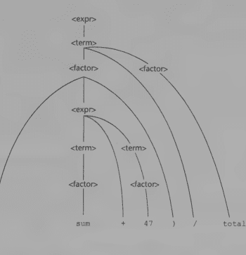

另外一个语法规则和解析函数的示例将有助于巩固读者对递归下降解析的理解。以下是Java if语句的语法描述：

```
<ifstmt> -> if (<boolexpr>) <statement> [else <statement>]
```

该规则的递归下降子程序如下：

```c
/* Function ifstmt
   Parses strings in the language generated by the rule:
   <ifstmt> -> if (<boolexpr>) <statement>
               [else <statement>]
*/
void ifstmt() {
/* Be sure the first token is 'if' */
if (nextToken != IF_CODE)
    error();
else {
/* Call lex to get to the next token */
lex();
/* Check for the left parenthesis */
if (nextToken != LEFT_PAREN)
    error();
else {
    /* Parse the Boolean expression */
    boolexpr();
    /* Check for the right parenthesis */
    if (nextToken != RIGHT_PAREN)
        error();
    else {
        /* Parse the then clause */
        statement();
        /* If an else is next, parse the else clause */
        if (nextToken == ELSE_CODE) {
            /* Call lex to get over the else */
            lex();
            statement();
        } /* end of if (nextToken == ELSE_CODE ... */
    } /* end of else of if (nextToken != RIGHT ... */
} /* end of else of if (nextToken != LEFT ... */
/* end of else of if (nextToken != IF_CODE ... */
} /* end of ifstmt */
```

请注意，该函数使用了本节未给出的用于语句和布尔表达式的解析函数。

这些示例的目的是使你相信，如果语言具有适当的文法，递归下降解析器可以很容易地编写。下一小节将讨论允许构建递归下降解析器的文法特征。

### 4.4.2 LL文法类

在选择将递归下降作为编译器或其他程序分析工具的解析策略之前，必须考虑该方法在文法限制方面的局限性。本节讨论这些限制及其可能的解决方案。

对于LL解析器来说，一个会导致灾难性问题的简单文法特征是左递归。例如，考虑以下规则：

```
A → A + B
```

用于A的递归下降解析器子程序会立即调用自身来解析其右部中的第一个符号。该A解析器子程序的这次激活随后会立即再次调用自身，如此反复。很容易看出，这除了导致栈溢出之外不会有任何结果。

规则 A → A + B 中的左递归称为直接左递归，因为它发生在一个规则中。可以通过以下过程从文法中消除直接左递归：

对于每个非终结符 A，

- 将A规则分组为 A → Aα1 | ··· | Aαm | β1 | β2 | ··· | βn  
  其中所有β均不以A开头
- 用以下规则替换原始A规则  
  A → β1A' | β2A' | ··· | βnA'  
  A' → α1A' | α2A' | ··· | αmA' | ε

注意，ε表示空字符串。以ε作为其右部的规则称为*擦除规则*，因为在推导中使用它会有效地将其左部从句型中擦除。

考虑以下示例文法以及上述过程的应用：

```
E → E + T | T
T → T * F | F
F → (E) | id
```

对于E规则，我们有 α1 = + T，β1 = T，因此我们将E规则替换为：

```
E → T E'
E' → + T E' | ε
```

对于T规则，我们有 α1 = * F，β1 = F，因此我们将T规则替换为：

```
T → F T'
T' → * F T' | ε
```

由于F规则中没有左递归，它们保持不变，因此完整的替换文法为：

```
E → T E'
E' → + T E' | ε
T → F T'
T' → * F T' | ε
F → (E) | id
```

该文法生成与原始文法相同的语言，但不是左递归的。

正如在4.4.1节中使用EBNF编写的表达式文法一样，该文法并未指定运算符的左结合性。然而，基于该文法设计代码生成相对容易，使得加法和乘法运算符具有左结合性。

间接左递归与直接左递归存在相同的问题。例如，假设我们有：

```
A → B a A
B → A b
```

针对这些规则的递归下降解析器会让A子程序立即调用B子程序，而B子程序又立即调用A子程序。因此，问题与直接左递归相同。左递归问题不仅限于构建自顶向下解析器的递归下降方法，它对所有自顶向下解析算法都是一个难题。幸运的是，左递归对于自底向上解析算法来说并不是问题。

有一种算法可以修改给定文法以消除间接左递归（Aho等，2006），但此处不讨论。在为编程语言编写文法时，通常可以避免包含直接和间接左递归。

左递归并不是唯一不允许自顶向下解析的文法特征。另一个特征是解析器是否总是能够仅根据当前句型中最左非终结符生成的第一个输入记号，来选择正确的右部。有一个相对简单的测试可以判断非左递归文法是否可行，称为两两不相交测试。该测试需要能够基于文法中给定非终结符的各个右部来计算一个集合。这些集合称为FIRST集，定义为

FIRST(α) = {a | α ⇒* aβ} （如果 α ⇒* ε，则 ε 在 FIRST(α) 中）

其中 ⇒* 表示0步或多步推导。

计算任意混合字符串α的FIRST集的算法可在Aho等人（2006）的著作中找到。就我们的目的而言，FIRST集通常可以通过检查文法直接计算出来。

两两不相交测试如下：

对于文法中具有多个右部的每个非终结符A，对于每一对规则 A → α_i 和 A → α_j，必须满足：

FIRST(α_i) ∩ FIRST(α_j) = ∅

（两个集合 FIRST(α_i) 和 FIRST(α_j) 的交集必须为空。）

换句话说，如果一个非终结符A有多个右部，那么在推导中每个右部能够生成的第一个终结符对于该右部必须是唯一的。考虑以下规则：

```
A → aB | bAb | Bb
B → cB | d
```

A规则的各个右部的FIRST集分别为 {a}、{b} 和 {c, d}，它们显然是不相交的。因此，这些规则通过了两两不相交测试。就递归下降解析器而言，这意味着用于解析非终结符A的子程序代码只需查看该非终结符生成的第一个输入终结符（记号），就可以选择它正在处理的是哪个右部。现在考虑以下规则：

```
A → aB | BAb
B → aB | b
```

最初的LR算法由唐纳德·克努斯（Knuth, 1965）设计。该算法有时被称为**规范LR**，在其发表后的最初几年中并未被使用，因为生成所需的语法分析表需要大量的计算机时间和内存。随后，人们开发了规范LR表构造过程的几种变体（DeRemer, 1971; DeRemer和Pennello, 1982）。这些变体有两个特点：（1）与规范LR算法相比，它们生成所需语法分析表所需的计算机资源要少得多；（2）它们适用的文法类别比规范LR算法更小。

LR解析器有三个优点：

- 它们可以为所有编程语言构建。
- 它们可以在从左到右扫描中尽早检测语法错误。
- LR文法类是LL解析器可解析类的真超集（例如，许多左递归文法是LR文法，但没有一个是LL文法）。

LR解析的唯一缺点是，对于完整编程语言的给定文法，手工生成语法分析表是困难的。然而，这并不是一个严重的缺点，因为有一些程序可以以文法为输入并生成语法分析表，本节稍后将讨论这些程序。

在LR解析算法出现之前，有许多解析算法通过查看被怀疑为句柄的句型子串的左侧和右侧来寻找右句型的句柄。克努斯的洞察在于，可以有效地查看被怀疑句柄的左侧，一直看到解析栈底部，以确定它是否为句柄。但解析栈中与解析过程相关的所有信息都可以用一个状态来表示，该状态可以存储在栈顶。换句话说，克努斯发现，无论输入字符串的长度、句型的长度或解析栈的深度如何，就解析过程而言，都只有相对较少的几种不同情况。每种情况都可以用一个状态来表示，并存储在解析栈中，每个文法符号对应一个状态符号。栈顶始终是一个状态符号，它表示从解析开始到当前时刻的整个解析历史中的相关信息。我们将使用带下标的大写S来表示解析器状态。

图4.4展示了LR解析器的结构。LR解析器的解析栈内容具有以下形式：

```
S_0 X_1 S_1 X_2 ... X_m S_m (top)
```

其中S是状态符号，X是文法符号。LR解析器配置是一对字符串（栈，输入），其详细形式为

```
(S_0 X_1 S_1 X_2 S_2 ... X_m S_m a_i a_{i+1} ... a_n $)
```


**图 4.4** LR 解析器的结构

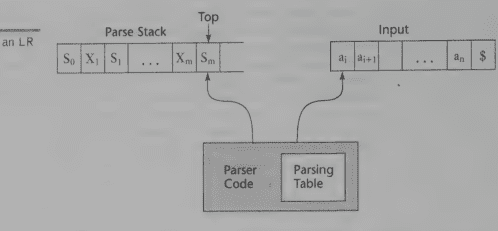

注意，输入字符串右端有一个美元符号。该符号在解析器初始化时被放入。它用于解析器的正常终止。使用这种解析器配置，我们可以形式化地定义基于解析表的 LR 解析过程。

LR 解析表分为两部分，名为 ACTION 和 GOTO。ACTION 部分规定了解析器的大部分动作。它以状态符号作为行标签，以文法的终结符作为列标签。给定当前解析器状态（由解析栈顶的状态符号表示）和下一个输入符号（标记），解析表规定解析器应当做什么。两个主要的解析动作是移进和归约。解析器要么将下一个输入符号移进解析栈，要么已经将句柄置于栈顶，并把它归约为规则左部，而该规则右部与句柄相同。另外两个动作也可能：接受（accept），表示解析器已成功完成对输入的解析；错误（error），表示解析器已检测到语法错误。

LR 解析表的 GOTO 部分的行以状态符号为标签。该部分的列以非终结符为标签。GOTO 部分的值指示在完成归约后应将哪个状态符号压入解析栈；完成归约意味着已将句柄从解析栈中移除，并将新的非终结符压入解析栈。具体符号位于这样一行：其标签是在移除句柄及其关联状态符号后解析栈顶的状态符号。所使用的 GOTO 表列是标签为归约所用规则左部的列。

考虑下面的算术表达式传统文法：

- 1. E → E + T
- 2. E → T
- 3. T → T * F
- 4. T → F
- 5. F → (E)
- 6. F → id

这些文法规则经过编号，以便在解析表中简单引用它们。

图 4.5 给出了该文法的 LR 解析表。动作使用缩写：R 表示归约，S 表示移进。R4 表示用规则 4 归约；S6 表示将下一个输入符号移进栈，并将状态 6 压入栈。ACTION 表中的空位表示语法错误。在完整解析器中，这些位置可以调用错误处理例程。

LR 解析表可以很容易地使用软件工具构造，例如 yacc (Johnson, 1975)，它以文法为输入。尽管 LR 解析表可以手工生成，但对于实际编程语言的文法，这项任务将是冗长、繁琐且容易出错的。对于实际编译器，LR 解析表总是用软件工具生成。

LR 解析器的初始格局为

(S₀, a₁ . . . aₙ$)

解析器动作非形式化定义如下：

- 1. 移进过程很简单：将下一个输入符号连同 ACTION 表中移进说明所包含的状态符号一起压入栈。
- 2. 对于归约动作，必须从栈中移除句柄。因为栈上每个文法符号都有一个状态符号，所以从栈中移除的符号数是（句柄中符号数的）两倍。

**图 4.5** 算术表达式文法的 LR 解析表

| 状态 | 动作 id | 动作 + | 动作 * | 动作 ( | 动作 ) | 动作 $ | 转到 E | 转到 T | 转到 F |
|---|---|---|---|---|---|---|---|---|---|
| 0 | S5 |  |  | S4 |  |  | 1 | 2 | 3 |
| 1 |  | S6 |  |  |  | 接受 |  |  |  |
| 2 |  | R2 | S7 |  | R2 | R2 |  |  |  |
| 3 |  | R4 | R4 |  | R4 | R4 |  |  |  |
| 4 | S5 |  |  | S4 |  |  | 8 | 2 | 3 |
| 5 |  | R6 | R6 |  | R6 | R6 |  |  |  |
| 6 | S5 |  |  | S4 |  |  | 9 | 3 |  |
| 7 | S5 |  |  | S4 |  |  |  |  | 10 |
| 8 |  | S6 |  |  | S11 |  |  |  |  |
| 9 |  | R1 | S7 |  | R1 | R1 |  |  |  |
| 10 |  | R3 | R3 |  | R3 | R3 |  |  |  |
| 11 |  | R5 | R5 |  | R5 | R5 |  |  |  |

以及文法中的间接左递归。另一个问题通过两两不相交性测试来检测；该测试检验解析子程序能否根据下一个输入标记确定正在解析哪个右部。一些未通过两两不相交性测试的文法，通常可以利用左公因子提取进行修改，以通过该测试。

自底向上解析器的解析问题，是找到当前句型中必须归约到其关联左部、以得到最右推导中下一个（前一个）句型的子串。这个子串称为该句型的句柄。语法树可为识别句柄提供直观基础。自底向上解析器是一种移进-归约算法，因为在大多数情况下，它要么将下一个输入词素移进解析栈，要么归约位于栈顶的句柄。

LR 系列移进-归约解析器是编程语言中最常用的自底向上解析方法，因为该系列解析器与其他方案相比具有若干优点。LR 解析器使用解析栈，其中包含文法符号和状态符号，以维护解析器的状态。解析栈顶符号始终是状态符号，它表示解析栈中与解析过程相关的全部信息。LR 解析器使用两个解析表：ACTION 和 GOTO。ACTION 部分规定：给定解析栈顶的状态符号和下一个输入标记，解析器应当做什么。GOTO 表用于确定完成归约后应将哪个状态符号放到解析栈上。

## 复习题

- 1. 语法分析器基于文法的三个原因是什么？
- 2. 解释词法分析与语法分析分离的三个原因。
- 3. 定义*词素*和*标记*。
- 4. 词法分析器的主要任务是什么？
- 5. 简要描述构建词法分析器的三种方法。
- 6. 什么是状态转换图？
- 7. 为什么词法分析器的状态图中字母和数字转换使用字符类而不是单个字符？
- 8. 语法分析的两个不同目标是什么？
- 9. 描述自顶向下和自底向上解析器的区别。
- 10. 描述自顶向下解析器的解析问题。
- 11. 描述自底向上解析器的解析问题。
- 12. 解释编译器为什么使用只适用于所有文法子集的解析算法。
- 13. 为什么标记代码使用命名常量而不是数字？

- 6. 给定以下文法和右句型，画出语法树，并显示短语和简单短语以及句柄。

  ```
  S → AbB
  A → Ab | aB
  B → Ac | cBb | c
  ```

  - a. `aAbccbbc`
  - b. `AbAbccb`
  - c. `baBbBbbc`

- 7. 使用 4.5.3 节中的文法和解析表，对字符串 `id + ( id + id )` 给出完整解析，包括解析栈内容、输入字符串和动作。
- 8. 使用 4.5.3 节中的文法和解析表，对字符串 `(id + id) * id` 给出完整解析，包括解析栈内容、输入字符串和动作。
- 9. 使用 Aho 等（2006）的算法从文法中消除间接左递归。

  ```
  S → Aa | B
  A → Aa | Abc | c | Sb
  B → bb
  ```

## 编程练习

- 1. 设计一个状态图，以识别基于 C 的编程语言的一种注释形式，即以 `/*` 开头并以 `*/` 结尾的注释。
- 2. 设计一个状态图，以识别你最喜欢的编程语言的浮点字面量。
- 3. 编写并测试实现习题 1 状态图的代码。
- 4. 编写并测试实现习题 2 状态图的代码。
- 5. 修改 4.2 节给出的词法分析器，使其识别以下保留字列表并返回各自的标记代码：

  `for` (FOR_CODE, 30), `if` (IF_CODE, 31), `else` (ELSE_CODE, 32), `while` (WHILE_CODE, 33), `do` (DO_CODE, 34), `int` (INT_CODE, 35), `float` (FLOAT_CODE, 36), `switch` (SWITCH_CODE, 37).

- 6. 将 4.2 节给出的词法分析器（用 C 编写）转换为 Java。
- 7. 将 4.4.1 节给出的 `<expr>`、`<term>` 和 `<factor>` 递归下降解析器例程转换为 Java。
- 8. 对于通过习题 1 测试的那些规则，编写一个递归下降解析子程序，解析这些规则生成的语言。假设你有一个名为 `lex` 的词法分析器和一个名为 `error` 的错误处理子程序，在检测到语法错误时调用。
- 9. 对于通过习题 2 测试的那些规则，编写一个递归下降解析子程序，解析这些规则生成的语言。


假设你有一个名为 `lex` 的词法分析器和一个名为 `error` 的错误处理子程序，每当检测到语法错误时就会调用它。

- 10. 实现并测试 4.5.3 节给出的 LR 分析算法。
- 11. 编写一条 EBNF 规则，描述 Java 或 C++ 的 *while* 语句。用 Java 或 C++ 为该规则编写递归下降子程序。
- 12. 编写一条 EBNF 规则，描述 Java 或 C++ 的 *for* 语句。用 Java 或 C++ 为该规则编写递归下降子程序。

# 5 名字、绑定和作用域

- 5.1 引言
- 5.2 名字
- 5.3 变量
- 5.4 绑定的概念
- 5.5 作用域
- 5.6 作用域与生命周期
- 5.7 引用环境
- 5.8 命名常量


本章介绍变量的基本语义问题。首先描述编程语言中名字和特殊单词的性质。然后讨论变量的属性，包括类型、地址和值，并包括别名问题。接下来介绍绑定和绑定时间这两个重要概念，包括变量属性可能的不同绑定时间，以及它们如何定义四类不同的变量。随后描述两种非常不同的名字作用域规则——静态作用域和动态作用域，以及语句的引用环境概念。最后讨论命名常量和变量初始化。

## 5.1 引言

命令式编程语言在不同程度上是对底层冯·诺依曼计算机体系结构的抽象。该体系结构的两个主要组成部分是存储器和处理器：存储器既存储指令也存储数据，处理器提供修改存储器内容的操作。语言中针对机器内存单元的抽象就是变量。在某些情况下，抽象的特征非常接近内存单元的特征；一个例子是整数变量，它通常直接表示为一个或多个内存字节。在其他情况下，抽象与硬件存储器的组织方式相去甚远，例如三维数组，它需要软件映射函数来支持这种抽象。

变量可以用一组属性来刻画，其中最重要的是类型，它是编程语言中的一个基本概念。设计一种语言的数据类型需要考虑各种问题。（数据类型将在第 6 章讨论。）这些问题中最重要的包括变量的作用域和生命周期。

函数式编程语言允许给表达式命名。这些命名表达式看起来像命令式语言中对变量名的赋值，但根本不同之处在于它们不能被改变。因此，它们类似于命令式语言中的命名常量。纯函数式语言没有像命令式语言那样的变量。然而，许多函数式语言确实包含这样的变量。

在本书余下部分，语言家族常常会像单一语言那样被提及。例如，Fortran 将指 Fortran 的所有版本。Ada 也是如此。同样，提到 C 将指 C 的原始版本以及 C89 和 C99。当提到某种语言的特定版本时，是因为它在所讨论的主题上与其他家族成员不同。如果在某个语言版本名称后加上加号（+），我们指的是从该版本开始的所有语言版本。例如，Fortran 95+ 指从 Fortran 95 开始的所有 Fortran 版本。**基于 C 的语言**这一说法将用于指代 C、Objective-C、C++、Java 和 C#。^1

1. 我们曾想把脚本语言 JavaScript 和 PHP 也归入基于 C 的语言，但最终认为它们与各自的祖先语言差异稍大。

## 5.2 名字

在开始讨论变量之前，必须先讨论变量的基本属性之一——名字——的设计。名字也与子程序、形式参数和其他程序结构相关联。*标识符* 一词常与 *名字* 互换使用。

### 5.2.1 设计问题

名字的主要设计问题如下：

- 名字是否区分大小写？
- 语言的特殊单词是保留字还是关键字？

### 5.2.2 名字形式

*名字* 是用于标识程序中某个实体的字符串。

C99 对其内部名字没有长度限制，但只有前 63 个字符有意义。C99 中的外部名字（在函数外定义、必须由链接器处理的名字）限制为 31 个字符。Java 和 C# 中的名字没有长度限制，其中的所有字符都有意义。C++ 没有规定名字的长度限制，尽管实现者有时会规定。

> **历史注记**
>
> 最早的编程语言使用单字符名字。这种表示法很自然，因为早期编程主要是数学性的，而数学家长期以来在形式表示法中用单字符名字表示未知数。
>
> Fortran I 打破了单字符名字的传统，允许名字最多包含六个字符。

大多数编程语言中的名字具有相同形式：一个字母，后跟由字母、数字和下划线字符（_）组成的字符串。尽管在 20 世纪 70 年代和 80 年代，使用下划线字符构成名字的做法被广泛使用，但这种做法现在远不那么流行了。在基于 C 的语言中，它在很大程度上已被所谓的 *驼峰命名法* 取代：在多词名字中，除第一个词外，所有单词都首字母大写，如 `myStack`。^2 注意，名字中使用下划线和混合大小写是编程风格问题，而不是语言设计问题。

PHP 中所有变量名都必须以美元符号开头。在 Perl 中，变量名开头的特殊字符 $、@ 或 % 指定其类型（尽管其含义与其他语言不同）。在 Ruby 中，变量名开头的特殊字符 @ 或 @@ 分别表示该变量是实例变量或类变量。

在许多语言中，尤其是基于 C 的语言，名字中的大写和小写字母是有区别的；也就是说，这些语言中的名字**区分大小写**。例如，在 C++ 中，下面三个名字是不同的：*rose*、*ROSE* 和 *Rose*。对一些人来说，这对可读性是一种严重损害，因为看起来非常相似的名字实际上表示不同的实体。从这个意义上说，区分大小写违背了“看起来相似的语言结构应具有相似含义”这一设计原则。但在变量名区分大小写的语言中，尽管 *rose* 和 *Rose* 看起来相似，它们之间并没有联系。

显然，并非所有人都认为名字区分大小写是坏事。在 C 中，通过约定变量名不包含大写字母，避免了区分大小写的问题。然而，在 Java 和 C# 中，这个问题无法回避，因为许多预定义名字同时包含大写和小写字母。例如，Java 中用于将字符串转换为整数值的方法是 `parseInt`，而 `ParseInt` 和 `parseInt` 这类拼写不会被识别。这是可写性问题而非可读性问题，因为需要记住具体的大小写用法会使编写正确程序更加困难。这是语言设计者的一种不宽容，并由编译器强制执行。

### 5.2.3 特殊单词

编程语言中的特殊单词用于通过命名要执行的动作使程序更可读。它们还用于分隔语句和程序的语法部分。在大多数语言中，特殊单词被归类为保留字，这意味着程序员不能重新定义它们。但在某些语言中，例如 Fortran，它们只是关键字，这意味着它们可以被重新定义。

*保留字* 是编程语言中不能用作名字的特殊单词。保留字有一个潜在问题：如果语言包含大量保留字，用户可能难以编造非保留的名字。最好的例子是 COBOL，它有 300 个保留字。不幸的是，程序员最常选择的一些名字就在保留字列表中——例如，`LENGTH`、`BOTTOM`、`DESTINATION` 和 `COUNT`。

在本书的程序代码示例中，保留字以**粗体**呈现。

在大多数语言中，在其他程序单元（例如 Java 包以及 C 和 C++ 库）中定义的名字可以设为对程序可见。这些名字是预定义的，但只有在显式导入后才可见。一旦导入，就不能重新定义。

## 5.3 变量

程序变量是计算机内存单元或单元集合的抽象。程序员常把变量看作内存位置的名字，但变量远不止一个名字。


从机器语言到汇编语言的转变，在很大程度上是用名称替换数据的绝对数字内存地址，使程序的可读性大大提高，因而更易于编写和维护。汇编语言还摆脱了手动绝对寻址的问题，因为将名称转换为实际地址的转换器也选择了那些地址。

变量可以刻画为六元组属性：（名称、地址、值、类型、生命周期和作用域）。尽管对于如此看似简单的概念来说，这似乎过于复杂，但它提供了解释变量各个方面最清晰的方式。

我们对变量属性的讨论将引出对别名、绑定、绑定时间、声明、作用域规则和引用环境等重要相关概念的考察。

变量的名称、地址、类型和值属性将在以下小节讨论。生命周期和作用域属性分别在第5.4.3节和第5.5节讨论。

### 5.3.1 名称

变量名是程序中最常见的名称。第5.2节已在程序中实体名称的一般背景下详细讨论了它们。大多数变量都有名称。没有名称的变量将在第5.4.3.3节讨论。

### 5.3.2 地址

变量的地址是与它关联的机器内存地址。这种关联并不像乍看那样简单。在许多语言中，同一变量在程序执行期间的不同时刻可能关联不同地址。例如，如果子程序有一个局部变量，在调用子程序时从运行时栈分配，那么不同调用可能导致该变量具有不同地址。从某种意义上说，它们是同一变量的不同实例化。

变量与地址关联的过程将在第5.4.3节进一步讨论。子程序及其活动的实现模型将在第10章讨论。

变量的地址有时称为其左值，因为当变量名出现在赋值左侧时，需要的正是地址。

可能有多个变量具有相同地址。当多个变量名可用于访问同一内存位置时，这些变量称为别名。别名会妨碍可读性，因为它允许通过对另一个变量赋值来改变某个变量的值。例如，如果名为 total 和 sum 的变量是别名，那么对 total 值的任何更改也会更改 sum 的值，反之亦然。程序读者必须始终记住 total 和 sum 是不同的名称。

无论名为 `list` 的变量先前是什么类型，此赋值都会使它成为长度为2的一维数组的名称。如果语句

```
list = 47;
```

跟在前面示例赋值之后，`list` 就会成为标量变量的名称。

C# 2010 中包含了动态类型绑定选项。通过在声明中包含 **dynamic** 保留字，可以声明变量使用动态类型绑定，如下例所示：

```
dynamic any;
```

这与将 `any` 声明为 **object** 类型相似，但也有所不同。相似之处在于，可以给 `any` 赋予任何类型的值，就像它被声明为 **object** 一样。不同之处在于，它对于若干不同的互操作情形并不有用；例如，与 IronPython 和 IronRuby（分别是 Python 和 Ruby 的 .NET 版本）这类动态类型语言进行互操作时。然而，当未知类型的数据从外部源进入程序时，它很有用。类成员、属性、方法参数、方法返回值以及局部变量都可以声明为 **dynamic**。

在纯面向对象语言中——例如 Ruby——所有变量都是引用且没有类型；所有数据都是对象，任何变量都可以引用任何对象。此类语言中的变量在某种意义上都是同一类型——它们都是引用。然而，与 Java 中仅限于引用某一特定类型值的引用不同，Ruby 中的变量可以引用任何对象。

动态类型绑定有两个缺点。首先，它使程序可靠性降低，因为相对于具有静态类型绑定的语言的编译器，编译器的错误检测能力被削弱。动态类型绑定允许给任何变量赋予任何类型的值。赋值右侧类型不正确不会被检测为错误；相反，左侧的类型只是被改为不正确的类型。例如，假设在某个 JavaScript 程序中，`x` 和 `i` 当前是标量数值变量的名称，而 `y` 当前是数组的名称。此外，假设程序需要以下赋值语句

```
i = x;
```

但由于键入错误，它实际有的是以下赋值语句

```
i = y;
```

在 JavaScript（或任何其他使用动态类型绑定的语言）中，解释器不会在该语句中检测到错误——名为 `i` 的变量的类型只是被改为数组。但之后对 `i` 的使用会期望它是标量，因此不可能得到正确结果。在具有静态类型绑定的语言（如 Java）中，编译器会检测到赋值 *i* = *y* 中的错误，程序将无法进入执行阶段。

请注意，这种缺点在某种程度上也存在于一些使用静态类型绑定的语言中，例如 C 和 C++，它们在许多情况下会自动将赋值右侧（RHS）的类型转换为左侧（LHS）的类型。

动态类型绑定最大的缺点也许是成本。实现动态属性绑定的成本相当大，尤其是在执行时间方面。类型检查必须在运行时进行。此外，每个变量都必须有一个关联的运行时描述符以维护当前类型。用于变量值的存储必须具有可变大小，因为不同类型的值需要不同数量的存储。

最后，为变量提供动态类型绑定的语言通常使用纯解释器而不是编译器实现。计算机没有在编译时不知道操作数类型的指令。因此，如果在编译时不知道 A 和 B 的类型，编译器就无法为表达式 A + B 生成机器指令。纯解释执行通常至少需要执行等效机器码的 10 倍时间。当然，如果一种语言用纯解释器实现，进行动态类型绑定的时间会被解释的总时间掩盖，因此在该环境中似乎成本较低。另一方面，具有静态类型绑定的语言很少通过纯解释实现，因为这些语言的程序可以很容易地转换为非常高效的机器码版本。

### 5.4.3 存储绑定与生命周期

命令式编程语言的基本特征在很大程度上由其变量存储绑定的设计决定。因此，清楚地理解这些绑定很重要。

变量所绑定的内存单元必须以某种方式从可用内存池中取出。这个过程称为*分配*。*解除分配*是将已从变量解除绑定的内存单元放回可用内存池的过程。

变量的生命周期是变量绑定到特定内存位置期间的时间。因此，变量的生命周期始于它绑定到特定单元时，止于它从该单元解除绑定时。为了研究变量的存储绑定，方便的做法是根据生命周期将标量（非结构化）变量分为四类。这些类别分别称为静态、栈动态、显式堆动态和隐式堆动态。在以下各节中，我们将讨论这四类的定义，以及它们的目的、优点和缺点。

#### 5.4.3.1 静态变量

静态变量是在程序开始执行之前绑定到内存单元，并保持绑定到这些相同内存单元直到程序执行终止的变量。静态绑定的变量具有若干有价值的


编程中的应用。全局可访问的变量通常在程序执行期间被使用，因此有必要让它们在执行期间绑定到相同的存储。有时，让子程序具有历史敏感性是很方便的。这样的子程序必须拥有局部静态变量。

静态变量的一个优点是效率。对静态变量的所有寻址都可以是直接寻址；<sup>4</sup> 其他类型的变量通常需要间接寻址，这较慢。而且，静态变量的分配和释放不会产生运行时开销，尽管这一时间通常可以忽略不计。

静态绑定到存储的一个缺点是灵活性降低；特别是，只支持静态变量的语言无法支持递归子程序。另一个缺点是存储无法在变量之间共享。例如，假设一个程序有两个子程序，它们都需要大型数组。再假设这两个子程序从不同时处于活动状态。如果数组是静态的，它们就不能为各自的数组共享同一存储。

C 和 C++ 允许程序员在函数中的变量定义上使用 `static` 说明符，从而使所定义的变量成为静态变量。注意，当 `static` 修饰符出现在 C++、Java 和 C# 的类定义中的变量声明中时，它还意味着该变量是类变量，而不是实例变量。类变量在类首次实例化之前的某个时刻以静态方式创建。

#### 5.4.3.2 栈动态变量

栈动态变量是指其存储绑定在声明语句被细化（elaborated）时创建，但它们的类型是静态绑定的变量。此类声明的细化指的是声明所指示的存储分配和绑定过程，该过程在程序执行到达声明所附着的代码时发生。因此，细化发生在运行时。例如，出现在 Java 方法开头的变量声明在方法被调用时被细化，而这些声明所定义的变量在方法完成执行时被释放。

顾名思义，栈动态变量从运行时栈中分配。

一些语言——例如 C++ 和 Java——允许变量声明出现在任何语句可以出现的位置。在这些语言的某些实现中，函数或方法中声明的所有栈动态变量（不包括嵌套块中声明的变量）可能在函数或方法执行开始时绑定到存储，即使其中一些变量的声明并未出现在开头。在这种情况下，

4. 在某些实现中，静态变量通过基址寄存器进行寻址，这使得对它们的访问成本与对栈分配变量的访问成本相同。

作为显式堆动态变量的示例，请考虑以下 C++ 代码段：

```cpp
int *intnode;       // Create a pointer
intnode = new int;  // Create the heap-dynamic variable

*intnode

delete intnode;     // Deallocate the heap-dynamic variable
                    // to which intnode points
```

在此示例中，通过 `new` 运算符创建了一个 `int` 类型的显式堆动态变量。然后可以通过指针 intnode 引用此变量。之后，变量通过 `delete` 运算符被释放。C++ 要求显式释放运算符 `delete`，因为它不使用隐式存储回收（如垃圾收集）。

在 Java 中，除基本标量外的所有数据都是对象。Java 对象是显式堆动态的，并通过引用变量访问。Java 没有显式销毁堆动态变量的方法；而是采用隐式垃圾收集。垃圾收集将在第 6 章讨论。

C# 既有显式堆动态对象，也有栈动态对象，所有这些对象都会被隐式释放。此外，C# 支持 C++ 风格的指针。这种指针用于引用堆、栈，甚至静态变量和对象。这些指针具有与 C++ 指针相同的危险性，并且它们在堆上引用的对象不会被隐式释放。在 C# 中包含指针是为了让 C# 组件能够与 C 和 C++ 组件互操作。为了阻止其使用，并让任何程序阅读者清楚代码使用了指针，任何定义指针的方法的头部都必须包含保留字 `unsafe`。

显式堆动态变量通常用于构造动态结构，例如链表和树，这些结构在执行期间需要增长和/或收缩。此类结构可以方便地使用指针或引用以及显式堆动态变量来构建。

显式堆动态变量的缺点是难以正确使用指针和引用变量、引用这些变量的成本以及所需存储管理实现的复杂性。这本质上就是堆管理问题，成本高昂且复杂。显式堆动态变量的实现方法将在第 6 章详细讨论。

#### 5.4.3.4 隐式堆动态变量

**隐式堆动态变量**只在被赋值时才绑定到堆存储。事实上，它们的全部属性在每次被赋值时都会重新绑定。例如，考虑以下 JavaScript 赋值语句：

```javascript
highs = [74, 84, 86, 90, 71];
```

无论名为 highs 的变量之前是否在程序中使用过或用于什么目的，它现在都是一个包含五个数值的数组。

此类变量的优点是它们具有最高程度的灵活性，允许编写高度通用的代码。隐式堆动态变量的一个缺点是维护所有动态属性所需的运行时开销，这些属性可能包括数组下标类型和范围等。另一个缺点是编译器会失去部分错误检测能力，如第 5.4.2.2 节所述。

## 5.5 作用域

理解变量的重要因素之一是作用域。变量的作用域是变量可见的语句范围。变量在某个语句中是可见的，如果它可以在该语句中被引用或赋值。

语言的作用域规则决定了名称的某个特定出现如何与变量关联，或者在函数式语言中，名称如何与表达式关联。特别是，作用域规则决定了对在当前执行的子程序或块之外声明的变量的引用如何与其声明及其属性相关联（块将在第 5.5.2 节讨论）。因此，清楚理解一种语言的这些规则对于用该语言编写或阅读程序至关重要。

如果变量在某个程序单元或块中声明，那么它在该程序单元或块中是局部的。程序单元或块的非局部变量是那些在该程序单元或块内可见但不在其中声明的变量。全局变量是非局部变量的一个特殊类别，将在第 5.5.4 节讨论。

类、包和命名空间的作用域问题将在第 11 章讨论。

### 5.5.1 静态作用域

ALGOL 60 引入了将名称绑定到非局部变量的方法，称为静态作用域，⁵ 许多后来的命令式语言以及许多非命令式语言都沿用了这一方法。静态作用域之所以得名，是因为变量的作用域可以静态确定——即在执行之前确定。这允许人类程序阅读者（以及编译器）仅通过检查源代码就能确定程序中每个变量的类型。

静态作用域语言分为两类：一类允许子程序嵌套，从而创建嵌套的静态作用域；另一类不允许子程序嵌套。在后一类中，子程序也会创建静态作用域，但嵌套作用域仅由嵌套的类定义和块创建。

Ada、JavaScript、Common Lisp、Scheme、Fortran 2003+、F# 和 Python 允许嵌套子程序，但基于 C 的语言不允许。

5. 静态作用域有时称为*词法作用域*。


在更大的外围作用域中同名。^7 注意，这段代码在 C 和 C++ 中合法，但在 Java 和 C# 中非法。Java 和 C# 的设计者认为，在嵌套块中重用名称太容易出错，因此不允许这样做。

尽管 JavaScript 对其嵌套函数使用静态作用域，但该语言中不能定义非函数块。

大多数函数式编程语言都包含一种与命令式语言的块相关的构造，通常命名为 *let*。这些构造有两个部分：第一部分将名称绑定到值，这些值通常以表达式形式指定。第二部分是一个表达式，它使用第一部分中定义的名称。函数式语言中的程序由表达式而不是语句组成。因此，*let* 构造的最后一部分是表达式，而不是语句。在 Scheme 中，*let* 构造是对函数 LET 的调用，形式如下：

```scheme
(LET (
    (name_1 expression_1)
    . . .
    (name_n expression_n))
  expression
)
```

对 LET 的调用的语义如下：先对前 n 个表达式求值，并将值赋给关联的名称。然后，对最终表达式求值，LET 的返回值就是该值。这与命令式语言中的块不同，因为这些名称绑定的是值；它们不是命令式意义上的变量。一旦设置，就不能更改。然而，它们又类似于命令式语言块中的局部变量，因为其作用域局限于对 LET 的调用。考虑以下对 LET 的调用：

```scheme
(LET (
    (top (+ a b))
    (bottom (- c d)))
  (/ top bottom)
)
```

该调用计算并返回表达式 (a + b) / (c - d) 的值。

在 ML 中，*let* 构造的形式如下：

```ml
let
    val name_1 = expression_1
    . . .
    val name_n = expression_n
in
    expression
end;
```

^7 正如第 5.5.4 节所讨论的，在 C++ 中，此类被隐藏的全局变量可以在内层作用域中使用作用域运算符（::）访问。

每个 `val` 语句将一个名称绑定到一个表达式。与 Scheme 一样，第一部分中的名称类似于命令式语言中的命名常量；一旦设置，就不能更改。⁸ 考虑以下 `let` 构造：

```ml
let
    val top = a + b
    val bottom = c - d
in
    top / bottom
end;
```

F# 中 `let` 构造的一般形式如下：

```fsharp
let left_side = expression
```

`let` 的 `left_side` 可以是一个名称或一个元组模式（由逗号分隔的名称序列）。

在函数定义内用 `let` 定义的名称，其作用域从定义表达式的末尾到函数末尾。`let` 的作用域可以通过缩进后续代码来限制，这会创建一个新的局部作用域。尽管任何缩进都可以，但约定是缩进四个空格。考虑以下代码：

```fsharp
let n1 =
    let n2 = 7
    let n3 = n2 + 3
    n3;;
let n4 = n3 + n1;;
```

`n1` 的作用域覆盖所有代码。然而，`n2` 和 `n3` 的作用域在缩进结束时结束。因此，在最后一个 `let` 中使用 `n3` 会导致错误。`let n1` 作用域的最后一行是绑定到 `n1` 的值；它可以是任意表达式。

第 15 章包含 Scheme、ML、Haskell 和 F# 中 `let` 构造的更多细节。

### 5.5.3 声明顺序

在 C89 以及一些其他语言中，函数中的所有数据声明（嵌套块中的除外）必须出现在函数的开头。然而，有些语言——例如 C99、C++、Java、JavaScript 和 C#——允许变量声明出现在程序单元中任何可以出现语句的位置。声明可能创建与复合语句或子程序无关的作用域。例如，在 C99、C++ 和 Java 中，所有局部变量的作用域从其声明处到包含这些声明的块的末尾。

在 C# 中，在块中声明的任何变量的作用域都是整个块，无论该声明在块中的位置如何，只要它不在嵌套块中。方法也是如此。回想一下，C# 不允许嵌套块中声明的变量与嵌套作用域中的变量同名。例如，考虑以下 C# 代码：

```csharp
{
    int x;
    ...
    {int x;  // Illegal
    ...
    }
    ...
}
```

由于声明的作用域是整个块，下面这种嵌套声明 x 也是非法的：

```csharp
{
    {int x;  // Illegal
    ...
    }
    int x;
}
```

注意，C# 仍然要求所有变量先声明后使用。因此，尽管变量的作用域从声明处延伸到该声明所在块或子程序的顶部，但该变量仍然不能在其声明之前使用。

在 JavaScript 中，局部变量可以在函数中的任何位置声明，但此类变量的作用域始终是整个函数。如果在函数中先于其声明使用，此类变量的值为 undefined。这种引用并不非法。

C++、Java 和 C# 的 for 语句允许在其初始化表达式中定义变量。在早期版本的 C++ 中，此类变量的作用域从其定义处到最小外围块的末尾。然而，在标准版本中，其作用域被限制在 for 构造内，Java 和 C# 也是如此。考虑以下骨架方法：

```csharp
void fun() {
    for (int count = 0; count < 10; count++){
        ...
    }
    ...
}
```

在 C++ 的后续版本以及 Java 和 C# 中，count 的作用域从 for 语句到其循环体末尾（右花括号）。

### 5.5.4 全局作用域

有些语言（包括 C、C++、PHP、JavaScript 和 Python）允许程序结构为一系列函数定义，其中变量定义可以出现在函数之外。文件中函数之外的定义会创建全局变量，这些变量可能对这些函数可见。

C 和 C++ 既有全局数据的声明，也有全局数据的定义。声明指定类型和其他属性，但不导致存储分配。定义指定属性并导致存储分配。对于特定的全局名称，一个 C 程序可以有任意数量的兼容声明，但只能有一个定义。

在函数定义之外声明变量表示该变量在不同文件中定义。C 中的全局变量在文件中所有后续函数中隐式可见，但包含同名局部变量声明的函数除外。在函数之后定义的全局变量可以通过将其声明为外部变量而在该函数中可见，如下所示：

```c
extern int sum;
```

在 C99 中，全局变量的定义通常具有初始值。全局变量的声明从不具有初始值。如果声明位于函数定义之外，则不必包含 extern 限定符。

这种声明和定义的思想延续到 C 和 C++ 的函数中：原型声明函数的名称和接口，但不提供其代码。另一方面，函数定义则是完整的。

在 C++ 中，被同名局部变量隐藏的全局变量可以使用作用域运算符（::）访问。例如，如果 x 是一个全局变量，并在函数中被名为 x 的局部变量隐藏，那么该全局变量可以引用为 ::x。

PHP 语句可以与函数定义交错出现。PHP 中的变量在语句中出现时被隐式声明。任何在任何函数之外隐式声明的变量都是全局变量；在函数中隐式声明的变量是局部变量。全局变量的作用域从其声明处延伸到程序末尾，但会跳过其后的任何函数定义。因此，全局变量在任何函数中都不是隐式可见的。全局变量可以通过两种方式在函数中可见：（1）如果函数包含与全局变量同名的局部变量，则可以通过 `$GLOBALS` 数组访问该全局变量，使用全局变量的名称作为字符串字面量下标；（2）如果函数中没有与全局变量同名的局部变量，则该全局变量可以

通过将其包含在全局声明语句中，它才变得可见。考虑以下示例：

```php
$day = "Monday";
$month = "January";

function calendar() {
    $day = "Tuesday";
    global $month;
    print "local day is $day ";
    $day = $GLOBALS['day'];
    print "global day is $day <br />";
    print "global month is $month ";
}

calendar();
```

对这段代码进行解释会产生以下结果：

```text
local day is Tuesday
global day is Monday
global month is January
```

JavaScript 的全局变量与 PHP 的非常相似，只是如果在函数中声明了与全局变量同名的局部变量，则无法在该函数中访问该全局变量。

Python 中全局变量的可见性规则比较特殊。变量通常不像 PHP 那样显式声明，而是在它们作为赋值语句的目标出现时被隐式声明。全局变量可以在函数中被引用，但只有在函数中将其声明为全局变量时，才能在该函数中对全局变量赋值。考虑以下示例：

```python
day = "Monday"

def tester():
    print "The global day is:", day

tester()
```

因为全局变量可以直接在函数中引用，所以该脚本的输出如下：

```text
The global day is: Monday
```

下面的脚本试图为全局变量 `day` 赋一个新值：

```python
day = "Monday"

def tester():
    print "The global day is:", day
    day = "Tuesday"
    print "The new value of day is:", day

tester()
```

该脚本会产生一个 `UnboundLocalError` 错误消息，因为函数体第二行对 `day` 的赋值使 `day` 成为局部变量，这使得函数体第一行对 `day` 的引用成为对局部变量非法的前向引用。

如果在函数开头将 `day` 声明为全局变量，那么对 `day` 的赋值就可以针对全局变量进行。这样可以防止对 `day` 的赋值创建局部变量。如下面的脚本所示：

```python
day = "Monday"

def tester():
    global day
    print "The global day is:", day
    day = "Tuesday"
    print "The new value of day is:", day

tester()
```

该脚本的输出如下：

```text
The global day is: Monday
The new value of day is: Tuesday
```

Python 中的函数可以嵌套。嵌套函数中定义的变量可以通过静态作用域在嵌套函数中访问，但这样的变量必须在嵌套函数中声明为 **nonlocal**。⁹ 第 5.7 节中的一个示例骨架程序说明了如何访问非局部变量。

在 F# 中，所有在函数定义之外定义的名称都是全局的。它们的作用域从定义处延伸到文件末尾。

在面向对象语言的类和成员声明中，声明顺序和全局变量也是问题。这些将在第 12 章讨论。

⁹ **nonlocal** 保留字是在 Python 3 中引入的。

### 5.5.5 静态作用域的评价

静态作用域提供了一种非局部访问的方法，在许多情况下都很好用。然而，它也并非没有问题。首先，在大多数情况下，它允许对变量和子程序的访问超出了必要的范围。用它来简洁地指定这类限制，实在是一种过于粗糙的工具。其次，也许更重要的是，它与程序的演化有关。软件是高度动态的——经常使用的程序会不断地变化。这些变化往往会导致结构重组，从而破坏了在静态作用域语言中限制变量和子程序访问的初始结构。为了避免维护这些访问限制的复杂性，开发人员常常在结构妨碍时舍弃结构。因此，绕过静态作用域的限制可能会导致程序设计偏离原始设计，即使在程序中未作修改的领域也是如此。设计者被鼓励使用远超必要的全局变量。所有子程序最终可能都嵌套在主程序中的同一层级，使用全局变量而不是更深的嵌套层级。¹⁰ 此外，最终的设计可能笨拙且牵强，并且可能无法反映底层的概念设计。静态作用域的这些及其他缺陷在 Clarke、Wileden 和 Wolf（1980）中有详细讨论。控制变量和子程序访问的另一种方法是使用封装结构，许多较新的语言都包含了这种结构。封装结构将在第 11 章讨论。

### 5.5.6 动态作用域

APL、SNOBOL4 和早期版本的 Lisp 中变量的作用域是动态的。Perl 和 Common Lisp 也允许变量被声明为具有动态作用域，尽管这些语言中的默认作用域机制是静态的。**动态作用域**基于子程序的调用序列，而不是它们之间的空间关系。因此，作用域只能在运行时确定。

再次考虑第 5.5.1 节中的 `big` 函数，这里重新给出，但去掉了函数调用：

```
function big() {
    function sub1() {
        var x = 7;
    }
    function sub2() {
        var y = x;
        var z = 3;
    }
    var x = 3;
}
```

10. 听起来像 C 程序的结构，不是吗？

假设动态作用域规则适用于非局部引用。在 `sub2` 中引用的标识符 `x` 的含义是动态的——它无法在编译时确定。它可能引用 `x` 的任意一个声明中的变量，具体取决于调用序列。

在执行过程中确定 `x` 正确含义的一种方法是从局部声明开始搜索。这也是静态作用域开始搜索的方式，但两种技术的相似之处到此为止。当局部声明的搜索失败时，就搜索动态父级或调用函数的声明。如果在其中没有找到 `x` 的声明，搜索会继续到该函数的动态父级，依此类推，直到找到 `x` 的声明。如果在任何动态祖先中都没有找到，那就是一个运行时错误。

考虑前面示例中 `sub2` 的两种不同调用序列。首先，`big` 调用 `sub1`，`sub1` 再调用 `sub2`。在这种情况下，搜索从局部过程 `sub2` 开始，到其调用者 `sub1`，在那里找到了 `x` 的声明。所以，在这种情况下 `sub2` 中对 `x` 的引用是针对 `sub1` 中声明的 `x`。接下来，`sub2` 直接从 `big` 调用。在这种情况下，`sub2` 的动态父级是 `big`，该引用针对的是 `big` 中声明的 `x`。

注意，如果使用静态作用域，在所讨论的任一调用序列中，`sub2` 中对 `x` 的引用都会指向 `big` 的 `x`。

Perl 的动态作用域很不寻常——事实上，它与本节讨论的并不完全一样，尽管其语义通常是传统动态作用域的语义（见编程练习 1）。

### 5.5.7 动态作用域的评价

动态作用域对编程的影响是深远的。当使用动态作用域时，程序语句可见的非局部变量的正确属性无法静态确定。此外，对这种变量名称的引用并不总是指向同一个变量。子程序中包含对非局部变量引用的语句，在子程序的不同执行过程中可能会引用不同的非局部变量。以下几种编程问题直接源于动态作用域。

首先，在子程序开始执行到执行结束的时间段内，该子程序的局部变量对于任何其他正在执行的子程序都是可见的，无论它们之间的文本距离如何，也无论执行是如何到达当前正在执行的子程序的。没有办法保护局部变量免受这种可访问性的影响。子程序总是在所有先前调用的且尚未完成执行的子程序的环境中执行。因此，动态作用域导致的程序可靠性不如静态作用域。

动态作用域的第二个问题是无法静态地类型检查对非局部变量的引用。这个问题源于无法静态地找到被作为非局部变量引用的变量的声明。

动态作用域还使程序更难阅读，因为必须知道子程序的调用序列才能确定


对非局部变量引用的含义。对于人类读者来说，这项任务几乎不可能完成。

最后，在动态作用域语言中，访问非局部变量所需的时间远比静态作用域下访问非局部变量要长。原因将在第10章中解释。

另一方面，动态作用域并非没有优点。在许多情况下，从一个子程序传递给另一个子程序的参数都是在调用者中定义的变量。在动态作用域语言中，这些参数都不需要传递，因为它们在被调用的子程序中是隐式可见的。

不难理解为什么动态作用域不如静态作用域使用广泛。使用静态作用域语言编写的程序比使用动态作用域语言的等价程序更容易阅读、更可靠、执行速度也更快。正是由于这些原因，在大多数当前的 Lisp 方言中，动态作用域被静态作用域所取代。静态和动态作用域的实现方法将在第10章中讨论。

## 5.6 作用域与生存期

有时变量的作用域和生存期看起来是相关的。例如，考虑一个在 Java 方法中声明且该方法不包含任何方法调用的变量。这种变量的作用域是从其声明处到方法结束。该变量的生存期是从进入方法开始到方法执行结束的时间段。虽然变量的作用域和生存期显然不相同，因为静态作用域是一个文本或空间概念，而生存期是一个时间概念，但至少在这种情况下它们看起来是相关的。

这种作用域与生存期之间的表面关系在其他情况下并不成立。例如，在 C 和 C++ 中，使用说明符 `static` 在函数中声明的变量，其作用域静态地绑定到该函数，并且也静态地绑定到存储。因此，它的作用域是静态的且局限于该函数，但它的生存期却延伸至其所处程序的整个执行过程。

当涉及子程序调用时，作用域和生存期也是无关的。考虑以下 C++ 函数：

```cpp
void printheader() {
...
} /* printheader 结束 */
void compute() {
    int sum;
...
    printheader();
} /* compute 结束 */
```

变量 `sum` 的作用域完全包含在 `compute` 函数内。它不延伸到 `printheader` 函数体，尽管 `printheader` 是在 `compute` 执行过程中被调用的。然而，

现在考虑这个骨架程序的变量声明。首先，请注意，虽然 `sub1` 的作用域级别高于（嵌套深度低于）`sub3`，但 `sub1` 的作用域并不是 `sub3` 的静态祖先，因此 `sub3` 无法访问在 `sub1` 中声明的变量。这是有充分理由的。`sub1` 中声明的变量是栈动态的，因此如果 `sub1` 未在执行中，它们不会绑定到存储。由于 `sub3` 可能在 `sub1` 未执行时运行，因此不能允许它访问 `sub1` 中的变量，因为那些变量在 `sub3` 执行期间不一定绑定到存储。

如果子程序的执行已经开始但尚未终止，则该子程序是活动的。在动态作用域语言中，语句的引用环境是局部声明的变量，加上所有其他当前活动的子程序的变量。同样，活动子程序中的某些变量可能对引用环境隐藏。较近的子程序激活可能包含对变量的声明，这些声明会隐藏先前子程序激活中具有相同名称的变量。

考虑以下示例程序。假设唯一的函数调用如下：`main` 调用 `sub2`，`sub2` 调用 `sub1`。

```
void sub1() {
    int a, b;
    . . . <----------------- 1
} /* sub1 结束 */
void sub2() {
    int b, c;
    . . . <----------------- 2
    sub1();
} /* sub2 结束 */
void main() {
    int c, d;
    . . . <----------------- 3
    sub2();
} /* main 结束 */
```

指示程序点的引用环境如下：

| 位置 | 引用环境 |
|---|---|
| 1 | sub1 的 a 和 b，sub2 的 c，main 的 d（main 的 c 和 sub2 的 b 被隐藏） |
| 2 | sub2 的 b 和 c，main 的 d（main 的 c 被隐藏） |
| 3 | main 的 c 和 d |

## 5.8 命名常量

命名常量是只绑定一次值的变量。命名常量有助于提高可读性和程序可靠性。例如，使用名称 `pi` 而不是常量 `3.14159265` 可以提高可读性。

C++ 允许将值动态绑定到命名常量。这允许在声明中将包含变量的表达式赋给常量。例如，C++ 语句

```cpp
const int result = 2 * width + 1;
```

声明 `result` 为整数类型的命名常量，其值设置为表达式 `2 * width + 1` 的值，其中变量 `width` 的值在 `result` 被分配并绑定到其值时必须可见。

Java 也允许将值动态绑定到命名常量。在 Java 中，命名常量使用保留字 `final` 定义（如前面的示例）。初始值可以在声明语句中给出，也可以在后续的赋值语句中给出。赋的值可以用任何表达式指定。

C# 有两种命名常量：用 `const` 定义的和用 `readonly` 定义的。`const` 命名常量隐式为 `static`，静态绑定到值；也就是说，它们在编译时绑定到值，这意味着这些值只能使用字面量或其他 `const` 成员来指定。`readonly` 命名常量动态绑定到值，可以在声明中或通过静态构造函数赋值。<sup>11</sup> 因此，如果程序需要一个常量值对象，且该对象的值在程序的每次使用中都相同，则使用 `const` 常量。但是，如果程序需要一个常量值对象，其值仅在创建对象时确定，并且对于程序的不同执行可以不同，则使用 `readonly` 常量。

关于将值绑定到命名常量的讨论自然引出了初始化的话题，因为将值绑定到命名常量是相同的过程，只不过它是永久性的。

在许多情况下，变量在其声明的程序或子程序的代码开始执行之前就具有值是方便的。变量在绑定到存储时绑定到一个值的过程称为初始化。如果变量静态绑定到存储，则绑定和初始化发生在运行时之前。在这些情况下，初始值必须指定为字面量，或一个表达式，其唯一的非字面量操作数是已经定义的命名常量。如果存储绑定是动态的，则初始化也是动态的，初始值可以是任何表达式。

在大多数语言中，初始化是在创建变量的声明中指定的。例如，在 C++ 中，我们可以有

```cpp
int sum = 0;
int* ptrSum = &sum;
char name[] = "George Washington Carver";
```

11. C# 中的静态构造函数在类被实例化之前的某个不确定时间运行。

## 小结

大小写敏感和下划线的使用是名称的设计问题。

变量可以通过六元组属性来表征：名称、地址、值、类型、生存期和作用域。

别名是两个或多个变量绑定到同一个存储地址。它们被认为对可靠性有害，但很难从语言中完全消除。

绑定是属性与程序实体的关联。了解属性绑定到实体的时间对于理解编程语言的语义至关重要。绑定可以是静态的或动态的。声明（显式或隐式）提供了一种将变量静态绑定到类型的方法。一般来说，动态绑定提供了更大的灵活性，但代价是可读性、效率和可靠性。

标量变量可以根据其生存期分为四类：静态变量、栈动态变量、显式堆动态变量和隐式堆动态变量。

静态作用域是 ALGOL 60 及其某些后继语言的一个核心特性。它提供了一种简单、可靠且高效的方法，使子程序中的非局部变量可见。动态作用域比静态作用域提供更大的灵活性，但同样以可读性、可靠性和效率为代价。

大多数函数式语言允许用户使用 `let` 结构创建局部作用域，这些结构限制了其定义名称的作用域。

语句的引用环境是该语句可见的所有变量的集合。

命名常量只是在绑定值上只绑定一次的变量。

## 复习题

- 1. 名称的设计问题是什么？
- 2. 大小写敏感的名称潜在的危险是什么？
- 3. 什么是别名？
- 4. C++ 引用变量中哪个类别总是别名？
- 5. 变量的*l-value*是什么？*r-value*是什么？
- 6. 定义*绑定*和*绑定时间*。
- 7. 在语言设计和实现之后，程序中的绑定可以在哪四个时间发生？
- 8. 定义*静态绑定*和*动态绑定*。
- 9. 隐式声明的优点和缺点是什么？
- 10. 动态绑定的优点和缺点是什么？
- 11. 定义*静态变量*、*栈动态变量*、*显式堆动态变量*和*隐式堆动态变量*。它们的优点和缺点是什么？


- 12. 定义生存期、作用域、静态作用域和动态作用域。

- 13. 静态作用域程序中对非局部变量的引用如何与其定义相关联？

- 14. 静态作用域的一般问题是什么？

- 15. 语句的引用环境是什么？

- 16. 子程序的静态祖先是什么？子程序的动态祖先是什么？

- 17. 块是什么？

- 18. 函数式语言中 let 构造的目的是什么？

- 19. ML let 构造中定义的名字与 C 块中声明的变量之间有什么区别？

- 20. 描述 F# 中函数内和所有函数外的 let 的封装。

- 21. 动态作用域的优缺点是什么？

- 22. 命名常量有哪些优点？

## 问题集

- 1. 以下哪种标识符形式最易读？说明你的决定。
  - SumOfSales
  - sum_of_sales
  - SUMOFSALES

- 2. 有些编程语言是无类型的。语言中没有类型有哪些明显优点和缺点？

- 3. 用你所知道的一种语言编写一个带有一个算术运算符的简单赋值语句。对于该语句的每个组成部分，列出在执行该语句时确定其语义所需的各种绑定。对于每种绑定，指出该语言使用的绑定时间。

- 4. 动态类型绑定与隐式堆动态变量密切相关。解释这种关系。

- 5. 描述一种子程序中历史敏感变量有用的情况。

- 6. 考虑以下 JavaScript 骨架程序：

```javascript
// The main program
var x;
function sub1() {
    function sub2() {
        var a, b, z;
        . . .
    }
    . . .
    }
    function sub3() {
        var a, x, w;
        . . .
    }
```

列出在 sub1、sub2 和 sub3 的函数体中可见的所有变量，以及声明这些变量的程序单元，假设使用静态作用域。

- 9. 考虑以下 Python 程序：

```python
    x = 1;
    y = 3;
    z = 5;
    def sub1():
        a = 7;
        y = 9;
        z = 11;
        . . .
    def sub2():
        global x;
        a = 13;
        x = 15;
        w = 17;
        . . .
    def sub3():
        nonlocal a;
        a = 19;
        b = 21;
        z = 23;
        . . .
    . . .
```

列出在 sub1、sub2 和 sub3 的函数体中可见的所有变量，以及声明这些变量的程序单元，假设使用静态作用域。

- 10. 考虑以下 C 程序：

```c
void fun(void) {
    int a, b, c; /* definition 1 */
    . . .
    while (. . .) {
        int b, c, d; /* definition 2 */
        . . . <------------------ 1
        while (. . .) {
            int c, d, e; /* definition 3 */
            . . . <------------------ 2
        }
        . . . <------------------ 3
    }
    . . . <------------------ 4
}
```

对于该函数中四个标记点中的每一个，列出每个可见变量，以及定义它的定义语句编号。

- 11. 考虑以下 C 骨架程序：

```c
void fun1(void); /* prototype */
void fun2(void); /* prototype */
void fun3(void); /* prototype */
void main() {
    int a, b, c;
    . . .
}
void fun1(void) {
    int b, c, d;
    . . .
}
void fun2(void) {
    int c, d, e;
    . . .
}
void fun3(void) {
    int d, e, f;
    . . .
}
```

## 编程练习

- 1. Perl 同时允许静态作用域和一种动态作用域。编写一个同时使用两者的 Perl 程序，并清楚展示两种作用域在效果上的差异。清楚解释本章描述的动态作用域与 Perl 中实现的动态作用域之间的区别。

- 2. 编写一个 Common Lisp 程序，清楚展示静态作用域与动态作用域之间的区别。

- 3. 编写一个 JavaScript 脚本，其中子程序嵌套三层，并且每个嵌套子程序都引用其所有外围子程序中定义的变量。

- 4. 用 Python 重复编程练习 3。

- 5. 编写一个包含以下语句序列的 C99 函数：

```c
x = 21;
int x;
x = 42;
```

运行该程序并解释结果。用 C++ 和 Java 重写相同代码并比较结果。

- 6. 在 C++、Java 和 C# 中编写测试程序，以确定 **for** 语句中声明的变量的作用域。具体而言，代码必须确定这样的变量在 **for** 语句体之后是否可见。

- 7. 用 C 或 C++ 编写三个函数：一个静态声明一个大数组，一个在栈上声明同样的大数组，一个从堆中创建同样的大数组。将每个子程序调用大量次数（至少 100,000 次），并输出每个子程序所需的时间。解释结果。

# 6 数据类型

- 6.1 引言
- 6.2 原始数据类型
- 6.3 字符串类型
- 6.4 枚举类型
- 6.5 数组类型
- 6.6 关联数组
- 6.7 记录类型
- 6.8 元组类型
- 6.9 列表类型
- **6.10 联合类型**
- **6.11 指针和引用类型**
- **6.12 类型检查**
- **6.13 强类型**
- **6.14 类型等价**
- **6.15 类型理论与数据类型**


本章首先介绍数据类型的概念以及常见原始数据类型的特征。然后讨论枚举类型和子范围类型的设计。接着研究结构化数据类型的细节，特别是数组、关联数组、记录、元组、列表和联合类型。随后深入探讨指针和引用。对于各类数据类型，本章陈述其设计问题，并描述一些常见语言的设计者所做的设计选择。然后评估这些设计。

接下来的三节全面探讨类型检查、强类型和类型等价规则。本章最后一节简要介绍数据类型理论的基础知识。

数据类型的实现方法有时会对其设计产生重大影响。因此，各种数据类型的实现是本章的另一个重要部分，尤其是数组。

## 6.1 引言

数据类型定义一组数据值以及对这些值的一组预定义操作。计算机程序通过操作数据来产生结果。决定程序执行这一任务难易程度的一个重要因素，是所用语言提供的数据类型与待解决问题现实世界中的对象匹配得有多好。因此，语言支持适当的数据类型和结构集合至关重要。

当代数据类型概念在过去 60 年中不断演变。在最早的语言中，所有问题空间数据结构都只能借助少数几种语言支持的基本数据结构来建模。例如，在 90 年代之前的 Fortran 中，链表和二叉树是用数组实现的。

COBOL 的数据结构首次迈出了偏离 Fortran I 模式的一步，它允许程序员指定十进制数据值的精度，并且为信息记录提供了一种结构化数据类型。PL/I 将精度说明能力扩展到整数和浮点类型。PL/I 的设计者包含了许多数据类型，旨在支持广泛的应用。ALGOL 68 引入的一种更好的方法是提供少数几种基本类型和少数几种灵活的结构定义运算符，使程序员能够为每种需要设计数据结构。显然，这是数据类型设计演进中最重要的进展之一。用户定义类型还通过为类型使用有意义的名称提高了可读性。它们还允许对特殊用途类别的变量进行类型检查，否则这是不可能的。用户定义类型也有助于可修改性：程序员只需更改类型定义语句，就能更改程序中某一类别变量的类型。

将用户定义数据类型的概念再推进一步，我们便得到抽象数据类型，自 20 世纪 80 年代中期以来设计的大多数编程语言都支持它。抽象数据类型的根本思想

即：一个类型的接口对用户可见，而该类型值的表示及操作集合对用户隐藏，二者是分离的。高级编程语言提供的所有类型都是抽象数据类型。用户定义的抽象数据类型将在第11章详细讨论。

编程语言的类型系统有多种用途。其中最实际的是错误检测。类型检查的过程及其价值由语言的类型系统指导，将在第6.12节讨论。类型系统的第二种用途是它为程序模块化提供辅助。这源于跨模块类型检查，它确保模块间接口的一致性。类型系统的另一个用途是文档化。程序中的类型声明记录了其数据的信息，从而为程序行为提供线索。

编程语言的类型系统定义了如何将类型与语言中的每个表达式关联，并包括类型等价和类型兼容的规则。当然，理解一种编程语言的语义，最重要的部分之一就是理解其类型系统。

命令式语言中最常见的两种结构化（非标量）数据类型是数组和记录，尽管近年来关联数组的流行度显著增加。自1959年第一种函数式编程语言（Lisp）出现以来，列表一直是函数式编程语言的核心部分。过去十年，随着函数式编程日益流行，列表也被加入以命令式为主的语言，如 Python 和 C#。

结构化数据类型由类型运算符（或称构造器）定义，这些运算符用于构成类型表达式。例如，C 使用方括号和星号作为类型运算符来指定数组和指针。

无论从逻辑上还是从具体实现上，用描述符来考虑变量都很方便。描述符是变量属性的集合。在实现中，描述符是存储变量属性的内存区域。如果所有属性都是静态的，描述符只在编译时所需。这些描述符由编译器建立，通常作为符号表的一部分，并在编译期间使用。然而，对于动态属性，描述符的一部分或全部必须在执行期间维护。在这种情况下，描述符由运行时系统使用。在所有情况下，描述符都用于类型检查以及为分配和释放操作构建代码。

使用*变量*这一术语时必须小心。只使用传统命令式语言的人可能把标识符视为变量，但在考虑数据类型时，这可能导致混淆。在某些编程语言中，标识符没有数据类型。明智的做法是记住，标识符只是变量的属性之一。

*对象*一词常与变量的值及其占用的空间相关联。然而，在本书中，我们仅将*对象*保留给用户定义和语言定义的抽象数据类型的实例，而不是所有预定义类型的程序变量的值。

对象将在第11章和第12章详细讨论。

在以下各节中，将讨论许多常见的数据类型。对于大多数类型，会陈述该类型特有的设计问题。对于所有类型，都会描述一个或多个示例设计。有一个设计问题对所有数据类型都是根本性的：为该类型的变量提供哪些操作，以及如何指定这些操作？

## 6.2 原始数据类型

不以其他类型定义的数据类型称为**原始数据类型**。几乎所有编程语言都提供一组原始数据类型。有些原始类型仅仅是硬件的反映——例如大多数整数类型。其他原始类型在实现时只需要很少的非硬件支持。

为了指定结构化类型，语言使用其原始数据类型以及一个或多个类型构造器。

### 6.2.1 数值类型

一些早期编程语言只有数值原始类型。数值类型在当代语言支持的类型集合中仍然扮演核心角色。

#### 6.2.1.1 整数

最常见的原始数值数据类型是**整数**。许多计算机硬件支持多种大小的整数。某些编程语言支持这些大小的整数，通常还支持其他一些大小。例如，Java 包括四种有符号整数大小：**byte、short、int 和 long**。一些语言（例如 C++ 和 C#）包括无符号整数类型，即没有符号的整数值类型。无符号类型常用于二进制数据。

有符号整数值在计算机中由一串位表示，其中一位（通常是最左位）表示符号。大多数整数类型由硬件直接支持。硬件不直接支持的整数类型的一个例子是 Python 的长整数类型（F# 也提供此类整数）。此类型的值可以具有无限长度。长整数值可以指定为字面量，如下例所示：

```
243725839182756281923L
```

Python 中产生过大而无法用 **int** 类型表示的值的整数算术运算，会将它们存储为长整数类型值。

负整数可以用符号-数值表示法存储，其中符号位被置为表示负数，其余位串表示该数的绝对值。然而，符号-数值表示法不适合计算机算术运算。大多数计算机现在使用一种称为*二进制补码*的表示法来存储负整数，这种表示法便于加法和减法。在二进制补码表示法中，负整数的表示形式是通过对该数的正数版本进行逻辑取反并加一形成的。反码表示法仍被一些计算机使用。在反码表示法中，整数的表示形式存储为其绝对值的逻辑补码。反码表示法的缺点是零有两种表示形式。有关整数表示的细节，请参阅任何关于汇编语言程序设计的书籍。

#### 6.2.1.2 浮点

**浮点**数据类型对实数建模，但其表示形式对许多实数值只是近似。例如，基本数 π 或 e（自然对数的底）都不能用浮点表示法正确表示。当然，这两个数中的任何一个都无法在任何有限计算机内存中精确表示。在大多数计算机上，浮点数以二进制存储，这加剧了问题。例如，即使是十进制值 0.1 也无法用有限数量的二进制数字表示。¹ 浮点类型的另一个问题是通过算术运算造成的精度损失。有关浮点表示法问题的更多信息，请参阅任何关于数值分析的书籍。

浮点值表示为小数和指数，这种形式借自科学记数法。较旧的计算机对浮点值使用多种不同的表示形式。然而，大多数较新的机器使用 IEEE 浮点标准 754 格式。语言实现者使用硬件支持的任何表示形式。大多数语言包括两种浮点类型，通常称为 float 和 double。float 类型是标准大小，通常存储在四个字节的内存中。double 类型用于需要更大的小数部分和/或更大指数范围的情况。双精度变量通常占用两倍于 float 变量的存储空间，并提供至少两倍的小数位数。

浮点类型可表示的值的集合由精度和范围定义。**精度**是值小数部分的准确度，以位数衡量。**范围**是小数范围的组合，更重要的是指数范围。

图6.1展示了 IEEE 浮点标准 754 的单精度和双精度表示格式（IEEE, 1985）。IEEE 格式的详细信息可在 Tanenbaum (2005) 中找到。

¹ 十进制的 0.1 在二进制中为 0.0001100110011...。


**图6.1**

IEEE浮点格式：（a）单精度，（b）双精度

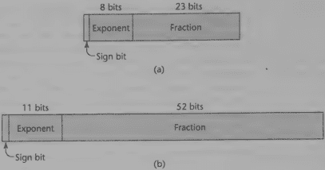

#### 6.2.1.3 复数

一些编程语言支持复数数据类型，例如Fortran和Python。复数值表示为浮点值的有序对。在Python中，复数字面量的虚部通过在其后加`j`或`J`来指定，例如：

```
(7 + 3j)
```

支持复数类型的语言包括对复数值进行算术运算的操作。

#### 6.2.1.4 十进制

大多数为支持业务系统应用程序而设计的大型计算机都有硬件支持十进制数据类型。十进制数据类型存储固定位数的十进制数字，隐含的小数点位于值中的固定位置。这些是业务数据处理的主要数据类型，因此对COBOL至关重要。C#和F#也有十进制数据类型。

十进制类型的优点是能够精确存储十进制值（至少是在受限范围内的那些值），这是浮点类型无法做到的。例如，数字0.1（十进制）可以在十进制类型中精确表示，但不能在浮点类型中精确表示，如6.2.1.2节所述。十进制类型的缺点是值的范围受限，因为不允许使用指数，并且它们在内存中的表示有些浪费，原因将在下一段讨论。

十进制类型的存储方式与字符串非常相似，使用二进制代码表示十进制数字。这些表示称为**二进制编码的十进制（BCD）**。在某些情况下，它们按每字节一个数字存储，但在其他情况下，按每字节两个数字打包。无论哪种方式，它们都比二进制表示占用更多的存储空间。编码一个十进制数字至少需要四位。因此，存储一个六位编码十进制数需要24位内存。然而，在二进制中存储相同的数字只需要20位。² 在具有此类功能的机器上，对十进制值的运算在硬件中完成；否则，在软件中模拟。

2. 当然，除非程序需要维护大量的大数值十进制值，否则这种差异是微不足道的。

### 6.2.2 布尔类型

布尔类型可能是所有类型中最简单的。它们的取值范围只有两个元素：一个表示真，一个表示假。它们是在ALGOL 60中引入的，并且自1960年以来设计的大多数通用语言都包含了它们。一个常见的例外是C89，它使用数值表达式作为条件。在这样的表达式中，所有非零值的操作数被视为真，零被视为假。尽管C99和C++有布尔类型，它们也允许数值表达式像布尔值一样使用。在随后的语言Java和C#中则不是这种情况。

布尔类型通常用于表示程序中的开关或标志。虽然其他类型（如整数）可以用于这些目的，但使用布尔类型更具可读性。

布尔值可以用一位表示，但在许多机器上，由于无法高效地访问单个位的内存，它们通常存储在内存中最小的可高效寻址单元中，通常是一个字节。

### 6.2.3 字符类型

字符数据在计算机中存储为数字编码。传统上，最常用的编码是8位代码ASCII（美国信息交换标准码），它使用0到127的值编码128个不同的字符。ISO 8859-1是另一种8位字符代码，但它允许256个不同的字符。

由于业务的全球化以及计算机与世界各地其他计算机通信的需要，ASCII字符集变得不够用了。为此，1991年，Unicode联盟发布了UCS-2标准，一种16位字符集。这种字符代码通常称为Unicode。Unicode包括了世界上大多数自然语言的字符。例如，Unicode包括塞尔维亚使用的西里尔字母和泰语数字。Unicode的前128个字符与ASCII相同。Java是第一个广泛使用Unicode字符集的语言。此后，它进入了JavaScript、Python、Perl、C#和F#。

1991年之后，Unicode联盟与国际标准化组织（ISO）合作，开发了一种名为UCS-4或UTF-32的4字节字符代码，在2000年发布的ISO/IEC 10646标准中进行了描述。

为了提供处理单个字符编码的手段，大多数编程语言都包含一个原始类型。然而，Python仅以长度为1的字符串形式支持单个字符。

## 6.3 字符串类型

字符串类型的值由字符序列组成。字符串常量用于标记输出，各种数据的输入和输出通常以字符串的形式进行。当然，对于所有进行字符操作的程序来说，字符串也是一种必不可少的类型。

### 6.3.1 设计问题

特定于字符串类型的最重要的两个设计问题如下：

- 字符串应该是字符数组的一种特殊形式，还是原始类型？
- 字符串应该具有静态还是动态长度？

### 6.3.2 字符串及其操作

最常见的字符串操作是赋值、连接、子串引用、比较和模式匹配。

子串引用是对给定字符串的子字符串的引用。子字符串引用在数组的更一般上下文中讨论，其中子字符串引用称为*切片*。

通常，字符串的赋值和比较操作都因字符串操作数可能具有不同长度而变得复杂。例如，当一个较长的字符串被赋值给一个较短的字符串时会发生什么，反之亦然？通常，对于这些情况会做出简单而合理的选择，尽管程序员经常难以记住它们。

在某些语言中，语言直接支持模式匹配。在其他语言中，它由函数或类库提供。

如果字符串没有被定义为原始类型，字符串数据通常存储在单字符数组中，并在语言中作为数组引用。这是C和C++采用的方法，它们使用`char`数组来存储字符串。这些语言通过标准库提供了一组字符串操作。字符串的许多用途以及许多库函数都使用这样的约定：字符串以特殊字符null结尾，null用零表示。这是维护字符串变量长度的替代方法。库操作只是在被操作的字符串中出现null字符之前执行其操作。产生字符串的库函数通常会提供null字符。编译器构建的字符串字面量也具有null字符。例如，考虑以下声明：

```
char str[] = "apples";
```

在此示例中，`str`是`char`元素的数组，具体是`str[0]`到`str[6]`，其中`str[6]`是null字符。

C和C++中使用最频繁的一些字符串库函数有`strcpy`（复制字符串）、`strcat`（将一个给定的字符串连接到另一个字符串）、`strcmp`（按字典顺序比较两个给定的字符串）和`strlen`（返回给定字符串中的字符数，不包括null）。大多数字符串操作函数的参数和返回值是指向`char`数组的`char`指针。参数也可以是字符串字面量。

C标准库中的字符串操作函数（在C++中也可用）天生不安全，并导致了许多编程错误。问题在于，该库中移动字符串数据的函数不能防止目标溢出。例如，考虑以下对`strcpy`的调用：

```
strcpy(dest, src);
```

如果`dest`的长度是20，`src`的长度是50，则`strcpy`将覆盖`dest`之后的30个字节。关键在于`strcpy`不知道`dest`的长度，因此它不能确保其后内存不会被覆盖。C字符串库中的其他几个函数也可能出现同样的问题。除了C风格的字符串，C++还通过其标准类库支持字符串，该库类似于Java的库。由于C字符串库的不安全性，C++程序员应该使用标准库中的`string`类，而不是`char`数组和C字符串库。

在Java中，字符串由`String`类支持，其值是常量字符串；`StringBuffer`类的值是可更改的，更像单字符数组。这些值通过`StringBuffer`类的方法来指定。C#和Ruby包含与Java类似的字符串类。

Python将字符串作为原始类型，并具有用于子串引用、连接、索引以访问单个字符的操作，以及用于搜索和替换的方法。还有一个用于检查字符是否属于字符串的操作。因此，尽管Python的字符串是原始类型，但对于字符和子字符串引用，它们的行为非常像字符数组。然而，Python字符串是不可变的，类似于Java的`String`类对象。

### 历史注释

SNOBOL 4是第一个广为人知的支持模式匹配的语言。

在F#中，字符串是一个类。单个字符以Unicode UTF-16表示，可以访问但不能更改。字符串可以使用+运算符连接。在ML中，字符串是一种


第二种选择是允许字符串长度可变，最大可达变量定义所声明并固定的最大值，C 中的字符串和 C++ 的 C 风格字符串就是例子。这些称为有限动态长度字符串。此类字符串变量可以存储从零到最大值之间的任意数量字符。回想一下，C 中的字符串使用一个特殊字符来指示字符串字符的结束，而不是维护字符串长度。

第三种选择是允许字符串长度可变且没有最大值，如 JavaScript、Perl 和标准 C++ 库中那样。这些称为动态长度字符串。此选择需要动态存储分配和释放的开销，但提供了最大的灵活性。

### 6.3.4 评估

字符串类型对语言的可写性很重要。将字符串作为数组处理可能比处理基本字符串类型更繁琐。例如，考虑一种语言，它将字符串视为字符数组，并且没有像 C 中 `strcpy` 那样功能的预定义函数。那么，将一个字符串简单赋值给另一个字符串就需要循环。将字符串作为基本类型加入语言，无论从语言复杂性还是编译器复杂性来看，代价都不高。因此，很难为某些当代语言省略基本字符串类型找到正当理由。当然，通过标准库提供字符串几乎与将其作为基本类型一样方便。

简单模式匹配和拼接等字符串操作是必不可少的，应当为字符串类型值提供这些操作。尽管动态长度字符串显然最灵活，但其实现开销必须与这种额外灵活性相权衡。

### 6.3.5 字符串类型的实现

字符串类型可以直接由硬件支持；但在大多数情况下，软件用于实现字符串的存储、检索和操作。当字符串类型表示为字符数组时，语言通常只提供很少的操作。

静态字符串类型的描述符仅在编译期间需要，它有三个字段。每个描述符的第一个字段是类型名。对于静态字符串类型，第二个字段是该类型的长度（以字符计）。第三个字段是第一个字符的地址。该描述符如图 6.2 所示。有限动态字符串需要运行期描述符来同时存储固定最大长度和当前长度，如图 6.3 所示。动态长度字符串需要更简单的运行期描述符，因为只需要存储当前长度。尽管我们将描述符描绘为独立的存储块，但在大多数情况下，它们存储在符号表中。

### 图 6.2

静态字符串的编译期描述符

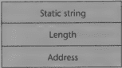

### 图 6.3

有限动态字符串的运行期描述符

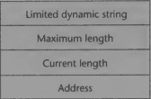

C 和 C++ 的有限动态字符串不需要运行期描述符，因为字符串的结尾用空字符标记。它们不需要最大长度，因为这些语言中数组引用的索引值不进行范围检查。

静态长度字符串和有限动态长度字符串不需要特殊的动态存储分配。对于有限动态字符串，当字符串变量绑定到存储时，会分配足以容纳最大长度的存储，因此只涉及一次分配过程。

动态长度字符串需要更复杂的存储管理。字符串的长度，因而它所绑定的存储，必须动态增长和收缩。

支持动态长度字符串所需的动态分配和释放有三种方法。第一，字符串可以存储在链表中，这样当字符串增长时，新需要的单元可以来自堆中的任何位置。这种方法的缺点是链表表示中的链接占用额外存储，以及字符串操作必然复杂。

第二种方法是将字符串存储为指向堆中分配的各个字符的指针数组。这种方法仍然使用额外内存，但字符串处理可能比链表方法更快。

第三种选择是将完整字符串存储在相邻的存储单元中。当字符串增长时，这种方法的问题就出现了：与现有单元相邻的存储如何能继续分配给该字符串变量？通常，这样的存储不可用。相反，会找到一块能存储完整新字符串的新内存区域，并将旧部分移到该区域。然后，用于旧字符串的内存单元被释放。后一种方法通常是采用的方法。管理可变大小段的分配和释放这一一般问题将在 6.11.7.3 节讨论。

尽管链表方法需要更多存储，但相关的分配和释放过程很简单。然而，某些字符串操作

C# 的枚举类型与 C++ 类似，区别在于它们从不被强制转换为整数。因此，枚举类型上的操作被限制在有意义的操作上。此外，取值范围被限制为该特定枚举类型的取值范围。

在 ML 中，枚举类型通过 `datatype` 声明定义为新类型。例如，我们可以有如下声明：

```
datatype weekdays = Monday | Tuesday | Wednesday |
Thursday | Friday
```

weekdays 的元素类型是整数。

F# 的枚举类型与 ML 类似，不同之处在于使用保留字 `type` 而不是 `datatype`，并且第一个值前面有一个或运算符（|）。

有趣的是，相对较新的脚本语言都没有包含枚举类型。这些语言包括 Perl、JavaScript、PHP、Python、Ruby 和 Lua。甚至 Java 在加入枚举类型之前也已经存在了十年。

### 6.4.3 评估

枚举类型可以在可读性和可靠性方面提供优势。可读性得到非常直接的增强。命名值很容易识别，而编码值则不然。

在可靠性方面，C#、F# 和 Java 5.0 的枚举类型提供了两个优势：（1）枚举类型上不允许任何算术运算；例如，这可以防止将一周中的各天相加；（2）不能给枚举变量赋其定义范围之外的值。⁴ 如果 colors 枚举类型有 10 个枚举常量，并使用 0..9 作为其内部值，那么就不能将大于 9 的数赋给 colors 类型变量。

由于 C 将枚举变量当作整数变量处理，因此它不提供上述两项优势中的任何一项。

C++ 稍好一些。只有当数值被强制转换为所赋值变量的类型时，才能将这些数值赋给枚举类型变量。赋给枚举类型变量的数值会被检查，以确定它们是否在枚举类型内部值的范围内。不幸的是，如果用户使用范围很宽的显式赋值，这种检查就不起作用。例如，

```
enum colors {red = 1, blue = 1000, green = 100000}
```

在这个例子中，赋给 colors 类型变量的值只会被检查是否在 1..100000 的范围内。

⁴ 在 C# 和 F# 中，可以将整数值强制转换为枚举类型，并赋给枚举变量名。在将此类值赋给枚举变量名之前，必须用 `Enum.IsDefined` 方法测试它们。

### 历史注记

90 年代之前的 Fortran 和 PL/I 的设计者为数组下标选择圆括号，因为当时没有其他合适的字符可用。卡片穿孔机不包含方括号字符。

### 历史注记

Fortran I 将数组下标数量限制为三个，因为在设计时，执行效率是首要考虑因素。Fortran I 的设计者利用 IBM 704 的三个索引寄存器，开发出一种非常快速的方法来访问最多三维数组的元素。Fortran IV 最初在 IBM 7094 上实现，该机器有七个索引寄存器。这使得 Fortran IV 的设计者能够允许数组最多有七下标。大多数其他当代语言不施加此类限制。

聚合体。实际上，数组有时被称为有限映射。用符号表示，这种映射可以表示为

```
array_name(subscript_value_list) → element
```

数组引用的语法相当普遍：数组名后面是下标列表，下标列表用圆括号或方括号括起来。在一些将多维数组提供为数组的数组的语言中，每个下标分别出现在各自的方括号中。使用圆括号括住下标表达式的一个问题是，圆括号也常用于括住子程序调用中的参数；这种用法使数组引用看起来与那些调用完全一样。例如，考虑下面的 Ada 赋值语句：

```
Sum := Sum + B(I);
```

由于在 Ada 中圆括号既用于子程序参数又用于数组下标，程序阅读者和编译器都不得不利用其他信息来确定该赋值中的 `B(I)` 是函数调用还是对数组元素的引用。这导致可读性降低。

Ada 的设计者特意选择圆括号来括住下标，以便表达式中的数组引用和函数调用之间具有一致性，尽管可能存在可读性问题。他们做出这一选择的部分原因是，数组元素引用和函数调用都是映射。数组元素引用将下标映射到数组的特定元素。函数调用将实参映射到函数定义，并最终映射到一个函数值。

除 Fortran 和 Ada 之外的大多数语言使用方括号来界定数组索引。

数组类型涉及两种不同的类型：元素类型和下标类型。下标类型通常是整数。

早期编程语言没有规定必须隐式检查下标范围。程序中的下标范围错误很常见，因此要求范围检查是语言可靠性的一个重要因素。许多当代语言也没有规定对下标进行范围检查，但 Java、ML 和 C# 有规定。

Perl 中的下标有点不寻常：尽管所有数组名都以 at 符号（@）开头，但由于数组元素始终是标量，而标量名始终以美元符号（$）开头，因此对数组元素的引用在名称中使用美元符号而不是 at 符号。例如，对于数组 `@list`，第二个元素用 `$list[1]` 引用。

在 Perl 中可以用负下标引用数组元素，此时下标值是从数组末尾开始的偏移量。例如，如果数组 `@list` 有五个元素，下标为 0..4，则 `$list[-2]`

在 C 和 C++ 函数中声明但未带 **静态** 说明符的数组，是固定栈动态数组的例子。

C 和 C++ 也提供固定堆动态数组。标准 C 库函数 `malloc` 和 `free` 分别是通用的堆分配和释放操作，可用于 C 数组。C++ 使用运算符 `new` 和 `delete` 来管理堆存储。数组被当作指向一组存储单元的指针，该指针可以被索引，如 6.1.1.5 节所述。

在 Java 中，所有非泛型数组都是固定堆动态数组。这些数组一旦创建，就保持相同的下标范围和存储。C# 也提供固定堆动态数组。

C# `List` 类的对象是泛型堆动态数组。这些数组对象在创建时没有任何元素，如下所示

```
List<String> stringList = new List<String>();
```

使用 Add 方法向该对象添加元素，如下所示

```
stringList.Add("Michael");
```

对这些数组元素的访问通过下标进行。

Java 包含一个与 C# 的 `List` 类似的泛型类，名为 `ArrayList`。它与 C# 的 `List` 的不同之处在于不支持下标访问——必须使用 get 和 set 方法访问元素。

Perl 数组可以通过使用 `push`（将一个或多个新元素放到数组末尾）和 `unshift`（将一个或多个新元素放到数组开头）来增长，也可以通过给数组赋一个指定当前最高下标之后的下标的值来增长。通过给数组赋予空列表 `()`，可以使其缩短到没有元素。数组的长度定义为最大下标加一。

与 Perl 一样，JavaScript 允许数组通过 `push` 和 `unshift` 方法增长，并通过将其设为空列表来缩短。但是，不支持负下标。

JavaScript 数组可以是稀疏的，这意味着下标值不必连续。例如，假设有一个名为 list 的数组，它有 10 个元素，下标为 0..9。⁵ 考虑以下赋值语句：

```
list[50] = 42;
```

现在，`list` 有 11 个元素，长度为 51。下标为 11 .. 49 的元素未定义，因此不需要存储。对 JavaScript 数组中不存在的元素的引用会产生 **未定义**。

Python、Ruby 和 Lua 中的数组只能通过添加元素或连接其他数组的方法来增长。Ruby 和 Lua 支持负下标。

⁵. 下标范围同样可以很容易地是 1000 .. 1009。

### 6.5.5 数组操作

数组操作是将数组作为一个整体来操作的操作。最常见的数组操作是赋值、连接、相等和不相等比较以及切片，切片将在 6.5.5 节单独讨论。

基于 C 的语言不提供任何数组操作，除非通过 Java、C++ 和 C# 的方法。Perl 支持数组赋值，但不支持比较。

Python 的数组称为列表，尽管它们具有动态数组的所有特征。由于对象可以是任意类型，这些数组是异质的。Python 提供数组赋值，尽管它只是引用变更。Python 还具有数组连接（`+`）和元素成员资格（`in`）操作。它包括两种不同的比较运算符：一种确定两个变量是否引用同一个对象（`is`），另一种比较所引用对象中的所有对应对象是否相等（`==`），无论它们嵌套得有多深。

与 Python 一样，Ruby 数组的元素是对对象的引用。并且与 Python 一样，当在两个数组之间使用 `==` 运算符时，仅当两个数组长度相同且对应元素相等时，结果才为真。Ruby 的数组可以用 Array 方法连接。

F# 在其 Array 模块中包含许多数组运算符。其中包括 `Array.append`、`Array.copy` 和 `Array.length`。

数组及其操作是 APL 的核心；它是有史以来最强大的数组处理语言。然而，由于它相对冷门且对后续语言缺乏影响，我们在这里只对其数组操作作一瞥。

在 APL 中，四种基本算术运算既为向量（一维数组）和矩阵定义，也为标量操作数定义。例如，

```
A + B
```

无论 `A` 和 `B` 是标量变量、向量还是矩阵，都是一个有效表达式。

APL 包含一组用于向量和矩阵的一元运算符，其中一些如下（其中 `V` 是向量，`M` 是矩阵）：

- `φV` 反转 `V` 的元素
- `φM` 反转 `M` 的列
- `θM` 反转 `M` 的行
- `⍉M` 转置 `M`（其行变为列，列变为行）
- `-M` 反转 `M`

APL 还包括几个特殊运算符，它们以其他运算符为操作数。其中之一是内积运算符，用句点（.）指定。它接受两个操作数，这两个操作数是二元运算符。例如，

```
+ . x
```

考虑以下 Python 声明：

```python
vector = [2, 4, 6, 8, 10, 12, 14, 16]
mat = [[1, 2, 3], [4, 5, 6], [7, 8, 9]]
```

回想一下，Python 数组的默认下界是 0。Python 切片引用的语法是一对用冒号分隔的数值表达式。第一个是切片的首个下标；第二个是切片中最后一个下标之后的首个下标。因此，`vector[3:6]` 是一个三元素数组，包含 `vector` 的第四到第六个元素（即下标为 3、4 和 5 的那些元素）。矩阵的一行只需给出一个下标即可指定。例如，`mat[1]` 指 `mat` 的第二行；一行的一部分可以用与一维数组的一部分相同的语法来指定。例如，`mat[0][0:2]` 指 `mat` 第一行的第一个和第二个元素，即 `[1, 2]`。

Python 还支持更复杂的数组切片。例如，`vector[0:7:2]` 引用 `vector` 中从下标 0 开始、直到但不包括下标 7 的元素的每隔一个元素，即 `[2, 6, 10, 14]`。

Perl 支持两种形式的切片：特定下标的列表或下标范围。例如，

```perl
@list[1..5] = @list2[3, 5, 7, 9, 13];
```

注意，切片引用使用数组名，而不是标量名，因为切片是数组（不是标量）。

Ruby 通过其 `Array` 对象的 `slice` 方法支持切片，该方法可以接受三种形式的参数。单个整数表达式参数被解释为下标，在这种情况下，`slice` 返回具有给定下标的元素。如果给 `slice` 两个整数表达式参数，第一个被解释为起始下标，第二个被解释为切片中的元素个数。例如，假设 `list` 定义如下：

```ruby
list = [2, 4, 6, 8, 10]
```

`list.slice(2, 2)` 返回 `[6, 8]`。`slice` 的第三种参数形式是范围，其形式为一个整数表达式、两个句点和第二个整数表达式。使用范围参数时，`slice` 返回由给定下标范围内的元素组成的数组。例如，`list.slice (1..3)` 返回 `[4, 6, 8]`。

### 6.5.8 评价

数组几乎被包含在所有编程语言中。自 Fortran I 引入数组以来，主要进展是切片和动态数组。正如 6.6 节所讨论的，数组的最新进展是关联数组。

### 6.5.9 数组类型的实现

实现数组比实现基元类型需要多得多的编译期工作。允许访问数组元素的代码必须在编译期生成。在运行期，必须执行这些代码以产生元素地址。对于如下引用，无法预先计算要访问的地址：

```
list[k]
```

一维数组实现为相邻内存单元的列表。假设数组 `list` 定义的下标范围下界为 0。`list` 的访问函数通常具有以下形式

```
address(list[k]) = address(list[0]) + k * element_size
```

其中加法的第一个操作数是访问函数的常量部分，第二个是变量部分。如果元素类型是静态绑定的，并且数组静态绑定到存储，那么常量部分的值可以在运行期之前计算。但是，加法和乘法操作必须在运行期完成。对于任意下界，该访问函数的推广形式为

```
address(list[k]) = address(list[lower_bound]) +
                   ((k - lower_bound) * element_size)
```

一维数组的编译期描述符可以采用图 6.4 所示的形式。描述符包含构造访问函数所需的信息。如果不对索引范围进行运行期检查，并且所有属性都是静态的，那么执行期间只需要访问函数；不需要描述符。如果进行索引范围的运行期检查，那么这些索引范围可能需要存储在运行期描述符中。如果特定数组类型的下标范围是静态的，那么这些范围可以并入执行检查的代码中，从而消除对运行期描述符的需求。如果任何描述符条目是动态绑定的，那么描述符的这些部分必须在运行期维护。

**图 6.4**  
一维数组的编译期描述符

| 数组 |
|---|
| 元素类型 |
| 索引类型 |
| 索引下界 |
| 索引上界 |
| 地址 |


真正的多维数组，即那些不是数组的数组，实现起来比一维数组更复杂，尽管扩展到更多维度是直接的。硬件内存是线性的——只是一个简单的字节序列。因此，具有两个或更多维度的数据类型值必须映射到一维内存上。将多维数组映射到一维有两种方式：行主序和列主序（列主序在任何广泛使用的语言中都没有使用）。在行主序中，数组的第一维下标为其下界值的元素首先存储，接着是第一维下标为第二个值的元素，依此类推。如果数组是矩阵，则按行存储。例如，如果矩阵具有值

```
3 4 7
6 2 5
1 3 8
```

则它将按行主序存储为

```
3, 4, 7, 6, 2, 5, 1, 3, 8
```

多维数组的访问函数是其基地址和一组索引值到由索引值指定的元素在内存中地址的映射。以行主序存储的二维数组的访问函数可以如下开发。通常，元素的地址是结构的基地址加上元素大小乘以结构中位于它之前的元素数量。对于行主序的矩阵，位于某个元素之前的元素数量是该元素上方的行数乘以行大小，再加上该元素所在行左侧的元素数量。如图6.5所示，我们假设下标下界均为零。

为了获得实际的地址值，必须将位于所需元素之前的元素数量乘以元素大小。现在，访问函数可以写成

**图6.5**

矩阵中[i, j]元素的位置


location(a[i, j]) = a[0, 0]的地址
    + (((第i行上方的行数) * (一行的大小))
    + (第j列左侧的元素数量)) * 元素大小

由于第i行上方的行数为i，第j列左侧的元素数量为j，我们有

location(a[i, j]) = a[0, 0]的地址 + (((i * n) + j) * element_size)

其中n是每行的元素数量。第一项是常量部分，最后一项是变量部分。

推广到任意下界，得到以下访问函数：

location(a[i, j]) = a[row_lb, col_lb]的地址
    + (((i - row_lb) * n) + (j - col_lb)) * element_size

其中row_lb是行的下界，col_lb是列的下界。这可以重排为以下形式

location(a[i, j]) = a[row_lb, col_lb]的地址
    - ((row_lb * n) + col_lb) * element_size
    + (((i * n) + j) * element_size)

其中前两项是常量部分，最后一项是变量部分。这可以相当容易地推广到任意数量的维度。

对于数组的每一维度，访问函数需要一条加法和一条乘法指令。因此，访问具有多个下标的数组元素是昂贵的。多维数组的编译时描述符如图6.6所示。

**图6.6**

多维数组的编译时描述符

| 多维数组 |
| --- |
| 元素类型 |
| 索引类型 |
| 维度数量 |
| 索引范围0 |
| ⋮ |
| 索引范围 n - 1 |
| 地址 |

## 6.6 关联数组

*关联数组*是一个无序的数据元素集合，这些元素由相等数量的称为*键*的值进行索引。对于非关联数组，索引永远不需要存储（因为它们具有规律性）。然而，在关联数组中，用户定义的键必须存储在结构中。因此，关联数组的每个元素实际上是一对实体：一个键和一个值。我们使用Perl的关联数组设计来说明这种数据结构。Python、Ruby和Lua也直接支持关联数组，Java、C++、C#和F#的标准类库也支持。

关联数组特有的唯一设计问题是其元素引用的形式。

### 6.6.1 结构和操作

在Perl中，关联数组被称为散列（hash），因为在实现中它们的元素通过散列函数存储和检索。Perl散列的命名空间是独立的：每个散列变量名必须以百分号（%）开头。每个散列元素由两部分组成：键（字符串）和值（标量，即数字、字符串或引用）。散列可以通过赋值语句设置为字面量值，例如

```perl
%salaries = ("Gary" => 75000, "Perry" => 57000,
             "Mary" => 55750, "Cedric" => 47850);
```

单个元素值使用与Perl数组类似的表示法引用。键值放在花括号中，散列名称替换为标量变量名，该变量名除第一个字符外相同。虽然散列不是标量，但散列元素的值部分是标量，所以对散列元素值的引用使用标量名称。回忆一下，标量变量名以美元符号（$）开头。因此，将58850赋值给%salaries中键为"Perry"的元素，如下所示：

```perl
$salaries{"Perry"} = 58850;
```

使用相同的赋值语句形式添加新元素。可以使用**delete**运算符从散列中删除元素，如下所示：

```perl
delete $salaries{"Gary"};
```

可以通过将空字面量赋值给散列来清空整个散列，如下所示：

```perl
%salaries = ();
```

Perl散列的大小是动态的：添加元素时增长，删除元素时缩小，通过赋值清空时也会缩小。

## Lua

**罗伯托·耶鲁萨利姆斯奇**


罗伯托·耶鲁萨利姆斯奇是脚本语言Lua的创建者之一，Lua广泛应用于游戏开发和嵌入式系统应用。他是巴西里约热内卢天主教大学计算机科学系的副教授。（有关Lua的更多信息，请访问www.lua.org。）

**你是如何以及在哪里第一次接触计算？**

在我1978年进入大学之前，我对计算一无所知。我记得我曾尝试阅读一本关于Fortran编程的书，但没有通过关于变量和常量定义的初始章节。

在大学第一年，我参加了一门Fortran编程101课程。那时我们在IBM 370大型机上运行编程作业。我们必须用穿孔卡片打代码，在卡片组周围加上一些固定的JCL卡片，然后交给操作员。一段时间后（通常是几个小时），我们得到一份结果列表，通常只有编译器错误。

不久之后，我的一个朋友从国外带回一台微型计算机，一个Z80 CPU，4K字节内存。我们开始为这台机器编写各种程序，全部用汇编语言——或者更确切地说，用机器码，因为它没有汇编器。我们用汇编编写程序，然后手工翻译成十六进制，输入内存运行。

从那时起，我就着迷了。

**在过去的25年里，很少有成功的编程语言是在学术环境中设计的。虽然你是一名学者，但Lua是为非常实际的应用而设计的。你认为Lua是一种学术语言还是工业语言？**

Lua当然是一种工业语言，但带有学术“口音”。Lua是为两个工业应用而创建的，并且它一生都在工业应用中使用。我们试图在设计上非常务实。然而，除了第一个版本之外，我们从未受到工业环境的典型压力。我们总是有选择何时发布新版本或选择是否接受用户要求的奢侈。这给了我们其他语言没有享受到的一些自由度。

最近，我们用Lua做了一些学术研究。但是将这些学术成果合并到官方发行版中是一个漫长的过程；通常情况下，这些成果对Lua几乎没有直接影响。然而，也有一些很好的例外，比如基于寄存器的虚拟机和“ephemeron表”（将在Lua 5.2中出现）。

**你曾说过Lua是“养”出来的，而不是“设计”出来的。你能评论一下你的意思以及你认为这种方法的好处吗？**

我们的意思是，Lua最重要的部分并不存在于其第一个版本中。这门语言一开始是一种非常小且简单的语言，在演变过程中获得了几个相关特性。

在谈论这种方法的好处（和缺点）之前，让我说清楚，我们并没有选择这种方法。我们从未想过，“让我们培育一门新语言。”它就这么发生了。

我猜想，设计一门语言时最困难的部分是预见不同机制在日常使用中如何相互作用。通过“养育”一门语言——也就是说，一块一块地创建它——你可能会避免大多数这些交互问题，因为你可以只在语言的其他部分就位并由真实用户在真实应用中测试之后，再考虑每个新特性。

当然，这种方法也有一个主要缺点：你可能会到达一个点，此时最需要的新特性与已经存在的东西不兼容。

**自1994年首次发布以来，Lua发生了各种各样的变化。你曾说过有些时候你后悔没有在Lua中包含布尔类型。为什么你不直接添加一个呢？**

这可能听起来很滑稽，但我们真正缺少的是“false”这个值；我们对“true”值没有用处。


与最初的 Lisp 一样，Lua 将 nil 视为假，将其他一切视为真。问题在于，nil 还表示未初始化的变量。当时无法区分未初始化变量和值为假的变量。因此，我们需要一个假值，以便做出这种区分。但真值没什么用；用 1 或任何其他常量就足够了。

我想，这是一个典型例子，体现了我们的“工业”思维与“学术”思维之间的冲突。真正务实的头脑会毫不犹豫地加入布尔类型。但我们的学术思维对这种不优雅感到不安。最终务实的一方赢了，但这花了一些时间。

### 除了预处理器之外，Lua 最重要的哪些特性后来被认为是缺陷特性并从语言中移除了？

我不记得还有其他大的缺陷特性。我们确实从 Lua 中移除过若干特性，但主要是因为它们被某个新的、通常在某种意义上“更好”的特性取代了。标签方法（被元表取代）、C API 中的弱引用（被弱表取代）以及上值（被恰当的词法作用域取代）都属于这种情况。

### 当考虑为 Lua 添加会破坏向后兼容性的新特性时，这个决定是如何做出的？

这些总是艰难的决定。首先，我们尝试找到某种其他形式，能够避免或至少减少不兼容性。如果做不到，我们就尝试提供绕过不兼容性的简便方法。例如，如果我们从核心库中移除一个函数，我们可能会提供一个独立的实现，程序员可以将其纳入自己的代码中。此外，我们还会衡量检测和纠正这种不兼容性有多困难。如果新特性造成语法错误（例如新增一个保留字），那还不算糟；我们甚至可能提供一个自动工具来修复旧代码。然而，如果新特性可能产生隐蔽的缺陷（例如一个已有函数返回不同的结果），我们就认为这是不可接受的。

### 是否为 Lua 考虑过像 Ruby 那样的迭代器方法，而不是后来加入的 for 语句？哪些考虑促成了这一选择？

它们不仅被考虑过，实际上还实现过！从 3.1 版（1998 年）开始，Lua 就有一个函数“foreach”，它把一个给定函数应用到表中的所有键值对。类似地，借助“gsub”，很容易把一个给定函数应用到字符串中的每个字符。

Lua 没有为迭代器主体采用特殊的“块”机制，而是使用一等函数来完成这项任务。请看下一个示例：

```lua
-- 't' is a table from names to values
-- the next 'loop' prints all keys with
-- values greater than 10
foreach(t, function(key, value)
    if value > 10 then print(key) end
end)
```

然而，当我们最初实现迭代器时，Lua 中的函数还没有完整的词法作用域。此外，语法有点笨重（宏会有帮助）。而且，退出语句（break 和 return）在迭代体内部使用时总是令人困惑。因此，我们最终决定采用 for 语句。

但“真正的迭代器”在 Lua 中仍然是一种有用的设计，尤其是在函数已经具备恰当词法作用域的现在。在我的 Lua 书中，我在关于 for 语句那一章的结尾讨论了真正的迭代器。

### 你能简要描述一下，当你说 Lua 是一种可扩展的扩展语言时，你指的是什么吗？

它是一种“可扩展语言”，因为很容易注册用其他语言定义的新函数和类型。因此，扩展这门语言很容易。从更具体的角度看，很容易从 Lua 调用 C。

它是一种“扩展语言”，因为很容易用 Lua 来扩展一个应用程序，把 Lua 变成该应用的宏语言。（这是更纯粹意义上的“脚本化”。）从更具体的角度看，很容易从 C 调用 Lua。

### 数据结构已经从数组、记录和哈希演化到它们的组合。你能估计 Lua 的表在编程语言数据结构演化中的重要性吗？

我不认为 Lua 表在其他语言的演化中产生过什么重要意义。也许未来会改变，但我对此并不确定。在我看来，Lua 表提供的主要好处是简单，是一种“一体化”的解决方案。但这种简单性也有代价：例如，Lua 程序的静态分析非常困难，尤其是因为表如此通用且无处不在。每种语言都有自己的优先级。

空字面量。exists 运算符返回 true 或 false，取决于其操作数键是否为哈希中的元素。例如，

```perl
if (exists $salaries{"Shelly"}) . . .
```

keys 运算符应用于哈希时，返回该哈希的键组成的数组。values 运算符对哈希的值做同样的事。each 运算符遍历哈希的元素对。

Python 的关联数组称为字典，它们与 Perl 的关联数组类似，只是值都是对象的引用。Ruby 支持的关联数组与 Python 的类似，只是键可以是任何对象⁶，而不只是字符串。这里存在一个演进过程：从 Perl 的哈希（键必须是字符串），到 PHP 的数组（键可以是整数或字符串），再到 Ruby 的哈希（任何类型的对象都可以作为键）。

PHP 的数组既是普通数组，也是关联数组。它们可以被当作其中任何一种来对待。该语言提供的函数允许对元素进行索引访问和哈希访问。一个数组可以包含用简单数字索引创建的元素，也可以包含用字符串哈希键创建的元素。

在 Lua 中，表类型是唯一的数据结构。Lua 表是一种关联数组，其中键和值都可以是任何类型。表可以用作传统数组、关联数组或记录（结构体）。当用作传统数组或关联数组时，键要用方括号括起来。当用作记录时，键是字段名，对字段的引用可以使用点表示法（record_name.field_name）。

Lua 的关联数组作为记录的使用将在 6.7 节讨论。

C# 和 F# 通过一个 .NET 类支持关联数组。

如果需要搜索元素，关联数组比数组好得多，因为用于访问元素的隐式哈希操作非常高效。此外，当要存储的数据成对出现时，关联数组非常理想，例如员工姓名及其薪资。另一方面，如果必须处理列表中的每个元素，那么使用数组更高效。

### 6.6.2 实现关联数组

Perl 关联数组的实现针对快速查找进行了优化，但当数组增长需要重组时，它也能提供相对较快的重组。每个条目都会计算一个 32 位哈希值，并与该条目一起存储，尽管关联数组最初只使用哈希值的一小部分。当关联数组必须扩展到初始大小之外时，哈希函数无需改变；相反，会使用哈希值中更多的位。发生这种情况时，只需移动一半的条目。因此，尽管关联数组的扩展不是没有代价的，但并没有人们预期的那么昂贵。

PHP 数组中的元素通过哈希函数放入内存。然而，所有元素都按创建顺序链接在一起。这些链接用于支持通过 *current* 和 *next* 函数对元素进行迭代访问。

6. 会变化的对象不适合作为键，因为变化可能改变哈希函数值。因此，数组和哈希从不被用作键。

## 6.7 记录类型

**记录**是一种数据元素的聚合体，其中各个元素通过名称标识，并通过从结构起始位置开始的偏移量来访问。

程序中经常需要对一组数据进行建模，其中各个元素的类型或大小并不相同。例如，关于大学生的信息可能包括姓名、学号、平均绩点等。用于这种集合的数据类型可能用字符串表示姓名，用整数表示学号，用浮点数表示平均绩点，等等。记录就是为这类需求而设计的。

记录和异质数组看起来可能相同，但事实并非如此。异质数组的元素都是对数据对象的引用，这些对象位于分散的位置，通常位于堆上。记录的元素大小可能不同，并且位于相邻的内存位置。

自 20 世纪 60 年代初 COBOL 引入记录以来，除 90 版之前的 Fortran 外，记录一直是所有最流行的编程语言的一部分。在一些支持面向对象编程的语言中，数据类充当记录。

在 C、C++ 和 C# 中，记录由 **struct** 数据类型支持。在 C++ 中，结构体是类的一种小变体。在 C# 中，结构体也与类相关，但与类相当不同。C# 结构体是栈分配的值类型，而类对象是堆分配的引用类型。C++ 和 C# 中的结构体通常用作封装结构，而不是数据结构。第 11 章将进一步从这一角度讨论它们。ML 和 F# 中也包含结构体。

在 Python 和 Ruby 中，记录可以实现为哈希，而哈希本身也可以是数组的元素。

以下各节描述记录如何声明或定义、如何引用记录中的字段，以及常见的记录操作。

以下设计问题是记录类型特有的：

- 对字段的引用采用什么语法形式？
- 是否允许省略式引用？


### 6.7.1 记录的定义

记录与数组的根本区别在于，记录的元素（或称字段）不使用下标引用。相反，字段使用标识符命名，并且通过这些标识符来引用字段。数组与记录的另一个区别是，某些语言中的记录允许包含联合（union），这将在6.10节讨论。

COBOL 中记录声明的形式是 COBOL 程序数据分部的一部分，如下例所示：

```
01  EMPLOYEE-RECORD.
    02  EMPLOYEE-NAME.
        05  FIRST      PICTURE IS X(20).
        05  MIDDLE     PICTURE IS X(10).
        05  LAST       PICTURE IS X(20).
    02  HOURLY-RATE PICTURE IS 99V99.
```

EMPLOYEE-RECORD 记录由 EMPLOYEE-NAME 记录和 HOURLY-RATE 字段组成。记录声明各行开头的数字 01、02 和 05 是层号，它们通过相对大小表示记录的层次结构。任何后面跟着更高层号行的行本身就是一个记录。PICTURE 子句显示了字段存储位置的格式，其中 X(20) 表示 20 个字母数字字符，99V99 表示中间带小数点的四位十进制数字。

在 Java 和 C# 中，记录可以定义为数据类，嵌套记录则定义为嵌套类。这些类的数据成员即作为记录字段。如前所述，Lua 的关联数组可以方便地用作记录。例如，考虑以下声明：

```
employee.name = "Freddie"
employee.hourlyRate = 13.20
```

这些赋值语句创建了一个名为 employee 的表（记录），其中包含两个元素（字段）name 和 hourlyRate，两者均已被初始化。

### 6.7.2 记录字段的引用

对记录各字段的引用在语法上有多种不同方式，其中两种会指明所需字段及其所在的记录。COBOL 字段引用的形式为

```
field_name OF record_name_1 OF . . . OF record_name_n
```

其中第一个列出的记录名是包含该字段的最小或最内层记录。序列中的下一个记录名是包含前一个记录的记录。

Python 的元组与其列表密切相关，区别在于元组是不可变的。元组通过赋值一个元组字面量来创建，如下例所示：

```
myTuple = (3, 5.8, 'apple')
```

注意，元组的元素不必是同一类型。元组的元素可以通过方括号中的索引来引用，如下所示：

```
myTuple[1]
```

这引用了元组的第一个元素，因为元组索引从 1 开始。元组可以使用加号（+）运算符进行拼接，也可以使用 del 语句删除。此外还有其他操作符和函数可作用于元组。

ML 包含一种元组数据类型。ML 元组必须至少有两个元素，而 Python 的元组可以为空或只包含一个元素。与 Python 一样，ML 元组可以包含混合类型的元素。以下语句创建一个元组：

```
val myTuple = (3, 5.8, 'apple');
```

元组元素访问的语法如下：

```
#1(myTuple);
```

这引用了元组的第一个元素。在 ML 中，可以通过类型声明定义新的元组类型，例如：

```
type intReal = int * real;
```

该类型的值由一个整数和一个实数构成。

F# 也支持元组。元组通过在 let 语句中将元组值赋给一个名称来创建，元组值是用逗号分隔、用圆括号括起来的表达式列表。如果元组有两个元素，可以分别使用函数 `fst` 和 `snd` 来引用。对于多于两个元素的元组，通常通过在 `let` 语句左侧使用元组模式来引用其元素。元组模式就是一系列名称，每个名称对应元组中的一个元素，可以带也可以不带圆括号。当元组模式位于 `let` 结构的左侧时，它是一种多重赋值。例如，考虑以下 `let` 结构：

```
let tup = (3, 5, 7);;
let a, b, c = tup;;
```

这将 3 赋给 a，5 赋给 b，7 赋给 c。

在 Python、ML 和 F# 中，元组被用于允许函数返回多个值。

## 6.9 列表类型

列表最早在第一种函数式编程语言 Lisp 中得到支持。它们一直是函数式语言的一部分，但近年来也进入了某些命令式语言。

Scheme 和 Common Lisp 中的列表用括号括起来，元素之间不使用任何标点分隔。例如，

```lisp
(A B C D)
```

嵌套列表具有相同的形式，因此可以有：

```lisp
(A (B C) D)
```

在这个列表中，(B C) 是嵌套在外层列表内部的一个列表。

在 Lisp 及其后继语言中，数据和代码具有相同的语法形式。如果列表 (A B C) 被解释为代码，则表示以 B 和 C 为参数调用函数 A。

Scheme 中基本的列表操作是四个函数：两个用于拆解列表，两个用于构建列表。CAR 函数返回其列表参数的第一个元素。例如，考虑以下示例：

```lisp
(CAR '(A B C))
```

参数列表前的引号是为了防止解释器将该列表视为对 A 函数以 B 和 C 为参数的调用（在这种情况下它会进行解释）。这个对 CAR 的调用返回 A。

CDR 函数返回其参数列表去掉第一个元素后的剩余部分。例如，考虑以下示例：

```lisp
(CDR '(A B C))
```

该函数调用返回列表 (B C)。

Common Lisp 还有 FIRST（同 CAR）、SECOND、…、TENTH 等函数，它们返回列表参数中由名称指定的对应位置的元素。

在 Scheme 和 Common Lisp 中，新列表通过 CONS 和 LIST 函数构建。CONS 函数接受两个参数，并返回一个新列表，其第一个参数作为新列表的第一个元素，第二个参数作为新列表的剩余部分。例如，考虑以下调用：

```lisp
(CONS 'A '(B C))
```

该调用返回新列表 (A B C)。

LIST 函数接受任意数量的参数，并返回一个新列表，参数作为其元素。例如，考虑下面这个对 LIST 的调用：

```lisp
(LIST 'A 'B '(C D))
```

该调用返回新列表 (A B (C D))。

ML 也支持列表和列表操作，尽管其外观与 Scheme 不同。列表用方括号指定，元素之间用逗号分隔，如下面的整数列表所示：

```
[5, 7, 9]
```

`[]` 是空列表，也可以用 `nil` 表示。

Scheme 中的 `cons` 函数在 ML 中实现为一个二元中缀运算符，用 `::` 表示。例如，

```
3 :: [5, 7, 9]
```

返回以下新列表：`[3, 5, 7, 9]`。

列表的元素必须是同一类型，因此下面这个列表是非法的：

```
[5, 7.3, 9]
```

ML 有与 Scheme 的 `CAR` 和 `CDR` 对应的函数，分别名为 `hd`（head，头）和 `tl`（tail，尾）。例如，

```
hd [5, 7, 9] 的结果是 5
tl [5, 7, 9] 的结果是 [7, 9]
```

Scheme 和 ML 中的列表及列表操作将在第 15 章中做更全面的讨论。

F# 中的列表与 ML 密切相关，但有一些显著差异。F# 列表的元素用分号分隔，而不是 ML 中的逗号。操作 `hd` 和 `tl` 相同，但它们作为 `List` 类的方法来调用，例如 `List.hd [1; 3; 5; 7]` 返回 1。F# 的 `cons` 操作也像 ML 一样用两个冒号表示。

Python 包含一种列表数据类型，它也充当 Python 的数组。与 Scheme、Common Lisp、ML 和 F# 的列表不同，Python 的列表是可变的。它们可以包含任何数据值或对象。Python 列表通过将列表值赋给一个名称来创建。列表值是表达式序列，用逗号分隔并用方括号括起来。例如，考虑以下语句：

```
myList = [3, 5.8, "grape"]
```

列表的元素通过方括号中的下标来引用，如下例所示：

```
x = myList[1]
```

该语句将 5.8 赋给 `x`。列表元素的索引从零开始。列表元素也可以通过赋值进行更新。列表元素可以用 `del` 删除，如下面的语句所示：

```
del myList[1]
```


该语句删除 `myList` 中的第二个元素。

Python 包含一种用于创建数组的强大机制，称为**列表推导式**。列表推导式是一种源自集合表示法的思想。它首次出现在函数式编程语言 Haskell 中（参见第 15 章）。列表推导式的机制是：将函数应用于给定数组的每个元素，然后根据结果构造一个新数组。Python 列表推导式的语法如下：

```
[expression for iterate_var in array if condition]
```

考虑以下示例：

```
[x * x for x in range(12) if x % 3 == 0]
```

`range` 函数创建数组 [0, 1, 2, 3, 4, 5, 6, 7, 8, 9, 10, 11]。条件表达式会过滤掉数组中所有不能被 3 整除的数。然后，表达式对剩余的数求平方。求平方的结果收集在一个数组中并返回。该列表推导式返回以下数组：

```
[0, 9, 36, 81]
```

Python 还支持列表切片。

Haskell 的列表推导式具有以下形式：

```
[body | qualifiers]
```

例如，考虑以下列表定义：

```
[n * n | n <- [1..10]]
```

这定义了从 1 到 10 的数字的平方所组成的列表。

F# 也包含列表推导式，在该语言中还可用于创建数组。例如，考虑以下语句：

```fsharp
let myArray = [|for i in 1 .. 5 -> (i * i) |];
```

此语句创建数组 [1; 4; 9; 16; 25]，并将其命名为 myArray。

回顾第 6.5 节，C# 和 Java 分别支持泛型堆动态集合类 `List` 和 `ArrayList`。这些结构实际上就是列表。

## 6.10 联合类型

**联合**是一种类型，其变量在程序执行期间的不同时间可能存储不同的类型值。作为联合类型需求的一个例子，考虑编译器的常量表，该表用于存储被编译程序中的常量。每个表项的一个字段用于存储常量的值。假设对于正在编译的特定语言，常量的类型为整数、浮点数和布尔值。就表管理而言，如果同一个位置（即表字段）能够存储这三种类型中任意一种的值，那将非常方便。这样，所有常量值都可以用相同的方式寻址。从某种意义上说，这种位置的类型就是它能存储的三种值类型的联合。

### 6.10.1 设计问题

联合类型的类型检查问题（将在第 6.12 节中讨论）是其主要的设计问题。

### 6.10.2 可辨识联合与自由联合

C 和 C++ 提供了联合构造，但其中没有用于类型检查的语言支持。在 C 和 C++ 中，联合构造用于定义联合结构。这些语言中的联合被称为**自由联合**，因为程序员在使用时完全不受类型检查的约束。例如，考虑以下 C 联合：

```c
union flexType {
    int intEl;
    float floatEl;
};
union flexType el1;
float x;

el1.intEl = 27;
x = el1.floatEl;
```

最后一个赋值不会进行类型检查，因为系统无法确定 el1 当前值的类型，因此它将 27 的位串表示赋给浮点变量 x，这当然是毫无意义的。

联合的类型检查要求每个联合构造包含一个类型指示符。这种指示符称为标签或判别式，带有判别式的联合称为**可辨识联合**。第一个提供可辨识联合的语言是 ALGOL 68。现在 ML、Haskell 和 F# 都支持它们。

### 6.10.3 F# 中的联合

在 F# 中，联合通过 type 语句声明，使用 OR 运算符 (|) 来定义组件。例如，我们可以有以下代码：

```fsharp
type intReal =
    | IntValue of int
    | RealValue of float;;
```

在此示例中，intReal 是联合类型。IntValue 和 RealValue 是构造函数。可以像使用函数一样使用构造函数来创建 intReal 类型的值，如以下示例所示：^7

```fsharp
let ir1 = IntValue 17;;
let ir2 = RealValue 3.4;;
```

访问联合的值通过模式匹配结构来完成。在 F# 中，模式匹配使用保留字 `match` 来指定。该构造的一般形式如下：

```fsharp
match pattern with
| expression_list_1 -> expression_1
| . . .
| expression_list_n -> expression_n
```

模式可以是任何数据类型。表达式列表可以包含通配符 (_)，也可以仅包含一个通配符。例如，考虑以下 match 构造：

```fsharp
let a = 7;;
let b = "grape";;
let x = match (a, b) with
        | 4, "apple" -> apple
        | _, "grape" -> grape
        | _ -> fruit;;
```

为了显示 intReal 联合的类型，可以使用以下函数：

```fsharp
let printType value =
    match value with
    | IntValue value -> printfn "It is an integer"
    | RealValue value -> printfn "It is a float";;
```

以下行显示了对该函数的调用及输出：

```fsharp
printType ir1;;
It is an integer
printType ir2;;
It is a float
```

### 6.10.4 评价

在某些语言中，联合是潜在不安全的构造。它们是 C 和 C++ 不是强类型语言的原因之一：这些语言不允许对联合的引用进行类型检查。另一方面，联合也可以安全地使用，正如它们在 ML、Haskell 和 F# 中的设计那样。

Java 和 C# 都不包含联合，这或许反映了某些编程语言中对安全性的日益关注。

### 6.10.5 联合类型的实现

联合的实现方式很简单：为每个可能的变体使用相同的地址。分配足够的存储空间以容纳最大的变体。

## 6.11 指针和引用类型

指针类型是这样一种类型：其变量的取值范围由内存地址和一个特殊值 nil 组成。nil 值不是有效地址，用于指示指针当前不能用于引用内存单元。

指针被设计用于两种不同的用途。首先，指针提供了间接寻址的一些能力，这在汇编语言编程中经常使用。其次，指针提供了一种管理动态存储的方法。指针可用于访问动态分配存储的区域（称为**堆**）中的位置。

从堆中动态分配的变量称为**堆动态变量**。它们通常没有关联的标识符，因此只能通过指针或引用类型变量来引用。没有名称的变量称为**匿名变量**。正是指针的后一种应用领域产生了最重要的设计问题。

与数组和记录不同，指针不是结构化类型，尽管它们是使用类型运算符（C 和 C++ 中的 *）定义的。此外，它们也不同于标量变量，因为它们用于引用其他变量，而不是用于存储数据。这两类变量分别称为**引用类型**和**值类型**。

指针的两种用途都为语言增加了可写性。例如，假设需要在没有指针或动态存储的语言中实现像二叉树这样的动态结构。这将要求程序员提供并维护一个可用树节点池，该池可能会用并行数组来实现。此外，程序员还需要猜测所需节点的最大数量。这显然是一种处理二叉树的笨拙且容易出错的方式。

引用变量与指针密切相关，将在第 6.11.6 节中讨论。


### 6.11.1 设计问题

指针特有的主要设计问题如下：

- 指针变量的作用域和生存期是什么？
- 堆动态变量（指针所引用的值）的生存期是什么？
- 指针在可指向的值的类型方面是否受到限制？
- 指针用于动态存储管理、间接寻址，还是两者兼有？
- 语言应支持指针类型、引用类型，还是两者都支持？

### 6.11.2 指针操作

提供指针类型的语言通常包含两个基本指针操作：赋值和解引用。第一个操作将指针变量的值设为某个有用的地址。如果指针变量仅用于管理动态存储，那么分配机制（无论通过运算符还是内置子程序）用于初始化该指针变量。如果指针用于对非堆动态变量进行间接寻址，那么必须有显式运算符或内置子程序来获取变量的地址，然后可将该地址赋给指针变量。

表达式中的指针变量出现可以有两种不同的解释。第一，它可以解释为对它所绑定的内存单元内容的引用，而在指针的情况下，该内容是一个地址。这正是表达式中非指针变量会被解释的方式，尽管在那种情况下其值很可能不是地址。然而，指针也可以解释为对指针变量所绑定的内存单元所指向的内存单元中的值的引用。在这种情况下，指针被解释为间接引用。前一种情况是普通指针引用；后一种情况是对指针解引用的结果。解引用通过一级间接取得引用，是第二个基本指针操作。

指针的解引用可以是显式的或隐式的。在许多当代语言中，它仅在显式指定时发生。在 C++ 中，它通过星号（*）作为前缀一元运算符来显式指定。考虑以下解引用示例：如果 ptr 是一个值为 7080 的指针变量，并且地址为 7080 的单元值为 206，那么赋值

```
j = *ptr
```

将 j 设为 206。该过程如图 6.8 所示。

当指针指向记录时，引用这些记录字段的语法因语言而异。在 C 和 C++ 中，指向记录的指针可用于引用该记录中的字段的方式有两种。如果指针变量 p 指向一个包含名为 age 的字段的记录，则可以使用 (*p).age 来

该位置现在正被存储管理系统临时使用，可能是作为可用存储块链中的一个指针，从而使对该位置的更改可能导致存储管理器失败。

以下操作序列在许多语言中会创建悬空指针：

- 1. 创建一个新的堆动态变量，并将指针 p1 设置为指向它。
- 2. 将 p1 的值赋给指针 p2。
- 3. 显式释放 p1 所指向的堆动态变量（可能将 p1 设为 nil），但 p2 不会被该操作改变。现在 p2 是悬空指针。如果释放操作没有改变 p1，那么 p1 和 p2 都将是悬空的。（当然，这是别名化问题——p1 和 p2 是别名。）

例如，在 C++ 中我们可以有如下代码：

```cpp
int * arrayPtr1;
int * arrayPtr2 = new int[100];
arrayPtr1 = arrayPtr2;
delete [] arrayPtr2;
// Now, arrayPtr1 is dangling, because the heap storage
// to which it was pointing has been deallocated.
```

在 C++ 中，arrayPtr1 和 arrayPtr2 现在都是悬空指针，因为 C++ 的 delete 运算符对其操作数指针的值没有影响。在 C++ 中，在 delete 运算符之后，将零（表示空指针）赋给其指向值已被释放的指针，是常见（且安全）的做法。

注意，动态变量的显式释放是悬空指针的成因。

### 历史注记

Pascal 包含一个显式的释放运算符：dispose。由于 dispose 导致的悬空指针问题，一些 Pascal 实现在程序中遇到 dispose 时干脆忽略它。尽管这有效地防止了悬空指针，但它也不允许重用程序不再需要的堆存储。回想一下，Pascal 最初被设计为教学语言，而不是工业工具。

#### 6.11.3.2 丢失的堆动态变量

丢失的堆动态变量是一种已分配的堆动态变量，用户程序不再能够访问它。这类变量通常称为垃圾，因为它们对其最初用途不再有用，而且也不能在程序中重新分配用于某些新用途。丢失的堆动态变量最常由以下操作序列创建：

- 1. 将指针 p1 设置为指向一个新创建的堆动态变量。
- 2. 随后将 p1 设置为指向另一个新创建的堆动态变量。

第一个堆动态变量现在不可访问，即已丢失。这有时称为内存泄漏。无论语言使用隐式还是显式释放，内存泄漏都是一个问 题。在以下各节中，我们考察语言设计者如何处理悬空指针和丢失的堆动态变量问题。

### 6.11.4 C 和 C++ 中的指针

在 C 和 C++ 中，指针的使用方式与汇编语言中地址的使用方式相同。这意味着它们极其灵活，但必须非常小心地使用。这种设计没有为悬空指针或丢失的堆动态变量问题提供解决方案。然而，C 和 C++ 中可以进行指针算术，这使得它们的指针比其他编程语言的指针更有趣。

C 和 C++ 指针可以指向任何变量，无论该变量分配在哪里。事实上，它们可以指向内存中的任何地方，无论那里是否有变量，这是此类指针的危险之一。

在 C 和 C++ 中，星号（*）表示解引用操作，和号（&）表示生成变量地址的运算符。例如，考虑以下代码：

```c
int *ptr;
int count, init;
. . .
ptr = &init;
count = *ptr;
```

对变量 ptr 的赋值将其设为 init 的地址。对 count 的赋值会解引用 ptr，产生 init 处的值，然后将其赋给 count。因此，这两条赋值语句的效果是将 init 的值赋给 count。注意，指针的声明指定了它的域类型。

可以将任何具有正确域类型的变量的地址值赋给指针，也可以将常量零赋给指针，常量零用于表示 nil。

指针算术也可以以某些受限形式进行。例如，如果 ptr 是一个指针变量，声明为指向某种数据类型的某个变量，那么 `ptr + index` 是合法表达式。这种表达式的语义如下。不是简单地将 index 的值加到 ptr 上，而是先按 ptr 所指向的内存单元（以内存单元计）的大小（其基类型）缩放 index 的值。例如，如果 ptr 指向某个类型的内存单元，该类型大小为四个内存单元，那么 index 乘以 4，结果加到 ptr 上。这种地址算术的主要目的是数组操作。以下讨论仅涉及一维数组。

在 C 和 C++ 中，所有数组都使用零作为其下标范围的下界，并且不带下标的数组名始终指代第一个元素的地址。考虑以下声明：

```c
int list [10];
int *ptr;
```

现在考虑赋值

```c
ptr = list;
```

这将 list[0] 的地址赋给 ptr。给定该赋值，以下结论成立：

- `*(ptr + 1)` 等价于 `list[1]`。
- `*(ptr + index)` 等价于 `list[index]`。
- `ptr[index]` 等价于 `list[index]`。

从这些语句可以清楚看出，指针操作包含与索引操作相同的缩放。此外，指向数组的指针可以像数组名一样被索引。

C 和 C++ 中的指针可以指向函数。该特性用于将函数作为参数传递给其他函数。指针也用于参数传递，如第 9 章所讨论。

C 和 C++ 包含 `void *` 类型的指针，它可以指向任何类型的值。实际上它们是泛型指针。然而，类型检查对于 `void *` 指针不是问题，因为这些语言不允许对它们解引用。`void *` 指针的一个常见用途是作为对内存进行操作的函数的参数类型。例如，假设我们想要一个函数将一段字节数据从内存中的一个位置移动到另一个位置。如果可以向它传递任意类型的两个指针，那将最为通用。如果函数中相应的形参是 `void *` 类型，这将是合法的。然后该函数可以将它们转换为 `char *` 类型并执行操作，无论作为实参发送的是什么类型的指针。

### 6.11.5 引用类型

引用类型变量与指针相似，但有一个重要且根本的区别：指针指代内存中的地址，而引用指代内存中的对象或值。因此，尽管对地址进行算术运算很自然，但对引用进行算术运算则不合理。

C++ 包含一种特殊的引用类型，主要用于函数定义中的形参。C++ 引用类型变量是一个常量指针，始终被隐式解引用。由于 C++ 引用类型变量是常量，因此必须用某个……的地址初始化


### 6.11.6 评价

悬挂指针和垃圾的问题已经详细讨论过了。堆管理的问题将在6.11.7.3节讨论。

指针曾被拿来与goto进行比较。goto语句扩大了接下来可执行语句的范围。指针变量扩大了变量可以引用的内存单元的范围。也许对指针最严厉的批评来自Hoare（1973）：“将指针引入高级语言是倒退的一步，我们可能永远无法从中恢复。”

另一方面，指针在某些类型的编程应用中是必不可少的。例如，编写设备驱动程序时必须使用指针，因为需要访问特定的绝对地址。

Java和C#的引用提供了指针的一些灵活性和能力，而没有这些危险。程序员是否愿意用C和C++指针的全部功能来换取引用更高的安全性，还有待观察。C#程序使用指针的程度将是衡量这一点的一个指标。

### 6.11.7 指针和引用类型的实现

在大多数语言中，指针用于堆管理。Java和C#的引用以及Smalltalk和Ruby中的变量也是如此，因此我们不能分开处理指针和引用。首先，我们简要描述指针和引用在内部是如何表示的。然后，我们讨论解决悬挂指针问题的两种可能方案。最后，我们描述堆管理技术的主要问题。

#### 6.11.7.1 指针和引用的表示

在大多数较大的计算机中，指针和引用是存储在内存单元中的单个值。然而，在基于Intel微处理器的早期微型计算机中，地址有两部分：段和偏移量。因此，在这些系统中，指针和引用被实现为16位单元对，一个对应地址的一部分。

#### 6.11.7.2 悬挂指针问题的解决方案

针对悬挂指针问题，已经提出了几种解决方案。其中包括*墓碑*（Lomet, 1975），在这种方案中，每个堆动态变量都包含一个称为墓碑的特殊单元，它本身是指向堆动态变量的指针。实际的指针变量只指向墓碑，从不指向堆动态变量。当一个堆动态变量被释放时，墓碑仍然存在，但被设置为`nil`，表示该堆动态变量不再存在。这种方法防止指针指向已释放的变量。任何指向`nil`墓碑的指针引用都可以被检测为错误。

在单一尺寸分配的堆中，所有可用单元通过单元中的指针链接在一起，形成可用空间列表。分配只需在需要时从该列表中取出所需数量的单元。释放是一个复杂得多的过程。一个堆动态变量可能被多个指针指向，因此很难确定该变量何时对程序不再有用。仅仅因为一个指针与某个单元断开连接，显然并不意味着它就是垃圾；可能还有几个其他指针仍然指向该单元。

在Lisp中，程序中几个最频繁的操作会创建程序不再能访问的单元集合，因此应该释放（放回可用空间列表）。Lisp的基本设计目标之一是确保未使用单元的回收不是程序员的任务，而是运行时系统的任务。这一目标给Lisp实现者留下了一个基本设计问题：何时应该执行释放？

有几种不同的垃圾回收方法。两种最常见的传统技术在某种程度上是相反的过程。它们被称为*引用计数器*，其回收是增量式的，在创建不可访问单元时进行；以及*标记-清除*，其回收仅在可用空间列表为空时进行。这两种方法有时分别被称为*急切方法*和*懒惰方法*。这两种方法已经发展出许多变体。然而，在本节中，我们只讨论基本过程。

引用计数器的存储回收方法通过在每个单元中维护一个计数器来实现其目标，该计数器存储当前指向该单元的指针数量。当指针与单元断开连接时，会执行引用计数器的递减操作，其中嵌入了对零值的检查。如果引用计数器达到零，则表示没有程序指针指向该单元，因此它已变成垃圾，可以返回到可用空间列表。

引用计数器方法有三个明显的问题。首先，如果存储单元相对较小，计数器所需的空间是相当大的。其次，显然需要一些执行时间来维护计数器值。每次指针值改变时，它之前指向的单元的计数器必须递减，而现在指向的单元的计数器必须递增。在像Lisp这样的语言中，几乎每个动作都涉及指针更改，这可能占程序总执行时间的很大一部分。当然，如果指针更改不太频繁，这不是问题。引用计数器的一些低效可以通过一种名为*延迟引用计数*的方法消除，该方法避免了对某些指针使用引用计数器。第三个问题是当单元集合循环连接时会出现复杂性。这里的问题是循环列表中的每个单元的引用计数器值至少为1，这阻止了它被回收并放回可用空间列表。这个问题的解决方案可以在Friedman和Wise（1979）中找到。

引用计数器方法的优点是其本质上是增量式的。它的操作与应用程序的操作交错进行，因此它永远不会导致应用程序执行出现显著延迟。

原始的标记-清除垃圾回收过程如下：运行时系统按请求分配存储单元，并在必要时断开指针与单元的连接，而不考虑存储回收（允许垃圾积累），直到它分配了所有可用单元。此时，开始标记-清除过程以收集堆中残留的所有垃圾。为了便于该过程，每个堆单元都有一个额外的指示位或字段，供回收算法使用。

标记-清除过程包括三个不同的阶段。首先，堆中的所有单元都将指示设置为表示它们是垃圾。当然，这只对某些单元是正确的假设。第二部分称为标记阶段，是最困难的。程序中的每个指针都被追踪到堆中，所有可达单元都被标记为不是垃圾。之后，执行第三阶段，称为清除阶段：堆中所有未被专门标记为仍在使用的单元都被返回到可用空间列表。

为了说明用于标记当前正在使用的单元的算法风格，我们提供以下简单版本的标记算法。我们假设所有堆动态变量或堆单元由信息部分、用于标记的部分（名为`marker`）以及两个名为`llink`和`rlink`的指针组成。这些单元用于构建有向图，任何节点最多有两条边。标记算法遍历图的所有生成树，标记所有找到的单元。与其他图遍历一样，标记算法使用递归。

```
for every pointer r do
    mark(r)

void mark(void * ptr) {
    if (ptr != 0)
        if ((*ptr).marker is not marked) {
            set (*ptr).marker
            mark((*ptr).llink)
            mark((*ptr).rlink)
        }
}
```

图6.9显示了该过程在给定图上的操作示例。这个简单的标记算法需要大量存储空间（用于支持递归的栈空间）。Schorr和Waite（1967）开发了一种不需要额外栈空间的标记过程。他们的方法在追踪链接结构时反转指针。然后，当到达列表末尾时，该过程可以沿着指针返回结构之外。

原始版本的标记-清除最严重的问题是它执行得太不频繁——只有当程序使用了全部或几乎全部


**图 6.9**

标记算法动作的一个示例

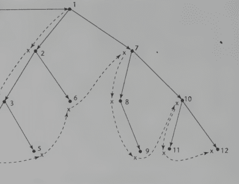

虚线显示 node_marking 的顺序

堆存储。在这种情况下，标记-清除会耗费大量时间，因为必须追踪大多数单元并将其标记为当前正在使用。这会导致应用程序推进出现显著延迟。此外，该过程可能只产生少量可放入可用空间列表的单元。这一问题已通过多种改进得到处理。例如，增量标记-清除垃圾回收会更频繁地发生，远在内存耗尽之前就进行，从而就回收的存储量而言使该过程更有效。此外，每次运行该过程所需的时间显然更短，从而减少应用程序执行中的延迟。另一种替代方案是在不同时间对部分内存（而不是与应用程序关联的全部内存）执行标记-清除过程。这提供了与增量标记-清除相同类型的改进。

通过使用 Suzuki（1982）描述的指针旋转和滑动操作，标记-清除方法的标记算法以及引用计数法所需的过程都可以变得更高效。

*可变大小单元* 管理一个用于分配可变大小单元⁸的堆，具有管理单一大小单元堆的全部困难，但还带来额外问题。不幸的是，大多数编程语言都需要可变大小单元。可变大小单元管理带来的额外问题取决于所使用的方法。如果使用标记-清除，则会出现以下额外问题：

8. 这些单元之所以具有可变大小，是因为它们是抽象单元，用于存储变量的值，而不管这些变量的类型如何。此外，变量也可以是结构化类型。

- 将堆中所有单元的标志初始设置为指示它们是垃圾，是很困难的。由于单元大小不同，扫描它们就成了问题。一种解决方案是要求每个单元将其单元大小作为第一个字段。这样就可以进行扫描，尽管与固定大小单元的对应方案相比，这会占用略多一点空间，并多花一些时间。
- 标记过程并非易事。如果被指向的单元中没有预定义的指针位置，如何从指针开始沿链追踪？完全不包含指针的单元也是一个问题。为每个单元添加一个内部指针，并由运行时系统在后台维护，是可行的。然而，这种后台维护处理会给程序运行成本增加空间和执行时间开销。
- 维护可用空间列表是另一个开销来源。该列表可以一开始只包含一个由全部可用空间组成的单元。对段的请求只会减小这个块的大小。回收的单元会被加入列表。问题在于，不久之后，列表就会变成由各种大小的段或块组成的长列表。这会减慢分配速度，因为请求会导致在列表中搜索足够大的块。最终，列表可能由大量非常小的块组成，而这些块对大多数请求来说都不够大。此时，可能需要将相邻块合并成更大的块。使用列表中第一个足够大的块之外的替代方案可以缩短搜索，但要求列表按块大小排序。无论哪种情况，维护列表都是额外开销。

如果使用引用计数器，前两个问题可以避免，但可用空间列表维护问题仍然存在。

关于内存管理问题的全面研究，请参见 Wilson（2005）。

## 6.12 类型检查

在讨论类型检查时，操作数和运算符的概念被推广到包括子程序和赋值语句。子程序将被视为运算符，其操作数是它们的参数。赋值符号将被视为二元运算符，其目标变量和表达式是操作数。

**类型检查**是确保运算符的操作数具有兼容类型的活动。**兼容类型**是指这样一种类型：它对运算符是合法的，或者根据语言规则允许由编译器生成的代码（或解释器）隐式转换为合法类型。这种自动转换称为**强制转换**。例如，如果在 Java 中将一个 `int` 变量和一个 `float` 变量相加，则 `int` 变量的值会被强制转换为 `float`，并执行浮点加法。

**类型错误**是将运算符应用于类型不合适的操作数。例如，在 C 的原始版本中，如果将一个 `int` 值传递给一个期望 *float* 值的函数，就会发生类型错误（因为该语言的编译器不检查参数类型）。

如果一种语言中变量到类型的所有绑定都是静态的，那么类型检查几乎总可以静态完成。动态类型绑定要求在运行时进行类型检查，这称为**动态类型检查**。

有些语言，例如 JavaScript 和 PHP，由于其动态类型绑定，只允许动态类型检查。在编译时检测错误比在运行时检测更好，因为越早纠正通常代价越小。静态类型检查的代价是降低程序员的灵活性。可用的捷径和技巧更少。不过，这类技术现在通常被认为容易出错且不利于可读性。

当一种语言允许一个内存单元在执行期间的不同时刻存储不同类型的值时，类型检查就会变得复杂。这样的内存单元可以通过 C 和 C++ 的联合体以及 ML、Haskell 和 F# 的可区分联合来创建。在这些情况下，类型检查如果进行，就必须是动态的，并且需要运行时系统维护此类内存单元当前值的类型。因此，即使在 C++ 等语言中所有变量都静态绑定到类型，也并非所有类型错误都能由静态类型检查检测出来。

## 6.13 强类型

在 20 世纪 70 年代所谓的结构化程序设计革命中，语言设计中一个变得突出的思想是**强类型**。强类型被广泛认为是一种极具价值的语言特性。不幸的是，它常常定义松散，而且在计算文献中经常被使用却根本没有定义。

如果类型错误总能被检测出来，那么一种编程语言就是**强类型**的。这要求所有操作数的类型都能在编译时或运行时确定。强类型的重要性在于，它能够检测出所有导致类型错误的变量误用。强类型语言还允许在运行时检测那些能够存储多种类型值的变量中错误类型值的使用。

C 和 C++ 不是强类型语言，因为二者都包含联合类型，而联合类型不受类型检查。

ML 是强类型的，即使某些函数参数的类型在编译时可能未知。F# 也是强类型的。

Java 和 C# 虽然基于 C++，但接近强类型。类型可以被显式强制转换，这可能导致类型错误。然而，不存在类型错误可以不被检测到的隐式途径。

一种语言的强制转换规则对类型检查的价值有重要影响。例如，在 Java 中表达式是强类型的。然而，一个算术运算符带有一个浮点操作数和一个整数操作数是合法的。整数操作数的值会被强制转换为浮点型，并执行浮点运算。这通常是程序员的本意。然而，这种强制转换也导致强类型的一项好处——错误检测——的丧失。例如，假设一个程序有 `int` 变量 a 和 b，以及 `float` 变量 d。现在，如果程序员本意是键入 a + b，却误键入 a + d，编译器不会检测到这个错误。a 的值只会被强制转换为 `float`。因此，强制转换削弱了强类型的价值。具有大量强制转换的语言（如 C 和 C++）不如没有强制转换的语言（如 ML 和 F#）可靠。Java 和 C# 的赋值类型强制转换数量只有 C++ 的一半，因此它们的错误检测优于 C++，但仍远不如 ML 和 F# 有效。强制转换问题将在第 7 章详细讨论。

## 6.14 类型等价

类型兼容性的概念是在引入类型检查问题时定义的。兼容性规则规定了每个运算符可接受的操作数类型，从而规定了该语言可能的类型错误。⁹ 这些规则被称为兼容性规则，因为在某些情况下，操作数的类型可以由编译器或运行时系统隐式转换，使其对该运算符可接受。

对于预定义标量类型，类型兼容性规则简单而严格。然而，对于结构化类型（如数组、记录以及某些用户定义类型），规则更为复杂。这些类型的强制转换很少见，因此问题不是类型兼容性，而是类型等价。也就是说，如果表达式中一种类型的操作数可以替换为另一种类型的操作数而不进行强制转换，则这两种类型是等价的。类型等价是类型兼容性的一种严格形式——不进行强制转换的兼容性。这里的核心问题是如何定义类型等价。

一种语言的类型等价规则的设计很重要，因为它会影响数据类型的设计以及为这些类型的值提供的操作。对于这里讨论的类型，预定义操作非常少。两个变量具有等价类型的最重要结果也许是，其中任何一个变量的值都可以赋给另一个。

定义类型等价有两种方法：名称类型等价和结构类型等价。**名称类型等价**意味着，如果两个变量在同一声明中定义，或者在使用相同类型名称的声明中定义，则它们具有等价类型。**结构类型等价**意味着，如果两个变量的类型具有相同的结构，则它们具有等价类型。这两种方法有一些变体，许多语言使用它们的组合。

名称类型等价易于实现，但限制性更强。在严格解释下，类型为整数子范围的变量会

9. 类型兼容性也是子程序调用中的实参与子程序定义中的形式参数之间关系的一个问题。这个问题将在第 9 章讨论。


并不与一个整型变量等价。例如，假设 Ada 使用严格的名称类型等价，考虑以下 Ada 代码：

```ada
type Indextype is range 1..100;
count : Integer;
index : Indextype;
```

变量 *count* 和 *index* 的类型并不等价；不能将 *count* 赋给 *index*，反之亦然。

名称类型等价的另一个问题出现在结构类型或用户定义类型通过参数在子程序之间传递时。这种类型必须且只能全局定义一次。子程序不能用局部类型名来声明这类形参的类型。最初版本的 Pascal 就是这样。

请注意，要使用名称类型等价，所有类型都必须有名称。大多数语言允许用户定义匿名类型——这些类型没有名称。对于使用名称类型等价的语言，编译器必须隐式地为这些类型提供内部名称。

结构类型等价比名称类型等价更灵活，但实现起来也更困难。在名称类型等价下，只需比较两个类型名即可确定是否等价。然而，在结构类型等价下，必须比较两个类型的整体结构。这种比较并不总是简单的。（考虑一个引用自身类型的数据结构，例如链表。）还可能出现其他问题。例如，两个记录（或结构体）类型如果结构相同但字段名不同，它们是否等价？在允许声明中设置数组下标范围下界的语言中，如果两个一维数组类型具有相同的元素类型但下标范围分别为 0..10 和 1..11，它们是否等价？如果两个枚举类型具有相同数量的枚举值，但字面量的拼写不同，它们是否等价？

结构类型等价的另一个困难是，它不允许区分具有相同结构的类型。例如，考虑以下类 Ada 的声明：

```ada
type Celsius = Float;
    Fahrenheit = Float;
```

在结构类型等价下，这两种类型的变量被视为等价，因此可以在表达式中混合使用；考虑到类型名称所表明的区别，这在此例中显然是不可取的。一般来说，名称不同的类型很可能是对不同类别问题值的抽象，不应被视为等价。

Ada 使用一种受限制的名称类型等价形式，但同时提供了两种类型构造——子类型和派生类型——来避免与名称类型等价相关的问题。派生类型是一种基于先前已定义类型的新类型，它与该基础类型并不等价，尽管结构可能完全相同。派生类型继承其父类型的所有属性。考虑以下示例：

```ada
type Celsius is new Float;
type Fahrenheit is new Float;
```

这两种派生类型的变量类型并不等价，尽管它们的结构相同。此外，这两种类型的变量与任何其他浮点类型都不具有类型等价性。字面量不受此规则约束。像 3.0 这样的字面量具有 universal real（通用实数）类型，并且与任何浮点类型都类型等价。派生类型也可以包含对父类型的范围约束，同时仍继承父类型的所有操作。

Ada 子类型是现有类型的一个可能带有范围约束的版本。子类型与其父类型是类型等价的。例如，考虑以下声明：

```ada
subtype Small_type is Integer range 0..99;
```

类型 Small_type 与类型 Integer 等价。

请注意，Ada 的派生类型与 Ada 的子界类型有很大不同。例如，考虑以下类型声明：

```ada
type Derived_Small_Int is new Integer range 1..100;
subtype Subrange_Small_Int is Integer range 1..100;
```

Derived_Small_Int 和 Subrange_Small_Int 这两种类型的变量具有相同的合法取值范围，并且都继承了 Integer 的操作。然而，Derived_Small_Int 类型的变量与任何 Integer 类型都不兼容。另一方面，Subrange_Small_Int 类型的变量与 Integer 类型的变量和常量以及 Integer 的任何子类型兼容。

对于 Ada 无约束数组类型的变量，采用结构类型等价。例如，考虑以下类型声明和两个对象声明：

```ada
type Vector is array (Integer range <>) of Integer;
Vector_1: Vector (1..10);
Vector_2: Vector (11..20);
```

这两个对象的类型等价，即使它们具有不同的名称和不同的下标范围，因为对于无约束数组类型的对象，使用的是结构类型等价而非名称类型等价。由于这两种类型都有 10 个元素，且两个数组的元素都是 Integer 类型，因此它们是类型等价的。

对于受约束的匿名类型，Ada 使用一种高度受限的名称类型等价形式。考虑以下受约束匿名类型的 Ada 声明：

```ada
A : array (1..10) of Integer;
```

C++ 与 C 类似，只是对在不同文件中定义的结构体和联合体没有例外。

在 Fortran 和 COBOL 等不允许用户定义和命名类型的语言中，名称等价显然无法使用。

Java 和 C++ 等面向对象语言还带来了另一种类型兼容性问题。这个问题是对象兼容性及其与继承层次结构的关系，这将在第 12 章讨论。

表达式中的类型兼容性在第 7 章讨论；子程序参数的类型兼容性在第 9 章讨论。

## 6.15 理论与数据类型

类型理论是数学、逻辑学、计算机科学和哲学中一个广泛的研究领域。它始于 20 世纪初的数学领域，后来成为逻辑学中的标准工具。任何关于类型理论的一般性讨论都必然是复杂、冗长且高度抽象的。即使仅限于计算机科学，类型理论也包括类型化 λ 演算、组合子、有界量化的元理论、存在类型和高阶多态等多样而复杂的主题。所有这些主题都远远超出了本书的范围。

在计算机科学中，类型理论有两个分支：实用分支和抽象分支。实用分支关注商业编程语言中的数据类型；抽象分支主要关注类型化 λ 演算，这是理论计算机科学家在过去半个世纪中广泛研究的一个领域。本节仅限于简要描述编程语言中数据类型所依据的一些数学形式体系。

数据类型定义一组值以及对这些值的一组操作。类型系统是一组类型及控制它们在程序中使用的规则。显然，每种带类型的编程语言都定义了一个类型系统。编程语言类型系统的形式化模型由一组类型和一组定义该语言类型规则的函数组成；这些规则用于确定任何表达式的类型。描述类型系统规则的一种形式系统——属性文法——将在第 3 章介绍。

属性文法的一种替代模型使用类型映射和一组与文法规则无关的函数来指定类型规则。类型映射类似于指称语义中使用的程序状态，由一组有序对组成，每个有序对的第一个元素是变量名，第二个元素是其类型。类型映射根据程序中的类型声明构建。在静态类型语言中，类型映射只需在编译期间维护，尽管它会随着编译器分析程序而改变。如果进行了任何动态类型检查，则必须在执行期间维护类型映射。编译系统中类型映射的具体实现是符号表，符号表主要由

由词法分析器和语法分析器。动态类型有时通过在值或对象上附加标签来维护。

如前所述，数据类型是值的集合，尽管在数据类型中元素通常是有序的。例如，所有枚举类型中的元素都是有序的。然而，在数学集合中元素是无序的。尽管存在这一差异，集合运算仍可用于数据类型以描述新的数据类型。编程语言的结构化数据类型由类型运算符（或对应于集合运算的构造器）定义。下面几段简要介绍这些集合运算/类型构造器。

有限映射是从一个有限值集合（定义域集合）到值域集合中值的函数。有限映射为编程语言中两类不同的类型（函数和数组）建模，尽管在某些语言中函数不是类型。所有语言都包含数组，数组通过一个将索引映射到数组元素的映射函数来定义。对于传统数组，映射很简单——整数值被映射到数组元素的地址；对于关联数组，映射由描述散列运算的函数定义。散列函数将关联数组的键（通常是字符串¹⁰）映射到数组元素的地址。

n 个集合 S1、S2、...、Sn 的笛卡尔积（或叉积）是一个记作 S1 × S2 × ... × Sn 的集合。笛卡尔积集合的每个元素都从每个构成集合中各取一个元素。因此，S1 × S2 = {(x, y) | x in S1 and y in S2}。例如，如果 S1 = {1, 2} 且 S2 = {a, b}，则 S1 × S2 = {(1, a), (1, b), (2, a), (2, b)}。笛卡尔积定义了数学中的元组，这些元组在 Python、ML 和 F# 中作为一种数据类型出现（见第 6.5 节）。笛卡尔积也为记录（或结构体）建模，尽管并不完全精确。笛卡尔积没有元素名称，但记录需要元素名称。例如，考虑以下 C 结构体：

```c
struct intFloat {
    int myInt;
    float myFloat;
};
```

这个结构体定义了笛卡尔积类型 int × float。元素的名称是 myInt 和 myFloat。

两个集合 S1 和 S2 的并集定义为 S1 ∪ S2 = {x | x in S1 or x in S2}。集合并集为联合数据类型建模，如第 6.10 节所述。

数学子集通过提供元素必须遵循的规则来定义。这些集合为 Ada 的子类型建模，尽管并不完全精确，因为子类型必须由其父集合的连续元素组成。数学集合的元素是无序的，因此该模型并不完美。

10. 在 Ruby 和 Lua 中，关联数组的键不必是字符串——它们可以是任意类型。

请注意，用类型运算符（例如 C 中的 `*`）定义的指针并不是用集合运算来定义的。

至此，我们结束了对数据类型形式化的讨论，也结束了对数据类型的全部讨论。

## 小结

一门语言的数据类型在很大程度上决定了该语言的风格和实用性。它们与控制结构一起构成了语言的核心。

大多数命令式语言的基本数据类型包括数值类型、字符类型和布尔类型。数值类型通常由硬件直接支持。

用户定义的枚举类型和子范围类型很方便，并能提高程序的可读性和可靠性。

数组是大多数编程语言的一部分。对数组元素的引用与该元素地址之间的关系由访问函数给出，访问函数是映射的一种实现。数组可以是静态的，如定义中包含 `static` 说明符的 C++ 数组；固定栈动态的，如 C 函数（不带 `static` 说明符）；固定堆动态的，如 Java 的对象；或堆动态的，如 Perl 的数组。大多数语言只允许对整个数组进行少数几种操作。

现在大多数语言都包含记录。记录的字段以多种方式指定。在 COBOL 中，引用字段时不必命名所有外围记录，尽管这实现起来很麻烦且不利于可读性。在一些支持面向对象编程的语言中，记录由对象支持。

元组类似于记录，但其组成部分没有名称。它们是 Python、ML 和 F# 的一部分。

列表是函数式编程语言的主要组成部分，但现在也包含在 Python 和 C# 中。

联合是可以在不同时间存储不同类型值的位置。带判别式的联合包含一个标签，用于记录当前类型值。自由联合是不带标签的联合。大多数带有联合的语言没有为其提供安全的设计，例外是 ML 和 F#。

指针用于提供寻址灵活性并控制动态存储管理。指针有一些固有危险：悬空指针难以避免，并且可能发生内存泄漏。

引用类型（例如 Java 和 C# 中的引用类型）提供堆管理，而没有指针的危险。

枚举类型和记录类型相对容易实现。数组也很直接，不过当数组有多个下标时，数组元素访问是一个昂贵的过程。访问函数对每个下标需要一次加法和一次乘法。

- 42. 为什么 Java 不是强类型的？
- 43. 什么是非转换强制转换？
- 44. 哪些语言没有类型强制转换？
- 45. 为什么 C 和 C++ 不是强类型的？
- 46. 什么是名称类型等价？
- 47. 什么是结构类型等价？
- 48. 名称类型等价的主要优点是什么？
- 49. 结构类型等价的主要缺点是什么？
- 50. C 对哪些类型使用结构类型等价？
- 51. 哪种集合运算为 C 的 `struct` 数据类型建模？

## 习题集

- 1. 支持和反对在内存中用单个位表示布尔值的论点分别是什么？
- 2. 十进制值如何浪费内存空间？
- 3. VAX 小型计算机使用一种与 IEEE 标准不同的浮点数格式。这种格式是什么，VAX 计算机的设计者为什么选择它？关于 VAX 浮点表示形式的参考文献是 Sebesta（1991）。
- 4. 从安全性和实现成本的角度，比较避免悬空指针的墓碑法和锁钥法。
- 5. 仅在特定上下文中对指针进行隐式解引用有哪些缺点？
- 6. 解释 Ada 的子类型和派生类型之间的所有差异。
- 7. C 和 C++ 中的 `->` 运算符有什么重要理由？
- 8. C++ 的枚举类型与 Java 的枚举类型之间的所有差异是什么？
- 9. 多维数组可以按行主序存储（如 C++），也可以按列主序存储（如 Fortran）。为三维数组的这两种排列方式分别推导访问函数。
- 10. 在 Burroughs Extended ALGOL 语言中，矩阵存储为一个指向矩阵各行的一维指针数组，而这些行被视为一维值数组。这种方案的优缺点是什么？
- 11. 分析并比较 C 的 `malloc` 和 `free` 函数与 C++ 的 `new` 和 `delete` 运算符。在比较中以安全性为首要考虑因素。

- 5. 用 C++ 编写一个简单程序，研究其枚举类型的安全性。至少包含 10 种对枚举类型的不同操作，以确定哪些不正确或只是愚蠢的事情是合法的。现在，编写一个做同样事情的 C# 程序并运行它，以确定其中有多少不正确或愚蠢的事情是合法的。比较你的结果。
- 6. 用 C++ 或 C# 编写一个程序，其中包含两种不同的枚举类型，并包含大量使用这些枚举类型的操作。再用仅使用整数变量编写同样的程序。比较两个程序的可读性，并预测它们之间的可靠性差异。
- 7. 编写一个 C 程序，仅使用下标对二维数组元素进行大量引用。再编写第二个程序，执行相同的操作，但使用指针和指针运算来实现存储映射函数，以完成数组引用。比较两个程序的时间效率。这两个程序中哪一个可能更可靠？为什么？
- 8. 编写一个 Perl 程序，使用散列并对该散列进行大量操作。例如，散列可以存储人的姓名和年龄。可以使用随机数生成器创建三个字符的姓名和年龄，并将它们添加到散列中。当生成重复姓名时，会导致对散列的访问，但不会添加新元素。在不使用散列的情况下重写同样的程序。比较两者的执行效率。比较两者的编程难易程度和可读性。
- 9. 用你选择的语言编写一个程序，如果该语言使用名称等价则行为不同，如果使用结构等价则行为不同。
- 10. 对于什么类型的 A 和 B，简单赋值语句 A = B 在 C++ 中合法但在 Java 中不合法？


# 7 表达式与赋值语句

- 7.1 引言
- 7.2 算术表达式
- 7.3 重载运算符
- 7.4 类型转换
- 7.5 关系表达式和布尔表达式
- 7.6 短路求值
- 7.7 赋值语句
- 7.8 混合模式赋值


编程语言中的表达式继承自数学中演变而来的惯例。在编程语言中，算术表达式由运算符、操作数、括号和函数调用组成。运算符可以是一元的，表示它只有一个操作数；也可以是二元的，表示它有两个操作数；还可以是三元的，表示它有三个操作数。

在大多数编程语言中，二元运算符是中缀的，这意味着它们出现在操作数之间。一个例外是 Perl，它有一些运算符是前缀的，这意味着它们出现在操作数之前。

算术表达式的目的是指定一种算术计算。这种计算的实现必须导致两个动作：获取操作数（通常从内存中获取），以及对这些操作数执行算术运算。在以下各节中，我们将研究算术表达式的常见设计细节。

以下是算术表达式的主要设计问题，本节将讨论这些问题：

- 运算符优先级规则是什么？
- 运算符结合性规则是什么？
- 操作数的求值顺序是什么？
- 对操作数求值的副作用是否有限制？
- 该语言是否允许用户定义运算符重载？
- 表达式中允许何种类型混合？

### 7.2.1 运算符求值顺序

一种语言的运算符优先级和结合性规则决定了其运算符的求值顺序。

#### 7.2.1.1 优先级

表达式的值至少部分取决于表达式中运算符的求值顺序。考虑以下表达式：

`a + b * c`

假设变量 a、b 和 c 的值分别为 3、4 和 5。如果从左到右求值（先加法后乘法），结果为 35。如果从右到左求值，结果为 23。

数学家很久以前就发展出了这样的概念：将运算符置于求值优先级的层次结构中，并部分地基于这一层次结构来确定表达式的求值顺序，而不是简单地从左到右或从右到左求值表达式中的运算符。例如，在数学中，乘法被认为比加法优先级更高，也许是因为它的复杂程度更高。如果将这一惯例应用于前面的示例表达式，就像大多数编程语言中那样，那么乘法将首先执行。

Ruby 和基于 C 的语言的算术运算符优先级如下：

| 优先级 | Ruby | 基于 C 的语言 |
|---|---|---|
| 最高 | `**` | 后缀 `++`，`--` |
|  | 一元 `+`，`-` | 前缀 `++`，`--`，一元 `+`，`-` |
|  | `*`，`/`，`%` | `*`，`/`，`%` |
| 最低 | 二元 `+`，`-` | 二元 `+`，`-` |

`**` 运算符是幂运算。% 运算符接受两个整数操作数，并给出第一个操作数除以第二个操作数后的余数。基于 C 的语言的 ++ 和 -- 运算符将在 7.7.4 节中描述。

APL 在语言中显得奇特，因为它只有一个优先级层次，如下一节所示。

优先级只说明了运算符求值顺序规则中的一部分；结合性规则也会影响它。

#### 7.2.1.2 结合性

考虑以下表达式：

`a - b + c - d`

如果加法和减法运算符具有相同的优先级，就像它们在编程语言中那样，那么优先级规则对表达式中运算符的求值顺序没有说明。

当表达式中出现两处相邻²的、具有相同优先级的运算符时，哪个运算符先求值的问题由该语言的**结合性**规则来回答。运算符可以具有左结合性或右结合性，这意味着当有两个优先级相同的相邻运算符时，分别先求值左侧运算符或先求值右侧运算符。

常见语言中的结合性是从左到右，例外是幂运算符（如果提供）有时从右到左结合。在 Java 表达式 `a - b + c` 中，先求值左侧运算符。

- 1. 在 C99 之前的 C 版本中，% 运算符在某些情况下依赖于实现，因为除法也依赖于实现。
- 2. 如果两个运算符之间仅由一个操作数分隔，我们就称它们为“相邻”运算符。

Fortran 和 Ruby 中的幂运算为右结合，因此在表达式 `A ** B ** C` 中，先求值右侧运算符。

在 Visual Basic 中，幂运算符 ^ 是左结合的。

几种常见语言的结合性规则如下：

| 语言 | 结合性规则 |
|---|---|
| Ruby | 左：`*`，`/`，`+`，`-`<br>右：`**` |
| 基于 C 的语言 | 左：`*`，`/`，`%`，二元 `+`，二元 `-`<br>右：`++`，`--`，一元 `-`，一元 `+` |

正如 7.2.1.1 节所述，在 APL 中，所有运算符都具有相同的优先级。因此，APL 表达式中运算符的求值顺序完全由结合性规则决定，而所有运算符的结合性都是从右到左。例如，在表达式 `A × B + C` 中，先求值加法运算符，然后求值乘法运算符（× 是 APL 的乘法运算符）。如果 A 为 3，B 为 4，C 为 5，则该 APL 表达式的值为 27。

常见语言的许多编译器利用这样一个事实：某些算术运算符在数学上是结合的，这意味着结合性规则对只包含这些运算符的表达式的值没有影响。例如，加法在数学上是结合的，因此在数学中，表达式 `A + B + C` 的值不依赖于运算符的求值顺序。如果对应于数学上结合运算的浮点运算也是结合的，那么编译器就可以利用这一事实执行一些简单的优化。具体来说，如果允许编译器重新排列运算符的求值顺序，它就可能为表达式求值生成略快的代码。编译器通常会进行这类优化。

不幸的是，在计算机中，浮点表示和浮点算术运算都只是其数学对应物的近似（由于大小限制）。数学运算符具有结合性这一事实，并不必然意味着相应的浮点运算也具有结合性。事实上，只有当所有操作数和中间结果都能用浮点表示法精确表示时，该过程才会精确地具有结合性。例如，存在一些病态情形，在这些情形中，计算机上的整数加法*不*具有结合性。

例如，假设程序必须求值表达式 `A + B + C + D`，并且 A 和 C 是很大的正数，而 B 和 D 是绝对值很大的负数。在这种情况下，将 B 加到 A 不会导致溢出异常，但将 C 加到 A 会导致溢出异常。同样，将 C 加到 B 不会导致溢出，但将 D 加到 B 会导致溢出。由于计算机算术的限制，在这种情况下，加法灾难性地不满足结合性。因此，如果编译器重新排列这些加法运算，就会影响表达式的值。当然，假设变量的近似值已知，程序员可以避免这个问题。程序员可以将表达式分成两部分（用两条赋值语句）来指定，以确保避免溢出。然而，这种情况可能以更隐蔽的方式出现，程序员不太可能注意到这种顺序依赖性。

#### 7.2.1.3 括号

程序员可以通过在表达式中放置括号来改变优先级和结合性规则。表达式中带括号的部分优先于其相邻的不带括号部分。例如，尽管乘法优先于加法，但在表达式 `(A + B) * C` 中，加法将首先求值。从数学上看，这完全自然。在这个表达式中，直到括号内子表达式中的加法求值完成，乘法运算符的第一个操作数才可用。另外，7.2.1.2 节中的表达式可以写成 `(A + B) + (C + D)` 以避免溢出。

允许在算术表达式中使用括号的语言可以省去所有优先级规则，而简单地将所有运算符从左到右或从右到左结合。程序员会用括号指定所需的求值顺序。这种方法会很简单，因为程序的作者和读者都不需要记住任何优先级或结合性规则。这种方案的缺点是它使编写表达式更加繁琐，并且还严重损害了代码的可读性。然而，这正是 APL 的设计者 Ken Iverson 所做的选择。

#### 7.2.1.4 Ruby 表达式

回想一下，Ruby 是一种纯面向对象语言，这意味着，除其他方面外，每个数据值（包括字面量）都是对象。Ruby 支持包含在基于 C 的语言中的算术和逻辑运算集合。

语言。在表达式方面，Ruby 与基于 C 的语言的不同之处在于，所有算术、关系和赋值运算符，以及数组索引、移位和位逻辑运算符，都是作为方法实现的。例如，表达式 a + b 是对 a 所引用对象的 + 方法的调用，并将 b 所引用的对象作为参数传递。

将运算符实现为方法的一个有趣结果是，它们可以被应用程序重写。因此，这些运算符可以被重新定义。虽然为预定义类型重新定义运算符通常并无用处，但正如我们将在 7.3 节中看到的，为用户定义类型定义预定义运算符是有用的，在某些语言中可以通过运算符重载来实现。

#### 7.2.1.5 Lisp 中的表达式

与 Ruby 一样，Lisp 中的所有算术和逻辑运算都由子程序执行。但在 Lisp 中，必须显式调用这些子程序。例如，要在 Lisp 中表示 C 表达式 a + b * c，必须编写以下表达式：³

```lisp
(+ a (* b c))
```

在这个表达式中，+ 和 * 是函数的名称。

#### 7.2.1.6 条件表达式

**if-then-else** 语句可用于执行条件表达式赋值。例如，考虑以下代码：

```c
if (count == 0)
    average = 0;
else
    average = sum / count;
```

在基于 C 的语言中，可以使用条件表达式在赋值语句中更方便地指定这段代码，其形式如下：

```
expression_1 ? expression_2 : expression_3
```

其中 expression_1 被解释为布尔表达式。如果 expression_1 求值为 true，整个表达式的值就是 expression_2 的值；否则，就是 expression_3 的值。例如，使用条件表达式，可以通过以下赋值语句实现示例 **if-then-else** 的效果：

```c
average = (count == 0) ? 0 : sum / count;
```

实际上，问号表示 then 子句的开始，冒号表示 else 子句的开始。两个子句都是必需的。请注意，? 在条件表达式中用作三元运算符。

在基于 C 的语言中，条件表达式可以在程序中任何其他表达式可以使用的地方使用。除基于 C 的语言外，Perl、JavaScript 和 Ruby 也提供条件表达式。

### 7.2.2 操作数求值顺序

表达式的一个较少讨论的设计特性是操作数的求值顺序。表达式中的变量通过从内存中获取其值来进行求值。常量有时也以同样的方式求值。在其他情况下，常量可能是机器语言指令的一部分，不需要从内存中获取。如果操作数是一个带括号的表达式，那么其中包含的所有运算符都必须先求值，之后其值才能用作操作数。

如果运算符的两个操作数都没有副作用，那么操作数求值顺序就无关紧要。因此，唯一有趣的情况是操作数的求值确实会产生副作用。

#### 7.2.2.1 副作用

函数的副作用（自然称为函数副作用）发生在函数改变其某个参数或全局变量时。（全局变量在函数外部声明，但在函数内部可以访问。）

考虑以下表达式：

```
a + fun(a)
```

如果 fun 没有改变 a 的副作用，那么两个操作数 a 和 fun(a) 的求值顺序对表达式的值没有影响。然而，如果 fun 改变了 a，就会有影响。考虑以下情况：fun 返回 10，并将其参数的值改为 20。假设我们有以下代码：

```
a = 10;
b = a + fun(a);
```

那么，如果在表达式求值过程中先获取 a 的值，其值为 10，表达式的值为 20。但如果先对第二个操作数求值，则第一个操作数的值为 20，表达式的值为 30。

以下 C 程序说明了当函数改变表达式中出现的全局变量时的同样问题：

```c
int a = 5;
int fun1() {
    a = 17;
    return 3;
}  /* end of fun1 */

void main() {
    a = a + fun1();
}  /* end of main */
```

`main` 中为 `a` 计算出的值取决于表达式 `a + fun1()` 中操作数的求值顺序。`a` 的值将是 8（如果先对 `a` 求值）或 20（如果先对函数调用求值）。

请注意，数学中的函数没有副作用，因为数学中没有变量的概念。函数式编程语言也是如此。在数学和函数式编程语言中，函数比命令式语言中的函数更容易推理和理解，因为它们的上下文与其含义无关。

对于操作数求值顺序和副作用的问题，有两种可能的解决方案。首先，语言设计者可以通过简单地禁止函数副作用来防止函数求值影响表达式的值。其次，语言定义可以规定表达式中的操作数按特定顺序求值，并要求实现者保证该顺序。

在命令式语言中禁止函数副作用是困难的，而且会消除程序员的一些灵活性。以 C 和 C++ 为例，它们只有函数，这意味着所有子程序都返回一个值。要消除双向参数的副作用，同时仍然提供返回多个值的子程序，就需要将这些值放入一个结构体中，然后返回该结构体。还必须禁止在函数中访问全局变量。然而，当效率很重要时，利用对全局变量的访问来避免参数传递是提高执行速度的一种重要方法。例如，在编译器中，对符号表等数据的全局访问是司空见惯的。

采用严格求值顺序的问题在于，编译器使用的一些代码优化技术涉及对操作数求值进行重新排序。当涉及函数调用时，保证顺序会禁止这些优化方法。因此，正如实际语言设计所证明的那样，没有完美的解决方案。

Java 语言定义保证操作数按从左到右的顺序进行求值，从而消除了本节讨论的问题。

#### 7.2.2.2 引用透明性与副作用

引用透明性的概念与函数副作用相关，并受其影响。如果程序中的任意两个具有相同值的表达式可以在程序中的任何位置相互替换，而不影响程序的行为，则该程序具有引用透明性。引用透明函数的值完全取决于其参数。⁴ 引用透明性与函数副作用之间的联系通过以下示例说明：

```
result1 = (fun(a) + b) / (fun(a) - c);
temp = fun(a);
result2 = (temp + b) / (temp - c);
```

如果函数 fun 没有副作用，result1 和 result2 将相等，因为赋给它们的表达式是等价的。然而，假设 fun 有给 b 或 c 加 1 的副作用。那么 result1 将不等于 result2。因此，该副作用违反了包含这段代码的程序的引用透明性。

引用透明程序有几个优点。其中最重要的是，此类程序的语义比非引用透明程序的语义更容易理解。就易于理解而言，引用透明使函数等同于数学函数。

由于没有变量，用纯函数式语言编写的程序是引用透明的。纯函数式语言中的函数不能拥有状态，而状态通常会存储在局部变量中。如果这样的函数使用了函数外部的值，由于没有变量，该值必须是常量。因此，函数的值取决于其参数的值。

引用透明性将在第 15 章中进一步讨论。

## 7.3 重载运算符

算术运算符通常不止一种用途。例如，+ 通常用于表示整数加法和浮点加法。某些语言（例如 Java）还将其用于字符串连接。运算符的这种多重使用称为**运算符重载**，通常被认为是可接受的，只要可读性和可靠性都不受影响。

作为重载可能带来危险的一个例子，考虑 C++ 中与号（&）的使用。作为二元运算符，它表示按位逻辑 AND 运算。然而，作为一元运算符，其含义完全不同。作为以变量为操作数的一元运算符，表达式值是该变量的地址。在这种情况下，与号被称为取地址运算符。例如，执行

```
x = &y;
```

3. 在 Lisp 中，当列表被解释为代码时，第一个元素是函数名，其余元素是函数的参数。

4. 此外，函数的值不能取决于其参数求值的顺序。


导致 y 的地址被放入 x。这种对 & 符号的多重用途存在两个问题。第一，用同一个符号表示两种完全无关的运算，对可读性有害。第二，按位与运算中遗漏第一个操作数这种简单的键入错误可能不会被编译器发现，因为它会被解释为取地址运算符。这类错误可能难以诊断。

几乎所有编程语言都有一个不那么严重但类似的问题，这通常是由于减号运算符的重载造成的。问题仅在于编译器无法判断该运算符应为一元还是二元。[^5] 因此，当该运算符本应为二元时，如果未能包含第一个操作数，编译器同样无法将其检测为错误。不过，一元和二元这两种运算的含义至少密切相关，因此可读性不会受到不利影响。

一些支持抽象数据类型的语言（见第 11 章），例如 C++、C# 和 F#，允许程序员进一步重载运算符符号。例如，假设用户想要定义标量整数与整型数组之间的 \* 运算符，其含义是将数组的每个元素乘以该标量。这样的运算符可以通过编写一个名为 \* 的函数子程序来定义，该子程序执行这种新运算。当指定了重载运算符时，编译器将根据操作数的类型选择正确的含义，就像语言定义的重载运算符一样。例如，如果在 C# 程序中定义了 \* 的这种新定义，那么每当 \* 运算符以普通整数作为左操作数、以整型数组作为右操作数出现时，C# 编译器就会使用 \* 的新定义。

如果使用得当，用户定义的运算符重载有助于提高可读性。例如，如果为矩阵抽象数据类型重载了 + 和 \*，并且 A、B、C 和 D 是该类型的变量，那么

```
A * B + C * D
```

可以代替

```
MatrixAdd(MatrixMult(A, B), MatrixMult(C, D))
```

另一方面，用户定义的重载也可能对可读性有害。首先，没有什么能阻止用户将 + 定义为表示乘法。此外，在程序中看到 \* 运算符时，读者必须找出操作数的类型以及该运算符的定义，才能确定其含义。这些定义中的任何一个或全部都可能位于其他文件中。

另一个考虑因素是从不同小组创建的模块构建软件系统的过程。如果不同小组以不同方式重载了相同的运算符，那么在组装系统之前显然需要消除这些差异。

强制转换被定义为由编译器或运行时系统发起的隐式类型转换。程序员显式请求的类型转换称为显式转换，或类型转换（cast），而不是强制转换。

尽管某些运算符符号可能被重载，但我们假设计算机系统（无论是在硬件中还是在某种软件模拟层次上）对于语言中定义的每种操作数类型和运算符都有一种运算。[^6] 对于使用静态类型绑定的语言中的重载运算符，编译器根据操作数的类型选择正确的运算类型。当一个运算符的两个操作数类型不同，并且这在语言中是合法的，编译器必须选择其中一个进行强制转换，并生成该强制转换的代码。在下面的讨论中，将考察几种常见语言的强制转换设计选择。

语言设计者对于算术表达式中的强制转换问题并未达成一致。反对广泛强制转换的人担心这类强制转换可能导致的可靠性问题，因为它们会降低类型检查的益处。而宁愿包含广泛强制转换的人更关心限制所带来的灵活性损失。问题在于，程序员是否应当关心这一类错误，还是应由编译器检测它们。

作为该问题的一个简单示例，考虑以下 Java 代码：

```java
int a;
float b, c, d;
. . .
d = b * a;
```

假设乘法运算符的第二个操作数本应是 c，但由于键入错误，它被输入成了 a。由于混合模式表达式在 Java 中是合法的，编译器不会将其检测为错误。它只会插入代码，将 int 操作数 a 的值强制转换为 float。如果混合模式表达式在 Java 中不合法，这个键入错误就会被编译器检测为类型错误。

由于允许混合模式表达式会降低错误检测能力，F# 和 ML 不允许它们。例如，它们不允许在表达式中混用整数和浮点操作数。

在大多数其他常见语言中，对混合模式算术表达式没有限制。

### 历史注记

作为过多强制转换的危险和代价的一个更极端的例子，考虑 PL/I 为实现表达式灵活性所做的努力。在 PL/I 中，字符串变量可以作为算术运算符的一个操作数，而另一个操作数是整数。在运行时，会扫描该字符串以寻找数值。如果该值恰好包含小数点，则假定该值为浮点类型，另一个操作数被强制转换为浮点型，结果运算为浮点运算。这种强制转换策略代价高昂，因为类型检查和转换都必须在运行时完成。它还消除了检测表达式中程序员错误的可能性，因为二元运算符可以将任意类型的操作数与几乎任何其他类型的操作数组合在一起。

基于 C 的语言具有比 int 类型更小的整数类型。在 Java 中，这些类型是 byte 和 short。几乎只要对所有这些类型的操作数应用任何运算符，它们都会被强制转换为 int。因此，虽然数据可以存储在这些类型的变量中，但在转换为更大类型之前无法对其进行操作。例如，考虑以下 Java 代码：

```
byte a, b, c;

a = b + c;
```

b 和 c 的值被强制转换为 int，并执行 int 加法。然后，将和转换为 byte 并放入 a。鉴于当代计算机的内存容量很大，除非必须存储大量 byte 和 short 值，否则几乎没有动力使用它们。

### 7.4.2 显式类型转换

大多数语言都提供某种执行显式转换的能力，包括拓宽和收窄转换。在某些情况下，当显式收窄转换导致被转换对象的值发生显著变化时，会产生警告消息。

在基于 C 的语言中，显式类型转换称为类型转换（cast）。要指定一次类型转换（cast），将目标类型放在括号中，紧挨在要转换的表达式之前，如下所示：

```
(int) angle
```

在这些转换中，类型名外加括号的原因之一是，这类语言中的第一个语言 C 有几个双词类型名，例如 long int。

在 ML 和 F# 中，类型转换（cast）采用函数调用的语法。例如，在 F# 中可以有如下写法：

```
float(sum)
```

### 7.4.3 表达式中的错误

在表达式求值过程中可能发生多种错误。如果语言要求类型检查（无论是静态还是动态），那么操作数类型错误就不会发生。由于表达式中操作数的强制转换而可能发生的错误已经讨论过了。其他种类的错误则源于计算机算术的局限以及算术本身的固有局限。最常见的错误发生在运算结果无法用必须存储它的存储单元表示时。这称为溢出或下溢，具体取决于结果是太大还是太小。算术的一个限制是不允许除以零。当然，数学上不允许这一事实并不能阻止程序尝试这样做。

浮点溢出、下溢和除零是运行时错误的例子，有时称为异常。允许程序检测和处理异常的语言机制将在第 14 章讨论。

[^5]: ML 通过为一元和二元减号运算符使用不同符号来缓解这个问题：一元用波浪号（~），二元用短横线（-）。

[^6]: 这个假设对许多语言并不成立。本节后面会给出一个例子。


## 7.5 关系表达式和布尔表达式

除了算术表达式，编程语言还支持关系表达式和布尔表达式。

### 7.5.1 关系表达式

关系运算符是一种比较其两个操作数值的运算符。关系表达式由两个操作数和一个关系运算符组成。关系表达式的值是布尔型的，除非该语言不包含布尔类型。关系运算符通常针对多种类型进行重载。决定关系表达式真假的运算取决于操作数类型。对于整数操作数来说可能很简单，对于字符串操作数来说可能很复杂。通常，可用于关系运算符的操作数类型是数值类型、字符串和枚举类型。

**历史注记**

Fortran I 的设计者使用英文缩写作为关系运算符，因为在 Fortran I 设计时（20 世纪 50 年代中期），卡片打孔机上没有 > 和 < 符号。

一些编程语言在相等和不相等关系运算符的语法上有所不同。例如，对于不相等，基于 C 的语言使用 `!=`，Lua 使用 `~=`，Fortran 95+ 使用 `.NE.` 或 `<>`，ML 和 F# 使用 `<>`。JavaScript 和 PHP 还有两个额外的关系运算符 `===` 和 `!==`。它们与相关的 `==` 和 `!=` 类似，但防止其操作数被强制转换。例如，表达式

```
"7" == 7
```

在 JavaScript 中为真，因为当字符串和数字作为关系运算符的操作数时，字符串会被强制转换为数字。但是，

```
"7" === 7
```

为假，因为该运算符的操作数不进行任何强制转换。

Ruby 对于使用强制转换的相等关系运算符使用 `==`，对于不进行强制转换的相等使用 `eql?`。Ruby 仅在 `case` 语句的 `when` 子句中使用 `===`，如第 8 章所讨论。

关系运算符的优先级总是低于算术运算符，因此在类似如下的表达式

```
a + 1 > 2 * b
```

中，算术表达式会被首先求值。

### 7.5.2 布尔表达式

布尔表达式由布尔变量、布尔常量、关系表达式和布尔运算符组成。这些运算符通常包括与（AND）、或（OR）、非（NOT）运算，有时还包括异或（exclusive OR）和等价（equivalence）运算。

如果把基于 C 的语言中的非算术运算符也包括在内，则有超过 40 个运算符和至少 14 个不同的优先级层次。这清楚证明了这些语言中运算符集合的丰富性以及表达式可能达到的复杂程度。

可读性要求语言应包含布尔类型，如第 6 章所述，而不是简单地在布尔表达式中使用数值类型。在布尔操作数中使用数值类型会失去一些错误检测能力，因为任何数值表达式，无论是否有意，都是布尔运算符的合法操作数。在其他命令式语言中，任何用作布尔运算符操作数的非布尔表达式都会被检测为错误。

## 7.6 短路求值

表达式的短路求值是指在不求值所有操作数和/或运算符的情况下即可确定结果的求值方式。例如，算术表达式

```
(13 * a) * (b / 13 - 1)
```

在 a 为 0 时，其值与 (b / 13 - 1) 无关，因为对于任意 x，0 * x = 0。因此，当 a 为 0 时，无需对 (b / 13 - 1) 求值，也无需执行第二次乘法。然而，在算术表达式中，这种捷径在执行过程中不容易被发现，因此永远不会被采用。

布尔表达式

```
(a >= 0) && (b < 10)
```

在 a < 0 时，其值与第二个关系表达式无关，因为对于 b 的所有值，表达式 (FALSE && (b < 10)) 都为 FALSE。因此，当 a 小于零时，无需对 b、常量 10、第二个关系表达式或 && 运算求值。与算术表达式的情况不同，这种捷径在执行过程中很容易被发现。

为了说明布尔表达式非短路求值可能带来的问题，假设 Java 不使用短路求值。可以使用 while 语句编写一个表查找循环。对于这种查找，一个简单的 Java 代码版本如下，假设 list 是待搜索的数组，包含 listlen 个元素，key 是要搜索的值：

```java
index = 0;
while ((index < listlen) && (list[index] != key))
    index = index + 1;
```

如果求值不是短路的，则 while 语句的布尔表达式中的两个关系表达式都会被求值，而不管第一个的值如何。因此，如果 `key` 不在 `list` 中，程序将因下标越界异常而终止。当 `index == listlen` 的那次迭代会引用 `list[listlen]`，因为 `list` 被声明为以上界下标值 `listlen-1`，所以这会导致索引错误。

如果语言提供布尔表达式的短路求值并且使用了它，这就不是问题。在前面的例子中，短路求值方案会求值 AND 运算符的第一个操作数，但如果第一个操作数为假，则会跳过第二个操作数。

一种语言如果提供布尔表达式的短路求值，同时表达式中还有副作用，则可能会出现微妙的错误。假设对表达式使用短路求值，而包含副作用的表达式的部分未被求值；那么副作用只会在整个表达式被完整求值时发生。如果程序的正确性依赖于该副作用，短路求值就可能导致严重错误。例如，考虑以下 Java 表达式：

```
(a > b) || ((b++) / 3)
```

在这个表达式中，只有当 `a <= b` 时，`b` 才会（在第二个算术表达式中）被改变。如果程序员假设在执行过程中每次对该表达式求值时 `b` 都会被改变（并且程序的正确性依赖于这一点），程序就会出错。

在基于 C 的语言中，常用的 AND 和 OR 运算符 `&&` 和 `||` 是短路的。但是，这些语言还有按位 AND 和 OR 运算符 `&` 和 `|`，它们可用于布尔值操作数，并且不是短路的。当然，只有当所有操作数都被限制为 `0`（表示假）或 `1`（表示真）时，按位运算符才等同于常用的布尔运算符。

Ruby、Perl、ML、F# 和 Python 的所有逻辑运算符都会进行短路求值。

## 7.7 赋值语句

正如我们之前所述，赋值语句是命令式语言中的核心构造之一。它提供了一种机制，使用户可以动态地改变值到变量的绑定。下一节将讨论最简单的赋值形式。后续章节将介绍多种替代形式。

### 7.7.1 简单赋值

目前使用的几乎所有编程语言都使用等号作为赋值运算符。所有这些语言都必须使用不同于等号的符号作为相等关系运算符，以避免与它们的赋值运算符混淆。

ALGOL 60 开创了使用 := 作为赋值运算符的先河，这避免了赋值与相等的混淆。Ada 也使用这个赋值运算符。

关于赋值在语言中如何使用，设计选择差异很大。在某些语言（如 Fortran 和 Ada）中，赋值只能作为独立语句出现，并且目标被限制为单个变量。然而，也有许多其他选择。

### 7.7.2 条件目标

Perl 允许在赋值语句中使用条件目标。例如，考虑

```
($flag ? $count1 : $count2) = 0;
```

它等价于

```
if ($flag) {
    $count1 = 0;
} else {
    $count2 = 0;
}
```

### 7.7.3 复合赋值运算符

复合赋值运算符是指定常见赋值形式的一种简写方法。可以用这种技术简写的赋值形式是：目标变量也作为右侧表达式的第一个操作数出现，例如

```
a = a + b
```

复合赋值运算符由 ALGOL 68 引入，后来被 C 以略有不同的形式采用，并且是其他基于 C 的语言以及 Perl、JavaScript、Python 和 Ruby 的一部分。这些赋值运算符的语法是将所需的二元运算符与 = 运算符连接起来。例如，

```
sum += value;
```

等价于

```
sum = sum + value;
```

支持复合赋值运算符的语言为其大多数二元运算符提供了相应版本。


这是一个容易犯的错误，编译器无法将其检测为错误。这里测试的不是关系表达式，而是赋给 *x* 的值（在这种情况下，到达该语句的是 *y* 的值）。这实际上是两个设计决策的结果：允许赋值像普通二元运算符一样运作，以及使用两个非常相似的运算符 `==` 和 `=` 却让它们具有完全不同的含义。这是 C 和 C++ 程序安全性缺陷的另一个例子。注意，Java 和 C# 只允许在其 `if` 语句中使用布尔表达式，从而避免了这个问题。

### 历史注记

PDP-11 计算机是首次实现 C 的计算机，它具有自动增量和自动减量寻址模式，这些模式是 C 的递增和递减运算符在用作数组下标时的硬件版本。人们可能由此猜测，这些 C 运算符的设计基于 PDP-11 体系结构的设计。然而，这种猜测是错误的，因为 C 的运算符继承自 B 语言，而 B 语言是在第一台 PDP-11 之前设计的。

### 7.7.6 多重赋值

几种较新的编程语言，包括 Perl、Ruby 和 Lua，提供了多目标、多源赋值语句。例如，在 Perl 中可以写

```
($first, $second, $third) = (20, 40, 60);
```

其语义是：20 赋给 `$first`，40 赋给 `$second`，60 赋给 `$third`。如果必须交换两个变量的值，可以用一条赋值语句完成，例如

```
($first, $second) = ($second, $first);
```

这会正确交换 `$first` 和 `$second` 的值，而不需要使用临时变量（至少不需要程序员创建和管理的临时变量）。

Ruby 最简单的多重赋值语法与 Perl 类似，只是左侧和右侧不加括号。此外，Ruby 还包含一些更复杂的多重赋值版本，这里不讨论。

### 7.7.7 函数式编程语言中的赋值

纯函数式语言中使用的所有标识符，以及其他函数式语言中使用的一部分标识符，都只是值的名称。因此，它们的值永远不会改变。例如，在 ML 中，名称通过 `val` 声明绑定到值，其形式示例如下：

```
val cost = quantity * price;
```

如果 cost 出现在后续 `val` 声明的左侧，该声明会创建 cost 这个名称的新版本，它与先前的版本没有关系，随后先前的版本被隐藏。

F# 有一个 somewhat 类似的声明，使用 `let` 保留字。F# 的 `let` 与 ML 的 `val` 的区别在于，`let` 会创建新的作用域，而 `val` 不会。事实上，在 ML 中，`val` 声明经常嵌套在 `let` 结构中。第 15 章将进一步讨论 `let` 和 `val`。

## 7.8 混合模式赋值

混合模式表达式已在第 7.4.1 节中讨论过。赋值语句也经常是混合模式的。设计问题是：表达式的类型是否必须与被赋值变量的类型相同，还是在某些类型不匹配的情况下可以使用强制转换？

C、C++ 和 Perl 对混合模式赋值使用的强制转换规则与它们对混合模式表达式使用的规则类似；也就是说，许多可能的类型混合都是合法的，并且可以自由应用强制转换。⁷

与 C++ 明显不同，Java 和 C# 仅在所需强制转换为拓宽转换时才允许混合模式赋值。⁸ 因此，`int` 值可以赋给 `float` 变量，但反过来不行。禁止一半可能的混合模式赋值，是相对于 C 和 C++ 提高 Java 和 C# 可靠性的一种简单而有效的方法。

当然，在函数式语言中，赋值只是用来为值命名，因此不存在混合模式赋值这种东西。

## 小结

表达式由常量、变量、括号、函数调用和运算符组成。赋值语句包括目标变量、赋值运算符和表达式。

表达式的语义在很大程度上由运算符的求值顺序决定。语言表达式中运算符的结合性和优先级规则决定了这些表达式中运算符的求值顺序。如果可能出现函数副作用，操作数求值顺序就很重要。类型转换可以是拓宽转换或窄化转换。某些窄化转换会产生错误值。表达式中的隐式类型转换或强制转换很常见，尽管它们消除了类型检查的错误检测优势，从而降低了可靠性。

赋值语句已经以多种形式出现，包括条件目标、赋值运算符和列表赋值。

7. 请注意，在 Python 和 Ruby 中，类型与对象相关联，而不是与变量相关联，因此这些语言中不存在混合模式赋值。

8. 并不完全正确：如果一个整数字面量（编译器默认赋予其类型 `int`）被赋给一个 `char`、`byte` 或 `short` 变量，并且该字面量位于该变量类型的范围内，那么该 `int` 值会通过窄化转换被强制转换为该变量的类型。这种窄化转换不会导致错误。

## 复习题

-   1. 定义运算符优先级和运算符结合性。
-   2. 什么是三元运算符？
-   3. 什么是前缀运算符？
-   4. 通常哪种运算符具有右结合性？
-   5. 什么是非结合运算符？
-   6. APL 使用什么结合性规则？
-   7. C++ 和 Ruby 中运算符的实现方式有何不同？
-   8. 定义函数副作用。
-   9. 什么是强制转换？
-   10. 什么是条件表达式？
-   11. 什么是重载运算符？
-   12. 定义窄化转换和拓宽转换。
-   13. 在 JavaScript 中，== 和 === 有什么区别？
-   14. 什么是混合模式表达式？
-   15. 什么是引用透明性？
-   16. 引用透明性有哪些优点？
-   17. 操作数求值顺序如何与函数副作用相互作用？
-   18. 什么是短路求值？
-   19. 说出一种总是对布尔表达式进行短路求值的语言。说出一种从不进行短路求值的语言。
-   20. C 如何支持关系表达式和布尔表达式？
-   21. 复合赋值运算符的用途是什么？
-   22. C 的一元算术运算符的结合性是什么？
-   23. 将赋值运算符当作算术运算符对待，可能的一个缺点是什么？
-   24. 哪两种语言包含多重赋值？
-   25. Java 允许哪些混合模式赋值？
-   26. ML 允许哪些混合模式赋值？
-   27. 什么是强制类型转换？

## 习题集

-   1. 什么时候你可能希望编译器忽略表达式中的类型差异？
-   2. 陈述你自己支持或反对允许混合模式算术表达式的论点。
-   3. 你认为在你最喜欢的语言中消除重载运算符是否有益？为什么有益或为什么无益？
-   4. 消除所有运算符优先级规则并要求用括号在表达式中表示所需的优先级，会是一个好主意吗？为什么是或为什么不是？
-   5. C 的赋值运算（例如 +=）是否应被纳入其他语言（尚未包含它们的语言）？为什么应或为什么不应？
-   6. C 的单操作数赋值形式（例如 ++count）是否应被纳入其他语言（尚未包含它们的语言）？为什么应或为什么不应？
-   7. 描述一种编程语言中的加法运算符不满足交换律的情况。
-   8. 描述一种编程语言中的加法运算符不满足结合律的情况。
-   9. 假设表达式的结合性和优先级规则如下：

| 优先级 | 运算符 |
| --- | --- |
| 最高 | *, /, not |
|  | +, -, &, mod |
|  | -（一元） |
|  | =, /=, <, <=, >=, > |
|  | and |
| 最低 | or, xor |

结合性：从左到右

通过给所有子表达式加上括号，并在右括号上放置上标以指示求值顺序，展示下列表达式的求值顺序。例如，对于表达式

a + b * c + d

求值顺序可表示为

((a + (b * c)^1)^2 + d)^3

-   a. a * b - 1 + c
-   b. a * (b - 1) / c mod d
-   c. (a - b) / c & (d * e / a - 3)
-   d. -a or c = d and e
-   e. a > b xor c or d <= 17
-   f. -a + b

-   10. 假设没有优先级规则，且所有运算符都从右到左结合，展示问题 9 中表达式的求值顺序。


- 11. 为习题9中为表达式定义的优先级和结合性规则编写 BNF 描述。假设仅有的操作数是名称 a、b、c、d 和 e。

- 12. 使用习题11的文法，为习题9中的表达式绘制语法分析树。

- 13. 设函数 fun 定义如下：

    ```c
    int fun(int *k) {
        *k += 4;
        return 3 * (*k) - 1;
    }
    ```

    假设 fun 在程序中的使用如下：

    ```c
    void main() {
        int i = 10, j = 10, sum1, sum2;
        sum1 = (i / 2) + fun(&i);
        sum2 = fun(&j) + (j / 2);
    }
    ```

    sum1 和 sum2 的值是什么？

    - a. 表达式中的操作数从左到右求值？
    - b. 表达式中的操作数从右到左求值？

- 14. 你反对（或支持）APL 运算符优先级规则的主要论据是什么？

- 15. 解释为什么在 C 中很难消除函数副作用。

- 16. 针对你选择的某种语言，列出一组可用于消除所有运算符重载的运算符符号。

- 17. 确定你所知道的两种语言中的窄化显式类型转换在转换后的值失去有效性时是否提供错误消息。

- 18. 是否应允许用于 C 或 C++ 的优化编译器改变布尔表达式中子表达式的顺序？为什么应该或不应该？

- 19. 考虑以下 C 程序：

    ```c
    int fun(int *i) {
        *i += 5;
        return 4;
    }
    ```

# 8 语句级控制结构

- 8.1 引言
- 8.2 选择语句
- 8.3 迭代语句
- 8.4 无条件分支
- 8.5 守卫命令
- 8.6 结论


程序中的控制流（或称执行顺序）可以在多个层次上考察。第7章讨论了表达式内部的控制流，它由运算符的结合性和优先级规则决定。最高层次是程序单元之间的控制流，将在第9章和第13章讨论。在这两个极端之间，是语句之间控制流这一重要问题，这也是本章的主题。

我们首先概述控制语句的演变。随后详细考察选择语句，包括双向选择语句和多路选择语句。接下来，我们讨论编程语言中已开发并使用的各种循环语句。然后，简要探讨与无条件分支语句相关的问题。最后，介绍守卫命令控制语句。

## 8.1 引言

命令式语言程序中的计算通过求值表达式并将结果赋给变量来完成。然而，完全由赋值语句组成的有用程序很少。至少还需要两种额外的语言机制，才能使程序中的计算灵活而强大：一种是在备选控制流路径（语句执行路径）之间进行选择的手段，另一种是使语句或语句序列重复执行的手段。提供这类能力的语句称为控制语句。

函数式编程语言中的计算通过求值表达式并将函数应用于给定参数来完成。此外，表达式和函数之间的执行流由其他表达式和函数控制，尽管其中一些类似于命令式语言中的控制语句。

第一种成功编程语言 Fortran 的控制语句实际上是由 IBM 704 的设计者设计的。所有这些语句都直接与机器语言指令相关，因此它们的能力更多是指令设计的结果，而不是语言设计的结果。当时，人们对编程的困难知之甚少，因此20世纪50年代中期的 Fortran 控制语句被认为是完全够用的。然而，按照今天的标准，它们被认为严重不足。

在20世纪60年代中期到70年代中期的10年间，大量研究和讨论都集中于控制语句。这些努力的主要结论之一是：尽管单一控制语句（可选择的 goto）在最低限度上已经足够，但一种有意不包含 goto 的语言只需要少量不同的控制语句。事实上，已经证明，所有能用流程图表达的算法都可以用只有两条控制语句的编程语言编写：一条用于在两条控制流路径之间进行选择，另一条用于逻辑控制的迭代（Böhm and Jacopini, 1966）。由此得到的一个重要结果是，无条件分支语句是多余的——可能有用但并非必需。这一事实，加上使用无条件分支（即 goto）的实际问题，引发了对 goto 的大量争论，这将在8.4节讨论。

程序员对控制语句理论研究结果的关心，不如对可写性和可读性的关心。所有被广泛使用的语言都包含比最低限度所需的两条控制语句更多的控制语句，因为更多数量和更多种类的控制语句可以增强可写性。例如，与其要求所有循环都使用逻辑控制的循环语句，不如在可以使用计数器控制的循环语句来构造自然由计数器控制的循环时，编写程序更容易。限制一种语言中控制语句数量的主要因素是可读性，因为大量语句形式的存在要求程序读者学习更大的语言。回想一下，很少有人学习一种相对较大的语言的所有语句；相反，他们学习自己选择使用的子集，而这个子集往往不同于他们试图阅读的程序作者所使用的子集。另一方面，控制语句太少可能要求使用较低级的语句，例如 goto，这也会降低程序的可读性。

关于哪种控制语句集合最能提供所需能力并达到理想可写性，一直存在广泛争论。这本质上是一个问题：一种语言应该扩展多少，以牺牲其简单性、规模和可读性为代价来提高可写性。

**控制结构**是一条控制语句以及其执行所控制的语句集合。

只有一个设计问题与所有选择和迭代控制语句都相关：控制结构是否应具有多个入口？所有选择和迭代结构都控制代码段的执行，问题在于这些代码段的执行是否总是从该段的第一条语句开始。现在普遍认为，相对于因复杂性增加而造成的可读性下降，多入口对控制语句灵活性的提升很小。注意，多入口仅在包含 goto 和语句标号的语言中才有可能。

此时，读者可能会问，为什么控制结构的多出口不被视为一个设计问题。原因是所有编程语言都允许某种形式的控制结构多出口，其理由如下：如果控制结构的所有出口都限制为将控制转移到该结构之后的第一条语句——即如果该控制结构没有显式出口时控制会流向的位置——那么对可读性无害，也没有危险。然而，如果一个出口可以具有不受限制的目标，从而可以将控制转移到包含该控制结构的程序单元中的任何位置，那么对可读性的损害就与程序其他位置出现 goto 语句时相同。具有 goto 语句的语言允许它出现在任何位置，包括控制结构内部。因此，问题在于是否包含 goto，而不在于是否允许控制结构具有多出口。


作为 then 子句和 else 子句的主体。在 Python 和 Ruby 中，then 子句和 else 子句是语句序列，而不是复合语句。在具有保留字的语言中，完整的选择语句由保留字终止。Python 使用缩进来指定复合语句。例如，

```python
if x > y :
    x = y
    print "case 1"
```

所有缩进相同的语句都包含在该复合语句中。¹ 注意，Python 中使用冒号而不是 then 来引入 then 子句。

子句形式的变化会影响嵌套选择器含义的规范说明，这将在下一小节讨论。

#### 8.2.1.4 嵌套选择器

回顾第 3 章，我们讨论了一个直观的双路选择器语句文法存在语法歧义的问题。该有歧义的文法如下：

```
<if_stmt> → if <logic_expr> then <stmt>
             | if <logic_expr> then <stmt> else <stmt>
```

问题在于，当一个选择语句嵌套在另一个选择语句的 then 子句中时，else 子句应与哪个 if 关联并不清楚。这个问题反映在选择语句的语义中。考虑以下类似 Java 的代码：

```
if (sum == 0)
    if (count == 0)
        result = 0;
else
    result = 1;
```

该语句可以有两种不同的解释，取决于 else 子句是与第一个 then 子句匹配还是与第二个匹配。注意，缩进似乎表明 else 子句属于第一个 then 子句。然而，除 Python 和 F# 外，在当代语言中缩进对语义没有影响，因此会被编译器忽略。

这个例子中问题的关键之处在于，else 子句跟在两个 then 子句之后，且中间没有 else 子句，同时没有语法指示符来指定 else 子句与其中一个 then 子句匹配。在 Java 中，如同许多其他命令式语言一样，语言的静态语义规定 else 子句总是与最近的前一个未配对的 then 子句配对。这里使用静态语义规则而不是语法实体来提供消歧。因此，在该例中，else 子句将与第二个 then 子句配对。使用规则而不是某种语法实体的缺点是，尽管程序员可能本意是让 else 子句作为第一个 then 子句的替代分支，并且编译器也发现该结构在语法上是正确的，但其语义却相反。为了在 Java 中强制采用另一种语义，需将内层 `if` 放入一个复合语句中，如下所示：

```java
if (sum == 0) {
    if (count == 0)
        result = 0;
}
else
    result = 1;
```

C、C++ 和 C# 在选择语句嵌套方面与 Java 存在同样的问题。由于 Perl 要求所有 then 和 else 子句都必须是复合语句，因此它没有这个问题。在 Perl 中，前面的代码会写成如下形式：

```perl
if (sum == 0) {
    if (count == 0) {
        result = 0;
    }
} else {
    result = 1;
}
```

如果需要另一种语义，则应写成

```perl
if (sum == 0) {
    if (count == 0) {
        result = 0;
    }
    else {
        result = 1;
    }
}
```

避免嵌套选择语句问题的另一种方法是使用另一种形成复合语句的方式。考虑 Java `if` 语句的语法结构。then 子句跟在控制表达式之后，else 子句由保留字 `else` 引入。当 then 子句是单条语句且存在 else 子句时，虽然不需要标记结束，但 `else` 保留字实际上标记了 then 子句的结束。当 then 子句是复合语句时，它由右花括号终止。然而，如果 `if` 中的最后一个子句（无论是 then 还是 else）不是复合语句，就没有语法实体来标记整个选择语句的结束。为此使用一个特殊单词可以解决嵌套选择器的语义问题，并且还能增强语句的可读性。这就是 Ruby 和 Lua 中选择语句的设计。例如，考虑以下 Ruby 语句：

```ruby
if a > b then sum = sum + a
    acount = acount + 1
else sum = sum + b
    bcount = bcount + 1
end
```

这种语句的设计比基于 C 的语言的选择语句设计更规则，因为无论 then 子句和 else 子句中有多少条语句，其形式都相同。（这对 Perl 也是如此。）回顾一下，在 Ruby 中，then 子句和 else 子句由语句序列组成，而不是复合语句。本节开头选择器示例的第一种解释（其中 else 子句与嵌套的 if 匹配）用 Ruby 可写成如下形式：

```ruby
if sum == 0 then
    if count == 0 then
        result = 0
    else
        result = 1
    end
end
```

由于 end 保留字关闭了嵌套的 if，因此可以清楚地看出 else 子句与内层 then 子句匹配。

本节开头选择语句的第二种解释（其中 else 子句与外层 if 匹配）用 Ruby 可写成如下形式：

```ruby
if sum == 0 then
    if count == 0 then
        result = 0
    end
else
    result = 1
end
```

以下用 Python 编写的语句在语义上等价于上面最后一条 Ruby 语句：

```python
if sum == 0 :
    if count == 0 :
        result = 0
else:
    result = 1
```

如果将 `else` 行缩进到与嵌套的 `if` 从同一列开始，那么 else 子句就会与内层 `if` 匹配。

ML 不存在嵌套选择器的问题，因为它不允许没有 else 的 `if` 语句。

#### 8.2.1.5 选择器表达式

在函数式语言 ML、F# 和 LISP 中，选择器不是语句；它是一个会产生值的表达式。因此，它可以出现在任何其他表达式可以出现的地方。考虑以下用 F# 编写的示例选择器：

```fsharp
let y =
    if x > 0 then x
    else 2 * x;;
```

这会创建名称 y，并根据 x 是否大于零，将其设为 x 或 2 * x。

在 F# 中，if 结构的 then 子句返回值的类型必须与其 else 子句返回值的类型相同。如果没有 else 子句，则 then 子句不能返回普通类型的值。在这种情况下，它只能返回单元类型，这是一种表示无值的特殊类型。单元类型在代码中表示为 ()。

### 8.2.2 多路选择语句

多路选择语句允许从任意数量的语句或语句组中选择一个。因此，它是选择器的推广。事实上，双路选择器可以用多路选择器构建。

程序中需要从多于两条控制路径中进行选择是常见的。尽管可以用双路选择器和 goto 构建多路选择器，但所得结构笨重、不可靠，而且难以编写和阅读。因此，对特殊结构的需求是显而易见的。

#### 8.2.2.1 设计问题

多路选择器的一些设计问题与双路选择器的一些设计问题相似。例如，一个问题在于选择器所基于的表达式的类型。在这种情况下，可能性的范围更大，部分原因是可能的选择数量更多。双路选择器只需要一个仅有两个可能值的表达式。另一个问题是可被选择的是单条语句、复合语句还是语句序列。接下来，还有一个问题是语句执行时是否只能执行一个可选段。这对双路选择器不是问题，因为在一次执行中，它们始终只允许其中一个子句位于控制路径上。正如我们将看到的，对于多路选择器，这个问题的解决是在可靠性与灵活性之间的权衡。另一个

问题在于 case 值规格的形式。最后，还有一个问题是：选择器表达式求值为一个不能选中任何段的值时，应该产生什么结果。（这样的值不会在可选择的各段中得到表示。）这里的选择是：要么直接不允许这种情况发生，要么在它确实发生时让该语句完全什么都不做。

以下是对这些设计问题的总结：

-   控制选择的表达式具有什么形式和类型？
-   可选择的段如何指定？
-   通过该结构的执行流是否被限制为仅包含一个可选择的段？
-   case 值如何指定？
-   应如何处理未表示的选择器表达式值（如果确实需要处理的话）？

#### 8.2.2.2 多选择器示例

C 的多选择器语句 **switch** 也是 C++、Java 和 JavaScript 的一部分，它是一种相对原始的设计。其一般形式为

```c
switch (expression) {
    case constant_expression_1: statement_1;
    . . .
    case constant_expression_n: statement_n;
    [default: statement_{n+1}]
}
```

其中控制表达式和常量表达式属于某种离散类型。这包括整数类型，以及字符类型和枚举类型。可选择的语句可以是语句序列、复合语句或块。可选的 **default** 段用于处理控制表达式中未表示的值。如果控制表达式的值未被表示，且不存在 default 段，则该语句什么也不做。

**switch** 语句不会在其代码段末尾提供隐式分支。这允许控制流在一次执行中流经多个可选择的代码段。考虑以下示例：

```c
switch (index) {
    case 1:
    case 3: odd += 1;
            sumodd += index;
    case 2:
    case 4: even += 1;
            sumeven += index;
    default: printf("Error in switch, index = %d\n", index);
}
```

这段代码在每次执行时都会打印错误消息。同样，每当执行 1 或 3 常量处的代码时，2 和 4 常量处的代码也会被执行。为了在逻辑上分隔这些段，必须包含一个显式分支。**break** 语句实际上是一种受限的 goto，通常用于退出 **switch** 语句。**break** 将控制转移到其所在复合语句之后的第一个语句。

下面的 **switch** 语句使用 **break** 将每次执行限制为单个可选择的段：

```c
switch (index) {
    case 1:
    case 3: odd += 1;
            sumodd += index;
            break;
    case 2:
    case 4: even += 1;
            sumeven += index;
            break;
    default: printf("Error in switch, index = %d\n", index);
}
```

有时，允许控制从一个可选择的代码段流到另一个代码段会很方便。例如，在上面的示例中，case 值 1 和 2 对应的段为空，允许控制分别流到 3 和 4 对应的段。这就是 **switch** 语句中没有隐式分支的原因。这种设计的可靠性问题在于，当某个段中错误地缺少 **break** 语句时，控制会错误地流到下一个段。C 的 **switch** 设计者用可靠性的降低换取了灵活性的提高。然而，研究表明，让控制从一个可选择的段流到另一个段的能力很少被使用。C 的 **switch** 模仿了 ALGOL 68 中的多重选择语句，后者同样没有从可选择段隐式分支。

C 的 **switch** 语句对 *case* 表达式的位置几乎没有限制，它们被当作普通语句标签来对待。这种宽松性可能导致 switch 主体内部出现高度复杂的结构。下面的示例取自 Harbison 和 Steele（2002）。

```c
switch (x)
    default:
    if (prime(x))
        case 2: case 3: case 5: case 7:
            process_prime(x);
    else
        case 4: case 6: case 8: case 9: case 10:
            process_composite(x);
```

这段代码可能看起来形式极其复杂，但它是为某个实际问题设计的，并且能正确且高效地解决该问题。² Java 的 switch 通过禁止 case 表达式出现在 switch 主体顶层以外的任何位置，防止了这种复杂性。

2. 问题是当 x 为素数时调用 `process_prime`，当 x 不是素数时调用 `process_composite`。switch 主体的设计源于一种优化尝试，其依据是已知 x 最常处于 1 到 10 的范围内。

C# 的 switch 语句在两方面与其基于 C 的前身不同。第一，C# 有一条静态语义规则，禁止隐式执行多个段。该规则要求每个可选择的段都必须以显式的无条件分支语句结束：要么是 `break`，它将控制转移到 switch 语句之外；要么是 `goto`，它可以将控制转移到一个可选择的段（或几乎任何其他位置）。例如，

```csharp
switch (value) {
    case -1:
        Negatives++;
        break;
    case 0:
        Zeros++;
        goto case 1;
    case 1:
        Positives++;
    default:
        Console.WriteLine("Error in switch \n");
}
```

注意，`Console.WriteLine` 是 C# 中用于显示字符串的方法。C# 的 switch 与其前身不同的另一点是，在 C# 中控制表达式和 case 语句可以是字符串。

PHP 的 switch 使用 C 的 switch 语法，但允许更大的类型灵活性。case 值可以是任意 PHP 标量类型——字符串、整数或双精度浮点数。与 C 一样，如果所选段末尾没有 break，执行会继续进入下一个段。

Ruby 有两种形式的多重选择结构，二者都称为 case 表达式，并且都会产生最后求值的表达式的值。这里只描述 Ruby 的 case 表达式中的一种版本，它在语义上类似于一系列嵌套的 if 语句：

```ruby
case
when Boolean_expression then expression
. . .
when Boolean_expression then expression
[else expression]
end
```

这种 case 表达式的语义是：布尔表达式自上而下逐个求值。case 表达式的值是第一个布尔表达式为真的 then 表达式的值。在该语句中，else 表示真，并且 else 子句是可选的。例如，

```ruby
leap = case
  when year % 400 == 0 then true
  when year % 100 == 0 then false
  else year % 4 == 0
end
```

如果 year 是闰年，则该 case 表达式求值为 true。

Ruby 的另一种 case 表达式形式类似于 Java 的 switch。Perl、Python 和 Lua 没有多重选择语句。

#### 8.2.2.3 实现多重选择结构

多重选择语句本质上是对代码段的 n 路分支，其中 n 是可选择段的数量。实现这种语句必须使用多个条件分支指令。再次考虑带有 break 的 C switch 语句的一般形式：

```c
switch (expression) {
  case constant_expression1: statement1;
    break;
  . . .
  case constant_expressionn: statementn;
    break;
  [default: statement_{n+1}]
}
```

该语句的一种简单翻译如下：

```
Code to evaluate expression into t
goto branches
label1: code for statement1
        goto out
...
label_n: code for statement_n
        goto out
default: code for statement_{n+1}
        goto out
branches: if t = constant_expression_1 goto label1
          ...
          if t = constant_expression_n goto label_n
          goto default
out:
```

3. 本示例取自 Thomas 等（2013）。


这等价于以下内容：

```python
if count < 10 :
    bag1 = True
else :
    if count < 100 :
        bag2 = True
    else :
        if count < 1000 :
            bag3 = True
        else :
            bag4 = True
```

else-if 版本（即第一个版本）是两者中更易读的。注意，这个示例不容易用 switch 语句模拟，因为每个可选择的语句都是基于布尔表达式来选择的。因此，else-if 语句并不是 switch 的冗余形式。事实上，当代语言中的多选择器都没有 if-then-else-if 语句那样通用。下面给出一个带有 else-if 子句的通用选择语句的操作语义描述，其中 E 是逻辑表达式，S 是语句：

```text
if E₁ goto 1
if E₂ goto 2
.
.
.
1: S₁
   goto out
2: S₂
   goto out
.
.
.
out: . . .
```

从这个描述中，我们可以看到多选择结构和 else-if 语句之间的区别：在多选择语句中，所有 E 都会被限制为单个表达式的值与某些其他值之间的比较。

不包含 else-if 语句的语言可以使用相同的控制结构，只是需要多写一点代码。

上面的 Python 示例 if-then-else-if 语句可以写成 Ruby 的 case 语句：

```ruby
case
when count < 10 then bag1 = true
when count < 100 then bag2 = true
when count < 1000 then bag3 = true
end
```

else-if 语句基于常见的数学语句，即条件表达式。

Scheme 的多选择器基于数学条件表达式，是一个名为 `COND` 的特殊形式函数。`COND` 是数学条件表达式的略微泛化版本；它允许多个谓词同时为真。由于不同的数学条件表达式具有不同数量的参数，`COND` 不要求固定数量的实际参数。`COND` 的每个参数都是一对表达式，其中第一个是谓词（其求值结果为 `#T` 或 `#F`）。

`COND` 的一般形式为

```scheme
(COND
  (predicate₁ expression₁)
  (predicate₂ expression₂)
  ⋮
  (predicateₙ expressionₙ)
  [(ELSE expressionₙ₊₁)]
)
```

其中 `ELSE` 子句是可选的。

`COND` 的语义如下：参数的谓词按从第一个开始的顺序逐个求值，直到某个谓词求值为 `#T`。然后对紧随第一个求值为 `#T` 的谓词之后的表达式求值，并将其值作为 `COND` 的值返回。如果没有任何谓词为真并且存在 `ELSE`，则对其表达式求值并返回该值。如果没有任何谓词为真且没有 `ELSE`，则 `COND` 的值未指定。因此，所有 `COND` 都应包含一个 `ELSE`。

考虑以下对 `COND` 的示例调用：

```scheme
(COND
  ((> x y) "x is greater than y")
  ((< x y) "y is greater than x")
  (ELSE "x and y are equal")
)
```

注意，字符串字面量求值为其自身，因此当这个对 `COND` 的调用被求值时，会产生一个字符串结果。

## 8.3 迭代语句

迭代语句是使一条语句或一组语句被执行零次、一次或多次的语句。迭代语句通常称为循环。从 Plankalkül 开始的每种编程语言都包含某种重复执行代码段的方法。迭代正是计算机能力的本质所在。如果无法以某种方式重复执行一条语句或一组语句，程序员就将被要求按顺序陈述每一个动作；有用的程序将变得庞大而僵化，编写它们需要花费不可接受的大量时间，存储它们需要消耗巨大的内存。

编程语言中的第一批迭代语句与数组直接相关。这是因为在计算机发展的最早年代，计算在很大程度上是数值性的，经常使用循环来处理数组中的数据。

已经发展出若干类迭代控制语句。主要类别由设计者如何回答两个基本设计问题来定义：

-   迭代如何被控制？
-   控制机制应出现在循环语句中的什么位置？

迭代控制的主要可能方式是逻辑控制、计数控制，或两者的组合。控制机制位置的主要选择是循环顶部或循环底部。这里的顶部和底部是逻辑上的指称，而不是物理上的指称。问题不在于控制机制的物理位置；而在于该机制是在语句体执行之前还是之后执行并影响控制。第三种选择允许用户决定把控制放在哪里——顶部、底部，甚至受控段内部——将在 8.3.3 节讨论。

迭代语句的语句体是由该迭代语句控制其执行的语句集合。我们用术语*前置测试*表示循环完成测试在循环体执行之前进行，用*后置测试*表示该测试在循环体执行之后进行。迭代语句和关联的循环体一起构成一个**迭代语句**。

### 8.3.1 计数器控制循环

计数迭代控制语句有一个变量，称为*循环变量*，计数器的值保存在其中。它还包括某种方式来指定循环变量的*初始*值和*终止*值，以及相邻循环变量值之间的差值，通常称为*步长*。循环的初始值、终止值和步长规格称为*循环参数*。

尽管逻辑控制循环比计数器控制循环更通用，但它们不一定更常用。由于计数器控制循环更复杂，其设计要求更高。

计数器控制循环有时由为此目的设计的机器指令支持。不幸的是，机器体系结构的寿命可能比体系结构设计时流行的编程方法更长。例如，VAX 计算机有一条非常方便的指令，用于实现后置测试计数器控制循环，而 Fortran 在 VAX 设计时（20 世纪 70 年代中期）就有这种循环。但是当 VAX 计算机被广泛使用时，Fortran 已经不再有这种循环（它已被前置测试循环取代）。此外，当时没有其他广泛使用的语言具有后置测试计数循环。

#### 8.3.1.1 设计问题

迭代计数器控制语句有许多设计问题。循环变量和循环参数的性质带来了若干设计问题。循环变量的类型和循环参数的类型显然应当相同或至少兼容，但应允许哪些类型？一个显而易见的选择是整数，但枚举、字符和浮点类型又如何呢？另一个问题是，就作用域而言，循环变量是普通变量，还是应当具有某种特殊作用域。允许用户在循环内更改循环变量或循环参数可能导致代码非常难以理解，因此另一个问题是，允许此类更改可能获得的额外灵活性是否值得增加这种复杂性。类似的问题也出现在循环参数被求值的次数和具体时间上：如果它们只被求值一次，循环简单但灵活性较差。

以下是这些设计问题的总结：

-   循环变量的类型和作用域是什么？
-   在循环中更改循环变量或循环参数是否应合法？如果合法，这种更改会影响循环控制吗？
-   循环参数应当只求值一次，还是每次迭代求值一次？

#### 8.3.1.2 基于 C 的语言的 for 语句

C 的 for 语句的一般形式为

```c
for (expression_1; expression_2; expression_3)
    loop body
```

循环体可以是单条语句、复合语句或空语句。

由于 C 中的赋值语句会产生结果，因此可以被视为表达式，for 语句中的表达式常常是赋值语句。第一个表达式用于初始化，只在 for 语句开始执行时求值一次。第二个表达式是循环控制，在每次执行循环体之前求值。正如 C 中通常那样，零值表示假，所有非零值表示真。因此，如果第二个表达式的值为零，for 就终止；否则，执行循环体语句。在 C99 中，该表达式也可以是布尔类型。C99 布尔类型只存储值 0 或 1。for 中的最后一个表达式在每次执行循环体之后执行。它通常用于


要递增循环计数器。接下来给出C的for语句的操作语义描述。由于C表达式可以用作语句，因此表达式求值被显示为语句。

```
expression_1
loop:
    if expression_2 == 0 goto out
    [loop body]
    expression_3
    goto loop
out: . . .
```

下面是一个C的for语句的骨架示例：

```
for (count = 1; count <= 10; count++) {
    . . .
}
```

C的for的所有表达式都是可选的。缺少第二个表达式被视为真，因此没有第二个表达式的for可能是无限循环。如果第一个和/或第三个表达式缺失，则不做任何假设。例如，如果缺少第一个表达式，则只是意味着不进行初始化。

注意，C的for不必用于计数。它可以很容易地模拟计数和逻辑循环结构，如下一节所示。

C的for设计选择如下：没有显式的循环变量或循环参数。所有涉及的变量都可以在循环体内修改。表达式按前面所述的顺序求值。虽然可能造成混乱，但跳入C的for循环体是合法的。

C的for是最灵活的语言之一，因为每个表达式都可以包含多个表达式，从而允许多个循环变量，且这些变量可以是任何类型。当for语句的单个表达式中使用多个表达式时，它们用逗号分隔。所有C表达式都有值，这种多表达式形式也不例外。这样的多表达式的值是最后一个分量的值。

考虑以下for语句：

```
for (count1 = 0, count2 = 1.0;
     count1 <= 10 && count2 <= 100.0;
     sum = ++count1 + count2, count2 *= 2.5);
```

其操作语义描述如下：

```
count1 = 0
count2 = 1.0
loop:
    if count1 > 10 goto out
    if count2 > 100.0 goto out
    count1 = count1 + 1
    sum = count1 + count2
    count2 = count2 * 2.5
    goto loop
out: ...
```

示例中的C **for**语句不需要循环体，因此也没有循环体。所有期望的操作都是**for**语句本身的一部分，而不是在其循环体中。第一个和第三个表达式是多表达式。在这两种情况下，整个表达式都会被求值，但结果值不用于循环控制。

C99和C++的**for**语句在两方面不同于早期版本的C。首先，除了算术表达式外，它还可以使用布尔表达式进行循环控制。其次，第一个表达式可以包含变量定义。例如，

```
for (int count = 0; count < len; count++) { . . . }
```

在**for**语句中定义的变量的作用域从其定义处到循环体结束。

Java和C#的**for**语句类似于C++，只是循环控制表达式被限制为**boolean**。

在所有基于C的语言中，最后两个循环参数在每次迭代时都会被求值。此外，出现在循环参数表达式中的变量可以在循环体内改变。因此，这些循环可能很复杂，并且可能不可靠。

#### 8.3.1.3 Python 的 for 语句

Python的**for**的一般形式是：

```
for loop_variable in object:
    loop body
[else:
    else clause]
```

循环变量被赋值为object中的值，object通常是range，每次执行循环体时对应一个值。如果存在else子句，则在循环正常终止时执行。

考虑以下示例：

```
for count in [2, 4, 6]:
    print count
```

产生：

```
2
4
6
```

对于Python中大多数简单的计数循环，使用`range`函数。`range`接受一个、两个或三个参数。以下示例演示了`range`的行为：

```
range(5) returns [0, 1, 2, 3, 4]
range(2, 7) returns [2, 3, 4, 5, 6]
range(0, 8, 2) returns [0, 2, 4, 6]
```

注意，`range`永远不会返回给定参数范围中的最大值。

#### 8.3.1.4 函数式语言中的计数器控制循环

命令式语言中的计数器控制循环使用计数器变量，但纯函数式语言中不存在这样的变量。函数式语言使用递归而不是迭代来控制重复。函数式语言使用递归函数而不是语句。计数循环可以如下在函数式语言中模拟：计数器可以作为函数的参数，该函数重复执行循环体，而循环体可以指定为第二个函数，作为参数传递给循环函数。因此，这样的循环函数将循环体函数和重复次数作为参数。

F#中用于模拟计数循环的函数（本例中名为`forLoop`）的一般形式如下：

```
let rec forLoop loopBody reps =
    if reps <= 0 then
        ()
    else
        loopBody()
        forLoop loopBody (reps - 1);;
```

在该函数中，参数`loopBody`是包含循环体的函数，参数`reps`是重复次数。保留字`rec`出现在函数名之前，表示它是递归的。空括号不执行任何操作；它们的存在是因为在F#中空语句是非法的，并且每个`if`必须有`else`子句。

### 8.3.2 逻辑控制循环

在许多情况下，需要重复执行语句集合，但重复控制基于布尔表达式而不是计数器。对于这些情况，逻辑控制循环很方便。实际上，逻辑控制循环比计数器控制循环更通用。每个计数循环都可以用逻辑循环构建，但反之则不然。另外，请记住，只有选择和逻辑循环对于表达任何流程图的控制结构是必不可少的。

#### 8.3.2.1 设计问题

由于逻辑控制循环比计数器控制循环简单得多，因此它们的设计问题较少。

- 控制应该是前置测试还是后置测试？
- 逻辑控制循环应该是计数循环的特殊形式还是独立的语句？

#### 8.3.2.2 示例

基于C的编程语言包括前置测试和后置测试的逻辑控制循环，它们不是计数器控制迭代语句的特殊形式。前置测试和后置测试逻辑循环具有以下形式：

```
while (control_expression)
    loop body

and

do
    loop body
while (control_expression);
```

这两种语句形式以下面的C#代码段为例：

```
sum = 0;
indat = Int32.Parse(Console.ReadLine());
while (indat >= 0) {
    sum += indat;
    indat = Int32.Parse(Console.ReadLine());
}

value = Int32.Parse(Console.ReadLine());
do {
    value /= 10;
    digits++;
} while (value > 0);
```

注意，这些示例中的所有变量都是整数类型。`Console`对象的`ReadLine`方法从键盘获取一行文本。`Int32.Parse`在其字符串参数中查找数字，将其转换为`int`类型，并返回它。

在逻辑循环的前置测试版本（`while`）中，只要表达式求值为真，就执行该语句或语句段。在后置测试版本（`do`）中，循环体一直执行，直到表达式求值为假。在这两种情况下，语句都可以是复合的。这两个语句的操作语义描述如下：

```
while

loop:
    if control_expression is false goto out
    [loop body]
    goto loop
out: ...

do-while

loop:
    [loop body]
    if control_expression is true goto loop
```

在C和C++中，跳入while和do循环体都是合法的。C89版本使用算术表达式进行控制；在C99和C++中，它可以是算术表达式或布尔表达式。

Java的while和do语句类似于C和C++的语句，只是控制表达式必须是布尔类型，并且由于Java没有goto，因此不能从循环体之外的任何地方进入循环体，只能从开头进入。

后置测试循环很少有用，并且可能有点危险，因为程序员有时会忘记循环体总是至少执行一次。将后置测试控制物理地放置在循环体之后（其语义效果所在之处）的语法设计有助于通过使逻辑清晰来避免此类问题。

前置测试逻辑循环可以用纯函数形式的递归函数来模拟，类似于第8.3.1.5节中用于模拟计数循环语句的函数。在这两种情况下，循环体都被写成函数。以下是模拟逻辑前置测试循环的一般形式，用F#编写：

```
let rec whileLoop test body =
    if test() then
        body()
        whileLoop test body
    else
        ();;
```

### 8.3.3 用户定位的循环控制机制

在某些情况下，程序员可以方便地选择循环控制的位置，而不是循环体的顶部或底部。因此，一些语言提供了这种能力。用于用户定位循环控制的语法机制可以相对简单，因此其设计并不困难。这种循环具有无限循环的结构，但包含一个或多个用户定位的循环出口。也许最有趣的问题是是否可以退出单个循环或几个嵌套循环。这种机制的设计问题如下：

- 条件机制是否应该是出口的一个组成部分？
- 应该只退出一个循环体，还是也可以退出外围循环？

C、C++、Python、Ruby和C#具有无条件无标签的退出（break）。Java和Perl具有无条件有标签的退出（Java中为break，Perl中为last）。


下面是一个 Java 中嵌套循环的示例，其中从嵌套循环中跳出了外层循环：

```java
outerLoop:
    for (row = 0; row < numRows; row++)
        for (col = 0; col < numCols; col++) {
            sum += mat[row][col];
            if (sum > 1000)
                break outerLoop;
        }
```

C、C++ 和 Python 包含一个无标签的控制语句 `continue`，它将控制转移到最内层封闭循环的控制机制。这不是一种退出，而是一种跳过当前迭代中循环语句其余部分但不终止循环结构的方法。例如，考虑以下代码：

```c
while (sum < 1000) {
    getnext(value);
    if (value < 0) continue;
    sum += value;
}
```

负值会导致赋值语句被跳过，控制权反而转移到循环顶部的条件判断。另一方面，在以下代码中：

```c
while (sum < 1000) {
    getnext(value);
    if (value < 0) break;
    sum += value;
}
```

负值会终止循环。

**`last` 和 `break` 两者**都提供了从循环中多处退出的能力，这似乎对可读性有些妨碍。然而，需要循环终止的异常情况非常常见，因此这样的语句是有道理的。此外，可读性并未受到严重影响，因为所有这些循环退出的目标都是循环（或封闭循环）之后的第一条语句，而不是程序中的任意位置。最后，使用多个 break 来跳出多层循环的替代方案对可读性的损害更大。

用户定位的循环退出的动机很简单：它们通过一种高度受限的分支语句，满足了常见的使用 goto 语句的需求。goto 的目标可以是程序中的许多位置，既可以在 goto 本身的上方，也可以在其下方。然而，用户定位的循环退出的目标必须在退出点之下，并且只能紧随复合语句的末尾之后。

### 8.3.4 基于数据结构的迭代

通用的基于数据的迭代语句使用用户定义的数据结构和用户定义的函数（迭代器）来遍历结构的元素。迭代器在每次迭代开始时被调用，每次被调用时，它都会按某种特定顺序从特定数据结构返回一个元素。例如，假设一个程序有一个用户定义的数据节点二叉树，并且必须以某种特定顺序处理每个节点中的数据。针对该树的用户定义迭代语句将连续设置循环变量指向树中的节点，每次迭代对应一个节点。用户定义迭代语句的首次执行需要向迭代器发出一次特殊调用，以获得第一个树元素。迭代器必须始终记住它上次呈现的是哪个节点，以便访问所有节点而不会重复访问任何节点。因此，迭代器必须具有历史敏感性。当迭代器找不到更多元素时，用户定义的迭代语句终止。

基于 C 的语言中的 for 语句，由于其极大的灵活性，可用于模拟用户定义的迭代语句。再次假设需要处理二叉树的节点。如果树根由名为 root 的变量指向，并且 traverse 是一个将其参数设置为按所需顺序指向树中下一个元素的函数，则可以使用以下代码：

```c
for (ptr = root; ptr != null; ptr = traverse(ptr)) {
    . . .
}
```

在此语句中，traverse 就是迭代器。

预定义迭代器用于对 PHP 特有的数组进行迭代访问。当前指针指向上次通过迭代访问的元素。next 迭代器将 current 移动到数组中的下一个元素。prev 迭代器将 current 移动到前一个元素。使用 reset 运算符可以将 current 设置或重置为数组的第一个元素。以下代码显示数字数组 $list 的所有元素：

```php
reset($list);
print ("First number: " . current($list) . "");
while ($current_value = next($list))
    print ("Next number: " . $current_value . "<br />");
```

在面向对象编程中，用户定义的迭代语句比在早期软件开发范式中更为重要，因为面向对象编程的用户通常将抽象数据类型用于数据结构，尤其是集合。在这种情况下，用户定义的迭代语句及其迭代器必须由数据抽象的编写者提供，因为类型对象的表示对用户是未知的。

Java 5.0 为 Java 添加了增强版的 for 语句。该语句简化了对数组中值的迭代，或对实现了 Iterable 接口的集合中对象的迭代。（Java 中所有预定义的泛型集合都实现了 Iterable。）例如，如果我们有一个名为 myList 的字符串 ArrayList⁴ 集合，以下语句将遍历其所有元素，并将每个元素设置为 myElement：

```java
for (String myElement : myList) { . . . }
```

这个新语句被称为“foreach”，尽管它的保留字是 for。C# 和 F#（以及其他 .NET 语言）也有用于集合的泛型库类。例如，有用于列表（动态长度数组）、栈、队列和字典（哈希表）的泛型集合类。所有这些预定义的泛型集合都内置了迭代器，这些迭代器在 foreach 语句中隐式使用。此外，用户可以定义自己的集合并编写自己的迭代器，这些迭代器可以实现 IEnumerator 接口，从而能够在这些集合上使用 foreach。

例如，考虑以下 C# 代码：

```csharp
List<String> names = new List<String>();
names.Add("Bob");
names.Add("Carol");
names.Add("Alice");
...
foreach (String name in names)
    Console.WriteLine(name);
```

在 Ruby 中，块（block）是一段代码序列，由花括号或 do 和 end 保留字分隔。块可以与专门编写的方法一起使用，以创建许多有用的构造，包括数据结构的迭代器。这种构造由方法调用后跟一个块组成。块实际上是一个匿名方法，作为参数发送给方法（其调用在前）。被调用的方法随后可以调用该块，该块可以产生输出或对象。

Ruby 预定义了几个迭代器方法，例如用于计数器控制循环的 times 和 upto，以及用于数组和哈希简单迭代的 each。例如，考虑下面使用 times 的示例：

```ruby
>> 4.times {puts "Hey!"}
Hey!
Hey!
Hey!
Hey!
=> 4
```

注意，`>>` 是交互式 Ruby 解释器的提示符，`=>` 用于指示表达式的返回值。Ruby 的 `puts` 语句显示其参数。在此示例中，`times` 方法被发送给对象 `4`，块作为参数一并发送。`times` 方法调用该块四次，产生四行输出。目标对象 `4` 是 `times` 的返回值。

最常见的 Ruby 迭代器是 `each`，它通常用于遍历数组并对每个元素应用一个块。⁵ 为此，允许块具有参数会很方便，如果存在参数，它们出现在块的开头，由竖线（`|`）分隔。以下示例使用了块参数，展示了 `each` 的用法：

```ruby
>> list = [2, 4, 6, 8]
=> [2, 4, 6, 8]
>> list.each {|value| puts value}
2
4
6
8
=> [2, 4, 6, 8]
```

在此示例中，对于调用 `each` 方法的数组中的每个元素，都会调用该块。该块产生输出，即数组元素的列表。`each` 的返回值是调用它的那个数组。

Ruby 没有计数循环，而是使用 `upto` 方法。例如，我们可以有以下代码：

```ruby
1.upto(5) {|x| print x, " "}
```

这将产生以下输出：

```text
1 2 3 4 5
```

也可以使用类似于其他语言中 **for** 循环的语法，如下所示：

```ruby
for x in 1..5
  print x, " "
end
```

Ruby 实际上没有 **for** 语句——像上面这样的构造会被 Ruby 转换为 `upto` 方法调用。

⁵ 这与第 15 章中讨论的 `map` 函数类似。


现在我们来考虑块是如何工作的。**yield** 语句类似于方法调用，不同之处在于没有接收者对象，而且该调用是请求执行附加到方法调用上的块，而不是调用某个方法。**yield** 只能在一个已随块一起被调用的方法中调用。如果块带有参数，这些参数在 **yield** 语句的括号中指定。块返回的值是块中最后求值的表达式的值。正是这一过程被用于实现内置迭代器，例如 *times*。

## 8.4 无条件分支

**无条件分支语句**将执行控制转移到程序中指定的位置。20 世纪 60 年代后期，语言设计中最激烈的争论围绕的问题是：无条件分支是否应成为任何高级语言的一部分；如果是，其使用是否应受到限制。无条件分支，或称 **goto**，是控制程序语句执行流程的最强大语句。然而，粗心使用 **goto** 可能导致严重问题。**goto** 具有惊人的能力和极大的灵活性（所有其他控制结构都可以用 **goto** 和一个选择器构建），但正是这种能力使其使用变得危险。如果没有由语言设计或编程标准施加的使用限制，**goto** 语句会使程序非常难以阅读，并因此高度不可靠且维护成本高昂。

这些问题直接源于 **goto** 能够强制任何程序语句在执行顺序上跟随任何其他语句，而不管该语句在文本顺序中位于先前执行的语句之前还是之后。当程序中语句的执行顺序与其出现顺序几乎相同时，可读性最佳——在我们的情形中，这意味着自上而下，这也是我们习惯的顺序。因此，限制 **goto** 使其只能在程序中向下转移控制，可以部分缓解该问题。它允许 **goto** 在出现错误或异常条件时绕过代码段转移控制，但不允许使用它们构建任何类型的循环。

少数语言在设计时没有 **goto**——例如 Java、Python 和 Ruby。然而，当前大多数流行语言都包含 **goto** 语句。Kernighan 和 Ritchie（1978）称 **goto** 可被无限滥用，但它仍然被包含在 Ritchie 的语言 C 中。那些消除了 **goto** 的语言提供了额外的控制语句，通常以循环退出的形式，用于编写 **goto** 的正当应用之一。

相对较新的语言 C# 包含 **goto**，尽管它所基于的语言之一 Java 并不包含。

> **历史注记**
>
> 尽管若干有思想的人更早提出过这些问题，但正是 Edsger Dijkstra 首次向计算界广泛传播了对 goto 危险的揭露。他在信中写道：“goto 语句就其现状而言实在太原始；它太容易诱使人们把程序弄得一团糟”（Dijkstra, 1968a）。在 Dijkstra 关于 goto 的观点发表后的最初几年里，许多人公开主张要么彻底禁用 goto，要么至少限制 goto 的使用。不赞成完全消除 goto 的人包括 Donald Knuth（1974），他认为在某些场合，goto 的效率超过其对可读性的危害。

C# 的 goto 的一个正当用途是在 switch 语句中，如第 8.2.2.2 节所述。

第 8.3.3 节讨论的所有循环退出语句实际上都是伪装的 goto 语句。然而，它们是受到严格限制的 goto，并且不会损害可读性。事实上，可以认为它们提高了可读性，因为避免使用它们会产生迂回且不自然的代码，而这样的代码会难懂得多。

## 8.5 守卫命令

Dijkstra（1975）提出了新的且相当不同的选择结构和循环结构形式。他的主要动机是提供控制语句，以支持一种程序设计方法学，该方法学确保在开发期间就保证正确性，而不是在验证或测试已完成程序时才保证正确性。该方法学在 Dijkstra（1976）中描述。另一个动机是守卫命令使推理更加清晰。简而言之，守卫命令语句中选择语句的某个可选段可以独立于该语句的任何其他部分来考虑，而常见编程语言的选择语句并非如此。

本章涵盖守卫命令，因为它们是后来在 CSP 中为并发编程开发的语言机制的基础（Hoare, 1978）。守卫命令也用于在 Haskell 中定义函数，如第 15 章所述。

Dijkstra 的选择语句具有如下形式

```text
if <Boolean expression> -> <statement>
[] <Boolean expression> -> <statement>
[] . . .
[] <Boolean expression> -> <statement>
fi
```

结束保留字 fi 是开头保留字倒拼写而成。这种形式的结束保留字取自 ALGOL 68。称为 fatbars 的小块用于分隔守卫子句，并允许这些子句成为语句序列。选择语句中的每一行由一个布尔表达式（守卫）和一个语句或语句序列组成，称为一个守卫命令。

这种选择语句看起来像多重选择，但其语义不同。每次执行中到达该语句时，所有布尔表达式都会被求值。如果不止一个表达式为真，则可以非确定性地选择相应语句之一执行。某个实现可能总是选择与第一个求值为真的布尔表达式相关联的语句。但它也可以选择与任一为真的布尔表达式相关联的语句。因此，程序的正确性不能依赖于（在与为真布尔表达式相关联的那些语句中）选择了哪条语句。如果没有任何布尔表达式为真，就会发生运行时错误，导致程序终止。这迫使程序员考虑并列出所有可能性。考虑以下示例：

```text
if i = 0 -> sum := sum + i
[] i > j -> sum := sum + j
[] j > i -> sum := sum + i
fi
```

如果 i = 0 且 j > i，则该语句会在第一条和第三条赋值语句之间非确定性地选择。如果 i 等于 j 且不为零，则会发生运行时错误，因为没有任何条件为真。

这种语句可以是一种优雅的方式，让程序员表明在某些情况下执行顺序无关紧要。例如，要找出两个数中的最大值，我们可以使用

```text
if x >= y -> max := x
[] y >= x -> max := y
fi
```

这在不过度规定解决方案的情况下计算出所需结果。特别是，如果 x 和 y 相等，我们把哪一个赋给 max 都无关紧要。这是该语句的非确定性语义所提供的一种抽象形式。

现在，考虑用传统编程语言选择器编写的同一过程：

```text
if (x >= y)
    max = x;
else
    max = y;
```

这也可以如下编写：

```text
if (x > y)
    max = x;
else
    max = y;
```

这两条语句之间没有实际差别。当 x 和 y 相等时，第一条把 x 赋给 max；在同样情况下，第二条把 y 赋给 max。两条语句之间的这种选择使代码的形式分析和正确性证明变得复杂。这是 Dijkstra 开发守卫命令的原因之一。

（Böhm 和 Jacopini，1966）。这一结果被那些希望完全禁止无条件分支的人所使用。当然，goto 已经有足够的实际问题来谴责它，而不必再使用理论上的理由。goto 的主要正当需求之一——从循环中提前退出——可以通过受限的分支语句来满足，例如 **break**。

对 Böhm 和 Jacopini 结果的一种明显误用，是主张不应包含除选择和前测逻辑循环之外的*任何*控制结构。尚无广泛使用的语言采取这一步骤；此外，由于对可写性和可读性的负面影响，我们怀疑任何语言永远都不会这样做。仅用选择和前测逻辑循环编写的程序，其结构通常更不自然、更复杂，因此更难编写，也更难阅读。例如，C# 的多重选择结构极大地提升了 C# 的可写性，且没有明显的负面影响。另一个例子是许多语言的计数循环结构，尤其是当语句很简单时。

目前尚不那么清楚的是，已提出的许多其他控制结构的效用是否值得将它们纳入语言（Ledgard 和 Marcotty，1975）。这个问题在很大程度上取决于一个根本问题：语言规模是否必须最小化。Wirth（1975）和 Hoare（1973）都强烈支持语言设计的简单性。就控制结构而言，简单性意味着一种语言中只应包含少量控制语句，而且它们应当简单。

已经发明的丰富多样的语句级控制结构，显示了语言设计者之间意见的多样性。经过所有这些发明、讨论和评估之后，对于一种语言中究竟应包含哪些控制语句，仍然没有一致意见。当然，大多数当代语言都有相似的控制语句，但其语法和语义细节仍存在一些差异。此外，对于一种语言是否应包含 goto 仍然存在分歧；C++ 和 C# 包含，而 Java 和 Ruby 不包含。

## 小结

控制语句分为几类：选择、多重选择、迭代和无条件分支。

基于 C 的语言的 **switch** 语句是多重选择语句的代表。C# 版本通过禁止从选中段隐式继续到下一个可选段，消除了其前身语言的可靠性问题。

人们已经为高级语言发明了大量不同的循环语句。C 的 **for** 语句是最灵活的迭代语句，尽管其灵活性会导致一些可靠性问题。

大多数语言都有用于循环的退出语句；这些语句取代了 goto 语句最常见用途之一。

基于数据的迭代器是用于处理数据结构的循环语句，例如链表、哈希表和树。C 系语言的 **for** 语句

语言允许用户为自定义数据创建迭代器。Perl 和 C# 的 **foreach** 语句是标准数据结构的预定义迭代器。在当代面向对象语言中，集合的迭代器通过标准接口来规定，这些接口由集合的设计者实现。

Ruby 包含迭代器，它们是发送给各种对象的一种特殊形式的方法。该语言为常见用途预定义了迭代器，但也允许用户自定义迭代器。

无条件分支，即 goto，已成为大多数命令式语言的一部分。其问题已被广泛讨论和争辩。目前的共识是，它应保留在大多数语言中，但应通过编程纪律将其危险性降至最低。

Dijkstra 的监护命令是一种具有积极理论特性的替代控制语句。虽然它们没有被采纳为某种语言的控制语句，但其部分语义出现在 CSP 的并发机制和 Haskell 的函数定义中。

## 复习题

- 1. *控制结构*的定义是什么？
- 2. Böhm 和 Jacopini 关于流程图证明了什么？
- 3. *块*的定义是什么？
- 4. 所有选择语句和迭代控制语句的设计问题是什么？
- 5. 选择结构的设计问题是什么？
- 6. Python 的复合语句设计有何独特之处？
- 7. 在什么情况下 F# 的选择器必须有 else 子句？
- 8. 双向选择器的嵌套问题的常见解决方案有哪些？
- 9. 多重选择语句的设计问题是什么？
- 10. 在决定多重选择语句的一次执行中是否执行多个可选段时，是在哪两种语言特性之间进行权衡？
- 11. C# 的多重选择语句有何独特之处？
- 12. C# 的 switch 语句基于哪种先前语言？
- 13. 解释为什么 C# 的 switch 语句比 C 的更安全。
- 14. 所有迭代控制语句的设计问题是什么？
- 15. 计数器控制循环语句的设计问题是什么？
- 16. 什么是前置测试循环语句？什么是后置测试循环语句？
- 17. C++ 和 Java 的 *for* 语句有什么区别？

- 8. 在他关于 goto 问题的论文中，Knuth（1974）提出了一种允许多次退出的循环控制语句。阅读该论文并写出该语句的操作语义描述。
- 9. 关于在 Java 的控制语句中独占使用布尔表达式（相对于像 C++ 那样也允许算术表达式）的赞成和反对论点是什么？
- 10. 描述一种编程情形，其中 Python 的 *for* 语句中的 else 子句会很方便。
- 11. 描述三种需要后置测试循环的具体编程情形。
- 12. 推测一下控制可以转入 C 循环语句的原因。

## 编程练习

- 1. 使用指定语言中的循环结构重写以下伪代码段：

```
    k = (j + 13) / 27
    loop:
        if k > 10 then goto out
        k = k + 1
        i = 3 * k - 1
        goto loop
    out: . . .
```

    - a. C、C++、Java 或 C#
    - b. Python
    - c. Ruby

假设所有变量均为整数类型。讨论对于此代码，哪种语言具有最好的可写性、最好的可读性以及两者的最佳结合。

- 2. 重做编程练习 1，但这次将所有变量和常量设为浮点类型，并将语句

```
    k = k + 1
```

改为

```
    k = k + 1.2
```

- 3. 使用以下语言中的多重选择语句重写以下代码段：

```
    if ((k == 1) || (k == 2)) j = 2 * k - 1
    if ((k == 3) || (k == 5)) j = 3 * k + 1
    if (k == 4) j = 4 * k - 1
    if ((k == 6) || (k == 7) || (k == 8)) j = k - 2
```

    - a. C、C++、Java 或 C#
    - b. Python
    - c. Ruby

假设所有变量均为整数类型。讨论针对这段特定代码使用这些语言的相对优点。

- 4. 考虑以下 C 程序段。重写它，不使用 goto 或 break。

```
j = -3;
for (i = 0; i < 3; i++) {
    switch (j + 2) {
        case 3:
        case 2: j--; break;
        case 0: j += 2; break;
        default: j = 0;
    }
    if (j > 0) break;
    j = 3 - i;
}
```

- 5. 在给 CACM 编辑的一封信中，Rubin（1987）使用以下代码段作为证据，证明某些带 goto 的代码的可读性优于不带 goto 的等价代码。该代码查找名为 x 的 n×n 整数矩阵中第一个全为零的行。

```
for (i = 1; i <= n; i++) {
    for (j = 1; j <= n; j++)
        if (x[i][j] != 0)
            goto reject;
    println ('First all-zero row is:', i);
    break;
reject:
}
```

用以下语言之一重写此代码，不使用 goto：C、C++、Java 或 C#。将你的代码与示例代码的可读性进行比较。

- 6. 考虑以下编程问题：三个整数变量 first、second 和 third 的值必须分别置入三个变量 max、mid 和 min 中，含义显而易见，且不使用数组或用户定义或预定义子程序。为该问题编写两个解决方案，一个使用嵌套选择，一个不使用。比较两者的复杂性和预期可靠性。

- 7. 使用 C 语言中的 if 和 goto 语句重写编程练习 4 中的 C 程序段。

- 8. 使用 Java 重写编程练习 4 中的 C 程序段，不使用 switch 语句。

- 9. 将以下对 Scheme 的 COND 的调用翻译为 C，并将结果值赋给 y。

```scheme
(COND
  ((> x 10) x)
  ((< x 5) (* 2 x))
  ((= x 7) (+ x 10))
)
```

# 9 子程序

- **9.1** 引言
- **9.2** 子程序基础
- **9.3** 子程序的设计问题
- **9.4** 局部引用环境
- **9.5** 参数传递方法
- **9.6** 作为子程序的参数
- **9.7** 间接调用子程序
- **9.8** 函数的设计问题
- **9.9** 重载子程序
- **9.10** 泛型子程序
- **9.11** 用户定义的重载运算符
- **9.12** 闭包
- **9.13** 协程


子程序是程序的基本构建块，因此是编程语言设计中最重要的概念之一。我们现在探讨子程序的设计，包括参数传递方法、局部引用环境、重载子程序、泛型子程序，以及与子程序相关的别名和有问题的副作用。我们还将讨论间接调用的子程序、闭包和协程。

子程序的实现方法将在第 10 章讨论。

## 9.1 引言

编程语言可以包含两种基本的抽象设施：过程抽象和数据抽象。在高级编程语言的早期历史中，只包含了过程抽象。以子程序形式出现的过程抽象一直是所有编程语言的核心概念。然而，在 20 世纪 80 年代，许多人开始相信数据抽象同样重要。数据抽象将在第 11 章详细讨论。

第一台可编程计算机，即建于 19 世纪 40 年代的巴贝奇分析机，能够在程序中的多个不同位置重用指令卡集合。在现代编程语言中，这样的语句集合被编写为子程序。这种重用节省了内存空间和编码时间。这种重用也是一种抽象，因为子程序计算的细节在程序中被一条调用子程序的语句所取代。不是在程序中描述某个计算如何完成，而是通过一条调用语句来执行该描述（子程序中的语句集合），从而有效地抽象掉细节。这通过强调程序的逻辑结构同时隐藏其低级细节，提高了程序的可读性。

面向对象语言的方法与本章讨论的子程序密切相关。方法不同于子程序的主要方式在于它们的调用方式以及与类和对象的关联。虽然这些方法的特殊特性将在第 12 章讨论，但方法与子程序共享的特性，如参数和局部变量，将在本章讨论。

## 9.2 子程序基础

### 9.2.1 子程序的一般特征

本章讨论的所有子程序，除第 9.13 节描述的协程外，都具有以下特征：

- 每个子程序都有一个单一入口点。


给定的函数体。在函数的`def`被执行之前，该函数不能被调用。考虑以下骨架示例：

```
if . . .
    def fun(. . .):
        . . .
else
    def fun(. . .):
        . . .
```

如果这个选择结构的`then`子句被执行，那么可以调用`fun`函数的该版本，但不能调用`else`子句中的版本。同样，如果选择了`else`子句，则可以调用其版本的函数，但不能调用`then`子句中的那个。

Ruby方法与其他编程语言的子程序在几个有趣的方面有所不同。Ruby方法通常定义在类定义中，但也可以定义在类定义之外，在这种情况下，它们被视为根对象`Object`的方法。这样的方法可以无需对象接收者即可被调用，就像C或C++中的函数一样。如果Ruby方法在没有接收者的情况下被调用，则假定使用`self`。如果类中没有该名称的方法，则搜索外层类，必要时直到`Object`。

所有Lua函数都是匿名的，尽管可以使用使它们看起来有名字的语法来定义。例如，考虑以下函数`cube`的等价定义：

```
function cube(x) return x * x * x end

cube = function (x) return x * x * x end
```

第一个使用常规语法，而第二个形式更准确地说明了函数的无名性。

子程序的**参数轮廓**包含其形式参数的数量、顺序和类型。子程序的协议是其参数轮廓再加上返回类型（如果是函数的话）。在子程序有类型的语言中，这些类型由子程序的协议定义。

子程序既可以有声明，也可以有定义。这种形式与C语言中的变量声明和定义相似，在C语言中，声明用于提供类型信息，但不定义变量。子程序声明提供子程序的协议，但不包括其函数体。在不允许前向引用子程序的语言中，这些声明是必要的。在变量和子程序这两种情况下，都需要声明来进行静态类型检查。对于子程序，必须检查的是参数的类型。函数声明在C和C++程序中很常见，被称为**原型**。这些声明通常放在头文件中。

在大多数其他语言（除了C和C++）中，子程序不需要声明，因为不要求子程序在调用之前被定义。

### 9.2.3 参数

子程序通常描述计算。非方法子程序可以通过两种方式访问要处理的数据：直接访问非局部变量（在其他地方声明但在子程序中可见），或通过参数传递。通过参数传递的数据使用子程序局部的名称进行访问。参数传递比直接访问非局部变量更灵活。实质上，通过参数访问要处理数据的子程序是一种参数化计算。它可以对通过参数接收到的任何数据执行计算（假定参数类型符合子程序的预期）。如果通过非局部变量访问数据，那么要对不同的数据执行计算，唯一的方法是在子程序调用之间为这些非局部变量赋予新值。大量访问非局部变量会降低可靠性。需要访问的变量往往在不需要访问它们的地方也可见。这个问题在第5章已经讨论过。

尽管方法也通过非局部引用和参数访问外部数据，但方法要处理的主要数据是调用该方法的对象。然而，当方法确实访问非局部数据时，其可靠性问题与非方法子程序相同。此外，在面向对象语言中，方法对类变量（与类而非对象相关联的变量）的访问与非局部数据的概念相关，应尽可能避免。在这种情况下，以及在C函数访问非局部数据的情况下，方法可能产生改变其参数或局部数据之外内容的副作用。这种改变使方法的语义复杂化，并使其可靠性降低。

纯函数式编程语言（如Haskell）没有可变数据，因此用它们编写的函数无法以任何方式改变内存——它们只是执行计算并返回一个结果值（或函数，因为在纯函数式语言中函数是值）。

在某些情况下，能够将计算（而非数据）作为参数传递给子程序是很方便的。在这些情况下，实现该计算的子程序的名称可以用作参数。这种参数形式将在第9.6节讨论。数据参数将在第9.5节讨论。

子程序头中的参数称为*形式参数*。它们有时被视为哑变量，因为它们在通常意义上不是变量：在大多数情况下，它们只在子程序被调用时才绑定到存储，而且这种绑定通常通过其他一些程序变量进行。

子程序调用语句必须包含子程序的名称以及要绑定到子程序形式参数的参数列表。这些参数称为**实际参数**。²它们必须与形式参数区分开来，因为两者在形式上通常有不同的限制，当然，它们的用途也大不相同：

在大多数编程语言中，实际参数与形式参数之间的对应关系——或实际参数到形式参数的绑定——是按位置完成的：第一个实际参数绑定到第一个形式参数，依此类推。这样的参数称为**位置参数**。只要参数列表相对较短，这就是一种将实际参数与其对应形式参数关联起来的有效且安全的方法。

然而，当参数列表很长时，程序员很容易在列表中弄错实际参数的顺序。解决这个问题的一种方法是提供**关键字参数**，在调用中，指定实际参数要绑定到的形式参数的名称。关键字参数的优点是它们可以以任意顺序出现在实际参数列表中。Python函数可以使用这种技术调用，如

```
    sumer(length = my_length,
          list = my_array,
          sum = my_sum)
```

其中*sumer*的定义具有形式参数*length*、*list*和*sum*。

关键字参数的缺点是子程序的使用者必须知道形式参数的名称。

除了关键字参数之外，一些语言（例如Python）还允许位置参数。关键字参数和位置参数可以在调用中混合使用，如

```
    sumer(my_length,
          sum = my_sum,
          list = my_array)
```

这种方法的唯一限制是，在关键字参数出现在列表中之后，所有剩余参数都必须是关键字参数。这个限制是必要的，因为在关键字参数出现之后，位置可能不再被明确定义。

在Python、Ruby、C++和PHP中，形式参数可以有默认值。如果在子程序头中没有实际参数传递给形式参数，则使用默认值。考虑以下Python函数头：

```
    def compute_pay(income, exemptions = 1, tax_rate)
```

2. 有些作者将实际参数称为*实参*，而将形式参数简称为*参数*。


在调用 compute_pay 时，可以省略 exemptions 形参；省略时，使用值 1。在 Python 调用中，省略的实参不包含逗号，因为这种逗号的唯一作用是指示下一个参数的位置，而在这里没有必要，因为省略实参之后的所有实参都必须使用关键字形式。例如，考虑以下调用：

```python
pay = compute_pay(20000.0, tax_rate = 0.15)
```

在 C++ 中，由于不支持关键字参数，默认参数的规则必然不同。默认参数必须出现在最后，因为参数是按位置关联的。一旦在调用中省略了某个默认参数，所有剩余的形参都必须有默认值。compute_pay 函数的 C++ 函数头可以写成如下形式：

```cpp
float compute_pay(float income, float tax_rate,
                  int exemptions = 1)
```

注意，参数已重新排列，使带有默认值的参数位于最后。下面是对 C++ compute_pay 函数的一个示例调用：

```cpp
pay = compute_pay(20000.0, 0.15);
```

在大多数没有为形参提供默认值的语言中，调用中的实参数量必须与子程序定义头中的形参数量相匹配。然而，在 C、C++、Perl、JavaScript 和 Lua 中，这并不是必需的。当调用中的实参少于函数定义中的形参时，程序员有责任确保参数对应关系（始终按位置）以及子程序执行是合理的。

尽管这种允许可变数量参数的设计显然容易出错，但有时也很方便。例如，C 的 printf 函数可以打印任意数量的项（数据值和/或字面量）。

C# 允许方法接受可变数量的参数，只要这些参数类型相同。方法使用 params 修饰符指定其形参。调用既可以发送一个数组，也可以发送一个表达式列表；编译器会将这些表达式的值放入一个数组，并提供给被调用的方法。例如，考虑以下方法：

```csharp
public void DisplayList(params int[] list) {
    foreach (int next in list) {
        Console.WriteLine("Next value {0}", next);
    }
}
```

如果为类 MyClass 定义了 DisplayList，并且我们有以下声明，

```csharp
MyClass myObject = new MyClass();
int[] myList = new int[6] {2, 4, 6, 8, 10, 12};
```

则可以用以下任意一种方式调用 DisplayList：

```csharp
myObject.DisplayList(myList);
myObject.DisplayList(2, 4, 3 * x - 1, 17);
```

Ruby 支持一种复杂但高度灵活的实参配置。最初的参数是表达式，其值对象被传递给对应的形参。最初的参数之后可以跟一组 键 => 值 对，这些键值对被放入一个匿名哈希，并将对该哈希的引用传递给下一个形参。它们被用作关键字参数的替代方案，而 Ruby 并不支持关键字参数。哈希项之后可以跟一个前面带星号的参数。这个参数称为数组形参。当调用方法时，数组形参被设置为引用一个新的 Array 对象。所有剩余的实参都被赋给这个新 Array 对象的元素。如果与数组形参对应的实参是一个数组，那么它也必须在前面加一个星号，并且它必须是最后一个实参。³ 因此，Ruby 以类似于 C# 的方式允许可变数量的参数。由于 Ruby 数组可以存储不同的类型，因此不要求传递给该数组的实参具有相同的类型。

以下示例中的骨架函数定义和调用说明了 Ruby 的参数结构：

```ruby
list = [2, 4, 6, 8]
def tester(p1, p2, p3, *p4)
  .
  .
end
tester('first', mon => 72, tue => 68, wed => 59, *list)
```

在 tester 内部，其形参的值如下：

```
p1 is 'first'
p2 is {mon => 72, tue => 68, wed => 59}
p3 is 2
p4 is [4, 6, 8]
```

Python 支持与 Ruby 类似的参数。

Lua 使用一种简单的机制来支持可变数量的参数——这类参数用省略号 (...) 表示。这个省略号可以当作数组，也可以当作可赋值给一组变量的一组值。例如，考虑以下两个函数示例：

```lua
function multiply (...)
    local product = 1
    for i, next in ipairs(...) do
        product = product * next
    end
    return product
end
```

`ipairs` 是数组的迭代器（它一次返回数组中一个元素的索引和值）。`(...)` 是实参值组成的数组。

```lua
function DoIt (...)
    local a, b, c = ...
    ...
end
```

假设用以下调用调用 `DoIt`：

```lua
DoIt(4, 7, 3)
```

在这个例子中，函数中的 `a`、`b` 和 `c` 将分别被初始化为值 4、7 和 3。

三连点参数不必是唯一的参数——它可以出现在具名形参列表的末尾。

### 9.2.4 过程与函数

子程序有两个不同的类别——过程和函数——二者都可以视为扩展语言的方法。子程序是定义参数化计算的语句集合。函数返回值，而过程不返回值。在大多数不把过程作为单独子程序形式包含在内的语言中，函数可以被定义为不返回值，并可以当作过程使用。过程的计算通过单个调用语句来执行。实际上，过程定义了新语句。例如，如果某种特定语言没有排序语句，用户可以构建一个对数据数组进行排序的过程，并使用对该过程的调用来代替不可用的排序语句。只有一些较老的语言，如 Fortran 和 Ada，支持过程。

过程可以通过两种方法在调用程序单元中产生结果：

- 如果存在不是形参但在过程和调用程序单元中都可见的变量，过程可以修改它们。
- 如果过程具有允许将数据传递给调用者的形参，那么这些参数可以被修改。

函数在结构上类似于过程，但在语义上以数学函数为模型。如果一个函数是忠实的模型，它不产生副作用；也就是说，它既不修改其参数，也不修改函数外部定义的任何变量。这样的函数返回一个值——这是它唯一期望的效果。大多数编程语言中的函数都有副作用。

函数通过其名称在表达式中的出现以及所需的实参来调用。函数执行产生的值被返回给调用代码，实际上替换了调用本身。例如，表达式 f(x) 的值就是 f 在以参数 x 调用时产生的任何值。对于不产生副作用的函数，返回值是它唯一的效果。

函数定义了新的用户定义运算符。例如，如果一种语言没有幂运算符，可以编写一个函数，返回其一个参数的值以另一个参数为幂的结果。它在 C++ 中的函数头可以是

```cpp
float power(float base, float exp)
```

它可以这样调用：

```cpp
result = 3.4 * power(10.0, x)
```

标准 C++ 库已经包含一个名为 pow 的类似函数。将其与 Perl 中的同一操作进行比较，在 Perl 中幂运算是内置操作：

```perl
result = 3.4 * 10.0 ** x
```

在某些编程语言中，允许用户通过为运算符定义新函数来重载运算符。用户定义的重载运算符将在第 9.11 节讨论。

## 9.3 子程序的设计问题

子程序是复杂的结构，因此其设计涉及一长串问题。一个明显的问题是选择将要使用的一种或多种参数传递方法。各种语言中使用过的方法多种多样，反映了关于该主题的意见分歧。一个密切相关的问题是，实参的类型是否会与对应形参的类型进行类型检查。

子程序局部环境的性质在一定程度上决定了子程序的性质。这里最重要的问题是局部变量是静态分配还是动态分配。

接下来，是子程序定义能否嵌套的问题。另一个问题是子程序名能否作为参数传递。如果

子程序名可以作为参数传递，并且语言允许子程序嵌套时，就存在一个问题：作为参数传递的子程序，其正确的引用环境是什么。

正如第 5 章所述，函数的副作用可能引发问题。因此，对副作用的限制是函数的一个设计问题。函数可返回值的类型和数量则是另外的设计问题。

最后，还有子程序是否可以重载或泛型的问题。**重载子程序**是指在同一引用环境中与另一个子程序具有相同名称的子程序。**泛型子程序**是指其计算可以在不同调用中针对不同类型的数据完成。**闭包**是一个嵌套子程序及其引用环境，二者共同允许该子程序从程序中的任何位置被调用。

下面是对子程序这些一般设计问题的总结。与函数特别相关的其他问题将在 9.10 节中讨论。

-   局部变量是静态分配还是动态分配？
-   子程序定义可以出现在其他子程序定义中吗？
-   使用哪种或哪些参数传递方法？
-   实参的类型是否根据形参的类型进行检查？
-   如果子程序可以作为参数传递，并且子程序可以嵌套，那么被传递子程序的引用环境是什么？
-   是否允许函数性副作用？
-   函数可以返回哪些类型的值？
-   函数可以返回多少个值？
-   子程序可以重载吗？
-   子程序可以是泛型的吗？
-   如果语言允许嵌套子程序，是否支持闭包？

这些问题和示例设计将在后续各节中讨论。

## 9.4 局部引用环境

本节讨论与子程序内定义的变量相关的问题。嵌套子程序定义的问题也会简要涉及。

### 9.4.1 局部变量

子程序可以定义自己的变量，从而定义局部引用环境。在子程序内部定义的变量称为**局部变量**，因为它们的作用域通常是定义它们的子程序体。

用第 5 章的术语来说，局部变量可以是静态的或栈动态的。如果局部变量是栈动态的，那么它们在子程序开始执行时绑定到存储，并在该执行终止时从存储解除绑定。栈动态局部变量有几个优点，主要优点是灵活性。递归子程序必须具有栈动态局部变量。栈动态局部变量的另一个优点是，活动子程序中局部变量的存储可以与非活动子程序中的局部变量共享。当计算机内存较小时，这一优点比现在更重要。

栈动态局部变量的主要缺点如下：第一，每次调用子程序时，分配、初始化（必要时）和释放此类变量都需要时间成本。第二，对栈动态局部变量的访问必须是间接的，而对静态变量的访问可以是直接的。^4 这种间接性是必需的，因为特定局部变量将驻留在栈中的位置只能在执行期间确定（见第 10 章）。最后，当所有局部变量都是栈动态时，子程序不能是历史敏感的；也就是说，它们不能在调用之间保留局部变量的数据值。有时能够编写历史敏感的子程序会很方便。需要历史敏感子程序的一个常见例子是生成伪随机数的子程序。每次调用这样的子程序都会使用它上次计算出的数来计算一个伪随机数。因此，它必须将最后一个数存储在静态局部变量中。协程以及迭代器循环结构（第 8 章讨论）中使用的子程序，是需要具有历史敏感性的子程序的其他示例。

静态局部变量相对于栈动态局部变量的主要优点是它们效率略高——在分配和释放方面不需要运行时开销。此外，如果直接访问，这些访问显然更高效。当然，它们还允许子程序具有历史敏感性。静态局部变量的最大缺点是无法支持递归。此外，它们的存储不能与其他非活动子程序的局部变量共享。

在大多数当代语言中，子程序中的局部变量默认是栈动态的。在 C 和 C++ 函数中，局部变量是栈动态的，除非被显式声明为 **static**。例如，在下面的 C（或 C++）函数中，变量 sum 是静态的，count 是栈动态的。

```c
int adder(int list[], int listlen) {
    static int sum = 0;
    int count;
    for (count = 0; count < listlen; count ++)
        sum += list[count];
    return sum;
}
```

4. 在某些实现中，静态变量也是间接访问的，从而消除了这一缺点。

C++、Java 和 C# 的方法只有栈动态局部变量。在 Python 中，方法定义中使用的唯一声明是针对全局变量的声明。在方法中声明为全局的任何变量，都必须是在该方法外部定义的变量。在方法外部定义的变量可以在方法中引用，而无需将其声明为全局变量，但不能在方法中给这样的变量赋值。如果在方法中对全局变量的名称赋值，它会被隐式声明为局部变量，并且该赋值不会影响全局变量。Python 方法中的所有局部变量都是栈动态的。

在 Lua 中只声明具有受限作用域的变量。任何块，包括函数体，都可以使用 **local** 声明来声明局部变量，如下所示：

```
local sum
```

Lua 中所有未声明的变量都是全局变量。根据 Ierusalimschy (2006)，在 Lua 中访问局部变量比访问全局变量更快。

### 9.4.2 嵌套子程序

嵌套子程序的思想起源于 ALGOL 60。其动机是能够创建逻辑和作用域两者的层次结构。如果一个子程序只在另一个子程序内部需要，为什么不把它放在那里，并对程序其余部分隐藏呢？由于允许子程序嵌套的语言通常使用静态作用域，这也提供了一种高度结构化的方式，用于授予对外围子程序中非局部变量的访问权限。回想第 5 章曾讨论由此引入的问题。很长一段时间里，允许嵌套子程序的语言只有直接源自 ALGOL 60 的语言，即 ALGOL 68、Pascal 和 Ada。许多其他语言，包括 C 的所有直接后裔，都不允许子程序嵌套。最近，一些新语言再次允许这样做。其中包括 JavaScript、Python、Ruby 和 Lua。此外，大多数函数式编程语言允许子程序嵌套。

## 9.5 参数传递方法

参数传递方法是把参数传入和/或传出被调用子程序的方式。首先，我们关注参数传递方法的不同语义模型。然后，我们讨论语言设计者为这些语义模型发明的各种实现模型。接着，我们考察几种语言的设计选择，并讨论用于实现这些实现模型的实际方法。最后，我们考虑语言实现者在这些方法之间进行选择时所面临的设计考量。

#### 9.5.2.1 按值传递

当参数按值传递时，实参的值用于初始化相应的形参，随后该形参在子程序中充当局部变量，从而实现入模式语义。

按值传递通常通过复制来实现，因为采用这种方法时访问路径往往更高效。它可以通过传递指向调用者中实参值的访问路径来实现，但这要求该值位于写保护单元（只能读取的单元）中。实施写保护并不总是一件简单的事。例如，假设接收该参数的子程序又将它依次传递给另一个子程序。这是使用复制传递的另一个原因。正如我们将在 9.5.4 节中看到的，C++ 提供了一种方便而有效的方法，用于对通过访问路径传递的按值传递参数指定写保护。

按值传递的优点在于，对于标量而言，它在连接开销和访问时间上都很快。

如果使用复制，按值传递方法的主要缺点是，形参需要额外的存储空间，这些空间要么在被调用子程序中，要么在调用者和被调用子程序之外的某个区域中。此外，实参必须复制到相应形参的存储区域。如果参数很大，例如包含许多元素的数组，则存储和复制操作可能代价高昂。

#### 9.5.2.2 按结果传递

按结果传递是出模式参数的一种实现模型。当参数按结果传递时，不会向子程序传递任何值。相应的形参充当局部变量，但在控制权转回调用者之前，其值会被传回调用者的实参，而该实参显然必须是一个变量。（如果计算结果是字面量或表达式，调用者将如何引用计算出的结果？）

按结果传递方法具有按值传递的优点和缺点，此外还有一些额外缺点。如果值通过复制返回（而不是通过访问路径返回），而通常正是如此，那么按结果传递还需要按值传递所需的额外存储和复制操作。与按值传递一样，通过传递访问路径来实现按结果传递的困难通常导致它通过复制来实现。在这种情况下，问题在于确保实参的初始值不被被调用子程序使用。

按结果传递模型的一个额外问题是可能存在实参冲突，例如由以下调用造成的冲突

```
sub (p1, p1)
```

在 sub 中，假设两个形参具有不同的名称，显然可以给这两个形参赋予不同的值。然后，两者中无论哪一个被复制

最后一个复制到其对应实际参数的形式参数将成为调用者中 p1 的值。因此，实际参数的复制顺序决定了它们的值。例如，考虑下面这个 C# 方法，它在其形式参数上使用 out 限定符来指定按结果传递（pass-by-result）方式。⁵

```csharp
    void Fixer(out int x, out int y) {
      x = 17;
      y = 35;
    }
    ...
    f.Fixer(out a, out a);
```

如果在 Fixer 执行结束时，形式参数 x 首先被赋值给其对应的实际参数，那么调用者中实际参数 a 的值将为 35。如果 y 首先被赋值，那么调用者中实际参数 a 的值将为 17。

由于对于某些语言来说，该顺序可能依赖于实现，因此不同的实现可能产生不同的结果。

当使用其他参数传递方法时，用两个相同的实际参数调用一个过程也可能导致各种问题，如 9.5.2.4 节所讨论的。

按结果传递可能出现的另一个问题是，实现者可以在两个不同的时间点之间选择计算实际参数的地址：调用时或返回时。例如，考虑下面的 C# 方法及代码：

```csharp
    void DoIt(out int x, int index){
      x = 17;
      index = 42;
    }
    ...
    sub = 21;
    f.DoIt(list[sub], sub);
```

list[sub] 的地址在方法开始和结束时发生了变化。实现者必须选择何时将该参数绑定到一个地址——是在调用时还是返回时。如果在进入方法时计算地址，则值 17 将返回给 list[21]；如果在返回前才计算，则 17 将返回给 list[42]。这使得程序无法在两种实现之间移植：一种实现选择在子程序开始时计算 out 模式参数的地址，另一种选择在结束时才进行计算。避免此问题的一个明显方法是，由语言设计者规定用于返回参数值的地址必须何时计算。

5. *out* 限定符也必须指定在对应的实际参数上。

#### 9.5.2.3 按值-结果传递（Pass-by-Value-Result）

**按值-结果传递**是一种用于 inout 模式参数（inout-mode parameters）的实现模型，其中实际值被复制。它实际上是按值传递和按结果传递的组合。实际参数的值用于初始化对应的形式参数，该形式参数随后充当局部变量。事实上，按值-结果传递的形式参数必须具有与被调用子程序相关联的局部存储。在子程序终止时，形式参数的值被传回实际参数。

按值-结果传递有时也称为按复制传递（pass-by-copy），因为在子程序入口处实际参数被复制给形式参数，然后在子程序终止时再复制回来。

按值-结果传递与按值传递和按结果传递一样，具有需要为参数提供多个存储空间以及花费时间复制值的缺点。它与按结果传递一样，也存在与实际参数赋值顺序相关的问题。

按值-结果传递的优点是与按引用传递相对而言的，因此将在 9.5.2.4 节中讨论。

#### 9.5.2.4 按引用传递（Pass-by-Reference）

**按引用传递**是 inout 模式参数的第二种实现模型。与按值-结果传递中来回复制数据值不同，按引用传递方法向被调用子程序传输一个访问路径，通常只是一个地址。这提供了访问存储实际参数的存储单元的路径。因此，被调用子程序可以访问调用程序单元中的实际参数。实际上，实际参数与被调用子程序共享。

按引用传递的优点是传递过程本身在时间和空间上都很高效。不需要重复的空间，也不需要复制。

然而，按引用传递方法有几个缺点。首先，访问形式参数将比访问按值传递的参数慢，因为需要额外的间接寻址级别。⁶ 其次，如果只需要与被调用子程序进行单向通信，则可能会意外或错误地修改实际参数。

⁶ 这在 9.5.3 节中会进一步解释。

按引用传递的另一个问题是可能会创建别名。这个问题是意料之中的，因为按引用传递使访问路径对被调用子程序可用，从而提供对非局部变量的访问。这类别名问题与其他情况下的问题相同：它有损可读性，进而有损可靠性。它还使程序验证更加困难。

按引用传递的参数可以通过多种方式创建别名。首先，实际参数之间可能发生冲突。考虑一个 C++ 函数，它有两个按引用传递的参数，如下所示

```cpp
void fun(int &first, int &second)
```

如果对 fun 的调用恰好两次传入同一个变量，如下所示

```cpp
fun(total, total)
```

那么 fun 中的 first 和 second 将成为别名。

其次，数组元素之间的冲突也可能导致别名。例如，假设调用函数 fun 时使用了两个由变量下标指定的数组元素，如下所示

```cpp
fun(list[i], list[j])
```

如果这两个参数按引用传递，且 i 恰好等于 j，那么 first 和 second 再次成为别名。

第三，如果子程序的两个形式参数一个是数组元素，另一个是整个数组，并且两者都按引用传递，那么类似下面的调用

```cpp
fun1(list[i], list)
```

可能导致 fun1 中出现别名，因为 fun1 可以通过第二个参数访问 list 的所有元素，通过第一个参数访问单个元素。

在按引用传递参数时，产生别名的另一种方式是通过形式参数与可见的非局部变量之间的冲突。例如，考虑下面的 C 代码：

```c
int * global;
void main() {
    ...
    sub(global);
    ...
}
void sub(int * param) {
    ...
}
```

在 sub 内部，param 和 global 是别名。

如果使用按值-结果传递代替按引用传递，所有这些可能的别名情况都将被消除。然而，有时会出现其他问题取代别名问题，如 9.5.2.3 节所讨论的。

#### 9.5.2.5 按名传递（Pass-by-Name）

按名传递是一种 inout 模式参数传递方法，它并不对应单一的实现模型。当参数按名传递时，实际上是在子程序中所有出现对应形式参数的位置，用实际参数进行文本替换。

这种方法与迄今为止讨论的方法有很大不同，后者在子程序调用时将形式参数绑定到实际值或地址。按名传递的形式参数在子程序调用时绑定到一个访问方法，但对值或地址的实际绑定会延迟到形式参数被赋值或引用时才进行。实现按名传递的参数需要向被调用子程序传递一个子程序，以计算形式参数的地址或值。还必须传递所传子程序的引用环境。这个子程序/引用环境就是一个闭包（参见 9.12 节）。⁷ 按名传递的参数实现起来既复杂又低效。它们还显著增加程序的复杂性，从而降低其可读性和可靠性。

由于按名传递未被任何广泛使用的语言采用，这里不再进一步讨论。然而，在编译时，汇编语言中的宏会使用它，C++、Java 5.0 和 C# 2005 中泛型子程序的泛型参数也会使用它，如 9.9 节所讨论的。

### 9.5.3 实现参数传递的方法

现在我们来讨论参数传递的各种实现模型实际上是如何实现的问题。

在大多数当代语言中，参数通信通过运行时栈进行。运行时栈由管理程序执行的运行时系统初始化和维护。如第 10 章所讨论的，运行时栈广泛用于子程序控制链接和参数传递。在下面的讨论中，我们假设所有参数传递都使用栈。

按值传递的参数将其值复制到栈位置。然后，这些栈位置用作对应形式参数的存储空间。按结果传递的参数实现为按值传递的反向操作。分配给按结果传递的实际参数的值被放置在栈中，被调用程序单元可以在被调用子程序终止时检索这些值。按值-结果传递的参数可以直接按其语义作为按值传递和按结果传递的组合来实现。此类参数的栈位置由调用初始化，然后在被调用子程序中像局部变量一样使用。

按引用传递的参数也许是最容易实现的。无论实际参数的类型如何，只需将其地址放入栈中。对于字面量，将字面量的地址放入栈中。对于表达式，编译器必须构建计算该表达式的代码，并且该代码必须在控制转移到被调用子程序之前执行。然后，代码将其求值结果放入的内存单元的地址被放入栈中。编译器必须确保被调用子程序不会修改作为字面量或表达式的参数。


**图9.2** 常见参数传递方法的一种可能的栈实现

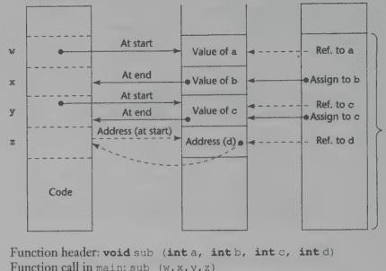

```
Function header: void sub (int a, int b, int c, int d)
Function call in main: sub (w, x, y, z)
(pass w by value, x by result, y by value-result, z by reference)
```

对被调用子程序中的形参的访问，是通过从地址的栈位置进行间接寻址来实现的。使用运行时栈的按值传递、按结果传递、按值结果传递和按引用传递的实现如图9.2所示。子程序sub从main中被调用，调用语句为sub (w, x, y, z)，其中w按值传递，x按结果传递，y按值结果传递，z按引用传递。

### 9.5.4 一些常见语言的参数传递方法

C使用按值传递。按引用传递（inout模式）的语义通过使用指针作为参数来实现。指针的值可供被调用函数使用，并且没有内容被复制回来。但是，由于传递的是调用者数据的访问路径，被调用函数可以修改调用者的数据。C从ALGOL 68中复制了这种按值传递方法的使用方式。在C和C++中，形参可以被类型化为指向常量的指针。对应的实参不一定是常量，因为在这种情况下它们会被强制转换为常量。这使得指针参数能够提供按引用传递的效率，同时具有按值传递的单向语义。被调用函数中这些参数的写保护是隐式指定的。

C++包含一种特殊的指针类型，称为引用类型，如第6章所讨论的，它通常用于参数。引用参数在函数或方法中被隐式解引用，其语义是按引用传递。C++也允许将引用参数定义为常量。例如，我们可以有

```
void fun(const int &p1, int p2, int &p3) { . . . }
```

其中p1是按引用传递，但在函数fun中不能被修改；p2是按值传递；p3是按引用传递。p1和p3都不需要在fun中显式解引用。

> **历史注释**
>
> ALGOL 60引入了按名传递方法。它也允许按值传递作为选项。主要由于实现上的困难，按名传递参数没有从ALGOL 60延续到任何后续流行的语言（除了SIMULA 67）。

> **历史注释**
>
> ALGOL W（Wirth和Hoare，1966）引入了按值结果传递的参数传递方法，作为对按名传递低效和按引用传递问题的替代方案。

常量参数和in模式参数并不完全相同。常量参数明确地实现了in模式。然而，在除Ada之外的所有常见命令式语言中，in模式参数可以在子程序中赋值，即使这些更改永远不会反映在相应实参的值中。常量参数永远不能被赋值。

与C和C++一样，所有Java参数都是按值传递的。然而，由于对象只能通过引用变量访问，对象参数实际上是通过引用传递的。虽然作为参数传递的对象引用本身不能在被子程序中修改，但如果存在可用于引起更改的方法，所引用的对象可以被修改。因为引用变量不能直接指向标量变量，并且Java没有指针，所以在Java中标量不能按引用传递（尽管可以传递包含标量的对象的引用）。

C#的默认参数传递方法是按值传递。可以通过在形参和相应的实参前加上`ref`来指定按引用传递。例如，考虑以下C#的框架方法和调用：

```
void sumer(ref int oldSum, int newOne) { . . . }
. . .
sumer(ref sum, newValue);
```

sumer的第一个参数按引用传递；第二个按值传递。

C#还支持out模式参数，它们是不需要初始值的按引用传递参数。这些参数在形参列表中使用`out`修饰符指定。

PHP的参数传递与C#类似，不同之处在于实参或形参都可以指定按引用传递。按引用传递通过在一个或两个参数前加一个&符号来指定。

Perl使用了一种原始的传递参数方式。所有实参都被隐式地放入一个预定义的数组`@_`中（竟然是这样）。子程序从这个数组中获取实参值（或地址）。这个数组最奇特的地方在于它的神奇性质，其表现为它的元素实际上是实参的别名。因此，如果在被调用的子程序中修改了`@_`的元素，该修改会反映在调用中对应的实参上，前提是存在对应的实参（实参的数量不必与形参的数量相同）并且它是一个变量。

Python和Ruby的参数传递方法称为按赋值传递（pass-by-assignment）。因为所有数据值都是对象，每个变量都是对对象的引用。在按赋值传递中，实参值被赋给形参。因此，按赋值传递实际上就是按引用传递，因为所有实参的值都是引用。然而，只有在某些情况下，这才会产生按引用传递的语义。例如，许多对象本质上是不可变的。在纯面向对象语言中，用赋值语句改变变量值的过程，如

```
x = x + 1
```

并不会改变x所引用的对象。相反，它取出x引用的对象，将其加1，从而创建一个新对象（值为x + 1），然后将x改为引用新对象。因此，当将标量对象的引用传递给子程序时，被引用的对象不能就地更改。因为引用是按值传递的，即使形参在子程序中被修改，这种修改对调用者中的实参也没有影响。

现在，假设一个数组的引用作为参数被传递。如果相应的形参被赋值为一个新数组对象，则对调用者没有影响。但是，如果形参被用来给数组的一个元素赋值，如

```
list[3] = 47
```

则实参会受到影响。因此，更改形参的引用对调用者没有影响，但更改作为参数传递的数组的一个元素则会影响调用者。

### 9.5.5 参数的类型检查

现在人们普遍认为，软件可靠性要求检查实参的类型是否与相应形参的类型一致。如果没有这种类型检查，小的笔误可能会导致程序错误，这些错误可能难以诊断，因为它们不会被编译器或运行时系统检测到。例如，在函数调用

```
result = sub1(1)
```

中，实参是一个整数常量。如果sub1的形参是浮点类型，那么没有参数类型检查就不会检测到错误。尽管整数1和浮点数1具有相同的值，但这两者的表示形式非常不同。如果sub1期望的是浮点值，那么给定整数实参值，它无法产生正确的结果。

早期的编程语言，如Fortran 77和最初的C版本，不需要参数类型检查；大多数后来的语言都需要。然而，相对较新的语言Perl、JavaScript和PHP则不需要。

C和C++在参数类型检查问题上需要一些特别讨论。在最初的C中，参数的个数和类型都不检查。在C89中，函数的形参可以用两种方式定义。它们可以像最初的C那样定义：参数名列在括号中，其类型声明跟在后面，如下面的函数：

```
double sin(x)
  double x;
  { . . . }
```

使用这种形式可避免类型检查，从而使得像这样的调用：

```
double value;
int count;
. . .
value = sin(count);
```

是合法的，尽管它们从来都不正确。

与最初的C定义方式不同的一种替代方法称为原型方法，其中形参类型包含在参数列表中，如：

```
double sin(double x)
{ . . . }
```

如果用相同的调用调用这个版本的sin，即使用下面的调用，它也是合法的：

```
value = sin(count);
```

实参类型（int）会与形参类型（double）进行核对。虽然它们不匹配，但int可以强制转换为double（这是一个加宽强制转换），因此转换会执行。如果无法进行转换（例如，如果实参是数组）或者参数个数错误，则会检测到语义错误。因此，在C89中，用户自己决定是否对参数进行类型检查。

在C99和C++中，所有函数的形参都必须采用原型形式。但是，可以通过用省略号替换参数列表的最后一部分来避免对某些参数进行类型检查，如：

```
int printf(const char* format_string, . . .);
```

对printf的调用必须至少包含一个参数，即指向字符串字面量的指针。除此之外，任何参数（包括没有参数）都是合法的。printf判断是否存在额外参数的方式，是依据这些参数的存在。


字符串参数中的格式码。例如，整数输出的格式码是 `%d`。它作为字符串的一部分出现，如下所示：

```
printf("The sum is %d\n", sum);
```

`%` 告诉 `printf` 函数还有一个参数。

在像 C# 这样可以通过引用传递基本类型的情况下，实参到形参的强制转换还有一个有趣的问题。假设一个方法调用将一个 `float` 值传递给一个 `double` 形参。如果这个参数是按值传递，`float` 值会被强制转换为 `double`，这没有问题。这种特殊的强制转换非常有用，因为它允许库提供子程序的 double 版本，既可以用于 `float` 值也可以用于 `double` 值。然而，假设这个参数是按引用传递的。当 `double` 形参的值被返回给调用者中的 `float` 实参时，该值将溢出其存储位置。为了避免这个问题，C# 要求 `ref` 实参的类型与其对应的形参类型完全匹配（不允许强制转换）。

在 Python 和 Ruby 中，没有参数类型检查，因为类型在这些语言中是一个不同的概念。对象有类型，但变量没有，所以形参是无类型的。这使得参数类型检查这一想法根本无法实现。

### 9.5.6 多维数组作为参数

第 6 章详细讨论了用于将多维数组元素引用的索引值映射到内存地址的存储映射函数。在某些语言（如 C 和 C++）中，当多维数组作为参数传递给子程序时，编译器必须能够在仅看到子程序文本（而不是调用子程序）的情况下为该数组构建映射函数。事实确实如此，因为子程序可以与调用它们的程序分开编译。考虑在 C 中向函数传递矩阵的问题。C 中的多维数组实际上是数组的数组，并且按行主序存储。下面是一个用于行主序的矩阵存储映射函数，其中所有索引的下界为 0，元素大小为 1：

```
address(mat[i, j]) == address(mat[0,0]) + i *
                                      number_of_columns + j
```

注意，这个映射函数需要列数，但不需要行数。因此，在 C 和 C++ 中，当矩阵作为参数传递时，形参必须在第二对方括号中包含列数。下面的 C 程序框架演示了这一点：

```
void fun(int matrix[][10]) {
    . . .
}
void main() {
    . . .
    int mat[5][10];
    ...
    fun(mat);
    ...
}
```

这种矩阵作为参数传递方法的问题在于，它不允许程序员编写能够接受不同列数矩阵的函数；必须为每种不同列数的矩阵编写一个新函数。这实际上使得在处理多维数组时无法编写灵活且可有效重用的函数。在 C 和 C++ 中，由于其包含指针算术，有一种方法可以绕过这个问题。矩阵可以作为指针传递，矩阵的实际维度也可以作为参数传递。然后，每次需要引用矩阵中的元素时，函数都可以使用指针算术来计算用户编写的存储映射函数。例如，考虑以下函数原型：

```
void fun(float *mat_ptr,
         int num_rows,
         int num_cols);
```

下面的语句可用于将变量 x 的值移动到 fun 中参数矩阵的 [row][col] 元素：

```
*(mat_ptr + (row * num_cols) + col) = x;
```

尽管这种方法可行，但它显然难以阅读，而且由于其复杂性，容易出错。阅读上的困难可以通过使用宏来定义存储映射函数而得到缓解，例如

```
#define mat_ptr(r,c) (*mat_ptr + ((r) *
                     (num_cols) + (c)))
```

有了这个宏，赋值语句可以写成

```
mat_ptr(row,col) = x;
```

其他语言使用不同的方法来解决传递多维数组的问题。

在 Java 和 C# 中，数组是对象。它们都是一维的，但元素可以是数组。每个数组都继承一个命名常量（Java 中是 length，C# 中是 Length），该常量在创建数组对象时被设置为数组的长度。矩阵的形参以两对空方括号出现，如下面的 Java 方法所示：

```
float sumer(float mat[][]) {
    float sum = 0.0f;
    for (int row = 0; row < mat.length; row++) {
        for (int col = 0; col < mat[row].length; col++) {
            sum += mat[row][col];
        } //** for (int row . . .
    } //** for (int col . . .
    return sum;
}
```

因为每个数组都有自己的长度值，所以在矩阵中，各行可以有不同的长度。

### 9.5.7 设计考虑

选择参数传递方法涉及两个重要考虑因素：效率以及是否需要单向或双向数据传输。当代软件工程原则要求子程序代码对子程序外部数据的访问应最小化。考虑到这一目标，当不需要通过参数向调用者返回任何数据时，应使用输入模式参数。当没有数据传递给被调用的子程序，但子程序必须将数据传回给调用者时，应使用输出模式参数。最后，只有当数据必须在调用者和被调用子程序之间双向移动时，才应使用输入输出模式参数。

存在一个与这一原则相冲突的实际考虑因素。有时，为了单向参数传递而传递访问路径是合理的。例如，当一个大型数组要传递给不修改它的子程序时，单向方法可能是首选。但是，按值传递需要将整个数组移动到子程序的本地存储区域。这在时间和空间上都是代价高昂的。因此，大型数组通常按引用传递。这正是 Ada 83 定义允许实现者为结构化参数在两种方法之间进行选择的原因。C++ 的常量引用参数提供了另一种解决方案。另一种可选方法是允许用户在这些方法之间进行选择。

为函数选择参数传递方法与另一个设计问题有关：函数副作用。该问题将在 9.10 节讨论。

### 9.5.8 参数传递示例

考虑以下 C 函数：

```
void swap1(int a, int b) {
    int temp = a;
    a = b;
    b = temp;
}
```

假设这个函数被这样调用：

```
swap1(c, d);
```

回顾一下，C 使用按值传递。swap1 的操作可以用以下伪代码描述：

```
a = c        - Move first parameter value in
b = d        - Move second parameter value in
temp = a
a = b
b = temp
```

虽然 a 最终获得 d 的值，b 最终获得 c 的值，但 c 和 d 的值没有改变，因为没有内容被传回给调用者。

我们可以修改 C 的 swap 函数来处理指针参数，以实现按引用传递的效果：

```
void swap2(int *a, int *b) {
    int temp = *a;
    *a = *b;
    *b = temp;
}
```

swap2 可以用以下方式调用：

```
swap2(&c, &d);
```

swap2 的操作可以用以下方式描述：

```
a = &c       - Move first parameter address in
b = &d       - Move second parameter address in
temp = *a
*a = *b
*b = temp
```

在这种情况下，交换操作是成功的：c 和 d 的值实际上被互换了。swap2 可以在 C++ 中使用引用参数编写，如下所示：

```
void swap2(int &a, int &b) {
    int temp = a;
    a = b;
    b = temp;
}
```

这种简单的交换操作在 Java 中是不可能的，因为 Java 既没有指针，也没有 C++ 那种引用。在 Java 中，引用变量只能指向对象，而不能指向标量值。


最后，我们必须探讨当别名与传值结果（pass-by-value-result）和传引用（pass-by-reference）相关时会发生什么。考虑下面用类C语法编写的骨架程序：

```c
int i = 3; /* i is a global variable */
void fun(int a, int b) {
    i = b;
}
void main() {
    int list[10];
    list[i] = 5;
    fun(i, list[i]);
}
```

在fun中，如果使用传引用，则i和a是别名。如果使用传值结果，则i和a不是别名。假设采用传值结果，fun的操作如下：

```c
addr_i = &i                    - Move first parameter address in
addr_listi = &list[i]          - Move second parameter address in
a = *addr_i                    - Move first parameter value in
b = *addr_listi                - Move second parameter value in
i = b                          - Sets i to 5
*addr_i = a                    - Move first parameter value out
*addr_listi = b                - Move second parameter value out
```

在这种情况下，对fun中全局变量i的赋值会将其值从3改为5，但第一个形参的复制回（示例中的倒数第二行）又将其设回3。这里重要的观察是，如果使用传引用，复制回就不是语义的一部分，i将保持为5。还要注意，由于第二个参数的地址是在fun开始时就计算好的，因此对全局变量i的任何更改都不会影响最后用于返回list[i]值的地址。

## 9.6 作为参数的子程序

在编程中，如果子程序名可以作为参数传递给其他子程序，许多情况处理起来会非常方便。其中一个常见例子是当子程序必须对某个数学函数进行采样时。例如，进行数值积分的子程序通过在许多不同点对函数进行采样来估算函数图形下的面积。在编写这样的子程序时，它应该适用于任何给定的函数；不应为了每个待积分的函数而重写。因此，很自然地将计算待积分数学函数的程序函数名作为参数传递给积分子程序。

尽管这个想法很自然，看似简单，但其工作原理的细节可能令人困惑。如果只需要传输子程序代码，那么可以通过传递单个指针来完成。然而，出现了两个复杂问题。

首先，需要检查作为参数传递的子程序在被激活时其参数的类型。在C和C++中，函数不能作为参数传递，但指向函数的指针可以。指向函数的指针类型包含函数的协议。由于协议包含了所有参数类型，因此这类参数可以被完整地进行类型检查。

第二个与子程序参数相关的复杂问题只出现在允许嵌套子程序的语言中。问题在于，执行被传递的子程序时应使用哪种引用环境。有三种选择：

- 执行被传递子程序的调用语句的环境（浅绑定）
- 被传递子程序定义的环境（深绑定）
- 将子程序作为实际参数传递的调用语句的环境（临时绑定）

```javascript
function sub1() {
    var x;
    function sub2() {
        alert(x);  // Creates a dialog box with the value of x
    };
    function sub3() {
        var x;
        x = 3;
        sub4(sub2);
    };
    function sub4(subx) {
        var x;
        x = 4;
        subx();
    };
    x = 1;
    sub3();
};
```

考虑sub2在sub4中被调用时的执行。对于浅绑定，该执行的引用环境是sub4的，因此sub2中对x的引用绑定到sub4中的局部x，程序输出为4。对于深绑定，sub2执行的引用环境是sub1的，因此sub2中对x的引用绑定到sub1中的局部x，输出为1。对于临时绑定，绑定到sub3中的局部x，输出为3。

### 历史注释

Pascal的原始定义（Jensen和Wirth，1974年）允许子程序作为参数传递，而不包含其参数类型信息。如果允许独立编译（原始Pascal不允许），编译器甚至不能检查参数数量是否正确。在没有独立编译的情况下，检查参数一致性是可能的，但这是一项非常复杂的任务，通常不会进行。

在某些情况下，声明子程序的子程序也会将该子程序作为参数传递。在这些情况下，深绑定和临时绑定是相同的。临时绑定从未被使用过，因为人们可能会推测，过程作为参数出现的环境与被传递的子程序没有自然的联系。

浅绑定不适用于具有嵌套子程序的静态作用域语言。例如，假设过程Sender将过程Sent作为参数传递给过程Receiver。问题在于，Receiver可能不在Sent的静态环境中，因此让Sent访问Receiver的变量非常不自然。另一方面，在这种语言中，任何子程序（包括作为参数传递的子程序）的引用环境由其定义的词法位置决定，这是完全正常的。因此，这些语言使用深绑定更合乎逻辑。一些动态作用域语言使用浅绑定。

## 9.7 间接调用子程序

有些情况下子程序必须被间接调用。这些情况通常发生在直到运行时才知道要调用的具体子程序时。对子程序的调用是通过指向该子程序的指针或引用进行的，该指针或引用在调用前已在执行过程中设置。间接子程序调用的两个最常见应用是：图形用户界面中的事件处理（现在几乎所有Web应用以及许多非Web应用都包含事件处理）和回调（在回调中，调用一个子程序，并指示它当被调用的子程序完成其工作后通知调用者）。与往常一样，我们关心的不是这些特定类型的编程，而是编程语言对它们的支持。

间接调用子程序的概念并不是新近提出的。C和C++允许程序定义指向函数的指针，通过该指针可以调用函数。在C++中，指向函数的指针根据函数的返回类型和参数类型进行类型化，因此这样的指针只能指向具有特定协议的函数。例如，下面的声明定义了一个指针（pfun），它可以指向任何接受一个float和一个int作为参数并返回float的函数：

```c
float (*pfun)(float, int);
```

在C和C++中，一个不带后续括号的函数名，就像一个不带后续括号的数组名

下面是通过委托chgfun1调用fun1的示例：

```text
chgfun1(12);
```

委托类的对象可以存储多个方法。可以使用运算符+=添加第二个方法，如下所示：

```text
Change chgfun1 += fun2;
```

这会将fun2放入chgfun1委托中，即使chgfun1之前为null。存储在委托实例中的所有方法将按照它们放入实例的顺序被调用。这称为多播委托。无论方法返回什么，只返回最后被调用的方法返回的值或对象。当然，这意味着在大多数情况下，通过多播委托调用的方法返回的是void。

在我们的示例中，一个静态方法被放入委托Change中。实例方法也可以通过委托调用，在这种情况下，委托必须存储对方法的引用。委托也可以是泛型的。

.NET应用程序使用委托进行事件处理。它们也用于实现闭包（见9.12节）。

与C和C++的情况一样，Python中不带后续括号的函数名是指向该函数的指针。Ada 95有指向子程序的指针，但Java没有。在Python和Ruby以及大多数函数式语言中，子程序被当作数据对待，因此可以将它们赋值给变量。因此，在这些语言中，几乎没有必要使用指向子程序的指针。

## 9.8 函数的设计问题

以下设计问题是函数特有的：

- 是否允许副作用？
- 可以返回哪些类型的值？
- 可以返回多少个值？

### 9.8.1 函数副作用

由于在表达式中调用的函数会产生副作用问题，如第5章所述，函数的参数应始终为in模式。事实上，有些语言要求这一点；例如，Ada函数只能有in模式的形参。这一要求有效地防止了函数通过其参数或通过参数与全局变量的别名化引起副作用。然而，在大多数其他命令式语言中，函数

可以有值传递参数或引用传递参数，从而允许函数产生副作用和别名。纯函数式语言（如 Haskell）没有变量，因此其函数不能产生副作用。

### 9.8.2 返回值的类型

大多数命令式编程语言限制其函数可以返回的类型。C 允许其函数返回任何类型，但数组和函数除外。这两者都可以通过指针类型的返回值来处理。C++ 与 C 类似，但也允许从其函数返回用户定义的类型（即类）。Ada、Python、Ruby 和 Lua 是当前命令式语言中仅有的、其函数（和/或方法）可以返回任意类型值的语言。然而，就 Ada 而言，由于函数在 Ada 中不是类型，因此不能从函数中返回函数。当然，指向函数的指针可以由函数返回。

在某些编程语言中，子程序是一等对象，这意味着它们可以作为参数传递、从函数返回并赋值给变量。在某些命令式语言中，方法是一等对象，例如 Python、Ruby 和 Lua。大多数函数式语言中的函数也是如此。

Java 和 C# 都不能拥有函数，尽管它们的方法类似于函数。在这两种语言中，方法可以返回任何类型或类。由于方法不是类型，因此不能被返回。

### 9.8.3 返回值的数量

在大多数语言中，函数只能返回一个值。然而，情况并非总是如此。Ruby 允许从方法返回多个值。如果 Ruby 方法中的 `return` 语句后面没有表达式，则返回 `nil`。如果后面有一个表达式，则返回该表达式的值。如果后面有多个表达式，则返回包含所有表达式值的数组。

Lua 也允许函数返回多个值。这些值跟在 `return` 语句之后，以逗号分隔的列表形式给出，如下所示：

```
return 3, sum, index
```

调用函数的语句形式决定调用者接收的值的数量。如果函数作为过程调用，即作为语句调用，则所有返回值都被忽略。如果函数返回三个值，并且调用者要保留全部三个值，则应如下例所示调用该函数：

```
a, b, c = fun()
```

在 F# 中，可以将多个值放入元组，并让该元组成为函数中的最后一个表达式，从而返回多个值。

## 9.9 重载子程序

重载运算符是具有多种含义的运算符。重载运算符的特定实例的含义由其操作数的类型决定。例如，如果 Java 程序中的 * 运算符有两个浮点操作数，则它表示浮点乘法。但如果同一运算符有两个整数操作数，则它表示整数乘法。

重载子程序是与同一引用环境中的另一个子程序同名的子程序。重载子程序的每个版本都必须具有唯一的协议；也就是说，它必须在参数的数量、顺序或类型上，并且可能还在返回类型上，与其他版本不同。对重载子程序的调用的含义由实际参数列表和/或可能的返回值类型决定。尽管并非必要，但重载子程序通常实现相同的过程。

C++、Java 和 C# 包含预定义的重载子程序。例如，C++、Java 和 C# 中的许多类都有重载构造函数。由于重载子程序的每个版本都有唯一的参数特征，编译器可以通过不同的参数类型来消除对它们的调用出现的歧义。不幸的是，事情并没有那么简单。参数强制转换在允许时会使消歧过程变得极其复杂。简而言之，问题在于：如果没有方法的参数特征与方法调用中实际参数的数量和类型匹配，但有两个或更多方法的参数特征可以通过强制转换匹配，那么应该调用哪个方法？语言设计者要回答这个问题，必须决定如何对所有不同的强制转换进行排序，以便编译器能够选择与调用“最”匹配的方法。这可能是一项复杂的任务。为了理解这一过程的复杂程度，我们建议读者参考 C++ 中用于方法调用消歧的规则（Stroustrup, 1997）。

由于 C++、Java 和 C# 允许混合模式表达式，返回类型与重载函数（或方法）的消歧无关。调用的上下文不允许确定返回类型。例如，如果一个 C++ 程序有两个名为 fun 的函数，二者都接受一个 int 参数，但一个返回 int，另一个返回 float，则该程序将无法编译，因为编译器无法确定应使用哪个版本的 fun。

在 Java、C++、C# 和 F# 中，用户也可以编写同名子程序的多个版本。同样，在 C++、Java 和 C# 中，最常见的用户定义重载方法是构造函数。

具有默认参数的重载子程序可能导致子程序调用产生歧义。例如，考虑以下 C++ 代码：

```cpp
void fun(float b = 0.0);
void fun();
. . .
fun();
```

该调用存在歧义，将导致编译错误。

## 9.10 泛型子程序

软件复用可以是软件生产力的重要促进因素。提高软件可复用性的一种方法是减少创建在不同类型数据上实现同一算法的不同子程序的需要。例如，程序员不应需要编写四个不同的排序子程序来对四个仅在元素类型上不同的数组进行排序。

**多态**子程序在不同激活时接受不同类型的参数。重载子程序提供一种特殊的多态，称为**特设多态**。重载子程序不必具有相似的行为。

支持面向对象编程的语言通常支持子类型多态。**子类型多态**意味着类型 T 的变量可以访问类型 T 的任何对象或从 T 派生的任何类型的对象。

Python 和 Ruby 的方法提供了更一般的一种多态。回想一下，这些语言中的变量没有类型，因此形式参数也没有类型。因此，只要方法中对形式参数使用的运算符已定义，该方法就可用于任何类型的实际参数。

**参数多态**由这样的子程序提供：它接受泛型参数，这些泛型参数用于描述该子程序参数类型的类型表达式中。此类子程序的不同实例化可以给定不同的泛型参数，从而产生接受不同类型参数的子程序。子程序的参数化定义行为都相同。参数化多态子程序通常称为泛型子程序。C++、Java 5.0、C# 2005+ 和 F# 提供了一种编译期参数多态。

### 9.10.1 C++ 中的泛型函数

C++ 中的泛型函数有一个描述性名称：*模板函数*。模板函数的定义具有一般形式

```
template <template parameters>
—a function definition that may include the template parameters
```

模板参数（必须至少有一个）具有以下形式之一：

```
class identifier
typename identifier
```

class 形式用于类型名。typename 形式用于向模板函数传递值。例如，有时在模板函数中传递一个整数值作为数组大小会很方便。


```cpp
. . .
c = max(a, b);
f = max(d, e);
```

以下是一个C++泛型排序子程序：

```cpp
template <class Type>
void generic_sort(Type list[], int len) {
    int top, bottom;
    Type temp;
    for (top = 0; top < len - 2; top++)
        for (bottom = top + 1; bottom < len - 1; bottom++)
            if (list[top] > list[bottom]) {
                temp = list[top];
                list[top] = list[bottom];
                list[bottom] = temp;
            }  //** end of if (list[top] . . .
} //** end of generic_sort
```

以下是此模板函数的一个实例化示例：

```cpp
float flt_list[100];
. . .
generic_sort(flt_list, 100);
```

C++的模板函数可以说是子程序的一种“穷亲戚”，在子程序中，形参的类型在调用时动态绑定到实参的类型。在这种情况下，只需要一份代码副本，而使用C++方法，则必须在编译时为所需的每种不同类型创建一份副本，并且子程序调用到子程序的绑定是静态的。

### 9.10.2 Java 5.0 中的泛型方法

Java 5.0为Java添加了对泛型类型和方法的支持。在Java 5.0中，泛型类的名称由一个名称后跟一个或多个用尖括号分隔的类型变量来指定。例如，

```java
generic_class<T>
```

其中T是类型变量。关于泛型类型的更详细讨论见第11章。

Java的泛型方法与C++的泛型子程序在几个重要方面有所不同。首先，泛型参数必须是类——不能是基本类型。这一要求不允许出现模拟我们C++示例的泛型方法，在该示例中，数组的组件类型是泛型的，并且可以是基本类型。在Java中，数组的组件（相对于容器而言）不能是泛型的。其次，尽管Java泛型方法可以被实例化任意多次，但只构建一份代码副本。泛型方法的内部版本（称为原始方法）操作Object类对象。在泛型方法返回泛型值的地方，编译器会插入一个强制转换到适当类型的转换。第三，在Java中，可以指定对可作为泛型参数传递给泛型方法的类范围进行限制。这种限制称为边界。

作为Java 5.0泛型方法的一个示例，请考虑以下方法定义骨架：

```java
public static <T> T doIt(T[] list) {
    . . .
}
```

这定义了一个名为doIt的方法，它接受一个泛型类型的元素数组。泛型类型的名称是T，并且它必须是一个数组。以下是对doIt的示例调用：

```java
doIt<String>(myList);
```

现在，考虑以下doIt的版本，它对其泛型参数有一个边界：

```java
public static <T extends Comparable> T doIt(T[] list) {
    . . .
}
```

这定义了一个方法，它接受一个泛型数组参数，其元素是属于实现Comparable接口的类的。这就是对泛型参数的限制或边界。保留字`extends`似乎暗示泛型类是后面类的子类。然而，在这种上下文中，`extends`有不同的含义。表达式`<T extends BoundingType>`指定T应该是边界类型的“子类型”。因此，在这种上下文中，`extends`意味着泛型类（或接口）要么扩展边界类（如果边界是类），要么实现边界接口（如果边界是接口）。该边界确保泛型的任何实例化的元素都可以用Comparable方法compareTo进行比较。

如果泛型方法对其泛型类型有两个或更多限制，则将这些限制添加到`extends`子句中，用与号（&）分隔。此外，泛型方法可以有多个泛型参数。

Java 5.0支持通配符类型。例如，`Collection<?>`是集合类的通配符类型。该类型可用于任何类的任何集合类型。例如，考虑以下泛型方法：

```java
void printCollection(Collection<?> c) {
    for (Object e : c) {
        System.out.println(e);
    }
}
```

此方法打印任何Collection类的元素，无论其组件属于什么类。对于通配符类型的对象，必须格外小心。例如，由于此类型的某个特定对象的组件具有类型，因此不能向该集合中添加其他类型的对象。例如，考虑

```java
Collection<?> c = new ArrayList<String>();
```

除非元素类型是String，否则使用add方法向此集合中添加任何内容都是非法的。

通配符类型可以像非通配符类型一样受到限制。这样的类型称为有界通配符类型。例如，考虑以下方法头：

```java
public void drawAll(ArrayList<? extends Shape> things)
```

这里的泛型类型是Shape类的子类的通配符类型。此方法可以编写为绘制任何类型为Shape子类的对象。

### 9.10.3 C# 2005 中的泛型方法

C# 2005的泛型方法在能力上与Java 5.0的泛型方法类似，只是不支持通配符类型。C# 2005泛型方法的一个独特功能是，如果编译器可以推断未指定的类型，则调用中的实际类型参数可以省略。例如，考虑以下类定义骨架：

```csharp
class MyClass {
    public static T DoIt<T>(T p1) {
        ...
    }
}
```

如果编译器可以从调用中的实际参数推断出泛型类型，则可以在不指定泛型参数的情况下调用DoIt方法。例如，以下两个调用都是合法的：

```csharp
int myInt = MyClass.DoIt(17);  // Calls DoIt<int>
string myStr = MyClass.DoIt("apples");
             // Calls DoIt<string>
```

### 9.10.4 F# 中的泛型函数

F#的类型推断系统并不总是能够确定参数的类型或函数的返回类型。在这种情况下，对于某些函数，F#会为参数和返回值推断一个泛型类型。这称为自动泛化。例如，考虑以下函数定义：

```fsharp
let getLast (a, b, c) = c;;
```

由于没有包含任何类型信息，参数和返回值的类型都被推断为泛型。由于此函数不包含任何计算，因此它是一个简单的泛型函数。

函数可以定义为具有泛型参数，如以下示例所示：

```fsharp
let printPair (x: 'a) (y: 'a) =
    printfn "%A %A" x y;;
```

`%A`格式规范适用于任何类型。类型名a前面的撇号将其指定为泛型类型。^9 此函数定义（使用泛型参数）之所以有效，是因为不包含类型约束操作。算术运算符是类型约束操作的示例。例如，考虑以下函数定义：

```fsharp
let adder x y = x + y;;
```

类型推断将x和y以及返回值的类型设置为int。由于F#中没有类型强制转换，以下调用是非法的：

```fsharp
adder 2.5 3.6;;
```

即使参数的类型被设置为泛型，`+`运算符也会导致x和y的类型变为int。

泛型类型也可以在尖括号中显式指定，如下所示：

```fsharp
let printPair2<'T> x y =
    printfn "%A %A" x y;;
```

此函数必须使用类型调用，^10 如下所示：

```fsharp
printPair2<float> 3.5 2.4;;
```

由于类型推断和缺乏类型强制转换，F#泛型函数的实用性远不如C++、Java 5.0+和C# 2005+中的泛型函数，尤其是在数值计算方面。

9. a并没有什么特别之处——它可以是任何合法的标识符。按照惯例，使用字母表开头的小写字母。

10. 惯例明确规定泛型类型以大写字母命名，从'T'开始。


仅在所有外围作用域都处于活动且可见的位置调用。如果子程序可以在其他地方被调用，这就会成为一个问题。如果子程序可以作为参数传递或赋值给变量，从而允许它在程序中几乎任何地方被调用，这种情况就可能发生。还有一个相关问题：子程序可能在其一个或多个嵌套子程序终止之后才被调用，这通常意味着在此类嵌套子程序中定义的变量已被释放——它们不再存在。为了使子程序能从程序中的任何地方调用，它的引用环境必须在任何可能调用它的地方都可用。因此，嵌套子程序中定义的变量可能需要具有整个程序的生命周期，而不仅仅是定义它们的子程序活动期间。生命周期为整个程序的变量据说具有无限生存期。这通常意味着它们必须是堆动态的，而不是栈动态的。

几乎所有函数式编程语言、大多数脚本语言，以及至少一种主要命令式语言 C#，都支持闭包。这些语言是静态作用域的，允许嵌套子程序，^12，并允许子程序作为参数传递。下面是一个用 JavaScript 编写的闭包示例：

```javascript
function makeAdder(x) {
    return function(y) {return x + y;}
}
...
var add10 = makeAdder(10);
var add5 = makeAdder(5);
document.write("Add 10 to 20: " + add10(20) +
"<br />");
document.write("Add 5 to 20: " + add5(20) +
"<br />");
```

假设这段代码嵌入 HTML 文档并在浏览器中显示，其输出如下：

Add 10 to 20: 30
Add 5 to 20: 25

在这个例子中，闭包是定义在 makeAdder 函数内部并由 makeAdder 返回的匿名函数。闭包函数中引用的变量 x 绑定到传给 makeAdder 的参数。makeAdder 函数被调用两次，一次参数为 10，一次为 5。这两次调用各自返回闭包的不同版本，因为它们绑定到不同的 x 值。第一次调用 makeAdder 创建的函数向其参数加 10；第二次创建的函数向其参数加 5。函数的两个版本绑定到 `makeAdder` 的不同激活。显然，调用 `makeAdder` 时创建的 `x` 版本的生存期必须延伸到整个程序的生存期。

这个相同的闭包函数可以用 C# 通过嵌套匿名委托来编写。嵌套方法的类型被指定为一个接受 `int` 作为参数并返回匿名委托的函数。返回类型使用此类委托的特殊表示法 `Func<int, int>` 指定。尖括号中的第一个类型是参数类型。这种委托可以封装只有一个参数的方法。第二个类型是委托所封装方法的返回类型。

```csharp
static Func<int, int> makeAdder(int x) {
    return delegate(int y) { return x + y; };
}
. . .
Func<int, int> Add10 = makeAdder(10);
Func<int, int> Add5 = makeAdder(5);
Console.WriteLine("Add 10 to 20: {0}", Add10(20));
Console.WriteLine("Add 5 to 20: {0}", Add5(20));
```

这段代码的输出与前面的 JavaScript 闭包示例完全相同。

匿名委托本来可以写成 lambda 表达式。下面是对 `makeAdder` 方法体的替换，使用 lambda 表达式而不是委托：

```text
return y => x + y
```

Ruby 的块被实现为可以引用在其定义位置可见的变量，即使它们被调用的位置那些变量已经消失。这使它们成为闭包。

## 9.13 协程

协程是一种特殊的子程序。与常规子程序中调用者和被调用子程序之间存在的主从关系不同，调用者和被调用协程之间更加平等。事实上，协程控制机制常被称为对称单元控制模型。

协程可以有多个入口点，这些入口点由协程自身控制。它们还拥有在激活之间保持状态的手段。这意味着协程必须是历史敏感的，因此具有静态局部变量。协程的后续执行通常从其开头以外的位置开始。因此，协程的调用称为恢复（resume），而不是调用（call）。

例如，考虑下面的骨架协程：

```text
sub co1() {
  . . .
  resume co2();
  . . .
  resume co3();
  . . .
}
```

第一次恢复 `co1` 时，其执行从第一条语句开始，一直执行到并包括对 `co2` 的恢复，从而将控制权转移给 `co2`。下一次恢复 `co1` 时，其执行从调用 `co2` 之后的第一条语句开始。当第三次恢复 `co1` 时，其执行从恢复 `co3` 之后的第一条语句开始。

子程序的一个常见特性在协程中得以保持：在任意给定时刻，实际上只有一个协程在执行。

如上面的例子所示，协程通常不是执行到结束，而是部分执行，然后将控制权转移给某个其他协程；当它被重新启动时，协程从它用来将控制权转移到别处的语句之后继续执行。这种交错执行序列与多道程序设计操作系统的工作方式有关。尽管可能只有一个处理器，这种系统中的所有执行程序在共享处理器时看起来是并发运行的。对于协程，这有时被称为**准并发**。

通常，协程由应用程序中一个称为主单元的程序单元创建，主单元本身不是协程。创建时，协程执行其初始化代码，然后将控制权返回给该主单元。当整个协程族构造完成后，主程序恢复其中一个协程，然后协程族中的成员按某种顺序相互恢复，直到它们的工作完成——如果这些工作确实能够完成。如果协程的执行到达其代码段的末尾，控制权就转移给创建它的主单元。当需要结束时，这就是结束这组协程执行的机制。在某些程序中，只要计算机在运行，协程就运行。

可以用这种协程集合解决的问题的一个例子是纸牌游戏模拟。假设游戏有四个玩家，他们都使用相同的策略。可以通过让主程序单元创建一个由四个协程组成的协程族来模拟这样的游戏，每个协程都有一组牌，即手牌。然后主程序可以通过恢复其中一个玩家协程来启动模拟；该协程在完成其回合后，可以恢复下一个玩家协程，如此继续，直到游戏结束。

假设程序单元 A 和 B 是协程。图 9.3 显示了涉及 A 和 B 的执行序列可能进行的两种方式。

在图 9.3a 中，协程 A 的执行由主单元启动。执行一段时间后，A 启动 B。当图 9.3a 中的协程 B 第一次使控制权返回到协程 A 时，其语义是 A 从上次执行结束的位置继续执行。特别地，其局部变量保留着上一次激活留下的值。图 9.3b 显示了协程 A 和 B 的另一种执行序列。在这种情况下，B 由主单元启动。

**图 9.3**

两个无循环协程的两种可能执行控制序列

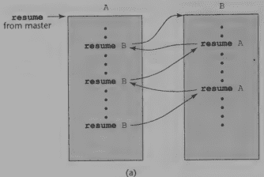

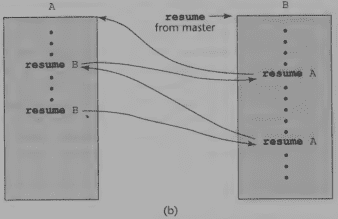

**图 9.4**

带循环的协程执行序列

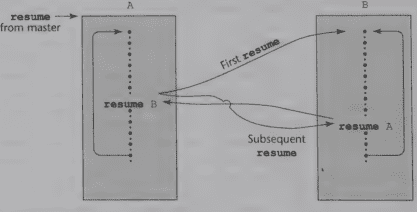

12. 在 C# 中，唯一可以嵌套的方法是匿名委托和 lambda 表达式。


## 摘要

协程往往不是如图9.3所示的模式，而是包含一个带有resume的循环。图9.4展示了这种场景的执行序列。在这种情况下，A由主单元启动。在其主循环内部，A恢复B，而B又在其主循环中恢复A。

在当代语言中，只有Lua完全支持协程。^13

进程抽象在编程语言中通过子程序来表示。子程序定义描述了子程序所表示的动作。子程序调用则执行这些动作。子程序头标识子程序定义并提供其接口，该接口称为其协议。

形式参数是子程序用来引用子程序调用中给出的实际参数的名称。在Python和Ruby中，数组和哈希形式参数用于支持可变数量的参数。Lua和JavaScript也支持可变数量的参数。实际参数可以按位置或关键字与形式参数关联。参数可以具有默认值。

子程序可以是函数，也可以是过程；函数模拟数学函数并用于定义新操作，过程则定义新语句。

子程序中的局部变量可以是栈动态的，以支持递归，也可以是静态的，以提供效率和具有历史敏感性的局部变量。JavaScript、Python、Ruby和Lua允许嵌套子程序定义。

参数传递有三种基本的语义模型——输入模式、输出模式和输入输出模式——以及多种实现方法。这些方法包括按值传递、按结果传递、按值结果传递、按引用传递和按名传递。在大多数语言中，参数在运行时栈中传递。

当使用按引用传递参数时，可能会发生别名现象，既可能出现在两个或多个参数之间，也可能出现在参数与可访问的非局部变量之间。

多维数组作为参数给语言设计者带来了一些问题，因为被调用的子程序需要知道如何为它们计算存储映射函数。这不仅仅需要数组的名称。

子程序名作为参数提供了一种必要的服务，但可能难以理解。其晦涩之处在于作为参数传递的子程序执行时可用的引用环境。

C和C++支持指向函数的指针。C#有委托，委托是能够存储方法引用的对象。委托通过存储多个方法引用来支持多播调用。

- 18. 原始C和C89在处理实际参数类型与对应形式参数类型不一致时，处理方式有何区别？

- 19. 参数传递方法的两个基本设计考虑是什么？

- 20. 描述将多维数组作为参数传递的问题。

- 21. Ruby中使用的参数传递方法叫什么？

- 22. 当子程序名作为参数时，会出现哪两个问题？

- 23. 定义作为参数传递的子程序的引用环境的*浅*绑定和*深*绑定。

- 24. 什么是重载子程序？

- 25. 什么是参数化多态？

- 26. 什么导致C++模板函数被实例化？

- 27. Java 5.0泛型方法的泛型参数与C++方法的泛型参数在根本上有何不同？

- 28. 如果Java 5.0方法返回泛型类型，实际返回的是什么类型的对象？

- 29. 如果Java 5.0泛型方法以三种不同的泛型参数被调用，编译器将生成该方法的多少个版本？

- 30. 函数的设计问题有哪些？

- 31. 哪两种语言允许函数返回多个值？

- 32. 委托到底是什么？

- 33. F#中泛型函数的主要缺点是什么？

- 34. 什么是闭包？

- 35. 使闭包有用的语言特性是什么？

- 36. 哪些语言允许用户重载运算符？

- 37. 协程与传统子程序有何不同？

## 习题集

- 1. 对于用户程序为现有运算符构建额外定义（如Python和C++中所做的那样），支持和反对的论点是什么？你认为这种用户定义的运算符重载是好是坏？支持你的答案。

- 2. 在大多数Fortran IV实现中，所有参数都通过引用传递，仅使用访问路径传输。说明这种设计选择的优点和缺点。

- 3. 为Ada 83设计者允许实现者选择通过拷贝或引用实现inout模式参数的决定进行辩护。

- 4. 假设你想编写一个方法，在新输出页上打印标题，同时打印页码，第一次激活时页码为1，后续每次激活时页码增加1。在Java中，能否在不使用参数且不引用非局部变量的情况下实现？在C#中能否实现？

- 5. 考虑以下用C语法编写的程序：

```
    void swap(int a, int b) {
        int temp;
        temp = a;
        a = b;
        b = temp;
    }
    void main() {
        int value = 2, list[5] = {1, 3, 5, 7, 9};
        swap(value, list[0]);
        swap(list[0], list[1]);
        swap(value, list[value]);
    }
```

对于以下每种参数传递方法，三次调用swap后，变量value和list的所有值分别是什么？

  - a. 按值传递
  - b. 按引用传递
  - c. 按值结果传递

- 6. 提出一个反对在子程序中同时提供静态和动态局部变量的论点。

- 7. 考虑以下用C语法编写的程序：

```
    void fun(int first, int second) {
        first += first;
        second += second;
    }
    void main() {
        int list[2] = {1, 3};
        fun(list[0], list[1]);
    }
```

对于以下每种参数传递方法，执行后list数组的值是什么？

  - a. 按值传递
  - b. 按引用传递
  - c. 按值结果传递

- 8. 反对C语言仅提供函数子程序的设计。

- 9. 从一本Fortran教科书中学习语句函数的语法和语义。证明它们在Fortran中存在的合理性。

- 10. 研究C++和Ada中用户定义运算符重载的方法，并使用我们评估语言的标准，写一份比较两者的报告。

- 11. C#支持out模式参数，但Java和C++都不支持。解释其中的区别。

- 12. 研究Jensen装置，这是按名传递参数的一种用法，并写一段简短描述，说明它是什么以及如何使用它。

- 13. 研究Ruby和CLU的迭代器机制，列出它们的相似之处和不同之处。

- 14. 推测编程语言中允许嵌套子程序的问题——为什么许多当代语言不允许嵌套子程序？

- 15. 至少提出两个反对使用按名传递参数的论点。

- 16. 详细比较Java 5.0和C# 2005的泛型子程序。

## 编程练习

- 1. 用你熟悉的一种语言编写程序，确定按引用传递大数组所需时间与按值传递同一数组所需时间的比率。在你使用的机器和实现上，使数组尽可能大。多次传递数组，以获得传递操作的合理准确计时。

- 2. 编写一个C#或Ada程序，确定out模式参数的地址是在何时计算的（在调用时还是在子程序执行完成时）。

- 3. 编写一个Perl程序，将字面量按引用传递给子程序，该子程序尝试修改该参数。根据Perl的总体设计哲学，解释结果。

- 4. 用C#重复编程练习3。

- 5. 在某种子程序中同时具有静态和栈动态局部变量的语言中编写程序。在子程序中创建六个大（至少100 × 100）矩阵——三个静态和三个栈动态。将两个静态矩阵和两个栈动态矩阵填充为


1 到 100 范围内的随机数。子程序中的代码必须对静态矩阵执行大量矩阵乘法运算，并对该过程计时。然后，它必须用栈动态矩阵重复这一过程。比较并解释结果。

- 6. 编写一个 C# 程序，其中包含两个会被大量调用的方法。两个方法都传入一个大数组，一个按值传递，一个按引用传递。比较调用这两个方法所需的时间，并解释差异。务必调用足够多次，以显示出所需时间的差异。
- 7. 编写一个程序，使用你喜欢的任何语言的语法，使其在参数传递采用按引用传递还是按值-结果传递时产生不同的行为。
- 8. 编写一个泛型 C++ 函数，它接受一个泛型元素数组和一个与数组元素同类型的标量。数组元素和标量的类型是泛型参数。该函数必须在给定数组中搜索给定标量，并返回该标量在数组中的下标。如果标量不在数组中，函数必须返回 -1。用 int 和 float 类型测试该函数。
- 9. 设计一个子程序和调用代码，使得一个或多个参数采用按引用传递和按值-结果传递时产生不同结果。

# 10 实现子程序

- **10.1** 调用与返回的一般语义
- **10.2** 实现“简单”子程序
- **10.3** 实现具有栈动态局部变量的子程序
- **10.4** 嵌套子程序
- **10.5** 块
- **10.6** 实现动态作用域


本章的目的是探讨子程序的实现。讨论将使读者了解子程序链接如何工作，以及为什么 ALGOL 60 对 20 世纪 60 年代早期毫无防备的编译器编写者来说是一个挑战。我们从最简单的情况开始，即具有静态局部变量的不可嵌套子程序，进而讨论具有栈动态局部变量的更复杂子程序，最后讨论具有栈动态局部变量和静态作用域的嵌套子程序。在具有嵌套子程序的语言中，实现子程序的难度增加，是因为需要包含访问非局部变量的机制。

详细讨论静态作用域语言中访问非局部变量的静态链方法。然后，描述实现块的技术。最后，讨论在动态作用域语言中实现非局部变量访问的几种方法。

## 10.1 调用与返回的一般语义

子程序调用和返回操作合称为**子程序链接**。子程序的实现必须基于所实现语言的子程序语义。

在典型语言中，子程序调用有许多与之相关的动作。调用过程必须包含所采用参数传递方法的实现。如果局部变量不是静态的，调用过程必须为被调用子程序中声明的局部变量分配存储，并将这些变量绑定到该存储。它必须保存调用程序单元的执行状态。执行状态是恢复调用程序单元执行所需的一切。这包括寄存器值、CPU 状态位和环境指针（EP）。EP 将在 10.3 节进一步讨论，用于在子程序执行期间访问参数和局部变量。调用过程还必须安排将控制转移到子程序代码，并确保子程序执行完成后控制能返回到正确位置。最后，如果子程序嵌套了子程序，调用过程必须创建某种机制，以提供对被调用子程序可见的非局部变量的访问。

子程序返回所需的动作比调用简单。如果子程序具有 out 模式或 inout 模式且通过复制实现的参数，返回过程的第一个动作是将相关形式参数的局部值移动到实在参数。接下来，它必须释放用于局部变量的存储，并恢复调用程序单元的执行状态。最后，必须将控制返回给调用程序单元。

## 10.2 实现“简单”子程序

我们从实现简单子程序的任务开始。所谓“简单”，是指子程序不能嵌套，并且所有局部变量都是静态的。早期版本的 Fortran 就是具有这种子程序的语言示例。

调用“简单”子程序的语义要求执行以下动作：

- 1. 保存当前程序单元的执行状态。
- 2. 计算并传递参数。
- 3. 将返回地址传递给被调用者。
- 4. 将控制转移到被调用者。

从简单子程序返回的语义要求执行以下动作：

- 1. 如果存在按值-结果传递或 out 模式参数，则将这些参数的当前值移动到相应实在参数或使其可供相应实在参数使用。
- 2. 如果子程序是函数，则将函数值移动到调用者可访问的位置。
- 3. 恢复调用者的执行状态。
- 4. 将控制转移回调用者。

调用和返回动作需要为以下内容提供存储：

- 关于调用者的状态信息
- 参数
- 返回地址
- 函数的返回值
- 子程序代码使用的临时变量

这些内容连同局部变量和子程序代码，构成子程序执行并随后将控制返回给调用者所需的完整信息集合。

现在的问题是调用和返回动作在调用者与被调用者之间的分配。对于简单子程序，过程大多数部分的答案是显然的。调用的最后三个动作显然必须由调用者完成。保存调用者的执行状态可以由任一方完成。对于返回，第一个、第三个和第四个动作必须由被调用者完成。同样，恢复调用者的执行状态可以由调用者或被调用者完成。一般来说，被调用者的链接动作可能发生在两个不同时间：执行开始时或执行结束时。这些有时称为子程序链接的序言和尾声。对于简单子程序，被调用者的所有链接动作都发生在其执行结束时，因此不需要序言。

简单子程序由两个独立部分组成：子程序的实际代码（它是固定的）以及前面列出的局部变量和数据（它们可在子程序执行时改变）。对于简单子程序，这两个部分都具有固定大小。

子程序中非代码部分的格式或布局称为活动记录，因为它描述的数据仅在子程序激活或执行期间相关。活动记录的形式是静态的。活动记录实例是活动记录的一个具体例子，是以活动记录形式组织的数据集合。

因为具有简单子程序的语言不支持递归，所以给定子程序在任何时候只能有一个活动版本。因此，一个子程序的活动记录只能有一个实例。图 10.1 显示了活动记录的一种可能布局。这里以及本章其余部分省略了调用者保存的执行状态，因为它很简单且与讨论无关。

由于“简单”子程序的活动记录实例具有固定大小，因此可以静态分配。事实上，它可以附加到子程序的代码部分。

图 10.2 显示了一个由主程序和三个子程序 A、B、C 组成的程序。尽管该图显示了所有代码段与所有活动记录实例分离，但在某些情况下，活动记录实例会附加到其关联的代码段上。

图 10.2 所示完整程序的构建并非完全由编译器完成。事实上，如果语言允许独立编译，那么四个程序单元——MAIN、A、B 和 C——可能是在不同日期甚至不同年份编译的。每个单元编译时，其机器码以及对外部子程序引用的列表会写入文件。图 10.2 所示的可执行程序由链接器组合而成，链接器是操作系统的一部分。（有时链接器被称为装入器、链接/装入器或链接编辑器。）当为主程序调用链接器时，它的第一个任务是找到包含该程序中引用的已翻译子程序的文件，并将它们加载到内存中。然后，链接器必须将主程序中对那些子程序的所有调用的目标地址设置为那些子程序的入口地址。对于已加载子程序中对子程序的所有调用，以及对库子程序的所有调用，也必须做同样的事情。在前一个例子中，为主程序 MAIN 调用了链接器。链接器必须找到 A、B 和 C 的机器码程序及其活动记录实例，并将它们与 MAIN 的代码一起加载到内存中。然后，它必须

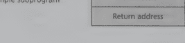


**图 10.2** 具有简单子程序的程序的代码与活动记录

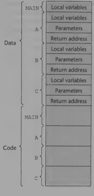

将所有对 A、B、C 以及在 A、B、C 和 MAIN 中调用的任何库子程序的调用的目标地址填入。

## 10.3 使用栈动态局部变量实现子程序

现在我们考察在局部变量为栈动态的语言中子程序链接的实现，同样重点关注调用和返回操作。

栈动态局部变量最重要的优点之一是支持递归。因此，使用栈动态局部变量的语言也支持递归。

当子程序可以嵌套时所需的额外复杂性的讨论推迟到 10.4 节。

### 10.3.1 更复杂的活动记录

使用栈动态局部变量的语言中的子程序链接比简单子程序的链接更复杂，原因如下：

-   编译器必须生成代码，以引起局部变量的隐式分配和释放。
-   递归增加了子程序同时多次激活的可能性，这意味着在给定时刻一个子程序可以有多于一个实例（未完成的执行），其中至少有一个来自子程序外部的调用以及一个或多个递归调用。激活次数仅受机器内存大小的限制。每次激活都需要其活动记录实例。

在大多数语言中，给定子程序的活动记录的格式在编译时是已知的。在许多情况下，活动记录的大小也是已知的，因为所有局部数据都是固定大小的。但在其他一些语言（如 Ada）中并非如此，局部数组的大小可能取决于实参的值。在这些情况下，格式是静态的，但大小可以是动态的。在具有栈动态局部变量的语言中，活动记录实例必须动态地创建。图 10.3 显示了此类语言的典型活动记录。

由于返回地址、动态链接和参数由调用者放入活动记录实例中，因此这些条目必须出现在最前面。

返回地址通常由指向调用程序单元代码段中调用指令之后的那条指令的指针组成。动态链接是指向调用者活动记录实例基址的指针。在静态作用域语言中，该链接用于在发生运行时错误时提供回溯信息。在动态作用域语言中，动态链接用于访问非局部变量。活动记录中的实参是调用者提供的值或地址。

局部标量变量绑定到活动记录实例内的存储。作为结构的局部变量有时在别处分配，只有它们的描述符和指向该存储的指针属于活动记录的一部分。局部变量在被调用的子程序中分配并可能初始化，因此它们出现在最后。

考虑以下 C 函数骨架：

```c
void sub(float total, int part) {
    int list[5];
    float sum;
    . . .
}
```

`sub` 的活动记录如图 10.4 所示。

激活子程序需要动态创建子程序活动记录的实例。如前所述，活动记录的格式在编译时是固定的，尽管在某些语言中其大小可能取决于调用。由于调用和返回语义规定最后调用的子程序最先完成，因此在栈上创建这些活动记录实例是合理的。该栈是运行时系统的一部分，因此称为运行时栈，尽管我们通常只称其为栈。每次子程序激活，无论是递归还是非递归，都会在栈上创建一个新的活动记录实例。这提供了所需的参数、局部变量和返回地址的独立副本。

控制子程序的执行还需要一件事——EP（环境指针）。最初，EP 指向主程序活动记录实例的基址或首地址。运行时系统必须确保它始终指向当前正在执行的程序单元的活动记录实例的基址。当调用子程序时，当前 EP 作为动态链接保存在新的活动记录实例中。然后 EP 被设置为指向新活动记录实例的基址。从子程序返回时，栈顶被设置为当前 EP 减一的值，EP 被设置为已完成执行的子程序的活动记录实例中的动态链接。重置栈顶有效地移除了顶部活动记录实例。

**图 10.4** 函数 `sub` 的活动记录

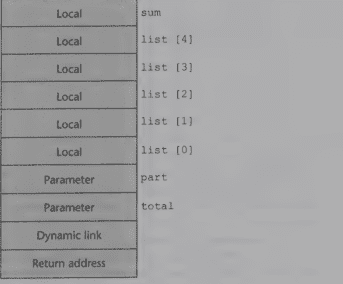

EP 用作活动记录实例数据内容（参数和局部变量）的偏移寻址基址。

注意，当前使用的 EP 并不存储在运行时栈中。只有保存的版本作为动态链接存储在活动记录实例中。

我们现在已经讨论了链接过程中的几个新动作。必须修订 10.2 节中给出的列表以考虑这些因素。使用本节给出的活动记录形式，新动作如下：

调用者动作如下：

-   1. 创建活动记录实例。
-   2. 保存当前程序单元的执行状态。
-   3. 计算并传递参数。
-   4. 将返回地址传递给被调用者。
-   5. 将控制转移到被调用者。

被调用者的序言动作如下：

-   1. 将旧 EP 作为动态链接保存在栈中，并创建新值。
-   2. 分配局部变量。

被调用者的收尾动作如下：

-   1. 如果有按值传递结果或输出模式的参数，这些参数的当前值将被移动到相应的实参中。
-   2. 如果子程序是一个函数，函数值被移动到调用者可访问的位置。
-   3. 将栈指针设置为当前 EP 减一的值从而恢复栈指针，并将 EP 设置为旧的动态链接。
-   4. 恢复调用者的执行状态。
-   5. 将控制转移回调用者。

回顾第 9 章，子程序从被调用之时起直到执行完成时都是活动的。当它变为不活动时，其局部作用域不再存在，其引用环境也不再有意义。因此，此时其活动记录实例可以被销毁。

参数并不总是在栈中传递。在许多针对 RISC 机器的编译器中，参数通过寄存器传递。这是因为 RISC 机器通常比 CISC 机器拥有更多的寄存器。然而，在本章剩余部分，我们假设参数在栈中传递。对于通过寄存器传递的参数，修改这种方法也很直接。

### 10.3.2 无递归的示例

考虑以下 C 程序骨架：

```c
void fun1(float r) {
    int s, t;
    . . .        <---------- 1
    fun2(s);
    . . .
}

void fun2(int x) {
    int y;
    . . .        <---------- 2
    fun3(y);
    . . .
}

void fun3(int q) {
    . . .        <---------- 3
}

void main() {
    float p;
    . . .
    fun1(p);
    . . .
}
```

该程序中的函数调用序列为

```
main calls fun1
fun1 calls fun2
fun2 calls fun3
```

图 10.5 显示了标记为 1、2 和 3 处的栈内容。在点 1 处，栈上只有函数 main 和函数 fun1 的活动记录实例。当 fun1 调用 fun2 时，fun2 的活动记录实例被创建在栈上。当 fun2 调用 fun3 时，fun3 的活动记录实例被创建在栈上。当 fun3 执行结束时，其活动记录实例从栈中移除，并使用 EP 重置栈顶指针。当函数 fun2 和 fun1 终止时也会发生类似的过程。在从 main 调用 fun1 返回后，栈上只有 main 的活动记录实例。注意，某些实现实际上并不在栈上使用活动记录实例。


所声明的变量就会离栈顶更近一个位置，依此类推。例如，考虑前面的示例程序。在 fun1 中，s 的 local_offset 为 3；t 的 local_offset 为 4。同样，在 fun2 中，y 的 local_offset 为 3。要获取任何局部变量的地址，就将该变量的 local_offset 加到 EP 上。

### 10.3.3 递归

考虑下面的示例 C 程序，它使用递归计算阶乘函数：

```c
    int factorial(int n) {
    <---------- 1
        if (n <= 1)
            return 1;
        else return (n * factorial(n - 1));
    <---------- 2
    }
    void main() {
        int value;
        value = factorial(3);
    <---------- 3
    }
```

函数 *factorial* 的活动记录格式如图 10.6 所示。注意，它多了一个用于存放函数返回值的条目。

图 10.7 展示了执行三次到达函数 *factorial* 中位置 1 时的栈内容。每次展示该函数多一次激活，且其函数值未定义。第一个活动记录实例的返回地址指向调用函数 *main*。其余实例的返回地址指向函数自身，这些用于递归调用。

图 10.8 展示了执行三次到达函数 *factorial* 中位置 2 时的栈内容。位置 2 表示执行完 *return* 之后、活动记录从栈中移除之前的时间点。回想一下，该函数的代码将参数 *n* 的当前值乘以对该函数的递归调用所返回的值。

**图 10.6** factorial 的活动记录

| 函数值 |
| --- |
| 参数 n |
| 动态链接 |
| 返回地址 |

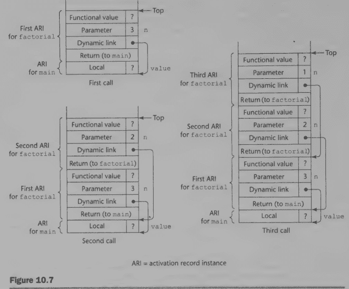

**图 10.7** factorial 中位置 1 处的栈内容

factorial 的第一次返回会得到数值 1。该次激活的活动记录实例中，其参数 n 的值为 1。该乘法的结果 1 被返回给 factorial 的第二次激活，以便乘以其参数 n 的值 2。这一步将数值 2 返回给 factorial 的第一次激活，以便乘以其参数 n 的值 3，从而得到最终函数值 6；随后该值被返回给 main 中对 factorial 的第一次调用。

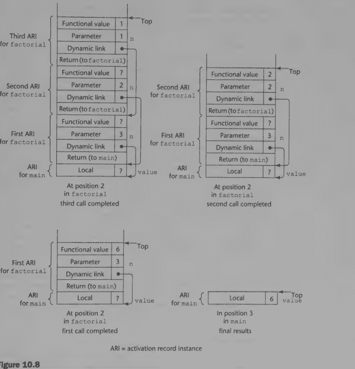

**图 10.8** 执行 main 和 factorial 期间的栈内容

## 10.4 嵌套子程序

一些非基于 C 的静态作用域编程语言使用栈动态局部变量，并允许子程序嵌套。其中包括 Fortran 95+、Ada、Python、JavaScript、Ruby 和 Lua，以及函数式语言。本节将考察实现可嵌套子程序的最常用方法。在本节最后之前，我们忽略闭包。

### 10.4.1 基础

在允许嵌套子程序的静态作用域语言中，对非局部变量的引用需要两步访问过程。所有可被非局部访问的非静态变量都位于现存的活动记录实例中，因此它们都在栈中的某个位置。访问过程的第一步是在栈中找到为该变量分配存储的活动记录实例。第二步是使用该变量（在活动记录实例内）的 local_offset 来访问它。

找到正确的活动记录实例是这两步中更有趣也更困难的一步。首先要注意，在给定子程序中，只有声明于静态祖先作用域中的变量才是可见且可访问的。此外，当嵌套子程序引用静态祖先中的变量时，所有这些静态祖先的活动记录实例始终位于栈上。这一点由静态作用域语言的静态语义规则保证：只有当子程序的所有静态祖先子程序都处于活动状态时，该子程序才可被调用。^1 如果某个特定的静态祖先未处于活动状态，其局部变量就不会绑定到存储，因此允许访问它们将毫无意义。

非局部引用的语义规定，正确的声明是从最内层嵌套开始向外查找外围作用域时找到的第一个声明。因此，为了支持非局部引用，必须能够找到栈中与这些静态祖先相对应的所有活动记录实例。这一观察引出了下一小节所述实现方法。

我们到第 10.5 节才讨论块的问题，因此在本节其余部分，假定所有作用域都由子程序定义。由于基于 C 的语言中函数不能嵌套（这些语言中唯一的静态作用域是由块创建的作用域），本节的讨论并不直接适用于这些语言。

### 10.4.2 静态链

在允许嵌套子程序的语言中，实现静态作用域最常见的方法是静态链。在这种方法中，活动记录中会新增一个指针，称为静态链接。静态链接有时也称为静态作用域指针，它指向静态父级某次激活的活动记录实例的底部。它用于访问非局部变量。通常，静态链接出现在活动记录中参数的下方。在活动记录中加入静态链接后，局部偏移量会与不包含静态链接时不同。参数之前原本有两个活动记录元素，现在有三个：返回地址、静态链接和动态链接。

静态链是一串静态链接，用于连接栈中某些活动记录实例。在子程序 p 执行期间，其活动记录实例的静态链接指向 p 的静态父程序单元的一个活动记录实例。该实例的静态链接又进而指向 p 的静态祖父程序单元的活动记录实例（如果存在）。因此，静态链按静态父级在前的顺序连接正在执行子程序的所有静态祖先。显然，这条链可用于实现静态作用域语言中对非局部变量的访问。

使用静态链接找到非局部变量的正确活动记录实例相对直接。当引用一个非局部变量时，可以沿静态链搜索，直到找到包含该变量的静态祖先活动记录实例，从而找到包含该变量的活动记录实例。不过，还可以比这更简单。由于作用域的嵌套关系在编译时已知，编译器不仅能确定某个引用是非局部的，还能确定必须沿静态链走多长才能到达包含该非局部对象的活动记录实例。

设 static_depth 是与某个静态作用域关联的整数，表示它在最外层作用域中嵌套的深度。未嵌套在任何其他单元中的程序单元，其 static_depth 为 0。如果子程序 A 定义在一个未嵌套的程序单元中，则其 static_depth 为 1。如果子程序 A 包含嵌套子程序 B 的定义，则 B 的 static_depth 为 2。

对于变量 x 的非局部引用，到达正确活动记录实例所需的静态链长度，恰好等于包含对 x 的引用的子程序的 static_depth 与包含 x 声明的子程序的 static_depth 之差。这个差值称为该引用的 nesting_depth，或 chain_offset。实际引用可以用一个有序整数对 (chain_offset, local_offset) 表示，其中 chain_offset 是到达正确活动记录实例所需的链接数（local_offset 在第 10.3.2 节中描述）。例如，考虑下面的骨架 Python 程序：

```python
# Global scope
...
def f1():
    def f2():
        def f3():
            # end of f3

        # end of f2

    # end of f1
```

全局作用域、f1、f2 和 f3 的 static_depth 分别为 0、1、2 和 3。如果过程 f3 引用在 f1 中声明的变量，该引用的 chain_offset 为 2（f3 的 static_depth 减去 f1 的 static_depth）。如果过程 f3 引用在 f2 中声明的变量，该引用的 chain_offset 为 1。对局部变量的引用可以用同样的机制处理，chain_offset 为 0，但不使用指向……的静态指针

使用 EP 时，将变量声明所在子程序的活动记录实例作为基地址。

为了说明非局部访问的完整过程，请考虑下面这个骨架 JavaScript 程序：

```javascript
function main() {
    var x;
    function bigsub() {
        var a, b, c;
        function sub1() {
            var a, d;
            ...
            a = b + c; <---------------------------------1
            ...
        } // end of sub1
        function sub2(x) {
            var b, e;
            function sub3() {
                var c, e;
                ...
                sub1();
                ...
                e = b + a; <-----------------------------2
            } // end of sub3
            ...
            sub3();
            ...
            a = d + e; <---------------------------------3
        } // end of sub2
        ...
        sub2(7);
    } // end of bigsub
    ...
    bigsub();
} // end of main
```

过程调用序列为

- main 调用 bigsub
- bigsub 调用 sub2
- sub2 调用 sub3
- sub3 调用 sub1

当执行首次到达该程序中的位置 1 时，栈状态如图 10.9 所示。

**图 10.9**  
程序 main 中位置 1 处的栈内容

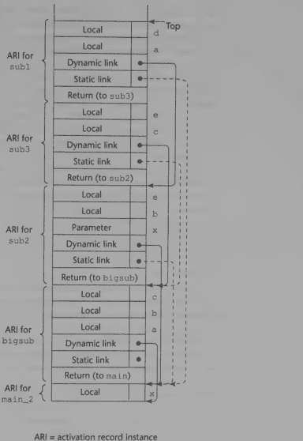

ARI = 活动记录实例

在过程 sub1 的位置 1 处，引用的是局部变量 a，而不是来自 bigsub 的非局部变量 a。这个对 a 的引用具有 chain_offset/local_offset 对 (0, 3)。对 b 的引用指向来自 bigsub 的非局部 b。它可以用对 (1, 4) 表示。local_offset 为 4，因为 a 的偏移量会是 3（第一个局部变量；bigsub 没有参数）。注意，如果用动态链去简单搜索一个包含变量 b 声明的活动记录实例，就会找到 sub2 中声明的变量 b，这将是错误的。如果把 (1, 4) 对与动态链一起使用，就会使用 sub3 中的变量 e。然而，静态链指向 bigsub 的活动记录，其中具有正确版本的 b。此时 sub2 中的变量 b 不在引用环境中，并且（正确地）不可访问。位置 1 处对 c 的引用指向 bigsub 中定义的 c，它由对 (1, 5) 表示。

sub1 完成执行后，sub1 的活动记录实例从栈中移除，控制权返回 sub3。sub3 中位置 2 处对变量 e 的引用是局部的，并使用对 (0, 4) 进行访问。对变量 b 的引用指向 sub2 中声明的那个 b，因为它是包含该声明的最接近的静态祖先。它通过对 (1, 4) 访问。local_offset 为 4，因为 b 是 sub2 中声明的第一个变量，而 sub2 有一个参数。对变量 a 的引用指向 bigsub 中声明的 a，因为 sub3 及其静态父级 sub2 都没有名为 a 的变量的声明。它通过对 (2, 3) 引用。

sub3 完成执行后，sub3 的活动记录实例从栈中移除，只剩下 main、bigsub 和 sub2 的活动记录实例。在 sub2 中的位置 3 处，对变量 a 的引用指向 bigsub 中的 a，在所有活动例程中只有它声明了 a。此访问使用对 (1, 3) 进行。在这个位置，没有可见作用域包含变量 d 的声明，因此这个对 d 的引用是静态语义错误。当编译器试图计算 chain_offset/local_offset 对时，就会检测到这个错误。对 e 的引用指向 sub2 中的局部 e，可以用对 (0, 5) 访问。

总之，在位置 1、2 和 3 处对变量 a 的引用将由以下对表示：

- (0, 3)（局部）
- (2, 3)（相隔两层）
- (1, 3)（相隔一层）

此时可以合理地问，静态链在程序执行期间是如何维护的。如果它的维护过于复杂，那么它简单而有效这一事实就不重要了。这里我们假设不实现将子程序作为参数的情况。

每次子程序调用和返回时都必须修改静态链。返回部分很简单：当子程序终止时，其活动记录实例从栈中移除。移除之后，新的栈顶活动记录实例就是刚刚终止执行的子程序之调用者的活动记录实例。由于从该活动记录实例出发的静态链从未改变，所以它仍像调用另一个子程序之前那样正确工作。因此，不需要其他操作。

子程序调用时所需的操作更复杂。虽然正确的父作用域在编译时很容易确定，但在调用时必须找到父作用域的最近活动记录实例。这可以通过查看动态链上的活动记录实例，直到找到父作用域的第一个实例来完成。然而，通过完全像处理变量声明和引用那样处理子程序声明和引用，可以避免这种搜索。当编译器遇到子程序调用时，除其他事项外，它会确定声明被调用子程序的子程序，该子程序必须是调用例程的静态祖先。然后它计算 nesting_depth，即调用者与声明被调用子程序的子程序之间的外围作用域数量。该信息被存储，并可在执行期间由子程序访问。在调用时，通过沿调用者的静态链向下移动来找到被调用子程序活动记录实例的静态链接。此移动中的链接数等于编译时计算出的 `nesting_depth`。

再次考虑程序 `main` 以及图 10.9 所示的栈状态。在 sub3 中对 sub1 的调用处，编译器确定 sub3（调用者）的 `nesting_depth` 为：在声明被调用过程 sub1 的过程（即 bigsub）内部两层。当执行 sub3 中对 sub1 的调用时，该信息用于设置 sub1 的活动记录实例的静态链接。这个静态链接被设置为指向：从调用者活动记录实例出发的静态链中的第二个静态链接所指向的活动记录实例。在此例中，调用者是 sub3，其静态链接指向其父活动记录实例（即 sub2 的活动记录实例）。sub2 的活动记录实例的静态链接指向 bigsub 的活动记录实例。因此，sub1 的新活动记录实例的静态链接被设置为指向 bigsub 的活动记录实例。

这种方法适用于所有子程序链接，除非涉及将子程序作为参数的情况。

对使用静态链方法访问非局部变量的一种批评是：访问静态父作用域之外的作用域中的变量，比访问局部变量代价更高。必须沿着静态链前进，每经过一个外围作用域就跟随一个链接，从引用处到达声明处。幸运的是，在实践中，对远处非局部变量的引用很少，因此这不是严重问题。对静态链方法的另一种批评是：对于处理时间关键程序的程序员来说，很难估算非局部引用的成本，因为每个引用的成本取决于引用与声明作用域之间的嵌套深度。使这个问题更复杂的是，后续的代码修改可能改变嵌套深度，从而改变某些引用的时序，既可能改变被修改代码中的引用时序，也可能改变远离修改处的代码中的引用时序。

已经开发出一些静态链的替代方案，其中最著名的是使用一种称为 display 的辅助数据结构的方法。然而，尚未发现任何替代方案优于静态链方法，后者仍然是使用最广泛的方法。因此，这里不讨论任何替代方案。

本节描述的过程和数据结构，在那些不允许函数返回函数、也不允许将函数赋给变量的语言中，正确地实现了闭包。然而，对于允许其中一种或两种操作的语言，它们就不够了。在此类语言中，实现非局部访问需要几种新机制。首先，如果子程序访问来自嵌套作用域而非全局作用域的变量，则该变量不能只存储在其所属作用域的活动记录中。因为该活动记录可能在需要它的子程序激活之前就被释放。此类变量也可以存储在堆中，并赋予无限生存期（其生命周期为整个程序的生命周期）。其次，子程序必须具有访问存储在堆中的非局部变量的机制。第三，每次更新非局部访问的堆分配变量的栈版本时，都必须更新这些堆分配变量。显然，这些是对使用静态链实现静态作用域的非平凡扩展。


## 10.5 块

回顾第5章，包括基于 C 的语言在内的许多语言，都为变量提供了用户指定的局部作用域，称为**块**。作为块的一个例子，考虑以下代码段：

```c
{ int temp;
  temp = list[upper];
  list[upper] = list[lower];
  list[lower] = temp;
}
```

在基于 C 的语言中，块被指定为以一条或多条数据定义开头的复合语句。前面块中变量 temp 的生命周期从控制进入该块时开始，到控制退出该块时结束。使用这种局部变量的优点是，它不会与程序中其他地方声明的任何同名变量发生冲突，更具体地说，不会与块引用环境中的同名变量冲突。

块可以通过使用第10.4节中描述的用于实现嵌套子程序的静态链过程来实现。块被视为始终从程序中同一位置调用的无参数子程序。因此，每个块都有一个活动记录。每次执行该块时，都会创建其活动记录的一个实例。

块也可以用一种不同且多少更简单、更高效的方式实现。在程序执行期间的任何时刻，块变量所需的最大存储量都可以静态确定，因为块是按严格的文本顺序进入和退出的。这部分空间可以分配在活动记录中局部变量之后。所有块变量的偏移量都可以静态计算，因此块变量可以完全像局部变量一样被寻址。

例如，考虑以下骨架程序：

```c
void main() {
  int x, y, z;
  while ( . . . ) {
    int a, b, c;
    .
    while ( . . . ) {
      int d, e;
      .
      .
    }
  }
  while ( . . . ) {
    int f, g;
    .
    .
  }
  .
}
```

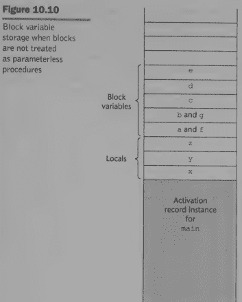

对于这个程序，可以使用图10.10所示的静态内存布局。注意，f 和 g 占用与 a 和 b 相同的内存位置，因为当退出它们的块时（在分配 f 和 g 之前），a 和 b 会从栈中弹出。

## 10.6 实现动态作用域

在动态作用域语言中，局部变量以及对它们的非局部引用至少有两种不同的实现方式：深层访问和浅层访问。注意，深层访问和浅层访问不是与深层绑定和浅层绑定相关的概念。绑定和访问之间的一个重要区别是，深层绑定和浅层绑定会导致不同的语义；而深层访问和浅层访问不会。

### 10.6.1 深层访问

如果局部变量是栈动态的，并且是动态作用域语言中活动记录的一部分，那么对非局部变量的引用可以通过搜索当前活动的其他子程序的活动记录实例来解决，从最近激活的那个开始。这个概念类似于在具有嵌套子程序的静态作用域语言中访问非局部变量，区别在于这里跟随的是动态链而不是静态链。动态链以激活的相反顺序将所有子程序活动记录实例链接在一起。因此，动态链正是在动态作用域语言中引用非局部变量所需的东西。这种方法称为深层访问，因为访问可能需要在栈中进行深度搜索。考虑以下示例骨架程序：

```
void sub3() {
    int x, z;
    x = u + v;
    . . .
}

void sub2() {
    int w, x;
    . . .
}

void sub1() {
    int v, w;
    . . .
}

void main() {
    int v, u;
    . . .
}
```

这个程序是用一种使其看起来像基于 C 语言程序的语法编写的，但它并不打算属于任何特定语言。假设发生以下函数调用序列：

- main 调用 sub1
- sub1 调用 sub1
- sub1 调用 sub2
- sub2 调用 sub3

图10.11显示了在此调用序列之后执行函数 sub3 期间的栈。注意，这些活动记录实例没有静态链；静态链在动态作用域语言中不会起作用。

考虑函数 sub3 中对变量 *x*、*u* 和 *v* 的引用。对 *x* 的引用在 sub3 的活动记录实例中找到。对 *u* 的引用通过搜索栈上的*所有*活动记录实例找到，因为该名称唯一存在的变量在 main 中。此搜索涉及沿四条动态链查找并检查10个变量名。对 *v* 的引用在子程序 sub1 的最近（动态链上最近）的活动记录实例中找到。

图10.11

动态作用域程序的栈内容

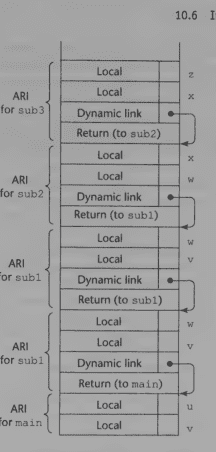

ARI = 活动记录实例

动态作用域语言中用于非局部访问的深层访问方法与静态作用域语言的静态链方法之间有两个重要区别。首先，在动态作用域语言中，无法在编译时确定必须搜索的链的长度。必须搜索链中的每个活动记录实例，直到找到该变量的第一个实例。这是动态作用域语言通常比静态作用域语言执行速度慢的原因之一。其次，活动记录必须为搜索过程存储变量名，而在静态作用域语言实现中只需要值。（静态作用域不需要名称，因为所有变量都由 chain_offset/local_offset 对表示。）

### 10.6.2 浅层访问

浅层访问是一种替代实现方法，而不是一种替代语义。如前所述，深层访问和浅层访问的语义相同。在浅层访问方法中，子程序中声明的变量不存储在这些子程序的活动记录中。因为在动态作用域中，任意特定名称的变量在给定时刻至多有一个可见版本，所以可以采用一种非常不同的方法。浅层访问的一种变体是为完整程序中的每个变量名设置一个单独的栈。每当被调用子程序开头的声明创建一个具有特定名称的新变量时，就在该名称对应的栈顶为该变量分配一个单元。对该名称的每次引用都指向与该名称关联的栈顶变量，因为栈顶变量是最近创建的。当子程序终止时，其局部变量的生命周期结束，这些变量名对应的栈被弹出。这种方法允许快速引用变量，但在子程序入口和出口维护这些栈的代价很高。

图10.12显示了前面示例程序在与图10.11所示栈相同情况下的变量栈。

实现浅层访问的另一种选择是使用中央表，该表为程序中的每个不同变量名提供一个位置。每个条目还维护一个称为 active 的位，用于指示该名称当前是否有绑定或变量关联。随后对任何变量的任何访问都可以是对中央表中偏移量的访问。该偏移量是静态的，因此访问可以很快。SNOBOL 实现使用中央表实现技术。

中央表的维护很直接。子程序调用要求其所有局部变量在逻辑上放入中央表。如果新变量在中央表中的位置已经处于活动状态——也就是说，如果它包含一个生命周期尚未结束的变量（由 active 位指示）——那么必须在新变量的生命周期内将该值保存在某处。每当一个变量开始其生命周期时，必须设置其中央表位置中的 active 位。

中央表的设计以及值在被临时替换时的存储方式已有若干变体。一种变体是使用一个“隐藏”栈来存储所有已保存的对象。因为子程序调用和返回，以及因此局部变量的生命周期，都是嵌套的，所以这种方法效果很好。

第二种变体也许是最清晰且实现成本最低的。使用由单个单元组成的中央表，仅存储每个具有唯一名称的变量的当前版本。被替换的变量存储在创建该替换变量的子程序的活动记录中。这是一种栈机制，但它使用已经存在的栈，因此新增开销极小。

在浅层访问和深层访问非局部变量之间进行选择，取决于子程序调用和非局部引用的相对频率。深层访问方法提供了快速的子程序链接，但对非局部变量的引用，

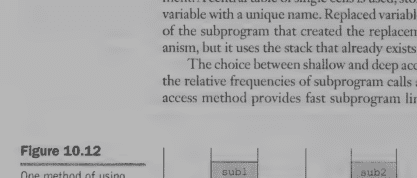


尤其是对远处非局部变量（就调用链而言）的引用，代价很高。浅访问方法对非局部变量（尤其是远处非局部变量）的引用要快得多，但在子程序链接方面的代价更高。

## 摘要

子程序链接语义要求实现执行许多动作。对于“简单”子程序，这些动作相对不复杂。在调用时，必须保存执行状态，必须将参数和返回地址传递给被调用子程序，并且必须转移控制。在返回时，必须传回按结果传递和按值-结果传递参数的值，如果是函数还必须传回返回值，必须恢复执行状态，并将控制转移回调用者。在具有栈动态局部变量和嵌套子程序的语言中，子程序链接更复杂。可能存在多个活动记录实例，这些实例必须存储在运行时栈上，并且必须在活动记录实例中维护静态链接和动态链接。静态链接用于允许在静态作用域语言中引用非局部变量。

在具有栈动态局部变量和嵌套子程序的语言中，子程序有两个组成部分：实际代码（是静态的）和活动记录（是栈动态的）。活动记录实例除其他内容外，还包含形式参数和局部变量。

在动态作用域语言中，对非局部变量的访问可以通过使用动态链或通过某种中央变量表方法来实现。动态链提供较慢的访问，但调用和返回较快。中央表方法提供较快的访问，但调用和返回较慢。

## 复习题

1. 本章对“简单”子程序使用的定义是什么？
2. 调用者或被调用者中，哪一个保存执行状态信息？
3. 为链接到子程序必须存储什么？
4. 链接器的任务是什么？
5. 实现具有栈动态局部变量的子程序比实现简单子程序更困难的两个原因是什么？
6. 活动记录和活动记录实例之间有什么区别？
7. 为什么返回地址、动态链接和参数放在活动记录的底部？
8. 哪种机器经常使用寄存器传递参数？
9. 在具有栈动态局部变量和嵌套子程序的静态作用域语言中，定位非局部变量的两个步骤是什么？
10. 定义静态链、static_depth、nesting_depth 和 chain_offset。
11. 什么是 EP，它的用途是什么？
12. 在静态链方法中，对变量的引用如何表示？
13. 列举三种不允许嵌套子程序的广泛使用的编程语言。
14. 静态链方法的两个潜在问题是什么？
15. 解释实现块的两种方法。
16. 描述实现动态作用域的深访问方法。
17. 描述实现动态作用域的浅访问方法。
18. 动态作用域语言中非局部访问的深访问方法与静态作用域语言的静态链方法之间有两个什么差异？
19. 从调用和非局部访问两方面，比较深访问方法与浅访问方法的效率。

## 习题

1. 当执行到达以下骨架程序中的位置 1 时，显示包含所有活动记录实例（包括静态链和动态链）的栈。假设 bigsub 位于第 1 层。

   ```
   function bigsub() {
       function a() {
           function b() {
               ... <---------------------- 1
           } // end of b
           function c() {
               ...
               b();
               ...
           } // end of c
           ...
           c();
           ...
       } // end of a
       ...
       a();
       ...
   } // end of bigsub
   ```

2. 当执行到达以下骨架程序中的位置 1 时，显示包含所有活动记录实例（包括静态链和动态链）的栈。假设 bigsub 位于第 1 层。

   ```
   function bigsub() {
       var mysum;
       function a() {
           var x;
           function b(sum) {
               var y, z;
               ...
               c(z);
               ...
           } // end of b
           ...
           b(x);
           ...
       } // end of a
       function c(plums) {
           ... <-------------------------------------1
       } // end of c
       var l;
       ...
       a();
       ...
   } // end of bigsub
   ```

3. 当执行到达以下骨架程序中的位置 1 时，显示包含所有活动记录实例（包括静态链和动态链）的栈。假设 bigsub 位于第 1 层。

   ```
   function bigsub() {
       function a(flag) {
           function b() {
               ... a(false);
               ...
           } // end of b
           ...
           if (flag)
               b();
           else c();
           ...
       } // end of a
       function c() {
           function d() {
               ... <-------------------------------------1
           } // end of d
           ...
           d();
           ...
       } // end of c
       ...
       a(true);
       ...
   } // end of bigsub
   ```

   该程序执行到 d 的调用序列为

   - bigsub 调用 a
   - a 调用 b
   - b 调用 a
   - a 调用 c
   - c 调用 d

4. 当执行到达以下骨架程序中的位置 1 时，显示包含所有活动记录实例（包括静态链和动态链）的栈。该程序使用深访问方法实现动态作用域。

   ```
   void fun1() {
       float a;
       ...
   }

   void fun2() {
       int b, c;
       ...
   }

   void fun3() {
       float d;
       ... <---------- 1
   }

   void main() {
       char e, f, g;
       ...
   }
   ```

   该程序执行到 fun3 的调用序列为

   - main 调用 fun2
   - fun2 调用 fun1
   - fun1 调用 fun1
   - fun1 调用 fun3

5. 假设问题 4 的程序使用浅访问方法实现，并为每个变量名使用一个栈。假设执行通过问题 4 所示的调用序列到达该点，显示 fun3 执行时的各栈。

6. 尽管 Java 方法中的局部变量在每次激活开始时动态分配，但在什么情况下，特定激活中的局部变量的值可能保留前一次激活的值？

7. 本章指出，在使用动态链在动态作用域语言中访问非局部变量时，变量名必须与值一起存储在活动记录中。如果实际这样做，每次非局部访问都需要对名称进行一系列代价高昂的字符串比较。设计一种替代这些字符串比较且更快的方案。

8. Pascal 允许具有非局部目标的 goto。如果使用静态链进行非局部变量访问，这类语句可以如何处理？提示：考虑如何找到新启用过程的静态父过程的正确活动记录实例（见第 10.4.2 节）。

9. 静态链方法可以通过在每个活动记录实例中使用两个静态链接来稍作扩展，其中第二个指向静态祖父活动记录实例。这种方法会如何影响子程序链接和非局部引用所需的时间？

10. 设计一个骨架程序和一个调用序列，使得某个活动记录实例中的静态链接和动态链接指向运行时栈中不同的活动记录实例。

11. 如果编译器使用静态链方法实现块，那么块的活动记录中需要子程序活动记录中的哪些条目？

12. 考察三种不同体系结构的子程序调用指令，其中至少包括一种 CISC 机器和一种 RISC 机器，并简要比较它们的能力。（这些指令的设计通常至少部分决定了编译器编写者对子程序链接的设计。）

## 编程练习

1. 编写一个程序，其中包含两个子程序：一个接受单个参数并对该参数执行某种简单操作，另一个接受 20 个参数并使用所有参数，但仅用于一个简单操作。主程序必须大量次调用这两个子程序。在程序中包含计时代码，以输出对这两个子程序调用的运行时间。在 RISC 机器和 CISC 机器上运行该程序，并比较两个子程序所需时间的比值。根据结果，你对两种机器上参数传递的速度能得出什么结论？


# 11 抽象数据类型与封装构造

- 11.1 抽象的概念
- 11.2 数据抽象简介
- 11.3 抽象数据类型的设计问题
- 11.4 语言示例
- 11.5 参数化抽象数据类型
- 11.6 封装构造
- 11.7 命名封装


## 11.1 抽象的概念

当代编程语言中两种基本的抽象是过程抽象和数据抽象。

过程抽象的概念是编程语言设计中最古老的概念之一（Plankalkül 在 20 世纪 40 年代就支持过程抽象）。所有子程序都是过程抽象，因为它们为程序提供了一种指定过程的方式，而不提供其如何执行任务的细节（至少在调用程序中如此）。例如，当程序需要对某种类型的数值数据数组进行排序时，通常使用一个子程序来完成排序过程。在需要排序过程的地方，程序中会放置如下语句：

```
sortInt(list, listLen)
```

这个调用是实际排序过程的抽象，其算法并未指定。该调用独立于被调用子程序中实现的算法。

对于子程序 sortInt 来说，唯一必要的属性是要排序数组的名称、其元素的类型、数组的长度，以及调用 sortInt 将导致数组被排序这一事实。sortInt 所实现的特定算法是对用户不重要的属性。用户只需看到排序子程序的名称和协议就能使用它。

数据抽象的广泛使用必然紧随过程抽象之后，因为每个数据抽象不可分割且必不可少的部分是它的操作，而这些操作被定义为过程抽象。

## 11.2 数据抽象简介

数据抽象的演进始于 1960 年第一版 COBOL，其中包含记录结构。¹ 基于 C 的语言有结构体，它们也是记录。抽象数据类型是一种数据结构，以记录的形式出现，但包含操作其数据的子程序。

从语法上看，抽象数据类型是一个封装体，其中只包括一个特定数据类型的数据表示以及为该类型提供操作的子程序。通过访问控制，可以向使用该类型的封装体外部单元隐藏该类型不必要的细节。使用抽象数据类型的程序单元可以声明该类型的变量，即使实际表示对它们隐藏。抽象数据类型的实例称为对象。

数据抽象的动机之一与过程抽象类似。它是对抗复杂性的武器；是一种使大型和/或复杂程序更易于管理的手段。本节后面将讨论抽象数据类型的其他动机和优点。

¹ 回想第 2 章，记录是一种存储字段的数据结构，字段具有名称且可以具有不同类型。

面向对象编程（第 12 章将描述）是软件开发中使用数据抽象的产物，而数据抽象是它的基本组成部分之一。

### 11.2.1 作为抽象数据类型的浮点数

抽象数据类型的概念，至少就内置类型而言，并不是最近才发展起来的。所有内置数据类型，甚至 Fortran I 的类型，都是抽象数据类型，尽管人们很少这样称呼它们。例如，考虑浮点数据类型。大多数编程语言至少包含一种浮点类型。浮点类型提供了创建变量以存储浮点数据的手段，也提供了一组用于操作该类型对象的算术运算。

高级语言中的浮点类型采用了数据抽象中的一个关键概念：信息隐藏。浮点数据值在内存单元中的实际格式对用户隐藏，唯一可用的操作是语言提供的操作。除了可以使用内置操作构造的操作之外，用户不允许对该类型的数据创建新操作。用户不能直接操作值实际表示的各个部分，因为该表示是隐藏的。正是这一特性使程序能够在某一特定语言的不同实现之间可移植，即使这些实现可能对特定数据类型使用不同的表示。例如，在 20 世纪 80 年代中期 IEEE 754 标准浮点表示出现之前，不同计算机体系结构使用了几种不同的表示。然而，这种差异并没有阻止使用浮点类型的程序在各种体系结构之间可移植。

### 11.2.2 用户定义的抽象数据类型

用户定义的抽象数据类型应提供与语言定义类型（如浮点类型）相同的特征：（1）类型定义允许程序单元声明该类型的变量，但隐藏该类型对象的表示；（2）一组用于操作该类型对象的操作。

现在我们结合用户定义类型正式定义抽象数据类型。抽象数据类型是满足以下条件的数据类型：

- 该类型对象的表示对使用该类型的程序单元隐藏，因此对这些对象唯一可能的直接操作是类型定义中提供的操作。
- 类型的声明以及该类型对象操作的协议（它们提供该类型的接口）包含在单个语法单元中。该类型的接口不依赖于对象的表示或操作的实现。此外，允许其他程序单元创建所定义类型的变量。

信息隐藏有几个好处。其中之一是提高可靠性。使用特定抽象数据类型的程序单元称为该类型的客户端。客户端不能有意或意外地直接操作对象的底层表示，从而提高了此类对象的完整性。对象只能通过提供的操作来更改。

信息隐藏的另一个好处是，它缩小了程序员在编写或阅读程序某一部分时必须了解的代码范围和变量数量。特定变量的值只能由受限范围内的代码更改，这使代码更易于理解，也使查找错误更改的来源变得不那么困难。

信息隐藏还使名称冲突的可能性降低，因为变量的作用域更小。

最后，考虑信息隐藏的以下优点：假设栈抽象最初的实现使用链表表示。后来，由于该表示存在内存管理问题，栈抽象被改为使用连续表示（在数组中实现栈的表示）。由于使用了数据抽象，这一更改可以在定义栈类型的代码中进行，而栈抽象的任何客户端都不需要更改。当然，任何操作协议的更改都会要求客户端更改。

尽管抽象数据类型的定义规定对象的数据成员必须对客户端隐藏，但许多情况下客户端需要访问这些数据成员。常见的解决方案是提供访问器方法，有时称为 getter 和 setter，允许客户端间接访问所谓的隐藏数据——这比简单地将数据公开（这会提供直接访问）是更好的解决方案。访问器更好的原因有三个：

- 1. 可以通过提供 getter 方法而不提供对应的 setter 方法来提供只读访问。
- 2. setter 中可以包含约束。例如，如果数据值应限制在特定范围内，setter 可以强制执行该限制。
- 3. 如果 getter 和 setter 是唯一的访问方式，则可以在不影响客户端的情况下更改数据成员的实际实现。

在抽象数据类型中将数据指定为 public 并为其提供访问器方法，都违反了抽象数据类型的原则。有些人认为这些只是使不完美设计变得可用的漏洞。正如我们将在 11.4.5.2 节中看到的，Ruby 不允许将实例数据设为 public。然而，Ruby 也使创建访问器函数变得非常容易。对开发者而言，设计出所有数据都真正隐藏的抽象数据类型是一项挑战。

将类型的声明及其操作打包在单个语法单元中的主要优点是，它提供了一种将程序组织成可分别编译的逻辑单元的方法。在某些情况下，实现与类型声明包含在一起；在另一些情况下，实现位于单独的语法单元中。将类型及其操作的实现放在不同语法单元中的优点是，它提高了程序的模块化程度，并且清晰地分离了设计与实现。如果类型和操作的声明与定义都位于同一语法单元中，则必须有一些手段对客户端程序单元隐藏该单元中指定定义的部分。


### 11.2.3 示例

栈是一种应用广泛的数据结构，它存储若干数据元素，并且只允许访问其某一端（顶端）的数据元素。假设要为栈构造一个抽象数据类型，该类型具有以下抽象操作：

-   `create(stack)` — 创建并可能初始化一个栈对象
-   `destroy(stack)` — 释放栈的存储空间
-   `empty(stack)` — 一个谓词（或布尔）函数，如果指定栈为空则返回 true，否则返回 false
-   `push(stack, element)` — 将指定元素压入指定栈
-   `pop(stack)` — 从指定栈中移除栈顶元素
-   `top(stack)` — 返回指定栈的栈顶元素的副本

注意，某些抽象数据类型的实现并不需要 create 和 destroy 操作。例如，简单地定义一个抽象数据类型的变量就可能隐式地创建底层数据结构并对其进行初始化。此类变量的存储空间可能会在变量作用域结束时被隐式释放。

栈类型的客户端可能有如下代码序列：

```
. . .
create(stk1);
push(stk1, color1);
push(stk1, color2);
temp = top(stk1);
. . .
```

## 11.3 抽象数据类型的设计问题

语言中定义抽象数据类型的设施必须提供一个语法单元，其中包含类型的声明以及实现对该类型对象进行操作子程序的原型。必须使这些对抽象的客户端可见。这允许客户端声明抽象类型的变量并操作其值。虽然类型名必须对外可见，但类型表示必须隐藏。类型表示以及实现操作的子程序的定义可以出现在该语法单元的内部或外部。

除了类型定义中提供的操作之外，为抽象数据类型的对象提供的通用内置操作应该很少（如果有的话）。适用于广泛抽象数据类型的操作本来就不多。其中包括赋值以及相等和不相等的比较。如果语言不允许用户重载赋值，则必须将赋值操作包含在抽象中。在某些情况下，相等和不相等的比较应在抽象中预定义，但在其他情况下则不然。例如，如果类型通过指针实现，相等可能意味着指针相等，但设计者可能希望它表示指针所引用结构的相等。

许多抽象数据类型需要某些操作，但由于它们并非通用，通常必须由类型设计者提供。其中包括迭代器、访问器、构造函数和析构函数。迭代器已在第 8 章讨论。访问器提供对客户端无法直接访问的数据的一种访问形式。构造函数用于初始化新创建对象的各个部分。析构函数通常用于回收堆存储，在不进行隐式存储回收的语言中，抽象数据类型对象的各部分可能会使用这些堆存储。

如前所述，抽象数据类型的封装定义了一个数据类型及其操作。许多现代语言，包括 C++、Objective-C、Java 和 C#，都直接支持抽象数据类型。

第一个设计问题是抽象数据类型是否可以被参数化。例如，如果语言支持参数化的抽象数据类型，人们就可以为某种能够存储任意类型元素的结构设计抽象数据类型。参数化抽象数据类型将在第 11.5 节讨论。第二个设计问题是提供哪些访问控制以及如何指定这些控制。最后，语言设计者必须决定类型的规范是否与其实现物理分离（或者这是否是开发者的选择）。

## 11.4 语言示例

数据抽象的概念源于 SIMULA 67，尽管该语言并未提供对抽象数据类型的完整支持，因为它没有包含隐藏实现细节的方法。在本节中，我们将介绍 C++、Objective-C、Java、C# 和 Ruby 对数据抽象的支持。

### 11.4.1 C++ 中的抽象数据类型

C++ 于 1985 年首次发布，是通过向 C 添加特性而创建的。最初的重要添加是支持面向对象编程的特性。由于面向对象编程的主要组成部分之一是抽象数据类型，C++ 显然需要支持它们。

C++ 提供了两个非常相似的构造：class 和 struct，它们更直接地支持抽象数据类型。由于 struct 最常用于仅包含数据的情况，我们在此不再进一步讨论。


## C++：它的诞生、无处不在与常见批评

### 比雅尼·斯特劳斯特鲁普

比雅尼·斯特劳斯特鲁普是 C++ 的设计者和最初实现者，也是《C++ 之旅》《编程：使用 C++ 的原理与实践》《C++ 程序设计语言》《C++ 的设计与演化》等多部著作的作者。他的研究兴趣包括分布式系统、设计、编程技术、软件开发工具和编程语言。他积极参与 C++ 的 ANSI/ISO 标准化工作。斯特劳斯特鲁普博士是纽约市摩根士丹利技术部门的董事总经理、哥伦比亚大学计算机科学客座教授，以及得克萨斯 A&M 大学计算机科学杰出研究教授。他是美国国家工程院院士、ACM 会士和 IEEE 会士。1993 年，斯特劳斯特鲁普获得 ACM 格蕾丝·默里·霍珀奖，获奖原因是“他在奠定 C++ 程序设计语言基础方面的早期工作。基于这些基础以及斯特劳斯特鲁普博士的持续努力，C++ 已成为计算史上最具影响力的程序设计语言之一。”（访谈年份：2002）

### 你与计算的简史

**在 1980 年代初加入贝尔实验室之前，你在哪里工作、从事什么工作？** 在贝尔实验室，我主要从事分布式系统领域的研究。我是 1979 年加入的。在那之前，我在剑桥大学攻读该领域的博士学位，并即将完成。

**你是一开始就着手做“带类的 C”（后来成为 C++）吗？** 在开始做带类的 C 以及开发它和 C++ 的过程中，我参与了一些与分布式计算相关的项目。例如，我试图找到一种将 UNIX 内核分布到多台计算机上的方法，并帮助许多项目构建模拟器。

**是对数学的兴趣让你进入这个行业的吗？** 我报考了“数学与计算机科学”学位，我的硕士学位在名义上也是数学学位。我曾错误地认为计算是某种应用数学。我学了几年的数学，并自认为数学不怎么样，但这仍然比不懂数学要好得多。在我报名时，我甚至从未见过计算机。我喜欢计算的是编程，而不是更数学化的领域。

### 剖析一门成功的语言

**我想倒过来讨论，列出一些我认为让 C++ 无处不在的因素，并听听你的反应。比如“开源”、非专有，以及由 ANSI/ISO 标准化。** ISO C++ 标准很重要。有许多独立开发并持续演进的 C++ 实现。如果没有一个可供它们遵循的标准，以及一个帮助协调 C++ 演进的标准流程，各种方言的混乱局面将会爆发。

同样重要的是，既有开源实现，也有商业实现可用。此外，对许多用户来说，标准提供了一定程度的保护，使其免受实现提供商的操纵，这一点至关重要。

ISO 标准流程是开放且民主的。C++ 委员会开会时，出席人数很少少于 50 人，而且每次会议通常有八个以上的国家代表参加。这不仅仅是一个供应商论坛。


它非常适合系统编程（在 C++ 诞生之时，这是市场中开发代码的最大领域）。

是的，对于任何系统编程项目，C++ 都是一个强有力的选择。它对嵌入式系统编程也很有效，而嵌入式系统编程目前是增长最快的领域。C++ 的另一个增长领域是高性能数值/工程/科学编程。

### 其面向对象的特性以及对类/库的包含，使编程更高效、更透明。

C++ 是一种多范式编程语言。也就是说，它支持几种基本的编程风格（包括面向对象编程）以及这些风格的组合。如果使用得当，这会带来更清晰、更灵活、更高效的库，而这些库仅用单一范式即可提供。C++ 标准库包含容器和算法；这基本上是一个泛型编程框架，就是一个例子。当它与面向对象的类层次结构结合使用时，其结果是在类型安全、效率和灵活性方面无与伦比的组合。

### 其在 AT&T 开发环境中的孕育

AT&T 贝尔实验室提供了对 C++ 发展至关重要的环境。这些实验室是极具挑战性问题的异常丰富的来源，也是实践研究独一无二的支持性环境。C++ 与 C 出自同一研究实验室，并受益于相同的知识传统、经验和杰出人才。自始至终，AT&T 都支持 C++ 的标准化。然而，C++ 并不像许多现代语言那样，是一场大规模营销活动的受益者。实验室根本不是那样运作的。

### 我漏掉了你首要清单上的什么吗？

毫无疑问。

### 现在，让我转述 C++ 批评者的一些说法，并听听你的反应：它庞大/笨重。“hello world”问题在 C++ 中比在 C 中大 10 倍。

C++ 当然不是一门小语言，不过现代语言中很少有小的。如果一门语言很小，你往往需要庞大的库才能完成工作，而且常常不得不依赖约定和扩展。我更愿意把不可避免的复杂性中的关键部分放在语言本身，在那里它能够被看到、被教授并得到有效标准化，而不是隐藏在系统的其他地方。就大多数用途而言，我并不认为 C++ 笨重难用。在我的机器上，C++ 的“hello world”程序并不比其 C 对应版本更大，在你的机器上也不应该如此。

事实上，在我的机器上，C++ 版“hello world”程序的目标代码比 C 版更小。从语言上讲，没有理由一个版本应该比另一个更大。这完全取决于实现者如何组织库。如果一个版本明显大于另一个版本，请向较大版本的实现者报告该问题。

### 用 C++ 编程更困难（与 C 相比）。（这是批评者的一种说法。）你甚至也曾承认过这一点，说过一些关于用 C 与 C++ 打中自己脚的话。

是的，我确实说过大致这样的话：“C 让你很容易打中自己的脚；C++ 让这件事更难，但一旦打中，C++ 会炸掉你整条腿。”人们往往忽略的是，我关于 C++ 所说的那些话，在不同程度上也适用于所有强大的语言。当你保护人们免于简单危险时，他们却会让自己陷入新的、不那么明显的问题。避开较简单问题的人，可能只是在走向一个不那么简单的问题。支持性和保护性极强的环境有一个问题：困难的问题可能被发现得太晚，或者一旦被发现又太难补救。此外，罕见问题比常见问题更难发现，因为你不会怀疑它存在。

### 它适合当今的嵌入式系统，但不适合当今的互联网软件。C++ 适合当今的嵌入式系统。

它今天也适合——并且被广泛用于——“互联网软件”。例如，看看我的“C++ 应用”网页。你会注意到，一些主要的 Web 服务提供商，如 Amazon、Adobe、Google、Quicken 和 Microsoft，都关键性地依赖 C++。游戏是一个相关领域，在其中你会看到 C++ 的大量使用。

### 我是不是又漏掉了你经常遇到的另一个问题？

当然。

#### 11.4.1.3 构造函数与析构函数

C++ 允许用户在类定义中包含构造函数，用于初始化新创建对象的数据成员。构造函数还可以分配新对象的指针成员所引用的堆动态数据。当创建类类型的对象时，构造函数会被隐式调用。构造函数的名称与其所初始化对象的类名相同。构造函数可以重载，但当然，一个类的每个构造函数都必须具有唯一的参数特征。

C++ 类还可以包含一个称为析构函数的函数，当类实例的生命周期结束时，它会被隐式调用。如前所述，栈动态类实例可以包含引用堆动态数据的指针成员。此类实例的析构函数可以对指针成员使用 delete 运算符，以释放它们所引用的堆空间。析构函数常被用作调试辅助工具；在这种情况下，它们会在对象的数据成员被释放之前显示或打印部分或全部数据成员的值。析构函数的名称是类名前面加一个波浪号（~）。

构造函数和析构函数都没有返回类型，也都不使用 return 语句。构造函数和析构函数都可以被显式调用。

#### 11.4.1.4 一个示例

我们的 C++ 抽象数据类型示例是一个栈：

```cpp
#include <iostream.h>
class Stack {
  private:  //** These members are visible only to other
            //** members and friends (see Section 11.6.4)
    int *stackPtr;
    int maxLen;
    int topSub;
  public:   //** These members are visible to clients
    Stack() {  //** A constructor
        stackPtr = new int [100];
        maxLen = 99;
        topSub = -1;
    }
    ~Stack() {delete [] stackPtr;}  //** A destructor
    void push(int number) {
        if (topSub == maxLen)
            cerr << "Error in push--stack is full\n";
        else stackPtr[++topSub] = number;
    }
    void pop() {
        if (empty())
            cerr << "Error in pop--stack is empty\n";
        else topSub--;
    }
    int top() {
        if (empty())
            cerr << "Error in top--stack is empty\n";
        else
            return (stackPtr[topSub]);
    }
    int empty() {return (topSub == -1);}
};
```

我们只讨论这个类定义的几个方面，因为没有必要理解代码的所有细节。Stack 类的对象是栈动态的，但包含一个引用堆动态数据的指针。Stack 类有三个数据成员——stackPtr、maxLen 和 topSub——它们都是私有的。stackPtr 用于引用堆动态数据，也就是实现栈的数组。该类还有四个公有成员函数——push、pop、top 和 empty——以及一个构造函数和一个析构函数。所有成员函数定义都包含在这个类中，尽管它们本来可以在外部定义。由于包含了成员函数体，它们都被隐式内联。构造函数使用 new 运算符从堆中分配一个包含 100 个 int 元素的数组。它还初始化 maxLen 和 topSub。

下面是一个使用 Stack 抽象数据类型的示例程序：

```cpp
void main() {
    int topOne;
    Stack stk;   //** Create an instance of the Stack class
    stk.push(42);
    stk.push(17);
    topOne = stk.top();
    stk.pop();
    . . .
}
```

下面是一个 Stack 类的定义，其中只包含成员函数的原型。这段代码存储在扩展名为 .h 的头文件中。成员函数的定义跟在类定义之后。这些定义使用作用域解析运算符 :: 来指明它们所属的类。这些定义存储在扩展名为 .cpp 的代码文件中。

```cpp
// Stack.h -- the header file for the Stack class
#include <iostream.h>
class Stack {
  private:   //** These members are visible only to other
             //** members and friends (see Section 11.6.3)
    int *stackPtr;
    int maxLen;
    int topSub;
  public:    //** These members are visible to clients
    Stack();  //** A constructor
    ~Stack(); //** A destructor
    void push(int);
    void pop();
```


```cpp
        int top();
        int empty();
}
```

```cpp
// Stack.cpp - the implementation file for the Stack class
#include <iostream.h>
#include "stack.h"
using std::cout;
Stack::Stack() {   //** A constructor
    stackPtr = new int [100];
    maxLen = 99;
    topSub = -1;
}
Stack::~Stack() {delete [] stackPtr;}; //** A destructor
void Stack::push(int number) {
    if (topSub == maxLen)
        cerr << "Error in push--stack is full\n";
    else stackPtr[++topSub] = number;
}
void Stack::pop() {
    if (topSub == -1)
        cerr << "Error in pop--stack is empty\n";
    else topSub--;
}
int top() {
    if (topSub == -1)
        cerr << "Error in top--stack is empty\n";
    else
        return (stackPtr[topSub]);
}
int Stack::empty() {return (topSub == -1);}
```

### 11.4.2 Objective-C 中的抽象数据类型

如前所述，Objective-C 与 C++ 类似，其最初设计是在 C 语言基础上进行扩展以支持面向对象编程。两者的根本区别之一是，Objective-C 对方法调用使用 Smalltalk 的语法。

#### 11.4.2.1 封装

Objective-C 类的接口部分定义在一个称为**接口**的容器中，其一般语法如下：

```objectivec
@interface class-name: parent-class {
    instance variable declarations
}

method prototypes
@end
```

第一行和最后一行以 @ 符号开头，是指令。

类的实现打包在一个自然称为*实现*的容器中，其语法如下：

```text
@implementation class-name
method definitions
@end
```

与 C++ 一样，在 Objective-C 中类也是类型。

方法原型具有以下语法：

```text
(+|-) (return-type) method-name : (formal-parameters) ;
```

加号出现时表示该方法是类方法；减号表示实例方法。形式参数外的方括号表示它们是可选的。没有参数时，圆括号和冒号都不出现。与大多数其他支持面向对象编程的语言一样，Objective-C 类的所有实例共享其实例方法的单一副本，但每个实例都有自己的实例数据副本。

形式参数列表的语法形式与更常见的语言 C、C++、Java 和 C# 不同。如果有一个参数，其类型在参数名之前的圆括号中指定，如下面的方法原型所示：

```text
- (void) meth1: (int) x;
```

该方法的名称为 meth1:（注意冒号）。具有两个参数的方法可能如下面的示例方法原型所示：

```text
- (int) meth2: (int) x second: (float) y;
```

在这种情况下，方法的名称为 meth2:second:，尽管这显然是一个选择得不好的名称。名称的最后一部分（second）可以省略，如下所示。

```text
- (int) meth2: (int) x: (float) y;
```

在这种情况下，方法的名称为 meth2::。

方法定义与方法原型类似，只是它们用花括号分隔的语句序列代替分号。

调用无参数方法的语法如下：

```text
[object-name method-name];
```

如果一个方法接受一个参数，则方法名后附加一个冒号，随后是参数。方法名和参数之间没有其他标点符号。例如，对 myAdder 所引用对象上名为 add1 的方法的调用，该方法接受一个参数，此处为字面量 7，将如下所示：

```objectivec
[myAdder add1: 7];
```

如果一个方法接受两个参数且其名称只有一部分，则第一个参数后跟一个冒号，随后是第二个参数。两个参数之间不使用其他标点符号。如果有更多参数，则重复此模式。例如，如果 add1 接受三个参数且其名称没有其他部分，则可以用以下方式调用：

```objectivec
[myAdder add1: 7 : 5 : 3];
```

一个方法可以有多个参数和多个名称部分，如前面的示例所示：

```objectivec
-(int) meth2: (int) x second: (float) y;
```

下面是调用此方法的一个示例：

```objectivec
[myObject meth2: 7 second: 3.2];
```

Objective-C 中的构造函数称为**初始化器**；它们只提供初始值。它们可以取任意名称，因此必须显式调用。构造函数返回对新对象的引用，所以其类型始终是指向类名的指针。它们使用 **return** 语句返回 `self`，即对当前对象的引用。

在 Objective-C 中，通过调用 **alloc** 创建对象。通常，在调用 **alloc** 之后，会显式调用类的构造函数。这两个调用可以级联，而且通常确实会级联，如下面的语句所示，该语句用 **alloc** 创建 `Adder` 类的对象，然后对新对象调用其构造函数 `init`，并将新对象的地址放入 `myAdder`：

```objectivec
Adder *myAdder = [[Adder alloc]init];
```

所有类实例都是堆动态的，并通过引用变量引用。

C 程序几乎总是导入用于输入和输出函数的头文件 `stdio.h`。在 Objective-C 中，通常会导入一个头文件，其中包含各种常用函数的原型，包括输入和输出函数，以及一些需要的数据。这通过以下方式完成：

```objectivec
#import <Foundation/Foundation.h>
```

程序中 `main` 函数里的几乎所有代码通常都放在 `@autoreleasepool` 后面的复合语句中。在该复合语句中创建的任何对象都会在复合语句结束时自动释放。

#### 11.4.2.2 信息隐藏

Objective-C 使用指令 @private 和 @public 来指定类定义中实例变量的访问级别。它们的作用类似于 C++ 中使用的保留字 public 和 private。不同之处在于，Objective-C 中的默认访问级别是 protected，而 C++ 中是 private。与大多数支持面向对象编程的语言不同，在 Objective-C 中无法限制对方法的访问。

在 Objective-C 中，约定实例变量的 getter 方法名称就是该变量的名称。setter 方法的名称是单词 set 加上首字母大写的变量名。因此，对于名为 sum 的变量，getter 方法将命名为 sum，setter 方法将命名为 setSum。假设 sum 是 int 变量，这些方法可以定义如下：

```objectivec
// The getter for sum
-(int) sum {
    return sum;
}

// The setter for sum
-(void) setSum: (int) s {
    sum = s;
}
```

如果某个特定变量的 getter 和 setter 方法对其操作不施加任何约束，则它们可以由 Objective-C 编译器自动生成。为此，在接口部分的 property 指令中列出要为其生成 getter 和 setter 的实例变量，如下所示：

```objectivec
@property int sum;
```

在实现部分，这些变量列在 synthesize 指令中，如下所示：

```objectivec
@synthesize sum;
```

由编译器生成 getter 和 setter 的变量通常称为**属性**，并且称这些访问器方法是**合成的**。

实例变量的 getter 和 setter 可以以两种方式使用：在方法调用中，或使用点表示法，就好像它们可以公开访问一样。例如，如果我们已经为变量 sum 定义了 getter 和 setter，则它们可以如下使用：

```objectivec
[myObject setSum: 100];
newSum = [myObject sum];
```

或者像它们可以公开访问一样使用，如下所示：

```objectivec
myObject.sum = 100;
newSum = myObject.sum;
```

#### 11.4.2.3 一个示例

以下是 Objective-C 中栈类的接口和实现的定义：

```objectivec
// stack.m - interface and implementation of a simple stack

#import <Foundation/Foundation.h>

// Interface section

@interface Stack: NSObject {
    int stackArray [100];
    int stackPtr;
    int maxLen;
    int topSub;
}
- (void) push: (int) number;
- (void) pop;
- (int) top;
- (int) empty;
@end

// Implementation section

@implementation Stack
- (Stack *) initWith {
    maxLen = 100;
    topSub = -1;
    stackPtr = stackArray;
    return self;
}

- (void) push: (int) number {
    if (topSub == maxLen)
        NSLog(@"Error in push--stack is full");
    else
        stackPtr[++topSub] = number;
}

- (void) pop {
    if (topSub == -1)
```


```objective-c
            NSLog(@"Error in pop-stack is empty");
        else
            topSub--;
    }

- (int) top {
    if (topSub >= 0)
        return stackPtr[topSub];
    else
        NSLog(@"Error in top-stack is empty");
}

- (int) empty {
    return topSub == -1;
}

int main (int argc, char *argv[]) {
    int temp;
    @autoreleasepool {
        Stack *myStack = [[Stack alloc] init];
        [myStack push: 5];
        [myStack push: 3];
        temp = [myStack top];
        NSLog(@"Top element is: %i", temp);
        [myStack pop];
        temp = [myStack top];
        NSLog(@"Top element is: %i", temp);
        temp = [myStack top];
        [myStack pop];
    }
    return 0;
}
@end
```

该程序的输出如下：

```text
Top element is: 3
Top element is: 5
Error in top-stack is empty
Error in pop-stack is empty
```

Objective-C 程序的屏幕输出通过调用一个名称奇特的方法 NSLog 来创建，该方法将一个字符串字面量作为参数。字符串字面量用 at 符号（@）后跟一个带引号的字符串来创建。如果输出字符串中包含变量的值，则变量的名称将作为参数包含在对 NSLog 的调用中。字符串字面量中用于表示值的位置以格式代码标记，例如 `%i` 表示整数，`%f` 表示科学计数法中的浮点值，这与 C 语言的 printf 函数类似。

#### 11.4.2.4 评估

Objective-C 对抽象数据类型的支持是足够的。有些人觉得奇怪的是，它使用了来自两种截然不同语言的语法形式：Smalltalk（用于其方法调用）和 C（用于几乎所有其他内容）。此外，它使用指令代替语言构造来指示类接口和实现部分，这也与大多数其他编程语言不同。一个小的缺陷是缺乏限制方法访问的方式。因此，即使只是打算在类内部使用的方法，客户端也可以访问。另一个小缺陷是构造函数必须显式调用，这要求程序员记得调用它们，并且还导致客户端程序更加杂乱。

### 11.4.3 Java 中的抽象数据类型

Java 对抽象数据类型的支持与 C++ 类似。但是，有几个重要的区别。所有对象都在堆上分配，并通过引用变量访问。Java 中的方法必须在类中完整定义。方法体必须与其对应的方法头一起出现。<sup>2</sup> 因此，Java 抽象数据类型在单个语法单元中同时声明和定义。Java 编译器可以内联任何未被重写的方法。通过将定义声明为私有，可以对客户端隐藏定义。

Java 类相对于 C++ 和 Objective-C 类的一个重要优势是，它对所有对象使用隐式垃圾回收。这允许程序员忽略对象释放的问题以及抽象数据类型实现中释放代码的杂乱性。

Java 不在类定义中使用 private 和 public 子句，而是可以将访问修饰符附加到方法和变量定义上。如果实例变量或方法没有访问修饰符，则它具有包访问权限，这将在 11.7.2 节中讨论。

#### 11.4.3.1 示例

以下是我们堆栈示例的 Java 类定义：

```java
class StackClass {
  private int [] stackRef;
  private int maxLen,
      topIndex;
  public StackClass() { // A constructor
    stackRef = new int [100];
    maxLen = 99;
    topIndex = -1;
  }
  public void push(int number) {
    if (topIndex == maxLen)
        System.out.println("Error in push-stack is full");
    else stackRef[++topIndex] = number;
  }
  public void pop() {
    if (empty())
        System.out.println("Error in pop-stack is empty");
    else --topIndex;
  }
  public int top() {
    if (empty()) {
        System.out.println("Error in top-stack is empty");
        return 9999;
    }
    else
        return (stackRef[topIndex]);
  }
  public boolean empty() {return (topIndex == -1);}
}
```

2. Java 接口是一个例外——接口可以有方法头，但不能包含方法体。

以下是一个使用 StackClass 的示例类：

```java
public class TestStack {
    public static void main(String[] args) {
        StackClass myStack = new StackClass();
        myStack.push(42);
        myStack.push(29);
        System.out.println("29 is: " + myStack.top());
        myStack.pop();
        System.out.println("42 is: " + myStack.top());
        myStack.pop();
        myStack.pop();  // Produces an error message
    }
}
```

一个明显的区别是 Java 版本中没有析构函数，这因 Java 的隐式垃圾回收而变得没有必要。<sup>3</sup>

3. 在 Java 中，**finalize** 方法充当一种析构函数。

#### 11.4.3.2 评估

尽管在一些主要涉及外观的方面有所不同，但 Java 对抽象数据类型的支持与 C++ 类似。Java 明确提供了设计抽象数据类型所需的一切。

### 11.4.4 C# 中的抽象数据类型

回顾一下，C# 基于 C++ 和 Java，并且还包含一些新的构造。与 Java 一样，所有 C# 类实例都是堆动态的。为所有类预定义了默认构造函数，为实例数据提供初始值。这些构造函数提供典型的初始值，例如 **int** 类型为 0，**boolean** 类型为 **false**。用户可以为定义的任何类提供一个或多个构造函数。此类构造函数可以为类的部分或全部实例数据分配初始值。任何未在用户定义的构造函数中初始化的实例变量都将由默认构造函数分配一个值。

虽然 C# 允许定义析构函数，但由于其大部分堆对象使用垃圾回收，析构函数很少使用。

#### 11.4.4.1 封装

如 11.4.2 节所述，C++ 包含类和结构体，它们是几乎相同的构造。唯一的区别是类的默认访问修饰符是 **private**，而结构体是 **public**。C# 也有结构体，但它们与 C++ 的结构体非常不同。在 C# 中，结构体在某种意义上是轻量级类。它们可以有构造函数、属性、方法和数据字段，并且可以实现接口，但不支持继承。C# 中结构体和类之间的另一个重要区别是，结构体是值类型，而不是引用类型。它们在运行时栈上分配，而不是在堆上。如果它们作为参数传递，与其他值类型一样，默认按值传递。所有 C# 值类型，包括所有原始类型，实际上都是结构体。结构体可以通过声明来创建，就像其他预定义的值类型（如 **int** 或 **float**）一样。它们也可以使用 **new** 运算符创建，该运算符调用构造函数来初始化它们。

结构体在 C# 中主要用于实现相对较小的简单类型，这些类型永远不需要作为继承的基类型。当类型对象方便在栈上分配而不是在堆上分配时，也会使用结构体。

#### 11.4.4.2 信息隐藏

C# 使用 **private** 和 **protected** 访问修饰符的方式与 Java 完全相同。

C# 提供了从 Delphi 继承而来的属性，作为实现 getter 和 setter 的一种方式，而无需客户端显式调用方法。与 Objective-C 一样，属性提供对特定 **private** 实例数据的隐式访问。例如，考虑以下简单的类和客户端代码：

```csharp
public class Weather {
    public int DegreeDays {  // DegreeDays is a property
        get {
            return degreeDays;
        }
    }
}
```


```csharp
set {
    if (value < 0 || value > 30)
        Console.WriteLine(
            "Value is out of range: {0}", value);
    else
        degreeDays = value;
}
private int degreeDays;
}
...
Weather w = new Weather();
int degreeDaysToday, oldDegreeDays;
...
w.DegreeDays = degreeDaysToday;
...
oldDegreeDays = w.DegreeDays;
```

在 Weather 类中，定义了属性 DegreeDays。该属性提供 getter 方法和 setter 方法，用于访问私有数据成员 degreeDays。在类定义之后的客户端代码中，degreeDays 被当作公有成员变量来对待，尽管只能通过该属性访问它。注意 setter 方法中隐式变量 value 的使用。这就是引用属性新值的机制。

这里没有展示 C# 中的栈示例。11.4.4.1 节中的 Java 版本与 C# 版本之间的唯一区别是输出方法调用，以及 empty 方法的返回类型使用 bool 而不是 boolean。

### 11.4.5 Ruby 中的抽象数据类型

Ruby 通过其类为抽象数据类型提供支持。就能力而言，Ruby 的类与 C++ 和 Java 中的类相似。

#### 11.4.5.1 封装

在 Ruby 中，类定义在一个复合语句中，该语句以保留字 class 开始，并以 end 结束。实例变量的名称有一种特殊的语法形式：它们必须以 at 符号（@）开头。实例方法与 Ruby 中的函数具有相同的语法：它们以保留字 def 开始，并以 end 结束。类方法与实例方法的区别在于，类方法名开头附加了类名，并以句点分隔。例如，在名为 Stack 的类中，类方法的名称会以 Stack 开头。Ruby 中的构造函数命名为 initialize。由于构造函数不能重载，每个类只能有一个构造函数。

Ruby 中的类是动态的，意思是成员可以随时添加。只需包含指定新成员的额外类定义即可做到这一点。此外，甚至该语言预定义的类（例如 String）也可以被扩展。例如，考虑以下类定义：

```ruby
class MyClass
  def meth1
  .
  .
  .
  end
end
```

可以通过第二个类定义添加第二个方法 meth2 来扩展这个类：

```ruby
class MyClass
  def meth2
  .
  .
  .
  end
end
```

方法也可以从类中移除。方法是提供另一个类定义，在其中将要移除的方法作为参数传给 remove_method 方法。Ruby 的动态类是语言设计者以可读性（以及由此带来的可靠性）换取灵活性的另一个例子。允许对类进行动态更改显然为语言增加了灵活性，同时损害了可读性。要确定程序在某一特定点上某个类的行为，必须找出程序中该类的所有定义并逐一考虑。

#### 11.4.5.2 信息隐藏

Ruby 中方法的访问控制是动态的，因此访问违规只在执行期间才会被检测到。方法的默认访问权限是 public，但也可以是 protected 或 private。有两种指定访问控制的方法，二者都使用与访问级别同名的函数，即 private 和 public。一种方式是不带参数调用相应的函数。这会重置类中后续定义方法的默认访问权限。例如，

```ruby
class MyClass
  def meth1
  .
  .
  .
  end
  private
  def meth7
  .
  .
  .
  end
end  # of class MyClass
```

另一种方式是以特定方法的名称作为参数调用访问控制函数。例如，以下内容在语义上等价于前一个类定义：

```ruby
class MyClass
  def meth1
    . . .
  end
  . . .
  def meth7
    . . .
  end
  private :meth7, . . .
end  # of class MyClass
```

在 Ruby 中，类的所有数据成员都是私有的，而且这一点无法更改。因此，数据成员只能由该类的方法访问，其中一些方法可能是访问器方法。在 Ruby 中，可通过访问器方法访问的实例数据称为属性。

对于名为 @sum 的实例变量，getter 和 setter 方法如下：

```ruby
def sum
  @sum
end
def sum=(new_sum)
  @sum = new_sum
end
```

注意，getter 的名称是实例变量名去掉 @。setter 方法的名称与相应 getter 的名称相同，只是附加了一个等号（=）。

getter 和 setter 可以由 Ruby 系统隐式生成：在类定义中分别包含对 attr_reader 和 attr_writer 的调用即可。这些调用的参数是属性名称的符号，如下所示：

```ruby
attr_reader :sum, :total
attr_writer :sum
```

#### 11.4.5.3 一个示例

下面是用 Ruby 编写的栈示例：

```ruby
# Stack.rb - defines and tests a stack of maximum length
#                 100, implemented in an array
class StackClass

  # Constructor
  def initialize
    @stackRef = Array.new(100)
    @maxLen = 100
    @topIndex = -1
  end

  # push method
  def push(number)
    if @topIndex == @maxLen
      puts "Error in push - stack is full"
    else
      @topIndex = @topIndex + 1
      @stackRef[@topIndex] = number
    end
  end

  # pop method
  def pop
    if empty
      puts "Error in pop - stack is empty"
    else
      @topIndex = @topIndex - 1
    end
  end

  # top method
  def top
    if empty
      puts "Error in top - stack is empty"
    else
      @stackRef[@topIndex]
    end
  end

  # empty method
  def empty
    @topIndex == -1
  end
end  # of Stack class

# Test code for StackClass
myStack = StackClass.new
myStack.push(42)
myStack.push(29)
puts "Top element is (should be 29): #{myStack.top}"
myStack.pop
puts "Top element is (should be 42): #{myStack.top}"
myStack.pop
# The following pop should produce an
# error message - stack is empty
myStack.pop
```

回想一下，#{variable} 这种表示法会将变量的值转换为字符串，然后插入到出现该表示法的字符串中。这个类定义了一种可以存储任意类型对象的栈结构。

#### 11.4.5.4 评估

回想一下，在 Ruby 中，一切都是对象，而数组实际上是指向对象的引用的数组。这显然使这个栈比 C++ 和 Java 中的类似示例更灵活。此外，只需将所需的最大长度传递给构造函数，该类的对象就可以具有任意给定的最大长度。当然，由于 Ruby 中的数组具有动态长度，可以修改该类来实现不受任何长度限制的栈对象，除非受到机器内存容量的限制。由于类变量和实例变量的名称具有不同的形式，Ruby 相较于本节讨论的其他语言具有轻微的可读性优势。

## 11.5 参数化抽象数据类型

能够参数化抽象数据类型通常很方便。例如，我们应该能够设计一种可以存储任意标量类型元素的栈抽象数据类型，而不必为每一种不同的标量类型分别编写一个栈抽象。注意，这只是静态类型语言才会遇到的问题。在像 Ruby 这样的动态类型语言中，任何栈都可以隐式存储任意类型的元素。事实上，栈中的不同元素可以具有不同的类型。以下三个小节将讨论 C++、Java 5.0 和 C# 2005 构造参数化抽象数据类型的能力。

### 11.5.1 C++

要使 11.4.1 节中的示例 C++ 栈类在栈大小方面具有泛型性，只需修改构造函数，如下所示：

```cpp
Stack(int size) {
    stackPtr = new int[size];
    maxLen = size - 1;
    topSub = -1;
}
```

现在，栈对象的声明可以如下所示：

```cpp
Stack stk(150);
```


Stack 的类定义可以同时包含这两个构造函数，因此用户既可以使用默认大小的栈，也可以指定其他大小。

通过将类设为模板类，可以使栈的元素类型泛型化。这样，元素类型就可以作为模板参数。栈类型的模板类定义如下：

```cpp
#include <iostream.h>
template <typename Type>  // Type is the template parameter
class Stack {
  private:
    Type *stackPtr;
    int maxLen;
    int topSub;
  public:
    // A constructor for 100 element stacks
    Stack() {
        stackPtr = new Type [100];
        maxLen = 99;
        topSub = -1;
    }
    // A constructor for a given number of elements
    Stack(int size) {
        stackPtr = new Type [size];
        maxLen = size - 1;
        topSub = -1;
    }
    ~Stack() {delete stackPtr;};  // A destructor
    void push(Type number) {
        if (topSub == maxLen)
            cout << "Error in push-stack is full\n";
        else stackPtr[++topSub] = number;
    }
    void pop() {
        if (empty())
            cout << "Error in pop-stack is empty\n";
        else topSub --;
    }
    Type top() {
        if (empty())
            cerr << "Error in top-stack is empty\n";
        else
            return (stackPtr[topSub]);
    }
    int empty() {return (topSub == -1);}
};
```

C++ 模板类在编译时被实例化，成为有类型的类。例如，模板 Stack 类的实例，以及有类型类的实例，都可以通过以下声明创建：

```cpp
Stack<int> myIntStack;
```

然而，如果已经为 int 类型创建了模板 Stack 类的实例，则无需再创建有类型的类。

### 11.5.2 Java 5.0

Java 5.0 支持一种参数化抽象数据类型形式，其中泛型参数必须是类。回想一下，第 9 章曾简要讨论过这些内容。

最常见的泛型类型是集合类型，例如 LinkedList 和 ArrayList，它们在对泛型的支持加入之前就已经存在于 Java 类库中。最初的集合类型存储 Object 类的实例，因此可以存储任何对象（但不能存储基本类型）。因此，集合类型一直能够存储多种类型（只要它们是类）。这样做有三个问题：第一，每次从集合中取出对象时，都必须将其强制转换为适当的类型。第二，向集合添加元素时没有错误检查。这意味着，一旦集合创建完成，任何类的对象都可以添加到该集合中，即使该集合原本只打算存储 Integer 对象。第三，集合类型不能存储基本类型。因此，要将 int 值存储到 ArrayList 中，必须先将该值放入一个 Integer 类实例中。例如，考虑以下代码：

```java
// Create an ArrayList object
ArrayList myArray = new ArrayList();
// Create an element
myArray.add(0, new Integer(47));
// Get first object
Integer myInt = (Integer)myArray.get(0);
```

在 Java 5.0 中，集合类（其中最常用的是 ArrayList）成为泛型类。此类类通过在类构造函数上调用 new 并向其传递尖括号中的泛型参数来实例化。例如，可以用以下语句实例化 ArrayList 类以存储 Integer 对象：

```java
ArrayList<Integer> myArray = new ArrayList<Integer>();
```

这个新类克服了 Java 5.0 之前集合的两个问题。只能将 Integer 对象放入 myArray 集合。此外，从集合中取出对象时无需进行强制转换。Java 5.0 还包括用于链表、队列和集合的泛型集合。用户还可以在 Java 5.0 中定义泛型类。例如，我们可以有如下定义：

```java
public class MyClass<T> {
}
```

这个类可以通过以下方式实例化：

```java
MyClass<String> myString;
```

这些用户定义的泛型类有一些缺点。首先，它们不能存储基本类型。其次，元素不能被索引。必须使用 add 方法将元素添加到用户定义的泛型集合中。接下来，我们使用 ArrayList 实现泛型栈示例。注意，ArrayList 的最后一个元素通过 size 方法找到，该方法返回结构中的元素数量。元素通过 remove 方法从结构中删除。以下是该泛型类：

```java
import java.util.*;
public class Stack2<T> {

    private ArrayList<T> stackRef;
    private int maxLen;
    public Stack2() { // A constructor
        stackRef = new ArrayList<T>();
        maxLen = 99;
    }
    public void push(T newValue) {
        if (stackRef.size() == maxLen)
            System.out.println("Error in push-stack is full");
        else
            stackRef.add(newValue);
    }
    public void pop() {
        if (empty())
            System.out.println("Error in pop-stack is empty");
        else
            stackRef.remove(stackRef.size() - 1);
    }
    public T top() {
        if (empty()) {
            System.out.println("Error in top-stack is empty");
            return null;
        } else
            return (stackRef.get(stackRef.size() - 1));
    }
    public boolean empty() {return (stackRef.isEmpty());}
}
```

这个类可以通过以下方式为 String 类型实例化：

```java
Stack2<String> myStack = new Stack2<String>();
```

回想第 9 章，Java 5.0 支持通配符类。例如，Collection<?> 是所有集合类的通配符类。这允许编写一个可以接受任何集合类型作为参数的方法。因为集合本身可以是泛型的，所以 Collection<?> 类在某种意义上是一个泛型类的泛型。

使用通配符类型的对象时必须小心。例如，由于该类型的特定对象的组成部分具有类型，因此不能将其他类型的对象添加到该集合中。例如，考虑

```java
Collection<?> c = new ArrayList<String>();
```

除非其类型为 String，否则使用 add 方法向此集合中放入内容是非法。

在 Java 5.0 中，可以很容易地定义一个仅适用于受限类型集的泛型类。例如，类可以声明一个泛型类型的变量，并通过该变量调用 compareTo 之类的方法。如果为该类实例化的类型不包含 compareTo 方法，则该类不能使用。为了防止为不支持 compareTo 的类型实例化泛型类，可以使用以下泛型参数来定义它：

```java
<T extends Comparable>
```

Comparable 是声明 compareTo 的接口。如果在类定义中使用此泛型类型，则不能为该类实例化任何未实现 Comparable 的类型。这里保留字 **extends** 的选择似乎有些奇怪，但它的使用与子类型的概念有关。显然，Java 的设计者不想向语言中添加另一个更具内涵的保留字。

### 11.5.3 C# 2005

与 Java 的情况一样，C# 的第一个版本为存储任何类的对象定义了集合类。这些类是 ArrayList、Stack 和 Queue。这些类与 Java 5.0 之前的集合类存在相同的问题。

泛型类在 C# 2005 版本中被加入。五个预定义泛型集合是 Array、List、Stack、Queue 和 Dictionary（Dictionary 类实现哈希）。与 Java 5.0 完全一样，这些类消除了集合中允许混合类型以及从集合中取出对象时需要强制转换的问题。

与 Java 5.0 一样，用户可以在 C# 2005 中定义泛型类。用户定义的 C# 泛型类的一项能力是，可以将其中的任何一个定义为允许其元素被索引（通过下标访问）。虽然索引通常是整数，但另一种选择是使用字符串作为索引。

Java 5.0 提供而 C# 2005 不提供的一项能力是通配符类。

## 11.6 封装结构

本章前五节讨论了抽象数据类型，它们是最小封装。本节描述较大程序所需的多类型封装。


### 11.6.1 引言

当程序的规模超过几千行时，两个实际问题就会显现出来。从程序员的角度看，把这样的程序呈现为子程序或抽象数据类型定义的单一集合，并不能对程序施加足够程度的组织，以使其在智力上易于管理。较大程序的第二个实际问题是重新编译。对于相对较小的程序，每次修改后重新编译整个程序并不昂贵。但对于大型程序，重新编译的成本相当可观。因此，显然需要找到方法，避免重新编译程序中不受修改影响的部分。这两个问题的明显解决方案是将程序组织成逻辑相关的代码和数据的集合，其中每个集合都可以在不重新编译程序其余部分的情况下编译。**封装体**就是这样一个集合。

封装体通常放在库中，并可供除编写它们所服务的程序之外的其他程序复用。至少在过去的 50 年里，人们一直在编写超过几千行的程序，因此提供封装的技术已经发展了一段时间。

在允许嵌套子程序的语言中，可以通过将子程序定义嵌套在使用它们的逻辑上更大的子程序内部来组织程序。这在 Python 和 Ruby 中可以做到。然而，正如第 5 章所讨论的，这种使用静态作用域来组织程序的方法远非理想。因此，即使在允许嵌套子程序的语言中，它们也没有被用作主要的组织性封装构造。

### 11.6.2 C 中的封装

C 并不提供对抽象数据类型的完整支持，尽管抽象数据类型和多类型封装体都可以模拟。

在 C 中，可以把一组相关的函数和数据定义放在一个文件中，该文件可以独立编译。这样的文件充当库，包含其各实体的实现。到这种文件的接口（包括数据、类型和函数声明）放在另一个称为**头文件**的单独文件中。类型表示可以通过在头文件中将它们声明为指向结构体类型的指针来隐藏。这类结构体类型的完整定义只需出现在实现文件中。

头文件（以源代码形式）以及实现文件的已编译版本会提供给客户。使用这样的库时，通过 `#include` 预处理指令将头文件包含到客户代码中，以便客户代码中对函数和数据的引用可以进行类型检查。`#include` 指令还记录了客户程序依赖于该库实现文件这一事实。这种方法有效地分离了封装体的规范与实现。

尽管这些封装体可行，但它们会造成一些不安全因素。例如，用户可以简单地将头文件中的定义剪切并粘贴到客户程序中，而不是使用 #include。这会奏效，因为 #include 只是将其操作数文件的内容复制到出现 #include 的文件中。然而，这种方法有两个问题。第一，客户程序对库（及其头文件）依赖关系的记录丢失了。第二，假设用户把头文件复制到他或她的程序中。然后库的作者同时修改了头文件和实现文件。此后，用户将新的实现文件与旧头文件一起使用。例如，变量 x 在旧头文件中可能被定义为 int 类型，客户代码仍在使用该头文件，而实现代码已用新头文件重新编译，新头文件将 x 定义为 float。于是，实现代码编译时 x 是 int，但客户代码编译时 x 是 float。链接器不会检测到这个错误。

因此，用户有责任确保头文件和实现文件都是最新的。这通常通过 make 工具完成。

这种方法的另一个缺点是指针的固有问题，以及指针赋值和比较可能带来的混淆。

### 11.6.3 C++ 中的封装

C++ 提供两种不同的封装：可以像在 C 中那样定义头文件和实现文件，也可以定义类头文件和类定义。由于 C++ 模板与分离编译之间复杂的相互作用，C++ 模板库的头文件通常包含资源的完整定义，而不仅仅是数据声明和子程序协议；部分原因是 C++ 程序使用了 C 链接器。

当使用非模板类进行封装时，类头文件只包含成员函数的原型，函数定义则在类外部的代码文件中提供，如第 11.4.1.4 节最后一个示例那样。这清楚地将接口与实现分离开来。

由于有类但没有通用封装构造，会产生一个语言设计问题：有时定义的操作使用两个不同类的对象，而该操作并不自然属于其中任何一个类。例如，假设我们有一个矩阵的抽象数据类型和一个向量的抽象数据类型，并且需要一个向量与矩阵之间的乘法操作。乘法代码必须能够访问向量类和矩阵类的数据成员，但这两个类都不是该代码的自然归宿。此外，无论选择哪一个类，访问另一个类的成员都是一个问题。在 C++ 中，这类情况可以通过允许非成员函数成为类的“友元”来处理。友元函数可以访问将其声明为友元的类的私有实体。对于矩阵/向量乘法操作，一种 C++ 解决方案是在矩阵类和向量类之外定义该操作，但将其定义为这两个类的友元。以下骨架代码说明了这一场景：

### 11.7.1 C++ 命名空间

C++ 包含一种规范 **namespace**，它帮助程序管理全局命名空间的问题。可以将每个库放在自己的命名空间中，并在该命名空间之外使用名称时，用命名空间的名称限定程序中的名称。例如，假设有一个实现栈的抽象数据类型头文件。如果担心其他某个库文件可能定义了栈抽象数据类型中使用的名称，那么定义栈的文件可以放在自己的命名空间中。这是通过将栈的所有声明放在一个命名空间块中完成的，如下所示：

```cpp
namespace myStackSpace {
    // Stack declarations
}
```

栈抽象数据类型的实现文件可以使用作用域解析运算符 `::` 引用头文件中声明的名称，如下所示：

```cpp
myStackSpace::topSub
```

实现文件也可以出现在与头文件所用命名空间块规范相同的命名空间块规范中，这将使头文件中声明的所有名称直接可见。这无疑更简单，但可读性稍差，因为实现文件中的某个特定名称在何处声明变得不那么明显。

客户代码可以通过三种不同方式访问库头文件命名空间中的名称。一种方式是用命名空间的名称限定库中的名称。例如，对变量 `topSub` 的引用可以如下所示：

```cpp
myStackSpace::topSub
```

这正是实现文件不在同一命名空间时实现代码引用它的方式。

另外两种方法使用 **using** 指令。该指令可用于限定命名空间中的个别名称，例如

```cpp
using myStackSpace::topSub;
```

这使 `topSub` 可见，但 `myStackSpace` 命名空间中的任何其他名称不可见。

**using** 指令还可以用于限定命名空间中的所有名称，如下所示：

```cpp
using namespace myStackSpace;
```

包含该指令的代码可以直接访问命名空间中定义的名称，如下所示：

```cpp
p = topSub;
```


请注意，命名空间是 C++ 中一个复杂的特性，这里我们只介绍了其中最简单的部分。

C# 包含的命名空间与 C++ 的命名空间非常相似。

### 11.7.2 Java 包

Java 包含一种命名封装结构：包。包可以包含多个类型^6 定义，并且包中的类型彼此之间是部分友元。这里的*部分*是指：包中某个类型内定义的实体，如果为 public 或 protected（见第 12 章），或者没有访问说明符，则对该包中的所有其他类型可见。

没有访问修饰符的实体被认为具有*包作用域*，因为它们在整个包中可见。因此，Java 对显式友元声明的需求较少，并且不包含 C++ 的友元函数或友元类。

文件中所定义的资源通过包声明指定为属于某个特定包，如下所示：

```
package stkpg;
```

包声明必须出现在文件的第一行。每个不包含包声明的文件中的资源都被隐式放入同一个未命名包中。

包的客户端可以使用全限定名引用该包中定义的类型。例如，如果包 `stkpg` 有一个名为 `myStack` 的类，那么该类可以在 `stkpg` 的客户端中引用为 `stkpg.myStack`。同样，`myStack` 对象中名为 `topSub` 的变量可以引用为 `stkpg.myStack.topSub`。由于当包嵌套时这种方法很快会变得繁琐，Java 提供了 `import` 声明，它允许更简短地引用包中定义的类型名。例如，假设客户端包含以下内容：

```
import stkpg.myStack;
```

现在，类 `myStack` 可以仅通过其名称来引用。为了能够访问包中的所有类型名，可以在 import 语句中使用星号代替类型名。例如，如果我们想导入 `stkpg` 中的所有类型，可以使用以下内容：

```
import stkpg.*;
```

注意，Java 的 `import` 只是一种缩写机制。`import` 不会使原本隐藏的外部资源变得可用。事实上，在 Java 中，只要编译器或类加载器能够找到（使用包名和 `CLASSPATH` 环境变量），就没有什么是被隐式隐藏的。

6. 这里的类型是指类或接口。

Java 的 `import` 记录了出现该 `import` 的包对 `import` 中命名包的依赖关系。未使用 `import` 时，这些依赖关系不太明显。

### 11.7.3 Ruby 模块

Ruby 类充当命名空间封装，其他支持面向对象编程的语言中的类也是如此。Ruby 还有一种额外的命名封装，称为模块。模块通常定义方法和常量的集合。因此，模块便于封装由相关方法和常量组成的库；这些方法和常量的名称位于单独的命名空间中，因此不会与使用该模块的程序中的其他名称发生名称冲突。

模块与类不同，因为模块不能被实例化或子类化，也不定义变量。在模块中定义的方法，其名称中包含模块名。例如，考虑下面的骨架模块定义：

```ruby
module MyStuff
  PI = 3.14159265
  def MyStuff.mymethod1 (p1)
    . . .
  end
  def MyStuff.mymethod2 (p2)
    . . .
  end
end
```

假设 `MyStuff` 模块存储在其自己的文件中，那么想要使用 `MyStuff` 的常量和方法的程序必须首先获得对该模块的访问权。这是通过 `require` 方法完成的，该方法接受以字符串字面量形式给出的文件名作为参数。然后，可以通过模块名访问该模块的常量和方法。考虑以下代码，它使用了我们的示例模块 `MyStuff`，该模块存储在名为 `myStuffMod` 的文件中：

```ruby
require 'myStuffMod'
. . .
MyStuff.mymethod1 (x)
. . .
```

第 12 章将进一步讨论模块。

## 小结

抽象数据类型的概念及其在程序设计中的使用，是编程作为一门工程学科发展过程中的一个里程碑。尽管这一概念相对简单，但直到设计出支持它的语言，其使用才变得方便和安全。

抽象数据类型的两个主要特征是：将数据对象与其相关操作打包在一起，以及信息隐藏。语言可以直接支持抽象数据类型，也可以用更通用的封装来模拟它们。

C++ 的数据抽象由类提供。类是类型，其实例既可以是栈动态的，也可以是堆动态的。成员函数（方法）的完整定义可以出现在类中，也可以只在类中给出协议，而将定义放在另一个文件中，该文件可以单独编译。C++ 类可以有两个子句，每个子句都以访问修饰符为前缀：private 或 public。构造函数和析构函数都可以在类定义中给出。堆分配的对象必须使用 **delete** 显式释放。

与 C++ 一样，Objective-C 的数据抽象也是类。类是类型，并且所有实例都是堆动态的。方法声明必须出现在类的接口部分，方法定义必须出现在实现部分。构造函数称为初始化器；它们必须被显式调用。实例变量可以是 private 或 public。对方法的访问不能被限制。方法调用使用的语法与 Smalltalk 使用的语法相似。Objective-C 支持属性，属性的访问方法可以由编译器提供。

Java 的数据抽象与 C++ 类似，不同之处在于所有 Java 对象都从堆中分配，并通过引用变量访问。此外，所有对象都会被垃圾回收。Java 中的访问修饰符不是附加在类上，而是出现在各个声明（或定义）上。

C# 同时用类和结构体支持抽象数据类型。其结构体是值类型，不支持继承。C# 类与 Java 类相似。

Ruby 用其类支持抽象数据类型。Ruby 的类与大多数其他语言的类不同，因为它们是动态的——在执行期间可以添加、删除或修改成员。

C++、Java 5.0 和 C# 2005 允许其抽象数据类型被参数化——Ada 通过其泛型包，C++ 通过其模板类，Java 5.0 和 C# 通过其集合类与接口以及用户定义的泛型类。

为了支持大型程序的构建，一些当代语言包含多类型封装结构，这种结构可以包含一组逻辑相关的类型。封装还可以对其实体提供访问控制。封装为程序员提供了一种组织程序的方法，并且便于重新编译。

C++、C#、Java 和 Ruby 提供命名封装。对 Ada 和 Java 而言，它们是命名包；对 C++ 和 C# 而言，它们是命名空间；对 Ruby 而言，它们是模块。部分由于包的存在，Java 没有友元函数或友元类。

## 复习题

- 1. 编程语言中的两类抽象是什么？
- 2. 定义*抽象数据类型*。
- 3. *抽象数据类型*定义的两个部分各有什么优点？
- 4. 支持抽象数据类型的语言有哪些语言设计要求？
- 5. 抽象数据类型有哪些语言设计问题？
- 6. C++ 对象从哪里分配？
- 7. C++ 成员函数的定义可以出现在哪些不同位置？
- 8. C++ 构造函数的目的是什么？
- 9. 构造函数的合法返回类型是什么？
- 10. 所有 Java 方法都在哪里定义？
- 11. C++ 类实例如何创建？
- 12. Objective-C 类的接口部分和实现部分如何指定？
- 13. Objective-C 类是类型吗？
- 14. Objective-C 方法的访问级别是什么？
- 15. Objective-C 中方法调用语法的来源是什么？
- 16. Objective-C 中构造函数何时被隐式调用？
- 17. 为什么属性比将实例变量指定为公有更好？
- 18. Java 类实例从哪里分配？
- 19. 为什么 Java 没有析构函数？
- 20. 所有 Java 方法都在哪里定义？
- 21. Java 类分配在哪里？
- 22. 为什么 Java 中析构函数不像在 C++ 中那样经常需要？
- 23. 什么是友元函数？什么是友元类？
- 24. Java 没有友元函数或友元类的一个原因是什么？
- 25. 描述 C# 结构体与其类之间的根本区别。
- 26. C# 中的结构体对象如何创建？
- 27. 解释私有类型的访问器比将这些类型设为公有的三个原因。
- 28. C++ 结构体与 C# 结构体之间有什么区别？
- 29. Ruby 所有构造函数的名称是什么？
- 30. Ruby 的类与 C++ 和 Java 的类之间的根本区别是什么？
- 31. C++ 模板类的实例如何创建？
- 32. 描述在大型程序构建中出现的、导致封装结构发展的两个问题。
- 33. 使用 C 定义抽象数据类型可能出现什么问题？
- 34. 什么是 C++ 命名空间，它的用途是什么？
- 35. 什么是 Java 包，它的用途是什么？
- 36. 描述 .NET 程序集。
- 37. Ruby 模块中可以出现哪些元素？


## 习题

- 1. 一些软件工程师认为，所有导入的实体都应由导出程序单元的名称来限定。你同意吗？支持你的答案。
- 2. 假设有人设计了一个栈抽象数据类型，其中函数 `top` 返回访问路径（或指针），而不是返回栈顶元素的副本。这不是真正的数据抽象。为什么？给出一个说明该问题的例子。
- 3. 写一篇分析，说明 Java 包与 C++ 命名空间的异同。
- 4. 讨论 C# 属性相对于在 C++ 或 Java 中编写访问器方法的优点。
- 5. 解释 C 语言封装方式的风险。
- 6. 为什么 C++ 没有消除第 5 题中讨论的问题？
- 7. Objective-C 在语法上区分类方法和实例方法的方式有哪些优缺点？
- 8. C++ 的方法调用在哪些方面比 Objective-C 的方法调用更易读或更不易读？
- 9. 对于 Objective-C 中方法访问不能受限这一设计，支持和反对的论据是什么？
- 10. 为什么析构函数在 Java 中很少使用，而在 C++ 中必不可少？
- 11. 对于 C++ 关于方法内联的策略，支持和反对的论据是什么？
- 12. 描述一种 C# 结构体比 C# 类更可取的情况。
- 13. 解释为什么命名封装对于开发大型程序很重要。
- 14. 描述客户端在 C++ 中引用命名空间中名称的三种方式。
- 15. C# 标准库的命名空间 System 不会隐式提供给 C# 程序。你认为这是个好主意吗？为你的答案辩护。
- 16. Ruby 中能够修改对象的能力有哪些优缺点？
- 17. 比较 Java 的包与 Ruby 的模块。

## 编程练习

- 1. 用你熟悉的一种语言，为元素为整数的矩阵设计一个抽象数据类型，包括加法、减法和矩阵乘法操作。

# 12 对面向对象编程的支持

- 12.1 引言
- 12.2 面向对象编程
- 12.3 面向对象语言的设计问题
- 12.4 特定语言中对面向对象编程的支持
- 12.5 面向对象构造的实现
- 12.6 反射


本章首先简要介绍面向对象编程，然后详细讨论继承和动态绑定的主要设计问题。接着讨论 Smalltalk、C++、Objective-C、Java、C# 和 Ruby 中对面向对象编程的支持。随后简要概述面向对象语言中方法调用到方法的动态绑定的实现。最后一节讨论反射。

## 12.1 引言

支持面向对象编程的语言如今已牢固确立于主流。从 COBOL 到 LISP，包括几乎其间的每一种语言，都出现了支持面向对象编程的变体。C++ 和 Objective-C 除面向对象编程外，还支持过程式编程和面向数据编程。CLOS 是 LISP 的面向对象版本（Paepcke，1993），它也支持函数式编程。一些为支持面向对象编程而设计的较新语言并不支持其他编程范式，但仍采用一些基本命令式结构，并具有较早命令式语言的外观。其中包括 Java 和 C#。Ruby 难以归类：从所有数据都是对象的意义上说，它是一种纯面向对象语言，但它又是一种混合型语言，因为可以用它进行过程式编程。最后，还有一种纯面向对象但有些非传统的语言：Smalltalk。Smalltalk 是第一种为面向对象编程提供完整支持的语言。各语言对面向对象编程支持的细节差异很大，这是本章的主要主题。

本章大量依赖第 11 章。实际上它是那一章的延续。这种关系反映了这样一个现实：面向对象编程本质上是将抽象原则应用于抽象数据类型。具体来说，在面向对象编程中，将一组相似抽象数据类型的共性提取出来，放入一个新类型中。该集合的成员从这个新类型继承这些共同部分。这一特性就是继承，它处于面向对象编程及支持它的语言的核心。

面向对象编程的另一个特征——方法调用到方法的动态绑定——也在本章中广泛讨论。

尽管一些函数式语言支持面向对象编程，例如 CLOS、OCaml 和 F#，但本章不讨论这些语言。

## 12.2 面向对象编程

### 12.2.1 引言

**面向对象编程**的概念源于 SIMULA 67，但直到 Smalltalk 的演进产生 Smalltalk 80（当然是在 1980 年）才得到充分发展¹。事实上，一些人认为 Smalltalk 是纯面向对象编程语言的基础模型。一门面向对象的语言必须为三个关键语言特性提供支持：抽象数据类型、继承，以及方法调用到方法的动态绑定。抽象数据类型已在第 11 章详细讨论，因此本章重点讨论继承和动态绑定。

### 12.2.2 继承

长期以来，软件开发者一直面临提高生产率的压力。计算机硬件成本的持续下降加剧了这种压力。到 20 世纪 80 年代中后期，许多软件开发者已经清楚，他们职业中提高生产率最有希望的机会之一在于软件复用。抽象数据类型凭借其封装和访问控制，显然是复用的候选者。复用抽象数据类型的问题在于，几乎所有情况下，现有类型的特性和能力都不完全适合新的用途。旧类型至少需要一些小的修改。这类修改可能很困难，因为做修改的人需要理解现有代码的一部分（如果不是全部）。在许多情况下，做修改的人并不是程序的原作者。此外，修改往往需要更改所有客户端程序。

使用抽象数据类型编程的第二个问题是，类型定义都是独立的，并且处于同一层级。² 这种设计常常使程序无法组织成与程序所针对的问题空间相匹配的结构。在许多情况下，底层问题中的对象类别彼此相关，既作为兄弟（彼此相似），也作为父与子（具有后代关系）。

继承为抽象数据类型复用带来的修改问题和程序组织问题都提供了解决方案。如果新的抽象数据类型能够继承某个现有类型的数据和功能，并且还允许修改其中一些条目并添加新实体，那么复用就会大大便利，而无需更改被复用的抽象数据类型。程序员可以从一个现有抽象数据类型开始，设计它的一个修改后的后代，以满足新的问题需求。此外，

1. 尽管 SIMULA 67 有类，但在其中定义的成员并没有对外部代码隐藏。
2. 这与 C 程序中的函数类似，它们也是独立的，并且处于单一层级。


- 3. 父类可以将其某些变量或方法定义为私有访问，这意味着它们在子类中不可见。

新方法被称为**重写**了所继承的方法，而后者则称为**被重写的方法**。重写方法的目的是在子类中提供一种与父类中类似、但针对子类对象定制的操作。例如，父类 `Bird` 可能有一个绘制通用鸟的 draw 方法。`Bird` 的一个名为 `Waterfowl` 的子类可以重写从 `Bird` 继承的 draw 方法，以绘制一只通用的水鸟，也许是一只鸭子。

类可以有两类方法和两类变量。最常用的方法和变量称为**实例方法**和**实例变量**。类的每个对象都有自己的实例变量集，用于存储对象的状态。同一个类的两个对象之间的唯一区别是其实例变量的状态。⁴ 例如，一个表示汽车的类可能有颜色、品牌、型号和年份的实例变量。实例方法只对类的对象进行操作。**类变量**属于类，而不是属于其对象，因此对于该类只有一份副本。例如，如果我们想统计一个类的实例数量，计数器不能是实例变量——它需要是类变量。**类方法**可以对类执行操作，也可能对类的对象执行操作。可以通过在方法名前面加上类名或引用该类某个实例的变量来调用它们。如果一个类定义了类方法，那么即使该类没有实例，也可以调用该方法。类方法可用于创建该类的实例。

如果一个新类是单个父类的子类，那么这种派生过程称为**单继承**。如果一个类有多个父类，则该过程称为**多重继承**。当多个类通过单继承相关联时，它们彼此之间的关系可以用派生树表示。多重继承中的类关系可以用派生图表示。这在第12.4.2.2节的图12.5中示出。

继承作为提高复用可能性的一种手段，其一个缺点是它会在继承层次结构中的类之间产生依赖关系。这一结果与抽象数据类型的一个优点相悖，即抽象数据类型彼此独立。当然，并非所有抽象数据类型都必须完全独立。但总的来说，抽象数据类型的独立性是其最强的正面特性之一。然而，要提高抽象数据类型的可复用性，又不在其中一些类型之间产生依赖关系，可能很困难，甚至不可能。此外，在许多情况下，这些依赖关系自然地反映了底层问题空间中的依赖关系。

第11章讨论了类中变量和方法的访问控制，这些变量和方法通常合称为成员。私有成员在类内部可见，而公有成员对类的客户端也可见。继承带来了一类新的可能可见性：子类。基类的私有成员对子类不可见，但公有成员可见。第三个可访问性级别是受保护（protected），它允许基类的成员对子类可见，但对客户端不可见。

⁴. 这在 Ruby 中并不成立，Ruby 允许同一个类的不同对象在其他方面有所不同。

### 12.2.3 动态绑定

面向对象编程语言的第三个基本特征（在抽象数据类型和继承之后）是由消息到方法定义的动态绑定所提供的一种“多态”。这有时称为**动态分派**。考虑以下情形：有一个基类 A，它定义了一个 draw 方法，用于绘制与该基类相关联的某个图形。第二个类 B 被定义为 A 的子类。这个新类的对象也需要一个 draw 方法，该方法类似于 A 提供的方法，但略有不同，因为子类对象稍有差异。因此，子类重写了继承的 draw 方法。如果 A 和 B 的客户端有一个变量，它是对类 A 对象的引用，那么该引用也可以指向类 B 的对象，从而使其成为**多态引用**。如果通过该多态引用调用在两个类中都定义的 draw 方法，运行时系统必须在执行期间确定应该调用哪个方法，A 的还是 B 的（通过确定该引用当前引用的是哪个类型的对象）。图12.2展示了这种情况。

多态是任何静态类型面向对象语言的自然组成部分。从某种意义上说，多态使静态类型语言带有一点动态类型特征，这一点体现在方法调用到方法的某些绑定中。多态变量的类型确实是动态的。

刚才描述的方法并不是设计多态引用的唯一方式。另一种替代方案用于 Objective-C，将在第12.4.3节中描述。

动态绑定的一个目的是使软件系统在开发和维护期间都更容易扩展。假设我们有一个二手车目录，它实现为一个 `Car` 类，并为目录中的每辆车实现一个子类。这些子类包含汽车图像以及关于该汽车的特定信息。用户可以用一个程序浏览这些汽车，该程序在用户浏览到每辆车时显示该车的图像和信息。每辆车（及其信息）的显示内容包括一个按钮，如果用户对那辆特定的车感兴趣，就可以点击该按钮。用户浏览完目录后，系统将打印用户感兴趣的汽车的图像和信息。实现该系统的一种方式是将每辆感兴趣的汽车（`Car` 的子类）的引用放入一个列表，该列表可以存储对基类 `Car` 的引用。当用户准备好后，可以打印所有感兴趣的汽车的信息，供用户研究和比较列表中的汽车。汽车目录当然会频繁变化。这将需要对 `Car` 的子类进行相应更改。然而，对子类集合的更改不需要对系统进行任何其他更改。

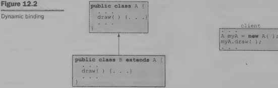

- 5. 多态在第9章中定义。
- 6. 方法调用到方法的动态绑定有时称为*动态多态*。

在某些情况下，继承层次结构的设计会导致一个或多个类位于层次结构中非常高的位置，以至于实例化它们没有意义。例如，假设一个程序定义了一个 `Building` 类以及一组用于特定建筑类型的子类，例如 `French_Gothic_Cathedrals`。在 `Building` 中拥有一个已实现的 draw 方法可能没有意义。但由于其所有后代类都应该有此类方法，因此该方法的协议（而不是方法体）包含在 `Building` 中。这样的方法通常称为*抽象方法*（C++ 中的*纯虚方法*）。包含至少一个抽象方法的类称为*抽象类*（C++ 中的*抽象基类*）。这样的类通常不能被实例化，因为它的一些方法已声明但未定义（它们没有方法体）。抽象类的任何要实例化的子类都必须提供所有继承的抽象方法的实现（定义）。

## 12.3 面向对象语言的设计问题

### 12.3.1 对象的排他性

完全致力于对象计算模型的语言设计者会设计一个对象系统，该系统涵盖所有其他类型概念。在这种思维模式下，从简单的标量整数到完整的软件系统，一切都是对象。这种选择的优点是语言及其使用的优雅性和纯粹的统一性。主要缺点是简单操作必须通过消息传递过程完成，这通常使它们比命令式模型中的类似操作更慢，而在命令式模型中，单台机器

行为。子类型继承接口和行为，而子类继承实现，主要目的是促进代码复用。

大多数支持面向对象编程的静态类型语言在设计上都使子类成为子类型，除非程序员特意设计一个行为与其父类不同的子类。

一个显而易见的问题是：子类是否为子类型这一问题究竟是理论问题还是实践问题？定义这样一个子类可能并不常见：其重写方法保留了对应被重写方法的类型协议，却没有保留其效果。因此，这并不是一个常见的实践问题。然而，如果存在一种相当简单的方法来强制要求所有子类都是子类型，那么这将使继承建立在更可靠的理论基础之上。

### 12.3.3 单继承与多继承

面向对象语言的另一个简单设计问题是：该语言是否允许多继承（除了单继承之外）？也许这并不那么简单。多继承的目的是允许一个新类从两个或更多类中继承。

既然多继承有时非常有用，为什么语言设计者不将其纳入语言呢？原因可分为两类：复杂性和效率。额外复杂性体现在几个问题上。首先，注意如果一个类有两个不相关的父类，并且两者都没有定义对方已定义的名称，那么没有问题。然而，假设一个名为 C 的子类同时继承自类 A 和类 B，并且 A 和 B 都定义了一个名为 `display` 的可继承方法。如果 C 需要引用两个版本的 `display`，该如何做到？当两个父类都定义了同名方法，并且其中一个或两者必须在子类中被重写时，这种歧义问题会变得更加复杂。

如果 A 和 B 都派生自一个共同父类 Z，并且 C 同时以 A 和 B 作为父类，就会出现另一个问题。这种情况称为 **菱形继承或共享继承**。在这种情况下，A 和 B 都应包含 Z 的可继承变量。假设 Z 包含一个名为 `sum` 的可继承变量。问题在于，C 应当继承两个版本的 `sum`，还是只继承一个；如果只继承一个，又该继承哪一个？在某些编程情形中，可能只应继承两者中的一个，而在另一些情形中，两者都应被继承。当 A 和 B 都从 Z 继承一个方法，并且两者都重写该方法时，也会出现类似问题。如果 C 的客户端（C 同时继承了这两个重写方法）调用该方法，那么调用的是哪一个方法，还是两个方法都应被调用？菱形继承如图 12.3 所示。

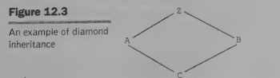

效率问题可能更多是感知上的，而非实际存在的。例如，在 C++ 中，支持多继承对于每次动态绑定的方法调用只需要额外一次数组访问和一次加法运算，至少在某些机器体系结构上是这样（Stroustrup，1994，第270页）。尽管即使程序不使用多继承也需要这一操作，但这是一项很小的额外开销。

使用多继承很容易导致复杂的程序组织。许多尝试使用多继承的人发现，设计用作多个父类的类很困难。而且这些困难并不限于初始开发者所造成的困难。某个类可能在以后被另一位开发者用作新类的一个父类。使用多继承的系统的维护可能成为更严重的问题，因为多继承会导致类之间的依赖关系更加复杂。对某些人来说，多继承的好处是否值得为设计并维护使用它的系统而付出额外努力，尚不明确。

接口在某种程度上类似于抽象类；其方法只有声明而没有定义。接口不能被实例化。它们被用作多继承的一种替代方案。^8 接口提供了多继承的一些好处，但缺点更少。例如，当使用接口而不是多继承时，就避免了菱形继承的问题。

### 12.3.4 对象的分配与释放

关于对象的分配和释放，有两个设计问题。第一个是对象从何处分配。如果对象的行为像抽象数据类型，那么它们可以从任何地方分配。这意味着它们可以从运行时栈中分配，也可以使用运算符或函数（例如 `new`）在堆上显式创建。如果它们都是堆动态的，优点是可以采用统一的方式创建对象，并通过指针或引用变量访问对象。这种设计简化了对象的赋值操作，使其在所有情况下都只是指针或引用值的改变。它还允许对对象的引用被隐式解引用，从而简化访问语法。

如果对象是栈动态的，那么对于子类型可能存在潜在问题。如果类 B 是类 A 的子类，并且 B 是 A 的子类型，那么 B 类型的对象可以赋给 A 类型的变量。例如，如果 b1 是 B 类型的变量，a1 是 A 类型的变量，那么

```
a1 = b1;
```

是一条合法语句。如果 a1 和 b1 是对堆动态对象的引用，则没有问题——赋值就是简单的指针赋值。然而，如果 a1 和 b1 是栈动态的，那么它们是值变量；如果赋值的是对象的值，就必须将其复制到目标对象的空间中。如果 B 在从 A 继承的内容之上增加了一个数据字段，那么 a1 在栈上就没有足够空间容纳整个 b1。多余部分会被截断，这可能使编写或使用该代码的程序员感到困惑。这种截断称为对象切片。下面的示例和图 12.4 说明了该问题。

```cpp
class A {
    int x;
    ...
};
class B : A {
    int y;
    ...
};
```

这里的第二个问题涉及对象从堆中分配的情况。问题是释放是隐式的、显式的，还是两者兼有。如果释放是隐式的，就需要某种隐式的存储回收方法。如果释放可以显式进行，就会引出能否创建悬空指针或引用的问题。

### 12.3.5 动态绑定与静态绑定

正如 12.2.3 节所讨论的，消息到方法的动态绑定是面向对象编程的必要组成部分。这里的问题是：是否所有消息到方法的绑定都是动态的？另一种选择是允许用户指定某个特定绑定是动态的还是静态的。这样做的优点是静态绑定更快。因此，如果一个绑定不必是动态的，为什么要付出动态绑定的代价呢？

### 12.3.6 嵌套类

嵌套类定义的主要动机之一是信息隐藏。如果一个新类只被一个类需要，就没有理由将它定义成可被其他类看到。在这种情况下，新类可以嵌套在使用它的类内部。在某些情况下，新类嵌套在一个子程序内部，而不是直接嵌套在另一个类中。

**图 12.4**

对象切片示例

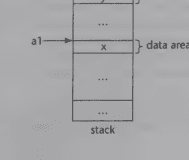

新类所嵌套于其中的类称为**宿主类**。与类嵌套相关的最显而易见的设计问题与可见性有关。具体来说，一个问题是：宿主类的哪些成员在嵌套类中可见？另一个重要问题则相反：嵌套类的哪些成员在宿主类中可见？

### 12.3.7 对象的初始化

初始化问题是：对象在创建时是否以及如何被初始化为值。这比乍看起来可能更复杂。一个问题是，对象必须手动初始化，还是通过某种隐式机制初始化。当创建子类的对象时，继承的父类成员的相关初始化是隐式的，还是必须由程序员显式处理？

## 12.4 特定语言对面向对象编程的支持

### 12.4.1 Smalltalk

许多人将 Smalltalk 视为权威的面向对象编程语言。它是第一种完整支持该范式的语言。因此，从 Smalltalk 开始考察语言对面向对象编程的支持是很自然的。

#### 12.4.1.1 一般特征

在 Smalltalk 中，对象的概念真正是普遍适用的。几乎一切事物，从像整数常量 2 这样简单的东西到复杂的文件处理系统，都是对象。作为对象，它们被统一对待。它们都有局部内存、内在处理能力、与其他对象通信的能力，以及从祖先继承方法和实例变量的可能性。类在 Smalltalk 中不能嵌套。

所有计算都通过消息完成，甚至简单的算术运算也是如此。例如，表达式 `x + 7` 的实现方式是向 `x` 发送 `+` 消息（以执行 `+` 方法），并将 `7` 作为参数发送。该操作返回一个包含加法结果的新数值对象。

对消息的回复以对象的形式出现，用于返回所请求或计算出的信息，或者仅用于确认所请求的服务已经完成。

所有 Smalltalk 对象都从堆中分配，并通过引用变量引用，这些引用变量会被隐式解引用。没有

显式的释放语句或操作。因此，所有释放都是隐式的，使用垃圾回收过程进行存储回收。

在 Smalltalk 中，创建对象时必须显式调用构造函数。一个类可以有多个构造函数，但每个构造函数必须具有唯一的名称。Smalltalk 类不能嵌套在其他类中。

与 C++ 和 Objective-C 等混合语言不同，Smalltalk 只为一种软件开发范式——面向对象——而设计。此外，它完全不采用命令式语言的外观。其目标的纯粹性体现在简洁优雅和设计的一致性上。

第 2 章中有一个 Smalltalk 示例程序。

#### 12.4.1.2 继承

Smalltalk 子类继承其超类的所有成员。子类也可以拥有自己的实例变量，这些变量的名称必须不同于其祖先类中的变量名。最后，子类可以定义新方法，并重新定义祖先类中已存在的方法。当子类拥有一个名称和协议与某个祖先类相同的方法时，子类方法会隐藏该祖先类的方法。要访问这种被隐藏的方法，可以通过在消息前加上伪变量 `super` 来实现。该前缀使方法搜索从超类开始，而不是从本地开始。

由于父类中的成员不能对子类隐藏，因此子类可以成为、而且通常就是子类型。

Smalltalk 不支持多重继承。

#### 12.4.1.3 动态绑定

在 Smalltalk 中，消息到方法的动态绑定按如下方式工作：向一个对象发送消息会促使在该对象所属的类中搜索相应的方法。如果搜索失败，则继续在该类的超类中搜索，依此类推，直到系统类 `Object`，它没有超类。`Object` 是类派生树的根，每个类都是该树上的一个节点。如果在这条链的任何位置都找不到方法，就会发生错误。重要的是要记住，这种方法是动态搜索的——它发生在发送消息时。Smalltalk 在任何情况下都不会将消息静态绑定到方法。

Smalltalk 中唯一的类型检查是动态的，唯一的类型错误发生在向一个对象发送消息，而该对象在本地或通过继承都没有匹配的方法时。这与大多数其他语言的类型检查概念不同。Smalltalk 类型检查的简单目标是确保消息与某个方法匹配。

Smalltalk 变量没有类型；任何名称都可以绑定到任何对象。直接结果是，Smalltalk 支持动态多态。所有 Smalltalk 代码都是泛型的，其意义在于变量的类型无关紧要，只要它们一致即可。对变量执行操作（方法或运算符）的含义由该变量当前所绑定对象的类决定。

这段讨论的要点是：只要表达式中引用的对象具有处理该表达式消息的方法，对象的类型就无关紧要。这意味着没有代码被绑定到特定类型。

#### 12.4.1.4 Smalltalk 的评估

Smalltalk 是一种小语言，尽管 Smalltalk 系统很大。该语言的语法简单且高度规则。它是一个很好的例子，说明如果一种语言围绕一个简单但强大的概念构建，小语言可以提供多大的能力。就 Smalltalk 而言，这个概念是：所有编程都可以仅使用由继承、对象和消息传递构建的类层次结构来完成。

与传统编译型命令式语言程序相比，等效的 Smalltalk 程序明显更慢。尽管在消息传递模型内提供数组索引和循环在理论上很有趣，但效率是评估编程语言的重要因素。因此，在大多数关于 Smalltalk 实际适用性的讨论中，效率显然会是一个问题。

Smalltalk 的动态绑定允许类型错误直到运行时才被发现。可以编写包含向不存在方法发送消息的程序，而直到发送这些消息时才会被发现，这会在开发后期导致比静态类型语言多得多的错误修复。然而，在实践中，类型错误对 Smalltalk 程序来说并不是严重问题。

总体而言，Smalltalk 的设计始终站在语言优雅性和严格遵循面向对象编程支持原则的一边，往往不考虑实际问题，尤其是执行效率。这在独占使用对象和无类型变量方面最为明显。

Smalltalk 用户界面对计算产生了重要影响：窗口、鼠标指向设备以及弹出式和下拉式菜单的集成使用——所有这些都最早出现在 Smalltalk 中——主导了当代软件系统。

也许 Smalltalk 最大的影响是推动了面向对象编程的发展，而面向对象编程现在是使用最广泛的设计和编码方法。

### 12.4.2 C++

第 2 章描述了 C++ 如何从 C 和 SIMULA 67 演变而来，其设计目标是在支持面向对象编程的同时，保留与 C 几乎完全的向后兼容性。第 11 章讨论了 C++ 类如何用于支持抽象数据类型。本节探讨 C++ 对面向对象编程其他要素的支持。C++ 类、继承和动态绑定的全部细节庞大而复杂。本节只讨论这些主题中最重要的部分，特别是与 12.3 节所述设计问题直接相关的部分。

C++ 是第一种广泛使用的面向对象编程语言，至今仍是最流行的语言之一。因此，它自然也是其他语言经常与之比较的语言。基于这两个原因，我们在这里对 C++ 的讨论比本章讨论的其他示例语言更详细。

#### 12.4.2.1 一般特征

为了保持与 C 的向后兼容性，C++ 保留了 C 的类型系统并为其添加了类。因此，C++ 既有传统的命令式语言类型，又有面向对象语言的类结构。它支持方法，也支持与特定类无关的函数。这使其成为一种混合语言，同时支持过程式编程和面向对象编程。

C++ 的对象可以是静态的、栈动态的或堆动态的。对于堆动态对象，需要使用 *delete* 运算符显式释放，因为 C++ 不包含隐式存储回收。

许多类定义包含析构函数方法，当该类的对象不再存在时，它会隐式调用。析构函数用于释放由数据成员引用的堆分配内存。它也可以用于在对象消亡之前记录对象的部分或全部状态，通常用于调试目的。

#### 12.4.2.2 继承

C++ 类可以从现有类派生，该现有类随后成为其父类或基类。与 Smalltalk 和大多数其他支持面向对象编程的语言不同，C++ 类也可以独立存在，没有超类。在派生类的定义中，派生类的名称后附有基类的名称，并用冒号（:）连接，如下面的语法形式所示：

```
class derived_class_name : base_class_name { ... }
```

类定义中定义的数据称为该类的 *数据成员*，类定义中定义的函数称为该类的 *成员函数*（其他语言中的成员函数通常称为方法）。基类的部分或全部成员可以由派生类继承，派生类还可以添加新成员并修改继承的成员函数。

所有 C++ 对象在使用前都必须初始化。因此，所有 C++ 类至少包含一个构造函数方法，用于初始化新对象的数据成员。创建对象时，构造函数方法会被隐式调用。如果任何数据成员是指向堆分配数据的指针，构造函数会分配该存储空间。

如果一个类派生自另一个类，则在创建派生类对象时必须初始化继承的数据成员。为此，基类构造函数会被隐式调用。当必须向

一个 Shape（即，从 Shape 派生的类的任何对象），而无需重新编译。

我们可以轻松地将其推广到任何满足 C++ 标准库要求的容器：

```cpp
template<class C>
void draw_all(const C& c)
{
    typedef typename C::const_iterator CI;
    for (CI p = c.begin(); p != c.end(); ++p)
        (*p)->draw();
}
```

使用迭代器使我们能够将这个 draw_all() 应用于不支持下标的容器，例如标准库 list：

```cpp
vector<Shape*> vs;
list<Shape*> ls;
// ...
draw_all(vs);
draw_all(ls);
```

我们甚至可以进一步推广，以处理由一对迭代器定义的任意元素序列：

```cpp
template<class Iterator> void
draw_all(Iterator b, Iterator e)
{
    for_each(b, e, mem_fun(&Shape::draw));
}
```

为了简化实现，我使用了标准库算法 for_each。

我们可以对标准库 list 和数组调用最后一个版本的 draw_all()：

```cpp
list<Shape*> ls;
Shape* as[100];
// ...
draw_all(ls.begin(), ls.end());
draw_all(as, as + 100);
```

## 为工作选择“正确”的语言

拥有众多范式的这种背景有多大用处？或者，与其学习这些其他范式，不如把时间投入到更加熟悉面向对象语言上，这样会更好吗？对于任何想成为软件领域专业人士的人来说，了解几种语言和几种编程范式是必不可少的。目前，C++ 是用于多范式编程的最佳语言，也是学习各种编程形式的好语言。然而，只了解 C++ 并不是好主意，更不用说只了解一种单范式语言了。那有点像色盲或只会一种语言的人。你几乎不会知道自己错过了什么。优秀编程的许多灵感，来自于学习并欣赏若干种编程风格，以及看到它们如何在不同语言中使用。

此外，我认为任何非平凡程序的编程工作，都是受过扎实而广泛教育的专业人士的工作，而不是那些只受过仓促而狭窄的“培训”的人的工作。

基类构造函数，它是在对派生对象构造函数的调用中给出的。一般来说，这是通过以下结构完成的：

```cpp
subclass (subclass parameters) : base_class (superclass parameters) {
    . . .
}
```

如果开发人员没有在类定义中包含构造函数，编译器会包含一个平凡的构造函数。这个默认构造函数会调用基类的构造函数（如果有基类的话）。

类成员可以是 `private`、`protected` 或 `public`。私有成员只能由成员函数和该类的友元访问。独立函数、成员函数和类都可以被声明为某个类的友元，从而获得访问其私有成员的权限。公有成员在任何地方都可见。保护成员类似于私有成员，但在派生类中除外，派生类的访问权限将在接下来描述。派生类可以修改其继承成员的可访问性。派生类的完整语法形式如下：

```cpp
class derived_class_name : derivation_mode base_class_name
    {data member and member function declarations};
```

`derivation_mode` 可以是 `public` 或 `private`。⁹（不要将公有派生和私有派生与公有成员和私有成员混淆。）基类的公有成员和保护成员在公有派生类中也分别是公有成员和保护成员。在私有派生类中，基类的公有成员和保护成员都是私有的。因此，在类层次结构中，私有派生类会切断所有后继类对所有祖先类所有成员的访问。基类的私有成员会被派生类继承，但它们对该派生类的成员不可见，因此在那里没有用处。

私有派生提供了一种可能性：子类可以拥有与父类中同名成员具有不同访问权限的成员。考虑以下示例：

```cpp
class base_class {
private:
    int a;
    float x;
protected:
    int b;
    float y;
public:
    int c;
    float z;
};

class subclass_1 : public base_class {. . .};
class subclass_2 : private base_class {. . .};
```

9. 它也可以是 `protected`，但这里不讨论该选项。

从而对其他所有类隐藏它。然而，它的成员是公有的，因此它们对嵌套类 single_linked_list 可见。如果它们是私有的，node 就需要将嵌套类声明为友元，才能使它们在嵌套类中可见。注意，嵌套类对嵌套类的成员没有特殊访问权限。只有嵌套类的静态数据成员对嵌套类的方法可见。^10

10. 类也可以在外围类的方法中定义。此类类的作用域规则与直接嵌套在其他类中的类相同，即使对于在其定义所在方法中声明的局部变量也是如此。

外围类 single_linked_list 只有一个数据成员，即一个用作列表头部的指针。它包含一个构造函数，该函数将 head 设置为空指针值。四个成员函数允许在列表对象的任一端插入节点、从列表的一端移除节点，以及测试列表是否为空。

以下定义提供了 stack 和 queue 两个类，二者都基于 single_linked_list 类：

```cpp
class stack : public single_linked_list {
public:
    stack() {}
    void push(int value) {
        insert_at_head(value);
    }
    int pop() {
        return remove_at_head();
    }
};
class queue : public single_linked_list {
public:
    queue() {}
    void enqueue(int value) {
        insert_at_tail(value);
    }
    int dequeue() {
        return remove_at_head();
    }
};
```

注意，stack 和 queue 这两个子类的对象都可以访问基类 single_linked_list 中定义的 empty 函数（因为这是公有派生）。两个子类都定义了不做任何事的构造函数。创建子类对象时，会隐式调用子类中相应的构造函数。然后，会调用基类中任何适用的构造函数。因此，在我们的示例中，创建 stack 类型的对象时，会调用 single_linked_list 中的构造函数，它执行必要的初始化。然后调用 stack 构造函数，它不做任何事。

stack 和 queue 这两个类都遭受同一个严重问题：二者的客户端都可以访问父类 single_linked_list 的所有公有成员。stack 对象的客户端可以调用 insert_at_tail，从而破坏其栈的完整性。同样，queue 对象的客户端可以调用 insert_at_head。这些不需要的访问之所以被允许，是因为 stack 和 queue 都是 single_linked_list 的子类型。当希望子类继承基类的整个接口时，就使用公有派生。另一种选择是使用子类只继承基类实现的派生方式。我们可以使用私有派生而不是公有派生，来编写我们的两个示例派生类，使它们不成为父类的子类型。^11 然后，二者还需要重新导出 empty，因为它将对它们的实例隐藏。这种情况说明了私有派生选项的动机。stack 和 queue 类型的新定义（名为 stack_2 和 queue_2）如下所示：

```cpp
class stack_2 : private single_linked_list {
public:
    stack_2() {}
    void push(int value) {
        single_linked_list::insert_at_head(value);
    }
    int pop() {
        return single_linked_list::remove_at_head();
    }
    single_linked_list::empty;
};
class queue_2 : private single_linked_list {
public:
    queue_2() {}
    void enqueue(int value) {
        single_linked_list::insert_at_tail(value);
    }
    int dequeue() {
        return single_linked_list::remove_at_head();
    }
    single_linked_list::empty;
};
```

这两个类使用重新导出，以允许客户端访问基类方法。在使用公有派生时，这并不必要。

stack 和 queue 的两个版本说明了子类型与非子类型的派生类型之间的区别。链表是栈和队列的泛化，因为二者都可以实现为链表。因此，从链表类继承来定义 stack 和 queue 类是自然的。然而，二者都不是链表类的子类型，因为二者都将父类的公有成员变为私有，从而使客户端无法访问它们。

友元之所以必要，原因之一是：有时必须编写一个能够访问两个不同类的成员的子程序。因为

11. 它们不会成为子类型，因为父类的公有成员在客户端中可见，但在子类的客户端中不可见，而在子类中这些成员是私有的。


例如，假设一个程序使用一个类表示向量，使用另一个类表示矩阵；并且需要一个子程序将一个矩阵对象乘以一个向量对象。在 C++ 中，乘法函数可以声明为这两个类的友元。

如前所述，C++ 提供多重继承。例如，假设我们想要一个用于绘图的类，它需要具有一个为绘制图形而编写的类的行为，并且新类的方法需要在一个单独的 Thread 中运行。我们可能会如下定义：

```
class Thread { ... };
class Drawing { ... };
class DrawThread : public Thread, public Drawing { ... };
```

DrawThread 类继承 Thread 和 Drawing 的所有成员。如果 Thread 和 Drawing 恰好都包含同名成员，则在 DrawThread 类的对象中可以通过作用域解析运算符（::）无歧义地引用它们。这个多重继承的示例如图 12.5 所示。

C++ 多重继承实现的一些问题将在 12.5 节讨论。

C++ 中的重写方法¹²必须与被重写方法具有完全相同的参数特征。如果参数特征有任何差异，则子类中的方法将被视为一个新方法，与另一个类中的同名方法无关。重写方法的返回类型要么必须与被重写方法的返回类型相同，要么必须是被重写方法返回类型的公有派生类型。

#### 12.4.2.3 动态绑定

到目前为止，我们定义的所有成员函数都是静态绑定的；也就是说，对其中一个函数的调用会静态绑定到一个函数定义。C++ 对象可以通过值变量而不是指针或引用来操作。（这样的对象将是静态的或栈动态的。）然而，在这种情况下，基类中的函数将不会有用。

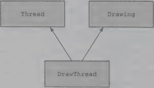

回想一下，在 12.2.3 节中讨论了一个基类 Building，每个子类都描述某种特定类型的建筑。每个子类都有一个 draw 方法，但这些方法在基类中都不会有用。因此，draw 在 Building 类中将是一个纯虚函数。

任何包含纯虚函数的类都是**抽象类**。在 C++ 中，抽象类不用保留字标记。抽象类可以包含完全定义的方法。由于存在一个或多个虚函数，实例化抽象类是非法的。严格来说，抽象类是一种仅用于表示类型特征的类。C++ 提供抽象类来为这些真正抽象的类建模。如果抽象类的子类没有重新定义其父类的纯虚函数，则该函数在子类中仍为纯虚函数，并且该子类也是抽象类。

抽象类和继承共同支持一种强大的软件开发技术。它们允许按层次定义类型，使相关类型可以成为真正抽象类型的子类，而这些抽象类型定义了它们的共同抽象特征。

动态绑定允许使用 draw 这类成员的代码在编写所有甚至任何一个 draw 版本之前编写。新的派生类可以在多年后添加，而无需对使用这些动态绑定成员的代码做任何更改。这是面向对象语言的一个非常有用的特性。

栈动态对象的引用赋值不同于堆动态对象的指针赋值。例如，考虑以下代码，它使用与上一个示例相同的类层次结构：

```
Square sq;        // Allocate a Square object on the stack
Rectangle rect;   // Allocate a Rectangle object on
                  // the stack
rect = sq;        // Copies the data member values from
                  // the Square object
rect.draw();      // Calls the draw from the Rectangle
                  // object
```

在赋值 rect = sq 中，来自 sq 所引用对象的成员数据将被赋给 rect 所引用对象的数据成员，但 rect 仍将引用 Rectangle 对象。因此，通过 rect 所引用的对象调用 draw，将是调用 Rectangle 类的 draw。如果 rect 和 sq 是指向堆动态对象的指针，同样的赋值将是指针赋值，这会使 rect 指向 Square 对象，而通过 rect 调用 draw 将动态绑定到 Square 对象中的 draw。

#### 12.4.2.4 评估

将 C++ 的面向对象特性与 Smalltalk 的面向对象特性进行比较是很自然的。在访问控制方面，C++ 的继承比 Smalltalk 的继承更复杂。通过同时使用 Smalltalk 类内的访问控制。这种差异还有其他因素，但效率显然是支持 C++ 的一个有力论据。当然，所有支持面向对象编程的编译型语言运行速度大约比 Smalltalk 快 10 倍。

### 12.4.3 Objective-C

我们讨论 Objective-C 对面向对象编程的支持，并与 C++ 的支持进行比较。这两种语言大约在同一时期设计。两者都为 C 语言增加了对面向对象编程的支持。从表面上看，最大的差异在于方法调用的语法：在 C++ 中，方法调用与 C 的函数调用密切相关，而在 Objective-C 中，它们更类似于 Smalltalk 的方法调用。

#### 12.4.3.1 总体特征

与 C# 一样，Objective-C 既有基本类型，也有对象。回想一下（第 11 章），类定义由两部分组成：接口和实现。这两部分通常放在单独的文件中，接口文件使用 .h 扩展名，实现文件使用 .m 扩展名。当接口位于单独文件中时，实现文件以如下内容开头：

```
#import "interface_file.h"
```

实例变量在接口部分头部之后的花括号限定块中声明。Objective-C 不直接支持类变量。然而，在实现文件中定义的静态全局变量可以用作类变量。类的实现部分包含相应接口部分中声明的方法的定义。Objective-C 不允许嵌套类。

#### 12.4.3.2 继承

Objective-C 仅支持单继承。除名为 NSObject 的预定义根类外，每个类都必须有一个父类。使用单一根类的一个原因是，有些操作是普遍需要的。其中包括类方法 alloc 和 init。新类的父类在接口指令中声明，位于所定义类名之后附加的冒号之后，如下所示：

```
@interface myNewClass: NSObject {
```

当然，父类的所有受保护数据成员和公有数据成员都由子类继承。可以向子类添加新方法和实例变量。回想一下，尽管在 C++ 中可以通过说明符控制对方法的访问，但在 Objective-C 中所有方法都是公有的，而且这一点无法更改。在子类中定义、具有相同名称、相同返回类型以及相同参数数量和类型的方法会重写继承的方法。被重写的方法可以在子类的另一个方法中通过 *super* 调用，*super* 是对父对象的引用。没有办法阻止重写继承的方法。因为基类的所有公有成员在从该基类派生的子类中也是公有的，所以所有子类都可以被作为子类型使用。

与 Smalltalk 一样，在 Objective-C 中可以对任何对象调用任何方法名。如果运行时系统发现该对象没有这样的方法（具有正确的协议），就会发生错误。

Objective-C 不支持 C++ 的私有派生和受保护派生。

与支持面向对象编程的其他语言一样，子类实例的构造函数应始终在做任何其他事情之前调用父类的构造函数。如果父类构造函数的名称为 `init`，则通过以下语句完成：

```
[super init];
```

除了子类化之外，Objective-C 还包括两种扩展类的方式：类别和协议。可以使用一种称为类别的构造向类添加一组方法。类别是类的一个次级接口，包含方法的声明。次级接口中不能包含新的实例变量。这种接口的语法形式如下例所示：

```
#import "Stack.h"
@interface Stack (StackExtend)
  -(int) secondFromTop;
  -(void) full;
@end
```

这个类别的名称是 StackExtend。原始接口因为被导入而可访问，所以不必提及父类。新方法被混入原始接口的方法中。因此，类别有时被称为混入（mixins）。混入有时用于向不同的类添加某些功能。当然，该类仍然有一个正常的超类，并从中继承成员。因此，混入提供了多重继承的一些好处，同时避免了如果模块不要求其函数带上模块名就可能发生的命名冲突。当然，类别也必须有一个实现部分，它在实现指令中的类名之后用括号包含类别名称，如下所示：

```
@implementation Stack (StackExtend)
```

实现部分不必实现类别中的所有方法。


```
// Set the id to reference the square
shapeRef = mySquare;
[shapeRef draw];
```

这段代码先绘制圆，然后绘制正方形，两个 `draw` 方法都通过 `shapeRef` 对象引用调用。

#### 12.4.3.4 评估

Objective-C 对面向对象编程的支持是足够的，尽管存在一些小的缺陷。无法阻止覆盖继承的方法。对 `id` 数据类型多态的支持有些过度，因为它允许变量引用任何对象，而不仅仅是继承链中的对象。尽管没有直接支持多重继承，但该语言包含一种混入（mixin）形式——类别（categories），它提供了多重继承的某些能力，却没有其所有缺点。类别允许将一组行为添加到任何类中。协议提供了接口的能力，例如 Java 中的接口，这也提供了多重继承的某些能力。

### 12.4.4 Java

由于 Java 对类、继承和方法的设计与 C++ 类似，本节我们只关注 Java 与 C++ 不同的那些方面。

#### 12.4.4.1 一般特性

与 C++ 一样，Java 既支持对象也支持非对象数据。然而，在 Java 中，只有原始标量类型（布尔、字符和数值类型）的值不是对象。Java 的枚举和数组是对象。Java 拥有非对象的原因是为了效率。

在 Java 5.0+ 中，当原始值放入对象上下文时会被隐式强制转换。这种强制转换会将原始值转换为该原始值类型的包装类对象。例如，将 `int` 值或变量放入对象上下文会创建包含该 `int` 原始值的 `Integer` 对象。这种强制转换称为**装箱**。

C++ 类可以定义为没有父类，而这在 Java 中是不可能的。所有 Java 类都必须是根类 `Object` 的子类，或者是 `Object` 的某个后代类的子类。这样做的一个优点是，一些常用方法（例如 `toString` 和 `equals`）可以在 `Object` 中定义，并由所有其他类继承和使用。

所有 Java 对象都是显式堆动态的。大多数对象用 `new` 运算符分配，但没有显式释放运算符。使用垃圾回收进行存储回收。与许多其他语言特性一样，尽管垃圾回收避免了一些严重问题（如悬空指针），但它也可能导致其他问题。其中一种困难在于，垃圾回收器会释放或回收对象占用的存储，但仅此而已。例如，如果对象可以访问堆内存之外的某些资源，例如文件或共享资源上的锁，垃圾回收器不会回收这些资源。对于这些情况，Java 允许包含一个特殊方法 **finalize**，它与 C++ 析构函数相关。

当垃圾回收器即将回收对象占用的存储时，会隐式调用 **finalize** 方法。**finalize** 的问题在于，它（以及垃圾回收器）运行的时间无法被强制，甚至无法被预测。使用 **finalize** 来回收即将被垃圾回收的对象所持有资源的替代方案是，包含一个执行回收的方法。这样做唯一的问题是，对象的所有客户端都必须知道这个方法，并记得调用它。

#### 12.4.4.2 继承

在 Java 中，可以将方法定义为 **final**，这意味着它不能在任何后代类中被覆盖。当在类定义上指定 **final** 保留字时，意味着该类不能被子类化。**final** 类中的所有方法都隐式地为 final，这意味着方法调用到该类方法的绑定是静态绑定的。

将类定义为 **final** 的优点是，不允许对该类进行任何更改。例如，`String` 是一个 **final** 类，因此任何在参数中接收 `String` 引用的方法都可以依赖 `String` 方法含义的稳定性。缺点是将类定义为 **final** 会禁止即使是微小修改所需的复用。

Java 包含注解 `@Override`，它通知编译器检查以下方法是否覆盖了祖先类中的方法。如果没有覆盖，编译器会发出错误消息。

与 C++ 一样，Java 要求先调用父类构造函数，再调用子类构造函数。如果要将参数传递给父类构造函数，则必须显式调用该构造函数，如下例所示：

```java
super(100, true);
```

如果没有显式调用父类构造函数，编译器会在父类中插入对无参构造函数的调用。

Java 不支持 C++ 的私有派生。可以推测，Java 设计者认为子类应当是子类型，而在支持私有派生时它们并不是子类型。因此，他们没有包含私有派生。所以，Java 的子类可以是子类型。

早期版本的 Java 包含一个集合 `Vector`，它包含一长串用于操作集合结构中数据的方法。这些版本的 Java 还包含 `Vector` 的一个子类 `Stack`，它添加了压入和弹出操作的方法。不幸的是，由于 Java 没有私有派生，`Vector` 的所有方法在 `Stack` 类中也可见；对于名称和协议相同的方法，无法在该类中同时实现两者。

作为接口的一个例子，考虑标准 Java 类 `Arrays` 的 sort 方法。任何使用该方法的类都必须提供一种用于比较待排序元素的方法实现。泛型 `Comparable` 接口提供了这个比较方法的协议，该方法名为 `compareTo`。`Comparable` 接口的代码如下：

```java
public interface Comparable<T> {
    public int compareTo(T b);
}
```

如果调用 `compareTo` 方法的对象排在参数对象之前，则 `compareTo` 方法必须返回负整数；如果它们相等，则返回零；如果参数对象排在调用 `compareTo` 的对象之前，则返回正整数。实现 `Comparable` 接口的类可以对泛型类型的任意对象数组的内容进行排序，只要该泛型类型已实现 `compareTo` 方法并提供适当的值。

除了接口之外，Java 还支持抽象类，类似于 C++ 的抽象类。Java 抽象类的抽象方法仅表示为方法头，其中包含保留字 abstract。抽象类也被标记为 abstract。当然，抽象类不能被实例化。

第 14 章说明了接口在 Java 事件处理中的使用。

#### 12.4.4.3 动态绑定

在 C++ 中，必须将方法定义为 virtual 以允许动态绑定。在 Java 中，所有方法调用都是动态绑定的，除非被调用的方法已定义为 final，在这种情况下它不能被覆盖，并且所有绑定都是静态的。如果方法是 static 或 private，也使用静态绑定，这两者都不允许覆盖。

#### 12.4.4.4 嵌套类

Java 有几种嵌套类，它们都具有一个优点：除了嵌套类所在的外围类之外，对其包中的所有类都隐藏。直接嵌套在另一个类中的非静态类称为内部类。内部类的每个实例都必须有一个隐式指针，指向它所属的嵌套类实例。这使得嵌套类的方法可以访问嵌套类所在外围类的所有成员，包括私有成员。静态嵌套类没有这个指针，因此它们不能访问嵌套类所在外围类的成员。因此，Java 中的静态嵌套类类似于 C++ 的嵌套类。

尽管在静态作用域语言中看起来有些奇怪，但内部类的成员，甚至私有成员，都可以在外部类中访问。这种

引用必须包含引用内部类对象的变量。例如，假设外部类用以下语句创建内部类的实例：

```
myInner = this.new Inner();
```

那么，如果内部类定义了一个名为 *sum* 的变量，就可以在外部类中以 *myInner.sum* 引用它。

嵌套类的实例只能存在于其外层类的实例中。嵌套类也可以是匿名的。匿名嵌套类的语法复杂，但实际上只是一种仅从一个位置使用的类的缩写定义方式。匿名嵌套类的示例见第14章。

局部嵌套类定义在其外层类的方法中。局部嵌套类从不使用访问说明符（**private** 或 **public**）定义。其作用域始终限于其外层类。局部嵌套类中的方法可以访问其外层类中定义的变量，以及定义该局部嵌套类的方法中定义的 *final* 变量。局部嵌套类的成员仅在该局部嵌套类所定义的方法中可见。

#### 12.4.4.5 评价

Java 支持面向对象编程的设计与 C++ 类似，但更一致地遵循面向对象原则。Java 不允许没有父类的类，并使用动态绑定作为将方法调用绑定到方法定义的“常规”方式。当然，与许多方法绑定为静态的语言相比，这会略微增加执行时间。然而，在做出这一设计决策时，大多数 Java 程序都是解释执行的，因此解释时间使额外的绑定时间显得微不足道。与 C++ 从派生控制到友元函数等各种访问控制构成的丛林相比，类定义内容的访问控制相当简单。最后，Java 使用接口来提供一种对多重继承的支持形式，这种形式不具备实际多重继承的所有缺点。

### 12.4.5 C#

C# 对面向对象编程的支持与 Java 类似。

#### 12.4.5.1 一般特征

C# 同时包含类和结构体，其中类与 Java 的类非常相似，而结构体则是功能稍弱的结构。一个重要区别是结构体是值类型；也就是说，它们是栈动态的。这可能导致对象切片问题，但结构体不能被继承的限制防止了这一点。C# 结构体与其类的区别的更多细节见第11章。

#### 12.4.5.2 继承

C# 使用 C++ 的语法定义类。例如，

```csharp
public class NewClass : ParentClass { . . . }
```

从父类继承的方法可以在派生类中通过在子类中的定义前标记 `new` 来替换。`new` 方法会对正常访问隐藏父类中的同名方法。不过，仍可以通过在调用前加上 `base` 来调用父类版本。例如，

```csharp
base.Draw();
```

与 Java 一样，子类可以是子类型。C# 对接口的支持与 Java 相同。它不支持多重继承。

#### 12.4.5.3 动态绑定

为了允许在 C# 中将方法调用动态绑定到方法，基方法及其在派生类中对应的方法都必须进行特殊标记。基类方法必须像在 C++ 中一样用 `virtual` 标记。为了明确子类中与祖先类中虚方法同名且协议相同的方法的意图，C# 要求如果这些方法要重写父类虚方法，就必须标记为 `override`。^14 例如，第12.4.2.3节中 C++ `Shape` 类的 C# 版本如下：

```csharp
public class Shape {
    public virtual void Draw() { . . . }
    . . .
}
public class Circle : Shape {
    public override void Draw() { . . . }
    . . .
}
public class Rectangle : Shape {
    public override void Draw() { . . . }
    . . .
}
public class Square : Rectangle {
    public override void Draw() { . . . }
    . . .
}
```

C# 包含与 C++ 类似的抽象方法，只是指定它们的语法不同。例如，下面是一个 C# 抽象方法：

```csharp
abstract public void Draw();
```

包含至少一个抽象方法的类是抽象类，并且每个抽象类都必须标记为 `abstract`。抽象类不能被实例化。因此，抽象类的任何将被实例化的子类都必须实现其继承的所有抽象方法。

与 Java 一样，所有 C# 类最终都派生自单一根类 `Object`。`Object` 类定义了一组方法，包括 `ToString`、`Finalize` 和 `Equals`，这些方法由所有 C# 类型继承。

#### 12.4.5.4 嵌套类

直接嵌套在某个类中的 C# 类的行为类似于 Java 的静态嵌套类（这也类似于 C++ 中的嵌套类）。与 C++ 一样，C# 不支持行为像 Java 非静态嵌套类那样的嵌套类。

#### 12.4.5.5 评价

由于 C# 是一种新设计的基于 C 的面向对象语言，人们应当期望其设计者从前辈那里吸取经验，复制过去的成功并弥补一些问题。这一点的一个结果，加上 Java 存在的问题较少，是 C# 对面向对象编程的支持与 Java 之间的差异相对较小。C# 中结构体的可用性（Java 没有）可以视为一项改进。与 Java 一样，C# 对面向对象编程的支持比 C++ 更简单，许多人认为这是一种改进。

### 12.4.6 Ruby

如前所述，Ruby 在 Smalltalk 的意义上是一种纯面向对象编程语言。该语言中几乎一切都是对象，所有计算都通过消息传递完成。尽管程序中的表达式使用中缀运算符，因而外观与 Java 等语言中的表达式相同，但这些表达式实际上是通过消息传递求值的。与 Smalltalk 的情况一样，当编写 `a + b` 时，它通过向 `a` 引用的对象发送消息 `+`，并将对对象 `b` 的引用作为参数传递来求值。换句话说，`a + b` 实现为 `a.+ b`。

#### 12.4.6.1 一般特征

Ruby 类定义与 C++ 和 Java 等语言不同，因为它们是可执行的。因此，它们被允许在执行期间保持开放。程序可以任意多次向类添加成员，只需提供包含新成员的该类的辅助定义。在执行期间，类的当前定义是所有已执行的该类定义的并集。方法定义是

两个实例变量 @one 和 @two，那些 getter 可以在类中用单条语句指定：

```
attr_reader :one, :two
```

attr_reader 实际上是一个函数调用，使用 :one 和 :two 作为实际参数。在变量前加冒号（:）会使用变量名本身，而不是将其解引用到它所引用的对象。传递的不是值或地址，而是变量名的文本。这正是宏参数的传递方式。

类似地创建 setter 的函数称为 attr_writer。该函数具有与 attr_reader 相同的参数配置。

用于创建 getter 和 setter 方法的函数之所以如此命名，是因为它们为类的对象提供协议，而这些对象随后被称为属性。因此，类的属性定义了到该类对象的数据接口（通过访问器方法公开的数据）。

类变量通过在其名称前加上两个 at 符号（@@）来指定，是类及其实例私有的。这种私有性不能更改。此外，与全局变量和实例变量不同，类变量必须在使用前初始化。

#### 12.4.6.2 继承

Ruby 中使用小于号（<）而不是 C++ 的冒号来定义子类。例如，

```
class MySubClass < BaseClass
```

Ruby 方法访问控制的一个独特之处是，可以在子类中通过调用访问控制函数来更改它们。这意味着可以定义基类的两个子类，使得其中一个子类的对象可以访问基类中定义的方法，而另一个子类的对象不能。此外，这允许人们将基类中公开可访问的方法的访问权限更改为子类中私有可访问的方法。

#### 12.4.6.3 动态绑定

Ruby 中对动态绑定的支持与 Smalltalk 中相同。变量没有类型；相反，它们都是对任何类的对象的引用。因此，所有变量都是多态的，所有方法调用到方法的绑定都是动态的。

#### 12.4.6.4 评价

由于 Ruby 是最纯粹意义上的面向对象编程语言，其对面向对象编程的支持显然是足够的。然而，对类成员的访问控制比 C++ 弱。Ruby 不

## 表 12.1 设计

| 设计问题/语言 | C++ | Smalltalk | C+ | Objective-C | Java | C# | Ruby |
|---|---|---|---|---|---|---|---|
| 对象的独占性 | 基本类型加对象 | 所有数据都是对象 | 基本类型加对象 | 基本类型加对象 | 基本类型加对象 | 基本类型加对象 | 所有数据都是对象 |
| 子类是否是子类型？ | 如果派生是公有的，它们可以且通常是 | 它们可以且通常是 | 它们可以且通常是 | 它们可以且通常是 | 它们可以且通常是 | 它们可以且通常是 | 没有子类是子类型 |
| 单继承和多继承 | 两者都支持 | 仅单继承 | 仅单继承，但通过协议实现某些效果 | 仅单继承，但通过协议实现某些效果 | 仅单继承，但通过接口实现某些效果 | 仅单继承，但通过接口实现某些效果 | 仅单继承；但通过模块实现某些效果 |
| 对象的分配与释放 | 对象可以是静态的、栈动态的或堆动态的；分配和释放是显式的 | 所有对象都在堆上分配；分配和释放是隐式的 | 所有对象都在堆上分配；分配和释放是隐式的 | 所有对象都在堆上分配；分配和释放是隐式的 | 所有对象都在堆上分配；分配和释放是隐式的 | 所有对象都在堆上分配；分配和释放是隐式的 | 所有对象都在堆上分配；分配和释放是隐式的 |
| 动态绑定和静态绑定 | 方法绑定可以是静态的或动态的 | 所有方法绑定都是动态的 | 方法绑定可以是静态的或动态的 | 方法绑定可以是静态的或动态的 | 方法绑定可以是静态的或动态的 | 方法绑定可以是静态的或动态的 | 所有方法绑定都是动态的 |
| 嵌套类？ | 是 | 否 | 是 | 是 | 是 | 是 | 否 |
| 初始化 | 构造函数被隐式调用 | 构造函数必须被显式调用 | 构造函数被隐式调用 | 构造函数必须被显式调用 | 构造函数被隐式调用 | 构造函数被隐式调用 | 构造函数被隐式调用 |

Ruby 不支持抽象类或接口，尽管其混入（mixin）与接口密切相关。最后，很大程度上由于 Ruby 是解释型语言，其执行效率远低于编译型语言。表 12.1 总结了本节所讨论语言的设计者选择如何处理 12.3 节所述的设计问题。

## 12.5 面向对象构造的实现

面向对象编程的语言支持中至少有两个部分会给语言实现者带来有趣的问题：实例变量的存储结构，以及消息到方法的动态绑定。本节将简要介绍这些内容。

### 12.5.1 实例数据存储

在 C++ 中，类被定义为 C 的记录结构——struct——的扩展。这种相似性提示了类实例的实例变量的一种存储结构——记录的结构。这种结构的形式称为类实例记录（CIR）。CIR 的结构是静态的，因此它在编译时构建，并作为创建类实例数据的模板。每个类都有自己的 CIR。当发生派生时，子类的 CIR 是父类 CIR 的副本，新实例变量的条目添加在末尾。

由于 CIR 的结构是静态的，对所有实例变量的访问可以像访问记录一样，通过从 CIR 实例起始处开始的常量偏移来完成。这使得这些访问与访问记录字段一样高效。

### 12.5.2 方法调用到方法的动态绑定

类中静态绑定的方法不必出现在该类的 CIR 中。然而，将被动态绑定的方法必须在这个结构中有条目。这样的条目可以简单地包含一个指向方法代码的指针，该指针必须在对象创建时设置。然后，对方法的调用可以通过 CIR 中的这个指针连接到相应的代码。这种技术的缺点是，每个实例都需要存储指向所有可从该实例调用的动态绑定方法的指针。

请注意，可从某个类的实例调用的动态绑定方法列表，对于该类的所有实例都是相同的。因此，此类方法的列表必须只存储一次。所以，实例的 CIR 只需要一个指向该列表的指针，就能找到被调用的方法。该列表的存储结构通常称为虚方法表（vtable）。方法调用可以表示为从 vtable 起始处开始的偏移量。祖先类的多态变量总是引用正确对象类型的 CIR，因此可以确保找到动态绑定方法的正确版本。考虑以下 C++ 示例，其中所有方法都是动态绑定的：

```cpp
class B {
public:
    int b;
    virtual void sum() { . . . }
};
class C : public A, public B {
public:
    int c;
    virtual void fun() { . . . }
    virtual void dud() { . . . }
};
```

C 类从 A 类继承变量 a 和 init 方法。它重新定义了 fun 方法，尽管它的 fun 方法和父类 A 的 fun 方法都可以通过（类型为 A 的）多态变量可见。从 B 类，C 继承变量 b 和 sum 方法。C 定义了自己的变量 c，并定义了一个非继承的方法 dud。C 的 CIR 必须包含 A 的数据、B 的数据和 C 的数据，以及访问所有可见方法的某种方式。在单继承下，CIR 会包含一个指向 vtable 的指针，该 vtable 具有所有可见方法代码的地址。然而，在多继承下，这就不那么简单了。CIR 中必须至少有两个不同的视图——每个父类一个，其中一个包含子类 C 的视图。这种将子类视图包含在父类视图中的做法，与单继承的实现中一样。

还必须有两个 vtable：一个用于 A 和 C 视图，一个用于 B 视图。在这种情况下，C 的 CIR 的第一部分可以是 C 和 A 视图，它以指向 C 的方法和从 A 继承的方法的 vtable 指针开始，并包含从 A 继承的数据。在 C 的 CIR 中，紧随其后的是 B 视图部分，它以指向 B 的虚方法的 vtable 指针开始，后面是从 B 继承的数据和 C 中定义的数据。C 的 CIR 如图 12.8 所示。

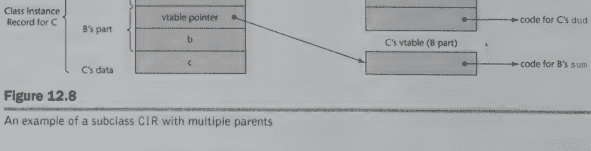

**图 12.8**

具有多个父类的子类 CIR 示例

## 12.6 反射

反射的讨论并不完全适合放在面向对象这一章，但放在本书其他任何章节就更不合适了。所以，我们把它放在这里。

### 12.6.1 引言

一般来说，编程语言中的绑定发生得越晚，语言就越灵活。例如，脚本语言和函数式语言中数据类型的迟绑定，使其程序比静态类型语言中的程序更通用。同样，面向对象语言中方法调用到方法的动态绑定，使其程序更易于维护和扩展。除其他作用外，反射提供了对调用代码继承层次之外的方法的调用进行迟绑定的可能性。

### 12.6.2 什么是反射？

支持反射的编程语言允许其程序在运行时访问自身的类型和结构，并能够动态修改自身行为。为了让程序能够检查其类型和结构，这些信息必须由编译器或解释器收集并提供给程序。正如关于数据库结构的信息称为*元数据*一样，程序的类型和结构也称为*元数据*。程序检查其元数据的过程称为*内省*。程序可以通过几种不同方式动态修改其行为：它可以直接更改其元数据，可以使用元数据，或者可以干预程序的执行。第一种方式很复杂；第二种方式不那么复杂，并且在语言中很常见；第三种方式通常称为*干预*。

反射的一些主要用途在于软件工具的构建。类浏览器需要枚举程序中的类。可视化集成开发环境可以使用类型信息来帮助开发者构建类型正确的代码。调试器必须能够检查类的私有字段和方法。测试系统需要能够发现一个类的所有方法，以确保测试数据会驱动所有这些方法。

为了说明反射的一个相对简单且常见的用途，我们提出以下问题。一家动物园有一大片区域专门用于鸟类。每个物种的飞行笼舍都包括一个标牌，提供关于该物种居住者的一般信息。标牌上包括一个小屏幕，对该物种特别感兴趣的游客可以在屏幕上输入他或她的入园门票编号。在鸟类展区的出口处，游客可以再次在小屏幕上输入他或她的门票编号，这会使计算机打印游客先前表示特别感兴趣的鸟类的图片。该计算机系统

支持这些活动的系统有一个对象，该对象包含一个方法，为展出的每只鸟绘制其鸟的图像。这似乎很简单。当参观者在飞行笼处选择一只鸟时，系统会把一个指向与该鸟关联的对象的引用放入列表中。在展览出口处，系统会调用参观者列表中每个对象的 draw 方法。这个过程变得复杂，因为动物园只提供部分鸟类对象。其中一些从第三方供应商处购买，另一些由动物园捐助者捐赠。由于鸟类对象来源多样，它们没有共同的基类（Object 除外），也没有实现共同的接口，那么可以保存什么类型的引用呢？一个显而易见的解决方案是让每个鸟类对象都成为某个基类的子类。基类类型的引用可以存储在列表中，并且可以使用动态绑定来调用 draw 方法。这种方法的缺点是，需要修改每个鸟类类，才能使新类成为公共基类的子类。如果新的鸟类类可以不加修改地直接添加到代码文件中，那就更好了。另一种可能的解决方案是使用 instanceof 和强制类型转换来确定引用的具体类型。这会给系统增加大量代码，提高其复杂性和维护成本。更好的解决方案是使用反射所能实现的动态绑定。

### 12.6.3 Java 中的反射

Java 对反射提供有限的支持。元数据的主要类定义在命名空间 java.lang.Class 中。<sup>15</sup> 这个类有一个令人遗憾地容易混淆的名字：Class。Java 运行时系统会为程序中的每个对象实例化一个 Class 实例。Class 类提供了一组方法，用于检查程序对象的类型信息和成员。Class 是所有反射 API 的访问入口。

如果程序有一个对象引用（不是基元类型），则可以通过调用该对象的 getClass 方法获得该对象的 Class 对象。所有类都从 Object 继承 getClass，而所有对象都派生自 Object。考虑以下示例：

```java
float[] totals = new float[100];
Class fltlist = totals.getClass();
Class stg = "hello".getClass();
```

变量 fltlist 的值将是 totals 数组对象的 Class 对象。stg 的值将是 String 的 Class 对象（因为 "hello" 是 String 的实例）。

如果某个类没有对象，则可以通过在类名后附加 .class 来获得其 Class 对象。例如，我们可以有下面这样的代码：

```java
Class stg = String.class;
```

如果类没有名称，仍然可以通过在类定义后附加 .class 来获得其 Class 对象。例如，考虑以下代码：

`Class intmat = int[][].class;`

.class 修饰符也可以附加到基元类型上。尽管 `float.getClass()` 是非法的，但 `float.class` 并非非法。

有四种方法可用于获取方法所属的类。getMethod 方法在类中搜索，以查找该类中定义或由该类继承的特定公共方法。getMethods 方法返回一个数组，其中包含类中定义或由类继承的所有公共方法。getDeclaredMethod 方法搜索类中声明的特定方法，包括私有方法。getDeclaredMethods 方法返回类中定义的所有方法。

如果已知某个对象的 Class 对象，并且找到了由该对象的类定义的某个特定方法，则可以通过该对象的 Method 对象使用 invoke 方法调用该方法。例如，如果使用 getMethod 找到了名为 method 的 Method 对象，则可以通过以下方式调用它：

`method.invoke(...);`

现在，我们可以用 Java 为第 12.6.2 节提出的问题开发一个解决方案。这个应用的核心是一个类，它定义了一个方法，该方法接收一个 Object 引用。该方法确定所传入引用的类，找到该类的 draw 方法，并调用该方法。解决方案类用一个名为 ReflectTest 的第二个类进行测试，该类创建一个包含三个 Object 引用的数组，这些引用指向表示三种不同鸟类的类。每个类都定义了一个 draw 方法，调用时会显示一条表明其被调用的消息。然后，测试调用该类方法，并传入引用数组的元素。

callDraw 方法可能引发三种不同的异常，每种异常都在该方法中处理。

```java
// A project to illustrate dynamic method calling
// using reflection in Java
package reflect;
import java.lang.reflect.*;
// A class to test the Reflect class
// Creates three objects that represent different birds
// and calls a method that dynamically calls the draw
// methods of the three bird classes
public class ReflectTest {
    public static void main(String[] args) {
        Object[] birdList = new Object[3];
        birdList[0] = new Bird1();
        birdList[1] = new Bird2();
        birdList[2] = new Bird3();
        Reflect.callDraw(birdList[2]);
        Reflect.callDraw(birdList[0]);
        Reflect.callDraw(birdList[1]);
    }
}
```

```java
// A class to define the method that dynamically calls the
// methods of a passed class object
class Reflect {
    public static void callDraw(Object birdObj) {
        Class cls = birdObj.getClass();
        try {
            // Find the draw method of the given class
            Method method = cls.getMethod("draw");
            // Dynamically call the method
            method.invoke(birdObj);
        }
        // In case the given class does not support draw
        catch (NoSuchMethodException e) {
            throw new IllegalArgumentException(
                cls.getName() + "does not support draw");
        }
        // In case the callDraw cannot call draw
        catch (IllegalAccessException e) {
            throw new IllegalArgumentException(
                "Insufficient access permissions to call" +
                "draw in class " + cls.getName());
        }
        // In case draw throws an exception
        catch (InvocationTargetException e) {
            throw new RuntimeException(e);
        }
    }
}

class Bird1 {
    public void draw() {
        System.out.println("This is draw from Bird1");
    }
}

class Bird2 {
    public void draw() {
        System.out.println("This is draw from Bird2");
    }
}

class Bird3 {
    public void draw() {
        System.out.println("This is draw from Bird3");
    }
}
```

该程序的输出如下：

```text
This is the draw from Bird3
This is the draw from Bird1
This is the draw from Bird2
```

### 12.6.4 C# 中的反射

C# 中对反射的支持与 Java 类似，但有一些重要差异。在 C# 中，与所有 .NET 语言一样，编译器将用公共中间语言（CIL）编写的中间代码放入程序集，而程序集可以包含多个文件。程序集还包含程序集版本号，以及该程序集中定义的所有类和它使用的所有外部类的元数据。

.NET 中使用 System.Type，而不是 java.lang.Class 命名空间；使用 System.Reflection，而不是 java.lang.reflect。获取实例的类时使用 `GetType`，而不是 `getClass` 方法。此外，.NET 语言使用 `typeof` 运算符来代替 Java 中使用的 `.class` 字段。下面是上面所示 Java 项目的 C# 版本：

```csharp
using System;
using System.Reflection;
namespace TestReflect
{
  // A project to illustrate dynamic method calling
  // using reflection in C#
  // A class to test the Reflect class
  // Creates three objects that represent different birds
  // and calls a method that dynamically calls the draw
  // methods of the three bird classes
  public class ReflectTest {
    public static void Main(String[] args) {
      Object[] birdList = new Object[3];
      birdList[0] = new Bird1();
      birdList[1] = new Bird2();
      birdList[2] = new Bird3();
      Reflect.callDraw(birdList[2]);
      Reflect.callDraw(birdList[0]);
      Reflect.callDraw(birdList[1]);
    }
    // A class to define the method that dynamically calls the
    // methods of a passed class object
    class Reflect {
      public static void callDraw(Object birdObj) {
        Type typ = birdObj.GetType();
        // Find the draw method of the given class
        MethodInfo method = typ.GetMethod("draw");
        // Dynamically call the method
        method.Invoke(birdObj, null);
      }
    }
    class Bird1 {
      public void draw() {


```csharp
        Console.WriteLine("This is draw from Bird1");
    }
}
class Bird2 {
    public void draw() {
        Console.WriteLine("This is draw from Bird2");
    }
}
class Bird3 {
    public void draw() {
        Console.WriteLine("This is draw from Bird3");
    }
}
```

我们关于动态方法绑定的简单示例只展示了反射的众多用途之一。

除了类的方法和字段之外，在Java和C#中还可以通过反射访问以下程序元素：类修饰符（如public、static和final）、构造函数、方法参数类型以及已实现的接口。此外，还可以内省类的继承路径描述。在C#中（但不在Java中），可以发现方法形式参数的名称。

Java的反射与C#的反射之间的一个显著区别是System.Reflection.Emit命名空间，它是.NET的一部分。该命名空间提供了创建CIL代码以及容纳该代码的程序集的能力。Java不提供这种能力，尽管可以通过其他供应商的工具实现。

尽管反射为静态类型语言Java和C#增加了多种能力，但反射的使用者必须意识到它的缺点：

- 使用反射几乎总是导致性能受损。在运行时解析类型、方法和字段并不属于运行非反射代码的成本。此外，当类型被动态解析时，无法对代码进行某些优化。
- 反射会暴露私有字段和方法，这违反了抽象和信息隐藏规则，还可能导致意外副作用并对可移植性产生不利影响。
- 尽管早期类型检查的优势已被广泛接受，但反射所支持的晚期绑定显然抵消了这一优势。
- 当代码在安全管理器下运行时，某些反射操作可能无法工作，这也使其不可移植。一种这样的安全环境是运行小程序。大多数情况下，如果不用反射就能解决问题，就不应使用反射。

反射是大多数动态类型语言不可或缺的一部分。在LISP中，反射被常规使用，动态构造和执行代码并不罕见。在其他解释型语言（如JavaScript、Perl和Python）中，解释期间会保留符号表，从而提供所有有用的类型信息。

例如，在Python中，`type`方法返回给定值的类型。例如，`type([7, 14, 21])` 是 `list`。如果`isinstance`方法的第一个参数具有其第二个参数所命名的类型，则该方法返回布尔值。例如，`isinstance(17, int)` 返回 `True`。`callable`函数用于判断表达式是否返回函数对象。`dir`函数返回其参数对象的属性列表，包括数据属性和方法。

## 总结

面向对象编程基于三个基本概念：抽象数据类型、继承和动态绑定。面向对象编程语言通过类、方法、对象和消息传递来支持这一范式。

本章对面向对象编程语言的讨论围绕七个设计问题展开：对象的排他性、子类与子类型、类型检查与多态、单继承与多继承、动态绑定、对象的显式或隐式释放，以及嵌套类。

Smalltalk是一种纯面向对象语言——一切都是对象，所有计算都通过消息传递完成。所有类型检查以及消息到方法的绑定都是动态的，并且所有继承都是单继承。Smalltalk没有显式的释放操作。

C++支持数据抽象、继承以及消息到方法的可选动态绑定，同时具有C的所有常规特性。这意味着它有两套不同的类型系统。C++提供多继承和显式对象释放。它包含多种针对类中实体的访问控制，其中一些访问控制会阻止子类成为子类型。类中可以包含构造函数和析构函数方法；二者通常都是隐式调用的。

虽然Smalltalk的动态类型绑定比混合语言C++提供了稍多的编程灵活性，但它的效率要低得多。

Objective-C同时支持过程式编程和面向对象编程。它比C++更简单，使用也没有那么广泛。它只支持单继承，尽管它有类别（category），允许混入可添加到类中的额外方法。它还有协议（protocol），类似于Java的接口。一个类可以采用任意数量的协议。构造函数可以有任何名称，但必须显式调用。多态通过预定义类型`id`得到支持。`id`类型的变量可以引用任何对象。当通过`id`类型变量所引用的对象调用方法时，绑定是动态的。

与C++不同，Java不是混合语言；它旨在只支持面向对象编程。Java既有原始标量类型，也有类。所有对象都从堆中分配，并通过引用变量访问。没有显式的对象释放操作——使用的是垃圾回收。唯一的子程序是方法，而且它们只能通过

13. 解释Smalltalk消息如何绑定到方法。这发生在什么时候？
14. Smalltalk中进行什么类型检查？何时进行？
15. Smalltalk支持哪种继承，单继承还是多继承？
16. Smalltalk对计算领域产生的两个最重要的影响是什么？
17. 本质上，所有Smalltalk变量都是单一类型。那是什么类型？
18. C++对象可以从哪里分配？
19. C++堆分配对象如何释放？
20. 所有C++子类都是子类型吗？如果是，请解释。如果不是，为什么？
21. 在什么情况下，C++方法调用会静态绑定到方法？
22. 允许设计者指定哪些方法可以静态绑定有什么缺点？
23. C++中私有派生和公有派生有什么区别？
24. C++中的*友元*函数是什么？
25. C++中的纯虚函数是什么？
26. 在C++中，参数如何传递给超类的构造函数？
27. Smalltalk和C++之间最重要的实际区别是什么？
28. 如果Objective-C方法不返回任何值，其头文件中指示什么返回类型？
29. Objective-C支持多继承吗？
30. Objective-C类可以在其头文件中不指定父类吗？
31. Objective-C中的根类是什么？
32. 在Objective-C中，方法如何表明它不能在派生类中被重写？
33. Objective-C类别的目的是什么？
34. Objective-C协议的目的是什么？
35. `id`类型在Objective-C中的主要用途是什么？
36. Java的类型系统与C++的类型系统有何不同？
37. Java对象可以从哪里分配？
38. 什么是装箱？
39. Java对象如何释放？
40. 所有Java子类都是子类型吗？
41. 在Java中如何调用超类构造函数？
42. 在什么情况下，Java方法调用会静态绑定到方法？
43. C#中的重写方法在语法上与C++中的对应方法有何不同？
44. 在C#中，如何在子类中调用被重写的继承方法的父版本？
45. Ruby如何实现原始类型，例如整数和浮点数据所用的类型？
46. 在Ruby类中如何定义获取方法？
47. Ruby对实例变量支持哪些访问控制？
48. Ruby对方法支持哪些访问控制？
49. 所有Ruby子类都是子类型吗？
50. Ruby支持多继承吗？
51. 反射允许程序做什么？
52. 在反射语境中，什么是元数据？
53. 什么是内省？
54. 什么是干预？
55. Java中哪个类存储程序中类的信息？
56. Java名称扩展.class用于什么？
57. Java的getMethods方法做什么？
58. C#命名空间System.Reflection.Emit用于什么？

## 问题集

1. SIMULA 67中缺少面向对象编程支持的哪个重要部分？
2. 解释替换原则。
3. 解释可以创建不是子类型的子类的方式。
4. 比较C++和Java的动态绑定。
5. 比较C++和Java的类实体访问控制。
6. 比较C++的多继承与Java中接口提供的多继承。
7. 在哪种编程情形中，多继承相比接口具有显著优势？
8. 解释继承所缓解的抽象数据类型的两个问题。
9. 描述子类可以对其父类做出的变更类别。
10. 解释继承的一个缺点。
11. 解释一种语言中所有值都是对象的优缺点。


- 4. 设计并实现一个 C++ 程序，定义一个基类 A，它有一个子类 B，而 B 本身又有一个子类 C。A 类必须实现一个方法，该方法在 B 和 C 中都被重写。你还必须编写一个测试类，实例化 A、B 和 C，并包含三次对方法的调用。其中一次调用必须静态绑定到 A 的方法。一次调用必须动态绑定到 B 的方法，还有一次必须动态绑定到 C 的方法。所有方法调用都必须通过指向类 A 的指针进行。
- 5. 用 C++ 编写一个程序，分别大量调用动态绑定方法和静态绑定方法，并计时这两类调用的耗时。比较计时结果，计算两者所需时间的差异，并解释结果。
- 6. 用 Java 重复编程练习 4，并使用 **final** 强制静态绑定。

# 13 并发

- 13.1 引言
- 13.2 子程序级并发入门
- 13.3 信号量
- 13.4 监视器
- 13.5 消息传递
- 13.6 Ada 对并发的支持
- 13.7 Java 线程
- 13.8 C# 线程
- 13.9 函数式语言中的并发
- 13.10 语句级并发


本章首先介绍子程序（或单元）级和语句级的各种并发。其中包含对最常见的多处理器计算机体系结构的简要描述。接下来，对单元级并发进行了详细讨论。首先描述了在讨论语言支持单元级并发所面临的问题和挑战之前必须理解的基本概念，特别是竞争同步和协作同步。接着描述了为并发提供语言支持的设计问题。随后详细讨论了语言支持并发的三种主要方法：信号量、监视器和消息传递。使用一个伪代码示例程序来演示如何利用信号量。使用 Ada 和 Java 来说明监视器；对于消息传递，则使用 Ada。较为详细地描述了支持并发的 Ada 特性。虽然重点是任务，但也讨论了受保护对象（实际上就是监视器）。然后讨论了使用 Java 和 C# 中的线程支持单元级并发的内容，包括同步方法。随后简要概述了几种函数式编程语言对并发的支持。本章最后一节简要讨论了语句级并发，包括高性能 Fortran 中为之提供的部分语言支持的介绍。

## 13.1 引言

软件执行中的并发可以发生在四个不同层面：指令级（同时执行两条或多条机器指令）、语句级（同时执行两条或多条高级语言语句）、单元级（同时执行两个或多个子程序单元）以及程序级（同时执行两个或多个程序）。由于指令级和程序级并发不涉及语言设计问题，本章不予讨论。本章讨论子程序级和语句级的并发，重点放在子程序级。

乍一看，并发似乎是一个简单的概念，但它给程序员、编程语言设计者和操作系统设计者带来了重大挑战（因为并发的许多支持是由操作系统提供的）。

并发控制机制提高了编程的灵活性。它们最初是为了解决操作系统中面临的特定问题而发明的，但现在许多其他编程应用也需要它们。最常用的程序之一就是 Web 浏览器，其设计在很大程度上基于并发。浏览器必须同时执行许多不同的功能，包括从 Web 服务器发送和接收数据、在屏幕上渲染文本和图像，以及响应用户通过鼠标和键盘进行的操作。一些当代浏览器，例如 Internet Explorer 9，利用许多当代个人计算机所配备的额外核心处理器来执行部分处理，例如解释客户端脚本代码。另一个例子是用于模拟由多个并发子系统组成的实际物理系统的软件系统。对于所有这些类型的应用，编程语言（或库，至少是操作系统）必须支持单元级并发。

语句级并发与单元级并发截然不同。从语言设计者的角度来看，语句级并发主要涉及如何将数据分布到多个存储器上，以及哪些语句可以并发执行。

开发并发软件的目标是生成可扩展且可移植的并发算法。如果并发算法的执行速度随着可用处理器的增加而提高，则该算法是可扩展的。这一点很重要，因为处理器的数量有时会随着新一代机器的出现而增加。算法必须是可移植的，因为硬件的寿命相对较短。因此，软件系统不应依赖于特定的体系结构——也就是说，它们应该在不同体系结构的机器上高效运行。

本章的意图是讨论与语言设计问题最相关的并发方面，而不是对所有并发问题（包括并发程序的开发）进行权威性研究。后者显然不适合一本关于编程语言的书籍。

### 13.1.1 多处理器体系结构

大量不同的计算机体系结构拥有多个处理器，并且可以支持某种形式的并发执行。在开始讨论程序和语句的并发执行之前，我们先简要描述其中一些体系结构。

最早拥有多个处理器的计算机有一个通用处理器和一个或多个其他处理器，通常称为外围处理器，仅用于输入和输出操作。这种体系结构使得这些出现在 20 世纪 50 年代末的计算机能够执行一个程序，同时为其他程序并发执行输入或输出操作。

到 20 世纪 60 年代初，出现了拥有多个完整处理器的机器。这些处理器由操作系统的作业调度程序使用，调度程序将批处理作业队列中的独立作业分配给各个处理器。具有这种结构的系统支持程序级并发。

20 世纪 60 年代中期出现的机器拥有几个相同的部分处理器。这些处理器从单个指令流中接收指令。例如，有些机器有两个或多个浮点乘法器，而另一些机器则有两个或多个完整的浮点运算单元。这些机器的编译器需要确定哪些指令应并发执行，并相应地进行调度。具有这种结构的系统支持指令级并发。

1966 年，Michael J. Flynn 提出了一种计算机体系结构分类方法，根据指令流和数据流是单还是多来定义。这些名称从 20 世纪 70 年代到 21 世纪初被广泛使用。使用多数据流的两个类别定义如下：拥有多个处理器、同时执行同一条指令、但每个处理器处理不同数据的计算机，称为**单指令多数据（SIMD）**体系结构计算机。在 SIMD 计算机中，每个处理器都有自己局部存储器。一个处理器控制其他处理器的操作。由于除控制器外的所有处理器都在同一时刻执行同一条指令，因此软件中不需要同步。也许最广泛使用的 SIMD 机器是一类称为**向量处理器**的机器。它们拥有寄存器组，用于存储向量操作的操作数，其中同一条指令同时对整个操作数组执行。最初，最能受益于这种体系结构的程序类型是科学计算领域，该计算领域通常是多处理器机器的目标。然而，SIMD 处理器现在用于各种应用领域，包括图形和视频处理。直到最近，大多数超级计算机都是向量处理器。

拥有多个独立运行但操作可以同步的处理器的计算机，称为**多指令多数据（MIMD）**计算机。MIMD 计算机中的每个处理器执行自己的指令流。MIMD 计算机可以以两种不同的配置出现：分布式存储系统和共享存储系统。分布式 MIMD 机器中每个处理器都有自己的存储器，既可以构建在单个机箱中，也可以分布（可能分布在大范围内）。共享存储 MIMD 机器显然必须提供某种同步手段以防止存储器访问冲突。即使是分布式 MIMD 机器也需要同步才能协同处理单个程序。MIMD 计算机比 SIMD 计算机更通用，支持单元级并发。本章的主要焦点是面向共享存储 MIMD 计算机（通常称为**多处理器**）的语言设计。

随着功能强大但低成本的单芯片计算机的出现，可以将大量这些微处理器连接在单个机箱内的物理小型网络中。这类计算机通常使用现成的微处理器，已由许多不同的制造商生产出来。

软件未能更快地发展以利用并发机器的一个重要原因是处理器的性能不断提高。使用并发机器的最强烈动机之一是提高计算速度。然而，两个硬件因素结合起来提供了更快的计算速度，而无需改变软件系统的体系结构。首先，处理器时钟频率随着每一代新处理器（大约每 18 个月出现一代）而变得更快。其次，处理器体系结构中内置了几种不同的并发机制。其中包括从存储器到处理器的指令和数据的流水线操作（指令被预取和解码


控制线程。以物理并发方式执行的程序可以具有多个控制线程。每个处理器可以执行其中一个线程。尽管逻辑上并发的程序执行实际上可能只有一个控制线程，但此类程序只能通过将它们想象为具有多个控制线程来设计和分析。被设计为具有多个控制线程的程序称为多线程程序。当多线程程序在单处理器机器上执行时，其线程被映射到单个线程上。在这种情况下，它成为一个虚拟多线程程序。

语句级并发是一个相对简单的概念。在语句级并发的一种常见用法中，包含对数组元素进行操作的语句的循环会被展开，以便处理可以分布到多个处理器上。例如，一个执行500次重复并包含对500个数组元素之一进行操作的语句的循环可以被展开，以便10个不同处理器中的每一个都能同时处理其中的50个数组元素。

### 13.1.3 使用并发的动机

设计并发软件系统至少有四个不同的原因。第一个原因是在多处理器机器上程序的执行速度。这些机器提供了一种提高程序执行速度的有效方法，前提是程序设计为利用并发硬件。现在已有大量已安装的多处理器计算机，包括过去几年售出的许多个人计算机。不使用这种硬件能力是一种浪费。

第二个原因是，即使一台机器只有一个处理器，为使用并发执行而编写的程序也可能比同样为顺序（非并发）执行而编写的程序更快。实现这一点的要求是程序不是计算受限的（顺序版本没有充分利用处理器）。

第三个原因是，并发提供了一种不同的方法来概念化问题的程序解决方案。许多问题领域天然适合并发，就像递归是设计某些问题解决方案的自然方式一样。此外，许多程序编写来模拟物理实体和活动。在许多情况下，被模拟的系统包括多个实体，而这些实体同时做它们各自的事情——例如，在受控空域中飞行的飞机、通信网络中的中继站以及工厂中的各种机器。必须使用采用并发的软件来准确模拟此类系统。

使用并发的第四个原因是为分布在多台机器上的应用编程，这些机器可以是本地的，也可以是通过互联网连接的。许多机器，例如汽车，具有不止一台内置计算机，每台计算机专用于某个特定任务。在许多情况下，这些计算机集合必须同步它们的程序执行。互联网游戏是分布在多个处理器上的软件的另一个例子。

并发现在被用于众多日常计算任务中。Web服务器并发处理文档请求。Web浏览器现在使用次级核心处理器来运行图形处理并解释嵌入文档中的编程代码。在每个操作系统中，任何时候都有许多并发进程在执行，管理资源、从键盘获取输入、显示程序输出以及读写外部存储设备。简而言之，并发已成为计算中无处不在的一部分。

## 13.2 子程序级并发简介

在考虑对并发的语言支持之前，必须先理解并发的基本概念以及使其有用的要求。本节涵盖这些主题。

### 13.2.1 基本概念

任务是一个程序单元，类似于子程序，可以与同一程序的其他单元并发执行。程序中的每个任务可以支持一个控制线程。任务有时称为进程。在某些语言中，例如Java和C#，某些方法充当任务。此类方法在称为线程的对象中执行。

任务的三个特征将其与子程序区分开来。第一，任务可以隐式启动，而子程序必须显式调用。第二，当程序单元调用任务时，在某些情况下它无需等待任务完成执行即可继续自身的执行。第三，当任务执行完成时，控制权可能会也可能不会返回给启动该执行的单元。

任务分为两大类：重量级和轻量级。简单地说，**重量级任务**在自己的地址空间中执行。**轻量级任务**都在同一地址空间中运行。实现轻量级任务比实现重量级任务更容易。此外，轻量级任务可以比重型任务更高效，因为管理其执行所需的工作更少。

任务可以通过共享的非局部变量、消息传递或参数与其他任务通信。如果一个任务不以任何方式与程序中的任何其他任务通信或影响其执行，则称该任务是**不相交的**。由于任务经常一起工作以创建模拟或解决问题，因此并非不相交，它们必须使用某种形式的通信来同步其执行或共享数据，或两者兼有。

**同步**是一种控制任务执行顺序的机制。当任务共享数据时，需要两种同步：合作和竞争。当任务A必须等待任务B完成某个特定活动后才能开始或继续其执行时，任务A和任务B之间需要**合作同步**。当两个任务都需要使用

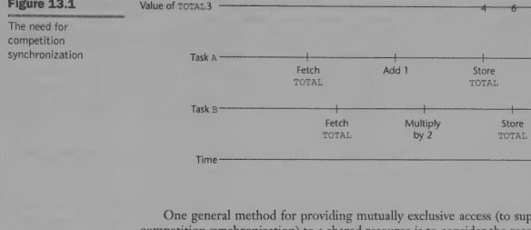

为共享资源提供互斥访问（以支持竞争同步）的一种通用方法是将该资源视为任务可以占有的事物，并且一次只允许一个任务占有它。要获得对共享资源的占有，任务必须请求它。只有当没有其他任务占有时，才会授予占有权。当一个任务占有一个资源时，所有其他任务都被阻止访问该资源。当一个任务用完其占有的共享资源时，它必须放弃该资源，以便其他任务可以使用它。

提供对共享资源互斥访问的三种方法是信号量（在第13.3节讨论）、管程（在第13.4节讨论）和消息传递（在第13.5节讨论）。

同步机制必须能够延迟任务执行。同步通过这些延迟对任务施加执行顺序。要理解任务在其生命周期中会发生什么，我们必须考虑任务执行是如何被控制的。无论一台机器有一个处理器还是多个处理器，任务数量总是有可能多于处理器数量。一个称为调度器的运行时系统程序管理任务之间对处理器的共享。如果从来没有任何中断，并且所有任务具有相同优先级，调度器可以简单地给每个任务一个时间片，例如0.1秒，并且当某个任务轮到执行时，调度器可以让它在一个处理器上执行该段时间。当然，有若干事件会使情况复杂化，例如，为同步以及为输入或输出操作而进行的任务延迟。由于输入和输出操作相对于处理器速度非常慢，因此不允许任务在等待此类操作完成时一直占用处理器。任务可以处于几种不同状态：

- 1. 新建：任务在被创建但尚未开始执行时处于新建状态。
- 2. 就绪：就绪任务已准备好运行，但当前未运行。要么它尚未被调度器分配处理器时间，要么它之前运行过，但以第4段中描述的某种方式被阻塞


本小节。已准备好运行的任务存储在一个通常称为**任务就绪队列**的队列中。

- 3. *运行*：正在运行的任务是当前正在执行的任务；也就是说，它拥有一个处理器，并且其代码正在被执行。
- 4. *阻塞*：被阻塞的任务曾经运行过，但其执行被若干不同事件之一中断，其中最常见的是输入或输出操作。除输入和输出外，一些语言还提供操作，让用户程序指定某个任务被阻塞。
- 5. *死亡*：死亡任务在任何意义上都不再活动。任务在其执行完成或被程序显式杀死时死亡。

任务状态的流程图如图 13.2 所示。

任务执行中的一个重要问题如下：当当前运行的任务变为阻塞或其时间片已用完时，如何选择一个就绪任务使其转入运行状态？已有若干不同算法用于做出这一选择，其中一些基于可指定的优先级。执行选择的算法在调度器中实现。

**图 13.2**
任务状态流程图

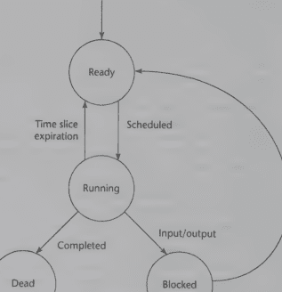

与任务并发执行和共享资源使用相关的是活性概念。在顺序程序环境中，如果一个程序继续执行并最终完成，则它具有活性特征。更一般地说，活性意味着如果某个事件——比如程序完成——应该发生，那么它最终会发生。也就是说，进展在持续取得。在并发环境和共享资源下，任务的活性可能不复存在，这意味着程序无法继续，因而永远不会终止。

例如，假设任务 A 和任务 B 都需要共享资源 X 和 Y 来完成各自的工作。此外，假设任务 A 获得了 X，任务 B 获得了 Y。经过一段时间执行后，任务 A 需要资源 Y 才能继续，因此它请求 Y，但必须等待 B 释放 Y。同样，任务 B 请求 X，但必须等待 A 释放 X。两者都不放弃自己拥有的资源，结果两者都失去活性，从而保证程序执行永远无法正常完成。这种特定类型的活性丧失称为*死锁*。死锁是对程序可靠性的严重威胁，因此避免死锁需要在语言设计和程序设计两方面认真考虑。

现在我们可以讨论一些用于提供并发单元控制的语言机制。

### 13.2.2 并发语言设计

在某些情况下，并发通过库来实现。其中之一是 OpenMP，它是一个应用程序编程接口，用于在各种平台上支持 C、C++ 和 Fortran 的共享内存多处理器编程。当然，本书关注的是语言对并发的支持。许多语言已被设计为支持并发，从 20 世纪 60 年代中期的 PL/I 开始，包括当代语言 Ada 95、Java、C#、F#、Python 和 Ruby。^1

^1 对于 Python 和 Ruby，程序是解释执行的，因此只可能存在逻辑并发。即使机器有多个处理器，这些程序也无法利用一个以上的处理器。

### 13.2.3 设计问题

语言对并发支持的最重要设计问题已经详细讨论过：竞争同步与协作同步。除此之外，还有若干次要的设计问题。其中突出的是应用程序如何影响任务调度。此外，还有任务如何以及何时开始和结束执行，以及如何以及何时创建任务等问题。

请记住，我们对并发的讨论有意不完整，只讨论与支持并发相关的最重要的语言设计问题。

以下各节讨论并发设计问题的三种不同方法：信号量、管程和消息传递。

## 13.3 信号量

信号量是一种简单机制，可用于提供任务同步。尽管信号量是提供同步的早期方法，但它们仍在使用，既用于当代语言，也用于基于库的并发支持系统。在以下段落中，我们描述信号量并讨论如何将其用于这一目的。

### 13.3.1 引言

为了通过对共享数据结构的互斥访问来提供竞争同步，Edsger Dijkstra 于 1965 年设计了信号量（Dijkstra, 1968b）。信号量也可用于提供协作同步。

为了提供对数据结构的受限访问，可以在访问该结构的代码周围放置守卫。**守卫**是一种语言装置，仅当指定条件为真时才允许受守卫保护的代码执行。因此，守卫可用于一次只允许一个任务访问特定的共享数据结构。信号量是守卫的一种实现。具体来说，信号量是一种数据结构，由一个整数和一个存储任务描述符的队列组成。**任务描述符**是一种数据结构，存储有关任务执行状态的所有相关信息。

守卫机制的一个组成部分是确保对受守卫代码的所有尝试执行只执行一次的过程。典型方法是将无法授予访问权限时发生的访问请求存储在任务描述符队列中，之后允许它们离开该队列并执行受守卫代码。这就是信号量必须同时具有计数器和任务描述符队列的原因。

为信号量提供的仅有的两个操作最初由 Dijkstra 命名为 P 和 V，取自两个荷兰语单词 *通过*（passeren）和 *释放*（vrijgeven）（Andrews and Schneider, 1983）。在本节余下部分，我们将分别称它们为 *等待*（wait）和 *释放*（release）。

### 13.3.2 协作同步

在本章的大部分内容中，我们使用生产者和消费者使用的共享缓冲区示例来说明提供协作同步和竞争同步的不同方法。对于协作同步，这样的缓冲区必须以某种方式记录数量

以下是 wait 和 release 的简明伪代码描述：

```text
wait(aSemaphore)
if aSemaphore's counter > 0 then
    decrement aSemaphore's counter
else
    put the caller in aSemaphore's queue
    attempt to transfer control to some ready task
    (if the task-ready queue is empty, deadlock occurs)
end if

release(aSemaphore)
if aSemaphore's queue is empty  (no task is waiting) then
    increment aSemaphore's counter
else
    put the calling task in the task-ready queue
    transfer control to a task from aSemaphore's queue
end
```

现在我们可以给出一个示例程序，它为共享缓冲区实现协作同步。在本例中，共享缓冲区存储整数值，并且是一个逻辑上的循环结构。它被设计为可供可能多个生产者和消费者任务使用。

以下伪代码展示了生产者和消费者任务的定义。使用两个信号量来防止缓冲区下溢或上溢，从而提供协作同步。假设缓冲区长度为 BUFLEN，而实际操作它的例程已作为 FETCH 和 DEPOSIT 存在。对信号量计数器的访问使用点号表示法。例如，如果 fullspots 是信号量，则其计数器通过 fullspots.count 引用。

```text
semaphore fullspots, emptyspots;
fullspots.count = 0;
emptyspots.count = BUFLEN;
task producer;
    loop
        -- produce VALUE --
        wait(emptyspots);   { wait for a space }
        DEPOSIT(VALUE);
        release(fullspots);  { increase filled spaces }
    end loop;
end producer;

task consumer;
    loop
        wait(fullspots);     { make sure it is not empty }
```


```
FETCH(VALUE);
release(emptyspots); { increase empty spaces }
-- consume VALUE --
end loop
end consumer;
```

如果缓冲区当前为空，信号量 fullspots 会使消费者任务排队等待一个缓冲区条目。如果缓冲区当前已满，信号量 emptyspots 会使生产者任务排队等待缓冲区中的一个空位。

### 13.3.3 竞争同步

我们的缓冲区示例没有提供竞争同步。可以使用一个额外的信号量来控制对该结构的访问。这个信号量不需要计数任何东西，只需用它的计数器表明缓冲区当前是否正在被使用。仅当信号量的计数器值为 1 时，wait 语句才允许访问，这表示共享缓冲区当前未被访问。如果信号量的计数器值为 0，则表示当前正在发生访问，该任务会被放入该信号量的队列中。注意，信号量的计数器必须初始化为 1。信号量的队列在开始使用之前必须始终初始化为空。

仅需要二值计数器的信号量，如下例中用于提供竞争同步的信号量，称为**二元信号量**。

下面的示例伪代码说明了如何使用信号量为并发访问的共享缓冲区同时提供竞争同步和合作同步。访问信号量用于确保对缓冲区的互斥访问。记住，可能有多个生产者和多个消费者。

```
semaphore access, fullspots, emptyspots;
access.count = 1;
fullspots.count = 0;
emptyspots.count = BUFLEN;

task producer;
  loop
    -- produce VALUE --
    wait(emptyspots);   { wait for a space }
    wait(access);       { wait for access }
    DEPOSIT(VALUE);
    release(access);    { relinquish access }
    release(fullspots); { increase filled spaces }
  end loop;
end producer;

task consumer;
  loop
    wait(fullspots);        { make sure it is not empty }
    wait(access);           { wait for access }
    FETCH(VALUE);
    release(access);        { relinquish access }
    release(emptyspots);    { increase empty spaces }
    -- consume VALUE --
  end loop
end consumer;
```

初看此示例，可能会让人认为存在问题。具体来说，假设当一个任务在消费者中的 wait(access) 调用处等待时，另一个任务从共享缓冲区取走最后一个值。幸运的是，这不会发生，因为 wait(fullspots) 通过递减 fullspots 计数器，为调用它的任务在缓冲区中预留了一个值。

到目前为止，信号量还有一个关键方面尚未讨论。回顾之前对竞争同步问题的描述：对共享数据的操作不能重叠。如果第二个操作在较早操作仍在进行时开始，共享数据可能会损坏。信号量本身就是一个共享数据对象，因此对信号量的操作也容易受到同样问题的影响。因此，信号量操作必须不可中断。许多计算机具有专为信号量操作设计的不可中断指令。如果这类指令不可用，那么使用信号量提供竞争同步就是一个严重问题，且没有简单的解决方案。

### 13.3.4 评估

使用信号量提供合作同步会创建一个不安全的编程环境。无法静态检查其使用的正确性，因为这取决于它们所在程序的语义。在缓冲区示例中，省略生产者任务的 wait(emptyspots) 语句会导致缓冲区上溢。省略消费者任务的 wait(fullspots) 语句会导致缓冲区下溢。省略任意一个 release 都会导致死锁。这些是合作同步失败。

信号量在提供合作同步时引起的可靠性问题，在将其用于竞争同步时也会出现。在任一任务中省略 wait(access) 语句都可能导致对缓冲区的不安全访问。在任一任务中省略 release(access) 语句都会导致死锁。这些是竞争同步失败。注意到使用信号量的危险，Per Brinch Hansen（1973）写道：“信号量是给从不犯错的理想程序员的一种优雅同步工具。”不幸的是，理想程序员很罕见。

## 13.4 管程

在并发环境中，信号量某些问题的一种解决方案是将共享数据结构与其操作封装在一起，并隐藏其表示——也就是使共享数据结构成为带有某些特殊限制的抽象数据类型。这种解决方案通过将同步责任转移给运行时系统，可以在不使用信号量的情况下提供竞争同步。

### 13.4.1 引言

当数据抽象的概念正在形成时，参与这项工作的人将同样的概念应用于并发编程环境中的共享数据，从而产生了管程。根据 Per Brinch Hansen（Brinch Hansen, 1977, p. xvi）的说法，Edsger Dijkstra 在 1971 年建议将所有对共享数据的同步操作集中到一个程序单元中。Brinch Hansen（1973）在操作系统环境中形式化了这一概念。次年，Hoare（1974）将这些结构命名为*管程*。

第一个引入管程的编程语言是 Concurrent Pascal（Brinch Hansen, 1975）。Modula（Wirth, 1977）、CSP/k（Holt et al., 1978）和 Mesa（Mitchell et al., 1979）也提供管程。在当代语言中，Ada、Java 和 C# 支持管程，这些语言都将在本章后面讨论。

### 13.4.2 竞争同步

管程最重要的特性之一是共享数据驻留在管程中，而不是驻留在任何客户单元中。程序员不通过使用信号量或其他机制来同步对共享数据的互斥访问。由于访问机制是管程的一部分，管程的实现可以通过一次只允许一个访问来保证同步访问。如果在调用时管程正忙，则对管程过程的调用会被隐式阻塞并存储在队列中。

### 13.4.3 合作同步

尽管对共享数据的互斥访问是管程固有的，但进程之间的合作仍然是程序员的任务。特别是，程序员必须保证共享缓冲区不会发生下溢或上溢。不同的语言提供了不同的合作同步编程方式，所有这些方式都与信号量有关。

图 13.3 展示了一个包含四个任务和一个管程的程序，该管程提供对并发共享缓冲区的同步访问。

**图 13.3**

一个使用管程控制对共享缓冲区访问的程序

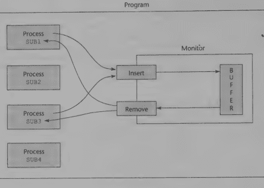

在此图中，管程的接口显示为两个分别标记为 *insert* 和 *remove* 的方框（用于插入和移除数据）。管程看起来完全像一个抽象数据类型——一种访问受限的数据结构——而管程正是这样的东西。

### 13.4.4 评估

管程是比信号量更好的提供竞争同步的方式，这主要是因为 13.3 节讨论的信号量问题。合作同步在管程中仍然是一个问题，当下文各节讨论 Ada 和 Java 的管程实现时就会清楚。

信号量和管程在表达并发控制方面同样强大——信号量可用于实现管程，管程也可用于实现信号量。

Ada 提供了两种实现管程的方法。Ada 83 包含一个可用于支持管程的通用任务模型。Ada 95 增加了一种更清晰、更高效的构造管程的方法，称为*保护对象*。这两种方法都使用消息传递作为支持并发的基本模型。消息传递模型允许并发单元分布，而管程不允许。13.5 节描述消息传递；13.6 节讨论 Ada 对消息传递的支持。

在 Java 中，可以在设计为抽象数据类型的类中实现管程，其中共享数据就是该类型。通过对访问方法添加 `synchronized` 修饰符来控制对该类对象的访问。13.7.4 节给出了一个用 Java 编写的共享缓冲区管程示例。


C# 有一个预定义类 Monitor，它旨在用于实现监视器。

## 13.5 消息传递

本节介绍并发中消息传递的基本概念。请注意，这里的消息传递概念与面向对象编程中用于实现方法的消息传递无关。

### 13.5.1 引言

设计能够为并发任务之间提供消息传递能力的语言的最初努力，来自 Brinch Hansen（1978）和 Hoare（1978）。这些消息传递的先驱开发者还开发了一种技术，用于处理当其他任务同时向某个给定任务发出多个通信请求时该做什么的问题。他们决定需要某种形式的非确定性，以便在选择这些请求中哪一个先被接受时提供公平性。这种公平性可以用多种方式定义，但一般来说，它意味着所有请求者都有同等机会与给定任务通信（假设每个请求者具有相同优先级）。用于语句级控制的非确定性构造称为守卫命令，由 Dijkstra（1975）引入。守卫命令将在第 8 章讨论。守卫命令是用于控制消息传递的构造的基础。

### 13.5.2 同步消息传递的概念

消息传递可以是同步的，也可以是异步的。这里，我们描述同步消息传递。同步消息传递的基本概念是：任务常常很忙，而当它们忙碌时，不能被其他单元中断。假设任务 A 和任务 B 都在执行，并且 A 希望向 B 发送消息。显然，如果 B 很忙，就不宜允许另一个任务中断它。那会扰乱 B 当前的处理。此外，消息通常会在接收方引起相关处理，而如果其他处理尚未完成，这种处理可能并不合理。另一种选择是提供一种语言机制，使任务能够向其他任务指明自己何时准备好接收消息。这种方法有点像一个主管指示秘书暂缓接听所有来电，直到另一项活动（也许是一场重要谈话）完成。之后，当当前谈话结束时，主管告诉秘书，他现在愿意与某位一直被搁置的来电者交谈。

任务可以被设计成在某个时刻挂起自己的执行，或者因为它空闲，或者因为它在继续之前需要来自另一个单元的信息。这就像一个正在等待重要电话的人。在某些情况下，除了坐等之外别无他事可做。然而，如果任务 A 在任务 B 发送消息时正在等待该消息，那么该消息就可以被传输。这种消息的实际传输称为**会合**。注意，只有当发送方和接收方都希望它发生时，会合才能发生。在会合期间，消息中的信息可以单向或双向传输。

任务的合作同步和竞争同步都可以用消息传递模型方便地处理，如下一节所述。

## 13.6 Ada 对并发的支持

本节描述 Ada 所提供的对并发的支持。Ada 83 只支持同步消息传递。

### 13.6.1 基础

Ada 的任务设计部分基于 Brinch Hansen 和 Hoare 的工作，因为消息传递是设计基础，并且使用非确定性在已发送消息的任务之间进行选择。

完整的 Ada 任务模型很复杂，下面对其讨论是有限的。这里的重点将是 Ada 版本的同步消息传递机制。

Ada 任务可以比监视器更主动。监视器是被动实体，为它们所存储的共享数据提供管理服务。不过，它们只在这些服务被请求时才提供服务。当用于管理共享数据时，Ada 任务可以被视为管理者，可以与其所管理的资源驻留在一起。它们有若干机制，有些是确定性的，有些是非确定性的，使它们能够在竞争访问其资源的请求之间进行选择。

Ada 任务有两个部分——规范部分和主体部分——两者名称相同。任务的接口是它的入口点或位置，即它可以接受来自其他任务的消息的地方。由于这些入口点是其接口的一部分，因此它们自然会被列在任务的规范部分中。由于会合可能涉及信息交换，消息可以带有参数；因此，任务入口点也必须允许参数，而这些参数也必须在规范部分中描述。从外观上看，任务规范类似于抽象数据类型的包规范。

作为 Ada 任务规范的一个示例，考虑以下代码，其中包含一个名为 Entry_1 的单一入口点，它有一个 in 模式参数：

```ada
task Task_Example is
    entry Entry_1(Item : in Integer);
end Task_Example;
```

任务主体必须包含某种语法形式的入口点，这些入口点对应于该任务规范部分中的 entry 子句。在 Ada 中，这些任务主体入口点由以 **accept** 保留字引导的子句指定。**accept** 子句定义为从 **accept** 保留字开始、到匹配的 **end** 保留字结束的语句范围。**accept** 子句本身相对简单，但它们可以嵌入其中的其他构造可能使其语义复杂。一个简单的 **accept** 子句具有以下形式：

```
accept entry_name (formal parameters) do
  ...
end entry_name;
```

accept 入口名称与相关任务规范部分中 **entry** 子句里的名称匹配。可选参数提供了在调用方与被调用任务之间传递数据的手段。**do** 与 **end** 之间的语句定义了在会合期间发生的操作。这些语句合称为 **accept 子句体**。在实际会合期间，发送方任务被挂起。

每当一个 **accept** 子句收到它不愿接受的消息时，无论出于什么原因，发送方任务都必须被挂起，直到接收方任务中的 **accept** 子句准备好接受该消息。当然，**accept** 子句还必须记住那些发送了未被接受消息的发送方任务。为此，任务中的每个 **accept** 子句都关联有一个队列，用于存储曾试图与它通信但未成功的其他任务的列表。

以下是前面给出其规范的任务的骨架主体：

```
task body Task_Example is
begin
  loop
    accept Entry_1(Item : in Integer) do
      ...
    end Entry_1;
  end loop;
end Task_Example;
```

该任务主体的 **accept** 子句是任务规范中名为 Entry_1 的 **entry** 的实现。如果 Task_Example 开始执行，并在任何其他任务向 Entry_1 发送消息之前到达 Entry_1 的 **accept** 子句，那么 Task_Example 被挂起。如果另一个任务在 Task_Example 挂起期间向 Entry_1 发送消息，它就在这个 **accept** 处接受该消息，发生一次会合，并执行 **accept 子句体**。然后，由于循环，执行会返回到该 **accept**。如果没有其他任务向 Entry_1 发送消息，执行会再次被挂起，以等待下一条消息。

在这个简单示例中，会合可以以两种基本方式发生。第一，接收方任务 Task_Example 可以等待另一个任务向 Entry_1 入口发送消息。当消息被发送时，会合就发生了。这就是前面描述的情况。第二，当另一个任务试图向同一个入口发送消息时，接收方可能正忙于一次会合，或者忙于与会合无关的其他处理。在这种情况下，发送方被挂起，直到接收方有空在会合中接受该消息。如果接收方忙碌期间有多条消息到达，发送方会排队等待轮到自己进行会合。

刚刚描述的两种会合在图 13.4 的时间线图中进行了说明。

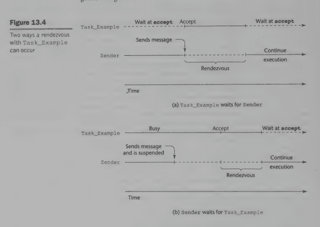

任务不必具有入口点。这样的任务称为动作任务，因为它们不为了完成自己的工作而等待会合。动作任务可以通过向其他任务发送消息来与它们会合。与动作任务相反，一个任务可以拥有 accept 子句，但在这些 accept 子句之外没有任何代码，因此它只能对其他任务作出反应。这样的任务称为服务器任务。

向另一个任务发送消息的 Ada 任务必须知道该任务中的入口名称。然而，反过来并不成立：任务入口不必

知道它将从哪个任务接收消息的名称。这种不对称性与被称为 CSP（即通信顺序进程，Hoare，1978）的语言设计形成对比。在 CSP 中，也使用消息传递并发模型，任务仅接受来自显式命名任务的消息。其缺点是，无法构建供通用使用的任务库。

描述任务 A 向任务 B 发送消息所导致的会合的常用图形方法如图 13.5 所示。

**图 13.5**

由任务 A 向任务 B 发送消息引起的会合的图形表示

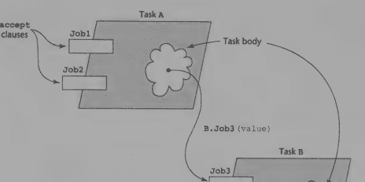

任务在包、子程序或块的声明部分中声明。静态创建的任务与附加该声明部分的代码中的语句同时开始执行。例如，在主程序中声明的任务与主程序代码体中的第一条语句同时开始执行。任务终止是一个复杂问题，将在本节后面讨论。

任务可以有任意数量的入口。相关联的 **accept** 子句在任务中出现的顺序决定了可接受消息的顺序。如果一个任务有多个入口点，并且要求它们能够以任意顺序接收消息，则该任务使用 **select** 语句将这些入口包围起来。例如，假设一个任务模拟银行出纳员的活动，该出纳员必须在银行内的步行服务台服务客户，并且还必须在驾车窗口服务[^2]客户。下面这个骨架式出纳员任务说明了 select 结构：

```ada
task body Teller is
begin
  loop
    select
      accept Drive_Up (formal parameters) do
        ...
      end Drive_Up;
      ...
    or
      accept Walk_Up (formal parameters) do
        ...
      end Walk_Up;
      ...
    end select;
  end loop;
end Teller;
```

在这个任务中，有两个 accept 子句：Walk_Up 和 Drive_Up，每个子句都有一个关联队列。select 执行时的动作是检查与这两个 accept 子句关联的队列。如果其中一个队列为空，而另一个队列至少包含一条等待消息（客户），则与这条或这些等待消息相关联的 accept 子句将与发送所接收第一条消息的任务进行会合。如果两个 accept 子句的队列都为空，则 select 等待直到其中一个入口被调用。如果两个 accept 子句的队列都非空，则不确定地选择其中一个 accept 子句与其某个调用者进行会合。循环强制 select 语句反复执行，永不停息。

accept 子句的结束标记着对 accept 子句形式参数进行赋值或引用的代码的结束。一个 accept 子句与下一个 or（如果该 accept 子句是 select 中的最后一个，则为 end select）之间的代码（如果有）称为扩展 accept 子句。扩展 accept 子句仅在其关联的（紧接其前的）accept 子句执行之后才执行。扩展 accept 子句的这种执行不属于会合的一部分，并且可以与调用任务的执行并发进行。发送方在会合期间被挂起，但当到达 accept 子句末尾时，它会被放回就绪队列。如果一个 accept 子句没有形式参数，则不需要 do-end，并且该 accept 子句可以完全由扩展 accept 子句组成。这种 accept 子句将专门用于同步。扩展 accept 子句在第 13.6.3 节的 `Buf_Task` 任务中说明。

[^2]: 任务也可以动态创建，但此处不讨论此类任务。

若一个任务有嵌套任务，则该嵌套任务也可以访问共享结构，这可能会破坏数据的完整性。因此，用于控制对共享数据结构访问的任务不应定义任务。

下面是一个 Ada 任务示例，它实现了一个用于缓冲区的监视器。该缓冲区的行为与第 13.3 节中的缓冲区非常相似，后者使用信号量控制同步。

```ada
task Buf_Task is
    entry Deposit(Item : in Integer);
    entry Fetch(Item : out Integer);
end Buf_Task;

task body Buf_Task is
    Bufsize : constant Integer := 100;
    Buf     : array (1..Bufsize) of Integer;
    Filled  : Integer range 0..Bufsize := 0;
    Next_In,
    Next_Out : Integer range 1..Bufsize := 1;
begin
    loop
        select
            when Filled < Bufsize =>
                accept Deposit(Item : in Integer) do
                    Buf(Next_In) := Item;
                end Deposit;
                Next_In := (Next_In mod Bufsize) + 1;
                Filled := Filled + 1;
        or
            when Filled > 0 =>
                accept Fetch(Item : out Integer) do
                    Item := Buf(Next_Out);
                end Fetch;
                Next_Out := (Next_Out mod Bufsize) + 1;
                Filled := Filled - 1;
        end select;
    end loop;
end Buf_Task;
```

在这个示例中，两个 **accept** 子句都是扩展的。这些扩展子句可以与调用相关联的 **accept** 子句的任务并发执行。

可以使用 `Buf_Task` 的生产者任务和消费者任务具有以下形式：

```ada
task Producer;
task Consumer;
task body Producer is
    New_Value : Integer;
begin
    loop
        -- produce New_Value --
        Buf_Task.Deposit(New_Value);
    end loop;
end Producer;

task body Consumer is
    Stored_Value : Integer;
begin
    loop
        Buf_Task.Fetch(Stored_Value);
        -- consume Stored_Value --
    end loop;
end Consumer;
```

### 13.6.4 受保护对象

正如我们所见，可以通过将数据封装在任务中并仅允许通过任务入口访问来控制对共享数据的访问，任务入口隐式提供竞争同步。这种方法的一个问题是难以高效实现会合机制。Ada 95 的受保护对象提供了一种无需涉及会合机制即可提供竞争同步的替代方法。

受保护对象不是任务；它更像第 13.4 节所述的监视器。受保护对象可以通过受保护子程序访问，也可以通过语法上类似于任务中 accept 子句的入口访问。[^3] 受保护子程序可以是受保护过程，它对受保护对象的数据提供互斥的读写访问；也可以是受保护函数，它对该数据提供并发只读访问。入口与受保护子程序的区别在于入口可以带有卫式。

在受保护过程的主体中，封闭受保护单元的当前实例被定义为变量；在受保护函数的主体中，封闭受保护单元的当前实例被定义为常量，这允许并发只读访问。

对受保护对象的入口调用提供与使用同一受保护对象的一个或多个任务的同步通信。这些入口调用提供的访问类似于对封装在任务中的数据提供的访问。

上一小节中用任务解决的缓冲区问题，可以用受保护对象更简单地解决。注意，此示例不包括受保护子程序。

```ada
protected Buffer is
    entry Deposit(Item : in Integer);
    entry Fetch(Item : out Integer);
private
    BufSize : constant Integer := 100;
    Buf     : array (1..BufSize) of Integer;
    Filled  : Integer range 0..BufSize := 0;
    Next_In,
    Next_Out : Integer range 1..BufSize := 1;
end Buffer;

protected body Buffer is
    entry Deposit(Item : in Integer)
        when Filled < BufSize is
    begin
        Buf(Next_In) := Item;
        Next_In := (Next_In mod BufSize) + 1;
        Filled := Filled + 1;
    end Deposit;
    entry Fetch(Item : out Integer) when Filled > 0 is
    begin Item := Buf(Next_Out);
        Next_Out := (Next_Out mod BufSize) + 1;
        Filled := Filled - 1;
    end Fetch;
end Buffer;
```

[^3]: 受保护对象主体中的入口使用保留字 *entry*，而不是任务主体中使用的 *accept*。

### 13.6.5 评价

使用通用的消息传递并发模型来构造监视器，就像使用 Ada 包来支持抽象数据类型一样——两者都是比实际需要更通用的工具。受保护对象是提供对共享数据同步访问的更好方法。

在没有具有独立存储器的分布式处理器的情况下，在并发环境中，作为实现共享数据同步访问的手段，在监视器和采用消息传递的任务之间进行选择，在某种程度上是个人偏好问题。然而，在 Ada 的情况下，受保护对象在支持对共享数据的并发访问方面显然优于任务。不仅代码更简单，而且效率也高得多。

对于分布式系统，消息传递是更好的并发模型，因为它自然支持在独立处理器上并行执行的独立进程这一概念。

## 13.7 Java 线程

Java 中的并发单元是名为 run 的方法，其代码可以与其他此类方法（属于其他对象）以及 main 方法并发执行。执行 run 方法的进程称为线程。Java 的线程是轻量级任务，这意味着它们都在同一地址空间中运行。这与 Ada 任务不同，Ada 任务是重量级线程。


当 Java 应用程序开始执行时，会创建一个新线程（`main` 方法将在此线程中运行），并调用 `main`。因此，所有 Java 应用程序都在线程中运行。

当一个程序有多个线程时，调度器必须决定在任意给定时刻哪个或哪些线程将运行。在许多情况下，只有一个可用的处理器，因此实际上每次只有一个线程在运行。要精确描述 Java 调度器的工作方式很困难，因为不同的实现（Solaris、Windows 等）不一定以完全相同的方式调度线程。然而，通常情况下，调度器会以轮转方式为每个就绪线程分配相同大小的时间片，前提是所有这些线程具有相同的优先级。第 13.7.2 节描述了如何为不同线程赋予不同优先级。

`Thread` 类提供了几个控制线程执行的方法。`yield` 方法不带参数，是运行中的线程自愿放弃处理器的请求。[^6] 该线程会立即被放入任务就绪队列，使其处于就绪状态。然后，调度器从任务就绪队列中选择优先级最高的线程。如果没有其他就绪线程的优先级高于刚刚让出处理器的线程，那么该线程也可能再次获得处理器。

`sleep` 方法有一个参数，即调用 `sleep` 的线程希望被阻塞的毫秒整数。在指定的毫秒数过后，该线程将被放入任务就绪队列。由于无法知道线程在运行之前会在任务就绪队列中停留多长时间，因此 `sleep` 的参数是线程不执行的最短时间。`sleep` 方法可能抛出 `InterruptedException`，必须在调用 `sleep` 的方法中处理该异常。异常在第 14 章中有详细描述。

`join` 方法用于强制某个方法延迟执行，直到另一个线程的 `run` 方法执行完毕。当某个方法的处理必须等其他线程的工作完成后才能继续时，可以使用 `join`。例如，我们可能有如下 `run` 方法：

```java
public void run() {
    Thread myTh = new Thread();
    myTh.start();
    // do part of the computation of this thread
    myTh.join();   // Wait for myTh to complete
    // do the rest of the computation of this thread
}
```

`join` 方法会将调用它的线程置于阻塞状态，这种状态只能通过被调用 `join` 的线程完成来结束。如果该线程恰好被阻塞，则可能发生死锁。为防止这种情况，可以带参数调用 `join`，该参数是毫秒级的时间限制，表示调用线程等待被调用线程完成的时间。例如，下面调用 `join` 将使调用线程等待 `myTh` 完成两秒钟。如果两秒后 `myTh` 尚未完成执行，调用线程将被放回就绪队列，这意味着一旦它被调度，就会继续执行。

```
myTh.join(2000);
```

Java 的早期版本还包含另外三个 `Thread` 方法：`stop`、`suspend` 和 `resume`。由于安全问题，这三个方法都已被弃用。`stop` 方法有时会被一个简单的方法重写，通过将其引用变量设置为 null 来销毁线程。

`run` 方法结束其执行的正常方式是到达代码末尾。然而，在许多情况下，线程会一直运行到被告知终止。对此，存在一个问题：线程如何确定自己应该继续还是结束。`interrupt` 方法是向线程传达“应该停止”的一种方式。该方法不会停止线程；而是向线程发送一条消息，实际上只是在线程对象中设置一个位（bit），线程可以检查该位。该位通过谓词方法 `isInterrupted` 来检查。这并非一个完整的解决方案，因为试图中断的线程在调用 `interrupt` 方法时可能正在睡眠或等待，这意味着它不会检查自己是否已被中断。对于这些情况，`interrupt` 方法还会抛出异常 `InterruptedException`，这也会导致线程（从睡眠或等待中）被唤醒。因此，线程可以定期检查自己是否已被中断，如果已中断，是否可以终止。线程不会错过中断，因为如果中断发生时它正在睡眠或等待，它会被中断唤醒。实际上，`interrupt` 的操作和用途还有更多细节，但此处不再赘述（Arnold 等，2006）。

### 13.7.2 优先级

线程的优先级不必都相同。线程的默认优先级最初与创建它的线程相同。如果 `main` 创建了一个线程，其默认优先级是常量 `NORM_PRIORITY`，通常为 5。`Thread` 还定义了另外两个优先级常量，`MAX_PRIORITY` 和 `MIN_PRIORITY`，其值通常分别为 10 和 1。[^7] 线程的优先级可以通过 `setPriority` 方法改变。新的优先级可以是任意预定义常量，也可以是 `MIN_PRIORITY` 与 `MAX_PRIORITY` 之间的任何其他数字。`getPriority` 方法返回线程的当前优先级。这些优先级常量定义在 `Thread` 中。

当存在不同优先级的线程时，调度器的行为由这些优先级控制。当正在执行的线程被阻塞、被杀或时间片到期时，调度器会从任务就绪队列中选择优先级最高的线程。优先级较低的线程只有在机会出现时，没有更高优先级的线程处于任务就绪队列中，才会运行。

### 13.7.3 信号量

`java.util.concurrent.Semaphore` 包定义了 `Semaphore` 类。该类的对象实现计数信号量。计数信号量有一个计数器，但没有用于存储线程描述符的队列。`Semaphore` 类定义了两种方法，`acquire` 和 `release`，它们分别对应于第 13.3 节中描述的等待（wait）和释放（release）操作。

`Semaphore` 的基本构造函数接受一个整数参数，该参数初始化信号量的计数器。例如，下面的代码可用于初始化第 13.3.2 节缓冲区示例中的 `fullspots` 和 `emptyspots` 信号量：

```java
fullspots = new Semaphore(0);
emptyspots = new Semaphore(BUFLEN);
```

生产者方法的 `deposit` 操作应如下所示：

```java
emptyspots.acquire();
deposit(value);
fullspots.release();
```

同样，消费者方法的 `fetch` 操作应如下所示：

```java
fullspots.acquire();
fetch(value);
emptyspots.release();
```

`deposit` 和 `fetch` 方法可以使用第 13.7.4 节中介绍的方法，为对缓冲区的访问提供竞争同步。

### 13.7.4 竞争同步

Java 方法（但不包括构造函数）可以被指定为 `synchronized`。通过特定对象调用的同步方法必须完成其执行后，任何其他同步方法才能在该对象上运行。对象上的竞争同步是通过指定访问共享数据的方法为同步方法来实现的。同步机制实现如下：每个 Java 对象都有一个锁。同步方法在执行前必须获取该对象的锁，这可以防止其他同步方法在该对象上执行。

[^6]: `yield` 方法实际上被定义为对调度器的一个“建议”，调度器可能会也可能不会遵循它（不过通常都会遵循）。

[^7]: 优先级的数量取决于实现，因此在某些实现中可能少于或多于 10 个级别。


每个对象都有一个等待列表，其中包含所有曾在该对象上调用 `wait` 的线程。`notify` 方法用于告诉一个正在等待的线程：它可能一直在等待的某个事件已经发生。由 `notify` 唤醒的具体线程无法确定，因为 Java 虚拟机（JVM）会从该线程对象的等待列表中随机选择一个。因此，加之等待线程可能正在等待不同的条件，通常使用 `notifyAll` 方法而不是 `notify`。`notifyAll` 方法通过将对象等待列表上的所有线程放入任务就绪队列来唤醒它们。

`wait`、`notify` 和 `notifyAll` 方法只能从同步方法内部调用，因为它们使用此类方法放在对象上的锁。对 `wait` 的调用总是放在一个由该方法所等待的条件控制的 `while` 循环中。这个 `while` 循环是必要的，因为唤醒线程的 `notify` 或 `notifyAll` 可能是因为另一个条件发生了变化而被调用，而不是该线程所等待的条件。如果调用的是 `notifyAll`，那么所等待的条件现在为真的可能性甚至更小。由于使用了 `notifyAll`，自上次测试以来，其他某个线程可能已经把该条件改成了假。

`wait` 方法可以抛出 `InterruptedException`，它是 `Exception` 的后代。Java 的异常处理在第 14 章讨论。因此，任何调用 `wait` 的代码也必须捕获 `InterruptedException`。假设所等待的条件称为 `theCondition`，使用 `wait` 的常规方式如下：

```java
try {
    while (!theCondition)
        wait();
    // Do whatever is needed after theCondition comes true
}
catch(InterruptedException myProblem) { . . . }
```

下面的程序实现了一个用于存储 `int` 值的循环队列。它同时说明了协作同步和竞争同步。

```java
// Queue
// This class implements a circular queue for storing int
// values. It includes a constructor for allocating and
// initializing the queue to a specified size. It has
// synchronized methods for inserting values into and
// removing values from the queue.

class Queue {
    private int [] que;
    private int nextIn,
                nextOut,
                filled,
                queSize;

    public Queue(int size) {
        que = new int [size];
        filled = 0;
        nextIn = 0;
        nextOut = 0;
        queSize = size;
    } /* end of Queue constructor */

    public synchronized void deposit (int item)
        throws InterruptedException {
        try {
            while (filled == queSize)
                wait();
            que [nextIn] = item;
            nextIn = (nextIn + 1) % queSize;
            filled++;
            notifyAll();
        } /* end of try clause */
        catch(InterruptedException e) {}
    } /* end of deposit method */

    public synchronized int fetch()
        throws InterruptedException {
        int item = 0;
        try {
            while (filled == 0)
                wait();
            item = que [nextOut];
            nextOut = (nextOut + 1) % queSize;
            filled--;
            notifyAll();
        } /* end of try clause */
        catch(InterruptedException e) {}
        return item;
    } /* end of fetch method */
} /* end of Queue class */
```

注意，这里的异常处理器（`catch`）什么也不做。可以如下定义使用 `Queue` 类的生产者对象和消费者对象的类：

```java
class Producer extends Thread {
    private Queue buffer;
    public Producer(Queue que) {
        buffer = que;
    }
    public void run() {
        int new_item;
        while (true) {
            //-- Create a new_item
            buffer.deposit(new_item);
        }
    }
}
```

```java
class Consumer extends Thread {
    private Queue buffer;
    public Consumer(Queue que) {
        buffer = que;
    }
    public void run() {
        int stored_item;
        while (true) {
            stored_item = buffer.fetch();
            //-- Consume the stored_item
        }
    }
}
```

下面的代码创建一个 `Queue` 对象，以及一个 `Producer` 对象和一个 `Consumer` 对象，二者都连接到该 `Queue` 对象，并启动它们的执行：

```java
Queue buff1 = new Queue(100);
Producer producer1 = new Producer(buff1);
Consumer consumer1 = new Consumer(buff1);
producer1.start();
consumer1.start();
```

我们可以将 `Producer` 和 `Consumer` 中的一个或两个定义为 `Runnable` 接口的实现，而不是 `Thread` 的子类。唯一的区别在于第一行，现在会写成如下形式：

```java
class Producer implements Runnable { . . . }
```

要创建并运行这种类的对象，仍然需要创建一个与该对象连接的 `Thread` 对象。下面的代码说明了这一点：

```java
Producer producer1 = new Producer(buff1);
Thread producerThread = new Thread(producer1);
producerThread.start();
```

注意，`buffer` 对象被传递给 `Producer` 构造函数，而 `Producer` 对象被传递给 `Thread` 构造函数。

### 13.7.6 非阻塞同步

Java 包含一些用于控制对某些变量访问的类，这些类不包含阻塞或等待。`java.util.concurrent.atomic` 包定义了允许对 `int`、`long` 和 `boolean` 基本类型变量以及引用和数组进行某些非阻塞同步访问的类。例如，`AtomicInteger` 类定义了 getter 和 setter 方法，以及用于加法、递增和递减操作的方法。这些操作都是原子的；也就是说，它们不能被中断，因此不需要锁来保证多线程程序中受影响变量值的完整性。这是细粒度同步——仅针对单个变量。现在大多数机器都有针对 `int` 和 `long` 类型这些操作的原子指令，因此它们通常很容易实现（不需要隐式锁）。

非阻塞同步的优点在于效率。在无竞争情况下发生的非阻塞访问不会更慢，而且通常比使用 `synchronized` 的访问更快。在竞争情况下发生的非阻塞访问肯定比使用 `synchronized` 的访问更快，因为后者需要挂起和重新调度线程。

### 13.7.7 显式锁

Java 5.0 引入了显式锁，作为提供隐式锁的 `synchronized` 方法和块的替代方案。`Lock` 接口声明了 `lock`、`unlock` 和 `tryLock` 方法。预定义的 `ReentrantLock` 类实现了 `Lock` 接口。要锁定一个代码块，可以使用以下惯用法：

```java
Lock lock = new ReentrantLock();
...
lock.lock();
try {
    // The code that accesses the shared data
} finally {
    lock.unlock();
}
```

这段骨架代码创建一个 `Lock` 对象，并在该 `Lock` 对象上调用 `lock` 方法。然后，它使用 `try` 块包围关键代码。对 `unlock` 的调用放在 `finally` 子句中，以保证无论 `try` 块中发生什么，锁都会被释放。

至少在两种情况下会使用显式锁而不是隐式锁：第一，如果应用程序需要尝试获取锁但不能永远等待它，`Lock` 接口包含一个方法 `tryLock`，它接受一个时间限制参数。如果在时间限制内没有获取到锁，执行将继续到调用 `tryLock` 之后的语句。第二，当锁-解锁对不适合采用块结构时，会使用显式锁。隐式锁总是在锁定它们的复合语句末尾解锁。显式锁可以在代码中的任何位置解锁，无论程序结构如何。

使用显式锁（使用隐式锁时不是这样）的一个危险是遗漏解锁。隐式锁在锁定块的末尾隐式解锁。然而，显式锁会保持锁定，直到被显式解锁，而这有可能永远不发生。

如前所述，每个对象都有一个内在条件队列，用于存储在该对象上等待某个条件的线程。`wait`、`notify` 和 `notifyAll` 方法是内在条件队列的 API。因为每个对象只能有一个条件队列，所以一个队列中可能有线程在等待不同的条件。例如，在我们的缓冲区示例 `Queue` 中，队列可以有线程等待两个条件中的任意一个（`filled == queueSize` 或 `filled == 0`）。这就是缓冲区使用 `notifyAll` 的原因。（如果它使用 `notify`，那么只会唤醒一个线程，而且它可能是在等待与实际变为真的条件不同的条件的线程。）然而，`notifyAll` 的使用代价很高，因为它会唤醒在对象上等待的所有线程，而所有线程都必须检查自己的条件以确定哪一个运行。此外，为了检查条件，它们必须首先获取对象上的锁。

使用内在条件队列的替代方案是 `Condition` 接口，它使用与 `Lock` 对象关联的条件队列。它还声明了 `wait`、`notify` 和 `notifyAll` 的替代方法，分别名为 `await`、`signal` 和 `signalAll`。一个 `Lock` 对象可以有任意数量的 `Condition` 对象。使用 `Condition` 时，可以使用 `signal` 而不是 `signalAll`，这既更容易理解又更高效，部分原因是它导致更少的上下文切换。

### 13.7.8 评估

Java 对并发的支持相对简单但有效。所有 Java 的 `run` 方法都是参与者任务，除了通过共享数据之外，没有通信机制，就像 Ada 任务之间那样。因为它们是重量级线程，Ada 的任务可以很容易地分布到不同的处理器；特别是具有不同内存的不同处理器，这些处理器可能位于不同地点的不同计算机上。这类系统在 Java 线程中是不可能的。

## 13.8 C# 线程

尽管 C# 的线程松散地基于 Java 的线程，但存在显著差异。以下是对 C# 线程的简要概述。


### 13.8.1 基本线程操作

与 Java 中只有名为 `run` 的方法不同，C# 中的任何方法都可以在自己的线程中运行。当 C# 线程被创建时，它们与预定义委托 `ThreadStart` 的一个实例相关联。当线程开始执行时，其委托包含它应该运行的方法的地址。因此，线程的执行是通过其关联的委托来控制的。

C# 线程通过创建 `Thread` 对象来创建。`Thread` 构造函数必须接收一个 `ThreadStart` 的实例化对象，并且必须向该实例化对象传入要在线程中运行的方法的名称。例如，我们可以有：

```csharp
public void MyRun1() { . . . }
. . .
Thread myThread = new Thread(new ThreadStart(MyRun1));
```

在这个例子中，我们创建了一个名为 `myThread` 的线程，其委托指向方法 `MyRun1`。因此，当线程开始执行时，它会调用其委托中地址所对应的那个方法。在这个例子中，`myThread` 是委托，`MyRun1` 是方法。

与 Java 一样，C# 中有两类线程：角色线程（actor）和服务线程（server）。角色线程不会被专门调用；相反，它们是被启动的。此外，它们执行的方法不接收参数，也不返回值。与 Java 一样，创建线程并不会启动其并发执行。对于角色线程，必须通过 `Thread` 类的一个方法（此处名为 `Start`）来请求执行，例如：

```csharp
myThread.Start();
```

与 Java 类似，可以使用同样命名为 `Join` 的方法让一个线程等待另一个线程完成执行后再继续。例如，假设线程 A 有如下调用：

```csharp
B.Join();
```

线程 A 将被阻塞，直到线程 B 退出。

`Join` 方法可以接受一个 `int` 参数，该参数指定调用者等待线程完成的毫秒数时间限制。

线程可以使用 `Sleep` 暂停一段指定的时间，`Sleep` 是 `Thread` 的一个公共静态方法。`Sleep` 的参数是一个整数毫秒数。与 Java 中的对应方法不同，C# 的 `Sleep` 不会引发任何异常，因此不需要在 `try` 块中调用。

线程可以使用 `Abort` 方法终止，尽管它并不会真正地杀死线程。相反，它会抛出 `ThreadAbortException`，线程可以捕获该异常。当线程捕获此异常时，它通常会释放其分配的所有资源，然后结束（通过到达其代码末尾）。

服务线程仅在其委托被调用时运行。这些线程被称为服务线程，是因为它们在请求时提供某些服务。服务线程比角色线程更有趣，因为它们通常与其他线程交互，并且通常必须与其他线程同步执行。

回顾第 9 章，任何 C# 方法都可以通过委托间接调用。这种调用可以通过将委托对象视为方法名称来进行。这实际上是对名为 `Invoke` 的委托方法调用的简写。因此，如果委托对象名为 `chgfun1`，并且它引用的方法接受一个 `int` 参数，我们可以使用以下任一语句来调用该方法：

```csharp
chgfun1(7);
chgfun1.Invoke(7);
```

这些调用是同步的；也就是说，当方法被调用时，调用者会被阻塞，直到该方法完成执行。C# 还支持对在线程中执行的方法进行异步调用。当线程被异步调用时，被调用线程和调用线程并发执行，因为调用者在被调用线程执行期间不会被阻塞。

线程通过委托实例方法 `BeginInvoke` 被异步调用，该方法会发送委托方法的参数，以及另外两个参数：一个类型为 `AsyncCallback`，另一个类型为 `object`。`BeginInvoke` 返回一个实现 `IAsyncResult` 接口的对象。委托类还定义了 `EndInvoke` 实例方法，该方法接受一个 `IAsyncResult` 类型的参数，并返回与委托对象中封装的方法所返回类型相同的类型。要异步调用线程，我们使用 `BeginInvoke` 来调用它。目前，我们将最后两个参数设为 `null`。假设有以下方法声明和线程定义：

```csharp
public float MyMethod(int x);
. . .
Thread myThread = new Thread(new ThreadStart(MyMethod));
```

以下语句异步调用了 `MyMethod`：

```csharp
IAsyncResult result = myThread.BeginInvoke(10, null, null);
```

被调用线程的返回值通过 `EndInvoke` 方法获取，该方法接受 `BeginInvoke` 返回的对象（类型为 `IAsyncResult`）作为其参数。`EndInvoke` 返回被调用线程的返回值。例如，要获取对 `MyMethod` 调用的 `float` 结果，我们使用以下语句：

```csharp
float returnValue = EndInvoke(result);
```

如果调用者在被调用线程执行期间必须继续某些工作，它必须有一种方法来确定被调用线程何时完成。为此，`IAsyncResult` 接口定义了 `IsCompleted` 属性。在被调用线程执行期间，调用者可以在 **while** 循环中包含它可以执行的代码，该循环依赖于 `IsCompleted`。例如，我们可以有以下代码：

```csharp
IAsyncResult result = myThread.BeginInvoke(10, null, null);
while(!result.IsCompleted) {
    // Do some computation
}
```

这是在等待被调用线程完成其工作的同时在调用线程中完成某些事情的有效方法。然而，如果 **while** 循环中的计算量相对较小，那么这种方式利用这段时间的效率较低（因为测试 `IsCompleted` 需要时间）。另一种方法是给被调用线程一个带有回调方法地址的委托，并让它在完成时调用该方法。该委托作为倒数第二个参数发送给 `BeginInvoke`。例如，考虑以下对 `BeginInvoke` 的调用：

```csharp
IAsyncResult result = myThread.BeginInvoke(10,
                  new AsyncCallback(MyMethodComplete), null);
```

回调方法在调用者中定义。此类方法通常只是将一个布尔变量（例如名为 `isDone`）设置为 **true**。无论被调用线程需要多长时间，回调方法都只被调用一次。

### 13.8.2 同步线程

C# 线程可以通过三种不同的方式进行同步：`Interlocked` 类、`System.Threading` 命名空间中的 `Monitor` 类，以及 `lock` 语句。这些机制中的每一种都是针对特定需求而设计的。当需要同步的操作仅是整数的递增和递减时，使用 `Interlocked` 类。这些操作通过 `Interlocked` 的两个方法 `Increment` 和 `Decrement` 原子地完成，这两个方法都将对整数的引用作为参数。例如，要在线程中递增名为 `counter` 的共享整数，我们可以使用：

```csharp
Interlocked.Increment(ref counter);
```

`lock` 语句用于标记线程中的临界区代码段。其语法如下：

```csharp
lock(token) {
    // The critical section
}
```

其功能可以与 Ada 的任务一样强大。并发集合类的可用性是 C# 相对于本章讨论的其他非功能性语言的另一个优势。

## 13.9 函数式语言中的并发

本节简要概述几种函数式编程语言对并发的支持。

### 13.9.1 Multi-LISP

Multi-LISP（Halstead, 1985）是 Scheme 的一个扩展，允许程序员指定可以并发执行的程序部分。这些并发形式是隐式的；程序员只是告诉编译器（或解释器）程序的某些部分可以并发运行。

程序员向系统告知可能并发的一种方式是 `pcall` 结构。如果函数调用嵌入在 `pcall` 结构中，则该函数的参数可以并发求值。例如，考虑以下 `pcall` 结构：

```lisp
(pcall f a b c d)
```

函数是 f，参数为 a、b、c 和 d。`pcall` 的效果是函数的参数可以并发求值（任何或所有参数都可能是复杂的表达式）。不幸的是，该过程是否可以安全使用，即在不影响函数求值语义的情况下，是程序员的责任。如果语言不允许副作用，或者程序员设计的函数没有副作用或至少只有有限的副作用，这实际上是一件简单的事情。然而，Multi-LISP 确实允许某些副作用。如果函数不是为避免副作用而编写的，那么程序员可能很难确定 `pcall` 是否可以安全使用。

Multi-LISP 的 `future` 结构是一个更有趣且可能更有成效的并发源。与 `pcall` 一样，函数调用被包裹在 `future` 结构中。这样的函数在单独的线程中被求值，而父线程继续执行。父线程继续执行，直到需要使用该函数的返回值。如果函数在其结果需要时尚未完成执行，父线程将等待它完成后再继续。

如果一个函数有两个或多个参数，它们也可以被包裹在 `future` 结构中，在这种情况下，它们的求值可以在单独的线程中并发执行。

这些是 Multi-LISP 中对 Scheme 的全部添加内容。


### 13.9.2 并发 ML

并发 ML（CML）是 ML 的扩展，包含一种线程形式和一种同步消息传递形式，以支持并发。该语言在 Reppy（1999）中有完整描述。

在 CML 中，线程通过 spawn 原语创建，该原语将函数作为其参数。在许多情况下，该函数被指定为匿名函数。线程一旦创建，函数便在新线程中开始执行。函数的返回值被丢弃。函数的效果要么是产生的输出，要么是通过与其他线程通信产生。父线程（生成新线程的线程）或子线程（新线程）都可能先终止，且不会影响另一方的执行。

通道提供线程间通信的手段。通道通过 channel 构造函数创建。例如，以下语句创建一个名为 mychannel 的任意类型通道：

```
let val mychannel = channel()
```

通道上的两个主要操作（函数）用于发送（send）和接收（recv）消息。消息的类型由 send 操作推断。例如，以下函数调用发送整数值 7，因此通道的类型随后被推断为整数：

```
send(mychannel, 7)
```

recv 函数将通道指定为其参数。其返回值就是它接收到的值。

由于 CML 通信是同步的，只有当发送方和接收方都准备好时，消息才会既被发送又被接收。如果线程在通道上发送消息，而没有其他线程准备好在该通道上接收，则发送方被阻塞，并等待另一个线程在该通道上执行 recv。同样，如果某线程在通道上执行 recv，但没有其他线程在该通道上发送消息，则执行 recv 的线程被阻塞，并等待该通道上的消息。

由于通道是带类型的，函数可以将它们作为参数。

与 Ada 的同步消息传递一样，CML 同步消息传递的一个问题是，当多个通道都收到消息时，决定选择哪条消息。并且使用了相同的解决方案：卫式命令 do-od 构造，它在发往不同通道的消息之间随机选择。

CML 的同步机制是事件。对这种复杂机制的说明超出了本章（以及本书）的范围。

### 13.9.3 F#

F# 对并发支持的一部分基于 C# 所使用的相同 .NET 类，特别是 `System.Threading.Thread`。例如，假设我们想在自己的线程中运行函数 `myConMethod`。以下函数在被调用时，将创建线程并在新线程中开始执行该函数：

```
let createThread() =
    let newThread = new Thread(myConMethod)
    newThread.Start()
```

回想一下，在 C# 中，必须创建预定义委托 `ThreadStart` 的实例，把子程序名称传给其构造函数，并将新的委托实例作为参数传给 Thread 构造函数。在 F# 中，如果函数期望一个委托作为其参数，可以传入 lambda 表达式或函数，编译器会表现得就像你传入了委托一样。因此，在上面的代码中，函数 `myConMethod` 被作为参数传给 Thread 构造函数，但实际传入的是 ThreadStart 的新实例（并将 `myConMethod` 传给它）。

Thread 类定义了 `Sleep` 方法，该方法使调用它的线程休眠作为参数传给它的毫秒数。

共享的不可变数据不需要在访问它的线程之间进行同步。然而，如果共享数据是可变的（这在 F# 中是可能的），则需要锁定，以防止多个线程试图更改它而破坏共享数据。可变变量可以在函数操作它时被锁定，以通过 lock 函数提供对该对象的同步访问。该函数接受两个参数，第一个是要更改的变量。第二个是更改该变量的 lambda 表达式。

可变的堆分配变量类型为 `ref`。例如，以下声明创建一个名为 `sum` 的此类变量，初始值为 0：

```
let sum = ref 0
```

ref 类型变量可以在使用 ALGOL/Pascal/Ada 赋值运算符 `:=` 的 lambda 表达式中更改。ref 变量必须加上感叹号（`!`）前缀才能获取其值。在下面，当 lambda 表达式将 `x` 的值加到可变变量 `sum` 上时，`sum` 被锁定：

```
lock (sum) (fun () -> sum := !sum + x)
```

线程可以像在 C# 中一样异步调用，使用相同的子程序 `BeginInvoke` 和 `EndInvoke`，以及 `IAsyncResult` 接口，以便于确定异步调用线程的执行是否完成。

如前所述，F# 程序可以使用 .NET 的并发泛型集合。在构建需要队列、栈或包形式的共享数据结构的多线程程序时，这可以节省大量编程工作。

## 13.10 语句级并发

在本节中，我们简要探讨面向语句级并发的语言设计。从语言设计的角度来看，此类设计的目标是提供一种机制，程序员可以用它告知编译器将程序映射到多处理器体系结构的方式。^9

本节只讨论一种语言中用于语句级并发的一组语言结构：高性能 Fortran。

### 13.10.1 高性能 Fortran

高性能 Fortran（HPF；ACM，1993b）是 Fortran 90 的一组扩展，旨在允许程序员向编译器指定信息，以帮助其优化程序在多处理器计算机上的执行。HPF 既包括新的说明语句，也包括内在的（即内置的）子程序。本节只讨论部分 HPF 语句。

HPF 的主要说明语句用于指定处理器数量、数据在这些处理器内存上的分布，以及数据与其他数据在内存放置方面的对齐。HPF 说明语句在 Fortran 程序中以特殊注释形式出现。每个语句都由前缀 !HPF$ 引入，其中 ! 是 Fortran 90 中用于开始注释行的字符。该前缀使它们对 Fortran 90 编译器不可见，但便于 HPF 编译器识别。

PROCESSORS 说明具有以下形式：

```
    !HPF$ PROCESSORS proc (n)
```

该语句用于向编译器指定为此程序生成的代码可以使用的处理器数量。该信息与其他说明一起使用，以告知编译器如何将数据分布到与处理器关联的内存中。

DISTRIBUTE 和 ALIGN 说明用于向编译器提供关于不共享内存的机器的信息——也就是说，每个处理器都有自己的内存。其假设是，处理器访问自己的内存比访问另一个处理器的内存更快。

DISTRIBUTE 语句指定要分布的数据以及要使用的分布种类。其形式如下：

```
!HPF$ DISTRIBUTE (kind) ONTO procs :: identifier_list
```

在该语句中，kind 可以是 BLOCK 或 CYCLIC。标识符列表是要分布的数组变量的名称。被指定为 BLOCK 分布的变量被划分为 n 个相等的组，其中每组由连续数组元素集合组成，并均匀分布在所有处理器的内存上。例如，如果名为 LIST 的包含 500 个元素的数组以 BLOCK 方式分布在 5 个处理器上，则 LIST 的前 100 个元素将存储于第一个处理器的内存中，第二个 100 个元素存储于第二个处理器的内存中，依此类推。CYCLIC 分布指定数组的各个元素循环存储在处理器内存中。例如，如果 LIST 以 CYCLIC 方式分布，同样分布在五个处理器上，则 LIST 的第一个元素将存储于第一个处理器的内存中，第二个元素存储于第二个处理器的内存中，依此类推。

ALIGN 语句的形式是

```
ALIGN array1_element WITH array2_element
```

ALIGN 用于将一个数组的分布与另一个数组的分布关联起来。例如，

```
ALIGN list1(index) WITH list2(index+1)
```

指定对于所有 index 值，list1 的 index 元素将与 list2 的 index+1 元素存储在同一处理器的内存中。ALIGN 中的两个数组引用会一起出现在程序的某个语句中。将它们放在同一内存中（即同一处理器）可确保对它们的引用尽可能接近。

考虑以下示例代码段：

```
REAL list_1 (1000), list_2 (1000)
INTEGER list_3 (500), list_4 (501)
!HPF$ PROCESSORS procs (10)
!HPF$ DISTRIBUTE (BLOCK) ONTO procs :: list_1, list_2
!HPF$ ALIGN list_3 (index) WITH list_4 (index+1)
. . .
list_1 (index) = list_2 (index)
list_3 (index) = list_4 (index+1)
```

在这些赋值语句的每次执行中，两个被引用的数组元素都将存储在同一处理器的内存中。

HPF 说明语句为编译器提供信息，编译器可能会也可能不会使用这些信息来优化其生成的代码。编译器实际做什么取决于其复杂程度以及目标机器的特定体系结构。


FORALL 语句指定了一组可并发执行的赋值语句。例如，

```
FORALL (index = 1:1000)
    list_1(index) = list_2(index)
END FORALL
```

指定将 list_2 的元素赋值给 list_1 的对应元素。但是，这些赋值受以下顺序限制：必须先计算全部 1,000 个赋值的右侧，然后才能进行任何赋值。这允许所有赋值语句并发执行。除赋值语句外，FORALL 语句还可以出现在 FORALL 构造的主体中。FORALL 语句与向量机非常匹配，在向量机中，同一条指令应用于多个数据值，通常是在一个或多个数组中。HPF 的 FORALL 语句包含在 Fortran 95 及后续 Fortran 版本中。

我们仅简要讨论了 HPF 能力的一小部分。不过，这已足以让读者了解哪些语言扩展有助于为可能拥有大量处理器的计算机编程。

C# 4.0（以及其他 .NET 语言）包含两个行为有些类似 FORALL 的方法。它们是循环控制语句，其中迭代可以展开，循环体可以并发执行。这两个方法是 Parallel.For 和 Parallel.ForEach。

## 小结

并发执行可以发生在指令、语句或子程序级别。当实际使用多个处理器来执行并发单元时，我们使用术语“物理并发”。如果并发单元在单个处理器上执行，我们使用术语“逻辑并发”。所有并发的底层概念模型都可以称为逻辑并发。

大多数多处理器计算机属于两大类之一——SIMD 或 MIMD。MIMD 计算机可以是分布式的。

支持子程序级并发的语言必须提供两项基本能力：对共享数据结构的互斥访问（竞争同步）和任务之间的合作（合作同步）。

任务可以处于以下五种不同状态中的任意一种：新建、就绪、运行、阻塞或终止。

有时会使用诸如 OpenMP 之类的库，而不是设计支持并发的语言构造。

并发语言支持的设计问题包括：如何提供竞争同步与合作同步，应用程序如何影响任务调度，任务如何以及何时开始和结束执行，以及任务如何以及何时创建。

信号量是一种数据结构，由一个整数和一个任务描述队列组成。信号量既可用于在并发任务之间提供竞争同步，也可提供合作同步。信号量很容易被错误使用，从而导致编译器、链接器或运行时系统无法检测到的错误。

管程是一种数据抽象，提供了一种自然的方式来对任务间共享的数据进行互斥访问。多种编程语言支持管程，包括 Ada、Java 和 C#。在具有管程的语言中，合作同步必须借助某种形式的信号量来提供。

并发消息传递模型的基本概念是：任务之间相互发送消息以同步其执行。

Ada 基于消息传递模型提供了复杂但有效的并发构造。Ada 的任务是重量级任务。任务通过会合机制相互通信，该机制是同步消息传递。会合是一个任务接受另一个任务发送的消息的动作。Ada 既包含简单方法，也包含复杂方法，用于控制任务之间会合的发生。

Ada 95+ 包含支持并发的额外能力，主要是受保护对象。Ada 95+ 以两种方式支持管程：通过任务和通过受保护对象。

Java 以相对简单但有效的方式支持轻量级并发单元。任何继承 Thread 或实现 Runnable 的类都可以重写名为 run 的方法，并使该方法的代码与其他此类方法以及主程序并发执行。竞争同步通过将访问共享数据的方法定义为隐式同步来指定。小段代码也可以隐式同步。所有方法都同步的类就是管程。合作同步通过 wait、notify 和 notifyAll 方法实现。Thread 类还提供 sleep、yield、join 和 interrupt 方法。

Java 通过其 Semaphore 类及其 acquire 和 release 方法直接支持计数信号量。它还有一些类用于提供非阻塞原子操作，例如整数的加法、递增和递减操作。Java 还通过 Lock 接口和 ReentrantLock 类及其 lock 和 unlock 方法提供显式锁。除了使用 synchronized 进行隐式同步外，Java 还提供 int、long 和 boolean 类型变量以及引用和数组的隐式非阻塞同步。在这些情况下，会提供原子 getter、setter、add、increment 和 decrement 操作。

C# 对并发的支持基于 Java，但稍微更复杂一些。任何方法都可以在线程中运行。同时支持主动线程和服务线程。所有线程都通过关联的委托进行控制。服务线程可以用 invoke 同步调用，或用 BeginInvoke 异步调用。可以将回调方法地址发送给被调用线程。支持三种线程同步方式：Interlocked 类（提供原子递增和递减操作）、Monitor 类和 lock 语句。

所有 .NET 语言都可以使用用于栈、队列和袋的泛型并发数据结构，这些结构的竞争同步是隐式的。

Multi-LISP 对 Scheme 做了少量扩展，使程序员能够告知实现哪些程序部分可以并发执行。Concurrent ML 扩展了 ML，以支持一种线程形式以及这些线程之间的一种同步消息传递形式。这种消息传递是通过通道设计的。F# 程序可以访问所有 .NET 并发支持类。线程之间共享的可变数据可以以同步方式访问。

高性能 Fortran 包含用于指定如何将数据分布到连接到多个处理器的内存单元上的语句。它还包含用于指定可并发执行的语句集合的语句。

## 文献注释

Andrews 和 Schneider（1983）、Holt 等（1978）以及 Ben-Ari（1982）对并发的一般主题进行了详尽讨论。

Brinch Hansen（1977）提出了管程概念，并描述了其在 Concurrent Pascal 中的实现。

Hoare（1978）和 Brinch Hansen（1978）讨论了并发单元控制的消息传递模型的早期发展。关于 Ada 任务模型发展的深入讨论可见 Ichbiah 等（1979）。ARM（1995）详细描述了 Ada 95。ACM（1993b）描述了高性能 Fortran。

## 复习题

- 1. 程序中可能存在的三个并发级别是什么？
- 2. 描述 SIMD 计算机的逻辑架构。
- 3. 描述 MIMD 计算机的逻辑架构。
- 4. SIMD 计算机最适合支持哪一级程序并发？
- 5. MIMD 计算机最适合支持哪一级程序并发？
- 6. 描述向量处理器的逻辑架构。
- 7. 物理并发和逻辑并发有什么区别？
- 8. 程序中的控制线程是什么？
- 9. 为什么协程被称为准并发？
- 10. 什么是多线程程序？
- 11. 研究并发语言支持的四个理由是什么？
- 12. 什么是重量级任务？什么是轻量级任务？
- 13. 定义 *任务*、*同步*、*竞争同步*、*合作同步*、*活性*、*竞态条件* 和 *死锁*。
- 14. 哪类任务不需要任何形式的同步？
- 15. 描述任务可以处于的五种不同状态。
- 16. 什么是任务描述符？
- 17. 在并发语言支持的背景下，什么是守卫？
- 18. 任务就绪队列的用途是什么？
- 19. 并发语言支持的两个主要设计问题是什么？
- 20. 描述信号量的 wait 和 release 操作的动作。
- 21. 什么是二值信号量？什么是计数信号量？
- 22. 使用信号量提供同步的主要问题是什么？
- 23. 管程相比信号量有什么优势？
- 24. 可以在哪三种常见语言中实现管程？
- 25. 定义 *会合*、*接受子句*、*入口子句*、*主动任务*、*服务任务*、*扩展接受子句*、*开放接受子句*、*封闭接受子句* 和 *已完成任务*。
- 26. 通过管程实现的并发和通过消息传递实现的并发，哪一种更通用？
- 27. Ada 任务是静态创建还是动态创建的？
- 28. 扩展 *accept* 子句起什么作用？
- 29. Ada 任务如何提供合作同步？
- 30. 在提供对共享数据对象的访问方面，Ada 95 中的受保护对象相比任务有什么优势？
- 31. 具体来说，应用程序中哪个 Java 程序单元可以与 main 方法并发运行？
- 32. Java 线程是轻量级任务还是重量级任务？
- 33. Java 的 `sleep` 方法做什么？
- 34. Java 的 `yield` 方法做什么？
- 35. Java 的 `join` 方法做什么？
- 36. Java 的 `interrupt` 方法做什么？
- 37. 可以声明为 *synchronized* 的两种 Java 构造是什么？


- 38. 在 Java 中如何设置线程的优先级？
- 39. Java 线程可以是 actor 线程、服务器线程，还是两者皆可？
- 40. 描述用于支持合作同步的三个 Java 方法各自的作用。
- 41. 管程是哪种 Java 对象？
- 42. 解释 Java 为什么包含 Runnable 接口。
- 43. 与 Java Semaphore 对象一起使用的两个方法是什么？
- 44. Java 中非阻塞同步的优点是什么？
- 45. Java AtomicInteger 类有哪些方法，这个类的用途是什么？
- 46. Java 如何支持显式锁？
- 47. C# 线程中可以运行哪些种类的方法？
- 48. C# 线程可以是 actor 线程、服务器线程，还是两者皆可？
- 49. 同步调用 C# 线程的两种方式是什么？
- 50. 如何异步调用 C# 线程？
- 51. 在 C# 中如何获取异步调用线程的返回值？
- 52. 与 Java 的 sleep 相比，C# 的 Sleep 方法有什么不同？
- 53. C# 的 Abort 方法究竟做什么？
- 54. C# 的 Interlocked 类的用途是什么？
- 55. C# 的 lock 语句做什么？
- 56. Multi-LISP 基于哪种语言？
- 57. Multi-LISP 的 pcall 构造的语义是什么？
- 58. 在 CML 中如何创建线程？
- 59. F# 中堆分配的可变变量的类型是什么？
- 60. 为什么 F# 的不可变变量在多线程程序中不需要同步访问？
- 61. HPF 的规范语句的目标是什么？
- 62. HPF 和 Fortran 的 FORALL 语句的用途是什么？

## 问题集

- 1. 清楚解释为什么在支持协程但不支持并发的编程环境中，竞争同步不是一个问题。
- 2. 当检测到死锁时，系统可以采取的最佳措施是什么？
- 3. 忙等待是一种任务通过持续检查给定事件是否发生来等待该事件的方法。这种方法的主要问题是什么？
- 4. 在 13.3 节的生产者-消费者示例中，假设我们错误地把消费者进程中的 `release(access)` 替换为 `wait(access)`。这个错误对系统执行会产生什么结果？
- 5. 从一本关于使用 Intel Pentium 处理器的计算机汇编语言编程的书中，确定提供了哪些指令来支持信号量的构造。
- 6. 假设两个任务 A 和 B 必须使用共享变量 `Buf_Size`。任务 A 给 `Buf_Size` 加 2，任务 B 从中减 1。假设此类算术运算通过三个步骤完成：取出当前值、执行算术运算、把新值放回。在缺少竞争同步的情况下，可能发生哪些事件序列，这些操作会产生什么值？假设 `Buf_Size` 的初始值为 6。
- 7. 比较 Java 的竞争同步机制与 Ada 的竞争同步机制。
- 8. 比较 Java 的合作同步机制与 Ada 的合作同步机制。
- 9. 如果一个管程过程调用同一管程中的另一个过程，会发生什么？
- 10. 解释使用信号量以及使用 Ada 任务中的 `when` 子句进行合作同步的相对安全性。

## 编程练习

- 1. 编写一个 Ada 任务来实现通用信号量。
- 2. 编写一个 Ada 任务来管理共享缓冲区，例如我们示例中的那个，但使用编程练习 1 中的信号量任务。
- 3. 在 Ada 中定义信号量，并使用它们在共享缓冲区示例中同时提供合作同步和竞争同步。
- 4. 用 Java 编写编程练习 3。
- 5. 用 C# 编写本章的共享缓冲区示例。
- 6. 读者-写者问题可以表述如下：任意数量的任务都可以并发读取一个共享内存位置，但当某个任务必须写入该共享内存位置时，它必须具有独占访问权。为读者-写者问题编写一个 Java 程序。
- 7. 用 Ada 编写编程练习 6。
- 8. 用 C# 编写编程练习 6。

# 14 异常处理与事件处理

- 14.1 异常处理简介
- 14.2 C++ 中的异常处理
- 14.3 Java 中的异常处理
- 14.4 Python 和 Ruby 中的异常处理
- 14.5 事件处理简介
- 14.6 Java 中的事件处理
- 14.7 C# 中的事件处理


本章讨论编程语言对许多当代程序中两个相关部分的支持：异常处理和事件处理。异常和事件都可能在无法预先确定的时间发生，二者最好都通过特殊的语言构造和过程来处理。其中一些构造和过程——例如传播——在异常处理和事件处理中是相似的。

我们首先描述异常处理的基本概念，包括可由硬件和软件检测的异常、异常处理器以及异常的引发。然后介绍并讨论异常处理的设计问题，包括异常到异常处理器的绑定、继续执行和默认处理器。本节之后将描述和评价两种编程语言 C++ 和 Java 的异常处理设施。随后简要介绍 Python 和 Ruby 中的异常处理。

本章后半部分讨论事件处理。我们首先介绍事件处理的基本概念。随后讨论 Java 和 C# 的事件处理方法。

## 14.1 异常处理简介

大多数计算机硬件系统能够检测某些运行时错误条件，例如浮点溢出。早期编程语言的设计和实现方式使得用户程序既不能检测也不能尝试处理此类错误。在这些语言中，此类错误的发生只会导致程序终止，并将控制权转交给操作系统。操作系统对运行时错误的典型反应是显示一条诊断消息，该消息可能是有意义的因而有用，也可能非常晦涩难懂。显示消息后，程序终止。

然而，在输入和输出操作的情况下，情况有所不同。例如，Fortran 的 Read 语句可以拦截输入错误和文件结束条件，这两者都由输入设备硬件检测。在这两种情况下，Read 语句都可以指定用户程序中处理该条件的某个语句的标号。对于文件结束，该条件显然并不总是被视为错误。在大多数情况下，它只不过是一个信号，表示一种处理已完成，另一种处理必须开始。尽管文件结束与始终是错误的事件（例如输入过程失败）之间存在明显差异，Fortran 仍用同一机制处理这两种情况。考虑下面的 Fortran Read 语句：

`Read(Unit=5, Fmt=1000, Err=100, End=999) Weight`

Err 子句指定，如果读取操作发生错误，控制权将转移到标号为 100 的语句。End 子句指定，如果读取操作遇到文件结束，控制权将转移到标号为 999 的语句。因此，Fortran 对输入错误和文件结束都使用简单的分支。

有一类严重错误无法由硬件检测，但可以由编译器生成的代码检测。例如，数组下标范围错误几乎从不由硬件检测，但它们会导致严重错误，而这些错误往往直到程序执行后期才被注意到。

检测下标范围错误有时是语言设计所要求的。例如，Java 语言规范要求 Java 编译器生成代码来检查每个下标表达式的正确性（当可以在编译时确定某个下标表达式不可能具有越界值时，例如下标是字面量时，它们不会生成此类代码）。在 C 中不检查下标范围，因为此类检查的成本过去（现在仍然）被认为不值得用来换取检测此类错误所带来的好处。在某些语言的某些编译器中，可以根据程序或执行编译器的命令中的需要，选择启用下标范围检查（如果默认未开启）或关闭下标范围检查（如果默认已开启）。

大多数当代语言的设计者都包含了相应机制，使程序能够以标准方式对某些运行时错误以及其他由程序检测到的不寻常事件作出反应。当硬件或系统软件检测到某些事件时，程序也可以得到通知，从而也能对这些事件作出反应。

一些语言不包含异常处理的一个原因是它给语言增加了复杂性。

### 14.1.1 基本概念

我们把由硬件检测到的错误（例如磁盘读取错误）和不寻常条件（例如文件结束，它也由硬件检测）都视为异常。我们进一步扩展异常的概念，使其包括可由软件检测的错误或不寻常条件（由软件解释器或用户代码本身检测）。因此，我们将**异常**定义为任何不寻常事件，无论是否错误，只要它可由硬件或软件检测并且可能需要特殊处理。

检测到异常时可能需要的特殊处理称为**异常处理**。这种处理由一个称为**异常处理器**的代码单元或代码段完成。当异常关联的事件发生时，异常被**引发**。在一些基于 C 的语言中，异常被称为**抛出**，而不是**引发**。<sup>2</sup> 不同种类的异常需要不同的异常处理器。检测到文件结束几乎总是需要某种特定的程序动作。但是，显然该动作也不适用于数组索引范围错误异常。在某些情况下，唯一的动作是生成一条错误消息并有条不紊地终止程序。

1. 在 20 世纪 70 年代，有一些计算机确实在硬件中检测下标范围错误。

2. C++ 是第一种包含异常处理的基于 C 的语言。使用 *throw* 一词而不是 *raise*，因为标准 C 库包含一个名为 `raise` 的函数。


语言中缺少单独或特定的异常处理设施，并不妨碍处理用户定义、由软件检测的异常。在某个程序单元内检测到的此类异常，通常由该单元的调用者处理。一种可能的设计是传递一个辅助参数，将其用作状态变量。状态变量在被调用子程序中根据其计算结果的正确性和/或正常性被赋予一个值。从被调用单元返回后，调用者立即测试该状态变量。如果该值表明发生了异常，就可以执行处理程序，该处理程序可能位于调用单元中。许多 C 标准库函数使用这种方法的一种变体：返回值被用作错误指示符。

另一种可能是向子程序传递一个标号参数。当然，这种方法只在允许将标号用作参数的语言中可行。传递标号使得被调用单元在发生异常时能够返回到调用者中的不同位置。与第一种方案一样，处理程序通常是调用单元代码的一部分。这是 Fortran 中标号参数的一种常见用法。

第三种可能是将处理程序定义为一个独立的子程序，并将其名称作为参数传递给被调用单元。在这种情况下，处理程序子程序由调用者提供，但被调用单元在引发异常时调用该处理程序。这种方法的一个问题是，每次调用任何以处理程序子程序为参数的子程序时，都必须传递一个处理程序子程序，无论是否需要。此外，为了处理几种不同类型的异常，需要传递几个不同的处理程序例程，这会使代码复杂化。

如果希望在检测到异常的那个单元中处理异常，则处理程序作为该单元中的一段代码包含在内。

将异常处理内置于语言中有一些明确的优点。首先，没有异常处理时，检测错误条件所需的代码会使程序相当杂乱。例如，假设一个子程序包含的表达式中有 10 处引用了名为 mat 的矩阵元素，其中任何一处都可能发生索引越界错误。进一步假设该语言不要求索引范围检查。如果没有内置的索引范围检查，这些操作中的每一个之前都可能需要代码来检测可能的索引范围错误。例如，考虑以下对 mat 中某个元素的引用，该矩阵有 10 行和 20 列：

```
if (row >= 0 && row < 10 && col >= 0 && col < 20)
    sum += mat[row][col];
else
    System.out.println("Index range error on mat, row = " +
        row + " col = " + col);
```

语言中存在异常处理将允许编译器在每次数组元素访问之前插入用于此类检查的机器代码，从而大大缩短和简化源程序。

语言支持异常处理的另一个优点来自异常传播。异常传播允许在一个程序单元中引发的异常在其动态或静态祖先中的某个其他单元中处理。这使得单个异常处理程序可用于任意数量的不同程序单元。这种复用可以显著节省开发成本、减小程序规模并降低程序复杂性。

支持异常处理的语言会鼓励用户考虑程序执行期间可能发生的所有事件以及如何处理它们。这种方法远比不考虑这些可能性而只是希望不出错要好得多。

最后，有些程序通过异常处理可以简化对大量但异常情况的处理，而如果没有异常处理，程序结构可能会变得过于复杂。

### 14.1.2 设计问题

现在我们来探讨当异常处理系统成为编程语言一部分时的一些设计问题。这样的系统可能同时允许预定义和用户定义的异常以及异常处理程序。注意，预定义异常是隐式引发的，而用户定义异常必须由用户代码显式引发。考虑以下骨架子程序，它包含针对一个隐式引发异常的异常处理机制：

```
void example() {
    ...
    average = sum / total;
    ...
    return;
/* Exception handlers */
    when zero_divide {
        average = 0;
        printf("Error-divisor (total) is zero\n");
    }
    ...
}
```

除零异常是隐式引发的，它使控制转移到相应的处理程序，然后执行该处理程序。

异常处理的第一个设计问题是异常发生如何绑定到异常处理程序。这个问题出现在两个不同层面上。在单元层面，问题在于同一异常在单元中不同位置被引发时，如何绑定到该单元内的不同处理程序。例如，在示例子程序中，有一个针对除零异常的处理程序，它看起来是为了处理某条特定语句（所示语句）中发生的除零而编写的。但假设该函数还包含其他几个带有除法运算符的表达式。对于那些运算符，这个处理程序很可能并不合适。因此，应当能够将特定语句可能引发的异常绑定到特定处理程序，即使同一异常可以由许多不同语句引发。

### 历史注释

PL/I（ANSI, 1976）开创了允许用户程序直接参与异常处理的概念。该语言允许用户为一大串语言定义的异常编写异常处理程序。此外，PL/I 引入了用户定义异常的概念，允许程序创建由软件检测的异常。这些异常使用与内置异常相同的机制。自 PL/I 设计以来，人们已经做了大量工作来设计异常处理的其他方法，并且异常处理机制已被纳入随后的一长串编程语言中。

在更高层面上，当引发异常的单元中没有本地异常处理程序时，就出现了绑定问题。在这种情况下，语言设计者必须决定是否将异常传播到某个其他单元，如果是，传播到哪里。这种传播如何发生以及传播多远，对异常处理程序的可写性有重要影响。例如，如果处理程序必须是本地的，那么就必须编写许多处理程序，这会使程序的编写和阅读都复杂化。另一方面，如果异常被传播，单个处理程序可能处理在几个程序单元中引发的同一异常，这可能要求该处理程序比人们期望的更通用。

与异常绑定到异常处理程序相关的一个问题是，异常的有关信息是否提供给处理程序。

异常处理程序执行之后，控制可以转移到程序中处理程序代码之外的某个地方，或者程序执行可以简单终止。我们将此称为处理程序执行后的控制继续问题，或简称为**继续**。终止显然是最简单的选择，而且在许多错误异常条件下也是最好的选择。然而，在其他情况下，特别是与不寻常但并非错误的事件相关的情况，选择继续执行是最好的。这种设计称为**恢复**。在这些情况下，必须选择一些约定来确定执行应从何处继续。它可能是引发异常的那条语句、引发异常的语句之后的那条语句，或者可能是某个其他单元。返回到引发异常的语句这一选择似乎不错，但在错误异常的情况下，只有当处理程序能够以某种方式修改导致异常被引发的值或操作时才有用。否则，异常只会被重新引发。对于错误异常，所需的修改往往很难预测。然而，即使可能，这也可能不是一种可靠的做法。它允许程序消除问题的症状而不消除原因。

异常绑定到处理程序以及继续这两个问题在图14.1中说明。

当包含异常处理时，子程序的执行可以以两种方式终止：执行完成时，或遇到异常时。³ 在某些情况下，有必要完成某些计算

3. 当然，即使语言不支持异常处理，子程序也可能因系统检测到的错误而终止。


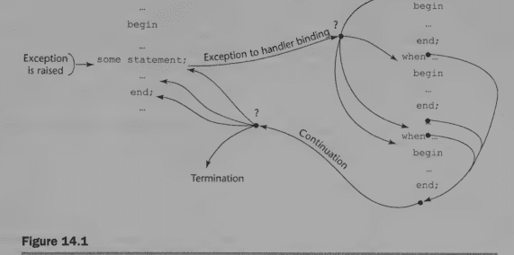

**图 14.1** 异常处理控制流

无论子程序执行如何终止。能够指定这种计算的能力被称为*终结化*。是否支持终结化显然是异常处理的一个设计问题。

另一个设计问题如下：如果允许用户定义异常，那么这些异常是如何指定的？通常的答案是要求它们在可能引发异常的程序单元的规范部分中声明。已声明异常的作用域通常是包含该声明的程序单元的作用域。

如果语言提供预定义异常，则还有其他几个设计问题。例如，语言运行时系统是否应该为内置异常提供默认处理器，还是要求用户为所有异常编写处理器？另一个问题是预定义异常是否可以由用户程序显式引发。如果存在软件可检测的情况，用户希望使用预定义的处理器，这种用法会很方便。

另一个问题是硬件可检测的错误能否由用户程序处理。如果不能，那么所有异常显然都是软件可检测的。一个相关的问题是是否应该有预定义异常。预定义异常由硬件或系统软件隐式引发。

异常处理的设计问题可总结如下：

- 异常处理器如何及在哪里指定，它们的作用域是什么？
- 异常事件如何绑定到异常处理器？
- 有关异常的信息能传递给处理器吗？
- 异常处理器完成其执行后，如果有的话，执行从哪里继续？（这是继续或恢复的问题。）
- 是否提供某种形式的终结化？
- 用户定义的异常如何指定？
- 如果有预定义异常，是否应该为那些没有提供自己处理器的程序提供默认异常处理器？
- 预定义异常可以被显式引发吗？
- 硬件可检测错误是否被视为可以处理的异常？
- 是否有任何预定义异常？

我们现在可以考察几种当代编程语言的异常处理设施。

## 14.2 C++ 中的异常处理

C++ 的异常处理于 1990 年被 ANSI C++ 标准化委员会接受，随后进入了 C++ 实现。该设计部分基于 CLU、Ada 和 ML 的异常处理。在 C++ 中，异常由用户或库定义，并显式引发。

### 14.2.1 异常处理器

C++ 使用一个特殊的构造，用保留字 try 来指定异常处理器的作用域。try 构造包括一个称为 try 子句的复合语句和一个异常处理器列表。复合语句定义了后续处理器的作用域。该构造的一般形式如下：

```cpp
try {
    // Code that might raise an exception
} catch (formal parameter) {
    // A handler body
}
...
catch (formal parameter) {
    // A handler body
}
```

每个 catch 函数都是一个异常处理器。catch 函数只能有一个形式参数，类似于 C++ 函数定义中的形式参数，包括可以是省略号（. . .）的可能性。带有省略号形式参数的处理器是捕获所有异常的处理器；如果没有找到合适的处理器，它将对任何引发的异常生效。

形式参数也可以是裸类型说明符，例如 `float`，就像函数原型中那样。在这种情况下，形式参数的唯一目的是使处理器具有唯一可识别性。当有关异常的信息要传递给处理器时，形式参数包含一个用于该目的的变量名。因为参数的类可以是任何用户定义的类，所以参数可以包含尽可能多的数据成员。异常绑定到处理器在第 14.2.2 节中讨论。

在 C++ 中，异常处理器可以包含任何 C++ 代码。

### 14.2.2 将异常绑定到处理器

在 C++ 中，异常仅由显式语句 `throw` 引发，其 EBNF 一般形式如下：

```cpp
throw [expression];
```

这里的方括号是元符号，用于指定表达式是可选的。没有操作数的 `throw` 只能出现在处理器中。当它出现在那里时，它会重新引发该异常，然后由其他地方处理。

`throw` 表达式的类型选择特定的处理器，该处理器当然必须具有“匹配”的类型形式参数。在这种情况下，*匹配* 意味着以下内容：形式参数类型为 `T`、`const T`、`T&`（对 `T` 类型对象的引用）或 `const T&` 的处理器与表达式类型为 `T` 的 `throw` 匹配。如果 `T` 是一个类，则参数类型为 `T` 或 `T` 的任何祖先类的处理器都匹配。还有更复杂的情况，其中 `throw` 表达式与形式参数匹配，但此处不再描述。

在 `try` 子句中引发的异常会导致该 `try` 子句中代码的执行立即结束。对匹配处理器的搜索从紧随 `try` 子句之后的处理器开始。匹配过程在处理器上顺序进行，直到找到匹配项。这意味着如果任何其他匹配项先于完全匹配的处理器，则不会使用完全匹配的处理器。因此，特定异常的处理器放在列表顶部，后面是更通用的处理器。最后一个处理器通常是带有省略号（...）形式参数的处理器，它匹配任何异常。这将保证所有异常都被捕获。

如果异常在 `try` 子句中引发，并且没有与该 `try` 子句关联的匹配处理器，则该异常被传播。如果 `try` 子句嵌套在另一个 `try` 子句内，则异常被传播到与外层 `try` 子句关联的处理器。如果所有封闭的 `try` 子句都没有产生匹配的处理器，则异常被传播到引发该异常的函数的调用者。如果对该函数的调用不在 `try` 子句中，则异常被传播到该函数的调用者。如果通过此传播过程在程序中未找到匹配的处理器，则调用默认处理器。该处理器将在第 14.2.4 节中进一步讨论。

### 14.2.3 继续

处理器完成其执行后，控制流转到 try 构造之后的第一条语句（即该处理器所在的处理器序列中最后一个处理器之后的那条语句）。处理器可以使用不带表达式的 throw 重新引发异常，在这种情况下，该异常会被传播。

### 14.2.4 其他设计选择

就第 14.1.2 节总结的设计问题而言，C++ 的异常处理很简单。只有用户定义的异常，它们不是语言预先规定的（尽管它们可以被声明为新类）。有一个默认异常处理器 terminate，它唯一的作用是终止程序。该处理器捕获程序未捕获的所有异常。它可以用用户定义的处理器替换。替换处理器必须是一个返回 void 且不带参数的函数。替换函数通过将其名称赋给 set_terminate 来设置。

C++ 函数可以列出它可能引发的异常的类型（throw 表达式的类型）。这是通过将保留字 throw 后跟一个包含这些类型的括号列表附加到函数头来完成的。例如，

```cpp
int fun() throw (int, char *) { ... }
```

指定函数 fun 可能引发类型 int 和 char * 的异常，但不能引发其他异常。throw 子句的目的是通知函数的用户该函数可能引发哪些异常。throw 子句实际上是函数与其调用者之间的契约。它保证函数中不会引发其他异常。如果函数确实引发了某个未列出的异常，程序将被终止。注意，编译器会忽略 throw 子句。

如果 throw 子句中的类型是类，则该函数可以引发从所列类派生的任何异常。如果函数头有 throw 子句，并且引发了未在 throw 子句中列出、也不是从列出的类派生的异常，则调用默认处理器。注意，此错误无法在编译时检测到。throw 子句中的类型列表可以为空，表示该函数不会引发任何异常。如果函数头没有 throw 规范，则该函数可以引发任何异常。该列表不属于函数类型的一部分。

如果函数覆盖了一个带有 throw 子句的函数，则覆盖函数不能有比被覆盖函数更多异常的 throw 子句。

虽然 C++ 没有预定义异常，但标准库定义并引发异常，例如可由库容器类引发的 out_of_range，以及可由数学库函数引发的 overflow_error。


### 14.2.5 一个示例

以下示例程序演示了 C++ 中异常处理器的一些简单用法。该程序使用一个计数器数组计算并打印输入成绩的分布。输入是一系列成绩，以负数结束。负数会引发 `NegativeInputException` 异常，因为成绩必须是非负整数。成绩分为 10 个类别（0–9、10–19、...、90–100）。成绩本身用于计算计数器数组的索引，每个成绩类别对应一个计数器。无效输入成绩通过在计数器数组中捕获索引错误来检测。成绩 100 在成绩分布计算中比较特殊，因为每个类别都有 10 个可能的成绩值，除了最高类别有 11 个（90、91、...、100）。（事实上，可能的 A 等成绩比 B 或 C 更多，这充分证明了教师的慷慨。）成绩 100 也在用于无效输入数据的同一个异常处理器中处理。

它使用一个包含 10 个类别的计数器数组来生成输入成绩的分布。非法成绩通过检查递增所选计数器时使用的无效下标来检测。

```cpp
// Grade Distribution
// Input: A list of integer values that represent
//         grades, followed by a negative number
// Output: A distribution of grades, as a percentage for
//         each of the categories 0-9, 10-19, ..., 
//         90-100.
#include <iostream>
int main() {  // Any exception can be raised
    int new_grade,
        index,
        limit_1,
        limit_2,
        freq[10] = {0,0,0,0,0,0,0,0,0,0};
    // The exception definition to deal with the end of data
    class NegativeInputException {
      public:
        NegativeInputException() {  // Constructor
          cout << "End of input data reached" << endl;
        } //** end of constructor
    }; //** end of NegativeInputException class
    try {
      while (true) {
        cout << "Please input a grade" << endl;
        cin >> new_grade;
        if (new_grade < 0)  // End of data
          throw NegativeInputException();
        index = new_grade / 10;
        try {
          if (index > 9)
            throw new_grade;
```

Java 的异常处理以 C++ 为基础，但设计上更符合面向对象语言范式。此外，Java 包含一组由 Java 运行时系统隐式抛出的预定义异常。

### 14.3.1 异常的类别

所有 Java 异常都是 Throwable 类的后代类的对象。Java 系统包含两个 Throwable 子类的预定义异常类：Error 和 Exception。Error 类及其后代与 Java 运行时系统抛出的错误相关，例如堆内存耗尽。这些异常永远不会由用户程序抛出，也不应在用户程序中处理。Exception 有两个系统定义的直接子类：RuntimeException 和 IOException。正如其名称所示，当输入或输出操作发生错误时抛出 IOException，所有这些操作都定义为 java.io 包中各个类的方法。

有一些预定义的类是 RuntimeException 的后代。在大多数情况下，当用户程序引起错误时会抛出 RuntimeException。例如，ArrayIndexOutOfBoundsException（定义于 java.util）是一种常见的抛出异常，它继承自 RuntimeException。另一个继承自 RuntimeException 的常见异常是 NullPointerException。

用户程序可以定义自己的异常类。Java 中的惯例是用户定义的异常是 Exception 的子类。

### 14.3.2 异常处理器

Java 的异常处理器与 C++ 的形式相同，除了每个 catch 必须有一个参数，并且参数类必须是预定义类 Throwable 的后代。

Java 中 try 构造的语法与 C++ 完全相同，除了 14.3.6 节中描述的 finally 子句。

### 14.3.3 将异常绑定到处理器

抛出异常很简单。将异常类的一个实例作为 throw 语句的操作数。例如，假设我们定义一个名为 MyException 的异常，如下：

```java
class MyException extends Exception {
    public MyException() {}
    public MyException(String message) {
        super (message);
    }
}
```

这个异常可以通过以下语句抛出：

```
    throw new MyException();
```

我们包含在新类中的两个构造函数中，一个没有参数，另一个有一个 `String` 对象参数，它将该参数发送给超类（`Exception`），由超类显示它。因此，我们的新异常可以用以下方式抛出：

```
    throw new MyException
        ("a message to specify the location of the error");
```

Java 中异常到处理器的绑定与 C++ 类似。如果在 `try` 构造的复合语句中抛出异常，它会被绑定到 `try` 子句之后紧邻的第一个处理器（`catch` 函数），该处理器的参数与抛出的对象属于同一个类，或者是其祖先类。如果找到匹配的处理器，`throw` 就绑定到它并执行。

异常可以被处理，然后通过在处理器末尾包含一个不带操作数的 `throw` 语句来重新抛出。新抛出的异常不会在最初抛出它的同一个 `try` 中被处理，因此不存在循环问题。这种重新抛出通常在某个局部操作有用时进行，但还需要由外层 `try` 子句或调用者中的 `try` 子句进一步处理。处理器中的 `throw` 语句也可以抛出除将控制权转移到该处理器的异常之外的某个其他异常。

为了确保在 `try` 子句中可能抛出的异常在方法中总能被处理，可以编写一个特殊的处理器，只需用 `Exception` 类型参数定义该处理器，即可匹配所有从 `Exception` 派生的异常，例如：

```
    catch (Exception genericObject) {
        . . .
    }
```

因为类名总是匹配自身或任何祖先类，所以任何从 `Exception` 派生的类都匹配 `Exception`。当然，这样的异常处理器应始终放在处理器列表的末尾，因为它会阻止在包含它的 `try` 构造中其后的任何处理器被使用。这是因为对匹配处理器的搜索是顺序的，搜索在找到匹配项时结束。

### 14.3.4 其他设计选择

作为其反射机制的一部分，Java 运行时系统存储程序中每个对象的类名。`getClass` 方法可用于获取一个存储类名的对象，而该类名本身可以通过 `getName` 方法获取。因此，我们可以从以下位置检索实际参数的类名：

```
            }  //** end of catch (ArrayIndex. . .
        }  //** end of while (true) . . .
    }  //** end of outer try clause
    catch(NegativeInputException e) {
        System.out.println("\nlimits   Frequency\n");
        for (index = 0; index < 10; index++) {
            limit_1 = 10 * index;
            limit_2 = limit_1 + 9;
            if (index == 9)
                limit_2 = 100;
            System.out.println("" + limit_1 + " - " +
                    limit_2 + "        " + freq [index]);
        }  //** end of for (index = 0; . . .
    }  //** end of catch (NegativeInputException . . .
    }  //** end of method buildDist
```

负输入异常 `NegativeInputException` 在程序中定义。当该类的对象被创建时，其构造函数会显示一条消息。其处理器产生该方法的输出。`ArrayIndexOutOfBoundsException` 是一个预定义的未检查异常，由 Java 运行时系统抛出。在这两种情况下，处理器都没有在其参数中包含对象名。在任一情况下，名字都没有任何用处。尽管所有处理器都将对象作为参数获取，但它们通常并不有用。

### 14.3.6 `finally` 子句

在某些情况下，无论 `try` 子句是否抛出异常，也无论该异常是否在方法中被处理，都必须执行某个过程。这种情况的一个例子是需要关闭的文件。另一种情况是，如果方法具有某种外部资源，无论方法执行如何终止，都必须在该方法中释放该资源。`finally` 子句就是为这类需求设计的。`finally` 子句放置在处理器列表的末尾，紧接在一个完整的 `try` 构造之后。通常，`try` 构造及其 `finally` 子句的形式如下：

```
    try {
        . . .
    }
    catch (. . .) {
        . . .
    }
    . . . //** More handlers
    finally {
        . . .
    }
```

该构造的语义如下：如果 `try` 子句没有抛出异常，则在继续执行 `try` 构造之后的代码之前执行 `finally` 子句。如果 `try` 子句抛出异常并被后面的处理器捕获，则


finally 子句在处理程序完成执行后执行。如果 try 子句抛出异常，但该异常未被 try 结构之后的处理程序捕获，则 finally 子句会在异常传播之前执行。

没有异常处理程序的 try 结构后面可以跟一个 finally 子句。当然，只有当复合语句包含 throw、break、continue 或 return 语句时，这样做才有意义。在这些情况下，其用途与在异常处理中使用时相同。例如，考虑以下代码：

```java
try {
    for (index = 0; index < 100; index++) {
        if ( . . . ) {
            return;
        } //** end of if
        . . .
    } //** end of for
} //** end of try clause
finally {
    . . .
} //** end of try construct
```

无论 return 是终止循环，还是循环正常结束，这里的 finally 子句都会执行。

### 14.3.7 断言

在第 2 章讨论 Plankalkül 时，我们提到它包含断言。Java 在 1.4 版中加入了断言。要使用断言，必须通过使用 enableassertions（或 ea）标志运行程序来启用它们，如下所示：

```
java -enableassertions MyProgram
```

assert 语句有两种可能的形式：

```
assert condition;
assert condition : expression;
```

在第一种情况下，当执行到达 assert 时会测试条件。如果条件求值为 true，则什么也不发生。如果求值为 false，则抛出 AssertionError 异常。在第二种情况下，操作相同，只是表达式的值会作为字符串传递给 AssertionError 构造函数，并成为调试输出。

assert 语句用于防御性编程。程序编写时可能会包含许多 assert 语句，以确保程序的计算朝着产生正确结果的方向进行。许多程序员在编写程序时会加入此类检查，作为调试辅助，即使他们使用的语言不支持断言。当程序经过充分测试后，这些检查会被移除。具有相同目的的 `assert` 语句的优点是，它们可以在不移除出程序的情况下被禁用。这节省了移除它们的工作量，也允许在后续程序维护期间使用它们。

### 14.3.8 评价

Java 的异常处理机制是对其所基于的 C++ 版本的改进。

第一，C++ 程序可以抛出程序或系统定义的任何类型。在 Java 中，只能抛出 `Throwable` 的实例或从其派生的某个类的对象。这将被抛出的对象与程序中存在的所有其他对象（以及非对象）区分开来。对于导致抛出 `int` 值的异常，能赋予它什么意义呢？

第二，不包含 `throw` 子句的 C++ 程序单元可以抛出任何异常，这不会向读者传达任何信息。不包含 `throws` 子句的 Java 方法不能抛出其未处理的任何受检异常。因此，Java 方法的读者可以从其方法头知道它可能抛出但不处理哪些异常。C++ 编译器会忽略 `throw` 子句，但 Java 编译器会确保方法可能抛出的所有异常都列在其 `throws` 子句中。

第三，`finally` 子句是一个有用的补充。它允许无论复合语句如何终止，都能执行清理类操作。

最后，Java 运行时系统会隐式抛出各种预定义异常，例如数组索引越界和解引用空引用，任何用户程序都可以处理这些异常。C++ 程序只能处理它显式抛出的异常（或它使用的库类所抛出的异常）。

C# 包含的异常处理结构与 Java 的非常相似，只是 C# 没有 `throws` 子句。

## 14.4 Python 和 Ruby 中的异常处理

本节简要概述 Python 和 Ruby 的异常处理机制。

### 14.4.1 Python

在 Python 中，异常是对象。所有异常类的基类是 `BaseException`，`Exception` 类派生自它。`BaseException` 提供了一些对所有异常类都有用的服务，但通常不会直接对它进行子类化。所有预定义异常类都派生自 `Exception`，用户定义的异常类也派生自它。`Exception` 最常用的预定义子类有 `ArithmeticError`，

异常处理程序通过 **rescue** 子句指定，该子句附加到一条语句上。要将异常处理程序附加到一段代码，需将代码放入 **begin-end** 块中。**rescue** 子句放在该块中代码之后。通常，其形式如下所示：

```ruby
begin
    The sequence of statements in the block
rescue
    The handler
end
```

**begin-end** 块可以包含 **else** 子句和/或 **ensure** 子句。**else** 子句与 Python 中的完全一样。**ensure** 子句与 **finally** 子句完全一样。方法可以充当异常处理的容器，以代替 **begin-end** 块。

与大多数其他语言明显不同，Ruby 允许在异常被处理后重新运行引发异常的代码段。这通过在处理程序末尾使用 **retry** 语句来指定。

## 14.5 事件处理简介

事件处理与异常处理类似。在两种情况下，处理程序都是由于某事物（异常或事件）的发生而被隐式调用的。异常既可以由用户代码显式引发，也可以由硬件或软件解释器隐式引发，而事件由外部动作创建，例如用户通过图形用户界面（GUI）进行的交互。本节介绍事件处理的基础知识，它比异常处理更简单。

在传统（非事件驱动）编程中，程序代码本身指定该代码的执行顺序，尽管该顺序通常受程序输入数据的影响。在事件驱动编程中，程序的部分内容会在完全不可预测的时间执行，通常由用户与正在执行的程序的交互触发。

本章讨论的特定类型的事件处理与 GUI 有关。因此，大多数事件是由用户通过图形对象或组件（通常称为 **控件**）进行的交互引起的。最常见的控件是按钮。实现对用户与 GUI 组件交互的反应是最常见的事件处理形式。

**事件**是一种通知，表示某个特定事情已经发生，例如鼠标点击了图形按钮。严格来说，事件是由运行时系统响应某个用户动作而隐式创建的对象，至少在这里讨论事件处理的上下文中是这样。

**事件处理程序**是一段代码，它响应事件的出现而执行。事件处理程序使程序能够响应用户动作。

尽管事件驱动编程早在 GUI 出现之前就已被使用，但直到这类界面流行起来，它才成为一种广泛使用的编程方法。例如，考虑呈现给 Web 浏览器用户的 GUI。现在呈现给浏览器用户的许多 Web 文档都是动态的。此类文档可能会向用户呈现订单表单，用户通过点击按钮来选择商品。与这些按钮点击相关的所需内部计算由响应点击事件的事件处理程序执行。

事件处理程序的另一个常见用途是检查表单元素中的简单错误和遗漏，无论是在它们被更改时，还是在表单提交给 Web 服务器进行处理时。在浏览器上使用事件处理来检查表单数据的有效性，可以节省将数据发送到服务器的时间；否则，这些数据的正确性必须先由驻留在服务器上的程序或脚本检查，然后才能进行处理。这种事件驱动编程通常使用客户端脚本语言（如 JavaScript）完成。

## 14.6 Java 中的事件处理

除 Web 应用程序外，非 Web Java 应用程序也可以向用户呈现 GUI。本节讨论 Java 应用程序中的 GUI。

Java 的初始版本为 GUI 组件提供了某种较为原始的支持。在该语言于 1998 年末发布的 1.2 版中，新增了一组组件。这些组件统称为 Swing。

### 14.6.1 Java Swing GUI 组件⁴

定义在 `javax.swing` 中的 Swing 类和接口集合包括 GUI 组件（或控件）。由于我们这里关注的是事件处理，而不是 GUI 组件，因此只讨论两种控件：文本框和单选按钮。

文本框是 `JTextField` 类的对象。最简单的 `JTextField` 构造函数接受一个参数，即文本框的字符长度。例如，

```
JTextField name = new JTextField(32);
```

`JTextField` 构造函数还可以接受一个字面字符串作为可选的第一个参数。当存在该字符串参数时，它会作为文本框的初始内容显示。

单选按钮是放置在按钮组容器中的特殊按钮。按钮组是 `ButtonGroup` 类的对象，其构造函数不接受参数。在单选按钮组中，一次只能按下一个按钮。如果组中任何按钮变为按下状态，则先前按下的按钮会隐式取消按下。`JRadioButton` 构造函数用于创建单选

4. 过去几年中，Swing 正逐渐被一个名为 JavaFX 的新 GUI 工具集取代。


单选按钮的构造方法接受两个参数：一个标签以及单选按钮的初始状态（true 或 false，分别表示按下和未按下）。如果组中的一个单选按钮最初设置为按下，则组中的其他按钮默认未按下。创建单选按钮后，使用按钮组对象的 add 方法将它们放入各自的按钮组中。考虑以下示例：

```java
ButtonGroup payment = new ButtonGroup();
JRadioButton box1 = new JRadioButton("Visa", true);
JRadioButton box2 = new JRadioButton("Master Charge");
JRadioButton box3 = new JRadioButton("Discover");
payment.add(box1);
payment.add(box2);
payment.add(box3);
```

JFrame 对象是一个框架，显示为独立窗口。JFrame 类定义了框架所需的数据和方法。因此，使用框架的类可以是 JFrame 的子类。JFrame 有几个称为窗格的层。我们只关注其中一层，即内容窗格。GUI 的组件放置在 JPanel 对象（面板）中，该对象用于组织和定义组件的布局。创建框架，并将包含组件的面板添加到该框架的内容窗格中。

预定义图形对象（例如 GUI 组件）直接放置在面板中。下面的代码创建了后续组件讨论中使用的面板对象：

```java
JPanel myPanel = new JPanel();
```

使用构造方法创建组件后，使用 add 方法将它们放入面板中，如下所示：

```java
myPanel.add(button1);
```

### 14.6.2 Java 事件模型

当用户与 GUI 组件交互时（例如单击按钮），该组件会创建一个事件对象，并通过称为事件监听器的对象调用事件处理器，同时传递该事件对象。事件处理器提供关联的操作。GUI 组件是事件生成器。在 Java 中，事件通过事件监听器连接到事件处理器。事件监听器通过事件监听器注册连接到事件生成器。监听器注册通过实现监听器接口的类的方法完成，如本节后面所述。只有为特定事件注册的事件监听器才会在该事件发生时收到通知。

接收消息的监听器方法实现事件处理器。为使事件处理方法符合标准协议，需要使用接口。接口规定标准方法协议，但不提供这些方法的实现。

需要实现事件处理器的类必须为该处理器实现监听器接口。事件类和监听器接口有若干种。其中一类事件是 `ItemEvent`，它与单击复选框或单选按钮，或选择列表项的事件相关联。`ItemListener` 接口包含一个方法协议 `itemStateChanged`，它是 `ItemEvent` 事件的处理器。因此，要提供由单选按钮单击触发的操作，必须实现 `ItemListener` 接口，这需要定义 `itemStateChanged` 方法。

如前所述，组件与事件监听器的连接通过实现监听器接口的类的方法完成。例如，由于 `ItemEvent` 是用户在单选按钮上的操作所创建的事件对象的类名，因此使用 `addItemListener` 方法为单选按钮注册监听器。在面板中创建的按钮事件的监听器可以在该面板中实现，也可以在 `JPanel` 的子类中实现。因此，对于名为 `myPanel` 且实现按钮的 `ItemEvent` 处理器的面板中名为 `button1` 的单选按钮，我们将用以下语句注册监听器：

```java
button1.addItemListener(this);
```

每个事件处理器方法都接收一个事件参数，该参数提供有关事件的信息。事件类具有访问该信息的方法。例如，当通过单选按钮调用时，`isSelected` 方法返回 `true` 或 `false`，分别取决于按钮处于开启还是关闭状态（按下或未按下）。

所有与事件相关的类都在 `java.awt.event` 包中，因此使用事件的任何类都会导入该包。

下面是一个示例应用程序 `RadioB`，它说明事件和事件处理的使用。该应用程序构造单选按钮，用于控制文本字段内容的字体样式。它为四种字体样式分别创建一个 `Font` 对象。每种样式都有一个单选按钮，使用户可以选择该字体样式。

本示例的目的是展示如何处理 GUI 组件引发的事件，以动态更改程序的输出显示。由于我们重点关注事件处理，因此此处不解释该程序的某些部分。

```java
/* RadioB.java
   An example to illustrate event handling with interactive
   radio buttons that control the font style of a textfield
*/
package radiob;
import java.awt.*;
import java.awt.event.*;
import javax.swing.*;

public class RadioB extends JPanel implements
    ItemListener {
    private JTextField text;
```

**图14.2**  
`RadioB.java` 的输出  
来源：Java 单选按钮小程序截图。


```java
// The event handler
public void itemStateChanged(ItemEvent e) {
    // Determine which button is on and set the font
    // accordingly
    if (plain.isSelected())
        text.setFont(plainFont);
    else if (bold.isSelected())
        text.setFont(boldFont);
    else if (italic.isSelected())
        text.setFont(italicFont);
    else if (boldItalic.isSelected())
        text.setFont(boldItalicFont);
} // End of itemStateChanged

// The main method
public static void main(String[] args) {
    // Create the window frame
    JFrame myFrame = new JFrame("Radio button example");

    // Create the content pane and set it to the frame
    JComponent myContentPane = new RadioB();
    myContentPane.setOpaque(true);
    myFrame.setContentPane(myContentPane);

    // Display the window.
    myFrame.pack();
    myFrame.setVisible(true);
}
} // End of RadioB
```

`RadioB.java` 应用程序生成如图 14.2 所示的屏幕。

## 14.7 C# 中的事件处理

C#（以及其他 .NET 语言）中的事件处理与 Java 类似。.NET 提供两种在应用程序中创建 GUI 的方法：最初的 Windows Forms 和较新的 Windows Presentation Foundation。后者是两者中更复杂、更精细的一种。因为

```csharp
plain.CheckedChanged +=
    new EventHandler(rb_CheckedChanged);
```

下面是第 14.6 节中的 `RadioB` 示例用 C# 重写的版本。同样，由于我们重点关注事件处理，因此不解释该程序的所有细节。

```csharp
// RadioB.cs
// An example to illustrate event handling with
//    interactive radio buttons that control the font
// style of a string of text

namespace RadioB {

    using System;
    using System.Drawing;
    using System.Windows.Forms;
    public class RadioB : Form {
        private Label text = new Label();
        private RadioButton plain = new RadioButton();
        private RadioButton bold = new RadioButton();
        private RadioButton italic = new RadioButton();
        private RadioButton boldItalic = new RadioButton();

        // Constructor for RadioB
        public RadioB() {

            // Initialize the attributes of the text and radio
            // buttons
            text.AutoSize = true;
            text.Text = "In what font style should I appear?";
            plain.Location = new Point(220, 0);
            plain.Text = "Plain";
            plain.Checked = true;
            bold.Location = new Point(350, 0);
            bold.Text = "Bold";
            italic.Location = new Point(480, 0);
            italic.Text = "Italics";
            boldItalic.Location = new Point(610, 0);
            boldItalic.Text = "Bold/Italics";

            // Add the text and the radio buttons to the form
            Controls.Add(text);
            Controls.Add(plain);
            Controls.Add(bold);
            Controls.Add(italic);
            Controls.Add(boldItalic);

            // Register the event handler for the radio buttons
            plain.CheckedChanged +=
                new EventHandler(rb_CheckedChanged);
```


见 MacLaren（1977）。C++ 中的异常处理由 Stroustrup（1997）描述。Java 中的异常处理由 Campione 等人（2001）描述。

## 复习题

- 1. 定义异常、异常处理器、引发异常、继续执行、结束处理和内置异常。
- 2. 设计继续执行的两种替代方案是什么？
- 3. 在语言中内置异常处理支持有什么优点？
- 4. 异常处理的设计问题有哪些？
- 5. 异常绑定到异常处理器意味着什么？
- 6. 所有 C++ 异常处理器的名称是什么？
- 7. 在 C++ 中如何显式引发异常？
- 8. 在 C++ 中异常如何绑定到处理器？
- 9. 如何在 C++ 中编写一个异常处理器，使其能够处理任何异常？
- 10. 当 C++ 异常处理器执行完成后，执行控制转到哪里？
- 11. C++ 包含内置异常吗？
- 12. 为什么在 C++ 中引发异常不称为 raise？
- 13. 所有 Java 异常类的根类是什么？
- 14. 大多数 Java 用户自定义异常类的父类是什么？
- 15. 如何在 Java 中编写一个异常处理器，使其能够处理任何异常？
- 16. C++ 的 throw 规范与 Java 的 throws 子句有什么区别？
- 17. Java 中受检异常和非受检异常有什么区别？
- 18. 如何在 Java 中编写一个异常处理器，使其能够处理任何异常？
- 19. Java 的 finally 子句的目的是什么？
- 20. 语言定义的断言相对于简单的 if-then 结构有什么优势？
- 21. 解释 Python 中 else 块的作用。
- 22. Python 中 as 子句的目的是什么？
- 23. 解释 Python 中 assert 语句的作用。
- 24. Ruby 的 StandardError 类的 message 方法做什么？

- 8. 对比分析 C++ 的 **throw** 子句和 Java 的 **throws** 子句。
- 9. 考虑以下 C++ 骨架程序：

```
class Big {
  int i;
  float f;
  void fun1() throw int {
    . . .
    try {
      . . .
      throw i;
      . . .
      throw f;
      . . .
    }
    catch(float) { . . . }
    . . .
  }
};
class Small {
  int j;
  float g;
  void fun2() throw float {
    . . .
    try {
      try {
        Big.fun1();
        . . .
        throw j;
        . . .
        throw g;
        . . .
      }
      catch(int) { . . . }
      . . .
    }
    catch(float) { . . . }
  }
};
```

在这四个 **throw** 语句中，异常在哪里被处理？注意 fun1 是从类 Small 中的 fun2 调用的。

- 10. 详细比较 C++ 和 Java 的异常处理能力。
- 11. 借助一本关于 ML 的书，详细比较 ML 和 Java 的异常处理能力。
- 12. 总结支持终止模型和恢复模型继续执行的论点。

## 编程练习

- 1. 假设你正在编写一个 C++ 函数，该函数有三种替代方法来实现其需求。编写该函数的骨架版本，使得如果第一种替代方法引发任何异常，则尝试第二种；如果第二种替代方法引发任何异常，则执行第三种。在编写代码时，将三种方法视为名为 `alt1`、`alt2` 和 `alt3` 的过程。
- 2. 编写一个 Java 程序，从键盘输入一组在 -100 到 100 范围内的整数值，并计算输入值平方和。该程序必须使用异常处理来确保输入值在范围内且是合法整数，处理平方和大于标准整数变量可以存储的误差，并检测文件结束，利用它来触发结果的输出。在总和溢出的情况下，必须打印错误消息并终止程序。
- 3. 为编程练习 2 的规范编写一个 C++ 程序。
- 4. 修改第 14.3.5 节的 Java 程序，使用 `EOFException` 检测输入结束。
- 5. 用 C++ 重写第 14.3.6 节中使用 **finally** 子句的 Java 代码。

虽然没有成功，至少在广泛使用方面没有成功，但他的想法激发了对纯函数式编程语言的辩论和研究。这里的要点是，一些著名的计算机科学家曾试图推广这样一种观念：函数式编程语言优于传统的命令式语言，尽管这些努力显然未能达到目标。然而，在过去十年中，部分由于类型化函数式语言（如 ML、Haskell、OCaml 和 F#）的成熟，人们对函数式编程语言的兴趣和使用有所增加。

用命令式语言编写的程序的基本特征之一是它们具有状态，这种状态在整个执行过程中不断变化。该状态由程序的变量表示。程序的作者和所有读者都必须理解其变量的用途以及程序状态如何通过执行而改变。对于大型程序来说，这是一项艰巨的任务。这是用命令式语言编写的程序存在的一个问题，而用纯函数式语言编写的程序不存在这个问题，因为这样的程序既没有变量也没有状态。

Lisp 最初是一种纯函数式语言，但很快就获得了一些重要的命令式特征，从而提高了其执行效率。它仍然是函数式语言中最重要的语言，至少从它是唯一一种得到广泛使用的语言这个意义上说是如此。它在知识表示、机器学习、智能训练系统和语音建模等领域占据主导地位。Common Lisp 是 20 世纪 80 年代初几种 Lisp 方言的融合体。

Scheme 是 Lisp 的一种小型、静态作用域方言。Scheme 已被广泛用于教授函数式编程。一些大学也使用它来教授入门编程课程。

类型化函数式编程语言（主要是 ML、Haskell、OCaml 和 F#）的发展，极大地扩展了函数式语言现在所使用的计算领域。随着这些语言的成熟，它们的实际应用也在增长。它们现在被用于数据库处理、金融建模、统计分析和生物信息学等领域。

本章的一个目标是使用 Scheme 的核心部分介绍函数式编程，有意略去其命令式特征。书中包含了足够的 Scheme 材料，使读者能够编写一些简单但有趣的程序。如果没有一些实际的编程经验，很难真正体会函数式编程的感觉，因此强烈鼓励进行实际编程。

## 15.2 数学函数

数学函数是一个集合（称为定义域集合）中的成员到另一个集合（称为值域集合）的映射。函数定义显式或隐式地指定定义域和值域集合，以及映射。映射由表达式描述，或者在某些情况下由表格描述。函数通常应用于定义域集合中的某个特定元素，该元素作为参数传递给函数。请注意，定义域集合可以是多个集合的笛卡尔积（反映可能有多个参数）。函数产生值域集合中的一个元素。

数学函数的基本特征之一是，其映射表达式的求值顺序由递归和条件表达式控制，而不是由命令式编程语言编写的程序中常见的顺序执行和迭代重复控制。

数学函数的另一个重要特征是，由于它们没有副作用，也不能依赖任何外部值，因此它们总是将定义域中的特定元素映射到值域中的同一元素。然而，命令式语言中的子程序可能依赖于多个非局部变量或全局变量的当前值。这使得静态确定子程序将产生什么值以及它在特定执行中会产生什么副作用变得困难。

在数学中，不存在模拟内存位置的变量。命令式编程语言中函数内的局部变量维护着函数的状态。计算是通过对赋值语句中的表达式求值来完成的，这些赋值语句改变程序的状态。在数学中，不存在函数状态的概念。

数学函数将其参数映射到一个值（或多个值），而不是指定对内存中的值进行一系列操作以产生一个值。

### 15.2.1 简单函数

函数定义通常写为函数名，后跟括号中的参数列表，再后跟映射表达式。例如，cube(x) ≡ x * x * x，其中 x 是实数。

在这个定义中，定义域和值域集合都是实数。符号 ≡ 用于表示“定义为”。参数 x 可以表示定义域集合中的任何成员，但在函数表达式求值期间，它被固定为代表一个特定的元素。这是数学函数参数与命令式语言中变量的区别之一。

函数应用通过将函数名与定义域集合中的特定元素配对来指定。值域元素是通过对函数映射表达式求值而获得的，其中定义域元素替换了参数的出现。再次需要指出，在求值期间，函数的映射不包含任何未绑定参数，其中绑定参数是特定值的名称。参数的每次出现都绑定到定义域集合中的一个值，并且在求值期间是常量。例如，考虑以下对 cube(x) 的求值。

```
cube (2.0) = 2.0 * 2.0 * 2.0 = 8
```


在求值过程中，参数 x 被绑定到 2.0，且没有未绑定的参数。此外，在求值过程中，x 是常量（其值不能改变）。

早期关于函数的理论研究将定义函数与命名函数的任务分离开来。由阿隆佐·丘奇（Alonzo Church，1941）提出的 lambda 记法提供了一种定义无名函数的方法。lambda 表达式指定函数的参数和映射。lambda 表达式就是函数本身，它是无名的。例如，考虑以下 lambda 表达式：

λ(x)x * x * x

丘奇使用 lambda 表达式定义了一种形式化计算模型（一种用于函数定义、函数应用和递归的形式系统）。这称为 lambda 演算。lambda 演算既可以是有类型的，也可以是无类型的。无类型 lambda 演算为函数式编程语言提供了灵感。

如前所述，在求值之前，参数表示域集合中的任意成员，但在求值过程中，它被绑定到特定成员。当针对给定参数对 lambda 表达式求值时，称该表达式应用于该参数。这种应用的机制与任何函数求值相同。示例 lambda 表达式的应用表示如下：

(λ(x)x * x * x)(2)

其结果为值 8。

与其他函数定义一样，lambda 表达式可以有多个参数。

### 15.2.2 函数形式

高阶函数，或称函数形式，是这样一种函数：它要么接受一个或多个函数作为参数，要么产生一个函数作为结果，或者二者兼有。一种常见的函数形式是函数复合，它有两个函数参数，并产生一个函数，其值是将第一个实际参数函数应用于第二个实际参数函数的结果。函数复合写成一个表达式，使用 ∘ 作为运算符，如下所示：

b = f ∘ g

例如，如果

f(x) = x + 2  
g(x) = 3*x

那么 b 定义为

b(x) = f(g(x))，或 b(x) = (3*x) + 2

**应用于所有**是一种函数形式，它接受单个函数作为参数。¹ 如果应用于一个参数列表，应用于所有会将其函数参数应用于列表参数中的每个值，并将结果收集到一个列表或序列中。应用于所有用 α 表示。考虑以下示例：

设

b(x) ≡ x*x

那么

α(b,(2,3,4)) 产生 (4, 9, 16)

还有其他函数形式，但这两个示例说明了所有这些函数形式的基本特征。

## 15.3 函数式编程语言基础

函数式编程语言的设计目标是尽可能模拟数学函数。这导致一种解决问题的方法，该方法与命令式语言所使用的方法**根本不同**。在命令式语言中，表达式被求值，结果存储在内存位置中，该位置在程序里表示为变量。这就是*赋值语句*的目的。这种对内存单元（其值表示程序状态）的必要关注，导致了一种相对低级的编程方法。

汇编语言程序通常还必须存储表达式部分求值的结果。例如，为了求值

(x + y)/(a - b)

首先计算 (x + y) 的值。然后在求值 (a - b) 时，必须存储该值。在高级语言中，编译器处理表达式求值中间结果的存储。仍然需要存储中间结果，但细节对程序员隐藏。

纯函数式编程语言不使用变量或赋值语句，从而使程序员无需关心程序的内存单元或状态。没有变量，就不可能有迭代结构，因为它们由变量控制。重复必须用递归而不是迭代来指定。程序是函数定义和函数应用规范，执行则由对函数应用的求值组成。没有变量，纯函数式程序的执行在操作语义和指称语义的意义上都没有状态。给定相同参数时，函数的执行总是产生相同结果。这一特性称为**引用透明性**。它使纯函数式语言的语义比命令式语言（以及包含命令式特性的函数式语言）的语义简单得多。它还使测试更容易，因为每个函数都可以单独测试，无需关心其上下文。

函数式语言提供一组基本函数、一组用于从这些基本函数构造复杂函数的函数形式、一个函数应用操作，以及一些用于表示数据的结构。这些结构用于表示参数和函数计算出的值。如果函数式语言设计良好，它只需要相对少量的基本函数。

正如我们在前面章节中所见，第一种函数式编程语言 Lisp 对数据和代码使用一种语法形式，这种形式与命令式语言非常不同。然而，后来设计的许多函数式语言使用的代码语法与命令式语言相似。

尽管有一些纯函数式语言，例如 Haskell，但大多数被称为函数式的语言都包含一些命令式特性，例如可变变量和充当赋值语句的构造。

一些起源于函数式语言的概念和构造，例如惰性求值和匿名子程序，如今已进入一些被视为命令式的语言中。

尽管早期函数式语言通常用解释器实现，但现在许多用函数式编程语言编写的程序是编译执行的。

## 15.4 第一种函数式编程语言：Lisp

已经开发出许多函数式编程语言。其中最古老且使用最广泛的是 Lisp（或其某个后代），它由约翰·麦卡锡于 1959 年在 MIT 开发。通过 Lisp 学习函数式语言，有些类似于通过 Fortran 学习命令式语言：Lisp 是第一种函数式语言，但尽管它在半个世纪里稳步演进，它已不再代表函数式语言的最新设计概念。此外，除第一版外，所有 Lisp 方言都包含命令式语言特性，例如命令式风格变量、赋值语句和迭代。（命令式风格变量用于命名内存单元，其值在程序执行期间可以多次改变。）尽管如此，而且它们的形式有些奇特，原始 Lisp 的后代很好地体现了函数式编程的基本概念，因此值得学习。

### 15.4.1 数据类型和结构

原始 Lisp 中只有两类数据对象：原子和列表。列表元素是点对，其中第一部分是该元素的数据，它是指向原子或嵌套列表的指针。点对的第二部分可以是指向原子的指针、指向另一元素的指针，或特殊值 nil。元素通过第二部分在列表中链接在一起。原子和列表并不是命令式语言中类型意义上的类型。事实上，原始 Lisp 是一种无类型语言。原子要么是符号（以标识符形式出现），要么是数字字面量。

回顾第 2 章，Lisp 最初使用列表作为其数据结构，因为列表被认为是列表处理必不可少的一部分。然而，随着它最终的发展，Lisp 很少需要除列表开头之外其他位置进行插入和删除的一般列表操作。

在 Lisp 中，列表通过用括号分隔其元素来指定。**简单列表**的元素仅限于原子，如下所示：

```lisp
(A B C D)
```

嵌套列表结构也用括号指定。例如，列表

```lisp
(A (B C) D (E (F G)))
```

是一个包含四个元素的列表。第一个是原子 *A*；第二个是子列表 `(B C)`；第三个是原子 *D*；第四个是子列表 `(E (F G))`，其第二个元素是子列表 `(F G)`。

在 Lisp 实现中，列表通常存储为链表结构，其中每个节点有两个指针，一个用于引用节点的数据，另一个用于构成链表。列表通过指向其第一个元素的指针来引用。我们两个示例列表的内部表示如图 15.1 所示。注意，列表的元素是水平显示的。最后的

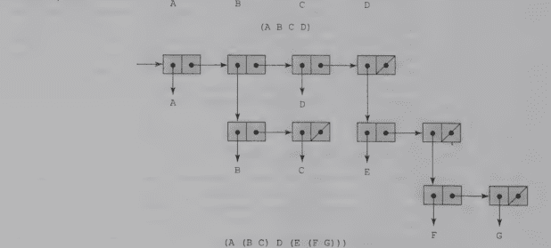


## 15.5 Scheme 简介

在本节中，我们介绍 Scheme 的核心部分（Dybvig, 2009）。我们选择 Scheme 是因为它相对简单，在高校中很受欢迎，而且 Scheme 解释器可广泛获取（且免费）用于各种计算机。本节描述的 Scheme 版本是 Scheme 4。请注意，本节只涵盖 Scheme 的一小部分，并且不包含 Scheme 的任何命令式特性。

### 15.5.1 Scheme 的起源

Scheme 语言是 Lisp 的一种方言，于 20 世纪 70 年代中期在 MIT 开发（Sussman and Steele, 1975）。它的特点是规模小、独占使用静态作用域，以及将函数视为一等实体。作为一等实体，Scheme 函数可以作为表达式的值、列表的元素、作为参数传递，并可从函数返回。早期版本的 Lisp 并未提供所有这些能力。

作为一种本质上无类型的小型语言，具有简单的语法和语义，Scheme 非常适合教育应用，例如函数式编程课程，也适合一般的编程入门。

以下各节中的大多数 Scheme 代码只需稍作修改即可转换为有效的 Lisp 代码。

### 15.5.2 Scheme 解释器

交互模式下的 Scheme 解释器是一个无限读取-求值-打印循环（通常缩写为 REPL）。它反复读取用户键入的表达式（以列表形式），解释该表达式，并显示结果值。Ruby 和 Python 也使用这种形式的解释器。表达式由函数 `EVAL` 解释。字面量求值为自身。因此，如果你向解释器键入一个数字，它只显示该数字。对原始函数的调用表达式按以下方式求值：首先，求值每个参数表达式，顺序不限。然后，将原始函数应用于参数值，并显示结果值。

当然，存储在文件中的 Scheme 程序可以被加载和解释。

Scheme 中的注释是任意行中分号之后的任何文本。

### 15.5.3 原始数值函数

Scheme 包含用于基本算术运算的原始函数。它们是 `+`、`-`、`*` 和 `/`，分别用于加、减、乘、除。`*` 和 `+` 可以有零个或多个参数。如果 `*` 没有给定参数，它返回 1；如果 `+` 没有给定参数，它返回 0。`+` 将其所有参数相加。`*` 将其所有参数相乘。`/` 和 `-` 可以有两个或更多参数。对于减法，除第一个参数外的所有参数都从第一个参数中减去。除法类似于减法。一些例子如下：

| 表达式 | 值 |
| --- | --- |
| `42` | `42` |
| `(* 3 7)` | `21` |
| `(+ 5 7 8)` | `20` |
| `(- 5 6)` | `-1` |
| `(- 15 7 2)` | `6` |
| `(- 24 (* 4 3))` | `12` |

Scheme 中还有大量其他数值函数，其中包括 MODULO、ROUND、MAX、MIN、LOG、SIN 和 SQRT。如果参数值非负，SQRT 返回其数值参数的平方根。如果参数为负，SQRT 产生一个复数。

在 Scheme 中，请注意我们对所有保留字和预定义函数使用大写字母。该语言的官方定义规定，在这些方面不区分大小写。然而，一些实现，例如 DrRacket 的教学语言，要求保留字和预定义函数使用小写。

如果一个函数具有固定数量的参数，例如 SQRT，则调用中的参数数量必须与该数量匹配。否则，解释器将产生错误消息。

### 15.5.4 定义函数

Scheme 程序是函数定义的集合。因此，知道如何定义这些函数是编写最简单程序的前提。在 Scheme 中，匿名函数实际上包含单词 LAMBDA，被称为 lambda 表达式。例如，

```
(LAMBDA (x) (* x x))
```

是一个匿名函数，返回其给定数值参数的平方。这个函数可以以与命名函数相同的方式应用：将它放在包含实际参数的列表开头。例如，以下表达式产生 49：

```
((LAMBDA (x) (* x x)) 7)
```

在这个表达式中，x 被称为 lambda 表达式中的绑定变量。在此表达式求值期间，x 绑定到 7。绑定变量在 lambda 表达式开始求值时绑定到实际参数值后，在表达式中永不改变。

```
(DEFINE (function_name parameters)
    (expression)
)
```

当然，这种形式的 DEFINE 是命名函数的定义。

以下对 DEFINE 的示例调用将名称 square 绑定到一个接受一个参数的函数表达式：

```
(DEFINE (square number) (* number number))
```

在解释器求值此函数后，就可以使用它，例如

```
(square 5)
```

这会显示 25。

为了说明原始函数与 DEFINE 特殊形式之间的区别，请考虑以下内容：

```
(DEFINE x 10)
```

如果 DEFINE 是原始函数，EVAL 对该表达式的第一个动作将是求值 DEFINE 的两个参数。如果 x 尚未绑定到某个值，这将是一个错误。此外，如果 x 已经定义，这也将是一个错误，因为这个 DEFINE 会试图重新定义 x，而这是非法的。请记住，x 是变量的名称；它不是命令式意义上的变量。

下面是另一个函数示例。给定直角三角形的另外两条边的长度，它计算斜边（最长边）的长度。

```
(DEFINE (hypotenuse side1 side2)
    (SQRT (+ (square side1) (square side2)))
)
```

请注意，hypotenuse 使用了之前定义的 square。

### 15.5.5 输出函数

Scheme 包含一些简单的输出函数，但当与交互式解释器一起使用时，Scheme 程序的大多数输出都是解释器的正常输出，显示将 EVAL 应用于顶层函数的结果。

请注意，显式输入和输出不属于纯函数式编程模型，因为输入和输出操作会改变程序状态，而输出操作具有副作用。这两者都不能成为纯函数式语言的一部分。因此，本章不描述 Scheme 的显式输入或输出函数。

### 15.5.6 数值谓词函数

谓词函数是返回布尔值（真或假的某种表示）的函数。Scheme 包含一组用于数值数据的谓词函数。其中包括以下内容：

| 函数 | 含义 |
| --- | --- |
| `=` | 等于 |
| `<>` | 不等于 |
| `>` | 大于 |
| `<` | 小于 |
| `>=` | 大于或等于 |
| `<=` | 小于或等于 |
| `EVEN?` | 是偶数吗？ |
| `ODD?` | 是奇数吗？ |
| `ZERO?` | 是零吗？ |

请注意，所有以单词命名的预定义谓词函数，其名称都以问号结尾。在 Scheme 中，两个布尔值是 `#T` 和 `#F`（或 `#t` 和 `#f`），尽管 Scheme 预定义谓词函数对假返回空列表 `()`。

当一个列表被解释为布尔值时，任何非空列表都求值为真；空列表求值为假。这类似于 C 中整数作为布尔值的解释；零求值为假，任何非零值求值为真。

为了可读性，本章中我们所有示例谓词函数都返回 `#F`，而不是 `()`。

`NOT` 函数用于反转布尔表达式的逻辑。

### 15.5.7 控制流

Scheme 使用三种不同的控制流构造：一种类似于命令式语言的选择构造，另外两种基于数学函数中使用的求值控制。

Scheme 的双向选择器函数名为 `IF`，有三个参数：一个谓词表达式、一个 then 表达式和一个 else 表达式。对 `IF` 的调用形式为

```scheme
(IF predicate then_expression else_expression)
```

例如，

```scheme
(DEFINE (factorial n)
  (IF (<= n 1)

```scheme
1
(* n (factorial (- n 1)))
))
```

回顾一下，Scheme 的多重选择结构 COND 已在第 8 章讨论过。下面是一个使用 COND 的简单函数示例：

```scheme
(DEFINE (leap? year)
  (COND
    ((ZERO? (MODULO year 400)) #T)
    ((ZERO? (MODULO year 100)) #F)
    (ELSE (ZERO? (MODULO year 4)))
  ))
```

以下小节包含更多使用 COND 的示例。Scheme 的第三种控制机制是递归，它和数学中一样，用于指定重复。15.5.10 节中的大多数示例函数都使用递归。

### 15.5.8 列表函数

基于 Lisp 的编程语言更常见的用途之一是列表处理。本小节介绍 Scheme 中用于处理列表的函数。回顾一下，Scheme 的列表操作已在第 6 章简要介绍过。下面将更详细地讨论 Scheme 中的列表处理。

Scheme 程序由函数应用函数 EVAL 解释。当 EVAL 应用于一个基本函数时，它首先求值给定函数的参数。当函数调用中的实际参数本身也是函数调用时（这种情况很常见），这一动作是必要的。然而，在某些调用中，参数是数据元素而不是函数引用。当一个参数不是函数引用时，显然不应对它求值。我们之前没有关心这一点，因为数字字面量总是求值为其自身，不会被误认为函数名。

假设我们有一个函数，它有两个参数：一个原子和一个列表，该函数的目的是判断给定原子是否在给定列表中。原子和列表都不应被求值；它们是要处理的字面数据。为了避免对参数求值，可将其作为基本函数 QUOTE 的参数传入，QUOTE 只是原样返回它而不做任何改变。下面的示例说明了 QUOTE 的用法：

```scheme
(QUOTE A) returns A
(QUOTE (A B C)) returns (A B C)
```

对 QUOTE 的调用通常缩写为在被引用的表达式前加一个撇号（'），并省略表达式外面的括号。因此，使用 '(A B) 而不是 (QUOTE (A B))。

QUOTE 的必要性源于 Scheme（以及其他基于 Lisp 的语言）的基本性质：数据和代码具有相同的形式。尽管这对命令式语言的程序员来说可能显得奇怪，但它带来了一些有趣而强大的处理过程，其中一种将在 15.5.14 节讨论。

CAR、CDR 和 CONS 函数已在第 6 章介绍过。下面是 CAR 和 CDR 操作的更多示例：

```scheme
(CAR '(A B C)) returns A
(CAR '((A B) C D)) returns (A B)
(CAR 'A) is an error because A is not a list
(CAR '(A)) returns A
(CAR '()) is an error
(CDR '(A B C)) returns (B C)
(CDR '((A B) C D)) returns (C D)
(CDR 'A) is an error
(CDR '(A)) returns ()
(CDR '()) is an error
```

CAR 和 CDR 函数的名称至少可以说很奇特。这些名称的起源在于 Lisp 的最初实现，那是在 IBM 704 计算机上完成的。704 的内存字有两个字段，分别名为 *decrement* 和 *address*，用于各种操作数寻址策略。这两个字段都可以存储一个机器内存地址。704 还包括两条机器指令，也分别名为 CAR（寄存器 address 部分的内容）和 CDR（寄存器 decrement 部分的内容），用于提取相关字段。自然地，可以用这两个字段存储列表节点的两个指针，从而使一个内存字几乎可以存储一个节点。按照这些约定，704 的 CAR 和 CDR 指令提供了高效的列表选择器。这些名称延续到了所有 Lisp 方言的基本函数中。

作为另一个简单函数的示例，考虑

```scheme
(DEFINE (second a_list) (CAR (CDR a_list)))
```

这个函数一旦求值，就可以像下面这样使用：

```scheme
(second '(A B C))
```

它返回 B。

Scheme 中一些最常用的函数组合被内置为单个函数。例如，(CAAR x) 等价于 (CAR (CAR x))，(CADR x) 等价于 (CAR (CDR x))，而 (CADDAR x) 等价于 (CAR (CDR (CDR (CAR x))))。在函数名中的 'C' 和 'r' 之间，最多四个 A 和 D 的任意组合都是合法的。作为示例，考虑下面 CADDAR 的求值过程：

```scheme
(CADDAR '((A B C) D E)) =
(CAR (CDR (CDR (CAR '((A B C) D E))))) =
(CAR (CDR (CDR '(A B C)))) =
(CAR (CDR '(B C))) =
(CAR '(C)) =
(C)
```

下面是调用 CONS 的示例：

```scheme
(CONS 'A '()) returns (A)
(CONS 'A '(B C)) returns (A B C)
(CONS '() '(A B)) returns (() A B)
(CONS '(A B) '(C D)) returns ((A B) C D)
```

这些 CONS 操作的结果如图 15.2 所示。注意，从某种意义上说，CONS 是 CAR 和 CDR 的逆操作。CAR 和 CDR 将一个列表拆开，而 CONS 从两个给定的列表部分构造一个新列表。CONS 的两个参数成为新列表的 CAR 和 CDR。因此，如果 `a_list` 是一个列表，那么

```scheme
(CONS (CAR a_list) (CDR a_list))
```

将返回一个与 `a_list` 具有相同结构和相同元素的列表。

### 图 15.2

若干 CONS 操作的结果

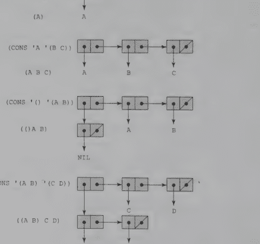

它会检查是否已经存在这样的列表。如果存在，新列表不过是指向现有列表的指针。在这些情况下，EQ? 会判定这两个列表相等。然而，在某些情况下，可能难以检测是否存在完全相同的列表，此时会创建一个新列表。在这种情况下，EQ? 会返回 #F。

最后一种情况表明，加法可能产生一个新值，在这种情况下，它（用 EQ? 判断）不会等于 3.4；或者它可能识别出自己已经拥有值 3.4 并使用该值，在这种情况下，EQ? 会使用指向旧 3.4 的指针并返回 #T。

正如我们所见，EQ? 适用于符号原子，但不一定适用于数字原子。= 谓词适用于数字原子，但不适用于符号原子。如前所述，EQ? 对列表参数也不能可靠工作。

有时，在不知道两个原子是符号原子还是数字原子时，能够测试它们是否相等会很方便。为此，Scheme 提供了另一个谓词 EQV?，它同时适用于数字原子和符号原子。考虑下面的示例：

```scheme
(EQV? 'A 'A) returns #T
(EQV? 'A 'B) returns #F
(EQV? 3 3) returns #T
(EQV? 'A 3) returns #F
(EQV? 3.4 (+ 3 0.4)) returns #T
(EQV? 3.0 3) returns #F
```

注意，最后一个示例表明浮点值与整数值不同。EQV? 不是指针比较，而是值比较。

在可能的情况下，使用 EQ? 或 = 而不是 EQV? 的主要原因是 EQ? 和 = 比 EQV? 更快。

谓词函数 LIST? 如果其单个参数是列表，则返回 #T，否则返回 #F，如下面的示例所示：

```scheme
(LIST? '(X Y)) returns #T
(LIST? 'X) returns #F
(LIST? '()) returns #T
```

NULL? 函数测试其参数以确定它是否为空列表，如果是，则返回 #T。考虑下面的示例：

```scheme
(NULL? '(A B)) returns #F
(NULL? '()) returns #T
(NULL? 'A) returns #F
(NULL? '(())) returns #F
```

最后一次调用返回 #F，因为该参数不是空列表。相反，它是一个包含单个元素（即空列表）的列表。

### 15.5.10 Scheme 函数示例

本节包含几个 Scheme 函数定义示例。这些程序解决简单的列表处理问题。

考虑判断给定原子是否属于给定列表的问题，该列表不包含子列表。这样的列表称为简单列表。如果函数名为 member，则可以如下使用：

```scheme
(member 'B '(A B C)) returns #T
(member 'B '(A C D E)) returns #F
```

从迭代的角度来看，成员资格问题就是按某种顺序逐个比较给定原子和给定列表中的各个元素，直到找到匹配项，或者列表中没有更多元素可供比较。类似的过程也可以用递归完成。该函数可以将给定原子与列表的 CAR 进行比较。如果它们匹配，则返回值 #T。如果不匹配，则应忽略列表的 CAR，并继续在列表的 CDR 上搜索。为此，可以让函数以列表的 CDR 作为列表参数调用自身，并返回该递归调用的结果。如果给定原子在列表中被找到，这一过程就会结束。如果原子不在列表中，函数最终会（由自身）以空列表作为实际参数被调用。该事件必须迫使函数返回 #F。在这个过程中，有两种退出递归的方式：要么在某次调用时列表为空，此时返回 #F；要么找到匹配项并返回 #T。

总而言之，该函数必须处理三种情况：输入列表为空；原子与列表的 CAR 匹配；原子与列表的 CAR 不匹配，从而触发递归调用。这三种情况就是 COND 的三个参数，其中最后一个是默认情况，由 ELSE 谓词触发。完整函数如下：5

```scheme
(DEFINE (member atm a_list)
    (COND
        ((NULL? a_list) #F)
        ((EQ? atm (CAR a_list)) #T)
        (ELSE (member atm (CDR a_list)))
    )
)
```

这种形式是简单的 Scheme 列表处理函数的典型形式。在这类函数中，列表中的数据一次处理一个元素。各个元素用 CAR 指定，并通过在列表的 CDR 上递归继续处理。

注意，空列表测试必须放在相等测试之前，因为对空列表应用 CAR 会出错。


再举一个例子，考虑判断两个给定列表是否相等的问题。如果这两个列表是简单列表，那么解决起来相对容易，尽管其中涉及一些读者可能不熟悉的编程技巧。用于比较简单列表的谓词函数 `equalsimp` 如下所示：

```scheme
(DEFINE (equalsimp list1 list2)
    (COND
        ((NULL? list1) (NULL? list2))
        ((NULL? list2) #F)
        ((EQ? (CAR list1) (CAR list2))
            (equalsimp (CDR list1) (CDR list2)))
        (ELSE #F)
    )
)
```

第一种情况由 `COND` 的第一个参数处理，针对第一个列表参数为空列表的情形。如果在外部调用时第一个列表参数最初为空，就会出现这种情况。由于递归调用会把两个参数列表的 `CDR` 作为其参数，因此在这种调用中第一个列表参数可能为空（如果第一个列表参数此时为空）。当第一个列表参数为空时，必须检查第二个列表参数是否也为空。如果为空，则它们相等（要么最初就相等，要么在之前所有递归调用中 `CAR` 都相等），并且 `NULL?` 正确返回 `#T`。如果第二个列表参数不为空，则它比第一个列表参数长，应返回 `#F`，`NULL?` 正是这样做的。

下一种情况处理第一个列表不为空而第二个列表为空的情形。这种情况只在第一个列表比第二个列表长时出现。只需测试第二个列表，因为第一种情况已经捕获了第一个列表为空的所有情形。

第三种情况是递归步骤，用于测试两个列表中对应元素是否相等。它通过比较两个非空列表的 `CAR` 来实现。如果它们相等，那么两个列表到该点为止相等，因此对二者的 `CDR` 使用递归。当发现两个不相等的原子时，这种情况失败。此时过程无需继续，因此选择默认情况 `ELSE`，返回 `#F`。

注意，`equalsimp` 期望参数是列表；如果其中一个或两个参数是原子，它就不能正确工作。

比较一般列表的问题比这稍复杂一些，因为在比较过程中必须完整追踪子列表。在这种情况下，递归的能力特别合适，因为子列表的形式与给定列表相同。只要两个给定列表的对应元素是列表，就将它们分成 `CAR` 和 `CDR` 两部分，并对它们使用递归。这是分而治之方法有用性的完美例子。如果两个给定列表的对应元素是原子，则只需使用 `EQ?` 进行比较。

完整函数的定义如下：

```scheme
(DEFINE (equal list1 list2)
  (COND
    ((NOT (LIST? list1)) (EQ? list1 list2))
    ((NOT (LIST? list2)) #F)
    ((NULL? list1) (NULL? list2))
    ((NULL? list2) #F)
    ((equal (CAR list1) (CAR list2))
      (equal (CDR list1) (CDR list2)))
    (ELSE #F)
  ))
```

`COND` 的前两种情况处理任一参数是原子而不是列表的情形。第三和第四种情况处理一个或两个列表为空的情形。这些情况还防止后续情况试图对空列表应用 `CAR`。第五个 `COND` 情况最有趣。谓词以列表的 `CAR` 为参数进行递归调用。如果这个递归调用返回 `#T`，则再对列表的 `CDR` 使用递归。该算法允许两个列表包含任意深度的子列表。

`equal` 的这一定义适用于任意一对表达式，而不仅仅是列表。`equal` 等价于系统谓词函数 `EQUAL?`。注意，只有在必要时（即实际参数的形式未知时）才应使用 `EQUAL?`，因为它比 `EQ?` 和 `EQV?` 慢得多。

另一种常见的列表操作是构造一个新列表，其中包含两个给定列表参数的所有元素。这通常实现为名为 `append` 的 Scheme 函数。结果列表可以通过反复使用 `CONS` 将第一个列表参数的元素放入第二个列表参数来构造，第二个列表参数最终成为结果列表。为阐明 `append` 的行为，考虑以下示例：

```scheme
(append '(A B) '(C D R)) returns (A B C D R)
(append '((A B) C) '(D (E F))) returns ((A B) C D (E F))
```

`append` 的定义是[^6]

```scheme
(DEFINE (append list1 list2)
  (COND
    ((NULL? list1) list2)
    (ELSE (CONS (CAR list1) (append (CDR list1) list2)))
  ))
```

第一个 `COND` 情况用于在第一个参数列表为空时终止递归过程，并返回第二个列表。在第二种情况（`ELSE`）中，第一个参数列表的 `CAR` 被 `CONS` 到递归调用返回的结果上，而该递归调用把第一个列表的 `CDR` 作为其第一个参数。

考虑下面的 Scheme 函数，名为 `guess`，它使用了本节描述的 `member` 函数。在阅读后面的说明之前，试着确定它做什么。假设参数是简单列表。

```scheme
(DEFINE (guess list1 list2)
  (COND
    ((NULL? list1) '())
    ((member (CAR list1) list2)
        (CONS (CAR list1) (guess (CDR list1) list2)))
    (ELSE (guess (CDR list1) list2))
  )
)
```

`guess` 生成一个简单列表，其中包含其两个参数列表的公共元素。因此，如果参数列表表示集合，`guess` 计算出的列表表示这两个集合的交集。

### 15.5.11 LET

`LET` 是一个函数（最初在第 5 章中描述），它创建一个局部作用域，在其中名称被临时绑定到表达式的值。它常用于从更复杂的表达式中提取公共子表达式。然后这些名称可用于另一个表达式的求值，但它们不能在 `LET` 中重新绑定到新值。下面的示例说明了 `LET` 的用法。它计算给定二次方程的根，假设根为实数[^7]。二次方程 ax² + bx + c 的实根（相对于复根）的数学定义如下：root1 = (−b + sqrt(b² − 4ac))/2a，root2 = (−b − sqrt(b² − 4ac))/2a

```scheme
(DEFINE (quadratic_roots a b c)
  (LET (
    (root_part_over_2a
      (/ (SQRT (- (* b b) (* 4 a c))) (* 2 a)))
    (minus_b_over_2a (/ (- 0 b) (* 2 a)))
  )
  (LIST (+ minus_b_over_2a root_part_over_2a)
        (- minus_b_over_2a root_part_over_2a))
))
```

这个示例使用 `LIST` 创建由构成结果的两个值组成的列表。

由于在 `LET` 构造的第一部分中绑定的名称不能在后面的表达式中更改，因此它们不同于命令式语言块中的局部变量。它们都可以通过在 `LET` 表达式中用各自表达式对其名称进行文本替换来消除。

`LET` 实际上是应用于参数的 `LAMBDA` 表达式的简写。下面两个表达式等价：

```scheme
(LET ((alpha 7)) (* 5 alpha))
((LAMBDA (alpha) (* 5 alpha)) 7)
```

在第一个表达式中，7 通过 `LET` 绑定到 alpha；在第二个表达式中，7 通过 `LAMBDA` 表达式的参数绑定到 alpha。

### 15.5.12 Scheme 中的尾递归

如果一个函数的递归调用是该函数中的最后一个操作，则该函数是尾递归的。这意味着递归调用的返回值就是对该函数的非递归调用的返回值。例如，15.5.10 节中的 `member` 函数（此处重复）是尾递归的。

```scheme
    (DEFINE (member atm a_list)
      (COND
        ((NULL? a_list) #F)
        ((EQ? atm (CAR a_list)) #T)
        (ELSE (member atm (CDR a_list)))
      )
    )
```

编译器可以自动将该函数转换为使用迭代，从而比其递归形式执行得更快。

然而，许多使用递归进行重复的函数并不是尾递归的。关注效率的程序员已经发现了重写其中一些函数使其成为尾递归的方法。一个例子使用累积参数和辅助函数。作为这种方法的一个示例，考虑 15.5.7 节中的阶乘函数，此处重复如下：

```scheme
    (DEFINE (factorial n)
      (IF (<= n 1)
          1
          (* n (factorial (- n 1))))
    )
```

这个函数的最后一个操作是乘法。该函数的工作方式是创建要相乘的数字列表，然后在递归展开以产生结果时进行乘法。这些数字中的每一个都由函数的一次激活创建，并且每个都存储在活动记录实例中。随着递归展开，这些数字被相乘。回想第 9 章中展示的若干次递归调用 `factorial` 之后的栈。这个 `factorial` 函数可以用一个辅助函数重写

[^6]: 与 `member` 的情况一样，用户通常不能定义名为 `append` 的函数。

[^7]: 某些版本的 Scheme 将“复数”作为一种数据类型，并且无论方程的根是实数还是复数，都会计算它们。


函数，它使用一个参数来累积部分阶乘。这个辅助函数是尾递归的，也接收 factorial 的参数。这些函数如下：

```scheme
(DEFINE (facthelper n factpartial)
  (IF (<= n 1)
      factpartial
      (facthelper (- n 1) (* n factpartial))
  )
)
(DEFINE (factorial n)
  (facthelper n 1)
)
```

使用这些函数，结果在递归调用期间计算，而不是在递归展开时计算。由于活动记录实例中没有任何有用的内容，因此它们是不必要的。无论请求多少次递归调用，只需要一个活动记录实例。这使得尾递归版本比非尾递归版本高效得多。

Scheme 语言定义要求 Scheme 语言处理系统转换所有尾递归函数，用迭代替代这种递归。因此，至少为了效率起见，将使用递归来指定重复的函数定义为尾递归很重要。某些函数式语言的某些优化编译器甚至可以将某些非尾递归函数转换为等价的尾递归函数，然后为这些函数生成代码，用迭代而不是递归来实现重复。

### 15.5.13 函数式形式

本节描述 Scheme 提供的两种常见数学函数式形式：复合和应用于所有。两者都在 15.2.2 节中进行了数学定义。

#### 15.5.13.1 函数复合

函数复合是原始 Lisp 提供的唯一原始函数式形式。所有后续的 Lisp 方言，包括 Scheme，也提供它。如 15.2.2 节所述，函数复合是一种函数式形式，它接收两个函数作为参数，并返回一个函数：该函数首先将第二个参数函数应用于其参数，然后将第一个参数函数应用于第二个参数函数的返回值。换句话说，如果 h(x) = f(g(x))，则函数 h 是 f 和 g 的复合函数。例如，考虑以下示例：

```scheme
(DEFINE (g x) (* 3 x))
(DEFINE (f x) (+ 2 x))
```

现在，f 和 g 的函数复合可以写成如下形式：

```scheme
(DEFINE (h x) (+ 2 (* 3 x)))
```

在 Scheme 中，函数复合函数 compose 可以写成如下形式：

```scheme
(DEFINE (compose f g) (LAMBDA (x) (f (g x))))
```

例如，我们可以有如下写法：

```scheme
((compose CAR CDR) '((a b) c d))
```

这个调用将返回 c。这是 CADR 的一种替代形式，尽管效率较低。现在考虑另一个对 compose 的调用：

```scheme
((compose CDR CAR) '((a b) c d))
```

这个调用将返回 (b)。这是 CDAR 的一种替代形式。

作为使用 compose 的又一个示例，考虑以下内容：

```scheme
(DEFINE (third a_list)
  ((compose CAR (compose CDR CDR)) a_list))
```

这是 CADDR 的一种替代形式。

#### 15.5.13.2 一种应用于所有的函数式形式

函数式编程语言中提供的最常见函数式形式是数学中应用于所有函数式形式的变体。其中最简单的是 map，它有两个参数：一个函数和一个列表。map 将给定函数应用于给定列表的每个元素，并返回这些应用结果的列表。map 的 Scheme 定义如下：<sup>8</sup>

```scheme
(DEFINE (map fun a_list)
  (COND
    ((NULL? a_list) '())
    (ELSE (CONS (fun (CAR a_list)) (map fun (CDR a_list))))
  )
)
```

注意 map 的简单形式，它表达了一种复杂的函数式形式。

作为使用 map 的示例，假设我们想要对一个列表中的所有元素求立方。我们可以用以下方式完成：

```scheme
(map (LAMBDA (num) (* num num num)) '(3 4 2 6))
```

8. 与 member 的情况一样，map 是一个预定义函数，用户不能重新定义它。

这个调用返回 `(27 64 8 216)`。注意，在这个示例中，`map` 的第一个参数是一个 LAMBDA 表达式。当 EVAL 对 LAMBDA 表达式求值时，它会构造一个函数，该函数与任何预定义函数具有相同形式，只是它是无名的。在示例表达式中，这个无名函数立即被应用于参数列表的每个元素，并且结果以列表形式返回。

### 15.5.14 构建代码的函数

程序和数据具有相同结构这一事实可以在构造程序时加以利用。回想一下，Scheme 解释器使用一个名为 EVAL 的函数。Scheme 系统会对输入的每个表达式应用 EVAL，无论它是在交互式解释器的 Scheme 提示符下，还是正在被解释的程序的一部分。EVAL 函数也可以由 Scheme 程序直接调用。这提供了让 Scheme 程序创建表达式并调用 EVAL 对其求值的可能性。这不是 Scheme 独有的，但其表达式的简单形式使得在执行期间创建它们变得容易。

这个过程最简单的示例之一涉及数字原子。回想一下，Scheme 包含一个名为 `+` 的函数，它接收任意数量的数字原子作为参数并返回它们的和。例如，`(+ 3 7 10 2)` 返回 22。

我们的问题如下：假设在一个程序中我们有一个数字原子列表，并且需要求和。我们不能直接在列表上应用 `+`，因为 `+` 只能接收原子参数，而不能接收数字原子列表。当然，我们可以编写一个函数，重复地将列表的 CAR 加到其 CDR 的和上，并使用递归遍历列表。这样的函数如下：

```lisp
(DEFINE (adder a_list)
  (COND
    ((NULL? a_list) 0)
    (ELSE (+ (CAR a_list) (adder (CDR a_list))))
  ))
```

以下是对 adder 的示例调用，以及递归调用和返回：

```lisp
(adder '(3 4 5))
(+ 3 (adder (4 5)))
(+ 3 (+ 4 (adder (5))))
(+ 3 (+ 4 (+ 5 (adder ()))))
(+ 3 (+ 4 (+ 5 0)))
(+ 3 (+ 4 5))
(+ 3 9)
12
```

该问题的另一种解决方案是编写一个函数，用适当的参数形式构造对 `+` 的调用。这可以通过使用 CONS 构造一个新列表来完成，该新列表与参数列表相同，只是在其开头插入了原子 +。然后可以将这个新列表提交给 EVAL 进行求值，如下所示：

```lisp
(DEFINE (adder a_list)
  (COND
    ((NULL? a_list) 0)
    (ELSE (EVAL (CONS '+ a_list)))
  )
)
```

注意，+ 函数的名称被引用，以防止 EVAL 在对 CONS 求值时对它求值。以下是对这个新版本 adder 的示例调用，以及对 EVAL 的调用和返回值：

```lisp
(adder '(3 4 5))
(EVAL (+ 3 4 5))
12
```

在所有早期版本的 Scheme 中，EVAL 函数在程序的最外层作用域中对其表达式求值。从 Scheme 4 开始的较新版本 Scheme 要求 EVAL 的第二个参数指定表达式求值所在的作用域。为简单起见，我们在示例中省略了作用域参数，并且这里不讨论作用域名称。

## 15.6 Common Lisp

Common Lisp（Steele, 1990）的创建是为了将 20 世纪 80 年代早期几种 Lisp 方言（包括 Scheme）的特性组合成一种单一语言。作为某种意义上的语言联合体，它相当庞大且复杂，在这些方面类似于 C++ 和 C#。然而，它的基础是原始 Lisp，因此其语法、基本函数和基本性质都来自该语言。以下是用 Common Lisp 编写的 factorial 函数：

```lisp
(DEFUN factorial (n)
  (IF (<= n 1)
      1
      (* n (factorial (- n 1))))
)
```

这个函数只有第一行在语法上与同一函数的 Scheme 版本不同。

Common Lisp 的特性列表很长：大量数据类型和结构，包括记录、数组、复数和字符串；强大的输入和输出操作；以及一种包形式，用于将函数和数据集合模块化，也用于提供访问控制。Common Lisp 包括若干命令式结构，以及一些可变类型。


认识到动态作用域偶尔提供的灵活性，以及静态作用域的简洁性，Common Lisp 同时允许两者。变量的默认作用域是静态的，但通过将变量声明为“special”，该变量就变为动态作用域。

宏在 Common Lisp 中常用于扩展语言。事实上，一些预定义函数实际上是宏。例如，DOLIST 接受两个参数——一个变量和一个列表——就是一个宏。例如，考虑以下内容：

```
(DOLIST (x '(1 2 3)) (print x))
```

这会产生以下输出：

```
1
2
3
NIL
```

这里的 NIL 是 DOLIST 的返回值。

宏分两步产生效果：首先，宏被展开。其次，展开后的宏（即 Lisp 代码）被求值。用户可以用 DEFMACRO 定义自己的宏。

Common Lisp 的反引号运算符（`）类似于 Scheme 的 QUOTE，只是参数的某些部分可以通过在其前面加逗号来取消引用。例如，考虑以下两个示例：

```
`(a (* 3 4) c)
```

该表达式的求值结果为 (a (* 3 4) c)。然而，以下表达式：

```
`(a ,(* 3 4) c)
```

求值结果为 (a 12 c)。

Lisp 实现有一个称为*读取器*的前端，它将 Lisp 程序的文本转换为代码表示。然后，代码表示中的宏调用被展开为代码表示。这一步的输出随后要么被解释，要么被编译为主机的机器语言，或者也许被编译为一种可解释的中间代码。有一种特殊的宏，称为*读取器宏*或*读取宏*，它们在 Lisp 语言处理器的读取器阶段被展开。读取器宏将特定字符展开为一串 Lisp 代码。例如，Lisp 中的撇号是一个读取宏，它展开为对 QUOTE 的调用。用户可以定义自己的读取器宏来创建其他简写结构。

Common Lisp 以及其他基于 Lisp 的语言都有符号数据类型。保留字是求值为自身的符号，T 和 NIL 也是如此。从技术上说，符号要么是绑定的，要么是未绑定的。参数符号在函数求值期间是绑定的。此外，作为命令式风格变量名且已被赋值的符号是*绑定*的。其他符号是*未绑定*的。例如，考虑以下表达式：

```
(LIST '(A B C))
```

符号 A、B 和 C 是*未绑定*的。回想一下，Ruby 也有*符号*数据类型。

从某种意义上说，Scheme 和 Common Lisp 是相反的。Scheme 要小得多，语义上也更简单，部分原因是它专门使用静态作用域，但也因为它被设计用于教授编程，而 Common Lisp 则意在成为一种商业语言。Common Lisp 成功成为人工智能应用等领域中广泛使用的语言。另一方面，Scheme 更常用于函数式编程的大学课程中。由于其相对较小的规模，它也更可能作为函数式语言被学习。Common Lisp 的一个重要设计目标是使其与它衍生自的几种 Lisp 方言兼容，这也导致它成为一种大型语言。

Common Lisp 对象系统（CLOS）（Paepcke, 1993）于 20 世纪 80 年代后期作为 Common Lisp 的面向对象版本被开发出来。该语言支持泛型函数和多重继承以及其他构造。

## 15.7 ML

ML（Milner 等，1997）是一种静态作用域的函数式编程语言，像 Scheme 一样。然而，它在许多重要方面不同于 Lisp 及其方言（包括 Scheme）。一个重要区别是 ML 是强类型语言，而 Scheme 本质上无类型。ML 有函数参数和函数返回类型的类型声明，不过由于其类型推断，这些声明常常不被使用。每个变量和表达式的类型都可以静态确定。ML 像其他函数式编程语言一样，没有命令式语言意义上的变量。它确实有标识符，这些标识符看起来像命令式语言中的变量名。然而，这些标识符最好被视为值的名称。一旦设定，就不能更改。它们就像命令式语言中的命名常量，比如 Java 中的 `final` 声明。ML 标识符没有固定类型——任何标识符都可以是任意类型的值的名称。

一个称为*求值环境*的表存储程序中所有隐式和显式声明的标识符的名称及其类型。这类似于运行时符号表。当一个标识符被声明时，无论是隐式还是显式，它都会被放入*求值环境*中。

Scheme 和 ML 之间的另一个重要区别是，ML 使用的语法比 Lisp 的语法更接近命令式语言的语法。例如，算术表达式在 ML 中使用中缀表示法书写。

ML 中的函数声明采用以下一般形式：

```
fun function_name(formal parameters) = expression;
```

当被调用时，函数返回表达式的值。实际上，表达式可以是一个表达式列表，用分号分隔并用括号包围。在这种情况下，返回值是最后一个表达式的值。当然，除非它们有副作用，最后一个表达式之前的表达式没有作用。因为我们不考虑 ML 中具有副作用的部分，所以我们只考虑具有单个表达式的函数定义。

现在我们可以讨论类型推断。考虑以下 ML 函数声明：

```
fun circumf(r) = 3.14159 * r * r;
```

这指定了一个名为 `circumf` 的函数，它接受一个浮点（ML 中为 real）参数并产生浮点结果。类型是从表达式中字面量的类型推断出来的。同样，在函数

```
fun times10(x) = 10 * x;
```

中，参数和函数值被推断为 `int` 类型。

考虑以下 ML 函数：

```
fun square(x) = x * x;
```

ML 根据函数定义中的 `*` 运算符确定参数和返回值的类型。因为这是一个算术运算符，所以参数和函数的类型被假定为数值类型。在 ML 中，默认数值类型是 `int`。因此，可以推断 `square` 的参数和返回值的类型是 `int`。

如果以浮点值调用 `square`，如下所示：

```
square(2.75);
```

就会导致错误，因为 ML 不会将 `real` 值强制转换为 `int` 类型。如果我们希望 `square` 接受 `real` 参数，可以将其重写为：

```
fun square(x) : real = x * x;
```

因为 ML 不允许重载函数，所以这个版本不能与先前的 `int` 版本共存。最后定义的版本将是唯一存在的版本。

函数值被标注为 `real` 这一事实足以推断参数也是 `real` 类型。以下每个定义也都是合法的：

```
fun square(x : real) = x * x;
fun square(x) = (x : real) * x;
fun square(x) = x * (x : real);
```

类型推断也用于函数式语言 Miranda、Haskell 和 F# 中。

ML 的选择控制流结构类似于命令式语言的选择控制流结构。它具有以下一般形式：

```
if expression then then_expression else else_expression
```

第一个表达式必须求值为布尔值。

Scheme 的条件表达式可以出现在 ML 的函数定义层面。在 Scheme 中，COND 函数用于确定给定参数的值，进而指定 COND 返回的值。在 ML 中，函数执行的计算可以针对给定参数的不同形式来定义。这一特性意在模仿数学中条件函数定义的形式和含义。在 ML 中，定义函数返回值的特定表达式是通过针对给定参数进行模式匹配来选择的。例如，不使用这种模式匹配，计算阶乘的函数可以写成如下形式：

```
fun fact(n : int) : int = if n <= 1 then 1
                       else n * fact(n - 1);
```

可以使用参数模式匹配来编写函数的多个定义。依赖于参数形式的不同函数定义由竖线符号（|）分隔。例如，使用模式匹配，阶乘函数可以写成如下形式：

```
fun fact(0) = 1
|   fact(1) = 1
|   fact(n : int) : int = n * fact(n - 1);
```

如果以实参 0 调用 fact，则使用第一个定义；如果实参为 1，则使用第二个定义；如果传入既不是 0 也不是 1 的 int 值，则使用第三个定义。

正如第 6 章所讨论的，ML 支持列表和列表操作。回想一下，hd、tl 和 :: 是 ML 中对应于 Scheme 的 CAR、CDR 和 CONS 的版本。

由于可以使用模式化函数参数，hd 和 tl 函数在 ML 中的使用频率远低于 CAR 和 CDR 在 Scheme 中的使用频率。例如，在形参中，表达式

```
(h :: t)
```

实际上表示两个形参，即给定列表参数的头和尾，而对应的单个实参是一个列表。例如，给定列表中的元素个数可以用以下函数计算：

```
fun length([]) = 0
|   length(h :: t) = 1 + length(t);
```

作为这些概念的另一个例子，考虑 append 函数，它完成 Scheme 的 append 函数所做的工作：

```
fun append([], lis2) = lis2
  | append(h :: t, lis2) = h :: append(t, lis2);
```

该函数的第一个分支处理以空列表作为第一个参数调用该函数的情形。当初始调用的第一个参数非空时，这个分支也会终止递归。函数的第二个分支将第一个参数列表分解为它的头部和尾部（head 和 t）。头部被 cons 到递归调用的结果上，而该递归调用使用尾部作为其第一个参数。

在 ML 中，名字通过如下形式的值声明语句绑定到值：

```
val new_name = expression;
```

例如，

```
val distance = time * speed;
```

不要以为这条语句与命令式语言中的赋值语句完全一样，因为它并不是。val 语句将一个名字绑定到一个值，但这个名字之后不能重新绑定到新值。嗯，从某种意义上说，它可以。实际上，如果你用第二条 val 语句重新绑定一个名字，它会在求值环境中产生一个新条目，而该条目与这个名字之前的版本无关。事实上，在新绑定之后，旧的求值环境条目（对应之前的绑定）就不再可见。此外，新绑定的类型不必与之前绑定的类型相同。val 语句没有副作用。它们只是将一个名字加入当前求值环境，并将它绑定到一个值。

val 的常规用法是在 let 表达式中。⁹ 考虑下面的例子：

```
let val radius = 2.7
    val pi = 3.14159
in  pi * radius * radius
end;
```

ML 包含若干在函数式编程中常用的高阶函数。其中包括用于列表的过滤函数 filter，它接受一个谓词函数作为参数。谓词函数通常以 lambda 表达式给出；在 ML 中，lambda 表达式的定义与函数完全一样，只是使用保留字 fn 而不是保留字 fun，当然 lambda 表达式是无名的。filter 返回一个接受列表作为参数的函数。它用谓词测试列表的每个元素。谓词对其返回 true 的每个元素都会被加入一个新列表，这个新列表就是该函数的返回值。考虑下面 filter 的用法：

```
    filter(fn(x) => x < 100, [25, 1, 50, 711, 100, 150, 27,
    161, 3]);
```

这个应用会返回 [25, 1, 50, 27, 3]。

map 函数接受单个参数，该参数是一个函数。得到的函数接受一个列表作为参数。它将其函数应用于列表的每个元素，并返回这些应用结果的列表。考虑下面的代码：

```
    fun cube x = x * x * x;
    val cubeList = map cube;
    val newList = cubeList [1, 3, 5];
```

执行之后，`newList` 的值是 [1, 27, 125]。这可以通过将 `cube` 函数定义为 lambda 表达式来更简单地完成，如下所示：

```
    val newList = map (fn x => x * x * x, [1, 3, 5]);
```

ML 有一个用于组合两个函数的二元运算符 o（小写字母“oh”）。例如，要构造一个函数 h，它先应用函数 f，然后对 f 返回的值应用函数 g，我们可以使用下面的写法：

```
    val h = g o f;
```

严格来说，ML 函数只接受一个参数。当一个函数用多于一个参数定义时，ML 会把这些参数视为一个元组，尽管通常用于界定元组值的圆括号是可选的。分隔参数（元组元素）的逗号是必需的。

柯里化过程将一个多于一个参数的函数替换为一个单参数函数，该单参数函数返回一个接受原函数其余参数的函数。

接受多于一个参数的 ML 函数可以通过省略参数之间的逗号（以及界定用的圆括号）来以柯里化形式定义。¹⁰ 例如，我们可以写成下面这样：

```
    fun add a b = a + b;
```

尽管这看起来定义了一个带两个参数的函数，但它实际上定义的是一个只有一个参数的函数。add 函数接受一个整数参数（a），并返回一个也接受整数参数（b）的函数。调用这个函数时同样省略参数之间的逗号，如下所示：

```
    add 3 5;
```

这个对 add 的调用如预期那样返回 8。

10. 这种函数形式以研究它们的英国数学家 Haskell Curry 命名。

柯里化函数有趣且有用，因为可以通过部分求值从它们构造新函数。部分求值是指用一个或多个最左侧形参的实参来对该函数求值。例如，我们可以如下定义一个新函数：

```
fun add5 x = add 5 x;
```

add5 函数接受实参 5，并以 5 作为其第一个形参的值来对 add 函数求值。它返回一个将其单个参数加上 5 的函数，如下所示：

```
val num = add5 10;
```

num 的值现在是 15。我们可以从柯里化函数 add 创建任意多个新函数，以便将任意特定数字加到给定参数上。

柯里化函数也可以用 Scheme、Haskell 和 F# 编写。考虑下面的 Scheme 函数：

```
(DEFINE (add x y) (+ x y))
```

它的柯里化版本如下：

```
(DEFINE (add y) (LAMBDA (x) (+ y x)))
```

这可以如下调用：

```
((add 3) 4)
```

ML 有枚举类型、数组和元组。ML 还有异常处理以及用于实现抽象数据类型的模块设施。

ML 对编程语言的演进产生了重大影响。对语言研究人员来说，它已成为被研究得最多的语言之一。此外，它还催生了几种后续语言，其中包括 Haskell、Caml、OCaml 和 F#。

## 15.8 Haskell

Haskell（Thompson, 1999）与 ML 相似，因为它使用相似的语法，具有静态作用域，是强类型的，并使用相同的类型推断方法。Haskell 有三个特征使其区别于 ML：第一，Haskell 中的函数可以被重载（ML 中的函数不能）。第二，Haskell 使用非严格语义，而 ML（以及大多数其他编程语言）使用严格语义。第三，Haskell 是一种纯函数式编程语言，这意味着它没有带副作用的表达式或语句，而 ML 允许一些副作用（例如，ML 有可变数组）。非严格语义和函数重载都将在本节后面进一步讨论。

本节中的代码用 Haskell 1.4 版编写。

考虑下面阶乘函数的定义，它对参数使用模式匹配：

```
fact 0 = 1
fact 1 = 1
fact n = n * fact (n - 1)
```

注意这个定义与 15.7 节中它的 ML 版本在语法上的差异。第一，没有用于引入函数定义的保留字（ML 中是 fun）。第二，函数的各个替代定义（具有不同形参）都具有相同的外观。

使用模式匹配，我们可以用下面的代码定义一个计算第 n 个斐波那契数的函数：

```
fib 0 = 1
fib 1 = 1
fib (n + 2) = fib (n + 1) + fib n
```

可以向函数定义的行添加守卫，以指定该定义可应用的情形。例如，

```
fact n
    | n == 0 = 1
    | n == 1 = 1
    | n > 1  = n * fact (n - 1)
```

这个阶乘定义比前一个更精确，因为它将实参值的范围限制在它能够工作的那些值上。这种函数定义形式称为 *条件表达式*，得名于它所依据的数学表达式。

**otherwise** 可以作为条件表达式中的最后一个条件出现，其语义显而易见。例如，

```
sub n
    | n < 10      = 0
    | n > 100     = 2
    | otherwise   = 1
```

注意这里的守卫与第 8 章讨论的守卫命令之间的相似性。

考虑下面的函数定义，其目的与 15.7 节中相应的 ML 函数相同：

```
square x = x * x
```


然而，在这种情况下，由于 Haskell 对多态的支持，这个函数可以接受任何数值类型的参数。与 ML 一样，Haskell 中的列表写在方括号中，如下所示：

```
colors = ["blue", "green", "red", "yellow"]
```

Haskell 包含一组列表运算符。例如，列表可以用 ++ 连接，: 作为 CONS 的中缀版本，而 .. 用于在列表中指定等差数列。例如，

```
5:[2, 7, 9] results in [5, 2, 7, 9]
[1, 3..11] results in [1, 3, 5, 7, 9, 11]
[1, 3, 5] ++ [2, 4, 6] results in [1, 3, 5, 2, 4, 6]
```

注意，: 运算符就像 ML 的 :: 运算符。使用 : 和模式匹配，我们可以定义一个简单的函数来计算给定数字列表的乘积：

```
product [] = 1
product (a:x) = a * product x
```

使用 product，我们可以用更简单的形式编写阶乘函数

```
fact n = product [1..n]
```

Haskell 包含一个 let 构造，它类似于 ML 的 let 和 val。例如，我们可以写

```
quadratic_root a b c =
    let minus_b_over_2a = - b / (2.0 * a)
        root_part_over_2a =
            sqrt (b ^ 2 - 4.0 * a * c) / (2.0 * a)
    in
        (minus_b_over_2a - root_part_over_2a,
         minus_b_over_2a + root_part_over_2a)
```

Haskell 的列表推导式在第 6 章介绍过。例如，考虑以下内容：

```
[n * n * n | n <- [1..50]]
```

这定义了一个由 1 到 50 的数的立方组成的列表。它读作“一个由所有 n*n*n 组成的列表，其中 n 取自 1 到 50 的范围。”在这种情况下，限定符是生成器的形式。它生成从 1 到 50 的数。在其他情况下，限定符是布尔表达式的形式，它们被称为测试。这种记法可用于描述做许多事情的算法，例如求列表的排列和对列表排序。例如，考虑以下函数，当给定一个数 n 时，它返回其所有因子的列表：

```
factors n = [ i | i <- [1..n `div` 2], n `mod` i == 0]
```

factors 中的列表推导式创建一个数字列表，每个数字临时绑定到名称 i，范围从 1 到 n/2，使得 n `mod` i 为零。这确实是对给定数字的因子的一个非常令人兴奋且简短的定义。包围 div 和 mod 的反引号（后撇号）用于指定这些函数的中缀用法。当以函数记法调用它们时，如 div 2，则不使用反引号。

接下来，考虑以下快速排序算法实现中所展示的 Haskell 简洁版本：

```
sort [] = []
sort (h:t) = sort [b | b <- t, b <= h]
           ++ [h]
           ++ sort [b | b <- t, b > h]
```

在这个程序中，小于或等于列表头的列表元素集合被排序，并与头元素连接，然后大于列表头的元素集合被排序，并连接到前一个结果上。这个快速排序定义比用命令式语言编写的同一算法要短得多、简单得多。

如果一个编程语言要求所有实际参数都被完全求值，那么它就是严格的，这确保函数的值不依赖于参数求值的顺序。如果一个语言没有这种严格要求，那么它就是非严格的。非严格语言与严格语言相比可以有几个明显的优势。首先，非严格语言通常更高效，因为避免了一些求值。¹² 其次，非严格语言可以实现一些严格语言无法实现的有趣能力。其中包括无限列表。非严格语言可以使用一种称为惰性求值的求值形式，这意味着表达式仅在其值需要时才被求值。

回想一下，在 Scheme 中，函数的参数在函数被调用之前会被完全求值，因此它具有严格语义。惰性求值意味着实际参数仅在其值对于求值该函数是必要时才被求值。因此，如果一个函数有两个参数，但在该函数的某次特定执行中第一个参数未被使用，那么为该次执行传递的实际参数将不会被求值。此外，如果对于函数的一次执行只需要求值某个实际参数的一部分，其余部分则保持未求值。最后，实际参数即使被求值也只求值一次，即使同一个实际参数在函数调用中出现多次也是如此。

如前所述，惰性求值允许定义无限数据结构。例如，考虑以下内容：

```
positives = [0..]
evens = [2, 4..]
squares = [n * n | n <- [0..]]
```

当然，没有计算机能够实际表示这些列表中的所有数字，但如果使用惰性求值，这并不妨碍它们的使用。例如，如果我们想知道某个特定数字是否是完全平方数，我们可以用成员函数检查 squares 列表。假设我们有一个名为 member 的谓词函数，它判断给定原子是否包含在给定列表中。然后我们可以像下面这样使用它：

```
member 16 squares
```

这会返回 True。squares 的定义会被求值，直到找到 16 为止。member 函数需要小心编写。具体来说，假设它定义如下：

```
member b [] = False
member b (a:x) = (a == b) || member b x
```

这个定义的第二行将第一个参数分解为头和尾。如果头与它正在搜索的参数（b）匹配，或者如果对列表尾部的递归调用返回 True，则其返回值为真。

只有当给定数字是完全平方数时，这个 member 定义才能与 squares 正确配合。如果不是，squares 将永远生成平方数，或者直到达到某种内存限制，在列表中寻找给定数字。以下函数对有序列表执行成员测试，如果找到大于所搜索数字的数，则放弃搜索并返回 False。[^13]

```
member2 n (m:x)
  | m < n       = member2 n x
  | m == n      = True
  | otherwise   = False
```

惰性求值有时提供一种模块化工具。假设在一个程序中有一个对函数 f 的调用，而 f 的参数是函数 g 的返回值。[^14] 因此，我们有 f (g x)。进一步假设 g 产生大量数据，每次一点，而 f 随后必须处理这些数据，每次一点。在传统的命令式语言中，g 会对整个输入运行，产生一个包含其输出的文件。然后 f 会使用该文件作为输入运行。这种方法需要写入和读取文件的时间，以及文件的存储空间。使用惰性求值，f 和 g 的执行会隐式地紧密同步。函数 g 只会执行足够长的时间，以产生足够的数据让 f 开始处理。当 f 准备好需要更多数据时，g 会重新启动以产生更多数据，而 f 等待。如果 f 在没有获取 g 的全部输出的情况下终止，g 会被中止，从而避免无用的计算。此外，g 不必是一个会终止的函数，也许因为它产生无限量的输出。当 f 终止时，g 会被强制终止。因此，在惰性求值下，g 运行得尽可能少。这种求值过程支持将程序模块化为生成器单元和选择器单元，其中生成器产生大量可能的结果，选择器选择适当的子集。

惰性求值并非没有代价。如果这种表达能力和灵活性是免费的，那肯定会令人惊讶。在这种情况下，代价在于复杂得多的语义，这导致执行速度慢得多。

## 15.9 F#

F# 是一种 .NET 函数式编程语言，其核心基于 OCaml，而 OCaml 是 ML 和 Haskell 的后代。尽管它从根本上是一种函数式语言，但它包含命令式特性并支持面向对象编程。F# 最重要的特征之一是它有一个功能齐全的 IDE、一个广泛的实用工具库（支持命令式、面向对象和函数式编程），并且能与一组非函数式语言（所有 .NET 语言）互操作。

F# 是一等的 .NET 语言。这意味着 F# 程序可以在各个方面与其他 .NET 语言交互。例如，F# 类可以被其他语言的程序使用和继承，反之亦然。此外，F# 程序可以访问所有 .NET Framework API。F# 实现可从 Microsoft 免费获得（http://research.microsoft.com/fsharp/fsharp.aspx）。它也受 Visual Studio 支持。

F# 包含多种数据类型。其中包括元组（类似 Python 以及函数式语言 ML 和 Haskell 中的元组）、列表、可区分联合（ML 联合的一种扩展）和记录（类似 ML 的记录，它们像元组，只不过组件有名称）。F# 同时具有可变数组和不可变数组。

回想第 6 章，F# 的列表与 ML 的列表相似，不同之处在于元素用分号分隔，并且 hd 和 tl 必须作为 List 的方法调用。

F# 支持序列值，这些值来自 .NET 命名空间 System.Collections.Generic.IEnumerable 的类型。在 F# 中，序列缩写为 `seq<type>`，其中 `<type>` 表示泛型的类型。例如，类型 `seq<int>` 是整数值的序列。序列值

[^13]: 这假定列表按升序排列。

[^14]: 这个例子出现在 Hughes (1989) 中。


序列可以用生成器创建，并且可以被迭代。最简单的序列通过范围表达式生成，如下例所示：

```fsharp
let x = seq {1..4};;
```

在 F# 的示例中，我们假定使用的是交互式解释器，它要求每条语句末尾有两个分号。上面的表达式生成 seq[1; 2; 3; 4]。（列表和序列元素用分号分隔。）序列的生成是惰性的；例如，下面将 y 定义为一个很长的序列，但只会生成所需的元素。为了显示，只生成前四个元素。

```fsharp
let y = seq {0..100000000};;
y;;
val it: seq<int> = seq[0; 1; 2; 3; ...]
```

上面的第一行定义 y；第二行请求显示 y 的值；第三行是 F# 交互式解释器的输出。

整数序列定义的默认步长为 1，但可以通过将其包含在范围说明的中间来设置，如下例所示：

```fsharp
seq {1..2..7};;
```

这会生成 seq [1; 3; 5; 7]。

序列的值可以用 for-in 结构迭代，如下例所示：

```fsharp
let seq1 = seq {0..3..11};;
for value in seq1 do printfn "value = %d" value;;
```

这会产生以下内容：

```
value = 0
value = 3
value = 6
value = 9
```

迭代器也可以用来创建序列，如下例所示：

```fsharp
let cubes = seq {for i in 1.0 .. 5.0 -> (i, i * i * i)};;
```

这会生成以下元组列表：

```
seq [(1, 1); (2, 8); (3, 27); (4, 64); (5, 125)]
```

这种使用迭代器生成集合的方式是列表推导的一种形式。

序列构造也可用于生成列表和数组，不过在这些情况下生成不是惰性的。事实上，F# 中列表与序列的主要区别在于：序列是惰性的，因此可以是无限的，而列表不是惰性的。列表会完整地存储在内存中。序列则不是这样。

F# 的函数与 ML 和 Haskell 的函数类似。如果命名，则用 `let` 语句定义。如果未命名（从技术上说即它们是 lambda 表达式），则用 `fun` 保留字定义。下面的 lambda 表达式说明了其语法：

```fsharp
(fun a b -> a / b)
```

注意，用 `let` 定义的名字与用 `let` 定义的无参数函数之间没有区别。

缩进用于表示函数定义的范围。例如，考虑下面的函数定义：

```fsharp
let f =
    let pi = 3.14159
    let twoPi = 2.0 * pi
    twoPi;;
```

注意，与 ML 一样，F# 不会强制转换数值，因此如果这个函数在倒数第二行使用 2 而不是 2.0，就会报错。

如果函数是递归的，则保留字 `rec` 必须在其定义中位于函数名之前。下面是阶乘的一个 F# 版本：

```fsharp
let rec factorial x =
    if x <= 1 then 1
    else x * factorial (x - 1)
```

函数中定义的名字可以超出作用域，这意味着它们可以被重新定义，而重新定义会结束它们原先的作用域。例如，我们可以编写如下代码：

```fsharp
let x4 x =
    let x = x * x
    let x = x * x
    x;;
```

在这个函数中，x4 函数体中的第一个 `let` 创建了 x 的一个新版本，将其定义为参数 x 的平方值。这终止了参数的作用域。因此，函数体中的第二个 `let` 在其右侧使用新的 x，并创建 x 的又一个版本，从而终止前一个 `let` 所创建的 x 的作用域。

F# 中有两个重要的函数式运算符：管道（|>）和函数组合（>>）。管道运算符是一个二元运算符，它将其左操作数（一个表达式）的值发送给函数调用的最后一个参数，而该函数调用是右操作数。它用于将函数调用链接在一起，同时将正在处理的数据流经每个调用。考虑下面的示例代码，它使用了高阶函数 filter 和 map：

```fsharp
let myNums = [1; 2; 3; 4; 5]
let evensTimesFive = myNums
    |> List.filter (fun n -> n % 2 = 0)
    |> List.map (fun n -> 5 * n)
```

evensTimesFive 函数从列表 myNums 开始，用 filter 过滤掉非偶数，并使用 map 映射一个 lambda 表达式，该表达式将给定列表中的数字乘以五。evensTimesFive 的返回值是 [10; 20]。

函数组合运算符会构造一个函数：它将左操作数应用于给定参数（该参数是一个函数），然后将该函数返回的结果传递给右操作数（它也是一个函数）。因此，F# 表达式 (f >> g) x 等价于数学表达式 g(f(x))。

与 ML 一样，F# 支持柯里化函数和部分求值。第 15.7 节中的 ML 示例可以用 F# 写成如下形式：

```fsharp
let add a b = a + b;;
let add5 = add 5;;
```

注意，与 ML 不同，F# 中形参列表的语法对所有函数都相同，因此所有具有多个参数的函数都可以柯里化。

F# 之所以值得关注，有几个原因：第一，它作为一种函数式语言，建立在过去的函数式语言之上。第二，它几乎支持当今广泛使用的所有编程方法。第三，它是第一种为与其他广泛使用的语言互操作而设计的函数式语言。第四，它从一开始就配有精心设计且成熟的 IDE，以及随 .NET 及其框架提供的实用软件库。

## 15.10 主流命令式语言对函数式编程的支持

命令式编程语言通常只对函数式编程提供有限支持。这种有限支持导致这些语言很少被用于函数式编程。过去命令式语言与函数式编程相关的最重要限制，是缺乏对高阶函数的支持。

函数式编程日益受到关注和使用的一个迹象是，过去十年间，主要属于命令式的编程语言开始出现对它的部分支持。例如，类似于 lambda 表达式的匿名函数如今已成为 JavaScript、Python、Ruby、Java 和 C# 的一部分。

在 JavaScript 中，命名函数用以下语法定义：

```javascript
function name (formal-parameters) {
    body
}
```

在 JavaScript 中，匿名函数用相同语法定义，只是省略函数名。

在 C# 中，lambda 表达式是委托的实例。它们可以是匿名的或命名的。匿名 lambda 表达式比匿名方法更简单，因为方法必须定义其参数类型和返回类型，而 lambda 表达式利用 C# 的推断过程来避免这些必要声明。C# 中未命名 lambda 表达式的语法如下：

```csharp
parameter(s) => expression
```

如果有多个参数，则必须将它们括在圆括号中。如果没有参数，则必须在参数位置出现空圆括号。如果系统无法推断参数类型，可以在参数前加上类型名。返回值的类型从不指定；它总是由 lambda 表达式的上下文推断。表达式要么是单个表达式，要么是括在花括号中的复合语句。这样的复合语句必须包含 **return** 语句。

匿名 lambda 表达式的一种常见用法是作为方法的实参，而这些方法被指定接受委托作为参数。例如，C# 有一组用于数组并执行搜索操作的方法。例如，`FindAll` 方法会找出数组中满足给定委托实例的所有元素，该委托接受一个类型为数组元素类型的参数并返回布尔值。例如，我们可以编写如下代码：

```csharp
int[] numbers = {-3, 0, 4, 5, 1, -7, -3, -6, -9, 0, 3};
int[] positives = Array.FindAll(numbers, n => n > 0);
// Now, positives is {4, 5, 1, 3}
```

C# 中的 lambda 表达式也可以命名。该语言有泛型委托，使定义此类 lambda 表达式变得简单，尽管它们并不涵盖所有可能性。一个常用的泛型委托是 `Func`，它最多可以接受十六个泛型参数用于 lambda 表达式的参数，再加一个用于返回类型。例如，考虑下面这个命名 lambda 表达式及其调用的示例：

```csharp
Func<int, int, int> eval1 = (a, b) => 3 * a + (b / 2);
int result = eval1(6, 22);
```

C# lambda 表达式可以访问在其定义之外定义的变量。当它们这样做时，被访问的外部变量的生命周期，这些变量被称为

被捕获的变量会被扩展，使其在 lambda 表达式被使用时仍然存在。捕获外部变量的 lambda 表达式就是闭包。

lambda 表达式是在 Java 8 中加入的。这些表达式的一般语法与 C# 类似，只是用 `->` 代替 `=>`。参数的语法、参数类型和返回类型的推断，以及带 `return` 的表达式或代码块，都与 C# 相同。在 Java 8 之前，没有便捷的方法将代码块传递给方法，或让方法返回代码块。<sup>15</sup>

15. 一种不方便的方法是定义一个类，其中包含一个含有该代码的方法，实例化该类，并传递对它的引用。

Python 的 `lambda` 表达式定义简单的单语句匿名函数。Python 中 `lambda` 表达式的语法如下所示：

```python
lambda a, b: 2 * a - b
```

注意，形参与函数体之间用冒号分隔。

Python 包含高阶函数 `filter` 和 `map`。两者通常都将 `lambda` 表达式用作第一个参数。它们的第二个参数是序列类型，并且两者都返回与其第二个参数相同的序列类型。在 Python 中，字符串、列表和元组被视为序列。考虑以下在 Python 中使用 `map` 函数的示例：

```python
map(lambda x: x ** 3, [2, 4, 6, 8])
```

此调用返回 [8, 64, 216, 512]。

Python 还支持偏函数应用。考虑以下示例：

```python
from operator import add
add5 = partial(add, 5)
```

这里的 `from` 声明从 `operator` 模块导入加法运算符的函数版本，其名称为 `add`。

定义 `add5` 后，可以带一个参数使用它，如下所示：

```python
add5(15)
```

此调用返回 20。

如第 6 章所述，Python 包含列表和列表推导式。Ruby 的块实际上是被发送给方法的子程序，这使该方法成为高阶子程序。Ruby 块可以用 `lambda` 转换为子程序对象。例如，考虑以下内容：

```ruby
times = lambda {|a, b| a * b}
```

执行效率是比较的另一个依据。当函数式程序被解释执行时，它们当然比编译后的命令式对应程序慢得多。然而，现在大多数函数式语言都有编译器，因此函数式语言与编译型命令式语言之间的执行速度差距不再那么大。人们可能会说，由于函数式程序比等效的命令式程序小得多，它们应该比命令式程序执行得快得多。然而，情况通常并非如此，因为函数式语言的一系列语言特性（例如惰性求值）会对执行效率产生负面影响。考虑函数式程序和命令式程序的相对效率，可以合理估计，平均而言，一个函数式程序的执行时间约为其命令式对应程序的两倍（Wadler, 1998）。这听起来可能是一个显著差异，常常会让人在特定应用中放弃函数式语言。然而，这种两倍的差异仅在执行速度至关重要的情况下才重要。在许多情况下，执行速度相差两倍并不被认为重要。例如，考虑许多用命令式语言编写的程序（例如用 JavaScript 和 PHP 编写的 Web 软件）是解释执行的，因此比等效的编译版本慢得多。对于这些应用，执行速度不是首要考虑因素。

函数式程序与命令式程序之间执行效率差异的另一个来源是，命令式语言被设计为在冯·诺依曼架构计算机上高效运行，而函数式语言的设计基于数学函数。这使命令式语言具有很大优势。

函数式语言在可读性方面具有潜在优势。在许多命令式程序中，处理变量的细节掩盖了程序的逻辑。考虑一个计算前 n 个正整数立方和的函数。在 C 中，这样的函数可能类似于以下内容：

```c
int sum_cubes(int n) {
    int sum = 0;
    for (int index = 1; index <= n; index++)
        sum += index * index * index;
    return sum;
}
```

在 Haskell 中，该函数可以是：

```haskell
sumCubes n = sum (map (^3) [1..n])
```

这个版本简单地指定了三个步骤：

- 构建数字列表（`[1..n]`）。
- 通过将一个计算某个数立方的函数映射到列表中的每个数字上，创建一个新列表。
- 对新列表求和。

由于缺少变量和迭代控制的细节，这个版本比 C 版本更具可读性。<sup>16</sup>

16. 当然，C 版本本来可以用更函数式的风格编写，但大多数 C 程序员可能不会那样写。

命令式语言中的并发执行难以设计且难以使用，正如我们在第 13 章所见。在命令式语言中，程序员必须对程序进行静态划分，将其分为并发部分，然后将其编写为任务，这些任务的执行通常必须同步。这可能是一个复杂的过程。函数式语言中的程序自然地划分为函数。在纯函数式语言中，这些函数是独立的，因为它们不产生副作用，其操作也不依赖任何非局部或全局变量。因此，确定哪些函数可以并发执行要容易得多。调用中的实际参数表达式通常可以并发求值。只需指定可以这样做，函数就可以在单独的线程中隐式求值，就像在 Multilisp 中一样。当然，访问共享的不可变数据不需要同步。

强烈影响命令式（或过程式）编程复杂性的一个简单因素是，程序员在其开发的每一步都必须关注程序状态。在大型程序中，程序状态是大量值（对应大量程序变量）。在纯函数式编程中，没有状态；因此，无需费心记住它。

要准确确定函数式语言为何没有获得更大普及并不是一件简单的事。早期实现的低效在当时显然是一个因素，而且至少一些当代命令式程序员可能仍然认为用函数式语言编写的程序很慢。此外，绝大多数程序员使用命令式语言学习编程，这使函数式程序在他们看来显得陌生且难以理解。对于许多习惯命令式编程的人来说，转向函数式编程是一个缺乏吸引力且可能困难的举动。另一方面，从函数式语言入门的人从不会觉得函数式程序有什么奇怪之处。

## 小结

数学函数是具名或匿名的映射，仅使用条件表达式和递归来控制其求值。复杂函数可以使用高阶函数或函数形式来定义，其中函数被用作参数、返回值，或两者兼有。

函数式编程语言以数学函数为模型。在其纯粹形式中，它们不使用变量或赋值语句来产生结果；相反，它们使用函数应用、条件表达式和递归进行执行控制，并使用函数形式构造复杂函数。Lisp 最初是一种纯函数式语言，但很快就获得了一些命令式语言特性，这些特性是为了提高其效率和易用性而添加的。

Lisp 的第一个版本源于 AI 应用对列表处理语言的需求。Lisp 仍然是该应用领域使用最广泛的语言。

Lisp 的第一个实现是偶然的：EVAL 的原始版本开发出来仅仅是为了证明可以编写一个通用的 Lisp 函数。

由于 Lisp 数据和 Lisp 程序具有相同的形式，因此可以让一个程序构建另一个程序。EVAL 的可用性使动态构造的程序能够立即执行。

Scheme 是 Lisp 中一种相对简单的方言，仅使用静态作用域。与 Lisp 一样，Scheme 的主要原语包括用于构造和拆解列表的函数、用于条件表达式的函数，以及用于数字、符号和列表的简单谓词。

Common Lisp 是一种基于 Lisp 的语言，旨在包含 20 世纪 80 年代早期 Lisp 方言的大部分特性。它允许静态作用域和动态作用域变量，并包含许多命令式特性。Common Lisp 使用宏来定义其部分函数。允许用户定义自己的宏。该语言包括读取器宏，读取器宏也是用户可定义的。读取器宏定义单符号宏。

ML 是一种静态作用域且强类型的函数式编程语言，其使用的语法与命令式语言的语法关系比与 Lisp 更密切。它包括类型推断系统、异常处理、多种数据结构和抽象数据类型。

ML 不进行任何类型强制转换，也不允许函数重载。可以使用实际参数形式的模式匹配来定义函数的多个定义。柯里化是将接受多个参数的函数替换为接受单个参数并返回接受其余参数的函数的过程。ML 以及若干其他函数式语言都支持柯里化。

Haskell 与 ML 类似，不同之处在于 Haskell 中的所有表达式都使用惰性方法求值，这使程序能够处理无限列表。Haskell 还支持列表推导式，它提供了一种方便且熟悉的语法来描述集合。与 ML 和 Scheme 不同，Haskell 是一种纯函数式语言。

F# 是一种 .NET 编程语言，支持函数式编程和命令式编程，包括面向对象编程。其函数式编程核心基于 OCaml，而 OCaml 是 ML 和 Haskell 的后继语言。F# 由一个精细且广泛使用的 IDE 支持。它还可以与其他 .NET 语言互操作，并且可以访问 .NET 类库。


## 参考文献注释

Lisp 的第一个已发表版本可见于 McCarthy (1960)。20 世纪 60 年代中期至 70 年代末广泛使用的一个版本在 McCarthy et al. (1965) 和 Weissman (1967) 中有所描述。Common Lisp 在 Steele (1990) 中有所描述。Scheme 语言在 Dybvig (2009) 中有所描述。ML 在 Milner et al. (1997) 中定义。Ullman (1998) 是一本优秀的 ML 入门教材。《Programming in Haskell》在 Thompson (1999) 中介绍。F# 在 Syme et al. (2010) 中有所描述。

本章中的 Scheme 程序是使用 DrRacket 的旧版语言 R5RS 开发的。

关于函数式编程的一般性严谨讨论可见于 Henderson (1980)。通过图归约实现函数式语言的过程在 Peyton Jones (1987) 中有详细讨论。

## 复习题

- 1. 定义*函数形式*、*简单表*、*绑定变量*和*引用透明性*。
- 2. lambda 表达式指定什么？
- 3. 原始 Lisp 包含哪些数据类型？
- 4. Lisp 表通常存储在什么常见数据结构中？
- 5. 解释为什么对于作为数据表的参数需要 QUOTE。
- 6. 什么是简单表？
- 7. 缩写 REPL 代表什么？
- 8. IF 的三个参数是什么？
- 9. =、EQ?、EQV? 和 EQUAL 之间有什么区别？
- 10. 用于 Scheme 特殊形式 DEFINE 的求值方法与用于其基本函数的求值方法之间有什么区别？
- 11. DEFINE 的两种形式是什么？
- 12. 描述 COND 的语法和语义。
- 13. 为什么 CAR 和 CDR 如此命名？
- 14. 如果用两个原子调用 CONS，比如 'A 和 'B，返回什么？
- 15. 描述 Scheme 中 LET 的语法和语义。
- 16. CONS、LIST 和 APPEND 之间有什么区别？
- 17. 描述 Scheme 中 mapcar 的语法和语义。
- 18. 什么是尾递归？为什么将使用递归来指定重复的函数定义为尾递归很重要？
- 19. 为什么大多数 Lisp 方言都加入了命令式特性？
- 20. Common Lisp 和 Scheme 在哪些方面相反？
- 21. Scheme 中使用什么作用域规则？Common Lisp 中呢？ML 中呢？Haskell 中呢？F# 中呢？
- 22. 在 Common Lisp 语言处理器的读取器阶段会发生什么？
- 23. ML 与 Scheme 在根本上有哪两种不同之处？
- 24. ML 求值环境中存储什么？
- 25. ML 的 val 语句与 C 的赋值语句之间有什么区别？
- 26. ML 中使用的类型推断是什么？
- 27. ML 中保留字 fn 有什么用途？
- 28. 处理标量数值的 ML 函数可以是泛型的吗？
- 29. 什么是柯里化函数？
- 30. 部分求值是什么意思？
- 31. 描述 ML filter 函数的行为。
- 32. ML 用什么运算符来实现 Scheme 的 CAR？
- 33. ML 用什么运算符进行函数复合？
- 34. Haskell 的哪三个特征使其不同于 ML？
- 35. 惰性求值是什么意思？
- 36. 什么是严格编程语言？
- 37. F# 支持哪些编程范式？
- 38. F# 可以与哪些其他编程语言互操作？
- 39. F# 的 let 做什么？
- 40. F# let 构造的作用域如何终止？
- 41. F# 中序列和列表之间的根本区别是什么？
- 42. 就作用范围而言，ML 的 let 与 F# 的 let 有什么区别？
- 43. F# 中 lambda 表达式的语法是什么？
- 44. F# 会在表达式中强制转换数值吗？请为这一设计选择辩护。
- 45. Python 为函数式编程提供哪些支持？
- 46. Ruby 中用什么函数创建柯里化函数？
- 47. 函数式编程的使用是在扩大还是缩小？
- 48. 函数式编程语言的哪一个特征使其语义比命令式语言更简单？
- 49. 使用代码行数比较函数式语言与命令式语言的生产率有什么缺陷？
- 50. 为什么使用函数式语言比命令式语言更容易实现并发？

## 水星

水星（Mercury）是太阳系中最小的行星，也是距离太阳最近的行星。它的直径约为4,879公里，质量为3.30×10²³千克。水星没有天然卫星。

### 基本参数

| 参数 | 数值 |
| --- | --- |
| 质量 | 3.30×10²³ kg |
| 半径 | 2,439.7 km |
| 轨道周期 | 87.97 天 |
| 自转周期 | 58.65 天 |

水星的表面温度变化极大，白天可达430°C，夜间降至-180°C。

## 编程练习

- 1. 编写一个 Scheme 函数，给定球体半径，计算其体积。
- 2. 编写一个 Scheme 函数，计算给定二次方程的实根。如果根为复数，该函数必须显示一条表明这一点的消息。该函数必须使用 IF 函数。该函数的三个参数是二次方程的三个系数。
- 3. 使用 COND 函数而不是 IF 函数，重复编程练习 2。
- 4. 编写一个 Scheme 函数，接受两个数值参数 A 和 B，并返回 A 的 B 次幂。
- 5. 编写一个 Scheme 函数，返回给定数字简单表中零的个数。
- 6. 编写一个 Scheme 函数，接受一个数字简单表作为参数，并返回一个包含输入表中最大数和最小数的表。
- 7. 编写一个 Scheme 函数，接受一个表和一个原子作为参数，并返回一个与其参数表相同、但删除所有顶层的给定原子实例的表。
- 8. 编写一个 Scheme 函数，接受一个表作为参数，并返回一个与其参数表相同、但已删除最后一个元素的表。
- 9. 重复编程练习 7，但原子可以是原子或表。
- 10. 编写一个 Scheme 函数，接受两个原子和一个表作为参数，并返回一个与其参数表相同、但表中所有出现的第一个给定原子（无论嵌套多深）都替换为第二个给定原子的表。
- 11. 编写一个 Scheme 函数，返回其简单表参数的逆序。
- 12. 编写一个 Scheme 谓词函数，测试两个给定表的结构相等性。如果两个表具有相同的表结构，即使它们的原子可能不同，它们也是结构相等的。
- 13. 编写一个 Scheme 函数，返回表示集合的两个简单表参数的并集。
- 14. 编写一个带两个参数（一个原子和一个表）的 Scheme 函数，返回一个与其参数表相同、但删除所有出现的给定原子（无论多深）的表。返回的表不能在删除原子的位置包含任何内容。
- 15. 编写一个 Scheme 函数，接受一个表作为参数，并返回一个与其参数表相同、但删除第二个顶层元素的表。如果给定表没有两个元素，该函数应返回 ()。
- 16. 编写一个 Scheme 函数，接受一个数字简单表作为参数，并返回一个与其参数表相同、但数字按升序排列的表。
- 17. 编写一个 Scheme 函数，接受一个数字简单表作为参数，并返回该表中的最大数和最小数。
- 18. 编写一个 Scheme 函数，接受一个简单表作为参数，并返回给定表的所有排列组成的表。
- 19. 用 Scheme 编写快速排序算法。
- 20. 将以下 Scheme 函数改写为尾递归函数：

```scheme
(DEFINE (doit n)
  (IF (= n 0)
      0
      (+ n (doit (- n 1)))
  ))
```

- 21. 用 F# 编写前 19 道编程练习中的任意一道。
- 22. 用 ML 编写前 19 道编程练习中的任意一道。

# 16 逻辑编程语言

- 16.1 引言
- 16.2 谓词演算简介
- 16.3 谓词演算与定理证明
- 16.4 逻辑编程概述
- 16.5 Prolog 的起源
- 16.6 Prolog 的基本元素
- 16.7 Prolog 的不足
- 16.8 逻辑编程的应用


本章的目标是介绍逻辑编程和逻辑编程语言的概念，包括对 Prolog 一个子集的简要描述。我们首先介绍谓词演算，它是逻辑编程语言的基础。接着讨论如何将谓词演算用于自动定理证明系统。然后，我们给出逻辑编程的总体概述。接下来，一个较长的部分介绍 Prolog 编程语言的基础知识，包括算术、列表处理，以及一个可用于帮助调试程序并说明 Prolog 系统如何工作的跟踪工具。最后两节描述 Prolog 作为一种逻辑语言存在的一些问题，以及 Prolog 已应用的一些领域。

## 16.1 引言

第15章讨论了函数式编程范式，它与命令式语言所用的软件开发方法有显著不同。在本章中，我们描述另一种不同的编程方法。在这种情况下，该方法是用符号逻辑的形式表达程序，并使用逻辑推理过程来产生结果。逻辑程序是声明式的而非过程式的，这意味着只陈述期望结果的规范，而不是产生这些结果的详细过程。逻辑编程语言中的程序是事实和规则的集合。这样的程序通过向它提问来使用，它试图通过查阅事实和规则来回答这些问题。这里“查阅”一词可能有些误导，因为该过程远比这个词所暗示的复杂。这种解决问题的方法听起来可能只针对非常狭窄的一类问题，但它比人们想象的更灵活。

使用符号逻辑形式作为编程语言的编程通常称为逻辑编程，而基于符号逻辑的语言称为逻辑编程语言或声明式语言。我们选择描述逻辑编程语言 Prolog，因为它是唯一广泛使用的逻辑语言。

逻辑编程语言的语法与命令式和函数式语言的语法显著不同。逻辑程序的语义也与命令式语言程序的语义几乎没有相似之处。这些观察应使读者对逻辑编程和声明式语言的性质产生一些好奇。

## 16.2 谓词演算简介

在讨论逻辑编程之前，我们必须简要研究它的基础，即形式逻辑。这不是我们在本书中第一次接触形式逻辑；第3章描述的公理语义中大量使用了形式逻辑。

对于前两个命题，那么关系 man 将有两个不同的元素，{jake} 和 {fred}。这些命题中的所有简单术语——man、jake、like、bob 和 steak——都是常量。注意，这些命题没有内在语义。它们意味着我们想让它们意味着的任何东西。例如，第二个例子可能意味着 bob 喜欢牛排，或者牛排喜欢 bob，或者 bob 在某种程度上与牛排相似。

命题可以以两种模式陈述：一种是将命题定义为真，另一种是命题的真值有待确定。换句话说，命题可以是事实或查询。上面的示例命题可以是其中任何一种。

复合命题有两个或多个原子命题，它们由逻辑连接词或运算符连接，其方式与命令式语言中构造复合逻辑表达式的方式相同。谓词演算逻辑连接词的名称、符号和含义如下：

| 名称 | 符号 | 示例 | 含义 |
| --- | --- | --- | --- |
| 否定 | ¬ | ¬a | 非 a |
| 合取 | ∧ | a∧b | a 且 b |
| 析取 | ∨ | a∨b | a 或 b |
| 等价 | ≡ | a≡b | a 等价于 b |
| 蕴含 | ⊃ | a⊃b | a 蕴含 b |
|  | ⊂ | a⊂b | b 蕴含 a |

以下是复合命题的示例：

$$
a∧b⊃c
$$

$$
a∧¬b⊃d
$$

¬ 运算符的优先级最高。运算符 ∧、∨ 和 ≡ 的优先级都高于 ⊃ 和 ⊂。因此，上面的第二个示例等价于

$$
(a∧(¬b))⊃d
$$

变量可以出现在命题中，但只能由称为量词的特殊符号引入。谓词演算包括两个量词，如下所述，其中 X 是变量，P 是命题：

| 名称 | 示例 | 含义 |
| --- | --- | --- |
| 全称 | ∀X.P | 对所有 X，P 为真。 |
| 存在 | ∃X.P | 存在 X 的一个值使得 P 为真。 |

X 和 P 之间的句点只是将变量与命题分开。例如，考虑以下内容：

$$
∀X . (woman (X) ⊃ human (X) )
$$

$$
∃X . (mother (mary, X) ∧ male (X) )
$$

这些命题中的第一个意味着，对于 X 的任何值，如果 X 是女人，则 X 是人。第二个意味着存在 X 的一个值，使得 mary 是 X 的母亲且 X 是男性；换句话说，mary 有一个儿子。全称量词和存在量词的作用域是它们所附着的原子命题。这个作用域可以使用括号来扩展，正如刚才描述的两个复合命题那样。因此，全称量词和存在量词的优先级高于任何运算符。

### 16.2.2 子句形式

我们讨论谓词演算，因为它是逻辑编程语言的基础。与其他语言一样，逻辑语言最好以其最简单的形式出现，这意味着应尽量减少冗余。

正如我们到目前为止所描述的，谓词演算的一个问题在于，表达相同含义的命题有太多不同的方式；也就是说，存在大量冗余。这对逻辑学家来说不算什么问题，但如果谓词演算要用于自动化（计算机化）系统，这就是一个严重的问题。为了简化问题，需要一种命题的标准形式。子句形式是一种相对简单的命题形式，就是这样一种标准形式。所有命题都可以用子句形式表达。子句形式的命题具有以下一般语法：

$$
B₁ ∨ B₂ ∨ ... ∨ Bₙ ⊂ A₁ ∧ A₂ ∧ ... ∧ Aₘ
$$

其中 A 和 B 是项。这个子句形式命题的含义如下：如果所有 A 都为真，那么至少一个 B 为真。子句形式命题的主要特征如下：不需要存在量词；全称量词隐含在原子命题中变量的使用中；除了合取和析取之外，不需要其他运算符。此外，合取和析取只需按一般子句形式中所示的顺序出现：析取在左侧，合取在右侧。所有谓词演算命题都可以算法化地转换为子句形式。Nilsson（1971）给出了可以做到这一点的证明，以及一个用于做到这一点的简单转换算法。

子句形式命题的右侧称为前件。左侧称为后件，因为它是前件为真的结果。作为子句形式命题的示例，考虑以下内容：

$$
likes (bob, trout) ⊂ likes (bob, fish) ∧ fish (trout)
$$

$$
wiser (joanne, jake) ⊂ mother (joanne, jake)
$$

这种消解构造的机制很简单：将两个子句命题左侧的项进行 OR（或）运算，以构成新命题的左侧。然后，将两个子句命题右侧的项进行 AND（与）运算，以得到新命题的右侧。接下来，从新命题两侧删除同时出现在两侧的任何项。当命题的任一侧或两侧有多个项时，过程完全相同。新推断命题的左侧最初包含两个给定命题左侧的所有项。新的右侧也以类似方式构造。然后删除新命题两侧都出现的项。例如，如果我们有

$$
father (bob, jake) ∨ mother (bob, jake) ⊂ parent (bob, jake)
$$

$$
grandfather (bob, fred) ⊂ father (bob, jake) ∧ father (jake, fred)
$$

消解表明

$$
mother (bob, jake) ∨ grandfather (bob, fred) ⊂ parent (bob, jake) ∧ father (jake, fred)
$$

它包含两个原始命题中除一个之外的所有原子命题。那个使操作 father (bob, jake) 出现在第一个命题左侧和第二个命题右侧的原子命题被省略。用英语来说，我们会说

- *如果：* bob 是 jake 的父母意味着 bob 是 jake 的父亲或母亲
- *并且：* bob 是 jake 的父亲且 jake 是 fred 的父亲意味着 bob 是 fred 的祖父
- *那么：* 如果 bob 是 jake 的父母且 jake 是 fred 的父亲，*那么：* 要么 bob 是 jake 的母亲，要么 bob 是 fred 的祖父

消解实际上比这些简单示例所说明的更复杂。特别是，命题中变量的存在要求消解为这些变量找到使匹配过程成功的值。这种为变量确定有用值的过程称为*合一*。为允许合一而临时给变量赋值称为*实例化*。

消解过程常见的情况是：用一个值实例化一个变量，未能完成所需的匹配，然后需要回溯并用不同的值实例化该变量。我们将在 Prolog 的语境中更广泛地讨论合一和回溯。

消解的一个至关重要的性质是它能够检测给定命题集合中的任何不一致性。这基于消解的一个形式性质，称为*反证完备*。这意味着，给定一组不一致的命题，消解可以证明它们不一致。这使得消解可用于证明定理，这可以按如下方式进行

如下：我们可以将谓词演算中的定理证明设想为一组给定的相关命题，并把定理本身的否定作为一个新命题陈述出来。对定理进行否定，是为了能够使用归结法，通过发现不一致性来证明该定理。这就是反证法，是数学中证明定理时常用的一种方法。通常，原始命题称为假设，而定理的否定称为目标。

从理论上说，这个过程是有效且有用的。然而，归结所需的时间可能成为一个问题。当命题集合有限时，归结是一个有限过程，但在大型命题数据库中寻找不一致性所需的时间可能非常巨大。

定理证明是逻辑程序设计的基础。许多计算内容都可以表述为：一组给定事实和关系作为假设，以及一个要从这些假设中推断出来的目标，并使用归结来完成推断。

对一般命题（即使它们已是子句形式）的假设和目标进行归结，往往并不实用。虽然使用子句形式命题证明定理可能是可行的，但可能无法在合理的时间内完成。简化归结过程的一种方法是限制命题的形式。一种有用的限制是要求命题为霍恩子句。**霍恩子句**只能采用两种形式之一：左侧为单个原子命题，或者左侧为空。[^1] 子句形式命题的左侧有时称为头，带左侧的霍恩子句称为有头霍恩子句。有头霍恩子句用于陈述关系，例如

likes (bob, trout) ⊂ likes (bob, fish) ∩ fish (trout)

左侧为空的霍恩子句常用于陈述事实，称为*无头霍恩子句*。例如，

father (bob, jake)

大多数（但并非全部）命题都可以写成霍恩子句。限制为霍恩子句使归结成为证明定理的一种实用过程。

## 16.4 逻辑程序设计概述

用于逻辑程序设计的语言称为*声明式语言*，因为用它们编写的程序由声明组成，而不是赋值和控制流语句。这些声明实际上是符号逻辑中的语句或命题。

逻辑程序设计语言的基本特征之一是其语义，称为*声明式语义*。这种语义的基本概念是：有一种简单的方法可以确定每个语句的含义，而且它不依赖于该语句可能如何被用于解决问题。声明式语义比命令式语言的语义简单得多。例如，逻辑程序设计语言中给定命题的含义可以直接从语句本身简洁地确定。在命令式语言中，一个简单赋值语句的语义需要检查局部声明、了解该语言的作用域规则，甚至可能需要检查其他文件中的程序，仅仅为了确定赋值语句中变量的类型。然后，假设赋值表达式中包含变量，还必须追踪赋值语句之前程序的执行情况，以确定这些变量的值。于是，该语句产生的动作取决于其运行时上下文。将这种语义与逻辑语言中命题的语义进行比较——后者不需要考虑文本上下文或执行顺序——显然，声明式语义远比命令式语言的语义简单。因此，声明式语义常被说成是声明式语言相对于命令式语言的优点之一（Hogger, 1984, pp. 240-241）。

用命令式语言和函数式语言进行程序设计主要是过程式的，这意味着程序员知道程序要完成*什么*，并指示计算机确切地*如何*完成计算。换句话说，计算机被当作一种服从命令的简单设备。所有计算内容都必须详细说明其每一个细节。一些人认为，这就是使用命令式和函数式语言编程困难的根本原因。

用逻辑程序设计语言编程是非过程式的。这类语言中的程序并不确切说明结果*如何*计算，而是描述结果的形式。区别在于，我们假定计算机系统能够以某种方式确定结果*如何*计算。要为逻辑程序设计语言提供这种能力，需要的是一种简洁手段，既能向计算机提供相关信息，又能提供一种推断方法来计算所需结果。谓词演算提供了与计算机通信的基本形式，而归结提供了推断技术。

排序常被用来说明过程式系统与非过程式系统之间的区别。在像 Java 这样的语言中，排序是通过在 Java 程序中向装有 Java 编译器的计算机解释某种排序算法的全部细节来完成的。计算机将 Java 程序翻译成机器码或某种解释型中间代码后，遵循指令并生成排序后的列表。

在非过程式语言中，只需描述排序后列表的特征。它是给定列表的某种排列，使得对于每一对相邻元素，两个元素之间都满足某种给定关系。为了形式化地表述这一点，假设待排序的列表位于名为 *list* 的数组中，其下标范围为 1 ... *n*。于是，对给定列表（名为 *old_list*）中的元素进行排序，并将它们放入另一个数组（名为 *new_list*）中的概念，可以表示如下：

sort(old_list, new_list) ⊂ permute(old_list, new_list) ∩ sorted(new_list)
sorted(list) ⊂ ∀j，使得 1 ≤ j < n，list(j) ≤ list(j + 1)

其中，permute 是一个谓词，当其第二个参数数组是第一个参数数组的排列时返回真。

根据这一描述，非过程式语言系统可以生成排序后的列表。这使非过程式程序设计听起来就像仅仅生成简洁的软件需求规格说明，这种评价是合理的。然而不幸的是，事情并没有那么简单。仅使用归结的逻辑程序面临严重的执行效率问题。在我们的排序示例中，如果列表很长，排列数量会非常巨大，而且必须逐个生成并测试，直到找到有序的那一个——这是一个非常漫长的过程。当然，人们必须考虑这样一种可能性：逻辑语言的最佳形式可能尚未确定，而且用于在逻辑程序设计语言中为大型问题创建程序的良好方法也尚未开发出来。

## 16.5 Prolog 的起源

正如第 2 章所述，艾克斯-马赛大学的 Alain Colmerauer 和 Philippe Roussel 在爱丁堡大学 Robert Kowalski 的一些协助下，开发了 Prolog 的基本设计。Colmerauer 和 Roussel 对自然语言处理感兴趣；Kowalski 对自动定理证明感兴趣。艾克斯-马赛大学与爱丁堡大学之间的合作一直持续到 20 世纪 70 年代中期。此后，关于该语言的开发和使用的研究在这两个地方独立推进，结果之一便是产生了两种语法不同的 Prolog 方言。

在 1981 年日本政府宣布启动一项名为第五代计算机系统（FGCS；Fuchi, 1981; Moto-oka, 1981）的大型研究项目之前，Prolog 的发展以及逻辑程序设计方面的其他研究工作在爱丁堡和马赛之外受到的关注有限。该项目的主要目标之一是开发智能机器，而 Prolog 被选为这项工作的基础。FGCS 的宣布在美国和几个欧洲国家的研究人员与政府中突然引发了对人工智能和逻辑程序设计的强烈兴趣。

经过十年的努力，FGCS 项目被悄然放弃。尽管逻辑程序设计和 Prolog 被认为具有巨大潜力，但并未发现多少具有重大意义的东西。这导致人们对 Prolog 的兴趣和使用下降，尽管它仍有支持者。

## 16.6 Prolog 的基本元素

现在有许多不同的 Prolog 方言。这些方言可以归为几类：源于马赛小组的方言、来自爱丁堡小组的方言，以及一些已经开发出来的方言。

[^1]: 霍恩子句以 Alfred Horn（1951）命名，他研究了这种形式的子句。


对于微型计算机，例如 Clark 和 McCabe（1984）所描述的 micro-Prolog。这些语言的语法形式略有不同。我们没有试图描述 Prolog 的几种方言或它们某种混合体的语法，而是选择了一种特定的、广泛可用的方言，即在爱丁堡开发的那种方言。这种语言形式有时被称为**爱丁堡语法**。它的第一个实现是在 DEC System-10 上（Warren et al., 1979）。Prolog 实现几乎可用于所有流行的计算机平台，例如，可从自由软件组织（http://www.gnu.org）获得。

### 16.6.1 项

与其他语言的程序一样，Prolog 程序由语句集合组成。Prolog 中只有少数几种语句，但它们可能很复杂。所有 Prolog 语句以及 Prolog 数据都由项构造而成。

Prolog 项是常量、变量或结构。常量是原子或整数。原子是 Prolog 的符号值，类似于 LISP 中的对应物。具体而言，原子要么是以小写字母开头的字母、数字和下划线组成的字符串，要么是由撇号界定的任意可打印 ASCII 字符组成的字符串。

变量是以大写字母或下划线（_）开头的任意字母、数字和下划线组成的字符串。变量不会通过声明绑定到类型。将一个值（因而也是一种类型）绑定到变量称为实例化。实例化只发生在归结过程中。尚未被赋值的变量称为未实例化变量。实例化只持续到满足一个完整目标所需的时间，该目标涉及对一个命题的证明或否证。无论在语义还是用法上，Prolog 变量与命令式语言中的变量都只是远亲。

最后一类项称为结构。结构表示谓词演算的原子命题，其一般形式相同：

```
functor(parameter_list)
```

函子是任意原子，用于标识结构。参数列表可以是原子、变量或其他结构的任意列表。正如以下小节将详细讨论的，结构是在 Prolog 中指定事实的手段。它们也可以被视为对象，在这种情况下，它们允许用若干相关原子来陈述事实。在这个意义上，结构是关系，因为它们陈述项之间的关系。当上下文将某个结构指定为查询（问题）时，该结构也是一个谓词。

### 16.6.2 事实语句

我们对 Prolog 语句的讨论从用于构造假设（即假定信息的数据库）的语句开始——这些语句可从中推断出新信息。Prolog 有两种基本语句形式；它们对应于谓词演算中的无头 Horn 子句和有头 Horn 子句。Prolog 中无头 Horn 子句的最简单形式是单个结构，它被解释为无条件断言或事实。从逻辑上讲，事实就是被假定为真的命题。

以下示例说明了 Prolog 程序中可以拥有的事实类型。注意，每个 Prolog 语句都以句点终止。

```prolog
female(shelley).
male(bill).
female(mary).
male(jake).
father(bill, jake).
father(bill, shelley).
mother(mary, jake).
mother(mary, shelley).
```

这些简单结构陈述了关于 jake、shelley、bill 和 mary 的某些事实。例如，第一条陈述 shelley 是女性。最后四条用函子原子中命名的一种关系连接它们的两个参数；例如，第五个命题可以解释为 bill 是 jake 的父亲。注意，这些 Prolog 命题与谓词演算中的命题一样，没有内在语义。它们的含义完全由程序员决定。例如，命题

```prolog
father(bill, jake).
```

可以表示 bill 和 jake 有同一个父亲，或者表示 jake 是 bill 的父亲。然而，最常见、最直接的含义可能是 bill 是 jake 的父亲。

### 16.6.3 规则语句

用于构造数据库的另一种 Prolog 基本语句形式对应于有头 Horn 子句。这种形式可以与数学中的一个已知定理相关联：如果给定条件集合得到满足，就可以从中得出结论。右侧是前件，即 if 部分，左侧是后件，即 then 部分。如果 Prolog 语句的前件为真，那么该语句的后件也必须为真。由于它们是 Horn 子句，Prolog 语句的后件是单个项，而前件可以是单个项或合取。

合取包含多个项，这些项由逻辑 AND 运算分隔。在 Prolog 中，AND 运算是隐含的。在合取中指定原子命题的结构由逗号分隔，因此可以把逗号视为 AND 运算符。作为合取的一个示例，考虑以下内容：

关系。答案 no 意味着要么该目标被判定为假，要么系统只是无法证明它。

合取命题和带变量的命题也是合法目标。当存在变量时，系统不仅断言该目标有效，还会识别使该目标为真的变量实例化。例如，

```prolog
father(X, mike).
```

可以被询问。然后系统将通过合一，尝试找到使该目标取真值的 X 的实例化。

由于目标语句和某些非目标语句具有相同形式（无头 Horn 子句），Prolog 实现必须有某种方法来区分二者。交互式 Prolog 实现通过简单地设置两种模式来做到这一点，这两种模式由不同的交互提示符指示：一种用于输入事实和规则语句，另一种用于输入目标。用户可以随时更改模式。

### 16.6.5 Prolog 的推理过程

本节考察 Prolog 归结。要高效使用 Prolog，程序员必须确切了解 Prolog 系统会对其程序做什么。

查询称为目标。当一个目标是复合命题时，其中的每个事实（结构）称为子目标。要证明一个目标为真，推理过程必须在数据库中找到一条由推理规则和/或事实组成的链，把该目标与数据库中的一个或多个事实连接起来。例如，如果 Q 是目标，那么要么必须在数据库中找到 Q 作为一个事实，要么推理过程必须找到一个事实 P1 以及一个命题序列 P2、P3、...、Pn，使得

```
P2 :- P1
P1 :- P2
...
Q :- Pn
```

当然，该过程可能而且经常会因为具有复合右侧的规则和带变量的规则而变得复杂。寻找这些 P（如果存在）的过程，基本上就是项之间的比较或匹配。

由于证明子目标的过程是通过命题匹配过程完成的，因此有时称为匹配。在某些情况下，证明子目标称为满足该子目标。

考虑以下查询：

```prolog
man(bob).
```

这个目标语句是最简单的一种。归结相对容易确定它是真还是假：将该目标的模式与数据库中的事实和规则进行比较。如果数据库包含事实

```prolog
man(bob).
```

则证明是平凡的。然而，如果数据库包含以下事实和推理规则，

```prolog
father(bob).
man(X) :- father(X).
```

则需要 Prolog 找到这两个语句，并利用它们推断目标的真值。这将需要通过合一将 X 临时实例化为 bob。

现在考虑目标

```prolog
man(X).
```

在这种情况下，Prolog 必须将该目标与数据库中的命题进行匹配。它找到的第一个具有目标形式、且以任意对象作为其参数的命题，将使 X 用该对象的值实例化。然后 X 作为结果显示出来。如果没有具有目标形式的命题，系统会通过输出 no 来表示该目标无法被满足。

试图将给定目标与数据库中的事实进行匹配有两种相反的方法。系统可以从数据库的事实和规则开始，尝试找到一系列通向该目标的匹配。这种方法称为自底向上归结，或正向链接。另一种方法是从目标开始，尝试找到一系列匹配命题，这些命题通向数据库中的某组原始事实。这种方法称为自顶向下归结，或反向链接。一般来说，当候选答案集合相当小时，反向链接效果很好。当可能正确的答案数量很大时，正向链接方法更好；在这种情况下，反向链接将需要非常大量的匹配才能得到答案。Prolog 实现使用反向链接进行归结，大概是因为其设计者认为反向链接比正向链接更适合更大类的问题。

以下示例说明了正向链接与反向链接之间的区别。考虑以下查询：

```prolog
man(bob).
```

假设数据库包含

```prolog
father(bob).
man(X) :- father(X).
```

正向链接会搜索并找到第一个命题。然后通过将第一个命题与第二条规则的右侧（father(X)）匹配，将 X 实例化为 bob，再将第二个命题的左侧与目标匹配，从而推断出目标。反向链接则会首先

通过将 X 实例化为 bob，将目标与第二个命题的左侧（man(X)）匹配。作为最后一步，它会将第二个命题的右侧（now father(bob)）与第一个命题匹配。

下一个设计问题出现在目标具有多个结构时，就像我们的示例中那样。此时的问题在于，解搜索是采用深度优先还是广度优先。**深度优先**搜索会先为第一个子目标找到完整的命题序列——即一个证明——然后再处理其他子目标。**广度优先**搜索则并行处理给定目标的所有子目标。Prolog 的设计者选择深度优先方法，主要是因为这种方法所需的计算机资源更少。广度优先方法是一种并行搜索，可能需要大量内存。

Prolog 消解机制中最后一个需要讨论的特性是回溯。当一个具有多个子目标的目标正在被处理，而系统无法证明其中某个子目标为真时，系统会放弃这个无法证明的子目标。然后，它会重新考虑前一个子目标（如果存在），并试图为其寻找另一种解。这种在目标中回退并重新考虑先前已解决子目标的过程被称为**回溯**。新的解是通过从该子目标上一次搜索停止的位置重新开始搜索而找到的。一个子目标的多个解源于其变量的不同实例化。回溯可能需要耗费大量的时间和空间，因为它可能必须为每个子目标找到所有可能的证明。这些子目标的证明可能并未以最小化找到最终完整证明所需时间的方式进行组织，这进一步加剧了问题。

为了巩固你对回溯的理解，请考虑以下示例。假设数据库中有一组事实和规则，并且向 Prolog 提交了以下复合目标：

```prolog
male(X), parent(X, shelley).
```

该目标询问是否存在 X 的某个实例化，使得 X 是男性并且 X 是 shelley 的双亲之一。作为第一步，Prolog 在数据库中找到第一个以 male 为函子的事实。然后它将 X 实例化为所找到事实的参数，比如 mike。接着，它尝试证明 parent(mike, shelley) 为真。如果失败，它回溯到第一个子目标 male(X)，并尝试用某个其他男性的替代实例化来重新满足该目标。消解过程可能必须在找到 shelley 的双亲之前，查找数据库中的每一个男性。如果证明该目标无法满足，则它必须找到所有男性。请注意，如果将两个子目标的顺序颠倒，我们的示例目标可能会被更高效地处理。这样，只有在消解找到 shelley 的一个双亲之后，才会尝试将该人与 male 子目标进行匹配。如果 shelley 的双亲数量少于数据库中男性的数量，这种处理方式更为高效，而这似乎是一个合理的假设。第 16.1.7 节讨论了一种限制 Prolog 系统回溯的方法。

Prolog 中的数据库搜索总是按从第一条到最后一条的顺序进行。

以下两个小节描述了进一步说明消解过程的 Prolog 示例。

### 16.6.6 简单算术

Prolog 支持整数变量和整数算术。最初，算术运算符是函子，因此 7 与变量 X 的和通过以下形式表示：

```prolog
+(7, X)
```

Prolog 现在允许使用 is 运算符进行更简化的算术语法。该运算符以算术表达式作为右操作数，以变量作为左操作数。表达式中的所有变量必须已经实例化，但左侧变量不能事先实例化。例如，在：

```prolog
A is B / 17 + C.
```

中，如果 B 和 C 已实例化而 A 未实例化，则该子句将用表达式的值实例化 A。发生这种情况时，该子句得到满足。如果 B 或 C 中有一个未实例化，或者 A 已实例化，则该子句无法满足，也不能对 A 进行任何实例化。is 命题的语义与命令式语言中赋值语句的语义有相当大的差异。这种差异可能导致一个有趣的场景。由于 is 运算符使包含它的子句看起来像赋值语句，初学者可能会尝试编写如下语句：

```prolog
Sum is Sum + Number.
```

这在 Prolog 中从来不是有用的，甚至是不合法的。如果 Sum 未实例化，则右侧对它的引用是未定义的，子句失败。如果 Sum 已经实例化，子句也会失败，因为在求值 is 时左操作数不能已有当前的实例化。无论哪种情况，Sum 到新值的实例化都不会发生。（如果需要 Sum + Number 的值，可以将其绑定到某个新名称。）

Prolog 没有与命令式语言相同意义上的赋值语句。在设计 Prolog 所针对的大多数编程中，根本不需要它们。在命令式语言中，赋值语句的实用性往往取决于程序员控制赋值语句所在代码执行控制流的能力。由于这种类型的控制在 Prolog 中并不总是可行，此类语句的实用性大大降低。

作为在 Prolog 中使用数值计算的一个简单示例，请考虑以下问题：假设我们知道几辆汽车在特定赛道上的平均速度以及它们在赛道上的行驶时间。这些基本信息可以编码为事实，而速度、时间和距离之间的关系可以写成一条规则，如下所示：

```prolog
speed(ford, 100).
speed(chevy, 105).
speed(dodge, 95).
speed(volvo, 80).
time(ford, 20).
time(chevy, 21).
time(dodge, 24).
time(volvo, 24).
distance(X, Y) :- speed(X, Speed),
                  time(X, Time),
                  Y is Speed * Time.
```

现在，查询可以请求某辆特定汽车行驶的距离。例如，查询

```prolog
distance(chevy, Chevy_Distance).
```

将 Chevy_Distance 实例化为值 2205。距离计算语句右侧的前两个子句用给定汽车函子的相应值实例化变量 Speed 和 Time。满足目标后，Prolog 还会显示名称 Chevy_Distance 及其值。

此时，从操作层面审视 Prolog 系统如何产生结果是很有启发性的。Prolog 有一个名为 trace 的内置结构，它会在尝试满足给定目标的每一步显示值到变量的实例化情况。trace 用于理解和调试 Prolog 程序。要理解 trace，最好引入一种称为追踪模型的 Prolog 程序执行模型。

追踪模型从四个事件来描述 Prolog 执行：(1) call（调用），发生在尝试满足一个目标的开始时；(2) exit（退出），发生在目标被满足时；(3) redo（重做），发生在回溯导致尝试重新满足一个目标时；(4) fail（失败），发生在目标失败时。如果将像 distance 这样的过程视为子程序，那么 call 和 exit 可以直接与命令式语言中子程序的执行模型相关联。另外两个事件是逻辑编程系统所特有的。在下面的 trace 示例中，对 Chevy_Distance 值计算的追踪中，该目标不需要 redo 或 fail 事件：

```prolog
trace.
distance(chevy, Chevy_Distance).

(1) 1 Call: distance(chevy, _0) ?
(2) 2 Call: speed(chevy, _5) ?
(2) 2 Exit: speed(chevy, 105)
(2) 2 Call: time(chevy, _6) ?
(2) 2 Exit: time(chevy, 21)
(4) 2 Call: _6 is 105*21 ?
(4) 2 Exit: 2205 is 105*21
(1) 1 Exit: distance(chevy, 2205)

Chevy_Distance = 2205
```

追踪中以下划线字符（_）开头的符号是用于存储实例化值的内部变量。追踪的第一列表示当前正在尝试匹配的子目标。例如，在示例追踪中，第一行带有标记 (4) 的行是尝试将临时变量 _6 实例化为 chevy 的时间值，其中 time 是描述距离计算的语句右侧的第二个项。第二列表示匹配过程的调用深度。第三列表示当前动作。

为了说明回溯，请考虑以下示例数据库和带追踪的复合目标：

```prolog
likes(jake, chocolate).
likes(jake, apricots).
likes(darcie, licorice).
likes(darcie, apricots).

trace.
likes(jake, X), likes(darcie, X).

(1) 1 Call: likes(jake, _0) ?
(1) 1 Exit: likes(jake, chocolate)
(2) 1 Call: likes(darcie, chocolate) ?
(2) 1 Fail: likes(darcie, chocolate)
(1) 1 Redo: likes(jake, _0) ?
(1) 1 Exit: likes(jake, apricots)
(3) 1 Call: likes(darcie, apricots) ?
(3) 1 Exit: likes(darcie, apricots)

X = apricots
```

人们可以通过图形方式思考 Prolog 计算，如下所示：将每个目标视为一个带有四个端口的盒子——call、fail、exit 和 redo。控制流通过 call 端口沿正向进入一个目标。控制流也可以通过 redo 端口从反向进入一个目标。控制流还可以通过两种方式离开一个目标：如果目标成功，控制流通过 exit 端口离开；如果目标失败，控制流通过 fail 端口离开。图 16.1 显示了该示例的一个模型。在此示例中，控制流依次流过每个子目标


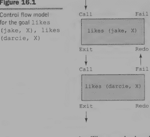

两次。第二个子目标第一次失败，这会强制通过重做返回到第一个子目标。

### 16.6.7 列表结构

到目前为止，我们讨论过的唯一 Prolog 数据结构是原子命题，它看起来更像函数调用而不是数据结构。原子命题也称为结构，实际上是一种记录。支持的另一种基本数据结构是列表。列表是任意数量元素的序列，其中元素可以是原子、原子命题或任何其他项，包括其他列表。

Prolog 使用 ML 和 Haskell 的语法来指定列表。列表元素用逗号分隔，整个列表用方括号括起来，如下所示：

```
[apple, prune, grape, kumquat]
```

记号 `[]` 用于表示空列表。Prolog 不使用显式函数来构造和拆解列表，而只是使用一种特殊记号。[X | Y] 表示一个头为 X、尾为 Y 的列表，其中头和尾分别对应 LISP 中的 CAR 和 CDR。这类似于 ML 和 Haskell 中使用的记号。

可以用一个简单结构创建列表，如下所示：

```
new_list([apple, prune, grape, kumquat]).
```

该语句声明常量列表 [apple, prune, grape, kumquat] 是名为 new_list 的关系的一个新元素（这个名字是我们刚刚编造的）。这条语句并没有把列表绑定到名为 new_list 的变量；相反，它做的是命题 `male(jake)` 所做的那类事情。也就是说，它声明 [apple, prune, grape, kumquat] 是 new_list 的一个新元素。因此，我们可以有第二个带列表参数的命题，例如

```
new_list([apricot, peach, pear])
```

在查询模式下，可以用以下语句将 new_list 的某个元素拆解为头和尾：

```
new_list([New_List_Head | New_List_Tail]).
```

如果 new_list 已被设置为具有所示的两个元素，那么这条语句会用第一个列表元素的头（在本例中是 apple）实例化 New_List_Head，并用该列表的尾（即 [prune, grape, kumquat]）实例化 New_List_Tail。如果这是某个复合目标的一部分，并且回溯迫使对它进行新的求值，那么 New_List_Head 和 New_List_Tail 将分别被重新实例化为 apricot 和 [peach, pear]，因为 [apricot, peach, pear] 是 new_list 的下一个元素。

用于拆解列表的 | 运算符也可以根据给定的已实例化头和尾组件来创建列表，如下所示：

```
[Element_1 | List_2]
```

如果 Element_1 已用 pickle 实例化，List_2 已用 [peanut, prune, popcorn] 实例化，那么对于这一次引用，示例记号将创建列表 [pickle, peanut, prune, popcorn]。

如前所述，包含 | 符号的列表记号是通用的：它既可以指定列表构造，也可以指定列表拆解。进一步注意，以下写法是等价的：

```
[apricot, peach, pear | []]
[apricot, peach | [pear]]
[apricot | [peach, pear]]
```

对于列表，经常需要某些基本操作，例如 LISP、ML 和 Haskell 中的那些操作。作为 Prolog 中此类操作的一个例子，我们考察 append 的定义，它与 LISP 中的此类函数相关。在这个例子中，可以看到函数式语言和声明式语言之间的差异与相似之处。我们不需要指定 Prolog 如何从给定列表构造新列表；相反，我们只需要根据给定列表指定新列表的特征。

从表面上看，append 的 Prolog 定义与第 15 章中出现的 ML 版本非常相似，并且以类似方式使用归结中的一种递归来生成新列表。在 Prolog 的情况下，递归由归结过程引起并受其控制。与 ML 和 Haskell 一样，使用模式匹配过程，根据实际参数在 append 过程的两个不同定义之间进行选择。

以下代码中 append 操作的前两个参数是要追加的两个列表，第三个参数是结果列表。

```prolog
append([], List, List).
append([Head | List_1], List_2, [Head | List_3]) :-
    append(List_1, List_2, List_3).
```

第一个命题规定，当空列表追加到任何其他列表时，该其他列表就是结果。这条语句对应于 ML 的 append 函数中的递归终止步骤。注意，终止命题放在递归命题之前。这样做是因为我们知道 Prolog 将按顺序匹配这两个命题，从第一个开始（因为它使用深度优先顺序）。

第二个命题规定了新列表的几个特征。它对应于 ML 函数中的递归步骤。左侧谓词指出，新列表的第一个元素与第一个给定列表的第一个元素相同，因为它们都命名为 Head。每当 Head 被实例化为某个值时，目标中所有出现的 Head 实际上都会同时被实例化为该值。第二条语句的右侧规定，第一个给定列表（List_1）的尾部追加了第二个给定列表（List_2），以形成结果列表的尾部（List_3）。

理解 append 第二条语句的一种方式如下：将列表 [Head | List_1] 追加到任意列表 List_2 会产生列表 [Head | List_3]，但仅当列表 List_3 是通过将 List_1 追加到 List_2 而形成时。在 LISP 中，这将是

```lisp
(CONS (CAR FIRST) (APPEND (CDR FIRST) SECOND))
```

在 Prolog 和 LISP 两个版本中，直到递归产生终止条件时才构造结果列表；在这种情况下，第一个列表必须变为空。然后，使用 append 函数本身构建结果列表；从第一个列表取出的元素按相反顺序添加到第二个列表。这种反转是通过递归的展开完成的。

Prolog 的 append 与 LISP 和 ML 的 append 之间的一个根本区别是，Prolog 的 append 是一个谓词——它不返回列表，而是返回 yes 或 no。新列表是其第三个参数的值。

为了说明 append 过程如何推进，考虑以下跟踪示例：

```prolog
trace.
append([bob, jo], [jake, darcie], Family).

(1) 1 Call: append([bob, jo], [jake, darcie], _10)?
(2) 2 Call: append([jo], [jake, darcie], _18) ?
(3) 3 Call: append([], [jake, darcie], _25) ?
(3) 3 Exit: append([], [jake, darcie], [jake, darcie])
(2) 2 Exit: append([jo], [jake, darcie], [jo, jake,
    darcie])
(1) 1 Exit: append([bob, jo], [jake, darcie],
    [bob, jo, jake, darcie])
Family = [bob, jo, jake, darcie]
yes
```

前两个调用表示子目标，它们的 List_1 非空，因此它们从第二条语句的右侧创建递归调用。第二条语句的左侧实际上指定了递归调用（或目标）的参数，从而每一步拆解第一个列表的一个元素。当第一个列表在某个调用或子目标中变为空时，第二条语句右侧的当前实例通过匹配第一条语句而成功。其效果是，将空列表追加到第二个原始参数列表后得到的值作为第三个参数返回。在相继的退出（表示成功匹配）中，从第一个列表移除的元素被追加到结果列表 Family 中。当第一个目标的退出完成时，过程就完成了，并显示结果列表。

Prolog 的 append 与 LISP 和 ML 的 append 之间的另一个区别是，Prolog 的 append 比那些语言中的 append 更灵活。例如，在 Prolog 中，我们可以用以下语句使用 append 来确定哪两个列表可以追加得到 [a, b, c]：

```
append(X, Y, [a, b, c]).
```

这会产生以下结果：

```
X = []
Y = [a, b, c]
```

如果在这个输出处输入分号，我们会得到另一个结果：

```
X = [a]
Y = [b, c]
```

继续，我们得到以下结果：

```
X = [a, b]
Y = [c];
X = [a, b, c]
Y = []
```


假设我们需要能够判断一个给定符号是否在给定列表中。对此，一个直接的 Prolog 描述是

```prolog
member(Element, [Element | _]).
member(Element, [_ | List]) :- member(Element, List).
```

下划线表示一个“匿名”变量；它用于表示我们不关心它可能从合一中得到什么实例化。前一个例子中的第一条语句在 Element 是列表头部时成功，无论是在初始时还是通过第二条语句进行若干次递归之后。第二条语句在 Element 位于列表尾部时成功。考虑以下跟踪示例：

```prolog
trace.
member(a, [b, c, d]).
(1) 1 Call: member(a, [b, c, d])?
(2) 2 Call: member(a, [c, d])?
(3) 3 Call: member(a, [d])?
(4) 4 Call: member(a, [])?
(4) 4 Fail: member(a, [])
(3) 3 Fail: member(a, [d])
(2) 2 Fail: member(a, [c, d])
(1) 1 Fail: member(a, [b, c, d])
no
```

```prolog
member(a, [b, a, c]).
(1) 1 Call: member(a, [b, a, c])?
(2) 2 Call: member(a, [a, c])?
(2) 2 Exit: member(a, [a, c])
(1) 1 Exit: member(a, [b, a, c])
yes
```

## 16.7 Prolog 的缺陷

尽管 Prolog 是一个有用的工具，但它既不是一种纯逻辑编程语言，也不是一种完美的逻辑编程语言。本节描述 Prolog 的一些问题。

### 16.7.1 归结顺序控制

Prolog 出于效率原因，允许用户在归结过程中控制模式匹配的顺序。在纯逻辑编程环境中，归结期间所尝试匹配的顺序是不确定的，并且所有匹配都可以并发尝试。然而，由于 Prolog 总是以相同顺序进行匹配——从数据库开头以及给定目标的左端开始——用户可以通过排列数据库语句来优化特定应用，从而深刻影响效率。例如，如果用户知道某些规则在特定“执行”期间比其他规则更可能成功，那么把这些规则放在数据库开头就可以使程序更高效。

除了允许用户控制数据库和子目标顺序之外，Prolog 为了效率还作出另一项让步：允许对回溯进行某种显式控制。这是通过截断操作符完成的，它由感叹号（!）指定。截断操作符实际上是一个目标，而不是一个操作符。作为一个目标，它总是立即成功，但不能通过回溯重新满足。因此，截断的一个副作用是：在复合目标中位于其左侧的子目标也不能通过回溯重新满足。例如，在目标

```prolog
a, b, !, c, d.
```

中，如果 a 和 b 都成功但 c 失败，整个目标就失败。如果已知每当 c 失败时，重新满足 b 或 a 都是浪费时间，就可以使用这个目标。

因此，截断的目的是允许用户告诉系统何时不应尝试重新满足那些大概无法导致完整证明的子目标，从而使程序更高效。

作为使用截断操作符的一个例子，考虑 16.6.7 节中的 member 规则，即：

```prolog
member(Element, [Element | _]).
member(Element, [_ | List]) :- member(Element, List).
```

如果 member 的列表参数表示一个集合，那么它只能被满足一次（集合不包含重复元素）。因此，如果 member 在包含多个子目标的目标语句中用作子目标，就可能出现问题。问题在于：如果 member 成功但下一个子目标失败，回溯将试图通过构造先前的匹配来重新满足 member。但是，由于 member 的列表参数一开始只包含该元素的一个副本，member 无法再次被满足，这最终会导致整个目标失败，尽管还会进行任何额外的重新满足 member 的尝试。例如，考虑目标：

```prolog
dem_candidate(X) :- member(X, democrats), tests(X).
```

这个目标判断给定的人是否是民主党人，并且是否是竞选某个职位的合适候选人。tests 子目标检查给定民主党人的各种特征，以判断此人是否适合该职位。如果民主党人集合没有重复元素，那么当 tests 子目标失败时，我们就不希望回溯到 member 子目标，因为 member 会搜索所有其他民主党人但最终失败，因为没有重复元素。第二次尝试 member 子目标将浪费计算时间。解决这一低效问题的方法是，在 member 定义的第一条语句右侧添加一个以截断操作符为唯一元素的部分，如下所示：

```prolog
member(Element, [Element | _]) :- !.
```

回溯将不会尝试重新满足 member，而是会使整个子目标失败。

截断在 Prolog 中一种称为“生成-测试”的编程策略中特别有用。在使用生成-测试策略的程序中，目标由生成潜在解的子目标组成，随后由后面的“测试”子目标检查这些潜在解。被拒绝的解需要回溯到“生成器”子目标，以生成新的潜在解。作为生成-测试程序的一个例子，考虑以下程序，它出现在 Clocksin 和 Mellish（2003）中：

```prolog
divide(N1, N2, Result) :- is_integer(Result),
    Product1 is Result * N2,
    Product2 is (Result + 1) * N2,
    Product1 =< N1, Product2 > N1, !.
```

这个程序使用加法和乘法执行整数除法。由于大多数 Prolog 系统都提供除法作为操作符，这个程序实际上并不实用，除了用来说明一个简单的生成-测试程序之外。

谓词 `is_integer` 只要其参数可以被实例化为某个非负整数就会成功。如果其参数未被实例化，`is_integer` 会把它实例化为值 0。如果参数被实例化为一个整数，`is_integer` 会把它实例化为下一个更大的整数值。

因此，在 `divide` 中，`is_integer` 是生成器子目标。它每次被满足时生成序列 0、1、2、... 中的一个元素。所有其他子目标都是测试子目标——它们检查 `is_integer` 产生的值是否实际上就是前两个参数 `N1` 和 `N2` 的商。截断作为最后一个子目标的目的很简单：它防止 `divide` 在找到解之后再去寻找替代解。尽管 `is_integer` 可以生成大量候选值，但只有一个才是解，因此这里的截断防止了产生次要解的无用尝试。

截断操作符的使用曾被比作命令式语言中 goto 的使用（van Emden，1980）。虽然它有时是需要的，但也可能被滥用。确实，有时人们用它使逻辑程序具有受命令式编程风格启发的控制流。

篡改 Prolog 程序控制流的能力是一种缺陷，因为它直接损害了逻辑编程的一项重要优势——程序不规定如何找到解。相反，它们只规定解应该是什么样子。这种设计使程序更易于编写和阅读。它们不会因如何确定解的细节而变得杂乱，尤其是不会因产生解时进行计算的确切顺序而变得杂乱。因此，虽然逻辑编程不需要控制流方向，但 Prolog 程序经常使用它们，主要是为了效率。

### 16.7.2 封闭世界假设

Prolog 归结的性质有时会产生误导性的结果。就 Prolog 而言，唯一的真理是那些能够使用其数据库证明的真理。除了数据库之外，它对外部世界一无所知。当系统收到查询，而数据库没有信息能够绝对证明该查询时，该查询就被假定为假。Prolog 可以证明给定目标为真，但它不能证明给定目标为假。它只是假定：由于它无法证明一个目标为真，该目标就必然为假。本质上，Prolog 是一个“真/失败”系统，而不是一个“真/假”系统。

实际上，封闭世界假设对你来说应该完全不陌生——我们的司法制度也是这样运作的。嫌疑人在被证明有罪之前是无罪的。他们不需要被证明无罪。如果审判不能证明一个人有罪，他或她就被认为是无罪的。

封闭世界假设的问题与否定问题有关，后者将在下一小节讨论。

### 16.7.3 否定问题

Prolog 的另一个问题是它难以处理否定。考虑以下由两个事实和一个关系组成的数据库：

```prolog
parent(bill, jake).
parent(bill, shelley).
sibling(X, Y) :- (parent(M, X), parent(M, Y)).
```

现在，假设我们输入查询

```prolog
sibling(X, Y).
```

Prolog 将回答

```
X = jake
Y = jake
```

因此，Prolog“认为”杰克是他自己的兄弟姐妹。发生这种情况是因为系统首先用 bill 实例化 M、用 jake 实例化 X，使第一个子目标 parent(M, X) 为真。然后它再次从数据库开头开始匹配第二个子目标 parent(M, Y)，并得到 M 用 bill 实例化、Y 用 jake 实例化的结果。由于两个子目标是独立满足的，且两次匹配都从数据库开头开始，所以出现了所示响应。为了避免这个结果，必须规定 X 只有在与 Y 拥有相同父母且 X 与 Y 不是同一个人时，才是 Y 的兄弟姐妹。不幸的是，在 Prolog 中说明它们不相等并不直接，正如我们将讨论的那样。最严格的方法需要为每一对原子添加一个事实，说明它们不相同。当然，这会使数据库变得非常大，因为否定信息往往远多于

正面信息。例如，大多数人的非生日比生日多 364 个。

一个简单的替代方案是在目标中声明 X 必须不同于 Y，如下所示：

```prolog
sibling(X, Y) :- parent(M, X), parent(M, Y), not(X = Y).
```

在其他情况下，解决方案就没有这么简单了。

在这种情况下，如果归结无法满足子目标 X = Y，则 Prolog 的 not 运算符得到满足。因此，如果 not 成功，并不一定意味着 X 不等于 Y；相反，它意味着归结无法从数据库证明 X 与 Y 相同。因此，Prolog 的 not 运算符不等价于逻辑 NOT 运算符；在逻辑 NOT 中，NOT 表示其操作数为假。如果我们碰巧有一个如下形式的目标，这种不等价可能导致问题：

```prolog
not(not(some_goal)).
```

它将等价于：

```prolog
some_goal.
```

如果 Prolog 的 not 运算符是真正的逻辑 NOT 运算符的话。然而，在某些情况下，它们并不相同。例如，再次考虑 member 规则：

```prolog
member(Element, [Element | _]) :- !.
member(Element, [_ | List]) :- member(Element, List).
```

要找出给定列表中的一个元素，我们可以使用目标：

```prolog
member(X, [mary, fred, barb]).
```

这会使 X 被实例化为 mary，然后 mary 会被打印出来。但如果我们使用：

```prolog
not(not(member(X, [mary, fred, barb]))).
```

将会发生以下事件序列：首先，内层目标会成功，将 X 实例化为 mary。然后，Prolog 会尝试满足下一个目标：

```prolog
not(member(X, [mary, fred, barb])).
```

该语句会失败，因为 member 成功了。当这个目标失败时，X 会被取消实例化，因为 Prolog 总是会取消所有失败目标中所有变量的实例化。接下来，Prolog 会尝试满足外层的 not 目标，该目标会成功，因为它的参数已经失败。最后，结果（即 X）会被打印出来。但 X 当前没有被实例化，因此系统会表明这一点。通常，未实例化的变量会以下划线开头后跟一串数字的形式打印出来。因此，Prolog 的 not 不等价于逻辑 NOT 这一事实至少可能造成误导。

逻辑 NOT 不能成为 Prolog 不可分割的一部分，根本原因在于霍恩子句的形式：

```prolog
A :- B_1, B_2, ..., B_n
```

如果所有 B 命题都为真，则可以得出 A 为真。但无论任何一个或所有 B 命题的真假如何，都不能得出 A 为假。从肯定逻辑中，只能得出肯定逻辑。因此，使用霍恩子句形式会阻止任何否定性结论。

### 16.7.4 内在局限性

如第 16.4 节所述，逻辑程序设计的一个基本目标是提供非过程性程序设计；也就是说，在这种系统中，程序员只需说明程序应该做什么，而不必说明如何完成。那里给出的排序示例在此重写如下：

```text
sort(old_list, new_list) ← permute(old_list, new_list) ∧ sorted(new_list)
sorted(list) ← ∀j such that 1 ≤ j < n, list(j) ≤ list(j+1)
```

用 Prolog 编写这一点很直接。例如，sorted 子目标可以表示为：

```prolog
sorted([]).
sorted([x]).
sorted([x, y | list]) :- x <= y, sorted([y | list]).
```

这种排序过程的问题在于，它不知道如何排序，只能简单地枚举给定列表的所有排列，直到碰巧生成一个使列表按排序顺序排列的排列——这确实是一个非常慢的过程。

到目前为止，还没有人发现一种过程，可以把对有序列表的描述转换为某种高效的排序算法。归结能够完成许多有趣的事情，但肯定不包括这一点。因此，对列表进行排序的 Prolog 程序必须说明排序如何完成的细节，就像命令式或函数式语言那样。

所有这些问题是否意味着应该放弃逻辑程序设计？绝对不是！就目前而言，它能够处理许多有用的应用。此外，它基于一个引人入胜的概念，因此本身也很有趣。最后，还有可能开发出新的推理技术，使逻辑程序设计语言系统能够高效地处理越来越大的问题类别。

## 16.8 逻辑程序设计的应用

在本节中，我们简要描述逻辑程序设计（尤其是 Prolog）当前和潜在应用中较大的几类。

### 16.8.1 关系数据库管理系统

关系数据库管理系统（RDBMS）以表的形式存储数据。对此类数据库的查询通常用结构化查询语言（SQL）表示。SQL 是非过程性的，这与逻辑程序设计是非过程性的含义相同。用户不描述如何检索答案；相反，他或她只描述答案的特征。逻辑程序设计与 RDBMS 之间的联系应该很明显。简单的信息表可以用 Prolog 结构来描述，表之间的关系可以方便而容易地用 Prolog 规则来描述。检索过程内在于归结操作之中。Prolog 的目标语句为 RDBMS 提供查询。因此，逻辑程序设计自然契合实现 RDBMS 的需求。

使用逻辑程序设计实现 RDBMS 的优点之一是只需要一种语言。在典型的 RDBMS 中，数据库语言包括数据定义、数据操作和查询语句，所有这些都嵌入在通用程序设计语言（如 COBOL）中。通用语言用于处理数据以及输入和输出功能。所有这些功能都可以在逻辑程序设计语言中完成。

使用逻辑程序设计实现 RDBMS 的另一个优点是内置了演绎能力。传统 RDBMS 除了数据库中显式存储的内容之外，不能从数据库推出任何东西。它们只包含事实，而不是事实和推理规则。与传统 RDBMS 相比，使用逻辑程序设计实现 RDBMS 的主要缺点是逻辑程序设计实现速度较慢。逻辑推理比使用命令式程序设计技术的普通表查找方法耗时更长。

### 16.8.2 专家系统

专家系统是设计用来在某个特定领域模拟人类专业知识的计算机系统。它们由事实数据库、推理过程、关于该领域的一些启发式知识，以及一些友好的人机接口组成，使系统看起来很像人类专家顾问。除了由人类专家提供的初始知识库之外，专家系统还会从被使用的过程中学习，因此其数据库必须能够动态增长。此外，专家系统应具备在确定需要额外信息时询问用户以获取该信息的能力。

假设数据库中的事实和规则为真。这种方法是为自动定理证明而开发的。

Prolog 是使用最广泛的逻辑程序设计语言。逻辑程序设计的起源在于 Robinson 为逻辑推理开发的归结规则。Prolog 主要由马赛的 Colmerauer 和 Roussel 开发，并得到了爱丁堡的 Kowalski 的一些帮助。

逻辑程序是非过程性的，这意味着给出了解的特征，但没有给出获得解的过程。

Prolog 语句是事实、规则或目标。大多数语句由结构（即原子命题）和逻辑运算符组成，尽管也允许算术表达式。

归结是 Prolog 解释器的主要活动。这个过程广泛使用回溯，主要涉及命题之间的模式匹配。当涉及变量时，可以将变量实例化为值以提供匹配。这个实例化过程称为*合一*。

逻辑程序设计的现状存在许多问题。出于效率原因，甚至为了避免无限循环，程序员有时必须在程序中说明控制流信息。此外，还存在封闭世界假设和否定问题。

逻辑程序设计已被用于许多不同领域，主要是在关系数据库系统、专家系统和自然语言处理中。

## 参考文献注释

Prolog 语言在好几本书中都有描述。该语言的爱丁堡形式在 Clocksin 和 Mellish（2003）中有所介绍。微型计算机实现则在 Clark 和 McCabe（1984）中描述。

Hogger（1991）是一本关于逻辑程序设计一般主题的优秀书籍。它是本章逻辑程序设计应用部分材料的来源。

## 复习题

- 1. 符号逻辑在形式逻辑中的三个主要用途是什么？
- 2. 复合项的两个部分是什么？
- 3. 命题可以用哪两种模式陈述？
- 4. 子句形式中命题的一般形式是什么？
- 5. 什么是前件？什么是后件？
- 6. 给出*归结*和*合一*的一般（非严格）定义。
- 7. 霍恩子句有哪些形式？


- 8. 声明式语义的基本概念是什么？
- 9. 一种语言是非过程式的，这意味着什么？
- 10. Prolog 项的三种形式是什么？
- 11. 什么是未实例化变量？
- 12. Prolog 中事实和规则语句的语法形式及用法是什么？
- 13. 什么是合取？
- 14. 解释在数据库中匹配目标与事实的两种方法。
- 15. 在讨论多个目标如何满足时，解释深度优先搜索和广度优先搜索之间的区别。
- 16. 解释 Prolog 中回溯是如何工作的。
- 17. 解释 Prolog 语句 X is X + 1 有什么问题。
- 18. Prolog 程序员在归结过程中可以通过哪两种方式控制模式匹配的顺序？
- 19. 解释 Prolog 中的生成-测试编程策略。
- 20. 解释 Prolog 使用的封闭世界假设。为什么这是一个局限？
- 21. 解释 Prolog 的否定问题。为什么这是一个局限？
- 22. 解释自动定理证明与 Prolog 推理过程之间的联系。
- 23. 解释过程式语言和非过程式语言之间的区别。
- 24. 解释为什么 Prolog 系统必须进行回溯。
- 25. 在 Prolog 中，归结与合一之间的关系是什么？

## 习题集

- 1. 比较 C# 与 Prolog 中数据类型的概念。
- 2. 描述如何使用多处理器机器来实现归结。按当前的定义，Prolog 能否使用这种方法？
- 3. 用 Prolog 编写你的家谱描述（仅基于事实），向上追溯到你的祖父母，并包括所有后代。务必包含所有关系。
- 4. 编写一组家庭关系规则，包括从祖父母到其后两代的所有关系。然后将这些规则添加到问题 3 的事实中，并尽量删除其中的事实。
- 5. 将以下英语条件语句写成以 Prolog 头部（head）表示的 Horn 子句：
  - a. 如果弗雷德是迈克的父亲，那么弗雷德是迈克的祖先。
  - b. 如果迈克是乔的父亲，并且迈克是玛丽的父亲，那么玛丽是乔的姐妹。
  - c. 如果迈克是弗雷德的兄弟，并且弗雷德是玛丽的父亲，那么迈克是玛丽的叔叔。
- 6. 解释 Scheme 和 Prolog 的列表处理能力相似的两种方式。
- 7. Scheme 和 Prolog 的列表处理能力在哪些方面不同？
- 8. 写一篇 Prolog 与 ML 的比较，包括两个相似点和两个不同点。
- 9. 从一本关于 Prolog 的书中了解并写出关于出现（occurrence）问题的描述。为什么 Prolog 允许该问题存在于其实现中？
- 10. 查找关于 Skolem 范式的良好资料源，并写出简短而清晰的解释。

## 编程练习

- 1. 使用结构 `parent(X, Y)`、`male(X)` 和 `female(X)`，编写一个定义 `mother(X, Y)` 的结构。
- 2. 使用结构 `parent(X, Y)`、`male(X)` 和 `female(X)`，编写一个定义 `sister(X, Y)` 的结构。
- 3. 编写一个 Prolog 程序，找出数字列表的最大值。
- 4. 编写一个 Prolog 程序，当两个给定列表参数的交集为空时成功。
- 5. 编写一个 Prolog 程序，返回包含两个给定列表元素并集的列表。
- 6. 编写一个 Prolog 程序，返回给定列表的最后一个元素。
- 7. 编写一个实现快速排序（quicksort）的 Prolog 程序。

- Backus, J. (1959) “苏黎世 ACM-GAMM 会议上提出的国际代数语言的语法与语义。” 载于《国际信息处理会议论文集》。UNESCO，巴黎，第 125-132 页。

- Backus, J. (1978) “编程能否摆脱冯·诺依曼风格？一种函数式风格及其程序代数。” Commun. ACM，第 21 卷，第 8 期，第 613-641 页。

- Backus, J., F. L. Bauer, J. Green, C. Katz, J. McCarthy, P. Naur, A. J. Perlis, H. Rutishauser, K. Samelson, B. Vauquois, J. H. Wegstein, A. van Wijngaarden, and M. Woodger. (1963) “关于算法语言 ALGOL 60 的修订报告。” Commun. ACM，第 6 卷，第 1 期，第 1-17 页。

- Balena, F. (2003) 《Microsoft Visual Basic .NET 2003 版程序设计》，Microsoft Press，雷德蒙德，华盛顿州。

- Ben-Ari, M. (1982) 《并发程序设计原理》，Prentice-Hall，新泽西州恩格尔伍德克利夫斯。

- Birtwistle, G. M., O.-J. Dahl, B. Myhrhaug, and K. Nygaard. (1973) 《SIMULA 入门》，Van Nostrand Reinhold，纽约。

- Boehm, J. M., L. Bradley, K. Kanda, D. Litle, and U. F. Pleban. (1982) “基于指称语义的实验性编译器生成器的经验。” ACM SIGPLAN Notices，第 17 卷，第 6 期，第 216-229 页。

- Bohm, C., and G. Jacopini. (1966) “流程图、图灵机与仅含有两种形成规则的语言。” Commun. ACM，第 9 卷，第 5 期，第 366-371 页。

- Bolsky, M., and D. Korn. (1995) 《新 KornShell 命令与编程语言》，Prentice-Hall，新泽西州恩格尔伍德克利夫斯。

- Booch, G. (1987) 《使用 Ada 的软件工程（第二版）》，Benjamin/Cummings，加利福尼亚州雷德伍德城。

- Bradley, J. C. (1989) 《使用模块化结构的 QuickBASIC 与 QBASIC》，W. C. Brown，艾奥瓦州迪比克。

- Brinch Hansen, P. (1973) 《操作系统原理》，Prentice-Hall，新泽西州恩格尔伍德克利夫斯。

- Brinch Hansen, P. (1975) “编程语言 Concurrent-Pascal。” IEEE Transactions on Software Engineering，第 1 卷，第 2 期，第 199-207 页。

- Brinch Hansen, P. (1977) 《并发程序的结构》，Prentice-Hall，新泽西州恩格尔伍德克利夫斯。

- Brinch Hansen, P. (1978) “分布式进程：一种并发程序设计概念。” Commun. ACM，第 21 卷，第 11 期，第 934-941 页。

- Brown, J. A., S. Pakin, and R. P. Polivka. (1988) 《APL2 一览》，Prentice-Hall，新泽西州恩格尔伍德克利夫斯。

- Campione, M., K. Walrath, and A. Huml. (2001) 《Java 教程（第三版）》，Addison-Wesley，马萨诸塞州雷丁。

- Cardelli, L., J. Donahue, L. Glassman, M. Jordan, B. Kalsow, and G. Nelson. (1989) 《Modula-3 报告（修订版）》，数字系统研究中心，加利福尼亚州帕洛阿尔托。

- Chambers, C., and D. Ungar. (1991) “让纯面向对象语言变得切实可行。” SIGPLAN Notices，第 26 卷，第 1 期，第 1-15 页。

- Chomsky, N. (1956) “描述语言的三种模型。” IRE Transactions on Information Theory，第 2 卷，第 3 期，第 113-124 页。

- Chomsky, N. (1959) “关于文法的某些形式性质。” Information and Control，第 2 卷，第 2 期，第 137-167 页。

- Christiansen, T., B. D. Foy, and L. Wall with J. Orwant. (2013) 《Perl 编程（第四版）》，O'Reilly & Associates，加利福尼亚州塞瓦斯托波尔。

- Church, A. (1941) 《数学研究年刊：λ 转换演算，第 6 卷》。普林斯顿大学出版社，新泽西州普林斯顿。1965 年由 Kraus Reprint Corporation 在纽约重印。

- Clark, K. L., and F. G. McCabe. (1984) 《Micro-PROLOG：逻辑程序设计》，Prentice-Hall，新泽西州恩格尔伍德克利夫斯。

- Clarke, L. A., J. C. Wileden, and A. L. Wolf. (1980) “Ada 中的嵌套没什么用。” ACM SIGPLAN Notices，第 15 卷，第 11 期，第 139-145 页。

- Cleveland, J. C. (1986) 《数据类型导论》，Addison-Wesley，马萨诸塞州雷丁。

- Cleaveland, J. C., and R. C. Uzgalis. (1976) 《编程语言的文法：每个程序员都应了解的文法知识》，American Elsevier，纽约。

- Clocksin, W. F., and C. S. Mellish. (2013) 《Prolog 编程：使用 ISO 标准》，Springer-Verlag，纽约。

- Cohen, J. (1981) “链式数据结构的垃圾收集。” ACM Computing Surveys，第 13 卷，第 3 期，第 341-368 页。

- Converse, T., and J. Park. (2000) 《PHP 4 宝典》，IDG Books，纽约。

- Conway, M. E. (1963) “可分离转换图编译器的设计。” Commun. ACM，第 6 卷，第 7 期，第 396-408 页。

- Conway, R., and R. Constable. (1976) “PL/CS——PL/I 的一种受约束子集。” 技术报告 TR76/293。康奈尔大学计算机科学系，纽约州伊萨卡。

- Cornell University. (1977) 《PL/C 用户指南，7.6 版》。康奈尔大学计算机科学系，纽约州伊萨卡。

- Correa, N. (1992) “空范畴、链绑定与句法分析。” 载于《基于原则的句法分析》，R. C. Berwick、S. P. Abney 和 C. Tenny 编。Kluwer Academic Publishers，波士顿，第 83-121 页。

- Cousineau, G., M. Mauny, and K. Callaway. (1998) 《函数式编程方法》，Cambridge University Press，英国剑桥。

- Dahl, O-J., E. W. Dijkstra, and C. A. R. Hoare. (1972) 《结构化程序设计》，Academic Press，纽约。

- Dahl, O-J., and K. Nygaard. (1967) 《SIMULA 67 公共基础提案》，挪威计算中心文档，奥斯陆。

- Deitel, H. M., D. J. Deitel, and T. R. Nieto. (2002) 《Visual Basic .NET：如何编程（第二版）》，Prentice-Hall，新泽西州上鞍河。

- Deliyanni, A., and R. A. Kowalski. (1979) “逻辑与语义网络。” Commun. ACM，第 22 卷，第 3 期，第 184-192 页。

- Department of Defense. (1960) 《COBOL：面向商业通用语言的初始规范》。美国国防部，华盛顿特区。

- Department of Defense. (1961) 《COBOL—1961：面向商业通用语言的修订规范》。美国国防部，华盛顿特区。

- Department of Defense. (1962) 《COBOL—1961 扩展：面向商业通用语言的扩展规范》。美国国防部，华盛顿特区。

- Department of Defense. (1975a) 《高级程序设计语言需求：STRAWMAN》。7 月。美国国防部，华盛顿特区。

- Department of Defense. (1975b) 《高级程序设计语言需求：WOODENMAN》。8 月。美国国防部，华盛顿特区。

- Department of Defense. (1976) 《高级程序设计语言需求：TINMAN》。6 月。美国国防部，华盛顿特区。

- Department of Defense. (1977) 《高级程序设计语言需求：IRONMAN》。1 月。美国国防部，华盛顿特区。

- Department of Defense. (1978) 《高级程序设计语言需求：STEELMAN》。6 月。美国国防部，华盛顿特区。

- Department of Defense. (1980a) 《高级程序设计语言需求：STONEMAN》。2 月。美国国防部，华盛顿特区。


- 美国国防部。（1980b）《通用高级语言编程环境要求》，STONEMAN。美国国防部，华盛顿特区。
- DeRemer, F.（1971）“简单 LR(k) 文法。”《Commun. ACM》，第14卷，第7期，第453–460页。
- DeRemer, F. 与 T. Pennello。（1982）“LALR(1) 前瞻集的高效计算。”《ACM TOPLAS》，第4卷，第4期，第615–649页。
- Deutsch, L. P. 与 D. G. Bobrow。（1976）“一种高效增量式自动垃圾收集器。”《Commun. ACM》，第19卷，第9期，第522–526页。
- Dijkstra, E. W.（1968a）“Goto 语句被认为有害。”《Commun. ACM》，第11卷，第3期，第147–149页。
- Dijkstra, E. W.（1968b）“协作顺序进程。”载于《Programming Languages》，F. Genuys（编），Academic Press，纽约，第43–112页。
- Dijkstra, E. W.（1972）“谦逊的程序员。”《Commun. ACM》，第15卷，第10期，第859–866页。
- Dijkstra, E. W.（1975）“守卫命令、非确定性与程序形式推导。”《Commun. ACM》，第18卷，第8期，第453–457页。
- Dijkstra, E. W.（1976）《编程的修炼》。Prentice-Hall，Englewood Cliffs, NJ。
- Dybvig, R. K.（2009）《Scheme 编程语言》，第4版。MIT Press，波士顿。
- Ellis, M. A. 与 B. Stroustrup。（1990）《C++ 参考手册（注释版）》。Addison-Wesley，Reading, MA。
- Farber, D. J.、R. E. Griswold 与 I. P. Polonsky。（1964）“SNOBOL，一种字符串处理语言。”《J. ACM》，第11卷，第1期，第21–30页。
- Farrow, R.（1982）“LINGUIST 86：又一个基于属性文法的翻译器编写系统。”《ACM SIGPLAN Notices》，第17卷，第6期，第160–171页。
- Fischer, C. N.、G. F. Johnson、J. Mauney、A. Pal 与 D. L. Stock。（1984）“Poe 基于语言的编辑器项目。”《ACM SIGPLAN Notices》，第19卷，第5期，第21–29页。
- Fischer, C. N. 与 R. J. LeBlanc。（1977）《UW-Pascal 参考手册》。Madison Academic Computing Center，Madison, WI。
- Fischer, C. N. 与 R. J. LeBlanc。（1980）“Pascal 中运行时诊断的实现。”《IEEE Transactions on Software Engineering》，第 SE-6 卷，第4期，第313–319页。
- Fischer, C. N. 与 R. J. LeBlanc。（1991）《用 C 语言构造编译器》。Benjamin/Cummings，Menlo Park, CA。
- Flanagan, D.（2011）《JavaScript：权威指南》，第6版。O'Reilly Media，Sebastopol, CA。
- Floyd, R. W.（1967）“为程序赋予含义。”载于《应用数学研讨会论文集：计算机科学的数学方面》，J. T. Schwartz（编）。American Mathematical Society，Providence, RI。
- Frege, G.（1892）“论涵义与指称（Über Sinn und Bedeutung）。”《Zeitschrift für Philosophie und philosophische Kritik》，第100卷，第25–50页。
- Friedl, J. E. F.（2006）《精通正则表达式》，第3版。O'Reilly Media，Sebastopol, CA。
- Friedman, D. P. 与 D. S. Wise。（1979）“引用计数的循环收集能力并非不可逾越。”《Information Processing Letters》，第8卷，第1期，第41–45页。
- Fuchi, K.（1981）“面向知识信息处理系统。”载于《第五代计算机系统国际会议论文集》。Japan Information Processing Development Center，东京。1982年由 North-Holland Publishing 在阿姆斯特丹重新出版。
- Kay, A.（1969）《反应式引擎》。博士论文。犹他大学，九月。
- Kernighan, B. W. 与 D. M. Ritchie。（1978）《C 程序设计语言》。Prentice-Hall，Englewood Cliffs, NJ。
- Knuth, D. E.（1965）“论语言从左到右的翻译。”《Information & Control》，第8卷，第6期，第607–639页。
- Knuth, D. E.（1967）“ALGOL 60 中剩余的疑难问题。”《Commun. ACM》，第10卷，第10期，第611–618页。
- Knuth, D. E.（1968a）“上下文无关语言的语义。”《Mathematical Systems Theory》，第2卷，第2期，第127–146页。
- Knuth, D. E.（1968b）《计算机程序设计艺术》，第 I 卷，第2版。Addison-Wesley，Reading, MA。
- Knuth, D. E.（1974）“使用 GOTO 语句的结构化程序设计。”《ACM Computing Surveys》，第6卷，第4期，第261–301页。
- Knuth, D. E.（1981）《计算机程序设计艺术》，第 II 卷，第2版。Addison-Wesley，Reading, MA。
- Knuth, D. E. 与 L. T. Pardo。（1977）“编程语言的早期发展。”载于《计算机科学与技术百科全书》，G. Holzman 与 A. Kent（编）。第7卷。Dekker，纽约，第419–493页。
- Kochan, S. G.（2009）《Objective-C 2.0 程序设计》。Addison-Wesley，Upper Saddle River, NJ。
- Kowalski, R. A.（1979）《用于问题求解的逻辑》。人工智能丛书，第7卷。Elsevier-North Holland，纽约。
- Laning, J. H., Jr. 与 N. Zierler。（1954）“用于 Whirlwind I 的数学方程翻译程序。”工程备忘录 E-364。Instrumentation Laboratory，麻省理工学院，Cambridge, MA。
- Ledgard, H.（1984）《美国 Pascal 标准》。Springer-Verlag，纽约。
- Ledgard, H. F. 与 M. Marcotty。（1975）“控制结构的谱系。”《Commun. ACM》，第18卷，第11期，第629–639页。
- Lischner, R.（2000）《Delphi 简明手册》。O'Reilly Media，Sebastopol, CA。
- Liskov, B.、R. L. Atkinson、T. Bloom、J. E. B. Moss、C. Schaffert、R. Scheifler 与 A. Snyder。（1981）《CLU 参考手册》。Springer，纽约。
- Liskov, B. 与 A. Snyder。（1979）“CLU 中的异常处理。”《IEEE Transactions on Software Engineering》，第 SE-5 卷，第6期，第546–558页。
- Lomet, D.（1975）“使对已释放存储的引用失效的方案。”《IBM Journal of Research and Development》，第19卷，第26–35页。
- Lutz, M.（2013）《学习 Python》，第5版。O'Reilly Media，Sebastopol, CA。
- MacLaren, M. D.（1977）“PL/I 中的异常处理。”《ACM SIGPLAN Notices》，第12卷，第3期，第101–104页。
- Marcotty, M.、H. F. Ledgard 与 G. V. Bochmann。（1976）“形式定义示例集。”《ACM Computing Surveys》，第8卷，第2期，第191–276页。
- Mather, D. G. 与 S. V. Waite（编）。（1971）《BASIC》，第6版。University Press of New England，Hanover, NH。
- McCarthy, J.（1960）“符号表达式的递归函数及其机器计算，第 I 部分。”《Commun. ACM》，第3卷，第4期，第184–195页。
- McCarthy, J.、P. W. Abrahams、D. J. Edwards、T. P. Hart 与 M. Levin。（1965）《LISP 1.5 程序员手册》，第2版。MIT Press，Cambridge, MA。
- McCracken, D.（1961）《FORTRAN 程序设计指南》。John Wiley & Sons, Inc.，纽约。
- McCracken, D.（1970）“APL 向何处去？”《Datamation》，9月15日，第53–57页。
- Metcalf, M.、J. Reid 与 M. Cohen。（2004）《Fortran 95/2003 详解》，第3版。Oxford University Press，Oxford, England。
- Meyer, B.（1990）《程序设计语言理论导论》。Prentice-Hall，Englewood Cliffs, NJ。
- Meyer, B.（1992）《Eiffel：语言》。Prentice-Hall，Englewood Cliffs, NJ。
- Milner, R.、R. Harper 与 M. Tofte。（1997）《Standard ML 定义（修订版）》。MIT Press，Cambridge, MA。
- Milos, D.、U. Pleban 与 G. Loegel。（1984）“编译器规范的直接实现。”载于《POPL '84：第11届 ACM SIGACT-SIGPLAN 程序设计语言原理研讨会论文集》，第196–202页。
- Mitchell, J. G.、W. Maybury 与 R. Sweet。（1979）《Mesa 语言手册》，5.0 版，CSL-79-3。Xerox Research Center，Palo Alto, CA。
- Moss, C.（1994）《Prolog++：面向对象与逻辑编程的强大能力》。Addison-Wesley，Reading, MA。
- Moto-oka, T.（1981）“知识信息处理系统的挑战。”载于《第五代计算机系统国际会议论文集》，Japan Information Processing Development Center，东京。1982年由 North-Holland Publishing 在阿姆斯特丹重新出版。
- Naur, P.（编）（1960）“算法语言 ALGOL 60 报告。”《Commun. ACM》，第3卷，第5期，第299–314页。
- Newell, A. 与 H. A. Simon。（1956）“逻辑理论机——一种复杂的信息处理系统。”《IRE Transactions on Information Theory》，第 IT-2 卷，第3期，第61–79页。
- Newell, A. 与 F. M. Tonge。（1960）“信息处理语言 V 导论。”《Commun. ACM》，第3卷，第4期，第205–211页。
- Nilsson, N. J.（1971）《人工智能中的问题求解方法》。McGraw-Hill，纽约。
- Ousterhout, J. K.（1994）《Tcl 与 Tk 工具包》。Addison-Wesley，Reading, MA。
- Paepcke, E.（编）（1993）《面向对象程序设计：CLOS 视角》。MIT Press，Cambridge, MA。
- Pagan, F. G.（1981）《程序设计语言的形式规范》。Prentice-Hall，Englewood Cliffs, NJ。
- Papert, S.（1980）《Mindstorms：儿童、计算机与强大的思想》。Basic Books，纽约。
- Perlis, A. 与 K. Samelson。（1958）“初步报告——国际代数语言。”《Commun. ACM》，第1卷，第12期，第8–22页。
- Peyton Jones, S. L.（1987）《函数式编程语言的实现》。Prentice-Hall，Englewood Cliffs, NJ。
- Pratt, T. W.（1984）《程序设计语言：设计与实现》，第2版。Prentice-Hall，Englewood Cliffs, NJ。
- Pratt, T. W. 与 M. V. Zelkowitz。（2001）《程序设计语言：设计与实现》，第4版。Prentice-Hall，Englewood Cliffs, NJ。
- Remington Rand。（1952）“UNIVAC 短代码。”未出版的油印笔记合集。A. B. Tonik 撰写的序言，日期为1955年10月25日（1页）；J. R. Logan 撰写的序言，未注明日期但显然出自1952年（1页）；初步说明，1952年？（22页，其中第20–22页似乎是后来替换的）；短代码补充信息，主题一（7页）；补遗 #1、2、3、4（9页）。
- Reppy, J. H.（1999）《ML 中的并发编程》。Cambridge University Press，纽约。
- Richards, M.（1969）“BCPL：一种用于编写编译器和系统编程的工具。”《Proc. AFIPS SJCC》，第34卷，第557–566页。
- Robbins, A.（2005）《Unix 简明手册》，第4版。O'Reilly Media，Sebastopol, CA。


- Robinson, J. A. (1965)“基于归结原理的面向机器逻辑。” Journal of the ACM，第12卷，第23–41页。
- Roussel, P. (1975)“PROLOG：参考与使用手册，”研究报告。人工智能小组，艾克斯-马赛大学，吕米尼，法国。
- Rubin, F. (1987)“GOTO 语句被认为有害”被认为有害（致编辑信）。Commun. ACM，第30卷，第3期，第195–196页。
- Rutishauser, H. (1967)《ALGOL 60 描述》。Springer-Verlag，纽约。
- Sammet, J. E. (1969)《编程语言：历史与基础》。Prentice-Hall，新泽西州恩格尔伍德克利夫斯。
- Sammet, J. E. (1976)“1974–75 年编程语言名录。” Commun. ACM，第19卷，第12期，第655–669页。
- Schneider, D. I. (1999)《使用 Visual BASIC 6.0 编程导论》。Prentice-Hall，新泽西州恩格尔伍德克利夫斯。
- Schorr, H. 和 W. Waite. (1967)“一种用于各种列表结构中垃圾收集的高效机器无关过程。” Commun. ACM，第10卷，第8期，第501–506页。
- Scott, D. S. 和 C. Strachey. (1971)“迈向计算机语言的数学语义学。” 载于《计算机与自动化研讨会论文集》，J. Fox（编）。Polytechnic Institute of Brooklyn Press，纽约，第19–46页。
- Scott, M. (2009)《编程语言语用学》，第3版。Morgan Kaufmann，加利福尼亚州旧金山。
- Sebesta, R. W. (1991)《VAX 结构化汇编语言编程》，第2版。Benjamin/Cummings，加利福尼亚州雷德伍德城。
- Sergot, M. J. (1983)“逻辑编程中的询问用户功能。” 载于《集成交互式计算机系统》，P. Degano 和 E. Sandewall（编）。North-Holland Publishing，阿姆斯特丹。
- Shaw, C. J. (1963)“JOVIAL 的一种规范。” Commun. ACM，第6卷，第12期，第721–736页。
- Smith, J. B. (2006)《实用 OCaml》。Apress，Springer-Verlag，纽约。
- Sommerville, I. (2010)《软件工程》，第9版。Addison-Wesley，马萨诸塞州雷丁。
- Steele, G. L., Jr. (1990)《Common LISP 语言》，第2版。Digital Press，马萨诸塞州伯灵顿。
- Stoy, J. E. (1977)《指称语义学：Scott-Strachey 编程语言语义学方法》。MIT Press，马萨诸塞州剑桥。
- Stroustrup, B. (1983)“向 C 添加类：语言演化中的一次实践。” Software—Practice and Experience，第13卷，第139–161页。
- Stroustrup, B. (1984)“C 中的数据抽象。” AT&T Bell Laboratories Technical Journal，第63卷，第8期，第1701–1732页。
- Stroustrup, B. (1986)《C++ 编程语言》。Addison-Wesley，马萨诸塞州雷丁。
- Stroustrup, B. (1988)“什么是面向对象编程？” IEEE Software，1988年5月，第10–20页。
- Stroustrup, B. (1991)《C++ 编程语言》，第2版。Addison-Wesley，马萨诸塞州雷丁。
- Stroustrup, B. (1994)《C++ 的设计与演化》。Addison-Wesley，马萨诸塞州雷丁。
- Stroustrup, B. (1997)《C++ 编程语言》，第3版。Addison-Wesley，马萨诸塞州雷丁。
- Sussman, G. J. 和 G. L. Steele, Jr. (1975)“Scheme：扩展 Lambda 演算的解释器。” MIT 人工智能备忘录第349号（1975年12月）。
- Wilson, P. R. (2005)“单处理器垃圾收集技术。” 可访问：http://www.cs.utexas.edu/users/oops/papers.html#bigsurv。
- Wirth, N. (1971)“编程语言 Pascal。” Acta Informatica，第1卷，第1期，第35–63页。
- Wirth, N. (1973)《系统化编程：导论》。Prentice-Hall，新泽西州恩格尔伍德克利夫斯。
- Wirth, N. (1975)“论编程语言的设计。” Information Processing 74（IFIP 74 大会论文集）。North Holland，阿姆斯特丹，第386–393页。
- Wirth, N. (1977)“Modula：一种模块化多道编程语言。” Software—Practice and Experience，第7卷，第3–35页。
- Wirth, N. (1985)《Modula-2 编程》，第3版。Springer-Verlag，纽约。
- Wirth, N. (1988)“编程语言 Oberon。” Software—Practice and Experience，第18卷，第7期，第671–690页。
- Wirth, N. 和 C. A. R. Hoare. (1966)“对 ALGOL 发展的贡献。” Commun. ACM，第9卷，第6期，第413–431页。
- Wulf, W. A.、D. B. Russell 和 A. N. Habermann. (1971)“BLISS：一种系统编程语言。” Commun. ACM，第14卷，第12期，第780–790页。
- Zuse, K. (1972)“Der Plankalkül。” 手稿完成于1945年，发表于 Berichte der Gesellschaft für Mathematik und Datenverarbeitung，第63号（波恩，1972年）；第3部分，285页。除第176–196页外，全部内容的英译本见第106号（波恩，1976年），第42–244页。

- **活动子程序**
  - 在引用环境中，224
  - 在栈动态局部变量中，423

- **Actor 任务**，564，580

- **实参**，203，251，280，343，370–372，374，380–381，383–386，392，399，418，422，424，525–526，644，648，655，658，671，672，677

- **Ada**，12，33，55，74，198，211，373，377，406，412，422，429，604
  - 2005 年版，82–83
  - 中的抽象数据类型，484
  - 的赋值运算符，320
  - 赋值语句，251
  - 的属性文法，130
  - 中的布尔运算符，13
  - 编译器，15–16，23
  - 中的并发，562–570
  - 受限匿名类型的声明，291
  - 派生类型，290–291
  - 设计过程，79–80
  - 的评价，81–82
  - 中的异常处理，14
  - 的幂运算符，304
  - 的函数，397–398
  - 的历史背景，79
  - 实现监视器及 Ada 的监视器，560
  - 语言概述，80–81
  - 中的包，80，570
  - 中的括号，251
  - 的值-结果传递，395
  - 子类型类型，291
  - 的子类型，291，294，496
  - 的任务，562，570–571，580，585
  - 选择结构的终止，12
  - 类型等价，290–292

- **Ada 83**，82，390，560
  - 构造监视器，560
  - 的指针，397

- **Ada 95**，82–83，553
  - 构造监视器，560
  - 的指针，397

- **地址**，258，275，279–282，294，341，380，420–422，426，530，690
  - 数组元素的，294
  - 内存中的，388
  - 的偏移量，282
  - 用于出模式参数的，380
  - 的段，282
  - 变量的，201–202

- **特设绑定**，394–395

- **特设多态**，400

- **采用协议**，517

- **Aho, Al**，92

- **AI（人工智能）**，6，93，698
  - 中的 LISP，45–46，48，642，663，682
  - 在 Perl 中，93
  - MIT 项目，46，642

- **ALGOL 58**，113
  - 设计工作，55
  - 概述，52
  - 关于它的报告，53

- **ALGOL 60**，51，57，61–62，67
  - 中的 BNF，55
  - 设计过程，53–54
  - 的评价，54–56
  - 一个示例，55–56
  - 概述，54
  - 主要缺陷，71

- **ALGOL 68**
  - 设计过程，71
  - 的评价，72–73
  - 语言概述，72
  - 中的正交性，72

- *ALGOL Bulletin*，53

- **别名**，201–202，278，281，381–382，385，393

- **别名现象**，14–15，201–202，278，381–382，392–393，397–398，411

- **分配**，46，69，72，207–209，217，237，276–277，283–284，287，296，376，421
  - 对象的，498–499
  - 存储，46，69，208，217，245–246，252，283

- **歧义文法**，118–119，333

- **AND 运算符**，153，155，319
  - **and** 布尔运算符，13

- **匿名变量**，275

- **ANSI（美国国家标准学会）**，58
  - 关于 C 的，76
  - 最小 BASIC 标准，62
  - C++ 的标准化，454，502，604

- **前件**，144，147，693，700–701

- **APES 系统**，720

- **APL（一种编程语言）**，13，21–22
  - 的起源与特征，69–70

- **追加操作**，710

- **Apple**，88

- **全应用函数形式**，659–660

- **算术表达式**，41，58，89，117，165，332，663，721
  - 中的结合性，305–307
  - 的特征，302–303
  - 中的强制转换，313–314
  - 条件表达式，308–309
  - 的设计问题，303
  - 的文法，175–176，184，188
  - 在 Lisp 中，308
  - 混合模式，314
  - 中的操作数求值顺序，309–311
  - 中的括号，307
  - 中的优先级，303–305
  - 在 Prolog 中，721
  - 的用途，303
  - 中的引用透明性，310–311
  - 在 Ruby 中，307–308
  - 中的副作用，309–311

- 数组类型，99，291–292
  - 中的数组初始化，254
  - 中的数组操作，255–256
  - 的设计问题，250
  - 的评价，257
  - 的实现，258–260
  - 索引与，250–252
  - 中的锯齿数组，256
  - 中的矩形数组，256
  - 中的切片，256–257
  - 中的下标绑定，252–254

- 人工智能（AI），见 AI（人工智能）

- ASCII（美国信息交换标准代码），138，241，699

- 程序集，.NET，479

- 断言，150
  - 在公理语义学中，143–144
  - 在 Java 中，614–615

- 赋值语句，11，17–18，20，47，136，141，150，152，218，266–267，279，287
  - 的歧义文法，118
  - 简单赋值语句的属性文法，131
  - 在公理语义学中，145–147
  - 中的复合赋值运算符，320
  - 条件目标与，320
  - 在指称语义学中，141
  - 作为表达式，322–323
  - 在函数式编程语言中，323–324
  - 简单语句的文法，117–118
  - 混合模式，324
  - 多重赋值，323
  - 简单赋值，319–320
  - 中的一元赋值数据类型，321

- 美国计算机协会（ACM），见 ACM（美国计算机协会）

- 关联数组
  - 定义，261
  - 的实现，264–265
  - 的结构与操作，261–264

- 结合性，127，176，181，302
  - 运算符的，115，122–123
  - 运算符求值顺序的规则，303，305–307

- 原子命题，691–693，695，699–700，708，721

- 原子，660
  - Lisp 原子，47，639–640
  - 符号原子的谓词函数，651–652
  - Prolog 原子，699，716，718

- AT&T 贝尔实验室，455

- 属性计算函数，129

- 属性文法，128，293
  - 的基本概念，129
  - 中的属性值计算，132–133
  - 定义，129–130
  - 的评价，133–134
  - 的示例，130–132
  - 中的固有属性，130
  - 静态语义学与，128–129

- 属性，171，198
  - 绑定，203–204
  - 定义，129
  - 作为属性的实例数据，470，538
  - 固有属性，130
  - 变量、名称的，199，201

- 自动泛化，405

- 自动编程，39

- awk 脚本语言，92

- 公理语义学，690
  - 中的断言，143–144
  - 中的赋值语句，145–147
  - 的评价，155
  - 中的逻辑前测试循环，149–152
  - 中的程序证明，152–155
  - 中的选择，148–149
  - 中的顺序，147–148
  - 中的最弱前置条件，144–145

- 公理，144，155，691，694

## B

- B 语言，75
- Babbage, Charles，37，80，366
- 回溯，695，704，707，709，714–715，721
- Backus, John，40–41
  - BNF（Backus-Naur 形式），见 BNF（Backus-Naur 形式）
  - 开发的 Fortran，19，41，634
  - FP（函数式编程），634–635
  - 开发的 Speedcoding 系统，39
- 反向链推理，703
- 基类，492
- 基数前缀，523


- **Basic**（初学者通用符号指令代码）
  - 设计过程，61–62
  - 评估，62–63
  - 示例，63
- **BASIC-PLUS**，62
- Bauer, Fritz，51
- **BCD**（二进制编码十进制），240
- Bell Laboratories，参见 AT&T Bell Laboratories
- **BINAC 计算机**，38
- **二进制编码十进制（BCD）**，240
- **二元运算符**，255, 305, 320
- **二元信号量**，557
- **绑定**，641–642, 645, 666
  - 实际参数到形式参数的绑定，370
  - 特设绑定，394–395
  - 属性到变量的绑定，203–204
  - 深层绑定，394–395, 437
  - 定义，203
  - 与访问的区别，437
  - 动态类型绑定，205–207, 288
  - 处理程序的异常，C++，605
  - 处理程序的异常，Java，609–610
  - 中的显式堆动态变量，209–210
  - 中的隐式堆动态变量，210–211
  - 生存期，207
  - 浅层绑定，394–395, 437
  - 中的栈动态变量，208–209
  - 静态类型绑定，204–205, 314, 499, 521
  - 中的静态变量，207–208
  - 存储，207, 226
  - 下标，252–254
  - 类型，204–207
  - 到变量，699
- **绑定时间**，203
- **阻塞任务**，552
- **块**
  - 在 Ruby 中，678
  - 用于作用域，213–215
- **BNF（巴科斯-瑙尔范式）**，53–54
  - 中描述列表，115
  - 基础，114–115
  - 起源，113–114
- Böhm, Corrado，332, 359
- **布尔抽象数据类型**，467–468
- **布尔数据类型**，76, 332
- **布尔表达式**，141, 143, 316–317, 671
- **布尔类型变量**，76, 89, 241, 591
- Borland JBuilder，29
- **自底向上解析器**，173–174
  - 与 LR 解析器，186–190
  - 的解析问题，184–186
  - 的移进-归约算法，186
- **自底向上归结**，703
- **绑定变量**，207, 644
- **有界通配符类型**，404
- **边界**，72, 252, 259–260, 290, 403
- **装箱**，518
- **广度优先搜索**，704
- **break 语句**，338–339, 614
  - 与多选择语句，338–340
  - 在用户定位的循环控制机制中，350
- **Brinch Hansen, Per**，558–559, 561–562
- **内置迭代器**，355
- **商业应用**，5–6
- **商业记录计算**，参见 COBOL
- **Byron, Augusta Ada**，80
- **字节码**，27
- **字节整数**，238
- **字节操作数**，304

## C

- **C**，198
  - 编译器，23–24
  - 中的封装，477–478
  - 评估，76–77
  - 中的表达力，13
  - 历史背景，75–76
  - 中的语言类别，20
  - 的受限动态字符串，246
  - 中的局部变量，376
  - 中的混合模式赋值，324
  - 的名称与结构类型等价，292
  - 中的正交性，10
  - 参数，385
  - 中的指针，278–280
  - 流行度，3
  - 一般意义上的可移植系统，75–77
  - 预处理器指令，28
  - 中的规则与例外，10
  - for 语句，345–347
  - 的 static 说明符，208
  - struct 数据类型，265, 528
  - 的 switch 语句，337
    - 中的类型检查，14
    - 中的联合构造，273
    - 中的用户定位循环控制，350–351
    - 可写性，13
- **C#**，164, 198, 237, 244, 371–372, 377, 411–412, 453, 460, 514–515, 549, 553, 559
  - 4.0 版本，590
  - 5.0 版本，99
  - 2010 版本，206
  - 中的抽象数据类型，467–468, 484
  - 的数组，250, 253–256, 264, 389
  - 程序集，479–480
  - 中的布尔类型，241
  - 类，484, 528, 561
  - 代码段，349
  - 的十进制数据类型，240
  - 变量的声明，208–209
  - 设计过程，98
  - 中的动态绑定，523–524
  - 中的封装构造，467
  - 中的枚举类型，247, 249
  - 评估，99–100, 524
  - 中的事件处理，623–626
  - 示例，100
  - 的 for 语句，347
  - 泛型集合类，353
  - 中的泛型函数，400–402
  - 泛型库类，353
  - goto，355–356
  - 中的堆动态和栈动态对象，210
  - 推断过程，677
  - 中的信息隐藏，467–468
  - 中的继承，523
  - 的整数类型，238
  - 中的 lambda 表达式，677–678
  - 语言概述，98–99
  - List，253
  - 中显示字符串的方法，339
  - 中的混合模式表达式，324, 399
  - 多选择结构，359
  - 的命名常量，226
  - 名称形式，199–200
  - 中的嵌套类，524
  - 中的嵌套方法，407–408
  - 作为 .NET 语言，98–100
  - 中的面向对象编程，522–524
  - 的对象，253
  - 中的重载子程序，399
  - 的参数传递方法，380, 385, 388–389
  - 的指针，281–283, 396
  - 的预定义重载子程序，399
  - 的引用类型，295
  - Java 的引用，281–283
  - 中的反射，535–537
  - 中的选择语句嵌套，334
  - 的静态语义规则，339
  - 的字符串类，243
  - struct 数据类型，265
  - 对并发的支持，591
  - switch 语句，339
  - 线程，580–585
  - 变量的 var 声明，204
  - 中的变量声明，215–216
- **C++**，16, 20, 29, 50, 55, 74, 76
  - 中的抽象数据类型，453–459, 472–474
  - 数组，250, 252–256, 295
  - 的赋值语句，203
  - 的布尔类型，241
  - 类，503–515, 528–529
  - 代码段，210
  - 常量引用参数，390–391
  - 中的构造函数，457
  - 中的声明，215, 217
  - 设计过程，86
  - 中的析构函数，457
  - 中的动态绑定，510–513
  - 值的动态绑定，226
  - 中的封装构造，456, 478–479
  - 的枚举类型，248–249
  - 评估，87, 513–515
  - 中的异常处理，14, 604–608
  - 的 for 语句，216, 347
  - 的形式参数，370–371, 384
  - 函数，222
  - 的全局变量，217
  - 中的信息隐藏，456
  - 中的继承，503–510, 513–514, 537
  - 的整数类型，238
  - 语言概述，87
  - 的受限动态字符串，246
  - 中的局部变量，376
  - 中的混合模式赋值，324
  - 中的名称，199–200
  - 命名空间，481–482
  - 中的嵌套选择器，334
  - 中的面向对象编程，502–515
  - 的对象，503
  - 运算符，311, 313
  - 中的重载子程序，399
  - 参数化抽象数据类型，472–474
  - 的模式匹配能力，244
  - 中的指针，22, 99, 202, 210, 278–282, 395–396
  - 中的引用参数，384
  - 中的引用类型，281
  - 的 static 说明符，208
  - 中的 struct 数据类型，265
  - 的 switch 语句，337
  - 中的 typedef，292
  - 的一元运算符，276
  - 中的联合构造，273
  - 中的用户定位循环控制，350–351
- **C89**，76, 198, 215, 241, 332, 350, 387
- **C99**，76, 198, 199, 215, 217, 241, 317, 332, 345, 347, 350, 387
- **C# 2005**，400, 404, 412
  - 中的程序集，479–480
  - 中的泛型类，476
  - 中的泛型函数，404
  - 中的命名空间，482
  - 中的参数化抽象数据类型，476
- **调用链**，426
- **调用**
  - 方法的动态绑定，528–530
  - 间接调用，395–397
  - 子程序的语义，418–419
- **剑桥波兰式**，641
- Cambridge University，40, 75
- 驼峰命名法，199
- **Caml**，50, 668
- **规范 LR 算法**，187
- **CAR 函数**，270, 649–650, 653–656, 660, 708, 712
- **case 表达式**，338–339
- **大小写敏感性**，200
- **case 语句**，73, 316, 341
- **catch**，576–577, 604, 609–610, 612–613, 616, 627
- **类别接口**，516
- **基于 C 的语言**，36, 198, 199–200, 211, 213, 252, 255, 305–306, 308, 314, 315–322, 335, 345–347, 367, 430, 436, 449, 599, 679
- **CBL（通用商业语言）**，57
- **CDE（Solaris 通用桌面环境）**，29
- **CDR 函数**，649–650, 653–656, 660, 708, 712
- Celes, Waldemar，97
- **中央处理器（CPU）**，17–18, 418
- **CGI（通用网关接口）**，93
- **chain_offset**，431–432, 434, 439
- Chambers, Craig，514
- **char 数组**，242, 243, 254
- **char 类型参数**，401
- **字符串类型**
  - 在 C 和 C++ 中，254
  - 设计问题，242
  - 评估，245
  - 实现，245–247
  - 中的字符串长度选项，244–245
  - 中的字符串操作，242–244
- **字符类型**，241–242
- **受检异常**，611
- **子类**，492
- Chomsky, Noam，113–114
- **Church, Alonzo**，637
- Cii Honeywell/Bull 语言，80
- Clark, K. L.，699
- Clarke, L. A.，220
- **类**，492
  - 抽象，495
  - 基，492
  - 子，492
  - 派生，492
  - 异常的，609
  - 内部，521
  - 互锁，583, 592
  - 局部嵌套，522
  - 父，492
  - 超，492
  - 包装，89, 518
- **类实例记录（CIR）**，528–530
- **类方法**，493
- **类变量**，493
- **子句形式**，693–694
- **客户**，450–453, 456, 465, 477, 482, 493, 508
- Clocksin, W. F.，715
- **CLOS（Common LISP 对象系统）**，663
- **封闭 accept 子句**，567
- 封闭世界假设，716
- **闭包**，406–408
- **CML（并发 ML）**，586
- **COBOL**，5–6, 24
  - 中的商业记录计算机化，56–61
  - 设计过程，57–58
  - 评估，58–61
  - 与 FLOW-MATIC，57
  - 记录声明的形式，266
  - 历史背景，57
- **强制转换**，90, 287, 292
  - 在算术表达式中，313–315
  - 已弃用的，72
- Colmerauer, Alain，77, 698
- **列主序**，259
- **通用商业语言（CBL）**，57
- **通用网关接口（CGI）**，93
- **通用中间语言（CIL）**，479, 535
- **Common LISP**，49–50, 635, 661–663
  - 反引号运算符 (`)，662
  - 中的列表，270–271
- **Common LISP 对象系统（CLOS）**，20, 663
- **通信顺序进程（CSP）**，356, 360, 565
- *ACM 通讯*，53, 634
- **兼容类型**，287
- **竞争同步**，549–550


## D

  - 在 Ada 中，567–569
  - 在 Java 中，574–575
  - 使用监视器，559
  - 必要性，551
  - 使用信号量，557–558
- 编译器设计，4, 129, 162, 203
  - 基于 BNF 的，55
- 编译器实现，23–24
- 复杂数据类型，240
- 复合赋值运算符，320
- 复合项，691
- 计算机体系结构，17–19, 69, 198, 450, 545–546, 634
- **并发**，*另见* 竞争同步；协作同步
  - 在 Ada 中，562–570
  - 类别，547–548
  - 在 Concurrent ML 中，586
  - 在 C# 线程中，580–585
  - 语言支持的设计问题，553–554
  - Java 中的显式锁，5, 579–580
  - F# 对并发的支持，587–588
  - 在函数式语言中，585–588
  - 基本概念，549–553
  - 在高性能 Fortran 中，588–590
  - 引言，544–549
  - 在 Java 线程中，570–580
  - 语言设计，553
  - 消息传递，561–562
  - 监视器，559–561
  - 在 Multi-LISP 中，585
  - 多处理器体系结构，545–547
  - 非阻塞同步，579
  - 受保护对象，569–570
  - 使用原因，548–549
  - 信号量，554–558
  - 语句级，588–590
  - 子程序级，549–554
  - 任务终止，565, 567
  - 线程优先级，573–574
- Concurrent ML，586, 592
- Concurrent Pascal，559
- 条件表达式，46, 308–309, 343, 636, 665, 682
- 条件目标，320
- 合取，700
- 后件，144, 693, 700
- cons 函数，649–650
- const 常量，226
- 构造函数，453, 457
- 上下文无关文法，113–114, 720
- 续延，606
- 控制表达式，332
- 控制流，547, 606, 647–648
  - 异常处理，603
  - 路径，330
  - 语句，91
- 控制语句，330
- 控制结构，2, 5, 331
- Cooper, Alan，64–65
- Cooper, Jack，80
- 协作同步，549
  - 在 Ada 中，567
  - 在 Java 中，575–578
  - 使用监视器，559–560
  - 使用信号量，554–557
- 协程，71, 408–411
- 语言成本，15–17
- 计数器控制循环，344
  - 在基于 C 的语言中，345–347
  - 迭代的设计问题，345
  - 在函数式语言中，348
  - 在 Python 中，347–348
- Cox, Brad，87
- CPU（中央处理器），17–18, 418
- CSP（通信顺序进程），356, 360, 565
- Currie, Malcolm，79
- 柯里化函数，668
- 柯里化，667, 682
- 截断，Prolog，714–715

- Dahl, Ole-Johan，70–71
- 悬空指针，277–278
- 悬空引用，277
- 基于数据的迭代器，359
- 数据成员，456
- 数据结构，352–355
- 数据类型，9–11, 37, 50，*另见* 抽象数据类型；数组类型；关联数组
  - 布尔，241
  - 字符，241–242
  - 字符串，242–247
  - 复数，240
  - 十进制，240–241
  - 定义，236
  - 描述符，237
  - 枚举类型，247–249
  - 等价性，289–293
  - 浮点，239–240
  - 作为抽象的浮点，450
- 在 Java 中，521, 522
- 消息到方法的绑定，499, 501
- 方法调用到方法的绑定，490, 528–530
- 在 Objective-C 中，88, 517–518
- 在面向对象编程中，494–495, 499
- 在 Ruby 中，526
- 在 Smalltalk 中，501–502
- 子程序调用的绑定，82
- **动态链**，426
- **动态分派**，494
- **动态语言**，69–70
- **动态长度字符串**，245
- **动态链接库（DLL）**，65, 479
- **动态链接**，422–423
- **动态作用域**，221–222, 437–441
- **动态语义**，129
  - 公理语义作为动态语义，142–155
  - 指称语义作为动态语义，137–142
  - 操作语义作为动态语义，134–137
- **动态类型绑定**，205–207
- **动态类型检查**，288

## E

- 急切求值法，284
- EBNF（扩展 BNF），125–126
- ECMA（欧洲计算机制造商协会），94
- 爱丁堡语法，699
- Edwards, Daniel J.，642
- Eich, Brendan，94
- 细化，208
- 元素级运算符，Fortran 95+，198
- 省略引用，267
- else-if 子句，341
- **封装结构**
  - 在 C 中，477–478
  - 在 C# 中，467, 479–480
  - 在 C++ 中，456, 478–479, 481–482
  - 引言，477
  - 在 Java 中，482–483
  - 命名，480–483
  - 在 Objective-C 中，459–462
  - 在 Ruby 中，468–469, 483
- 入口子句，563
- 枚举常量，247
- **枚举类型**，290, 294, 337
  - 在 C# 中，249
  - 在 C++ 中，248–249
  - 设计问题，247
  - 设计，247–248
  - 评估，249
  - 在 F# 中，249
  - 在 Java 5.0 中，249
  - 在 ML 中，249
- 环境指针（EP），418
- 子程序链接的尾声，419
- EP（环境指针），418
- EQ? 函数，651
- 等价性，289–293
- 擦除，181
- **错误**
  - 在算术表达式中，315
- 欧洲计算机制造商协会（ECMA），94
- EVAL 函数，642–643, 645–646, 660–661
- 求值环境，663
- **事件处理**
  - 在 C# 中，623–626
  - 引言，618–619
  - 在 Java 中，619–623
- 事件监听器，620–621
- 事件，601–602, 618–620
- **异常处理**
  - 在 Ada 中，14
  - 基本概念，599–601
  - 在 C++ 中，14, 604–608
  - 设计问题，601–604
  - 引言，598–604
  - 在 Java 中，608–615
  - 在 Python 中，615–617
  - 在 Ruby 中，617–618
- 异常，315
- 对象的独占性，495–496
- 可执行映像，25
- 专家系统，719–720
- 显式声明，204
- 显式堆动态变量，209–210
- 显式锁，Java 5.0，579–580
- 显式类型转换，315
- **表达式**
  - 作为表达式的赋值语句，322–323
  - 布尔表达式，141, 143, 316–317, 671
  - 在 C# 中，324, 399
  - case 表达式，338–339
  - 强制转换，311–315
  - 条件表达式，46, 308–309, 343, 636, 665, 682
  - 控制表达式，332
  - 在指称语义中，140–141
  - 错误，315
  - 混合模式，313
  - 在递归下降解析器中，175–180
  - 关系表达式，316
  - 短路求值，318–319
  - 无二义文法，120
- **表达力**，13
- **扩展接受子句**，566
- **扩展 ALGOL**，298
- **扩展 BNF（EBNF）**，125–126
- **可扩展样式表语言转换（XSLT）**，21
- **extern 限定符**，217

## F

- **F#**，29, 404–405, 673–676, 682–684
  - 泛型函数，404–405
  - 泛型库类，353
  - 对并发的支持，587–588
- **事实语句**，699–700
- **Farber, J. D.**，70
- **Fatbars**，356
- **特性多重性**，8
- **取指-执行周期**，18, 26
- **FGCS（第五代计算系统）**，698
- **字段**，266–267
- **第五代计算系统（FGCS）**，698
- **filter**，666
- **终结**，603
- **finalize 方法**，519
- **finally 子句**，613–614
- **有限自动机**，165
- **有限映射**，251, 294
- **固定强制转换**，72
- **一阶谓词演算**，691
- **固定堆动态数组**，252–253
- **固定栈动态数组**，252–253
- **浮点数组**，72
- **float**，14, 90, 205, 239, 273, 287–289, 313, 324, 388, 395
  - 在 C 中，478
  - 在 C# 中，395, 467, 582
  - 在 C++ 中，605
  - 强制转换，90
  - 在强类型中，289
  - 在类型检查中，14, 287–288, 313
  - 在类型转换中，313–315
- **浮点数据类型**，239–240, 450
- **浮点运算**，37, 39–40, 75, 288, 306
- **float 变量**，287
- **FLOW-MATIC**，57
- **FLPL（Fortran 列表处理语言）**，46
- **Flynn, Michael J.**，546
- **foreach 语句**
  - 在 C# 中，99, 254, 353
  - 在 Perl 中，360
- **形式**，11
- **形式参数**，368–370
- **for 语句**
  - 在基于 C 的语言中，345–347, 352
  - 在 Java 中，13, 352
  - 在 Python 中，347–348
- **Fortran**，4–5, 19, 61–62, 66, 95, 112, 198
  - 设计过程，41
  - 评估，43–45
  - 幂运算，306
  - 高性能，588–590
  - 历史背景，40–41, 51, 251, 316, 330, 634
  - 标签参数，600
  - 嵌套子程序，429
  - READ 语句，598–599
  - 独立语句，320
  - 子程序，419
  - 版本，41–43, 67, 211, 236, 265, 373, 387
- **Fortran 列表处理语言（FLPL）**，46
- **正向链接**，703
- **FP（函数式编程）**，45–50, 633–681
- **自由软件组织**，699
- **自由联合**，273
- **完全属性化语法分析树**，130
- **完全限定引用**，267
- **函数复合**，在 Scheme 中，649
- **函数形式**，637–638, 659–660
- **函数式编程（FP）**，45–50, 633–681
- **函数式编程语言**
  - 赋值语句，323–324
  - Common LISP，661–663
  - 并发，585–588
  - Concurrent ML（CML），586
  - F#，587–588, 673–676
  - 函数形式，637–638
  - 基本原理，638–639
  - Haskell，668–673
  - 支持函数式编程的命令式语言，676–679
  - 与命令式语言的比较，679–681
  - 引言，634–635
  - LISP，638–643
  - 数学函数，635–638
  - ML（元语言），585, 663–668
  - Scheme，643–661
  - 简单函数，636–637


- 函数
    - Ada 中的，397
    - 属性计算，129
    - C++ 中的，222
    - C# 的泛型，400–402
    - C# 2005 的泛型，404
    - CAR，270，649–650，653–656，660，708，712
    - CDR，649–650，653–656，660，708，712
    - CONS，649–650
    - 柯里化，668
    - 设计问题，397–398
    - EVAL，660
    - F# 的泛型，404–405
    - Java 5.0 的泛型，402–404
    - JavaScript 中的，677
    - 数学函数，在函数式编程语言中，653–658
    - Scheme 中的，644–647
    - 作为子程序，373–374
- 函子，705
- 未来构造，585

## G

- GAMM（德国应用数学与力学学会），51
- 垃圾回收，96
- 比尔·盖茨，65
- 语言谱系，35
- 通用性，17
- 生成并测试，715
- 生成，113
- 生成器，112–113
- 泛型子程序
    - C++ 中的，400–402
    - C# 2005 中的，404
    - F# 中的，404–405
    - Java 5.0 中的，402–404
- 德国应用数学与力学学会（GAMM），51
- get_priority 方法，573
- Getter 方法，525
- Alick E. Glennie，40–41
- 全局作用域，217–219
- GNOME，29
- Go，85
- 目标，701–702
- Google，455，547
- 詹姆斯·高斯林，89
- goto，188–190
- 文法。*另见* 属性文法
    - 二义的，118–119，333
    - 上下文无关的，113–114，720
    - 推导与，115–117
    - LL 文法类，180–183
    - 识别器与，127–128
    - 用于简单赋值语句，117
    - 用于小型语言，116
    - 无二义的，120–122，124–125
    - van Wijngaarden，72
- R.E. Griswold，70
- 卫式命令，356–358
- 卫，554，569，669
- GUI（图形用户界面），13，618–619
    - C#，624
    - Java，619–620
    - UNIX，29
    - 使用 Windows Forms，624，627
    - VB，63

## H

- P. Hammond，720
- 句柄，185–187
- Samuel P. Harbison，338
- 散列，92，95–96，261，264–265，353，359，476
- Haskell，369，668–673
- 带头 Horn 子句，696，700–701
- 头文件，477–478
- 无头 Horn 子句，696–700
- 堆动态数组，252
- 堆动态变量，210–211，275
- 堆，209–210，246，252
- 重量级任务，549
- 安德斯·海尔斯伯格，98
- 隐藏并发，547
- 高阶函数，637
- 高阶语言工作组（HOLWG），79
- 高性能 Fortran（HPF），588–590
- C.A.R. Hoare，71
    - 论 Ada，81
    - 与 ALGOL 60，73
    - 论语言设计，13，21，359
    - 消息传递设计，561–562
    - 论监视器，559
    - 由他设计的 Pascal，73
    - 论指针，282
- HOLWG（高阶语言工作组），79
- 格蕾丝·霍珀
    - 以她命名的奖项，454，502
    - 她开发的编译系统，39
    - 论编程语言，57
- Horn 子句，696
- HPF（高性能 Fortran），588–590
- HTML（超文本标记语言），407
    - 介绍，6，21
    - 与 JavaScript，93–94，162
    - 与 JSP，101–102
    - 与 PHP，95–96
    - 与 XML，101
- 赫斯利实验室，67
- 混合实现系统，27–28
- 超文本标记语言（HTML）。*参见* HTML（超文本标记语言）
- 假设，696

## I

- IAL（国际算法语言），52
- IBM
    - 700 系列机器，51
    - 701 计算机，39
    - 704 计算机，40–41，641，649
    - COMTRAN，57
    - 由 IBM 开发的 Fortran，40–45
    - 大型机设计，9–10
    - 正交性与，10
    - 由 IBM 开发的 PL/1，66–69
    - 与 SHARE，53
- 《IBM 数学公式翻译系统：FORTRAN》，41
- 标识符，111，237
- 恒等运算符，304
- id 类型，517，537
- IEEE 浮点标准，239
- IEEE 浮点标准 754
    - 格式，239
- Roberto Ierusalimschy，97，262，377
- IFIP（国际信息处理联合会），73
- IF 选择器函数，647
- *if* 语句
    - 与赋值，322
    - 在复合语句中，231
    - 在扩展 BNF 中，125
    - Java，115，179，334
    - 在 JSP 中，101–102
    - 在多段语句中，341–343
    - 嵌套，339
    - 在嵌套选择器中，333–336
    - 在递归嵌套解析器中，175
    - 规则，125，175
    - 在选择器表达式中，175
- if-then-else 语句，308，342
- 命令式编程语言，398，634，636，676–679
    - 支持命令式的函数式语言，676–679
    - 函数式语言与命令式语言对比，679–681
- 实现方法
    - 数组类型，258–260
    - 关联数组，264–265
    - 字符串类型，245–247
    - 编译器的，23–24
    - 混合实现系统，27–28
    - 即时（JIT）实现系统，27
    - Objective-C 的，515
    - 参数传递方法，383–384
    - 指针类型，282–283
    - 记录类型，268
    - 引用类型，282–287
    - 联合类型，275
- 隐式声明，204
- 隐式堆动态变量，210–211
- 隐式锁，579–580
- *import* 声明，482–483
- *include* 语句，548
- 增量标记–清除垃圾回收，286
- 指示项，72
- 索引，250–252
- 推理规则
    - 用于计算 *while* 循环的前置条件，149
    - 一般形式，144
    - 归结，694
    - 作为后承规则，146
    - 用于选择语句，145，148
    - 在序列中，147，152
- 推理过程，702–705
- 中缀运算符，303
- 信息隐藏
    - C#，467–468
    - C++，456
    - Objective-C，462–463
    - Ruby，469–470
- 信息处理语言（IPL），45，53，73
- 继承
    - C#，523
    - C++，503–510，513–514，537
    - Java，519–521
    - Objective-C，515–517
    - Ruby，526
    - Smalltalk，501
- 继承属性，129
- 初始化，254，500
- 初始值，226
- 入模式参数传递，378
- 内部类，521

## L

- 设计目标，284
- 设计过程，46
- 评估，48–49
- 表达式，308
- 函数式编程，47–48
- 实现，649
- 解释器，641–642
- 相关语言，50
- 表处理与，45–46
- 反射，536
- 单尺寸分配堆，283–284
- 语法，48
- 列表推导，272
- Scheme 的列表函数，270
- 列表，115
    - 在 Common LISP 中，270–271
    - 描述，115
    - 函数，648–651
    - 在 Multi-LISP（ML）中，271
    - 谓词函数，651–652
    - 在 Prolog 中，708–713
    - 在 Scheme 语言中，271
    - 简单，47，640，653–654，656
    - 类型，270–272
- 活跃性，553
- LiveScript，94
- LL 算法，173
- LL 文法类，180–183
- 加载器，420
- 加载模块，25
- 局部嵌套类，522
- Local_offset，426
- 局部引用环境，375–377
- 局部变量，217–219，376，426–427
- 锁，579–580
- 锁与键方法，283
- 可计算函数逻辑（LCF），50
- 逻辑编程语言
    - 应用，719–720
    - 子句形式，694，696，701
    - 与专家系统，719–720
    - 自然语言处理，720
    - 概述，696–698
    - 谓词演算，690–694
    - Prolog，698–718
    - 与关系数据库管理系统，719
    - 归结构造，694–695
    - 定理证明，694–696
- 逻辑并发，547
- 逻辑预测试循环，141–142
- 逻辑控制循环，348–350
- 长整型，238
- 循环不变式，149–153
- 循环参数，344
- 循环
    - 在公理语义中，149–152
    - 计数器控制，344–348
    - 在指称语义中，141–142
    - 逻辑控制，348–350
    - 用户定位，350–351
- 循环变量，346
- 丢失的堆动态变量，278–279
- Tom Love，87
- LR 解析器，186–190
- Lua，281
    - 数组，253–254，261
    - 枚举类型，249
    - 函数，368
    - 垃圾回收，98
    - Ierusalimschy 论，262–263
    - 多源赋值语句，323
    - 未声明变量，377
    - 起源与特征，97–98
    - 参数，373
    - 关系运算符，316
    - 返回值，398
    - 选择语句，335
    - 表类型，264
- 左值，201

## M

- MAC OS X，88
- 标记-清除垃圾回收，286
- 标记语言，定义，21
- 标记-编程混合语言，100–102
- 麻省理工学院（MIT），41
- 匹配表达式，274
- 匹配子目标，702
- 匹配类型参数，605
- 数学函数，635–638
- 松本行弘，96
- 约翰·莫奇利，38
- F. G. McCabe，699
- 约翰·麦卡锡，46，639，641–642
- 丹尼尔·麦克拉肯，22
- Meek 修正，72
- C. S. Mellish，6，715
- 成员函数，456，511
- 存储单元，198，200，202
- 内存泄漏，278


- 消息接口，492
- 消息协议，492
- 消息
  - 动态绑定，499, 501
  - 在面向对象语言中，492
  - 释放，492, 495, 496, 502, 524, 526, 533, 561–562
- 元语言（ML），50, 114
- 元语言，114
- 元符号，126
- 方法调用，528–530
- 方法，492, 528–530
- 微软，65
  - .NET 计算平台，86, 98, 163
  - 微软的 Visual Studio .NET，29
- 罗宾·米尔纳，50
- MIL-STD 1815，80
- MIMD（多指令多数据）
  - 计算机，546
- 马文·明斯基，46
- Miranda，50
- 麻省理工学院（MIT），41
  - 人工智能项目，46
  - Lisp，46, 639, 643
  - Scheme 语言，49
  - Whirlwind 计算机，41
- 混合模式赋值语句，324
- 混合模式表达式，324
- Mixins，516
- ML（元语言），50
- M 记法，641
- 模块，483
- 监视器，559–561
- MSDOS.exe，64
- 多播委托，397
- Multi-LISP（ML），50, 585, 663–668, 681
  - 列表，271
- Multilisp，681
- 多范式编程，504–505
- 多重赋值语句，323
- 多重继承，493
- 多指令多数据（MIMD）
  - 计算机，546
- 多选语句
  - 设计问题，336–337
  - 示例，337–340
  - 实现，340–341
  - 使用 if，341–343
- 多处理器，545–547
- 多线程程序，579, 584, 588

## N

- 命名常量，224–226
- 名称
  - 在 C# 中，199
  - 在 C++ 中，199–200
  - 区分大小写，200
  - 在基于 C 的语言中，199–200
  - 设计问题，199
  - 形式，199–200
  - 在 Java 中，199, 200
  - 关键字，200
  - 在 PHP 中，199
  - 保留字与名称，200
  - 在 Ruby 中，199
  - 特殊单词，200
  - 变量，199, 201
- 名称类型等价，289
- 窄化类型转换，302
- 国家物理实验室，67
- 自然操作语义，135
- 彼得·诺尔，53, 113
- NCC（挪威计算中心），70
- Prolog 的否定问题，716–718
- 嵌套类
  - 在 Java 中，521–522
  - 在面向对象编程中，499–500
- 嵌套列表结构，47, 640
- 嵌套子程序，377, 429–435
- 嵌套类，500
- nesting_depth，431
- 嵌套选择器，333–336
- NetBeans，29–30
- .NET 语言，27, 29, 98, 353, 479, 535, 584, 592, 623, 673, 682
- Netscape，94
- 约翰·冯·诺伊曼，17
- new，458, 498, 518
  - 用于分配堆对象，277
  - 在 C# 中，467, 523
  - 在 C++ 中，209–210, 253, 456
  - 在堆管理中，283
  - 在 Java 中，474
  - 在 Ruby 中，525
- 新编程语言（NPL），67
- 艾伦·纽厄尔，45
- NeXT 计算机系统软件，88
- next 迭代器，352
- Nil 值，47, 275
- 非阻塞同步，579
- nonlocal，219

- 参数传递方法（续）
  - 实现，383–384
  - 语义模型，378
- 参数轮廓，399
- 参数
  - 实参，370
  - 数组形参，372
  - 形参，369
  - 关键字参数，370
  - 在多维数组中，388–390
  - 位置参数，370
  - 子程序的参数，369–373
  - 作为参数的子程序，393–395
  - 类型检查，386–388
- 参数多态，400
- params，99
- 父类，492, 497
  - 与子类的区别，492–493
- 圆括号，307
- 语法分析树，25, 117–118
- 语法分析，25, 55, 119
  - 自底向上，173–174, 183–190
  - 复杂度，174–175
  - 介绍，171–172
  - LL 文法类，180–183
  - LR 解析器，186–190
  - 递归下降，175–180
  - 移进-归约算法，186
  - 自顶向下，172–173
- 部分正确性，152
- 部分求值，668
- Pascal，55, 248, 278, 283, 290, 377, 395, 559, 587
  - 并发 Pascal，559
  - 评估，74–75
  - 历史背景，73
  - Turbo Pascal，98
- 按赋值传递，386
- 按复制传递，381
- 按名传递，382–383
- 按引用传递，381–382
- 按结果传递，379–380
- 按值-结果传递，381
- 按值传递，379–380
- Pascal 构造，585
- PDA（下推自动机），186
- Perl，92–93, 341, 350
  - 数组赋值，255
  - 数组，92, 253
  - 中的赋值语句，322
  - 中的关联数组，261
  - 的二元逻辑运算符，317
  - 内置模式匹配操作，244
  - 子句形式，334
  - 混合模式赋值的强制转换规则，324
  - 的复合赋值运算符，320
  - 赋值语句上的条件目标，320
  - 中的动态作用域，220
  - 的枚举类型，249
  - 中的表达式，303, 309
  - foreach 语句，99, 360
  - 作为通用语言，93
  - 哈希，95, 261, 264
  - 的混合实现系统，27
  - 中的混合模式赋值，324
  - 中的多源赋值语句，323
  - 中的嵌套选择器，334
  - 的起源与特征，92–93
  - 的参数传递，385
  - 中的反射操作，536
  - 中的字符串，245
  - 中的下标访问，251, 257
  - 中的一元算术运算符，321
  - 中的 Unicode，241
  - 作为 UNIX 实用工具，93
  - 中的用户定位循环控制，350
  - 中的变量名，199
  - 中的变量，92
- 艾伦·佩利斯，44, 51
- PHP，6, 26, 29, 217, 387, 680
  - 访问 HTML 表单数据，96
  - 内置模式匹配操作，244
  - foreach 语句，99
  - 形式参数，370
  - 函数定义，217
  - 的全局变量，217–218
  - 的起源与特征，95–96
  - 的关系运算符，316
  - 的标量类型，339
  - switch 语句，339
  - 中的类型绑定，205, 288
  - 中的变量名，199
- 短语，185–186
- 物理并发，547
- 管道（<>）运算符，675
- Plankalkül，36–37
- PL/I，66–69
  - 设计过程，67
  - 评估，68–69
  - 历史背景，66
  - 语言概述，67–68
- 指针类型
  - 在 C 和 C++ 中，279–280
  - 悬空指针，277–278, 282–283
  - 设计问题，276
  - 堆管理，283–287
  - 实现，282–283
  - 中丢失的堆动态变量，278–279
  - 中的操作，276–277
  - 问题，277–279
  - 表示，282
- I. P. Polonsky，70
- 多态引用，494
- 多态子程序，400
- 多态，400, 412, 494
- 里约热内卢天主教大学，97
- 可移植性，16
- 位置参数，370
- 后置条件，143, 147
  - 在赋值语句中，145–147
  - 介绍，143–144
  - 在逻辑预测试循环中，149–152
  - 在程序证明中，152–155
  - 在选择语句中，148–149
  - 在序列中，147–148
  - 最弱前置条件，144–145
- 后测试，344
- 优先级，303–305
- 精度，239
- 谓词演算
  - 子句形式，693–694
  - 命题集合，694–696
  - 用于逻辑编程语言，690–694
  - 命题，691–693
- 谓词函数，129, 647, 651–652
- 谓词转换器，150
- 前缀运算符，321
- 预处理器，28–29
- 预测试，141–142, 349–350
- 基本数据类型，9
  - 布尔型，241
  - 字符型，241–242
  - 复数型，240
  - 十进制型，240–241
  - 浮点型，239–240
  - 整型，238–239
  - 数值型，238–241
- 基本数值函数，643–644
- 任务优先级，573–574
- 线程优先级，581
- private，469, 506–509, 521–522
  - 在 C# 中，467
  - 在 C++ 中，456, 462
  - 在 Ruby 中，469–470
- 面向过程的编程，20
- 过程，373–374
- 进程抽象，449
- 进程，549
- 生产者-消费者问题，550
- 产生式，114
- 程序计数器，18
- 程序证明，152–155
- 程序设计方法学，19–20
- 编程领域
  - 中的人工智能，6
  - 中的商业应用，5–6
  - 中的科学应用，5
  - Web 软件，6
- 编程环境，29–30
- Prolog，6, 21, 690–691, 698–718
  - 中的算术表达式，705–708
  - 基本元素，698–713
  - 中的封闭世界假设，716
  - 缺陷，713–718
  - 设计过程，77
  - 评估，78
  - 事实语句，699–700
  - 目标语句，701–702
  - 推理过程，702–705
  - 内在局限性，718
  - 语言概述，77–78
  - 中的列表结构，708–713
  - 中的否定问题，716–718
  - 起源，698
  - 中的归结顺序控制，713–715
  - 规则语句，700–701
  - 项，699
- Prolog++，20, 78
- 子程序链接的前序，419
- C# 的属性，467
- 命题，691–693
- protected 访问修饰符，467
- 受保护对象，560, 569–570
- 协议，368, 451, 484, 495, 501, 517, 521, 523, 526
  - 用于事件处理方法，620–621, 624, 627
  - 函数，394–396
  - 实现或采用，517
  - 消息，492
  - 重载子程序的协议，399
  - 子程序的协议，368
  - 协议语法，517
- 原型，368
- 伪代码，37–40
  - 介绍，37–38
  - 相关工作，40
  - Short Code，38–39
  - Speedcoding，39
  - UNIVAC“编译”系统，39

## P

- public，469，506–509，521–522
  - 在 C# 中，467
  - 在 C++ 中，456，462
  - 在 Ruby 中，469
- 纯解释，26–27
- 纯虚函数，512
- 纯虚方法，495
- 下推自动机（PDA），186
- Python，217
  - 数组，253–255，271
  - 关联数组，264
  - 二元算术运算，406
  - 复合赋值运算符，320
  - 控制表达式，332
  - 数据类型，238，240
  - 声明，257
  - 枚举类型，249
  - 异常处理，615–617
  - 形式参数，370–372
  - 函数头，370–371
  - 全局变量，217
  - 全局变量，377
  - 哈希，96，265
  - 列表推导式，272
  - 嵌套函数，219
  - 起源与特征，96
  - 参数传递方法，386
  - 多态，400
  - range 函数，272，348
  - 记录，265
  - 反射操作，537
  - 作用域，223
  - 选择语句，335
  - 选择器语句，341–342
  - 切片引用，257
  - for 语句，347–348
  - 字符串，243–244
  - 子程序头，367
  - 子程序，398，412，477
  - then 和 else 子句，333
  - 元组类型，268–269，294–295
  - 类型绑定，205
  - Unicode，241
  - 用户定位的循环控制，350–351
  - 变量，250

## Q

- 量词，692–693
- 准并发，409
- 准并发子程序，547
- 查询，719–720
- QUOTE，648，662

## R

- 竞态条件，550
- 单选按钮，619–621，624
- 引发的异常，601，605，608
- raise 语句，616，627
- 兰德公司，45
- 范围，239
  - 集合，635–636
- 原始方法，403
- RDBMS（关系数据库管理系统），719
- 读语句，598
- 可读性，7–8，15，249
- 读取器宏，662
- 读取器，635
- 读取-求值-打印循环（REPL），643
- readonly 常量，226
- 就绪任务，551–552
- 实数类型，133，664
- 回收，112
- 记录类型
  - 记录的定义，266
  - 求值，267–268
  - 实现，268
  - 字段引用，266–267
- 矩形数组，256
- 递归，427–428
- 递归下降解析器，175–183
  - LL 文法类，180–183
  - 递归下降子程序，176–180
- 递归规则，115
- 引用计数器，284
- 引用参数，281，384
- 引用类型
  - 悬空指针，282–283
  - 堆管理，283–287
  - 实现，282–287
  - Java 和 C# 中的，282
  - 表示，282
  - 变量，281
- 引用环境，223–224
- 引用透明性，310–311
- ref 类型，587
- 反证完备，695
- 正则表达式，12，244
- 正则文法，113，165
- 正则语言，165
- 关系数据库管理系统（RDBMS），719
- 关系表达式，316
- 关系运算符，316
- 可靠性，13
- 会合，562
- repeat，18
- REPL（读取-求值-打印循环），643
- 保留字，199–200
- reset，352
- 归结，694–696
  - 自底向上，703
  - 封闭世界假设，716
  - 定义，694
  - 顺序控制，713–715
  - 在 Prolog 中，702–705，713，715
  - 自顶向下，703
- 恢复，409，411
- 恢复，602
- 返回值，398
- 返回，418
- reverse 函数，712
- 马丁·理查兹，75
- 右部（RHS），114，123，138，174，181，186，188，207
- 右递归文法规则，123
- 丹尼斯·里奇，75–76，355
- 吉多·范罗苏姆，96
- 菲利普·鲁塞尔，77，698，721
- 行主序，259
- Ruby
  - 抽象数据类型，468–472
  - 二元逻辑运算符，317
  - 内置模式匹配操作，244
  - case 表达式，339，341
  - case 语句，342
  - 类，468–469
  - 复合赋值运算符，320
  - 构造函数，468
  - 动态绑定，526
  - 封装，468–469
  - 枚举类型，249
  - 求值，472，526–528
  - 异常处理，617–618
  - 幂运算，306
  - 形式参数，370，372
  - 多选择结构形式，339–340
  - 哈希，264–265
  - 信息隐藏，469–470
  - 继承，526
  - 迭代器，360
  - 模块，483
  - 面向对象编程，524，528
  - 对象，524–525，538
  - 起源与特征，96–97
  - 参数传递方法，386
  - 多态，400
  - 记录，265
  - 选择语句，335
  - 子程序头，367
  - 类型绑定，205
  - 用户定位的循环控制，350
- 后承规则，146–147
- 规则，114–115，117，120
- run 方法，570–571，580
- 运行任务，552
- 运行时栈，423
- 斯蒂芬·B·拉塞尔，642
- 右值，202

## S

- 满足子目标，702
- 可扩展算法，545
- 调度器，551
- Scheme 语言，49
  - apply-to-all 函数形式，659–660
  - 代码构建函数，660–661
  - 控制流，647–648
  - 定义函数，644–646
  - 函数定义示例，653–656
  - 函数组合，658–659
  - 函数形式，658–660
  - 解释器，643
  - LET，656–657
  - 列表函数，648–651
  - 列表，271
  - 数值谓词函数，647
  - 起源，643
  - 输出函数，646
  - 谓词函数，651–652
  - 原始数值函数，643–644
  - 尾递归函数，657–658
- 朱尔斯·J·施瓦茨，53
- 科学应用，5
- 作用域
  - 块，213–215
  - 声明顺序，215–217
  - 动态作用域，220–222，437–441
  - 全局，217–219
  - 生命周期与作用域，222–223
  - 命名常量与作用域，224–226

## U

- undef，93，140–141
- 未定义，253
- 下溢，315
- 大卫·昂加尔，514
- Unicode，51，241
- 合一，695，702
- 未实例化变量，718
- union，275
- 联合类型，272–275
  - 设计问题，273
  - 判别式联合与自由联合，273
  - 求值，275
  - 在 F# 中，273–274
  - 实现，275
- UNIVAC，38–39
- UNIVAC 科学交流组织（USE），51
- 艾克斯-马赛大学，77，698
- 爱丁堡大学，50，77，698
- 犹他大学，83
- UNIX，29，93
- 无限期，407
- C# 的 unsafe，90，281
- USE（UNIVAC 科学交流组织），51
- 用户定位的循环控制机制，350–351
- using 指令，481

## V

- val 语句，666
- 值，202
- 值类型，275
- 吉多·范罗苏姆，96
- van Wijngaarden 文法，72
- var 声明，204
- 变量，200–203，237
  - 地址，201–202
  - 隐式堆动态，210–211
  - 名称，201
  - 作用域，211–213
  - 类型，202
  - 值，202
- 可变大小单元，286–287
- VAX 小型计算机，9
- VB（Visual BASIC），13，63
- VDL（维也纳定义语言），136–137
- 向量处理器，546
- 维也纳定义语言（VDL），136–137
- 虚方法表（vtable），528，538
- virtual 保留字，538
- 可见变量，211
- Visual BASIC（VB），13，63
- Visual Studio，29–30
- void，10，367，371
- void* 指针，276
- 冯·诺依曼体系结构，17–18，26，634
- 冯·诺依曼瓶颈，26
- vtable（虚方法表），528，538

## W

- wait 信号量，554–558
- 拉里·沃尔，92
- 最弱前置条件，144–145
- Web 软件，6
- 彼得·温伯格，92
- 良定义性，17
- 大卫·J·惠勒，40
- when 子句，567
- while，89
  - Java，110–111
  - 循环，149–152，213，350，576，583
  - 语句，318，322，349–350
- 威廉·惠特克中校，79
- 拓宽类型转换，313
- 控件，618–619
- 通配符类型，403–404
- J. C. 威尔登，220
- 莫里斯·V·威尔克斯，40
- Windows，64–65
- 尼克劳斯·维尔特，73
- A. L. 沃尔夫，220
- 包装类，89
- 可写性，12–13

## X

- 施乐帕洛阿尔托研究中心（Xerox PARC），84
- XML（可扩展标记语言），101–102
- XSLT（可扩展样式表语言转换），101

## Y

- yacc，128，189

## Z

- 康拉德·楚泽，36–37


