# 编程语言概念（全球版）


编辑总监：Marcia Horton
执行编辑：Matt Goldstein
编辑助理：Kelsey Loanes
营销副总裁：Christy Lesko
现场营销总监：Tim Galligan
产品营销经理：Bram van Kempen
现场营销经理：Demetrius Hall
营销助理：Jon Bryant
产品管理总监：Erin Gregg
产品管理团队主管：Scott Disanno
项目经��：Carole Snyder
制作项目经理：Pavithra Jayapaul, Jouve India
采购经理：Mary Fischer
项目规划与支持高级专家：Maura Zaldivar-Garcia

全球版助理收购编辑：Aditee Agarwal
全球版项目编辑：Amrita Naskar
全球版媒体制作经理：Vikram Kumar
全球版制作高级制造主管：Trudy Kimber
封面设计师：Lumina Datamatics Ltd.
版权管理经理：Rachel Youdelman
版权管理高级项目经理：Timothy Nicholls
封面艺术：Viachaslau Kraskouski/Shutterstock
全流程项目管理：Mabalatchoumy Saravanan, Jouve India


## 《编程语言概念》第十一版的修订内容

-   **第6章：** 删除了关于Ada子范围类型、数组初始化、记录、联合类型、指针和强类型化的讨论
-   **第7章：** 删除了关于Ada运算符结合性和混合模式表达式的讨论
-   **第8章：** 扩充了8.2.1.5节中关于F#选择语句的段落
    -   删除了关于Ada `for` 语句的讨论
-   **第9章：** 在9.3节中增加了三个关于子程序的设计问题
    -   删除了关于Ada和Fortran多维参数的讨论
-   **第10章：** 用JavaScript编写的等效程序替换了10.4.2节中用Ada编写的示例程序 `Main_2`
    -   更改了图10.9以反映这个新的JavaScript示例
-   **第11章：** 删除了关于Ada抽象数据类型、泛型过程和包的讨论
    -   在11.4.3节（Java中的抽象数据类型）中增加了一个新段落
-   **第12章：** 在12.2.2节（继承）中增加了一个讨论访问控制的段落
    -   扩充了12.2.2节中关于类变量的讨论
    -   在12.4.4节中增加了一个讨论Objective-C中最终类的段落
    -   将12.5至12.9节重新组织为单个小节
    -   在12.4.6.4节中增加了关于语言设计选择的表12.1
    -   新增第6节（反射），包括Java和C#中的示例程序
-   **第13章：** 删除了关于Ada任务终止和任务优先级的讨论
-   **第14章：** 删除了Ada中的异常处理
    -   新增14.4节（Python和Ruby中的异常处理）

由互联网档案馆于2021年数字化，资金来自Kahle/Austin基金会

## 前言

### 第十一版的修订内容

《编程语言概念》第十一版的目标、整体结构和方法与前十版保持一致。主要目标是介绍当代编程语言的基本构造，并为读者提供批判性评估现有和未来编程语言所需的工具。次要目标是通过深入讨论编程语言结构、提出描述语法的形式化方法并介绍词法和语法分析的方法，为读者学习编译器设计做好准备。

第十一版是从第十版经过多种不同类型的更改演变而来的。为了保持材料的时效性，许多关于较旧编程语言（尤其是Ada和Fortran）的讨论已被删除。例如，第6章中删除了对Ada记录、联合类型和指针的描述。同样，第8章中删除了对Ada `for` 语句的描述，第11章中删除了对Ada抽象数据类型的讨论。

另一方面，第12章新增了一个包含两个完整程序示例的反射小节，第14章新增了Python和Ruby中异常处理的小节，并且第12章增加了一个关于几种常见语言对面向对象编程支持的设计选择表。

在某些情况下，材料被移动了。例如，第9.10节被前移，成为新的第9.8节。

有一个案例，第10章中的示例程序 MAIN_2 原本用Ada编写，现改用JavaScript重写。

第12章进行了大幅修订，新增了若干段落、两个新小节，并做了许多其他更改以提高清晰度。

### 愿景

本书通过讨论各种语言构造的设计问题、考察这些构造在一些最常见语言中的设计选择，并批判性地比较设计替代方案，来描述编程语言的基本概念。

任何对编程语言的认真研究都需要考察一些相关主题，其中包括描述编程语言语法和语义的形式化方法，这些在第3章中介绍。此外，必须考虑各种语言构造的实现技术：第4章讨论词法和语法分析，第10章介绍子程序链接的实现。其他一些语言构造的实现将在本书其他部分讨论。

以下段落概述了第十一版的内容。

### 章节概要

第1章首先阐述学习编程语言的理由。然后讨论用于评估编程语言和语言构造的标准，还考察了语言设计的主要影响因素、常见的设计权衡以及基本的实现方法。

第2章概述了本书所讨论语言的演变过程。虽然不试图完整描述任何语言，但讨论了每种语言的起源、目的和贡献。这一历史概述很有价值，因为它提供了理解当代语言设计的实践和理论基础所需的背景知识，也激发了进一步研究语言设计和评估的动力。由于本书其余部分并不依赖第2章，因此可以独立于其他章节单独阅读。

第3章描述了描述编程语言语法的基本形式化方法——BNF。接着描述了属性文法，它同时描述语言的语法和静态语义。然后探讨了语义描述的困难任务，包括对三种最常见方法的简要介绍：操作语义、指称语义和公理语义。

第4章介绍词法和语法分析。本章面向那些不再在其课程中要求编译器设计课程的计算机科学系。与第2章类似，本章可以独立研究，除它依赖的第3章外，与本书其余部分无关。

第5章至第14章详细描述了编程语言主要构造的设计问题。在每种情况下，都介绍并评估了几种示例语言的设计选择。具体来说，第5章涵盖变量的许多特征，第6章涵盖数据类型，第7章解释表达式和赋值语句。第8章描述控制语句，第9章和第10章讨论子程序及其实现。第11章考察数据抽象设施。第12章深入讨论支持面向对象编程的语言特性（继承和动态方法绑定），第13章讨论并发程序单元，第14章是关于异常处理，并简要讨论事件处理。


第15章和第16章描述了两种最重要的替代编程范式：函数式编程和逻辑编程。然而，函数式编程语言的一些数据结构和控制结构在第6章和第8章中进行了讨论。第15章介绍了Scheme，包括对其一些原始函数、特殊形式和函数形式的描述，以及用Scheme编写的简单函数的一些示例。简要介绍了ML、Haskell和F#，以说明函数式语言设计的不同方向。第16章介绍了逻辑编程和逻辑编程语言Prolog。

## 致教师

在科罗拉多州科罗拉多斯普林斯大学的初级编程语言课程中，本书的使用方式如下：我们通常详细讲解第1章和第3章，尽管学生认为第2章有趣且有益的阅读，但由于其缺乏硬性技术内容，第2章的讲课时间很少。正如前面所述，后续章节中的材料均不依赖于第2章，因此可以完全跳过，并且由于我们要求修编译器设计课程，因此不涵盖第4章。

第5章至第9章对于具有C++、Java或C#丰富编程经验的学生来说应该相对容易。第10章至第14章更具挑战性，需要更详细的讲座。

第15章和第16章对于大多数初级学生来说都是全新的。理想情况下，应为需要学习这些章节内容的学生提供Scheme和Prolog的语言处理器。包含了足够的内容以允许学生尝试一些简单程序。

本科课程可能无法涵盖最后两章的所有内容。然而，研究生课程应该能够完全讨论这些章节中的内容，只需跳过命令式语言早期章节的某些部分即可。

## 补充材料

本书所有读者均可在 www.pearsonglobaleditions.com/Sebesta 获取以下补充材料。

- 一套讲义幻灯片。每章均提供PowerPoint幻灯片。
- 书中所有插图。

本书的配套网站位于 www.pearsonglobaleditions.com/Sebesta。该网站包含少量语言的迷你手册（约100页的教程）。这些手册假设学生懂得用其他语言编程，为学生提供足够的信息以完成每种语言的章节材料。目前该网站包括C++、C、Java和Smalltalk的手册。

许多习题集的解答可供合格的教师在我们的教师资源中心 www.pearsonglobaleditions.com/Sebesta 使用。

## 语言处理器可用性

本书中讨论的一些编程语言的处理器和信息可在以下网站找到：

| Language | Website |
|---|---|
| C, C++, Fortran, and Ada | gcc.gnu.org |
| C# and F# | microsoft.com |
| Java | java.sun.com |
| Haskell | haskell.org |
| Lua | www.lua.org |
| Scheme | www.plt-scheme.org/software/drscheme |
| Perl | www.perl.com |
| Python | www.python.org |
| Ruby | www.ruby-lang.org |

JavaScript 包含在几乎所有浏览器中；PHP 包含在几乎所有 Web 服务器中。

所有这些信息也包含在配套网站上。

## 致谢

来自优秀审阅者的建议极大地促进了本书的现行形式和内容。按字母顺序排列，他们是：

- Aaron Rababaah — University of Maryland at Eastern Shore
- Amar Raheja — California State Polytechnic University–Pomona
- Amer Diwan — University of Colorado
- Bob Neufeld — Wichita State University
- Bruce R. Maxim — University of Michigan–Dearborn
- Charles Nicholas — University of Maryland–Baltimore County
- Cristian Videira Lopes — University of California–Irvine
- Curtis Meadow — University of Maine
- David E. Goldschmidt
- Donald Kraft — Louisiana State University
- Duane J. Jarc — University of Maryland, University College
- Euripides Montagne — University of Central Florida
- Frank J. Mitropoulos — Nova Southeastern University
- Gloria Melara — California State University–Northridge
- Hossein Saiedian — University of Kansas
- I-ping Chu — DePaul University
- Ian Barland — Radford University
- K. N. King — Georgia State University
- Karina Assiter — Wentworth Institute of Technology
- Mark Llewellyn — University of Central Florida
- Matthew Michael Burke
- Michael Prentice — SUNY Buffalo
- Nancy Tinkham — Rowan University
- Neelam Soundarajan — Ohio State University
- Nigel Gwee — Southern University–Baton Rouge
- Pamela Cutter — Kalamazoo College
- Paul M. Jackowitz — University of Scranton
- Paul Tymann — Rochester Institute of Technology
- Richard M. Osborne — University of Colorado–Denver
- Richard Min — University of Texas at Dallas
- Robert McCloskey — University of Scranton
- Ryan Stansifer — Florida Institute of Technology
- Salih Yurttas — Texas A&M University
- Saverio Perugini — University of Dayton
- Serita Neleson — Calvin College
- Simon H. Lin — California State University–Northridge
- Stephen Edwards — Virginia Tech
- Stuart C. Shapiro — SUNY Buffalo
- Sumanth Yenduri — University of Southern Mississippi
- Teresa Cole — Boise State University
- Thomas Turner — University of Central Oklahoma
- Tim R. Norton — University of Colorado–Colorado Springs
- Timothy Henry — University of Rhode Island
- Walter Pharr — College of Charleston
- Xiangyan Zeng — Fort Valley State University

许多其他人也在《编程语言概念》前几版的开发的各个阶段提供了意见。所有评论都很有用并深受赞赏。按字母顺序排列，他们是：Vicki Allan, Henry Bauer, Carter Bays, Manuel E. Bermudez, Peter Brouwer, Margaret Burnett, Paosheng Chang, Liang Cheng, John Crenshaw, Charles Dana, Barbara Ann Griem, Mary Lou Haag, John V. Harrison, Eileen Head, Ralph C. Hilzer, Eric Joanis, Leon Jololian, Hikyoo Koh, Jiang B. Liu, Meiliu Lu, Jon Mauney, Robert McCoard, Dennis L. Mumaugh, Michael G. Murphy, Andrew Oldroyd, Young Park, Rebecca Parsons, Steve J. Phelps, Jeffery Popyack, Steven Rapkin, Hamilton Richard, Tom Sager, Raghvinder Sangwan, Joseph Schell, Sibylle Schupp, Mary Louise Soffa, Neelam Soundarajan, Ryan Stansifer, Steve Stevenson, Virginia Teller, Yang Wang, John M. Weiss, Franck Xia, and Salih Yurnas.

Matt Goldstein，编辑；Kelsey Loanes，编辑助理；产品管理团队负责人 Scott Disanno；Pavithra Jayapaul 和 Mahalatchoumy Saravanan 都值得我感谢他们为快速而谨慎地出版第十一版所做的努力。

出版商希望感谢以下审阅全球版的人员：

- Sandeep B. L., M. S. Ramaiah Institute of Technology
- Koushik S., M. S. Ramaiah Institute of Technology
- Sheena V. M., Don Bosco College

## 作者简介

Robert Sebesta 是科罗拉多州科罗拉多斯普林斯大学计算机科学系的荣誉副教授。Sebesta 教授于科罗拉多大学博尔德分校获得应用数学学士学位，并在宾夕法尼亚州立大学获得计算机科学硕士和博士学位。他教授计算机科学已有40多年。他的专业兴趣是编程语言的设计和评估以及 Web 编程。


- 7.2 算术表达式 ......................................................... 326
- 7.4 类型转换 ................................................................. 337
    *历史注* ..................................................................... 339
- 7.5 关系和布尔表达式 .............................................. 340
    *历史注* ..................................................................... 340
- 7.6 短路求值 .......................................................... 342


- 8.2 选择语句 ............................................................ 356
- 8.4 无条件分支 .......................................................... 379
    *历史注* ..................................................................... 379
- 8.5 受保护命令 ................................................................. 380


- 9.2 子程序基础 ..................................................... 390
- 9.4 局部引用环境 ................................................... 399


## 准备工作

- 1.1 学习程序设计语言概念的原因
- 1.2 程序设计领域
- 1.3 语言评价标准
- 1.4 对语言设计的影响
- 1.5 语言分类
- 1.6 语言设计权衡
- 1.7 实现方法
- 1.8 程序设计环境


在我们开始讨论程序设计语言概念之前，我们必须考虑一些准备工作。首先，我们解释计算机科学学生和专业软件开发人员为什么应该学习语言设计和评价的一般概念。这一讨论对于那些认为掌握一两种编程语言的知识对计算机科学家就足够的人尤其有价值。然后，我们简要描述主要的程序设计领域。接下来，因为本书对语言构造和特性进行评价，我们列出了一系列可作为此类判断依据的标准。然后，我们讨论对语言设计有两大影响：机器体系结构和程序设计方法论。之后，我们介绍各种程序设计语言的分类。接下来，我们描述在语言设计过程中必须考虑的几个主要权衡。

由于本书也涉及程序设计语言的实现，本章包括了最常见的通用实现方法概述。最后，我们简要描述了几个程序设计环境的例子，并讨论它们对软件生产的影响。

## 1.1 学习程序设计语言概念的原因

- *表达思想的能力增强。* 人们普遍认为，人们能够思考的深度受其交流思想所用语言的表达能力的影响。那些对自然语言只有薄弱理解的人在思想的复杂性上受到限制，尤其是在抽象深度方面。换句话说，人们很难概念化他们无法描述的结构，无论是口头还是书面。

  程序员在开发软件的过程中同样受到限制。他们开发软件所用的语言限制了他们可以使用何种控制结构、数据结构和抽象；因此，他们能够构建的算法形式也同样受限。对更广泛的程序设计语言特性的了解可以减少软件开发中的此类限制。程序员可以通过学习新的语言构造来扩展其软件开发思维过程的范围。

  可能会有人认为，学习其他语言的能力对被迫使用缺乏这些能力的语言的程序员没有帮助。然而，这一论点站不住脚，因为通常，语言构造可以在不直接支持这些构造的其他语言中模拟。例如，一位学习过 Perl 中关联数组的结构和用途的 C 程序员，可能会在该语言中设计模拟关联数组的结构。换句话说，学习程序设计语言概念可以建立起


对有价值的语言特性和结构心怀感激，并鼓励程序员使用它们，即使他们正在使用的语言并不直接支持这些特性和结构。

- *为选择合适的语言提供更好的背景知识。* 一些专业程序员在计算机科学方面接受的正规教育很少；相反，他们通过自学或公司内部培训项目发展了自己的编程技能。此类培训项目通常只教授与组织当前项目直接相关的一两种语言。其他程序员则是多年前接受的正规培训。他们当时学习的语言如今已不再使用，而编程语言中许多现在可用的特性在当时并未广为人知。结果是，许多程序员在新项目面临语言选择时，会使用他们最熟悉的语言，即使这种语言并不适合手头的项目。如果这些程序员熟悉更广泛的语言和语言结构，他们就能更好地选择具有最合适特性来解决问题的语言。

  一种语言的某些特性往往可以在另一种语言中模拟。然而，使用一个已被整合到语言设计中的特性，要比使用该特性的模拟更可取，因为模拟通常不够优雅、更加笨拙，而且安全性较低。

- *增强学习新语言的能力。* 计算机编程仍然是一门相对年轻的专业，设计方法、软件开发工具和编程语言仍处于持续演进的状态。这使得软件开发成为一个令人兴奋的职业，但也意味着持续学习是必不可少的。学习一门新编程语言的过程可能漫长而艰难，尤其是对于那些只熟悉一两种语言、从未从整体上审视过编程语言概念的人来说。一旦深入理解了语言的基本概念，就更容易看清这些概念如何被融入所学习语言的设计中。例如，理解面向对象编程概念的程序员，在学习 Ruby（Thomas 等人，2013）时会比从未使用过这些概念的人容易得多。

  同样的情况也发生在自然语言中。你越熟悉母语的语法，学习第二语言就越容易。此外，学习第二语言还有一个好处，那就是能让你更深入地了解自己的第一语言。

  TIOBE 编程社区发布了一个索引（http://www.tiobe.com/index.php/content/paperinfo/tpci/index.htm），该索引是编程语言相对流行度的指标。例如，根据该索引，C、Java 和 Objective-C 是 2014 年 2 月使用最广泛的三种语言。[^1] 然而，当时还有几十种其他语言被广泛使用。索引数据还显示，编程语言的使用分布一直在变化。正在使用的语言数量以及统计数据的动态性意味着，每位软件开发人员都必须准备好学习不同的语言。

  最后，执业程序员必须掌握编程语言的词汇和基本概念，以便能够阅读和理解编程语言的描述和评估，以及语言和编译器的推广资料。这些是选择和学习语言所需的信息来源。

- *更好地理解实现的重要性。* 在学习编程语言概念时，接触影响这些概念的实现问题是既有趣又必要的。在某些情况下，理解实现问题能让人明白为什么语言会被设计成那样。反过来，这种知识也能使人更明智地使用语言，按照其设计初衷来使用。通过理解编程语言结构之间的选择及其后果，我们可以成为更好的程序员。

  某些类型的程序错误只有了解相关实现细节的程序员才能发现和修复。理解实现问题的另一个好处是，它能让我们想象计算机如何执行各种语言结构。在某些情况下，了解一些实现问题的知识可以提供有关为程序选择备选结构时的相对效率的线索。例如，对子程序调用实现复杂性知之甚少的程序员，往往意识不到一个被频繁调用的小子程序可能是一种非常低效的设计选择。

  由于本书只涉及实现问题中的一小部分，前两段也可以作为学习编译器设计的充分理由。

- *更好地使用已经掌握的语言。* 大多数当代编程语言都是庞大而复杂的。因此，程序员很少能熟悉并使用其所用语言的全部特性。通过学习编程语言的概念，程序员可以了解到他们正在使用的语言中以前未知和未使用的部分，并开始使用这些特性。

- *推动计算领域的整体进步。* 最后，从计算领域的全局视角来看，学习编程语言概念也是值得的。虽然通常可以找出某一特定编程语言流行的原因，但许多人认为，至少事后看来，最流行的语言并不总是最好的可用语言。在某些情况下，可以得出结论，一种语言之所以被广泛使用，至少部分原因在于那些有权选择语言的人对编程语言概念不够熟悉。

  例如，许多人认为，如果 ALGOL 60（Backus 等人，1963）在 20 世纪 60 年代初取代了 Fortran（McCracken，1961）会更好，因为前者更优雅，并且拥有更好的控制语句等。它没有取代，部分原因在于当时的程序员和软件开发经理，他们中的许多人并不清楚理解 ALGOL 60 的概念设计。他们觉得它的描述难以阅读（确实如此），更难以理解。他们没有认识到块结构、递归和结构良好的控制语句的好处，因此未能看到 ALGOL 60 相对于 Fortran 的优势。

  当然，许多其他因素也导致了 ALGOL 60 未能被接受，我们将在第 2 章中看到。然而，计算机用户普遍不了解该语言的优势这一事实起到了重要作用。

  总的来说，如果选择语言的人见多识广，也许更好的语言最终会淘汰较差的。

## 1.2 编程领域

计算机已被应用于无数不同的领域，从控制核电站到提供手机视频游戏。由于计算机使用的巨大多样性，具有不同目标的编程语言被开发出来。在本节中，我们简要讨论几个计算机应用领域及其相关语言。

### 1.2.1 科学应用

第一批数字计算机出现在 20 世纪 40 年代末和 50 年代初，是为科学应用而发明和使用的。当时典型的科学应用使用相对简单的数据结构，但需要大量浮点运算。最常见的数据结构是数组和矩阵；最常见的控制结构是计数循环和选择。为科学应用而发明的早期高级编程语言被设计为满足这些需求。它们的竞争对手是汇编语言，因此效率是首要关注点。第一种科学应用语言是 Fortran。ALGOL 60 及其大多数后继者也旨在用于这一领域，尽管它们也被设计用于相关领域。对于一些以效率为首要考虑的科学应用，例如那些在 1950 年代和 1960 年代常见的应用，后续没有哪种语言能明显优于 Fortran，这解释了为什么 Fortran 至今仍被使用。

### 1.2.2 商业应用

计算机用于商业应用始于 20 世纪 50 年代。为此开发了专门的计算机以及专门的语言。第一个成功的商业高级语言是 COBOL（ISO/IEC，2002）。

[^1]: 请注意，该索引只是衡量编程语言受欢迎程度的一种方法，其准确性并未得到普遍认可。


其最初版本出现在1960年。它可能仍然是这些应用中最常用的语言。业务语言的特点是具有生成精细报告的设施、精确描述和存储十进制数字和字符数据的方式，以及指定十进制算术运算的能力。

在 COBOL 的开发和演变之外，业务应用语言几乎没有发展。因此，本书仅对 COBOL 中的结构进行了有限的讨论。

### 1.2.3 人工智能

人工智能（AI）是计算机应用的一个广泛领域，其特点是使用符号计算而不是数值计算。符号计算意味着由名称而不是数字组成的符号被操纵。此外，符号计算更方便地使用链接的数据列表而不是数组来完成。这种编程有时需要比其他编程领域更多的灵活性。例如，在某些 AI 应用中，在执行期间创建和执行代码段的能力是方便的。

为 AI 应用开发的第一个广泛使用的编程语言是函数式语言 Lisp（McCarthy et al., 1965），它出现在1959年。1990年之前开发的大多数 AI 应用都是用 Lisp 或其近亲编写的。然而，在20世纪70年代初，一种替代方法出现了——使用 Prolog（Clocksin and Mellish, 2013）语言的逻辑编程。最近，一些 AI 应用已用诸如 C 这样的系统语言编写 Scheme（Dybvig, 2009），一种 Lisp 方言，Prolog 分别在第15章和第16章中介绍。

### 1.2.4 Web 软件

World Wide Web 由一套杂乱的语言支持，从诸如 HTML 这样的标记语言——它不是编程语言——到通用编程语言，如 Java。由于对动态 Web 内容的普遍需求，内容呈现技术中通常包含某种计算能力。此功能可以通过在 HTML 文档中嵌入编程代码来提供。这种代码通常采用脚本语言的形式，例如 JavaScript 或 PHP（Tatroe, 2013）。还有一些标记类语言已被扩展以包含控制文档处理的构造，这些将在第1.5节和第2章中讨论。

## 1.3 语言评价标准

如前所述，本书的目的是仔细检查各种编程语言的各种构造和能力的底层概念。我们还将评估这些特性，重点关注它们对

软件开发过程（包括维护）的影响。为此，我们需要一套评价标准。这种标准列表必然是有争议的，因为很难让即使是两位计算机科学家也同意某种给定语言特征相对于其他特征的价值。尽管存在这些差异，但大多数人都会同意以下小节中讨论的标准很重要。

影响其中四个最重要的标准之一的某些特征如表1.1所示，并且这些标准本身在以下各节中讨论。² 请注意，表中仅包括最重要的特征，反映了以下小节中的讨论。可以说，如果考虑不太重要的特征，几乎所有表格位置都可能包含“项目符号”。

请注意，其中一些特征是宽泛且有些模糊的，例如可写性，而另一些则是特定的语言构造，例如异常处理。此外，尽管讨论似乎暗示标准具有同等重要性，但这种暗示并非本意，而且显然并非如此。

### 1.3.1 可读性

判断编程语言最重要的标准之一是程序易于阅读和理解的程度。在1970年之前，软件开发主要被认为是在编写代码。编程语言的主要积极特性是效率。语言构造更多地从计算机的角度而不是计算机用户的角度设计的。然而，在20世纪70年代，软件生命周期概念（Booch, 1987）被开发出来；编码被 relegated 到一个更小的角色，

#### 表1.1 语言评价标准及其影响的特征

| 特征 | 可读性 | 可写性 | 可靠性 |
|---|---|---|---|
| 简单性 | • | • | • |
| 正交性 | • | • | • |
| 数据类型 | • | • | • |
| 语法设计 | • | • | • |
| 对抽象的支持 |  | • | • |
| 表达性 |  | • | • |
| 类型检查 |  |  | • |
| 异常处理 |  |  | • |
| 受限别名 |  |  | • |

2. 第四个主要标准是成本，由于它与其它标准及其影响的特征只有轻微关系，因此未包含在表中。

并且维护被认为是周期中的一个主要部分，尤其是在成本方面。由于程序的可维护性很大程度上取决于程序的可读性，可读性成为衡量程序和编程语言质量的重要指标。这是编程语言演变中的一个重要转折点。从以机器为导向的关注点明显转向以人为导向的关注点。

可读性必须在问题域的上下文中考虑。例如，如果描述计算的程序是用未为此用途设计的语言编写的，程序可能不自然且复杂，使其异常难以阅读。

以下小节描述了有助于编程语言可读性的特征。

#### 1.3.1.1 整体简单性

编程语言的整体简单性强烈影响其可读性。具有大量基本构造的语言比具有较少数量的语言更难学习。必须使用大型语言的程序员通常学习语言的一个子集并忽略其其他特性。这种学习模式有时被用来为大量语言构造辩解，但这种论点是无效的。每当程序的作者学习的子集与读者熟悉的子集不同时，就会发生可读性问题。

编程语言的第二个复杂特征是特性多重性——即有不止一种方法来完成特定操作。例如，在 Java 中，用户可以用四种不同的方式递增一个简单的整数变量：

```
count = count + 1
count += 1
count++
++count
```

尽管最后两个语句在某些上下文中彼此以及与其他语句的含义略有不同，但当用作独立表达式时，它们都具有相同的含义。这些变体将在第7章中讨论。

第三个潜在问题是运算符重载，即单个运算符符号具有多个含义。虽然这通常是有用的，但如果用户被允许创建自己的重载并且没有明智地执行，就会导致可读性降低。例如，显然可以重载 + 使其同时用于整数和浮点加法。事实上，这种重载通过减少运算符数量简化了语言。然而，假设程序员定义 + 在单维数组操作数之间使用时表示两个数组所有元素的总和。因为向量加法的通常含义与此非常不同，所以这种不寻常的含义可能会使

作者和程序的读者都感到困惑。程序混淆的更极端例子是用户定义 + 在两个向量操作数之间表示它们各自第一个元素之间的差。运算符重载将在第7章中进一步讨论。

当然，语言的简单性也可能过度。例如，大多数汇编语言语句的形式和含义都是简单性的典范，正如你在下一节中出现的语句所看到的那样。然而，这种非常简单的特性使汇编语言程序的可读性降低。因为它们缺乏更复杂的控制语句，程序结构不那么明显；因为语句很简单，需要的语句远多于等效的高级语言程序。这些相同的论点适用于高级语言控制和数据结构构造不足的较不极端情况。

#### 1.3.1.2 正交性

编程语言中的正交性意味着相对较少的基本构造可以以相对较少的方式组合来构建语言的控制和数据结构。此外，基本元素的每一种可能组合都是合法且有意义的。例如，考虑数据类型。假设一种语言有四种原始数据类型（整数、浮点、双精度和字符）和两种类型运算符（数组和指针）。如果这两种类型运算符可以应用于它们自身和四种原始数据类型，则可以定义大量数据结构。

正交语言特性的含义与其在程序中出现的上下文无关。（术语正交来自数学中正交向量的概念，它们彼此独立。）正交性源于基本元素之间关系的对称性。正交性的缺乏导致语言规则的例外。例如，在支持指针的编程语言中，应该能够定义指向语言中定义的任何特定类型的指针。然而，如果不允许指针指向数组，则许多潜在有用的用户定义数据结构无法定义。

我们可以通过比较 IBM 大型机计算机和 VAX 系列小型计算机的汇编语言的一个方面来说明正交性作为设计概念的使用。我们考虑一个单一的简单情况：添加两个驻留在内存或寄存器中的32位整数值，并用和替换其中一个值。IBM 大型机有两种指令用于此目的，其形式为

```
A  Reg1, memory_cell
AR Reg1, Reg2
```

其中 Reg1 和 Reg2 代表寄存器。它们的语义是

```
Reg1 ← contents(Reg1) + contents(memory_cell)
Reg1 ← contents(Reg1) + contents(Reg2)
```


VAX 对 32 位整数值的加法指令为

```
ADDL operand_1, operand_2
```

其语义为

```
operand_2 ← contents(operand_1) + contents(operand_2)
```

在这种情况下，任一操作数可以是寄存器或存储单元。

VAX 指令设计是正交的，因为单个指令可以使用寄存器或存储单元作为操作数。有两种指定操作数的方式，可以以所有可能的方式组合。IBM 的设计不是正交的。只有四种操作数组合可能性中的两种是合法的，而且这两种需要不同的指令，A 和 AR。IBM 的设计更受限制，因此可写性更差。例如，你不能将两个值相加并将和存储在存储位置中。此外，由于限制和额外的指令，IBM 的设计更难学习。

正交性与简单性密切相关：语言设计越正交，语言规则所需的例外就越少。例外越少，设计中的规律性程度越高，这使得语言更容易学习、阅读和理解。任何学习过英语相当一部分的人都可以证明学习其众多规则例外是多么困难（例如，i before e except after c）。

作为高级语言中缺乏正交性的例子，请考虑 C 中的以下规则和例外。虽然 C 有两种结构化数据类型，数组和记录（结构体），但记录可以从函数返回，而数组不能。结构体的成员可以是任何数据类型，除了 void 或同一类型的结构体。数组元素可以是任何数据类型，除了 void 或函数。参数按值传递，除非它们是数组，在这种情况下，它们实际上按引用传递（因为在 C 程序中没有下标的数组名出现被解释为数组第一个元素的地址）。

作为上下文依赖性的例子，请考虑 C 表达式

```
a + b
```

这个表达式通常意味着获取 a 和 b 的值并将它们相加。然而，如果 a 恰好是指针而 b 是整数，它会影响 b 的值。例如，如果 a 指向占用四个字节的 float 值，那么 b 的值必须先缩放——在这种情况下乘以 4——然后再加到 a 上。因此，a 的类型会影响 b 的值的处理。b 的上下文影响其含义。

过多的正交性也会导致问题。也许最正交的编程语言是 ALGOL 68（van Wijngaarden et al., 1969）。ALGOL 68 中的每个语言结构都有一个类型，并且对这些类型没有限制。此外，大多数结构都会产生值。这种组合自由允许极其复杂的结构。例如，条件可以作为赋值的左侧出现，连同声明和其他各种语句，只要结果是一个地址。这种极端的正交性导致不必要的复杂性。此外，由于语言需要大量原语，高度的正交性会导致组合爆炸。因此，即使组合很简单，其 sheer 数量也会导致复杂性。

因此，语言的简单性至少在一定程度上是相对少量基本结构和对正交性概念有限使用的组合的结果。

一些人认为函数式语言提供了简单性和正交性的良好结合。函数式语言，如 Lisp，是主要通过将函数应用于给定参数来进行的计算。相比之下，在命令式语言如 C、C++ 和 Java 中，计算通常用变量和赋值语句指定。函数式语言提供潜在的最大整体简单性，因为它们可以用单一结构——函数调用——完成一切，该结构可以简单地与其他函数调用组合。这种简单的优雅是一些语言研究人员被吸引到函数式语言作为复杂非函数式语言如 Java 的主要替代品的原因。然而，其他因素，如效率，却阻止了函数式语言得到更广泛的使用。

#### 1.3.1.3 数据类型

语言中提供足够的数据类型和数据结构定义设施是提高可读性的另一个重要帮助。例如，假设由于语言中没有布尔类型而使用数值类型作为指示标志。在这种语言中，我们可能有如下赋值：

```
timeOut = 1
```

此语句的含义不明确，而在包含布尔类型的语言中，我们会有以下内容：

```
timeOut = true
```

此语句的含义非常清楚。

#### 1.3.1.4 语法设计

语言元素的语法或形式对程序的可读性有显著影响。以下是一些影响可读性的语法设计选择的例子：

- *特殊词。* 程序的外观以及因此程序的可读性强烈受语言特殊词形式的影响（例如，`while`、`class` 和 `for`）。尤其重要的是形成复合语句或语句组的方法，主要在控制结构中。一些语言使用特殊词或符号的匹配对来形成组。C 及其后继语言使用大括号来指定复合语句。所有这些语言的可读性都下降了，因为语句组总是以相同的方式终止，这使得当出现 end 或右大括号时，很难确定正在结束哪个组。Fortran 95 和 Ada（ISO/IEC, 2014）通过为每种类型的语句组使用不同的关闭语法使这一点更清晰。例如，Ada 使用 end if 来终止选择结构，使用 end loop 来终止循环结构。这是简单性与 Java 中较少的保留词所产生的冲突，以及使用更多保留词如 Ada 所能带来的更高可读性的例子。

另一个重要问题是语言的特殊词是否可以用作程序变量的名称。如果可以，结果程序会非常令人困惑。例如，在 Fortran 95 中，特殊词如 Do 和 End 是合法的变量名，因此这些词在程序中出现时可能并不表示特殊含义。

- 形式与含义。设计语句使其外观至少部分指示其目的显然有助于可读性。语义或含义应直接源于语法或形式。在某些情况下，这一原则被违反，因为两个语言结构在外观上相同或相似，但含义不同，可能取决于上下文。例如，在 C 中，保留词 static 的含义取决于其出现的上下文。如果用于函数内部变量的定义，它意味着变量在编译时创建。如果用于所有函数外部变量的定义，它意味着变量仅在定义出现的<|message|> 中可见；即，它不会从该文件导出。

关于 UNIX shell 命令的主要抱怨之一（Robbins, 2005）是它们的外观并不总是暗示其功能。例如，UNIX 命令 grep 的含义只能通过先验知识，或许通过聪明和熟悉 UNIX 编辑器 ed 来破译。grep 的外观对 UNIX 初学者没有任何暗示。（在 ed 中，命令 /regular_expression/ 搜索与正则表达式匹配的子字符串。用 g 在前面使其成为全局命令，指定搜索范围为正在编辑的整个文件。用 p 跟随命令指定应打印包含匹配子字符串的行。因此 g/regular_expression/p，可以明显缩写为 grep，打印文件中包含与正则表达式匹配的子字符串的所有行。）

### 1.3.2 可写性

可写性是衡量语言用于创建所选问题域程序的难易程度。大多数影响可读性的语言特征也影响可写性。这直接源于以下事实，即


编写程序的过程要求程序员频繁地重新阅读已经写好的程序部分。

与可读性一样，可写性必须在语言的目标问题域的上下文中考虑。简单地比较两种语言在特定应用领域的可写性是不公平的，当其中一种语言是为该应用设计的，而另一种则不是时。例如，Visual BASIC (VB)（Halvorson, 2013）和 C 在创建具有图形用户界面（GUI）的程序方面的可写性差异巨大，而 VB 对此是理想的。它们在编写系统程序（如操作系统）方面的可写性也大不相同，而 C 正是为此而设计的。

以下小节描述了影响语言可写性的最重要的特征。

#### 1.3.2.1 Simplicity and Orthogonality

如果一种语言有大量不同的构造，一些程序员可能不熟悉所有这些构造。这种情况可能导致某些特性的误用，以及其他可能更优雅或更高效、或两者兼有的特性的不用。甚至正如 Hoare（1973）所指出的，可能无意中使用未知特性，导致 bizarre 的结果。因此，较少数量的原始构造和组合它们的一致规则集（即正交性）要比仅仅拥有大量原始构造好得多。程序员在只学习了一组简单的原始构造后就可以设计出解决复杂问题的方案。

另一方面，太多的正交性也会损害可写性。当几乎任何原始构造的组合都是合法时，程序中的错误可能无法被检测到。这可能导致编译器无法发现的代码荒谬。

#### 1.3.2.2 Expressivity

语言的表达性可以指几种不同的特征。在 APL（Gilman and Rose, 1983）这样的语言中，它意味着存在非常强大的运算符，允许用非常小的程序完成大量计算。更常见的是，它意味着一种语言具有相对方便而不是繁琐的方式来指定计算。例如，在 C 中，记号 `count++` 比 `count = count + 1` 更方便且更短。此外，Ada 中的 `and then` 布尔运算符是指定布尔表达式短路求值的一种方便方式。Java 中包含 `for` 语句使得编写计数循环比使用 `while` 更容易，而 `while` 也是可能的。所有这些都增加了语言的可写性。

### 1.3.3 Reliability

如果程序在所有条件下都按其规范执行，则称其为可靠的。以下小节描述了几种对给定语言中程序的可靠性有显著影响的语言特性。

#### 1.3.3.1 Type Checking

类型检查只是通过编译器或在程序执行期间测试给定程序中的类型错误。类型检查是语言可靠性的一个重要因素。由于运行时类型检查代价昂贵，编译时类型检查更可取。此外，程序中的错误越早被检测到，修复所需费用就越低。Java 的设计要求在编译时检查几乎所有变量和表达式的类型。这几乎消除了 Java 程序在运行时的类型错误。类型和类型检查在第 6 章中进行了深入讨论。

类型检查在编译时或运行时均未进行而导致无数程序错误的一个例子是原始 C 语言（Kernighan and Ritchie, 1978）中子程序参数的使用。在这种语言中，函数调用中实际参数的类型未被检查以确定其是否与函数中相应形式参数的类型匹配。int 类型变量可以用作对期望其形式参数为 float 类型的函数的调用中的实际参数，而编译器和运行时系统都不会检测到这种不一致。例如，由于表示整数 23 的位串与表示浮点数 23 的位串本质上无关，如果将整数 23 发送给期望浮点参数的函数，则函数中对该参数的任何使用都会产生无意义的结果。此外，此类问题通常难以诊断。³ 当前版本的 C 已通过要求所有参数进行类型检查来消除此问题。子程序和参数传递技术在第 9 章中讨论。

#### 1.3.3.2 Exception Handling

程序能够拦截运行时错误（以及程序可检测到的其他异常情况）、采取纠正措施然后继续执行的能力，显然有助于可靠性。这种语言设施称为异常处理。Ada、C++、Java 和 C# 包含广泛的异常处理能力，但在一些广泛使用的语言中，例如 C，此类设施几乎不存在。异常处理在第 14 章中讨论。

#### 1.3.3.3 Aliasing

宽松地定义，别名是指程序中有两个或多个不同的名称可用于访问同一内存单元。现在普遍认为别名是编程语言中危险的特性。大多数编程语言允许某种形式的别名——例如，两个指针（或引用）指向同一变量，这在大多数语言中都是可能的。在这样的程序中，程序员必须始终记住，通过其中一个指针更改指向的值会更改另一个引用的值。某些类型的别名，如第 5 章和第 9 章所述，可以通过语言的设计来禁止。

在某些语言中，别名被用来克服语言数据抽象设施的不足。其他语言极大地限制了别名以提高其可靠性。

> 3. 作为对这一及其他类似问题的回应，UNIX 系统包含一个名为 lint 的实用程序，用于检查 C 程序中的此类问题。

#### 1.3.3.4 Readability and Writability

可读性和可写性都会影响可靠性。用不支持以自然方式表达所需算法的语言编写的程序必然会使用不自然的方法。不自然的方法不太可能对所有可能的情况都是正确的。程序越容易编写，就越可能正确。

可读性在生命周期中的编写和维护阶段都会影响可靠性。难以阅读的程序在编写和修改时都很困难。

### 1.3.4 Cost

编程语言的总成本是其众多特征的函数。

首先，是培训程序员使用该语言的成本，这是语言的简单性和正交性以及程序员经验的函数。虽然更强大的语言不一定更难学习，但它们通常是。

其次，是用该语言编写程序的成本。这是语言可写性的函数，部分取决于其与特定应用目的的接近程度。设计和实现高级语言的最初努力是由降低软件创建成本的愿望驱动的。

在良好的编程环境中，培训程序员的成本和用该语言编写程序的成本都可以显著降低。编程环境在第 1.8 节中讨论。

第三，是编译该语言程序的成本。Ada 早期使用的一个主要障碍是第一代 Ada 编译器运行成本过高。随着改进的 Ada 编译器的出现，这一问题得到了缓解。

第四，用该语言编写的程序的执行成本在很大程度上受该语言设计的制约。需要许多运行时类型检查的语言无论编译器的质量如何都会禁止快速代码执行。虽然执行效率是早期语言设计的首要关注点，但现在被认为不太重要。

可以在编译成本和编译代码的执行速度之间做出简单的权衡。优化是指编译器可能使用的技术集合，用于减小大小和/或提高


它们生成的代码的执行速度。如果几乎不进行优化，编译速度可以比大力生成优化代码快得多。这两种选择之间的取舍受编译器使用环境的影响。在初学编程学生的实验室中，学生通常在开发过程中多次编译程序，但执行时使用的代码很少（他们的程序很小，并且只需正确执行一次），因此应进行很少或不进行优化。在生产环境中，编译后的程序在开发后被多次执行，此时最好付出额外成本来优化代码。

语言成本的第五个因素是语言实现系统的成本。Java 被迅速接受的原因之一是其设计发布后不久就出现了免费的编译器/解释器系统。一种语言的实现系统要么昂贵，要么只能在昂贵的硬件上运行，那么这种语言被广泛使用的机会就会小得多。例如，第一代 Ada 编译器的高成本曾使 Ada 在早期难以普及。

第六，可靠性差的成本。如果软件在关键系统中失败，例如核电站或医用 X 光机，其代价可能非常高昂。非关键系统的失败也可能因失去未来业务或因软件缺陷引发的诉讼而代价惨重。

最后一个考虑因素是程序维护的成本，其中包括纠错和添加新功能的修改。软件维护的成本取决于语言的若干特性，主要是可读性。由于维护工作通常由软件原作者以外的人员完成，可读性差会使任务变得极具挑战性。

软件可维护性的重要性怎么强调都不为过。据估计，对于生命周期较长的大型软件系统，维护成本可能高达开发成本的两到四倍（Sommerville, 2010）。

在所有语言成本的贡献因素中，最重要的有三个：程序开发、维护和可靠性。由于这些因素是可写性和可读性的函数，因此这两个评价标准反过来又是最重要的。

当然，还可以使用许多其他标准来评估编程语言。一个例子是可移植性，即程序从一种实现迁移到另一种实现的难易程度。可移植性受语言标准化程度的影响最大。有些语言根本没有标准化，使得这些语言的程序很难从一种实现迁移到另一种实现。在某些情况下，由于一些语言的实现现在有单一来源，这个问题得到了缓解。标准化是一个耗时且困难的过程。一个委员会于 1989 年开始制定 C++ 的标准版本，并于 1998 年获得批准。

**通用性**（适用于广泛的应用范围）和**良好定义性**（语言官方定义文档的完整性和精确性）是另外两个标准。

大多数标准，尤其是可读性、可写性和可靠性，既没有被精确定义，也没有被精确度量。尽管如此，它们仍是有用的概念，为编程语言的设计和评估提供了宝贵的见解。

关于评估标准的最后一点说明：语言设计标准从不同角度来看权重不同。语言实现者主要关心实现语言构造和特性的难度。语言用户首先担心可写性，然后才是可读性。语言设计者则可能强调优雅性和吸引广泛应用的能力。这些特性往往相互冲突。

### 1.4 对语言设计的影响

除了第 1.3 节中描述的那些因素外，还有其他几个因素影响编程语言的基本设计。其中最重要的是计算机体系结构和编程设计方法论。

#### 1.4.1 计算机体系结构

计算机的基本体系结构对语言设计产生了深远的影响。过去 60 年中的大多数流行语言都是围绕普遍存在的计算机体系结构设计的，这种体系结构被称为**冯·诺伊曼体系结构**，以其创始人之一约翰·冯·诺伊曼（发音为“von Noyman”）的名字命名。这些语言被称为**命令式**语言。在冯·诺伊曼计算机中，数据和程序都存储在同一内存中。执行指令的中央处理单元（CPU）与内存分离。因此，指令和数据必须从内存传输或“管道”到 CPU。CPU 中操作的结果必须移回内存。自 20 世纪 40 年代以来，几乎所有数字计算机都基于冯·诺伊曼体系结构。冯·诺伊曼计算机的整体结构如图 1.1 所示。

由于冯·诺伊曼体系结构，命令式语言的核心特性是变量（模拟内存单元）、赋值语句（基于管道操作）以及迭代形式的重复（在此体系结构上实现重复的最有效方式）。表达式中的操作数从内存管道传输到 CPU，表达式求值的结果再管道传回赋值左侧所表示的内存单元。迭代在冯·诺伊曼计算机上很快，因为指令存储在相邻的内存单元中，重复执行一段代码只需一条分支指令。这种效率抑制了递归用于重复，尽管递归有时更自然。

#### 图 1.1

冯·诺伊曼计算机体系结构

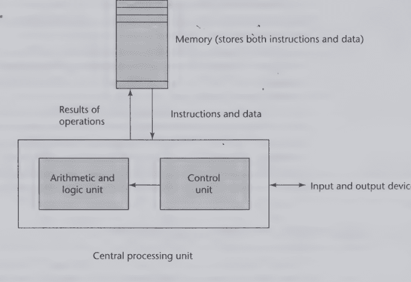

在冯·诺伊曼体系结构计算机上执行机器码程序的过程称为取指-执行周期。如前所述，程序驻留在内存中，但在 CPU 中执行。每条要执行的指令都必须从内存移动到处理器。下一条要执行指令的地址保存在一个称为程序计数器的寄存器中。取指-执行周期可以简单地描述为以下算法：

```
初始化程序计数器
无限循环
    取出程序计数器指向的指令
    程序计数器加一，指向下一条指令
    解码指令
    执行指令
结束循环
```

算法中的“解码指令”步骤是指检查指令以确定其指定的动作。程序执行在遇到停止指令时终止，尽管在实际计算机上很少执行停止指令。更常见的是，控制从操作系统转移到用户程序以执行，然后在用户程序执行完成时再转移回操作系统。在某个时刻内存中可能有多个用户程序的计算机系统中，这个过程要复杂得多。

如前所述，函数式（或应用式）语言是一种主要计算方式是将函数应用于给定参数的语言。可以在函数式语言中进行编程，而不需要命令式语言中使用的那种变量，不需要赋值语句，也不需要迭代。尽管许多计算机科学家已经阐述了函数式语言（如 Scheme）的诸多好处，但除非设计出能够高效执行函数式语言程序的非冯·诺伊曼计算机，否则它们不太可能取代命令式语言。在为此感到惋惜的人中，最雄辩的是 John Backus（1978），他是 Fortran 最初版本的主要设计者。

尽管命令式编程语言的结构是模仿机器体系结构而不是模仿编程语言用户的能力和倾向，但有些人认为使用命令式语言比使用函数式语言更自然。因此，这些人认为，即使函数式程序与命令式程序一样高效，命令式编程语言的使用仍将占主导地位。

#### 1.4.2 编程设计方法论

20 世纪 60 年代末和 70 年代初，由结构化编程运动在很大程度上发起，对软件开发过程和编程语言设计进行了深入分析。

这项研究的一个重要原因是计算的主要成本从硬件转向了软件，因为硬件成本下降而程序员成本上升。程序员生产力的提高相对较小。此外，计算机正在解决越来越大、越来越复杂的问题。程序不再像 20 世纪 60 年代初那样仅仅用于求解方程组以模拟卫星轨迹，而是用于大型复杂任务，例如控制大型炼油设施和提供全球航空订票系统。

20 世纪 70 年代研究产生的新软件开发方法论被称为自顶向下设计和逐步求精。发现的主要编程语言缺陷是类型检查的不完整和控制语句的不足（导致大量使用 goto）。

在 20 世纪 70 年代末，开始从面向过程转向面向数据的程序设计方法论。简单地说，面向数据的方法强调数据设计，侧重于使用抽象数据类型来解决问题。

为了在软件系统设计中有效使用数据抽象，必须得到用于实现的编程语言的支持。第一个提供哪怕有限数据抽象支持的语言是 SIMULA 67（Birtwistle 等，1973），尽管该语言肯定没有因此而被推向流行。数据抽象的好处直到 70 年代初才被广泛认识到。然而，自 70 年代末以来设计的大多数语言都支持数据抽象，这将在第 11 章详细讨论。


方法绑定。继承是一个强大的概念，极大地增强了现有软件复用的潜力，从而为提高软件开发生产率提供了可能性。这是面向对象语言日益流行的一个重要因素。动态（运行时）方法绑定允许更灵活地使用继承。

面向对象编程是与其概念支持语言 Smalltalk（Goldberg 和 Robson，1989）一起发展起来的。尽管 Smalltalk 从未像许多其他语言那样被广泛使用，但对面向对象编程的支持如今已成为大多数主流命令式语言的一部分，包括 Java、C++ 和 C#。面向对象概念也进入了 CLOS（Bobrow 等，1988）和 F#（Syme 等，2010）的函数式编程，以及 Prolog++（Moss，1994）的逻辑编程。第12章将详细讨论面向对象编程的语言支持。

从某种意义上说，面向过程编程是面向数据编程的对立面。尽管面向数据的方法如今主导着软件开发，但面向过程的方法并未被抛弃。相反，近年来在面向过程编程方面进行了大量研究，尤其是在并发领域。这些研究工作带来了对创建和控制并发程序单元的语言设施的需求。Java 和 C# 包含此类能力。第13章将详细讨论并发。

软件开发方法学中的所有这些演进步骤都催生了支持它们的新语言结构。

### 1.5 语言类别

编程语言通常被归为四类：命令式、函数式、逻辑式和面向对象。然而，我们不认为支持面向对象编程的语言构成了一个单独的语言类别。我们已经描述了支持面向对象编程的最流行语言是如何从命令式语言发展而来的。尽管面向对象的软件开发范式与通常用于命令式语言的面向过程范式有很大不同，但支持面向对象编程所需的命令式语言扩展并不复杂。例如，C 和 Java 的表达式、赋值语句和控制语句几乎相同。（另一方面，Java 的数组、子程序和语义与 C 的非常不同。）对于支持面向对象编程的函数式语言，也可以做出类似的表述。

有些作者将脚本语言称为编程语言的一个独立类别。然而，这一类语言更多地是由其实现方法（部分或完全解释）而非共同的语言设计而联系在一起的。通常被称为脚本语言的语言，包括 Perl、JavaScript（Flanagan，2011）和 Ruby，在各个方面都是命令式语言。

逻辑编程语言是基于规则的语言的一个例子。在命令式语言中，算法被非常详细地指定，并且必须包含指令或语句执行的具体顺序。然而，在基于规则的语言中，规则以不特定的顺序指定，语言实现系统必须选择使用规则以产生预期结果的顺序。这种软件开发方法与另外两类语言所使用的方法截然不同，显然需要一种完全不同的语言。Prolog 是最常用的逻辑编程语言，第16章将讨论 Prolog 和逻辑编程。

近年来，出现了一种新的语言类别：标记/编程混合语言。标记语言不是编程语言。例如，HTML 是使用最广泛的标记语言，用于指定 Web 文档中信息的布局。然而，一些编程能力已经渗透到 HTML 和 XML 的某些扩展中。其中包括 Java 服务器页面标准标签库（JSTL）和可扩展样式表语言转换（XSLT）。这两者都将在第2章简要介绍。这些语言无法与任何完整的编程语言相比，因此在第2章之后将不再讨论。

### 1.6 语言设计的权衡

第1.3节中描述的编程语言评价标准为语言设计提供了框架。不幸的是，该框架是自相矛盾的。Hoare（1973）在其关于语言设计的富有洞察力的论文中指出：“有如此多重要但又相互冲突的标准，以至于协调并满足它们是一项重大的工程任务。”

相互冲突的两个标准是可靠性和执行成本。例如，Java 语言定义要求检查所有对数组元素的引用，以确保索引在合法范围内。这一步骤大大增加了包含大量数组元素引用的 Java 程序的执行成本。C 不要求索引范围检查，因此 C 程序的执行速度比语义等价的 Java 程序更快，尽管 Java 程序更可靠。Java 的设计者用执行效率换取了可靠性。

作为直接导致设计权衡的冲突标准的另一个例子，考虑 APL 的情况。APL 包含一套强大的数组操作数运算符。由于运算符数量众多，APL 中不得不包含大量新符号来表示这些运算符。此外，许多 APL 运算符可以在单个长而复杂的表达式中使用。这种高度表达能力的一个结果是，对于涉及大量数组操作的应用程序，APL 非常易于编写。事实上，大量的计算可以在一个非常小的程序中指定。另一个结果是 APL 程序的可读性很差。紧凑简洁的表达式具有某种数学美感，但除了程序员之外的任何人都不容易理解。著名作家 Daniel McCracken（1970）曾指出，他花了四个小时来阅读并理解一个四行的 APL 程序。APL 的设计者用可读性换取了可写性。

可写性和可靠性之间的冲突在语言设计中很常见。C++ 的指针可以以多种方式操作，这支持高度灵活的数据寻址。由于指针存在潜在的可靠性问题，Java 中不包含指针。

语言设计（和评价）标准之间冲突的例子比比皆是；有些微妙，有些明显。因此很明显，在设计编程语言时选择结构和特性的任务需要许多妥协和权衡。

### 1.7 实现方法

如第1.4.1节所述，计算机的两个主要组成部分是内部存储器和处理器。内部存储器用于存储程序和数据。处理器是一组电路，提供一组基本操作（或机器指令）的实现，例如用于算术和逻辑操作的那些指令。在大多数计算机中，其中一些指令（有时称为宏指令）实际上是由一组称为微指令的指令实现的，微指令在更低的级别上定义。由于微指令永远不会被软件看到，因此这里不再进一步讨论。

计算机的机器语言就是它的指令集。在没有其他支持软件的情况下，大多数硬件计算机“理解”的唯一语言就是其自身的机器语言。理论上，可以设计并构建一台以某种特定高级语言作为其机器语言的计算机，但这将非常复杂且昂贵。此外，它将非常不灵活，因为将其与其他高级语言一起使用会很困难（但并非不可能）。更实用的机器设计选择是在硬件中实现一种非常低级的语言，它提供最常用的基本操作，并需要系统软件来创建与高级语言程序的接口。

语言实现系统不能是计算机上唯一的软件。还需要大量程序，称为操作系统，它提供比机器语言更高级的原语。这些原语提供系统资源管理、输入和输出操作、文件管理系统、文本和/或程序编辑器，以及各种其他常用的功能。由于语言实现系统需要操作系统的许多设施，因此它们与操作系统交互，而不是直接与处理器（以机器语言）交互。

操作系统和语言实现分层位于计算机的机器语言接口之上。这些层可以被认为是虚拟计算机，在更高层次上向用户提供接口。例如，


一个操作系统和一个 C 编译器提供了一个虚拟 C 计算机。使用其他编译器，机器可以变成其他种类的虚拟计算机。大多数计算机系统提供几种不同的虚拟计算机。用户程序构成了位于虚拟计算机层之上的另一层。计算机的分层视图如图 1.2 所示。

在 20 世纪 50 年代后期构建的第一个高级编程语言的实现系统，是当时最复杂的软件系统之一。在 20 世纪 60 年代，进行了大量的研究工作，以理解和形式化构建这些高级语言实现的过程。这些努力的最大成功是在语法分析领域，主要是因为实现过程中的这一部分是当时已得到很好理解的自动机理论和形式语言理论部分的<|message|>应用。

#### 1.7.1 编译

编程语言可以通过三种通用方法实现。在一端，程序可以被翻译成机器语言，可以直接在计算机上执行。这种方法称为编译器

#### Figure 1.2

Layered interface of virtual computers, provided by a typical computer system

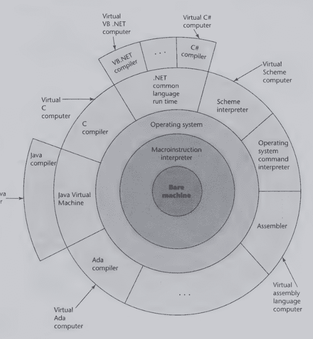

implementation and has the advantage of very fast program execution, once the translation process is complete. Most production implementations of languages, such as C, COBOL, and C++, are by compilers.

编译器所翻译的语言称为源语言。编译和程序执行过程分为几个阶段，其中最重要的阶段如图 1.3 所示。

词法分析器将源程序的字符收集成词法单元。程序的词法单元是标识符、特殊词、运算符、

#### Figure 1.3

The compilation process

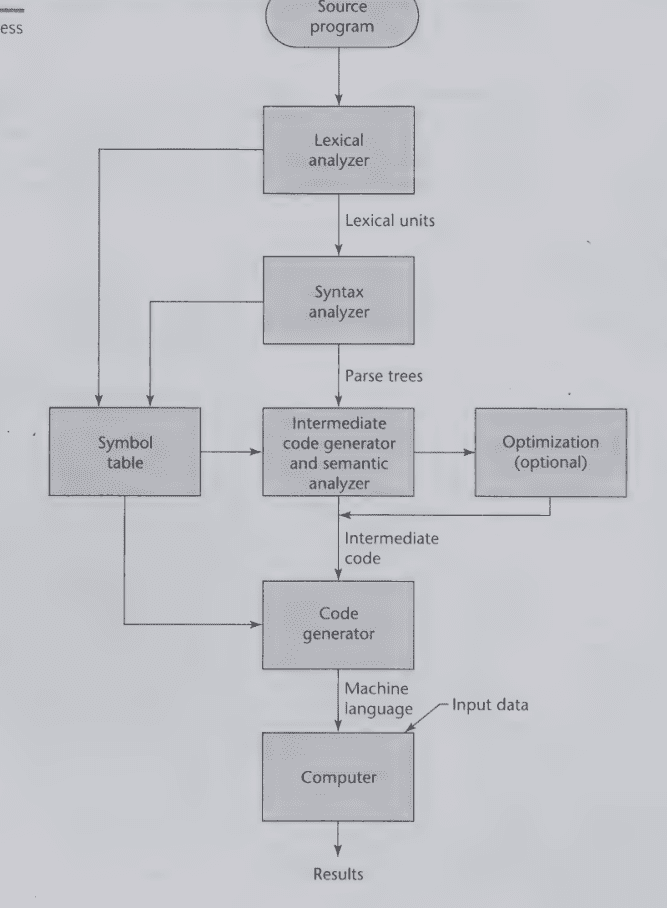

和标点符号。词法分析器会忽略源程序中的注释，因为编译器对它们没有用处。

语法分析器从词法分析器获取词法单元，并用它们构建称为解析树的层次结构。这些解析树表示程序的语法结构。在许多情况下，并没有实际构建解析树结构；而是生成构建树所需的信息并直接使用。词法单元和解析树将在第 3 章中进一步讨论。词法分析和语法分析，或解析，在第 4 章中讨论。

中间代码生成器生成一种不同语言的程序，该语言处于源程序和编译器的最终输出——机器语言程序之间的中间层级。⁴ 中间语言有时看起来非常像汇编语言，事实上，有时就是实际的汇编语言。在其他情况下，中间代码的层级略高于汇编语言。语义分析器是中间代码生成器的一个组成部分。语义分析器会检查错误，例如在语法分析期间难以甚至不可能检测到的类型错误。

优化通过使程序更小、更快或两者兼而改进程序（通常是其中间代码版本）。由于许多优化在机器语言上难以实现，因此大多数优化是在中间代码上完成的。

代码生成器将程序的优化中间代码版本翻译成等效的机器语言程序。

符号表充当编译过程的数据库。符号表的主要内容是程序中每个用户定义名称的类型和属性信息。此信息由词法和语法分析器放入符号表中，并由语义分析器和代码生成器使用。

如前所述，尽管编译器生成的机器语言可以直接在硬件上执行，但它几乎总是必须与某些其他代码一起运行。大多数用户程序还需要来自操作系统的程序。其中最常见的是输入和输出程序。编译器在用户程序需要时构建对所需系统程序的调用。在编译器生成的机器语言程序可以执行之前，必须找到来自操作系统的所需程序并将其链接到用户程序。链接操作通过将系统程序入口点的地址放在用户程序对它们的调用中，将用户程序连接到系统程序。用户代码和系统代码一起有时称为装载模块，或可执行映像。收集系统程序并将其链接到用户程序的过程称为链接和装载，有时也仅称为链接。它由一个名为链接器的系统程序完成。

除了系统程序外，用户程序通常还必须链接到驻留在库中的先前编译的用户程序。因此，链接器不仅将给定程序链接到系统程序，而且还可能将其链接到其他用户程序。

计算机内存与其处理器之间的连接速度通常决定了计算机的速度；因为指令通常可以比它们被移动到处理器执行的速度更快地执行。这种连接称为冯·诺依曼瓶颈；它是冯·诺依曼架构计算机速度的主要限制因素。冯·诺依曼瓶颈一直是并行计算机研究和开发的主要动机之一。

#### 1.7.2 纯解释

纯解释位于实现方法中与编译相反的一端。以这种方法，程序由另一个称为解释器的程序解释，而没有任何翻译。解释器程序充当软件模拟，其取指-执行周期处理高级语言程序语句而不是机器指令。这种软件模拟显然为该语言提供了一个虚拟机。

纯解释的优点是允许轻松实现许多源级调试操作，因为所有运行时错误消息都可以引用源级单元。例如，如果发现数组索引超出范围，错误消息可以轻松指示错误的源代码行和数组的名称。另一方面，这种方法有一个严重的缺点，即执行速度比编译系统慢 10 到 100 倍。这种缓慢的主要来源是对高级语言语句的解码，这些语句比机器语言指令复杂得多（尽管等效机器代码中的语句可能更少）。此外，无论语句执行多少次，每次都必须对其进行解码。因此，语句解码，而不是处理器与内存之间的连接，是纯解释器的瓶颈。

纯解释的另一个缺点是它通常需要更多的空间。除了源程序外，符号表必须在解释期间存在。此外，源程序可能以便于访问和修改的形式存储，而不是提供最小尺寸的形式。

尽管 20 世纪 60 年代的一些简单早期语言（APL、SNOBOL 和 Lisp）是纯解释的，但到 20 世纪 80 年代，这种方法在高级语言上很少使用。然而，近年来，随着 JavaScript 和 PHP 等一些 Web 脚本语言的广泛使用，纯解释已显著回归。纯解释的过程如图 1.4 所示。

#### Figure 1.4

Pure interpretation

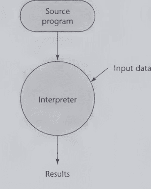

#### 1.7.3 混合实现系统

一些语言实现系统是编译器和纯解释器之间的折中；它们将高级语言程序翻译成一种便于解释的中间语言。这种方法比纯解释更快，因为源语言语句只需解码一次。此类实现称为混合实现系统。

混合实现系统使用的过程如图 1.5 所示。不是将中间语言代码翻译成机器代码，而是简单地解释中间代码。

Perl 是用混合系统实现的。Perl 程序被部分编译以在解释前检测错误并简化解释器。

Java 的初始实现都是混合的。其中间形式称为字节码，可移植到任何具有字节码解释器和相关运行时系统的机器。这些统称为 Java 虚拟机。现在有一些系统将 Java 字节码翻译成机器代码以加快执行速度。

即时编译（JIT）实现系统最初将程序翻译成中间语言。然后，在执行期间，它在被调用时将中间语言方法编译成机器代码。机器代码版本保留供后续调用。JIT 系统现在广泛用于 Java 程序。此外，.NET 语言都使用 JIT 系统实现。

有时实现者可能会为一种语言同时提供编译和解释实现。在这些情况下，解释器用于开发和调试程序。然后，在达到（相对）无 bug 的状态后，程序会被编译以提高其执行速度。


#### 图 1.5 混合实现系统

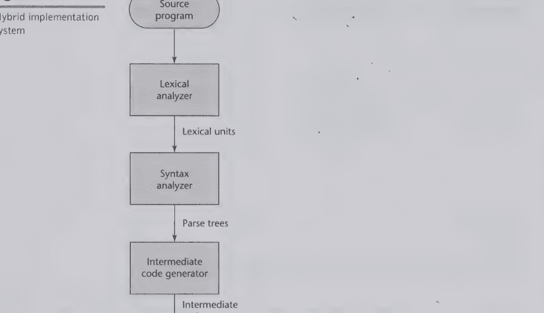

预处理器是在程序被编译之前处理程序的程序。预处理器指令嵌入在程序中。预处理器本质上是一个宏展开器。预处理器指令通常用于指定应包含另一文件中的代码。例如，C 预处理器指令

```
#include "myLib.h"
```

会导致预处理器将 myLib.h 的内容复制到程序中 #include 的位置。

其他预处理器指令用于定义符号以表示表达式。例如，可以使用

```
#define max(A, B) ((A) > (B) ? (A) : (B))
```

来确定两个给定表达式中的较大者。例如，表达式

```
x = max(2 * y, z / 1.73);
```

将被预处理器展开为

```
x = ((2 * y) > (z / 1.73) ? (2 * y) : (z / 1.73);
```

请注意，这就是表达式副作用可能导致问题的那些情况之一。例如，如果传递给 max 宏的两个表达式中的任一个具有副作用——例如 z++——它可能会导致问题。因为两个表达式参数之一被评估了两次，这可能导致由宏展开产生的代码使 z 被递增两次。

### 1.8 编程环境

编程环境是用于软件开发的工具集合。该集合可能仅由文件系统、文本编辑器、链接器和编译器组成。或者它可能包括通过统一用户界面访问的大量集成工具。在后一种情况下，软件的开发和维护得到极大增强。因此，编程语言的特性并不是衡量系统软件开发能力的唯一标准。我们现在简要描述几种编程环境。

UNIX 是一个较老的编程环境，最早于 1970 年代中期发布，围绕可移植的多任务操作系统构建。它为多种语言的软件生产和维护提供了广泛的强大支持工具。过去，UNIX 缺失的最重要特性是其工具之间的统一界面。这使得学习和使用变得更加困难。然而，UNIX 现在通常通过运行在 UNIX 之上的 GUI 来使用。UNIX GUI 的例子有 Solaris 通用桌面环境 CDE、GNOME 和 KDE。这些 GUI 使 UNIX 的界面看起来与 Windows 和 Macintosh 系统相似。

Borland JBuilder 是一个编程环境，为 Java 开发提供集成的编译器、编辑器、调试器和文件系统，其中全部四个都通过图形界面访问。JBuilder 是一个用于创建 Java 软件的复杂而强大的系统。

Microsoft Visual Studio .NET 是软件开发环境演进中的一个相对较新的步骤。它是一组庞大而复杂的软件开发工具，全部通过窗口界面使用。该系统可用于使用五种 .NET 语言中的任何一种开发软件：C#、Visual Basic.NET、JScript（微软的 JavaScript 版本）、F#（一种函数式语言）和 C++/CLI。

NetBeans 是一个主要用于 Java 应用程序开发的开发环境，但也支持 JavaScript、Ruby 和 PHP。Visual Studio 和 NetBeans 不仅是开发环境——它们也是框架，这意味着它们实际上提供了应用程序代码的通用部分。

## 摘要

研究编程语言对于一些重要原因是有价值的：它增加了我们在编写程序时使用不同构造的能力，使我们能够更明智地为项目选择语言，并使学习新语言变得更容易。

计算机被用于各种各样的解决问题领域。特定编程语言的设计和评估在很大程度上取决于其将被使用的领域。

评估语言最重要的标准之一是可读性、可写性、可靠性以及总体成本。这些将是我们审视和评判本书其余部分讨论的各种语言特性的基础。

对语言设计的主要影响是机器架构和软件设计方法。

设计编程语言主要是工程上的壮举，其中必须在特性、构造和能力之间做出长长的权衡。

实现编程语言的主要方法有编译、纯解释和混合实现。

编程环境已成为软件开发系统的重要组成部分，其中语言只是组件之一。

## 复习问题

- 1. 为什么程序员拥有学习新语言的能力是有用的，即使他或她可能已经精通多种编程语言？
- 2. 为什么为特定的软件解决方案选择合适的编程语言至关重要？
- 3. 哪个用于科学应用的编程语言是第一个被成功使用的？
- 4. 哪个是第一个成功的用于业务的高级编程语言？
- 5. 在 1990 年之前，大多数人工智能应用是在哪种编程语言中开发的？
- 6. 哪个是最流行的用于 Web 开发的标记语言？
- 7. 为什么用于软件开发的编程语言评估标准列表是有争议的？
- 8. 编程语言的整体简洁性如何影响其可读性？

## 问题集

- 9. 为什么 VAX 指令设计是正交的？
- 10. 为什么过多的正交性会导致问题？
- 11. 解释“可写性”是如何用作衡量语言创建程序的难易程度的指标。
- 12. 为什么过多的正交性对“可写性”是有害的？
- 13. 给出语言中表达性的一个例子。
- 14. 什么是类型检查？
- 15. 给出一个例子，说明在编译时或运行时未能进行类型检查如何导致无数程序错误。
- 16. 编程语言的总成本是如何计算的？
- 17. 语言的可移植性是什么？
- 18. 良好定义性标准的用途是什么？
- 19. 在冯·诺依曼架构计算机上，机器代码程序的执行是如何发生的？
- 20. 1970 年代软件开发研究的结果发现了哪两种编程语言缺陷？
- 21. 面向对象编程语言的三个基本特征是什么？
- 22. 哪个语言是第一个支持面向对象编程的三个基本特征的？
- 23. 什么是两个语言设计标准直接冲突的例子？
- 24. 实现编程语言的三种通用方法是什么？
- 25. 编译器还是纯解释器产生更快的程序执行？
- 26. 符号表在编译器中扮演什么角色？
- 27. 链接器做什么？
- 28. 为什么冯·诺依曼瓶颈很重要？
- 29. 用纯解释器实现语言有什么优势？

- 1. 你认为我们的抽象思维能力是否受到语言技能的影响？支持你的观点。
- 2. 你所知道的特定编程语言有哪些特性，其原理对你来说是个谜？
- 3. 你能为“所有编程领域使用单一语言”的想法提出什么论据？

- 4. 你能为反对“所有编程领域使用单一语言”的想法提出什么论据？
- 5. 命名并解释另一种可以用来评判语言的标准（除本章讨论的那些之外）。
- 6. 你认为哪种常见的编程语言语句对可读性最有害？
- 7. Java 使用右大括号来标记所有复合语句的结束。支持和反对这种设计的论据是什么？
- 8. 许多语言在用户定义名称中区分大小写字母。这种设计决策的利弊是什么？
- 9. 解释编程语言成本的不同方面。
- 10. 即使硬件相对便宜，为什么还要编写高效的程序的论据是什么？
- 11. 描述你在所知某种语言中效率与安全性之间的一些设计权衡。
- 12. 在你看来，完美的编程语言会包含哪些主要特性？
- 13. 你学习的第一个高级编程语言是用纯解释器、混合实现系统还是编译器实现的？（你可能需要研究这个问题。）
- 14. 描述你使用过的某个编程环境的优点和缺点。
- 15. 简单变量的类型声明语句如何影响语言的可读性，考虑到有些语言不需要它们？
- 16. 使用本章所述的标准，对你所知的某种编程语言进行评估。
- 17. 一些编程语言——例如 Pascal——使用分号来分隔语句，而 Java 使用它来终止语句。在你看来，哪一种更自然，不太可能导致语法错误？支持你的答案。
- 18. 许多当代语言允许两种注释：一种在两端使用定界符（多行注释），另一种仅在注释开头使用定界符（一行注释）。讨论这两种注释相对于我们的标准各自的优点和缺点。


本章描述一组编程语言的发展历程。我们将探讨每种语言设计时所处的环境，并着重关注这些语言的贡献及其开发动机。本章不包含对语言的总体描述，而是只讨论每种语言引入的一些新特性。尤其值得关注的是那些对后续语言或计算机科学领域产生重大影响的特性。

本章不会深入讨论任何语言特性或概念，这些内容留待后续章节。对于我们穿梭于这些语言发展历程的旅途而言，简要、非正式的解释已经足够。

本章讨论的语言和语言概念种类繁多，许多读者可能不太熟悉。这些主题只会在后续章节中详细讨论。如果这让您感到不安，不妨先读完本书其余部分，再回头阅读本章。

选择在此讨论哪些语言是主观的，有些读者可能会遗憾地发现没有看到自己喜爱的某一种或多种语言。然而，为了让这段历史概述保持合理篇幅，有必要舍弃一些备受推崇的语言。取舍的依据是我们对这些语言在语言发展及整个计算世界中的重要性的评估。此外，我们还简短讨论了一些后文会提到的其他语言。

本章的组织方式如下：各种语言的初始版本大体按时间顺序讨论。然而，后续版本与其初始版本一同出现，而不是放在后面的章节。例如，Fortran 2003 放在讨论 Fortran I（1956）的那一节。此外，在某些情况下，与某个拥有独立小节的语言相关的次要语言也会放在该小节中讨论。

本章包含 14 个完整示例程序的代码清单，每个程序使用一种不同的语言。本章不描述这些程序，它们旨在展示这些语言中程序的外观。熟悉任何一种常见命令式语言的读者，应该都能读懂并理解这些程序中的大部分代码，但 Lisp、COBOL 和 Smalltalk 程序除外（第 15 章将讨论一个与 Lisp 示例类似的 Scheme 函数）。Fortran、ALGOL 60、PL/I、Basic、Pascal、C、Perl、Ada、Java、JavaScript 和 C# 程序都对同一个问题进行了求解。请注意，此列表中的大多数当代语言都支持动态数组，但由于示例问题很简单，我们没有在示例程序中使用动态数组。另外，在 Fortran 95 程序中，我们避免使用那些本可以完全避免循环的特性，部分是为了保持程序简单易读，部分是为了展示该语言的基本循环结构。

图 2.1 是本章所讨论的高级语言的谱系图。

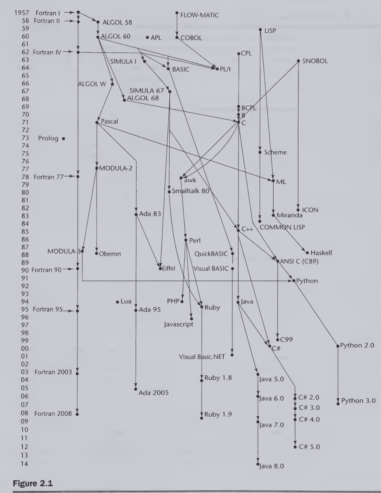

## 2.1 楚泽的 Plankalkül

本章讨论的第一种编程语言在几个方面都极不寻常。首先，它从未被实现。其次，尽管它于 1945 年开发完成，但其描述直到 1972 年才出版。由于熟悉这种语言的人寥寥无几，它的一些功能直到问世 15 年后才出现在其他语言中。

### 2.1.1 历史背景

1936 年至 1945 年间，德国科学家康拉德·楚泽（Konrad Zuse，发音为“Tsoo-zuh”）用机电继电器建造了一系列复杂精密的计算机。到 1945 年初，盟军的轰炸摧毁了他最新型号中的全部计算机，唯独 Z4 幸存。于是他搬到巴伐利亚一个偏远的村庄欣特施泰因（Hinterstein），他的研究小组成员也各奔东西。

楚泽独自一人开始努力开发一种用于在 Z4 上表达计算的语言；这个项目始于 1943 年，当时是他博士论文的提案。他将这种语言命名为 Plankalkül，意为“程序演算”。在一份标注日期为 1945 年但直到 1972 年才出版的长篇手稿（Zuse, 1972）中，楚泽定义了 Plankalkül，并用该语言编写算法来解决各种各样的问题。

### 2.1.2 语言概述

Plankalkül 非常完备，其最先进的特性中有一些集中在数据结构领域。Plankalkül 中最简单的数据类型是单个位。整数和浮点数值类型由位类型构建。浮点类型使用了二进制补码记法和“隐藏位”方案，后者目前用于避免存储浮点数值规格化小数部分的最高有效位。

除了常见的标量类型，Plankalkül 还包含数组和记录（在基于 C 的语言中称为结构体）。记录可以包含嵌套记录。

尽管这种语言没有显式的 goto，但它确实包含一个类似于 Ada 的 for 的迭代语句。它还有一个带有一个上标的 Fin 命令，该上标指定从给定层数的嵌套迭代循环中退出，或转到新迭代周期的开始。Plankalkül 包含一个选择语句，但不允许 else 子句。

楚泽的程序最有趣的特性之一，是包含了数学表达式，用以展示程序变量之间的当前关系。这些表达式说明了程序执行到代码中这些位置时，哪些条件会成立。它们与 Java 的断言以及第 3 章将要讨论的公理化语义中的断言非常相似。

楚泽的手稿中包含的程序远比 1945 年之前编写的任何程序都复杂。其中包括对数字数组排序的程序；测试给定图连通性的程序；执行整数和浮点运算（包括平方根）的程序；以及对具有括号和六种不同优先级运算符的逻辑公式进行语法分析的程序。也许最了不起的是他用 49 页篇幅编写的下棋算法，而他在国际象棋方面并非专家。

如果某位计算机科学家在 20 世纪 50 年代初发现了楚泽对 Plankalkül 的描述，那么按定义实现该语言时唯一会构成阻碍的方面就是它的记法。每条语句由两行或三行代码组成。第一行最像当今语言中的语句。第二行是可选的，包含第一行中数组引用的下标。查尔斯·巴贝奇（Charles Babbage）在 19 世纪中叶为其分析机编写的程序中也使用了同样的下标表示方法。Plankalkül 每条语句的最后一行包含第一行中提到的变量的类型名称。这种记法乍一看相当令人生畏。

下面的示例赋值语句将表达式 A[4] + 1 的值赋给 A[5]，说明了这种记法。标记为 V 的行表示下标，标记为 S 的行表示数据类型。在此示例中，1.n 表示一个 n 位的整数：

```
| A + 1 =>  A
V | 4        5
S | 1.n      1.n
```

我们只能猜测，如果楚泽的工作在 1945 年甚至 1950 年就广为人知，编程语言设计可能会走向何方。同样有趣的是，如果他在和平的环境中、身边有其他科学家，而不是 1945 年在德国几乎与世隔绝地做这项研究，他的工作又会有什么不同。

## 2.2 伪代码

首先请注意，此处“伪代码”一词的用法与其当代含义不同。我们将本节讨论的语言称为“伪代码”，是因为在它们被开发和使用的时候（20 世纪 40 年代末和 50 年代初），它们就被这样命名。然而，它们显然不是当代意义上的伪代码。

20 世纪 40 年代末和 50 年代初问世的计算机，其易用性远不及今天的计算机。除了速度慢、不可靠、价格昂贵、内存极小之外，当时的机器还由于缺乏配套软件而难以编程。


容易出错。其中一个问题是使用数字代码来指定指令。例如，ADD 指令可能由代码 14 指定，而不是有意义的文本名称，即使只有一个字母。这使得程序非常难以阅读。更严重的问题是绝对寻址，这使得程序修改既繁琐又容易出错。例如，假设我们有一个存储在内存中的机器语言程序。这样的程序中的许多指令都引用程序内的其他位置，通常是为了引用数据或指示分支指令的目标。在程序末尾之外的任何位置插入一条指令都会使所有引用插入点之后地址的指令的正确性失效，因为这些地址必须增加以腾出空间给新指令。为了正确地进行添加，必须找到并修改所有引用添加之后地址的指令。删除指令时也会出现类似的问题。在这种情况下，机器语言通常包含一条“无操作”指令，可以用来替换已删除的指令，从而避免该问题。

这些是所有机器语言的标准问题，也是发明汇编器和汇编语言的主要动机。此外，当时的大多数编程问题都是数值性的，需要浮点算术运算和某种形式的索引以便方便地使用数组。然而，这两种能力都没有包含在 1940 年代末和 1950 年代初的计算机架构中。这些缺陷自然导致了更高层次语言的发展。

## 2.2.1 短码

这些新语言中的第一种名为 Short Code，由 John Mauchly 于 1949 年为 BINAC 计算机开发，BINAC 是第一台成功的存储程序电子计算机之一。Short Code 后来被移植到 UNIVAC I 计算机（美国首台商业电子计算机），在几年里，它是编程这些机器的主要手段之一。虽然人们对原始的 Short Code 知之甚少，因为其完整描述从未发表，但 UNIVAC I 版本的编程手册却得以保存（Remington-Rand, 1952）。可以安全地假设这两个版本非常相似。

UNIVAC I 内存的字为 72 位，按 12 个六位字节分组。Short Code 由要求值的数学表达式的编码版本组成。代码是字节对值，多个方程可以编码在一个字中。包含以下操作码：

```
01 -      06 abs value      1n (n+2)nd power
02 )      07 +             2n (n+2)nd root
03 =      08 pause          4n if <= n
04 /      09 (              58 print and tab
```

变量以字节对代码命名，常数使用的位置也是如此。例如，X0 和 Y0 可以是变量。语句

```
X0 = SQRT (ABS (Y0) )
```

将被编码为一个字 00 X0 03 20 06 Y0。初始的 00 用于填充字。有趣的是，没有乘法代码；乘法是通过简单地将两个操作数彼此相邻放置来表示的，就像代数中一样。

Short Code 并未翻译成机器代码；相反，它是用纯解释器实现的。当时，这个过程被称为自动编程。它显然简化了编程过程，但以执行时间为代价。Short Code 的解释大约比机器代码慢 50 倍。

## 2.2.2 Speedcoding

在其他地方，正在开发解释性系统，将机器语言扩展以包含浮点运算。John Backus 为 IBM 701 开发的 Speedcoding 系统就是此类系统的例子（Backus, 1954）。Speedcoding 解释器有效地将 701 转换为虚拟的三地址浮点计算器。该系统包括对浮点数据的四种算术运算的伪指令，以及诸如平方根、正弦、反正切、指数和对数等运算。条件和无条件分支以及输入/输出转换也是虚拟架构的一部分。为了了解此类系统的局限性，请考虑加载解释器后剩余可用内存仅为 700 个字，且加法指令执行需要 4.2 毫秒。另一方面，Speedcoding 包含自动递增地址寄存器的新颖功能。这种功能直到 1962 年的 UNIVAC 1107 计算机才出现在硬件中。由于此类功能，矩阵乘法可以用 12 条 Speedcoding 指令完成。Backus 声称，用机器代码需要两周才能编程的问题，使用 Speedcoding 只需几个小时即可完成编程。

## 2.2.3 UNIVAC “编译”系统

在 1951 年至 1953 年间，由 Grace Hopper 领导的 UNIVAC 团队开发了一系列名为 A-0、A-1 和 A-2 的“编译”系统，它们以与宏在汇编语言中展开的方式相同的方式将伪代码扩展为机器代码子程序。这些“编译器”的伪代码源仍然相当原始，尽管即使是这样也比机器代码有了很大改进，因为它使源程序变得更短。Wilkes（1952）独立提出了类似的过程。

## 2.2.4 相关工作

在大约同一时间，正在开发其他简化编程任务的方法。在剑桥大学，David J. Wheeler（1950）开发了一种使用可重定位地址块的方法，部分解决了绝对寻址问题，之后，Maurice V. Wilkes（也在剑桥）扩展了这一想法，设计了一个汇编程序，可以组合选定的子程序并分配存储（Wilkes et al., 1951, 1957）。这确实是一个重要而基础性的进步。

我们还应提到，汇编语言与所讨论的伪代码截然不同，它们在 1950 年代初期发展起来。然而，它们对高级语言的设计影响不大。

## 2.3 IBM 704 和 Fortran

毫无疑问，计算领域最伟大的单一进步之一是 1954 年 IBM 704 的引入，很大程度上是因为其功能促使了 Fortran 的开发。可以说，如果不是 IBM 拥有 704 和 Fortran，很快就会有其他组织拥有类似的计算机和相关的高级语言。然而，IBM 是第一个既有远见又有资源来开展这些开发的公司。

## 2.3.1 历史背景

从 1940 年代末到 1950 年代中期，解释性系统的缓慢之所以被容忍，主要原因是当时可用的计算机缺乏浮点硬件。所有浮点运算都必须在软件中模拟，这是一个非常耗时的过程。由于大量处理器时间花费在软件浮点处理上，解释的开销和索引的模拟相对不重要。只要浮点必须由软件完成，解释就是可以接受的开销。然而，当时许多程序员从未使用过解释性系统，更喜欢手工编码的机器（或汇编）语言的效率。IBM 704 系统的发布，其中包含硬件中的索引和浮点指令，预示着解释时代的结束，至少对于科学计算而言。浮点硬件的加入去除了解释成本的藏身之处。

尽管 Fortran 通常被认为是第一种编译的高级语言，但谁应获得实现第一种此类语言的功劳的问题则有些开放。Knuth 和 Pardo（1977）将功劳归于 Alick E. Glennie，他为曼彻斯特 Mark I 计算机开发了 Autocode 编译器。Glennie 在英国皇家武器研究机构 Fort Halstead 开发了该编译器。编译器在 1952 年 9 月已投入运行。然而，根据 John Backus（Wexelblat, 1981, p. 26）的说法，


Glennie 的 Autocode 如此底层且面向机器，以至于不应被视为一种编译系统。Backus 将功劳归于麻省理工学院的 Laning 和 Zierler。

Laning 和 Zierler 系统（Laning and Zierler, 1954）是第一个被实现的代数翻译系统。所谓代数，是指它翻译算术表达式，使用单独编码的子程序来计算超越函数（例如正弦和对数），并包含数组。该系统于 1952 年夏季在 MIT Whirlwind 计算机上以实验原型形式实现，并在 1953 年 5 月前以更可用的形式实现。翻译器为程序中的每个公式或表达式生成一个子程序调用。源语言易于阅读，且唯一实际的机器指令仅用于分支。尽管这项工作早于 Fortran 的工作，但它从未走出 MIT。

尽管有这些早期工作，第一个被广泛接受的编译高级语言是 Fortran。以下小节记录了这一重要发展。

## 2.3.2 设计过程

在 704 系统于 1954 年 5 月宣布之前，Fortran 的计划就已开始。到 1954 年 11 月，IBM 的 John Backus 及其团队已制作了题为“IBM 数学公式翻译系统：FORTRAN”（IBM, 1954）的报告。该文件描述了 Fortran 的第一个版本，我们称之为 Fortran 0，在其实现之前。它还大胆地声明 Fortran 将提供手工编码程序的效率和解释性伪代码系统的编程简便性。在另一波乐观情绪中，该文件声明 Fortran 将消除编码错误和调试过程。基于这一前提，第一个 Fortran 编译器几乎不包含语法错误检查。

Fortran 开发的环境如下：（1）计算机内存小、速度慢且相对不可靠；（2）计算机的主要用途是科学计算；（3）当时没有现有的高效有效的编程计算机的方法；（4）由于计算机的高成本相对于程序员的成本，生成的目标代码的速度是第一个 Fortran 编译器的主要目标。早期版本的 Fortran 的特征直接源于这一环境。

## 2.3.3 Fortran I 概述

Fortran 0 在实现期间进行了修改，该实现始于 1955 年 1 月并持续到 1957 年 4 月编译器发布。实现的语言，我们称之为 Fortran I，描述于第一本 Fortran 程序员参考手册中，该手册于 1956 年 10 月出版（IBM, 1956）。Fortran I 包括输入/输出格式化、最多六个字符的变量名（在 Fortran 0 中仅为两个）、用户定义的子程序，尽管它们不能单独编译、If 选择语句和 Do 循环语句。

Fortran I 的所有控制语句都基于 704 指令。目前尚不清楚 704 设计者是否规定了 Fortran I 的控制语句设计，还是 Fortran I 的设计者向 704 设计者建议了这些指令。

Fortran I 语言中没有数据类型声明。以 I、J、K、L、M 和 N 开头的变量名隐式为整数类型，其余全部隐式为浮点型。选择这些字母用于该约定的依据是，当时科学家和工程师使用字母作为变量下标，通常为 i、j 和 k。出于慷慨的姿态，Fortran 的设计者额外加入了三个字母。

Fortran 开发小组在设计语言期间做出的最大胆的声明是，编译器产生的机器代码的效率大约是手工制作的一半。¹ 这比其他任何事情都更让潜在用户怀疑，并阻止了 Fortran 在实际发布前的大量兴趣。然而，令几乎所有人都惊讶的是，Fortran 开发小组几乎实现了其效率目标。用于构建第一个编译器的 18 个工作年中最大的一部分花费在优化上，结果非常有效。

Fortran 的早期成功体现在 1958 年 4 月进行的一项调查结果中。当时，大约有一半为 704 编写的代码是用 Fortran 编写的，尽管仅一年前编程界的大多数人持怀疑态度。

## 2.3.4 Fortran II

Fortran II 编译器于 1958 年春季发布。它修复了 Fortran I 编译系统中的许多错误，并为语言增加了一些重要特性，最重要的是子程序的独立编译。没有独立编译，程序中的任何更改都需要重新编译整个程序。Fortran I 缺乏独立编译功能，加上 704 的可靠性差，对程序长度造成了实际限制，大约为 300 到 400 行（Wexelblat, 1981, p. 68）。更长的程序在机器故障发生前完全编译的几率很小。包含预编译的机器语言子程序版本的能力大大缩短了编译过程，并使开发更大程序成为可能。

> 1. 事实上，Fortran 团队认为他们编译器生成的代码速度不会比手写机器代码慢一半，否则该语言将不会被用户采用。

## 2.3.5 Fortrans IV, 77, 90, 95, 2003, 和 2008

开发了 Fortran III，但从未广泛分发。Fortran IV 却成为当时最广泛使用的编程语言之一。它在 1960 年至 1962 年期间演变，并在 Fortran 66（ANSI, 1966）中标准化，尽管该名称很少使用。Fortran IV 在许多方面都是 Fortran II 的改进。其中最重要的新增功能是变量的显式类型声明、逻辑 If 构造，以及将子程序作为参数传递给其他子程序的能力。

Fortran IV 被 Fortran 77 取代，后者于 1978 年成为新标准（ANSI, 1978a）。Fortran 77 保留了 Fortran IV 的大部分特性，并增加了字符字符串处理、逻辑循环控制语句，以及带可选 Else 子句的 If。

Fortran 90（ANSI, 1992）与 Fortran 77 有显著不同。最重要的新增功能是动态数组、记录、指针、多重选择语句和模块。此外，Fortran 90 子程序可以递归调用。

Fortran 90 定义中包含的一个新概念是删除早期版本中的一些语言特性。虽然 Fortran 90 包含 Fortran 77 的所有特性，但语言定义中包含一份建议在语言的下一个版本中删除的构造列表。

Fortran 90 包含两个简单的语法更改，改变了程序和描述该语言的文献的外观。首先，代码所需的固定格式被取消，该格式要求特定语句的特定部分使用特定字符位置。例如，语句标签只能出现在前五个位置，语句不能在第七个位置之前开始。这种僵化的代码格式是围绕穿孔卡片的使用设计的。第二个更改是 FORTRAN 的官方拼写变为 Fortran。此更改伴随着 Fortran 程序中关键字和标识符使用全大写字母的约定变更。新约定是关键字和标识符中只有第一个字母为大写。

Fortran 95（INCITS/ISO/IEC, 1997）继续了语言的演变，但仅做了少量更改。其中之一是添加了新的迭代构造 Forall，以简化 Fortran 程序的并行化任务。

Fortran 2003（Metcalf et al., 2004）增加了对面向对象编程、参数化派生类型、过程指针以及与 C 编程语言互操作性的支持。

Fortran 的最新版本 Fortran 2008（ISO/IEC 1539-1, 2010）增加了对块以定义局部作用域的支持、提供并行执行模型的协同数组，以及 DO CONCURRENT 构造，用于指定无相互依赖的循环。

## 2.3.6 评价

最初的 Fortran 设计团队只将语言设计视为设计翻译器的关键任务的必要前奏。此外，他们从未想到 Fortran 会被用于非制造


```fortran
! Compute the average
    Average = Sum / List_Len
! Count the values that are greater than the average
    Do Counter = 1, List_Len
        If (Int_List(Counter) > Average) Then
            Result = Result + 1
        End If
    End Do
! Print the result
    Print *, 'Number of values > Average is:', Result
Else
    Print *, 'Error - list length value is not legal'
End If
End Program Example
```

## 2.4 函数式编程：Lisp

第一个函数式编程语言的发明是为了提供用于列表处理的语言特性，而这种需求源于人工智能领域最早的应用。

### 2.4.1 人工智能和列表处理的开端

对人工智能的兴趣在 20 世纪 50 年代中期在多个地方出现。其中一部分兴趣源于语言学，一些来自心理学，还有一些来自数学。语言学家关注自然语言处理。心理学家对人类信息存储和检索的建模以及大脑的其他基本过程感兴趣。数学家则对将某些智能过程机械化感兴趣，例如定理证明。所有这些研究都得出了相同的结论：必须开发某种方法来允许计算机以链接列表的形式处理符号数据。当时，大多数计算都是对数组中的数值数据进行的。

列表处理的概念由 RAND 公司的 Allen Newell、J. C. Shaw 和 Herbert Simon 提出。它首次发表在一篇经典论文中，该论文描述了第一个人工智能程序之一 Logic Theorist²，以及可以实现它的语言（Newell and Simon, 1956）。该语言名为 IPL-I（信息处理语言 I），从未被实现。下一个版本 IPL-II 在 RAND 的 JOHNNIAC 计算机上实现。IPL 的开发一直持续到 1960 年，IPL-V 的描述被发表（Newell and Tonge, 1960）。IPL 语言的低级特性阻止了它们被广泛使用。它们实际上是为一台假设的计算机编写的汇编语言，使用解释器实现，其中包含列表处理指令。另一个使 IPL 语言无法流行的因素是它们在鲜为人知的 JOHNNIAC 机器上的实现。

2. Logic Theorist 发现了命题演算中定理的证明。

IPL 语言的贡献在于它们的列表设计以及它们证明了列表处理是可行且有用的。

IBM 在 20 世纪 50 年代中期对人工智能产生了兴趣，并选择定理证明作为演示领域。当时，Fortran 项目仍在进行中。Fortran I 编译器的高成本使 IBM 相信其列表处理应附加到 Fortran，而不是以新语言的形式出现。因此，Fortran 列表处理语言（FLPL）被设计并作为 Fortran 的扩展实现。FLPL 用于构建平面几何的定理证明器，当时被认为是最容易进行机械定理证明的领域。

### 2.4.2 Lisp 设计过程

麻省理工学院的 John McCarthy 于 1958 年夏天在 IBM 信息研究部担任职位。他夏天的目标是研究符号计算并制定进行此类计算的要求。作为试点示例问题领域，他选择了代数表达式的微分。从这项研究中得出了语言要求清单。其中包括数学函数的控制流方法：递归和条件表达式。当时唯一可用的高级语言 Fortran I 都不具备这些特性。

从符号微分研究中产生的另一个要求是需要动态分配的链接列表以及某种被放弃列表的隐式释放。McCarthy 根本不允许他的优雅微分算法被显式的释放语句所污染。

由于 FLPL 不支持递归、条件表达式、动态存储分配或隐式释放，McCarthy 清楚地认识到需要一种新语言。

当 McCarthy 于 1958 年秋季返回麻省理工学院时，他与 Marvin Minsky 成立了麻省理工学院人工智能项目，由电子研究实验室提供资金。该项目的首要工作是生产一个用于列表处理的软件系统。它最初用于实现 McCarthy 提出的一个名为 Advice Taker³ 的程序。该应用成为开发列表处理语言 Lisp 的动力。Lisp 的第一个版本有时被称为“纯 Lisp”，因为它是一种纯函数式语言。在下一节中，我们将描述纯 Lisp 的发展。

3. Advice Taker 使用正式语言编写的句子表示信息，并使用逻辑推理过程来决定做什么。

### 2.4.3 语言概述

#### 2.4.3.1 数据结构

纯 Lisp 只有两种数据结构：原子和列表。原子要么是符号，具有标识符的形式，要么是数字字面量。将符号信息存储在链接列表中的概念是自然的，并且在 IPL-II 中使用过。这种结构允许在任何位置进行插入和删除，当时认为这是列表处理所必需的操作。然而后来确定，Lisp 程序很少需要这些操作。

列表通过用括号分隔其元素来指定。简单列表，其元素限制为原子，具有如下形式

```
(A B C D)
```

嵌套列表结构也由括号指定。例如，列表

```
(A (B C) D (E (F G)))
```

由四个元素组成。第一个是原子 A；第二个是子列表 (B C)；第三个是原子 D；第四个是子列表 (E (F G))，其第二个元素为子列表 (F G)。

在内部，列表存储为单链表结构，其中每个节点有两个指针并表示一个列表元素。包含原子的节点其第一个指针指向原子的某种表示，例如其符号或数值，或指向子列表的指针。子列表元素的节点其第一个指针指向子列表的第一个节点。在这两种情况下，节点的第二个指针指向列表的下一个元素。列表由指向其第一个元素的指针引用。

前面显示的两个列表的内部表示如图 2.2 所示。请注意，列表的元素水平显示。列表的最后一个元素没有后继者，因此其链接为 NIL，在图 2.2 中表示为元素中的一条对角线。子列表以相同的结构显示。

#### 2.4.3.2 函数式编程中的过程

Lisp 被设计为函数式编程语言。纯函数式程序中的所有计算都是通过将函数应用于参数来完成的。命令式语言程序中充斥的赋值语句和变量在函数式语言程序中是不必要的。此外，重复过程可以通过递归函数调用来指定，使迭代（循环）变得不必要。这些函数式编程的基本概念使其与命令式语言编程有显著不同。

图 2.2 两个 Lisp 列表的内部表示

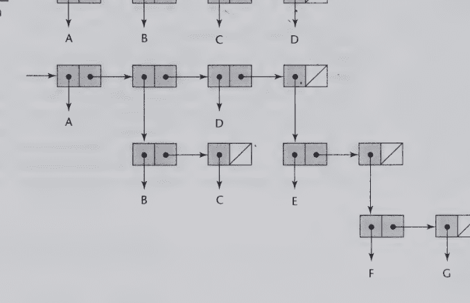

#### 2.4.3.3 Lisp 的语法

Lisp 与命令式语言非常不同，既因为它是函数式编程语言，也因为 Lisp 程序的外观与 Java 或 C++ 等语言中的程序如此不同。例如，Java 的语法是英语和代数的复杂混合，而 Lisp 的语法是简洁的典范。程序代码和数据具有完全相同的形式：带括号的列表。再次考虑列表

```
(A B C D)
```

当解释为数据时，它是一个包含四个元素的列表。当视为代码时，它是函数 A 对三个参数 B、C 和 D 的应用。

### 2.4.4 评价

Lisp 在人工智能应用中占据主导地位长达四分之一世纪。Lisp 声誉不佳、效率极低的许多原因已被消除。许多当代实现是编译的，所产生的代码比在解释器上运行源代码快得多。除了在人工智能方面的成功外，Lisp 还开创了函数式编程，这已证明是编程语言研究中一个充满活力的领域。如第一章所述，许多编程语言研究人员认为，与使用命令式语言的程序式编程相比，函数式编程是软件开发的更好方法。


以下是一个 Lisp 程序的示例：

```
; Lisp Example function
; The following code defines a Lisp predicate function
; that takes two lists as arguments and returns True
; if the two lists are equal, and NIL (false) otherwise
(DEFUN equal_lists (lis1 lis2)
  (COND
    ((ATOM lis1) (EQ lis1 lis2))
    ((ATOM lis2) NIL)
    ((equal_lists (CAR lis1) (CAR lis2))
        (equal_lists (CDR lis1) (CDR lis2)))
    (T NIL)
  )
)
```

## 2.4.5 Lisp 的两个后裔

目前广泛使用的两种 Lisp 方言是 Scheme 和 Common Lisp。以下小节将简要讨论它们。

### 2.4.5.1 Scheme

Scheme 语言于 1970 年代中期在麻省理工学院出现。其特点是规模小、 exclusively 使用静态作用域（第 5 章讨论），以及将函数视为一等实体。作为一等实体，Scheme 函数可以赋给变量、作为参数传递、以及作为函数应用的值返回。它们也可以是列表的元素。早期版本的 Lisp 并未提供所有这些功能，也未使用静态作用域。

作为一种语法和语义简单的小型语言，Scheme 非常适合教育应用，例如函数式编程课程和编程的一般介绍。Scheme 在第 15 章中有更详细的描述。

### 2.4.5.2 Common Lisp

在 1970 年代和 1980 年代初期，开发并使用了大量不同的 Lisp 方言。这导致了熟悉的程序在各种方言之间缺乏可移植性的问题。Common Lisp（Graham, 1996）是在努力纠正这一情况时创建的。Common Lisp 是通过将 1980 年代初期开发的几种 Lisp 方言的特性，包括 Scheme，合并成单一语言而设计的。由于是这种拼凑，Common Lisp 是一种相对较大且复杂的语言。然而，其基础是纯 Lisp，因此其语法、原始函数和基本性质都来自该语言。

认识到动态作用域提供的灵活性以及静态作用域的简单性，Common Lisp 允许两者共存。变量的默认作用域为静态，但通过将变量声明为 **special**，该变量变为动态作用域。

Common Lisp 具有大量数据类型和结构，包括记录、数组、复数和字符字符串。它还具有一种包形式，用于模块化函数和数据的集合并提供访问控制。

Common Lisp 在第 15 章中进一步描述。

## 2.4.6 相关语言

ML（MetaLanguage；Ullman, 1998）最初由罗宾·米尔纳于 1980 年代在爱丁堡大学设计，作为一种用于程序验证系统 Logic for Computable Functions（LCF；Milner et al., 1990）的元语言。ML 主要是一种函数式语言，但也支持命令式编程。与 Lisp 和 Scheme 不同，ML 中每个变量和表达式的类型都可以在编译时确定。类型与对象相关联而不是与名称相关联。名称和表达式的类型从其上下文中推断出来。

与 Lisp 和 Scheme 不同，ML 不使用源自 lambda 表达式的带括号的函数式语法。相反，ML 的语法类似于命令式语言，例如 Java 和 C++。

Miranda 由大卫·特纳（David Turner，1986）于 1980 年代初期在英格兰肯特郡坎特伯雷的肯特大学开发。Miranda 部分基于 ML、SASL 和 KRC 语言。Haskell（Hudak and Fasel, 1992）在很大程度上基于 Miranda。与 Miranda 一样，它是一种纯函数式语言，没有变量也没有赋值语句。Haskell 的另一个区别特征是其使用惰性求值。这意味着没有表达式会在其值被需要之前被求值。这导致了语言中一些令人惊讶的能力。

Caml（Cousineau et al., 1998）及其支持面向对象编程的方言 OCaml（Smith, 2006）源自 ML 和 Haskell。最后，F# 是一种相对较新的基于 OCaml 的类型化语言。F#（Syme et al., 2010）是一种 .NET 语言，可以直接访问整个 .NET 库。 作为 .NET 语言，它也可以与任何其他 .NET 语言顺畅互操作。F# 支持函数式编程和过程式编程。它还完全支持面向对象编程。

ML、Haskell 和 F# 在第 15 章中进一步讨论。

## 2.5 走向成熟的第一步：ALGOL 60

ALGOL 60 对后续编程语言产生了强烈影响，因此在任何语言的历史研究中都具有核心重要性。

### 2.5.1 历史背景

ALGOL 60 是设计通用科学应用编程语言努力的结果。到 1954 年底，Laning 和 Zierler 代数系统已运行一年多，第一份关于 Fortran 的报告已发表。Fortran 于 1957 年成为现实，并且正在开发几种其他高级语言。其中最著名的是由卡内基理工学院的 Alan Perlis 设计的 IT，以及为 UNIVAC 计算机设计的两种语言 MATH-MATIC 和 UNICODE。语言的 proliferate 使用户之间共享程序变得困难。此外，新的语言都围绕单一架构发展，有些用于 UNIVAC 计算机，有些用于 IBM 700 系列机器。作为对这种机器依赖语言的繁荣的回应，美国的几个主要计算机用户团体，包括 SHARE（IBM 科学用户团体）和 USE（UNIVAC 科学交流，大型 UNIVAC 科学用户团体），于 1957 年 5 月 10 日向美国计算机协会（ACM）提交请愿书，要求成立一个委员会来研究并建议采取行动创建一种机器无关的科学编程语言。虽然 Fortran 可能是一个候选者，但当时它完全由 IBM 所有，因此不可能成为通用语言。

此前，在 1955 年，GAMM（应用数学和力学学会的德语缩写）成立了一个委员会来设计一种通用、机器无关的算法语言。人们对这种新语言的需求部分源于欧洲人害怕被 IBM 主导。到 1957 年底，美国出现几种高级语言，促使 GAMM 小组委员会认识到其工作必须扩大以包括美国人，并向 ACM 发送了邀请函。1958 年 4 月，GAMM 的 Fritz Bauer 向 ACM 正式提出建议后，双方正式同意联合语言设计项目。

### 2.5.2 早期设计过程

GAMM 和 ACM 各派出四名成员参加第一次设计会议。会议于 1958 年 5 月 27 日至 6 月 1 日在苏黎世举行，开始时为新语言设定了以下目标：

- 语言的语法应尽可能接近标准数学符号，用其编写的程序应能以很少的解释即可读。
- 语言应可用于在印刷出版物中描述算法。
- 新语言中的程序必须能机械地翻译成机器语言。

第一个目标表明新语言用于科学编程，而当时这是计算机应用的主要领域。第二点是计算业务中全新的内容。最后一个目标是任何编程语言的明显必要条件。

苏黎世会议成功地设计出符合所述目标的语言，但设计过程需要无数的妥协，无论是在个人之间还是在大西洋两岸之间。在某些情况下，妥协并非关于重大问题，而是关于影响力范围。是否使用逗号（欧洲方法）或句点（美国方法）作为小数点就是一个例子。

### 2.5.3 ALGOL 58 概述

在苏黎世会议上设计的语言被命名为国际算法语言（IAL）。设计期间曾建议将语言命名为 ALGOL，代表 ALGO rithmic Language，但该名称被拒绝，因为它没有反映委员会的国际范围。然而，在随后的一年中，名称被改为 ALGOL，该语言随后被称为 ALGOL 58。

在许多方面，ALGOL 58 是 Fortran 的后裔，这很自然。它概括了 Fortran 的许多特性并添加了几个新的构造和概念。一些概括与使语言不绑定到任何特定机器的目标有关，其他则是为了使语言更灵活和强大。简单与优雅的罕见结合从努力中产生。

ALGOL 58 正式化了数据类型概念，尽管只有非浮点变量需要显式声明。它增加了复合语句的概念，后续大多数语言都采用了它。Fortran 的一些被概括的特性如下：标识符允许任意长度，而 Fortran I 限制为六个或更少字符；允许任意数量的数组维度，而 Fortran I 限制为不超过三个；数组的下界可由程序员指定，而在 Fortran 中隐式为 1；允许嵌套选择语句，而 Fortran I 中不允许。

ALGOL 58 以相当不寻常的方式获得了赋值运算符。Zuse 在 Plankalkül 中使用形式

```
expression => variable
```

作为赋值语句。虽然 Plankalkül 尚未发表，但 ALGOL 58 委员会的一些欧洲成员熟悉该语言。委员会尝试了 Plankalkül 赋值形式，但由于字符集限制的争论，大于符号被改为冒号。然后，在美国人的强烈坚持下，整个语句被倒转成 Fortran 形式

```
variable := expression
```

欧洲人更喜欢相反的形式，但那将是 Fortran 的反向。


## 2.5.4 ALGOL 58 报告的反响

1958年12月，ALGOL 58报告（Perlis和Samelson，1958）的发布受到了热烈欢迎。在美国，这种新语言更多地被视为编程语言设计思想的集合，而非通用标准语言。实际上，ALGOL 58报告并非成品，而是供国际讨论的初步文件。尽管如此，三项重大的设计和实现工作仍以该报告为基础。在密歇根大学，MAD语言诞生了（Arden等人，1961）。美国海军电子小组开发了NELIAC语言（Huskey等人，1963）。在系统开发公司，JOVIAL被设计和实现（Shaw，1963）。JOVIAL是“Jules’ Own Version of the International Algebraic Language”的首字母缩写，意即“Jules 自己版本的国际代数语言”，它是唯一基于ALGOL 58并得到广泛使用的语言（Jules 即 Jules I. Schwartz，是JOVIAL的设计者之一）。JOVIAL之所以被广泛使用，是因为它作为美国空军的官方科学语言长达四分之一世纪。

美国计算机界的其他部分对新语言并不那么友好。起初，IBM及其主要的科学用户组织SHARE似乎都接受了ALGOL 58。报告发布后不久，IBM就开始了实现工作，SHARE也成立了一个小组委员会SHARE IAL来研究该语言。该小组委员会随后建议ACM将ALGOL 58标准化，并建议IBM在所有700系列计算机上实现它。然而，这种热情是短暂的。到1959年春，IBM和SHARE都通过其Fortran经验，受够了启动一门新语言所带来的痛苦和花费，无论是开发和使用第一代编译器，还是培训用户使用新语言并说服他们使用它。到1959年年中，IBM和SHARE在Fortran上已形成了既得利益，以至于他们决定将Fortran保留为IBM 700系列机器的科学语言，从而放弃了ALGOL 58。

## 2.5.5 ALGOL 60 设计过程

1959年期间，ALGOL 58在欧洲和美国都引发了激烈的争论。大量建议的修改和增补发表在《欧洲ALGOL公报》和《ACM通讯》上。1959年最重要的事件之一是在国际信息处理会议上展示了苏黎世委员会的工作，因为Backus在会上介绍了他用于描述编程语言语法的新记号法，后来被称为BNF（巴科斯-瑙尔范式）。第3章将详细描述BNF。

1960年1月，召开了第二次ALGOL会议，这次会议在巴黎举行。会议的目的是讨论正式提交审议的80条建议。丹麦的Peter Naur深度参与了ALGOL的开发，尽管他不是苏黎世小组的成员。正是Naur创建并出版了《ALGOL公报》。他花了很多时间研究Backus介绍BNF的论文，并决定应该使用BNF来正式描述1960年会议的结果。在对BNF做了一些相对较小的修改后，他用BNF编写了新提议语言的描述，并在会议开始时将其分发给了1960年小组的成员。

## 2.5.6 ALGOL 60 概述

尽管1960年的会议只持续了六天，但对ALGOL 58所做的修改是巨大的。其中最重要的新进展如下：

- 引入了块结构的概念。这允许程序员通过引入新的数据环境（即作用域）来局部化程序中的各个部分。
- 允许两种不同的向子程序传递参数的方式：按值传递和按名传递。
- 允许过程递归。ALGOL 58的描述在这个问题上不明确。请注意，尽管递归对命令式语言来说是新的，但Lisp在1959年就已经提供了递归函数。
- 允许栈动态数组。栈动态数组是指其下标范围由一个或多个变量指定的数组，因此数组的大小在存储分配给数组时确定，而存储分配发生在执行过程中到达该声明时。第6章将详细描述栈动态数组。

有几个可能对语言成败产生重大影响的特性被提出后又被否决了。其中最重要的是带格式的输入输出语句，它们被省略了，因为人们认为它们依赖于机器。

ALGOL 60报告于1960年5月发表（Naur，1960）。语言描述中仍存在许多歧义，于是第三次会议定于1962年4月在罗马举行，以解决这些问题。在这次会议上，小组只处理问题；不允许对语言进行任何增补。这次会议的结果以“Revised Report on the Algorithmic Language ALGOL 60”（关于算法语言ALGOL 60的修订报告）为标题发表（Backus等人，1963）。

## 2.5.7 评价

在某些方面，ALGOL 60是巨大的成功；在其他方面，它则是惨重的失败。它几乎立刻成功地成为计算文献中交流算法的唯一可接受的正式手段，并且持续了20多年。自1960年以来设计的每一种命令式编程语言都受惠于ALGOL 60。事实上，大多数语言都是它的直接或间接后代；例如PL/I、SIMULA 67、ALGOL 68、C、Pascal、Ada、C++、Java和C#。

ALGOL 58/ALGOL 60的设计工作包含了一长串的“第一”。这是国际团体首次尝试设计一种编程语言。它是第一种被设计为与机器无关的语言。它也是第一种语法被正式描述的语言。BNF形式化方法的成功使用开创了计算机科学的几个重要领域：形式语言、解析理论和基于BNF的编译器设计。最后，ALGOL 60的结构影响了机器体系结构。最突出的例子是，该语言的一个扩展被用作一系列大型计算机——Burroughs B5000、B6000和B7000——的系统语言，这些机器设计有硬件栈，以高效实现该语言的块结构和递归子程序。

另一方面，ALGOL 60从未在美国得到广泛使用。即使在欧洲，尽管它比在美国更受欢迎，也从未成为主导语言。其未被接受的原因有很多。首先，ALGOL 60的某些特性过于灵活；它们使理解变得困难，使实现效率低下。最好的例子是向子程序传递参数时的按名传递方法，这将在第9章中解释。ALGOL 60实现的困难可由Rutishauser在1967年的陈述作为佐证：即使有实现包含完整的ALGOL 60语言，也寥寥无几（Rutishauser，1967，第8页）。

该语言缺少输入输出语句是其未被接受的另一个主要原因。依赖实现的输入输出使得程序难以移植到其他计算机上。

具有讽刺意味的是，与ALGOL 60相关的对计算机科学最重要的贡献之一——BNF——也是其未被接受的一个因素。尽管BNF现在被认为是语法描述的简洁而优雅的手段，但在1960年它看起来奇怪且复杂。

最后，尽管还有许多其他问题，但Fortran在用户中的根深蒂固和IBM缺乏支持可能是ALGOL 60未能得到广泛使用的最重要因素。

ALGOL 60的工作从未真正完成，因为歧义和晦涩始终是语言描述的一部分（Knuth，1967）。

下面是一个ALGOL 60程序示例：

```
```algol
comment ALGOL 60 Example Program
  Input: An integer, listen, where listen is less than
         100, followed by listen-integer values
  Output: The number of input values that are greater than
          the average of all the input values ;
begin
    integer array intlist [1:99];
    integer listen, counter, sum, average, result;
```
```


```
sum := 0;
result := 0;
readint (listlen);
if (listlen > 0) ^ (listlen < 100) then
begin
comment Read input into an array and compute the average;
for counter := 1 step 1 until listlen do
begin
readint (intlist[counter]);
sum := sum + intlist[counter]
end;
comment Compute the average;
average := sum / listlen;
comment Count the input values that are > average;
for counter := 1 step 1 until listlen do
if intlist[counter] > average
then result := result + 1;
comment Print result;
printstring("The number of values > average is:");
printint (result)
end
else
printstring("Error-input list length is not legal");
end
```

## 2.6 商业记录的计算机化：COBOL

从某种意义上说，COBOL 的故事与 ALGOL 60 正好相反。尽管 COBOL 已经使用了 65 年，但它对后续语言设计的影响却很小，除了 PL/I 之外。它可能仍然是最广泛使用的语言，5 尽管很难确切地判断。COBOL 影响甚微的最重要原因或许是，自它出现以来，很少有人尝试为商业应用设计新的语言。这在一定程度上是因为 COBOL 的能力很好地满足了其应用领域的需求。另一个原因是，过去 30 年商业计算领域的增长有很大一部分发生在小型企业中。在这些企业中，很少进行软件开发。相反，所使用的软件大多是购买现成的软件包，用于各种通用的商业应用。

5. 20世纪90年代末，在一项与Y2K问题相关的研究中，据估计，在曼哈顿22平方英里的范围内，大约有8亿行COBOL代码在使用中。

会议上的一个首要关注点是，必须迅速采取行动来创建这种通用语言，因为当时已经有很多工作在开展，以创建其他商业语言。除了现有语言之外，RCA 和 Sylvania 也在开发自己的商业应用语言。很明显，通用语言问世的时间越长，该语言就越难被广泛使用。基于此，会议决定对现有语言进行快速研究。为此，成立了短程委员会（Short Range Committee）。

早期就决定将语言的语句分为两类——数据描述和可执行操作——并让这两类语句位于程序的不同部分。短程委员会的争论之一是关于是否包含下标。许多委员会成员认为，对于数据处理人员来说，下标过于复杂，他们被认为不习惯数学符号。类似的争论还围绕着是否应包含算术表达式。短程委员会的最终报告于 1959 年 12 月完成，描述了后来被命名为 COBOL 60 的语言。

COBOL 60 的语言规范由美国政府印刷局于 1960 年 4 月出版（国防部，1960），被描述为“初始版”。修订版于 1961 年和 1962 年出版（国防部，1961，1962）。该语言于 1968 年由美国国家标准协会（ANSI）小组标准化。接下来的三个修订版分别于 1974 年、1985 年和 2002 年由 ANSI 标准化。该语言至今仍在不断发展。

### 2.6.4 评价

COBOL 语言开创了许多新颖的概念，其中一些最终出现在其他语言中。例如，COBOL 60 的 DEFINE 动词是第一个用于宏的高级语言结构。更重要的是，分层数据结构（记录）最早出现在 Plankalkül 中，但首次在 COBOL 中实现。此后设计的大多数命令式语言都包含了这一结构。COBOL 也是第一种允许名称真正具有内涵的语言，因为它既允许长名称（最多 30 个字符），也允许单词连接符（连字符）。

总体而言，数据部是 COBOL 设计的强项，而过程部则相对薄弱。每个变量都在数据部中详细定义，包括十进制数字的位数和隐含小数点的位置。文件记录也以这种详细程度进行描述，要输出到打印机的行也是如此，这使得 COBOL 非常适合打印会计报告。原始过程部最重要的弱点可能是缺乏函数。1974 年标准之前的 COBOL 版本也不允许带参数的子程序。

我们对 COBOL 的最后评论是：它是第一种由国防部（DoD）强制要求使用的编程语言。这一强制要求是在其最初开发之后才出现的，因为 COBOL 并非专门为国防部设计。尽管 COBOL 有其优点，但如果没有这一强制要求，它很可能无法生存。早期编译器性能不佳，使得使用该语言的成本过高。当然，最终编译器变得更加高效，计算机也变得更快、更便宜，内存更大。这些因素共同促使 COBOL 在国防部内外都取得了成功。它的出现导致了会计的电子机械化，无论从哪个角度看，这都是一个重要的发展。

下面是一个 COBOL 程序示例。该程序读取一个名为 BAL-FWD-File 的文件，其中包含某组物品的库存信息。除其他信息外，每条物品记录还包括当前库存数量（BAL-ON-HAND）和该物品的再订货点（BAL-REORDER-POINT）。再订货点是指当前库存数量达到必须再订购的阈值。该程序生成一个必须再订购的物品列表，作为名为 REORDER-LISTING 的文件输出。

```
IDENTIFICATION DIVISION.
PROGRAM-ID. PRODUCE-REORDER-LISTING.

ENVIRONMENT DIVISION.
CONFIGURATION SECTION.
SOURCE-COMPUTER. DEC-VAX.
OBJECT-COMPUTER. DEC-VAX.
INPUT-OUTPUT SECTION.
FILE-CONTROL.
    SELECT BAL-FWD-FILE ASSIGN TO READER.
    SELECT REORDER-LISTING ASSIGN TO LOCAL-PRINTER.

DATA DIVISION.
FILE SECTION.
FD  BAL-FWD-FILE
    LABEL RECORDS ARE STANDARD
    RECORD CONTAINS 80 CHARACTERS.

01  BAL-FWD-CARD.
    02 BAL-ITEM-NO          PICTURE IS 9(5).
    02 BAL-ITEM-DESC        PICTURE IS X(20).
    02 FILLER               PICTURE IS X(5).
    02 BAL-UNIT-PRICE       PICTURE IS 999V99.
    02 BAL-REORDER-POINT    PICTURE IS 9(5).
    02 BAL-ON-HAND          PICTURE IS 9(5).
    02 BAL-ON-ORDER         PICTURE IS 9(5).
    02 FILLER               PICTURE IS X(30).
FD  REORDER-LISTING
    LABEL RECORDS ARE STANDARD
    RECORD CONTAINS 132 CHARACTERS.

01  REORDER-LINE.
```

```
02 RL-ITEM-NO              PICTURE IS Z(5).
02 FILLER                  PICTURE IS X(5).
02 RL-ITEM-DESC            PICTURE IS X(20).
02 FILLER                  PICTURE IS X(5).
02 RL-UNIT-PRICE           PICTURE IS ZZZ.99.
02 FILLER                  PICTURE IS X(5).
02 RL-AVAILABLE-STOCK      PICTURE IS Z(5).
02 FILLER                  PICTURE IS X(5).
02 RL-REORDER-POINT        PICTURE IS Z(5).
02 FILLER                  PICTURE IS X(71).

WORKING-STORAGE SECTION.
01  SWITCHES.
    02 CARD-EOF-SWITCH      PICTURE IS X.
01  WORK-FIELDS.
    02 AVAILABLE-STOCK      PICTURE IS 9(5).

PROCEDURE DIVISION.
000-PRODUCE-REORDER-LISTING.
    OPEN INPUT BAL-FWD-FILE.
    OPEN OUTPUT REORDER-LISTING.
    MOVE "N" TO CARD-EOF-SWITCH.
    PERFORM 100-PRODUCE-REORDER-LINE
        UNTIL CARD-EOF-SWITCH IS EQUAL TO "Y".
    CLOSE BAL-FWD-FILE.
    CLOSE REORDER-LISTING.
    STOP RUN.

100-PRODUCE-REORDER-LINE.
    PERFORM 110-READ-INVENTORY-RECORD.
    IF CARD-EOF-SWITCH IS NOT EQUAL TO "Y"
        PERFORM 120-CALCULATE-AVAILABLE-STOCK
        IF AVAILABLE-STOCK IS LESS THAN BAL-REORDER-POINT
            PERFORM 130-PRINT-REORDER-LINE.

110-READ-INVENTORY-RECORD.
    READ BAL-FWD-FILE RECORD
        AT END
            MOVE "Y" TO CARD-EOF-SWITCH.

120-CALCULATE-AVAILABLE-STOCK.
    ADD BAL-ON-HAND BAL-ON-ORDER
        GIVING AVAILABLE-STOCK.

130-PRINT-REORDER-LINE.
    MOVE SPACE             TO REORDER-LINE.
    MOVE BAL-ITEM-NO        TO RL-ITEM-NO.
    MOVE BAL-ITEM-DESC      TO RL-ITEM-DESC.
    MOVE BAL-UNIT-PRICE     TO RL-UNIT-PRICE.
```


## 2.7 分时的开端：Basic

Basic（Mather 和 Waite，1971）是另一种被广泛使用但很少得到尊重的编程语言。和 COBOL 一样，它在很大程度上被计算机科学家忽视。同样与 COBOL 类似，它在最初版本中并不优雅，只包含很少的一组控制语句。

Basic 在 20 世纪 70 年代末和 80 年代初的微型计算机上非常流行。这直接源于早期版本 Basic 的两个主要特点：它对于初学者（尤其是那些非理科导向的人）来说容易学习，而且较小的方言可以在内存很小的计算机上实现。⁶ 随着微型计算机能力的增强和其他语言的实现，Basic 的使用逐渐减少。20 世纪 90 年代初，随着 Visual Basic（微软公司，1991）的出现，Basic 的使用开始强劲复苏。

### 2.7.1 设计过程

Basic（初学者通用符号指令代码）最初由两位数学家 John Kemeny 和 Thomas Kurtz 在新罕布什尔州的达特茅斯学院（现达特茅斯大学）设计。他们在 20 世纪 60 年代初为 Fortran 和 ALGOL 60 的各种方言开发了编译器。他们的理科学生在学习或使用这些语言时通常几乎没有困难。然而，达特茅斯主要是一所文理学院，理工科学生仅占学生总数的约 25%。1963 年春天，他们决定专门为文科学生设计一种新语言。这种新语言将使用终端作为计算机访问的方法。该系统的目标如下：

- 1. 必须让非理科学生易于学习和使用。
- 2. 必须“令人愉快且友好”。
- 3. 必须为作业提供快速周转。
- 4. 必须允许自由且私密的访问。
- 5. 必须认为用户时间比计算机时间更重要。

6. 一些早期微型计算机包含驻留在 4096 字节 ROM 中的 Basic 解释器。

最后一个目标确实是一个革命性的概念。它至少部分基于这样一种信念：随着时间的推移，计算机会变得明显更便宜，事实也确实如此。

第二个、第三个和第四个目标的结合促成了 Basic 的分时特性。在 20 世纪 60 年代初，只有通过终端为大量同时使用的用户提供单独访问，才能实现这些目标。

1963 年夏天，Kemeny 开始着手第一个 Basic 版本的编译器，通过远程访问 GE 225 计算机。Basic 操作系统的设计和编码始于 1963 年秋天。1964 年 5 月 1 日凌晨 4 点，第一个使用分时 Basic 的程序被输入并运行。到 6 月，系统上的终端数量增加到 11 个，到秋天已激增至 20 个。

### 2.7.2 语言概述

最初的 Basic 版本非常小，而且奇怪的是，它不是交互式的：执行中的程序无法从用户那里获取输入数据。程序以某种批处理方式输入、编译和运行。最初的 Basic 只有 14 种不同的语句类型和一种数据类型——浮点型。由于人们认为目标用户中很少会有人理解整数类型和浮点类型之间的区别，所以该类型被称为“数字”。总体而言，它是一种非常受限的语言，尽管相当容易学习。

### 2.7.3 评价

原始 Basic 最重要的方面在于，它是第一个通过连接远程计算机的终端来使用的广泛使用的语言。⁷ 终端在当时刚刚开始可用。在那之前，大多数程序是通过穿孔卡片或纸带输入计算机的。

Basic 的许多设计来自 Fortran，并受到 ALGOL 60 语法的一些次要影响。后来，它以多种方式发展，几乎没有对其标准化做出任何努力。美国国家标准协会（ANSI，1978b）发布了 Minimal Basic 标准（ANSI，1978b），但这只代表了语言特性的最低限度。事实上，最初的 Basic 与 Minimal Basic 非常相似。

尽管可能令人惊讶，但数字设备公司（DEC）在 20 世纪 70 年代使用了一个相当精致的 Basic 版本，名为 Basic-PLUS，来编写其为 PDP-11 小型计算机开发的最大的操作系统 RSTS 的重要部分。

> 7. Lisp 最初也通过终端使用，但在 20 世纪 60 年代初并未被广泛使用。

Basic 一直因其编写的程序结构不佳而受到批评，以及其他方面。根据第1章讨论的评价标准，特别是可读性和可靠性，该语言确实表现得很差。显然，该语言的早期版本并非旨在用于任何重要规模的严肃程序，也不应该被这样使用。后来的版本更适合这类任务。

20 世纪 90 年代 Basic 的复兴是由 Visual Basic（VB）的出现推动的。VB 被广泛使用，很大程度上是因为它提供了一种构建图形用户界面（GUI）的简单方法，因此得名 Visual Basic。当 .NET 出现时，一个新的 VB 版本也随之而来，即 VB.NET。虽然它与早期 VB 版本有显著不同，但它迅速取代了旧语言。也许 VB 与 .NET 版本之间最重要的区别在于，后者完全支持面向对象的编程。

下面是 Basic 程序示例：

```
REM  Basic Example Program
REM  Input:  An integer, listen, where listen is less
REM          than 100, followed by listen-integer values
REM  Output: The number of input values that are greater
REM          than the average of all input values

DIM intlist(99)
result = 0
sum = 0
INPUT listen
IF listen > 0 AND listen < 100 THEN
    REM Read input into an array and compute the sum
        FOR counter = 1 TO listen
            INPUT intlist(counter)
            sum = sum + intlist(counter)
        NEXT counter
    REM Compute the average
        average = sum / listen
    REM Count the number of input values that are > average
        FOR counter = 1 TO listen
            IF intlist(counter) > average
                THEN result = result + 1
        NEXT counter
    REM Print the result
        PRINT "The number of values that are > average is:";
              result
ELSE
    PRINT "Error-input list length is not legal"
END IF
END
```

## 第2章 主要编程语言的演变

## 用户设计与语言设计

畅销书 *《About Face：用户界面设计精髓》* 的作者艾伦·库珀，在可以被称得上是最关心用户界面设计的语言——Visual Basic 的设计中也发挥了重要作用。对他来说，这一切归结为一种使技术人性化的愿景。


## 关于 Basic 的一些信息

**你是怎么开始这一切的？** 我高中辍学，在加州的一所社区大学获得了编程专业的副学士学位。我的第一份工作是在旧金山的美洲总统轮船公司（美国历史最悠久的海运公司之一）担任程序员。除了零零散散的几个月外，我一直都是自雇人士。

**你目前的工作是什么？** Cooper 公司的创始人和董事长，这家公司致力于使技术人性化（www.cooper.com）。

**你最喜欢的工作是什么？** 交互设计顾问。

**你在语言设计和用户界面设计领域非常知名。对于设计语言与设计软件，或者设计其他任何东西，有什么想法吗？** 在软件领域几乎是一样的：了解你的用户。

## 关于早期的 Windows 版本

**在 20 世纪 80 年代，你开始使用 Windows，并谈到被它的优点所吸引：图形用户界面支持和动态链接库，后者让你能够创建自我配置的工具。你最终帮助塑造了 Windows 的哪些部分？** 微软在 Windows 中对实用多任务处理的支持给我留下了深刻印象。这包括动态重定位和进程间通信。

MSDOS.exe 是 Windows 最初几个版本的 shell 程序。它是一个很糟糕的程序，我相信它可以大幅改进，而我就是做这件事的人。在业余时间，我立刻开始编写一个比 Windows 自带 shell 更好的 shell 程序。我把它叫做 Tripod。微软最初的 shell MSDOS.exe 是 Windows 初期成功的主要绊脚石之一。Tripod 试图通过更易于使用和配置来解决这个问题。

**那个“啊哈！”时刻是什么时候？** 直到 1987 年底，当我在采访一位企业客户时，Tripod 的关键设计策略突然出现在我的脑海中。当这位 IS 经理向我解释他需要为不同的用户群创建和发布各种各样的 shell 解决方案时，我意识到一个难题：并不存在理想的 shell。每个用户都需要他们自己的个人 shell，根据他们自己的需求和技能水平进行配置。一瞬间，我找到了 shell 设计问题的解决方案：它将是一个 shell 构造套件；一种工具，每个用户都能精确地构建出适合自己独特应用和培训组合所需的 shell。

**个性化的 shell 这个想法有什么吸引人之处？** 不是我告诉用户理想的 shell 是什么，而是他们可以设计自己的、个性化的理想 shell。通过可定制的 shell，程序员可以创建一个功能强大且范围广泛但也有些危险的 shell；而 IT 经理可以创建一个可以交给前台文员的 shell，只暴露该文员使用的少数几个特定应用工具。


你是如何从一个外壳程序写到与微软合作的？Tripod 和 Ruby 是同一个东西。在我与比尔·盖茨签下协议后，我把原型的名字从 Tripod 改成了 Ruby。然后，我按照原型应有的用法使用了 Ruby 原型：作为构建发布级代码的一次性模型。我就是这么做的。微软拿走了 Ruby 的发布版本，并向其中加入了 QuickBasic，从而创造了 VB。所有这些最初的创新都来自 Tripod/Ruby。

> MSDOS.exe 是 Windows 最初几个版本的外壳程序。它是一个糟糕的程序，而我相信它可以被大幅改进，而且我就是那个能做到的人。在业余时间，我立刻开始编写一个比 Windows 自带的更好的外壳程序。

## Ruby：Visual Basic 的孵化器

让我们重新回顾你对早期 Windows 以及那个 DLL 特性的兴趣。DLL 不是一种实物，而是操作系统的一种机制。它允许程序员构建可在运行时链接的代码对象，而不仅仅是在编译时链接。正是这一点让我发明了 VB 中可动态扩展的部分，第三方供应商可以添加控件。

Ruby 产品体现了软件设计中的许多重大进步，但其中有两点尤为成功。如前所述，Windows 的动态链接能力一直让我着迷，但拥有工具和知道如何利用它们是两回事。凭借 Ruby，我最终找到了动态链接的两个实际用途，而最初的程序就包含了这两者。第一，这种语言既可安装，又可以被动态扩展。第二，控件面板可以被动态添加。

你的 Ruby 语言是第一个拥有动态链接库并链接到可视化前端的语言吗？据我所知，是的。

用一个简单的例子来说，这能让程序员对其程序做些什么？从第三方供应商那里购买一个控件，例如网格控件，将其安装到自己的电脑上，然后让这个网格控件作为语言的一个组成部分出现，包括在可视化编程前端中。

为什么人们称你为“Visual Basic 之父”？Ruby 自带一种小巧的语言，只适合执行外壳程序所需的十来个简单命令。然而，这种语言是以一系列 DLL 的形式实现的，任意数量的 DLL 都可以在运行时安装。内部解析器会识别一个动词，然后沿着 DLL 链传递它，直到其中一个 DLL 确认自己知道如何处理该动词。如果所有 DLL 都无法处理，就会产生语法错误。从我们最早的讨论开始，微软和我本人都考虑过扩展这种语言，甚至有可能完全用一门“真正的”语言来替换它。C 语言是最常被提及的候选者，但最终，微软利用这个动态接口拔掉了我们的小型外壳语言，并用 QuickBasic 完全替换了它。这种语言与可视化前端的新结合是静态且永久的，尽管最初的动态接口使这种耦合成为可能，但它在这个过程中丢失了。

## 对新想法的一些最终评论

在编程和编程工具（包括语言和环境）领域，哪些项目最让你感兴趣？我有兴趣创建旨在帮助用户而非程序员的编程工具。

最需要牢记的关键规则、名言或设计理念是什么？桥梁不是工程师建造的，而是铁工建造的。同样，软件程序不是工程师建造的，而是程序员建造的。

## 2.8 面向所有人的一切：PL/I

PL/I 代表了首次大规模尝试设计一种可用于广泛应用程序领域的语言。此前所有语言以及后来大多数语言都专注于某一特定应用领域，例如科学、人工智能或商业。

### 2.8.1 历史背景

与 Fortran 类似，PL/I 也是作为 IBM 的产品开发的。到 20 世纪 60 年代初，工业界计算机用户已分为两个截然不同的阵营：科学计算和商业应用。从 IBM 的角度来看，科学计算程序员可以使用大型 IBM 7090 或小型 IBM 1620 计算机。这一群体广泛使用浮点数据和数组。Fortran 是主要语言，但也使用了一些汇编语言。他们有自己的用户组 SHARE，并且与从事商业应用的人几乎没有接触。

对于商业应用，人们使用大型 IBM 7080 或小型 IBM 1401 计算机。他们需要十进制和字符串数据类型，以及精细且高效的输入输出设施。他们使用 COBOL，尽管在 1963 年初 PL/I 的故事开始时，从汇编语言到 COBOL 的转换还远未完成。这类用户也有自己的用户组 GUIDE，并且很少与科学计算用户接触。

1963 年初，IBM 的规划者们觉察到这种情况开始发生变化。这两个此前彼此疏远的计算机用户群体正朝着彼此靠拢，而这种方式被认为必然会产生问题。科学家们开始收集大量待处理的数据文件。这些数据需要更复杂、更高效的输入输出设施。商业应用人员开始使用回归分析来构建管理信息系统，这需要浮点数据和数组。局面开始变得明朗：计算设施很快将需要两台独立的计算机和两组技术人员，以支持两种截然不同的编程语言。

这些认识自然而然地引出了设计一种通用计算机的概念，它既能进行浮点运算，也能进行十进制运算，因此既能处理科学应用，也能处理商业应用。IBM System/360 计算机系列的概念由此诞生。随之而来的是这样一种想法：一种编程语言可以同时用于商业和科学应用。为了稳妥起见，还加入了支持系统编程和列表处理的功能。因此，这种新语言将取代 Fortran、COBOL、Lisp 以及汇编语言的系统应用。

### 2.8.2 设计过程

设计工作始于 1963 年 10 月，当时 IBM 和 SHARE 成立了 SHARE Fortran 项目的高级语言开发委员会。这个新委员会很快就召开了会议，并组建了一个名为 3 × 3 委员会的小组委员会，之所以这么命名，是因为它有三名来自 IBM 的成员和三名来自 SHARE 的成员。3 × 3 委员会每隔一周开会三四天来设计这种语言。

与 COBOL 的短期委员会一样，初始设计被安排在极短的时间内完成。显然，无论语言设计工作的范围如何，在 20 世纪 60 年代初，人们普遍认为可以在三个月内完成。PL/I 的第一个版本，当时名为 Fortran VI，原定于 12 月完成，而那时距委员会成立还不到三个月。委员会两次成功申请延期，将截止日期先后推迟到 1 月，然后是 1964 年 2 月下旬。

最初的设计理念是，这种新语言将成为 Fortran IV 的扩展，并保持兼容性，但这一目标连同 Fortran VI 的名字很快就被放弃了。直到 1965 年，这种语言一直被称为 NPL（新编程语言）。1964 年 3 月的 SHARE 会议上发布了第一份关于 NPL 的公开报告。4 月又发布了更完整的描述，而实际实现版本于 1964 年 12 月（IBM，1964 年）由位于英格兰的 IBM Hursley 实验室的编译器小组发布，该实验室被选中进行实现工作。1965 年，为了避免与英格兰国家物理实验室混淆，该语言更名为 PL/I。如果编译器是在英国以外开发的，那么它的名字可能仍然是 NPL。

### 2.8.3 语言概述

关于 PL/I，或许最好的一句话描述是：它包含了当时被认为是 ALGOL 60（递归和块结构）、Fortran IV（通过全局数据进行通信的独立编译）和 COBOL 60（数据结构、输入/输出和报表生成设施）中最优秀的部分，以及大量新构造，所有这些都被以某种方式拼凑在一起。由于 PL/I 已经不再是一种流行的语言，我们不会尝试（哪怕是简要地）讨论该语言的所有特性，甚至不会讨论它最具争议的构造。相反，我们将提及该语言对编程语言知识库的一些贡献。

PL/I 是第一种具备以下功能的编程语言：

- 程序可以创建并发执行的子程序。虽然这是一个好主意，但在 PL/I 中实现得很差。
- 可以检测和处理 23 种不同类型的异常或运行时错误。


- 允许子程序递归使用，但该功能可以被禁用，从而为非递归子程序提供更高效的链接。
- 指针作为一种数据类型被包含在内。
- 数组的切片可以被引用。例如，矩阵的第三行可以被引用，就像它是一个单维数组一样。

## 2.8.4 评价

对 PL/I 的任何评价都必须首先认识到设计工作的雄心壮志。回顾来看，认为如此多的构造能够成功结合在一起是天真的。然而，这一判断必须考虑到当时语言设计经验很少。总体而言，PL/I 的设计基于这样一个前提：任何有用且能够实现的构造都应被包含在内，而对其如何被程序员理解并有效使用如此多的构造和特性集合缺乏足够的关注。艾兹格·迪科斯彻在他的图灵奖演讲（Dijkstra, 1972）中对 PL/I 复杂性提出了最强烈的批评之一：“我完全无法想象，我们如何能将日益增长的程序牢牢地控制在我们的智力范围内，当编程语言——我们的基本工具，明白吗！——仅凭其繁琐的复杂性就已经逃脱了我们的智力控制。”

除了因规模庞大而导致的复杂性问题外，PL/I 还存在一些现在被认为设计不良的构造。其中包括指针、异常处理和并发，尽管我们必须指出，在所有情况下，这些构造在之前的任何语言中都未曾出现过。

就使用而言，PL/I 至少可以被认为是一个部分成功。在 1970 年代，它在商业和科学应用中都享有显著的使用。它在那个时期也被广泛用作大学中的教学工具，主要以几种子集形式，如 PL/C（Cornell, 1977）和 PL/CS（Conway and Constable, 1976）。

下面是一个 PL/I 程序的示例：

/* PL/I PROGRAM EXAMPLE
INPUT:    AN INTEGER, LISTLEN, WHERE LISTLEN IS LESS THAN
          100, FOLLOWED BY LISTLEN-INTEGER VALUES
OUTPUT:   THE NUMBER OF INPUT VALUES THAT ARE GREATER THAN
          THE AVERAGE OF ALL INPUT VALUES */
PLIEX: PROCEDURE OPTIONS (MAIN);
DECLARE INTLIST (1:99) FIXED.
DECLARE (LISTLEN, COUNTER, SUM, AVERAGE, RESULT) FIXED;
SUM = 0;
RESULT = 0;
GET LIST (LISTLEN);
IF (LISTLEN > 0) & (LISTLEN < 100) THEN

```
DO;
/* READ INPUT DATA INTO AN ARRAY AND COMPUTE THE SUM */
    DO COUNTER = 1 TO LISTLEN;
        GET LIST (INTLIST (COUNTER));
        SUM = SUM + INTLIST (COUNTER);
    END;
/* COMPUTE THE AVERAGE */
    AVERAGE = SUM / LISTLEN;
/* COUNT THE NUMBER OF VALUES THAT ARE > AVERAGE */
    DO COUNTER = 1 TO LISTLEN;
        IF INTLIST (COUNTER) > AVERAGE THEN
            RESULT = RESULT + 1;
    END;
/* PRINT RESULT */
    PUT SKIP LIST ('THE NUMBER OF VALUES > AVERAGE IS:');
    PUT LIST (RESULT);
END;
ELSE
    PUT SKIP LIST ('ERROR-INPUT LIST LENGTH IS ILLEGAL');
END PLIEX;
```

## 2.9 两种早期动态语言：APL 和 SNOBOL

本节的结构与其他章节不同，因为这里讨论的语言非常不同。APL 和 SNOBOL 对后来的主流语言都没有多大影响。⁹ APL 的一些有趣特性将在本书后面讨论。

在外观和目的上，APL 和 SNOBOL 截然不同。然而，它们有两个共同的基本特征：动态类型和动态存储分配。两种语言中的变量本质上都是无类型的。变量在被赋值为时获得类型，此时它采用所赋值的类型。变量的存储空间仅在被赋值为时才分配，因为在此之前无法知道需要多少存储空间。

## 2.9.1 APL 的起源和特性

APL（Brown et al., 1988）由 Kenneth E. Iverson 于 1960 年左右在 IBM 设计。它最初并非设计为一种实现的编程语言，而是旨在作为描述计算机体系结构的一种工具。

> 9. 然而，它们对一些非主流语言产生了一些影响（J 基于 APL，ICON 基于 SNOBOL，AWK 部分基于 SNOBOL）。

APL 最早在它得名于的书籍中被描述，*A Programming Language*（Iverson, 1962）。在 1960 年代中期，APL 的第一个实现在 IBM 开发完成。

APL 拥有大量强大的运算符，这些运算符由大量符号指定，这给实现者带来了问题。最初，APL 是通过 IBM 打印机终端使用的。这些终端具有特殊的可选打印球，提供语言所需的奇特字符集。APL 拥有如此多运算符的一个原因是它提供了对数组的大量单元操作。例如，任何矩阵的转置都可以用单个运算符完成。大量运算符提供了非常高的表达能力，但也使 APL 程序难以阅读。因此，人们认为 APL 最适合“一次性”编程。虽然程序可以快速编写，但使用后应丢弃，因为它们难以维护。

APL 已存在 50 年，今天仍在使用，尽管并不广泛。此外，它在其生命周期中变化不大。

## 2.9.2 SNOBOL 的起源和特性

SNOBOL（读作“snowball”；Griswold et al., 1971）由三位贝尔实验室的人士于 1960 年代初设计：D. J. Farber、R. E. Griswold 和 I. P. Polonsky（Farber et al., 1964）。它专门为文本处理而设计。SNOBOL 的核心是一组用于字符串模式匹配的强大操作。SNOBOL 的早期应用之一是编写文本编辑器。由于 SNOBOL 的动态特性使其比替代语言慢，因此它不再用于此类程序。然而，SNOBOL 仍然是一种活跃且受支持的语言，用于多个不同应用领域中的各种文本处理任务。

## 2.10 数据抽象的开端：SIMULA 67

尽管 SIMULA 67 从未实现广泛使用，对其时代的程序员和计算影响也很小，但它引入的一些构造使其在历史上具有重要意义。

## 2.10.1 设计过程

两位挪威人 Kristen Nygaard 和 Ole-Johan Dahl 在 1962 年至 1964 年间于奥斯陆挪威计算中心（NCC）开发了语言 SIMULA I。他们主要对使用计算机进行仿真感兴趣，同时也在从事运筹学研究。SIMULA I 专为系统仿真而设计，并于 1964 年底在 UNIVAC 1107 计算机上首次实现。

SIMULA I 实现完成后，Nygaard 和 Dahl 立即着手扩展该语言，通过添加新特性和修改一些现有构造，使其适用于通用应用。这项工作的结果是 SIMULA 67，其设计于 1967 年 3 月首次公开提出（Dahl and Nygaard, 1967）。我们只讨论 SIMULA 67，尽管 SIMULA 67 中一些有趣的特性也在 SIMULA I 中存在。

## 2.10.2 语言概述

SIMULA 67 是 ALGOL 60 的扩展，从该语言中采用了块结构和控制语句。ALGOL 60（以及当时其他语言）对仿真应用的主要缺陷是其子程序的设计。仿真需要能够从上次停止的位置重新启动的子程序。具有这种控制的子程序被称为协程，因为调用者和被调用子程序之间具有某种平等的相互关系，而不是大多数命令式语言中严格的主从关系。

为了在 SIMULA 67 中提供对协程的支持，类构造被开发出来。这是一个重要的发展，因为数据抽象的概念始于此，而数据抽象为面向对象编程提供了基础。

值得注意的是，数据抽象这一重要概念直到 1972 年 Hoare（1972）认识到与类构造的联系时才被开发并归因于类构造。

## 2.11 正交设计：ALGOL 68

ALGOL 68 是语言设计中几个新思想的来源，其中一些后来被其他语言采用。我们在此包含它，正是因为这个原因，尽管它在欧洲或美国都从未实现广泛使用。

## 2.11.1 设计过程

ALGOL 家族的发展并未在 1962 年 ALGOL 60 修订报告发布时结束，尽管下一次设计迭代的发布间隔了六年。 resulting 语言 ALGOL 68（van Wijngaarden et al., 1969）与前身截然不同。

ALGOL 68 最有趣的创新之一是其主要设计标准之一：正交性。回顾我们在第 1 章中对正交性的讨论。正交性的使用导致了 ALGOL 68 的几个创新特性，其中之一在下一节中描述。


## 2.11.2 语言概述

ALGOL 68 中正交性的一个重要成果是包含了用户自定义数据类型。早期语言，如 Fortran，只包含少数几种基本数据结构。PL/I 包含了更多的数据结构，这使得它更难学习和实现，但仍不能为每种需求提供合适的数据结构。

ALGOL 68 处理数据结构的方法是提供一些原始类型和结构，并允许用户组合这些原始类型来定义大量不同的结构。这种用户自定义数据类型的特性在一定程度上被此后设计的所有主要命令式语言所继承。用户自定义数据类型很有价值，因为它们允许用户设计非常贴合特定问题的数据抽象。数据类型的各个方面将在第 6 章讨论。

作为数据类型领域的又一个首创，ALGOL 68 引入了动态数组，这种数组将在第 5 章中称为隐式堆动态数组。动态数组是指声明中不指定下标边界的数组。对动态数组的赋值会导致所需存储空间的分配。在 ALGOL 68 中，动态数组称为 flex 数组。

### 2.11.3 评价

ALGOL 68 包含了大量以前从未使用过的特性。它对正交性的使用，虽然有些人可能会说过度了，但仍然是革命性的。

然而，ALGOL 68 重复了 ALGOL 60 的罪过之一，这也是其受欢迎程度有限的一个重要因素。该语言使用一种优雅简洁但鲜为人知的元语言来描述。在阅读描述该语言的文件（van Wijngaarden et al., 1969）之前，读者必须学习一种称为 van Wijngaarden 文法的新元语言，它远比 BNF 复杂。更糟糕的是，设计者发明了一套词汇来解释文法和语言。例如，关键字被称为 indicants，子串提取被称为 trimming，子程序执行的过程被称为去过程化的强制转换（coercion of deproceduring），这种强制转换可能是温和的、坚定的，或其他类型。

将 PL/I 的设计与 ALGOL 68 的设计进行对比是很自然的，因为它们出现的时间仅相隔几年。ALGOL 68 通过正交性原则实现了可写性：少数几个原始概念以及对少数组合机制的不受限制的使用。PL/I 通过包含大量固定构造实现了可写性。ALGOL 68 延续了 ALGOL 60 优雅简洁的风格，而 PL/I 则只是将几种语言的特征拼凑在一起以达到其目标。当然，必须记住，PL/I 的目标是为广泛类型的问题提供一个统一的工具，而 ALGOL 68 则针对单一类型：科学应用。

PL/I 获得了比 ALGOL 68 大得多的接受度，这主要归功于 IBM 的推广努力以及 ALGOL 68 在理解和实现上的困难。

## 2.12 ALGOL 家族的早期后裔

所有命令式语言的设计都或多或少归功于 ALGOL 60 和/或 ALGOL 68。本节讨论这些语言的一些早期后裔。

### 2.12.1 简约设计：Pascal

#### 2.12.1.1 历史背景

Niklaus Wirth（Wirth 发音为“Virt”）是国际信息处理联合会（IFIP）第 2.1 工作组的成员，该工作组成立于 20 世纪 60 年代中期，旨在继续开发 ALGOL。1965 年 8 月，Wirth 和 C. A. R.（“Tony”）Hoare 向工作组提交了一份关于 ALGOL 60 增补和修改的适度建议（Wirth and Hoare, 1966），为该工作做出了贡献。工作组大多数人认为该建议对 ALGOL 60 的改进太小而予以否决。相反，他们开发了一个更为复杂的修订版，最终成为 ALGOL 68。Wirth 和其他几位成员认为，考虑到 ALGOL 68 语言及其描述所用元语言的复杂性，ALGOL 68 报告本不应发布。这一立场后来被证明有一定道理，因为计算社区确实发现 ALGOL 68 文档及其语言本身具有挑战性。

Wirth 和 Hoare 的 ALGOL 60 版本被命名为 ALGOL-W。它在斯坦福大学实现，主要用作教学工具，但只在少数大学使用。ALGOL-W 的主要贡献是传值-结果参数传递方法和用于多分支选择的 case 语句。传值-结果方法是 ALGOL 60 传名方法的替代方案。两者都在第 9 章讨论。case 语句在第 8 章讨论。

Wirth 的下一个主要设计工作同样基于 ALGOL 60，也是他最成功的：Pascal。¹⁰ Pascal 最初发布的定义出现在 1971 年（Wirth, 1971）。该版本在实现过程中有所修改，并在 Wirth（1973）中进行了描述。通常归功于 Pascal 的特性实际上来自更早的语言。例如，用户自定义数据类型在 ALGOL 68 中引入，case 语句在 ALGOL-W 中引入，而 Pascal 的记录与 COBOL 和 PL/I 的记录类似。

10. Pascal 以布莱士·帕斯卡的名字命名，他是十七世纪法国哲学家和数学家，于 1642 年发明了第一台机械加法机（还有其他成就）。

#### 2.12.1.2 评价

Pascal 最大的影响是在编程教学方面。1970 年，大多数计算机科学、工程和科学专业的学生通过 Fortran 学习编程，尽管一些大学使用 PL/I、基于 PL/I 的语言和 ALGOL-W。到 20 世纪 70 年代中期，Pascal 已成为最广泛使用的教学语言。这很自然，因为 Pascal 是专门为编程教学而设计的。直到 20 世纪 90 年代末，Pascal 才不再是高校编程教学中最常用的语言。

由于 Pascal 是作为教学语言设计的，它缺少许多对多种应用至关重要的特性。最好的例子是不可能编写一个以可变长度数组为参数的子程序。另一个例子是缺乏任何单独编译的能力。这些缺陷自然导致了许多非标准方言，如 Turbo Pascal。

Pascal 在编程教学和其他应用中的流行，主要基于其简洁性和表达力的非凡结合。尽管 Pascal 存在一些不安全性，但它仍然是一种相对安全的语言，尤其是与 Fortran 或 C 相比时。到 20 世纪 90 年代中期，Pascal 在工业界和大学的受欢迎程度都在下降，这主要是因为 Modula-2、Ada 和 C++ 的兴起，这些语言都包含了 Pascal 所不具备的特性。

下面是一个 Pascal 程序示例：

```
{Pascal Example Program
Input:  An integer, listlen, where listlen is less than
        100, followed by listlen-integer values
Output: The number of input values that are greater than
        the average of all input values }
program pasex (input, output);
type intlisttype = array [1..99] of integer;
var
    intlist : intlisttype;
    listlen, counter, sum, average, result : integer;
begin
result := 0;
sum := 0;
readln (listlen);
if ((listlen > 0) and (listlen < 100)) then
begin
{ Read input into an array and compute the sum }
for counter := 1 to listlen do
begin
readln (intlist[counter]);
sum := sum + intlist[counter]
end;
{ Compute the average }
average := sum / listlen;
{ Count the number of input values that are > average }
for counter := 1 to listlen do
    if (intlist[counter] > average) then
        result := result + 1;
{ Print the result }
    writeln ('The number of values > average is:',
             result)
    end { of the then clause of if ((listlen > 0 ... }
else
    writeln ('Error-input list length is not legal')
end.
```

### 2.12.2 一种可移植的系统语言：C

与 Pascal 一样，C 对先前已知的语言特性集合贡献甚少，但它在很长一段时间内被广泛使用。尽管最初是为系统编程设计的，但 C 非常适合各种应用。

#### 2.12.2.1 历史背景

C 的祖先包括 CPL、BCPL、B 和 ALGOL 68。CPL 于 20 世纪 60 年代初在剑桥大学开发。BCPL 是一种简单的系统语言，同样在剑桥开发，这次是由 Martin Richards 在 1967 年完成（Richards, 1969）。

UNIX 操作系统的第一个工作是在 20 世纪 60 年代末由贝尔实验室的 Ken Thompson 完成的。第一个版本是用汇编语言编写的。UNIX 下实现的第一个高级语言是 B，它基于 BCPL。B 由 Thompson 于 1970 年设计和实现。

BCPL 和 B 都不是类型化语言，这在高级语言中是个异类，尽管它们都比 Java 这类语言低级得多。非类型化意味着所有数据都被视为机器字，这虽然简单，但导致许多复杂性和不安全性。例如，在表达式中指定浮点运算而不是整数运算就是一个问题。在 BCPL 的一个实现中，浮点运算的变量操作数前面加句点。没有句点前缀的变量操作数被视为整数。另一种替代方案是为浮点运算符使用不同的符号。

这个问题以及其他几个问题，促使了基于 B 的新类型化语言的开发。它最初称为 NB，后来命名为 C，由 Dennis Ritchie 于 1972 年在贝尔实验室设计和实现（Kernighan and Ritchie, 1978）。C 在某些情况下通过 BCPL，在其他情况下直接受到 ALGOL 68 的影响。这可以从它的 for 和 switch 语句、赋值运算符以及对指针的处理中看出。


## 第2章 主流编程语言的演变

C 语言在其最初十五年里的唯一“标准”是克尼汉和里奇合著的那本书（1978）。在这段时间里，语言缓慢演进，不同的实现者加入了不同的特性。1989 年，ANSI 发布了 C 语言的正式描述（ANSI, 1989），其中包含了许多实现者已经加入语言中的特性。该标准于 1999 年更新（ISO, 1999）。后一个版本包含复数数据类型、布尔数据类型以及 C++ 风格的注释（//）。我们将长期被称为 ANSI C 的 1989 版本称为 C89；将 1999 版本称为 C99。

C 语言拥有足够的控制语句和数据结构设施，使其能够用于许多应用领域。它还提供丰富的运算符，具有高度的表达能力。

C 语言之所以既受欢迎又受诟病，最重要的原因之一是它缺少完整的类型检查。例如，在 C99 之前的版本中，可以编写参数不经类型检查的函数。喜欢 C 的人欣赏其灵活性；不喜欢它的人则认为其太不安全。在 20 世纪 80 年代，C 语言受欢迎程度大幅增长的一个主要原因是，它的编译器是广泛使用的 UNIX 操作系统的一部分。这种包含在 UNIX 中的做法提供了一款基本免费且质量相当好的编译器，可供众多不同类型计算机上的程序员使用。

```
/* C Example Program
Input: An integer, listlen, where listlen is less than 100, followed by listlen-integer values
Output: The number of input values that are greater than the average of all input values */
int main () {
    int intlist[99], listlen, counter, sum, average, result;
    sum = 0;
    result = 0;
    scanf("%d", &listlen);
    if ((listlen > 0) && (listlen < 100)) {
        /* Read input into an array and compute the sum */
        for (counter = 0; counter < listlen; counter++) {
            scanf("%d", &intlist[counter]);
            sum += intlist[counter];
        }
        /* Compute the average */
        average = sum / listlen;
    }
    /* Count the input values that are > average */
    for (counter = 0; counter < listlen; counter++)
        if (intlist[counter] > average) result++;
    /* Print result */
    printf("Number of values > average is:%d\n", result);
}
else
    printf("Error-input list length is not legal\n");
}
```

## 2.13 基于逻辑的编程：Prolog

简而言之，逻辑编程就是使用一种形式化的逻辑记号，将计算过程传达给计算机。谓词演算是当前逻辑编程语言所使用的记号。

逻辑编程语言中的编程是非过程式的。这类语言中的程序并不精确说明结果应如何计算，而是描述结果的必要形式和/或特征。要在逻辑编程语言中提供这种能力，需要一种简洁的方式，既向计算机提供相关信息，又提供用于计算期望结果的推理过程。谓词演算提供了与计算机交流的基本形式，而由 Robinson（1965）首先提出的、名为归结的证明方法则提供了推理技术。

### 2.13.1 设计过程

在 20 世纪 70 年代早期，艾克斯-马赛大学人工智能小组的阿兰·科尔默劳尔（Alain Colmerauer）和菲利普·鲁塞尔（Phillippe Roussel），与爱丁堡大学人工智能系的罗伯特·科瓦尔斯基（Robert Kowalski）一起，提出了 Prolog 的基本设计。Prolog 的主要组成部分是一种用于指定谓词演算命题的方法，以及一种受限归结形式的实现。谓词演算和归结都将在第 16 章中描述。第一个 Prolog 解释器于 1972 年在马赛开发完成。所实现的语言版本在 Roussel（1975）中有描述。Prolog 这一名称来自“programming logic”（编程逻辑）。

### 2.13.2 语言概述

Prolog 程序由语句的集合组成。Prolog 只有少数几种语句，但它们可能很复杂。

Prolog 的一个常见用途是作为一种智能数据库。这种应用为讨论 Prolog 语言提供了一个简单的框架。

Prolog 程序的数据库由两类语句组成：事实和规则。以下是事实语句的示例：

```
mother(joanne, jake).
father(vern, joanne).
```

这些语句表明 joanne 是 jake 的母亲，vern 是 joanne 的父亲。

规则语句的一个示例是

```
grandparent(X, Z) :- parent(X, Y), parent(Y, Z).
```

该语句表示，对于变量 X、Y 和 Z 的某些特定值，如果 X 是 Y 的父（母）且 Y 是 Z 的父（母）成立，则可以推断出 X 是 Z 的祖父（母）。

Prolog 数据库可以通过目标语句进行交互式查询，例如：

```
father(bob, darcie).
```

该查询询问 bob 是否是 darcie 的父亲。当这样的查询（或目标）提交给 Prolog 系统时，系统会使用其归结过程尝试确定该语句的真假。如果它能得出结论该目标为真，则显示“true”。如果无法证明，则显示“false”。

### 2.13.3 评价

在 20 世纪 80 年代，有相对较少的一批计算机科学家相信，逻辑编程为摆脱命令式语言的复杂性，也为摆脱生产所需的大量可靠软件这一巨大难题，提供了最好的希望。然而，到目前为止，逻辑编程尚未得到更广泛应用，主要有两个原因。其一，与其他一些非命令式方法一样，迄今为止用逻辑语言编写的程序已被证明相对于等价的命令式程序效率极低。其二，人们已确定它只对少数相对较小的应用领域有效：某些类型的数据库管理系统以及人工智能的某些领域。

有一种支持面向对象编程的 Prolog 方言：Prolog++（Moss, 1994）。逻辑编程和 Prolog 将在第 16 章中更详细地描述。

## 2.14 历史上规模最大的设计工作：Ada

Ada 语言是有史以来投入最广泛、成本最高的语言设计工作的成果。以下段落简要描述了 Ada 的演变过程。

### 2.14.1 历史背景

Ada 语言是为美国国防部（DoD）开发的，因此其计算环境的状况在决定其形式方面起了关键作用。到 1974 年，国防部计算机应用中有超过一半是嵌入式系统。嵌入式系统是指计算机硬件嵌入在其所控制或提供服务的设备中的系统。软件成本迅速上升，主要是因为系统复杂性不断增加。国防部项目使用了 450 多种不同的编程语言，且没有一种得到国防部的标准化。每个国防承包商都可以为每份合同定义一种新的、不同的语言。12 由于语言的泛滥，应用软件很少被重用。此外，也没有创建软件开发工具（因为它们通常依赖于具体语言）。当时使用的语言很多，但没有一种真正适合嵌入式系统应用。出于这些原因，1974 年，陆军、海军和空军各自独立地提议为嵌入式系统开发一种单一的高级语言。

### 2.14.2 设计过程

注意到这种广泛的兴趣，1975 年 1 月，国防研究与工程主任马尔科姆·柯里（Malcolm Currie）成立了高级语言工作组（HOLWG），最初由空军的威廉·惠特克中校（Lt. Col. William Whitaker）领导。HOLWG 有来自所有军种的代表，并与英国、法国以及当时的西德保持联络。其最初的章程是完成以下工作：

- 确定国防部新高级语言的需求。
- 评估现有语言，判断是否存在可行的候选者。
- 建议采用或实现一组最小化的编程语言。

1975 年 4 月，HOLWG 为新语言编写了 Strawman 需求文档（Department of Defense, 1975a）。该文档分发给了各军种、联邦机构、选定的工业界和大学代表，以及欧洲的相关方。

12. 这一结果在很大程度上是由于嵌入式系统广泛使用汇编语言，以及大多数嵌入式系统使用专用处理器这一事实。


The Strawman document was followed by Woodenman (Department of Defense, 1975b) in August 1975, Tinman (Department of Defense, 1976) in January 1976, Ironman (Department of Defense, 1977) in January 1977, and finally Steelman (Department of Defense, 1978) in June 1978.

After a tedious process, the many submitted proposals for the language were narrowed down to four finalists, all of which were based on Pascal. In May 1979, the Cii Honeywell/Bull language design proposal was chosen from the four finalists as the design that would be used. The Cii Honeywell/Bull design team in France, the only foreign competitor among the final four, was led by Jean Ichbiah.

In the spring of 1979, Jack Cooper of the Navy Materiel Command recommended the name for the new language, Ada, which was then adopted. The name commemorates Augusta Ada Byron (1815–1851), countess of Lovelace, mathematician, and daughter of poet Lord Byron. She is generally recognized as being the world’s first programmer. She worked with Charles Babbage on his mechanical computers, the Difference and Analytical Engines, writing programs for several numerical processes.

The design and the rationale for Ada were published by ACM in its SIGPLAN Notices (ACM, 1979) and distributed to a readership of more than 10,000 people. A public test and evaluation conference was held in October 1979 in Boston, with representatives from over 100 organizations from the United States and Europe. By November, more than 500 language reports had been received from 15 different countries. Most of the reports suggested small modifications rather than drastic changes and outright rejections. Based on the language reports, the next version of the requirements specification, the Stoneman document (Department of Defense, 1980a), was released in February 1980.

A revised version of the language design was completed in July 1980 and was accepted as MIL-STD 1815, the standard Ada Language Reference Manual. The number 1815 was chosen because it was the year of the birth of Augusta Ada Byron. Another revised version of the Ada Language Reference Manual was released in July 1982. In 1983, the American National Standards Institute standardized Ada. This “final” official version is described in Goos and Hartmanis (1983). The Ada language design was then frozen for a minimum of five years.

## 2.14.3 Language Overview

This subsection briefly describes four of the major contributions of the Ada language.

Packages in the Ada language provide the means for encapsulating data objects, specifications for data types, and procedures. This, in turn, provides the support for the use of data abstraction in program design.

The Ada language includes extensive facilities for exception handling, which allow the programmer to gain control after any one of a wide variety of exceptions, or run-time errors, has been detected.

Program units can be generic in Ada. For example, it is possible to write a sort procedure that uses an unspecified type for the data to be sorted. Such a generic procedure must be instantiated for a specified type before it can be used, which is done with a statement that causes the compiler to generate a version of the procedure with the given type. The availability of such generic units increases the range of program units that might be reused, rather than duplicated, by programmers.

The Ada language also provides for concurrent execution of special program units, named tasks, using the rendezvous mechanism. Rendezvous is the name of a method of intertask communication and synchronization.

## 2.14.4 Evaluation

Perhaps the most important aspects of the design of the Ada language to consider are the following:

- Because the design was competitive, there were no limits on participation.
- The Ada language embodies most of the concepts of software engineering and language design of the late 1970s. Although one can question the actual approaches used to incorporate these features, as well as the wisdom of including such a large number of features in a language, most agree that the features are valuable.
- Although most people did not anticipate it, the development of a compiler for the Ada language was a difficult task. Only in 1985, almost four years after the language design was completed, did truly usable Ada compilers begin to appear.

The most serious criticism of Ada in its first few years was that it was too large and too complex. In particular, Hoare (1981) stated that it should not be used for any application where reliability is critical, which is precisely the type of application for which it was designed. On the other hand, others have praised it as the epitome of language design for its time. In fact, even Hoare eventually softened his view of the language.

The following is an example of an Ada program:

```
-- Ada Example Program
-- Input:   An integer, List_Len, where List_Len is less
--          than 100, followed by List_Len-integer values
-- Output:  The number of input values that are greater
--          than the average of all input values
with Ada.Text_IO, Ada.Integer.Text_IO;
use Ada.Text_IO, Ada.Integer.Text_IO;
procedure Ada_Ex is
    type Int_List_Type is array (1..99) of Integer;
    Int_List : Int_List_Type;
    List_Len, Sum, Average, Result : Integer;
```

```
begin
  Result := 0;
  Sum := 0;
  Get (List_Len);
  if (List_Len > 0) and (List_Len < 100) then
  -- Read input data into an array and compute the sum
    for Counter := 1 .. List_Len loop
      Get (Int_List(Counter));
      Sum := Sum + Int_List(Counter);
    end loop;
  -- Compute the average
    Average := Sum / List_Len;
  -- Count the number of values that are > average
    for Counter := 1 .. List_Len loop
      if Int_List(Counter) > Average then
        Result := Result+ 1;
      end if;
    end loop;
  -- Print result
    Put ("The number of values > average is:");
    Put (Result);
    New_Line;
  else
    Put_Line ("Error-input list length is not legal");
  end if;
end Ada_Ex;
```

## 2.14.5 Ada 95 and Ada 2005

Two of the most important new features of Ada 95 are described briefly in the following paragraphs. In the remainder of the book, we will use the name Ada 83 for the original version and Ada 95 (its actual name) for the later version when it is important to distinguish between the two versions. In discussions of language features common to both versions, we will use the name Ada. The Ada 95 standard language is defined in ARM (1995).

The type derivation mechanism of Ada 83 is extended in Ada 95 to allow adding new components to those inherited from a base class. This provides for inheritance, a key ingredient in object-oriented programming languages. Dynamic binding of subprogram calls to subprogram definitions is accomplished through subprogram dispatching, which is based on the tag value of derived types through classwide types. This feature provides for polymorphism, another principal feature of object-oriented programming.

The rendezvous mechanism of Ada 83 provided only a cumbersome and inefficient means of sharing data among concurrent processes. It was necessary to introduce a new task to control access to the shared data. The protected objects of Ada 95 offer an attractive alternative to this. The shared data is encapsulated in a syntactic structure that controls all access to the data, either by rendezvous or by subprogram call.

It is widely believed that the popularity of Ada 95 suffered because the Department of Defense stopped requiring its use in military software systems. There were, of course, other factors that hindered its growth in popularity. Most important among these was the widespread acceptance of C++ for object-oriented programming, which occurred before Ada 95 was released.

There were several additions to Ada 95 to get Ada 2005. Among these were interfaces, similar to those of Java, more control of scheduling algorithms, and synchronized interfaces.

Ada is widely used in both commercial and defense avionics, air traffic control, and rail transportation, as well as in other areas.

## 2.15 Object-Oriented Programming: Smalltalk

Smalltalk was the first programming language that fully supported object-oriented programming. It is therefore an important part of any discussion of the evolution of programming languages.

## 2.15.1 Design Process

The concepts that led to the development of Smalltalk originated in the Ph.D. dissertation work of Alan Kay in the late 1960s at the University of Utah (Kay, 1969). Kay had the remarkable foresight to predict the future availability of powerful desktop computers. Recall that the first microcomputer systems were not marketed until the mid-1970s, and they were only remotely related to the machines envisioned by Kay, which were seen to execute a million or more instructions per second and contain several megabytes of memory. Such machines, in the form of workstations, became widely available only in the early 1980s.

Kay believed that desktop computers would be used by nonprogrammers and thus would need very powerful human-interfacing capabilities. The computers of the late 1960s were largely batch oriented and were used exclusively by professional programmers and scientists. For use by nonprogrammers, Kay determined, a computer would have to be highly interactive and use sophisticated graphics in its user interface. Some of the graphics concepts came from the LOGO experience of Seymour Papert, in which graphics were used to aid children in the use of computers (Papert, 1980).

Kay originally envisioned a system he called Dynabook, which was meant to be a general information processor. It was based in part on the Flex language, which he had helped design. Flex was based primarily on SIMULA 67. Dynabook used the paradigm of the typical desk, on which there are a number of papers, some partially covered. The top sheet is often the focus of attention, with the others temporarily out of focus. The display of Dynabook would model this scene, using screen windows to represent various sheets of paper on the desktop. The user would interact with such a display both through


通过敲击键盘和用手指触摸屏幕。Dynabook的初步设计为他赢得了博士学位，此后，Kay的目标变成了看到这样的机器被制造出来。

Kay来到了施乐帕洛阿尔托研究中心（Xerox PARC），并展示了他关于Dynabook的想法。这使他得以在那里任职，随后施乐公司的学习研究小组由此诞生。该小组的首要任务是设计一种支持Kay编程范式的语言，并在当时最好的个人计算机上实现它。这些努力产生了“临时版”Dynabook，由Xerox Alto工作站和Smalltalk-72软件组成。它们共同构成了进一步发展的研究工具。利用该系统进行了许多研究项目，包括一些教儿童编程的实验。伴随着实验，进一步的发展接踵而至，产生了一系列语言，最终以Smalltalk-80收尾。随着语言的发展，其所在硬件的能力也在增强。到1980年，这种语言和施乐硬件都已几乎符合Alan Kay早期的愿景。

## 2.15.2 语言概述

Smalltalk的世界里只有对象，从整数常量到大型复杂软件系统，无一例外。Smalltalk中的所有计算都通过同一种统一技术完成：向对象发送消息以调用其方法之一。消息的回复是一个对象，它要么返回所请求的信息，要么仅通知发送方所请求的处理已经完成。消息与子程序调用之间的根本区别在于：消息被发送给一个数据对象，具体是发送给为该对象定义的某个方法；然后执行被调用的方法，通常会修改接收消息的对象的数据。而子程序调用是向子程序代码发送消息。通常，子程序要处理的数据作为参数发送给它。

在Smalltalk中，对象的抽象是类，这与SIMULA 67的类非常相似。可以创建类的实例，这些实例随后成为程序中的对象。

Smalltalk的语法与大多数其他编程语言不同，很大程度上是因为它使用消息，而不是算术和逻辑表达式以及传统控制语句。Smalltalk的一种控制构造将在下一小节的示例中说明。

## 2.15.3 评价

Smalltalk在推动计算的两个独立方面做出了巨大贡献：图形用户界面和面向对象编程。如今主导软件系统用户界面的窗口系统就是从Smalltalk发展而来的。今天，最重要的软件设计方法和编程语言都是面向对象的。虽然面向对象语言的一些思想源于SIMULA 67，但它们是在Smalltalk中走向成熟的。显然，Smalltalk对计算界的影响广泛而深远。

13. 当然，方法调用也可以传递数据给被调用的方法处理。

以下是一个Smalltalk类定义的示例：

```
"Smalltalk Example Program"
"The following is a class definition, instantiations of which can draw equilateral polygons of any number of sides"
class name                Polygon
superclass                Object
instance variable names   ourPen
numSides
sideLength
"Class methods"
  "Create an instance"
new
  ^ super new getPen

"Get a pen for drawing polygons"
getPen
  ourPen <- Pen new defaultNib: 2

"Instance methods"
"Draw a polygon"
draw
  numSides timesRepeat: [ourPen go: sideLength;
                          turn: 360 // numSides]

"Set length of sides"
length: len
  sideLength <- len

"Set number of sides"
sides: num
  numSides <- num
```

## 2.16 结合命令式与面向对象特性：C++

C的起源已在2.12节讨论；Simula 67的起源已在2.10节讨论；Smalltalk的起源已在2.15节讨论。C++在C之上构建了从Simula 67借鉴而来的语言设施，以支持Smalltalk开创的许多特性。C++从C演进而来，经过一系列修改，以改进其命令式特性并添加支持面向对象编程的构造。

## 2.16.1 设计过程

从C迈向C++的第一步是由比雅尼·斯特劳斯特鲁普于1980年在贝尔实验室迈出的。对C的初步修改包括增加函数参数类型检查和转换，更重要的是，增加了与SIMULA 67和Smalltalk相关的类。还包括派生类、继承组件的公有/私有访问控制、构造函数和析构方法，以及友元类。1981年，又增加了内联函数、默认参数和赋值运算符重载。由此产生的语言被称为“带类的C”（C with Classes），并在Stroustrup（1983）中有所描述。

考虑“带类的C”的一些目标是很有帮助的。首要目标是提供一种语言，使程序能够像在SIMULA 67中那样组织——即通过类和继承来组织。第二个重要目标是，相对于C，性能损失应很小或没有。例如，数组索引范围检查甚至没有被考虑，因为相对于C，这会导致显著的性能劣势。“带类的C”的第三个目标是，它可以用于C可以用于的所有应用，因此实际上不会移除C的任何特性，即使是那些被认为不安全的特性。

到1984年，这种语言通过加入虚方法而得到扩展，这些虚方法提供方法调用到特定方法定义的动态绑定、方法名和运算符重载，以及引用类型。这个版本的语言被称为C++。它在Stroustrup（1984）中有所描述。

1985年，第一个可用的实现出现了：一个名为Cfront的系统，它将C++程序翻译为C程序。这个版本的Cfront及其实现的C++版本被命名为Release 1.0。它在Stroustrup（1986）中有所描述。

在1985年至1989年间，C++继续演进，这在很大程度上基于用户对第一个分布式实现的反应。下一个版本被命名为Release 2.0。其Cfront实现于1989年6月发布。C++ Release 2.0新增的最重要特性是支持多继承（有多个父类的类）和抽象类，以及其他一些增强。抽象类在第12章中描述。

C++ Release 3.0在1989年至1990年间演进。它增加了模板（提供参数化类型）和异常处理。C++的当前版本于1998年标准化，在ISO（1998）中有所描述。

2002年，微软发布了其.NET计算平台，其中包含一个新版本的C++，命名为Managed C++，即MC++。MC++扩展了C++，以提供对.NET框架功能的访问。新增内容包括属性、委托、接口，以及用于垃圾回收对象的引用类型。属性在第11章讨论。委托在第2.19节C#的引言中简要讨论。由于.NET不支持多继承，MC++也不支持多继承。

史蒂夫·乔布斯离开苹果并创立NeXT后，他获得了Objective-C的许可，并用它编写了NeXT计算机系统软件。NeXT还发布了其Objective-C编译器，以及NeXTstep开发环境和一组实用程序库。在NeXT项目失败后，苹果收购了NeXT，并使用Objective-C编写了MAC OS X。Objective-C是所有iPhone软件的语言，这解释了为什么在iPhone出现后它迅速流行起来。

Objective-C从Smalltalk继承的一个特性是消息到对象的动态绑定。这意味着没有对消息的静态检查。如果一条消息被发送到某个对象，而该对象无法响应这条消息，那么直到运行时才会发现，届时将引发异常。

2006年，苹果发布了Objective-C 2.0，增加了一种垃圾回收形式和用于声明属性的新语法。不幸的是，iPhone运行时系统不支持垃圾回收。

Objective-C是C的严格超集，因此C语言的所有不安全之处在Objective-C中都存在。

## 2.17 基于命令式的面向对象语言：Java

Java的设计者从C++开始，移除了一些构造，修改了一些构造，并增加了一些其他构造。由此产生的语言提供了C++的大部分能力和灵活性，但它是一种更小、更简单、更安全的语言。自最初设计以来，Java已经发展了很多。

## 2.17.1 设计过程

与许多编程语言一样，Java也是为当时没有令人满意的现有语言的应用而设计的。1990年，Sun Microsystems确定需要一种用于嵌入式消费电子设备的编程语言，例如烤面包机、微波炉和交互式电视系统。可靠性是这类语言的主要目标之一。可靠性似乎不是微波炉软件中的重要因素。如果烤箱软件出现故障，它可能不会对任何人构成严重危险，也很可能不会导致巨额法律和解。然而，如果某个型号的软件在制造并销售了一百万台之后被发现是错误的，那么召回这些产品将带来高昂成本。因此，可靠性是消费电子产品软件的一个重要特性。

在考虑了C和C++之后，人们认为两者都不适合为消费电子设备开发软件。虽然C相对较小，但它不提供面向对象编程的支持，而他们认为这是必需的。C++支持面向对象编程，但被认为过于庞大和复杂，部分原因是它也支持面向过程的编程。人们还认为，C和C++都不


provided the necessary level of reliability. So, a new language, later named Java, was designed. Its design was guided by the fundamental goal of providing greater simplicity and reliability than C++ was believed to provide.

Although the initial impetus for Java was consumer electronics, none of the products with which it was used in its early years were ever marketed. Starting in 1993, when the World Wide Web became widely used, and largely because of the new graphical browsers, Java was found to be a useful tool for Web programming. In particular, Java applets, which are relatively small Java programs that are interpreted in Web browsers and whose output can be included in displayed Web documents, quickly became very popular in the middle to late 1990s. In the first few years of Java popularity, the Web was its most common application.

The Java design team was headed by James Gosling, who had previously designed the UNIX emacs editor and the NeWS windowing system.

## 2.17.2 Language Overview

As we stated previously, Java is based on C++ but it was specifically designed to be smaller, simpler, and more reliable. Like C++, Java has both classes and primitive types. Java arrays are instances of a predefined class, whereas in C++ they are not, although many C++ users build wrapper classes for arrays to add features like index range checking, which is implicit in Java.

Java does not have pointers, but its reference types provide some of the capabilities of pointers. These references are used to point to class instances. All objects are allocated on the heap. References are always implicitly dereferenced, when necessary. So they behave more like ordinary scalar variables.

Java has a primitive Boolean type named boolean, used mainly for the control expressions of its control statements (such as if and while). Unlike C and C++, arithmetic expressions cannot be used for control expressions.

One significant difference between Java and many of its predecessors that support object-oriented programming, including C++, is that it is not possible to write stand-alone subprograms in Java. All Java subprograms are methods and are defined in classes. Furthermore, methods can be called through a class or object only. One consequence of this is that while C++ supports both procedural and object-oriented programming, Java supports object-oriented programming only.

Another important difference between C++ and Java is that C++ supports multiple inheritance directly in its class definitions. Java supports only single inheritance of classes, although some of the benefits of multiple inheritance can be gained by using its interface construct.

Among the C++ constructs that were not copied into Java are structs and unions.

Java includes a relatively simple form of concurrency control through its synchronized modifier, which can appear on methods and blocks. In either case, it causes a lock to be attached. The lock ensures mutually exclusive access or execution. In Java, it is relatively easy to create concurrent processes, which in Java are called threads.

Java uses implicit storage deallocation for its objects, often called **garbage collection**. This frees the programmer from needing to delete objects explicitly when they are no longer needed. Programs written in languages that do not have garbage collection often suffer from what is sometimes called memory leakage, which means that storage is allocated but never deallocated. This can obviously lead to eventual depletion of all available storage. Object deallocation is discussed in detail in Chapter 6.

Unlike C and C++, Java includes assignment type coercions (implicit type conversions) only if they are widening (from a “smaller” type to a “larger” type). So `int` to `float` coercions are done across the assignment operator, but `float` to `int` coercions are not.

## 2.17.3 Evaluation

The designers of Java did well at trimming the excess and/or unsafe features of C++. For example, the elimination of half of the assignment coercions that are done in C++ was clearly a step toward higher reliability. Index range checking of array accesses also makes the language safer. The addition of concurrency enhances the range of applications that can be written in the language, as do the class libraries for graphical user interfaces, database access, and networking.

Java’s portability, at least in intermediate form, has often been attributed to the design of the language, but it is not. Any language can be translated to an intermediate form and “run” on any platform that has a virtual machine for that intermediate form. The price of this kind of portability is the cost of interpretation, which traditionally has been about an order of magnitude more than execution of machine code. The initial version of the Java interpreter, called the Java Virtual Machine (JVM), indeed was at least 10 times slower than equivalent compiled C programs. However, many Java programs are now translated to machine code before being executed, using Just-in-Time (JIT) compilers. This makes the efficiency of Java programs competitive with that of programs in conventionally compiled languages such as C++, at least when array index range checking is not considered.

The use of Java increased faster than that of any other programming language. Initially, this was due to its value in programming dynamic Web documents. Clearly, one of the reasons for Java’s rapid rise to prominence is simply that programmers like its design. Some developers thought C++ was too large and complex to be practical and safe. Java offered them an alternative that has much of the power of C++, but in a simpler, safer language. Another reason is that the compiler/interpreter system for Java is free and easily obtained on the Web. Java is now widely used in a variety of different applications areas.

The most recent version of Java, Java SE8, appeared in 2014. Since the first version, significant features have been added to the language. Among these are an enumeration class, generics, a new iteration construct, lambda expressions, and numerous class libraries.

The following is an example of a Java program:

```
// Java Example Program
// Input:  An integer, listlen, where listlen is less
//         than 100, followed by length-integer values
// Output: The number of input data that are greater than
//         the average of all input values
import java.io.*;
class IntSort {
public static void main(String args[]) throws IOException {
    DataInputStream in = new DataInputStream(System.in);
    int listlen,
        counter,
        sum = 0,
        average,
        result = 0;
    int[] intlist = new int[99];
    listlen = Integer.parseInt(in.readLine());
    if ((listlen > 0) && (listlen < 100)) {
    /* Read input into an array and compute the sum */
        for (counter = 0; counter < listlen; counter++) {
            intlist[counter] =
                Integer.valueOf(in.readLine()).intValue();
            sum += intlist[counter];
        }
    /* Compute the average */
        average = sum / listlen;
    /* Count the input values that are > average */
        for (counter = 0; counter < listlen; counter++)
            if (intlist[counter] > average) result++;
    /* Print result */
            System.out.println(
                "\nNumber of values > average is:" + result);
    } ///** end of then clause of if ((listlen > 0) ...
    else System.out.println(
        "Error-input list length is not legal\n");
    } ///** end of method main
} ///** end of class IntSort
```

## 2.18 Scripting Languages

Scripting languages have evolved over the past 35 years. Early scripting languages were used by putting a list of commands, called a script, in a file to be interpreted. The first of these languages, named sh (for shell), began as a small collection of commands that were interpreted as calls to system subprograms that performed utility functions, such as file management and simple file filtering. To this were added variables, control flow statements, functions, and various other capabilities, and the result is a complete programming language.


其中最强大且最广为人知的一种是 ksh（Bolsky and Korn, 1995），它由 David Korn 在贝尔实验室开发。

另一种脚本语言是 awk，由 Al Aho、Brian Kernighan 和 Peter Weinberger 在贝尔实验室开发（Aho et al., 1988）。awk 最初是一个报表生成语言，但后来成为一种更通用的语言。

## 2.18.1 Perl 的起源和特性

Perl 语言由 Larry Wall 开发，最初是 sh 和 awk 的结合。Perl 自诞生以来发展显著，如今已成为一种功能强大但仍 somewhat 原始的编程语言。虽然它仍常被称为脚本语言，但实际上它更类似于典型的命令式语言，因为它在执行前总是会被编译，至少编译成中间语言。此外，它具有适用于各种计算问题领域的构造。

Perl 有许多有趣的特性，本章仅提及其中少数几个，并在本书后面进行讨论。

Perl 中的变量是静态类型的并且隐式声明。变量有三种不同的命名空间，由变量名的第一个字符表示。所有标量变量名都以美元符号（$）开头，所有数组名都以 at 符号（@）开头，所有哈希名（哈希在下面简要描述）都以百分号（%）开头。这种约定使程序中的变量名比任何其他编程语言都更易读。

Perl 包含大量隐式变量。其中一些用于存储 Perl 参数，例如实现中使用的特定换行符形式或字符。隐式变量通常用作内置函数的默认参数以及某些运算符的默认操作数。隐式变量具有独特——尽管晦涩——的名称，例如 $! 和 @_。隐式变量的名称与用户定义变量名称一样使用三种命名空间，因此 $! 是一个标量。

Perl 的数组有两个特性使其有别于常见命令式语言的数组。首先，它们具有动态长度，这意味着它们可以在执行期间根据需要增长和缩小。其次，数组可以是稀疏的，这意味着元素之间可以有间隙。这些间隙在内存中不占空间，并且用于数组的迭代语句 foreach 会遍历缺失的元素。

Perl 包含关联数组，称为哈希。这些数据结构由字符串索引，并且是隐式控制的哈希表。Perl 系统提供哈希函数，并在必要时增大结构的大小。

Perl 是一种功能强大但 somewhat 危险的语言。它的标量类型同时存储字符串和数字，数字通常以双精度浮点形式存储。根据上下文，数字可能会被强制转换为字符串，反之亦然。如果字符串在数值上下文中使用而字符串无法转换为数字，则使用零，并且不会向用户提供警告或错误消息。这可能导致编译器或运行时系统无法检测到的错误。数组索引无法检查，因为任何数组都没有固定的下标范围。对不存在元素的引用返回 **undef**，在数值上下文中被解释为零。因此，数组元素访问也没有错误检测。

Perl 最初用作处理文本文件的 UNIX 实用程序。它曾是并且仍然是广泛用作 UNIX 系统管理工具的语言。当万维网出现时，Perl 作为与 Web 配合使用的通用网关接口语言而得到广泛使用，尽管现在很少用于该目的。Perl 被用作各种应用的通用语言，例如计算生物学和人工智能。

下面是一个 Perl 程序的示例：

```
```perl
# Perl Example Program
# Input:    An integer, $listlen, where $listlen is less
#           than 100, followed by $listlen-integer values.
# Output:   The number of input values that are greater than
#           the average of all input values.

($sum, $result) = (0, 0);
$listlen = <STDIN>;
if (($listlen > 0) && ($listlen < 100)) {
    # Read input into an array and compute the sum
    for ($counter = 0; $counter < $listlen; $counter++) {
        $intlist[$counter] = <STDIN>;
    } # - end of for (counter ...
    # Compute the average
    $average = $sum / $listlen;
    # Count the input values that are > average
    foreach $num (@intlist) {
        if ($num > $average) { $result++; }
    } # - end of foreach $num ...
    # Print result
    print "Number of values > average is: $result \n";
} # - end of if ($listlen ...
else {
    print "Error--input list length is not legal \n";
}
```
```

## 2.18.2 JavaScript 的起源和特性

Web 在 20 世纪 90 年代中期随着第一个图形浏览器出现而爆炸式增长。与 HTML 文档相关的计算需求——HTML 文档本身完全是静态的——很快变得至关重要。服务器端的计算通过通用网关接口（CGI）成为可能，它允许 HTML 文档请求在服务器上执行程序，并将此类计算的结果以 HTML 文档的形式返回给浏览器。浏览器端的计算随着 Java 小程序的出现而变得可用。这两种方法现在在很大程度上已被更新的技术所取代，主要是脚本语言。

JavaScript 最初由 Brendan Eich 在 Netscape 开发。其最初名称为 Mocha。后来更名为 LiveScript。1995 年底，LiveScript 成为 Netscape 和 Sun Microsystems 的合资项目，其名称更改为 JavaScript。JavaScript 经历了广泛的演进，从版本 1.0 发展到版本 1.5，并增加了许多新特性和功能。JavaScript 语言标准由欧洲计算机制造商协会（ECMA）于 20 世纪 90 年代末作为 ECMA-262 开发。该标准还被国际标准化组织（ISO）批准为 ISO-16262。微软的 JavaScript 版本名为 JScript .NET。

尽管 JavaScript 解释器可以嵌入到许多不同的应用程序中，但其最常见的用途是嵌入到 Web 浏览器中。JavaScript 代码嵌入在 HTML 文档中，并在文档显示时由浏览器解释。JavaScript 在 Web 编程中的主要用途是验证表单输入数据并创建动态 HTML 文档。

尽管其名称，JavaScript 与 Java 仅通过使用相似的语法相关。Java 是强类型的，但 JavaScript 是动态类型的（参见第 5 章）。JavaScript 的字符字符串和数组具有动态长度。正因如此，数组索引的有效性不会被检查，尽管 Java 要求这样做。Java 完全支持面向对象编程，但 JavaScript 既不支持继承也不支持方法调用到方法的动态绑定。

JavaScript 的最重要用途之一是动态创建和修改 HTML 文档。JavaScript 定义了一个对象层次结构，该层次结构与由文档对象模型定义的 HTML 文档的层次模型相匹配。HTML 文档的元素通过这些对象访问，为文档元素的动态控制提供了基础。

以下是本章前面用几种语言解决的该问题的 JavaScript 脚本。请注意，假设此脚本将从 HTML 文档调用并由 Web 浏览器解释。

```
// example.js
//   Input: An integer, listLen, where listLen is less
//          than 100, followed by listLen-numeric values
// Output: The number of input values that are greater
//         than the average of all input values

var intList = new Array(99);
var listLen, counter, sum = 0, result = 0;

listLen = prompt (
    "Please type the length of the input list", "");
```


```
if ((listLen > 0) && (listLen < 100)) {

    // Get the input and compute its sum
    for (counter = 0; counter < listLen; counter++) {
        intList[counter] = prompt (
            "Please type the next number", "");
        sum += parseInt(intList[counter]);
    }

    // Compute the average
    average = sum / listLen;

    // Count the input values that are > average
    for (counter = 0; counter < listLen; counter++)
        if (intList[counter] > average) result++;

    // Display the results
    document.write("Number of values > average is: ",
        result, "<br />");
} else
    document.write(
        "Error - input list length is not legal <br />");
```

## 2.18.3 PHP 的起源与特点

PHP (Tatroe, et al., 2013) 由 Apache 组的成员 Rasmus Lerdorf 于 1994 年开发。他的最初动机是提供一个工具来帮助跟踪他个人网站的访问者。1995 年，他开发了一个名为 Personal Home Page Tools 的软件包，这成为 PHP 的第一个公开分发版本。最初，PHP 是 Personal Home Page 的缩写。后来，其用户社区开始使用递归名称 PHP: Hypertext Preprocessor，这随后使原始名称变得默默无闻。PHP 现在作为开源产品进行开发、分发和支持。PHP 处理器驻留在大多数 Web 服务器上。

PHP 是一种专门为 Web 应用程序设计的 HTML 嵌入式服务器端脚本语言。当浏览器请求嵌入其中的 HTML 文档时，PHP 代码会在 Web 服务器上被解释。PHP 代码通常会产生 HTML 代码作为输出，该输出会替换 HTML 文档中的 PHP 代码。因此，Web 浏览器永远看不到 PHP 代码。

PHP 在语法外观、字符串和数组的动态特性以及动态类型的使用方面与 JavaScript 相似。PHP 的数组是 JavaScript 数组和 Perl 哈希的结合。

PHP 的原始版本不支持面向对象编程，但在第二个版本中添加了该支持。然而，PHP 不支持抽象类或接口、析构函数或类成员的访问控制。

PHP 允许简单地访问 HTML 表单数据，因此使用 PHP 进行表单处理很容易。PHP 为许多不同的数据库管理系统提供支持。这使其成为构建需要 Web 访问数据库的程序的有用语言。

## 2.18.4 Python 的起源与特点

Python (Lutz, 2013) 是一种相对较新的面向对象的解释型脚本语言。其初始设计由荷兰 Stichting Mathematisch Centrum 的 Guido van Rossum 在 1990 年代初期完成。其开发现在由 Python 软件基金会进行。Python 用于与 Perl 相同的应用类型：系统管理、CGI 编程和其他相对较小的计算任务。Python 是一个开源系统，可用于大多数常见的计算平台。Python 实现可在 www.python.org 获取，该网站还提供有关 Python 的大量信息。

Python 的语法不直接基于任何常用语言。它是类型检查的，但动态类型。与其使用数组，Python 包含三种数据类型结构：列表；不可变列表，称为元组；以及哈希，称为字典。有一组列表方法，如 append、insert、remove 和 sort，以及一组用于字典的方法，如 keys、values、copy 和 has_key。Python 还支持列表推导，其起源于 Haskell 语言。列表推导在第 15.8 节中讨论。

Python 是面向对象的，包含 Perl 的模式匹配功能，并具有异常处理。垃圾回收用于在对象不再需要时回收它们。

对 CGI 编程的支持，特别是表单处理，由 cgi 模块提供。还提供支持 cookie、网络和数据库访问的模块。

Python 包括对其线程的并发支持，以及对其套接字的网络编程支持。它还比其他非函数式编程语言提供更多对函数式编程的支持。

Python 的一个更有趣的特性是它可以由任何用户轻松扩展。支持扩展的模块可以用任何编译语言编写。扩展可以添加函数、变量和对象类型。这些扩展被实现为对 Python 解释器的补充。

## 2.18.5 Ruby 的起源与特点

Ruby (Thomas et al., 2005) 由 Yukihiro Matsumoto（又名 Matz）在 1990 年代初期设计，并于 1996 年发布。此后它不断发展。Ruby 的动机是其设计者对 Perl 和 Python 不满意。虽然 Perl 和 Python 都支持面向对象编程，

但两者都不是纯面向对象的语言，至少在每个都有原始的（非对象）类型并且每个都支持函数这一意义上如此。

Ruby 的主要特征是它是一种纯面向对象的语言，就像 Smalltalk 一样。每个数据值都是一个对象，所有操作都是通过方法调用进行的。Ruby 中的运算符只是指定相应操作的方法调用的语法机制。因为它们是方法，所以可以重新定义。所有类，无论是预定义还是用户定义，都可以被子类化。

Ruby 中的类和对象在动态方面都是动态的，因为方法可以动态地添加到两者中。这意味着类和对象在执行期间的不同时间可以具有不同的方法集。因此，同一类的不同实例化可以表现不同。方法、数据和常量的集合可以包含在类的定义中。

Ruby 的语法与 Eiffel 和 Ada 相关。由于使用动态类型，因此无需声明变量。变量的作用域在其名称中指定：以字母开头的变量具有局部作用域；以 @ 开头的变量是实例变量；以 $ 开头的变量具有全局作用域。Ruby 中存在 Perl 的许多特性，包括具有愚蠢名称的隐式变量，例如 $_。

与 Python 一样，任何用户都可以扩展和/或修改 Ruby。Ruby 在文化上很有趣，因为它是第一种在日本设计并在美国获得相对广泛使用的编程语言。

## 2.18.6 Lua 的起源与特点

Lua 由 Roberto Ierusalimschy、Waldemar Celes 和 Luis Henrique de Figueiredo 于 1990 年代初期在巴西里约热内卢教皇大学设计。它是一种脚本语言，支持过程式和函数式编程，其主要目标之一是可扩展性。影响其设计的语言包括 Scheme、Icon 和 Python。

Lua 与 JavaScript 相似，因为它不支持面向对象编程，但它显然受到了其影响。两者都有充当类和对象的角色的对象，并且两者都有原型继承而不是类继承。然而，在 Lua 中，语言可以扩展以支持面向对象编程。

与 Scheme 一样，Lua 的函数是第一类值。此外，Lua 支持闭包。这些功能使其可用于函数式编程。Lua 与 Scheme 也有相似之处，它只有一个数据结构，尽管在 Lua 的情况下，它是表。Lua 的表扩展了 PHP 的关联数组，后者取代了传统命令式语言的数组。对表元素的引用可以采用传统数组、关联数组或记录的引用形式。因为函数是第一类值，所以它们可以存储在表中，这样的表可以充当命名空间。

## 以下是一个 C# 程序的示例：

```
// C# Example Program
// Input: An integer, listlen, where listlen is less than
// 100, followed by listlen-integer values.
// Output: The number of input values that are greater
// than the average of all input values.
using System;
public class Ch2example {
static void Main() {
int[] intlist;
int listlen, counter, sum = 0, average, result = 0;
intList = new int[99];
listlen = Int32.Parse(Console.readLine());
if ((listlen > 0) && (listlen < 100)) {
// Read input into an array and compute the sum
for (counter = 0; counter < listlen; counter++) {
intList[counter] = Int32.Parse(Console.readLine());
sum += intList[counter];
} // end of for (counter ...
// Compute the average
average = sum / listlen;
// Count the input values that are > average
foreach (int num in intList)
if (num > average) result++;
// Print result
Console.WriteLine(
"Number of values > average is:" + result);
} // end of if ((listlen ...
else
Console.WriteLine(
"Error--input list length is not legal");
} // end of method Main
} // end of class Ch2example
```

## 2.20 标记-编程混合语言

标记-编程混合语言是一种标记语言，其中某些元素可以指定编程操作，例如控制流和计算。以下小节介绍两种此类混合语言，XSLT 和 JSP。


## 2.20.1 XSLT

可扩展标记语言（XML）是一种元标记语言。这种语言用于定义标记语言。XML派生的标记语言用于定义XML数据文档。尽管XML文档是人类可读的，但它们由计算机处理。这种处理有时仅包括转换为可有效显示或打印的替代形式。在许多情况下，这种转换是为HTML，可以由Web浏览器显示。在其他情况下，文档中的数据会被处理，就像其他形式的数据文件一样。

XML文档到HTML文档的转换在另一种标记语言中指定，可扩展样式表语言转换（XSLT）（www.w3.org/TR/XSLT）。XSLT可以指定类似编程的操作。因此，XSLT是一种标记-编程混合语言。XSLT由万维网联盟（W3C）在20世纪90年代后期定义。

XSLT处理器是一个程序，其输入为XML数据文档和XSLT文档（其形式也为XML文档）。在此处理中，XML数据文档使用XSLT文档中描述的转换转换为另一个XML文档。XSLT文档通过定义模板来指定转换，模板是XSLT处理器可能在XML输入文件中找到的数据模式。与XSLT文档中的每个模板相关联的是其转换指令，指定匹配数据在放入输出文档之前应如何转换。因此，模板（及其相关处理）充当子程序，当XSLT处理器在XML文档的数据中找到模式匹配时，“执行”它们。

XSLT在更低级别也具有编程构造。例如，包含了一个循环构造，允许选择XML文档的重复部分。还有一个排序过程。这些低级构造是用XSLT标签指定的，例如 <for-each>。

21. XSLT处理器的输出文档也可以是HTML或纯文本。

## 2.20.2 JSP

Java Server Pages标准标签库（JSTL）的“核心”部分是另一种标记-编程混合语言，尽管其形式和目的与XSLT不同。在讨论JSTL之前，有必要介绍servlet和Java Server Pages（JSP）的概念。servlet是驻留在Web服务器系统上并在该系统上执行的Java类的实例。servlet的执行由Web浏览器显示的标记文档请求。servlet的输出形式为HTML文档，返回给请求浏览器。名为servlet容器的在Web服务器进程中运行的程序控制servlet的执行。servlet通常用于表单处理和数据库访问。

JSP是一组技术，旨在支持动态Web文档并提供Web文档的其他处理需求。当浏览器请求JSP文档（通常是HTML和Java的混合）时，驻留在Web服务器系统上的JSP处理器程序将文档转换为servlet。文档的嵌入式Java代码被复制到servlet中。纯HTML被复制到将其原样输出的Java打印语句中。JSP文档中的JSTL标记按以下段落所述进行处理。由JSP处理器产生的servlet由servlet容器运行。

JSTL定义了一组XML操作元素，用于控制JSP文档在Web服务器上的处理。这些元素具有与HTML和XML的其他元素相同的形式。最常用的JSTL控制操作元素之一是if，它将布尔表达式指定为属性。22 if元素的内容（打开标签 <if> 与其闭合标签 </if> 之间的文本）是只有在布尔表达式求值为true时才会被包含在输出文档中的HTML代码。if元素与C/C++ #if预处理器命令相关。JSP容器以类似于C/C++预处理器处理C和C++程序的方式处理JSP文档中JSTL的部分。预处理器命令是预处理器的指令，用于指定如何从输入文件构造输出文件。同样，JSTL控制操作元素是JSP处理器的指令，用于指定如何从XML输入文件构建XML输出文件。

if元素的一个常见用途是对浏览器用户提交的表单数据的验证。表单数据可由JSP处理器访问，并可使用if元素进行测试，以确保其为合理数据。如果不是，if元素可以在输出文档中为用户插入错误消息。

对于多选控制，JSTL具有choose、when和otherwise元素。JSTL还包括一个forEach元素，用于遍历集合，这些集合通常是来自客户端的表单值。forEach元素可以包含begin、end和step属性来控制其迭代。

## SUMMARY

我们研究了若干编程语言的发展。本章为读者提供了当前语言设计问题的良好视角。我们为当代语言的重要特征的深入讨论奠定了基础。

## BIBLIOGRAPHIC NOTES

关于早期编程语言发展历史信息最重要的来源可能是Richard Wexelblat编辑的《编程语言史》（1981）。它包含了13种重要编程语言的发展背景和环境，由设计者本人讲述。类似的工作源于第二次“历史”会议，发表为ACM SIGPLAN Notices特刊（ACM，1993a）。在这项工作中，讨论了另外13种编程语言的历史和演变。

论文“编程语言的早期发展”（Knuth和Pardo，1977），是《计算机科学和技术百科全书》的一部分，是篇长达85页的优秀著作，详细介绍了语言的发展直至包括Fortran。该论文包括示例程序以展示许多这些语言的特性。

另一本极具兴趣的书籍是Jean Sammet的《编程语言：历史与基础》（1969）。这是一部长达785页的著作，充满了1950年代和1960年代80种编程语言的细节。Sammet还出版了其书籍的若干更新版本，例如《1974-75年编程语言名录》（1976）。

22. HTML中的属性，嵌入在元素的打开标签中，提供有关该元素的进一步信息。

## REVIEW QUESTIONS

- 1. Plankalkül的含义是什么？谁开发了Plankalkül？
- 2. Plankalkül中最简单的数据类型是什么？
- 3. Plankalkül如何实现迭代？
- 4. Speedcoding是为了克服20世纪50年代初期计算机硬件的两个重大缺陷而发明的。它们是什么？
- 5. 为什么Short Code使用的技术被称为自动编程？
- 6. IBM 704是在哪一年引入的？
- 7. Fortran在哪里开发？由谁开发？
- 8. Fortran是在什么环境约束下开发的？
- 9. Fortran I中变量的数据类型是如何指定的？
- 10. 向Fortran IV添加的最重要的特性是什么？
- 11. Fortran 90包括哪些语法更改？
- 12. 哪个版本的Fortran首先支持面向对象编程？
- 13. 哪个版本的Fortran首先具有局部作用域？
- 14. 为什么Fortran列表处理语言（FLPL）被设计并实现为Fortran的扩展？
- 15. Lisp在哪里开发？由谁开发？
- 16. Scheme和金属语言（ML）有何不同？
- 17. F#的哪些特性使其独一无二？
- 18. GAMM和ACM开发的新语言的目标是什么？
- 19. 在ALGOL的哪个版本中出现了数据类型概念？
- 20. 对ALGOL 58做出了哪些最重要的修改？
- 21. ALGOL关于输入和输出语句提供了什么改变？
- 22. COBOL基于什么编程语言？
- 23. Basic设计过程始于哪一年？
- 24. COBOL如何允许变量名真正具有表意性？
- 25. 哪个组织对COBOL的早期成功（就使用范围而言）负有最大责任？
- 26. 开发Basic背后的目标是什么？
- 27. 为什么Alan Cooper被称为“Visual Basic之父”？
- 28. PL/I提供了哪些设施？
- 29. APL和SNOBOL共享的两个基本特征是什么？
- 30. SIMULA 67的哪些特性现在是某些面向对象语言的重要组成部分？
- 31. ALGOL 68中引入但常被归功于Pascal的数据结构创新是什么？
- 32. ALGOL 60的主要缺陷是什么？
- 33. 哪个语言在1970年代用于教授编程？
- 34. C中哪些运算符模仿了ALGOL 68中的类似运算符？
- 35. 为什么C既受喜爱又受讨厌？
- 36. 什么是过程语言？
- 37. 填充Prolog数据库的两种语句是什么？
- 38. Ada为哪个主要应用领域而设计？
- 39. Ada的并发程序单元叫什么？
- 40. C中显示其受ALGOL 68影响的不同机制是什么？
- 41. 为什么Ada 95失去了其流行度？
- 42. C++中运算符重载的含义是什么？
- 43. C++ 3.0版提供了什么额外功能？
- 44. Objective-C从什么语言借用了其方法调用的语法？
- 45. Objective-C的主要应用是什么？
- 46. Ada和COBOL语言有什么共同点？
- 47. Java中的线程是什么？
- 48. Java的哪些特征在JavaScript中最为明显？
- 49. PHP和JavaScript的类型系统与Java的类型系统有何不同？


+   50. C# 中包含但 C、C++ 或 Java 中不包含的数组结构是什么？
+   51. Perl 的数组有哪些特征？
+   52. JavaScript 在什么应用领域使用最广泛？
+   53. 就其用途而言，JavaScript 与 PHP 之间有什么关系？
+   54. PHP 的主要数据结构是其他语言中的哪两种数据结构的组合？
+   55. Python 用什么数据结构代替数组？
+   56. Ruby 与 Smalltalk 有什么共同特征？
+   57. Ruby 算术运算符的什么特征使其在其他语言中独一无二？
+   58. Lua 与 JavaScript 之间有什么相似之处？
+   59. Lua 通常是编译的、纯解释的还是不纯解释的？
+   60. C# 对 switch 语句所做的更改解决了 C 的 switch 语句的什么缺陷？
+   61. C# 主要在什么平台上使用？
+   62. XSLT 处理器的输入是什么？
+   63. XSLT 处理器的输出是什么？
+   64. JSTL 的哪个元素与子程序相关？
+   65. JSP 文档由 JSP 处理器转换为什么？
+   66. servlet 在哪里执行？

## PROBLEM SET

+   1. 你认为 Plankalkül 的哪些特性如果 Fortran 0 的设计者熟悉 Plankalkül，会对 Fortran 0 产生最大影响？
+   2. 确定 Backus 的 701 Speedcoding 系统的能力，并将其与当代可编程手持计算器的能力进行比较。
+   3. 写一份 Grace Hopper 及其同事设计的 A-0、A-1 和 A-2 系统的简短历史。
+   4. 将 Fortran 0 的功能与 Laning 和 Zierler 系统的功能进行比较。
+   5. 在你看来，ALGOL 设计委员会的三个原始目标中，哪个在当时最难实现？
+   6. 试着推测 Lisp 程序中最常见的语法错误。
+   7. Lisp 最初是一个纯函数式语言，但逐渐获得了越来越多的命令式特性。为什么？
+   8. 详细描述你认为 ALGOL 60 没有成为一种广泛使用的语言的三个最重要原因。
+   9. 为什么在你看来，COBOL 允许长标识符，而 Fortran 和 ALGOL 不允许？
+   10. 概述 IBM 开发 PL/I 的主要动机。
+   11. 鉴于 1964 年以来计算机和语言发展的历史，IBM 基于其开发 PL/I 的假设是否正确？
+   12. 用你自己的话描述编程语言设计中的正交性概念。
+   13. PL/I 变得比 ALGOL 68 更广泛使用的主要原因是什么？
+   14. 赞成和反对无类型语言想法的论点有哪些？
+   15. 除了 Prolog 之外，还有其他逻辑编程语言吗？
+   16. 你对“语言过于复杂则太危险，使用起来不安全，因此我们应该保持所有语言小而简单”这一论点的看法如何？
+   17. 你认为委员会设计语言是个好主意吗？支持你的观点。
+   18. 语言不断演变。你认为编程语言更改应有哪些限制？将你的答案与 Fortran 的演变进行比较。
+   19. 建立一个表格，识别所有主要语言发展、它们发生的时间、它们首次出现的语言以及开发者的身份。
+   20. 微软和 Sun 之间就微软的 J++ 和 C# 与 Sun 的 Java 的设计进行了一些公开交流。阅读这些可在各自网站上获得的文件，并撰写一份关于代表团分歧的分析。
+   21. 近年来，脚本语言中的数据结构已演变为取代传统数组。请解释这些发展的 chronological 顺序。
+   22. 解释为什么纯解释是一种可接受的实现方法，适用于几种最近的脚本语言。
+   23. 为什么在你看来，新的脚本语言出现的频率高于新的编译语言？
+   24. 给出一种标记-编程混合语言的简要总体描述。

1. 为了理解记录在编程语言中的价值，编写一个基于 C 的语言中的小型程序，该程序使用存储学生信息的结构体数组，包括姓名、年龄、GPA 为浮点数，以及年级为字符串（如“freshmen”等）。此外，在同一语言中不使用结构体编写相同的程序。

2. 为了理解递归在编程语言中的价值，编写一个程序实现快速排序，首先使用递归，然后不使用递归。

3. 为了理解计数循环的价值，编写一个程序使用计数循环结构实现矩阵乘法。然后仅使用逻辑循环——例如，**while 循环**——编写相同的程序。

## Describing Syntax
and Semantics

+   3.1 Introduction
+   3.2 The General Problem of Describing Syntax
+   3.3 Formal Methods of Describing Syntax
+   3.4 Attribute Grammars
+   3.5 Describing the Meanings of Programs: Dynamic Semantics

本章首先定义了语法和语义这两个术语。然后，详细讨论了描述语法最常见的方法——上下文无关文法（也称为巴科斯-诺尔范式）。该讨论包括推导、语法树、歧义、运算符优先级和结合性的描述，以及扩展巴科斯-诺尔范式。接下来讨论属性文法，它可用于描述编程语言的语法和静态语义。在最后一节中，介绍了三种形式化描述语义的方法——操作语义、公理语义和指称语义。由于语义描述方法固有的复杂性，我们对它们的讨论很简短。一个人很容易只写一本关于其中三种方法之一的书（如几位作者所做的那样）。

### 3.1 Introduction

为编程语言提供简洁而易于理解的描述是一项困难但对其成功至关重要的任务。ALGOL 60 和 ALGOL 68 最初都是使用简洁的形式化描述呈现的；然而，在这两种情况下，描述都不是很容易理解，部分原因是每种都使用了一种新符号。两种语言的接受程度因此受到了影响。另一方面，一些语言也遭受了存在许多略有不同的方言的问题，这是简单但非正式和不精确定义的结果。

描述语言的一个问题是必须理解描述的人群的多样性。其中包括初始评估者、实现者和用户。大多数新编程语言在设计完成前都会经历一段潜在用户的审查期，通常是语言设计者所在组织内部的人员。这些就是初始评估者。此反馈循环的成功在很大程度上取决于描述的清晰度。

编程语言实现者显然必须能够确定语言的表达式、语句和程序单元是如何形成的，以及它们在执行时的预期效果。实现者工作的难度部分取决于语言描述的完整性和精确性。

最后，语言用户必须能够通过参考语言参考手册来确定如何编码软件解决方案。教科书和课程参与了这一过程，但语言手册通常是关于语言的唯一权威印刷信息来源。

编程语言的研究，如同自然语言的研究，可以分为语法和语义的考察。编程语言的语法是其表达式、语句和程序单元的形式。其语义是那些表达式、语句和程序单元的含义。例如，Java while 语句的语法是

```
while (boolean_expr) statement
```


## 3.2 描述语法的一般问题

语言，无论是自然语言（如英语）还是人工语言（如 Java），都是一组来自某个字母表的字符串。语言的串被称为句子或语句。语言的语法规则指定了从该语言字母表中哪些字符串属于该语言。例如，英语有一套庞大而复杂的规则来指定其句子的语法。相比之下，即使是最大、最复杂的编程语言在语法上也很简单。

为了简化，编程语言语法的形式化描述通常不包括最低层语法单元的描述。这些小单元称为词素。词素的描述可以通过词法规范给出，该规范通常与语言的语法描述是分开的。编程语言的词素包括其数字字面量、运算符和特殊单词等。我们可以把程序看作是词素串而不是字符串。

词素被划分为组——例如，编程语言中变量、方法、类的名称等形成一个称为标识符的组。每个词素组由一个名称或标记表示。因此，语言的标记是其词素的类别。例如，标识符是一个标记，可以有诸如 sum 和 total 之类的词素或实例。在某些情况下，标记只有一个可能的词素。例如，算术运算符符号 + 的标记只有一个可能的词素。考虑以下 Java 语句：

```
index = 2 * count + 17;
```

该语句的词素和标记为

| Lexemes | Tokens |
|---------|--------|
| index | identifier |
| = | equal_sign |
| 2 | int_literal |
| * | mult_op |
| count | identifier |
| + | plus_op |
| 17 | int_literal |
| ; | semicolon |

本章中的示例语言描述非常简单，其中大多数都包含词素描述。

### 3.2.1 语言识别器

一般来说，语言可以用两种不同的方式形式化定义：通过识别和通过生成（尽管两者单独都不是人们学习或使用编程语言时实用的定义）。假设我们有一个使用字符字母表 Σ 的语言 L。要使用识别方法形式化定义 L，我们需要构造一个机制 R，称为识别装置，能够读取来自字母表 Σ 的字符串。R 会指出给定的输入串是否在 L 中。实际上，R 会接受或拒绝给定的串。这种装置就像过滤器一样，将合法句子与形成错误的句子分开。如果 R 在被输入 Σ 上的任意字符串时，仅在该串属于 L 时接受它，那么 R 就是 L 的描述。由于大多数有用的语言在实际意义上都是无限的，这似乎像是一个冗长且无效的过程。然而，识别装置并不是用来枚举语言的所有句子——它们有不同的用途。

编译器的语法分析部分是编译器所翻译语言的识别器。在此角色中，识别器无需测试字符集中的所有可能字符串来确定每个是否属于该语言。相反，它只需要确定给定的程序是否属于该语言。实际上，语法分析器决定给定的程序是否在语法上正确。语法分析器的结构，也称为解析器，在第 4 章中讨论。

### 3.2.2 语言生成器

语言生成器是一种可以用来生成语言句子的装置。我们可以把生成器想象成有一个按钮，每次按下都会产生语言的一个句子。由于生成器按下按钮时产生的特定句子是不可预测的，生成器似乎作为语言描述装置的用处有限。然而，人们更喜欢某些形式的生成器而不是识别器，因为它们更容易阅读和理解。相比之下，编译器的语法检查部分（语言识别器）对程序员来说不是很有用的语言描述，因为它只能以试错模式使用。例如，要确定特定语句的正确语法，程序员只能提交一个推测版本并注意编译器是否接受它。另一方面，通常可以通过将特定语句的语法与生成器的结构进行比较来确定其是否正确。

对于同一语言的形式化生成和识别装置之间存在密切联系。这是计算机科学中的一个开创性发现，它导致了现在所知的关于形式语言和编译器设计理论的大部分内容。我们将在下一节回到生成器和识别器的关系。

## 3.3 描述语法的形式方法

本节讨论通常称为文法的形式语言生成机制，这些机制常用于描述编程语言的语法。

### 3.3.1 巴科斯-诺尔范式和上下文无关文法

在 20 世纪 50 年代中期到后期，两位人物诺姆·乔姆斯基和约翰·巴科斯在无关的研究工作中开发了相同的语法描述形式主义，随后成为描述编程语言语法的最广泛使用的方法。

#### 3.3.1.1 上下文无关文法

在 20 世纪 50 年代中期，著名语言学家（除其他身份外）诺姆·乔姆斯基描述了四类生成装置或文法，它们定义了四类语言（Chomsky, 1956, 1959）。其中两个文法类，称为上下文无关和正则，证明对描述编程语言的语法很有用。编程语言标记的形式可以用正则文法描述。整个编程语言的语法，除少数例外外，可以用上下文无关文法描述。由于乔姆斯基是语言学家，他的主要兴趣是自然语言的理论性质。当时他对用于与计算机通信的人工语言没有兴趣。因此，直到后来他的工作才被应用于编程语言。

#### 3.3.1.2 巴科斯-诺尔范式的起源

在乔姆斯基关于语言类的研究工作之后不久，ACM-GAMM 团体开始设计 ALGOL 58。描述 ALGOL 58 的里程碑论文由 ACM-GAMM 团体的杰出成员约翰·巴科斯于 1959 年在国际会议上发表（Backus, 1959）。该论文引入了一种新的形式记法来指定编程语言语法。这种新记法后来由彼得·诺尔为 ALGOL 60 的描述做了轻微修改（Naur, 1960）。这种修订的语法描述方法被称为巴科斯-诺尔范式，或简称为 BNF。

BNF 是描述语法的自然记法。事实上，类似 BNF 的东西早在公元前数百年就被帕尼尼用来描述梵语的语法（Ingerman, 1967）。

尽管 ALGOL 60 报告中使用 BNF 并未立即被计算机用户接受，但它很快成为并且至今仍是最受欢迎的简洁描述编程语言语法的方法。

值得注意的是，BNF 几乎与乔姆斯基的上下文无关语言生成装置，即上下文无关文法完全相同。在本章的其余部分，我们将上下文无关文法简称为文法。此外，术语 BNF 和文法可互换使用。

#### 3.3.1.3 基本概念

元语言是用来描述另一种语言的语言。BNF 是编程语言的元语言。

BNF 使用抽象来表示语法结构。例如，一个简单的 Java 赋值语句可能由抽象 `<assign>` 表示（尖括号常用于分隔抽象名称）。`<assign>` 的实际定义可以由

```
<assign> → <var> = <expression>
```

给出。箭头左侧的文本，恰当地称为左侧（LHS），是正在定义的抽象。箭头右侧的文本是 LHS 的定义。它称为右侧（RHS），由一些标记、词素和其他抽象的引用混合组成。（实际上，标记也是抽象。）总的来说，该定义称为规则或产生式。在刚才给出的示例规则中，显然必须为 `<assign>` 定义定义 `<var>` 和 `<expression>` 抽象，定义才有用。

此特定规则指定抽象 `<assign>` 被定义为抽象 `<var>` 的一个实例，后跟词素 =，后跟抽象 `<expression>` 的一个实例。一个其语法结构由该规则描述的示例句子是

```
total = subtotal1 + subtotal2
```

BNF 描述或文法中的抽象通常称为非终结符，或简称为非终结符，而规则中的词素和标记称为终结符，或简称为终结符。BNF 描述或文法是一组规则。

非终结符可以有两个或多个不同的定义，表示语言中两种或多种可能的语法形式。多个定义可以写成单个规则，不同的定义用


用符号 | 表示逻辑或。例如，一个 Java if 语句可以用规则描述

```
<if_stmt> → if ( <logic_expr> ) <stmt>
```

```
<if_stmt> → if ( <logic_expr> ) <stmt> else <stmt>
```

或用规则

```
<if_stmt> → if ( <logic_expr> ) <stmt>
    | if ( <logic_expr> ) <stmt> else <stmt>
```

在这些规则中，<stmt> 表示单个语句或复合语句。

尽管 BNF 很简单，但它足以描述几乎所有编程语言的语法。特别是，它可以描述相似构造的列表、不同构造必须出现的顺序、任意深度的嵌套结构，甚至可以暗示运算符优先级和运算符结合性。

## 3.3.1.4 描述列表

数学中可变长度的列表通常用省略号（ . . .）书写；1, 2, . . . 就是一个例子。BNF 不包含省略号，因此需要替代方法来描述编程语言中语法元素的列表（例如，数据声明语句中出现的标识符列表）。对于 BNF，替代方法是递归。如果其 LHS 出现在其 RHS 中，则该规则是递归的。以下规则说明了递归如何用于描述列表：

```
<ident_list> → identifier
    | identifier, <ident_list>
```

这定义了 <ident_list> 为单个标记（identifier）或一个标识符后跟逗号和另一个 <ident_list> 实例。递归用于描述列表，在本章其余部分的许多示例语法中都使用了这种方法。

## 3.3.1.5 语法和推导

语法是定义语言的生成装置。语言的句子是通过从头开始对规则进行一系列应用生成的，起点是语法中的一个特殊非终结符，称为起始符号。这一系列规则应用称为推导。在完整编程语言的语法中，起始符号代表一个完整的程序，通常命名为 <program>。示例 3.1 中显示的简单语法用于说明推导。

### EXAMPLE 3.1 A Grammar for a Small Language

```
<program> → begin <stmt_list> end
<stmt_list> → <stmt>
          | <stmt> ; <stmt_list>
<stmt> → <var> = <expression>
<var> → A | B | C
<expression> → <var> + <var>
             | <var> - <var>
             | <var>
```

示例 3.1 语法描述的语言只有一个语句形式：赋值。程序由特殊单词 begin 开始，后跟由分号分隔的语句列表，再后跟特殊单词 end。表达式要么是单个变量，要么是两个变量由 + 或 - 运算符分隔。 该语言中唯一的变量名是 A、B 和 C。

在此语言中程序的一个推导如下：

```
<program> => begin <stmt_list> end
        => begin <stmt> ; <stmt_list> end
        => begin <var> = <expression> ; <stmt_list> end
        => begin A = <expression> ; <stmt_list> end
        => begin A = <var> + <var> ; <stmt_list> end
        => begin A = B + <var> ; <stmt_list> end
        => begin A = B + C ; <stmt_list> end
        => begin A = B + ; <stmt> end
        => begin A = B + C ; <var> = <expression> end
        => begin A = B + C ; B = <expression> end
        => begin A = B + C ; B = <var> end
        => begin A = B + C ; B = C end
```

此推导与所有推导一样，以起始符号开始，在此例中为 <program>。符号 => 读作“推导”。序列中每个连续的字符串都是通过用该非终结符的定义之一替换前一个字符串中的一个非终结符而得到的。推导中的每个字符串，包括 <program>，都称为句法形式。

在此推导中，被替换的非终结符始终是前一个句法形式中最左边的非终结符。使用这种替换顺序的推导称为最左推导。推导一直继续，直到句法形式不包含非终结符为止。 该句法形式仅由终结符或词素组成，是生成的句子。

除了最左推导外，推导还可以是最右推导，或采用既非最左也非最右的顺序。推导顺序对语法生成的语言没有影响。

通过选择规则 RHS 的不同替代来替换推导中的非终结符，可以生成语言中的不同句子。通过穷举所有选择组合，可以生成整个语言。这种语言与其他大多数语言一样是无限的，因此无法在有限时间内生成语言中的所有句子。

### EXAMPLE 3.2
### A Grammar for Simple Assignment Statements

```
<assign> → <id> = <expr>
<id> → A | B | C
<expr> → <id> + <expr>
       | <id> * <expr>
       | ( <expr> )
       | <id>
```

示例 3.2 的语法描述了赋值语句，其右侧为带乘法、加法运算符和括号的算术表达式。例如，语句

```
A = B * ( A + C )
```

由最左推导生成：

```
<assign> => <id> = <expr>
       => A = <expr>
       => A = <id> * <expr>
       => A = B * <expr>
       => A = B * ( <expr> )
       => A = B * ( <id> + <expr> )
       => A = B * ( A + <expr> )
       => A = B * ( A + <id> )
       => A = B * ( A + C )
```

## 3.3.1.6 解析树

语法的最具吸引力的特性之一是它们自然地描述了它们所定义的语言的句子层次化语法结构。这些层次结构称为解析树。例如，图 3.1 显示了先前推导的赋值语句的结构。

### Figure 3.1
A parse tree for the simple statement
A = B * (A + C)

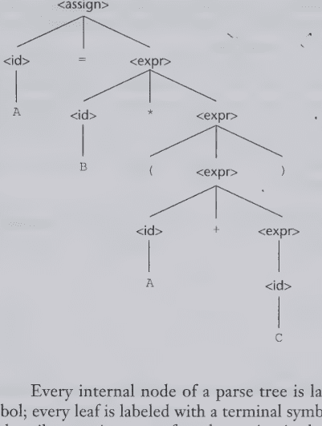

解析树的每个内部节点都标记为非终结符；每个叶节点都标记为终结符。解析树的每个子树都描述了句子中一个抽象的一个实例。

## 3.3.1.7 歧义

如果一个语法生成了一个存在两个或多个不同解析树的句法形式，则称该语法是不明确的。考虑示例 3.3 中显示的语法，它是示例 3.2 中语法的一个小变体。

### EXAMPLE 3.3
### An Ambiguous Grammar for Simple Assignment Statements

```
<assign> → <id> = <expr>
<id> → A | B | C
<expr> → <expr> + <expr>
       | <expr> * <expr>
       | ( <expr> )
       | <id>
```

示例 3.3 的语法是不明确的，因为句子

```
A = B + C * A
```

有两个不同的解析树，如图 3.2 所示。歧义的发生是因为该语法指定的语法结构比示例 3.2 的语法少了一些。

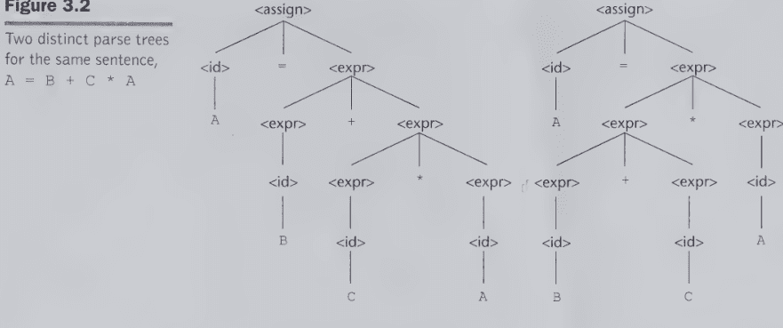

示例 3.2。 而不是只允许表达式的解析树向右增长，该语法允许向左和向右增长。

语言结构的语法歧义是一个问题，因为编译器通常基于其语法形式来确定这些结构的语义。具体来说，编译器通过检查其解析树来选择为语句生成的代码。如果一个语言结构有多个解析树，则该结构的意思就无法唯一确定。 这个问题在以下小节中的两个具体示例中进行了讨论。

有几个语法特征有时可用于确定语法是否不明确。¹ 它们包括以下内容：
- 如果语法生成一个句子具有多个最左推导，以及
- 如果语法生成一个句子具有多个最右推导。

一些解析算法可以基于不明确的语法。当此类解析器遇到不明确的构造时，它会使用设计者提供的非语法信息来构造正确的解析树。在许多情况下，不明确的语法可以重写为不明确但仍生成所需语言。

## 3.3.1.8 运算符优先级

当表达式包含两个不同的运算符时，例如 x + y * z，一个明显的语义问题是两个运算符的求值顺序（例如，在此表达式中是先加后乘，还是相反？）。 这个语义问题可以通过为运算符分配不同的优先级级别来回答。例如，如果 * 被语言设计者分配了比 + 更高的优先级，则乘法将首先执行，而不管两个运算符在表达式中出现的顺序如何。

> 1. 请注意，从数学上讲，无法确定任意语法是否不明确。


如前所述，一个文法可以描述某种句法结构，从而可以从其分析树确定该结构的部分含义。特别是，算术表达式中运算符在分析树中生成的越低（因此必须先求值），就可以用来表示它比在树中更高处生成的运算符具有优先级。例如，在图 3.2 的第一个分析树中，乘法运算符在树中生成的更低，这可能表示它在表达式中比加法运算符具有优先级。然而，第二个分析树却正好相反。因此，似乎这两个分析树表示了冲突的优先级信息。

请注意，尽管示例 3.2 的文法不是二义性的，但其运算符的优先级顺序并不是通常的顺序。在该文法中，具有多个运算符的句子的分析树，无论涉及的具体运算符是什么，都具有表达式中最右边的运算符位于分析树的最底层，而其他运算符则随着在表达式中向左移动而逐渐向上移动。例如，在表达式 A + B * C 中，* 在树中处于最低位置，表示应先执行它。然而，在表达式 A * B + C 中，+ 是最低的，表示应先执行它。

可以为我们一直在讨论的简单表达式编写一个文法，该文法既无二义性，又指定了 + 和 * 运算符的一致优先级，而不管运算符在表达式中出现的顺序如何。正确的排序是通过使用不同的非终结符来表示具有不同优先级的运算符的操作数来指定的。这需要额外的非终结符和一些新规则。不是对 + 和 * 的两个操作数都使用 <expr>，我们可以使用三个非终结符来表示操作数，这使得文法能够强制不同的运算符位于分析树的不同层级。如果 <expr> 是表达式的根符号，则 + 可以被强制到分析树的顶部，通过让 <expr> 直接只生成 + 运算符，使用新的非终结符 <term> 作为 + 的右操作数。接下来，我们可以定义 <term> 生成 * 运算符，使用 <term> 作为左操作数和新的非终结符 <factor> 作为其右操作数。现在，* 将始终在分析树中更低，仅仅因为它在每次推导中都比 + 离起始符号更远。示例 3.4 的文法就是这样的文法。

**EXAMPLE 3.4**  An Unambiguous Grammar for Expressions

```text
<assign> → <id> = <expr>
<id> → A | B | C
<expr> → <expr> + <term>
        | <term>
<term> → <term> * <factor>
        | <factor>
<factor> → ( <expr> )
          | <id>
```

示例 3.4 中的文法生成的语言与示例 3.2 和 3.3 中的文法相同，但它是无二义性的，并且指定了乘法和加法运算符的通常优先级顺序。以下是使用示例 3.4 的文法对句子 A = B + C * A 的推导：

```
<assign> => <id> = <expr>
    => A = <expr>
    => A = <expr> + <term>
    => A = <term> + <term>
    => A = <factor> + <term>
    => A = <id> + <term>
    => A = B + <term>
    => A = B + <term> * <factor>
    => A = B + <factor> * <factor>
    => A = B + <id> * <factor>
    => A = B + C * <factor>
    => A = B + C * <id>
    => A = B + C * A
```

使用示例 3.4 的文法，该句子的唯一分析树如图 3.3 所示。

分析树与推导之间的联系非常紧密：两者都可以很容易地从另一个构造出来。每个具有无二义性文法的推导都有一个唯一的分析树，尽管该树可以用不同的推导来表示。例如，以下对句子 A = B + C * A 的推导与之前给出的该句子的推导不同。这是一个最右推导，而之前的是最左推导。然而，这两个推导都由同一个分析树表示。

```
<assign> => <id> = <expr>
    => <id> = <expr> + <term>
    => <id> = <expr> + <term> * <factor>
    => <id> = <expr> + <term> * <id>
    => <id> = <expr> + <term> * A
    => <id> = <expr> + <factor> * A
    => <id> = <expr> + <id> * A
    => <id> = <expr> + C * A
    => <id> = <term> + C * A
    => <id> = <factor> + C * A
    => <id> = <id> + C * A
    => <id> = B + C * A
    => A = B + C * A
```

## Figure 3.4

A parse tree for A = B + C + A illustrating the associativity of addition

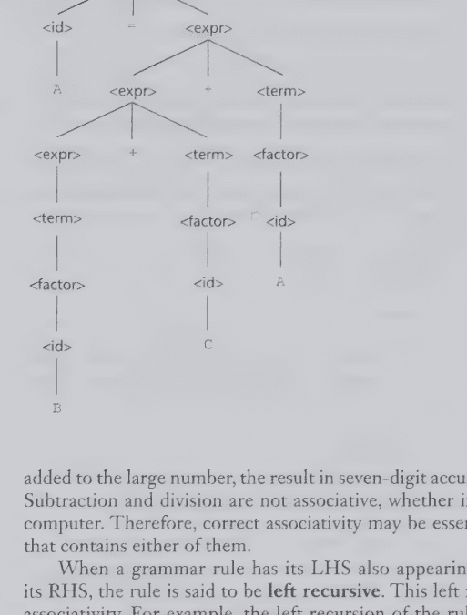

添加到大数中，结果在七位数字精度下为 1.000001 * 10^7。减法和除法在数学中或在计算机中都不是结合的。因此，对于包含其中任何一个的表达式，正确的结合性可能至关重要。

当文法规则的 LHS 也出现在其 RHS 的开头时，该规则被称为左递归。这种左递归指定了左结合性。例如，示例 3.4 文法规则的左递归使其使加法和乘法都左结合。不幸的是，左递归禁止使用一些重要的语法分析算法。当要使用其中一种算法时，文法必须修改以消除左递归。这反过来又禁止文法精确指定某些运算符是左结合的。幸运的是，即使文法没有规定，结合性也可以由编译器强制执行。

在提供它的大多数语言中，指数运算符是右结合的。为了表示右结合性，可以使用右递归。文法规则是右递归的，如果 LHS 出现在 RHS 的末尾。规则如

```
<factor> → <exp> ** <factor>
| <exp>
<exp> → ( <expr> )
| id
```

可用于将指数运算描述为右结合运算符。

## 3.3.1.10 An Unambiguous Grammar for `if-else`

Java `if-else` 语句的 BNF 规则如下：

```text
<if_stmt> → if (<logic_expr>) <stmt>
            if (<logic_expr>) <stmt> else <stmt>
```

如果我们还拥有 `<stmt> → <if_stmt>`，则该文法是二义性的。说明这种二义性的最简单的句子形式是

```text
if (<logic_expr>) if (<logic_expr>) <stmt> else <stmt>
```

图 3.5 中的两个分析树显示了该句子形式的二义性。考虑该构造的以下示例：

```java
if (done == true)
  if (denom == 0)
    quotient = 0;
  else quotient = num / denom;
```

问题在于，如果使用图 3.5 中的上部分析树作为翻译的基础，则 else 子句将在 done 不为真时执行，这

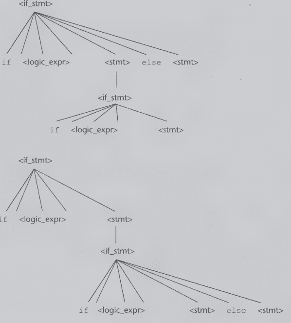

可能不是构造作者所期望的。我们将在第 8 章中研究与此 else 关联问题相关的做法问题。

我们现在将开发一个无二义性的文法来描述此 if 语句。许多语言中 if 构造的规则是，当存在 else 子句时，它与最近的先前未匹配的 then 子句相匹配。因此，在 then 子句与其匹配的 else 之间不能有不带 else 的 if 语句。因此，对于这种情况，语句必须区分匹配的和未匹配的，其中未匹配的语句是无 else 的 if，以及所有其他语句都是匹配的。早期文法的问题在于它将所有语句视为具有同等句法意义——即都视为匹配的。

为了反映不同类别的语句，必须使用不同的抽象或非终结符。基于这些思想的无二义性文法如下：

```
<stmt> → <matched> | <unmatched>
<matched> → if (<logic_expr>) <matched> else <matched>
          | any non-if statement
<unmatched> → if (<logic_expr>) <stmt>
            | if (<logic_expr>) <matched> else <unmatched>
```

使用该文法，以下句子形式只有一个可能的分析树：

```
if (<logic_expr>) if (<logic_expr>) <stmt> else <stmt>
```

## 3.3.2 Extended BNF

由于 BNF 中的一些小不便，它已被以多种方式扩展。大多数扩展版本被称为扩展 BNF，或简称为 EBNF，尽管它们并不完全相同。扩展并没有增强 BNF 的描述能力；它们只增加了其可读性和可写性。

在各种 EBNF 版本中通常包含三种扩展。第一种用方括号分隔 RHS 的可选部分。例如，C if-else 语句可以描述为

```
<if_stmt> → if (<expression>) <statement> [ else <statement> ]
```

如果不使用方括号，该语句的句法描述将需要以下两个规则：

```
<if_stmt> → if (<expression>) <statement>
           | if (<expression>) <statement> else <statement>
```

第二个扩展是在 RHS 中使用大括号来表示封闭部分可以无限重复或完全省略。此扩展允许使用单个规则构建列表，而不是使用递归和两个


规则。例如，用逗号分隔的标识符列表可以用下面的规则描述：

```
<ident_list> → <identifier> { , <identifier> }
```

这是用隐含迭代的形式替代递归；花括号内的部分可以重复任意多次。

第三种常见的扩展处理多选一选项。当必须从一组中选取单个元素时，选项被放在圆括号内，并用或运算符 | 分隔。例如，

```
<term> → <term> ( * | / | % ) <factor>
```

在 BNF 中，对这个 `<term>` 的描述需要以下三条规则：

```
<term> → <term> * <factor>
| <term> / <factor>
| <term> % <factor>
```

EBNF 扩展中的方括号、花括号和圆括号是元符号，这意味着它们是记法工具，而不是它们所帮助描述的语法实体中的终结符号。当这些元符号同时也是所描述语言中的终结符号时，作为终结符号的实例可以加下划线或用引号引起来。示例 3.5 说明了 EBNF 文法中花括号和多选结构的使用。

## 示例 3.5 表达式文法的 BNF 和 EBNF 版本

```
BNF:
<expr> → <expr> + <term>
| <expr> - <term>
| <term>
<term> → <term> * <factor>
| <term> / <factor>
| <factor>
<factor> → <exp> ** <factor>
<exp>
<exp> → ( <expr> )
| id
```

```
EBNF:
<expr> → <term> { (+ | -) <term> }
<term> → <factor> { (* | /) <factor> }
<factor> → <exp> { ** <exp> }
<exp> → ( <expr> )
| id
```

BNF 规则

```
<expr> → <expr> + <term>
```

明确地指明——实际上是强制规定——+ 运算符是左结合的。然而，EBNF 版本

```
<expr> → <term> { + <term> }
```

并没有暗示结合性的方向。在基于 EBNF 表达式文法的语法分析器中，通过将语法分析过程设计为强制正确的结合性，这个问题得以解决。这将在第 4 章进一步讨论。

某些 EBNF 版本允许在右花括号上附加数字上标，以指示花括号内部分可重复次数的上限。此外，某些版本使用加号 (+) 上标表示一次或多次重复。例如，

```
<compound> → begin <stmt> { <stmt> } end
```

和

```
<compound> → begin { <stmt> }⁺ end
```

是等价的。

近年来，BNF 和 EBNF 出现了一些变体。其中包括以下这些：

-   用冒号代替箭头，并将右部（RHS）放在下一行。
-   不用竖线分隔多个候选右部，而是简单地将它们放在单独的行中。
-   用下标 opt 代替方括号来表示可选内容。例如，Constructor Declarator → SimpleName (FormalParameterListₒₚₜ)
-   不在带括号的元素列表中使用 | 符号来表示选择，而是使用 "one of" 这两个词。例如，AssignmentOperator → one of = *= / = %= += -= <<= >>= &= ^= |=

EBNF 有一个标准，即 ISO/IEC 14977:1996(1996)，但它很少使用。该标准在规则中使用等号 (=) 而不是箭头，每个右部（RHS）以分号结尾，并要求所有终结符号都加引号。它还规定了许多其他记法规则。

## 3.3.3 文法和识别器

在本章前面，我们曾指出，对于给定的语言，生成设备和识别设备之间有着密切的关系。事实上，给定一个上下文无关文法，就可以用算法为该文法生成的语言构造一个识别器。已经开发了许多执行这种构造的软件系统。这类系统允许快速创建新语言编译器的语法分析部分，因此相当有价值。最早的语法分析器生成器之一是 yacc（又一个编译器编译器）（Johnson, 1975）。现在已有很多这样的系统可用。

## 3.4 属性文法

属性文法是一种用于描述编程语言结构的工具，它可以描述比上下文无关文法更多的结构。属性文法是上下文无关文法的一种扩展。这种扩展允许方便地描述某些语言规则，例如类型兼容性。在正式定义属性文法的形式之前，我们必须澄清静态语义的概念。

### 历史注释

属性文法已被广泛用于各种应用之中。它们被用来提供编程语言语法和静态语义的完整描述（Watt, 1979）；被用作可输入到编译器生成系统的语言的形式定义（Farrow, 1982）；并被用作若干语法导向编辑系统的基础（Teitelbaum and Reps, 1981; Fischer et al., 1984）。此外，属性文法还被用于自然语言处理系统（Correa, 1992）。

## 3.4.1 静态语义

编程语言有一些特性难以用 BNF 描述，也有一些特性不可能用 BNF 描述。作为难以用 BNF 指定的语法规则的例子，考虑类型兼容规则。例如，在 Java 中，浮点值不能赋给整型变量，尽管相反的赋值是合法的。虽然这种限制可以用 BNF 指定，但它需要额外的非终结符号和规则。如果 Java 的所有类型规则都用 BNF 指定，文法将变得过大而无法使用，因为文法的大小决定了语法分析器的大小。

作为不能用 BNF 指定的语法规则的例子，考虑这样一条常见规则：所有变量必须在被引用之前声明。已经证明，这条规则不能用 BNF 指定。

这些问题例示了被称为静态语义规则的那一类语言规则。语言的静态语义与程序执行期间的含义仅间接相关；相反，它与程序的合法形式有关（是语法而非语义）。语言的许多静态语义规则规定了其类型约束。静态语义之所以如此命名，是因为检查这些规范所需的分析可以在编译时完成。

由于用 BNF 描述静态语义存在诸多问题，人们为这一任务设计出了多种更强大的机制。属性文法就是这样一种机制，它由 Knuth（1968a）设计，用于描述程序的语法和静态语义。

属性文法是描述和检查程序静态语义规则正确性的一种形式化方法。虽然它们在编译器设计中并不总是以正式方式使用，但属性文法的基本概念至少在每个编译器中都以非正式方式得到使用（参见 Aho et al., 1986）。

动态语义，即表达式、语句和程序单元的含义，将在 3.5 节讨论。

## 3.4.2 基本概念

属性文法是在上下文无关文法的基础上添加了属性、属性计算函数和谓词函数而成的文法。属性与文法符号（终结符号和非终结符号）相关联，在可以给它们赋值这个意义上，属性类似于变量。属性计算函数有时称为语义函数，与文法规则相关联，用于指定属性值的计算方式。谓词函数说明语言的静态语义规则，与文法规则相关联。

在我们正式定义属性文法并提供示例之后，这些概念将变得更加清晰。

## 3.4.3 属性文法的定义

属性文法是一种具有以下附加特性的文法：

-   与每个文法符号 X 相关联的是一个属性集 A(X)。集合 A(X) 由两个不相交的集合 S(X) 和 I(X) 组成，它们分别称为综合属性和继承属性。综合属性用于沿语法分析树向上传递语义信息，而继承属性则沿树向下和横向传递语义信息。
-   与每个文法规则相关联的是一个语义函数集和一个可能为空的谓词函数集，这些谓词函数定义在该文法规则中符号的属性之上。对于规则 X0 → X1 ... Xn，X0 的综合属性通过形式为 S(X0) = f(A(X1), ... , A(Xn)) 的语义函数来计算。因此，语法分析树节点上的综合属性值仅依赖于该节点的子节点上的属性值。符号 Xj（1 ≤ j ≤ n，在上述规则中）的继承属性通过形式为 I(Xj) = f(A(X0), ... , A(Xn)) 的语义函数来计算。因此，语法分析树节点上的继承属性值依赖于该节点的父节点及其兄弟节点的属性值。注意，为了避免循环，继承属性通常被限制为形式为 I(Xj) = f(A(X0), ... , A(X(j-1))) 的函数。这种形式可以防止继承属性依赖于自身或依赖于语法分析树中右侧的属性。
-   谓词函数的形式是一个布尔表达式，它定义在属性集合 {A(X0), ... , A(Xn)} 与一组字面属性值的并集上。属性文法所允许的推导，只是那些与每个非终结符相关联的每个谓词都为真的推导。谓词函数值为假表示违反了语言的语法或静态语义规则。


属性文法的分析树是基于其底层 BNF 文法的分析树，每个节点都附带一个可能为空的属性值集合。如果分析树中的所有属性值都已计算，则该树被称为完全属性化。虽然在实践中并非总是这样做，但在编译器构建完完整的无属性分析树之后再计算属性值，这种思考方式很方便。

## 3.4.4 内在属性

内在属性是叶节点的综合属性，其值在分析树之外确定。例如，程序中变量实例的类型可能来自符号表，符号表用于存储变量名及其类型。符号表的内容是基于之前的声明语句设置的。最初，假设已构建了无属性分析树并且需要属性值，则唯一具有值的属性是叶节点的内在属性。给定分析树上的内在属性值，语义函数可用于计算剩余的属性值。

## 3.4.5 属性文法示例

作为属性文法如何用于描述静态语义的非常简单的示例，考虑以下属性文法片段，该片段描述了 Ada 过程末尾的名称必须与过程名称匹配的规则。（该规则无法用 BNF 表达。）`<proc_name>` 的字符串属性，用 `<proc_name>.string` 表示，是编译器在保留字 procedure 之后找到的实际字符字符串。请注意，当属性文法中的语法规则中非终结符出现多次时，非终结符会用方括号下标来区分。下标和方括号都不是所描述语言的一部分。

```
Syntax rule: <proc_def> → procedure <proc_name>[1] <proc_body> end <proc_name>[2];
Predicate: <proc_name>[1].string == <proc_name>[2].string
```

在此示例中，谓词规则指出子程序头中 `<proc_name>` 非终结符的名称字符串属性必须与子程序末尾之后的 `<proc_name>` 非终结符的名称字符串属性匹配。

接下来，我们考虑一个更大的属性文法示例。在这种情况下，该示例说明了属性文法如何用于检查简单赋值语句的类型规则。该赋值语句的语法和静态语义如下：唯一的变量名是 A、B 和 c。赋值的右侧可以是变量，也可以是形如一个变量加另一个变量的表达式。变量可以是两种类型之一：int 或 real。当赋值的右侧有两个变量时，它们不必是相同类型。当操作数类型不相同时，表达式的类型始终为 real。当它们相同时，表达式类型为操作数的类型。赋值左侧的类型必须与右侧的类型匹配。因此，右侧操作数的类型可以混合，但只有当目标与求值右侧得到的值具有相同类型时，赋值才是有效的。属性文法指定了这些静态语义规则。

我们示例属性文法的语法部分为

```
<assign> → <var> = <expr>
<expr> → <var> + <var>
      | <var>
<var> → A | B | C
```

示例属性文法中非终结符的属性在以下段落中描述：

- actual_type—与非终结符 `<var>` 和 `<expr>` 关联的综合属性。它用于存储变量或表达式的实际类型，int 或 real。对于变量而言，实际类型是内在的。对于表达式而言，它由 `<expr>` 非终结符的子节点或子节点的实际类型确定。
- expected_type—与非终结符 `<expr>` 关联的继承属性。它用于存储表达式所期望的类型，即 int 或 real，该类型由赋值语句左侧变量的类型确定。

完整的属性文法在示例 3.6 中给出。

## 示例 3.6 简单赋值语句的属性文法

- 1. Syntax rule: <assign> → <var> = <expr>
  Semantic rule: <expr>.expected_type ← <var>.actual_type

- 2. Syntax rule: <expr> → <var>[2] + <var>[3]
  Semantic rule: <expr>.actual_type ←
              if (<var>[2].actual_type = int) and
                 (<var>[3].actual_type = int)
              then int
              else real
              end if
  Predicate: <expr>.actual_type == <expr>.expected_type

- 3. Syntax rule: <expr> → <var>
  Semantic rule: <expr>.actual_type ← <var>.actual_type
  Predicate: <expr>.actual_type == <expr>.expected_type

- 4. Syntax rule: <var> → A | B | C
  Semantic rule: <var>.actual_type ← look-up (<var>.string)

look-up 函数在符号表中查找给定的变量名并返回变量的类型。

示例 3.6 中文法生成的句子 A = A + B 的分析树如图 3.6 所示。与文法一样，重复的节点标签后添加了带括号的数字，以便可以无歧义地引用。

## 3.4.6 计算属性值

现在，考虑计算分析树属性值的过程，有时称为装饰分析树。如果所有属性都是继承的，则可以完全自上而下地进行，从根到叶。或者，如果所有属性都是综合的，则可以完全自下而上地进行，从叶到根。由于我们的文法同时具有综合属性和继承属性，因此求值过程不能是单一方向。以下是按可计算顺序对属性进行求值的一种方法：

- 1. <var>.actual_type ← look-up(A) (Rule 4)
- 2. <expr>.expected_type ← <var>.actual_type (Rule 1)
- 3. <var>[2].actual_type ← look-up(A) (Rule 4)
  <var>[3].actual_type ← look-up(B) (Rule 4)
- 4. <expr>.actual_type ← either int or real (Rule 2)
- 5. <expr>.expected_type == <expr>.actual_type is either TRUE or FALSE (Rule 2)

图 3.7 中的树显示了图 3.6 示例中属性在树中的流动。实线显示分析树；虚线显示树中属性的流动。

图 3.8 中的树显示了节点上的最终属性值。在此示例中，A 定义为 real，B 定义为 int。

对于属性文法的一般情况，确定属性求值顺序是一个复杂问题，需要构建依赖图以显示所有属性依赖关系。

## Figure 3.6

A parse tree for
A = A + B

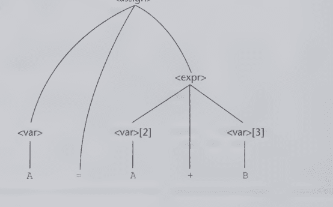

## Figure 3.7

The flow of attributes in the tree

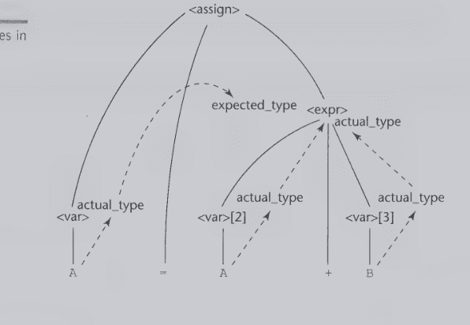

## Figure 3.8

A fully attributed parse tree

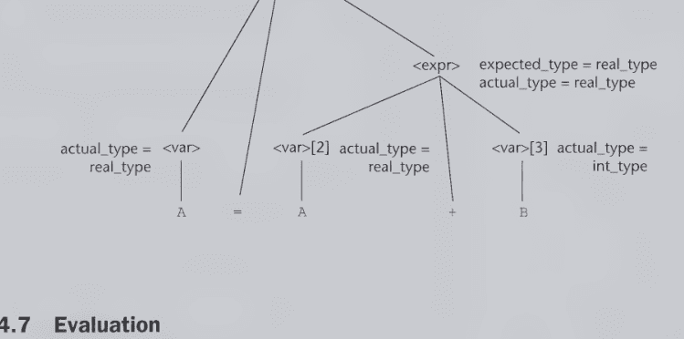

## 3.4.7 Evaluation

检查语言的静态语义规则是所有编译器的必不可少的一部分。即使编译器编写者从未听说过属性文法，他或她也需要使用其基本思想来设计编译器的静态语义规则检查。

使用属性文法描述真实当代编程语言的所有语法和静态语义的主要困难之一是属性文法的规模和复杂性。完整编程语言所需的大量属性和语义规则使此类文法难以编写和阅读。此外，大型分析树上的属性值求值成本高昂。另一方面，较不正式的属性


grammars are a powerful and commonly used tool for compiler writers, who are more interested in the process of producing a compiler than they are in formalism.

## 3.5 Describing the Meanings of Programs: Dynamic Semantics

我们现在转向描述表达式、语句和程序单元的动态语义，或含义这一困难任务。由于可用记法的强大和自然性，描述语法相对简单。另一方面，尚未设计出 universally accepted notation or approach 用于动态语义。在本节中，我们简要描述了已开发的几种方法。在本节的其余部分，当我们使用术语语义时，我们指的是动态语义。

需要语义描述的方法和记法背后有几个不同的原因。程序员显然需要在在程序中有效使用它们之前精确地知道语言的语句做什么。编译器编写者必须确切知道语言构造的含义才能正确地为它们设计实现。如果存在编程语言的精确语义规范，则用该语言编写的程序有可能在不经测试的情况下被证明是正确的。同样，编译器可以被证明会产生表现出语言定义中给出的确切行为的程序；也就是说，它们的正确性可以得到验证。编程语言的语法和语义的完整规范可以被工具用来自动生成该语言的编译器。最后，语言设计者在开发其语言的语义描述的过程中，可以发现其设计中的歧义和不一致。

软件开发人员和编译器设计人员通常通过阅读语言手册中的英文解释来确定编程语言的语义。由于此类解释通常不精确且不完整，因此这种方法显然不令人满意。由于缺乏编程语言的完整语义规范，程序很少在不经测试的情况下被证明是正确的，并且商业编译器从未从语言描述中自动生成。

Scheme，一种在第 15 章中描述的函数式语言，是为数不多的几个其定义包含形式语义描述的编程语言之一。然而，所使用的方法不是本章中描述的方法，因为本章侧重于适用于命令式语言的方法。

### 3.5.1 Operational Semantics

操作语义背后的思想是通过指定在机器上运行它所产生的效果来描述语句或程序的含义。对机器的影响被视为其状态变化的序列，其中

机器的状态是其存储中值的集合。那么，一个明显的 operational semantics 描述就是在计算机上执行程序的编译版本。大多数程序员在至少一次的情况下编写了一个小型测试程序来确定某个编程语言构造的含义，通常是在学习语言时。基本上，这样的程序员所做的是使用操作语义来确定构造的含义。

使用这种方法进行完整的正式语义描述存在几个问题。首先，机器语言执行的各个步骤以及对机器状态所产生的变化太小、太多。其次，真实计算机的存储太大且太复杂。通常有几个级别的存储设备，以及通过网络与可枚举的其他计算机和存储设备的连接。因此，机器语言和真实计算机不用于正式的操作语义。相反，专门为该过程设计了中间级语言和理想化计算机的解释器。

操作语义有不同的使用级别。在最高级别，兴趣在于完整程序执行的结果。这有时称为自然操作语义。在最低级别，操作语义可用于通过检查程序执行时发生的完整状态变化序列来确定程序的确切含义。这种用法有时称为结构操作语义。

#### 3.5.1.1 The Basic Process

创建语言的操作语义描述的第一步是设计合适的中间语言，其中语言的主要期望特征是清晰。中间语言的每个构造都必须具有明显且无歧义的含义。该语言处于中间级别，因为机器语言太低级而难以理解，而另一个高级语言显然不合适。如果语义描述要用于自然操作语义，则必须为中间语言构造一个虚拟机（解释器）。虚拟机可用于执行单个语句、代码段或整个程序。如果只需要单个语句的含义，则可以在没有虚拟机的情况下使用语义描述。在这种用法中，即结构操作语义，中间代码可以进行视觉检查。

操作语义的基本过程并不 unusual。事实上，该概念经常在编程教科书和编程语言参考手册中使用。例如，C for 构造的语义可以用更简单的语句来描述，如

操作语义为语言用户和语言实现者提供了一种有效的语义描述方法，只要描述保持简单和非正式。PL/I 的 VDL 描述不幸地复杂到没有任何实际用途。

操作语义依赖于更低级别的编程语言，而不是数学。一个编程语言的语句是用更低级编程语言的语句来描述的。这种方法可能导致循环，即概念间接地用自身来定义。以下两节中描述的方法在形式上要严格得多，因为它们基于数学和逻辑，而不是编程语言。

### 3.5.2 Denotational Semantics

**Denotational semantics** 是描述程序含义的最严格和最广为人知的正式方法。它牢固地基于递归函数理论。对使用指称语义来描述编程语言语义的彻底讨论必然很长且很复杂。我们的目的是为读者提供指称语义的核心概念的介绍，以及与编程语言规范相关的几个简单示例。

为编程语言构造指称语义规范的过程要求为每个语言实体定义一个数学对象和一个将该语言实体的实例映射到该数学对象的实例的函数。因为对象是严格定义的，所以它们模拟了其对应实体的确切含义。这个想法基于这样一个事实：有严格的方法来操作数学对象，但没有编程语言构造。困难在于创建对象和映射函数。该方法被称为 *denotational*，因为数学对象表示其对应语法实体的含义。

指称语义编程语言规范的映射函数，如数学中的所有函数一样，具有定义域和值域。定义域是作为函数合法参数的值的集合；值域是参数被映射到的对象的集合。在指称语义中，定义域称为 **syntactic domain**，因为被映射的是语法结构。值域称为 **semantic domain**。

指称语义与操作语义相关。在操作语义中，编程语言构造被翻译成更简单的编程语言构造，后者成为构造含义的基础。在指称语义中，编程语言构造被映射到数学对象，要么是集合，要么更常见的是函数。然而，与操作语义不同，指称语义并不模拟程序的逐步计算处理。


# 3.5.2.1 两个简单示例

我们使用一种非常简单的语言构造，二进制数的字符字符串表示，来介绍指称方法。这种二进制数的语法可以通过以下语法规则描述：

```
<bin_num> → '0'
| '1'
| <bin_num> '0'
| <bin_num> '1'
```

示例二进制数 110 的分析树如图 3.9 所示。请注意，我们在语法数字周围加上了撇号，以表明它们不是数学数字。这与 ASCII 编码数字和数学数字之间的关系类似。当程序将数字作为字符串读取时，在将其用作程序中的值之前，必须将其转换为数学数字。

## 图 3.9

二进制数 110 的分析树

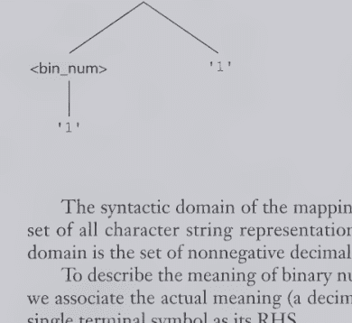

二进制数映射函数的句法域是所有二进制数字符字符串表示的集合。语义域是非负十进制数的集合，用 N 表示。

要使用指称语义描述二进制数的含义，我们将实际含义（一个十进制数）与 RHS 只有一个终结符的每个规则相关联。

在我们的示例中，十进制数必须与前两个语法规则相关联。其他两个语法规则在某种意义上是计算规则，因为它们将一个可以关联对象的终结符与一个非终结符结合起来，而非终结符可以预期表示某种构造。假设评估在分析树中向上进行，右侧的非终结符已经附带了其含义。因此，RHS 为非终结符的语法规则需要一个函数来计算表示完整 RHS 含义的 LHS 的含义。

```
M_bin ('0') = 0
M_bin ('1') = 1
M_bin (<bin_num> '0') = 2 * M_bin (<bin_num>)
M_bin (<bin_num> '1') = 2 * M_bin (<bin_num>) + 1
```

含义，或所指对象（在本例中为十进制数），可以附加到上一页所示分析树的节点上，从而得到图 3.10 中的树。这是指令导向语义。句法实体被映射到具有具体含义的数学对象。

## 图 3.10

110 的带所指对象的分析树

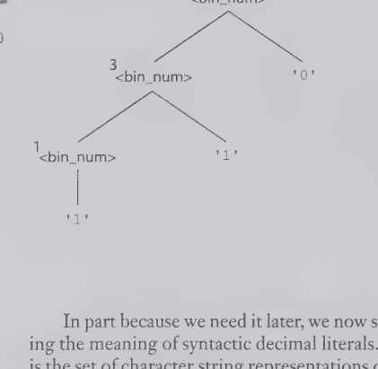

部分因为我们稍后需要它，现在我们展示一个类似的示例，用于描述句法十进制文字的含义。在这种情况下，句法域是十进制数字符串表示的集合。语义域再次为 N。

```
<dec_num> → '0' | '1' | '2' | '3' | '4' | '5' | '6' | '7' | '8' | '9'
          | <dec_num> ('0' | '1' | '2' | '3' | '4' | '5' | '6' | '7' | '8' | '9')
```

这些语法规则的指称映射为

```
M_dec ('0') = 0, M_dec ('1') = 1, M_dec ('2') = 2, . . ., M_dec ('9') = 9
M_dec (<dec_num> '0') = 10 * M_dec (<dec_num>)
M_dec (<dec_num> '1') = 10 * M_dec (<dec_num>) + 1
...
M_dec (<dec_num> '9') = 10 * M_dec (<dec_num>) + 9
```

在下面的各节中，我们给出几个简单构造的指称语义描述。这里做出的最重要的简化假设是构造的语法和静态语义都是正确的。此外，我们假设只包含两种标量类型：整数和布尔。

# 3.5.2.2 程序的状态

程序的指称语义可以用理想计算机中的状态变化来定义。操作语义就是这样定义的，而指称语义几乎以相同的方式定义。然而，在进一步简化中，指称语义仅用程序所有变量的值来定义。因此，指称语义使用程序的状态来描述含义，而操作语义使用机器的状态。操作语义与指称语义之间的关键区别在于，操作语义中的状态变化由用某种编程语言编写的代码算法定义，而在指称语义中，状态变化由数学函数定义。

令程序的状态 s 表示为有序对的集合，如下所示：

s = {〈i₁, v₁〉, 〈i₂, v₂〉, . . . , 〈iₙ, vₙ〉}

每个 i 是变量的名称，相关的 v 是这些变量的当前值。v 中的任何一个都可以具有特殊值 under，表示其关联的变量当前未定义。令 VARMAP 为两个参数的函数：变量名和程序状态。VARMAP (iⱼ, s) 的值是 vⱼ（与状态 s 中的 iⱼ 配对的值）。程序和程序构造的大多数语义映射函数将状态映射到状态。这些状态变化用于定义程序和程序构造的含义。某些语言构造——例如表达式——被映射为值，而不是状态。

# 3.5.2.3 表达式

表达式是大多数编程语言的基础。我们在此假设表达式没有副作用。此外，我们只处理非常简单的表达式：唯一的操作符是 + 和 *，表达式最多只能有一个操作符；唯一的操作数是标量整数变量和整数文字；没有括号；表达式的值是一个整数。以下是这些表达式的 BNF 描述：

```
〈expr〉 → 〈dec_num〉 | 〈var〉 | 〈binary_expr〉
〈binary_expr〉 → 〈left_expr〉 〈operator〉 〈right_expr〉
〈left_expr〉 → 〈dec_num〉 | 〈var〉
〈right_expr〉 → 〈dec_num〉 | 〈var〉
〈operator〉 → + | *
```

我们考虑的表达式中唯一的错误是变量具有未定义值。显然，其他错误可能发生，但其中大多数依赖于机器。令 Z 为整数集合，error 为错误值。那么 Z ∪ {error} 是我们表达式指称规范的语义域。

给定表达式 E 和状态 s 的映射函数如下。为了区分数学函数定义和编程语言的赋值语句，我们使用符号 Δ = 来定义数学函数。用于此定义的蕴含符号 => 将操作数的形式与其关联的 case（或 switch）构造连接起来。点表示法用于引用节点的子节点。例如，<binary_expr>.<left_expr> 指 <binary_expr> 的左子节点。

```
Mₑ (<expr>, s) Δ= case <expr> of
  <dec_num> => M_dec (<dec_num>, s)
  <var> => if VARMAP (<var>, s) == undef
    then error
    else VARMAP (<var>, s)
  <binary_expr> =>
    if (Mₑ (<binary_expr>.<left_expr>, s) == undef OR
        Mₑ (<binary_expr>.<right_expr>, s) == undef)
    then error
    else if (<binary_expr>.<operator> == '+')
      then Mₑ (<binary_expr>.<left_expr>, s) +
           Mₑ (<binary_expr>.<right_expr>, s)
      else Mₑ (<binary_expr>.<left_expr>, s) *
           Mₑ (<binary_expr>.<right_expr>, s)
```

# 3.5.2.4 赋值语句

赋值语句是表达式求值加上将目标变量设置为表达式值。在这种情况下，含义函数将状态映射到状态。该函数可以用以下内容描述：

```
Mₐ (x = E, s) Δ= if Mₑ (E, s) == error
  then error
  else s' = {<i₁, v₁'>, <i₂, v₂'>, ..., <iₙ, vₙ'>}, where
    for j = 1, 2, ..., n
      if iⱼ == x
        then vⱼ' = Mₑ (E, s)
        else vⱼ' = VARMAP (iⱼ, s)
```

请注意，上面倒数第三行中的比较 iⱼ == x 是名称的比较，而不是值的比较。

# 3.5.2.5 逻辑前测循环

逻辑前测循环的指称语义看似简单。为了加快讨论，我们假设存在另外两个已有的映射函数 Mₛₗ 和 M_b，它们分别将语句列表和状态映射到状态，以及布尔表达式映射到布尔值（或 error）。该函数为

```
M₁ (while B do L, s) Δ= if M_b (B, s) == undef then error else if M_b (B, s) == false then s else if M_sl (L, s) == error then error else M₁ (while B do L, M_sl (L, s))
```

循环的含义仅仅是在循环中语句执行规定次数后程序变量的值，假设没有发生错误。从本质上讲，循环已被从迭代转换为递归，其中递归控制由其他递归状态映射函数在数学上定义。用数学严谨性描述递归比描述迭代更容易。

此时一个重要的观察是，这个定义与实际程序循环一样，可能因为不终止而计算不出任何东西。

# 3.5.2.6 评估

对象和函数，例如在前面构造中使用的，可以为编程语言的其他句法实体定义。当为给定语言定义了完整的系统时，它可用于确定该语言中完整程序的含义。这为以高度严谨的方式思考编程提供了一个框架。

## 历史注记

已经在利用指称语言描述自动生成编译器的可能性方面做了大量工作（Jones, 1980; Milos et al., 1984; Bodwin et al., 1982）。这些努力表明该方法是可行的，但工作从未进展到可以用来生成有用编译器的程度。

如前所述，指称语义可以用作语言设计的辅助。例如，描述复杂的指称语义描述的语句可能表明设计者此类语句也可能难以让语言用户理解，并且可能需要替代设计。

由于指称描述的复杂性，它们对语言用户几乎没有用处。另一方面，它们提供了一种简洁描述语言的极好方式。

尽管指称语义的用途通常归因于 Scott 和 Strachey（1971），但一般的指称语言描述方法可以追溯到十九世纪（Frege, 1892）。

# 3.5.3 公理语义

公理语义，因其基于数理逻辑而得名，是本章讨论的语义规范中最抽象的方法。公理语义不是直接指定程序的含义，而是指定可以证明程序的什么。回想一下，语义规范的可能用途之一是证明程序的正确性。


在公理语义中，不存在机器或程序状态的模型，也不存在程序执行时发生的状态变化的模型。程序的含义基于程序变量与常量之间的关系，这种关系在程序的每次执行中都是相同的。

公理语义有两个不同的应用：程序验证和程序语义规范。本节在描述公理语义时重点讨论程序验证。

公理语义是在发展程序正确性证明方法的过程中一同定义的。这种正确性证明一旦构造出来，就能表明程序执行了其规范所描述的计算。在证明中，程序的每条语句前后都有一个逻辑表达式，用于指定对程序变量的约束。这些约束（而非抽象机器的整个状态，如操作语义那样）被用来指定语句的含义。用于描述约束的记号——事实上，也就是公理语义的语言——是谓词演算。虽然简单的布尔表达式通常足以表达约束，但在某些情况下它们并不够用。

当公理语义被用于正式地指定一条语句的含义时，其含义由该语句对有关它所影响的数据的断言所产生的影响来定义。

## 3.5.3.1 断言

公理语义中使用的逻辑表达式称为谓词或断言。紧接在程序语句之前的断言描述了在该程序位置上的程序变量所受的约束。紧接在一条语句之后的断言描述了该语句执行后这些变量（可能还有其他变量）所受的新约束。这两个断言分别称为该语句的前置条件和后置条件。对于两条相邻的语句，第一条语句的后置条件作为第二条语句的前置条件。要为给定程序建立公理化描述或证明，要求程序中的每条语句都有前置条件和后置条件。

在下面的章节中，我们从这样的角度来考察断言，即语句的前置条件是由给定的后置条件计算出来的，尽管从相反的意义上来考虑这些条件也是可能的。我们假定所有变量都是整数类型。作为一个简单示例，考虑下面的赋值语句和后置条件：

```
sum = 2 * x + 1 {sum > 1}
```

前置条件和后置条件断言用花括号括起来，以区别于程序语句的组成部分。此语句的一个可能的前置条件是 {x > 10}。

在公理语义中，一条特定语句的含义由其前置条件和后置条件定义。实际上，这两个断言精确地指定了执行该语句的效果。

在下面的小节中，我们侧重于语句和程序的正确性证明，这是公理语义的一种常见用途。公理语义更一般的概念是用逻辑表达式精确地陈述语句和程序的含义。程序验证是语言公理化描述的一种应用。

## 3.5.3.2 最弱前置条件

最弱前置条件是保证相关后置条件成立的最不严格的前置条件。例如，在3.5.3.1节给出的语句和后置条件中，{x > 10}、{x > 50} 和 {x > 1000} 都是有效的前置条件。本例中所有前置条件中最弱的是 {x > 0}。

如果能够根据语言每种语句类型的最一般后置条件计算出最弱前置条件，那么用于计算这些前置条件的过程就提供了对该语言语义的简明描述。此外，可以为该语言中的程序构造正确性证明。程序证明始于将程序执行结果的特征作为程序最后一条语句的后置条件。该后置条件与最后一条语句一起，用于计算最后一条语句的最弱前置条件。然后，该前置条件被用作倒数第二条语句的后置条件。这个过程一直持续到程序的开头。此时，第一条语句的前置条件陈述了程序能够计算出所期望结果的条件。如果这些条件由程序的输入规范所蕴含，则该程序已被验证为正确。

推理规则是一种根据其他断言的真值来推断某个断言为真的方法。推理规则的一般形式如下：

```
S1, S2, . . . , Sn
-------------------
        S
```

该规则表明，如果 S1、S2、……、Sn 为真，则可以推断出 S 为真。推理规则的上面部分称为其前件；下面部分称为其后件。

公理是被假定为真的逻辑陈述。因此，公理是一种没有前件的推理规则。

对于某些程序语句，根据语句和后置条件计算最弱前置条件是简单的，可以用公理来规定。然而，在大多数情况下，最弱前置条件只能通过推理规则来规定。

要将公理语义用于给定的编程语言，无论是用于正确性证明还是用于形式语义规范，该语言中每种语句都必须存在对应的公理或推理规则。

在下面的小节中，我们给出赋值语句的公理，以及语句序列、选择语句和逻辑前测循环语句的推理规则。注意，我们假定算术表达式和布尔表达式都没有副作用。

## 3.5.3.3 赋值语句

赋值语句的前置条件和后置条件共同定义其含义。要定义赋值语句的含义，必须有办法从其后置条件计算其前置条件。

设 x = E 为一般的赋值语句，Q 为其后置条件。那么，其最弱前置条件 P 由公理定义：

```
P = Qₓ↦E
```

这意味着 P 的计算方法是：用 E 替换 Q 中所有出现的 x。例如，如果我们有赋值语句和后置条件：

```
a = b / 2 - 1 {a < 10}
```

最弱前置条件的计算方法是将后置条件 {a < 10} 中的 a 替换为 b / 2 - 1，如下所示：

```
b / 2 - 1 < 10
b < 22
```

因此，给定赋值语句和后置条件的最弱前置条件是 {b < 22}。请记住，赋值公理只有在没有副作用的情况下才保证正确。赋值语句若改变了其目标变量以外的某些变量，则存在副作用。

指定给定语句形式的公理语义的常用记号是：

```
{P} S {Q}
```

其中 P 是前置条件，Q 是后置条件，S 是语句形式。对于赋值语句，记号是：

```
{Qₓ↦E} x = E {Q}
```

作为计算赋值语句前置条件的另一个示例，考虑以下情况：

```
x = 2 * y - 3 {x > 25}
```

前置条件计算如下：

```
2 * y - 3 > 25
y > 14
```

因此 {y > 14} 是此赋值语句和后置条件的最弱前置条件。

注意，赋值语句的左侧出现在其右侧中，这并不影响最弱前置条件的计算过程。例如，对于

```
x = x + y - 3 {x > 10}
```

最弱前置条件是

```
x + y - 3 > 10
y > 13 - x
```

回顾一下，公理语义是为证明程序的正确性而发展起来的。因此，此时自然会想到：赋值语句的公理如何能用来证明任何东西？方式如下：一条带有前置条件和后置条件的给定赋值语句可以被视为一个逻辑陈述，或定理。如果把赋值公理应用于后置条件和赋值语句后，产生给定的前置条件，则该定理得到证明。例如，考虑下面的逻辑陈述：

```
{x > 3} x = x - 3 {x > 0}
```

将赋值公理应用于该语句及其后置条件，产生 {x > 3}，这正是给定的前置条件。因此，我们证明了该示例逻辑陈述。

接下来，考虑下面的逻辑陈述：

```
{x > 5} x = x - 3 {x > 0}
```

在这种情况下，给定的前置条件 {x > 5} 与公理产生的断言不同。然而，显然 {x > 5} 蕴含 {x > 3}。要在证明中使用这一点，需要一个名为“结果规则”的推理规则。结果规则的形式是：

```
{P} S {Q}, P' => P, Q => Q'
---------------------------
{P'} S {Q'}
```

符号 => 表示“蕴含”，S 可以是任何程序语句。该规则可以表述为：如果逻辑陈述 { P } S { Q } 为真，断言 P′ 蕴含断言 P，且断言 Q 蕴含断言 Q′，那么可以推断出 { P′ } S { Q′ }。换句话说，结果规则表明后置条件总可以被弱化，前置条件总可以被强化。这在程序证明中非常有用。例如，它使得上面最后一个逻辑陈述示例的证明得以完成。如果我们令 P 为 {x > 3}，Q 和 Q′ 为 {x > 0}，且 P′ 为 {x > 5}，则有


{x > 3} x = x - 3 {x > 0}, (x > 5) => {x > 3}, (x > 0) => (x > 0)
{x > 5} x = x - 3 {x > 0}

前件的第一项（{x > 3} x = x - 3 {x > 0}）已通过赋值公理证明。第二项和第三项是显然的。因此，根据推论规则，后件为真。

## 3.5.3.4 序列

语句序列的最弱前置条件不能由公理描述，因为前置条件依赖于序列中特定类型的语句。在这种情况下，前置条件只能通过推理规则来描述。设 S1 和 S2 是相邻的程序语句。如果 S1 和 S2 具有以下前置和后置条件

```
{P1} S1 {P2}
{P2} S2 {P3}
```

那么这种两条语句序列的推理规则是

```
{P1} S1 {P2}, {P2} S2 {P3}
{P1} S1, S2 {P3}
```

因此，对于我们的例子，{P1} S1; S2 {P3} 描述了序列 S1; S2 的公理语义。推理规则指出，为了得到序列的前置条件，需要计算第二条语句的前置条件。然后将这个新断言用作第一条语句的后置条件，之后可以据此计算第一条语句的前置条件，该前置条件也是整个序列的前置条件。如果 S1 和 S2 是赋值语句

```
x1 = E1
```

和

```
x2 = E2
```

那么我们得到

```
{P3 x2→E2} x2 = E2 {P3}
{(P3 x2→E2) x1→E1} x1 = E1 {P3 x2→E2}
```

第二条赋值语句的前置条件是

```
y < 7
```

它被用作第一条语句的后置条件。现在可以计算第一条赋值语句的前置条件：

```
3 * x + 1 < 7
x < 2
```

所以，{x < 2} 既是第一条语句的前置条件，也是两条语句序列的前置条件。

## 3.5.3.5 选择

接下来我们考虑选择语句的推理规则，其一般形式为

```
if B then S1 else S2
```

我们只考虑包含 else 子句的选择语句。推理规则是

```
{B and P} S1 {Q}, {(not B) and P} S2 {Q}
{P} if B then S1 else S2 {Q}
```

该规则规定，选择语句必须在布尔控制表达式为真和为假两种情况下都被证明。横线上方的第一个逻辑语句代表 then 子句；第二个代表 else 子句。根据推理规则，我们需要一个前置条件 P，它可以同时用于 then 和 else 子句的前置条件。

考虑下面使用选择推理规则计算前置条件的示例。示例选择语句为

```
if x > 0 then
  y = y - 1
else
  y = y + 1
```

假设该选择语句的后置条件 Q 为 {y > 0}。我们可以对 then 子句使用赋值公理

```
y = y - 1 {y > 0}
```

这产生 {y - 1 > 0} 或 {y > 1}。它可以作为 then 子句前置条件中的 P 部分。现在我们将同样的公理应用于 else 子句

```
y = y + 1 {y > 0}
```

## 3.5.3.6 逻辑预测试循环

命令式编程语言的另一个基本结构是逻辑预测试，即 while 循环。计算 while 循环的最弱前置条件本质上比计算序列的更难，因为迭代次数并不总是可以预先确定。在迭代次数已知的情况下，循环可以被展开，视为一个序列。

计算循环最弱前置条件的问题类似于证明一个关于所有正整数的定理的问题。在后一种情况下，通常使用归纳法，同样的归纳方法也可以用于某些循环。归纳的主要步骤是找到归纳假设。在 while 循环的公理语义中，对应的步骤是找到一个称为循环不变式的断言，这对于找到最弱前置条件至关重要。

用于计算 while 循环前置条件的推理规则如下：

```
{I and B} S {I}
-----------------------------
{I} while B do S end {I and (not B)}
```

在这个规则中，I 是循环不变式。这看起来简单，但实际上并不简单。复杂性在于找到合适的循环不变式。

while 循环的公理描述写作

```
{P} while B do S end {Q}
```

循环不变式必须满足若干要求才有用。首先，while 循环的最弱前置条件必须保证循环不变式为真。反过来，循环不变式必须保证循环终止时后置条件为真。这些约束使我们从推理规则转向公理描述。在循环执行期间，循环不变式的真值必须不受循环控制布尔表达式和循环体语句求值的影响。因此得名“不变式”。

while 循环的另一个复杂因素是循环终止问题。不终止的循环不可能是正确的，而且实际上什么也不计算。如果 Q 是循环退出后立即成立的后置条件，那么循环的前置条件 P 必须保证在循环退出时 Q 成立，并且保证循环终止。

如果循环计算一系列数值，那么有可能使用一种方法找到循环不变式，该方法类似于在使用数学归纳法证明关于数学序列的命题时确定归纳假设的方法。针对少数几种情况，计算迭代次数与循环体前置条件之间的关系，希望能出现一种适用于一般情况的模式。将产生最弱前置条件的过程视为一个函数 wp 是有帮助的。一般地

```
wp(statement, postcondition) = precondition
```

wp 函数通常被称为谓词变换器，因为它以一个谓词或断言作为参数，并返回另一个谓词。

为了找到 I，使用循环后置条件 Q 来计算循环体在不同迭代次数（从零次开始）下的前置条件。如果循环体包含单个赋值语句，则可以使用赋值语句公理来计算这些情况。考虑示例循环：

```
while y <> x do y = y + 1 end {y = x}
```

请记住，这里等号用于两种不同的目的。在断言中，它表示数学相等；在断言之外，它表示赋值运算符。

对于零次迭代，最弱前置条件显然是

```
{y = x}
```

对于一次迭代，它是

```
wp(y = y + 1, {y = x}) = {y + 1 = x}, or {y = x - 1}
```

对于两次迭代，它是

```
wp(y = y + 1, {y = x - 1})={y + 1 = x - 1}, or {y = x - 2}
```

对于三次迭代，它是

```
wp(y = y + 1, {y = x - 2})={y + 1 = x - 2}, or {y = x - 3}
```

现在很明显，{y < x} 足以用于一次或多次迭代的情况。将其与零次迭代情况下的 {y = x} 结合，我们得到 {y <= x}，可以用作循环不变式。可以从循环不变式确定 while 语句的前置条件。事实上，I 本身就可以用作前置条件 P。

我们必须确保我们的选择对示例循环满足 I 的四个标准。首先，因为 P = I，所以 P => I。第二个要求是以下内容必须成立：

```
{I and B} S {I}
```

在我们的示例中，我们有

```
{y <= x and y <> x} y = y + 1 {y <= x}
```

将赋值公理应用于

```
y = y + 1 { y <= x }
```

我们得到 {y + 1 <= x}，它等价于 {y < x}，而 {y < x} 由 {y <= x and y <> x} 蕴含。因此，前面的语句得以证明。

接下来，我们必须满足

```
{I and (not B)} => Q
```

在我们的示例中，我们有

```
{ (y <= x) and not (y <> x) } => {y = x}
{ (y <= x) and (y = x) } => {y = x}
{y = x} => {y = x}
```

所以，这显然是成立的。

接下来，必须考虑循环终止问题。在这个示例中，问题是循环

```
{y <= x} while y <> x do y = y + 1 end {y = x}
```

是否会终止。回想一下，x 和 y 被假定为整数变量，很容易看出这个循环确实会终止。前置条件保证 y 初始时不大于 x。循环体每次迭代将 y 增加 1，直到 y 等于 x。无论 y 初始时比 x 小多少，它最终都会等于 x。因此循环会终止。由于我们选择的 I 满足了所有四个标准，它是一个满意的循环不变式和循环前置条件。

之前用于计算循环不变式的过程并不总是产生一个作为最弱前置条件的断言（尽管在示例中确实如此）。

作为使用数学归纳法方法寻找循环不变式的另一个示例，考虑以下循环语句：

```
while s > 1 do s = s / 2 end {s = 1}
```

和之前一样，我们使用赋值公理来尝试找到循环不变式和循环的前置条件。对于零次迭代，最弱前置条件是 {s = 1}。对于一次迭代，它是

```
wp(s = s / 2, {s = 1}) = {s / 2 = 1}, or {s = 2}
```

对于两次迭代，它是

```
wp(s = s / 2, {s = 2}) = {s / 2 = 2}, or {s = 4}
```

对于三次迭代，它是

```
wp(s = s / 2, {s = 4}) = {s / 2 = 4}, or {s = 8}
```

从这些情况中，我们可以清楚地看到循环不变式是

```
{s is a nonnegative power of 2}
```


## 3.5.3.7 程序证明

再一次地，计算出的 I 可以作为 P，并且 I 满足那四项要求。与我们之前寻找循环前置条件的例子不同，这个例子显然不是最弱前置条件。考虑使用前置条件 {s > 1}。逻辑语句

```
{s > 1} while s > 1 do s = s / 2 end {s = 1}
```

可以很容易地被证明，而且这个前置条件比之前计算出的那个要宽泛得多。该循环和前置条件对任何正数 s 都成立，而不仅仅是 2 的幂，正如这个过程所表明的那样。由于推论规则的缘故，使用一个比最弱前置条件更强的前置条件并不会使证明失效。

寻找循环不变式并不总是容易的。理解这些不变式的本质会有所帮助。首先，循环不变式是循环后置条件的一个弱化版本，同时也是循环的一个前置条件。因此，I 必须足够弱以在循环开始执行之前得到满足，但当它与循环退出条件结合时，又必须足够强以迫使后置条件为真。

由于证明循环终止的困难，这一要求常常被忽略。如果循环终止性可以被证明，那么该循环的公理化描述被称为完全正确性。如果其他条件都能满足但终止性无法保证，则称之为部分正确性。

在更复杂的循环中，即使只是为了部分正确性，找到一个合适的循环不变式也需要相当的独创性。因为计算 while 循环的前置条件依赖于寻找循环不变式，所以使用公理化语义来证明带有 while 循环的程序的正确性可能是困难的。

本节为两个简单程序提供验证。第一个正确性证明的例子是针对一个非常短的程序，它由三个赋值语句组成的序列构成，用于交换两个变量的值。

```
{x = A AND y = B}
t = x;
x = y;
y = t;
{x = B AND y = A}
```

由于该程序完全由序列中的赋值语句组成，因此可以使用赋值公理和序列的推理规则来证明其正确性。第一步是对最后一条语句和整个程序的后置条件使用赋值公理。这产生了前置条件

```
{x = B AND t = A}
```

接下来，我们将这个新的前置条件作为中间语句的后置条件，并计算其前置条件，即

```
{y = B AND t = A}
```

接着，我们将这个新的断言作为第一条语句的后置条件，并应用赋值公理，得到

```
{y = B AND x = A}
```

这与程序的前置条件相同，只是 AND 运算符的操作数顺序不同。因为 AND 是一个对称运算符，我们的证明就完整了。

下面的例子是一个计算阶乘函数的伪代码程序的正确性证明。

```
{n >= 0}
count = n;
fact = 1;
while count <> 0 do
    fact = fact * count;
    count = count - 1;
end
{fact = n!}
```

前面描述的寻找循环不变式的方法并不适用于这个例子中的循环。这里需要一些独创性，而简短地研究一下代码会有所帮助。该循环以先进行最后一次乘法的顺序计算阶乘函数；也就是说，假设 n 大于 1，那么先计算 (n - 1) * n。因此，不变式的一部分可以是如下形式：

```
fact = (count + 1) * (count + 2) * . . . * (n - 1) * n
```

但我们也必须确保 count 始终非负，我们可以通过将这一条件添加到上面的断言中来做到这一点，得到如下结果：

```
I = (fact = (count + 1) * . . . * n) AND (count >= 0)
```

接下来，我们必须确认这个 I 满足不变式的要求。我们再次让 I 也用作 P，因此 P 显然蕴含 I。下一个问题是 {I and B} S {I}

I and B 如下：

```
((fact = (count + 1) * . . . * n) AND (count >= 0)) AND (count <> 0)
```

这化简为

```
(fact = (count + 1) * . . . * n) AND (count > 0)
```

在我们的例子中，我们必须使用不变式作为后置条件来计算循环体的前置条件。对于

```
{P} count = count - 1 {I}
```

我们计算 P 为

```
{ (fact = count * (count + 1) * . . . * n) AND
(count >= 1) }
```

将其作为循环体中第一条赋值语句的后置条件，

```
{P} fact = fact * count { (fact = count * (count + 1)
* . . . * n) AND (count >= 1) }
```

在这种情况下，P 为

```
{ (fact = (count + 1) * . . . * n) AND (count >= 1) }
```

显然 I and B 蕴含这个 P，因此根据推论规则，

```
{I AND B} S {I}
```

成立。最后，对 I 的最后一个测试是

```
I AND (NOT B) => Q
```

对于我们的例子，这即是

```
((fact = (count + 1) * . . . * n) AND (count >= 0)) AND (count = 0) => fact = n!
```

这显然为真，因为当 count = 0 时，第一部分恰好就是阶乘的定义。因此，我们选择的 I 满足循环不变式的要求。现在我们可以将 while 循环中的 P（与 I 相同）用作程序中第二条赋值语句的后置条件

```
{P} fact = 1 { (fact = (count + 1) * . . . * n) AND
(count >= 0) }
```

这为 P 产生

```
(1 = (count + 1) * . . . * n) AND (count >= 0)
```

将其用作代码中第一条赋值语句的后置条件

```
{P} count = n { (1 = (count + 1) * . . . * n) AND
(count >= 0) }
```

为 P 产生

```
{ ((n + 1) * . . . * n = 1) AND (n >= 0) }
```

AND 运算符的左操作数为真（因为 1 = 1），右操作数恰好是整个代码段的前置条件 {n >= 0}。因此，该程序已被证明是正确的。

## 3.5.3.8 评价

如前所述，要使用公理化方法定义一种完整编程语言的语义，语言中的每种语句类型都必须有一个公理或推理规则。事实证明，为编程语言的某些语句定义公理或推理规则是一项困难的任务。这个问题的一个明显解决方案是，在设计语言时就考虑公理化方法，这样只包含那些可以写出公理或推理规则的语句。遗憾的是，这样的语言必然会把某些有用且强大的部分排除在外。

公理化语义是研究程序正确性证明的有力工具，它提供了一个极佳的框架，用于在程序构建期间及之后对程序进行推理。然而，它在向语言使用者和编译器编写者描述编程语言含义方面的用处却非常有限。

## 小结

巴科斯-瑙尔范式与上下文无关文法是等价的元语言，非常适合描述编程语言的语法。它们不仅是简洁的描述工具，而且与它们的生成动作相关联的解析树，也为底层语法结构提供了图形化证据。此外，它们与所生成语言的识别设备有着自然的联系，这使得为这些语言构建编译器的语法分析器相对容易。

属性文法是一种描述性形式体系，可以描述语言的语法和静态语义。属性文法是上下文无关文法的扩展。一个属性文法由一个文法、一组属性、一组属性计算函数和一组描述静态语义规则的谓词组成。

本章简要介绍了三种语义描述方法：操作语义、指称语义和公理化语义。操作语义是一种以语言结构在理想机器上的效果来描述其含义的方法。在指称语义中，数学对象被用来表示语言结构的含义。语言实体通过递归函数转换为这些数学对象。公理化语义基于形式逻辑，是作为证明程序正确性的工具而设计的。


## 参考文献注释

使用上下文无关文法和 BNF 进行语法描述的方法在 Cleaveland 和 Uzgalis（1976）中有详尽的讨论。

公理化语义学的研究由 Floyd（1967）开创，并由 Hoare（1969）进一步发展。Hoare 和 Wirth（1973）使用这种方法描述了 Pascal 大部分语言的语义。他们没有完成的部分涉及函数副作用和 goto 语句，这些被认为是最难描述的。

在程序开发过程中使用前置条件和后置条件的技术由 Dijkstra（1976）描述（并提倡），Gries（1981）也对此进行了详细讨论。

关于指称语义的好的入门介绍可以在 Gordon（1979）和 Stoy（1977）中找到。本章讨论的所有语义描述方法的入门介绍可以在 Marcotty 等人（1976）中找到。Pagan（1981）是本章大部分内容的另一个良好参考。本章中指称语义函数的形式与 Meyer（1990）中的类似。

## 复习题

- 1. 定义词素（lexeme）和记号（token）。
- 2. 编程语言是如何形式化定义的？
- 3. 编程语言的语法通常以何种形式描述？
- 4. 什么是元语言？
- 5. 在文法的语境中，什么是推导？
- 6. 什么是二义性文法？
- 7. 什么是左递归文法？
- 8. 解释 EBNF 中元符号的用途。
- 9. 谓词函数的作用是什么？
- 10. 何时可以将分析树称为完全属性化的？
- 11. 对于给定属性文法的分析树，属性的求值顺序是如何确定的？
- 12. 固有属性的用途是什么？
- 13. 修饰（decorating）一棵分析树是什么意思？
- 14. 为什么机器语言不能用于在操作语义中定义语句？
- 15. 描述操作语义使用的两个层次。
- 16. 在指称语义中，语法域和语义域是什么？
- 17. 在指称语义中，程序的状态里存储了什么？
- 18. 在公理化语义中，什么是断言？

## 习题集

- 19. 为了构造语言的指称描述，必须为每个语言实体定义哪两件事？
- 20. 推理规则中哪一部分是前提（antecedent）？
- 21. 什么是最弱前置条件？
- 22. 什么是推理规则？
- 23. 给出一个逻辑型前测循环的示例。
- 24. 指称语义基于数学的哪个分支？
- 25. 使用软件纯解释器进行操作语义有什么问题？
- 26. 解释在公理化语义中，给定语句的前置条件和后置条件的含义。
- 27. 关于循环终止，完全正确性与部分正确性有什么区别？
- 28. 函数何时被称为谓词变换器？
- 29. 操作语义与指称语义在根本上有何不同？

- 1. 语言描述的两种数学模型是生成和识别。描述每一种如何定义编程语言的语法。
- 2. 为以下各项编写 EBNF 描述：
  a. Java 类定义头语句
  b. Java 方法调用语句
  c. C switch 语句
  d. C union 定义
  e. C 浮点字面量
- 3. 重写示例 3.4 的 BNF，使 + 的优先级高于 *，并强制 + 为右结合。
- 4. 重写示例 3.4 的 BNF，以加入 Java 的 ++ 和 -- 一元运算符。
- 5. 编写 Java 布尔表达式的 BNF 描述，包括三个运算符 &&、||、! 以及关系表达式。
- 6. 使用示例 3.2 中的文法，对下列每条语句给出分析树和最左推导：
  a. A = A * (B + (C * A))
  b. B = C * (A * C + B)
  c. A = A * (B + (C))
- 7. 使用示例 3.4 中的文法，对下列每条语句给出分析树和最左推导：
  a. A = (A + B) * C
  b. A = B + C + A
  c. A = A * (B + C)
  d. A = B * (C * (A + B))
- 8. 证明以下文法具有二义性：
<S> → <A>
<A> → <A> + <A> | <id>
<id> → a | b | c
- 9. 修改示例 3.4 的文法，加入一个一元负号运算符，其优先级高于 + 或 *。
- 10. 用英语描述以下文法定义的语言：
<S> → <A> <B> <C>
<A> → a <A> | a
<B> → b <B> | b
<C> → ε
- 11. 考虑以下文法：
<S> → <A> a <B> b
<A> → <A> b | b
<B> → b

下列哪些句子属于该文法生成的语言？
  a. babb
  b. bbbabb
  c. bbaaaaabc
  d. aaaaaa
- 12. 考虑以下文法：
- 13. 为下列语言编写一个文法：该语言由 n 个字母 a 后跟数量多一个的字母 b 组成的字符串构成，其中 n > 0。例如，字符串 abb、aaaabbbbb 和 aaaaaaabbbbbbbbb 属于该语言，但 a、ab、ba 和 aaabb 不属于。
- 14. 画出句子 abb 和 aabbb 根据问题 13 的文法推导出的分析树。
- 15. 将示例 3.1 的 BNF 转换为 EBNF。
- 16. 将示例 3.3 的 BNF 转换为 EBNF。
- 17. 将以下 EBNF 转换为 BNF：
S → A { bA }
A → a [ b ] A
- 18. 固有属性和非固有综合属性之间有什么区别？
- 19. 编写一个属性文法，其 BNF 基础是 3.4.5 节中的示例 3.6，但其语言规则如下：表达式中不能混用数据类型，但赋值语句不必在赋值运算符两侧具有相同类型。
- 20. 编写一个属性文法，其基础 BNF 是示例 3.2 的 BNF，其类型规则与 3.4.5 节中赋值语句示例的类型规则相同。
- 21. 使用 3.5.1.1 节给出的虚拟机指令，为以下各项给出操作语义定义：
  a. Java do-while
  b. Ada for
  c. C++ if-then-else
  d. C for
  e. C switch
- 22. 为以下语句编写指称语义映射函数：
  a. Ada for
  b. Java do-while
  c. Java 布尔表达式
  d. Java for
  e. C switch
- 23. 计算下列每条赋值语句及其后置条件的最弱前置条件：
  a. a = 2 * (b - 1) - 1 {a > 0}
  b. b = (c + 10) / 3 {b > 6}
  c. a = a + 2 * b - 1 {a > 1}
  d. x = 2 * y + x - 1 {x > 11}
- 24. 计算下列赋值语句序列及其后置条件的最弱前置条件：

  a. a = 2 * b + 1;
     b = a - 3
     {b < 0}

  b. a = 3 * (2 * b + a);
     b = 2 * a - 1
     {b > 5}
- 25. 计算下列选择结构及其后置条件的最弱前置条件：

  a. if (a == b)
        b = 2 * a + 1
     else
        b = 2 * a;
     {b > 1}

  b. if (x < y)
        x = x + 1
     else
        x = 3 * x
     {x < 0}

  c. if (x > y)
        y = 2 * x + 1
     else
        y = 3 * x - 1;
     {y > 3}
- 26. 解释证明形如 while B do S end 的逻辑型前测循环结构正确性的四个准则。
- 27. 证明 (n + 1) * ... * n = 1。
- 28. 证明以下程序是正确的：

{n > 0}
count = n;
sum = 0;
while count <> 0 do
  sum = sum + count;
  count = count - 1;
end
{sum = 1 + 2 + . . . + n}

## 词法与语法分析

- 4.1 引言
- 4.2 词法分析
- 4.3 语法分析问题
- 4.4 递归下降语法分析
- 4.5 自底向上语法分析

本章首先介绍词法分析，并给出一个简单示例。接下来讨论一般的语法分析问题，包括语法分析的两种主要方法和语法分析的复杂度。然后，我们介绍自顶向下语法分析器的递归下降实现技术，包括递归下降语法分析器部分代码的示例，以及使用该分析器进行语法分析的跟踪示例。最后一节讨论自底向上语法分析和 LR 语法分析算法。本节包括一个小型 LR 分析表的示例，以及使用 LR 分析过程对字符串进行分析的示例。

### 4.1 引言

对编译器设计的深入研究至少需要一个学期的密集学习，包括设计和实现一个针对小型但真实编程语言的编译器。这类课程的第一部分专门讲授词法分析和语法分析。语法分析器是编译器的核心，因为包括语义分析器和中间代码生成器在内的几个重要组件都是由语法分析器的动作驱动的。

有些读者可能会好奇，为什么一本关于编程语言的书会收录与编译器某部分相关的章节。在本书中讨论词法分析和语法分析至少有两个理由：首先，语法分析器直接基于第 3 章讨论的文法，因此，把它们作为文法的应用来讨论是很自然的。其次，编译器设计之外的许多场合也需要词法分析器和语法分析器。许多应用程序，包括程序列表格式化器、计算程序复杂度的程序，以及必须分析配置文件内容并对其作出反应的程序，都需要进行词法和语法分析。因此，即使软件开发者从不需要编写编译器，词法和语法分析也是重要的主题。此外，一些计算机科学专业不再要求学生修读编译器设计课程，这导致学生没有接受过词法分析或语法分析的指导。在这些情况下，本章可以在编程语言课程中讲授。在要求修读编译器设计课程的学位项目中，本章可以跳过。

第 1 章介绍了实现编程语言的三种不同方法：编译、纯解释和混合实现。编译方法使用一种称为编译器的程序，它将用高级编程语言编写的程序翻译成机器代码。编译通常用于实现大型应用程序所使用的编程语言，这些程序通常用 C++ 和 COBOL 等语言编写。纯解释系统不进行翻译；相反，程序以其原始形式由软件解释器解释执行。纯解释通常用于执行效率不那么重要的小型系统，例如嵌入在 HTML 文档中的脚本，这些脚本用 JavaScript 等语言编写。混合实现系统将用高级语言编写的程序翻译成中间形式，然后对中间形式进行解释。这些系统现在比以往任何时候都应用得更为广泛，这在很大程度上归功于


脚本语言的流行。传统上，混合系统导致程序执行速度比编译器系统慢得多。然而，近年来即时编译器（JIT）的使用变得非常普遍，尤其是在 Java 程序以及为 Microsoft .NET 系统编写的程序中。JIT 编译器在方法首次被调用时将中间代码翻译为机器代码。实际上，JIT 编译器将混合系统转变为延迟编译系统。

上面讨论的三种实现方法都同时使用了词法和语法分析器。

语法分析器，或解析器，几乎总是基于对程序语法的正式描述。最常用的语法描述形式主义是上下文无关文法，或 BNF，其在第 3 章中介绍。使用 BNF 而不是使用某种非正式的语法描述，至少有三个令人信服的优点。首先，程序语法的 BNF 描述对人类和使用它们的软件系统来说都是清晰简洁的。其次，BNF 描述可以直接作为语法分析器的基础。第三，基于 BNF 的实现由于其模块化而相对容易维护。

几乎所有编译器都将语法分析任务分为两个不同的部分，即词法分析和语法分析，尽管这种术语令人困惑。词法分析器处理诸如名称和数字字面量等小规模语言结构。语法分析器处理诸如表达式、语句和程序单元等大规模结构。第 4.2 节介绍词法分析器。第 4.3、4.4 和 4.5 节讨论语法分析器。

词法分析与语法分析分离有三个原因：

- 1. 简单性——词法分析的技术比语法分析所需的技术复杂性低，因此如果词法分析过程是独立的，则可以更简单。此外，将词法分析的低级细节从语法分析器中移除，使得语法分析器更小且更不复杂。
- 2. 效率——虽然值得优化词法分析器，因为词法分析需要总编译时间的很大一部分，但优化语法分析器并无益处。分离便于这种选择性优化。
- 3. 可移植性——由于词法分析器读取输入程序文件并且通常包含该输入的缓冲，因此它在一定程度上依赖于平台。然而，语法分析器可以是平台无关的。将任何软件系统的机器相关部分隔离出来总是好的。

## 4.2 词法分析

词法分析器本质上是一个模式匹配器。模式匹配器尝试在给定的字符字符串中找到与给定字符模式匹配的子字符串。模式匹配是计算的传统部分。模式匹配的最早用途之一是文本编辑器，例如在早期版本的 UNIX 中引入的 ed 行编辑器。此后，模式匹配已进入一些编程语言——例如 Perl 和 JavaScript。它还可通过 Java、C++ 和 C# 的标准类库获得。

词法分析器充当语法分析器的前端。从技术上讲，词法分析是语法分析的一部分。词法分析器在程序结构的最低级别执行语法分析。对编译器而言，输入程序看起来像一个单一的字符字符串。词法分析器将字符收集成逻辑分组，并根据其结构为这些分组分配内部代码。在第 3 章中，这些逻辑分组被称为词素，而这些分组类别的内部代码被称为记号。词素是通过将输入字符字符串与字符字符串模式进行匹配来识别的。虽然记号通常表示为整数值，但为了词法和语法分析器的可读性，它们通常通过命名常量引用。

考虑以下赋值语句的示例：

```
result = oldsum - value / 100;
```

以下是该语句的记号和词素：

| Token | Lexeme |
| --- | --- |
| IDENT | result |
| ASSIGN_OP | = |
| IDENT | oldsum |
| SUB_OP | - |
| IDENT | value |
| DIV_OP | / |
| INT_LIT | 100 |
| SEMICOLON | ; |

词法分析器从给定的输入字符串中提取词素并生成相应的记号。在编译器的早期，词法分析器通常处理整个源程序文件并生成记号和词素的文件。现在 however，大多数词法分析器是子程序，它们定位输入中的下一个词素，确定其关联的记号代码，并将其返回给调用者，即语法分析器。因此，对词法分析器的每次调用都返回一个词素及其记号。语法分析器看到的输入程序的唯一视图是词法分析器的输出，一次一个记号。

词法分析过程包括跳过词素之外的注释和空白，因为它们与程序的含义无关。此外，词法分析器将用户定义名称的词素插入符号表，该表由编译器的后续阶段使用。最后，词法分析器检测记号中的语法错误，例如格式不正确的浮点字面量，并向用户报告此类错误。

构建词法分析器有三种方法：

- 1. 使用与正则表达式相关的描述语言编写语言记号模式的正式描述。¹ 这些描述被用作自动生成词法分析器的软件工具的输入。有许多此类工具可用。其中最古老的一个名为 lex，通常作为 UNIX 系统的一部分包含在内。
- 2. 设计描述语言记号模式的状态转换图并编写实现该图的程序。
- 3. 设计描述语言记号模式的状态转换图并手工构造状态图的表驱动实现。

状态转换图，或仅状态图，是一个有向图。状态图的节点用状态名称标记。弧用导致状态之间转换的输入字符标记。弧还可能包含词法分析器在转换时必须执行的操作。

用于词法分析器的形式的状态图是称为有限自动机的数学机器类的表示。有限自动机可以设计为识别称为正则语言的语言类。正则文法是正则语言的生成装置。编程语言的记号是一种正则语言，而词法分析器是一个有限自动机。

我们现在用状态图及其实现的代码来说明词法分析器的构造。状态图可以简单地为每个记号模式包含状态和转换。然而，这种方法会导致非常大且复杂的图，因为状态图中的每个节点都需要为被分析语言的字符集中的每个字符提供一个转换。因此，我们考虑简化它的方法。

假设我们需要一个词法分析器，仅识别算术表达式，包括变量名和整数字面量作为操作数。假设变量名由大写字母、小写字母和数字的字符串组成，但必须以字母开头。名称没有长度限制。首先要观察的是，有 52 个不同的字符（任何大写或小写字母）可以开始一个名称，这将需要从转换图的初始状态进行 52 次转换。然而，词法分析器只关心确定它是一个名称，而不关心它具体是哪一个名称。因此，我们为所有 52 个字母定义一个名为 LETTER 的字符类，并在任何名称的第一个字母上使用单个转换。

简化转换图的另一个机会是整数字面量记号。有 10 个不同的字符可以开始一个整数字面量词素。这将需要从状态图的起始状态进行 10 次转换。因为特定数字不是词法


analyzer, 我们可以通过定义一个名为 DIGIT 的字符类来表示数字，并使用该字符类中的任意字符到一个收集整数字面量的状态的单一转移，来构建一个更紧凑的状态图。

由于我们的名字可以包含数字，因此从名字第一个字符之后的节点转移，可以使用 LETTER 或 DIGIT 的单一转移来继续收集名字的字符。

接下来，我们为词法分析器内部的常见任务定义一些实用子程序。首先，我们需要一个子程序，可以命名为 `getChar`，它有几个职责。被调用时，`getChar` 从输入程序中获取下一个输入字符并将其放入全局变量 `nextChar` 中。`getChar` 还必须确定输入字符的字符类并将其放入全局变量 `charClass` 中。由词法分析器构建的词素，可以实现为字符字符串或数组，将被命名为 `lexeme`。

我们将 `nextChar` 中的字符放入字符串数组 `lexeme` 的过程实现在一个名为 `addChar` 的子程序中。此子程序必须显式调用，因为程序中包含一些不需要放入 `lexeme` 的字符，例如词素之间的空白字符。在更真实的词法分析器中，注释也不会被放入 `lexeme`。

当词法分析器被调用时，如果下一个输入字符是下一个词素的第一个字符会很方便。因此，每次调用分析器时都会使用一个名为 `getNonBlank` 的函数来跳过空白。

最后，需要一个名为 `lookup` 的子程序来计算单字符标记的标记码。在我们的示例中，这些是括号和算术运算符。标记码是编译器编写者任意分配给标记的数字。

图 4.1 中的状态图描述了我们标记的模式。它包括状态图每个转移所需的操作。

以下是图 4.1 状态图指定的词法分析器的 C 实现，包括用于测试目的的主驱动函数：

```
/* front.c - a lexical analyzer system for simple
   arithmetic expressions */

#include <stdio.h>
#include <ctype.h>

/* Global declarations */
/* Variables */
int charClass;
char lexeme [100];
char nextChar;
int lexLen;
int token;
int nextToken;
FILE *in_fp, *fopen();
```

## Figure 4.1

A state diagram to recognize names, parentheses, and arithmetic operators

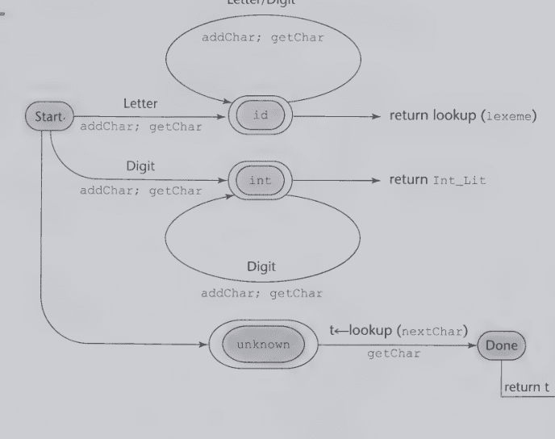

```
/* Function declarations */
void addChar();
void getChar();
void getNonBlank();
int lex();

/* Character classes */
#define LETTER 0
#define DIGIT 1
#define UNKNOWN 99

/* Token codes */
#define INT_LIT 10
#define IDENT 11
#define ASSIGN_OP 20
#define ADD_OP 21
#define SUB_OP 22
#define MULT_OP 23
#define DIV_OP 24
#define LEFT_PAREN 25
#define RIGHT_PAREN 26
```

```
/* ************************************************************ */
/* main driver */
main() {

    /* Open the input data file and process its contents */
    if ((in_fp = fopen("front.in", "r")) == NULL)
        printf("ERROR - cannot open front.in \n");
    else {
        getChar();
        do {
            lex();
        } while (nextToken != EOF);
    }
}

/* ************************************************************ */
/* lookup - a function to lookup operators and parentheses
           and return the token */
int lookup(char ch) {
    switch (ch) {
    case '(':
        addChar();
        nextToken = LEFT_PAREN;
        break;

    case ')':
        addChar();
        nextToken = RIGHT_PAREN;
        break;

    case '+':
        addChar();
        nextToken = ADD_OP;
        break;

    case '-':
        addChar();
        nextToken = SUB_OP;
        break;

    case '*':
        addChar();
        nextToken = MULT_OP;
        break;

    case '/':
        addChar();
        nextToken = DIV_OP;
        break;
```

```
```c
default:
	addChar();
	nextToken = EOF;
	break;
}
return nextToken;
}

/*******************************/
/* addChar - a function to add nextChar to lexeme */
void addChar() {
	if (lexLen <= 98) {
		lexeme[lexLen++] = nextChar;
		lexeme[lexLen] = 0;
	}
	else
		printf("Error - lexeme is too long\n");
}

/*******************************/
/* getChar - a function to get the next character of input and determine its character class */
void getChar() {
	if ((nextChar = getc(in_fp)) != EOF) {
		if (isalpha(nextChar))
			charClass = LETTER;
		else if (isdigit(nextChar))
			charClass = DIGIT;
		else
			charClass = UNKNOWN;
	}
	else
		charClass = EOF;
}

/*******************************/
/* getNonBlank - a function to call getChar until it returns a non-whitespace character */
void getNonBlank() {
	while (isspace(nextChar))
		getChar();
}

/*******************************/
/* lex - a simple lexical analyzer for arithmetic expressions */
int lex() {
	lexLen = 0;
	getNonBlank();
	switch (charClass) {
```

```
/* Parse identifiers */
    case LETTER:
        addChar();
        getChar();
        while (charClass == LETTER || charClass == DIGIT) {
            addChar();
            getChar();
        }
        nextToken = IDENT;
        break;

/* Parse integer literals */
    case DIGIT:
        addChar();
        getChar();
        while (charClass == DIGIT) {
            addChar();
            getChar();
        }
        nextToken = INT_LIT;
        break;

/* Parentheses and operators */
    case UNKNOWN:
        lookup(nextChar);
        getChar();
        break;

/* EOF */
    case EOF:
        nextToken = EOF;
        lexeme[0] = 'E';
        lexeme[1] = 'O';
        lexeme[2] = 'F';
        lexeme[3] = 0;
        break;
    } /* End of switch */
    printf("Next token is: %d, Next lexeme is %s\n", nextToken, lexeme);
    return nextToken;
} /* End of function lex */
```

此代码说明了词法分析器的相对简单性。当然，我们省略了输入缓冲，以及一些其他重要细节。此外，我们处理的是一个非常小且简单的输入语言。

考虑以下表达式：

```
(sum + 47) / total
```

以下是使用 front.c 的词法分析器对该表达式进行处理时的输出：

```
Next token is: 25 Next lexeme is (
Next token is: 11 Next lexeme is sum
Next token is: 21 Next lexeme is +
Next token is: 10 Next lexeme is 47
Next token is: 26 Next lexeme is )
Next token is: 24 Next lexeme is /
Next token is: 11 Next lexeme is total
Next token is: -1 Next lexeme is EOF
```

程序中的名字和保留字具有相似的模式。虽然可以构建一个状态图来识别编程语言的每个特定保留字，但这会导致状态图过大且不可行。让词法分析器以相同模式识别名字和保留字，并使用保留字表进行查找以确定哪些名字是保留字，要简单得多，也更快。这种方法将保留字视为名字标记类别中的例外。

词法分析器通常负责符号表的初始构建，符号表充当编译器的名字数据库。符号表中的条目存储有关用户定义名字的信息，以及名字的属性。例如，如果名字是变量的名字，则变量的类型是其属性之一，将存储在符号表中。名字通常由词法分析器放入符号表中。名字的属性通常由词法分析器动作之后的编译器某部分放入符号表中。

## 4.3 The Parsing Problem

分析语法过程的一部分，被称为语法分析，通常称为解析。我们将这两个术语互换使用。

本节讨论一般的解析问题，并介绍两种主要的解析算法类别，自顶向下和自底向上，以及解析过程的复杂性。

### 4.3.1 Introduction to Parsing

编程语言的解析器为给定程序构造解析树。在某些情况下，解析树只是隐式构造的，意味着也许只生成树的遍历。但在所有情况下，构建解析树所需的信息都在解析过程中创建。解析树和推导都包括语言处理器所需的所有语法信息。


语法分析有两个不同的目标：首先，语法分析器必须检查输入程序以确定它在语法上是否正确。当发现错误时，分析器必须产生诊断消息并进行恢复。在这种情况下，恢复意味着它必须回到正常状态并继续对输入程序进行分析。这一步是必需的，以便编译器在对输入程序的一次分析中尽可能多地发现错误。如果处理不当，错误恢复可能会产生更多错误，或至少产生更多错误消息。语法分析的第二个目标是为语法正确的输入生成完整的解析树，或者至少跟踪完整解析树的结构。解析树（或其跟踪）用作翻译的基础。

解析器根据其构建解析树的方向进行分类。解析器大致分为两类：自顶向下，即从根向下构建到叶；以及自底向上，即从叶向上构建到根。

在本章中，我们使用一小套关于文法符号和字符串的记号约定，以使讨论更加简洁。对于形式语言，约定如下：

- 1. 终结符号——字母表开头的小写字母（a, b, ...）
- 2. 非终结符号——字母表开头的大写字母（A, B, ...）
- 3. 终结符或非终结符——字母表末尾的大写字母（W, X, Y, Z）
- 4. 终结符串——字母表末尾的小写字母（w, x, y, z）
- 5. 混合字符串（终结符和/或非终结符）——小写希腊字母（α, β, δ, γ）

对于编程语言，终结符号是语言的小规模语法结构，也就是我们所说的词素。编程语言的非终结符号通常是蕴含意义的名称或缩写，用尖括号括起来——例如，<while_statement>、<expr>和<function_def>。一种语言的句子（对于编程语言而言就是程序）是终结符串。混合字符串描述文法规则的右部（RHS），并用于解析算法中。

## 4.3.2 自顶向下解析器

自顶向下解析器以前序遍历方式跟踪或构建解析树。解析树的前序遍历从根开始。每个节点在访问其分支之前被访问。从特定节点出发的分支按从左到右的顺序访问。这对应于最左推导。

就推导而言，自顶向下解析器可以描述如下：给定一个属于最左推导的句型，解析器的任务是找到该最左推导中的下一个句型。左句型的一般形式是 xAα，根据我们的记号约定，x 是终结符号串，A 是非终结符，α 是混合字符串。由于 x 只包含终结符，A 是该句型中最左边的非终结符，因此要获得最左推导中的下一个句型，必须扩展 A。确定下一个句型就是选择以 A 为左部（LHS）的正确文法规则。例如，如果当前句型是 xAα，并且 A 规则为 A → bB、A → cBb 和 A → a，则自顶向下解析器必须从这三条规则中选择一条来得到下一个句型，可能是 xbBα、xcBbα 或 xα。这就是自顶向下解析器的解析决策问题。

不同的自顶向下解析算法使用不同的信息来做出解析决策。最常见的自顶向下解析器通过将下一个输入记号与这些规则的右部能够生成的第一个符号进行比较，来为当前句型中最左边的非终结符选择正确的右部。哪个右部生成的字符串左端具有该记号，它就是正确的右部。因此，在句型 xAα 中，解析器将使用 A 可能生成的第一个记号来确定应使用哪条 A 规则来得到下一个句型。在上面的例子中，A 规则的三条右部都以不同的终结符开始。解析器可以根据下一个输入记号（在此例中必须是 a、b 或 c）轻松选择正确的右部。一般来说，选择正确的右部并非如此直接，因为当前句型最左边非终结符的某些右部可能以非终结符开头。

最常见的自顶向下解析算法密切相关。递归下降解析器是一种语法分析器的编码版本，它直接基于语言语法的 BNF 描述。递归下降最常见的替代方案是使用解析表而不是代码来实现 BNF 规则。这两种算法都被称为 LL 算法，它们具有同等能力，即它们适用于所有上下文无关文法的同一个子集。LL 中的第一个 L 表示从左到右扫描输入；第二个 L 表示生成最左推导。4.4 节将介绍实现 LL 解析器的递归下降方法。

## 4.3.3 自底向上解析器

自底向上解析器从叶节点开始向根节点方向构建解析树。这种解析顺序对应于最右推导的逆过程。也就是说，推导中的句型按从后到前的顺序产生。就推导而言，自底向上解析器可描述如下：给定一个右句型 α，解析器必须确定 α 的哪个子串是文法中某条规则的右部（RHS），该右部必须被归约为其左部（LHS），以产生最右推导中的前一个句型。例如，自底向上解析器的第一步是确定给定初始句子的哪个子串是待归约的 RHS，将其归约为相应的 LHS，从而得到推导中的倒数第二个句型。寻找待归约的正确 RHS 的过程之所以复杂，是因为给定的右句型可能包含所解析语言的文法中的多个 RHS。正确的 RHS 称为句柄。右句型是出现在最右推导中的句型。

考虑以下文法和推导：

```
S → AAc
A → aA | b

S => aAc => aaAc => aabc
```

该句子 aabc 的自底向上解析器从该句子开始，必须找到其中的句柄。在这个例子中，这很容易，因为该字符串只包含一个 RHS，即 b。当解析器用 b 的左部 A 替换 b 时，得到推导中的倒数第二个句型 aaAc。如前所述，在一般情况下，找到句柄要困难得多，因为一个句型可能包含多个不同的 RHS。

自底向上解析器通过检查可能句柄一侧或两侧的符号来找到给定右句型的句柄。可能句柄右侧的符号通常是输入中尚未分析过的记号。

最常见的自底向上解析算法属于 LR 族，其中 L 表示从左到右扫描输入，R 表示生成最右推导。

## 4.3.4 解析的复杂性

适用于任意无歧义文法的解析算法既复杂又低效。事实上，此类算法的复杂度为 O(n³)，这意味着它们所需的时间与待解析字符串长度的立方成正比。需要如此长的时间是因为这些算法经常必须回退并重新解析正在分析的句子的一部分。当解析器在解析过程中出错时，就需要重新解析。回退解析器还要求正在构建的解析树（或其跟踪）的一部分必须被拆除并重建。O(n³) 算法通常不适用于实际过程，例如编译器的语法分析，因为它们太慢了。在这种情况下，计算机科学家经常寻找更快但通用性较低的算法。用通用性换取效率。在解析方面，已经找到了一些更快的算法，它们仅适用于所有可能文法的一个子集。只要该子集包含描述编程语言的文法，这些算法就是可以接受的。（实际上，如第 3 章所讨论的，整个类别


of context-free grammars is not adequate to describe all of the syntax of most programming languages.)

所有用于商业编译器语法分析器的算法复杂度均为 O(n)，这意味着它们花费的时间与待解析字符串的长度呈线性关系。这比 O(n³) 算法高效得多。

## 4.4 递归下降分析

本节介绍递归下降自顶向下分析器实现过程。

### 4.4.1 递归下降分析过程

递归下降分析器之所以得名，是因为它由一组子程序组成，其中许多是递归的，并且它以自顶向下的顺序生成分析树。这种递归反映了编程语言的本质，编程语言包含多种不同类型的嵌套结构。例如，语句通常嵌套在其他语句中。此外，表达式中的括号必须正确嵌套。这些结构的语法可以用递归文法规则自然地描述。

EBNF 非常适合递归下降分析器。回顾第 3 章，EBNF 的主要扩展是花括号，它指定其所包含的内容可以出现零次或多次，以及方括号，它指定其所包含的内容可以出现一次或根本不出现。注意，在这两种情况下，被包含的符号都是可选的。考虑以下示例：

```
<if_statement> → if <logic_expr> <statement> [else <statement>]
<ident_list> → ident {, ident}
```

在第一个规则中，if 语句的 else 子句是可选的。在第二个规则中，<ident_list> 是一个标识符，后跟零个或多个逗号和标识符的重复。

递归下降分析器为其关联文法中的每个非终结符都有一个子程序。与特定非终结符关联的子程序的职责如下：给定一个输入字符串，它会追踪出以该非终结符为根并且叶子匹配输入字符串的分析树。实际上，递归下降分析子程序是其关联非终结符生成的语言（字符串集合）的分析器。

考虑以下 EBNF 描述的简单算术表达式：

```
<expr> → <term> {(+ | -) <term>}
<term> → <factor> {(* | /) <factor>}
<factor> → id | int_constant | ( <expr> )
```

回顾第 3 章，此类算术表达式的 EBNF 文法，例如此文法，并不强制任何结合性规则。因此，在将此类文法用作编译器的基础时，必须注意确保代码生成过程，该过程通常由语法分析驱动，生成的代码遵守语言的结合性规则。当使用递归下降分析时，这可以很容易地完成。

在下面的递归下降函数 expr 中，词法分析器是第 4.2 节中实现的功能。它获取下一个词元并将其标记代码放入全局变量 nextToken 中。标记代码被定义为命名常量，如第 4.2 节所述。

对于只有一个 RHS 的规则的递归下降子程序相对简单。对于 RHS 中的每个终结符符号，该终结符符号与 nextToken 进行比较。如果不匹配，则为语法错误。如果匹配，则调用词法分析器以获取下一个输入标记。对于每个非终结符，调用该非终结符的分析子程序。

前一个示例文法中第一个规则的递归下降子程序，用 C 语言编写，是

```
/* expr
   Parses strings in the language generated by the rule:
   <expr> -> <term> {(+ | -) <term>}
*/
void expr() {
    printf("Enter <expr>\n");

    /* Parse the first term */
    term();

    /* As long as the next token is + or -, get
       the next token and parse the next term */
    while (nextToken == ADD_OP || nextToken == SUB_OP) {
        lex();
        term();
    }
    printf("Exit <expr>\n");
} /* End of function expr */
```

请注意，expr 函数包含跟踪输出语句，这些语句用于生成本节后面显示的示例输出。

递归下降分析子程序采用的约定是每个子程序都使下一个输入标记留在 nextToken 中。因此，每当分析函数开始时，它都假定 nextToken 具有尚未在分析过程中使用的输入最左标记的代码。

expr 函数分析的语言部分由一个或多个项组成，这些项由加号或减号运算符分隔。这是非终结符 <expr> 生成的语言。因此，它首先调用分析项的函数（term）。然后，只要

它找到 ADD_OP 或 SUB_OP 标记（通过调用 lex 跳过），它就会继续调用该函数。此递归下降函数比大多数函数更简单，因为其关联规则只有一个 RHS。此外，它不包含语法错误检测或恢复的代码，因为与文法规则没有可检测的错误相关联。

对于具有多个 RHS 的非终结符的递归下降分析子程序，首先包含代码来确定要分析哪个 RHS。每个 RHS 在编译器构造时都会被检查，以确定可以在其生成的句子开头出现的终结符符号集合。通过将这些集合与下一个输入标记进行匹配，分析器可以选择正确的 RHS。

<term> 的分析子程序与 <expr> 的类似：

```
/* term
   Parses strings in the language generated by the rule:
   <term> -> <factor> {(* | /) <factor>}
   */
void term() {
   printf("Enter <term>\n");
   /* Parse the first factor */
   factor();
   /* As long as the next token is * or /, get the
      next token and parse the next factor */
   while (nextToken == MULT_OP || nextToken == DIV_OP) {
      lex();
      factor();
   }
   printf("Exit <term>\n");
} /* End of function term */
```

我们算术表达式文法的 <factor> 非终结符的函数必须在其两个 RHS 之间进行选择。它还包括错误检测。在 <factor> 函数中，检测到语法错误时的反应只是调用 error 函数。在实际分析器中，检测到错误时必须生成诊断消息。此外，分析器必须从错误中恢复，以便分析过程可以继续。

```
/* factor
   Parses strings in the language generated by the rule:
   <factor> -> id | int_constant | ( <expr> )
   */
void factor() {
   printf("Enter <factor>\n");
   /* Determine which RHS */
   if (nextToken == IDENT || nextToken == INT_LIT)
```

```
/* Get the next token */
lex();

/* If the RHS is (<expr>), call lex to pass over the
   left parenthesis, call expr, and check for the right
   parenthesis */
else {
    if (nextToken == LEFT_PAREN) {
        lex();
        expr();
        if (nextToken == RIGHT_PAREN)
            lex();
        else
            error();
    } /* End of if (nextToken == ... */

    /* It was not an id, an integer literal, or a left
       parenthesis */
    else
        error();
} /* End of else */

printf("Exit <factor>\n");
} /* End of function factor */
```

以下是使用分析函数 expr、term 和 factor 以及第 4.2 节中的函数 lex 对示例表达式 (sum + 47) / total 进行分析的跟踪。注意，分析始于调用 lex 和起始符号例程，在本例中为 expr。

```
Next token is: 25 Next lexeme is (
Enter <expr>
Enter <term>
Enter <factor>
Next token is: 11 Next lexeme is sum
Enter <expr>
Enter <term>
Enter <factor>
Next token is: 21 Next lexeme is +
Exit <factor>
Exit <term>
Next token is: 10 Next lexeme is 47
Enter <term>
Enter <factor>
Next token is: 26 Next lexeme is )
Exit <factor>
Exit <term>
Exit <expr>
Next token is: 24 Next lexeme is /
Exit <factor>
```

```
Next token is: 11 Next lexeme is total
Enter <factor>
Next token is: -1 Next lexeme is EOF
Exit <factor>
Exit <term>
Exit <expr>
```

分析器对前述表达式追踪的分析树如图 4.2 所示。

## Figure 4.2

Parse tree for
(sum + 47) / total

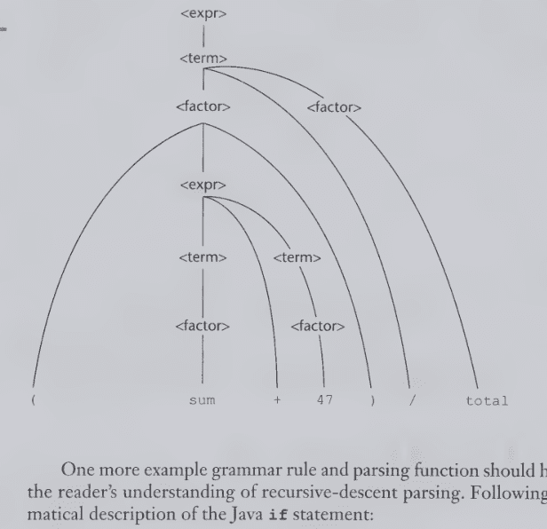

再一个示例文法规则和分析函数应该有助于巩固读者对递归下降分析的理解。以下是 Java if 语句的语法描述：

```
<ifstmt> → if (<boolexpr>) <statement> [else <statement>]
```

该规则的递归下降子程序如下：

```
/* Function ifstmt
Parses strings in the language generated by the rule:
<ifstmt> -> if (<boolexpr>) <statement>
[else <statement>]
*/
void ifstmt() {
/* Be sure the first token is 'if' */
if (nextToken != IF_CODE)
  error();
else {


```
/* Call lex to get to the next token */
    lex();
/* Check for the left parenthesis */
    if (nextToken != LEFT_PAREN)
        error();
    else {
/* Parse the Boolean expression */
        boolexpr();
/* Check for the right parenthesis */
    if (nextToken != RIGHT_PAREN)
        error();
    else {
/* Parse the then clause */
        statement();
/* If an else is next, parse the else clause */
        if (nextToken == ELSE_CODE) {
/* Call lex to get over the else */
            lex();
            statement();
        } /* end of if (nextToken == ELSE_CODE ... */
    } /* end of else of if (nextToken != RIGHT ... */
    } /* end of else of if (nextToken != LEFT ... */
    } /* end of else of if (nextToken != IF_CODE ... */
} /* end of ifstmt */

请注意，这个函数使用了本节未给出的用于语句和布尔表达式的解析器函数。

这些示例的目的是让你相信，只要语言具有合适的文法，递归下降解析器是很容易编写的。允许构建递归下降解析器的文法特征将在下一小节中讨论。

## 4.4.2 LL文法类

在为编译器或其他程序分析工具选择递归下降作为解析策略之前，必须考虑到该方法在文法限制方面的局限性。本节讨论这些限制及其可能的解决方案。

对 LL 解析器造成灾难性问题的一个简单文法特征是左递归。例如，考虑以下规则：

A → A + B

用于 A 的递归下降解析器子程序会立即调用自身来分析其右部（RHS）中的第一个符号。该 A 解析器子程序的这次激活又会立即再次调用自身，一次又一次，如此反复。很容易看出，这不会产生任何结果（只会导致栈溢出）。

规则 A → A + B 中的左递归被称为直接左递归，因为它出现在单条规则中。可以通过以下过程从文法中消除直接左递归：

对于每个非终结符 A，
1. 将 A 规则分组为 A → Aα₁ | ⋯ | Aαₘ | β₁ | β₂ | ⋯ | βₙ，其中所有 β 均不以 A 开头
2. 用下面的规则替换原来的 A 规则：
A → β₁A′ | β₂A′ | ⋯ | βₙA′
A′ → α₁A′ | α₂A′ | αₘA′ | ε

注意，ε 表示空串。以 ε 作为右部的规则称为擦除规则（erasure rule），因为在推导中使用它会有效地将其左部（LHS）从句型中擦除。

考虑以下示例文法以及上述过程的应用：
E → E + T | T
T → T * F | F
F → (E) | id

对于 E 规则，我们有 α₁ = + T，β = T，因此将 E 规则替换为：
E → T E′
E′ → + T E′ | ε

对于 T 规则，我们有 α₁ = *F，β = F，因此将 T 规则替换为：
T → F T′
T′ → * F T′ | ε

由于 F 规则中没有左递归，它们保持不变，因此替换后的完整文法为：
E → T E′
E′ → + T E′ | ε
T → F T′
T′ → * F T′ | ε
F → (E) | id

该文法生成与原始文法相同的语言，但不是左递归的。

与 4.4.1 节中使用 EBNF 编写的表达式文法一样，该文法并未指定运算符的左结合性。不过，基于该文法设计代码生成是相对容易的，可以使加法和乘法运算符具有左结合性。

间接左递归与直接左递归会带来同样的问题。例如，假设我们有：
A → B a A
B → A b

针对这些规则的递归下降解析器会令 A 子程序立即调用 B 的子程序，而 B 的子程序又立即调用 A 子程序。因此，问题与直接左递归相同。左递归问题并不局限于用递归下降方法构建自顶向下解析器。它对所有自顶向下解析算法都是一个难题。幸运的是，左递归对自底向上的解析算法不构成问题。

存在一种修改给定文法以消除间接左递归的算法（Aho 等，2006），但此处不予讨论。在为程序设计语言编写文法时，通常可以避免包含直接和间接左递归。

左递归并不是禁止自顶向下解析的唯一文法特征。另一个特征是，解析器是否总能够仅使用当前句型中最左非终结符生成的第一个记号，根据输入的下一个记号来选择正确的右部（RHS）。有一种相对简单的测试方法，可以判断非左递归文法是否能做到这一点，称为两两不相交测试（pairwise disjointness test）。该测试需要能够根据文法中给定非终结符的各右部计算一个集合。这些集合称为 FIRST，定义如下：

FIRST(α) = {a | α =>* aβ}（如果 α =>* ε，则 ε 在 FIRST(α) 中）

其中 =>* 表示零个或多个推导步骤。

计算任意混合串 α 的 FIRST 的算法可在 Aho 等人（2006）的著作中找到。就我们的目的而言，FIRST 通常可以通过检查文法直接计算得出。

两两不相交测试如下：

对于文法中具有多个右部的每个非终结符 A，对于每一对规则 A → αi 和 A → αj，必须满足：

FIRST(αi) ∩ FIRST(αj) = φ

（两个集合 FIRST(αi) 和 FIRST(αj) 的交集必须为空。）

换句话说，如果一个非终结符 A 有多个右部，那么在推导中每个右部所能生成的第一个终结符必须对该右部而言是唯一的。考虑以下规则：

A → aB | bAb | Bb
B → cB | d

A 规则的各右部的 FIRST 集合分别是 {a}、{b} 和 {c, d}，它们显然是不相交的。因此，这些规则通过了两两不相交测试。就递归下降解析器而言，这意味着用于解析非终结符 A 的子程序代码只需看到该非终结符生成的输入的第一个终结符（记号），就能选择它正在处理的右部。现在考虑规则：

A → aB | BAb
B → aB | b

A 规则中各右部的 FIRST 集合是 {a} 和 {a, b}，它们显然不是不相交的。因此，这些规则未通过两两不相交测试。就解析器而言，A 的子程序无法通过查看输入的下一个符号来确定正在解析哪一个右部，因为如果该符号是 a，则它可能是任一右部。如果一个或多个右部以非终结符开头，这个问题当然会更加复杂。

在许多情况下，未通过两两不相交测试的文法可以通过修改而通过测试。例如，考虑规则：

```
<variable> → identifier | identifier [<expression>]
```

这条规则说明 <variable> 要么是一个 identifier，要么是一个 identifier 后跟括号中的表达式（下标）。这些规则显然不能通过两两不相交测试，因为两个右部都以相同的终结符 identifier 开头。这个问题可以通过称为提取左因子（left factoring）的过程来缓解。

现在我们非正式地考察一下提取左因子。考虑 <variable> 的规则。两个右部都以 identifier 开头。在两个右部中，identifier 之后的部分分别是 ε（空串）和 [<expression>]。这两条规则可以替换为以下两条规则：

```
<variable> → identifier <new>
```

```
<new> → ε | [<expression>]
```

不难看出，这两条规则合在一起生成的语言与我们最初的两条规则相同，而且它们通过了两两不相交测试。

如果文法被用作递归下降解析器的基础，还有一种可以替代提取左因子的方法。通过 EBNF 扩展，该问题以一种与提取左因子解决方案非常相似的方式消失。考虑上面 <variable> 的原始规则。通过将下标放在方括号中，可以使其成为可选项，如下所示：

```
<variable> → identifier [ [<expression>] ]
```

在此规则中，外层方括号是元符号，表示其中内容是可选的；内层方括号是被描述编程语言的终结符。关键在于，我们用一条规则替换了两条规则，该规则生成相同的语言，但通过了两两不相交测试。

提取左因子的形式化算法可在 Aho 等人（2006）的著作中找到。提取左因子并不能解决文法的所有两两不相交问题。在某些情况下，必须以其他方式重写规则来消除该问题。


## 4.5.1 针对自底向上分析器的分析问题

考虑以下算术表达式文法的例子：

E → E + T | T
T → T * F | F
F → (E) | id

注意，该文法生成的算术表达式与第 4.4 节中的例子相同。不同之处在于该文法是左递归的，这对自底向上分析器是可以接受的。还要注意，自底向上分析器的文法通常不包含用于指定 BNF 扩展的元符号。以下最右推导说明了该文法：

E => E + T
=> E + T * F
=> E + T * id
=> E + F * id
=> E + id * id
=> T + id * id
=> F + id * id
=> id + id * id

该推导中每个句型形式的下划线部分是被改写为其对应 LHS 以得到前一个句型形式的 RHS。自底向上分析的过程产生的是最右推导的逆过程。因此，在示例推导中，自底向上分析器从最后一个句型形式（输入句子）开始，并从那里产生句型形式序列，直到只剩下开始符号，在此文法中为 E。在每一步，自底向上分析器的任务是找到句型形式中必须被改写以得到下一个（前一个）句型形式的特定 RHS，即句柄。如前所述，一个右句型形式可能包含多个 RHS。例如，右句型形式

E + T * id

包含三个 RHS，E + T、T 和 id。其中只有一个是句柄。例如，如果在该句型形式中选择 RHS E + T 进行改写，则得到的句型形式将是 E * id，但 E * id 不是给定文法的合法右句型形式。

右句型形式的句柄是唯一的。自底向上分析器的任务是找到其相关文法可以生成的任何给定右句型形式的句柄。形式上，句柄定义如下：

定义：β 是右句型形式 γ = αβw 的句柄当且仅当 S =>*rm αAw =>rm αβw

在此定义中，=>rm 指定一个最右推导步骤，=>*rm 指定零个或多个最右推导步骤。尽管句柄的定义在数学上很简洁，但它在找到给定右句型形式的句柄方面帮助不大。下面，我们提供了与句柄相关的句型形式若干子串的定义。其目的是提供关于句柄的一些直觉。

定义：β 是右句型形式 γ 的短语当且仅当 S =>* γ = α₁Aα₂ =>+ α₁β α₂

在此定义中，=>+ 表示一个或多个推导步骤。

定义：β 是右句型形式 γ 的简单短语当且仅当 S =>* γ = α₁Aα₂ =>+ α₁β α₂

如果仔细比较这两个定义，很明显它们仅在最后的推导规范上有所不同。短语的定义使用一个或多个步骤，而简单短语的定义使用恰好一个步骤。

短语和简单短语的定义可能看起来与句柄一样缺乏实用价值，但事实并非如此。考虑短语相对于一个分析树。它是整个分析树中某个特定内部节点为根的部分分析树的全部叶子的字符串。简单短语只是一个短语，它从其根非终结符节点经过单步推导而来。用分析树的术语来说，短语可以从单个非终结符在一条或多条树层级中推导出来，但简单短语只能在单一树层级中推导出来。考虑图 4.3 所示的分析树。

### 图 4.3
A parse tree for
E + T * id

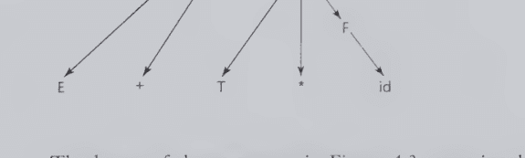

图 4.3 中分析树的叶子构成了句型形式 E + T * id。因为有三个内部节点，所以有三个短语。每个内部节点都是一个子树的根，其叶子是一个短语。整个分析树的根节点 E 生成了全部结果句型形式 E + T * id，这是一个短语。内部节点 T 生成叶子 T * id，这也是另一个短语。最后，内部节点 F 生成 id，这也是一个短语。因此，句型形式 E + T * id 的短语是 E + T * id、T * id 和 id。注意，短语不一定是底层文法中的 RHS。

简单短语是短语的子集。在前面的例子中，唯一的简单短语是 id。简单短语始终是文法中的一个 RHS。讨论短语和简单短语的原因是：任何最右句型形式的句柄都是其最左的简单短语。因此，现在我们有了一种非常直观的方法来找到任何右句型形式的句柄，前提是我们有文法并且可以绘制分析树。当然，这种寻找句柄的方法对分析器来说并不实用。（如果你已经有分析树，为什么还需要分析器？）它的唯一目的就是为读者提供关于句柄相对于分析树的直觉感受，这比试图用句型形式来思考句柄更容易。

我们现在可以从分析树的角度来考虑自底向上分析，尽管分析器的目的就是产生分析树。给定一个完整句子的分析树，你可以很容易地找到句柄，即在句子中首先需要改写以得到前一个句型形式的内容。然后句柄可以从分析树中剪除并重复该过程。一直继续到分析树的根，可以构造出整个最右推导。

## 4.5.2 移进-归约算法

自底向上分析器通常称为移进-归约算法，因为移进和归约是它们指定的两个最常见动作。自底向上分析器的一个组成部分是栈。与其他分析器一样，自底向上分析器的输入是程序的标记流，输出是一系列文法规则。移进动作将下一个输入标记移入分析器的栈。归约动作用其对应的 LHS 替换栈顶的 RHS（句柄）。每一种编程语言的分析器都是一个下推自动机（PDA），因为 PDA 是上下文无关语言的识别器。你不必精通 PDA 就可以理解自底向上分析器的工作原理，尽管这会有帮助。PDA 是一种非常简单的数学机器，它从左到右扫描符号串。PDA 因其使用下推栈作为内存而得名。PDA 可用作上下文无关语言的识别器。给定一个上下文无关语言字母表上的符号串，为此目的设计的 PDA 可以确定该串是否为该语言中的句子。在此过程中，PDA 可以产生构造该句子分析树所需的信息。

使用 PDA 时，输入串被逐个符号、从左到右检查。输入的处理方式就好像它存储在另一个栈中，因为 PDA 从来不会看到输入的最左符号之外的更多内容。

注意，递归下降分析器也是一个 PDA。在这种情况下，栈是运行时系统的栈，它记录子程序调用（以及其他内容），这些调用对应于文法的非终结符。

## 4.5.3 LR 分析器

已经设计出许多不同的自底向上分析算法。它们大多数是 LR 过程的变体。LR 分析器使用相对较小的程序和为特定编程语言构建的分析表。

原始的 LR 算法由 Donald Knuth 设计（Knuth, 1965）。该算法有时称为规范 LR，在其发表后的几年里并未被使用，因为生成所需的分析表需要大量的计算机时间和内存。随后，开发了几种规范 LR 表构造过程的变体（DeRemer, 1971; DeRemer and Pennello, 1982）。它们具有两个特征：（1）与规范 LR 算法相比，它们需要更少的计算机资源来生成所需的分析表，（2）它们适用于比规范 LR 算法更小的文法类。

LR 分析器有三个优点：

- 1. 它们可以为所有编程语言构建。
- 2. 它们可以在左到右扫描中尽早检测语法错误。
- 3. LR 文法类是 LL 分析器可分析类的真超集（例如，许多左递归文法是 LR，但没有一个是 LL）。

LR 分析的唯一缺点是手工为给定文法生成完整编程语言的分析表很困难。这并不是一个严重的问题，因为有几个程序可将文法作为输入并生成分析表，如本节后面所述。

在 LR 分析算法出现之前，有许多分析算法通过查看句型形式中怀疑为句柄的子串的左右两侧来寻找右句型形式的句柄。Knuth 的洞见是，可以有效地查看怀疑句柄左侧一直到分析栈底部以确定它是否为句柄。但与分析过程相关的分析栈中的所有信息都可以用单个状态表示，该状态可以存储在栈顶。换句话说，Knuth 发现无论输入串的长度、句型形式的长度或分析栈的深度如何，就分析过程而言，只有相对较少的不同情况。每种情况都可以用一个状态表示并存储在分析栈中，栈中每个文法符号对应一个状态符号。栈顶始终是一个状态符号，它代表了到当前时刻为止分析历史的全部相关信息。我们将使用带下标的大写 S 来表示分析器状态。

图 4.4 显示了 LR 分析器的结构。LR 分析器的分析栈内容具有以下形式：

```
S₀X₁S₁X₂ … XₘSₘ (top)
```

其中 S 为状态符号，X 为文法符号。LR 分析器配置是一对字符串（栈，输入），其详细形式为

```
(S₀X₁S₁X₂S₂ … XₘSₘ, aᵢaᵢ₊₁ … aₙ$)
```


# 图 4.4

LR 分析器的结构

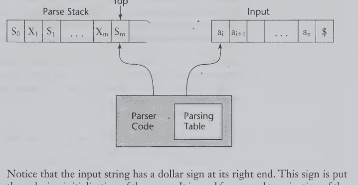

请注意，输入字符串在其右端有一个美元符号。该符号是在初始化分析器时放置的。它用于分析器的正常终止。使用此分析器配置，我们可以正式定义基于分析表的 LR 分析器过程。

LR 分析表有两个部分，名为 ACTION 和 GOTO。表的 ACTION 部分指定了分析器的大部分行为。它以状态符号作为行标签，以文法的终结符作为列标签。给定当前分析器状态，该状态由位于分析栈顶部的状态符号表示，以及输入的下一个符号（记号），分析表指定分析器应执行的操作。两个主要分析器操作是移进和归约。分析器要么将下一个输入符号移进分析栈，要么栈顶已有句柄，它将该句柄归约为产生式 RHS 与句柄相同规则的 LHS。另两种可能的操作是：接受，表示分析器已成功完成输入的分析；错误，表示分析器已检测到语法错误。

LR 分析表的 GOTO 部分的行以状态符号作为标签。该部分以非终结符作为列标签。GOTO 部分表中的值指示在完成归约后应将哪个状态符号压入分析栈，这意味着句柄已从分析栈中移除，并且新的非终结符已压入分析栈。具体符号可在其标签为在移除句柄及其相关状态符号后暴露在分析栈顶部的状态符号的行中找到。使用的 GOTO 表列是其标签为所用归约规则的 LHS 的列。

考虑以下算术表达式的传统文法：

- 1. E → E + T
- 2. E → T
- 3. T → T * F
- 4. T → F
- 5. F → (E)
- 6. F → id

该文法的规则被编号以便在分析表中简单引用它们。

# 图 4.5

算术表达式文法的 LR 分析表

对操作使用缩写：R 表示归约，S 表示移进。R4 表示使用规则 4 归约；S6 表示将输入的下一个符号移进栈并将状态 S6 压入栈。ACTION 表中的空位置表示语法错误。在完整的分析器中，这些位置可以调用错误处理例程。

LR 分析表可以很容易地使用软件工具构造，例如 yacc（Johnson, 1975），它将文法作为输入。虽然 LR 分析表可以手工制作，但对于真实编程语言的文法，该任务将冗长、繁琐且容易出错。对于实际编译器，LR 分析表始终使用软件工具生成。

LR 分析器的初始配置为

(S0, a1 ... an$)

分析器操作非正式定义如下：

- 1. 移进过程很简单：将输入的下一个符号连同 ACTION 表中移进规范的一部分状态符号一起压入栈。
- 2. 对于归约操作，必须从栈中移除句柄。因为栈上每个文法符号都有一个状态符号，所以从栈中移除的符号数是句柄中符号数的两倍

# 图 4.5

算术表达式文法的 LR 分析表

|  | Action |  |  |  |  |  | Goto |  |  |
|---|---|---|---|---|---|---|---|---|---|
| State | id | + | * | ( | ) | $ | E | T | F |
| 0 | S5 |  |  | S4 |  |  | 1 | 2 | 3 |
| 1 |  | S6 |  |  |  | accept |  |  |  |
| 2 |  | R2 | S7 |  | R2 | R2 |  |  |  |
| 3 |  | R4 | R4 |  | R4 | R4 |  |  |  |
| 4 | S5 |  |  | S4 |  |  | 8 | 2 | 3 |
| 5 |  | R6 | R6 |  | R6 | R6 |  |  |  |
| 6 | S5 |  |  | S4 |  |  |  | 9 | 3 |
| 7 | S5 |  |  | S4 |  |  |  |  | 10 |
| 8 |  | S6 |  |  | S11 |  |  |  |  |
| 9 |  | R1 | S7 |  | R1 | R1 |  |  |  |
| 10 |  | R3 | R3 |  | R3 | R3 |  |  |  |
| 11 |  | R5 | R5 |  | R5 | R5 |  |  |  |

在移除句柄及其相关状态符号后，将规则的 LHS 压入栈。最后使用 GOTO 表，其中行标签为在移除句柄及其状态符号后暴露的符号，列标签为所用归约规则的 LHS 的非终结符。

3. 当操作为接受时，分析完成且未发现错误。

4. 当操作为错误时，分析器调用错误处理例程。

尽管有许多基于 LR 概念的分析算法，但它们仅在分析表的构造上有所不同。所有 LR 分析器都使用相同的分析算法。

也许通过示例来熟悉 LR 分析过程是最好的方法。初始时，分析栈只有一个符号 0，即分析器。输入栈包含带有结束标记的输入字符串，在此例中为美元符号，附加在其右端。在每一步，分析器操作由分析栈的顶部（图 4.4 中最右侧）符号和输入的下一个（图 4.4 中最左侧）符号决定。正确的操作从分析表 ACTION 部分的相应单元格中选择。GOTO 部分的分析表在归约操作后使用。回想一下，GOTO 用于确定归约后放置在分析栈上的状态符号。

以下是使用 LR 分析算法和图 4.5 所示分析表对字符串 id + id * id 进行分析的跟踪。

| Stack | Input | Action |
|-------|-------|--------|
| 0 | id + id $ | Shift 5 |
| 0id5 | + id * $ | Reduce 6 (use GOTO[0, F]) |
| 0F3 | + id * $ | Reduce 4 (use GOTO[0, T]) |
| 0T2 | + id * $ | Reduce 2 (use GOTO[0, E]) |
| 0E1 | + id * $ | Shift 6 |
| 0E1+6 | id * $ | Shift 5 |
| 0E1+6id5 | * id $ | Reduce 6 (use GOTO[6, F]) |
| 0E1+6F3 | * id $ | Reduce 4 (use GOTO[6, T]) |
| 0E1+6T9 | * id $ | Shift 7 |
| 0E1+6T9*7 | id $ | Shift 5 |
| 0E1+6T9*7id5 | $ | Reduce 6 (use GOTO[7, F]) |
| 0E1+6T9*7F10 | $ | Reduce 3 (use GOTO[6, T]) |
| 0E1+6T9 | $ | Reduce 1 (use GOTO[0, E]) |
| 0E1 | $ | Accept |

从给定文法生成 LR 分析表的算法，如 Aho et al.（2006）所述，并不过于复杂，但超出了编程语言书籍的范围。如前所述，有许多不同的软件系统可用于生成 LR 分析表。

# 总结

语法分析是语言实现中常见的部分，无论使用何种实现方法。语法分析通常基于所实现语言的形式语法描述。上下文无关文法，也称为 BNF，是描述语法的最常见方法。语法分析任务通常分为两个部分：词法分析和语法分析。分离词法分析有几个原因：简单性、效率和可移植性。

词法分析器是模式匹配器，它分离程序的小规模部分，称为词素。词素出现在类别中，例如整数字面量和名称。这些类别称为记号。每个记号被分配一个数字代码，连同词素一起就是词法分析器产生的输出。构造词法分析器有三种不同的方法：使用软件工具生成表驱动分析器的表、手工构建此类表，以及编写代码来实现所实现语言记号的状态图描述。如果使用字符类进行转换而不是为每个状态节点中的每个可能字符进行转换，则记号的状态图可以相当小。此外，通过使用表查找来识别保留字，可以简化状态图。

语法分析器有两个目标：检测给定程序中的语法错误，并为给定程序生成语法树，或可能仅生成构建此类树所需的信息。语法分析器要么是自顶向下，意味着它们构造最左推导并自顶向下构建语法树，要么是自底向上，在这种情况下它们构造最右推导的逆并自底向上构建语法树。适用于所有无歧义文法的分析器复杂度为 O(n³)。然而，用于实现编程语言语法分析器的分析器在无歧义文法的子类上工作，复杂度为 O(n)。

递归下降分析器是 LL 分析器，通过直接从源语言文法编写代码来实现。EBNF 是递归下降分析器的理想基础。递归下降分析器为文法中的每个非终结符都有一个子程序。给定文法规则的代码很简单，如果规则只有一个 RHS。RHS 从左到右检查。对于每个非终结符，代码调用该非终结符的关联子程序，该子程序分析非终结符生成的任何内容。对于每个终结符，代码将终结符与输入的下一个记号进行比较。如果匹配，代码只需调用词法分析器获取下一个记号。如果不匹配，子程序报告语法错误。如果规则有多个 RHS，子程序必须首先确定应分析哪个 RHS。必须能够基于输入的下一个记号做出此确定。

两种不同的文法特征阻止了基于文法构造递归下降分析器。其中之一是左递归。从文法中消除直接左递归的过程相对简单。虽然我们没有涵盖它，但存在一种算法可以移除直接


以及从文法中消除间接左递归。另一个问题是通过成对不相交性测试检测到的，该测试检查解析子程序是否能够根据输入的下一个标记确定正在解析的是哪个 RHS。一些未能通过成对不相交性测试的文法通常可以通过使用左因子化来修改使其通过。

自底向上解析器的解析问题是找到当前句型中必须被规约到其关联的 LHS 的子串，以得到右推导中下一个（前一个）句型。这个子串称为句型的句柄。语法树可以为识别句柄提供直观的基础。自底向上解析器是一个移进-归约算法，因为在大多数情况下它要么将输入的下一个词素移进到语法分析栈上，要么归约栈顶上的句柄。

LR 族的移进-归约解析器是编程语言最常用的自底向上解析方法，因为该族的解析器相比替代方案具有若干优势。LR 解析器使用语法分析栈，其中包含文法符号和状态符号以维护解析器的状态。语法分析栈顶部的符号始终是一个状态符号，它代表与解析过程相关的语法分析栈中的所有信息。LR 解析器使用两个解析表：ACTION 和 GOTO。ACTION 部分指定了解析器在给定语法分析栈顶部的状态符号和输入的下一个标记时应执行的操作。GOTO 表用于确定归约后应放置在语法分析栈上的哪个状态符号。

## REVIEW QUESTIONS

- 1. 为什么使用 BNF 比使用非正式的语法描述更有优势？
- 2. 词法分析器如何作为语法分析器的前端？
- 3. 定义有限自动机和正则文法。
- 4. 如何用状态图构造一个词法分析器？
- 5. 简要描述构建词法分析器的三种方法。
- 6. 形式语言的不同文法符号有哪些？
- 7. 为什么在词法分析器的状态图中使用字符类而不是单个字符来表示字母和数字的转换？
- 8. 语法分析的两个不同目标是什么？
- 9. 描述解析算法的复杂度。
- 10. 描述递归下降解析器。
- 11. LL 算法中的两个 L 指定什么？
- 12. 阐述并解释为编写递归下降解析子程序所遵循的约定。
- 13. 为什么使用命名常量而不是数字来表示标记代码？
- 14. 描述如何为具有单个 RHS 的规则编写递归下降解析子程序。
- 15. 解释两种文法特征使它们不能作为自顶向下解析的基础。
- 16. 什么是直接左递归？
- 17. 描述成对不相交性测试。
- 18. 左因子化的局限性是什么？
- 19. 右句型的短语是什么？
- 20. 简单短语与右句型的短语有什么区别？
- 21. 右句型句柄的特征是什么？
- 22. 自顶向下和自底向上解析都基于哪种数学机器？
- 23. LR 解析器的缺点是什么？
- 24. 为什么自底向上解析器通常被称为移进-归约算法？
- 25. 描述 LR 解析器中语法分析栈的目的。
- 26. 描述规范 LR 表构造过程中的变体的属性。
- 27. 为什么编程语言的每个解析器都是一个下推自动机？

## PROBLEM SET

- 1. 对以下文法规则执行成对不相交性测试。
  - a. A → aB | b | cBB
  - b. B → aB | bA | aBb
  - c. C → aaA | b | caB
- 2. 对以下文法规则执行成对不相交性测试。
  - a. S → aSb | bAA
  - b. A → b{aB} | a
  - c. B → aB | a
- 3. 对第 4.4.1 节给出的递归下降解析器对字符串 a + b * c 显示一个跟踪。
- 4. 对第 4.4.1 节给出的递归下降解析器对字符串 a * (b + c) 显示一个跟踪。
- 5. 给定以下文法和右句型，画出语法树并显示短语和简单短语，以及句柄。

  S → aAb | bBA   A → ab | aAB   B → aB | b

  - a. aaAbb
  - b. bBab
  - c. aaAbBb
- 6. 给定以下文法和右句型，画出语法树并显示短语和简单短语，以及句柄。

  S → AbB | bAc   A → Ab | aBB   B → Ac | cBb | c

  - a. aAccbbc
  - b. AbcaBbcb
  - c. baBcBbbc
- 7. 使用第 4.5.3 节中的文法和解析表，对字符串 id * (id + id) 显示完整的解析，包括语法分析栈内容、输入字符串和动作。
- 8. 使用第 4.5.3 节中的文法和解析表，对字符串 (id + id) * id 显示完整的解析，包括语法分析栈内容、输入字符串和动作。
- 9. 获取 Aho 等人（2006）中从文法中消除间接左递归的算法。使用该算法从以下文法中消除所有左递归：S → Aa | Bb   A → Aa | Abc | c | Sb   B → bb

## PROGRAMMING EXERCISES

- 1. 设计一个状态图以识别 C-based 编程语言的一种注释形式，即以 /* 开始并以 */ 结束的注释。
- 2. 设计一个状态图以识别你喜欢的编程语言的浮点字面量。
- 3. 编写并测试实现问题 1 的状态图的代码。
- 4. 编写并测试实现问题 2 的状态图的代码。
- 5. 修改第 4.2 节给出的词法分析器以识别以下保留字列表并返回其各自的标记代码：for (FOR_CODE, 30), if (IF_CODE, 31), else (ELSE_CODE, 32), while (WHILE_CODE, 33), do (DO_CODE, 34), int (INT_CODE, 35), float (FLOAT_CODE, 36), switch (SWITCH_CODE, 37)。
- 6. 将第 4.2 节给出的用 C 编写的词法分析器转换为 Java。
- 7. 将第 4.4.1 节给出的 <expr>、<term> 和 <factor> 的递归下降解析例程转换为 Java。
- 8. 对于通过问题 1 中测试的规则，编写一个递归下降解析子程序来解析由规则生成的语言。假设你有一个名为 lex 的词法分析器和一个名为 error 的错误处理子程序，当检测到语法错误时会被调用。
- 9. 对于通过问题 2 中测试的规则，编写一个递归下降解析子程序来解析由规则生成的语言。假设你有一个名为 `lex` 的词法分析器和一个名为 `error` 的错误处理子程序，当检测到语法错误时会被调用。
- 10. 实现并测试第 4.5.3 节给出的 LR 解析算法。
- 11. 编写一个 EBNF 规则来描述 Java 或 C++ 的 `while` 语句。为此规则编写 Java 或 C++ 中的递归下降子程序。
- 12. 编写一个 EBNF 规则来描述 Java 或 C++ 的 `for` 语句。为此规则编写 Java 或 C++ 中的递归下降子程序。

## Names, Bindings, and Scopes

- 5.1 Introduction
- 5.2 Names
- 5.3 Variables
- 5.4 The Concept of Binding
- 5.5 Scope
- 5.6 Scope and Lifetime
- 5.7 Referencing Environments
- 5.8 Named Constants

本章介绍变量的基本语义问题。它首先描述编程语言中名称和特殊词的性质。然后讨论变量的属性，包括类型、地址和值，包括别名问题。接下来介绍绑定和绑定时间的重要概念，包括变量属性的不同可能绑定时间以及它们如何定义四种不同的变量类别。随后，描述了名称的两种非常不同的作用域规则：静态和动态，以及语句的引用环境的概念。最后讨论了命名常量和变量初始化。

### 5.1 Introduction

命令式编程语言在不同程度上是对底层冯·诺依曼计算机体系结构的抽象。该体系结构有两个主要组件：其内存，用于存储指令和数据；以及其处理器，提供用于修改内存内容的操作。语言中对机器内存单元的抽象是变量。在某些情况下，抽象的特征非常接近单元的特征；整数变量的例子通常直接表示在一或多个字节的内存中。在其他情况下，抽象与硬件内存的组织相去甚远，例如三维数组，需要软件映射函数来支持该抽象。

变量可以通过一组属性或特征来表征，其中最重要的一个是类型，这是编程语言中的一个基本概念。设计语言的数据类型需要考虑各种问题。（数据类型在第 6 章中讨论。）其中最重要的一个问题是变量的作用域和生命周期。

函数式编程语言允许表达式命名。这些命名表达式在命令式语言中看起来像对变量名的赋值，但从根本上不同，因为它们不能被改变。因此，它们类似于命令式语言中的命名常量。纯函数式语言没有像命令式语言那样的变量。然而，许多函数式语言确实包含此类变量。

在本书记述的其余部分中，语言族通常会被当作单个语言来提及。例如，Fortran 将指 Fortran 的所有版本。这对 Ada 也是如此。同样，对 C 的引用将指原始版本的 C，以及 C89 和 C99。当命名语言的特定版本时，是因为它在所讨论的主题中与家族的其他成员不同。如果我们在语言版本的名称后加上加号（+），我们指的是从该命名版本开始的所有语言版本。例如，Fortran 95+ 将指从 Fortran 95 开始的所有 Fortran 版本。术语 C-based languages 将用于指 C、Objective-C、C++、Java 和 C#。

1. 我们曾考虑将脚本语言 JavaScript 和 PHP 包含为 C-based languages，但决定它们与祖先相比还是有点太不同了。


## 5.2 名称

在开始讨论变量之前，必须先介绍变量的一个基本属性——名称的设计。名称也与子程序、形式参数和其他程序构造相关联。术语 *标识符* 通常与 *名称* 互换使用。

### 5.2.1 设计问题

名称的主要设计问题如下：

- 名称是否区分大小写？
- 语言的特殊词是保留字还是关键字？

这些问题将在下面两个小节中讨论，其中还包括了几种设计选择的示例。

### 5.2.2 名称形式

*名称* 是用于在程序中标识某个实体的字符序列。C99 对其内部名称没有长度限制，但只有前 63 个字符是有意义的。C99 中的外部名称（在函数外部定义，必须由链接器处理的名称）限制为 31 个字符。Java 和 C# 中的名称没有长度限制，且其中的所有字符都有意义。C++ 未规定名称的长度限制，尽管实现者有时会规定。

**历史注记**

最早的编程语言使用单字符名称。这种记法很自然，因为早期的编程主要是数学性的，而数学家长期以来在他们的形式记法中用单字符名称表示未知数。

Fortran I 打破了单字符名称的传统，其名称允许使用多达六个字符。

大多数编程语言中的名称形式相同：一个字母后跟由字母、数字和下划线字符（_）组成的字符串。尽管在 1970 年代和 1980 年代使用下划线字符构成名称的做法很普遍，但现在这种做法已远不如以前流行。在基于 C 的语言中，它在很大程度上已被所谓的 *驼峰命名法* 所取代，其中多词名称中除第一个词外的所有词都被大写，如 *myStack*²。请注意，在名称中使用下划线和混合大小写是编程风格问题，而不是语言设计问题。

PHP 中的所有变量名称必须以美元符号开头。在 Perl 中，变量名称开头的特殊字符 $, @ 或 % 指定其类型（尽管含义与其他语言不同）。在 Ruby 中，变量名称开头的特殊字符 @ 或 @@ 分别表示该变量是实例变量还是类变量。

2. 它被称为“驼峰”，因为用它书写的词常常包含嵌入的大写字母，看起来像骆驼的驼峰。

在许多语言中，尤其是基于 C 的语言中，名称中的大写字母和小写字母是不同的；也就是说，这些语言中的名称是区分大小写的。例如，在 C++ 中，以下三个名称是不同的：rose、ROSE 和 Rose。对某些人来说，这对可读性是一个严重的损害，因为看起来非常相似的名称实际上表示不同的实体。从这个意义上说，大小写敏感违反了语言构造看起来相似时应具有相似含义的设计原则。但在变量名称区分大小写的语言中，尽管 Rose 和 rose 看起来相似，但它们之间没有任何联系。

显然，并非每个人都认为名称的大小写敏感是坏事。在 C 中，大小写敏感的问题通过一种约定得以避免，即变量名称不包含大写字母。然而在 Java 和 C# 中，这个问题无法避免，因为许多预定义名称同时包含大写字母和小写字母。例如，Java 将字符串转换为整数值的方法是 parseInt，而 ParseInt 和 parseint 这样的拼写则不被识别。这是一个可写性问题而非可读性问题，因为需要记住特定的大小写用法使得编写正确的程序更加困难。这是一种语言设计者的不宽容，由编译器强制执行。

### 5.2.3 特殊词

编程语言中的特殊词用于使程序更易读，通过命名要执行的操作。它们还用于分隔语句和程序的语法部分。在大多数语言中，特殊词被归类为保留字，这意味着程序员不能重新定义它们。但在某些语言中，如 Fortran，它们只是关键字，这意味着它们可以被重新定义。

保留字是编程语言的特殊词，不能用作名称。保留字存在一个潜在问题：如果语言包含大量保留字，用户可能难以想出不是保留字的名称。最好的例子是 COBOL，它有 300 个保留字。不幸的是，程序员最常选择的某些名称都在保留字列表中——例如 LENGTH、BOTTOM、DESTINATION 和 COUNT。

在本书的程序代码示例中，保留字以粗体呈现。

在大多数语言中，在其他程序单元中定义的名称，例如 Java 包以及 C 和 C++ 库，可以使程序可见。这些名称是预定义的，但只有在显式导入时才可见。一旦导入，就不能重新定义它们。

## 5.3 变量

程序变量是计算机存储单元或一组单元的抽象。程序员经常将变量视为内存位置的名称，但变量远不止一个名称那么简单。

从机器语言到汇编语言的转变在很大程度上是把数据绝对的数字内存地址替换为名称，从而使程序更易读，因此也更容易编写和维护。汇编语言还提供了一种摆脱手动绝对寻址问题的方法，因为将名称转换为实际地址的转换器也选择了这些地址。

变量可以被描述为一个六元组属性：(名称、地址、值、类型、生命周期和作用域)。尽管这对于这样一个看似简单的概念来说似乎过于复杂，但它提供了解释变量各个方面的最清晰方法。

我们对变量属性的讨论将导致对别名、绑定、绑定时间、声明、作用域规则和引用环境等重要相关概念的探讨。

变量的名称、地址、类型和值属性将在以下小节中讨论。生命周期和作用域属性分别在第 5.4.3 节和 5.5 节中讨论。

### 5.3.1 名称

变量名称是程序中最常见的名称。它们已在第 5.2 节中在程序中实体名称的一般背景下进行了详细讨论。大多数变量都有名称。没有名称的变量在第 5.4.3.3 节中讨论。

### 5.3.2 地址

变量的地址是与其关联的机器内存地址。这种关联乍一看可能并不简单。在许多语言中，同一个变量在程序执行期间的不同时间可能与不同的地址相关联。例如，如果一个子程序有一个在子程序被调用时从运行时栈分配的局部变量，不同的调用可能导致该变量具有不同的地址。这些可以说是对同一变量的不同实例化。

将变量与地址关联的过程在第 5.4.3 节中进一步讨论。子程序及其激活的实现模型在第 10 章中讨论。

变量的地址有时被称为其 l-value，因为当变量名称出现在赋值的左侧时，需要的就是地址。

可能存在多个具有相同地址的变量。当多个变量名称可用于访问同一内存位置时，这些变量称为别名。别名会妨碍可读性，因为它允许通过对不同变量的赋值来更改变量的值。例如，如果变量名 total 和 sum 是别名，对 total 值的任何更改也会更改 sum 的值，反之亦然。程序的阅读者必须始终记住 total 和 sum 是不同的名称。


对于同一个存储单元。因为程序中可能存在任意数量的别名，所以在实践中这可能非常困难。别名也会使程序验证变得更加困难。

别名可以在程序中通过多种不同的方式创建。在 C 和 C++ 中，一种常见的方式是通过其联合类型。联合类型在第 6 章中有详细讨论。

当两个指针变量指向同一存储位置时，它们就是别名。引用变量也是如此。这种别名只是指针和引用的本质所带来的副作用。当一个 C++ 指针被设置为指向一个命名变量时，该指针在解引用时与变量的名称就是别名。

别名也可以通过许多语言中的子程序参数来创建。这类别名在第 9 章中有讨论。

变量何时与地址关联对理解编程语言非常重要。该主题在第 5.4.3 节中讨论。

## 5.3.3 类型

变量的类型决定了变量可以存储的值的范围以及为该类型的值定义的操作集合。例如，Java 中的 int 类型指定了 -2147483648 到 2147483647 的值范围，以及用于加法、减法、乘法、除法和取模的算术运算。

## 5.3.4 值

变量的值是与该变量关联的存储单元或单元的内容。将计算机内存视为抽象单元而不是物理单元是方便的。大多数当代计算机内存的物理单元，或可单独寻址的单元，都是字节大小，一个字节有八位。这个大小对于大多数程序变量来说太小了。抽象存储单元的大小由与其关联的变量所需的大小决定。例如，尽管浮点值在特定语言的特定实现中可能占用四个物理字节，但浮点值被认为占用一个单一的抽象存储单元。每个简单非结构化类型的值都被认为占用一个单一的抽象单元。从今以后，术语存储单元将指抽象存储单元。

变量的值有时被称为其 r 值，因为当变量名出现在赋值语句的右侧时就需要它。要访问 r 值，必须先确定 l 值。这种确定并不总是简单的。例如，作用域规则会使问题变得复杂得多，如第 5.5 节所述。

## 5.4 绑定概念

绑定是属性与实体之间的关联，例如变量与其类型或值之间的关联，或操作与其符号之间的关联。绑定发生的时间称为绑定时间。绑定和绑定时间是编程语言语义中的重要概念。绑定可以在语言设计时、语言实现时、编译时、加载时、链接时或运行时进行。例如，星号符号 (*) 通常在语言设计时绑定到乘法操作。一种数据类型，例如 C 中的 int，在语言实现时绑定到一组可能的值。在编译时，Java 程序中的变量绑定到特定数据类型。变量可能在程序加载到内存时绑定到存储单元。在某些情况下，例如在 Java 方法中声明的变量，这种相同的绑定要到运行时才发生。对库子程序的调用在链接时绑定到子程序代码。

考虑以下 C++ 赋值语句：

```
count = count + 5;
```

该赋值语句各部分的一些绑定及其绑定时间如下：

- count 的类型在编译时绑定。
- count 的可能值集合在编译器设计时绑定。
- 运算符符号 + 的含义在编译时绑定，当其操作数的类型已被确定时。
- 字面量 5 的内部表示在编译器设计时绑定。
- count 的值在此语句执行时绑定。

对程序实体属性的绑定时间的完整理解是理解编程语言语义的先决条件。例如，要理解子程序的作用，必须理解调用中的实际参数如何绑定到其定义中的形式参数。要确定变量的当前值，可能需要知道变量何时绑定到存储以及与哪个语句或语句相关。

### 5.4.1 属性到变量的绑定

如果绑定在运行时开始之前首次发生并且在程序执行期间保持不变，则该绑定是静态的。如果绑定首次在运行时发生或可以在程序执行过程中发生变化，则称为动态。在虚拟内存环境中，变量到存储单元的物理绑定很复杂，因为单元所在的地址空间的页或段在程序执行期间可能被多次移入和移出内存。从某种意义上说，这样的变量会被反复绑定和解绑。然而，这些绑定由计算机硬件维护，变化对程序和用户不可见。因为它们与讨论无关，所以我们不关心这些硬件绑定。关键点在于区分静态绑定和动态绑定。

### 5.4.2 类型绑定

在程序中引用变量之前，它必须绑定到数据类型。此绑定的两个重要方面是类型的指定方式以及绑定发生的时间。类型可以通过某种形式的显式或隐式声明以静态方式指定。

#### 5.4.2.1 静态类型绑定

显式声明是程序中列出变量名并指定它们为特定类型的语句。隐式声明是通过默认约定而不是声明语句将变量与类型关联的一种方式。在这种情况下，变量名在程序中的首次出现构成了其隐式声明。显式和隐式声明都会创建到类型的静态绑定。

自 1960 年代中期以来设计的大多数广泛使用的编程语言完全使用静态类型绑定，并要求显式声明所有变量（Visual Basic 和 ML 是两个例外）。

隐式变量类型绑定由语言处理器执行，即编译器或解释器。隐式变量类型绑定有几种不同的基础。其中最简单的是命名约定。在这种情况下，编译器或解释器根据变量名称的语法形式将其绑定到类型。

尽管隐式声明对程序员来说是小小的便利，但它们会损害可靠性，因为它们阻止编译过程检测到一些拼写错误和程序员错误。

通过要求特定类型的名称以特定的特殊字符开头，可以避免隐式声明的一些问题。例如，在 Perl 中，任何以 $ 开头的名称都是标量，可以存储字符串或数值。如果名称以 @ 开头，则为数组；如果以 % 开头，则为哈希结构。³ 这为不同类型的变量创建了不同的命名空间。在此方案中，名称 @apple 和 $apple 是无关的，因为它们来自不同的命名空间。此外，程序阅读者总是在阅读变量名称时就知道该变量的类型。

另一种隐式类型声明使用上下文。这有时称为类型推断。在较简单的情况下，上下文是声明语句中分配给变量的值的类型。例如，在 C# 中，var 声明的变量必须包含初始值，其类型被用作变量的类型。考虑以下声明：

3. 数组和哈希都被认为是类型——两者都可以在其元素中存储任何标量。


```
var sum = 0;
var total = 0.0;
var name = "Fred";
```

sum、total 和 name 的类型分别是 int、float 和 string。请记住，这些是静态类型的变量——它们的类型在其声明所在的单元的生命周期内是固定的。

Visual Basic 以及函数式语言 ML、Haskell、OCaml 和 F# 也使用类型推断。在这些函数式语言中，名称出现的上下文是确定其类型的依据。这种类型的类型推断在第 15 章中有详细讨论。

## 5.4.2.2 动态类型绑定

在动态类型绑定中，变量的类型既不由声明语句指定，也不能通过其名称的拼写来确定。相反，变量在赋值语句中被赋予值时才被绑定到一种类型。当赋值语句执行时，被赋值的变量会被绑定到赋值语句右边表达式的值的类型。这种赋值还可能将变量绑定到一个地址和一个内存单元，因为不同类型的值可能需要不同的存储量。任何变量都可以被赋予任何类型的值。此外，变量的类型在程序执行期间可以改变任意多次。必须认识到，其类型是动态绑定的变量的类型可能是临时的。

当变量的类型是静态绑定时，可以认为变量的名称被绑定到一种类型，即变量的类型和名称是同时绑定的。然而，当变量的类型是动态绑定时，其名称可以被认为只是暂时绑定到一种类型。实际上，变量的名称永远不会绑定到类型。名称可以绑定到变量，而变量可以绑定到类型。

类型动态绑定的语言与类型静态绑定的语言有显著不同。变量到类型的动态绑定的主要优点是提供了更大的编程灵活性。例如，用使用动态类型绑定的语言编写的处理数值数据的程序可以写成通用程序，意味着它能够处理任何数值类型的数据。无论输入的数据是什么类型都是可以接受的，因为数据将被存储的变量可以在数据输入后被赋给变量时绑定到正确的类型。相比之下，由于类型的静态绑定，不能在不知道数据类型的的情况下编写 C 程序来处理数据。

在 1990 年代中期之前，最常用的编程语言使用静态类型绑定，主要例外是一些函数式语言，如 Lisp。然而，此后，使用动态类型绑定的语言有了显著转变。在 Python、Ruby、JavaScript 和 PHP 中，类型绑定是动态的。例如，JavaScript 脚本可能包含以下语句：

```
list = [10.2, 3.5];
```

无论变量名 list 之前的类型如何，此次赋值都会使其成为长度为 2 的单维数组的名称。如果语句

```
list = 47;
```

跟在前面的示例赋值之后，list 将成为标量变量的名称。

动态类型绑定的选项包含在 C# 2010 中。变量可以通过在其声明中包含 dynamic 保留字来声明使用动态类型绑定，如以下示例所示：

```
dynamic any;
```

这与声明 any 为 object 类型类似，但也有不同。相似之处在于 any 可以被赋予任何类型的值，就像它被声明为 object 一样。不同之处在于它对于几种不同的互操作情况没有用；例如，与 IronPython 和 IronRuby 等动态类型语言（分别是 Python 和 Ruby 的 .NET 版本）互操作时。然而，当未知类型的数据从外部源进入程序时，它是有用的。类成员、属性、方法参数、方法返回值和局部变量都可以声明为 dynamic。

在纯面向对象的语言中——例如 Ruby——所有变量都是引用并且没有类型；所有数据都是对象，任何变量都可以引用任何对象。这种语言中的变量在某种意义上都是同一种类型——它们是引用。然而，与只能引用特定类型值的 Java 中的引用不同，Ruby 中的变量可以引用任何对象。

动态类型绑定有两个缺点。首先，它使程序的可靠性降低，因为与静态类型绑定语言的编译器相比，编译器的错误检测能力减弱了。动态类型绑定允许任何变量被赋予任何类型的值。赋值右边的不正确类型不会被检测为错误；相反，左边的类型只是简单地更改为不正确类型。例如，假设在某个 JavaScript 程序中，i 和 x 目前是标量数值变量的名称，y 目前是数组的名称。此外，假设程序需要赋值语句

```
i = x;
```

但由于键入错误，它具有赋值语句

```
i = y;
```

在 JavaScript（或任何其他使用动态类型绑定的语言）中，解释器不会在此语句中检测到错误——变量名 i 的类型只是简单地更改为数组。但稍后对 i 的使用将期望它是一个标量，正确的结果是不可能的。在使用静态类型绑定的语言中，例如 Java，编译器会检测到赋值 i = y 中的错误，程序将无法执行。

请注意，这种缺点在一些使用静态类型绑定的语言中也或多或少存在，例如 C 和 C++，在许多情况下它们会自动将赋值的 RHS 类型转换为 LHS 的类型。

也许动态类型绑定的最大缺点是成本。实现动态属性绑定的成本相当高，尤其是在执行时间方面。类型检查必须在运行时进行。此外，每个变量都必须有一个与其关联的运行时描述符来维护当前类型。变量值的存储必须具有可变大小，因为不同类型的值需要不同的存储量。

最后，具有变量动态类型绑定的语言通常使用纯解释器而不是编译器实现。计算机没有操作数类型在编译时未知的指令。因此，如果 A 和 B 的类型在编译时未知，编译器就无法为表达式 A + B 构建机器指令。纯解释通常花费的时间至少是执行等效机器代码的 10 倍。当然，如果一种语言使用纯解释器实现，动态类型绑定的时间会被解释的总体时间所掩盖，因此在这种环境下似乎成本较低。另一方面，具有静态类型绑定的语言很少使用纯解释实现，因为这些语言中的程序可以很容易地翻译成非常高效的机器代码版本。

## 5.4.3 存储绑定和生命周期

命令式编程语言的基本特征在很大程度上取决于其变量存储绑定的设计。因此，清楚地理解这些绑定非常重要。

变量所绑定的内存单元必须以某种方式从可用内存池中获取。此过程称为分配。释放是将已从变量解绑的内存单元放回可用内存池的过程。

变量的生命周期是变量绑定到特定内存位置的时间。因此，变量的生命周期始于它绑定到特定单元时，并在它从该单元解绑时结束。为了研究变量的存储绑定，将标量（无结构）变量根据其生命周期方便地分为四类。这些类别命名为静态、栈动态、显式堆动态和隐式堆动态。在以下各节中，我们讨论这四个类别的定义、目的、优点和缺点。

### 5.4.3.1 静态变量

静态变量是在程序执行开始之前绑定到内存单元，并在程序执行终止之前一直绑定到同一内存单元的变量。静态绑定变量具有几个有价值的


在编程中的应用。全局可访问的变量通常在程序执行的整个过程中被使用，因此有必要在该执行期间将它们绑定到相同的存储。 有时拥有历史敏感的子程序很方便。 这样的子程序必须具有局部静态变量。

静态变量的一个优点是效率。 所有对静态变量的寻址都可以是直接的；⁴ 其他类型的变量通常需要间接寻址，这会更慢。 此外，分配和释放静态变量不会产生运行时间开销，尽管这段时间通常可以忽略不计。

存储静态绑定的一个缺点是灵活性降低； 特别是，只有静态变量的语言无法支持递归子程序。 另一个缺点是存储不能在变量之间共享。 例如，假设一个程序有两个子程序，两者都需要大型数组。 此外，假设这两个子程序永远不会同时处于活动状态。 如果数组是静态的，它们就不能共享相同的存储用于其数组。

C 和 C++ 允许程序员在函数中的变量定义上包含 static 指定符，使其定义的变量成为静态的。 请注意，当 static 修饰符出现在 C++、Java 和 C# 中类定义中变量的声明中时，它还意味着该变量是类变量，而不是实例变量。 类变量在类首次实例化之前某个时间被静态创建。

## 5.4.3.2 栈动态变量

栈动态变量是指其存储绑定在声明语句被展开时创建，但其类型是静态绑定的变量。 这种声明的展开是指由声明指示的存储分配和绑定过程，该过程在执行到达声明所附的代码时发生。 因此，展开发生在运行期间。 例如，出现在 Java 方法开头的变量声明在方法被调用时展开，并且由这些声明定义的变量在方法完成执行时被释放。

正如其名称所示，栈动态变量是从运行时栈分配的。

某些语言——例如 C++ 和 Java——允许变量声明出现在任何语句可以出现的地方。 在这些语言的一些实现中，函数或方法中声明的所有栈动态变量（不包括在嵌套块中声明的变量）可能在函数或方法执行开始时就绑定到存储，即使其中一些变量的声明并未出现在开头。 在这种情况下，变量在声明时变得可见，但存储绑定（以及如果在声明中指定则初始化）在函数或方法开始执行时发生。 存储绑定在变量变得可见之前发生这一事实并不影响语言的语义。

栈动态变量的优点如下： 为了有用，至少在大多数情况下，递归子程序需要某种形式的动态局部存储，以便递归子程序的每个活动副本都有其局部变量的自己的版本。 这些需求很方便地由栈动态变量满足。 即使没有递归，为子程序提供栈动态局部存储也并非没有好处，因为所有子程序共享相同的内存空间用于其局部变量。

栈动态变量相对于静态变量的缺点是分配和释放的运行时间开销，可能由于需要间接寻址而访问更慢，以及子程序不能是历史敏感的。 分配和释放栈动态变量所需的时间并不显著，因为在子程序开头声明的所有栈动态变量都是同时分配和释放的，而不是通过单独的操作。

在 Java、C++ 和 C# 中，方法中定义变量默认为栈动态。

除存储之外的所有属性都静态绑定到栈动态标量变量。 对于某些结构化类型则并非如此，如第 6 章所述。 栈动态变量的分配/释放过程的实现在第 10 章中讨论。

## 5.4.3.3 显式堆动态变量

显式堆动态变量是无名（抽象）的内存单元，它们由程序员编写的显式运行时指令分配和释放。 这些变量从堆分配并释放到堆，只能通过指针或引用变量引用。 堆是一个存储单元集合，由于其使用不可预测，其组织高度无序。 用于访问显式堆动态变量的指针或引用变量与其他标量变量一样创建。 显式堆动态变量是通过运算符（例如在 C++ 中）或对为此目的提供的系统子程序的调用（例如在 C 中）创建的。

在 C++ 中，分配运算符 new 使用类型名作为其操作数。 执行时，会创建操作数类型的显式堆动态变量并返回其地址。 因为显式堆动态变量在编译时绑定到类型，所以该绑定是静态的。 然而，这样的变量在创建时绑定到存储，而创建是在运行时。

除了用于创建显式堆动态变量的子程序或运算符外，一些语言还包括用于显式销毁它们的子程序或运算符。

作为显式堆动态变量的示例，考虑以下 C++ 代码段：

```
int *intnode;      // Create a pointer
intnode = new int; // Create the heap-dynamic variable
...
delete intnode;    // Deallocate the heap-dynamic variable
                   // to which intnode points
```

在此示例中，一个 int 类型的显式堆动态变量由 new 运算符创建。 然后可以通过指针 intnode 引用该变量。 稍后，该变量由 delete 运算符释放。 C++ 需要显式的释放运算符 delete，因为它不使用隐式存储回收，例如垃圾回收。

在 Java 中，除了原始标量之外，所有数据都是对象。 Java 对象是显式堆动态的，并通过引用变量访问。 Java 没有显式销毁堆动态变量的方法； 而是使用隐式垃圾回收。 垃圾回收在第 6 章中讨论。

C# 既有显式堆动态对象，也有栈动态对象，所有这些对象都隐式释放。 此外，C# 支持 C++ 风格的指针。 这样的指针用于引用堆、栈甚至静态变量和对象。 这些指针与 C++ 的指针有相同的危险，并且它们在堆上引用的对象不会隐式释放。 指针包含在 C# 中以允许 C# 组件与 C 和 C++ 组件互操作。 为了阻止其使用，并使任何程序阅读者清楚代码使用了指针，定义指针的任何方法的头必须包含保留字 unsafe。

显式堆动态变量通常用于构建动态结构，例如在执行期间需要增长和/或收缩的链表和树。 这样的结构可以使用指针或引用和显式堆动态变量方便地构建。

显式堆动态变量的缺点是正确使用指针和引用变量的难度，对变量引用的成本，以及所需存储管理实现的复杂性。 这本质上是堆管理的问题，这既昂贵又复杂。 显式堆动态变量的实现方法在第 6 章中进行了详细讨论。

## 5.4.3.4 隐式堆动态变量

隐式堆动态变量仅在它们被赋值为时才绑定到堆存储。 事实上，它们的所有属性在每次被赋值时都会绑定。 例如，考虑以下 JavaScript 赋值语句：

```
highs = [74, 84, 86, 90, 71];
```

无论变量名 highs 是否先前在程序中使用过或用于何处，它现在都是一个包含五个数值值的数组。


这种变量的优点在于它们具有最高的灵活性，能够编写高度通用的代码。隐式堆动态变量的一个缺点是维护所有动态属性的运行时开销，这些属性可能包括数组下标类型和范围等。另一个缺点是编译器在某些错误检测上的损失，如第 5.4.2.2 节所述。

## 5.5 作用域

理解变量的一个重要因素是作用域。变量的作用域是指变量可见的语句范围。如果一个变量可以在某条语句中被引用或赋值，则该变量在该语句中可见。

语言的作用域规则决定了名称的特定出现如何与变量关联，或者在函数式语言的情况下，名称如何与表达式关联。特别是，作用域规则决定了对在当前执行子程序或块之外声明的变量的引用如何与其声明以及由此产生的属性相关联（块在第 5.5.2 节中讨论）。因此，对语言这些规则的清晰理解对于编写或阅读该语言的程序的能力至关重要。

如果一个变量在程序单元或块中声明，则该变量在该程序单元或块中是局部的。程序单元或块的非局部变量是指在程序单元或块内可见但未在其中声明的变量。全局变量是非局部变量的一个特殊类别，在第 5.5.4 节中讨论。

类、包和命名空间的作用域问题在第 11 章中讨论。

### 5.5.1 静态作用域

ALGOL 60 引入了将名称绑定到非局部变量的方法，称为静态作用域，此后已被许多后续的命令式语言以及许多非命令式语言所复制。之所以称为静态作用域，是因为变量的作用域可以在执行前静态确定。这使得人类程序阅读者（以及编译器）只需检查其源代码即可确定程序中每个变量的类型。

静态作用域语言分为两类：一类允许子程序嵌套，从而创建嵌套的静态作用域；另一类不允许子程序嵌套。在后一类中，静态作用域也由子程序创建，但嵌套作用域仅由嵌套的类定义和块创建。

Ada、JavaScript、Common Lisp、Scheme、Fortran 2003+、F# 和 Python 允许嵌套子程序，但基于 C 的语言不允许。

本节对静态作用域的讨论集中在允许嵌套子程序的语言上。最初，我们假设所有作用域都与程序单元相关联，并且所有引用的非局部变量都在其他程序单元中声明。⁶ 在本章中，假设作用域是讨论的语言中访问非局部变量的唯一方法。这对所有语言都不成立。甚至对所有使用静态作用域的语言也不成立，但该假设简化了此处的讨论。

当程序阅读者发现对变量的引用时，可以通过找到其声明的语句（显式或隐式）来确定变量的属性。在允许嵌套子程序的静态作用域语言中，可以这样思考这一过程。假设在子程序 sub1 中对变量 x 进行了引用。正确的声明是通过首先搜索子程序 sub1 的声明来找到的。如果在那里找不到变量的声明，则搜索继续在声明了子程序 sub1 的子程序中进行，该子程序称为其静态父级。如果在那里找不到 x 的声明，则搜索继续到下一个更大的封闭单元（声明了 sub1 父级的单元），依此类推，直到找到 x 的声明或在搜索完最大单元的声明后仍未成功。在这种情况下，会报告未声明变量错误。子程序 sub1 的静态父级、其静态父级，等等，直到包括最大的封闭子程序，都称为 sub1 的静态祖先。第 10 章中讨论的静态作用域的实际实现技术通常比刚才描述的过程高效得多。

考虑以下 JavaScript 函数 big，其中两个函数 sub1 和 sub2 是嵌套的：

```
function big() {
    function sub1() {
        var x = 7;
        sub2();
    }
    function sub2() {
        var y = x;
    }
    var x = 3;
    sub1();
}
```

在静态作用域下，sub2 中对变量 x 的引用是指在过程 big 中声明的 x。这是因为对 x 的搜索从引用发生的子程序 sub2 开始，但在那里找不到 x 的声明。搜索继续在 sub2 的静态父级 big 中进行，在那里找到了 x 的声明。sub1 中声明的 x 被忽略，因为它不在 sub2 的静态祖先中。

在一些使用静态作用域的语言中，无论是否允许嵌套子程序，一些变量声明可能会被隐藏于某些其他代码段。例如，再次考虑 JavaScript 函数 big。变量 x 在 big 中声明，也在嵌套在 big 内部的 sub1 中声明。在 sub1 内部，对 x 的每个简单引用都指向局部的 x。因此，外部的 x 对 sub1 是隐藏的。

### 5.5.2 块

许多语言允许在可执行代码中定义新的静态作用域。这一强大的概念由 ALGOL 60 引入，允许代码段拥有其自身局部变量，其作用域被最小化。此类变量通常是栈动态的，因此在进入该段时分配存储，在退出该段时释放存储。此类代码段称为块。块提供了短语块结构化语言的起源。

基于 C 的语言允许任何复合语句（由匹配大括号包围的语句序列）具有声明，从而定义新的作用域。此类复合语句称为块。例如，如果 list 是一个整数数组，可以写如下代码：

```
if (list[i] < list[j]) {
    int temp;
    temp = list[i];
    list[i] = list[j];
    list[j] = temp;
}
```

块创建的作用域，可以嵌套在更大的块中，被视为与子程序创建的作用域完全相同。对块中未在其中声明的变量的引用是通过按递增大小的顺序搜索封闭作用域（块或子程序）来连接声明的。

考虑以下 C 函数骨架：

```
void sub() {
    int count;
    ...
    while (...) {
        int count;
        count++;
        ...
    }
    ...
}
```

while 循环中对 count 的引用是指该循环的局部 count。在这种情况下，sub 的 count 对 while 循环内部的代码是隐藏的。一般来说，对变量的声明有效地隐藏了在更大的封闭作用域中具有相同名称的任何声明。⁷ 请注意，此代码在 C 和 C++ 中是合法的，但在 Java 和 C# 中是非法的。Java 和 C# 的设计者认为在嵌套块中重用名称过于容易出错而不应允许。

尽管 JavaScript 对其嵌套函数使用静态作用域，但该语言中不能定义非函数块。

大多数函数式编程语言都包含与命令式语言的块相关的构造，通常命名为 let。这些构造有两个部分，第一部分是将名称绑定到值，通常指定为表达式。第二部分是使用第一部分中定义名称的表达式。函数式语言中的程序由表达式组成，而不是语句。因此，let 构造的最后一部分是表达式，而不是语句。在 Scheme 中，let 构造是对函数 LET 的调用，其形式如下：

```
(LET (
  (name₁ expression₁)
  ...
  (nameₙ expressionₙ))
  expression
)
```

对 LET 的调用的语义如下：首先计算前 n 个表达式，并将值赋给相关名称。然后计算最终表达式，LET 的返回值就是该值。这与命令式语言中的块不同之处在于名称是值的名称；它们不是命令式意义上的变量。一旦设置，就不能更改。然而，它们与命令式语言中块中的局部变量相似，因为它们的作用域局限于对 LET 的调用。考虑以下对 LET 的调用：

```
(LET (
  (top (+ a b))
  (bottom (- c d)))
  (/ top bottom)
)
```

此调用计算并返回表达式 (a + b) / (c - d) 的值。

在 ML 中，let 构造的形式如下：

```
let
  val name₁ = expression₁
  ...
  val nameₙ = expressionₙ
in
  expression
end;
```


每个 `val` 语句都将一个名称绑定到一个表达式。与 Scheme 类似，第一部分中的名称就像命令式语言中的命名常量；一旦设置，就不能更改。⁸ 考虑以下 `let` 构造：

```
let
    val  top = a + b
    val bottom = c - d
in
    top / bottom
end;
```

F# 中 `let` 构造的一般形式如下：

```
let left_side = expression
```

`let` 的 `left_side` 可以是一个名称或一个元组模式（由逗号分隔的名称序列）。

在函数定义内部使用 `let` 定义的名称的作用域是从定义表达式的末尾到函数的末尾。`let` 的作用域可以通过缩进以下代码来限制，这会创建一个新的局部作用域。虽然任何缩进都可以使用，但惯例是缩进四个空格。考虑以下代码：

```
let n1 =
    let  n2 = 7
    let  n3 = n2 + 3
    n3;;
let n4 = n3 + n1;;
```

`n1` 的作用域扩展到所有代码。然而，`n2` 和 `n3` 的作用域在缩进结束时结束。因此，在最后一个 `let` 中使用 `n3` 会导致错误。`let n1` 作用域的最后一行是绑定到 `n1` 的值；它可以是任何表达式。

第 15 章包含有关 Scheme、ML、Haskell 和 F# 中 `let` 构造的更多细节。

## 5.5.3 声明顺序

在 C89 以及某些其他语言中，函数中除嵌套块中的声明之外的所有数据声明都必须出现在函数的开头。然而，一些语言——例如 C99、C++、Java、JavaScript 和 C#——允许变量声明出现在程序单元中任何语句可以出现的位置。声明可以创建与复合语句或子程序不关联的作用域。例如，在 C99、C++ 和 Java 中，所有局部变量的作用域从其声明开始到其声明所在的块的末尾。

在 C# 中，块中声明的任何变量的作用域都是整个块，只要声明不在嵌套块中，其在块中的位置无关紧要。对于方法也是如此。请回忆 C# 不允许在嵌套块中声明的变量与嵌套作用域中的变量具有相同的名称。例如，考虑以下 C# 代码：

```
{int x;
    ...
    {int x; // Illegal
    ...
    }
    ...
}
```

由于声明的作用域是整个块，因此以下对 `x` 的嵌套声明也是非法的：

```
{
    {int x; // Illegal
    ...
    }
    int x;
}
```

请注意，C# 仍然要求所有变量在使用前必须声明。因此，尽管变量的作用域从声明延伸到其声明所在的块或子程序的顶部，但变量仍不能在其声明之上使用。

在 JavaScript 中，局部变量可以在函数中的任何位置声明，但此类变量的作用域始终是整个函数。如果在函数中在其声明之前使用，则此类变量的值为 `undefined`。引用不是非法的。

C++、Java 和 C# 的 `for` 语句允许在其初始化表达式中使用变量定义。在 C++ 的早期版本中，此类变量的作用域从其定义开始到最小封闭块的末尾。然而，在标准版本中，其作用域仅限于 `for` 构造，就像 Java 和 C# 的情况一样。考虑以下骨架方法：

```
void fun() {
    ...
    for (int count = 0; count < 10; count++) {
        ...
    }
    ...
}
```

在 C++ 的后期版本以及 Java 和 C# 中，`count` 的作用域从 `for` 语句开始到其主体末尾（右大括号）。

## 5.5.4 全局作用域

某些语言，包括 C、C++、PHP、JavaScript 和 Python，允许程序结构为函数定义的序列，其中变量定义可以出现在函数之外。文件外部的定义创建全局变量，这些变量可能对这些函数可见。

C 和 C++ 都有全局数据的声明和定义。声明指定类型和其他属性，但不会导致存储分配。定义指定属性并导致存储分配。对于特定的全局名称，C 程序可以有任意数量的兼容声明，但只有一个定义。

在函数定义之外声明变量指定该变量在不同的文件中定义。C 中的全局变量在文件中隐式对后续所有函数可见，除非这些函数包含同名局部变量的声明。定义在函数之后的全​​局变量可以通过将其声明为外部来使其在函数中可见，如下所示：

```
extern int sum;
```

在 C99 中，全局变量的定义通常具有初始值。全局变量的声明永远不会具有初始值。如果声明在函数定义之外，则不必包含 `extern` 限定符。

这种声明和定义的想法延续到 C 和 C++ 的函数中，其中原型声明函数名称和接口，但不提供其代码。另一方面，函数定义是完整的。

在 C++ 中，可以使用作用域运算符（`::`）访问被同名局部变量隐藏的全局变量。例如，如果 `x` 是一个全局变量，在函数中被名为 `x` 的局部变量隐藏，则全局变量可以引用为 `::x`。

PHP 语句可以与函数定义交错。PHP 中的变量在语句中出现时会被隐式声明。任何在任何函数之外隐式声明的变量都是全局变量；在函数中隐式声明的变量是局部变量。全局变量的作用域从其声明开始到程序末尾，但会跳过任何后续函数定义。因此，全局变量在任何函数中都不是隐式可见的。全局变量可以通过两种方式在函数的作用域中使其可见：（1）如果函数包含与全局同名的局部变量，则该全局变量可以通过 `$GLOBALS` 数组访问，使用全局名称作为字符串文字下标，（2）如果函数中没有与全局同名的局部变量，则可以通过在 `global` 声明语句中包含它来使其可见。考虑以下示例：

```
```php
$day = "Monday";
$month = "January";

function calendar() {
    $day = "Tuesday";
    global $month;
    print "local day is $day ";
    $gday = $GLOBALS['day'];
    print "global day is $gday <br />";
    print "global month is $month ";
}

calendar();
```
```

解释此代码会产生以下结果：

```
```
local day is Tuesday
global day is Monday
global month is January
```
```

JavaScript 的全局变量与 PHP 的非常相似，只是没有办法在声明了同名局部变量的函数中访问全局变量。

Python 中全局变量的可见性规则很不寻常。变量通常不会像 PHP 那样声明。它们在作为赋值语句的目标出现时会被隐式声明。可以在函数中引用全局变量，但只能在函数中声明为全局的情况下在函数中为全局变量赋值。考虑以下示例：

```
```python
day = "Monday"

def tester():
    print "The global day is:", day

tester()
```
```

此脚本的输出，因为全局变量可以直接在函数中引用，所以如下所示：

```
```
The global day is: Monday
```
```

以下脚本尝试为全局 `day` 分配新值：

```
day = "Monday"

def tester():
    print "The global day is:", day
    day = "Tuesday"
    print "The new value of day is:", day

tester()
```

此脚本会创建 `UnboundLocalError` 错误消息，因为函数体第二行对 `day` 的赋值使 `day` 成为局部变量，这使得函数体第一行对 `day` 的引用成为对局部的非法前向引用。

如果在函数开头将 `day` 声明为全局，则可以对全局变量进行赋值。这可以防止对 `day` 的赋值创建局部变量。这在以下脚本中显示：

```
day = "Monday"

def tester():
    global day
    print "The global day is:", day
    day = "Tuesday"
    print "The new value of day is:", day

tester()
```

此脚本的输出如下：

```
The global day is: Monday
The new value of day is: Tuesday
```

Python 中可以嵌套函数。通过静态作用域，在嵌套函数中可以访问在嵌套函数中定义的变量，但此类变量必须在嵌套函数中声明为 `nonlocal`。9 第 5.7 节中的示例骨架程序说明了对非局部变量的访问。

F# 中在函数定义之外定义的所有名称都是全局的。它们的作用域从其定义延伸到文件末尾。

声明顺序和全局变量也是面向对象语言中类和成员声明的问题。这些内容在第 12 章中讨论。


## 5.5.5 静态作用域的评价

静态作用域提供了一种非局部访问的方法，在许多情况下效果良好。然而，它并非没有问题。首先，在大多数情况下，它允许对变量和子程序的访问超过必要范围。它只是指定此类限制的过于粗糙的工具。其次，也许更重要的是，与程序演化相关的一个问题。软件是高度动态的——经常使用的程序会不断变化。这些变化通常会导致重构，从而破坏了最初限制静态作用域语言中变量和子程序访问的结构。为了避免维护这些访问限制的复杂性，开发人员在结构妨碍时往往会丢弃结构。因此，规避静态作用域的限制可能导致程序设计与原始设计相差甚远，即使在未进行更改的程序区域也是如此。设计者被鼓励使用远超必要的全局变量。所有子程序最终都可能嵌套在同一层级，即主程序中，使用全局变量代替更深层次的嵌套。10 此外，最终的设计可能笨拙且牵强，它可能无法反映底层概念设计。静态作用域的这些及其他缺陷在 Clarke、Wileden 和 Wolf（1980）中有详细讨论。控制对变量和子程序访问的静态作用域的替代方案是封装构造，该构造包含在许多较新的语言中。封装构造在第 11 章中讨论。

## 5.5.6 动态作用域

APL、SNOBOL4 以及早期版本的 Lisp 中变量的作用域是动态的。Perl 和 Common Lisp 也允许变量被声明为具有动态作用域，尽管这些语言中的默认作用域机制是静态的。动态作用域基于子程序的调用序列，而不是它们彼此之间的空间关系。因此，作用域只能在运行时确定。

再次考虑第 5.5.1 节中的函数 big，这里重现如下，去除了函数调用：

```
function big() {
    function sub1() {
        var x = 7;
    }
    function sub2() {
        var y = x;
        var z = 3;
    }
    var x = 3;
}
```

假设非局部引用适用动态作用域规则。sub2 中引用的标识符 x 的含义是动态的——无法在编译时确定。它可能引用 x 的任一声明中的变量，具体取决于调用序列。

在执行期间确定 x 的正确含义的一种方法是首先从局部声明开始搜索。这也是静态作用域开始的方式，但这也是两种技术相似之处的结束。当局部声明的搜索失败时，会搜索动态父级，或调用函数的声明。如果在那里找不到 x 的声明，搜索将继续在该函数的动态父级中，以此类推，直到找到 x 的声明。如果在任何动态祖先中都找不到，则为运行时错误。

考虑 sub2 在前例中的两种不同调用序列。首先，big 调用 sub1，sub1 调用 sub2。在这种情况下，搜索从局部过程 sub2 开始，到其调用者 sub1，在那里找到 x 的声明。因此，在这种情况下，sub2 中对 x 的引用是指 sub1 中声明的 x。接下来，sub2 直接从 big 调用。在这种情况下，sub2 的动态父级是 big，引用是指 big 中声明的 x。

请注意，如果使用静态作用域，在上面讨论的任一调用序列中，sub2 中对 x 的引用都将是指 big 的 x。

Perl 的动态作用域很不寻常——事实上，它并不完全像本节讨论的那样，尽管语义通常是传统动态作用域的语义（参见编程练习 1）。

## 5.5.7 动态作用域的评价

动态作用域对编程的影响是深远的。当使用动态作用域时，程序语句可见的非局部变量的正确属性无法静态确定。此外，对此类变量名称的引用并不总是指向同一个变量。包含对非局部变量引用的子程序中的语句，在子程序的不同执行期间可能引用不同的非局部变量。几种编程问题直接源于动态作用域。

首先，在子程序开始执行到该执行结束的时间段内，子程序的局部变量对任何其他正在执行的子程序都可见，而不管其文本上的接近程度或执行如何到达当前正在执行的子程序。无法保护局部变量免受这种可访问性。子程序始终在所有尚未完成执行的先前调用的子程序的环境中执行。因此，动态作用域导致程序比静态作用域更不可靠。

动态作用域的第二个问题是无法静态类型检查对非局部的引用。此问题源于无法静态找到作为非局部引用的变量的声明。

动态作用域还使程序更难以阅读，因为必须知道子程序的调用序列才能确定对非局部变量引用的含义。这项任务对于人类阅读者来说几乎是不可能的。

最后，在动态作用域语言中对非局部变量的访问比在静态作用域中使用时对非局部的访问要慢得多。其原因在第 10 章中解释。

另一方面，动态作用域并非没有优点。在许多情况下，从一个子程序传递给另一个子程序的参数是定义在调用者中的变量。在动态作用域语言中，这些变量都不需要传递，因为它们在被调用子程序中隐式可见。

不难理解为什么动态作用域不如静态作用域广泛使用。静态作用域语言中的程序比动态作用域语言中的等效程序更易于阅读、更可靠且执行更快。正是出于这些原因，动态作用域在大多数当前 Lisp 方言中被静态作用域取代。静态和动态作用域的两种实现方法在第 10 章中讨论。

## 5.6 作用域和生命周期

有时变量的作用域和生命周期似乎相关。例如，考虑在不包含方法调用的 Java 方法中声明的变量。此类变量的作用域从其声明处延伸到方法结束。该变量的生命周期是从进入方法开始到方法执行终止的时期。虽然变量的作用域和生命周期显然不相同，因为静态作用域是文本的或空间的概念，而生命周期是时间概念，但在这种情况下它们至少似乎相关。

这种作用域与生命周期之间的明显关系在其他情况下并不成立。例如，在 C 和 C++ 中，使用 specifier static 在函数中声明的变量在该函数的范围内静态绑定，并且也静态绑定到存储。因此，其作用域是静态的且局限于该函数，但其生命周期延伸到其所属程序的整个执行期间。

当涉及子程序调用时，作用域和生命周期也是无关的。考虑以下 C++ 函数：

```
void printheader() {
  ...
} /* end of printheader */
void compute() {
  int sum;
  ...
  printheader();
} /* end of compute */
```

变量 sum 的作用域完全包含在 compute 函数内。它不会延伸到 printheader 函数的主体，尽管 printheader 在 compute 的执行过程中执行。然而，


sum 的生命周期延伸到 printheader 执行期间。在调用 printheader 之前 sum 所绑定的存储位置，在 printheader 执行期间以及执行之后，该绑定仍然继续。

## 5.7 引用环境

语句的引用环境是该语句中可见的所有变量的集合。在静态作用域语言中，语句的引用环境是其局部作用域中声明的变量，加上其祖先作用域中所有可见的变量的集合。在这种语言中，语句的引用环境在编译该语句时就需要，以便创建代码和数据结构，从而允许在运行时引用其他作用域的变量。实现静态作用域和动态作用域语言中对非局部变量的引用的技术在第 10 章中讨论。

在 Python 中，作用域可以通过函数定义创建。语句的引用环境包括局部变量，加上语句所在嵌套函数的全部变量（不包括被更近函数中的声明隐藏的非局部作用域中的变量）。每个函数定义创建一个新的作用域，因此创建一个新的环境。考虑以下 Python 骨架程序：

```
g = 3; # A global

def sub1():
    a = 5; # Creates a local
    b = 7; # Creates another local
    ... <--------------------------- 1
def sub2():
global g;  # Global g is now assignable here
    c = 9;  # Creates a new local
    ... <--------------------------- 2
def sub3():
nonlocal c:  # Makes nonlocal c visible here
    g = 11; # Creates a new local
    ... <--------------------------- 3
```

指示程序点的引用环境如下：

| Point | Referencing Environment |
| --- | --- |
| 1 | local a and b (of sub1), global g for reference, but not for assignment |
| 2 | local c (of sub2), global g for both reference and for assignment |
| 3 | nonlocal c (of sub2), local g (of sub3) |

现在考虑此骨架程序的变量声明。首先请注意，虽然 sub1 的作用域处于更高层级（嵌套较浅）于 sub3，但 sub1 的作用域并不是 sub3 的静态祖先，因此 sub3 不能访问在 sub1 中声明的变量。这是有充分理由的。在 sub1 中声明的变量是栈动态的，因此如果 sub1 未在执行，则它们不会绑定到存储。由于 sub3 在 sub1 未执行时仍可能在执行，因此它不能被允许访问 sub1 中的变量，而这些变量在 sub3 执行期间不一定绑定到存储。

如果子程序的执行已开始但尚未终止，则该子程序处于活动状态。动态作用域语言中语句的引用环境是局部声明的变量，加上所有当前处于活动状态的其他子程序的变量。再次强调，活动子程序中的某些变量可以从引用环境中隐藏。最近的子程序激活可能对变量有声明，从而隐藏先前子程序激活中同名变量。

考虑以下示例程序。假设唯一的函数调用如下：main 调用 sub2，sub2 调用 sub1。

```
void sub1() {
int a, b;
. . . <--------------- 1
} /* end of sub1 */
void sub2() {
int b, c;
. . . <--------------- 2
sub1();
} /* end of sub2 */
void main() {
int c, d;
. . . <--------------- 3
sub2();
} /* end of main */
```

指示程序点的引用环境如下：

| Point | Referencing Environment |
|-------|-------------------------|
| 1     | a and b of sub1, c of sub2, d of main, (c of main and b of sub2 are hidden) |
| 2     | b and c of sub2, d of main, (c of main is hidden) |
| 3     | c and d of main |

## 5.8 命名常量

命名常量是仅绑定一次值的变量。命名常量有助于提高可读性和程序可靠性。例如，使用名称 pi 而不是常量 3.14159265 可以提高可读性。

命名常量的另一个重要用途是对程序进行参数化。例如，考虑一个处理固定数量数据值（例如 100）的程序。此类程序通常在多个位置使用常量 100 来声明数组下标范围和循环控制限制。考虑以下 Java 程序片段骨架：

```
void example() {
    int[] intList = new int[100];
    String[] strList = new String[100];
    ...
    for (index = 0; index < 100; index++) {
        ...
    }
    ...
    for (index = 0; index < 100; index++) {
        ...
    }
    ...
    average = sum / 100;
    ...
}
```

当此程序必须修改以处理不同数量的数据值时，必须找到并更改 100 的所有出现。在大型程序中，这可能很繁琐且容易出错。更简单、更可靠的方法是使用命名常量作为程序参数，如下所示：

```
void example() {
    final int len = 100;
    int[] intList = new int[len];
    String[] strList = new String[len];
    ...
    for (index = 0; index < len; index++) {
        ...
    }
    ...
    for (index = 0; index < len; index++) {
        ...
    }
    ...
    average = sum / len;
    ...
}
```

现在，当长度必须更改时，只需更改一行（变量 len），无论它在程序中被使用多少次。这又是抽象的好处另一个例子。名称 len 是某些数组中元素数量和某些循环中迭代次数的抽象。这说明了命名常量如何有助于可修改性。

C++ 允许对命名常量进行动态绑定值。这允许在声明中将包含变量的表达式赋给常量。例如，C++ 语句

```
const int result = 2 * width + 1;
```

声明 result 为整数类型的命名常量，其值设置为表达式 2 * width + 1 的值，其中变量 width 的值必须在 result 分配并绑定其值时可见。

Java 也允许对命名常量进行动态绑定值。在 Java 中，命名常量使用 final 保留字定义（如前例所示）。初始值可以在声明语句中给出，也可以在随后的赋值语句中给出。所赋的值可以用任何表达式指定。

C# 有两种命名常量：使用 const 定义的和用 readonly 定义的。用 const 定义的命名常量隐式为 static，它们在编译时静态绑定到值；也就是说，它们的值只能用字面量或其他 const 成员指定。用 readonly 定义的命名常量在运行时动态绑定到值，可以在声明时或在静态构造函数中赋值。

因此，如果程序需要一个常量值对象，其值在程序的每次使用中都相同，则使用 const 常量。但是，如果程序需要一个常量值对象，其值仅在对象创建时确定，并且在程序的不同执行中可能不同，则使用 readonly 常量。

将值绑定到命名常量的讨论自然引出了初始化的话题，因为将值绑定到命名常量是相同的过程，只是它是永久性的。

在许多情况下，在程序或子程序的代码开始执行之前，变量具有值是很方便的。变量在绑定到存储时绑定到值称为初始化。如果变量在静态时绑定到存储，则绑定和初始化在运行时之前发生。在这些情况下，初始值必须指定为字面量或仅包含已定义命名常量的表达式作为非字面量操作数。如果存储绑定是动态的，则初始化也是动态的，初始值可以是任何表达式。

在大多数语言中，初始化是在创建变量的声明中指定的。例如，在 C++ 中，我们可以有

```
int sum = 0;
int* ptrSum = &sum;
char name[] = "George Washington Carver";
```


## 摘要

大小写敏感性和下划线的使用是名称设计的两个问题。

变量可以用六元组属性来表征：名称、地址、值、类型、生命周期和作用域。

别名是指两个或多个变量绑定到同一存储地址的情况。它们被认为不利于可靠性，但很难完全从一种语言中消除。

绑定是将属性与程序实体关联起来的过程。了解属性绑定到实体的绑定时间对于理解编程语言的语义至关重要。绑定可以是静态的也可以是动态的。声明，无论是显式的还是隐式的，都提供了一种指定变量与类型静态绑定的方式。一般来说，动态绑定允许更大的灵活性，但以可读性、效率和可靠性为代价。

通过考虑它们的生命周期，标量变量可以分为四类：静态、栈动态、显式堆动态和隐式堆动态。

静态作用域是 ALGOL 60 及其一些后继语言的核心特性。它提供了一种简单、可靠且高效的方法，使子程序中非局部变量的可见性成为可能。动态作用域比静态作用域提供更大的灵活性，但同样以可读性、可靠性、效率为代价。

大多数函数式语言允许用户使用 let 构造创建局部作用域，从而限制其所定义名称的作用域。

语句的引用环境是所有对该语句可见的变量的集合。

命名常量本质上只是变量，它们的值仅绑定一次。

## 复习问题

- 1. 什么是保留字？
- 2. 在 Java 和 C# 中，名称可以有多长？
- 3. 变量的地址是什么？
- 4. 如何表征一个变量？
- 5. 什么是类型推断？举例说明。
- 6. 内存单元的释放是什么？
- 7. 在语言设计和实现之后，程序中绑定可以发生的四个时间是什么？
- 8. 变量的生命周期是什么？
- 9. 栈动态变量的用途是什么？
- 10. 动态类型绑定的优点和缺点是什么？
- 11. 定义静态、栈动态、显式堆动态和隐式堆动态变量。它们的优点和缺点是什么？
- 12. 什么是块结构化语言？
- 13. 在静态作用域程序中，对非局部变量的引用如何连接到其定义？
- 14. 静态作用域的一般问题是什么？
- 15. 语句的引用环境是什么？
- 16. 子程序的静态祖先是什么？子程序的动态祖先是什么？
- 17. 什么是块？
- 18. 函数式语言中 let 构造的目的是什么？
- 19. ML let 构造中定义的名称与 C 块中声明的变量有什么区别？
- 20. 描述 F# let 在函数内部和函数外部的封装。
- 21. 我们何时可以称一个子程序是活动的？
- 22. 什么是变量初始化？

## 问题集

- 1. 以下哪种标识符形式最可读？支持你的决定。
  - FirstName
  - First_Name
  - firstname
- 2. 某些编程语言具有静态变量。拥有静态变量的明显优点和缺点是什么？
- 3. 在你熟悉的某种语言中写一个包含一个算术运算符的简单赋值语句。对于语句的每个组成部分，列出确定执行时语义所需的各种绑定。对于每个绑定，指出该语言使用的绑定时间。
- 4. 动态类型绑定与隐式堆动态变量密切相关。解释这种关系。
- 5. 描述一种动态作用域使程序难以阅读的情况。
- 6. 考虑以下 JavaScript 骨架程序：

```
// The main program
var x;
function sub1() {
var x;
function sub2() {
    ...
}
}
function sub3() {
    ...
}
```

假设该程序的执行顺序如下：

- main calls sub1
- sub1 calls sub2
- sub2 calls sub3

a. 假设使用静态作用域，在以下情况下，对 x 的引用正确的声明是什么？
  - i. sub1
  - ii. sub2
  - iii. sub3

b. 重复 a 部分，但假设使用动态作用域。

7. 假设以下 JavaScript 程序使用静态作用域规则解释。在函数 sub1 中显示的 x 的值是多少？在动态作用域规则下，在函数 sub1 中显示的 x 的值是多少？

```
var x;
function sub1() {
    document.write("x = " + x + "");
}
function sub2() {
    var x;
    x = 10;
    sub1();
}
x = 5;
sub2();
```

8. 考虑以下 JavaScript 程序：

```
var x, y, z;
function sub1() {
    var a, y, z;
function sub2() {
    var a, b, z;
    ...
}
...
}
function sub3() {
    var a, x, w;
    ...
}
```

列出在 sub1、sub2 和 sub3 的主体中可见的所有变量，以及它们在程序单元中的声明位置，假设使用静态作用域。

## 9. 考虑以下 Python 程序：

```
x = 1;
y = 3;
z = 5;
def sub1():
    a = 7;
    y = 9;
    z = 11;
    ...
def sub2():
    global x;
    a = 13;
    x = 15;
    w = 17;
    ...
def sub3():
    nonlocal a;
    a = 19;
    b = 21;
    z = 23;
    ...
...
```

列出在 sub1、sub2 和 sub3 的主体中可见的所有变量，以及它们在程序单元中的声明位置，假设使用静态作用域。

## 10. 考虑以下 C 程序：

```
void fun(void) {
    int a, b, c; /* definition 1 */
    ...
    while (...) {
        int b, c, d; /*definition 2 */
        ... <-- ---------- 1
        while (...) {
        int c, d, e; /* definition 3 */
        ... <-- ---------- 2
        }
        ... <-- ---------- 3
    }
    ... <-- ---------- 4
}
```

对于该函数中标记的四个点，列出每个可见变量，以及定义它的定义语句编号。

## 11. 考虑以下骨架 C 程序：

```
void fun1(void);  /* prototype */
void fun2(void);  /* prototype */
void fun3(void);  /* prototype */
void main() {
    int a, b, c;
    ...
}
void fun1(void) {
    int b, c, d;
    ...
}
void fun2(void) {
    int c, d, e;
    ...
}
void fun3(void) {
    int d, e, f;
    ...
}
```

给定以下调用序列并假设使用动态作用域，最后调用的函数执行期间可见哪些变量？每个可见变量都包含它被定义的功能名称。

- a. main calls fun1; fun1 calls fun2; fun2 calls fun3.
- b. main calls fun1; fun1 calls fun3.
- c. main calls fun2; fun2 calls fun3; fun3 calls fun1.
- d. main calls fun3; fun3 calls fun1.
- e. main calls fun1; fun1 calls fun3; fun3 calls fun2.
- f. main calls fun3; fun3 calls fun2; fun2 calls fun1.

12. 考虑以下用 JavaScript-like 语法编写的程序：

```
// main program
var x, y, z;

function sub1() {
var a, y, z;
...
}
function sub2() {
var a, b, z;
...
}
function sub3() {
var a, x, w;
...
}
```

给定以下调用序列并假设使用动态作用域，最后激活的子程序执行期间可见哪些变量？每个可见变量都包含它被声明的单元名称。

- a. main calls sub1; sub1 calls sub2; sub2 calls sub3.
- b. main calls sub1; sub1 calls sub3.
- c. main calls sub2; sub2 calls sub3; sub3 calls sub1.
- d. main calls sub3; sub3 calls sub1.
- e. main calls sub1; sub1 calls sub3; sub3 calls sub2.
- f. main calls sub3; sub3 calls sub2; sub2 calls sub1.

- 1. Perl 允许静态和一种动态作用域。编写一个 Perl 程序同时使用这两种作用域，并清楚地显示两种作用域效果的差异。清楚地解释本章中描述的动态作用域与 Perl 中实现的那种之间的区别。
- 2. 编写一个 Common Lisp 程序，清楚地显示静态作用域和动态作用域之间的区别。
- 3. 编写一个 JavaScript 脚本，其中子程序嵌套三层深，并且每个嵌套子程序引用其所有封闭子程序中定义的所有变量。
- 4. 使用 Python 重复编程练习 3。
- 5. 编写一个 C99 函数，其中包含以下语句序列：

```
x = 21;
int x;
x = 42;
```

运行程序并解释结果。用 C++ 和 Java 重写相同的代码并比较结果。
- 6. 在 C++、Java 和 C# 中编写测试程序，以确定 for 语句中声明的变量的作用域。具体来说，代码必须确定 for 语句体之后是否可见该变量。
- 7. 在 C 或 C++ 中编写三个函数：一个静态声明一个大数组，一个在栈上声明同一个大数组，一个从堆中创建同一个大数组。多次调用每个子程序（至少 100,000 次）并输出每个所需的时间。解释结果。


## 数据类型

- 6.1 引言
- 6.2 原始数据类型
- 6.3 字符字符串类型
- 6.4 枚举类型
- 6.5 数组类型
- 6.6 关联数组
- 6.7 记录类型
- 6.8 元组类型
- 6.9 列表类型
- 6.10 联合类型
- 6.11 指针和引用类型
- 6.12 类型检查
- 6.13 强类型
- 6.14 类型等价
- 6.15 理论与数据类型

本章首先介绍数据类型的概念以及常见原始数据类型的特征。然后，讨论枚举类型和子范围类型的设计。接下来，研究结构化数据类型的细节——具体包括数组、关联数组、记录、元组、列表和联合。此部分之后是对指针和引用的深入探讨。

对于各种数据类型类别，设计问题将被陈述，并描述一些常见语言设计者所做的设计选择。然后对这些设计进行评估。

接下来的三个部分对类型检查、强类型和类型等价规则进行了彻底研究。本章最后一部分简要介绍了数据类型的理论基础。

数据类型的实现方法有时会对它们的设计产生重大影响。因此，本章的另一个重要部分是各种数据类型的实现，尤其是数组。

## 6.1 引言

**数据类型**定义了一组数据值以及在这些值上的一组预定义操作。计算机程序通过操作数据来产生结果。语言中可用的数据类型与所解决问题的现实世界对象匹配程度如何，是决定执行此任务难易程度的重要因素。因此，语言支持适当的数据类型和结构集合至关重要。

当代的数据类型概念在过去60年中不断演进。在最早的语言中，所有问题空间数据结构都必须仅用少数几种语言支持的基本数据结构来建模。例如，在90年代之前的Fortran中，链表和二叉树是用数组实现的。

COBOL的数据结构通过允许程序员指定十进制数据值的精度，并提供记录信息的结构化数据类型，首次摆脱了Fortran I模型。PL/I将精度指定能力扩展到整数和浮点类型。PL/I的设计者包含了许多数据类型，旨在支持广泛的应用。一种更好的方法是在ALGOL 68中引入，即提供几种基本类型和几种灵活的结构定义运算符，允许程序员为每种需求设计数据结构。显然，这是数据类型设计演进中最重要的进步之一。用户定义的类型还通过使用有意义的类型名称提高了可读性。它们允许对特殊用途类别的变量进行类型检查，否则这是不可能的。用户定义的类型还有助于可修改性：程序员只需更改类型定义语句即可更改程序中变量类别的类型。

将用户定义类型的概念进一步推进，我们就得到了抽象数据类型，这是自20世纪80年代中期以来大多数编程语言所支持的。抽象数据类型的根本思想

是类型的接口对用户可见，而该类型的值的表示和操作集合对用户隐藏。高级编程语言提供的所有类型都是抽象数据类型。用户定义的抽象数据类型将在第11章中详细讨论。

编程语言的类型系统有多种用途。其中最实用的是错误检测。由语言的类型系统指导的类型检查过程和价值将在第6.12节讨论。类型系统的第二种用途是它为程序模块化提供的帮助。这源于跨模块类型检查，确保模块之间接口的一致性。类型系统的另一种用途是文档。程序中的类型声明记录了其数据的信息，为程序的行为提供了线索。

编程语言的类型系统定义了类型如何与语言中的每个表达式关联，并包括其类型等价和类型兼容性的规则。毫无疑问，理解编程语言语义最重要的部分之一就是理解其类型系统。

在命令式语言中，最常见的两种结构化（非标量）数据类型是数组和记录，尽管近年来关联数组的流行度显著增加。列表自1959年第一个此类语言出现以来就一直是函数式编程语言的核心部分。过去十年中，函数式编程的日益流行导致列表被添加到主要为命令式的语言中，例如Python和C#。

结构化数据类型是用类型运算符或构造器定义的，这些构造器用于形成类型表达式。例如，C使用方括号和星号作为类型运算符来指定数组和指针。

在逻辑上和具体上，将变量视为描述符都很方便。**描述符**是变量属性的集合。在实现中，描述符是存储变量属性的内存区域。如果属性都是静态的，则描述符仅在编译时需要。这些描述符由编译器构建，通常作为符号表的一部分，并在编译期间使用。对于动态属性，部分或全部描述符必须在执行期间维护。在这种情况下，描述符由运行时系统使用。在所有情况下，描述符都用于类型检查和构建分配和释放操作的代码。

在使用*变量*一词时必须小心。只使用传统命令式语言的人可能会将标识符视为变量，但这在使用数据类型时会引起混淆。某些编程语言中的标识符没有数据类型。记住标识符只是变量的属性之一是明智的。

*对象*一词通常与变量的值及其占用的空间相关联。然而，在本书中，我们将*对象*专用于用户定义和语言定义的抽象数据类型的实例，而不是预定义类型的所有程序变量的值。对象将在第11章和第12章中详细讨论。

在以下各节中，讨论了许多常见数据类型。对于大多数，特定于该类型的设计问题将被陈述。对于所有类型，都描述了一个或多个示例设计。一个设计问题对所有数据类型都是根本性的：为该类型的变量提供了哪些操作，以及它们是如何指定的？

## 6.2 原始数据类型

未在其他类型的基础上定义的数据类型称为**原始数据类型**。几乎所有编程语言都提供一组原始数据类型。其中一些原始类型只是硬件的反映——例如，大多数整数类型。其他类型仅需要少量非硬件支持即可实现。

为了指定结构化类型，使用了语言的原始数据类型以及一个或多个类型构造器。

### 6.2.1 数值类型

一些早期的编程语言只有数值原始类型。数值类型在当代语言支持的类型集合中仍然发挥着核心作用。

#### 6.2.1.1 整数

最常见的原始数值数据类型是**整数**。许多计算机的硬件支持多种大小的整数。一些编程语言支持这些大小的整数，通常还有其他几种。例如，Java包含四种有符号整数大小：**byte**、**short**、**int**和**long**。一些语言，例如C++和C#，包含无符号整数类型，即无符号整数值的类型。无符号类型通常用于二进制数据。

有符号整数值在计算机中由一串位表示，其中一位（通常是最左边的）表示符号。大多数整数类型直接由硬件支持。Python的长整数类型是未直接由硬件支持的整数类型的一个例子（F#也提供此类整数）。该类型的值可以无限长。长整数值可以作为字面量指定，如以下示例所示：

```
243725839182756281923L
```

Python中产生的值太大而无法用**int**类型表示的整数算术运算会将它们存储为长整数类型值。


负整数可以用符号-幅度表示法存储，其中符号位被设置为指示负数，而位串的其余部分表示该数的绝对值。然而，符号-幅度表示法不利于计算机算术。现在大多数计算机使用一种称为二进制补码的表示法来存储负整数，这对加法和减法很方便。在二进制补码表示法中，负整数的表示是通过取该数正值的逻辑补码然后加一形成的。一些计算机仍在使用二进制反码表示法。在二进制反码表示法中，整数的负数存储为其绝对值的逻辑补码。二进制反码表示法的缺点是它有零的两种表示。有关整数表示的详细信息，请参阅任何汇编语言编程书籍。

## 6.2.1.2 浮点

浮点数据类型模拟实数，但对于许多实值，其表示只是近似值。例如，基本数 π 或 e（自然对数的底）在浮点表示法中都无法正确表示。当然，这两个数在任何有限的计算机存储器中都无法精确表示。在大多数计算机上，浮点数以二进制存储，这加剧了该问题。例如，即使十进制中的值 0.1 也无法用有限数量的二进制位表示。¹ 浮点类型的另一个问题是通过算术运算损失精度。有关浮点表示法问题的更多信息，请参阅任何数值分析书籍。

浮点值表示为分数和指数的形式，这种形式借鉴了科学记数法。较旧的计算机对浮点值使用了多种不同的表示法。然而，大多数较新的机器使用 IEEE 浮点标准 754 格式。语言实现者使用硬件支持的任何表示法。大多数语言包括两种浮点类型，通常称为 float 和 double。float 类型是标准大小，通常存储在四个字节的内存中。double 类型用于需要更大的小数部分和/或更大的指数范围的情况时提供。双精度变量通常占用比 float 变量多两倍的存储空间，并提供至少两倍的小数位位数。

浮点类型可以表示的值集合以精度和范围来定义。精度是值的分数部分的准确度，以位数衡量。范围是分数的范围的组合，更重要的是指数的范围。

图 6.1 显示了 IEEE 浮点标准 754 格式的单精度和双精度表示（IEEE, 1985）。IEEE 格式的详细信息可在 Tanenbaum (2005) 中找到。

### Figure 6.1

IEEE floating-point formats: (a) single precision, (b) double precision


(a)


(b)

## 6.2.1.3 复数

一些编程语言支持复数数据类型——例如，Fortran 和 Python。复数值表示为浮点值的有序对。在 Python 中，复数文字的虚部通过在其后加上 j 或 J 指定——例如，

```
(7 + 3j)
```

支持复数类型的语言包括对复数值进行算术运算的操作。

## 6.2.1.4 十进制

为支持业务系统应用而设计的大多数大型计算机对十进制数据类型有硬件支持。十进制数据类型存储固定数量的十进制数字，隐含的小数点在值中处于固定位置。这些是业务数据处理的主要数据类型，因此对 COBOL 至关重要。C# 和 F# 也具有十进制数据类型。

十进制类型的优点是可以精确存储十进制值，至少在受限范围内，而浮点则无法做到。例如，数字 0.1（十进制）在十进制类型中可以精确表示，但在浮点类型中则不能，如第 6.2.1.2 节所述。十进制类型的缺点是值范围受限，因为不允许使用指数，并且其在内存中的表示有些浪费，原因在下一段中讨论。

十进制类型存储方式与字符字符串非常相似，使用十进制数字的二进制编码。这些表示法称为二进制编码十进制（BCD）。在某些情况下，它们以每个字节一个数字存储，但在其他情况下，它们打包为每个字节两个数字。无论哪种方式，它们占用的存储空间都比二进制表示多。编码一个十进制数字至少需要四位。因此，存储一个六位编码十进制数需要 24 位内存。

然而，存储同一个数在二进制中只需要 20 位。² 对十进制值的运算在具有此类能力的机器上在硬件中完成；否则，它们在软件中模拟。

## 6.2.2 布尔类型

布尔类型可能是所有类型中最简单的。它们的值范围只有两个元素：一个表示 true，一个表示 false。它们在 ALGOL 60 中引入，并在 1960 年以来设计的大多数通用语言中包含。一个流行的例外是 C89，其中数值表达式用作条件。在此类表达式中，所有非零值的操作数都被视为 true，而零被视为 false。虽然 C99 和 C++ 有布尔类型，但它们也允许数值表达式像布尔一样使用。这在随后的语言 Java 和 C# 中并非如此。

布尔类型通常用于在程序中表示开关或标志。虽然其他类型，如整数，可以用于这些目的，但使用布尔类型更易读。

布尔值可以用单个位表示，但由于在许多机器上无法有效地访问单个内存位，它们通常存储在内存中最小的有效寻址单元中，通常是一个字节。

## 6.2.3 字符类型

字符数据在计算机中以数字编码存储。传统上，最常用的编码是 8 位代码 ASCII（美国信息交换标准代码），它使用 0 到 127 的值编码 128 个不同字符。ISO 8859-1 是另一种 8 位字符代码，但它允许 256 个不同字符。

由于业务的全球化和计算机需要在世界各地相互通信的需求，ASCII 字符集变得不够用。作为回应，1991 年，Unicode 联盟发布了 UCS-2 标准，一个 16 位字符集。该字符代码通常称为 Unicode。Unicode 包含世界上大多数自然语言的字符。例如，Unicode 包含塞尔维亚使用的西里尔字母和泰文数字。Unicode 的前 128 个字符与 ASCII 相同。Java 是第一个广泛使用 Unicode 字符集的语言。此后，它已进入 JavaScript、Python、Perl、C# 和 F#。

1991 年后，Unicode 联盟与国际标准化组织（ISO）合作开发了一种名为 UCS-4 或 UTF-32 的 4 字节字符代码，该代码在 2000 年发布的 ISO/IEC 10646 标准中描述。

2. 当然，除非程序需要维护大量大十进制值，否则差异可以忽略不计。

为了提供处理单个字符编码的手段，大多数编程语言都包含它们的原始类型。然而，Python 仅将单个字符作为长度为 1 的字符字符串支持。

## 6.3 字符字符串类型

字符字符串类型是指其值由字符序列组成的类型。字符字符串常量用于标记输出，并且所有类型数据的输入和输出通常以字符串形式进行。当然，字符字符串也是所有进行字符处理的程序的基本类型。

## 6.3.1 设计问题

特定于字符字符串类型的两个最重要的设计问题如下：

- 字符串应为字符数组的特殊类型还是原始类型？
- 字符串应具有静态长度还是动态长度？

## 6.3.2 字符串及其操作

最常见的字符串操作是赋值、连接、子串引用、比较和模式匹配。

子串引用是对给定字符串的子串的引用。子串引用在数组的更一般上下文中讨论，其中子串引用称为切片。

通常，字符字符串上的赋值和比较操作因字符串操作数长度可能不同而变得复杂。例如，当较长的字符串赋给较短的字符串，或反之亦然时会发生什么？通常，这些情况会做出简单合理的选择，尽管程序员经常难以记住它们。

在某些语言中，模式匹配直接在语言中受支持。在其他语言中，它由函数或类库提供。

如果字符串未定义为原始类型，字符串数据通常存储在单个字符的数组中，并在语言中作为此类引用。这就是 C 和 C++ 采用的方法，它们使用 char 数组存储字符字符串。这些语言通过标准库提供一组字符串操作。许多字符串用户和许多库函数使用字符字符串以特殊字符 null 终止的约定，该字符用零表示。这是维护字符串变量长度的替代方法。库操作简单地在其操作上进行，直到在被操作的字符串中出现 null 字符。产生字符串的库函数通常提供 null 字符。字符字符串


编译器构建的字面量也包含空字符。例如，考虑以下声明：

```
char str[] = "apples";
```

在这个示例中，str 是一个 char 元素数组，具体为 apples\0，其中 \0 是空字符。

C 和 C++ 中最常用的一些字符串库函数包括：strcpy，用于移动字符串；strcat，用于将一个给定字符串拼接到另一个字符串上；strcmp，用于按字典序（根据字符代码的顺序）比较两个给定字符串；以及 strlen，用于返回给定字符串中不包含空字符的字符数量。大多数字符串处理函数的参数和返回值都是指向 char 数组的 char 指针。参数也可以是字符串字面量。

C 标准库中的字符串处理函数（在 C++ 中也可用）本质上是不安全的，已经导致了众多编程错误。问题在于，该库中移动字符串数据的函数不能防止目标缓冲区溢出。例如，考虑以下对 strcpy 的调用：

```
strcpy(dest, src);
```

如果 dest 的长度是 20，而 src 的长度是 50，strcpy 会写入 dest 之后的 30 个字节。关键在于 strcpy 不知道 dest 的长度，因此它无法确保 dest 之后的内存不会被覆盖。同样的问题也可能出现在 C 字符串库中的其他几个函数上。除了 C 风格字符串之外，C++ 还通过其标准类库支持字符串，该标准类库与 Java 的类库类似。由于 C 字符串库的不安全性，C++ 程序员应该使用标准库中的 string 类，而不是 char 数组和 C 字符串库。

在 Java 中，字符串由 String 类支持，其值是不可变的字符串；StringBuffer 类的值则是可变的，更像是由单个字符组成的数组。这些值通过 StringBuffer 类的方法来指定。C# 和 Ruby 包含与 Java 类似的字符串类。

Python 将字符串作为原始类型包含在内，并提供子串引用、拼接、通过索引访问单个字符等操作，以及搜索和替换的方法。此外还有判断字符串中是否包含某个字符的操作。因此，尽管 Python 的字符串是原始类型，但在字符和子串引用方面，它们的作用非常类似于字符数组。然而，Python 字符串是不可变的，类似于 Java 的 String 类对象。

在 F# 中，字符串是一个类。单个字符以 Unicode UTF-16 表示，可以访问，但不能更改。字符串可以使用 + 运算符进行拼接。在 ML 中，字符串是一种

## 历史记录

SNOBOL 4 是第一个广为人知的支持模式匹配的语言。

原始不可变类型。它使用 ^ 作为拼接运算符，并包含子串引用和获取字符串大小的函数。

Perl、JavaScript、Ruby 和 PHP 包含内置的模式匹配操作。在这些语言中，模式匹配表达式在一定程度上松散地基于数学正则表达式。事实上，它们通常被称为正则表达式。它们从早期的 UNIX 行编辑器 ed 演变而来，成为 UNIX shell 语言的一部分。最终，它们发展到了当前复杂的形式。至少有一本完整的书专门介绍这类模式匹配表达式（Friedl, 2006）。在本节中，我们将通过两个相对简单的示例简要介绍这些表达式的风格。

考虑以下模式表达式：

```
/[A-Za-z][A-Za-z\d]+/
```

该模式匹配（或描述）编程语言中的典型名称形式。方括号括起来的是字符类。第一个字符类指定所有字母；第二个指定所有字母和数字（数字用缩写 \d 指定）。如果只包含第二个字符类，我们就无法防止名称以数字开头。第二个类别后面的加号运算符指定该类别中的字符必须出现一次或多次。因此，整个模式匹配以字母开头、后跟一个或多个字母或数字的字符串。

接下来，考虑以下模式表达式：

```
/\d+\.?\d*|\.\d+/
```

该模式匹配数字字面量。\. 指定字面意义上的小数点。³ 问号将其后面的内容量化为零次或一次出现。竖线（|）分隔整个模式中的两个备选分支。第一个备选分支匹配由一个或多个数字组成的字符串，后面可能跟一个小数点，再跟零个或多个数字；第二个备选分支匹配以小数点开头、后跟一个或多个数字的字符串。

使用正则表达式的模式匹配功能包含在 C++、Java、Python、C# 和 F# 的类库中。

### 6.3.3 字符串长度选项

关于字符串值的长度，有几种设计选择。首先，长度可以是静态的，并在字符串创建时设置。这种字符串称为静态长度字符串。Python 的字符串、Java String 类的不可变对象、C++ 标准类库中的类似类、Ruby 的内置 String 类以及 C# 和 F# 可用的 .NET 类库都选择了这种方式。

3. 句点必须使用反斜杠进行“转义”，因为句点在正则表达式中有特殊含义。

第二种选择是允许字符串具有可变长度，但不超过变量定义所设置的声明且固定的最大值，如 C 中的字符串和 C++ 的 C 风格字符串所示。这些字符串称为有限动态长度字符串。这样的字符串变量可以存储零到最大值之间的任意数量的字符。回想一下，C 中的字符串使用一个特殊字符来表示字符串字符的结束，而不是维护字符串的长度。

第三种选择是允许字符串具有可变长度且没有最大值，如 JavaScript、Perl 和标准 C++ 库中的字符串。这些字符串称为动态长度字符串。这种选择需要动态存储分配和释放的开销，但提供了最大的灵活性。

### 6.3.4 评估

字符串类型对语言的可写性非常重要。将字符串作为数组处理可能比处理原始字符串类型更麻烦。例如，考虑一种将字符串视为字符数组的语言，并且没有预定义函数来执行 C 中 strcpy 的功能。那么，简单地将一个字符串赋值给另一个字符串就需要一个循环。将字符串作为原始类型添加到语言中，无论从语言还是编译器复杂性方面来看，成本都不高。因此，很难为某些当代语言中省略原始字符串类型找到正当理由。当然，通过标准库提供字符串几乎与将字符串作为原始类型一样方便。

简单模式匹配和拼接等字符串操作是必不可少的，应该为字符串类型的值提供这些操作。尽管动态长度字符串显然是最灵活的，但必须将其实现的开销与额外的灵活性进行权衡。

### 6.3.5 字符字符串类型的实现

字符字符串类型可以直接由硬件支持；但在大多数情况下，使用软件来实现字符串的存储、检索和操作。当字符字符串类型表示为字符数组时，语言通常提供很少的操作。

静态字符字符串类型的描述符仅在编译期间需要，具有三个字段。每个描述符的第一个字段是类型的名称。对于静态字符字符串，第二个字段是类型的长度（以字符为单位）。第三个字段是第一个字符的地址。该描述符如图 6.2 所示。有限动态字符串需要运行时描述符来存储固定的最大长度和当前长度，如图 6.3 所示。动态长度字符串需要更简单的运行时描述符，因为只需要存储当前长度。尽管我们将描述符描绘为独立的存储块，但在大多数情况下，它们存储在符号表中。


## Figure 6.2
编译时描述符 for 静态字符串

| Static string |  |
| --- | --- |
| Length |  |
| Address |  |

## Figure 6.3
运行时描述符 for 有限动态字符串

| Limited dynamic string |  |
| --- | --- |
| Maximum length |  |
| Current length |  |
| Address |  |

C 和 C++ 的有限动态字符串不需要运行时描述符，因为字符串的结尾用空字符标记。它们不需要最大长度，因为在这些语言中数组引用的索引值不进行范围检查。

静态长度和有限动态长度字符串不需要特殊的动态存储分配。对于有限动态长度字符串而言，在字符串变量绑定到存储时就会为最大长度分配足够的存储，因此只涉及一次分配过程。

动态长度字符串需要更复杂的存储管理。字符串的长度以及因此绑定到的存储必须动态地增长和收缩。

支持动态长度字符串所需的动态分配和释放有三种方法。第一种，字符串可以存储在链表中，这样当字符串增长时，所需的新单元可以来自堆中的任何位置。这种方法的缺点是链表表示中链接所占用的额外存储以及字符串操作所需的复杂性。

第二种方法是把字符串存储为指向堆中分配的单个字符的指针数组。这种方法仍然使用额外内存，但字符串处理比链表方法更快。

第三种替代方案是将完整字符串存储在相邻的存储单元中。这种方法的难题在于当字符串增长时：如何继续为字符串变量分配与现有单元相邻的存储？通常，这种存储不可用。相反，会找到一个新的内存区域来存储完整的新字符串，并将旧部分移动到该区域。然后，释放用于旧字符串的内存单元。这种后一种方法通常使用。管理可变大小段的分配和释放的一般问题在第 6.11.7.3 节中讨论。

尽管链表方法需要更多存储，但相关的分配和释放过程很简单。然而，某些字符串操作

## 6.4 Enumeration Types

枚举类型是一种所有可能的值，即命名常量，都在定义中提供或枚举的类型。枚举类型提供了一种定义和分组命名常量的集合的方式，这些命名常量称为枚举常量。典型枚举类型的定义如下所示 C# 示例：

```
enum days {Mon, Tue, Wed, Thu, Fri, Sat, Sun};
```

枚举常量通常隐式地分配整数值 0、1、...，但可以在类型的定义中显式地分配任何整数字面量。

### 6.4.1 Design Issues

枚举类型的设计问题如下：

- 枚举常量是否允许出现在多个类型定义中，如果允许，程序中该常量出现时的类型如何检查？
- 枚举值是否被强制转换为整数？
- 是否有其他类型被强制转换为枚举类型？

所有这些设计问题都与类型检查有关。如果枚举变量被强制转换为数值类型，那么对其合法操作范围或值范围的控制就很小。如果 int 类型值被强制转换为枚举类型，那么枚举类型变量可以被赋予任何整数值，无论它是否代表枚举常量。

### 6.4.2 Designs

在没有枚举类型的语言中，程序员通常用整数值来模拟它们。例如，假设我们在 C 程序中需要表示颜色，而 C 没有枚举类型。我们可能会用 0 表示蓝色，1 表示红色，以此类推。这些值可以定义如下：

```
int red = 0, blue = 1;
```

对于我们的颜色，在使用时没有类型检查。例如，将两者相加是合法的，尽管这很少是预期操作。它们也可以与任何其他数值类型操作数结合使用任何算术运算符，这也很少有用。此外，由于它们只是变量，它们可以被赋予任何整数值，从而破坏与颜色的关系。后一个问题可以通过将它们设为命名常量来防止。

C 和 Pascal 是第一批广泛使用的包含枚举数据类型的语言。C++ 包含 C 的枚举类型。在 C++ 中，我们可以有以下内容：

```
enum colors {red, blue, green, yellow, black};
colors myColor = blue, yourColor = red;
```

colors 类型使用枚举常量的默认内部值 0、1、...，尽管常量可以被分配任何整数字面量（或任何常量值表达式）。当枚举值置于整数上下文中时，它们会被强制转换为 int。这允许它们在任何数值表达式中使用。例如，如果 myColor 的当前值为 blue，则表达式

```
myColor++
```

会将 green 分配给 myColor。

C++ 还允许枚举常量被赋给任何数值类型的变量，尽管这很可能是一个错误。然而，在 C++ 中，没有其他类型的值会被强制转换为枚举类型。例如，

```
myColor = 4;
```

在 C++ 中是非法的。如果右侧被强制转换为 colors 类型，则该赋值才是合法的。这可以防止一些潜在错误。

C++ 枚举常量在同一个引用环境中只能出现在一个枚举类型中。

在 2004 年，Java 在 Java 5.0 中添加了枚举类型。Java 中的所有枚举类型都隐式地是预定义类 Enum 的子类。因为枚举类型是类，所以它们可以具有实例数据字段、构造函数和方法。语法上，Java 枚举类型定义看起来像 C++ 的那样，只是它们可以包含字段、构造函数和方法。枚举的可能值是该类的唯一可能实例。所有枚举类型都继承 toString，以及一些其他方法。枚举类型实例的数组可以通过静态方法 values 获取。枚举变量的内部数值可以通过 ordinal 方法获取。任何其他类型的表达式都不能赋给枚举变量。此外，枚举变量永远不会被强制转换为其他类型。

## 6.4 Enumeration Types

C# 的枚举类型与 C++ 的类似，只是它们永远不会被强制转换为整数。因此，枚举类型的操作仅限于有意义的操作。此外，值的范围仅限于特定枚举类型。

在 ML 中，枚举类型被定义为使用 datatype 声明的新类型。例如，我们可以有以下内容：

```
datatype weekdays = Monday | Tuesday | Wednesday |
Thursday | Friday
```

weekdays 元素的类型是整数。

F# 具有与 ML 类似的枚举类型，只是使用保留字 type 而不是 datatype，并且第一个值前面加上 OR 运算符（|）。

有趣的是，相对较新的脚本语言都不包含枚举类型。这些包括 Perl、JavaScript、PHP、Python、Ruby 和 Lua。即使 Java 在添加枚举类型之前已经十年了。

枚举类型可以在可读性和可靠性方面提供优势。可读性得到直接增强：命名值很容易识别，而编码值则不容易。

在可靠性方面，C#、F# 和 Java 5.0 的枚举类型提供两个优势：（1）枚举类型上不允许算术操作；这可以防止例如对星期几进行加法，（2）其次，枚举变量不能被赋予超出其定义范围的值。如果 colors 枚举类型有 10 个枚举常量并使用 0 .. 9 作为其内部值，则不能将大于 9 的数字赋给 colors 类型变量。

由于 C 将枚举变量视为整数变量，因此它不提供这两个优势。

C++ 稍好一些。数值只能在强制转换为被赋值变量的类型后才可赋给枚举类型变量。赋给枚举类型变量的数值会被检查以确定是否在枚举类型的内部值范围内。不幸的是，如果用户使用广泛的显式分配值，则这种检查无效。例如，

```
enum colors { red = 1, blue = 1000, green = 100000 }
```

在此示例中，赋给 colors 类型变量的值仅会被检查是否在 1 .. 100000 的范围内。

> 1. 在 C# 和 F# 中，整数值可以强制转换为枚举类型并赋给枚举变量的名称。在将它们赋给枚举变量的名称之前，必须使用 Enum.IsDefined 方法对其进行测试。


## 6.5 数组类型

数组是数据元素的一个同质聚合，其中单个元素通过其在聚合中的位置相对于第一个元素来标识。数组的各个数据元素类型相同。对单个数组元素的引用使用下标表达式指定。如果引用中的任何下标表达式包含变量，则该引用将需要额外的运行时计算来确定被引用内存位置的地址。

在许多语言中，如 C、C++、Java 和 C#，数组的所有元素都必须为同一类型。在这些语言中，指针和引用被限制为指向或引用单一类型。因此，被指向或引用的对象或数据值也为单一类型。在某些其他语言中，如 JavaScript、Python 和 Ruby，变量是对对象或数据值的无类型引用。在这些情况下，数组仍然由单一类型的元素组成，但元素可以引用不同类型对象或数据值。此类数组仍然是同质的，因为数组元素为同一类型。

C# 和 Java 5.0 通过其类库提供了泛型数组，即元素为对对象的引用。它们在第 6.5.3 节中讨论。

### 6.5.1 设计问题

数组特有的主要设计问题如下：

- 下标允许的合法类型是什么？
- 元素引用中的下标表达式是否进行范围检查？
- 下标范围何时绑定？
- 数组分配何时进行？
- 是否允许不规则或矩形的多维数组，或两者都允许？
- 数组在分配存储时能否初始化？
- 如果允许，允许哪些类型的切片？

在以下各节中，讨论了最常见编程语言的数组所做的设计选择的示例。

### 6.5.2 数组和索引

数组的特定元素通过两级语法机制引用，其中第一部分是聚合名称，第二部分是可能动态的选择器，由一个或多个称为下标或索引的项组成。如果引用中的所有下标都是常量，则选择器是静态的；否则，它是动态的。选择操作可以被视为从数组名称和下标值集合到聚合中元素的映射。事实上，数组有时被称为有限映射。符号上，该映射可以表示为

array_name(subscript_value_list) → element

数组引用的语法相当通用：数组名称后跟下标列表，下标列表被圆括号或方括号包围。在提供多维数组作为数组的数组的某些语言中，每个下标都出现在自己的方括号中。使用圆括号括住下标表达式的一个问题是它们通常也用于括住子程序调用中的参数；这种用法使数组引用看起来与调用完全相同。例如，考虑以下 Ada 赋值语句：

```
Sum := Sum + B(I);
```

由于 Ada 中子程序参数和数组下标都使用圆括号，因此程序阅读者和编译器都必须使用其他信息来确定此赋值中 B(I) 是函数调用还是对数组元素的引用。这导致可读性降低。

Ada 的设计者特意选择圆括号来括住下标，以便在表达式中数组引用和函数调用之间保持一致性，尽管存在潜在的可读性问题。他们做出这一选择部分是因为数组元素引用和函数调用都是映射。数组元素引用将下标映射到数组的特定元素。函数调用将实际参数映射到函数定义并最终映射到函数值。

除 Fortran 和 Ada 之外的大多数语言都使用方括号来分隔其数组索引。

数组类型涉及两种不同的类型：元素类型和下标的类型。下标记的类型通常为整数。

早期的编程语言未规定下标范围必须隐式检查。下标中的范围错误在程序中很常见，因此要求范围检查是语言可靠性的一个重要因素。许多当代语言也未规定下标的范围检查，但 Java、ML 和 C# 这样做了。

### history note

在 90 年代之前的 Fortran 和 PL/I 设计者选择圆括号作为数组下标，因为当时没有其他合适的字符可用。卡片打孔机不包括方括号字符。

### history note

Fortran I 将数组下标的数量限制为三个，因为在设计时，执行效率是主要关注点。Fortran I 设计者开发了一种非常快速的方法来访问最多三个维度的数组元素，使用 IBM 704 的三个索引寄存器。Fortran IV 最初在 IBM 7094 上实现，后者有七个索引寄存器。这使得 Fortran IV 的设计者能够允许最多七个下标的数组。大多数其他当代语言不强制此类限制。

### 6.5.3 下标绑定和数组类别

references the element with the subscript 3. A reference to a nonexistent element in Perl yields undef, but no error is reported.

下标类型到数组变量的绑定通常是静态的，但下标值范围有时是动态绑定的。

在某些语言中，下标范围的下界是隐式的。例如，在基于 C 的语言中，所有下标范围的下界都固定为 0。在某些其他语言中，下标范围的下界必须由程序员指定。

根据下标范围的绑定、存储的绑定以及存储的分配位置，数组有四类。类别名称表示这三者的设计选择。在这三个类别中，一旦下标范围绑定并且存储分配后，它们在变量的生命周期内保持固定。当然，当下标范围固定时，数组不能改变大小。

静态数组是指下标范围静态绑定且存储分配静态（在运行时之前完成）的数组。静态数组的优点是效率：不需要动态分配或释放。缺点是数组的存储在程序的整个执行时间内都是固定的。

固定栈动态数组是指下标范围静态绑定，但分配在执行期间声明展开时进行的数组。固定栈动态数组相对于静态数组的优点是空间效率。一个子程序中的大数组可以使用与另一个子程序中的大数组相同的空间，只要两个子程序不同时处于活动状态。如果两个数组位于不同且不同时处于活动状态的块中，也是如此。缺点是所需的分配和释放时间。

固定堆动态数组与固定栈动态数组类似，因为下标范围和存储绑定在存储分配后都固定。不同之处在于下标范围和存储绑定都是在用户程序在执行期间请求时完成的，并且存储是从堆而不是栈分配的。固定堆动态数组的优点是灵活性——数组的大小始终适合问题。缺点是来自堆的分配时间比来自栈的分配时间更长。

堆动态数组是指下标范围的绑定和存储分配是动态的，并且可以在数组生命周期内更改任意多次的数组。堆动态数组相对于其他数组的优点是灵活性：数组可以在程序执行期间随着空间需求的变化而增长和缩小。缺点是分配和释放需要更长时间，并且可能在程序执行期间发生多次。以下段落给出了四类示例。

在 C 和 C++ 函数中声明并包含 static 修饰符的数组是静态的。


在 C 和 C++ 函数中声明且未使用 static 说明符的数组是固定栈动态数组的示例。

C 和 C++ 也提供固定堆动态数组。标准 C 库函数 malloc 和 free，分别是通用的堆分配和释放操作，可以用于 C 数组。C++ 使用 new 和 delete 操作符来管理堆存储。数组被视为指向一组存储单元的指针，其中指针可以被索引，如第 6.11.5 节所述。

在 Java 中，所有非泛型数组都是固定堆动态的。一旦创建，这些数组保持相同的下标范围和存储。C# 也提供固定堆动态数组。

C# List 类的对象是泛型堆动态数组。这些数组对象在创建时不包含任何元素，如

```
List<String> stringList = new List<String>();
```

元素通过 Add 方法添加到此对象，如

```
stringList.Add("Michael");
```

对这些数组元素的访问是通过下标进行的。

Java 包含一个与 C# 的 List 类似的泛型类，名为 ArrayList。它与 C# 的 List 不同之处在于不支持下标——必须使用 get 和 set 方法来访问元素。

Perl 数组可以通过使用 push（在数组末尾添加一个或多个新元素）和 unshift（在数组开头添加一个或多个新元素），或通过为数组指定超出当前最高下标的下标来赋值，从而使其增长。数组可以通过将其赋值为空列表，()，使其缩小到无元素。数组的长度定义为最大下标加一。

与 Perl 类似，JavaScript 允许数组通过 push 和 unshift 方法增长，并通过将其设为空列表来缩小。但是不支持负下标。

JavaScript 数组可以是稀疏的，这意味着下标值不必是连续的。例如，假设我们有一个名为 list 的数组，它有 10 个元素，下标为 0..9。考虑以下赋值语句：

```
list[50] = 42;
```

现在，list 有 11 个元素，长度为 51。下标为 11..49 的元素未定义，因此不需要存储。对 JavaScript 数组中不存在的元素引用会产生 undefined。

Python、Ruby 和 Lua 中的数组只能通过添加元素的方法或连接其他数组来增长。Ruby 和 Lua 支持负下标，但 Python 不支持。在 Python、Ruby 和 Lua 中，可以删除数组的元素或切片。对 Python 中不存在的元素引用会导致运行时错误，而在 Ruby 和 Lua 中类似的引用会产生 `nil` 且不报告错误。

尽管 ML 定义不包括数组，但其广泛使用的实现 SML/NJ 却包含。

F# 唯一预定义的集合类型是数组（其他集合类型通过 .NET Framework 库提供）。这些数组与 C# 的类似。语言中包含 `foreach` 语句用于数组处理。

## 6.5.4 数组初始化

一些语言在分配存储时提供初始化数组的手段。C、C++、Java 和 C# 允许初始化其数组。考虑以下 C 声明：

```
int  list [] = {4, 5, 7, 83};
```

数组 `list` 被创建并用值 4、5、7 和 83 初始化。编译器还设置了数组的长度。这本意是方便，但并非没有代价。它实际上消除了系统检测某些程序员错误（如遗漏列表中的值）的可能性。

如第 6.3.2 节所述，C 和 C++ 中的字符字符串被实现为 `char` 数组。这些数组可以初始化为字符串常量，如

```
char  name [] = "freddie";
```

数组 `name` 将有八个元素，因为所有字符串都以空字符（零）结尾，该字符由系统为字符串常量隐式提供。

C 和 C++ 中的字符串数组也可以用字符串字面量初始化。例如，

```
char  *names [] = {"Bob","Jake", "Darcie"};
```

此示例说明了 C 和 C++ 中字符字面量的性质。在前一个使用字符串字面量初始化 `char` 数组 `name` 的示例中，字面量被视为 `char` 数组。但在后一个示例（`names`）中，字面量被视为指向字符的指针，因此数组是字符指针的数组。例如，`names[0]` 是指向包含字符 'B'、'o'、'b' 和空字符的字面量字符数组中字母 'B' 的指针。

在 Java 中，使用类似的语法来定义和初始化对 `String` 对象的引用数组。例如，

```
String[] names = {"Bob", "Jake", "Darcie"};
```

## 6.5.5 数组操作

数组操作是指将数组作为一个整体进行操作。最常见的数组操作是赋值、连接、相等和不等比较，以及切片，这些在第 6.5.5 节中单独讨论。

C 语言族不提供任何数组操作，除 Java、C++ 和 C# 的方法外。Perl 支持数组赋值但不支持比较。

Python 的数组称为列表，尽管它们具有动态数组的所有特征。由于对象可以是任意类型，这些数组是异构的。Python 提供数组赋值，尽管它只是引用更改。Python 还具有数组连接 (+) 和元素成员 (in) 操作。它包含两种不同的比较运算符：一种确定两个变量是否引用同一对象（is），另一种比较引用对象中的所有对应对象，无论嵌套多深，都相等（==）。

与 Python 类似，Ruby 数组的元素是对对象的引用。并且与 Python 类似，当在两个数组之间使用 == 运算符时，结果只有在两个数组长度相同且对应元素相等时才为真。Ruby 的数组可以通过 Array 方法进行连接。

F# 在其 Array 模块中包含许多数组运算符。其中包括 Array.append、Array.copy 和 Array.length。

数组及其操作是 APL 的核心；它是迄今为止最强大的数组处理语言。然而，由于其相对晦涩且对后续语言缺乏影响，我们在这里只展示其数组操作的 glimpse。

在 APL 中，四种基本算术运算对向量（单维数组）和矩阵以及标量操作数都定义。例如，

```
A + B
```

是一个有效表达式，无论 A 和 B 是标量变量、向量还是矩阵。

APL 包含一组用于向量和矩阵的一元运算符，其中一些如下（其中 V 是向量，M 是矩阵）：
- φV 反转 V 的元素
- φM 反转 M 的列
- θM 反转 M 的行
- ⊤M 转置 M（其行变为列，反之亦然）
- ⍟M 求 M 的逆

APL 还包含几个特殊运算符，它们以其他运算符作为操作数。其中之一是内积运算符，用句点 (.) 指定。它取两个操作数，即二元运算符。例如，

```
+.×
```

是一个新运算符，它取两个参数，分别是向量或矩阵。它首先将两个参数的对应元素相乘，然后对结果求和。例如，如果 A 和 B 是向量，

```
A × B
```

是 A 和 B 的数学内积（A 和 B 对应元素的乘积的向量）。语句

```
A +.× B
```

是 A 和 B 内积的和。如果 A 和 B 是矩阵，则该表达式指定 A 和 B 的矩阵乘法。

APL 的特殊运算符实际上是函数式形式，这些形式在第 15 章中描述。

## 6.5.6 矩形和锯齿数组

矩形数组是多维数组，其中所有行具有相同数量的元素，所有列也具有相同数量的元素。矩形数组精确地模拟矩形表格。

锯齿数组是行长度不必相同的数组。例如，锯齿矩阵可能由三行组成，一行有 5 个元素，一行有 7 个元素，一行有 12 个元素。这也适用于列和更高维度。因此，如果存在第三维度（层），每个层可以有不同数量的元素。锯齿数组之所以成为可能，是因为多维数组实际上是数组的数组。例如，矩阵将表现为单维数组的数组。

C、C++ 和 Java 支持锯齿数组但不支持矩形数组。在这些语言中，对多维数组元素的引用为每个维度使用单独的一对括号。例如，

```
myArray[3][7]
```

C# 和 F# 支持矩形和锯齿数组。对于矩形数组，所有对元素的引用的下标表达式都放在一对括号中。例如，

```
myArray[3, 7]
```

## 6.5.7 切片

数组的切片是该数组的某个子结构。例如，如果 A 是一个矩阵，则 A 的第一行是一个可能的切片，最后一个行和第一列也是如此。重要的是要认识到，切片不是一种新的数据类型。相反，它是一种将数组的一部分作为一个整体引用的机制。如果一种语言不能将数组作为单元进行操作，则该语言对切片没有用处。


考虑以下 Python 声明：

```
vector = [2, 4, 6, 8, 10, 12, 14, 16]
mat = [[1, 2, 3],[4, 5, 6],[7, 8, 9]]
```

请记住 Python 数组的默认下界为 0。Python 切片引用的语法是一对用冒号分隔的数值表达式。第一个是切片的第一个下标；第二个是切片中最后一个下标之后的第一个下标。因此，vector[3:6] 是一个三元素数组，其中包含 vector 的第四到第六个元素（下标为 3、4 和 5 的那些元素）。矩阵的一行是通过只给出一个下标来指定的。例如，mat[1] 指的是 mat 的第二行；行的一个部分可以用与单维数组的一部分相同的语法来指定。例如，mat[0][0:2] 指的是 mat 第一行的第一个和第二个元素，即 [1, 2]。

Python 还支持数组的更复杂切片。例如，vector[0:7:2] 引用 vector 的每个隔一个的元素，直到但不包括下标为 7 的元素，从下标 0 开始，即 [2, 6, 10, 14]。

Perl 支持两种形式的切片，即特定下标的列表或下标的范围。例如，

```
@list[1..5] = @list2[3, 5, 7, 9, 13];
```

请注意，切片引用使用数组名，而不是标量名，因为切片是数组（而不是标量）。

Ruby 使用其 Array 对象的 slice 方法支持切片，该方法可以采用三种形式的參數。单个整数表达式参数被解释为下标，在这种情况下 slice 返回具有给定下标的元素。如果 slice 给出两个整数表达式参数，则第一个被解释为开始下标，第二个被解释为切片中的元素个数。例如，假设 list 定义如下：

```
list = [2, 4, 6, 8, 10]
```

list.slice(2, 2) 返回 [6, 8]。slice 的第三种参数形式是范围，其形式为整数表达式、两个句点和第二个整数表达式。使用范围参数时，slice 返回具有给定下标范围的元素的数组。例如，list.slice(1..3) 返回 [4, 6, 8]。

## 6.5.8 评估

数组已包含在几乎所有编程语言中。自 Fortran I 中引入以来，主要的进步是切片和动态数组。如第 6.6 节所述，数组的最新进展是关联数组。

## 6.5.9 数组类型的实现

实现数组所需的编译时工作比实现原始类型要多得多。允许访问数组元素的代码必须在编译时生成。在运行时，必须执行此代码以生成元素地址。无法预先计算诸如

```
list[k]
```

之类的引用所要访问的地址。

单维数组被实现为相邻内存单元的列表。假设数组 list 被定义为下标范围下界为 0。list 的访问函数通常具有以下形式

address(list[k]) = address(list[0]) + k * element_size

其中加法的第一个操作数是访问函数的常量部分，第二个是可变部分。

如果元素类型是静态绑定的并且数组是静态绑定到存储的，则常量部分的值可以在运行时之前计算出来。然而，加法和乘法运算必须在运行时完成。

该访问函数对任意下界的推广为

address(list[k]) = address(list[lower_bound]) + ((k - lower_bound) * element_size)

单维数组的编译时描述符可以具有图 6.4 所示的形式。描述符包括构造访问函数所需的信息。如果不进行索引范围的运行时检查并且所有属性都是静态的，则执行期间只需要访问函数；不需要描述符。如果进行索引范围的运行时检查，则这些索引范围可能需要在运行时描述符中存储。如果特定数组类型的下标范围是静态的，则范围可以合并到执行检查的代码中，从而消除对运行时描述符的需求。如果描述符条目中的任何一个是动态绑定的，则描述符的这些部分必须在运行时维护。

### 图 6.4

单维数组的编译时描述符

| Field |
| --- |
| Array |
| Element type |
| Index type |
| Index lower bound |
| Index upper bound |
| Address |

真正的多维数组，即不是数组的数组，比单维数组更复杂实现，尽管扩展到更多维度是直接的。硬件内存是线性的——只是一串字节。因此，具有两个或多个维度的数据类型的值必须映射到单维内存。多维数组映射到一维有两种方式：行主序和列主序（在任何广泛使用的语言中均未使用）。在行主序中，具有该下标下界值的第一个下标的数组元素首先存储，然后是第一个下标的第二个值元素的元素，依此类推。如果数组是矩阵，则按行存储。例如，如果矩阵具有以下值

| 3 | 4 | 7 |
| 6 | 2 | 5 |
| 1 | 3 | 8 |

它将以行主序存储为

3, 4, 7, 6, 2, 5, 1, 3, 8

多维数组的访问函数是其基地址和一组索引值到由索引值指定的元素在内存中的地址的映射。存储在行主序中的二维数组的访问函数可以如下开发。一般来说，元素的地址是结构的基地址加上元素大小乘以在其结构中位于其前面的元素数。对于行主序中的矩阵，在元素之前元素的数量是元素所在行上方行数乘以一行的大小，加上其行中元素左侧的元素数。这在图 6.5 中有所说明，我们假设下标下界均为零。

### 图 6.5

矩阵中 [i, j] 元素的位置


要获得实际地址值，在所需元素之前元素的数量必须乘以元素大小。现在，访问函数可以写成

location(a[i, j]) = address of a[0, 0] + (((number of rows above the i th row) * (size of a row)) + (number of elements left of the j th column)) * element size

由于 i 行上方行数为 i，j 列左侧元素数为 j，我们有

location(a[i, j]) = address of a[0, 0] + (((i * n) + j) * element_size)

其中 n 是每行的元素数。第一项是常量部分，最后一项是可变部分。

推广到任意下界得到以下访问函数：

location(a[i, j]) = address of a[row_lb, col_lb] + (((i - row_lb) * n) + (j - col_lb)) * element_size

其中 row_lb 是行的下界，col_lb 是列的下界。这可以重新排列为形式

location(a[i, j]) = address of a[row_lb, col_lb] - (((row_lb * n) + col_lb) * element_size) + (((i * n) + j) * element_size)

其中前两项是常量部分，最后一项是可变部分。这可以相当容易地推广到任意数量的维度。

对于数组的每个维度，访问函数需要一个加法和一个乘法指令。因此，访问具有多个下标的数组元素的开销很大。多维数组的编译时描述符如图所示 6.6。

### 图 6.6

多维数组的编译时描述符

| Field |
| --- |
| Multidimensional array |
| Element type |
| Index type |
| Number of dimensions |
| Index range 0 |
| ... |
| Index range n - 1 |
| Address |


## 6.6 关联数组

**关联数组**是一种无序的数据元素集合，这些元素由同等数量的称为**键**的值进行索引。对于非关联数组，索引永远不需要存储（因为它们具有规律性）。然而，在关联数组中，用户定义的键必须存储在结构中。因此，关联数组的每个元素实际上是一对实体：一个键和一个值。我们使用 Perl 的关联数组设计来说明这种数据结构。Python、Ruby 和 Lua 也直接支持关联数组，Java、C++、C# 和 F# 的标准类库也支持。

关联数组特有的唯一设计问题是其元素引用的形式。

### 6.6.1 结构与操作

在 Perl 中，关联数组被称为**哈希**，因为在实现中，它们的元素通过哈希函数进行存储和检索。Perl 哈希的命名空间是独立的：每个哈希变量名必须以百分号（%）开头。每个哈希元素由两部分组成：一个键（字符串）和一个值（标量：数字、字符串或引用）。可以使用赋值语句将哈希设置为字面量值，例如：

```
%salaries = ("Gary" => 75000, "Perry" => 57000,
                "Mary" => 55750, "Cedric" => 47850);
```

单个元素值的引用使用与 Perl 数组类似的表示法。键值放在花括号中，哈希名替换为标量变量名，该变量名除第一个字符外完全相同。虽然哈希不是标量，但哈希元素的值部分是标量，因此对哈希元素值的引用使用标量名。回想一下，标量变量名以美元符号（$）开头。因此，将 58850 赋值给 %salaries 中键为 "Perry" 的元素的语句如下：

```
$salaries{"Perry"} = 58850;
```

使用相同的赋值语句形式可以添加新元素。可以使用 **delete** 运算符从哈希中删除元素，如下所示：

```
delete $salaries{"Gary"};
```

可以通过将空字面量赋值给哈希来清空整个哈希，如下所示：

```
@salaries = ();
```

Perl 哈希的大小是动态的：添加元素时增大，删除元素时缩小，通过赋值清空时也会缩小。


## Lua

## 罗伯托·耶鲁萨利姆希

罗伯托·耶鲁萨利姆希是脚本语言 Lua 的创造者之一，Lua 广泛用于游戏开发和嵌入式系统应用。他是巴西里约热内卢天主教大学计算机科学系的副教授。（有关 Lua 的更多信息，请访问 www.lua.org。）

你是如何以及在哪里第一次接触计算技术的？在 1978 年进入大学之前，我对计算一无所知。我记得我曾尝试阅读一本关于 Fortran 编程的书，但连变量和常量定义的第一章都没有读完。

大学第一年，我选修了一门 Fortran 编程入门课程。那时我们在 IBM 370 大型机上完成编程作业。我们必须把代码打在卡片上，在卡片组周围加上一些固定的 JCL 卡片，然后交给操作员。过一段时间（通常是几个小时）后，我们会得到一份结果列表，而结果往往只是编译器错误。

不久之后，我的一个朋友从国外带回了一台微型计算机，配备 Z80 CPU 和 4K 字节内存。我们开始为这台机器编写各种程序，全部用汇编语言——或者更准确地说，用机器代码，因为它没有汇编器。我们用汇编语言编写程序，然后手工将其翻译成十六进制，输入内存运行。

从那时起，我就迷上了编程。

在过去 25 年中，很少有在学术环境中设计成功的编程语言。虽然你是一名学者，但 Lua 是为非常实际的应用而设计的。你认为 Lua 是一门学术语言还是工业语言？Lua 当然是一门工业语言，但带有学术“口音”。Lua 是为两个工业应用而创建的，并且它一生都用于工业应用。我们在设计上力求非常务实。然而，除了第一个版本之外，我们从未承受过工业环境中的典型压力。我们一直拥有选择何时发布新版本或选择是否接受用户要求的奢侈。这给了我们其他语言未曾享有的自由度。

最近，我们用 Lua 做了一些学术研究。但将这些学术成果合并到官方发行版中是一个漫长的过程；这些成果往往对 Lua 没有直接的重大影响。不过，也有一些很好的例外，比如基于寄存器的虚拟机和“临时表”（将出现在 Lua 5.2 中）。

你曾说过 Lua 是“养”出来的，而不是“设计”出来的。你能解释一下你的意思，以及你认为这种方法的好处是什么吗？我们的意思是，Lua 最重要的部分并不在它的第一个版本中。这门语言最初是一个非常小且简单的语言，随着它的发展，它获得了几个重要的特性。

在谈论这种方法的好处（和缺点）之前，让我明确一点：我们并没有选择这种方法。我们从未想过“让我们培养一门新语言”。它只是自然而然地发生了。

我猜想，设计语言时最困难的部分是预见不同机制在日常使用中会如何相互作用。通过“养”一门语言——也就是说，一块一块地创建它——你可能会避免大部分交互问题，因为你可以在语言的其余部分就位并经过真实用户在真实应用中的测试之后，再考虑每个新特性。

当然，这种方法也有一个主要缺点：你可能会遇到一个最需要的新特性与已有内容不兼容的情况。

自 1994 年首次发布以来，Lua 在许多方面都发生了变化。你曾说过，有些时候你后悔没有在 Lua 中包含布尔类型。为什么不直接添加一个呢？这听起来可能有点好笑，但我们真正缺少的是“假”值；我们不需要“真”值。

和最初的 Lisp 一样，Lua 将 nil 视为假，其他一切视为真。问题在于 nil 也代表未初始化的变量。无法区分未初始化的变量和假变量。所以，我们需要一个假值来做出这种区分。但真值是无用的；1 或任何其他常量就足够了。
我想这是一个典型的例子，说明我们的“工业”思维与“学术”思维发生了冲突。一个真正务实的思维会毫不犹豫地添加布尔类型。但我们的学术思维对这种不优雅感到不满。最终务实的一方赢了，但花了一些时间。

### 除了预处理器之外，Lua 中哪些最重要的特性后来被认为是缺陷并被从语言中移除？

我不记得还有其他大的缺陷。我们确实从 Lua 中移除了一些特性，但主要是因为它们被新的、通常在某种意义上“更好”的特性所取代。标签方法（被元方法取代）、C API 中的弱引用（被弱表取代）以及上值（被适当的词法作用域取代）就是这种情况。

### 当考虑为 Lua 添加一个会破坏向后兼容性的新特性时，这个决定是如何做出的？

这些总是艰难的决定。首先，我们尝试找到其他可以避免或至少减少不兼容性的格式。如果不可能，我们尝试提供绕过不兼容性的简单方法。（例如，如果我们从核心库中移除一个函数，我们可能会提供一个独立的实现，程序员可以将其合并到她的代码中。）此外，我们尝试衡量检测和纠正不兼容性的难度。如果新特性产生语法错误（例如，新的保留字），那还不算太糟；我们甚至可能提供自动工具来修复旧代码。然而，如果新特性可能产生微妙的错误（例如，一个已存在的函数返回不同的结果），我们认为这是不可接受的。

### 是否考虑过为 Lua 添加像 Ruby 那样的迭代器方法，而不是后来添加的 for 语句？是什么考虑导致了这一选择？它们不仅被考虑过，而且实际上被实现了！

自 3.1 版本（1998 年）起，Lua 就有了一个 "foreach" 函数，它将给定的函数应用于表中的所有键值对。类似地，使用 "gsub" 可以轻松地将给定函数应用于字符串中的每个字符。

Lua 没有为迭代器主体使用特殊的“块”机制，而是使用了一等函数来完成这项任务。请看下面的例子：

```
--t' is a table from names to values
--the next "loop" prints all keys with values greater than 10
foreach(t, function(key, value)
  if value > 10 then print(key) end
end)
```

然而，当我们最初实现迭代器时，Lua 中的函数还没有完整的词法作用域。此外，语法有点笨重（宏会有帮助）。而且，退出语句（break 和 return）在迭代体内部使用时总是令人困惑。所以，最终我们决定使用 for 语句。

但“真正的迭代器”在 Lua 中仍然是一种有用的设计，尤其是在函数现在具有适当的词法作用域的情况下。在我的 Lua 书中，我在关于 for 语句的章节末尾讨论了真正的迭代器。

### 你能简要描述一下你说 Lua 是一种可扩展的扩展语言是什么意思吗？

它是一门“可扩展的语言”，因为很容易注册用其他语言定义的新函数和类型。所以很容易扩展这门语言。从更具体的角度来看，从 Lua 调用 C 很容易。
它是一门“扩展语言”，因为很容易使用 Lua 来扩展应用程序，将 Lua 变成应用程序的宏语言。（这是“脚本”更纯粹的含义。）从更具体的角度来看，从 C 调用 Lua 很容易。

### 数据结构已经从数组、记录和哈希演变为这些的组合。你能评估一下 Lua 的表在编程语言数据结构演变中的重要性吗？

我认为 Lua 的表对其他语言的演变没有任何重要意义。也许将来会改变，但我不确定。在我看来，Lua 表提供的主要好处是它的简单性，一种“一体化”的解决方案。但这种简单性也有代价：例如，对 Lua 程序进行静态分析非常困难，部分原因是表如此通用和无处不在。每种语言都有自己的优先级。


空字面量。`exists` 运算符返回 true 或 false，取决于其操作数键是否为哈希中的元素。例如，

```
if (exists $salaries("Shelly")) . . .
```

`keys` 运算符应用于哈希时，返回哈希键的数组。`values` 运算符对哈希的值执行相同操作。`each` 运算符遍历哈希的元素对。

Python 的关联数组称为字典，与 Perl 的类似，不同之处在于值都是对对象的引用。Ruby 支持的关联数组与 Python 的类似，不同之处在于键可以是任何对象，而不仅仅是字符串。从 Perl 的哈希（键必须是字符串）到 PHP 的数组（键可以是整数或字符串），再到 Ruby 的哈希（任何类型的对象都可以作为键），存在一个演进过程。

PHP 的数组既是普通数组又是关联数组。它可以被当作其中任何一种来使用。该语言提供了允许对元素进行索引访问和哈希访问的函数。一个数组可以包含使用简单数字索引创建的元素，也可以包含使用字符串哈希键创建的元素。

在 Lua 中，表类型是唯一的数据结构。Lua 表是一个关联数组，其中键和值都可以是任何类型。表可以用作传统数组、关联数组或记录（结构体）。当用作传统数组或关联数组时，键周围使用方括号。当用作记录时，键是字段名，对字段的引用可以使用点表示法（record_name.field_name）。

Lua 的关联数组用作记录的内容将在 6.7 节讨论。

C# 和 F# 通过一个 .NET 类支持关联数组。

如果需要搜索元素，关联数组比普通数组好得多，因为用于访问元素的隐式哈希操作非常高效。此外，当存储的数据是成对的，如员工姓名及其工资，关联数组是理想的。另一方面，如果列表中的每个元素都必须被处理，使用数组更高效。

## 6.6.2 实现关联数组

Perl 的关联数组的实现针对快速查找进行了优化，但它在数组增长需要时也提供了相对快速的重组。每个条目都会计算一个 32 位的哈希值，并随条目一起存储，尽管关联数组最初只使用哈希值的一小部分。当关联数组必须扩展到超出其初始大小时，不必更改哈希函数；而是使用哈希值的更多位。此时只需移动一半的条目。因此，虽然扩展关联数组不是免费的，但成本并不像预期的那样高昂。

PHP 数组中的元素通过哈希函数放入内存。然而，所有元素都按照创建的顺序链接在一起。这些链接用于通过 `current` 和 `next` 函数支持对元素的迭代访问。

## 6.7 记录类型

记录是数据元素的聚合，其中各个元素通过名称标识，并通过相对于结构开头的偏移量进行访问。

程序中经常需要对一组数据进行建模，其中各个元素的类型或大小并不相同。例如，关于大学生的信息可能包括姓名、学号、平均绩点等。这种集合的数据类型可能对姓名使用字符串，对学号使用整数，对平均绩点使用浮点数等。记录就是为这类需求而设计的。

看起来记录和异构数组可能是一样的，但事实并非如此。异构数组的元素都是对数据对象的引用，这些对象驻留在分散的位置，通常在堆上。记录的元素的潜在大小不同，并且驻留在相邻的内存位置。

自 20 世纪 60 年代初 COBOL 引入记录以来，除了 90 年代之前的 Fortran 版本外，记录一直是所有最流行编程语言的一部分。在某些支持面向对象编程的语言中，数据类充当记录。

在 C、C++ 和 C# 中，记录通过 `struct` 数据类型支持。在 C++ 中，结构体是类的轻微变体。在 C# 中，结构体也与类相关，但与之有很大不同。C# 的结构体是栈分配的值类型，而类对象是堆分配的引用类型。C++ 和 C# 中的结构体通常用作封装结构，而不是数据结构。它们在第 11 章中被进一步讨论。结构体也包含在 ML 和 F# 中。

在 Python 和 Ruby 中，记录可以实现为哈希，而哈希本身可以是数组的元素。

以下各节描述如何声明或定义记录，如何引用记录中的字段，以及常见的记录操作。

以下设计问题特定于记录：

- 字段引用的语法形式是什么？
- 是否允许省略引用？

包含前一条记录，依此类推。例如，上面 COBOL 记录示例中的 Middle 字段可以这样引用：

Middle OF EMPLOYEE-NAME OF EMPLOYEE-RECORD

大多数其他语言对字段引用使用点表示法，其中引用的组成部分用句点连接。点表示法中的名称顺序与 COBOL 引用相反：它们首先使用最大的外层记录名称，最后使用字段名称。例如，如果 Middle 是嵌入在 Employee_Record 记录中的 Employee_Name 记录的一个字段，它将用以下方式引用：

Employee_Record.Employee_Name.Middle

对 Lua 表中元素的引用可以以记录字段引用的语法形式出现，如第 6.7.1 节中的赋值语句所示。这种引用也可以具有普通表元素的形式，例如 employee["name"]。

对记录字段的完全限定引用是指在引用中命名了从最大的外层记录到特定字段的所有中间记录名称的引用。在上面的 COBOL 示例中，字段引用是完全限定的。作为完全限定引用的替代，COBOL 允许对记录字段进行省略引用。在省略引用中，字段被命名，但只要所得引用在引用环境中无歧义，任何或所有外层记录名称都可以省略。例如，FIRST、FIRST OF EMPLOYEE-NAME 和 FIRST OF EMPLOYEE-RECORD 是对上面声明的 COBOL 记录中员工名字的省略引用。虽然省略引用对程序员来说很方便，但它们要求编译器具有复杂的数据结构和过程，以正确识别被引用的字段。它们对可读性也有一定损害。

## 6.7.3 评价

记录在编程语言中通常是很有价值的数据类型。记录类型的设计是直接的，使用是安全的。

记录和数组是密切相关的结构形式，因此比较它们是很有趣的。当所有数据值具有相同类型和/或以相同方式处理时，使用数组。当有一种系统的方法顺序遍历结构时，这种处理很容易完成。使用动态下标作为寻址方法可以很好地支持这种处理。

当数据值集合是异构的且不同字段不以相同方式处理时，使用记录。此外，记录的字段通常不需要按特定顺序处理。字段名就像字面量，或


常量、下标。由于它们是静态的，因此提供了对字段的高效访问。动态下标也可用于访问记录字段，但这会禁止类型检查，而且速度也更慢。

记录和数组代表了满足数据结构两个独立但相关应用场景的巧妙而高效的方法。

记录的字段存储在相邻的内存位置。但由于字段的大小不一定相同，用于数组的访问方法不适用于记录。相反，每个字段都与相对于记录起始位置的偏移地址相关联。字段访问都使用这些偏移量来处理。记录的编译期描述符具有图 6.7 所示的通用形式。记录不需要运行时描述符。

元组是一种与记录类似的数据类型，不同之处在于其元素没有命名。

Python 包含一种不可变的元组类型。如果元组需要更改，可以使用 `list` 函数将其转换为数组。更改后，可以使用 `tuple` 函数将其转换回元组。元组的一种用途是当数组必须被写保护时，例如将数组作为参数发送给外部函数，而用户不希望该函数能够修改该参数。

Python 的元组与其列表密切相关，不同之处在于元组是不可变的。元组通过赋值元组字面量来创建，如下例所示：

```
myTuple = (3, 5.8, 'apple')
```

注意，元组的元素不必是相同类型。

元组的元素可以通过方括号中的索引来引用，如下所示：

```
myTuple[1]
```

这引用了元组的第一个元素，因为元组索引从 0 开始。

元组可以使用加号（`+`）运算符连接。它们可以使用 `del` 语句删除。还有其他操作符和函数可以操作元组。

ML 包含一种元组数据类型。ML 元组必须至少有两个元素，而 Python 的元组可以为空或包含一个元素。与 Python 一样，ML 元组可以包含混合类型的元素。以下语句创建了一个元组：

```
val myTuple = (3, 5.8, 'apple');
```

元组元素访问的语法如下：

```
#1 (myTuple);
```

这引用了元组的第一个元素。

在 ML 中，可以使用类型声明定义新的元组类型，例如：

```
type intReal = int * real;
```

此类型的值由一个整数和一个实数组成。

## 6.9 列表类型

列表最早在第一种函数式编程语言 Lisp 中得到支持。它们一直是函数式语言的一部分，但近年来它们也进入了某些命令式语言。

Scheme 和 Common Lisp 中的列表用括号分隔，元素之间没有任何标点符号。例如，

```
(A B C D)
```

嵌套列表具有相同的形式，因此我们可以有

```
(A (B C) D)
```

在此列表中，`(B C)` 是嵌套在外层列表内部的列表。

在 Lisp 及其后继语言中，数据和代码具有相同的语法形式。如果列表 `(A B C)` 被解释为代码，则它是用参数 B 和 C 对函数 A 的调用。

Scheme 中基本的列表操作是两个拆分列表的函数和两个构建列表的函数。CAR 函数返回其列表参数的第一个元素。例如，考虑以下示例：

```
(CAR '(A B C))
```

参数列表前的引号是为了防止解释器将该列表视为以参数 B 和 C 调用 A 函数，如果是这样，解释器会对其进行解释。这个对 CAR 的调用返回 A。

CDR 函数返回其参数列表去掉第一个元素后的结果。例如，考虑以下示例：

```
(CDR '(A B C))
```

此调用返回新列表 `(A B (C D))`。

ML 具有列表和列表操作，尽管其外观与 Scheme 的不太一样。列表用方括号指定，元素用逗号分隔，如下面的整数列表所示：

```
[5, 7, 9]
```

`[]` 是空列表，也可以用 `nil` 指定。

Scheme 的 CONS 函数在 ML 中实现为二元中缀运算符，表示为 `::`。例如，

```
3 :: [5, 7, 9]
```

返回下面的新列表：[3, 5, 7, 9]。

列表的元素必须是相同类型，因此下面的列表是非法的：

```
[5, 7.3, 9]
```

ML 有与 Scheme 的 CAR 和 CDR 对应的函数，名为 `hd`（头部）和 `tl`（尾部）。例如，

```
hd [5, 7, 9] is 5
tl [5, 7, 9] is [7, 9]
```

Scheme 和 ML 中的列表及列表操作将在第 15 章更详细地讨论。

F# 中的列表与 ML 中的列表相关，但有几个显著差异。F# 列表的元素用分号分隔，而不是 ML 中的逗号。操作 `hd` 和 `tl` 是相同的，但它们作为 `List` 类的方法调用，如 `List.hd [1; 3; 5; 7]`，它返回 1。F# 的 CONS 操作指定为两个冒号，与 ML 相同。

Python 包含一种列表数据类型，它同时充当 Python 的数组。与 Scheme、Common Lisp、ML 和 F# 的列表不同，Python 的列表是可变的。它们可以包含任何数据值或对象。Python 列表通过将列表值赋给名称来创建。列表值是一个由逗号分隔并用方括号括起来的表达式序列。例如，考虑以下语句：

```
myList = [3, 5.8, "grape"]
```

列表的元素使用方括号中的下标引用，如下例所示：

```
x = myList[1]
```

此语句将 5.8 赋给 x。列表元素从零开始索引。列表元素也可以通过赋值进行更新。列表元素可以使用 `del` 删除，如以下语句所示：

```
del myList[1]
```

此语句删除 myList 的第二个元素。

Python 包含一种称为列表推导式的创建数组的强大机制。列表推导式是源自集合表示法的思想。它最早出现在函数式编程语言 Haskell 中（见第 15 章）。列表推导式的机制是：将一个函数应用于给定数组的每个元素，并根据结果构造一个新数组。Python 列表推导式的语法如下：

```
[expression for iterate_var in array if condition]
```

考虑以下示例：

```
[x * x for x in range(12) if x % 3 == 0]
```

range 函数创建数组 [0, 1, 2, 3, 4, 5, 6, 7, 8, 9, 10, 11, 12]。条件过滤掉数组中所有不能被 3 整除的数。然后，表达式将剩余的数平方。平方的结果收集在一个数组中并返回。此列表推导式返回以下数组：

```
[0, 9, 36, 81]
```

Python 还支持列表的切片。

Haskell 的列表推导式具有以下形式：

```
[body | qualifiers]
```

例如，考虑以下列表定义：

```
[n * n | n <- [1..10]]
```

这定义了一个包含 1 到 10 的数字平方的列表。

F# 包含列表推导式，在该语言中也可用于创建数组。例如，考虑以下语句：

```
let myArray = [|for i in 1 .. 5 -> (i * i) |];
```

此语句创建数组 [1; 4; 9; 16; 25] 并将其命名为 myArray。

回顾第 6.5 节，C# 和 Java 分别支持泛型堆动态集合类 `List` 和 `ArrayList`。这些结构实际上就是列表。

## 6.10 联合类型

联合是一种类型，其变量在程序执行期间的不同时间可能存储不同的类型值。作为需要联合类型的一个例子，考虑编译器的常量表，该表用于存储正在编译的程序中发现的常量。每个表项的一个字段用于存储常量的值。假设对于正在编译的特定语言，常量的类型是整数、浮点数和布尔值。在表管理方面，如果同一个位置（一个表字段）能够存储这三种类型中的任意一种值，将会很方便。这样，所有常量值都可以以相同的方式寻址。从某种意义上说，这种位置的类型就是它可以存储的三种值类型的联合。

### 6.10.1 设计问题

联合类型的类型检查问题（将在第 6.12 节讨论）是其主要设计问题。

### 6.10.2 可区分联合与自由联合

C 和 C++ 提供了没有语言类型检查支持的联合构造。在 C 和 C++ 中，联合构造用于指定联合结构。这些语言中的联合称为自由联合，因为程序员在使用时拥有完全的自由，不受类型检查的约束。例如，考虑以下 C 联合：

```
union flexType {
  int intEl;
  float floatEl;
};
union flexType e11;
float x;
...
e11.intEl = 27;
x = e11.floatEl;
```

最后一个赋值没有进行类型检查，因为系统无法确定 e11 当前值的类型，所以它将 27 的位串表示赋给浮点变量 x，这当然是无意义的。

联合的类型检查要求每个联合构造都包含一个类型指示符。这种指示符称为标记（tag）或判别式（discriminant），带有判别式的联合称为可区分联合（discriminated union）。第一个提供可区分联合的语言是 ALGOL 68。现在 ML、Haskell 和 F# 都支持它们。

### 6.10.3 F# 中的联合

在 F# 中，通过使用 OR 运算符（`|`）定义组件的类型语句来声明联合。例如，我们可能有以下内容：

```
type intReal =
  | IntValue of int
  | RealValue of float;;
```


在这个例子中，intReal 是一个联合类型。IntValue 和 RealValue 是构造器。可以像使用函数一样使用这些构造器来创建 intReal 类型的值，如下例所示：⁷

```
let ir1 = IntValue 17;;
let ir2 = RealValue 3.4;;
```

访问联合类型的值需要借助模式匹配结构。F# 中的模式匹配使用保留字 match 来指定。该结构的一般形式如下：

```
match pattern with
| expression_list₁ -> expression₁
| . . .
| expression_listₙ -> expressionₙ
```

模式可以是任意数据类型。表达式列表可以包含通配符（_），也可以仅由一个通配符组成。例如，考虑以下 match 结构：

```
let a = 7;;
let b = "grape";;
let x = match (a, b) with
| 4, "apple" -> "apple"
| _, "grape" -> "grape"
| _ -> "fruit";;
```

要显示 intReal 联合的类型，可以使用以下函数：

```
let printType value =
    match value with
    | IntValue value -> printfn "It is an integer"
    | RealValue value -> printfn "It is a float";;
```

以下几行展示了对此函数的调用及输出：

```
printType ir1;;
It is an integer
printType ir2;;
It is a float
```

7. let 语句用于将值赋给名称并创建静态作用域；在使用 F# 交互式解释器时，双分号用于终止语句。

### 6.10.4 求值

联合类型在某些语言中可能是潜在不安全的构造。它们是 C 和 C++ 并非强类型语言的原因之一：这些语言不允许对联合类型的引用进行类型检查。另一方面，联合类型也可以安全使用，正如它们在 ML、Haskell 和 F# 中的设计那样。

Java 和 C# 都不包含联合类型，这或许反映了某些编程语言对安全性的日益关注。

### 6.10.5 联合类型的实现

联合类型的实现方式很简单：所有可能的变体都使用同一地址。为最大的变体分配足够的存储空间。

## 6.11 指针和引用类型

指针类型是这样一种类型：其变量的取值范围由内存地址和特殊值 nil 组成。nil 不是有效地址，用于表示指针当前不能用于引用某个内存单元。

指针的设计有两种不同的用途。第一，指针提供了间接寻址的某些能力，这种间接寻址在汇编语言编程中经常使用。第二，指针提供了一种管理动态存储的方式。指针可用于访问动态分配存储的区域（称为堆）中的某个位置。

从堆中动态分配的变量称为堆动态变量。它们通常没有关联的标识符，因此只能通过指针或引用类型变量来引用。没有名称的变量称为匿名变量。正是在指针的后一个应用领域中，产生了最重要的设计问题。

指针与数组和记录不同，并不是结构化类型，尽管它们是使用类型运算符（在 C 和 C++ 中是 `*`）定义的。此外，它们也与标量变量不同，因为它们用于引用其他某个变量，而不是用于存储数据。这两类变量分别称为引用类型和值类型。

指针的两种用途都增强了一种语言的可写性。例如，假设需要在没有指针或动态存储的语言中实现像二叉树这样的动态结构。这将要求程序员提供并维护一个可用树节点池，该池可能要用平行数组来实现。此外，程序员还需要猜测所需节点的最大数量。这显然是一种笨拙且容易出错的处理二叉树的方式。

第 6.11.6 节讨论的引用变量与指针密切相关。

### 6.11.1 设计问题

指针特有的主要设计问题如下：

- 指针变量的作用域和生存期是什么？
- 堆动态变量（指针所引用的值）的生存期是什么？
- 指针是否被限制为只能指向某种类型的值？
- 指针是用于动态存储管理、间接寻址，还是两者兼用？
- 语言应该支持指针类型、引用类型，还是两者都支持？

### 6.11.2 指针操作

提供指针类型的语言通常包含两个基本指针操作：赋值和解引用。第一个操作用于将指针变量的值设置为某个有用的地址。如果指针变量仅用于管理动态存储，那么分配机制（无论是通过运算符还是内建子程序）都会用来初始化指针变量。如果指针用于对非堆动态变量进行间接寻址，则必须有一个显式的运算符或内建子程序来获取变量的地址，然后可以将该地址赋给指针变量。

指针变量在表达式中的出现可以用两种不同的方式解释。首先，它可以被解释为对它所绑定的内存单元内容的引用；就指针而言，该内容是一个地址。这正是指针变量在表达式中的解释方式，不过在非指针变量的情况下，其值很可能不是地址。然而，指针也可以被解释为对指针变量所绑定的内存单元所指向的内存单元中的值的引用。在这种情况下，指针被解释为间接引用。前一种情况是普通的指针引用；后一种情况是对指针进行解引用的结果。解引用通过一层间接级别获取引用，是第二个基本指针操作。

指针的解引用可以是显式的，也可以是隐式的。在许多当代语言中，只有在显式指定时才会发生解引用。在 C++ 中，解引用用前缀一元运算符星号（`*`）显式指定。考虑下面的解引用示例：如果 `ptr` 是一个指针变量，其值为 7080，而地址为 7080 的存储单元的值为 206，那么赋值

```
j = *ptr
```

将 `j` 设置为 206。该过程如图 6.8 所示。

图 6.8 赋值操作 `j = *ptr`

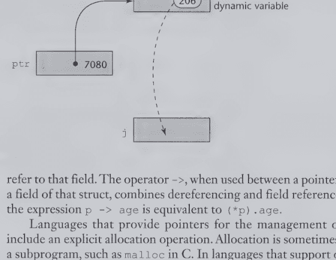

当指针指向记录时，引用这些记录字段的语法因语言而异。在 C 和 C++ 中，指向记录的指针有两种方式可用于引用该记录中的字段。如果指针变量 `p` 指向一个具有名为 `age` 的字段的记录，则 `(*p).age` 可用于引用该字段。运算符 `->` 用在指向结构的指针和该结构的字段之间时，结合了解引用和字段引用。例如，表达式 `p -> age` 等价于 `(*p).age`。

为管理堆而提供指针的语言必须包含显式的分配操作。分配有时通过子程序来指定，例如 C 中的 `malloc`。在支持面向对象编程的语言中，堆对象的分配通常用 `new` 运算符来指定。C++ 不提供隐式释放，使用 `delete` 作为其释放运算符。

### 6.11.3 指针问题

第一个包含指针变量的高级编程语言是 PL/I，在 PL/I 中，指针既可以用来引用堆动态变量，也可以用来引用其他程序变量。PL/I 的指针非常灵活，但使用它们可能导致多种编程错误。PL/I 指针的某些问题也存在于后来的语言的指针中。一些较新的语言（如 Java）已完全用引用类型取代了指针；引用类型加上隐式释放，最大限度减少了指针的主要问题。引用类型实际上只是操作受限的指针。

### 6.11.3.1 悬空指针

悬空指针（或悬空引用）是包含已被释放的堆动态变量地址的指针。悬空指针很危险，原因有几个。首先，所指向的位置可能已被重新分配给某个新的堆动态变量。如果新变量与旧变量类型不同，则对悬空指针的使用进行类型检查将无效。即使新的动态变量类型相同，其新值也与旧指针的解引用值没有任何关系。此外，如果使用悬空指针更改堆动态变量，新的堆动态变量的值将被破坏。最后，有可能


该位置当前正被存储管理系统临时占用，可能作为可用存储块链中的一个指针，因此，如果修改该位置，会导致存储管理器失败。

在许多语言中，以下操作序列会产生悬空指针：

- 1. 创建一个新的堆动态变量，并将指针 `p1` 设置为指向它。
- 2. 指针 `p2` 被赋值为 `p1` 的值。
- 3. `p1` 所指向的堆动态变量被显式释放（可能将 `p1` 设为 nil），但该操作不会改变 `p2`。现在 `p2` 是一个悬空指针。如果释放操作没有改变 `p1`，则 `p1` 和 `p2` 都会是悬空指针。（当然，这是别名问题——`p1` 和 `p2` 互为别名。）

例如，在 C++ 中，我们可以有如下代码：

```
int * arrayPtr1;
int * arrayPtr2 = new int[100];
arrayPtr1 = arrayPtr2;
delete [] arrayPtr2;
// Now, arrayPtr1 is dangling, because the heap storage
// to which it was pointing has been deallocated.
```

在 C++ 中，现在 `arrayPtr1` 和 `arrayPtr2` 都是悬空指针，因为 C++ 的 `delete` 运算符对操作数指针的值没有影响。在 C++ 中，常见（且安全）的做法是在 `delete` 运算符之后将指针（其指向的值已被释放）赋值为 0，也就是 null。

注意，动态变量的显式释放是悬空指针产生的原因。

## 历史注记

Pascal 包含一个显式释放运算符：`dispose`。由于 `dispose` 会造成悬空指针问题，一些 Pascal 实现干脆忽略了程序中出现的 `dispose`。尽管这有效地防止了悬空指针，但也使得程序不再需要的堆存储无法被重用。回想一下，Pascal 最初是作为一种教学语言而不是工业工具来设计的。

## 6.11.3.2 丢失的堆动态变量

丢失的堆动态变量是指已分配但用户程序无法再访问的堆动态变量。这类变量通常被称为垃圾，因为它们对原始用途已经没有价值，也无法为程序中的某个新用途重新分配。丢失的堆动态变量最常由以下操作序列产生：

- 1. 指针 `p1` 被设置为指向一个新创建的堆动态变量。
- 2. 随后 `p1` 被设置为指向另一个新创建的堆动态变量。

第一个堆动态变量现在不可访问，或者说丢失了。这有时称为内存泄漏。内存泄漏是

在 C 和 C++ 中，所有数组的下标范围都以 0 为下界，不带下标的数组名总是指向第一个元素的地址。考虑下面的声明：

```
int list[10];
int *ptr;
```

现在考虑赋值

```
ptr = list;
```

这个赋值将 `list[0]` 的地址赋给 `ptr`。在此赋值之后，以下关系成立：

- `*(ptr + 1)` 等价于 `list[1]`。
- `*(ptr + index)` 等价于 `list[index]`。
- `ptr[index]` 等价于 `list[index]`。

从这些语句中可以清楚地看到，指针运算包含与下标运算相同的缩放。此外，指向数组的指针可以像数组名一样被索引。

C 和 C++ 中的指针可以指向函数。这一特性用于将函数作为参数传递给其他函数。指针也用于参数传递，这将在第 9 章中讨论。

C 和 C++ 包含 `void *` 类型的指针，它可以指向任何类型的值。实际上它们是泛型指针。然而，`void *` 指针不存在类型检查问题，因为这些语言不允许解引用它们。`void *` 指针的一种常见用途是作为操作内存的函数参数类型。例如，假设我们想要一个函数将一段字节数据从内存的一个位置移动到另一个位置。如果能向它传递任意类型的两个指针，那将是最通用的。如果函数中相应的形参是 `void *` 类型，这种做法就是合法的。这样，无论传入的实参指针是什么类型，函数都可以将它们转换为 `char *` 类型并执行该操作。

## 6.11.5 引用类型

引用类型变量与指针类似，但有一个重要且根本的区别：指针指向内存中的一个地址，而引用指向内存中的一个对象或值。因此，对地址进行算术运算是自然的，但对引用进行算术运算则不合理。

C++ 包含一种特殊的引用类型，主要用于函数定义中的形参。C++ 引用类型变量是一个常量指针，且总是被隐式解引用。由于 C++ 引用类型变量是常量，它必须在定义时用某个变量的地址初始化；初始化之后，引用类型变量再也不能被设置为引用其他任何变量。隐式解引用防止了对引用变量地址值的赋值。

引用类型变量在定义时通过在名称前加与号（`&`）来指定。例如，

```
int result = 0;
int &ref_result = result;
...
ref_result = 100;
```

在这个代码段中，`result` 和 `ref_result` 互为别名。

当用作函数定义中的形参时，C++ 引用类型在调用函数和被调用函数之间提供双向通信。非指针的原始参数类型无法做到这一点，因为 C++ 参数是按值传递的。将指针作为参数传递也能实现同样的双向通信，但指针形参需要显式解引用，这使代码可读性更差、安全性也更低。在被调用函数中，引用参数与其他参数一样被引用。调用函数无需将对应的形参为引用类型的参数视为任何特殊的东西。编译器向引用参数传递的是地址，而不是值。

在寻求比 C++ 更高安全性的过程中，Java 的设计者完全移除了 C++ 风格的指针。与 C++ 引用变量不同，Java 引用变量可以被赋值以引用不同的类实例；它们不是常量。所有 Java 类实例都由引用变量引用。事实上，这也是 Java 中引用变量的唯一用途。这些问题将在第 12 章进一步讨论。

在下面的代码中，`String` 是一个标准的 Java 类：

```
String str1;
...
str1 = "This is a Java literal string";
```

在这段代码中，`str1` 被定义为对 `String` 类实例或对象的引用。它初始设置为 null。随后的赋值将 `str1` 设置为引用 `String` 对象 "This is a Java literal string"。

由于 Java 类实例是隐式释放的（没有显式释放运算符），Java 中不可能出现悬空引用。

C# 同时包含 Java 的引用和 C++ 的指针。然而，强烈不鼓励使用指针。事实上，任何使用指针的子程序都必须包含 `unsafe` 修饰符。注意，虽然引用所指向的对象是隐式释放的，但指针所指向的对象并非如此。C# 包含指针主要是为了允许 C# 程序与 C 和 C++ 代码互操作。

在面向对象语言 Smalltalk、Python、Ruby 和 Lua 中，所有变量都是引用。它们总是被隐式解引用。此外，这些变量的直接值无法访问。

## 6.11.6 评价

悬空指针和垃圾的问题已经详细讨论过。堆管理的问题将在 6.11.7.3 节讨论。

指针曾被与 `goto` 相提并论。`goto` 语句扩大了接下来可执行的语句的范围。指针变量扩大了变量可引用的内存单元的范围。也许对指针最严厉的批评来自 Hoare（1973）：“将它们引入高级语言是一次倒退，我们可能永远无法从中恢复。”

另一方面，指针在某些编程应用中是必不可少的。例如，编写设备驱动程序需要指针，因为必须访问特定的绝对地址。

Java 和 C# 的引用提供了指针的部分灵活性和能力，而没有那些危险。程序员是否愿意用 C 和 C++ 指针的全部能力去换取引用更高的安全性，还有待观察。C# 程序使用指针的程度将是衡量这一点的一个指标。

## 6.11.7 指针和引用类型的实现

在大多数语言中，指针用于堆管理。Java 和 C# 的引用，以及 Smalltalk 和 Ruby 中的变量也是如此，因此我们不能将指针和引用分开讨论。首先，我们简要描述指针和引用在内部是如何表示的。然后，我们讨论两种可能的悬空指针问题的解决方案。最后，我们描述堆管理技术的主要问题。

### 6.11.7.1 指针和引用的表示

在大多数较大的计算机中，指针和引用是存储在内存单元中的单个值。然而，在基于 Intel 微处理器的早期微型计算机中，地址由两部分组成：段和偏移量。因此，在这些系统中，指针和引用实现为两个 16 位单元组成的对，分别对应地址的两个部分。

### 6.11.7.2 悬空指针问题的解决方案

针对悬空指针问题，已经提出了几种解决方案。其中包括墓碑（Lomet，1975）：每个堆动态变量都包含一个称为墓碑的特殊单元，它本身是一个指向该堆动态变量的指针。实际的指针变量只指向墓碑，从不指向堆动态变量。当一个堆动态变量被释放时，墓碑仍然存在，但被置为 nil，表示该堆动态变量不再存在。这种方法可以防止指针指向已释放的变量。任何对指向 nil 墓碑的指针的引用都可以被检测为错误。


墓碑在时间和空间上都很昂贵。因为墓碑永远不会被释放，其存储空间永远不会被回收。通过墓碑对堆动态变量的每次访问都需要多一层间接寻址，这在大多数计算机上需要额外的一个机器周期。显然，没有一种更流行的语言的设计者认为这种额外的安全性值得付出这种额外的成本，因为没有广泛使用的语言使用墓碑。

墓碑的一种替代方案是 UW-Pascal 实现中使用的 **锁-键方法**（Fischer and LeBlanc, 1977, 1980）。在这个编译器中，指针值表示为有序对（key, address），其中 key 是一个整数值。堆动态变量表示为变量的存储加上一个存储整数锁值的头单元。当堆动态变量被分配时，会创建一个锁值，并同时放置在堆动态变量的锁单元中以及 **new** 调用中指定的指针的键单元中。对解引用指针的每次访问都会将指针的键值与堆动态变量中的锁值进行比较。如果它们匹配，则访问是合法的；否则该访问被视为运行时错误。对指针值的任何复制到其他指针都必须复制键值。因此，任意数量的指针可以引用给定的堆动态变量。当堆动态变量通过 **dispose** 被释放时，其锁值会被清除为非法锁值。然后，如果除 **dispose** 中指定的指针之外的指针被解引用，其地址值仍然完好，但其键值将不再与锁匹配，因此访问将被禁止。

当然，解决悬空指针问题的最佳方案是将堆动态变量的释放从程序员手中拿走。如果程序不能显式释放堆动态变量，就不会有悬空指针。要做到这一点，运行时系统必须在堆动态变量不再有用时隐式释放它们。Lisp 系统一直都是这样做的。Java 和 C# 也对它们的引用变量使用这种方法。回想一下，C# 的指针不包括隐式释放。

## 6.11.7.3 堆管理

堆管理可能是一个非常复杂的运行时过程。我们在两种不同的情况下检查该过程：一种是所有堆存储都以单一大小的单元进行分配和释放，另一种是以可变大小的段进行分配和释放。请注意，对于释放，我们只讨论隐式方法。我们的讨论将很简短，远非全面，因为这些过程及其相关问题的彻底分析与其说是语言设计问题，不如说是一个实现问题。

### 单一大小单元
最简单的情况是所有分配和释放都是单一大小的单元。当每个单元已经包含一个指针时，情况就更简单了。这是许多 Lisp 实现的场景，动态存储分配的问题首次在大型规模上出现。所有 Lisp 程序和大多数 Lisp 数据都由链表中的单元组成。

在单一大小分配堆中，所有可用单元都使用单元中的指针链接在一起，形成可用空间的列表。分配只是在需要时从该列表中取出所需数量的单元。释放是一个更复杂的过程。堆动态变量可以被多个指针指向，使得很难确定变量是否对程序不再有用。仅仅因为一个指针与单元断开连接显然并不能使其成为垃圾；可能还有其他几个指针仍指向该单元。

在 Lisp 中，程序中最频繁的操作中的一些会创建不再可访问程序的单元集合，因此应该被释放（放回可用空间列表）。Lisp 的基本设计目标之一是确保未使用单元的回收不是程序员的任务，而是运行时系统的任务。这一目标使 Lisp 实现者面临一个基本的设计问题：何时执行释放？

垃圾收集有几种不同的方法。两种最常见的传统技术在某种程度上是相反的过程。它们被称为引用计数，其中回收是增量的，并在不可访问单元创建时完成；以及标记-清除，其中回收仅在可用空间列表变空时发生。这两种方法有时分别称为急切方法和懒惰方法。这些两种方法的许多变体已被开发出来。然而，在本节中，我们只讨论基本过程。

引用计数存储回收方法通过在每个单元中维护一个计数器来实现其目标，该计数器存储当前指向该单元的指针数。嵌入在引用计数器的递减操作中，该操作在指针与单元断开连接时发生，是一种对零值的检查。如果引用计数器达到零，则意味着没有程序指针指向该单元，它已成为垃圾，可以返回到可用空间列表。

引用计数方法有三个明显的问题。首先，如果存储单元相对较小，计数器所需的空间是显著的。其次，显然需要一些执行时间来维护计数器值。每当指针值发生变化时，它所指向的单元必须将其计数器递减，而它现在所指向的单元必须将其计数器递增。在像 Lisp 这样几乎每个操作都涉及改变指针的语言中，这可能是程序总执行时间的一个显著部分。当然，如果指针变化不频繁，这就不是问题。引用计数器的一些低效率可以通过一种名为延迟引用计数的方法来消除，该方法避免为某些指针使用引用计数器。第三个问题是当一组单元以循环方式连接时会出现复杂性。这里的问题是循环列表中的每个单元的引用计数器值至少为 1，这阻止了它被收集并放回可用空间列表。对此问题的解决方案可以在 Friedman and Wise (1979) 中找到。

引用计数方法的优点是它本质上是增量的。它的操作与应用程序的操作交织在一起，因此永远不会导致应用程序执行出现显著延迟。

原始的标记-清除垃圾收集过程操作如下：运行时系统按请求分配存储单元，并在必要时断开指针与单元的连接，而不考虑存储回收（允许垃圾累积），直到它已分配所有可用单元。此时，开始一个标记-清除过程，以收集堆中漂浮的所有垃圾。为了便于该过程，每个堆单元都有一个额外的指示位或字段，由收集算法使用。

标记-清除过程由三个不同的阶段组成。首先，所有堆单元的指示符都被设置为表示它们是垃圾。这当然只是对其中一些单元的正确假设。第二部分称为标记阶段，是最困难的。程序中的每个指针都被追踪到堆中，所有可达单元都被标记为不是垃圾。之后，执行第三阶段，称为清除阶段：堆中所有未被特别标记为仍在使用中的单元都被返回到可用空间列表。

为了说明用于标记当前正在使用的单元的算法的风格，我们提供了以下简单的标记算法版本。我们假设所有堆动态变量，或堆单元，由信息部分组成；一个名为 marker 的标记部分；以及两个名为 llink 和 rlink 的指针。这些单元用于构建有向图，从任何节点最多有两条边。标记算法遍历图的全部生成树，标记找到的所有单元。像其他图遍历一样，标记算法使用递归。

```
for every pointer r do
    mark(r)
```

```
void mark(void * ptr) {
    if (ptr != 0)
        if (*ptr.marker is not marked) {
            set *ptr.marker
            mark(*ptr.llink)
            mark(*ptr.rlink)
        }
}
```

该过程在一个给定图上的动作示例显示在图 6.9 中。这种简单的标记算法需要大量的存储（用于支持递归的栈空间）。一种不需要额外栈空间的标记过程由 Schorr and Waite (1967) 开发。他们的 方法在追踪链接结构时反转指针。然后，当到达列表末尾时，过程可以沿着指针返回结构之外。

原始版本的标记-清除最严重的问题是它执行得太不频繁——只有当程序已使用所有或几乎所有


### 图 6.9

标记算法作用的示例

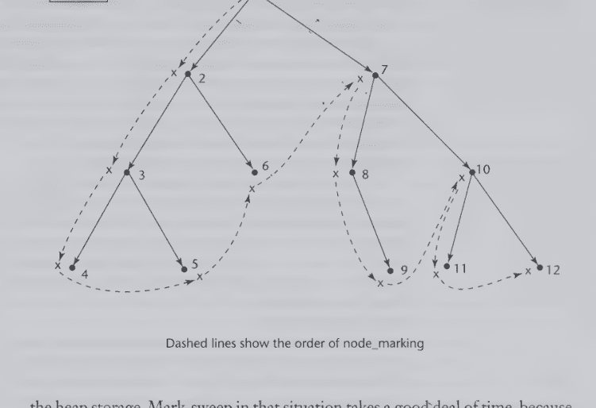

虚线显示节点标记的顺序。

堆存储。 在那种情况下，标记-清除需要花费大量时间，因为必须追踪并标记大部分单元为当前正在使用。 这会导致应用程序进展出现显著延迟。 此外，该过程可能只产生少量可以放在可用空间列表上的单元。 这个问题已通过各种改进得到解决。 例如，增量标记-清除垃圾回收会更频繁地发生，在内存耗尽之前很久就开始进行，使其在回收存储量方面更有效。 另外，每次运行该过程所需的时间显然更短，从而减少了应用程序执行的延迟。 另一种选择是分部分而不是对应用程序关联的所有内存执行标记-清除过程，在不同时间进行。 这提供了与增量标记-清除相同的改进。

通过使用 Suzuki (1982) 描述的指针旋转和滑动操作，标记-清除方法的标记算法以及引用计数方法所需的过程都可以变得更高效。

## 变长单元

管理从中分配变长单元⁸的堆具有管理单尺寸单元堆的所有困难，但也存在额外问题。 不幸的是，大多数编程语言都需要变长单元。 变长单元管理带来的额外问题取决于所使用的方法。 如果使用标记-清除，则会出现以下额外问题：

> 8. 单元具有可变大小，因为这些是抽象单元，它们存储变量的值，而不管其类型。 此外，一个变量可能是一个结构化类型。

- 将堆中所有单元的指示器初始设置为表示它们是垃圾是困难的。 因为单元大小不同，扫描它们是个问题。 一个解决方案是要求每个单元将其单元大小作为第一个字段。 然后可以进行扫描，尽管它比固定大小单元的对应方案占用稍多空间并花费稍多时间。
- 标记过程非平凡。 如果指向单元中指针没有预定义位置，如何从指针跟随链？ 完全不包含指针的单元也是一个问题。 向每个单元添加一个内部指针，该指针由运行时系统在后台维护，可以工作。 然而，这种后台维护处理会在程序运行的成本上增加空间和执行时间开销。
- 维护可用空间列表是另一个开销来源。 列表可以从一个由所有可用空间组成的单个单元开始。 对段的请求只是减小该块的大小。 回收的单元被添加到列表中。 问题是，很快，列表就会变成各种大小段或块的长列表。 这会减慢分配，因为请求会导致列表被搜索以寻找足够大的块。 最终，列表可能由大量非常小的块组成，这些块对于大多数请求来说都不够大。 在这一点上，相邻块可能需要合并成更大的块。 使用列表上第一个足够大的块的替代方案可以缩短搜索，但要求列表按块大小排序。 在任何情况下，维护列表都是额外的开销。

如果使用引用计数，则可以避免前两个问题，但可用空间列表维护问题仍然存在。 有关内存管理问题的全面研究，请参阅 Wilson (2005)。

## 6.12 类型检查

对于类型检查的讨论，操作数和操作符的概念被推广到包括子程序和赋值语句。 子程序将被视为其操作数为其参数的操作符。 赋值符号将被视为二元操作符，其目标变量和表达式是操作数。

**类型检查**是确保操作符的操作数具有兼容类型的一项活动。 **兼容**类型是指对操作符合法的类型，或根据语言规则允许由编译器生成的代码（或解释器）隐式转换为合法类型的类型。 这种自动转换称为**强制转换**。 例如，如果在 Java 中将一个 `int` 变量和一个 `float` 变量相加，则 `int` 变量的值会被强制转换为 `float`，并执行浮点加法。

**类型错误**是将操作符应用于不适当类型操作数的情况。 例如，在 C 的原始版本中，如果将一个 `int` 值传递给期望 `float` 值的函数，就会发生类型错误（因为该语言的编译器不检查参数的类型）。

如果语言中变量到类型的绑定都是静态的，则类型检查几乎总能静态完成。 动态类型绑定需要在运行时进行类型检查，这称为动态类型检查。

一些语言，如 JavaScript 和 PHP，由于其动态类型绑定，只能进行动态类型检查。 在编译时检测错误比在运行时检测错误更好，因为更早的纠正通常成本更低。 静态检查的代价是程序员灵活性的降低。 较少的捷径和技巧是可能的。 然而，这些技术现在通常被认为容易出错且不利于可读性。

当语言允许内存单元在执行期间的不同时间存储不同类型的值时，类型检查变得复杂。 这种内存单元可以用 C 和 C++ 的联合以及 ML、Haskell 和 F# 的判别联合创建。 在这些情况下，如果进行类型检查，则必须动态进行，并且要求运行时系统维护此类内存单元当前值的类型。 因此，即使在 C++ 等语言中所有变量都静态绑定到类型，也并非所有类型错误都可以通过静态类型检查检测到。

## 6.13 强类型

在 1970 年代所谓的结构化编程革命中成为主流的语言设计思想之一是强类型。 强类型被广泛认为是极有价值的语言特性。 不幸的是，它经常被宽泛地定义，并且在计算文献中经常被使用而根本没有定义。

一种编程语言是强类型的，如果类型错误总是被检测到。 这要求所有操作数的类型都能确定，无论是在编译时还是在运行时。 强类型的重要性在于其能够检测所有导致类型错误变量误用的情况。 强类型语言还允许在运行时检测存储多种类型值的变量中不正确类型值的使用。

C 和 C++ 不是强类型语言，因为两者都包含联合类型，而联合类型不受类型检查。

ML 是强类型的，即使某些函数参数的类型在编译时可能未知。 F# 是强类型的。

Java 和 C#，尽管基于 C++，几乎是强类型的。 类型可以显式强制转换，这可能导致类型错误。 然而，没有隐式方式会导致类型错误未被检测到。

语言的强制转换规则对类型检查的价值有重要影响。 例如，Java 中的表达式是强类型的。 然而，一个操作数为浮点数、一个操作数为整数的算术操作符是合法的。 整数操作数的值被强制转换为浮点数，并进行浮点运算。 这通常是所期望的

## 6.14 类型等价

类型兼容性的概念在引入类型检查问题时已定义。 兼容性规则规定了每个操作符可接受的操作数的类型，从而指定了语言可能的<|message|>

不等于整数类型变量。例如，假设 Ada 使用严格的名称类型等价，考虑以下 Ada 代码：

```
type Indextype is 1..100;
count : Integer;
index : Indextype;
```

变量 count 和 index 的类型将不相等；count 不能赋给 index，反之亦然。

名称类型等价的另一个问题出现在结构化或用户定义的类型通过参数在子程序之间传递时。这种类型必须在全局范围内仅定义一次。子程序不能以局部方式声明此类形式参数的类型。原始版本的 Pascal 就是这种情况。

请注意，要使用名称类型等价，所有类型必须有名称。大多数语言允许用户定义匿名类型——它们没有名称。对于语言要使用名称类型等价，这些类型必须由编译器隐式赋予内部名称。

结构类型等价比名称类型等价更灵活，但实现起来更困难。在名称类型等价下，只需比较两个类型名称即可确定等价性。然而在结构类型等价下，必须比较两个类型的整个结构。这种比较并不总是简单。 （考虑一种引用自身类型的数据结构，例如链表。）其他问题也可能出现。例如，如果两个记录（或 struct）类型具有相同的结构但字段名称不同，它们是否等价？在允许在声明中设置数组下标范围下界的语言中，如果两个一维数组类型具有相同的元素类型但下标范围分别为 0..10 和 1..11，它们是否等价？如果两个枚举类型具有相同数量的分量但字面量拼写不同，它们是否等价？

结构类型等价的另一个困难在于它禁止区分具有相同结构的类型。例如，考虑以下 Ada 风格的声明：

```
type Celsius = Float;
    Fahrenheit = Float;
```

在这两种类型的变量在结构类型等价下被认为是等价的，允许它们在表达式中混合使用，这在这种情况下显然是不 desirable 的，考虑到类型名称所指出的差异。一般来说，具有不同名称的类型很可能抽象了不同类别的问题值，不应被视为等价。

Ada 使用一种受限的名称类型等价形式，但提供了两种类型构造，子类型和派生类型，以避免与名称类型等价相关的问题。派生类型是基于某个先前定义的类型的新类型，与其不等价，尽管可能具有相同的结构。派生类型继承其父类型的所有属性。考虑以下示例：

```
type Celsius is new Float;
type Fahrenheit is new Float;
```

这两种派生类型的变量类型不等价，尽管其结构相同。此外，这两种类型的变量都与任何其他浮点类型类型不等价。字面量除外。像 3.0 这样的字面量具有通用实数类型，与任何浮点类型类型等价。派生类型还可以对父类型包含范围约束，同时仍继承父类型的所有操作。

Ada 的子类型是现有类型的可能带范围约束的版本。子类型与其父类型类型等价。例如，考虑以下声明：

```
subtype Small_type is Integer range 0..99;
```

类型 Small_type 等价于类型 Integer。

请注意，Ada 的派生类型与 Ada 的子范围类型非常不同。例如，考虑以下类型声明：

```
type Derived_Small_Int is new Integer range 1..100;
subtype Subrange_Small_Int is Integer range 1..100;
```

这两种类型 Derived_Small_Int 和 Subrange_Small_Int 的变量具有相同的合法值范围，并且都继承 Integer 的操作。然而，类型为 Derived_Small_Int 的变量与任何 Integer 类型都不兼容。另一方面，类型为 Subrange_Small_Int 的变量与 Integer 类型以及 Integer 的任何子类型的变量和常量兼容。

对于 Ada 无约束数组类型的变量，使用结构类型等价。例如，考虑以下类型声明和两个对象声明：

```
type Vector is array (Integer range <>) of Integer;
Vector_1: Vector (1..10);
Vector_2: Vector (11..20);
```

这两个对象的类型是等价的，即使它们具有不同的名称和不同的下标范围，因为对于无约束数组类型的对象，使用结构类型等价而不是名称类型等价。因为两种类型都有 10 个元素，并且两个元素的类型都是 Integer，所以它们类型等价。

在这种情况下，A 被赋予编译器分配的匿名但唯一的、程序不可用的类型。如果我们还拥有

```
B : array (1..10) of Integer;
```

A 和 B 将是匿名但不同且不等价的类型，尽管它们在结构上相同。多次声明

```
C, D : array (1..10) of Integer;
```

创建两个匿名类型，一个用于 C，一个用于 D，它们不等价。此声明实际上被视为以下两个声明：

```
C : array (1..10) of Integer;
D : array (1..10) of Integer;
```

请注意，Ada 的名称类型等价形式比本节开头定义的名称类型等价更严格。如果我们改写为

```
type List_10 is array (1..10) of Integer;
C, D : List_10;
```

那么 C 和 D 的类型将是等价的。

名称类型等价对 Ada 效果很好，部分原因是除匿名数组外，所有类型都必须具有类型名称（匿名类型由编译器赋予内部名称）。

Ada 的类型等价规则比具有多种类型间强制转换的语言更严格。例如，Java 中加法运算符的两个操作数可以在语言中具有几乎任何组合的数值类型。其中一个操作数 simply 会被强制转换为另一个的类型。但在 Ada 中，算术运算符的操作数没有任何强制转换。

C 同时使用名称和结构类型等价。每个 struct、enum 和 union 声明都会创建一个与任何其他类型不等价的新类型。因此，对于结构、枚举和联合类型，使用名称类型等价。其他非标量类型使用结构类型等价。数组类型如果具有相同的类型分量则等价。此外，如果数组类型具有常量大小，则它等价于具有相同常量大小的其他数组或没有常量大小的数组。请注意，C 和 C++ 中的 typedef 并未引入新类型；它只是为现有类型定义一个新名称。因此，使用 typedef 定义的任何类型都与其父类型类型等价。C 对结构、枚举和联合使用名称类型等价的一个例外是如果两个结构、枚举或联合在不同的文件中定义，在这种情况下使用结构类型等价。这是名称类型等价规则中的一个漏洞，允许在不同文件中定义的结构、枚举和联合等价。

C++ 与 C 类似，只是没有针对在不同文件中定义的结构和联合的例外。

在不允许用户定义和命名类型的语言中，如 Fortran 和 COBOL，显然不能使用名称等价。

面向对象的语言如 Java 和 C++ 带来了另一种类型兼容性问题。问题是对象兼容性及其与继承层次结构的关系，这将在第 12 章中讨论。

表达式中的类型兼容性在第 7 章中讨论；子程序参数的类型兼容性在第 9 章中讨论。

## 6.15 理论和数据类型

类型理论是数学、逻辑、计算机科学和哲学中的一个广泛研究领域。它始于 20 世纪初的数学中，后来成为逻辑中的标准工具。对类型理论的任何一般性讨论必然是复杂、冗长且高度抽象的。即使限制在计算机科学中，类型理论也包括类型 lambda 演算、组合子、有界量化的元理论、存在类型和更高阶多态等多种复杂主题。所有这些主题都远超本书的范围。

在计算机科学中，类型理论有两个分支：实用和抽象。实用分支关注商业编程语言中的数据类型；抽象分支主要关注类型 lambda 演算，这是过去半个世纪理论计算机科学家广泛研究的领域。本节仅限于对支撑编程语言中数据类型的一些数学形式主义的简要描述。

数据类型定义了一组值和对这些值的一组操作。类型系统是一组类型以及在程序中管理它们使用的规则。显然，每种带类型的编程语言都定义了一个类型系统。编程语言类型系统的形式模型由一组类型和一组定义语言类型规则的函数组成，用于确定任何表达式的类型。描述类型系统规则的形式系统，属性文法，在第 3 章中介绍。

属性文法的替代模型使用类型映射和一组函数，不是与文法规则关联的，来指定类型规则。类型映射类似于在指称语义中使用的程序状态，由一组有序对组成，每个对的第一个元素是变量的名称，第二个元素是其类型。类型映射是使用程序中的类型声明构造的。在静态类型语言中，类型映射只需在编译期间维护，尽管随着编译器分析程序，它会发生变化。如果任何类型检查在动态进行，类型映射必须在执行期间维护。编译系统中的类型映射的具体版本是符号表，主要由


由词法和语法分析器维护。动态类型有时会通过附加到值或对象的标签来维护。

如前所述，数据类型是一组值，尽管在数据类型中元素通常是有序的。例如，所有枚举类型的元素都是有序的。然而，在数学集合中，元素是没有顺序的。尽管存在这种差异，集合运算仍可用于数据类型来描述新的数据类型。编程语言的结构化数据类型由类型运算符或构造函数定义，这些构造函数对应于集合运算。这些集合运算/类型构造函数在下面的段落中简要介绍。

有限映射是从有限值集合、即定义域集合到值域集合中的值的函数。有限映射模拟了编程语言中的两类不同类型，即函数和数组，尽管在某些语言中函数不是类型。所有语言都包含数组，数组以映射函数定义，该函数将索引映射到数组中的元素。对于传统数组，映射很简单——整数值被映射到数组元素的地址；对于关联数组，映射由描述哈希操作的函数定义。哈希函数将关联数组的键，通常是字符字符串，映射到数组元素的地址。

n 个集合 S1, S2, . . . , Sn 的笛卡尔积，或叉积，是一个集合，记为 S1 × S2 × . . . × Sn。笛卡尔积集合的每个元素都来自构成集合中的一个元素。因此，S1 × S2 = {(x, y) | x 在 S1 中且 y 在 S2 中}。例如，如果 S1 = {1, 2} 且 S2 = {a, b}，则 S1 × S2 = {(1, a), (1, b), (2, a), (2, b)}。笛卡尔积定义了数学中的元组，其在 Python、ML 和 F# 中作为数据类型出现（参见第 6.5 节）。笛卡尔积也模拟了记录或结构体，尽管并不完全。笛卡尔积没有元素名称，但记录需要它们。例如，考虑以下 C 结构体：

```
struct intFloat {
    int myInt;
    float myFloat;
};
```

该结构体定义了笛卡尔积类型 int × float。元素的名称为 myInt 和 myFloat。

两个集合 S1 和 S2 的并集定义为 S1 ∪ S2 = {x | x 在 S1 中或 x 在 S2 中}。集合并集模拟了第 6.10 节中描述的联合数据类型。

数学子集是通过提供元素必须遵循的规则来定义的。这些集合模拟了 Ada 的子类型，尽管并不完全，因为子类型必须由其父集合的连续元素组成。数学集合的元素是无序的，因此该模型并不完美。

在 Ruby 和 Lua 中，关联数组的键不必是字符字符串——它们可以是任何类型。

请注意，使用类型运算符定义的指针，例如 C 中的 *，不是根据集合运算定义的。
这结束了我们对数据类型中形式化方法的讨论，以及我们对数据类型的全部讨论。

## SUMMARY

语言的数据类型是决定该语言风格和有用性的重要部分。它们与控制结构一起构成了语言的核心。

大多数命令式语言的原始数据类型包括数值、字符和布尔类型。数值类型通常直接由硬件支持。

用户定义的枚举和子范围类型很方便，并增加了程序的可读性和可靠性。

数组是大多数编程语言的一部分。数组元素引用与其地址之间的关系由访问函数给出，访问函数是映射的实现。数组可以是静态的，如 C++ 中定义包含 static 指定符的数组；固定栈动态，如 C 函数中（不带 static 指定符）；固定堆动态，如 Java 的对象；或堆动态，如 Perl 的数组。大多数语言只允许对完整数组进行少数操作。

记录现在已包含在大多数语言中。记录的字段以多种方式指定。在 COBOL 的情况下，它们可以在不命名所有封闭记录的情况下引用，尽管这对实现来说很混乱且对可读性有害。在支持面向对象编程的几种语言中，记录以对象形式得到支持。

元组与记录相似，但其构成部分没有名称。它们是 Python、ML 和 F# 的一部分。

列表是函数式编程语言的主流，但现在也包含在 Python 和 C# 中。

联合是可以在不同时间存储不同类型值的存储位置。带标签联合包含一个标签来记录当前类型值。自由联合是没有标签的联合。大多数具有联合的语言对其设计不安全，例外的是 ML 和 F#。

指针用于寻址灵活性和控制动态存储管理。指针存在一些固有危险：悬空指针难以避免，且可能发生内存泄漏。

引用类型，如 Java 和 C# 中的引用类型，提供堆管理而没有指针的危险。

枚举和记录类型相对容易实现。数组也比较直接，尽管当数组有多个下标时，数组元素访问是一个昂贵的过程。访问函数对每个下标都需要一次加法和一次乘法。

如果不考虑堆管理，指针相对容易实现。如果所有单元大小相同，堆管理很容易，但对于可变大小单元的分配和释放则很复杂。

强类型是要求所有类型错误都被检测的概念。强类型的价值在于提高可靠性。

语言的类型等价规则决定了语言的结构化类型之间哪些操作是合法的。名称类型等价和结构类型等价是定义类型等价的两种基本方法。

类型理论已在许多领域得到发展。在计算机科学中，类型理论的实用分支定义了编程语言的类型和类型规则。集合论可用于模拟编程语言中的大多数结构化数据类型。

## BIBLIOGRAPHIC NOTES

存在大量文献涉及数据类型设计、使用和实现。Hoare 在 Dahl et al. (1972) 中给出了结构化类型的最早系统定义之一。Cleaveland (1986) 给出了各种数据类型的一般讨论。

Fischer and LeBlanc (1980) 讨论了对 Pascal 数据类型可能存在的不安全性的运行时检查。大多数编译器设计书籍，如 Fischer and LeBlanc (1991) 和 Aho et al. (1986)，描述了数据类型的实现方法，正如其他编程语言教材，如 Pratt and Zelkowitz (2001) 和 Scott (2009) 所做的那样。Tenenbaum et al. (1990) 中可以找到关于堆管理问题的详细讨论。垃圾回收方法由 Schorr and Waite (1967) 和 Deutsch and Bobrow (1976) 提出。Cohen (1981) 和 Wilson (2005) 中可以找到关于垃圾回收算法的全面讨论。

## REVIEW QUESTIONS

- 1. 什么是数据类型？
- 2. COBOL 的数据结构相对于 Fortran I 的数据结构的优势是什么？
- 3. 什么是抽象数据类型？
- 4. 描述编程语言类型系统的不同用途。
- 5. 定义描述符和对象。
- 6. 命令式语言中两种最常见的结构化数据类型是什么？
- 7. 计算机中负整数存储使用什么机制？
- 8. Java 支持的四种有符号整数是什么？
- 9. 定义 *静态、固定栈动态、固定堆动态和堆动态数组*。各自的优势是什么？
- 10. 补码表示的缺点是什么？
- 11. 浮点类型如何表示？
- 12. Java 支持的浮点值的不同表示是什么？
- 13. 哪些语言支持复数数据类型？
- 14. 十进制类型的缺点是什么？
- 15. 定义 *精度* 和 *范围*。
- 16. 布尔类型的用途是什么？
- 17. Java 数组描述符中所需的条目是什么，以及何时必须存储（编译时还是运行时）？
- 18. 什么是子字符串引用？
- 19. Java 中支持字符串的两个类是什么？
- 20. 定义 *有限动态长度字符串* 和 *动态长度字符串*。
- 21. Java 的 `String` 类的不可变对象是什么？
- 22. 定义 *元组*。
- 23. 枚举类型的设计问题是什么？
- 24. 在什么主要命令式语言中列表用作数组？
- 25. 使用什么方法获取枚举变量的内部数值？
- 26. C# 枚举类型与 C++ 枚举类型有何区别？
- 27. Scheme 的 `CDR` 函数以何种方式修改其参数？
- 28. Python 中列表推导的机制是什么？
- 29. 定义 *联合、自由联合* 和 *带标签联合*。
- 30. F# 的联合是带标签的吗？
- 31. F# 的枚举类型的优势是什么？
- 32. 关联数组的设计问题是什么？
- 33. 为什么 Perl 中的关联数组被称为哈希？
- 34. Java 中的泛型数组是什么？
- 35. 为什么 C++ 中的引用变量比指针更适合作为形式参数？
- 36. Java 和 C# 引用类型变量相对于其他语言中的指针有什么优势？
- 37. 描述惰性和急切的垃圾回收方法。
- 38. 为什么 Java 和 C# 引用上的算术运算没有意义？
- 39. Java 中数组下标的数据类型是什么？
- 40. 定义 *记录*。
- 41. 定义 *强类型*。


- 42. 为什么 Java 不是强类型的？
- 43. 数组引用的语法是什么？
- 44. 哪些语言没有类型强制转换？
- 45. 为什么 C 和 C++ 中的联合被称为自由联合？
- 46. 什么是名称类型等价？
- 47. 什么是悬空指针？
- 48. 名称类型等价的主要优点是什么？
- 49. 结构类型等价的主要缺点是什么？
- 50. C 对哪些类型使用结构类型等价？
- 51. 什么集合操作模拟了 C 的 struct 数据类型？

## PROBLEM SET

- 1. 将布尔值表示为内存中的单个位有什么利弊？
- 2. 十进制值如何浪费内存空间？
- 3. VAX 小型计算机使用一种浮点数格式，与 IEEE 标准不同。这种格式是什么，为什么 VAX 计算机的设计者选择了它？VAX 浮点表示的参考资料是 Sebesta (1991)。
- 4. 从安全性和实现成本的角度比较使用墓碑法和锁-钥匙法避免悬空指针。
- 5. 指针在某些上下文中隐式解引用有什么缺点？
- 6. 解释 Ada 的子类型和派生类型之间所有的差异。
- 7. C 和 C++ 中 -> 运算符有什么重要的理由？
- 8. C++ 的枚举类型和 Java 的枚举类型之间有哪些不同？
- 9. 多维数组可以按行主序存储，如 C++，或按列主序存储，如 Fortran。针对三维数组，分别推导出这两种排列的访问函数。
- 10. 在 Burroughs Extended ALGOL 语言中，矩阵存储为指向矩阵行的单维指针数组，这些行被视为单维值数组。这种方案有什么优点和缺点？
- 11. 分析并撰写 C 的 malloc 和 free 函数与 C++ 的 new 和 delete 运算符的比较。以安全性为主要考虑因素进行比较。
- 12. 分析并撰写使用 C++ 指针和 Java 引用变量引用固定堆动态变量的比较。以安全性和便利性为主要考虑因素进行比较。
- 13. 写一篇简短的讨论，说明 Java 设计者不包含 C++ 指针的决定失去了什么和获得了什么。
- 14. 与 C++ 中所需的显式堆存储回收相比，Java 的隐式堆存储回收有什么利弊？考虑实时系统。
- 15. 为什么要在 C# 中包含枚举类型，尽管它们不在 Java 的前几个版本中？
- 16. 你期望 C# 中指针的使用水平如何？在非绝对必要时，它们会被使用多频繁？
- 17. 列出矩阵应用的两个列表，一个需要锯齿矩阵，一个需要矩形矩阵。现在，论证在编程语言中应只包含锯齿、只包含矩形，还是两者都包含。
- 18. 比较 C++、Java 和 C# 的类库的字符串操作能力。
- 19. 查阅 Gehani (1983) 中给出的强类型的定义，并将其与本章中给出的定义进行比较。它们有何不同？
- 20. 静态类型检查在什么方面优于动态类型检查？
- 21. 解释强制转换规则如何削弱强类型带来的有益效果。

## PROGRAMMING EXERCISES

- 1. 设计一组简单的测试程序，以确定你所能访问的 C 编译器的类型兼容性规则。撰写一份调查结果报告。
- 2. 确定你所能访问的某个 C 编译器是否实现了自由函数。
- 3. 编写一个程序在某种进行下标范围检查的语言中执行矩阵乘法，并且可以从编译器获得汇编语言或机器语言版本。确定下标范围检查所需的指令数，并将其与矩阵乘法过程的总指令数进行比较。
- 4. 如果你能访问一种允许用户指定是否需要下标范围检查的编译器，编写一个程序执行大量矩阵访问并计时其执行。分别在启用和禁用下标范围检查的情况下运行程序，并比较时间。
- 5. 编写一个简单的 C++ 程序来调查其枚举类型的安全性。至少包含 10 种对枚举类型的不同操作，以确定哪些错误或愚蠢的操作是合法的。现在，编写一个 C# 程序执行相同的操作并运行它，以确定其中有多少错误或愚蠢的操作是合法的。比较你的结果。
- 6. 编写一个包含两种不同枚举类型并使用大量枚举类型操作的 C++ 或 C# 程序。另使用仅整数变量编写相同的程序。比较两个程序的可读性并预测其可靠性差异。
- 7. 编写一个 C 程序执行大量对二维数组元素的引用，仅使用下标。编写第二个程序执行相同的操作，但使用指针和指针算术进行存储映射函数以执行数组引用。比较两个程序的时间效率。哪一个程序更可能更可靠？为什么？
- 8. 编写一个 Perl 程序使用哈希并执行大量对哈希的操作。例如，哈希可以存储人名及其年龄。随机数生成器可用于创建三字符姓名和年龄，并将其添加到哈希中。当生成重复姓名时，将导致对哈希的访问但不添加新元素。用不使用哈希重写相同的程序。比较两者的执行效率。比较两者的编程难易度和可读性。
- 9. 编写一种语言的程序，该程序的行为在语言使用名称等价时与使用结构等价时不同。
- 10. 对于 C++ 中合法但在 Java 中不合法的简单赋值语句 A = B，A 和 B 是什么类型？

## Expressions and Assignment Statements

- 7.1 Introduction
- 7.2 Arithmetic Expressions
- 7.3 Overloaded Operators
- 7.4 Type Conversions
- 7.5 Relational and Boolean Expressions
- 7.6 Short-Circuit Evaluation
- 7.7 Assignment Statements
- 7.8 Mixed-Mode Assignment

正如标题所示，本章的主题是表达式和赋值语句。首先讨论确定表达式中运算符求值顺序的语义规则。随后解释当函数可能产生副作用时，操作数求值顺序可能带来的潜在问题。接下来讨论重载运算符，包括预定义和用户定义的，以及它们对程序中表达式的影响。随后描述并评估混合模式表达式。这导致了对隐式和显式的扩展和缩小类型转换的定义和评估。随后讨论关系和布尔表达式，包括短路求值过程。最后，从最简单的形式到所有变体，涵盖赋值语句，包括赋值作为表达式和混合模式赋值。

字符字符串模式匹配表达式已作为第 6 章字符字符串材料的一部分进行讲解，因此本章中未提及。

### 7.1 Introduction

表达式是编程语言中指定计算的基本手段。程序员必须理解所使用语言的表达式的语法和语义。用于描述表达式语法的形式化机制（BNF）已在第 3 章中介绍。本章讨论表达式的语义。

要理解表达式求值，有必要熟悉运算符和操作数的求值顺序。表达式的运算符求值顺序由语言的结合性和优先级规则决定。虽然表达式的值有时取决于它，但表达式中操作数的求值顺序通常未被语言设计者明确说明。这允许实现者选择顺序，从而可能导致程序在不同实现中产生不同的结果。表达式语义中的其他问题包括类型不匹配、强制转换和短路求值。

命令式编程语言的本质是赋值语句的主导作用。这些语句的目的是产生改变变量值或程序状态的副作用。因此，所有命令式语言的核心部分都是变量的概念，其值在程序执行期间发生变化。

函数式语言使用不同类型的变量，例如函数的参数。这些语言还具有将值绑定到名称的声明语句。这些声明类似于赋值语句，但没有副作用。

### 7.2 Arithmetic Expressions

自动求值与数学、科学和工程中类似的算术表达式是第一批高级编程语言的主要目标之一。大多数算术


编程语言中的表达式继承自数学中演变而来的约定。在编程语言中，算术表达式由运算符、操作数、括号和函数调用组成。运算符可以是单目，表示它有一个操作数，双目，表示它有两个操作数，或三目，表示它有三个操作数。

在大多数编程语言中，双目运算符是中缀，这意味着它们出现在操作数之间。Perl 是一个例外，它有一些前缀运算符，这意味着它们位于操作数之前。

算术表达式的目的是指定算术计算。实现此类计算必须导致两个操作：获取操作数，通常来自内存，以及对这些操作数执行算术运算。在以下各节中，我们研究算术表达式的常见设计细节。

以下是算术表达式的主要设计问题，均在本节中讨论：

- 运算符优先级规则是什么？
- 运算符结合性规则是什么？
- 操作数的求值顺序是什么？
- 操作数求值副作用有限制吗？
- 语言是否允许用户定义运算符重载？
- 表达式中允许什么类型的混合？

## 7.2.1 运算符求值顺序

语言的运算符优先级和结合性规则决定了其运算符的求值顺序。

### 7.2.1.1 优先级

表达式的值至少部分取决于表达式中运算符的求值顺序。考虑以下表达式：

```
a + b * c
```

假设变量 a、b 和 c 的值分别为 3、4 和 5。如果从左到右求值（先加法后乘法），结果为 35。如果从右到左求值，结果为 23。

数学家很久以前就发展出了将运算符置于求值优先级层次结构中并部分基于此层次结构来确定表达式求值顺序的概念。例如，在数学中，乘法被认为比加法具有更高的优先级，也许是由于其更高的复杂性。如果将该约定应用于前面的示例表达式，如大多数编程语言中那样，则会先进行乘法。

**运算符优先级规则**部分定义了不同优先级级别的运算符的求值顺序。表达式的运算符优先级规则基于语言设计者所看到的运算符优先级层次结构。常见命令式语言的运算符优先级规则几乎都相同，因为它们基于数学。在这些语言中，指数运算具有最高优先级（当语言提供时），随后是同一级别的乘法和除法，随后是同一级别的二元加法和减法。

许多语言还包括加法和减法的单目版本。单目加法称为**恒等运算符**，因为它通常没有关联的操作，因此对其操作数没有影响。Ellis 和 Stroustrup（1990，第 56 页）在谈论 C++ 时称其为历史事故，并正确地将其标记为无用。单目减号当然会改变其操作数的符号。在 Java 和 C# 中，单目减号还会导致 **short** 和 **byte** 操作数隐式转换为 **int** 类型。

在所有常见的命令式语言中，单目减号运算符可以出现在表达式的开头或表达式内部的任何位置，只要它被加括号以防止它与另一个运算符相邻即可。例如，

```
a + (- b) * c
```

是合法的，但

```
a + - b * c
```

通常是不合法的。

接下来，考虑以下表达式：

```
- a / b
- a * b
- a ** b
```

在前两种情况下，单目减号运算符与二元运算符的相对优先级无关——两个运算符的求值顺序对表达式的值没有影响。然而，在最后一种情况下，它很重要。

在常见的编程语言中，只有 Fortran、Ruby、Visual Basic 和 Ada 具有指数运算符。在这四种语言中，指数运算的优先级高于单目减号，因此

```
- A ** B
```

等价于

```
-(A ** B)
```

Fortran 和 Ruby 中的指数运算是右结合的，因此在表达式

```
A ** B ** C
```

中，右运算符先求值。

在 Visual Basic 中，指数运算符 ^ 是左结合的。

以下是一些常见语言的结合性规则：

| Language | Associativity Rule |
| --- | --- |
| Ruby | `Left: *, /, +, -`<br>`Right: **` |
| C-based languages | `Left: *, /, %, binary +, binary -`<br>`Right: ++, --, unary -, unary +` |

如第 7.2.1.1 节所述，在 APL 中，所有运算符具有相同的优先级级别。因此，APL 表达式中运算符的求值顺序完全由结合性规则决定，该规则对所有运算符都是从右到左。例如，在表达式

```
A × B + C
```

中，先求值加法运算符，然后求值乘法运算符（× 是 APL 乘法运算符）。如果 A 为 3，B 为 4，C 为 5，则此 APL 表达式的值为 27。

许多常见语言的编译器利用了某些算术运算符在数学上是结合的这一事实，这意味着结合性规则对仅包含这些运算符的表达式的值没有影响。例如，加法在数学上是结合的，因此在数学中表达式

```
A + B + C
```

的值不依赖于运算符求值的顺序。如果浮点运算对数学上结合的操作也是结合的，编译器就可以利用这一事实执行一些简单的优化。具体来说，如果编译器被允许重新排序运算符的求值，它可能能够为表达式求值生成稍微更快的代码。编译器通常会进行这类优化。

不幸的是，在计算机中，浮点表示和浮点算术运算只是其数学对应物的近似值（由于大小限制）。数学运算符是结合的并不一定意味着相应的浮点运算是结合的。事实上，只有当所有操作数和中间结果都可以在浮点表示法中精确表示时，该过程才是精确结合的。例如，在病态情况下，计算机上的整数加法不是结合的。例如，假设程序必须求值表达式

```
A + B + C + D
```

并且 A 和 C 是很大的正数，而 B 和 D 是绝对值很大的负数。在这种情况下，将 B 加到 A 不会导致溢出异常，但将 C 加到 A 会导致溢出。同样，将 C 加到 B 不会导致溢出，但将 D 加到 B 会导致溢出。由于计算机算术的限制，在这种情况下加法是灾难性地非结合的。因此，如果编译器重新排序这些加法运算，它会影响表达式的值。当然，程序员可以通过假设变量的近似值已知来避免这个问题。程序员可以将表达式指定为两部分（在两个赋值语句中），确保避免溢出。然而，这种情况可能以更微妙的方式出现，程序员不太可能注意到顺序依赖性。

### 7.2.1.3 括号

程序员可以通过在表达式中放置括号来改变优先级和结合性规则。表达式中带括号的部分优先于其相邻的未带括号的部分。例如，尽管乘法优先于加法，但在表达式

```
(A + B) * C
```

中，加法会先求值。在数学上，这是完全自然的。在此表达式中，乘法运算符的第一个操作数在带括号的子表达式中的加法求值之前不可用。此外，第 7.2.1.2 节中的表达式可以指定为

```
(A + B) + (C + D)
```

以避免溢出。

允许在算术表达式中使用括号的语言可以放弃所有优先级规则，而只需将所有运算符与左到右或右到左关联。程序员将使用括号指定所需的求值顺序。这种方法很简单，因为程序的作者和读者都不需要记住任何优先级或结合性规则。这种方案的缺点是它使编写表达式更加繁琐，并且严重损害了代码的可读性。然而，这正是 APL 设计者 Ken Iverson 所做的选择。

### 7.2.1.4 Ruby 表达式

请回想一下，Ruby 是一种纯面向对象的语言，这意味着，除其他事项外，每个数据值，包括字面量，都是一个对象。Ruby 支持 C-based 中包含的算术和逻辑运算集合


语言。Ruby 在表达式方面与基于 C 的语言的不同之处在于，所有的算术、关系和赋值运算符，以及数组索引、移位和按位逻辑运算符，都是作为方法实现的。例如，表达式 a + b 是对 a 引用的对象的 + 方法的调用，并将 b 引用的对象作为参数传递。

运算符作为方法实现的一个有趣结果是，它们可以被应用程序重写。因此，这些运算符可以被重新定义。虽然为预定义类型重新定义运算符通常没有用处，但正如我们将在7.3节中看到的，为自定义类型定义预定义运算符是有用的，在某些语言中可以通过运算符重载来实现。

## 7.2.1.5 Lisp 中的表达式

与 Ruby 的情况一样，Lisp 中的所有算术和逻辑运算都由子程序执行。但在 Lisp 中，必须显式调用这些子程序。例如，要在 Lisp 中表示 C 表达式 a + b * c，必须编写如下表达式：³

```
(+ a (* b c))
```

在这个表达式中，+ 和 * 是函数的名称。

## 7.2.1.6 条件表达式

if-then-else 语句可用于执行条件表达式赋值。例如，考虑以下代码：

```
if (count == 0)
    average = 0;
else
    average = sum / count;
```

在基于 C 的语言中，可以使用条件表达式在赋值语句中更方便地指定此代码，其形式如下：

```
expression_1 ? expression_2 : expression_3
```

其中 expression_1 被解释为布尔表达式。如果 expression_1 的计算结果为 true，则整个表达式的值为 expression_2 的值；否则，为 expression_3 的值。例如，可以使用条件表达式通过以下赋值语句实现上述 if-then-else 的效果：

```
average = (count == 0) ? 0 : sum / count;
```

3. 当列表在 Lisp 中被解释为代码时，第一个元素是函数名，其余元素是函数的参数。

实际上，问号表示 then 子句的开始，冒号表示 else 子句的开始。两个子句都是必需的。注意，? 在条件表达式中用作三元运算符。

在基于 C 的语言中，条件表达式可以像任何其他表达式一样在程序中的任何地方使用。除了基于 C 的语言，Perl、JavaScript 和 Ruby 也提供了条件表达式。

## 7.2.2 操作数求值顺序

表达式中一个较少讨论的设计特征是操作数的求值顺序。表达式中的变量通过从内存中获取其值来进行求值。常量有时也以同样的方式求值。在其他情况下，常量可能是机器语言指令的一部分，不需要内存获取。如果操作数是带括号的表达式，则其中包含的所有运算符都必须先求值，然后其值才能用作操作数。

如果运算符的两个操作数都没有副作用，那么操作数求值顺序无关紧要。因此，唯一有趣的情况是操作数的求值确实有副作用时。

### 7.2.2.1 副作用

函数的副作用，自然称为函数副作用，发生在函数更改其某个参数或全局变量时。（全局变量在函数外部声明，但在函数内部可访问。）

考虑以下表达式：

```
a + fun(a)
```

如果 fun 没有更改 a 的副作用，那么两个操作数 a 和 fun(a) 的求值顺序对表达式的值没有影响。然而，如果 fun 更改了 a，就会产生影响。考虑以下情况：fun 返回 10 并将其参数的值改为 20。假设我们有如下代码：

```
a = 10;
b = a + fun(a);
```

那么，如果在表达式求值过程中先获取 a 的值，其值为 10，表达式的值为 20。但如果先对第二个操作数求值，则第一个操作数的值为 20，表达式的值为 30。

以下 C 程序说明了当函数更改表达式中出现的全局变量时的相同问题：

```
int a = 5;
int fun1() {
a = 17;
return 3;
} /* end of fun1 */
void main() {
    a = a + fun1();
} /* end of main */
```

在 main 中计算出的 a 的值取决于表达式 a + fun1() 中操作数的求值顺序。a 的值可能是 8（如果先对 a 求值），也可能是 20（如果先对函数调用求值）。

请注意，数学中的函数没有副作用，因为数学中没有变量的概念。函数式编程语言也是如此。在数学和函数式编程语言中，函数比命令式语言中的函数更容易推理和理解，因为它们的上下文与其含义无关。

针对操作数求值顺序和副作用问题，有两种可能的解决方案。首先，语言设计者可以通过简单禁止函数副作用来禁止函数求值影响表达式的值。其次，语言定义可以规定表达式中的操作数按特定顺序求值，并要求实现者保证该顺序。

在命令式语言中禁止函数副作用是困难的，而且它消除了程序员的一些灵活性。考虑 C 和 C++ 的情况，它们只有函数，这意味着所有子程序都返回一个值。为了消除双向参数的副作用，同时仍然提供返回多个值的子程序，需要将值放入 struct 中并返回该 struct。还必须禁止在函数中访问全局变量。然而，当效率很重要时，利用全局变量访问来避免参数传递是提高执行速度的重要方法。例如，在编译器中，对符号表等数据的全局访问很常见。

严格求值顺序的问题在于，编译器使用的一些代码优化技术涉及操作数求值的重新排序。当涉及函数调用时，保证顺序会不允许这些优化方法。因此，没有完美的解决方案，实际语言设计也证明了这一点。

Java 语言定义保证操作数看起来按从左到右的顺序求值，从而消除了本节讨论的问题。

### 7.2.2.2 引用透明性和副作用

引用透明性的概念与函数副作用相关并受到其影响。如果程序中的任意两个具有相同值的表达式可以在程序中的任何位置相互替换，而不影响程序的行为，则该程序具有引用透明性。引用透明函数的值完全取决于其参数。⁴

引用透明性与函数副作用之间的联系通过以下示例说明：

```
result1 = (fun(a) + b) / (fun(a) - c);
temp = fun(a);
result2 = (temp + b) / (temp - c);
```

如果函数 fun 没有副作用，那么 result1 和 result2 将相等，因为赋值给它们的表达式是等价的。然而，假设 fun 具有将 b 或 c 加 1 的副作用。那么 result1 将不等于 result2。因此，该副作用违反了包含该代码的程序的引用透明性。

引用透明程序有几个优点。其中最重要的是，此类程序的语义比非引用透明程序的语义更容易理解。在易于理解方面，引用透明使函数等同于数学函数。

由于纯函数式语言编写的程序没有变量，因此它们具有引用透明性。纯函数式语言中的函数不能有状态，状态将存储在局部变量中。如果这样的函数使用函数外部的值，该值必须是一个常量，因为没有变量。因此，函数的值取决于其参数的值。

引用透明性将在第15章进一步讨论。

## 7.3 重载运算符

算术运算符通常用于多种用途。例如，+ 通常用于指定整数加法和浮点加法。一些语言（例如 Java）还将其用于字符串连接。运算符的这种多重使用称为运算符重载，通常被认为是可以接受的，只要可读性和可靠性不受影响即可。

作为重载可能造成危险的例子，考虑 C++ 中与号（&）的使用。作为二元运算符，它表示按位逻辑与运算。然而，作为一元运算符，其含义完全不同。作为以变量为操作数的一元运算符，表达式值是该变量的地址。在这种情况下，与号被称为取地址运算符。例如，执行

```
x = &y;
```

导致 y 的地址被放置到 x 中。对与符号的这种多重使用存在两个问题。首先，使用同一个符号表示两个完全无关的操作不利于可读性。其次，位与操作中遗漏第一个操作数的简单键入错误可能无法被编译器检测到，因为它会被解释为取地址操作符。这种错误可能难以诊断。

几乎所有编程语言都有一个较不严重但类似的问题，这通常是由于减号操作符的重载造成的。问题仅在于编译器无法判断操作符是 intended 为二元还是 unary。⁵ 因此，当操作符本意为二元时未能包含第一个操作数，也无法被编译器检测为错误。然而，unary 和 binary 两种操作的含义至少是密切相关的，所以可读性不会受到不利影响。

一些支持抽象数据类型（参见第 11 章）的语言，例如 C++、C# 和 F#，允许程序员进一步重载操作符符号。例如，假设用户希望在标量整数和整数数组之间定义 * 操作符，表示数组的每个元素都乘以该标量。这样的操作符可以通过编写一个名为 * 的函数子程序来实现，该子程序执行此新操作。编译器会根据操作数的类型选择重载操作符的正确含义，就像语言定义的重载操作符一样。例如，如果在 C# 程序中定义了 * 的新定义，则 C# 编译器在 * 操作符的左操作数为简单整数且右操作数为整数数组时，就会使用该新定义。

在合理使用时，用户定义的运算符重载可以提高可读性。例如，如果 + 和 * 已为矩阵抽象数据类型重载，且 A、B、C 和 D 是该类型的变量，则

```
A * B + C * D
```

可以代替

```
MatrixAdd(MatrixMult(A, B), MatrixMult(C, D))
```

另一方面，用户定义的重载可能对可读性有害。首先，没有任何东西能阻止用户将 + 定义为表示乘法。此外，看到程序中的 * 操作符时，读者必须查找操作数的类型和操作符的定义才能确定其含义。这些定义中的任何一个或全部都可能在其他文件中。

另一个需要考虑的问题是从不同团队创建的模块构建软件系统的过程。如果不同团队以不同方式重载了相同的操作符，在将系统组合在一起之前，这些差异显然需要消除。

> 5. ML 通过使用不同的符号表示 unary 和 binary 减号操作符来缓解此问题，波浪号 (~) 用于 unary，破折号 (–) 用于 binary。

C++ 有几个不能被重载的操作符。其中包括类或结构成员操作符 (.) 和作用域解析操作符 (::)。有趣的是，操作符重载是 C++ 的特性之一，但并未被复制到 Java 中。然而，它在 C# 中重新出现了。

用户定义操作符重载的实现在第 9 章中讨论。

## 7.4 类型转换

类型转换要么是 narrowing，要么是 widening。narrowing 转换将值转换为一种类型，该类型甚至无法存储原始类型所有值的近似值。例如，在 Java 中将 double 转换为 float 是一种 narrowing 转换，因为 double 的范围远大于 float。widening 转换将值转换为一种类型，该类型可以包含原始类型所有值的至少近似值。例如，在 Java 中将 int 转换为 float 是一种 widening 转换。widening 转换几乎总是安全的，意味着转换后值的近似大小得以保持。narrowing 转换并不总是安全——有时转换过程中值的大小会发生变化。例如，如果将浮点值 1.3E25 在 Java 程序中转换为整数，结果将与原始值没有任何关系。

尽管 widening 转换通常是安全的，但它们可能导致精度降低。在许多语言实现中，尽管整数到浮点转换是 widening 转换，但可能会丢失一些精度。例如，在许多情况下，整数以 32 位存储，允许至少 9 位十进制精度的精度。但浮点值也以 32 位存储，仅约有七位十进制精度（由于指数占用的空间）。因此，整数到浮点的 widening 可能导致损失两位精度。

非基本类型的强制转换当然更复杂。在第 5 章中，讨论了数组和记录类型的赋值兼容性的复杂性。还有一个问题是方法的参数类型和返回类型在何种情况下允许它覆盖超类中的方法——只有类型相同的情况，还是也包括其他情况。该问题以及子类作为子类型的概念在第 12 章中讨论。

类型转换可以是显式的或隐式的。以下两个小节讨论这些类型的类型转换。

### 7.4.1 表达式中的强制转换

关于算术表达式的一个设计决策是操作符是否可以具有不同类型的操作数。允许此类表达式的语言称为混合模式表达式，必须定义隐式操作数类型转换的约定，因为计算机没有取不同类型操作数的二元操作。回顾第 5 章，

强制转换被定义为由编译器或运行时系统发起的隐式类型转换。程序员明确请求的类型转换被称为显式转换，或强制类型转换，不是强制转换。

尽管某些操作符符号可能被重载，但我们假设计算机系统，无论是在硬件中还是在某种软件模拟层中，对语言中定义的每种操作数类型和操作符都有一个操作。⁶ 对于使用静态类型绑定的语言中的重载操作符，编译器会根据操作数的类型选择正确的操作类型。当操作符的两个操作数不是同一类型且在语言中是合法的时，编译器必须选择其中一个进行强制转换并生成该强制转换的代码。在下面的讨论中， examined 了几种常见语言的强制转换设计选择。

语言设计者在算术表达式中的强制转换问题上意见不一致。反对广泛强制转换的人担心由此产生的可靠性问题，因为它们降低了类型检查的好处。更愿意包含广泛强制转换的人更担心限制带来的灵活性损失。问题在于程序员是否需要关心此类错误，还是编译器应该检测它们。

作为问题的简单说明，考虑以下 Java 代码：

```
int a;
float b, c, d;
...
d = b * a;
```

假设乘法操作符的第二个操作数本应为 c，但由于键入错误被输入为 a。因为 Java 中允许混合模式表达式，编译器不会将其检测为错误。它只会插入代码将 int 操作数 a 的值强制转换为 float。如果 Java 中不允许混合模式表达式，此键入错误将被编译器检测为类型错误。

由于允许混合模式表达式会降低错误检测能力，F# 和 ML 不允许它们。例如，它们不允许在表达式中混合整数和浮点操作数。

在大多数其他常见语言中，对混合模式算术表达式没有限制。

基于 C 的语言具有小于 int 类型的整数类型。在 Java 中，这些是 byte 和 short。对这些类型的所有操作数在几乎任何操作符应用于它们时都会被强制转换为 int。因此，虽然数据可以存储在这些类型的变量中，但在转换为较大类型之前无法对其进行操作。例如，考虑以下 Java 代码：


## history note

作为过度强制的危险性和成本过于极端的更极端例子，请考虑 PL/I 在表达式中实现灵活性的努力。在 PL/I 中，字符字符串变量可以与整数作为另一个操作数一起成为算术运算符的操作数。在运行时，字符串会被扫描以查找数值。如果该值恰好包含小数点，则该值被假定为浮点类型，另一个操作数被强制转换为浮点数，并且 resulting 操作是浮点运算。这种强制转换策略非常昂贵，因为类型检查和转换都必须在运行时完成。它还消除了在表达式中检测程序员错误的可能性，因为二元运算符可以将任何类型的操作数与几乎任何其他类型的操作数组合。

```
byte a, b, c;
...
a = b + c;
```

b 和 c 的值被强制转换为 int 并执行 int 加法。然后，将和转换为 byte 并放入 a。鉴于当代计算机内存的庞大尺寸，除非必须存储大量此类数据，否则使用 byte 和 short 的激励很少。

## 7.4.2 Explicit Type Conversion

大多数语言都提供某种显式转换的能力，包括扩展和缩小。在某些情况下，当显式缩小转换导致被转换对象的值发生显著变化时，会产生警告消息。

在基于 C 的语言中，显式类型转换称为强制转换。要指定强制转换，所需类型放在要转换的表达式前面的括号中，如

```
(int) angle
```

这些转换中类型名称周围的括号之一的原因是，这些语言中的第一种语言 C 有几个双词类型名称，例如 long int。

在 ML 和 F# 中，强制转换具有函数调用的语法。例如，在 F# 中我们可以有以下内容：

```
float(sum)
```

## 7.4.3 Errors in Expressions

在表达式求值期间可能发生许多错误。如果语言需要类型检查，无论是静态还是动态，则操作数类型错误就不会发生。由于表达式中操作数的强制转换而可能发生的错误已经讨论过。其他种类的错误是由于计算机算术的限制和算术本身的固有限制造成的。最常见的错误发生在操作的结果无法表示在必须存储它的内存单元中时。这称为溢出或下溢，具体取决于结果过大还是过小。算术的一个限制是禁止除以零。当然，它在数学上不被允许这一事实并不能阻止程序尝试执行它。

浮点溢出、下溢和除以零是运行时错误的例子，有时称为异常。允许程序检测和处理异常的语言设施在第 14 章中讨论。

## 7.5 Relational and Boolean Expressions

除了算术表达式外，编程语言还支持关系和布尔表达式。

### 7.5.1 Relational Expressions

关系运算符是比较其两个操作数值的运算符。关系表达式有两个操作数和一个关系运算符。关系表达式的值是布尔值，除非布尔不是语言中包含的类型。关系运算符通常为多种类型重载。确定关系表达式真假的操作取决于操作数类型。它可以很简单，如整数操作数，或复杂，如字符字符串操作数。通常，可以用于关系运算符的操作数类型是数值类型、字符串和枚举类型。

## history note

Fortran I 设计者使用英语缩写作为关系运算符，因为在 Fortran I 设计时（1950 年代中期），卡片打孔机上没有 > 和 < 符号。

一些编程语言中相等和不相等关系运算符的语法有所不同。例如，对于不相等，基于 C 的语言使用 !=，Lua 使用 ~~，Fortran 95+ 使用 .NE. 或 <>，而 ML 和 F# 使用 <>。
JavaScript 和 PHP 有两个额外的关系运算符，=== 和 !==。它们类似于它们的对应物 == 和 !=，但阻止其操作数被强制转换。例如，表达式

```
"7" == 7
```

在 JavaScript 中为真，因为当字符串和数字是关系运算符的操作数时，字符串会被强制转换为数字。然而，

```
"7" === 7
```

为假，因为此运算符的操作数不进行强制转换。

Ruby 使用 == 作为使用强制转换的相等关系运算符，而 eql? 用于不进行强制转换的相等。Ruby 仅在 case 语句的 when 子句中使用 ===，如第 8 章所述。

关系运算符始终具有比算术运算符更低的优先级，因此在诸如

```
a + 1 > 2 * b
```

的表达式中，算术表达式首先求值。

### 7.5.2 Boolean Expressions

布尔表达式由布尔变量、布尔常量、关系表达式和布尔运算符组成。运算符通常包括 AND、OR 和 NOT 操作，有时还包括异或和等价。布尔运算符通常只接受布尔操作数（布尔变量、布尔字面量或关系表达式）并产生布尔值。

在布尔代数的数学中，OR 和 AND 运算符必须具有相同的优先级。然而，基于 C 的语言将 AND 的优先级赋予高于 OR。也许这源于将乘法与 AND 相关联、将加法与 OR 相关联的毫无根据的相关性，这自然会将更高的优先级赋予 AND。

由于算术表达式可以是关系表达式的操作数，而关系表达式可以是布尔表达式的操作数，这三类运算符必须相对于彼此放置在不同的优先级级别。

基于 C 的语言中算术、关系和布尔运算符的优先级如下：

| Highest | postfix ++, -- |
|  | unary +, unary -, prefix ++, --, ! |
|  | *, /, % |
|  | binary +, binary - |
|  | <, >, <=, >= |
|  | ==, != |
|  | && |
| Lowest | || |

C99 之前的 C 版本在流行的命令式语言中很奇怪，因为它们没有布尔类型，因此没有布尔值。相反，数值用于表示布尔值。布尔操作数被标量变量（数值或字符）和常量取代，其中零被视为假，所有非零值被视为真。求值此类表达式的结果是一个整数，如果为假则值为 0，如果为真则值为 1。算术表达式也可以在 C99 和 C++ 中用于布尔表达式。

C 的关系表达式设计的一个奇怪结果是以下表达式是合法的：

```
a > b > c
```

最左边的关系运算符首先求值，因为 C 的关系运算符是左结合的，产生 0 或 1。然后，将此结果与变量 c 进行比较。此表达式中永远不会比较 b 和 c。

一些语言，包括 Perl 和 Ruby，提供两组二进制逻辑运算符，&& 和 and 用于 AND，|| 和 or 用于 OR。&& 与 and 之间（以及 || 与 or 之间）的一个区别是，拼写版本具有更低的优先级。此外，and 和 or 具有相同的优先级，但 && 的优先级高于 ||。

## 7.6 Short-Circuit Evaluation

表达式的短路求值是指在不求值所有操作数和/或运算符的情况下确定结果。例如，算术表达式的值

```
(13 * a) * (b / 13 - 1)
```

与 (b / 13 - 1) 的值无关，如果 a 为 0，因为 0 * x = 0 对任何 x 都成立。因此，当 a 为 0 时，无需求值 (b / 13 - 1) 或执行第二次乘法。然而，在算术表达式中，此捷径在执行期间很难检测到，因此从不采用。

布尔表达式的值

```
(a >= 0) && (b < 10)
```

与第二个关系表达式无关，如果 a < 0，因为表达式 (FALSE && (b < 10)) 对所有 b 值都是 FALSE。因此，当 a 小于零时，无需求值 b、常量 10、第二个关系表达式或 && 操作。与算术表达式的情况不同，此捷径可以在执行期间轻松发现。

为了说明布尔表达式非短路求值的潜在问题，假设 Java 没有使用短路求值。可以使用 while 语句编写表查找循环。假设 list 具有 listlen 个元素，是要搜索的数组，key 是要查找的值，此类查找的一种简单 Java 代码版本是

```
index = 0;
while ((index < listlen) && (list[index] != key))
    index = index + 1;
```

如果求值不是短路的，则 while 语句的布尔表达式中的两个关系表达式都会被求值，无论


首先。因此，如果 key 不在列表中，程序将以下标越界异常终止。当迭代的索引 index == listlen 时，会引用 list[listlen]，这会导致索引错误，因为 list 被声明为以 listlen-1 作为下标上界。

如果一种语言提供布尔表达式的短路求值并且使用了该机制，这就不是问题。在前面的例子中，短路求值方案会计算 AND 运算符的第一个操作数；如果第一个操作数为假，则跳过第二个操作数。

一种提供布尔表达式短路求值且表达式中还带有副作用的语言，可能会出现微妙的错误。假设对某个表达式采用短路求值，而表达式中包含副作用的部分没有被求值；那么该副作用将只会在整个表达式完整求值时发生。如果程序的正确性依赖于该副作用，短路求值就可能导致严重错误。例如，考虑下面的 Java 表达式：

```
(a > b) || ((b++) / 3)
```

在这个表达式中，只有当 a <= b 时，b 才会（在第二个算术表达式中）被改变。如果程序员假定每次执行期间该表达式被求值时 b 都会被改变（并且程序的正确性依赖于这一行为），程序就会出错。

在基于 C 的语言中，通常的 AND 和 OR 运算符（分别为 && 和 ||）是短路求值的。然而，这些语言也有按位 AND 和 OR 运算符（分别为 & 和 |），它们可用于布尔值的操作数，并且不是短路求值的。当然，只有当所有操作数都被限制为 0（表示假）或 1（表示真）时，按位运算符才等同于通常的布尔运算符。

Ruby、Perl、ML、F# 和 Python 中的所有逻辑运算符都采用短路求值。

## 7.7 赋值语句

正如我们之前所述，赋值语句是命令式语言中的核心构造之一。它提供了一种机制，用户可以通过它动态地改变值与变量之间的绑定。下一节将讨论最简单的赋值形式，后续章节将介绍各种替代形式。

### 7.7.1 简单赋值

目前几乎所有正在使用的编程语言都用等号作为赋值运算符。这些语言都必须使用不同于等号的符号作为相等关系运算符，以避免与赋值运算符混淆。

ALGOL 60 开创了使用 := 作为赋值运算符的做法，从而避免了赋值与相等的混淆。Ada 也使用这一赋值运算符。

关于赋值在语言中如何使用的设计选择差异很大。在 Fortran 和 Ada 等某些语言中，赋值只能作为独立语句出现，且目标仅限于单个变量。不过，也有许多替代方案。

### 7.7.2 条件目标

Perl 允许赋值语句带有条件目标。例如，考虑

```
($flag ? $count1 : $count2) = 0;
```

它等价于

```
if ($flag) {
  $count1 = 0;
} else {
  $count2 = 0;
}
```

### 7.7.3 复合赋值运算符

复合赋值运算符是表示一种常见赋值形式的简写方法。使用这种技术可以缩写的赋值形式，其目标变量也作为右侧表达式中的第一个操作数出现，例如

```
a = a + b
```

复合赋值运算符由 ALGOL 68 引入，后来被 C 语言以稍有差异的形式采用，并成为其他基于 C 的语言以及 Perl、JavaScript、Python 和 Ruby 的一部分。这些赋值运算符的语法是将所需的二元运算符与 = 运算符连接起来。例如，

```
sum += value;
```

等价于

```
sum = sum + value;
```

支持复合赋值运算符的语言，其大多数二元运算符都有相应的复合赋值版本。

### 7.7.4 一元赋值运算符

基于 C 的语言、Perl 和 JavaScript 包含两个特殊的一元算术运算符，它们实际上是赋值缩略形式。它们将自增和自减操作与赋值结合起来。用于自增的运算符 ++ 和用于自减的运算符 -- 既可以在表达式中使用，也可以构成独立的单运算符赋值语句。它们既可以作为前缀运算符（出现在操作数之前），也可以作为后缀运算符（出现在操作数之后）。在赋值语句

```
sum = ++ count;
```

中，count 的值先增加 1，然后赋给 sum。这一操作也可以写成

```
count = count + 1;
sum = count;
```

如果同一个运算符用作后缀运算符，例如

```
sum = count ++;
```

则首先将 count 的值赋给 sum；然后 count 再自增。其效果与下面两条语句相同

```
sum = count;
count = count + 1;
```

使用一元自增运算符构成完整赋值语句的一个例子是

```
count ++;
```

它只是使 count 自增。虽然看起来不像赋值语句，但它的确是赋值语句。它等价于

```
count = count + 1;
```

当两个一元运算符作用于同一个操作数时，结合方向是从右到左。例如，在

```
- count ++
count
```

中，count 首先被自增，然后被取负。因此，它等价于

```
- (count ++)
```

而不是

```
(- count) ++
```

### 7.7.5 赋值作为表达式

在基于 C 的语言、Perl 和 JavaScript 中，赋值语句会产生一个结果，该结果与赋给目标的值相同。因此，它可以作为表达式使用，也可以作为其他表达式中的操作数。这种设计将赋值运算符几乎像其他任何二元运算符一样对待，只是它带有改变左操作数的副作用。例如，在 C 语言中，经常编写这样的语句：

```
while ((ch = getchar()) != EOF) { ... }
```

在这个语句中，使用 getchar 从标准输入文件（通常是键盘）获取下一个字符，并将其赋给变量 ch。随后，结果（即所赋的值）与常量 EOF 进行比较。如果 ch 不等于 EOF，则执行复合语句 { ... }。请注意，赋值必须加括号——在支持赋值作为表达式的语言中，赋值运算符的优先级低于关系运算符。如果没有括号，新字符会先与 EOF 比较，然后比较的结果（0 或 1）会被赋给 ch。

允许赋值语句作为表达式中的操作数，其缺点在于它提供了另一种表达式副作用。这类副作用会导致表达式难以阅读和理解。任何带有副作用的表达式都有这个缺点。这样的表达式不能像数学中的表达式那样被解读为一个值的表示，而只能被视为一系列执行顺序奇特的指令。例如，表达式

```
a = b + (c = d / b) - 1
```

表示以下指令：

```
Assign d / b to c
Assign b + c to temp
Assign temp - 1 to a
```

需要注意的是，将赋值运算符视为其他任意二元运算符，会产生多目标赋值的效果，例如

```
sum = count = 0;
```

这是一个容易犯的错误，编译器无法将其检测为错误。此时被测试的不是关系表达式，而是赋给 x 的值（在本例中，就是到达该语句的 y 的值）。这实际上是两个设计决策的结果：允许赋值像普通二元运算符一样运作，以及使用两个非常相似的运算符 = 和 == 表示完全不同的含义。这是 C 和 C++ 程序安全性缺陷的另一个例子。请注意，Java 和 C# 只允许在 if 语句中使用布尔表达式，从而避免了这一问题。

### 历史注记

PDP-11 计算机是首次实现 C 语言的平台，它具有自动增量和自动减量寻址模式，它们是 C 语言的自增和自减运算符用作数组下标时的硬件版本。有人可能会据此猜测，C 语言中这些运算符的设计基于 PDP-11 架构。然而，这种猜测是错误的，因为 C 语言的这些运算符继承自 B 语言，而 B 语言在设计时早于第一台 PDP-11。

### 7.7.6 多重赋值

包括 Perl、Ruby 和 Lua 在内的几种较新的编程语言提供了多目标、多来源的赋值语句。例如，在 Perl 中可以这样写：

```
($first, $second, $third) = (20, 40, 60);
```

其语义是：20 赋给 $first，40 赋给 $second，60 赋给 $third。如果两个变量的值需要互换，可以用一条赋值语句完成，例如

```
($first, $second) = ($second, $first);
```

这会正确地交换 $first 和 $second 的值，而无需使用临时变量（至少不需要程序员创建和管理临时变量）。

Ruby 最简单形式的多重赋值语法与 Perl 类似，只是左右两侧不加括号。此外，Ruby 还有几种更复杂的多重赋值形式，这里不加以讨论。

### 7.7.7 函数式编程语言中的赋值

纯函数式语言中使用的所有标识符，以及其他一些函数式语言中使用的部分标识符，只是值的名称。因此，它们的值从不改变。例如，在 ML 中，名称通过 val 声明与值绑定，其形式如下例所示：

```
val cost = quantity * price;
```

如果 cost 出现在后续 val 声明的左侧，该声明会创建 cost 名称的一个新版本，这个新版本与之前的版本没有关系，而之前的版本随后被隐藏。

F# 有一种类似的声明，使用保留字 let。F# 的 let 与 ML 的 val 之间的区别在于，let 会创建一个新的作用域，


## 复习问题

- 1. 定义 *运算符优先级* 和 *运算符结合性*。
- 2. 什么是单目运算符？
- 3. 什么是中缀运算符？
- 4. 什么运算符通常具有左结合性？
- 5. 我们在什么情况下称运算符为“相邻”？
- 6. Java 使用什么结合性规则？
- 7. Fortran 和 Ruby 中幂运算符的实现方式有什么区别？
- 8. 括号如何影响优先级规则？
- 9. Lisp 语句如何声明？
- 10. 给出解决操作数求值顺序和副作用问题的方案。
- 11. 什么是重载运算符？
- 12. 定义 *窄化* 和 * widening* 转换。
- 13. 在 JavaScript 中，== 和 === 有什么区别？
- 14. 什么是混合模式表达式？
- 15. 参考透明性与函数式副作用有何关系？
- 16. 参考透明性的优点是什么？
- 17. 操作数求值顺序如何与函数式副作用交互？
- 18. 什么是短路求值？
- 19. 命名一种总是对布尔表达式进行短路求值的语言。命名一种从不这样做的语言。
- 20. C 如何支持关系和布尔表达式？
- 21. 复合赋值运算符的目的是什么？
- 22. C 的一元算术运算符的结合性是什么？
- 23. 将赋值运算符视为算术运算符的可能缺点是什么？
- 24. 哪两种语言包含多重赋值？
- 25. Java 允许什么混合模式赋值？
- 26. ML 允许什么混合模式赋值？
- 27. 什么是强制类型转换？

## 问题集

- 1. 编译器在什么情况下可能想要忽略表达式中的类型差异？
- 2. 如果语言的结合性规则被改变会发生什么？
- 3. 你认为在你最喜欢的语言中消除显式类型转换会是有益的吗？为什么或为什么不？
- 4. 消除所有运算符优先级规则并要求使用括号来显示表达式中期望的优先级是否是一个好主意？为什么或为什么不？
- 5. C 的宏应该包含在其他语言（尚未具有它们的语言）中吗？为什么或为什么不？
- 6. C 的三元运算符应该包含在其他语言（尚未具有它们的语言）中吗？为什么或为什么不？
- 7. 描述一种编程语言中子运算符不满足交换律的情况。
- 8. 描述一种编程语言中加法运算符不满足结合律的情况。
- 9. 假设表达式的结合性和优先级规则如下：

Precedence Highest *, /, not + , - , & , mod - (unary) = , /= , < , <= , >= , > and Lowest or, xor Associativity Left to right

通过给所有子表达式加上括号并在右括号上放置上标来指示顺序，显示以下表达式的求值顺序。例如，对于表达式

```
a + b * c + d
```

求值顺序表示为

```
((a + (b * c)^1)^2 + d)^3
```

- a. a * b - 1 + c

- b. a * (b - 1) / c mod d

- c. (a - b) / c & (d * e / a - 3)

- d. -a or c = d and e

- e. a > b xor c or d <= 17

- f. -a + b

- 10. 显示问题 9 中表达式的求值顺序，假设没有优先级规则并且所有运算符都右结合。
11. 编写问题 9 中为表达式定义的优先级和结合性规则的 BNF 描述。假设唯一的运算对象是名称 a、b、c、d 和 e。
12. 使用问题 11 的文法，为问题 9 的表达式绘制语法树。
13. 设函数 fun 定义为

```
int fun(int* k) {
    *k += 4;
    return 3 * (*k) - 1;
}
```

假设 fun 在程序中如下使用：

```
void main() {
    int i = 10, j = 10, sum1, sum2;
    sum1 = (i / 2) + fun(&i);
    sum2 = fun(&j) + (j / 2);
}
```

sum1 和 sum2 的值是多少
a. 表达式中的操作数按从左到右求值？
b. 表达式中的操作数按从右到左求值？

14. 你反对（或支持）APL 的运算符优先级规则的主要论点是什么？
15. 解释为什么运算符重载增加了语言的语义能力。
16. 对于你选择的某种语言，列出可以用来消除所有运算符重载的运算符符号。
17. 应该在编程语言中包含自动类型转换吗？为什么或为什么不？
18. C 或 C++ 的优化编译器是否应该被允许改变布尔表达式中子表达式的顺序？为什么或为什么不？
19. 考虑以下 C 程序：

```
int fun(int *i) {
    *i += 5;
    return 4;
}
```

```
void main() {
    int x = 3;
    x = x + fun(&x);
}
```

在 main 中的赋值语句之后 x 的值是多少，假设

- a. 操作数按从左到右求值。
- b. 操作数按从右到左求值。

20. 为什么 Java 规定表达式中的操作数都按从左到右的顺序求值？
21. 解释语言的强制转换规则如何影响其错误检测。

## 编程练习

- 1. 在支持 C 的某些系统上运行问题集中的问题 13 给出的代码，以确定 sum1 和 sum2 的值。解释结果。
- 2. 用 C++、Java 和 C# 重写编程练习 1 的程序，运行它们并比较结果。
- 3. 在你最喜欢的语言中编写一个测试程序，确定并输出其算术和布尔运算符的优先级和结合性。
- 4. 编写一个 Java 程序，暴露 Java 在其中一个操作数是方法调用时操作数求值顺序的规则。
- 5. 用 C++ 重复编程练习 4。
- 6. 用 C# 重复编程练习 4。
- 7. 编写一个 C++、Java 或 C# 程序，说明作为方法实际参数使用的表达式的求值顺序。
- 8. 编写一个 C 程序，具有以下语句：

```
int a, b;
a = 10;
b = a + fun();
printf("With the function call on the right, ");
printf(" b is: %d\n", b);
a = 10;
b = fun() + a;
printf("With the function call on the left, ");
printf(" b is: %d\n", b);
```

并定义 fun 使其向 a 添加 10。解释结果。

9. 用 Java、C++ 或 C# 编写一个程序，执行大量浮点运算和相同数量的整数运算并比较所需时间。

## 语句级控制结构

- 8.1 引言
- 8.2 选择语句
- 8.3 迭代语句
- 8.4 无条件分支
- 8.5 守卫命令
- 8.6 结论

程序中的控制流或执行序列可以在多个层面上进行检查。在第 7 章中，讨论了由运算符结合性和优先级规则控制的表达式内的控制流。最高层是程序单元之间的控制流，这将在第 9 章和第 13 章中讨论。在这两个极端之间，语句之间的控制流是一个重要问题，这是本章的主题。

我们首先概述控制语句的演变。随后是对选择语句的彻底检查，包括双向和多重选择。接下来，我们讨论已开发并在编程语言中使用的各种循环语句。接下来，我们简要回顾与无条件分支语句相关的问题。最后，我们描述守卫命令控制语句。

### 8.1 引言

在命令式语言程序中，通过计算表达式并将结果值赋给变量来完成计算。然而，完全由赋值语句组成的程序很少有用。至少还需要两种额外的语言机制才能使程序中的计算灵活而强大：一种是在语句执行控制流中选择替代路径的手段，以及一种使语句或语句序列重复执行的手段。提供这些能力的语句称为 **控制语句**。

在函数式编程语言中，通过计算表达式并将函数应用于给定参数来完成计算。此外，表达式和函数之间的执行流由其他表达式和函数控制，尽管其中一些与命令式语言中的控制语句相似。

第一个成功的编程语言 Fortran 的控制语句实际上是由 IBM 704 的架构师设计的。所有都直接与机器语言指令相关，因此其能力更多是指令设计的结果而非语言设计的结果。当时，人们对编程的困难知之甚少，因此在 20 世纪 50 年代中期，Fortran 的控制语句被认为完全足够。然而，按今天的标准来看，它们被认为严重不足。

在 20 世纪 60 年代中期到 20 世纪 70 年代中期这 10 年间，控制语句进行了大量研究和讨论。这些努力的主要结论之一是，虽然单个控制语句（可选择的 goto）是最小充分的，但一种设计为不包含 goto 的语言只需要很少的不同控制语句。事实上，已被证明所有可以用流程图表达的算法都可以用仅有两个控制语句的编程语言编码：一个用于在两个控制流路径之间选择，一个用于逻辑控制的迭代（Böhm 和 Jacopini，1966）。由此得出的一个重要结果是无条件分支语句是多余的——可能有用但


nonessential. 这一事实，加上使用无条件分支或 goto 的实际问题，导致了关于 goto 的大量争论，这将在第 8.4 节中讨论。

程序员对控制语句的理论研究结果关心较少，而更关心可写性和可读性。所有被广泛使用的语言都包含比最小必需的两种更多的控制语句，因为更多的控制语句种类会提高可写性。例如，与其要求对所有循环都使用逻辑控制的循环语句，使用计数器控制的循环语句来构建自然由计数器控制的循环会更容易编写程序。限制语言中控制语句数量的主要因素是可读性，因为大量语句形式的存在要求程序阅读者学习更大的语言。请记住，很少有人学习相对较大的语言的所有语句；相反，他们学习自己选择的子集，而这个子集往往与他们试图阅读的程序的作者使用的子集不同。另一方面，控制语句太少可能需要使用更低级的语句，例如 goto，这也会降低程序的可读性。

关于提供所需功能和期望可写性的最佳控制语句集合的问题已被广泛争论。它本质上是一个问题，即语言应该在多大程度上扩展以提高其可写性，同时以其简单性、规模和可读性为代价。

**控制结构** 是控制语句及其所控制执行的语句集合。

对于所有选择和迭代控制语句，只有一个设计问题是相关的：控制结构是否应具有多个入口？所有选择和迭代结构都控制代码段的执行，问题在于这些代码段的执行是否总是从该段中的第一个语句开始。现在普遍认为，相对于由此增加的复杂性带来的可读性下降，多入口对控制语句灵活性的增加作用很小。请注意，多入口只有在语言包含 goto 和语句标签时才可能。

此时，读者可能会想知道为什么控制结构的多个出口不被视为设计问题。原因在于所有编程语言都允许某种形式的控制结构多出口，其理由如下：如果所有从控制结构的出口都限制为转移到结构之后的第一个语句，即如果控制结构没有显式出口时控制流会流向的位置，则对可读性没有损害，也没有危险。然而，如果一个出口可以具有不受限制的目标，从而可能导致控制转移到包含控制结构的程序单元中的任何位置，其对可读性的损害与程序中其他任何地方的 goto 语句相同。具有 goto 语句的语言允许它出现在任何地方，包括在控制结构中。因此，问题在于是否包含 goto，而不是是否允许控制表达式的多出口。

## 8.2 选择语句

选择语句提供了在程序中在两个或多个执行路径之间进行选择的方法。这样的语句是所有编程语言的基本且必不可少的组成部分，这一点已被 Böhm 和 Jacopini 证明。

选择语句分为两大类：双向和 n 向，或多路选择。双向选择语句在第 8.2.1 节中讨论；多路选择语句在第 8.2.2 节中介绍。

### 8.2.1 双向选择语句

尽管当代命令式语言的双向选择语句设计上相当相似，但仍存在一些差异。双向选择器的一般形式如下：

```
if control_expression
then clause
else clause
```

### 8.2.1.1 设计问题

双向选择器的设计问题可总结如下：

- 控制选择的表达式的形式和类型是什么？
- then 和 else 子句是如何指定的？
- 如何指定嵌套选择器的含义？

### 8.2.1.2 控制表达式

如果 then 保留字或某些其他语法标记未用于引入 then 子句，则控制表达式以括号指定。在 then 保留字或替代标记被使用的地方，对括号的需求较小，因此它们经常被省略，如 Ruby 所示。

在没有布尔数据类型的 C89 中，算术表达式被用作控制表达式。这也可以在 Python、C99 和 C++ 中完成。然而，在这些语言中，可以使用算术或布尔表达式。在其他当代语言中，只有布尔表达式可用于控制表达式。

### 8.2.1.3 子句形式

在许多语言中，then 和 else 子句表现为单个语句或复合语句。这种变体之一是 Perl，其中所有 then 和 else 子句都必须是复合语句，即使它们只有一个语句。许多语言使用大括号形成复合语句，作为 then 和 else 子句的主体。在 Python 和 Ruby 中，then 和 else 子句是语句序列，而不是复合语句。完整的选择语句在这些语言中以保留字终止。

Python 使用缩进来指定复合语句。例如，

```
if x > y :
    x = y
    print "case 1"
```

所有缩进相同的语句都包含在复合语句中。请注意，与 then 不同，Python 中使用冒号来引入 then 子句。

子句形式的变化对嵌套选择器含义的指定有影响，如下一小节所述。

### 8.2.1.4 嵌套选择器

请回忆在第 3 章中，我们讨论了双向选择器语句的直接文法的语法歧义问题。那个有歧义的文法如下：

```
<if_stmt> → if <logic_expr> then <stmt>
          | if <logic_expr> then <stmt> else <stmt>
```

问题在于，当一个选择语句嵌套在另一个选择语句的 then 子句中时，不清楚 else 子句应与哪个 if 关联。这个问题反映在选择语句的语义中。考虑以下类 Java 代码：

```
if (sum == 0)
    if (count == 0)
        result = 0;
    else
        result = 1;
```

此语句可以根据 else 子句与第一个 then 子句还是第二个 then 子句匹配来以两种不同的方式解释。请注意，缩进似乎表明 else 子句属于第一个 then 子句。然而，除了 Python 和 F# 之外，缩进在当代语言中对语义没有影响，因此被其编译器忽略。

此示例问题的核心在于 else 子句跟随两个 then 子句且中间没有 else 子句，并且没有语法指示来指定 else 子句与其中一个 then 子句的匹配。在 Java 中，如许多其他命令式语言一样，语言的静态语义指定 else 子句始终与最近的先前未配对的 then 子句配对。静态语义规则，而不是语法实体，被用来提供消歧。因此，在示例中，else 子句将与第二个 then 子句配对。使用规则而不是某些语法实体进行消歧的缺点是，尽管程序员可能希望 else 子句是第一个 then 子句的替代，而编译器发现结构在语法上是正确的，但其语义是相反的。为了在 Java 中强制使用替代语义，内部 if 被放入复合语句中，如

```
if (sum == 0) {
    if (count == 0)
        result = 0;
}
else
    result = 1;
```

C、C++ 和 C# 在选择语句嵌套方面与 Java 有相同的问题。由于 Perl 要求所有 then 和 else 子句都是复合的，因此它没有这个问题。在 Perl 中，之前的代码将写成如下：

```
if (sum == 0) {
    if (count == 0) {
        result = 0;
    }
} else {
    result = 1;
}
```

如果需要替代语义，则为

```
if (sum == 0) {
    if (count == 0) {
        result = 0;
    }
    else {
        result = 1;
    }
}
```

避免嵌套选择语句问题的另一种方法是使用形成复合语句的替代方式。考虑 Java if 语句的语法结构。then 子句跟随控制表达式，else 子句由保留字 else 引入。当 then 子句是单个语句且存在 else 子句时，虽然没有必要标记结束，但 else 保留字实际上标记了 then 子句的结束。当 then 子句是复合语句时，它以右大括号终止。然而，如果 if 的最后一个子句，无论是 then 还是 else，都不是复合语句，则没有语法

用于标记整个选择语句结束的实体。使用一个特殊的词来实现这一目的，解决了嵌套选择器的语义问题，也增强了语句的可读性。这就是 Ruby 和 Lua 中选择语句的设计方式。例如，考虑下面的 Ruby 语句：

```
if a > b then sum = sum + a
  acount = acount + 1
else sum = sum + b
  bcount = bcount + 1
end
```

这条语句的设计比基于 C 的语言中的选择语句更加规则，因为无论 then 和 else 子句中有多少条语句，其形式都是相同的。（Perl 也是如此。）回想一下，在 Ruby 中，then 和 else 子句由语句序列组成，而不是复合语句。本节开头选择器示例的第一种解释，即 else 子句与嵌套的 if 匹配，可以用 Ruby 编写如下：

```
if sum == 0 then
  if count == 0 then
    result = 0
  else
    result = 1
  end
end
```

由于 end 这个保留字闭合了嵌套的 if，因此很清楚 else 子句与内部的 then 子句匹配。

本节开头的选择语句的第二种解释，即 else 子句与外部 if 匹配，可以用 Ruby 编写如下：

```
if sum == 0 then
  if count == 0 then
    result = 0
  end
else
  result = 1
end
```

下面用 Python 编写的语句与上面最后一条 Ruby 语句在语义上等价：

```
if sum == 0 :
  if count == 0 :
    result = 0
else:
  result = 1
```

如果将 `else:` 行缩进到与嵌套 if 相同列开始，那么 else 子句将与内部 if 匹配。

ML 不存在嵌套选择器的问题，因为它不允许没有 else 的 if 语句。

## 8.2.1.5 选择器表达式

在函数式语言 ML、F# 和 LISP 中，选择器不是语句，而是产生一个值的表达式。因此，它可以出现在任何其他表达式可以出现的地方。考虑下面用 F# 编写的选择器示例：

```
let y =
    if x > 0 then  x
    else 2 * x;
```

这会创建名称 y，并根据 x 是否大于零，将其设置为 x 或 2 * x。

在 F# 中，if 构造的 then 子句返回的值的类型必须与其 else 子句返回的值的类型相同。如果没有 else 子句，则 then 子句不能返回普通类型的值。在这种情况下，它只能返回 unit 类型，这是一种特殊类型，表示没有值。unit 类型在代码中表示为 `()`。

## 8.2.2 多重选择语句

多重选择语句允许从任意数量的语句或语句组中选择一个。因此，它是选择器的一种泛化。事实上，二路选择器可以用多重选择器来构建。

在程序中，需要从两个以上的控制路径中进行选择的情况很常见。虽然可以用二路选择器和 goto 来构建多重选择器，但由此产生的结构笨重、不可靠，而且难以编写和阅读。因此，对专门结构的需求是显而易见的。

### 8.2.2.1 设计问题

多重选择器的一些设计问题与二路选择器的某些设计问题相似。例如，一个问题是如何确定选择器所基于的表达式的类型。在这种情况下，可能的取值范围更大，部分原因在于可能的选择数量更多。二路选择器需要一个只有两个可能值的表达式。另一个问题是，可以选择的是单条语句、复合语句还是语句序列。接下来，还有一个问题：在执行该语句时，是否只能执行一个可选段。对二路选择器而言，这不是问题，因为在一次执行中，它们始终只允许其中一个子句位于控制路径上。正如我们将看到的，对于多重选择器，这一问题的解决是可靠性与灵活性之间的权衡。另一个问题是 case 值规范的形式。最后，还有一个问题：当选择器表达式求值得到一个没有选中任何段的值时，应当产生什么结果。（这样的值在可选段中没有对应的表示。）这里的选择是：要么干脆不允许这种情况出现，要么在出现这种情况时让语句什么都不做。

以下是这些设计问题的总结：

- 控制选择的表达式的形式和类型是什么？
- 可选段是如何指定的？
- 通过该结构的执行流是否被限制为只包含一个可选段？
- case 值是如何指定的？
- 如果选择器表达式的值未被表示，应如何处理（如果有的话）？

### 8.2.2.2 多重选择器示例

C 语言的多重选择语句 switch（也是 C++、Java 和 JavaScript 的一部分）是一种相对原始的设计。其一般形式为

```
switch (expression) {
case constant_expression₁: statement₁;
...
case constantₙ: statement_n;
[default: statementₙ₊₁]
}
```

其中控制表达式和常量表达式是某种离散类型。这包括整数类型，以及字符和枚举类型。可选择的语句可以是语句序列、复合语句或块。可选的 default 段用于处理控制表达式中未被表示的值。如果控制表达式的值未被表示，并且没有 default 段，则该语句什么也不做。

switch 语句不会在其代码段的末尾提供隐式分支。这使得控制流可以在一次执行中穿过多个可选代码段。考虑下面的示例：

```
switch (index) {
case 1:
case 3: odd += 1;
sumodd += index;
case 2:
case 4: even += 1;
sumeven += index;
default: printf("Error in switch, index = %d\n", index);
}
```

此代码在每次执行时都会打印错误消息。同样，每执行 1 或 3 常量处的代码时，2 和 4 常量处的代码也会被执行。要在逻辑上分隔这些段，必须包含一个显式分支。break 语句（实际上是一种受限的 goto）通常用于退出 switch 语句。break 将控制转移到其所在复合语句之后的第一条语句。

下面的 switch 语句使用 break 将每次执行限制在单个可选段：

```
switch (index) {
    case 1:
    case 3: odd += 1;
            sumodd += index;
            break;
    case 2:
    case 4: even += 1;
            sumeven += index;
            break;
    default: printf("Error in switch, index = %d\n", index);
}
```

有时，允许控制流从一个可选代码段流向另一个可选代码段是很方便的。例如，在上面的示例中，case 值 1 和 2 的段是空的，允许控制流分别流向 3 和 4 的段。这就是 switch 语句中没有隐式分支的原因。这种设计带来的可靠性问题出现在：当一个段中错误地缺少 break 语句时，控制流会错误地流入下一个段。C 语言 switch 的设计者用可靠性的降低换取了灵活性的提高。然而，研究表明，让控制流从一个可选段流向另一个可选段的能力很少被使用。C 的 switch 语句是仿照 ALGOL 68 中的多重选择语句设计的，后者同样没有为可选段提供隐式分支。

C 的 switch 语句对 case 表达式的位置几乎没有任何限制，这些表达式被当作普通语句标签来对待。这种宽松性可能导致 switch 体内出现高度复杂的结构。下面的示例取自 Harbison 和 Steele（2002）。

```
switch (x)
    default:
    if (prime(x))
        case 2: case 3: case 5: case 7:
            process_prime(x);
    else
        case 4: case 6: case 8: case 9: case 10:
            process_composite(x);
```


## 8.2 选择语句

这段代码可能看起来具有极其复杂的形式，但它是针对一个实际问题而设计的，并且能够正确高效地解决该问题。

Java 的 switch 语句通过不允许 case 表达式出现在 switch 主体顶层以外的任何位置，从而避免了这种复杂性。

C# 的 switch 语句与其基于 C 的前辈们有两处不同。首先，C# 有一条静态语义规则，禁止隐式执行多个代码段。该规则要求每个可选择段必须以一个显式无条件分支语句结束：要么是 break，将控制流转移出 switch 语句；要么是 goto，可以将控制流转移到一个可选择段（或几乎任何其他位置）。例如，

```
switch (value) {
case -1:
Negatives++;
break;
case 0:
Zeros++;
goto case 1;
case 1:
Positives++;
default:
Console.WriteLine("Error in switch \n");
}
```

注意，Console.WriteLine 是在 C# 中显示字符串的方法。

C# 的 switch 与其前辈的另一个不同之处在于，在 C# 中，控制表达式和 case 语句可以是字符串。

PHP 的 switch 使用 C 的 switch 语法，但允许更灵活的类型。case 值可以是 PHP 的任意标量类型——字符串、整数或双精度浮点数。与 C 一样，如果在所选段末尾没有 break，执行将继续进入下一段。

Ruby 有两种形式的多重选择结构，这两种形式都会返回最后一个被求值表达式的值。这里仅描述 Ruby case 表达式中在语义上类似于一组嵌套 if 语句的版本：

```
case
when Boolean_expression then expression
...
when Boolean_expression then expression
[else expression]
end
```

该 case 表达式的语义是：从上到下逐一求值这些布尔表达式。case 表达式的值是其布尔表达式为真的第一个 then 表达式的值。在此语句中，else 表示“真”，且 else 子句是可选的。例如³，

```
leap = case
  when year % 400 == 0 then true
  when year % 100 == 0 then false
  else year % 4 == 0
end
```

如果 year 是闰年，该 case 表达式求值为 true。

Ruby 的另一种 case 表达式形式类似于 Java 的 switch。Perl、Python 和 Lua 没有多重选择语句。

### 8.2.2.3 实现多重选择结构

多重选择语句本质上是一个 n 路分支到代码段，其中 n 是可选择段的数量。实现这样的语句必须使用多个条件分支指令。再次考虑带有 break 的 C switch 语句的一般形式：

```
switch (expression) {
  case constant_expression₁: statement₁;
    break;
  ...
  case constantₙ: statementₙ;
    break;
  [default: statementₙ₊₁]
}
```

该语句的一种简单转换如下：

```
Code to evaluate expression into t
goto branches
label₁: code for statement₁
  goto out
...
labelₙ: code for statementₙ
  goto out
default: code for statementₙ₊₁
  goto out
branches: if t = constant_expression₁ goto label₁
  ...
  if t = constant_expressionₙ goto labelₙ
  goto default
out:
```

可选择段的代码放在分支代码之前，这样在生成分支代码时，所有分支目标都是已知的。另一种替代这些编码条件分支的方法是将 case 值和标签放入一个表中，并使用带循环的线性搜索来查找正确的标签。这比编码条件分支占用更少的空间。

使用条件分支或对 case 和标签的表进行线性搜索是一种简单但低效的方法，在 case 数量较少（比如少于 10 个）时是可以接受的。平均需要大约 case 数量一半的测试来找到正确的一个。如果要选择 default，则必须测试所有其他 case。在具有 10 个或更多 case 的语句中，这种形式的低效率并不能由其简单性来证明合理。

当 case 数量为 10 或更多时，编译器可以为段标签构建一个哈希表，这样选择任何可选择段的时间将大致相等（且很短）。如果语言允许 case 表达式使用值的范围（如 Ruby），则哈希方法不适用。对于这些情况，使用 case 值和段地址的二分查找表更好。

如果 case 值的范围相对较小，且整个值范围中超过一半被表示，可以构建一个数组，其索引是 case 值，其值是段标签。索引不在已表示 case 值中的数组元素用默认段的标签填充。然后找到正确的段标签可以通过数组索引来完成，这非常快。

当然，在这些方法之间进行选择会给编译器带来额外负担。在许多编译器中，只有两种不同的方法可用。如同在其他情况中一样，确定并使用最有效的方法会花费更多编译时间。

### 8.2.2.4 使用 if 进行多重选择

在许多情况下，switch 或 case 语句不足以进行多重选择（Ruby 的 case 是个例外）。例如，当选择必须基于布尔表达式而不是某种序数类型时，可以使用嵌套的二路选择器来模拟多重选择器。为了减轻深度嵌套的二路选择器可读性差的问题，一些语言（如 Perl 和 Python）专门为此进行了扩展。该扩展允许省略一些特殊单词。具体来说，else-if 序列被替换为单个特殊单词，并且嵌套 if 的结束特殊单词被省略。这样的嵌套选择器被称为 else-if 子句。考虑以下 Python 选择器语句（注意在 Python 中 else-if 拼写为 elif）：

```
if count < 10 :
    bag1 = True
elif count < 100 :
    bag2 = True
elif count < 1000 :
    bag3 = True
```

它等价于以下内容：

```
if count < 10 :
    bag1 = True
else :
    if count < 100 :
        bag2 = True
    else :
        if count < 1000 :
            bag3 = True
        else :
            bag4 = True
```

else-if 版本（第一个）是两者中更易读的。注意，这个示例不容易用 switch 语句模拟，因为每个可选择语句都是基于布尔表达式选择的。因此，else-if 语句并不是 switch 的冗余形式。事实上，当代语言中没有任何多重选择器像 if-then-else-if 语句这样通用。这里给出了带 else-if 子句的通用选择器语句的操作语义描述，其中 E 是逻辑表达式，S 是语句：

```
if E₁ goto 1
if E₂ goto 2
...
1: S₁
    goto out
2: S₂
    goto out
...
out: ...
```

从这个描述中，我们可以看到多重选择结构和 else-if 语句之间的区别：在多重选择语句中，所有 E 都被限制为单个表达式的值与某些其他值之间的比较。

不包含 else-if 语句的语言可以使用相同的控制结构，只是需要多输入一些内容。

上面的 Python if-then-else-if 语句示例可以写成 Ruby case 语句：

```
case
when count < 10 then bag1 = true
when count < 100 then bag2 = true
when count < 1000 then bag3 = true
end
```

else-if 语句基于常见的数学语句——条件表达式。

Scheme 的多重选择器基于数学条件表达式，是一个名为 COND 的特殊形式函数。COND 是数学条件表达式的略微泛化版本；它允许多个谓词同时为真。由于不同的数学条件表达式具有不同数量的参数，COND 不需要固定数量的实际参数。COND 的每个参数是一对表达式，其中第一个是谓词（其求值为 #T 或 #F）。COND 的一般形式是

```
(COND
(predicate₁ expression₁)
(predicate₂ expression₂)
...
(predicateₙ expressionₙ)
[ (ELSE expressionₙ₊₁) ]
)
```

其中 ELSE 子句是可选的。

COND 的语义如下：按从第一个开始的顺序逐一求值参数的谓词，直到某个谓词求值为 #T。然后求值该第一个被求值为 #T 的谓词之后的表达式，并将其值作为 COND 的值返回。如果没有谓词为真且存在 ELSE，则求值其表达式并返回该值。如果没有谓词为真且没有 ELSE，则 COND 的值是未指定的。因此，所有 COND 都应包含 ELSE。

考虑以下 COND 调用示例：

```
(COND
((> x y) "x is greater than y")
((< x y) "y is greater than x")
(ELSE "x and y are equal")
)
```

注意，字符串字面量求值为其自身，因此当求值这个 COND 调用时，会产生一个字符串结果。

## 8.3 迭代语句

迭代语句是使一条语句或一组语句执行零次、一次或多次的语句。迭代语句通常称为循环。从 Plankalkül 开始，每种编程语言都包含某种重复执行代码段的方法。迭代正是计算机能力的本质。如果无法重复执行一条语句或一组语句，程序员将需要按顺序列出每一个操作；有用的程序将会是


庞大且不灵活，编写所需时间长到无法接受，存储所需内存也极为巨大。

编程语言中最早的迭代语句直接与数组相关。这是因为在计算机诞生初期，计算在本质上主要是数值计算，经常使用循环来处理数组中的数据。

开发出了几类迭代控制语句。主要类别取决于设计者如何回答两个基本设计问题：

- 迭代如何控制？
- 控制机制应出现在循环语句的什么位置？

迭代控制的主要可能性是逻辑控制、计数控制或两者的组合。控制机制位置的主要选择是循环顶部或循环底部。这里的顶部和底部是逻辑上的，而非物理上的含义。问题不在于控制机制的物理位置，而在于该机制是在语句体执行之前还是之后被执行并影响控制。第三种选择允许用户决定将控制放在何处——顶部、底部，甚至受控段内部，这将在 8.3.3 节中讨论。

迭代语句的主体是受该迭代语句控制执行的一组语句。我们使用术语“前置测试”表示循环完成测试发生在循环体执行之前，使用“后置测试”表示该测试发生在循环体执行之后。迭代语句与关联的循环体共同构成一个迭代语句。

## 8.3.1 计数控制循环

计数迭代控制语句有一个称为循环变量的变量，用于保存计数值。它还包含一些用于指定循环变量初始值和终值以及连续循环变量值之间差值（通常称为步长）的方法。循环的初始值、终值和步长规格称为循环参数。

尽管逻辑控制循环比计数控制循环更通用，但它们不一定更常用。由于计数控制循环更复杂，其设计要求也更高。

计数控制循环有时由专门为此设计的机器指令提供支持。不幸的是，机器体系结构可能比体系结构设计时主流的编程方法更长寿。例如，VAX 计算机有一条非常方便的指令用于实现后置测试计数控制循环，而 Fortran 在 VAX 设计时（20 世纪 70 年代中期）就有这样的循环。但到 VAX 计算机广泛使用时，Fortran 不再有这样的循环（它已被前置测试循环取代）。此外，当时没有其他广泛使用的语言具有后置测试计数循环。

### 8.3.1.1 设计问题

迭代计数控制语句有许多设计问题。循环变量和循环参数的性质带来了一系列设计问题。循环变量的类型和循环参数的类型显然应当相同或至少兼容，但应该允许哪些类型？一个明显的选择是整数，但枚举、字符和浮点类型呢？另一个问题是，循环变量在作用域方面是普通变量，还是应当具有某种特殊作用域。允许用户在循环内修改循环变量或循环参数可能导致非常难以理解的代码，因此另一个问题是，允许这种修改可能带来的额外灵活性是否值得增加这种复杂性。类似的问题还涉及循环参数被求值的次数和具体时机。如果只求值一次，循环简单但灵活性较差。

- 循环变量的类型和作用域是什么？
- 循环变量或循环参数在循环内被修改是否合法？如果合法，这种修改是否会影响循环控制？
- 循环参数是只求值一次，还是每次迭代都求值一次？

### 8.3.1.2 基于 C 的语言的 for 语句

C 的 for 语句的通用形式为

```
for (expression_1; expression_2; expression_3)
loop body
```

循环体可以是单条语句、复合语句或空语句。

由于 C 中的赋值语句会产生结果，因此可以被视为表达式，所以 for 语句中的表达式通常是赋值语句。第一个表达式用于初始化，只在 for 语句开始执行时求值一次。第二个表达式是循环控制，在每次执行循环体之前求值。与 C 中通常的情况一样，零值表示假，所有非零值表示真。因此，如果第二个表达式的值为零，for 循环终止；否则，执行循环体语句。在 C99 中，该表达式也可以是布尔类型。C99 布尔类型只存储 0 或 1。for 中的最后一个表达式在每次执行循环体之后执行。它通常用于递增循环计数器。下面给出 C for 语句的操作语义描述。由于 C 表达式可以用作语句，因此表达式求值以语句形式表示。

```
expression_1
loop:
    if expression_2 = 0 goto out
    [loop body]
    expression_3
    goto loop
out: . . .
```

下面是一个 C for 语句的骨架示例：

```
for (count = 1; count <= 10; count++) {
    . . .
}
```

C 的 for 中的所有表达式都是可选的。缺少第二个表达式时被视为真，因此没有第二个表达式的 for 可能是无限循环。如果第一个和/或第三个表达式缺失，则不做任何假设。例如，如果第一个表达式缺失，仅表示不进行初始化。

注意，C 的 for 不一定要计数。它可以轻松模拟计数和逻辑循环结构，如下一节所示。

C 的 for 的设计选择如下：没有显式的循环变量或循环参数。所有涉及的变量都可以在循环体内修改。表达式按前面所述的顺序求值。尽管可能造成混乱，但跳转到 C 的 for 循环体内是合法的。

C 的 for 是最灵活的形式之一，因为每个表达式都可以包含多个表达式，这反过来允许多个任意类型的循环变量。当 for 语句的单个表达式中使用多个表达式时，它们用逗号分隔。所有 C 表达式都有值，这种多表达式形式也不例外。这样一个多表达式的值是最后一个分量的值。

考虑下面的 for 语句：

```
for (count1 = 0, count2 = 1.0;
    count1 <= 10 && count2 <= 100.0;
    sum = ++count1 + count2, count2 *= 2.5);
```

其操作语义描述为

```
count1 = 0
count2 = 1.0
loop:
    if count1 > 10 goto out
    if count2 > 100.0 goto out
    count1 = count1 + 1
    sum = count1 + count2
    count2 = count2 * 2.5
    goto loop
out: ...
```

这个 C for 语句示例不需要循环体，因此也没有循环体：所有期望的动作都是 for 语句本身的一部分，而不是在其循环体内。第一个和第三个表达式是多个表达式。在这两种情况下，整个表达式都会被求值，但结果值不用于循环控制。

C99 和 C++ 的 for 语句与早期 C 版本在两个方面有所不同。首先，除了算术表达式外，它还可以使用布尔表达式进行循环控制。其次，第一个表达式可以包含变量定义。例如，

```
for (int count = 0; count < len; count++) { . . . }
```

在 for 语句中定义的变量的作用域从其定义处到循环体结束。

Java 和 C# 的 for 语句与 C++ 类似，不同之处在于循环控制表达式仅限于布尔类型。

在所有基于 C 的语言中，后两个循环参数在每次迭代时都会被求值。此外，出现在循环参数表达式中的变量可以在循环体内被修改。因此，这些循环可能很复杂，而且可能不可靠。

### 8.3.1.3 Python 的 for 语句

Python 的 for 的通用形式为

```
for loop_variable in object:
    loop body
[else:
    else clause]
```

循环变量被赋予 object 中的值，该 object 通常是 range 对象，每次执行循环体时赋予一个值。else 子句（如果存在）在循环正常终止时执行。

考虑下面的示例：

```
for count in [2, 4, 6]:
    print count
```

输出

```
2
4
6
```


对于 Python 中大多数简单的计数循环，使用 `range` 函数。`range` 接受一个、两个或三个参数。以下示例演示了 `range` 的行为：

```
range(5) returns [0, 1, 2, 3, 4]
range(2, 7) returns [2, 3, 4, 5, 6]
range(0, 8, 2) returns [0, 2, 4, 6]
```

请注意，`range` 从不返回给定参数范围内的最高值。

### 8.3.1.4 函数式语言中的计数控制循环

命令式语言中的计数控制循环使用计数变量，但在纯函数式语言中不存在此类变量。与用于控制重复的迭代不同，函数式语言使用递归。与语句不同，函数式语言使用递归函数。计数循环可以在函数式语言中模拟如下：计数器可以作为一个函数的参数，该函数反复执行循环体，循环体可以指定在一个发送给循环函数作为参数的第二个函数中。因此，这种循环函数以主体函数和重复次数作为参数。

模拟计数循环的 F# 函数的一般形式如下，名为 `forLoop`：

```
let rec forLoop loopBody reps =
    if reps <= 0 then
        ()
    else
        loopBody()
        forLoop loopBody (reps - 1);;
```

在此函数中，参数 `loopBody` 是循环体的函数，参数 `reps` 是重复次数。保留字 `rec` 出现在函数名称之前，表示它是递归的。空括号不执行任何操作；它们存在是因为在 F# 中空语句是非法的，每个 `if` 必须有 `else` 子句。

## 8.3.2 逻辑控制循环

在许多情况下，必须反复执行一组语句，但重复控制基于布尔表达式而不是计数器。对于这些情况，逻辑控制循环很方便。实际上，逻辑控制循环比计数控制循环更通用。每个计数循环都可以用逻辑循环构建，但反之则不成立。此外，请回忆只有选择和逻辑循环对于表达任何流程图的控制结构是必不可少的。

### 8.3.2.1 设计问题

由于逻辑控制循环比计数控制循环简单得多，因此设计问题较少。

- 控制应该是预测试还是后测试？
- 逻辑控制循环应该是计数循环的特殊形式还是独立的语句？

### 8.3.2.2 示例

基于 C 的编程语言包括预测试和后测试逻辑控制循环，它们不是其计数控制迭代语句的特殊形式。预测试和后测试逻辑循环具有以下形式：

```
while (control_expression)
    loop body
```

和

```
do
    loop body
while (control_expression);
```

以下 C# 代码段举例说明了这两种语句形式：

```
sum = 0;
indat = Int32.Parse(Console.ReadLine());
while (indat >= 0) {
    sum += indat;
    indat = Int32.Parse(Console.ReadLine());
}
```

```
value = Int32.Parse(Console.ReadLine());
do {
    value /= 10;
    digits++;
} while (value > 0);
```

请注意，这些示例中的所有变量都是整数类型。`Console` 对象的 `ReadLine` 方法从键盘获取一行文本。`Int32.Parse` 查找其字符串参数中的数字，将其转换为 `int` 类型并返回。

在逻辑循环的预测试版本（`while`）中，只要表达式求值为 `true`，语句或语句段就会被执行。在后测试版本（`do`）中，循环体会被执行直到表达式求值为 `false`。在两种情况下，语句可以是复合的。这两个语句的操作语义描述如下：

```
while

loop:
    if control_expression is false goto out
    [loop body]
goto loop
out: ...
```

```
do-while

loop:
[loop body]
if control_expression is true goto loop
```

在 C 和 C++ 中，将分支进入 `while` 和 `do` 循环体都是合法的。C89 版本对控制使用算术表达式；在 C99 和 C++ 中，它可以是算术或布尔。

Java 的 `while` 和 `do` 语句与 C 和 C++ 相似，只是控制表达式必须是 `boolean` 类型，并且由于 Java 没有 `goto`，循环体只能在其开头处进入。

后测试循环很少有用，也可能有些危险，因为程序员有时会忘记循环体至少会执行一次。将后测试控制物理放置在循环体之后，其语义效果所在的位置，有助于避免此类问题，因为它使逻辑清晰。

预测试逻辑循环可以用与第 8.3.1.4 节中用于模拟计数循环语句的递归函数相似的纯函数形式模拟。在这两种情况下，循环体都写成函数。以下是模拟逻辑预测试循环的一般形式，用 F# 编写：

```
let rec whileLoop test body =
    if test() then
        body()
        whileLoop test body
    else
        ();;
```

## 8.3.3 用户定位的循环控制机制

在某些情况下，让程序员选择循环控制的位置而不是循环体的顶部或底部很方便。因此，一些语言提供了这种功能。用户定位循环控制的语法机制可以相对简单，因此其设计并不困难。此类循环具有无限循环的结构，但包含一个或多个用户定位的循环退出。也许最有趣的问题是是否可以退出单个循环或多个嵌套循环。此类机制的设计问题如下：

- 条件机制是否应成为退出的一部分？
- 仅退出一个循环体，还是也可以退出包含的循环？

C、C++、Python、Ruby 和 C# 具有无条件无标签退出（`break`）。Java 和 Perl 具有无条件有标签退出（Java 中的 `break`，Perl 中的 `last`）。

## 8.3.4 基于数据结构的迭代

一般的数据驱动迭代语句使用用户定义的数据结构和用户定义的函数（迭代器）来遍历结构的元素。迭代器在每次迭代开始时被调用，每次调用时，迭代器都会以特定顺序从特定数据结构返回一个元素。例如，假设一个程序有一个用户定义的二叉树数据节点，并且必须按特定顺序处理每个节点中的数据。树的用户定义迭代语句将依次将循环变量设置为指向树中的节点，每个迭代一个。用户定义迭代语句的初始执行需要向迭代器发出特殊调用以获取第一个树元素。迭代器必须始终记住它上次呈现的节点，以便访问所有节点而不重复访问任何节点。因此迭代器必须是历史敏感的。当迭代器找不到更多元素时，用户定义的迭代语句终止。

由于其极大的灵活性，基于 C 的语言的 `for` 语句可用于模拟用户定义的迭代语句。再次假设二叉树的节点将被处理。如果树的根由名为 `root` 的变量指向，并且如果 `traverse` 是一个函数，它将参数设置为指向树中下一个元素，所需顺序如下：

```
for (ptr = root; ptr != null; ptr = traverse(ptr)) {
  ...
}
```

在此语句中，`traverse` 是迭代器。

预定义迭代器用于提供对 PHP 唯一数组的迭代访问。`current` 指针指向通过迭代最后访问的元素。`next` 迭代器将 `current` 移动到数组中的下一个元素。`prev` 迭代器将 `current` 移动到上一个元素。`current` 可以通过 `reset` 操作符设置或重置为数组的第一个元素。以下代码显示了数字数组 `$list` 的所有元素：

```
reset($list);
print ("First number: " . current($list) . "");
while ($current_value = next($list))
  print ("Next number: " . $current_value . "<br />");
```

用户定义的迭代语句在面向对象编程中比在早期软件开发范式中更重要，因为面向对象编程的用户经常为数据结构使用抽象数据类型，尤其是集合。在这种情况下，用户定义的迭代语句及其迭代器必须由数据抽象的作者提供，因为类型的对象的表示对用户未知。


在实现 Iterable 接口的集合中。（Java 中的所有预定义泛型集合都实现了 Iterable。）例如，如果我们有一个名为 myList 的字符串 ArrayList 集合，下面的语句将遍历其所有元素，将每个元素设为 myElement：

```
for (String myElement : myList) { . . . }
```

这种新语句被称为“foreach”，尽管其保留字是 for。

C# 和 F#（以及其他 .NET 语言）也为集合提供了泛型库类。例如，有用于列表的泛型集合类，列表是动态长度数组，还有栈、队列和字典（哈希表）。所有这些预定义的泛型集合都内置了迭代器，并在 foreach 语句中使用时隐式使用。此外，用户可以定义自己的集合并编写自己的迭代器，这些迭代器可以实现 IEnumerator 接口，从而使 foreach 能够用于这些集合。

例如，考虑以下 C# 代码：

```
List<String> names = new List<String>();
names.Add("Bob");
names.Add("Carol");
names.Add("Alice");
. . .
foreach (String name in names)
    Console.WriteLine(name);
```

在 Ruby 中，块是一段代码序列，由大括号或 do 和 end 保留字分隔。块可以与专门编写的方法一起使用，以创建许多有用的结构，包括数据结构的迭代器。此结构由方法调用后跟一个块组成。块实际上是一个匿名方法，它作为参数发送给方法（其调用在其之前）。被调用的方法随后可以调用该块，该块可以产生输出或对象。

Ruby 预定义了几个迭代器方法，例如用于计数控制循环的 times 和 upto，以及用于数组和哈希简单迭代的 each。例如，考虑以下使用 times 的示例：

```
>> 4.times {puts "Hey!"}
Hey!
Hey!
Hey!
Hey!
=> 4
```

现在我们考虑块的工作原理。**yield** 语句类似于方法调用，只是没有接收者对象，并且调用是请求执行附加到方法调用的块，而不是调用方法。**yield** 仅在已使用块调用的方法中调用。如果块有参数，则在 **yield** 语句中用括号指定。块返回的值是块中最后一个求值的表达式的值。正是这一过程被用来实现内置迭代器，例如 times。

## 8.4 无条件分支

无条件 **branch** 语句将执行控制转移到程序中的指定位置。20 世纪 60 年代末语言设计中最激烈的争论是关于无条件分支是否应成为任何高级语言的一部分，如果是，其使用是否应受到限制。无条件分支，或 goto，是控制程序语句执行流程的最强大的语句。然而，goto 的随意使用可能导致严重问题。goto 具有惊人的威力和极大的灵活性（所有其他控制结构都可以用 goto 和选择器构建），但正是这种威力使其使用变得危险。在没有语言设计或编程标准施加的使用限制的情况下，goto 语句会使程序变得难以阅读，因此高度不可靠且维护成本高昂。

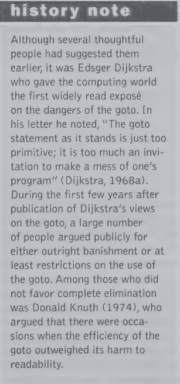

这些问题直接源于 goto 能够强制程序的任何语句在执行顺序上跟随任何其他语句，而不管该语句在文本顺序上是在先前执行的语句之前还是之后。可读性在程序语句的执行顺序几乎与它们出现的顺序相同时最佳——在我们的例子中，这意味着自上而下，这是我们习惯的顺序。因此，限制 goto 只能向下转移控制部分缓解了该问题。它允许 goto 在出现错误或异常情况时绕过代码段，但不允许将其用于构建任何类型的循环。

一些语言是设计时没有 goto 的——例如，Java、Python 和 Ruby。然而，大多数目前流行的语言都包含 goto 语句。Kernighan 和 Ritchie（1978）称 goto 是无限可滥用的，但它仍然包含在 Ritchie 的语言 C 中。那些消除了 goto 的语言提供了额外的控制语句，通常以循环退出形式出现，以编码 goto 的一种合理应用。

相对较新的语言 C# 包含 goto，即使其基于的语言之一 Java 不包含。C# 的 goto 的一种合法用途是在 switch 语句中，如第 8.2.2.2 节所述。

第 8.3.3 节讨论的所有循环退出语句实际上都是伪装的 goto 语句。它们是严重受限的 goto，对可读性无害。事实上，可以认为它们提高了可读性，因为避免使用它们会导致复杂且不自然的代码，理解起来会困难得多。

## 8.5 受保护命令

Dijkstra（1975）提出了选择和循环结构的新颖且截然不同的形式。他的主要动机是提供支持程序设计方法的控制语句，该方法在开发过程中而非在验证或测试已完成程序时确保正确性。该方法在 Dijkstra（1976）中进行了描述。另一个动机是使用受保护命令时推理清晰度的提高。简单地说，受保护命令语句中选择语句的可选段可以独立于语句的任何其他部分考虑，而这对于常见编程语言的选择语句是不成立的。

受保护命令在本章中介绍，因为它们是后来为 CSP（Hoare，1978）中并发编程开发的语言机制的基础。受保护命令还用于在 Haskell 中定义函数，如第 15 章所述。

Dijkstra 的选择语句形式为

```
if <Boolean expression> -> <statement>
[] <Boolean expression> -> <statement>
[] . . .
[] <Boolean expression> -> <statement>
fi
```

结束保留字 fi 是开头保留字倒写。这种结束保留字的形式取自 ALGOL 68。称为 fatbars 的小块用于分隔受保护子句并允许子句为语句序列。选择语句中每一行，由布尔表达式（保护）和语句或语句序列组成，称为受保护命令。

该选择语句看起来像多重选择，但其语义不同。每次在执行期间到达该语句时，都会计算所有布尔表达式。如果多个表达式为真，则可以非确定性地选择其中一个对应的语句执行。实现可能总是选择与第一个求值为真的布尔表达式相关联的语句。但它可能选择与任何真布尔表达式相关联的语句。因此，程序的正确性不能依赖于选择哪个语句（在与真布尔表达式相关联的语句中）。如果没有任何布尔表达式为真，则会发生运行时错误导致程序终止。这迫使程序员考虑并列出所有可能性。考虑以下示例：

```
if i = 0 -> sum := sum + i
[] i > j -> sum := sum + j
[] j > i -> sum := sum + i
fi
```

如果 i = 0 且 j > i，则该语句在第一个和第三个赋值语句之间非确定性地选择。如果 i 等于 j 且不为零，则会发生运行时错误，因为没有任何条件为真。

该语句可以优雅地允许程序员说明在某些情况下执行顺序无关紧要。例如，要找到两个数字中的较大者，我们可以使用

```
if x >= y -> max := x
[] y >= x -> max := y
fi
```

这在不过度指定解决方案的情况下计算所需结果。特别是，如果 x 和 y 相等，则将哪一个赋给 max 并不重要。这是该语句非确定性语义提供的一种抽象形式。

现在，考虑用传统编程语言的选择语句编写的同一过程：

```
if (x >= y)
    max = x;
else
    max = y;
```

这也可以写成如下：

```
if (x > y)
    max = x;
else
    max = y;
```

这两个语句之间没有实际区别。第一个在 x 和 y 相等时将 x 赋给 max；第二个在相同情况下将 y 赋给 max。这种两种语句之间的选择使代码的形式分析及其正确性证明变得复杂。这就是 Dijkstra 开发受保护命令的原因之一。


迪杰斯特拉提出的循环结构形式为

```
do <Boolean expression> -> <statement>
[] <Boolean expression> -> <statement>
[] ...
[] <Boolean expression> -> <statement>
od
```

该语句的语义是，每次迭代都会对所有布尔表达式进行求值。如果多于一个为真，则会非确定性地（也许是随机地）选择其中一个关联语句执行，之后再次求值表达式。当所有表达式同时为假时，循环终止。

考虑以下问题：给定四个整数变量 q1、q2、q3 和 q4，将四个值重新排列，使得 q1 ? q2 ? q3 ? q4。没有使用受保护命令时，一个直接的解决方案是将四个值放入数组，对数组进行排序，然后将值从数组重新赋给标量变量 q1、q2、q3 和 q4。虽然该解决方案并不困难，但需要大量的代码，特别是如果排序过程必须包含在内。

现在，考虑以下使用受保护命令解决相同问题但更简洁、更优雅的代码。

```
do q1 > q2 -> temp := q1; q1 := q2; q2 := temp;
[] q2 > q3 -> temp := q2; q2 := q3; q3 := temp;
[] q3 > q4 -> temp := q3; q3 := q4; q4 := temp;
od
```

迪杰斯特拉的受保护命令控制语句之所以有趣，部分原因在于它们说明了语句的语法和语义如何影响程序验证，反之亦然。当使用 goto 语句时，程序验证几乎不可能。如果（1）仅使用逻辑循环和选择或（2）仅使用受保护命令，则验证会大大简化。受保护命令的公理语义可以方便地指定（Gries, 1981）。然而，很明显，受保护命令在实现上的复杂性比其传统的确定性对应物要大得多。

## 8.6 结论

我们已经描述并讨论了多种语句级控制结构。现在似乎需要进行简要评估。

首先，我们有理论结果，只有序列、选择和预测试逻辑循环是表达计算所绝对必需的（Böhm and Jacopini, 1966）。该结果已被那些希望完全禁止无条件分支的人所使用。当然，使用 goto 已经存在足够实际问题，可以在不使用理论理由的情况下将其谴责。goto 的主要合法需求之一——提前退出循环——可以用受限分支语句如 break 来满足。

对 Böhm 和 Jacopini 结果的一个明显误用是反对在选择和预测试逻辑循环之外包含任何控制结构。没有任何广泛使用的语言采取了这一步；此外，我们怀疑任何语言都不会这样做，因为这对可写性和可读性有负面影响。仅使用选择和预测试逻辑循环编写的程序通常在结构上不自然、更复杂，因此更难编写也更难阅读。例如，C# 的多重选择结构对 C# 的可写性是一个巨大的提升，没有明显的负面影响。另一个例子是许多语言的计数循环结构，尤其是在语句简单时。

对于许多其他已被提出但是否值得纳入语言的控制结构，其实用性并不十分明确（Ledgard and Marcotty, 1975）。这个问题在很大程度上取决于语言大小是否必须最小化的根本问题。Wirth（1975）和 Hoare（1973）都强烈支持语言设计的简洁性。就控制结构而言，简洁意味着语言中应只有少数几个控制语句，并且它们应简单。

所发明的语句级控制结构的多样性显示了语言设计者之间意见的多样性。经过所有的发明、讨论和评估，关于语言中应包含的确切控制语句集合，仍然没有一致的意见。大多数当代语言当然具有相似的控制语句，但在其语法和语义的细节上仍存在一些差异。此外，关于语言是否应包含 goto 仍存在分歧；C++ 和 C# 包含它，但 Java 和 Ruby 不包含。

## SUMMARY

控制语句出现在几个类别中：选择、多重选择、迭代和无条件分支。

C 语言族的 switch 语句代表了多重选择语句。C# 版本通过禁止从所选段隐式继续到下一个可选择段，消除了其前身的可靠性问题。

为高级语言发明了大量不同的循环语句。C 的 for 语句是最灵活的迭代语句，尽管其灵活性导致了一些可靠性问题。

大多数语言都有用于其循环的退出语句；这些语句取代了 goto 语句最常见的用途之一。

基于数据的迭代器是用于处理数据结构（如链表、哈希和树）的循环语句。C 语言族的 for 语句允许用户为用户定义的数据创建迭代器。Perl 和 C# 的 foreach 语句是针对标准数据结构的预定义迭代器。在当代面向对象的语言中，集合的迭代器使用标准接口指定，由集合的设计者实现。

Ruby 包含迭代器，它们是发送给各种对象的特殊形式的方法。语言为常见用途预定义了迭代器，但也允许用户定义迭代器。

无条件分支，或 goto，一直是大多数命令式语言的一部分。其问题已被广泛讨论和争论。目前的共识是它应保留在大多数语言中，但其危险应通过编程纪律来最小化。

迪杰斯特拉的受保护命令是具有积极理论特征的替代控制语句。虽然它们未被采纳为语言的控制语句，但其部分语义出现在 CSP 的并发机制和 Haskell 的函数定义中。

## REVIEW QUESTIONS

- 1. 定义选择语句。
- 2. 提及 Böhm 和 Jacopini 结果的一个常见误用。
- 3. 双向选择器的一般形式是什么？
- 4. Python 使用什么机制来指定复合语句？
- 5. 为什么许多语言使用静态语义规则而不是语法实体？
- 6. 给出一种不允许无 else 的 if 语句的语言的例子。
- 7. 在什么情况下算术表达式可用于控制表达式？
- 8. 从双向选择器和 gotos 构建多重选择器的局限性是什么？
- 9. 选择语句的两个一般类别是什么？
- 10. 在决定多重选择语句的一次执行中是否执行多于一个可选择段时，在哪两个语言特性之间进行权衡？
- 11. switch 语句中默认段的作用是什么？
- 12. 哪些函数式语言没有语句作为选择器？
- 13. 解释 C# 的 switch 语句为何比 C 的更安全。
- 14. 在什么情况下可以接受对案例和标签表进行线性搜索？
- 15. 当选择语句中的案例数大于或等于 10 时，编译器遵循什么机制来优化执行所需的时间？
- 16. 什么是循环变量？什么是步长？
- 17. 预测试版本和后测试版本逻辑循环的区别是什么？

- 8. 在关于 goto 问题的论文中，Knuth（1974）提出了一种允许多次退出的循环控制语句。阅读该论文并编写该语句的操作语义描述。
- 9. Java 中控制语句仅使用布尔表达式（与 C++ 中还允许算术表达式相反）的论据有哪些？
- 10. 描述一种编程情况，其中 Python 的 for 语句中的 else 子句会很方便。
- 11. 描述三种需要后测试循环的具体编程情况。
- 12. 推测控制可以转移到 C 循环语句中的原因。

## PROGRAMMING EXERCISES

- 1. 使用指定语言中的循环结构重写以下伪代码段：

```
k = (j + 13) / 27
loop:
if k > 10 then goto out
k = k + 1
i = 3 * k - 1
goto loop
out: . . .
```

- a. C, C++, Java, 或 C#
- b. Python
- c. Ruby

假设所有变量都是整数类型。讨论对于此代码，哪种语言具有最佳的可写性、最佳的可读性以及两者的最佳组合。

- 2. 重新做编程练习 1，但这次将所有变量和常量都改为浮点类型，并将语句

```
k = k + 1
```

改为

```
k = k + 1.2
```

- 3. 使用以下语言中的多重选择语句重写以下代码段：

```
if ((k == 1) || (k == 2)) j = 2 * k - 1
if ((k == 3) || (k == 5)) j = 3 * k + 1
if (k == 4) j = 4 * k - 1
if ((k == 6) || (k == 7) || (k == 8)) j = k - 2
```


+   a. C、C++、Java 或 C#
+   b. Python
+ c. Ruby

假设所有变量均为整型。讨论对于这段特定代码使用这些语言的相对优缺点。

## 4. 考虑以下 C 程序片段。使用没有 goto 或 break 的语句重写它。

```
j = -3;
for (i = 0; i < 3; i++) {
    switch (j + 2) {
        case 3:
        case 2: j--; break;
        case 0: j += 2; break;
        default: j = 0;
    }
    if (j > 0) break;
    j = 3 - i
}
```

## 5. 在写给 CACM 编辑的一封信中，Rubin（1987）使用以下代码片段作为证据，证明某些带 goto 的代码的可读性优于不带 goto 的等价代码。这段代码用于查找名为 x 的 n 乘 n 整数矩阵中第一个全零行。

```
for (i = 1; i <= n; i++) {
    for (j = 1; j <= n; j++)
        if (x[i][j] != 0)
            goto reject;
    printf ('First all-zero row is:', i);
    break;
reject:
}
```

请使用以下语言之一重写此代码，且不使用 goto：C、C++、Java 或 C#。将你的代码与示例代码的可读性进行比较。

## 6. 考虑以下编程问题：三个整型变量 first、second 和 third 的值必须分别放入三个变量 max、mid 和 min 中，含义显而易见，且不能使用数组、用户自定义或预定义子程序。写出两个解决方案，一个使用嵌套选择，另一个不使用。比较两者的复杂度和预期可靠性。

## 7. 使用 C 语言中的 if 和 goto 语句重写编程练习 4 中的 C 程序片段。

## 8. 使用 Java 重写编程练习 4 中的 C 程序片段，但不使用 switch 语句。

9. 将以下 Scheme 的 COND 调用翻译成 C，并将结果值赋给 y。

```
(COND
  ((> x 10) x)
  ((< x 5) (* 2 x))
  ((= x 7) (+ x 10))
)
```

# 子程序

- 9.1 引言
- 9.2 子程序的基本概念
- 9.3 子程序的设计问题
- 9.4 局部引用环境
- 9.5 参数传递方法
- 9.6 作为子程序的参数
- 9.7 间接调用子程序
- 9.8 函数的设计问题
- 9.9 重载子程序
- 9.10 泛型子程序
- 9.11 用户定义的重载运算符
- 9.12 闭包
- 9.13 协程

## 第9章 子程序

子程序是程序的基本构建块，因此也是编程语言设计中最核心的概念之一。我们将在本章探讨子程序的设计，包括参数传递方法、局部引用环境、重载子程序、泛型子程序，以及与子程序相关的别名问题和副作用问题。我们还会讨论间接调用子程序、闭包和协程。

子程序的实现方法将在第10章讨论。

### 9.1 引言

编程语言中可以包含两种基本的抽象机制：过程抽象和数据抽象。在高级编程语言的早期历史中，只有过程抽象被包含在内。以子程序形式存在的过程抽象一直是所有编程语言的核心概念。然而，在20世纪80年代，许多人开始认为数据抽象同样重要。数据抽象将在第11章详细讨论。

第一台可编程计算机——巴贝奇的分析机，建造于19世纪40年代，就能够在程序中的多个不同位置重用指令卡片集合。在现代编程语言中，这样的语句集合被编写为子程序。这种重用节省了内存空间和编码时间。这种重用也是一种抽象，因为子程序计算的细节在程序中由一条调用子程序的语句所替代。程序不再描述某个计算是如何完成的，而是通过调用语句来执行该描述（子程序中的语句集合），从而有效地抽象掉了细节。这通过强调程序的逻辑结构而隐藏其底层细节，提高了程序的可读性。

面向对象语言的方法与本章讨论的子程序密切相关。方法不同于子程序的主要方式在于它们的调用方式以及与类和对象的关联方式。虽然这些方法的特殊特性将在第12章讨论，但它们与子程序共享的特性（如参数和局部变量）将在本章讨论。

### 9.2 子程序的基本概念

#### 9.2.1 子程序的一般特性

本章讨论的所有子程序（除了9.13节描述的协程）都具有以下特性：

- 每个子程序只有一个入口点。
- 调用程序单元在被调用子程序执行期间被挂起，这意味着在任何给定时刻只有一个子程序在执行。
- 当子程序执行终止时，控制权总是返回到调用者。

这些特性的替代方案导致了协程和并发单元（第13章）。大多数子程序都有名称，尽管有些是匿名的。9.12节有C#中匿名子程序的示例。

#### 9.2.2 基本定义

子程序定义描述了子程序抽象的接口和动作。子程序调用是对特定子程序执行的显式请求。如果一个子程序在被调用后已经开始执行但尚未完成执行，则称该子程序处于活动状态。两种基本的子程序——过程和函数——将在9.2.4节中定义和讨论。

子程序头是定义的第一部分，具有多种用途。首先，它指定以下语法单元是某种特定类型的子程序定义。¹在具有多种子程序的语言中，子程序的类型通常用一个特殊单词指定。其次，如果子程序不是匿名的，则子程序头为该子程序提供名称。第三，它可以指定参数列表。

考虑以下子程序头示例：

```
def adder parameters):
```

这是一个名为 adder 的 Python 子程序的子程序头。Ruby 子程序头也以 `def` 开头。JavaScript 子程序的子程序头以 `function` 开头。

在 C 语言中，名为 adder 的函数头可能如下：

```
void adder (parameters)
```

这个头中的保留字 `void` 表示该子程序不返回值。

子程序体定义了其动作。在基于 C 的语言（以及某些其他语言，例如 JavaScript）中，子程序体用花括号界定。在 Ruby 中，`end` 语句终止子程序体。与复合语句一样，Python 函数体中的语句必须缩进，函数体的结束由第一个不缩进的语句指示。

Python 函数有一个区别于其他常见编程语言函数的特性：`def` 语句是可执行的。当执行 `def` 语句时，它将给定名称赋给该函数体。在函数的 `def` 被执行之前，该函数不能被调用。考虑以下框架示例：

```
if . . .
    def fun(. . .):
        . . .
else
    def fun(. . .):
        . . .
```

如果执行此选择结构的 then 子句，则可以调用该版本的函数 `fun`，但不能调用 else 子句中的版本。同样，如果选择 else 子句，则可以调用其版本的函数，但不能调用 then 子句中的版本。

Ruby 方法在几个有趣方面不同于其他编程语言的子程序。Ruby 方法通常在类定义中定义，但也可以在类定义之外定义，此时它们被视为根对象 `Object` 的方法。此类方法可以像 C 或 C++ 中的函数一样，在没有对象接收者的情况下被调用。如果 Ruby 方法在没有接收者的情况下被调用，则假定 `self` 为接收者。如果类中没有该名称的方法，则必要时会向上搜索外层类，直至 `Object`。

所有 Lua 函数都是匿名的，尽管它们可以使用看起来像有名字的语法来定义。例如，考虑以下函数 `cube` 的相同定义：

```
function cube(x) return x * x * x end

cube = function (x) return x * x * x end
```

第一个使用传统语法，而第二个的形式更准确地说明了函数的无名性。

子程序的**参数轮廓**包含其形式参数的数量、顺序和类型。子程序的**协议**是其参数轮廓加上（如果是函数）其返回类型。在子程序具有类型的语言中，这些类型由子程序的协议定义。

子程序可以有声明，也可以有定义。这种形式与 C 中变量声明和定义的并行关系类似，在 C 中声明用于提供类型信息但不定义变量。子程序声明提供子程序的协议，但不包含其函数体。在不允许前向引用子程序的语言中，这些声明是必要的。对于变量和子程序，声明都是静态类型检查所必需的。对于子程序，需要检查的是参数的类型。函数声明在 C 和 C++ 程序中很常见，被称为**原型**。此类声明通常放在头文件中。


## 9.2.3 参数

在大多数其他语言（C 和 C++ 除外）中，子程序不需要声明，因为并不要求子程序在被调用之前定义。

子程序通常描述计算。非方法子程序可以通过两种方式访问它要处理的数据：直接访问非局部变量（在别处声明但在子程序中可见），或者通过参数传递。通过参数传递的数据使用子程序局部的名字来访问。参数传递比直接访问非局部变量更灵活。本质上，通过参数访问待处理数据的子程序是一种参数化计算。它可以对通过参数接收到的任何数据执行其计算（假设参数的类型符合子程序的预期）。如果数据访问是通过非局部变量进行的，那么要对不同的数据进行计算，唯一的方法就是在两次子程序调用之间给这些非局部变量赋新值。大量访问非局部变量会降低可靠性。那些在需要访问它们的子程序中可见的变量，往往最终在不需要访问它们的地方也可见。这个问题已在第 5 章讨论过。

尽管方法也通过非局部引用和参数访问外部数据，但方法要处理的主要数据是调用该方法的对象。然而，当方法确实访问非局部数据时，其可靠性问题与非方法子程序相同。此外，在面向对象语言中，方法对类变量（与类关联，而非与对象关联的变量）的访问与非局部数据的概念相关，应尽可能避免。在这种情况下，以及在 C 函数访问非局部数据的情况下，方法可能会产生改变其参数或局部数据以外内容的副作用。这种改变会使方法的语义复杂化，并降低其可靠性。

纯函数式编程语言（如 Haskell）没有可变数据，因此用它们编写的函数无法以任何方式改变内存——它们只是执行计算并返回结果值（或函数，因为在纯函数式语言中函数也是值）。

在某些情况下，能够将计算而非数据作为参数传递给子程序是很方便的。在这些情况下，实现该计算的子程序的名字可以用作参数。这种形式的参数将在 9.6 节讨论。数据参数将在 9.5 节讨论。

子程序头部中的参数称为形参。它们有时被视为哑变量，因为它们不是通常意义上的变量：在大多数情况下，它们只在子程序被调用时才绑定到存储，而且这种绑定通常是通过其他程序变量进行的。

子程序调用语句必须包含子程序的名字和一组将绑定到该子程序形参的参数。这些参数称为实参。² 它们必须与形参区分开来，因为两者在形式上的限制通常不同，当然，它们的用途也大不相同。

在大多数编程语言中，实参与形参的对应关系——即实参到形参的绑定——是按位置进行的：第一个实参绑定到第一个形参，依此类推。这样的参数称为位置参数。只要参数列表相对较短，这是一种将实参与相应形参关联起来的有效且安全的方法。

然而，当参数列表很长时，程序员很容易在列表中弄错实参的顺序。解决这个问题的一种方法是提供关键字参数，即在调用中，实参要绑定到的形参的名字与实参一起指定。关键字参数的优点是它们可以在实参列表中按任意顺序出现。Python 函数可以使用这种技术来调用，例如

```
sumer(length = my_length,
    list = my_array,
    sum = my_sum)
```

其中 sumer 的定义具有形参 length、list 和 sum。

关键字参数的缺点是子程序的使用者必须知道形参的名字。

除了关键字参数，某些语言（例如 Python）还允许位置参数。关键字参数和位置参数可以在调用中混合使用，例如

```
sumer(my_length,
    sum = my_sum,
    list = my_array)
```

这种方法的唯一限制是，一旦列表中出现了关键字参数，所有剩余参数都必须使用关键字。这个限制是必要的，因为在一个关键字参数出现之后，位置可能不再有明确定义。

在 Python、Ruby、C++ 和 PHP 中，形参可以有默认值。如果子程序头部中的某个形参没有接收到实参，就使用默认值。考虑以下 Python 函数头：

```
def compute_pay(income, exemptions = 1, tax_rate)
```

在调用 compute_pay 时，exemptions 形参可以省略；省略时使用值 1。在 Python 调用中，省略的实参不包含逗号，因为这样的逗号唯一的作用是指示下一个参数的位置，而在这种情况下这没有必要，因为省略的实参之后的所有实参都必须使用关键字。例如，考虑以下调用：

```
pay = compute_pay(20000.0, tax_rate = 0.15)
```

在不支持关键字参数的 C++ 中，默认参数的规则必然不同。默认参数必须出现在最后，因为参数是按位置关联的。一旦在调用中省略了一个默认参数，所有剩余的形参都必须具有默认值。compute_pay 函数的 C++ 函数头可以写成如下形式：

```
float compute_pay(float income, float tax_rate,
    int exemptions = 1)
```

注意，参数被重新排列，使得具有默认值的参数位于最后。C++ compute_pay 函数的一个示例调用为

```
pay = compute_pay(20000.0, 0.15);
```

在大多数不为形参提供默认值的语言中，调用中的实参数量必须与子程序定义头部中的形参数量匹配。然而，在 C、C++、Perl、JavaScript 和 Lua 中，这并不是必需的。当调用中的实参数量少于函数定义中的形参数量时，程序员有责任确保参数对应关系（始终是位置对应）和子程序的执行是合理的。

尽管这种允许可变数量参数的设计显然容易出错，但有时也很方便。例如，C 语言中的 printf 函数可以打印任意数量的项（数据值和/或字面量）。

C# 允许方法接受可变数量的参数，只要这些参数具有相同的类型。方法使用 params 修饰符指定其形参。调用可以发送数组或表达式列表，编译器会将这些表达式的值放入一个数组，并提供给被调用的方法。例如，考虑以下方法：

```
public void DisplayList(params int[] list) {
    foreach (int next in list) {
        Console.WriteLine("Next value {0}", next);
    }
}
```

如果 DisplayList 是为类 MyClass 定义的，并且我们有以下声明：

```
MyClass myObject = new MyClass;
int[] myList = new int[6] {2, 4, 6, 8, 10, 12};
```

DisplayList 可以使用以下任一方式调用：

```
myObject.DisplayList(myList);
myObject.DisplayList(2, 4, 3 * x - 1, 17);
```

Ruby 支持一种复杂但非常灵活的实参配置。初始参数是表达式，它们的值对象被传递给相应的形参。初始参数后面可以跟一组 key => value 对，这些键值对被放入一个匿名散列中，而对该散列的引用则传递给下一个形参。它们被用作 Ruby 不支持的关键字参数的替代品。散列项后面可以跟一个以星号开头的参数。这个参数称为数组形参。当方法被调用时，数组形参被设置为引用一个新的 Array 对象。所有剩余的实参都被赋值给这个新 Array 对象的元素。如果与数组形参对应的实参是一个数组，那么它也必须以星号开头，并且必须是最后一个实参。³ 因此，Ruby 以类似于 C# 的方式允许可变数量的参数。由于 Ruby 数组可以存储不同类型的值，因此传递给该数组的实参不要求具有相同的类型。

以下程序骨架式的函数定义和调用示例说明了 Ruby 的参数结构：

```
list = [2, 4, 6, 8]
def tester(p1, p2, p3, *p4)
...
end
tester('first', mon => 72, tue => 68, wed => 59, *list)
```

在 tester 内部，其形参的值如下：

```
p1 is 'first'
p2 is {mon => 72, tue => 68, wed => 59}
p3 is 2
p4 is [4, 6, 8]
```

Python 支持与 Ruby 类似的参数。

> 3. 这不完全正确，因为数组形参后面还可以跟一个方法或函数引用，该引用前面有一个与号（&）。


Lua 使用一种简单的机制来支持可变数量的参数——此类参数由省略号 (...) 表示。此省略号可以被视为一个数组，也可以被视为可分配给变量列表的值列表。例如，考虑以下两个函数示例：

```
function multiply (...)
    local product = 1
    for i, next in ipairs{ ... } do
        product = product * next
    end return product
end
```

ipairs 是数组的迭代器（它一次返回数组元素的索引和值）。{ ... } 是实际参数值的一个数组。

```
function DoIt (...)
    local a, b, c = ...
    ...
end
```

假设 DoIt 被以下调用调用：

```
doit(4, 7, 3)
```

在此示例中，a、b 和 c 将在函数中分别初始化为值 4、7 和 3。

三点参数不必是唯一的参数——它可以出现在命名形式参数列表的末尾。

## 9.2.4 过程和函数

子程序有两类不同的类别——过程和函数——两者都可以被视为扩展语言的方法。子程序是定义参数化计算的语句集合。函数返回值，而过程不返回值。在大多数不将过程作为子程序的独立形式包含的语言中，函数可以被定义为不返回值，并且可以作为过程使用。过程的计算是通过单个调用语句执行的。实际上，过程定义了新的语句。例如，如果某种特定语言没有排序语句，用户可以构建一个过程来对数据数组进行排序，并在不可用的排序语句的位置使用对该过程的调用。只有一些较旧的语言，如 Fortran 和 Ada，支持过程。

过程可以通过两种方法在调用程序单元中产生结果：（1）如果存在既不是形式参数又在过程和调用程序单元中都可见的变量，过程可以更改它们；以及（2）如果过程具有允许将数据传输给调用者的形式参数，则可以更改这些参数。

函数在结构上类似于过程，但在语义上建模于数学函数。如果函数是忠实的模型，它不会产生副作用；也就是说，它不会修改其参数或函数外部定义的任何变量。这样的函数返回一个值——这是其唯一的期望效果。大多数编程语言中的函数都有副作用。

函数通过其名称在表达式中出现以及所需实际参数来调用。函数执行产生的值返回给调用代码，有效地替换了调用本身。例如，表达式 f(x) 的值是 f 在使用参数 x 调用时产生的值。对于不产生副作用的函数，返回的值是其唯一的效果。

函数定义新的用户定义运算符。例如，如果某种语言没有指数运算符，可以编写一个函数返回其一个参数的另一个参数次幂的值。其在 C++ 中的头可以是

```
float power(float base, float exp)
```

可以这样调用

```
result = 3.4 * power(10.0, x)
```

标准 C++ 库已包含一个名为 pow 的类似函数。将此与 Perl 中的相同操作进行比较，其中指数是内置操作：

```
result = 3.4 * 10.0 ** x
```

在某些编程语言中，用户可以通过为运算符定义新函数来重载运算符。用户定义的重载运算符在第 9.11 节中讨论。

## 9.3 子程序的设计问题

子程序是复杂的结构，因此其设计涉及大量问题。一个明显的问题是选择将使用的一种或多种参数传递方法。各种语言中使用的大量不同方法反映了人们对此问题的意见多样性。一个密切相关的问题是实际参数的类型是否会与相应形式参数的类型进行类型检查。

子程序的本地环境的性质在某种程度上决定了子程序的性质。这里最重要的一个问题是局部变量是静态分配还是动态分配。

接下来，有一个问题是子程序定义是否可以嵌套。另一个问题是子程序名称是否可以作为参数传递。如果

子程序名称可以作为参数传递并且语言允许子程序嵌套，那么作为参数传递的子程序的正确引用环境是什么。

正如第 5 章所看到的，函数的副作用会引起问题。因此，限制副作用是函数的一个设计问题。可以从函数返回的值的类型和数量是其他设计问题。

最后，还有子程序是否可以重载或泛型的问题。重载子程序是指在同一引用环境中与另一个子程序同名的子程序。泛型子程序是指其计算可以在不同调用中使用不同类型的数据完成。闭包是一个嵌套子程序及其引用环境，二者一起允许子程序从程序中的任何位置被调用。

以下是子程序设计问题的总结。一般情况下子程序的额外问题。专门与函数相关的问题在第 9.10 节中讨论。

- 局部变量是静态分配还是动态分配？
- 子程序定义是否可以出现在其他子程序定义中？
- 使用什么参数传递方法或方法？
- 实际参数的类型是否与形式参数的类型进行检查？
- 如果子程序可以作为参数传递并且子程序可以嵌套，已传递子程序的引用环境是什么？
- 是否允许函数副作用？
- 可以从函数返回什么类型的值？
- 可以从函数返回多少个值？
- 子程序可以重载吗？
- 子程序可以是泛型的吗？
- 如果语言允许嵌套子程序，是否支持闭包？

这些问题和示例设计将在以下各节中讨论。

## 9.4 局部引用环境

本节讨论与在子程序内定义变量相关的问题。嵌套子程序定义的问题也简要涉及。

### 9.4.1 局部变量

子程序可以定义自己的变量，从而定义局部引用环境。在子程序内部定义的变量称为局部变量，因为它们的范围通常是定义它们的子程序的主体。

在第 5 章的术语中，局部变量可以是静态的或栈动态的。如果局部变量是栈动态的，它们在子程序开始执行时绑定到存储，并在该执行终止时从存储中解绑。栈动态局部变量有几个优点，主要的是灵活性。递归子程序必须具有栈动态局部变量。栈动态局部变量的另一个优点是，活动子程序中局部变量的存储可以与所有非活动子程序的局部变量共享。当计算机内存较小时，这并不是最重要的优点。

栈动态局部变量的主要缺点如下：首先，是为每次对子程序的调用分配、初始化（在必要时）和释放此类变量所需的时间成本。其次，对栈动态局部变量的访问必须是间接的，而对静态变量的访问可以直接进行。⁴ 这种间接性是必需的，因为特定局部变量将在栈中的位置只能在执行期间确定（参见第 10 章）。最后，当所有局部变量都是栈动态时，子程序不能是历史敏感的；也就是说，它们不能在调用之间保留局部变量的数据值。有时能够编写历史敏感的子程序很方便。需要历史敏感子程序的一个常见例子是生成伪随机数的任务。对此类子程序的每次调用都计算一个伪随机数，使用它上次计算的那个。因此，它必须将上一个数存储在静态局部变量中。协程和迭代器循环构造中使用的子程序（在第 8 章中讨论）是需要历史敏感的子程序的另一个例子。

静态局部变量相对于栈动态局部变量的主要优点是它们效率略高——它们不需要分配和释放的运行时开销。此外，如果直接访问，这些访问显然更有效。当然，它们允许子程序是历史敏感的。静态局部变量的最大缺点是它们无法支持递归。此外，它们的存储不能与其他非活动子程序的局部变量共享。

在大多数当代语言中，子程序中的局部变量默认是栈动态的。在 C 和 C++ 函数中，局部变量是栈动态的，除非特别声明为 static。例如，在以下 C（或 C++）函数中，变量 sum 是静态的，而 count 是栈动态的。

```
int adder(int list[], int listlen) {
    static int sum = 0;
    int count;
    for (count = 0; count < listlen; count++)
        sum += list[count];
    return sum;
}
```


C++、Java 和 C# 的方法只有栈动态局部变量。在 Python 中，方法定义里唯一使用的声明就是针对全局变量的。方法中被声明为全局的变量必须是定义在方法外部的变量。方法外部定义的变量无需声明为全局即可在方法中引用，但这样的变量不能在方法内被赋值。如果在方法中对某个全局变量的名字进行赋值，它会被隐式地声明为局部变量，且该赋值不会影响全局变量。Python 方法中的所有局部变量都是栈动态的。

Lua 中只声明作用域受限的变量。任何块（包括函数体）都可以使用 `local` 声明来声明局部变量，如下所示：

```
local sum
```

Lua 中所有未声明的变量都是全局的。根据 Ierusalimschy（2006）的说法，访问 Lua 中的局部变量比访问全局变量更快。

## 9.4.2 嵌套子程序

嵌套子程序的思想起源于 ALGOL 60。其动机是能够创建既包含逻辑又包含作用域的层级结构。如果某个子程序只在另一个子程序内部被使用，为什么不把它放在那里，并对程序的其余部分隐藏起来呢？由于允许嵌套子程序的语言通常使用静态作用域，这也提供了一种高度结构化的方式，来授予对外层子程序中非局部变量的访问权限。回顾第 5 章，我们讨论了由此引入的问题。在很长一段时间里，允许嵌套子程序的语言只有直接继承自 ALGOL 60 的那些，即 ALGOL 68、Pascal 和 Ada。许多其他语言，包括 C 的所有直接派生物，都不允许子程序嵌套。最近，一些新的语言再次允许了嵌套，其中包括 JavaScript、Python、Ruby 和 Lua。此外，大多数函数式编程语言也允许子程序嵌套。

## 9.5 参数传递方法

参数传递方法是参数被传递到被调用子程序和/或从被调用子程序传回的方式。首先，我们关注参数传递方法的不同语义模型；然后，我们讨论语言设计者为这些语义模型发明的各种实现模型；接下来，我们考察几种语言的设计选择，并讨论用于实现这些实现模型的实际方法；最后，我们考虑语言设计者在选择这些方法时所面临的设计考量。

## 9.5.1 参数传递的语义模型

形式参数由三种不同的语义模型之一来表征：(1) 它们可以从对应的实际参数接收数据；(2) 它们可以将数据传递给实际参数；或 (3) 它们可以同时完成两者。这些模型分别称为 in 模式、out 模式和 inout 模式。例如，考虑一个子程序，它接受两个 int 值数组作为参数——list1 和 list2。该子程序必须将 list1 加到 list2 上，并将结果作为 list2 的修订版返回。此外，该子程序必须从给定的两个数组创建一个新数组并返回它。对于这个子程序，list1 应为 in 模式，因为它不应被子程序修改。list2 必须是 inout 模式，因为子程序需要该数组的给定值，并且必须返回其新值。第三个数组应为 out 模式，因为该数组没有初始值，而其计算出的值必须返回给调用者。

关于参数传递中数据传输如何进行，有两种概念模型：要么复制实际值（复制给调用者、被调用者，或双向复制），要么传输访问路径。最常见的是，访问路径是简单的指针或引用。图 9.1 展示了当值被复制时参数传递的三种语义模型。

## 9.5.2 参数传递的实现模型

语言设计者开发了多种模型来指导三种基本参数传递模式的实现。在接下来的章节中，我们将讨论其中的几种，以及它们相对的优缺点。

## 图 9.1

使用物理移动时参数传递的三种语义模型

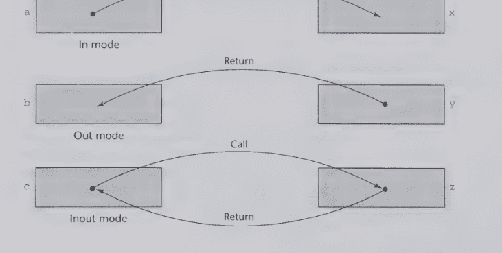

### 9.5.2.1 按值传递

当参数按值传递时，实际参数的值用于初始化对应的形式参数，该形式参数随后在子程序中充当局部变量，从而实现 in 模式语义。

按值传递通常通过复制来实现，因为这种方式下访问通常更高效。它也可以通过传输指向调用者中实际参数值的访问路径来实现，但这要求该值位于写保护单元（只能读取的单元）中。强制执行写保护并非总是简单的。例如，假设接收参数的子程序又将该参数传递给另一个子程序。这也是使用复制传输的另一个原因。正如我们将在 9.5.4 节中看到的，C++ 为通过访问路径传输的按值传递参数提供了一种便捷有效的写保护指定方法。

按值传递的优点是对于标量来说，它在链接开销和访问时间两方面都很快。

如果使用复制，按值传递方法的主要缺点是需要为形式参数提供额外的存储空间，要么在被调用子程序内部，要么在调用者和被调用子程序之外的某个区域。此外，实际参数必须被复制到对应形式参数的存储区域。如果参数很大，比如包含许多元素的数组，存储和复制操作可能会非常昂贵。

### 9.5.2.2 按结果传递

按结果传递是一种针对 out 模式参数的实现模型。当参数按结果传递时，没有值被传输给子程序。对应的形式参数充当局部变量，但就在控制权传回调用者之前，其值被传回调用者的实际参数——该实际参数显然必须是一个变量。（如果实际参数是字面量或表达式，调用者如何引用计算出的结果呢？）

按结果传递方法具有按值传递的优缺点，外加一些额外的缺点。如果值是通过复制返回的（而不是访问路径），就像通常情况那样，那么按结果传递同样需要按值传递所需的额外存储空间和复制操作。与按值传递一样，通过传输访问路径来实现按结果传递的困难通常导致它通过复制来实现。在这种情况下，问题在于确保实际参数的初始值不被用于被调用子程序中。

按结果传递模型的一个额外问题是可能存在实际参数冲突，例如以下调用产生的冲突：

```
sub(p1, p1)
```

在 sub 中，假设两个形式参数具有不同的名字，它们显然可以被赋予不同的值。然后，两者中较晚被复制回其对应实际参数的那个，将成为调用者中 y 的值。因此，实际参数的复制顺序决定了它们的值。例如，考虑以下 C# 方法，它在其形式参数上使用 out 说明符来指定按结果传递方法：

```
void Fixer(out int x, out int y)
{
    x = 17;
    y = 35;
}

...Fixer(out a, out a);
```

如果在 Fixer 执行结束时，形式参数 x 首先被赋值给其对应的实际参数，那么调用者中实际参数 a 的值将是 35。如果 y 先被赋值，那么调用者中实际参数 a 的值将是 17。

因为对于某些语言来说，这种顺序可能依赖于实现，不同的实现可能产生不同的结果。

当使用其他参数传递方法时，使用两个相同的实际参数调用过程也可能导致不同类型的问题，这将在 9.5.2.4 节讨论。

按结果传递可能出现的另一个问题是，实现者可能可以选择两个不同的时间点来计算实际参数的地址：在调用时或返回时。例如，考虑以下 C# 方法和后续代码：

```
void DoIt(out int x, int index)
{
    x = 17;
    index = ...;
}

...
list[0] = 35;
DoIt(list[index], index);
```

`list[index]` 的地址在方法开始和结束之间会发生变化。实现者必须选择在何时将此参数绑定到一个地址——在调用时或返回时。如果地址在进入方法时计算，值 17 将被返回给 `list[0]`；如果在返回前才计算，17 将被返回给 `list[42]`。这使得程序在那些选择在子程序开始时评估 out 模式参数地址的实现和那些选择在结束时进行评估的实现之间不可移植。避免此问题的一个明显方法是，语言设计者明确规定用于返回参数值的地址必须在何时计算。


## 9.5.2.3 按值-结果传递

按值-结果传递是 inout 模式参数的一种实现模型，其中实际值会被复制。它实际上是按值传递和按结果传递的组合。实际参数的值用于初始化对应的形式参数，然后该形式参数相当于一个局部变量。事实上，按值-结果传递的形式参数必须有与被调用子程序相关联的局部存储。在子程序终止时，形式参数的值会被传回给实际参数。

按值-结果传递有时称为按复制传递，因为在子程序入口处，实际参数被复制到形式参数，然后在子程序终止时复制回来。

按值-结果传递与按值传递和按结果传递一样，具有需要为参数提供多处存储以及花费时间复制值的缺点。它还与按结果传递一样，存在与实际参数赋值顺序相关的问题。

按值-结果传递的优点相对于按引用传递而言，因此将在 9.5.2.4 节中讨论。

## 9.5.2.4 按引用传递

按引用传递是 inout 模式参数的第二种实现模型。与按值-结果传递中来回复制数据值不同，按引用传递方法向被调用的子程序传送一个访问路径，通常只是一个地址。这提供了访问存有实际参数的存储单元的路径。因此，被调用的子程序可以访问调用程序单元中的实际参数。实际上，实际参数与被调用的子程序共享。

按引用传递的优点是传递过程本身在时间和空间上都是高效的。不需要额外的空间，也不需要进行复制。

然而，按引用传递方法有几个缺点。第一，对形式参数的访问将比按值传递参数慢，因为需要额外的间接寻址级别。第二，如果只需要与被调用的子程序进行单向通信，则可能会对实际参数造成无意和错误的修改。

按引用传递的另一个问题是可能产生别名。这个问题是可以预料的，因为按引用传递使访问路径对被调用的子程序可用，从而提供了对非局部变量的访问。这类别名问题与其他情况下的问题相同：对可读性有害，从而对可靠性有害。它也使程序验证更加困难。

按引用传递参数可以通过几种方式产生别名。第一，实际参数之间可能发生冲突。考虑一个 C++ 函数，它有两个按引用传递的参数，如下所示：

```
void fun(int &first, int &second)
```

如果对 fun 的调用恰好两次传递同一个变量，如下所示：

```
fun(total, total)
```

那么 fun 中的 first 和 second 将是别名。

第二，数组元素之间的冲突也可能导致别名。例如，假设用两个以变量下标指定的数组元素调用函数 fun，如下所示：

```
fun(list[i], list[j])
```

如果这两个参数按引用传递，并且 i 恰好等于 j，那么 first 和 second 同样是别名。

第三，如果子程序的两个形式参数分别是一个数组的元素和整个数组，并且两者都按引用传递，那么如下调用：

```
fun1(list[i], list)
```

可能会导致 fun1 中出现别名，因为 fun1 可以通过第二个参数访问 list 的所有元素，并通过第一个参数访问单个元素。

还有一种通过按引用传递参数产生别名的方式是形式参数与可见的非局部变量之间的冲突。例如，考虑以下 C 代码：

```
int * global;
void main() {
    ...
    sub(global);
    ...
}
void sub(int * param) {
    ...
}
```

在 sub 内部，param 和 global 是别名。

如果使用按值-结果传递而不是按引用传递，所有这些可能的别名情况都会被消除。然而，正如 9.5.2.3 节所讨论的，有时会出现其他问题来代替别名问题。

## 9.5.2.5 按名传递

按名传递是一种 inout 模式参数传递方法，它并不对应单一的实现模型。当参数按名传递时，实际参数实际上是在文本上替换子程序中所有出现对应形式参数的位置。这种方法与迄今讨论的方法有很大不同；在迄今讨论的方法中，形式参数在子程序调用时绑定到实际值或地址。按名传递的形式参数在子程序调用时绑定到一个访问方法，但到值或地址的实际绑定会延迟到形式参数被赋值或被引用时。实现按名传递参数需要向被调用的子程序传递一个子程序，以计算形式参数的地址或值。传递的子程序的引用环境也必须被传递。该子程序/引用环境就是一个闭包（参见 9.12 节）。7 按名传递参数既实现复杂，又效率低下。它们还给程序增加了显著的复杂性，从而降低了程序的可读性和可靠性。

由于按名传递不是任何广泛使用的语言的一部分，因此不再进一步讨论。然而，在编译时，汇编语言中的宏会使用它，C++、Java 5.0 和 C# 2005 中泛型子程序的泛型参数也会使用它，如 9.9 节所述。

## 9.5.3 实现参数传递方法

我们现在讨论参数传递的各种实现模型是如何实际实现的。

在大多数现代语言中，参数通信通过运行时栈进行。运行时栈由运行时系统初始化并维护，该系统管理程序的执行。如第 10 章所述，运行时栈被广泛用于子程序控制链接和参数传递。在下面的讨论中，我们假设所有参数传递都使用栈。

按值传递参数将其值复制到栈位置。然后，这些栈位置作为相应形式参数的存储空间。按结果传递参数的实现方式与按值传递相反。赋值给按结果传递实际参数的值被放置在栈中，当被调用的子程序终止时，调用程序单元可以检索这些值。按值-结果传递参数可以直接根据其语义实现为按值传递和按结果传递的组合。此类参数的栈位置在调用时被初始化，然后在被调用的子程序中像局部变量一样使用。

按引用传递参数也许是最容易实现的。无论实际参数的类型如何，只需将其地址放入栈中。对于字面量，将字面量的地址放入栈中。对于表达式，编译器必须构建计算该表达式的代码，该代码必须在控制转移到被调用的子程序之前执行。随后，代码将表达式的求值结果放入的内存单元的地址被放入栈中。编译器必须确保防止被调用的子程序修改作为字面量或表达式的参数。

7. 这些闭包最初（在 ALGOL 60 中）称为 thunks。

## 图 9.2

常见参数传递方法的一种可能的栈实现

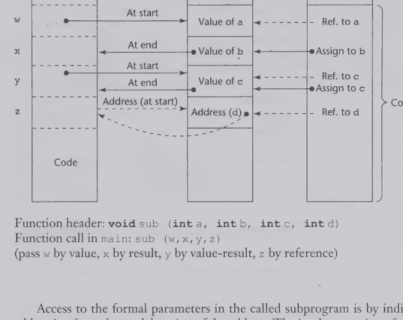

函数头：void sub (int a, int b, int c, int d)

主程序中的函数调用：sub (w, x, y, z)

（w 按值传递，x 按结果传递，y 按值-结果传递，z 按引用传递）

在被调用的子程序中，对形式参数的访问是通过从地址的栈位置进行间接寻址来完成的。使用运行时栈的按值传递、按结果传递、按值-结果传递和按引用传递的实现如图 9.2 所示。子程序 sub 从 main 中以调用 sub(w, x, y, z) 的方式被调用，其中 w 按值传递，x 按结果传递，y 按值-结果传递，z 按引用传递。

## 9.5.4 一些常见语言的参数传递方法

C 使用按值传递。按引用传递（inout 模式）的语义通过使用指针作为参数来实现。指针的值对被调用的函数可用，并且不会复制回任何内容。然而，因为传递的是调用者数据的访问路径，被调用的函数可以更改调用者的数据。C 从 ALGOL 68 复制了这种按值传递方法的使用方式。在 C 和 C++ 中，形式参数都可以被声明为指向常量的指针。相应的实际参数不一定是常量，因为在这种情况下它们会被强制转换为常量。这允许指针参数提供按引用传递的效率以及按值传递的单向语义。这些参数在被调用函数中的写保护是隐式指定的。

C++ 包含一种特殊的指针类型，称为引用类型，如第 6 章所讨论的，它经常用于参数。引用参数在函数或方法中被隐式解除引用，其语义是按引用传递。C++ 还允许将引用参数定义为常量。例如，我们可以有


## history note

ALGOL 60 引入了按名传递方法。它也允许按值传递作为一种选项。主要是由于实现上的困难，按名传递参数并未从 ALGOL 60 传递到任何随后变得流行的语言中（SIMULA 67 除外）。

## history note

ALGOL W（Wirth and Hoare, 1966）引入了按值结果传递参数方法作为对按名传递的低效性和按引用传递问题的替代方案。

```
void fun(const int &p1, int p2, int &p3) { . . . }
```

其中 p1 是按引用传递但在函数 fun 中不能被改变，p2 是按值传递，p3 是按引用传递。fun 中不需要显式地对 p1 或 p3 进行解引用。

常量参数和 in-mode 参数并不完全相同。常量参数明确实现了 in 模式。然而，在除 Ada 之外的所有常见命令式语言中，in-mode 参数可以在子程序中被赋值，即使这些更改永远不会反映在相应的实际参数的值中。常量参数永远不能被赋值。

与 C 和 C++ 一样，所有 Java 参数都是按值传递的。然而，由于对象只能通过引用变量访问，对象参数实际上是按引用传递的。虽然作为参数传递的对象引用本身不能在被调用的子程序中被更改，但如果有方法导致更改，则被引用的对象可以被更改。因为引用变量不能直接指向标量变量，而 Java 没有指针，所以标量在 Java 中不能按引用传递（尽管可以传递包含标量的对象的引用）。

C# 的默认参数传递方法是按值传递。按引用传递可以通过在形式参数及其对应的实际参数前加上 ref 来指定。例如，考虑以下 C# 骨架方法和调用：

```
void sumer(ref int oldSum, int newOne) { . . . }
. . .
sumer(ref sum, newValue);
```

sumer 的第一个参数按引用传递；第二个参数按值传递。

C# 还支持 out-mode 参数，它们是无需初始值的按引用传递参数。此类参数在形式参数列表中用 out 修饰符指定。

PHP 的参数传递与 C# 类似，只是实际参数或形式参数都可以指定按引用传递。按引用传递是通过在其中一个或两个参数前加上与号来指定的。

Perl 采用了一种原始的参数传递方式。所有实际参数都隐式地放置在名为 @_ 的预定义数组中！子程序从该数组中检索实际参数值（或地址）。这个数组最奇特之处在于其神奇的特性，其元素实际上是实际参数的别名。因此，如果在被调用子程序中更改了 @_ 的一个元素，该更改会反映在调用中的相应实际参数中，前提是有对应的实际参数（实际参数的数量不必与形式参数的数量相同）并且它是一个变量。

Python 和 Ruby 的参数传递方法称为 **按赋值传递**。由于所有数据值都是对象，每个变量都是对对象的引用。在按赋值传递中，实际参数值被赋给形式参数。因此，按赋值传递实际上是按引用传递，因为所有实际参数的值都是引用。然而，只有在某些情况下才会产生按引用传递的语义。例如，许多对象本质上是不可变的。在纯面向对象的语言中，使用赋值语句更改变量的值的过程，如

```
x = x + 1
```

不会改变 x 引用的对象。相反，它取 x 引用的对象，将其递增 1，从而创建一个新对象（值为 x + 1），然后更改 x 以引用新对象。因此，当标量对象的引用被传递给子程序时，被引用的对象不能就地更改。因为引用是按值传递的，即使形式参数在子程序中被更改，该更改对调用者中的实际参数也没有影响。

现在，假设一个数组的引用作为参数传递。如果相应的形式参数被赋予一个新的数组对象，对调用者没有影响。然而，如果形式参数被用来为数组的一个元素赋值，如

```
list[3] = 47
```

实际参数会受到影响。因此，更改形式参数的引用对调用者没有影响，但更改作为参数传递的数组的元素则会。

### 9.5.5 Type Checking Parameters

现在普遍认为软件可靠性要求实际参数的类型与相应形式参数的类型一致进行检查。如果没有这种类型检查，小的拼写错误可能导致程序错误，而这些错误可能难以诊断，因为它们不会被编译器或运行时系统检测到。例如，在函数调用中

```
result = sub1(1)
```

实际参数是一个整数常量。如果 sub1 的形式参数是浮点类型，在没有参数类型检查的情况下不会检测到错误。虽然整数 1 和浮点 1 的值相同，但这两种的表示非常不同。如果 sub1 期望浮点值而给定整数实际参数值，它就无法产生正确的结果。

早期的编程语言，如 Fortran 77 和原始版本的 C，并不要求参数类型检查；大多数后来的语言要求它。然而，相对较新的语言 Perl、JavaScript 和 PHP 则不要求。

C 和 C++ 在参数类型检查方面需要特别讨论。在原始的 C 中，既不检查参数数量也不检查其类型。在 C89 中，函数的形式参数可以用两种方式定义。它们可以像原始 C 中那样定义；即参数名在括号中列出，其类型声明随后给出，如以下函数所示：

```
double sin(x)
double x;
{ . . . }
```

使用这种形式可避免类型检查，从而允许如下调用

```
double value;
int count;
. . .
value = sin(count);
```

是合法的，尽管它们永远不正确。

原始 C 定义方法的替代方案称为原型方法，其中形式参数类型包含在列表中，如

```
double sin(double x)
{ . . . }
```

如果用此版本的 sin 进行调用，即使用以下调用，也是合法的：

```
value = sin(count);
```

实际参数的类型（int）与形式参数的类型（double）进行检查。虽然它们不匹配，但 int 可以强制转换为 double（它是扩展强制转换），因此会进行转换。如果转换不可能（例如，如果实际参数是数组）或参数数量错误，则会检测到语义错误。因此在 C89 中，用户可以选择是否对参数进行类型检查。

在 C99 和 C++ 中，所有函数都必须以原型形式给出其形式参数。然而，通过用省略号替换参数列表的最后一部分，可以避免对某些参数进行类型检查，如

```
int printf(const char* format_string, . . .);
```

对 printf 的调用必须至少包含一个参数，即指向字面字符字符串的指针。除此之外，任何内容（包括无内容）都是合法的。printf 判断是否存在额外参数的方式是通过字符串参数中是否存在格式代码。例如，整数输出的格式代码是 %d。它作为字符串的一部分出现，如下所示：

```
```c
printf("The sum is %d\n", sum);
```
```

% 告诉 printf 函数还有一个参数。

当原语可以通过引用传递时，如在 C# 中，实际到形式参数的强制转换还有一个有趣的问题。假设对方法的调用将一个 float 值传递给一个 double 形式参数。如果该参数按值传递，float 值会被强制转换为 double，没有问题。这种特定的强制转换非常有用，因为它允许库提供可同时用于 float 和 double 值的 double 版本的子程序。然而，假设参数按引用传递。当 double 形式参数的值返回给调用者中的 float 实际参数时，该值会溢出其位置。为避免此问题，C# 要求 ref 实际参数的类型必须与对应的形式参数类型完全匹配（不允许强制转换）。

在 Python 和 Ruby 中，不对参数进行类型检查，因为这些语言中的类型是一个不同的概念。对象有类型，但变量没有，因此形式参数是无类型的。这排除了参数类型检查的想法。

用于将多维数组的引用索引值映射到内存地址的存储映射函数已在第 6 章中进行了详细讨论。在某些语言中，如 C 和 C++，当多维数组作为参数传递给子程序时，编译器必须仅通过查看子程序的文本（而不是调用子程序）就能为该数组构建映射函数。这是真的，因为子程序可以与调用它们的程序分开编译。考虑在 C 中将矩阵传递给函数的问题。C 中的多维数组实际上是数组的数组，并且以行优先顺序存储。以下是当所有索引的下界为 0 且元素大小为 1 时，行优先顺序矩阵的存储映射函数：

```
```c
address(mat[i, j]) = address(mat[0, 0]) + i * number_of_columns + j
```
```

请注意，此映射函数需要列数但不需要行数。因此，在 C 和 C++ 中，当矩阵作为参数传递时，形式参数必须在第二个方括号对中包含列数。这在以下骨架 C 程序中有所说明：

```
```c
void fun(int matrix[][10]) {
    ...
}

void main() {
    ...
}
```
```


```
int mat[5][10];
...
fun(mat);
...
}
```

这种以参数形式传递矩阵的方法存在一个问题：它不允许程序员编写一个可以接受列数不同的矩阵的函数；对于每一个列数不同的矩阵，都必须编写一个新的函数。实际上，这就禁止了编写灵活的函数，而这些函数如果处理多维数组本可以有效地重用。在 C 和 C++ 中，由于包含指针算术，问题是可以绕过的。矩阵可以作为指针传递，并且矩阵的实际维度也可以作为参数传递。然后，函数就可以在每次需要引用矩阵元素时，使用指针算术来评估用户编写的存储映射函数。例如，考虑以下函数原型：

```
void fun(float *mat_ptr,
    int num_rows,
    int num_cols);
```

以下语句可用于将变量 x 的值移动到 fun 中参数矩阵的 [row][col] 元素：

```
*(mat_ptr + (row * num_cols) + col) = x;
```

虽然这可行，但显然难以阅读，并且由于其复杂性，容易出错。可以通过使用宏来定义存储映射函数来缓解阅读上的困难，例如

```
#define mat_ptr(r,c) (*(mat_ptr + ((r) * (num_cols) + (c))))
```

有了它，赋值可以写成

```
mat_ptr(row,col) = x;
```

其他语言采用不同的方法来处理传递多维数组的问题。

在 Java 和 C# 中，数组是对象。它们都是单维的，但元素可以是数组。每个数组都继承一个命名常量（Java 中的 length 和 C# 中的 Length），该常量在数组对象创建时设置为数组的长度。矩阵的形参使用两组空括号出现，如以下 Java 方法所示：

```
float sumer(float mat[][]) {
    float sum = 0.0f;
    for (int row = 0; row < mat.length; row++) {
        for (int col = 0; col < mat[row].length; col++) {
            sum += mat[row][col];
        } //** for (int col ...
    } //** for (int row ...
    return sum;
}
```

由于每个数组都有自己的长度值，在矩阵中，行可以具有不同的长度。

### 9.5.7 设计考虑

选择参数传递方法时涉及两个重要考虑：效率以及是否需要单向或双向数据传输。

当代软件工程原则规定，应尽量减少子程序代码对子程序外部数据的访问。秉持这一目标，当不需要通过参数向调用者返回数据时，应使用 in-mode 参数。当没有数据传输到被调用子程序，但子程序必须向调用者传回数据时，应使用 out-mode 参数。最后，仅当数据必须在调用者和被调用子程序之间双向移动时，才应使用 inout-mode 参数。

存在一个与此原则相冲突的实际考虑。有时，为单向参数传输传递访问路径是合理的。例如，当一个大型数组要传递给不修改它的子程序时，可能更喜欢单向方法。然而，按值传递将要求将整个数组移动到子程序的局部存储区。这在时间和空间上都是昂贵的。正因如此，大型数组通常按引用传递。这正是 Ada 83 定义允许实现者在结构化参数的两种方法之间选择的原因。C++ 常量引用参数提供了另一种解决方案。另一种替代方法是将选择权留给用户。

函数的参数传递方法的选择与另一个设计问题相关：函数副作用。该问题在第 9.10 节中讨论。

### 9.5.8 参数传递示例

考虑以下 C 函数：

```
void swap1(int a, int b) {
    int temp = a;
    a = b;
    b = temp;
}
```

假设此函数以

```
swap1(c, d);
```

调用。回想一下，C 使用按值传递。swap1 的行为可以用以下伪代码描述：

```
a = c      - Move first parameter value in
b = d      - Move second parameter value in
temp = a
a = b
b = temp
```

尽管 a 最终具有 d 的值，b 最终具有 c 的值，但 c 和 d 的值保持不变，因为没有向调用者传回任何内容。

我们可以修改 C 的 swap 函数以处理指针参数，从而实现按引用的效果：

```
void swap2(int *a, int *b) {
    int temp = *a;
    *a = *b;
    *b = temp;
}
```

swap2 可以用

```
swap2(&c, &d);
```

调用。swap2 的行为可以用以下描述：

```
a = &c      - Move first parameter address in
b = &d      - Move second parameter address in
temp = *a
*a = *b
*b = temp
```

在这种情况下，交换操作是成功的：c 和 d 的值确实被互换。swap2 可以使用 C++ 的引用参数写成如下形式：

```
void swap2(int &a, int &b) {
    int temp = a;
    a = b;
    b = temp;
}
```

这种简单的交换操作在 Java 中是不可能的，因为它既没有指针，也没有 C++ 那种引用。在 Java 中，引用变量只能指向对象，而不能指向标量值。

按值结果传递的语义与按引用传递的语义相同，只是当涉及别名时除外。Ada 对 inout-mode 标量参数使用按值结果传递。为了探索按值结果传递，考虑以下函数 swap3，我们假设它使用按值结果参数。它以类似于 Ada 的语法编写。

```
procedure swap3(a : in out Integer, b : in out Integer) is
    temp : Integer;
    begin temp := a;
    a := b;
    b := temp;
    end swap3;
```

假设 swap3 以

```
swap3(c, d);
```

调用。swap3 在此调用下的行为为

```
addr_c = &c          - Move first parameter address in
addr_d = &d          - Move second parameter address in
a = *addr_c          - Move first parameter value in
b = *addr_d          - Move second parameter value in
temp = a
a = b
b = temp
*addr_c = a          - Move first parameter value out
*addr_d = b          - Move second parameter value out
```

因此，这个交换子程序再次运行正确。接下来，考虑调用

```
swap3(i, list[i]);
```

在这种情况下，行为为

```
addr_i = &i           - Move first parameter address in
addr_listi= &list[i]   - Move second parameter address in
a = *addr_i            - Move first parameter value in
b = *addr_listi        - Move second parameter value in
temp = a
a = b
b = temp
*addr_i = a            - Move first parameter value out
*addr_listi = b        - Move second parameter value out
```

再次，子程序运行正确，在这种情况下是因为要返回参数值的地址是在调用时计算的，而不是在返回时计算的。如果在返回时计算实际参数的地址，结果就会错误。

最后，我们必须探讨当别名涉及按值结果传递和按引用传递时会发生什么。考虑以下用 C 风格语法编写的骨架程序：

```
int i = 3; /* i is a global variable */
void fun(int a, int b) {
    i = b;
}
void main() {
    int list[10];
    list[i] = 5;
    fun(i, list[i]);
}
```

在 fun 中，如果使用按引用传递，i 和 a 是别名。如果使用按值结果传递，i 和 a 不是别名。fun 的行为，假设使用按值结果传递，如下所示：

```
addr_i = &i          - Move first parameter address in
addr_listi = &list[i] - Move second parameter address in
a = *addr_i          - Move first parameter value in
b = *addr_listi      - Move second parameter value in
i = b                - Sets i to 5
*addr_i = a          - Move first parameter value out
*addr_listi = b      - Move second parameter value out
```

在这种情况下，对 fun 中的全局 i 的赋值将其值从 3 改为 5，但第一个形式参数的回写（示例中倒数第二行）将其改回 3。这里的重要观察是，如果使用按引用传递，结果是回写不是语义的一部分，i 保持为 5。另请注意，由于第二个参数的地址是在 fun 开始时计算的，对全局 i 的任何更改都不会影响在结束时用于返回 list[i] 的值所使用的地址。

### 9.6 参数为子程序

在编程中，出现许多情况，如果子程序名可以作为参数发送给其他子程序，则最方便处理。其中一个常见例子是当子程序必须采样某个数学函数时。例如，执行数值积分的子程序通过在多个不同点采样函数来估计函数图像下的面积。当编写此类子程序时，它应可用于任何给定的函数；它不需要为每个必须积分的函数重写。因此，自然地，要被积分的数学函数的求值程序函数的名称应作为参数发送给积分子程序。


尽管这个想法很自然且看似简单，其实现细节可能会令人困惑。如果只需要传输子程序代码，就可以通过传递单个指针来完成。然而，出现了两个复杂性。

首先，存在对作为参数传递的子程序激活的参数进行类型检查的问题。在 C 和 C++ 中，函数不能作为参数传递，但函数指针可以。函数指针的类型包括函数的协议。由于协议包含所有参数类型，因此此类参数可以完全进行类型检查。

第二个与子程序作为参数相关的复杂性仅出现在允许嵌套子程序的语言中。问题在于应使用哪个引用环境来执行传递的子程序。有三种选择：

- 执行传递子程序的调用语句的环境（浅绑定）
- 传递子程序的定义环境（深绑定）
- 将子程序作为实际参数传递的调用语句的环境（特设绑定）

以下示例程序，使用 JavaScript 的语法，说明了这些选择：

```
function sub1() {
  var x;
  function sub2() {
    alert(x); // Creates a dialog box with the value of x
  };
  function sub3() {
    var x;
    x = 3;
    sub4(sub2);
  };
  function sub4(subx) {
    var x;
    x = 4;
    subx();
  };
  x = 1;
  sub3();
};
```

考虑在 sub4 中调用 sub2 时的执行情况。对于浅绑定，该执行的引用环境是 sub4 的，因此 sub2 中对 x 的引用绑定到 sub4 中的局部 x，程序的输出为 4。对于深绑定，sub2 执行的引用环境是 sub1 的，因此 sub2 中对 x 的引用绑定到 sub1 中的局部 x，输出为 1。对于特设绑定，绑定到 sub3 中的局部 x，输出为 3。

## history note

Pascal 的原始定义（Jensen 和 Wirth，1974）允许子程序作为参数传递，而不包含其参数类型信息。如果独立编译是可能的（在原始 Pascal 中是不可能的），编译器甚至不允许检查参数的正确数量。在没有独立编译的情况下，检查参数一致性是可能的，但这是一个非常复杂的任务，通常不会执行。

在某些情况下，声明一个子程序的子程序也会将该子程序作为参数传递。在这些情况下，深绑定和特设绑定是相同的。特设绑定从未被使用，因为可以推测，过程作为参数出现的环境与传递的子程序之间没有自然的联系。

浅绑定不适用于具有嵌套子程序的静态作用域语言。例如，假设过程 Sender 将过程 Sent 作为参数传递给过程 Receiver。问题在于 Receiver 可能不在 Sent 的静态环境中，从而使得 Sent 访问 Receiver 的变量变得非常不自然。另一方面，在这种语言中，任何子程序，包括作为参数发送的子程序，其引用环境由其定义的词法位置决定都是完全正常的。因此，对于这些语言，使用深绑定更为合理。一些动态作用域语言使用浅绑定。

## 9.7 间接调用子程序

存在必须间接调用子程序的情况。这些情况最常发生在要调用的具体子程序直到运行时才知道时出现。对子程序的调用是通过指向子程序的指针或引用进行的，该指针或引用已在调用之前在执行期间设置。间接子程序调用最常见的两个应用是图形用户界面的事件处理，现在几乎所有 Web 应用程序以及许多非 Web 应用程序都是如此，以及回调，其中一个子程序被调用并被指示在被调用子程序完成其工作时通知调用者。正如始终一样，我们的兴趣不在于这些特定类型的编程，而在于对它们的编程语言支持。

间接调用子程序的概念并不是最近才开发的概念。C 和 C++ 允许程序定义指向函数的指针，通过该指针可以调用函数。在 C++ 中，指向函数的指针根据函数的返回类型和参数类型进行类型化，因此此类指针只能指向具有特定协议的函数。例如，以下声明定义了一个指针（pfun），它可以指向任何接受 float 和 int 作为参数并返回 float 的函数：

```
float (*pfun)(float, int);
```

任何与此指针具有相同协议的函数都可以用作此指针的初始值或在程序中分配给该指针。在 C 和 C++ 中，不带后续括号的函数名，如不带后续括号的数组名，是函数的地址（或数组）。因此，以下两种方法都是为指向函数的指针赋初始值或分配值的合法方法：

```
int myfun2 (int, int);  // A function declaration
int (*pfunc2)(int, int) = myfun2;  // Create a pointer and
                                   // initialize
                                   // it to point to myfun2

pfunc2 = myfun2;  // Assigning a function's address to a
                  // pointer
```

函数 `myfun2` 现在可以用以下任一语句调用：

```
(*pfunc2)(first, second); pfunc2(first, second);
```

其中第一个显式取消引用指针 pfunc2，这是合法的，但是不必要的。

C 和 C++ 的函数指针可以作为参数发送并从函数返回，尽管函数不能直接在这两种角色中使用。

在 C# 中，通过将它们设为对象来增强方法指针的强大功能和灵活性。这些称为委托，因为程序不是调用方法，而是将该操作委托给委托。

要使用委托，首先必须使用特定方法协议定义委托类。委托的实例保存它能够调用的具有委托协议的方法的名称。委托声明的语法与方法声明的语法相同，只是保留字 `delegate` 插入在返回类型之前。例如，我们可以有以下内容：

```
public delegate int Change(int x);
```

此委托可以用任何接受 `int` 作为参数并返回 `int` 的方法实例化。例如，考虑以下方法声明：

```
static int fun1(int x);
```

委托 Change 可以通过将此方法的名称发送到委托的构造函数来实例化，如下所示：

```
Change chgfun1 = new Change(fun1);
```

这可以缩短为以下内容：

```
Change chgfun1 = fun1;
```

以下是通过委托 chgfun1 调用 fun1 的示例：

```
chgfun1(12);
```

委托类的对象可以存储多个方法。可以使用运算符 += 添加第二个方法，如下所示：

```
Change chgfun1 += fun2;
```

这会将 fun2 放入 chgfun1 委托中，即使 chgfun1 之前的值为 null。存储在委托实例中的所有方法都按它们被放入实例的顺序调用。这称为多播委托。无论方法返回什么，只有最后一个被调用的方法返回的值或对象才会被返回。当然，这意味着在大多数情况下，通过多播委托调用的方法返回 void。

在我们的示例中，静态方法被放置在委托 Change 中。实例方法也可以通过委托调用，在这种情况下，委托必须存储对该方法的引用。委托也可以是泛型的。

委托由 .NET 应用程序用于事件处理。它们还用于实现闭包（参见第 9.12 节）。

与 C 和 C++ 一样，在 Python 中不带后续括号的函数名是指向该函数的指针。Ada 95 具有指向子程序的指针，但 Java 没有。在 Python 和 Ruby 以及大多数函数式语言中，子程序被视为数据，因此可以分配给变量。因此，在这些语言中，对子程序指针的需求不大。

## 9.8 函数的设计问题

以下设计问题特定于函数：

- 允许副作用吗？
- 可以返回什么类型的值？
- 可以返回多少个值？

### 9.8.1 函数的副作用

由于第 5 章中描述的在表达式中调用的函数副作用问题，函数参数应始终为 in-mode。事实上，一些语言要求这样做；例如，Ada 函数只能具有 in-mode 形式参数。这一要求有效地防止函数通过其参数或参数与全局的别名引起副作用。然而，在大多数其他命令式语言中，函数


可以具有按值传递或按引用传递的参数，从而允许产生副作用和别名的函数。

纯函数式语言，例如 Haskell，没有变量，因此它们的函数不能产生副作用。

## 9.8.2 返回值的类型

大多数命令式编程语言限制了函数可以返回的类型。C 允许其函数返回任何类型，除了数组和函数。这两者都可以通过指针类型返回值来处理。C++ 与 C 类似，但也允许用户定义的类型或类从其函数返回。Ada、Python、Ruby 和 Lua 是当前命令式语言中唯一其函数（和/或方法）可以返回任意类型值的语言。然而在 Ada 的情况下，因为函数在 Ada 中不是类型，所以它们不能从函数中返回。当然，指向函数的指针可以由函数返回。

在某些编程语言中，子程序是第一类对象，这意味着它们可以作为参数传递、从函数返回并赋给变量。方法在某些命令式语言中是第一类对象，例如 Python、Ruby 和 Lua。大多数函数式语言的函数也是如此。

Java 和 C# 都不能有函数，尽管它们的方法与函数相似。在两者中，任何类型或类都可以由方法返回。因为方法不是类型，所以它们不能被返回。

## 9.8.3 返回值的数量

在大多数语言中，只能从函数返回单个值。然而并非总是如此。Ruby 允许从方法返回多个值。如果 Ruby 方法中的 return 语句后面没有表达式，则返回 nil。如果后面跟一个表达式，则返回该表达式的值。如果后面跟多个表达式，则返回所有表达式值的数组。

Lua 也允许函数返回多个值。这些值在 return 语句之后以逗号分隔的列表形式出现，如下所示：

```
return 3, sum, index
```

调用函数的语句形式决定了调用者接收到的值的数量。如果函数作为过程调用，即作为语句调用，则所有返回值都被忽略。如果函数返回三个值且调用者都要保留，则函数应按以下示例调用：

```
a, b, c = fun()
```

在 F# 中，可以通过将它们放在元组中并使该元组成为函数中的最后一个表达式来返回多个值。

## 9.10 泛型子程序

软件重用可以成为提高软件生产率的重要因素。提高软件可重用性的一种方法是减少创建实现相同算法但针对不同类型数据的不同子程序的需求。例如，程序员不应需要为仅在元素类型上不同的四个数组编写四个不同的排序子程序。

**多态**子程序在不同激活时接受不同类型的参数。重载子程序提供了一种称为 **特设多态** 的特定多态。重载子程序不必行为相似。

通常支持面向对象编程的语言通常支持子类型多态。**子类型多态**意味着类型为 T 的变量可以访问类型为 T 的任何对象或从 T 派生的任何类型的对象。

Python 和 Ruby 方法提供了一种更通用的多态。回想一下，这些语言中的变量没有类型，因此形式参数也没有类型。因此，只要方法中对形式参数使用的运算符有定义，方法就可以处理任何类型的实际参数。

**参数多态**由接受泛型参数的子程序提供，这些泛型参数用于描述子程序参数类型的类型表达式中。这样的子程序的不同实例化可以赋予不同的泛型参数，从而产生接受不同类型参数的子程序。子程序的参数定义都行为相同。参数多态子程序通常称为 **泛型** 子程序。C++、Java 5.0+、C# 2005+ 和 F# 提供了一种编译时参数多态。

### 9.10.1 C++ 中的泛型函数

C++ 中的泛型函数有描述性的名称 *模板函数*。模板函数的定义具有一般形式

```
template <template parameters>
— a function definition that may include the template parameters
```

模板参数（必须至少有一个）具有以下形式之一

```
class identifier
int identifier
```

class 形式用于类型名。int 形式用于向模板函数传递值。例如，有时在模板函数中传递数组大小的整数值很方便。

模板可以接受另一个模板作为参数，实际上通常是定义用户定义泛型类型的模板类，但我们在此不考虑该选项。⁸

作为模板函数的示例，考虑以下内容：

```
template <class Type>
Type max(Type first, Type second) {
    return first > second ? first : second;
}
```

其中 Type 是指定函数将操作的数据类型的参数。此模板函数可以为任何定义了运算符 > 的类型实例化。例如，如果使用 int 作为参数实例化它，则为

```
int max(int first, int second) {
    return first > second ? first : second;
}
```

尽管此过程可以定义为宏，但宏的缺点是如果参数是具有副作用的表达式则无法正确运行。例如，假设宏定义为

```
#define max(a, b) ((a) > (b)) ? (a) : (b)
```

此定义在广义上是泛型的，因为它适用于任何数值类型。然而，如果使用具有副作用的参数调用它，则并不总是能正确工作，例如

```
max(x++, y)
```

会产生

```
((x++) > (y)) ? (x++) : (y)
```

每当 x 的值大于 y 的值时，x 将被递增两次。

C++ 模板函数在函数名在调用中出现时或其地址通过 `&` 运算符获取时隐式实例化。例如，以下代码段将使示例模板函数 max 实例化两次——一次用于 int 类型参数，一次用于 char 类型参数：

```
int a, b, c;
char d, e, f;
```

### 9.10.2 Java 5.0 中的泛型方法

任何次数，只有一次代码副本被构建。泛型方法的内部版本称为原始方法，它操作 Object 类对象。在泛型方法的泛型值返回点，编译器插入到正确类型的转换。第三，在 Java 中，可以对可以作为泛型参数传递给泛型方法的类范围指定限制。这种限制称为边界。

作为 Java 5.0 泛型方法的示例，考虑以下骨架方法定义：

```
public static <T> T doIt(T[] list) {
    ...
}
```

这定义了一个名为 doIt 的方法，它接受一个泛型类型元素的数组。泛型类型的名称为 T 且必须是数组。以下是调用 doIt 的示例：

```
doIt<String>(myList);
```

现在，考虑以下具有其泛型参数边界的 doIt 版本：

```
public static <T extends Comparable> T doIt(T[] list) {
    ...
}
```

这定义了一个方法，它接受一个泛型数组参数，其元素属于实现 Comparable 接口的类。这是对泛型参数的限制或边界。保留字 extends 似乎意味着泛型类子类化了以下类。然而，在此上下文中，extends 有不同的含义。表达式 `<T extends BoundingType>` 指定 T 应为边界类型的子类型。因此，在此上下文中，extends 意味着泛型类（或接口）要么扩展边界类（如果边界是类），要么实现边界接口（如果边界是接口）。边界确保任何泛型实例化的元素都可以用 Comparable 方法 compareTo 进行比较。

如果泛型方法对其泛型类型有两个或多个限制，它们会添加到 extends 子句中，用与号（`&`）分隔。此外，泛型方法可以有多个泛型参数。

Java 5.0 支持通配符类型。例如，`Collection<?>` 是集合类的通配符类型。此类型可用于任何类组件的任何集合类型。例如，考虑以下泛型方法：

```
void printCollection(Collection<?> c) {
  for (Object e: c) {
    System.out.println(e);
  }
}
```


This method prints the elements of any Collection class, regardless of the class of its components. Some care must be taken with objects of the wildcard type. For example, because the components of a particular object of this type have a type, other type objects cannot be added to the collection. For example, consider

```
Collection<?> c = new ArrayList<String>();
```

It would be illegal to use the add method to put something into this collection unless its type were String.

Wildcard types can be restricted, as is the case with nonwildcard types. Such types are called bounded wildcard types. For example, consider the following method header:

```
public void drawAll(ArrayList<? extends Shape> things)
```

The generic type here is a wildcard type that is a subclass of the Shape class. This method could be written to draw any object whose type is a subclass of Shape.

## 9.10.3 Generic Methods in C# 2005

The generic methods of C# 2005 are similar in capability to those of Java 5.0, except there is no support for wildcard types. One unique feature of C# 2005 generic methods is that the actual type parameters in a call can be omitted if the compiler can infer the unspecified type. For example, consider the following skeletal class definition:

```
class MyClass {
  public static T DoIt<T>(T p1) {
    ...
  }
}
```

The method DoIt can be called without specifying the generic parameter if the compiler can infer the generic type from the actual parameter in the call. For example, both of the following calls are legal:

```
int myInt = MyClass.DoIt(17);  // Calls DoIt<int>
string myStr = MyClass.DoIt('apples');
// Calls DoIt<string>
```

## 9.10.4 Generic Functions in F#

The type inferencing system of F# is not always able to determine the type of parameters or the return type of a function. When this is the case, for some functions F# infers a generic type for the parameters and the return value.

This is called automatic generalization. For example, consider the following function definition:

```
let getLast (a, b, c) = c;;
```

Because no type information was included, the types of the parameters and the return value are all inferred to be generic. Because this function does not include any computations, this is a simple generic function.

Functions can be defined to have generic parameters, as in the following example:

```
let printPair (x: 'a) (y: 'a) =
    printfn "%A %A" x y;;
```

The %A format specification is for any type. The apostrophe in front of the type named a specifies it to be a generic type.9 This function definition works (with generic parameters) because no type-constrained operation is included. Arithmetic operators are examples of type-constrained operations. For example, consider the following function definition:

```
let adder x y = x + y;;
```

Type inferencing sets the type of x and y and the return value to int. Because there is no type coercion in F#, the following call is illegal:

```
adder 2.5 3.6;;
```

Even if the type of the parameters were set to be generic, the + operator would cause the types of x and y to be int.

The generic type could also be specified explicitly in angle brackets, as in the following:

```
let printPair2<'T> x y =
    printfn "%A %A" x y;;
```

This function must be called with a type,10 as in the following:

```
printPair2<float> 3.5 2.4;;
```

Because of type inferencing and the lack of type coercions, F# generic functions are far less useful, especially for numeric computations, than those of C++, Java 5.0+, and C# 2005+.

## 9.11 User-Defined Overloaded Operators

Operators can be overloaded by the user in Ada, C++, Python, and Ruby. Suppose that a Python class is developed to support complex numbers and arithmetic operations on them. A complex number can be represented with two floating-point values. The Complex class would have members for these two named real and imag. In Python, binary arithmetic operations are implemented as method calls sent to the first operand, sending the second operand as a parameter. For addition, the method is named __add__. For example, the expression x + y is implemented as x.__add__(y). To overload + for the addition of objects of the new Complex class, we only need to provide Complex with a method named __add__ that performs the operation. Following is such a method:

```
def __add__ (self, second):
    return Complex(self.real + second.real, self.imag + second.imag)
```

In most languages that support object-oriented programming, a reference to the current object is implicitly sent with each method call. In Python, this reference must be sent explicitly; that is the reason why self is the first parameter to our method, __add__.

The example add method could be written for a complex class in C++ as follows¹¹:

```
Complex operator +(Complex &second) {
    return Complex(real + second.real, imag + second.imag);
}
```

## 9.12 Closures

Defining a closure is a simple matter; a closure is a subprogram and the referencing environment where it was defined. The referencing environment is needed if the subprogram can be called from any arbitrary place in the program. Explaining a closure is not so simple.

If a static-scoped programming language does not allow nested subprograms, closures are not useful, so such languages do not support them. All of the variables in the referencing environment of a subprogram in such a language (its local variables and the global variables) are accessible, regardless of the place in the program where the subprogram is called.

When subprograms can be nested, in addition to locals and globals, the referencing environment of a subprogram can include variables defined in all enclosing subprograms. However, this is not an issue if the subprogram can be

called only in places where all of the enclosing scopes are active and visible. It becomes an issue if a subprogram can be passed as a parameter or assigned to a variable, thereby allowing it to be called from virtually anywhere in the program. There is an associated problem: The subprogram could be called after one or more of its nesting subprograms has terminated, which normally means that the variables defined in such nesting subprograms have been deallocated—they no longer exist. For the subprogram to be callable from anywhere in the program, its referencing environment must be available wherever it might be called. Therefore, the variables defined in nesting subprograms may need lifetimes that are of the entire program, rather than just the time during which the subprogram in which they were defined is active. A variable whose lifetime is that of the whole program is said to have unlimited extent. This usually means they must be heap dynamic, rather than stack dynamic.

Nearly all functional programming languages, most scripting languages, and at least one primarily imperative language, C#, support closures. These languages are static-scoped, allow nested subprograms,¹² and allow subprograms to be passed as parameters. Following is an example of a closure written in JavaScript:

```
function makeAdder(x) {
    return function(y) {return x + y;}
}
...
var add10 = makeAdder(10);
var add5 = makeAdder(5);
document.write("Add 10 to 20: " + add10(20) +
"<br />");
document.write("Add 5 to 20: " + add5(20) +
"<br />");
```

The output of this code, assuming it was embedded in an HTML document and displayed with a browser, is as follows:

```
Add 10 to 20: 30
Add 5 to 20: 25
```

In this example, the closure is the anonymous function defined inside the makeAdder function, which makeAdder returns. The variable x referenced in the closure function is bound to the parameter that was sent to makeAdder. The makeAdder function is called twice, once with a parameter of 10 and once with 5. Each of these calls returns a different version of the closure because they are bound to different values of x. The first call to makeAdder creates a function that adds 10 to its parameter; the second creates a function that adds 5 to its parameter. The two versions of the function are bound to

> 11. Both C++ and Python have predefined classes for complex numbers, so our example methods are unnecessary, except as illustrations.


不同 `makeAdder` 的激活。显然，当调用 `makeAdder` 时创建的 `x` 的版本，其生命周期必须延续到程序的生命周期之上。

这个相同的闭包函数可以用 C# 中的嵌套匿名委托来编写。嵌套方法的类型被指定为一个接受 `int` 作为参数并返回匿名委托的函数。返回类型使用此类委托的特殊记法 `Func<int, int>` 指定。尖括号中的第一个类型是参数类型。此类委托可以封装仅有一个参数的方法。第二个类型是委托所封装的方法的返回类型。

```
static Func<int, int> makeAdder(int x) {
    return delegate(int y) { return x + y;};
}
...
Func<int, int> Add10 = makeAdder(10);
Func<int, int> Add5 = makeAdder(5);
Console.WriteLine("Add 10 to 20: {0}", Add10(20));
Console.WriteLine("Add 5 to 20: {0}", Add5(20));
```

此代码的输出与之前的 JavaScript 闭包示例完全相同。

匿名委托也可以写成 lambda 表达式。以下是用 lambda 表达式代替 `makeAdder` 方法体内容，而不是使用委托：

```
return y => x + y
```

Ruby 的块被实现为可以引用它们被定义的位置可见的变量，即使它们在那些变量本已消失的位置被调用。这使得此类块成为闭包。

## 9.13 协程

协程是一种特殊的子程序。与常规子程序中调用者和被调用子程序之间存在的主从关系不同，调用者和被调用协程的关系更为平等。事实上，协程控制机制通常被称为 **对称单元控制模型**。

协程可以有多个入口点，这些入口点由协程本身控制。它们还有在激活之间保持其状态的手段。这意味着协程必须具有历史敏感性，因而具有静态局部变量。协程的后续执行通常从其开始之外的位置开始。因此，协程的调用被称为 **resume** 而不是调用。

例如，考虑以下骨架协程：

```
sub co1() {
  ...
  resume co2();
  ...
  resume co3();
  ...
}
```

第一次恢复 co1 时，其执行从第一个语句开始并执行到包括对 co2 的 resume 为止，后者将控制权转移给 co2。接下来恢复 co1 时，其执行从对 co2 的调用之后的第一条语句开始。当 co1 第三次被恢复时，其执行从对 co3 的 resume 之后的第一条语句开始。

子程序的一个通常特征在协程中得以保留：在给定时间只有一个协程实际处于执行中。

如上例所示，协程通常不会执行到结束，而是部分执行然后将控制权转移到其他协程，并在重新启动时，协程从它用来转移控制的语句之后继续执行。这种交错的执行序列与多道程序设计操作系统的工作方式相关。虽然可能只有一个处理器，但此类系统中的所有执行程序似乎都在共享处理器的同时并发运行。对于协程而言，这有时被称为准并发。

通常，协程是在由非协程的程序单元，即主单元创建的应用程序中创建的。创建时，协程执行其初始化代码然后将控制权返回给该主单元。当整个协程族构建完成后，主程序恢复其中一个协程，然后协程族的成员按某种顺序相互恢复，直到工作完成，如果确实可以完成的话。如果协程的执行到达其代码段的末尾，控制权将转移给创建它的主单元。这是当需要时结束协程集合执行的机制。在某些程序中，只要计算机在运行，协程就会运行。

可以用这种协程集合解决的问题的一个例子是纸牌游戏模拟。假设游戏有四名玩家，他们都使用相同的策略。这种游戏可以通过让主程序单元创建一个由四个协程组成的族来模拟，每个协程都有一副牌，或一手牌。然后主程序可以通过恢复其中一个玩家协程来启动模拟，该协程在完成其回合后可以恢复下一个玩家协程，依此类推，直到游戏结束。

假设程序单元 A 和 B 是协程。图 9.3 显示了涉及 A 和 B 的执行序列的两种可能方式。

在图 9.3a 中，协程 A 的执行由主单元启动。经过一些执行后，A 启动 B。当协程 B 在图 9.3a 中首次

## 图 9.3

两个协程在没有循环的情况下的两种可能的执行控制序列

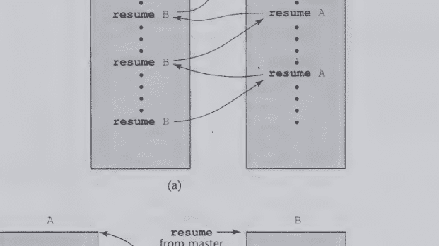

(a)

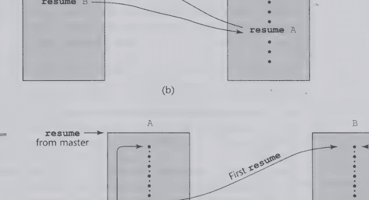

(b)

## 图 9.4

带循环的协程执行序列

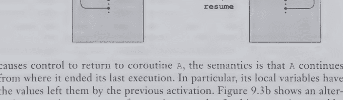

导致控制权返回给协程 A 时，其语义是 A 从其上次执行结束的地方继续。特别是，其局部变量具有上次激活时留下的值。图 9.3b 显示了协程 A 和 B 的另一种执行序列。在这种情况下，B 由主单元启动。

与其采用图 9.3 所示的模式，协程通常包含一个包含 resume 的循环。图 9.4 显示了此场景的执行序列。在这种情况下，A 由主单元启动。在其主循环内部，A 恢复 B，后者反过来在其主循环中恢复 A。
在当代语言中，只有 Lua 完全支持协程。13

## SUMMARY

进程抽象在编程语言中由子程序表示。子程序定义描述了子程序所代表的操作。子程序调用执行这些操作。子程序头标识子程序定义并提供其接口，该接口称为其协议。

形式参数是子程序用于引用子程序调用中给出的实际参数的名称。在 Python 和 Ruby 中，数组和哈希形式参数用于支持可变数量的参数。Lua 和 JavaScript 也支持可变数量的参数。实际参数可以通过位置或关键字与形式参数关联。参数可以有默认值。

子程序可以是函数，其模拟数学函数并用于定义新操作，或过程，其定义新语句。

子程序中的局部变量可以是栈动态的，提供递归支持，或静态的，提供效率和历史敏感的局部变量。

JavaScript、Python、Ruby 和 Lua 允许子程序定义嵌套。

参数传递有三种基本语义模型——in 模式、out 模式和 inout 模式——以及多种实现方法。这些是按值传递、按结果传递、按值结果传递、按引用传递和按名传递。在大多数语言中，参数在运行时栈中传递。

当使用按引用传递参数时，会发生别名，既可能在两个或多个参数之间，也可能在参数与可访问的非局部变量之间。

多维数组参数对语言设计者提出了一些问题，因为被调用的子程序需要知道如何为它们计算存储映射函数。这需要的不只是数组的名称。

参数为子程序名称提供了必要的服务，但可能难以理解。其不透明性在于当作为参数传递的子程序被执行时可用的引用环境。

C 和 C++ 支持指向函数的指针。C# 有委托，它们是可存储对方法的引用的对象。委托可以通过存储多个方法引用来支持多播调用。


Ada、C++、C#、Ruby 和 Python 都允许子程序重载和运算符重载。只要各种版本可以通过其参数类型或返回值的类型来区分，子程序就可以被重载。函数定义可用于为运算符构建额外的含义。

C++、Java 5.0 和 C# 2005 中的子程序可以是泛型的，使用参数化多态，因此可以将其数据对象的期望类型传递给编译器，编译器然后可以为所请求的类型构造单元。

语言中函数设施的设计者必须决定对返回值的限制，以及返回值的数量。

闭包是一个子程序及其引用环境。闭包在允许嵌套子程序、静态作用域的语言中很有用，并且允许从函数返回子程序并将其分配给变量。

协程是一种特殊的子程序，具有多个入口。它可用于提供子程序的交错执行。

## REVIEW QUESTIONS

- 1. 子程序的三个一般特征是什么？
- 2. 什么是子程序调用？
- 3. 什么是子程序定义？
- 4. Python 子程序的什么特征使其有别于其他语言的子程序？
- 5. Ruby 方法与其它编程语言的子程序有何不同？
- 6. Lua 函数的特性是什么？
- 7. C 和 C++ 中函数声明叫什么？声明通常放在哪里？
- 8. 命名一种没有可变数据的纯函数式编程语言。
- 9. 什么是位置参数？
- 10. 给出一种允许位置参数和关键字参数的语言的例子。
- 11. 形式参数中使用默认值有什么用？
- 12. C++ 中使用默认参数的规则是什么？
- 13. C# 方法中接受可变参数的规则是什么？
- 14. 什么语言允许数组形式参数？
- 15. 什么是省略号？
- 16. 按值传递、按结果传递、按值结果传递和按引用传递参数传递方法的模式、概念传输模型、优点和缺点是什么？
- 17. 描述使用按引用传递参数时别名可能出现的方式。
- 18. 原始 C 和 C89 处理实际参数类型与对应形式参数类型不完全相同的方式有什么区别？
- 19. 命名一些支持过程的语言。
- 20. 描述传递多维数组作为参数的问题。
- 21. Ruby 使用的参数传递方法叫什么名字？
- 22. 当子程序名作为参数时会出现哪两个问题？
- 23. 定义浅绑定和深绑定，用于作为参数传递的子程序的引用环境。
- 24. 什么是泛型子程序？
- 25. 什么是特设绑定？
- 26. 什么会导致 C++ 模板函数被实例化？
- 27. Java 5.0 的泛型方法与 C# 2005 的泛型方法在根本上有哪些不同？
- 28. 如果 Java 5.0 方法返回泛型类型，实际返回的是什么类型的对象？
- 29. 如果 Java 5.0 泛型方法被调用时使用三个不同的泛型参数，编译器会生成多少个版本的该方法？
- 30. 变量何时具有无限范围？
- 31. 什么是子类型多态？
- 32. 什么是多播委托？
- 33. F# 中泛型函数的最大缺点是什么？
- 34. 什么是协程？

## PROBLEM SET

- 1. 用户程序构建现有运算符的额外定义，如 Python 和 C++ 所能做到，有什么论据支持和反对？您认为这种用户定义的运算符重载是好还是坏？支持你的答案。
- 2. 在大多数 Fortran IV 实现中，所有参数都通过引用传递，仅使用访问路径传输。说明这种设计选择的优点和缺点。
- 3. 支持 Ada 83 设计者允许实现者选择通过复制或通过引用实现 inout 模式参数的决定。
- 4. 假设你想编写一个方法，在新输出页上打印标题，以及页码，第一次激活时为 1，每次后续激活时增加 1。能否在 Java 中不使用参数且不引用非局部变量的情况下完成？能否在 C# 中完成？
- 5. 考虑以下用 C 语法编写的程序：

```
void swap(int a, int b) {
    int temp;
    temp = a;
    a = b;
    b = temp;
}
void main() {
    int value = 2, list[5] = {1, 3, 5, 7, 9};
    swap(value, list[0]);
    swap(list[0], list[1]);
    swap(value, list[value]);
}
```

对于以下每种参数传递方法，三个 swap 调用后变量 value 和 list 的所有值是什么？

- a. 按值传递
- b. 按引用传递
- c. 按值结果传递
- 6. 提出一个反对在子程序中同时提供静态和动态局部变量的论据。
- 7. 考虑以下用 C 语法编写的程序：

```
void fun (int first, int second) {
    first += first;
    second += second;
}
void main() {
    int list[2] = {1, 3};
    fun(list[0], list[1]);
}
```

对于以下每种参数传递方法，执行后 list 数组的值是什么？

- a. 按值传递
- b. 按引用传递
- c. 按值结果传递
- 8. 反对 C 仅提供函数子程序的设计。
- 9. 从 Fortran 教科书中学习语句函数的语法和语义。证明它们在 Fortran 中的存在合理性。
- 10. 研究 C++ 和 Ada 中用户定义的运算符重载方法，并使用我们评估语言的标准撰写一份比较两者的报告。
- 11. C# 支持 out 模式参数，但 Java 和 C++ 不支持。解释区别。
- 12. 研究 Jensen 设备，它是按名传递参数的使用，写一份简短的描述说明它是什么以及如何使用。
- 13. 研究 Ruby 和 CLU 的迭代器机制并列出它们的相似之处和不同之处。
- 14. 推测允许编程语言中使用嵌套子程序的问题——为什么许多当代语言不允许它们？
- 15. 使用按名传递参数的至少两个反对论据是什么？
- 16. 撰写 Java 5.0 和 C# 2005 的泛型子程序的详细比较。

## PROGRAMMING EXERCISES

- 1. 用你所知的语言编写一个程序，以确定通过引用传递大型数组所需时间与通过值传递相同数组所需时间的比率。使数组尽可能大，取决于你使用的机器和实现。尽可能多次传递数组，以获得传递操作的合理准确时间。
- 2. 编写一个 C# 或 Ada 程序，以确定 out 模式参数的地址是在调用时还是在子程序执行结束时计算的。
- 3. 编写一个 Perl 程序，将字面量通过引用传递给子程序，该子程序尝试更改参数。鉴于 Perl 的整体设计哲学，解释结果。
- 4. 在 C# 中重复编程练习 3。
- 5. 用某种同时具有静态和栈动态局部变量的子程序的语言编写程序。在子程序中创建六个大型（至少 100 × 100）矩阵——三个静态和三个栈动态。用 1 到 100 范围内的随机数填充两个静态矩阵和两个栈动态矩阵。子程序中的代码必须对静态矩阵执行大量矩阵乘法运算并计时该过程。然后它必须用栈动态矩阵重复此操作。比较并解释结果。
- 6. 编写一个 C# 程序，其中包含两个被大量调用的方法。两个方法都传递一个大型数组，一个按值传递，一个按引用传递。比较调用这两种方法所需的时间并解释差异。确保调用它们足够多次以说明所需时间上的差异。
- 7. 编写一个程序，使用你喜欢的任何语言的语法，根据参数传递中使用按引用还是按值结果而产生不同的行为。
- 8. 编写一个泛型 C++ 函数，接受一个泛型元素的数组和一个与数组元素类型相同的标量。数组元素和标量的类型是泛型参数。函数必须在给定数组中搜索给定标量并返回标量在数组中的下标。如果标量不在数组中，函数必须返回 -1。测试该函数对 int 和 float 类型。
- 9. 设计一个子程序和调用代码，其中一个或多个参数的按引用传递和按值结果传递会产生不同的结果。


## 实现子程序

- 10.1 调用和返回的一般语义
- 10.2 实现“简单”子程序
- 10.3 实现具有栈动态局部变量的子程序
- 10.4 嵌套子程序
- 10.5 块
- 10.6 实现动态作用域

本章的目的是探讨子程序的实现。讨论将为读者提供有关子程序链接如何工作以及为什么 ALGOL 60 对 20 世纪 60 年代初那些毫无防备的编译器编写者来说是一个挑战的知识。我们从最简单的情况开始，即不可嵌套的子程序且具有静态局部变量，逐步推进到具有栈动态局部变量的更复杂子程序，最后以具有栈动态局部变量和静态作用域的嵌套子程序结束。在具有嵌套子程序的语言中实现子程序的难度增加，是因为需要包含访问非局部变量的机制。

在静态作用域语言中访问非局部的静态链方法进行了详细讨论。然后，描述了实现块的技术。最后，讨论了在动态作用域语言中实现非局部变量访问的几种方法。

### 10.1 调用和返回的一般语义

子程序调用和返回操作合称为子程序链接。子程序的实现必须基于所实现语言的子程序链接语义。

典型语言中的子程序调用与其相关联着众多操作。调用过程必须包括所使用参数传递方法的实现。如果局部变量不是静态的，调用过程必须为被调用子程序中声明的局部变量分配存储空间并将这些变量绑定到该存储空间。它必须保存调用程序单元的执行状态。执行状态是恢复调用程序单元执行所需的一切。这包括寄存器值、CPU 状态位和环境指针（EP）。EP 在第 10.3 节中进一步讨论，用于在子程序执行期间访问参数和局部变量。调用过程还必须安排将控制转移到子程序的代码中，并确保在子程序执行完成后控制能够返回到正确的位置。最后，如果语言支持嵌套子程序，调用过程必须创建某种机制以提供对被调用子程序可见的非局部变量的访问。

子程序返回所需的操作比调用要简单得多。如果子程序具有 out 模式或 inout 模式的参数并且通过复制实现，则返回过程的第一个操作是将相关形式参数的局部值移动到实际参数。接下来，它必须释放用于局部变量的存储空间并恢复调用程序单元的执行状态。最后，控制必须返回到调用程序单元。

### 10.2 实现“简单”子程序

简单子程序由两个独立的部分组成：子程序的实际代码，它是恒定的，以及前面列出的局部变量和数据，在子程序执行时可能会发生变化。在简单子程序的情况下，这两部分的大小都是固定的。

子程序非代码部分的结构或布局称为激活记录，因为它描述的数据仅在子程序激活或执行期间相关。激活记录的形式是静态的。激活记录实例是激活记录的一个具体示例，是以激活记录形式存在的数据集合。

由于具有简单子程序的语言不支持递归，因此在同一时间只能有一个给定子程序的活动版本。因此，子程序的激活记录只能有一个实例。图 10.1 显示了一种可能的激活记录布局。这里省略了调用者的保存执行状态，并在本章其余部分中省略，因为它简单且与讨论无关。

**Figure 10.1.** An activation record for simple subprogram

|  |
|---|
| Local variables |
| Parameters |
| Return address |

由于“简单”子程序的激活记录实例具有固定大小，因此可以静态分配。事实上，它可以附加到子程序的代码部分。

图 10.2 显示了一个由主程序和三个子程序 A、B 和 C 组成的程序。尽管该图显示了所有代码段与所有激活记录实例分离，但在某些情况下，激活记录实例附加到其关联的代码段。

**Figure 10.2.** The code and activation records of a program with simple subprograms

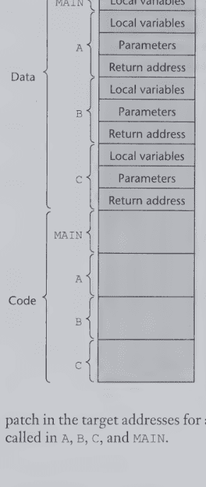

图 10.2 所示完整程序的构造并非完全由编译器完成。事实上，如果语言允许独立编译，四个程序单元——MAIN、A、B 和 C——可能在不同的日子，甚至不同的年份编译。在每个单元编译时，其机器代码以及对外部子程序的引用列表被写入文件。图 10.2 所示的可执行程序由链接器组装，链接器是操作系统的一部分。 有时链接器被称为装载器、链接/装载器或链接编辑器。当为一个主程序调用链接器时，其首要任务是找到包含该程序中引用的已翻译子程序的文件并将它们加载到内存中。然后，链接器必须将主程序中对这些子程序的所有调用的目标地址设置为这些子程序的入口地址。对加载子程序中的子程序的所有调用以及对库子程序的所有调用也必须这样做。在前面的示例中，链接器被调用用于 MAIN。链接器必须找到 A、B 和 C 的机器代码程序，连同它们的激活记录实例，并将它们与 MAIN 的代码一起加载到内存中。然后，它必须修补所有对 A、B、C 以及 A、B、C 和 MAIN 中调用的任何库子程序的调用的目标地址。

### 10.3 实现具有栈动态局部变量的子程序

我们现在研究在局部变量为栈动态的语言中子程序链接的实现，重点关注调用和返回操作。

栈动态局部变量最重要的优点之一是支持递归。因此，使用栈动态局部变量的语言也支持递归。

当子程序可以嵌套时所需额外复杂性的讨论推迟到第 10.4 节。

#### 10.3.1 更复杂的激活记录

在语言中使用栈动态局部变量的子程序链接比简单子程序的链接更复杂，原因如下：

- 编译器必须生成代码以引起局部变量的隐式分配和释放。

- 递归增加了子程序的多个同时激活的可能性，这意味着在给定时间可能存在子程序的多个实例（不完整执行），其中至少有一个来自子程序外部的调用和一个或多个递归调用。激活的数量仅受机器内存大小的限制。每个激活都需要其激活记录实例。

在大多数语言中，给定子程序的激活记录格式在编译时已知。在许多情况下，由于所有局部数据都是固定大小，因此激活记录的大小也已知。这在某些其他语言中并非如此，例如 Ada，其中局部数组的大小可能取决于实际参数的值。在这些情况下，格式是静态的，但大小可能是动态的。在具有栈动态局部变量的语言中，激活记录实例必须动态创建。这种语言的典型激活记录如图 10.3 所示。

由于返回地址、动态链接和参数是由调用者放置在激活记录实例中的，因此这些条目必须首先出现。

返回地址通常由指向调用程序单元代码段中调用指令之后指令的指针组成。**动态链接**是指向调用者激活记录实例基部的指针。在静态作用域语言中，此链接用于在运行时错误发生时提供回溯信息。在动态作用域语言中，动态链接用于访问非局部变量。激活记录中的实际参数是由调用者提供的数值或地址。

局部标量变量绑定到激活记录实例内的存储空间。局部变量如果是结构，有时在其他地方分配，只有它们的描述符和指向该存储空间的指针是激活记录的一部分。局部变量在被调用子程序中分配并可能初始化，因此它们最后出现。

考虑以下骨架 C 函数：

```c
void sub(float total, int part) {
    int list[5];
    float sum;
    ...
}
```

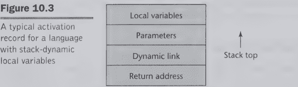


子程序 sub 的激活记录如图 10.4 所示。

激活一个子程序需要动态创建该子程序激活记录的一个实例。如前所述，激活记录的格式在编译时固定，尽管其大小在某些语言中可能取决于调用。由于调用和返回语义规定，最后被调用的子程序最先完成，因此在栈上创建这些激活记录的实例是合理的。该栈是运行时系统的一部分，因此称为运行时栈，不过我们通常只称其为栈。每次子程序激活，无论是递归还是非递归，都会在栈上创建一个新的激活记录实例。这提供了参数、局部变量和返回地址所需的独立副本。

控制子程序执行还需要一件事——EP。最初，EP 指向主程序激活记录实例的基址，或第一个地址。运行时系统必须确保它始终指向当前正在执行的程序单元的激活记录实例的基址。当子程序被调用时，当前的 EP 会保存在新的激活记录实例中作为动态链接。然后将 EP 设置为指向新的激活记录实例的基址。从子程序返回时，栈顶被设置为当前 EP 减一的值，并且 EP 被设置为已完成执行的子程序的激活记录实例中的动态链接。重置栈顶有效地移除了顶部的激活记录实例。

## Figure 10.4
函数 sub 的激活记录

|  |  |
|---|---|
| Local | sum |
| Local | list [4] |
| Local | list [3] |
| Local | list [2] |
| Local | list [1] |
| Local | list [0] |
| Parameter | part |
| Parameter | total |
| Dynamic link |  |
| Return address |  |

EP 被用作激活记录实例数据内容偏移寻址的基址——参数和局部变量。

请注意，当前正在使用的 EP 并未存储在运行时栈中。只有保存的版本才作为动态链接存储在激活记录实例中。

我们现在讨论了链接过程中出现的几个新动作。第 10.2 节中给出的列表必须进行修订以考虑这些情况。使用本节给出的激活记录形式，新的动作如下：

调用者的动作如下：
- 1. 创建一个激活记录实例。
- 2. 保存当前程序单元的执行状态。
- 3. 计算并传递参数。
- 4. 将返回地址传递给被调用者。
- 5. 将控制权转移到被调用者。

被调用者的序言动作如下：
- 1. 将旧的 EP 保存到栈中作为动态链接并创建新值。
- 2. 分配局部变量。

被调用者的尾声动作如下：
- 1. 如果存在传值结果或输出模式参数，则这些参数的当前值被移动到对应的实际参数。
- 2. 如果子程序是函数，则函数值被移动到调用者可访问的位置。
- 3. 通过将栈指针设置为当前 EP 减一的值来恢复栈指针，并将 EP 设置为旧的动态链接。
- 4. 恢复调用者的执行状态。
- 5. 将控制权传回调用者。

回想一下第 9 章的内容，子程序从被调用时起一直处于活动状态，直到执行完成时为止。在其变为非活动时，其局部作用域不再存在，其引用环境也不再有意义。因此，在那时，其激活记录实例可以被销毁。

参数并不总是通过栈传递。在许多 RISC 机器的编译器中，参数是通过寄存器传递的。这是因为 RISC 机器通常比 CISC 机器拥有更多的寄存器。然而，在本章的其余部分中，我们假设参数是通过

## 10.3.2 一个无递归的示例

考虑以下骨架 C 程序：

```
void fun1(float r) {
    int s, t;
    ...          <---------- 1
    fun2(s);
    ...
}
```

```
void fun2(int x) {
    int y;
    ...          <---------- 2
    fun3(y);
    ...
}
```

```
void fun3(int q) {
    ...          <---------- 3
}
```

```
void main() {
    float p;
    ...
    fun1(p);
    ...
}
```

该程序中的函数调用序列为

```
main calls fun1
fun1 calls fun2
fun2 calls fun3
```

标记为 1、2 和 3 的点的栈内容如图 10.5 所示。

在点 1 处，只有函数 main 和函数 fun1 的激活记录实例在栈上。当 fun1 调用 fun2 时，fun2 的激活记录的一个实例被创建在栈上。当 fun2 调用 fun3 时，fun3 的激活记录的一个实例被创建在栈上。当 fun3 的执行结束时，其激活记录的实例从栈中移除，并且 EP 被用来重置栈顶指针。当函数 fun2 和 fun1 终止时也会发生类似的过程。从 main 调用 fun1 返回后，栈上仅剩下 main 的激活记录实例。请注意，一些实现实际上并不在栈上使用激活记录实例

## Figure 10.5
程序中三个点的栈内容

ARI = activation record instance

at Point 1

at Point 2

at Point 3

对于 main 等函数，如图所示那样。然而，可以这样做，并且它简化了实现和我们的讨论。在本示例中以及本章中的所有其他示例中，我们假设栈从低地址向高地址增长，尽管在特定实现中，栈可能朝相反方向增长。

在给定时间存在于栈中的动态链接集合称为动态链，或调用链。它代表了执行如何到达当前位置的动态历史，该位置始终在栈顶的激活记录实例所属的子程序代码中。对局部变量的引用可以在代码中表示为从局部作用域激活记录开头的偏移量，其地址存储在 EP 中。这种偏移量称为 local_offset。

激活记录中变量的 local_offset 可以在编译时确定，使用与激活记录关联的子程序中声明的变量的顺序、类型和大小。为了简化讨论，我们假设所有变量在激活记录中占用一个位置。子程序中第一个声明的局部变量将被分配在激活记录中从底部起参数数量加两个位置处（前两个位置用于返回地址和动态链接）。第二个声明的局部变量将更靠近栈顶一个位置，以此类推。例如，考虑前面的示例程序。在 fun1 中，s 的 local_offset 为 3；t 为 4。同样，在 fun2 中，y 的 local_offset 为 3。要获取任何局部变量的地址，将该变量的 local_offset 加到 EP 上。

## 10.3.3 递归

考虑以下使用递归计算阶乘函数的示例 C 程序：

```
int factorial(int n) {
    <---------- 1
    if (n <= 1)
        return 1;
    else return (n * factorial(n - 1));
    <---------- 2
}
void main() {
    int value;
    value = factorial(3);
    <---------- 3
}
```

函数 factorial 的激活记录格式如图 10.6 所示。请注意，它有一个额外的条目用于函数的返回值。

图 10.7 显示了执行到达函数 factorial 中位置 1 的三次时的栈内容。每一次都显示了该函数的一次额外激活，其函数值未定义。第一个激活记录实例具有返回到调用函数 main 的返回地址。其他实例具有返回到函数本身的返回地址；这些是递归调用的。

图 10.8 显示了执行到达函数 factorial 中位置 2 的三次时的栈内容。位置 2 的含义是在执行返回后但在激活记录被从栈中移除之前。请回忆该函数的代码将参数 n 的当前值乘以递归调用该函数返回的值。

## Figure 10.6
factorial 的激活记录

| Functional value |
| Parameter | n |
| Dynamic link |
| Return address |


**图 10.7**

阶乘中位置 1 的栈内容

ARI = 激活记录实例

第一次从阶乘返回的值为 1。 该激活的激活记录实例中，其参数 n 的版本的值为 1。 该乘法得到的结果 1 被返回给阶乘的第二个激活，以便与其实参值 n 相乘，该值为 2。 此步骤将值 2 返回给阶乘的第一个激活，以便与其实参值 n 相乘，该值为 3，得出最终的函数值为 6，然后返回给 main 中的第一次对阶乘的调用。

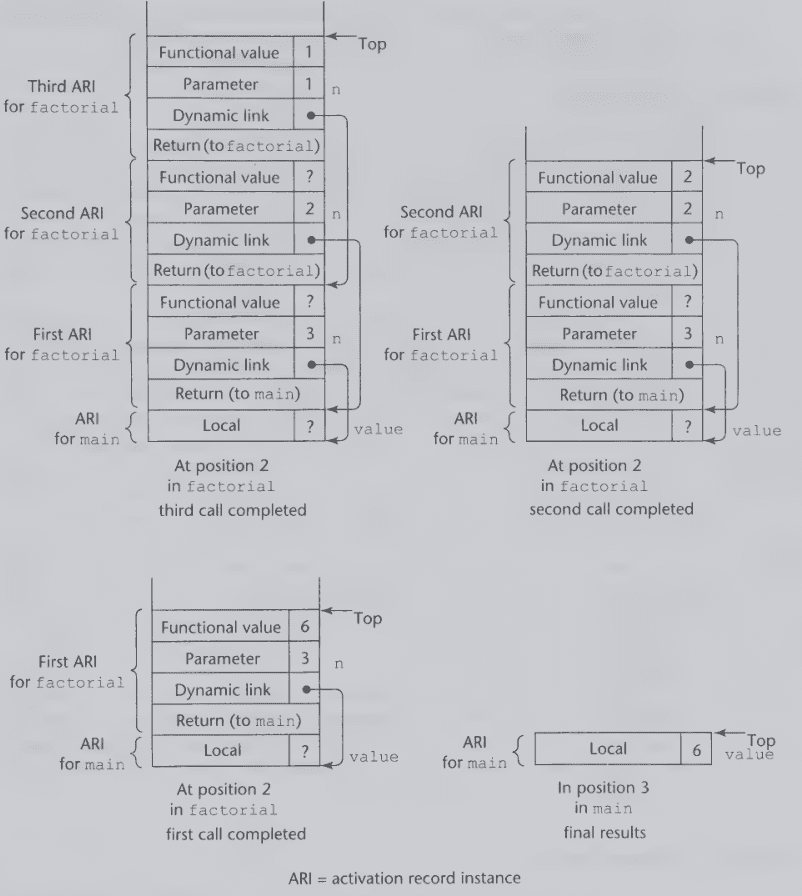

**图 10.8**

执行 `main` 和 `factorial` 期间的栈内容

## 10.4 嵌套子程序

一些非基于 C 的静态作用域编程语言使用栈动态局部变量并允许子程序嵌套。其中包括 Fortran 95+、Ada、Python、JavaScript、Ruby 和 Lua，以及函数式语言。在本节中，我们将考察实现可能被嵌套的子程序时最常用的方法。在本节的最后部分之前，我们忽略闭包。

### 10.4.1 基础

在具有嵌套子程序的静态作用域语言中，对非局部变量的引用需要一个两步访问过程。所有可以被非局部访问的非静态变量都位于现有的激活记录实例中，因此都在栈中的某个位置。访问过程的第一步是找到栈中变量被分配的激活记录实例。第二部分是使用变量的 local_offset（在激活记录实例内）来访问它。

找到正确的激活记录实例是两个步骤中更有趣也更困难的。首先注意，在给定的子程序中，只有在静态祖先作用域中声明的变量才可见并且可以被访问。此外，当嵌套子程序引用其中的变量时，所有静态祖先的激活记录实例始终都在栈上。这是由静态作用域语言的静态语义规则保证的：只有当其所有静态祖先子程序都处于活动状态时，子程序才可以被调用。 <sup>1</sup> 如果某个特定的静态祖先未处于活动状态，其局部变量将不会绑定到存储，因此允许访问它们是没有意义的。

非局部引用的语义规定，正确的声明是在通过封闭作用域查找时找到的第一个声明，最先查找最内层嵌套的。 因此，为了支持非局部引用，必须能够找到栈中对应于这些静态祖先的所有激活记录实例。这一观察导致了在以下小节中描述的实现方法。

我们直到第 10.5 节才讨论块的问题，因此在本节的其余部分中，所有作用域都假定由子程序定义。由于基于 C 的语言中不能嵌套函数（这些语言中唯一的静态作用域是由块创建的），因此本节的讨论不直接适用于这些语言。

### 10.4.2 静态链

在允许嵌套子程序的语言中实现静态作用域最常见的方法是静态链。在这种方法中，一个新的指针被添加到激活记录中，称为静态链接。静态链接，有时称为静态作用域指针，指向静态父激活的激活记录实例的底部。它用于访问非局部变量。通常，静态链接出现在激活记录的参数下方。

在激活记录中添加静态链接要求局部偏移与不包含静态链接时不同。激活记录元素不再是两个，而现在有三个：返回地址、动态链接和静态链接。

> 1. 闭包当然违反了这一规则。

静态链是连接栈中某些激活记录实例的静态链接链。在子程序 P 执行期间，其激活记录实例的静态链接指向 P 的静态父程序单元的激活记录实例。该实例的静态链接反过来指向 P 的静态祖父程序单元的激活记录实例，如果存在的话。因此，静态链连接了正在执行子程序的所有静态祖先，按静态父优先的顺序。显然，可以使用该链来实现静态作用域语言中对非局部变量的访问。

使用静态链接找到非局部变量的正确激活记录实例相对简单。当对非局部变量进行引用时，包含该变量的激活记录实例可以通过搜索静态链直到找到包含该变量的静态祖先激活记录实例来找到。然而，这可能比这更容易。因为作用域的嵌套在编译时就已知，所以编译器不仅可以确定引用是非局部的，还可以确定必须沿着静态链跟随的长度才能到达包含非局部对象的激活记录实例。

设 static_depth 为与静态作用域关联的整数，表示其在最外层作用域中嵌套的深度。未嵌套在其他单元中的程序单元的 static_depth 为 0。如果子程序 A 在非嵌套程序单元中定义，则其 static_depth 为 1。如果子程序 A 包含嵌套子程序 B 的定义，则 B 的 static_depth 为 2。

到达非局部引用变量 X 的正确激活记录实例所需的静态链长度恰好是包含对 X 的引用的子程序的 static_depth 与包含 X 的声明的子程序的 static_depth 之间的差。此差值称为 nesting_depth，或 chain_offset。实际引用可以用整数的有序对 (chain_offset, local_offset) 表示，其中 chain_offset 是到正确激活记录实例的链接数（local_offset 在第 10.3.2 节中描述）。例如，考虑以下骨架 Python 程序：

```python
# Global scope
...
def f1():
    def f2():
        def f3():
            ...
            # end of f3
        ...
        # end of f2
...
# end of f1
```

全局作用域、f1、f2 和 f3 的 static_depth 分别为 0、1、2 和 3。如果过程 f3 引用在 f1 中声明的变量，则该引用的 chain_offset 为 2（f3 的 static_depth 减去 f1 的 static_depth）。如果过程 f3 引用在 f2 中声明的变量，则该引用的 chain_offset 为 1。对局部变量的引用可以用相同的机制处理，chain_offset 为 0，但不是使用指向声明变量的子程序的激活记录实例的静态指针作为基地址，而是使用 EP。

为了说明非局部访问的完整过程，考虑以下骨架 JavaScript 程序：

```javascript
function main() {
    var x;
    function bigsub() {
        var a, b, c;
        function sub1() {
            var a, d;
            ...
            a = b + c; <-------------------------------------------1
            ...
        } // end of sub1
        function sub2(x) {
            var b, e;
            function sub3() {
                var c, e;
                ...
                sub1();
                ...
                e = b + a; <-------------------------------------------2
            } // end of sub3
            ...
            sub3();
            ...
            a = d + e; <-------------------------------------------3
        } // end of sub2
        ...
        sub2(7);
        ...
    } // end of bigsub
    ...
    bigsub();
    ...
} // end of main
```

过程调用的顺序是

- main 调用 bigsub
- bigsub 调用 sub2
- sub2 调用 sub3
- sub3 调用 sub1

当执行首次到达该程序中的位置 1 时的栈情况如图 10.9 所示。

在过程 sub1 中的位置 1，引用的是局部变量 a，而不是来自 bigsub 的非局部变量 a。对 a 的此引用具有 chain_offset/local_offset 对 (0, 3)。对 b 的引用是对来自 bigsub 的非局部 b 的引用。它可以用对 (1, 4) 表示。local_offset 为 4，因为 a 的偏移


## 图 10.9

程序 main 中位置 1 的栈内容

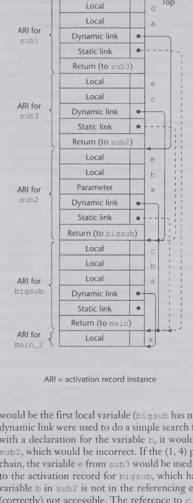

ARI = 激活记录实例

将是第一个局部变量（bigsub 没有参数）。请注意，如果使用动态链接来简单地搜索具有变量 b 声明的激活记录实例，它会找到在 sub2 中声明的变量 b，这是不正确的。如果使用 (1, 4) 对与动态链，则会使用来自 sub3 的变量 e。静态链接 however 指向 bigsub 的激活记录，它具有正确的 b 版本。sub2 中的变量 b 在此时不在引用环境中，并且（正确地）不可访问。位置 1 对 c 的引用是指 bigsub 中定义的 c，由对 (1, 5) 表示。

在 sub1 完成其执行后，sub1 的激活记录实例从栈中移除，控制返回到 sub3。sub3 中位置 2 对变量 e 的引用是局部的，并使用对 (0, 4) 进行访问。对变量 b 的引用是指在 sub2 中声明的那个，因为那是包含此类声明的最接近的静态祖先。它使用对 (1, 4) 进行访问。local_offset 为 4，因为 b 是在 sub1 中声明的第一个变量，而 sub2 有一个参数。对变量 a 的引用是指在 bigsub 中声明的 a，因为 sub3 及其静态父级 sub2 都没有名为 a 的变量声明。它使用对 (2, 3) 进行引用。

在 sub3 完成其执行后，sub3 的激活记录实例从栈中移除，只剩下 main、bigsub 和 sub2 的激活记录实例。在 sub2 中的位置 3，对变量 a 的引用是指 bigsub 中的 a，它是活动例程中唯一的 a 声明。此访问使用对 (1, 3) 进行。在此位置，没有可见的作用域包含变量 d 的声明，因此对 d 的引用是静态语义错误。该错误将在编译器尝试计算 chain_offset/local_offset 对时被检测到。对 e 的引用是指 sub2 中的局部 e，可以使用对 (0, 5) 进行访问。

总之，变量 a 在点 1、2 和 3 处的引用将由以下点表示：

- (0, 3) （局部）
- (2, 3) （相隔两层）
- (1, 3) （相隔一层）

此时合理地会问，静态链如何在程序执行期间维护。如果其维护过于复杂，那么它简单有效这一事实就不重要了。我们假设这里参数为子程序的情况不被实现。

静态链必须为每个子程序调用和返回进行修改。返回部分是微不足道的：当子程序终止时，其激活记录实例从栈中移除。移除后，新的栈顶激活记录实例就是调用了刚刚终止的子程序的单元的激活记录实例。因为此激活记录实例的静态链从未被更改，所以它与调用其他子程序之前一样工作正确。因此，不需要其他操作。

子程序调用所需的操作更为复杂。虽然在编译时可以很容易地确定正确的父作用域，但在调用时必须找到父作用域的最新的激活记录实例。这可以通过查看动态链上的激活记录实例，直到找到第一个属于父作用域的实例来实现。然而，可以通过将子程序声明和引用完全像变量声明和引用一样处理来避免这种搜索。当编译器遇到子程序调用时，在其他事情中，它会确定声明了被调用子程序的子程序，该子程序必须是调用例程的静态祖先。然后它计算 nesting_depth，即调用者和声明了被调用子程序的子程序之间的封闭作用域数。此信息被存储并可在执行期间由子程序调用访问。在调用时，被调用子程序的激活记录实例的静态链接是通过沿调用者的静态链向下移动找到的。此移动中的链接数等于 nesting_depth，该值在编译时计算得出。

再次考虑程序 main 和图 10.9 所示的栈情况。在 sub3 中对 sub1 的调用时，编译器确定 sub3（调用者）在声明了被调用过程 sub1 的过程 bigsub 内部嵌套了两层。当在 sub3 中对 sub1 的调用被执行时，此信息用于设置 sub1 的激活记录实例的静态链接。此静态链接被设置为指向由调用者激活记录实例的静态链中的第二个静态链接所指向的激活记录实例。在此情况下，调用者是 sub3，其静态链接指向其父激活记录实例（即 sub2 的）。sub2 激活记录实例的静态链接指向 bigsub 的激活记录实例。因此，新的 sub1 激活记录实例的静态链接被设置为指向 bigsub 的激活记录实例。

此方法适用于所有子程序链接，除了涉及子程序作为参数的情况。

使用静态链方法访问非局部变量的一个批评是，对超出静态父级作用域的变量的引用成本高于对局部的引用。必须沿着静态链跟随，每个封闭作用域从引用到声明一个链接。幸运的是，实践中对远距离非局部变量的引用很少，因此这不是严重问题。使用静态链方法的另一个批评是，对于从事时间关键程序的程序员来说，很难估计非局部引用的成本，因为每个引用的成本取决于引用与声明作用域之间的嵌套深度。进一步复杂化此问题的是，后续的代码修改可能会改变嵌套深度，从而改变某些引用的时序，既在更改的代码中，也可能在远离更改的代码中。

已经开发了一些静态链的替代方案，最著名的是使用一种称为 display 的辅助数据结构的方法。然而，没有一种替代方案被发现优于静态链方法，后者仍然是最广泛使用的方法。因此，这里不讨论任何替代方案。

本节中描述的过程和数据结构正确地实现了在不允许函数返回函数且不允许函数被赋给变量的语言中的闭包。然而，对于允许其中一种或两种操作的语言，它们是不够的。实现对非局部的访问需要几种新的机制。首先，如果一个子程序从嵌套但非全局作用域访问一个变量，该变量不能仅存储在其主作用域的激活记录中。该激活记录可能在需要它的子程序被激活之前就被释放。这样的变量也可以存储在堆中并被赋予无限范围（其生命周期为整个程序的生命周期）。其次，子程序必须具有访问存储在堆中的非局部的机制。第三，被非局部访问的堆分配变量必须在每次其栈版本被更新时都被更新。显然，这些是对使用静态链实现静态作用域的非平凡扩展。

## 10.5 块

回顾第 5 章，众所周知的许多语言，包括基于 C 的语言，都提供了用户指定的变量局部作用域，称为块。作为块的示例，考虑以下代码段：

```
{ int temp;
    temp = list[upper];
    list[upper] = list[lower];
    list[lower] = temp;
}
```

在基于 C 的语言中，块被指定为复合语句，以一个或多个数据定义开始。前述块中变量 temp 的生命周期在控制进入块时开始，并在控制退出块时结束。使用此类局部的优点是它不能干扰程序中其他地方声明的任何同名变量，更具体地说，不能干扰块的引用环境中的变量。

块可以通过使用第 10.4 节中描述的用于实现嵌套子程序的静态链过程来实现。块被视为无参数的子程序，始终从程序中的同一位置调用。因此，每个块都有一个激活记录。每次执行块时都会创建其激活记录的一个实例。

块也可以以不同且 somewhat 更简单、更高效的方式实现。在程序执行期间，块变量所需的存储量的最大值可以静态确定，因为块是严格按文本顺序进入和退出。此空间量可以在激活记录中的局部变量之后分配。所有块变量的偏移量可以静态计算，因此块变量可以像局部变量一样寻址。

例如，考虑以下骨架程序：

```
void main() {
    int x, y, z;
    while ( . . ) {
        int a, b, c;
        .
        while ( . . . ) {
            int d, e;
            .
        }
    }
    while ( . . . ) {
        int f, g;
        . . .
    }
    .
}
```


**图 10.10**
当块不作为无参过程处理时块变量的存储

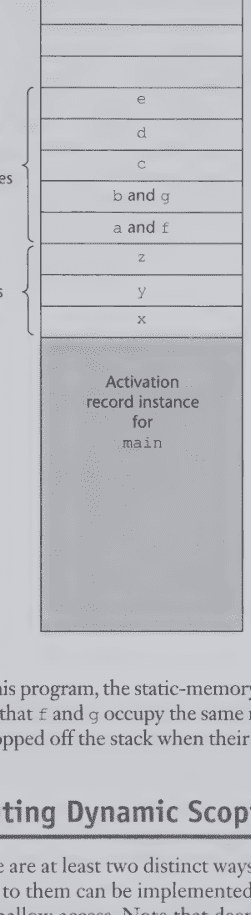

对于该程序，可以使用图 10.10 所示的静态内存布局。注意，f 和 g 与 a 和 b 占用相同的内存位置，因为 a 和 b 在其块退出时（在 f 和 g 分配之前）已从栈中弹出。

## 10.6 实现动态作用域

在动态作用域语言中，至少有两种不同的方式来实现局部变量及其非局部引用：深度访问和浅访问。注意，深度访问和浅访问并不是与深绑定和浅绑定相关的概念。绑定与访问之间的一个重要区别是：深绑定和浅绑定会导致不同的语义；而深度访问和浅访问则不会。

### 10.6.1 深度访问

如果局部变量是栈动态的，并且在动态作用域语言中是活动记录的一部分，那么可以通过搜索当前活跃的其他子程序的活动记录实例来解析对非局部变量的引用，搜索从最近被激活的那个实例开始。这一概念类似于在具有嵌套子程序的静态作用域语言中访问非局部变量，只不过这里遵循的是动态链而非静态链。动态链将所有子程序活动记录实例按照其激活顺序的逆序链接在一起。因此，动态链正是动态作用域语言中引用非局部变量所需的机制。这种方法称为深度访问，因为访问可能需要深入栈中进行搜索。

考虑下面这个骨架程序示例：

```c
void sub3() {
    int x, z;
    x = u + v;
    . . .
}

void sub2() {
    int w, x;
    . . .
}

void sub1() {
    int v, w;
    . . .
}

void main() {
    int v, u;
    . . .
}
```

该程序的语法使其看起来像基于 C 的语言中的程序，但它并不打算用任何特定语言编写。假设发生如下函数调用序列：

- main 调用 sub1
- sub1 调用 sub1
- sub1 调用 sub2
- sub2 调用 sub3

图 10.11 显示了此调用序列后执行函数 sub3 期间栈的内容。注意，这些活动记录实例没有静态链，因为静态链在动态作用域语言中没有作用。

考虑函数 sub3 中对变量 x、u 和 v 的引用。对 x 的引用可在 sub3 的活动记录实例中找到。对 u 的引用需要搜索栈上的所有活动记录实例，因为唯一现存的同名变量在 main 中。该搜索需要沿四条动态链进行，并检查 10 个变量名。对 v 的引用可在子程序 sub1 的最近（即动态链上最近的）活动记录实例中找到。

**图 10.11**
动态作用域程序的栈内容

ARI = 活动记录实例

动态作用域语言中用于非局部访问的深度访问方法与静态作用域语言中的静态链方法之间有两个重要区别。第一，在动态作用域语言中，无法在编译时确定需要搜索的链的长度。必须搜索链中的每个活动记录实例，直到找到该变量的第一个实例。这是动态作用域语言通常比静态作用域语言执行速度慢的原因之一。第二，活动记录必须存储变量名以用于搜索过程，而在静态作用域语言实现中，只需要存储值。（静态作用域不需要名字，因为所有变量都由 chain_offset/local_offset 对表示。）

### 10.6.2 浅访问

浅访问是一种替代实现方法，而不是替代语义。如前所述，深度访问和浅访问的语义是相同的。在浅访问方法中，在子程序中声明的变量不存储在该子程序的活动记录中。由于在动态作用域下，任意特定名称的变量在给定时刻最多只有一个可见版本，因此可以采用一种非常不同的方法。浅访问的一种变体是为整个程序中的每个变量名设置一个单独的栈。每次通过被调用的子程序开头的声明创建一个具有特定名称的新变量时，该变量会在其名称对应的栈顶获得一个单元。对名称的每次引用都指向与该名称关联的栈顶变量，因为栈顶变量是最近创建的。当子程序终止时，其局部变量的生命周期结束，相应变量名的栈会被弹出。这种方法允许快速引用变量，但在子程序的入口和出口维护这些栈代价较高。

图 10.12 显示了前面示例程序在图 10.11 所示相同情况下的变量栈。

**图 10.12**
使用浅访问实现动态作用域的一种方法


（栈单元中的名称指示变量声明的程序单元。）

实现浅访问的另一种选择是使用一个中央表，该表为程序中的每个不同变量名设置一个位置。对于每个表项，维护一个称为 active 的位，用于指示该名称当前是否具有绑定或变量关联。这样，对任何变量的访问都可以是对中央表的一个偏移量。该偏移量是静态的，因此访问可以很快。SNOBOL 的实现就使用了中央表实现技术。

中央表的维护很简单。子程序调用需要将其所有局部变量逻辑上放入中央表。如果新变量在中央表的位置已经是 active——也就是说，该位置包含一个生命周期尚未结束的变量（由 active 位指示）——那么在新变量的生命周期内，该值必须保存在某处。每当一个变量开始其生命周期时，其中央表位置中的 active 位必须被置位。

中央表的设计以及在值被临时替换时的存储方式有多种变体。一种变体是使用一个“隐藏”栈来存储所有被保存的对象。由于子程序的调用和返回以及局部变量的生命周期是嵌套的，这种方法很有效。

第二种变体可能是实现起来最干净且代价最低的。使用一个由单个单元组成的中央表，仅存储每个唯一名称变量的当前版本。被替换的变量存储在创建替换变量的子程序的活动记录中。这是一种栈机制，但它利用了已经存在的栈，因此新增开销极小。

在非局部变量的浅访问和深度访问之间进行选择取决于子程序调用和非局部引用的相对频率。深度访问方法提供快速的子程序连接，但对非局部变量（尤其是调用链上较远的非局部变量）的引用代价较高。浅访问方法对非局部变量（尤其是较远的非局部变量）的引用要快得多，但子程序连接的代价更高。

## 小结

子程序连接语义要求实现执行许多操作。对于“简单”子程序，这些操作相对不复杂。调用时，必须保存执行状态，将参数和返回地址传递给被调用的子程序，并转移控制权。返回时，必须将按结果传递和按值结果传递的参数值传回，如果是函数，还要传回返回值；必须恢复执行状态，并将控制权返回给调用者。在具有栈动态局部变量和嵌套子程序的语言中，子程序连接更为复杂。可能有多个活动记录实例，这些实例必须存储在运行时栈中，并且必须在活动记录实例中维护静态链和动态链。静态链用于允许在静态作用域语言中引用非局部变量。

在具有栈动态局部变量和嵌套子程序的语言中，子程序有两个组成部分：实际代码（静态的）和活动记录（栈动态的）。活动记录实例包含形参和局部变量等内容。

在动态作用域语言中，对非局部变量的访问可以通过使用动态链或某种中央变量表方法来实现。动态链提供较慢的访问，但调用和返回较快。中央表方法提供较快的访问，但调用和返回较慢。

## 复习题

- 1. 本章对“简单”子程序使用的定义是什么？
- 2. 调用者还是被调用者保存执行状态信息？
- 3. 与子程序的连接需要存储什么？
- 4. 链接器的任务是什么？
- 5. 为什么使用栈动态局部变量实现子程序比实现简单子程序更困难，两个原因是什么？
- 6. 活动记录和活动记录实例之间的区别是什么？
- 7. 为什么返回地址、动态链和参数要放在活动记录的底部？
- 8. 哪种类型的机器通常使用寄存器来传递参数？


9. 在具有栈动态局部变量和嵌套子程序的静态作用域语言中，定位一个非局部变量的两个步骤是什么？
10. 定义静态链、static_depth、nesting_depth 和 chain_offset。
11. 什么是 EP，其目的何在？
12. 在静态链方法中，变量的引用是如何表示的？
13. 命名三种不允许嵌套子程序的广泛使用的编程语言。
14. 静态链方法存在哪两个潜在问题？
15. 解释实现块的两种方法。
16. 描述实现动态作用域的深度访问方法。
17. 描述实现动态作用域的浅层访问方法。
18. 动态作用域语言中非局部访问的深度访问方法与静态作用域语言的静态链方法之间有何两个区别？
19. 从调用和非局部访问两个方面比较深度访问方法与浅层访问方法的效率。

## PROBLEM SET

1. 显示当执行到达以下骨架程序中的位置 1 时的栈，包括所有激活记录实例、静态链和动态链。假设 bigsub 的层级为 1。

```
function bigsub() {
    function a() {
        function b() {
            ... <---------------------------1
        } // end of b
        function c() {
            ...
            b();
            ...
        } // end of c
        ...
        c();
        ...
    } // end of a
    ...
    a();
    ...
} // end of bigsub
```

2. 显示当执行到达以下骨架程序中的位置 1 时的栈，包括所有激活记录实例、静态链和动态链。假设 bigsub 的层级为 1。

```
function bigsub() {
var mysum;
function a() {
var x;
function b(sum) {
var y, z;
...
c(z);
...
} // end of b
...
b(x);
...
} // end of a
function c(plums) {
... <-- 1
} // end of c
var l;
...
a();
...
} // end of bigsub
```

3. 显示当执行到达以下骨架程序中的位置 1 时的栈，包括所有激活记录实例、静态链和动态链。假设 bigsub 的层级为 1。

```
function bigsub() {
function a(flag) {
function b() {
... a(false);
} // end of b
...
if (flag)
b();
else c();
...
} // end of a
function c() {
function d() {
... <-- 1
} // end of d
...
d();
```

```
    ...
} // end of c
    ...
a(true);
    ...
} // end of bigsub
```

此程序的调用序列使执行到达 d 为

- bigsub 调用 a
- a 调用 b
- b 调用 a
- a 调用 c
- c 调用 d

4. 显示当执行到达以下骨架程序中的位置 1 时的栈，包括所有激活记录实例、静态链和动态链。此程序使用深度访问方法实现动态作用域。

```
void fun1() {
    float a;
    ...
}
```

```
void fun2() {
    int b, c;
    ... <-- 1
}
```

```
void fun3() {
    float d;
    ...
}
```

```
void main() {
    char e, f, g;
    ...
}
```

此程序的调用序列使执行到达 fun3 为

- main 调用 fun1
- fun1 调用 fun3
- fun3 调用 fun2

5. 假设问题 4 的程序使用浅层访问方法并为每个变量名使用一个栈来实现。显示在执行 fun3 时的栈，假设执行是通过问题 4 中所示的调用序列到达该点的。

6. 尽管基于 C 的语言中的方法中的局部变量在每次激活开始时分配，在什么情况下特定激活中的局部变量的值可能保留前一次激活的值？

7. 本章中指出，当在动态作用域语言中使用动态链访问非局部变量时，变量名必须与值一起存储在激活记录中。如果确实这样做，每次非局部访问都需要对名称进行一系列耗时的字符串比较。设计一种比这些字符串比较更快的替代方案。

8. Pascal 允许具有非局部目标的 goto。 如果使用静态链进行非局部变量访问，如何处理此类语句？ 提示：考虑查找新激活过程的静态父激活记录实例的方式（参见第 10.4.2 节）。

9. 静态链方法可以通过在每个激活记录实例中使用两个静态链接来稍微扩展，其中第二个指向静态祖父激活记录实例。这种方法将如何影响子程序链接和非局部引用的所需时间？

10. 设计一个骨架程序和一个调用序列，导致一个激活记录实例，其中静态链接和动态链接指向运行时栈中不同的激活记录实例。

11. 如果编译器使用静态链方法实现块，则子程序的激活记录中的哪些条目需要在块的激活记录中？

12. 检查三种不同架构的子程序调用指令，包括至少一台 CISC 机器和一台 RISC 机器，并写出它们能力的简短比较。 （这些指令的设计通常决定了编译器编写者子程序链接设计的至少一部分。）

## PROGRAMMING EXERCISES

1. 编写一个程序，其中包含两个子程序，一个接受单个参数并对该参数执行一些简单操作，另一个接受 20 个参数并使用所有参数，但仅用于一个简单操作。 主程序必须大量调用这两个子程序。 在程序中包含计时代码以输出对这两个子程序的调用的运行时间。 在 RISC 机器和 CISC 机器上运行程序并比较两个子程序所需时间的比率。 根据结果，你对两种机器上的参数传递速度可以说什么？

在本章中，我们探讨支持数据抽象的编程语言构造。 在过去 50 年的编程方法论和编程语言设计的新思想中，数据抽象是最深刻的思想之一。

我们首先讨论编程和编程语言中抽象的一般概念。 然后定义数据抽象并通过示例进行说明。 随后是 C++、Objective-C、Java、C# 和 Ruby 对数据抽象的支持的描述。 为了阐明支持数据抽象的语言设施设计的相似性和差异，C++、Objective-C、Java 和 Ruby 中给出了相同示例数据抽象的实现。 接下来讨论 C++、Java 5.0 和 C# 2005 构建参数化抽象数据类型的能力。

本章中用于说明抽象数据类型概念和构造的所有语言都支持面向对象编程，因为几乎所有当代语言都支持面向对象编程，而几乎所有不支持面向对象编程但支持抽象数据类型的语言都已淡出。

支持抽象数据类型的构造是对类型对象的封装数据和操作。 构建较大程序需要包含多种类型的封装。 这些封装以及相关的命名空间问题也在本章中讨论。

一些编程语言支持逻辑封装，而不是物理封装，这些封装实际上用于封装名称。 这些在第 11.7 节中讨论。

## 11.1 抽象的概念

抽象是对实体的视图或表示，仅包括最重要的属性。 从一般意义上讲，抽象允许将实体实例收集到组中，其中它们的共同属性无需考虑。 例如，假设我们将鸟定义为具有以下属性的生物：两个翅膀、两条腿、一个尾巴和羽毛。 那么，如果我们说乌鸦是一种鸟，乌鸦的描述就不必包括那些属性。 对乌鸦、知更鸟、麻雀和黄腹啄木鸟也是如此。 鸟类特定物种描述中的共同属性可以被抽象掉，因为所有物种都有它们。 在特定物种内部，只需要考虑区分该物种的属性。 例如，乌鸦具有黑色、特定大小和吵闹的属性。 乌鸦的描述需要提供这些属性，但不需要提供所有鸟类共有的其他属性。 这大大简化了物种成员的描述。 物种的较少抽象视图，即鸟类，可能在需要看到更高细节级别而不是只是特殊属性时被考虑。

在编程语言的世界里，抽象是反对编程复杂性的武器；其目的是简化编程过程。 它是一种有效的武器，因为它允许程序员专注于基本属性，同时忽略从属属性。


当代编程语言中的两种基本抽象类型是过程抽象和数据抽象。

过程抽象的概念是编程语言设计中最古老的概念之一（Plankalkül 在 1940 年代就支持过程抽象）。所有子程序都是过程抽象，因为它们为程序提供了一种指定过程的方式，而无需提供其执行任务的细节（至少在调用程序中如此）。例如，当程序需要对某种类型的数值数据数组进行排序时，它通常会使用用于排序过程的子程序。在需要排序过程的位置，会在程序中放置如下语句

```
sortInt(list, listLen)
```

此调用是对实际排序过程的抽象，其算法未被指定。该调用与被调用子程序中实现的算法无关。

对于子程序 sortInt 来说，唯一必不可少的属性是待排序数组的名称、其元素的类型、数组的长度，以及对 sortInt 的调用将导致数组被排序这一事实。sortInt 实现的具体算法是对用户而言非必要的属性。用户只需看到排序子程序的名称和协议即可使用它。

数据抽象的广泛使用必然是在过程抽象之后，因为每个数据抽象的组成部分和本质部分都是其操作，而这些操作被定义为过程抽象。

## 11.2 数据抽象简介

数据抽象的演变始于 1960 年 COBOL 的第一个版本，其中包含了记录数据结构。¹ 基于 C 的语言有结构体，它们也是记录。抽象数据类型是一种数据结构，以记录的形式存在，但其中包含操作其数据的子程序。

从语法上讲，抽象数据类型是一个封闭体，仅包含一种特定数据类型的表示以及为该类型提供操作的子程序。通过访问控制，可以将类型的非必要细节隐藏在在封闭体外部使用该类型的单元之外。使用抽象数据类型的程序单元可以声明该类型变量，即使实际表示对它们是隐藏的。抽象数据类型的实例称为对象。

数据抽象的一个动机与过程抽象相似。它是对抗复杂性的武器；使大型和/或复杂的程序更易于管理的方法。本节后面将讨论抽象数据类型的其他动机和优点。

> 1. 回顾第 2 章，记录是一种存储字段的数据结构，字段具有名称并且可以是不同类型。

面向对象编程在第 12 章中描述，是软件开发中使用数据抽象的产物，数据抽象是其基本组成部分之一。

### 11.2.1 浮点数作为抽象数据类型

抽象数据类型的概念，至少就内置类型而言，并非最近的发展。所有内置数据类型，甚至 Fortran I 的那些，都是抽象数据类型，尽管它们很少被称为这样。例如，考虑浮点数据类型。大多数编程语言至少包含其中一种。浮点类型提供了创建变量以存储浮点数据的方式，并提供了一组用于操作该类型对象的算术运算。

高级语言中的浮点类型采用了数据抽象中的一个关键概念：信息隐藏。浮点数据值在存储单元中的实际格式对用户是隐藏的，唯一可用的操作是语言提供的操作。用户不允许在该类型的数据上创建新的操作，除非这些操作可使用内置操作构造。用户无法直接操作值的实际表示的各个部分，因为该表示是隐藏的。正是因为这一特性，才使得程序在特定语言的不同实现之间具有可移植性，即使这些实现可能对特定数据类型使用不同的表示。例如，在 IEEE 754 标准浮点表示在 1980 年代中期出现之前，不同的计算机体系结构使用了几种不同的表示。然而，这种变化并没有阻止使用浮点类型的程序在各种体系结构之间实现可移植性。

### 11.2.2 用户定义抽象数据类型

用户定义的抽象数据类型应提供与语言定义类型（如浮点类型）相同的特性：（1）类型定义，允许程序单元声明该类型的变量但隐藏该类型对象的表示；以及（2）用于操作该类型对象的操作集。

我们现在在用户定义类型的上下文中正式定义抽象数据类型。抽象数据类型是一种满足以下条件的数据类型：

- 该类型对象的表示对使用该类型的程序单元是隐藏的，因此对这些对象唯一可直接进行的操作是类型定义中提供的操作。
- 该类型的声明和对该类型对象操作的协议，即提供类型的接口，包含在单个语法单元中。类型的接口不依赖于对象的表示或操作的实现。此外，其他程序单元可以创建已定义类型的变量。

信息隐藏有几个好处。其中之一是可靠性提高。使用特定抽象数据类型的程序单元称为该类型的客户端。客户端无法直接、有意或无意地操作对象的底层表示，从而提高了此类对象的完整性。对象只能通过提供的操作进行更改。信息隐藏的另一个好处是它减少了程序员在编写或阅读程序的一部分时必须注意的代码范围和变量数量。特定变量的值只能由受限范围内的代码更改，使得代码更容易理解，并且更易于找到错误更改的来源。

信息隐藏还使名称冲突的可能性降低，因为变量的作用域更小。

最后，考虑信息隐藏的以下优点：假设堆栈抽象的原始实现使用链表表示。后来，由于该表示的内存管理问题，堆栈抽象被更改为使用连续表示（在数组中实现堆栈）。由于使用了数据抽象，此更改可以在定义堆栈类型的代码中进行，而客户端的堆栈抽象不需要任何更改。当然，任何操作的协议更改都需要客户端进行更改。

尽管抽象数据类型的定义规定对象的成员数据必须对客户端隐藏，但在客户端需要访问这些成员数据的情形中很常见。常见的解决方案是提供访问器方法，有时称为 getter 和 setter，使客户端能够间接访问所谓的隐藏数据——这比简单地使数据公开以提供直接访问要好。访问器更好的原因有三个：

1. 可以通过提供 getter 方法但不提供相应的 setter 方法来实现只读访问。
2. 可以在 setter 中包含约束。例如，如果数据值应限制在特定范围内，setter 可以强制执行该限制。
3. 如果 getter 和 setter 是唯一的访问方式，则可以更改数据成员的实际实现而不影响客户端。

在抽象数据类型中将数据指定为公开以及为该数据提供访问器方法都是对抽象数据类型原则的违反。一些人认为这些只是使不完美的设计可用的漏洞。正如我们在第 11.4.5.2 节中将看到的，Ruby 禁止将实例数据设为公开。然而，Ruby 也使创建访问器函数变得非常容易。对于开发人员来说，设计所有数据实际上都被隐藏的抽象数据类型是一个挑战。

将类型及其操作的声明打包到单个语法单元中的主要优点是，它提供了一种将程序组织成可单独编译的逻辑单元的方法。在某些情况下，实现包含在类型声明中；在其他情况下，它位于单独的语法单元中。使类型的实现及其操作位于不同语法单元中的优点是，它提高了程序的模块化，并且是设计与实现之间明确的分离。如果类型和操作的声明和定义都在同一语法单元中，则必须有某种方法将单元中指定定义的那些部分隐藏在客户端程序单元之外。


## 11.2.3 示例

栈是一种广泛应用的数据结构，它存储若干数据元素，并且只允许访问其一端（即栈顶）的数据元素。假设要为栈构造一个抽象数据类型，该类型具有以下抽象操作：

| 操作 | 描述 |
|---|---|
| create(stack) | 创建并可能初始化一个栈对象 |
| destroy(stack) | 释放栈的存储空间 |
| empty(stack) | 一个谓词（或布尔）函数，如果指定栈为空则返回 true，否则返回 false |
| push(stack, element) | 将指定元素推入指定栈 |
| pop(stack) | 从指定栈中移除栈顶元素 |
| top(stack) | 返回指定栈顶元素的一个副本 |

注意，某些抽象数据类型的实现并不要求 create 和 destroy 操作。例如，简单地将一个变量定义为抽象数据类型可能会隐式创建底层数据结构并对其进行初始化。这种变量的存储空间可能会在变量作用域结束时被隐式释放。

栈类型的客户端可以使用如下代码序列：

```
create(stk1);
push(stk1, color1);
push(stk1, color2);
temp = top(stk1);
```

## 11.3 抽象数据类型的设计问题

语言中定义抽象数据类型的设施必须提供一个语法单元，该单元封装了类型声明以及实现对该类型对象操作的子程序原型。必须使这些对抽象的客户端可见。这允许客户端声明抽象类型的变量并操作其值。虽然类型名必须具有外部可见性，但类型表示必须隐藏。类型表示和实现操作的子程序定义可以出现在此语法单元的内部或外部。

除了类型定义中提供的操作外，为抽象数据类型的对象提供通用的内置操作应该很少（如果有的话）。因为几乎没有多少操作能适用于广泛的抽象数据类型。其中包括赋值和相等/不等比较。如果语言不允许用户重载赋值，则必须将赋值操作包含在抽象中。相等和不等比较在某些情况下应在抽象中预定义，但在其他情况下则不应。例如，如果类型以指针实现，相等可能意味着指针相等，但设计者可能希望它表示指针引用的结构的相等。

许多抽象数据类型需要某些操作，但由于这些操作并不通用，常常必须由类型设计者提供。其中包括迭代器、访问器、构造器和析构器。迭代器已在第 8 章讨论过。访问器提供对客户端无法直接访问的数据的一种访问形式。构造器用于初始化新创建对象的各个部分。在那些不进行隐式存储回收的语言中，析构器通常用于回收抽象数据类型对象各部分可能使用的堆存储。

如前所述，抽象数据类型的封装定义了一个单一的数据类型及其操作。许多现代语言，包括 C++、Objective-C、Java 和 C#，都直接支持抽象数据类型。

第一个设计问题是抽象数据类型是否可以被参数化。例如，如果语言支持参数化抽象数据类型，就可以为某种结构设计一个抽象数据类型，使其能够存储任何类型的元素。参数化抽象数据类型将在 11.5 节讨论。第二个设计问题是提供什么样的访问控制以及如何指定这些控制。最后，语言设计者必须决定类型的规范是否与其实现物理分离（或者这是否是开发者的选择）。

## 11.4 语言示例

数据抽象的概念起源于 SIMULA 67，尽管该语言没有为抽象数据类型提供完整支持，因为它没有包含隐藏实现细节的方法。在本节中，我们将描述 C++、Objective-C、Java、C# 和 Ruby 提供的数据抽象支持。

### 11.4.1 C++ 中的抽象数据类型

C++ 于 1985 年首次发布，是通过向 C 添加特性而创建的。最初的重要添加是支持面向对象编程的特性。由于面向对象编程的主要组成部分之一是抽象数据类型，C++ 显然需要支持它们。

C++ 提供了两个非常相似的构造：class 和 struct，它们更直接地支持抽象数据类型。由于 struct 最常用于仅包含数据的情况，我们在此不再进一步讨论。


## C++：它的诞生、无处不在与常见批评

## 比雅尼·斯特劳斯特鲁普

比雅尼·斯特劳斯特鲁普是 C++ 的设计者和原始实现者，也是《C++ 之旅》《编程：原理与实践（使用 C++）》《C++ 编程语言》《C++ 的设计与演化》以及许多其他出版物的作者。他的研究兴趣包括分布式系统、设计、编程技术、软件开发工具和编程语言。他积极参与 C++ 的 ANSI/ISO 标准化工作。斯特劳斯特鲁普博士是纽约市摩根士丹利技术部门的董事总经理，哥伦比亚大学计算机科学客座教授，以及德州农工大学计算机科学杰出研究教授。他是美国国家工程院院士、ACM 会士和 IEEE 会士。1993 年，斯特劳斯特鲁普获得了 ACM 格蕾丝·默里·霍珀奖，获奖理由是“他早期为 C++ 编程语言奠定基础的工作。基于这些基础以及斯特劳斯特鲁普博士的持续努力，C++ 已成为计算史上最具影响力的编程语言之一。”（采访年份：2002）

## 关于你和计算的一段简史

**在 20 世纪 80 年代初加入贝尔实验室之前，你在什么地方做什么工作？** 在贝尔实验室，我从事分布式系统一般领域的研究。我是 1979 年加入的。在那之前，我在剑桥大学完成了该领域的博士学位。

**你是否立即开始研究“带类的 C”（后来成为 C++）？** 在开始研究带类的 C 以及 C++ 的发展过程中之前和期间，我做了一些与分布式计算相关的项目。例如，我试图找到一种将 UNIX 内核分布在多台计算机上的方法，并帮助许多项目构建模拟器。

**是出于对数学的兴趣让你进入这个行业的吗？** 我报读了“数学与计算机科学”学位，我的硕士学位严格来说是数学学位。我错误地认为计算是某种应用数学。我学了几年数学，并自认为是一个糟糕的数学家，但这仍然比不懂数学好得多。在我报名时，我甚至从未见过计算机。我热爱计算的是编程，而不是更偏数学的领域。

## 剖析一种成功的语言

**我想倒过来，列出一些我认为让 C++ 无处不在的因素，并听听你的反应。** 它是“开源”的，非专有的，并且由 ANSI/ISO 标准化。ISO C++ 标准很重要。有许多独立开发和不断演进的 C++ 实现。如果没有一个可供它们遵循的标准和一个帮助协调 C++ 演进的标准流程，各种方言的混乱局面就会爆发。

同样重要的是，既有开源实现也有商业实现可用。此外，对许多用户来说，标准提供了一定程度的保护，使其免受实现提供商的操纵，这一点至关重要。

ISO 标准制定过程是开放和民主的。C++ 委员会开会时，出席人数很少少于 50 人，而且每次会议通常有超过 8 个国家参加。它不仅仅是一个供应商论坛。


它非常适合系统编程（在 C++ 诞生时，这曾是开发代码的最大市场领域）。

是的，C++ 对于任何系统编程项目都是一个强有力的竞争者。它也适用于嵌入式系统编程，而嵌入式系统编程目前是增长最快的领域。C++ 的另一个增长领域是高性能数值/工程/科学编程。

## 其面向对象的特性以及包含类/库使得编程更高效、更透明。

C++ 是一种多范式编程语言。也就是说，它支持几种基本的编程风格（包括面向对象编程）以及这些风格的组合。当使用得当，C++ 能够提供比仅使用一种范式更干净、更灵活、更高效的库。C++ 标准库容器和算法就是一个例子，它本质上是一个通用编程框架。当与（面向对象的）类层次结构一起使用时，结果是类型安全、效率和灵活性的无与伦比的组合。

## 其在 AT&T 开发环境中的孵化

AT&T Bell Labs 提供了对 C++ 发展至关重要的环境。实验室是具有挑战性问题的极其丰富的来源，也是实践研究独特且极具支持性的环境。C++ 来自与 C 相同的研究实验室，并受益于相同的知识传统、经验和杰出人才。在整个过程中，AT&T 支持了 C++ 的标准化。然而，C++ 并没有像许多现代语言那样受益于大规模的营销活动。那根本不是实验室的工作方式。

## 我在你的榜单上遗漏了什么吗？

毫无疑问。

## 现在，让我从 C++ 批评中转述并听听你的反应：它庞大/难以驾驭。“hello world” 问题在 C++ 中比在 C 中大 10 倍。

C++ 确实不是一种小语言，但很少有现代语言是小的。如果一种语言很小，你往往需要庞大的库来完成工作，并且经常不得不依赖约定和扩展。我更喜欢将不可避免的复杂性的关键部分放在语言中，以便可以看到、教授并有效标准化，而不是隐藏在系统其他地方。对于大多数用途，我不认为 C++ 难以驾驭。

在我机器上，C++ 的“hello world”程序并不比其 C 等价物大，在你的机器上也不应该如此。事实上，我机器上 C++ 版本的“hello world”程序的对象代码比 C 版本更小。没有语言上的原因会导致一个版本比另一个版本更大。这完全是实现者如何组织库的问题。如果一个版本明显大于另一个版本，请向较大版本的实现者报告问题。

## 与 C 相比，用 C++ 编程更困难。（批评者所说。）甚至你曾经承认过这一点，说了关于用 C 与 C++ 射自己脚之类的事。

是的，我确实说过类似“用 C 很容易射中自己的脚；用 C++ 更难，但一旦射中，C++ 会把你整条腿都炸掉”这样的话。人们往往忽略的是，我对 C++ 所说的话在不同程度上适用于所有强大的语言。随着你保护人们免受简单危险，他们会陷入新的、更不明显的问题。避免简单问题的人可能只是走向一个不那么简单的问题。非常支持和保护的环境的一个问题是，困难的问题可能发现得太晚，或者一旦发现就太难补救了。此外，罕见的问题比频繁出现的问题更难找到，因为你不会怀疑它。

## 它适用于当今的嵌入式系统，但不适用于当今的互联网软件。C++ 适用于当今的嵌入式系统。

它也适用于——并且被广泛用于——当今的“互联网软件”。例如，看看我的“C++ 应用”网页。你会注意到一些主要的网络服务提供商，如 Amazon、Adobe、Google、Quicken 和 Microsoft，严重依赖 C++。游戏是一个相关领域，你可以在其中找到大量 C++ 的使用。

## 我遗漏了你经常遇到的另一个问题吗？

当然。

C++ 类是类型。声明了类实例的 C++ 程序单元也可以通过该类的实例访问该类中的任何公共实体，但只能通过类的实例访问。

### 11.4.1.1 封装

C++ 类中定义的数据称为数据成员；在类中定义的功能称为成员函数。数据成员和成员函数分为两类：类和实例。类成员与类相关联；实例成员与类的实例相关联。在本章中，仅讨论类的实例成员。类的所有实例共享同一组成员函数，但每个实例都有自己的一组类的数据成员。类实例可以是静态的、栈动态的或堆动态的。如果是静态或栈动态，则通过值变量直接引用。如果是堆动态，则通过指针引用。类的栈动态实例始终由对象声明的展开创建。此外，此类类实例的生命周期在声明的作用域结束时结束。堆动态类实例使用 new 运算符创建，并使用 delete 运算符销毁。栈动态和堆动态类都可以具有引用堆动态数据的指针数据成员，因此即使类实例是栈动态的，它也可以包含引用堆动态数据的数据成员。

类的成员函数可以以两种不同的方式定义：完整定义可以出现在类中，或仅出现在其头中。当成员函数的头和体都出现在类定义中时，该成员函数被隐式内联。回想一下，这意味着其代码被放置在调用者的代码中，而不是需要通常的调用和返回链接。如果仅在类定义中出现成员函数的头，则其完整定义出现在类之外并单独编译。允许成员函数内联的理由是为了在实时应用中节省函数调用开销，在实时应用中运行效率至关重要。内联成员函数的缺点是它会使类定义接口变得杂乱，从而降低可读性。

将成员函数定义放在类定义之外将规范与实现分离，这是现代编程的共同目标。

### 11.4.1.2 信息隐藏

C++ 类可以同时包含隐藏和可见的实体（意味着它们对类的客户端是隐藏或可见的）。要隐藏的实体被放在 private 子句中，而可见的或公共的实体出现在 public 子句中。因此，public 子句描述了对类实例的接口。还有第三种可见性类别 protected，它使成员对子类可见，但对客户端不可见。

### 11.4.1.3 构造函数和析构函数

C++ 允许用户在类定义中包含构造函数函数，用于初始化新创建对象的数据成员。构造函数还可以分配由新对象指针成员引用的堆动态数据。构造函数在创建类类型对象时隐式调用。构造函数与它初始化对象的类的名称相同。构造函数可以重载，但当然每个类的构造函数必须具有唯一的形参特征。

C++ 类还可以包含一个称为 **destructor** 的函数，该函数在类实例的生命周期结束时隐式调用。如前所述，栈动态类实例可以包含引用堆动态数据的指针成员。此类实例的析构函数可以对指针成员包含 **delete** 运算符以释放它们引用的堆空间。析构函数通常用作调试辅助，在这种情况下，它们在数据成员被释放之前显示或打印对象某些或全部数据成员的值。析构函数的名称是类名前面加上波浪号 (~)。

构造函数和析构函数都没有返回类型，也不使用 **return** 语句。构造函数和析构函数都可以显式调用。

### 11.4.1.4 一个示例

我们对 C++ 抽象数据类型的示例是一个栈：

```
```cpp
#include <iostream.h>
class Stack {
    private:   /** These members are visible only to other
                    /** members and friends (see Section 11.6.4)
        int *stackPtr;
        int maxLen;
        int topSub;
    public:    /** These members are visible to clients
        Stack()   /** A constructor
            stackPtr = new int [100];
            maxLen = 99;
            topSub = -1;
        }
        ~Stack() {delete [] stackPtr;};   /** A destructor
        void push(int number) {
            if (topSub == maxLen)
                cerr << "Error in push--stack is full\n";
            else stackPtr[++topSub] = number;
        }
        void pop() {
            if (empty())
                cerr << "Error in pop--stack is empty\n";
            else topSub--;
        }
        int top() {
```


```
```cpp
if (empty())
    cerr << "Error in top--stack is empty\n";
else
    return (stackPtr[topSub]);
}
int empty() { return (topSub == -1);}
```
```

我们仅讨论该类定义的几个方面，因为不必理解代码的所有细节。`Stack` 类的对象是栈动态的，但包含一个引用堆动态数据的指针。`Stack` 类有三个数据成员——`stackPtr`、`maxLen` 和 `topSub`——全部为私有。`stackPtr` 用于引用堆动态数据，即实现栈的数组。该类还具有四个公共成员函数——`push`、`pop`、`top` 和 `empty`——以及一个构造函数和一个析构函数。所有成员函数定义都包含在此类中，尽管它们也可以在外部定义。因为成员函数体包含在内，所以它们都隐式地内联。构造函数使用 `new` 操作符从堆上分配 100 个 int 元素的数组。它还初始化 `maxLen` 和 `topSub`。

下面是一个使用 `Stack` 抽象数据类型示例程序：

```
```cpp
void main() {
    int topOne;
    Stack stk;   /** Create an instance of the Stack class
    stk.push(42);
    stk.push(17);
    topOne = stk.top();
    stk.pop();
    . . .
}
```
```

以下是仅包含成员函数原型的 `Stack` 类定义。此代码存储在文件名为 `.h` 的头文件中。成员函数的定义在类定义之后。这些使用作用域解析运算符 `::` 来指示它们所属的类。这些定义存储在文件扩展名为 `.cpp` 的代码文件中。

```
```cpp
// Stack.h - the header file for the Stack class
#include <iostream.h>
class Stack {
private:   /** These members are visible only to other
            /** members and friends (see Section 11.6.3)
    int *stackPtr;
    int maxLen;
    int topSub;
public:    /** These members are visible to clients
    Stack();   /** A constructor
    ~Stack();   /** A destructor
    void push(int);
    void pop();
```
```
```
int top();
int empty();
}

// Stack.cpp - the implementation file for the Stack class
#include <iostream.h>
#include "Stack.h"
using std::cout;
Stack::Stack() { //** A constructor
  stackPtr = new int [100];
  maxLen = 99;
  topSub = -1;
}
Stack::~Stack() {delete [] stackPtr;};  //** A destructor
void Stack::push(int number) {
  if (topSub == maxLen)
    cerr << "Error in push--stack is full\n";
  else  stackPtr[++topSub] = number;
}
void Stack::pop() {
  if (topSub == -1)
    cerr << "Error in pop--stack is empty\n";
  else  topSub--;
}
int Stack::top() {
    if (topSub == -1)
      cerr << "Error in top--stack is empty\n";
    else
      return (stackPtr[topSub]);
}
int Stack::empty() {return (topSub == -1);}
```

## 11.4.2 Objective-C 中的抽象数据类型

如前所述，Objective-C 与 C++ 相似，其初始设计是 C 语言，并扩展以支持面向对象编程。两者之间的一个基本区别是，Objective-C 使用 Smalltalk 的语法进行其方法调用。

### 11.4.2.1 封装

Objective-C 类的接口部分定义在称为接口的容器中，其一般语法如下：

```
@interface class-name: parent-class {
  instance variable declarations
}
method prototypes
@end
```

第一行和最后一行以 at 符号 (@) 开头，是指令。
类的实现被打包在自然命名为 *implementation* 的容器中，其语法如下：

```
@implementation class-name
method definitions
@end
```

与 C++ 一样，在 Objective-C 中类是类型。
方法原型具有以下语法：

```
(+ | -) (return-type) method-name [ : (formal-parameters) ];
```

当存在时，加号表示该方法是类方法；减号表示实例方法。方括号中的形式参数表示它们是可选的。当没有参数时，括号和冒号均不存在。与大多数其他支持面向对象编程的语言一样，Objective-C 类的所有实例共享其实例方法的一个副本，但每个实例都有自己的一份实例数据。

形式参数列表的语法形式与更常见的语言 C、C++、Java 和 C# 不同。如果有一个参数，其类型在参数名称之前用括号指定，如以下方法原型所示：

```
-(void) meth1: (int) x;
```

此方法名为 meth1:（注意冒号）。具有两个参数的方法可如下所示：

```
-(int) meth2: (int) x second: (float) y;
```

在这种情况下，方法名为 meth2:second:，尽管这显然是一个 poorly chosen name。名称的最后一部分（second）可以省略，如下所示：

```
-(int) meth2: (int) x: (float) y;
```

由 myAdder 引用的对象调用一个参数的方法，在本例中为字面量 7，将如下所示：

```
[myAdder add1: 7];
```

如果一个方法接受两个参数并且其名称只有一部分，则在第一个参数后跟一个冒号，第二个参数跟在其后。两个参数之间不使用其他标点符号。如果有更多参数，则重复此模式。例如，如果 add1 接受三个参数并且没有名称的其他部分，则可以如下调用：

```
[myAdder add1: 7: 5: 3];
```

一个方法可以有多个参数和多个名称部分，如前例所示：

```
-(int) meth2: (int) x second: (float) y;
```

对该方法的示例调用如下：

```
[myObject meth2: 7 second: 3.2];
```

Objective-C 中的构造函数称为初始化器；它们只提供初始值。它们可以取任何名称，因此必须显式调用。构造函数返回对新对象的引用，因此其类型始终是指向类名的指针。它们使用返回语句返回 self，即对当前对象的引用。

在 Objective-C 中通过调用 alloc 创建对象。通常，在调用 alloc 之后显式调用类的构造函数。这两个调用可以并且通常是级联的，如以下语句所示，该语句使用 alloc 创建 Adder 类的对象，然后在其上调用其构造函数 init，并在 myAdder 中放置新对象的地址：

```
Adder *myAdder = [[Adder alloc] init];
```

所有类实例都是堆动态的，并通过引用变量引用。

C 程序几乎总是导入用于输入和输出函数的头文件 stdio.h。在 Objective-C 中，通常导入一个头文件，其中包含各种常用所需函数的原型，包括输入和输出，以及一些所需的数据。这是通过以下方式完成的：

```
#import <Foundation/Foundation.h>
```

程序 main 函数中的几乎所有代码通常都放在 @autoreleasepool 之后的复合语句中。在复合语句中创建的任何对象都会在复合语句结束时自动释放。

main 函数中的 @autoreleasepool 复合语句后面跟着 return 0 语句，表示执行成功到达 main 代码的末尾。

### 11.4.2.2 信息隐藏

Objective-C 使用指令 @private 和 @public 来指定类定义中实例变量的访问级别。这些用作 C++ 中使用的保留字 public 和 private。不同之处在于 Objective-C 中的默认值为 protected，而 C++ 中为 private。与大多数支持面向对象编程的编程语言不同，Objective-C 中没有限制对方法访问的方法。

在 Objective-C 中，实例变量的 getter 方法的命名约定是变量的名称。setter 方法的名称是单词 set 加上变量名称的大写形式。因此，对于名为 sum 的变量，getter 方法将命名为 sum，setter 方法将命名为 setSum。假设 sum 是一个 int 变量，这些方法可以定义如下：

```
// The getter for sum
-(int) sum {
    return sum;
}
```

```
// The setter for sum
-(void) setSum: (int) s {
    sum = s;
}
```

如果特定变量的 getter 和 setter 方法不对它们的操作施加任何约束，则它们可以由 Objective-C 编译器自动生成。这是通过在接口部分的属性指令中列出要为其生成 getter 和 setter 的实例变量来完成的，如下所示：

```
@property int sum;
```

在实现部分，变量在 synthesize 指令中列出，如下所示：

```
@synthesize sum;
```

由编译器生成的 getter 和 setter 的变量通常称为属性，并且访问方法被称为合成。

实例变量的 getter 和 setter 可以以两种方式使用，要么在方法调用中，要么在点表示法中，就像它们是公开可访问的一样。例如，如果我们为变量 sum 定义了 getter 和 setter，它们可以如下使用：


```
[myObject setSum: 100];
newSum = [myObject sum];
```

or as if they were publicly accessible, as in the following:

```
myObject.sum = 100;
newSum = myObject.sum;
```

## 11.4.2.3 An Example

Following are the definitions of the interface and implementation of the stack class in Objective-C:

```
// stack.m - interface and implementation of a simple stack

#import <Foundation/Foundation.h>

// Interface section

@interface Stack: NSObject {
    int stackArray [100];
    int stackPtr;
    int maxLen;
    int topSub;
}
- (void) push: (int) number;
- (void) pop;
- (int) top;
- (int) empty;
@end

// Implementation section

@implementation Stack
- (Stack *) initWith {
    maxLen = 100;
    topSub = -1;
    stackPtr = stackArray;
    return self;
}

- (void) push: (int) number {
    if (topSub == maxLen)
        NSLog(@"Error in push--stack is full");
    else
        stackPtr[++topSub] = number;
}

- (void) pop {
    if (topSub == -1)
```
```
NSLog(@"Error in pop--stack is empty");
else
    topSub--;
}

-(int) top {
    if (topSub >= 0)
        return stackPtr[topSub];
    else
        NSLog(@"Error in top--stack is empty");
}

-(int) empty {
    return topSub == -1;
}

int main (int argc, char *argv[]) {
    int temp;
    @autoreleasepool{
        Stack *myStack = [[Stack alloc]initWith];
        [myStack push: 5];
        [myStack push: 3];
        temp = [myStack top];
        NSLog(@"Top element is:%i", temp);
        [myStack pop];
        temp = [myStack top];
        NSLog(@"Top element is:%i", temp);
        temp = [myStack top];
        [myStack pop];
    }
    return 0;
}
@end
```

The output of this program is as follows:

```
Top element is: 3
Top element is: 5
Error in top--stack is empty
Error in pop--stack is empty
```

Objective-C 程序的屏幕输出是通过调用一个名称看起来很奇怪的方法 NSLog 来创建的，该方法以字面字符串作为其参数。字面字符串是通过在引号字符串前加上一个 at 符号 @ 创建的。如果输出字符串包含变量的值，则变量名作为参数包含在对 NSLog 的调用中。字面字符串中用于值的位置用格式代码标记，例如整数使用 %i，科学计数法的浮点值使用 %f，这与 C 的 printf 函数类似。

## 11.4.2.4 Evaluation

Objective-C 对抽象数据类型的支持是足够的。有些人觉得它使用来自两种非常不同的语言的语法形式很奇怪，Smalltalk 用于其方法调用，C 用于几乎所有其他内容。此外，它使用指令代替语言结构来指示类接口和实现部分，这也与大多数其他编程语言不同。一个小缺陷是缺乏限制方法访问的方式。因此，即使仅打算在类内部使用的私有方法也对客户端可访问。另一个小缺陷是构造函数必须显式调用，从而要求程序员记住调用它们，并且也在客户端程序中造成了进一步的混乱。

## 11.4.3 Abstract Data Types in Java

Java 对抽象数据类型的支持与 C++ 相似。然而，有一些重要的区别。所有对象都从堆分配并通过引用变量访问。Java 中的方法必须在类中完全定义。方法体必须与其对应的方法头一起出现。² 因此，Java 抽象数据类型在单个语法单元中同时声明和定义。Java 编译器可以内联任何未被重写的方法。通过将其声明为 private 来将定义隐藏于客户端。

Java 的类相对于 C++ 和 Objective-C 的类一个重要的优势是它使用对所有对象的隐式垃圾回收。这使程序员可以忽略对象释放的问题以及抽象数据类型实现中释放代码的混乱。

与在类定义中使用 private 和 public 子句不同，在 Java 中访问修饰符可以附加到方法和变量定义上。如果实例变量或方法没有访问修饰符，则它具有包访问权限，这在第 11.7.2 节中讨论。

### 11.4.3.1 An Example

以下是我们栈示例的 Java 类定义：

```
class StackClass {
    private int [] stackRef;
    private int maxLen,
                topIndex;
    public StackClass() { // A constructor
        stackRef = new int [100];
        maxLen = 99;
```
```
topIndex = -1;
}
public void push(int number) {
    if (topIndex == maxLen)
        System.out.println("Error in push-stack is full");
    else stackRef[++topIndex] = number;
}
public void pop() {
    if (empty())
        System.out.println("Error in pop-stack is empty");
    else --topIndex;
}
public int top() {
    if (empty()) {
        System.out.println("Error in top-stack is empty");
        return 9999;
    }
    else
        return (stackRef[topIndex]);
}
public boolean empty() {return (topIndex == -1);}
}
```

一个使用 StackClass 的示例类如下：

```
public class TstStack {
    public static void main(String[] args) {
        StackClass myStack = new StackClass();
        myStack.push(42);
        myStack.push(29);
        System.out.println("29 is: " + myStack.top());
        myStack.pop();
        System.out.println("42 is: " + myStack.top());
        myStack.pop();
        myStack.pop(); // Produces an error message
    }
}
```

一个明显的差异是 Java 版本中没有析构函数，这由 Java 的隐式垃圾回收所取代。

2. Java 接口是此规则的例外——接口具有方法头但不能包含其主体。

### 11.4.3.2 Evaluation

尽管在一些主要外观上有所不同，Java 对抽象数据类型的支持与 C++ 相似。Java 显然提供了设计抽象数据类型所需的一切。

3. 在 Java 中，finalize 方法充当一种析构函数。

## 11.4.4 Abstract Data Types in C#

请回想一下，C# 基于 C++ 和 Java，并且还包含了一些新结构。像 Java 一样，所有 C# 类实例都是堆动态的。为所有类预定义了默认构造函数，提供实例数据的初始值。这些构造函数提供典型的初始值，例如 int 类型的 0 和布尔类型的 false。用户可以为其定义的任何类提供一个或多个构造函数。此类构造函数可以为类的一些或全部实例数据分配初始值。任何在用户定义构造函数中未初始化的实例变量都将由默认构造函数分配值。

尽管 C# 允许定义析构函数，但由于它对大多数堆对象使用垃圾回收，析构函数很少使用。

### 11.4.4.1 Encapsulation

如第 11.4.2 节所述，C++ 包含类和结构体，这两者几乎是相同的结构。唯一的区别是类的默认访问修饰符为 private，而结构体的默认访问修饰符为 public。C# 也有结构体，但它们与 C++ 的结构体非常不同。在 C# 中，结构体在某种意义上是轻量级类。它们可以有构造函数、属性、方法和数据字段，并且可以实现接口但不支持继承。C# 中结构体与类之间的另一个重要区别是结构体是值类型，而不是引用类型。它们分配在运行时栈上，而不是堆上。如果它们作为参数传递，像其他值类型一样，默认情况下按值传递。所有 C# 值类型，包括其所有原始类型，实际上都是结构体。结构体可以通过像其他预定义值类型（如 int 或 float）一样声明它们来创建。它们也可以使用 new 运算符创建，该运算符调用构造函数来初始化它们。

结构体主要用于在 C# 中实现相对较小简单且永远不需要作为继承基类型的类型。它们也用于在对象以栈分配而不是堆分配更方便时使用。

### 11.4.4.2 Information Hiding

C# 使用 private 和 protected 访问修饰符的方式与 Java 完全相同。

C# 提供了属性，它继承自 Delphi，作为在无需客户端显式方法调用的情况下实现 getter 和 setter 的方式。与 Objective-C 一样，属性提供了对特定私有实例数据的隐式访问。例如，考虑以下简单类和客户端代码：

```
public class Weather {
    public int DegreeDays { //** DegreeDays is a property
        get {
            return degreeDays;
        }
    }
```


```
set {
    if(value < 0 || value > 30)
        Console.WriteLine(
            "Value is out of range: {}", value);
    else
        degreeDays = value;
}
}
private int degreeDays;
...
}
...
Weather w = new Weather();
int degreeDaysToday, oldDegreeDays;
...
w.DegreeDays = degreeDaysToday;
...
oldDegreeDays = w.DegreeDays;
```

在类 Weather 中，属性 DegreeDays 被定义。该属性为访问私有数据成员 degreeDays 提供了 getter 方法和 setter 方法。在类定义之后的代码中，degreeDays 被当作公共成员变量来处理，尽管对其的访问只能通过属性进行。注意在 setter 方法中使用了隐式变量 value。这就是引用属性新值的机制。

这里没有展示 C# 中的栈示例。Java 版本在第 11.4.4.1 节与 C# 版本之间的唯一区别是输出方法调用以及使用 bool 而不是 boolean 作为 empty 方法的返回类型。

## 11.4.5 Ruby 中的抽象数据类型

Ruby 通过其类提供对抽象数据类型的支持。就功能而言，Ruby 类与 C++ 和 Java 中的类似。

### 11.4.5.1 封装

在 Ruby 中，类是在以 class 保留字打开并以 end 关闭的复合语句中定义的。实例变量的名称具有特殊的语法形式，它们必须以 at 符号（@）开头。实例方法与 Ruby 中的函数语法相同：它们以 def 保留字开头并以 end 结束。类方法通过在其名称开头附加类名并以句点分隔符分隔来与实例方法区分。例如，在名为 Stack 的类中，类方法名称将以 Stack. 开头。Ruby 中的构造函数命名为 initialize。由于构造函数不能重载，因此每个类只能有一个。

Ruby 中的类是动态的，因为成员可以在任何时候添加。这是通过简单地包含指定新成员的附加类定义来完成的。而且，甚至语言的预定义类，如 String，也可以被扩展。例如，考虑以下类定义：

```
class myClass
  def meth1
    . . .
  end
end
```

该类可以通过添加第二个方法 meth2 的第二个类定义来扩展：

```
class myClass
  def meth2
    . . .
  end
end
```

方法也可以从类中移除。这是通过提供另一个类定义来实现的，在该定义中要移除的方法作为参数发送给方法 remove_method。Ruby 的动态类是语言设计者以可读性（以及因此的可靠性）换取灵活性的又一例子。允许对类进行动态更改显然增加了语言的灵活性，同时损害了可读性。为了确定程序中某一点类的行为，必须找到程序中它的所有定义并考虑所有定义。

### 11.4.5.2 信息隐藏

Ruby 中方法的访问控制是动态的，因此访问违规仅在执行期间检测到。默认方法访问是 public，但也可以是 protected 或 private。有两种指定访问控制的方式，两者都使用与访问级别同名的函数，private 和 public。一种方法是调用不带参数的适当函数。这会重置类中随后定义方法的默认访问。例如，

```
class MyClass
  def meth1
    . . .
  end
  . . .
private
  def meth7
    . . .
  end
end
```

```
end    # of class MyClass
```

另一种替代方法是调用带有特定方法名称作为参数的访问控制函数。例如，以下与之前的类定义语义等价：

```
class MyClass
  def meth1
    ...
  end
  ...
  def meth7
    ...
  end
  private :meth7, ...
end  # of class MyClass
```

在 Ruby 中，类的所有数据成员都是私有的，并且不能更改。因此，数据成员只能由类的方法访问，其中一些可能是访问器方法。在 Ruby 中，通过访问器方法可访问的实例数据称为属性。

对于名为 @sum 的实例变量，getter 和 setter 方法如下：

```
def sum
  @sum
end
def sum=(new_sum)
  @sum = new_sum
end
```

注意 getter 的名称是实例变量名称去掉 @。setter 方法的名称与对应的 getter 相同，只是附加了等号（=）。

getter 和 setter 可以由 Ruby 系统隐式生成，通过在类定义中包含对 attr_reader 和 attr_writer 的调用，分别生成。它们的參數是属性名称的符号，如下所示：

```
attr_reader :sum, :total
attr_writer :sum
```

### 11.4.5.3 一个示例

以下是用 Ruby 编写的栈示例：

```
# Stack.rb - defines and tests a stack of maximum length
#             100, implemented in an array
```

```
class StackClass

# Constructor
def initialize
  @stackRef = Array.new(100)
  @maxLen = 100
  @topIndex = -1
end

# push method
def push(number)
  if @topIndex == @maxLen
    puts "Error in push - stack is full"
  else
    @topIndex = @topIndex + 1
    @stackRef[@topIndex] = number
  end
end

# pop method
def pop
  if empty
    puts "Error in pop - stack is empty"
  else
    @topIndex = @topIndex - 1
  end
end

# top method
def top
  if empty
    puts "Error in top - stack is empty"
  else
    @stackRef[@topIndex]
  end
end

# empty method
def empty
  @topIndex == -1
end
end # of Stack class

# Test code for StackClass
myStack = StackClass.new
myStack.push(42)
myStack.push(29)
puts "Top element is (should be 29): #{myStack.top}"
myStack.pop
puts "Top element is (should be 42): #{myStack.top}"
myStack.pop
```

```
# The following pop should produce an
# error message - stack is empty
myStack.pop
```

请记住，记号 #{variable} 将变量的值转换为字符串，然后插入到它出现的字符串中。该类定义了一个栈结构，可以存储任何类型的对象。

### 11.4.5.4 评价

请记住，在 Ruby 中，一切都是对象，数组实际上是对象引用的数组。这显然使该栈比 C++ 和 Java 中的类似示例更灵活。此外，只需将期望的最大长度传递给构造函数，该类的对象就可以具有任意给定的最大长度。当然，由于 Ruby 中的数组具有动态长度，该类可以被修改以实现不受任何长度限制的栈对象，除了机器内存容量所施加的限制。由于类变量和实例变量的名称形式不同，Ruby 在本节讨论的其他语言相比具有轻微的可读性优势。

## 11.5 参数化抽象数据类型

能够参数化抽象数据类型通常很方便。例如，我们应该能够设计一个栈抽象数据类型，可以存储任何标量类型的元素，而不是为每种不同的标量类型编写单独的栈抽象。请注意，这仅是静态类型语言的问题。在 Ruby 这样的动态类型语言中，任何栈隐式都可以存储任何类型的元素。事实上，栈的不同元素可以是不同类型的。在接下来的三个小节中，讨论了 C++、Java 5.0 和 C# 2005 构造参数化抽象数据类型的能力。

### 11.5.1  C++

为了使第 11.4.1 节的示例 C++ 栈类在栈大小上通用，只需更改构造函数函数，如下所示：

```
Stack(int size) {
    stackPtr = new int [size];
    maxLen = size - 1;
    topSub = -1;
}
```

栈对象的声明现在可以如下所示：

```
Stack stk(150);
```


Stack 类的定义可以包含构造函数，因此用户可以使用默认大小的栈或指定其他大小。

栈的元素类型可以通过将类设为模板类来使其通用。然后，元素类型可以是模板参数。栈类型模板类的定义如下：

```
#include <iostream.h>
template <typename Type> // Type is the template parameter
class Stack {
private:
    Type *stackPtr;
    int maxLen;
    int topSub;
public:
// A constructor for 100 element stacks
    Stack() {
        stackPtr = new Type [100];
        maxLen = 99;
        topSub = -1;
    }
// A constructor for a given number of elements
    Stack(int size) {
        stackPtr = new Type [size];
        maxLen = size - 1;
        topSub = -1;
    }
    ~Stack() {delete stackPtr;} // A destructor
    void push(Type number) {
        if (topSub == maxLen)
            cout << "Error in push-stack is full\n";
        else stackPtr[++ topSub] = number;
    }
    void pop() {
        if (empty())
            cout << "Error in pop-stack is empty\n";
        else topSub--;
    }
    Type top() {
        if (empty())
            cerr << "Error in top--stack is empty\n";
        else
            return (stackPtr[topSub]);
    }
    int empty() {return (topSub == -1);}
}
```

C++ 模板类在编译时实例化为类型化类。例如，模板化 Stack 类的实例以及类型化类的实例可以用以下声明创建：

```
Stack<int> myIntStack;
```

然而，如果模板化 Stack 类的实例已为 int 类型创建，则无需创建类型化类。

## 11.5.2 Java 5.0

Java 5.0 支持一种参数化抽象数据类型形式，其中泛型参数必须是类。回想一下，这些在第 9 章中曾简要讨论过。

最常见的泛型类型是集合类型，例如 LinkedList 和 ArrayList，它们在 Java 类库中早在支持泛型之前就已存在。原始集合类型存储 Object 类实例，因此它们可以存储任何对象（但不能存储原始类型）。因此，集合类型一直能够存储多种类型（只要它们是类）。这存在三个问题：首先，每次从集合中移除对象时，都必须将其强制转换为适当的类型。其次，在向集合添加元素时没有错误检查。这意味着一旦集合被创建，任何类的对象都可以添加到集合中，即使集合本意是只存储 Integer 对象。第三，集合类型不能存储原始类型。因此，要在 ArrayList 中存储 int 值，该值首先必须放入 Integer 类实例中。例如，考虑以下代码：

```
//* Create an ArrayList object
ArrayList myArray = new ArrayList();
//* Create an element
myArray.add(0, new Integer(47));
//* Get first object
Integer myInt = (Integer)myArray.get(0);
```

在 Java 5.0 中，集合类，其中最常用的是 ArrayList，变成了泛型类。此类类通过在类构造函数上调用 new 并传递尖括号中的泛型参数来实例化。例如，ArrayList 类可以用以下语句实例化以存储 Integer 对象：

```
ArrayList <Integer> myArray = new ArrayList <Integer>();
```

这个新类克服了 Java 5.0 之前的集合的两个问题。只能将 Integer 对象放入 myArray 集合中。此外，无需对从集合中移除的对象进行强制转换。

Java 5.0 还包括用于链表、队列和集合的泛型集合。

用户也可以在 Java 5.0 中定义泛型类。例如，我们可以有以下内容：

```
public class MyClass<T> {
...
}
```

该类可以用以下方式实例化：

```
MyClass<String> myString;
```

这些用户定义的泛型类存在一些缺点。首先，它们不能存储原始类型。其次，元素不能被索引。元素必须通过 add 方法添加到用户定义的泛型集合中。接下来，我们使用 ArrayList 实现泛型栈示例。请注意，ArrayList 的最后一个元素是通过 size 方法找到的，该方法返回结构中的元素数量。元素通过 remove 方法从结构中删除。以下是泛型类：

```
import java.util.*;
public class Stack2<T> {
    private ArrayList<T> stackRef;
    private int maxLen;
    public Stack2() { // A constructor
        stackRef = new ArrayList<T>();
        maxLen = 99;
    }
    public void push(T newValue) {
        if (stackRef.size() == maxLen)
            System.out.println("Error in push-stack is full");
        else
            stackRef.add(newValue);
    }
    public void pop() {
        if (empty())
            System.out.println("Error in pop-stack is empty");
        else
            stackRef.remove(stackRef.size() - 1);
    }
    public T top() {
        if (empty()) {
            System.out.println("Error in top-stack is empty");
            return null;
        }
        else
            return (stackRef.get(stackRef.size() - 1));
    }
    public boolean empty() {return (stackRef.isEmpty());}
}
```

该类可以用以下方式为 String 类型实例化：

```
Stack2<String> myStack = new Stack2<String>();
```

回想一下第 9 章，Java 5.0 支持通配符类。例如，Collection<?> 是所有集合类的通配符类。这允许编写一个方法，该方法可以接受任何集合类型作为参数。因为集合本身可以是泛型的，所以 Collection<?> 类在某种意义上是泛型类的泛型。

在使用通配符类型对象时必须小心。例如，因为这种类型特定对象的组件具有类型，所以不能将其他类型对象添加到集合中。例如，考虑

```
Collection<?> c = new ArrayList<String>();
```

除非其类型为 String，否则使用 add 方法向此集合中放入内容是非法的。

在 Java 5.0 中可以轻松定义一个泛型类，该类仅适用于受限的类型集。例如，一个类可以声明泛型类型的变量并通过该变量调用 compareTo 等方法。如果该类为不包含 compareTo 方法的类型实例化，则该类无法使用。为了防止泛型类为不支持 compareTo 的类型实例化，它可以用以下泛型参数定义：

```
<T extends Comparable>
```

Comparable 是声明 compareTo 的接口。如果此泛型类型用于类定义，则该类不能为任何未实现 Comparable 的类型实例化。这里选择保留字 extends 似乎很奇怪，但其使用与子类型概念相关。显然，Java 的设计者不想向语言中添加另一个更具暗示性的保留字。

## 11.5.3 C# 2005

与 Java 情况相同，C# 的第一个版本定义了存储任何类对象的集合类。这些是 ArrayList、Stack 和 Queue。这些类与 Java 5.0 之前的集合类有相同的问题。

泛型类在 C# 2005 版本中被添加。五个预定义的泛型集合是 Array、List、Stack、Queue 和 Dictionary（Dictionary 类实现了哈希）。正如 Java 5.0 中一样，这些类消除了允许集合中混合类型以及在从集合中移除对象时需要强制转换的问题。

与 Java 5.0 一样，用户可以在 C# 2005 中定义泛型类。用户定义的 C# 泛型集合的一个功能是其中任何一个都可以定义为允许其元素被索引（通过下标访问）。虽然索引通常是整数，但另一种选择是使用字符串作为索引。

Java 5.0 提供的一种 C# 2005 不提供的功能是通配符类。

## 11.6 封装构造

本章的前五个部分讨论了抽象数据类型，它们是最小的封装。本节描述了大型程序所需的多种类型封装。


## 11.6.1 引言

当程序规模超过几千行时，两个实际问题便会显现出来。从程序员的角度看，将这样一个程序表现为子程序或抽象数据类型定义的单一集合，并不能在程序上施加足够的组织层次，使其在智力上易于管理。大型程序的第二个实际问题是重新编译。对于相对较小的程序，每次修改后重新编译整个程序成本并不高。但对于大型程序，重新编译的代价是显著的。因此，显然需要找到方法来避免重新编译程序中未受变更影响的部分。这两个问题的明显解决方案是将程序组织为逻辑相关的代码和数据的集合，其中每个集合都可以独立编译，而无需重新编译程序的其余部分。封装（encapsulation）就是这样一种集合。

封装通常被放置在库中，并可供除最初编写它们时所针对的程序之外的其他程序复用。至少在过去50年里，人们一直在编写超过几千行的程序，因此提供封装的技术已经发展了一段时间。

在允许嵌套子程序的语言中，可以通过将子程序定义嵌套在使用它们的逻辑较大的子程序内部来组织程序。Python 和 Ruby 就可以这样做。然而，正如第5章所讨论的，这种使用静态作用域的程序组织方法远非理想。因此，即使在允许嵌套子程序的语言中，嵌套子程序也不会被用作主要的组织性封装结构。

## 11.6.2 C 中的封装

C 并未为抽象数据类型提供完全支持，尽管可以模拟抽象数据类型和多类型封装。

在 C 中，可以将一组相关的函数和数据定义放在一个文件中，该文件可以被独立编译。这样的文件充当库，包含其实体的实现。该文件的接口，包括数据、类型和函数声明，则放在另一个称为头文件的单独文件中。类型表示可以通过在头文件中将它们声明为指向结构体类型的指针来隐藏。这类结构体类型的完整定义只需出现在实现文件中。

头文件（以源代码形式）和实现文件的编译版本会提供给客户端。当使用这样一个库时，客户端代码通过 `#include` 预处理器指令包含头文件，以便客户端代码中对函数和数据的引用能够进行类型检查。`#include` 指令也记录了客户端程序依赖于库实现文件这一事实。这种方法有效地将封装的规范与实现分离开来。

尽管这些封装可行，但它们带来了一些不安全因素。例如，用户可以简单地从头文件中剪切并粘贴定义到客户端程序中，而不是使用 `#include`。这也可以工作，因为 `#include` 只是将其操作数文件的内容复制到出现 `#include` 的文件中。然而，这种方法有两个问题。第一，客户端程序对库（及其头文件）依赖的文档记录丢失了。第二，假设用户将头文件复制到其程序中，然后库的作者更改了头文件和实现文件。之后，用户将新的实现文件与旧的头文件一起使用。例如，在旧头文件中，变量 x 可能被定义为 int 类型，客户端代码仍然使用它，而实现代码却已使用新的头文件重新编译，新头文件将 x 定义为 float。因此，实现代码是在 x 为 int 的情况下编译的，而客户端代码是在 x 为 float 的情况下编译的。链接器不会检测到这个错误。

因此，确保头文件和实现文件都是最新的，是用户的责任。这通常通过 make 工具来完成。

这种方法的另一个缺点是指针固有的问题，以及指针的赋值和比较可能引起的混淆。

## 11.6.3 C++ 中的封装

C++ 提供了两种不同的封装方式：可以像 C 一样定义头文件和实现文件，也可以定义类头和类定义。由于 C++ 模板与分离编译之间复杂的相互作用，C++ 模板库的头文件通常包含资源的完整定义，而不仅仅是数据声明和子程序协议；这部分是由于 C++ 程序使用了 C 链接器。

当使用非模板类进行封装时，类头文件只包含成员函数的原型，函数定义在类外部的代码文件中提供，如第 11.4.1.4 节的最后一个示例所示。这清晰地分离了接口与实现。

由于有了类但没有通用的封装结构，产生的一个语言设计问题是：有时当定义的操作使用两个不同类的对象时，该操作自然不属于其中任何一个类。例如，假设我们有一个矩阵的抽象数据类型和一个向量的抽象数据类型，并需要在向量和矩阵之间进行乘法运算。乘法代码必须能够访问向量类和矩阵类的数据成员，但这两个类都不是这段代码的自然归属。此外，无论选择哪个类，访问另一个类的成员都是一个问题。在 C++ 中，这类情况可以通过允许非成员函数成为类的“友元”来处理。友元函数可以访问声明它们为友元的类的私有实体。对于矩阵/向量乘法运算，一种 C++ 解决方案是：将该操作定义在矩阵类和向量类之外，但将其声明为两者的友元。以下框架代码说明了这一场景：

```
class Matrix; // A class declaration
class Vector {
    friend Vector multiply(const Matrix&, const Vector&);
    ...
};
class Matrix { // The class definition
    friend Vector multiply(const Matrix&, const Vector&);
    ...
};
// The function that uses both Matrix and Vector objects
Vector multiply(const Matrix& m1, const Vector& v1) {
    ...
}
```

除了函数之外，整个类也可以被定义为另一个类的友元；这样，该类的所有私有成员对友元类的所有成员都是可见的。

## 11.6.4 C# 程序集

C# 包含比类更大的封装结构。该结构是所有 .NET 编程语言都使用的结构：程序集（assembly）。程序集由 .NET 编译器构建。.NET 应用程序由一个或多个程序集组成。程序集是一个文件⁴，对应用程序而言，它表现为一个动态链接库（.dll）⁵或可执行文件（.exe）。程序集定义了一个可以单独开发的模块。程序集包含几个不同的组件。程序集的主要组件之一是其编程代码，该代码以中间语言形式存在，是从其源语言编译而来的。在 .NET 中，这种中间语言称为通用中间语言（CIL）。所有 .NET 语言都使用它。由于其代码采用 CIL，程序集可以用于任何体系结构、设备或操作系统。执行时，CIL 会被即时编译为所在体系结构的本机代码。

除了 CIL 代码之外，.NET 程序集还包含描述其定义的每个类以及其使用的所有外部类的元数据。程序集还包含该程序集中引用的所有程序集的列表，以及程序集版本号。

4. 一个程序集可以由任意数量的文件组成。

5. 动态链接库（DLL）是在执行过程中按需单独链接到正在运行的程序的类和方法的集合。因此，虽然程序可以访问特定 DLL 中的所有资源，但只有实际使用的部分才会被加载并链接到程序。自 Windows 问世以来，DLL 一直是 Windows 编程环境的一部分。然而，.NET 的 DLL 与以前的 Windows 系统中的 DLL 有很大不同。


## 11.7 命名封装

在 .NET 世界中，程序集是软件部署的基本单元。程序集可以是私有的，在这种情形下它们仅供一个应用程序使用；也可以是公共的，这意味着任何应用程序都可以使用它们。

如前所述，C# 有一个访问修饰符 internal。类的 internal 成员对该成员所在的程序集中的所有类可见。Java 有一种类似于程序集的文件结构，称为 Java 归档（JAR）。它也用于 Java 软件系统的部署。JAR 由 Java 工具 jar 构建，而不是由编译器构建。

我们一直将封装视为逻辑相关软件资源的语法容器——尤其是抽象数据类型。这些封装的目的是提供一种将程序组织成逻辑单元以进行编译的方式。这允许程序在局部修改后重新编译。还有一种构建大型程序所必需的封装：命名封装。

大型程序通常由许多开发者编写，他们某种程度上独立工作，甚至可能身处不同地理位置。这就要求程序的逻辑单元相互独立，同时仍能协同工作。这也带来了一个命名问题：独立工作的开发者如何为他们的变量、方法和类命名，而不会无意中使用到正在开发同一软件系统另一部分的某个程序员已经使用的名称？

库是同类命名问题的根源。在过去二十年里，大型软件系统越来越依赖于支撑软件库。几乎所有用当代编程语言编写的软件，除了特定应用程序的库之外，都需要使用庞大而复杂的标准库。对多个库的广泛使用使得管理名称的新机制成为必要。例如，当开发者向现有库添加新名称或创建新库时，他或她不能使用与客户端应用程序中已定义名称或其他库中已定义名称相冲突的新名称。如果没有语言处理器的辅助，这几乎是不可能的，因为库作者无法知道客户端程序使用了哪些名称，也无法知道客户端程序可能使用的其他库定义了哪些名称。

命名封装定义了名称作用域，有助于避免这些名称冲突。每个库都可以创建自己的命名封装，以防止其名称与其他库或客户端代码中定义的名称冲突。软件系统的每个逻辑部分都可以出于相同目的创建命名封装。

命名封装是逻辑封装，因为它们不必物理连续。多个不同的代码集合可以放在同一个命名空间中，即使它们存储在不同的位置。在接下来的小节中，我们简要介绍 C++、Java 和 Ruby 中命名封装的用途。

### 11.7.1 C++ 命名空间

C++ 包含一个规范——namespace（命名空间），它帮助程序管理全局命名空间的问题。可以将每个库放在各自的命名空间中，并在命名空间之外使用这些名称时，用命名空间的名称来限定它们。例如，假设有一个实现栈的抽象数据类型头文件。如果担心其他某个库文件可能定义了栈抽象数据类型中使用的名称，那么定义栈的文件可以放在它自己的命名空间中。具体做法是将栈的所有声明放在一个命名空间块中，如下所示：

```
namespace myStackSpace {
    // Stack declarations
}
```

栈抽象数据类型的实现文件可以使用作用域解析运算符 :: 来引用头文件中声明的名称，例如：

```
myStackSpace::topSub
```

实现文件也可以出现在与头文件所用命名空间块规范相同的命名空间块中，这样头文件中声明的所有名称都直接可见。这无疑更简单，但可读性稍差，因为实现文件中某个特定名称的声明位置不那么明显。

客户端代码可以通过三种不同的方式访问库头文件命名空间中的名称。一种方式是使用命名空间的名称来限定库中的名称。例如，对变量 topSub 的引用可以写成如下形式：

```
myStackSpace::topSub
```

这正是实现文件不在同一命名空间中时实现代码引用它的方式。

另外两种方法使用 using 指令。该指令可用于限定命名空间中的单个名称，例如：

```
using myStackSpace::topSub;
```

这使 topSub 可见，但不会使 myStackSpace 命名空间中的其他任何名称可见。

using 指令也可用于限定命名空间中的所有名称，如下所示：

```
using namespace myStackSpace;
```

包含此指令的代码可以直接访问命名空间中定义的名称，例如：

```
p = topSub;
```

请注意，命名空间是 C++ 的一个复杂特性，我们这里只介绍了其中最简单的部分。  
C# 也包含命名空间，与 C++ 的命名空间非常相似。

### 11.7.2 Java 包

Java 包含一种命名封装结构：包。包可以包含多个类型⁶定义，并且包中的类型彼此是部分友元。这里的“部分”是指包中某个类型定义的实体，无论是 public 还是 protected（见第 12 章）或没有访问说明符，对该包中的所有其他类型都是可见的。

没有访问修饰符的实体被称为具有包作用域，因为它们在包内处处可见。因此，Java 对显式友元声明的需求较少，并且不包含 C++ 的友元函数或友元类。

文件中的资源通过包声明指定位于特定包中，例如：

```
package stkpkg;
```

包声明必须出现在文件的第一行。所有不包含包声明的文件的资源都被隐式地放在同一个未命名包中。

包的客户端可以使用完全限定名引用包中定义的类型。例如，如果包 stkpkg 中有一个名为 myStack 的类，那么该类的客户端可以将其引用为 stkpkg.myStack。类似地，myStack 对象中名为 topSub 的变量可以引用为 stkpkg.myStack.topSub。由于当包嵌套时这种方法很快就会变得繁琐，Java 提供了 import 声明，允许对包中定义的类型名进行更短的引用。例如，假设客户端包含以下内容：

```
import stkpkg.myStack;
```

现在，类 myStack 只需名称即可引用。为了能够访问包中的所有类型名，可以在 import 语句中使用星号代替类型名。例如，如果我们想导入 stkpkg 中的所有类型，可以使用以下语句：

```
import stkpkg.*;
```

请注意，Java 的 import 只是一种缩写机制。import 不会使任何原本隐藏的外部资源变得可用。事实上，在 Java 中，只要编译器或类加载器能够找到（通过包名和 CLASSPATH 环境变量），就没有任何东西是隐式隐藏的。

Java 的 `import` 记录了其所在包对 `import` 中所命名包的依赖关系。当不使用 `import` 时，这些依赖关系就不那么明显。

### 11.7.3 Ruby 模块

Ruby 类像其他支持面向对象编程的语言中的类一样，充当命名空间封装。Ruby 还有一种额外的命名封装，称为 `module`（模块）。模块通常定义方法和常量的集合。因此，模块非常适合封装相关方法和常量的库，这些方法和常量的名称位于独立的命名空间中，因此不会与使用该模块的程序中的其他名称发生冲突。模块与类的不同之处在于，它们不能被实例化或子类化，也不定义变量。模块中定义的方法在其名称中包含模块名。例如，考虑以下模块骨架定义：

```
module MyStuff
  PI = 3.14159265
  def MyStuff.mymethod1(p1)
    ...
  end
  def MyStuff.mymethod2(p2)
    ...
  end
end
```

假设 `MyStuff` 模块存储在它自己的文件中，想要使用 `MyStuff` 的常量和方法的程序必须先获得对该模块的访问权限。这可以通过 `require` 方法完成，该方法以字符串字面量形式的文件名作为参数。然后，就可以通过模块名访问模块的常量和方法了。考虑以下使用示例模块 `MyStuff` 的代码，它存储在名为 `myStuffMod` 的文件中：

```
require 'myStuffMod'
...
MyStuff.mymethod1(x)
...
```

模块将在第 12 章进一步讨论。

抽象数据类型的概念及其在程序设计中的使用，是编程作为一门工程学科发展过程中的一个里程碑。尽管这个概念相对简单，但直到语言被设计为支持它之后，它的使用才变得方便和安全。


抽象数据类型 的两个主要特征是将数据对象与其相关操作打包在一起以及信息隐藏。一种语言可以直接支持抽象数据类型，也可以用更一般的封装来模拟它们。

C++ 的数据抽象由类提供。类是类型，实例可以是栈或堆动态的。成员函数（方法）的完整定义可以出现在类中，也可以只在类中给出协议，将定义放在另一个文件中，可以单独编译。C++ 类可以有两个子句，每个子句前面都有访问修饰符：private 或 public。构造函数和析构函数都可以出现在类定义中。堆分配的对象必须用 delete 显式释放。

与 C++ 类似，Objective-C 的数据抽象也是类。类是类型，所有类都是堆动态的。方法声明必须出现在类的接口部分，方法定义必须出现在实现部分。构造函数称为初始化器；它们必须显式调用。实例变量可以是 private 或 public。无法限制对方法的访问。方法调用使用的语法与 Smalltalk 使用的语法相似。Objective-C 支持属性，并且编译器可以为属性提供访问方法。

Java 的数据抽象与 C++ 相似，只是所有 Java 对象都从堆分配并通过引用变量访问。此外，所有对象都是垃圾回收的。与将访问修饰符附加到子句不同，在 Java 中修饰符出现在各个声明（或定义）上。

C# 使用类和结构体两者支持抽象数据类型。其结构体是值类型，不支持继承。C# 的类与 Java 的类似。

Ruby 使用其类支持抽象数据类型。Ruby 的类与大多数其他语言不同，因为它们是动态的——成员可以在执行期间添加、删除或更改。

C++、Java 5.0 和 C# 2005 允许其抽象数据类型参数化——Ada 通过其通用包，C++ 通过其模板类，Java 5.0 和 C# 通过其集合类和接口以及用户定义的通用类。

为了支持大型程序的构建，一些当代语言包括多类型封装构造，可以包含一组逻辑相关的类型。封装还可能为其实体提供访问控制。封装为程序员提供了一种组织程序的方法，同时也便于重新编译。

C++、C#、Java 和 Ruby 提供命名封装。对于 Ada 和 Java，它们称为包；对于 C++ 和 C#，它们称为命名空间；对于 Ruby，它们称为模块。部分由于包的可用性，Java 没有友元函数或友元类。

## REVIEW QUESTIONS
- 1. 什么是抽象？
- 2. 定义对象。
- 3. 浮点数表示的标准是什么？
- 4. 命名两种允许间接访问隐藏数据的访问方法。
- 5. 哪些语言支持抽象数据类型？
- 6. C++ 析构函数有什么用途？
- 7. Objective-C 中称为“初始化器”的是什么？
- 8. Objective-C 如何使用信息隐藏指令？
- 9. Java 的类相对于 Objective-C 的优势是什么？
- 10. Java 的类实例与 C# 的相似之处是什么？
- 11. C# 2005 版本中有多少个通用集合？
- 12. 什么是 C# 程序集？
- 13. Objective-C 类是类型吗？
- 14. 什么是 Ruby 模块？
- 15. C# 析构函数有什么用途？
- 16. Objective-C 中何时隐式调用构造函数？
- 17. 为什么 Ruby 中的类被称为动态？
- 18. 为什么 Ruby 中的栈比 C++ 和 Java 中的更灵活？
- 19. 用户定义的通用类的缺点是什么？
- 20. 什么是动态链接库？
- 21. Java 类在哪里分配？
- 22. 为什么 Java 中析构函数不需要像 C++ 中那样频繁？
- 23. 什么是友元函数？什么是友元类？
- 24. 为什么 Java 没有友元函数或友元类？
- 25. 描述 C# 结构体与其类的根本区别。
- 26. 如何在 C# 中创建结构体对象？
- 27. 解释为什么访问私有类型的访问器比使类型公开更好有三个原因。
- 28. C++ 结构体和 C# 结构体之间的区别是什么？
- 29. 所有 Ruby 构造函数的名称是什么？
- 30. Ruby 的类与 C++ 和 Java 的类的根本区别是什么？
- 31. 如何创建 C++ 模板类的实例？
- 32. 描述在构建大型程序时出现的两个问题，这些问题导致了封装构造的开发。
- 33. 使用 C 定义抽象数据类型时可能出现什么问题？
- 34. 使用 C++ 命名空间的优势是什么？
- 35. 什么是 Java 包，它的用途是什么？
- 36. 描述 .NET 程序集。
- 37. Ruby 模块中可以出现哪些元素？

## PROBLEM SET
- 1. 一些软件工程师认为抽象对于软件开发至关重要。你同意吗？支持你的答案。
- 2. 假设有人设计了一个栈抽象数据类型，其中函数 top 返回一个访问路径（或指针）而不是返回顶部元素的副本。这不是真正的数据抽象。为什么？举例说明问题。
- 3. 编写 Java 通用类与 C++ 模板类相似性和差异性的分析。
- 4. 讨论 C# 属性相对于在 C++ 或 Java 中编写访问方法的优势。
- 5. 如果一种语言没有隐藏信息的能力会有什么危险？
- 6. 为什么 C++ 没有消除问题 5 中讨论的问题？
- 7. Objective-C 在语法上区分类方法与实例方法的优缺点是什么？
- 8. C++ 中的方法调用在可读性上与 Objective-C 相比如何？
- 9. Objective-C 设计中方法访问不能被限制的论据是什么？
- 10. 为什么析构函数在 Java 中很少使用，但在 C++ 中是必不可少的？
- 11. Java 关于集合的政策的论据是什么？
- 12. 描述一种 C++ 类优于 C++ 结构体的情况。
- 13. 解释为什么命名封装对于开发大型程序很重要。
- 14. 描述客户端在 C++ 中引用命名空间中的名称的三种方法。
- 15. C# 标准库的命名空间 System 并未隐式提供给 C# 程序。你认为这是个好主意吗？为你的答案辩护。
- 16. Ruby 中能够更改对象的能力的优点和缺点是什么？
- 17. 比较 C 中的封装与 C++ 中的封装。

## PROGRAMMING EXERCISES
- 1. 设计一个用于整数元素的矩阵的抽象数据类型，使用你所知的语言，包括加法、减法和矩阵乘法运算。
- 2. 设计一个用于浮点元素的队列抽象数据类型，使用你所知的语言，包括入队、出队和空操作。出队操作移除元素并返回其值。
- 3. 修改第 11.4.2 节中所示的抽象栈类型的 C++ 类，使其使用链表表示，并用本章中出现的相同代码对其进行测试。
- 4. 修改第 11.4.4 节中所示的抽象栈类型的 Java 类，使其使用链表表示，并用本章中出现的相同代码对其进行测试。
- 5. 编写一个用于复数的抽象数据类型，包括加法、减法、乘法、除法、提取复数的每个部分以及从两个浮点常量、变量或表达式构造复数的操作。使用 C++、Java、C# 或 Ruby。
- 6. 编写一个用于存储 10 字符名称的元素的队列的抽象数据类型。队列元素必须从堆动态分配。队列操作为入队、出队和空。使用 C++、Java、C# 或 Ruby。
- 7. 编写一个用于队列的抽象数据类型，其元素可以是任何原始类型。使用 Java 5.0、C# 2005 或 C++。
- 8. 编写一个用于队列的抽象数据类型，其元素包括一个 20 字符的字符串和一个整数优先级。此队列必须具有以下方法：入队，接受字符串和整数作为参数；出队，返回队列中优先级最高的字符串；以及空。队列不按其元素的优先级顺序维护，因此出队操作必须始终搜索整个队列。
- 9. 双端队列是一种双端队列，其操作可从任一端添加和移除元素。修改编程练习 7 的解决方案以实现双端队列。
- 10. 编写一个用于有理数（分子和分母）的抽象数据类型。包括构造函数和获取分子、获取分母、加法、减法、乘法、除法、相等性测试和显示的方法。使用 Java、C#、C++ 或 Ruby。


## 对面向对象编程的支持

- 12.1 引言
- 12.2 面向对象编程
- 12.3 面向对象语言的设计问题
- 12.4 特定语言对面向对象编程的支持
- 12.5 面向对象结构的实现
- 12.6 反射

本章首先简要介绍面向对象编程，然后深入讨论继承和动态绑定的主要设计问题。接下来讨论 Smalltalk、C++、Objective-C、Java、C# 和 Ruby 对面向对象编程的支持。随后简要概述了面向对象语言中方法调用到方法的动态绑定是如何实现的。最后一节讨论反射。

## 12.1 引言

如今，支持面向对象编程的语言已经牢牢扎根于主流。从 COBOL 到 LISP，几乎每一种介于两者之间的语言都出现了支持面向对象编程的方言。C++ 和 Objective-C 除了支持面向对象编程外，还支持过程式和数据导向编程。CLOS（Paepcke, 1993）是 LISP 的一个面向对象版本，它也支持函数式编程。一些为支持面向对象编程而设计的新语言不支持其他编程范式，但仍然采用了一些基本的命令式结构，并且看起来像较早期的命令式语言。Java 和 C# 就属于这一类。Ruby 则很难归类：从所有数据都是对象这个意义上说，它是一种纯面向对象语言；但从可以用于过程式编程这个意义上说，它又是一种混合语言。最后，还有一种纯面向对象但有些非传统的语言：Smalltalk。Smalltalk 是第一种提供完整面向对象编程支持的语言。不同语言对面向对象编程的支持细节差异很大，这正是本章的主要话题。

本章在很大程度上依赖于第 11 章，事实上它是第 11 章的延续。这种关系反映了一个现实：面向对象编程本质上是将抽象原则应用于抽象数据类型。具体来说，在面向对象编程中，一组相似抽象数据类型的共性被提取出来，放入一个新类型中。该集合中的成员从这个新类型继承这些公共部分。这一特性就是继承，它是面向对象编程及支持面向对象编程的语言的核心。

面向对象编程的另一个特征——方法调用到方法的动态绑定——也将在本章中详细讨论。

尽管一些函数式语言（例如 CLOS、OCaml 和 F#）也支持面向对象编程，但本章不讨论这些语言。

## 12.2 面向对象编程

面向对象编程的概念起源于 SIMULA 67，但直到 Smalltalk 演进为 Smalltalk 80（当然是在 1980 年），它才完全发展起来¹。事实上，一些人认为 Smalltalk 是纯面向对象编程语言的基础模型。一种面向对象的语言必须为三个关键语言特性提供支持：抽象数据类型、继承以及方法调用到方法的动态绑定。抽象数据类型已在第 11 章中详细讨论，因此本章重点讨论继承和动态绑定。

软件开发人员长期以来一直面临提高生产力的压力。计算机硬件成本的持续下降加剧了这一压力。到 20 世纪 80 年代中后期，许多软件开发人员已经清楚地认识到，软件复用是提高其行业生产力最有希望的途径之一。抽象数据类型凭借其封装和访问控制，显然是复用的候选对象。复用抽象数据类型的问题在于，在几乎所有情况下，现有类型的特性和功能都不太适合新的用途。旧类型至少需要一些小幅修改。这些修改可能很困难，因为进行修改的人需要理解现有代码的一部分（如果不是全部的话）。在许多情况下，进行修改的人并不是程序的原始作者。此外，这些修改往往需要更改所有客户端程序。

使用抽象数据类型进行编程的第二个问题是，类型定义都是相互独立且处于同一层次。² 这种设计往往使得程序无法按照其所针对的问题空间来组织。在许多情况下，底层问题中的对象类别彼此相关，既存在兄弟关系（彼此相似），也存在父子关系（具有后代关系）。

继承为抽象数据类型复用带来的修改问题和程序组织问题都提供了解决方案。如果新的抽象数据类型能够继承某个现有类型的数据和功能，同时还允许修改其中的某些实体并添加新实体，那么复用将大大简化，而无需修改被复用的抽象数据类型。程序员可以从现有的抽象数据类型出发，设计其修改后的后代类型，以适应新的问题需求。此外，

继承为定义相关类的层次结构提供了框架，这种层次结构可以反映问题空间中的后代关系。

遵循 SIMULA 67 的先例，面向对象语言中的抽象数据类型通常称为类。与抽象数据类型的实例一样，类的实例称为对象。通过继承另一个类而定义的类称为派生类、子类或孩子类。新类所继承的类称为其基类、超类或父类。定义对类对象进行操作的子程序称为方法。对方法的调用有时称为消息。一个类的全部方法集合称为该类的消息协议或消息接口。面向对象程序中的计算由对象发送给其他对象（在某些情况下发送给类）的消息来指定。

方法类似于子程序。两者都是执行某种计算的代码集合，都可以接受参数并返回结果。

传递消息与调用子程序不同。子程序通常处理由其调用方作为参数传递的数据，或者通过非局部或全局方式访问的数据。发送给对象的消息是执行其某个方法的请求。方法要操作的至少部分数据是对象本身的一部分。对象拥有定义对象可以对其自身执行过程的方法。由于对象是抽象数据类型的实例，这些方法应该是操作对象数据的唯一方式。子程序定义了一个过程，它可以对发送给它的（或通过非局部或全局方式提供的）任何数据执行该过程。

作为继承的一个简单示例，考虑下面的情况：假设我们有一个名为 Vehicles 的类，它有年份、颜色和品牌等变量。它的一种自然特化（即子类）是 Truck，Truck 可以继承 Vehicle 的变量，但会增加载货能力和车轮数量等变量。图 12.1 给出了一个简单示意图，表示 Vehicle 类和 Truck 类之间的关系，其中箭头指向父类。

派生类可以通过多种方式与其父类不同。以下是父类与其子类之间最常见的差异：

- 1. 子类可以在从父类继承的变量和/或方法的基础上，添加新的变量和/或方法。
- 2. 子类可以修改其一个或多个继承方法的行为。被修改的方法与它所修改的那个方法同名，并且通常具有相同的协议。

# 图 12.1

继承的简单示例


3. 如果子类与其父类没有任何差异，那么它显然就没有任何用途。


3. 父类可以将其部分变量或方法定义为私有访问权限，这意味着它们在子类中不可见。

新方法被称为**覆盖**继承的方法，而该继承的方法则被称作**被覆盖方法**。覆盖方法的目的是在子类中提供一种与父类中类似的操作，但针对子类的对象进行了定制。例如，父类 Bird 可能有一个绘制通用鸟类的 draw 方法。名为 Waterfowl 的 Bird 子类可以覆盖从 Bird 继承的 draw 方法，以绘制一种通用的水鸟，也许是一只鸭子。

类可以有两种方法和两种变量。最常用的方法和变量称为**实例方法**和**实例变量**。类的每个对象都有自己的一组实例变量，用于存储该对象的状态。同一类的两个对象之间的唯一区别在于其实例变量的状态。例如，汽车类可能具有用于颜色、品牌、型号和年份的实例变量。实例方法仅对类的对象进行操作。**类变量**属于类而不属于其对象，因此对于该类只有一个副本。例如，如果我们想要计算某个类的实例数量，计数器就不能是实例变量——它必须是类变量。**类方法**可以对类执行操作，也可能对类的对象执行操作。可以通过在方法名称前加上类名或引用某个实例的变量来调用它们。如果类定义了类方法，那么即使不存在该类的实例，也可以调用该方法。类方法可用于创建类的实例。

如果新类是单个父类的子类，则该派生过程称为**单继承**。如果一个类有多个父类，则该过程称为**多继承**。当多个类通过单继承相关联时，它们彼此之间的关系可以用派生树来表示。多继承中的类关系可以用派生图来表示。如第 12.4.2.2 节的图 12.5 所示。

继承作为提高重用可能性的一种手段，其缺点之一是它会在继承层次结构中的类之间创建依赖关系。这一结果与抽象数据类型的一个优点相悖，即它们彼此独立。当然，并非所有抽象数据类型都必须完全独立。但总的来说，独立性是抽象数据类型最强的积极特征之一。然而，要在不创建某些抽象数据类型之间依赖关系的情况下提高其可重用性，可能很困难，甚至不可能。此外，在许多情况下，这些依赖关系自然地反映了底层问题空间中的依赖关系。

第 11 章讨论了类中变量和方法的访问控制（通常统称为成员）。私有成员在类内部可见，而公有成员对类的客户端同样可见。继承引入了一种新的可见性类别——子类。基类的私有成员对子类不可见，但公有成员可见。第三级可访问性——受保护（protected）——允许基类的成员对子类可见，但对客户端不可见。

## 12.2.3 动态绑定

面向对象编程语言的第三个基本特征（在抽象数据类型和继承之后）是消息到方法定义的动态绑定所提供的一种多态性⁵。这有时称为动态分派。考虑以下情况：有一个基类 A，它定义了一个 draw 方法，用于绘制与基类相关联的某个图形。第二个类 B 被定义为 A 的子类。这个新类的对象也需要一个 draw 方法，该方法与 A 提供的类似，但又略有不同，因为子类对象略有不同。因此，子类覆盖了继承的 draw 方法。如果 A 和 B 的客户端有一个引用 A 类对象的变量，该引用也可以指向 B 类的对象，从而成为多态引用。如果通过多态引用调用在两个类中都定义的 draw 方法，运行时系统必须在执行期间确定应调用哪个方法——是 A 的还是 B 的（通过确定该引用当前引用的对象类型）。⁶ 图 12.2 显示了这种情况。

多态性是任何静态类型化的面向对象语言的自然组成部分。从某种意义上说，多态性使静态类型化语言带有一点动态类型化的色彩，这一点体现在方法调用到方法的一些绑定上。多态变量的类型确实是动态的。

刚才描述的方法并不是设计多态引用的唯一方式。另一种用于 Objective-C 的替代方案在第 12.4.3 节中描述。

动态绑定的一个目的是使软件系统在开发和维护期间更容易扩展。假设我们有

### 图 12.2

动态绑定

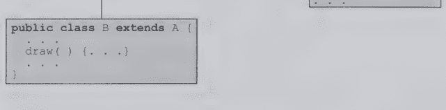

5. 多态性在第 9 章中定义。

6. 方法调用到方法的动态绑定有时称为动态多态性。

一个二手车目录，该目录实现为一个 Car 类，目录中的每辆车都有一个子类。子类包含汽车图像和关于该汽车的具体信息。用户可以通过一个程序浏览汽车，该程序在用户浏览到每辆车时显示其图像和信息。每辆车（及其信息）的显示都包含一个按钮，如果用户对某辆特定的车感兴趣，可以点击该按钮。用户浏览完目录后，系统将打印用户感兴趣的汽车图像和信息。实现此系统的一种方法是将每辆感兴趣的汽车（Car 的子类）的引用放入一个可以存储基类 Car 引用的列表中。当用户准备好后，可以打印所有感兴趣的汽车信息，供用户研究和比较列表中的汽车。汽车目录当然会经常变化。这将需要相应地更改 Car 的子类。但是，对子类集合的更改不需要对系统进行任何其他更改。

在某些情况下，继承层次结构的设计会导致一个或多个类位于层次结构中过高的位置，以致对它们进行实例化没有意义。例如，假设一个程序定义了一个 Building 类以及一组针对特定类型建筑物的子类，例如 French_Gothic_Cathedrals。在 Building 中实现 draw 方法可能没有意义。但因为它所有的后代类都应该有此类方法，所以该方法的协议（而不是方法体）被包含在 Building 中。这种方法通常称为抽象方法（C++ 中的纯虚方法）。包含至少一个抽象方法的类称为抽象类（C++ 中的抽象基类）。这样的类通常不能被实例化，因为它的某些方法只声明而未定义（它们没有方法体）。任何要实例化的抽象类的子类都必须提供所有继承的抽象方法的实现（定义）。

## 12.3 面向对象语言的设计问题

在设计支持继承和动态绑定的编程语言特性时，必须考虑许多问题。我们在本节中讨论我们认为最重要的问题。

### 12.3.1 对象的排他性

完全致力于面向对象计算模型的语言设计者会设计一个涵盖所有其他类型概念的对象系统。在这种思维模式下，从简单的标量整数到完整的软件系统，一切都是对象。这种选择的优点是语言的优雅性和纯粹的统一性，以及其使用上的统一。主要缺点是简单操作必须通过消息传递过程来完成，这通常使它们比命令式模型中的类似操作更慢，在命令式模型中，单条机器


instructions 实现此类简单操作。在这种最纯粹的面向对象计算模型中，所有类型都是类。预定义类与用户定义类之间没有区别。事实上，所有类都被同等对待，所有的计算都通过消息传递来完成。

在命令式语言中，另一种常见的替代方案是完全使用对象，即向已添加面向对象编程支持的语言中保留基命令式语言的完整类型集合，并添加对象类型模型。这种方法会产生一种更大的语言，其类型结构可能让新用户感到困惑。

另一种完全使用对象的替代方案是为原始标量类型采用命令式风格的类型结构，但将所有结构化类型都实现为对象。这种选择提供了与命令式模型中预期的可比的对原始值操作的快速性。

## 12.3.2 子类是子类型吗？

如果一种语言允许在程序中将一个类的变量替换为其祖先类之一的变量，而在任何情况下都不会导致类型错误且不会改变程序的行为，那么该语言就支持替换原则。在这种语言中，如果类 B 由类 A 派生而来，则 B 具有 A 的所有内容，并且当 B 类的对象被用作 A 类的对象时，其行为与 A 类的对象完全相同。当这种情况成立时，B 是 A 的子类型。虽然作为父类的子类型的子类必须公开父类所公开的所有成员，但子类可以拥有父类中没有的成员，仍然是子类型。

Ada 的子类型是预定义子类型的例子。例如，

```
subtype Small_Int is Integer range -100..100;
```

Small_Int 类型的变量具有 Integer 变量的所有操作，但只能存储 Integer 可能值的一个子集。此外，每个 Small_Int 变量都可以在 Integer 变量可以使用的任何地方使用。也就是说，每个 Small_Int 变量在某种意义上都是一个 Integer 变量。

子类型的定义明确禁止父类中存在子类中不公开的公共实体。因此，子类型的派生过程必须要求父类的公共实体作为子类中的公共实体被继承。

并非所有子类都是子类型，也并非所有子类型都是子类。例如，如果子类更改了其重写方法的行为，则它就不能是子类型。此外，一个不是另一类的子类的类可以通过定义相同的成员，即在类型和

7. 这最后的要求存在一个根本性的理论问题：一般来说，不可能确定两个程序的行为是否相同。

行为方面，都可以是该类的子类型。子类型继承接口和行为，而子类主要继承实现，以促进代码重用。

大多数支持面向对象编程的静态类型语言的设计使得子类是子类型，除非程序员有意设计出行为与父类不同的子类。

一个明显的问题是：子类是否是子类型的问题是理论上的还是实践上的？定义一个子类，其重写方法保留了对应被重写方法的类型协议但不保留其效果的情况可能并不常见。因此这不是一个频繁的实践问题。然而，如果有一种合理简单的方法来强制执行，要求所有子类都是子类型，将使继承建立在更坚实的理论基础之上。

## 12.3.3 单继承和多继承

面向对象语言的另一个简单设计问题是：语言是否允许多继承（除单继承之外）？也许没那么简单。多继承的目的是允许一个新类从两个或多个类继承。

由于多继承有时非常有用，为什么语言设计者不包含它呢？原因属于两个类别：复杂性和效率。附加的复杂性由几个问题说明。首先，注意如果一个类有两个不相关的父类，且两者都没有定义对方已定义的名字，就没有问题。然而，假设一个名为 C 的子类同时继承自类 A 和类 B，而 A 和 B 都定义了一个可继承的方法名为 display。如果 C 需要引用 display 的两个版本，该如何实现？这种歧义问题在两个父类都定义了同名方法并且其中一个或两个必须在子类中被重写时变得更加复杂。

另一个问题出现如果 A 和 B 都派生自共同父类 Z，且 C 同时具有 A 和 B 作为父类。这种情况称为菱形或共享继承。在这种情况下，A 和 B 都应包含 Z 的可继承变量。假设 Z 包含一个可继承变量名为 sum。问题是 C 应该继承 sum 的两个版本还是只有一个，如果只有一个，是哪一个？可能存在编程情况，其中应只继承其中一个，也存在应继承两个的情况。当 A 和 B 都从 Z 继承一个方法并且都重写了该方法时会出现类似问题。如果 C 的客户端继承了两个重写方法并调用该方法，调用的是哪个方法，还是两个都应被调用？菱形继承如图 12.3 所示。

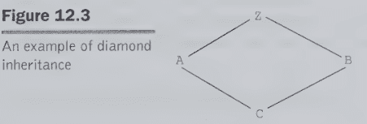

效率问题可能更多是感知上的而非真实的。例如，在 C++ 中，支持多继承只需要为每次动态绑定方法调用额外进行一次数组访问和一次加法运算，至少在某些机器架构上如此（Stroustrup, 1994, p. 270）。尽管即使程序不使用多继承也需要此操作，但这是一个很小的额外成本。

多继承的使用很容易导致复杂的程序组织。许多尝试使用多继承的人发现，设计用作多个父类的类是困难的。而且困难不仅限于初始开发者造成的。某个类可能在稍后被另一位开发者用作新类的父类之一。使用多继承的系统的维护可能是一个更严重的问题，因为多继承导致类之间更复杂的依赖关系。有些人并不清楚多继承的好处是否值得为使用它的系统设计和维护所付出的额外努力。

接口与抽象类 somewhat 相似；其方法被声明但未定义。接口不能被实例化。它们被用作多继承的替代方案。8 接口提供了多继承的一些好处，但缺点较少。例如，当使用接口而不是多继承时，菱形继承的问题就被避免了。

关于对象的分配和释放有两个设计问题。第一个是对象从何处分配。如果它们像抽象数据类型那样行为，则可以从任何地方分配。这意味着它们可以从运行时栈分配，或通过 new 等运算符或函数显式地在堆上创建。如果它们都是堆动态的，则具有通过指针或引用变量进行统一的创建和访问方法的优势。这种设计简化了对象的赋值操作，使其在所有情况下都只是指针或引用值的更改。它还允许对对象的引用被隐式解引用，简化了访问语法。

```
a1 = b1;
```

是一个合法的语句。如果 a1 和 b1 是对堆动态对象的引用，就没有问题——赋值只是简单的指针赋值。然而，如果 a1 和 b1 是栈动态的，则它们是值变量，如果赋值的


## 12.3 面向对象语言的设计问题

对象的值必须被复制到目标对象的空间中。如果B在从A继承的基础上增加了一个数据字段，那么a1在栈上就不会有足够的空间容纳b1的全部内容。多余的部分会被直接截断，这可能会让编写或使用这些代码的程序员感到困惑。这种截断被称为对象切片。下面的示例和图12.4说明了这个问题。

```
class A {
	int x;
	.
	.
	.
};

class B : A {
	int y;
	.
	.
	.
}
```

这里涉及的第二个问题是关于从堆中分配对象的情况。问题是释放操作是隐式的、显式的，还是两者兼有。如果释放是隐式的，则需要某种隐式的存储回收方法。如果释放可以是显式的，那么就会产生是否可能创建悬空指针或引用的问题。

如12.2.3节所述，消息到方法的动态绑定是面向对象编程的基本组成部分。这里的问题是，是否所有消息到方法的绑定都是动态的。另一种选择是允许用户指定特定绑定是动态的还是静态的。这样做的优点是静态绑定更快。因此，如果某个绑定不需要是动态的，为什么要付出动态绑定的代价？

嵌套类定义的主要动机之一是信息隐藏。如果一个新类只被一个类需要，那么就没有必要将其定义成其他类也能看到的形式。在这种情况下，可以将新类嵌套在使用它的类内部。在某些情况下，新类嵌套在子程序中，而不是直接嵌套在另一个类中。

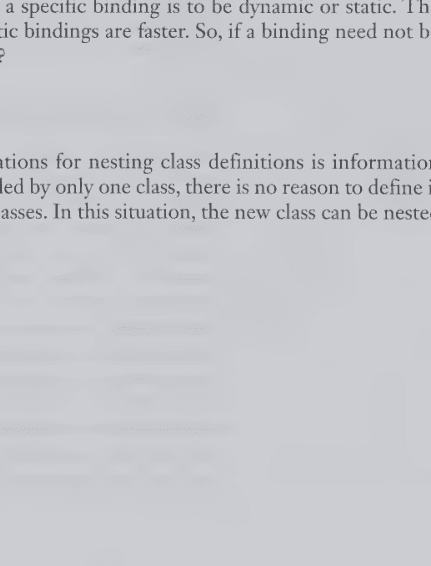

包含嵌套类的类被称为嵌套类。与类嵌套相关的最明显设计问题涉及可见性。具体来说，一个问题是：嵌套类中的哪些成员在嵌套类中可见？另一个重要的问题是相反的：嵌套类中的哪些成员在嵌套类中可见？

## 12.3.7 对象的初始化

初始化问题涉及对象在创建时是否以及如何初始化为相应的值。这比最初想象的要复杂。一个问题是如何实现对象的初始化：必须手动初始化，还是通过某种隐式机制？当创建子类的对象时，对继承自父类的成员的初始化是隐式的，还是必须由程序员显式处理？

## 12.4 特定语言对面向对象编程的支持

## 12.4.1 Smalltalk

许多人认为Smalltalk是真正意义上的面向对象编程语言。它是第一种对该范式提供完整支持的语言。因此，从Smalltalk开始审视语言对面向对象编程的支持是很自然的。

### 12.4.1.1 总体特征

在Smalltalk中，对象的概念是真正普遍的。几乎所有东西，从像整数常量2这样简单的事物，到复杂的文件处理系统，都是对象。作为对象，它们被统一对待。它们都有局部内存、固有的处理能力、与其他对象通信的能力，以及从祖先继承方法和实例变量的可能性。在Smalltalk中，类不能嵌套。

所有计算都通过消息进行，即使是简单的算术运算也是如此。例如，表达式`x + 7`的实现方式是向x发送`+`消息（以执行`+`方法），并将7作为参数发送。该操作返回一个新的数值对象，其中包含加法运算的结果。

对消息的回复采用对象的形式，用于返回请求的信息或计算结果，或者仅用于确认所请求的服务已完成。

所有Smalltalk对象都从堆中分配，并通过引用变量（隐式解引用）来引用。没有显式的释放语句或操作。因此，所有释放都是隐式的，使用垃圾回收过程进行存储回收。

在Smalltalk中，创建对象时必须显式调用构造函数。一个类可以有多个构造函数，但每个构造函数必须有唯一的名称。

Smalltalk类不能嵌套在其他类中。

与C++和Objective-C等混合语言不同，Smalltalk只为一种软件开发范式而设计——面向对象。此外，它没有采用命令式语言的外表特征。其纯粹的设计目标体现在简单优雅和统一的设计中。

第2章中有一个示例Smalltalk程序。

### 12.4.1.2 继承

Smalltalk子类继承其超类的所有成员。子类也可以拥有自己的实例变量，这些变量的名称必须与其祖先类中的变量名称不同。最后，子类可以定义新的方法，并重定义祖先类中已存在的方法。当子类的方法与祖先类的方法具有相同的名称和协议时，子类方法会隐藏祖先类的方法。要访问这种被隐藏的方法，可以在消息前加上伪变量`super`作为前缀。此前缀会使方法查找从超类开始，而不是从当前类开始。

由于父类中的成员不能被隐藏于子类，子类可以是（而且通常是）子类型。

Smalltalk不支持多重继承。

### 12.4.1.3 动态绑定

Smalltalk中消息到方法的动态绑定操作如下：向对象发送消息会导致在该对象所属的类中查找相应的方法。如果查找失败，则继续在该类的超类中查找，依此类推，直到系统类Object，该类没有超类。Object是类派生树的根，每个类都是该树上的一个节点。如果在整条链中找不到任何方法，就会发生错误。重要的是要记住，这种方法查找是动态的——它发生在消息发送之时。Smalltalk在任何情况下都不会将消息静态绑定到方法。

Smalltalk中唯一的类型检查是动态的，唯一的类型错误发生在向一个对象发送消息，而该对象在本地或通过继承都没有匹配的方法时。这与大多数其他语言的类型检查概念不同。Smalltalk类型检查的目标很简单：确保消息与某个方法匹配。

Smalltalk变量没有类型；任何名称都可以绑定到任何对象。因此，Smalltalk直接支持动态多态。所有Smalltalk代码都是通用的，因为变量的类型无关紧要，只要它们保持一致即可。变量上的操作（方法或运算符）的含义由该变量当前所绑定对象的类决定。

这一讨论的要点是：只要表达式中引用的对象具有相应表达式消息所对应的方法，这些对象的类型就无关紧要。这意味着没有任何代码被绑定到特定类型。

### 12.4.1.4 对Smalltalk的评价

Smalltalk是一种小型语言，尽管Smalltalk系统很大。该语言的语法简单且高度规则。它是一个很好的例子，展示了如果一种小型语言围绕一个简单但强大的概念构建，它能提供多大的能力。就Smalltalk而言，这一概念是：所有编程都可以仅通过使用由继承、对象和消息传递构建的类层次结构来完成。

与等效的编译型命令式语言程序相比，Smalltalk程序的运行速度要慢得多。尽管在理论上，数组索引和循环可以在消息传递模型中提供很有趣，但效率在编程语言评估中是一个重要因素。因此，在大多数关于Smalltalk实际适用性的讨论中，效率显然都会成为一个问题。

Smalltalk的动态绑定允许类型错误直到运行时才被发现。可以编写包含向不存在的方法发送消息的程序，并且直到这些消息被发送时才会被检测到，这会导致在开发后期比静态类型语言产生多得多的错误修复工作。然而，在实践中，类型错误对Smalltalk程序来说并不是一个严重问题。

总体而言，Smalltalk的设计始终倾向于语言优雅性和严格遵守面向对象编程支持的原则，往往不考虑实际问题，特别是执行效率。这在单一使用对象和无类型变量方面表现得最为明显。

Smalltalk的用户界面曾对计算领域产生过重要影响：窗口、鼠标指向设备、弹出式菜单和下拉式菜单的集成使用，所有这些都首先出现在Smalltalk中，如今主导着当代软件系统。

也许Smalltalk最大的影响是推动了面向对象编程的发展，后者如今已成为最广泛使用的设计和编码方法论。

## 12.4.2 C++

第2章描述了C++如何从C和SIMULA 67演变而来，其设计目标是在支持面向对象编程的同时，几乎完全保持与C的向后兼容性。C++类用于支持抽象数据类型的内容在第11章中讨论过。本节探讨C++对其他面向对象编程要素的支持。C++类、继承和动态绑定的全部细节庞大而复杂。本节只讨论其中最重要的主题，具体来说，是与12.3节中所述设计问题直接相关的主题。


C++ 是第一个广泛使用的面向对象编程语言，至今仍是最受欢迎的语言之一。因此，它自然成为其他语言常常与之比较的对象。基于这两个原因，我们在这里对 C++ 的讲解比本章讨论的其他示例语言更为详细。

## 12.4.2.1 一般特性

为了保持与 C 语言的向后兼容性，C++ 保留了 C 的类型系统，并在此基础上增加了类。因此，C++ 既具有传统命令式语言的类型，也具有面向对象语言的类结构。它支持方法，也支持与特定类无关的函数。这使得它成为一种混合语言，既支持过程式编程，也支持面向对象编程。

C++ 的对象可以是静态的、栈动态的或堆动态的。对于堆动态对象，需要使用 `delete` 运算符进行显式释放，因为 C++ 不包含隐式存储回收机制。

许多类定义中包含析构函数，当该类的对象不再存在时，析构函数会被隐式调用。析构函数用于释放数据成员所引用的堆分配内存。它也可以用来在对象消亡前记录对象的部分或全部状态，通常用于调试目的。

## 12.4.2.2 继承

C++ 类可以从现有类派生，该现有类即为其父类或基类。与 Smalltalk 和大多数其他支持面向对象编程的语言不同，C++ 类也可以独立存在，不需要有超类。在派生类的定义中，派生类的名称后跟冒号（:）和基类名称，如下列语法形式所示：

```
class derived_class_name : base_class_name { ... }
```

类定义中定义的数据称为该类的数据成员，类定义中定义的函数称为该类的成员函数（在其他语言中，成员函数通常称为方法）。基类的部分或全部成员可以被派生类继承，派生类也可以添加新成员并修改继承的成员函数。

所有 C++ 对象在使用前都必须初始化。因此，所有 C++ 类都至少包含一个构造函数方法，用于初始化新对象的数据成员。构造函数方法在创建对象时被隐式调用。如果任何数据成员是指向堆分配数据的指针，构造函数会分配该存储空间。

如果某个类从另一个类派生，那么在创建派生类对象时，必须初始化继承的数据成员。为此，会隐式调用基类的构造函数。当需要向构造函数提供初始化数据时

## 论范式与更好的编程

## 比雅尼·斯特劳斯特鲁普


比雅尼·斯特劳斯特鲁普是 C++ 的设计者和原始实现者，也是《C++ 之旅》、《编程：原理与实践使用 C++》、《C++ 程序设计语言》、《C++ 的设计与演化》以及许多其他出版物的作者。他的研究兴趣包括分布式系统、设计、编程技术、软件开发工具和编程语言。他积极参与 C++ 的 ANSI/ISO 标准化工作。斯特劳斯特鲁普博士是纽约市摩根士丹利技术部门的董事总经理、哥伦比亚大学计算机科学客座教授，以及德州农工大学计算机科学杰出研究教授。他是美国国家工程院院士、ACM 会士和 IEEE 会士。1993 年，斯特劳斯特鲁普获得 ACM 格蕾丝·默里·霍珀奖，以表彰“他早期为 C++ 编程语言奠定基础的工作。基于这些基础以及斯特劳斯特鲁普博士的持续努力，C++ 已成为计算史上最具影响力的编程语言之一。”（采访年份：2002）

## 编程范式

### 您对面向对象范式的看法：其优点和缺点是什么？

首先让我说说我所说的 OOP 是什么意思——太多人认为“面向对象”仅仅是“好”的同义词。如果是这样，那就没有必要有其他范式了。OOP 的关键在于使用类层次结构，通过某种与虚函数大致等价的方式提供多态行为。对于真正的 OOP，重要的是避免直接访问这种层次结构中的数据，而只使用精心设计的函数接口。

除了有据可查的优势外，面向对象编程也有明显的弱点。特别是，并非每个概念都自然地适合放入类层次结构中，而且支持面向对象编程的机制与替代方案相比可能会带来显著的开销。对于许多简单的抽象，不依赖层次结构和运行时绑定的类提供了更简单、更高效的替代方案。此外，在不需要运行时解析的情况下，依赖于（编译时）参数化多态的泛型编程是行为更好、效率更高的方法。

### 那么，C++ 是面向对象的还是其他的？

C++ 支持多种范式——包括 OOP、泛型编程和过程式编程——这些范式的组合定义了多范式编程，即支持不止一种编程风格（“范式”）以及这些风格的组合。

### 您有多范式编程的小例子吗？

考虑一下经典的“形状集合”示例的变体（起源于第一种支持面向对象编程的语言 Simula 67 的早期）：

```
void draw_all(const vector<Shape*>& vs)
{
    for (int i = 0; i<vs.size(); ++i)
        vs[i]->draw();
}
```

这里，我将泛型容器 `vector` 与多态类型 `Shape` 一起使用。`vector` 提供了静态类型安全和最佳运行时性能。`Shape` 提供了无需重新编译即可处理 `Shape`（即任何从 `Shape` 派生的类的对象）的能力。

我们可以轻松地将其推广到任何满足 C++ 标准库要求的容器：

```
template<class C>
void draw_all(const C& c)
{
    typedef typename C::
        const_iterator CI;
    for (CI p = c.begin();
        p!=c.end(); ++p)
        (*p)->draw();
}
```

使用迭代器，我们可以将 `draw_all()` 应用于不支持下标运算的容器，例如标准库中的 `list`：

```
vector<Shape*> vs;
list<Shape*> ls;
// . . .
draw_all(vs);
draw_all(ls);
```

我们甚至可以进一步推广，以处理由一对迭代器定义的任何元素序列：

```
template<class Iterator> void
draw_all(Iterator b, Iterator e)
{
    for_each(b,e,mem_fun(&Shape::draw));
}
```

为了简化实现，我使用了标准库算法 `for_each`。

我们可以为标准库 `list` 和数组调用这个最后版本的 `draw_all()`：

```
list<Shape*> ls;
Shape* as[100];
// . . .
draw_all(ls.begin(),ls.end());
draw_all(as,as+100);
```

## 为工作选择“正确”的语言

拥有众多范式的背景有多大用处？或者，与其学习这些其他范式，不如把时间投入到更熟悉 OO 语言上？对于任何希望在软件领域被视为专业人士的人来说，掌握多种语言和多种编程范式是必不可少的。目前，C++ 是进行多范式编程的最佳语言，也是学习各种编程形式的好语言。然而，只知道 C++ 并不是一个好主意，更不用说只知道一种单一范式的语言了。那有点像色盲或只会一种语言：你几乎不知道自己错过了什么。许多优秀编程的灵感来自于学习和欣赏多种编程风格，并了解它们如何在不同语言中使用。

此外，我认为任何非平凡程序的编程都是需要接受过扎实而广泛教育的专业人士的工作，而不是那些接受过仓促而狭窄“培训”的人的工作。


基类构造函数，它在调用派生对象构造函数时给出。通常，这使用以下结构完成：

```
subclass (subclass parameters) : `base_class` (superclass parameters) {
. . .
}
```

如果开发者在类定义中未包含构造函数，编译器会包含一个平凡的构造函数。此默认构造函数会调用基类的构造函数（如果存在基类）。

类的成员可以是 private、protected 或 public。Private 成员只能由该类的成员函数和友元访问。独立函数、成员函数和类可以被声明为类的友元，从而获得对其 private 成员的访问权限。Public 成员在任何地方都可见。Protected 成员与 private 成员类似，只是派生类中可以访问，访问方式如下所述。派生类可以修改其继承成员的可访问性。派生类的完整语法形式如下：

```
class derived_class_name : derivation_mode base_class_name
{data member and member function declarations};
```

derivation_mode 可以是 **public** 或 **private**。⁹（不要将 public 和 private 派生与 public 和 private 成员混淆。）在 public 派生类中，基类的 public 和 protected 成员分别也是 public 和 protected。在 private 派生类中，基类的 public 和 protected 成员都变为 private。因此，在类层次结构中，private 派生类会切断所有祖先类的所有成员对所有后继类的访问。基类的 private 成员会被派生类继承，但对该派生类的成员不可见，因此在那里无用。Private 派生提供了子类可以使成员的可访问性与父类中相同成员的可访问性不同这一可能性。考虑以下示例：

```
class base_class {
    private:
        int a;
        float x;
    protected:
        int b;
        float y;
    public:
        int c;
        float z;
};

class subclass_1 : public base_class { . . . };
class subclass_2 : private base_class { . . . };
```

> 9. 它也可以是 **protected**，但此处不讨论该选项。

在 subclass_1 中，b 和 y 为 protected，c 和 z 为 public。在 subclass_2 中，b、y、c 和 z 均为 private。subclass_2 的任何派生类都无法访问 base_class 的任何成员。base_class 中的数据成员 a 和 x 在 subclass_1 或 subclass_2 中均不可访问。

请注意，private 派生的子类不能是子类型。例如，如果基类有一个 public 数据成员，在 private 派生下该数据成员在子类中将为 private。因此，如果将子类的对象替换为基类的对象，对该数据成员的访问在子类对象上将是非法的。然而，public 派生的子类可以并且通常是子类型。

在 private 类派生下，父类的任何成员都不会隐式地对派生类的实例可见。必须使其可见的任何成员都必须在派生类中重新导出。这种重新导出在效果上使成员免于被隐藏，即使派生是 private 的。例如，考虑以下类定义：

```
class subclass_3 : private base_class {
    base_class :: c;
    ...
}
```

现在，subclass_3 的实例可以访问 c。就 c 而言，就好像派生是 public 的一样。此类定义中的双冒号 (::) 是作用域解析运算符。它指定其后实体所在的类。

以下段落中的示例说明了 private 派生的目的和用法。

考虑以下 C++ 继承的示例，其中定义了一个通用的链表类，然后用它定义了两个有用的子类：

```
class single_linked_list {
private:
    class node {
        public:
            node *link;
            int contents;
    };
    node *head;
public:
    single_linked_list() {head = 0};
    void insert_at_head(int);
    void insert_at_tail(int);
    int remove_at_head();
    int empty();
};
```

嵌套类 node 定义链表的单元由一个整数变量和指向 node 对象的指针组成。node 类位于 private 子句中，

## 第 12 章 面向对象编程支持

这将其隐藏于所有其他类之外。它的成员是 public，因此对嵌套类 single_linked_list 可见。如果它们是 private，node 需要将嵌套类声明为友元以使其在嵌套类中可见。请注意，嵌套类对嵌套类的成员没有特殊访问权限。只有嵌套类的静态数据成员对嵌套类的方法可见。

封闭类 single_linked_list 只有一个数据成员，即用作列表头部的指针。它包含一个构造函数函数，将 head 设置为 null 指针值。四个成员函数允许在列表对象的任一端插入节点，从列表对象的一端移除节点，并测试列表是否为空。

```
class single_linked_list {
public:
	int* head;
	single_linked_list() { head = nullptr; }
	void insert_at_head(int value) {
		node* n = new node(value);
		n->next = head;
		head = n;
	}
	void insert_at_tail(int value) {
		node* n = new node(value);
		if (head == nullptr) {
			head = n;
		} else {
			node* t = head;
			while (t->next != nullptr) {
				t = t->next;
			}
			t->next = n;
		}
	}
	int remove_at_head() {
		if (head == nullptr) {
			return 0;
		}
		node* t = head;
		head = head->next;
		int value = t->value;
		delete t;
		return value;
	}
	bool empty() {
		return head == nullptr;
	}
};
```

以下定义提供了栈和队列类，两者均基于 single_linked_list 类：

```
class stack : public single_linked_list {
public:
	stack() {}
	void push(int value) {
		insert_at_head(value);
	}
	int pop() {
		return remove_at_head();
	}
};
```

```
class queue : public single_linked_list {
public:
	queue() {}
	void enqueue(int value) {
		insert_at_tail(value);
	}
	int dequeue() {
		return remove_at_head();
	}
};
```

请注意，stack 和 queue 子类的对象都可以访问基类 single_linked_list 中定义的 empty 函数（因为它是 public 派生）。两个子类都定义了不执行任何操作的构造函数。当创建子类的对象时，子类中的适当构造函数会被隐式调用。然后会调用基类中的任何适用构造函数。因此，在我们的示例中，当创建类型为 stack 的对象时，会调用 single_linked_list 中的构造函数，它执行必要的初始化。然后调用 stack 构造函数，它不执行任何操作。

stack 和 queue 类都存在同一个严重问题：两个类的客户端都可以访问父类 single_linked_list 的所有 public 成员。stack 对象的客户端可以调用 insert_at_tail，从而破坏其栈的完整性。同样，queue 对象的客户端可以调用 insert_at_head。这些不必要的访问是允许的，因为 stack 和 queue 都是 single_linked_list 的子类型。当希望子类继承基类的整个接口时使用 public 派生。另一种选择是使用派生方式，子类仅继承基类的实现。我们的两个示例派生类可以通过使用 private 而非 public 派生，使其不成为其父类的子类型来编写。然后，两者也需要重新导出 empty，因为它将对其实例隐藏。这种情况说明了 private 派生选项的动机。stack 和 queue 类型的新的定义，命名为 stack_2 和 queue_2，显示如下：

```
class stack_2 : private single_linked_list {
    public:
        stack_2() {}
        void push(int value) {
            single_linked_list :: insert_at_head(value);
        }
        int pop() {
            return single_linked_list :: remove_at_head();
        }
        single_linked_list:: empty();
};
```

```
class queue_2 : private single_linked_list {
    public:
        queue_2() {}
        void enqueue(int value) {
            single_linked_list :: insert_at_tail(value);
        }
        int dequeue() {
            single_linked_list :: remove_at_head();
        }
        single_linked_list:: empty();
};
```

这两个类使用重新导出以允许客户端访问基类方法。当使用 public 派生时，这不是必要的。

stack 和 queue 的两个版本说明了子类型与非子类型的派生类型之间的区别。链表是栈和队列的概括，因为两者都可以用作链表实现。因此，从链表类继承来定义栈和队列类是自然的。然而，两者都不是链表类的子类型，因为两者都将父类的 public 成员设为 private，从而使其对客户端不可访问。

朋友之所以必要的一个原因是，有时必须编写一个可以访问两个不同类成员的子程序。对于

11. 它们不会是子类型，因为父类的 public 成员可以在客户端中看到，但在子类的客户端中，那些成员是 private。


例如，假设一个程序使用一个类表示向量，另一个类表示矩阵，并且需要一个子程序来将矩阵对象乘以向量对象。在 C++ 中，multiply 函数可以同时成为这两个类的友元。

如前所述，C++ 提供了多重继承。作为示例，假设我们想要一个用于绘图的类，它需要一个用于绘制图形的类的行为，并且新类的方法需要在单独的线程中运行。我们可能会定义如下：

```
class Thread { . . . };
class Drawing { . . . };
class DrawThread : public Thread, public Drawing { . . . };
```

类 DrawThread 继承了 Thread 和 Drawing 的所有成员。如果 Thread 和 Drawing 都恰好包含同名的成员，则可以通过使用作用域解析运算符（::）在 DrawThread 类的对象中对其进行无歧义引用。多重继承的这个例子在图 12.5 中显示。

有关 C++ 多重继承实现的一些问题在第 12.5 节中讨论。

在 C++ 中，重写方法¹²必须与被重写方法具有完全相同的参数特征。如果参数特征有任何差异，则子类中的方法被视为与祖先类中同名方法无关的新方法。重写方法的返回类型必须与被重写方法的返回类型相同，或者必须是被重写方法返回类型的公有派生类型。

## 12.4.2.3 动态绑定

迄今为止我们定义的所有成员函数都是静态绑定的；也就是说，对其中一个的调用是静态绑定到函数定义。C++ 对象可以通过值变量而不是指针或引用来操作。（这样的对象将是静态的或栈动态的。）然而，在那种

## 图 12.5
多重继承

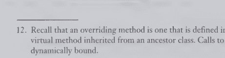

> 12. 回想一下，重写方法是指在派生类中定义以替换从祖先类继承的虚方法的那个方法。对重写方法的调用必须动态绑定。

## 第 12 章 面向对象编程的支持

```
ptr_shape = sq; // Now ptr_shape points to a
// Square object
ptr_shape->draw(); // Dynamically bound to the draw
// in the Square class
rect->draw(); // Statically bound to the draw
// in the Rectangle class
```

这种情况在图 12.6 中显示。

请注意，基类 shape 定义中的 draw 函数被设为 0。这种奇特的语法用于表示该成员函数是纯虚函数，意味着它没有主体且不能被调用。如果派生类调用该函数，则必须在派生类中重新定义它。纯虚函数的目的是提供函数的接口而不给出其任何实现。纯虚函数通常在实际成员

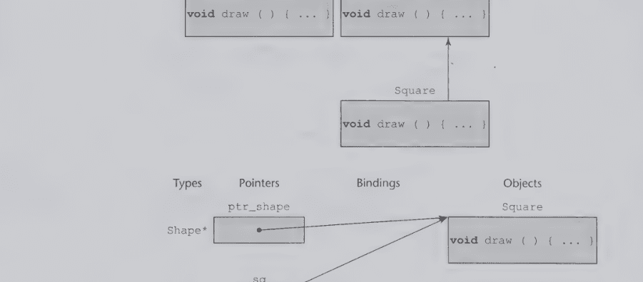

| 类型 | 指针 | 绑定 | 对象 |
|-------|----------|----------|---------|
| Shape* | ptr_shape | → Square | Square |
| Square* | sq | → Square | Square |
| Rectangle* | rect | → Rectangle | Rectangle |

定义和派生访问控制，以及友元函数和友元类的可能性，C++ 程序员对类成员的访问有高度详细的控制。虽然 C++ 提供了多重继承而 Smalltalk 没有，但很多人认为这并不是 C++ 的优势。多重继承的缺点对其价值的权衡很大。事实上，C++ 是本章讨论的唯一支持多重继承的语言。另一方面，提供多重继承替代方案的语言，如 Objective-C、Java 和 C#，在该方面明显优于 Smalltalk。

在 C++ 中，程序员可以指定使用静态绑定还是动态绑定。由于静态绑定更快，因此在不需要动态绑定的情况下这是优势。此外，与 Smalltalk 相比，C++ 中的动态绑定也很快。将 C++ 中的虚成员函数调用绑定到函数定义具有固定成本，无论该定义在继承层次结构中距离多远。调用虚函数只需要比静态绑定调用多五个内存引用（Stroustrup, 1988）。然而，在 Smalltalk 中，消息始终动态绑定到方法，并且正确的<|message|> 方法在继承层次结构中越远，所需时间越长。允许用户决定哪些绑定是静态的、哪些是动态的的缺点是，原始设计必须包含这些决策，而这些决策以后可能需要更改。

C++ 的静态类型检查是相对于 Smalltalk 的优势，在 Smalltalk 中所有类型检查都是动态的。Smalltalk 程序可以用对不存在方法的消息编写，这些消息要到程序执行时才会被发现。C++ 编译器会发现此类错误。编译器检测到的错误比在测试中发现的错误修复成本更低。

Smalltalk 本质上是无类型的，意味着所有代码在效果上都是通用的。这提供了很大的灵活性，但牺牲了静态类型检查。C++ 通过其模板设施（见第 11 章所述）提供泛型类，这保留了静态类型检查的好处。

Smalltalk 的主要优势在于语言的优雅和简洁，这源于其设计的单一哲学。它纯粹而完全致力于面向对象范式，没有因根深蒂固的用户群的偏好而产生的妥协。另一方面，C++ 是一种庞大而复杂的语言，没有单一的哲学作为其基础，除了支持面向对象编程并包含 C 用户群之外。其最重要目标之一是在提供面向对象编程优势的同时保留 C 的效率和风格。有些人认为该语言的特性并不总是很好地契合，并且至少其中一些复杂性是不必要的。

根据 Chambers 和 Ungar（1991）的说法，Smalltalk 运行一组特定的小型 C 风格基准测试的速度仅为优化 C 的 10%。C++ 程序只需要比等效的 C 程序多一点点时间（Stroustrup, 1988）。鉴于 Smalltalk 与 C++ 之间巨大的效率差距，C++ 的商业使用远比 Smalltalk 普及也就不足为奇了

到子类。回想一下，虽然 C++ 中可以通过说明符控制对方法的访问，但在 Objective-C 中所有方法都是公开的，且无法更改。方法在子类中定义且具有相同名称、相同返回类型以及相同数量和类型的参数时，会覆盖继承的方法。被覆盖的方法可以通过 super 在子类的另一个方法中调用，super 是对父对象的引用。无法阻止对继承方法的重写。由于基类的所有公共成员在从该基类派生的子类中也是公共的，因此所有子类都可以是子类型。

与 Smalltalk 类似，在 Objective-C 中，任何方法名都可以对任何对象调用。如果运行时系统发现对象没有这样的方法（具有正确的协议），则会发生错误。

Objective-C 不支持 C++ 的私有和受保护派生。与支持面向对象编程的其他语言一样，子类实例的构造函数在做任何其他事情之前应始终调用父类构造函数。如果父类构造函数的名称为 init，则通过以下语句完成：

```
[super init];
```

Objective-C 除了子类化之外还包括两种扩展类的方式：类别和协议。可以通过称为类别的构造向类添加一组方法。类别是类的次要接口，包含方法声明。次要接口中不能包含新的实例变量。这种接口的语法形式如下所示：

```
#import "Stack.h"
@interface Stack (StackExtend)
- (int) secondFromTop;
- (void) full;
@end
```

此类别的名称为 StackExtend。原始接口可访问，因为它已被导入，因此无需提及父类。新的方法被混合到原始接口的方法中。因此，类别有时被称为混入。混入有时用于向不同类添加某些功能。当然，类仍然有一个正常的超类，从中继承成员。因此，混入提供了多重继承的一些好处，而无需担心如果模块不要求其函数上具有模块名称则可能发生的命名冲突。当然，类别也必须有一个实现部分，其中在实现指令上的类名之后用括号包含类别名称，如下所示：

```
@implementation Stack (StackExtend)
```

实现不必实现类别中的所有方法。


在 Objective-C 中，还有另一种方式可以提供多重继承的一些好处，那就是协议（protocol）。虽然 Objective-C 不像 C++ 那样提供抽象类，但协议与抽象类有关。协议是一系列方法声明的列表。协议的语法如下例所示：

```
@protocol MatrixOps
- (Matrix *) add: (Matrix *) mat;
- (Matrix *) subtract: (Matrix *) mat;
@optional
- (Matrix *) multiply: (Matrix *) mat;
@end
```

在此例中，MatrixOps 是协议的名称。使用该协议的类必须实现 add 和 subtract 方法。这种使用方式称为实现或采纳协议。optional 部分指定采纳类可以实现 multiply 方法，也可以不实现。

采纳协议的类在接口指令上将协议名称列在类名后面的尖括号中，如下所示：

```
@interface MyClass: NSObject <YourProtocol>
```

## 12.4.3.3 动态绑定

在 Objective-C 中，多态的实现方式不同于大多数其他常见编程语言。多态变量通过声明为 id 类型来创建。这样的变量可以引用任何对象。运行时系统会跟踪 id 类型变量所引用对象的类。如果通过这样的变量调用方法，那么该调用会被动态绑定到正确的方法（假设该方法存在）。

例如，假设一个程序定义了名为 Circle 和 Square 的类，并且两者都有名为 draw 的方法。考虑以下框架代码：

```
// Create the objects
Circle *myCircle = [[Circle alloc] init];
Square *mySquare = [[Square alloc] init];

// Initialize the objects
[myCircle setCircumference: 5];
[mySquare setSide: 5];

// Create the id variable
id shapeRef;

//Set the id to reference the circle and draw it
shapeRef = myCircle;
[shapeRef draw];
```

```
// Set the id to reference the square
shapeRef = mySquare;
[shapeRef draw];
```

这段代码先绘制圆，然后绘制正方形，两个 draw 方法都是通过 shapeRef 对象引用来调用的。

## 12.4.3.4 评估

Objective-C 对面向对象编程的支持是足够的，尽管存在一些小的缺陷。它无法阻止对继承方法的重写。对 id 数据类型的多态支持有些过头，因为它允许变量引用任何对象，而不仅仅是继承链中的对象。虽然 Objective-C 不直接支持多重继承，但该语言包含一种混入（mixin）形式，即类别（category），它提供了多重继承的部分能力，而没有其全部缺点。类别允许向任何类添加一组行为。协议提供了接口的能力，例如 Java 中的接口，这些接口也提供了多重继承的部分能力。

## 12.4.4 Java

由于 Java 在类、继承和方法的设计上与 C++ 相似，因此本节我们只关注 Java 与 C++ 不同的地方。

### 12.4.4.1 一般特性

与 C++ 一样，Java 既支持对象也支持非对象数据。但在 Java 中，只有原始标量类型（布尔型、字符型和数值型）的值不是对象。Java 的枚举和数组是对象。Java 引入非对象的原因是效率。

在 Java 5.0+ 中，原始值在放入对象上下文时会隐式强制转换。这种强制转换将原始值转换为该原始值类型的包装类对象。例如，将 int 值或变量放入对象上下文会创建一个 Integer 对象，其值为该 int 原始值。这种强制转换称为装箱（boxing）。

这使得 Stack 对象容易受到各种操作的影响，这些操作可能使这些对象失效。

Java 只直接支持单继承。然而，它包含一种称为接口（interface）的抽象类，它提供了对多重继承的部分支持。13 接口定义类似于类定义，只不过它只能包含命名常量和方法声明（不能包含定义）。它不能包含构造函数、非抽象方法或变量声明。因此，接口不过是其名称所指示的那样——它只定义类的规范。（回想一下，C++ 抽象类可以有实例变量，并且除一个方法外，所有方法都可以被完整定义。）类不继承接口，而是实现接口：事实上，一个类可以实现任意数量的接口。要实现接口，类必须实现接口定义中出现的所有方法规范（但不包括方法体）。

接口可用于模拟多重继承。一个类可以从一个类派生并实现一个接口，接口充当第二个父类的角色。这有时被称为 mixin 继承，因为接口的常量和方法与从超类继承的方法和数据以及子类中定义的任何新数据和/或方法混合在一起。

接口的另一个有趣的能力是它们提供了另一种多态。这是因为接口可以被视为类型。例如，方法可以指定一个形参为某个接口。这样的形参可以接受任何实现了该接口的类的实参，从而使该方法成为多态的。

非参数变量也可以声明为某个接口类型。这样的变量可以引用任何实现了该接口的类的任何对象。

多重继承的一个问题是，当一个类从两个父类派生，而两个父类都定义了具有相同名称和协议的公有方法时，就会发生冲突。这个问题可以通过接口来避免。尽管实现接口的类必须为接口中指定的所有方法提供定义，但如果类和接口都包含具有相同名称和协议的方法，类无需重新实现该方法。因此，多重继承中可能出现的方法名冲突不会出现在单继承和接口中。此外，变量名冲突也完全避免了，因为接口不能定义变量。

接口不能替代多重继承，因为在多重继承中存在代码复用，而接口不提供代码复用。这是一个重要的区别，因为代码复用是继承的主要好处之一。Java 提供了一种部分避免这一缺陷的方法。可以将其中一个已实现的接口替换为抽象类，抽象类可以包含可被继承的代码，从而提供一定的代码复用。

接口作为多重继承替代品的一个问题是：如果一个类试图实现两个接口，而两个接口都定义了具有相同名称和协议的方法，那么在类中无法同时实现这两个方法。

作为接口的一个例子，考虑标准 Java 类 Array 的 sort 方法。任何使用此方法的类都必须提供一个比较待排序元素的方法实现。泛型 Comparable 接口为这个比较方法提供了协议，该方法名为 compareTo。Comparable 接口的代码如下：

```
```java
public interface Comparable <T> {
public int compareTo(T b);
}
```
```

如果调用 compareTo 的对象属于参数对象之前，则该方法必须返回负整数；如果两者相等，则返回零；如果参数对象属于调用 compareTo 的对象之前，则返回正整数。实现了 Comparable 接口的类可以对任何泛型对象数组的内容进行排序，只要为该泛型类型实现了 compareTo 方法并提供适当的值即可。

除了接口之外，Java 还支持抽象类，类似于 C++ 的抽象类。Java 抽象类的抽象方法仅以方法头表示，方法头包含 abstract 保留字。抽象类也被标记为 abstract。当然，抽象类不能被实例化。

第 14 章将说明接口在 Java 事件处理中的使用。

### 12.4.4.3 动态绑定

在 C++ 中，方法必须定义为 virtual 以允许动态绑定。在 Java 中，所有方法调用都是动态绑定的，除非被调用的方法被定义为 final，在这种情况下它不能被重写，所有绑定都是静态的。如果方法是 static 或 private，也会使用静态绑定，这两种情况都不允许重写。

### 12.4.4.4 嵌套类

Java 有几种嵌套类，所有这些类的优点都是对其包中的所有类隐藏，除了嵌套类本身。直接嵌套在另一个类中的非静态类称为内部类。内部类的每个实例必须有一个指向其所属嵌套类实例的隐式指针。这使嵌套类的方法可以访问嵌套类的所有成员，包括私有成员。静态嵌套类没有这个指针，因此它们无法访问嵌套类的成员。因此，Java 中的静态嵌套类类似于 C++ 的嵌套类。

尽管在静态作用域语言中这看起来很奇怪，但内部类的成员，甚至是私有成员，在外部类中都是可访问的。这种

references 必须包含引用内部类对象的变量。例如，假设外部类使用以下语句创建内部类的实例：

```
myInner = this.new Inner();
```

那么，如果内部类定义了一个名为 sum 的变量，它可以在外部类中作为 myInner.sum 被引用。

嵌套类的实例只能存在于其嵌套类的实例中。嵌套类也可以是匿名的。匿名嵌套类语法复杂，但实际上只是定义一个仅在一个位置使用的类的简写方式。匿名嵌套类的示例出现在第 14 章。

局部嵌套类在嵌套类的一个方法中定义。局部嵌套类永远不会使用访问限定符（private 或 public）定义。它们的范围始终限制在其嵌套类中。局部嵌套类中的方法可以访问其嵌套类中定义变量以及局部嵌套类所在方法中定义的 final 变量。局部嵌套类的成员仅在局部嵌套类所在的方法中可见。

## 12.4.4.5 评价

Java 对面向对象编程的支持设计与 C++ 相似，但它对面向对象原则的遵循更为一致。Java 不允许无父类的类，并使用动态绑定作为将方法调用绑定到方法定义的“正常”方式。当然，这与许多方法绑定为静态的语言相比会略微增加执行时间。然而，在做出这一设计决策时，大多数 Java 程序都是解释执行的，因此解释时间使得额外的绑定时间变得微不足道。与 C++ 从派生控制到友元函数的一系列访问控制丛林相比，类定义内容的访问控制相当简单。最后，Java 使用接口来提供对多重继承的一种形式支持，而这种支持没有实际多重继承的所有缺点。

## 12.4.5 C#

C# 对面向对象编程的支持与 Java 相似。

### 12.4.5.1 一般特性

C# 包含类和结构体，其中类与 Java 的类非常相似，而结构体则是功能稍弱的构造体。一个重要区别是结构体是值类型；也就是说，它们是栈动态的。这可能会导致对象切片问题，但由于结构体不能被子类化，这一问题被阻止了。关于 C# 结构体与类有何不同之处的更多细节已在第 11 章中出现。

### 12.4.5.2 继承

C# 使用 C++ 的语法来定义类。例如，

```
public class NewClass : ParentClass { . . . }
```

从父类继承的方法可以在派生类中被替换，通过在子类中的定义上标记 new。新的方法会隐藏父类中同名方法对正常访问的可见性。然而，父类版本仍可通过在调用前加上 base 前缀来调用。例如，

```
base.Draw();
```

与 Java 一样，子类可以是子类型。C# 对接口的支持与 Java 相同。它不支持多重继承。

### 12.4.5.3 动态绑定

为了允许 C# 中方法调用的动态绑定，基方法及其在派生类中的对应方法都必须特别标记。基类方法必须用 virtual 标记，如同在 C++ 中一样。为了明确子类中与祖先类中虚方法具有相同名称和协议的方法的意图，C# 要求此类方法如果要覆盖父类虚方法，必须标记为 override。14 例如，第 12.4.2.3 节中出现的 C++ Shape 类的 C# 版本如下：

```
public class Shape {
    public virtual void Draw() { . . . }
    . . .
}
public class Circle : Shape {
    public override void Draw() { . . . }
    . . .
}
public class Rectangle : Shape {
    public override void Draw() { . . . }
    . . .
}
public class Square : Rectangle {
    public override void Draw() { . . . }
    . . .
}
```

C# 包含与 C++ 类似的抽象方法，只是使用不同的语法指定。例如，以下是 C# 抽象方法：

```
abstract public void Draw();
```

> 14. 回想一下，这在 Java 中可以用注解 @Override 指定。

also executable, which allows a program to choose between two versions of a method definition during execution, simply by putting the two definitions in the then and else clause of a selection construct.

Ruby 对象使用 new 创建，这隐式调用构造函数。Ruby 类中通常的构造函数名为 initialize。子类中的构造函数可以初始化父类中具有 setter 定义的数据成员。这是通过使用初始值作为实际参数调用 super 来完成的。super 调用与 super 调用所在方法同名的父类方法。

Ruby 类可以嵌套，但嵌套类对嵌套类的变量或方法没有特殊访问权限。

Ruby 中的所有变量都是对对象的引用，并且都是无类型的。回想一下，Ruby 中所有实例变量的名称都以 at 符号（@）开头。

与其它常见编程语言明显不同的是，Ruby 中数据的访问控制与方法的访问控制不同。所有实例数据默认具有私有访问，并且无法更改。因此，Ruby 中没有子类是子类型。如果需要对实例变量进行外部访问，则必须定义访问器方法。例如，考虑以下骨架类定义：

```
class MyClass

  # A constructor
  def initialize
    @one = 1
    @two = 2
  end

  # A getter for @one
  def one
    @one
  end

  # A setter for @one
  def one=(my_one)
    @one = my_one
  end

end  # of class MyClass
```

附加在 setter 方法名称上的等号（=）意味着其变量可赋值。因此，所有 setter 方法的名称都附加等号。one getter 方法的主体说明了 Ruby 的设计，即当没有 return 语句时，方法返回最后一个求值表达式的值。在本例中，@one 的值被返回。

由于 getter 和 setter 方法经常需要，Ruby 提供了创建它们的快捷方式。如果希望一个类对两个实例变量 @one 和 @two 具有 getter 方法，这些 getter 可以通过类中的单条语句指定：

```
attr_reader :one, :two
```

attr_reader 实际上是一个函数调用，使用 :one 和 :two 作为实际参数。用冒号（:）在变量前加上前缀会导致使用变量名，而不是将其解引用为其引用的对象。传递的不是值或地址，而是变量名称的文本。这正是宏参数传递的方式。

类似地创建 setter 的函数称为 attr_writer。该函数与 attr_reader 具有相同的参数特征。

创建 getter 和 setter 方法的函数之所以如此命名，是因为它们提供了类的对象的协议，这些对象随后被称为属性。因此，类的属性定义了对该类对象的接口，即通过访问器方法公开的数据。

类变量，其名称前面加上两个 at 符号（@@），对类及其实例是私有的。这种隐私无法更改。此外，与全局变量和实例变量不同，类变量必须在使用前初始化。

### 12.4.6.2 继承

Ruby 中子类使用小于号（<）定义，而不是 C++ 的冒号。例如，

```
class MySubClass < BaseClass
```

Ruby 方法访问控制的一个显著特点是它可以在子类中更改，只需调用访问控制函数即可。这意味着可以定义基类的两个子类，使得其中一个子类的对象可以访问基类中定义的方法，而另一个子类的对象则不能。此外，这允许将基类中公开可访问的方法的访问权限更改为子类中私有可访问的方法。

### 12.4.6.3 动态绑定

Ruby 对动态绑定的支持与 Smalltalk 相同。变量不是类型的；它们都是对任何类对象的引用。因此，所有变量都是多态的，所有方法调用到方法的绑定都是动态的。

### 12.4.6.4 评价

由于 Ruby 是最纯粹意义上的面向对象编程语言，其对面向对象编程的支持显然是足够的。然而，对类成员的访问控制比 C++ 弱。Ruby 不


| 设计问题/语言 | SMALLTALK | C++ | OBJECTIVE-C | JAVA | C# | RUBY |
|---|---|---|---|---|---|---|
| 对象的排他性 | 所有数据都是对象 | 原始类型加对象 | 原始类型加对象 | 原始类型加对象 | 原始类型加对象 | 所有数据都是对象 |
| 子类是否是子类型？ | 可以是并且通常是 | 如果派生是公开的，可以是并且通常是 | 可以是并且通常是 | 可以是并且通常是 | 可以是并且通常是 | 没有子类是子类型 |
| 单继承和多继承 | 仅单继承 | 两者皆可 | 仅单继承，但协议有一些效果 | 仅单继承，但接口有一些效果 | 仅单继承，但接口有一些效果 | 仅单继承，但模块有一些效果 |
| 对象的分配与释放 | 所有对象都在堆上分配；分配是显式的，释放是隐式的 | 对象可以是静态的、栈动态的或堆动态的；分配和释放都是显式的 | 所有对象都是堆动态的；分配是显式的，释放是隐式的 | 所有对象都是堆动态的；分配是显式的，释放是隐式的 | 所有对象都是堆动态的；分配是显式的，释放是隐式的 | 所有对象都是堆动态的；分配是显式的，释放是隐式的 |
| 动态绑定和静态绑定 | 所有方法绑定都是动态的 | 方法绑定可以是任一种 | 方法绑定可以是任一种 | 方法绑定可以是任一种 | 方法绑定可以是任一种 | 所有方法绑定都是动态的 |
| 嵌套类？ | 否 | 是 | 否 | 是 | 是 | 是 |
| 初始化 | 构造函数必须显式调用 | 构造函数隐式调用 | 构造函数必须显式调用 | 构造函数隐式调用 | 构造函数隐式调用 | 构造函数隐式调用 |

支持抽象类或接口，尽管其混入与接口密切相关。最后，由于 Ruby 是解释执行的，其执行效率远低于编译语言。

表 12.1 总结了本节中语言的设计者如何处理第 12.3 节中描述的设计问题

## 12.5 面向对象构造的实现

面向对象编程的语言支持至少有两个方面对语言实现者提出了有趣的问题：实例变量的存储结构以及消息到方法的动态绑定。本节我们简要介绍这些内容。

### 12.5.1 实例数据存储

在 C++ 中，类被定义为 C 记录结构——结构体 的扩展。这种相似性提示了类实例的实例变量的存储结构——即记录。这种结构形式称为类实例记录（CIR）。CIR 的结构是静态的，因此在编译时构建并用作创建类实例数据模板。每个类都有自己的 CIR。当进行派生时，子类的 CIR 是父类 CIR 的副本，并在末尾添加新实例变量的条目。

由于 CIR 的结构是静态的，可以像记录一样使用从 CIR 开始的常量偏移来访问所有实例变量。这使得这些访问与记录字段的访问一样高效。

### 12.5.2 方法调用到方法的动态绑定

在类中静态绑定的方法不必参与该类的 CIR。然而，将被动态绑定的方法必须在此结构中有条目。这些条目可以简单地指向方法的代码，该指针必须在对象创建时设置。然后可以通过 CIR 中的此指针将对方法的调用连接到相应的代码。这种技术的缺点是每个实例都需要存储所有可以从该实例调用的动态绑定方法的指针。

请注意，可以从一个类的实例调用的动态绑定方法列表对该类的所有实例都是相同的。因此，此类方法的列表只需存储一次。因此，实例的 CIR 只需要一个指向该列表的指针即可找到被调用的方法。列表的存储结构通常称为虚方法表（vtable）。方法调用可以表示为从 vtable 开始的偏移量。祖先类的多态变量始终引用正确类型对象的 CIR，因此确保能够得到动态绑定方法的正确版本。考虑以下 Java 示例，其中所有方法都是动态绑定的：

```
public class A {
	public int a, b;
	public void draw() { . . . }
	public int area() { . . . }
}

public class B extends A {
	public int c, d;
	public void draw() { . . . }
	public void sift() { . . . }
}
```

A 和 B 类的 CIR 及其 vtable 如图 12.7 所示。请注意，B 的 vtable 中 area 方法的指针指向 A 的 area 方法的代码。原因是 B 没有重写 A 的 area 方法，因此如果 B 的客户端调用 area，则为从 A 继承的 area 方法。另一方面，B 的 vtable 中 draw 和 sift 的指针指向 B 的 draw 和 sift。draw 方法在 B 中被重写，而 sift 是在 B 中作为新增定义的方法。多继承使动态绑定的实现变得复杂。考虑以下三个 C++ 类定义：

```
class A {
	public:
	int a;
	virtual void fun() { . . . }
	virtual void init() { . . . }
};
```

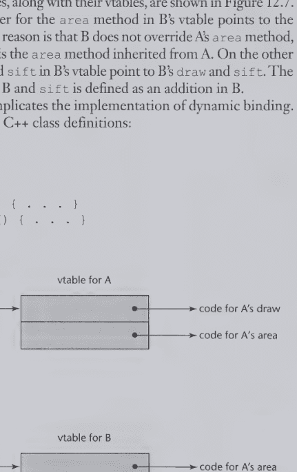

> 单继承的 CIR 示例

```
class B {
    public:
        int b;
        virtual void sum() { ... }
};
class C : public A, public B {
    public:
        int c;
        virtual void fun() { ... }
        virtual void dud() { ... }
};
```

C 类从 A 类继承变量 a 和 init 方法。它重新定义了 fun 方法，尽管通过多态变量（类型为 A）可以同时看到其 fun 和父类 A 的 fun。从 B，C 继承变量 b 和 sum 方法。C 定义了自己的变量 c，并定义了一个未继承的方法 dud。C 的 CIR 必须包含 A 的数据、B 的数据和 C 的数据，以及访问所有可见方法的方式。在单继承下，CIR 将包含指向具有所有可见方法代码地址的 vtable 的指针。然而，多继承并非如此简单。CIR 中必须至少有两个不同的视图可用——每个父类一个，其中一个包含子类 C 的视图。这种将子类视图包含在父类视图中的做法与单继承的实现相同。

还必须有两个 vtable：一个用于 A 和 C 视图，一个用于 B 视图。在这种情况下，C 的 CIR 的第一部分可以是 C 和 A 视图，它以用于 C 和从 A 继承的方法的 vtable 指针开头，并包含从 A 继承的数据。随后在 C 的 CIR 中是 B 视图部分，它以用于 B 的虚方法的 vtable 指针开头，其后是继承自 B 的数据和 C 中定义的数据。C 的 CIR 如图 12.8 所示。

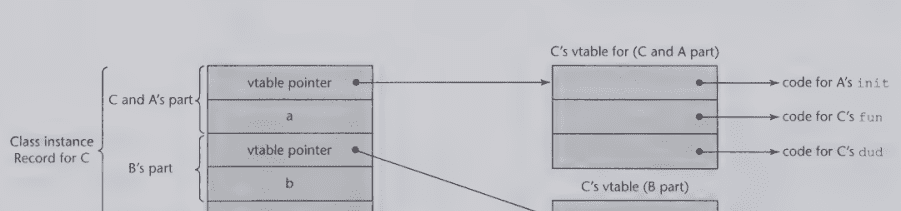

# 图 12.8

具有多个父类的子类 CIR 示例

## 12.6 反射

关于反射的讨论并不完全适合放在面向对象章节中，但它放在本书的任何其他章节中也不合适。所以，我们把它放在这里。

### 12.6.1 引言

通常，编程语言中绑定发生的越晚，语言越灵活。例如，脚本语言和函数式语言中数据类型晚绑定使得其程序比静态类型语言的程序更通用。同样，面向对象语言中方法调用到方法的动态绑定使得其程序更容易维护和扩展。除其他事项外，反射提供了将调用晚绑定到调用代码继承层次结构之外的方法的可能性。

### 12.6.2 什么是反射？

支持反射的编程语言允许其程序在运行时访问其类型和结构，并能够动态修改其行为。为了允许程序检查其类型和结构，这些信息必须由编译器或解释器收集并提供给程序。就像数据库结构的信息称为元数据一样，程序的类型和结构也称为元数据。程序检查其元数据的过程称为内省。程序可以通过几种不同方式动态修改其行为：它可以直接更改其元数据，它可以使用元数据，或它可以干预程序的执行。其中第一种很复杂；第二种较不复杂且在语言中很常见；第三种通常称为干预。

反射的一些主要用途是在软件工具的构建中。类浏览器需要枚举程序的类。视觉集成开发环境可以使用类型信息帮助开发人员构建类型正确的代码。调试器必须能够检查类的私有字段和方法。测试系统需要能够发现类的所有方法以确保测试数据驱动所有方法。

为了说明反射的一个相对简单且常见的用途，我们提出以下问题。动物园有一个大面积用于鸟类。每个物种的飞行笼都包括一块铭牌，提供有关居住者物种的一般信息。铭牌上包括一个小屏幕，感兴趣的访客可以在上面输入其入场票号。在鸟类展览的出口处，访客可以在另一个小屏幕上再次输入其票号，这会使计算机打印出访客之前表示特别感兴趣的鸟类的图片。该计算机系统


支持这些活动的对象包含一个方法，该方法为展出的每只鸟绘制其鸟的图片。这看起来足够简单。当访客在其飞行笼中选择一只鸟时，系统会将与该鸟关联的对象的引用放置在一个列表中。在展览出口处，系统调用访客列表中每个对象的 draw 方法。过程的复杂性在于动物园只提供部分鸟对象。有些鸟对象是从第三方供应商购买的，有些则由动物园赞助人捐赠。由于鸟对象的来源多样，它们没有共同的基类（除了 Object）并且不实现共同的接口，那么可以保存什么类型的引用？一个明显的解决方案是使每个鸟对象成为基类的子类。基类类型的引用可以存储在列表中，并且可以使用动态绑定来调用 draw 方法。这种方法的缺点是每个鸟类都需要被修改以使新类成为共同基类的子类。最好是新的鸟类可以简单地添加到代码文件中而无需修改。另一种可能的解决方案是使用 instanceof 和类型转换来确定引用的具体类型。这将为系统增加大量代码，增加其复杂性和维护成本。更好的解决方案是使用反射所能实现的动态绑定。

## 12.6.3 Java 中的反射

Java 对反射提供了有限的支持。元数据的核心类在命名空间 java.lang.Class 中定义。15 该类具有令人困惑的名称 Class。Java 运行时系统为程序中的每个对象实例化一个 Class 实例。Class 类提供了一组方法来检查程序对象的类型信息和成员。Class 是所有反射 API 的访问点。

如果程序有一个对象（不是原始类型）的引用，则可以通过调用其 getClass 方法获得该对象的 Class 对象。所有类都从 Object 继承 getClass，所有对象都源自 Object。考虑以下示例：

```
float[] totals = new float[100];
Class fltlist = totals.getClass();
Class stg = "hello".getClass();
```

变量 fltlist 的值将是 totals 数组对象的 Class 对象。stg 的值将是 String 的 Class 对象（因为 "hello" 是 String 的一个实例）。

如果某个类的对象不存在，可以通过在其类名后附加 .class 来通过类名获得其 Class 对象。例如，我们可以有以下内容：

```
Class stg = String.class;
```

```
// A class to define the method that dynamically calls the
// methods of a passed class object
class Reflect {
    public static void callDraw(Object birdObj) {
        Class cls = birdObj.getClass();
        try {
            // Find the draw method of the given class
            Method method = cls.getMethod("draw");
            // Dynamically call the method
            method.invoke(birdObj);
        }
        // In case the given class does not support draw
        catch (NoSuchMethodException e) {
            throw new IllegalArgumentException (
                cls.getName() + "does not support draw");
        }
        // In case the callDraw cannot call draw
        catch (IllegalAccessException e) {
            throw new IllegalArgumentException (
                "Insufficient access permissions to call" +
                "draw in class " + cls.getName());
        }
        // In case draw throws an exception
        catch (InvocationTargetException e) {
            throw new RuntimeException(e);
        }
    }
}
class Bird1 {
    public void draw() {
        System.out.println("This is draw from Bird1");
    }
}
class Bird2 {
    public void draw() {
        System.out.println("This is draw from Bird2");
    }
}
class Bird3 {
    public void draw() {
        System.out.println("This is draw from Bird3");
    }
}
```

该程序的输出如下：

```
This is draw from Bird3
This is draw from Bird1
This is draw from Bird2
```

```
Console.WriteLine("This is draw from Bird1");
}
}
class Bird2 {
    public void draw() {
        Console.WriteLine("This is draw from Bird2");
    }
}
class Bird3 {
    public void draw() {
        Console.WriteLine("This is draw from Bird3");
    }
}
```

我们关于动态方法绑定的简单示例展示了反射的众多用途之一。

除了类的成员和方法之外，以下程序元素在 Java 和 C# 中都可以通过反射访问：类修饰符，例如 public、static 和 final，构造函数，方法参数类型，以及已实现的接口。此外，一个类的继承路径的描述可以被内省。在 C# 中但在 Java 中不能，方法的形参名称可以被发现。

Java 的反射与 C# 的反射之间一个显著的区别是 System.Reflection.Emit 命名空间，它是 .NET 的一部分。该命名空间提供了创建 CIL 代码和容纳该代码的程序集的能力。Java 没有提供此类功能，尽管可以使用其他供应商的工具来实现。

尽管反射为静态类型语言 Java 和 C# 增加了多种功能，但使用反射的用户必须意识到其缺点：

- 使用反射时性能几乎总是会下降。在运行时解析类型、方法和字段并不是非反射代码运行成本的一部分。此外，当类型被动态解析时，代码的一些优化无法完成。
- 反射暴露私有字段和方法，这违反了抽象和信息隐藏的规则，并且可能导致意外的副作用并对可移植性产生不利影响。
- 尽管早期类型检查的优势被广泛接受，但反射所能实现的后期绑定显然否定了该优势。
- 在某些安全管理器下运行代码时，一些反射操作可能无法工作，这也使其不可移植。一种这样的安全环境是运行小程序的环境。在大多数情况下，如果问题可以在不使用反射的情况下解决，就不应使用反射。

反射是大多数动态类型语言不可或缺的一部分。在 LISP 中，反射被常规使用，代码的动态构造和执行并不罕见。在其他解释型语言中，如 JavaScript、Perl 和

Python，符号表在解释期间被保留，提供所有有用的类型信息。

例如在 Python 中，type 方法返回给定值的类型。例如，type([1, 14, 21]) 是 list。isinstance 方法如果其第一个参数具有其第二个参数中命名的类型，则返回布尔值。例如，isinstance(17, int) 返回 True。callable 函数用于确定表达式是否返回函数对象。dir 函数返回其参数对象的属性列表，包括数据和方法。

面向对象编程基于三个基本概念：抽象数据类型、继承和动态绑定。面向对象编程语言通过类、方法、对象和消息传递来支持该范式。

本章中关于面向对象编程语言的讨论围绕七个设计问题展开：对象的排他性、子类和子类型、类型检查和多态性、单继承和多继承、动态绑定、对象的显式或隐式释放，以及嵌套类。

Smalltalk 是一种纯面向对象的语言——一切都是对象，所有计算都是通过消息传递完成的。所有类型检查和消息到方法的绑定都是动态的，所有继承都是单继承。Smalltalk 没有显式的释放操作。

C++ 提供了数据抽象、继承和消息到方法的可选动态绑定，以及 C 的所有传统特性。这意味着它有两个不同的类型系统。C++ 提供多重继承和显式对象释放。它包含对类中实体的一系列访问控制，其中一些阻止子类成为子类型。构造函数和析构函数方法都可以包含在类中；两者通常是隐式调用的。

虽然 Smalltalk 的动态类型绑定比混合语言 C++ 提供了稍多的编程灵活性，但效率远低于后者。

Objective-C 支持过程式和面向对象编程。它比 C++ 更简单，使用也更少。仅支持单继承，尽管它具有类别，允许将额外的 mixin 方法添加到类中。它还具有协议，与 Java 的接口类似。类可以采用任意数量的协议。构造函数可以有任何名称，但必须显式调用。通过预定义类型 id 支持多态。id 类型的变量可以引用任何对象。当通过 id 类型变量引用的对象调用方法时，绑定是动态的。

与 C++ 不同，Java 不是混合语言；它旨在仅支持面向对象编程。Java 既有原始标量类型也有类。所有对象都从堆中分配，并通过引用变量访问。没有显式的对象释放操作——使用垃圾回收。唯一的子程序是方法，并且它们只能通过对象调用。


对象或类。仅直接支持单继承，尽管使用接口可以实现一种多继承。所有消息到方法的绑定都是动态的，除了不能被重写的那些方法之外。除了类之外，Java 还包括包作为第二种封装构造。

C# 基于 C++ 和 Java，支持面向对象编程。对象可以从类或结构体实例化。结构体对象是栈动态的，并且不支持继承。派生类中的方法可以通过在方法名上包含 base 来调用父类的隐藏方法。可以被重写的方法必须标记为 virtual，而重写的方法必须标记为 override。所有类（以及所有基本类型）都派生自 Object。

Ruby 是一种面向对象的脚本语言，其中所有数据都是对象。与 Smalltalk 一样，所有对象都是堆分配的，所有变量都是指向对象的无类型引用。所有构造函数都命名为 initialize。所有实例数据都是私有的，但可以很容易地包含 getter 和 setter 方法。所有提供了访问方法的实例变量的集合构成了类的公共接口。这样的实例数据称为属性。Ruby 类在动态意义上是可执行的，并且可以在任何时候被更改。Ruby 仅支持单继承。

类的实例变量存储在 CIR 中，其结构是静态的。子类拥有自己的 CIR，以及父类的 CIR。动态绑定通过虚拟方法表支持，该表存储指向特定方法的指针。多继承极大地复杂化了 CIR 和虚拟方法表的实现。

## REVIEW QUESTIONS
- 1. 描述面向对象语言的三个特征。
- 2. 类变量和实例变量有什么区别？
- 3. 什么是多继承？
- 4. 什么是多态变量？
- 5. 什么是重写方法？
- 6. 描述一种动态绑定相对于静态绑定具有很大优势的情况。
- 7. 什么是虚拟方法？
- 8. 什么是抽象方法？什么是抽象类？
- 9. 简要描述本章用于面向对象语言的七个设计问题。
- 10. 什么是嵌套类？
- 11. 对象的消息协议是什么？
- 12. Smalltalk 对象从哪里分配？
- 13. 解释 Smalltalk 消息如何绑定到方法。何时进行绑定？
- 14. Smalltalk 进行什么类型检查？何时进行？
- 15. Smalltalk 支持单继承还是多继承？
- 16. Smalltalk 对计算产生的两个最重要的影响是什么？
- 17. 本质上，所有 Smalltalk 变量都是单一类型。是什么类型？
- 18. C++ 对象可以从哪里分配？
- 19. C++ 堆分配对象如何释放？
- 20. 所有 C++ 子类都是子类型吗？如果是，解释。如果不是，为什么？
- 21. 在什么情况下 C++ 方法调用是静态绑定到方法的？
- 22. 允许设计者指定哪些方法可以静态绑定的缺点是什么？
- 23. C++ 中私有派生和公有派生有什么区别？
- 24. C++ 中的友元函数是什么？
- 25. C++ 中的纯虚函数是什么？
- 26. C++ 中参数如何传递给超类的构造函数？
- 27. Smalltalk 和 C++ 之间在实践中最重要的区别是什么？
- 28. 如果 Objective-C 方法不返回任何内容，其头文件中指示什么返回类型？
- 29. Objective-C 支持多继承吗？
- 30. Objective-C 类可以在其头文件中不指定父类吗？
- 31. Objective-C 中的根类是什么？
- 32. 在 Objective-C 中，如何指示一个方法不能在派生类中被重写？
- 33. Objective-C 类别的用途是什么？
- 34. Objective-C 协议的用途是什么？
- 35. Objective-C 中 id 类型的首要用途是什么？
- 36. Java 的类型系统与 C++ 有何不同？
- 37. Java 对象可以从哪里分配？
- 38. 什么是装箱？
- 39. Java 对象如何释放？
- 40. 所有 Java 子类都是子类型吗？
- 41. Java 中如何调用超类构造函数？
- 42. 在什么情况下 Java 方法调用是静态绑定到方法的？
- 43. C# 中重写方法在语法上与 C++ 中的对应方法有何不同？
- 44. 在 C# 中，如何在子类中调用被重写方法的父版本？
- 45. Ruby 如何实现整数和浮点数据等基本类型？
- 46. Ruby 类中 getter 方法如何定义？
- 47. Ruby 对实例变量支持什么访问控制？
- 48. Ruby 对方法支持什么访问控制？
- 49. 所有 Ruby 子类都是子类型吗？
- 50. Ruby 支持多继承吗？
- 51. 反射允许程序做什么？
- 52. 在反射的上下文中，元数据是什么？
- 53. 什么是内省？
- 54. 什么是干预？
- 55. Java 中存储程序中类信息的类是什么？
- 56. Java 名称扩展 .class 用作什么？
- 57. Java 的 getMethods 方法做什么？
- 58. C# 命名空间 System.Reflection.Emit 用作什么？

## PROBLEM SET
- 1. Java 中缺少面向对象编程支持的重要部分是什么？
- 2. 解释抽象原则。
- 3. 解释与抽象数据类型重用相关的问题。
- 4. 比较方法与子程序。
- 5. 比较 C++ 和 Java 的类实体访问控制。
- 6. 比较 C++ 的多继承与 Java 中接口提供的多继承。
- 7. 派生类相对于其基类有什么优势？
- 8. 解释面向对象编程的两个问题，这些问题通过结构化编程得到缓解。
- 9. 描述子类可以对其父类进行的更改的类别。
- 10. 解释继承的一个优点。
- 11. 解释面向对象编程语言中具有友元函数的优点和缺点。
- 12. 子类与其父类具有 is-a 关系到底意味着什么？
- 13. 描述重载方法参数必须与被重载方法参数匹配的紧密程度问题。
- 14. 解释菱形继承。
- 15. Java 的设计者显然认为不允许任何方法被静态绑定，如 C++ 的情况那样，其额外效率不值得。Java 设计的论据有哪些？反对的论据有哪些？
- 16. 所有 Java 对象都有一个共同祖先的主要原因是什么？
- 17. C++ 中 new 运算符的用途是什么？
- 18. 如果 Java 允许栈动态对象以及堆动态对象会有什么收获？同时拥有两者有什么缺点？
- 19. C++ 抽象类与 Java 接口之间的区别是什么？
- 20. 比较 C++ 与 Smalltalk 对不同编程范式的支持。
- 21. 比较 Objective-C 协议与 Java 接口的能力和用途。
- 22. 批判性地评估 Objective-C 设计者使用 Smalltalk 的方法调用语法，而不是大多数支持面向对象编程的基于命令式的语言使用的常规语法这一决定的合理性。
- 23. 解释为什么允许一个类在 Java 和 C# 中实现多个接口不会产生 C++ 中多继承产生的问题。
- 24. 研究并解释为什么 Java 不包含 C++ 的析构函数，即使这两种语言都有构造函数。
- 25. 在 C++ 中应使用什么机制来定义抽象类？
- 26. 比较独立函数和友元函数的访问机制。
- 27. 比较 Java 和 Ruby 中实例变量的类型错误检测。
- 28. 解释对象切片的概念。

## PROGRAMMING EXERCISES
- 1. 重写第 12.5.2 节中的 single_linked_list、stack_2 和 queue_2 类为 Java，并将结果与 C++ 版本在可读性和编程难易度方面进行比较。
- 2. 使用 Ruby 重复编程练习 1。
- 3. 使用 Objective-C 重复编程练习 1。


4. 设计并实现一个 C++ 程序，定义一个基类 A，该基类有一个子类 B，而 B 本身又有一个子类 C。A 类必须实现一个方法，该方法在 B 和 C 中都被重写。你还必须编写一个测试类，该测试类实例化 A、B 和 C 并包含对该方法的三次调用。其中一次调用必须静态绑定到 A 的方法。一次调用必须动态绑定到 B 的方法，另一次必须动态绑定到 C 的方法。所有方法调用都必须通过指向类 A 的指针进行。

5. 编写一个 C++ 程序，调用一个动态绑定方法以及一个静态绑定方法很多次，对两次调用进行计时。比较计时结果并计算两者所需时间的差值。解释结果。

6. 使用 Java 重复编程练习 4，使用 final 强制静态绑定。

## Concurrency
- 13.1 Introduction
- 13.2 Introduction to Subprogram-Level Concurrency
- 13.3 Semaphores
- 13.4 Monitors
- 13.5 Message Passing
- 13.6 Ada Support for Concurrency
- 13.7 Java Threads
- 13.8 C# Threads
- 13.9 Concurrency in Functional Languages
- 13.10 Statement-Level Concurrency

对客户端脚本代码的解释是另一个例子。另一个例子是设计用于模拟由多个并发子系统组成的实际物理系统的软件系统。对于所有这些类型的应用程序，编程语言（或库或至少操作系统）必须支持单元级并发。

语句级并发与单元级并发大不相同。从语言设计者的角度来看，语句级并发在很大程度上是指定数据如何在多个存储器上分布以及哪些语句可以并发执行的问题。

开发并发软件的目标是产生可扩展且可移植的并发算法。如果并发算法在有更多处理器可用时执行速度会提高，则该算法是可扩展的。这很重要，因为随着新一代机器的出现，处理器的数量有时会增加。算法必须可移植，因为硬件的寿命相对较短。因此，软件系统不应依赖于特定的架构——也就是说，它们应该在具有不同架构的机器上高效运行。

本章的意图是讨论与语言设计问题最相关的并发方面，而不是对并发的所有问题进行权威性研究，包括并发程序的开发。这对于一本关于编程语言的书籍来说显然是不合适的。

### 13.1.1 Multiprocessor Architectures

有大量不同的计算机架构具有多个处理器并且可以支持某种形式的并发执行。在开始讨论程序和语句的并发执行之前，我们简要描述其中一些架构。

最早的多处理器计算机有一个通用处理器和一个或多个其他处理器，通常称为外围处理器，仅用于输入输出操作。这种架构允许那些出现在 20 世纪 50 年代末的计算机在执行一个程序的同时并发地为其他程序执行输入或输出。

到 20 世纪 60 年代初，就出现了具有多个完整处理器的机器。这些处理器由操作系统的作业调度程序使用，后者将来自批处理作业队列的单独作业分发给单独的处理器。具有这种结构的系统支持程序级并发。

20 世纪 60 年代中期出现的机器有几个相同的部分处理器。它们从单一指令流中获取指令。例如，一些机器有两个或多个浮点乘法器，而另一些机器有两个或多个完整的浮点算术单元。这些机器的编译器需要确定哪些指令可以并发执行并相应地调度这些指令。具有这种结构的系统支持指令级并发。

## Chapter 13 Concurrency

1966 年，Michael J. Flynn 提出了根据指令和数据流是单数还是复数来定义的计算机架构分类。这些名称从 20 世纪 70 年代到 21 世纪初被广泛使用。使用多个数据流的两个类别定义如下：

具有多个同时执行相同指令的处理器，每个处理器处理不同的数据，被称为单指令多数据（SIMD）架构计算机。在 SIMD 计算机中，每个处理器都有自己的本地存储器。一个处理器控制其他处理器的操作。因为除了控制器之外的所有处理器同时执行相同的指令，所以软件中不需要同步。

也许最广泛使用的 SIMD 机器是一类称为向量处理器的机器。它们有一组寄存器，用于存储向量操作的运算数，在该操作中，同一指令同时对整个运算数组执行。最初，能够从这种架构中获益最多的程序类型是科学计算，这是多处理器机器经常针对的计算领域。然而，SIMD 处理器现在被用于各种应用领域，其中包括图形和视频处理。直到最近，大多数超级计算机都是向量处理器。

具有多个独立操作但操作可以同步的处理器被称为多指令多数据（MIMD）计算机。MIMD 计算机中的每个处理器都执行自己的指令流。MIMD 计算机可以以两种不同的配置出现：分布式和共享内存系统。分布式 MIMD 机器中，每个处理器都有自己的内存，可以内置在单个机箱中，也可以分布在很大范围内。共享内存 MIMD 机器显然必须提供某种同步手段以防止内存访问冲突。即使是分布式 MIMD 机器也需要同步才能协同操作单个程序。MIMD 计算机比 SIMD 计算机更通用，支持单元级并发。本章的主要重点是共享内存 MIMD 计算机的语言设计，这些计算机通常称为多处理器。

随着功能强大但成本低廉的单芯片计算机的出现，可以将大量这些微处理器连接成单个机箱内的物理小型网络。这些类型的计算机通常使用现成的微处理器，已由许多不同制造商推出。

软件没有更快地发展以利用并发机器的一个重要原因是处理器的性能不断提高。使用并发机器的最强动机之一是提高计算速度。然而，两个硬件因素结合在一起提供了更快的计算，而无需改变软件系统的架构。首先，随着每代处理器的出现，处理器时钟频率变得更快（每代大约每 18 个月出现一次）。其次，几种不同类型的并发已内置于处理器架构中。其中包括指令和数据从内存到处理器的流水线（在当前指令执行的同时获取和解码未来执行的指令）、指令和数据的独立线路、指令和数据的预取，以及算术操作的并行执行。所有这些统称为 **hidden concurrency**。执行速度的提高导致了巨大的生产力提升，而无需软件开发人员生产并发软件系统。

然而，情况现在正在发生变化。单个处理器速度显著提高的序列的结束现在临近。计算能力的显著提高现在来自于处理器数量的增加，例如 Google 和 Amazon 运行的大型服务器系统以及科学研究应用。许多其他大型计算任务现在在具有大量相对较小的处理器的机器上运行。

计算硬件的另一个最新进展是在单个芯片上开发多个处理器，例如 Intel Core Duo 和 Core Quad 芯片，这给软件开发人员带来了更大的压力，要求他们更多地利用可用的多处理器机器。如果他们不这样做，并发硬件将被浪费，生产力提升将显著减弱。

### 13.1.2 Categories of Concurrency

并发单元控制有两种不同的类别。最自然的并发类别是，假设有多个处理器可用，来自同一程序的几个程序单元实际上同时执行。这是 **physical concurrency**。对并发概念的轻微放宽允许程序员和应用程序软件假设有多个处理器提供实际并发，而实际上程序的实际执行是在单处理器上以交错方式进行的。这是 **logical concurrency**。从程序员和语言设计者的角度来看，逻辑并发与物理并发相同。将逻辑并发映射到主机硬件是语言实现者的任务，使用底层操作系统的功能。物理并发和逻辑并发都允许将并发用作程序设计方法论。在本章的其余部分，讨论将适用于物理并发和逻辑并发。

可视化程序中执行流的一种有用技术是想象一条线程铺在程序源文本的语句上。特定执行中到达的每个语句都被代表该执行的线程覆盖。视觉上跟随线程穿过源程序会追踪可执行版本程序中的执行流。当然，除了最简单的程序之外，线程遵循的路径非常复杂，无法视觉上跟随。形式上，程序中的 **thread of control** 是控制流经程序时到达的程序点序列。

具有协程（参见第 9 章）但没有并发子程序的程序，虽然有时被称为 **quasi-concurrent**，只有一个


控制线程。具有物理并发执行的程序可以有多个控制线程。每个处理器可以执行其中一个线程。虽然逻辑上并发的程序执行实际上可能只有一个控制线程，但此类程序只能通过想象它们具有多个控制线程来设计和分析。设计为具有一个以上控制线程的程序被称为多线程。当多线程程序在单处理器机器上执行时，其线程被映射到单个线程。在这种情况下，它成为一个虚拟多线程程序。

语句级并发是一个相对简单的概念。在语句级并发的常见用法中，包含对数组元素进行操作的语句的循环会被展开，以便处理可以分布在多个处理器上。例如，执行 500 次重复且包含对 500 个数组元素之一进行操作的语句的循环可以被展开，以便 10 个不同的处理器可以同时处理 50 个数组元素。

## 13.1.3 使用并发的动机

设计并发软件系统至少有四个不同的原因。第一个原因是具有多个处理器的机器上程序的执行速度。这些机器提供了一种有效提高程序执行速度的方法，前提是程序被设计为利用并发硬件。现在安装了大量多处理器计算机，包括过去几年销售的许多个人电脑。不利用这种硬件能力是浪费的。

第二个原因是即使机器只有一个处理器，为使用并发执行而编写的程序也可能比为顺序（非并发）执行而编写的相同程序更快。这发生的条件是程序不是计算受限的（顺序版本不能充分利用处理器）。

第三个原因是并发提供了一种不同的概念化程序解决方案问题的方法。许多问题域自然地适合并发，就像递归是设计某些问题解决方案的自然方式一样。此外，许多程序被编写为模拟物理实体和活动。在许多情况下，被模拟的系统包含不止一个实体，并且实体同时做它们所做的事情——例如，在受控空域中飞行的飞机、通信网络中的中继站以及工厂中的各种机器。必须使用并发的软件来准确模拟此类系统。

使用并发的第四个原因是编程分布在多台机器上的应用程序，无论是本地还是通过互联网。许多机器，例如汽车，内置了不止一台计算机，每台计算机都专门用于某个特定任务。在许多情况下，这些计算机集合必须同步其程序执行。互联网游戏是另一个分布在多个处理器上的软件示例。

并发现在被用于众多日常计算任务。Web 服务器并发处理文档请求。Web 浏览器现在使用次要核心处理器来运行图形处理并解释嵌入在文档中的编程代码。在每个操作系统中，都有许多并发进程始终在执行，管理资源，从键盘获取输入，从程序显示输出，以及读写外部存储设备。简而言之，并发已成为计算中无处不在的一部分。

## 13.2 子程序级并发简介

在考虑并发的语言支持之前，必须理解并发的底层概念以及使其有用的要求。本节涵盖这些主题。

### 13.2.1 基本概念

任务是程序的一个单元，类似于子程序，可以与其他单元并发执行。程序中的每个任务可以支持一个控制线程。任务有时称为进程。在某些语言中，例如 Java 和 C#，某些方法充当任务。这些方法在称为线程的对象中执行。

任务与子程序有三个区别特征。首先，任务可能被隐式启动，而子程序必须被显式调用。其次，当程序单元调用任务时，在某些情况下它不必等待任务完成其执行后才能继续自己的执行。第三，当任务的执行完成后，控制可能返回也可能不返回到启动该执行的单元。

任务分为两大类：重量级和轻量级。简单地说，重量级任务在其自己的地址空间中执行。轻量级任务都在同一地址空间中运行。实现轻量级任务比重量级任务更容易。此外，轻量级任务可能比重量级任务更有效，因为管理其执行所需的努力更少。

任务可以通过共享非局部变量、通过消息传递或通过参数与其他任务通信。如果任务在任何方式上都不与程序中的任何其他任务通信或影响其执行，则称其为不相交的。由于任务通常共同工作以创建模拟或解决问题，因此它们不是不相交的，它们必须使用某种形式的通信来同步其执行或共享数据或两者兼而有之。

同步是一种控制任务执行顺序的机制。当任务共享数据时，需要两种同步：合作和竞争。合作同步在任务 A 和任务 B 之间是必需的，当任务 A 必须等待任务 B 完成某些特定活动后，任务 A 才能开始或继续其执行时。竞争同步在两个任务之间是必需的，当两者都需要使用不能同时使用的资源时。具体来说，如果任务 A 需要访问共享数据位置 x，而任务 B 正在访问 x，则任务 A 必须等待任务 B 完成对 x 的处理。因此，对于合作同步，任务可能需要等待其正确操作所依赖的特定处理的完成，而对于竞争同步，任务可能需要等待任何其他任务对特定共享数据进行的任何处理的完成。

合作同步的一种简单形式可以用一个常见问题来说明，称为生产者-消费者问题。该问题起源于操作系统的开发，其中一个程序单元产生某些数据值或资源，另一个程序单元使用它。产生的数据通常由产生单元放置在存储缓冲区中，并由消费单元从该缓冲区中移除。对缓冲区的存储和移除序列必须同步。消费者单元不得在缓冲区为空时从缓冲区取数据。同样，生产者单元不得在缓冲区已满时将新数据放入缓冲区。这是合作同步问题，因为共享数据结构的用户的合作是缓冲区被正确使用的前提。

竞争同步可防止两个任务在完全相同的时间访问共享数据结构——这种情况可能会破坏该共享数据的完整性。为了提供竞争同步，必须保证对共享数据的互斥访问。

为了澄清竞争问题，请考虑以下场景：假设任务 A 有语句 TOTAL += 1，其中 TOTAL 是一个共享整数变量。此外，假设任务 B 有语句 TOTAL *= 2。任务 A 和任务 B 可能试图同时更改 TOTAL。

在机器语言级别，每个任务可能通过以下三步过程完成对 TOTAL 的操作：
- 1. 获取 TOTAL 的值。
- 2. 执行算术运算。
- 3. 将新值放回 TOTAL。

如果没有竞争同步，鉴于任务 A 和 B 对 TOTAL 执行的先前描述的操作，可能会产生四种不同的值，具体取决于操作的步骤顺序。假设 TOTAL 在 A 或 B 尝试修改它之前的值为 3。如果任务 A 在任务 B 开始之前完成其操作，则该值将为 8，这里假设这是正确的。但如果 A 和 B 在任一任务将新值放回之前都获取了 TOTAL 的值，则结果将不正确。如果 A 先放回其值，则 TOTAL 的值将为 6。此情况如图 13.1 所示。如果 B 先放回其值，则 TOTAL 的值将为 4。最后，如果任务 B 在任务 A 开始之前完成其操作，则该值将为 7。导致这些问题的情况有时称为竞争条件，因为两个或多个任务正在争夺共享资源的使用，程序的行为取决于哪个任务先到达（并赢得比赛）。竞争同步的重要性现在应该很清楚了。


**图 13.1** 竞争同步的必要性

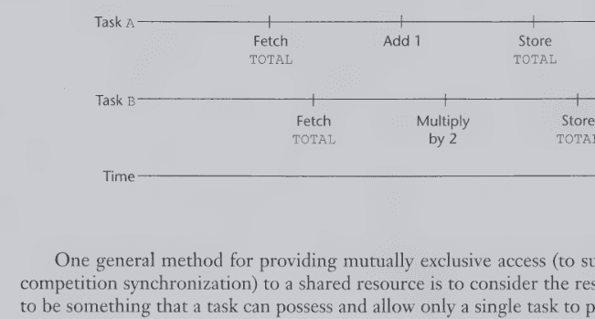

提供对共享资源的互斥访问（以支持竞争同步）的一种通用方法是将资源视为任务可以拥有的某种东西，并且只允许一个任务在某一时刻拥有它。为了获得共享资源的拥有权，任务必须请求该资源。只有当没有其他任务拥有该资源时，才会授予拥有权。当一个任务拥有某个资源时，所有其他任务都被阻止访问该资源。当任务使用完其拥有的共享资源后，必须释放该资源，以便它可以被其他任务使用。

提供对共享资源的互斥访问的三种方法是：信号量（semaphores），将在第 13.3 节讨论；监视器（monitors），将在第 13.4 节讨论；以及消息传递（message passing），将在第 13.5 节讨论。

同步机制必须能够延迟任务的执行。同步通过这些延迟强加了任务间的执行顺序。为了理解任务在其生命周期中会发生什么，我们必须考虑任务执行是如何被控制的。无论机器是单处理器还是多处理器，任务数量总是有可能多于处理器数量。一个称为调度器（scheduler）的运行时系统程序管理处理器在任务间的共享。如果没有任何中断，且所有任务具有相同的优先级，调度器可以简单地给每个任务一个时间片，例如 0.1 秒，当轮到某个任务时，调度器让它在该处理器上执行这段时间。当然，有几个事件会使这种情况变得复杂，例如，任务因同步以及输入或输出操作而延迟。由于输入和输出操作相对于处理器速度非常慢，任务在等待此类操作完成时不能占用处理器。

任务可以处于几种不同的状态：

- **新建（New）：** 任务在已创建但尚未开始执行时处于新建状态。

- **就绪（Ready）：** 就绪任务已准备好运行，但当前未在运行。要么它尚未被调度器分配处理器时间，要么它之前运行过但因第 4 段所述的方式之一被阻塞。

用于进行此选择的某些方法基于可指定的优先级级别。执行选择的算法在调度器中实现。

与任务的并发执行和共享资源的使用相关的是活性（liveness）的概念。在顺序程序环境中，如果程序持续执行并最终完成，则该程序具有活性特征。更一般地说，活性意味着如果某个事件（例如程序完成）本应发生，那么它最终将会发生。也就是说，进展持续不断地取得。在并发环境和共享资源的情况下，任务的活性可能不复存在，这意味着程序无法继续，因此永远不会终止。

例如，假设任务 A 和任务 B 都需要共享资源 X 和 Y 来完成它们的工作。此外，假设任务 A 获得了 X，任务 B 获得了 Y。经过一些执行后，任务 A 需要资源 Y 才能继续，因此它请求 Y，但必须等待 B 释放它。同样，任务 B 请求 X，但必须等待 A 释放它。两者都不释放自己所拥有的资源，结果两者都失去了活性，保证了程序的执行永远不会正常完成。这种特殊的活性丧失称为**死锁（deadlock）**。死锁对程序的可靠性构成严重威胁，因此在语言和程序设计中都必须认真考虑如何避免死锁。

我们现在准备讨论一些用于提供并发单元控制的语言机制。

### 13.2.2 并发的语言设计

在某些情况下，并发是通过库实现的。其中包括 OpenMP，这是一个应用程序编程接口，用于在各种平台上支持 C、C++ 和 Fortran 中的共享内存多处理器编程。当然，本书关注的是对并发的语言支持。许多语言都被设计为支持并发，从 20 世纪 60 年代中期的 PL/I 开始，包括当代语言 Ada 95、Java、C#、F#、Python 和 Ruby。[^1]

### 13.2.3 设计问题

语言支持并发的最重要的设计问题已经进行了详细讨论：竞争同步和协作同步。除此之外，还有几个次要的设计问题。其中突出的是应用程序如何影响任务调度。此外，还有任务如何以及何时开始和结束执行，以及如何以及何时创建任务的问题。

> [^1]: 在 Python 和 Ruby 的情况下，程序是解释执行的，因此只能有逻辑并发。即使机器有多个处理器，这些程序也无法使用多个处理器。

请记住，我们对并发的讨论有意地不完整，只讨论了与支持并发相关的语言设计问题中最重要的一部分。

以下各节讨论并发设计问题的三种替代方法：信号量、监视器和消息传递。

## 13.3 信号量

信号量是一种简单的机制，可用于提供任务的同步。尽管信号量是提供同步的早期方法，但它们仍然被使用，无论是在当代语言中还是在基于库的并发支持系统中。在接下来的段落中，我们描述信号量并讨论如何将它们用于此目的。

### 13.3.1 引言

为了通过对共享数据结构的互斥访问来提供竞争同步，Edsger Dijkstra 于 1965 年设计了信号量（Dijkstra，1968b）。信号量也可以用于提供协作同步。

为了提供对数据结构的有限访问，可以在访问该结构的代码周围放置守卫。守卫是一种语言机制，仅当指定条件为真时才允许执行受守卫的代码。因此，可以使用守卫来允许一次只有一个任务访问特定的共享数据结构。信号量是守卫的一种实现。具体来说，信号量是一种数据结构，由一个整数和一个存储任务描述符的队列组成。任务描述符是一种存储任务执行状态所有相关信息的数据结构。

守卫机制的一个组成部分是确保所有对受守卫代码的尝试执行最终都能发生的程序。典型的方法是将访问无法被授予时发生的访问请求存储在任务描述符队列中，稍后允许它们离开队列并执行受守卫的代码。这就是信号量必须同时具有计数器和任务描述符队列的原因。

信号量最初只提供的两个操作被 Dijkstra 命名为 P 和 V，取自两个荷兰语单词 passeren（通过）和 vrijgeven（释放）（Andrews 和 Schneider，1983）。在本节的其余部分，我们将分别称之为 wait 和 release。

### 13.3.2 协作同步

在本章的大部分内容中，我们使用由生产者和消费者使用的共享缓冲区示例来说明提供协作同步和竞争同步的不同方法。对于协作同步，这样的缓冲区必须有某种方式来记录缓冲区中空位置的数量和已填充位置的数量（以防止缓冲区下溢和溢出）。信号量的计数器组件可以用于此目的。一个信号量变量——例如 emptyspots——可以用其计数器来维护生产者和消费者使用的共享缓冲区中空位置的数量，另一个——比如 fullspots——可以用其计数器来维护缓冲区中已填充位置的数量。这些信号量的队列可以存储被迫等待访问缓冲区的任务描述符。emptyspots 的队列可以存储等待缓冲区中可用位置的生产者任务；fullspots 的队列可以存储等待值被放入缓冲区的消费者任务。

我们的示例缓冲区被设计为一种抽象数据类型，其中所有数据通过子程序 DEPOSIT 进入缓冲区，所有数据通过子程序 FETCH 离开缓冲区。DEPOSIT 子程序只需检查 emptyspots 信号量，看是否有空位置。如果至少有一个，它可以继续进行 DEPOSIT，而 DEPOSIT 必须具有递减 emptyspots 计数器值的副作用。如果缓冲区已满，则必须使 DEPOSIT 的调用者在 emptyspots 队列中等待，直到有空位可用。当 DEPOSIT 完成时，DEPOSIT 子程序递增 fullspots 信号量的计数器，以指示缓冲区中多了一个已填充位置。

FETCH 子程序具有与 DEPOSIT 相反的顺序。它检查 fullspots 信号量，看缓冲区是否包含至少一个项目。如果是，则移除一个项目，并且 emptyspots 信号量的计数器增加 1。如果缓冲区为空，则调用任务被放入 fullspots 队列中等待，直到项目出现。当 FETCH 完成时，它必须递增 emptyspots 的计数器。

对信号量类型的操作通常不是直接的——它们是通过 wait 和 release 子程序完成的。因此，刚刚描述的 DEPOSIT 操作实际上部分是通过调用 wait 和 release 完成的。请注意，wait 和 release 必须能够访问任务就绪队列。

wait 信号量子程序用于测试给定信号量变量的计数器。如果值大于零，调用者可以执行其操作。在这种情况下，信号量变量的计数器值递减，以指示其计数的内容现在少了一个。如果计数器值为零，则调用者必须被放置在信号量变量的等待队列中，并且处理器必须交给某个其他就绪任务。

release 信号量子程序由任务使用，以允许其他任务获得指定信号量变量计数器所计数的内容之一。如果指定信号量变量的队列为空（即没有任务在等待），release 递增其计数器（以指示受控制的内容现在多了一个可用）。如果一个或多个任务在等待，release 将其中一个任务从信号量队列移动到就绪队列。


以下是 wait 和 release 的简洁伪代码描述：

```
wait(aSemaphore)
if aSemaphore's counter > 0 then
  decrement aSemaphore's counter
else
  put the caller in aSemaphore's queue
  attempt to transfer control to some ready task
  (if the task-ready queue is empty, deadlock occurs)
end if
```

```
release(aSemaphore)
if aSemaphore's queue is empty (no task is waiting) then
  increment aSemaphore's counter
else
  put the calling task in the task-ready queue
  transfer control to a task from aSemaphore's queue
end
```

我们现在可以给出一个实现共享缓冲区合作同步的示例程序。在此例中，共享缓冲区存储整数值并且是一个逻辑上的循环结构。它设计用于可能由多个生产者和消费者任务使用。

下面的伪代码展示了生产者和消费者任务的定义。使用了两个信号量来防止缓冲区下溢或溢出，从而提供合作同步。假设缓冲区长度为 BUFLEN，并且实际操作它的例程已作为 FETCH 和 DEPOSIT 存在。对信号量计数器的访问使用点号表示。例如，如果 fullspots 是一个信号量，其计数器通过 fullspots.count 引用。

```
semaphore fullspots, emptyspots;
fullspots.count = 0;
emptyspots.count = BUFLEN;
task producer;
  loop
    -- produce VALUE --
    wait(emptyspots);      { wait for a space }
    DEPOSIT(VALUE);
    release(fullspots);    { increase filled spaces }
  end loop;
end producer;
```

```
task consumer;
  loop
    wait(fullspots);       { make sure it is not empty }
```

```
FETCH (VALUE);
release(emptyspots); { increase empty spaces }
-- consume VALUE --
end loop
end consumer;
```

信号量 fullspots 会使消费者任务排队等待缓冲区条目，如果缓冲区当前为空。信号量 emptyspots 会使生产者任务排队等待缓冲区中的空闲空间，如果缓冲区当前已满。

## 13.3.3 竞争同步

我们的缓冲区示例未提供竞争同步。可以通过额外的信号量来控制对结构的访问。该信号量无需计数，只需用其计数器指示缓冲区当前是否正在被使用即可。wait 语句仅在信号量的计数器值为 1 时才允许访问，这表示共享缓冲区当前未被访问。如果信号量的计数器值为 0，则表示正在进行当前访问，任务将被放入信号量的队列中。

请注意，信号量的计数器必须初始化为 1。信号量的队列在使用队列之前必须始终初始化为空。

一个仅需要二值计数器的信号量，如以下示例中用于提供竞争同步的信号量，被称为二进制信号量。

下面的示例伪代码说明了使用信号量为并发访问的共享缓冲区同时提供竞争和合作同步。访问信号量用于确保对缓冲区的互斥访问。请记住，可能存在多个生产者和多个消费者。

```
semaphore access, fullspots, emptyspots;
access.count = 1;
fullspots.count = 0;
emptyspots.count = BUFLEN;
task producer;
loop
-- produce VALUE --
wait(emptyspots); { wait for a space }
wait(access); { wait for access }
DEPOSIT(VALUE);
release(access); { relinquish access }
release(fullspots); { increase filled spaces }
end loop
end producer;
```

```
task consumer;
  loop
    wait(fullspots);      { make sure it is not empty }
    wait(access);         { wait for access }
    FETCH(VALUE);
    release(access);      { relinquish access }
    release(emptyspots); { increase empty spaces }
    -- consume VALUE --
  end loop
end consumer;
```

对这个示例稍作审视可能会让人认为存在问题。具体来说，假设在消费者中 wait(access) 调用时有一个任务正在等待，另一个任务取走了共享缓冲区中的最后一个值。幸运的是，这不可能发生，因为 wait(fullspots) 通过递减 fullspots 计数器为调用它的任务保留了缓冲区中的一个值。

到目前为止，尚未讨论信号量一个至关重要的方面。回顾前面关于竞争同步问题的描述：对共享数据的操作不得重叠。如果在早期操作仍在进行时开始第二个操作，共享数据可能会被损坏。信号量本身就是一个共享数据对象，因此对信号量的操作也容易受到同样的问题。因此，信号量操作必须是不可中断的。许多计算机都有专门为信号量操作设计的不可中断指令。如果没有此类指令，那么使用信号量来提供竞争同步就是一个严重的问题，没有简单的解决方案。

## 13.3.4 评价

使用信号量提供合作同步会产生不安全的编程环境。无法静态检查其使用的正确性，这取决于它们出现的程序的语义。在缓冲区示例中，如果省略生产者任务的 wait(emptyspots) 语句，将导致缓冲区溢出。如果省略消费者任务的 wait(fullspots) 语句，将导致缓冲区下溢。省略任一 release 将导致死锁。这些是合作同步失败。

信号量在提供合作同步时造成的可靠性问题在使用它们进行竞争同步时也会出现。如果在任一任务中省略 wait(access) 语句，可能导致对缓冲区的非安全访问。如果在任一任务中省略 release(access) 语句，将导致死锁。这些是竞争同步失败。注意到使用信号量的危险，Per Brinch Hansen（1973）写道：“信号量是为从不犯错的理想程序员准备的一种优雅的同步工具。” 不幸的是，理想的程序员很少见。

## 13.4 监视器

在并发环境中，解决信号量的一些问题的方案之一是将共享数据结构与其操作封装在一起并隐藏其表示形式——即使共享数据结构成为具有某些特殊限制的抽象数据类型。该方案可以通过将同步责任转移给运行时系统来在没有信号量的情况下提供竞争同步。

### 13.4.1 引言

当数据抽象的概念正在形成时，参与该工作的研究人员将相同的概念应用于并发编程环境中的共享数据，从而产生了监视器。根据 Per Brinch Hansen（Brinch Hansen, 1977, p. xvi）的说法，Edsger Dijkstra 于 1971 年建议将对共享数据的所有同步操作集中到单个程序单元中。Brinch Hansen（1973）在操作系统环境中形式化了这一概念。第二年，Hoare（1974）将这些结构命名为监视器。

第一个将监视器纳入的编程语言是 Concurrent Pascal（Brinch Hansen, 1975）。Modula（Wirth, 1977）、CSP/k（Holt et al., 1978）和 Mesa（Mitchell et al., 1979）也提供了监视器。在当代语言中，Ada、Java 和 C# 都支持监视器，这些语言将在本章后面讨论。

### 13.4.2 竞争同步

监视器最重要的特性之一是共享数据驻留在监视器中，而不是任何客户端单元中。程序员不通过使用信号量或其他机制来同步对共享数据的互斥访问。由于访问机制是监视器的一部分，监视器的实现可以保证同步访问，即一次只允许一个访问。对监视器过程的调用如果在调用时监视器正忙，则会被隐式阻塞并存储在队列中。

### 13.4.3 合作同步

尽管监视器固有地提供对共享数据的互斥访问，但进程之间的合作仍然是程序员的任务。特别是，程序员必须保证共享缓冲区不会发生下溢或溢出。不同的语言提供不同的合作同步编程方式，所有这些都与信号量相关。

一个包含四个任务和一个监视器的程序，该监视器提供对并发共享缓冲区的同步访问，如图 13.3 所示。在此图中，


**图 13.3** 使用监视器控制对共享缓冲区的访问的程序

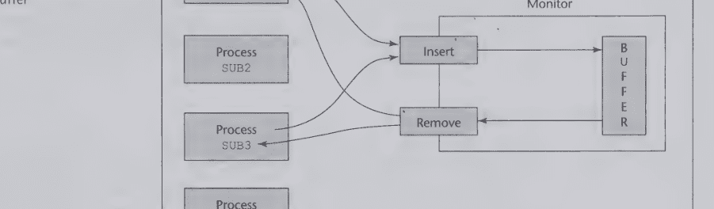

监视器的接口显示为标记为 insert 和 remove 的两个方框，用于数据的插入和移除。监视器看起来完全像一个抽象数据类型——一种具有受限访问的数据结构，而监视器正是如此。

与信号量相比，监视器是提供竞争同步的更好方法，主要原因在于第 13.3 节中讨论的信号量问题。当在以下各节中讨论 Ada 和 Java 的监视器实现时，将会清楚地看到，监视器仍然存在合作同步问题。

信号量和监视器在表达并发控制方面同样强大——信号量可用于实现监视器，监视器也可用于实现信号量。

Ada 提供了两种实现监视器的方法。Ada 83 包含一种通用的任务模型，可用于支持监视器。Ada 95 增加了一种更简洁、更高效的构造监视器的方法，称为受保护对象。这两种方法都使用消息传递作为支持并发的基本模型。消息传递模型允许并发单元分布，而监视器不允许。消息传递在第 13.5 节中描述；Ada 对消息传递的支持在第 13.6 节中讨论。

在 Java 中，监视器可以通过设计为抽象数据类型的类来实现，共享数据为该类型。通过向访问方法添加 synchronized 修饰符来控制对该类对象的访问。第 13.7.4 节给出了用 Java 编写的共享缓冲区监视器的示例。

## 13.5 消息传递

本节介绍并发中消息传递的基本概念。注意，此处所说的消息传递概念与用于在面向对象编程中执行方法的消息传递无关。

### 13.5.1 引言

最早设计提供并发任务之间消息传递能力的语言的努力来自 Brinch Hansen（1978 年）和 Hoare（1978 年）。这些消息传递的先驱开发者还开发了一种处理当多个任务同时请求与给定任务通信时该怎么办的问题的技术。决定需要某种形式的非确定性，以在选择首先处理哪些请求时提供公平性。这种公平性可以以各种方式定义，但总体而言，这意味着所有请求者都有平等的机会与给定任务通信（假设每个请求者具有相同的优先级）。用于语句级控制的非确定性构造，即受保护命令，由 Dijkstra（1975 年）引入。受保护命令在第 8 章中讨论。受保护命令是为控制消息传递而设计的构造的基础。

### 13.5.2 同步消息传递的概念

消息传递可以是同步的或异步的。在这里，我们描述同步消息传递。同步消息传递的基本概念是任务通常很忙，而忙时它们不能被其他单元中断。假设任务 A 和任务 B 都在执行，且 A 希望向 B 发送消息。显然，如果 B 很忙，不希望允许其他任务中断它。那会破坏 B 的当前处理。此外，消息通常会在接收方引起相关处理，如果其他处理尚未完成，这种处理可能不合理。替代方案是提供一种语言机制，允许任务指定何时准备好接收来自其他任务的消息。这种方法有点像一位主管指示其秘书在另一项活动，例如一次重要对话完成之前，保留所有来电。稍后，当当前对话完成后，主管会告诉秘书他/她现在愿意与被挂起的来电者之一交谈。

任务可以设计为在某一点暂停其执行，要么是因为它空闲，要么是因为它需要在继续之前从另一个单元获取信息。这就像一个人在等待重要电话一样。在某些情况下，除了坐等之外别无他法。然而，如果任务 A 在等待消息时任务 B 发送该消息，则消息可以被传输。这种实际的消息传输称为**会晤**。请注意，会晤只能在发送方和接收方都希望其发生时才发生。在会晤期间，消息的信息可以在一个或两个方向上传输。

正如以下各节所述，使用消息传递模型可以方便地处理任务的合作和竞争同步。

## 13.6 Ada 对并发的支持

本节描述 Ada 提供的并发支持。Ada 83 仅支持同步消息传递。

### 13.6.1 基础

Ada 对任务的设计部分基于 Brinch Hansen 和 Hoare 的工作，即消息传递是设计基础，并且使用非确定性在已发送消息的任务中进行选择。

完整的 Ada 任务模型很复杂，以下对其的讨论是有限的。这里的重点将放在 Ada 版本的同步消息传递机制上。

Ada 任务可以比监视器更主动。监视器是被动实体，为其存储的共享数据提供管理服务。它们仅在服务被请求时才提供其服务。当用于管理共享数据时，Ada 任务可以被视为可以驻留在其管理的资源中的管理器。它们有几种机制，有些是确定性的，有些是非确定性的，允许它们在竞争访问其资源的请求中进行选择。

Ada 任务分为两部分——规范部分和主体部分——两者名称相同。任务的接口是其入口点，即其他任务可以向其发送消息的位置。由于这些入口点是其接口的一部分，因此自然地将它们列在任务的规范部分中。由于会晤可能涉及信息交换，消息可以具有参数；因此，任务入口点也必须允许参数，这些参数也必须在规范部分中描述。从外观上看，任务规范类似于抽象数据类型的包规范。

作为 Ada 任务规范的示例，考虑以下代码，其中包含一个名为 Entry_1 的单个入口点，具有 in 模式参数：

```
task Task_Example is
    entry Entry_1(Item : in Integer);
end Task_Example;
```

任务主体必须包含与该任务规范部分中的入口子句相对应的入口点的某种语法形式。在 Ada 中，这些任务主体入口点由 accept 保留字引入的子句指定。accept 子句定义为从 accept 保留字开始到匹配的 end 保留字结束的语句范围。accept 子句本身相对简单，但它们可以嵌入的其他构造会使它们的语义变得复杂。简单的 accept 子句具有以下形式：

```
accept entry_name (formal parameters) do
...
end entry_name;
```

accept 入口名称与关联任务规范部分中的入口子句中的名称匹配。可选参数提供了在调用方和被调用任务之间通信数据的手段。do 和 end 之间的语句定义了在会晤期间发生的操作。这些语句一起称为 accept 子句体。在实际会晤期间，发送方任务被挂起。

每当 accept 子句因任何原因不愿意接受收到的消息时，发送方任务必须被挂起，直到接收方任务中的 accept 子句准备好接受该消息。当然，accept 子句还必须记住已发送未被接受的消息的发送方任务。为此，任务中的每个 accept 子句都有一个与其关联的队列，用于存储已尝试与其通信但不成功的其他任务的列表。

以下是先前给出规范的任务的骨架主体：

```
task body Task_Example is
begin
loop
...
accept Entry_1(Item : in Integer) do
...
end Entry_1;
end loop;
end Task_Example;
```

该任务主体的 accept 子句是任务规范中名为 Entry_1 的入口的实现。如果 Task_Example 的执行开始并在任何其他任务向 Entry_1 发送消息之前到达 Entry_1 accept 子句，则 Task_Example 被挂起。如果另一个任务在 Task_Example 在其 accept 子句处被挂起时向 Entry_1 发送消息，则会发生会晤并执行 accept 子句体。然后，由于循环的存在，执行返回到 accept。如果没有其他任务向 Entry_1 发送消息，则执行再次被挂起以等待下一个消息。


A rendezvous can occur in two basic ways in this simple example. First, the receiver task, Task_Example, can be waiting for another task to send a message to the Entry_1 entry. When the message is sent, the rendezvous occurs. This is the situation described earlier. Second, the receiver task can be busy with one rendezvous, or with some other processing not associated with a rendezvous, when another task attempts to send a message to the same entry. In that case, the sender is suspended until the receiver is free to accept that message in a rendezvous. If several messages arrive while the receiver is busy, the senders are queued to wait their turn for a rendezvous.

The two rendezvous just described are illustrated with the timeline diagrams in Figure 13.4.

### Figure 13.4

Two ways a rendezvous with Task_Example can occur

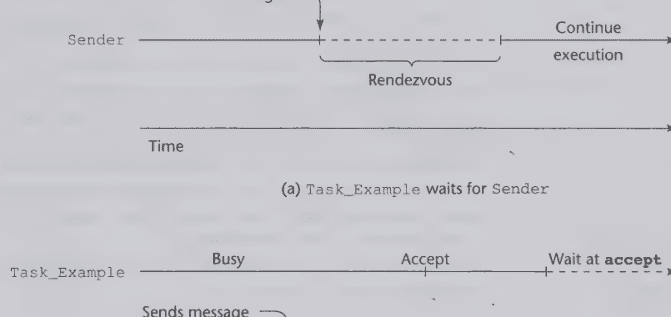

(a) Task_Example waits for Sender

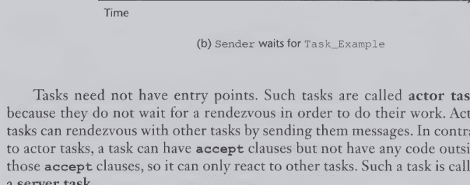

(b) Sender waits for Task_Example

Tasks need not have entry points. Such tasks are called actor tasks because they do not wait for a rendezvous in order to do their work. Actor tasks can rendezvous with other tasks by sending them messages. In contrast to actor tasks, a task can have accept clauses but not have any code outside those accept clauses, so it can only react to other tasks. Such a task is called a server task.

An Ada task that sends a message to another task must know the entry name in that task. However, the opposite is not true: A task entry need not know the name of the task from which it will accept messages. This asymmetry is in contrast to the design of the language known as CSP, or Communicating Sequential Processes (Hoare, 1978). In CSP, which also uses the message-passing model of concurrency, tasks accept messages only from explicitly named tasks. The disadvantage of this is that libraries of tasks cannot be built for general use.

The usual graphical method of describing a rendezvous in which task A sends a message to task B is shown in Figure 13.5.

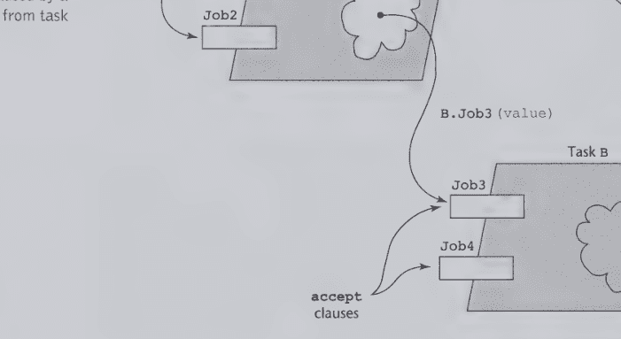

Tasks are declared in the declaration part of a package, subprogram, or block. Statically created tasks² begin executing at the same time as the statements in the code to which that declarative part is attached. For example, a task declared in a main program begins execution at the same time as the first statement in the code body of the main program. Task termination, which is a complex issue, is discussed later in this section.

> 2. Tasks can also be dynamically created, but such tasks are not covered here.

Tasks may have any number of entries. The order in which the associated accept clauses appear in the task dictates the order in which messages can be accepted. If a task has more than one entry point and requires them to be able to receive messages in any order, the task uses a select statement to enclose the entries. For example, suppose a task models the activities of a bank teller, who must serve customers at a walk-up station inside the bank and also serve customers at a drive-up window. The following skeletal teller task illustrates a select construct:

```ada
task body Teller is
begin
  loop
    select
      accept Drive_Up (formal parameters) do
        ...
      end Drive_Up;
      ...
      or
      accept Walk_Up (formal parameters) do
        ...
      end Walk_Up;
      ...
    end select;
  end loop;
end Teller;
```

In this task, there are two accept clauses, Walk_Up and Drive_Up, each of which has an associated queue. The action of the select, when it is executed, is to examine the queues associated with the two accept clauses. If one of the queues is empty, but the other contains at least one waiting message (customer), the accept clause associated with the waiting message or messages has a rendezvous with the task that sent the first message that was received. If both accept clauses have empty queues, the select waits until one of the entries is called. If both accept clauses have nonempty queues, one of the accept clauses is nondeterministically chosen to have a rendezvous with one of its callers. The loop forces the select statement to be executed repeatedly, forever.

The end of the accept clause marks the end of the code that assigns or references the formal parameters of the accept clause. The code, if there is any, between an accept clause and the next or (or the end select, if the accept clause is the last one in the select) is called the extended accept clause. The extended accept clause is executed only after the associated (immediately preceding) accept clause is executed. This execution of the extended accept clause is not part of the rendezvous and can take place concurrently with the execution of the calling task. The sender is suspended during the rendezvous, but it is put back in the ready queue when the end of the accept clause is reached. If an accept clause has no formal parameters, the do-end is not required, and the accept clause can consist entirely of an extended accept clause. Such an accept clause would be used exclusively for synchronization. Extended accept clauses are illustrated in the Buf_Task task in Section 13.6.3.

## 13.6.2 Cooperation Synchronization

Each accept clause can have a guard attached, in the form of a when clause, that can delay rendezvous. For example,

```ada
when not Full(Buffer) =>
  accept Deposit(New_Value) do
  ...
end
```

An accept clause with a when clause is either open or closed. If the Boolean expression of the when clause is currently true, that accept clause is called open; if the Boolean expression is false, the accept clause is called closed. An accept clause that does not have a guard is always open. An open accept clause is available for rendezvous; a closed accept clause cannot rendezvous.

Suppose there are several guarded accept clauses in a select clause. Such a select clause is usually placed in an infinite loop. The loop causes the select clause to be executed repeatedly, with each when clause evaluated on each repetition. Each repetition causes a list of open accept clauses to be constructed. If exactly one of the open clauses has a nonempty queue, a message from that queue is taken and a rendezvous takes place. If more than one of the open accept clauses has nonempty queues, one queue is chosen nondeterministically, a message is taken from that queue, and a rendezvous takes place. If the queues of all open clauses are empty, the task waits for a message to arrive at one of those accept clauses, at which time a rendezvous will occur. If a select is executed and every accept clause is closed, a run-time exception or error results. This possibility can be avoided either by making sure one of the when clauses is always true or by adding an else clause in the select. An else clause can include any sequence of statements, except an accept clause.

A select clause may have a special statement, terminate, that is selected only when it is open and no other accept clause is open. A terminate clause, when selected, means that the task is finished with its job but is not yet terminated. Task termination is discussed later in this section.

## 13.6.3 Competition Synchronization

The features described so far provide for cooperation synchronization and communication among tasks. Next, we discuss how mutually exclusive access to shared data structures can be enforced in Ada.

If access to a data structure is to be controlled by a task, then mutually exclusive access can be achieved by declaring the data structure within a task. The semantics of task execution usually guarantees mutually exclusive access to the structure, because only one accept clause in the task can be active at a given time. The only exceptions to this occur when tasks are nested in procedures or other tasks. For example, if a task that defines a shared data structure

```ada
loop
    -- produce New_Value --
    Buf_Task.Deposit(New_Value);
end loop;
end Producer;
```

```ada
task body Consumer is
    Stored_Value : Integer;
begin
    loop
        Buf_Task.Fetch(Stored_Value);
        -- consume Stored_Value --
    end loop;
end Consumer;
```

## 13.6.4 受保护对象

正如我们所看到的，对共享数据的访问可以通过将数据封装在任务中并仅允许通过任务入口进行访问来控制，这些入口隐式地提供了竞争同步。这种方法的一个问题是难以高效地实现会合机制。Ada 95 的受保护对象提供了另一种实现竞争同步的方法，无需涉及会合机制。

受保护对象不是任务；它更像第13.4节所述的管程。受保护对象可以通过受保护子程序或入口来访问，这些入口在语法上类似于任务中的accept子句。³ 受保护子程序可以是受保护过程，提供对受保护对象数据的互斥读写访问；也可以是受保护函数，提供对该数据的并发只读访问。入口与受保护子程序的不同之处在于它们可以带有守卫。

在受保护过程体内，封装受保护单元的当前实例被定义为变量；在受保护函数体内，封装受保护单元的当前实例被定义为常量，从而允许并发只读访问。

对受保护对象的入口调用为使用同一受保护对象的一个或多个任务提供同步通信。这些入口调用所提供的访问，与那些提供给任务中封装的数据的访问相似。

上一小节中用任务解决的缓冲区问题，用受保护对象可以更简单地解决。请注意，这个示例不包括受保护子程序。

```ada
protected Buffer is
    entry Deposit(Item : in Integer);
    entry Fetch(Item : out Integer);
private
    Buf_Size : constant Integer := 100;
    Buf      : array (1..Buf_Size) of Integer;
    Filled   : Integer range 0..Buf_Size := 0;
    Next_In,
    Next_Out : Integer range 1..Buf_Size := 1;
end Buffer;

protected body Buffer is
  entry Deposit(Item : in Integer)
    when Filled < Buf_Size is
  begin
    Buf(Next_In) := Item;
    Next_In := (Next_In mod Buf_Size) + 1;
    Filled := Filled + 1;
  end Deposit;
  entry Fetch(Item : out Integer) when Filled > 0 is
  begin
    Item := Buf(Next_Out);
    Next_Out := (Next_Out mod Buf_Size) + 1;
    Filled := Filled - 1;
  end Fetch;
end Buffer;
```

> 3. 受保护对象体中的入口使用保留字`entry`，而不是任务体中所用的`accept`。

## 13.6.5 评价

使用通用的并发消息传递模型来构造管程，就像使用Ada包来支持抽象数据类型一样——两者都是比实际需要更通用的工具。受保护对象是提供对共享数据同步访问的更好方式。

在没有具有独立存储器的分布式处理器的情况下，在管程与采用消息传递的任务之间进行选择，作为在并发环境中实现对共享数据同步访问的手段，在某种程度上是个人偏好问题。然而，就Ada而言，在支持共享数据的并发访问方面，受保护对象显然比任务更好。不仅代码更简单，效率也高得多。

对于分布式系统，消息传递是更好的并发模型，因为它天然支持独立进程在独立处理器上并行执行的概念。

## 13.7 Java线程

Java中的并发单元是名为`run`的方法，其代码可以与其他（其他对象的）此类方法以及`main`方法并发执行。`run`方法在其中执行的过程称为线程。Java线程是轻量级任务，这意味着它们都在同一个地址空间中运行。这与Ada任务不同，Ada任务是重量级线程（它们在自己的地址空间中运行）。⁴ 这一差异的一个重要结果是，线程所需的开销远小于Ada任务。

有两种方法可以定义带有`run`方法的类。一种是定义预定义类`Thread`的子类并重写其`run`方法。然而，如果新的子类有一个必要的自然父类，那么将其定义为`Thread`的子类显然是行不通的。在这些情况下，我们定义一个继承其自然父类并实现`Runnable`接口的子类。`Runnable`提供了`run`方法协议，因此任何实现`Runnable`的类都必须定义`run`。实现`Runnable`的类的对象会被传递给`Thread`构造函数。因此，这种方法仍然需要一个`Thread`对象，正如将在13.7.5节的示例中看到的那样。

在Ada中，任务既可以是主动方，也可以是服务方，任务之间通过accept子句相互通信。Java的`run`方法都是主动方，除了`join`方法（见13.7.1节）和通过共享数据之外，它们之间没有相互通信的机制。

Java线程是一个复杂的主题——本节只介绍其最简单但最常用的部分。

### 13.7.1 Thread类

`Thread`类不是任何其他类的自然父类。它为子类提供了一些服务，但与子类的计算目的没有任何天然联系。`Thread`是唯一可用于创建并发Java程序的类。如前所述，13.7.5节将简要讨论`Runnable`接口的使用。

`Thread`类包含五个构造函数以及一组方法和常量。`run`方法描述了线程的动作，总是被`Thread`的子类重写。`Thread`的`start`方法通过调用其`run`方法将其线程作为并发单元启动。⁵ 对`start`的调用不同寻常之处在于控制立即返回到调用者，然后调用者与刚刚启动的`run`方法并行继续执行。

下面是一个`Thread`的骨架子类，以及一段创建该子类对象并在新线程中启动`run`方法执行的代码片段：

```java
class MyThread extends Thread {
    public void run() { . . . }
}
. . .
Thread myTh = new MyThread();
myTh.start();
```

> 4. 实际上，尽管Ada任务在行为上表现得像是重量级任务，但在某些情况下，它们现在已经实现为线程。这有时通过使用库来完成，例如IBM Rational Apex Native POSIX Threading Library。

> 5. 直接调用`run`方法并不总是有效，因为有时需要的初始化工作包含在`start`方法中。

当Java应用程序开始执行时，会创建一个新线程（`main`方法将在其中运行）并调用`main`。因此，所有Java应用程序都在线程中运行。

当程序有多个线程时，调度程序必须确定在任何给定时间哪个或哪些线程将运行。在许多情况下，只有一个处理器可用，因此实际上一次只能运行一个线程。很难精确描述Java调度程序的工作方式，因为不同的实现（Solaris、Windows等）不一定以完全相同的方式调度线程。然而，通常调度程序以轮转方式给每个就绪线程分配等长的时间片，并假设所有这些线程具有相同的优先级。13.7.2节描述了如何为不同线程赋予不同优先级。

`Thread`类提供了几个控制线程执行的方法。`yield`方法不带参数，是运行中的线程自愿让出处理器的请求。⁶ 该线程立即被放入任务就绪队列，使其准备好运行。然后调度程序从任务就绪队列中选择优先级最高的线程。如果没有其他就绪线程的优先级高于刚刚让出处理器的线程，那么该线程也可能是下一个获得处理器的线程。

`sleep`方法有一个参数，即调用`sleep`的调用者希望线程被阻塞的毫秒整数值。在指定的毫秒数过去后，线程将被放入任务就绪队列。由于无法知道线程在运行之前会在任务就绪队列中停留多长时间，因此`sleep`的参数是线程不执行的最短时间。`sleep`方法可能抛出`InterruptedException`，必须在调用`sleep`的方法中处理。异常将在第14章详细描述。

`join`方法用于强制一个方法延迟执行，直到另一个线程的`run`方法完成其执行。当方法的处理必须等另一个线程的工作完成之后才能继续时，就使用`join`。例如，我们可能有以下`run`方法：

```java
public void run() {
...
Thread myTh = new Thread();
myTh.start();
// do part of the computation of this thread
myTh.join();  // Wait for myTh to complete
// do the rest of the computation of this thread
}
```

`join`方法将调用它的线程置于阻塞状态，这种状态只能通过被调用`join`的线程完成来结束。如果该线程恰好被阻塞，则可能发生死锁。为了防止


因此，join 可以带有一个参数，即调用线程将等待被调用线程完成的时间限制（以毫秒为单位）。例如，下面的 join 调用将导致调用线程等待两秒钟 myTh 完成。如果在两秒钟过去后它仍未完成执行，调用线程将被放回就绪队列，这意味着它将在被调度时立即继续执行。

```
myTh.join(2000);
```

Java 的早期版本包含另外三个 Thread 方法：stop、suspend 和 resume。这三个方法都因安全问题而被弃用。stop 方法有时会被重写为一个简单的方法，通过将引用变量设为 null 来销毁线程。

run 方法正常结束执行的方式是到达代码末尾。然而，在许多情况下，线程会一直运行直到被告知终止。关于这一点，就存在线程如何确定是否应继续或结束的问题。interrupt 方法是向线程传达应停止的一种方式。此方法不会停止线程；相反，它向线程发送一条消息，实际上只是设置线程对象中的一个位，可以由线程检查。该位通过谓词方法 isInterrupted 进行检查。这不是一个完整的解决方案，因为试图中断的线程在调用 interrupt 方法时可能正在睡眠或等待，这意味着它不会检查自己是否已被中断。对于这些情况，interrupt 方法还会抛出 InterruptedException 异常，这也会导致线程唤醒（从睡眠或等待中）。因此，线程可以定期检查自己是否已被中断，如果是，则是否可以终止。线程不会错过中断，因为如果中断发生时它正在睡眠或等待，它将被中断唤醒。实际上，interrupt 的行为和用法还有更多细节，但此处未涵盖（Arnold et al., 2006）。

### 13.7.2 优先级

线程的优先级不必全部相同。线程的默认优先级最初与创建它的线程相同。如果 main 创建一个线程，其默认优先级是常量 NORM_PRIORITY，通常为 5。Thread 定义了另外两个优先级常量，MAX_PRIORITY 和 MIN_PRIORITY，其值通常分别为 10 和 1。7 线程的优先级可以用 setPriority 方法更改。新的优先级可以是预定义的常量中的任何一个，也可以是 MIN_PRIORITY 和 MAX_PRIORITY 之间的任何其他数字。getPriority 方法返回线程的当前优先级。优先级常量在 Thread 中定义。

7. 优先级的数量取决于实现，因此某些实现中可能少于或多于 10 个级别。

当存在不同优先级的线程时，调度器的行为由这些优先级控制。当正在执行的线程被阻塞或被杀死或其时间片到期时，调度器从任务就绪队列中选择优先级最高的线程。一个优先级较低的线程只有在出现机会时就绪队列中没有更高优先级的线程时才会运行。

### 13.7.3 信号量

java.util.concurrent 包定义了 Semaphore 类。此类的对象实现计数信号量。计数信号量有一个计数器，但没有用于存储线程描述符的队列。Semaphore 类定义了两个方法，acquire 和 release，它们对应于第 13.3 节中描述的 wait 和 release 操作。

Semaphore 的基本构造函数接受一个整数参数，用于初始化信号量的计数器。例如，以下内容可用于初始化第 13.3.2 节缓冲区示例的 fullspots 和 emptyspots 信号量：

```
fullspots = new Semaphore(0);
emptyspots = new Semaphore(BUFLEN);
```

生产者方法的 deposit 操作将如下所示：

```
emptyspots.acquire();
deposit(value);
fullspots.release();
```

同样，消费者方法的 fetch 操作将如下所示：

```
fullspots.acquire();
fetch(value);
emptyspots.release();
```

deposit 和 fetch 方法可以使用第 13.7.4 节中使用的方法来提供对缓冲区访问所需的竞争同步。

### 13.7.4 竞争同步

Java 方法（但构造函数除外）可以指定为 synchronized。通过特定对象调用的 synchronized 方法必须在其在该对象上的执行完成之前，任何其他 synchronized 方法才能运行。对对象的竞争同步是通过指定访问共享数据的那些方法是 synchronized 来实现的。synchronized 机制的实现如下：每个 Java 对象都有一个锁。synchronized 方法必须在被允许执行之前获取对象的锁，这在该时间内阻止其他 synchronized 方法在该对象上执行。synchronized 方法在完成执行时释放其运行所依据的对象的锁，即使该完成是由于异常引起的。考虑以下骨架类定义：

```
class ManageBuf {
    private int[] buf;
    ...
    public synchronized void deposit(int item) { ... }
    public synchronized int fetch() { ... }
    ...
}
```

ManageBuf 中定义的两个方法都定义为 synchronized，这防止它们在同一对象上执行时相互干扰，当它们由单独的线程调用时。

所有方法都是 synchronized 的对象有效地是一个监视器。请注意，一个对象可能有一个或多个 synchronized 方法，以及一个或多个非 synchronized 方法。非 synchronized 方法可以在任何时候在对象上运行，即使在 synchronized 方法执行期间也是如此。

在某些情况下，处理共享数据结构的语句数量明显少于包含它的方法的其他语句数量。在这些情况下，最好同步更改共享数据结构的代码段而不是整个方法。这可以用所谓的 synchronized 语句来完成，其一般形式如下：

```
synchronized (expression) {
    statements
}
```

此代码中的表达式必须求值为一个对象，语句可以是单个语句或复合语句。对象在语句或复合语句执行期间被锁定，因此语句或复合语句的执行方式就好像它是 synchronized 方法的主体一样。

为其定义了 synchronized 方法的对象必须有一个与其关联的队列，用于存储在另一个 synchronized 方法操作该对象时尝试在其上执行的 synchronized 方法。实际上，每个对象都有一个称为内部条件队列的队列。这些队列是隐式提供的。当 synchronized 方法在对象上完成执行时，如果对象内部条件队列中有等待的方法，则该方法将被放入任务就绪队列。

### 13.7.5 合作同步

Java 中合作同步是通过 wait、notify 和 notifyAll 方法实现的，这三个方法都定义在 Object 中，即所有 Java 类的根类。除了 Object 之外的所有类都继承这些方法。每个对象都有一个等待列表，其中包含所有在该对象上调用了 wait 的线程。notify 方法用于告诉一个等待线程它可能等待的事件已经发生。通过 notify 唤醒的具体线程无法确定，因为 Java 虚拟机（JVM）会随机从对象的等待列表中选择一个。由于这一点，以及等待线程可能在等待不同条件这一事实，notifyAll 方法通常被使用，而不是 notify。notifyAll 方法通过将它们放入任务就绪队列来唤醒对象等待列表上的所有线程。

wait、notify 和 notifyAll 方法只能从 synchronized 方法内部调用，因为它们使用此类方法对对象设置的锁。对 wait 的调用总是放在由方法等待的条件控制的 while 循环中。while 循环是必要的，因为唤醒线程的 notify 或 notifyAll 可能因除线程正在等待的条件之外的条件变化而被调用。如果是 notifyAll 的调用，则条件现在为真的可能性甚至更小。由于使用了 notifyAll，其他线程可能在最后一次测试后将条件更改为 false。

wait 方法可以抛出 InterruptedException，它是 Exception 的后代。Java 的异常处理在第 14 章中讨论。因此，任何调用 wait 的代码还必须捕获 InterruptedException。假设等待的条件称为 theCondition，使用 wait 的惯用方式如下：

```
try {
    while (!theCondition)
        wait();
    // 在 theCondition 成立后执行所需的操作
}
catch (InterruptedException myProblem) { ... }
```

以下程序实现了用于存储 int 值的循环队列。它同时说明了合作同步和竞争同步。

```
// Queue
// 此类实现用于存储 int 值的循环队列。它包含一个用于分配和初始化队列到指定大小的构造函数。它具有用于向队列中插入值和从队列中移除值的 synchronized 方法。

class Queue {
    private int[] que;
    private int nextIn,
                nextOut,
                filled,
                queSize;


```java
public Queue(int size) {
    que = new int[size];
    filled = 0;
    nextIn = 1;
    nextOut = 1;
    queSize = size;
} //** end of Queue constructor

public synchronized void deposit(int item)
    throws InterruptedException {
    try {
        while (filled == queSize)
            wait();
        que[nextIn] = item;
        nextIn = (nextIn % queSize) + 1;
        filled++;
        notifyAll();
    } //** end of try clause
    catch (InterruptedException e) {}
} //** end of deposit method

public synchronized int fetch()
    throws InterruptedException {
    int item = 0;
    try {
        while (filled == 0)
            wait();
        item = que[nextOut];
        nextOut = (nextOut % queSize) + 1;
        filled--;
        notifyAll();
    } //** end of try clause
    catch (InterruptedException e) {}
    return item;
} //** end of fetch method
} //** end of Queue class
```

请注意，这里的异常处理器（catch）不执行任何操作。定义可以使用 Queue 类的生产者和消费者对象的类可以定义如下：

```java
class Producer extends Thread {
    private Queue buffer;
    public Producer(Queue que) {
        buffer = que;
    }
    public void run() {
        int new_item;
        while (true) {
            //-- Create a new_item
            buffer.deposit(new_item);
        }
    }
}
```

```java
class Consumer extends Thread {
    private Queue buffer;
    public Consumer(Queue que) {
        buffer = que;
    }
    public void run() {
        int stored_item;
        while (true) {
            stored_item = buffer.fetch();
            //-- Consume the stored_item
        }
    }
}
```

以下代码创建了一个 Queue 对象，以及一个 Producer 对象和一个 Consumer 对象，两者都连接到该 Queue 对象，并启动它们的执行：

```java
Queue buff1 = new Queue(100);
Producer producer1 = new Producer(buff1);
Consumer consumer1 = new Consumer(buff1);
producer1.start();
consumer1.start();
```

我们可以将 Producer 和 Consumer 中的一个或两个定义为 Runnable 接口的实现，而不是 Thread 的子类。唯一的区别在第一行，现在看起来如下：

```java
class Producer implements Runnable { . . . }
```

要创建并运行这样一个类的对象，仍然需要创建一个与该对象关联的 Thread 对象。以下代码说明了这一点：

```java
Producer producer1 = new Producer(buff1);
Thread producerThread = new Thread(producer1);
producerThread.start();
```

请注意，buffer 对象被传递给 Producer 构造函数，而 Producer 对象被传递给 Thread 构造函数。

## 13.7.6 非阻塞同步

Java 包含一些用于控制对某些变量访问的类，这些访问不涉及阻塞或等待。`java.util.concurrent.atomic` 包定义了一些类，允许对 `int`、`long` 和 `boolean` 基本类型变量以及引用和数组进行某些非阻塞同步访问。例如，`AtomicInteger` 类定义了 getter 和 setter 方法，以及用于加法、递增和递减操作的方法。这些操作都是原子的；也就是说，它们不能被中断，因此在多线程程序中不需要锁来保证受影响变量值的完整性。这是细粒度的同步——仅仅针对单个变量。现在大多数机器都有针对 `int` 和 `long` 类型这些操作的原子指令，因此它们通常易于实现（不需要隐式锁）。

非阻塞同步的优势在于效率。在无争用情况下发生的非阻塞访问不会比使用 `synchronized` 的访问慢，而且通常更快。在争用期间发生的非阻塞访问肯定比使用 `synchronized` 的访问更快，因为后者需要挂起和重新调度线程。

## 13.7.7 显式锁

Java 5.0 引入了显式锁，作为提供隐式锁的 `synchronized` 方法和块的替代方案。`Lock` 接口声明了 `lock`、`unlock` 和 `tryLock` 方法。预定义的 `ReentrantLock` 类实现了 `Lock` 接口。要锁定一段代码，可以使用以下惯用法：

```java
Lock lock = new ReentrantLock();
...
lock.lock();
try {
    // The code that accesses the shared data
} finally {
    lock.unlock();
}
```

这段框架代码创建了一个 `Lock` 对象，并在 `lock` 对象上调用 lock 方法。然后，它使用 `try` 块来包围关键代码。对 `unlock` 的调用位于 `finally` 子句中，以确保无论 `try` 块中发生什么，锁都会被释放。

至少有两种情况下使用显式锁而不是隐式锁：首先，如果应用程序需要尝试获取锁但不能永远等待，`Lock` 接口包含一个方法 `tryLock`，它接受一个时间限制参数。如果在时间限制内未获取到锁，执行将在调用 `tryLock` 之后的语句处继续。其次，当锁-解锁对不宜采用块结构时，使用显式锁。隐式锁总是在其被锁定的复合语句末尾自动解锁。而显式锁可以在代码中的任何位置解锁，无论程序的结构如何。

使用显式锁的一个危险（使用隐式锁时不存在这种情况）是遗漏解锁操作。隐式锁会在锁定块结束时自动解锁。然而，显式锁会一直保持锁定状态，直到显式解锁，而有可能永远不会被解锁。

如前所述，每个对象都有一个内在条件队列，用于存储等待该对象条件的线程。`wait`、`notify` 和 `notifyAll` 方法是内在条件队列的 API。因为每个对象只能有一个条件队列，所以一个队列中可能有等待不同条件的线程。例如，我们的缓冲区示例 `Queue` 中可能有线程在等待两个条件之一（`filled == queSize` 或 `filled == 0`）。这就是缓冲区使用 `notifyAll` 的原因。（如果使用 `notify`，只会唤醒一个线程，而它可能是在等待一个并未真正成立的条件。）然而，使用 `notifyAll` 代价较高，因为它会唤醒等待在对象上的所有线程，而所有线程都必须检查自己的条件以确定哪一个运行。此外，要检查条件，它们必须首先获取对象的锁。

内在条件队列的替代方案是 `Condition` 接口，它使用与 `Lock` 对象关联的条件队列。它还声明了 `wait`、`notify` 和 `notifyAll` 的替代方法，分别名为 `await`、`signal` 和 `signalAll`。一个 `Lock` 对象可以有任意数量的 `Condition` 对象。使用 `Condition` 时，可以使用 `signal` 而不是 `signalAll`，这既更容易理解，也更高效，部分原因是它导致更少的上下文切换。

## 13.7.8 评估

Java 对并发的支持相对简单但有效。Java 中所有 run 方法都是参与者任务，除了通过共享数据外，没有其他通信机制，而 Ada 任务之间则有通信机制。由于 Ada 的任务是重量级线程，它们可以轻松地分布到不同的处理器上；特别是具有不同内存的不同处理器，这些处理器可能位于不同地方的不同计算机上。这类系统在 Java 的线程中是不可能实现的。

## 13.8 C# 线程

尽管 C# 的线程大致基于 Java 的线程，但两者之间存在显著差异。以下是 C# 线程的简要概述。

### 13.8.1 基本线程操作

与 Java 中仅限于名为 run 的方法不同，任何 C# 方法都可以在自己的线程中运行。创建 C# 线程时，它们与预定义委托 `ThreadStart` 的一个实例相关联。当线程开始执行时，其委托包含它应该运行的方法的地址。因此，线程的执行通过其关联的委托来控制。

C# 线程通过创建 `Thread` 对象来创建。`Thread` 构造函数必须传入一个 `ThreadStart` 实例，而该实例必须接收要在线程中运行的方法的名称。例如，我们可能有

```java
public void MyRun1() { . . . }
```

```java
Thread myThread = new Thread(new ThreadStart(MyRun1));
```

在这个例子中，我们创建了一个名为 myThread 的线程，其委托指向方法 MyRun1。因此，当线程开始执行时，它会调用其委托中地址所在的方法。在这个例子中，myThread 是线程，MyRun1 是方法。

与 Java 一样，C# 中有两类线程：参与者和服务器。参与者线程不是被显式调用的，而是被启动的。此外，它们执行的方法不接受参数，也不返回值。

与 Java 一样，创建线程并不会启动其并发执行。对于参与者线程，必须通过 `Thread` 类的一个方法请求执行，这里的方法名为 `Start`，例如

```java
myThread.Start();
```

与 Java 一样，可以使用同名方法 `Join` 让一个线程等待另一个线程完成执行后再继续。例如，假设线程 A 有如下调用：

```java
B.Join();
```

`Join` 方法可以接受一个 `int` 参数，该参数指定调用者将等待线程完成的时间限制（以毫秒为单位）。

线程可以使用 `Sleep` 暂停指定的一段时间，`Sleep` 是 `Thread` 的一个公共静态方法。`Sleep` 的参数是一个以毫秒为单位的整数。与 Java 中的对应方法不同，C# 的 `Sleep` 不会引发任何异常，因此不需要在 `try` 块中调用。

线程可以使用 `Abort` 方法终止，尽管它并不是真正地杀死线程。相反，它会抛出 `ThreadAbortException`，线程可以捕获该异常。当线程捕获到此异常时，它通常会释放其分配的任何资源，然后结束（通过到达其代码的末尾）。

服务器线程仅在其通过委托被调用时才运行。这些线程被称为服务器，是因为它们在请求时提供某些服务。服务器


线程比 actor 线程更有趣，因为它们通常与其他线程交互，并且通常必须将其执行与其它线程同步。

回想一下第 9 章，任何 C# 方法都可以通过委托间接调用。可以通过将委托对象当作方法名来调用。这种调用实际上是对名为 Invoke 的委托方法的调用的缩写。因此，如果委托对象的名称是 chgfun1 并且它引用的方法接受一个 int 参数，我们可以用以下任一语句调用该方法：

```
chgfun1(7);
chgfun1.Invoke(7);
```

这些调用是同步的；也就是说，当方法被调用时，调用者在方法完成执行之前会被阻塞。C# 还支持对在线程中执行的方法进行异步调用。当线程被异步调用时，被调用线程和调用线程并发执行，因为调用者在被调用线程执行期间不会被阻塞。

线程通过委托实例方法 BeginInvoke 异步调用，向其发送委托方法的参数，以及另外两个参数，一个是 AsyncCallback 类型，另一个是 object 类型。BeginInvoke 返回一个实现 IAsyncResult 接口的对象。委托类还定义了 EndInvoke 实例方法，它接受一个 IAsyncResult 类型的参数并返回委托对象中封装的方法返回的相同类型。要异步调用线程，我们使用 BeginInvoke 调用它。现在，我们将最后两个参数设为 null。假设我们有以下方法声明和线程定义：

```
public float MyMethod1(int x);
Thread myThread = new Thread(new ThreadStart(MyMethod1));
```

以下语句异步调用 MyMethod：

```
IAsyncResult result = myThread.BeginInvoke(10, null, null);
```

被调用线程的返回值通过 EndInvoke 方法获取，该方法的参数是 BeginInvoke 返回的对象（类型为 IAsyncResult）。EndInvoke 返回被调用线程的返回值。例如，要获取对 MyMethod 的调用的 float 结果，我们将使用以下语句：

```
float returnValue = EndInvoke(result);
```

如果调用者在被调用线程执行时必须继续一些工作，它必须有一种方法来确定被调用线程何时完成。为此，

IAsyncResult 接口定义了 IsCompleted 属性。在被调用线程执行期间，调用者可以包含依赖于 IsCompleted 的可在 while 循环中执行的代码。例如，我们可以有以下内容：

```
IAsyncResult result = myThread.BeginInvoke(10, null, null);
while(!result.IsCompleted) {
    // Do some computation
}
```

这是在等待被调用线程完成工作时在调用线程中完成某事的有效方法。然而，如果 while 循环中的计算量相对较小，这就是使用该时间的一种低效方式（因为测试 IsCompleted 所需的时间）。一种替代方案是为被调用线程提供一个回调方法的地址的委托，并在其完成时调用该方法。委托作为 BeginInvoke 的倒数第二个参数发送。例如，考虑以下对 BeginInvoke 的调用：

```
IAsyncResult result = myThread.BeginInvoke(10,
    new AsyncCallback(MyMethodComplete), null);
```

回调方法在调用者中定义。此类方法通常只是将布尔变量，例如名为 isDone，设为 true。无论被调用线程花费多长时间，回调方法都只被调用一次。

## 13.8.2 线程同步

C# 线程可以通过三种不同方式同步：Interlocked 类、System.Threading 命名空间中的 Monitor 类以及 lock 语句。每种机制都是为特定需求设计的。Interlocked 类用于仅需要同步整数的递增和递减操作时。这些操作通过 Interlocked 的两个方法 Increment 和 Decrement 以原子方式完成，两者都将整数的引用作为参数。例如，要在线程中递增共享整数 counter，我们可以使用

```
Interlocked.Increment(ref counter);
```

如果要同步的代码在私有实例方法中，则令牌是当前对象，因此它被用作 lock 的令牌。如果要同步的代码在公共实例方法中，则在方法所在类的代码中创建一个新的 object 实例，并将其引用用作 lock 的令牌。

Monitor 类定义了五个方法，Enter、Wait、Pulse、PulseAll 和 Exit，可用于提供对线程同步的更多控制。Enter 方法接受对象引用作为参数，标记线程在此对象上的同步开始。Wait 方法暂停线程的执行并指示 .NET 的公共语言运行时（CLR）此线程希望在下次有机会时恢复其执行。Pulse 方法也接受对象引用作为参数，通知一个等待线程它现在有机会再次运行。PulseAll 类似于 Java 的 notifyAll。等待的线程按它们调用 Wait 方法的顺序运行。Exit 方法结束线程的临界区。

lock 语句被编译为监视器，因此 lock 是监视器的简写。当需要额外的控制（例如使用 Wait 和 PulseAll）时使用监视器。

.NET 4.0 添加了一组通用并发数据结构，包括队列、堆栈和包的结构。8 这些新类是线程安全的，这意味着它们可以在多线程程序中使用，而无需程序员担心竞争同步。System.Collections.Concurrent 命名空间定义了这些类，其名称为 ConcurrentQueue<T>、ConcurrentStack<T> 和 ConcurrentBag<T>。因此，我们的生产者-消费者队列程序可以用 ConcurrentQueue<T> 作为数据结构用 C# 编写，并且无需为其编程竞争同步。因为这些并发集合定义在 .NET 中，所以它们在所有其他 .NET 语言中也可用。

## 13.8.3 评估

C# 的线程相对于其前身 Java 有所改进。就其一而言，任何方法都可以在自己的线程中运行。回想一下，在 Java 中，只有名为 run 的方法才能在自己的线程中运行。Java 仅支持 actor 线程，但 C# 支持 actor 和 server 线程。线程终止在 C# 中也更干净（调用方法（Abort）比将线程指针设为 null 更优雅）。线程执行的同步在 C# 中更复杂，因为 C# 有几种不同的机制，每种机制针对特定应用。Java 的 Lock 变量类似于 C# 的锁，只是 Java 中必须通过调用 unlock 显式解锁。这提供了创建错误代码的另一种方式。C# 的线程与 Java 的线程一样轻量，因此虽然它们更有效，但它们不能像 Ada 的任务那样多才多艺。并发集合类的可用性是 C# 相对于本章讨论的其他非函数式语言的另一个优势。

## 13.9 函数式语言中的并发

本节简要概述了几种函数式编程语言对并发的支持。

### 13.9.1 Multi-LISP

Multi-LISP（Halstead，1985）是对 Scheme 的扩展，允许程序员指定可以并发执行的程序部分。这些并发形式是隐式的；程序员只是告诉编译器（或解释器）程序的哪些部分可以并发运行。

程序员告诉系统可能并发的一种方式是 pcall 构造。如果函数调用嵌入在 pcall 构造中，则函数的参数可以并发求值。例如，考虑以下 pcall 构造：

```
(pcall f a b c d)
```

函数是 f，参数为 a、b、c 和 d。pcall 的效果是函数的参数可以并发求值（任何或所有参数都可能是复杂的表达式）。不幸的是，此过程是否可以安全使用，即是否不会影响函数求值的语义，是程序员的责任。如果语言不允许副作用或程序员设计函数使其没有副作用或至少具有有限的副作用，这实际上是一件简单的事情。然而，Multi-LISP 确实允许一些副作用。如果函数未编写为避免副作用，程序员可能很难确定是否可以安全使用 pcall。

Multi-LISP 的 future 构造是更有趣且可能更具生产力的并发来源。与 pcall 一样，函数调用被 future 构造包装。这种函数在单独的线程中求值，同时父线程继续其执行。父线程继续执行，直到它需要使用函数的返回值。如果函数在需要其结果时尚未完成其执行，父线程会等待其完成后再继续。

如果函数有两个或多个参数，它们也可以被 future 构造包装，在这种情况下，它们的求值可以在单独的线程中并发进行。

这些是 Multi-LISP 对 Scheme 的唯一添加。


## 13.9.2 Concurrent ML

Concurrent ML (CML) 是对 ML 的一种扩展，包含一种线程形式和一种同步消息传递形式以支持并发。该语言在 Reppy (1999) 中得到了完整描述。

线程在 CML 中使用 spawn 原语创建，该原语将函数作为其参数。在许多情况下，函数被指定为匿名函数。一旦线程被创建，函数就会在新线程中开始执行。函数的返回值会被丢弃。函数的效果要么是产生输出，要么是通过与其他线程的通信。父线程（即创建新线程的线程）或子线程（新线程）可能先终止，这不会影响另一个线程的执行。

通道提供了线程之间通信的手段。通道使用 channel 构造函数创建。例如，以下语句创建了一个名为 mychannel 的任意类型通道：

```
let val mychannel = channel()
```

通道上的两个主要操作（函数）是发送（send）和接收（recv）消息。消息的类型从 send 操作推断出来。例如，以下函数调用发送整数值 7，因此通道的类型随后被推断为整数：

```
send(mychannel, 7)
```

recv 函数将通道名作为其参数。其返回值是其接收到的值。

由于 CML 通信是同步的，只有在发送方和接收方都准备好的情况下，消息才会被同时发送和接收。如果线程在通道上发送消息而没有其他线程准备好在该通道上接收，则发送方会被阻塞并等待另一个线程在该通道上执行 recv。同样，如果线程在通道上执行 recv 但没有其他线程在该通道上发送消息，则运行 recv 的线程会被阻塞并等待该通道上的消息。

由于通道是类型化的，函数可以将其作为参数。

与 Ada 的同步消息传递一样，CML 同步消息传递的一个问题是当多个通道都收到消息时决定选择哪条消息。并且使用了相同的解决方案：guarded command do-od 构造，它在向不同通道发送消息时随机选择。

CML 的同步机制是事件。对这种复杂机制的解释超出了本章（以及本书）的范围。

## 13.9.3 F#

F# 对并发的支持部分基于 C# 使用的相同 .NET 类， specifically System.Threading.Thread。例如，假设我们想在自己的线程中运行函数 myConMethod。以下函数在被调用时将创建线程并在新线程中开始执行该函数：

```
let createThread() =
    let newThread = new Thread(myConMethod)
    newThread.Start()
```

回想一下，在 C# 中，有必要创建一个预定义的委托 ThreadStart 的实例，将子程序的名称发送给其构造函数，并将新的委托实例作为参数发送给 Thread 构造函数。在 F# 中，如果一个函数期望一个委托作为其参数，可以发送一个 lambda 表达式或一个函数，编译器将表现得好像你发送了委托。因此，在上面的代码中，函数 myConMethod 被发送为 Thread 构造函数的参数，但实际上发送的是一个 ThreadStart 的新实例（向其发送了 myConMethod）。

Thread 类定义了 Sleep 方法，它使调用它的线程休眠指定的毫秒数作为参数发送。

共享不可变数据不需要访问它的线程之间进行同步。然而，如果共享数据是可变的，在 F# 中是可能的，则需要锁定以防止多个线程同时尝试更改它而导致共享数据损坏。可以在函数操作它时锁定一个可变变量，以使用 lock 函数提供对对象的同步访问。此函数采用两个参数，其中第一个是要更改的变量。第二个参数是一个更改变量的 lambda 表达式。

可变堆分配变量的类型为 ref。例如，以下声明创建了一个名为 sum 的此类变量，初始值为 0：

```
let sum = ref 0
```

ref 类型变量可以在使用 ALGOL/Pascal/Ada 赋值运算符 := 的 lambda 表达式中更改。ref 变量必须以感叹号 (!) 为前缀才能获取其值。在下面，可变变量 sum 在 lambda 表达式将其值加上 x 时被锁定：

```
lock(sum) (fun () -> sum := !sum + x)
```

线程可以像 C# 一样异步调用，使用相同的子程序 BeginInvoke 和 EndInvoke，以及 IAsyncResult 接口以便于确定异步调用线程的执行是否完成。

如前所述，F# 具有 .NET 的并发泛型集合可供其程序使用。这可以在构建需要以队列、栈或包形式共享数据结构的 multithreaded 程序时节省大量编程工作。

## 13.10 语句级并发

在本节中，我们简要地看一下语句级并发的语言设计。从语言设计的角度来看，此类设计的目的是为程序员提供一种机制，让其可以告知编译器它如何将程序映射到多处理器架构上。⁹

在本节中，只讨论了一种语言中用于语句级并发的语言结构集合：High-Performance Fortran。

### 13.10.1 High-Performance Fortran

High-Performance Fortran (HPF; ACM, 1993b) 是对 Fortran 90 的一组扩展，旨在允许程序员向编译器指定信息以帮助其优化程序在多处理器计算机上的执行。HPF 包括新的规范语句和内在的、或内置的子程序。本节仅讨论 HPF 语句中的一些。

HPF 的主要规范语句是用于指定处理器数量、数据在这些处理器内存上的分布、以及数据在内存放置方面的与其他数据的对齐。HPF 规范语句作为 Fortran 程序中的特殊注释出现。它们都以 !HPF$ 前缀开头，其中 ! 是 Fortran 90 中用于开始注释行的字符。此前缀使它们对 Fortran 90 编译器不可见，但易于 HPF 编译器识别。

PROCESSORS 规范具有以下形式：

```
!HPF$ PROCESSORS procs (n)
```

此语句用于向编译器指定可由为此程序生成的代码使用的处理器数量。此信息与其它规范结合使用，告诉编译器数据应如何分布到与处理器关联的内存中。

DISTRIBUTE 和 ALIGN 规范用于向编译器提供在不共享内存的机器上的信息——即每个处理器都有自己的内存。假设处理器对其自身内存的访问比访问另一处理器的内存更快。

> 9. 尽管 ALGOL 68 包含一种旨在处理语句级并发的信号量类型，但我们在此不讨论信号量的这种应用。

DISTRIBUTE 语句指定要分布的数据以及要使用的分布类型。其形式如下：

```
!HPF$ DISTRIBUTE (kind) ONTO procs :: identifier_list
```

在此语句中，kind 可以是 BLOCK 或 CYCLIC。标识符列表是应被分布的数组变量的名称。被指定为 BLOCK 分布的变量被划分为 n 个相等组，其中每个组由连续的数组元素集合组成，均匀分布在所有处理器的内存上。例如，如果一个包含 500 个元素名为 LIST 的数组在 5 个处理器上进行 BLOCK 分布，则 LIST 的前 100 个元素将存储在第一个处理器的内存中，第二组 100 个元素存储在第二个处理器的内存中，以此类推。CYCLIC 分布指定数组的各个元素循环存储在处理器的内存中。例如，如果 LIST 再次在五个处理器上进行 CYCLIC 分布，则 LIST 的第一个元素将存储在第一个处理器的内存中，第二个元素存储在第二个处理器的内存中，以此类推。

ALIGN 语句的形式为

```
ALIGN array1_element WITH array2_element
```

ALIGN 用于将一个数组的分布与另一个数组的分布关联起来。例如，

```
ALIGN list1(index) WITH list2(index+1)
```

指定 list1 的 index 元素应存储在与 list2 的 index+1 元素相同的处理器的内存中，对所有 index 值都成立。ALIGN 中的两个数组引用一起出现在程序的某个语句中。把它们放在同一内存中（即同一处理器）可确保对它们的引用尽可能接近。

考虑以下示例代码段：

```
REAL list_1 (1000), list_2 (1000)
INTEGER list_3 (500), list_4 (501)
!HPF$ PROCESSORS procs (10)
!HPF$ DISTRIBUTE (BLOCK) ONTO procs :: list_1, list_2
!HPF$ ALIGN list_3 (index) WITH list_4 (index+1)
...
list_1 (index) = list_2 (index)
list_3 (index) = list_4 (index+1)
```

在这些赋值语句的每次执行中，被引用的两个数组元素都将存储在同一处理器的内存中。

HPF 规范语句为编译器提供信息，编译器可能会或可能不会用它来优化其生成的代码。编译器实际做什么取决于其复杂程度和目标机器的特定架构。


FORALL 语句指定了一系列可能并发执行的赋值语句。例如，

```
FORALL (index = 1:1000)
    list_1(index) = list_2(index)
END FORALL
```

指定将 list_2 的元素赋给 list_1 的对应元素。然而，赋值受限于以下顺序：所有 1,000 个赋值的右侧必须先求值，然后才进行任何赋值。这允许所有赋值语句并发执行。除了赋值语句外，FORALL 语句还可以出现在 FORALL 构造的主体中。FORALL 语句与向量机非常匹配，在向量机中，同一指令应用于许多数据值，通常在一個或多个数组中。HPF FORALL 语句包含在 Fortran 95 及后续版本的 Fortran 中。

我们仅简要讨论了 HPF 功能的一小部分。然而，这应该足以让读者了解用于编程可能具有大量处理器的计算机的有用的语言扩展类型。

C# 4.0（以及其他 .NET 语言）包含两种行为与 FORALL 有些相似的方法。它们是循环控制语句，其中迭代可以展开并且主体并发执行。这些是 Parallel.For 和 Parallel.ForEach。

## SUMMARY

并发执行可以在指令、语句或子程序级别进行。我们使用短语物理并发来表示多个处理器实际用于执行并发单元时。如果并发单元在单个处理器上执行，我们使用术语逻辑并发。所有并发的底层概念模型都可以称为逻辑并发。

大多数多处理器计算机属于两个大类之一——SIMD 或 MIMD。MIMD 计算机可以是分布式的。

支持子程序级并发的语言必须提供两种基本功能：对共享数据结构的互斥访问（竞争同步）和任务之间的合作（合作同步）。

影响任务调度，任务何时开始和结束执行，以及何时创建。

信号量是一种由整数和任务描述符队列组成的数据结构。信号量可用于在并发任务之间提供竞争和合作同步。错误使用信号量很容易，导致编译器、链接器或运行时系统无法检测到的错误。

监视器是数据抽象，提供了一种自然的方式来提供对任务之间共享数据的互斥访问。它们由几种编程语言支持，其中包括 Ada、Java 和 C#。具有监视器的语言中的合作同步必须通过某种形式的信号量提供。

消息传递并发模型的底层概念是任务通过相互发送消息来同步其执行。

Ada 提供了基于消息传递模型的复杂但有效的并发构造。Ada 的任务是重量级任务。任务通过会合机制相互通信，会合机制是同步消息传递。会合是任务接受由另一个任务发送的消息的动作。Ada 包括控制任务之间会合发生的简单和复杂方法。

Ada 95+ 包含对并发支持的额外功能，主要是受保护对象。Ada 95+ 以两种方式支持监视器，使用任务和使用受保护对象。

Java 以相对简单但有效的方式支持轻量级并发单元。任何继承自 Thread 或实现 Runnable 的类都可以重写名为 run 的方法，并使该方法代码与其它此类方法和主程序并发执行。竞争同步是通过定义访问共享数据的隐式同步的方法来指定的。代码的小段也可以隐式同步。所有方法都是同步的类是一个监视器。合作同步是通过 wait、notify 和 notifyAll 方法实现的。Thread 类还提供 sleep、yield、join 和 interrupt 方法。

Java 通过其 Semaphore 类及其 acquire 和 release 方法直接支持计数信号量。它还具有一些用于提供非阻塞原子操作的类，例如整数的加法、递增和递减操作。Java 还提供显式锁，使用 Lock 接口和 ReentrantLock 类及其 lock 和 unlock 方法。除了使用 synchronized 的隐式同步外，Java 还提供对 int、long 和 boolean 类型变量以及引用和数组的隐式非阻塞同步。在这些情况下，提供原子 getter、setter、add、increment 和 decrement 操作。

C# 对并发的支持基于 Java，但略微更复杂。任何方法都可以在线程中运行。支持 actor 和 server 线程。所有线程都通过关联的委托进行控制。Server 线程可以用 Invoke 同步调用或用 BeginInvoke 异步调用。可以将回调方法地址发送到被调用线程。三种线程同步方式由 Interlocked 类支持，该类提供原子递增和递减操作、Monitor 类和 lock 语句。

所有 .NET 语言都可以使用通用的并发数据结构用于堆栈、队列和包，其中竞争同步是隐式的。

Multi-LISP 稍微扩展了 Scheme，允许程序员告知实现程序中可以并发执行的部分。Concurrent ML 扩展了 ML 以支持一种形式的线程和这些线程之间的一种形式的同步消息传递。这种消息传递是使用通道设计的。F# 程序可以访问所有 .NET 支持的并发类。线程之间共享且可变的數據可以同步访问。

高性能 Fortran 包含用于指定数据如何在连接多个处理器的存储单元上分布的语句。还包括用于指定可以并发执行的语句集合的语句。

## BIBLIOGRAPHIC NOTES

并发的一般主题在 Andrews and Schneider (1983)、Holt et al. (1978) 和 Ben-Ari (1982) 中进行了大量讨论。

监视器概念由 Brinch Hansen (1977) 发展并描述了其在 Concurrent Pascal 中的实现。

并发单元控制的消息传递模型的早期发展由 Hoare (1978) 和 Brinch Hansen (1978) 讨论。Ada 任务模型发展的深入讨论可在 Ichbiah et al. (1979) 中找到。Ada 95 在 ARM (1995) 中有详细描述。高性能 Fortran 在 ACM (1993b) 中有描述。

## REVIEW QUESTIONS

- 1. 何时并发程序可扩展？
- 2. 使用并发机器的动机是什么？
- 3. 谁提出了计算机体系结构的分类？
- 4. 有多少种计算机体系结构？
- 5. MIMD 计算机最好支持哪种程序并发级别？
- 6. 生产者-消费者问题是什么？
- 7. 调度程序的工作是什么？
- 8. 程序中的控制线程是什么？
- 9. 为什么协程被称为准并发？
- 10. 什么是虚拟多线程程序？
- 11. 研究并发语言支持的四个原因是什么？
- 12. 什么是重量级任务？什么是轻量级任务？
- 13. 定义任务、同步、竞争和合作同步、活性、竞争条件和死锁。
- 14. 什么样的任务不需要任何同步？
- 15. 描述任务可能存在的五种不同状态。
- 16. 什么是任务描述符？
- 17. 在并发语言支持的上下文中，什么是守卫？
- 18. 任务就绪队列的目的是什么？
- 19. 提及两种支持并发的编程语言。
- 20. 信号量中的守卫是什么？
- 21. 什么是二进制信号量？什么是计数信号量？
- 22. 使用信号量提供同步的主要问题是什么？
- 23. 监视器相对于信号量的优势是什么？
- 24. 在哪三种常见语言中可以实现监视器？
- 25. 定义会合、accept 子句、entry 子句、actor 任务、server 任务、extended accept 子句、open accept 子句、closed accept 子句和 completed 任务。
- 26. 监视器并发与消息传递并发哪一个更通用？
- 27. 信号量中使用的两个操作是什么？
- 28. extended accept 子句有什么用途？
- 29. Ada 任务的合作同步是如何提供的？
- 30. Ada 95 中受保护对象相对于任务在提供对共享数据对象的访问方面的优势是什么？
- 31. 具体来说，什么 Java 程序单元可以在应用程序程序的主方法并发运行？
- 32. 提及任何两种支持监视器的编程语言。
- 33. 什么预定义类设计用于实现监视器？
- 34. Java yield 方法做什么？
- 35. Java join 方法做什么？
- 36. Java interrupt 方法做什么？
- 37. 哪些两个 Java 构造可以声明为同步？


38. Java 线程的最大和最小优先级是什么？
39. Java 线程可以是 actor 线程、server 线程或两者之一吗？
40. 描述用于支持合作同步的三种 Java 方法的动作。
41. 监视器是什么种类的 Java 对象？
42. 解释为什么 Java 包含 Runnable 接口。
43. 与 Java Semaphore 对象一起使用的两种方法是什么？
44. Java 中非阻塞同步的优势是什么？
45. Java AtomicInteger 类的方法是什么以及该类的目的是什么？
46. Java 中如何支持显式锁？
47. 哪个对象用于创建 C# 线程？
48. C# 线程可以是 actor 线程、server 线程或两者之一吗？
49. C# 线程可以被同步调用的两种方式是什么？
50. C# 线程如何被异步调用？
51. C# 中如何检索异步调用线程的返回值？
52. 与 Java 的 sleep 相比，C# 的 Sleep 方法有什么不同？
53. C# 的 Abort 方法到底做什么？
54. C# 的 Interlocked 类的目的是什么？
55. C# 的 lock 语句做什么？
56. Multi-LISP 基于什么语言？
57. Multi-LISP 的 pcall 构造的语义是什么？
58. 并发 ML (CML) 是什么？
59. F# 堆分配可变变量的类型是什么？
60. 为什么在多线程程序中 F# 不可变变量不需要同步访问？
61. HPF 的规范语句的目标是什么？
62. HPF 和 Fortran 的 FORALL 语句的目的是什么？

## PROBLEM SET

- 1. 清楚地解释为什么在支持协程但不支持并发的编程环境中，竞争同步不是问题。
- 2. 死锁与活性有何关系？
- 3. 忙等待是一种任务通过持续检查事件是否发生来等待给定事件的方法。这种方法的主要问题是什么？
- 4. 在第 13.3 节的生产者-消费者示例中，假设我们错误地将消费者进程中的 `release(access)` 替换为 `wait(access)`。这个错误对系统执行会产生什么结果？
- 5. 从一本关于使用 Intel Pentium 处理器的计算机的汇编语言编程书籍中，确定提供了哪些指令来支持信号量的构造。
- 6. 假设两个任务 A 和 B 必须使用共享变量 `Buf_Size`。任务 A 将 `Buf_Size` 加 2，任务 B 从中减去 1。假设此类算术运算是通过获取当前值、执行算术运算并将新值放回的三个步骤过程完成的。在没有竞争同步的情况下，可能发生哪些事件序列以及这些操作的结果值是多少？假设 `Buf_Size` 的初始值为 6。
- 7. 比较 Java 的竞争同步机制与 Ada 的。
- 8. 比较 Java 的合作同步机制与 Ada 的。
- 9. 如果信号量的 wait 和 signal 操作变为非原子，会有什么影响？
- 10. 解释为什么用于开发操作系统的编程语言必须具有线程。

## PROGRAMMING EXERCISES

- 1. 编写一个 Ada 任务来实现通用信号量。
- 2. 编写一个 Ada 任务来管理共享缓冲区，如我们的示例中那样，但使用编程练习 1 中的信号量任务。
- 3. 在 Ada 中定义信号量并使用它们在共享缓冲区示例中提供合作和竞争同步。
- 4. 使用 Java 编写编程练习 3。
- 5. 用 C# 编写本章的共享缓冲区示例。
- 6. 读者-写者问题可以表述如下：共享内存位置可以被任意数量的任务同时读取，但当任务必须写入共享内存位置时，它必须具有独占访问权。编写一个用于读者-写者问题的 Java 程序。
- 7. 使用 Ada 编写编程练习 6。
- 8. 使用 C# 编写编程练习 6。

## Exception Handling and Event Handling

- 14.1 Introduction to Exception Handling
- 14.2 Exception Handling in C++
- 14.3 Exception Handling in Java
- 14.4 Exception Handling in Python and Ruby
- 14.5 Introduction to Event Handling
- 14.6 Event Handling with Java
- 14.7 Event Handling in C#

语言中没有单独或特定的异常处理设施并不妨碍处理用户定义、软件检测到的异常。这样的异常在程序单元内被检测到时通常由该单元的调用者处理。一个可能的设计是发送一个辅助参数，该参数用作状态变量。状态变量在被调用子程序中根据其计算结果的正确性和/或正常性被赋予一个值。立即在从被调用单元返回后，调用者测试状态变量。如果该值指示发生了异常，则处理程序，可能驻留在调用单元中，可以被执行。许多 C 标准库函数使用这种方法的一个变体：返回值用作错误指示符。

另一种可能性是向子程序传递一个标签参数。当然，这种方法只有在语言允许标签用作参数时才可能。传递标签允许被调用单元在发生异常时返回到调用者中的不同点。如第一个替代方案一样，处理程序通常是调用单元代码的一个段。这是 Fortran 中标签参数的常见用途。

第三种可能性是将处理程序定义为一个单独的子程序，其名称作为参数传递给被调用单元。在这种情况下，处理程序子程序由调用者提供，但被调用单元在引发异常时调用处理程序。这种方法的一个问题是，需要为对每个接受处理程序子程序作为参数的子程序的每次调用发送一个处理程序子程序，无论是否需要。 Furthermore, to deal with several different kinds of exceptions, several different handler routines would need to be passed, complicating the code.

如果希望在检测到异常的单元中处理异常，则处理程序包含为该单元中的代码段。

将异常处理内置到语言中具有一些明确的优势。首先，没有异常处理，用于检测错误条件的代码可能会大大使程序变得混乱。例如，假设一个子程序包含包含对名为 mat 的矩阵的 10 个引用的表达式，其中任何一个都可能出现索引超出范围错误。进一步假设语言不要求索引范围检查。在没有内置索引范围检查的情况下，这些操作中的每一个可能都需要前面加上用于检测可能的索引范围错误的代码。例如，考虑对 mat 的元素的以下引用，mat 有 10 行和 20 列：

```
if (row >= 0 && row < 10 && col >= 0 && col < 20)
    sum += mat[row][col];
else
    System.out.println("Index range error on mat, row = " +
                       row + " col = " + col);
```

语言中存在异常处理将允许编译器在每次数组元素访问之前插入用于此类检查的机器代码，大大缩短和简化源程序。

语言对异常处理的支持的另一个优势源于异常传播。异常传播允许在一个程序单元中引发的异常在它的动态或静态祖先中的某个其他单元中被处理。这允许单个异常处理程序用于任意数量的不同程序单元。这种重用可以导致开发成本、程序大小和程序复杂性的显著节省。

支持异常处理的语言鼓励其用户考虑程序执行期间可能发生的所有事件以及如何处理它们。这种方法远好于不考虑此类可能性而只是希望一切顺利。

最后，有一些程序，其中处理非错误但不寻常的情况可以使用异常处理来简化，而如果没有它，程序结构可能会变得过于复杂。

### 14.1.2 Design Issues

我们现在探讨当异常处理系统是编程语言的一部分时，其设计问题。这样的系统可能允许预定义和用户定义的异常和异常处理程序。请注意，预定义异常是隐式引发的，而用户定义异常必须由用户代码显式引发。考虑以下包含隐式引发异常的异常处理机制的骨架子程序：

```
void example() {
    ...
    average = sum / total;
    ...
    return;
    /* Exception handlers */
    when zero_divide {
        average = 0;
        printf("Error-divisor (total) is zero\n");
    }
    ...
}
```

除以零的异常被隐式引发，导致控制转移到适当的处理程序，然后执行该处理程序。

异常处理的第一设计问题是如何将异常发生绑定到异常处理程序。此问题发生在两个不同级别。在单元级别，有关于同一异常在单元的不同点被引发时如何绑定到单元内的不同处理程序的问题。例如，在示例子程序中，有一个用于除以零异常的处理程序，看起来是为处理特定语句（所示的那一个）中的除以零发生而编写的。但假设该函数包含另外几个包含除法运算符的表达式。对于


这些运算符，这个处理程序可能就不合适。因此，应该可以将特定语句可能引发的异常绑定到特定的处理程序，即使同一个异常可能由许多不同的语句引发。

### 历史注释

PL/I（ANSI，1976年）开创了允许用户程序直接参与异常处理的概念。该语言允许用户为一系列语言定义的异常编写异常处理程序。此外，PL/I 还引入了用户自定义异常的概念，允许程序创建软件检测到的异常。这些异常使用与内置异常相同的机制。自从 PL/I 设计以来，已经进行了大量工作来设计替代的异常处理方法，并且异常处理机制已被纳入后续的许多编程语言中。

在更高层次上，当引发异常的程序单元内没有本地异常处理程序时，就会出现绑定问题。在这种情况下，语言设计者必须决定是否将异常传播到其他单元，以及如果传播，传播到哪里。这种传播如何进行以及传播多远，对异常处理程序的可写性有重要影响。例如，如果处理程序必须是本地的，那么就必须编写许多处理程序，这会使程序的编写和阅读都变得复杂。另一方面，如果异常被传播，一个处理程序可能会处理在多个程序单元中引发的同一个异常，这可能要求处理程序比人们希望的要更通用。

与异常绑定到异常处理程序相关的一个问题是，关于异常的信息是否可供处理程序使用。

在异常处理程序执行后，要么控制权可以转移到处理程序代码之外的程序中的某个位置，要么程序执行可以简单地终止。我们将其称为处理程序执行后的控制继续问题，或简称为继续。终止显然是最简单的选择，并且在许多错误异常情况下也是最好的选择。然而，在其他情况下，特别是那些与不寻常但并非错误的事件相关的情况，选择继续执行是最好的。这种设计称为恢复。在这些情况下，必须选择一些约定来确定执行应继续到哪里。它可能是引发异常的语句、引发异常的语句之后的语句，或者可能是其他某个单元。选择返回到引发异常的语句似乎是一个不错的选择，但在错误异常的情况下，只有处理程序能够以某种方式修改导致异常被引发的值或操作时，这才有用。否则，异常只会被重新引发。针对错误异常所需的修改通常很难预测。然而，即使可能，这也可能不是一种合理的做法。它允许程序在不消除问题原因的情况下消除问题的症状。

异常绑定到处理程序和继续这两个问题如图 14.1 所示。

**图 14.1。** 异常处理控制流

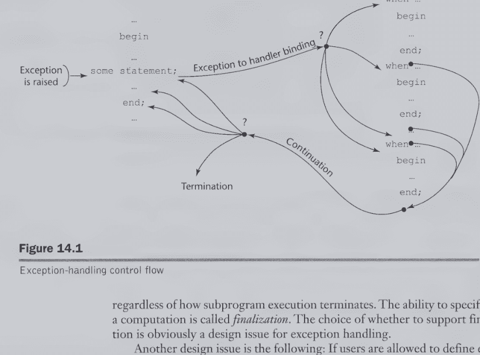

当包含异常处理时，子程序的执行可以通过两种方式终止：当其执行完成时，或当其遇到异常时。[^3] 在某些情况下，无论子程序执行如何终止，都需要完成某些计算。指定此类计算的能力称为终结化。是否支持终结化显然是异常处理的一个设计问题。

另一个设计问题是：如果允许用户定义异常，如何指定这些异常？通常的答案是要求在其可以引发的程序单元的说明部分声明它们。已声明异常的作用域通常是包含该声明的程序单元的作用域。

在语言提供预定义异常的情况下，还会产生其他几个设计问题。例如，语言运行时系统是否应为内置异常提供默认处理程序，或者是否应要求用户为所有异常编写处理程序？另一个问题是，预定义异常是否可以由用户程序显式引发。如果在软件可检测的情况下用户希望使用预定义处理程序，这种用法会很方便。

另一个问题是，硬件可检测的错误是否可由用户程序处理。如果不能，那么所有异常显然都是软件可检测的。一个相关的问题是是否应该有预定义的异常。预定义异常由硬件或系统软件隐式引发。

异常处理的设计问题可总结如下：

- 异常处理程序如何以及在哪里指定，其作用域是什么？
- 异常发生如何绑定到异常处理程序？
- 有关异常的信息是否可以传递给处理程序？
- 异常处理程序完成其执行后，执行应在何处继续（如果会继续的话）？（这是继续或恢复的问题。）
- 是否提供某种形式的终结化？
- 用户定义的异常如何指定？
- 如果存在预定义异常，对于不提供自己的处理程序的程序，是否应该有默认的异常处理程序？
- 预定义异常是否可以显式引发？
- 硬件可检测的错误是否被视为可处理的异常？
- 是否有任何预定义异常？

我们现在可以来考察几种当代编程语言的异常处理设施。

## 14.2 C++ 中的异常处理

C++ 的异常处理于 1990 年被 ANSI C++ 标准化委员会接受，随后进入了 C++ 的实现中。该设计部分基于 CLU、Ada 和 ML 的异常处理。在 C++ 中，异常由用户或库定义并显式引发。

### 14.2.1 异常处理程序

C++ 使用一种特殊的构造，由保留字 `try` 引入，以指定异常处理程序的作用域。`try` 构造包括一个称为 `try` 子句的复合语句和一个异常处理程序列表。复合语句定义了以下处理程序的作用域。此构造的一般形式如下：

```
try {
    /* 可能引发异常的代码 */
} catch(形式参数) {
    /* 处理程序主体 */
}
...
catch(形式参数) {
    /* 处理程序主体 */
}
```

每个 `catch` 函数都是一个异常处理程序。一个 `catch` 函数只能有一个形式参数，它类似于 C++ 函数定义中的形式参数，包括可以是省略号（. . .）。带有省略号形式参数的处理程序是捕获所有异常的处理程序；如果没有找到合适的处理程序，它将为任何引发的异常而执行。形式参数也可以是裸类型说明符，例如 `float`，就像函数原型中那样。在这种情况下，形式参数的唯一目的是使处理程序具有唯一可识别性。当有关异常的信息要传递给处理程序时，形式参数包含一个用于该目的的变量名。由于参数的类可以是任何用户定义的类，因此参数可以包含尽可能多的数据成员。异常绑定到处理程序的问题将在 14.2.2 节中讨论。

在 C++ 中，异常处理程序可以包含任何 C++ 代码。

### 14.2.2 将异常绑定到处理程序

C++ 异常仅由显式语句 `throw` 引发，其 EBNF 中的一般形式如下：

```
throw [表达式];
```

这里的方括号是元符号，用于指定表达式是可选的。不带操作数的 `throw` 只能出现在处理程序中。当它出现在那里时，它会重新引发异常，然后由其他地方处理。

`throw` 表达式的类型选择特定的处理程序，该处理程序当然必须具有“匹配”类型的形式参数。在这种情况下，匹配意味着以下内容：具有类型 `T`、`const T`、`T&`（对类型 `T` 的对象的引用）或 `const T&` 形式参数的处理程序与类型为 `T` 的 `throw` 表达式匹配。在 `T` 是类的情况下，参数类型为 `T` 或 `T` 的任何祖先类的处理程序都匹配。还存在更复杂的情况，其中 `throw` 表达式与形式参数匹配，但此处不再描述。

在 `try` 子句中引发的异常会导致该 `try` 子句中代码的执行立即结束。对匹配处理程序的搜索从紧随 `try` 子句之后的处理程序开始。匹配过程按顺序在处理程序上执行，直到找到匹配项。这意味着如果任何其他匹配项位于完全匹配的处理程序之前，完全匹配的处理程序将不会被使用。因此，针对特定异常的处理程序放在列表顶部，后面是更通用的处理程序。最后一个处理程序通常是带有省略号（. . .）形式参数的处理程序，它匹配任何异常。这将保证所有异常都会被捕获。

如果在 `try` 子句中引发异常，并且没有与该 `try` 子句关联的匹配处理程序，则异常被传播。如果 `try` 子句嵌套在另一个 `try` 子句中，则异常被传播到与外部 `try` 子句关联的处理程序。如果所有封闭的 `try` 子句都没有产生匹配的处理程序，则异常被传播到引发它的函数的调用者。如果对该函数的调用不在 `try` 子句中，则异常被传播到该函数的调用者。如果通过此传播过程在程序中找不到匹配的处理程序，则调用默认处理程序。此处理程序将在 14.2.4 节中进一步讨论。

[^3]: 当然，即使语言不支持异常处理，子程序也可能由于系统检测到的错误而终止。


### 14.2.3 继续执行

当一个处理器完成执行后，控制流将转到 try 构造之后的第一个语句（即该处理器所属的处理器序列中最后一个处理器之后的语句）。处理器可以通过使用不带表达式的 throw 重新抛出异常，在这种情况下，该异常会被传播。

### 14.2.4 其他设计选择

就 14.1.2 节所总结的设计问题而言，C++ 的异常处理很简单。只有用户自定义的异常，而且这些异常并未被明确指定（尽管它们可以被声明为新类）。有一个默认的异常处理器 `unexpected`，它唯一的动作就是终止程序。该处理器捕获所有未被程序捕获的异常。它可以用用户自定义的处理器来替换。替换的处理器必须是一个返回 void 且不带参数的函数。通过将其名称赋给 set_terminate 来设置这个替换函数。

C++ 函数可以列出它可能引发的异常的类型（即 throw 表达式的类型）。做法是在函数头后面附加保留字 throw，后跟一个包含这些类型的括号列表。例如，

```cpp
int fun() throw (int, char *) { . . . }
```

该示例指定函数 fun 可能引发 int 和 char * 类型的异常，但不会引发其他类型的异常。throw 子句的目的是告知函数的用户该函数可能引发哪些异常。throw 子句实际上是函数与其调用者之间的一份契约。它保证函数中不会引发其他异常。如果函数确实抛出了某个未列出的异常，程序将被终止。请注意，编译器会忽略 throw 子句。

如果 throw 子句中的类型是类，那么函数可以引发从所列类派生出的任何异常。如果函数头带有 throw 子句，并且抛出的异常未在 throw 子句中列出，也不是从其中所列的类派生的，则调用默认处理器。请注意，此错误无法在编译时检测到。throw 子句中的类型列表可以为空，表示该函数不会引发任何异常。如果函数头没有 throw 规范，则该函数可以引发任何异常。该列表不是函数类型的一部分。

如果一个函数覆盖了一个带有 throw 子句的函数，那么覆盖版本的函数所带的 throw 子句中的异常不能多于被覆盖的函数。

尽管 C++ 没有预定义的异常，但标准库定义并抛出异常，例如可由库容器类抛出的 out_of_range，以及可由数学库函数抛出的 overflow_error。

```cpp
freq[index]++;
} /* end of inner try compound */
catch(int grade) { /* Handler for index errors */
    if (grade == 100)
        freq[9]++;
    else
        cout << "Error -- new grade: " << grade
             << " is out of range" << endl;
} /* end of catch(int grade) */
} /* end of the block for the inner try-catch pair */
} /* end of while (1) */
} /* end of outer try block */
catch(NegativeInputException& e) { /* Handler for */
    /* negative input */
    cout << "Limits Frequency" << endl;
    for (index = 0; index < 10; index++) {
        limit_1 = 10 * index;
        limit_2 = limit_1 + 9;
        if (index == 9)
            limit_2 = 100;
        cout << limit_1 << limit_2 << freq[index] << endl;
    } /* end of for (index = 0) */
} /* end of catch (NegativeInputException& e) */
} /* end of main */
```

这个程序旨在说明 C++ 异常处理的机制。请注意，在 C++ 中，索引范围异常通常是通过重载索引操作来处理的，由重载操作引发异常，而不是像我们的示例中那样使用选择结构直接检测索引操作。

### 14.2.6 评估

C++ 异常处理的一个缺点是，没有可由用户处理的预定义硬件可检测异常。异常通过参数类型与处理器相连，其中形式参数可以被省略。处理器形式参数的类型决定了处理器被调用的条件，但可能与所引发异常的性质毫无关系。因此，对异常使用预定义类型肯定不会提高可读性。更好的做法是定义具有有意义名称的异常类，并将它们放在一个可用于定义异常的有意义的层次结构中。异常参数提供了一种将异常相关信息传递给异常处理器的方式。

## 14.3 Java 中的异常处理

在第 13 章中，Java 示例程序使用了异常处理，但几乎没有解释。本节将详细介绍 Java 的异常处理能力。

Java 的异常处理基于 C++ 的异常处理，但其设计更符合面向对象语言范式。此外，Java 包含一组预定义异常，这些异常由 Java 运行时系统隐式引发。

### 14.3.1 异常的类别

所有 Java 异常都是 Throwable 类后代类的对象。Java 系统包含两个预定义的异常类，它们是 Throwable 的子类：Error 和 Exception。Error 类及其后代类与 Java 运行时系统抛出的错误有关，例如堆内存耗尽。这些异常永远不会被用户程序抛出，也不应在用户程序中被处理。Exception 有两个系统定义的直接后代：RuntimeException 和 IOException。顾名思义，当输入或输出操作中发生错误时，会抛出 IOException，这些操作都被定义为 java.io 包中各个类的方法。

有一些预定义类是 RuntimeException 的后代。在大多数情况下，当用户程序导致错误时，会抛出 RuntimeException。例如，定义在 java.lang 中的 ArrayIndexOutOfBoundsException 就是一个常见的异常，它继承自 RuntimeException。另一个常见的继承自 RuntimeException 的异常是 NullPointerException。

用户程序可以定义自己的异常类。Java 中的惯例是，用户自定义异常是 Exception 的子类。

### 14.3.2 异常处理器

Java 的异常处理器与 C++ 的形式相同，只是每个 catch 必须有一个参数，且该参数的类型必须是预定义类 Throwable 的后代。

Java 中 try 构造的语法与 C++ 完全相同，只是多了 14.3.6 节中描述的 finally 子句。

### 14.3.3 将异常绑定到处理器

抛出异常很简单。throw 语句的操作数是一个异常类的实例。例如，假设我们定义一个名为 MyException 的异常：

```java
class MyException extends Exception {
    public MyException() {}
    public MyException(String message) {
        super(message);
    }
}
```

可以使用以下语句抛出该异常：

```java
throw new MyException();
```

我们包含在新类中的两个构造器中，一个没有参数，另一个有一个 String 对象参数，它会将该参数发送给超类（Exception），由超类显示它。因此，我们的新异常可以用以下方式抛出：

```java
throw new MyException
    ("a message to specify the location of the error");
```

Java 中异常与处理器的绑定与 C++ 类似。如果在 try 构造的复合语句中抛出异常，则该异常会被绑定到紧随 try 子句之后的第一个处理器（catch 函数），该处理器的参数与抛出对象属于同一个类，或者是该类的祖先类。如果找到匹配的处理器，抛出操作就会绑定到该处理器并执行它。

异常可以被处理，然后通过在处理器末尾加上一个不带操作数的 throw 语句重新抛出。新抛出的异常不会在最初抛出它的那个 try 中被处理，因此无需担心形成循环。这种重新抛出通常是在某个局部操作有用，但还需要由外层 try 子句或调用方中的 try 子句做进一步处理时进行。处理器中的 throw 语句也可以抛出与将控制权转移到该处理器的异常不同的其他异常。

为了确保 try 子句中可能抛出的异常总能在方法中得到处理，可以编写一个特殊的处理器，它与所有从 Exception 派生的异常匹配，只需将该处理器的参数定义为 Exception 类型，例如：

```java
catch (Exception genericObject) {
    ...
}
```

因为类名总是与自身或任何祖先类匹配，所以任何从 Exception 派生的类都与 Exception 匹配。当然，这样的异常处理器应始终放在处理器列表的末尾，因为它会阻止 try 构造中位于它之后的任何处理器被使用。这是因为对匹配处理器的搜索是顺序进行的，一旦找到匹配项，搜索即告结束。

### 14.3.4 其他设计选择

作为其反射机制的一部分，Java 运行时系统会存储程序中每个对象的类名。可以使用 getClass 方法获取一个存储类名的对象，而类名本身可以通过 getName 方法获得。因此，我们可以从下面获取实际参数的类名：


导致处理器执行的 throw 语句。对于前面所示的处理器，这是通过

```
genericObject.getClass().getName()
```

完成的。

此外，由构造函数创建的参数对象关联的消息，可以通过以下方式获取

```
genericObject.getMessage()
```

此外，在用户定义异常的情况下，被抛出的对象可能包含任意数量的数据字段，这些字段在处理器中可能很有用。

Java 的 throws 子句在外观和程序中的位置与 C++ 的 throw 规范相似。然而，throws 的语义与 C++ 的 throw 子句有所不同。

Java 方法的 throws 子句中出现异常类名，指定该异常类或其任何后代异常类可以被抛出但不能由该方法处理。例如，当方法指定它可以抛出 IOException 时，意味着它可以抛出 IOException 对象或其任何后代类的对象，例如 EOFException，并且它不会处理其抛出的异常。

类 Error 和 RuntimeException 及其后代的异常称为未检查异常。所有其他异常称为已检查异常。未检查异常永远不是编译器的关注点。然而，编译器确保方法可能抛出的所有已检查异常都列在其 throws 子句中或在方法中被处理。注意，在编译时检查这一点与 C++ 不同，在 C++ 中是在运行时完成的。异常类 Error 和 RuntimeException 及其后代之所以是未检查的，是因为任何方法都可能抛出它们。程序可以捕获未检查异常，但不是必须的。

与 C++ 一样，一个方法在其 throws 子句中声明的异常不能多于它重写的方法，尽管它可以声明更少。因此，如果一个方法没有 throws 子句，则重写它的任何方法也不能有。方法可以抛出其 throws 子句中列出的任何异常，以及这些异常的后代类。

一个方法如果没有直接抛出特定异常，但调用了可能抛出该异常的另一个方法，则必须在其 throws 子句中列出该异常。这就是 buildDist 方法（在下一小节的示例中）使用 readLine 方法，必须在其头部的 throws 子句中指定 IOException 的原因。

在其自己的 **throws** 子句中声明异常而不处理它，这有效地将异常传播到封闭的 **try** 子句，如果有的话，或者传播到方法的调用者，如果没有封闭的 **try** 子句。
没有默认异常处理器，也无法禁用异常。Java 中的继续与 C++ 完全相同。

## 14.3.5 一个示例

以下是具有第 14.2.5 节中 C++ 程序功能的 Java 程序：

```java
// Grade Distribution
// Input: A list of integer values that represent
//        grades, followed by a negative number
// Output: A distribution of grades, as a percentage for
//         each of the categories 0-9, 10-19, ..., 
//         90-100.
//
import java.io.*;
// The exception definition to deal with the end of data
class NegativeInputException extends Exception {
    public NegativeInputException() {
        System.out.println("End of input data reached");
    } /** end of constructor
} //** end of NegativeInputException class

class GradeDist {
    int newGrade,
        index,
        limit_1,
        limit_2;
    int [] freq = {0, 0, 0, 0, 0, 0, 0, 0, 0, 0};

    void buildDist() throws IOException {
        DataInputStream in = new DataInputStream(System.in);
        try {
            while (true) {
                System.out.println("Please input a grade");
                newGrade = Integer.parseInt(in.readLine());
                if (newGrade < 0)
                    throw new NegativeInputException();
                index = newGrade / 10;
                try {
                    freq[index]++;
                } /** end of inner try clause
                catch (ArrayIndexOutOfBoundsException e) {
                    if (newGrade == 100)
                        freq[9]++;
                    else
                        System.out.println("Error -- new grade: " +
                                           newGrade + " is out of range");
```
```
} //** end of catch (ArrayIndexOutOfBoundsException . . .
} //** end of while (true) . . .
} //** end of outer try clause
catch(NegativeInputException e) {
    System.out.println ("\nLimits      Frequency\n");
    for (index = 0; index < 10; index++) {
        limit_1 = 10 * index;
        limit_2 = limit_1 + 9;
        if (index == 9)
            limit_2 = 100;
        System.out.println("" + limit_1 + " - " +
            limit_2 + "      " + freq [index]);
    } //** end of for (index = 0; . . .
} //** end of catch (NegativeInputException . . .
} //** end of method buildDist
```

程序中定义了用于处理输入结束的负输入异常 NegativeInputException。它的构造函数在创建该类的对象时显示一条消息。它的处理器产生该方法的输出。ArrayIndexOutOfBoundsException 是一个预定义的未检查异常，由 Java 运行时系统抛出。在这两种情况下，处理器在其参数中都不包含对象名。在任何一种情况下，名称都不会起任何作用。尽管所有处理器都将对象作为参数，但它们通常没有用。

## 14.3.6 finally 子句

有些情况下，无论 try 子句是否抛出异常或异常是否在方法中被处理，都必须执行某个过程。一个这样的例子是必须关闭的文件。另一个例子是如果方法有一些外部资源，必须在方法中无论执行如何终止都释放它。finally 子句就是为这些需求而设计的。finally 子句放在处理程序列表的末尾，紧跟在完整的 try 构造之后。一般来说，try 构造及其 finally 子句如下所示

```
try {
    . . .
}
catch (. . .) {
    . . .
}
. . . //** More handlers
finally {
    . . .
}
```

该构造的语义如下：如果 try 子句不抛出任何异常，则在执行继续到 try 构造之后之前执行 finally 子句。如果 try 子句抛出异常并且被后续处理器捕获，则在处理器完成执行后执行 **finally** 子句。如果 **try** 子句抛出异常但未被 **try** 构造之后的处理器捕获，则在异常传播之前执行 **finally** 子句。没有异常处理器的 try 构造可以跟随 finally 子句。当然，这只有在复合语句具有 **throw**、**break**、**continue** 或 **return** 语句时才有意义。在这些情况下，其目的与在异常处理中使用时相同。例如，考虑以下内容：

```
try {
    for (index = 0; index < 100; index++) {
        ...
        if (...) {
            return;
        } //** end of if
        ...
    } //** end of for
} //** end of try clause
finally {
    ...
} //** end of try construct
```

这里的 **finally** 子句将在 **return** 终止循环或其正常结束时执行。

## 14.3.7 断言

在第 2 章中讨论 Plankalkül 时，我们提到它包含了断言。断言在 Java 1.4 版本中被添加到 Java 中。要使用它们，必须通过使用 -enableassertions（或 -ea）标志运行程序来启用它们，如下所示

```
java -enableassertions MyProgram
```

**assert** 语句有两种可能的形式：

```
assert condition;
assert condition : expression;
```

在第一种情况下，当执行到达 **assert** 时会测试条件。如果条件计算为 true，则什么也不发生。如果它计算为 false，则抛出 AssertionError 异常。在第二种情况下，操作相同，只是表达式的值作为字符串传递给 AssertionError 构造函数并成为调试输出。

**assert** 语句用于防御性编程。程序可以用许多 **assert** 语句编写，以确保程序的计算能够按轨道产生正确的结果。许多程序员在编写程序时会加入此类检查，作为调试的帮助，即使他们使用的语言不支持断言。当程序


如果经过充分测试，这些检查将被移除。断言语句的优点在于，它们与断言语句目的相同，但可以在不从程序中移除它们的情况下被禁用。这节省了移除它们的精力，也允许在后续程序维护期间使用它们。

## 14.3.8 评估

Java 的异常处理机制是对其基于的 C++ 版本的改进。

首先，C++ 程序可以抛出程序中定义或由系统定义的任何类型。在 Java 中，只有 Throwable 的实例或其派生类的对象才能被抛出。这将可以抛出的对象与程序中居住的所有其他对象（和非对象）区分开来。对导致抛出 int 值的异常能赋予什么意义？

其次，一个不包含 throw 子句的 C++ 程序单元可以抛出任何异常，这对读者没有任何说明。Java 方法如果不包含 throws 子句，就不能抛出它未处理的任何已检查异常。因此，Java 方法的读者可以从其头部得知它可能抛出但未处理的异常。C++ 编译器忽略 throw 子句，但 Java 编译器确保方法可能抛出的所有异常都列在其 throws 子句中。

第三，finally 子句是一个有用的补充。它允许在复合语句以任何方式终止时进行清理类操作。

最后，Java 运行时系统会隐式抛出各种预定义异常，例如数组索引越界和空引用解引用，这些异常可以由任何用户程序处理。C++ 程序只能处理它显式抛出的异常（或其使用的库类抛出的异常）。

C# 包含的异常处理结构与 Java 非常相似，只是 C# 没有 throws 子句。

## 14.4 Python 和 Ruby 中的异常处理

本节简要概述了 Python 和 Ruby 的异常处理机制。

### 14.4.1 Python

在 Python 中，异常是对象。所有异常类的基类是 BaseException，由此派生出 Exception 类。BaseException 为所有异常类提供了一些有用的服务，但通常不会直接被子类化。所有预定义异常类都派生自 Exception，用户定义的异常类也派生自它。Exception 最常用的预定义子类是 ArithmeticError，

其主要子类为 OverflowError、ZeroDivisionError 和 FloatingPointError，以及 LookupError，其主要子类为 IndexError 和 KeyError。

处理异常的语句与 Java 类似。try 构造的一般形式如下：

```
try:
    The try block (the range of statements to be watched for exceptions)
except Exception1:
    Handler for Exception1
except Exception2:
    Handler for Exception2
...
else:
    The else block (what to do when no exception is raised)
finally:
    The finally block (what must be done regardless of what happened)
```

else 和 finally 子句都是可选的。

Java 和 Python 处理程序之间的一点区别是，Python 使用 except 来引入它们，而不是 catch。else 子句在 try 块中未引发异常时执行。finally 子句的语义与其在 Java 中的对应项相同：如果在 try 块中引发异常但未被紧随其后的处理程序处理，则在 finally 块执行后异常会被传播。因为处理程序处理其命名的异常以及该异常的所有子类，所以命名 Exception 的处理程序处理所有预定义和用户定义的异常。

未处理的异常会被传播到逐渐更大的封闭 try 构造中，寻找合适的处理程序。如果找不到，则异常会被传播到函数的调用者，再次在嵌套的 try 构造中寻找处理程序。如果在任何级别都找不到处理程序，则调用默认处理程序，该处理程序会产生错误消息和堆栈跟踪并终止程序。

Python 的 raise 语句类似于 Java 和 C++ 的 throw 语句。raise 的参数是要引发的异常的类名。例如，我们可以有以下内容：

```
raise IndexError
```

此语句隐式创建命名类 IndexError 的实例。

异常处理程序可以通过提供 as 子句和变量名来访问引发的异常对象，如下所示：

```
except Exception as ex_obj:
```

这是一个通用处理程序，因为它处理所有异常。异常对象可以用处理程序中的 print 语句打印出来，这会产生对象的

消息。例如，如果异常是 ZeroDivisionError，则消息将为 division by zero。

Python 的 assert 语句提供了一种使某些异常处理可选的机制。assert 的一般形式如下：

```
assert test, data
```

在此语句中，test 是一个布尔标志或表达式，data 是发送到要引发的异常对象的构造函数的数值。此语句的可选引发 AssertionError 异常的含义可以用以下代码描述：

```
if __debug__:
    if not test:
        raise AssertionError(data)
```

__debug__ 是一个预定义标志，除非在运行程序的命令上使用 -O 标志，否则设置为 True。这允许为程序的特定运行禁用所有 assert 语句。如果 AssertionError 异常未被程序处理，像其他未处理的异常一样，它会在使用默认处理程序后终止程序。

Python 没有 Java 的 throws 子句的等价物。

### 14.4.2 Ruby

与 Python 类似，Ruby 异常是对象，它拥有大量预定义的异常类。所有由应用程序程序处理的异常都是 StandardError 类的对象或从其派生的类。StandardError 派生自 Exception，后者为其所有后代提供了两个有用的方法。这些是 message，它返回人类可读的错误消息，以及 backtrace，它返回从引发异常的方法开始的堆栈跟踪。StandardError 的一些预定义子类是 ArgumentError、IndexError、IOError 和 ZeroDivisionError。

异常通过 raise 方法显式引发。raise 通常带有一个字符串参数。在这种情况下，它会引发一个新的 RuntimeError 对象，并将字符串作为其消息。例如，我们可以有以下内容：

```
raise "bad parameter" if count == 0
```

raise 也可以有两个参数，其中第一个是异常类的对象。此对象的 exception 方法被调用并返回的 Exception 对象被引发。在这种情况下，第二个参数将是显示的字符串消息。例如，我们可以有以下内容：

```
raise TypeError, "Float parameter expected"
if not param.is_a? Float
```

异常处理程序通过 rescue 子句指定，该子句附加到一个语句。要将异常处理程序附加到一段代码，代码被放置在 begin-end 块中。rescue 子句放置在块中块代码之后。一般来说，这如下所示：

```
begin
    The sequence of statements in the block
rescue
    The handler
end
```

begin-end 块可以包含 else 子句和/或 ensure 子句。else 子句与 Python 的完全相同。ensure 子句与 finally 子句完全相同。方法可以用作 begin-end 块的替代品来容纳异常处理。

与大多数其他语言明显不同的是，Ruby 允许在异常被处理后重新运行引发异常的代码段。这是通过处理程序末尾的 retry 语句指定的。

## 14.5 事件处理简介

事件处理与异常处理相似。在这两种情况下，处理程序都是由某事的发生隐式调用的，要么是异常，要么是事件。虽然异常可以由用户代码显式引发或由硬件或软件解释器隐式引发，但事件是由外部操作创建的，例如通过图形用户界面（GUI）的用户交互。本节介绍了事件处理的基础知识，其复杂性小于异常处理。

在传统的非事件驱动编程中，程序代码本身指定代码执行的顺序，尽管顺序通常受程序输入数据的影响。在事件驱动编程中，程序的某些部分在完全不可预测的时间执行，通常由用户与正在执行的程序的交互触发。

本章讨论的特定事件处理与 GUI 相关。因此，大多数事件都是由用户通过图形对象或组件，通常称为小部件的交互引起的。最常见的小部件是按钮。对用户与 GUI 组件交互的反应是事件处理最常见的形式。

事件是对特定事件发生的通知，例如在图形按钮上单击鼠标。严格来说，事件是在用户操作响应下由运行时系统隐式创建的对象，至少在本文讨论事件处理的上下文中是如此。

事件处理程序是在事件出现时执行的代码段。事件处理程序使程序能够响应用户操作。


尽管事件驱动编程在图形用户界面出现之前很久就已经被使用，但它只是在图形用户界面普及之后才成为一种广泛使用的编程方法。例如，考虑呈现给Web浏览器用户的GUI。许多呈现给浏览器用户的Web文档现在是动态的。这样的文档可能向用户呈现订单表单，用户通过点击按钮来选择商品。与这些按钮点击相关的必要内部计算由响应点击事件的事件处理程序执行。

事件处理程序的另一个常见用途是检查表单元素中的简单错误和遗漏，无论是当它们被更改时，还是当表单提交给Web服务器进行处理时。在浏览器上使用事件处理来检查表单数据的有效性，节省了将数据发送到服务器的时间，否则服务器的常驻程序或脚本必须在处理之前检查数据的正确性。这种事件驱动编程通常使用客户端脚本语言（如JavaScript）完成。

## 14.6 使用Java进行事件处理

除了Web应用程序之外，非Web的Java应用程序也可以向用户呈现GUI。本节讨论Java应用程序中的GUI。

Java的初始版本为GUI组件提供了一种较为原始的支持形式。在1998年末发布的语言1.2版本中，添加了一个新的组件集合。这些组件统称为Swing。

### 14.6.1 Java Swing GUI组件⁴

定义在javax.swing中的Swing类和接口集合包含了GUI组件（或称为控件）。由于我们这里关注的是事件处理而非GUI组件，因此只讨论两种控件：文本框和单选按钮。

文本框是JTextField类的对象。最简单的JTextField构造函数接受一个参数，即文本框的长度（以字符为单位）。例如，

```
JTextField name = new JTextField(32);
```

JTextField构造函数也可以接受一个字符串字面量作为可选的第一参数。该字符串参数如果存在，则显示为文本框的初始内容。

单选按钮是放置在按钮组容器中的特殊按钮。按钮组是ButtonGroup类的对象，其构造函数不接受参数。在单选按钮组中，每次只能按下一个按钮。如果组中的任何按钮被按下，先前按下的按钮会被隐式地取消按下。用于创建单选按钮的JRadioButton构造函数接受两个参数：标签和单选按钮的初始状态（true或false，分别表示按下和未按下）。如果组中的一个单选按钮初始设置为按下，那么组中的其他按钮默认为未按下。单选按钮创建后，通过组对象的add方法将它们放入按钮组。考虑以下示例：

```
ButtonGroup payment = new ButtonGroup();
JRadioButton box1 = new JRadioButton("Visa", true);
JRadioButton box2 = new JRadioButton("Master Charge");
JRadioButton box3 = new JRadioButton("Discover");
payment.add(box1);
payment.add(box2);
payment.add(box3);
```

JFrame对象是一个框架，显示为独立的窗口。JFrame类定义了框架所需的数据和方法。因此，使用框架的类可以是JFrame的子类。JFrame有多个称为窗格（pane）的层。我们只关心其中一层，即内容窗格。GUI组件放置在JPanel对象（面板）中，面板用于组织和定义组件的布局。创建一个框架，并将包含组件的面板添加到该框架的内容窗格中。

预定义的图形对象（如GUI组件）直接放置在面板中。下面创建了后续讨论组件时使用的面板对象：

```
JPanel myPanel = new JPanel();
```

使用构造函数创建组件后，通过add方法将它们放入面板，如下所示：

```
myPanel.add(button1);
```

### 14.6.2 Java事件模型

当用户与GUI组件交互时，例如点击按钮，组件会创建一个事件对象，并通过称为事件监听器的对象调用事件处理程序，同时传递事件对象。事件处理程序提供相关的操作。GUI组件是事件生成器。在Java中，事件通过事件监听器连接到事件处理程序。事件监听器通过事件监听器注册连接到事件生成器。监听器注册通过实现监听器接口的类的方法完成，本节后面将对此进行描述。只有针对特定事件注册的事件监听器才会在该事件发生时收到通知。

接收消息的监听器方法实现了事件处理程序。为了使事件处理方法符合标准协议，使用了接口。接口规定了标准的方法协议，但不提供这些方法的实现。

需要实现事件处理程序的类必须为该处理程序的监听器实现一个接口。事件和监听器接口有多个类别。其中一类事件是ItemEvent，它与点击复选框、单选按钮或选择列表项的事件相关联。ItemListener接口包含方法itemStateChanged的协议，该方法就是ItemEvent事件的处理程序。因此，要提供由单选按钮点击触发的操作，必须实现ItemListener接口，这需要定义itemStateChanged方法。

如前所述，组件与事件监听器的连接是通过实现监听器接口的类的方法来完成的。例如，由于ItemEvent是用户对单选按钮操作所创建的事件对象的类名，因此使用addItemListener方法来为单选按钮注册监听器。在面板中创建的按钮事件的监听器可以在该面板或JPanel的子类中实现。因此，对于名为myPanel的面板中名为button1的单选按钮，如果该面板实现了按钮的ItemEvent事件处理程序，我们将使用以下语句注册监听器：

```
button1.addItemListener(this);
```

每个事件处理方法接收一个事件参数，该参数提供了有关事件的信息。事件类有访问这些信息的方法。例如，当通过单选按钮调用时，isSelected方法返回true或false，分别取决于按钮是开还是关（按下或未按下）。

所有与事件相关的类都位于java.awt.event包中，因此任何使用事件的类都需要导入它。

下面是一个示例应用程序RadioB，它演示了事件和事件处理的使用。该应用程序构建了控制文本字段内容字体样式的单选按钮。它为四种字体样式各创建了一个Font对象。每种字体样式都有一个单选按钮，使用户能够选择字体样式。

此示例的目的是展示如何处理GUI组件引发的事件，以动态改变程序的输出显示。由于我们只关注事件处理，因此此处不解释该程序的某些部分。

```
/* RadioB.java
   An example to illustrate event handling with interactive
   radio buttons that control the font style of a textfield
*/
package radiob;
import java.awt.*;
import java.awt.event.*;
import javax.swing.*;

public class RadioB extends JPanel implements
    ItemListener {
private JTextField text;
private Font plainFont, boldFont, italicFont,
    boldItalicFont;
private JRadioButton plain, bold, italic, boldItalic;
private ButtonGroup radioButtons;

// The constructor method is where the display is initially
// built
public RadioB() {

// Create the test text string and set its font
    text = new JTextField(
        "In what font style should I appear?", 25);
    text.setFont(plainFont);

// Create radio buttons for the fonts and add them to
// a new button group
    plain = new JRadioButton("Plain", true);
    bold = new JRadioButton("Bold");
    italic = new JRadioButton("Italic");
    boldItalic = new JRadioButton("Bold Italic");
    radioButtons = new ButtonGroup();
    radioButtons.add(plain);
    radioButtons.add(bold);
    radioButtons.add(italic);
    radioButtons.add(boldItalic);

// Create a panel and put the text and the radio
// buttons in it; then add the panel to the frame
    JPanel radioPanel = new JPanel();
    radioPanel.add(text);
    radioPanel.add(plain);
    radioPanel.add(bold);
    radioPanel.add(italic);
    radioPanel.add(boldItalic);
    add(radioPanel, BorderLayout.LINE_START);

// Register the event handlers
    plain.addItemListener(this);
    bold.addItemListener(this);
    italic.addItemListener(this);
    boldItalic.addItemListener(this);

// Create the fonts
    plainFont = new Font("Serif", Font.PLAIN, 16);
    boldFont = new Font("Serif", Font.BOLD, 16);
    italicFont = new Font("Serif", Font.ITALIC, 16);
    boldItalicFont = new Font("Serif", Font.BOLD +
        Font.ITALIC, 16);
} // End of the constructor for RadioB
```


## 图 14.2

RadioB.java 的输出

来源：Java radio applet 屏幕截图。


```
// The event handler
public void itemStateChanged (ItemEvent e) {

// Determine which button is on and set the font
// accordingly
    if (plain.isSelected())
        text.setFont(plainFont);
    else if (bold.isSelected())
        text.setFont(boldFont);
    else if (italic.isSelected())
        text.setFont(italicFont);
    else if (boldItalic.isSelected())
        text.setFont(boldItalicFont);
} // End of itemStateChanged

// The main method
public static void main(String[] args) {
// Create the window frame
    JFrame myFrame = new JFrame(" Radio button example");

// Create the content pane and set it to the frame
    JComponent myContentPane = new RadioB();
    myContentPane.setOpaque(true);
    myFrame.setContentPane(myContentPane);

// Display the window.
    myFrame.pack();
    myFrame.setVisible(true);
}
} // End of RadioB
```

RadioB.java 应用程序产生的屏幕如 图 14.2 所示。

## 14.7 C# 中的事件处理

C#（以及其他 .NET 语言）中的事件处理与 Java 类似。.NET 提供了两种在应用程序中创建 GUI 的方法，原来的 Windows Forms 和更新的 Windows Presentation Foundation。后者是两者中更复杂、更精细的。由于我们的兴趣仅在于事件处理，我们将使用更简单的 Windows Forms 来讨论主题。

使用 Windows Forms，构建 GUI 的 C# 应用程序是通过继承 Form 预定义类创建的，该类定义在 System.Windows.Forms 命名空间中。此类隐式提供一个窗口来容纳我们的组件。无需显式构建框架或面板。

文本可以放在 Label 对象中，单选按钮是 RadioButton 类的对象。Label 对象的大小并非在构造函数中显式指定；相反，可以通过将 Label 对象的 AutoSize 数据成员设置为 true 来指定，其大小将根据其中放置的内容而设定。

组件可以通过将组件的 Location 属性赋值为一个新的 Point 对象来放置在窗口的特定位置。Point 类定义在 System.Drawing 命名空间中。Point 构造函数接受两个参数，即对象在像素中的坐标。例如，Point(100, 200) 是一个位置，其距离窗口左边缘 100 像素，距离顶部 200 像素。组件的标签是通过将字符串文字赋给组件的 Text 属性来设置的。创建组件后，它通过将其发送到表单的 Controls 子类的 Add 方法来添加到表单窗口。因此，以下代码创建了一个标签为 Plain 的单选按钮，其在输出窗口中的位置为 (100, 300)：

```
private RadioButton plain = new RadioButton();
plain.Location = new Point(100, 300);
plain.Text = "Plain";
Controls.Add(plain);
```

所有 C# 事件处理程序都使用相同的协议：返回类型为 void，两个参数的类型为 object 和 EventArgs。对于简单情况，两者参数都不需要使用。事件处理程序方法可以有任意名称。单选按钮是否被点击可通过按钮的布尔 Checked 属性来测试。以下是一个事件处理程序的骨架示例：

```
private void rb_CheckedChanged (object o, EventArgs e){
    if (plain.Checked) . . .
    . . .
}
```

要注册一个事件，必须创建一个新的 EventHandler 对象。此类的构造函数接收处理程序方法名称。新的对象被添加到组件对象上针对该事件的预定义委托（使用 += 赋值运算符）。例如，当单选按钮从未选中变为选中时，会引发 CheckedChanged 事件，并且在关联的委托上注册的处理程序会被调用，该委托由事件名称引用。如果事件处理程序名为 rb_CheckedChanged，则以下语句将为单选按钮 plain 的 CheckedChanged 事件注册处理程序：

以下是第 14.6 节中的 RadioB 示例改写为 C# 的版本。再次强调，由于我们的重点是事件处理，我们不解释程序的所有细节。

```
// RadioB.cs
// An example to illustrate event handling with
// interactive radio buttons that control the font
// style of a string of text

namespace RadioB {

    using System;
    using System.Drawing;
    using System.Windows.Forms;
    public class RadioB : Form {
        private Label text = new Label();
        private RadioButton plain = new RadioButton();
        private RadioButton bold = new RadioButton();
        private RadioButton italic = new RadioButton();
        private RadioButton boldItalic = new RadioButton();

        // Constructor for RadioB
        public RadioB() {

            // Initialize the attributes of the text and radio
            // buttons
            text.AutoSize = true;
            text.Text = "In what font style should I appear?";
            plain.Location = new Point(220,0);
            plain.Text = "Plain";
            plain.Checked = true;
            bold.Location = new Point(350, 0);
            bold.Text = "Bold";
            italic.Location = new Point(480, 0);
            italic.Text = "Italics";
            boldItalic.Location = new Point(610, 0);
            boldItalic.Text = "Bold/Italics";

            // Add the text and the radio buttons to the form
            Controls.Add(text);
            Controls.Add(plain);
            Controls.Add(bold);
            Controls.Add(italic);
            Controls.Add(boldItalic);

            // Register the event handler for the radio buttons
            plain.CheckedChanged +=
                new EventHandler(rb_CheckedChanged);
        }
bold.CheckedChanged +=
    new EventHandler(rb_CheckedChanged);
italic.CheckedChanged +=
    new EventHandler(rb_CheckedChanged);
boldItalic.CheckedChanged +=
    new EventHandler(rb_CheckedChanged);
}

// The main method is where execution begins
static void Main() {
    Application.EnableVisualStyles();
    Application.SetCompatibleTextRenderingDefault (false);
    Application.Run(new RadioB());
}
// The event handler

private void rb_CheckedChanged (object o,
                                EventArgs e) {

// Determine which button is on and set the font
// accordingly
if (plain.Checked)
    text.Font =
        new Font( text.Font.Name, text.Font.Size,
                  FontStyle.Regular);
if (bold.Checked)
    text.Font =
        new Font(text.Font.Name, text.Font.Size,
                 FontStyle.Bold);
if (italic.Checked)
    text.Font =
        new Font(text.Font.Name, text.Font.Size,
                 FontStyle.Italic);
if (boldItalic.Checked)
    text.Font =
        new Font(text.Font.Name, text.Font.Size,
                 FontStyle.Italic ^ FontStyle.Bold);
} // End of radioButton_CheckedChanged

} // End of RadioB
}
```

该程序的输出与 图 14.2 所示完全相同。

## 摘要

C++ 没有预定义的异常（标准库中定义的除外）。C++ 异常是原始类型、预定义类或用户定义类的对象。异常通过将 throw 语句中表达式的类型连接到处理程序的形参类型来绑定到处理程序。处理程序都具有相同的名称——catch。C++ 方法的 throw 子句列出了该方法可能抛出的异常类型。

Java 异常是对象，其继承链必须追溯到继承自 Throwable 类的类。异常分为两类——已检查和未检查。已检查异常是用户程序和编译器关注的问题。未检查异常可能在任何地方发生，通常被用户程序忽略。

Java 方法的 throws 子句列出了它可能抛出但未处理的已检查异常。它必须包含它调用的方法可能引发并向其调用者传播的异常。

Java finally 子句提供了一种机制，保证某些代码无论 try 复合语句如何终止执行都会被执行。

Java 现在包含 assert 语句，这有助于防御性编程。

Python 的异常处理与 Java 类似，只是它在 try 构造中添加了 else 子句。此外，它使用 except 子句而不是 catch 子句来定义处理程序，并使用 raise 而不是 throw。通过 as 子句将对象赋给变量来访问异常对象的数据。Python 的 assert 语句是一个条件 raise。

Ruby 的异常处理与 Python 类似。每个异常类都有两个方法，message 和 backtrace。异常通常使用带有一个字符串参数的 raise 语句引发。这会创建一个新的 RuntimeError 对象，其消息为该字符串。raise 语句可以通过添加条件表达式使其成为条件语句。异常处理程序的范围通常用 begin-end 块指定。处理程序在 rescue 子句中定义。begin-end 块可以包含 else 子句和 ensure 子句，后者类似于 Python 和 Java 的 finally 子句。

事件是对发生需要特殊处理的事情的通知。事件通常由用户通过图形用户界面与程序的交互创建。Java 事件处理程序通过事件监听器调用。如果要被通知事件发生，事件监听器必须为该事件注册。两个最常用的事件监听器接口是 actionPerformed 和 itemStateChanged。

Windows Forms 是在 .NET 语言中构建 GUI 组件和处理事件的原始方法。在这种方法中，C# 应用程序通过继承 Form 类来构建 GUI。所有 .NET 事件处理程序都使用相同的协议。通过创建 EventHandler 对象并将其分配给可以引发事件的 GUI 对象关联的预定义委托来注册事件处理程序。

关于异常处理最重要的与特定编程语言无关的论文之一是 Goodenough（1975）的著作。PL/I 设计中异常处理的缺陷已被涵盖


## 第14章 异常处理和事件处理

in MacLaren (1977). C++ 中的异常处理由 Stroustrup (1997) 描述。Java 中的异常处理由 Campione et al. (2001) 描述。

### 复习问题

1. 定义 *exception*、*exception handler*、*raising an exception*、*continuation*、*finalization*，和 *built-in exception*。
2. 早期编程语言是如何支持异常处理机制的？
3. 将异常处理支持内置到语言中的优势是什么？
4. 为什么有些语言不包含异常处理？
5. 给出一个硬件无法检测但由 Java 编译器生成的代码可以检测到的错误示例。
6. Fortran 中标签参数的用途是什么？
7. Java 中异常传播是如何工作的？
8. C++ 中没有操作数的 `throw` 语句如何工作？
9. 如何在 C++ 中编写一个异常处理器，使其处理任何异常？
10. 一个重写了带有 `throw` 子句的函数的函数会面临什么约束？
11. Java 是否包含内置异常？
12. C++ 中哪些库函数支持 `overflow_error` 异常？
13. Java 中 `Throwable` 类的两个系统定义的直接后代是什么？
14. Java 中包含 `ArrayIndexOutOfBoundsException` 的包是什么？
15. 如何在 Java 中编写一个异常处理器，使其处理任何异常？
16. C++ 异常处理器和 Java 异常处理器之间的区别是什么？
17. Java 异常处理器和 Python 异常处理器之间的区别是什么？
18. 一个方法如何处理从另一个方法收到的异常，而该方法在其 `throw` 子句中列出了特定的受检异常？
19. 在 Java 中，`try` 子句何时只有 `finally` 子句而没有异常处理器？
20. 在 Java 中，方法应包含什么子句以传播任何受检异常？
21. 解释 Python 中 `else` 块的作用。
22. `assert` 语句有什么优势？
23. 当 `assert` 语句求值为 false 时会发生什么？
24. Ruby 的 `StandardError` 类的 `message` 方法做什么？
25. 当执行带有字符串参数的 raise 语句时到底发生了什么？
26. Python 的 `__debug__` 标志做什么？
27. 异常处理和事件处理有何关联？
28. 定义事件和事件处理器。
29. 什么是事件驱动编程？
30. Java JTextField 的用途是什么？
31. Java ButtonGroup 的用途是什么？
32. 在 Java GUI 应用程序中，常常用作事件监听器的对象是什么？
33. Java 中事件处理器的协议的起源是什么？
34. 在 Java 中使用什么方法来注册事件处理器？
35. 使用 .NET 的 Windows Forms，构建 C# 应用程序的 GUI 需要什么命名空间？
36. 如何使用 Windows Forms 在窗体中定位组件？
37. .NET 事件处理器的协议是什么？
38. 必须创建什么类的对象来注册 .NET 事件处理器？
39. 委托在注册事件处理器的过程中扮演什么角色？

### 问题集

1. C 的设计者为了不要求下标范围检查，获得了什么回报？
2. 编写一个 Fortran Read 语句，如果发生错误则将控制转移到语句 200，如果读操作遇到文件结束条件则将控制转移到语句 950。
3. 从 PL/I 和 Ada 编程语言的教科书中查找各自的内置异常集。对两者进行比较评估，考虑完整性和灵活性。
4. 从 COBOL 的教科书中确定 COBOL 程序中是如何进行异常处理的。
5. 在没有异常处理设施的语言中，常见的做法是让大多数子程序包含一个“error”参数，可以将其设置为表示“OK”的某个值或表示“procedure 中出错”的其他值。Java 这样的语言式异常处理设施与这种方法相比有什么优势？
6. 在没有异常处理设施的语言中，我们可以将错误处理过程作为参数传递给每个可能检测到必须处理的错误的程序。这种方法有什么缺点？
7. 比较问题 5 和 6 中提出的方法。你认为哪一种更好，为什么？
8. 编写 C++ 的 throw 子句与 Java 的 throws 子句的比较分析。
9. 考虑以下 C++ 骨架程序：

```cpp
class Big {
	int i;
	float f;
	void fun1() throw int {
		...
		try {
			throw i;
			throw f;
			...
		}
		catch(float) { ... }
	}
}

class Small {
	int j;
	float g;
	void fun2() throw float {
		...
		try {
			try {
				Big.fun1();
				...
				throw j;
				throw g;
				...
			}
			catch(int) { ... }
		}
		catch(float) { ... }
	}
}
```

在四个 throw 语句中，异常在哪里被处理？
注意 fun1 是从 Small 类中的 fun2 调用的。

10. 编写 C++ 和 Java 的异常处理能力的详细比较。
11. 在 ML 书籍的帮助下，编写 ML 和 Java 的异常处理能力的详细比较。
12. 总结支持终止模型和恢复模型延续的论点。

### 编程练习

1. 假设你正在编写一个 C++ 函数，该函数有三种替代方法来实现其要求。编写此函数的骨架版本，以便如果第一种替代方法引发任何异常，则尝试第二种方法，如果第二种替代方法引发任何异常，则执行第三种方法。将代码编写为如果三种方法分别为名为 `alt1`、`alt2` 和 `alt3` 的过程。
2. 编写一个 Java 程序，从键盘输入范围在 −100 到 100 之间的整数列表，并计算输入值的平方和。该程序必须使用异常处理来确保输入值在范围内且是合法整数，以处理平方和变得大于标准 `Integer` 变量可以存储的错误，并检测文件结束并用它来导致结果输出。在平方和溢出的情况下，必须打印错误消息并终止程序。
3. 编写 C++ 程序以实现编程练习 2 的规范。
4. 修改第 14.3.5 节的 Java 程序，使用 `EOFException` 来检测输入的结束。
5. 重写第 14.3.6 节中使用的 `finally` 子句的 Java 代码为 C++。

## 函数式编程语言

- 15.1 引言
- 15.2 数学函数
- 15.3 函数式编程语言的基础
- 15.4 第一个函数式编程语言：Lisp
- 15.5 Scheme 简介
- 15.6 Common Lisp
- 15.7 ML
- 15.8 Haskell
- 15.9 F#
- 15.10 主要为命令式语言提供的函数式编程支持
- 15.11 函数式语言与命令式语言的比较

本章介绍函数式编程以及为这种软件开发方法设计的编程语言。我们首先回顾数学函数的基本思想，因为函数式语言基于它们。接下来介绍函数式编程语言的概念，然后回顾第一个函数式语言 Lisp。接下来较长的部分专门介绍 Scheme，包括其原始函数、特殊形式、函数形式以及用 Scheme 编写的一些简单函数的示例。接下来，我们简要介绍 Common Lisp、ML、Haskell 和 F#。然后，我们讨论一些命令式语言中包含的对函数式编程的支持。下一节描述函数式编程语言的一些应用。最后，我们对函数式语言和命令式语言进行简要比较。

### 15.1 引言

本书的大部分早期章节主要关注命令式编程语言。命令式语言之间的高度相似性部分源于其设计的一个共同基础：冯·诺依曼架构，如第 1 章所述。命令式语言可以被集体视为对基本模型的改进的进展，该基本模型是 Fortran I。所有这些语言都设计为能高效利用冯·诺依曼架构计算机。虽然大多数程序员认为命令式编程风格是可以接受的，但其对底层架构的严重依赖被一些人认为是对软件开发替代方法的必要限制。

存在其他语言设计基础，其中一些更偏向于特定的编程范式或方法论，而非对特定计算机架构的高效执行。因此迄今为止，只有相对少数的小部分程序是用非命令式语言编写的。

基于数学函数的函数式编程范式，是最重要的非命令式语言风格的设计基础。这种编程风格由函数式编程语言支持。

1977 年 ACM 图灵奖授予 John Backus 奖励其在 Fortran 开发方面的工作。每位获奖者在正式颁奖时都会发表一次演讲，随后在《ACM 通讯》上发表。在他的图灵奖演讲中，Backus (1978) 提出纯函数式编程语言优于命令式语言，因为它们产生的程序更易读、更可靠、更可能正确。他论证的核心是纯函数式程序更容易理解，无论是在开发期间还是开发之后，很大程度上是因为表达式的含义与其上下文无关（纯函数式编程语言的一个特征是表达式和函数都没有副作用）。

在本次演讲中，Backus 提出了一种纯函数式语言 FP（functional programming），用它来阐述他的论点。虽然该语言


尽管他的想法至少在广泛使用方面没有取得成功，但引发了对纯函数式编程语言的研究和讨论。这里要点是，一些著名的计算机科学家曾试图推广函数式编程语言优于传统命令式语言的概念，尽管这些努力显然未达目标。然而，在过去的十年中，部分由于类型化函数式语言（如 ML、Haskell、OCaml 和 F#）的成熟，人们对函数式编程语言的兴趣和使用有所增加。

用命令式语言编写的程序的一个基本特征是它们具有状态，状态在整个执行过程中会发生变化。这种状态由程序的变量表示。程序的作者和所有读者必须理解其变量的用途以及程序状态在执行过程中如何变化。对于大型程序来说，这是一项艰巨的任务。这是用命令式语言编写的程序存在的问题之一，而纯函数式语言编写的程序则不存在这个问题，因为这样的程序既没有变量也没有状态。

Lisp 最初是一种纯函数式语言，但很快就引入了一些重要的命令式特性，提高了其执行效率。它仍然是函数式语言中最重要的，至少就其是唯一一种得到广泛使用的语言而言。它在知识表示、机器学习、智能训练系统和语音建模领域占据主导地位。Common Lisp 是 20 世纪 80 年代初几种 Lisp 方言的混合体。

Scheme 是 Lisp 的一种小型、静态作用域的方言。Scheme 已被广泛用于教授函数式编程。一些大学也用它来教授编程入门课程。

类型化函数式编程语言（主要是 ML、Haskell、OCaml 和 F#）的发展，使得函数式语言在计算领域的应用得到了显著扩展。随着这些语言的成熟，它们的实际用途也在不断增长。它们现在被用于数据库处理、金融建模、统计分析和生物信息学等领域。

本章的一个目标是使用 Scheme 的核心部分介绍函数式编程，有意略去其命令式特性。书中包含了足够的 Scheme 材料，使读者能够编写一些简单但有趣的程序。没有一些实际的编程经验，很难真正体会到函数式编程的感受，因此强烈建议实际动手编程。

## 15.2 数学函数

数学函数是将一个集合（称为定义域集合）的成员映射到另一个集合（称为值域集合）的成员。函数定义明确或隐含地指定定义域和值域集合，以及映射方式。映射由表达式描述，或者在某些情况下由表格描述。函数常常应用于定义域集合中的某个特定元素，该元素作为参数传递给函数。请注意，定义域集合可以是多个集合的笛卡尔积（反映出可以有多个参数）。函数产生值域集合中的一个元素。

数学函数的一个基本特征是，其映射表达式的求值顺序由递归和条件表达式控制，而不是由命令式编程语言编写的程序中常见的顺序执行和迭代重复控制。

数学函数的另一个重要特征是，由于它们没有副作用且不能依赖任何外部值，所以它们总是将定义域中的特定元素映射到值域中的同一元素。然而，命令式语言中的子程序可能依赖于多个非局部或全局变量的当前值。这使得静态确定子程序会产生什么值以及它在特定执行中会产生什么副作用变得困难。

在数学中，不存在模拟内存位置的“变量”这种东西。命令式编程语言中函数内的局部变量维护着函数的状态。计算通过求值改变程序状态的赋值语句中的表达式来完成。而在数学中，没有“函数状态”的概念。

数学函数将其参数映射为一个（或多个）值，而不是指定对内存中的值执行一系列操作来产生一个值。

### 15.2.1 简单函数

函数定义通常写成：函数名后跟括号中的参数列表，再接映射表达式。例如，cube(x) ≡ x * x * x，其中 x 是实数。

在这个定义中，定义域和值域集合都是实数。符号 ≡ 表示“定义为”。参数 x 可以表示定义域中的任何成员，但在函数表达式求值期间，它被固定为表示一个特定元素。这是数学函数参数与命令式语言变量之间的区别之一。

函数应用通过将函数名与定义域集合中的特定元素配对来指定。通过将定义域元素代入参数出现的位置来求值函数映射表达式，从而得到值域元素。再次需要强调的是，在求值过程中，函数的映射不包含任何未绑定的参数，其中绑定参数是特定值的名称。每个参数的出现都绑定到定义域中的一个值，并且在求值期间是常量。例如，考虑以下 cube(x) 的求值过程：

```
cube(2.0) = 2.0 * 2.0 * 2.0 = 8
```

参数 x 在求值期间绑定到 2.0，且没有未绑定的参数。此外，x 在求值期间是一个常量（其值不能改变）。

早期关于函数的理论研究将定义函数与命名函数分离开来。由 Alonzo Church（1941）设计的 Lambda 表示法提供了一种定义无名函数的方法。Lambda 表达式指定了函数的参数和映射。Lambda 表达式本身就是函数，它是无名的。例如，考虑以下 lambda 表达式：

```
λ(x)x * x * x
```

Church 使用 lambda 表达式定义了一个形式化计算模型（一个用于函数定义、函数应用和递归的形式化系统）。这被称为 λ 演算。λ 演算可以是有类型的，也可以是无类型的。无类型 λ 演算是函数式编程语言的灵感来源。

如前所述，在求值之前，参数表示定义域中的任何成员，但在求值期间它被绑定到特定成员。当 lambda 表达式针对给定参数进行求值时，称该表达式应用于该参数。这种应用的机制与任何函数求值相同。示例 lambda 表达式的应用表示如下：

```
(λ(x)x * x * x)(2)
```

其结果为值 8。

Lambda 表达式与其他函数定义一样，可以有多个参数。

### 15.2.2 泛函形式

高阶函数，或称泛函形式，是指接受一个或多个函数作为参数，或产生一个函数作为其结果，或两者兼有的函数。一种常见的泛函形式是函数复合，它有两个函数参数，并产生一个函数，其值是第一个实际参数函数应用于第二个实际参数函数的结果。函数复合写成表达式，使用 ° 作为运算符，例如

## 应用于全部

应用于全部（Apply-to-all）是一种泛函形式，它将单个函数作为参数。¹ 如果应用于参数列表，应用于全部会将其函数参数应用于列表参数中的每个值，并将结果收集在列表或序列中。应用于全部用 α 表示。考虑以下示例：

设

```
b(x) ≡ x*x
```

则

```
α(b,(2,3,4)) 得到 (4, 9, 16)
```

还有其他泛函形式，但这两个例子说明了它们的基本特征。

## 15.3 函数式编程语言基础

函数式编程语言的设计目标是尽可能模仿数学函数。这导致了一种与命令式语言所采用的方法根本不同的解决问题的方法。在命令式语言中，表达式被求值，结果存储在内存位置中，该位置在程序中表示为变量。这就是赋值语句的目的。这种对内存单元（其值表示程序状态）的必要关注导致了相对底层的编程方法。

汇编语言的程序通常还必须存储表达式部分求值的结果。例如，要计算

```
(x + y)/(a − b)
```

首先计算 (x + y) 的值。然后，在计算 (a − b) 时，必须存储该值。编译器处理高级语言中表达式求值中间结果的存储。中间结果的存储仍然是必需的，但其细节对程序员是隐藏的。

纯函数式编程语言不使用变量或赋值语句，从而使程序员不必关心程序的内存单元或状态。没有变量，迭代结构就不可能实现，因为它们是由变量控制的。重复必须通过递归而不是迭代来指定。程序是函数定义和函数应用规范，执行包括对函数应用进行求值。没有变量，纯函数式程序的执行在操作语义和指称语义意义上没有状态。在给定相同参数的情况下，函数的执行总是产生相同的结果。这个特性被称为引用透明性。它使得纯函数式语言的语义比命令式语言（以及包含变量和赋值的函数式语言）的语义简单得多。


imperative features). 它还使测试更容易，因为每个函数都可以单独测试，而无需考虑其上下文。

函数式语言提供了一组原始函数、一组用于从这些原始函数构造复杂函数的函数式形式、一个函数应用操作，以及一种或多种用于表示数据的结构。这些结构用于表示函数计算的参数和值。如果函数式语言设计良好，它只需要相对较少数量的原始函数。

正如我们在前几章中所看到的，第一个函数式编程语言 Lisp 使用的数据和代码的语法形式与命令式语言的非常不同。然而，后来设计的许多函数式语言使用与命令式语言相似的代码语法。

尽管有一些纯函数式语言，例如 Haskell，但大多数被称为函数式的语言都包含一些命令式特性，例如可变变量和充当赋值语句的构造。

一些源自函数式语言的概念和构造，例如惰性求值和匿名子程序，现在已进入一些被认为是命令式的语言中。

尽管早期的函数式语言通常使用解释器实现，但现在用函数式编程语言编写的许多程序都是编译的。

## 15.4 第一个函数式编程语言：Lisp

已经开发了许多函数式编程语言。最古老且使用最广泛的是 Lisp（或其后代之一），它由 John McCarthy 于 1959 年在 MIT 开发。通过 Lisp 研究函数式语言有点类似于通过 Fortran 研究命令式语言：Lisp 是第一个函数式语言，但尽管它在半个世纪里不断演进，它已不再代表函数式语言的最新设计概念。此外，除了第一个版本之外，所有 Lisp 方言都包含命令式语言特性，例如命令式风格的变量、赋值语句和迭代。（命令式风格的变量用于命名内存单元，其值在程序执行期间可以多次更改。）尽管如此，原始 Lisp 的后代在形式上有些奇怪，但它们很好地体现了函数式编程的基本概念，因此值得研究。

### 15.4.1 数据类型和结构

原始 Lisp 中只有两类数据对象：原子和列表。列表元素是成对的，其中第一部分是元素的数据，它是指向原子或嵌套列表的指针。成对的第二部分可以是指向原子的指针、指向另一个元素的指针，或特殊值 nil。元素通过第二部分链接在一起形成列表。

原子和列表并不是命令式语言所具有的类型意义上的类型。事实上，原始 Lisp 是一种无类型语言。原子要么是标识符形式的符号，要么是数字字面量。

回顾第 2 章，Lisp 最初使用列表作为其数据结构，因为人们认为它们是列表处理的重要组成部分。然而，随着其最终发展，Lisp 很少需要除列表开头以外的其他位置的插入和删除等通用列表操作。

在 Lisp 中，列表通过用括号分隔其元素来指定。简单列表的元素限制为原子，例如

```lisp
(A B C D)
```

嵌套列表结构也通过括号指定。例如，列表

```lisp
(A (B C) D (E (F G)))
```

是一个包含四个元素的列表。第一个是原子 A；第二个是子列表 (B C)；第三个是原子 D；第四个是子列表 (E (F G))，其第二个元素为子列表 (F G)。

在 Lisp 实现中，列表通常存储为链表结构，其中每个节点有两个指针，一个用于引用节点的数据，另一个用于形成链表。列表由指向其第一个元素的指针引用。

我们两个示例列表的内部表示如图 15.1 所示。请注意，列表的元素水平显示。列表的最后一个元素没有后继者，因此其链接为 nil。子列表以相同的结构显示。

**Figure 15.1** Internal representation of two Lisp lists

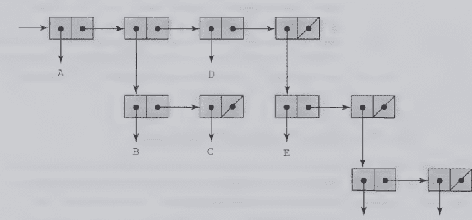

```lisp
(A B C D)
```

```lisp
(A (B C) D (E (F G)))
```

### 15.4.2 第一个 Lisp 解释器

Lisp 设计的最初意图是拥有一种尽可能接近 Fortran 的程序记法，并在必要时进行补充。这种记法称为 M-notation，即元记法。计划有一个编译器将用 M-notation 编写的程序翻译成 IBM 704 的语义等价的机器代码程序。

在 Lisp 开发早期，McCarthy 写了一篇论文来推广列表处理作为通用符号处理的方法。McCarthy 相信列表处理可用于研究可计算性，当时可计算性通常使用基于命令式计算模型的图灵机来研究。McCarthy 认为，符号列表的函数式处理比操作在代表状态的磁带上书写的符号的图灵机更自然的计算模型。研究计算的一个常见要求是必须能够证明所使用计算模型类别的某些可计算性特征。在图灵机模型的情况下，可以构造一个通用图灵机来模仿任何其他图灵机的操作。从这一概念中产生了构造一个通用 Lisp 函数的想法，该函数可以求值 Lisp 中的任何其他函数。

通用 Lisp 函数的第一个要求是一种允许函数以与数据相同的方式表达的记法。Section 15.4.1 中描述的带括号的列表记法已用于 Lisp 数据，因此决定发明函数定义和函数调用的约定，这些约定也可以用列表记法表达。函数调用以最初称为 Cambridge Polish² 的前缀列表形式指定，如下所示：

```lisp
(function_name parameter₁ … parameterₙ)
```

例如，如果 + 是一个接受两个或更多数字参数的函数，则以下两个表达式分别求值为 12 和 20：

```lisp
(+ 5 7)
(+ 3 4 7 6)
```

Section 15.2.1 中描述的 lambda 记法被选用来指定函数定义。然而，它必须被修改以允许将函数绑定到名称，以便函数可以被其他函数和自身引用。这种名称绑定由包含函数名和包含 lambda 表达式的列表的列表指定，如

```lisp
(function_name (LAMBDA ( param₁... paramₙ) expression))
```

如果你之前从未接触过函数式编程，考虑无名函数可能显得很奇怪。然而，无名函数在函数式编程中（以及在数学和命令式编程中）有时是有用的³。例如，考虑一个其作用是为立即应用于参数列表而生成一个函数的函数。所生成的函数不需要名称，因为它仅在其构造点被应用。Section 15.5.14 中给出了此类示例。

用这种新记法指定的 Lisp 函数称为 S-expressions，即符号表达式。最终，所有 Lisp 结构，无论是数据还是代码，都被称为 S-expressions。S-expression 可以是列表或原子。我们通常简单地将其称为表达式。

McCarthy 成功开发了一个可以求值任何其他函数的通用函数。该函数名为 EVAL，并且本身就是一种表达式。AI 项目中的两个人，该项目正在开发 Lisp，Stephen B. Russell 和 Daniel J. Edwards，注意到 EVAL 的实现可以用作 Lisp 解释器，并迅速构建了这样的实现（McCarthy et al., 1965）。

这次快速、简单且意外的实现有几个重要结果。首先，所有早期的 Lisp 实现都复制了 EVAL，因此都是解释性的。其次，M-notation 的定义，即 Lisp 计划的编程记法，从未完成或实现，因此 S-expressions 成为 Lisp 的唯一记法。数据和代码使用相同记法具有重要后果，其中之一将在 Section 15.5.14 中讨论。第三，大部分原始语言设计实际上被冻结，保持了语言中的某些奇怪特性，例如条件表达式形式以及使用 () 表示空列表和逻辑假。

早期 Lisp 系统的另一个显然是偶然的特性是使用动态作用域。函数在其调用者的环境中求值。当时没有人对作用域了解很多，可能也没有太多考虑选择。动态作用域在 1975 年之前被大多数 Lisp 方言使用。当代方言要么使用静态作用域，要么允许程序员在静态和动态作用域之间选择。

Lisp 解释器可以用 Lisp 编写。这样的解释器不是一个大程序，用 Lisp 描述了 Lisp 的操作语义。这是语言语义简单性的生动证据。

> 2. 这个名字最初在 Lisp 的早期开发中使用。该名称之所以选择，是因为 Lisp 列表类似于波兰逻辑学家 Jan Łukasiewicz 使用的前缀记法，并且因为 Lisp 在美国马萨诸塞州剑桥的 MIT 诞生。一些人现在更喜欢称其为 Cambridge prefix。


## 15.5 Scheme 简介

在本节中，我们描述 Scheme 的核心部分（Dybvig, 2009）。我们选择 Scheme 是因为它相对简单，在高校中很流行，而且 Scheme 解释器在多种计算机上都很容易获得（而且是免费的）。本节描述的 Scheme 版本是 Scheme 4。请注意，本节仅涵盖 Scheme 的一小部分，并且不包括 Scheme 的任何命令式特性。

### 15.5.1 Scheme 的起源

Scheme 语言是 Lisp 的一种方言，于 20 世纪 70 年代中期在麻省理工学院开发（Sussman 和 Steele, 1975）。它的特点是体积小、完全使用静态作用域，以及将函数视为一等实体。作为一等实体，Scheme 函数可以是表达式的值、列表的元素、作为参数传递，也可以从函数返回。早期版本的 Lisp 并未提供所有这些能力。

作为一种本质上无类型、语法和语义都简单的小型语言，Scheme 非常适合教育应用，例如函数式编程课程，也适合作为编程的入门介绍。

以下各节中的大多数 Scheme 代码只需稍作修改即可转换为有效的 Lisp 代码。

### 15.5.2 Scheme 解释器

交互模式下的 Scheme 解释器是一个无限的“读取-求值-打印”循环（通常缩写为 REPL）。它反复读取用户输入的表达式（以列表形式）、解释该表达式，并显示结果值。Ruby 和 Python 也使用这种形式的解释器。表达式由函数 `EVAL` 解释。字面量求值为其自身。因此，如果你向解释器输入一个数字，它只会显示该数字。对原语函数的调用表达式按以下方式求值：首先，对每个参数表达式进行求值，顺序不限。然后，将原语函数应用于参数值，并显示结果值。

当然，存储在文件中的 Scheme 程序也可以被加载和解释。

Scheme 中的注释是任何一行中分号后面的所有文本。

### 15.5.3 数值原语函数

Scheme 包含用于基本算术运算的原语函数。它们是 `+`、`-`、`*` 和 `/`，分别用于加、减、乘、除。`*` 和 `+` 可以有零个或多个参数。如果 `*` 没有参数，则返回 1；如果 `+` 没有参数，则返回 0。`+` 将其所有参数相加。`*` 将其所有参数相乘。

Lambda 表达式可以有任意数量的参数。例如，我们可以有：

```scheme
(LAMBDA (a b c x) (+ (* a x x) (* b x) c))
```

Scheme 的特殊形式函数 `DEFINE` 满足 Scheme 编程的两个基本需求：将名称绑定到值，以及将名称绑定到 lambda 表达式。`DEFINE` 中将名称绑定到值的形式可能让人以为 `DEFINE` 可以用来创建命令式语言风格的变量。然而，这些名称绑定创建的是命名值，而不是变量。

`DEFINE` 被称为特殊形式，因为它被（`EVAL`）解释的方式不同于普通的原语（如算术函数），这一点我们很快就会看到。

`DEFINE` 最简单的形式是将名称绑定到表达式的值。其形式为

```scheme
(DEFINE symbol expression)
```

例如：

```scheme
(DEFINE pi 3.14159)
(DEFINE two_pi (* 2 pi))
```

如果这两个表达式已经输入到 Scheme 解释器中，然后输入 `pi`，将显示数字 3.14159；当输入 `two_pi` 时，将显示 6.28318。在这两种情况下，显示的数字可能比此处显示的位数更多。

这种 `DEFINE` 形式类似于命令式语言中命名常量的声明。例如，在 Java 中，与上述命名等价的声明如下：

```java
final float PI = 3.14159;
final float TWO_PI = 2.0 * PI;
```

Scheme 中的名称可以由字母、数字和特殊字符（括号除外）组成；它们不区分大小写，并且不能以数字开头。

`DEFINE` 函数的第二个用途是将 lambda 表达式绑定到名称。在这种情况下，lambda 表达式通过去掉 `LAMBDA` 一词来简化。要将名称绑定到 lambda 表达式，`DEFINE` 需要两个列表作为参数。第一个参数是函数调用的原型，函数名后跟形式参数，一起放在一个列表中。第二个列表包含一个表达式，名称将被绑定到该表达式。这种 `DEFINE` 的一般形式是⁴

> 4. 实际上，`DEFINE` 的一般形式在其主体中包含一个由一个或多个表达式组成的序列，尽管在大多数情况下只包含一个。为了简单起见，我们只包含一个。

```scheme
(DEFINE (function_name parameters)
    (expression)
)
```

当然，这种 `DEFINE` 形式就是命名函数的定义。

下面这个调用 `DEFINE` 的示例将名称 square 绑定到一个接受一个参数的函数表达式：

```scheme
(DEFINE (square number) (* number number))
```

解释器对该函数求值后，就可以使用它了，例如：

```scheme
(square 5)
```

它会显示 25。

为了说明原语函数和 `DEFINE` 特殊形式之间的区别，请考虑以下内容：

```scheme
(DEFINE x 10)
```

如果 `DEFINE` 是原语函数，`EVAL` 对这个表达式的第一个操作将是求值 `DEFINE` 的两个参数。如果 `x` 尚未绑定到某个值，这将是一个错误。此外，如果 `x` 已经定义，那么这也是一个错误，因为该 `DEFINE` 会尝试重新定义 `x`，而这是非法的。记住，`x` 是一个值的名称；它不是命令式意义上的变量。

下面是另一个函数示例。它根据直角三角形的另外两条边的长度，计算斜边（最长边）的长度。

```scheme
(DEFINE (hypotenuse side1 side2)
    (SQRT (+ (square side1) (square side2))))
```

请注意，hypotenuse 使用了之前定义的 square。

### 15.5.5 输出函数

Scheme 包含一些简单的输出函数，但在与交互式解释器一起使用时，Scheme 程序的大多数输出是解释器的正常输出，即显示将 `EVAL` 应用于顶层函数的结果。

请注意，显式输入和输出并不是纯函数式编程模型的一部分，因为输入操作会改变程序状态，而输出操作具有副作用。这两者都不能成为纯函数式语言的一部分。因此，本章不描述 Scheme 的显式输入或输出函数。

### 15.5.6 数值谓词函数

谓词函数是返回布尔值（某种表示真或假的值）的函数。Scheme 包含一组用于数值数据的谓词函数。其中包括：

| 函数 | 含义 |
|---|---|
| = | 等于 |
| <> | 不等于 |
| > | 大于 |
| < | 小于 |
| >= | 大于或等于 |
| <= | 小于或等于 |
| EVEN? | 是否为偶数？ |
| ODD? | 是否为奇数？ |
| ZERO? | 是否为零？ |

请注意，所有名称以单词形式出现的预定义谓词函数都以问号结尾。在 Scheme 中，两个布尔值是 #T 和 #F（或 #t 和 #f），尽管 Scheme 预定义的谓词函数返回空列表 () 表示假。

当列表被解释为布尔值时，任何非空列表求值为真；空列表求值为假。这类似于 C 语言中整数被解释为布尔值的方式；零求值为假，任何非零值求值为真。

为了便于阅读，本章中的所有示例谓词函数都返回 #F，而不是 ()。

`NOT` 函数用于反转布尔表达式的逻辑。

### 15.5.7 控制流

Scheme 使用三种不同的控制流结构：一种类似于命令式语言中的选择结构，另外两种基于数学函数中使用的求值控制。

Scheme 的双向选择函数名为 `IF`，它有三个参数：一个谓词表达式、一个 then 表达式和一个 else 表达式。调用 `IF` 的形式为

```scheme
(IF predicate then_expression else_expression)
```

例如：

```scheme
(DEFINE (factorial n)
  (IF (<= n 1)
```


1
(* n (factorial (- n 1)))
))

回想一下，Scheme 的多重选择构造 COND 已在第 8 章讨论过。以下是使用 COND 的一个简单函数的示例：

```
(DEFINE (leap? year)
  (COND
    ((ZERO? (MODULO year 400)) #T)
    ((ZERO? (MODULO year 100)) #F)
    (ELSE (ZERO? (MODULO year 4))))
)
```

以下小节包含 COND 用法的其他示例。Scheme 的第三种控制机制是递归，它与数学中一样用于指定重复。第 15.5.10 节中的大多数示例函数都使用递归。

## 15.5.8 列表函数

Lisp 语言最常见的用途之一是列表处理。本小节介绍 Scheme 处理列表的函数。回想一下，Scheme 的列表操作已在第 6 章简要介绍过。以下是关于 Scheme 中列表处理的更详细讨论。

Scheme 程序由函数应用函数 EVAL 解释。当应用于原始函数时，EVAL 首先计算给定函数的参数。当函数调用中的实际参数本身就是函数调用时，这种操作是必要的，这经常会发生。然而，在某些调用中，参数是数据元素而不是函数引用。当参数不是函数引用时，它显然不应该被求值。我们之前没有关心这个问题，因为数值字面量总是求值到自身，不能被误认为是函数名。

假设我们有一个函数有两个参数，一个原子和一个列表，该函数的目的是确定给定的原子是否在给定的列表中。原子和列表都不应被求值；它们是要处理的字面数据。为了避免求值一个参数，它首先作为参数传递给原始函数 QUOTE，该函数只是原样返回它。以下示例说明了 QUOTE：

```
(QUOTE A) returns A
(QUOTE (A B C)) returns (A B C)
```

对 QUOTE 的调用通常通过在要引用的表达式前加上撇号（'）并省略表达式周围的括号来缩写。因此，而不是 (QUOTE (A B))，使用 '(A B)。

QUOTE 的必要性源于 Scheme（以及其他 Lisp 语言）的根本特性：数据和代码具有相同的形式。虽然这对命令式语言程序员来说可能显得奇怪，但它导致了一些有趣而强大的过程，其中之一在第 15.5.14 节中讨论。

CAR、CDR 和 CONS 函数已在第 6 章介绍。以下是 CAR 和 CDR 操作的更多示例：

```
(CAR '(A B C)) returns A
(CAR '((A B) C D)) returns (A B)
(CAR 'A) is an error because A is not a list
(CAR '(A)) returns A
(CAR '()) is an error
(CDR '(A B C)) returns (B C)
(CDR '((A B) C D)) returns (C D)
(CDR 'A) is an error
(CDR '(A)) returns ()
(CDR '()) is an error
```

CAR 和 CDR 函数的名字充其量是古怪的。这些名字的起源在于 Lisp 的第一个实现，该实现运行在 IBM 704 计算机上。704 的内存字有两个字段，名为 decrement 和 address，它们用于各种操作数寻址策略。这两个字段中的每一个都可以存储一个机器内存地址。704 还包括两个机器指令，也名为 CAR（寄存器地址部分的內容）和 CDR（寄存器减量部分的內容），用于提取相关字段。将两个字段用于存储列表节点的两个指针是自然的，这样一个内存字就可以整齐地存储一个节点。使用这些约定，704 的 CAR 和 CDR 指令提供了高效的列表选择器。这些名字被保留到所有 Lisp 方言的原语中。

作为另一个简单函数的示例，考虑

```
(DEFINE (second a_list) (CAR (CDR a_list)))
```

一旦该函数被求值，它就可以被使用，如

```
(second '(A B C))
```

它返回 B。

Scheme 中最常用的一些函数式组合被内置为单个函数。例如，(CAAR x) 等价于 (CAR (CAR x))，(CADR x) 等价于 (CAR (CDR x))，而 (CADDAR x) 等价于 (CAR (CDR (CDR (CAR x))))。在函数名中 'C' 和 'R' 之间最多四个 A 和 D 的任意组合都是合法的。作为示例，考虑以下对 CADDAR 的求值：

```
(CADDAR '((A B (C) D) E)) =
(CAR (CDR (CDR (CAR '((A B (C) D) E))))) =
(CAR (CDR (CDR '(A B (C) D)))) =
(CAR (CDR '(B (C) D))) =
(CAR '((C) D)) =
(C)
```

### 以下是 CONS 的示例调用：

```
(CONS 'A '()) returns (A)
(CONS 'A '(B C)) returns (A B C)
(CONS '() '(A B)) returns (() A B)
(CONS '(A B) '(C D)) returns ((A B) C D)
```

这些 CONS 操作的结果显示在图 15.2 中。注意 CONS 在某种意义上是 CAR 和 CDR 的逆运算。CAR 和 CDR 将列表拆开，而 CONS 从两个给定的列表部分构造一个新列表。CONS 的两个参数成为新列表的 CAR 和 CDR。因此，如果 a_list 是一个列表，则

```
(CONS (CAR a_list) (CDR a_list))
```

返回一个具有与 a_list 相同结构和相同元素的列表。

### 图 15.2

若干 CONS 操作的结果

```
(CONS 'A '())
```


```
(A)
```

```
(CONS 'A '(B C))
```

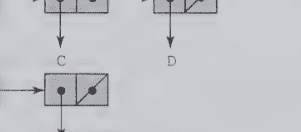

```
(A B C)
```

```
(CONS '() '(A B))
```


```
(() A B)
```

```
(CONS '(A B) '(C D))
```


```
((A B) C D)
```

仅处理本章讨论的相对简单的问题和程序，很可能不会故意将 CONS 应用于两个原子，尽管这是合法的。这种应用的结果是一个点对，因 Scheme 显示方式而得名。例如，考虑以下调用：

```
(CONS 'A 'B)
```

如果显示此结果，它将显示为

```
(A . B)
```

这个点对表示该单元不是原子和指针或指针和指针，而是两个原子。

LIST 是一个从可变数量参数构造列表的函数。它是嵌套 CONS 函数的简写形式，如下所示：

```
(LIST 'apple 'orange 'grape)
```

返回

```
(apple orange grape)
```

使用 CONS，上面的 LIST 调用写成如下：

```
(CONS 'apple (CONS 'orange (CONS 'grape '()))
```

## 15.5.9 用于符号原子和列表的谓词函数

Scheme 有三个基本的谓词函数 EQ?、NULL? 和 LIST?，用于符号原子和列表。

EQ? 函数以两个表达式作为参数，尽管它通常用于两个符号原子参数。它返回 #T，如果两个参数具有相同的指针值——即它们指向同一个原子或列表；否则返回 #F。如果两个参数是符号原子，EQ? 返回 #T，如果它们是相同的符号（因为 Scheme 不会重复创建符号）；否则返回 #F。考虑以下示例：

```
(EQ? 'A 'A) returns #T
(EQ? 'A 'B) returns #F
(EQ? 'A '(A B)) returns #F
(EQ? '(A B) '(A B)) returns #F or #T
(EQ? 3.4 (+ 3 0.4)) returns #F or #T
```

正如第四个示例所示，使用 EQ? 比较列表的结果是不一致的。其原因是完全相同的两个列表通常不会在内存中重复。Scheme 系统在创建列表时，会检查是否已存在这样的列表。如果存在，新的列表只不过是指向现有列表的指针。在这些情况下，EQ? 会判断这两个列表相等。然而，在某些情况下，可能很难检测到相同列表的存在，在这种情况下会创建一个新列表。在这种情况下，EQ? 返回 #F。

最后一个例子表明，加法可能产生一个新值，在这种情况下它与 3.4 不相等（使用 EQ?），或者它可能认识到它已经有 3.4 的值并使用它，在这种情况下 EQ? 将使用旧 3.4 的指针并返回 #T。

正如我们所见，EQ? 对符号原子有效，但不一定对数值原子有效。= 谓词对数值原子有效，但不适用于符号原子。如前所述，EQ? 对列表参数也不可靠。

有时方便能够测试两个原子的相等性，而不知道它们是符号还是数值。为此目的，Scheme 有一个不同的谓词 EQV?，它同时适用于数值和符号原子。考虑以下示例：

```
(EQV? 'A 'A) returns #T
(EQV? 'A 'B) returns #F
(EQV? 3 3) returns #T
(EQV? 'A 3) returns #F
(EQV? 3.4 (+ 3 0.4)) returns #T
(EQV? 3.0 3) returns #F
```

注意，最后一个示例表明浮点值与整数值不同。EQV? 不是指针比较，而是值比较。

使用 EQ? 或 = 而不是 EQV? 的主要原因是，当可能时，EQ? 和 = 比 EQV? 更快。

LIST? 谓词函数如果其唯一参数是列表则返回 #T，否则返回 #F，如以下示例所示：

```
(LIST? '(X Y)) returns #T
(LIST? 'X) returns #F
(LIST? '()) returns #T
```

NULL? 函数测试其参数以确定它是否是空列表，如果是则返回 #T。考虑以下示例：


# 15.5.10 示例 Scheme 函数

本节包含若干 Scheme 函数定义的示例。这些程序解决了简单的列表处理问题。

考虑在不包含子列表的给定列表中查找给定原子的成员问题。这样的列表称为简单列表。如果函数命名为 member，它可以如下使用：

```
(member 'B '(A B C)) returns #T
(member 'B '(A C D E)) returns #F
```

从迭代的角度思考，成员问题就是将给定原子与给定列表的各个元素逐一按某种顺序比较，直到找到匹配项或列表中没有更多元素可比较为止。可以使用递归实现类似的过程。函数可以将给定原子与列表的 CAR 进行比较。如果匹配，则返回 #T。如果不匹配，则应忽略列表的 CAR 并在列表的 CDR 上继续搜索。这可以通过让函数用列表的 CDR 作为列表参数调用自身并返回此递归调用的结果来实现。此过程将在给定原子在列表中找到时结束。如果原子不在列表中，函数最终会由自身调用时以空列表作为实际参数。那时必须强制函数返回 #F。在此过程中，有两种退出递归的方式：要么在某次调用中列表为空，此时返回 #F，要么找到匹配项并返回 #T。

总的来说，函数中必须处理的共有三种情况：空输入列表、原子与列表的 CAR 匹配、原子与列表的 CAR 不匹配从而导致递归调用。这三种情况就是 COND 的三个参数，最后一个是被 ELSE 谓词触发的默认情况。完整的函数如下：

```
(DEFINE (member atm a_list)
  (COND
    ((NULL? a_list) #F)
    ((EQ? atm (CAR a_list)) #T)
    (ELSE (member atm (CDR a_list)))
  ))
```

这种形式是简单 Scheme 列表处理函数的典型形式。在此类函数中，列表中的数据一次处理一个元素。单个元素用 CAR 指定，并使用对列表 CDR 的递归继续处理。

请注意，空测试必须在相等测试之前进行，因为对空列表应用 CAR 是错误。

作为另一个示例，考虑判断两个给定列表是否相等的问题。如果两个列表都是简单的，解决方案相对容易，尽管其中涉及读者可能不熟悉的一些编程技术。用于比较简单列表的谓词函数 equalsimp 如下所示：

```
(DEFINE (equalsimp list1 list2)
  (COND
    ((NULL? list1) (NULL? list2))
    ((NULL? list2) #F)
    ((EQ? (CAR list1) (CAR list2))
      (equalsimp (CDR list1) (CDR list2)))
    (ELSE #F)
  ))
```

第一个情况，即由 COND 的第一个参数处理的情况，是第一个列表参数为空列表时。外部调用中如果第一个列表参数最初为空就会发生这种情况。由于递归调用使用两个参数列表的 CDR 作为其参数，因此在这种调用中第一个列表参数可能为空（如果第一个列表参数现在为空）。当第一个列表参数为空时，必须检查第二个列表参数是否也为空。如果是，则它们相等（最初或在之前所有递归调用中 CAR 都相等），NULL? 正确返回 #T。如果第二个列表参数不为空，则它比第一个列表参数大，应返回 #F，正如 NULL? 所做的那样。

下一个情况处理第一个列表非空而第二个列表为空的情况。这种情况仅在第一个列表比第二个列表长时发生。只需测试第二个列表，因为第一种情况捕获了第一个列表为空的所有实例。

第三种情况是递归步骤，用于测试两个列表中对应元素的相等性。它通过比较两个非空列表的 CAR 来实现。如果它们相等，则两个列表到该点为止相等，因此对两个列表的 CDR 使用递归。当发现两个不相等的原子时，此情况失败。发生这种情况时，无需继续处理，因此选择默认情况 ELSE，它返回 #F。

请注意 equalsimp 期望参数为列表，如果任一或两个参数为原子则不会正确运行。

比较一般列表的问题比这稍复杂一些，因为在比较过程中必须完全追踪子列表。在这种情况下，递归的威力是独一无二的适用，因为子列表的形式与给定列表的形式相同。只要两个给定列表的对应元素是列表，它们就被分离为其两部分 CAR 和 CDR，并对它们使用递归。这是分而治之方法有用性的完美示例。如果两个给定列表的对应元素是原子，则可以使用 EQ? 简单比较它们。

## 完整函数的定义如下：

```
(DEFINE (equal list1 list2)
  (COND
    ((NOT (LIST? list1)) (EQ? list1 list2))
    ((NOT (LIST? list2)) #F)
    ((NULL? list1) (NULL? list2))
    ((NULL? list2) #F)
    ((equal (CAR list1) (CAR list2))
     (equal (CDR list1) (CDR list2)))
    (ELSE #F)
  ))
```

COND 的前两种情况处理任一参数为原子而非列表的情况。第三和第四种情况用于一个或两个列表为空的情况。这些情况还防止后续情况尝试对空列表应用 CAR。第五个 COND 情况最有趣。其谓词是对列表的 CAR 使用参数进行的递归调用。如果此递归调用返回 #T，则再次对列表的 CDR 使用递归。此算法允许两个列表包含任意深度的子列表。

此 equal 的定义适用于任何一对表达式，而不仅仅是列表。equal 等价于系统谓词函数 EQUAL?。请注意，只有在必要时才应使用 EQUAL?（实际参数的形式未知），因为它比 EQ? 和 EQV? 慢得多。

另一个常用的列表操作是构造一个新列表，其中包含两个给定列表参数的所有元素。这通常实现为名为 append 的 Scheme 函数。结果列表可以通过重复使用 CONS 将第一个列表参数的元素放置到第二个列表参数中，后者成为结果列表。为了说明 append 的作用，请考虑以下示例：

```
(append '(A B) '(C D R)) returns (A B C D R)
(append '((A B) C) '(D (E F))) returns ((A B) C D (E F))
```

## append 的定义是

```
(DEFINE (append list1 list2)
  (COND
    ((NULL? list1) list2)
    (ELSE (CONS (CAR list1) (append (CDR list1) list2)))
  ))
```

第一个 COND 情况用于在第一个参数列表为空时终止递归过程，返回第二个列表。在第二种情况（ELSE）中，第一个参数列表的 CAR 被 CONS 到递归调用返回的结果上，该递归调用将第一个列表的 CDR 作为其第一个参数传递。

考虑以下名为 guess 的 Scheme 函数，它使用了本节中描述的 member 函数。在阅读下面的描述之前，尝试确定它的作用。假设参数是简单列表。

```
(DEFINE (guess list1 list2)
  (COND
    ((NULL? list1) '())
    ((member (CAR list1) list2)
      (CONS (CAR list1) (guess (CDR list1) list2)))
    (ELSE (guess (CDR list1) list2)))
)
```

guess 生成一个简单列表，其中包含其两个参数列表的公共元素。因此，如果参数列表表示集合，guess 计算的列表表示这两个集合的交集。

# 15.5.11 LET

LET 是在第 5 章中最初描述的函数，它创建了一个局部作用域，在该作用域中名称临时绑定到表达式的值。它通常用于从更复杂的表达式中提取公共子表达式。这些名称随后可以在另一个表达式的求值中使用，但它们不能在 LET 中重新绑定为新值。以下示例说明了 LET 的用法。它计算给定二次方程的根，假设根是实数。二次方程 ax² + bx + c 的实数（与复数相对）根的数学定义如下：root1 = (−b + sqrt(b² − 4 ac))/2a 和 root 2 = (−b − sqrt(b² − 4 ac))/2 a

```
(DEFINE (quadratic_roots a b c)
  (LET (
    (root_part_over_2a
      (/ (SQRT (- (* b b) (* 4 a c))) (* 2 a)))
    (minus_b_over_2a (/ (- 0 b) (* 2 a)))
  )
  (LIST (+ minus_b_over_2a root_part_over_2a)
        (- minus_b_over_2a root_part_over_2a)))
)
```

此示例使用 LIST 创建构成结果的两个值的列表。

由于 LET 构造第一部分中绑定的名称不能在以下表达式中更改，因此它们与

> 7. 一些版本的 Scheme 包含“complex”作为数据类型，并将计算方程的根，无论它们是实数还是复数。


a block in an imperative language. They could all be eliminated by textual substitution of their respective expressions for their names in the LET expression. LET is actually shorthand for a LAMBDA expression applied to a parameter. The following two expressions are equivalent:

```
(LET ((alpha 7)) (* 5 alpha))
((LAMBDA (alpha) (* 5 alpha)) 7)
```

In the first expression, 7 is bound to alpha with LET; in the second, 7 is bound to alpha through the parameter of the LAMBDA expression.

## 15.5.12 Tail Recursion in Scheme

A function is tail recursive if its recursive call is the last operation in the function. This means that the return value of the recursive call is the return value of the nonrecursive call to the function. For example, the member function of Section 15.5.10, repeated here, is tail recursive.

```
(DEFINE (member atm a_list)
  (COND
    ((NULL? a_list) #F)
    ((EQ? atm (CAR a_list)) #T)
    (ELSE (member atm (CDR a_list)))
  ))
```

This function can be automatically converted by a compiler to use iteration, resulting in faster execution than in its recursive form.

However, many functions that use recursion for repetition are not tail recursive. Programmers who were concerned with efficiency have discovered ways to rewrite some of these functions so that they are tail recursive. One example of this uses an accumulating parameter and a helper function. As an example of this approach, consider the factorial function from Section 15.5.7, which is repeated here:

```
(DEFINE (factorial n)
  (IF (<= n 1)
    1
    (* n (factorial (- n 1))))
)
```

The last operation of this function is the multiplication. The function works by creating the list of numbers to be multiplied together and then doing the multiplications as the recursion unwinds to produce the result. Each of these numbers is created by an activation of the function and each is stored in an activation record instance. As the recursion unwinds the numbers are multiplied together. Recall that the stack is shown after several recursive calls to factorial in Chapter 9. This factorial function can be rewritten with an auxiliary helper function, which uses a parameter to accumulate the partial factorial. The helper function, which is tail recursive, also takes factorial’s parameter. These functions are as follows:

```
(DEFINE (facthelper n factpartial)
    (IF (<= n 1)
        factpartial
        (facthelper (- n 1) (* n factpartial))
    ))
(DEFINE (factorial n)
    (facthelper n 1)
)
```

With these functions, the result is computed during the recursive calls, rather than as the recursion unwinds. Because there is nothing useful in the activation record instances, they are not necessary. Regardless of how many recursive calls are requested, only one activation record instance is necessary. This makes the tail-recursive version far more efficient than the non-tail-recursive version.

The Scheme language definition requires that Scheme language processing systems convert all tail-recursive functions to replace that recursion with iteration. Therefore, it is important, at least for efficiency’s sake, to define functions that use recursion to specify repetition to be tail recursive. Some optimizing compilers for some functional languages can even perform conversions of some non-tail-recursive functions to equivalent tail-recursive functions and then code these functions to use iteration instead of recursion for repetition.

## 15.5.13 Functional Forms

This section describes two common mathematical functional forms that are provided by Scheme: composition and apply-to-all. Both are mathematically defined in Section 15.2.2.

### 15.5.13.1 Functional Composition

Functional composition is the only primitive functional form provided by the original Lisp. All subsequent Lisp dialects, including Scheme, also provide it. As stated in Section 15.2.2, function composition is a functional form that takes two functions as parameters and returns a function that first applies the second parameter function to its parameter and then applies the first parameter function to the return value of the second parameter function. In other words, the function h is the composition function of f and g if h(x) = f(g(x)). For example, consider the following example:

```
(DEFINE (g x) (* 3 x))
(DEFINE (f x) (+ 2 x))
```

Now the functional composition of f and g can be written as follows:

```
(DEFINE (h x) (+ 2 (* 3 x)))
```

In Scheme, the functional composition function compose can be written as follows:

```
(DEFINE (compose f g) (LAMBDA (x) (f (g x))))
```

For example, we could have the following:

```
((compose CAR CDR) '((a b) c d))
```

This call would yield c. This is an alternative, though less efficient, form of CADR. Now consider another call to compose:

```
((compose CDR CAR) '((a b) c d))
```

This call would yield (b). This is an alternative to CDAR.

As yet another example of the use of compose, consider the following:

```
(DEFINE (third a_list)
  ((compose CAR (compose CDR CDR)) a_list))
```

This is an alternative to CADDR.

### 15.5.13.2 An Apply-to-All Functional Form

The most common functional forms provided in functional programming languages are variations of mathematical apply-to-all functional forms. The simplest of these is map, which has two parameters: a function and a list. map applies the given function to each element of the given list and returns a list of the results of these applications. A Scheme definition of map follows.8

```
(DEFINE (map fun a_list)
  (COND
    ((NULL? a_list) '())
    (ELSE (CONS (fun (CAR a_list)) (map fun (CDR a_list))))
  ))
```

Note the simple form of map, which expresses a complex functional form.

As an example of the use of map, suppose we want all of the elements of a list cubed. We can accomplish this with the following:

```
(map (LAMBDA (num) (* num num num)) '(3 4 2 6))
```

8. As was the case with member, map is a predefined function that cannot be redefined by users.

This call returns (27 64 8 216).

Note that in this example, the first parameter to map is a LAMBDA expression. When EVAL evaluates the LAMBDA expression, it constructs a function that has the same form as any predefined function except that it is nameless. In the example expression, this nameless function is immediately applied to each element of the parameter list and the results are returned in a list.

## 15.5.14 Functions That Build Code

The fact that programs and data have the same structure can be exploited in constructing programs. Recall that the Scheme interpreter uses a function named EVAL. The Scheme system applies EVAL to every expression typed, whether it is at the Scheme prompt in the interactive interpreter or is part of a program being interpreted. The EVAL function can also be called directly by Scheme programs. This provides the possibility of a Scheme program creating expressions and calling EVAL to evaluate them. This is not something that is unique to Scheme, but the simple forms of its expressions make it easy to create them during execution.

One of the simplest examples of this process involves numeric atoms. Recall that Scheme includes a function named +, which takes any number of numeric atoms as arguments and returns their sum. For example, (+ 3 7 10 2) returns 22.

Our problem is the following: Suppose that in a program we have a list of numeric atoms and need the sum. We cannot apply + directly on the list, because + can take only atomic parameters, not a list of numeric atoms. We could, of course, write a function that repeatedly adds the CAR of the list to the sum of its CDR, using recursion to go through the list. Such a function follows:

```
(DEFINE (adder a_list)
  (COND
    ((NULL? a_list) 0)
    (ELSE (+ (CAR a_list) (adder (CDR a_list))))
  ))
```

Following is an example call to adder, along with the recursive calls and returns:

```
(adder '(3 4 5))
(+ 3 (adder (4 5)))
(+ 3 (+ 4 (adder (5))))
(+ 3 (+ 4 (+ 5 (adder ()))))
(+ 3 (+ 4 (+ 5 0)))
(+ 3 (+ 4 5))
(+ 3 9)
12
```

An alternative solution to the problem is to write a function that builds a call to + with the proper parameter forms. This can be done by using CONS to


## 15.6 Common Lisp

构建一个新列表，该列表与参数列表相同，只是其开头插入了原子 +。然后可以将此新列表提交给 EVAL 进行求值，如下所示：

```
(DEFINE (adder a_list)
  (COND
    ((NULL? a_list) 0)
    (ELSE (EVAL (CONS '+ a_list))))
)
```

请注意，+ 函数的名称被引用以防止 EVAL 在求值 CONS 时对其进行求值。以下是此新版本 adder 的示例调用，以及对 EVAL 的调用和返回值：

```
(adder '(3 4 5))
(EVAL '(+ 3 4 5))
12
```

在 Scheme 的所有早期版本中，EVAL 函数都在程序的最外层作用域中求值其表达式。从 Scheme 4 开始的 Scheme 后续版本要求 EVAL 的第二个参数指定表达式将被求值的作用域。为了简单起见，我们在示例中省略了作用域参数，并且在此不讨论作用域名称。

Common Lisp（Steele, 1990）是在努力将 1980 年代初期几种 Lisp 方言，包括 Scheme 的特性结合成一种语言时创建的。作为一种语言的联合体，它相当庞大且复杂，在这些方面与 C++ 和 C# 相似。然而，其基础是原始的 Lisp，因此其语法、原始函数和基本特性都来自该语言。

以下是用 Common Lisp 编写的阶乘函数：

```
(DEFUN factorial (n)
  (IF (<= n 1)
      1
      (* n (factorial (- n 1)))))
```

此函数的第一行在语法上与 Scheme 版本的相同函数不同。

Common Lisp 的特性列表很长：大量数据类型和结构，包括记录、数组、复数和字符字符串；强大的输入输出操作；以及用于模块化函数和数据集合的包形式，并提供访问控制。Common Lisp 包含几种命令式构造，以及一些可变类型。

认识到动态作用域偶尔提供的灵活性，以及静态作用域的简单性，Common Lisp 允许两者。变量的默认作用域是静态的，但通过将变量声明为“special”，该变量变为动态作用域。

宏在 Common Lisp 中经常用于扩展语言。事实上，一些预定义函数实际上是宏。例如，DOLIST，它接受两个参数，一个变量和一个列表，是一个宏。例如，考虑以下内容：

```
(DOLIST (x '(1 2 3)) (print x))
```

这会产生以下输出：

```
1
2
3
NIL
```

这里的 NIL 是 DOLIST 的返回值。

宏以两步创建其效果：首先，宏被展开。其次，展开的宏，即 Lisp 代码，被求值。用户可以使用 DEFMACRO 定义自己的宏。

Common Lisp 的反引号运算符（\`）类似于 Scheme 的 QUOTE，只是参数的某些部分可以通过在其前面加上逗号来取消引用。例如，考虑以下两个示例：

```
`(a (* 3 4) c)
```

此表达式求值为 `(a (* 3 4) c)`。然而，以下表达式：

```
`(a ,(* 3 4) c)
```

求值为 `(a 12 c)`。

Lisp 实现有一个称为 reader 的前端，它将 Lisp 程序的文本转换为代码表示。然后，代码表示中的宏调用被展开为代码表示。此步骤的输出随后被解释或编译为主机计算机的机器语言，或者可能编译为可以解释的中间代码。

存在一种特殊的宏，称为 reader 宏或 read 宏，它们在 Lisp 语言处理器的 reader 阶段展开。reader 宏将特定字符扩展为 Lisp 代码字符串。例如，Lisp 中的撇号是一个 read 宏，它扩展为对 QUOTE 的调用。用户可以定义自己的 reader 宏来创建其他简写构造。

Common Lisp 以及其他基于 Lisp 的语言都有符号数据类型。保留字是求值为自身的符号，T 和 NIL 也是如此。从技术上讲，符号要么是绑定，要么是未绑定。参数符号在函数被求值时被绑定。此外，名称为命令式变量的符号并且已被赋值的符号也被绑定。其他符号是未绑定的。例如，考虑以下表达式：

```
(LIST '(A B C))
```

符号 A、B 和 C 是未绑定的。回想一下 Ruby 也有符号数据类型。

从某种意义上说，Scheme 和 Common Lisp 是相反的。Scheme 远小且语义更简单，部分原因是它排他性地使用静态作用域，但也是因为它被设计用于教授编程，而 Common Lisp 旨在成为一种商业语言。Common Lisp 已成功成为人工智能应用等领域的广泛使用语言。另一方面，Scheme 更常用于函数式编程的大学课程。它也更有可能被研究为一种函数式语言，因为其相对较小。Common Lisp 的一个重要设计目标使其成为一种大型语言，即希望使其与它所衍生的几种 Lisp 方言兼容。

Common Lisp 对象系统（CLOS）（Paepcke, 1993）在 1980 年代后期作为 Common Lisp 的面向对象版本而开发。这种语言支持泛型函数和多重继承等构造。

## 15.7 ML

ML（Milner et al., 1997）是一种静态作用域的函数式编程语言，像 Scheme 一样。然而，它在许多重要方面与 Lisp 及其方言，包括 Scheme 不同。一个重要区别是 ML 是一种强类型语言，而 Scheme 基本上是无类型的。ML 对函数参数和函数返回类型有类型声明，尽管由于其类型推断，它们通常不被使用。每个变量和表达式的类型都可以静态确定。ML 与其他函数式编程语言一样，没有命令式语言意义上的变量。它确实有标识符，它们看起来像命令式语言中变量的名称。然而，这些标识符最好被视为值的名称。一旦设置，就不能更改。它们类似于命令式语言中的命名常量，如 Java 中的 final 声明。ML 标识符没有固定类型——任何标识符都可以是任何类型值的名称。

一个称为求值环境的表存储程序中所有隐式和显式声明的标识符的名称以及它们的类型。这类似于运行时的符号表。当标识符被声明时，无论是隐式还是显式，它都会被放置在求值环境中。

Scheme 和 ML 之间的另一个重要区别是，ML 使用的语法更接近命令式语言而不是 Lisp。例如，算术表达式在 ML 中使用中缀表示法编写。

### ML 中的函数声明

ML 中的函数声明采用一般形式

```
fun function_name(formal parameters) = expression;
```

调用时，表达式的值由函数返回。实际上，表达式可以是分号分隔的表达式列表，并用括号括起来。在这种情况下，返回值是最后一个表达式的值。当然，除非它们有副作用，否则在最后一个之前的表达式没有任何目的。因为我们不考虑 ML 中有副作用的部分，所以我们只考虑具有单个表达式的函数定义。

现在我们可以讨论类型推断。考虑以下 ML 函数声明：

```
fun circumf(r) = 3.14159 * r * r;
```

这指定了一个名为 circumf 的函数，它接受一个浮点数（ML 中的 real）参数并产生一个浮点数结果。类型是从表达式中文字的类型推断出来的。同样，在函数中

```
fun times10(x) = 10 * x;
```

参数和函数值被推断为 int 类型。

考虑以下 ML 函数：

```
fun square(x) = x * x;
```

ML 根据函数定义中的 * 运算符确定参数和返回值的类型。因为这是一个算术运算符，所以参数和函数的类型被假定为数值。在 ML 中，默认的数值类型是 int。因此，推断出 square 的参数和返回值的类型为 int。

如果 square 被浮点值调用，如

```
square(2.75);
```

它会引发错误，因为 ML 不会将 real 值强制转换为 int 类型。如果我们希望 square 接受 real 参数，它可以重写为

```
fun square(x) : real = x * x;
```

由于 ML 不允许重载函数，此版本不能与之前的 int 版本共存。最后定义的版本将是唯一的一个。

函数值被键入为 real 的事实足以推断参数也是 real 类型。以下每个定义也是合法的：

```
fun square(x : real) = x * x;
fun square(x) = (x : real) * x;
fun square(x) = x * (x : real);
```


类型推断也在函数式语言 Miranda、Haskell 和 F# 中使用。

ML 的选择控制流构造与命令式语言相似。它具有以下一般形式：

```
if expression then then_expression else else_expression
```

第一个表达式必须求值为布尔值。

Scheme 的条件表达式可以在 ML 中出现在函数定义级别。在 Scheme 中，COND 函数用于确定给定参数的值，而该值又指定 COND 返回的值。在 ML 中，函数对给定参数的不同形式执行的计算可以被定义。这种特性旨在模仿数学中条件函数定义的格式和含义。在 ML 中，定义函数返回值特定表达式是通过对给定参数进行模式匹配来选择的。例如，不使用这种模式匹配，计算阶乘的函数可以写成如下形式：

```
fun fact(n : int) : int = if n <= 1 then 1
    else n * fact(n - 1);
```

可以使用参数模式匹配编写函数的多个定义。取决于参数形式的不同的函数定义由或符号（|）分隔。例如，使用模式匹配，阶乘函数可以写成如下形式：

```
fun fact(0) = 1
|   fact(1) = 1
| fact(n : int) : int = n * fact(n - 1);
```

如果 fact 使用实际参数 0 调用，则使用第一个定义；如果实际参数为 1，则使用第二个定义；如果发送的是既不是 0 也不是 1 的 int 值，则使用第三个定义。

如第 6 章所述，ML 支持列表和列表操作。回想一下，hd、tl 和 :: 是 ML 中 Scheme 的 CAR、CDR 和 CONS 的版本。

由于存在模式化函数参数，hd 和 tl 函数在 ML 中比 CAR 和 CDR 在 Scheme 中使用的频率要低得多。例如，在形式参数中，表达式

```
(h :: t)
```

实际上是两个形式参数，即给定列表参数的头和尾，而单个对应的实际参数是一个列表。例如，给定列表中的元素数量可以用以下函数计算：

```
fun length([]) = 0
|   length(h :: t) = 1 + length(t);
```

作为这些概念的另一个例子，考虑 append 函数，它的作用与 Scheme 的 append 函数相同：

```
fun append([], lis2) = lis2
| append(h :: t, lis2) = h :: append(t, lis2);
```

该函数中的第一种情况处理函数被调用时第一个参数为空列表的情况。这种情况也在初始调用具有非空第一个参数时终止递归。函数的第二种情况将第一个参数列表分解为其头和尾（hd 和 tl）。头被 CONS 到递归调用的结果上，该递归调用使用尾作为其第一个参数。

在 ML 中，名称通过以下形式的值声明语句绑定到值

```
val new_name = expression;
```

例如，

```
val distance = time * speed;
```

不要以为该语句与命令式语言中的赋值语句完全相同，因为它不是。val 语句将名称绑定到值，但该名称不能稍后重新绑定到新值。好吧，从某种意义上说它可以。实际上，如果你用第二个 val 语句重新绑定一个名称，它会在求值环境中创建一个与名称的先前版本无关的新条目。事实上，在新的绑定之后，先前的绑定（用于先前绑定的）的旧求值环境条目不再可见。此外，新绑定的类型不必与先前绑定的类型相同。val 语句没有副作用。它们只是向当前求值环境添加一个名称并将其绑定到一个值。

val 的正常用法是在 let 表达式中。⁹ 考虑以下示例：

```
let val radius = 2.7
    val pi = 3.14159
in pi * radius * radius
end;
```

ML 包含几种在函数式编程中常用的高阶函数。其中包括用于列表的过滤函数 filter，它将谓词函数作为其参数。谓词函数通常以 lambda 表达式给出，在 ML 中 lambda 表达式与函数定义完全相同，只是使用 fn 保留字而不是 fun，当然 lambda 表达式是无名的。filter 返回一个函数，该函数将列表作为参数。它用谓词测试列表的每个元素。谓词返回 true 的每个元素都会被添加到一个新列表中，该列表是函数的返回值。考虑以下 filter 的用法：

9. let 表达式在 ML 中于第 5 章引入。

```
filter(fn(x) => x < 100, [25, 1, 50, 711, 100, 150, 27, 161, 3]);
```

此应用将返回 [25, 1, 50, 27, 3]。

map 函数接受一个参数，即一个函数。 resulting 函数将列表作为参数。它将自己的函数应用于列表的每个元素，并返回这些应用结果的列表。考虑以下代码：

```
fun cube x = x * x * x;
val cubeList = map cube;
val newList = cubeList [1, 3, 5];
```

执行后，newList 的值为 [1, 27, 125]。这可以通过将 cube 函数定义为 lambda 表达式来更简单地完成，如下所示：

```
val newList = map (fn x => x * x * x, [1, 3, 5]);
```

ML 有一个用于组合两个函数的二元运算符 o（小写“oh”）。例如，要构建一个函数 h，它首先应用函数 f，然后对 f 返回的值应用函数 g，我们可以使用以下方法：

```
val h = g o f;
```

严格来说，ML 函数接受单个参数。当函数定义了多个参数时，ML 将参数视为元组，即使通常分隔元组值的括号是可选的。分隔参数（元组元素）的逗号是必需的。

柯里化过程用一个参数的函数替换具有多个参数的函数，该函数返回一个函数，该函数接受初始函数的其他参数。

ML 中接受多个参数的函数可以通过省略参数之间的逗号（以及分隔的括号）以柯里化形式定义。10 例如，我们可以有以下内容：

```
fun add a b = a + b;
```

虽然这似乎定义了一个有两个参数的函数，但它实际上只定义了一个参数的函数。add 函数接受一个整数参数（a）并返回一个也接受整数参数（b）的函数。对此函数的调用也排除参数之间的逗号，如下所示：

```
add 3 5;
```

此对 add 的调用返回 8，正如预期的那样。

> 10. 这种形式的函数以研究它们的英国数学家 Haskell Curry 的名字命名。

柯里化函数之所以有趣且有用，是因为可以通过部分求值从中构造新函数。部分求值意味着函数使用一个或多个最左边的形式参数的实际参数进行求值。例如，我们可以按如下方式定义一个新函数：

```
fun add5 x = add 5 x;
```

add5 函数采用实际参数 5 并使用 5 作为其第一个形式参数的值来求值 add 函数。它返回一个函数，该函数将其单个参数加 5，如下所示：

```
val num = add5 10;
```

num 的值现在为 15。我们可以从柯里化函数 add 创建任意数量的新函数，以将任何特定数字添加到给定参数。

柯里化函数也可以在 Scheme、Haskell 和 F# 中编写。考虑以下 Scheme 函数：

```
(DEFINE (add x y) (+ x y))
```

其柯里化版本如下：

```
DEFINE (add y) (LAMBDA (x) (+ y x))
```

这可以按如下方式调用：

```
((add 3) 4)
```

ML 有枚举类型、数组和元组。ML 还有异常处理和用于实现抽象数据类型模块设施。

ML 对编程语言的演变产生了重大影响。对于语言研究人员来说，它已成为最受研究的语言之一。此外，它还催生了几种后续语言，其中包括 Haskell、Caml、OCaml 和 F#。

## 15.8 Haskell

Haskell（Thompson, 1999）与 ML 相似，因为它使用类似的语法，是静态作用域的，是强类型的，并使用相同的类型推断方法。Haskell 与 ML 不同的三个特点是：首先，Haskell 中的函数可以重载（ML 中的函数不能）。其次，Haskell 使用非严格语义，而 ML（和大多数其他编程语言）使用严格语义。第三，Haskell 是一种纯函数式编程语言，意味着它没有具有副作用的表达式或语句，而 ML 允许一些副作用（例如，ML 具有可变


arrays). 既非严格语义也非函数重载将在本节后面进一步讨论。

本节中的代码使用的是 Haskell 1.4 版本。

考虑以下使用参数模式匹配定义的阶乘函数：

```
fact 0 = 1
fact 1 = 1
fact n = n * fact (n - 1)
```

注意此定义与其在第 15.7 节中的 ML 版本之间的语法差异。首先，没有保留字来引入函数定义（ML 中的 fun）。其次，函数的备选定义（具有不同的形式参数）外观都相同。

使用模式匹配，我们可以用以下方式定义一个计算第 n 个斐波那契数的函数：

```
fib 0 = 1
fib 1 = 1
fib (n + 2) = fib (n + 1) + fib n
```

可以在函数定义的行上添加守卫，以指定定义可应用的条件。例如，

```
fact n
  | n == 0 = 1
  | n == 1 = 1
  | n > 1 = n * fact(n - 1)
```

这个阶乘定义比前一个更精确，因为它将实际参数值的范围限制为其可工作的那些值。这种函数定义形式称为条件表达式，源自其所基于的数学表达式。

otherwise 可以作为条件表达式中的最后一个条件出现，其语义显而易见。例如，

```
sub n
  | n < 10    = 0
  | n > 100   = 2
  | otherwise = 1
```

注意这里的守卫与第 8 章中讨论的守卫命令之间的相似性。

考虑以下函数定义，其目的与第 15.7 节中对应的 ML 函数相同：

```
square x = x * x
```

然而，在这种情况下，由于 Haskell 对多态性的支持，此函数可以接受任何数值类型的参数。
与 ML 一样，列表在 Haskell 中用方括号书写，如

```
colors = ["blue", "green", "red", "yellow"]
```

Haskell 包含一组列表运算符。例如，列表可以用 ++ 连接，: 用作 CONS 的中缀版本，而 .. 用于在列表中指定算术序列。例如，

```
5:[2, 7, 9] results in [5, 2, 7, 9]
[1, 3..11] results in [1, 3, 5, 7, 9, 11]
[1, 3, 5] ++ [2, 4, 6] results in [1, 3, 5, 2, 4, 6]
```

注意 : 运算符与 ML 的 :: 运算符类似。11 使用 : 和模式匹配，我们可以定义一个简单的函数来计算给定数字列表的乘积：

```
product [] = 1
product (a:x) = a * product x
```

使用 product，我们可以用更简单的形式写出阶乘函数

```
fact n = product [1..n]
```

Haskell 包含一个 let 构造，其与 ML 的 let 和 val 相似。例如，我们可以写

```
quadratic_root a b c =
    let minus_b_over_2a = - b / (2.0 * a)
        root_part_over_2a =
            sqrt(b ^ 2 - 4.0 * a * c) / (2.0 * a)
    in
        minus_b_over_2a - root_part_over_2a,
        minus_b_over_2a + root_part_over_2a
```

Haskell 的列表推导式已在第 6 章中介绍。例如，考虑以下内容：

```
[n * n * n | n <- [1..50]]
```

这定义了从 1 到 50 的数字的立方列表。它读作“所有 n*n*n 的列表，其中 n 取自 1 到 50 的范围。” 在这种情况下，限定符采用生成器的形式。它生成从 1 到 50 的数字。在其他

> 11. 有趣的是，ML 使用 : 将类型名附加到名称上，而使用 :: 表示 CONS，而 Haskell 则以完全相反的方式使用这两个运算符。

情况下，限定符采用布尔表达式的形式，它们被称为测试。这种记法可用于描述执行许多事情的算法，例如查找列表的排列和对列表进行排序。例如，考虑以下函数，当给定一个数字 n 时，它返回其所有因子组成的列表：

```
factors n = [ i | i <- [1..n `div` 2], n `mod` i == 0]
```

factors 中的列表推导式创建一个数字列表，每个数字暂时绑定到名称 i，范围从 1 到 n/2，使得 n `mod` i 为零。这确实是对给定数字的因子的一种非常精确且简短的定义。包围 div 和 mod 的反引号（反向撇号）用于指定这些函数的中缀使用。当它们以函数式记法调用时，如 div n 2，则不使用反引号。

接下来，考虑以下快速排序算法的实现所展示的 Haskell 的简洁性：

```
sort [] = []
sort (h:t) = sort [b | b <- t, b <= h]
            ++ [h] ++
               sort [b | b <- t, b > h]
```

在此程序中，小于或等于列表头的列表元素集合被排序并与头元素连接，然后大于列表头的元素集合被排序并连接到前一个结果。此快速排序的定义比用命令式语言编写的相同算法显著更短、更简单。

如果编程语言要求所有实际参数都完全求值，从而确保函数的值不依赖于参数求值的顺序，则该语言是严格的。如果语言没有严格要求，则为非严格。非严格语言相对于严格语言有几个明显的优势。首先，非严格语言通常更高效，因为避免了一些求值。12 其次，非严格语言可以实现一些严格语言无法实现的有趣功能。其中之一就是无限列表。非严格语言可以使用一种称为惰性求值的求值形式，这意味着表达式仅在需要其值时才求值。

回想一下，在 Scheme 中，函数的参数在函数被调用之前完全求值，因此它具有严格语义。惰性求值意味着实际参数仅在其值对求值函数必要时才求值。因此，如果一个函数有两个参数，但在函数的一次特定执行中第一个参数未被使用，则为该执行传递的实际参数将不会被求值。此外，如果函数的一次执行只需要实际参数的一部分被求值，其余部分则保持未求值。最后，实际参数最多只求值一次，如果求值的话，即使在函数调用中同一个实际参数出现多次也是如此。

如前所述，惰性求值允许定义无限数据结构。例如，考虑以下内容：

```
positives = [0..]
evens = [2, 4..]
squares = [n * n | n <- [0..]]
```

当然，没有计算机可以真正表示这些列表中的所有数字，但如果使用惰性求值，这并不会妨碍其使用。例如，如果我们想知道某个特定数字是否是完全平方，我们可以用成员函数检查 squares 列表。假设我们有一个名为 member 的谓词函数，用于确定给定的原子是否包含在给定的列表中。那么我们就可以像这样使用它...

```
member 16 squares
```

这将返回 True。squares 定义将被求值直到找到 16。member 函数必须小心编写。具体来说，假设它定义如下：

```
member b [] = False
member b (a:x) = (a == b) || member b x
```

此定义的第二行将第一个参数分解为其头和尾。其返回值在头匹配正在搜索的元素（b）或使用列表尾的递归调用返回 True 时为真。

此 member 的定义只有在给定数字是完全平方时才会在 squares 上正确工作。如果不是，squares 将永远生成平方数，或直到达到某些内存限制为止，寻找列表中的给定数字。以下函数执行有序列表的成员测试，如果找到大于所搜索数字的数字，则放弃搜索并返回 False。13

```
member2 n (m:x)
  | m < n     = member2 n x
  | m == n    = True
  | otherwise = False
```

惰性求值有时提供了一种模块化工具。假设在程序中有一个对函数 f 的调用，并且 f 的参数是函数 g 的返回值。14 因此，我们有 f(g(x))。进一步假设 g 产生大量数据，一点一点地产生，并且 f 必须随后处理这些数据，

13. 这假设列表按升序排列。

14. 此示例出现在 Hughes (1989) 中。


一点一点地。在传统的命令式语言中，g 会在整个输入上运行，生成其输出的文件。然后 f 会使用该文件作为输入运行。这种方法需要写入和读取文件的时间，以及存储文件所需的空间。有了惰性求值，f 和 g 的执行会被隐式紧密同步。函数 g 只会执行足够长的时间以产生 f 开始处理所需的数据。当 f 需要更多数据时，g 将被重新启动以产生更多数据，而 f 等待。如果 f 在获取 g 的全部输出之前终止，则 g 会被中止，从而避免无用的计算。此外，g 不必是终止函数，也许因为它会产生无限量的输出。当 f 终止时，g 将被强制终止。因此，在惰性求值下，g 尽可能少地运行。这种求值过程支持将程序模块化为生成器单元和选择器单元，其中生成器产生大量可能的结果，而选择器选择适当的子集。

惰性求值并非没有成本。如果这种表达能力和灵活性是免费的，那将是令人惊讶的。在这种情况下，成本在于更复杂的语义，这导致执行速度大大变慢。

## 15.9 F#

F# 是一种 .NET 函数式编程语言，其核心基于 OCaml，而 OCaml 是 ML 和 Haskell 的后继者。虽然它从根本上是一个函数式语言，但它包含命令式特性并支持面向对象编程。F# 最重要的特征之一是它拥有功能齐全的 IDE、支持命令式、面向对象和函数式编程的广泛实用程序库，并且可以与一系列非函数式语言（所有 .NET 语言）互操作。

F# 是一种一流的 .NET 语言。这意味着 F# 程序可以以任何方式与其他 .NET 语言交互。例如，F# 类可以被其他语言中的程序使用和子类化，反之亦然。此外，F# 程序可以访问所有 .NET Framework API。F# 实现可免费从 Microsoft 获取（http://research.microsoft.com/fsharp/fsharp.aspx）。它也受 Visual Studio 支持。

F# 包含多种数据类型。其中包括 Python 以及函数式语言 ML 和 Haskell 的元组，列表、判别联合，是 ML 联合的扩展，以及记录，像 ML 中的记录，它们与元组类似，只是组件有名。F# 具有可变和不可变的数组。

回顾第 6 章，F# 的列表与 ML 的类似，只是元素由分号分隔，并且 hd 和 tl 必须作为 List 的方法调用。

F# 支持序列值，它们是来自 .NET 命名空间 System.Collections.Generic.IEnumerable 的类型。在 F# 中，序列简写为 seq<type>，其中 <type> 表示泛型的类型。例如，类型 seq<int> 是一个整数值的序列。序列值

可以用生成器创建并且可以迭代。最简单的序列是用范围表达式生成的，如以下示例所示：

```
let x = seq {1..4};;
```

在 F# 的示例中，我们假设使用了交互式解释器，这要求每个语句末尾有两个分号。上面的表达式生成 seq[1; 2; 3; 4]。 （列表和序列元素由分号分隔。）序列的生成是惰性的；例如，下面定义 y 为一个非常长的序列，但只生成需要的元素。为显示目的，只生成前四个。

```
let y = seq {0..100000000};;
y;;
val it: seq<int> = seq[0; 1; 2; 3;.. .]
```

上面的第一行定义了 y；第二行请求显示 y 的值；第三行是 F# 交互式解释器的输出。

整数序列定义的默认步长为 1，但可以通过将其包含在范围规范的中间来设置，如以下示例所示：

```
seq {1..2..7};;
```

这生成 seq [1; 3; 5; 7]。

序列的值可以用 for-in 构造进行迭代，如以下示例所示：

```
let seq1 = seq {0..3..11};;
for value in seq1 do printfn "value = %d" value;;
```

这会产生以下内容：

```
value = 0
value = 3
value = 6
value = 9
```

迭代器也可以用来创建序列，如以下示例所示：

```
let cubes = seq {for i in 1..5 -> (i, i * i * i)};;
```

这会生成以下元组列表：

```
seq [(1, 1); (2, 8); (3, 27); (4, 64); (5, 125)]
```

这种使用迭代器生成集合的方式是一种列表推导。

序列也可以用来生成列表和数组，尽管在这些情况下生成不是惰性的。事实上，F# 中列表和序列的主要区别在于序列是惰性的，因此可以是无限的，而列表不是惰性的。列表完整地存储在内存中。序列则不然。

F# 的函数与 ML 和 Haskell 的类似。如果有名，则使用 let 语句定义。如果无名，即技术上是 lambda 表达式，则使用 fun 保留字定义。下面的 lambda 表达式说明了它们的语法：

```
(fun a b -> a / b)
```

请注意，使用 let 定义的名称与使用 let 定义的无参数函数之间没有区别。

缩进用于显示函数定义的范围。例如，考虑以下函数定义：

```
let f =
    let pi = 3.14159
    let twoPi = 2.0 * pi
    twoPi;;
```

请注意，F# 与 ML 一样，不会强制转换数值，因此如果此函数在倒数第二行使用 2 而不是 2.0，将会报告错误。

如果函数是递归的，则 reserved word rec 必须在其定义中位于其名称之前。以下是阶乘的 F# 版本：

```
let rec factorial x =
    if x <= 1 then 1
    else n * factorial(n - 1)
```

函数中定义的名称可以被外作用域化，这意味着它们可以被重新定义，从而结束它们先前的范围。例如，我们可以有以下内容：

```
let x4 x =
    let x = x * x
    let x = x * x
    x;;
```

在此函数中，x4 函数体中的第一个 let 创建了 x 的新版本，将其定义为参数 x 的平方的值。这终止了参数的作用域。因此，函数体中的第二个 let 在其右侧使用新的 x 并创建了 x 的另一个版本，从而终止了在前一个 let 中创建的 x 的作用域。

F# 中有两个重要的函数式运算符，管道 (|>) 和函数组合 (>>)。管道运算符是一个二元运算符，

将左侧操作数的值，即一个表达式，发送到右侧操作数，即函数调用的最后一个参数。它用于将函数调用链接在一起，同时将正在处理的数据流向每个调用。考虑以下使用高阶函数 filter 和 map 的示例代码：

```
let myNums = [1; 2; 3; 4; 5]
let evensTimesFive = myNums
|> List.filter (fun n -> n % 2 = 0)
|> List.map (fun n -> 5 * n)
```

evensTimesFive 函数以列表 myNums 开始，使用 filter 过滤掉不是偶数的数字，并使用 map 将 lambda 表达式映射到将给定列表中的数字乘以五。evensTimesFive 的返回值是 [10; 20]。

函数组合运算符构建一个函数，该函数将左侧操作数应用于给定参数，即一个函数，然后将该函数返回的结果传递给右侧操作数，即另一个函数。因此，F# 表达式 (f >> g) x 等价于数学表达式 g(f(x))。

与 ML 一样，F# 支持柯里化函数和部分求值。第 15.7 节中的 ML 示例可以用 F# 写成如下：

```
let add a b = a + b;;
let add5 = add 5;;
```

请注意，与 ML 不同，F# 中形式参数列表的语法对所有函数都相同，因此所有具有多个参数的函数都可以柯里化。

F# 有几个有趣的原因：首先，它作为函数式语言建立在过去的函数式语言之上。其次，它支持当今广泛使用的几乎所有编程方法论。第三，它是第一个为与其他广泛使用的语言互操作而设计的函数式语言。第四，它从一开始就拥有精良且完善的 IDE 和 .NET 及其框架的实用软件库。

## 15.10 主要命令式语言中对函数式编程的支持

命令式编程语言通常只提供有限的函数式编程支持。这种有限的支持导致这些语言在函数式编程中很少被使用。过去命令式语言与函数式编程相关的最重要的限制是缺乏对高阶函数的支持。

对函数式编程日益增长的兴趣和使用的一个迹象是，过去十年中，主要为命令式的编程语言开始出现对其的部分支持。例如，


匿名函数（类似于 lambda 表达式）现在已成为 JavaScript、Python、Ruby、Java 和 C# 的一部分。

在 JavaScript 中，命名函数的定义语法如下：

```
function name (formal-parameters) {
  body
}
```

在 JavaScript 中，匿名函数的定义语法相同，只是省略了函数名。

在 C# 中，lambda 表达式是委托的一个实例。它们可以是匿名的，也可以是命名的。匿名 lambda 表达式比匿名方法更简单，因为方法必须定义参数类型和返回类型，而 lambda 表达式借助 C# 的类型推断过程避免了这些要求。C# 中未命名 lambda 表达式的语法如下：

```
parameter(s) => expression
```

如果参数不止一个，必须用圆括号括起来。如果没有参数，则必须在参数位置使用空圆括号。如果系统无法推断参数的类型，可以在参数前加上类型名。返回值的类型从不显式指定，它总是由 lambda 表达式的上下文推断得出。表达式可以是单个表达式，也可以是用花括号括起来的复合语句。这样的复合语句必须包含 return 语句。

匿名 lambda 表达式的一种常见用途是作为实际参数，传递给那些指定以委托为参数的方法。例如，C# 为数组提供了一组执行搜索操作的方法。例如，FindAll 方法查找数组中满足给定委托实例的所有元素；该委托接受一个数组元素类型的参数并返回布尔值。例如，我们可以编写如下代码：

```
int[] numbers = {-3, 0, 4, 5, 1, 7, -3, -6, -9, 0, 3};
int[] positives = Array.FindAll(numbers, n => n > 0);
// Now, positives is {4, 5, 1, 7, 3}
```

C# 中的 lambda 表达式也可以是命名的。该语言提供了泛型委托，使定义此类 lambda 表达式变得简单，尽管它们并未涵盖所有可能性。一个常用的泛型委托是 Func，它最多可以接受十六个泛型参数来对应 lambda 表达式的参数，另外再加一个作为返回类型。例如，请看下面的命名 lambda 表达式及其调用示例：

```
Func<int, int, int> eval1 = (a, b) => 3 * a + (b / 2);
int result = eval1(6, 22);
```

C# lambda 表达式可以访问在其定义之外声明的变量。在这种情况下，被访问的外部变量（称为捕获变量）的生存期会被延长，以便在 lambda 表达式被使用时它们仍然存在。捕获外部变量的 lambda 表达式就是闭包。

Java 8 中加入了 lambda 表达式。这些表达式的总体语法与 C# 类似，只是使用 -> 而不是 =>。参数的语法、参数类型和返回类型的推断，以及表达式或带 return 的代码块，都与 C# 相同。在 Java 8 之前，没有便捷的方式将代码块传递给方法，或让方法返回代码块。[^15]

[^15]：一种不便的方式是先定义一个类，其中包含一个带有该代码的方法，实例化该类，然后传递对它的引用。

Python 的 lambda 表达式定义了简单的单语句匿名函数。下面示例展示了 Python 中 lambda 表达式的语法：

```
lambda a, b: 2 * a - b
```

注意，形式参数与函数体之间用冒号分隔。

Python 包含高阶函数 filter 和 map。两者通常都使用 lambda 表达式作为第一个参数。第二个参数是序列类型，并且两者都返回与第二个参数相同的序列类型。在 Python 中，字符串、列表和元组都被视为序列。下面是在 Python 中使用 map 函数的示例：

```
map(lambda x: x ** 3, [2, 4, 6, 8])
```

该调用返回 [8, 64, 216, 512]。

Python 还支持偏函数应用。请看以下示例：

```
from operator import add
add5 = partial(add, 5)
```

这里的 from 声明从 operator 模块导入了加法运算符的函数式版本，名为 add。

定义 add5 之后，它可以接受一个参数来使用，如下所示：

```
add5(15)
```

该调用返回 20。

如第 6 章所述，Python 包含列表和列表推导式。

Ruby 的块实质上是发送给方法的子程序，这使得该方法成为高阶子程序。Ruby 块可以通过 lambda 转换为子程序对象。例如，请看下面的代码：

```
times = lambda {|a, b| a * b}
```

下面是一个使用 times 的示例：

```
x = times.(3, 4)
```

这会将 x 设为 12。times 对象可以通过如下方式柯里化：

```
times5 = times.curry.(5)
```

该函数可以像下面这样使用：

```
x5 = times5.(3)
```

这会将 x5 设为 15。

## 15.11 函数式语言与命令式语言的比较

本节讨论命令式语言与函数式语言之间的一些差异。

函数式语言可以具有非常简单的语法结构。Lisp 的列表结构既用于代码也用于数据，清楚地说明了这一点。命令式语言的语法要复杂得多，这使得它们更难学习和使用。

函数式语言的语义也比命令式语言更简单。例如，在 3.5.2 节给出的命令式循环结构的指称语义描述中，循环从迭代结构转换为递归结构。在纯函数式语言中，这种转换是不必要的，因为其中没有迭代。此外，在第 3 章所有命令式结构的指称语义描述中，我们都假定表达式没有副作用。这一限制对命令式语言来说是不现实的，因为所有基于 C 的语言都包含表达式副作用。对于纯函数式语言的指称描述，则不需要这种限制。

函数式编程社区中的一些人声称，使用函数式编程可以将生产力提高一个数量级，这主要是因为函数式程序据说只有相应命令式程序的 10% 大小。尽管在某些问题领域确实证明了这样的数字，但在其他问题领域，函数式程序的大小更接近同一问题的命令式解决方案的 25%（Wadler, 1998）。这些因素使函数式编程的支持者能够声称，函数式编程比命令式编程具有 4 到 10 倍的生产力优势。然而，仅凭程序大小并不一定是衡量生产力的好标准。显然，并非所有源代码行的复杂度都相同，它们所需的编写时间也不一样。事实上，由于必须处理变量，命令式程序中有许多琐碎简单的代码行，用于初始化变量和对其进行小幅修改。

执行效率是另一个比较基准。当函数式程序被解释执行时，它们当然比编译后的命令式程序慢得多。然而，现在大多数函数式语言都有了编译器，因此函数式语言与编译后的命令式语言在执行速度上的差距已不再那么大。人们可能会忍不住说，由于函数式程序比等效的命令式程序小得多，它们的执行速度应该比命令式程序快得多。然而，情况往往并非如此，因为函数式语言具有一系列对执行效率产生负面影响的语言特性，例如惰性求值。考虑到函数式程序和命令式程序的相对效率，可以合理地估计，一个普通的函数式程序的执行时间大约是相应命令式程序的两倍（Wadler, 1998）。这听起来可能是一个显著的差异，常常会让人在为特定应用选择语言时放弃函数式语言。然而，这种两倍的差异只在执行速度至关重要的情况下才重要。在许多情况下，执行速度差两倍并不会被视为重要问题。例如，许多用命令式语言编写的程序，比如用 JavaScript 和 PHP 编写的 Web 软件，都是解释执行的，因此比等效的编译版本慢得多。对于这些应用来说，执行速度并不是首要考虑因素。

函数式程序与命令式程序执行效率差异的另一个来源是：命令式语言被设计为在冯·诺依曼体系结构的计算机上高效运行，而函数式语言的设计则基于数学函数。这使命令式语言具有很大优势。

函数式语言在可读性方面具有潜在优势。在许多命令式程序中，处理变量的细节掩盖了程序的逻辑。考虑一个计算前 n 个正整数立方之和的函数。在 C 语言中，这样的函数可能类似于以下代码：

```
int sum_cubes(int n) {
    int sum = 0;
    for (int index = 1; index <= n; index++)
        sum += index * index * index;
    return sum;
}
```

在 Haskell 中，该函数可以写成：

```
sumCubes n = sum (map (^3) [1..n])
```

这个版本只需三个步骤：

1. 构建数字列表（`[1..n]`）。
2. 通过对列表中的每个数字应用一个计算其立方值的函数来创建新列表。
3. 对新列表求和。


由于变量和迭代控制的细节缺乏，这种版本比 C 版本更易读。[^16]

在命令式语言中并发执行难以设计也难以使用，正如我们在第 13 章中所见。在命令式语言中，程序员必须对程序进行静态划分到其并发部分，这些部分被写成任务，其执行通常必须同步。这可能是一个复杂的过程。函数式语言中的程序自然被划分为函数。在纯函数式语言中，这些函数在它们不产生副作用并且其操作不依赖于任何非局部或全局变量的意义上是独立的。因此，更容易确定其中哪些可以并发执行。调用中的实际参数表达式通常可以并发求值。只需指定可以这样做，函数就可以隐式地在一个单独的线程中求值，如 Multilisp 中那样。当然，对共享不可变数据的访问不需要同步。

影响命令式或过程式编程复杂性的一个简单因素是程序员在程序开发的每个步骤中对程序状态的必要关注。在大型程序中，程序的状态是大量值（对应于大量程序变量）。在纯函数式编程中，没有状态；因此，无需花费精力去记住它。

确定函数式语言为何没有获得更大流行度的确切原因并非易事。早期实现的低效显然是当时的一个因素，而且很可能至少有些当代命令式程序员仍然认为用函数式语言编写的程序很慢。此外，绝大多数程序员使用命令式语言学习编程，这使得函数式程序对他们来说显得奇怪且难以理解。对于习惯于命令式编程的许多人来说，转向函数式编程是不吸引人且可能困难的。另一方面，那些从函数式语言开始的人永远不会觉得函数式程序有什么奇怪之处。

## SUMMARY

数学函数是命名或未命名的映射，它们仅使用条件表达式和递归来控制其求值。复杂函数可以使用高阶函数或函数式形式来定义，其中函数用作参数、返回值或两者兼有。

函数式编程语言以数学函数为模型。在其纯形式中，它们不使用变量或赋值语句来产生结果；相反，它们使用函数应用、条件表达式和递归进行执行控制，并使用函数式形式构造复杂函数。Lisp 最初是一个纯函数式语言，但很快获得了许多命令式语言特性，这些特性被添加以提高其效率和易用性。

Lisp 的第一个版本源于为 AI 应用提供列表处理语言的需求。Lisp 至今仍是该应用领域使用最广泛的语言。

Lisp 的第一个实现是偶然的：原始的 EVAL 版本仅为演示可以编写通用 Lisp 函数而开发。

由于 Lisp 数据和 Lisp 程序具有相同的形式，因此程序可以构建另一个程序。EVAL 的可用性允许动态构造的程序立即执行。

Scheme 是一种相对简单的 Lisp 方言，完全使用静态作用域。与 Lisp 一样，Scheme 的主要原语包括构造和拆解列表的函数、条件表达式的函数，以及用于数字、符号和列表的简单谓词。

Common Lisp 是一种基于 Lisp 的语言，旨在包含 1980 年代初期 Lisp 方言的大多数特性。它允许静态和动态作用域变量，并包含许多命令式特性。Common Lisp 使用宏来定义其某些函数。用户允许定义自己的宏。语言包括读取宏，它们也是用户可定义的。读取宏定义单符号宏。

ML 是一种静态作用域且强类型的函数式编程语言，其语法比 Lisp 更接近命令式语言。它包括类型推断系统、异常处理、多种数据结构和抽象数据类型。

ML 不进行任何类型强制转换，也不允许函数重载。可以使用实际参数形式的模式匹配定义函数的多个定义。柯里化是将接受多个参数的函数替换为接受单个参数并返回接受其他参数的函数的过程。ML 以及其他几个函数式语言支持柯里化。

Haskell 与 ML 相似，只是 Haskell 中的所有表达式都使用惰性方法求值，这允许程序处理无限列表。Haskell 还支持列表推导，它提供了描述集合的方便且熟悉的语法。与 ML 和 Scheme 不同，Haskell 是一种纯函数式语言。

F# 是一种 .NET 编程语言，支持函数式和命令式编程，包括面向对象编程。其函数式编程核心基于 OCaml，后者是 ML 和 Haskell 的后继者。F# 由一个复杂且广泛使用的 IDE 支持。它还可与其他 .NET 语言互操作，并可访问 .NET 类库。

[^16]: 当然，C 版本可以用更函数式的风格编写，但大多数 C 程序员可能不会那样写。

## BIBLIOGRAPHIC NOTES

Lisp 的第一个出版版本可在 McCarthy (1960) 中找到。1960 年代中期至 1970 年代后期广泛使用的一个版本描述于 McCarthy et al. (1965) 和 Weissman (1967)。Common Lisp 描述于 Steele (1990)。Scheme 语言描述于 Dybvig (2009)。ML 定义于 Milner et al. (1997)。Ullman (1998) 是 ML 的优秀入门教材。Haskell 编程介绍于 Thompson (1999)。F# 描述于 Syme et al. (2010)。

本章中的 Scheme 程序使用 DrRacket 的传统语言 R5RS 开发。

关于函数式编程的严格讨论可参见 Henderson (1980)。通过图归约实现函数式语言的过程在 Peyton Jones (1987) 中有详细讨论。

## REVIEW QUESTIONS

- 1. 定义函数式形式、简单列表、绑定变量和引用透明性。
- 2. lambda 表达式指定什么？
- 3. 原始 Lisp 中有哪些数据类型？
- 4. Lisp 列表通常存储在什么常见数据结构中？
- 5. 解释为什么参数是数据列表时需要 QUOTE。
- 6. 什么是简单列表？
- 7. 缩写 REPL 代表什么？
- 8. IF 的三个参数是什么？
- 9. =, EQ?, EQV?, 和 EQUAL 之间有什么区别？
- 10. Scheme 特殊形式 DEFINE 使用的求值方法与其原始函数使用的方法有什么区别？
- 11. DEFINE 有哪两种形式？
- 12. 描述 COND 的语法和语义。
- 13. 为什么 CAR 和 CDR 这样命名？
- 14. 如果 CONS 被调用时有两个原子，例如 'A 和 'B，返回什么？
- 15. 描述 Scheme 中 LET 的语法和语义。
- 16. CONS、LIST 和 APPEND 之间有什么区别？
- 17. 描述 Scheme 中 mapcar 的语法和语义。
- 18. 什么是尾递归？为什么要定义使用递归来指定重复的函数使其成为尾递归很重要？
- 19. 为什么大多数 Lisp 方言中添加了命令式特性？
- 20. Common Lisp 和 Scheme 在哪些方面是相反的？
- 21. Scheme 使用什么作用域规则？Common Lisp？ML？Haskell？F#？
- 22. 在 Common Lisp 语言处理器读取阶段会发生什么？
- 23. ML 与 Scheme 在根本上有哪两种不同？
- 24. ML 求值环境中存储什么？
- 25. ML val 语句与 C 中的赋值语句有什么区别？
- 26. ML 中使用的类型推断是什么？
- 27. ML 中保留字 fn 的用途是什么？
- 28. 处理标量数值的 ML 函数可以是泛型的吗？
- 29. 什么是柯里化函数？
- 30. 部分求值意味着什么？
- 31. 描述 ML filter 函数的动作。
- 32. ML 使用什么运算符对应 Scheme 的 CAR？
- 33. ML 使用什么运算符进行函数组合？
- 34. Haskell 与 ML 不同的三个特征是什么？
- 35. 惰性求值意味着什么？
- 36. 什么是严格编程语言？
- 37. F# 支持哪些编程范式？
- 38. F# 可以与哪些其他编程语言互操作？
- 39. F# 的 let 做什么？
- 40. F# let 构造的范围如何终止？
- 41. F# 中序列和列表的底层区别是什么？
- 42. 就范围而言，ML 的 let 与 F# 的 let 有什么区别？
- 43. F# 中 lambda 表达式的语法是什么？
- 44. F# 在表达式中强制转换数值吗？论证支持该设计选择的理由。
- 45. Python 为函数式编程提供了什么支持？
- 46. Ruby 中用于创建柯里化函数的函数是什么？
- 47. 函数式编程的使用是扩大还是缩小？
- 48. 函数式编程语言的一个特征是什么，使得其语义比命令式语言更简单？
- 49. 使用代码行数比较函数式语言和命令式语言生产力的缺陷是什么？
- 50. 为什么函数式语言的并发可能比命令式语言更容易？


## 问题集

- 1. 阅读 Robert Wilensky 的《Common LISPcraft》（Wilensky, 1986），并将本章讨论的 Scheme 特性与 LISP 的对应特性进行比较。
- 2. 查找 Scheme 函数 EVAL 和 APPLY 的定义，并解释其作用。
- 3. 最现代和最完整的编程环境之一是 Teitelman 和 Masinter 在《The INTERLISP Programming Environment》中描述的 Lisp 的 INTERLISP 系统（IEEE Computer，第 14 卷，第 4 期，1981 年 4 月）。仔细阅读这篇文章，并比较在你的系统上编写 Lisp 程序的难度与使用 INTERLISP 的难度（假设你通常不使用 INTERLISP）。
- 4. 参考一本 Haskell 编程书籍，讨论 ML 和 Haskell 在函数重载方面的差异。
- 5. 在以下每个领域中，至少找到一个使用类型化函数式编程语言构建的商业系统的例子：电信和嵌入式软件。
- 6. 函数式语言可以使用列表之外的某种数据结构。例如，它可以使用单字符符号的字符串。这样的语言会用什么原语代替 Scheme 的 CAR、CDR 和 CONS 原语？
- 7. 列出 F# 中没有在 ML 中的特性。
- 8. 如果 Scheme 是纯函数式语言，它能包含 DISPLAY 吗？为什么或为什么不？
- 9. 下列 ML 函数做什么？

```sml
fun length ([] ) = 0
|      length (h :: t) = 1 + length (t);
```

- 10. 下列 Scheme 函数做什么？

```scheme
(define (x lis)
  (cond
    ((null? lis) 0)
    ((not (list? (car lis)))
      (cond
        ((eq? (car lis) #f) (x (cdr lis)))
        (else (+ 1 (x (cdr lis))))))
    (else (+ (x (car lis)) (x (cdr lis))))))
```

## 编程练习

- 1. 编写一个 Scheme 函数，根据半径计算圆的面积。
- 2. 编写一个 Scheme 函数，计算给定二次方程的实根。如果根是复数，函数必须显示一条消息指出这一点。该函数必须使用 IF 函数。函数的三个参数是二次方程的三个系数。
- 3. 重复编程练习 2，但使用 COND 函数，而不是 IF 函数。
- 4. 编写一个 Scheme 函数，计算一个数的阶乘。
- 5. 编写一个 ML 函数，返回给定数的立方。
- 6. 编写一个 Scheme 函数，以一个简单的数字列表作为参数，并返回一个包含输入列表中最大数和最小数的列表。
- 7. 编写一个 Scheme 函数，以一个列表和一个原子作为参数，并返回一个与参数列表相同的列表，只是删除了给定原子的所有顶层实例。
- 8. 编写一个 Scheme 函数，以一个列表作为参数，并返回一个与参数相同的列表，只是删除了最后一个元素。
- 9. 重复编程练习 7，只是原子可以是原子或列表。
- 10. 编写一个 Scheme 函数，以两个原子和一个列表作为参数，并返回一个与参数列表相同的列表，只是将列表中第一个给定原子的所有出现，无论嵌套多深，都替换为第二个给定原子。
- 11. 编写一个 Scheme 函数，返回其简单列表参数的反转。
- 12. 编写一个 Scheme 谓词函数，测试两个给定列表的结构相等性。两个列表在结构上相等，如果它们具有相同的列表结构，尽管它们的原子可能不同。
- 13. 编写一个 Scheme 函数，返回两个简单列表参数的并集，这些参数表示集合。
- 14. 编写一个 Scheme 函数，有两个参数，一个原子和一个列表，返回一个与参数列表相同的列表，只是删除了给定原子的所有出现，无论多深。返回的列表不能在删除原子的位置包含任何内容。
- 15. 编写一个 Scheme 函数，以一个列表作为参数，并返回一个与参数列表相同的列表，只是移除了第二个顶层元素。如果给定列表没有两个元素，函数应返回（）。
- 16. 编写一个 Scheme 函数，以一个简单的数字列表作为参数，并返回一个与参数列表相同的列表，只是数字按升序排列。
- 17. 编写一个 Scheme 函数，以一个简单的数字列表作为参数，并返回列表中的最大数和最小数。
- 18. 编写一个 Scheme 函数，以一个简单列表作为参数，并返回给定列表的所有排列的列表。
- 19. 用 Scheme 编写快速排序算法。
- 20. 将以下 Scheme 函数重写为尾递归函数：

```scheme
(DEFINE (doit n)
  (IF (= n 0)
    0
    (+ n (doit (- n 1)))))
```

- 21. 用 F# 编写前 19 个编程练习中的任意一个。
- 22. 用 ML 编写前 19 个编程练习中的任意一个。

## 逻辑编程语言

- 16.1 引言
- 16.2 谓词演算简要介绍
- 16.3 谓词演算与定理证明
- 16.4 逻辑编程概述
- 16.5 Prolog 的起源
- 16.6 Prolog 的基本元素
- 16.7 Prolog 的不足
- 16.8 逻辑编程的应用

本章的目标是介绍逻辑编程和逻辑编程语言的概念，包括 Prolog 的一个子集的简要描述。我们首先介绍谓词演算，这是逻辑编程语言的基础。随后讨论谓词演算如何用于自动定理证明系统。然后，我们给出逻辑编程的一般概述。接下来，一个较长的部分介绍了 Prolog 编程语言的基础，包括算术、列表处理，以及可用于帮助调试程序并说明 Prolog 系统如何工作的跟踪工具。最后两个部分描述了 Prolog 作为逻辑语言的一些问题以及 Prolog 已被使用的一些应用领域。

### 16.1 引言

第 15 章讨论了函数式编程范式，它与使用命令式语言的软件开发方法论有显著不同。在本章中，我们描述了另一种不同的编程方法论。在这种情况下，方法是使用符号逻辑的形式来表达程序，并使用逻辑推理过程来产生结果。逻辑程序是声明式的而不是过程式的，这意味着只说明所需结果的规范，而不是产生它们的详细过程。逻辑编程语言中的程序是事实和规则的集合。这样的程序通过向其提问来使用，它尝试通过查阅事实和规则来回答。“查阅”在这里可能具有误导性，因为该过程比这个词所暗示的要复杂得多。这种问题解决方法听起来可能只适用于非常狭窄的一类问题，但它比想象中更灵活。

使用符号逻辑形式作为编程语言的编程通常称为逻辑编程，而基于符号逻辑的语言称为逻辑编程语言，或声明式语言。我们选择描述逻辑编程语言 Prolog，因为它是唯一广泛使用的逻辑语言。

逻辑编程语言的语法与命令式和函数式语言的语法截然不同。逻辑程序的语义也与命令式语言程序的语义几乎没有相似之处。这些观察应该让读者对逻辑编程和声明式语言的本质产生好奇。

### 16.2 谓词演算简要介绍

在讨论逻辑编程之前，我们必须简要研究其基础，即形式逻辑。这不是本书中我们第一次接触形式逻辑；它在第 3 章描述的公理语义中被广泛使用。


一个命题可以看作是一个可能为真也可能为假的逻辑陈述。它由对象以及对象之间的关系组成。形式逻辑（formal logic）的发展正是为了提供一种描述命题的方法，其目标是让这些形式化陈述的命题能够被检验有效性。

符号逻辑（symbolic logic）可用于满足形式逻辑的三个基本需求：表达命题、表达命题之间的关系，以及描述如何从那些被假定为真的其他命题中推断出新的命题。

形式逻辑与数学之间有着密切的关系。事实上，数学的很大一部分都可以从逻辑的角度来理解。数和集合论的基本公理是最初的一组命题，它们被假定为真。定理则是可以从这组初始命题中推断出的额外命题。

用于逻辑编程的特定符号逻辑形式被称为一阶谓词演算（first-order predicate calculus）（虽然这有点不够精确，但我们通常会将之简称为谓词演算）。在以下小节中，我们将简要介绍谓词演算。我们的目标是为讨论逻辑编程以及逻辑编程语言 Prolog 奠定基础。

### 16.2.1 命题

逻辑编程命题中的对象由简单项（simple terms）表示，简单项要么是常量，要么是变量。常量是表示一个对象的符号。变量是一种符号，它可以在不同时间表示不同的对象，尽管在某种意义下，它远比命令式编程语言中的变量更接近数学中的变量。

最简单的命题称为原子命题（atomic propositions），由复合项（compound terms）组成。一个复合项是数学关系中的一个元素，其书写形式看起来很像数学函数记号。回顾第 15 章，数学函数是一种映射，它可以表示为表达式，也可以表示为元组表或元组列表。复合项就是函数表格定义中的元素。

复合项由两部分组成：函子（functor），即命名该关系的函数符号，以及一个有序的参数列表，两者共同表示关系中的一个元素。带单个参数的复合项是 1 元组；带两个参数的是 2 元组，依此类推。例如，我们可能有两个命题：

```
man (jake)
like (bob, steak)
```

它们表示 {jake} 是名为 man 的关系中的 1 元组，并且 {bob, steak} 是名为 like 的关系中的 2 元组。如果我们再加上命题

```
man (fred)
```

到前面两个命题中，那么 man 关系就会有两个不同的元素：{jake} 和 {fred}。这些命题中的所有简单项——man、jake、like、bob 和 steak——都是常量。请注意，这些命题没有内在语义。它们表示什么含义取决于我们想让它们表示什么。例如，第二个例子可能表示 bob 喜欢牛排，也可能表示牛排喜欢 bob，或者 bob 在某种程度上与牛排相似。

命题可以用两种模式陈述：一种是命题被定义为真，另一种是命题的真假有待确定。换句话说，命题既可以是事实，也可以是查询。上面的示例命题可以是其中任何一种。

复合命题由两个或更多原子命题组成，它们通过逻辑连接符或运算符连接，其方式与命令式语言中构造复合逻辑表达式的方式相同。谓词演算逻辑连接符的名称、符号和含义如下：

| 名称 | 符号 | 示例 | 含义 |
|---|---|---|---|
| 否定 | ¬ | ¬ a | 非 a |
| 合取 | ∩ | a ∩ b | a 且 b |
| 析取 | ∪ | a ∪ b | a 或 b |
| 等价 | ≡ | a ≡ b | a 等价于 b |
| 蕴含 | ⊃ | a ⊃ b | a 蕴含 b |
| 逆蕴含 | ⊂ | a ⊂ b | b 蕴含 a |

以下是复合命题的示例：

```
a ∩ b ⊃ c
a ∩ ¬ b ⊃ d
```

¬ 运算符具有最高优先级。运算符 ∩、∪ 和 ≡ 的优先级均高于 ⊃ 和 ⊂。因此，上面的第二个示例等价于：

```
(a ∩ (¬ b)) ⊃ d
```

变量可以出现在命题中，但只能通过称为量词（quantifiers）的特殊符号引入。谓词演算包括两个量词，如下所述，其中 X 是变量，P 是一个命题：

| 名称 | 示例 | 含义 |
|---|---|---|
| 全称量词 | ∀ X. P | 对于所有 X，P 为真。 |
| 存在量词 | ∃ X. P | 存在 X 的一个值，使得 P 为真。 |

X 和 P 之间的句点只是将变量与命题分隔开。例如，考虑以下命题：

```
∀X. (woman (X) ⊃ human (X))
∃X. (mother (mary, X) ∩ male (X))
```

这两个命题中的第一个表示：对于 X 的任何值，如果 X 是女人，那么 X 是人。第二个表示：存在 X 的一个值，使得 mary 是 X 的母亲，并且 X 是男性；换句话说，mary 有一个儿子。全称量词和存在量词的作用范围是它们所附着的原子命题。这个作用范围可以通过括号扩展，就像刚刚描述的两个复合命题那样。因此，全称量词和存在量词的优先级高于任何运算符。

### 16.2.2 子句形式

我们讨论谓词演算，是因为它是逻辑编程语言的基础。与其他语言一样，逻辑语言在其最简单的形式下是最好的，这意味着应尽量减少冗余。

我们迄今所描述的谓词演算有一个问题：对于具有相同含义的命题，可以有太多不同的陈述方式；也就是说，存在大量冗余。这对逻辑学家来说并不是什么大问题，但如果谓词演算要用于自动化（计算机化）系统，这就是一个严重的问题。为了简化问题，最好为命题规定一种标准形式。子句形式（clausal form）是一种相对简单的命题形式，就是这样一种标准形式。所有命题都可以用子句形式表达。子句形式的命题具有以下一般语法：

```
B₁ ∪ B₂ ∪ … ∪ Bₙ ⊂ A₁ ∩ A₂ ∩ … ∩ Aₘ
```

其中各个 A 和 B 都是项。该子句形式命题的含义如下：如果所有 A 都为真，那么至少有一个 B 为真。子句形式命题的主要特征是：不需要存在量词；全称量词隐含在原子命题中变量的使用中；除了合取和析取之外，不需要其他运算符。此外，合取和析取只需要按一般子句形式中所示的顺序出现：左侧为析取，右侧为合取。所有谓词演算命题都可以通过算法转换为子句形式。Nilsson（1971）给出了这可以实现的证明，以及一个用于实现转换的简单转换算法。

子句形式命题的右侧称为前件（antecedent）。左侧称为后件（consequent），因为它是前件为真的结果。作为子句形式命题的示例，考虑以下命题：

```
likes (bob, trout) ⊂ likes (bob, fish) ∩ fish (trout)
father (louis, al) ∪ father (louis, violet) ⊂ father (al, bob) ∩ mother (violet, bob) ∩ grandfather (louis, bob)
```

第一个命题的英文表述是：如果 bob 喜欢鱼，并且鳟鱼是一种鱼，那么 bob 喜欢鳟鱼。第二个命题的英文表述是：如果 al 是 bob 的父亲，violet 是 bob 的母亲，并且 louis 是 bob 的祖父，那么 louis 要么是 al 的父亲，要么是 violet 的父亲。

## 16.3 谓词演算与定理证明

谓词演算提供了一种表达命题集合的方法。命题集合的一个用途是确定能否从中推断出任何有趣或有用的结论。这与数学家的工作完全类似，他们致力于发现可以从已知公理和定理中推断出的新定理。

计算机科学早期（20 世纪 50 年代和 60 年代初）对自动化定理证明过程产生了浓厚的兴趣。自动定理证明领域最重大的突破之一是 Alan Robinson（1965）在雪城大学提出的归结原理（resolution principle）。

归结是一种推理规则，它允许从给定命题中计算出被推断出的命题，从而为自动定理证明提供了一种具有潜在应用价值的方法。归结被设计为应用于子句形式的命题。归结的概念如下：假设有两个命题，形式为：

```
P₁ ⊂ P₂
Q₁ ⊂ Q₂
```

它们的含义是 P₂ 蕴含 P₁，Q₂ 蕴含 Q₁。进一步假设 P₁ 与 Q₂ 完全相同，这样我们可以将 P₁ 和 Q₂ 改名为 T。那么，我们可以将这两个命题重写为：

```
T ⊂ P₂
Q₁ ⊂ T
```

现在，因为 P₂ 蕴含 T，且 T 蕴含 Q₁，所以逻辑上很明显 P₂ 蕴含 Q₁，我们可以将其写为：

```
Q₁ ⊂ P₂
```

从原始的两个命题推断出这个命题的过程就是归结。

作为另一个示例，考虑以下两个命题：

```
older (joanne, jake) ⊂ mother (joanne, jake)
wiser (joanne, jake) ⊂ older (joanne, jake)
```

根据这些命题，可以使用归结构造出以下命题：


wiser (joanne, jake) ⊂ mother (joanne, jake)

此种归结构造的机制很简单：将两个子句命题的左边的项进行 OR 运算，合并成新命题的左边。然后将两个子句命题的右边进行 AND 运算，得到新命题的右边。接下来，任何同时出现在新命题左右两边的项都从两边中删除。当命题在任一侧或两侧都有多个项时，过程完全相同。新推导命题的左边最初包含两个给定命题的左边的全部项。新右边也是类似构造。然后删除同时出现在新命题左右两边的项。例如，如果我们有

father (bob, jake) ∪ mother (bob, jake) ⊂ parent (bob, jake)
grandfather (bob, fred) ⊂ father (bob, jake) ∩ father (jake, fred)

归结说

mother (bob, jake) ∪ grandfather (bob, fred) ⊂
    parent (bob, jake) ∩ father (jake, fred)

它包含了两个原始命题的所有原子命题，除了一个。唯一允许该操作的原子命题 father (bob, jake) 在第一个的左边和第二个的右边中出现，被排除在外。用英语来说，我们会说

- if: bob 是 jake 的父母意味着 bob 是 jake 的父亲或母亲
- and: bob 是 jake 的父亲并且 jake 是 fred 的父亲意味着 bob 是 fred 的祖父
- then: 如果 bob 是 jake 的父母并且 jake 是 fred 的父亲那么：要么 bob 是 jake 的母亲要么 bob 是 fred 的祖父

归结实际上比这些简单示例所示的更复杂。特别是，命题中存在变量要求归结找到使匹配过程成功的值。这确定变量的有用值的过程称为合一。将值临时赋给变量以允许合一的过程称为实例化。

推导：我们可以将定理证明设想为谓词演算中的一个给定相关命题集合，其中定理本身的否定被表述为一个新命题。定理被否定是为了归结可以通过找到不一致来证明定理。这是反证法，是数学中证明定理时经常使用的方法。通常，原始命题称为假设，而定理的否定称为目标。

从理论上讲，这个过程是有效且有用的。然而，归结所需的时间可能成为一个问题。虽然当命题集合是有限时归结是一个有限过程，但在庞大的命题数据库中寻找不一致所需的时间可能非常巨大。

定理证明是逻辑编程的基础。许多计算可以表述为一组给定事实和关系作为假设，以及从假设中推导出的目标，使用归结。

对一般命题的假设和目标进行归结，即使它们是子句形式，通常也不实用。虽然可能使用子句形式命题证明定理，但可能无法在合理的时间内完成。简化归结过程的一种方法是限制命题的形式。一个有用的限制是要求命题为霍恩子句。霍恩子句只能有两种形式：它们在左边有一个原子命题或空的左边。子句形式命题的左边有时称为头部，具有左边的霍恩子句称为有头霍恩子句。有头霍恩子句用于陈述关系，例如

likes (bob, trout) ⊂ likes (bob, fish) ∩ fish (trout)

具有空左边的霍恩子句，通常用于陈述事实，称为无头霍恩子句。例如，

father (bob, jake)

大多数，但不是全部，命题可以表述为霍恩子句。限制为霍恩子句使归结成为证明定理的实用过程。

## 16.4 逻辑编程概述

用于逻辑编程的语言称为声明式语言，因为用它们编写的程序由声明组成，而不是赋值和控制流语句。这些声明实际上是符号逻辑中的陈述，或命题。

逻辑编程语言的一个基本特征是其语义，称为声明式语义。这种语义的基本概念是，每条语句的含义有一种简单的方法来确定，并且它不依赖于该语句可能被用来解决问题的具体方式。声明式语义比命令式语言的语义要简单得多。例如，给定逻辑编程语言中的一个命题的含义可以从语句本身简洁地确定。在命令式语言中，简单赋值语句的语义需要检查局部声明，了解语言的作用域规则，甚至可能需要检查其他文件中的程序只是为了确定赋值语句中变量的类型。然后，假设赋值的表达式包含变量，必须追踪程序在赋值语句之前的执行以确定这些变量的值。语句的 resulting 动作因此取决于其运行时的上下文。将这种语义与逻辑语言中的命题的语义进行比较，后者无需考虑文本上下文或执行序列，很明显声明式语义远比命令式语言的语义简单。因此，声明式语义通常被表述为声明式语言相对于命令式语言的优势之一（Hogger, 1984, pp. 240–241）。

在命令式和函数式语言中编程主要是过程式的，这意味着程序员知道程序要完成什么，并指示计算机如何精确地进行计算。换句话说，计算机被视为一个服从命令的简单设备。所有计算的每个细节都必须详细说明。一些人认为这是使用命令式和函数式语言进行编程困难的本质。

在逻辑编程语言中编程是非过程式的。此类语言中的程序不说明结果如何精确计算，而是描述结果的形式。区别在于我们假设计算机系统能够以某种方式确定如何计算结果。为了为逻辑编程语言提供这种能力，需要一种简洁的方式向计算机提供相关信息和用于计算所需结果的推理方法。谓词演算提供了向计算机通信的基本形式，而归结提供了推理技术。

排序通常用于说明过程式系统和非过程式系统之间的差异。在像 Java 这样的语言中，排序是通过向具有 Java 编译器的计算机解释某种排序算法的所有细节来完成的。计算机在将 Java 程序翻译成机器代码或某种解释性中间代码后，遵循指令并产生排序后的列表。

在非过程式语言中，只需描述排序后列表的特征：它是给定列表的某种排列，使得对于每对相邻元素，给定关系在这两个元素之间成立。为了正式表述，假设待排序的列表在名为 list 的数组中，其下标范围为 1 … n。将给定列表 old_list 的元素排序并放置到名为 new_list 的单独数组中的概念可以表示如下：

```
sort(old_list, new_list) ⊂ permute(old_list, new_list) ∩ sorted(new_list)
sorted(list) ⊂ ∀j such that 1 ≤ j < n, list(j) ≤ list(j + 1)
```

1. 霍恩子句以 Alfred Horn（1951）命名，他研究了这种形式的子句。


其中，permute 是一个谓词，如果其第二个参数数组是第一个参数数组的一个排列，则返回真。

根据这样的描述，非过程式语言系统能够生成有序列表。这使得非过程式编程听起来就像仅仅是在生成简洁的软件需求规格说明，这是一种合理的评估。然而不幸的是，事情并没有那么简单。仅使用归结的逻辑程序面临着严重的执行效率问题。在我们的排序示例中，如果列表很长，排列的数量将非常巨大，必须逐一生成并测试这些排列，直到找到有序的那个——这是一个非常漫长的过程。当然，我们必须考虑到这样的可能性：逻辑语言的最佳形式可能尚未确定，而且针对大规模问题在逻辑编程语言中创建程序的好方法也尚未开发出来。

## 16.5 Prolog的起源

如第2章所述，艾克斯-马赛大学的Alain Colmerauer和Phillipe Roussel在爱丁堡大学Robert Kowalski的协助下，完成了Prolog的基本设计。Colmerauer和Roussel对自然语言处理感兴趣；Kowalski则对自动定理证明感兴趣。艾克斯-马赛大学与爱丁堡大学之间的合作一直持续到20世纪70年代中期。此后，这两个地方对语言开发和使用的研究各自独立进行，最终形成了Prolog的两个语法不同的方言。

在爱丁堡和马赛之外，Prolog的开发及其他逻辑编程研究活动并未受到太多关注，直到1981年日本政府宣布启动一项名为“第五代计算机系统”（FGCS；Fuchi, 1981; Moto-oka, 1981）的大型研究项目。该项目的主要目标之一是开发智能机器，而Prolog被选为这一努力的基础。FGCS的宣布突然引发了美国及几个欧洲国家的研究人员和政府对人工智能和逻辑编程的强烈兴趣。

经过十年的努力，FGCS项目悄然终止。尽管逻辑编程和Prolog被认为具有巨大的潜力，但并未发现多少具有重大意义的成果。这导致人们对Prolog的兴趣和使用减少，尽管它仍然有其支持者。

## 16.6 Prolog的基本元素

现在有若干种不同的Prolog方言。它们可以分为几类：源于马赛小组的，源于爱丁堡小组的，以及为微型计算机开发的一些方言，例如由Clark和McCabe（1984）描述的micro-Prolog。这些方言的语法形式略有不同。我们并没有试图描述Prolog的几种方言或它们的某种混合体的语法，而是选择了一种特定且广泛可用的方言，即爱丁堡开发的Prolog。这种语言形式有时被称为爱丁堡语法。其首次实现在DEC System-10上（Warren et al., 1979）。Prolog实现几乎可用于所有流行的计算机平台，例如可以从自由软件组织（http://www.gnu.org）获得。

### 16.6.1 项

与其他语言中的程序一样，Prolog程序由语句集合组成。Prolog中只有几种语句，但它们可能很复杂。所有Prolog语句以及Prolog数据都由项构造而成。

Prolog的项是常量、变量或结构。常量可以是原子或整数。原子是Prolog的符号值，类似于LISP中的对应概念。具体来说，原子或者是以小写字母开头的字母、数字和下划线字符串，或者是由撇号分隔的任何可打印ASCII字符字符串。

变量是以大写字母或下划线（_）开头的任何字母、数字和下划线字符串。变量不通过声明绑定到类型。将值（因此也包括类型）绑定到变量的过程称为实例化。实例化只发生在归结过程中。尚未被赋值的变量称为未实例化的。实例化仅持续到满足一个完整目标所需的时间，这涉及对一个命题的证明或证伪。无论在语义上还是在用途上，Prolog变量与命令式语言中的变量只是远亲。

最后一种项称为结构。结构表示谓词演算的原子命题，其一般形式相同：

```
functor(parameter list)
```

函子是任何原子，用于标识结构。参数列表可以是任何原子、变量或其他结构的列表。如下一节详细讨论的，结构是在Prolog中指定事实的手段。它们也可以被视为对象，这种情况下，它们允许用几个相关原子来陈述事实。在这个意义上，结构是关系，因为它们陈述了项之间的关系。当上下文将其指定为查询时，结构也是一个谓词。

### 16.6.2 事实语句

我们对Prolog语句的讨论始于那些用于构建假设或假设信息数据库的语句——从这些语句中可以推断出新的信息。

Prolog有两种基本的语句形式；它们对应于谓词演算中的无头霍恩子句和有头霍恩子句。Prolog中最简单的无头霍恩子句形式是单个结构，它被解释为无条件断言，即事实。从逻辑上讲，事实就是被假定为真的命题。

以下示例说明了在一个Prolog程序中可以拥有的事实种类。注意，每条Prolog语句都以句点结束。

```
female(shelley).
male(bill).
female(mary).
male(jake).
father(bill, jake).
father(bill, shelley).
mother(mary, jake).
mother(mary, shelley).
```

这些简单的结构陈述了关于jake、shelley、bill和mary的某些事实。例如，第一条说明shelley是女性。最后四条通过函子原子中命名的关系连接它们的两个参数；例如，第五条命题可以解释为bill是jake的父亲。注意，这些Prolog命题与谓词演算中的命题一样，没有内在语义。它们的意思是程序员希望它们具有的任何含义。例如，命题

```
father(bill, jake).
```

可能表示bill和jake有同一个父亲，或表示jake是bill的父亲。然而，最常见和直接的含义可能是bill是jake的父亲。

### 16.6.3 规则语句

用于构建数据库的另一种基本Prolog语句形式对应于有头霍恩子句。这种形式可以关联到数学中一个已知的定理：如果一组给定的条件得到满足，就可以得出一个结论。右侧是前件（即“如果”部分），左侧是后件（即“那么”部分）。如果一条Prolog语句的前件为真，那么该语句的后件也必然为真。因为它们是霍恩子句，Prolog语句的后件是单个项，而前件可以是单个项或合取。

合取包含多个项，这些项由逻辑与运算分隔。在Prolog中，与运算是隐含的。合取中指定原子命题的结构用逗号分隔，因此可以将逗号视为与运算符。作为合取的示例，考虑以下内容：

```
female(shelley), child(shelley).
```

Prolog有头霍恩子句语句的一般形式是

```
consequence :- antecedent_expression.
```

它的读法如下：“如果前件表达式为真，或通过其变量的某些实例化而使其为真，则可以得出结论后件。”例如，

```
ancestor(mary, shelley) :- mother(mary, shelley).
```

说明如果mary是shelley的母亲，那么mary是shelley的祖先。有头霍恩子句被称为规则，因为它们陈述了命题之间的蕴含规则。

与谓词演算中的子句形式命题一样，Prolog语句可以使用变量来概括其含义。回想一下，子句形式中的变量提供了一种隐含的全称量词。下面演示了变量在Prolog语句中的用法：

```
parent(X, Y) :- mother(X, Y).
parent(X, Y) :- father(X, Y).
grandparent(X, Z) :- parent(X, Y), parent(Y, Z).
```

这些语句给出了一些变量（或全称对象）之间的蕴含规则。在本例中，全称对象是X、Y和Z。第一条规则说明，如果存在X和Y的实例化使得mother(X, Y)为真，那么对于X和Y的相同实例化，parent(X, Y)为真。

= 运算符是一个中缀运算符，如果它的两个项操作数相同，则成功。例如，X = Y。not 运算符是一元运算符，它反转其操作数，即如果其操作数失败，则它成功。例如，如果X不等于Y，则not(X = Y)成功。

### 16.6.4 目标语句

到目前为止，我们已经描述了用于逻辑命题的Prolog语句，这些语句用于描述已知事实和描述事实之间逻辑关系的规则。这些语句是定理证明模型的基础。定理采用命题的形式，我们希望系统能够证明或证伪该命题。在Prolog中，这些命题被称为目标（goals）或查询（queries）。Prolog目标语句的语法形式与无头霍恩子句相同。例如，我们可以有

```
man(fred).
```

系统将回答是或否。回答“是”意味着系统在给定的事实和

关系。回答“no”意味着要么该目标被判定为假，要么系统只是无法证明它。

合取命题和含有变量的命题也是合法的目标。当存在变量时，系统不仅断言目标的有效性，还会确定使目标为真的变量实例化。例如，可以提出

```
father(X, mike).
```

系统随后将尝试通过合一找到使该目标为真的 X 的实例化。

由于目标语句和某些非目标语句具有相同的形式（无头 Horn 子句），Prolog 实现必须有某种区分二者的手段。交互式 Prolog 实现通过简单地提供两种模式来做到这一点，这两种模式由不同的交互提示符指示：一种用于输入事实和规则语句，另一种用于输入目标。用户可以随时切换模式。

## 16.6.5 Prolog 的推理过程

本节考察 Prolog 的归结机制。高效使用 Prolog 需要程序员精确了解 Prolog 系统对其程序做了什么。

查询被称为目标。当一个目标是复合命题时，其中的每个事实（结构）被称为子目标。为了证明一个目标为真，推理过程必须在数据库中找到一条由推理规则和/或事实组成的链，将目标与数据库中的一个或多个事实连接起来。例如，如果 Q 是目标，那么要么在数据库中找到 Q 这个事实，要么推理过程必须找到一个事实 P₁ 和一个命题序列 P₂, P₃, . . . , Pₙ，使得

P₂ :- P₁
P₃ :- P₂
...
Q :- Pₙ

当然，该过程可能而且经常因右部为复合结构的规则和含变量的规则而变得复杂。寻找这些 P 的过程，如果存在的话，基本上是对各项进行比较或匹配的过程。

由于证明子目标的过程是通过命题匹配来完成的，因此有时称之为匹配。在某些情况下，证明一个子目标也称为满足该子目标。

考虑以下查询：

```
man(bob).
```

这是一个最简单的目标语句。归结机制判断它为真或假相对容易：将此目标的模式与数据库中的事实和规则进行比较。如果数据库包含如下事实：

```
man(bob).
```

那么证明是平凡的。然而，如果数据库包含以下事实和推理规则：

```
father(bob).
man(X) :- father(X).
```

Prolog 需要找到这两条语句，并用它们来推断该目标的真值。这将需要执行合一，将 X 临时实例化为 bob。

现在考虑目标

```
man(X).
```

在这种情况下，Prolog 必须将目标与数据库中的命题进行匹配。它找到的第一个具有目标形式（以任何对象作参数）的命题，将使 X 被实例化为该对象的值。然后 X 作为结果显示。如果不存在具有目标形式的命题，系统会说 no，表明该目标无法被满足。

将给定目标与数据库中的事实进行匹配有两种相反的方法。系统可以从数据库中的事实和规则开始，尝试找到一系列匹配，最终得到目标。这种方法称为自底向上的归结，或称前向链接。另一种方法是始于目标，尝试找到一系列匹配的命题，最终归结到数据库中的某些原始事实。这种方法称为自顶向下的归结，或称后向链接。一般来说，当候选答案集合相对较小时，后向链接效果良好。当可能正确答案数量很大时，前向链接方法更好；在这种情况下，后向链接需要非常大量的匹配才能得到答案。Prolog 实现采用后向链接进行归结，大概是因为其设计者认为后向链接比前向链接更适合更大一类问题。

以下示例说明前向链接和后向链接之间的区别。考虑查询：

```
man(bob).
```

假设数据库包含

```
father(bob).
man(X) :- father(X).
```

前向链接将搜索并找到第一个命题。然后通过将 X 实例化为 bob，将第一个命题与第二个规则的右部（father(X)）匹配，再将第二个命题的左部与目标匹配，从而推断出目标。后向链接将首先

通过将 X 实例化为 bob，将目标与第二个命题的左部（man(X)）匹配。作为最后一步，它再将第二个命题的右部（现在是 father(bob)）与第一个命题匹配。

下一个设计问题出现在目标具有多个结构时，正如我们的例子中那样。问题是解搜索是采用深度优先还是广度优先。深度优先搜索先为第一个子目标找到完整的命题序列——即一个证明——然后再处理其他子目标。广度优先搜索并行处理给定目标的所有子目标。Prolog 的设计者选择深度优先方法，主要因为这种方法可以较少消耗计算机资源。广度优先方法是一种并行搜索，可能需要大量内存。

必须讨论的 Prolog 归结机制的最后一个特性是回溯。当正在处理一个具有多个子目标的目标时，如果系统无法证明其中一个子目标为真，系统会放弃这个无法证明的子目标。然后，如果存在前一个子目标，系统会重新考虑该子目标，并试图找到它的另一个解。这种在目标中回退到重新考虑先前已证明子目标的过程称为回溯。从先前对该子目标搜索停止的地方重新开始搜索，即可找到一个新的解。子目标的多个解来自其变量的不同实例化。回溯可能需要大量的时间和空间，因为它可能必须为每个子目标找到所有可能的证明。这些子目标证明可能并没有被组织成能最小化查找最终完整证明所需时间的形式，这使问题更加严重。

为了巩固你对回溯的理解，考虑以下示例。假设数据库中有一组事实和规则，并且向 Prolog 提出了以下复合目标：

```
male(X), parent(X, shelley).
```

该目标是询问是否存在一个 X 的实例化，使得 X 是男性，并且 X 是 shelley 的父/母。作为第一步，Prolog 在数据库中找到第一个以 male 为函子的事实。然后它将 X 实例化为所找到事实的参数，比如 mike。接着，它尝试证明 parent(mike, shelley) 为真。如果失败，它就回溯到第一个子目标 male(X)，并尝试用 X 的某个其他实例化来重新满足它。归结过程可能必须找到数据库中的每一个男性，才能找到 shelley 的那个父/母。要证明目标无法满足，它必然必须找到所有男性。请注意，如果颠倒两个子目标的顺序，我们的示例目标可能会得到更高效的处理。那样的话，只有在归结找到一个 shelley 的父/母之后，它才会尝试将该人与 male 子目标进行匹配。如果 shelley 的父/母数量少于数据库中的男性数量，这样做会更高效，而这似乎是一个合理的假设。第 16.7.1 节将讨论一种限制 Prolog 系统回溯的方法。

Prolog 中的数据库搜索始终按照从第一个到最后一个的方向进行。

## 16.6.6 简单算术

Prolog 支持整数变量和整数算术。最初，算术运算符是函子，因此 7 与变量 X 的和写作

```
+ (7, X)
```

Prolog 现在允许使用 is 运算符的更简略的算术语法。该运算符以算术表达式为右操作数，以变量为左操作数。表达式中的所有变量必须已经实例化，但左侧变量不能预先实例化。例如，在

```
A is B / 17 + C.
```

中，如果 B 和 C 已实例化而 A 未实例化，则该子句将使 A 被实例化为表达式的值。此时，该子句即得到满足。如果 B 或 C 未实例化，或者 A 已实例化，该子句将不被满足，并且 A 无法进行实例化。is 命题的语义与命令式语言中的赋值语句有很大不同。这种差异可能导致一种有趣的场景。由于 is 运算符使其所在的子句看起来像是赋值语句，初学 Prolog 的程序员可能会试图写出如下语句：

```
Sum is Sum + Number.
```

这在 Prolog 中永远没有用处，甚至不合法。如果 Sum 未实例化，右部对它的引用是未定义的，子句失败。如果 Sum 已实例化，子句也会失败，因为在求值 is 时左操作数不能已有当前实例化。在任何一种情况下，Sum 都不会被实例化为新值。（如果需要 Sum + Number 的值，可以将其绑定到某个新名称。）

Prolog 没有像命令式语言那样意义上的赋值语句。在 Prolog 所针对的大多数编程中，赋值语句根本不需要。命令式语言中赋值语句的用处往往取决于程序员控制赋值语句所在代码的执行控制流的能力。由于在 Prolog 中并不总能实现这种控制，此类语句的用处就小得多了。


```
(2) 2 Exit: speed(chevy, 105)
(3) 2 Call: time(chevy, _6)?
(3) 2 Exit: time(chevy, 21)
(4) 2 Call: _0 is 105*21?
(4) 2 Exit: 2205 is 105*21
(1) 1 Exit: distance(chevy, 2205)

Chevy_Distance = 2205
```

跟踪中以**下划线**字符（`_`）开头的符号是用于存储实例化值的内部变量。跟踪的第一列表示当前正在尝试匹配的子目标。例如，在上述跟踪中，标记为（3）的第一行是尝试用 chevy 的时间值来实例化临时变量 `_6`，其中 `time` 是描述距离计算语句右侧的第二个项。第二列表示匹配过程的调用深度。第三列表示当前操作。

为了说明回溯过程，请考虑以下示例数据库和带跟踪的复合目标：

```
likes(jake, chocolate).
likes(jake, apricots).
likes(darcie, licorice).
likes(darcie, apricots).

trace.
likes(jake, X), likes(darcie, X).
```

```
(1) 1 Call: likes(jake, _0)?
(1) 1 Exit: likes(jake, chocolate)
(2) 1 Call: likes(darcie, chocolate)?
(2) 1 Fail: likes(darcie, chocolate)
(1) 1 Redo: likes(jake, _0)?
(1) 1 Exit: likes(jake, apricots)
(3) 1 Call: likes(darcie, apricots)?
(3) 1 Exit: likes(darcie, apricots)

X = apricots
```

我们可以用图形方式来理解 Prolog 的计算过程：将每个目标视为一个带有四个端口——call（调用）、fail（失败）、exit（退出）和 redo（重做）——的盒子。控制流通过 call 端口沿正向进入目标。控制流也可以通过 redo 端口沿反向进入目标。控制流离开目标的方式有两种：如果目标成功，则控制流通过 exit 端口离开；如果目标失败，则控制流通过 fail 端口离开。图 16.1 显示了该示例的模型。在此示例中，控制流两次经过每个子目标。

## 图 16.1

目标 `likes(jake, X), likes(darcie, X)` 的控制流模型

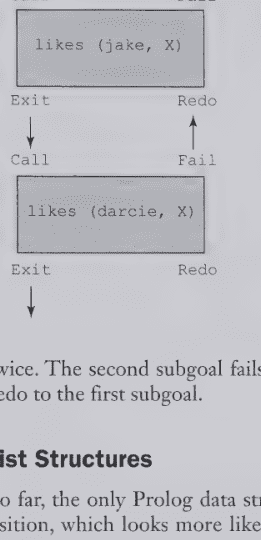

第二个子目标第一次失败，这迫使控制流通过 redo 返回到第一个子目标。

## 16.6.7 列表结构

到目前为止，我们讨论的唯一 Prolog 数据结构是原子命题（atomic proposition），它看起来更像函数调用而非数据结构。原子命题也称为结构（structure），实际上是一种记录形式。支持的另一种基本数据结构是列表。列表是任意数量元素的序列，元素可以是原子、原子命题或任何其他项，包括其他列表。

Prolog 使用 ML 和 Haskell 的语法来指定列表。列表元素用逗号分隔，整个列表用方括号界定，例如：

```
[apple, prune, grape, kumquat]
```

记号 `[]` 用于表示空列表。Prolog 没有显式的列表构造和拆分函数，而是使用一种特殊记号。`[X | Y]` 表示以 X 为表头、Y 为表尾的列表，其中表头和表尾分别对应于 LISP 中的 CAR 和 CDR。这与 ML 和 Haskell 中使用的记号类似。

可以通过简单结构来创建列表，例如：

```
new_list([apple, prune, grape, kumquat]).
```

该语句声明常量列表 `[apple, prune, grape, kumquat]` 是名为 `new_list`（我们刚虚构的一个名字）的关系的新元素。这条语句并不将列表绑定到名为 `new_list` 的变量；它所做的类似于命题

```
male(jake)
```

所做之事。也就是说，它声明 `[apple, prune, grape, kumquat]` 是 `new_list` 的一个新元素。因此，我们可以有另一个带列表参数的命题，例如：

```
new_list([apricot, peach, pear])
```

在查询模式下，可以通过以下方式将 `new_list` 的一个元素拆分为表头和表尾：

```
new_list([New_List_Head | New_List_Tail]).
```

如果 `new_list` 已设置为包含上述两个元素，则该语句会用第一个列表元素的表头（此处为 `apple`）实例化 `New_List_Head`，并用列表的表尾（即 `[prune, grape, kumquat]`）实例化 `New_List_Tail`。如果这是复合目标的一部分，并且回溯迫使它重新求值，那么 `New_List_Head` 和 `New_List_Tail` 将分别被重新实例化为 `apricot` 和 `[peach, pear]`，因为 `[apricot, peach, pear]` 是 `new_list` 的下一个元素。

用于拆解列表的 `|` 运算符也可以用于从已实例化的表头和表尾分量构建列表，例如：

```
[Element_1 | List_2]
```

如果 `Element_1` 已被实例化为 `pickle`，而 `List_2` 已被实例化为 `[peanut, prune, popcorn]`，则此示例记号将为这一次引用创建列表 `[pickle, peanut, prune, popcorn]`。

如前所述，包含 `|` 符号的列表记号是通用的：它既可以指定列表构建，也可以指定列表拆解。进一步注意以下写法是等价的：

```
[apricot, peach, pear | []]
[apricot, peach | [pear]]
[apricot | [peach, pear]]
```

使用列表时，通常需要某些基本操作，例如 LISP、ML 和 Haskell 中的那些操作。作为 Prolog 中此类操作的一个例子，我们考察 `append` 的定义，它与 LISP 中的此类函数相关。在这个例子中，可以看出函数式语言与声明式语言之间的异同。我们无需指定 Prolog 如何根据给定列表构建新列表；只需根据给定列表来指定新列表的特征。

在外观上，Prolog 的 `append` 定义与第 15 章中出现的 ML 版本非常相似，并且类似地在消解中使用了一种递归来生成新列表。在 Prolog 中，递归是由消解过程引发和控制的。与 ML 和 Haskell 一样，模式匹配过程用于根据实际参数在 `append` 过程的两个不同定义之间进行选择。

以下代码中 `append` 操作的前两个参数是要拼接的两个列表，第三个参数是结果列表：

```
append([], List, List).
append([Head | List_1], List_2, [Head | List_3]) :-
    append(List_1, List_2, List_3).
```

第一条命题指定当空列表与任何其他列表拼接时，该其他列表即为结果。该语句对应于 ML 中 `append` 函数的递归终止步骤。注意，终止命题被放在递归命题之前。这样做是因为我们知道 Prolog 会按顺序匹配这两个命题，从第一个开始（因为它采用深度优先顺序）。

第二条命题指定了新列表的几个特征。它对应于 ML 函数中的递归步骤。左侧谓词说明新列表的第一个元素与第一个给定列表的第一个元素相同，因为它们都命名为 `Head`。每当 `Head` 被实例化为某个值时，目标中所有出现的 `Head` 实际上都会同时被实例化为该值。第二条语句的右侧指定：第一个给定列表的表尾（`List_1`）拼接上第二个给定列表（`List_2`），形成结果列表的表尾（`List_3`）。

阅读 `append` 第二条语句的一种方式如下：将列表 `[Head | List_1]` 拼接到任何列表 `List_2` 上会产生列表 `[Head | List_3]`，但前提是列表 `List_3` 由 `List_1` 拼接 `List_2` 而成。在 LISP 中，这将是：

```
(CONS (CAR FIRST) (APPEND (CDR FIRST) SECOND))
```

在 Prolog 和 LISP 版本中，结果列表都是直到递归产生终止条件时才构建；在这里，第一个列表必须变为空。然后，使用 `append` 函数本身构建结果列表；从第一个列表中取出的元素按相反顺序添加到第二个列表中。反转是通过递归的展开来完成的。

Prolog 的 `append` 与 LISP 和 ML 的 `append` 有一个根本区别：Prolog 的 `append` 是一个谓词——它不返回列表，而是返回 yes 或 no。新列表是其第三个参数的值。

为了说明 `append` 过程的进展，请考虑以下带跟踪的示例：

```
trace.
append([bob, jo], [jake, darcie], Family).
```

```
(1) 1 Call: append([bob, jo], [jake, darcie], _10)?
```


```
(2) 2 Call: append([jo], [jake, darcie], _18)?
(3) 3 Call: append([], [jake, darcie], _25)?
(3) 3 Exit: append([], [jake, darcie], [jake, darcie])
(2) 2 Exit: append([jo], [jake, darcie], [jo, jake, darcie])
(1) 1 Exit: append([bob, jo], [jake, darcie], [bob, jo, jake, darcie])
Family = [bob, jo, jake, darcie]
yes
```

前两次调用表示子目标，其 `List_1` 均非空，因此它们从第二条语句的右侧创建递归调用。第二条语句的左侧实际上指明了递归调用（即目标）的参数，从而每一步从第一个列表中拆下一个元素。当第一个列表在某个调用（或子目标）中变为空时，第二条语句右侧的当前实例通过与第一条语句匹配而成功。这样做的效果是，将空列表与第二个原始参数列表拼接后的值作为第三个参数返回。在相继的退出（表示成功匹配）过程中，从第一个列表中移除的元素被追加到结果列表 `Family` 中。当第一个目标的退出完成时，整个过程结束，并显示结果列表。

Prolog 的 `append` 与 LISP 和 ML 的 `append` 之间的另一个区别是，Prolog 的 `append` 比这些语言中的 `append` 更灵活。例如，在 Prolog 中我们可以使用 `append` 来确定哪两个列表可以拼接得到 `[a, b, c]`：

```
append(X, Y, [a, b, c]).
```

这将产生以下结果：

```
X = []
Y = [a, b, c]
```

如果在此输出后输入分号，会得到另一个结果：

```
X = [a]
Y = [b, c]
```

继续下去，我们会得到以下结果：

```
X = [a, b]
Y = [c];
X = [a, b, c]
Y = []
```

`append` 谓词还可用于创建其他列表操作，例如下面的操作，其效果留给读者自行判断。请注意，`list_op_2` 的用法是：第一个参数提供列表，第二个参数提供变量；`list_op_2` 的结果就是第二个参数被实例化后的值。

```
list_op_2([], []).
list_op_2([Head | Tail], List) :- 
list_op_2(Tail, Result), append(Result, [Head], List).
```

你可能已经看出，`list_op_2` 会让 Prolog 系统将第二个参数实例化为一个列表，该列表包含第一个参数列表中的元素，但顺序相反。例如，`([apple, orange, grape], Q)` 会把 Q 实例化为列表 `[grape, orange, apple]`。

再次说明，尽管 LISP 和 Prolog 语言在根本上有很大不同，但类似的操作可以采用类似的方法。就 reverse 操作而言，Prolog 的 `list_op_2` 和 LISP 的 `reverse` 函数都包含递归终止条件，以及将列表的 CDR（即尾）的反转结果追加到 CAR（即头）上以生成结果列表的基本过程。

下面是该过程（现在命名为 `reverse`）的跟踪示例：

```
trace.
reverse([a, b, c], Q).

(1) 1 Call: reverse([a, b, c], _6)?
(2) 2 Call: reverse([b, c], _65636)?
(3) 3 Call: reverse([c], _65646)?
(4) 4 Call: reverse([], _65656)?
(4) 4 Exit: reverse([], [])
(5) 4 Call: append([], [c], _65646)?
(5) 4 Exit: append([], [c], [c])
(3) 3 Exit: reverse([c], [c])
(6) 3 Call: append([c], [b], _65636)?
(7) 4 Call: append([], [b], _25)?
(7) 4 Exit: append([], [b], [b])
(6) 3 Exit: append([c], [b], [c, b])
(2) 2 Exit: reverse([b, c], [c, b])
(8) 2 Call: append([c, b], [a], _6)?
(9) 3 Call: append([b], [a], _32)?
(10) 4 Call: append([], [a], _39)?
(10) 4 Exit: append([], [a], [a])
(9) 3 Exit: append([b], [a], [b, a])
(8) 2 Exit: append([c, b], [a], [c, b, a])
(1) 1 Exit: reverse([a, b, c], [c, b, a])

Q = [c, b, a]
```

假设我们需要判断某个给定符号是否在某个给定列表中。Prolog 对此的直接描述是：

```
member(Element, [Element | _]).
member(Element, [_ | List]) :- member(Element, List).
```

下划线表示“匿名”变量；它用于表示我们不关心它在合一过程中会得到什么实例化。前面例子中的第一条语句在 `Element` 是列表的表头时成功，无论是最初还是经过第二条语句的多次递归之后。第二条语句在 `Element` 位于列表的表尾时成功。考虑以下跟踪示例：

```
trace.
member(a, [b, c, d]).
(1) 1 Call: member(a, [b, c, d])?
(2) 2 Call: member(a, [c, d])?
(3) 3 Call: member(a, [d])?
(4) 4 Call: member(a, [])?
(4) 4 Fail: member(a, [])
(3) 3 Fail: member(a, [d])
(2) 2 Fail: member(a, [c, d])
(1) 1 Fail: member(a, [b, c, d])
no
```

```
member(a, [b, a, c]).
(1) 1 Call: member(a, [b, a, c])?
(2) 2 Call: member(a, [a, c])?
(2) 2 Exit: member(a, [a, c])
(1) 1 Exit: member(a, [b, a, c])
yes
```

## 16.7 Prolog 的缺陷

尽管 Prolog 是一个有用的工具，但它既不是纯粹的，也不是完美的逻辑编程语言。本节将介绍 Prolog 存在的一些问题。

### 16.7.1 归结顺序控制

出于效率方面的原因，Prolog 允许用户在归结过程中控制模式匹配的顺序。在纯粹的逻辑编程环境中，归结过程中尝试匹配的顺序是不确定的，所有匹配都可以并发尝试。然而，由于 Prolog 总是以相同的顺序进行匹配，即从数据库的开头开始，并从一个给定目标的最左端开始，因此用户可以通过排列数据库语句的顺序来极大地影响效率，从而优化特定应用。例如，如果用户知道在某个特定“执行”过程中某些规则比其他规则更可能成功，那么可以通过把这些规则放在数据库开头来提高程序效率。

除了允许用户控制数据库和子目标的顺序之外，Prolog 在另一个为提高效率而做的妥协中，还允许对回溯进行一定程度的显式控制。这是通过 cut 运算符实现的，它由感叹号（!）指定。cut 运算符实际上是一个目标，而不是一个运算符。作为一个目标，它总是立即成功，但不能通过回溯来重新满足。因此，cut 的一个副作用是，在复合目标中位于其左侧的子目标也不能通过回溯来重新满足。例如，在目标

```
a, b, !, c, d.
```

中，如果 a 和 b 都成功但 c 失败，则整个目标失败。如果已知只要 c 失败，重新满足 b 或 a 就是浪费时间，就可以使用这个目标。

因此，cut 的目的是让用户能够提高程序效率，方法是告诉系统何时不应尝试重新满足那些推测无法产生完整证明的子目标。

作为 cut 运算符使用的一个示例，请考虑来自 16.6.7 节的 `member` 规则，如下：

```
member(Element, [Element | _]).
member(Element, [_ | List]) :- member(Element, List).
```

如果传给 `member` 的列表参数表示一个集合，那么它只能被满足一次（集合不包含重复元素）。因此，如果 `member` 在包含多个子目标的目标语句中用作子目标，就可能出现问题。问题在于，如果 `member` 成功但下一个子目标失败，回溯将尝试通过继续先前匹配来重新满足 `member`。但由于传给 `member` 的列表参数一开始就只有该元素的一个副本，`member` 不可能再次成功，这最终会导致整个目标失败，即使反复尝试重新满足 `member` 也无济于事。例如，考虑以下目标：

```
dem_candidate(X) :- member(X, democrats), tests(X).
```

```
member(Element, [Element | _]) :- !.
```

在加入 cut 之后，回溯不会尝试重新满足 `member`，而是会导致整个子目标失败。

Cut 在 Prolog 中一种称为“生成与测试”（generate and test）的编程策略中特别有用。在使用生成与测试策略的程序中，目标由生成潜在解决方案的子目标组成，这些方案随后由后面的“测试”子目标检查。被拒绝的方案要求回溯到“生成器”子目标，这些子目标会生成新的潜在方案。作为生成与测试程序的一个示例，请考虑下面这个来自 Clocksin 和 Mellish（2003）的程序：

```
divide(N1, N2, Result) :- is_integer(Result),
    Product1 is Result * N2,
    Product2 is (Result + 1) * N2,
    Product1 <= N1, Product2 > N1, !.
```

该程序使用加法和乘法执行整数除法。由于大多数 Prolog 系统都将除法作为运算符提供，因此这个程序实际上并无用处，只是用来演示一个简单的生成与测试程序。

谓词 `is_integer` 只要其参数能够被实例化为某个非负整数就会成功。如果其参数未被实例化，`is_integer` 会将其实例化为值 0。如果参数已被实例化为一个整数，`is_integer` 会将其实例化为下一个更大的整数值。

因此，在 `divide` 中，`is_integer` 是生成器子目标。它每次被满足时生成序列 0, 1, 2, … 中的一个元素。所有其他子目标都是测试子目标——它们检查 `is_integer` 产生的值是否确实是前两个参数 N1 和 N2 的商。把 cut 作为最后一个子目标的目的是简单的：一旦 `divide` 找到解，就阻止它再尝试寻找替代解。虽然 `is_integer` 可以生成大量候选值，但只有一个是解，因此这里的 cut 避免了生成次要解的无用尝试。

cut 运算符的使用被比作命令式语言中 goto 的使用（van Emden, 1980）。虽然有时确实需要它，但也可能滥用它。事实上，它有时被用来让逻辑程序具有模仿命令式编程风格的控制流。

在 Prolog 程序中干预控制流的能力是一个缺陷，因为它直接损害了逻辑编程的一个重要优势——程序不指定如何找到解，而只是指定解应该是什么样的。这种设计使程序更易编写、更易阅读。它们不会被如何确定解的细节所累，尤其是不会涉及为产生解而执行计算的精确顺序。因此，尽管逻辑编程不需要控制流指令，Prolog 程序却经常使用它们，主要是为了提高效率。


## 16.7.2 封闭世界假设

Prolog 解析的特性有时会产生误导性的结果。就 Prolog 而言，唯一为真的是那些能够用其数据库证明的事实。它对世界的认知仅限于其数据库。当系统接收到一个查询，而数据库中没有信息能够绝对证明该查询时，该查询将被假定为假。Prolog 可以证明某个目标为真，但它无法证明某个目标为假。它只是假定，因为它无法证明某个目标为真，所以该目标必为假。从本质上讲，Prolog 是一个真/失败系统，而不是真/假系统。

实际上，封闭世界假设对你来说不应陌生——我们的司法系统也是如此运作的。在被证明有罪之前，被告被视为无罪。他们无需被证明无罪。如果审判无法证明某人有罪，他或她将被视为无罪。

封闭世界假设的问题与否定问题相关，后者在下一小节中讨论。

## 16.7.3 否定问题

Prolog 的另一个问题是其对否定的处理困难。考虑以下包含两个事实和一个关系的数据库：

```
parent(bill, jake).
parent(bill, shelley).
sibling(X, Y) :- (parent(M, X), parent(M, Y).
```

现在，假设我们输入查询

```
sibling(X, Y).
```

Prolog 将给出响应

```
X = jake
Y = jake
```

因此，Prolog “认为” jake 是他自己的兄弟姐妹。这是因为系统首先将 M 实例化为 bill 并将 X 实例化为 jake 以使第一个子目标 parent(M, X) 为真。然后它从数据库的开头重新开始以匹配第二个子目标 parent(M, Y)，并得到 M 实例化为 bill 且 Y 实例化为 jake 的结果。因为两个子目标是独立满足的，且两次匹配都从数据库开头开始，所以出现了上述响应。为了避免这种结果，必须指定 X 只有在它们有相同的父母且它们不是同一个时才是 Y 的兄弟姐妹。不幸的是，在 Prolog 中说明它们不相等并不是一件简单的事情，正如我们将要讨论的那样。最精确的方法将需要为每对原子添加一个事实，说明它们不相同。当然，这可能会使数据库变得非常庞大，因为负面信息往往远多于正面信息。例如，大多数人有 364 个以上的非生日日，比他们有生日的日子多。

一个简单的替代解决方案是在目标中说明 X 必须不与 Y 相同，如

```
sibling(X, Y) :- parent(M, X), parent(M, Y), not(X = Y).
```

在其他情况下，解决方案就没有那么简单了。

在这种情况下，Prolog 的 not 运算符在解析无法满足子目标 X = Y 时即被满足。因此，如果 not 成功，并不一定意味着 X 不等于 Y；而是意味着解析无法从数据库证明 X 与 Y 相同。因此，Prolog 的 not 运算符并不等同于逻辑 NOT 运算符，其中 NOT 意味着其操作数很可能是真。这种不等价性可能导致问题，如果我们恰好有一个形如

```
not(not(some_goal)).
```

的目标，这将等同于

```
some_goal.
```

如果 Prolog 的 not 运算符是真正的逻辑 NOT 运算符的话。然而，在某些情况下，它们并不相同。例如，再次考虑 member 规则：

```
member(Element, [Element | _]) :- !.
member(Element, [_ | List]) :- member(Element, List).
```

为了发现给定列表中的一个元素，我们可以使用目标

```
member(X, [mary, fred, barb]).
```

这将导致 X 被实例化为 mary，然后将其打印出来。但如果我们使用

```
not(not(member(X, [mary, fred, barb]))).
```

则会发生以下一系列事件：首先，内部目标会成功，将 X 实例化为 mary。然后，Prolog 会尝试满足下一个目标：

```
not(member(X, [mary, fred, barb])).
```

该语句会失败，因为 member 成功了。当该目标失败时，X 将被取消实例化，因为 Prolog 总是取消实例化所有失败目标中的所有变量。接下来，Prolog 会尝试满足外部 not 目标，

它将成功，因为其参数已失败。最后，结果，即 x，将被打印出来。但 x 当前并未被实例化，因此系统会表明这一点。一般来说，未实例化的变量以以下划线开头的数字串形式打印。因此，Prolog 的 not 与逻辑 NOT 不等价的事实至少会造成误导。

逻辑 NOT 无法成为 Prolog 固有组成部分的根本原因在于 Horn 子句的形式：

```
A :- B₁ ∩ B₂ ∩ ... ∩ Bₙ
```

如果所有 B 命题都为真，则可以得出 A 为真。但无论 B 的真假如何，都无法得出 A 为假的结论。从正逻辑中，只能得出正逻辑。因此，使用 Horn 子句形式阻止了任何负面结论。

## 16.7.4 内在局限性

正如第 16.4 节所述，逻辑编程的一个基本目标是提供非过程式编程；也就是说，一种系统，程序员只需指定程序应该做什么，而无需指定如何实现。文中给出的排序示例在此重写：

```
sort (old_list, new_list) ⊂ permute (old_list, new_list) ∩ sorted (new_list)
sorted (list) ⊂ ∀j such that 1 ≤ j < n, list(j) ≤ list (j+1)
```

将其写成 Prolog 是很直接的。例如，sorted 子目标可以表示为

```
sorted ([]).
sorted ([x]).
sorted ([x, y | list]) :- x <= y, sorted ([y | list]).
```

这个排序过程的问题在于它不知道如何排序，除了简单地枚举给定列表的所有排列，直到碰巧生成一个按排序顺序排列的列表——这是一个非常缓慢的过程。

到目前为止，没有人发现一种将排序列表的描述转化为某种高效排序算法的过程。归结能够做很多有趣的事情，但显然不是这个。因此，Prolog 程序对列表进行排序必须指定如何进行排序的细节，就像命令式或函数式语言一样。

所有这些问题是否意味着应该放弃逻辑编程？绝对不是！就目前而言，它能够处理许多有用的应用。此外，它基于一个有趣的概念，因此本身就很有趣。最后，存在开发新的推理技术的可能性，这将使逻辑编程语言系统能够更有效地处理越来越大的问题类。

## 16.8 逻辑编程的应用

在本节中，我们简要描述了逻辑编程一般以及 Prolog 特别的当前和潜在应用的几个较大类别。

## 16.8.1 关系数据库管理系统

关系数据库管理系统 RDBMS 将数据以表格形式存储。对此类数据库的查询通常用结构化查询语言 SQL 表达。SQL 在与逻辑编程相同的意义上是非过程式的。用户不描述如何检索答案；而是仅描述答案的特征。逻辑编程与 RDBMS 之间的联系应该是显而易见的。简单的信息表可以用 Prolog 结构描述，表之间的关系可以用 Prolog 规则方便、轻松地描述。检索过程是归结操作固有的。Prolog 的目标语句为 RDBMS 提供查询。因此，逻辑编程与实现 RDBMS 的需求是天然契合的。

使用逻辑编程实现 RDBMS 的一个优点是只需要一种语言。在典型的 RDBMS 中，数据库语言包括数据定义、数据操纵和查询语句，所有这些都嵌入在通用编程语言中，例如 COBOL。通用编程语言用于处理数据和输入输出功能。所有这些功能都可以用逻辑编程语言完成。

使用逻辑编程实现 RDBMS 的另一个优点是推理能力内置于其中。传统的 RDBMS 无法从数据库中推导出任何超出其中明确存储的内容的东西。它们只包含事实，而不是事实和推理规则。与传统 RDBMS 相比，使用逻辑编程实现 RDBMS 的主要缺点是逻辑编程实现速度较慢。逻辑推理比使用命令式编程技术进行普通表查找方法花费的时间更长。

## 16.8.2 专家系统

专家系统是设计用于模拟人类在某个特定领域专长的计算机系统。它们由事实数据库、推理过程、关于该领域的启发式方法以及一些友好的用户界面组成，使系统看起来很像专家人类顾问。除了由人类专家提供的初始知识库外，专家系统还能从使用过程中学习，因此其数据库必须能够动态增长。此外，专家系统还应具备在确定需要额外信息时向用户提问的能力。


对于专家系统的设计者来说，处理数据库不可避免的不一致性和不完整性是一个核心问题。逻辑编程似乎非常适合处理这些问题。例如，默认推理规则可以帮助处理不完整性问题。

Prolog 可以被用来构建专家系统，并且已经被用来构建专家系统。它可以轻松满足专家系统的基本需求，使用归结作为查询处理的基础，使用其添加事实和规则的能力来提供学习能力，并使用其跟踪功能告知用户给定结果背后的“推理”。Prolog 缺少的是系统在需要时自动向用户查询额外信息的自动能力。

逻辑编程在专家系统中最为人所知的用途之一是专家系统构建系统 APES，其在 Sergot (1983) 和 Hammond (1983) 中有描述。APES 系统包含一个非常灵活的设施，用于在专家系统构建期间从用户收集信息。它还包含一个第二解释器，用于对其查询的答案生成解释。

APES 已成功用于生成多个专家系统，包括一个用于政府社会福利计划规则的系统，以及一个用于英国国籍法的系统，后者是英国公民身份规则的权威来源。

某些类型的自然语言处理可以用逻辑编程完成。特别是，自然语言接口到计算机软件系统，例如智能数据库和其他智能知识库系统，可以方便地用逻辑编程实现。对于描述语言语法，逻辑编程的形式已被发现等同于上下文无关文法。逻辑编程系统中的证明过程已被发现等同于某些解析策略。事实上，逆向链式归结可以直接用于解析其结构由上下文无关文法描述的句子。人们还发现，自然语言的某些语义可以通过用逻辑编程建模语言来阐明。特别是，逻辑语义网络的研究表明，自然语言中的句子集合可以以子句形式表达（Dell yanni and Kowalski, 1979）。Kowalski (1979) 也讨论了基于逻辑的语义网络。

符号逻辑为逻辑编程和逻辑编程语言提供了基础。逻辑编程的方法是使用一组事实和规则作为数据库，这些事实和规则陈述了事实之间的关系，并使用自动推理过程来检查新命题的有效性，假设数据库的事实和规则为真。这种方法就是为自动定理证明而开发的。

Prolog 是最广泛使用的逻辑编程语言。逻辑编程的起源在于 Robinson 对逻辑推理归结规则的开发。Prolog 主要由 Marseille 的 Colmerauer 和 Roussel 开发，Edinburgh 的 Kowalski 提供了一些帮助。

逻辑程序是非过程式的，这意味着给出了解决方案的特征，但没有给出获得解决方案的过程。

Prolog 语句是事实、规则或目标。大多数由结构组成，这些结构是原子命题，以及逻辑运算符，尽管也允许算术表达式。

归结是 Prolog 解释器的主要活动。此过程大量使用回溯，主要涉及命题之间的模式匹配。当涉及变量时，它们可以被实例化为值以提供匹配。此实例化过程称为统一。

当前逻辑编程存在一些问题。出于效率原因，甚至为了避免无限循环，程序员有时必须在其程序中说明控制流信息。此外，还有封闭世界假设和否定问题。

逻辑编程已被用于多个不同的领域，主要是在关系数据库系统、专家系统和自然语言处理中。

## 参考文献注释

Prolog 语言在多本书中有所描述。爱丁堡形式的语言在 Clocksin and Mellish (2003) 中有所涵盖。微型计算机实现在 Clark and McCabe (1984) 中有所描述。

Hogger (1991) 是关于逻辑编程这一一般主题的优秀书籍。它是本章逻辑编程应用部分材料的来源。

## 复习问题

- 1. 符号逻辑在形式逻辑中的三个主要用途是什么？
- 2. 复合项的两个部分是什么？
- 3. 命题可以陈述的两种模式是什么？
- 4. 子句形式中命题的一般形式是什么？
- 5. 前件是什么？后果是什么？
- 6. 给出归结和统一的一般（非严格）定义。
- 7. 霍恩子句的形式是什么？
- 8. 声明式语义的基本概念是什么？
- 9. 语言是非过程式的意味着什么？
- 10. Prolog 项的三种形式是什么？
- 11. 未实例化变量是什么？
- 12. Prolog 中事实和规则语句的语法形式和用法是什么？
- 13. 合取是什么？
- 14. 解释将目标与数据库中的事实匹配的两种方法。
- 15. 解释在讨论如何满足多个目标时，深度优先搜索和广度优先搜索之间的区别。
- 16. 解释 Prolog 中回溯的工作原理。
- 17. 解释 Prolog 语句 K is K + 1 有什么问题。
- 18. Prolog 程序员在归结期间控制模式匹配顺序的两种方法是什么？
- 19. 解释 Prolog 中的生成与测试编程策略。
- 20. 解释 Prolog 使用的封闭世界假设。为什么这是局限性？
- 21. 解释 Prolog 的否定问题。为什么这是局限性？
- 22. 解释自动定理证明与 Prolog 推理过程之间的联系。
- 23. 解释过程式语言和非过程式语言之间的区别。
- 24. 解释为什么 Prolog 系统必须进行回溯。
- 25. 归结与 Prolog 中的统一之间是什么关系？

## 问题集

- 1. 比较过程式和非过程式系统的概念。
- 2. 描述多处理器机器如何可用于实现归结。Prolog 作为当前定义，能否使用此方法？
- 3. 编写你家族树的 Prolog 描述（仅基于事实），追溯到你的祖父母并包括所有后代。确保包含所有关系。
- 4. 编写家族关系的规则集，包括从祖父母到两代的所有关系。现在将这些添加到问题 3 的事实中，并尽可能消除尽可能多的事实。
- 5. 将以下英文条件语句写成 Prolog 头部霍恩子句：
  a. 如果 Fred 是 Mike 的父亲，那么 Fred 是 Mike 的祖先。
  b. 如果 Mike 是 Joe 的父亲并且 Mike 是 Mary 的父亲，那么 Mary 是 Joe 的姐妹。
  c. 如果 Mike 是 Fred 的兄弟并且 Fred 是 Mary 的父亲，那么 Mike 是 Mary 的叔叔。
- 6. 解释 Scheme 和 Prolog 的列表处理能力在哪些方面相似。
- 7. Scheme 和 Prolog 的列表处理能力在什么方面不同？
- 8. 编写 Prolog 与 ML 的比较，包括两个相似点和两个不同点。
- 9. 从一本 Prolog 书中学习并写出一个发生检查问题的描述。为什么 Prolog 在其实现中允许此问题存在？
- 10. 找到有关智能数据库的良好信息来源并写出简明但清晰的解释。

## 编程练习

- 1. 使用结构 parent(X, Y)、male(X) 和 female(X)，编写定义 mother(X, Y) 的结构。
- 2. 使用结构 parent(X, Y)、male(X) 和 female(X)，编写定义 sister(X, Y) 的结构。
- 3. 编写一个 Prolog 程序来检查一个数是否为质数。
- 4. 编写一个 Prolog 程序，如果两个给定列表参数的交集为空则成功。
- 5. 编写一个 Prolog 程序来求两个数的最大公约数。
- 6. 编写一个 Prolog 程序打印到第 n 项的斐波那契数列。
- 7. 编写一个 Prolog 程序实现插入排序。


- Backus, J. (1959) “苏黎世ACM-GAMM会议上拟议的国际代数语言的语法与语义。” 国际信息处理会议论文集。联合国教科文组织，巴黎，第125–132页。

- Backus, J. (1978) “编程能否从冯·诺依曼风格中解放出来？一种函数式风格及其程序代数。” ACM通讯，第21卷，第8期，第613–641页。

- Backus, J., F. L. Bauer, J. Green, C. Katz, J. McCarthy, P. Naur, A. J. Perlis, H. Rutishauser, K. Samelson, B. Vauquois, J. H. Wegstein, A. van Wijngaarden, and M. Woodger. (1963) “关于算法语言ALGOL 60的修订报告。” ACM通讯，第6卷，第1期，第1–17页。

- Balena, F. (2003) 《Microsoft Visual Basic .NET 2003版程序设计》，Microsoft Press，雷德蒙德，华盛顿州。

- Ben-Ari, M. (1982) 《并发程序设计原理》。Prentice-Hall，恩格尔伍德克利夫斯，新泽西州。

- Birtwistle, G. M., O.-J. Dahl, B. Myhrhaug, and K. Nygaard. (1973) 《Simula BEGIN》。Van Nostrand Reinhold，纽约。

- Bodwin, J. M., L. Bradley, K. Kanda, D. Litle, and U. F. Pleban. (1982) “基于指称语义的实验性编译器生成器的经验。” ACM SIGPLAN Notices，第17卷，第6期，第216–229页。

- Bohm, C., and G. Jacopini. (1966) “流程图、图灵机以及仅含两种形成规则的语言。” ACM通讯，第9卷，第5期，第366–371页。

- Bolsky, M., and D. Korn. (1995) 《新的KornShell命令与编程语言》。Prentice-Hall，恩格尔伍德克利夫斯，新泽西州。

- Booch, G. (1987) 《使用Ada的软件工程》第二版。Benjamin/Cummings，雷德伍德城，加利福尼亚州。

- Bradley, J. C. (1989) 《使用模块化结构的QuickBASIC与QBASIC》。W. C. Brown，迪比克，艾奥瓦州。

- Brinch Hansen, P. (1973) 《操作系统原理》。Prentice-Hall，恩格尔伍德克利夫斯，新泽西州。

- Brinch Hansen, P. (1975) “编程语言Concurrent-Pascal。” IEEE软件工程汇刊，第1卷，第2期，第199–207页。

- Brinch Hansen, P. (1977) 《并发程序的体系结构》。Prentice-Hall，恩格尔伍德克利夫斯，新泽西州。

- Brinch Hansen, P. (1978) “分布式进程：一种并发编程概念。” ACM通讯，第21卷，第11期，第934–941页。

- Brown, J. A., S. Pakin, and R. P. Polivka. (1988) 《APL2概览》。Prentice-Hall，恩格尔伍德克利夫斯，新泽西州。

- Campione, M., K. Walrath, and A. Huml. (2001) 《Java教程》第三版。Addison-Wesley，雷丁，马萨诸塞州。

- Cardelli, L., J. Donahue, L. Glassman, M. Jordan, B. Kalsow, and G. Nelson. (1989) 《Modula-3报告（修订版）》。数字系统研究中心，帕洛阿尔托，加利福尼亚州。

- Chambers, C., and D. Ungar. (1991) “让纯面向对象语言变得实用。” SIGPLAN Notices，第26卷，第1期，第1–15页。

- Chomsky, N. (1956) “描述语言的三种模型。” IRE信息论汇刊，第2卷，第3期，第113–124页。

- Chomsky, N. (1959) “关于文法的某些形式属性。” 信息与控制，第2卷，第2期，第137–167页。

- Christiansen, T., B. D. Foy, and L. Wall with J. Orwant. (2013) 《Perl编程》第四版。O’Reilly & Associates，塞瓦斯托波尔，加利福尼亚州。

- Church, A. (1941) 《数学研究年刊》第6卷：《λ转换演算》。普林斯顿大学出版社，普林斯顿，新泽西州。1965年由Klaus Reprint Corporation重印于纽约。

- Clark, K. L., and F. G. McCabe. (1984) 《Micro-PROLOG：逻辑编程》。Prentice-Hall，恩格尔伍德克利夫斯，新泽西州。

- Clarke, L. A., J. C. Wileden, and A. L. Wolf. (1980) “Ada中的嵌套是徒劳的。” ACM SIGPLAN Notices，第15卷，第11期，第139–145页。

- Cleaveland, J. C. (1986) 《数据类型导论》。Addison-Wesley，雷丁，马萨诸塞州。

- Cleaveland, J. C., and R. C. Uzgalis. (1976) 《编程语言文法：每个程序员都应了解的文法知识》。American Elsevier，纽约。

- Clocksin, W. F., and C. S. Mellish. (2013) 《Prolog编程：使用ISO标准》。Springer-Verlag，纽约。

- Cohen, J. (1981) “链表数据结构的内存回收。” ACM计算综述，第13卷，第3期，第341–368页。

- Converse, T., and J. Park. (2000) 《PHP 4宝典》。IDG Books，纽约。

- Conway, M. E. (1963) “可分离转移图编译器的设计。” ACM通讯，第6卷，第7期，第396–408页。

- Conway, R., and R. Constable. (1976) “PL/CS——PL/I的一个规约子集。” 技术报告TR76/293。康奈尔大学计算机科学系，伊萨卡，纽约州。

- Cornell University. (1977) 《PL/C用户指南》7.6版。康奈尔大学计算机科学系，伊萨卡，纽约州。

- Correa, N. (1992) “空范畴、链约束与句法分析。” 载于《基于原则的句法分析》，R. C. Berwick、S. P. Abney和C. Tenny编。Kluwer Academic Publishers，波士顿，第83–121页。

- Cousineau, G., M. Mauny, and K. Callaway. (1998) 《函数式编程方法》。剑桥大学出版社，剑桥，英国。

- Dahl, O.-J., E. W. Dijkstra, and C. A. R. Hoare. (1972) 《结构化程序设计》。Academic Press，纽约。

- Dahl, O.-J., and K. Nygaard. (1967) 《SIMULA 67公共基础提案》。挪威计算中心文件，奥斯陆。

- Deitel, H. M., D. J. Deitel, and T. R. Nieto. (2002) 《Visual Basic .NET：如何编程》第二版。Prentice-Hall，上萨德尔河，新泽西州。

- Deliyanni, A., and R. A. Kowalski. (1979) “逻辑与语义网络。” ACM通讯，第22卷，第3期，第184–192页。

- Department of Defense. (1960) 《COBOL，面向商业的通用语言的初始规格说明》。美国国防部，华盛顿特区。

- Department of Defense. (1961) 《COBOL—1961，面向商业的通用语言的修订规格说明》。美国国防部，华盛顿特区。

- Department of Defense. (1962) 《COBOL—1961扩展版，面向商业的通用语言的扩展规格说明》。美国国防部，华盛顿特区。

- Department of Defense. (1975a) 《高级编程语言需求，STRAWMAN》。1975年7月。美国国防部，华盛顿特区。

- Department of Defense. (1975b) 《高级编程语言需求，WOODENMAN》。1975年8月。美国国防部，华盛顿特区。

- Department of Defense. (1976) 《高级编程语言需求，TINMAN》。1976年6月。美国国防部，华盛顿特区。

- Department of Defense. (1977) 《高级编程语言需求，IRONMAN》。1977年1月。美国国防部，华盛顿特区。

- Department of Defense. (1978) 《高级编程语言需求，STEELMAN》。1978年6月。美国国防部，华盛顿特区。

- Department of Defense. (1980a) 《高级编程语言需求，STONEMAN》。1980年2月。美国国防部，华盛顿特区。

- Department of Defense. (1980b) 《通用高级语言的编程环境需求，STONEMAN》。美国国防部，华盛顿特区。

- DeRemer, F. (1971) “简单LR(k)文法。” ACM通讯，第14卷，第7期，第453–460页。

- DeRemer, F., and T. Pennello. (1982) “LALR(1)前瞻集合的高效计算。” ACM TOPLAS，第4卷，第4期，第615–649页。

- Deutsch, L. P., and D. G. Bobrow. (1976) “一种高效的增量式自动内存回收器。” ACM通讯，第19卷，第9期，第522–526页。

- Dijkstra, E. W. (1968a) “Goto语句被认为有害。” ACM通讯，第11卷，第3期，第147–148页。

- Dijkstra, E. W. (1968b) “协作的顺序进程。” 载于《编程语言》，F. Genuys编。Academic Press，纽约，第43–112页。

- Dijkstra, E. W. (1972) “谦逊的程序员。” ACM通讯，第15卷，第10期，第859–866页。

- Dijkstra, E. W. (1975) “保护式命令、非确定性与程序的正式推导。” ACM通讯，第18卷，第8期，第453–457页。

- Dijkstra, E. W. (1976) 《程序设计纪律》。Prentice-Hall，恩格尔伍德克利夫斯，新泽西州。

- Dybvig, R. K. (2009) 《Scheme编程语言》第四版。MIT Press，剑桥，马萨诸塞州。

- Ellis, M. A., and B. Stroustrup. (1990) 《C++参考手册（注释版）》。Addison-Wesley，雷丁，马萨诸塞州。

- Farber, D. J., R. E. Griswold, and I. P. Polonsky. (1964) “SNOBOL，一种字符串处理语言。” ACM期刊，第11卷，第1期，第21–30页。

- Farrow, R. (1982) “LINGUIST 86：又一种基于属性文法的翻译器编写系统。” ACM SIGPLAN Notices，第17卷，第6期，第160–171页。

- Fischer, C. N., G. F. Johnson, J. Mauney, A. Pal, and D. L. Stock. (1984) “Poe基于语言的编辑器项目。” ACM SIGPLAN Notices，第19卷，第5期，第21–29页。

- Fischer, C. N., and R. J. LeBlanc. (1977) 《UW-Pascal参考手册》。麦迪逊学术计算中心，麦迪逊，威斯康星州。

- Fischer, C. N., and R. J. LeBlanc. (1980) “Pascal中运行时诊断的实现。” IEEE软件工程汇刊，第SE-6卷，第4期，第313–319页。

- Fischer, C. N., and R. J. LeBlanc. (1991) 《用C语言构造编译器》。Benjamin/Cummings，门洛帕克，加利福尼亚州。

- Flanagan, D. (2011) 《JavaScript权威指南》第六版。O’Reilly Media，塞瓦斯托波尔，加利福尼亚州。

- Floyd, R. W. (1967) “为程序赋予语义。” 载于《应用数学研讨会论文集：计算机科学的数学方面》，J. T. Schwartz编。美国数学学会，普罗维登斯，罗德岛州。

- Frege, G. (1892) “论意义与指称。” 哲学与哲学批评杂志，第100卷，第25–50页。

- Friedl, J. E. F. (2006) 《精通正则表达式》第三版。O’Reilly Media，塞瓦斯托波尔，加利福尼亚州。

- Friedman, D. P., and D. S. Wise. (1979) “引用计数收集循环的能力并非不可逾越。” 信息处理快报，第8卷，第1期，第41–45页。

- Fuchi, K. (1981) “面向知识信息处理系统。” 第五届计算系统国际会议论文集。日本信息处理开发中心，东京。1982年由北荷兰出版公司重新出版，阿姆斯特丹。


- Gehani, N. (1983) Ada：高级导论。Prentice-Hall, Englewood Cliffs, NJ.
- Gilman, L., 和 A. J. Rose. (1983) APL：交互式方法，第3版。John Wiley, New York.
- Goldberg, A., 和 D. Robson. (1983) Smalltalk-80：语言及其实现。Addison-Wesley, Reading, MA.
- Goldberg, A., 和 D. Robson. (1989) Smalltalk-80：语言。Addison-Wesley, Reading, MA.
- Goodenough, J. B. (1975) “异常处理：问题与建议的记号。” Commun. ACM, 第18卷，第12期，第683–696页。
- Goos, G., 和 J. Hartmanis (编) (1983) 编程语言 Ada 参考手册。American National Standards Institute. ANSI/MIL-STD-1815A–1983. Lecture Notes in Computer Science 155. Springer-Verlag, New York.
- Gordon, M. (1979) 编程语言的指称描述：导论。Springer-Verlag, New York.
- Graham, P. (1996) ANSI Common LISP. Prentice-Hall, Englewood Cliffs, NJ.
- Gries, D. (1981) 编程科学。Springer-Verlag, New York.
- Griswold, R. E., 和 M. T. Griswold. (1983) ICON 编程语言。Prentice-Hall, Englewood Cliffs, NJ.
- Griswold, R. E., F. Poage, 和 I. P. Polonsky. (1971) SNOBOL 4 编程语言，第2版。Prentice-Hall, Englewood Cliffs, NJ.
- Halstead, R. H., Jr. (1985) “Multilisp：一种并发符号计算语言。” ACM Transactions on Programming Languages and Systems, 第7卷，第4期，1985年10月，第501–538页。
- Halvorson, M. (2013) Microsoft Visual Basic 2013 步步精通。Microsoft Press, Redmond, WA.
- Hammond, P. (1983) APES：用户手册。计算系报告 82/9。Imperial College of Science and Technology, London.
- Harbison, S. P. III, 和 G. L. Steele, Jr. (2002) C：参考手册，第5版。Prentice-Hall, Upper Saddle River, NJ.
- Henderson, P. (1980) 函数式编程：应用与实现。Prentice-Hall, Englewood Cliffs, NJ.
- Hoare, C. A. R. (1969) “计算机编程的公理化基础。” Commun. ACM, 第12卷，第10期，第576–580页。
- Hoare, C. A. R. (1972) “数据表示的正确性证明。” Acta Informatica, 第1卷，第271–281页。
- Hoare, C. A. R. (1973) “编程语言设计要点。” Proceedings ACM SIGACT/SIGPLAN Conference on Principles of Programming Languages. 另以技术报告 STAN-CS-73-403 出版，Stanford University Computer Science Department.
- Hoare, C. A. R. (1974) “管程：一种操作系统结构化概念。” Commun. ACM, 第17卷，第10期，第549–557页。
- Hoare, C. A. R. (1978) “通信顺序进程。” Commun. ACM, 第21卷，第8期，第666–677页。
- Hoare, C. A. R. (1981) “皇帝的旧衣。” Commun. ACM, 第24卷，第2期，第75–83页。
- Hoare, C. A. R., 和 N. Wirth. (1973) “编程语言 Pascal 的公理化定义。” Acta Informatica, 第2卷，第335–355页。
- Hogger, C. J. (1984) 逻辑程序设计导论。Academic Press, London.
- Hogger, C. J. (1991) 逻辑程序设计精要。Oxford Science Publications, Oxford, England.
- Holt, R. C., G. S. Graham, E. D. Lazowska, 和 M. A. Scott. (1978) 结构化并发程序设计：操作系统应用。Addison-Wesley, Reading, MA.
- Horn, A. (1951) “关于代数直并集上的真语句。” J. Symbolic Logic, 第16卷，第14–21页。
- Hudak, P., 和 J. Fasel. (1992) “Haskell 入门。” ACM SIGPLAN Notices, 第27卷，第5期，1992年5月，第T1–T53页。
- Hughes, J. (1989) “为什么函数式编程很重要。” The Computer Journal, 第32卷，第2期，第98–107页。
- Huskey, H. K., R. Love, 和 N. Wirth. (1963) “BC NELIAC 的句法描述。” Commun. ACM, 第6卷，第7期，第367–375页。
- IBM. (1954) “IBM 数学公式翻译系统 FORTRAN 初步报告与规范。” IBM Corporation, New York.
- IBM. (1956) “IBM 704 EDPM 的 FORTRAN 自动编码系统程序员参考手册。” IBM Corporation, New York.
- IBM. (1964) 新编程语言。IBM UK Laboratories, Hursley, England.
- Ichbiah, J. D., J. C. Heliard, O. Roubine, J. G. P. Barnes, B. Krieg-Brueckner, 和 B. A. Wichmann. (1979) “B部分：Ada 编程语言设计原理。” ACM SIGPLAN Notices, 第14卷，第6期。
- IEEE. (1985) “二进制浮点运算。” IEEE 标准 754, IEEE, New York.
- Ierusalimschy, R. (2006) Lua 程序设计，第2版。Lua.org, Rio de Janeiro, Brazil.
- INCITS/ISO/IEC. (1997) 1539-1-1997, 信息技术——编程语言——FORTRAN，第1部分：基础语言。American National Standards Institute, New York.
- Ingerman, P. Z. (1967). “建议的 Panini-Backus 范式。” Commun. ACM, 第10卷，第3期，第137页。
- ISO. (1982) ISO7185:1982, 编程语言 Pascal 规范。International Organization for Standardization, Geneva, Switzerland.
- ISO. (1998) ISO/IEC 14882:1998, ISO/IEC 标准——信息技术——编程语言——C++。International Organization for Standardization, Geneva, Switzerland.
- ISO. (1999) ISO/IEC 9899:1999, 编程语言 C。American National Standards Institute, New York.
- ISO/IEC. (1996) 14977:1996, 信息技术——句法元语言——扩展 BNF。International Organization for Standardization, Geneva, Switzerland.
- ISO/IEC. (2002) 1989:2002, 信息技术——编程语言——COBOL。American National Standards Institute, New York.
- ISO/IEC. (2010) 1539-1, 信息技术——编程语言——Fortran。American National Standards Institute, New York.
- ISO/IEC. (2014) 8652:2012(E), Ada 2012 参考手册。Springer-Verlag, New York.
- Iverson, K. E. (1962) 一种编程语言。John Wiley, New York.
- Jensen, K., 和 N. Wirth. (1974) Pascal 用户手册与报告。Springer-Verlag, Berlin.
- Johnson, S. C. (1975) “Yacc——又一个编译器编译器。” Computing Science Report 32. AT&T Bell Laboratories, Murray Hill, NJ.
- Jones, N. D. (编) (1980) 语义指导的编译器生成。Lecture Notes in Computer Science, 第94卷。Springer-Verlag, Heidelberg, FRG.
- Kay, A. (1969) 反应式引擎。博士论文。University of Utah, 9月。
- Kernighan, B. W., 和 D. M. Ritchie. (1978) C 程序设计语言。Prentice-Hall, Englewood Cliffs, NJ.
- Knuth, D. E. (1965) “从左到右的语言翻译。” Information & Control, 第8卷，第6期，第607–639页。
- Knuth, D. E. (1967) “ALGOL 60 中剩余的问题点。” Commun. ACM, 第10卷，第10期，第611–618页。
- Knuth, D. E. (1968a) “上下文无关语言的语义。” Mathematical Systems Theory, 第2卷，第2期，第127–146页。
- Knuth, D. E. (1968b) 计算机程序设计艺术，第I卷，第2版。Addison-Wesley, Reading, MA.
- Knuth, D. E. (1974) “使用 GOTO 语句的结构化编程。” ACM Computing Surveys, 第6卷，第4期，第261–301页。
- Knuth, D. E. (1981) 计算机程序设计艺术，第II卷，第2版。Addison-Wesley, Reading, MA.
- Knuth, D. E., 和 L. T. Pardo. (1977) “编程语言的早期发展。” 出自《计算机科学与技术百科全书》，G. Holzman 和 A. Kent (编)。第7卷。Dekker, New York, 第419–493页。
- Kochan, S. G. (2009) Objective-C 2.0 程序设计。Addison-Wesley, Upper Saddle River, NJ.
- Kowalski, R. A. (1979) 问题求解的逻辑。Artificial Intelligence Series, 第7卷。Elsevier-North Holland, New York.
- Laning, J. H., Jr., 和 N. Zierler. (1954) “为 Whirlwind I 翻译数学方程的程序。” Engineering memorandum E-364. Instrumentation Laboratory, Massachusetts Institute of Technology, Cambridge, MA.
- Ledgard, H. (1984) 美国 Pascal 标准。Springer-Verlag, New York.
- Ledgard, H. F., 和 M. Marcotty. (1975) “控制结构谱系。” Commun. ACM, 第18卷，第11期，第629–639页。
- Lischner, R. (2000) Delphi 精髓。O’Reilly Media, Sebastopol, CA.
- Liskov, B., R. L. Atkinson, T. Bloom, J. E. B. Moss, C. Schaffert, R. Scheifler, 和 A. Snyder. (1981) CLU 参考手册。Springer, New York.
- Liskov, B., 和 A. Snyder. (1979) “CLU 中的异常处理。” IEEE Transactions on Software Engineering, 第SE-5卷，第6期，第546–558页。
- Lomet, D. (1975) “使对已释放存储的引用失效的方案。” IBM Journal of Research and Development, 第19卷，第26–35页。
- Lutz, M. (2013) 学习 Python，第5版。O’Reilly Media, Sebastopol, CA.
- MacLaren, M. D. (1977) “PL/I 中的异常处理。” ACM SIGPLAN Notices, 第12卷，第3期，第101–104页。
- Marcotty, M., H. F. Ledgard, 和 G. V. Bochmann. (1976) “形式定义集锦。” ACM Computing Surveys, 第8卷，第2期，第191–276页。
- Mather, D. G., 和 S. V. Waite (编) (1971) BASIC, 第6版。University Press of New England, Hanover, NH.
- McCarthy, J. (1960) “符号表达式的递归函数及其机器计算，第一部分。” Commun. ACM, 第3卷，第4期，第184–195页。
- McCarthy, J., P. W. Abrahams, D. J. Edwards, T. P. Hart, 和 M. Levin. (1965) LISP 1.5 程序员手册，第2版。MIT Press, Cambridge, MA.
- McCracken, D. (1961) FORTRAN 编程指南。John Wiley & Sons, Inc., New York.
- McCracken, D. (1970) “APL 何去何从。” Datamation, 9月15日，第53–57页。
- Metcalf, M., J. Reid, 和 M. Cohen. (2004) Fortran 95/2003 详解，第3版。Oxford University Press, Oxford, England.


- Meyer, B. (1990)《编程语言理论导论》。Prentice-Hall，新泽西州恩格尔伍德克利夫斯。
- Meyer, B. (1992)《Eiffel：语言》。Prentice-Hall，新泽西州恩格尔伍德克利夫斯。
- Milner, R., R. Harper, and M. Tofte. (1997)《Standard ML的定义（修订版）》。MIT Press，马萨诸塞州剑桥。
- Milos, D., U. Pleban, and G. Loegel. (1984)“编译器规范的直接实现。”第11届ACM SIGACT-SIGPLAN编程语言研讨会论文集（POPL '84），第196–202页。
- Mitchell, J. G., W. Maybury, and R. Sweet. (1979)《Mesa语言手册》5.0版，CSL-79-3。Xerox研究中心，加利福尼亚州帕洛阿尔托。
- Moss, C. (1994)《Prolog++：面向对象与逻辑编程的力量》。Addison-Wesley，马萨诸塞州雷丁。
- Moto-oka, T. (1981)“对知识信息处理系统的挑战。”第五代计算系统国际会议论文集，日本信息处理开发中心，东京。North-Holland Publishing于1982年再版，阿姆斯特丹。
- Naur, P. (编) (1960)“关于算法语言ALGOL 60的报告。”Commun. ACM，第3卷，第5期，第299–314页。
- Newell, A., and H. A. Simon. (1956)“逻辑理论机——一个复杂的信息处理系统。”IRE Transactions on Information Theory，第IT-2卷，第3期，第61–79页。
- Newell, A., and F. M. Tonge. (1960)“信息处理语言V简介。”Commun. ACM，第3卷，第4期，第205–211页。
- Nilsson, N. J. (1971)《人工智能中的问题求解方法》。McGraw-Hill，纽约。
- Ousterhout, J. K. (1994)《Tcl与Tk工具箱》。Addison-Wesley，马萨诸塞州雷丁。
- Paepcke, A. (编) (1993)《面向对象编程：CLOS视角》。MIT Press，马萨诸塞州剑桥。
- Pagan, F. G. (1981)《编程语言的形式化规范》。Prentice-Hall，新泽西州恩格尔伍德克利夫斯。
- Papert, S. (1980)《头脑风暴：儿童、计算机与强大的思想》。Basic Books，纽约。
- Perlis, A., and K. Samelson. (1958)“初步报告——国际代数语言。”Commun. ACM，第1卷，第12期，第8–22页。
- Peyton Jones, S. L. (1987)《函数式编程语言的实现》。Prentice-Hall，新泽西州恩格尔伍德克利夫斯。
- Pratt, T. W. (1984)《编程语言：设计与实现》（第二版）。Prentice-Hall，新泽西州恩格尔伍德克利夫斯。
- Pratt, T. W., and M. V. Zelkowitz. (2001)《编程语言：设计与实现》（第四版）。Prentice-Hall，新泽西州恩格尔伍德克利夫斯。
- Remington-Rand. (1952)“UNIVAC短代码。”未出版的油印笔记集。A. B. Tonik序，日期为1955年10月25日（1页）；J. R. Logan序，未注明日期但显然出自1952年（1页）；初步说明，1952年？（22页，其中第20–22页似乎是后来替换的）；短代码补充信息，主题一（7页）；附录#1、2、3、4（9页）。
- Reppy, J. H. (1999)《ML中的并发编程》。Cambridge University Press，纽约。
- Richards, M. (1969)“BCPL：用于编译器编写和系统编程的工具。”Proc. AFIPS SJCC，第34卷，第557–566页。
- Robbins, A. (2005)《Unix宝典》（第四版）。O'Reilly Media，加利福尼亚州塞瓦斯托波尔。
- Robinson, J. A. (1965)“基于消解原理的面向机器逻辑。”Journal of the ACM，第12卷，第23–41页。
- Roussel, P. (1975)“PROLOG：参考与使用手册。”研究报告。法国吕米尼艾克斯-马赛大学人工智能研究组。
- Rubin, F. (1987)“‘GOTO语句被认为有害’被认为有害”（致编辑的信）。Commun. ACM，第30卷，第3期，第195–196页。
- Rutishauser, H. (1967)《ALGOL 60描述》。Springer-Verlag，纽约。
- Sammet, J. E. (1969)《编程语言：历史与基础》。Prentice-Hall，新泽西州恩格尔伍德克利夫斯。
- Sammet, J. E. (1976)“1974–75年编程语言列表。”Commun. ACM，第19卷，第12期，第655–669页。
- Schneider, D. I. (1999)《使用Visual Basic 6.0进行编程导论》。Prentice-Hall，新泽西州恩格尔伍德克利夫斯。
- Schorr, H., and W. Waite. (1967)“一种用于多种列表结构中垃圾回收的高效机器无关过程。”Commun. ACM，第10卷，第8期，第501–506页。
- Scott, D. S., and C. Strachey. (1971)“走向计算机语言的数学语义。”载于《计算机与自动化研讨会论文集》，J. Fox（编）。Brooklyn理工学院出版社，纽约，第19–46页。
- Scott, M. (2009)《编程语言实用学》（第三版）。Morgan Kaufmann，加利福尼亚州旧金山。
- Sebesta, R. W. (1991)《VAX结构化汇编语言编程》（第二版）。Benjamin/Cummings，加利福尼亚州雷德伍德城。
- Sergot, M. J. (1983)“一种用于逻辑编程的查询用户设施。”载于《集成交互式计算机系统》，P. Degano和E. Sandewall（编）。North-Holland Publishing，阿姆斯特丹。
- Shaw, C. J. (1963)“JOVIAL规范。”Commun. ACM，第6卷，第12期，第721–736页。
- Smith, J. B. (2006)《实用OCaml》。Apress，Springer-Verlag，纽约。
- Sommerville, I. (2010)《软件工程》（第九版）。Addison-Wesley，马萨诸塞州雷丁。
- Steele, G. L., Jr. (1990)《Common LISP：语言》（第二版）。Digital Press，马萨诸塞州伯灵顿。
- Stoy, J. E. (1977)《指称语义：编程语言语义的Scott–Strachey方法》。MIT Press，马萨诸塞州剑桥。
- Stroustrup, B. (1983)“向C语言添加类：语言演化的一次实践。”《软件——实践与经验》，第13卷，第139–161页。
- Stroustrup, B. (1984)“C语言中的数据抽象。”AT&T贝尔实验室技术杂志，第63卷，第8期，第1701–1732页。
- Stroustrup, B. (1986)《C++编程语言》。Addison-Wesley，马萨诸塞州雷丁。
- Stroustrup, B. (1988)“什么是面向对象编程？”《IEEE软件》，1988年5月，第10–20页。
- Stroustrup, B. (1991)《C++编程语言》（第二版）。Addison-Wesley，马萨诸塞州雷丁。
- Stroustrup, B. (1994)《C++的设计与演化》。Addison-Wesley，马萨诸塞州雷丁。
- Stroustrup, B. (1997)《C++编程语言》（第三版）。Addison-Wesley，马萨诸塞州雷丁。
- Sussman, G. J., and G. L. Steele, Jr. (1975)“Scheme：扩展λ演算的解释器。”MIT人工智能实验室备忘录第349号（1975年12月）。
- Suzuki, N. (1982)“指针‘旋转’分析。”Commun. ACM，第25卷，第5期，第330–335页。
- Syme, D., A. Granicz, and A. Cisternino. (2010)《专家级F# 2.0》。Apress，Springer-Verlag，纽约。
- Tatroe, K., P. MacIntyre, and R. Lerdorf. (2013)《PHP编程》（第三版）。O'Reilly Media，加利福尼亚州塞瓦斯托波尔。
- Tanenbaum, A. S. (2005)《结构化计算机组成》（第五版）。Prentice-Hall，新泽西州恩格尔伍德克利夫斯。
- Teitelbaum, T., and T. Reps. (1981)“康奈尔程序合成器：一种面向语法的编程环境。”Commun. ACM，第24卷，第9期，第563–573页。
- Teitelman, W. (1975)《INTERLISP参考手册》。Xerox帕洛阿尔托研究中心，加利福尼亚州帕洛阿尔托。
- Tenenbaum, A. M., Y. Langsam, and M. J. Augenstein. (1990)《使用C语言的数据结构》。Prentice-Hall，新泽西州恩格尔伍德克利夫斯。
- Thomas, D., A. Hunt, and C. Fowler. (2013)《Ruby 1.9与2.0编程：程序员实用指南（Ruby的各个方面）》。The Pragmatic Bookshelf，北卡罗来纳州罗利。
- Thompson, S. (1999)《Haskell：函数式编程技艺》（第二版）。Addison-Wesley，马萨诸塞州雷丁。
- Turner, D. (1986)“Miranda概述。”《ACM SIGPLAN通讯》，第21卷，第12期，第158–166页。
- Ullman, J. D. (1998)《ML编程基础》。ML97版。Prentice-Hall，新泽西州恩格尔伍德克利夫斯。
- van Emden, M. H. (1980)“McDermott论Prolog：一则反驳。”SIGART通讯，第72号，8月，第19–20页。
- van Wijngaarden, A., B. J. Mailloux, J. E. L. Peck, and C. H. A. Koster. (1969)“关于算法语言ALGOL 68的报告。”《数值数学》，第14卷，第2期，第79–218页。
- Wadler, P. (1998)“为什么没有人使用函数式语言。”《ACM SIGPLAN通讯》，第33卷，第2期，1998年2月，第25–30页。
- Warren, D. H. D., L. M. Pereira, and F. C. N. Pereira. (1979)“DEC System-10 Prolog用户指南。”临时论文第15号。苏格兰爱丁堡大学人工智能系。
- Watt, D. A. (1979)“Pascal的一种扩展属性文法。”《ACM SIGPLAN通讯》，第14卷，第2期，第60–74页。
- Wegner, P. (1972)“维也纳定义语言。”《ACM计算概览》，第4卷，第1期，第5–63页。
- Weissman, C. (1967)《LISP 1.5入门》。Dickenson Press，加利福尼亚州贝尔蒙特。
- Wexelblat, R. L. (编) (1981)《编程语言历史》。Academic Press，纽约。
- Wheeler, D. J. (1950)“EDSAC的程序组织与初始命令。”伦敦皇家学会会刊A辑，第202卷，第573–589页。
- Wilkes, M. V. (1952)“纯编程与应用编程。”载于ACM全国会议论文集，第2卷，多伦多，第121–124页。
- Wilkes, M. V., D. J. Wheeler, and S. Gill. (1951)《为电子数字计算机编制程序，特别涉及EDSAC及子程序库的使用》。Addison-Wesley，马萨诸塞州雷丁。
- Wilkes, M. V., D. J. Wheeler, and S. Gill. (1957)《电子数字计算机程序设计》（第二版）。Addison-Wesley，马萨诸塞州雷丁。


- Wilson, P. R. (2005) “Uniprocessor Garbage Collection Techniques.” 可在 http://www.cs.utexas.edu/users/oops/papers.htm#bigsurv 获取。
- Wirth, N. (1971) “The Programming Language Pascal.” Acta Informatica, 第 1 卷, 第 1 期, 第 35–63 页。
- Wirth, N. (1973) Systematic Programming: An Introduction. Prentice-Hall, Englewood Cliffs, NJ。
- Wirth, N. (1975) “On the Design of Programming Languages,” Information Processing 74 (Proceedings of IFIP Congress 74). North Holland, Amsterdam, 第 386–393 页。
- Wirth, N. (1977) “Modula: A Language for Modular Multi-Programming,” Software—Practice and Experience, 第 7 卷, 第 3–35 页。
- Wirth, N. (1985) Programming in Modula-2, 3e. Springer-Verlag, New York。
- Wirth, N. (1988) “The Programming Language Oberon.” Software—Practice and Experience, 第 18 卷, 第 7 期, 第 671–690 页。
- Wirth, N., and C. A. R. Hoare. (1966) “A Contribution to the Development of ALGOL.” Commun. ACM, 第 9 卷, 第 6 期, 第 413–431 页。
- Wulf, W. A., D. B. Russell, and A. N. Habermann. (1971) “BLISS: A Language for Systems Programming.” Commun. ACM, 第 14 卷, 第 12 期, 第 780–790 页。
- Zuse, K. (1972) “Der Plankalkül.” 手稿于 1945 年准备，发表于 Berichte der Gesellschaft für Mathematik und Datenverarbeitung, 第 63 号 (Bonn, 1972); 第 3 部分, 285 页。英文翻译除第 176–196 页外发表于第 106 号 (Bonn, 1976), 第 42–244 页。

## Index

### A

- Absolute addressing
    - manual, 225
    - pointers and, 306
    - problems with, 62, 64
- Abstract cells, 226, 310
- Abstract classes, 519, 522, 548, 552
    - in C++, 537, 541
    - in Java, 544–545
- Abstract data types, 43, 260–261, 336, 515–517, 583, 594
    - in Ada, 508
    - in C#, 491–492
    - in C++ 2005, 500
    - in C++, 477–483, 496–498
    - design issues for, 476–477
    - floating-point as, 474
    - in Java, 489–491
    - in Java 5.0, 498–500
    - language-defined, 261
    - in Objective-C, 483–489
    - object-oriented programming and, 376
    - parameterized, 496–500
    - in Ruby, 492–496
    - for stacks, 482, 496, 505
    - user-defined, 261, 474–475
- Abstract methods, 519, 548
    - in C#, 547
    - of a Java abstract class, 545
- Abstraction, 26, 39, 43, 149, 222, 381
    - beginnings of data, 94–95
    - benefits of, 43, 104, 249
    - in BNF, 138
    - concept, 472–473
    - data, 43, 104, 390, 473–476
    - process, 390, 473
    - in Smalltalk, 108
    - subprogram, 391
- Accept clause body, 587
- Accept clauses, 587–593, 595
- Access
    - deep, 461–463
    - in nested subprograms, 401, 454
    - in nonblocking synchronized, 603
    - shallow, 463–465
    - types, 299
- ACM (Association for Computing Machinery), 75
    - Communications of the ACM, 77, 658
    - GAMM and, 75
    - Grace Murray Hopper Award, 478, 528
    - Turing Award of, 658
- Activation record instance, 444, 446, 448–449, 450–454, 458, 461–462, 463, 681–682
    - of static ancestors, 455–459
- Activation records, 444
    - local_offset of a variable in, 450
    - in stack, 454
- Active subprograms
    - in referencing environments, 248
    - in stack-dynamic local variables, 447
- Actor tasks, 588, 604
- Actual parameters, 227, 275, 304, 367, 394–396, 398, 404–405, 407–410, 416, 423, 442, 446, 448, 549–550, 668, 672, 679, 682, 695, 696, 701
- Ada, 36, 57, 79, 98, 222, 235, 397, 401, 430, 436, 446, 453, 628
    - 2005 version of, 106–107
    - abstract data types in, 508
    - assignment operator of, 344
    - assignment statement, 275
    - attribute grammar of, 154
    - Boolean operator in, 37
    - compilers, 39–40, 47
    - concurrency in, 586–594
    - declarations of constrained anonymous types, 315
    - derived types, 314–315
    - design process, 103–104
    - evaluation of, 105–106
    - exception handling in, 38
    - exponentiation operator of, 328
    - functions of, 421–422
    - historical background of, 103
    - implement monitors and monitors of, 584
    - language overview of, 104–105
    - packages in, 104, 594
    - parentheses in, 275
    - pass-by-value-result of, 419
    - subrange types, 315
    - subtypes of, 315, 318, 520
    - tasks, 586, 594–595, 604, 609
    - termination of selection construct, 36
    - type equivalence, 314–316
- Ada 83, 106, 414, 584
- Ada 95, 106–107, 577
    - constructing monitors, 584
    - pointers of, 421
- Addresses, 282, 299, 303–306, 318, 365, 404, 444–446, 450, 554, 714
    - of array elements, 318
    - in memory, 412
    - offset of, 306
    - for out-mode parameters, 404
    - segment of, 306
    - of variables, 225–226
- Ad hoc binding, 418–419
- Ad hoc polymorphism, 424
- Adopting protocols, 541
- Aho, Al, 116
- AI (artificial intelligence), 30, 117, 722
    - LISP in, 69–70, 72, 666, 687, 706
    - in Perl, 117
    - Project at MIT, 70, 666
- ALGOL 58, 137
    - design effort, 79
    - overview of, 76
    - report on, 77
- ALGOL 60, 75, 81, 85–86, 91
    - BNF in, 79
    - design process, 77–78
    - evaluation of, 78–80
    - example of an, 79–80
    - overview of, 78
    - primary deficiency of, 95
- ALGOL 68
    - design process, 95
    - evaluation of, 96–97
    - language overview of, 96
    - orthogonality in, 96
- ALGOL Bulletin, 77
- Aliases, 225–226, 302, 305, 405–406, 409, 417
- Aliasing, 38–39, 225–226, 302, 405–406, 416–417, 421–422, 435
- Allocation, 70, 93, 96, 231–233, 241, 261, 300–301, 307–308, 311, 320, 400, 445
    - of objects, 522–523
    - storage, 70, 93, 232, 241, 269–270, 276, 307
- Ambiguous grammars, 142–143, 357
- AND operator, 177, 179, 343
    - and then Boolean operator, 37
- Anonymous variables, 299
- ANSI (American National Standards Institute), 82
    - on C, 100
    - Minimal BASIC standard, 86
    - standardization of C++, 478, 526, 628
- Antecedents, 168, 171, 717, 724–725
- APES system, 744
- APL (A Programming Language), 37, 45–46
    - origins and characteristics of, 93–94
- append operations, 734
- Apple, 112
- Apply-to-all functional forms, 683–684
- Arithmetic expressions, 65, 82, 113, 141, 189, 356, 687, 745
    - associativity in, 329–331
    - characteristics of, 326–327
    - coercions in, 337–338
    - conditional, 332–333
    - design issues for, 327
    - grammar for, 199–200, 208, 212
    - in Lisp, 332
    - mixed-mode, 338
    - operand evaluation order in, 333–335
    - parentheses in, 331
    - precedence in, 327–329
    - in Prolog, 745
    - purpose of, 327
    - referential transparency in, 334–335
    - in Ruby, 331–332
    - side effects in, 333–335
- Array types, 123, 315–316
    - array initialization in, 278
    - array operations in, 279–280
    - design issues for, 274
    - evaluation of, 281
    - implementation of, 282–284
    - indices and, 274–276
    - jagged arrays in, 280
    - rectangular arrays in, 280
    - slices in, 280–281
    - subscript bindings in, 276–278
- Artificial intelligence (AI). See AI (artificial intelligence)
- ASCII (American Standard Code for Information Interchange), 162, 265, 723
- Assemblies, .NET, 503
- Assertions, 174
    - in axiomatic semantics, 167–168
    - in Java, 638–639
- Assignment statements, 35, 41–42, 44, 71, 160, 165, 174, 176, 242, 290–291, 303, 311
    - ambiguous grammar for, 142
    - attribute grammar for simple, 155
    - in axiomatic semantics, 169–171
    - compound assignment operators in, 344
    - conditional targets and, 344
    - in denotational semantics, 165
    - as expressions, 346–347
    - in functional programming languages, 347–348
    - grammar for simple, 141–142
    - mixed-mode, 348
    - multiple, 347
    - simple, 343–344
    - unary assignment operators in, 345
- Association for Computing Machinery (ACM). See ACM (Association for Computing Machinery)
- Associative arrays
    - definition, 285
    - implementation of, 288–289
    - structure and operations of, 285–288
- Associativity, 151, 200, 205, 326
    - of operators, 139, 146–147
    - rules of operator evaluation order, 327, 329–331
- Atomic propositions, 715–717, 719, 723–724, 732, 745
- Atoms, 684
    - Lisp, 71, 663–664
    - predicate functions for symbolic, 675–676
    - Prolog, 723, 740, 742
- AT&T Bell Laboratories, 479
- Attribute computation functions, 153
- Attribute grammars, 152, 317
    - basic concepts of, 153
    - computing attribute values in, 156–157
    - defined, 153–154
    - evaluation of, 157–158
    - examples of, 154–156
    - intrinsic attributes in, 154
    - static semantics and, 152–153
- Attributes, 195, 222
    - binding, 227–228
    - defined, 153
    - instance data as, 494, 562
    - intrinsic, 154
    - of variables, names, 223, 225
- Automatic generalization, 429
- Automatic programming, 63
- awk scripting language, 116
- Axiomatic semantics, 714
    - assertions in, 167–168
    - assignment statements in, 169–171
    - evaluation of, 179
    - logical pretest loops in, 173–176
    - program proofs in, 176–179
    - selection in, 172–173
    - sequences in, 171–172
    - weakest preconditions in, 168–169
- Axioms, 168, 179, 715, 718

### B

- B, language, 99
- Babbage, Charles, 61, 104, 390
- Backtracking, 719, 728, 731, 733, 738–739, 745
- Backus, John, 64–65
    - BNF (Backus–Naur form). See BNF (Backus–Naur Form)
    - Fortran by, 43, 65, 658
    - FP (functional programming), 658–659
    - speedcoding system by, 63
- Backward chaining, 727
- Base class, 516
- base prefix, 547

Basic（初学者通用符号指令代码）
  设计过程，85–86
  评估，86–87
  示例，87
BASIC-PLUS，86
Bauer，Fritz，75
BCD（二进制编码十进制），264
Bell Laboratories。参见 AT&T Bell Laboratories
BINAC 计算机，62
二进制编码十进制（BCD），264
二进制运算符，279，327，344
二进制信号量，581
绑定，665–666，669，690
  将实际参数绑定到形式参数，394
  特设绑定，418–419
  属性到变量，227–228
  深绑定，418–419，461
  定义，227
  访问与之的区别，461
  动态类型，229–231，312
  异常到处理程序，C++，629
  异常到处理程序，Java，633–634
  显式堆动态变量，233–234
  隐式堆动态变量，234–235
  生命周期，231
  浅绑定，418–419，461
  栈动态变量，232–233
  静态类型，228–229，338，523，545
  静态变量，231–232
  存储，231，250
  下标，276–278
  类型，228–231
  到变量，723
绑定时间，227
被阻塞的任务，576
块
  Ruby 中的，702
  用于作用域，237–239
BNF（巴科斯-诺尔范式），77–78
  在其中描述列表，139
  基础，138–139
  起源，137–138
Böhm，Corrado，356，383
布尔抽象数据类型，491–492
布尔数据类型，100，356
布尔表达式，165，167，340–341，695
布尔类型变量，100，113，265，615
Borland JBuilder，53
自底向上解析器，197–198
  LR 解析器与，210–214
自底向上解析问题的，208–210
自底向上解析的移入归约算法，210
自底向上解析，727
绑定变量，231，668
有界通配符类型，428
边界，96，276，283–284，314，427
装箱，542
广度优先搜索，728
break 语句，362–363，638
  多选语句与，362–364
  在用户定位的循环控制机制中，374
Brinch Hansen，Per，582–583，585–586
内置迭代器，379
商业应用，29–30
商业记录计算机化。参见 COBOL
Byron，Augusta Ada，104
字节码，51
字节整数，262
字节操作数，328
C
C，222
  编译器，47–48
  C 中的封装，501–502
  评估，100–101
  表达能力，37
  历史背景，99–100
  语言类别，44
  C 的有限动态字符串，270
  C 中的局部变量，400
  C 中的混合模式赋值，348
  C 中名称和结构类型等价，316
  正交性，34
  参数，409
  C 中的指针，302–304
  流行度，27
  可移植系统，一般，99–101
  预处理器指令，52
  规则和例外，34
  for 语句，369–371
  C 的 static 指定符，232
  struct 数据类型，289，552
  C 的 switch 语句，361
  类型检查，38
  联合构造，297
  用户定位的循环控制，374–375
  可写性，37
C#，188，222，261，268，395–396，401，435–436，477，484，538–539，573，577，583
  4.0 版本，614
  5.0 版本，123
  2010 版本，230
  C# 中的抽象数据类型，491–492，508
  C# 的数组，274，277–280，288，413
  程序集，503–504
  C# 中的布尔类型，265
  类，508，552，585
  代码段，373
  C# 的十进制数据类型，264
  变量声明，232–233
  设计过程，122
  C# 中的动态绑定，547–548
  封装构造，491
  枚举类型，271，273
  评估，123–124，548
  事件处理，647–650
  示例，124
  for 语句，371
  泛型集合类，377
  泛型函数，424–426
  泛型库类，377
  goto，379–380
  堆动态和栈动态对象，234
  推断过程，701
  信息隐藏，491–492
  C# 中的继承，547
  整数类型，262
  lambda 表达式，701–702
  语言概述，122–123
  List，277
  显示字符串的方法，363
  混合模式表达式，348，423
  多选结构，383
  命名常量，250
  名称形式，223–224
  C# 中的嵌套类，548
  嵌套方法，431–432
  作为 .NET 语言，122–124
  面向对象编程，546–548
  C# 的对象，277
  重载子程序，423
  参数传递方法，404，409，412–413
  指针，305–307，420
  预定义重载子程序，423
  引用类型，319
  Java 的引用，305–307
  反射，559–561
  选择语句嵌套，358
  静态语义规则，363
  字符串类，267
  struct 数据类型，289
  并发支持，615
  线程，604–609
  变量的 var 声明，228
  变量声明，239–240
C++，40，44，53，74，79，98，100
  C++ 中的抽象数据类型，477–483，496–498
  数组，274，276–280，319
  赋值语句，227
  C++ 的布尔类型，265
  类，527–539，552–553
  代码段，234
  常量引用参数，414–415
  构造函数，481
  声明，239，241
  设计过程，110
  析构函数，481
  动态绑定，534–537
  值动态绑定，250
  封装构造，480，502–503
  枚举类型，272–273
  评估，111，537–539
  异常处理，38，628–632
  for 语句，240，371
  形式参数，394–395，408
  函数，246
  全局变量，241
  信息隐藏，480
  继承，527–534，537–538，561
  整数类型，262
  语言概述，111
  有限动态字符串，270
  局部变量，400
  混合模式赋值，348
  名称，223–224
  命名空间，505–506
  嵌套选择器，358
  面向对象编程，526–539
  C++ 的对象，527
  运算符，335，337
  重载子程序，423
  参数化抽象数据类型，496–498
  模式匹配能力，268
  指针，46，123，226，234，302–306，419–420
  引用参数，408
  引用类型，305
  static 指定符，232
  struct 数据类型，289
  switch 语句，361
  typedef，316
  一元运算符，300
C++（续）
用户定位的循环控制，374–375
C89，100，222，239，265，356，374，411
C99，100，222，223，239，241，265，341，356，369，371，374，411
C# 2005，424，428，436
C# 2005 中的程序集，503–504
C# 2005 中的泛型类，500
C# 2005 中的泛型函数，428
C# 2005 中的命名空间，506
C# 2005 中的参数化抽象数据类型，500
调用链，450
调用
方法动态绑定，552–554
间接调用，419–421
子程序调用语义，442–443
剑桥波兰式，665
剑桥大学，64，99
驼峰命名法，223
Caml，74，692
规范 LR 算法，211
CAR 函数，294，673–674，677–680，684，732，736
Case 表达式，362–363
大小写敏感，224
case 语句，97，340，365
catch，600–601，628，633–634，636–637，640，651
类别接口，540
C 语言，60，222，223–224，235，237，276，279，329–330，332，338，339–346，359，369–371，391，454，460，473，623，703
CBL（通用业务语言），81
CDE（Solaris 通用桌面环境），53
CDR 函数，673–674，677–680，684，732，736
Celes，Waldemar，121
中央处理器（CPU），41–42，442
CGI（通用网关接口），117
chain_offset，455–456，458，463
Chambers，Craig，538
char 数组，266，267，278
char 类型参数，425
字符字符串类型
在 C 和 C++ 中，278
设计问题，266
评估，269
实现，269–271
字符串长度选项，268–269
字符串操作，266–268
字符类型，265–266
已检查异常，635
子类，516
Chomsky，Noam，137–138
Church，Alonzo，661
Cii Honeywell/Bull 语言，104
Clark，K. L.，723
Clarke，L. A.，244
类，516
抽象类，519
基类，516
子类，516
派生类，516
异常类，633
内部类，545
互锁类，607，616
局部嵌套类，546
父类，516
超类，516
包装类，113，542
类实例记录（CIR），552–554
类方法，517
类变量，517
子句形式，717–718
客户端，474–477，480，489，501，506，517，532
Clocksin，W. F.，739
CLOS（通用 LISP 对象系统），687
封闭接受子句，591
封闭世界假设，740
闭包，430–432
CML（并发 ML），610
COBOL，29–30，48
COBOL 中商业记录的计算机化，80–85
设计过程，81–82
评估，82–85
FLO-MATIC 与，81
记录声明的形式，290
历史背景，81
强制转换，114，311，316
算术表达式中的，337–339
去过程化，96
列主序，283
通用业务语言（CBL），81
通用网关接口（CGI），117
通用中间语言（CIL），503，559
通用 LISP，73–74，659，685–687
反引号运算符（），686
通用 LISP 中的列表，294–295
通用 LISP 对象系统（CLOS），44，687
通信顺序进程（CSP），380，384，589
ACM 通讯，77，658
兼容类型，311
竞争同步，573–574


在 Ada 中，591–593
在 Java 中，598–599
使用监视器，583
需要，575
使用信号量，581–582
编译器设计，28，153，186，227
基于 BNF 的，79
编译器实现，47–48
复杂数据类型，264
复合赋值运算符，344
复合项，715
计算机体系结构，41–43，93，222，474，569–570，658
并发。另见 竞争同步；合作同步
在 Ada 中，586–594
类别，571–572
在 Concurrent ML 中，610
在 C# 线程中，604–609
语言对并发支持的设计问题，577–578
并发中的显式锁，Java 5.0，603–604
F# 对并发的支持，611–612
在函数式语言中，609–612
基本概念，573–577
在高性能 Fortran 中，612–614
介绍，568–573
在 Java 线程中，594–604
并发的语言设计，577
消息传递，585–586
监视器，583–585
在 Multi-LISP 中，609
多处理器体系结构，569–571
非阻塞同步，603
受保护对象，593–594
使用原因，572–573
信号量，578–582
语句级，612–614
子程序级，573–578
任务终止，589，591
线程优先级，597–598
Concurrent ML，610，616
Concurrent Pascal，583
条件表达式，70，332–333，367，660，689，706
条件目标，344
合取，724
后件，168，717，724
CONS 函数，673–674
const 常量，250
构造函数，477，481
上下文无关文法，137–138，744
Continuation，630
控制表达式，356
控制流，571，630，671–672
异常处理，627
路径，354
语句，115
控制语句，354
控制结构，26，29，355
Cooper，Alan，88–89
Cooper，Jack，104
合作同步，573
在 Ada 中，591
在 Java 中，599–602
使用监视器，583–584
使用信号量，578–581
协程，95，432–435
语言成本，39–41
计数控制循环，368
在 C 语言族中，369–371
迭代的设计问题，369
在函数式语言中，372
在 Python 中，371–372
Cox，Brad，111
CPUs（中央处理器），41–42，442
CSP（通信顺序进程），380，384，589
Currie，Malcolm，103
柯里化函数，692
柯里化，691，706
Cut，Prolog，738–739
D
Dahl，Ole-Johan，94–95
悬空指针，301–302
悬空引用，301
基于数据迭代器，383
数据成员，480
数据结构，376–379
数据类型，9–35，61，74。另见 抽象数据类型；数组类型；关联数组
布尔，265
字符，265–266
字符字符串，266–271
复杂，264
十进制，264–265
定义，260
描述符，261
枚举类型，271–273
等价性，313–317
浮点，263–264
浮点作为抽象类型，474
数据类型（续）
整数，262–263
语言的，222
在 LISP 中，663–665
列表，294–296
数值，262–265
补码表示，263
指针，299–304
原始，262–266
记录，289–292
引用，304–311
字符串长度选项，268–269
字符串操作，266–268
按精度和范围，263
理论，317–319
元组，292–294
二进制补码表示，263
联合，296–299
用户定义，96–97，260
用户定义抽象，474–475
死锁，577
死任务，576
释放分配，231，522–523
十进制数据类型，264
声明顺序，239–241
声明式语言，714，720–721
declare 块，Ada，275
装饰解析树，156
递减字段，607
深度访问，461–463
深度绑定，418–419
延迟引用计数，308
de Figueiredo，Luis Henrique，121
定义
记录的，290
在 Scheme 程序中，668–670
在子程序中，391–393
委托，420–421
delete 运算符，480，481，508
在关联数组中，285
C++，234，277，301，302，527
使用 delete 进行显式释放，527
Delphi，122，491
指称语义，161–166，662，703
赋值语句，165
求值，166
示例，162–163
表达式，164–165
逻辑前测循环，165–166
程序状态，164
国防部（DoD），81–82，103–104
依赖者，78–79，103–111
深度优先搜索，728
解引用指针，300
派生，139–141
派生类，516，530–531
派生类型，314
描述符，261
设计问题
抽象数据类型的，476–477
算术表达式的，327
数组类型的，274
字符字符串类型的，266
枚举类型的，271
异常处理的，625–628
函数的，421–422
迭代计数控制语句的，369
语言对并发支持的，577–578，614
逻辑控制循环的，372–373
多选择器的，360–361
名称的，223
面向对象语言的，519–524
特定于指针的，300
记录的，289
子程序的，398–399
权衡，45–46
双向选择器的，356
联合类型的，297
析构函数，481
菱形继承，521
字典，120，288
Dijkstra，Edsger，379
由其提出的 guarded commands，380–382，585
关于 PL/I，92
信号量，578
关于同步操作，583
直接左递归，204
带判别的联合，297
不相交任务，573
dispose，302
DLLs（动态链接库），89，503
DO CONCURRENT 构造，67
DoD（国防部），81–82，103–104
点表示法，165，288，291
双精度浮点数据类型，263
do-while 语句，374
Dynabook，107
动态绑定，229，518–519，523，555–556，560
在 Ada 中，106
在 C# 中，547–548
在 C++ 中，111，250，526，534–537，545
在 Java 中，545，546
消息到方法的，523，525
方法调用到方法的，514，552–554
在 Objective-C 中，112，541–542
在面向对象编程中，518–519，523
在 Ruby 中，550
在 Smalltalk 中，525–526
子程序调用的，106
动态链，450
动态分派，518
动态语言，93–94
动态长度字符串，269
动态链接库（DLL），89，503
动态链接，446–447
动态作用域，245–246，461–465
动态语义，153
公理语义作为，166–179
指称语义作为，161–166
操作语义作为，158–161
动态类型绑定，229–231
动态类型检查，312
E
急切方法，308
EBNF（扩展 BNF），149–150
ECMA（欧洲计算机制造商协会），118
Edinburgh 语法，723
Edwards，Daniel J.，666
Eich，Brendan，118
展开，232
Fortran 95+ 的基本运算符，222
椭圆引用，291
else-if 子句，365
封装构造
在 C 中，501–502
在 C# 中，491，503–504
在 C++ 中，480，502–503，505–506
介绍，501
在 Java 中，506–507
命名，504–507
在 Objective-C 中，483–486
在 Ruby 中，492–493，507
entry 子句，587
枚举常量，271
枚举类型，314，318，361
在 C# 中，273
在 C++ 中，272–273
设计问题，271
设计，271–272
评价，273
在 F# 中，273
在 Java 5.0 中，273
在 ML 中，273
环境指针（EPs），442
子程序链接的尾部，443
EPs（环境指针），442
EQ? 函数，675
等价性，313–317
错误
算术表达式中的，339
欧洲计算机制造商协会（ECMA），118
EVAL 函数，666–667，669–670，684–685
求值环境，687
事件处理
在 C# 中，647–650
介绍，642–643
在 Java 中，643–647
事件监听器，644–645
事件，625–626，642–644
异常处理
在 Ada 中，38
基本概念，623–625
在 C++ 中，38，628–632
设计问题，625–628
介绍，622–628
在 Java 中，632–639
在 Python 中，639–641
在 Ruby 中，641–642
异常，339
对象的排他性，519–520
可执行映像，49
专家系统，743–744
显式声明，228
显式堆动态变量，233–234
显式锁，Java 5.0，603–604
显式类型转换，339
表达式
赋值语句作为，346–347
布尔，165，167，340–341，695
在 C# 中，348，423
case，362–363
强制转换，337–339
条件，70，332–333，367，660，689，706
控制，356
在指称语义中，164–165
错误，339
混合模式，337
在递归下降分析器中，199–204
关系，340
表达式（续）
短路求值，342–343
无歧义文法，144
表达性，37
扩展 accept 子句，590
扩展 ALGOL，322
扩展 BNF（EBNF），149–150
可扩展样式表语言转换（XSLT），45
extern 限定符，241
F
F#，53，428–429，697–700，706–708
F# 中的泛型函数，428–429
泛型库类，377
对并发的支持，611–612
事实语句，723–724
Farber，J. D.，94
Fatbars，380
特性多重性，32
取指执行周期，42，50
FGCS（第五代计算机系统），722
字段，290–291
第五代计算机系统（FGCS），722
filter，690
终结化，627
finalize 方法，543
finally 子句，637–638
有限自动机，189
有限映射，275，318
Firm coercion，96
固定堆动态数组，276–277
固定栈动态数组，276–277
flex 数组，96
float，38，114，229，263，297，311–313，337，348，412，419
在 C 中，502
在 C# 中，419，491，606
在 C++ 中，629
强制转换，114
在强类型中，313
在类型检查中，38，311–312，337
在类型转换中，337–339
浮点数据类型，263–264，474
浮点运算，61，63–64，99，312，330
float 变量，311
FLOW-MATIC，81
FLPL（Fortran 列表处理语言），70
Flynn，Michael J.，570
foreach 语句
在 C# 中，123，278，377
Perl 的，384
Form，35
形式参数，392–394
for 语句
在 C 语言族中，369–371，376
在 Java 中，37，376
在 Python 中，371–372
Fortran，28–29，43，85–86，90，119，36，222
设计过程，65
评价，67–69
Fortran 中的指数运算，330
高性能，612–614
历史背景，64–65，75，275，340，354，658
标签参数，624
嵌套子程序，453
Read 语句，622–623
独立语句，344
子程序，443
版本，65–67，91，235，260，289，397，411
Fortran 列表处理语言（FLPL），70
前向链，727
自由软件组织，723
自由联合，297
完全属性解析树，154
完全限定引用，291
函数式组合，在 Scheme 中，673
函数式形式，661–662，683–684
函数式编程（FP），69–74，657–705
函数式编程语言，261，319，334，354，393，431
赋值语句，347–348
Common LISP，685–687
并发，609–612
Concurrent ML（CML），610
F#，611–612，697–700
函数式形式，661–662
基础，662–663
Haskell，692–697
支持函数式的命令式语言，700–703
函数式语言 vs. 命令式语言，703–705
介绍，658–659
LISP，662–667
数学函数，659–662
Multi-LISP（ML），609，687–692
Scheme，667–685


## 函数

- Ada 中的，421
- 属性计算，153
- C++ 中的，246
- C# 的泛型，424–426
- C# 2005 的泛型，428
- CAR，294, 673–674, 677–680, 684, 732, 736
- CDR，673–674, 677–680, 684, 732, 736
- CONS，673–674
- 柯里化的，692
- 设计问题，421–422
- EVAL，684
- F# 的泛型，428–429
- Java 5.0 的泛型，426–428
- JavaScript 的，701
- 函数式编程语言中的数学函数，659–662
- Scheme 中的，668–671
- 作为子程序，397–398

**函子**，729

未来构造，609

## G

- GAMM（德国应用数学与力学学会），75
- **垃圾回收**，120
- 盖茨，比尔，89
- 语言谱系，59
- **通用性**，41
- **生成并测试**，739
- **代**，137
- **生成器**，136–137
- **泛型子程序**
  - 在 C++ 中，424–426
  - 在 C# 2005 中，428
  - 在 F# 中，428–429
  - 在 Java 5.0 中，426–428
- 德国应用数学与力学学会（GAMM），75
- getPriority 方法，597
- getter 方法，549
- 格伦尼，阿利克·E.，64–65
- 全局作用域，241–243
- GNOME，53
- Go，109
- **目标**，725–726
- 谷歌，479, 571
- 戈斯林，詹姆斯，113
- goto，212–214
- **文法。参见属性文法**
  - 二义性的，142–143, 357
  - 上下文无关的，137–138, 744
  - 推导及，139–141
  - LL 文法类，204–207
  - 识别器及，151–152
  - 用于简单赋值语句的，141
  - 用于小型语言的，140
  - 无二义性的，144–146, 148–149
  - 范·维恩加登，96
- 格里斯沃尔德，R.E.，94
- **保护命令**，380–382
- 守卫，578, 593, 693
- GUI（图形用户界面），37, 642–643
  - C#，648
  - Java，643–644
  - UNIX 和，53
  - 使用 Windows Forms，648, 651
  - VB，87

## H

- 哈蒙德，P.，744
- **句柄**，209–211
- 哈比森，塞缪尔·P.，362
- **散列**，116, 119–120, 285, 288–289, 377, 383, 500
- Haskell，393, 692–697
- **有头霍恩子句**，720, 724–725
- **头文件**，501–502
- **无头霍恩子句**，720, 724–725
- **堆动态数组**，276
- **堆动态变量**，234–235, 299
- 堆，233–234, 270, 276
- **重量级任务**，573
- 海尔斯伯格，安德斯，122
- **隐藏并发**，571
- **高阶函数**，661
- 高级语言工作组（HOLWG），103
- 高性能 Fortran（HPF），612–614
- 霍尔，C.A.R.，95
  - 关于 Ada，105
  - 与 ALGOL 60，97
  - 关于语言设计，37, 45, 383
  - 消息传递设计，585–586
  - 关于管程，583
  - Pascal，97
  - 关于指针，306
- HOLWG（高级语言工作组），103
- 霍珀，格蕾丝
  - 以其名字命名的奖项，478, 526
  - 编译系统，63
  - 关于编程语言，81
- **霍恩子句**，720
- HPF（高性能 Fortran），612–614

HTML（超文本标记语言），431
简介，30, 45
JavaScript 和，117–118, 186
JSP 和，125–126
PHP 和，119–120
XML 和，125
赫斯利实验室，91
混合实现系统，51–52
超文本标记语言（HTML），参见 HTML（超文本标记语言）
假设，720
I

IAL（国际算法语言），76
IBM，70
  700 系列计算机，75
  701 计算机，63
  704 计算机，64–65, 665, 673
  COMTRAN，81
  其开发的 Fortran，64–69
  大型机设计，9–34
  与正交性，34
  其开发的 PL/I，90–93
  SHARE 和，77
  “IBM 数学公式翻译系统：FORTRAN”，65
标识符，135, 261
同一性运算符，328
id 类型，541, 561
IEEE 浮点标准，263
IEEE 浮点标准 754 格式，263
耶鲁萨利姆斯基，罗伯托，121, 286, 401
IFIP（国际信息处理联合会），97
IF 选择器函数，671
if 语句
  赋值和，346
  在复合语句中，255
  在扩展 BNF 中，149
  Java，139, 203, 358
  在 JSP 中，125–126
  在多选择语句中，365–367
  嵌套的，363
  在嵌套选择器中，357–360
  在递归下降解析器中，199
  规则，149, 199
  在选择器表达式中，360
if-then-else 语句，332, 366
命令式编程语言，422, 658, 660, 700–703
  函数式语言的支持，700–703
  与函数式语言的比较，703–705
实现方法
  数组类型，282–284
  关联数组，288–289
  字符串类型，269–271
  编译器的，47–48
  混合实现系统，51–52
  即时（JIT）实现系统，51
  Objective-C 的，539
  参数传递方法，407–408
  指针类型，306–307
  记录类型，292
  引用类型，306–311
  联合类型，299
隐式声明，228
隐式堆动态变量，234–235
隐式锁，603–604
import 声明，506–507
include 语句，572
增量标记-清除垃圾回收，310
指示符，96
下标，274–276
推理规则，726, 727, 743–744
  用于计算 while 循环前置条件的，173
  的一般形式，168
  归结，718
  作为后承规则，170
  用于选择语句的，169, 172
  在序列中的，171, 176
推理过程，726–729
中缀运算符，327
信息隐藏
  C#，491–492
  C++，480
  Objective-C，486–487
  Ruby，493–494
信息处理语言（IPL），69, 77, 97
继承
  C#，547
  C++，527–534, 537–538, 561
  Java，543–545
  Objective-C，539–541
  Ruby，550
  Smalltalk，525
继承属性，153
初始化，278, 524
初始值，250
in 模式参数传递，402
内部类，545

inout 模式参数传递，402
实例数据存储，552
实例方法，492, 517
实例变量，492, 517
实例化，723
int，38, 114, 191–194, 271
  在 C 中，227, 237, 278, 338, 502
  在 C# 中，240–241, 420, 491
  在 C++ 中，246, 250, 302, 419, 423, 425, 482, 498, 630, 639
  在 F# 中，429
  在 Java 中，226, 249, 311, 313, 337, 498, 542, 600–603, 606, 615
  在 ML 中，688–689
  在 Objective-C 中，486
  在 Python 中，262
  在类型检查中，311, 411
  一元减运算符和，328
整型，262–263
  byte，262
  int，262
  long，262
  short，262
  类型，262
接口抽象类，544
Interlocked 类，607
国际算法语言（IAL），76
国际信息处理联合会（IFIP），97
国际标准化组织（ISO），118, 265
解释器，665–666
int（整型），262
固有属性，154
内置条件队列，599
固有局限性，742
int 类型参数，425
int 变量，311
iPhone，112
IPL（信息处理语言），69, 77, 97
ISO（国际标准化组织），118, 265
is 运算符，729
迭代语句，367–379
  计数器控制循环和，368–372
  的数据结构，376–379
  的设计问题，369, 372–373
  示例，373–374
  逻辑控制循环和，372–374
  for 语句，369–372
  用户定位的循环控制作为，374–375
艾弗森，肯尼斯·P.，93
J

雅科皮尼，朱塞佩，354, 356, 383
交错数组，280
JARs（Java 档案），504
Java
  5.0，泛型函数，426–428
  5.0，参数化抽象数据类型，498–500
  抽象数据类型，489–491, 498–500
  断言，638–639
  将异常绑定到处理器，633–634
  异常类，633
  竞争同步，598–599
  Java 线程中的并发，594–604
  协作同步，599–602
  设计选择，634–636
  设计过程，112–113
  动态绑定，250, 545
  评价，114–115, 490, 546, 604, 639
  事件处理，643–647
  事件模型，644–647
  异常处理器，633
  异常处理，632–639
  显式锁，603–604
  表现力，37
  特性多重性，32
  finally 子句，637–638
  基于命令式的面向对象，112–115
  继承，543–545
  整型类型，262
  语言概述，113–114
  混合模式赋值，348
  名称，223
  嵌套类，545–546
  嵌套选择器，358
  非阻塞同步，603
  对象，542–543
  重载子程序，423
  包，506–507
  参数化抽象数据类型，498–500
  参数，409
  模式匹配能力，268
  普及度，27
  基本标量类型和类，561–562
  线程优先级，597–598
  信号量，598
  for 语句，240, 371
  Swing GUI 组件，643–644
  switch 语句，361
  Thread 类，595–597
  用户定位的循环控制，374
  while 和 do 语句，374


Java Archives (JARs), 504
JavaScript, 30, 44, 50, 53, 643, 704
  在其中的匿名函数, 701
  在其中的动态类型绑定, 229–230
  函数, 701
  Lua 与, 121
  起源和特征, 117–119
Java Server Pages Standard Tag Library (JSTL), 45, 125
Java Virtual Machine, 51
Jobs, Steve, 112
join 方法, 595–596
JOVIAL, 77
JSP, 124–126
JSTL (Java Server Pages Standard Tag Library), 45, 125
Just-in-Time (JIT) 编译器, 114, 122, 187
Just-in-Time (JIT) 实现系统, 51

## K
Kay, Alan, 107
Kemeny, John, 85–86
Kernighan, Brian, 116, 379
Keys, 285
Keyword parameters, 394
Keywords, 394
Knuth, Donald, 64, 79, 127, 211, 379
Korn, David, 116
Kowalski, Robert
  关于基于逻辑的语义网络, 744
  由其提出的 Prolog, 101, 722
Kurtz, Thomas, 85

## L
Lambda calculus, 661
Lambda 表达式, 74, 114, 661, 669
  在 C# 中, 701
  在 Java 8 中, 702
  在 Python 中, 702
  在 Scheme 中, 669
语言设计
  Ada, 104–105
  ALGOL 58, 76–77
  ALGOL 60, 77–80
  ALGOL 68, 96
  BASIC, 86
  C#, 122–123
  C++, 111
  中的类别, 44–45
  COBOL, 80–85
  计算机架构, 41–43
  并发, 577
  早期设计过程, 75–76
  用于 Fortran, 67
  Hoare 的观察, 37, 45, 383
  混合实现系统, 51
  影响, 41–44
  Java, 113–114
  PL/I, 91–92
  Prolog 程序, 101–102
  SIMULA 67, 95
  Smalltalk, 108
  权衡, 45–46
语言生成器, 136–137
语言识别器, 136
Laning 和 Zierler 系统, 65
惰性方法, 308
惰性求值, 696
LCF (可计算函数逻辑), 74
学习新语言, 26
左因子化, 207
左部 (LHS), 138–139, 147, 162, 197–198, 205, 208, 210, 212, 214, 216, 231
  语法规则, 139, 147, 197
最左推导, 140
左递归语法规则, 147
Lerdorf, Rasmus, 119
let
  在 F# 中, 698
  在 Haskell 中, 694
  在 ML 中, 238, 690
  在 Scheme 中, 238, 680–681
  范围, 239
层级编号, 290
词素, 135
词法分析, 187–195
  词法分析器, 188–189
  过程, 188
词法作用域, 287
生命周期, 231–235
轻量级任务, 573
有限动态长度字符串, 269
链接器, 49, 444
链接, 49
链接和加载, 49
LISP, 229, 244, 246, 261. 另见 Common LISP; Multi-LISP (ML); Scheme 语言
  在其中的分配和释放, 307
  人工智能和, 69–70
  数据结构, 71, 663–665
  数据类型, 663–665
  后代, 73–74
设计目标, 308
设计过程, 70
评估, 72–73
表达式, 332
函数式编程, 71–72
实现, 673
解释器, 665–666
相关语言, 74
列表处理和, 69–70
反射, 560
单大小分配堆, 307–308
语法, 72

列表推导, 296
列表函数, Scheme, 294
列表, 139
    在 Common LISP 中, 294–295
    描述, 139
    函数, 672–675
    在 Multi-LISP (ML) 中, 295
    谓词函数, 675–676
    在 Prolog 中, 732–737
    在 Scheme 语言中, 295
    简单的, 71, 664, 677–678, 680
    类型, 294–296

活性, 577
LiveScript, 118
LL 算法, 197
LL 语法类, 204–207
加载器, 444
加载模块, 49
局部嵌套类, 546
Local_offset, 450
局部引用环境, 399–401
局部变量, 241–243, 400, 450–451
锁, 603–604
锁和钥匙方法, 307
可计算函数逻辑 (LCF), 74
逻辑编程语言
    应用, 743–744
    子句形式, 718, 720, 725
    专家系统和, 743–744
    自然语言处理, 744
    概述, 720–722
    谓词演算, 714–718
    Prolog, 722–742
    关系数据库管理系统和, 743
    归结构造, 718–719
    定理证明, 718–720
逻辑并发, 571
逻辑前测循环, 165–166
逻辑控制循环, 372–374

长整数, 262
循环不变式, 173–177
循环参数, 368
循环
    在公理语义中, 173–176
    计数控制, 368–372
    在指称语义中, 165–166
    逻辑控制, 372–374
    用户定位, 374–375
循环变量, 370
丢失的堆动态变量, 302–303
Love, Tom, 111
LR 解析器, 210–214
Lua, 305
    其中的数组, 277–278, 285
    枚举类型, 273
    函数, 392
    垃圾回收, 122
    Jerusalemsky 关于, 286–287
    多源赋值语句, 347
    未声明变量, 401
    起源和特征, 121–122
    参数, 397
    关系运算符, 340
    返回值, 422
    选择语句, 359
    表类型, 288
L-value, 225

## M
MAC OS X, 112
标记-清除垃圾回收, 310
标记语言, 定义, 45
标记-编程混合语言, 124–126
麻省理工学院 (MIT), 65
match 表达式, 298
匹配子目标, 726
匹配类型参数, 629
数学函数, 659–662
Matsumoto, Yukihiro, 120
Mauchly, John, 62
McCabe, F. G., 723
McCarthy, John, 70, 663, 665–666
McCracken, Daniel, 46
Meek 强制, 96
Mellish, C. S., 30, 739
成员函数, 480, 535
内存单元, 222, 224, 226
内存泄漏, 302
消息接口, 516
消息协议, 516
消息
  动态绑定, 523, 525
  在面向对象语言中, 516
  传递, 516, 519, 520, 526, 548, 550, 557, 585–586
MetaLanguage (ML), 74, 138
元语言, 138
元符号, 150
方法调用, 552–554
方法, 516, 552–554
Microsoft, 89
  .NET 计算平台, 110, 122, 187
  由其提供的 Visual Studio .NET, 53
Milner, Robin, 74
MIL-STD 1815, 104
MIMD (多指令多数据) 计算机, 570
Minsky, Marvin, 70
Miranda, 74
MIT (麻省理工学院), 65
  AI 项目, 70
  MIT 的 LISP, 70, 663, 667
  Scheme 语言, 73
  Whirlwind 计算机, 65
混合模式赋值语句, 348
混合模式表达式, 348
混入, 540
ML (MetaLanguage), 74
M-记法, 665
模块, 507
监视器, 583–585
MSDOS.exe, 88
多播委托, 421
Multi-LISP (ML), 74, 609, 687–692, 705
  其中的列表, 295
Multilisp, 705
多范式编程, 528–529
多重赋值语句, 347
多重继承, 517
多指令多数据 (MIMD) 计算机, 570
多重选择语句
  设计问题, 360–361
  示例, 361–364
  实现, 364–365
  使用 if, 365–367
多处理器, 569–571
多线程程序, 603, 608, 612

命名常量, 248–250
名称
  在 C# 中, 223
  在 C++ 中, 223–224
  大小写敏感, 224
  在 C 语言族中, 223–224
  设计问题, 223
  形式, 223–224
  在 Java 中, 223, 224
  关键字, 224
  在 PHP 中, 223
  保留字和, 224
  在 Ruby 中, 223
  特殊字, 224
  变量名, 223, 225
名称类型等价, 313
窄化类型转换, 326
国家物理实验室, 91
自然操作语义, 159
Naur, Peter, 77, 137
NCC (挪威计算中心), 94
否定问题, Prolog, 740–742
嵌套类
  在 Java 中, 545–546
  在面向对象编程中, 523–524
嵌套列表结构, 71, 664
嵌套子程序, 401, 453–459
Nesting 类, 524
nesting_depth, 455
嵌套选择器, 357–360
NetBeans, 53–54
.NET 语言, 51, 53, 122, 377, 503, 559, 608, 616, 647, 697, 706
Netscape, 118
Neumann, John von, 41
new, 482, 522, 542
  用于堆对象的分配, 301
  在 C# 中, 491, 547
  在 C++ 中, 233–234, 277, 480
  在堆管理中, 307
  在 Java 中, 498
  在 Ruby 中, 549
新编程语言 (NPL), 91
Newell, Allen, 69
NeXT 计算机系统软件, 112
next 迭代器, 376
Nil 值, 71, 299
非阻塞同步, 603
nonlocal, 243


非严格编程语言，695
非终结符，138
挪威计算中心（NCC），94
NOT 运算符，340，725，741
NPL（新编程语言），91
NULL，676
数值数据类型，262
数值谓词函数，671
数值类型
  复杂值，264
  十进制数据类型，264–265
  浮点数据类型，263–264
  整数，262–263
Nygaard，Kristen，94

对象切片，523
Objective-C，111–112
  其中的动态绑定，541–542
  其中的封装构造，483–486
  评价，489，542
  其中的信息隐藏，486–487
  其中的继承，539–541
  接口与实现，539
  其中的面向对象编程，539–542
Objective-C 2.0，112
面向对象构造，552–554
面向对象语言，44，109，230，243，305，314，384
  其中的对象分配，522–523
  其中的对象释放，522–523
  设计问题，519–524
  其中的动态绑定，523
  其中的对象排他性，519–520
  其中的对象初始化，524
  其中的多重继承，521–522
  其中的嵌套类，523–524
  其中的单继承，521–522
  其中的静态绑定，523
  其中的子类 vs. 子类型，520–521
面向对象编程，27，44，521，523，697，706
  在 C# 中，546–548
  在 C++ 中，109–111，526–539
  实例数据存储，552
  在 Java 中，112–115，542–546
  其中的消息传递，585–586
  在 Objective-C 中，111–112，539–542
  在 Ruby 中，548–552
  在 Smalltalk 中，107–109，524–526
Stroustrup 关于，528–529

支持，524–552
对象，516
  分配，522–523
  在 C++ 中，527
  C# 的，277
  在并发中，593–594
  排他性，519–520
  初始化，524
  在 Java 中，542–543
  在 Ruby 中，548–549，562
OCaml，74，229，514，659，692，697，706
操作数求值顺序，333–335
操作语义，158–161
  评价，160–161
  自然的，159
  问题，159
  过程，159–160
  结构化的，159
运算符求值顺序，327–333
运算符重载，9，122，335–337
运算符优先级，143–146
运算符优先级规则，328
优化，39
or else 语句，358
OR 运算符，297，343
正交性，9–35
otherwise，693
输出模式参数传递，402
输出函数，670
溢出，339
重载运算符，335–337
重载子程序，423
被重写的方法，517，521
override 命令，547

P
包作用域，506
包规范，586
包，104，506–507
成对不相交性测试，206
Papert，Seymour，107
编程范式，528–529
参数化抽象数据类型
  在 C++ 中，496–498
  在 C# 2005 中，500
  在 Java 5.0 中，498–500
参数传递方法，401
  常见语言的，408–410
  设计考虑，414
  示例，414–417
参数传递方法（续）
  实现，407–408
  语义模型，402
参数配置文件，423
参数
  实际，394
  数组形式，396
  形式，393
  关键字，394
  在多维数组中，412–414
  位置，394
  子程序的，393–397
  子程序作为，417–419
  类型检查，410–412
参数多态，424
params，123
父类，516，521
  子类与父类之间的差异，516–517
括号，331
解析树，49，141–142
解析，49，79，143
  底向上，197–198，207–214
  复杂度，198–199
  简介，195–196
  LL 文法类，204–207
  LR 解析器，210–214
  递归下降，199–204
  移入归约算法，210
  顶向下，196–197
部分正确性，176
部分求值，692
Pascal，79，272，302，307，314，401，419，583，611
  Concurrent，583
  评价，98–99
  历史背景，97
  Turbo，122
按赋值传递，410
按拷贝传递，405
按名传递，406–407
按引用传递，405–406
按结果传递，403–404
按值结果传递，405
按值传递，403–404
pcall 构造，609
PDA（下推自动机），210
Perl，116–117，365，374
  数组赋值，279
  数组，116，277
  赋值语句，346
  关联数组，285
  二进制逻辑运算符，341
  内置模式匹配操作，268
  子句形式，358
  混合模式赋值的强制转换规则，348
  复合赋值运算符，344
  赋值语句上的条件目标，344
  动态作用域，244
  枚举类型，273
  表达式，327，333
  foreach 语句，123，384
  作为通用语言，117
  哈希，119，285，288
  混合实现系统，51
  混合模式赋值，348
  多源赋值语句，347
  嵌套选择器，358
  起源与特征，116–117
  参数传递，409
  反射操作，560
  字符串，269
  下标，275，281
  一元算术运算符，345
  Unicode，265
  作为 UNIX 工具，117
  用户定位的循环控制，374
  变量名，223
  变量，116
Perlis，Alan，68，75
PHP，30，50，53，241，411，704
  访问 HTML 表单数据，120
  内置模式匹配操作，268
  foreach 语句，123
  形式参数，394
  函数定义，241
  全局变量，241–242
  起源与特征，119–120
  关系运算符，340
  标量类型，363
  switch 语句，363
  类型绑定，229，312
  变量名，223
短语，209–210
物理并发，571
  管道（|>）运算符，699
Plankalkül，60–61
PL/I，90–93
  设计过程，91
  评价，92–93
  历史背景，90
  语言概述，91–92
指针类型
  在 C 和 C++ 中，303–304
  悬空，301–302，306–307
  设计问题，300
堆管理与，307–311
实现，306–307
丢失的堆动态变量，302–303
操作，300–301
问题，301–303
表示，306
Polonsky，I. P.，94
多态引用，518
多态子程序，424
多态，424，436，518
里约热内卢教皇大学，121
可移植性，40
位置参数，394
后置条件，167，171
在赋值语句中，169–171
简介，167–168
在逻辑前测循环中，173–176
在程序证明中，176–179
在选择语句中，172–173
在序列中，171–172
最弱前置条件与，168–169
后测，368
优先级，327–329
精度，263
谓词演算
子句形式，717–718
命题集合，718–720
用于逻辑编程语言，714–718
命题，715–717
谓词函数，153，671，675–676
谓词变换器，174
前缀运算符，345
预处理器，52–53
前测，165–166，373–374
原始数据类型，9
布尔，265
字符，265–266
复杂，264
十进制，264–265
浮点，263–264
整数，262–263
数值，262–265
原始数值函数，667–668
任务优先级，597–598
线程优先级，605
private，493，530–533，545–546
在 C# 中，491
在 C++ 中，480，486
在 Ruby 中，493–494
过程式编程，44
过程，397–398
过程抽象，473
进程，573
生产者-消费者问题，574
产生式，138
程序计数器，42
程序证明，176–179
编程设计方法论，43–44
编程领域
人工智能，30
业务应用，29–30
科学应用，29
Web 软件与，30
编程环境，53–54
Prolog，30，45，714–715，722–742
算术表达式，729–732
基本元素，722–737
闭世界假设，740
缺陷，737–742
设计过程，101
评价，102
事实语句，723–724
目标语句，725–726
推理过程，726–729
固有局限，742
语言概述，101–102
列表结构，732–737
否定问题，740–742
起源，722
推理顺序控制，737–739
规则语句，724–725
项，723
Prolog++，44，102
子程序链接的前言，443
属性，C#，491
命题，715–717
protected 访问修饰符，491
受保护对象，584，593–594
协议，392，475，508，519，525，541，545，547，550
用于事件处理方法的，644–645，648，651
函数的，418–420
实现或采用，541
消息，516
重载子程序的，423
子程序的，392
语法，541
原型，392
伪代码，61–64
简介，61–62
相关工作，64
Short Code，62–63
Speedcoding，63
UNIVAC “编译”系统，63


public, 493, 530–533, 545–546
  在 C# 中, 491
  在 C++ 中, 480, 486
  在 Ruby 中, 493
纯解释, 50–51
纯虚函数, 536
纯虚方法, 519
下推自动机 (PDA), 210
Python, 241
  数组, 277–279, 295
  关联数组, 288
  二进制算术运算, 430
  复合赋值运算符, 344
  控制表达式, 356
  数据类型, 262, 264
  声明, 281
  枚举类型, 273
  异常处理, 639–641
  形式参数, 394–396
  函数头, 394–395
  全局变量, 241
  全局变量, 401
  哈希表, 120, 289
  列表推导, 296
  嵌套函数, 243
  起源与特征, 120
  参数传递方法, 410
  多态, 424
  range 函数, 296, 372
  记录, 289
  反射操作, 561
  作用域, 247
  选择语句, 359
  选择器语句, 365–366
  切片引用, 281
  for 语句, 371–372
  字符串, 267–268
  子程序头, 391
  子程序, 422, 436, 501
  then 和 else 子句, 357
  元组类型, 292–293, 318–319
  类型绑定, 229
  Unicode, 265
  用户定位的循环控制, 374–375
  变量, 274
Q
量词, 716–717
准并发, 433
准并发子程序, 571
查询, 743–744
QUOTE, 672, 686
R
竞争条件, 574
单选按钮, 643–645, 648
引发的异常, 625, 629, 632
raise 语句, 640, 651
RAND 机构, 69
范围, 263
  集合, 659–660
原始方法, 427
RDBMSs（关系数据库管理系统）, 743
读语句, 622
可读性, 31–32, 39, 273
读取器宏, 686
读取器, 659
读-求值-打印循环 (REPLs), 667
只读常量, 250
就绪任务, 575–576
实类型, 157, 688
识别, 136
记录类型
  记录的定义, 290
  评估, 291–292
  实现, 292
  字段的引用, 290–291
矩形数组, 280
递归, 451–452
递归下降分析器, 199–207
  LL 文法类, 204–207
  递归下降子程序, 200–204
递归规则, 139
引用计数, 308
引用参数, 305, 408
引用类型
  悬空指针与, 306–307
  堆管理与, 307–311
  实现, 306–311
  Java 和 C# 的, 306
  表示, 306
  变量, 305
引用环境, 247–248
引用透明性, 334–335
ref 类型, F#, 611
反驳完备, 719
正则表达式, 36, 268
正则文法, 137, 189
正则语言, 189
关系数据库管理系统 (RDBMSs), 743
关系表达式, 340
关系运算符, 340
可靠性, 37
握手, 586
repeat, 42
REPLs（读-求值-打印循环）, 667
保留字, 223–224
reset, 376
归结, 718–720
  底向上, 727
  闭世界假设, 740
  定义, 718
  顺序控制, 737–739
  在 Prolog 中, 726–729, 737, 739
  自顶向下, 727
恢复, 433, 435
恢复, 626
返回值, 422
返回, 442
reverse 函数, 736
理查兹, 马丁, 99
右侧 (RHS), 138, 147, 162, 198, 205, 210, 212, 231
右递归文法规则, 147
里奇, 丹尼斯, 99–100, 379
范·罗斯姆, 吉多, 120
鲁塞尔, 菲利普, 101, 722, 745
行优先顺序, 283
Ruby
  抽象数据类型, 492–496
  二进制逻辑运算符, 341
  内置模式匹配操作, 268
  case 表达式, 363, 365
  case 语句, 366
  类, 492–493
  复合赋值运算符, 344
  构造函数, 492
  动态绑定, 550
  封装, 492–493
  枚举类型, 273
  评估, 496, 550–552
  异常处理, 641–642
  指数运算, 330
  形式参数, 394, 396
  多选构造形式, 363–364
  哈希表, 288–289
  信息隐藏, 493–494
  继承, 550
  迭代器, 384
  模块, 507
  面向对象编程, 548, 552
  对象, 548–549, 562
  起源与特征, 120–121
  参数传递方法, 410
  多态, 424
  记录, 289
  选择语句, 359
  子程序头, 391
  类型绑定, 229
  用户定位的循环控制, 374
后果规则, 170–171
规则, 138–139, 141, 144
run 方法, 594–595, 604
运行任务, 576
运行时栈, 447
拉塞尔, 史蒂芬 B., 666
R-值, 226
S
满足子目标, 726
可扩展算法, 569
调度器, 575
Scheme 语言, 73
  apply-to-all 函数式形式, 683–684
  代码构建函数, 684–685
  控制流, 671–672
  定义函数, 668–670
  函数定义示例, 677–680
  函数式组合, 682–683
  函数式形式, 682–684
  解释器, 667
  LET, 680–681
  列表函数, 672–675
  列表, 295
  数值谓词函数, 671
  起源, 667
  输出函数, 670
  谓词函数, 675–676
  原始数值函数, 667–668
  尾递归函数, 681–682
施瓦茨, 朱尔斯 I., 77
科学应用, 29
作用域
  块, 237–239
  声明顺序, 239–241
  动态作用域, 244–246, 461–465
  全局, 241–243
  生命周期与, 246–247
  命名常量与, 248–250
作用域（续）
引用环境与, 247–248
静态作用域, 244
在子程序中实现, 460–461
斯科特, 达纳, 166
脚本语言, 115–122
JavaScript, 117–119
Lua, 121–122
Perl, 116–117
PHP, 119
Python, 120
Ruby, 120–121
脚本, 186
选择, 172–173
选择语句
多选, 360–367
后置条件, 172–173
双向, 356–360
选择器表达式, 360
select 语句, 589–590
语义域, 161
语义。另见 公理语义；
指称语义
动态, 158–179
介绍, 134–135
自然操作, 159
操作, 158–161
静态, 152–153
结构化操作, 159
信号量, 578–582
句子, 135
句法形式, 140
序列, 171–172
塞尔戈特, M. J., 744
服务器任务, 588
Servlet 容器, 125
Setter 方法, 486, 492
S-表达式, 666
浅访问, 463–465
浅绑定, 418–419
SHARE, 75, 77, 91
肖, J. C., 69
移位-归约算法, 210
短路求值, 342–343
Short Code, 62–63
short integer, 262
短程委员会, 82
副作用, 333–334, 421–422
SIGPLAN Notices, 104, 127
SIMD（单指令多数据）计算机, 570
西蒙, 赫伯特, 69
简单赋值语句, 154, 721
简单函数, 660–661
简单列表, 664, 677–678
简单短语, 210
简洁性, 32–37, 97, 187
SIMULA 67, 43, 409, 477, 515–516, 526, 528
设计过程, 94–95
语言概述, 95
协程支持, 95
单继承, 521–522
单指令多数据 (SIMD) 计算机, 570
单尺寸单元, 307
sleep 方法, 596, 611
切片, 266, 280–281
Smalltalk, 111–112
动态绑定, 525–526
评估, 526
一般特征, 524–525
继承, 525
SNOBOL, 93–94
Solaris 通用桌面环境 (CDE), 53
源语言, 48, 51, 65
special, 74
特殊字, 35–36
Speedcoding, 63
SQL（结构化查询语言）, 743
栈动态数组, 78, 276
栈动态局部变量, 445–453
栈动态变量, 232–233
斯坦福大学, 97
start 方法, 595
起始符号, 139
状态图, 189
语句级并发, 612–614
语句级控制结构
计数控制循环, 368–372
受保护命令, 380–382
迭代语句, 367–379
逻辑控制循环, 372–374
for 语句, 241, 369–372
双向选择语句, 356–360
无条件分支语句, 379–380
程序状态, 164
静态祖先, 236
静态数组, 276
静态绑定, 228–229, 523
静态链, 454-459
静态长度字符串, 268
静态链接, 454-455
static 修饰符, 232, 276
静态父类, 236, 454-455
静态作用域, 73, 74, 401, 454, 459, 463, 501, 667, 686, 687, 706
静态语义, 152-153
静态类型绑定, 228-229
静态变量, 233-234, 400
在绑定中, 231-232
static_depth, 455
斯蒂尔二世, 盖伊 L., 362
史蒂尔曼需求文档, 104
步长, 368
斯蒂希廷·马特马蒂什·森特鲁姆, 120
存储绑定, 231-235
斯特拉赫尼, 克里斯托弗, 166
草案需求文档, 103-104
严格编程语言, 695
强类型, 312-313
structs, 34, 60, 113, 473, 477, 552, 562
在 C# 中, 123, 289, 491, 508, 546, 548
结构化操作语义, 159
结构化查询语言 (SQL), 743
结构类型等价, 313
结构, 723-724
子类, 519-520, 550
子目标, 738-740
子程序调用, 394
子程序定义, 394
子程序头, 394
子程序级并发, 573-577
子程序链接, 442-443
子程序
在 C++ 中, 424-426
在 C# 2005 中, 428
间接调用, 419-421
特征, 390-391
闭包, 399, 430-432
协程, 432-435
定义, 391-393
设计问题, 398-399, 421-422
在 F# 中, 428-429
函数作为, 397-398
基础, 390-398
泛型, 399, 424-429
在 Java 5.0 中, 426-428
局部变量, 399-401
多维数组与, 412-414
嵌套, 401
重载, 399, 423
参数传递方法, 401-417
参数配置文件, 392
参数作为, 417-419
参数, 393-397
过程作为, 397-398
协议, 392
用户定义重载数据类型, 430
子程序，实现
块, 460-461
调用, 442
深度访问, 461-463
动态作用域, 461-465
嵌套子程序, 452-459
递归, 451-452
返回, 442
浅访问, 463-465
简单子程序, 443-445
栈动态局部变量, 445-453
静态链, 454-459
无递归, 449-451
子范围类型，在 Ada 中, 315
下标绑定, 276-278
下标, 274-275
子字符串引用, 266
子类型枚举类型, 315
子类型多态, 424
子类型, 318, 520-521
Sun 微系统, 112, 118
Swing GUI 组件, 643-644
符号原子和列表, 675-676
符号逻辑, 715
同步, 570, 573, 另见 竞争同步；合作同步
CML 的, 610
显式锁作为, 603-604
非阻塞, 603
线程的, 607-608
同步消息传递, 585-586
句法域, 161-162
语法，另见 属性文法
歧义文法, 142-143
分析, 187
分析器, 49, 52
结合性, 146-148
BNF 与, 137-138, 150
上下文无关文法与, 137-138


Syntax (continued)
  推导，139–141
  设计，35–36
  在扩展巴科斯范式中，149–151
  基础，138–139
  生成器，136–137
  文法与，139–141，151–152
  if-then-else 语句，332，366
  Java 的，134–135
  JavaScript 的，118
  LISP 的，72
  列表描述，139
  ML 的，74
  运算符优先级，143–146
  解析与，141–142
  Python 的，120
  识别器，136，151–152
  Ruby 的，121
  Smalltalk 的，108，111
  无歧义文法，144，148–149
Synthesized attributes，153
Syracuse University，718
System.Object，122
Systems programming，90，99
Systems software，46，112

## T
Tail recursive functions，682
Task
  并发执行，577
  重型，573
  轻型，573
  状态，575–576
Task descriptors，578
task specifications，586–587
Task termination，589，591
Task-ready queue，576，596
Tasks，574–578
Template functions，424
Terminal symbols，142，162，200
Terminal values，368
terminate，591
Terms，723
Ternary operators，333
Tests，695
Texas A&M University，478，526
Text boxes，643
Theorem-proving，714，718，725
Theory of data types，260
Thompson, Ken，99
Threads
  在 C# 中，604–609
  在 Java 中，594–604
  优先级，597–598
  同步，607–608
  Thread 类，595–597
Threads of control，572
throw statements，654
Thrown exceptions，633
throws clauses，635
Tokens，138，189–190
Tombstones，306–307
Top-down parsers，196–197
Top-down resolution，727
Total correctness，176
Tracing models，730
Trimming，96
Tripod，88–89
try blocks，603，605
try clauses，628，629，630，634，636–638
Tuples，293
Turing machines，665
Turner, David，74
twos complement，263
Two-way selection statements
  子句形式，356–357
  控制表达式，356
  设计问题，356
  嵌套选择器，357–360
  选择器表达式，360
Type, defined，226
Type bindings
  动态，229–231
  静态，228–229
Type checking，38，231，311–312
Type conversions，337–339
type enumeration type，271
Type equivalence，313–317
Type error，311
Type errors，312–313
Type inference，228
typedef，316
U
Unambiguous grammars，144–146，148–149
  用于 if-else，148–149
Unary assignment data types，335–336，345
Unary operators，345
Unchecked exceptions，635，651
Unconditional branch statements，379
undef，117，164–165
undefined，277
Underflow，339
Ungar, David，538
Unicode，75，265
Unification，719，726
Uninstantiated variables，742
union，299
Union types，296–299
  设计问题，297
  区分联合 vs. 自由联合，297
  评估，299
  在 F# 中，297–298
  实现，299
UNIVAC，62–63
UNIVAC Scientific Exchange (USE)，75
University of Aix-Marseille，101，722
University of Edinburgh，74，101，722
University of Utah，107
UNIX，53，117
Unlimited extent，431
unsafe, C#，114，305
USE (UNIVAC Scientific Exchange)，75
User-located loop control mechanisms，374–375
using directive，505

## V
val statements，690
Value，226
Value types，299
van Rossum, Guido，120
van Wijngaarden grammars，96
var declarations，228
Variables，224–227，261
  地址，225–226
  隐式堆动态，234–235
  名称，225
  作用域，235–237
  类型，226
  值，226
Variable-size cells，310–311
VAX minicomputers，9
VB (Visual BASIC)，37，87
VDL (Vienna Definition Language)，160–161
Vector processors，570
Vienna Definition Language (VDL)，160–161
virtual method tables (vtables)，552，562
virtual reserved word，562
Visible variables，235
Visual BASIC (VB)，37，87
Visual Studio，53–54
void，34，391，395
void* pointers，300
von Neumann architecture，41–42，50，658
von Neumann bottlenecks，50
vtables (virtual method tables)，552，562

## W
wait semaphores，578–582
Wall, Larry，116
Weakest preconditions，168–169
Web software，30
Weinberger, Peter，116
Well-definedness，41
Wheeler, David J.，64
when clauses，591
while，113
  Java，134–135
  循环，173–176，237，374，600，607
  语句，342，346，373–374
Whitaker, Lt. Col. William，103
Widening type conversions，337
Widgets，642–643
Wildcard types，427–428
Wileden, J. C.，244
Wilkes, Maurice V.，64
Windows，88–89
Wirth, Niklaus，97
Wolf, A. L.，244
Wrapper classes，113
Writability，36–37

## X
Xerox Palo Alto Research Center (Xerox PARC)，108
XML (eXtensible Markup Language)，125–126
XSLT (eXtensible Stylesheet Language Transformations)，125

## Y
yacc，152，213

## Z
Zuse, Konrad，60–61

RECEIVED
WITHDRAWN

# GLOBAL EDITION


For these Global Editions, the editorial team at Pearson has collaborated with educators across the world to address a wide range of subjects and requirements, equipping students with the best possible learning tools. This Global Edition preserves the cutting-edge approach and pedagogy of the original, but also features alterations, customization, and adaptation from the North American version.

This is a special edition of an established title widely used by colleges and universities throughout the world. Pearson published this exclusive edition for the benefit of students outside the United States and Canada. If you purchased this book within the United States or Canada, you should be aware that it has been imported without the approval of the Publisher or Author.

# Pearson Global Edition


