# 交互式系统概念设计：面向性能与用户体验的设计

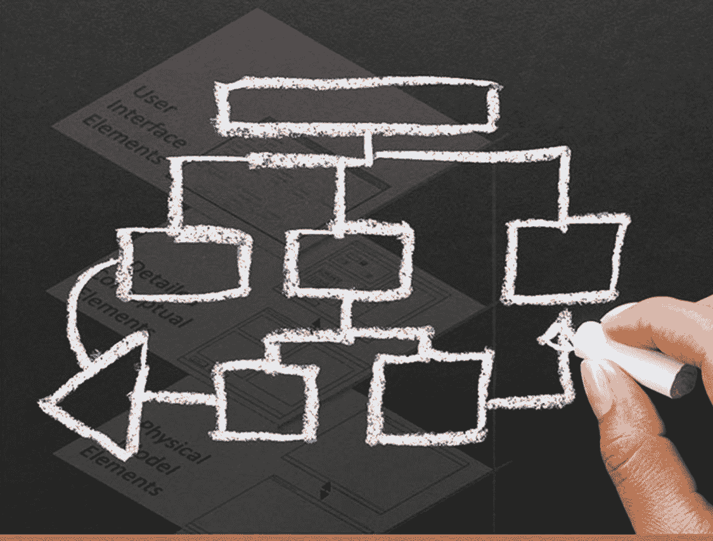


前言 ix

序言 xi

这本书是关于什么的？ xi

这本书适合你吗？ xiii

本书是如何组织的？ xiv

致谢 xv

配置：概念模型元素之间的连接 20

检查与修订 ... 104

其他概念模型的设计者将旧设计推向了新的方向，例如将纸质变为电子书，将汽车仪表盘旋钮变为触摸屏组件。然而，用户体验设计师最大的成功体现在全球 60 亿手机用户身上。虽然摩尔定律和其他技术进步是重要的因素，但我认为，这些设计师厨师们在烹饪 Web 浏览器、桌面软件和智能手机应用程序方面，其广受赞誉的贡献理应巨大的荣誉。生活在很多时候变得更美好，是因为人类通信的便利性连接了家庭，电子商务促进了业务，医疗保健的提高延长并提高了生活质量，等等。当然，网络犯罪分子、诈骗者、垃圾邮件发送者和恐怖分子也利用了这些新技术，这提醒我们，易用性和通用性具有令人困扰的负面影响，我们必须保持警惕。

卓越的文艺复兴思想家巴明斯特·富勒（Buckminster Fuller）提倡“全面预测性设计科学”，这鼓励现代设计师思考未来的影响，考虑意外之外的副作用，尊重不同利益相关者的需求，并确保可用性。他不断提醒人们对地球影响和设计伦理的关注。我们应该继续阅读并受他思想的启发。

总之，技术的进步为设计师带来了巨大的机遇和挑战。有数以千计籍和网站介绍了设计的各个方面，包括设计思维、设计方法、设计理论、设计研究和设计科学。新手设计师可以从这些化的来源中学习到很多，现在 Avi Parush 为设计师如何开发基本概念，以及支持功能、逻辑配置、易记忆的导航与策略、易于理解的形式和引人入胜细节的相关信息架构提供了全新的视角。这种分层的方法一直是设计指南的标准特征，Parush 引导新手和专家设计师完成了创建功能分块、概念模型元素、物理模型元素、详细概念元素和用户界面元素的步骤。

Parush 的描述非常精确，并辅以有帮助的示例。他对用词的仔细选择和清晰的图表引导了读者并澄清了概念。当然，每位旅行者和设计师都会找到自己的道路，但 Parush 有价值的指南将帮助体验设计师让新手更容易学习新系统，同时为专家提供更大的灵活性。

> —本·什尼德曼 (Ben Shneiderman)

马里兰大学，

2015年2月

# 前言

## 这本书是关于什么的？

这本书是关于交互式系统的概念模型和概念设计的。

有许多设计精美的应用程序。然而，许多应用让用户感到沮丧。在设计屏幕之前，你需要考虑什么以确保应用程序能够提供正向的用户体验？概念设计是用户界面设计过程中的关键步骤，它回答了那个问题。而这本书提供了一种进行概念设计的有效方法论。

让我们来看一个实际示例，说明在设计和开发交互式系统的整体背景下，你可能在何时遇到概念模型。想象一个支持身体锻炼的移动设备应用程序。在这样的应用程序中，设计查看之前锻炼的功能。我们可以设想一个非常直接的 1-2-3 设计过程，由三个主要步骤组成（图1）：

- 1. 选取几个功能；
- 2. 绘制线框图，进行测试和修改；然后
- 3. 完成用户界面的详细设计。

然而，我们究竟是如何从步骤 1 中的列表得到步骤 2 中的详细线框图的呢？这存在着一些尚未解决的问题，例如：

- 我们如何以及何时决定哪些项目应该被分组？例如，“之前的锻炼”应该是一个组吗？
- 我们是否定义了其他功能组？例如，应该有一个计划中的锻炼功能组吗？

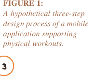

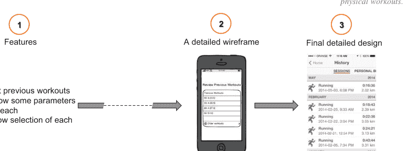

功能

详细的线框图

最终详细设计

- 1. 列表视图锻炼
- 2. 显示每个参数
- 3. 允许选择每个

## 前言

- 我们如何以及何时决定哪些项目应该被分组？例如，“之前的锻炼”应该是一个组吗？
- 我们是否定义了其他功能组？例如，应该有一个计划中的锻炼功能组吗？
- 我们是否定义了组之间的关系？例如，计划中的锻炼应该有联系吗？
- 我们是否定义了用户是否应该从一个组到另一个组？例如，计划中的锻炼应该关联吗？
- 我们是否确定了这些组应该显示在哪里？例如，计划中的锻炼应该单独显示还是在一起？
- 以及更多...

这些问题和示例反映了设计和开发交互式系统的方法论。特别是，它们反映了研究（图2中的1和3）与详细设计之间的差距。

这本书关注用户界面设计过程中的一部分：概念设计。它是有效方法论的基础，是科学而非魔法。它填补了研究与设计之间的差距。

图2：

概念设计作为研究功能与详细设计之间的桥梁。

# 功能

- 1. 列表视图锻炼
- 2. 显示每个参数
- 3. 允许选择每个

# 概念设计

# 详细的线框图

# 最终详细设计

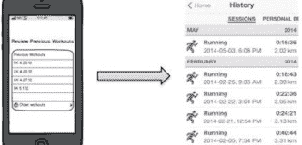

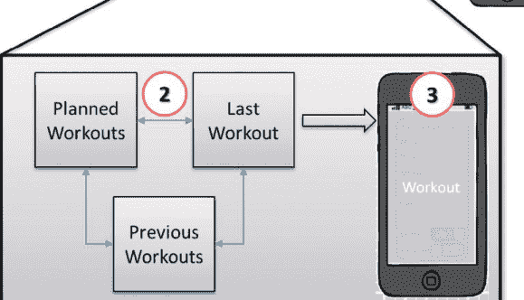

## 前言 xiii

分析和设计。在概念设计中，我们定义了底层交互系统的逻辑模型。

### 这本书适合你吗？

这本书适合你，如果：

- 你设计用户界面。
- 你正在寻找提高可用性的方法。
- 你正在寻找支持从需求到设计跳跃的系统化基础。

如果你设计用户界面并正在寻找提高设计可用性的方法，那么这本书适合你。如果你仍然觉得从功能需求到屏幕设计的跳跃是一种魔法般的神秘体验，并且想引入一种系统的、经过证明的方法，那么这本书适合你。如果你评审他人设计的用户界面并寻找分享反馈的词汇，那么这本书适合你。它适用于 (1) 产品经理、(2) UX 或 UI 设计师、(3) 程序员、(4) 营销人员、(5) 图形设计师、(6) 投资者或 (7) 其他任何人员。

使用这本书需要任何预先知识吗？是的，有一些。这本书关注的是用户界面过程的一个部分：概念设计。这就是为什么你应该了解以下内容：

- 用户界面、可用性和用户体验设计的基础
- 以用户为中心或面向人类的设计流程
- 用户研究

通过学习和使用这本书，你将实现两个目标：

- 1. 理解功能分块、配置、导航与策略的概念模型，以及通过如何定义概念模型来影响人类性能、可用性和用户体验。
- 2. 实现一种可靠的概念设计方法论来开发概念模型。

### 本书是如何组织的？

本书分为两个部分。第一部分较偏理论性，侧重于概念模型的概念及其对人类性能、易用性和体验的影响。你可以将这一部分视为一个入门指南，介绍并讨论了我们所谓的“概念模型”这一概念。第二部分是实操部分，侧重于概念设计过程以及我们开发概念模型的方法论。第二部分将带你了解开发概念模型的各个步骤，你可以将其作为一份“如何做”指南。

### 致谢

撰写这本书对我来说是一项巨大的工程。但正因为在通往这里的漫长旅程中，有许多人给予我支持和启发，这一切才成为可能。

首先，要感谢我的妻子、最好的朋友兼合伙人 Debi**。多年来，我们一直在人机交互领域共同工作，你真正理解这本书的核心内容。我们有很多机会共同开发并细化了我对概念设计的观点，以及帮助开发概念模型的方法论。Debi，是你让我写这本书的梦想变成了现实。

我的哥哥 **Zeev Parush**，他也是用户界面设计和用户体验领域的资深专业人士。我们讨论并辩论过通用设计、概念设计中的许多挑战以及参与其中的设计的意义。Zeev，你对手稿早期版本的宝贵意见帮助我重新思考并改写了书的部分内容。

**Ben Schneiderman 教授**多年来一直是我的灵感来源。从你开创性的思想、概念，以及我们对人机交互研究的讨论中，我学到了很多。你在职业和学术生涯各个阶段的支持，以及对这本书的支持和鼓励对我产生了深远的影响。

**Tom Hewett 教授**，我曾就人机交互、研究、认知心理学、伦理以及优秀单麦威士忌与平庸品种之间的等等问题进行过许多富有启发性且深刻的讨论。

我在人机交互领域从业期间合作过的**客户们**。所有的项目都为我完善通用用户界面设计模型、特别是概念模型提供了宝贵机会。

**一代代学生们**，他们听过概念设计等抽象主题的讲座，挑战我的想法，并促使我不断完善它们。

**书籍计划书的评审员**，我的朋友和同事 **Ben Schneiderman 教授**、**Whitney Queensberry** 和 **Ohad Inbar 博士**，他们不仅就如何写这本书提供了建设性建议，还鼓励我写下去。

**手稿早期版本的评审员**，**Claire Rowland** 和 **Linda Lior**，他们提供了极佳且建设性的反馈，帮助我修改手稿使其成为一本好书。

**Morgan Kaufman 的同事**，编辑 **Lindsay Lawrence**、**Meg Dunkerley**、**Heather Scherer**、制作经理 **Punitha Govindaraajanjane** 以及 **Todd Green**。你们的支持、耐心和理解让这一切成为可能。

最后，我亲爱的父母 **Miriam** 和 **Meir**。在学术写作的氛围中长大，父母鼓励我追求学术兴趣。我的父亲本身就是一位成就的作家，他启发了我写作。感谢你们为我的职业奠定了坚实的基础。

## 概念模型——基础

到目前为止，序言和本节标题表明，书中一个核心概念是“概念模型”。本书第一部分的目标是介绍交互系统中概念模型的基础并讨论其影响。简而言之，概念模型是概念元素的配置以及元素之间的导航。因此，概念模型是任何交互系统用户界面的基础。然而，在我们继续使用听起来抽象的词汇和句子之前，让我们先来看一个例子。在跨交互渠道设计有效且一致的用户体验是具有挑战性的。我们将在书中强调这一挑战。本书这部分的运行示例是一个多渠道和跨渠道的交互案例。

### 多渠道跨渠道示例：设置预约

为了说明概念模型的基本组件，我们引入并分析了四个现有的日历应用程序。这四个应用程序都在设置预约，且每个都在不同的交互渠道上。这种对比说明可以证明你如何使用不同的概念模型来实现相同的目标。

交互流的第一步对所有应用程序都是通用的：为了设置预约，用户可以通过点击日历或激活某个选项来选择起始日期和时间。

示例日历分布在以下渠道：

- 桌面端
- Web 端
- 平板
- 智能手机

第一个应用程序是基于 Windows 的，通常安装在桌面电脑和笔记本电脑上，具有熟悉的图形用户界面（GUI）。在日历中，用户可以执行以下任务：

- 1. 设置基础预约：主题和地点，以及指定日期和时间的控件
- 2. 设置提醒：通过下拉列表选择提醒的提前时间
- 3. 设置循环：循环频率和日期范围

第二个应用程序是 Web 端日历。与 Windows 应用程序一样，该应用程序中的交互流也允许从日历中的特定时间段开始，在这种情况下，日期和时间已经根据起始点设置好（图 1.2 中的弹出模态窗口 1）。用户可以

- 1. 在页面右上角设置基础预约参数
- 2. 通过将其移动到页面其他位置并打开提醒提前时间列表来设置提醒
- 3. 通过打开弹出模态窗口设置循环，其中包含循环频率和额外参数

第三个日历应用程序用于触摸平板电脑。与上面分析的两个应用程序一样，交互从日历开始，屏幕上弹出一个对话框（图 1.3 中的 1）。用户可以：

- 1. 直接在窗口顶部定义预约的（目的）和地地点
- 2. 设置或编辑预约的日期和时间，一个新的弹出模态窗口会覆盖在之前的窗口之上，可以在其中设置日期和时间

## 概念模型——基础

（关闭第二个弹窗并返回主窗口设置预约，即可结束这一扩展交互）；

+   设置提醒：打开一个提醒弹窗模态窗口，用户在其中选择提醒标签，关闭次要窗口并返回主界面；
+   设置循环预约：设置预约打开另一个弹窗模态窗口，用户在其中设置循环频率，关闭次要窗口并返回主界面。

**第四种应用是在触摸屏智能手机上。** 创建新预约将用户带入一个填充整个屏幕的对话框（如图 1.4 所示）。用户可以

+   在屏幕顶部定义预约的主题和位置，并立即显示（预约的日期和时间也位于顶部并可立即交互）；
+   通过在预约屏幕上方打开一个小的弹窗模态窗口来设置或编辑日期，同时保持该窗口在背景中可见；
+   以类似于设置日期的方式设置时间（一旦参数设置完成，用户可以通过关闭弹窗模态窗口并返回原始设置主窗口来结束这一扩展交互）；

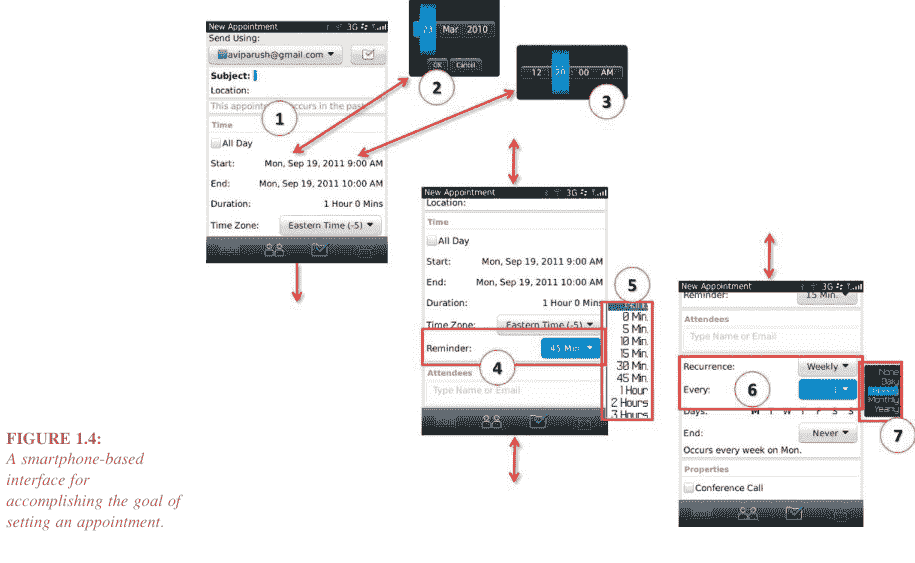

+   4. 在同一窗口中向下滚动到图 1.4 中标记为 4 的位置来设置提醒（在该处，用户调用弹出列表来选择提醒提前量）；
+   5. 当用户进一步滚动到图 1.4 中标记为 6 的位置时，将预约定义为循环（在此之前，用户调用弹出列表以选择循环参数）。

现在我们有了四个简单的应用作为示例，让我们来思考它们。我们知道这四个应用支持用户实现相同的目标：设置预约、设置循环预约以及为预约设置提醒。它们的外观和行为不同。为什么？答案显而易见：每个应用都运行在不同的交互通道中。每个应用的设计符合各自通道的原生视觉效果和感受。

然而，它们之间的区别仅限于此吗？而且，这重要吗？这是本书的论点：存在更根本的差异，而且，它们确实很重要。为了详细说明，我们将讨论概念模型，并展示其根本差异及其影响。但在在此之前，让我们再考虑另一个方面。

你可能注意到，每个应用中交互流的描述都将每个动作处理为用户“去往”另一个“地方”。从比喻的角度来思考“去地方”。本入门指南的后续章节将讨论“地方”与概念模型元素之间的关系，以及它们与“物理地方”（如窗口、对话框和网页）之间的关系。我们称之为空间比喻。接下来，我们将讨论空间比喻的意义，以及在处理概念模型时抽象的重要性。

## 地方、路径与抽象

设计网站时一个非常常用的术语是信息架构。使用“架构”一词意味着在讨论基本功能、配置和布局。只需看任何建筑图纸，例如图 2.1 所示。该图纸在提供任何细节方面非常简练。它提供的只是服务于给定功能的空间（例如厨房和卧室）的总体布局，以及每个地方在整体配置中相对于其他地方的位置。此外，通过描绘门和通道，它为我们提供了关于从一个地方到另一个地方应遵循的路径的清晰信息。然而，尽管图纸非常简练，但它在实施之前评估建筑方案非常有帮助：是否提供了所有所需的功能（例如，有书房的地方吗？）为每个功能是否分配了足够的空间（例如，餐厅和客厅应该是最大的地方吗？）进入房间的通道是否合适？路径和距离是否支持从一个地方到另一个地方的轻松导航？换句话说，典型的建筑图纸在引入细节之前为我们提供了全局特征。

概念模型的表示类似于建筑图纸。它有助于确保每个功能都有一个“地方”，并且从一个地方到另一个地方的路径能够充分支持交互工作流。在进入细节之前，我们如何最好地表示此类全局特征？为了分析和讨论概念模型，我们使用方框和箭头的视觉语言。换句话说，我们在使用抽象术语讨论概念模型，脱离任何细节。在进入细节之前，设计和讨论概念模型时保持在抽象层面为什么重要？

模型的抽象表示很好地支持了人类感知和理解的基本特征之一。关于人类感知和注意的经典研究（Navon, 1977）表明，视觉场景的全局结构往往先于任何局部特征的感知，而不是一次感知所有特征。原始研究使用了与图 2.2 所示的刺激。研究结果表明，人们对图 2.2 中左侧和右侧元素中字母“H”的感知反应优于识别大“H”是由哪些字符组成的（左侧刺激中是“H”，右侧刺激中是“S”）。大字母“H”被视为全局特征。

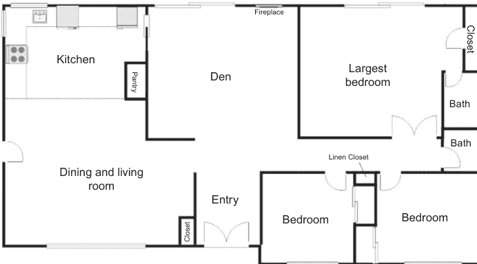

图 2.1：一张简单的建筑图纸。

图 2.2：Navon (1977) 全局优先实验中使用的刺激。

## 概念模型的分层框架

我们将使用分层框架来定义和分析概念模型。为什么要分层？思考洋葱比喻。这个流行比喻背后的想法是，我们一层层剥离到达核心，发现洋葱真正的味道。对于交互系统的用户界面，我们可以将看到的内容视为外层，并想象还有我们需要剥离的内层。

在本书的第一部分，我们引入并分析概念模型，通过剥离层来覆盖底层概念模型。在书中第二部分，我们系统地构建概念模型，方向相反：在一个层之上添加另一层，从抽象到具体。图 3.1 显示了概念模型所在的整个上下文的分层框架。

该框架从下到上由五层组成：

- 1. **功能层**由功能块组成——*任务和对象的组*以及用户用于实现目标的*相关参数*。
- 2. **配置层**由概念模型元素组成——用户执行每组功能必须访问的隐喻“地方”，以及“地方”之间的链接。
- 3. **导航与策略层**描绘导航和导航规则——用户在“地方”之间采取的“路径”、包含一个或多个“地方”的物理元素，以及管理物理元素相互关系的策略。
- 4. **形式层**由*详细的概念元素*组成，作为从概念设计的过渡。
- 5. **细节层**由用户界面元素组成——用户执行任务时访问的每个 UI 元素的*详细视觉效果和感受*。

概念设计处理用户*做什么*以及*在哪里*做，但不包含细节。从这个框架来说，概念设计跨越了功能、配置以及导航与策略层。向详细设计的过渡发生在形式层，引入细节并最终将概念设计转换为完整且详细的用户界面。

图 3.1：

代表概念模型和详细设计的的分层框架。

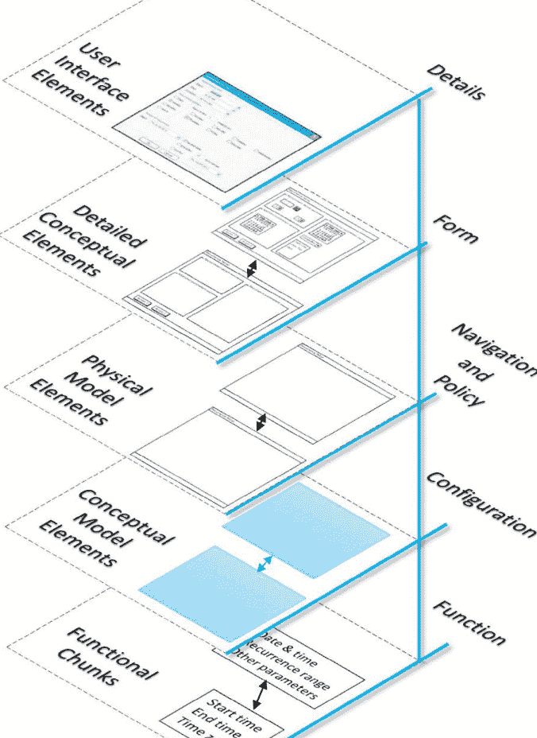

在对概念模型进行分析和讨论的过程中，我们将像剥洋葱一样层层深入。换句话说，我们将对上一中的日历示例进行反向工程，以揭示各自底层概念模型的元素和特征。

### 功能层 (The Function Layer)

#### 功能块 (FUNCTIONAL CHUNKS)

许多因素决定了产品的功能：用户及其他利益相关者的需求、产品愿景与定义、业务目标与模型以及技术。结果就是我们在功能层看到的内容。它包含了与应用或系统领域（例如时间管理）相关的所有参数、信息项和操作。所有这些内容共同构成了产品的功能。

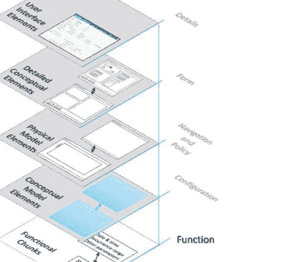


设计师通常根据用户（用户、市场等）的共同目的或意义，将与特定领域相关的参数、信息项和操作分组为功能块。功能块可以围绕任务和/或对象展开。在本书中，我们关注功能块的两种主要形式：面向任务的和面向对象的。还有另一种形式的功能块，即面向内容的块。我们在此处会提到它，但书的关于方法论的部分不会重点介绍它。定义这些功能块是概念设计过程的一部分。书的第二部分将涉及概念设计的方法论。

### 面向任务的块 (TASK-ORIENTED CHUNKS)

面向任务的功能块是用于共同目的的任务集合（见图 4.1）。面向任务的块使用户能够实现切实的目标、完成具体事项（如设置预约或设置提醒）或获取关于特定主题的信息。面向任务的块也可能纯粹是为了功能和参与而没有实际的实用价值（例如游戏任务，如“根据一组规则对所有卡片排序”）。

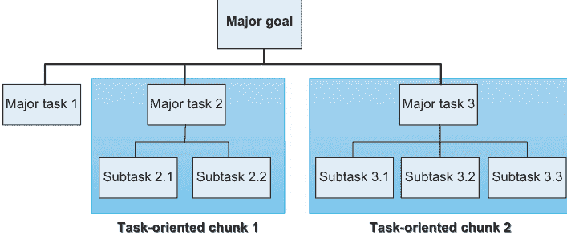

图 4.1：

面向任务的功能块的想法。

### 面向对象的块 (OBJECT-ORIENTED CHUNKS)

面向对象的块包括应用领域主题中的对象（例如预约、打印机、页面、行程或停车位置），以及与该对象相关的的内容（图 4.2） (Shneiderman, 1998)。

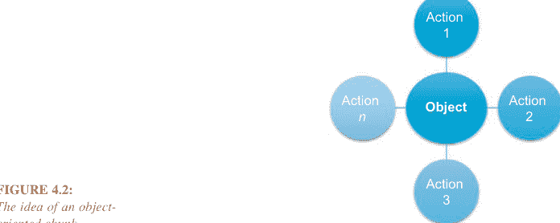

图 4.2：

面向对象的块的想法。

### 面向内容的块 (CONTENT-ORIENTED CHUNKS)

面向内容的块是信息项的集合。每个块都是内容类别。用户通常为了各种目的搜索并使用这些信息项（图 4.3）。

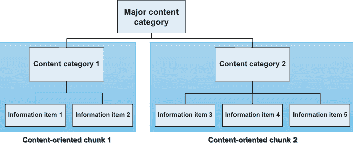

图 4.3 面向内容的块。

### 功能块与复合块之间的关系

通常，单个块无法完全支持任务的完成。更多时候，它无法支持用户目标的实现。在这种情况下，我们寻找几个相互相关的块来支持任务的完成和/或目标的实现。我们甚至可以让任务块、对象块和内容块组成复合块（图 4.4）。复合块中包含几个块取决于使用的频率、任务结构和交互流程。让我们来看一个小例子来澄清。为了支持用户准备打印某些东西，我们可以有一个复合功能对象，如打印机和页面，这些与面向任务的块相关，包括打开、更改、删除、保存和打印。

## 概念模型——基础 (THE CONCEPTUAL MODEL—FUNDAMENTALS)

图 4.4：

复合功能块的想法。

### 复合功能块

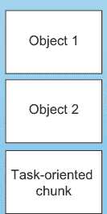

### 预约中的功能块

在不同渠道上实现的四个应用程序具有相同的功能：设置预约参数。这种共同的功能似乎将每个应用程序中的三个块（参数块和操作块）绑定在一起，旨在支持功能的实现。预约示例中的“功能块”包括以下内容：

- 子目标 1：定义预约详情。

    - 参数：会议标题、日期和时间，最后是会议地点。

    - 操作：批准或取消预约定义。

- 子目标 2：设置提醒。

    - 参数：预约开始前的时间。

    - 操作：批准或取消参数。

- 子目标 3：定义预约的循环。

    - 参数：在给定期间内按频率或次数进行的循环。

功能块的内容反映了用户所做的。分层结构可以正式地表示这种关系。任务树的根是所有应用程序通用的主要目标。该目标进一步细分为三个子目标及其相关操作（图 4.4 和 4.5）。

此示例中的功能块是面向任务的还是面向对象的？这种功能块围绕着参数和操作，看起来是面向对象的。然而，在预约示例中，这些功能块是面向任务的……

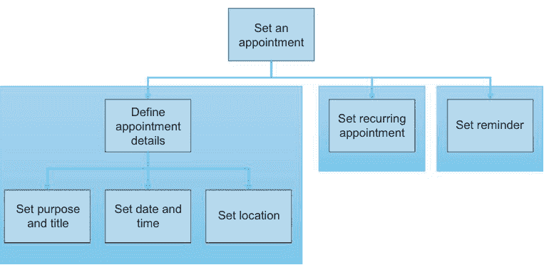

图 4.5：任务结构的想法。

## 配置层 (The Configuration Layer)

配置层是多个元素组合在一起的结果，也就是我们在功能层看到的内容。配置层是元素之间关系的抽象¹

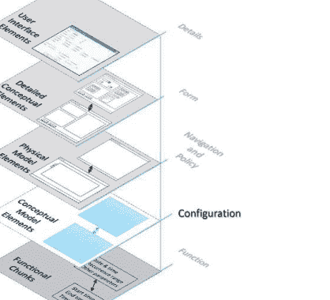

### 概念元素 (CONCEPTUAL ELEMENTS)

用户交互通常涉及做某事，然后“转换”到其他事，直到实现目标。这种空间关系描述了用户访问和导航的“地方”。因此，概念模型中的基础元素是这些地方。

### 配置：概念模型元素之间的连接 (CONFIGURATION: THE CONNECTIONS BETWEEN CONCEPTUAL MODEL ELEMENTS)

连接元素的配置可以支持任务的完成，特别是涉及许多操作和参数的任务。概念元素之间连接的强度是它们关系的另一个特征。某些连接由于交互频率、一个任务依赖于另一个或任务功能相似而更强。此外，有多种配置连接元素以支持不同的任务和交互流。

为了模拟“地方”（每个“地方”都是功能块的容器）以及它们之间的连接，我们将每个“地方”表示为一个空框。连接框的线表示概念模型元素之间的连接。这种作为框和线的底层配置的示意图图就是你的第一份“巾草图”。有些人将其称为最基础的框架。通过视觉表示，图 5.1 展示了四个概念元素的不同配置如何导致三种不同的模型。

图 5.1 显示了配置 A 中顺序链接的元素。在这种配置中，两个元素（1 和 4）仅连接到另一个元素，两个元素（2 和 3）连接到其他元素。在配置 B 中，元素与另外两个元素连接。此外，每个元素都缺少与另一个元素的连接。最后，配置 C 中，两个元素（1 和 2）与另外两个元素连接，其余元素（3 和 4）每个连接到单个元素。¹ 等效于“地方”之间的连接，整体配置支持用户目标。设计得当，这些元素具有两个基本特征：

1. 完全或部分地支持至少一个任务（例如设置预约或结束提醒）。
2. 为用户提供执行任务的机会。因此，概念元素是交互式元素。

> 线框本身可以出现在并应用于多个抽象层级，即具有不同程度的细节。这将在书的后续入门部分以及概述概念模型方法论的第二部分进行进一步讨论。

## 配置层

图 5.1：

四个概念模型元素的可能配置，代表了三个不同的概念模型。

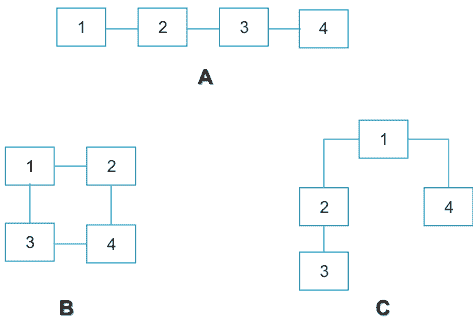

从一个元素延伸到另一个元素，正如我们将就概念导航地图讨论的那样。

### 预约示例中的概念模型

在这里，我们像剥洋葱一样层层深入核心。为了揭示每个预约设置应用程序的底层逻辑，我们模糊屏幕和窗口的细节，并为功能块定义一个“位置”。这便形成了一个概念模型元素。图 5.2 展示了我们如何剥离几层以到达 UI 下的概念模型。

- 要揭示底层的概念模型，请寻找以下内容：

- 用户与应用程序任务交互以实现目标的“位置”

- 用户为了从一个位置移动到另一个位置而所采取的“路线”

外层包含了 UI 的所有细节。当我们在内层拥有 UI 组件的空白表示时（例如中的两个窗口），随着我们剥离更多细节，到达了最深层，即核心。这一层将每个窗口显示为一个方框，箭头表示路线，数字表示在执行任务时与窗口交互的顺序。

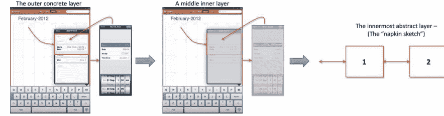

> 最内层的抽象层 –（“餐巾上的草图”）

图 5.2：

代表 UI 及其底层概念模型的三个层。

表 5.1 显示了四个日历应用程序底层基础概念模型的揭示过程。

## 表 5.1：

四个预约应用程序的概念模型对比

| 用户界面 | 概念模型 | 释义 |
|---|---|---|
| 1 |  | 1 | 用户在几个“位置”执行操作。第一个用于基本参数 (1)，其他“位置”用于设置额外参数 (2 和 3) |
|  | 2 | |
|  | 3 | 用户在多一个“位置”上执行操作，第一个用于录入，第二个用于设置额外参数 (2)。还有一个额外的“位置”用于设置额外参数 (3) |
|  | 1 | |
|  | 2 | 用户在多一个“位置”上执行所有操作，第一个用于录入和基本参数 (1)，另一个额外的位置用于参数设置和微调 (2) |
|  | 3 | |
|  | 4 | |
|  | 3 | 用户在多一个“位置”上执行所有操作，第一个用于录入、基本和额外参数 (1)。有额外的位置用于参数设置和微调 (2 和 3)。设置提醒和循环参数需要分别跳转到 4 和 6。在其他“位置”中使用了 5 和 6（如 set）。他们必须从每个“位置”返回原始位置 (1, 4 或 6) 才能退出 |
|  | 5 | |
|  | 6 | |
|  | 7 | |

概念元素的配置反映了用户访问的“位置”以及连接这些“位置”的链接，这些链接确保了任务的执行和目标的实现。通过对比表 5.1 中的四个概念模型可以看出，尽管每个模型的功能相似，但在概念元素的数量及其配置上非常不同，特别是应用程序 3 和 4 彼此以及与 1 和 2 之间非常不同。

概念元素的配置本身并没有完全反映元素之间链接的强度。此外，它没有提供通过配置进行导航的细节。我们仍然需要导航地图、概念元素到物理位置的以及导航策略。这些位于概念设计框架的下一层。

### 导航与策略层

空间隐喻在描述交互式系统的概念模型时继续有效。我们使用“导航”一词来描述用户从一个位置移动到另一个位置。我们使用“导航地图”一词来代表整个概念模型中的路线指令。以下是关于导航和导航地图的一些细节。

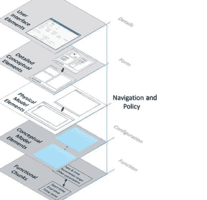

### 概念导航地图：在概念模型元素之间移动

概念导航地图显示了用户可以或必须通过配置采取以执行并完成目标的所有所需步骤的“路线”。

- 1. 开始和结束交互的入口和出口点。
- 2. 配置中概念元素之间每个链接的方向；某些链接是单向的，某些是双向的。

## 概念模型基础

图 6.1 显示了一个概念模型配置（图 5.1 中的配置 C），它带有三个不同的导航地图。

在概念导航地图 C1 中，导航从概念模型 1 开始并结束。从该元素出发，可以进入概念模型 2 或 4。当在概念模型 2 或 4 处发生交互时，需要导航回概念模型 1 以退出。最后，可以从概念模型 2 继续到 3，一旦在概念模型 3 处结束交互，就导航到了概念模型 2。概念导航地图 C2 与 C1 相同，例外是可以在概念模型 4 处结束而无需返回概念模型 1。最后，在概念导航地图 C3 中，可以在概念元素 2 和 3 之间无需回溯导航。

以下两个主要考虑因素影响用户链接概念元素以完成目标所需任务的路线：

- 1. 概念模型配置
- 2. 关于工作流和交互动态的决策

每一个然而，元素之间的链接并不总是告诉我们是单向还是双向路线。此外，它没有告诉我们入口和出口点在哪里。后者的参数的决策受工作流的影响。

然而，每个元素的物理位置也会影响路线特征。例如，观察图 6.1 中三个示例中的元素 2 和 3。地图显示这两个元素之间存在双向路线。如果每个元素都位于单独的窗口，与两个元素位于同一个窗口但不同标签的情况相比，导航还会相同吗？这引出了概念模型的下一个重要方面：物理位置。

### 概念元素的物理位置

到目前为止，我们使用空间术语“位置”来讨论概念元素。非常重要的一点是强调这是严格在隐喻意义上的，而不是物理意义上的位置。然而，当我们确定物理位置、“位置”之间的“距离”以及它们之间的导航时，隐喻“位置”与物理位置之间的对应是非常重要的。

概念模型元素有时可以与其物理位置一一对应。例如，一个“位置”可以是一个窗口。但在其他情况下，可能没有这种对应。例如，图 6.2 展示了

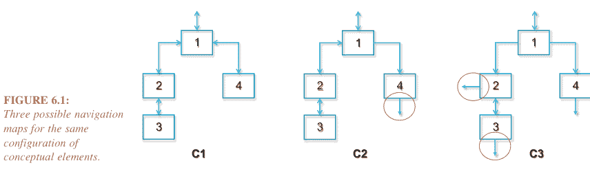

图 6.2：

三个元素概念模型的不同物理分配。

## 概念模型——基础

由三个概念元素的配置，代表三个隐喻的“位置”，其中“位置”1 链接到“位置”2 和 3。这些隐喻的“位置”可以通过不同的方式物理定位。

这三个元素可以位于三个不同的物理位置（例如图 6.2 所示的三个窗口）。这种模型反映了元素 1 与元素 2 以及 3 之间相似的链接强度。它也可以反映了从元素 1 到元素 2 或从元素 1 到元素 3 的相似（相同频率或相同重要性）交互流。

或者，“位置”2 和 3 可以位于同样托管概念元素 1 的单个物理位置内（见图 6.2 中的 B）。这种配置代表了元素 1 作为元素 2 和 3 的父级之间更紧密的关系。它可以反映了元素 2 和 3 之间的交互流，这种流必须保持在父元素 1 的语文中。

图 6.3 展示了另一种将概念元素分配到物理位置的方案。在概念模型中，元素 1 与元素 2 和 4 链接。此外，元素 3 与元素 4 链接。该模型的一种可能分配方式如 A 所示；位置”2 和 3 可以物理上出现在同一个物理位置内。

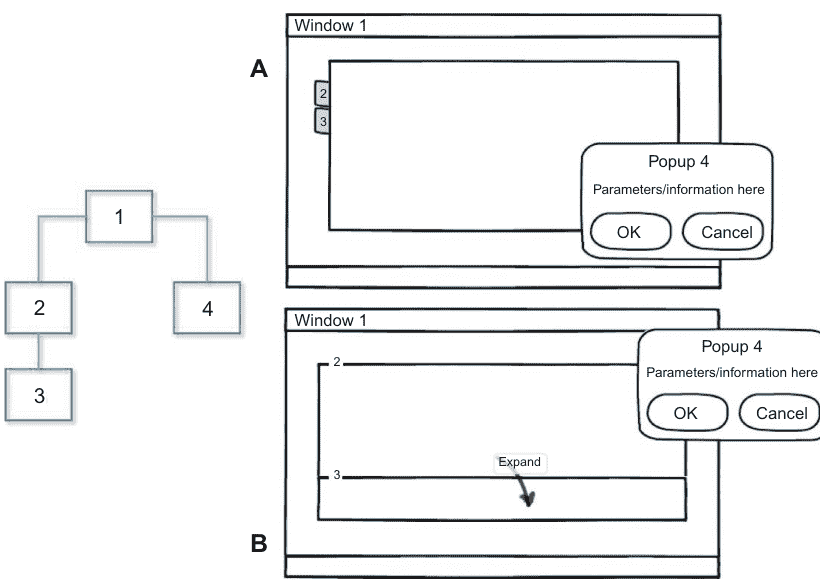

图 6.3：

四个元素概念模型的不同物理分配。

## 导航与策略层 29

同时也托管概念元素链接，而“位置”以弹出窗口的形式出现。这种分配反映了元素 2 和 3 之间更紧密的链接以及它们与元素 4 之间的“距离”。或者，元素 2 和 3 之间可能的层级链接可以进行物理分配，使得元素 2 和 3 在同样托管概念元素 1 的窗口内作为“位置”出现，其中元素 3 是元素 2 的扩展。元素 4 被分配给一个弹出窗口。

确定概念元素到物理位置的分配对导航地图和导航策略具有重要影响。正如本书这部分即将讨论的，它对人类性能、易用性和用户体验也有影响。

#### 导航策略：“道路规则”

有效的地图和路线指令必须包含规范导航的规则。我们能随时随地去想去的地方吗？同样，概念导航地图必须包含这些规则，我们称之为导航策略。

关于概念导航地图的设计决策与关于物理位置和导航策略的决策密不可分。这些决策必须考虑一个根本性问题：用户是否应该同时执行多个任务？在交互流方面，这个问题的影响是：用户是否被要求在移动到下一个任务之前完全或部分完成任务，用户是否被要求完成给定任务、移动到另一个任务并完成，然后返回原始任务？

从概念模型来看，策略根本上处理的是模态（modality）挑战：在与物理位置中的概念元素交互时，用户是否可以在同一物理位置或不同位置与另一个概念元素交互？当答案为是时，我们称之为无模式策略（modeless policy）。无模式概念元素允许同时与其他概念元素交互。当策略限制用户在单个物理位置内一次只与一个概念元素交互时，我们称之为模态策略（modal policy）。模态概念元素是不允许同时与任何其他元素交互的。

图 6.4 中的概念导航地图是导航策略与概念元素物理位置之间关系的示例。图 6.4 A 部分所示的导航策略允许用户同时与“位置”中的概念元素 2 以及“位置”3 中的元素 3 交互。物理分配使得用户随后可以关闭模型元素 3，完成概念元素 2 的任务，并返回“位置”1 中的概念模型元素 1。图 6.4 B 部分所示的导航策略允许用户仅与概念模型元素 2 交互，并可以选择继续到概念模型元素 3，在并在完成任务，然后返回概念模型元素 2 完成任务，最后回到概念模型元素 1。

图 6.4：

具有两种物理分配的概念导航地图，反映了不同的导航策略。


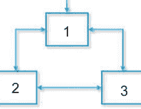

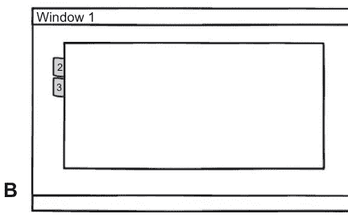

图 6.4 中的示例告诉我们关于交互式系统中模态概念的一些知识。处理模态并对其范围做出决策对于最终确定导航地图和策略至关重要。表 6.1 显示了概念元素物理位置分配与模态之间关系的简单分类。

概念元素的物理位置分配有两种可能性：元素位于相同的物理位置，或者位于不同的物理位置。

模态也存在两种可能性：与概念元素的交互是独立的，或者用户可以同时与多个元素交互，亦或是互斥的，即用户一次只能与一个元素交互。

例如，请注意，在涉及物理分配和模态时，交互通道也起着作用。表 6.1 显示了针对不同情况的各种示例：

### 表 6.1：

概念元素的位置分配（在相同或不同位置）与模态的示例

| 模态 | 同一位置 | 不同位置 |
| :--- | :--- | :--- |
| 无模式：独立 | 窗口名称 | 对话框 |
| 模态：在大屏通道中互斥 | 窗口 1 | 窗口 2 |
| 模态：在小屏通道中互斥 | 窗口 1 2 | 窗口 3 |
| | 对话名称 | OK |
| | | |

例如，手机。在另一种选择中，我们拥有基于触摸的手势交互（如滑动）。

#### 运行原则

我们已经多次提到，通道的特性（如屏幕大小和视觉效果）是整个设计过程中做出决策的一些基本标准。在此之后，交互的另一个重要特性是物理性的。与桌面式计算机交互的最简单示例是键盘和鼠标。键盘输入文本、发布命令、导航、启动程序并控制设备（例如磁盘驱动器、音量和照明）。鼠标通过点击和拖放等操作对屏幕元素进行直接操控（Shneiderman, 1982, 1983）。当我们转向基于触摸的通道时，物理手势包括单指触摸、长按、滑动、多指触摸、多指手势以及执行选择和缩放等操作。此外，还有其他模态，如语音、注视、脑电活动以及虚拟空间中的粗手势。运行原则描述了通道的交互特性，应该是概念设计的一部分（Shneiderman & Plaisant, 2010）。


运行原则可以影响导航地图和策略，以及概念元素的物理分配。让我们查看几个说明运行原则对设计决策影响的示例，见表 6.2。所有示例都基于表格顶部所示的相同概念模型。当我们查看桌面式计算机的两种可选运行原则时，使用不带内置滚轮的鼠标，用户可以通过指向点击在元素 1 和 2 之间导航。将这两个元素分配到相邻的标签页中，可以度地减少用户移动到启动导航位置的距离。此外，使用内置滚轮，用户可以通过滚动滚动在两个元素之间导航，设计师可以将这两个元素分配在同一处。这还提供了一次看到更多一个元素的优势。当我们查看移动设备的运行原则时，一种是带有触笔点点触摸功能的设备。在这种情况下，设计师将两个概念元素分别分配到不同的物理位置，并可以使用触笔在它们之间导航。在另一种方案中，我们拥有提供基于触摸的手势交互的设备（如滑动）。在这种情况下，设计师

## 表 6.2：

桌面端和移动端交互通道的操作原理及其相关概念设计的示例

| 桌面式电脑、大屏幕、键盘和鼠标 | 使用鼠标滚轮上下滚动 | 移动设备、小屏幕、基于触摸的交互 |
| :--- | :--- | :--- |
| 鼠标未配备滚轮；指向并点击结果为选择 | 通过触摸触写笔进行交互，包括指向和触摸（产生点击效果）；未提供基于触摸的手势支持 | 基于触摸的手势操作 |
| 窗口 1 | 窗口名称 | 组 1 |
|  |  | 组 1 |
| 同一窗口中两个标签页的两个概念元素之间的导航通过点击操作完成 | 同一物理位置的两个概念元素之间的导航通过滚轮滚动完成 |  组 2 |
| | | 触摸上下手势在分配到同一物理位置的元素之间进行导航 |
| | | 在按钮上指向并触摸以导航到分配在不同物理位置的概念元素 |
| | | 将两个概念元素分配到同一物理位置，用户通过上下触摸滑动手势在它们之间导航。 |

### 预约案例研究中的导航地图和策略

在本节中，我们再次对比了四个设置预约的示例应用。这里从概念元素及其物理位置的角度展示了概念模型（表 6.3），并附带了导航地图和导航策略。

这四个示例说明了一旦将概念元素分配到物理位置，其配置会发生什么变化，以及这种分配如何影响导航地图和策略。

### 表 6.3：

四个预约应用中概念模型、位置以及导航地图和策略的比较

| 用户界面 | 概念模型 | 概念模型 + 导航地图和策略 |
| --- | --- | --- |
| 1 | 3 | 1 2 |

概念元素 1 和 2 位于同一物理位置，且可以在没有顺序限制的情况下访问。元素 3 位于独立的模态窗口中。用户必须从 3 返回到源“位置”才能退出。

| 1 | 3 | 1 2 |
| --- | --- | --- |
| 15/02/2013 12:00pm 1:00pm 15/02/2013 今天 重复 | | | |
| 全天 重复 | | | |
| 事件详情 | | | |
| 显示我的所有事件 | | | |
| 日历 Al-巴黎 | | | |
| 描述 | | | |
| 过滤日期地图 15/02/2013 至 15/02/2013 | | | |
| 书签 | 添加注释 | | | |
| 显示为有空 ☐ 正文 ☐ 固定 ☐ | | | |

概念元素 1 和 2 位于同一物理位置，且可以在没有顺序限制的情况下访问。元素 3 位于独立的模态窗口中。用户必须从 3 返回到源“位置”才能退出。

### 表 6.3：

四个预约应用中概念模型、位置以及导航地图和策略的比较（续）

## 用户界面 概念模型 导航地图和策略

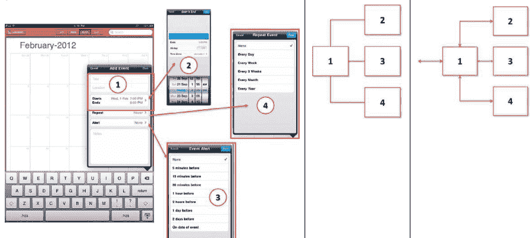

所有概念元素都位于不同的位置，且均为模态窗口。用户必须从额外的位置 2、3 和 4 回到原始位置（1）才能退出。

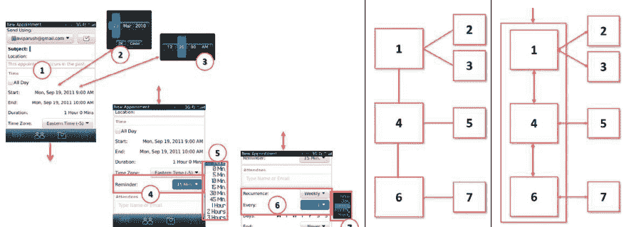

概念元素 1、4 和 6 均位于同一位置。用户可以在没有顺序限制的情况下访问它们。由于屏幕尺寸较小，元素 1、4 和 6 可能需要滚动才能访问。此外有用于参数设置和微调的额外位置（2 和 3）。位置 2、3、5 和 7 是模态的，需要返回源位置的往返。

### 详细层 (The Detailed Layers)

到目前为止的分析处理的是较高抽象级别的概念模型。也就是说，模型中的元素不包含任何细节。现在，我们到达了可以看到概念中更多细节的层级。这是一个过渡层，一方面，决策会影响概念模型并导致性能和可用性；另一方面，它为设计引入了细节。

#### 表单：详细概念元素 (FORM: DETAILED CONCEPTUAL ELEMENTS)

在表单层中，考虑到物理分配以及导航地图和策略，概念元素在每个数据块（信息、参数和动作）都有了一些细节。详细的概念设计涉及关于控件的初步决策以及初步的视觉设计考量（针对视觉用户界面）。

从概念元素到详细概念元素的过渡阶段可能存在*多个粒度级别*。这些取决于功能性数据块的定义。

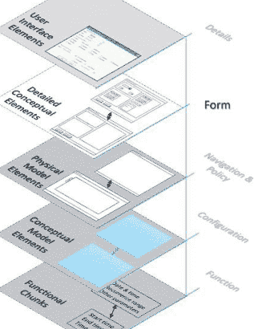

### 图 7.1：

表单层中概念模型的两个粒度级别。

左侧元素显示了给定概念模型的粒度级别。右侧元素显示了带有“干扰”的设计。注意，这种粒度级别仍然缺乏细节，而右侧元素包含了用户交互的参数和控件。

关于控件的决策通常是一个两步过程。一步是微调关于物理位置的决策。例如，设计师可以将多个概念元素分配到同一个物理位置（如窗口或网页）。决策跨越了从概念设计到详细设计的过渡，因为一方面，它们反映了功能数据块及其相互关系并可以影响概念模型；另一方面，它们涉及关于特定控件的决策。此类决策可能包括：设置数值参数是通过在文本框中输入数字，还是从预定义列表中选择，或者通过选择器类型的控件完成（参见 7.1 右侧草图中的示例）。

最后，确定初始视觉设计也是从概念设计到详细设计过渡的一部分。总体，视觉布局反映了功能数据块及其相互关系，并可以影响概念模型及其影响（例如对视觉搜索的影响）。

#### 细节：用户界面元素 (DETAILS: USER INTERFACE ELEMENTS)

随着设计过程展开，我们到达概念和详细设计框架中的顶层：细节层。我们为组成用户界面元素添加更多细节。这些细节包含了关于控件的最终决策、视觉布局、图形设计（例如颜色、字体和图标）、术语，以及关于导航策略和操作原理的任何问题。


本书主要讨论与概念模型和概念设计直接相关的层级和阶段。它不涉及详细设计方面。

## 概念模型的组件概述：根据分层框架

我们将所有内容整合在一起。具体来说，概念模型的三个关键方面：功能块（functional chunks）、概念元素的配置（configuration of conceptual elements）以及导航与策略（navigation and policy），已经在前面分析过了。

| 应用 1 | 应用 2 | 应用 3 | 应用 4 |
|---|---|---|---|
| 功能块 | | 设置 | |
| | | 定义细节 设置提醒 | |
| | | 目的/时间 设置位置 | |
| 配置 | 1 | 1 | 2 |
| | 3 | 3 | 3 |
| | 2 | 2 | 1 5 | 7 |

## 导航与策略


- 概念元素 3 是模式
- 概念元素 3 是模式
- 概念元素 2, 3 和 4 是模式
- 概念元素 2, 3, 5 和 7 是模式

## 概念模型

重要性！对性能、易用性和体验的影响

在书的前部，在介绍了四个应用、效率和易用性之后，我们询问它们之间的基本差异是什么。此外，这些差异重要吗？使用分层框架对概念模型的讨论解决了第一个问题：差异重要吗？然而，为了讨论概念模型为什么重要，让我们区分另一方面的“性能”，另一方面的“易用性和体验”。性能指的是认知、感知、物理过程和行为。易用性和体验指的是与用户交互相关的效率和易用性。性能与易用性之间存在联系。一个简单的例子可以说明这一点：假设用户在阅读某些信息时遇到困难。这是一个与理解有关的问题。这种感知和认知过程的可能会导致用户交互的有效性降低。因此，性能可以直接影响易用性和体验。

概念模型的讨论关注人类心理和性能因素在任何交互中起的作用。这侧重于 UI 底层的功能块、“位置”和“路径”如何影响性能。五个因素如下：

- **如果你理解它，就可以使用它！** 交互产品或系统的界面应该是我们可以理解的。为了理解，我们需要建立并保持对所处理内容的心理表征——无论是人、情境还是动作。人们构建心理结构（或心理模型）来代表他们所知的内容。心理结构通常由元素及其之间的链接组成。元素可以是单词、概念、图像、地点、经历和动作。一个人对某个主题的知识由元素和链接组成。某些链接是强的；另一些是弱的。使用五个性能因素来评估概念模型的影响：
- 心理模型与理解
- 位置感知
- 视觉搜索有效性
- 操作（执行动作）
- 工作记忆负载

## 心理模型

Norman 将与物体交互时的理解称为“对你交互的设备有一个概念模型”（Norman, 1983, 1988, 1999, 2004）。该模型的内部心理表征通常被称为用户的心理模型。引用 Norman 的定义：“心理模型是人们对自身、环境以及与之交互的事物的模型。”人们通过经验、培训和指令形成心理模型。设备的概念模型很大程度上是通过对其动作和结构的解释”（Norman, 1988, p. 17）。Hollnagem (2008) 认为，操作者对或针对环境的知识心理模型对于操作者如何解释、计划和行动至关重要。与 Norman 类似，Hollnagem 声称操作者的世界是由感知世界的方式所塑造的。Young (1981) 也建议用户创建他们所使用的系统的表征，这有助于他们规划动作并理解系统的行为。根据 Gray (1987) 的观点，用户对交互的系统组件开发小型的工作模型，以减少与交互可能相关的任务负载。这些方法共同定义了心理模型：关注用户交互的设备或系统的表征。

与物体交互时，用户要么从关于该物体的现有心理结构开始，要么根据与物体的交互和经验构建一个新的。当一个人的现有心理结构与其交互的物体结构匹配时，更容易理解。或者，如果用户没有现有的心理模型，物体应该传达一种有助于理解和构建相应心理结构的结构。用户界面底层的配置由功能块、“位置”和“路径”组成。它传达了用户可以利用心理表征并更好地理解他们交互的产品。本书的方法将解决概念模型与用户心理模型匹配的挑战。

## 如果你知道自己在哪里，你就可以到达目的地！

我们在与系统交互时最想要的事情是定位，即我们想要到达一个目的地，一个包含所需参数和动作的“位置”。正如前面强调的，“位置”可以是概念的，也可以是物理的。交互流中的不同屏幕和窗口包括寻找参数和动作、设置它们以及执行它们。对于要采取正确的“路径”、到达正确的“位置”，需要位置感知。位置感知是关于知道我们周围的什么，相对于已访问的“位置”。良好的位置感知增加了进入正确“位置”的概率。

## 位置感知

位置感知是关于识别我们所处的位置，相对于我们所知的环境，以及待访问的地点。影响位置感知的因素包括地标的数量以及“你就在这里”。


与许多“位置”和“路径”相比，在不同物理位置之间导航时，概念模型可能更有效。

物理位置。与许多地点和“路线”相比，较少的物理位置以及地点之间较少的“路线”，会对应较少的动作。换句话说，较少的物理位置和“路线”意味着操作负载的降低。

## 关于工作记忆

如果你不需要记住太多东西，你就可以做得更多！交互本质上是顺序性的。我们倾向于一个接一个地做事情，而同时完成多件事是非常具有挑战性的。为了实现目标，我们应该完全意识到我们做了什么、现在正在做什么、将来还要做什么以及在哪里做。为了做到这一点，我们必须在某种内存缓冲区中存储关于动作和“位置”的信息。感知、注意和记忆心理学所的就是这种工作记忆。工作记忆具有瞬态性，因为它是一个瞬态且容量有限的缓冲区，我们用它执行动作和与产品交互时存储并检索所需的信息；它的保持时间相对较短（4–10 秒），并且在给定时刻能够存储和使用的信息量是有限的。因此，在旨在实现某目标的交互中，较少的步骤和/或“位置”与“路线”意味着对工作记忆持续时间和容量的挑战/负担较小。工作记忆负载的减轻增加了更准确、更高效地执行任务的可能性。

## 预约设置示例的概念模型对人类性能的影响

现在我们可以看到这四个预约应用程序的不同概念模型是如何影响人类性能的。以下是针对四个人类性能参数的对比分析：位置感知、视觉搜索、操作负载和工作记忆负载。本分析未包含心理因素的潜在影响，因为它是无法衡量的，特别是在没有考虑用户概况（user profile）和用户画像（persona）的情况下。书中关于概念设计方法论的第二部分考虑了这一点。

为了进行比较，我们使用相对量表；也就是说，评分是在四个应用程序之间进行比较的。它们并不代表绝对意义上的水平。此外，评分是假设性的，表示的是一种可能性而非经验性事实。最后，评分并不意味着这四个应用程序中的任何一个“优于”其他应用。分析表明，用户界面底层的配置对人类性能具有影响。

这项分析有两个重要的结论：

- 1. 配置可能会对人类性能产生影响。根据对四个人类性能因素各自的定义和理解，以及对这些因素可能的影响，似乎仅仅这四个应用程序 UI 底层“位置”和“路线”的配置就能对人类性能产生影响。对于四个性能因素中的每一个，每个应用程序的影响都是不同的，并与配置的差异相关。

## 概念模型至关重要！

| | 应用程序 1 | 应用程序 2 | 应用程序 3 | 应用程序 4 |
| --- | --- | --- | --- | --- |
| 用户界面总结 | 一个主窗口+1模态对话框 | 一个主页面+1模对话对话框 | 一个主窗口+3模态框 | |主主屏44态对话框 |
| 概念模型 | | | | |
| 人类性能位置感知 | 较高 | 较高 | 较低 | 较低 |
| 视觉搜索有效性 | 较低 | 较低 | 较高 | 低到中 |
| 操作负载 | 低 | 低 | 高 | 高 |
| 工作记忆负载 | 低 | 低 | 高 | 高 |

人类性能因素之间存在权衡。位置感知和视觉搜索有效性之间似乎存在权衡。权衡是人类性能的典型特征，因此在尝试确定给定的交互系统在人类性能方面是否“优于”另一个时，会带来挑战。尽管如此，某些权衡可能会比其他权衡带来更好的整体性能。例如，在对四个应用程序人类性能影响的分析中，应用程序 1具有高位置感知和低工作记忆负载。应用程序 4 有低位置感知和高工作记忆负载。与应用程序 4 相比，应用程序 1 产生的整体性能更有可能“更好”。然而，应用程序 1 的视觉搜索有效性较低，这可能会补偿其相对于应用程序 4 在整体性能中其他较差的性能因素。图 9.1 展示了这两个应用程序在基础人类性能影响方面的假设性权衡。

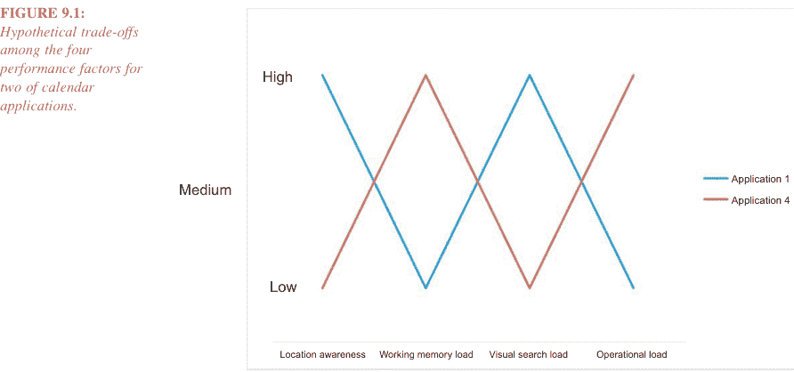

此时，我们不应尝试解决这一挑战，而应该同意第一个也是最重要的结论是：**意识到底层配置对人类性能可能产生的影响。**

## 易用性和用户体验的影响

UI 底层的配置对其人类性能因素产生影响。这些因素反过来会影响用户体验。在这里，我们讨论了易用性和用户体验领域中流行的四个因素：

- **可学习性（Learnability）：** 可学习性是用户学习使用应用程序的速率。许多因素影响学习。为了本文的讨论，我们将重点关注由工作记忆负载施加的心理负载。
- **有效性（Effectiveness）：** 有效性是用户实现特定目标的准确性和完整性（ISO 9241-11）。位置感知和视觉搜索的有效性严重影响准确性和完整性。
- **效率（Efficiency）：** 效率是用户实现目标相对于准确性和完整性所消耗的资源（ISO 9241-11）。任务对工作记忆的负载越高，执行任务所需的心理资源就越多。
- **满意度（Satisfaction）：** 根据 ISO 9241-11，满意度是易用性的第三个参数，即使用的舒适度和可接受性。

注意，随着对用户体验更整体层面的意识和考虑的增加，我们日益关注与产品交互的额外情感层面，如快乐、趣味和参与感。通过将上述人类性能因素联系起来，我们可以假设高位置感知、易视觉搜索和低工作记忆负载将与更好的情感层面、满意度、快乐和参与感相关。

## 预约示例概念模型的易用性影响

以下是对四个应用程序配置对易用性指标可能影响的对比分析。与之前一样，为了比较，我们使用相对量表；也就是说，评分是在四个应用程序之间进行比较的。它们并不代表绝对意义上的水平，也不意味着这四个应用程序中的任何一个“优于”其他。此外，评分是假设性的，表示的是一种可能性而非经验性事实。表 9.1 的分析表明，用户界面底层的配置影响易用性和用户体验。

表 9:1：四个日历应用程序概念模型的易用性影响

| 应用程序 1 | 应用程序 2 | 应用程序 3 | 应用程序 4 |
| --- | --- | --- | --- | --- |
| 用户界面总结 | 一个主窗口+1模态对话框 | 一个主页面+1模态对话框 | 一个主窗口+3模态框 | 一个主长屏+4模态框 |
| 概念模型 | | | | |
| 易用性和用户体验可学习性 | 较高 | 较高 | 中 | 较低 |
| 有效性 | 中 | 中偏高 | 中 | 中 |
| 效率 | 中 | 中偏高 | 较低 | 较低 |
| 满意度 | 中偏高 | 中 | 中偏高 | 中偏高 |

本次分析的结论如下：

- 1. **配置会对可用性和用户体验产生影响。** 考虑到人类心理学和性能因素，这些因素反过来又影响了交互的本质，即可用性和用户体验。由于性能和可用性是紧密相关的，放置元素的“位置”决策以及引导用户从一个地方移动到另一个地方的“路线”决策，也会影响可用性。


进入`/path/to/xxx`目录，找到`xxx.json`。

在表达式`cvar = avar + bvar`中，加法运算符（`+`）将`avar`与`bvar`相加，得到它们的和`cvar`

在`List.of(arg0, arg1, arg2)`中，`List`接口的工厂方法`of()`接受一系列的元素，返回包含它们的只读列表。

之后我们这样调用`cmd`命令：`cmd arg0 arg1 arg2`。

```
if (condVar > someVal) {console.log("xxx")}
```


我们设计和开发交互系统的过程有许多定义、处方、标准、方法、描述和可视化。大多数方法都遵循以用户为中心的设计哲学的核心原则。以用户为中心的方法具有强化所有活动的强大力量。此外，它邀请了所有利益相关者（主要是终端用户）持续参与，以及过程的迭代性质，涉及早期原型、评估、测试和重新测试。因此，如果我们超越特定的方法，交互系统用户界面的设计过程通常由几个通用活动组成。这些通用活动在提高用户体验（包括实用性和情感方面）方面具有共同影响。这里简要介绍了这些活动呈现的典型顺序（图 11.1），但这些活动的呈现方式及其顺序完全不具有规定性。

> 概念模型和概念设计多年来从不同的角度被讨论。概念设计通常被视为一个阶段，或者处于进行某些用户研究与开发需求以及系统或程序的详细设计之间的过渡阶段。对概念设计的处理大部分是在网站设计的背景下进行的，主要关注设计有效信息架构的挑战。例如，Garrett (2002) 讨论了信息架构中的导航模型，Lynch 和Horton (2008) 介绍了架构和导航模型，Brink、George 和 Wood (2002) 讨论了信息架构。
> 
> 然而，概念模型和概念设计仅与网站的信息架构相关吗？Norman (1983) 将人们在与任何人工制品交互时的理解定义为“对你所交互的设备有一个概念模型”。他进一步建议，概念模型是连接用户对所交互人工物的心理模型与该人工物的设计及工作方式之间用户界面衔接的基础。这意味着概念模型对于任何系统、产品或计算机程序都起着非常重要且关键的作用。它适用于人类用户交互的任何事物。

## 概念设计：一种方法

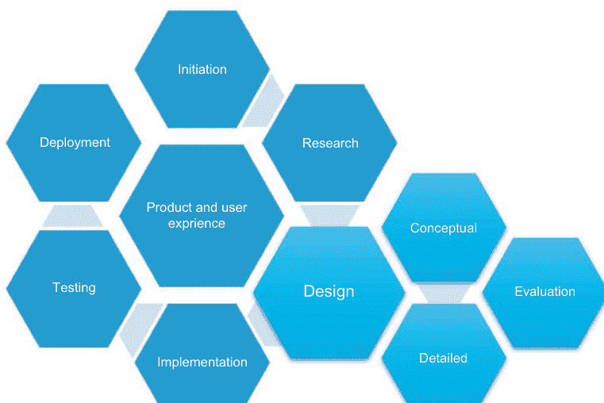

图 11.1：

在用户界面设计的整体背景下的概念设计活动。该图强调了一方面与用户研究的关联性，另一方面是向详细设计的过渡，并伴随着持续的评估。

**启动：** 开发交互产品并将其发布给用户始于一个需求、一个想法、一个业务机会或技术创新。无论产品的动机和原始驱动力如何，通常有一个触发所有与开发和发布产品相关的初级阶段。该阶段可能包括市场研究和需求评估、业务伙伴关系的建立、技术评估以及项目团队的建立。后者与 UX 设计高度相关，团队组成可能会影响研究和设计等后续活动。

**研究：** 研究活动可以与启动阶段相关，并通常是定义产品包含内容的基础。这可能包括市场研究和用户研究。用户研究对于产品的设计活动至关重要。某些研究可以在后期阶段重新进行，以收集更多数据或重新进行某些分析。通常，初始用户研究的结果是一组需求，其中一些是设计活动的基础。

**设计：** 用户界面的实际制定以及对易可用性和用户体验的影响是通过一系列设计活动实现的。本书关注的是这一背景下的概念设计活动（图 11.1）。这里的方法主张，用户研究和需求是概念设计的基础，随后进入详细设计。评估和测试在概念设计和详细设计中都是持续进行的活动。

### 语境中的概念设计：战略性思考

*实施*（Implementation）：一旦设计达到可以实施的程度，就会对产品进行实际开发和构建（例如在计算机程序中编写代码）。在某些方法（例如敏捷开发）中，设计、测试和实施往往是重叠的。

*测试*（Testing）：以用户为导向的方法倡在整个过程中进行早期和形成性的评估与测试。在某些情况下，在产品发布给最终用户之前会进行总结性评估和测试。在某些方法中，测试是更小、更短周期的一部分，包括设计、实施和测试。

*部署*（Deployment）：无论采用何种开发方法，最后阶段都是将产品发布给最终用户，并提供初始或持续的用户支持。

根据系统开发方法和方法论的不同，这些活动可能会不同的顺序进行。例如，对于要发布的产品部分，可以在过程的早期进行某些总结性测试；产品在发布前可能是不完整的（例如在敏捷和精益方法中，系统的部分可以先设计、实施并部署），或者具有高度迭代性（例如，可以在测试后或从部署中吸取教训后进行研究和重新设计）。无论采用什么具体方法，大多数方法都包含了上述的所有核心活动和流程。

在整体以人为本的设计以及无论采取何种特定的设计开发方法中，战略和业务考虑都是交织的。此外，在概念设计的整体语境下，考虑项目管理的特定特性也非常。以下两个部分涉及这些问题。

#### 项目管理

各种业务考量和所有利益相关者都会影响将设计开发工作作为一个有效的项目进行管理。作为设计师，你应该关注 (1) 在开发方法中进行用户研究的能力，(2) 保持项目的设计优先级，(3) 考虑可能对交互和 UX 设计产生影响的所有利益相关者。

## 设计与开发方法：用户研究的位置

用户和研究是任何产品概念设计的前提。在以用户为中心或以人为本设计的经典和更传统的方法中，进行用户研究是一个显而易见的步骤。一些最新的方法（如敏捷和精益方法）由于其承诺尽早为最终客户/用户提供成果，对充分的用户研究构成了更大的挑战。因此，在前期用户研究上花费时间可能被某些人视为浪费时间，而不是关键的投资。此外，与概念模型基础前期开发相关的工作也被视为本应投入到实际开发中的时间。其他发表的作品对于敏捷和精益开发过程中设计良好的 UX 和可用性的位置和作用提供了一些很好的观点和视角（Gotthelf & Seiden, 2013; Ratcliffe & McNeil, 2012）。此处概述的方法论假设在开始任何设计和开发活动之前，已经进行了一些用户和使用研究。

## 多通道和跨渠道的设计与开发策略

系统的设计和开发使其能够在多种设备、多种语文中运行。此外，用户可以在一个设备上开始任务，并在另一个设备上继续/完成任务。这被称为多通道或跨渠道交互与体验，其中通道被定义为用户与应用程序/产品/系统的主题或内容领域交互的场所。在计算机交互系统领域，通道通常是指设备，如台式电脑、移动设备、信息亭或自助机、交互式语音响应系统，或任何嵌入式交互设备（例如，车载内置导航系统）。

项目内部针对各种通道（相关时）设计用户界面、交互和 UX 的优先级是根据业务考量而设定的。由于用户需求、新技术或其他业务目标而更新现有产品，可以在添加新通道时实现。在这种情况下，该通道的设计和开发将获得最高优先级。在旨在多个通道上实现的新产品语境下，由于用户需求或其他业务目标和考虑（例如竞争、市场需求和新合作伙伴），某一通道的优先级高于其他通道。

## 团队方法

无论采用什么设计开发方法，多学科团队方法对于确保在整个生命周期中包含可用性和 UX 考虑至关重要。此外，可用性和 UX 设计专业人员有效执行任务也至关重要。可用性和 UX 设计专家必须与用户或用户代表合作。此外，还要与业务、营销、销售、工程、软件开发人员、平面和工业设计师以及技术作家等其他职业人员合作。最后，可能间接地，与业务伙伴、投资者和其他提供者合作，以考虑他们的目标和关注。

## 概念设计：方法论概述

### 回顾框架

概念模型在书的第一部分以分层框架的形式呈现。这些层构成了最终和详细的用户界面的基础。构建概念模型是概念设计的过程，也是本书第二部分介绍的方法论的核心。

以框架为概念设计过程的基础，从上到下管理它有三个主要阶段（图 12）：

- *概念设计*——该阶段是方法论的核心，跨了框架的三层：功能层、配置层以及导航和策略层。
- *从概念设计到详细设计的过渡*——在这个阶段，我们通过添加细节将概念模型的抽象方面转变为更具体。
- *详细设计*——这通常是设计用户界面的最后阶段，但本书将不会涵盖此，因为它侧重于整个过程的概念部分。虽然这代表了概念设计之外的活动，但它位于框架之内，因为概念模型是最终详细设计的基础。此外，详细设计是设计交互系统整体语境的重要组成部分。

该方法论将引导你按照框架的分层从下到上进行一系列设计活动。我们必须处理用户研究。在没有进行研究的情况下，我们不能也不应该开始设计过程。基于此，我们在第 13 章开始回顾一些与概念设计相关的用户研究技术和数据。第 14 章告诉我们如何确定功能块及其相互关系。第 15 章的下一步是将功能块转换为概念元素并建立它们之间的联系，以创建模型的基础——元素的配置。在第 16 章，我们制作模型并定义导航地图。然后，在第 17 章通过定义导航策略以及将概念元素分配到物理位置来微调导航。最后，第 18 章涵盖了从概念设计活动向详细设计的过渡。每一章还将提供一些项目管理考量。

# 图 12.1：

概念模型的分层框架，以及从概念设计到最终详细设计的各个阶段。

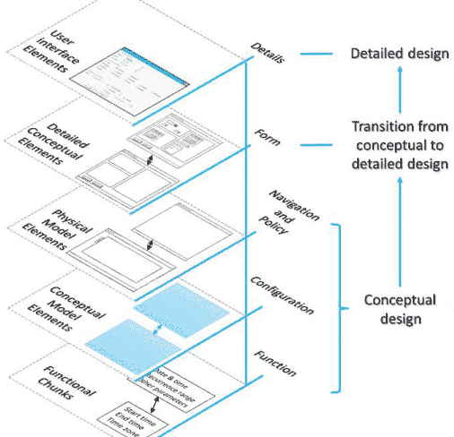

### 项目管理考虑：这不必是一个线性过程！

这个过程看起来是线性的，你可能会怀疑它在某些情况下的适用性。尽管过程是以线性方式描述的，但并不意味着它实际上也是线性的。换句话说，不要恐慌！这并不是建议我们遵循臭名昭著的瀑布模型。但同样，这也不意味着我们必须遵循敏捷或或精益方法。正如你所看到的，每一步都提倡迭代过程：重新审视之前的步骤并进行修改。

目标并不一定是要遵循线性过程，而是确保设计的每一个层级在最后都能得到覆盖并良好整合。

### 第一，用户研究。

尽管去做（Just Do It）

理解用户心理和人类性能的关键因素对于概念模型的设计及其评估至关重要。提醒一下，这些因素包括：

- 心理模型与理解
- 位置感知
- 视觉搜索有效性
- 操作（执行动作）负载
- 工作记忆负载

在设计之前、期间和之后进行的用户和使用研究可以提供关于这些因素的信息和见解。正如前言所述，熟悉用户和使用研究是读这本书的前提。由于用户研究对概念设计至关重要，我们将在有限的范围内对其进行介绍，因为本书侧重于构建概念模型的程序性步骤。以下是用户研究中与概念设计相关的关键技术和成果的简要概述。该概述将介绍我们在书中方法论部分使用的“贯穿始终”示例。

用户和使用研究，无论其目的是什么，通常包含以下内容：

- 数据收集
- 分析

#### 数据收集

数据来源和收集技术

在进行用户和使用研究时，你希望尽可能接近真实用户，以及他们执行任务和交互的自然语境。这将产生更接近现实的数据，或者用更科学的话说，具有更高的生态效度的数据。然而，有时我们不得不妥协，在离开自然语境的情况下进行研究，甚至不是与真实用户一起进行。尽管如此，通过这种距离，我们仍然可以收集与概念设计过程高度相关的价值数据。以上是根据我们与真实用户及使用自然语境接近程度划分的用户研究中最常见的数据收集技术的简述（表 13.1）。

# 80 概念设计：方法论

表 13.1：设计目的的用户研究中最常见的数据来源和收集技术汇总

| 来源 | 收集技术 |
|---|---|
| 非常接近真实用户和语境 | 语境中的用户 | 访谈、观察、实地控制研究、背景性能测量 |
| | 远程、语境中的用户 | 性能远程采集、口头数据远程采集 |
| | 脱离语境的用户 | 焦点小组、问调查、实验室控制研究、文档和归档 |
| 非常远离真实用户和语境 | 其他利益相关者 | 业务计划、文档和归档、竞争分析 |

#### 收集的数据

用户研究中数据收集的首要目标是尽可能获取关于用户的信息。表 13.2 概述了我们希望回答的关键问题。通过上一节概述的各种收集技术收集的最常见数据类型与研究问题列在一起。最后，表格列出了数据的实际成果，这些成果为问题提供了答案并被用于概念设计。

表 13.2：作为研究问题函数的数据类型以及关键实际成果

| | 口头数据和叙述 | 计数和频率 | 评分量表 | 时间和时长 | 实际成果 |
|---|---|---|---|---|---|
| 你的研究问题 | 用户是谁？ | ✓ | | | | | 用户画像和人物模型 |
| | 他们在做什么或想做什么？ | ✓ | ✓ | ✓ | | 目标和任务；主题对象 |
| | 他们为什么要做他们正在做或想做的事？ | ✓ | ✓ | ✓ | | 故事、场景、用例 |
| | 他们在什么语境下做或想做？ | ✓ | | | ✓ | 地点、时间、状态和大部分 |
| | 他们是如何做的？ | ✓ | ✓ | | | | 交互流、任务模型、对象-动作映射 |

#### 分析

对数据进行各种分析的实际成果是对我们研究问题的回答。以下是与概念设计相关的关键成果概述。我们还借此来介绍我们用于说明概念设计方法的“贯穿始终”的示例。我们的“贯穿始终”示例字面意思就是关于跑步的示例。更具体地说，它是关于使用设备和交互式应用程序来促进和支持跑步体验。

#### 用户画像和人物模型

一方面受业务目标和目的的指导，另一方面根据收集到的数据的发现，将现有或潜在的用户群划分为子群体。每个子群体构成一个用户画像，并根据关键研究问题的答案进行统一描述。每个片段由一个人物模型（persona）表示。关于根据什么标准划分人群、应该构建多少个用户和人物模型，以及人物模型的有用参数，在其他资源中有所讨论（Mulder & Yaar, 2007; Pruitt & Adlin, 2006）。贯穿示例的一个例子如图 13.1 所示。

#### 用户使用场景

场景是关于用户的故事。场景从“从摇篮到坟墓”类型到与产品交互的具体实例，涵盖了意图、动机、状态和感受（Rosson & Carroll, 2009）。为每个人物模型准备至少三个场景：

1. 生命周期场景
2. 典型的一天场景
3. 问题场景

场景作为执行后续分析（如任务分析）的基础。

### 概念设计：方法论

“跑步就像一部电影。观察它的帧并从中构建故事线”

Jake 是一位记者，几乎 7x24 小工作，住在渥特华，无论夏天冬天都喜欢跑步。当他搬到渥特华并想在冬天跑步时，他了解到应该穿层，包括专业的鞋。Jake 喜欢带着心率（HR）监测器、播放音乐的跑步程序并随身携带手机

#### 基本信息

- 记者
- 与摄影和编辑一起工作
- 每周工作7 天，有时直到深夜
- 喜欢在城市中跑步
- 使用 GPS 和播放器
- 智能手机重度用户

#### 目标

#### 爱好者

- 提高心肺功能
- 享受跑步

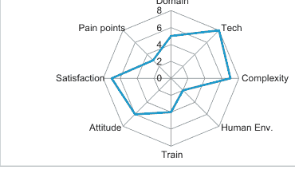

#### 价值观

- 效率
- 努力工作
- 美学

#### 痛点

- 设备设置
- 步骤过多
- 跑步时的信息

图 13.1

“贯穿”示例中的人物模型示例。

#### 人物模型和场景的影响

让我们考虑人物模型和场景对概念模型的影响。人物模型揭示了一个职业非常忙碌的人，但热爱跑步并有强烈的动力保持和改善体能。该人物似乎通技术，并在寻找与其跑步相关的先进设备和应用程序。因此，如果应用程序符合他的需求和习惯，他很可能会使用。

图 13.2 中的示例场景揭示了多渠道和跨渠道交互的重要方面。为多渠道和跨渠道交互设计是一项普遍挑战，并与本书的重点概念设计密切相关。正如你很快看到的，从现在开始所有的示例都区分了渠道（桌面和移动）以及对各种活动和概念设计过程结果的影响。

#### 任务和工作流分析

用户与产品的交互由被称为任务的动作组成。你可以在工作分析中执行任务分析，开发人员

# 第一，用户研究。尽管去做吧 83

Jake 是一名记者，在加拿大渥太华几乎 24/7 全天工作，他喜欢在任何夏季还是冬季跑步。当他搬到渥太华并想在冬天跑步时，他了解到应该多穿几层衣服，包括重型手套。Jake 喜欢带着心率（HR）监测器、一个可以播放音乐的跑步跟踪程序跑步，并且总是随身带着手机。他发现跑步跟踪程序可以帮助监控他的进度，并决定是否以及如何改变训练方案以保持进步。

Jake 调研了市场，决定在 iPhone 上使用 iRunning 应用，并通过蓝牙连接心率监测器，以便将所有功能都整合在一个设备中。Jake 在桌面电脑的 iRunning 网站上创建了个人账户，随后该账户与移动应用账号进行了链接和同步。

在适合跑步的天气，Jake 可以轻松设置传感器和应用进行连接并工作。此外，Jake 还准备了几种训练计划，其中包括路线、距离、理想节奏和播放列表等参数。在他准备跑步时，他会选择一个训练计划并开始。跑步过程中，他通过 iRunning 应用查看心率、距离、时间和速度等方面的表现和结果。

跑步结束后，他可以轻松地将训练同步到他的网页账户。他总是回顾最近一次跑步的完整细节，将其与之前的跑步进行比较，甚至还会通过桌面电脑上的 iRunning 网站加入一个小组，与其他人回顾并分享跑步经验。然而，当在零度以下的天气下跑步时，戴着手套让他在设置上遇到了很大困难。此外，跑步时，他无法触摸或双击 iPhone 上的应用。在严寒冬季，他在使用该应用和传感器时遇到了严重的问题。

> 图 13.2：完整场景的示例——跑步体验，是“跑步”示例的一部分。

选择、培训设计、人机界面设计与评估，或者用户任务中的风险管理和人为错误。任务分析是一系列技术，包括对用户任务收集信息、对任务进行分析以及产生描述性列表、表格、图表和网络等结果（例如：Annette, 2004; Diaper & Stanton, 2004; Hackos & Redish, 1998; Kirwan & Ainsworth, 1992; Rosson & Carroll, 2002; Shepherd, 2000）。然而，收集的信息及其描述性分析往往不足以满足分析的目标和目的。例如，任务分析识别出“存款”这一主要任务，该任务被拆分为若干子任务。这种描述性分析并不一定能为设计者提供足够的信息，来说明这项主要任务及其子任务如何在用户界面中表示，以及它们如何与其他任务进行组合或整合。

最常见的分析是层次化任务分析（HTA），其中任务和子任务的层级表示了任务结构。这种方法非常流行，因为层级可以表示许多任务，但请注意，有时任务和子任务并不一定具有层次关系。分析的第一步是映射任务结构。换句话说，识别并定义顶层用户目标、用户执行的各种动作和事件以及实现目标的触发因素。此外，当在进行

### 概念设计：方法论

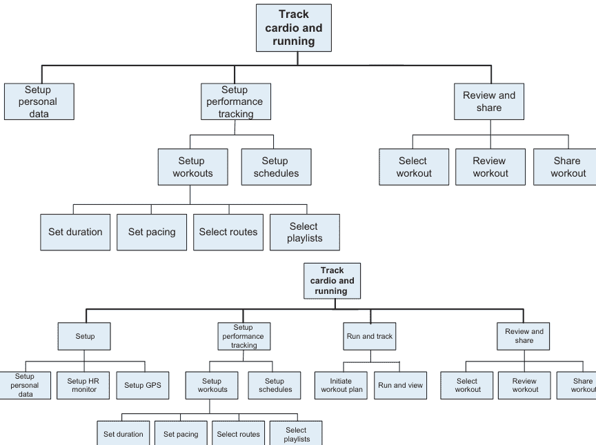

图：13.3：跑步示例的分层次任务分析示例。顶部的图是桌面交互通道的 HTA，底部的图是移动交互通道的 HTA。

HTA 的“精简”版本，关注任务的特征，如其频率和难度。

图 13.3 所示的跑步示例的 HTA 包含两个层次化任务结构，一个用于桌面交互通道，另一个用于移动交互通道。同样，图 13.4 展示了跑步示例的两个工作流，对应每个通道。

#### 对象-动作分析


在与产品交互的过程中，用户会操作或与各种实体进行交互。这些实体在任何故事或用户场景中都会出现。我们将这些实体称为“对象”，用户可以对任何这些对象执行各种动作。对象-动作分析映射了对象与其关联动作之间的关系。这种映射是至关重要的，因为概念模型中应该表示这些对象中的任何一个。有三个关键的对象类别：

- 在任何关于工作和与交互产品交互的故事中，总会有人物。故事中的人物可能只是他自己或她自己，或者是用户以及其他人。

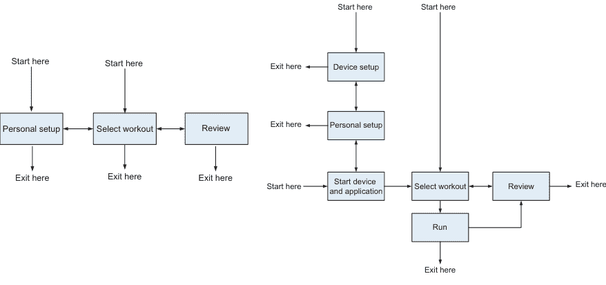

# 第一，用户研究。尽管去做吧 85

- 在跑步示例中，对象类型“人物”包括跑步者本人，在某些情况下也包括其他跑步者。
- 有形——一种常见的对象类型是物理和实体的实体，即用户可以看到、触碰并在物理上可以操作的对象。在跑步示例中，跑步传感器（作为心率传感器和监测器）、GPS 接收器、音乐播放器或道路本身，都是跑步者交互的非常有形的对象。
- 抽象——最后，第三种常见的对象类别包括抽象对象。人们很容易反驳哲学家，通过它们不是什么来定义抽象对象：它们不是人物，也不是任何实体对象。抽象对象可以包括信息。在跑步示例中，对象类型包括训练计划。

你可以根据场景进行对象-动作分析。在最简单的形式中，识别所有的对象和动作。考虑到多通道设计，你应该指示哪些对象属于哪个通道。表 13.3 展示了此类分析的示例。

> Lewis (1986) 引用 Frege 的著作建议定义：“一个对象是抽象的，当且仅当它是心理而非物理。”

图 13.4：跑步示例的工作流示例。左侧图用于桌面交互通道，右侧图用于移动交互通道。

### 概念设计：方法论

表 13.3：场景的对象-动作分析

| 场景 | 交互通道 | 对象 | 动作（从场景中隐含） |
| --- | --- | --- | --- |
| Jake 喜欢带着心率（HR）监测器、一个可以播放音乐的跑步跟踪程序跑步，并且总是随身带着手机 | 移动 | 传感器（心率监测器） 应用 | 佩戴 使用 |
| Jake 在桌面电脑的 iRunning 网站上创建了个人账户，随后该账户与移动应用账号进行了链接和同步 | 桌面 | 个人账户 | 配置 选择 |
| 在适合跑步的天气，Jake 可以轻松设置传感器和应用进行连接并工作 | 移动 | 传感器 | 配置 选择 |
| Jake 还准备了几种训练计划，其中包括路线、距离、理想节奏和播放列表等参数 | 桌面 | 训练计划（已计划） | 构建 选择 |
| 每当他准备跑步时，他会选择一个训练计划并开始 | 移动 | 训练计划（已计划） | 构建 选择 |
| 跑步过程中，他通过 iRunning 应用查看心率、距离、时间和速度等方面的表现和结果 | 移动 | 实时训练 | 激活 查看 删除 保存 |
| 他总是回顾最近一次跑步的完整细节，将其与之前的跑步进行比较 | 桌面 | 之前的训练 | 回顾 删除 分享 |

这是一个旨在说明分析组件的局部分析。

#### 旅程与体验地图

映射旅程和体验是整合任务和对象并表示其共同影响的有效方法。此外，它是勾勒用户和场景中各种通道的非常有效的方法。在最基本的形式中，旅程地图借自服务设计，是一种基于矩阵的表示法，展示用户在整个生命周期的主要阶段和任务，并结合交互通道和触点（与领域或主题对象的交互点）。图 13.5 展示了跑步示例的旅程地图。

#### 可用性需求

学习性、有效性、效率和满意度在书的第一部分作为可用性和用户体验的关键要素被引入。此外，对这些元素的分析表明概念模型可能会产生影响。因此，在开始构建概念模型之前，你应该制定

# 第一，用户研究。尽管去做 87

| 旅程阶段 | 注册 | 设置 | 运行 | 评审 | 社交 | 触点 | 详情 |
|---|---|---|---|---|---|---|---|
| 桌面端网页 | 🙁 | 😐 | | 🙁 | 😠 | 😐 | 设置个人账户 |
| 手机端 App | 🙁 | 😐 | 🙁 | 😠 | 😐 | 设置个人账户 |
| | | | | | | 🙂 | 设置计划的训练和传感器 |
| | | | | | | 😐 | 跑步时查看性能 |
| | | | | | | 🙁 | 回顾最近的训练 |
| | | | | | | 😠 | 回顾并选择之前的训练 |
| | | | | | | | 😐 | 分享之前的训练性能 |

图 13-5：一个针对跑步示例的简单旅程图示例。旅程中红色矩形框出的部分突出了根据场景判断用户体验较差的阶段。

可用性与用户体验需求。此类需求的制定是用户研究的重要成果。

在实践中，拥有可用性需求意味着什么？记住，例如，效率和效果之间可能存在权衡。我们决定模型是否应该在可能牺牲效率的代价支持有效的交互，或者反之亦然，并将其制定为需求。除了作为用户研究的成果外，确定可用性需求还应与产品的战略方面相关。

#### 战略方面

让我们回到战略性的理解和思考。我们必须意识到业务目标，并确保这些目标通过概念模型直接或间接地实现。这包括理解开发产品的动机以及其他业务考量，如合作伙伴、品牌建设和未来计划。另一个重要方面是作为项目管理设计和开发的方式。

#### 用户研究——关键实践要点

- 去做！让所有团队成员和利益相关者参与。
- 明确定义你的研究问题。
- 考虑能够回答研究问题的数据源和收集技术。
- 识别用户画像，开发人物模型，并针对每个情境场景。
- 执行任务分析并勾勒工作流。
- 映射对象和动作。
- 映射用户旅程和体验。
- 制定可用性和体验需求。
- 考虑更广泛的业务方面。

请注意，对战略方面的考虑包含在这里，作为先决用户研究的一部分。换句话说，你应该收集和分析的一些数据应该包括产品和项目的战略方面。

我们现在准备好开始概念设计并构建概念模型了。正如你所看到的，从研究到设计的转变并没有什么魔法或神秘色彩。以下是几个桥接研究与设计之间感知到的神秘鸿沟的条理化步骤。

## 功能块：构建核心基础

在概念设计的的第一步中，我们定义功能块（functional chunks）。这是我们为系统主题建立秩序的步骤。在网站世界中，这等于构建信息架构的第一步。在这一步中，我们高度依赖之前进行的用户研究和分析。如任务分析和对象-动作映射等分析指导我们定义功能块及其之间的链接。

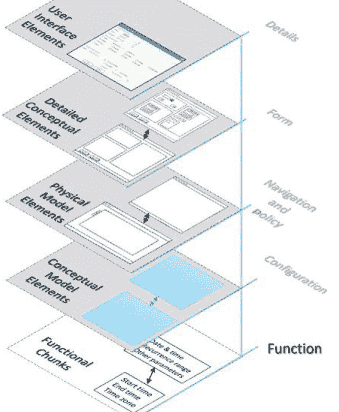

### 这一步包含什么？

当我们从功能层面开始时，有三个活动：

1. 定义功能块。
2. 将它们连接起来。
3. 暂停并自我检查。

### 定义功能块

我们从功能开始。基于我们进行的研究，功能是共同构成产品主题的各种动作、元素和参数。构建概念模型的第一个活动是将功能分组为块。定义功能块的关键驱动因素是什么？让我们在这里考虑两个：

*先验的 (A priori)*：有时，对于如何划分功能存在*先验*的考虑。这些考虑可能受业务考量、市场趋势、品牌策略、产品底层技术的反映，以及对用户如何感知主题（换句话说，他们的心理模型）的良好呈现。

*涌生的 (Emergent)*：块产生于实证发现过程（例如焦点小组、卡片分类或使用 KJ 方法，来自任务分析，或基于对象-动作分析）。

无论分组是*先验的*还是涌生的，我们都希望这些块是有意义的。什么是有意义的块？让我们从简单的功能块开始，稍后将其转换为复合块。

### 任务导向的功能块

*定义*：任务导向功能块的核心是一个任务。适用性：当任务导向的功能块符合用户的心理模型，且工作流反映了面向对象的交互时，定义任务导向的功能块。

在图 14.1 和 14.2 所示的跑步示例中，任务导向功能块的核心是任务。移动端（图 14.1 顶部）的任务导向功能块如下：设置、计划训练、跑步和评审。同样，桌面端（图 14.1 底部）的任务导向功能块为：

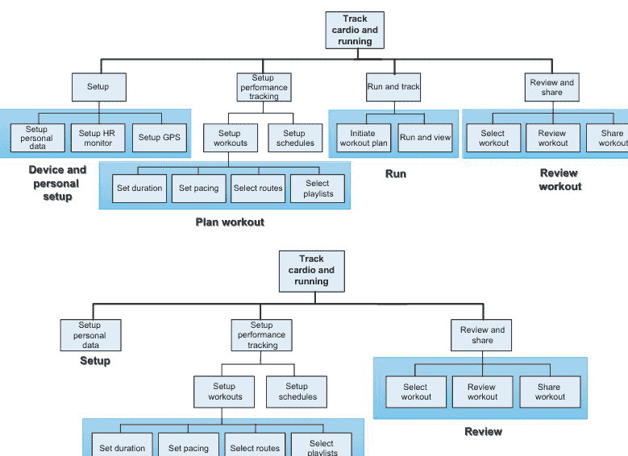

图 14.1：基于跑步示例中任务分析的简单任务导向功能块，用矩形表示。移动端的功能块在上方，桌面端的功能块在下方。

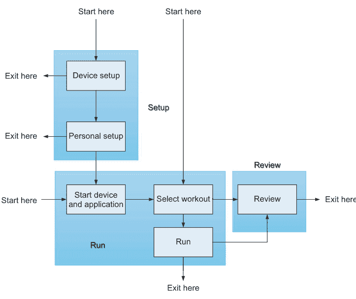

图 14.2：基于跑步示例任务流的简单任务导向功能块，用背景矩形表示。

## 概念设计：一种方法论

基于工作流（图 14.2）的任务导向功能块如下：设置、跑步和评审。我们稍后将它们转换为概念模型元素。

## 面向对象的功能块

*定义*：面向对象的功能块的核心是项目领域中的对象。应该在领域对象或主题对象与实现对象之间做出清晰区分。在寻找面向对象的功能块时，这些块必须反映主题中的对象。适用性：当

- 它们符合用户的心理模型，
- 工作流反映了面向对象的交互。

在图 14.3 所示的跑步示例中，面向对象的功能块的核心是一个对象。移动端的对象是“训练”（Workout），其中计划、实时和之前的训练是该对象的实例。同样，桌面端的对象是图 14.4 所示的“训练”（Workout），其中计划的和之前的训练是该对象的实例。

图 14.3：

跑步示例中

移动端的面向对象的

功能块。

# 功能分块：构建核心基础

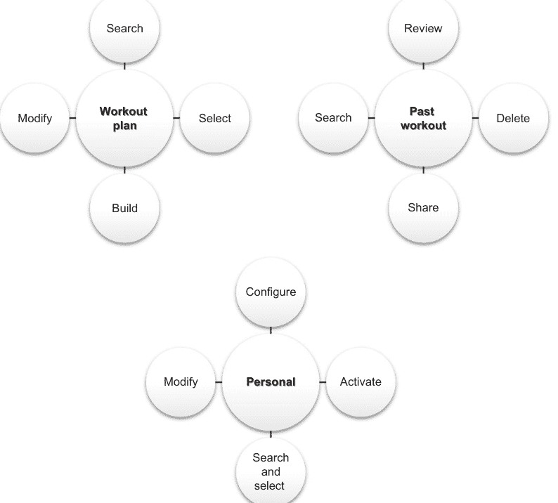

## 链接功能分块

在定义功能分块（无论是面向任务的还是面向对象的）之后，下一步是概述分块之间的链接。功能分块之间的链接取决于任务结构、交互流以及与对象的关联性。同样需要考虑链接的强度。如果分块被频繁使用，或者在交互流期间相互依赖，则链接可能会更强。链接满足以下条件的简单任务面向型分块：

- 在具有多个目标的产品中服务同一个目标；
- 是同一个任务工作流的一部分；
- 在给定的任务工作流中是顺序关系；
- 经常一起执行。

图 14.4：运行示例中桌面端的简单对象面向型功能分块。

## 概念设计：一种方法论

例如，图 14.2 中有两个面向设置的简单功能分块：(1) 设备和个人设置以及 (2) 设置健身计划。这两者都可以进一步链接，因为它们都服务于在运行前设置系统参数的共同目标。此外，两者都可以作为同一个任务流的一部分，通常是在用户首次使用时，此时用户将设置产品的所有方面。最后，如果先设置设备，然后进行个人设置，那么两者也可以是顺序关系。

在定义这些链接时，你可能会重新定义某些功能分块。具体来说，你可能认为将几个相互关联的分块组成一个功能分块。在我们的运行示例中，两个链接的功能分块“设备和个人设置”与“设置健身计划”可以被重新定义为“设置复合分块”，如图 14.5 顶部的移动端示例所示。同样，设置个人账户和健身计划可以被分块为桌面端的“设置复合分块”，如图 14.5 底部所示。

图 14.5：重新定义复合任务面向型功能分块。顶部的图描述了移动端的分块，底部的图是桌面端的复合功能分块。

我们可以对对象面向型分块采用类似的方法。链接满足以下条件的简单对象面向型分块：

- 代表具有共同含义的对象；
- 代表它们之间存在某种关联的对象。

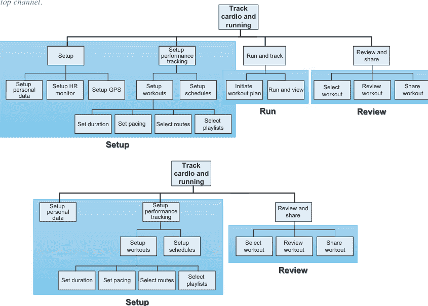

# 功能分块：构建核心基础

95

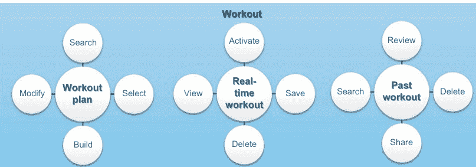

例如，在图 14.6 中，我们可以看到运行示例中移动端的两个复合功能分块。顶部的复合分块是“健身”，它结合了图 14.3 中所有的健身对象面向型简单分块。这些被组合为一个单一的复合功能分块，是因为所有对象对用户都有共同含义，并且符合心理模型。注意图 14.6 中的另一个复合功能分块，它结合了个人账户和传感器分块。这两个对象分块之间存在某种关联：它们都代表在跑步前涉及的对象。这两个对象面向型功能分块被组合为一个任务面向型复合功能分块，这与我们在检查任务面向型复合分块的定义时得出的结论一致。我们可以采用同样的推理，为运行示例中的桌面端定义对象面向型复合分块，如图 14.7 所示。

图 14.6：

运行示例中移动端的复合对象面向型功能分块

除了所有标准外，你还可以根据以下因素链接简单任务面向型或对象面向型分块：

- 使用语境（当功能分块在相同的使用语境下相关或被处理，并且与其它语境下处理的功能分块有不同时）

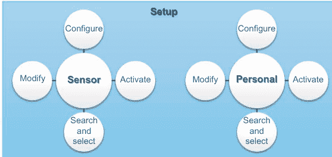

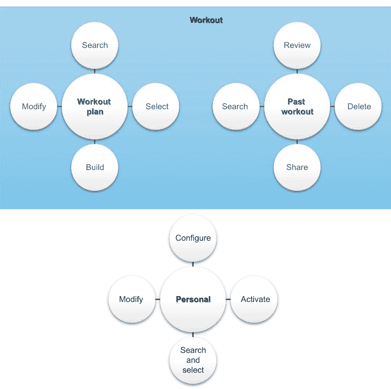

图 14.7：运行示例中桌面端的复合对象面向型功能分块。

- 交互通道（当功能分块通常在特定的交互通道中处理，并且与在通道中处理的其他分块有不同时）。

遵循运行示例的工作流，我们可以区分出几种使用语境或状态：初始设置、跑步前、运行中和跑步后。在运行示例的任务分析（图 14.1）中，与查看跑步表现的任务只能在跑步后执行。跑步分块（运行过程中的实时信息）只能在手机或跑步智能手表等移动设备上完成。相比之下，与个人账户或查看跑步表现的任务可以在桌面电脑网站或程序，以及移动设备（如平板电脑或手机）上的 App 网站等通道中完成，但无法在手表上以非常线性的方式完成。在定义复合功能分块为面向任务型或面向对象型时，应该考虑这些因素。

# 功能分块：构建核心基础

关于复合功能分块的决定将以后影响如何分配物理位置的决定。将复合功能分块分配给单一位置，比将每个简单分块分配到不同位置更为合理。这反过来将影响导航，我们很快就会看到。

### 第 15 章：配置：绘制你的第一份概念模型草图

我们希望尽快得到可以展示的内容。虽然整合功能分块（chunks）和功能架构是我们应该与所有利益相关者共享的重要步骤，但仍然很难清楚地看出用户界面本身将从此演变。在配置步骤中，我们绘制一个看起来像模型的东西，你甚至可以在抽象层面上说明用户将如何与之交互。这就像是你的第一个“餐巾草图”，即概念的首次可视化。

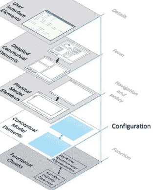

> ### 步包含什么？

配置层的活动包括：

1. 定义并配置概念模型元素。
2. 识别关键元素（pivotal elements）。
3. 重新配置模型。
4. 检查。

#### 定义并配置概念模型元素

一旦你定义了功能分块（无论是简单的还是复合的），你现在就可以它们转换为概念模型元素。正如入门介绍中所解释，功能分块更抽象的表示有助于对概念模型的理解、进一步开发和评估。配置概念模型有两个步骤：

+   1. 将每个功能分块表示为概念模型元素。在这一阶段，我们可能有简单的任务导向或对象导向型功能分块。此外，我们还有预期的交互流。无论它们的类型和简单程度如何，我们都应该抽象出最符合交互流的分块。因此，我们可能会得到代表某些任务导向和/或某些对象导向的概念模型元素。参见图 15.1 中运行示例的概念元素。注意，某些对象表示为工作流，而某些任务则表示为查看和分享。

+   2. 在相关时，根据元素之间的链接定义复合概念元素，而这些链接又基于功能分块之间的链接。注意，在此时，链接并没有传达完整导航地图的所有细节。参见图 15.2，包含移动端和桌面端的交互通道。

生成的配置是概念模型的基础。

#### 在配置中寻找关键元素

概念模型应该具有意义的配置。仅仅连接概念元素并不总能传达有意义的配置。你应该

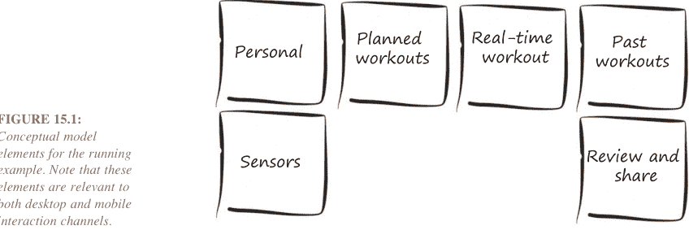

## 绘制你的第一份概念模型草图 101

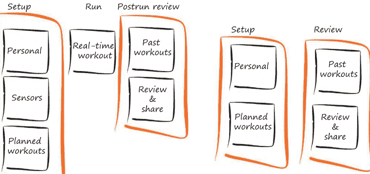

图 15.2：运行示例中的复合概念元素，基于简单功能分块之间的链接，左侧为移动交互通道，右侧为桌面通道。

观察它，它应该对你来说是合理的。它本身应该讲述产品的故事。一个有意义的配置是能够很好地表示心理模型，或者能够容易引发新的心理模型，从而有助于理解、工作流，或业务和品牌考虑的平台与约束。寻找有意义的配置是将一组链接的元素转换为连贯概念模型的关键步骤。入门介绍中介绍和讨论的概念模型分类是连贯模型最常见的示例。

为了评估配置并将其转换为有意义的配置，请问问自己是否存在一个或多个紧密链接的元素可以被视为关键元素。例如，在人类与交互系统体验的背景下，关键概念包括在文字处理程序中编写文档、在演示文稿中准备幻灯片、在绘图程序的画布上画草图、在日历应用中设置预约、编写并发送推特或监控自动过程。

关键元素是指符合以下一项或多项标准的元素：

+   * 使用频繁，
*   关键且必不可少，
*   最稳定状态，以及
*   最能代表业务目标和/或品牌。

通过回顾以下内容来寻找关键元素：

+   * 用户画像和场景，
*   任务分析，
*   关键用户界面和可用性需求，
*   业务目标和品牌考虑，
*   使用上下文，以及
*   设备/通道限制。

在运行示例中，根据用户研究，我们可以找到两个关键元素：锻炼（workout）和当然还有跑步（running）（见图 15.3）。锻炼元素似乎一致出现在移动端和桌面通道的所有任务和所有工作流中。用户在跑步之前、期间和之后都会与锻炼元素交互。另一个呈现为关键元素的是任何与跑步有关的事：计划、参与以及稍后查看。跑步元素对于主要服务该目的的移动通道来说尤为关键。

需要强调的是，概念模型中的关键元素并不一定在字面上位于中心位置。在研究入门介绍中讨论的“枢纽模型”（hub and spokes model）时，模型的枢纽字面上位于中心，大多数交互发生在那里，在任何补充交互之后，用户都会返回那个中心位置——枢纽。相比之下，单序列模型或网络模型似乎没有这样的枢纽。然而，这些模型确实有关键元素。例如，在一个具有网络概念模型的网站中，首页可以是那个元素。在一个具有单序列的安装向导应用程序中……

图 15.3：运行示例中关键元素的可能性。

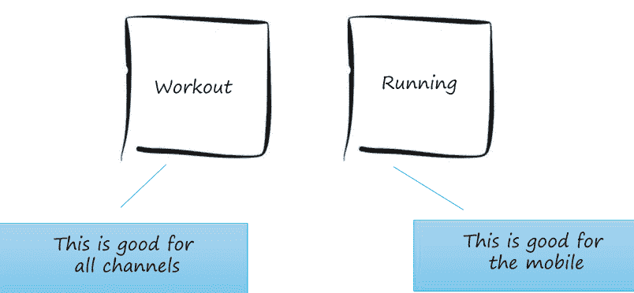

# 绘制你的第一份概念模型草图

起始点可以是那个。在层级模型中，根节点可以是那个。

#### 重新配置模型

现在是时候回顾元素的配置以表达你所识别的关键元素了。这不仅仅是图形旋转或重新排列。目标是让重新配置的模型能够适应现有的心理模型，或者直观地引发一个新的心理模型。此外，重新配置将有助于勾勒导航地图。


在运行示例中，我们选择了关键元素，因为它出现在两个通道的工作流和任务中，如图 15.4 和 15.5 所示。注意两个通道的模型都有几个复合元素：锻炼、跑步前准备（`prerun`）和跑步后（`postrun`）。此外，移动通道的概念模型还有一个用于实时锻炼的元素。

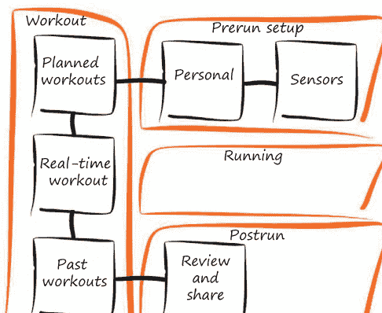

图 15.4：运行示例中移动端的重新配置模型

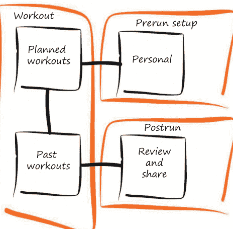

图 15.5：运行示例中桌面端的重新配置模型。

## 跑步示例：回顾配置与迭代

### 检查：回顾与修订

1. 回顾关于两个候选元素（锻炼和跑步）的使用频率的用户研究数据。
2. 在计划或回顾跑步时，考虑区分上下文和通道。
3. 评估你是否拥有两个概念模型：一个用于实时跑步的移动通道，另一个用于非跑步上下文的其他通道。

在此时，我们已经有了一个模型：表示了功能分块及其相互关系。现在需要回顾的一个方面是配置，即表示关系的链接。特别地，如果你确定了一个关键元素，重新评估该决策是非常重要的。

## 项目管理考虑

我们现在有了一个草图，换说我们有了用户界面的“架构计划”。现在可以分享了吗？假设你与利益相关者（特别是用户）密切合作，你应该与他们分享它。利益相关者应该对这种表示提供初步反馈，它将演变为详细的

# 绘制你的第一份概念模型草图

先构建概念模型，然后过渡到详细设计。对于那些想要快速实现并交付内容的敏捷和精益方法，该怎么办？我们可以通过团队合作来实现，而且在团队内部，我们自己应该是自己的守门员。

然而，要向所有人共享抽象表示往往是困难的。团队成员和利益相关者可能需要看到更具体的内容。他们可能希望至少看到更详细的线框图（`wireframes`），以便理解基本概念。需要强调的是，这里概述的方法论中没有任何内容阻碍你提取一些概念模型元素，并提前进入后续步骤以提供更多细节。然后，你可以回来进一步开发概念模型或进一步开发其他元素。正如早些提到的，目标并不非要遵循线性过程，而是确保在结束时设计的所有层级都得到了覆盖并良好整合。

## 配置——关键实践要点

- 使用功能块（无论是单一的还是复合的）来定义概念模型元素。
- 概念元素可以基于任务面向型和对象面向型功能块的组合。
- 配置元素：勾勒出元素之间的链接。
- 使用用户研究并确定是否存在关键元素——即最重要或最频繁使用的元素。
- 重新配置模型。
- 结果是一个代表概念元素及其配置的图表。
- 与团队成员和其他利益相关者一起评估以验证模型。

# 导航地图：从一个地方移动到另一个地方

导航和策略层的主要方面是概念模型的导航地图。正如本书的入门部分所讨论的，获取完整的地图不仅仅是拥有概念元素之间的路线。完整的地图还包括基于概念元素到物理位置分配而产生的导航策略（模态）。然而，在本文的分步走方法论中，我们将这一层分为两个步骤：我们在本章中概述并解释的导航地图，然后在下一章中，我们将涵盖物理分配并最终确定导航策略。

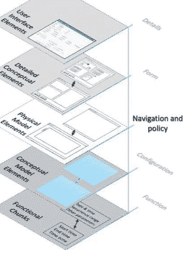

### 此步骤包含什么？

导航和策略层的活动如下：

1. 概述导航地图。
2. 评估与修订。

#### 概述导航地图

在确定了关键概念元素并重新配置模型以适应该元素后，我们进入了导航地图阶段。随着设计过程的推进，我们以后将通过考虑概念元素到物理位置的分配并确定导航策略来进一步完善导航地图。尽管如此，现在我们通过定义以下内容来概述概念导航地图：

- 入口和出口概念元素
- 概念元素之间链接的导航方向

为了确定这些内容，你应该使用基于识别出的关键元素和交互工作流的重新配置模型。关于导航，关键元素的概念是：我们让用户尽快到达它。它可以是起点，也可以是通往它的最短路径。这不仅应该符合典型的交互工作流，还应该支持用户研究发现或基于用户研究发现的所有可能的工作流。

在我们运行示例中，移动端和桌面端的通道导航地图分别如图 16.1 和图 16.2 所示。请注意，在这两个图中，我们都有若干处入口和出口。当我们将元素分配到物理位置并细调导航地图时，我们需要考虑这一点。

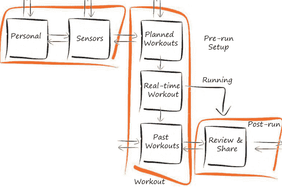

图 16.1：运行示例中移动端的概念导航地图。

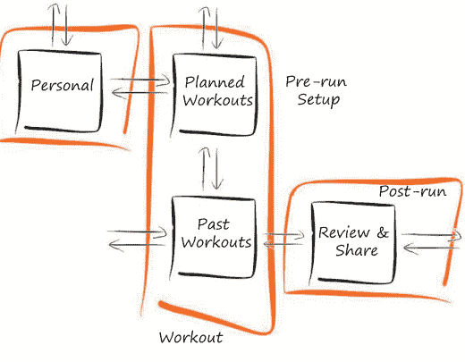

重排后的导航地图保留了模型中的所有概念元素，但我们可以以反映程程图和工作流的方式重新排列草图。在图 16.1 和图 16.2 的示例中，元素的排列方式使得最典型、常见的工作流从左到右、从上到下进行。无论是移动端还是桌面端，典型的工作流从运行前设置（`prerun setup`）开始，进入运行本身，最后以运行后活动结束。穿过表示复合元素的框的双向箭头表示交互的开始和退出位置。注意，锻炼（`workout`）的关键状态在两张导航地图中是一致的。

## 评估与修订

我们现在手里有一个包含导航地图的概念模型。它是一个有效的模型吗？是一个好模型吗？换句话说，这个模型是否符合用户需求，或者它是否支持业务目标？当我们真的只有一张草图时，要解决这些问题可能具有挑战性。然而，我们可以在评估模型的有效性和优劣时解决一些基本问题。

首先，谁应该参与评估？理想情况下，所有利益相关者的代表都应该参与。这些包括用户、设计和开发团队以及产品业务方面的代表。其次，由于此时我们拥有的只是草图，我们可以对模型进行检查式的评估。

### 概念设计：一种方法论

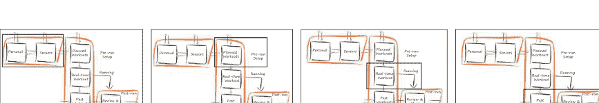

Jake 第一次使用该应用时，是从设置屏幕开始的。他首先设置账户，然后在跑步过程中使用应用配置心率教练（HR mentor）。他从设置屏幕导航到计划锻炼（Planned Workouts）。他设置了多个计划跑步的不同距离锻炼。跑步时，他会看一眼手机屏幕，查看一些有趣的跑步参数，以及显示所在位置的地图。一旦完成跑步，应用程序就会切换到总结最近跑步的屏幕，显示数字参数和总结性能的图表。他还可以访问之前的跑步摘要。

图 16.3：评估场景以及每个步骤对应的概念模型部分（用黑色框标记）。

这种检查应该涉及通过概念模型（图 16.3）进行场景走演，并配合出声思考（think-alouds）。为了辅助检查，这里有一份基于维度的检查清单：概念模型——通过以下方面来评估模型的有效性和优劣：

- 它是否代表了所有功能块？
- 它是否表达了元素之间所有相关的链接，反映了块之间的链接？
- 导航地图是否支持工作流？
- 模型的复杂度是否适用于用户画像和任务结构化程度？

人类性能——概念模型对人类性能和可用性的影响可以通过以下问题来获取：

- 模型是否支持位置感知？
- 模型是否支持视觉搜索？
- 模型是否减少了操作负载？
- 模型是否减少了记忆负担？

可用性与用户体验——通过以下问题对概念的实用性方面以及某些用户体验方面进行推测：

- 模型是否支持易用性？
- 模型是否支持有效的交互？
- 模型是否支持效率？
- 模型是否支持积极的体验？

表 16.1 展示了使用此清单评估图 16.2 所示模型的一个示例。

| 评估维度 | 完全符合 | 部分 | 不符合 | 备注 |
| :--- | :---: | :---: | :---: | :--- |
| **概念模型** | | | | |
| 是否代表了所有功能块？ | | ✓ | | 在评估过程中出现了一些新的可能功能。请参见后续注释。 |
| 是否表达了元素之间所有相关的链接，反映了块块之间的链接？ | | ✓ | | 需要考虑将实时锻炼直接链接到回顾和分享的可能性，特别是实时的分享。 |
| 导航地图是否支持工作流？ | | | | 需要评估是否可以设置默认锻炼计划并直接从该计划开始交互。 |
| 模型的复杂度是否符合用户画像和任务结构化？ | ✓ | | | 模型看起来简单且直观。 |
| **人类性能** | | | | |
| 模型是否支持位置感知？ | ✓ | | | |
| 模型是否会支持有效的视觉搜索？ | ✓ | | | |
| 模型是否会降低操作负担？ | | ✓ | | 缺乏将实时锻炼作为默认起点的直接链接可能会导致某些操作负担。 |
| 模型是否会减少记忆负担？ | ✓ | | | |
| **易用性和用户体验** | | | | |
| 模型是否支持学习性？ | ✓ | | | |
| 模型是否支持有效交互？ | ✓ | | | |
| 模型是否支持支持效率？ | | ✓ | | 参见上述关于可能的操作负担的注释。 |
| 模型是否支持正向体验？ | ✓ | | | |

## 项目管理考虑因素

到此时，我们已经有了一个带有导航地图的概念模型。在进行评估以及并在相关情况下进行了一些修订后，我们可以说我们拥有了一个经过验证的模型。这一步及其结果的影响是什么？

我们应该就利用这一结果所能做的事情考虑以下几点。记住，这是一个中间结果。我们仍然处于过程中，这只是进行中的工作。类比一下，如果我们把这个过程比作盖房子，我们刚刚奠定了基础。这个基础性模型的意义和影响如下：

1. 我们拥有一个基于用户研究、严谨方法论和科学依据的概念模型。
2. 我们拥有经过形成性评估的概念模型。
3. 我们有一个概念模型的详细草图，可以与利益相关者共享。
4. 我们有了一个定义良好的框架，据此向详细设计推进。
5. 我们有了一个定义良好的框架，可以在此开始产品部分的原型制作。

正如我们在上一步中指出的，这里的结果对于某些团队成员和利益相关者来说可能不够具体，难以联系。你可以对某些元素提前执行后续步骤，以便为模型提供更具体的插图。但务必确保在最后不要跳过建议的步骤，以确保概念模型的连贯性。

| 导航地图——关键实践点 |
| :--- |
| 基于场景和工作流勾勒导航地图。 |
| 在导航地图中包含入口点、出口点以及通过概念模型可以采取的路线。 |
| 在概念模型图上叠加指示导航信息的箭头。 |
| 通过准备一个使用该模型的场景，并与团队成员和其他利益相关者一起评估，来验证模型和导航地图。 |

### 导航策略：定义“交通规则”

正如上一章所承诺的，我们在这里继续通过确定物理分配和最终确定导航策略来细化导航地图。在分层框架中，我们仍然处于导航和策略层。这一步的结果是定义了所有行为的详细且精细的导航地图。

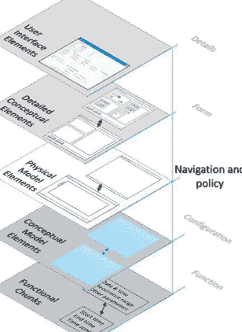

### 这一步包含什么？

细化导航地图的导航和策略相关活动如下：

1. 定义物理位置分配。
2. 开始原型制作。
3. 定义策略（模态）。
4. 重新访问并修订。
5. 定义操作原则。
6. 评估并修订。

## 为概念元素定义物理位置

虽然远未做出具体的实现决策，但在此时，我们应该将概念元素分配到它们的物理位置。正如本书序言部分所解释，物理分配对导航和交互策略有影响。你可以可以使用文所述的若干决策标准将概念元素分配到物理位置。

### 人类性能目标

序言部分概述并讨论了以下人类性能标准，可以将其视为性能目标：

- 心理模型与理解
- 位置感知
- 视觉搜索有效性
- 操作（执行动作）负担
- 工作记忆负担

我们可以将这些性能目标作为物理分配的首要决策标准（表 17.1）。

一像人类行为一样，我们可能在目标之间进行权衡。最常见的一种权衡是增加视觉有效性与减少操作负担之间的平衡。根据用户研究分析、使用场景和交互通道的额外影响，来解决性能目标之间的权衡。

# 导航策略：定义“交通规则” 115

| 人类性能目标 | 概念 | 物理分配 |
| :--- | :--- | :--- |
| 促进直观理解 | 表达元素之间的关联性 | 所有元素位于一个或少数窗口中 |
| 支持位置感知 | 将元素保持在较少的地方缩短完成任务所需的导航路线 | 每个元素使用独立的物理位置，但在同一个窗口内（例如，使用矩阵模型或同一窗口内的标签页） |
| 减少工作记忆负担 | | |
| 减少操作负担 | | |
| 增加视觉有效性 | 减少单个块中的元素数量 | 在多个地方放置元素，以减少给定位置的细节量 |

表 17.1：

使用人类性能目标作为标准确定概念模型的物理分配

### 分析影响

与将概念模型分配到物理位置相关的分析包括任务分析、对象-动作分析以及预期的交互流。这些分析具有以下结果和影响：

我们在什么时候做什么？——任务分析的结果之一是任务执行或预期执行的频率。具有相似频率的任务和相关概念元素可以考虑放在同一个物理位置或邻近的位置。

我们同时做什么？——所有分析的结果之一是任务和动作通常是否在同一时间执行，或者是否相互接近。在同一时间执行、针对同一对象或不同对象完成的任务和动作，可以考虑放在同一个物理位置或邻近的位置。

我们在另一个任务之后做什么？——预期的交互流和任务分析的结果是任务和动作执行或预期执行的顺序。结合相似的频率和/或同时进行，序列中的操作可以考虑放在同一个物理位置或邻近的位置。

什么依赖于什么？——预期交互流的一个主要结果，也是从任务分析和对象-动作分析中隐含的动作之间的依赖关系。依赖是指给定动作必须先于另一个动作的要求。许多程序和应用程序中一个简单且几乎每天使用的依赖示例是复制/剪切与粘贴之间。存在依赖关系的动作可以考虑放在同一个物理位置或邻近的位置。

我们同时看到什么？——所有分析的结果之一是任务和对象所需的预期可见性。任务或对象的可见性是用户感知其状态的程度。分析师应该识别那些任务或

### 概念设计：方法论

当用户与其他对象交互或执行其他任务时，对象的状态应该是对用户可见的。对于具有相似可见度的任务或对象，或者在参与其他任务或对象时需要可见性的任务或对象，可以考虑放置在同一个物理位置或邻近的位置。

直观性与可发现性——所有分析的结果都是对元素进行分组，以便直观地理解它们之间的关联性，并随后让用户能够轻松找到他们所需的内容。为了增加直观性和可发现性，具有高关联性的任务和对象可以考虑放在同一个物理位置或邻近的位置。

这些分析及其影响意味着概念元素的分配，总结如下表（表 17.2）所示。

## 表 17.2：多项用户研究分析对物理分配决策的影响

| 分析 | 概念性 | 影响 | 物理分配 |
|---|---|---|---|
| 任务分析 | 任务导向的关联性 | 相似的频率、可能的序列、可能的并发性 | 所有元素位于一个或几个屏幕或窗口中 |
| 对象分析 | 对象导向的关联性 | 可能的并发性、可发现性 | 在一个窗口或位置中为每个区块分配独立的物理位置（例如：使用矩阵模型或在同一窗口中使用标签页） |
| 期望交互流 | 工作流 | 序列、依赖关系 | |

## 使用背景、状态与模式

用户与系统/产品交互的背景会影响交互。背景有多个层次：

1. 物理背景，如室内与室外、静止与移动、白天与夜晚，或光线充足与不足条件、安静与嘈杂的地方、温度和气候，以及运动和震动的存在与否。
2. 工作流背景，如处于任何特定的阶段、步骤、状态或模式。一个常见的例子是初始安装（或配置状态）与后续实际使用之间的区别。
3. 个人背景，包括用户的身份，如新手与经验丰富者、清醒与疲劳、高动力与职业倦怠，以及其他状态。
4. 社会背景，是指用户是独自使用还是与他人一起使用。他人的存在可能是小组或团队合作、协作与共享交互、本地或远程，以及更广泛的社会背景，如国家、文化、种族或国际协会和学会。

分析师和设计师应该考虑各种背景因素对概念元素分配到物理位置的综合影响。将概念元素放在同一个物理位置或邻近的位置，可以支持并促进在更具挑战性的背景下的交互，这些背景可能包括增加用户的认知、情感或身体负荷。

## 导航策略：定义“道路规则”

## 交互通道

在将概念元素分配到物理位置时，交互通道是一个极具影响的考虑因素。交互通道的特征包括静止与移动、屏幕尺寸、交互设备（例如：键盘和鼠标、触摸、按钮、手势和动作、视线等）、原生的视觉风格以及与通道相关的背景（例如：通过自动取款机进行金融交易、通过银行网站进行，或通过小屏幕上的专用应用程序进行金融交易，通常与不同的背景相关）。

在各种特征中，屏幕尺寸和原生的视觉风格往往是对比概念元素物理分配决策影响最大的因素。简单来说，小屏幕为将多个概念元素分配到单个物理位置引入了严重障碍。小屏幕尺寸可能导致为了到达单个物理位置内的所有元素而需要大量的滚动和平移动，或者减小元素的大小以更好地适应小屏幕，从而降低其的可读性。

尽管如此，将概念元素分配到一个或几个物理位置仍然可以与小屏幕交互通道相关联。例如，最初为大屏幕桌面交互通道设计的网站可以通过响应式设计技术适应小屏幕。所得的设计确保了元素不会太小，并支持有效查看，但它们仍然是单个网页上的不同位置，这需要滚动和平移。这种方法具有显而易见的优点，即不需要为小屏幕通道重新设计整个网站，并且可以在跨通道上实现相似的概念和详细设计。

交互通道的特征有时会推翻基于性能目标、分析结果考虑和背景因素所做出的决策。换句话说，如果预期的交互通道是小屏幕，那么将多个元素分配到单个物理位置的设计决策可能会被推翻。这可能与使用小屏幕设备的典型背景因素有关，如移动性、在室外、经历光线和稳定性等环境因素，以及处于引入更多干扰和中断的个人和社会背景中。

## 业务与品牌考虑

最后，但同样不重要的，是对业务目标和品牌化影响的考虑。合理的需求可能包括表达产品品牌的元素、追加销售（`upselling`）或交叉销售（取决于合作伙伴）。包含此类元素需要将它们分配到物理位置，这反过来会影响所有其他概念元素的物理分配。

# 开始原型设计

在将概念元素分配到物理位置时，我们从用方框和箭头表示模型转变为使用界面元素来表示模型。现在是开始原型设计的良好时机。想法是，我们现在构建的原型将在我们向模型添加细节并向详细设计过渡的过程中演变和展开。原型将作为设计工具、与所有利益相关者的沟通渠道，以及评估和测试的工具。参见图 17.1 中运行示例的概念模型原型设计。


图 17.1：

桌面通道概念模型运行体验示例中，概念元素的物理位置分配。使用 Balsamiq 构建，网址为：http://balsamiq.com/。

导航策略：定义“道路规则”

119

### 概念设计：方法论


图 17.2：

移动端（小屏）通道概念模型运行体验示例中，概念元素的物理位置分配。使用 Balsamiq 构建，网址为：http://balsamiq.com/。

## 定义策略

导航策略是你在概念设计阶段应该处理的重要问题，它与概述导航地图以及将概念元素分配到物理位置相辅相。这里是对导航策略的回顾。该策略从根本上处理的是模态（modality）的挑战：当用户与物理位置中的某个概念元素交互时，他们还能与相同或不同物理位置的另一个概念元素交互吗？在做出导航和交互策略的决策时，我们遵循与确定概念元素向物理位置分配时相同的标准。

在将概念元素分配到物理位置时，你做出了大部分的模态决策（示意性示例，请参考本书入门部分的表 6.1）。要确定策略决策，请执行以下操作：

**细化分析的含义：** 重新审各种分析的结果以及概念元素之间的亲和性。我们同时交互和看到的元素应该是独立的。换句话说，无论它们被分配到相同还是不同的物理位置，它们之间都不存在模态关系。

**遵循特定通道的视觉效果和感受指南及约定：** 在大屏交互通道中应用模态（modal）或非模态（modeless）策略，需要将窗口、对话框和屏幕定义为彼此之间的模态或非模态。然而，在小屏通道中，我们往往最终得到互斥元素，仅仅是因为它们由于尺寸限制无法同时显示和访问，而不是出于刻意的设计决策。

在遵循了运行示例中概念元素物理分配的初始决策后，我们开始检查导航策略。该示例的导航策略细节见表 17.3。我们可以看到，在模态方面，两个通道都有相应的策略，尽管它们对概念元素的物理分配不同。使用物理位置分配的标准，我们可以看到对于桌面通道，设置任务的位置和锻炼元素的位置是互斥的，尽管它们都在同一个地方。同样的模态也适用于移动端通道：不同概念元素的位置是互斥的，但它们被分配到了不同的物理位置。

### 概念设计：方法论

| 模态 (Modality) | 同一位置——互斥 | 不同位置——互斥 |
| --- | --- | --- |
| 交互通道 | 桌面 | 窗口 1 |  |
|  | 移动端 |  | 对话框：执行这个还是那个？[否] [是] |

表 17.3：运行示例中每个通道的导航策略

## 检查点：回顾与修改

此时，我们已经有了一个完整的概念模型，包含所有的概念元素和相互关系，所有元素均已分配到物理位置，并有导航地图和策略。我们还拥有初始原型形式的模型。这是一个停下来进行另一个检查点并评估我们现状的好时机。

## 交互通道的其他影响：操作原则

## 运行体验示例：回顾导航地图和策略

- 1. 收集更多关于设置和个人账户更改频率的数据。此外，收集跑步者对使用移动设备的熟悉程度，以及他们在跑步前、中、后如何使用设备。
- 2. 考虑更改通道的物理分配和策略，特别是移动端，由于使用的限制条件（如户外、天气光线条件以及疲劳）。
- 3. 重新考虑是否需要主入口屏幕，并考虑将其他元素作为默认入口处，提供访问所有其他元素的路径。

到为止，我们非常关注交互通道的特征。某些物理分配决策是基于这些特征的，反过来影响了导航地图和策略。现在要问用户与通道交互的物理方式是否也会影响关于概念模型的设计决策。回我们称之为交互的操作原则（operational principles）。参考书第一部分的表 6.2 以复操作原则。

要考虑交互通道的操作原则，请遵循以下步骤：

- 识别并理解通道的操作原则（即物理交互的特征）。
- 根据用户研究，通过以下问题考虑哪些操作原则是相关的：
  - 它符合用户画像（persona）吗？
  - 它符合使用场景（context）吗？
  - 它符合使用频率吗？
- 确定相关操作原则对概念元素物理分配以及导航地图和策略的影响。
- 权衡利弊。
- 考虑修改概念设计（元素和导航地图）。

让我们回到运行示例，看看交互通道的操作原则如何影响概念设计。详见下表 17.4。

| 考虑因素 | 细节 |
|---|---|
| 通道的操作原则 | 基于触摸的手势以导航到其他地方 |
| 相关性（基于用户研究） | 用户画像：熟悉该手势并能有效执行它<br>场景：在大多数场景下<br>频率：在地点之间导航并不频繁 |
| 对概念模型的影响 | 它可能会改变概念元素分配到单个位置的情况（与之前分配到不同位置形成对比） |
| 收益 | - 舍弃模态位置<br>- 不需要屏幕内导航 |
| 成本 | - 在某些场景下（如跑步时）可能会有问题，但很罕见 |

最后一步是考虑，既然考虑因素建议我们应该在移动端通道中实现滑动交互。你可能记得，在我们目前的概念模型中，由于小屏限制，元素被分配到不同的屏幕，导致它们是互斥的。通过使用上下手势进行导航，我们现在可以将若干几个元素分配到同一个位置。考虑到我们在研究中发现的工作流，频繁的转换是通过“近期锻炼”和“计划锻炼”概念元素完成的。

### 概念设计：方法论

图 17.3：

在运行示例的移动端中实现上下操作原则。注意，使用此原则改变了概念模型。


将这两个元素都分配到了同一个位置。你可以在图 17.3 中看到概念模型的修改部分。

将多个概念元素分配到同一个物理位置并利用滑动操作，使我们能够重新审视是否需要一个独立区域作为主入口（以运行示例中的移动端为例）。回到用户研究并考虑到发现中锻炼元素的主导地位，我们可以决定近期和计划锻炼组合元素的物理位置可以作为默认入口处，并访问其他地方。

# 评估与修改

到目前，我们已经将概念元素分配到物理位置，通过添加导航策略完善了导航地图，并实施了相关的操作原则。此时，我们应该评估展开的概念模型的有效性和良好性。一种方法是使用我们之前相同的问题列表，并以检查式的方法关注概念模型、人类性能、易用性和用户体验（见表 17.5）。由于我们已经有了模型的初步原型或模型，可以考虑评估模型有效性和良好性的其他方法。其他方法的关键方面是在专家检查之外，引入用户参与评估。原型可以支持评估。

| 评估维度 | 完全 | 部分 | 完全不 | 备注 |
| --- | --- | --- | --- | --- |
| **概念模型** | | | | |
| 它是否代表了所有功能块？ | ✓ | | | |
| 它是否表达了元素之间所有的相关关联，反映了块之间的关联？ | ✓ | | | |
| 导航地图是否支持工作流？ | ✓ | | | |
| 模型的复杂度是否符合用户画像和任务结构化程度？ | | ✓ | | 将多个元素组合在同一个物理位置，但无法立即可见，可能会让某些人感到困惑 |
| **人类表现** | | | | |
| 模型是否支持位置感知？ | | ✓ | | 将多个元素组合在同一个物理位置，但无法立即可见，可能会让某些人感到困惑 |
| 模型是否会支持有效的视觉搜索？ | ✓ | | | 似乎根据概念元素的数量，将支持有效的视觉搜索 |
| 模型是否会降低操作负载？ | ✓ | | | |
| 模型是否会减少记忆负载？ | | ✓ | | 将多个元素组合在同一个物理位置，但无法立即可见，可能会让某些人感到困惑 |
| **可用性与用户体验** | | | | |
| 模型是否支持可学习性？ | ✓ | | | |
| 模型是否支持有效的交互？ | ✓ | | | |
| 模型是否支持效率？ | ✓ | | | |
| 模型是否支持积极的体验？ | ✓ | | | |

基于参与者遵循场景并贯穿模型的演练。至于指标方面，我们使用表 17.5 中的问题、或者出声思考协议，甚至是标准的总结可用性和体验问卷（例如 SUS）。

# 项目管理考虑因素

在许多项目背景下，这通常是我们希望尽快达到的状态。这是因为在这一所有步骤中，我们的想法和概念已经以具体的术表达出来并可以进行展示和测试。你觉得到达这里太久了吗？首先，回想我们在过程的各个阶段多次建议过，你可以“快进”到某些功能块和概念元素的抽象状态，进入更具具体的视觉化，然后返回继续处理其他元素。

其次，项目团队可以非常有效高效地管理描述的过程。在有效性方面，项目团队成员和其他利益相关者应该参与其中。这确保了从非常战略到非常具体的产品的所有层级的所有观点都得到了考虑。它是有效的，因为可以减轻后期才发现某些重要考虑因素被遗漏或未得到妥善处理的情况。在效率方面，这个过程可以很快完成。虽然乍看之下似乎是一个很长且多步骤的过程，但时长和吞吐量取决于领域和功能集的范围和复杂性。让我们使用运行示例，并回顾到达该点的活动，对快速过程给出假设但真实的的时间预估（表 17.6）。

表 17.6：

运行示例的预计项目时间

| 活动 | 参与者 | 时间预估 |
|---|---|---|
| 用户研究 | 用户、其他利益相关者 | 2 天（包括访谈和焦点小组） |
| 从数据生成功能和需求 | 项目团队 | 1 天 |
| 功能分块 | 项目团队、利益相关者 | 与利益相关者进行 0.5 天的工作坊 |
| 模型元素和配置 | 项目团队 | 0.5 天 |
| 在原型制作时添加导航和策略 | 项目团队 | 1 天 |
| 形成性评估和修订 | 项目团队、利益相关者 | 1 天 |
| “勾画概念模型”总计 | | 6 天 |

多通道或跨渠道交互考虑因素：许多设计和开发项目最常见的挑战是确保跨不同交互渠道的一致用户体验。请注意在运行示例中，我们也解决了这一挑战。虽然这里的方法是并行处理跨渠道概念设计，但这绝不是一种建议。正如本书的这部分提到的，处理多通道和跨渠道设计的方法是多样的，可能取决于本书范围之外各种因素和考虑因素。然而，我们在这里展示的是我们可以开发一个跨渠道的概念模型。

## 导航策略——关键实践点

- 基于人类表现目标、用户研究和交互渠道考虑因素，将每个概念元素分配到一个物理位置。
- 定义导航策略，其应包括关于元素局部性以及它如何影响导航的规则。
- 使用你最喜欢的原型工具开始制作模型原型。
- 暂停并重新审视模型，专注于导航和策略。
- 根据交互通道的操作原理，定义用户将如何在物理上与模型进行交互。
- 结果：一个细节较少的初步原型——带有导航地图和策略的概念模型。
- 与团队成员和其他利益相关者一起评估，以验证模型和导航地图。

此页特意留

# 表：过渡到详细设计

我们进入了从概念设计向详细设计过渡的阶段。在分层框架中，我们现在处于形式层。简单来说，这是我们的概念带有细节形状的时间。


> 此步骤包含的内容

形式层中的相关活动是：

1. 考虑隐喻。
2. 添加细节。
3. 开发故事板。
4. 测试和修订。

# 外观概念：考虑隐喻

在书的入门部分，我们提到如果用户不理解它，他们就无法使用。促进理解概念模型的好方法是什么？在这里，我们需要映射到使用的关系。使用某些事物作为隐喻可以帮助用户与原本抽象或技术性的元素交互以理解。

例如，人机交互世界上最著名、最流行且生存最久的隐喻是桌面。最初通过 Xerox Star 图形界面引入，桌面隐喻在熟悉的环境中代表计算机和软件元素，以图标代表文件夹和文件、垃圾桶，外围设备代表打印机。

是另一个将操作原理与视觉隐喻结合的绝佳例子。各种设备上的电子阅读器或书籍阅读应用程序通常让应用程序显示为背景中书封的提示，页面的外观像装订中线。此外，对书籍的使用利用了基于触摸的从右向左滑动交互风格，模仿我们翻阅真实书籍时的翻页动作。

## 关于映射、类比和隐喻

当我们使用环境中的人工制品时，交互产品也是如此，Norman (1999) 讨论了自然映射原理。该原理指的是通过映射控件（例如按钮）与我们试图控制或操纵的元素（例如屏幕上的元素）之间的对应关系，来理解并知道做什么或如何使用的能力。

映射存在于我们通过类比理解和解决问题的能力之中。我们可以通过解决另一个与源问题类比的问题来解决问题。要做到，我们首先注意到两个问题之间的对应关系，然后映射这两个问题之间的关系。基于映射的对应，我们可以将类比问题的解决方案应用于原始问题。

隐喻的使用与理解另一个非常相似。隐喻帮助我们通过另一个概念来理解一个概念或想法（例如 Lakkoff & Johnson, 1980）。换句话说，我们可以映射隐喻与我们已知或能理解的内容之间的对应关系。

# 形式：向详细设计过渡

# 131


图 18.1：

书籍的视觉隐喻与电子阅读器中基于触摸的滑动操作原理的结合。


图 18.2：

标签页（Tabs）作为概念元素的物理载体，具有独特的视觉隐喻。

概念元素意味着某种视觉外观。标签页是对我们在现实世界中熟悉的文件的标签的隐喻（图 18.2）。使用标签页是否意味着我们正在采用桌面类型的隐喻？并不是，因为将标签页用作互斥概念元素的载体是常见的，而且它们会根据交互通道及其原生样式有不同的不同的外观。然而，我们应该意识到隐喻是可以被“破坏”的。回到上面讨论的书籍隐喻，图 18.1 中的右侧图片显示了在书籍隐喻上叠加带有各种功能的工具栏，这破坏了隐喻并将用户带回了应用程序的标准外观。

选择隐喻的步骤：

1. 确定是否有必要使用隐喻。基于用户研究的结果来决定。
2. 熟悉他们生活、工作、社会和文化中常用的隐喻。
3. 利用用户研究来考虑心理模型。
4. 确定你可以利用隐喻走多远（参见上述书籍隐喻作为隐喻破坏的示例）。
5. 考虑原生和传统的隐喻（例如，文件）。
6. 考虑产品本身。

# 添加细节

到目前为止，概念模型处于一个较高的抽象水平。选择隐喻可以帮助过渡到为概念模型添加更多细节。即使在将概念元素分配给物理位置时，其表示也是以占位符的形式存在的。一旦我们评估并验证了模型，就可以开始添加细节了。具体来说，我们从功能块（functional chunks）开始添加细节。每个功能块的细节源于用户研究和进行的分析。细节可以包括以下内容：

- 操作（Actions）——区分在功能对象上执行的导航操作。导航操作是那些能够遍历概念模型的动作，例如，打开或关闭窗口、点击标签页移动到另一个概念元素，以及打开文件。功能对象上的操作可以主要从操作分析中得出。功能对象上的操作包括对象的创建、修改或删除（例如，在跑步示例中创建一个新的训练计划）。
- 参数（Parameters）——通常，每个功能对象都关联着帮助用户定义其自身的参数。在跑步示例中，以公里为单位计划距离是帮助用户定义训练计划的参数之一。请注意，由于这一步是向详细设计的过渡，而不是详细设计的定稿，因此不需要确定让用户定义参数的最终用户元素。例如，计划的公里距离可以在简单的文本字段中设置，可以在带有计数器控件的文本中设置，或者从预设的距离列表中选择。
- 信息（Information）——任何非用户定义的静态或动态信息。信息可以包括任何从外部源接收的而非由用户输入或设置的信息、营销信息、解释和描述、标题和说明文字、参数标签以及用户引导（图 18.3）。

## 开发完整的故事板

在为设计添加了细节并进行了原型制作后，我们现在可以将所有内容整合成一个故事板。故事板起源于视觉艺术，主要是电影和视频，后来进入数字媒体。其基本思想是以视觉图形的方式呈现，以说明故事中情节的顺序。故事板被应用于需求收集（Andriole, 1992）、基于场景的设计（Carroll, 2000）以及用户界面设计（Landay & Myers, 2001）。

将故事板作为概念设计过程的一部分的想法是，根据我们从研究中使用的场景和分析，通过关键交互流来表示完整的概念模型。详细的故事板是沟通和测试概念模型的强大工具。我们可以以用户场景的形式来呈现它（参见图 18.4）。

呈现故事板的另一种方法是创建一个导航地图，将原型化和详细的概念元素与我们到目前为止所使用的导航地图进行对比（图 18.5）。

Jake 第一次使用该应用程序时，他从设置屏幕开始。他首先进行设置，然后配置 HR 监测器来监控应用程序。作为他计划的一部分，他定义了几个计划中的训练项目。

从设置屏幕，他导航到计划训练屏幕。他设置了一系列计划在不同时间跑步的距离。

当他跑步时，他会看一眼手机屏幕，并计算他故事映射中的情节顺序，将他的跑步表现映射到显示他所在位置的地图上。

一旦他完成了跑步，应用程序就会切换到摘要屏幕，他可以在那里查看性能参数。他还可以访问之前跑步的摘要。

图 18.4：

跑步示例的部分故事板，以故事的形式呈现移动端通道。

## 概念设计：一种方法论


# 形式：向详细设计过渡

# 135

图 18.3：

跑步示例中为原型模型添加细节的示例（中间是概念模型）。


# 测试与评审

到目前为止，我们在早期步骤使用了检查工具。我们还没有机会收集“真实的”性能和体验衡量。现在，我们有了原型化和详细的设计，你可以采用涉及用户和场景的形成性测试，利益者可以收集各种可用性指标。许多关于可用性测试和用户体验衡量的书籍和资源对于这一阶段的测试都是相关的。鉴于可用性测试资源的丰富，且本书仅关注整个生命周期中的概念设计阶段，我们不再详细阐述测试。

## 项目管理考虑

我们现在有了细节。通常，这个设计阶段的成果更容易沟通，因为我们可以展示具体的实体，这更容易理解。我们还可以测试我们所拥东西。我们该如何看到图 18.4 和 18.5 中的内容，因为感觉我们经历了一系列可能难以沟通和评估的活动和结果？

首先，尽管跳过通这一点的步骤很有诱惑，但不要这样做。一个良好且有效的详细概念模型必须建立在之前所有步骤开发并验证的基础之上。

其次，记住团队合作的方法。所有相关的利益者都应该参与这一过程并成为其不可或缺的一部分。

第三，正如我们之前讨论过的，之前的步骤更短、更快。记住，目标不一定要遵循线性流程，而是确保设计的所有层面在最后都得到覆盖并良好整合。


形式：关键实践要点

- 开发外观概念并考虑使用比喻。
- 基于功能块（functional chunks）为模型添加细节。
- 使用详细的原型构建详细的叙事脚本（storyboard）。
- 结果是一个展示整个概念模型的详细原型。
- 与用户、团队成员和其他利益相关者进行测试，以验证模型和交互。

# 第 19 章

## 总结：概念设计方法论概览

作为一种总结方式，现在让我们把整套方法论归纳为 1-2-3 步的过程。其思路如下：


- 1. 勾画概念模型：勾画概念模型跨越了框架中的三层，从定义功能块到配置模型，再到描绘导航地图。
- 2. 精炼模型：通过将元素分配到物理位置、定义策略以及细调导航和操作原则来精炼模型。
- 3. 整合：最后，通过开发一个具有完整原型的详细模型将一切整合在一起。

沿着 1-2-3 过程的思路，这里是整个方法论的单页总结，你可以带走并快速参考（表 19.1）：

### 表 19.1：

概念设计方法论地图

| | 1. 勾画 | | | 2. 精炼 | | | 3. 整合 | | | | |
|---|---|---|---|---|---|---|---|---|---|---|---|
| **用户研究** | 用户画像 | 业务目标 | 用户画像 | 任务和工作流 | 业务目标 | 用户画像 | 任务和工作流 | 业务目标 | | |
| | 人角色设定 | 任务和工作流 | 人角色设定 | | 场景 | 人角色设定 | | 场景 |
| | 情境 | 对象 | 可用性目标 | 情境 | 对象 | 可用性目标 | 情境 | 对象 | 可用性目标 |
| **活动** | 定义块 | | 评估与修订 | 分配物理位置 | 定义策略 | 评估与修订 | 比喻/外观概念 | 叙事脚本 | 原型 | 测试与修订 |
| | 定义概念元素 | | | | 定义操作原则 | | | | | |
| | 配置 | 定义导航 | | | | | | | | | |
| **交付物** | | | | | | | | 可用性测试报告 | | |
| | | | | | | | | | | | | |
| **项目** | 核心团队 | 数据收集 | 设计评审 | 核心团队 | | 设计评审 | 核心团队 | 设计评审 | 测试参与者 | |
| | 利益相关者 | 计划、预算 | | 利益相关者 | 计划、预算 | | 利益相关者 | 计划、预算 | 测试设施 | |
| **科学** | 不匹配的模型 – 理论方面 | | | 视觉搜索 | | | 色彩感知 | | | | |
| | 块的记忆与理解 | | | 熟悉度与经验 | | | 测试与评估原则 | | | | |
| | 多任务处理、工作量、压力 | | | 运动控制基础 | | | | | | | |


总结：概念设计方法论概览

139

## 超越概念模型进入详细设计

从概念到详细的设计是连续过程的一部分。在此之后，我们将我们在概念设计中解决的问题。在书中，我们使用以下人类性能目标作为概念设计的指导：

- 心理模型与理解
- 位置感知
- 视觉搜索有效性
- 操作（执行动作）负载
- 工作记忆

当我们过渡到详细设计时，应该记住这些目标。以同样的方式，这些目标被转化为概念设计需求，现在它们应该进一步转化为详细设计需求。下表（表 1）在你从概念转向详细设计时提供了一些原则和需求：

| 人类性能目标 | 概念设计 | 详细设计 |
|---|---|---|
| 促进直观理解 | 元素间的关联 | 布局呈现结构；一致使用比喻 |
| 支持位置感知 | 保持元素在位；完成任务的短路径 | 导航控制；作为地标的标题和说明 |
| 最小化工作负载 | 标题和说明：反馈与引导 |
| 减少操作负载 | 快捷键和执行任务的其他方法；立即访问操作 |
| 增加视觉有效性 | 减少单个块中的功能元素 | 布局引导视觉搜索 |

# 参考文献

Andersen, S. J. (1992). Rapid prototyping: The storyboard approach to user requirements. Wellesley, MA: Information Sciences.

Annett, J. (2004). Hierarchical task analysis. In D. & N. A. Stanton (Eds.), The handbook of task analysis for human-computer interaction (pp. 67–82). Mahwah, NJ: Lawrence Erlbaum.

Brink, T., Gergle, D., & Wood, S. (2002). Usability for the Web. San Francisco, CA: Morgan Publishing.

Carroll, J. (2000). Five reasons for scenario-based design. Journal of Experimental Psychology: Learning, Memory, and Cognition, 13(1), 43–60.

Catrabone, R., & Holyoak, K. J. (1998). Overcoming contextual limitations on problem-solving. Journal of Experimental Psychology: Learning, Memory, and Cognition, 15(6), 147.

Diaper, D. & Stanton, N. A. (Eds.). (2004). The handbook of task analysis for human-computer interaction. Mahwah, NJ: Lawrence Erlbaum.

Garrett, J. J. (2002). The elements of user experience: User-centered design. London: Pearson Education.

Gick, M. L., & Holyoak, K. J. (1983). Analogical problem solving and induction transfer. Cognitive Psychology, 5(1–35.

Goodwin, J., & Seisen, J. (2013). Learn UX: Applying principles to improve user experience. Sebastopol, CA: O'Reilly.

Hacks, T., & Redish, J. C. (1998). Task analysis for interface design. New York: Holt.

Holyoak, K. J., & Thag, P. (1995). Mental leaps: Analysis for cognitive thought. Cambridge, MA: MIT Press.

Kirwan, B., & Ainsworth, L. K. (Eds.). (1992). A guide to task analysis. London: Taylor & Francis.

Lakoff, G., & Johnson, M. (2003). Metaphors we live by. Chicago, IL: University of Chicago Press.

Landau, J. A., & Myers, B. A. (2001). Sketching interfaces: Toward more interface design. Computer, 34(6), 59–63.

Lewis, D. (1986). On the plurality of worlds. Oxford: Blackwell.

Lynch, P. J., & Horton, S. (2008). Web style: Design principles for creating sites. New Haven, CT: Yale Press.

Moray, N. (1997). Intelligent agents, mental models and the theories of machines. International Journal of Artificial Intelligence, 7(3), 249–259.

Mulder, S., & Yaar, Z. (2007). The user is always right: A practical guide to creating and using personas for the web. Berkeley: New Riders.

Norman, D. (1988). Observation on mental solving. In D. Gentner, & A. Stevens (Eds.), Mental models (pp. 7–14). Silfield, NJ: Lawrence Erlbaum.

Norman, D. A. (1999). The design of everyday things. New York: Doublebury.

Norman, D. A. (2004). Acceptance, convention, and design. Interactions, 6(3), 38–43.

Norman, D. A. (2004). Emotional design: Why we love (or hate) everyday things. New York: Basic Books.

Pritt, J., & Designlin, T. (2006). The persona lifecycle: Keeping people in mind throughout product design. San Francisco, CA: Morgan Kaufmann.

Ratlcliffe, L., & McNeil, J. (2012). Agile experience: A designer’s guide to agile, lean, and continuous. Thousand Oaks, CA: New Riders.

Rosson, M. B., & Carroll, J. M. (2009). Scenario based design. Human-computer interaction. Boca Raton, FL: CRC, pp. 145–162.

Shepard, A. (2000). HTA as a framework for task analysis. In J. Annett, & N. A. Stanton (Eds.), Task analysis (pp. 9–24). London: Taylor & Francis.

Shneiderman, B. (1982). The future of interactive systems and the emergence of direct manipulation.

Behaviour & Information Technology, 1(3), 237–256.

Shneiderman, B. (1983). Direct manipulation. A step beyond programming languages. IEEE Computer,

1(8), 57–69.

Shneiderman, B. (1998). Designing the user interface. Reading, MA: Addison-Wesley.

Shneiderman, B., Plaisant, C. (2010). Designing the user interface: Strategies for effective human-computer interaction (5th ed., 606 pages). Reading, MA: Addison-Wesley Publ Co.

Yuan, R. M. (1981). The machine inside the machine: Users' models of pocket calculators. International Journal of Man-Machine Studies, 15, 51–85.

# 索引

注：页码后跟随 $f$ 表示图，$t$ 表示表。

# A

- 架构规划，9, 10f
- 抽象表示，72
- 地点，9
- 路线，9
- 导航图，25–27
- 考虑因素，26
- 物理场所，27–29, 27f, 28f
- 路线特征，26–27
- 关于操作负载，45
- 关键元素，100–103
- 项目管理考虑因素，104–105
- 重构，103
- 重新访问与修改，104
- 类别学，51
- 可用性与用户体验，48–50
- 关于视觉搜索，45
- 关于工作记忆，46

概念性导航图，25–27。*另见* 导航层 (Navigation Layer)

概念模型

- 预约设置应用，21, 22f
- 日历应用，21, 23f
- 之间的连接，20–22, 21f
- 基本特征，20
- 功能架构，19

内容导向的块，15, 15f

跨通道应用。*另见* 设置预约 (Setting an appointment)，日历应用

# B

- 业务背景
- 业务机会，72–73
- 产生和增加收入，72
- 新技术，72
- 非收入动机，72
- 用户与使用方面，71
- 用户需求，72

# C

- 复杂概念模型
- 特征，63–64, 64f
- 灵活性与控制，63–64
- 任务与工作流，63–64
- 非结构化任务支持，64, 65
- 概念设计方法论，11, 12f, 137–138
- 分层框架，77, 78f
- 项目管理考虑因素，78
- 概念模型，41
- 架构规划，9
- 配置层
- 预约设置应用，21, 22f
- 日历应用，21, 23f
- 之间的连接，20–22, 21f
- 基本特征，20
- 表单层，19–20
- 微调，20
- 粒度级别，20, 21f
- 隐喻，20
- 导航策略，20
- 人体性能，43, 46–48
- 关于位置感知，44–45
- 关于心理模型，44

# D

- 设计与开发背景
- 部署，75
- 设计活动，74
- 实现，75
- 启动阶段，74
- 项目管理
- 多/跨通道交互，76
- 团队协作方法，76
- 用户与使用研究，75–76
- 研究活动，74
- 战略与业务考虑因素，75
- 测试，75
- 用户导向方法，73

# 索引

详细概念设计，37–39

- 动作，132
- 信息，133
- 隐喻，130–132
- 参数，132
- 项目管理考虑因素，135–136
- 故事板，133–134
- 测试与修改，134

导航图，55–56

- 性能影响，56–57
- 可用性影响，56

人体性能影响，10, 29, 46–48, 141

- 预约应用，46
- 影响，46
- 权衡，47
- 关于位置感知，44–45
- 心理模型，44
- 导航图，110, 111f
- 导航策略，114, 115
- 关于操作负载，45–46
- 可用性与用户体验，48–50
- 关于视觉搜索，45
- 关于工作记忆，46

混合概念模型，51, 63

# F

表单层

- 模型元素，37–39
- 功能块，132–133
- 动作，132
- 信息，133
- 参数，132
- 用户界面元素，39

功能块，13, 41

- 先验考虑，90
- 复合块，15–16,f
- 配置层，19–22
- 涌现过程，90
- 对象导向，14, 14f, 92, 92f, 93–94
- 项目管理考虑因素，37–98
- 修改与修订，97
- 任务导向，14, 14f, 90–92, 91f, 93–94

# I

交互通道，3

# J

旅程与体验图，86, 87f

# L

分层框架，11, 12f

- 概念设计，77
- 从概念到详细设计，77
- 配置级别，11
- 详细设计，77
- 细节级别，11
- 表单级别，11
- 功能级别，11
- 导航与策略级别，11
- 链接功能块，93–97

# G

- 全局优先级，9–10
- 粒度级别，37–38
- 图形用户界面 (GUI)，3–4

# H

- 层次概念模型，54f, 55f
- 适用，54
- 配置，53
- 异常与变，54
- 交互策略，54
- 导航图，53


# M
- 性能影响，54
- 层次任务分析 (HTA)，83–84, 84f
- 枢纽辐射型概念模型，57, 57f, 102–103
- 适用，56
- 配置，55
- 异常与变，56
- 交互策略，56
- 矩阵概念模型，58f, 59–60, 60f
- 适用，59–60
- 配置，58
- 交互策略，59
- 导航原则，58–59
- 性能影响，59
- 心理模型，73, 100–101
- 人体性能参数，74
- 链接，43–44
- 隐喻，39, 130
- 使用背景，116–117
- 诺曼定义，44
- 项目管理考虑因素，126–127
- 对象导向功能块，92
- 网络概念模型，61f, 62–63, 62f
- 适用，61
- 配置，60
- 任务导向功能块，90
- 交互策略，61
- 导航原则，60
- 性能影响，61
- 最小可行产品 (MVP)，97–98
- 模态，29, 30
- 结果性与非结构化模型，51
- 最可行体验 (MVX)，97–98
- 枢纽辐射，55–57, 56
- 矩阵，58–60, 58f

# O
- 对象-动作分析，84–85
- 抽象对象，85
- 人，84
- 物理实体，85
- 对象导向功能块，14, 14f
- 适用性，92
- 链接，94–95

# N
- 导航，25
- 导航图，25, 41
- 概念模型，25–27
- 路线特征，26–27
- 入口与出口概念元素，108
- 概念模型，110, 111r
- 人体性能，110, 111
- 可用性与用户体验，110, 108f, 109
- 模型配置，26
- 操作原则，33–35, 34
- 产品管理考虑因素，111–112
- 导航策略，41
- 预约设置，35
- 通道操作原则，122–124
- 检查点，122
- 检查类型评估，124–126, 125
- 模态，29

# P
- 关键元素，100–103
- 产品功能，13
- 概念设计方法论，78
- 概念模型元素，104–105
- 设计与背景
- 多/跨通道交互，76
- 团队协作方法，76
- 用户与使用研究，75–76
- 详细概念设计，135–136
- 功能块，97–98
- 导航图，111–112
- 导航策略，126–127

# S
- 序列与结构化概念模型，51
- 层次结构，53–55, 54f
- 单序列结构，52–53, 52f
- 设置预约
- 日历应用
- 手机界面，6–7, 6
- 平板电脑应用，4–6, 5f
- 业务与看板考虑因素，117
- 人体性能目标，114, 115
- 交互通道特征，117
- 原型设计，118–120, 119f

# U
设置预约（续）
可用性与用户体验，48–50
- Web 端应用，4, 5f
- 日历应用，49–50, 49t
- Windows 端 GUI 应用，3–4, 5f
- 枢纽辐射模型，56
- 配置层，21, 22f
- 矩阵概念模型，59
- 功能块，16–17, 17f
- 多序列模型，53–55
- 人体影响，46–48, 48f
- 导航图，110, 111r
- 导航图，35, 35f
- 导航策略，124–126, 125f
- 导航策略，35
- 网络概念模型，61
- 可用性影响，49–50, 49t
- 单序列模型，52
- 单序列概念模型，52f, 53f, 53f
- 可用性要求，86–87
- 适用，52–53
用户与使用研究
- 配置，52
- 联系，21
- 异常与变，52
- 数据源与收集技术，79–80
- 导航图，52
- 数据类型，80–81r
- 导航策略，52
- 旅程与体验图，86, 87f
- 性能影响，52
- 对象-动作分析，84–85, 86f
- 可用性影响，52
- 人设与场景，82, 83f
- 手机界面，预约设置，6–7, 6f
- 场景，81
- 日期时间，6
- 战略方面，87–88
- 周期性，7
- 任务与工作流分析，82–84, 84f
- 提醒，7
- 可用性要求，86–87
- 主体与位置，6
故事板，133–134
用户目标，3

# T

# W
- 平板电脑应用，预约设置，4–6, 5f
- Web 端应用，预约设置，4, 5f
- 日期时间，4
- 参数，4
- 目的与位置，4
- 周期性，4
- 周期，6
- 提醒，4
- 提醒，6
- Windows 端 GUI 应用，预约设置，3–4, 4f, 5f
- 任务导向功能块，14, 14f
- 参数，3
- 适用性，90
- 周期性，4
- 定义，90
- 提醒，3
- 链接，93–94
