# 现代C++并发：每个专业C++程序员都应该了解的并发知识


## 在 Twitter 上分享本书！

请在 Twitter 上传播本书，帮助 Rainer Grimm！

本书建议的话题标签是 #rainer_grimm。

点击此链接在 Twitter 上搜索该话题标签，了解其他人对本书的评价：

#rainer_grimm


技术团队负责人

> “《Concurrency with Modern C++》是成为多线程环境专家的最便捷途径。这本书涵盖了简单和高级主题，包含开发者成为该领域专家所需的一切：丰富的内容、大量可运行的代码示例、精彩的讲解，以及整整一章的陷阱警示。我非常享受阅读这本书，并且强烈推荐给所有使用 C++ 的开发者。”

## 引言

《Concurrency with Modern C++》是一段穿越 C++ 当前及未来并发特性的旅程。

- C++11 和 C++14 提供了创建并发和并行程序的基本构建块。
- 借助 C++17，我们拥有了标准模板库（STL）中的并行算法。这意味着大多数基于 STL 的算法可以顺序执行、并行执行或向量化执行。
- C++ 的并发故事仍在继续。借助 C++20/23，我们可以期待扩展的 future、协程、事务以及更多特性。

本书详细解释了现代 C++ 中并发的细节，并提供了大量代码示例。因此，你可以将理论与实践相结合，从而最大程度地从中获益。

由于本书是关于并发的，我想呈现许多陷阱，并展示如何克服它们。

### 约定

只有少量约定。

#### 特殊字体

斜体：我使用*斜体*来强调一个表达式。

粗体：我使用**粗体**来进一步强调。

等宽字体：我使用`等宽字体`来表示代码、指令、关键字以及类型、变量、函数和类的名称。

#### 特殊符号

⇒ 表示数学意义上的结论。例如，a ⇒ b 表示如果 a 则 b。

#### 特殊框

框内包含提示、警告和提炼的信息。

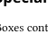

**提示标题**

此框提供有关所呈现内容的提示和附加信息。


### 警告标题

警告框应帮助你避免陷阱。


### 提炼信息

该框在每个主要小节的末尾总结需要记住的重要事项。

## 源代码

所有源代码示例都是完整的。这意味着，假设你有一个符合标准的编译器，你就可以编译并运行它们。源文件名位于清单的标题中。只有在必要时，我才会在源文件中使用 `using namespace std` 指令。

## 运行程序

对于本书中的 C++11 和 C++14 示例，编译和运行这些示例相当容易。每个现代 C++ 编译器都应支持它们。对于 GCC¹ 和 clang² 编译器，必须指定 C++ 标准以及线程库。例如，来自 GCC 的 g++ 编译器通过以下命令行创建一个名为 thread 的可执行程序：`g++ -std=c++14 -pthread thread.cpp -o thread`。

- `-std=c++14`：使用语言标准 C++14
- `-pthread`：使用 pthread 库添加对多线程的支持
- `thread.cpp`：源文件
- `-o thread`：可执行程序

同样的命令行也适用于 clang++ 编译器。Microsoft Visual Studio 17 C++ 编译器也支持 C++14。

如果你手头没有现代 C++ 编译器，可以使用许多在线编译器。Arne Mertz 的博客文章 C++ Online Compiler³ 提供了极好的概览。

对于 C++17 和 C++20/23，情况变得相当复杂。我安装了 HPX（High Performance ParallelX）⁴ 框架，它是一个通用 C++ 运行时系统，适用于任意规模的并行和分布式应用。HPX 已经实现了 C++17 的并行 STL，以及 C++20 和 C++23 的许多并发特性。

1. https://gcc.gnu.org/
2. https://clang.llvm.org/
3. https://arne-mertz.de/2017/05/online-compilers/
4. http://stellar.cct.lsu.edu/projects/hpx/

Rainer Erwin

## 快速概览

## 1. 现代 C++ 的并发

随着 C++11 标准的发布，C++ 获得了多线程库和内存模型。该库具有原子变量、线程、锁和条件变量等基本构建块。这是未来 C++ 标准（如 C++20 和 C++23）能够建立更高层抽象的基础。然而，C++11 已经引入了任务，它提供了比上述基本构建块更高的抽象。

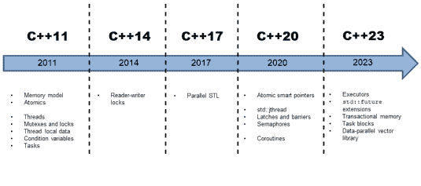

### C++ 中的并发

粗略地说，你可以将 C++ 的并发发展历程分为三个演进步骤。

### 1.1 C++11 和 C++14：基础

C++11 引入了多线程。多线程支持由*定义良好*的内存模型和标准化的线程接口组成。C++14 为 C++ 的多线程设施添加了读写锁。

#### 1.1.1 内存模型

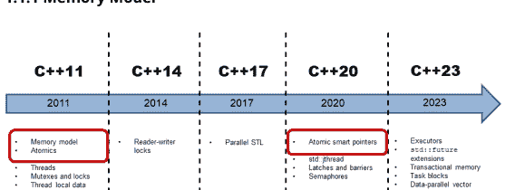

C++ 中的内存模型

多线程的基础是*定义良好*的内存模型。该内存模型必须处理以下方面：

- 原子操作：不中断执行的操作。
- 操作的部分顺序：不得重新排序的操作序列。
- 操作可见效果：保证对共享变量的操作何时在其他线程中可见。

C++ 内存模型受其前身 Java 内存模型的启发。然而，与 Java 内存模型不同，C++ 允许我们打破顺序一致性的约束，而顺序一致性是原子操作的默认行为。

顺序一致性提供两项保证。

1. 程序的指令按源代码顺序执行。
2. 所有线程上的所有操作存在全局顺序。

内存模型基于对原子数据类型的原子操作（简称原子类型）。

##### 1.1.1.1 原子类型

C++ 有一组简单的原子数据类型。这些类型包括多种变体的布尔值、字符、数字和指针。你可以使用类模板 `std::atomic` 定义自己的原子数据类型。原子类型建立同步和顺序约束，这些约束也可以适用于非原子类型。

标准化的线程接口是 C++ 并发的核心。

#### 1.1.2 多线程

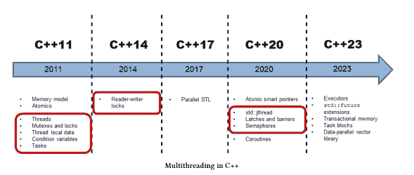

C++ 中的多线程由线程、用于共享数据的同步原语、线程局部数据和任务组成。

##### 1.1.2.1 线程

C++ 支持两种线程：基本线程 `std::thread`（C++11）和改进线程 `std::jthread`（C++20）。

###### 1.1.2.1.1 std::thread

`std::thread` 表示程序执行的独立单元。可执行单元会立即启动，并以可调用单元的形式接收其工作包。可调用单元可以是具名函数、函数对象或 lambda 函数。

线程的创建者负责其生命周期。新线程的可执行单元随着可调用单元的结束而结束。要么创建者等待所创建的线程完成（`t.join()`），要么创建者与所创建的线程分离：`t.detach()`。如果未对线程 `t` 执行 `t.join()` 或 `t.detach()` 操作，则该线程 `t` 是可汇合的。可汇合线程在其析构函数中调用 `std::terminate`，程序会终止。

与创建者分离的线程通常称为守护线程，因为它在后台运行。

`std::thread` 是可变参数模板。这意味着它可以接收任意数量的参数；可调用单元或线程都可以获得这些参数。

###### 1.1.2.1.2 `std::jthread` (C++20)

`std::jthread` 代表汇合线程（joining thread）。除了 C++11 的 `std::thread` 之外，`std::jthread` 会在其析构函数中自动汇合，并且可以被协作式中断。因此，`std::jthread` 扩展了 `std::thread` 的接口。

##### 1.1.2.2 共享数据

如果多个线程同时使用一个共享变量，并且该变量是可变的（非 const），则必须协调对该变量的访问。并发读写共享变量属于数据竞争，因此是未定义行为。在 C++ 中，通过互斥量和锁来实现对共享变量访问的协调。

###### 1.1.2.2.1 互斥量

互斥量（*mutual exclusion*，互斥）保证在任意给定时刻只有一个线程可以访问共享变量。互斥量会锁定和解锁共享变量所属的临界区。C++ 有五种不同的互斥量。它们可以递归锁定、尝试锁定，以及带或不带时间约束地锁定。互斥量甚至可以在同一时间共享一把锁。

###### 1.1.2.2.2 锁

你应将互斥量封装在锁中，以便自动释放互斥量。锁通过将互斥量的生命周期绑定到自身的生命周期来实现 RAII 惯用法。C++ 的 `std::lock_guard` / `std::scoped_lock` 用于简单用例，而 `std::unique_lock` / `std::shared_lock` 分别用于显式锁定或解锁互斥量等高级用例。

###### 1.1.2.2.3 数据的线程安全初始化

如果共享数据是只读的，以线程安全的方式初始化它就足够了。C++ 提供了多种方式来实现这一点，包括使用常量表达式、块作用域的静态变量，或将函数 `std::call_once` 与标志 `std::once_flag` 结合使用。

##### 1.1.2.3 线程局部数据

将变量声明为线程局部可确保每个线程获得自己的副本。因此，不存在共享变量。线程局部数据的生命周期绑定到其线程的生命周期。

##### 1.1.2.4 条件变量

条件变量使线程能够通过消息进行同步。一个线程充当发送者，而另一个线程充当消息的接收者。接收者阻塞等待来自发送者的消息。条件变量的典型用例是生产者-消费者工作流。条件变量可以是消息的发送者或接收者。正确使用条件变量相当具有挑战性；因此，任务通常是更简单的解决方案。

##### 1.1.2.5 协作式中断（C++20）

`std::jthread` 协作式中断的附加功能基于 `std::stop_source`、`std::stop_token` 和 `std::stop_callback` 类。`std::jthread` 和 `std::condition_variable_any` 在设计上支持协作式中断。

##### 1.1.2.6 信号量（C++20）

信号量是一种同步机制，用于控制对共享资源的并发访问。计数信号量是一种计数器大于零的信号量。计数器在构造函数中初始化。获取信号量会减少计数器，释放信号量会增加计数器。如果线程在计数器为零时尝试获取信号量，该线程将阻塞，直到另一个线程通过释放信号量来增加计数器。

##### 1.1.2.7 闩锁与屏障（C++20）

闩锁和屏障是协调类型，使一些线程能够阻塞，直到计数器变为零。计数器在构造函数中初始化。首先，不要将新的屏障与内存屏障（也称为栅栏）混淆。在 C++20 中，我们获得两种变体的闩锁和屏障：`std::latch` 和 `std::barrier`。并发调用 `std::latch` 或 `std::barrier` 的成员函数不会产生数据竞争。

##### 1.1.2.8 任务

任务与线程有很多共同之处。你会显式创建线程，而任务只是你启动的一项作业。C++ 运行时会自动处理任务的生命周期，例如在 `std::async` 的简单情况下。

任务就像两个通信端点之间的数据通道。它们使线程之间能够进行线程安全通信。promise 作为一端将数据放入数据通道，另一端的 future 则取出该值。数据可以是一个值、一个异常，或者仅仅是一个通知。除了 `std::async` 之外，C++ 还提供类模板 `std::promise` 和 `std::future`，让你对任务有更多控制。


#### 1.2.2 新算法

除了 69 个以重载版本形式提供、用于并行或并行和向量化执行的算法之外，我们还有 8 个额外的算法。这些新算法非常适合并行归约、扫描或变换范围。

### 1.3 协程

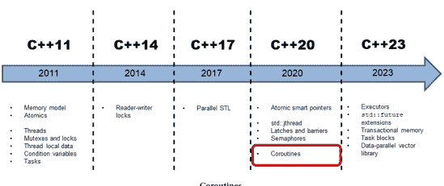

协程是可以在保持自身状态的同时暂停和恢复执行的函数。协程通常是在操作系统、事件循环、无限列表或管道中实现协作式多任务处理的首选方式。

### 1.4 案例研究

在介绍了内存模型和多线程接口的理论之后，我将这些理论应用于几个案例研究中。

#### 1.4.1 计算向量的和

计算向量的和可以通过多种方式完成。你可以顺序执行，也可以并发执行，并在最大和最小数据共享之间选择。性能数字差异巨大。

#### 1.4.2 安德烈·阿德里安：哲学家就餐问题

哲学家就餐问题是一个经典的同步问题，由艾兹格·迪杰斯特拉（Edsger Dijkstra）^2 在文章《顺序过程的层次排序》^3中提出。五位编号为0到4的哲学家住在一所房子里，餐桌已经为他们摆好，每位哲学家在桌边都有自己的位置。他们唯一的问题——除了哲学问题之外——是端上来的菜是一种非常难对付的意大利面，必须用两把叉子才能吃。每个盘子旁边都有两把叉子，所以这并不困难：然而，结果是，相邻的两个人不能同时进餐。

#### 1.4.3 单例的线程安全初始化

单例的线程安全初始化是共享变量线程安全初始化的典型案例。有很多方法可以实现，性能特征各不相同。

#### 1.4.4 使用 CppMem 进行持续优化

我从一个小程序开始，通过放宽内存序来逐步改进它。我使用 CppMem 验证持续优化过程中的每一步。CppMem^4 是一个交互式工具，用于探索使用 C++ 内存模型的小代码片段的行为。

#### 1.4.5 线程的快速同步

在 C++20 中，同步线程的方法有很多。你可以使用条件变量、`std::atomic_flag`、`std::atomic<bool>` 或信号量。我讨论了各种乒乓游戏的性能数字。

### 1.5 Future 的变体

得益于新的关键字 `co_return`，我可以在“Future 的变体”这个案例研究中实现急切 future、惰性 future 或在单独线程中运行的 future。大量使用的概念使其工作流程一目了然。

### 1.6 生成器的修改与泛化

`co_yield` 使其能够创建无限数据流。在“生成器的修改与泛化”案例研究中，无限数据流变成了有限且通用的数据流。

^2 https://en.wikipedia.org/wiki/Edsger_W._Dijkstra
^3 https://www.cs.utexas.edu/users/EWD/transcriptions/EWD03xx/EWD310.html
^4 http://svr-pes20-cppmem.cl.cam.ac.uk/cppmem/

#### 1.8.3 事务性内存

事务性内存基于数据库理论中事务背后的思想。事务是一种提供 ACID 数据库事务前三个特性的操作：原子性（Atomicity）、一致性（Consistency）和隔离性（Isolation）。数据库所特有的持久性（Durability）并不适用于 C++ 中提出的事务性内存。新标准提供两种形式的事务性内存：同步块（synchronized blocks）和原子块（atomic blocks）。两者都按全序执行，行为表现如同有一个全局锁保护它们。与同步块相反，原子块不能执行非事务安全的代码。

#### 1.8.4 任务块

任务块在 C++ 中实现了 fork-join 范式。下图说明了任务块的关键思想：你有一个分叉（fork）阶段，在该阶段启动任务；还有一个汇合（join）阶段，在该阶段同步这些任务。

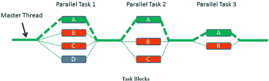

#### 1.8.5 数据并行向量库

数据并行向量库通过向量类型提供数据并行（SIMD）编程。SIMD 意味着一条操作可以并行地对许多数据执行。

### 1.9 模式与最佳实践

模式是来自顶尖专家的、被记录下来的最佳实践。它们“……表达了特定上下文、问题和解决方案之间的关系。”——克里斯托弗·亚历山大（Christopher Alexander）⁷。从更概念化的角度思考并发编程的挑战会带来许多好处。与更常规的并发模式相比，关于最佳实践的章节提供了克服并发挑战的实用技巧。

⁷ https://en.wikipedia.org/wiki/Christopher_Alexander

#### 1.9.1 同步

数据竞争的必要前提是共享的可变状态。同步模式归结为两个关注点：处理共享和处理变更。

#### 1.9.2 并发架构

关于并发架构的章节介绍了五种模式。Active Object 和 Monitor Object 这两种模式对成员函数的调用进行同步和调度。第三种模式 Half-Sync/Half-Async 侧重于架构，在并发系统中将异步和同步服务处理解耦。Reactor 模式和 Proactor 模式可以被视为 Half-Sync/Half-Async 模式的变体。这两种模式使事件驱动应用程序能够解复用并分发服务请求。Reactor 同步地执行其工作，而 Proactor 则异步地执行。

#### 1.9.3 最佳实践

并发编程本身就非常复杂，因此拥有通用的最佳实践，以及针对多线程和内存模型的最佳实践，是非常有意义的。

### 1.10 数据结构

能够保护自身从而不会出现数据竞争的数据结构称为线程安全的数据结构。关于基于锁的数据结构的章节介绍了设计这些基于锁的数据结构所面临的挑战。

### 1.11 挑战

编写并发程序本身就非常复杂。如果你只使用 C++11 和 C++14 的特性，情况尤其如此。因此，我详细描述了最具挑战性的问题。我希望，如果我专门用一整章来讲述并发编程的挑战，你会更加意识到这些陷阱。我写到了诸如竞争条件、数据竞争和死锁等挑战。

### 1.12 时间库

时间库是 C++ 并发设施的关键组成部分。通常，你会让一个线程休眠特定的时间长度，或直到某个特定的时间点。时间库由以下部分组成：时间点、时间间隔和时钟。

### 1.13 CppMem

CppMem 是一个用于深入了解内存模型的交互式工具。它提供了两项宝贵的服务。首先，你可以验证无锁代码；其次，你可以分析无锁代码，从而对自己的代码有更深刻的理解。在本书中，我经常使用 CppMem。由于 CppMem 的配置选项和洞察分析相当具有挑战性，本章将帮助你建立对 CppMem 的基本理解。

### 1.14 术语表

术语表包含对基本术语的非详尽解释。

## 细节

## 2. 内存模型


多线程的基础是*定义良好*的内存模型。从读者的角度来看，它包含两个方面。一方面，它极其复杂，常常与我们的直觉相悖。另一方面，它大大有助于更深入地理解多线程挑战。

然而，首先，什么是内存模型？

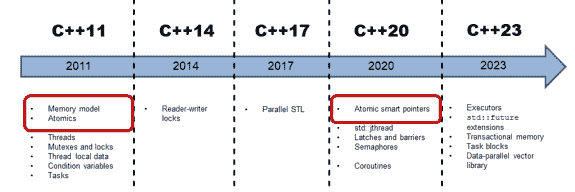

C++ 中的内存模型

### 2.1 内存模型基础

从并发的角度来看，内存模型有两个主要方面：

- 什么是内存位置？
- 如果两个线程访问同一内存位置会发生什么？

让我来回答这两个问题。

#### 2.1.1 什么是内存位置？

根据 cppreference.com¹，内存位置是：

- 标量类型的对象（算术类型、指针类型、枚举类型或 std::nullptr_t），
- 或长度非零的最大连续位域序列。

以下是一个内存位置的示例：

¹http://en.cppreference.com/w/cpp/language/memory_model


```cpp
struct S {
    char a;             // memory location #1
    int b : 5;          // memory location #2
    int c : 11,         // memory location #2 (continued)
          : 0,
          d : 8;        // memory location #3
    int e;              // memory location #4
    double f;           // memory location #5
    std::string g;      // several memory locations
};
```

首先，对象 obj 由七个子对象组成，两个位域 b 和 c 共享同一内存位置。

以下是一些重要观察：

- 每个变量都是一个对象。
- 标量类型占用一个内存位置。
- 相邻位域（b 和 c）具有相同的内存位置。
- 变量至少占用一个内存位置。

现在，进入多线程的关键部分。

#### 2.1.2 如果两个线程访问同一内存位置会发生什么？

如果两个线程访问同一内存位置——相邻位域可以共享同一内存位置——并且至少有一个线程想要修改它，那么除非满足以下条件，否则你的程序存在数据竞争：

- 1. 该内存位置由原子操作修改。
- 2. 一次访问先行发生于另一次访问。

第二种情况相当有趣，因为诸如互斥锁之类的同步原语会建立先行发生关系。这些先行发生关系基于对原子类型的操作，并且通常也适用于对非原子类型的操作。内存序定义了导致先行发生关系的细节，因此是内存模型的一个基本组成部分。

这是我对内存模型的第一次正式接触。现在，我想给你一个关于内存模型的心智模型。C++ 内存模型定义了一份契约。

### 2.2 契约

这份契约存在于程序员与系统之间。系统由生成机器码的编译器、执行机器码的处理器以及存储程序状态的各种缓存组成。每个参与者都想优化自己的部分。例如，编译器使用寄存器或修改循环；处理器执行乱序执行或分支预测；缓存会预取指令或缓冲值。结果是——在正确的情况下——一个定义良好、针对硬件平台充分优化的可执行程序。准确地说，不只有一份契约，而是一组细粒度的契约。或者换种说法：程序员必须遵循的规则越弱，系统生成高度优化可执行程序的潜力就越大。

有一条经验法则。契约越强，系统生成优化可执行程序的自由度就越小。遗憾的是，反过来并不成立。当程序员使用极其弱的契约或内存模型时，会有许多优化选择。其后果是，程序只能由全球公认的少数专家管理，而你和我很可能都不属于其中。

粗略地说，C++11 中有三个契约级别。

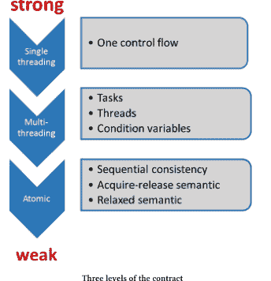

契约的三个级别

在 C++11 之前，只有一份契约。C++ 语言规范没有包含多线程或原子类型。系统只知道一个控制流，因此优化可执行程序的机会很有限。系统的关键点是向程序员保证：程序的可观察行为与源代码中的指令顺序相对应。当然，这意味着当时没有内存模型。取而代之的是序列点的概念。序列点是程序中的一些点，在到达这些点时，其之前所有指令的效果都必须可观察。函数执行的开始或结束都是序列点。当你调用带有两个实参的函数时，C++ 标准不保证哪个实参先求值，因此该行为是未指定的。原因很直接——逗号运算符不是序列点，这一点在 C++ 中也没有改变。

到了 C++11，一切都变了。C++11 是第一个能感知多线程的标准。线程行为之所以定义良好，原因在于 C++ 内存模型，它深受 Java 内存模型[^2]的启发。不过，C++ 内存模型一如既往地更进一步。程序员在处理共享变量时必须遵守一些规则，才能得到定义良好的程序。只要存在至少一个数据竞争，程序就是未定义的。正如我已经提到的，如果线程共享可变数据，你就必须注意数据竞争。任务比线程或条件变量容易使用得多。

有了原子类型，我们就进入了专家的领域。我们越是削弱 C++ 内存模型，这一点就越明显。使用原子类型时，我们经常谈论无锁编程。我在本小节中谈到了弱规则和强规则。确实，顺序一致性被称为强内存模型，而宽松语义被称为弱内存模型。

#### 2.2.1 基础

C++ 内存模型必须处理以下几点：

- 原子操作：可以不间断执行的操作。
- 操作的部分排序：不得重新排序的操作序列。
- 操作的可见效果：保证对共享变量的操作何时对其他线程可见。

契约的基础是对原子类型的操作，这些操作有两个特征：按定义它们是原子的或不可分割的，并且它们会为程序执行创建同步和顺序约束。这些同步和顺序约束也适用于对非原子类型的操作。一方面，对原子类型的操作始终是原子的；但另一方面，你可以根据自己的需要定制同步和顺序约束。

#### 2.2.2 挑战

我们越是削弱内存模型，就越会把注意力转向其他方面，例如：

- 程序有更大的优化潜力。
- 程序可能的控制流数量呈指数增长。
- 我们进入了专家的领域。
- 程序违背我们的直觉。
- 我们进行微优化。

要处理多线程，我们应当成为专家。如果我们想处理原子类型（顺序一致性），就应当打开通往下一级专业知识的大门。当我们谈论获取-释放语义或宽松语义时，会发生什么？我们会再上升一步（或深入一步），进入下一个专业等级。

## 专家等级

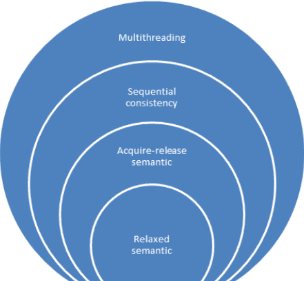

专家等级

现在，我们更深入地探讨 C++ 内存模型，并从无锁编程开始。在这段旅程中，我会介绍原子类型及其操作。完成基础内容后，接着会介绍内存模型的不同级别。起点是直观的顺序一致性，接着是获取-释放语义，而终点则是并不那么直观的宽松语义。

让我们从原子类型开始。

### 2.3 原子类型

原子类型是 C++ 内存模型的基础。默认情况下，强版本内存模型应用于原子类型；因此，理解强内存模型的特性非常有意义。

#### 2.3.1 强内存模型与弱内存模型

你可能已经从“契约：挑战”小节中了解到，强内存模型指的是顺序一致性，弱内存模型指的是宽松语义。

##### 2.3.1.1 强内存模型

Java 5.0 在 2004 年获得了当前的内存模型，C++ 则是在 2011 年。在此之前，Java 的内存模型是错误的，而 C++ 没有内存模型。那些认为这是漫长过程终点的人完全错了。多线程编程的基础已有 40 到 50 年历史。Leslie Lamport[^1] 在 1979 年定义了顺序一致性的概念。

顺序一致性提供两项保证：

- 程序中的指令按写下的顺序执行。
- 所有线程上的所有操作存在一个全局顺序。

在深入讨论这两项保证之前，我想明确强调，这两项保证只对原子类型成立，但会影响非原子类型。

下图展示了两个线程。每个线程分别存储自己的变量 x 或 y，加载另一个变量 y 或 x，并将它们存储到变量 res1 或 res2 中。

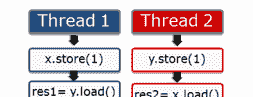

由于这些变量是原子的，操作会以原子方式执行。默认情况下，适用顺序一致性。问题是：这些语句可以按什么顺序执行？

顺序一致性的第一项保证是，指令按源代码中定义的顺序执行。这很简单。任何存储操作都不能越过加载操作。

[^1]: https://en.wikipedia.org/wiki/Leslie_Lamport
[^2]: https://en.wikipedia.org/wiki/Java_memory_model


顺序一致性的第二个保证是，所有线程的指令都必须遵循一个全局顺序。在上文列出的情况中，这意味着线程 2 看到线程 1 的操作顺序与线程 1 执行这些操作的顺序相同。这是关键观察。线程 2 按线程 1 的源代码顺序看到线程 1 的所有操作。从线程 1 的角度看也是如此。你可以将特性二视为所有线程都必须遵守的全局时钟。全局时钟就是全局顺序。时钟每滴答一次，就发生一个原子操作，但你永远不知道是哪一个。

我们的谜题还没有结束。我们仍然需要查看两个线程的不同交错执行。因此，两个线程的以下六种交错是可能的。

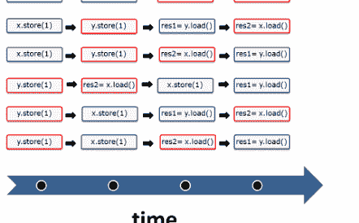

两个线程的六种交错执行

这很简单，对吧？这就是顺序一致性，也称为强内存模型。

##### 2.3.1.2 弱内存模型

让我们再次参考程序员与系统之间的契约。

在这个特定示例中，程序员使用了原子操作。他遵守了契约中属于自己的那部分。系统保证在没有数据竞争的情况下具有*定义明确的*程序行为。除此之外，系统还可以按每种组合执行这四种操作。如果程序员使用宽松语义，契约的支柱就会发生巨大变化。一方面，程序员更难理解两个线程可能出现的交错执行。另一方面，系统拥有多得多的优化可能性。

使用宽松语义——也称为弱内存模型——四种操作的可能组合要多得多。*反直觉*的行为是，线程 1 可能以不同顺序看到线程 2 的操作，因此不存在全局时钟的视角。从线程 1 的角度看，操作 `res2 = x.load()` 可能先于 `y.store(1)` 执行。甚至线程 1 或线程 2 可能不按源代码定义的顺序执行它们的操作。例如，线程 2 可以先执行 `res2 = x.load()`，然后执行 `y.store(1)`。

在顺序一致性和宽松语义之间还有几种模型。最重要的是获取-释放语义。使用获取-释放语义时，程序员必须遵守比顺序一致性更弱的规则。相反，系统拥有更多优化可能性。获取-释放语义是更深入理解多线程编程中同步与偏序的关键。线程在代码中的特定同步点进行同步。没有这些同步点，线程、任务或条件变量就不可能有*定义明确的*行为。

在上一节中，我将顺序一致性介绍为原子操作的默认行为。这意味着什么？你可以为每个原子操作指定内存序。如果未指定内存序，则应用顺序一致性，这意味着标志 `std::memory_order_seq_cst` 会被隐式应用于原子类型上的每个操作。

下面这段代码

```cpp
x.store(1);
res = x.load();
```

等价于下面这段代码：

```cpp
x.store(1, std::memory_order_seq_cst);
res = x.load(std::memory_order_seq_cst);
```

为简单起见，本书使用第一种形式。现在该更深入地探讨 C++ 内存模型中的原子操作了。我们从基础的 `std::atomic_flag` 开始。

#### 2.3.2 原子标志

`std::atomic_flag` 是一个原子布尔值。它有一个清除状态和一个设置状态。为简单起见，我将清除状态称为 false，将设置状态称为 true。它的 clear 成员函数使你能够将其值设置为 false。使用 `test_and_set` 成员函数，你可以将值重新设置为 true，并返回先前的值。没有用于查询当前值的成员函数。这一点将在 C++20 中改变。在 C++20 中，`std::atomic_flag` 有一个 test 成员函数，并且可以通过成员函数 `notify_one`、`notify_all` 和 `wait` 用于线程同步。

### `std::atomic_flag` 的所有操作

| 成员函数 | 描述 |
| --- | --- |
| `atomic_flag.clear()` | 清除原子标志。 |
| `atomic_flag.test_and_set()` | 设置原子标志并返回旧值。 |
| `atomic_flag.test()` (C++20) | 返回标志的值。 |
| `atomic_flag.notify_one()` (C++20) | 通知一个正在等待该原子标志的线程。 |
| `atomic_flag.notify_all()` (C++20) | 通知所有正在等待该原子标志的线程。 |
| `atomic_flag.wait(bool)` (C++20) | 阻塞线程，直到收到通知且原子值发生变化。 |

调用 `atomic_flag.test()` 会返回 `atomic_flag` 的值而不改变它。此外，你可以使用 `std::atomic_flag` 进行线程同步：`atomic_flag.wait()`、`atomic_flag.notify_one()` 和 `atomic_flag.notify_all()`。成员函数 `notify_one` 或 `notify_all` 会通知一个或所有正在等待的原子标志。`atomic_flag.wait(bool)` 需要一个布尔值 `bool`。调用 `atomic_flag.wait(bool)` 会阻塞，直到下一次通知或虚假唤醒。然后它会检查 `atomic_flag` 的值是否等于 `bool`，如果不相等则解除阻塞。值 `bool` 作为谓词，用于防止虚假唤醒。与 C++11 相比，C++20 中的默认构造会将 `std::atomic_flag` 置于 false 状态。


### C++11 中 `std::atomic_flag` 的初始化

在 C++11 中，`std::atomic_flag` 标志必须使用语句 `std::atomic_flag flag = ATOMIC_FLAG_INIT` 进行初始化。其他初始化上下文，例如 `std::atomic_flag flag(ATOMIC_FLAG_INIT)`，是未指定的。

`std::atomic_flag` 有两个突出特性。

`std::atomic_flag` 是

- 唯一的无锁原子类型。如果保证系统范围的进展，则非阻塞算法是无锁的。
- 更高层线程抽象的构建块。

唯一的无锁原子类型？根据 C++ 标准，其余更强大的原子类型可以在内部使用互斥量来提供其功能。这些其余的原子类型有一个名为 `is_lock_free` 的成员函数，用于检查该原子类型是否在内部使用互斥量。在流行的微处理器架构上，我总是得到答案 `true`。如果你希望编写无锁程序，应当注意这一点，并在目标系统上进行检查。


**地址无关** 无锁的原子操作也应当是地址无关的。地址无关意味着不同进程对同一内存位置执行的原子操作是原子的。

```cpp
    13
    14    void unlock(){
    15        flag.clear();
    16    }
    17
    18 };
    19
    20 Spinlock spin;
    21
    22 void workOnResource(){
    23    spin.lock();
    24    // shared resource
    25    spin.unlock();
    26 }
    27
    28
    29 int main(){
    30
    31    std::thread t(workOnResource);
    32    std::thread t2(workOnResource);
    33
    34    t.join();
    35    t2.join();
    36
    37 }
```

线程 `t` 和 `t2`（第 31 行和第 32 行）都在竞争临界区。为简单起见，第 24 行的临界区只包含一条注释。它是如何工作的？类 `Spinlock` 的接口与互斥量类似——都有成员函数 `lock` 和 `unlock`。除此之外，`std::atomic_flag` 通过类成员初始化被初始化为 `false`（第 7 行）。

如果线程 `t` 将要执行函数 `workOnResource`，则可能发生以下场景。

- 1. 线程 `t` 获得锁，因为调用 lock 成功。如果第 11 行中标志的初始值为 `false`，则调用 lock 成功。在这种情况下，线程 `t` 在一次原子操作中将其设置为 `true`。值 `true` 就是线程 `t2` 尝试获取锁时 while 循环返回的值。因此线程 `t2` 陷入了这种激烈竞争之中。线程 `t2` 无法将标志的值设置为 `false`，所以 `t2` 必须等待线程 `t` 执行 `unlock` 成员函数并将标志设置为 `false`（第 14–16 行）。
- 2. 线程 `t` 没有获得锁。于是我们处于角色互换的场景 1 中。

我希望你将注意力集中在 `std::atomic_flag` 的成员函数 `test_and_set` 上。成员函数 `test_and_set` 由两个操作组成：读取和写入。这两个操作必须在一次原子操作中完成。否则，我们就会在共享资源（第 24 行）上进行一次读取和一次写入。根据定义，这就是数据竞争，程序会产生未定义行为。

将自旋锁的主动等待与互斥量的被动等待进行比较，是件令人兴奋的事。


###### 2.3.2.1.1 自旋锁与互斥锁

如果函数 workOnResource 将自旋锁锁定 2 秒（第 23 - 25 行），CPU 负载会发生什么？

### 使用自旋锁等待

```cpp
// spinlockSleep.cpp

#include <atomic>
#include <thread>

class Spinlock{
  std::atomic_flag flag = ATOMIC_FLAG_INIT;
public:

  void lock(){
    while( flag.test_and_set() );
  }

  void unlock(){
    flag.clear();
  }

};

Spinlock spin;

void workOnResource(){
  spin.lock();
  std::this_thread::sleep_for(std::chrono::milliseconds(2000));
  spin.unlock();
}


int main(){

  std::thread t(workOnResource);
  std::thread t2(workOnResource);

  t.join();
  t2.join();

}
```

如果理论正确，我的 PC 四个核心中的一个会被完全占用。实际情况正是如此。

看看截图。

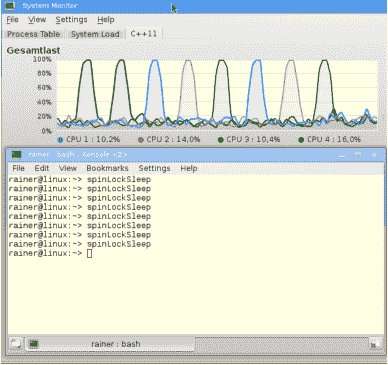

一个休眠两秒的自旋锁

截图很好地显示，在我的 PC 上，一个核心的负载达到 100%。每次都是不同的核心执行忙等待。

现在我用互斥锁代替自旋锁。看看会发生什么。

### 使用互斥锁等待

```cpp
// mutex.cpp

#include <mutex>
#include <thread>

std::mutex mut;

void workOnResource(){
  mut.lock();
  std::this_thread::sleep_for(std::chrono::milliseconds(5000));
  mut.unlock();
}

14 int main(){
15 
16     std::thread t(workOnResource);
17     std::thread t2(workOnResource);
18 
19     t.join();
20     t2.join();
21 
22 }
```

尽管我多次执行该程序，我并未观察到任何核心上有明显负载。

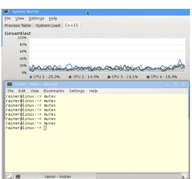

一个休眠两秒的互斥锁

得益于 std::atomic_flag，线程同步既直接又快速。

##### 2.3.2.2 线程同步

对于指针 `std::atomic<T>*`，以及从 C++20 起对于智能指针 `std::atomic<smart T*>`，对于整型 `std::atomic<integral type>` 的完全特化，以及从 C++20 起对于浮点类型 `std::atomic<floating-point>`。

原子布尔类型、原子用户自定义类型和原子智能指针支持相同的接口。我称之为基本原子接口。原子指针扩展了基本原子接口。原子算术类型同样如此：原子浮点类型扩展了原子指针的接口，原子整型扩展了原子浮点类型的接口。

`std::atomic` 各种变体的缺点是，你无法保证它们是无锁的。在下一小节中，我将根据接口介绍各种原子类型。粗略地说，有四个小节。让我从原子布尔类型、原子用户自定义类型和原子智能指针（C++20）开始。

##### 2.3.3.1 基本原子接口

三个偏特化 `std::atomic<bool>`、`std::atomic<user-defined type>` 和 `std::atomic<smart T*>` 支持基本原子接口。

| 成员函数 | 描述 |
| :--- | :--- |
| is_lock_free | 检查原子对象是否无锁。 |
| atomic_ref<T>::is_always_lock_free | 在编译时检查原子类型是否始终无锁。 |
| load | 原子地返回原子对象的值。 |
| operator T | 原子地返回原子对象的值。等价于 atom.load()。 |
| store | 原子地将原子对象的值替换为非原子值。 |
| exchange | 原子地将值替换为新值。返回旧值。 |
| compare_exchange_strong | 原子地比较并最终交换值。详情在此。 |
| compare_exchange_weak | |
| notify_one (C++20) | 通知一个原子等待操作。 |
| notify_all (C++20) | 通知所有原子等待操作。 |
| wait (C++20) | 阻塞直到被通知。将自身与旧值比较，以防止虚假唤醒和丢失唤醒。如果旧值比较不相等，则返回。 |

###### 2.3.3.1.1 std::atomic<bool>

std::atomic<bool> 比 std::atomic_flag 提供更多功能。它可以显式地设置为 true 或 false。


**atomic 不是 volatile**

C# 和 Java 中的关键字 volatile 与 C++ 中的关键字 volatile 有什么共同点？没有！这就是 volatile 与 std::atomic 的区别。

- volatile：用于特殊对象，不允许对其进行优化的读或写操作。
- std::atomic：定义原子变量，用于线程安全的读写。

混淆从这里开始。Java 和 C# 中的关键字 volatile 具有 C++ 中 std::atomic 的含义。反之，volatile 在 C++ 中没有多线程语义。volatile 通常用于嵌入式编程，表示可以独立于常规程序流而变化的对象。一个例子是表示外部设备的对象（内存映射 I/O）。由于这些对象可以独立于常规程序流变化，并且它们的值直接写入主内存，因此不会发生缓存中的优化存储。

std::atomic<bool> 已足以同步两个线程，因此我可以用 std::atomic<bool> 实现一种条件变量。

###### 2.3.3.1.2 模拟条件变量

让我们先使用条件变量来同步两个线程。

**条件变量的用法**

```cpp
// conditionVariable.cpp

#include <condition_variable>
#include <iostream>
#include <thread>
#include <vector>

std::vector<int> mySharedWork;
std::mutex mutex_;
std::condition_variable condVar;

bool dataReady{false};

void waitingForWork(){
15    std::cout << "Waiting " << '\n';
16    std::unique_lock<std::mutex> lck(mutex_);
17    condVar.wait(lck, []{ return dataReady; });
18    mySharedWork[1] = 2;
19    std::cout << "Work done " << '\n';
20  }
21
22  void setDataReady(){
23    mySharedWork = {1, 0, 3};
24    {
25      std::lock_guard<std::mutex> lck(mutex_);
26      dataReady = true;
27    }
28    std::cout << "Data prepared" << '\n';
29    condVar.notify_one();
30  }
31
32  int main(){
33
34    std::cout << '\n';
35
36    std::thread t1(waitingForWork);
37    std::thread t2(setDataReady);
38
39    t1.join();
40    t2.join();
41
42    for (auto v: mySharedWork){
43      std::cout << v << " ";
44    }
45
46
47    std::cout << "\n\n";
48
49  }
```

让我对程序说几句。要深入讨论条件变量，请阅读本书中条件变量一章。

线程 t1 在第 17 行等待线程 t2 的通知。两个线程使用同一个条件变量 `condVar`，并在同一个互斥量 `mutex_` 上同步。工作流程如何运行？

- 线程 t2
  - 准备工作包 mySharedWork = {1, 0, 3}

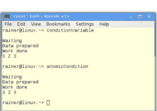

使用原子变量和条件变量对两个线程进行同步

## 推与拉原则

我作弊了一点。用条件变量同步线程与用 `std::atomic<bool>` 同步线程之间有一个关键区别。条件变量通知等待线程（`condVar.notify()`）它应该继续工作。使用 `std::atomic<bool>` 的等待线程检查发送方是否完成其工作（`dataReady == true`）。

条件变量通知等待线程（推原则），而原子布尔值反复询问该值（拉原则）。

`std::atomic<bool>` 以及 `std::atomic` 的其他完全或偏特化支持所有原子操作的基本功能：`compare_exchange_strong` 和 `compare_exchange_weak`。

###### 2.3.3.1.3 `compare_exchange_strong` 和 `compare_exchange_weak`

`compare_exchange_strong` 的语法是：`bool compare_exchange_strong(T& expected, T& desired)`。由于该操作在一个原子操作中比较并交换其值，因此通常称为比较并交换（CAS）。这种操作在许多编程语言中可用，并且是非阻塞算法的基础。当然，行为可能略有不同。`atomicValue.compare_exchange_strong(expected, desired)` 的行为如下。

- 如果 `atomicValue` 与 `expected` 的原子比较返回 true，则在同一原子操作中将 `atomicValue` 设置为 `desired`。
- 如果比较返回 false，则将 `expected` 设置为 `atomicValue`。

操作 `compare_exchange_strong` 被称为强的原因很明显。还有一个成员函数 `compare_exchange_weak`。弱版本可能会虚假失败。这意味着，尽管 `atomicValue == expected` 成立，但 `atomicValue` 没有被设置为 `desired`，并且函数调用返回


```cpp
for (auto i: myVec) std::cout << i << " ";
std::cout << '\n';

}

int main() {

    std::cout << '\n';

    std::thread t1(prepareWork);
    std::thread t2(completeWork);

    t1.join();
    t2.join();

    std::cout << '\n';

}
```

如果 `atomicBool == false` 成立，则调用 `atomicBool.wait(false)` 会阻塞。因此，调用 `atomicBool.store(true)`（第 16 行）会将 `atomicBool` 设置为 true，随后发送其通知。

根据 `std::atomic_flag`，以下是使用 Microsoft 编译器的四次运行。

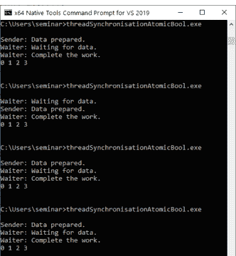

使用 `std::atomic<bool>` 的线程同步

除了布尔类型之外，还有用于指针、整数和用户定义类型的原子类型。用户定义类型的规则很独特。

所有 `std::atomic` 变体都支持 CAS 操作。

###### 2.3.3.1.5 用户定义原子类型 `std::atomic<user-defined type>`

得益于类模板 `std::atomic`，你可以定义自己的用户定义原子类型。

如果将用户定义类型用于原子类型 `std::atomic<user-defined type>`，那么对该类型有许多严格限制。原子类型 `std::atomic<user-defined type>` 支持与 `std::atomic<bool>` 相同的接口。

以下是用户定义类型成为原子类型所需满足的限制：

- 用户定义类型及其所有基类和所有非静态成员的拷贝赋值运算符必须是平凡的。这意味着你不能定义拷贝赋值运算符，但可以使用 `default`^1 向编译器请求它。
- 用户定义类型不得有虚成员函数或虚基类
- 用户定义类型必须可按位比较，以便可以应用 C 函数 `memcpy`⁶ 或 `memcmp`⁷

^1 http://en.cppreference.com/w/cpp/keyword/default

如果用户定义类型的大小不大于 int 的大小，大多数流行平台都可以为 `std::atomic<user-defined type>` 使用原子操作。


### 在编译时检查类型属性

用户定义类型的类型属性可以在编译时通过以下函数检查：`std::is_trivially_copy_constructible`、`std::is_polymorphic` 和 `std::is_trivial`。所有这些函数都是非常强大的类型特征库⁴的一部分。

###### 2.3.3.1.6 原子智能指针 `std::atomic<smart T*>`（C++20）

一个 `std::shared_ptr` 由控制块及其资源组成。控制块是线程安全的，但对资源的访问不是。这意味着修改引用计数器是一个原子操作，并且你可以保证资源恰好被删除一次。这些就是 `std::shared_ptr` 为你提供的保证。

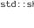

### 线程安全的重要性

我想稍微绕个弯，强调 `std::shared_ptr` 具有明确定义的多线程语义是多么重要。乍一看，在多线程代码中使用 `std::shared_ptr` 似乎并不是一个明智的选择。根据定义，它是共享且可变的，是非同步读写操作的理想候选，因此也是未定义行为的理想候选。另一方面，现代 C++ 中有一条准则：**不要使用裸指针。** 因此，这意味着你应该在多线程程序中使用智能指针。

针对原子智能指针的提案 N4162⁸ 直接解决了当前实现的缺陷。这些缺陷归结为三点：一致性、正确性和性能。

- **一致性：** 针对 `std::shared_ptr` 的原子操作是唯一针对非原子数据类型的原子操作。
- **正确性：** 全局原子操作的使用很容易出错，因为正确用法依赖于纪律。很容易忘记使用原子操作——例如使用 `ptr = localPtr` 而不是 `std::atomic_store(&ptr, localPtr)`。由于数据竞争，结果是未定义行为。如果我们改用原子智能指针，类型系统将不允许这样做。
- **性能：** 与自由 `atomic_*` 函数相比，原子智能指针具有很大优势。原子版本是为特殊用例设计的，并且内部可以有一个 `std::atomic_flag` 作为一种廉价的[自旋锁](https://en.wikipedia.org/wiki/Spinlock)。将指针函数的非原子版本设计为线程安全，在单线程场景中使用它们时会显得过度设计。它们会有性能损失。

正确性论据可能是最重要的一个。为什么？答案就在提案中。该提案提出了一种线程安全的单向链表，支持元素的插入、删除和搜索。这个单向链表以无锁方式实现。

###### 2.3.3.1.7 线程安全的单向链表

```cpp
template<typename T> class concurrent_stack {
    struct Node { T data; shared_ptr<Node> next; };
    atomic_shared_ptr<Node> head;
    // The atomic shared pointer is used to ensure that the special
    // functions every time you touch the variable
    concurrent_stack() { }
public:
    concurrent_stack() = default;
    ~concurrent_stack() = default;
    class reference {
        shared_ptr<Node> p;
    public:
        reference(shared_ptr<Node> p) : p(p) { }
        T& operator*() { return p->data; }
        T* operator->() { return &p->data; }
    };

    auto find(T const& t) {
        auto p = head.load();  // in C++11: atomic_load(&head)
        while (p && p->next != t) {
            p = p->next;
        }
        return reference(move(p));
    }

    auto front() const {
        return reference(head);  // in C++11: atomic_load(&head)
    }

    void push_front(T const& t) {
        auto p = make_shared<Node>(t);
        p->next = head;         // in C++11: atomic_load(&head)
        while (!head.compare_exchange_weak(p, p->next)) { }
        // in C++11: atomic_compare_exchange_weak(&head, &p, p->next);
    }

    void pop_front() {
        auto p = head.load();
        while (p && !head.compare_exchange_weak(p, p->next)) { }
        // in C++11: atomic_compare_exchange_weak(&head, &p, p->next);
    }
};
```

线程安全的单向链表

¹⁰https://en.wikipedia.org/wiki/Spinlock

使用 C++11 编译器编译该程序所需的所有更改都用红色标记。使用原子智能指针的实现要容易得多，因此也更不容易出错。C++20 的类型系统不允许在原子智能指针上使用非原子操作。

提案 N4162¹ 提出了新类型 `std::atomic_shared_ptr` 和 `std::atomic_weak_ptr` 作为原子智能指针。通过将它们合并到主线 ISO C++ 标准中，它们成为 `std::atomic` 的部分模板特化，即 `std::atomic<std::shared_ptr<T>>` 和 `std::atomic<std::weak_ptr<T>>`。

因此，针对 `std::shared_ptr` 的原子操作在 C++20 中已被弃用。

以下程序展示了五个线程在没有同步的情况下修改一个 `std::atomic<std::shared_ptr<std::string>>`。

```cpp
// atomicSharedPtr.cpp

#include <iostream>
#include <memory>
#include <atomic>
#include <string>
#include <thread>

int main() {

    std::cout << '\n';

    std::atomic<std::shared_ptr<std::string>> sharString(
        std::make_shared<std::string>("Zero"));

    std::thread t1([&sharString] {
        sharString.store(std::make_shared<std::string>(*sharString.load() + "One"));
    });
    std::thread t2([&sharString] {
        sharString.store(std::make_shared<std::string>(*sharString.load() + "Two"));
    });
    std::thread t3([&sharString] {
        sharString.store(std::make_shared<std::string>(*sharString.load() + "Three"));
    });
    std::thread t4([&sharString] {
        sharString.store(std::make_shared<std::string>(*sharString.load() + "Four"));
    });
    std::thread t5([&sharString] {
        sharString.store(std::make_shared<std::string>(*sharString.load() + "Five"));
    });
```

1) http://wg21.link/n4162


对 `std::atomic<floating-point type>` 的附加操作

| 成员函数 | 描述 |
|---|---|
| ++, -- | 对原子对象进行递增或递减（前置递增和后置递增）。 |

看一下这个简短示例。

```cpp
int intArray[5];
std::atomic<int*> p(intArray);
p++;
assert(p.load() == &intArray[1]);
p+=1;
assert(p.load() == &intArray[2]);
--p;
assert(p.load() == &intArray[1]);
```

在 C++11 中，为整型数据类型提供了原子类型。

##### 2.3.3.4 `std::atomic<integral type>`

对于每种整型，都有一个 `std::atomic` 的完全特化 `std::atomic<integral type>`。`std::atomic<integral type>` 支持 `std::atomic<T*>` 或 `std::atomic<floating-point type>` 所支持的所有操作。此外，`std::atomic<integral type>` 还支持按位逻辑运算符 AND、OR 和 XOR。

原子对象上的所有操作

| 成员函数 | 描述 |
|---|---|
| fetch_or, \|= | 以原子方式与该值执行按位（AND、OR 和 XOR）运算。 |
| fetch_and, &=<br>fetch_xor, ^= | 返回旧值。 |

复合按位赋值操作与 fetch 版本之间有一个小差别。复合按位赋值操作返回新值；fetch 变体返回旧值。

更深入的观察可提供更多见解：没有可用的原子乘法、原子除法，也没有原子移位操作。这并不是一个显著的限制，因为这些操作很少需要，并且很容易实现。下面是一个原子 `fetch_mul` 函数的示例。

`std::atomic<bool>` 和 `std::atomic<integral type>` 的类型别名

| 类型别名 | 定义 |
|---|---|
| `std::atomic_char16_t` | `std::atomic<char16_t>` |
| `std::atomic_char32_t` | `std::atomic<char32_t>` |
| `std::atomic_wchar_t` | `std::atomic<wchar_t>` |
| `std::atomic_int8_t` | `std::atomic<std::int8_t>` |
| `std::atomic_uint8_t` | `std::atomic<std::uint8_t>` |
| `std::atomic_int16_t` | `std::atomic<std::int16_t>` |
| `std::atomic_uint16_t` | `std::atomic<std::uint16_t>` |
| `std::atomic_int32_t` | `std::atomic<std::int32_t>` |
| `std::atomic_uint32_t` | `std::atomic<std::uint32_t>` |
| `std::atomic_int64_t` | `std::atomic<std::int64_t>` |
| `std::atomic_uint64_t` | `std::atomic<std::uint64_t>` |
| `std::atomic_int_least8_t` | `std::atomic<std::int_least8_t>` |
| `std::atomic_uint_least8_t` | `std::atomic<std::uint_least8_t>` |
| `std::atomic_int_least16_t` | `std::atomic<std::int_least16_t>` |
| `std::atomic_uint_least16_t` | `std::atomic<std::uint_least16_t>` |
| `std::atomic_int_least32_t` | `std::atomic<std::int_least32_t>` |
| `std::atomic_uint_least32_t` | `std::atomic<std::uint_least32_t>` |
| `std::atomic_int_least64_t` | `std::atomic<std::int_least64_t>` |
| `std::atomic_uint_least64_t` | `std::atomic<std::uint_least64_t>` |
| `std::atomic_int_fast8_t` | `std::atomic<std::int_fast8_t>` |
| `std::atomic_uint_fast8_t` | `std::atomic<std::uint_fast8_t>` |
| `std::atomic_int_fast16_t` | `std::atomic<std::int_fast16_t>` |
| `std::atomic_uint_fast16_t` | `std::atomic<std::uint_fast16_t>` |
| `std::atomic_int_fast32_t` | `std::atomic<std::int_fast32_t>` |
| `std::atomic_uint_fast32_t` | `std::atomic<std::uint_fast32_t>` |
| `std::atomic_int_fast64_t` | `std::atomic<std::int_fast64_t>` |
| `std::atomic_uint_fast64_t` | `std::atomic<std::uint_fast64_t>` |
| `std::atomic_intptr_t` | `std::atomic<std::intptr_t>` |
| `std::atomic_uintptr_t` | `std::atomic<std::uintptr_t>` |
| `std::atomic_size_t` | `std::atomic<std::size_t>` |
| `std::atomic_ptrdiff_t` | `std::atomic<std::ptrdiff_t>` |
| `std::atomic_intmax_t` | `std::atomic<std::intmax_t>` |
| `std::atomic_uintmax_t` | `std::atomic<std::uintmax_t>` |
| `std::atomic_signed_lock_free` (C++20) | `std::atomic<signed integral>` |
| `std::atomic_unsigned_lock_free` (C++20) | `std::atomic<unsigned integral>` |

类型别名 `atomic_signed_lock_free` 和 `atomic_unsigned_lock_free` 是原子类型的特化，其模板参数为有符号或无符号整型。只有支持无锁整型特化的实现才提供这些别名。实现可以选择最高效的整型特化。

#### 2.3.4 所有原子操作

首先，这里是原子对象上所有操作的列表。

原子对象上的所有操作

| 成员函数 | 描述 |
|---|---|
| test_and_set | 以原子方式将标志设为 true，并返回先前的值。 |
| clear | 以原子方式将标志设为 false。 |
| is_lock_free<br>atomic_ref<T>::is_always_lock_free | 检查原子对象是否无锁。<br>在编译时检查原子类型是否始终无锁。 |
| load<br>operator T | 以原子方式返回原子对象的值。<br>以原子方式返回原子对象的值。等价于 atomic.load()。 |
| store | 以原子方式用非原子值替换原子对象的值。 |
| exchange | 以原子方式用新值替换该值。返回旧值。 |
| compare_exchange_strong<br>compare_exchange_weak | 以原子方式比较并最终交换该值。详情见此处。 |
| fetch_add, +=<br>fetch_sub, -= | 以原子方式加上（减去）该值。<br>返回旧值。 |
| fetch_or, \|=<br>fetch_and, &=<br>fetch_xor, ^= | 以原子方式与该值执行按位（AND、OR 和 XOR）运算。<br>返回旧值。 |
| ++, -- | 对原子对象进行递增或递减（前置递增和后置递增）。 |
| notify_one (C++20)<br>notify_all (C++20) | 通知一个原子等待操作。<br>通知所有原子等待操作。 |
| wait (C++20) | 阻塞直到被通知。<br>将自身与旧值比较，以防止虚假唤醒和丢失唤醒。<br>如果与旧值比较不相等，则返回。 |

原子类型没有拷贝构造函数或拷贝赋值运算符，但它们支持通过隐式转换到底层内置类型来进行赋值。复合赋值运算符返回新值；fetch 变体返回旧值。复合赋值运算符返回值，而不是对被赋值对象的引用。

### 到基础类型的隐式转换

```cpp
std::atomic<long long> atomObj(2011);
atomObj = 2014;
long long nonAtomObj = atomObj;
```

每个成员函数都支持一个额外的内存序参数。内存序参数的默认值是 `std::memory_order_seq_cst`，但也可以使用 `std::memory_order_relaxed`、`std::memory_order_consume`、`std::memory_order_acquire`、`std::memory_order_release` 或 `std::memory_order_acq_rel`。`compare_exchange_strong` 和 `compare_exchange_weak` 成员函数可以用两个内存序参数化。一个用于成功情况，一个用于失败情况。如果只显式提供一个内存序，则它同时用于成功和失败情况。这里是关于内存序的详细信息。

当然，并非所有操作都可用于每种原子类型。该表显示了取决于原子类型的原子操作列表。

取决于原子类型的所有原子操作

| 成员函数 | atomic_flag | atomic<bool><br>atomic<T*><br>atomic<smart T> | atomic<floating-point> | atomic<T> | atomic<integral> |
|---|---|---|---|---|---|
| test_and_set | 是 | | | | |
| clear | 是 | | | | |
| is_lock_free | | 是 | 是 | 是 | 是 |
| atomic<T>::is_always_lock_free | | 是 | 是 | 是 | 是 |
| load | | 是 | 是 | 是 | 是 |
| operator T | | 是 | 是 | 是 | 是 |
| store | | 是 | 是 | 是 | 是 |
| exchange | | 是 | 是 | 是 | 是 |
| compare_exchange_strong | | 是 | 是 | 是 | 是 |
| compare_exchange_weak | | 是 | 是 | 是 | 是 |
| fetch_add, += | | | 是 | 是 | 是 |
| fetch_sub, -= | | | 是 | 是 | 是 |
| fetch_or, \|= | | | | | 是 |
| fetch_and, &= | | | | | 是 |
| fetch_xor, ^= | | | | | 是 |
| ++, -- | | | | 是 | |
| notify_one (C++20) | 是 | 是 | 是 | 是 | 是 |
| notify_all (C++20) | 是 | 是 | 是 | 是 | 是 |
| wait (C++20) | 是 | 是 | 是 | 是 | 是 |

#### 2.3.5 自由原子函数

标志 `std::atomic_flag` 和类模板 `std::atomic` 的功能也可以通过自由函数使用。由于这些函数使用指针而不是引用，因此它们与 C 兼容。原子自由函数可用于 `std::atomic_flag` 以及诸如可与类模板 `std::atomic` 一起使用的那些类型。

用于 `std::atomic_flag` 的自由函数称为：`std::atomic_clear()`、`std::atomic_clear_explicit`、`std::atomic_flag_test_and_set()` 和 `std::atomic_flag_test_set_explicit()`。所有四种变体的第一个参数都是指向 `std::atomic_flag` 的指针。此外，两个 `_explicit` 变体期望一个内存序。

对于每种 `std::atomic` 类型，都有一个对应的自由函数可用。自由函数遵循直接的命名约定：只需在其前面添加前缀 `atomic_`。例如，对 `std::atomic` 的成员函数调用 `a.store()` 会变成 `std::atomic_store()` 和 `std::atomic_store_explicit()`。在这种情况下，第一个重载期望一个指针，第二个重载还期望一个内存序。

为完整起见，这里是所有重载：`atomic`¹³。

除一个例外，自由函数仅适用于原子类型。这条规则的显著例外是 `std::shared_ptr`。

##### 2.3.5.1 `std::shared_ptr`（在 C++20 中弃用）

`std::shared_ptr` 是唯一可以应用原子操作的非原子数据类型。首先，让我谈谈这个例外的动机。

C++ 委员会认为，智能指针有必要在多线程程序中提供最低限度的原子性保证。最小原子性保证的含义是什么

¹³ http://en.cppreference.com/w/cpp/atomic


lambda表达式在第4行通过引用绑定了`std::shared_ptr` ptr。这意味着，第5行的赋值可能会变成对底层资源的并发读写；因此，程序具有未定义行为。

诚然，最后一个例子并不容易实现。`std::shared_ptr` 在多线程环境中需要特别关注。`std::shared_ptr` 是C++中唯一一种存在原子操作的非原子数据类型。

###### 2.3.5.1.1 `std::shared_ptr` 上的原子操作

对于 `std::shared_ptr`，有load、store、compare_and_exchange等原子操作的特化。通过使用显式变体，你甚至可以指定内存顺序。以下是 `std::shared_ptr` 的免费原子操作：

**`std::shared_ptr` 的原子操作**

```cpp
    std::atomic_is_lock_free(std::shared_ptr)
    std::atomic_load(std::shared_ptr)
    std::atomic_load_explicit(std::shared_ptr)
    std::atomic_store(std::shared_ptr)
    std::atomic_store_explicit(std::shared_ptr)
    std::atomic_exchange(std::shared_ptr)
    std::atomic_exchange_explicit(std::shared_ptr)
    std::atomic_compare_exchange_weak(std::shared_ptr)
    std::atomic_compare_exchange_strong(std::shared_ptr)
    std::atomic_compare_exchange_weak_explicit(std::shared_ptr)
    std::atomic_compare_exchange_strong_explicit(std::shared_ptr)
```

有关详细信息，请参阅 cppreference.com^13。以线程安全的方式修改通过引用绑定的共享指针是相当容易的。

**一个 `std::shared_ptr` 的数据竞争得以解决**

```cpp
    1 std::shared_ptr<int> ptr = std::make_shared<int>(2011);
    2
    3 for (auto i = 0; i < 10; i++){
    4   std::thread([&ptr]{
    5     auto localPtr = std::make_shared<int>(2014);
    6     std::atomic_store(&ptr, localPtr);
    7   }).detach();
    8 }
```

表达式 `std::atomic_store(&ptr, localPtr)` 中对 `std::shared_ptr` ptr 的更新是线程安全的。一切正常吗？不！最后，我们需要原子智能指针。

13 http://en.cppreference.com/w/cpp/memory/shared_ptr


## C++20 中的原子智能指针

对于原子智能指针来说，故事还没有结束。在C++20中，我们有了两个新的智能指针：`std::atomic<std::shared_ptr>` 和 `std::atomic<std::weak_ptr>`。我将在关于C++20的章节中介绍它们：原子智能指针。如果可能的话，它们应该是你的首选。

让我们继续C++20。

#### 2.3.6 `std::atomic_ref`（C++20）

类模板 `std::atomic_ref` 将原子操作应用于被引用的对象。因此，对原子对象的并发读写不是数据竞争。被引用对象的生命周期必须超过 `atomic_ref` 的生命周期。当任何 `atomic_ref` 正在访问一个对象时，对该对象的所有其他访问必须使用 `atomic_ref`。此外，被 `atomic_ref` 访问的对象的任何子对象都不能被另一个 `atomic_ref` 访问。

##### 2.3.6.1 动机

停一下。你可能会认为在atomic内部使用引用就能解决问题。不幸的是，并非如此。在下面的程序中，我有一个类 `ExpensiveToCopy`，它包含一个计数器。几个线程并发地递增计数器。因此，计数器必须受到保护。

**使用原子引用**

```cpp
// atomicReference.cpp

#include <atomic>
#include <iostream>
#include <random>
#include <thread>
#include <vector>

struct ExpensiveToCopy {
    int counter{};
};

int getRandom(int begin, int end) {

    std::random_device seed;        // initial seed
    std::mt19937 engine(seed());    // generator
    std::uniform_int_distribution<> uniformDist(begin, end);

    return uniformDist(engine);
20 }
21
22 void count(ExpensiveToCopy& exp) {
23
24     std::vector<std::thread> v;
25     std::atomic<int> counter{exp.counter};
26
27     for (int n = 0; n < 10; ++n) {
28         v.emplace_back([&counter] {
29             auto randomNumber = getRandom(100, 200);
30             for (int i = 0; i < randomNumber; ++i) { ++counter; }
31         });
32     }
33
34     for (auto& t : v) t.join();
35
36 }
37
38 int main() {
39
40     std::cout << '\n';
41
42     ExpensiveToCopy exp;
43     count(exp);
44     std::cout << "exp.counter: " << exp.counter << '\n';
45
46     std::cout << '\n';
47
48 }
```

变量 exp（第42行）是昂贵复制对象。出于性能原因，函数 count（第22行）通过引用接收exp。函数 count 用 exp.counter（第25行）初始化 std::atomic<int>。接下来的行创建了十个线程（第27行），每个线程执行lambda表达式，该表达式通过引用捕获counter。lambda表达式获取一个100到200之间的随机数（第29行），并递增counter相应次数。函数 getRandom（第13行）从一个初始种子开始，并通过随机数生成器梅森旋转算法⁴生成一个100到200之间的均匀分布数。

最终，exp.counter（第44行）应该有一个大约1500的值，因为十个线程平均递增150次。在Wandbox在线编译器⁵上执行程序，得到了一个令人惊讶的结果。

⁴https://en.wikipedia.org/wiki/Mersenne_Twister

⁵https://wandbox.org/

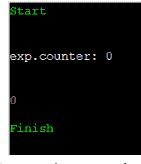

使用原子引用时的意外

计数器是0。发生了什么？问题出在第25行。表达式 std::atomic<int> counter{exp.counter} 中的初始化创建了一个副本。下面这个小程序说明了这个问题。

### 复制引用

```cpp
1   // atomicRefCopy.cpp
2
3   #include <atomic>
4   #include <iostream>
5
6   int main() {
7
8       std::cout << '\n';
9
10      int val[5];
11      int& ref = val;
12      std::atomic<int> atomicRef(ref);
13      ++atomicRef;
14      std::cout << "ref: " << ref << '\n';
15      std::cout << "atomicRef.load(): " << atomicRef.load() << '\n';
16
17      std::cout << '\n';
18
19  }
```

第13行的递增操作并没有作用于引用ref（第11行）。ref的值没有改变。

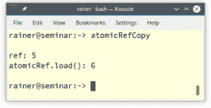

复制引用

用 `std::atomic_ref<int>` counter{exp.counter} 替换 `std::atomic<int>` counter{exp.counter} 解决了这个问题：

### 使用 std::atomic_ref

```cpp
// atomicReference.cpp

#include <atomic>
#include <iostream>
#include <random>
#include <thread>
#include <vector>

struct ExpensiveToCopy {
    int counter{};
};

int getRandom(int begin, int end) {

    std::random_device seed;        // initial randomness
    std::mt19937 engine(seed());    // generator
    std::uniform_int_distribution<> uniformDist(begin, end);

    return uniformDist(engine);
}

void count(ExpensiveToCopy& exp) {

    std::vector<std::thread> v;
    std::atomic_ref<int> counter(exp.counter);

    for (int n = 0; n < 10; ++n) {
        v.emplace_back([&counter] {
            auto randomNumber = getRandom(100, 200);
            for (int i = 0; i < randomNumber; ++i) { ++counter; }
    });
  }

  for (auto& t : v) t.join();

}

int main() {

  std::cout << '\n';

  ExpensiveToCopy exp;
  count(exp);
  std::cout << "exp.counter: " << exp.counter << '\n';

  std::cout << '\n';

}
```

现在，counter的值符合预期：

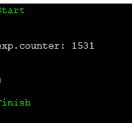

使用 std::atomic_ref 的预期结果

根据 std::atomic，std::atomic_ref 可以被特化，并支持对内置数据类型的特化。

##### 2.3.6.2 std::atomic_ref 的特化

你可以为自定义类型特化 std::atomic_ref，为指针类型使用部分特化，或者为算术类型（如整型或浮点类型）使用完全特化。

###### 2.3.6.2.1 主模板

主模板 std::atomic_ref 可以使用 TriviallyCopyable 类型 T 进行实例化。

```cpp
struct Counter {
    int a;
    int b;
};

Counter counter;
std::atomic_ref<Counter> cnt(counter);
```

###### 2.3.6.2.2 指针类型的部分特化

标准为指针类型提供了部分特化：`std::atomic_ref<T*>`。除了下面的 `std::atomic_ref<floating-point type>`，`std::atomic_ref<T*>` 还支持前置和后置递增或前置和后置递减操作。

###### 2.3.6.2.3 算术类型的特化

标准为整型和浮点类型提供了特化：`std::atomic_ref<arithmetic type>`。

- 字符类型：`char`、`char8_t`（C++20）、`char16_t`、`char32_t` 和 `wchar_t`
- 标准有符号整数类型：`signed char`、`short`、`int`、`long` 和 `long long`
- 标准无符号整数类型：`unsigned char`、`unsigned short`、`unsigned int`、`unsigned long` 和 `unsigned long long`
- 其他整数类型，定义在头文件 `<cstdint>`¹ 中：
  - `int8_t`、`int16_t`、`int32_t` 和 `int64_t`（恰好为8、16、32和64位的有符号整数）
  - `uint8_t`、`uint16_t`、`uint32_t` 和 `uint64_t`（恰好为8、16、32和64位的无符号整数）
  - `int_fast8_t`、`int_fast16_t`、`int_fast32_t` 和 `int_fast64_t`（至少有8、16、32和64位的最快有符号整数）
  - `uint_fast8_t`、`uint_fast16_t`、`uint_fast32_t` 和 `uint_fast64_t`（至少有8、16、32和64位的最快无符号整数）
  - `int_least8_t`、`int_least16_t`、`int_least32_t` 和 `int_least64_t`（至少有8、16、32和64位的最小有符号整数）
  - `uint_least8_t`、`uint_least16_t`、`uint_least32_t` 和 `uint_least64_t`（至少有8、16、32和64位的最小无符号整数）
  - `intmax_t` 和 `uintmax_t`（最大有符号和无符号整数）
  - `intptr_t` 和 `uintptr_t`（用于保存指针的有符号和无符号整数）
- 标准浮点类型：`float`、`double` 和 `long double`

##### 2.3.6.3 所有原子操作

首先，这里是 `atomic_ref` 上所有操作的列表。

¹ http://en.cppreference.com/w/cpp/header/cstdint


## atomic_ref 的所有操作

| 成员函数 | 描述 |
|---|---|
| `is_lock_free`<br>`atomic_ref<T>::is_always_lock_free` | 检查 atomic_ref 对象是否为无锁的。<br>在编译时检查原子类型是否始终无锁。 |
| `load`<br>`operator T` | 原子地返回被引用对象的值。<br>原子地返回被引用对象的值。等价于 `atomic::load()`。 |
| `store` | 用一个非原子值原子地替换被引用对象的值。 |
| `exchange` | 用新值原子地替换被引用对象的值。 |
| `compare_exchange_strong`<br>`compare_exchange_weak` | 原子地比较并最终交换被引用对象的值。详情见这里。 |
| `fetch_add`, `+=`<br>`fetch_sub`, `-=` | 原子地对被引用对象进行加（减）值操作。 |
| `fetch_or`, \|=<br>`fetch_and`, `&=`<br>`fetch_xor`, `^=` | 原子地对被引用对象执行按位或、与和异或操作。 |
| `++`, `--` | 递增或递减（前置和后置）被引用对象。 |
| `notify_one`<br>`notify_all` | 通知一个原子等待操作。<br>通知所有原子等待操作。 |
| `wait` | 阻塞直到被通知。<br>将自身与旧值进行比较，以防止虚假唤醒和丢失唤醒。<br>如果旧值比较不相等，则返回。 |

复合赋值运算符返回新值；fetch 变体返回旧值。

每个成员函数都支持一个额外的内存序参数。内存序参数的默认值是 `std::memory_order_seq_cst`，但你也可以使用 `std::memory_order_relaxed`、`std::memory_order_consume`、`std::memory_order_acquire`、`std::memory_order_release` 或 `std::memory_order_acq_rel`。`compare_exchange_strong` 和 `compare_exchange_weak` 成员函数可以用两个内存序参数化：一个用于成功情况，一个用于失败情况。如果你只显式提供一个内存序，它会被同时用于成功和失败情况。以下是内存序的详细说明。

当然，并非所有操作都可用于 `std::atomic_ref` 引用的所有类型。下表列出了取决于 `std::atomic_ref` 引用类型的所有原子操作。

**所有原子操作，取决于 `std::atomic_ref` 引用的类型**

| 函数 | `atomic_ref<T>` | `atomic_ref<floating>` | `atomic_ref<T*>` | `atomic_ref<integral>` |
|---|---|---|---|---|
| is_lock_free | 是 | 是 | 是 | 是 |
| `atomic_ref<T>::is_always_lock_free` | 是 | 是 | 是 | 是 |
| load | 是 | 是 | 是 | 是 |
| `operator T` | 是 | 是 | 是 | 是 |
| store | 是 | 是 | 是 | 是 |
| exchange | 是 | 是 | 是 | 是 |
| compare_exchange_strong | 是 | 是 | 是 | 是 |
| compare_exchange_weak | 是 | 是 | 是 | 是 |
| fetch_add, += |  | 是 | 是 | 是 |
| fetch_sub, -= |  | 是 | 是 | 是 |
| fetch_or, \|= |  |  |  | 是 |
| fetch_and, &= |  |  |  | 是 |
| fetch_xor, ^= |  |  |  | 是 |
| ++, -- |  |  | 是 | 是 |
| notify_one | 是 | 是 | 是 | 是 |
| notify_all | 是 | 是 | 是 | 是 |
| wait | 是 | 是 | 是 | 是 |

原子量及其原子操作是内存模型的基本构建块。它们建立了对原子量和非原子量都成立的同步和排序约束。让我们更深入地研究同步和排序约束。

## 原子操作的特征

| 操作 | 读 | 写 | 读-修改-写 |
|---|---|---|---|
| test_and_set |  |  | 是 |
| clear |  | 是 |  |
| is_lock_free | 是 |  |  |
| load | 是 |  |  |
| operator T | 是 |  |  |
| store |  | 是 |  |
| exchange |  |  | 是 |
| compare_exchange_strong |  |  | 是 |
| compare_exchange_weak |  |  | 是 |
| fetch_add, += |  |  | 是 |
| fetch_sub, -= |  |  | 是 |
| fetch_or, \|= |  |  | 是 |
| fetch_and, &= |  |  | 是 |
| fetch_xor, ^= |  |  | 是 |
| ++, -- |  |  | 是 |
| notify_one | 是 |  |  |
| notify_all | 是 |  |  |
| wait |  | 是 |  |

读-修改-写操作有一个额外保证：它们总是提供最新的值。这意味着在不同线程上的一系列 `atomicVar.fetch_sub(1)` 操作会一个接一个地递减，不会出现间隙或重复。

如果你将原子操作 `atomicVar.load()` 与为写入或读-修改-写操作设计的内存模型一起使用，写入部分没有效果。结果是操作 `atomicVar.load(std::memory_order_acq_rel)` 等价于操作 `atomicVar.load(std::memory_order_acquire)`。相应地，操作 `atomicVar.load(std::memory_order_release)` 等价于 `atomicVar.load(std::memory_order_relaxed)`。

##### 2.4.1.2 不同的同步和排序约束

粗略地说，C++ 中有三种不同类型的同步和排序约束：

- 顺序一致性：`memory_order_seq_cst`
- 获取-释放：`memory_order_consume`, `memory_order_acquire`, `memory_order_release` 和 `memory_order_acq_rel`
- 宽松：`memory_order_relaxed`

顺序一致性在线程之间建立全局顺序，而获取-释放语义在同一原子变量的不同线程的读写操作之间建立排序。宽松语义只保证某个原子 `m` 的修改顺序。修改顺序意味着对特定原子 `m` 的所有修改以某个特定的全序发生。因此，一个特定线程对原子对象的读取永远不会看到比该线程已经观察到的“更旧”的值。

不同的内存模型及其对原子和非原子操作的影响使 C++ 内存模型成为一个令人兴奋且具有挑战性的话题。让我们讨论顺序一致性、获取-释放语义和宽松语义的同步和排序约束。

#### 2.4.2 顺序一致性

让我们更深入地研究顺序一致性。顺序一致性的关键在于所有线程上的所有操作都遵循一个通用时钟。这个全局时钟使得思考它变得非常直观。

顺序一致性的直观性是有代价的。缺点是该系统必须同步线程。

以下程序借助顺序一致性来同步生产者和消费者线程。

**使用顺序一致性的生产者-消费者同步**

```cpp
// producerConsumer.cpp

#include <atomic>
#include <iostream>
#include <string>
#include <thread>

std::string work;
std::atomic<bool> ready(false);

void consumer() {
  while (!ready.load()) {}
  std::cout << work << '\n';
}

void producer() {
  work = "done";
  ready = true;
}

int main() {
  std::thread prod(producer);
  std::thread con(consumer);
  prod.join();
  con.join();
}
```

程序的输出并不令人兴奋。

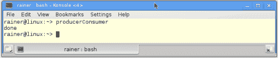

使用顺序一致性的生产者-消费者同步

由于顺序一致性，程序执行是确定性的。它的输出总是“done”。

该图描绘了操作的顺序。消费者线程在 while 循环中等待，直到原子变量 ready 被设置为 true。当这种情况发生时，消费者线程继续执行它们的工作。

原子操作的获取-释放语义。获取-释放语义是 C# 和 Java 不遵循的领域。这也是我们的直觉开始减弱的领域。

#### 2.4.3 获取-释放语义

在获取-释放语义中，线程之间没有全局同步；只有对**同一原子变量**的原子操作之间的同步。一个线程上的写操作与另一个线程上对同一原子变量的读操作同步。

获取-释放语义基于一个基本思想：释放操作与同一原子上的获取操作同步，并建立一个排序约束。该排序约束意味着所有读和写操作都不能被移动到释放操作之后。所有读和写操作都不能被移动到获取操作之前。

什么是获取或释放操作？使用 load 或 test_and_set 读取原子变量是获取操作。还有更多：释放锁或互斥量同步于获取锁或互斥量。线程的构造同步于可调用对象的调用。线程的完成同步于 join 调用。任务的可调用对象的完成同步于 future 中的 wait 或 get 调用。获取和释放操作成对出现。

记住这幅图会很有帮助。

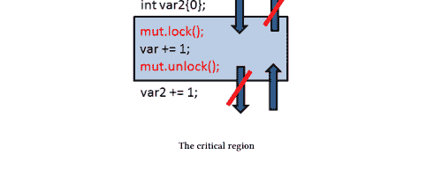

### 内存模型：更深入地理解多线程

这是你应该牢记内存模型的主要原因。获取-释放语义帮助你更好地理解高级同步原语，如互斥量。同样的推理也适用于线程的启动和对线程的 join 调用。两者都是获取-释放操作。条件变量上的 wait 和 notify_one 调用也是如此；wait 是获取操作，notify_one 是释放操作。那 notify_all 呢？它也是一个释放操作。


现在，让我们再次看看 `std::atomic_flag` 小节中的自旋锁。我们可以更高效地编写它，因为同步是通过 `atomic_flag` 标志完成的。因此，获取-释放语义适用。

**具有获取-释放语义的自旋锁**

```cpp
// spinlockAcquireRelease.cpp

#include <atomic>
#include <thread>

class Spinlock{
    std::atomic_flag flag;
    public:
    Spinlock(): flag(ATOMIC_FLAG_INIT) {}

    void lock(){
        while(flag.test_and_set(std::memory_order_acquire));
    }

    void unlock(){
        flag.clear(std::memory_order_release);
    }
};

Spinlock spin;

void workOnResource(){
    spin.lock();
    // shared resource
    spin.unlock();
}

int main(){

    std::thread t(workOnResource);
    std::thread t2(workOnResource);

    t.join();
    t2.join();

}
```

第 16 行的 flag.clear 调用是释放操作，第 12 行的 flag.test_and_set 调用是获取操作，并且获取操作与释放操作同步。使用顺序一致性（std::memory_order_seq_cst）的两个线程的重量级同步，被更轻量、更高性能的获取-释放语义（std::memory_order_acquire 和 std::memory_order_release）取代。行为不受影响。

尽管 flag.test_and_set(std::memory_order_acquire) 调用是读-改-写操作，但获取语义已经足够。总之，flag 是一个原子对象，因此保证修改顺序。这意味着对 flag 的所有修改都按某个特定的全序发生。

获取-释放语义具有传递性。这意味着，如果两个线程 (a, b) 之间存在获取-释放语义，且 (b, c) 之间存在获取-释放语义，那么 (a, c) 之间也具有获取-释放语义。

##### 2.4.3.1 传递性

同一原子变量上的释放操作与获取操作同步，并建立排序约束。如果线程作用于同一个原子对象，这些就是高性能同步线程的组成部分。如果两个线程不共享任何原子变量，这该如何工作？我们不想要任何顺序一致性，因为它代价太高，但我们想要轻量级的获取-释放语义。

这个问题的答案很直接。利用获取-释放语义的传递性，我们可以同步相互独立的线程。

在下面的示例中，带有工作包 deliveryBoy 的线程 t2 是两个独立线程 t1 和 t3 之间的连接。

**获取-释放语义的传递性**

```cpp
// transitivity.cpp

#include <atomic>
#include <iostream>
#include <thread>
#include <vector>

std::vector<int> mySharedWork;
std::atomic<bool> dataProduced(false);
std::atomic<bool> dataConsumed(false);

void dataProducer(){
    mySharedWork = {1,0,3};
    dataProduced.store(true, std::memory_order_release);
}

void deliveryBoy(){
    while(!dataProduced.load(std::memory_order_acquire));
    dataConsumed.store(true, std::memory_order_release);
}

void dataConsumer(){
    while(!dataConsumed.load(std::memory_order_acquire));
    mySharedWork[1] = 2;
}

int main(){

    std::cout << '\n';

    std::thread t1(dataConsumer);
    std::thread t2(deliveryBoy);
    std::thread t3(dataProducer);

    t1.join();
    t2.join();
    t3.join();

    for (auto v: mySharedWork){
        std::cout << v << " ";
    }

    std::cout << "\n\n";

}
```

该程序的输出是确定性的。mySharedWork 的值为 1、2 和 3。

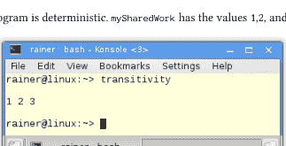

程序 transitivity.cpp 的输出

有两个关键观察：

1. 线程 t2 在第 18 行等待，直到线程 t3 将 dataProduced 设为 true（第 14 行）。
2. 线程 t1 在第 23 行等待，直到线程 t2 将 dataConsumed 设为 true（第 19 行）。

让我用图来解释其余部分。

```cpp
void dataProducer() {
    mySharedWork[1, , ,];
    dataProduced.store(true, std::memory_order_release);
}

void deliveryBoy() {
    while(!dataProduced.load(std::memory_order_acquire)) ;
    dataConsumed.store(true, std::memory_order_release);
}

void dataConsumer() {
    while(!dataConsumed.load(std::memory_order_acquire)) ;
    mySharedWork[1] == 2;
}
```

获取-释放语义的传递性

- **蓝色**箭头是*先序于*关系。这意味着一个线程中的所有操作都按源代码顺序执行。
- **红色**箭头是*同步于*关系。原因在于对同一原子对象的原子操作具有获取-释放语义。原子对象之间、因而线程之间的同步发生在特定点上。
- *先序于*建立*先行发生*关系，并*同步于*一个*线程间先行发生*关系。

其余部分相当简单。指令的*先行发生*和*线程间先行发生*顺序与箭头从上到下的方向一致。最后，我们保证 `mySharedWork[1] == 2` 最后执行。

同一原子变量上的释放操作会*同步于*获取操作，因此如果……，我们就能轻松同步线程。典型的误解就出在这个“如果”上。

##### 2.4.3.2 典型误解

我为什么想写获取-释放语义的典型误解呢？我的许多读者和学生已经掉进了这个陷阱。让我们看看这个直观的案例。

###### 2.4.3.2.1 包含等待

**带等待的获取-释放语义**

```cpp
// acquireReleaseWithWaiting.cpp

#include <atomic>
#include <iostream>
#include <thread>
#include <vector>

std::vector<int> mySharedWork;
std::atomic<bool> dataProduced(false);

void dataProducer(){
    mySharedWork = {1, 0, 3};
    dataProduced.store(true, std::memory_order_release);
}

void dataConsumer(){
    while( !dataProduced.load(std::memory_order_acquire) );
    mySharedWork[1] = 2;
}

int main(){

    std::cout << '\n';

    std::thread t1(dataConsumer);
    std::thread t2(dataProducer);

    t1.join();
    t2.join();

    for (auto v: mySharedWork){
        std::cout << v << "  ";
    }

    std::cout << "\n\n";

}
```

第 17 行的消费者线程 t1 等待，直到第 13 行的生产者线程 t2 将 dataProduced 设为 true。dataProduced 是保护条件，它保证对非原子变量 mySharedWork 的访问是同步的。同步意味着生产者线程 t2 初始化 mySharedWork，然后消费者线程 t1 通过将 mySharedWork[1] 设为 2 来完成工作。该程序是良定义的。

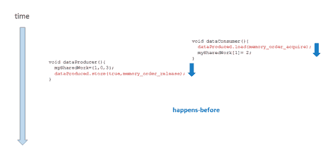

###### 2.4.3.2.3 解决方案

*同步于*的意思是：如果 `dataProduced.store(true, std::memory_order_release)` 先于 `dataProduced.load(std::memory_order_acquire)` 发生，那么在 `dataProduced.load(std::memory_order_acquire)` 之后，`dataProduced.store(true, std::memory_order_release)` 之前所有操作的可见效果都可见。关键词是 *如果* 这个词。那个 *如果* 在第一个带谓词（`while(!dataProduced.load(std::memory_order_acquire))`）的程序中得到了保证。

这里再更正式地说明一次。

如果满足以下条件，那么 `dataProduced.store(true, std::memory_order_release)` 之前的所有操作都*先行发生*于 `dataProduced.load(std::memory_order_acquire)` 之后的所有操作：`dataProduced.store(true, std::memory_order_release)` *先行发生*于 `dataProduced.load(std::memory_order_acquire)`。

##### 2.4.3.3 释放序列

在处理获取-释放语义时，释放序列是一个相当高级的概念。因此，让我们先从下面示例中的获取-释放语义开始。


## 释放序列

```cpp
// releaseSequence.cpp

#include <atomic>
#include <thread>
#include <iostream>
#include <mutex>

std::atomic<int> atom{0};
int somethingShared{0};

using namespace std::chrono_literals;

void writeShared(){
    somethingShared = 2011;
    atom.store(2, std::memory_order_release);
}

void readShared(){
    while ( !atom.fetch_sub(1, std::memory_order_acquire) > 0 ) {
        std::this_thread::sleep_for(100ms);
    }

    std::cout << "somethingShared: " << somethingShared << '\n';
}

int main(){

    std::cout << '\n';

    std::thread t1(writeShared);
    std::thread t2(readShared);
    // std::thread t3(readShared);

    t1.join();
    t2.join();
    // t3.join();

    std::cout << "atom: " << atom << '\n';

    std::cout << '\n';

}
```

我们首先看看没有线程 t3 的示例。第15行的原子存储与第19行的原子加载同步。这种同步保证存储之前发生的所有事情在加载之后都可用。这尤其意味着，对非原子变量 somethingShared 的访问不是数据竞争。

如果我使用线程 t3 会有什么变化？现在似乎存在数据竞争。正如我已经提到的，第一次调用 atom.fetch_sub(1, std::memory_order_acquire)（第19行）与 atom.store(2, std::memory_order_release)（第15行）具有获取-释放语义；因此，somethingShared 上不存在数据竞争。

这对第二次调用 atom.fetch_sub(1, std::memory_order_acquire) 并不成立。它是一个没有 std::memory_order_release 标记的读-改-写操作。这尤其意味着，第二次调用 atom.fetch_sub(1, std::memory_order_acquire) 不与第一次调用同步，并且 somethingShared 上可能发生数据竞争。也许由于释放序列，数据竞争并不会发生。释放序列被扩展到第二次调用 atom.fetch_sub(1, std::memory_order_acquire)；因此，第二次调用 atom.fetch_sub(1, std::memory_order_acquire) 与第一次调用具有先发生于关系。

最后，这是程序的输出。

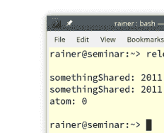

更正式地说，参见 N4659：C++17 编程语言标准工作草案。

### 释放序列

由原子对象 M 上的释放操作 A 作为头部的释放序列，是 M 的修改顺序中副作用的一个最大连续子序列，其中第一个操作是 A，并且每个后续操作

- 由执行 A 的同一线程执行，或
- 是原子读-改-写操作。

1) http://www.open-std.org/jtc1/sc22/wg21/docs/papers/2017/n4659.pdf

如果你仔细跟随我的解释，例如 *挑战* 小节中的解释，你可能预期接下来是 *宽松语义*；不过，我会先看内存模型 `std::memory_order_consume`，它与 `std::memory_order_acquire` 非常相似。

#### 2.4.4 `std::memory_order_consume`

`std::memory_order_consume` 是六种内存序中最具传奇色彩的一种。原因有两个：第一，`std::memory_order_consume` 极难理解；第二——这一点未来可能会改变——目前没有编译器支持它。在 C++17 中，情况变得更糟。以下是官方措辞：“释放-消费排序的规范正在修订，暂时不鼓励使用 memory_order_consume。”

一个实现 C++11 标准的编译器怎么可能不支持内存模型 `std::memory_order_consume` 呢？答案是，编译器将 `std::memory_order_consume` 映射为 `std::memory_order_acquire`。这种映射是可以接受的，因为两者都是加载或获取操作。`std::memory_order_consume` 要求的同步和排序约束比 `std::memory_order_acquire` 更弱。因此，释放-获取排序可能比释放-消费排序更慢，但是——这是关键点——它是 *良定义* 的。

要理解释放-消费排序，最好将它和释放-获取排序进行比较。在下一小节中，我会明确讨论释放-获取排序，而不是获取-释放语义，以强调 `std::memory_order_consume` 和 `std::memory_order_acquire` 之间的紧密关系。

##### 2.4.4.1 释放-获取排序

作为起点，让我们使用下面这个包含两个线程 t1 和 t2 的程序。t1 扮演生产者的角色，t2 扮演消费者的角色。原子变量 ptr 有助于同步生产者和消费者。

释放-获取排序

```cpp
// acquireRelease.cpp

#include <atomic>
#include <thread>
#include <iostream>
#include <string>

using namespace std;

atomic<string*> ptr;
int data;
atomic<int> atoData;

void producer(){
    string* p = new string("C++11");
    data = 2011;
    atoData.store(2014, memory_order_relaxed);
    ptr.store(p, memory_order_release);
}

void consumer(){
    string* p2;
    while (!(p2 = ptr.load(memory_order_acquire)));
    cout << "*p2: " << *p2 << '\n';
    cout << "data: " << data << '\n';
    cout << "atoData: " << atoData.load(memory_order_relaxed) << '\n';
}

int main(){

    cout << '\n';

    thread t1(producer);
    thread t2(consumer);

    t1.join();
    t2.join();

    cout << '\n';

}
```

在分析该程序之前，我想引入一个小变化。

##### 2.4.4.2 释放-消费排序

我将第23行的内存序 std::memory_order_acquire 替换为 std::memory_order_consume。

释放-消费排序

```cpp
// acquireConsume.cpp

#include <atomic>
#include <thread>
#include <iostream>
#include <string>

using namespace std;

atomic<string*> ptr;
int data;
atomic<int> atoData;

void producer(){
    string* p = new string("C++11");
    data = 2014;
    atoData.store(2014, memory_order_relaxed);
    ptr.store(p, memory_order_release);
}

void consumer(){
    string* p2;
    while (!(p2 = ptr.load(memory_order_consume)));
    cout << "p2: " << *p2 << '\n';
    cout << "data: " << data << '\n';
    cout << "atoData: " << atoData.load(memory_order_relaxed) << '\n';
}

int main(){
    cout << '\n';

    thread t1(producer);
    thread t2(consumer);

    t1.join();
    t2.join();

    cout << '\n';
}
```

现在程序具有未定义行为。这个说法非常假设性，因为我的 GCC 5.4 编译器通过使用 std::memory_order_acquire 来实现 std::memory_order_consume。在底层，两个程序做同样的事情。

##### 2.4.4.3 释放-获取排序与释放-消费排序

这些程序的输出完全相同。

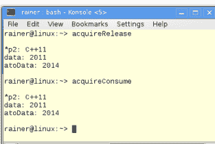

冒着重复自己的风险，我想补充几句话解释为什么第一个程序 `acquireRelease.cpp` 是良定义的。

第17行的存储操作 *同步于* 第23行的加载操作。原因是存储操作使用 `std::memory_order_release`，而加载操作使用 `std::memory_order_acquire`。这种存储/加载关系就是同步。释放-获取操作的排序约束是什么？释放-获取排序保证存储操作（第16行）之前所有操作的结果在加载操作（第21行）之后都可用。因此，释放-获取操作也对非原子变量 data（第14行）和原子变量 `atoData`（第15行）的访问进行排序。尽管 `atoData` 使用 `std::memory_order_relaxed` 内存序，这一点仍然成立。

关键问题是：如果我将 `std::memory_order_acquire` 替换为 `std::memory_order_consume`，会发生什么？

##### 2.4.4.4 使用 `std::memory_order_consume` 的数据依赖

`std::memory_order_consume` 处理原子对象上的数据依赖。数据依赖以两种方式存在。首先，让我们看看线程内的 *携带依赖到*，以及两个线程之间的 *依赖排序先于*。两种依赖都引入 *先发生于* 关系。这些正是我们要寻找的关系。*携带依赖到* 和 *依赖排序先于* 是什么意思？

- *携带依赖到*：如果操作 A 的结果被用作操作 B 中的操作数，那么：A *携带依赖到* B。
- *依赖排序先于*：如果加载操作 B（使用 `std::memory_order_consume`）的结果在同一线程中的进一步操作 C 中被使用，那么存储操作（使用 `std::memory_order_release`、`std::memory_order_acq_rel` 或 `std::memory_order_seq_cst`）*依赖排序先于* 加载操作 B。需要注意的是，操作 B 和 C 必须位于同一线程中。


根据个人经验，我知道这两个定义可能都不太容易理解。下面用一张图来直观展示它们。

```cpp
std::atomic<std::string*> ptr;
int data;
std::atomic<int> atoData;

void producer() {
  std::string* p = new std::string("C++");
  data = 2011;
  atoData.store(2014,std::memory_order_relaxed);
  ptr.store(p, std::memory_order_release);
}

void consumer() {
  std::string* p2;
  while (!(p2 = ptr.load(std::memory_order_consume)));
  std::cout << "*p2: " << *p2 << std::endl;
  std::cout << "data: " << data << std::endl;
  std::cout << "atoData: " << atoData.load(std::memory_order_relaxed) << std::endl;
}
```

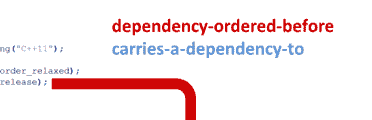

std::memory_order_consume 的数据依赖

表达式 ptr.store(p, std::memory_order_release) 按依赖排序先于表达式 while (!(p2 = ptr.load(std::memory_order_consume)))，因为下一行 std::cout << "*p2: " << *p2 << '\n' 被读取为加载操作的结果。此外，还有：while (!(p2 = ptr.load(std::memory_order_consume)) 携带依赖到 std::cout << "*p2: " << *p2 << '\n'，因为 *p2 的输出使用了 ptr.load 操作的结果。

对于 data 和 atoData 的输出，我们没有任何保证。这是因为二者都与 ptr.load 操作没有“携带依赖”关系。更糟的是：由于 data 是非原子变量，变量 data 上存在数据竞争。原因是两个线程可以同时访问 data，而线程 t1 想要修改 data。因此，程序具有未定义行为。

最后，我们来到了宽松语义。

#### 2.4.5 宽松语义

宽松语义是另一个极端。宽松语义是所有内存模型中最弱的，只保证原子操作的修改顺序。这意味着对某个原子变量的所有修改都按某个特定的全序发生。

##### 2.4.5.1 没有同步和顺序约束

这相对容易。如果没有规则，我们就无法违反规则。然而，那也太容易了；程序应当具有良定义行为。良定义行为意味着，你通常要使用更强内存模型的同步和顺序约束来控制具有宽松语义的操作。这如何工作？一个线程可以以任意顺序看到另一个线程的效果，所以你必须确保程序中有一些点，使得所有线程上的所有操作都在这些点同步。

原子操作的一个典型例子是计数器，其中操作的顺序无关紧要。对于计数器，关键观察点不是不同线程如何递增计数器；计数器中的关键观察点是所有递增都是原子的，并且所有递增最终都会完成。看看下面的例子。

一个使用宽松语义的计数器

```cpp
1  // relaxed.cpp
2  
3  #include <vector>
4  #include <iostream>
5  #include <thread>
6  #include <atomic>
7  
8  std::atomic<int> count = {0};
9  
10 void add()
11 {
12   for (int n = 0; n < 1000; ++n) {
13     count.fetch_add(1, std::memory_order_relaxed);
14   }
15 }
16 
17 int main()
18 {
19   std::vector<std::thread> v;
20   for (int n = 0; n < 10; ++n) {
21     v.emplace_back(add);
22   }
23   for (auto& t : v) {
24     t.join();
25   }
26   std::cout << "Final counter value is " << count << '\n';
27 }
```

最令人关注的三行是第 13、24 和 26 行。

在第 13 行，原子计数 count 使用宽松语义递增，因此我们保证该操作是原子的。fetch_add 操作在 count 上建立一种顺序。函数 add（第 10 - 15 行）是各线程的工作包。每个线程在第 21 行获得自己的工作包。

线程创建是一个同步点——另一个同步点是第 24 行的 t.join()。

创建线程在第 24 行与它的所有子线程同步。它通过 t.join() 调用等待，直到所有子线程完成。t.join() 是原子操作结果得以发布的原因。更形式化地说：t.join() 是一个释放操作。

总之，第 13 行的递增操作与第 26 行读取计数器 count 之间存在 *先于发生* 关系。

结果是该程序总是返回 10000。无聊吗？不，这令人安心！

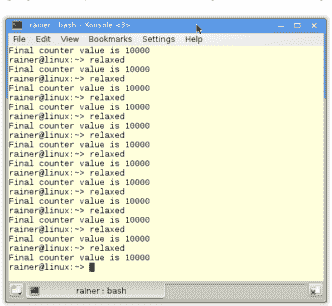

使用宽松语义的原子计数器

使用宽松语义的原子计数器的一个典型例子是 std::shared_ptr 的引用计数器。宽松语义只适用于递增操作。递增引用计数器的关键性质是该操作是原子的。递增操作的顺序无关紧要。宽松语义不适用于引用计数器的递减。这些操作在析构函数中需要获取-释放语义。

### add 算法是无等待的

更仔细地看看第 10 行的函数 add。递增操作（第 13 行）没有涉及同步。值 1 只是被加到原子计数 count 上。

因此，该算法不仅无锁，而且无等待。

std::atomic_thread_fence 的基本思想是在线程之间建立同步和顺序约束，而不需要使用原子操作。

- **获取栅栏：** 获取栅栏 `std::atomic_thread_fence(std::memory_order_acquire)` 阻止获取栅栏之前的读操作与获取栅栏之后的读或写操作重排序。
- **释放栅栏：** 释放栅栏 `std::atomic_thread_fence(std::memory_order_release)` 阻止释放栅栏之后的写操作与释放栅栏之前的读或写操作重排序。

为了正确理解获取栅栏和释放栅栏的定义及其对无锁编程的影响，需要投入大量精力。尤其难以理解的是原子操作的获取-释放语义之间的细微差别。在讨论这一点之前，我先用图来说明这些定义。

哪些类型的操作可以穿过内存屏障？看看下面的三张图。如果箭头被红色横条截断，那么该栅栏会阻止这种类型的操作。

###### 2.5.1.2.1 全栅栏

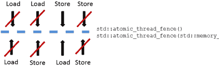

全栅栏

当然，除了写 `std::atomic_thread_fence()`，你还可以显式写 `std::atomic_thread_fence(std::memory_order_seq_cst)`。默认情况下，栅栏会应用[顺序一致性](#)。如果你对全栅栏使用顺序一致性，那么 `std::atomic_thread_fence` 会遵循全局顺序。

###### 2.5.1.2.2 获取栅栏

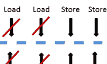

```cpp
std::atomic_thread_fence(std::memory_order_acquire)
```

获取栅栏

###### 2.5.1.2.3 释放栅栏

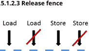

```cpp
std::atomic_thread_fence(std::memory_order_release)
```

释放栅栏

这三种内存屏障可以更简洁地描绘。

###### 2.5.1.2.4 所有栅栏一览

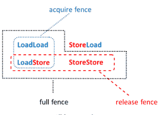

获取栅栏和释放栅栏保证与具有获取-释放语义的原子操作类似的同步和顺序约束。

##### 2.5.1.3 获取-释放栅栏

获取栅栏和释放栅栏与具有获取-释放语义的原子操作之间最明显的区别是，栅栏不需要原子操作。还有一个更细微的区别：获取栅栏和释放栅栏比相应的原子操作更重量级。

###### 2.5.1.3.1 原子操作与栅栏对比

为简单起见，我现在把使用栅栏或具有获取语义的原子操作统称为获取操作。释放操作也是如此。

获取操作和释放操作的主要思想是，它在线程之间建立同步和顺序约束。这些同步和顺序约束也适用于具有宽松语义的原子操作或非原子操作。注意，获取操作和释放操作成对出现。此外，对具有获取-释放语义的原子变量的操作必须作用于同一个原子变量。话虽如此，我现在单独来看这些操作。

让我们从获取操作开始。

###### 2.5.1.3.2 获取操作

对原子变量执行加载（读取）操作，且内存序设置为 std::memory_order_acquire，这就是一个获取操作。


```cpp
int ready = var.load(std::memory_order_acquire);
// load and store operations
```


带获取语义的原子操作

将内存序设置为 `std::memory_order_acquire` 的 `std::atomic_thread_fence` 对内存访问重排施加了更严格的约束：

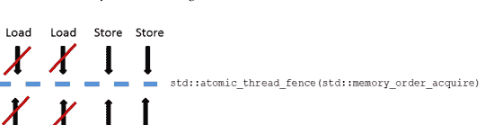

带获取语义的栅栏

这一比较强调了两点：

- 1. 带获取语义的栅栏建立了更强的排序约束。尽管原子变量上的获取操作和栅栏上的获取操作都要求不能将任何读或写操作移到获取操作之前，但获取栅栏还有一个额外的保证：任何读操作都不能移到获取栅栏之后。
- 2. 对于原子变量 var 的读取，宽松语义就足够了。由于 `std::atomic_thread_fence(std::memory_order_acquire)` 的存在，该操作不能被移到获取栅栏之后。

对于释放栅栏，也可以得出类似的观察结论。

###### 2.5.1.3.3 释放操作

在原子变量上，将内存序设置为 `std::memory_order_release` 的存储（写）操作是一种释放操作。

```cpp
// load and store operations
var.store(1, std::memory_order_release);
```


带释放语义的原子操作

这是释放栅栏对应的示意图。

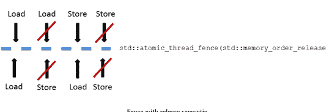

除了原子变量 var 上的释放操作所施加的约束外，释放栅栏还保证两个性质：

- 1. 存储操作不能移到栅栏之前。
- 2. 变量 var 采用宽松语义即可。

然而，现在是时候更进一步，构建一个使用栅栏的程序了。

##### 2.5.1.4 使用原子变量或栅栏进行同步

作为起点，我用获取-释放语义实现了一个典型的消费者-生产者工作流。我首先使用原子变量，然后改用栅栏。

###### 2.5.1.4.1 原子操作

让我们从原子变量开始，因为大多数人对其都很熟悉。

**使用原子变量的获取-释放排序**

```cpp
// acquireRelease.cpp

#include <atomic>
#include <thread>
#include <iostream>
#include <string>

using namespace std;

atomic<string*> ptr;
int data;
atomic<int> atoData;

void producer(){
    string* p = new string("C++11");
16      data = 2011;
17      atoData.store(2014, memory_order_relaxed);
18      ptr.store(p, memory_order_release);
19    }
20
21    void consumer(){
22      string* p2;
23      while (!(p2 = ptr.load(memory_order_acquire)));
24      cout << "*p2: " << *p2 << '\n';
25      cout << "data: " << data << '\n';
26      cout << "atoData: " << atoData.load(memory_order_relaxed) << '\n';
27    }
28
29    int main(){
30
31      cout << '\n';
32
33      thread t1(producer);
34      thread t2(consumer);
35
36      t1.join();
37      t2.join();
38
39      cout << '\n';
40
41    }
```

这个程序你应该相当熟悉。这是我在关于 `std::memory_order_consume` 的小节中使用的经典示例。这幅图明确强调了消费者线程 `t2` 能看到生产者线程 `t1` 的所有值。

```cpp
void producer() {
    std::string* p = new std::string("C++11");
    data = 2011;
    atoData.store(2014, std::memory_order_relaxed);
    ptr.store(p, std::memory_order_release);
}

void consumer() {
    std::string* p2;
    while (!(p2 = ptr.load(std::memory_order_acquire)));
    std::cout << "p2: " << *p2 << std::endl;
    std::cout << "data: " << data << std::endl;
    std::cout << "atoData: " << atoData.load(std::memory_order_relaxed) << std::endl;
}
```

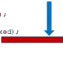

先行发生
同步于

使用原子操作的获取-释放语义

该程序是良定义的，因为 *先行发生* 关系具有传递性。我只需要结合三个 *先行发生* 关系：

- 1. 第 15 至 17 行 *先行发生* 于第 18 行 `ptr.store(p, std::memory_order_release)`。
- 2. 第 23 行 `while(!(p2 = ptr.load(std::memory_order_acquire)))` *先行发生* 于第 24 至 26 行。
- 3. 第 18 行 *同步于* 第 23 行。⇒ 第 18 行 *跨线程先行发生* 于第 23 行。

然而，故事变得更加有趣。现在我来谈谈 *栅栏*。在关于 C++ 内存模型的文献中，它们几乎完全被忽略了。

###### 2.5.1.4.2 栅栏

将该程序改为使用栅栏非常简单。

使用栅栏的获取-释放排序

```cpp
// acquireReleaseFences.cpp

#include <atomic>
#include <thread>
#include <iostream>
#include <string>

using namespace std;

atomic<string*> ptr;
```

## 新建数据库实例

建议使用RMS（关系数据库管理服务）来创建和管理数据库实例。创建数据库实例时，您可以根据实际业务选择实例类型，并设置计费方式、地域和节点规格等。

您可以使用以下方法创建数据库实例：

- 1. 登录RMS控制台。
- 2. 在左侧导航栏中选择“数据库”，进入数据库实例列表页面。
- 3. 在实例列表页面，单击“创建实例”。
- 4. 在“创建实例”页面，根据下表完成参数选择。

下表介绍了创建数据库实例时涉及的基本参数：

| 参数 | 说明 |
| --- | --- |
| 计费方式 | 按量计费：这种模式适合测试环境使用。<br>包年包月：这种模式适合业务稳定、长周期的运行场景，价格更低廉。 |
| 地域 | 选择实例所在的地域，建议选择与您客户所在地域相同的地域，降低访问延迟。 |
| 可用区 | 选择实例所在的可用区。<br>如果一个地域内有多个可用区，则同一地域的不同可用区之间内网互通。 |
| 网络类型 | 和数据库实例所在的VPC保持一致。 |
| 实例规格 | 实例规格定义了CPU和内存规格，请根据业务需求选择合适规格。 |

说明：创建实例需要一定时间，请耐心等待。

### 与信号处理程序同步

```cpp
// atomicSignal.cpp

#include <atomic>
#include <cassert>
#include <csignal>

std::atomic<bool> a{false};
std::atomic<bool> b{false};

extern "C" void handler(int) {
    if (a.load(std::memory_order_relaxed)) {
        std::atomic_signal_fence(std::memory_order_acquire);
        assert(b.load(std::memory_order_relaxed));
    }
}

int main() {

    std::signal(SIGTERM, handler);

    b.store(true, std::memory_order_relaxed);
    std::atomic_signal_fence(std::memory_order_release);
    a.store(true, std::memory_order_relaxed);

}
```

首先，我在第 19 行为特定信号 SIGTERM 设置了信号处理程序 `handler`。SIGTERM 是对程序的终止请求。两个 `std::atomic_signal_fence` 操作在释放操作 `std::atomic_signal_fence(std::memory_order_release)`（第 22 行）和获取操作 `std::atomic_signal_fence(std::memory_order_acquire)`（第 12 行）之间建立了一个获取-释放栅栏。这尤其意味着，释放操作不能跨越释放栅栏（第 22 行）重排，获取操作不能跨越获取栅栏（第 12 行）重排。因此，第 13 行的断言 `assert(b.load(std::memory_order_relaxed))` 永远不会触发，因为如果 `a.store(true, std::memory_order_relaxed)`（第 23 行）已经发生，那么 `b.store(true, std::memory_order_relaxed)`（第 21 行）必定在此之前发生。

## 要点总结

- 内存模型是程序员与系统之间的一份契约。系统由生成机器代码的编译器、执行机器代码的处理器，以及存储程序状态的各种缓存组成。
- C++ 内存模型必须处理以下问题：
  - 哪些操作是原子的？
  - 哪些操作顺序是有保证的？
  - 对共享变量的操作对其他线程有哪些可见影响？
- 契约的基础是对原子变量的操作，这些操作有两个特征：根据定义它们是原子的，并且它们对程序执行产生了同步和顺序约束。
- C++20 支持对整型、浮点型、指针和智能指针的原子操作。
- 类模板 `std::atomic_ref` 将原子操作应用于被引用的对象。
- 粗略来说，C++ 中有三种不同类型的同步和顺序约束：
  - 顺序一致性（默认）
  - 获取-释放语义
  - 宽松语义

## 3. 多线程


Cippi 编了一个辫子

自 C++11 起，C++ 就有了多线程接口，该接口包含了创建多线程程序所需的所有基本构件。这些构件包括线程、用于共享数据的同步原语（如互斥量和锁）、线程局部数据、线程间的同步机制（如条件变量）以及任务。通常称为 promise 和 future 的任务提供了比原生线程更高级的抽象。


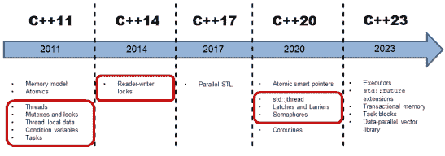

## C++ 中的多线程

C++ 支持两种线程：基础线程 `std::thread`（C++11）和改进后的线程 `std::jthread`（C++20）。首先，我介绍基础线程，并在本节末尾讨论改进后的线程。

### 3.1 基础线程 `std::thread`

要在 C++ 中启动线程，必须包含 `<thread>` 头文件。

#### 3.1.1 线程创建

线程 `std::thread` 表示一个可执行单元。线程会立即启动这个可执行单元，该单元将可调用单元作为其工作包。线程不可复制构造或复制赋值，但可移动构造或移动赋值。

可调用单元是行为类似函数的实体。当然，它可以是一个函数，也可以是 `function object` 或 lambda 函数。可调用单元的返回值会被忽略。

讨论理论之后，这里有一个小示例。

**使用可调用单元创建线程**

```cpp
// createThread.cpp

#include <iostream>
#include <thread>

void helloFunction(){
  std::cout << "Hello from a function." << '\n';
}

class HelloFunctionObject{
public:
  void operator()() const {
    std::cout << "Hello from a function object." << '\n';
  }
};

int main(){

  std::cout << '\n';

  std::thread t1(helloFunction);

  HelloFunctionObject helloFunctionObject;
  std::thread t2(helloFunctionObject);

  std::thread t3{[]{std::cout << "Hello from a lambda." << '\n';}};

  t1.join();
  t2.join();
  t3.join();

  std::cout << '\n';

}
```

三个线程（t1、t2 和 t3）都将消息写入控制台。线程 t2 的工作包是函数对象（第 10 - 15 行），线程 t3 的工作包是 lambda 函数（第 26 行）。在第 28 - 30 行，主线程等待其子线程完成。

让我们看一下输出。这更有趣。

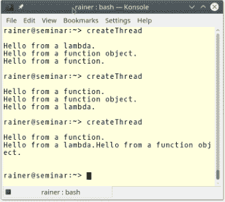

**使用各种可调用对象创建线程**

三个线程以任意顺序执行。甚至三个输出操作也可能交错。

在我们的例子中，子线程的创建者是主线程，主线程负责子线程的生命周期。

#### 3.1.2 线程生命周期

父线程必须照顾其子线程。这个简单原则对线程的生命周期有重大影响。这个小程序启动一个显示其 id 的线程。

然而，发生了什么？有些事情非常不对劲。

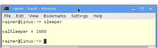

**引用导致的未定义行为**

该程序有两个奇怪特性。首先，valSleeper 是 1000；其次，id 未显示。该程序至少有两个问题。

1. valSleeper 被所有线程共享。这是数据竞争，因为线程可能同时读写 valSleeper。
2. 主线程的生命周期在子线程执行其计算或将 id 写入 std::cout 之前就结束了。

这两个问题都是竞态条件，因为程序的结果取决于操作的交错。竞态条件是数据竞争的原因。

修复数据竞争相当容易。valSleeper 应使用锁或原子类型进行保护。为了克服 valSleeper 和 std::cout 的生命周期问题，必须汇合线程而不是分离它。

以下是修改后的 main 函数。

```cpp
int main(){

  std::cout << '\n';

  int valSleeper = 1000;
  std::thread t(Sleeper(valSleeper), 5);
  t.join();
  std::cout << "valSleeper = " << valSleeper << '\n';

  std::cout << '\n';

}
```

现在我们得到了正确结果。当然，执行会变慢。

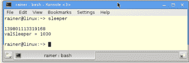

**修复了未定义行为**

为了完整介绍 `std::thread`，以下是其余成员函数。

#### 3.1.4 成员函数

以下是 `std::thread t` 接口的简明表格。更多细节请参考 [cppreference.com](https://cppreference.com)。

| 成员函数 | 描述 |
|---|---|
| `t.join()` | 等待线程 t 完成执行。 |
| `t.detach()` | 使创建的线程 t 独立于创建者执行。 |
| `t.joinable()` | 如果线程 t 仍可汇合，则返回 true。 |
| `t.get_id()` 和 `std::this_thread::get_id()` | 返回线程的 id。 |
| `std::thread::hardware_concurrency()` | 表示可以并发运行的线程数。 |
| `std::this_thread::sleep_until(absTime)` | 使线程 t 休眠直到时间点 absTime。 |
| `std::this_thread::sleep_for(relTime)` | 使线程 t 休眠持续时间 relTime。 |
| `std::this_thread::yield()` | 使系统能够运行另一个线程。 |
| `t.swap(t2)` | 交换线程。与 `std::swap(t, t2)` 相同。 |

静态成员函数 `std::thread::hardware_concurrency` 返回实现支持的并发线程数；如果运行时无法确定该数量，则返回 0。这符合 C++ 标准。`sleep_until` 和 `sleep_for` 操作需要一个时间点或时间持续时间作为参数。

http://de.cppreference.com/w/cpp/thread/thread


#### 访问系统特定实现

线程接口是底层实现的包装器。你可以使用成员函数 `native_handle` 访问系统特定实现。这个底层实现的句柄可用于线程、互斥量和条件变量。

线程不可复制但可移动。swap 成员函数在可能时执行移动。

总结本小节，下面是其中一些成员函数的实际用法。

**线程的成员函数**

```cpp
// threadMethods.cpp

#include <iostream>
#include <thread>

using namespace std;

int main(){

  cout << boolalpha << '\n';

  cout << "hardware_concurrency()= " << thread::hardware_concurrency() << '\n';

  thread t1([]{cout << "t1 with id= " << this_thread::get_id() << '\n';});
  thread t2([]{cout << "t2 with id= " << this_thread::get_id() << '\n';});

  cout << '\n';

  cout << "FROM MAIN: id of t1 " << t1.get_id() << '\n';
  cout << "FROM MAIN: id of t2 " << t2.get_id() << '\n';

  cout << '\n';
  swap(t1,t2);

  cout << "FROM MAIN: id of t1 " << t1.get_id() << '\n';
  cout << "FROM MAIN: id of t2 " << t2.get_id() << '\n';

  cout << '\n';
}
```

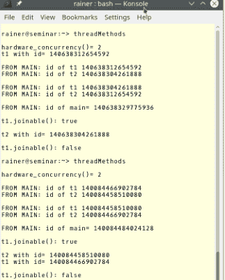

**线程的成员函数**

可能看起来有点奇怪，线程 t1 和 t2（第 14 和 15 行）在程序执行的不同时间点运行。你无法保证每个线程何时运行；只能保证两个线程都在第 38 和 39 行的 t1.join() 和 t2.join() 之前运行。

线程共享的可变（非 const）变量越多，多线程就越具挑战性。

### 3.2 改进后的线程 std::jthread（C++20）

std::jthread 代表汇合线程（joining thread）。除了 C++11 的 std::thread 之外，std::jthread 会在其析构函数中自动汇合，并且可以被协作式中断。因此，std::jthread 扩展了 std::thread 的接口。std::jthread 建模 RAII，因此当发生异常时也会汇合。std::jthread 持有一个 std::stop_source 类型的私有成员。std::jthread 构造函数接受一个以 std::stop_token 作为第一个参数的函数。这个 std::stop_token 被传入该函数，因此函数可以用它检查是否已请求停止。

下表简要概述了 `std::jthread t` 的附加功能。

**`std::jthread t` 的附加成员函数**

| 成员函数 | 描述 |
|---|---|
| `t.get_stop_source()` | 返回与共享停止状态关联的 `std::stop_source` 对象。 |
| `t.get_stop_token()` | 返回与共享停止状态关联的 `std::stop_token` 对象。 |
| `t.request_stop()` | 通过共享停止状态请求停止执行。如果停止请求成功，则返回 `true`。 |

#### 3.2.1 自动汇合

这是 `std::thread` 的*反直觉*行为。如果 `std::thread` 仍可汇合，则会在其析构函数中调用 `std::terminate`。如果既没有调用 `thr.join()` 也没有调用 `thr.detach()`，则线程 `thr` 是可汇合的。

**终止仍可汇合的 `std::thread`**

```cpp
// threadJoinable.cpp
#include <iostream>
#include <thread>

int main() {

    std::cout << '\n';
    std::cout << std::boolalpha;

    std::thread thr([] { std::cout << "Joinable std::thread" << '\n'; });

    std::cout << "thr.joinable(): " << thr.joinable() << '\n';

    std::cout << '\n';

}
```

执行时，程序会终止。


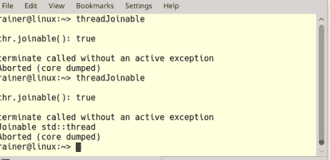

## 终止可连接的 std::thread

两次执行 std::thread 都会终止。在第二次运行中，线程 thr 有足够的时间显示其消息：“Joinable std::thread”。

在下面的示例中，我使用了当前 C++20 标准中的 std::jthread。

### 终止仍然可连接的 std::jthread

```cpp
// jthreadJoinable.cpp

#include <iostream>
#include <thread>

int main() {

    std::cout << '\n';
    std::cout << std::boolalpha;

    std::jthread thr([]{ std::cout << "Joinable std::thread" << '\n'; });

    std::cout << "thr.joinable(): " << thr.joinable() << '\n';

    std::cout << '\n';

}
```

现在，如果线程 thr 仍然可连接，它会在析构函数中自动 join。

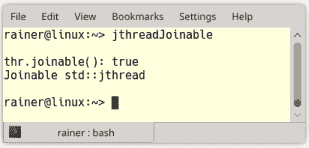

### 使用自动 join 的 std::jthread

下面是 std::jthread 析构函数的典型实现。

### std::jthread 析构函数的典型实现

```cpp
jthread::~jthread() {
    if(joinable()) {
        request_stop();
        join();
    }
}
```

首先，线程检查它是否仍然可连接（第 2 行）。如果线程上既没有调用 join() 也没有调用 detach()，那么它仍然是可连接的。如果线程仍然可连接，它会请求停止执行（第 3 行），然后调用 join()（第 4 行）。join 调用会阻塞，直到线程执行完毕。

#### 3.2.2 协作式中断 `std::jthread`

为了让你大致了解，我来展示一个简单的例子。

### 中断一个不可中断和可中断的 `std::jthread`

```cpp
// interruptJthread.cpp

#include <chrono>
#include <iostream>
#include <thread>

using namespace std::literals;

int main() {

    std::cout << '\n';

    std::jthread nonInterruptable([]{ 
        int counter{0};
        while (counter < 10){
            std::this_thread::sleep_for(0.2s);
            std::cerr << "nonInterruptable: " << counter << '\n';
            ++counter;
        }
    });

    std::jthread interruptable([](std::stop_token stoken){
        int counter{0};
        while (counter < 10){
            std::this_thread::sleep_for(0.2s);
            if (stoken.stop_requested()) return;
            std::cerr << "interruptable: " << counter << '\n';
            ++counter;
        }
    });

    std::this_thread::sleep_for(1s);

    std::cerr << '\n';
    std::cerr << "Main thread interrupts both jthreads" << '\n';
    nonInterruptable.request_stop();
    interruptable.request_stop();

    std::cout << '\n';

}
```

在主程序中，我启动了 nonInterruptable 和 interruptable 两个线程（第 13 行和第 22 行）。与 nonInterruptable 线程不同，interruptable 线程获得一个 std::stop_token，并在第 26 行使用它来检查是否被中断：stoken.stop_requested()。如果收到停止请求，lambda 函数就会返回，从而线程结束。调用 interruptable.request_stop()（第 37 行）会触发停止请求。但前面调用 nonInterruptable.request_stop() 则不然，该调用没有效果。

```text
rainer:bash — Konsole
File Edit View Bookmarks Settings Help
rainer@seminar:~> interruptJthread

interruptable: 0
nonInterruptable: 0
interruptable: 1
nonInterruptable: 1
interruptable: 2
nonInterruptable: 2
interruptable: 3
nonInterruptable: 3

Main thread interrupts both jthreads

nonInterruptable: 4
nonInterruptable: 5
nonInterruptable: 6
nonInterruptable: 7
nonInterruptable: 8
nonInterruptable: 9
rainer@seminar:~> 
rainer: bash
```

中断一个不可中断和可中断的 std::jthread

关于 std::stop_token 的详细信息，我将在协作式中断一节中介绍。

```cpp
11 public:
12     Worker(std::string n):name(n){}
13 
14     void operator() (){
15         for (int i = 1; i <= 3; ++i) {
16             // begin work
17             std::this_thread::sleep_for(std::chrono::milliseconds(200));
18             // end work
19             coutMutex.lock();
20             std::cout << " " << "Worker " << i << " done !!!" << '\n';
21             coutMutex.unlock();
22         }
23     }
24 private:
25     std::string name;
26 };
27 
28 
29 int main(){
30 
31     std::cout << '\n';
32 
33     std::cout << "Boss: Let's start working." << "\n\n";
34 
35     std::thread herb= std::thread(Worker("Herb"));
36     std::thread andrei= std::thread(Worker("  Andrei"));
37     std::thread scott= std::thread(Worker("    Scott"));
38     std::thread bjarne= std::thread(Worker("      Bjarne"));
39     std::thread bart= std::thread(Worker("        Bart"));
40     std::thread jenne= std::thread(Worker("          Jenne"));
41 
42     herb.join();
43     andrei.join();
44     scott.join();
45     bjarne.join();
46     bart.join();
47     jenne.join();
48 
49     std::cout << "\n" << "Boss: Let's go home." << '\n';
50 
51     std::cout << '\n';
52 
53 }
```

## 独占互斥量变体

| 成员函数 | mutex | recursive_mutex | timed_mutex | recursive_timed_mutex |
|---|---|---|---|---|
| m.lock | 是 | 是 | 是 | 是 |
| m.try_lock | 是 | 是 | 是 | 是 |
| m.try_lock_for |  |  | 是 | 是 |
| m.try_lock_until |  |  | 是 | 是 |
| m.unlock | 是 | 是 | 是 | 是 |

递归互斥量允许同一个线程多次锁定互斥量。该互斥量会保持锁定状态，直到解锁次数与锁定次数相同。递归互斥量可被锁定的最大次数未指定。如果达到最大次数，将抛出 std::system_error¹ 异常。

从 C++14 开始，我们有了 std::shared_timed_mutex；从 C++17 开始，有了 std::shared_mutex。std::shared_mutex 与 std::shared_timed_mutex 非常相似。你可以将这两种互斥量用于独占锁定或共享锁定。此外，使用 std::shared_timed_mutex 还可以指定时间点或时间段。

## 共享互斥量变体

| 成员函数 | shared_timed_mutex | shared_mutex |
|---|---|---|
| m.lock | 是 | 是 |
| m.try_lock | 是 | 是 |
| m.try_lock_for | 是 |  |
| m.try_lock_until | 是 |  |
| m.unlock | 是 | 是 |
| m.lock_shared | 是 | 是 |
| m.try_lock_shared | 是 | 是 |
| m.try_lock_shared_for | 是 |  |
| m.try_lock_shared_until | 是 |  |
| m.unlock_shared | 是 | 是 |

¹http://en.cppreference.com/w/cpp/error/system_error

std::shared_timed_mutex（std::shared_mutex）使你可以实现读写锁。这意味着你可以将 std::shared_timed_mutex（std::shared_mutex）用于独占锁定或共享锁定。如果将 std::shared_timed_mutex（std::shared_mutex）放入 std::lock_guard 或 std::unique_lock 中，你将获得独占锁；如果将其放入 std::shared_lock 中，你将获得共享锁。成员函数 m.try_lock_for(relTime) 和 m.try_lock_shared_for(relTime) 需要一个相对时间段；成员函数 m.try_lock_until(absTime) 和 m.try_lock_shared_until(absTime) 需要一个绝对时间点。

m.try_lock（m.try_lock_shared）尝试锁定互斥量并立即返回。成功时返回 true，否则返回 false。相比之下，成员函数 m.try_lock_for（m.try_lock_shared_for）和 m.try_lock_until（m.try_lock_shared_until）会一直尝试锁定，直到指定的超时时间发生或获取到锁（以先到者为准）。你应该使用稳定时钟（steady clock）作为时间约束。稳定时钟不能被调整。

你不应该直接使用互斥量，而应该将互斥量放入锁中。原因如下。

##### 3.3.1.1 互斥量的问题

互斥量的问题归结为一个主要关注点：死锁。

#### 死锁

死锁是指两个或多个线程被阻塞的状态，因为每个线程都在等待某个资源的释放，而自己却不释放资源。

死锁的结果是完全停滞。尝试获取资源的线程——通常整个程序——会被永久阻塞。制造死锁很容易。好奇吗？

###### 3.3.1.1.1 异常与未知代码

这段小程序代码片段存在很多问题。

```cpp
    std::mutex m;
    m.lock();
    sharedVariable = getVar();
    m.unlock();
```

以下是这些问题：

- 1. 如果函数 `getVar()` 抛出异常，互斥量 `m` 不会被释放。


- 2. **绝对不要**在持有锁时调用未知函数。如果函数 `getvar` 试图锁定互斥量 `m`，程序会出现未定义行为，因为 `m` 不是递归互斥量。大多数情况下，未定义行为会导致死锁。

- 3. 避免在持有锁时调用函数。这个函数可能来自某个库，而你获得了该库的新版本，或者该函数被重写了。始终存在死锁的危险。

程序需要的锁越多，事情就变得越具挑战性。这种依赖关系非常非线性。

###### 3.3.1.1.2 以不同顺序锁定互斥量

下面是一个因以不同顺序加锁而导致死锁的典型场景。

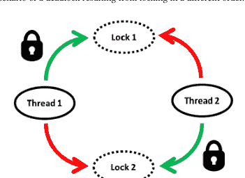

两个线程的死锁

线程 1 和线程 2 需要访问两个资源才能完成各自的工作。当所请求的资源由两个独立的互斥量保护，并且以不同的顺序请求时（线程 1：锁定 1、锁定 2；线程 2：锁定 2、锁定 1），问题就会出现。在这种情况下，线程执行交错进行，以致线程 1 获得互斥量 1，然后线程 2 获得互斥量 2，于是我们陷入停滞。每个线程都想获得对方的互斥量，但另一个线程必须先释放它才能获得另一个互斥量。“致命拥抱”这一说法非常贴切地描述了这种死锁。

将这幅图转换为代码很容易。

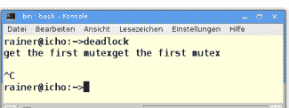

两个线程的死锁

剩下的唯一选择就是按下 CTRL+C 并终止进程。

得益于 `std::lock`，可以很容易地以原子步骤锁定许多可锁定对象（Lockables），例如互斥量或锁。因此，你可以通过以不同顺序锁定可锁定对象来克服死锁。`std::lock` 一节提供了有关使用 `std::lock` 进行原子锁定的更多细节。

锁并不能解决互斥量的所有问题，但在许多情况下能助我们一臂之力。

#### 3.3.2 锁

锁按照 RAII 惯用法管理其资源。锁在构造函数中自动绑定其互斥量，并在析构函数中释放它。这大大降低了死锁风险，因为运行时负责处理该互斥量。

锁有四种不同风格：`std::lock_guard` 适用于简单用例；`std::unique_lock` 适用于高级用例。`std::shared_lock` 自 C++14 起可用，可用于实现读写锁。在 C++17 中，我们有了 `std::scoped_lock`，它可以以原子步骤锁定更多互斥量。

首先，是简单用例。

##### 3.3.2.1 std::lock_guard

```cpp
std::mutex m;
m.lock();
sharedVariable = getVar();
m.unlock();
```

互斥量 `m` 确保对临界区 `sharedVariable = getVar()` 的访问是顺序进行的。在这个特殊情况下，顺序意味着每个线程依次获得对临界区的访问权。这在系统中建立了一种全序。代码很简单，但容易发生死锁。如果临界区抛出异常，或者程序员忘记解锁互斥量，就可能出现死锁。使用 `std::lock_guard`，我们可以更优雅地做到这一点：

```cpp
std::mutex m;
{
    std::lock_guard<std::mutex> lockGuard(m);
    sharedVariable = getVar();
}
```

这很简单，但开头和结尾的花括号是怎么回事？其作用域限制了 `std::lock_guard` 的生命周期，而作用域由花括号定义⁴。这意味着当它经过右花括号时，其生命周期就结束了。正是在那时，`std::lock_guard` 的析构函数被调用，并且——你可能已经猜到了——互斥量被释放。这是自动发生的，而且如果 `sharedVariable = getVar()` 中的 `getVar()` 抛出异常，也会发生。函数作用域和循环作用域也会限制对象的生命周期。

⁴ http://en.cppreference.com/w/cpp/language/scope#Block_scope

##### 3.3.2.2 std::scoped_lock

在 C++17 中，我们有了 `std::scoped_lock`。它与 `std::lock_guard` 非常相似，但 `std::scoped_lock` 还能以原子方式锁定任意数量的互斥量。你必须记住以下几点。

- 1. 如果用一个互斥量 `m` 调用 `std::scoped_lock`，它的行为就像 `std::lock_guard`，并锁定互斥量 `m`：`m.lock`。如果用多个互斥量调用 `std::scoped_lock`（`std::scoped_lock(MutexTypes& ... m)`），它会使用函数 `std::lock(m ...)`。
- 2. 如果当前线程已经拥有其中一个互斥量，并且该互斥量不是递归的，则行为未定义。很有可能你会遇到死锁。
- 3. 你可以只取得互斥量的所有权而不锁定它们。在这种情况下，必须向构造函数提供 `std::adopt_lock_t` 标志：`std::scoped_lock(std::adopt_lock_t, MutexTypes& ... m)`。

使用 `std::scoped_lock` 可以相当优雅地解决前面的死锁。我将在下一节讨论该死锁的解决方法。

##### 3.3.2.3 std::unique_lock

`std::unique_lock` 比它的小兄弟 `std::lock_guard` 更强大，但开销也更大。

除了 `std::lock_guard` 提供的功能之外，`std::unique_lock` 还使你能够：

- 创建时不关联互斥量。
- 创建时不锁定关联的互斥量。
- 显式且重复地设置或释放关联互斥量的锁。
- 递归锁定其互斥量。
- 移动互斥量。
- 尝试锁定互斥量。
- 延迟锁定关联的互斥量。

下表展示了 std::unique_lock lk 的成员函数。

**std::unique_lock 的接口**

| 成员函数 | 描述 |
|---|---|
| `lk.lock()` | 锁定关联的互斥量。 |
| `lk.try_lock()` 和<br>`lk.try_lock_for(relTime)` 和<br>`lk.try_lock_until(absTime)` | 尝试锁定关联的互斥量。<br>在 `relTime` 时间段内尝试锁定关联的互斥量。<br>尝试锁定关联的互斥量，直到时间点 `absTime`。 |
| `lk.unlock()` | 解锁关联的互斥量。 |
| `lk.release()` | 释放互斥量。互斥量仍保持锁定状态。 |
| `lk.swap(lk2)` | 交换锁。与 `std::swap(lk, lk2)` 相同。 |
| `lk.mutex()` | 返回指向关联互斥量的指针。 |
| `lk.owns_lock()` 和<br>`operator bool` | 检查锁 `lk` 是否拥有已锁定的互斥量。 |

`lk.try_lock_for(relTime)` 需要相对时间段；`lk.try_lock_until(absTime)` 需要绝对时间点。`lk.try_lock_for`/`lk.try_lock_until` 实际上会在关联的互斥量上调用成员函数 `mutex.try_lock_for`/`mutex.try_lock_until`。关联的互斥量必须支持独占的定时阻塞。对于时间约束，你应该使用稳定时钟。稳定时钟无法被调整。

`lk.try_lock` 尝试锁定互斥量并立即返回。成功时返回 true，否则返回 false。相比之下，成员函数 `lk.try_lock_for` 和 `lk.try_lock_until` 会阻塞锁 `lk`，直到指定的超时发生或获得锁，以先发生者为准。如果不存在关联的互斥量，或者该互斥量已被此 `std::unique_lock` 锁定，那么 `lk.try_lock`、`lk.try_lock_for` 和 `lk.try_lock_until` 这三个成员函数都会抛出 `std::system_error` 异常。

`lk.release()` 会将底层互斥量从锁对象的控制中移除，并返回指向该互斥量的指针。调用此成员函数后，调用者负责释放它，因为该互斥量不再与锁对象关联。

##### 3.3.2.4 std::shared_lock

在 C++14 中，C++ 增加了对 std::shared_lock 的支持。

`std::shared_lock` 具有与 `std::unique_lock` 相同的接口，但当与 `std::shared_timed_mutex` 或 `std::shared_mutex` 一起使用时，其行为不同。许多线程可以共享一个 `std::shared_timed_mutex`（`std::shared_mutex`），从而实现读写锁。读写锁的思想简单直接，而且极其有用。任意数量的执行读操作的线程可以同时访问临界区，但只允许一个线程进行写操作。

读写锁并不能解决根本问题——线程竞争访问临界区，但它们有助于将瓶颈降到最低。

电话簿是使用读写锁的典型示例。通常，许多人想要查询电话号码，但只有少数人想要修改它们。让我们看一个示例。

### 读写锁

```cpp
// readerWriterLock.cpp

#include <iostream>
#include <map>
#include <shared_mutex>
#include <string>
#include <thread>

std::map<std::string,int> teleBook{{"Dijkstra", 1972}, {"Scott", 1976},
                                  {"Ritchie", 1983}};

std::shared_timed_mutex teleBookMutex;

void addToTeleBook(const std::string& na, int tele){
  std::lock_guard<std::shared_timed_mutex> writerLock(teleBookMutex);
  std::cout << "\nSTARTING UPDATE " << na;
  std::this_thread::sleep_for(std::chrono::milliseconds(500));
  teleBook[na]= tele;
  std::cout << " ... ENDING UPDATE " << na << '\n';
}

void printNumber(const std::string& na){
  std::shared_lock<std::shared_timed_mutex> readerLock(teleBookMutex);
  std::cout << na << ": " << teleBook[na];
}

int main(){

  std::cout << '\n';

  std::thread reader1([]{ printNumber("Scott"); });
  std::thread reader2([]{ printNumber("Ritchie"); });
  std::thread w1([]{ addToTeleBook("Scott",1968); });
}
```


```cpp
std::thread reader3([] { printNumber("Dijkstra"); });
std::thread reader4([] { printNumber("Scott"); });
std::thread w2([] { addToTeleBook("Bjarne", 1965); });
std::thread reader5([] { printNumber("Scott"); });
std::thread reader6([] { printNumber("Ritchie"); });
std::thread reader7([] { printNumber("Scott"); });
std::thread reader8([] { printNumber("Bjarne"); });

reader1.join();
reader2.join();
reader3.join();
reader4.join();
reader5.join();
reader6.join();
reader7.join();
reader8.join();

w1.join();
w2.join();

std::cout << '\n';

std::cout << "\nThe new telephone book" << '\n';
for (auto teleIt: teleBook) {
    std::cout << teleIt.first << ": " << teleIt.second << '\n';
}

std::cout << '\n';
}
```

第9行的电话簿是共享变量，必须受到保护。八个线程想读取电话簿；两个线程想修改它（第31-40行）。为了并发访问电话簿，读取线程在第23行使用 `std::shared_lock<std::shared_timed_mutex>`。这与写入线程形成对比，写入线程需要对临界区进行独占访问。这种独占性由第15行的 `std::lock_guard<std::shared_timed_mutex>` 提供。最后，程序显示更新后的电话簿（第55-58行）。

修复此问题的一种明显方法是在函数 printNumber 中仅使用读取操作：

### 读写锁问题已解决

```cpp
1  // readerWriterLocksResolved.cpp
2
3  ...
4
5  void printNumber(const std::string& na){
6    std::shared_lock<std::shared_timed_mutex> readerLock(teleBookMutex);
7    auto searchEntry = teleBook.find(na);
8    if(searchEntry != teleBook.end()){
9      std::cout << searchEntry->first << ": " << searchEntry->second << '\n';
10   }
11   else {
12     std::cout << na << " not found!" << '\n';
13   }
14 }
15
16 ...
```

如果某个键不在电话簿中，我只把该键和文本 not found! 写到控制台。

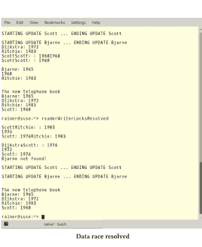

数据竞争已解决

在第二次程序执行中，你可以看到消息 Bjarne not found!。在第一次程序执行中，addToTeleBook 先执行；因此，找到了 Bjarne。

#### 3.3.3 std::lock

std::lock 可以以原子步骤锁定其 Lockables9（例如互斥量或锁）。Lockable 是一种数据类型，支持成员函数 lock、unlock 和 try_lock。std::lock 是可变参数模板，因此可以接受任意数量的参数。std::lock 尝试使用死锁避免算法在一个原子步骤中获取所有锁。这些 Lockable 通过一系列未指定的 lock、try_lock 和 unlock 调用来锁定。如果某次 lock 调用引发异常，则在重新抛出之前，会对任何已锁定的 Lockable 调用 unlock。

还记得“互斥量的问题”小节中的死锁吗？

### 以不同顺序锁定互斥量

```cpp
// deadlock.cpp

#include <iostream>
#include <chrono>
#include <mutex>
#include <thread>

struct CriticalData{
  std::mutex mut;
};

void deadLock(CriticalData& a, CriticalData& b){

  a.mut.lock();
  std::cout << "get the first mutex" << '\n';
  std::this_thread::sleep_for(std::chrono::milliseconds(1));
  b.mut.lock();
  std::cout << "get the second mutex" << '\n';
  // do something with a and b
  a.mut.unlock();
  b.mut.unlock();

}

int main(){

  CriticalData c1;
  CriticalData c2;

  std::thread t1([&]{deadLock(c1,c2);});
  std::thread t2([&]{deadLock(c2,c1);});

  t1.join();
  t2.join();

}
```

让我们解决这个问题。函数 deadLock 必须以原子方式锁定其互斥量，而这正是下面示例中发生的情况。

### 延迟锁定互斥量

```cpp
// deadlockResolved.cpp

#include <iostream>
#include <chrono>
#include <mutex>
#include <thread>

using namespace std;

struct CriticalData{
    mutex mut;
};

void deadLock(CriticalData& a, CriticalData& b){

    unique_lock<mutex> guard1(a.mut,defer_lock);
    cout << "Thread: " << this_thread::get_id() << " first mutex" << '\n';

    this_thread::sleep_for(chrono::milliseconds(1));

    unique_lock<mutex> guard2(b.mut,defer_lock);
    cout << "  Thread: " << this_thread::get_id() << " second mutex" << '\n';

    cout << "    Thread: " << this_thread::get_id() << " get both mutex" << '\n';
    lock(guard1,guard2);
    // do something with a and b
}

int main(){

    cout << '\n';

    CriticalData c1;
    CriticalData c2;

    thread t1([&]{deadLock(c1,c2);});
    thread t2([&]{deadLock(c2,c1);});

    t1.join();
    t2.join();

    cout << '\n';
}
```

如果你用 std::defer_lock 调用 std::unique_lock 的构造函数，则底层互斥量不会自动锁定。此时（第16行和第21行），std::unique_lock 只是互斥量的所有者。得益于可变参数模板 std::lock，锁定操作在一个原子步骤中执行（第25行）。

在此示例中，std::unique_lock 管理资源的生命周期，而 std::lock 锁定关联的互斥量。你也可以反过来做。第一步，锁定互斥量。第二步，std::unique_lock 管理资源的生命周期。下面是第二种方法的示例。

```cpp
std::lock(a.mut, b.mut);
std::lock_guard<std::mutex> guard1(a.mut, std::adopt_lock);
std::lock_guard<std::mutex> guard2(b.mut, std::adopt_lock);
```

两种变体都能解决死锁。

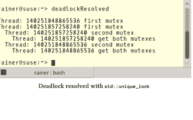

使用 std::unique_lock 解决死锁

##### 3.3.4.1 常量表达式

常量表达式是编译器可以在编译时求值的表达式。它们隐式线程安全。将关键字 constexpr 放在变量前会使该变量成为常量表达式。常量表达式必须立即初始化。

`constexpr double pi = 3.14;`

此外，用户定义的类型也可以是常量表达式。对于这些类型，要使其在编译时初始化，必须满足一些限制。

- 它们不能有虚成员函数或虚基类。
- 它们的构造函数必须是常量表达式。
- 每个基类和每个非静态成员都必须初始化。
- 它们的成员函数（应可在编译时调用）必须是常量表达式。

MyDouble 的实例满足所有这些要求。因此可以在编译时实例化它们。这种实例化是线程安全的。

### 用户定义的常量表达式

```cpp
// constexpr.cpp

#include <iostream>

class MyDouble{
private:
    double myVal1;
    double myVal2;
public:
    constexpr MyDouble(double v1, double v2): myVal1(v1), myVal2(v2){}
    constexpr double getSum() const { return myVal1 + myVal2; }
};

int main() {

    constexpr double myStatVal = 2.0;
    constexpr MyDouble myStatic(10.5, myStatVal);
    constexpr double sumStat = myStatic.getSum();

}
```

```cpp
26    t1.join();
27    t2.join();
28    t3.join();
29    t4.join();
30
31    std::cout << '\n';
32
33 }
```

程序以四个线程开始（第21-24行）。其中两个调用 do_once，另外两个调用 do_once2。预期结果是字符串 "Only once" 或字符串 "Only once2" 只显示一次。

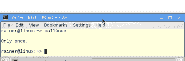

std::call_once 和 std::once_flag 的用法

著名的单例模式保证只创建一个类实例。这在多线程环境中是一项具有挑战性的任务。得益于 std::call_once 和 std::once_flag，这项工作轻而易举。

现在单例以线程安全的方式初始化。

### 使用 std::call_once 和 std::once_flag 的单例模式

```cpp
1    // singletonCallOnce.cpp
2
3    #include <iostream>
4
5    #include <mutex>
6
7    using namespace std;
8
9    class MySingleton{
10
11   private:
12       static once_flag initInstanceFlag;
13       static MySingleton* instance;
14       MySingleton() = default;
15       ~MySingleton() = default;
```


```cpp
static void initSingleton(){
    instance = new MySingleton();
}

public:
    MySingleton(const MySingleton&) = delete;
    MySingleton& operator=(const MySingleton&) = delete;

    static MySingleton* getInstance(){
        call_once(initInstanceFlag, MySingleton::initSingleton);
        return instance;
    }
};

MySingleton* MySingleton::instance = nullptr;
once_flag MySingleton::initInstanceFlag;

int main(){

    cout << '\n';

    cout << "MySingleton::getInstance(): " << MySingleton::getInstance() << '\n';
    cout << "MySingleton::getInstance(): " << MySingleton::getInstance() << '\n';

    cout << '\n';

}
```

我们先回顾静态标志 `initInstanceFlag`。它在第 11 行声明，并在第 17 行初始化。静态成员函数 `initSingleton`（第 24 - 27 行）使用标志 `initInstanceFlag`，以确保静态成员函数 `initSingleton`（第 16 - 18 行）恰好执行一次。单例在该成员函数体内创建。


## default 和 delete

你可以使用关键字 `default` 向编译器请求特殊成员函数。这些成员函数之所以特殊，是因为编译器可以为我们创建它们。

用 `delete` 注解成员函数的结果是：编译器生成的成员函数不可用，因此不能被调用。如果你尝试使用它们，就会得到编译时错误。以下是关键字 `default` 和 `delete` 的详细信息。

https://isocpp.org/wiki/faq/cpp11-language-classes

```cpp
22 MySingleton::getInstance();
23
24 }
```

## 了解编译器对 static 的支持

如果你在并发环境中使用 Meyers Singleton，请确保你的编译器以 C++11 线程安全语义实现静态变量。程序员依赖静态变量的 C++11 语义，但其编译器并不支持，这种情况相当常见。结果可能是创建了不止一个单例实例。

thread_local 数据没有共享问题。

### 3.4 线程局部数据

线程局部数据，也称为线程局部存储，是为每个线程分别创建的。它的行为类似静态数据，因为它绑定到线程的生命周期，并在首次使用时创建。这意味着，命名空间作用域中的线程局部变量或作为静态类成员的线程局部变量会在首次使用前创建，而函数中声明的线程局部变量会在首次使用时创建。线程局部数据专属于该线程。

### 线程局部数据

```cpp
// threadLocal.cpp

#include <iostream>
#include <string>
#include <mutex>
#include <thread>

std::mutex coutMutex;

thread_local std::string s("hello from ");

void addThreadLocal(std::string const& s2){

    s += s2;
    // protect std::cout
    std::lock_guard<std::mutex> guard(coutMutex);
    std::cout << s << '\n';
    std::cout << "s: " << s << '\n';
    std::cout << '\n';

}

int main(){

    std::cout << '\n';

    std::thread t1(addThreadLocal,"t1");
    std::thread t2(addThreadLocal,"t2");
    std::thread t3(addThreadLocal,"t3");
    std::thread t4(addThreadLocal,"t4");

    t1.join();
    t2.join();
    t3.join();
    t4.join();
}
```

```cpp
36
37 std::cout << s << '\n';
38 std::cout << "&s: " << &s << '\n';
39
40 }
```

在第 10 行使用关键字 thread_local，创建了线程局部字符串 s。线程 t1 - t4（第 27 - 30 行）使用函数 addThreadLocal（第 12 - 21 行）作为其工作包。线程分别获得字符串 t1 到 t4 作为参数，并将它们添加到线程局部字符串 s 中。此外，addThreadLocal 在第 18 行显示 s 的地址。主线程也是一个线程，它获得自己的 s 副本（第 37 行）。

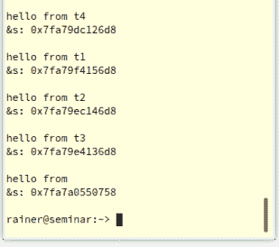

线程局部数据

程序的输出在第 17 行隐式地、在第 18 行显式地展示了这一点。线程局部字符串是为每个线程 t1 - t4 以及主线程创建的。首先，每个输出都显示一个新的线程局部字符串。其次，每个字符串的地址都不同。

我经常在研讨会上讨论：静态变量、thread_local 变量和局部变量之间有什么区别？静态变量绑定到主线程的生命周期，thread_local 变量绑定到其线程的生命周期，而局部变量绑定到创建它的作用域的生命周期。下面是前一个程序 threadLocal.cpp 的一个变体，用以清楚说明我的观点。

### 函数调用之间的状态

```cpp
// threadLocalState.cpp

#include <iostream>
#include <string>
#include <mutex>
#include <thread>

std::mutex coutMutex;

thread_local std::string s("hello from ");

void first(){
    s += "first ";
}

void second(){
    s += "second ";
}

void third(){
    s += "third";
}

void addThreadLocal(std::string const& s2){

    s += s2;

    first();
    second();
    third();
    // protect std::cout
    std::lock_guard<std::mutex> guard(coutMutex);
    std::cout << "s: " << &s << '\n';
    std::cout << '\n';
}

int main(){

    std::cout << '\n';

    std::thread t1(addThreadLocal,"t1: ");
    std::thread t2(addThreadLocal,"t2: ");
}
```

与线程局部数据相比，条件变量并不容易使用。

```cpp
21      doTheWork();
22      std::cout << "Work done." << '\n';
23  }
24
25  void setDataReady(){
26  {
27      std::lock_guard<std::mutex> lck(mutex_);
28      dataReady = true;
29  }
30      std::cout << "Sender: Data is ready."  << '\n';
31      condVar.notify_one();
32  }
33
34  int main(){
35
36      std::cout << '\n';
37
38      std::thread t1(waitingForWork);
39      std::thread t2(setDataReady);
40
41      t1.join();
42      t2.join();
43
44      std::cout << '\n';
45
46  }
```

该程序有两个子线程：`t1` 和 `t2`。它们分别在第 38 行和第 39 行获得工作包 `waitingForWork` 和 `setDataReady`。`setDataReady` 使用条件变量 `condVar` 通知工作准备已完成：`condVar.notify_one()`。线程 `t1` 在持有锁的同时等待其通知：`condVar.wait(lck, []{ return dataReady; });`。发送者和接收者都需要锁。对于发送者，`std::lock_guard` 就足够了，因为它只调用一次 lock 和 unlock。对于接收者，`std::unique_lock` 是必要的，因为它会频繁锁定和解锁其互斥量。

下面是该程序的输出。

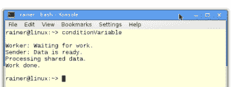

用条件变量同步两个线程

## std::condition_variable_any

std::condition_variable 只能等待 std::unique_lock<mutex> 类型的对象，而 std::condition_variable_any 可以等待用户提供的、满足 BasicLockable^1 概念的锁类型。泛化的 std::condition_variable_any 支持与 std::condition_variable 相同的接口。

#### 3.5.1 谓词

也许你会疑惑，为什么 wait 调用需要谓词，因为你可以不带谓词调用 wait。让我们试一试。

**阻塞条件变量**

```cpp
    1 // conditionVariableBlock.cpp
    2
    3 #include <iostream>
    4 #include <condition_variable>
    5 #include <mutex>
    6 #include <thread>
    7
    8 std::mutex mutex_;
    9 std::condition_variable condVar;
    10
    11 void waitingForWork(){
    12
    13     std::cout << "Worker: Waiting for work." << '\n';
    14
    15     std::unique_lock<std::mutex> lck(mutex_);
    16     condVar.wait(lck);
```

> 1) http://en.cppreference.com/w/cpp/concept/BasicLockable

#### 3.5.2 丢失唤醒与虚假唤醒

**丢失唤醒**

丢失唤醒现象是指发送者在接收者进入等待状态之前就发送了通知。后果是通知丢失。C++ 标准将条件变量描述为一种同时同步机制：“condition_variable 类是一种同步原语，可用于阻塞一个线程或多个线程，同时……”。因此通知会丢失，而接收者会一直等待、等待……

**虚假唤醒**

接收者可能会醒来，尽管没有发生任何通知。至少 POSIX Threads[^13] 和 Windows API[^14] 可能成为这些现象的受害者。虚假唤醒的一个原因可能是唤醒被抢占。这意味着，在醒来的线程有机会运行之前，另一个线程插入并运行了。

#### 3.5.3 等待工作流程

等待线程的工作流程相当复杂。

下面是前一个示例 conditionVariable.cpp 中两条基础代码行 19 和 20。

```cpp
std::unique_lock<std::mutex> lck(mutex_);
condVar.wait(lck, []{ return dataReady; });
```

这两行等价于下面四行：

```cpp
std::unique_lock<std::mutex> lck(mutex_);
while ( ![]{ return dataReady; }() ) {
    condVar.wait(lck);
}
```

首先，你必须区分 `std::unique_lock<std::mutex> lck(mutex_)` 的首次调用与条件变量 `condVar.wait(lck)` 的通知。

- `std::unique_lock<std::mutex> lck(mutex_)`：在初始处理中，线程锁定互斥量，然后检查谓词 `[]{ return dataReady; }`。
  - 如果谓词调用结果为
    - `true`：线程继续工作。
    - `false`：`condVar.wait()` 解锁互斥量并将线程置于等待（阻塞）状态

[^13]: https://en.wikipedia.org/wiki/POSIX_Threads
[^14]: https://en.wikipedia.org/wiki/Windows_API


- `condVar.wait(lck)`: 如果条件变量 condVar 正在等待，并且收到通知或发生虚假唤醒，将执行以下步骤。
  - 线程被解除阻塞，并重新获取互斥锁。
  - 线程检查谓词。
  - 如果对谓词的调用求值结果为
    - `true`：线程继续其工作。
    - `false`：`condVar.wait()` 解锁互斥锁，并将线程置于等待（阻塞）状态。

即使共享变量是原子类型，也必须在互斥锁下进行修改，才能将修改正确发布给等待线程。

## 使用互斥锁保护共享变量

即使你将 dataReady 设为原子类型，也必须在互斥锁下修改；否则，修改可以被发布给等待线程，但并未正确同步。这种竞态条件可能导致死锁。这意味着什么：已发布，但未正确同步。让我们更仔细地看一下等待流程，并假设 dataReady 是原子类型，其修改不受互斥锁 mutex_ 保护。

```cpp
1    std::unique_lock<std::mutex> lck(mutex_);
2    while (![]{ return dataReady.load(); }()) {
3        // time window
4        condVar.wait(lck);
5    }
```

我假设通知是在条件变量 condVar 没有等待时发送的。这意味着线程的执行正处于第 2 行与第 4 行之间的代码片段中（见注释 time window）。结果是通知丢失了。之后，线程重新进入等待状态，并且可能会永远等待下去。

如果互斥锁保护了 'dataReady'，这种情况就不会发生。由于互斥锁的同步作用，只有条件变量（以及接收线程）处于等待状态时，通知才会被发送。

在大多数用例中，任务（tasks）是一种更不容易出错的线程同步方式。在“返回通知”一节中，我比较了条件变量和任务。

### 3.6 协作式中断（C++20）

协作式中断线程的附加功能基于 std::stop_source、std::stop_token 和 std::stop_callback 类。std::jthread 和 std::condition_variable_any 在设计上支持协作式中断。

首先，为什么杀死线程不是一个好主意？

### 杀死线程是危险的

杀死线程是危险的，因为你不知道线程的状态。以下是两种可能的有害后果。

- 线程可能只完成了一半的工作。因此，你不知道它的工作处于什么状态，也就不知道程序处于什么状态。最终你会得到未定义行为，一切后果都无法预料。
- 线程可能正处于临界区中，并且已经锁定了互斥锁。在线程持有互斥锁时将其杀死，极有可能导致死锁。

std::stop_source、std::stop_token 和 std::stop_callback 类允许线程异步请求某个执行停止，或询问某个执行是否收到了停止信号。std::stop_token 可以被传递给某个操作，之后用于主动轮询该 token 是否有停止请求，或通过 std::stop_callback 注册回调。停止请求由 std::stop_source 发出。该信号会影响所有关联的 std::stop_token。这三个类 std::stop_source、std::stop_token 和 std::stop_callback 共享关联停止状态的所有权。

在接下来的小节中，我将提供关于协作式中断的更详细信息。

#### 3.6.1 std::stop_source

你可以用两种方式构造 std::stop_source：

std::stop_source 的构造函数

```cpp
std::stop_source();
explicit std::stop_source(std::nostopstate_t) noexcept;
```

默认构造函数（第 1 行）构造一个具有新停止状态的 std::stop_source。接受 std::nostopstate_t 的构造函数（第 2 行）构造一个没有关联停止状态的空的 std::stop_source。

std::stop_source 组件 src 提供以下成员函数来处理停止请求。

### std::stop_source 的成员函数

| 成员函数 | 描述 |
| --- | --- |
| std::stop_source src | 默认构造函数创建一个具有关联停止状态的停止源。 |
| std::stop_source src(nostopstate) | 创建一个没有关联停止状态的 stop_source。 |
| src.get_token() | 如果 src.stop_possible() 成立，则为关联的停止状态返回一个 stop_token；否则，返回默认构造的（空）stop_token。 |
| src.stop_possible() | 如果 src 可被请求停止，则为 true。 |
| src.stop_requested() | 如果 stop_possible() 成立且某个所有者已调用 request_stop()，则为 true。 |
| src.request_stop() | 如果 src.stop_possible() 成立且 !src.stop_requested()，则发出停止请求；否则，该调用无效。 |

当 src 具有关联的停止状态且之前曾被请求停止时，src.stop_requested() 返回 true。

如果 src 没有关联的停止状态，或不再有停止源，并且之前从未请求过停止，则 src.stop_possible() 返回 false。

调用 src.stop_possible()、src.stop_requested() 和 src.request_stop() 是线程安全的。

停止源 src 的 src.request_stop() 对所有 std::stop_token 以及同一关联停止状态下的已注册回调都是可见的。此外，任何在关联 std::stop_token 上等待的 std::condition_variable_any 都会被唤醒。停止请求一旦发出，就无法撤销。如果 src 具有关联的停止状态，并且之前未被请求停止，则 src.request_stop() 成功并返回 true。

#### 3.6.2 std::stop_token

std::stop_token 本质上是关联停止状态的一个线程安全“视图”。它通常通过 src.get_token() 从 std::jthread 或 std::stop_source src 获取。这使得它们与 std::jthread 或 std::stop_source 共享相同的关联停止状态。

借助 std::stop_token，你可以检查关联的 std::stop_source 是否已发出停止请求。

std::stop_token 还可以传递给 std::stop_callback 的构造函数，或传给 std::condition_variable_any 的可中断等待函数。

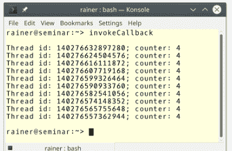

回调的使用

std::stop_callback 构造函数会为关联的 std::stop_source 给定的 std::stop_token 注册回调函数。该回调函数要么在调用 request_stop() 的线程中执行，要么在构造 std::stop_callback 的线程中执行。如果停止请求发生在 std::stop_callback 注册之前，则回调在构造 std::stop_callback 的线程中执行。否则，回调在调用 request_stop() 的线程中执行。

你可以使用同一个 std::stop_token 为一个或多个线程注册多个回调。C++ 标准不保证这些回调的执行顺序。

### 停止请求在回调注册之前到达

```cpp
1   // invokeCallbacks.cpp

2
3   #include <chrono>
4   #include <iostream>
5   #include <thread>
6
7   using namespace std::literals;
8
9   void func(std::stop_token stopToken) {
10      std::this_thread::sleep_for(100ms);
11      for (int i = 0; i <= 9; ++i) {
12          std::stop_callback cb(stopToken, [i] { std::cout << i; });
13      }
14      std::cout << '\n';
15  }
16
17  int main() {
18
19      std::cout << '\n';
20
21      std::jthread thr1 = std::jthread(func);
22      std::jthread thr2 = std::jthread(func);
23      thr1.request_stop();
24      thr2.request_stop();
25
26      std::cout << '\n';
27
28 }
```

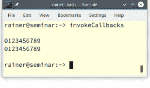

停止请求在回调注册之前到达

前面的程序 `invokeCallbacks.cpp` 演示了停止请求在回调注册之前到达的情况，因此子线程必须在注册期间执行每个处理器。

下面的程序 `invokeCallbacksLoop.cpp` 演示了回调先于停止请求注册的情况。

### 停止请求在回调注册之后到达

```cpp
1 // invokeCallbacksLoop.cpp

2
3 #include <chrono>
4 #include <functional>
5 #include <iostream>
6 #include <list>
7 #include <stop_token>
8 #include <thread>
9
10 using namespace std::literals;
11
```


```cpp
using handler_t = std::function<void()>;
using callback_t = std::stop_callback<handler_t>;

void func(std::stop_token stopToken) {
    std::list<callback_t> callbacks;
    for (int i = 0; i < 9; ++i) {
        callbacks.emplace_back(stopToken, [i] { std::cout << i; });
    }
    std::this_thread::sleep_for(100ms);
    std::cout << '\n';
}

int main() {
    std::cout << '\n';

    std::jthread thr1 = std::jthread(func);
    std::jthread thr2 = std::jthread(func);
    std::this_thread::sleep_for(50ms);
    thr1.request_stop();
    thr2.request_stop();

    std::cout << '\n';
}
```


停止请求在回调注册之后到达

#### 3.6.4 发送信号的通用机制

`std::stop_source` 和 `std::stop_token` 这一对可以被视为发送信号的通用机制。通过复制 `std::stop_token`，你可以将信号发送给任何正在执行某些操作的实体。

在下面的示例中，我以各种组合使用 std::async、std::promise、std::thread 和 std::jthread。

### 向各种执行实体发送信号

```cpp
// signalStopRequests.cpp

#include <iostream>
#include <thread>
#include <future>

using namespace std::literals;

void function1(std::stop_token stopToken, const std::string& str){
    std::this_thread::sleep_for(1s);
    if (stopToken.stop_requested()) std::cout << str << ": Stop requested\n";
}

void function2(std::promise<void> prom,
               std::stop_token stopToken, const std::string& str) {
    std::this_thread::sleep_for(1s);
    std::stop_callback callBack(stopToken, [&str] {
        std::cout << str << ": Stop requested\n";
    });
    prom.set_value();
}

int main() {

    std::cout << '\n';

    std::stop_source stopSource;

    std::stop_token stopToken = std::stop_token(stopSource.get_token());

    std::thread thr1 = std::thread(function1, stopToken, "std::thread");

    std::jthread jthr = std::jthread(function1, "std::jthread");

    auto fut1 = std::async([stopToken] {
        std::this_thread::sleep_for(1s);
        if (stopToken.stop_requested()) std::cout << "std::async: Stop requested\n";
    });

    std::promise<void> prom;
    auto fut2 = prom.get_future();
```

- 已完成：调用 `stopSource.request_stop` 无效。回调不会执行。

让我们看看在上一个程序 `signalStopRequests.cpp` 中，在调用 `stopSource.request_stop` 之前先 join 线程 `thr1` 和 `thr2` 会发生什么。这里第 44 和 45 行与第 47 和 48 行交换了。

### 过晚发送信号

```
44    thr1.join();
45    thr2.join();

47    stopSource.request_stop();
48    if (stopToken.stop_requested()) std::cout << "main: Stop requested\n";
```

行的交换导致只有主线程对信号作出反应。


#### 3.6.5 `std::jthread` 的附加功能

`std::jthread` 是一个具有协作式中断附加功能的 `std::thread`。为了支持此功能，它拥有一个 `std::stop_source`。

`std::jthread` 对象 `jthr` 用于停止令牌处理的成员函数

| 成员函数 | 描述 |
|---|---|
| `jthr.get_stop_source()` | 返回与共享停止状态关联的 `std::stop_source` 对象。 |
| `jthr.get_stop_token()` | 返回与共享停止状态关联的 `std::stop_token` 对象。 |
| `jthr.request_stop()` | 通过共享停止状态请求停止执行。如果停止请求成功，则返回 true。 |

`std::jthread` 一节提供了关于 `std::jthread` 协作式中断的详细信息。

#### 3.6.6 `condition_variable_any` 的新等待重载

`std::condition_variable_any` 是 `std::condition_variable`<sup>45</sup> 的泛化。`std::condition_variable` 需要 `std::unique_lock<std::mutex>`，但 `std::condition_variable_any` 可以作用于任何锁，支持 `lock()` 和 `unlock()`。

`std::condition_variable_any` 的 `wait`、`wait_for` 和 `wait_until` 三种等待变体获得了新的重载。它们接受一个 `std::stop_token`。

**三种新的等待重载**

```cpp
template <class Predicate>
bool wait(Lock& lock,
          stop_token stoken,
          Predicate pred);

template <class Rep, class Period, class Predicate>
bool wait_for(Lock& lock,
              stop_token stoken,
              const chrono::duration<Rep, Period>& rel_time,
              Predicate pred);

template <class Clock, class Duration, class Predicate>
bool wait_until(Lock& lock,
                stop_token stoken,
                const chrono::time_point<Clock, Duration>& abs_time,
                Predicate pred);
```

这些新重载需要一个谓词。所展示的版本确保如果传入的 `std::stop_token stoken` 的停止请求被发出信号，线程会被通知。函数返回一个布尔值，指示谓词是否求值为 true。返回的布尔值与是否请求停止或是否触发超时无关。三个重载等价于以下表达式：

> 45 https://en.cppreference.com/w/cpp/thread/condition_variable

### 三个重载的等价表达式

```cpp
// wait in lines 1 - 4
while (!token.stop_requested()) {
    if (pred()) return true;
    wait(lock);
}
return pred();

// wait_for in lines 6 - 10
return wait_until(lock,
                  std::chrono::steady_clock::now() + rel_time,
                  std::move(pred)
                  );

// wait_until in lines 12 - 16
while (!token.stop_requested()) {
    if (pred()) return true;
    if (wait_until(lock, timeout_time) == std::cv_status::timeout) return pred();
}
return pred();
```

在等待调用之后，你可以检查是否发生了停止请求。

### 使用 wait 处理中断

```cpp
cv.wait(lock, stoken, predicate);
if (stoken.stop_requested()){
    // interrupt occurred
}
```

### 带停止请求使用条件变量

```cpp
// conditionalVariableAny.cpp

#include <condition_variable>
#include <thread>
#include <iostream>
#include <chrono>
#include <mutex>
#include <thread>

using namespace std::literals;

std::mutex mut;
std::condition_variable_any condVar;

bool dataReady;

void receiver(std::stop_token stopToken) {

    std::cout << "Waiting" << '\n';

    std::unique_lock<std::mutex> lck(mut);
    bool ret = condVar.wait(lck, stopToken, []{ return dataReady; });
    if (ret) {
        std::cout << "Notification received: " << '\n';
    }
    else {
        std::cout << "Stop request received" << '\n';
    }
}

void sender() {

    std::this_thread::sleep_for(5ms);
    {
        std::lock_guard<std::mutex> lck(mut);
        dataReady = true;
        std::cout << "Send notification" << '\n';
    }
    condVar.notify_one();

}

int main(){

    std::cout << '\n';

    std::jthread t1(receiver);
    std::jthread t2(sender);

    t1.request_stop();

    t1.join();
    t2.join();

    std::cout << '\n';
}
```

### 3.7 信号量（C++20）

信号量是一种用于控制对共享资源并发访问的同步机制。计数信号量是计数器大于零的信号量。构造函数初始化计数器。获取信号量会减少计数器，释放信号量会增加计数器。如果线程在计数器为零时尝试获取信号量，该线程将阻塞，直到另一个线程通过释放信号量来增加计数器。

### Edgar W. Dijkstra 发明了信号量

荷兰计算机科学家 Edgar W. Dijkstra<sup>15</sup> 于 1965 年提出了信号量的概念。信号量是一种带有队列和计数器的数据结构。计数器初始化为等于或大于零的值。它支持 wait 和 signal 两种操作。操作 wait 获取信号量并减少计数器。如果计数器为零，它会阻塞线程获取信号量。操作 signal 释放信号量并增加计数器。被阻塞的线程被加入队列以避免饥饿<sup>17</sup>。

最初，信号量是一种铁路信号。


信号量

原始上传者为英文维基百科的 AmosWolfe。- 从 en.wikipedia 转移至 Commons，CC BY 2.6。<sup>18</sup>

C++20 支持 `std::binary_semaphore`，它是 `std::counting_semaphore<1>` 的别名。在本文中

- 15. https://en.wikipedia.org/wiki/Edgar_W._Dijkstra
- 17. https://en.wikipedia.org/wiki/Starvation_(computer_science)
- 18. https://commons.wikimedia.org/w/index.php?curid=1972304


在这种情况下，最小最大值是 1。`std::binary_semaphore` 可用于实现[锁](#)¹⁹。

```cpp
using binary_semaphore = std::counting_semaphore<1>;
```

与 `std::mutex` 不同，`std::counting_semaphore` 不绑定到线程。这意味着信号量的获取和释放调用可以发生在不同线程上。下表展示了 `std::counting_semaphore` 的接口。

**`std::counting_semaphore` 的成员函数**

| 成员函数 | 描述 |
|---|---|
| `std::semaphore sem{num}` | 创建一个计数器为 `num` 的信号量。 |
| `sem.max()`（静态） | 返回计数器的最大值。 |
| `sem.release(upd = 1)` | 将计数器增加 `upd`，随后解除正在获取信号量 `sem` 的线程的阻塞。 |
| `sem.acquire()` | 将计数器减 1，或阻塞直到计数器大于 0。 |
| `sem.try_acquire()` | 如果计数器大于 0，则尝试将其减 1。 |
| `sem.try_acquire_for(relTime)` | 尝试将计数器减 1；如果计数器为 0，则最多阻塞 `relTime`。 |
| `sem.try_acquire_until(absTime)` | 尝试将计数器减 1；如果计数器为 0，则最多阻塞到 `absTime`。 |

构造函数调用 `std::counting_semaphore<10> sem(5)` 创建一个信号量 `sem`，其最大计数值至少为 10，计数器为 5。调用 `sem.max()` 返回内部计数器的最大可能值。对于 `sem.release(upd = 1)` 中的 `upd`，必须满足以下关系：`upd >= 0` 且 `upd + counter <= sem.max()`。`sem.try_acquire_for(relTime)` 需要一个[时间段](#)；成员函数 `sem.try_acquire_until(absTime)` 需要一个[时间点](#)。三个调用 `sem.try_acquire`、`sem.try_acquire_for` 和 `sem.try_acquire_until` 返回一个布尔值，指示调用是否成功。

信号量通常用于发送者-接收者工作流。例如，将信号量 `sem` 初始化为 0 会阻塞接收者的 `sem.acquire()` 调用，直到发送者调用 `sem.release()`。因此，接收者等待发送者的通知。使用信号量可以轻松实现线程的一次性同步。

¹⁹ https://en.cppreference.com/w/cpp/named_req/BasicLockable

## 使用 `std::counting_semaphore` 进行线程同步

```cpp
// threadSynchronizationSemaphore.cpp

#include <iostream>
#include <semaphore>
#include <thread>
#include <vector>

std::vector<int> myVec{};

std::counting_semaphore<1> prepareSignal(0);

void prepareWork() {
    myVec.insert(myVec.end(), {0, 1, 0, 3});
    std::cout << "Sender: Data prepared." << '\n';
    prepareSignal.release();
}

void completeWork() {
    std::cout << "Waiter: Waiting for data." << '\n';
    prepareSignal.acquire();
    myVec[2] = 2;
    std::cout << "Waiter: Complete the work." << '\n';
    for (auto i : myVec) std::cout << i << " ";
    std::cout << '\n';
}

int main() {
    std::cout << '\n';

    std::thread t1(prepareWork);
    std::thread t2(completeWork);

    t1.join();
    t2.join();

    std::cout << '\n';
}
```

`std::counting_semaphore` prepareSignal（第 10 行）可以取值为 0 和 1。在具体示例中，它被初始化为 0（第 10 行）。这意味着调用 `prepareSignal.release()` 会将值设为 1（第 16 行），并解除对调用 `prepareSignal.acquire()` 的阻塞（第 22 行）。

```
C:\Users\seminar>threadSynchronisationSemaphore.exe

Sender: Data prepared.
Waiter: Waiting for data.
Waiter: Complete the work.
0 1 2 3

C:\Users\seminar>threadSynchronisationSemaphore.exe

Sender: Data prepared.
Waiter: Waiting for data.
Waiter: Complete the work.
0 1 2 3

C:\Users\seminar>threadSynchronisationSemaphore.exe

Waiter: Waiting for data.
Sender: Data prepared.
Waiter: Complete the work.
0 1 2 3

C:\Users\seminar>threadSynchronisationSemaphore.exe

Sender: Data prepared.
Waiter: Waiting for data.
Waiter: Complete the work.
0 1 2 3

C:\Users\seminar>
```

使用信号量进行线程同步

### 3.8 闩锁与屏障（C++20）

闩锁和屏障是协调类型，可使某些线程阻塞，直到计数器变为零。首先，不要将新的屏障与内存屏障（也称为栅栏）混淆。在 C++20 中，我们得到两种变体的闩锁和屏障：`std::latch` 和 `std::barrier`。并发调用 `std::latch` 或 `std::barrier` 的成员函数不会产生数据竞争。

首先，有两个问题：

- 1. 这两种协调线程的机制之间有什么区别？`std::latch` 只能使用一次，但 `std::barrier` 可以使用多次。`std::latch` 有助于由多个线程管理一个任务。`std::barrier` 有助于由多个线程管理重复任务。此外，`std::barrier` 使您能够在所谓的完成步骤中执行一个函数。完成步骤是计数器变为零时的状态。
- 2. 闩锁和屏障支持哪些在 C++11 和 C++14 中无法通过 future、线程，或条件变量与锁结合完成的用例？闩锁和屏障并未解决新的用例，但它们更易于使用。它们还更具性能，因为内部通常使用无锁机制。

#### 3.8.1 std::latch

现在，让我们更仔细地查看 `std::latch` 的接口。

**`std::latch` 的成员函数**

| 成员函数 | 描述 |
| --- | --- |
| `std::latch lat{cnt}` | 创建一个计数器为 `cnt` 的 `std::latch`。 |
| `lat.count_down(upd = 1)` | 以原子方式将计数器减 `upd`，且不阻塞调用者。 |
| `lat.try_wait()` | 如果计数器 `== 0`，则返回 true。 |
| `lat.wait()` | 如果计数器 `== 0`，则立即返回。否则阻塞直到计数器 `== 0`。 |
| `lat.arrive_and_wait(upd = 1)` | 等价于 `count_down(upd); wait();`。 |
| `std::latch::max` | 返回实现所支持的计数器的最大值 |

`upd` 的默认值为 1。当 `upd` 大于计数器值或为负数时，行为未定义。顾名思义，调用 `lat.try_wait()` 实际上从不等待。

以下程序 `bossWorkers.cpp` 使用两个 `std::latch` 构建一个老板-工作者工作流。我使用函数 `synchronizedOut`（第 13 行）将输出同步到 `std::cout`。这种同步使工作流更容易跟踪。

## 使用两个 std::latch 的老板-工作者工作流

```cpp
// bossWorkers.cpp

#include <iostream>
#include <mutex>
#include <latch>
#include <thread>

std::latch workDone(6);
std::latch goHome(1);

std::mutex coutMutex;

void synchronizedOut(const std::string& s) {
    std::lock_guard<std::mutex> lo(coutMutex);
    std::cout << s;
}

class Worker {
public:
    Worker(std::string n): name(n) { };

    void operator()() {
        // notify the boss when work is done
        synchronizedOut(name + ": " + "Work done!\n");
        workDone.count_down();

        // waiting before going home
        goHome.wait();
        synchronizedOut(name + ": " + "Good bye!\n");
    }
private:
    std::string name;
};

int main() {

    std::cout << '\n';

    std::cout << "BOSS: START WORKING! " << '\n';

    Worker herb(" Herb");
    std::thread herbWork(herb);

    Worker scott("       Scott");
    std::thread scottWork(scott);

    Worker bjarne("       Bjarne");
    std::thread bjarneWork(bjarne);

    Worker andrei("       Andrei");
    std::thread andreiWork(andrei);

    Worker andrew("       Andrew");
    std::thread andrewWork(andrew);

    Worker david("       David");
    std::thread davidWork(david);

    workDone.wait();

    std::cout << '\n';

    goHome.count_down();

    std::cout << "BOSS: GO HOME!" << '\n';

    herbWork.join();
    scottWork.join();
    bjarneWork.join();
    andreiWork.join();
    andrewWork.join();
    davidWork.join();

}
```

这个工作流的思路很直接。六个工作者 herb、scott、bjarne、andrei、andrew 和 david（第 41 - 57 行）必须完成他们的工作。当每个工作者完成其工作后，它会将 `std::latch` workDone 的计数减一（第 25 行）。老板（主线程）在第 59 行被阻塞，直到计数器变为 0。当计数器为 0 时，老板使用第二个 `std::latch` goHome 通知其工作者回家。在这种情况下，初始计数器为 1（第 9 行）。调用 `goHome.wait()` 会阻塞，直到计数器变为 0。


使用两个 `std::latch` 的老板-工人工作流程

当你思考这个工作流程时，可能会注意到没有老板也能完成。如下所示。

### 使用 `std::latch` 的工作者工作流程

```cpp
 1  // workers.cpp
 2
 3  #include <iostream>
 4  #include <latch>
 5  #include <mutex>
 6  #include <thread>
 7
 8  std::latch workDone(6);
 9  std::mutex coutMutex;
10
11  void synchronizedOut(const std::string& s) {
12      std::lock_guard<std::mutex> lo(coutMutex);
13      std::cout << s;
14  }
15
16  class Worker {
17  public:
18      Worker(std::string n): name(n) { };
19      void operator()() {
20          synchronizedOut(name + ": " + "Work done!\n");
21          workDone.arrive_and_wait(); // wait until all work is done
22          synchronizedOut(name + ": " + "See you tomorrow!\n");
23      }
24
25  private:
26      std::string name;
27  };
28
29  int main() {
30
31      std::cout << '\n';
32
33      Worker herb("  Herb");
34      std::thread herbWork(herb);
35
36      Worker scott("    Scott");
37      std::thread scottWork(scott);
38
39      Worker bjarne("      Bjarne");
40      std::thread bjarneWork(bjarne);
41
42      Worker andrei("        Andrei");
43      std::thread andreiWork(andrei);
44
45      Worker andrew("          Andrew");
46      std::thread andrewWork(andrew);
47
48      Worker david("            David");
49      std::thread davidWork(david);
50
51      herbWork.join();
52      scottWork.join();
53      bjarneWork.join();
54      andreiWork.join();
55      andrewWork.join();
56      davidWork.join();
57
58  }
```

这个简化的工作流程无需过多解释。调用 `workDone.arrive_and_wait()`（第 22 行）等价于调用 `count_down(upd); wait();`。这意味着工作者可以自行协调，不再需要老板，正如前一个程序 `bossWorkers.cpp` 中的情况。


`std::barrier` 与 `std::latch` 相似。

#### 3.8.2 `std::barrier`

`std::latch` 和 `std::barrier` 之间有两个区别。首先，`std::barrier` 可以使用多次；其次，你可以为下一阶段调整计数器。计数器在 `std::barrier bar` 的构造函数中设置。调用 `bar.arrive()`、`bar.arrive_and_wait()` 和 `bar.arrive_and_drop()` 会递减当前阶段的计数器。此外，`bar.arrive_and_drop()` 还会递减下一阶段的计数器。当当前阶段结束、计数器变为零后，所谓的“完成步骤”（completion step）立即开始。在此完成步骤中，会调用一个可调用对象。`std::barrier` 在其构造函数中获取这个可调用对象。

完成步骤会执行以下步骤：

- 1. 所有线程都被阻塞。
- 2. 任意一个线程被解除阻塞并执行可调用对象。该可调用对象不得抛出异常，且必须是 `noexcept`。
- 3. 如果完成步骤已结束，所有线程都会被解除阻塞。

### `std::barrier` 的成员函数

| 成员函数 | 描述 |
| --- | --- |
| `std::barrier bar{cnt}` | 创建一个计数器为 `cnt` 的 `std::barrier`。 |
| `std::barrier bar{cnt, call}` | 创建一个计数器为 `cnt` 且带可调用对象 `call` 的 `std::barrier`。 |
| `bar.arrive(upd)` | 以原子方式将计数器递减 `upd`。 |
| `bar.wait()` | 在同步点阻塞，直到完成步骤结束。 |
| `bar.arrive_and_wait()` | 等价于 `wait(arrive())`。 |
| `bar.arrive_and_drop()` | 将当前阶段和后续阶段的计数器各减一。 |
| `std::barrier::max` | 实现支持的最大值。 |

调用 `bar.arrive_and_drop()` 本质上意味着下一阶段的计数器减一。

程序 `FullTimePartTimeWorkers.cpp` 在第二阶段将工作者数量减半。

### 全职与兼职工作者

```cpp
// FullTimePartTimeWorkers.cpp

#include <iostream>
#include <barrier>
#include <mutex>
#include <string>
#include <thread>

std::barrier workDone(6);
std::mutex coutMutex;

void synchronizedOut(const std::string& s) noexcept {
  std::lock_guard<std::mutex> lo(coutMutex);
  std::cout << s;
}

class FullTimeWorker {
public:
  FullTimeWorker(std::string n): name(n) { };

  void operator() () {
    synchronizedOut(name + ": " + "Morning work done!\n");
    workDone.arrive_and_wait();  // Wait until morning work is done
    synchronizedOut(name + ": " + "Afternoon work done!\n");
    workDone.arrive_and_wait();  // Wait until afternoon work is done
  }
private:
  std::string name;
};

class PartTimeWorker {
public:
  PartTimeWorker(std::string n): name(n) { };

  void operator() () {
    synchronizedOut(name + ": " + "Morning work done!\n");
    workDone.arrive_and_drop();  // Wait until morning work is done
  }
private:
  std::string name;
};

int main() {

  std::cout << '\n';

  FullTimeWorker herb("  Herb");
  std::thread herbWork(herb);

  FullTimeWorker scott("  Scott");
  std::thread scottWork(scott);

  FullTimeWorker bjarne("  Bjarne");
  std::thread bjarneWork(bjarne);

  PartTimeWorker andrei("  Andrei");
  std::thread andreiWork(andrei);

  PartTimeWorker andrew("  Andrew");
  std::thread andrewWork(andrew);

  PartTimeWorker david("  David");
  std::thread davidWork(david);

  herbWork.join();
  scottWork.join();
```

### 3.9 任务

除了线程之外，C++ 还提供了任务（task）来异步执行工作。任务需要 `<future>` 头文件。任务以工作包为参数，由两个关联的组件组成：promise 和 future。两者通过数据通道连接。promise 执行工作包并将结果放入数据通道；关联的 future 获取结果。两个通信端点可以运行在独立的线程中。特别之处在于，关联的 future 可以获取结果；因此，promise 计算结果与关联 future 查询结果相互独立。


### 将任务视为通信端点之间的数据通道

任务的行为类似于通信端点之间的数据通道。数据通道的一个端点称为 promise，另一个端点称为 future。这些端点可以存在于相同或不同的线程中。promise 将结果放入数据通道，future 稍后获取。


任务作为通信端点之间的数据通道

#### 3.9.1 任务与线程

任务与线程截然不同。

##### 3.9.2.2 即发即忘

即发即忘的 future 是一种特殊的 future。它们就在原地执行，因为其 future 未绑定到任何变量。对于即发即忘的 future，promise 必须运行在单独的线程中才能立即开始工作，这是通过 `std::launch::async` 策略实现的。

让我们比较一个普通 future 和一个即发即忘的 future。

```cpp
auto fut= std::async([]{ return 2011; });
std::cout << fut.get() << '\n';

std::async(std::launch::async,
           []{ std::cout << "fire and forget" << '\n'; });
```

即发即忘的 future 看起来很有吸引力，但有一个很大的缺点：由 `std::async` 创建的 future 会在其析构函数中等待，直到其 promise 完成。在这种情况下，等待与阻塞没有太大区别。future 在其析构函数中会阻塞程序的执行进度。当你使用即发即忘的 future 时，这一点会更加明显：看似并发的操作实际上是顺序执行的。

### 即发即忘的 future

```cpp
// fireAndForgetFutures.cpp

#include <chrono>
#include <future>
#include <iostream>
#include <thread>

int main(){

    std::cout << '\n';

    std::async(std::launch::async, []{
        std::this_thread::sleep_for(std::chrono::seconds(2));
        std::cout << "first thread" << '\n';
    });

    std::async(std::launch::async, []{
        std::this_thread::sleep_for(std::chrono::seconds(1));
        std::cout << "second thread" << '\n';
    });

    std::cout << "main thread" << '\n';

    std::cout << '\n';
```


```cpp
}
```

程序在两个线程中执行两个 promise。产生的 future 是即发即忘 future。这些 future 会在其析构函数中阻塞，直到关联的 promise 完成。结果是，promise 按你在源代码中看到的顺序执行。执行顺序与执行时间无关。这正是你在程序输出中看到的内容。


即发即忘 future

std::async 是一种便捷机制，用于将较大的计算任务分摊到更多执行单元上。

##### 3.9.2.3 并发计算

标量积的计算可以分散到四个异步函数调用中。

**使用四个 future 的点积**

```cpp
// dotProductAsync.cpp

#include <iostream>
#include <future>
#include <random>
#include <vector>
#include <numeric>

using namespace std;

static const int NUM = 10000000;

long long getDotProduct(vector<int>& v, vector<int>& w) {

    auto vSize = v.size();

    auto future1 = async([&] {
```

该程序使用了 C++11 中 random 库的功能。两个向量 *v* 和 *w* 被创建并填充随机数（第 50 - 56 行）。每个向量获得（第 53 - 56 行）一亿个元素。第 54 和 55 行中的 `dist(engine)` 生成随机数，这些随机数均匀分布在 0 到 100 的范围内。标量积的计算在 `getDotProduct` 中进行（第 13 - 34 行）。标准算法 `std::inner_product` 被异步执行四次：向量长度的每一四分之一对应一次异步调用。返回语句汇总各个 future 的结果。


`std::packaged_task` 通常也用于执行并发计算。

#### 3.9.3 `std::packaged_task`

`std::packaged_task` `pack` 是可调用对象的包装器，以便异步调用。通过调用 `pack.get_future()`，你可以获得关联的 future。在 `pack` 上调用调用运算符（`pack()`）会执行 `std::packaged_task`，因此执行该可调用对象。

处理 `std::packaged_task` 通常包括四个步骤：

- I. 包装任务：
  ```cpp
  std::packaged_task<int(int, int)> sumTask([](int a, int b){ return a + b; });
  ```
- II. 创建 future：
  ```cpp
  std::future<int> sumResult = sumTask.get_future();
  ```
- III. 执行计算：
  ```cpp
  sumTask(2000, 11);
  ```
- IV. 查询结果：
  ```cpp
  sumResult.get();
  ```

下面是一个展示这四个步骤的示例。

**使用 std::packaged_task 实现并发**

```cpp
// packagedTask.cpp

#include <utility>
#include <future>
#include <iostream>
#include <thread>
#include <deque>

class SumUp{
public:
    int operator()(int beg, int end){
        long long int sum{0};
        for (int i = beg; i < end; ++i ) sum += i;
        return sum;
    }
};

int main(){

    std::cout << '\n';

    SumUp sumUp1;
    SumUp sumUp2;
    SumUp sumUp3;
    SumUp sumUp4;

    // wrap the tasks
    std::packaged_task<int(int, int)> sumTask1(sumUp1);
    std::packaged_task<int(int, int)> sumTask2(sumUp2);
    std::packaged_task<int(int, int)> sumTask3(sumUp3);
    std::packaged_task<int(int, int)> sumTask4(sumUp4);

    // create the futures
    std::future<int> sumResult1 = sumTask1.get_future();
    std::future<int> sumResult2 = sumTask2.get_future();
    std::future<int> sumResult3 = sumTask3.get_future();
    std::future<int> sumResult4 = sumTask4.get_future();

    // push the tasks on the container
    std::deque<std::packaged_task<int(int, int)>> allTasks;
    allTasks.push_back(std::move(sumTask1));
    allTasks.push_back(std::move(sumTask2));
    allTasks.push_back(std::move(sumTask3));
    allTasks.push_back(std::move(sumTask4));

    int begin{1};
    int increment{2500};
    int end = begin + increment;

    // perform each calculation in a separate thread
    while (not allTasks.empty()){
        std::packaged_task<int(int, int)> myTask = std::move(allTasks.front());
        allTasks.pop_front();
        std::thread sumThread(std::move(myTask), begin, end);
        begin = end;
        end += increment;
        sumThread.detach();
    }

    // pick up the results
    auto sum = sumResult1.get() + sumResult2.get() +
               sumResult3.get() + sumResult4.get();

    std::cout << "sum of 0 .. 10000 = " << sum << '\n';

    std::cout << '\n';

}
```

该程序的目的是计算从 0 到 10000 的所有数字之和——借助四个 `std::packaged_task`，每个都在单独的线程中运行。关联的 future 用于汇总最终结果。当然，你可以使用高斯求和公式²²。奇怪的是，我没有找到英文网页。

**I. 包装任务：** 我将工作包打包到 `std::packaged_task`（第 28 - 31 行）对象中。工作包是 SumUp 类（第 9 - 16 行）的实例。工作是在调用运算符中完成的（第 11 - 15 行）。调用运算符将 beg 到 end - 1 的所有数字求和，并返回总和作为结果。第 28 - 31 行中的 `std::packaged_task` 可以处理需要两个 int 并返回 `int` 的可调用对象：`int(int, int)`。

**II. 创建 future：** 我必须借助 `std::packaged_task` 对象创建 future 对象。这在第 34 到 37 行中完成。packaged_task 是通信通道中的 promise。future 的类型被显式定义：`std::future<int> sumResult1 = sumTask1.get_future()`，但编译器可以替我完成这项工作：`auto sumResult1 = sumTask1.get_future()`。

> ²² https://de.wikipedia.org/wiki/Gau%C3%9Fsche_Summenformel

**复用 `std::packaged_task`**

```cpp
// packagedTaskReuse.cpp

#include <functional>
#include <future>
#include <iostream>
#include <utility>
#include <vector>

void calcProducts(std::packaged_task<int(int, int)>& task,
                  const std::vector<std::pair<int, int>>& pairs){
    for (auto& pair: pairs){
        auto fut = task.get_future();
        task(pair.first, pair.second);
        std::cout << pair.first << " * " << pair.second << " = " << fut.get()
                  << '\n';
        task.reset();
    }
}

int main(){

    std::cout << '\n';

    std::vector<std::pair<int, int>> allPairs;
    allPairs.push_back(std::make_pair(1, 2));
    allPairs.push_back(std::make_pair(2, 3));
    allPairs.push_back(std::make_pair(3, 4));
    allPairs.push_back(std::make_pair(4, 5));

    std::packaged_task<int(int, int)> task{[](int fir, int sec){
        return fir * sec; }
    };

    calcProducts(task, allPairs);

    std::cout << '\n';

    std::thread t(calcProducts, std::ref(task), allPairs);
    t.join();

    std::cout << '\n';

}
```

函数 calcProducts（第 9 行）接收两个参数：任务和 int 对向量。它使用该任务为每个 int 对计算乘积（第 13 行）。最后，任务在第 16 行被重置。calcProducts 在主线程（第 34 行）和一个单独线程（第 38 行）中运行。以下是程序的输出。


复用 std::packaged_task

#### 3.9.4 `std::promise` 和 `std::future`

类模板 std::promise 和 std::future 让你完全控制任务。
promise 和 future 是一对强大的组合。promise 可以将一个值、一个异常，或仅仅一个通知放入共享数据通道。一个 promise 可以服务于许多 std::shared_future future。在 C++23 中，我们可能会获得可组合的扩展 future。

下面是 std::promise 和 std::future 用法的入门示例。两个通信端点都可以移动到单独的线程中，因此通信发生在不同线程之间。

**std::promise 和 std::future 的用法**

```cpp
// promiseFuture.cpp

#include <future>
#include <iostream>
#include <thread>
#include <utility>

void product(std::promise<int>&& intPromise, int a, int b){
  intPromise.set_value(a*b);
```


```cpp
}

struct Div{
    void operator() (std::promise<int>&& intPromise, int a, int b) const {
        intPromise.set_value(a+b);
    }
};

int main(){

    int a = 20;
    int b = 10;

    std::cout << '\n';

    // define the promises
    std::promise<int> prodPromise;
    std::promise<int> divPromise;

    // get the futures
    std::future<int> prodResult = prodPromise.get_future();
    std::future<int> divResult = divPromise.get_future();

    // calculate the result in a separate thread
    std::thread prodThread(product, std::move(prodPromise), a, b);
    Div div;
    std::thread divThread(div, std::move(divPromise), a, b);

    // get the result
    std::cout << "20*10 = " << prodResult.get() << '\n';
    std::cout << "20/10 = " << divResult.get() << '\n';

    prodThread.join();

    divThread.join();

    std::cout << '\n';
}
```

线程 `prodThread`（第 36 行）获取函数 `product`（第 8 -10 行）、`prodPromise`（第 32 行）以及数字 `a` 和 `b`。要理解 `prodThread` 的参数，你必须查看……的签名

## future 或 shared future 的状态

| 状态 | 描述 |
|---|---|
| deferred | 函数尚未启动。 |
| ready | 结果已就绪。 |
| timeout | 超时已过期。 |

得益于 future 的 *wait_for* 或 *wait_until* 变体，你的 future 可以等待其关联的 promise 完成。

## 等待 promise

```cpp
// waitFor.cpp

#include <iostream>
#include <future>
#include <thread>
#include <chrono>

using namespace std::literals::chrono_literals;

void getAnswer(std::promise<int> intPromise){
    std::this_thread::sleep_for(3s);
    intPromise.set_value(42);
}

int main(){

    std::cout << '\n';

    std::promise<int> answerPromise;
    auto fut = answerPromise.get_future();

    std::thread prodThread(getAnswer, std::move(answerPromise));

    std::future_status status{};
    do {
        status = fut.wait_for(0.2s);
        std::cout << " ... doing something else" << '\n';
    } while (status != std::future_status::ready);

    std::cout << '\n';

    std::cout << "The Answer: " << fut.get() << '\n';

    prodThread.join();


    std::cout << '\n';
}
```

当 future *fut* 正在等待 promise 时，它可以执行 *其他事情*。


等待 promise

如果 future *fut* 多次请求结果，就会抛出 `std::future_error` 异常。

promise 和 future 之间是一对一关系。相比之下，`std::shared_future` 支持一个 promise 与多个 future 之间的一对多关系。

#### 3.9.5 `std::shared_future`

有两种方法可以创建 `std::shared_future`。

- 1. 你可以通过 `std::shared_future` 从 Promise `prom` 获取 future：`std::shared_future<int> fut = prom.get_future()`。
- 2. 你甚至可以在 future `fut` 上调用 `fut.share()`。调用 `fut.share()` 后，`fut.valid()` 返回 false。

shared future 与其 promise 关联，并且可以独立请求结果。`std::shared_future` 与 `std::future` 具有相同的接口。

除了 `std::future` 之外，`std::shared_future` 还使你能够独立于其他关联的 future 查询 promise。

`std::shared_future` 的处理方式很特殊。下面的程序直接创建了一个 `std::shared_future`。

## 使用 `std::shared_future` 获取 future

```cpp
// sharedFuture.cpp

#include <future>
#include <iostream>
#include <thread>
#include <utility>

std::mutex coutMutex;

struct Div{

    void operator()(std::promise<int>&& intPromise, int a, int b){
        intPromise.set_value(a/b);
    }

};

struct Requestor{

    void operator()(std::shared_future<int> shaFut){

        // lock std::cout
        std::lock_guard<std::mutex> coutGuard(coutMutex);

        // get the thread id
        std::cout << "threadID(" << std::this_thread::get_id() << "): ";

        std::cout << "20/10=" << shaFut.get() << '\n';

    }
};

int main(){

    std::cout << '\n';

    // define the promises
    std::promise<int> divPromise;

    // get the futures
    std::shared_future<int> divResult = divPromise.get_future();

    // calculate the result in a separate thread
    Div div;
    std::thread divThread(div, std::move(divPromise), 20, 10);

    Requestor req;
    std::thread sharedThread1(req, divResult);
    std::thread sharedThread2(req, divResult);
    std::thread sharedThread3(req, divResult);
    std::thread sharedThread4(req, divResult);
    std::thread sharedThread5(req, divResult);

    divThread.join();

    sharedThread1.join();
    sharedThread2.join();
    sharedThread3.join();
    sharedThread4.join();
    sharedThread5.join();

    std::cout << '\n';

}
```

在这个示例中，promise 和 future 的两个工作包都是函数对象。在第 46 行，`divPromise` 被移动并在线程 `divThread` 中执行。相应地，`std::shared_future` 在全部五个线程中被复制（第 49 - 53 行）。有必要再次强调这一点。与只能移动的 `std::future` 对象不同，你可以复制 `std::shared_future` 对象。

主线程在第 57 到 61 行等待其子线程完成工作并显示结果。


获取 std::shared_future

正如我之前提到的，你可以使用 `std::future` 的成员函数 `share`，从 `std::future` 创建 `std::shared_future`。

## 从 `std::future` 创建 `std::shared_future`

```cpp
// sharedFutureFromFuture.cpp

#include <future>
#include <iostream>
#include <thread>
#include <utility>

std::mutex coutMutex;

struct Div{

  void operator()(std::promise<int>&& intPromise, int a, int b){
    intPromise.set_value(a/b);
  }

};

struct Requestor{

  void operator()(std::shared_future<int> shaFut){

    // lock std::cout
    std::lock_guard<std::mutex> coutGuard(coutMutex);

    // get the thread id
    std::cout << "threadId(" << std::this_thread::get_id() << "): ";
    std::cout << "20/10= " << shaFut.get() << '\n';

  }

};

int main(){

  std::cout << std::boolalpha << '\n';

  // define the promises
  std::promise<int> divPromise;

  // get the future
  std::future<int> divResult = divPromise.get_future();

  std::cout << "divResult.valid(): " << divResult.valid() << '\n';

  // calculate the result in a separate thread
  Div div;
  std::thread divThread(div, std::move(divPromise), 20, 10);

  std::cout << "divResult.valid(): " << divResult.valid() << '\n';

  std::shared_future<int> sharedResult = divResult.share();

  std::cout << "divResult.valid(): " << divResult.valid() << "\n\n";

  Requestor req;
  std::thread sharedThread1(req, sharedResult);
  std::thread sharedThread2(req, sharedResult);
  std::thread sharedThread3(req, sharedResult);
  std::thread sharedThread4(req, sharedResult);
  std::thread sharedThread5(req, sharedResult);

  divThread.join();

  sharedThread1.join();
  sharedThread2.join();
  sharedThread3.join();
  sharedThread4.join();
  sharedThread5.join();

  std::cout << '\n';

}
```

在 `std::future` 上调用 `divResult.valid()` 的前两次（第 44 行和第 50 行）返回 true。在第 52 行调用 `divResult.share()` 之后，情况发生了变化，因为这次调用转移了共享状态。


创建 `std::shared_future`

#### 3.9.6 异常

如果 `std::async` 或 `std::packaged_task` 使用的可调用对象抛出错误，该异常会存储在共享状态中。当 future `fut` 随后调用 `fut.get()` 时，异常会被重新抛出，使用该 future 的代码必须处理它。

`std::promise` `prom` 提供了相同的机制，但具有成员函数 `prom.set_exception(std::current_exception())`，用于将异常设置为共享状态。

将数字除以 0 是未定义行为。函数 `executeDivision` 显示计算结果或异常。

**返回异常**

```cpp
// promiseFutureException.cpp

#include <exception>
#include <future>
#include <iostream>
#include <thread>
#include <utility>

struct Div{
```

```cpp
void operator()(std::promise<int>&& intPromise, int a, int b){
    try{
        if ( b==0 ){
            std::string errMess = std::string("Illegal division by zero: ") +
                std::to_string(a) + "/" + std::to_string(b);
            throw std::runtime_error(errMess);
        }
        intPromise.set_value(a/b);
    }
    catch (...){
        intPromise.set_exception(std::current_exception());
    }
};

void executeDivision(int nom, int denom){
    std::promise<int> divPromise;
    std::future<int> divResult= divPromise.get_future();

    Div div;
    std::thread divThread(div, std::move(divPromise), nom, denom);

    // get the result or the exception
    try{
        std::cout << nom << "/" << denom << " = " << divResult.get() << '\n';
    }
    catch (std::runtime_error& e){
        std::cout << e.what() << '\n';
    }

    divThread.join();
}

int main(){

    std::cout << '\n';

    executeDivision(20, 0);
    executeDivision(20, 10);

    std::cout << '\n';

}
```

promise 处理了分母为 0 的问题。如果分母为 0，它会将异常作为返回值设置：`intPromise.set_exception(std::current_exception())`（第 20 行）。future 必须在它的 try-catch 块（第 33 至 38 行）中处理该异常。

下面是程序的输出。


```text
rainer@seminar:~> promiseFutureException
Illegal division by zero: 20/0
20/10 = 2
rainer@seminar:~>
```

## 使用 std::promise 和 std::future 进行异常处理

### `std::current_exception` 与 `std::make_exception_ptr`

`std::current_exception()` 会捕获当前异常对象并创建一个 `std::exception_ptr`。`std::exception_ptr` 持有异常对象的副本或引用。如果在该函数被调用时没有正在处理的异常，则会返回一个空的 `std::exception_ptr`。

你不必在 try/catch 块中通过 `intPromise.set_exception(std::current_exception())` 获取所抛出的异常，而可以直接调用 `intPromise.set_exception(std::make_exception_ptr(std::runtime_error(errMess)))`。

如果你在没有调用 set 成员函数的情况下销毁 `std::promise`，或者在调用 `std::packaged_task` 之前销毁它，那么共享状态中会存储一个错误码为 `std::future_errc::broken_promise` 的 `std::future_error` 异常。

#### 3.9.7 通知

任务是条件变量的安全替代品。如果你使用 promise 和 future 来同步线程，它们与条件变量有很多共同之处。大多数情况下，promise 和 future 是更好的选择。

在我给你展示示例之前，先来看一下整体情况。

²² http://en.cppreference.com/w/cpp/error/current_exception

### 条件变量与任务

| 标准 | 条件变量 | 任务 |
|---|---|---|
| 多次同步 | 是 | 否 |
| 临界区 | 是 | 否 |
| 接收方错误处理 | 否 | 是 |
| 伪唤醒 | 是 | 否 |
| 丢失唤醒 | 是 | 否 |

条件变量相对于 promise 和 future 的优势在于，你可以使用条件变量多次同步线程。相比之下，promise 只能发送一次通知，因此你必须使用更多的 promise 和 future 对才能实现条件变量的功能。如果你只用条件变量做一次同步，那么正确使用条件变量的难度会大得多。promise 和 future 对不需要共享变量，因此不需要锁，也不容易发生伪唤醒或丢失唤醒。除此之外，任务还能处理异常。有很多理由让你优先选择任务而不是条件变量。

你还记得使用条件变量有多困难吗？如果不记得了，这里给出同步两个线程所需的关键部分。

```cpp
void waitingForWork(){
    std::cout << "Worker: Waiting for work." << '\n';

    std::unique_lock<std::mutex> lck(mutex_);
    condVar.wait(lck, []{ return dataReady; });
    doTheWork();
    std::cout << "Work done." << '\n';
}

void setDataReady(){
    std::lock_guard<std::mutex> lck(mutex_);
    dataReady=true;
    std::cout << "Sender: Data is ready." << '\n';
    condVar.notify_one();
}
```

函数 setDataReady 执行同步中的通知部分，而函数 waitingForWork 执行同步中的等待部分。

下面是使用任务实现的相同工作流程。

### 使用任务进行线程同步

```cpp
// promiseFutureSynchronize.cpp

#include <future>
#include <iostream>
#include <utility>


void doTheWork(){
  std::cout << "Processing shared data." << '\n';
}

void waitingForWork(std::future<void>&& fut){

  std::cout << "Worker: Waiting for work." << '\n';
  fut.wait();
  doTheWork();
  std::cout << "Work done." << '\n';

}

void setDataReady(std::promise<void>&& prom){

  std::cout << "Sender: Data is ready." << '\n';
  prom.set_value();

}

int main(){

  std::cout << '\n';

  std::promise<void> sendReady;
  auto fut = sendReady.get_future();

  std::thread t1(waitingForWork, std::move(fut));
  std::thread t2(setDataReady, std::move(sendReady));

  t1.join();
  t2.join();

  std::cout << '\n';

}
```

### 3.10 同步输出流（C++20）

如果不同步写入 std::cout，会发生什么？

### 对 std::cout 的非同步访问

```cpp
// coutUnsynchronized.cpp

#include <chrono>
#include <iostream>
#include <thread>

class Worker{
public:
    Worker(std::string n):name(n) {};

    void operator() (){
        for (int i = 1; i <= 3; ++i) {
            // begin work
            std::this_thread::sleep_for(std::chrono::milliseconds(200));
            // end work
            std::cout << name << ": " << "Work " << i << " done !!!" << '\n';
        }
    }
private:
    std::string name;
};


int main() {

    std::cout << '\n';

    std::cout << "Boss: Let's start working.\n\n";

    std::thread herb= std::thread(Worker("Herb"));
    std::thread andrei= std::thread(Worker("  Andrei"));
    std::thread scott= std::thread(Worker("    Scott"));
    std::thread bjarne= std::thread(Worker("      Bjarne"));
    std::thread bart= std::thread(Worker("        Bart"));
    std::thread jenne= std::thread(Worker("          Jenne"));


    herb.join();
    andrei.join();
    scott.join();
}
```

### 对 `std::cout` 的同步访问

```cpp
// coutSynchronized.cpp

#include <chrono>
#include <iostream>
#include <mutex>
#include <thread>

std::mutex coutMutex;

class Worker{
public:
    Worker(std::string n):name(n) {};

    void operator()() {
        for (int i = 1; i <= 3; ++i) {
            // begin work
            std::this_thread::sleep_for(std::chrono::milliseconds(200));
            // end work
            std::lock_guard<std::mutex> coutLock(coutMutex);
            std::cout << name << ": " << "Work " << i << " done !!!\n";
        }
    }
private:
    std::string name;
};


int main() {

    std::cout << '\n';

    std::cout << "Boss: Let's start working." << "\n\n";

    std::thread herb= std::thread(Worker("Herb"));
    std::thread andrei= std::thread(Worker("Andrei"));
    std::thread scott= std::thread(Worker("Scott"));
    std::thread bjarne= std::thread(Worker("Bjarne"));
    std::thread bart= std::thread(Worker("Bart"));
    std::thread jenne= std::thread(Worker("Jenne"));

    herb.join();
    andrei.join();
    scott.join();
    bjarne.join();
```

```text
rainer@seminar:~> coutSynchronized

Boss: Let's start working.

    Scott: Work 1 done !!!
        Bjarne: Work 1 done !!!
    Andrei: Work 1 done !!!
Herb: Work 1 done !!!
        Jenne: Work 1 done !!!
        Bart: Work 1 done !!!
    Scott: Work 2 done !!!
    Andrei: Work 2 done !!!
        Bjarne: Work 2 done !!!
Herb: Work 2 done !!!
        Bart: Work 2 done !!!
        Jenne: Work 2 done !!!
    Andrei: Work 3 done !!!
    Scott: Work 3 done !!!
        Bjarne: Work 3 done !!!
Herb: Work 3 done !!!
        Bart: Work 3 done !!!
        Jenne: Work 3 done !!!

Boss: Let's go home.

rainer@seminar:~>
```

对 std::cout 的同步访问

在 C++20 中，同步写入 std::cout 易如反掌。`std::basic_syncbuf` 是 `std::basic_streambuf`²⁵ 的包装器。它在其缓冲区中累积输出。当包装器被析构时，它会将内容放入被包装的缓冲区。因此，内容会以连续的字符序列形式出现，不会发生字符交错。

多亏了 `std::basic_osyncstream`，你可以直接同步写入 std::cout。

C++20 为 char 和 wchar_t 定义了 `std::basic_osyncstream` 的两种特化。

²⁵ https://en.cppreference.com/w/cpp/io/basic_streambuf


|  |  |
|---|---|
| `std::osyncstream` | `std::basic_osyncstream<char>` |
| `std::wosyncstream` | `std::basic_osyncstream<wchar_t>` |

你可以创建一个具名同步输出流。下面的示例展示了如何将之前的程序 `coutUnsynchronized.cpp` 重构为同步写入 `std::cout`。

## 使用 `std::basic_osyncstream` 同步访问 `std::cout`

```cpp
// synchronizedOutput.cpp

#include <chrono>
#include <iostream>
#include <syncstream>
#include <thread>

class Worker{
public:
    Worker(std::string n):name(n) {};
    void operator() (){
        for (int i = 1; i <= 3; ++i) {
            // begin work
            std::this_thread::sleep_for(std::chrono::milliseconds(200));
            // end work
            std::osyncstream syncStream(std::cout);
            syncStream << name << ": " << "Work " << i << " done !!!" << '\n';
        }
    }
private:
    std::string name;
};


int main() {

    std::cout << '\n';

    std::cout << "Boss: Let's start working.\n\n";

    std::thread herb= std::thread(Worker("Herb"));
    std::thread andrei= std::thread(Worker("  Andrei"));
    std::thread scott= std::thread(Worker("    Scott"));
    std::thread bjarne= std::thread(Worker("      Bjarne"));
    std::thread bart= std::thread(Worker("        Bart"));
    std::thread jenne= std::thread(Worker("          Jenne"));

    herb.join();
    andrei.join();
    scott.join();
    bjarne.join();
    bart.join();
    jenne.join();

    std::cout << "\n" << "Boss: Let's go home." << '\n';

    std::cout << '\n';

}
```

与之前的程序 `coutUnsynchronized.cpp` 相比，唯一的改动是将 `std::cout` 包装在一个 `std::osyncstream` 中（第 16 行）。为了使用 `std::osyncstream`，需要包含 `<syncstream>` 头文件。当 `std::osyncstream` 在第 17 行离开其作用域时，字符会被转移，并刷新 `std::cout`。值得一提的是，主程序中对 `std::cout` 的调用不会引入数据竞争，因此无需同步。

由于第 17 行声明的 `syncStream` 只使用一次，使用临时对象可能更合适。下面这段代码展示了修改后的调用运算符。

```cpp
void operator()() {
    for (int i= 1; i <= 3; ++i) {
        // begin work
        std::this_thread::sleep_for(std::chrono::milliseconds(200));
        // end work
        std::osyncstream(std::cout) << name << ": " << "Work " << i << " done !!!" 
                                    << '\n';
    }
}
```

`std::basic_osyncstream syncStream` 提供了两个有趣的成员函数。

- `syncStream.emit()` 发出所有缓冲输出，并执行所有挂起的刷新。
- `syncStream.get_wrapped()` 返回指向被包装缓冲区的指针。

cppreference.com²⁰ 展示了如何借助 `get_wrapped` 成员函数来排序不同输出流的输出。

²⁰https://en.cppreference.com/w/cpp/io/basic_osyncstream/get_wrapped

## 顺序输出

```cpp
// sequenceOutput.cpp

#include <syncstream>
#include <iostream>

int main() {

    std::osyncstream bout1(std::cout);
    bout1 << "Hello, ";
    {
        std::osyncstream(bout1.get_wrapped()) << "Goodbye, " << "Planet!" << '\n';
    } // emits the contents of the temporary buffer

    bout1 << "World!" << '\n';

} // emits the contents of bout1
```


对 `std::cout` 的同步访问

## 要点提炼

- C++ 支持两种线程：基础线程 `std::thread`（C++11）和改进线程 `std::jthread`（C++20）。
  - `std::thread` 将一个可调用对象作为工作包并立即启动。线程的创建者负责所创建的线程。创建者要么等待所创建的线程完成（`t.join()`），要么使自己与所创建的线程分离（`t.detach()`）。如果线程上未执行过 `t.join()` 或 `t.detach()` 操作，则它是可汇合的。一个可汇合的线程会在其析构函数中调用 `std::terminate`，导致程序终止。
  - `std::jthread` 扩展了 `std::thread` 的接口。它会在其析构函数中自动汇合，并支持协作式中断。
- 如果多个线程同时使用一个可变共享变量，则必须协调对该变量的访问。互斥锁保证在任意时刻只有一个线程能访问共享变量。应将互斥锁封装在锁中，以便自动释放互斥锁，从而克服互斥锁的许多问题。C++ 提供了多种互斥锁和锁的变体。
- 如果共享数据是只读的，则只需以线程安全的方式初始化它即可。C++ 提供了多种实现方式，包括使用常量表达式、块作用域的静态变量，或将 `std::call_once` 函数与 `std::once_flag` 标志结合使用。
- 将变量声明为线程局部变量可确保每个线程获得自己的副本。线程局部数据的生命周期与其线程的生命周期绑定。
- 条件变量使线程之间能够通过消息进行同步。一个线程作为发送者，另一个作为接收者。接收者阻塞等待来自发送者的消息。
- `std::jthread` 和 `std::condition_variable_any` 在设计上支持协作式中断。协作式中断基于 `std::stop_source`、`std::stop_token` 和 `std::stop_callback`。
- 信号量是一种同步机制，用于控制对共享资源的并发访问。信号量的计数器在构造函数中初始化。获取信号量会使计数器递减，释放信号量会使计数器递增。如果线程在计数器为零时尝试获取信号量，该线程将阻塞，直到另一个线程通过释放信号量使计数器递增。
- 闩锁和屏障是协调类型，它们允许某些线程阻塞直到计数器变为零。计数器在构造函数中初始化。
- 任务与线程有很多共同点。虽然显式创建线程，但任务只是你启动的一项工作。C++ 运行时自动处理任务的生命周期，例如在 `std::async` 的简单情况下。任务就像两个通信端点之间的数据通道。它们使线程之间能够进行线程安全的通信。promise 作为一端将数据放入数据通道，future 在另一端接收该值。数据可以是值、异常或仅仅是通知。除了 `std::async`，C++ 还有类模板 `std::promise` 和 `std::future`，它们使你能更灵活地控制任务。
- C++ 支持同步输出流。同步输出流会将其输出累积在缓冲区中，并在析构时刷新。因此，内容会以连续字符序列的形式出现，不会发生字符交错。

## 4. 标准模板库的并行算法


Cippi 克隆了自己

标准模板库提供了超过 100 个用于搜索、计数和操作范围及其元素的算法。在 C++17 中，其中 69 个算法获得了新的重载，并新增了 8 个算法。这些重载的算法和新算法可以通过所谓的执行策略来调用。


C++17 的并行算法

使用执行策略，你可以指定算法应以顺序、并行还是并行矢量化方式运行。要使用执行策略，必须包含 `<execution>` 头文件。

```cpp
14
15 // permitting parallel and vectorized execution, but no interleaving of individual threads
16 std::sort(std::execution::unseq, v.begin(), v.end());
```

该示例表明，你仍然可以使用 `std::sort` 的经典变体（第 4 行）。此外，在 C++17 中，你可以显式指定是使用顺序（第 7 行）、并行（第 10 行）还是并行矢量化（第 13 行）版本。

借助 `std::is_execution_policy`，你可以检查 `T` 是标准执行策略类型还是实现定义的执行策略类型：`std::is_execution_policy<T>::value`。该函数检查 `T` 是否为标准或实现定义的执行策略类型。如果 `T` 是 `std::execution::sequenced_policy`、`std::execution::parallel_policy`、`std::execution::unsequenced_policy`、`std::execution::parallel_unsequenced_policy` 或实现定义的执行策略类型，则表达式求值为 `true`。否则，`value` 等于 `false`。

#### 4.1.1 并行和矢量化执行

算法是否以并行和矢量化方式运行取决于许多因素。例如，它取决于 CPU 和操作系统是否支持 SIMD 指令。此外，它还取决于编译器和编译代码时使用的优化级别。

以下示例展示了一个简单的填充向量循环。

**填充向量**

```cpp
1  const int SIZE= 8;
2
3  int vec[] = {1, 2, 3, 4, 5, 6, 7, 8};
4  int res[] = {0, 0, 0, 0, 0, 0, 0, 0};
5
6  int main(){
7      for (int i = 0; i < SIZE; ++i) {
8          res[i] = vec[i]+5;
9      }
10 }
```

第 8 行是这个小型示例中的关键一行。借助 Compiler Explorer⁴，我们可以仔细查看 clang 3.6 生成的汇编指令。

##### 4.1.1.1 无优化

以下是汇编指令。每次加法都是顺序执行的。

⁴https://godbolt.org/


```
    movslq -8(%rbp), %rax
    movl vec(%rax,4), %ecx
    addl $5, %ecx
    movslq -8(%rbp), %rax
    movl %ecx, res(%rax,4)
```

顺序执行

##### 4.1.1.2 使用最大优化

通过使用最高优化级别 -O3，会使用诸如 xmm0 这样的特殊寄存器，它可以容纳 128 位或 4 个 int。这个特殊寄存器意味着加法操作可以并行地对向量的四个元素进行。

```
    movdqa .LCP10_0(%rip), %xmm0 # xmm0 = [5,5,5,5]
    movdqa vec(%rip), %xmm1
    paddd %xmm0, %xmm1
    movdqa %xmm1, res(%rip)
    paddd vec+16(%rip), %xmm0
    movdqa %xmm0, res+16(%rip)
    xorl %eax, %eax
```

向量化执行

没有执行策略的算法重载与使用顺序执行策略 std::execution::seq 的算法重载在一个方面有所不同：异常。

#### 4.1.2 异常

如果在使用带有执行策略的算法期间发生异常，则会调用 std::terminate³。std::terminate 会调用已安装的 std::terminate_handler⁴。其后果是默认会调用 std::abort⁵，从而导致程序异常终止。异常的处理方式是没有执行策略的算法调用与使用顺序执行策略 std::execution::seq 的算法调用之间的区别。没有执行策略的算法调用会传播异常，因此异常可以被处理。程序 exceptionExecutionPolicy.cpp 说明了我的观点。

#### 带有执行策略的异常

```
    // exceptionExecutionPolicy.cpp
    
    #include <algorithm>
    #include <execution>
    #include <iostream>
    #include <stdexcept>
    #include <string>
    #include <vector>
    
    int main(){
    
        std::cout << '\n';
    
        std::vector<int> myVec{1, 2, 3, 4, 5};
    
        try{
            std::for_each(myVec.begin(), myVec.end(),
                [](int){ throw std::runtime_error("Without execution policy"); }
                );
        }
        catch(const std::runtime_error& e){
            std::cout << e.what() << '\n';
        }
    
        try{
            std::for_each(std::execution::seq, myVec.begin(), myVec.end(),
                [](int){ throw std::runtime_error("With execution policy"); }
                );
        }
        catch(const std::runtime_error& e){
            std::cout << e.what() << '\n';
        }
        catch(...){
            std::cout << "Catch-all exceptions" << '\n';
        }
    
    }
```

第 21 行的异常处理程序捕获了 std::runtime_error 异常，但第 30 行的异常处理程序甚至第 33 行的 catch-all 异常处理程序都无法捕获该异常。

使用新的 MSVC 编译器并设置 /std:c++latest 标志，程序会给出预期的输出。


并行算法的异常策略

只有第一个异常处理程序被执行。

#### 4.1.3 数据竞争和死锁的危害

并行算法不会自动保护你免受数据竞争和死锁的影响。

**带数据竞争的并行执行**

```cpp
std::vector<int> v = {1, 2, 3 };
int sum = 0;

std::for_each(std::execution::par, v.begin(), v.end(), [&sum](int i){
    sum += i + i;
});
```

这个小的代码片段在 sum 上存在数据竞争。sum 计算所有 i + i 的和，并且会被并发修改。sum 必须受到保护。

**并行执行**

```cpp
std::vector<int> v = {1, 2, 3 };
int sum = 0;
std::mutex m;

std::for_each(std::execution::par, v.begin(), v.end(), [&sum](int i){
    std::lock_guard<std::mutex> lock(m);
    sum += i + i;
});
```

当我将执行策略改为 std::execution::par_unseq 时，就会出现竞争条件，通常会导致死锁。

### 4.2 算法

这里有 69 个具有并行化版本的算法。

69 个具有并行化版本的算法

- std::adjacent_difference std::adjacent_find std::all_of std::any_of
- std::copy std::copy_if std::copy_n std::count
- std::count_if std::equal std::fill std::fill_n
- std::find std::find_end std::find_first_of std::find_if
- std::find_if_not std::generate std::generate_n std::includes
- std::inner_product std::inplace_merge std::is_heap std::is_heap_until
- std::is_partitioned std::is_sorted std::is_sorted_until std::lexicographical_compare
- std::max_element std::merge std::min_element std::minmax_element
- std::mismatch std::move std::none_of std::nth_element
- std::partial_sort std::partial_sort_copy std::partition std::partition_copy
- std::remove std::remove_copy std::remove_copy_if std::remove_if
- std::replace std::replace_copy std::replace_copy_if std::replace_if
- std::reverse std::reverse_copy std::rotate std::rotate_copy
- std::search std::search_n std::set_difference std::set_intersection
- std::set_symmetric_difference std::set_union std::sort std::stable_partition
- std::stable_sort std::swap_ranges std::transform std::uninitialized_copy
- std::uninitialized_copy_n std::uninitialized_fill std::uninitialized_fill_n std::unique
- std::unique_copy

此外，我们还得到八个新算法。

### 4.3 新算法

新算法位于 `std` 命名空间中。算法 `std::for_each` 和 `std::for_each_n` 需要头文件 `<algorithm>`。其余六个算法需要头文件 `<numeric>`。以下是新算法的概述。

**新算法**

| 算法 | 描述 |
|---|---|
| `std::for_each` | 将一元可调用对象应用于该范围。 |
| `std::for_each_n` | 将一元可调用对象应用于该范围的前 n 个元素。 |
| `std::exclusive_scan` | 从左侧将二元可调用对象应用到该范围的第 i 个（不包含）元素之前，并将结果写入输出范围。可调用对象的左参数是先前的结果。存储中间结果。如果二元可调用对象不是结合的，则结果是不确定的。类似于 `std::partial_sum`⁶ |
| `std::inclusive_scan` | 从左侧将二元可调用对象应用到该范围的第 i 个（包含）元素，并将结果写入输出范围。可调用对象的左参数是先前的结果。存储中间结果。如果二元可调用对象不是结合的，则结果是不确定的。类似于 `std::partial_sum`⁶ |
| `std::transform_exclusive_scan` | 首先将一元可调用对象应用于该范围，然后应用 `std::exclusive_scan`。如果二元可调用对象不是结合的，则结果是不确定的。 |
| `std::transform_inclusive_scan` | 首先将一元可调用对象应用于该范围，然后应用 `std::inclusive_scan`。如果二元可调用对象不是结合的，则结果是不确定的。 |
| `std::reduce` | 从左侧将二元可调用对象应用于该范围。如果二元可调用对象不是结合的或不可交换的，则结果是不确定的。类似于 `std::accumulate`⁷ |
| `std::transform_reduce` | 将一个一元可调用对象应用于一个范围，或将一个二元可调用对象应用于两个范围，然后对结果范围应用 `std::reduce`。如果二元可调用对象不是结合的或不可交换的，则结果是不确定的。 |

诚然，这个描述并不容易理解，但如果你已经熟悉 `std::accumulate` 和 `std::partial_sum`，那么 reduce 和 scan 的变体应该相当熟悉。reduce 是 accumulate 的并行版本，而 scan 是 partial_sum 的并行版本。并行执行是 `std::reduce` 需要结合且可交换的可调用对象的原因。与 partial_sum 的变体相反，相应的说法也适用于 scan 的变体。

首先，我将展示这些算法的一个详尽示例，然后讨论这些函数的功能传统。在我的示例中，我忽略了新的 `std::for_each` 算法。与返回一元函数的 C++98 变体相比，新增的 C++17 变体不返回任何内容。`std::accumulate` 从左到右处理元素，而 `std::reduce` 以任意顺序处理。让我从一个使用 `std::accumulate` 和 `std::reduce` 的小代码片段开始。可调用对象是 lambda 函数 `[](int a, int b){ return a * b; }`。

⁶ http://en.cppreference.com/w/cpp/algorithm/partial_sum
⁷ http://en.cppreference.com/w/cpp/algorithm/accumulate


```cpp
// transform_exclusive_scan and transform_inclusive_scan
std::vector<int> resVec3{1, 2, 3, 4, 5, 6, 7, 8, 9};
std::vector<int> resVec4(resVec3.size());
std::transform_exclusive_scan(std::execution::par,
                               resVec3.begin(), resVec3.end(),
                               resVec4.begin(), 0,
                               [](auto fir, int sec){ return fir + sec; },
                               [](auto arg){ return arg * arg; });

std::cout << "transform_exclusive_scan: ";
for (auto v: resVec4) std::cout << v << " ";
std::cout << "\n";

std::vector<std::string> strVec{"Only","for","testing","purpose"};
std::vector<int> resVec5(strVec.size());

std::transform_inclusive_scan(std::execution::par,
                               strVec.begin(), strVec.end(),
                               resVec5.begin(),
                               [](auto fir, auto sec){ return fir + sec; },
                               [](auto s){ return s.length(); }, static_cast<std::size_t>(0));


std::cout << "transform_inclusive_scan: ";
for (auto v: resVec5) std::cout << v << " ";
std::cout << "\n";

// reduce and transform_reduce
std::vector<std::string> strVec2{"Only","for","testing","purpose"};

std::string res = std::reduce(std::execution::par,
                               strVec2.begin() + 1, strVec2.end(), strVec2[0],
                               [](auto fir, auto sec){ return fir + ":" + sec; });

std::cout << "reduce: " << res << '\n';

auto res7 = std::transform_reduce(std::execution::par,
                               strVec2.begin(), strVec2.end(), static_cast<std::size_t>(0),
                               [](auto a, auto b){ return a + b; },
                               [](std::string s){ return s.length(); });


std::cout << "transform_reduce: " << res7 << '\n';
std::cout << '\n';

}
```

我将新算法应用于一个`std::vector<int>`（第17行）和一个`std::vector<std::string>`（第58行）。第18行的`std::for_each_n`算法将向量的前n个整数映射为它们的平方。

`std::exclusive_scan`（第27行）和`std::inclusive_scan`（第37行）非常相似。两者都对其元素应用二元操作。区别在于`std::exclusive_scan`在每次迭代中排除最后一个元素。

第48行的`std::transform_exclusive_scan`读起来相当具有挑战性。让我尝试解释一下。第一步，我将lambda函数`[](int arg){ return arg * arg; }`应用于范围`resVec3.begin()`到`resVec3.end()`的每个元素。第二步，我将二元操作`[](int fir, int sec){ return fir + sec; }`应用于中间向量。这意味着，以0为初始值对所有元素求和。结果存放在`resVec4.begin()`中。

第61行的`std::transform_inclusive_scan`函数类似。该函数将每个元素映射为其长度。

`std::reduce`函数应该很容易阅读；它在输入向量的每两个元素之间放置“:”字符。结果字符串不应以“:”字符开头；因此，范围从第二个元素开始（`strVec2.begin() + 1`），并使用向量的第一个元素`strVec2[0]`作为初始元素。


## transform_reduce 变成 map_reduce

关于第80行的`std::transform_reduce`函数，我还有更多要说的。首先，C++算法transform在其他语言中通常被称为map。因此，我们也可以将`std::transform_reduce`称为`std::map_reduce`。现在我想你已经注意到了。`std::transform_reduce`就是C++中实现的著名的并行MapReduce*算法。因此，`std::transform_reduce`将一个一元可调用对象（`[](std::string s){ return s.length(); }`）映射到一个范围，并将结果对归约为一个输出值：`[](std::size_t a, std::size_t b){ return a + b; }`。

研究程序的输出应该会对你有帮助。

> *https://en.wikipedia.org/wiki/MapReduce*

- `foldl` 和 `foldl1` 对列表应用二元操作并将列表归约为一个值。与 `foldl1` 相比，`foldl` 需要一个初始值。`foldl1` 要求列表非空，并使用第一个元素作为初始值。
- `scanl` 和 `scanl1` 采用与 `foldl` 和 `foldl1` 相同的策略，但它们生成所有中间结果，因此你会得到一个列表。
- `foldl`、`foldl1`、`scanl` 和 `scanl1` 从左侧开始工作。

让我们看一下 Haskell 函数。这是 Haskell 的解释器 shell。


Haskell 中的新算法

(1) 和 (2) 定义了一个整数列表和一个字符串列表。在 (3) 中，我将 lambda 函数 `(\a -> a * a)` 应用于整数列表。(4) 和 (5) 更复杂一些。表达式 (4) 将所有的整数对与 `(*)` 相乘，从作为乘法单位元的 1 开始。表达式 (5) 对加法执行相应的操作。表达式 (6)、(7) 和 (9) 对于命令式程序员来说相当具有挑战性。你必须从右到左阅读它们。`scanl (+) . map (\a -> length a)` (7) 是一个函数组合。点 `(.)` 符号将两个函数组合在一起。第一个函数将每个元素映射为其长度；第二个函数将长度列表相加。(9) 类似于 (7)。区别在于 `foldl` 产生一个值并且需要一个初始元素，在本例中为 0。现在表达式 (8) 应该可以读懂了；它用 `:` 字符依次连接两个字符串。

```cpp
func();
const std::chrono::duration<double> dur = std::chrono::steady_clock::now() - sta;
std::cout << " " << dur.count() << " sec." << '\n';

}

int main(){

    std::cout << '\n';

    std::vector<double> randValues;
    randValues.reserve(size);

    std::mt19937 engine;
    std::uniform_real_distribution<> uniformDist(0, pi / 2);
    for (long long i = 0; i < size; ++i) randValues.push_back(uniformDist(engine));

    std::vector<double> workVec(randValues);

    getExecutionTime("std::execution::seq", [workVec]() mutable {
        std::transform(std::execution::seq, workVec.begin(), workVec.end(),
                       workVec.begin(),
                       [](double arg) { return std::tan(arg); }
        );
    });

    getExecutionTime("std::execution::par", [workVec]() mutable {
        std::transform(std::execution::par, workVec.begin(), workVec.end(),
                       workVec.begin(),
                       [](double arg) { return std::tan(arg); }
        );
    });

    getExecutionTime("std::execution::par_unseq", [workVec]() mutable {
        std::transform(std::execution::par_unseq, workVec.begin(), workVec.end(),
                       workVec.begin(),
                       [](double arg) { return std::tan(arg); }
        );
    });

    std::cout << '\n';
}
```

*非顺序策略同理，因此你不应期望在我们的实现上使用 `par_unseq` 会获得更好的性能，但可能存在能够利用这种额外自由度的实现。*

#### 4.5.2 GCC 编译器

我的 Linux 计算机只有四个核心。以下是数据。


使用 GCC 编译器的顺序、并行以及并行向量化执行

数据符合预期。我有四个核心，并行执行比顺序执行大约快四倍。并行向量化版本和并行版本的性能数据大致相当。因此，我推测 GCC 编译器采用了与 Windows 编译器相同的策略。当我通过使用执行策略 `std::execution::par_unseq` 请求并行向量化执行时，我得到的是并行执行策略（`std::execution::par`）。这种行为符合 C++17 标准，因为执行策略对编译器来说只是一个提示。

### 提炼信息

- 使用 C++17，大多数 STL 算法都以并行实现的形式提供。这使得可以通过所谓的执行策略来调用算法。该策略指定算法是顺序运行、并行运行，还是并行并附带额外的向量化运行。
- 除了 69 个以重载版本形式提供的支持并行或并行向量化执行的算法之外，我们还获得了新的算法。这些新算法非常适合并行的归约、扫描或范围变换。


## 协程


### 理解协程的挑战

对我来说，理解协程曾是一个相当大的挑战。我强烈建议你不要按顺序阅读本章的各节。在第一遍阅读时，跳过“框架”和“工作流程”两节。此外，阅读案例研究“Future 的变体”、“生成器的修改与泛化”和“各种作业工作流程”。阅读、研究并动手实践所提供的示例，应该能让你获得初步直觉，从而真正深入协程的细节和工作流程。

我在本节作为 C++20 新思想介绍的内容其实相当古老。协程（coroutine）一词由 Melvin Conway¹ 创造。他在 1963 年关于编译器构造的出版物中使用了这个词。Donald Knuth² 称过程是协程的一种特例。有时候，让你的想法被接受只是需要一段时间。

¹ https://en.wikipedia.org/wiki/Melvin_Conway  
² https://en.wikipedia.org/wiki/Donald_Knuth


对于普通函数，你只能调用它并从它返回；而对于协程，你可以调用它、挂起并恢复它，还可以销毁一个已挂起的协程。

借助新关键字 `co_await` 和 `co_yield`，C++20 用两个新概念扩展了 C++ 函数的执行。

借助 `co_await` 表达式，可以挂起并恢复该表达式的执行。如果你在函数 `func` 中使用 `co_await` 表达式，那么当函数结果尚不可用时，调用 `auto getResult = func()` 不会阻塞。你不再进行耗费资源的阻塞，而是进行对资源友好的等待。

`co_yield` 表达式支持生成器函数。每次调用生成器函数时，它都会返回一个新值。生成器函数是一种数据流，你可以从中取值。该数据流可以是无限的。因此，我们正处于 C++ 惰性求值的核心。

### 5.1 生成器函数

下面的程序尽可能简单。函数 `getNumbers` 返回从 `begin` 到 `end` 的所有整数，步增量为 `inc`。值 `begin` 必须小于 `end`，并且 `inc` 必须为正数。

#### 贪婪生成器函数

```cpp
// greedyGenerator.cpp

#include <iostream>
#include <vector>

std::vector<int> getNumbers(int begin, int end, int inc = 1) {

    std::vector<int> numbers;
    for (int i = begin; i < end; i += inc) {
        numbers.push_back(i);
    }

    return numbers;

}

int main() {

    std::cout << '\n';

    const auto numbers= getNumbers(-10, 11);

    for (auto n: numbers) std::cout << n << " ";

    std::cout << "\n\n";

    for (auto n: getNumbers(0, 101, 5)) std::cout << n << " ";

    std::cout << "\n\n";

}
```

当然，我用 `getNumbers` 是在重复造轮子，因为这项工作可以用 `std::iota`³ 完成。为完整起见，下面是输出。

³ http://en.cppreference.com/w/cpp/algorithm/iota


对程序 `greedyGenerator.cpp` 的两点观察至关重要。一方面，第 8 行的 vector `numbers` 总是获得所有值。即使我只关心一个包含 1000 个元素的 vector 中的前 5 个元素，这一点仍然成立。另一方面，把函数 `getNumbers` 改造成惰性生成器相当容易。下面的程序有意不完整。生成器的定义仍然缺失。

#### 惰性生成器函数

```cpp
// lazyGenerator.cpp

#include <iostream>

generator<int> generatorForNumbers(int begin, int inc = 1) {

  for (int i = begin; ; i += inc) {
    co_yield i;
  }

}

int main() {

  std::cout << '\n';

  const auto numbers = generatorForNumbers(-10);

  for (int i = 1; i <= 20; ++i) std::cout << numbers() << " ";

  std::cout << "\n\n";

  for (auto n: generatorForNumbers(0, 5)) std::cout << n << " ";

  std::cout << "\n\n";

}
```

文件 `greedyGenerator.cpp` 中的函数 `getNumbers` 返回 `std::vector<int>`，而 `lazyGenerator.cpp` 中的协程 generatorForNumbers 返回一个生成器。第 17 行的生成器 numbers 或第 23 行的 generatorForNumbers(0, 5) 会在请求时返回一个新数字。基于范围的 for 循环会触发查询。准确地说，对协程的查询通过 co_yield i 返回值 i，并立即挂起其执行。如果请求新值，协程会恰好在那个位置恢复执行。

第 23 行的表达式 generatorForNumbers(0, 5) 是生成器的就地使用。

我想明确强调一点。协程 generatorForNumbers 创建一个无限数据流，因为第 8 行的 for 循环没有结束条件。如果我只请求有限数量的值（例如第 20 行），这没问题。第 23 行则不然，因为没有结束条件。因此，该表达式会*永远运行。*

### 5.2 特性

协程有几个独特的特性。

#### 5.2.1 典型用例

协程是编写事件驱动应用¹的常用方式，这类应用可以是模拟、游戏、服务器、用户界面，甚至算法。协程通常也用于协作式多任务²。协作式多任务的关键在于，每个任务需要多少时间就占用多少时间，但避免睡眠或等待，而是允许其他任务运行。协作式多任务与抢占式多任务形成对比；在抢占式多任务中，我们有一个调度器来决定每个任务获得 CPU 的时间。

协程有不同种类。

#### 5.2.2 底层概念

C++20 中的协程是非对称的、一等公民的，并且是无栈的。

非对称协程的工作流程会回到调用者。对称协程则不是这样。对称协程可以将其工作流程委托给另一个协程。

一等协程类似于一等函数，因为协程的行为像数据。行为像数据意味着你可以将它们用作函数参数或返回值，或者将它们存储在变量中。

无栈协程可以挂起和恢复顶层协程。协程的执行以及从协程中让出都会回到调用者。协程将用于恢复的状态与栈分开存储。无栈协程通常被称为可恢复函数。

¹ https://en.wikipedia.org/wiki/Event-driven_programming  
² https://en.wikipedia.org/wiki/Computer_multitasking

#### 5.2.3 设计目标

Gor Nishanov 在提案 N4402 中描述了协程的设计目标。

协程应当

- 具有高度可扩展性（可扩展到数十亿个并发协程）
- 具有非常高效的恢复和挂起操作，其成本可与函数的开销相媲美
- 与现有设施无缝交互且没有额外开销
- 具有开放的协程机制，允许库设计者开发协程库，以暴露生成器、`goroutines`、任务等各种高级语义，等等
- 可用于禁止异常或异常不可用的环境

由于可扩展性和与现有设施无缝交互的设计目标，协程是无栈的。相比之下，有栈协程在 Windows 上预留 1MB 的默认栈，在 Linux 上预留 2MB 的默认栈。

函数成为协程有四种方式。

#### 5.2.4 成为协程

如果函数使用以下内容，它就成为协程

- `co_return`，或
- `co_await`，或
- `co_yield`，或
- 基于范围的 for 循环中的 `co_await` 表达式。

[^1]: https://isocpp.org/files/papers/N4402.pdf
[^2]: https://tour.golang.org/concurrency/1

#### 区分协程工厂与协程对象

“协程”一词常用于指代协程的两个不同方面：调用 co_return、co_await 或 co_yield 的函数，以及协程对象。用同一个术语表示两个不同的协程方面可能会让你困惑（就像曾经让我困惑一样）。让我澄清这两个术语。

##### 一个生成 2021 的简单协程

```cpp
MyFuture<int> createFuture() {
    co_return 2021;
}

int main() {

    auto fut = createFuture();
    std::cout << "fut.get(): " << fut.get() << '\n';

}
```

这个简单直接的示例有一个函数 createFuture，并返回一个 MyFuture<int> 类型的对象。两者都被称为协程。具体来说，函数 createFuture 是一个返回协程对象的协程工厂。协程对象是一个可恢复对象，它实现该框架以建模特定行为。我在 co_return 一节中介绍这个简单协程的实现和使用。

##### 5.2.4.1 限制

协程不能有 return 语句或占位符返回类型。这适用于无约束占位符（auto）和有约束占位符（concepts）。

此外，具有可变参数⁸的函数、constexpr 函数、consteval 函数、构造函数、析构函数以及 main 函数都不能是协程。

### 5.3 框架

用于实现协程的框架由 20 多个函数组成，其中一些必须由你实现，另一些你可以覆盖。因此，你可以根据自己的需要定制协程。

一个协程与三个部分相关联：promise 对象、协程句柄和协程帧。客户端获得协程句柄，以便与 promise 对象交互；promise 对象将其状态保存在协程帧中。


## 协程句柄

```cpp
template <typename T>
struct Generator {

    struct promise_type;
    using handle_type = std::coroutine_handle<promise_type>;

    Generator(handle_type h): coro(h) {}
    handle_type coro;

    ~Generator() {
        if ( coro ) coro.destroy();
    }
    T getValue() {
        return coro.promise().current_value;
    }
    bool next() {
        coro.resume();
        return not coro.done();
    }
    ...
};
```

构造函数（第7行）获取到 promise 的协程句柄，其类型为 `std::coroutine_handle<promise_type>`。成员函数 `next`（第16行）和 `getValue`（第13行）允许客户端使用该协程句柄恢复 promise（`gen.next()`）或请求其值（`gen.getValue()`）。

## 调用协程

```cpp
Generator<int> coroutineFactory(); // Function that returns a coroutine object

auto gen = coroutineFactory();
gen.next();
auto result = gen.getValue();
```

在内部，这两个函数都会触发协程句柄 `coro`（第8行）以

- 恢复协程：`coro.resume()`（第17行）或 `coro()`；
- 销毁协程：`coro.destroy()`（第11行）；
- 检查协程状态：`coro`（第11行）。

### 编译器生成的函数调用

| 调用 | 编译器生成的调用 |
|---|---|
| 开始协程执行 | `co_await prom.initial_suspend()` |
| `co_yield value` | `co_await prom.yield_value(value)` |
| `co_return value` | `co_await prom.return_value(value)` |
| 结束协程执行 | `co_await prom.final_suspend()` |

`co_await` 运算符需要一个 Awaitable 作为参数。该 Awaitable 会被转换为 Awaiter。

#### 5.4.2 Awaiter 概念

Awaiter 概念要求三个函数。

### Awaiter 概念

| 函数 | 描述 |
|---|---|
| `await_ready` | 指示结果是否已就绪。当它返回 false 时，会调用 `await_suspend`。 |
| `await_suspend` | 安排协程恢复或销毁。 |
| `await_resume` | 为 `co_await exp` 表达式提供结果。 |

C++20 标准已经定义了两个基本 awaitable：`std::suspend_always` 和 `std::suspend_never`。

#### 5.4.3 std::suspend_always 与 std::suspend_never

顾名思义，Awaitable `suspend_always` 总是挂起。因此，调用 `await_ready` 返回 false。

### Awaitable std::suspend_always

```cpp
struct suspend_always {
  constexpr bool await_ready() const noexcept { return false; }
  constexpr void await_suspend(std::coroutine_handle<>) const noexcept {}
  constexpr void await_resume() const noexcept {}
};
```

`suspend_never` 则相反。它从不挂起，因此调用 `await_ready` 返回 true。

### Awaitable std::suspend_never

```cpp
struct suspend_never {
  constexpr bool await_ready() const noexcept { return true; }
  constexpr void await_suspend(std::coroutine_handle<>) const noexcept {}
  constexpr void await_resume() const noexcept {}
};
```

awaitable `std::suspend_always` 和 `std::suspend_never` 是诸如 `initial_suspend` 和 `final_suspend` 等函数的基本构建块。这两个函数在协程执行时都会自动执行：`initial_suspend` 在协程开始时执行，`final_suspend` 在协程结束时执行。

#### 5.4.4 initial_suspend

当成员函数 `initial_suspend` 返回 `std::suspend_always` 时，协程在其开始处挂起。当返回 `std::suspend_never` 时，协程不会暂停。

- 立即暂停的惰性协程

**惰性协程**

```cpp
std::suspend_always initial_suspend() {
  return {};
}
```

- 立即运行的急切协程

**急切协程**

```cpp
std::suspend_never initial_suspend() {
    return {};
}
```

#### 5.4.5 `final_suspend`

当成员函数 `final_suspend` 返回 `std::suspend_always` 时，协程在其末尾挂起。当返回 `std::suspend_never` 时，协程不会暂停。

- 在其末尾暂停的惰性协程

**最终暂停的惰性协程**

```cpp
std::suspend_always final_suspend() noexcept {
    return {};
}
```

- 在其末尾不暂停的急切协程

**不暂停的急切协程**

```cpp
std::suspend_never final_suspend() noexcept {
    return {};
}
```

到目前为止，我们只讨论了 Awaitable，但我们需要某种可等待的对象。让我填补这个空白，并讨论 Awaiter。

#### 5.4.6 Awaiter

本质上，有两种方式可以获得 Awaiter。

- 定义了 `co_await` 运算符。
- `Awaitable` 变成 `Awaiter`。

请记住，当调用 `co_await` 表达式时，该表达式是一个 `Awaitable`。此外，该表达式是对 promise 对象（Awaitable）的调用：`prom.yield_value(value)`、`prom.initial_suspend()` 或 `prom.final_suspend()`。

现在，编译器执行以下查找规则来获取 Awaiter：

1. 它在 promise 对象上查找 `co_await` 运算符，并返回一个 Awaiter：

```cpp
awaiter = awaitable.operator co_await();
```

- 如有必要，分配协程帧
- 将所有函数参数复制到协程帧
- 创建 promise 对象 `prom`（第2行）
- 调用 `prom.get_return_object()` 创建协程句柄，并将其保存在局部变量中。当协程首次挂起时，该调用的结果将返回给调用者。
- 调用 `prom.initial_suspend()` 并 co_await 其结果。对于急切启动的协程，promise 类型通常返回 `suspend_never`；对于惰性启动的协程，通常返回 `suspend_always`。（第3行）
- 当 `co_await prom.initial_suspend()` 恢复时，执行协程体
- 协程到达挂起点
  - 返回对象（`prom.get_return_object()`）被返回给恢复该协程的调用者
- 协程到达 `co_return`
  - 对于 `co_return` 或 `co_return expression`（其中 expression 的类型为 void），调用 `prom.return_void()`
  - 对于 `co_return expression`（其中 expression 具有非 void 类型），调用 `prom.return_value(expression)`
  - 销毁所有栈上创建的变量
  - 调用 `prom.final_suspend()` 并 co_await 其结果
- 协程被销毁（通过 `co_return` 终止、未捕获异常或通过协程句柄）
  - 调用 promise 对象的析构
  - 调用函数参数的析构函数
  - 释放协程帧使用的内存
  - 将控制权交还给调用者

当协程因未捕获异常而结束时，会发生以下情况：

- 捕获该异常，并从 catch 块中调用 `prom.unhandled_exception()`
- 调用 `prom.final_suspend()` 并 co_await 其结果（第11行）

当你在协程中使用 `co_await expr`，或者编译器隐式调用 `co_await prom.initial_suspend()`、`co_await prom.final_suspend()` 或 `co_await prom.yield_value(value)` 时，会启动第二个内部的 awaiter 工作流。

#### 5.5.2 Awaiter 工作流

使用 `co_await expr` 会使编译器基于函数 `await_ready`、`await_suspend` 和 `await_resume` 转换代码。因此，我将转换后代码的执行称为 awaiter 工作流。

编译器使用 awaiter 生成大约以下代码。为简单起见，我忽略异常处理，并用注释描述该工作流。

```cpp
struct promise_type;
using handle_type = std::coroutine_handle<promise_type>;

Generator(handle_type h): coro(h) {}
handle_type coro;

~Generator() {
    if ( coro ) coro.destroy();
}
Generator(const Generator&) = delete;
Generator& operator = (const Generator&) = delete;
Generator(Generator&& oth) noexcept : coro(oth.coro) {
    oth.coro = nullptr;
}
Generator& operator = (Generator&& oth) noexcept {
    coro = oth.coro;
    oth.coro = nullptr;
    return *this;
}
T getValue() {
    return coro.promise().current_value;
}
bool next() {
    coro.resume();
    return not coro.done();
}
struct promise_type {
    promise_type() = default;

    ~promise_type() = default;

    auto initial_suspend() {
        return std::suspend_always{};
    }
    auto final_suspend() noexcept {
        return std::suspend_always{};
    }
    auto get_return_object() {
        return Generator{handle_type::from_promise(*this)};
    }
    auto return_void() {
        return std::suspend_never{};
    }

    auto yield_value(const T value) {
```


## 一个阻塞式服务器

```cpp
Acceptor acceptor{443};
while (true) {
    Socket socket = acceptor.accept();          // blocking
    auto request = socket.read();               // blocking
    auto response = handleRequest(request);
    socket.write(response);                     // blocking
}
```

这个服务器非常简单，因为它在同一个线程中依次应答每个请求。服务器监听端口 443（第1行），接受连接（第3行），从客户端读取传入数据（第4行），并将应答写入客户端（第6行）。第3、4、6行中的调用都是阻塞的。

得益于 co_await，这些阻塞调用现在可以被挂起并恢复。

## 一个等待式服务器

```cpp
Acceptor acceptor{443};
while (true) {
    Socket socket = co_await acceptor.accept();
    auto request = co_await socket.read();
    auto response = handleRequest(request);
    co_await socket.write(response);
}
```

在展示使用协程进行线程同步的挑战性示例之前，我想从一些简单直接的内容开始：按请求启动任务。

#### 5.8.1 按请求启动任务

下面示例中的协程尽可能简单。它等待预定义的可等待对象 `std::suspend_never()`。

### 按请求启动任务

```cpp
// startJob.cpp

#include <coroutine>
#include <iostream>

struct Job {
    struct promise_type;
    using handle_type = std::coroutine_handle<promise_type>;
    handle_type coro;
};

bool Event::Awaiter::await_suspend(std::coroutine_handle<> corHandle) noexcept {
    coroutineHandle = corHandle;

    const Event& ev = event;
    ev.suspendedWaiter.store(this);


    if (ev.notified) {
        void* thisPtr = this;

        if (ev.suspendedWaiter.compare_exchange_strong(thisPtr, nullptr)) {
            return false;
        }
    }

    return true;
}

void Event::notify() noexcept {
    notified = true;

    void* waiter = suspendedWaiter.load();

    if (waiter != nullptr && suspendedWaiter.compare_exchange_strong(waiter, nullptr)) {
        static_cast<Awaiter*>(waiter)->coroutineHandle.resume();
    }
}

Event::Awaiter Event::operator co_await() const noexcept {
    return Awaiter{ *this };
}

struct Task {
    struct promise_type {
        Task get_return_object() { return {}; }
        std::suspend_never initial_suspend() { return {}; }
        std::suspend_never final_suspend() noexcept { return {}; }
        void return_void() {}
        void unhandled_exception() {}
    };
};

Task receiver(Event& event) {
    auto start = std::chrono::high_resolution_clock::now();
    co_await event;
```

`event.notified` 为 false。这个 false 值会导致协程挂起。从技术上说，会执行方法 `await_suspend`（第63-78行）。`await_suspend` 获取协程句柄 `coroHandle`，并将其存储到变量 `coroutineHandle` 中以便稍后调用（第64行）。当然，稍后调用意味着恢复。其次，等待者被存储到变量 `suspendedWaiter` 中。当稍后 `event2.notify` 触发其通知时，会执行方法 `notify`（第80行）。与第一个工作流程的不同之处在于，条件 `waiter != nullptr` 求值为 true。结果是，等待者使用 `coroutineHandle` 来恢复协程。

### 提炼信息

- 协程是广义函数，可以在保持状态的同时暂停和恢复执行。
- 在 C++20 中，我们得到的不是具体的协程，而是用于实现协程的框架。该框架由 20 多个函数组成，其中一些必须由你实现，另一些则可以覆盖。
- 借助新关键字 `co_await` 和 `co_yield`，C++20 用两个新概念扩展了 C++ 函数的执行。
- 得益于 `co_await expression`，可以挂起和恢复该表达式的执行。如果你在函数 `func` 中使用 `co_await expression`，那么当函数结果尚不可用时，调用 `auto getResult = func()` 不会阻塞。你得到的是资源友好的等待，而不是消耗资源的阻塞。
- `co_yield` 使你能够编写无限数据流。

## 6. 案例研究


Cippi 在此应用知识

在介绍了内存模型、多线程接口以及全新的 C++20 标准的理论之后，我现在将这些理论应用到实践中。此外，计算向量和、单例的线程安全初始化以及[线程的快速同步](#chapterXXXFastSSSSynchronizationSSSofSSSThreads)等案例研究，会给出性能数据。


### 参考 PC

你应当对性能数据持保留态度。我感兴趣的不是 Linux 和 Windows 上每种算法变体的精确数值，而更想获得一种直觉：哪些算法可能有效，哪些可能无效。我不是在比较我的 Linux 台式机与 Windows 笔记本电脑上的绝对数值，而是想知道某些算法在 Linux 或 Windows 上是否表现更好。

### 6.1 计算向量元素之和

将 `std::vector` 的元素相加的最快方法是什么？为了得到答案，我用一亿个介于 1 和 10 之间、任意但均匀分布的¹数字填充一个 `std::vector`。任务是以多种方式计算这些数字之和。我将单线程加法的性能作为参考执行时间。我会讨论原子操作、锁、线程局部数据和任务。

让我们从单线程场景开始。

#### 6.1.1 单线程向量加法

最直接的策略是在基于范围的 for 循环中将数字相加。

##### 6.1.1.1 基于范围的 for 循环

求和发生在第27行。

**在基于范围的 for 循环中对向量求和**

```cpp
// calculateWithLoop.cpp

#include <chrono>
#include <iostream>
#include <random>
#include <vector>

constexpr long long size = 100000000;

int main(){

    std::cout << '\n';

    std::vector<int> randValues;
    randValues.reserve(size);

    // random values
    std::random_device seed;
    std::mt19937 engine(seed());
    std::uniform_int_distribution<> uniformDist(1, 10);
    for (long long i = 0; i < size; ++i)
        randValues.push_back(uniformDist(engine));

    const auto sta = std::chrono::steady_clock::now();
```

¹https://en.wikipedia.org/wiki/Discrete_uniform_distribution

##### 使用 std::accumulate 对向量求和

```cpp
// calculateWithStd.cpp

...

const unsigned long long sum = std::accumulate(randValues.begin(),
                                               randValues.end(), 0);

...
```

在 Linux 上，std::accumulate 的性能与基于范围的 for 循环大致相同。然而，在 Windows 上使用 std::accumulate 会有很大差别，并且比显式的 for 循环表现好得多。


现在我们有了参考计时。让我再运行两个额外的单线程场景：一个使用锁，另一个使用原子操作。为什么？我们将得到性能数据，这些数据表明在没有竞争时，使用锁或原子操作进行保护的开销有多大。

##### 6.1.1.3 使用锁进行保护

如果我用锁保护对求和变量的访问，我就能得到两个问题的答案。

- 1. 在没有竞争时，锁的同步开销有多大？
- 2. 在最优情况下，锁能有多快？

我只展示 std::lock_guard 的应用。完整的源文件是本书资源的一部分。


## 使用锁保护求和变量对向量求和

```cpp
// calculateWithLock.cpp

...

std::mutex myMutex;

for (auto i: randValues){
  std::lock_guard<std::mutex> myLockGuard(myMutex);
  sum += i;
}

...
```

执行时间符合预期：对受保护的变量 sum 的访问更慢。


在无竞争的情况下，使用 std::lock_guard 比使用 std::accumulate 慢约 50–150 倍。最后让我们来看看原子操作。

##### 6.1.1.4 使用原子操作进行保护

相应地，我对原子操作也有和锁相同的问题。

- 1. 原子操作的同步开销有多大？
- 2. 如果没有竞争，原子操作能有多快？

我还有一个额外的问题：与锁相比，原子操作的性能差异如何？

```cpp
45      sta = std::chrono::steady_clock::now();
46
47      for (auto i: randValues) sum.fetch_add(i);
48
49      dur = std::chrono::steady_clock::now() - sta;
50      std::cout << "Time for addition " << dur.count()
51                << " seconds" << '\n';
52      std::cout << "Result: " << sum << '\n';
53
54      std::cout << '\n';
55
56  }
```

首先，我在第 28 行检查原子变量 sum 是否有锁。这一点至关重要，因为否则使用锁和原子操作就没有区别。在我所知道的所有主流平台上，原子操作都是无锁的。其次，我以两种方式计算和。我在第 33 行使用 += 运算符，在第 47 行使用成员函数 fetch_add。在单线程情况下，两种变体的性能相当；然而，对于 fetch_add，我可以显式指定内存序。关于这一点将在下一小节中进一步说明。

结果如下。


Linux 上使用原子操作进行求和

```text
C:\Users\Rainer>calculateWithAtomic.exe

sum_is_lock_free(): true

Time for addition 1.50243 seconds
Result: 549995798

Time for addition 1.61124 seconds
Result: 549995798

C:\Users\Rainer>
```

Windows 上使用原子操作进行求和

##### 6.1.1.5 所有单线程数据

我想强调三点。

- 1. 在 Linux 和 Windows 上，原子操作比不带同步的 `std::accumulate` 慢 12–50 倍。
- 2. 在 Linux 和 Windows 上，原子操作比锁快 2–3 倍。
- 3. `std::accumulate` 在 Windows 上似乎经过了高度优化。

在我们查看多线程场景之前，这里有一张表总结了单线程执行的结果。单位是秒。

所有单线程求和的性能

| 操作系统<br>（编译器） | 基于范围的 for<br>循环 | std::accumulate | 锁 | 原子操作 |
|---|---|---|---|---|
| Linux (GCC) | 0.07 | 0.07 | 3.34 | 1.34<br>1.33 |
| Windows (cl.exe) | 0.08 | 0.03 | 4.07 | 1.50<br>1.61 |

#### 6.1.2 使用共享变量的多线程求和

你可能已经猜到了。使用共享变量让四个线程进行求和并不是最优的，因为同步开销超过了性能收益。让我展示这些数据。

我想回答的问题仍然相同。

- 1. 使用锁和使用原子操作进行求和之间的性能差异是什么？
- 2. std::accumulate 的单线程执行与多线程执行之间的性能差异是什么？

##### 6.1.2.1 使用 std::lock_guard

实现线程安全求和的最简单方法是使用 std::lock_guard。

使用 std::lock_guard 对向量进行多线程求和

```cpp
// synchronizationWithLock.cpp

#include <chrono>
#include <iostream>
#include <mutex>
#include <random>
#include <thread>
#include <utility>
#include <vector>

constexpr long long size = 100000000;

constexpr long long fir = 25000000;
constexpr long long sec = 50000000;
constexpr long long thi = 75000000;
constexpr long long fou = 100000000;

std::mutex myMutex;

void sumUp(unsigned long long& sum, const std::vector<int>& val,
             unsigned long long beg, unsigned long long end){
    for (auto it = beg; it < end; ++it){
        std::lock_guard<std::mutex> myLock(myMutex);
        sum += val[it];
    }
}

int main(){

    std::cout << '\n';

    std::vector<int> randValues;
    randValues.reserve(size);

    std::mt19937 engine;
    std::uniform_int_distribution<> uniformDist(1,10);
    for (long long i = 0 ; i < size ; ++i)
```


Linux 上使用原子操作进行求和


Windows 上使用原子操作进行求和

除了在原子变量上使用 += 运算符外，还可以使用 `fetch_add` 成员函数。让我们试一试。

##### 6.1.2.3 使用成员函数 `fetch_add`

再一次。源代码的修改很小。我只把求和表达式改成了 `sum.fetch_add(val[i])`。

使用成员函数 `fetch_add` 对向量求和

```cpp
// synchronizationWithFetchAdd.cpp

...

void sumUp(std::atomic<unsigned long long>& sum, const std::vector<int>& val,
            unsigned long long beg, unsigned long long end){
    for (auto it = beg; it < end; ++it){
        sum.fetch_add(val[it]);
    }
}

...
```

现在我们获得了与上一个示例相似的性能；运算符 `+=` 和 `fetch_add` 之间几乎没有差异。


Linux 上使用原子操作进行求和


Windows 上使用原子操作进行求和

尽管在原子变量上，`+=` 操作和 `fetch_add` 成员函数之间没有性能差异，但 `fetch_add` 有一个优势：它允许我显式地削弱内存序并应用宽松语义。

##### 6.1.2.4 使用具有宽松语义的成员函数 `fetch_add`

```cpp
1 // synchronizationWithFetchAddRelaxed.cpp
2
3 ...
4
5 void sumUp(std::atomic<unsigned long long>& sum, const std::vector<int>& val,
6     unsigned long long beg, unsigned long long end){
7   for (auto it = beg; it < end; ++it){
8     sum.fetch_add(val[it], std::memory_order_relaxed);
9   }
10 }
11
12 ...
```

原子操作的默认行为是顺序一致性。这一说法对于原子变量的加法和赋值成立，当然对于 `fetch_add` 成员函数也成立，但我们还可以进一步优化。我将求和表达式中的内存序调整为宽松语义：`sum.fetch_add(val[it], std::memory_order_relaxed)`。宽松语义是最弱的内存序；因此，这也是我优化的终点。

在这个用例中，宽松语义是可以接受的，因为我们有两个保证：每次使用 `fetch_add` 的加法都是原子地发生的，并且线程通过 join 调用进行同步。

由于使用最弱的内存模型，我们获得了最佳性能。


Linux 上使用宽松原子操作进行求和


Windows 上使用宽松原子操作进行求和

##### 6.1.2.5 使用共享变量的所有多线程数据

性能数据的单位是秒。

所有多线程求和的性能

| 操作系统（编译器） | std::lock_guard | 原子 += | fetch_add | fetch_add（宽松） |
| --- | --- | --- | --- | --- |
| Linux (GCC) | 20.81 | 7.78 | 7.87 | 7.66 |
| Windows (cl.exe) | 6.22 | 15.73 | 15.78 | 15.01 |

这些性能数据的结果并不乐观。使用具有宽松语义的共享原子变量，并在四个线程的帮助下计算和，比使用单线程和算法 std::accumulate 慢约 100 倍。

让我们结合前面两种数字相加的策略。我使用四个线程，并尽量减少线程之间的同步。

#### 6.1.3 线程局部求和

有多种方法可以最小化同步。我可以使用局部变量、线程局部数据和任务。

##### 6.1.3.1 使用局部变量

由于每个线程都可以使用局部求和变量，因此它可以在没有同步的情况下完成自己的工作。只有在汇总局部变量时才需要同步。局部变量的求和


是需要保护的关键区。我可以通过多种方式做到这一点。简短说明：由于只发生四次加法，从性能角度看，我使用哪种同步方式并不重要。我在求和中使用了 std::lock_guard、具有顺序一致性的原子变量以及宽松语义。

###### 6.1.3.1.1 std::lock_guard

使用 std::lock_guard 进行最小同步的求和

```cpp
// localVariable.cpp

#include <mutex>
#include <chrono>
#include <iostream>
#include <random>
#include <thread>
#include <utility>
#include <vector>

constexpr long long size = 100000000;

constexpr long long fir = 25000000;
constexpr long long sec = 50000000;
constexpr long long thi = 75000000;
constexpr long long fou = 100000000;

std::mutex myMutex;

void sumUp(unsigned long long& sum, const std::vector<int>& val,
           unsigned long long beg, unsigned long long end){
  unsigned long long tmpSum{};
  for (auto i = beg; i < end; ++i){
    tmpSum += val[i];
  }
  std::lock_guard<std::mutex> lockGuard(myMutex);
  sum += tmpSum;
}

int main(){

  std::cout << '\n';

  std::vector<int> randValues;
  randValues.reserve(size);
```


在下面两个使用局部变量的变体中，只有函数 sumUp 发生变化；因此我展示该函数。完整程序请参阅源文件。

###### 6.1.3.1.2 使用具有顺序一致性的原子变量

让我们把非原子的全局求和变量 sum 替换为原子变量。

使用最小同步和原子变量对向量求和

```cpp
// LocalVariableAtomic.cpp

...

void sumUp(std::atomic<unsigned long long>& sum, const std::vector<int>& val,
           unsigned long long beg, unsigned long long end){
    unsigned long long tmpSum=0;
    for (auto i = beg; i < end; ++i){
        tmpSum += val[i];
    }
    sum += tmpSum;
}

...
```

以下是性能数据。


在 Windows 上使用局部变量求和

###### 6.1.3.1.3 使用具有宽松语义的原子变量

我们还可以做得更好。现在我不再使用默认内存序，而是使用宽松语义。这是定义明确的，因为我们唯一需要的保证是所有求和都会发生并且是原子的。

使用宽松语义的原子变量和最小同步对向量求和

```cpp
// localVariableAtomicRelaxed.cpp

void sumUp(std::atomic<unsigned long long>& sum, const std::vector<int>& val,
           unsigned long long beg, unsigned long long end){
    unsigned long long tmpSum{};
    for (auto i = beg; i < end; ++i){
        tmpSum += val[i];
    }
    sum.fetch_add(tmpSum, std::memory_order_relaxed);
}

...
```

正如预期的那样，无论我使用 std::lock_guard，还是使用具有顺序一致性或宽松语义的原子变量，都没有任何差别。


在 Linux 上使用局部变量求和


在 Windows 上使用局部变量求和

线程局部数据是一种特殊的局部数据。它的生命周期绑定到线程的作用域，而不是函数的作用域，例如本例中的变量 tmpSum。

##### 6.1.3.2 使用线程局部数据

线程局部数据属于创建它的线程；它只在需要时才会被创建。线程局部数据非常适合用于局部求和变量 tmpSum。

使用线程局部数据和最小同步对向量求和

```cpp
// threadLocalSummation.cpp

#include <atomic>
#include <chrono>
#include <iostream>
#include <random>
#include <thread>
#include <utility>
#include <vector>

constexpr long long size = 100000000;

constexpr long long fir = 25000000;
constexpr long long sec = 50000000;
constexpr long long thi = 75000000;
constexpr long long fou = 100000000;

thread_local unsigned long long tmpSum = 0;

void sumUp(std::atomic<unsigned long long>& sum, const std::vector<int>& val,
           unsigned long long beg, unsigned long long end){
  for (auto i = beg; i < end; ++i){
    tmpSum += val[i];
  }
  sum.fetch_add(tmpSum, std::memory_order_relaxed);
}

int main(){

  std::cout << '\n';

  std::vector<int> randValues;
  randValues.reserve(size);

  std::mt19937 engine;
  std::uniform_int_distribution<> uniformDist(1, 10);
  for (long long i = 0; i < size; ++i)
      randValues.push_back(uniformDist(engine));

  std::atomic<unsigned long long> sum{};
  const auto sta = std::chrono::system_clock::now();

  std::thread t1(sumUp, std::ref(sum), std::ref(randValues), 0, fir);
  std::thread t2(sumUp, std::ref(sum), std::ref(randValues), fir, sec);
  std::thread t3(sumUp, std::ref(sum), std::ref(randValues), sec, thi);
  std::thread t4(sumUp, std::ref(sum), std::ref(randValues), thi, fou);

  t1.join();
  t2.join();
  t3.join();
  t4.join();

  const std::chrono::duration<double> dur=
      std::chrono::system_clock::now() - sta;

  std::cout << "Time for addition " << dur.count()
            << " seconds" << '\n';
  std::cout << "Result: " << sum << '\n';

  std::cout << '\n';

}
```

我在第 18 行声明了线程局部变量 tmpSum，并在第 23 行和第 25 行使用它进行加法。

以下是使用线程局部数据的性能数据。


在 Linux 上使用线程局部变量求和


在 Windows 上使用线程局部变量求和

在最后一个场景中，我使用任务。

##### 6.1.3.3 使用任务

使用任务，我们可以在没有显式同步的情况下完成整个工作。每个部分求和都在独立线程中执行，最终求和则在主线程中进行。

以下是程序：

使用任务和最小同步对向量求和

```cpp
// tasksSummation.cpp

#include <chrono>
#include <future>
#include <iostream>
#include <random>
#include <thread>
#include <utility>
#include <vector>

constexpr long long size = 100000000;

constexpr long long fir = 25000000;
constexpr long long sec = 50000000;
constexpr long long thi = 75000000;
constexpr long long fou = 100000000;

void sumUp(std::promise<unsigned long long>&& prom, const std::vector<int>& val,
            unsigned long long beg, unsigned long long end){
    unsigned long long sum{};
    for (auto i = beg; i < end; ++i){
        sum += val[i];
    }
    prom.set_value(sum);
}

int main(){

    std::cout << '\n';

    std::vector<int> randValues;
    randValues.reserve(size);

    std::mt19937 engine;
    std::uniform_int_distribution<> uniformDist(1, 10);
    for (long long i = 0; i < size; ++i)
        randValues.push_back(uniformDist(engine));

    std::promise<unsigned long long> prom1;
    std::promise<unsigned long long> prom2;
    std::promise<unsigned long long> prom3;
    std::promise<unsigned long long> prom4;

    auto fut1= prom1.get_future();
    auto fut2= prom2.get_future();
    auto fut3= prom3.get_future();
    auto fut4= prom4.get_future();

    const auto sta = std::chrono::system_clock::now();

    std::thread t1(sumUp, std::move(prom1), std::ref(randValues), 0, fir);
    std::thread t2(sumUp, std::move(prom2), std::ref(randValues), fir, sec);
    std::thread t3(sumUp, std::move(prom3), std::ref(randValues), sec, thi);
    std::thread t4(sumUp, std::move(prom4), std::ref(randValues), thi, fou);

    auto sum= fut1.get() + fut2.get() + fut3.get() + fut4.get();

    std::chrono::duration<double> dur= std::chrono::system_clock::now() - sta;
    std::cout << "Time for addition " << dur.count()
              << " seconds" << '\n';
    std::cout << "Result: " << sum << '\n';

}
```


```cpp
63 t1.join();
64 t2.join();
65 t3.join();
66 t4.join();
67
68 std::cout << '\n';
69
70 }
```

我在第 39-47 行定义了四个 promise 及关联的 future。在第 51-54 行，每个 promise 被移动到其线程中。promise 只能移动而不能复制。线程执行函数 sumUp（第 18-25 行）。sumUp 的第一个参数是右值引用类型的 promise。future 在第 56 行通过阻塞式 get 调用请求求和结果。


在 Linux 上使用局部变量求和


在 Windows 上使用局部变量求和

最后，本节概述所有性能数据。

##### 6.1.3.4 线程局部求和的所有数据

使用局部变量还是任务来计算部分和，或者使用原子操作等各种同步原语，差别并不大。只有线程局部数据似乎会让程序稍慢一些。这一观察结果在 Linux 和 Windows 上都成立。不要对 Linux 相对于 Windows 的更高性能感到惊讶。该程序针对四核进行了优化，而我的 Windows 笔记本电脑只有两个核心。数据单位为秒。

所有线程局部求和的性能

| 操作系统（编译器） | std::lock_guard | 使用顺序一致性的原子操作 | 使用宽松语义的原子操作 | 线程局部数据 | 任务 |
|---|---|---|---|---|---|
| Linux（GCC） | 0.03 | 0.03 | 0.03 | 0.04 | 0.03 |
| Windows（cl.exe） | 0.10 | 0.10 | 0.10 | 0.20 | 0.10 |

我想请大家关注一个有趣的点。对 vector 进行线程局部的多线程求和，速度大约是单线程求和的两倍。在最优情况下，我原本期望性能提升四倍，因为线程之间几乎不需要同步。原因是什么呢？

#### 6.1.4 向量求和：结论

##### 6.1.4.1 单线程

基于范围的 for 循环和 STL 算法 std::accumulate 处于同一性能范围。在优化版本中，编译器会针对求和场景使用优化后的向量化 SIMD* 指令（SSE 或 AVX）。因此，循环计数器按 4（SSE）或 8（AVX）递增。

##### 6.1.4.2 使用共享变量的多线程

将共享变量用于求和变量清楚地说明了一点：同步代价高昂，应尽可能避免。尽管我使用了原子变量，甚至破坏了顺序一致性，四个线程仍比一个线程慢 100 倍。从性能角度看，尽量减少昂贵的同步必须成为我们的首要目标。

##### 6.1.4.3 线程局部求和

线程局部求和仅比单线程的基于范围的 for 循环或 std::accumulate 快两倍。尽管四个线程中的每一个都可以独立工作，情况依然如此。这让我感到惊讶，因为我原本期望接近四倍的提升。更让我惊讶的是，我的四个核心并未被充分利用。


四个核心的利用率

原因很简单：核心无法足够快地从内存获取数据。执行受限于内存²。或者反过来说，内存拖慢了核心。下面的图片展示了内存瓶颈。

¹ https://en.wikipedia.org/wiki/SIMD

² https://en.wikipedia.org/wiki/Memory_bound_function

```cpp
35    unlock(mb);
36    unlock(ma);
37  }
38 }
39
40 int main() {
41    std::cout << "dip_1\n";
42    srand(time(nullptr));
43
44    int m1{0}, m2{0}, m3{0}, m4{0};
45
46    std::thread t1{[&] {phi1(1, m1, m2);}};
47    std::thread t2{[&] {phi1(2, m2, m3);}};
48    std::thread t3{[&] {phi1(3, m3, m4);}};
49    std::thread t4{[&] {phi1(4, m4, m1);}};
50
51    t1.join();
52    t2.join();
53    t3.join();
54    t4.join();
55 }
```

`main()` 函数在第 42 行建立随机数。我们将随机数生成器的种子值设置为自 1970 年 1 月 1 日以来的秒数。我们在第 44 行定义叉子资源。然后从第 46 行开始启动四个线程。为避免线程过早终止，我们从第 51 行开始 join 这些线程。线程函数 `phi1()` 有一个永久循环。`while(true)` 语句始终为真，因此线程永远不会终止。问题描述说“他思考一段随机时长”。首先，我们用函数 `myrand()`（第 20 行和第 6 行）计算一个随机时长。函数 `myrand()` 产生一个范围在 [min, max) 内的伪随机返回值。为了跟踪程序，我们将哲学家的编号、他当前处于思考状态以及持续时间记录到控制台。`sleep_for()` 语句让调度器在该持续时间内将线程置于等待状态。在实际程序中，应用程序源代码会用消耗时间代替 `sleep_for()`。哲学家的线程思考时间结束后，他“拿起第一个叉子”（第 24 行）。我们使用函数 `lock()` 来执行“拿起叉子”的操作。目前函数 `lock()` 非常简单，因为我们还不知道更好的做法。我们只是将叉子资源设置为值 1（第 10 行）。哲学家线程获得第一个叉子后，会通过 `get_ma` 控制台输出自豪地宣布新状态。现在该线程“拿起第二个叉子”（第 28 行）。相应的控制台输出是 `get_mb`。下一个状态是进餐。我们再次确定持续时间，产生控制台输出，并用 `sleep_for()` 占用线程（第 31 行）。进餐状态结束后，哲学家放下他的叉子（第 35 行和第 14 行）。`unlock()` 函数同样非常简单，将资源重新设置为 0。

请在不启用编译器优化的情况下编译该程序。稍后我们会明白原因。我们程序的控制台输出看起来很有希望：


多重资源使用

我们是否已经解决了哲学家就餐问题？嗯，程序的输出不够详细，无法回答这个问题。

#### 6.2.2 带日志记录的多重资源使用

我们应该增加更多日志记录。目前，函数 lock() 在使用资源之前不会检查叉子是否可用。程序 dp_2.cpp 中改进后的 lock() 版本是：

带日志记录的多重资源使用

```cpp
// dp_2.cpp

...

void lock(int& m) {
    if (m) {
        std::cout << "\t\t\t\t\t\t\tERROR lock\n";
    }
    m=1;
}

...
```

程序版本 2 产生以下输出：


带日志记录的多重资源使用

我们看到 ERROR lock 控制台输出。该输出告诉我们，两位哲学家同时使用了同一资源。我们该怎么办？

#### 6.2.3 没有资源层级的错误忙等待

我们可以将 lock() 中的 if 语句改为 while 语句。这个 while 语句会产生自旋锁。自旋锁是忙等待的一个花哨说法。当叉子资源正在被使用时，线程会忙等待其从使用中状态变为可用状态。就在这一刻，我们又将叉子资源设置为使用中状态。在程序 dp_3.cpp 中，我们有：

**没有资源层级的错误忙等待**

```cpp
// dp_3.cpp
...
void lock(int& m) {
  while (m)
    ; // busy waiting
  m=1;
}
...
```

请相信，这个小小的改动仍然不是哲学家就餐问题的正确解决方案。我们不再有错误的资源使用。但我们还有另一个问题。参见程序版本 3 的输出：


**没有资源层级的错误忙等待**

每个哲学家线程都拿到了自己的第一个叉子资源，然后无法拿到第二个叉子。我们该怎么办？Andrew S. Tanenbaum^7 在其著作《Operating Systems. Design and Implementation, 3rd edition》中写道：“避免循环等待的另一种方法是为所有资源提供全局编号。现在的规则是：进程可以在任意时刻请求资源，但所有请求都必须按编号顺序提出。”

#### 6.2.4 有资源层级的错误忙等待

这种解决方案称为资源层级或偏序。对于哲学家就餐问题，偏序很容易。首先拿起的叉子必须是编号较小的叉子。对于哲学家 1 到 3，资源按正确顺序获取。只有哲学家线程 4 需要修改才能实现正确的偏序。先获取叉子资源 1，再获取叉子资源 4。参见文件 `dp_4.cpp` 中的主程序：


### 使用资源层次结构的错误忙等待

```cpp
// dp_4.cpp

...

int main() {
    std::cout << "dp_4\n";
    srand(time(nullptr));

    int m1{0}, m2{0}, m3{0}, m4{0};

    std::thread t1{[&] {phil(1, m1, m2);}};
    std::thread t2{[&] {phil(2, m2, m3);}};
    std::thread t3{[&] {phil(3, m3, m4);}};
    std::thread t4{[&] {phil(4, m4, m1);}};

    t1.join();
    t2.join();
    t3.join();
    t4.join();
}

...
```

程序版本 4 的输出看起来正常：


使用资源层次结构的错误忙等待（启用优化后）

总是同一个哲学家线程在进食。编译器的优化设置是否有可能改变程序的行为？是的，有可能。哲学家线程从内存中读取叉子资源的值。编译器优化将其中一些内存读取优化掉了。一切皆有代价！

#### 6.2.5 仍然是使用资源层次结构的错误忙等待

C++ 编程语言提供了原子模板来定义原子类型。如果一个线程写入原子对象，而另一个线程读取它，则行为是定义良好的。在文件 `dp_5.cpp` 中，我们使用 `atomic<int>` 来表示叉子资源（第 11、17、21 和 47 行）。我们在第 5 行包含了头文件 `<atomic>`。

使用资源层次结构的错误忙等待

```cpp
// dp_5.cpp
#include <iostream>
#include <thread>
#include <chrono>
#include <atomic>

int myrand(int min, int max) {
    return rand()%(max-min)+min;
}

void lock(std::atomic<int>& m) {
  while (m)
    ; // busy waiting
  m=1;
}

void unlock(std::atomic<int>& m) {
  m=0;
}

void phil(int ph, std::atomic<int>& ma, std::atomic<int>& mb) {
  while(true) {
    int duration=myrand(1000, 2000);
    std::cout<<"ph"<<ph<<" thinks "<<duration<<"ms\n";
    std::this_thread::sleep_for(std::chrono::milliseconds(duration));

    lock(ma);
    std::cout<<"\t\t"<<ph<<" got ma\n";
    std::this_thread::sleep_for(std::chrono::milliseconds(1000));

    lock(mb);
    std::cout<<"\t\t"<<ph<<" got mb\n";

    duration=myrand(1000, 2000);
    std::cout<<"\t\t\t"<<ph<<" eats "<<duration<<"ms\n";
    std::this_thread::sleep_for(std::chrono::milliseconds(duration));

    unlock(mb);
    unlock(ma);
  }
}

int main() {
  std::cout<<"dp_5\n";
  srand(time(nullptr));

  std::atomic<int> m1(0), m2(0), m3(0), m4(0);

  std::thread t1([&] {phil(1, m1, m2);});
  std::thread t2([&] {phil(2, m2, m3);});
  std::thread t3([&] {phil(3, m3, m4);});
  std::thread t4([&] {phil(4, m4, m1);});

  t1.join();
  t2.join();
  t3.join();
  t4.join();
}
```

程序版本 5 的输出是：


这个输出看起来很好。现在我们已经达到了测试方法的极限。仍然存在很小的行为异常的可能性。`lock()` 函数中的“资源是否可用”和“将资源标记为使用中”这两个操作是原子的，但它们仍然是两个操作。在这两个操作之间，调度器可能会进行线程切换。而这次在最不方便的时刻发生的线程切换，可能会在程序中产生非常难以发现的 bug。

#### 6.2.6 使用资源层次结构的正确忙等待

幸运的是，当前所有计算机都具备一个原子操作：“测试资源，如果测试通过则将资源标记为使用中”。在 C++ 编程语言中，`atomic_flag` 类型为我们提供了这种特殊的“测试并设置”操作。文件 dp_6.cpp 给出了哲学家就餐问题的第一个正确解决方案：

使用资源层次结构的正确忙等待

```cpp
// dp_6.cpp
#include <iostream>
#include <thread>
#include <chrono>
#include <atomic>

int myrand(int min, int max) {
  return rand()%(max-min)+min;
}

void lock(std::atomic_flag& m) {
  while (m.test_and_set())
    ; // busy waiting
}

void unlock(std::atomic_flag& m) {
  m.clear();
}

void phil(int ph, std::atomic_flag& ma, std::atomic_flag& mb) {
  while(true) {
    int duration=myrand(1000, 2000);
    std::cout<<ph<<" thinks "<<duration<<"ms\n";
    std::this_thread::sleep_for(std::chrono::milliseconds(duration));

    lock(ma);
    std::cout<<"\t"<<ph<<" got ma\n";
    std::this_thread::sleep_for(std::chrono::milliseconds(1000));

    lock(mb);
    std::cout<<"\t\t"<<ph<<" got mb\n";

    duration=myrand(1000, 2000);
    std::cout<<"\t\t\t"<<ph<<" eats "<<duration<<"ms\n";
    std::this_thread::sleep_for(std::chrono::milliseconds(duration));

    unlock(mb);
    unlock(ma);
  }
}

int main() {
  std::cout<<"dp_6\n";
  srand(time(nullptr));
```

#### 6.2.8 使用资源层次结构的 std::mutex

要完全避免忙等待，我们需要更多来自调度器的帮助。如果每个线程都告知调度器资源的状态，调度器可以将“等待资源”的线程置于“等待”状态。当调度器收到“资源可用”的信息后，等待线程的状态变为就绪。线程与调度器之间的信息交换代价高昂。因此，C++ 同时提供了自旋锁和互斥锁。自旋锁是在线程中等待，而互斥锁是在调度器中等待。文件 dp_8.cpp 展示了互斥锁的解决方案。请注意 `#include <mutex>`：

使用资源层次结构的 std::mutex

```cpp
// dp_8.cpp
#include <iostream>
#include <thread>
#include <chrono>
#include <mutex>

int myrand(int min, int max) {
    return rand()%(max-min)+min;
}

void phil(int ph, std::mutex& ma, std::mutex& mb) {
    while(true) {
        int duration=myrand(1000, 2000);
        std::cout<<ph<<" thinks "<<duration<<"ms\n";

        std::this_thread::sleep_for(std::chrono::milliseconds(duration));

        ma.lock();
        std::cout<<"\t"<<ph<<" got ma\n";
        std::this_thread::sleep_for(std::chrono::milliseconds(1000));

        mb.lock();
        std::cout<<"\t\t"<<ph<<" got mb\n";

        duration=myrand(1000, 2000);
        std::cout<<"\t\t\t"<<ph<<" eats "<<duration<<"ms\n";
        std::this_thread::sleep_for(std::chrono::milliseconds(duration));
        mb.unlock(); // (9)
        ma.unlock();
    }
}

int main() {
    std::cout<<"dp_8\n";
    srand(time(nullptr));

    std::mutex m1, m2, m3, m4;

    std::thread t1([&] { phil(1, m1, m2); });
    std::thread t2([&] { phil(2, m2, m3); });
    std::thread t3([&] { phil(3, m3, m4); });
    std::thread t4([&] { phil(4, m4, m1); });

    t1.join();
    t2.join();
    t3.join();
    t4.join();
}
```

程序版本 8 是正确的，并且只使用极少的 CPU 资源。C++ 为 mutex 提供了一个包装器，使程序员的工作更加轻松。

#### 6.2.9 使用资源层次结构的 std::lock_guard

使用 lock_guard 模板时，我们只需将 mutex 放入锁中。在锁的构造函数中会自动调用 mutex 的成员函数 lock，并在作用域结束时于析构函数中调用 unlock。即使抛出异常，unlock 也会被调用。

方便的版本是 `dp_9.cpp`：

使用资源层次结构的 std::lock_guard

```cpp
// dp_9.cpp
...

void phil(int ph, std::mutex& ma, std::mutex& mb) {
  while(true) {
    int duration=myrand(1000, 2000);
    std::cout<<"t"<<ph<<" thinks "<<duration<<"ms\n";
    std::this_thread::sleep_for(std::chrono::milliseconds(duration));

    std::lock_guard<std::mutex> ga(ma);
    std::cout<<"t"<<ph<<" got ma\n";
    std::this_thread::sleep_for(std::chrono::milliseconds(1000));

    std::lock_guard<std::mutex> gb(mb);
    std::cout<<"t"<<ph<<" got mb\n";

    duration=myrand(1000, 2000);
    std::cout<<"t"<<ph<<" eats "<<duration<<"ms\n";
    std::this_thread::sleep_for(std::chrono::milliseconds(duration));
  }
}

...
```

我们变得越来越好。程序版本 8 和 9 是正确的，并且 CPU 负载很轻。但请仔细观察程序输出：


使用资源层次结构的 std::lock_guard

程序输出有些混乱。也许你之前见过这种输出错乱。自旋锁程序版本 6 和 7，或互斥锁程序版本 8 和 9 本身并没有问题。

#### 6.2.10 使用资源层次结构的 std::lock_guard 和同步输出

控制台输出本身也是一种资源。这就是多线程程序中输出混乱的原因。解决方案是在 dp_10.cpp 中为每次控制台输出都添加一个 lock_guard。


#### 6.2.11 `std::lock_guard` 与使用资源层级和计数器的同步输出

作为一点额外补充，我添加了 dp_11.cpp。这个程序版本会统计同时进餐的哲学家线程数量。由于我们有 4 把叉子，应该会出现 2 个哲学家线程同时进餐的情况。请注意，在程序 dp_11.cpp 中你再次需要 `#include <atomic>`：

```cpp
// dp_11.cpp

...

std::mutex mo;
std::atomic<int> cnt = 0;

void phil(int ph, std::mutex& ma, std::mutex& mb) {
    while(true) {
        int duration=myrand(1000, 2000);
        {
            std::lock_guard<std::mutex> g(mo);
            std::cout<<"ph"<< ph<<" duration"<< "ms\n";
        }
        std::this_thread::sleep_for(std::chrono::milliseconds(duration));

        std::lock_guard<std::mutex> ga(ma);
        {
            std::lock_guard<std::mutex> g(mo);
            std::cout<<"\t\t"<<ph<<" got ma\n";
        }

        std::this_thread::sleep_for(std::chrono::milliseconds(1000));

        std::lock_guard<std::mutex> gb(mb);
        {
            std::lock_guard<std::mutex> g(mo);
            std::cout<<"\t\t"<<ph<<" got mb\n";
        }

        duration=myrand(1000, 2000);
        ++cnt;
        {
            std::lock_guard<std::mutex> g(mo);
            std::cout<<"\t\t\t"<<ph<<" eats "<<duration<<" ms "<<cnt<<"\n";
        }
        std::this_thread::sleep_for(std::chrono::milliseconds(duration));
        --cnt;
    }
}
...
```

程序版本 11 的输出为：


#### 6.2.12 使用延迟锁定的 `std::unique_lock`

C++ 在资源层级之外还提供了替代方案。目前，我们有两个独立操作来获取这两个资源。如果只有一个操作来获取这两个资源，就不再存在死锁的危险。第一种“全有或全无”方案使用带 `defer_lock` 的 `unique_lock()`。在程序 dp_12.cpp 中，真正的资源获取发生在 `lock()` 语句中：

```cpp
// dp_12.cpp
...

int myrand(int min, int max) {
  static std::mt19937 rnd(std::time(nullptr));
  return std::uniform_int_distribution<>(min,max)(rnd);
}
```

```cpp
std::mutex mo;

void phil(int ph, std::mutex& ma, std::mutex& mb) {
  while(true) {
    int duration=myrand(1000, 2000);
    {
      std::lock_guard<std::mutex> g(mo);
      std::cout << ph << " thinks " << duration << "ms\n";
    }
    std::this_thread::sleep_for(std::chrono::milliseconds(duration));

    std::unique_lock<std::mutex> ga(ma, std::defer_lock);
    {
      std::lock_guard<std::mutex> g(mo);
      std::cout << "\t\t" << ph << " got ma\n";
    }
    std::this_thread::sleep_for(std::chrono::milliseconds(1000));

    std::unique_lock<std::mutex> gb(mb, std::defer_lock);
    std::lock(ga, gb);
    {
      std::lock_guard<std::mutex> g(mo);
      std::cout << "\t\t" << ph << " got mb\n";
    }

    duration=myrand(1000, 2000);
    {
      std::lock_guard<std::mutex> g(mo);
      std::cout << "\t\t" << ph << " eats " << duration << "ms\n";
    }
    std::this_thread::sleep_for(std::chrono::milliseconds(duration));
  }
}

...
```

到目前为止，我们一直使用 `rand()` 函数生成随机数。这个函数不可重入。不可重入意味着不能用于多线程。修改后的 `myrand()` 函数修复了这个错误。静态函数对象 `rnd` 是一个**梅森旋转算法**随机数生成器。使用 static 可以避免全局函数对象。现在通过 `uniform_int_distribution<>` 缩放到 min 和 max 之间的值。使用库比自己编写代码更好。谁能想到，像 cout 输出和随机数这样简单的事情，在多线程程序中竟会如此困难？

[https://en.wikipedia.org/wiki/Mersenne_Twister](https://en.wikipedia.org/wiki/Mersenne_Twister)

#### 6.2.13 使用资源层级的 `std::scoped_lock`

第二种“全有或全无”方案甚至更直接。C++17 函数 `std::scoped_lock()` 允许获取多个资源。程序 `dp_13.cpp` 中的这个强大函数为我们提供了最短的哲学家进餐问题解决方案：

```cpp
// dp_13.cpp
...

int myrand(int min, int max) {
    static std::mt19937 rnd(std::time(nullptr));
    return std::uniform_int_distribution<>(min,max)(rnd);
}

std::mutex mo;

void phil(int ph, std::mutex& ma, std::mutex& mb) {
    while(true) {
        int duration=myrand(1000, 2000);
        {
            std::lock_guard<std::mutex> g(mo);
            std::cout<<ph<<" thinks "<<duration<<"ms\n";
        }
        std::this_thread::sleep_for(std::chrono::milliseconds(duration));

        std::this_thread::sleep_for(std::chrono::milliseconds(1000));
        std::scoped_lock scop(ma, mb);

        {
            std::lock_guard<std::mutex> g(mo);
            std::cout<<"\t\t"<<ph<<" got ma, mb\n";
        }

        duration=myrand(1000, 2000);

        {
            std::lock_guard<std::mutex> g(mo);
            std::cout<<"\t\t"<<ph<<" eats "<<duration<<"ms\n";
        }
        std::this_thread::sleep_for(std::chrono::milliseconds(duration));
    }
}
...
```

```cpp
    think(i);       // philosopher is thinking
    take_forks(i);  // acquire two forks or block
    eat(i);         // yum-yum, spaghetti
    put_forks(i);   // put both forks back on table
}
}
```

```cpp
int main() {
    std::cout<<"dp_14\n";

    std::thread t0([&] {philosopher(0);});
    std::thread t1([&] {philosopher(1);});
    std::thread t2([&] {philosopher(2);});
    std::thread t3([&] {philosopher(3);});
    std::thread t4([&] {philosopher(4);});
    t0.join();
    t1.join();
    t2.join();
    t3.join();
    t4.join();
}
```

顺便说一句，信号量是最古老的线程同步原语。Dijkstra 在 1965 年定义了 P() 和 V() 操作：P 操作表示潜在延迟，即当一个进程对某个信号量发起 P 操作时，如果该信号量此刻 = 0，那么该 P 操作无法完成，直到另一个进程对同一信号量执行 V 操作并使其值变为“1”。如今 P() 被称为 release()，V() 被称为 acquire()。（协作顺序进程¹⁰）

#### 6.2.15 一个兼容 C++20 的信号量

你需要一个 C++20 编译器（例如 LLVM（clang++）13.0.0 或更新版本）来编译 dp_14.cpp。或者，你可以将 `#include <semaphore>` 改为 `#include "semaphore.h"` 并提供以下头文件。这样，C++11 编译器就足够了。

```cpp
// semaphore.h
#include <mutex>
#include <condition_variable>
#include <limits>

namespace std {
    template <std::ptrdiff_t least_max_value
        = std::numeric_limits<std::ptrdiff_t>::max()>
    class counting_semaphore {
    public:
        counting_semaphore(std::ptrdiff_t desired) : counter(desired) {}

        counting_semaphore(const counting_semaphore&) = delete;
        counting_semaphore& operator=(const counting_semaphore&) = delete;

        inline void release(std::ptrdiff_t update = 1) {
            std::unique_lock<std::mutex> lock(mutex_);
            counter += update;
            cv.notify_one();
        }

        inline void acquire() {
            std::unique_lock<std::mutex> lock(mutex_);
            while (0 == counter) cv.wait(lock);
            --counter;
        }

    private:
        std::ptrdiff_t counter;
        std::mutex mutex_;
        std::condition_variable cv;
    };

    using binary_semaphore = counting_semaphore<1>;
}
```

C++ 信号量由一个计数器、一个互斥量和条件变量组成。经过 14 个程序版本后，我们结束这个话题。程序版本 1 到 6 存在一些问题。我展示它们是为了说明糟糕的多线程编程。不要照抄！


### 6.3 单例的线程安全初始化

在开始这个案例研究之前，让我强调一下：我并不提倡使用单例模式。因此，请允许我以一则警告来开始本章关于单例的线程安全初始化的讨论。


### 关于单例的思考

我在案例研究中只使用单例模式，因为它是一个经典示例：一个必须以线程安全方式初始化的变量。单例模式有一些严重的缺点。让我给你几点想法：

- 单例是伪装的全局变量。因此，它使测试函数变得相当具有挑战性，因为函数依赖于全局状态。
- 通常，你在函数中通过调用静态成员函数 `MySingleton::getInstance()` 来使用单例。这意味着函数的接口不会告诉你函数内部使用了单例。你隐藏了对单例的依赖。
- 如果你在不同的源文件中拥有静态对象 x 和 y，并且这些对象的构造相互依赖，那么你就会陷入静态初始化顺序灾难¹¹，因为无法保证哪个静态对象先被初始化。此外，单例也是静态对象。
- 单例模式管理对象的延迟创建，但不管理其销毁。如果你不销毁不再需要的东西，这被称为内存泄漏。
- 想象你想子类化这个单例。这应该可能吗？这对实现意味着什么？
- 线程安全且快速的单例实现相当具有挑战性。

关于单例模式优缺点的更详细讨论，请参阅单例模式的 Wikipedia 页面中引用的文章¹²。

我想先简短地题外话一下，再开始讨论单例的线程安全初始化。

#### 6.3.1 双重检查锁定模式

双重检查锁定¹³模式是以线程安全方式初始化单例的经典方法。听起来像是既定的最佳实践或模式，其实更像一种反模式¹⁴。它假定传统实现中有某些保证，而 Java、C# 或 C++ 内存模型已不再提供这些保证。错误的假设是创建单例是原子操作；因此，一个看似线程安全的解决方案并非线程安全。

- ¹¹ https://isocpp.org/wiki/faq/ctors
- ¹² https://en.wikipedia.org/wiki/Singleton_pattern
- ¹³ https://www.dre.vanderbilt.edu/~schmidt/PDF/DC-Locking.pdf
- ¹⁴ https://en.wikipedia.org/wiki/Anti-pattern

什么是双重检查锁定模式？实现线程安全单例的第一个想法是用锁保护单例的初始化。

### 使用锁进行线程安全初始化

```cpp
std::mutex myMutex;

class MySingleton{
public:
  static MySingleton& getInstance(){
    std::lock_guard<std::mutex> myLock(myMutex);
    if (!instance) instance = new MySingleton();
    return *instance;
  }
private:
  MySingleton() = default;
  ~MySingleton() = default;
  MySingleton(const MySingleton&) = delete;
  MySingleton& operator=(const MySingleton&) = delete;
  static MySingleton* instance;
};

MySingleton* MySingleton::instance = nullptr;
```

有问题吗？既有也没有。有，因为存在相当大的性能损失。没有，因为该实现是线程安全的。一个重量级锁保护第 7 行中对单例的每次访问。这也适用于读取访问，而在 MySingleton 初始构造之后，这种读取访问是不必要的。双重检查锁定模式来救场了。让我们看一下 getInstance 函数。

### 双重检查锁定模式

```cpp
static MySingleton& getInstance() {
  if (!instance) {            // check
    lock_guard<mutex> myLock(myMutex);   // lock
    if (!instance) instance = new MySingleton(); // check
  }
  return *instance;
}
```

我没有使用重量级锁，而是在第 2 行使用轻量级指针比较。如果得到空指针，我就对单例应用重量级锁（第 3 行）。由于存在另一种可能：另一个线程在第 2 行的指针比较和第 3 行的锁调用之间初始化了单例，因此我必须在第 4 行执行额外的指针比较。所以名字很直观：两次检查，一次加锁。

聪明吗？是的。线程安全吗？不是。

问题是什么？第 4 行中的调用 `instance = new MySingleton()` 至少包含三个步骤。

- 1. 为 MySingleton 分配内存
- 2. 初始化 MySingleton 对象
- 3. 让 instance 指向完全初始化的 MySingleton 对象

问题在于 C++ 运行时并不保证这些步骤按该顺序执行。例如，处理器可能将步骤重排为 1、3、2 的顺序。于是在第一步中分配了内存，而在第二步中 instance 指向一个未初始化的单例。如果恰在此时另一个线程 t2 试图访问该单例并进行指针比较，比较会成功。后果是线程 t2 指向一个未初始化的单例，程序行为未定义。

#### 6.3.2 性能测量

我想测量访问单例对象有多昂贵。作为参考计时，我使用一个单例，并按顺序访问它 4000 万次。当然，第一次访问会初始化该单例对象。相比之下，来自四个线程的访问是并发进行的。我只关心性能数字。因此，我累加四个线程的执行时间。我使用块作用域的静态变量（Meyers 单例）、锁 `std::lock_guard`、函数 `std::call_once` 与 `std::once_flag` 的组合，以及具有顺序一致性和获取-释放语义的原子操作来测量性能。

该程序在两台 PC 上运行。我装有 GCC 编译器的 Linux PC 有四核，而装有 cl.exe 编译器的 Windows PC 有两核。我以最大优化编译该程序。关于我的设置的详细信息，请参阅本章开头。

我想回答两个问题：

- 1. 各种单例实现的性能数字是多少？
- 2. Linux（GCC）和 Windows（cl.exe）之间有显著差异吗？

最后，我将所有数字汇总在表中。

在展示各种多线程实现的性能数字之前，这里是顺序程序。在 C++03 标准下，getInstance 成员函数不是线程安全的。

### 单线程单例实现

```cpp
// singletonSingleThreaded.cpp

#include <chrono>
#include <iostream>

constexpr auto tenMill = 10000000;

class MySingleton{
public:
  static MySingleton& getInstance(){
    static MySingleton instance;
    volatile int dummy{};
    return instance;
  }
private:
  MySingleton() = default;
  ~MySingleton() = default;
  MySingleton(const MySingleton&) = delete;
  MySingleton& operator=(const MySingleton&) = delete;

};

int main(){

  constexpr auto fortyMill = 4 * tenMill;

  const auto begin = std::chrono::system_clock::now();

  for ( size_t i = 0; i <= fortyMill; ++i){
    MySingleton::getInstance();
  }

  const auto end = std::chrono::system_clock::now() - begin;

  std::cout << std::chrono::duration<double>(end).count() << '\n';

}
```

作为参考实现，我使用所谓的 Meyers 单例，以 Scott Meyers¹⁵ 命名。这种实现的优雅之处在于第 11 行中的单例对象是块作用域的静态变量；因此，instance 只初始化一次。该初始化发生在静态成员函数 getInstance（第 10 - 14 行）第一次执行时。

- ¹⁵ https://en.wikipedia.org/wiki/Scott_Meyers

### volatile 变量 dummy

当我以最大优化编译该程序时，编译器删除了第 30 行中的调用 MySingleton::getInstance()，因为该调用没有效果；因此，我得到了非常快的执行速度，但性能数字是错误的。使用 volatile 变量 dummy（第 12 行）后，编译器不允许优化掉第 30 行中的 MySingleton::getInstance() 调用。

以下是单线程用例的参考数字。


Linux 上的 Meyers 单例（单线程）


Windows 上的 Meyers 单例（单线程）

Meyers 单例的妙处在于，在 C++11 中它变得线程安全。

#### 6.3.3 线程安全的 Meyers 单例

C++11 标准保证块作用域的静态变量以线程安全的方式初始化。Meyers 单例使用块作用域的静态变量，所以大功告成。剩下唯一要做的工作是为多线程用例重写之前使用的经典 Meyers 单例。


## 多线程用例中的 Meyers 单例

```cpp
// singletonMeyers.cpp

#include <chrono>
#include <iostream>
#include <future>

constexpr auto tenMill = 10000000;

class MySingleton{
public:
  static MySingleton& getInstance(){
    static MySingleton instance;
    volatile int dummy{};
    return instance;
  }
private:
  MySingleton() = default;
  ~MySingleton() = default;
  MySingleton(const MySingleton&) = delete;
  MySingleton& operator=(const MySingleton&) = delete;

};

std::chrono::duration<double> getTime(){

  auto begin = std::chrono::system_clock::now();
  for (size_t i = 0; i <= tenMill; ++i){
    MySingleton::getInstance();
  }
  return std::chrono::system_clock::now() - begin;

};

int main(){

  auto fut1= std::async(std::launch::async, getTime);
  auto fut2= std::async(std::launch::async, getTime);
  auto fut3= std::async(std::launch::async, getTime);
  auto fut4= std::async(std::launch::async, getTime);

  const auto total= fut1.get() + fut2.get() + fut3.get() + fut4.get();

  std::cout << total.count() << '\n';
}
```

```cpp
18  private
19      MySingleton() = default;
20      ~MySingleton() = default;
21      MySingleton(const MySingleton&) = delete;
22      MySingleton& operator=(const MySingleton&) = delete;
23
24      static MySingleton* instance;
25      static std::once_flag initInstanceFlag;
26
27      static void initSingleton() {
28          instance= new MySingleton;
29      }
30  };
31
32  MySingleton* MySingleton::instance = nullptr;
33  std::once_flag MySingleton::initInstanceFlag;
34
35  ...
```

以下是性能数据。


让我们继续使用原子变量实现线程安全的单例。

#### 6.3.6 原子变量

使用原子变量，我的实现变得更具挑战性。我甚至可以为我的原子操作指定 *内存序*。以下两个线程安全单例的实现基于前面提到的**双重检查锁定模式**。

### 使用具有获取-释放语义的原子变量的线程安全单例

```cpp
// singletonAcquireRelease.cpp

#include <atomic>
#include <iostream>
#include <future>
#include <mutex>
#include <thread>

constexpr auto tenMill = 10000000;

class MySingleton{
public:
    static MySingleton* getInstance(){
        MySingleton* sin = instance.load(std::memory_order_acquire);
        if(!sin){
            std::lock_guard<std::mutex> myLock(myMutex);
            sin = instance.load(std::memory_order_relaxed);
            if(!sin){
                sin = new MySingleton();
                instance.store(sin, std::memory_order_release);
            }
        }
        volatile int dummy{};
        return sin;
    }
private:
    MySingleton() = default;
    ~MySingleton() = default;
    MySingleton(const MySingleton&) = delete;
    MySingleton& operator=(const MySingleton&) = delete;

    static std::atomic<MySingleton*> instance;
    static std::mutex myMutex;
};

std::atomic<MySingleton*> MySingleton::instance;
std::mutex MySingleton::myMutex;

...
```

获取-释放语义具有与顺序一致性相似的性能。


Linux 上使用原子变量的多线程单例


Windows 上使用原子变量的多线程单例

这并不奇怪，因为在 x86 架构上，两种内存序非常相似。我们可能会在 ARMv7<sup>16</sup> 或 PowerPC<sup>17</sup> 架构上看到更显著的性能差异。你可以在 Jeff Preshing 的博客 Preshing on Programming<sup>18</sup> 中阅读详细信息。最后这里给出了所有性能数据的概览。

#### 6.3.7 各种线程安全单例实现的性能数据

这些数据给出了明确的指示。Meyers 单例是最快的。它不仅最快，而且最容易实现。Meyers 单例比原子版本快约两倍。正如所料，使用锁的同步是最重的，因此也是最慢的。特别是 std::call_once 在 Windows 上比在 Linux 上慢得多。

所有单例实现的性能

| 操作系统（编译器） | 单线程 | Meyers 单例 | std::lock_guard | std::call_once | 顺序一致性 | 获取-释放语义 |
|---|---|---|---|---|---|---|
| Linux (GCC) | 0.03 | 0.04 | 12.47 | 0.22 | 0.09 | 0.07 |
| Windows (cl.exe) | 0.02 | 0.03 | 15.48 | 1.74 | 0.07 | 0.07 |

我想明确强调关于这些数据的一点：这些是所有四个线程的汇总数字。

### 6.4 使用 CppMem 进行持续优化

我从一个小程序开始，并逐步改进它。我使用 CppMem 验证我的每一步过程。CppMem^29 是一个交互式工具，用于探索使用 C++ 内存模型的小代码片段的行为。

首先，这是小程序。

持续优化的参考程序

```cpp
// ongoingOptimization.cpp

#include <iostream>
#include <thread>

int x = 0;
int y = 0;

void writing(){
    x = 2000;
    y = 11;
}

void reading(){
    std::cout << "y: " << y << " ";
    std::cout << "x: " << x << '\n';
}

int main(){
    std::thread thread1(writing);
    std::thread thread2(reading);
    thread1.join();
    thread2.join();
}
```

这个程序非常简单。它由两个线程 thread1 和 thread2 组成。thread1 写入值 x 和 y。thread2 以**相反的顺序**读取值 x 和 y。这个想法听起来很简单，但即使在这个简单的程序中，我们也会得到三种不同的结果：

> 29 http://svr-pes20-cppmem.cl.cam.ac.uk/cppmem/


参考程序

对于我的持续优化过程，我心中有这样两个问题。

- 1. 这个程序是否有良好的定义？特别是：是否存在数据竞争？
- 2. x 和 y 可能的值是什么？

第一个问题通常很难回答。在第一步中，我思考第一个问题的答案；在第二步中，我用 CppMem 验证我的推理。一旦我回答了第一个问题，第二个答案就可以很容易地从第一个答案中确定。我还以表格形式列出了 x 和 y 的可能值。

然而，我还没有解释我所说的持续优化是什么意思。很简单；我通过弱化 C++ 内存序来逐步优化程序。以下是我的优化步骤：

- 非原子变量
- 锁
- 具有顺序一致性的原子变量
- 具有获取-释放语义的原子变量
- 具有宽松语义的原子变量
- volatile 变量

在我开始持续优化过程之前，你应该对 CppMem 有一个基本的了解。CppMem 章节为你提供了一个简化的介绍。

#### 6.4.1 CppMem：非原子变量

使用运行按钮会立即显示存在数据竞争。更准确地说，它有两个数据竞争。对变量 x 和变量 y 的访问都没有受到保护。因此，该程序具有未定义行为。用 C++ 行话来说，这意味着该程序具有所谓的“catch fire”语义；因此，所有结果都是可能的。你的电脑甚至可能着火。

因此，我们无法确定 x 和 y 的值。

### int 变量的保证

大多数主流架构保证，只要 int 变量自然对齐，对 int 变量的访问就是原子的。自然对齐意味着在 32 位或 64 位架构上，32 位 int 变量的地址必须能被 4 整除。我如此明确地提到这一点是有原因的。使用 C++11，你可以调整数据类型的对齐方式。

我必须强调，我并不是建议你像使用原子 int 一样使用 int。我只是想指出，在这种情况下，编译器保证了比 C++11 标准更多的内容。如果你依赖编译器的保证，你的程序就不符合 C++ 标准，因此可能会在其他硬件平台上或将来出问题。

这些是我对 int 的思考。现在我们应该看看 CppMem 报告的程序未定义行为。

CppMem 允许我将程序缩减到最简形式。

```
CppMem: unsynchronized access

1  int main() {
2    int x = 0;
3    int y = 0;
4    {{{ {
5      x = 2000;
6      y = 11;
7    }
8    || {
9      y;
10     x;
11   }
12 }}}
13 }
```

你可以在 CppMem 中使用花括号（第 4 行和第 12 行）和竖线符号（第 8 行）来定义线程。第 4 行和第 7 行或第 8 行和第 11 行中的附加花括号定义了线程的工作包。因为我对变量 x 和 y 的输出不感兴趣，所以我只读取第 9 行和第 10 行中的它们。

以上是 CppMem 的理论，现在进入实践。


##### 6.4.1.1 分析

当我执行程序时，CppMem 以红色（1）提示：线程的四种可能交错中，有一种不是无数据竞争的。只有第一次执行是一致的。现在我可以使用 CppMem 在四种执行之间切换（2），并分析带注释的图（3）。


通过分析各种图，你能从 CppMem 中获得最大收益。

###### 6.4.1.1.1 第一次执行

我们能从下图得出什么结论？


第一次执行

图中的节点表示程序的表达式，边表示表达式之间的关系。在我的解释中，我使用的是 (a) 到 (f) 这些名称。我能从该图的注释中得出什么结论？

- **a:Wna x = 0**：第一个表达式(a)是对 x 的非原子写。
- **sb（先序关系）**：第一个表达式(a)的写入在第二个表达式(b)的写入之前排序。这种关系也存在于表达式 (c) 与 (d)、(e) 与 (f) 之间。
- **rf（读自）**：表达式(e)从表达式(b)读取 y 的值。相应地，(f)从(a)读取。
- **sw（与…同步）**：表达式(a)与(f)同步。该关系成立是因为表达式(f)发生在独立线程中。线程的创建是一个同步点。线程创建之前发生的所有事情在该线程中都是可见的。出于对称性原因，同样的论证也适用于 (b) 和 (e) 之间。
- **dr（数据竞争）**：这里就是变量 x 和 y 的读写之间的数据竞争。该程序具有未定义行为。

### 为什么该执行是一致的？

该执行是一致的，因为 x 和 y 的值是从主线程 (a) 和 (b) 中的值初始化的。从表达式 (c) 和 (d) 初始化 x 和 y 的值与内存模型不一致。

接下来的三个执行是不一致的。

###### 6.4.1.1.2 第二次执行


在这个不一致的执行中，表达式(e)从表达式(d)读取 y 的值。(d)的写入与(e)的读取并发发生。

###### 6.4.1.1.3 第三次执行


该执行与上一次执行对称。表达式(f)并发地从表达式(c)读取。

###### 6.4.1.1.4 第四次执行


第四次执行

现在一切都出错了。表达式(e)和(f)并发地从表达式(d)和(c)读取。

###### 6.4.1.1.5 简短结论

虽然我只是使用了 CppMem 的默认配置，却获得了大量有价值的信息和见解。具体来说，CppMem 生成的图显示了：

- x 和 y 的四种组合都是可能的：(0,0)、(11,0)、(0,2000) 和 (11,2000)。
- 该程序至少有一个数据竞争，因此具有未定义行为。
- 四种可能执行中只有一种是一致的。


### 使用 volatile

从内存模型的角度来看，对 x 和 y 使用 volatile 限定符与对 x 和 y 进行非同步访问没有区别。

**CppMem：使用 volatile 的非同步访问**

```cpp
int main() {
  volatile int x = 0;
  volatile int y = 0;
  {{{ {
    x = 2000;
    y = 11;
  }
  ||| {
    y;
    x;
  }
  }}}
}
```

CppMem 生成与上一个示例相同的图。原因很简单：在 C++ 中，volatile 没有多线程语义。

在此示例中，对 x 和 y 的访问未同步，因此产生了数据竞争，从而造成未定义行为。最明显的同步方式是使用锁。

#### 6.4.2 CppMem：锁

线程 thread1 和 thread2 都使用同一个互斥量，并由 std::lock_guard 包装。

**使用锁的持续优化**

```cpp
// ongoingOptimizationLock.cpp

#include <iostream>
#include <mutex>
#include <thread>

int x = 0;
int y = 0;

std::mutex mut;

void writing(){
  std::lock_guard<std::mutex> guard(mut);
  x = 2000;
  y = 11;
}

void reading(){
  std::lock_guard<std::mutex> guard(mut);
  std::cout << "y: " << y << " ";
  std::cout << "x: " << x << '\n';
}

int main(){
  std::thread thread1(writing);
  std::thread thread2(reading);
  thread1.join();
  thread2.join();
};
```

该程序是良定义的。根据执行顺序（thread1 与 thread2），可能先读取两个值再被覆盖，或者先被覆盖再被读取。x 和 y 的可能值如下。

**锁的可能值**

| y | x | 值是否可能？ |
|---|---|---|
| 0 | 0 | 是 |
| 11 | 0 |  |
| 0 | 2000 |  |
| 11 | 2000 | 是 |


### 在 CppMem 中使用 std::lock_guard

我找不到在 CppMem 中使用 std::lock_guard 的方法。如果你知道如何实现，请告诉我。

锁很容易使用，但同步往往过于重量级。我现在改用一种更轻量级的策略，即使用原子变量。

#### 6.4.3 CppMem：顺序一致性的原子变量

如果你不指定内存序，就会应用顺序一致性。顺序一致性保证两个属性：每个线程按源代码顺序执行其指令，并且所有线程遵循相同的全局顺序。

下面是使用原子变量的优化版本程序。

**使用原子变量的持续优化（顺序一致性）**

```cpp
// ongoingOptimizationSequentialConsistency.cpp

#include <atomic>
#include <iostream>
#include <thread>

std::atomic<int> x{0};
std::atomic<int> y{0};

void writing(){
    x.store(2000);
    y.store(11);
}

void reading(){
    std::cout << y.load() << " ";
    std::cout << x.load() << '\n';
}

int main(){
    std::thread thread1(writing);
    std::thread thread2(reading);
    thread1.join();
    thread2.join();
};
```

让我们来分析这个程序。由于 x 和 y 是原子变量，该程序没有数据竞争。因此，只剩下一个问题需要回答：x 和 y 可能的值是什么？这个问题很容易回答。得益于顺序一致性，所有线程必须遵循相同的全局顺序。

以下关系成立：

- `x.store(2000);` **先发生于** `y.store(11);`
- `std::cout << y.load() << " ";` **先发生于** `std::cout << x.load() << '\n';`

因此，如果 `y.load()` 的值为 11，则 `x.load()` 的值不可能为 0，因为 `x.store(2000)` 发生在 `y.store(11)` 之前。

x 和 y 的所有其他值都是可能的。下面是三种可能的交错，它们产生了 x 和 y 的三种不同值。

- thread1 在 thread2 之前完全执行。
- thread2 在 thread1 之前完全执行。
- thread1 在 thread2 完全执行之前执行其第一条指令 `x.store(2000)`。

现在来看 x 和 y 的所有值。

**原子变量的可能值（顺序一致性）**

| y | x | 值是否可能？ | # |
|---|---|---|---|
| 0 | 0 | 是 | |
| 11 | 0 | | |
| 0 | 2000 | 是 | |
| 11 | 2000 | 是 | |

让我用 CppMem 验证一下我的推理。

##### 6.4.3.1 CppMem

下面是 CppMem 中对应的程序。

**CppMem：原子变量（顺序一致性）**

```cpp
1  int main(){
2      atomic_int x = 0;
3      atomic_int y = 0;
4      {{{ [
5          x.store(2000);
6          y.store(11);
7      }
8      ||| [
9          y.load();
10         x.load();
11     }
12     }}}
13 }
```

首先，稍微说明一下语法。CppMem 在第 2 行和第 3 行使用 typedef atomic_int 代替 std::atomic<int>。当我执行该程序时，执行候选的数量让我不知所措。


### 持续优化（顺序一致性）

共有 384（1）个可能的执行候选，其中只有 6 个是一致的。没有一个候选存在数据竞争。我只对这六个一致的执行感兴趣，而忽略其他 378 个不一致的执行。不一致意味着，例如，它们不遵守内存模型的修改顺序。

我使用界面（2）来获取这六张带注释的图。

我们已经知道，除了 y = 11 和 x = 0 之外，x 和 y 的所有值都是可能的。这些结果之所以可能，是因为顺序一致性。现在我很想知道，哪种线程交错会产生 x 和 y 的哪些值？


###### 6.4.3.1.1 针对 (y = 0, x = 0) 的执行


针对 (y = 0, x = 0) 的执行

###### 6.4.3.1.2 针对 (y = 0, x = 2000) 的执行


针对 (y = 0, x = 2000) 的执行


针对 (y = 0, x = 2000) 的执行


针对 (y = 0, x = 2000) 的执行


针对 (y = 0, x = 2000) 的执行

###### 6.4.3.1.3 针对 (y = 11, x = 2000) 的执行


我还没有完成我的分析。我想回答的问题是：哪条指令序列对应于六张图中的哪一张？

##### 6.4.3.2 指令序列

我已经为每条指令序列分配了相应的图。


### 指令序列

让我从更直接的情况开始。

- (1)：将图 (1) 分配给序列 (1) 非常简单。在序列 (1) 中，x 和 y 的值为 0，因为 y.load() 和 x.load() 在操作 x.store(2000) 和 y.store(11) 之前执行。
- (6)：对执行 (6) 的推理类似。y 的值为 11，x 的值为 2000，因为所有读操作都发生在所有写操作之后。
- (2), (3), (4), (5)：现在来看更有趣的情况，其中 y 的值为 0，x 的值为 2000。图中的黄色箭头（sc）是我推理的关键，因为它们代表了指令序列。例如，让我们看执行 (2)。
  - (2)：图 (2) 中黄色箭头（sc）的序列是：写 x = 2000 ⇒ 读 y = 0 ⇒ 写 y = 11 ⇒ 读 x = 2000。该序列对应于第二种线程交错 (2) 的指令序列。

让我们用获取-释放语义来打破顺序一致性。

#### 6.4.4 CppMem：使用获取-释放语义的原子变量

在获取-释放语义中，同步发生在同一原子变量上的原子操作之间。这种同一原子变量上原子操作的同步，与线程间同步的顺序一致性形成对比。因此，获取-释放语义更轻量，也更快。

以下是使用获取-释放语义的程序。

**使用原子变量的持续优化（获取-释放语义）**

```cpp
// ongoingOptimizationAcquireRelease.cpp

#include <atomic>
#include <iostream>
#include <thread>

std::atomic<int> x{0};
std::atomic<int> y{0};

void writing(){
    x.store(2000, std::memory_order_relaxed);
    y.store(11, std::memory_order_release);
}

void reading(){
    std::cout << y.load(std::memory_order_acquire) << " ";
    std::cout << x.load(std::memory_order_relaxed) << "\n";
}

int main(){
    std::thread thread1(writing);
    std::thread thread2(reading);
    thread1.join();
    thread2.join();
};
```

乍一看，你会注意到所有操作都是原子的，因此程序是良好定义的。但再仔细看会发现更多：y 上的原子操作附加了 std::memory_order_release（第 12 行）和 std::memory_order_acquire（第 16 行）标志。相比之下，x 上的原子操作标注为 std::memory_order_relaxed（第 11 和 17 行）。因此，x 没有同步和排序约束。x 和 y 的可能取值只能由 y 来决定。

如下成立：

- y.store(11, std::memory_order_release) 与 y.load(std::memory_order_acquire) 同步

### CppMem：原子变量（获取-释放语义）

```cpp
int main(){
  atomic_int x = 0;
  atomic_int y = 0;
  {{{ {
    x.store(2000, memory_order_relaxed);
    y.store(11, memory_order_release);
  }
  ||| {
    y.load(memory_order_acquire);
    x.load(memory_order_relaxed);
  }
  }}}
}
```

我们已经知道，除了 (y = 11, x = 0) 之外，所有结果都是可能的。

###### 6.4.4.1.1 可能的执行情况

我只引用三个执行一致的图。这些图显示了 y 的 store-release 与 y 的 load-acquire 操作之间的获取-释放语义。无论对 y 的读取（*rf*）发生在主线程还是单独线程中，都没有区别。这些图还使用标注为 *sw* 的箭头展示了 *同步于* 关系。

###### 6.4.4.1.2 针对 (y = 0, x = 0) 的执行


###### 6.4.4.1.3 针对 (y = 0, x = 2000) 的执行


针对 (y = 0, x = 2000) 的执行

###### 6.4.4.1.4 针对 (y = 11, x = 2000) 的执行


针对 (y = 11, x = 2000) 的执行

x 不一定是原子变量。这是我最初的错误假设。看看为什么。

#### 6.4.5 CppMem：原子变量与非原子变量

在应用获取-释放语义时，一个[典型误解](#)是认为 acquire 操作在等待 release 操作。基于这一错误假设，你可能会认为 x 不必是原子变量，并且我们可以进一步优化程序。

**使用原子变量和非原子变量的持续优化**

```cpp
1 // ongoingOptimizationAcquireReleaseBroken.cpp
2
3 #include <atomic>
4 #include <iostream>
5 #include <thread>
6
7 int x = 0;
8 std::atomic<int> y{0};
9
10 void writing(){
11     x = 2000;
12     y.store(11, std::memory_order_release);
13 }
14
15 void reading(){
16     std::cout << y.load(std::memory_order_acquire) << " ";
17     std::cout << x << '\n';
18 }
19
20 int main(){
21     std::thread thread1(writing);
22     std::thread thread2(reading);
23     thread1.join();
24     thread2.join();
25 };
```

该程序在 x 上存在数据竞争，因此行为未定义。获取-释放语义保证：如果 y.store(11, std::memory_order_release)（第 12 行）在 y.load(std::memory_order_acquire)（第 16 行）之前执行，那么 x = 2000（第 11 行）会在读取 x（第 17 行）之前执行。如果不是这样，读取 x 就会与写入 x 同时发生。于是我们对一个共享变量进行了并发访问，并且其中一个是写操作。根据定义，这就是数据竞争。

为了更清楚地说明我的观点，让我使用 CppMem。

##### 6.4.5.1 CppMem

### CppMem：原子变量与非原子变量

```cpp
int main() {
    int x = 0;
    atomic_int y = 0;
    {{{ {
        x = 2000;
        y.store(11, memory_order_release);
    }
    ||| {
        y.load(memory_order_acquire);
        x;
    }
    }}}
}
```

当一个线程写入 x = 2000 而另一个线程读取 x 时，就会发生数据竞争。我们在相应的黄色箭头上会看到一个 dr 符号（数据竞争）。


持续优化过程中的最后一步仍然缺失：宽松语义。

#### 6.4.6 CppMem：使用宽松语义的原子变量

使用宽松语义，我们对原子操作没有任何同步和排序约束。只保证操作的原子性。

原子变量可能的值（宽松语义）

| y | x | 是否可能？ |
|---|---|---|
| 0 | 0 | 是 |
| 11 | 0 | 是 |
| 0 | 2000 | 是 |
| 11 | 2000 | 是 |

现在，我很好奇当 x == 0 且 y == 11 时，CppMem 的图会是什么样子？

##### 6.4.6.1 CppMem

### CppMem：原子变量（宽松语义）

```cpp
int main(){
    atomic_int x = 0;
    atomic_int y = 0;
    {{{ {
        x.store(2000, memory_order_relaxed);
        y.store(11, memory_order_relaxed);
    }
    ||| {
        y.load(memory_order_relaxed);
        x.load(memory_order_relaxed);
    }
    }}}
}
```

这就是 CppMem 程序。现在来看看产生反直觉行为的图。


x 读取到值 0（第10行），但 y 读取到值 11（第9行）。尽管 x 的写入（第5行）排在 y 的写入（第6行）之前，这种情况仍会发生。

#### 6.4.7 结论

使用一个小程序并逐步改进它，相当具有启发性。首先，每前进一步，线程的交叉执行可能更多；因此，x 和 y 的不同取值也更多。其次，程序的挑战性随着每次改进而增加。即使对于这样一个小程序，CppMem 也提供了宝贵的服务。

### 6.5 线程的快速同步

如果你需要多次同步线程，可以使用条件变量、`std::atomic_flag`、`std::atomic<bool>` 或信号量。在本节中，我想回答一个问题：哪种方式最快？

为了获得可比较的数据，我实现了一个乒乓球游戏。一个线程执行 ping 函数，另一个线程执行 pong 函数。为简单起见，我将执行 ping 函数的线程称为 ping 线程，另一个线程称为 pong 线程。ping 线程等待 pong 线程的通知，并将通知发回给 pong 线程。游戏在 1'000'000 次球权交换后停止。每个游戏我运行五次，以获得可比较的性能数据。


### 关于数据

我在 2020 年底使用全新的 Visual Studio 编译器 19.28 进行了性能测试，因为它已经支持使用原子变量（`std::atomic_flag` 和 `std::atomic`）和信号量进行同步。另外，我使用最大优化（`/Ox`）编译了示例。这些性能数据仅供参考，帮助大致了解各种线程同步方式的相对性能。如果你想在自己平台上获得准确数据，则需要重新运行这些测试。

让我从条件变量的比较开始。

#### 6.5.1 条件变量

**使用条件变量进行多次同步**

```cpp
// pingPongConditionVariable.cpp

#include <condition_variable>
#include <iostream>
#include <atomic>
#include <thread>

bool dataReady{false};

std::mutex mutex_;
std::condition_variable condVar1;
std::condition_variable condVar2;

std::atomic<int> counter{};
constexpr int countLimit = 1'000'000;

void ping() {
    while(counter <= countLimit) {
        {
            std::unique_lock<std::mutex> lck(mutex_);
            condVar1.wait(lck, []{return dataReady == false;});
            dataReady = true;
        }
        ++counter;
        condVar2.notify_one();
    }
}

void pong() {
    while(counter <= countLimit) {
        {
            std::unique_lock<std::mutex> lck(mutex_);
            condVar2.wait(lck, []{return dataReady == true;});
            dataReady = false;
        }
        condVar1.notify_one();
    }
}

int main(){
    auto start = std::chrono::system_clock::now();

    std::thread t1(ping);
    std::thread t2(pong);

    t1.join();
    t2.join();

    std::chrono::duration<double> dur = std::chrono::system_clock::now() - start;
    std::cout << "Duration: " << dur.count() << " seconds" << '\n';
}
```

我在程序中使用两个条件变量：`condVar1` 和 `condVar2`。ping 线程等待 `condVar1` 的通知，并通过 `condVar2` 发送通知。`dataReady` 用于防止虚假唤醒和丢失唤醒。当 `counter` 达到 `countLimit` 时，乒乓球游戏结束。`notify_one` 调用（第26行和第38行）以及计数器都是线程安全的，因此位于临界区之外。

以下是数据。


**使用条件变量进行多次同步**

平均执行时间为 0.52 秒。

将此工作流迁移到 C++20 中的 `std::atomic_flag` 非常简单。

#### 6.5.2 std::atomic_flag

下面是同样的工作流，首先使用两个原子标志，然后使用一个。

##### 6.5.2.1 两个原子标志

在下面的程序中，我将对条件变量的等待替换为对原子标志的等待，并将条件变量的通知替换为先设置原子标志再发送通知。

**使用两个原子标志进行多次同步**

```cpp
// pingPongAtomicFlags.cpp

#include <iostream>
#include <atomic>
#include <thread>

std::atomic_flag condAtomicFlag1{};
std::atomic_flag condAtomicFlag2{};

std::atomic<int> counter{};
constexpr int countLimit = 1'000'000;

void ping() {
    while(counter <= countLimit) {
        condAtomicFlag1.wait(false);
        condAtomicFlag1.clear();

        ++counter;

        condAtomicFlag2.test_and_set();
        condAtomicFlag2.notify_one();
    }
}

void pong() {
    while(counter <= countLimit) {
        condAtomicFlag2.wait(false);
        condAtomicFlag2.clear();

        condAtomicFlag1.test_and_set();
        condAtomicFlag1.notify_one();
    }
}

int main() {

    auto start = std::chrono::system_clock::now();

    condAtomicFlag1.test_and_set();
    std::thread t1(ping);
    std::thread t2(pong);

    t1.join();
    t2.join();

    std::chrono::duration<double> dur = std::chrono::system_clock::now() - start;
    std::cout << "Duration: " << dur.count() << " seconds" << '\n';
}
```

调用 `condAtomicFlag1.wait(false)`（第15行）会在原子标志的值为 false 时阻塞。相反，如果 `condAtomicFlag1` 的值为 true，则返回。这个布尔值充当一种谓词，因此必须将其重置为 false（第16行）。在向 pong 线程发送通知（第21行）之前，`condAtomicFlag2` 被设置为 true（第20行）。将 `condAtomicFlag1` 初始设置为 true（第39行）来开始游戏。

得益于 `std::atomic_flag`，游戏提前结束。


平均每场游戏耗时 0.32 秒。

当你分析该程序时，可能会发现一个原子标志就足以完成该工作流。

##### 6.5.2.2 一个原子标志

使用一个原子标志使工作流更容易理解。

**使用一个原子标志进行多次同步**

```cpp
// pingPongAtomicFlag.cpp

#include <iostream>
#include <atomic>
#include <thread>

std::atomic_flag condAtomicFlag{};

std::atomic<int> counter{};
constexpr int countLimit = 1'000'000;

void ping() {
  while(counter <= countLimit) {
    condAtomicFlag.wait(true);
    condAtomicFlag.test_and_set();

    ++counter;

    condAtomicFlag.notify_one();
  }
}

void pong() {
  while (counter <= countLimit) {
    condAtomicFlag.wait(false);
    condAtomicFlag.clear();
    condAtomicFlag.notify_one();
  }
}

int main() {

  auto start = std::chrono::system_clock::now();

  condAtomicFlag.test_and_set();
  std::thread t1(ping);
  std::thread t2(pong);

  t1.join();
  t2.join();

  std::chrono::duration<double> dur = std::chrono::system_clock::now() - start;
  std::cout << "Duration: " << dur.count() << " seconds" << '\n';

}
```

在这种情况下，ping 线程在 true 上阻塞，而 pong 线程在 false 上阻塞。从性能角度来看，使用一个或两个原子标志没有区别。

```cpp
        atomicBool.notify_one();
    }
}

void ping() {
    while(counter <= countLimit) {
        atomicBool.wait(false);
        atomicBool.store(false);
        atomicBool.notify_one();
    }
}

int main() {

    std::cout << std::boolalpha << '\n';

    std::cout << "atomicBool.is_lock_free(): "
              << atomicBool.is_lock_free() << '\n';

    std::cout << '\n';

    auto start = std::chrono::system_clock::now();

    atomicBool.store(true);
    std::thread t1(ping);
    std::thread t2(pong);

    t1.join();
    t2.join();

    std::chrono::duration<double> dur = std::chrono::system_clock::now() - start;
    std::cout << "Duration: " << dur.count() << " seconds" << '\n';

}
```

`std::atomic<bool>` 在内部可能使用锁定机制，例如互斥锁。我的 Windows 运行时是无锁的。


### 使用信号量进行多次同步

```cpp
// pingPongSemaphore.cpp

#include <iostream>
#include <semaphore>
#include <thread>

std::counting_semaphore<1> signal2Ping(0);
std::counting_semaphore<1> signal2Pong(0);

std::atomic<int> counter{};
constexpr int countLimit = 1'000'000;

void ping() {
    while(counter <= countLimit) {
        signal2Ping.acquire();
        ++counter;
        signal2Pong.release();
    }
}

void pong() {
    while(counter <= countLimit) {
        signal2Pong.acquire();
        signal2Ping.release();
    }
}

int main() {

    auto start = std::chrono::system_clock::now();

    signal2Ping.release();
    std::thread t1(ping);
    std::thread t2(pong);

    t1.join();
    t2.join();

    std::chrono::duration<double> dur = std::chrono::system_clock::now() - start;
    std::cout << "Duration: " << dur.count() << " seconds" << '\n';

}
```

程序 `pingPongSemaphore.cpp` 使用了两个信号量：`signal2Ping` 和 `signal2Pong`（第 7 行和第 8 行）。两者都只能取值 0 和 1，并且初始化为 0。这意味着当信号量 `signal2Ping` 的值为 0 时：调用 `signal2Ping.release()`（第 24 行和第 32 行）会将其值设为 1，因此这是一个通知；而 `signal2Ping.acquire()`（第 15 行）调用会一直阻塞，直到值变为 1。第二个信号量也遵循同样的逻辑。


使用信号量进行多次同步

平均执行时间为 0.33 秒。

#### 6.5.5 全部数据

正如预期的那样，条件变量是同步线程最慢的方式，而原子标志是最快的方式。`std::atomic<bool>` 的性能介于两者之间。`std::atomic<bool>` 有一个缺点。`std::atomic_flag` 是唯一始终无锁的原子数据类型。信号量给我的印象最深，因为它们几乎和原子标志一样快。

|  | 条件变量 | 两个原子标志 | 一个原子标志 | 原子布尔值 | 信号量 |
|---|---:|---:|---:|---:|---:|
| 执行时间 | 0.52 | 0.32 | 0.31 | 0.38 | 0.33 |

### 6.6 Future 的变体

在创建 `co_return` 一节的 future 变体之前，我们应该先理解它的控制流。注释使控制流变得透明。此外，我还提供了在线编译器上相关程序的链接。

急切 Future 的控制流

```cpp
// eagerFutureWithComments.cpp

#include <coroutine>
#include <iostream>
#include <memory>

template<typename T>
struct MyFuture {
    std::shared_ptr<T> value;
    MyFuture(std::shared_ptr<T> p): value(p) {
        std::cout << "    MyFuture::MyFuture" << '\n';
    }
    ~MyFuture() {
        std::cout << "    MyFuture::~MyFuture" << '\n';
    }
    T get() {
        std::cout << "    MyFuture::get" << '\n';
        return *value;
    }

    struct promise_type {
        std::shared_ptr<T> ptr = std::make_shared<T>();
        promise_type() {
            std::cout << "    promise_type::promise_type" << '\n';
        }
        ~promise_type() {
            std::cout << "    promise_type::~promise_type" << '\n';
        }
        MyFuture<T> get_return_object() {
            std::cout << "    promise_type::get_return_object" << '\n';
            return ptr;
        }
        void return_value(T v) {
            std::cout << "    promise_type::return_value" << '\n';
            *ptr = v;
        }
        std::suspend_never initial_suspend() {
38        std::cout << "       promise_type::initial_suspend" << '\n';
39        return {};
40    }
41    std::suspend_never final_suspend() noexcept {
42        std::cout << "       promise_type::final_suspend" << '\n';
43        return {};
44    }
45    void unhandled_exception() {
46        std::exit(1);
47    }
48  };
49 };

51 MyFuture<int> createFuture() {
52     std::cout << "createFuture" << '\n';
53     co_return 2021;
54 }
55
56 int main() {
57
58     std::cout << '\n';
59
60     auto fut = createFuture();
61     auto res = fut.get();
62     std::cout << "res: " << res << '\n';
63
64     std::cout << '\n';
65
66 }
```

调用 createFuture（第 60 行）会导致创建 MyFuture 的实例（第 59 行）。在 MyFuture 的构造函数调用（第 10 行）完成之前，promise 类型 promise_type 会被创建、执行并销毁（第 20 - 48 行）。promise 在其控制流的每一步都使用可用的 std::suspend_never（第 36 行和第 40 行），因此永远不会暂停。为了保存 promise 的结果以供之后调用 fut.get()（第 60 行）使用，必须为其分配内存。此外，所使用的 `std::shared_ptr` 对象保证了（第 9 行和第 21 行）程序不会造成内存泄漏。作为局部变量，fut 在第 65 行离开作用域，C++ 运行时将调用其析构函数。

你可以在 Compiler Explorer²⁰ 上亲自尝试这个程序。

²⁰ https://godbolt.org/z/YnaEx

```text
promise_type::promise_type
promise_type::get_return_object
promise_type::initial_suspend
createFuture
promise_type::return_value
promise_type::final_suspend
promise_type::~promise_type
MyFuture::MyFuture
MyFuture::get
res: 2021

MyFuture::~MyFuture
```

一个急切 Future

所展示的协程会立即运行，因此是急切（eager）的。此外，该协程在调用者的线程中运行。

让我们让这个协程变为惰性（lazy）的。

#### 6.6.1 惰性 Future

惰性 Future 是只有在请求其值时才运行的 future。让我们看看在 eagerFutureWithComments.cpp 中展示的急切协程需要做哪些修改，才能使其变为惰性。

惰性 Future 的控制流

```cpp
// lazyFuture.cpp

#include <coroutine>
#include <iostream>
#include <memory>

template<typename T>
struct MyFuture {
    struct promise_type;
    using handle_type = std::coroutine_handle<promise_type>;

    handle_type coro;

    MyFuture(handle_type h): coro(h) {
        std::cout << "    MyFuture::MyFuture" << '\n';
    }
    ~MyFuture() {
        std::cout << "    MyFuture::~MyFuture" << '\n';
        if ( coro ) coro.destroy();
    }

    T get() {
        std::cout << "    MyFuture::get" << '\n';
        coro.resume();
        return coro.promise().result;
    }

    struct promise_type {
        T result;
        promise_type() {
            std::cout << "        promise_type::promise_type" << '\n';
        }
        ~promise_type() {
            std::cout << "        promise_type::~promise_type" << '\n';
        }
        auto get_return_object() {
            std::cout << "        promise_type::get_return_object" << '\n';
            return MyFuture{handle_type::from_promise(*this)};
        }
        void return_value(T v) {
            std::cout << "        promise_type::return_value" << '\n';
            result = v;
        }
        std::suspend_always initial_suspend() {
            std::cout << "        promise_type::initial_suspend" << '\n';
            return {};
        }
        std::suspend_always final_suspend() noexcept {
            std::cout << "        promise_type::final_suspend" << '\n';
            return {};
        }
        void unhandled_exception() {
            std::exit(1);
        }
    };
};

MyFuture<int> createFuture() {
    std::cout << "createFuture" << '\n';
    co_return 2021;
}

int main() {

    std::cout << '\n';

    auto fut = createFuture();
    auto res = fut.get();
    std::cout << "res: " << res << '\n';

    std::cout << '\n';
}
```

让我们首先研究一下 promise。promise 总是在开始处（第 44 行）和结束处（第 48 行）挂起。此外，清单 36 中的成员函数 `get_return_object` 创建了返回给协程 `createFuture`（第 58 行）调用者的返回对象。future `MyFuture` 则更有趣。它有一个指向 promise 的句柄 coro（第 12 行）。`MyFuture` 使用该句柄来管理 promise。它恢复 promise（第 24 行）、从 promise 获取结果（第 25 行），最后销毁它（第 19 行）。协程的恢复是必要的，因为它永远不会自动运行（第 44 行）。当客户端调用 `fut.get()`（第 68 行）来请求 future 的结果时，它会隐式地恢复 promise（第 24 行）。

你可以在 Compiler Explorer²¹ 上亲自尝试这个程序。

```text
promise_type::promise_type
promise_type::get_return_object
MyFuture::MyFuture
promise_type::initial_suspend
MyFuture::get
createFuture
promise_type::return_value
promise_type::final_suspend
res: 2021

MyFuture::~MyFuture
promise_type::~promise_type
```

一个惰性 Future

如果客户端对 future 的结果不感兴趣，会发生什么？让我们来试一试。


客户端不恢复协程

```cpp
int main() {

    std::cout << '\n';

    auto fut = createFuture();
    // auto res = fut.get();
    // std::cout << "res: " << res << '\n';

    std::cout << '\n';

}
```

如你所料，promise 永远不会运行，成员函数 `return_value` 和 `final_suspend` 也不会执行。


## 协程的生命周期挑战

处理协程的挑战之一就是处理协程的生命周期。在之前的程序 `eagerFutureWithComments.cpp` 中，我将协程结果存储在 `std::shared_ptr` 中。这一点至关重要，因为该协程是急切执行的。

在这个程序 `lazyFuture.cpp` 中，对 `final_suspend` 的调用总是会挂起（第 48 行）：`std::suspend_always final_suspend()`。因此，promise 的生命周期长于客户端，不再需要 `std::shared_ptr`。在这种情况下，如果从函数 `final_suspend` 返回 `std::suspend_never`，会导致未定义行为，因为客户端的生命周期将长于 promise。于是，结果的生命周期会在客户端请求它之前结束。

让我们进一步改变协程，并让 promise 在单独的线程中运行。

#### 6.6.2 在另一个线程上执行

在进入协程 `createFuture`（第 67 行）之前，协程已完全挂起，因为成员函数 `initial_suspend` 返回 `std::suspend_always`（第 52 行）。因此，promise 可以在另一个线程上运行。

在另一个线程上执行 promise

```cpp
// LazyFutureOnOtherThread.cpp

#include <coroutine>
#include <iostream>
#include <memory>
#include <thread>

template<typename T>
struct MyFuture {
    struct promise_type;
    using handle_type = std::coroutine_handle<promise_type>;
    handle_type coro;

    MyFuture(handle_type h): coro(h) {}
    ~MyFuture() {
        if (coro) coro.destroy();
    }

    T get() {
        std::cout << "    MyFuture::get: "
                  << "std::this_thread::get_id(): "
                  << std::this_thread::get_id() << '\n';

        std::thread t([this] { coro.resume(); });
        t.join();
        return coro.promise().result;
    }

    struct promise_type {
        promise_type() {
            std::cout << "        promise_type::promise_type: "
                      << "std::this_thread::get_id(): "
                      << std::this_thread::get_id() << '\n';
        }
        ~promise_type() {
            std::cout << "        promise_type::~promise_type: "
                      << "std::this_thread::get_id(): "
                      << std::this_thread::get_id() << '\n';
        }

        T result;
        auto get_return_object() {
            return MyFuture{handle_type::from_promise(*this)};
        }
        void return_value(T v) {
            std::cout << "    promise_type::return_value: "
                      << "std::this_thread::get_id(): "
                      << std::this_thread::get_id() << '\n';
            std::cout << v << '\n';
            result = v;
        }
        std::suspend_always initial_suspend() {
            return {};
        }
        std::suspend_always final_suspend() noexcept {
            std::cout << "    promise_type::final_suspend: "
                      << "std::this_thread::get_id(): "
                      << std::this_thread::get_id() << '\n';
            return {};
        }
        void unhandled_exception() {
            std::exit(1);
        }
    };
};

MyFuture<int> createFuture() {
    co_return 2021;
}

int main() {

    std::cout << '\n';

    std::cout << "main: "
              << "std::this_thread::get_id(): "
              << std::this_thread::get_id() << '\n';

    auto fut = createFuture();
    auto res = fut.get();
    std::cout << "res: " << res << '\n';

    std::cout << '\n';
}
```

### 6.7 生成器的修改与泛化

在我修改并泛化用于无限数据流的生成器之前，我想先把它作为我们旅程的起点展示出来。我特意在源代码中加入了许多输出操作，并且只请求三个值。这种简化和可视化应有助于理解控制流。

生成无限数据流的生成器

```cpp
// infiniteDataStreamComments.cpp

#include <coroutine>
#include <memory>
#include <iostream>

template<typename T>
struct Generator {

    struct promise_type;
    using handle_type = std::coroutine_handle<promise_type>;

    Generator(handle_type h): coro(h) {
        std::cout << "        Generator::Generator" << '\n';
    }
    handle_type coro;

    ~Generator() {
        std::cout << "        Generator::~Generator" << '\n';
        if ( coro ) coro.destroy();
    }
    Generator(const Generator&) = delete;
    Generator& operator = (const Generator&) = delete;
    Generator(Generator&& oth): coro(oth.coro) {
        oth.coro = nullptr;
    }
    Generator& operator = (Generator&& oth) {
        coro = oth.coro;
        oth.coro = nullptr;
        return *this;
    }
    int getNextValue() {
        std::cout << "        Generator::getNextValue" << '\n';
        coro.resume();
        return coro.promise()._current_value;
    }
    struct promise_type {
```

将其存储在局部变量中。第一次挂起协程时，这次调用的结果会返回给调用者。初始挂起会立即发生（第 48 行）。因为对成员函数 initial_suspend 的调用返回可等待对象 std::suspend_always（第 48 行），所以控制流会继续执行协程 getNext，直到指令 co_yield value（第 79 行）。这个调用会映射到对 yield_value(int value) 的调用（第 59 行），并准备好当前值 current_value = value（第 61 行）。成员函数 yield_value(int value) 返回可等待对象 std::suspend_always（第 59 行）。因此，协程的执行暂停，控制流回到 main 函数，for 循环开始（第 89 行）。调用 gen.getNextValue()（第 89 行）会通过 coro.resume()（第 34 行）恢复协程，从而开始执行协程。此外，函数 getNextValue() 返回使用先前调用的成员函数 yield_value(int value)（第 59 行）准备好的当前值。最后，生成的数字在第 90 行显示，for 循环继续。最终，生成器和 promise 被销毁。

经过这番详细分析，我想先对控制流做第一次修改。

#### 6.7.1 修改

我的代码片段和行号都基于之前的程序 infiniteDataStreamComments.cpp。我只展示修改部分。

##### 6.7.1.1 协程未被恢复

当我禁用协程的恢复（第 89 行中的 gen.getNextValue()）并禁用其值的显示（第 90 行）时，协程会立即暂停。

不恢复协程

```cpp
int main() {

    auto gen = getNext();
    for (int i = 0; i <= 2; ++i) {
        // auto val = gen.getNextValue();
        // std::cout << "main: " << val << '\n';
    }

}
```

协程永远不会运行。因此，生成器及其 promise 被创建并销毁。

```text
promise_type::promise_type
promise_type::get_return_object
Generator::Generator
    promise_type::initial_suspend
getNext: start
getNext: before co_yield
    promise_type::yield_value
    Generator::getNextValue
getNext: after co_yield
getNext: before co_yield
    promise_type::yield_value
main: 20
    Generator::getNextValue
getNext: after co_yield
getNext: before co_yield
    promise_type::yield_value
main: 30
    Generator::getNextValue
getNext: after co_yield
getNext: before co_yield
    promise_type::yield_value
main: 40
    Generator::~Generator
    promise_type::~promise_type
```

不要恢复协程

##### 6.7.1.3 `yield_value` 永不挂起

成员函数 `yield_value`（第 59 行）由调用 `co_yield value` 触发，并准备 `current_value`（第 61 行）。该函数返回可等待对象 `std::suspend_always`（第 62 行），因此会暂停协程。于是，后续调用 `gen.getNextValue`（第 89 行）必须恢复协程。当我将成员函数 `yield_value` 的返回值改为 `std::suspend_never` 时，让我看看会发生什么。


### yield_value 从不挂起

```cpp
std::suspend_never yield_value(int value) {
    std::cout << "        promise_type::yield_value" << '\n';
    current_value = value;
    return {};
}
```

正如你可能猜到的，while 循环（第 77 - 82 行）会永远运行下去，协程不会返回任何内容。

```
promise_type::promise_type
promise_type::get_return_object
Generator::Generator
promise_type::initial_suspend
Generator::getNextValue
getNext: start
getNext: before co_yield
        promise_type::yield_value
getNext: after co_yield
getNext: before co_yield
        promise_type::yield_value
getNext: after co_yield
getNext: before co_yield
        promise_type::yield_value
getNext: after co_yield
getNext: before co_yield
        promise_type::yield_value
getNext: after co_yield
getNext: before co_yield
        promise_type::yield_value
getNext: after co_yield
```

*yield_value 从不挂起*

重构生成器 infiniteDataStreamComments.cpp，使其产生有限数量的值，是件很简单的事。

#### 6.7.2 泛化

你可能想知道为什么我从未使用 Generator 的全部泛型潜力。让我调整它的实现，以生成标准模板库中任意容器的连续元素。

## 生成器依次返回每个元素

```cpp
// coroutineGetElements.cpp

#include <coroutine>
#include <memory>
#include <iostream>
#include <string>
#include <vector>

template <typename T>
struct Generator {

    struct promise_type;
    using handle_type = std::coroutine_handle<promise_type>;

    Generator(handle_type h): coro(h) {}

    handle_type coro;

    ~Generator() {
        if ( coro ) coro.destroy();
    }
    Generator(const Generator&) = delete;
    Generator& operator = (const Generator&) = delete;
    Generator(Generator&& oth): coro(oth.coro) {
        oth.coro = nullptr;
    }
    Generator& operator = (Generator&& oth) {
        coro = oth.coro;
        oth.coro = nullptr;
        return *this;
    }
    T getNextValue() {
        coro.resume();
        return coro.promise().current_value;
    }
    struct promise_type {
        promise_type() {}

        ~promise_type() {}

        std::suspend_always initial_suspend() {
            return {};
        }
        std::suspend_always final_suspend() noexcept {
```

### 6.8 各种任务工作流

在修改 co_await 一节中的工作流之前，我想让 awaiter 工作流更加透明。

#### 6.8.1 透明的 Awaiter 工作流

我为程序 startJob.cpp 添加了一些注释。

按需启动任务（包含注释）

```cpp
// startJobWithComments.cpp

#include <coroutine>
#include <iostream>

struct MySuspendAlways {
  bool await_ready() const noexcept {
    std::cout << "      MySuspendAlways::await_ready" << '\n';
    return false;
  }
  void await_suspend(std::coroutine_handle<>) const noexcept {
    std::cout << "      MySuspendAlways::await_suspend" << '\n';
  }

  void await_resume() const noexcept {
    std::cout << "      MySuspendAlways::await_resume" << '\n';
  }
};

struct MySuspendNever {
  bool await_ready() const noexcept {
    std::cout << "      MySuspendNever::await_ready" << '\n';
    return true;
  }
  void await_suspend(std::coroutine_handle<>) const noexcept {
    std::cout << "      MySuspendNever::await_suspend" << '\n';
  }

  void await_resume() const noexcept {
    std::cout << "      MySuspendNever::await_resume" << '\n';
  }
};

struct Job {
    struct promise_type;
    using handle_type = std::coroutine_handle<promise_type>;
    handle_type coro;
    Job(handle_type h) : coro(h) {}
    ~Job() {
        if ( coro ) coro.destroy();
    }
    void start() {
        coro.resume();
    }


    struct promise_type {
        auto get_return_object() {
            return Job{handle_type::from_promise(*this)};
        }
        MySuspendAlways initial_suspend() {
            std::cout << "  Job prepared" << '\n';
            return {};
        }
        MySuspendAlways final_suspend() noexcept {
            std::cout << "  Job finished" << '\n';
            return {};
        }
        void return_void() {}
        void unhandled_exception() {}

    };
};

Job prepareJob() {
    co_await MySuspendNever();
}

int main() {

    std::cout << "Before job" << '\n';

    auto job = prepareJob();
    job.start();

    std::cout << "After job" << '\n';

}
```

### 显式启动任务

```cpp
int main() {

    std::cout << "Before job" << '\n';

    auto job = prepareJob();
    job.start();

    std::cout << "After job" << '\n';

}
```

此处显式调用 job.start() 是必要的，因为 Awaitable MySuspendAlways 中的 await_ready 总是返回 false。现在假设 await_ready 可以返回 true 或 false，并且任务没有被显式启动。简短提醒：当 await_ready 返回 true 时，会直接调用 await_resume 函数，而不会调用 await_suspend。

### 自动恢复 Awaiter

```cpp
// startJobWithAutomaticResumption.cpp

#include <coroutine>
#include <functional>
#include <iostream>
#include <random>

std::random_device seed;
auto gen = std::bind_front(std::uniform_int_distribution<>{0,1},
                           std::default_random_engine(seed()));

struct MySuspendAlways {
    bool await_ready() const noexcept {
        std::cout << "    MySuspendAlways::await_ready" << '\n';
        return gen();
    }
    bool await_suspend(std::coroutine_handle<> handle) const noexcept {
        std::cout << "    MySuspendAlways::await_suspend" << '\n';
        handle.resume();
        return true;
    }
    void await_resume() const noexcept {
        std::cout << "    MySuspendAlways::await_resume" << '\n';
    }
};

struct Job {
    struct promise_type;
    using handle_type = std::coroutine_handle<promise_type>;
    handle_type coro;
    Job(handle_type h): coro(h) {}
    ~Job() {
        if ( coro ) coro.destroy();
    }

    struct promise_type {
        auto get_return_object() {
            return Job(handle_type::from_promise(*this));
        }
        MySuspendAlways initial_suspend() {
            std::cout << "  Job prepared" << '\n';
            return {};
        }
        std::suspend_always final_suspend() noexcept {
            std::cout << "  Job finished" << '\n';
            return {};
        }
        void return_void() {}
        void unhandled_exception() {}

    };
};

Job performJob() {
    co_await std::suspend_never;
}

int main() {

    std::cout << "Before jobs" << '\n';

    performJob();
    performJob();
    performJob();
    performJob();

    std::cout << "After jobs" << '\n';

}
```

首先，这个协程现在叫作 `performJob`，并且会自动运行。`gen`（第 9 行）是一个生成 0 或 1 的随机数生成器。它使用以该种子初始化的默认随机引擎来完成任务。借助 `std::bind_front`^24，我可以把它和 `std::uniform_int_distribution` 绑定在一起，得到一个可调用对象；调用后，它会给出随机数 0 或 1。

在这个例子中，我移除了 C++ 标准中预定义的 Awaitable，只保留作为成员函数 `initial_suspend`（第 41 行）返回类型的 Awaitable `MySuspendAlways`。`await_ready`（第 13 行）返回一个布尔值。当布尔值为 true 时，控制流直接跳转到成员函数 `await_resume`（第 23 行）；当为 false 时，协程会立即挂起，因此会运行 `await_suspend` 函数（第 17 行）。`await_suspend` 函数获取协程的句柄，并用它来恢复协程（第 19 行）。除了返回值 `true` 之外，`await_suspend` 也可以返回 `void`。

下面的截图展示了：当 `await_ready` 返回 `true` 时，会调用 `await_resume` 函数；当 `await_ready` 返回 `false` 时，也会调用 `await_suspend` 函数。

你可以在 Compiler Explorer^27 上尝试运行这个程序。

- 24 https://en.cppreference.com/w/cpp/utility/functional/bind_front
- 27 https://godbolt.org/z/8b1Y14


```text
Before jobs
    Job prepared
        MySuspendAlways::await_ready
        MySuspendAlways::await_suspend
        MySuspendAlways::await_resume
    Job finished
    Job prepared
        MySuspendAlways::await_ready
        MySuspendAlways::await_resume
    Job finished
    Job prepared
        MySuspendAlways::await_ready
        MySuspendAlways::await_resume
    Job finished
    Job prepared
        MySuspendAlways::await_ready
        MySuspendAlways::await_resume
    Job finished
After jobs
```

自动恢复等待器

#### 6.8.3 在独立线程上自动恢复等待器

让我进一步改进所展示的程序，并在独立线程上恢复等待器。

下面的程序基于前一个程序。

**在独立线程上自动恢复等待器**

```cpp
// startJobWithAutomaticResumptionOnThread.cpp

#include <coroutine>
#include <functional>
#include <iostream>
#include <random>
#include <thread>
#include <vector>

std::random_device seed;
auto gen = std::bind_front(std::uniform_int_distribution<>{0,1},
                          std::default_random_engine(seed()));

struct MyAwaitable {
    std::jthread outerThread;
    bool await_ready() const noexcept {
        auto res = gen();
        if (res) std::cout << " (executed)" << '\n';
        else std::cout << " (suspended)" << '\n';
        return res;
    }
    void await_suspend(std::coroutine_handle<> h) {
        outerThread = std::jthread([h] { h.resume(); });
    }
    void await_resume() { }
};

struct Job{
    static inline int JobCounter{1};
    Job() {
        ++JobCounter;
    }

    struct promise_type {
        int JobNumber {JobCounter};
        Job get_return_object() { return {}; }
        std::suspend_never initial_suspend() {
            std::cout << " Job " << JobNumber << " prepared on thread "
                      << std::this_thread::get_id();
            return {};
        }
        std::suspend_never final_suspend() noexcept {
            std::cout << " Job " << JobNumber << " finished on thread "
                      << std::this_thread::get_id() << '\n';
            return {};
        }
        void return_void() { }
        void unhandled_exception() { }
    };
};

Job performJob(std::jthread& out) {
    co_await MyAwaitable{out};
}

int main() {
    std::vector<std::thread> threads(8);
    for (auto& thr: threads) performJob(thr);
}
```

与上一个程序的主要区别是新的可等待对象 `MyAwaitable`，它在协程 `performJob`（第 54 行）中使用。相反，从协程 `performJob` 返回的协程对象则很直接。本质上，其成员函数 `initial_suspend`（第 38 行）和 `final_suspend`（第 43 行）返回预定义的可等待对象 `std::suspend_never`。此外，这两个函数都会显示所执行作业的 `JobNumber` 以及它运行所在的线程 ID。截图显示了哪些协程立即运行，哪些协程被挂起。借助线程 ID，你可以观察到被挂起的协程会在不同的线程上恢复。

你可以在 [Wandbox](https://wandbox.org/permlink/skHgWKF0SYAwp8Dm) 上试用该程序。


让我讨论一下这个程序有趣的控制流。第 59 行创建了八个默认构造的线程，协程 `performJob`（第 53 行）以引用方式接收它们。此外，该引用成为创建 `MyAwaitable{out}`（第 54 行）的参数。根据 `res`（第 17 行）的值，也就是函数 `await_ready` 的返回值，可等待对象会继续运行（res 为 true）或被挂起（res 为 false）。如果 `MyAwaitable` 被挂起，就会执行函数 `await_suspend`（第 22 行）。由于对 `outerThread` 的赋值（第 23 行），它成为一个正在运行的线程。正在运行的线程必须比协程的生命周期更长。因此，这些线程具有主函数的作用域。

² https://wandbox.org/permlink/skHgWKF0SYAwp8Dm


## 提炼信息

- 计算向量之和可以通过多种方式完成。你可以顺序执行，也可以并发执行，并在最大程度和最小程度上共享数据。性能数值差异巨大。
- 单例的线程安全初始化是共享变量线程安全初始化的经典用例。实现方式有很多，性能特征各不相同。
- 我从小程序开始，通过弱化内存序逐步改进它。我用 CppMem 验证持续优化过程中的每一步。CppMem 是一个交互式工具，用于探索使用 C++ 内存模型的小代码片段的行为。
- 在 C++20 中有很多同步线程的方法。你可以使用条件变量、`std::atomic_flag`、`std::atomic<bool>` 或信号量。我讨论了各种乒乓游戏的性能数值。
- 借助新关键字 `co_return`，我可以在 futures 的变体一节中实现急切 future、惰性 future，或在独立线程中运行的 future。大量使用的注释使其工作流程清晰透明。
- `co_yield` 使其能够创建无限数据流。在生成器的修改与泛化案例研究中，无限数据流变得有限且通用。
- 各种作业工作流的案例研究展示了几个在必要时自动恢复的协程。`co_await` 使之成为可能。

## 7. 未来：C++23


Cippi 预测未来

本章讨论 C++ 的未来：C++23。在本章中，我不打算像本书其他章节那样精确。原因有两个。首先，并非所有介绍的特性都会进入 C++23 标准。其次，如果某个特性进入 C++23 标准，该特性的接口很可能会发生变化。这对执行器尤其如此。我会定期更新本书，因此本章会反映修订后的提案和新提案。

本章的目标很简单：让你了解 C++23 中即将到来的并发特性。


- 内存模型
- 原子操作
- 线程
- 互斥量与锁
- 线程局部数据
- 条件变量
- 任务
- 读写锁
- 并行 STL
- 原子智能指针
- std::jthread
- 闩锁与屏障
- 信号量
- 协程
- 执行器
- 有栈协程扩展
- 事务内存
- 任务块
- 数据并行向量库

C++23 中的并发

### 7.1 执行器

执行器是 C++ 中执行的基本构建块，并且为执行扮演着类似的角色，就像分配器之于 C++ 容器。诸如 `async`、标准模板库的并行算法、future 的 `then` 续接、任务块的 `run` 成员函数，或 Networking TS 的 `post`、`dispatch` 或 `defer` 调用等函数都会使用它们。此外，执行是编程的一个基本关注点。目前还没有标准化的执行方式。

下面是提案 P0761² 的入门示例。

**各种 `parallel_for` 实现**

```cpp
void parallel_for(int facility, int n, function<void(int)> f) {
  if(facility == OPENMP) {
    #pragma omp parallel for
    for(int i = 0; i < n; ++i) {
      f(i);
    }
  }
  else if(facility == GPU) {
    parallel_for_gpu_kernel<<<n>>>(f);
  }
  else if(facility == THREAD_POOL) {
    global_thread_pool_variable.submit(n, f);
  }
}
```

这个 `parallel_for` 函数有几个问题。

- 像 `parallel_for` 这样简单的函数维护起来却很**复杂**。如果要支持新算法或新的并行范式，复杂性会变得越来越糟。
- 函数的每个分支都有不同的**同步**属性。OpenMP¹ 可能会阻塞，直到所有派生线程完成；GPU 通常异步运行；线程池可能会阻塞，也可能不会。同步不足可能导致数据竞争或死锁。最好的情况下，你会遇到竞态条件。
- `parallel_for` 循环过于**受限**。例如，无法在该函数中使用你自己的线程池来代替全局线程池：`global_thread_pool_variable.submit(n, f);`。

¹ https://en.cppreference.com/w/cpp/experimental
² https://www.open-std.org/jtc1/sc22/wg21/docs/papers/2018/p0761r2.pdf
³ https://en.wikipedia.org/wiki/OpenMP


#### 7.1.1 漫长的道路

2018 年 10 月，人们为执行器编写了许多提案，并且许多设计决策仍未确定。预期它们会成为 C++23 的一部分。单向执行甚至有可能随 C++20 一起标准化。本章主要基于执行器设计提案 P0764¹，以及它们在 P0443² 和 P1244³ 中的正式描述。P0443（A Unified Executors Proposal for C++）提出了单向执行，它可能成为 C++20 的一部分；P1244（Dependent Execution for a Unified Executors Proposal for C++）提出了依赖执行，它可能成为 C++23 的一部分。本章还参考了相对较新的“Modest Executor Proposal”P1055⁴。

- ¹ http://www.open-std.org/jtc1/sc22/wg21/docs/papers/2018/p0764r2.pdf
- ² http://open-std.org/JTC1/SC22/WG21/docs/papers/2018/p0443r7.html
- ³ http://www.open-std.org/jtc1/sc22/wg21/docs/papers/2018/p1244r0.html
- ⁴ http://open-std.org/JTC1/SC22/WG21/docs/papers/2018/p1055r0.pdf

#### 7.1.2 什么是执行器？

首先：什么是执行器？执行器由一组关于**何处**、**何时**以及**如何**运行可调用单元的规则组成。

- **何处**：可调用对象可能在内部或外部处理器上运行，并且结果从内部或外部处理器读回。
- **何时**：可调用对象可以立即运行，或被调度到稍后运行。
- **如何**：可调用对象可以在 CPU 或 GPU 上运行，甚至以向量化方式执行。

更正式地说，每个执行器都具有与所执行的 `execution` 函数相关联的属性。

##### 7.1.2.1 执行器属性

可以通过两种方式将这些属性与执行器关联：`execution::require` 或 `execution::prefer`。

- 1. **方向性**：执行函数可以是“发射后不管”类型（`execution::oneway`）、返回 future（`execution::twoway`）或返回延续（`execution::then`）。
- 2. **基数**：执行函数可以创建一个执行代理（`execution::single`）或多个执行代理（`execution::bulk`）。
- 3. **阻塞性**：该函数可能阻塞，也可能不阻塞。有三个互斥的阻塞属性：`execution::blocking.never`、`execution::blocking.possibly` 和 `execution::blocking.always`。
- 4. **延续**：任务可以在客户端的调用线程上执行（`execution::continuation`），也可以不在其上执行（`execution::not_continuation`）。
- 5. **未来任务提交**：指定是否存在可能的未完成工作（`execution::outstanding_work.tracked`）或不存在（`execution::outstanding_work.untracked`）。
- 6. **批量前向进度保证**：指定批量创建的执行代理的互斥前向进度保证：`execution::bulk_sequenced_execution`、`execution::bulk_parallel_execution` 和 `execution::bulk_unsequenced_execution`。
- 7. **线程执行映射保证**：每个执行代理是否应映射到新线程（`execution::new_thread_execution_mapping`）或不映射（`execution::not_new_thread_execution_mapping`）。
- 8. **分配器**：假定执行器带有一个分配器（`execution::allocator`）。

你甚至可以定义自己的属性。


### 执行器是构建块

因为执行器是执行的构建块，所以 C++ 的并发与并行特性严重依赖它们。这适用于扩展 future、网络扩展 [N4743](https://wg21.link/n4743)，也适用于 STL 的并行算法，以及 C++20/23 中的新并发特性，例如闩锁和屏障、协程、事务内存和任务块。

#### 7.1.3 初步示例

##### 7.1.3.1 使用执行器

以下是一些展示执行器用法的代码片段：

###### 7.1.3.1.1 promise `std::async`

执行一个 `std::async`

```cpp
// get an executor through some means
my_executor_type my_executor = ...

// launch an async using my executor
auto future = std::async(my_executor, [] {
    std::cout << "Hello world, from a new execution agent!" << '\n';
});
```

###### 7.1.3.1.2 STL 算法 `std::for_each`

网络 TS N4734¹ 中的函数 `std::experimental::net::bind_executor` 允许其使用特定的执行器。在这种情况下，完成处理程序在线程池上运行并执行 lambda 函数。

要使用执行器，必须先获取它。

##### 7.1.3.2 获取执行器

获取执行器有各种方式。

###### 7.1.3.2.1 从执行上下文 `static_thread_pool` 获取

从执行上下文获取执行器

```cpp
// create a thread pool with 4 threads
static_thread_pool pool(4);

// get an executor from the thread pool
auto exec = pool.executor();

// use the executor on some long-running task
auto task1 = long_running_task(exec);
```

###### 7.1.3.2.2 从执行策略 `std::execution::par` 获取

从执行策略获取执行器

```cpp
// get par's associated executor
auto par_exec = std::execution::par.executor();

// use the executor on some long-running task
auto task2 = long_running_task(par_exec);
```

###### 7.1.3.2.3 从系统执行器获取

这是默认执行器，通常使用一个线程来执行。如果未指定其他执行器，则使用它。

###### 7.1.3.2.4 从执行器适配器获取

**从执行器适配器获取执行器**

```cpp
// get an executor from a thread pool
auto exec = pool_executor();

// wrap the thread pool's executor in a logging_executor
logging_executor<decltype(exec)> logging_exec(exec);

// use the logging executor in a parallel sort
std::sort(std::execution::par_on(logging_exec), my_data.begin(), my_data.end());
```

在代码片段中，logging_executor 是池执行器的包装器。

#### 7.1.4 执行器概念的目标

根据提案 P1055¹⁹，执行器概念的目标是什么？

- 1. **可批处理**：控制可调用对象转换的成本与其规模之间的权衡。
- 2. **异构性**：允许可调用对象在异构上下文上运行并取回结果。
- 3. **可排序**：指定可调用对象的调用顺序。该目标包括排序保证，例如 LIFO²⁰（后进先出）、FIFO²¹（先进先出）执行、优先级或时间约束，甚至顺序执行。
- 4. **可控性**：可调用对象必须能够定位到特定计算资源、被延迟，甚至被取消。
- 5. **可延续**：为了控制异步可调用对象，需要信号。这些信号必须指示结果是否可用、是否发生错误、可调用对象何时完成，或者被调用方是否想取消可调用对象。还应能够显式启动可调用对象，或停止正在启动的可调用对象。
- 6. **可分层**：层级结构允许添加能力，而不会增加较简单用例的复杂性。
- 7. **可用性**：实现者和用户的易用性应作为首要目标。
- 8. **可组合**：允许用户扩展执行器以支持不属于标准的功能。
- 9. **最小化**：执行器概念上不应存在任何可以在该概念之上的库中从外部添加的内容。

- 19. https://open-std.org/JTC1/SC22/WG21/docs/papers/2018/p1055r0.pdf
- 20. https://en.wikipedia.org/wiki/Stack_(abstract_data_type)
- 21. https://en.wikipedia.org/wiki/FIFO_(computing_and_electronics)

#### 7.1.5 术语

提案 P0761¹³ 为可调用对象的执行定义了几个新术语：

- **执行资源**：是执行可调用对象的硬件或软件能力的实例。执行单元的范围可以从 SIMD 向量单元到管理大量线程的整个运行时。CPU 或 GPU 等执行资源是异构的，因为它们具有不同的自由度和限制。
- **执行上下文**：表示特定执行资源集合以及这些资源内执行代理的程序对象。典型示例是线程池、分布式运行时或异构运行时。
- **执行代理**：是特定执行上下文的执行单元，映射到执行资源上可调用对象的一次调用。典型示例是 CPU 线程或 GPU 执行单元。
- **执行器**：是与特定执行上下文关联的对象。它提供一个或多个执行函数，用于从可调用函数对象创建执行代理。

- 13. http://www.open-std.org/jtc1/sc22/wg21/docs/papers/2018/p0761r2.pdf

#### 7.1.6 执行函数

根据上一段，执行器提供一个或多个执行函数，用于从可调用对象创建执行代理。执行器至少必须支持以下六个函数之一。

**执行器的执行函数**

| 名称 | 基数 | 方向 |
|---|---|---|
| execute | 单个 | 单向 |
| twoway_execute | 单个 | 双向 |
| then_execute | 单个 | 延续 |
| bulk_execute | 批量 | 单向 |
| bulk_twoway_execute | 批量 | 双向 |
| bulk_then_execute | 批量 | 延续 |

每个执行函数都有两个属性：基数和方向。

- **基数**
  - single：创建一个执行代理
  - bulk：创建一组执行代理
- **方向**
  - oneway：创建一个执行代理且不返回结果


```cpp
auto ex = pool.executor();

// One way, single.
ex.execute([] { std::cout << "We made it!" << '\n'; });

std::cout << '\n';

// Two way, single.
future<int> f1 = ex.two_way_execute([] { return 42; });
f1.wait();
std::cout << "The result is: " << f1.get() << '\n';

std::cout << '\n';

// One way, bulk.
ex.bulk_execute([](int n, int& sha){
    std::cout << "part " << n << ": " << "shared: " << sha << "\n";
}, 8,
   [] { return 0; }
);

std::cout << '\n';

// Two way, bulk, void result.
future<void> f2 = ex.bulk_twoway_execute(
    [](int n, std::atomic<short>& m){
        std::cout << "async part " << n;
        std::cout << " atom: " << m++ << '\n';
    }, 8,
    [] {},
    [] {
        std::atomic<short> atom(0);
        return std::ref(atom);
    }
);
f2.wait();
std::cout << "bulk result available" << '\n';

std::cout << '\n';

// Two way, bulk, non-void result.
future<double> f3 = ex.bulk_twoway_execute(
    [](int n, double, int &){
        std::cout << "async part " << n << '\n';
        std::cout << std::this_thread::get_id() << '\n';
    }, 8,
    [] {
        std::cout << "Result factory: "
                  << std::this_thread::get_id() << '\n';
        return 123.456; },
    [] {
        std::cout << "Shared Parameter: "
                  << std::this_thread::get_id() << '\n';
        return 0; }
);
f3.wait();
std::cout << "bulk result is " << f3.get() << '\n';

}
```

该程序使用一个由四个线程组成的线程池作为执行器（第14和15行）。第18和23行使用了单一基数的执行函数，并创建了两个单一基数的代理。第二个是双向执行函数，因此返回一个结果。

第30、39和56行中的其余执行函数属于批量基数。每个函数创建八个代理（第32、43和60行）。在第一种情况下，可调用对象显示索引 `n` 和共享值 `sha`，该共享值由第33行中的共享工厂创建。下一个执行函数 `bulk_twoway_execute` 更有趣。尽管其结果工厂返回 `void`，但共享状态是原子变量 `atom`。每个代理将其值加一（第42行）。得益于结果工厂，最后一个执行函数（第56至69行）返回结果 `123.456`。观察有多少线程参与可调用对象、结果工厂和共享工厂的执行是相当有趣的。程序输出表明，结果工厂和共享工厂在同一个线程中运行，但代理在另一个不同的线程中运行。

#### 7.2.1 Concurrency TS v1

##### 7.2.1.1 `std::future`

扩展 future（extended futures）这个名称很容易解释。首先，C++11 的 `std::future` 接口得到了扩展；其次，新增了一些用于创建可组合的特殊 future 的函数。我从第一点开始讲。

扩展 future 有三个新的成员函数：

- 解包构造函数，用于解包嵌套 future（`future<future<T>>`）中的外层 future。
- 谓词 `is_ready`，用于返回共享状态是否可用。
- 成员函数 `then`，用于向 future 附加一个延续。

首先，future 的状态可以是有效（valid）或就绪（ready）。

###### 7.2.1.1.1 valid 与 ready 的区别

- **有效（valid）**：如果 future 拥有共享状态（与 promise 一起），则它是有效的。但情况未必如此，因为你可以默认构造一个没有 promise 的 `std::future`。
- **就绪（ready）**：如果共享状态可用，或者换种说法，如果 promise 已经产生了它的值，则该 future 是就绪的。

因此，`valid == true` 是 `ready == true` 的必要条件。

我对 promise 和 future 的心智模型是：它们是数据通道的端点。


任务作为通信端点之间的数据通道

现在，valid 与 ready 之间的区别就变得很自然了。如果存在通往 promise 的数据通道，则 future 是有效的。如果 promise 已经将其值放入数据通道，则该 future 是就绪的。

接下来是用于 future 延续的成员函数 `then`。

##### 7.2.1.3 创建新的 Future

C++20 新增了四个用于创建特殊 future 的函数。这些函数是 `std::make_ready_future`、`std::make_exceptional_future`、`std::when_all` 和 `std::when_any`。首先，让我们看看 `std::make_ready_future` 和 `std::make_exceptional_future` 这两个函数。

###### 7.2.1.3.1 `std::make_ready_future` 和 `std::make_exceptional_future`

这两个函数都会创建一个立即可用的 future。第一种情况下，future 具有值；第二种情况下，future 具有异常。乍一看很奇怪的东西，实际上意义重大。在 C++11 中，创建一个就绪的 future 需要一个 promise。即使共享状态立即可用，这也是必需的。

使用 make_ready_future 创建 future

```cpp
future<int> compute(int x) {
  if (x < 0) return make_ready_future<int>(-1);
  if (x == 0) return make_ready_future<int>(0);
  future<int> f1 = async([]() { return do_work(x); });
  return f1;
}
```

因此，只有在 `x > 0` 成立时，结果才必须由 promise 计算。

简短说明：这两个函数是单子（monad）中 return 函数的对应物。现在让我们开始讨论 future 的组合。

###### 7.2.1.3.2 `std::when_any` 和 `std::when_all`

这两个函数有很多共同点。

首先，让我们看输入。

when_any 和 when_all

```cpp
template < class InputIt >
auto when_any(InputIt first, InputIt last)
  -> future<when_any_result<
       std::vector<typename std::iterator_traits<InputIt>::value_type>>;

template < class... Futures >
auto when_any(Futures&&... futures)
  -> future<when_any_result<std::tuple<std::decay_t<Futures>...>>>;

template < class InputIt >
auto when_all(InputIt first, InputIt last)
  -> future<std::vector<typename std::iterator_traits<InputIt>::value_type>>;

template < class... Futures >
auto when_all(Futures&&... futures)
  -> future<std::tuple<std::decay_t<Futures>...>>;
```

这两个函数都接受一个 future 范围的迭代器对，或任意数量的 future。最大的区别在于，在使用迭代器对的情况下，future 必须是同一类型；而在使用任意数量的 future 的情况下，future 可以具有不同的类型，甚至可以使用 `std::future` 和 `std::shared_future`。

函数的输出取决于使用的是迭代器对还是任意数量的 future（可变参数模板）。这两个函数都返回一个 future。如果使用了迭代器对，你会得到一个在 `std::vector` 中的 future 的 future：`future<vector<future<R>>>`。如果使用可变参数模板，你会得到一个在 `std::tuple` 中的 future 的 future：`future<tuple<future<R0>, future<R1>, ... >>`。

这就是它们的共同点。如果所有输入 future（`when_all`）或任一输入 future（`when_any`）就绪，这两个函数返回的 future 就会就绪。

下面的两个示例展示了 `std::when_all` 和 `std::when_any` 的用法。

###### 7.2.1.3.3 `std::when_all`

使用 `std::when_all` 进行 future 组合

```cpp
#include <future>

using namespace std;

int main() {

  shared_future<int> shared_future1 = async([] { return intResult(125); });
  future<string> future2 = async([] { return stringResult("hi"); });

  future<tuple<shared_future<int>, future<string>>> all_f =
      when_all(shared_future1, future2);

  future<int> result = all_f.then(
      [](future<tuple<shared_future<int>, future<string>>> f){
          return doWork(f.get());
      });

  auto myResult = result.get();

}
```

第10行中的 future `all_f` 组合了第7行中的 future `shared_future1` 和第8行中的 `future2`。第13行中的 future `result` 在所有底层 future 就绪后执行。在这种情况下，会执行第15行中的 future `all_f`。结果位于 future `result` 中，可以在第18行使用。

###### 7.2.1.3.4 `std::when_any`

**使用 `std::when_any` 进行 future 组合**

```cpp
#include <future>
#include <vector>

using namespace std;

int main(){

  vector<future<int>> v{ ... };
  auto future_any = when_any(v.begin(), v.end());

  when_any_result<vector<future<int>>> result = future_any.get();

  future<int>& ready_future = result.futures[result.index];

  auto myResult = ready_future.get();

}
```

第11行中的 `result` 可以获取 `when_any` 中的 future。`result` 提供了哪个输入 future 已就绪的信息。如果不使用 `when_any_result`，你必须逐个询问每个 future 是否就绪。这很繁琐。

`future_any` 是在其任一输入 future 就绪时即可用的 future。第11行中的 `future_any.get()` 返回 future 结果。通过使用 `result.futures[result.index]`（第13行），你可以得到已就绪的 future，并且借助 `ready_future.get()` 可以请求任务的结果。

无论是已经标准化的 future，还是 Concurrency TS v1 中的 future¹，都“不够通用、不够富有表现力，也不够强大”（P0701r1²）。此外，作为执行基本构建模块的执行器必须与新的 future 统一。

#### 7.2.2 统一 Future

已经标准化的 future 和来自 Concurrency TS 1 的 future 有哪些缺点？

¹) http://en.cppreference.com/w/cpp/experimental/concurrency

²) http://www.open-std.org/jtc1/sc22/wg21/docs/papers/2017/p0701r1.html


##### 7.2.2.1 缺点

前文提到的文档出色地描述了 future 的缺陷。

###### 7.2.2.1.1 future/promise 不应与 std::thread 执行代理耦合

C++11 只有一种执行器 std::thread。因此，future 和 std::thread 曾不可分离。随着 C++17 和 STL 的并行算法，这种情况发生了变化。新的执行器让这种情况变化更大，你可以用它们来配置 future。例如，future 可以在单独线程中、线程池中或顺序运行。

###### 7.2.2.1.2 延续在哪里被调用？

假设你有一个简单的延续，如下例所示。

**使用 `std::future` 的延续**

```cpp
future<int> f1 = async([]() { return 123; });
future<string> f2 = f1.then([](future<int> f) {
    return to_string(f.get());
});
```

问题是：延续应该在哪里运行？目前有几种可能：

- 1. 消费者侧：消费者执行代理始终执行延续。
- 2. 生产者侧：生产者执行代理始终执行延续。
- 3. inline_executor 语义：如果在设置延续时共享状态已就绪，则由消费者线程执行延续。如果在设置延续时共享状态尚未就绪，则由生产者线程执行延续。
- 4. thread_executor 语义：由一个新的 std::thread 执行延续。

尤其前两种可能性有一个显著缺点：它们会阻塞。第一种情况下，消费者会阻塞，直到生产者就绪。第二种情况下，生产者会阻塞，直到消费者就绪。

以下是文档 P0701r1<sup>11</sup> 中几个不错的执行器传播用例：

<sup>11</sup> http://www.open-std.org/jtc1/sc22/wg21/docs/papers/2017/p0701r1.html

**执行器传播**

```cpp
auto i = std::async(thread_pool, f).then(g).then(h);
// f, g and h are executed on thread_pool.

auto i = std::async(thread_pool, f).then(g, gpu).then(h);
// f is executed on thread_pool, g and h are executed on gpu.

auto i = std::async(inline_executor, f).then(g).then(h);
// h(g(f())) are invoked in the calling execution agent.
```

###### 7.2.2.1.3 将 future 传递给 `.then`：延续很笨拙

因为传递给延续的是 future 而不是它的值，所以语法相当复杂。首先，再次给出正确但冗长的版本。

**使用 `std::future` 的延续**

```cpp
std::future<int> f1 = std::async([]() { return 123; });
std::future<std::string> f2 = f1.then([](std::future<int> f) {
    return std::to_string(f.get());
});
```

现在，我假设可以传递值，因为 `to_string` 在 `std::future<int>` 上有重载。

**使用 `std::future` 传递值的延续**

```cpp
std::future<int> f1 = std::async([]() { return 123; });
std::future<std::string> f2 = f1.then(std::to_string);
```

###### 7.2.2.1.4 `when_all` 和 `when_any` 的返回类型很笨拙

关于 `std::when_all` 和 `std::when_any` 的章节展示了它们相当复杂的用法。

###### 7.2.2.1.5 必须移除 future 析构函数中的条件阻塞

即发即忘 future 看起来很有前景，但有一个很大的缺点。由 `std::async` 创建的 future 会在其析构函数中等待，直到其 promise 完成。看似并发的运行实际上会顺序执行。根据文档 P0701r1，这不可接受且容易出错。我在所引用的章节中描述了即发即忘 future 的特殊行为。

###### 7.2.2.1.6 立即值和 future 值应易于组合

在 C++11 中，没有方便的方法创建 future。我们必须从 promise 开始。

**在当前标准中创建 future**

```cpp
std::promise<std::string> p;
std::future<std::string> fut = p.get_future();
p.set_value("hello");
```

在 Concurrency TS v1 中，函数 `std::make_ready_future` 可能会改变这一点。

**在 Concurrency TS v1 中创建 future**

```cpp
std::future<std::string> fut = make_ready_future("hello");
```

使用 future 参数和非 future 参数会让我们的工作更加轻松。

**使用 future 参数和非 future 参数**

```cpp
bool f(std::string, double, int);
```

```cpp
std::future<std::string> a = /* ... */;
std::future<int>     c = /* ... */;

std::future<bool> d1 = when_all(a, make_ready_future(3.14), c).then(f);
// f(a.get(), 3.14, c.get())

std::future<bool> d2 = when_all(a, 3.14, c).then(f);
// f(a.get(), 3.14, c.get())
```

在 Concurrency TS v1 中，语法形式 d1 和语法形式 d2 都不可能。

#### 7.2.2 五个新概念

提案 1054R0<sup>19</sup> 中为 future 和 promise 提出了五个新概念。

- **FutureContinuation**，以 future 的值或异常作为参数调用的可调用对象。
- **SemiFuture**，可以绑定到执行器，该操作会生成一个 `ContinuableFuture`（`f = sf.via(exec)`）。
- **ContinuableFuture**，它细化 SemiFuture，其实例可以附加一个 `FutureContinuation`（`f.then(c)`），当 future 就绪时，该延续会在 future 关联的执行器上执行。
- **SharedFuture**，它细化 `ContinuableFuture`，其实例可以附加多个 `FutureContinuations`。
- **Promise**，每个都与一个 future 关联，并用值或异常使该 future 就绪。

该论文还提供了这些新概念的声明。

<sup>19</sup> http://www.open-std.org/jtc1/sc22/wg21/docs/papers/2018/p1054r0.html

**future 和 promise 的五个新概念**

```cpp
template <typename T>
struct FutureContinuation
{
    // At least one of these two overloads exists:
    auto operator()(T value);
    auto operator()(std::exception_arg_t, std::exception_ptr exception);
};

template <typename T>
struct SemiFuture
{
    template <typename Executor>
    ContinuableFuture<Executor, T> via(Executor&& exec) &&;
};

template <typename Executor, typename T>
struct ContinuableFuture
{
    template <typename RExecutor>
    ContinuableFuture<RExecutor, T> via(RExecutor&& exec) &&;

    template <typename Continuation>
    ContinuableFuture<Executor, auto> then(Continuation&& c) &&;
};

template <typename Executor, typename T>
struct SharedFuture
{
    template <typename RExecutor>
    ContinuableFuture<RExecutor, auto> via(RExecutor&& exec);

    template <typename Continuation>
    SharedFuture<Executor, auto> then(Continuation&& c);
};

template <typename T>
struct Promise
{
    void set_value(T value) &&;

    template <typename Error>
    void set_exception(Error exception) &&;
    bool valid() const;
};
```

## 一个原子块

```cpp
atomic {
    statement1;
    statement2;
    statement3;
}
```

### 原子性

块中的语句要么全部执行，要么全部不执行。

### 一致性

系统始终处于一致状态。所有事务建立一个全序。

### 隔离性

每个事务与其他事务完全隔离地运行。

这些性质如何适用？事务会记住其初始状态，并在无同步的情况下执行。如果执行期间发生冲突，事务会被中断并恢复到初始状态。这种回滚会导致事务再次执行。如果事务结束时其初始状态仍然存在，则提交该事务。冲突通常通过带标记的状态引用来检测。

事务是一种推测性操作，只有在初始状态成立时才会提交。与互斥量相比，它是一种乐观方法。事务在无同步的情况下执行。只有在不发生冲突时才会发布。互斥量是一种悲观方法。首先，互斥量确保没有其他线程可以进入临界区。接下来，如果该线程是互斥量的独占所有者，它就会进入临界区，因此所有其他线程都被阻塞。

C++ 以两种形式支持事务内存：同步块和原子块。

#### 7.3.2 同步块和原子块

到目前为止，我只讨论了事务。现在我来讨论同步块和原子块。二者可以相互封装。更具体地说，同步块不是事务，因为它们可以执行事务不安全的代码。事务不安全代码的一个例子是像输出到控制台这样无法撤销的代码。因此，同步块通常被称为宽松块。

##### 7.3.2.1 同步块

同步块的行为类似于保护它们的全局锁。这意味着所有同步块遵循一个全序，尤其是对某个同步块的所有更改在下一个同步块中可见。同步块之间存在 synchronizes-with 关系，因为事务的提交 synchronizes-with 下一个事务的开始。同步块不会导致死锁，因为它们创建一个全序。而经典的

互斥量保护程序的一个临界区，同步块的全局锁保护整个程序。

这就是下面这个程序*定义良好*的原因：

### 一个同步块

```cpp
// synchronized.cpp

#include <iostream>
#include <vector>
#include <thread>

int i= 0;

void increment(){
    synchronized{
        std::cout << ++i << ", ";
    }
}

int main(){

    std::cout << '\n';

    std::vector<std::thread> vecSyn(10);
    for(auto& thr: vecSyn)
        thr = std::thread([]{ for(int n = 0; n < 10; ++n) increment(); });
    for(auto& thr: vecSyn) thr.join();

    std::cout << "\n\n";
}
```

尽管第 7 行的变量 `i` 是全局变量，且同步块操作是事务不安全的，该程序仍是定义良好的。十个线程并发调用函数 `increment`（第 21 行）十次，递增第 11 行的变量 `i`。对 `i` 和 `std::cout` 的访问以*全序*发生。这正是同步块的特征。

程序返回预期结果。`i` 的值按递增序列写出，并以逗号分隔。为完整起见，下面是输出。


使用同步块进行递增

那数据竞争呢？同步块也可能出现数据竞争。只需对源代码做一点小修改，就足以引入数据竞争。

### 同步块中的数据竞争

```cpp
1  // nonsynchronized.cpp
2
3  #include <chrono>
4  #include <iostream>
5  #include <vector>
6  #include <thread>
7
8  using namespace std::chrono_literals;
9  using namespace std;
10
11 int i= 0;
12
13 void increment(){
14   synchronized{
15     cout << ++i << " ";
16     this_thread::sleep_for(1ns);
17   }
18 }
19
20 int main(){
21
22   cout << '\n';
23
24   vector<thread> vecSyn(10);
25   vector<thread> vecUnsyn(10);
26
27   for(auto& thr: vecSyn)
28     thr = thread([]{ for(int n = 0; n < 10; ++n) increment(); });
29   for(auto& thr: vecUnsyn)
30     thr = thread([]{ for(int n = 0; n < 10; ++n) cout << ++i << " "; });
31
32   for(auto& thr: vecSyn) thr.join();
33   for(auto& thr: vecUnsyn) thr.join();
34
35   cout << "\n\n";
36
37 }
```

我让同步块休眠一纳秒（第 16 行）。同时，我在没有同步块的情况下访问输出流 `std::cout`（第 30 行）。总共有 20 个线程递增全局变量 `i`，其中一半没有同步。输出显示了问题。


同步块中的数据竞争

我在输出中问题处画了红圈。这些是至少两个线程同时写 `std::cout` 的位置。C++11 标准保证字符以原子方式写入；这不是问题。更糟的是，变量 `i` 被至少两个线程写入。这就是数据竞争；因此，程序具有未定义行为。如果你仔细查看输出，就能看到数据竞争正在发生。计数器的最终结果是 199，但应该是 200。这意味着计数器的某个中间值被覆盖了。

同步块的全序也适用于原子块。

##### 7.3.2.2 原子块

你可以在同步块中执行事务不安全的代码，但不能在原子块中执行。原子块有三种形式：`atomic_noexcept`、`atomic_commit` 和 `atomic_cancel`。三个后缀 `_noexcept`、`_commit` 和 `_cancel` 定义了原子块如何处理异常：

- `atomic_noexcept`：如果抛出异常，将调用 `std::abort`，程序中止。
- `atomic_cancel`：在默认情况下，会调用 `std::abort`。如果抛出的异常是负责结束事务的事务安全异常，则不会如此。在这种情况下，事务被取消，恢复到初始状态，并抛出异常。
- `atomic_commit`：如果抛出异常，事务被提交。

事务安全异常包括：std::bad_alloc^21、std::bad_array_length^22、std::bad_array_new_length^23、std::bad_cast^24、std::bad_typeid^25、std::bad_exception^26、std::exception^27，以及所有派生自这些异常之一的异常。

#### 7.3.3 transaction_safe 与 transaction_unsafe 代码

你可以将函数声明为 transaction_safe，或为其附加 transaction_unsafe 属性。

### transaction_safe 与 transaction_unsafe

```cpp
int transactionSafeFunction() transaction_safe;
```

```cpp
[[transaction_unsafe]] int transactionUnsafeFunction();
```

transaction_safe 属于函数的类型。transaction_safe 是什么意思？根据提案 N4265^28，transaction_safe 函数是具有 transaction_safe 定义的函数。如果以下属性不适用于其定义，则成立：

- 它具有 volatile 参数或 volatile 变量。
- 它具有事务不安全的语句。
- 如果函数在其函数体中使用某个类的构造函数或析构函数，而该类具有 volatile 非静态成员。

当然，transaction_safe 的这个定义并不充分，因为它使用了事务不安全这一术语。你可以阅读提案 N4265^29 了解细节。

### 7.4 任务块

任务块使用众所周知的 fork-join 范式来并行执行任务。它们已经是 [C++ 扩展并行性技术规范第 2 版](https://www.open-std.org/jtc1/sc22/wg21/docs/papers/2018/n4742.html)的一部分，因此，我们很可能在 C++20 中获得它们。

是谁在 C++ 中发明了它？微软及其[并行模式库（PPL）](https://en.wikipedia.org/wiki/Parallel_Patterns_Library)和英特尔及其[线程构建块（TBB）](https://en.wikipedia.org/wiki/Threading_Building_Blocks)都参与了提案 N4441。此外，英特尔还利用了他们在 [Cilk Plus 库](https://www.open-std.org/jtc1/sc22/wg21/docs/papers/2015/n4441.pdf)方面的经验。

fork-join 这个名字很容易解释。

#### 7.4.1 分叉与合并

解释 fork-join 范式最直接的方法是用一张图。


### 它是如何工作的？

创建者调用 `define_task_block` 或 `define_task_block_restore_thread`。该调用创建一个任务块，该任务块可以创建任务，也可以等待任务完成。同步发生在任务块末尾。新任务的创建是 fork 阶段；任务块的同步是工作流的 join 阶段。诚然，这只是简单的描述。让我们看一段代码。

### 定义一个任务块

```cpp
template <typename Func>
int traverse(node n, Func && f){
  int left = 0, right = 0;
  define_task_block(
    [&](task_block& tb){
      if (n.left) tb.run([&]{ left = traverse(*n.left, f); });
      if (n.right) tb.run([&]{ right = traverse(*n.right, f); });
    }
  );
  return f(n) + left + right;
}
```

`traverse` 是一个函数模板，它在其树的每个节点上调用函数 `f`。关键字 `define_task_block` 定义任务块。任务块可以在此块中启动新任务。这正好发生在第 6 行和第 7 行树的左右分支处。第 9 行是任务块的末尾，因此也是同步点。

### HPX（High Performance ParallelX）


上面的示例来自 HPX（High Performance ParallelX）[^13] 框架的文档，它是一个通用 C++ 运行时系统，适用于任意规模的并行和分布式应用。HPX 已经实现了本章介绍的即将到来的 C++20/23 标准中的许多特性。

你可以使用函数 `define_task_block` 或函数 `define_task_block_restore_thread` 来定义任务块。

#### 7.4.2 define_task_block 与 define_task_block_restore_thread

细微差别在于，与函数 `define_task_block` 相比，函数 `define_task_block_restore_thread` 保证任务块的创建线程与任务块之后运行的线程是同一个线程。

[^13]: http://stellar.cct.lsu.edu/projects/hpx/


```cpp
define_task_block versus define_task_block_restore_thread

1     ...
2     define_task_block([&](auto& tb){
3         tb.run([&]{ func1(); });
4         define_task_block_restore_thread([&](auto& tb){
5             tb.run([&]{ func2(); });
6             define_task_block([&](auto& tb){
7                 tb.run([&]{ func3(); });
8             });
9             ...
10            ...
11        });
12        ...
13        ...
14    });
15    ...
16    ...
```

任务块确保最外层任务块的创建线程（第 2 - 14 行）与完成任务块后执行语句的线程是同一个线程。这意味着执行第 2 行的线程与执行第 15 和 16 行的线程是同一个线程。这一保证不适用于嵌套任务块；因此，第 6 - 8 行中任务块的创建线程不会自动执行第 9 和 10 行。如果需要该保证，应使用函数 define_task_block_restore_thread（第 4 行）。它保证执行第 4 行的创建线程与运行第 12 和 13 行的线程是同一个线程。

#### 7.4.3 接口

任务块具有最小接口。不能构造、销毁、复制或移动类 task_block 的对象；必须使用函数 define_task_block 或 define_task_block_restore_thread。任务块 tb 在已定义任务块的作用域内处于活动状态，可以启动新任务（tb.run）或等待（tb.wait）直到任务完成。

```cpp
The minimal interface of a task block

1     define_task_block([&](auto& tb){
2         tb.run([&]{ process(x1, x2) });
3         if (x2 == x3) tb.wait();
4         process(x3, x4);
5     });
```

这段代码在做什么？第 2 行启动了一个新任务。该任务需要数据 x1 和 x2。第 4 行使用数据 x3 和 x4。如果 x2 == x3 为真，则必须保护这些变量免受共享访问。这就是任务块 tb 要等待直到第 2 行中的任务完成的原因。

如果函数 task_block::run 或 task_block::wait 检测到当前任务块内存在待处理的异常，它们会抛出类型为 task_cancelled_exception 的异常。

#### 7.4.4 调度器

调度器管理哪个线程正在运行。这意味着决定谁执行任务不再是程序员的责任。线程只是实现细节。

执行新创建的任务有两种策略。父级表示创建线程，子级表示新任务。

- 子级窃取
  - 调度器窃取该任务并执行它。
- 父级窃取
  - 任务块自身执行该任务。现在调度器窃取父级。

提案 N4441^{15} 支持这两种策略。


## 自动向量化

自动向量化是编译器的工作，即为给定架构生成最佳机器码。通常，要为给定机器生成最高效的代码会面临许多障碍：

根据 INTEL C++ 编译器中的 *使用自动向量化*^19 一章，这些障碍包括：

- 非连续内存访问会导致低效的加载/存储
- 迭代步骤之间的数据依赖。
- 可计数（循环的迭代次数可以在进入循环之前确定）

自动向量化还有更多挑战

- 循环中的依赖执行或函数调用
- 外层循环（包含其他循环的循环）
- 线程（对互斥量或原子对象的调用）

C++ 中的 SIMD 扩展现在由两个数据并行向量以及针对它们的特殊操作组成。

#### 7.5.1 数据并行向量

数据并行向量是 `std::simd` 和 `std::simd_mask`：

```cpp
template< class T, class Abi = simd_abi::compatible<T> >
class simd;

template< class T, class Abi = simd_abi::compatible<T> >
class simd_mask;
```

- T 是向量的元素类型。
- Abi 表示元素数量和存储。

`simd_mask` 的元素类型是 `bool`，并且 `simd_mask<T, Abi>::size()` 始终等于 `simd<T, Abi>::size()`。

#### 7.5.2 数据并行向量的接口

数据并行向量库支持用于 ABI 和对齐的标签、各种操作以及特性。

^19 https://software.intel.com/en-us/cpp-compiler-developer-guide-and-reference-using-automatic-vectorization

##### 7.5.2.1 标签

标签让你可以指定和查询 ABI 与对齐。

###### 7.5.2.1.1 ABI 标签

ABI 标签指示向量类型对象在大小和二进制表示上的选择。

**ABI 标签**

| ABI 标签 | 描述 |
|---|---|
| `scalar` | 用于存储单个元素的标签类型。 |
| `fixed_size` | 用于存储指定数量元素的标签类型。 |
| `compatible` | 确保 ABI 兼容性的标签类型。 |
| `native` | 最高效的标签类型。 |
| `max_fixed_size` | `fixed_size` 保证支持的最大元素数量。 |

###### 7.5.2.1.2 对齐标签

对齐标签指示元素和向量类型的对齐方式。

**对齐标签**

| 对齐标签 | 描述 |
|---|---|
| `element_aligned_tag` 和 `element_aligned` | 指示元素对齐方式的标签类型。 |
| `vector_aligned_tag` 和 `vector_aligned` | 指示向量类型对齐方式的标签类型。 |
| `overaligned_tag` 和 `overaligned` | 指示指定对齐方式的标签类型。 |

##### 7.5.2.2 Where 表达式

Where 表达式抽象了对给定算术类型或数据并行类型对象的选定元素的操作。

Where 表达式

| Where 表达式 | 描述 |
| --- | --- |
| `const_where_expression` | 使用非变更操作选择元素。 |
| `where_expression` | 使用变更操作选择元素。 |
| `where` | 生成 `const_where_expression` 和 `where_expression`。 |

##### 7.5.2.3 类型转换

类型转换操作在 SIMD 对象与单个对象之间执行按元素转换，或执行拆分或拼接。

类型转换

| 类型转换 | 描述 |
| --- | --- |
| `simd_cast` 和 `static_simd_cast` | 执行按元素的静态类型转换。 |
| `to_fixed_size`、`to_compatible` 和 `to_native` | 执行按元素的 ABI 类型转换。 |
| `split` | 将单个 SIMD 对象拆分为多个对象。 |
| `concat` | 将多个 SIMD 对象拼接为单个 SIMD 对象。 |

##### 7.5.2.4 算法

SIMD 算法应用于两个 SIMD 对象并返回一个 SIMD 对象。

算法

| 算法 | 描述 |
| --- | --- |
| `min` | 按元素应用 min 操作并返回一个 SIMD 对象。 |
| `max` | 按元素应用 max 操作并返回一个 SIMD 对象。 |
| `minmax` | 按元素应用 minmax 操作并返回一个 SIMD 对象。 |
| `clamp` | 按元素应用 clamp 操作并返回一个 SIMD 对象。 |

clamp 算法对 [0, size() ) 中的 i 按元素应用以下操作：这意味着生成的 SIMD 对象 `sim` 将具有以下值：

- `v[i] < lo[i]`: `sim[i] = lo[i]`
- `lo[i] < v[i] < hi[i]`: `sim[i] = v[i]`
- `hi[i] < v[i]`: `sim[i] = hi[i]`

##### 7.5.2.5 归约

归约将 SIMD 向量缩减为单个元素。

归约

| 归约 | 描述 |
| :--- | :--- |
| `reduce` | 将 SIMD 向量缩减为单个元素。 |
| `hmin` | 返回最小元素。 |
| `hmax` | 返回最大元素。 |

##### 7.5.2.6 掩码归约

仅对 SIMD 向量 `v[i]` 中满足掩码 `m[i] == true` 的那些元素应用谓词。

掩码归约

| 掩码归约 | 描述 |
| :--- | :--- |
| `all_of, any_of, none_of, and some_of` | 对每个满足掩码 `m[i] == true` 的元素 `v[i]` 应用谓词。 |
| `popcount` | 返回 true 值的数量。 |
| `find_first_set and find_last_set` | 返回第一个或最后一个 true 值的位置。 |

##### 7.5.2.7 特性

特性在编译时提供 SIMD 特征。

| 特性 | 特性描述 |
|---|---|
| `is_abi_tag` 和 `is_abi_tag_v` | 检查类型是否为 ABI 标签类型。 |
| `is_simd` 和 `is_simd_v` | 检查类型是否为 SIMD 类型。 |
| `is_simd_mask` 和 `is_simd_mask_v` | 检查类型是否为 `simd_mask` 类型。 |
| `is_simd_flag_type` 和 `is_simd_flag_type_v` | 检查类型是否为 SIMD 标志类型。 |
| `simd_size` 和 `simd_size_v` | 返回给定元素类型和 ABI 的元素数量。 |
| `memory_alignment` 和 `memory_alignment_v` | 返回适合 `vector_aligned` 的对齐方式。 |
| `abi_for_size` 和 `abi_for_size_t` | 返回给定元素类型和元素数量的 ABI 类型。 |

## 提炼信息

- 预测未来并不容易，但我会尝试。
- 执行器由一组规则组成，这些规则规定在何处、何时以及如何运行可调用对象。它们是执行并指定可调用对象应运行在任意线程、线程池，甚至无并发的单线程上的基本构建块。
- C++11 引入的称为 promise 和 future 的任务提供了许多能力，但它们也有缺点：任务无法组合成强大的工作流。这一限制不适用于 C++23 中的扩展 future。因此，扩展 future 在其前驱就绪时、在其任意一个前驱就绪时，或在其所有前驱都就绪时变为就绪。
- 事务内存基于数据库理论中事务的思想。事务是一种操作，它提供 ACID 数据库事务的前三个属性：原子性、一致性和隔离性。新标准中的事务内存有两种形式：同步块和原子块。两者的行为都好像受全局锁保护一样。
- 任务块在 C++ 中实现 fork-join 范式。它们由一个 fork 阶段（在其中启动任务）和一个 join 阶段（在其中同步这些任务）组成。
- 数据并行向量库通过向量类型提供数据并行（SIMD）编程。SIMD 意味着一个操作并行地作用于许多数据。


## 模式

- 创建型
  - 工厂成员函数模式
  - 单例模式
- 结构型
  - 适配器
  - 桥接
  - 组合
  - 装饰器
  - 外观
  - 代理
- 行为型
  - 命令
  - 迭代器
  - 观察者
  - 策略
  - 模板方法
  - 访问者

一年后，Frank Buschmann、Regine Meunier、Hans Rohnert、Peter Sommerlad 和 Michael Stal 出版了极具影响力的著作《面向模式的软件架构：模式系统》，简称 POSA。这本书是一个五卷系列丛书的起点。该书于 1995 年出版，包含三类模式：架构模式、设计模式和惯用法。其中许多模式如今已成为常用术语：

- 架构模式
  - 分层
  - 管道-过滤器
  - 经纪人
  - 模型-视图-控制器
- 设计模式
  - 主从
  - 发布-订阅
- 惯用法
  - 计数指针

这三类模式之间有什么区别？架构模式关注的是整个软件系统。它们比设计模式更抽象，设计模式定义的是子系统之间的相互作用。惯用法是架构模式或设计模式在特定编程语言中的实现。它们在所有三类模式中抽象级别最低。

POSA 系列丛书的第二至第五卷各有不同的侧重点。它们分别涉及“并发与网络对象模式”（第 2 卷）、“资源管理模式”（第 3 卷）、“分布式计算模式语言”（第 4 卷）以及“模式与模式语言”（第 5 卷）。本书中关于同步模式和并发架构的章节深受该系列第二卷的影响。

### 8.2 无价的价值

模式为整个软件开发领域增添了无可估量的价值。当然，对于并发领域而言更是如此。这些附加价值归结为三点：明确定义的术语、改进的文档，以及向最佳实践学习。

**明确定义的术语**意味着软件开发人员现在可以使用通用且无歧义的词汇。误解或冗长的解释基本上已成为过去。假设一个软件开发人员就如何实现一族相似算法以便在运行时进行交换而寻求建议。在这种情况下，回答可能简短如“使用策略模式”。如果该软件开发人员了解策略模式，他就能立即想到其后果；如果不了解，他可以在文献中查阅。

**文档的改进**体现在两个方面。首先，关于软件系统的文档，无论是图形还是文字描述，都会得到改进，因为如果我读到系统使用了观察者模式，我就知道该系统具有某种主题/观察者结构。这意味着观察者将在主题上注册或注销自己，并且在必要时，主题将向所有观察者发送通知。其次，我可以直接跳转到源代码中，搜索诸如 observer、subject 或 notify 之类的关键字，因为我已经对具体实现有了概念。

模式恰恰就是**向最佳实践学习**。你从最佳实践的经验文档中学习，而不会重蹈他们的覆辙。它们为典型问题提供了久经考验的解决方案，并有助于驾驭复杂性。每种模式都包含何时使用、使用后的后果、如何实现以及已知用途等信息。

### 8.3 模式与最佳实践

你可能会好奇，为什么我在本书的这一部分也讨论最佳实践。为什么？老实说，我常常纠结于一种方法（如不可变值或纯函数）到底是一种模式，还是仅仅是最佳实践。模式是记录在案的最佳实践，因此两者密切相关。我从这些纠结中吸取了教训。

- 这两个术语无法精确区分。
- 如果我描述的实践是一种明确定义的模式，我就把它归入模式一类。
- 如果该实践具有技巧性质且没有正式定义的结构，我就把它归入最佳实践一类。
- 今天的最佳实践可能会成为明天明确定义的模式。

### 8.4 反模式

模式代表最佳实践，而反模式则代表经验教训，或者用 Andrew Koenig⁴ 的话来说：“那些描述了对问题的糟糕解决方案，从而导致了糟糕局面的做法。”如果你仔细阅读有关并发模式的文献，经常会看到双重检查锁定模式。双重检查锁定模式的总体思想用一句话概括，就是以优化的方式对共享状态进行线程安全的初始化。这种共享状态通常是一个单例²。我特意将双重检查锁定模式放在本书的案例研究章节中，以明确强调：天真地使用双重检查锁定模式可能会导致未定义行为。双重检查锁定模式的问题本质上归结为单例模式的问题。

⁴https://en.wikipedia.org/wiki/Andrew_Koenig_(programmer)

如果你想使用单例模式，你必须考虑以下挑战：

- 首先，单例是一个全局对象。因此，单例的使用在接口中通常不可见。其效果是，在使用单例的代码中会存在一个隐藏的依赖。
- 单例是静态对象，因此一旦创建，就永远不会销毁。它的生命周期与程序的生存期同时结束。
- 如果你的静态类成员（如单例）依赖于定义在另一个翻译单元中的另一个静态成员，那么你无法保证哪一个会被首先初始化。其失败的概率为 50%。
- 在只需要一个类实例就能解决问题的情况下，也常常使用单例。许多开发人员使用单例是为了证明他们了解设计模式。

### 要点提炼

- 模式是来自最佳实践并记录在案的最佳实践。它们“……表达了特定上下文、问题和解决方案之间的关系。”——Christopher Alexander³。
- 模式不仅仅是最佳实践。它们提供了明确定义的术语，并改进了文档。
- 反模式代表一种经验教训，或一种经过验证的自找麻烦的方式。

## 9. 同步模式


处理并发时的主要关注点是共享的可变状态，或者正如 [Tony Van Eerd](#)¹ 在其 CppCon 2014 演讲“Lock-free by Example”中所说：“忘掉你在幼儿园学到的东西（即停止分享）”。

**可变？**

| **共享？** | **否** | **是** |
|---|---|---|
| **否** | 正常 | 正常 |
| **是** | 正常 | **数据竞争** |

发生[数据竞争](#)的必要条件是存在可变的共享状态。如果你处理好了共享或可变性问题，就不会发生数据竞争。这正是接下来两节的焦点：[处理共享](#)和[处理可变性](#)。

¹https://github.com/tvan-eerd

### 9.1 处理共享

如果你不共享，就不会发生数据竞争。不共享意味着你的线程只处理局部变量。这可以通过复制值、使用线程特定存储，或者通过受保护的数据通道将线程的结果传递给其关联的 future 来实现。本节中的模式相当明显，但为了完整起见，我会附带简短说明逐一介绍。

#### 9.1.1 复制的值

如果线程通过复制而不是引用获取其参数，那么就无需对任何数据进行同步访问。不会出现数据竞争，也不存在生命周期问题。

##### 9.1.1.1 引用导致的数据竞争

以下程序创建了三个线程。一个线程通过复制获取参数，另一个通过引用获取参数，最后一个通过常量引用获取参数。

**引用导致的数据竞争**

```cpp
// copiedValueDataRace.cpp

#include <functional>
#include <iostream>
#include <string>
#include <thread>

using namespace std::chrono_literals;

void byCopy(bool b){
    std::this_thread::sleep_for(1ms);
    std::cout << "byCopy: " << b << '\n';
}

void byReference(bool& b){
    std::this_thread::sleep_for(1ms);
    std::cout << "byReference: " << b << '\n';
}

void byConstReference(const bool& b){
    std::this_thread::sleep_for(1ms);
    std::cout << "byConstReference: " << b << '\n';
}

int main(){
```


## 涉及引用的数据竞争

我在示例 `copiedValueDataRace.cpp` 中做了一个假设：对于布尔值这是简单的，但对于更复杂的类型则并非如此。如果参数是所谓的值对象，那么按拷贝传递参数就是无数据竞争的。


### 值对象

值对象是一种相等性不基于标识、而基于其状态的对象。值对象应是不可变的，这样如果创建时相等，它们在其生命周期内就保持相等。如果按拷贝将值对象传递给线程，则无需同步其访问。根据 Martin Fowler 的文章 ValueObject<sup>2</sup>，你可以想到两类对象：值对象和引用对象。

###### 9.1.1.1.1 当引用实际上是拷贝

你可能认为，前面示例 `copiedValueDataRace.cpp` 中的线程 `t3` 可以直接替换为 `std::thread t3(byConstReference, shared)`。程序可以编译并运行，但看起来像引用的东西实际上是拷贝。原因是 `std::decay` 被应用于线程的每个参数。<sup>3</sup> `std::decay` 对其类型 T 执行左值到右值、数组到指针和函数到指针的隐式转换。特别地，在这种情况下，它对类型 T 调用 `std::remove_reference`^1。程序 `perConstReference.cpp` 使用不可拷贝类型 `NonCopyableClass`。

<sup>2</sup>https://martinfowler.com/bliki/ValueObject.html
<sup>3</sup>https://en.cppreference.com/w/cpp/types/decay

### 按引用传递线程参数的隐式拷贝

```cpp
// perConstReference.cpp

#include <thread>

class NonCopyableClass{
  public:

    // the compiler generated default constructor
    NonCopyableClass() = default;

    // disallow copying
    NonCopyableClass& operator = (const NonCopyableClass&) = delete;
    NonCopyableClass (const NonCopyableClass&) = delete;
};

void perConstReference(const NonCopyableClass& nonCopy){}

int main(){

    NonCopyableClass nonCopy;

    perConstReference(nonCopy);

    std::thread t(perConstReference, nonCopy);
    t.join();

}
```

对象 `nonCopy`（第21行）不可拷贝。如果我用参数 `nonCopy` 调用函数 `perConstReference`，这没问题，因为该函数按常量引用接受参数。在线程 t（第25行）中使用同一函数会导致 GCC 6 生成超过300行的冗长编译器错误：

^1 https://en.cppreference.com/w/cpp/types/remove_reference


错误消息的关键部分位于截图中间红色圆角矩形内：“error: use of deleted function”。类 NonCopyableClass 的拷贝构造函数不可用。


##### 9.1.1.2 引用的生命周期问题

如果你的线程按引用使用其参数，并且你分离了线程，就必须极其小心。小程序 copiedValueLifetimeIssues.cpp 具有未定义行为。

### 引用的生命周期问题

```cpp
// copiedValueLifetimeIssues.cpp

#include <iostream>
#include <string>
#include <thread>

void executeTwoThreads(){

    const std::string localString("local string");

    std::thread t1([localString]{
        std::cout << "Per Copy: " << localString << '\n';
    });

    std::thread t2([&localString]{
        std::cout << "Per Reference: " << localString << '\n';
    });

    t1.detach();
    t2.detach();
}

using namespace std::chrono_literals;

int main(){

    std::cout << '\n';

    executeTwoThreads();

    std::this_thread::sleep_for(1s);

    std::cout << '\n';

}
```

executeTwoThreads（第7 - 21行）启动两个线程。两个线程都被分离（第19和20行）并打印局部变量 localString（第9行）。第一个线程按拷贝捕获局部变量，第二个线程按引用捕获局部变量。为简单起见，在两种情况下，我都使用 lambda 表达式绑定参数。

因为 executeTwoThreads 函数不会等到两个线程完成，线程 t2 引用了局部字符串，而该字符串绑定到调用函数的生命周期。这会导致

```cpp
// threadLocalSummation.cpp

...

thread_local unsigned long long tmpSum = 0;

void sumUp(std::atomic<unsigned long long>& sum, const std::vector<int>& val,
           unsigned long long beg, unsigned long long end) {
  for (auto i = beg; i < end; ++i) {
    tmpSum += val[i];
  }
  sum.fetch_add(tmpSum, std::memory_order_relaxed);
}

...

std::atomic<unsigned long long> sum{};

std::thread t1(sumUp, std::ref(sum), std::ref(randValues), 0, fir);
std::thread t2(sumUp, std::ref(sum), std::ref(randValues), fir, sec);
std::thread t3(sumUp, std::ref(sum), std::ref(randValues), sec, thi);
std::thread t4(sumUp, std::ref(sum), std::ref(randValues), thi, fou);
```

你将基于范围的 for 循环放入函数中，让每个线程在线程局部变量 tmpSum 中计算总和的四分之一。代码行 sum.fetch_add(tmpSum, std::memory_order_relaxed) 最终将原子 sum 中的所有值相加。

我已经在“计算向量元素之和”一章中讨论了汇总所有向量元素的各种方法。你可以在那里研究整个程序。


### 使用标准模板库的算法

如果标准模板库的算法可以完成这项工作，就不应编写循环。在这种情况下，std::accumulate 的工作是汇总向量的所有元素：sum = std::accumulate(randValues.begin(), randValues.end(), 0)。自 C++17 起，可以使用 std::reduce 算法，它是 std::accumulate 的可并行化版本：sum = std::reduce(std::execution::par, randValues.begin(), randValues.end(), 0)。

##### 9.1.2.1 更多信息

- 面向模式的软件架构：并发与联网对象模式

> ¹https://en.cppreference.com/w/cpp/algorithm/accumulate
> ²https://www.dre.vanderbilt.edu/~schmidt/POSA/POSA2/

首先，通过锁（例如作用域锁或策略化锁定）保护临界区。在面向对象设计中，临界区通常是一个包含其接口的对象。线程安全接口保护整个对象。如果变量从未被修改，则不需要通过昂贵的锁或原子来进行同步。在这种情况下，只需确保变量以线程安全的方式初始化。我已在上一节线程安全初始化以及关于单例线程安全初始化的案例研究中讨论了几种可能性，包括臭名昭著的双重检查锁定模式。

其次，修改线程只需在其完成工作时发出信号。这是守卫挂起策略。

#### 9.2.1 作用域锁定

作用域锁定是将 RAII 应用于互斥量的思想。作用域锁定也称为同步块和守卫。该惯用法的关键思想是将资源获取和释放绑定到对象的生命周期。顾名思义，对象的生命周期是有作用域的。作用域意味着 C++ 运行时负责对象销毁，因此负责释放资源。

类 `ScopedLock` 实现了作用域锁定。

**作用域锁定**

```cpp
// scoped_lock.cpp

#include <iostream>
#include <mutex>
#include <new>
#include <string>

class ScopedLock{
private:
    std::mutex& mut;
public:
    explicit ScopedLock(std::mutex& m): mut(m){
        mut.lock();
        std::cout << "Lock the mutex: " << &mut << '\n';
    }
    ~ScopedLock(){
        std::cout << "Release the mutex: " << &mut << '\n';
        mut.unlock();
    }
};

int main(){

    std::cout << '\n';

    std::mutex mutex1;
    ScopedLock scopedLock1{mutex1};

    std::cout << "\nBefore local scope" << '\n';
    {
        std::mutex mutex2;
        ScopedLock scopedLock2{mutex2};
    }
    std::cout << "After local scope" << '\n';

    std::cout << "\nBefore try-catch block" << '\n';
    try{
        std::mutex mutex3;
        ScopedLock scopedLock3{mutex3};
        throw std::bad_alloc();
    }
    catch (std::bad_alloc& e){
        std::cout << e.what();
    }
    std::cout << "\nAfter try-catch block" << '\n';

    std::cout << '\n';
}
```

ScopedLock 通过引用获取其互斥量（第12行）。互斥量在构造函数中锁定（第13行），并在析构函数中解锁（第18行）。得益于 RAII 惯用法，对象的销毁以及因此互斥量的解锁是自动完成的。

作用域锁定具有以下优缺点。

- 优点：
  - 健壮性，因为锁会自动获取和释放
- 缺点：
  - 对 `std::mutex` 的递归锁定是未定义行为，并且通常可能导致死锁
  - 如果使用 C 函数 `longjmp`^13，锁不会自动释放；`longjmp` 不会调用作用域对象的 C++ 析构函数

^13https://en.cppreference.com/w/cpp/utility/program/longjmp


**使用作用域锁定的确定性销毁**

scopedLock1 的作用域在 main 函数结束时结束。因此，mutex1 被解锁。第 31 行的 mutex2 和第 38 行的 mutex3 也是如此。它们会在各自局部作用域结束时（第 33 和 41 行）自动解锁。对于 mutex3，如果发生异常，也会调用 scopedLock3 的析构函数。有趣的是，mutex3 复用了 mutex2 的内存，因为两者具有相同的地址。

C++17 支持四种变体的锁。C++ 为简单场景提供了 std::lock_guard/std::scoped_lock，为高级用例（例如显式锁定或解锁互斥量）提供了 std::unique_lock/std::shared_lock。你可以在 locks 小节中阅读详细信息。

##### 9.2.1.1 更多信息

- 面向模式的软件架构：并发与网络化对象的模式^14

#### 9.2.2 策略化锁定

假设你编写诸如库之类的代码，它应可用于包括并发领域在内的各种领域。为稳妥起见，你用锁保护临界区。如果你的库现在运行在单线程环境中，你就会遇到性能问题，因为你实现了一种昂贵且不必要的同步机制。此时，策略化锁定可以帮你解围。

策略化锁定是将策略模式应用于锁定的思想。这意味着将你的锁定策略放入一个对象中，并使其成为系统的可插拔组件。首先：什么是策略模式？

##### 9.2.2.1 策略模式


**策略模式**

策略模式是经典著作《设计模式：可复用面向对象软件的基础》^15 中的经典行为型模式之一。它也称为策略（policy）。其核心思想是定义一族算法，并将每个算法封装在一个对象中。因此，这些算法成为可插拔组件。

```cpp
 1  // strategy.cpp
 2  
 3  #include <iostream>
 4  #include <memory>
 5  
 6  class Strategy {
 7  public:
 8      virtual void operator()() = 0;
 9      virtual ~Strategy() = default;
10  };
11  
12  class Context {
13      std::shared_ptr<Strategy> _strat;
14  public:
15      explicit Context() : _strat(nullptr) {}
16      void setStrategy(std::shared_ptr<Strategy> strat) { _strat = strat; }
17      void strategy() { if (_strat) (*_strat)(); }
18  };
19  
20  class Strategy1 : public Strategy {
21      void operator()() override {
22          std::cout << "Foo" << '\n';
23      }
24  };
25  
26  class Strategy2 : public Strategy {
27      void operator()() override {
28          std::cout << "Bar" << '\n';
29      }
30  };
31  
32  class Strategy3 : public Strategy {
33      void operator()() override {
34          std::cout << "FooBar" << '\n';
35      }
36  };
37  
38  int main() {
39  
40      std::cout << '\n';
41  
42      Context con;
43  
44      con.setStrategy( std::shared_ptr<Strategy>(new Strategy1) );
45      con.strategy();
46  
47      con.setStrategy( std::shared_ptr<Strategy>(new Strategy2) );
48      con.strategy();
49  
50      con.setStrategy( std::shared_ptr<Strategy>(new Strategy3) );
51      con.strategy();
52  
53      std::cout << '\n';
54  
55  }
```

^15: <https://en.wikipedia.org/wiki/Design_Patterns>

第 6 到 10 行的抽象类 Strategy 定义了策略。每个具体策略，如 Strategy1（第 20 行）、Strategy2（第 26 行）或 Strategy3（第 32 行），都必须支持函数调用运算符（第 8 行）。Context 是各种策略的使用者。它在第 16 行设置具体策略，并在第 17 行执行该策略。因为 Context 通过指向 Strategy 类的指针执行策略，所以 Strategy1、Strategy2 和 Strategy3 中被重写的成员函数可以是私有的。上下文 con 使用了各种策略。


**应用策略模式**

##### 9.2.2.2 实现

策略化锁定通常应用作用域锁定。实现策略化锁定有两种典型方式：运行时多态（面向对象）或编译时多态（模板）。两种方式都改善了锁定策略的定制与扩展，简化系统维护，并支持组件复用。此外，在运行时多态或编译时多态下实现策略化锁定在多个方面有所不同

- 优点：
  - 运行时多态
    - 允许在运行时配置锁定策略。
    - 对于有面向对象背景的开发者更易理解。
  - 编译时多态
    - 没有抽象惩罚。
    - 具有扁平的层次结构。
- 缺点：
  - 运行时多态
    - 需要额外的指针间接寻址。
    - 可能有很深的派生层次。
  - 编译时多态
    - 在出错时可能生成非常冗长的消息，但使用 C++20 中的 basic_lockable 等概念可产生简洁的错误消息。

在理论讨论之后，我将在两种变体中实现策略化锁定。在我的示例中，策略化锁定支持无锁定、独占锁定和共享锁定。为简单起见，我在内部使用了已有的互斥量。此外，策略化锁定对作用域锁定进行建模。

###### 9.2.2.2.1 运行时多态

**通过运行时多态实现策略化锁定**

```cpp
 1  // strategizedLockingRuntime.cpp
 2  
 3  #include <iostream>
 4  #include <mutex>
 5  #include <shared_mutex>
 6  
 7  class Lock {
 8  public:
 9      virtual void lock() const = 0;
10      virtual void unlock() const = 0;
11  };
12  
13  class StrategizedLocking {
14      Lock& lock;
15  public:
16      StrategizedLocking(Lock& l): lock(l){
17          lock.lock();
18      }
19      ~StrategizedLocking(){
20          lock.unlock();
21      }
22  };
23  
24  struct NullObjectMutex{
25      void lock(){}
26      void unlock(){}
27  };
28  
29  class NullLock : public Lock {
30      void lock() const override {
31          std::cout << "NullLock::lock: " << '\n';
32          nullObjectMutex.lock();
33      }
34      void unlock() const override {
35          std::cout << "NullLock::unlock: " << '\n';
36          nullObjectMutex.unlock();
37      }
38      mutable NullObjectMutex nullObjectMutex;
39  };
40  
41  class ExclusiveLock : public Lock {
42      void lock() const override {
43          std::cout << "    ExclusiveLock::lock: " << '\n';
44          mutex.lock();
45      }
46      void unlock() const override {
47          std::cout << "    ExclusiveLock::unlock: " << '\n';
48          mutex.unlock();
49      }
50      mutable std::mutex mutex;
51  };
52  
53  class SharedLock : public Lock {
54      void lock() const override {
55          std::cout << "    SharedLock::lock_shared: " << '\n';
56          sharedMutex.lock_shared();
57      }
58      void unlock() const override {
59          std::cout << "    SharedLock::unlock_shared: " << '\n';
60          sharedMutex.unlock_shared();
61      }
62      mutable std::shared_mutex sharedMutex;
63  };
64  
65  int main() {
66  
67      std::cout << '\n';
68  
69      NullLock noLock;
70      StrategizedLocking stratLock1(noLock);
71  
72      {
73          ExclusiveLock exLock;
74          StrategizedLocking stratLock2(exLock);
75          {
76              SharedLock sharLock;
77              StrategizedLocking stratLock3(sharLock);
78          }
79      }
80  
81      std::cout << '\n';
82  
83  }
```

StrategizedLocking 类有一个锁（第 14 行）。StrategizedLocking 对作用域锁定进行建模，因此它在构造函数中锁定互斥量（第 16 行），并在析构函数中解锁（第 19 行）。Lock（第 7-11 行）是一个抽象类，定义了所有派生类的接口。这些类是 NullLock（第 29 行）、ExclusiveLock（第 41 行）和 SharedLock（第 53 行）。SharedLock 调用 lock_shared

```cpp
26  public:
27      void lock() const {
28          std::cout << "NoLock::lock: " << '\n';
29          nullObjectMutex.lock();
30      }
31      void unlock() const {
32          std::cout << "NoLock::unlock: " << '\n';
33          nullObjectMutex.unlock();
34      }
35      mutable NullObjectMutex nullObjectMutex;
36  };
37  
38  class ExclusiveLock {
39  public:
40      void lock() const {
41          std::cout << "  ExclusiveLock::lock: " << '\n';
42          mutex.lock();
43      }
44      void unlock() const {
45          std::cout << "  ExclusiveLock::unlock: " << '\n';
46          mutex.unlock();
47      }
48      mutable std::mutex mutex;
49  };
50  
51  class SharedLock {
52  public:
53      void lock() const {
54          std::cout << "    SharedLock::lock_shared: " << '\n';
55          sharedMutex.lock_shared();
56      }
57      void unlock() const {
58          std::cout << "    SharedLock::unlock_shared: " << '\n';
59          sharedMutex.unlock_shared();
60      }
61      mutable std::shared_mutex sharedMutex;
62  };
63  
64  int main() {
65  
66      std::cout << '\n';
67  
68      NoLock noLock;
69      StrategizedLocking<NoLock> stratLock1{noLock};
70  
```


## 基于 BasicLockable 概念通过编译期多态实现策略化锁定

```cpp
// strategizedLockingCompileTimeWithConcepts.cpp

#include <iostream>
#include <mutex>
#include <shared_mutex>

template <typename T>
concept BasicLockable = requires(T lo) {
    lo.lock();
    lo.unlock();
};

template <BasicLockable Lock>
class StrategizedLocking {
    Lock& lock;
public:
    StrategizedLocking(Lock& l): lock(l) {
        lock.lock();
    }
    ~StrategizedLocking() {
        lock.unlock();
    }
};

struct NullObjectMutex {
    void lock(){}
    void unlock(){}
};

class NoLock {
public:
    void lock() const {
        std::cout << "NoLock::lock: " << '\n';
        nullObjectMutex.lock();
    }
    void unlock() const {
        std::cout << "NoLock::unlock: " << '\n';
        nullObjectMutex.unlock();
    }
    mutable NullObjectMutex nullObjectMutex;
};

class ExclusiveLock {
public:
    void lock() const {
        std::cout << "    ExclusiveLock::lock: " << '\n';
        mutex.lock();
    }
    void unlock() const {
        std::cout << "    ExclusiveLock::unlock: " << '\n';
        mutex.unlock();
    }
    mutable std::mutex mutex;
};

class SharedLock {
public:
    void lock() const {
        std::cout << "    SharedLock::lock_shared: " << '\n';
        sharedMutex.lock_shared();
    }
    void unlock() const {
        std::cout << "    SharedLock::unlock_shared: " << '\n';
        sharedMutex.unlock_shared();
    }
    mutable std::shared_mutex sharedMutex;
};

int main() {

    std::cout << '\n';

    NoLock noLock;
    StrategizedLocking<NoLock> stratLock1{noLock};

    {
        ExclusiveLock exLock;
        StrategizedLocking<ExclusiveLock> stratLock2{exLock};
        {
            SharedLock sharLock;
            StrategizedLocking<SharedLock> stratLock3{sharLock};
        }
83      }
84
85      std::cout << '\n';
86
87    }
```

^18 https://en.cppreference.com/w/cpp/concepts  
^19 https://en.cppreference.com/w/cpp/named_req

##### 9.2.2.3 更多信息

- 《设计模式：可复用面向对象软件的基础》²²
- 策略模式²³
- 空对象模式²⁴
- 《面向模式的软件架构：并发和网络对象模式》²⁵

#### 9.2.3 线程安全接口

当临界区只是对象时，线程安全接口非常适用。用锁保护所有成员函数的朴素想法，最好的情况会导致性能问题，最坏的情况会导致死锁。下面这段小型伪代码清楚地说明了我的观点。

```cpp
struct Critical{
    void memberFunction1(){
        lock(mut);
        memberFunction2();
        ...
    }
    void memberFunction2(){
        lock(mut);
        ...
    }
    mutex mut;
};

Critical crit;
crit.memberFunction1();
```

调用 `crit.memberFunction1` 会导致互斥量 `mut` 被锁定两次。为简单起见，这里的 `lock` 是作用域锁。这里有两个问题：

- 1. 当 `lock` 是递归锁时，`memberFunction2` 中的第二个 `lock(mut)` 是多余的。
- 2. 当 `lock` 是非递归锁时，`memberFunction2` 中的第二个 `lock(mut)` 会导致未定义行为。大多数情况下，你会遇到 `deadlock`。

线程安全接口克服了这两个问题。下面是直观的思路：

- 所有接口成员函数（`public`）都应使用锁。
- 所有实现成员函数（`protected` 和 `private`）不得使用锁。
- 接口成员函数只调用 `protected` 或 `private` 成员函数，而不调用 `public` 成员函数。

`ThreadSafeInterface.cpp` 程序展示了它的用法。

## 线程安全接口

```cpp
1  // ThreadSafeInterface.cpp
2
3  #include <iostream>
4  #include <mutex>
5  #include <thread>
6
7  class Critical{
8
9  public:
10     void interface1() const {
11         std::lock_guard<std::mutex> lockGuard(mut);
12         implementation1();
13     }
14     void interface2(){
15         std::lock_guard<std::mutex> lockGuard(mut);
16         implementation2();
17         implementation3();
18         implementation1();
19     }
20 private:
21     void implementation1() const {
22         std::cout << "implementation1: "
23                   << std::this_thread::get_id() << '\n';
24     }
25     void implementation2(){
26         std::cout << "  implementation2: "
27                   << std::this_thread::get_id() << '\n';
28     }
29     void implementation3(){
30         std::cout << "    implementation3: "
31                   << std::this_thread::get_id() << '\n';
32     }
33 
34     mutable std::mutex mut;
35 
36 
37 };
38 
39 int main(){
40 
41     std::cout << '\n';
42 
43     std::thread t1([&]{
44         const Critical crit;
45         crit.interface1();
46     });
47 
48     std::thread t2([&]{
49         Critical crit;
50         crit.interface2();
51         crit.interface1();
52     });
53 
54     Critical crit;
55     crit.interface1();
56     crit.interface2();
57
58    t1.join();
59    t2.join();
60
61    std::cout << '\n';
62
63 }
```

三个线程（包括主线程）使用 `Critical` 的实例。得益于线程安全接口，对公共 API 的所有调用都是同步的。第 35 行的互斥量 `mut` 是 mutable 的，因此可以在常量成员函数 `interface1` 中使用。

线程安全接口的优势有三点。

- 1. 不可能对互斥量进行递归调用。在 C++ 中，对非递归互斥量进行递归调用属于未定义行为，通常会导致死锁。
- 2. 程序使用最少的锁定，因此也使用最少的同步。如果在 `Critical` 类的每个公共或私有成员函数中仅使用一个 `std::recursive_mutex`，最终会导致更昂贵的同步。
- 3. 从用户角度看，`Critical` 使用起来很直观，因为同步只是一个实现细节。

每个接口成员函数都将自己的工作委托给相应的实现成员函数。这种间接层开销是线程安全接口模式的一个典型缺点。

程序的输出展示了三个线程的交错执行。


线程安全接口

尽管线程安全接口看起来容易实现，但你必须牢记两个严重的隐患。

##### 9.2.3.1 隐患

在类中使用静态成员或拥有虚接口时需要特别小心。

###### 9.2.3.1.1 静态成员

当你的类有一个非常量静态成员时，你必须同步对类实例的所有成员函数调用。

**带静态成员的线程安全接口**

```cpp
class Critical{

public:
    void interface1() const {
        std::lock_guard<std::mutex> lockGuard(mut);
        implementation1();
    }
    void interface2(){
        std::lock_guard<std::mutex> lockGuard(mut);
        implementation2();
```

```cpp
    implementation3();
    implementation1();
}
private:
void implementation1() const {
    std::cout << " implementation1: "
              << std::this_thread::get_id() << '\n';
    ++called;
}
void implementation2(){
    std::cout << "   implementation2: "
              << std::this_thread::get_id() << '\n';
    ++called;
}
void implementation3(){
    std::cout << "   implementation3: "
              << std::this_thread::get_id() << '\n';
    ++called;
}

inline static int called{0};
inline static std::mutex mut;

};
```

现在，*Critical* 类具有静态成员 called（第32行），用于统计实现函数被调用的次数。*Critical* 的所有实例都使用同一个静态成员 called，因此必须同步。在这种情况下，临界区包含 *Critical* 的所有实例。

### 内联静态数据成员

自 C++17 起，静态数据成员可以声明为内联。内联静态数据成员可以在类定义中定义并初始化。

```cpp
struct X
{
    inline static int n = 1;
};
```

###### 9.2.3.1.2 虚函数性

当你重写一个虚接口函数时，即使该函数是私有的，重写函数也应该有锁。

带虚成员函数的线程安全接口

```cpp
// ThreadSafeInterfaceVirtual.cpp

#include <iostream>
#include <mutex>
#include <thread>

class Base{

public:
    virtual void interface() {
        std::lock_guard<std::mutex> lockGuard(mut);
        std::cout << "Base with lock" << '\n';
    }
private:
    std::mutex mut;
};

class Derived: public Base{

    void interface() override {
        std::cout << "Derived without lock" << '\n';
    }

};

int main(){

    std::cout << '\n';

    Base* base1 = new Derived;
    base1->interface();

    Derived der;
    Base& base2 = der;
    base2.interface();

    std::cout << '\n';

}
```

在调用 base1->interface 和 base2.interface 时，base1 和 base2 的静态类型是 Base，因此 interface 是公有成员函数。因为 interface 成员函数是虚函数，调用会在运行时使用动态类型 Derived 发生。最终，Derived 类的私有成员函数 interface 被调用。


*带虚成员函数的线程安全接口*

有两种典型方法可以克服这个问题。

- 1. 将成员函数 interface 设为非虚成员函数。这种技术称为 NVI（非虚接口）²⁸。非虚成员函数保证使用基类 Base 的接口函数。此外，使用 override 重写该接口函数会导致编译期错误，因为没有可重写的内容。
- 2. 将成员函数 interface 声明为 final：virtual void interface() final。得益于 final，重写声明为 final 的虚成员函数会导致编译期错误。

尽管我提出了两种克服此问题的方法，但我强烈建议你优先采用 NVI 惯用法。如果不需要晚绑定（虚函数性），请使用早绑定。

##### 9.2.3.2 更多信息

- 《面向模式的软件架构：并发与联网对象模式》²⁷

#### 9.2.4 受保护的挂起（Guarded Suspension）

受保护的挂起基本变体将锁和一个必须满足的前置条件结合起来。如果前置条件未满足，调用线程会让自己休眠。为避免可能导致数据竞争或死锁的竞态条件，检查线程使用锁。

存在多种变体：

- 等待线程可以被动地收到状态变化的通知，也可以主动询问状态变化。简而言之，我称之为推送与拉取原则。

²⁸ https://en.wikibooks.org/wiki/More_C%2B%2B_Idioms/Non-Virtual_Interface
²⁷ https://www.dre.vanderbilt.edu/~schmidt/POSA/POSA2/

```cpp
void waitingForWork(std::future<void>&& fut){

    std::cout << "Worker: Waiting for work." << '\n';
    fut.wait();
    doTheWork();
    std::cout << "Work done." << '\n';

}

void setDataReady(std::promise<void>&& prom){

    std::cout << "Sender: Data is ready." << '\n';
    prom.set_value();

}
```

###### 9.2.4.1.2 拉取原则

与其被动等待状态变化，你可以主动询问它。C++ 原生不支持这种拉取原则，但例如可以用原子操作实现。

```cpp
std::vector<int> mySharedWork;
std::atomic<bool> dataReady(false);

void waitingForWork(){
    std::cout << "Waiting " << '\n';
    while (!dataReady.load()){
        std::this_thread::sleep_for(std::chrono::milliseconds(5));
    }
    mySharedWork[1] = 2;
    std::cout << "Work done " << '\n';
}

void setDataReady(){
    mySharedWork = {1, 0, 3};
    dataReady = true;
    std::cout << "Data prepared" << '\n';
}
```

##### 9.2.4.2 带时间边界与不带时间边界的等待

条件变量和 future 有三个用于等待的成员函数：wait、wait_for 和 wait_until。wait_for 变体需要时间长度，wait_until 变体需要时间点。在本节中，我跳过不带时间边界的等待（`wait`），以免让你感到无聊。上一节关于推送原则的内容已经提供了两个示例。

在*各种等待策略*中，消费者线程等待时间长度 `steady_clock::now() + dur`。如果 promise 已就绪，它就请求该值；如果未就绪，它只显示自己的 id：`this_thread::get_id()`。

```cpp
void producer(promise<int>&& prom){
    cout << "PRODUCING THE VALUE 2011\n\n";
    this_thread::sleep_for(seconds(5));
    prom.set_value(2011);
}

void consumer(shared_future<int> fut,
              steady_clock::duration dur){
    const auto start= steady_clock::now();
    future_status status= fut.wait_until(steady_clock::now() + dur);
    if ( status == future_status::ready ){
        lock_guard<mutex> lockCout(coutMutex);
        cout << this_thread::get_id() << " ready => Result: " << fut.get()
             << '\n';
    }
    else{
        lock_guard<mutex> lockCout(coutMutex);
        cout << this_thread::get_id() << " stopped waiting." << '\n';
    }
    const auto end= steady_clock::now();
    lock_guard<mutex> lockCout(coutMutex);
    cout << this_thread::get_id() << " waiting time: "
         << getDifference(start,end) << " ms" << '\n';
}
```

##### 9.2.4.3 通知一个或所有等待线程

`notify_one` 唤醒其中一个等待线程，`notify_all` 唤醒所有等待线程。使用 `notify_one` 时，无法保证哪个线程会被唤醒。其他线程仍保持等待状态。对于 `std::future` 不会发生这种情况，因为 future 与 promise 之间是一对一关联。如果你想模拟一对多关联，请使用 `std::shared_future` 而不是 `std::future`，因为 `std::shared_future` 可以被复制。

以下程序展示了一个简单工作流，其中 promise 与 future 之间具有一对一和一对多关联。

```cpp
45    // define the std::promise -> Instruction from the boss
46    std::promise<void> startWorkPromise;
47
48    // get the std::shared_future's from the std::promise
49    std::shared_future<void> startWorkFuture= startWorkPromise.get_future();
50
51    std::promise<void> herbPrepared;
52    std::future<void> waitForHerb = herbPrepared.get_future();
53    Worker herb("  Herb");
54    std::thread herbWork(herb, std::move(herbPrepared), startWorkFuture);
55
56    std::promise<void> scottPrepared;
57    std::future<void> waitForScott = scottPrepared.get_future();
58    Worker scott("    Scott");
59    std::thread scottWork(scott, std::move(scottPrepared), startWorkFuture);
60
61    std::promise<void> bjarnePrepared;
62    std::future<void> waitForBjarne = bjarnePrepared.get_future();
63    Worker bjarne("      Bjarne");
64    std::thread bjarneWork(bjarne, std::move(bjarnePrepared), startWorkFuture);
65
66    std::cout << "BOSS: PREPARE YOUR WORK.\n " << '\n';
67
68    // waiting for the worker
69    waitForHerb.wait(), waitForScott.wait(), waitForBjarne.wait();
70
71    // notify the workers that they should begin to work
72    std::cout << "\nBOSS: START YOUR WORK. \n" << '\n';
73    startWorkPromise.set_value();
74
75    herbWork.join();
76    scottWork.join();
77    bjarneWork.join();
78
79 }
```

该程序的关键思想是，老板（主线程）有三个工人：herb（第53行）、scott（第58行）和 bjarne（第63行）。每个工人由一个线程表示。在第64行，老板等待所有工人完成其工作包准备工作。这意味着每个工人在任意时间之后向老板发送已完成的通知。工人到老板的通知是一对一关系（第30行），因为它发送给 std::future。相比之下，开始工作的指令是老板向其工人的一对多通知（第73行）。对于这种一对多通知，需要使用 std::shared_future。


Boss/Worker 工作流

##### 9.2.4.4 更多信息

- 《Java 并发编程：设计原则与模式》（Doug Lea）²⁹。C++ 和 Java 编程语言之间的差异不应成为问题，因为并发编程的本质远比特定语言的语法深刻得多。

#### 提炼信息

- 数据竞争的一个必要前提是共享的可变状态。同步模式归根结底涉及两个关注点：处理共享与处理修改。
- 复制值（copied value）、线程特定存储（thread-specific storage）和 future 这三种模式可防止数据共享。
- 借助作用域锁定、策略化锁定、线程安全接口或受保护挂起等模式，你可以在线程之间安全地共享可变数据。

²⁹ http://gee.cs.oswego.edu/dl/cpj/

## 10. 并发架构


Cippi 设计一栋建筑

本章介绍的模式都是经典模式。这些模式在《面向模式的软件架构：并发与网络化对象模式》¹这本不可多得的书中得到了很好的阐述。本章的目标是简要概述活动对象和监视器对象。此外，我还会介绍半同步/半异步模式以及两个密切相关的模式：Reactor 和 Proactor。与上一章关于同步模式一样，我是戴着 C++ 眼镜来看的。在深入介绍这些模式之前，先从鸟瞰视角给出这些模式。

- **活动对象**设计模式将成员函数的执行与成员函数的调用解耦，适用于每个对象都驻留在各自控制线程中的情况。其目标是通过使用异步成员函数调用和处理请求的调度器来引入并发。维基百科：Active object¹
- **监视器对象**设计模式同步并发的成员函数执行，以确保同一时间一个对象内只有一个成员函数运行。它还允许对象的成员函数协作地调度其执行顺序。《面向模式的软件架构：并发与网络化对象模式》²

两种模式都会同步并调度成员函数调用。主要区别在于，活动对象在不同于客户端的线程中执行其成员函数，而监视器对象在与客户端相同的线程中执行。与活动对象和监视器对象具有子系统关注点、因而通常被称为设计模式不同，半同步/半异步、Reactor 和 Proactor 模式具有系统视角，因此被称为架构模式。

- **半同步/半异步**架构模式在并发系统中将异步和同步服务处理解耦，以简化编程而不过度降低性能。该模式引入两个相互通信的层，一个用于异步服务处理，一个用于同步服务处理。*《面向模式的软件架构：并发与网络化对象模式》*^4
- **Reactor** 模式是一个事件驱动框架，用于并发地将服务请求解复用并分派给各个服务提供者。*《面向模式的软件架构：并发与网络化对象模式》*^5
- **Proactor** 模式使事件驱动应用能够解复用并分派由异步操作完成所触发的服务请求。*《面向模式的软件架构：并发与网络化对象模式》*^6

### 10.1 活动对象

活动对象（Active Object）设计模式将方法调用与方法执行解耦。方法调用在客户端线程上执行，而方法执行在活动对象上执行。活动对象拥有自己的线程以及一个待执行的方法请求对象（简称请求）列表。客户端的方法调用将请求排入活动对象的列表。请求被分派到服务者上。活动对象模式也称为并发对象（Concurrent Object）。

#### 10.1.1 挑战

当多个线程同步访问一个共享对象时，必须解决以下挑战。

1. 调用处理密集型成员函数的线程不应过久地阻塞调用同一对象的其他线程。
2. 同步对共享对象的访问应当容易。
3. 所执行请求的并发特性应能适应具体的硬件和软件。

#### 10.1.2 解决方案

客户端的方法调用会发往代理，代理表示活动对象的接口。服务者实现这些成员函数，并运行在活动对象的线程中。在运行时，代理将调用转换为对服务者的方法调用。该请求由调度器排入激活列表。调度器的事件循环与服务者运行在同一线程中，从激活列表取出请求、移除请求，并将其分派给服务者。客户端通过代理提供的 future 获得方法调用的结果。

1. https://www.dre.vanderbilt.edu/~schmidt/POSA/POSA2/
2. https://www.dre.vanderbilt.edu/~schmidt/POSA/POSA2/
3. https://www.dre.vanderbilt.edu/~schmidt/POSA/POSA2/

#### 10.1.3 组件

活动对象模式由六个组件组成：

1. **代理**为活动对象上可访问的成员函数提供接口。代理触发构造一个请求，该请求进入激活列表。代理运行在客户端线程中。
2. **方法请求类**定义在活动对象上执行的方法的接口。该接口还包含受保护方法，用于指示作业是否已准备好运行。请求包含稍后执行所需的全部上下文信息。
3. **激活列表**维护待处理请求。激活列表将客户端线程与活动对象线程解耦。代理插入请求对象，调度器移除它们。因此，对激活列表的访问必须串行化。
4. **调度器**运行在活动对象的线程中，并决定接下来执行激活列表中的哪个请求。调度器评估请求的守卫条件，以确定该请求是否可以运行。
5. **服务者**实现活动对象，并运行在活动对象的线程中。服务者实现方法请求的接口，调度器调用其成员函数。
6. **future** 由代理创建，仅在请求返回结果时才需要。因此，客户端接收 future，并可以获得活动对象上方法调用的结果。客户端可以等待结果，也可以轮询结果。

#### 10.1.4 动态行为

活动对象的动态行为包括三个阶段：

1. **请求构造与调度：** 客户端在代理上调用方法。代理创建请求并将其传递给调度器。调度器将请求排入激活列表。此外，如果请求返回结果，代理会向客户端返回一个 future。
2. **成员函数执行：** 调度器通过评估请求的守卫方法来确定哪个请求变为可运行。它从激活列表中移除该请求，并将其分派给服务者。
3. **完成：** 当请求返回某些内容时，会将其存储在 future 中。客户端可以请求结果。当客户端获得结果后，请求和 future 可以被删除。

下图展示了消息序列。


活动对象

### 代理

代理设计模式是《设计模式：可复用面向对象软件的基础》³一书中的经典模式之一。代理是代表其他事物的对象。典型的代理可以是远程代理 CORBA⁴、安全代理、按需创建的虚拟代理，或诸如 std::shared_ptr⁵ 的智能指针。每个代理都为其所代表的对象增加额外功能。远程代理代表远程对象，并给客户端一种本地对象的假象。安全代理通过加密和解密数据，将不安全的连接转变为安全连接。虚拟代理以延迟方式封装重量级对象的创建，而智能指针管理底层内存的生命周期。


代理

- 代理（Proxy）具有与真实主题（RealSubject）相同的接口，管理引用，并且通常管理主题对象的生命周期。
- 主题（Subject）具有与代理和真实主题（RealSubject）相同的接口。
- 真实主题（RealSubject）提供功能。

维基百科关于代理模式的文章¹⁰提供了更多细节。

- ³https://en.wikipedia.org/wiki/Design_Patterns
- ⁴https://en.wikipedia.org/wiki/Common_Object_Request_Broker_Architecture
- ⁵https://en.cppreference.com/w/cpp/memory/shared_ptr
- ¹⁰https://en.wikipedia.org/wiki/Proxy_pattern


#### 10.1.5 优点和缺点

在我给出主动对象模式的一个最小实现之前，先说明它的优点和缺点。

- **优点：**
  - 同步仅在主动对象的线程上需要，而在客户端线程上不需要。
  - 客户端（用户）与服务器（实现者）之间清晰分离。同步方面的挑战由实现者一侧承担。
  - 由于请求的异步执行，系统的吞吐量得到提升。调用处理密集型的成员函数不会阻塞整个系统。
  - 调度器可以实现多种策略来执行待处理的请求。若如此，作业的执行顺序可以与其入队顺序不同。
- **缺点：**
  - 如果请求过于细粒度，主动对象模式的性能开销（例如代理、激活列表和调度器）可能会过大。
  - 由于调度器的调度策略以及操作系统的调度，调试主动对象模式往往相当棘手。尤其当作业的执行顺序与其入队顺序不同时，更是如此。

#### 10.1.6 实现

下面的示例给出了主动对象模式的一个简化实现。特别地，我没有为主动对象上的方法请求定义一个应由代理和服务者实现的接口。此外，调度器在被请求时执行下一个作业，而主动对象的 run 成员函数负责创建线程。

涉及的类型 `future<vector<future<pair<bool, int>>>>` 往往相当冗长。为了提高可读性，我大量使用了 using 声明（第 16 - 37 行）。

```cpp
// activeObject.cpp
#include <algorithm>
#include <deque>
#include <functional>
#include <future>
#include <iostream>
#include <memory>
#include <mutex>
#include <numeric>
#include <random>
#include <thread>
#include <utility>
#include <vector>

using std::async;
using std::boolalpha;
using std::cout;
using std::deque;
using std::distance;
using std::for_each;
using std::find_if;
using std::future;
using std::lock_guard;
using std::make_move_iterator;
using std::make_pair;
using std::move;
using std::mt19937;
using std::mutex;
using std::packaged_task;
using std::pair;
using std::random_device;
using std::sort;
using std::thread;
using std::uniform_int_distribution;
using std::vector;

class IsPrime {
public:
    pair<bool, int> operator()(int i) {
        for (int j = 2; j * j <= i; j++) {
            if (i % j == 0) return make_pair(false, i);
        }
        return make_pair(true, i);
    }
};

class ActiveObject {
public:

    future<pair<bool, int>> enqueueTask(int i) {
        IsPrime isPrime;
        packaged_task<pair<bool, int>(int)> newJob(isPrime);
        auto isPrimeFuture = newJob.get_future();
        auto pair = make_pair(move(newJob), i);
        {
            lock_guard<mutex> lockGuard(activationListMutex);
            activationList.push_back(move(pair));
        }
        return isPrimeFuture;
    }

    void run() {
        vector<jthread> allServers;
        // only one thread because the activation list is the bottleneck
        for (int n = 0; n < 1; ++n) {
            allServers.emplace_back([this] {
                while (!runNextTask());
            });
        }
    }

private:

    bool runNextTask() {
        lock_guard<mutex> lockGuard(activationListMutex);
        auto empty = activationList.empty();
        if (!empty) {
            auto myTask = std::move(activationList.front());
            activationList.pop_front();
            myTask.first(myTask.second);
        }
        return empty;
    }

    deque<pair<packaged_task<pair<bool, int>(int)>, int >> activationList;
    mutex activationListMutex;
};

vector<int> getRandNumbers(int number) {
    random_device seed;
    mt19937 engine(seed());
    uniform_int_distribution<> dist(1000000, 1000000000);
    vector<int> numbers;
    for (long long i = 0; i < number; ++i) numbers.push_back(dist(engine));
    return numbers;
}

future<vector<future<pair<bool, int>>>> getFutures(ActiveObject& activeObject,
                                                    int numberPrimes) {
101    return async([&activeObject, numberPrimes] {
102        vector<future<pair<bool, int>>> futures;
103        auto randNumbers = getRandNumbers(numberPrimes);
104        for (auto numb : randNumbers) {
105            futures.push_back(activeObject.enqueueTask(numb));
106        }
107        return futures;
108    });
109 }
110
111 int main() {
112
113     cout << boolalpha << '\n';
114
115     ActiveObject activeObject;
116
117     // a few clients enqueue work concurrently
118     auto client1 = getFutures(activeObject, 1998);
119     auto client2 = getFutures(activeObject, 2003);
120     auto client3 = getFutures(activeObject, 2011);
121     auto client4 = getFutures(activeObject, 2014);
122     auto client5 = getFutures(activeObject, 2017);
123
124     // give me the futures
125     auto futures = client1.get();
126     auto futures2 = client2.get();
127     auto futures3 = client3.get();
128     auto futures4 = client4.get();
129     auto futures5 = client5.get();
130
131     // put all futures together
132     futures.insert(futures.end(), make_move_iterator(futures2.begin()),
133                     make_move_iterator(futures2.end()));
134
135     futures.insert(futures.end(), make_move_iterator(futures3.begin()),
136                     make_move_iterator(futures3.end()));
137
138     futures.insert(futures.end(), make_move_iterator(futures4.begin()),
139                     make_move_iterator(futures4.end()));
140
141     futures.insert(futures.end(), make_move_iterator(futures5.begin()),
142                     make_move_iterator(futures5.end()));
143
144     // run the promises
146 activeObject.run();
147
148 // get the results from the futures
149 vector<pair<bool, int>> futResults;
150 futResults.reserve(futures.size());
151 for (auto& fut: futures) futResults.push_back(fut.get());
152
153 sort(futResults.begin(), futResults.end());
154
155 // separate the primes from the non-primes
156 auto prIt = find_if(futResults.begin(), futResults.end(),
157     [](pair<bool, int> pa){ return pa.first == true; });
158
159 cout << "Number primes: " << distance(prIt, futResults.end()) << '\n';
160 cout << "Primes:" << '\n';
161 for_each(prIt, futResults.end(), [](auto p){ cout << p.second << " "; });
162
163 cout << "\n\n";
164
165 cout << "Number no primes: " << distance(futResults.begin(), prIt) << '\n';
166 cout << "No primes:" << '\n';
167 for_each(futResults.begin(), prIt, [](auto p){ cout << p.second << " "; });
168
169 cout << '\n';
170
171 }
```

首先，这个示例的整体思路是客户端可以并发地将作业入队到激活列表。服务者的工作是判断哪些数是素数，而激活列表是主动对象的一部分。主动对象在一个单独的线程上运行入队到激活列表中的作业，客户端可以请求结果。

下面是细节。五个客户端通过 getFutures 函数将工作入队到 activeObject（第 119 - 123 行）。getFutures 接收 activeObject 和 numberPrimes。会生成 numberPrimes 个介于 1000000 和 1000000000 之间的随机数（第 103 行；范围见第 93 行），并将它们推入返回值：vector<future<pair<bool, int>>。future<pair<bool, int>> 保存一个 bool 和一个 int。这个 bool 表示该 int 是否为素数。让我们更仔细地看第 105 行：futures.push_back(activeObject.enqueueTask(numb))。这个调用会触发将一个新作业入队到激活列表（第 58 行）。对激活列表的所有调用都必须受到保护。激活列表是一个由 promise 组成的 deque（第 86 行）：deque<pair<packaged_task<pair<bool, int>(int)>, int>>。每个 promise 在被调用时执行函数对象 isPrime（第 38 - 46 行）。返回值是一个由 bool 和 int 组成的 pair。这个 bool 表示该 int 数字是否为素数。

现在，工作包已经准备好。让我们开始计算。所有客户端在第 126 - 130 行返回其关联 future 的句柄。将所有 future 放在一起（第 133 - 143 行）让我的工作更轻松。


第146行中的调用 `activeObject.run()` 开始执行。成员函数 `run`（第63-71行）创建将要执行成员函数 `runNextTask`（第67行）的线程。`runNextTask`（第75-84行）判断双端队列是否非空（第78行），并创建新任务。通过对每个 future 调用 `futures.push_back(fut.get())`（第151行），所有结果都被请求并推送到 *futuresList* 中。第153行对 pair 的 vector 进行排序：`vector<pair<bool, int>>`。其余行展示计算过程。第156行中的迭代器 `prIt` 保存指向第一个含有素数的 pair 的迭代器。截图显示了素数的数量 `distance(prIt, futuresList.end())`（第159行）以及这些素数（第113行）。仅显示前几个非素数。


## 活动对象

- 《面向模式的软件架构：并发和联网对象模式》^1
- 优先使用活动对象而非裸线程（Herb Sutter）^2
- C++ 中的活动对象实现^3

- ^1 https://www.dre.vanderbilt.edu/~schmidt/POSA/POSA2/
- ^2 http://www.drdobbs.com/parallel/prefer-using-active-objects-instead-of-n/225700095
- ^3 https://github.com/lightful/syscpp

### 10.2 监视器对象

监视器对象设计模式同步并发的成员函数执行，以确保同一时间对象内只有一个成员函数运行。它还允许对象的成员函数协作式地调度其执行顺序。该模式也称为线程安全的被动对象。

#### 10.2.1 挑战

如果多个线程并发访问共享对象，则存在以下挑战。

1. 由于并发访问，必须保护共享对象免受未同步的读写操作影响，以避免数据竞争。
2. 必要的同步应属于实现的一部分，而不是接口的一部分。
3. 当某个线程使用完共享对象后，应触发通知，以便下一个线程可以使用该共享对象。该机制有助于避免死锁并提升系统整体性能。
4. 成员函数执行后，共享对象的不变式必须保持成立。

#### 10.2.2 解决方案

客户端（线程）可以访问监视器对象的同步成员函数；由于监视器锁的存在，在任意给定时刻只能运行一个同步成员函数。每个监视器对象都有一个监视器条件，用于通知等待中的客户端。

#### 10.2.3 组件

监视器对象由四个组件组成。


**监视器对象**

1. **监视器对象**：监视器对象支持一个或多个成员函数。每个客户端都必须通过这些成员函数访问该对象，并且每个成员函数都在客户端线程中运行。
2. **同步成员函数**：同步成员函数是监视器对象支持的成员函数。在任意给定时刻只能执行一个成员函数。线程安全接口有助于区分监视器对象的接口成员函数（同步成员函数）与实现成员函数。
3. **监视器锁**：每个监视器对象都有一个监视器锁，确保在任意给定时刻至多只有一个客户端可以访问该监视器对象。
4. **监视器条件**：监视器条件允许不同线程调度其对监视器对象的成员函数调用。当当前客户端完成对同步成员函数的调用后，会唤醒下一个等待中的客户端来调用监视器对象的同步成员函数。

监视器锁确保同步成员函数的独占访问，而监视器条件则保证客户端等待时间最短。本质上，监视器锁用于防止数据竞争，监视器条件用于防止死锁。

#### 10.2.4 动态行为

监视器对象与其组件之间的交互具有不同阶段。

- 当客户端调用监视器对象上的同步成员函数时，它必须首先锁定全局监视器锁。如果客户端成功获得锁，它就执行同步成员函数，并在结束时解锁监视器锁。如果客户端未能获得锁，则该客户端会被阻塞。
- 当客户端因无法继续推进而被阻塞时，它会等待，直到监视器条件发出通知。该通知在监视器被解锁时发生。通知可以只发送给一个等待中的客户端，也可以发送给所有等待中的客户端。通常，等待意味着资源友好的休眠，而不是忙等待。
- 当客户端收到恢复执行的通知时，它会锁定监视器锁并执行同步成员函数。在同步成员函数结束时，监视器锁被解锁。监视器条件发送通知，以表示下一个客户端可以执行其同步成员函数。

#### 10.2.5 优点和缺点

监视器对象有哪些优点和缺点？

- **优点：**
  - 客户端无需感知监视器对象的隐式同步，同步机制完全封装在实现中。
  - 被调用的同步成员函数最终会被自动调度。监视器条件的通知/等待机制表现得像一个简单的调度器。
- **缺点：**
  - 修改同步成员函数的同步机制通常颇具挑战性，因为功能与同步机制紧密耦合。
  - 当同步成员函数直接或间接调用同一个监视器对象时，可能发生死锁。

以下示例定义了一个 ThreadSafeQueue。

### 监视器对象

```cpp
// monitorObject.cpp

#include <condition_variable>
#include <functional>
#include <queue>
#include <iostream>
#include <mutex>
#include <random>
#include <thread>

class Monitor {
public:
    void lock() const {
        monitMutex.lock();
    }

    void unlock() const {
        monitMutex.unlock();
    }

    void notify_one() const noexcept {
        monitCond.notify_one();
    }

    template <typename Predicate>
    void wait(Predicate pred) const {
        std::unique_lock<std::mutex> monitLock(monitMutex);
        monitCond.wait(monitLock, pred);
    }

private:
    mutable std::mutex monitMutex;
    mutable std::condition_variable monitCond;
};

template <typename T>
class ThreadSafeQueue: public Monitor {
public:
    void add(T val) {
        lock();
        myQueue.push(val);
        unlock();
        notify_one();
    }

    T get() {
        wait([this] { return !myQueue.empty(); });
        lock();
        auto val = myQueue.front();
        myQueue.pop();
        unlock();
        return val;
    }

private:
    std::queue<T> myQueue;
};

59  class Dice {
60  public:
61    int operator()() { return rand(); }
62  private:
63    std::function<int()> rand = std::bind(std::uniform_int_distribution<>(1, 6),
64                                                 std::default_random_engine());
65  };
66
67
68
69  int main(){
70
71    std::cout << '\n';
72
73    constexpr auto NumberThreads = 10;
74
75    ThreadSafeQueue<int> safeQueue;
76
77    auto addLambda = [&safeQueue](int val){ safeQueue.add(val);
78                                              std::cout << val << " "
79                                              << std::this_thread::get_id() << "; ";
80                                            };
81
82    auto getLambda = [&safeQueue]{ safeQueue.get(); };
83
84    std::vector<std::thread> addThreads(NumberThreads);
85    Dice dice;
86    for (auto& thr: addThreads) thr = std::thread(addLambda, dice() );
87
88    std::vector<std::thread> getThreads(NumberThreads);
89    for (auto& thr: getThreads) thr = std::thread(getLambda);
90
91    for (auto& thr: addThreads) thr.join();
92    for (auto& thr: getThreads) thr.join();
93
94    std::cout << "\n\n";
95  }
```

该示例的核心思想是：监视器对象被封装在一个类中，因此可以被复用。类 Monitor 使用 std::mutex 作为监视器锁，使用 std::condition_variable 作为监视器条件。类 Monitor 提供了监视器对象应支持的最小接口。

第36-57行中的 ThreadSafeQueue 用线程安全接口扩展了第56行中的 std::queue。ThreadSafeQueue 派生自类 Monitor，并使用其成员函数来支持

同步成员函数 add 和 get。成员函数 add 和 get 使用监视器锁来保护监视器对象，特别是非线程安全的 myQueue。当向 myQueue 添加新项时，add 会通知等待线程。此通知是线程安全的。成员函数 get（第 46 - 53 行）值得更多关注。首先，调用底层条件变量的 wait 成员函数。这个 wait 调用需要一个额外的谓词，以防止虚假唤醒和丢失唤醒。修改 myQueue 的操作（第 49 和 50 行）也必须受到保护，因为它们可能与调用 myQueue.push(val)（第 41 行）交错。第 75 行的监视器对象 safeQueue 使用第 77 和 81 行中的 lambda 函数从同步的 safeQueue 中添加或移除数字。ThreadSafeQueue 本身是一个类模板，可以保存任意类型的值。一百个客户端向 safeQueue（第 75 行）添加 100 个 1 - 6 之间的随机数，同时一百个客户端从 safeQueue 中并发移除这 100 个数字。程序的输出显示这些数字和线程 ID。


监视器对象

使用 C++20，程序 monitorObject 可以进一步改进。首先，包含头文件 <concepts>，并在函数模板 wait（第 25 - 29 行）中使用概念 std::predicate 作为受限类型参数。概念 std::predicate 确保函数模板 wait 只能使用谓词进行实例化。

### 使用概念 predicate

```cpp
// monitorObjectCpp20.cpp
...

template <std::predicate Predicate>
void wait(Predicate pred) const {
    std::unique_lock<std::mutex> monitLock(monitMutex);
    monitCond.wait(monitLock, pred);
}
```

其次，使用 `std::jthread` 而不是 `std::thread`。

### 使用 std::jthread

```cpp
// monitorObjectCpp20.cpp
...

int main() {

    std::cout << '\n';

    constexpr auto NumberThreads = 100;

    ThreadSafeQueue<int> safeQueue;

    auto addLambda = [&safeQueue](int val){ safeQueue.add(val); 
                                      std::cout << val << " "
                                                << std::this_thread::get_id() << "; ";
                                    };
    auto getLambda = [&safeQueue]{ safeQueue.get(); };

    std::vector<std::jthread> addThreads(NumberThreads);
    Dice dice;
    for (auto& thr: addThreads) thr = std::jthread(addLambda, dice());

    std::vector<std::jthread> getThreads(NumberThreads);
    for (auto& thr: getThreads) thr = std::jthread(getLambda);

    std::cout << "\n\n";
}
```

活动对象和监视器对象相似，但在几个重要点上不同。两种架构模式都同步对共享对象的访问。活动对象的成员函数

#### 10.3.3 组件


半同步/半异步

半同步/半异步模式由四个组件组成。

- 同步服务层
  - 同步服务层执行高层服务。通常，高层服务在单独的线程中运行。
  - 此层的服务可以阻塞。
- 异步服务层
  - 异步服务层执行低层服务。
  - 此层中的服务不能阻塞。
- **排队层**
  - 排队层充当同步层和异步层之间的通信通道。
  - 当消息从另一层传递过来时，它会通知某一层。
- **外部事件源**
  - 为异步服务层创建外部事件。

#### 10.3.4 动态行为

- **异步阶段**
  - 外部源向异步层发送通知。
  - 异步服务使用排队层将其结果发送给同步服务。
- **排队阶段**
  - 缓冲来自异步层的输入，并通知同步层。
- **同步阶段**
  - 处理来自异步层提供的排队层的输入。

#### 10.3.5 优点和缺点

半同步/半异步模式有哪些优点和缺点？

- **优点：**
  - 异步服务和同步服务清晰分离。低层系统服务在异步层中处理，高层服务在同步层中处理。
  - 排队层确保异步层和同步层的松散耦合。
  - 清晰的分离使软件更易于理解、调试、维护和扩展。
  - 同步服务中的阻塞不会影响异步服务。
- **缺点：**
  - 异步层和同步层之间的跨界可能导致开销。通常，跨界涉及内核空间和用户空间之间的上下文切换，因为异步服务通常运行在内核空间，而同步服务运行在用户空间。
  - 层的严格分离要求数据要么被复制，要么是不可变的。
  - 由于控制流反转，调试和测试具有挑战性。

#### 10.3.6 示例

除颤器必须对同步和异步事件做出反应。同步事件例如是给操作员执行复苏的指令。相反，操作员按下电源按钮是异步事件。要使用电源按钮向患者施加电流，必须满足两个条件：心律是可治疗的，并且电流必须与不足的心肌活动同步。因此，按钮事件存储在排队层中，并且比给操作员的指令事件具有更高的优先级。

半同步/半异步模式常用于事件解复用和分派框架，例如 Reactor 或 Proactor 模式。

### 10.4 Reactor

Reactor 模式是一个事件驱动框架，用于将服务请求并发地解复用并分派到各种服务提供者。这些请求被同步处理。Reactor 模式也称为分派器或通知器。

#### 10.4.1 挑战

服务器应并发处理更多客户端请求。每个客户端请求都有唯一标识符，从而能够映射到特定的服务提供者。必须满足以下几点。Reactor 应

- 不阻塞。
- 支持最大吞吐量，避免不必要的上下文切换，因此避免数据复制或同步。
- 易于扩展，以支持改进或新增的服务。
- 对应用程序隐藏多线程和同步挑战。

#### 10.4.2 解决方案

对于每种支持的服务类型，实现一个满足特定客户端请求的事件处理器。在 Reactor 中注册此服务处理器。Reactor 使用事件解复用器同步等待所有传入事件。当事件到达时，Reactor 收到通知并将其分派给特定服务。

#### 10.4.3 组件


Reactor

- **句柄：**
  - 句柄标识不同的事件源，例如网络连接、打开的文件或 GUI 事件。
  - 事件源生成诸如 connect、read 或 write 之类的事件，这些事件排队在关联的句柄上。
- **同步事件解复用器：**
  - 同步事件解复用器等待一个或多个指示事件，并阻塞直到关联的句柄可以处理该事件。
- **事件处理器：**
  - 事件处理器定义用于处理指示事件的接口。
  - 事件处理器定义应用程序支持的服务。
- **具体事件处理器：**
  - 具体事件处理器实现由事件处理器定义的应用程序接口。
- **Reactor：**
  - Reactor 支持使用文件描述符注册和注销具体事件处理器的接口。
  - Reactor 使用同步事件解复用器等待指示事件。指示事件可以是读、写或错误事件。
  - Reactor 将事件映射到其具体事件处理器。
  - Reactor 管理事件循环的生命周期。


Reactor（而不是应用程序）等待指示事件，以进行多路分解并分发事件。具体的事件处理器注册在 Reactor 中。Reactor 反转了控制流。这种控制反转通常被称为好莱坞原则¹³。


### 同步事件多路分解器

系统调用 select¹⁴、poll¹⁵、epoll¹⁶、kqueue¹⁷ 或 WaitForMultipleObjects¹⁸ 使其能够等待指示事件。

- select 只能监视 1024 个文件描述符，因此，只有在没有其他同步事件多路分解器可用时才应使用它。select 在所有 Unix¹⁹ 和 POSIX²⁰ 操作系统上都受支持。
- poll 的行为与 select 类似，但克服了其 1024 个文件描述符的限制。这两个系统调用都要求你指定编号最大的文件描述符，然后系统调用会扫描直到这个最高设置编号的所有可能的文件描述符编号。这种策略使 select 和 poll 比 epoll²¹ 慢。
- epoll 只监视指定的文件描述符，但仅在 Linux²¹ 操作系统上可用。
- kqueue 的行为与 epoll 类似，可在 FreeBSD²² 和 macOS²³ 操作系统上使用。
- WaitForMultipleObjects 是 Windows API²⁴ 的一部分。

- 13. <https://en.wikipedia.org/wiki/Inversion_of_control>
- 14. <https://en.wikipedia.org/wiki/Select_(Unix)>
- 15. <https://man7.org/linux/man-pages/man2/poll.2.html>
- 16. <https://en.wikipedia.org/wiki/Epoll>
- 17. <https://en.wikipedia.org/wiki/Kqueue>
- 18. <https://docs.microsoft.com/en-us/windows/desktop/api/synchapi/nf-synchapi-waitformultipleobjects>
- 19. <https://en.wikipedia.org/wiki/Unix>
- 20. <https://en.wikipedia.org/wiki/POSIX>
- 21. <https://en.wikipedia.org/wiki/Linux>
- 22. <https://en.wikipedia.org/wiki/FreeBSD>
- 23. <https://en.wikipedia.org/wiki/macOS>
- 24. <https://en.wikipedia.org/wiki/Windows_API>

#### 10.4.4 动态行为

以下几点说明了 Reactor 与事件处理器之间的控制流是如何进行的。

- 应用程序在 Reactor 中为特定事件注册事件处理器。
- 每个事件处理器向 Reactor 提供其特定的处理器。
- 应用程序启动事件循环。事件循环等待指示事件。
- 当事件源就绪时，事件多路分解器返回给 Reactor。
- Reactor 将句柄分发给相应的事件处理器。
- 事件处理器处理该事件。

#### 10.4.5 优点与缺点

Reactor 模式的优点和缺点是什么？

- **优点：**
  - 框架与应用程序逻辑的清晰分离。
  - 各种具体事件处理器的模块化。
  - Reactor 可以移植到多种平台，因为底层的事件多路分解函数（如 `select`^26、`epoll`^27 或 `WaitForMultipleObjects`^28）在 Unix（select、epoll）和 Windows 平台（WaitForMultipleObjects）上均可用。
  - 接口与实现的分离使得服务易于调整或扩展。
  - 整体结构支持并发执行。
- **缺点：**
  - 需要事件多路分解系统调用。
  - 长时间运行的事件处理器可能会阻塞 Reactor。
  - 控制反转使测试和调试更加困难。

#### 10.4.6 示例

该示例使用了 [POCO框架]^29。*POCO C++ 库是强大的跨平台 C++ 库，用于构建在桌面、服务器、移动、物联网和嵌入式系统上运行的基于网络和互联网的应用程序。*

### 反应器模式

```cpp
// reactor.cpp

#include <fstream>
#include <string>

#include "Poco/Net/SocketReactor.h"
#include "Poco/Net/SocketAcceptor.h"
#include "Poco/Net/SocketNotification.h"
#include "Poco/Net/StreamSocket.h"
#include "Poco/Net/ServerSocket.h"
#include "Poco/Observer.h"
#include "Poco/Thread.h"
#include "Poco/Util/ServerApplication.h"

using Poco::Observer;
using Poco::Thread;

using Poco::Net::ReadableNotification;
using Poco::Net::ServerSocket;
using Poco::Net::ShutdownNotification;
using Poco::Net::SocketAcceptor;
using Poco::Net::SocketReactor;
using Poco::Net::StreamSocket;

using Poco::Util::Application;

class EchoHandler {
public:
    EchoHandler(const StreamSocket& s, SocketReactor& r): socket(s), reactor(r) {
        reactor.addEventHandler(socket,
            Observer<EchoHandler, ReadableNotification>(*this, &EchoHandler::socketReadable));
    }

    void socketReadable(ReadableNotification*) {
        char buffer[8];
        int n = socket.receiveBytes(buffer, sizeof(buffer));
        if (n > 0) {
            socket.sendBytes(buffer, n);
        }
        else {
            reactor.removeEventHandler(socket,
                Observer<EchoHandler, ReadableNotification>(*this, &EchoHandler::socketReadable));
            delete this;
        }
    }

private:
    StreamSocket socket;
    SocketReactor& reactor;
};

class DataHandler {
public:

    DataHandler(StreamSocket& s, SocketReactor& r): socket(s), reactor(r),
        outFile("reactorOutput.txt") {
        reactor.addEventHandler(socket,
            Observer<DataHandler, ReadableNotification>(*this, &DataHandler::socketReadable));
        reactor.addEventHandler(socket,
            Observer<DataHandler, ShutdownNotification>(*this, &DataHandler::socketShutdown));
        socket.setBlocking(false);
    }

    ~DataHandler() {
        reactor.removeEventHandler(socket,
            Observer<DataHandler, ReadableNotification>(*this, &DataHandler::socketReadable));
        reactor.removeEventHandler(socket,
            Observer<DataHandler, ShutdownNotification>(*this, &DataHandler::socketShutdown));
    }

    void socketReadable(ReadableNotification*) {
        char buffer[64];
        int n = 0;
        do {
            n = socket.receiveBytes(&buffer[0], sizeof(buffer));
            if (n > 0) {
                std::string s(buffer, n);
                outFile << s << std::flush;
            }
            else break;
        } while (true);
    }

    void socketShutdown(ShutdownNotification*) {
        delete this;
    }

private:
    StreamSocket socket;
```


## Acceptor-Connector（接受者-连接者）

Acceptor-Connector 设计模式将分布式系统中服务的连接和初始化与连接和初始化后服务的处理解耦。它由三个组件组成：acceptor（接受者）、connector（连接者）和 service handler（服务处理器）。acceptor 等待来自远程 connector 的连接请求，并建立端到端的服务。acceptor 和 connector 使用它们的 service handler 来封装特定于应用程序的处理。

Half-Sync/Half-Async 模式通常与 Reactor 模式一起使用，以在单独的线程中响应客户端请求。

Proactor 模式是 Reactor 模式的异步变体。Reactor 模式同步地多路分解和分发其事件处理器，而 Proactor 模式则是异步的。

### 10.5 Proactor

Proactor 模式使事件驱动应用程序能够对由异步操作完成触发的服务请求进行多路分解和分发。

#### 10.5.1 挑战

异步处理多个服务请求通常可以提高服务器等事件驱动应用程序的性能。事件驱动应用程序必须同步处理多个事件，以实现这种性能并避免昂贵的数据同步或上下文切换。此外，新的或改进的服务应易于集成，并且应用程序应免受多线程和同步挑战的影响。

#### 10.5.2 解决方案

将应用程序服务分为两部分：应异步运行的长时间操作，以及处理长时间异步操作的完成处理器。完成处理器的处理与 Reactor 模式中的事件处理器处理非常相似。不过，异步操作通常是操作系统的工作。与 Reactor 模式一样，Proactor 模式也定义了一个事件循环。

这是 Proactor 模式与 Reactor 模式相比的独特之处。发起连接请求等异步操作时，该操作在不阻塞调用者线程的情况下执行。当长时间操作完成时，它会将完成事件放入完成事件队列。Proactor 通过异步事件多路分解器等待队列。异步事件多路分解器从队列中取出完成事件，Proactor 将其分发给特定的完成处理器。该完成处理器处理异步操作的结果。

#### 10.5.3 组件

Proactor 由九个组件组成。


#### 10.5.4 优点和缺点

Proactor 模式有哪些优点和缺点？

- **优点：**
  - 应用程序将与应用程序无关的异步功能与应用程序特定的功能分离。
  - Proactor 可用于支持不同异步事件解复用器的各种操作系统。
  - 应用程序不需要启动新线程，因为长时间运行的异步操作在调用者线程中运行。
  - Proactor 模式可以避免上下文切换的开销。
  - 应用程序逻辑不启动任何线程，因此不需要同步。
- **缺点：**
  - 为了最高效地应用 Proactor 模式，操作系统应支持异步操作。
  - 由于操作发起与完成在时间和空间上是分离的，调试或测试程序具有挑战性。
  - 异步操作的调用和完成事件的维护需要内存。


##### Asio

Asio<sup>39</sup> 库可能作为网络库成为 C++23 的一部分，它使你能够在 C++ 中实现 Proactor 模式。来自 Christopher Kohlhoff<sup>40</sup> 的 Asio 是“一个跨平台 C++ 库，用于网络和底层 I/O 编程，使用现代 C++ 方法为开发者提供一致的异步模型”。

#### 10.5.5 示例

该示例使用 Asio<sup>40</sup> 库，它可能作为网络库成为 C++23 的一部分。Asio 使你能够在 C++ 中实现 Proactor 模式。Christopher Kohlhoff 是 Asio 的创建者。他将该库描述为*一个跨平台 C++ 库，用于网络和底层 I/O 编程，使用现代 C++ 方法为开发者提供一致的异步模型。*

[39] https://think-async.com/Asio/  
[40] https://think-async.com/Asio/  

##### Proactor 模式

```cpp
1  // proactor.cpp
2
3  #include <fstream>
4  #include <iostream>
5  #include <memory>
6  #include <string>
7  #include <utility>
8  #include <asio/ts/buffer.hpp>
9  #include <asio/ts/internet.hpp>
10
11 using asio::ip::tcp;
12
13 class EchoSession : public std::enable_shared_from_this<EchoSession> {
14 public:
15   EchoSession(tcp::socket sock) : socket_(std::move(sock)) { }
16
17   void start() {
18     do_read();
19   }
20
21 private:
22   void do_read() {
23     auto self(shared_from_this());
24     socket_.async_read_some(asio::buffer(data_, max_length),
25         [this, self](std::error_code, std::size_t length) {
26           do_write(length);
27         });
28   }
29
30   void do_write(std::size_t length) {
31     auto self(shared_from_this());
32     asio::async_write(socket_, asio::buffer(data_, length),
33         [this, self](std::error_code, std::size_t) {
34           do_read();
35         });
36   }
37
38   tcp::socket socket_;
39   enum { max_length = 1024 };
40   char data_[max_length];
41 };
42
43 class DataSession : public std::enable_shared_from_this<DataSession> {
44 public:
45   DataSession(tcp::socket sock, std::string fileName): socket(std::move(sock)), outFile(fileName) {
47   }
48
49   void start() {
50     do_read();
51   }
52
53 private:
54   void do_read() {
55     auto self(shared_from_this());
56     socket.async_read_some(asio::buffer(data, max_length),
57         [this, self](std::error_code, std::size_t length) {
58           addData(length);
59         });
60   }
61   void addData(std::size_t length) {
62     std::string s(data, length);
63     outFile << s << std::flush;
64     do_read();
65   }
66
67   tcp::socket socket;
68   enum { max_length = 1024 };
69   char data[max_length];
70   std::ofstream outFile;
71 };
72
73 class EchoServer {
74 public:
75   EchoServer(asio::io_context& io_context, short port)
76       : acceptor(io_context, tcp::endpoint(tcp::v4(), port)), socket(io_context) {
77     do_accept();
78   }
79
80 private:
81   void do_accept() {
82     acceptor.async_accept(socket,
83         [this](std::error_code) {
84           std::make_shared<EchoSession>(std::move(socket))->start();
85           do_accept();
86         });
87   }
88
89   tcp::acceptor acceptor;
90   tcp::socket socket;
91 };
92
93 class DataServer {
94 public:
95   DataServer(asio::io_context& io_context, short port, const std::string& file)
96       : acceptor_(io_context, tcp::endpoint(tcp::v4(), port)),
97         socket_(io_context), fileName(file) {
98     do_accept();
99   }
100
101 private:
102   void do_accept() {
103     acceptor_.async_accept(socket_,
104       [this](std::error_code error_code) {
105         std::make_shared<DataSession>(std::move(socket_), std::move(fileName))->start();
106         do_accept();
107       });
108   }
109
110   tcp::acceptor acceptor_;
111   tcp::socket socket_;
112   std::string fileName;
113 };
114
116 int main() {
117
118   asio::io_context io_context;
119   EchoServer echoServer(io_context, 4711);
120   DataServer dataServer(io_context, 4712, "proactorOutput.txt");
121   io_context.run();
122 }
```

该程序使用一个 EchoServer（第 118 行）和一个 DataServer，监听指定端口 4711 和 4712。EchoServer 将传入数据写回，DataServer 将它们写入文件 proactorOutput.txt。

EchoServer 在成员函数 do_accept（第 80 行）中接受客户端请求，并使用 EchoSession（第 13 行）处理它们。当有客户端请求时，do_accept 会被递归调用（第 84 行）。EchoSession 的关键部分是成员函数 do_read（第 22 行）和 do_write（第 30 行）。do_read 异步地从客户端连接读取数据（第 24 行），do_write 异步地将它们写回（第 32 行）。最后，成员函数 do_write 调用 do_read（第 34 行）以读取所有传入的客户端数据。

DataServer 及其 DataSession（第 43 行）的工作流程类似。关键区别在于成员函数 `do_read` 将客户端数据写入输出文件（第 57 行）。

以下示例使用两个 telnet<sup>42</sup> 会话调用 TCP 服务器。两个 TCP 客户端都连接到地址 127.0.0.1。它们分别使用端口 4711 和 4712。由于 EchoServer，写入端口 4711 的数据会立即被写回。DataServer 将客户端数据写入输出文件 `proactorOutput.txt`。


**Proactor 与两个客户端通信**

### 10.6 更多信息

- 自适应通信环境（ACE）<sup>43</sup>
- Boost.Asio<sup>44</sup>
- 面向模式的软件架构：并发与联网对象模式<sup>45</sup>

<sup>42</sup> https://en.wikipedia.org/wiki/Telnet  
<sup>43</sup> https://en.wikipedia.org/wiki/Adaptive_Communication_Environment  
<sup>44</sup> https://www.boost.org/doc/libs/1_69_0/doc/html/boost_asio.html  
<sup>45</sup> https://www.dre.vanderbilt.edu/~schmidt/POSA/POSA2/  

## 11. 最佳实践


本章为你提供一组简单的规则，用于在现代 C++ 中编写定义良好、快速且并发的程序。多线程，尤其是并行和并发，在 C++ 中是一个相当新的话题；因此，未来几年会发现越来越多的最佳实践。不要把本章中的规则视为完整列表，而应视为一个不断演进的必要起点。对于并行 STL 尤其如此。在更新本书时（12/2018），C++17 的并行算法仅部分可用；因此，为其制定最佳实践还为时过早。

### 11.1 通用原则

我们先从一些适用于原子操作和线程的非常通用的最佳实践开始。

#### 11.1.1 代码审查

代码审查应成为每个专业软件开发流程的一部分。当你处理并发时，这一点尤其正确。并发本质上是复杂的，需要大量深思熟虑的分析和经验。

为使审查最有效，请在审查前将要讨论的代码发送给审查者。明确说明哪些不变式应适用于你的代码。审查者应在正式审查开始前有足够时间分析代码。

还不信？让我给你举个例子。你还记得 `std::shared_lock` 那一章中程序 `readerWriterLock.cpp` 里的数据竞争吗？


## 读写锁

```cpp
1  // readerWriterLock.cpp
2
3  #include <iostream>
4  #include <map>
5  #include <shared_mutex>
6  #include <string>
7  #include <thread>
8
9  std::map<std::string,int> teleBook{{"Dijkstra", 1972}, {"Scott", 1976},
10                                   {"Ritchie", 1983}};
11
12 std::shared_timed_mutex teleBookMutex;
13
14 void addToTeleBook(const std::string& na, int tele){
15   std::lock_guard<std::shared_timed_mutex> writerLock(teleBookMutex);
16   std::cout << "\nSTARTING UPDATE " << na;
17   std::this_thread::sleep_for(std::chrono::milliseconds(500));
18   teleBook[na] = tele;
19   std::cout << "  ... ENDING UPDATE " << na << '\n';
20 }
21
22 void printNumber(const std::string& na){
23   std::shared_lock<std::shared_timed_mutex> readerLock(teleBookMutex);
24   std::cout << na << ": " << teleBook[na];
25 }
26
27 int main(){
28
29   std::cout << '\n';
30
31   std::thread reader1([]{ printNumber("Scott"); });
32   std::thread reader2([]{ printNumber("Ritchie"); });
33   std::thread w1([]{ addToTeleBook("Scott", 1968); });
34   std::thread reader3([]{ printNumber("Dijkstra"); });
35   std::thread reader4([]{ printNumber("Scott"); });
36   std::thread w2([]{ addToTeleBook("Bjarne", 1965); });
37   std::thread reader5([]{ printNumber("Scott"); });
38   std::thread reader6([]{ printNumber("Ritchie"); });
39   std::thread reader7([]{ printNumber("Scott"); });
40   std::thread reader8([]{ printNumber("Bjarne"); });
41
42   reader1.join();
43   reader2.join();
44   reader3.join();
reader4.join();
reader5.join();
reader6.join();
reader7.join();
reader8.join();
w1.join();
w2.join();

std::cout << '\n';

std::cout << "\nThe new telephone book" << '\n';
for (auto teleIt: teleBook){
  std::cout << teleIt.first << " : " << teleIt.second << '\n';
}

std::cout << '\n';

}
```

问题在于第24行的调用 `teleBook[na]` 可能会修改电话簿。你可以通过将读取线程 `reader8` 放在其他读取线程前面来引发数据竞争。我在C++研讨会上把这个程序用作一种练习。练习内容是找出数据竞争。大约10%的参与者在5分钟内发现了数据竞争。

#### 11.1.2 最小化可变数据的共享

出于性能和安全性两方面的原因，你应该最小化可变数据的共享。安全性主要涉及数据竞争。本段我将重点讨论性能，正确性问题将在接下来的最佳实践部分讨论。

在“计算向量的和”一章中，我进行了一项详尽的性能研究：我能够以多快的速度对 `std::vector` 的值求和？

这是单线程求和的关键部分。

### 单线程求和

```cpp
...
constexpr long long size = 100000000;

std::cout << '\n';

std::vector<int> randValues;
randValues.reserve(size);

// random values
std::random_device seed;
std::mt19937 engine(seed());
std::uniform_int_distribution<> uniformDist(1, 10);

const unsigned long long sum = std::accumulate(randValues.begin(),
                                               randValues.end(), 0);
...
```

之后，我在四个线程上执行求和。一开始我天真地使用了一个共享的求和变量。

### 使用共享变量的多线程求和

```cpp
...
void sumUp(unsigned long long& sum, const std::vector<int>& val,
           unsigned long long beg, unsigned long long end){
  for (auto it = beg; it < end; ++it){
    std::lock_guard<std::mutex> myLock(myMutex);
    sum += val[it];
  }
}
...
```

通过使用原子求和变量做了一点优化。

### 使用原子变量的多线程求和

```cpp
...
void sumUp(std::atomic<unsigned long long>& sum, const std::vector<int>& val,
           unsigned long long beg, unsigned long long end){
    for (auto it = beg; it < end; ++it){
        sum.fetch_add(val[it]);
    }
}
...
```

而我的性能提升来自在本地计算部分和。

### 使用局部变量的多线程求和

```cpp
...
void sumUp(unsigned long long& sum, const std::vector<int>& val,
           unsigned long long beg, unsigned long long end){
    unsigned long long tmpSum{};
    for (auto i = beg; i < end; ++i){
        tmpSum += val[i];
    }
    std::lock_guard<std::mutex> lockGuard(myMutex);
    sum += tmpSum;
}
...
```

这些性能数据令人印象深刻，也给出了明确的指示：你共享的状态越少，从核心中获得的性能就越多。

Linux 上各种求和方式的性能

| 单线程 | std::lock_guard | 原子 | 局部求和 |
| --- | --- | --- | --- |
| 0.07 秒 | 3.34 秒 | 1.34 秒 | 0.03 秒 |

#### 11.1.3 最小化等待

你可能听说过阿姆达尔定律¹。它预测了使用多个处理器时你能获得的理论最大加速比。该定律非常简单：如果 p 是你的代码中可并发运行的比例，那么你获得的最大加速比为 $\frac{1}{1-p}$。因此，如果你的代码中 90% 可以并发运行，你最多只能获得 10 倍加速：$\frac{1}{1-p} = \frac{1}{1-0.9} = \frac{1}{0.1} = 10$。

换个角度看，如果你因为使用锁而不得不串行运行 10% 的代码，那么你最多也只能获得 10 倍加速。当然，这里我假设你可以使用无限的处理资源。

下图明确展示了阿姆达尔定律的一个直接后果。


作者：Daniels220，来自英文维基百科，CC BY-SA 3.0，https://commons.wikimedia.org/w/index.php?curid=6678551

最优核心数在很大程度上取决于代码的并行部分。例如：如果代码中有 50% 是并行的，那么使用 16 个核心即可达到峰值性能；使用更多核心并不会让程序更快。如果代码中有 95% 是并行的，那么使用 2048 个核心可以达到峰值性能。

¹ https://en.wikipedia.org/wiki/Amdahl%27s_law

#### 11.1.4 优先使用不可变数据

数据竞争是指至少两个线程同时访问一个共享变量，并且至少有一个线程试图修改该变量的情况。这个定义使问题显而易见：数据竞争的一个必要条件是可变的共享状态。下图清楚地说明了我的观点。

**可变？**

| 共享？ | 否 | 是 |
| --- | --- | --- |
| **否** | OK | OK |
| **是** | OK | 数据竞争 |

*可变且共享的状态*

如果你拥有不可变数据，就不会发生数据竞争。你只需要保证这些不可变数据以线程安全的方式初始化。在“线程安全初始化”一章中，我介绍了四种保证这一点的方法，如下所示：

- 在创建线程之前进行早期初始化
- 常量表达式
- 函数 `std::call_once` 与标志 `std::once_flag` 结合使用
- 具有块作用域的静态变量

在 C++ 中，有两种典型的方式创建不可变数据：`const` 和 `constexpr`。`const` 是一种运行时技术，而 `constexpr` 保证值在编译时初始化，因此是线程安全的。甚至用户自定义类型也可以在编译时初始化。

##### 11.1.4.1 用户自定义类型

对于其实例应在编译时创建的用户自定义类型，存在一些限制。

`constexpr` 构造函数

- 只能使用常量表达式调用。
- 不能使用异常处理。
- 必须声明为 default 或 delete，或者函数体必须为空（C++11）。

constexpr 用户自定义类型

- 不能有虚基类。
- 要求每个基类对象和每个非静态成员在构造函数的初始化列表中或直接在类体内初始化。因此，所使用的每个构造函数（例如基类的构造函数）都必须是 constexpr 构造函数，并且所使用的初始化器必须是常量表达式。

cppreference.com¹ 提供了关于 constexpr 用户自定义类型的更多信息。为了将理论付诸实践，我定义了类 MyInt。MyInt 展示了刚才提到的要点，该类还拥有 constexpr 成员函数。

### 不可变的用户自定义类型

```cpp
// userdefinedTypes.cpp

#include <iostream>
#include <ostream>

class MyInt{
public:
    constexpr MyInt() = default;
    constexpr MyInt(int fir, int sec): myVal1(fir), myVal2(sec){}
    MyInt(int i){
        myVal1 = i - 2;
        myVal2 = i + 3;
    }

    constexpr int getSum() const { return myVal1 + myVal2; }

    friend std::ostream& operator<< (std::ostream &out, const MyInt& myInt){
        out << "(" << myInt.myVal1 << "," << myInt.myVal2 << ")";
        return out;
    }

private:
    int myVal1 = 1998;
    int myVal2 = 2003;

};

int main(){
```

¹ https://en.cppreference.com/w/cpp/language/constexpr


```cpp
30        std::cout << '\n';
31
32        constexpr MyInt myIntConst1;
33
34        constexpr int sec = 2014;
35        constexpr MyInt myIntConst2(2011, sec);
36        std::cout << "myIntConst2.getSum(): " << myIntConst2.getSum() << '\n';
37
38        int arr[myIntConst2.getSum()];
39        static_assert( myIntConst2.getSum() == 4025, "2011 + 2014 should be 4025" );
40
41        std::cout << '\n';
42
43 }
```

MyInt 类有两个 constexpr 构造函数。一个默认构造函数（第 8 行）和一个接受两个参数的构造函数（第 9 行）。此外，该类有一个成员函数 getSum，它是一个常量表达式。我将该成员函数声明为 const，因为与 C++11 不同，在 C++14 中 constexpr 成员函数不会自动成为 const。重载的输出运算符 << 不是类成员，但可以访问其 private 和 protected 成员。如果我在 constexpr 对象中使用变量 myVal1 和 myVal2（第 23 和 24 行），有两种定义它们的方式。第一，我可以在构造函数的初始化列表中初始化它们（第 9 行）；第二，我可以在类体中初始化它们（第 23 和 24 行）。构造函数初始化列表中的初始化具有更高的优先级。

第 38 和 39 行表明，我可以在常量表达式中调用 constexpr 成员函数。这是程序的输出。


使用 constexpr 对象

我想再次明确强调：**constexpr 对象只能使用 constexpr 成员函数。**

像 Haskell 这样没有可变数据的函数式编程语言，非常适合并发编程。

#### 11.1.5 使用纯函数

Haskell 被称为纯函数式语言，因为它基于纯函数。纯函数是给定相同参数时总是产生相同结果的函数。它没有副作用，因此不能改变程序的状态。

从并发角度看，纯函数具有显著优势。它们可以被重新排序，或自动在另一个线程上运行。

C++ 中的函数默认是不纯的。以下三个函数都是纯函数，但每个函数具有不同的特性。

```cpp
int powFunc(int m, int n){
    if (n == 0) return 1;
    return m * powFunc(m, n-1);
}
```

powFunc 是一个普通函数，在运行时运行。

```cpp
template<int m, int n>
struct PowMeta{
    static int const value = m * PowMeta<m, n-1>::value;
};

template<int m>
struct PowMeta<m, 0>{
    static int const value = 1;
};
```

PowMeta 是所谓的元函数，因为它在编译时运行。

```cpp
constexpr int powConst(int m, int n){
    int r = 1;
    for(int k = 1; k <= n; ++k) r *= m;
    return r;
}
```

函数 powConst 可以在运行时和编译时运行。它是一个 constexpr 函数。

#### 11.1.6 寻找正确的抽象

在多线程环境中初始化 Singleton 有多种方式。你可以依赖标准库，使用 `lock_guard` 或 `std::call_once`；也可以依赖核心语言，使用 static

t1 和 t2 同时访问 globalVar。两个线程都试图修改 globalVar。让我们编译并运行程序。

```bash
g++ -std=c++11 dataRace.cpp -fsanitize=thread -pthread -g -o dataRace
```

程序的输出相当冗长。


使用 ThreadSanitizer 检测到的数据竞争

我用红色标出了截图中关键的一行。第 10 行存在数据竞争。

### 11.2 多线程

#### 11.2.1 线程

线程是编写并发程序的基本构建块。

##### 11.2.1.1 尽量减少线程创建

一个线程有多昂贵？相当昂贵！这就是这条最佳实践背后的问题。让我先谈谈线程的常见大小，然后谈谈创建线程的成本。

### 线程创建的小型性能测试

```cpp
// threadCreationPerformance.cpp

#include <chrono>
#include <iostream>
#include <thread>

static const long long numThreads= 1'000'000;

int main(){

    auto start = std::chrono::system_clock::now();

    for (volatile int i = 0; i < numThreads; ++i) std::thread([]{ }).detach();

    std::chrono::duration<double> dur= std::chrono::system_clock::now() - start;
    std::cout << "time: " << dur.count() << " seconds" << '\n';

}
```

该程序创建了 100 万个线程，这些线程执行第 13 行中的空 lambda 函数。以下是 Linux 和 Windows 上的数据：

###### 11.2.1.1.3 Linux


Linux 上的线程创建

这意味着在 Linux 上创建一个线程大约耗时 14.5 秒 / 1000000 = 14.5 微秒。

###### 11.2.1.1.4 Windows


在 Windows 上，线程创建大约耗时 44 秒 / 1000000 = 44 微秒。

换句话说，在 Linux 上你大约每秒可以创建 6.9 万个线程，在 Windows 上大约可以创建 2.3 万个线程。

##### 11.2.1.2 使用任务而不是线程

### std::async 与线程对比

```cpp
// asyncVersusThread.cpp

#include <future>
#include <thread>
#include <iostream>

int main(){

    std::cout << '\n';

    int res;
    std::thread t([&]{ res = 2000 + 11; });
    t.join();
    std::cout << "res: " << res << '\n';

    auto fut= std::async([]{ return 2000 + 11; });
    std::cout << "fut.get(): " << fut.get() << '\n';

18
19    std::cout << '\n';
20
21 }
```

基于这个程序，有许多理由说明为什么优先使用任务而不是线程。主要原因是：

- 你可以使用安全的通信通道返回通信结果。如果使用共享变量，则必须同步对它的访问。
- 你可以相当轻松地将值、通知和异常返回给调用者。

借助扩展 future，我们能够组合 future 并构建高度复杂的工作流。这些工作流基于续接 then，以及组合 when_any 和 when_all。

##### 11.2.1.3 分离线程时要格外小心

以下代码片段需要我们的充分关注。

```cpp
std::string s{"C++11"};

std::thread t{[&s]{ std::cout << s << '\n'; }};
t.detach();
```

因为线程 t 与其创建者的生命周期分离，所以两种竞态条件可能导致未定义行为。

- 1. 线程 t 的寿命可能超过其创建者的寿命。其后果是 t 引用了不存在的 std::string。
- 2. 程序在线程 t 能够完成工作之前就关闭了，因为输出流 std::cout 的寿命绑定到主线程的寿命。

##### 11.2.1.4 考虑使用自动 join 的线程

带有可调用单元的线程 t，如果没有发生 t.join() 或 t.detach() 调用，则称为可 join 的。可 join 线程的析构函数会抛出 std::terminate 异常。为了不忘记 t.join()，你可以创建自己的 std::thread 包装器。这个包装器在构造函数中检查给定线程是否仍然可 join，并在析构函数中 join 给定的线程。

你不必自己构建这个包装器。可以使用 std::jthread、Anthony Williams 的 scoped_thread，或指南支持库中的 gsl::joining_thread¹。

¹https://github.com/Microsoft/GSL

#### 11.2.2 数据共享

随着可变数据的数据共享，多线程编程中的挑战开始了。

##### 11.2.2.1 默认按值复制传递数据

```cpp
std::string s{"C++11"};

std::thread t1{[s]{ ... }}; // do something with s
t1.join();

std::thread t2{[&s]{ ... }}; // do something with s
t2.join();

// do something with s
```

如果你将 std::string s 这样的数据按值复制传递给线程 t1，创建者线程和被创建的线程 t1 使用相互独立的数据。这与线程 t2 不同。线程 t2 通过引用获得其 std::string s。这意味着你必须预防性地同步创建者线程和被创建的线程 t2 对 s 的访问。这容易出错且代价高昂。

##### 11.2.2.2 使用 std::shared_ptr 在无关线程之间共享所有权

假设你有一个对象，想要在无关线程之间共享它。关键问题是，谁是对象的所有者，因而负责释放内存？现在你可以选择：如果不释放内存，就会造成内存泄漏；或者因为多次调用 delete 而导致未定义行为。大多数情况下，未定义行为最终会导致运行时崩溃。

以下程序展示了这个无法解决的问题。

### 无关线程共享所有权

```cpp
// threadSharesOwnership.cpp

#include <iostream>
#include <thread>

using namespace std::literals::chrono_literals;

struct MyInt{
  int val{2017};
  ~MyInt(){
    std::cout << "Good Bye" << '\n';
  }
};
```


```cpp
14
15 void showNumber(MyInt* myInt){
16     std::cout << myInt->val << '\n';
17 }
18
19 void threadCreator(){
20     MyInt* tmpInt= new MyInt;
21
22     std::thread t1(showNumber, tmpInt);
23     std::thread t2(showNumber, tmpInt);
24
25     t1.detach();
26     t2.detach();
27 }
28
29 int main(){
30
31     std::cout << '\n';
32
33     threadCreator();
34     std::this_thread::sleep_for(1s);
35
36     std::cout << '\n';
37
38 }
```

这个例子故意设计得很简单。我让主线程睡眠一秒（第34行），以确保它比子线程 t1 和 t2 的生命周期更长。当然，这并不是合适的同步方式，但有助于说明我的观点。该程序的关键问题是：第20行的 tmpInt 由谁负责删除？是线程 t1（第22行）、线程 t2（第23行），还是函数（主线程）本身？由于我无法预知每个线程会运行多久，所以我选择让内存泄漏。因此，第10行的 MyInt 析构函数永远不会被调用。


无关线程共享所有权

```cpp
std::cout << '\n';

threadCreator();
std::this_thread::sleep_for(1s);

std::cout << '\n';

}
```

需要对源代码做两处小改动。第一，第21行的指针变成了 `std::shared_ptr`；第二，第16行的函数 `showNumber` 接受智能指针而不是普通指针。

##### 11.2.2.3 尽量缩短持锁时间

如果你持有锁，那么只有一个线程能够进入临界区并继续推进。

```cpp
void setDataReadyBad(){
    std::lock_guard<std::mutex> lck(mutex_);
    mySharedWork = {1, 0, 3};
    dataReady = true;
    std::cout << "Data prepared" << '\n';
    condVar.notify_one();
}                              // unlock the mutex
```

```cpp
void setDataReadyGood(){
    mySharedWork = {1, 0, 3};
    {
        std::lock_guard<std::mutex> lck(mutex_);
        dataReady = true;
    }                              // unlock the mutex
    std::cout << "Data prepared" << '\n';
    condVar.notify_one();
}
```

函数 setDataReadyBad 和 setDataReadyGood 是条件变量的通知组件。变量 dataReady 是必要的，用于防止虚假唤醒和丢失唤醒。由于 dataReady 是非原子变量，必须用锁 lck 进行同步。为了尽可能缩短锁的生命周期，可以使用额外的作用域（{ ... }），例如函数 setDataReadyGood 中所示。

##### 11.2.2.4 将互斥量放入锁中

你不应该在没有锁的情况下使用互斥量。

```cpp
std::mutex m;
m.lock();
// critical section
m.unlock();
```

临界区中可能会发生意外情况，或者你忘记解锁互斥量：结果是一样的。如果你不解锁互斥量，另一个需要该互斥量的线程将被阻塞，最终导致死锁。

得益于锁会自动管理底层互斥量，你发生死锁的风险大大降低。依据 RAII 惯用法，锁在构造函数中自动绑定其互斥量，并在析构函数中释放它。

```cpp
std::mutex m;
...
{
    std::lock_guard<std::mutex> lockGuard(m);
    // critical section
} // unlock the mutex
```

额外作用域（{ ... }）确保锁的生命周期自动结束，因此底层互斥量被解锁。

##### 11.2.2.5 尽量在任一时刻最多只锁一个互斥量

当然，有时你在某一时刻确实需要多个互斥量。在这种情况下，你可能成为竞态条件的受害者，导致如下一章所述的死锁；因此，如果可能，应尽量避免在同一时刻持有多个互斥量。

##### 11.2.2.6 给锁命名

如果你使用没有名字的锁（如 std::lock_guard），它会被立即销毁。

```cpp
std::mutex m;
...
{
    std::lock_guard<std::mutex>{m};
    // critical section
}
```

在这个看似无害的代码片段中，std::lock_guard 会被立即销毁。因此，后面的临界区在没有同步的情况下执行。C++ 标准库中的锁都遵循相同的模式：在构造函数中锁定其互斥量，在析构函数中解锁。这种模式称为 RAII。

下面的例子展示了这种令人惊讶的行为：


没有名字的锁

##### 11.2.2.7 使用 std::lock 或 std::scoped_lock 以原子方式锁定多个互斥量

如果一个线程需要多个互斥量，你必须格外小心，始终按相同的顺序锁定这些互斥量。否则，线程间糟糕的交错可能导致死锁。

```cpp
void deadLock(CriticalData& a, CriticalData& b){
  std::lock_guard<std::mutex> guard1(a.mut);
  // some time passes
  std::lock_guard<std::mutex> guard2(b.mut);
  // do something with a and b
}

...

std::thread t1([&]{deadLock(c1,c2);});
std::thread t2([&]{deadLock(c2,c1);});

...
```

线程 t1 和 t2 需要两个资源 CriticalData 来完成工作。CriticalData 有自己的互斥量 mut 来同步访问。不幸的是，两者都以不同的顺序调用函数 deadLock，参数分别为 c1 和 c2。现在出现了竞态条件。如果线程 t1 能够锁定第一个互斥量 a.mut，却无法锁定第二个互斥量 b.mut，因为与此同时线程 t2 锁定了第二个互斥量，就会发生死锁。

借助 std::unique_lock，你可以推迟对其互斥量的锁定。函数 std::lock 能够以原子方式锁定任意数量的互斥量，由它来执行锁定操作。

#### 11.3.4 不要构建自己的抽象，使用语言提供的保证

共享变量的线程安全初始化可以通过多种方式完成。你可以依赖 C++ 运行时的保证，例如常量表达式、块作用域的静态变量，或者使用 `std::call_once` 函数配合 `std::once_flag` 标志。我们使用 C++ 编程，因此你可以基于原子操作构建自己的抽象，甚至使用高度复杂的获取-释放语义。除非万不得已，不要一开始就这么做。也就是说，如果你通过测量关键代码路径的性能发现了瓶颈，只有在确定自己手工实现的版本优于语言的默认保证时，才进行修改。

#### 11.3.5 不要重复造轮子

编写线程安全的数据结构是一项相当具有挑战性的工作。编写无锁数据结构则要困难得多；因此，请使用现有库，例如 Boost.Lockfree¹⁰ 或 CDS¹¹。

##### 11.3.5.1 Boost.Lockfree

Boost.Lockfree 支持三种不同的数据结构：

- **队列**：一个无锁的多生产者/多消费者队列
- **栈**：一个无锁的多生产者/多消费者栈
- **spsc_queue**：一个无等待的单生产者/单消费者队列（通常称为环形缓冲区）

##### 11.3.5.2 CDS

CDS 代表并发数据结构（Concurrent Data Structures），包含许多侵入式（非持有）和非侵入式（持有）容器。标准模板库中的容器是非侵入式的，因为它们自动管理其元素。

- 栈（无锁）
- 队列和优先队列（无锁）
- 有序列表
- 有序集合和映射（无锁和基于锁）
- 无序集合和映射（无锁和基于锁）

¹⁰ http://www.boost.org/doc/libs/1_66_0/doc/html/lockfree.html
¹¹ http://libcds.sourceforge.net/

## 精华信息

- 并发编程本质上很复杂，因此，全面了解并发编程是非常有意义的，对于多线程和内存模型来说尤其如此。
- 并发编程的一般规则是：尽可能让程序保持常量式并尽可能局部化。这两个原则从设计上避免了数据竞争。
- 只要可能，优先使用任务，而不是线程和条件变量。任务可以传递值和异常，还可以发送通知。
- 总的来说，无锁编程非常具有挑战性，应该是专家的领域。这个规则也有一些例外，例如原子计数器。


## 数据结构

内部。从外部看意味着保护数据是调用者（应用程序）的责任。这种外部视角是我在本书中直到现在主要采用的视角。从内部看意味着数据结构负责保护自身。能够保护自身从而不会出现数据竞争的数据结构称为线程安全的。这种内部视角是我在本章和下一章中讨论的视角。

首先，设计并发数据结构时，你必须牢记哪些一般性考虑？

实现线程安全的数据结构很特殊。在深入讨论这些独特关注点之前，这里给出一个简要概览，包括你必须给出的答案。

-   **锁策略：** 数据结构应支持粗粒度锁、细粒度锁，还是无锁？粗粒度锁可能更容易实现，但会引入争用。细粒度实现或无锁实现则更具挑战性。
-   **接口粒度：** 线程安全数据结构的接口越大，推理该数据结构的并发使用就越困难。
-   **典型使用模式：** 当读者主要使用你的数据结构时，你不应针对写者进行优化。
-   **避免漏洞：** 不要将数据结构的内部暴露给客户端。
-   **争用：** 并发客户端请求使用你的数据结构是很少还是经常？
-   **可伸缩性：** 当并发客户端数量增加或数据结构有界时，你的数据结构的性能特征如何？
-   **不变量：** 使用你的数据结构时，必须保持哪些不变量？
-   **异常：** 如果发生异常，应该怎么办？

当然，这些考虑彼此依赖。例如，使用粗粒度锁策略可以让你考虑接口粒度和不变量。相反，它可能增加数据结构上的争用并破坏可伸缩性。

尽管本章的一般性考虑既适用于基于锁的数据结构，也适用于无锁数据结构，但本章大多数示例使用锁。关于无锁数据结构的所有详细讨论，我推迟到专门章节。

### 12.2 锁策略

数据结构应支持粗粒度锁、细粒度锁，还是无锁？首先，我说的粗粒度锁是什么意思？粗粒度锁意味着在某一时刻只有一个线程使用该数据结构。使用一个锁时的线程安全接口模式是实现粗粒度锁的典型方式。下面是线程安全接口模式的直观思路。

-   所有接口成员函数（`public`）都应使用锁。
-   所有实现成员函数（protected 和 private）必须不使用锁。
-   接口成员函数只调用 protected 或 private 成员函数，而不调用 public 成员函数。

线程安全接口模式有两个很好的性质：所有 public 成员函数在设计上都是线程安全的，并且在设计上都是无死锁的。线程安全接口是线程安全的，因为每个 public 成员函数都使用锁；线程安全接口是无死锁的，因为一个 public 成员函数不能调用该类的另一个 public 成员函数。我认为下面的实现能说明我的观点：

#### 线程安全接口

```cpp
// threadSafeInterface.cpp

#include <iostream>
#include <mutex>
#include <thread>

class Critical{

public:
    void interface1() const {
        std::lock_guard<std::mutex> lockGuard(mut);
        implementation1();
    }
    void interface2(){
        std::lock_guard<std::mutex> lockGuard(mut);
        implementation2();
        implementation3();
        implementation1();
    }
private:
    void implementation1() const {
        std::cout << "implementation1: "
                  << std::this_thread::get_id() << '\n';
    }
    void implementation2(){
        std::cout << "    implementation2: "
                  << std::this_thread::get_id() << '\n';
    }
    void implementation3(){
        std::cout << "        implementation3: "
                  << std::this_thread::get_id() << '\n';
    }

    mutable std::mutex mut;

};

int main(){

    std::cout << '\n';

    std::thread t1([] {
        const Critical crit;
        crit.interface1();
    });

    std::thread t2([] {
        Critical crit;
        crit.interface2();
        crit.interface1();
    });

    Critical crit;
    crit.interface1();
    crit.interface2();

    t1.join();
    t2.join();

    std::cout << '\n';

}
```

线程安全接口模式听起来很有前景，但也有一个明显的缺点。实现线程安全接口的数据结构是一个瓶颈，因为在某一时刻只有一个线程可以使用该数据结构。这一特征意味着，如果你有许多线程并发地操作该数据结构，就应该寻找更细粒度的锁。例如，与其用一个锁保护单向链表的整个接口，不如对单向链表的各个节点分别使用锁。

当然，数据结构也可以是无锁的。我会在同一章讨论无锁数据结构的特殊挑战。

### 12.3 接口粒度

假设你想为 std::deque 实现一个基于锁的包装器 ThreadSafeQueue。下面的代码片段给出了 ThreadSafeQueue 的大致思路。

```cpp
class ThreadSafeQueue{
  ...
public:
  bool empty() const;
  std::shared_ptr<int> pop();
  ...
private:
  std::deque<int> data;
  ...
};
```

为简单起见，我只展示成员函数 empty 和 pop。empty 返回 ThreadSafeQueue 是否为空，pop 返回并移除 ThreadSafeQueue 的头部元素。这个接口的粒度不对！为什么？假设两个线程想对同一个 threadSafeQueue 执行下面的函数。

```cpp
ThreadSafeQueue threadSafeQueue;

std::shared_ptr<int> getHead(){
  if ( !threadSafeQueue.empty() ){
    auto head = threadSafeQueue.pop();
    return head;
  }
  return std::shared_ptr<int>();
}
...
std::thread t1([&]{ auto res = getHead();
                    ...
                  });
std::thread t2([&]{ auto res = getHead();
                    ...
                  });
```

这段代码存在竞态条件，可能导致未定义行为。在检查 !threadSafeQueue.empty()（即队列非空）与通过 threadSafeQueue.pop() 移除头元素之间，存在一个时间窗口。例如，可能发生下面的交错执行。

#### 使用 ThreadSafeQueue 时的未定义行为

| 线程 t1 | 线程 t2 |
| --- | --- |
| (1) threadSafeQueue.empty() == true | |
| | (2) threadSafeQueue.empty() == true |
| (3) auto head = threadSafeQueue.pop(); | |
| | (4) auto head = threadSafeQueue.pop(); |

如果 threadSafeQueue 只有一个元素，来自线程 t2 的第二次 threadSafeQueue.pop() 调用就是未定义行为。尽管这两个成员函数都是线程安全的，但两个成员函数的组合却具有未定义行为。该接口把同步访问 threadSafeQueue 的负担放在了客户端肩上。这远非理想。

改变 ThreadSafeQueue 上成员函数的粒度可以相当优雅地解决这个问题。只需将 empty 和 pop 两次调用合并为一个成员函数。

```cpp
class ThreadSafeQueue {
...
public:
    std::shared_ptr<int> tryPop(){
        std::lock_guard<std::mutex> queLock(queMutex);
        if (!data.empty()){
            auto head = data.pop();
            return head;
        }
        return std::shared_ptr<int>();
    }
...
private:
    std::deque<int> data;
    mutable std::mutex queMutex;
...
};
```

### 12.4 典型使用模式

数据结构的典型使用模式是读访问。读写锁允许你针对读访问进行优化。当你把 std::shared_timed_mutex 放入 std::shared_lock 时，该锁成为共享锁；但当你把 std::shared_timed_mutex 放入 std::lock_guard 或 std::unique_lock 时，你得到的是独占锁。

电话簿是一种读取次数多于修改次数的数据结构，因此是读写锁的理想候选对象。让我从独占锁开始，以获得一个初始性能数据。我有一个大约有 89,000 个条目的电话簿。十个线程以任意顺序读取全部 89,000 个姓名，一个线程为每第十个姓氏对应的电话号码加 1。当然，所有线程同时运行。

下图展示了电话簿的一部分。你能看到用冒号分隔的姓名/号码对吗？以及姓名与号码之间用逗号分隔。


```cpp
public:
    TeleBook(const std::string& teleBookFile_): teleBookFile(teleBookFile_){
        auto fileStream = openFile(teleBookFile);
        auto fileContent = readFile(std::move(fileStream));
        teleBook = createTeleBook(fileContent);
        std::cout << "teleBook.size(): " << teleBook.size() << '\n';
    }

    map get() const {
        std::lock_guard<std::mutex> lockTele(teleBookMutex);
        return teleBook;
    }

    int getNumber(const std::string& name) const {
        std::lock_guard<std::mutex> lockTele(teleBookMutex);
        return teleBook[name];
    }

    void setNewNumber(const std::string& name) {
        std::lock_guard<std::mutex> lockTele(teleBookMutex);
        teleBook[name]++;
    }

private:

    std::ifstream openFile(const std::string& myFile){
        std::ifstream file(myFile, std::ios::in);
        if (!file){
            std::cerr << "Can't open file " + myFile + "!" << '\n';
            exit(EXIT_FAILURE);
        }
        return file;
    }

    std::string readFile(std::ifstream file){
        std::stringstream buffer;
        buffer << file.rdbuf();
        return buffer.str();
    }

    map createTeleBook(const std::string& fileCont){
        map teleBook;

        std::regex regColon(":");
        std::regex_token_iterator fileContIt(fileCont.begin(), fileCont.end(),
                                        regColon, -1);
        const std::regex_token_iterator fileContEndIt;

        std::string entry;
        std::string key;
        int value;
        while (fileContIt != fileContEndIt) {
            entry = *fileContIt++;
            auto comma = entry.find(",");
            key = entry.substr(0, comma);
            value = std::stoi(entry.substr(comma + 1, entry.length() - 1));
            teleBook[key] = value;
        }
        return teleBook;
    }
};

std::vector<std::string> getRandomNames(const map& teleBook) {

        std::vector<std::string> allNames;
        for (const auto& pair: teleBook) allNames.push_back(pair.first);

        std::random_device randDev;
        std::mt19937 generator(randDev());

        std::shuffle(allNames.begin(), allNames.end(), generator);

        return allNames;
}

void getNumbers(const std::vector<std::string>& randomNames, TeleBook& teleBook) {
        for (const auto& name: randomNames) teleBook.getNumber(name);
}

int main() {

        std::cout << '\n';

        // get the filename
        const std::string myFileName = "tele.txt";
        TeleBook teleBook(myFileName);

        std::vector<std::string> allNames = getRandomNames(teleBook.get());
        std::vector<std::string> tenthOfAllNames(allNames.begin(),
                allNames.begin() + allNames.size()/10);

auto start = std::chrono::steady_clock::now();

auto futReader0 = std::async(std::launch::async,
        [&]{ getNumbers(allNames, teleBook); });
auto futReader1 = std::async(std::launch::async,
        [&]{ getNumbers(allNames, teleBook); });
auto futReader2 = std::async(std::launch::async,
        [&]{ getNumbers(allNames, teleBook); });
auto futReader3 = std::async(std::launch::async,
        [&]{ getNumbers(allNames, teleBook); });
auto futReader4 = std::async(std::launch::async,
        [&]{ getNumbers(allNames, teleBook); });
auto futReader5 = std::async(std::launch::async,
        [&]{ getNumbers(allNames, teleBook); });
auto futReader6 = std::async(std::launch::async,
        [&]{ getNumbers(allNames, teleBook); });
auto futReader7 = std::async(std::launch::async,
        [&]{ getNumbers(allNames, teleBook); });
auto futReader8 = std::async(std::launch::async,
        [&]{ getNumbers(allNames, teleBook); });
auto futReader9 = std::async(std::launch::async,
        [&]{ getNumbers(allNames, teleBook); });

auto futWriter = std::async(std::launch::async, [&]{
  for (const auto& name: tenthOfAllNames) teleBook.setNewNumber(name);
});

futReader0.get(), futReader1.get(), futReader2.get(), futReader3.get(),
futReader4.get(), futReader5.get(), futReader6.get(), futReader7.get(),
futReader8.get(), futReader9.get(), futWriter.get();

std::chrono::duration<double> duration = std::chrono::steady_clock::now()
    - start;

std::cout << "Process time: " << duration.count() << " seconds" << '\n';

std::cout << '\n';
}
```

让我从 TeleBook 类的构造函数（第 25 - 30 行）开始。它打开文件，读取内容，并创建电话簿。getRandomNames 函数（第 86 - 97 行）生成一个任意的

#### 12.4.2 Windows (cl.exe)

##### 12.4.2.1 独占锁定

```text
C:\Users\rainer>exclusiveLockingTelebook.exe

teleBook.size(): 88799
Process time: 0.121072 seconds

C:\Users\rainer>
```

初始电话簿

##### 12.4.2.2 共享锁定

```text
C:\Users\rainer>sharedLockingTelebook.exe

teleBook.size(): 88799
Process time: 0.217009 seconds

C:\Users\rainer>
```

初始电话簿

老实说，Windows 上的数字让我很惊讶，因为共享锁定在 Windows 上比独占锁定慢两倍。看起来，将 std::shared_lock 和 std::lock_guard 与 std::shared_timed_mutex 一起使用是一种重量级操作，因此共享并不划算。

### 12.5 避免漏洞

不要将数据结构的内部实现传递给客户端。内部实现可以通过引用或指针传递给外部世界。将任意可调用对象传递给数据结构会打开一个漏洞，这个漏洞难以且具有挑战性地被发现。

### 接口中的漏洞

```cpp
1  // lockDouble.cpp
2
3  #include <future>
4  #include <iostream>
5  #include <mutex>
6
7  class LockDouble {
8  public:
9      double get() const {
10         std::lock_guard<std::mutex> lockDoubleGuard(lockDoubleMutex);
11         return lockDouble;
12     }
13
14     void set(double val) {
15         std::lock_guard<std::mutex> lockDoubleGuard(lockDoubleMutex);
16         lockDouble = val;
17     }
18
19     template <typename Func>
20     void apply(Func func){
21         std::lock_guard<std::mutex> lockDoubleGuard(lockDoubleMutex);
22         func(lockDouble);
23     }
24
25
26  private:
27     double lockDouble{};
28     mutable std::mutex lockDoubleMutex;
29
30  };
31
32  int main(){
33
34     LockDouble lck1;
35
36     auto fut1 = std::async([&lck1]{ lck1.set(20.11); });
37     auto fut2 = std::async([&lck1]{ std::cout << lck1.get() << '\n'; });
38
39     double* loophole = nullptr;
40     lck1.apply([&loophole](double& d) mutable { loophole = &d; });
41     *loophole = 11.22;
42
43     auto fut3 = std::async([&lck1]{ std::cout << lck1.get() << '\n'; });
}
```

LockDouble 类有一个干净的接口。对变量 lockDouble 的每次访问都由放入 std::lock_guard 中的同一个互斥锁 lockDoubleMutex 保护。成员函数 get 返回一个副本，而不是对 lockDouble 的非 const 引用。如果成员函数 get 返回对 lockDouble 的非 const 引用，客户端就很容易产生数据竞争。

```cpp
double& get() {
    std::lock_guard<std::mutex> lockDoubleGuard(lockDoubleMutex);
    return lockDouble;
}
...
LockDouble lck;
lck.set(22.11);
double& d = lck.get();
d = 11.22;
```

当然，问题在于引用 d 可以修改本应由互斥锁 lockDoubleMutex 保护的 lockDouble。我认为这个问题很容易发现。

第 19 - 23 行的成员函数 apply 打开了这个漏洞。我在第 40 行创建了一个返回对 lockDouble 引用的 lambda 函数。表达式 *loophole = 11.22 在没有同步的情况下修改了 lockDouble 的值。当然，这会造成数据竞争。屏幕截图显示了非同步访问 lockDouble 的影响。


同步和非同步访问 lockDouble

ThreadSanitizer¹ 明确地展示了数据竞争。


使用 ThreadSanitizer 检测数据竞争

### 12.6 争用

并发客户端请求是很少使用还是经常使用你的数据结构？当争用较低时，像锁这样简单的同步原语通常就足够快了。使用原子操作这样复杂且具有挑战性的解决方案可能有些过犹不及。在采用高级解决方案之前，你应该先进行测量。为了了解锁的成本有多高，让我做一个简单的测试。

现在，我可以长话短说。我曾在“计算向量的和”一章中做过这个测试。我用 1 到 10 之间的一亿个任意但均匀分布² 的数字填充了一个 std::vector。然后我以各种方式计算了这些数字的和。其中两种方式对本节尤其有趣。

#### 12.6.1 无同步的单线程求和

首先，我展示直接了当的基于范围的 for 循环来计算总和。

¹ https://github.com/google/sanitizers/wiki/ThreadSanitizerCppManual

² https://en.wikipedia.org/wiki/Uniform_distribution_(continuous)


## 在基于范围的 for 循环中对向量求和

```cpp
// calculateWithLoop.cpp

#include <chrono>
#include <iostream>
#include <random>
#include <vector>

constexpr long long size = 100000000;

int main(){

  std::cout << '\n';

  std::vector<int> randValues;
  randValues.reserve(size);

  // random values
  std::random_device seed;
  std::mt19937 engine(seed());
  std::uniform_int_distribution<> uniformDist(1, 10);
  for (long long i = 0; i < size; ++i)
    randValues.push_back(uniformDist(engine));

  const auto sta = std::chrono::steady_clock::now();

  unsigned long long sum = {};
  for (auto n: randValues) sum += n;

  const std::chrono::duration<double> dur =
    std::chrono::steady_clock::now() - sta;

  std::cout << "Time for addition " << dur.count()
            << " seconds" << '\n';
  std::cout << "Result: " << sum << '\n';

  std::cout << '\n';

}
```


以及 Windows 上的结果。

#### 12.6.2 使用同步（锁）的单线程求和

相比之下，下面是带有额外同步的基于范围的 for 循环。我只展示与非同步版本相比的源代码差异。

**通过对求和变量使用锁来对向量求和**

```cpp
    // calculateWithLock.cpp

    ...

    std::mutex myMutex;

    for (auto i: randValues){
        std::lock_guard<std::mutex> myLockGuard(myMutex);
        sum += i;
    }

    ...
```

相应地，Linux 上的性能数据如下


以及 Windows 上的性能数据。

#### 12.6.3 使用同步（原子操作）的单线程求和

下面的基于范围的 for 循环使用原子操作进行同步。这里展示与非同步版本相比的关键代码行。

通过对求和变量使用原子操作来对向量求和

```cpp
// calculateWithAtomic.cpp

...

std::atomic<unsigned long long> sum = {};

for (auto i : randValues) sum += i;

...
```

相应地，Linux 上的性能数据如下


在 Linux 上使用原子操作进行单线程求和

以及 Windows 上的性能数据。


在 Windows 上使用原子操作进行单线程求和

#### 12.6.4 比较

未同步版本比使用锁（lock）的版本快约 18 倍，比使用锁（locks）的版本快约 50 到 150 倍。使用原子操作的同步版本比使用锁的版本快约 2.5 倍。这一差异在 Linux 和 Windows 上均成立。这些性能数据似乎明确表明不应使用锁或原子操作进行同步，但你必须考虑到这是一个同步开销很重的任务。此外，当你只需要进行少量同步时，锁或原子操作可能是你最佳且性能足够的方案。

### 12.7 可扩展性

当并发客户端数量增加或数据结构有界时，你的数据结构性能特征如何？这是你应该回答的两个问题。可扩展性意味着数据结构的客户端与吞吐量之间呈 1 比 1 的关系。

- 例如，当你有一个单生产者/单消费者的线程安全队列时，每个新增的生产者或消费者都必须被阻塞，直到前一个完成。这种阻塞限制不适用于多生产者/多消费者队列。为简单起见，我将第二种场景称为 n:m 关系。n 也可以为 1。第二种场景是生产者能够满足所有消费者，或者反过来。如果不能，生产者或消费者就必须等待，这会阻碍可扩展性。
- 当你的数据结构是有界线程安全队列时，你不能期望完美的可扩展性，因为生产者/消费者会在某一时刻失去同步。生产者和消费者之间内部使用的缓冲区可能会使它们解耦，但无法解决根本问题。

下面针对《并发架构》一章中具体的 ThreadSafeQueue 来回答这两个问题。

## 监视器对象

```cpp
template <typename T>
class Monitor{
public:
    void lock() const {
        monitMutex.lock();
    }

    void unlock() const {
        monitMutex.unlock();
    }

    void notify_one() const noexcept {
        monitCond.notify_one();
    }
    void wait() const {
        std::unique_lock<std::recursive_mutex> monitLock(monitMutex);
        monitCond.wait(monitLock);
    }

private:
    mutable std::recursive_mutex monitMutex;
    mutable std::condition_variable_any monitCond;
};

template <typename T>
class ThreadSafeQueue: public Monitor<ThreadSafeQueue<T>>{
public:
    void add(T val){
        derived.lock();
        myQueue.push(val);
        derived.unlock();
        derived.notify_one();
```

```cpp
54     acc.takeOff(dice()); }
55   );
56
57   std::mutex coutMutex;
58
59   std::vector<std::thread> observers(OBS);
60   for (auto& thr: observers) thr = std::thread([&acc, &coutMutex]{
61     std::lock_guard<std::mutex> coutLock(coutMutex);
62     std::this_thread::sleep_for(1ms);
63     std::cout << "Total sum: " << acc.getSum() << '\n'; }
64   );
65
66   for (auto& thr: transactions) thr.join();
67   for (auto& thr: observers) thr.join();
68 }
```

Accounts 类有 100 个账户，全部初始化为零（第 24 行）。你可以向由索引指定的账户存入 10 个单位（第 13 - 16 行）。成员函数 takeOff（第 18 - 21 行）允许从给定账户中取出 10 个单位。成员函数 getSum（第 23 - 26 行）有助于检查所有不变量是否成立。这三个成员函数都通过 `std::mutex mutAcc` 进行同步。现在，为了诱发不变量被破坏，我创建 1000 个线程（第 50 - 56 行），它们向由骰子给出的任意账户增加（第 52 行）和移除（第 54 行）10 个单位。相比之下，10 个线程观察所有账户的总和（第 59 - 64 行）。deposit 与 takeOff 调用之间的休眠时间越长（第 53 行），就越可能观察到不变量被破坏，如下面的截图所示。


在实际运行中捕获到被破坏的不变量

当然，将 deposit 和 takeOff 调用放入同一个临界区就能保证不变量成立。

### 12.9 异常

如果发生异常，应该怎么办？这个问题的答案取决于你用来创建线程的数据结构。下面有几种选择：

- `std::thread`：当创建的线程抛出异常时，会调用 `std::terminate`。这意味着没有异常会传递到主线程。
- 任务：诸如 `std::async`、`std::packaged_task` 和 `std::promise` 之类的任务可能抛出异常，必须由关联的 `std::future` 处理。
- STL 的并行算法：如果在使用带执行策略的算法期间发生异常，会调用 `std::terminate`。

`std::terminate` 会调用已安装的 `std::terminate_handler`¹。其结果是默认情况下会调用 `std::abort`²，从而导致程序异常终止。

现在，是时候在实践中考虑这些问题了。典型的并发数据结构是栈和队列。

### 提炼信息

- 在设计基于锁或无锁的数据结构之前，你必须回答许多问题。
- 你的数据结构应支持粗粒度锁、细粒度锁，甚至无锁吗？
- 你的并发数据结构有哪些典型使用模式？你是想针对读操作、写操作还是高竞争来优化该数据结构？

¹https://en.cppreference.com/w/cpp/error/terminate_handler  
²https://en.cppreference.com/w/cpp/utility/program/abort


#### 13.0.1 栈


`std::stack`¹ 遵循 LIFO 原则（后进先出）。栈 `sta` 需要头文件 `<stack>`，它有三个成员函数。

使用 `sta.push(e)` 可以在栈顶插入新元素 `e`，使用 `sta.pop()` 从栈顶移除它，并使用 `sta.top()` 引用它。该栈支持比较运算符，并且知道自身大小。栈的操作具有常数复杂度。

```cpp
#include <stack>
...
std::stack<int> myStack;

std::cout << myStack.empty() << '\n';   // true
std::cout << myStack.size() << '\n';    // 0

myStack.push(1);
myStack.push(2);
myStack.push(3);
std::cout << myStack.top() << '\n';     // 3

while (!myStack.empty()){
    std::cout << myStack.top() << " ";
    myStack.pop();
}
std::cout << '\n';                      // 3 2 1

std::cout << myStack.empty() << '\n';   // true
std::cout << myStack.size() << '\n';    // 0
```

下面我逐步实现并发栈。

##### 13.0.1.1 简化实现

我的第一个实现只支持 `push` 成员函数。类 `ConcurrentStackPush` 是 `std::stack` 的一层薄封装。

¹http://en.cppreference.com/w/cpp/container/stack

### 一个支持 push 的并发栈

```cpp
// concurrentStackPush.cpp

#include <list>
#include <mutex>
#include <stack>
#include <string>
#include <utility>
#include <vector>

template<typename T, template <typename, typename> class Cont = std::deque>
class ConcurrentStackPush{
public:
    void push(T val){
        std::lock_guard<std::mutex> lockStack(mutexStack);
        myStack.push(std::move(val));
    }
    ConcurrentStackPush() = default;
    ConcurrentStackPush(const ConcurrentStackPush&) = delete;
    ConcurrentStackPush& operator= (const ConcurrentStackPush&) = delete;
private:
    mutable std::mutex mutexStack;
    std::stack<T, Cont<T, std::allocator<T> >> myStack;
};

int main(){

    ConcurrentStackPush<int> conStack;
    conStack.push(5);

    ConcurrentStackPush<double, std::vector> conStack2;
    conStack2.push(5.5);

    ConcurrentStackPush<std::string, std::list> conStack3;
    conStack3.push("hello");

}
```

从并发的角度看，类型 ConcurrentStackPush 支持 push 成员函数（第 13 至 16 行），该函数将一个新元素复制到内部的 myStack（第 22 行）。得益于第 21 行的 mutexStack，该复制操作是线程安全的。我猜你会对第二个模板参数感到困惑：`template <typename, typename> class Cont = std::deque`。第二个模板参数是所谓的模板模板参数。其默认值是 `std::deque`。Cont 是用于存放元素的容器。Cont 需要其参数的类型和分配器。在第 22 行，可以看到参数 Cont 的用法。Cont 是内部 std::stack 的第二个参数。第 27、30 和 33 行展示了如何用各种容器实例化 ConcurrentStackPush。conStack（第 27 行）使用 std::deque，conStack2（第 30 行）使用 std::vector，而 conStack3（第 33 行）使用 std::list。std::stack 以及后面的 std::queue 是所谓的容器适配器，因为它们使用现有容器并支持类似栈或类似队列的接口。

你可能会问，为什么我在单线程环境中使用 ConcurrentStackPush，以及为什么没有展示任何输出。我的回答是：只有一个成员函数 push 限制太大。ConcurrentStackPush 只应作为完整实现的起点。

##### 13.0.1.2 完整实现

根据信息框中的栈，我的并发栈至少应支持成员函数 push、pop 和 top。

你可能认为，对之前的类型 ConcurrentStackPush 进行直接扩展就能完成任务。这个假设是错误的。

### 一个有缺陷的并发栈

```cpp
template<typename T, template <typename, typename> class Cont = std::deque>
class ConcurrentStackBroken {
public:
    void push(T val) {
        std::lock_guard<std::mutex> lockStack(mutexStack);
        myStack.push(std::move(val));
    }
    void pop() {
        std::lock_guard<std::mutex> lockStack(mutexStack);
        myStack.pop();
    }
    T& top() {
        std::lock_guard<std::mutex> lockStack(mutexStack);
        return myStack.top();
    }
    ConcurrentStackBroken() = default;
    ConcurrentStackBroken(const ConcurrentStackBroken&) = delete;
    ConcurrentStackBroken& operator= (const ConcurrentStackBroken&) = delete;
private:
    mutable std::mutex mutexStack;
    std::stack<T, Cont<T, std::allocator<T>>> myStack;
};
```

可能基于 conStack 拥有有效元素这一错误假设而按顺序发生。当然，这三个 std::async 都会交错执行，因此可能发生以下操作序列。操作 top 和 pop 不会交错，因为它们使用同一个互斥量。

### 一种可能的交错

```
conStack.top()   // associated promise to 'fut'
conStack.top()   // associated promise to 'fut2'
conStack.top()   // associated promise to 'fut3'
conStack.pop()   // associated promise to 'fut'      // (2)
conStack.pop()   // associated promise to 'fut2'     // (2)
conStack.pop()   // associated promise to 'fut3'     // (3)
```

构造出的操作序列是致命的。通过调用 (2)，SENTINEL 被移除，因此不变量被破坏。调用 (3) 具有未定义行为，因为对 std::stack 调用 pop 会触发内部容器上的 pop_back 调用。对空容器调用 pop_back 是未定义行为。

更改并发数据结构的接口通常是克服并发问题的一种可行方法。在本例中，我改变接口的粒度，并将成员函数 top 和 pop 合并为一个成员函数 topAndPop。当然，这种对成员函数 top 和 pop 的合并违反了单一职责原则*。

### 一个并发栈

```cpp
1    // concurrentStack.cpp
2
3    #include <future>
4    #include <limits>
5    #include <iostream>
6    #include <mutex>
7    #include <stack>
8    #include <stdexcept>
9    #include <utility>
10
11   template<typename T, template <typename, typename> class Cont = std::deque>
12   class ConcurrentStack {
13   public:
14       void push(T val) {
15           std::lock_guard<std::mutex> lockStack(mutexStack);
16           myStack.push(std::move(val));
17       }
18       T topAndPop() {
19           std::lock_guard<std::mutex> lockStack(mutexStack);
20           if ( myStack.empty() ) throw std::out_of_range("The stack is empty!");
21           auto val = myStack.top();
22           myStack.pop();
23           return val;
24       }
25       ConcurrentStack() = default;
26       ConcurrentStack(const ConcurrentStack&) = delete;
27       ConcurrentStack& operator = (const ConcurrentStack&) = delete;
28   private:
29       mutable std::mutex mutexStack;
30       std::stack<T, Cont<T, std::allocator<T>>> myStack;
31   };
32
33   int main() {
34
35       ConcurrentStack<int> conStack;
36
37       auto fut = std::async([&conStack] { conStack.push(2011); });
38       auto fut1 = std::async([&conStack] { conStack.push(2014); });
39       auto fut2 = std::async([&conStack] { conStack.push(2017); });
40
41       auto fut3 = std::async([&conStack] { return conStack.topAndPop(); });
42       auto fut4 = std::async([&conStack] { return conStack.topAndPop(); });
43       auto fut5 = std::async([&conStack] { return conStack.topAndPop(); });
44
45       fut.get(), fut1.get(), fut2.get();
46
47       std::cout << fut3.get() << '\n';
48       std::cout << fut4.get() << '\n';
49       std::cout << fut5.get() << '\n';
50
51   }
```

> *https://en.wikipedia.org/wiki/Single_responsibility_principle

成员函数 topAndPop（第 18 至 24 行）返回副本，而不是像之前的成员函数 top 那样返回引用。对空容器调用 pop 是未定义行为。如果栈为空，我更倾向于抛出 std::out_of_range 异常（第 20 行）。返回一个特殊的非值，或返回 std::optional¹，也是有效选项。复制该值有一个缺点。如果值类型的复制构造函数抛出诸如 std::bad_alloc² 的异常，该值就会丢失。

调用 fut.get()、fut1.get()、fut2.get()（第 45 行）可确保关联的 promise 运行。如果未指定启动策略，promise 可能会在调用者线程中惰性运行。惰性意味着，仅当 future 通过 get 或 wait 请求其结果时，promise 才会执行。在单独线程中启动这些 promise 也是有效选项：

¹https://en.cppreference.com/w/cpp/utility/optional
²https://en.cppreference.com/w/cpp/memory/new/bad_alloc


## 在独立线程中启动每个 promise

```cpp
auto fut = std::async(std::launch::async, [&conStack]{ conStack.push(2011); });
auto fut1 = std::async(std::launch::async, [&conStack]{ conStack.push(2014); });
auto fut2 = std::async(std::launch::async, [&conStack]{ conStack.push(2017); });
```

最后，程序的输出为：


并发栈

### 13.1 并发队列

根据并发栈那一章，我想回答这个问题：什么是队列？

#### 13.1.1 队列


一个队列

`std::queue` 遵循 FIFO 原则（先进先出）。队列 `que` 需要头文件 `<queue>`，它有四个成员函数。

使用 `que.push(e)`，你可以在队列末尾插入元素 `e`，并使用 `que.pop()` 从队列中移除第一个元素。`que.back()` 使你能够引用 `que` 中的最后一个元素，`que.front()` 引用 `que` 中的第一个元素。`std::queue` 具有与 `std::stack` 相似的特征。因此，你可以比较 `std::queue` 实例并获取它们的大小。队列的操作具有常数复杂度。

```cpp
#include <queue>
...
std::queue<int> myQueue;

std::cout << myQueue.empty() << '\n'; // true
std::cout << myQueue.size() << '\n';  // 0

myQueue.push(1);
myQueue.push(2);
myQueue.push(3);
std::cout << myQueue.back() << '\n';  // 3
std::cout << myQueue.front() << '\n'; // 1

while (!myQueue.empty()) {
    std::cout << myQueue.back() << " ";
    std::cout << myQueue.front() << " ";
    myQueue.pop();
} // 3 1 3 2 3 3

std::cout << myQueue.empty() << '\n'; // true
std::cout << myQueue.size() << '\n';  // 0
```

基于我对并发栈的讨论，并发队列的第一种实现非常相似。

#### 13.1.2 粗粒度锁定

让我们直入主题。我的第一个实现将 `front` 和 `pop` 成员函数合并为一个成员函数 `frontAndPop`。相比之下，成员函数 `push` 将元素添加到队列末尾。成员函数 `back` 对 `queue` 而言是可选的，它返回队列的最后一个元素。老实说，对于是否应该支持成员函数 `back`，我有所偏向。以下是我的想法。

1. 不支持 `back` 会限制接口，因为你永远无法请求最后一个元素。
2. 将 `back` 和 `push` 合并为一个成员函数 `backAndPush`；在这种情况下，`backAndPush` 应返回 `push` 操作之前的值。这种组合似乎很有前景，但有两个严重问题。首先，之前的值必须被复制，因为引用或指针会破坏同步。这种复制操作会带来性能损失。其次，复制构造函数可能抛出异常。
3. 分别支持 `back` 和 `push` 这两个成员函数会引入数据竞争。假设用户基于最后一个元素的值做出假设。我们也会遇到同样的问题，例如将 `front` 和 `pop` 作为两个不同的成员函数来支持。并发栈中针对成员函数 `top` 和 `pop` 的论证在这里同样适用。老实说，并发队列的这种用法在我看来相当不典型，但谨慎总是必要的。

实现第一个变体很直接，因为它与并发栈非常相似。如下所示：

#### 使用粗粒度锁定的并发队列

```cpp
// concurrentQueueCoarseLocking.cpp

#include <future>
#include <limits>
#include <iostream>
#include <mutex>
#include <queue>
#include <stdexcept>
#include <utility>

template <typename T, template <typename, typename> class Cont = std::deque>
class ConcurrentQueue {
public:
  void push(T val) {
    std::lock_guard<std::mutex> lockQueue(mutexQueue);
    myQueue.push(std::move(val));
  }
  T frontAndPop() {
    std::lock_guard<std::mutex> lockQueue(mutexQueue);
    if ( myQueue.empty() ) throw std::out_of_range("The queue is empty!");
    auto val = myQueue.front();
    myQueue.pop();
    return val;
  }
  ConcurrentQueue() = default;
  ConcurrentQueue(const ConcurrentQueue&) = delete;
  ConcurrentQueue& operator= (const ConcurrentQueue&) = delete;
private:
  mutable std::mutex mutexQueue;
  std::queue<T, Cont<T, std::allocator<T>>> myQueue;
};

int main() {

  ConcurrentQueue<int> conQueue;

  auto fut = std::async([&conQueue]{ conQueue.push(2011); });
  auto fut1 = std::async([&conQueue]{ conQueue.push(2014); });
  auto fut2 = std::async([&conQueue]{ conQueue.push(2017); });

  auto fut3 = std::async([&conQueue]{ return conQueue.frontAndPop(); });
  auto fut4 = std::async([&conQueue]{ return conQueue.frontAndPop(); });
  auto fut5 = std::async([&conQueue]{ return conQueue.frontAndPop(); });

  fut.get(), fut1.get(), fut2.get();

  std::cout << fut3.get() << '\n';
  std::cout << fut4.get() << '\n';
  std::cout << fut5.get() << '\n';
}
```

闲话少说，程序的输出如下。


一个并发队列

完成了吗？不，我忽略了一种优化可能性。

#### 13.1.3 细粒度锁定

与栈不同，队列上的 push 和 pop 操作分别发生在不同的两端。

##### 13.1.3.1 一个有缺陷的实现

与其使用一个互斥量的粗粒度锁定，不如使用两个互斥量的更细粒度锁定，以减少同步开销。

细粒度并发队列的一个有缺陷实现

```cpp
template< typename T, template <typename, typename> class Cont = std::deque>
class ConcurrentQueue{
public:

    void push(T val){
        std::lock_guard<std::mutex> lockQueue(mutexBackQueue);
        myQueue.push(std::move(val));
    }
    T frontAndPop(){
        std::lock_guard<std::mutex> lockQueue(mutexFrontQueue);
        if (myQueue.empty()) throw std::out_of_range("The queue is empty!");
        auto val = myQueue.front();
        myQueue.pop();
        return val;
    }
    ConcurrentQueue() = default;
    ConcurrentQueue(const ConcurrentQueue&) = delete;
    ConcurrentQueue& operator=(const ConcurrentQueue&) = delete;
      private:
    mutable std::mutex mutexFrontQueue;
    mutable std::mutex mutexBackQueue;
    std::queue<T, Cont<T, std::allocator<T>>> myQueue;
};
```

有一个明显的问题使该实现不正确。当队列为空时，push 和 pop 操作同一个元素，这是一种数据竞争。添加一个元素将 push 与 pop 操作分隔开，可以解决这个问题。

基于 std::queue 提供的抽象，我无法实现细粒度并发队列。现在，我必须自己动手。首先，队列可以如何实现？

##### 13.1.3.2 一个简单队列

实现队列的直接方式是使用单链表。单链表意味着一个节点指向下一个节点，而不是反过来。此外，头指针指向数据结构的头部，尾指针指向尾部。可以从队列中移除（pop）元素，也可以向队列添加（push）元素。通过将头指针向后移动一个位置来从队列中移除元素。移除操作还会返回原来的头节点。通过让之前的尾节点指向新节点来向队列添加元素。移除和添加操作会调整头指针和尾指针。


以下是简单队列的实现。

#### 一个简单队列

```cpp
// simpleQueue.cpp

#include <iostream>
#include <memory>
#include <utility>

template <typename T>
class Queue{
private:
    struct Node{
        T data;
        std::unique_ptr<Node> next;
        Node(T data_): data(std::move(data_)){}
    };
    std::unique_ptr<Node> head;
    Node* tail;
public:
    Queue(): tail(nullptr){}
    std::unique_ptr<T> pop(){
        if (!head) throw std::out_of_range("The queue is empty!");
        std::unique_ptr<T> res = std::make_unique<T>(std::move(head->data));
        std::unique_ptr<Node> oldHead = std::move(head);
        head = std::move(oldHead->next);
        if (!head) tail = nullptr;
        return res;
    }
    void push(T val){
        std::unique_ptr<Node> newNode = std::make_unique<Node>(Node(std::move(val)));
        Node* newTail = newNode.get();
        if (tail) tail->next= std::move(newNode);
        else head = std::move(newNode);
        tail = newTail;
    }
    Queue(const Queue& other) = delete;
    Queue& operator=(const Queue& other) = delete;
};

int main(){

    std::cout << '\n';

    Queue<int> myQueue;
    myQueue.push(1998);
    myQueue.push(2003);
```


```cpp
45    std::cout << *myQueue.pop() << '\n';
46    std::cout << *myQueue.pop() << '\n';
47    myQueue.push(2011);
48    myQueue.push(2014);
49    std::cout << *myQueue.pop() << '\n';
50    myQueue.push(2017);
51    myQueue.push(2020);
52    std::cout << *myQueue.pop() << '\n';
53    std::cout << *myQueue.pop() << '\n';
54    std::cout << *myQueue.pop() << '\n';
55
56    std::cout << '\n';
57
58 }
```

我使用多个 `std::unique_ptr` 来自动管理节点的生命周期。只有尾指针是原始指针（第 16 行），因为所指向的节点已经有所有者。成员函数 `push(T val)`（第 27 - 33 行）向 `Queue` 添加一个新值。首先，创建一个新节点 `newNode`（第 28 行）。这个新节点成为新的尾（第 29 行）。如果 `tail` 指向一个已存在的 `Node`（第 30 行），则将 `tail` 的指针调整为指向 `newNode`；否则，`head` 变为 `newNode`（第 31 行）。最后，`tail` 变为 `newNode`（第 32 行）。成员函数 `pop`（第 19 - 26 行）移除一个节点并返回它（第 25 行）。当队列为空时，该成员函数抛出异常（第 20 行）。第 21 行创建返回值，并将头移入 `oldHead`（第 22 行）。`oldHead` 是一个 `std::unique_ptr`，因此当它离开作用域时会自动销毁。`oldHead->next` 成为新的头（第 23 行）。当 `pop` 成员函数返回最后一个节点且队列变为空时，`tail` 被设置为 `nullptr`。截图展示了程序的输出。


简单队列的用法

你可能会问，我为什么要引入自己的队列实现，因为我们面临同样的问题，比如之前有缺陷的实现：如果队列只有一个节点，头和尾可能会操作同一个节点。随后交错的 `pop` 和 `push` 调用可能发生竞争。例如，`tail->next` 调用（第 30 行）最终可能与 `oldHead->next` 调用（第 23 行）交错。这种交错意味着，最终我需要一个互斥量来保护整个数据结构。让我先回答你的问题。这个队列实现无法通过使用两个互斥量来做到线程安全，但该实现是使用细粒度锁的线程安全队列的基础。我必须应用一个技巧，将头与尾分开。

##### 13.1.3.3 带哑节点的简单队列

哑节点可以解决这个问题。它将头与尾分开。现在，对头和尾调用 `next` 不会交错。当然，实现变得更困难，因为必须处理哑节点。

带哑节点的简单队列

```cpp
1  // simpleQueueWithDummy.cpp
2
3  #include <iostream>
4  #include <memory>
5  #include <utility>
6
7  template <typename T>
8  class Queue{
9  private:
10     struct Node{
11         T data;
12         std::unique_ptr<Node> next;
13         Node(T data_): data(std::move(data_)){}
14     };
15     std::unique_ptr<Node> head;
16     Node* tail;
17 public:
18     Queue(): head(new Node(T{})), tail(head.get()){}
19     std::unique_ptr<T> pop(){
20         if (head.get() == tail) throw std::out_of_range("The queue is empty!");
21         std::unique_ptr<T> res = std::make_unique<T>(std::move(head->data));
22         std::unique_ptr<Node> oldHead = std::move(head);
23         head = std::move(oldHead->next);
24         if (!head) tail = nullptr;
25         return res;
26     }
27     void push(T val){
28         std::unique_ptr<Node> dummyNode = std::make_unique<Node>(Node(T{}));
29         Node* newTail = dummyNode.get();
30         tail->next = std::move(dummyNode);
31         tail->data = val;
32         tail = newTail;
33     }
34     Queue(const Queue& other) = delete;
35     Queue& operator=(const Queue& other) = delete;
36 };
37
38 int main(){
39
40     std::cout << '\n';
41
42     Queue<int> myQueue;
43     myQueue.push(1998);
44     myQueue.push(2003);
45     std::cout << *myQueue.pop() << '\n';
46     std::cout << *myQueue.pop() << '\n';
47     myQueue.push(2011);
48     myQueue.push(2014);
49     std::cout << *myQueue.pop() << '\n';
50     myQueue.push(2017);
51     myQueue.push(2020);
52     std::cout << *myQueue.pop() << '\n';
53     std::cout << *myQueue.pop() << '\n';
54     std::cout << *myQueue.pop() << '\n';
55
56     std::cout << '\n';
57
58 }
```

新的简单队列与之前没有哑节点的队列之间的差异并不大。首先，头指针和尾指针被初始化为指向哑节点（第 18 行）。让我们先分析 `pop` 成员函数。第 20 行因此检查队列在逻辑上是否为空；也就是说，队列中只有哑节点。`push` 成员函数的改动比 `pop` 成员函数更多。首先，创建一个新的哑节点（第 28 行），它最终成为 `tail` 指向的节点（第 29 行和第 32 行）。旧的哑节点指向新的哑节点（第 30 行），并获得值 `val`（第 31 行）。

正如预期，使用带哑节点队列的程序输出与之前不带哑节点的程序输出相同。


带哑节点的简单队列的用法

现在，我的重构完成了。对于带哑节点的队列，关键观察是 `pop` 成员函数和 `push` 成员函数几乎完全在不同端工作。这种分离允许为每一端使用一个互斥量。只有 `pop` 成员函数中的检查（`head.get() == tail`）（第 20 行）需要两个互斥量。这还不算太糟，因为这个临界区很短。

有了这些认识，让我把各个部分组合起来，最终得到使用细粒度锁的并发队列。

##### 13.1.3.4 实现

队列的同步基于两个互斥量。一个互斥量保护队列的头，另一个互斥量保护队列的尾。最后一个问题是：这两个互斥量放在哪里？为了获得最大性能，临界区应尽可能短。这意味着对于成员函数 `pop`，整个成员函数都必须受到保护；但对于成员函数 `push`，只有使用队列尾部的指令需要保护。其他操作是局部的，因此是线程安全的。

细粒度并发队列

```cpp
1  // concurrentQueueFineLocking.cpp
2
3  #include <future>
4  #include <iostream>
5  #include <memory>
6  #include <mutex>
7  #include <utility>
8
9  template <typename T>
10 class ConcurrentQueue{
11 private:
12     struct Node{
13         T data;
14         std::unique_ptr<Node> next;
15         Node(T data_) : data(std::move(data_)){}
16     };
17     std::unique_ptr<Node> head;
18     Node* tail;
19     std::mutex headMutex;
20     std::mutex tailMutex;
21 public:
22     ConcurrentQueue() : head(new Node(T{})), tail(head.get()){}
23     std::unique_ptr<T> pop(){
24         std::lock_guard<std::mutex> headLock(headMutex);
25         {
26             std::lock_guard<std::mutex> tailLock(tailMutex);
27             if (head.get() == tail) throw std::out_of_range("The queue is empty!");
28         }
29         std::unique_ptr<T> res = std::make_unique<T>(std::move(head->data));
30         std::unique_ptr<Node> oldHead = std::move(head);
31         head = std::move(oldHead->next);
32         if (!head) tail = nullptr;
33         return res;
34     }
35     void push(T val){
36         std::unique_ptr<Node> dummyNode = std::make_unique<Node>(Node(T{}));
37         Node* newTail = dummyNode.get();
38         std::lock_guard<std::mutex> tailLock(tailMutex);
39         tail->next = std::move(dummyNode);
40         tail->data = val;
41         tail = newTail;
42     }
43     ConcurrentQueue(const ConcurrentQueue& other) = delete;
44     ConcurrentQueue& operator=(const ConcurrentQueue& other) = delete;
45 };
46
47 int main(){
48
49     std::cout << '\n';
50
51     ConcurrentQueue<int> conQueue;
52
53     auto fut = std::async([&conQueue]{ conQueue.push(2011); });
54     auto fut1 = std::async([&conQueue]{ conQueue.push(2014); });
55     auto fut2 = std::async([&conQueue]{ conQueue.push(2017); });
56
57     auto fut3 = std::async([&conQueue]{ return *conQueue.pop(); });
58     auto fut4 = std::async([&conQueue]{ return *conQueue.pop(); });
59     auto fut5 = std::async([&conQueue]{ return *conQueue.pop(); });
60
61     fut.get(), fut1.get(), fut2.get();
62
63     std::cout << fut3.get() << '\n';
64     std::cout << fut4.get() << '\n';
65     std::cout << fut5.get() << '\n';
66
67     std::cout << '\n';
68
69 }
```

首先：这个实现是线程安全的吗？`ConcurrentQueue` 只有两个成员函数。两个互斥量保护对共享单链表 `Node` 的操作。`headMutex`（第 19 行）负责保护数据结构的头，`tailMutex`（第 20 行）负责保护数据结构的尾。唯一可能同时操作单链表头和尾的操作由两个互斥量保护（第 27 行）。因此，`ConcurrentQueue` 没有数据竞争。你应避免在同一时刻获取多个互斥量，因为如果以不同顺序获取两个互斥量，这可能引发死锁。尽管成员函数 `pop` 先获取 `headMutex`（第 24 行），然后获取 `tailMutex`（第 26 行），但不存在死锁的可能，因为互斥量总是按相同顺序获取。

执行细粒度并发队列的结果符合预期。


```cpp
private:
  struct Node{
    T data;
    std::unique_ptr<Node> next;
    Node(T data_): data(std::move(data_)){}
  };
  std::unique_ptr<Node> head;
  Node* tail;
  std::mutex headMutex;
  std::mutex tailMutex;
  std::condition_variable condVar;
public:
  Queue(): head(new Node(T{})), tail(head.get()){}
  std::unique_ptr<T> pop()
  {
    std::lock_guard<std::mutex> headLock(headMutex);
    {
      std::unique_lock<std::mutex> tailLock(tailMutex);
      if (head.get() == tail) condVar.wait(tailLock);
    }
    std::unique_ptr<T> res = std::make_unique<T>(std::move(head->data));
    std::unique_ptr<Node> oldHead = std::move(head);
    head = std::move(oldHead->next);
    if (!head) tail = nullptr;
    return res;
  }
  void push(T val){
    std::unique_ptr<Node> dummyNode = std::make_unique<Node>(Node(T{}));
    Node* newTail = dummyNode.get();
    {
      std::unique_lock<std::mutex> tailLock(tailMutex);
      tail->next = std::move(dummyNode);
      tail->data = val;
      tail = newTail;
    }
    condVar.notify_one();
  }
  Queue(const Queue& other) = delete;
  Queue& operator=(const Queue& other) = delete;
};
int main(){

  std::cout << '\n';

  Queue<int> conQueue;
}
```

```cpp
57
58    auto fut = std::async([&conQueue]{ conQueue.push(2014); });
59    auto fut1 = std::async([&conQueue]{ conQueue.push(2014); });
60    auto fut2 = std::async([&conQueue]{ conQueue.push(2017); });
61
62    auto fut3 = std::async([&conQueue]{ return *conQueue.pop(); });
63    auto fut4 = std::async([&conQueue]{ return *conQueue.pop(); });
64    auto fut5 = std::async([&conQueue]{ return *conQueue.pop(); });
65
66    fut.get(), fut1.get(), fut2.get();
67
68    std::cout << fut3.get() << '\n';
69    std::cout << fut4.get() << '\n';
70    std::cout << fut5.get() << '\n';
71
72    std::cout << '\n';
73
74 }
```

对之前使用细粒度锁的并发队列的修改很小。如果没有可用值，pop 调用会在第 29 行等待。`std::condition_variable` 需要 `std::unique_lock`，而不是 `std::lock_guard`。push 调用通过 `condVar.notify_one` 通知其等待者有一个新值可用（第 46 行）。`condVar.notify_one` 是线程安全的，因此不需要同步。也许你会忽略 wait 调用（第 29 行）中的谓词。这个谓词可以防止虚假唤醒和丢失唤醒。这种保护正是条件 `head.get() == tail` 的职责所在。

这张截图结束了我对基于锁的并发队列的讲述。


一个使用细粒度锁并支持等待的并发队列

## 要点提炼

-   实现基于锁的数据结构极具挑战性，应当由该领域的专家来完成。
-   栈和队列是典型的基于锁的数据结构。
-   对基于锁的数据结构的保护可以是粗粒度的或细粒度的。粗粒度意味着你保护整个数据结构，细粒度则意味着你只保护数据结构的特定元素。

### 14.1 一般性考虑

#### 14.1.1 下一个演进步骤

在设计线程安全的数据结构时，你通常从一个基于锁的实现开始。这意味着你的第一个实现是基于锁的，并且使用粗粒度锁。随着并发执行的增加，你可能会从粗粒度实现转向细粒度实现。我在上一节关于并发队列的内容中介绍了这条路线。我的粗粒度实现保护整个队列，而我的细粒度实现只保护被寻址的节点。这一演进过程的下一步显而易见：以无锁方式实现并发队列。在迈出这一极具挑战性的步骤之前，你应该回答几个问题：

-   性能要求是否足以证明实现无锁数据结构是合理的？
-   是否没有现成的无锁数据结构可用？你很可能在 Boost¹ 或 CDS² 中找到你需要的无锁数据结构。
-   我们是否具备实现无锁数据结构所需的专业知识？
-   你的平台是否支持无锁原子操作？C++ 标准保证只有 `std::atomic_flag` 是无锁的。

只有当你对所有问题都回答“是”时，你才可以着手应对实现无锁数据结构的挑战。

#### 14.1.2 顺序一致性

在我的无锁数据结构示例中，我使用默认的内存序：顺序一致性。原因很简单。顺序一致性提供了所有内存序中最强的保证，因此比其他内存序更容易使用。顺序一致性是设计无锁数据结构时的理想起点。在进一步的优化步骤中，你可以弱化内存序，并使用获取-释放语义或松弛语义。

根据架构的不同，弱化内存序可能并不划算。例如，x86³ 内存模型是所有现代架构中最强的内存模型之一。因此，打破顺序一致性并应用更弱的内存序可能不会带来你期望的性能提升。相反，ARMv8⁴、PowerPC⁵、Itanium⁶，尤其是 DEC Alpha⁷，在打破顺序一致性时可能会有所收益。

-   ¹https://www.boost.org/doc/libs/1_66_0/doc/html/lockfree.html
-   ²http://libcds.sourceforge.net/doc/cds-api/index.html
-   ³https://en.wikipedia.org/wiki/X86
-   ⁴https://en.wikipedia.org/wiki/ARM_architecture
-   ⁵https://en.wikipedia.org/wiki/PowerPC
-   ⁶https://en.wikipedia.org/wiki/Itanium
-   ⁷https://en.wikipedia.org/wiki/DEC_Alpha

### 14.2 并发栈

首先，我想从简短回顾开始。什么是栈？


`std::stack`¹ 遵循 LIFO 原则（后进先出）。栈 `sta` 需要头文件 `<stack>`，它有三个成员函数。

借助 `sta.push(e)`，你可以在栈顶插入一个新元素 `e`，使用 `sta.pop()` 从栈顶移除它，并通过 `sta.top()` 引用它。栈支持比较运算符，并且知道自己的大小。栈的操作具有常数复杂度。

```cpp
#include <stack>
...
std::stack<int> myStack;

std::cout << myStack.empty() << '\n';    // true
std::cout << myStack.size() << '\n';     // 0

myStack.push(1);
myStack.push(2);
myStack.push(3);
std::cout << myStack.top() << '\n';      // 3

while (!myStack.empty()){
    std::cout << myStack.top() << " ";
    myStack.pop();
}                                        // 3 2 1

std::cout << myStack.empty() << '\n';    // true
std::cout << myStack.size() << '\n';     // 0
```

现在，让我开始实现一个无锁栈。

-   ¹http://en.cppreference.com/w/cpp/container/stack

#### 14.2.1 简化实现

遵循上一章中基于锁的并发栈的策略，我将在本章实现一个无锁并发栈。除了基于锁与无锁并发栈实现之间的许多相似之处外，还有一个重大区别：无锁并发栈基于单链表，而不是像基于锁的并发栈那样基于 STL 容器。

在我的简化实现中，我从 `push` 成员函数开始。首先让我直观地展示一个新节点是如何被添加到单链表中的。`head` 是指向单链表中第一个节点的指针。


单链表中的每个节点都有两个属性：其值 `T` 和 `next`。`next` 指向单链表中的下一个元素。只有最后一个节点指向 `nullptr`。向该数据结构中添加一个新节点非常简单：创建一个新节点，并让 `next` 指针指向前一个头节点。到目前为止，新节点尚不可访问。最后，新节点成为新的头节点，`push` 操作完成。

下面的代码片段展示了并发栈的无锁实现。


**支持 push 的无锁栈**

```cpp
// lockFreeStackPush.cpp

#include <atomic>
#include <iostream>

template<typename T>
class LockFreeStackPush {
private:
    struct Node {
        T data;
        Node* next;
        Node(T d): data(d), next(nullptr) {}
    };
    std::atomic<Node*> head;
public:
    LockFreeStackPush() = default;
    LockFreeStackPush(const LockFreeStackPush&) = delete;
    LockFreeStackPush& operator= (const LockFreeStackPush&) = delete;

    void push(T val) {
        Node* const newNode = new Node(val);
        newNode->next = head.load();
        while ( !head.compare_exchange_strong(newNode->next, newNode) );
    }
};

int main() {

    LockFreeStackPush<int> lockFreeStack;
    lockFreeStack.push(5);

    LockFreeStackPush<double> lockFreeStack2;
    lockFreeStack2.push(5.5);

    LockFreeStackPush<std::string> lockFreeStack3;
    lockFreeStack3.push("hello");

}
```

让我们分析关键的成员函数 push（第 20 行）。它创建新节点（第 21 行），将其 next 指针调整为指向旧的 head，并在所谓的 CAS 操作中使新节点成为新的 head（第 22 行）。CAS 操作在一个原子步骤中提供比较并交换操作。调用 `newNode->next = head.load()` 加载 head 的旧值。如果加载的值 `newNode->next` 在第 23 行仍与 head 相同，则将 head 更新为 `newNode`，并且 `head.compare_exchange_strong` 调用返回 true。否则，该调用返回 false，while 循环会一直执行，直到该调用返回 true。如果另一个线程在此期间向栈中添加了新节点，`head.compare_exchange_strong` 会返回 false。在循环中使用 `compare_exchange_strong` 时，也可以使用 `compare_exchange_weak`。如果 head 等于 `newNode->next`，`compare_exchange_weak` 也可能虚假失败并返回 false。由于这种递归，这只会导致额外的一次迭代。

第 22 行和第 23 行构建了一种原子事务。首先，你对数据结构做一次快照（第 22 行），然后尝试发布该事务（第 23 行）。如果快照不再有效，就回滚并再试一次。

> **push 是无锁的，但不是无等待的**
>
> 成员函数 push 的先前实现是无锁的，但不是无等待的。当许多线程并发调用 `compare_exchange_strong` 时，只有一个线程能够取得进展。所有其他线程都必须等待。

简化版本有两个问题。第一，它没有 pop 操作；第二，它不释放内存。我将在下一个实现中解决这两个问题。

#### 14.2.2 完整实现

通常，栈支持成员函数 push、pop 和 top。即使将 pop 和 top 成员函数实现为线程安全，也不能保证先调用 top 再调用 pop 的调用序列是线程安全的。可能发生这样的情况：线程 t1 调用了 `stack.top()`，随后被另一个线程 t2 交错执行，而 t2 调用了 `stack.top()`，然后调用了 `stack.pop()`。此时，最终的 `t1.pop()` 调用基于错误的栈大小。有关此问题的更多内容，请参阅上一章关于并发栈的部分。

##### 14.2.2.1 不回收内存

因此，下面的实现将 top 和 pop 两个成员函数合并为一个：`topAndPop`。

**支持 push 和 topAndPop 的无锁栈**

```cpp
// lockFreeStackWithLeaks.cpp

#include <atomic>
#include <future>
#include <iostream>
#include <stdexcept>

template <typename T>
class LockFreeStack {
private:
    struct Node {
        T data;
        Node* next;
        Node(T d): data(d), next(nullptr) { }
    };
    std::atomic<Node*> head;
public:
    LockFreeStack() = default;
    LockFreeStack(const LockFreeStack&) = delete;
    LockFreeStack& operator= (const LockFreeStack&) = delete;

    void push(T val) {
        Node* const newNode = new Node(val);
        newNode->next = head.load();
        while( !head.compare_exchange_strong(newNode->next, newNode) );
    }

    T topAndPop() {
        Node* oldHead = head.load();
        while( oldHead && !head.compare_exchange_strong(oldHead, oldHead->next) ) {
            if ( !oldHead ) throw std::out_of_range("The stack is empty!");
        }
        return oldHead->data;
    }
};

int main(){

    LockFreeStack<int> lockFreeStack;

    auto fut = std::async([&lockFreeStack]{ lockFreeStack.push(2011); });
    auto fut1 = std::async([&lockFreeStack]{ lockFreeStack.push(2014); });
    auto fut2 = std::async([&lockFreeStack]{ lockFreeStack.push(2017); });
}
```

```cpp
45  auto fut3 = std::async([&lockFreeStack]{ return lockFreeStack.topAndPop(); });
46  auto fut4 = std::async([&lockFreeStack]{ return lockFreeStack.topAndPop(); });
47  auto fut5 = std::async([&lockFreeStack]{ return lockFreeStack.topAndPop(); });
48
49  fut.get(), fut1.get(), fut2.get();
50
51  std::cout << fut3.get() << '\n';
52  std::cout << fut4.get() << '\n';
53  std::cout << fut5.get() << '\n';
54
55 }
```

成员函数 topAndPop 返回栈顶元素。它读取栈的 head 元素（第 29 行），如果 oldHead 不是 nullptr，就将下一个节点设为新的 head（第 30 行）。如果栈为空，oldHead 就是 nullptr。我决定在栈为空时抛出异常（第 31 行）。返回一个特殊的非值，或返回 std::optional⁴³，也是有效的选择。复制该值有一个缺点。如果值的复制构造函数抛出诸如 std::bad_alloc⁴⁴ 的异常，该值就会丢失。最后，该成员函数返回 head 元素（第 33 行）。

调用 fut.get()、fut1.get()、fut2.get()（第 49 行）可确保关联的 promise 运行。如果没有指定启动策略，promise 可能会在调用者线程中延迟运行。延迟意味着，promise 当且仅当 future 通过 get 或 wait 请求其结果时才会执行。你也可以在单独的线程中启动 promise：

在单独的线程中启动每个 promise

```cpp
    auto fut = std::async(std::launch::async, [&conStack]{ conStack.push(2011); });
    auto fut1 = std::async(std::launch::async, [&conStack]{ conStack.push(2014); });
    auto fut2 = std::async(std::launch::async, [&conStack]{ conStack.push(2017); });
```

最后，程序的输出：

> ⁴³https://en.cppreference.com/w/cpp/utility/optional
>
> ⁴⁴https://en.cppreference.com/w/cpp/memory/new/bad_alloc

```cpp
class LockFreeStack {
public:
    struct Node {
        T data;
        std::shared_ptr<Node> next;
    };
    std::shared_ptr<Node> head;
public:
    LockFreeStack() = default;
    LockFreeStack(const LockFreeStack&) = delete;
    LockFreeStack& operator= (const LockFreeStack&) = delete;

    void push(T val) {
        auto newNode = std::make_shared<Node>();
        newNode->data = val;
        newNode->next = std::atomic_load(&head);
        while (!std::atomic_compare_exchange_strong(&head, &newNode->next, newNode)) {
        }
    }

    T topAndPop() {
        auto oldHead = std::atomic_load(&head);
        while( oldHead && !std::atomic_compare_exchange_strong(&head, &oldHead,
                    std::atomic_load(&oldHead->next)) ) {
            if ( !oldHead ) throw std::out_of_range("The stack is empty!");
        }
        return oldHead->data;
    }
};

int main() {
    LockFreeStack<int> lockFreeStack;

    auto fut = std::async([&lockFreeStack]{ lockFreeStack.push(2011); });
    auto fut1 = std::async([&lockFreeStack]{ lockFreeStack.push(2014); });
    auto fut2 = std::async([&lockFreeStack]{ lockFreeStack.push(2017); });

    auto fut3 = std::async([&lockFreeStack]{ return lockFreeStack.topAndPop(); });
    auto fut4 = std::async([&lockFreeStack]{ return lockFreeStack.topAndPop(); });
    auto fut5 = std::async([&lockFreeStack]{ return lockFreeStack.topAndPop(); });

    fut.get(), fut1.get(), fut2.get();

    std::cout << fut3.get() << '\n';
    std::cout << fut4.get() << '\n';
    std::cout << fut5.get() << '\n';

}
```

这个无锁栈实现与之前不回收内存的实现非常相似。主要区别在于，节点类型是 `std::shared_ptr<Node>`。所有对 `std::shared_ptr<Node>` 的操作都通过使用自由原子操作 `std::atomic_load`（第 25 行和第 32 行）以及 `std::atomic_compare_exchange_strong`（第 26 行和第 31 行）以原子方式完成。自由原子操作需要一个指针。我想明确指出，`oldHead->next` 中下一个节点的读取操作（第 32 行）必须是原子的，因为 `oldHead->next` 可能被其他线程使用。最后，下面是程序的输出。


基于智能指针的无锁栈

让我们跳到九年后的未来，使用 C++20。

###### 14.2.2.1.3 C++20

C++20 支持针对 `std::shared_ptr` 和 `std::weak_ptr` 的 `std::atomic` 部分特化。下面的实现将无锁栈的节点放入 `std::atomic<std::shared_ptr<Node>>` 中。

**基于原子智能指针的无锁栈**

```cpp
// LockFreeStackWithAtomicSharedPtr.cpp

#include <atomic>
#include <future>
#include <iostream>
#include <stdexcept>
#include <memory>

template<typename T>
class LockFreeStack {
private:
    struct Node {
```

```cpp
T data;
std::shared_ptr<Node> next;
};
std::atomic<std::shared_ptr<Node>> head;
public:
LockFreeStack() = default;
LockFreeStack(const LockFreeStack&) = delete;
LockFreeStack& operator= (const LockFreeStack&) = delete;

void push(T val) {
    auto newNode = std::make_shared<Node>();
    newNode->data = val;
    newNode->next = head.load();
    while( !head.compare_exchange_strong(newNode->next, newNode) );
}

T topAndPop() {
    auto oldHead = head.load();
    while( oldHead && !head.compare_exchange_strong(oldHead, oldHead->next) );
    if ( !oldHead ) throw std::out_of_range("The stack is empty!");
    return oldHead->data;
}
};
```

之前的实现与此实现的主要区别在于，Node 被嵌入到 `std::atomic<std::shared_ptr<Node>>` 中（第 16 行）。因此，成员函数 push（第 22 行）会创建一个 `std::shared_ptr<Node>`，而成员函数 topAndPop 中对 `head.load()` 的调用会返回一个 `std::atomic<std::shared_ptr<Node>>`。下面是该程序的输出。


基于原子智能指针的无锁栈

###### 14.2.2.1.4 `std::atomic<std::shared_ptr>` 在 Windows 上并非无锁

老实说，在前面的程序中我取巧了：我对 `std::shared_ptr` 使用了原子操作，并使用了 `std::atomic<std::shared_ptr>`。你必须假设对 `std::shared_ptr` 的原子操作并非无锁。此外，`std::atomic<std::shared_ptr>` 的一种实现可以使用锁机制来支持 `std::atomic` 的所有部分特化和完全特化。所使用的 Visual Studio C++ 编译器就是这种情况。对 `std::atomic<std::shared_ptr<Node<int>>>` 调用 `node.is_lock_free()` 会返回 false。

### 原子智能指针在底层使用锁

```cpp
// atomicSmartPointer.cpp

#include <atomic>
#include <iostream>
#include <memory>

template <typename T>
struct Node {
    T data;
    std::shared_ptr<Node> next;
};

int main() {

    std::cout << '\n';

    std::cout << std::boolalpha;

    std::atomic<std::shared_ptr<Node<int>>> node;
    std::cout << "node.is_lock_free(): " << node.is_lock_free() << '\n';
    std::cout << '\n';

}
```

面向 x64 的 Visual Studio 编译器 19.29.30137 使用锁机制来支持原子智能指针。


`std::atomic<std::shared_ptr>` 在 Windows 上使用锁机制

因此，我们又回到了原点，必须处理内存管理。

##### 14.2.2.2 一个简单的节点垃圾回收器

在关于无锁栈实现内存泄漏的一节中，我讨论过：并发执行多个 topAndPop 调用是一种竞态条件。因此，如果并发执行的 topAndPop 调用不超过一个，我就可以安全地删除节点。这一观察对于解决这个内存泄漏问题至关重要：我把已移除的节点存放在一个待删除列表中，并且如果活跃的 topAndPop 调用不超过一个，就删除该列表中的节点。只剩下一个挑战：我怎样才能确定活跃的 topAndPop 调用不超过一个？我使用一个原子计数器，它在 topAndPop 开始时递增，在其结束时递减。如果没有 topAndPop 调用活跃或只有一个 topAndPop 调用活跃，该计数器为 0 或 1。

下面的程序实现了所提出的策略。我以 lockFreeStackWithLeaks.cpp 作为起点。

### 包含垃圾回收的无锁栈

```cpp
// lockFreeStackWithGarbageCollection.cpp

#include <atomic>
#include <future>
#include <iostream>
#include <stdexcept>
#include <thread>

template<typename T>
class LockFreeStack {
private:
    struct Node {
        T data;
        Node* next;
        Node(T d): data(d), next(nullptr) { }
    };

    std::atomic<Node*> head{nullptr};
    std::atomic<int> topAndPopCounter{};
    std::atomic<Node*> toBeDeletedNodes{nullptr};

    void tryToDelete(Node* oldHead) {
        if (topAndPopCounter == 1) {
            Node* copyOfToBeDeletedNodes = toBeDeletedNodes.exchange(nullptr);
            if (topAndPopCounter == 1) deleteAllNodes(copyOfToBeDeletedNodes);
            else addNodeToBeDeletedNodes(copyOfToBeDeletedNodes);
            delete oldHead;
        }
        else addNodeToBeDeletedNodes(oldHead);
    }

    void addNodeToBeDeletedNodes(Node* oldHead) {
        oldHead->next = toBeDeletedNodes;
        while (!toBeDeletedNodes.compare_exchange_strong(oldHead->next, oldHead));
    }

    void deleteAllNodes(Node* currentNode) {
        while (currentNode) {
            Node* nextNode = currentNode->next;
            delete currentNode;
            currentNode = nextNode;
        }
    }
public:
    LockFreeStack() = default;
    LockFreeStack(const LockFreeStack&) = delete;
    LockFreeStack& operator=(const LockFreeStack&) = delete;

    void push(T val) {
        Node* const newNode = new Node(val);
        newNode->next = head.load();
        while ( !head.compare_exchange_strong(newNode->next, newNode) );
    }

    T topAndPop() {
        ++topAndPopCounter;
        Node* oldHead = head.load();
        while( oldHead && !head.compare_exchange_strong(oldHead, oldHead->next) );
        if ( !oldHead ) throw std::out_of_range("The stack is empty!");
        auto topElement = oldHead->data;
        tryToDelete(oldHead);
        --topAndPopCounter;
        return topElement;
    }
};

int main() {

    LockFreeStack<int> lockFreeStack;

    auto fut  = std::async([&lockFreeStack]{ lockFreeStack.push(2011); });
    auto fut1 = std::async([&lockFreeStack]{ lockFreeStack.push(2014); });
    auto fut2 = std::async([&lockFreeStack]{ lockFreeStack.push(2017); });

    auto fut3 = std::async([&lockFreeStack]{ return lockFreeStack.topAndPop(); });
    auto fut4 = std::async([&lockFreeStack]{ return lockFreeStack.topAndPop(); });
    auto fut5 = std::async([&lockFreeStack]{ return lockFreeStack.topAndPop(); });

    fut.get(), fut1.get(), fut2.get();

    std::cout << fut3.get() << '\n';
    std::cout << fut4.get() << '\n';
    std::cout << fut5.get() << '\n';

}
```

##### 14.2.2.3 危险指针

危险指针这一术语可追溯到 Maged Michael。他在论文《危险指针：无锁对象的安全内存回收》中描述了它们。危险指针解决了无锁数据结构（例如无锁栈）的经典问题：当一个线程可以安全删除数据结构中的某个节点，而其他线程可能同时使用该节点时，该如何处理？

尽管危险指针为无锁数据结构中安全内存回收这一常见问题提供了通用解决方案，但我想从我们的无锁栈的角度来介绍它。


危险指针

危险指针是一种单写者多读者指针。所有危险指针构成一个链表，并初始化为空指针。当一个线程使用某个栈节点时，它把该节点的地址放入一个危险指针中，表示它正在使用这个节点，并且也是所用危险指针的独占所有者。当线程用完该节点后，它把自己的危险指针重新设置为空指针，从而释放其所有权。一个线程维护一个危险指针列表，这些危险指针代表该线程正在使用的节点，并且该线程不能删除它们。当一个线程想要删除一个节点时，它遍历所有危险指针的列表，并检查该节点是否正在被使用。如果该节点未被使用，它就删除该节点。如果该节点正在被使用，它最终会将该节点放入已删除节点的待回收列表。最终，只有当该节点还不在待回收列表中时，才会把它加入该列表。

这意味着，在我们的无锁栈这个例子中，成员函数 topAndPop 在内存回收方面有两项工作。第一，它管理待删除的节点；第二，它遍历待回收列表。

⁴“http://citeseerx.ist.psu.edu/viewdoc/download?doi=10.1.1.395.378&rep=rep1&type=pdf”


节点以及删除不再使用的节点。

基于上述描述，在新的 `TopAndPop` 实现中，我需要以下成员函数：`getHazardPointer` 用于获取风险指针的引用，`retireList.addNode` 用于将节点添加到退役列表，`retireList.deleteUnusedNodes` 用于删除退役列表中所有不再使用的节点。此外，成员函数 `retireList.deleteUnusedNodes` 使用辅助函数 `retireList.isInUse` 来判断某个节点当前是否被使用。成员函数 `isInUse` 在 `TopAndPop` 中同样很方便，可以用来决定当前节点是应该被添加到退役列表还是直接删除。

这对之前没有内存回收的 `LockFreeStack` 实现意味着什么呢？我们来看看。下面的程序展示了基于风险指针的无锁栈实现。我来逐步分析它。

## 使用风险指针的无锁栈

```cpp
// lockFreeStackHazardPointers.cpp

#include <atomic>
#include <cstddef>
#include <future>
#include <iostream>
#include <stdexcept>
#include <thread>

template <typename T>
concept Node = requires(T a) {
    {T::data};
    { *a.next } -> std::same_as<T*>;
};

template <typename T>
struct MyNode {
    T data;
    MyNode* next;
    MyNode(T d): data(d), next(nullptr) { }
};

constexpr std::size_t MaxHazardPointers = 50;

template <typename T, Node MyNode = MyNode<T>>
struct HazardPointer {
    std::atomic<std::thread::id> id;
    std::atomic<MyNode*> pointer;
};

template <typename T>
struct HazardPointerOwner {
    HazardPointer<T> hazardPointer;
    bool isOwner;
    HazardPointerOwner(): isOwner(false) {
        for (std::size_t i = 0; i < MaxHazardPointers; ++i) {
            std::thread::id defaultId;
            if (HazardPointers<T>[i].id.load() == defaultId) {
                HazardPointers<T>[i].id.store(std::this_thread::get_id());
                hazardPointer = HazardPointers<T>[i];
                isOwner = true;
                break;
            }
        }
        if (!isOwner) throw std::bad_alloc();
    }
    ~HazardPointerOwner() {
        hazardPointer.pointer.store(nullptr);
        hazardPointer.id.store(std::thread::id());
    }
    std::atomic<MyNode*>& getPointer() {
        return hazardPointer.pointer;
    }
};

template <typename T, Node MyNode = MyNode<T>>
struct RetireList {
    struct RetiredNode {
        MyNode* node;
        RetiredNode* next;
        RetiredNode(MyNode* p) : node(p), next(nullptr) { }
        ~RetiredNode() {
            delete node;
        }
    };

    std::atomic<RetiredNode*> RetiredNodes;

    void addToRetiredNodes(RetiredNode* retiredNode) {
        retiredNode->next = RetiredNodes.load();
        while (!RetiredNodes.compare_exchange_strong(retiredNode->next, retiredNode));
    }

public:

    bool isInUse(MyNode* node) {
        for (std::size_t i = 0; i < MaxHazardPointers; ++i) {
            if (HazardPointers<T>[i].pointer.load() == node) return true;
        }
        return false;
    }

    void addNode(MyNode* node) {
        addToRetiredNodes(new RetiredNode(node));
    }

    void deleteUnusedNodes() {
        RetiredNode* current = RetiredNodes.exchange(nullptr);
        while (current) {
            RetiredNode* const next = current->next;
            if (!isInUse(current->node)) delete current;
            else addToRetiredNodes(current);
            current = next;
        }
    }

};

template<typename T, Node MyNode = MyNode<T>>
class LockFreeStack {

    std::atomic<MyNode*> head;
    RetireList<T> retireList;

public:
    LockFreeStack() = default;
    LockFreeStack(const LockFreeStack&) = delete;
    LockFreeStack& operator=(const LockFreeStack&) = delete;

    void push(T val) {
        MyNode* const newMyNode = new MyNode(val);
        newMyNode->next = head.load();
        while( !head.compare_exchange_strong(newMyNode->next, newMyNode) );
    }

    T topAndPop() {
        std::atomic<MyNode*>& hazardPointer = getHazardPointer<T>();
        MyNode* oldHead = head.load();
        do {
            MyNode* tempMyNode;
            do {
                tempMyNode = oldHead;
                hazardPointer.store(oldHead);
                oldHead = head.load();
            } while(oldHead != tempMyNode);
        } while( oldHead && !head.compare_exchange_strong(oldHead, oldHead->next) );
        if (!oldHead) throw std::out_of_range("The stack is empty!");
        hazardPointer.store(nullptr);
        auto res = oldHead->data;
        if ( retireList.isInUse(oldHead) ) retireList.addNode(oldHead);
        else delete oldHead;
        retireList.deleteUnusedNodes();
        return res;
    }
};

int main(){

    LockFreeStack<int> lockFreeStack;

    auto fut = std::async([&lockFreeStack]{ lockFreeStack.push(2011); });
    auto fut1 = std::async([&lockFreeStack]{ lockFreeStack.push(2014); });
    auto fut2 = std::async([&lockFreeStack]{ lockFreeStack.push(2017); });

    auto fut3 = std::async([&lockFreeStack]{ return lockFreeStack.topAndPop(); });
    auto fut4 = std::async([&lockFreeStack]{ return lockFreeStack.topAndPop(); });
    auto fut5 = std::async([&lockFreeStack]{ return lockFreeStack.topAndPop(); });
}
```

```cpp
template <typename T, Node MyNode = MyNode<T>>
class LockFreeStack;
```

你可以在我的博客文章 [ModernesCpp/concepts](https://www.modernescpp.com/index.php/tag/concepts)<sup>15</sup> 或我的 [C++20](https://leanpub.com/c20)<sup>16</sup> 书中阅读更多关于概念（concepts）的细节。

让我继续对无锁栈程序的分析。

### LockFreeStack

```cpp
template<typename T, Node MyNode = MyNode<T>>
class LockFreeStack {

    std::atomic<MyNode*> head;
    RetireList<T> retireList;

public:
    LockFreeStack() = default;
    LockFreeStack(const LockFreeStack&) = delete;
    LockFreeStack& operator= (const LockFreeStack&) = delete;

    void push(T val) {
        MyNode* const newNode = new MyNode(val);
        newNode->next = head.load();
        while( !head.compare_exchange_strong(newNode->next, newNode) );
    }

    T topAndPop() {
        std::atomic<MyNode*>& hazardPointer = getHazardPointer<T>();
        MyNode* oldHead = head.load();
        do {
            MyNode* tempMyNode;
            do {
                tempMyNode = oldHead;
                hazardPointer.store(oldHead);
                oldHead = head.load();
            } while( oldHead != tempMyNode );
        } while( oldHead && !head.compare_exchange_strong(oldHead, oldHead->next) );
        if ( !oldHead ) throw std::out_of_range("The stack is empty!");
        hazardPointer.store(nullptr);
        auto res = oldHead->data;
        if ( retireList.isInUse(oldHead) ) retireList.addNode(oldHead);
        else delete oldHead;
        retireList.deleteUnusedNodes();
        return res;
    }
};
```

<sup>15</sup> https://www.modernescpp.com/index.php/tag/concepts

<sup>16</sup> https://leanpub.com/c20

从并发角度来看，`push` 调用并不关键，因为 `head` 是在一个原子步骤中更新的。此外，`compare_exchange_strong`（第15行）调用保证了 `head` 始终是栈的当前栈顶。

由于风险指针的存在，`topAndPop` 的调用变得更加复杂。首先，函数 `getHazardPointer` 返回当前线程的风险指针引用（第19行）。调用 `hazardPointer.store(oldHead)`（第25行）使当前线程成为该风险指针的所有者，而调用 `hazardPointer.store(nullptr)`（第30行）则释放其所有权。首先，让我分析内层和外层的 do-while 循环（第21–28行）。内层 do-while 循环将风险指针设置为栈顶。当满足以下条件时，do-while 循环结束：`oldHead == tempNode`。如果 `oldHead` 仍然是当前无锁栈的栈顶，则这两个节点相等。`oldHead` 在第20行被赋值为一个节点，但可能不再是当前栈顶（第28行），因为另一个线程可能已经介入并处理了 `oldHead`。外层 do-while 循环应该与之前无锁栈实现中的类似。我在 while 循环中使用 `compare_exchange_strong` 进行迭代，并将 `head` 设置为 `oldHead->next`。结束时，`head` 是栈的栈顶。请注意，成员函数 `topAndPop` 应该返回栈顶的值并将其移除。在使用 `oldHead` 之前，我必须检查 `oldHead` 是否不是空指针。如果 `oldHead` 是空指针，则抛出异常。`topAndPop` 的其余部分很简单。调用 `retireList.isInUse(oldHead)` 检查 `oldHead` 是否仍在使用中。根据这个检查结果，如果 `oldHead` 尚未在退役列表中，则调用 `retireList.addNode`（第32行）将其添加到退役列表，否则直接删除（第33行）。最后调用 `retireList.deleteUnusedNodes`（第37行）是成员函数 `topAndPop` 中工作量最大的调用。成员函数 `retireList.deleteUnusedNodes` 遍历整个退役列表，并删除所有不再使用的节点。

出于性能考虑，`retireList.deleteUnusedNodes` 不应在每次调用 `topAndPop` 时都执行。一种改进策略是当退役列表的长度超过特定阈值时才调用成员函数 `deleteUnusedNodes`。例如，当退役列表的长度是栈长度的两倍时，至少可以删除一半的节点。这个阈值是在性能要求和内存消耗之间的一种权衡。

让我继续讲解自由函数 `getHazardPointer` 和退役列表。

## 自由函数 getHazardPointer

```cpp
template <typename T, Node MyNode = MyNode<T>>
std::atomic<MyNode*>& getHazardPointer() {
    thread_local static HazardPointerOwner<T> hazard;
    return hazard.getPointer();
}
```

函数 `getHazardPointer` 通过风险指针所有者 `hazard` 来引用一个风险指针。`hazard` 是一个线程局部静态变量。因此，每个线程都有自己的风险指针副本。


## 单链表的迭代

```cpp
void deleteUnusedNodes() {
    RetiredNode* current = RetiredNodes.exchange(nullptr);
    while (current) {
        RetiredNode* const next = current->next;
        if (!isInUse(current->node)) delete current;
        else addToRetiredNodes(current);
        current = next;
    }
}
```

它检查当前节点（第3行），将 next 节点指向 current->next（第4行），并用 next 节点更新当前节点（第7行）。最后，如果当前节点不再使用，则销毁它（第5行），否则将其添加到退役节点中（第6行）。私有成员函数 addToRetiredNodes（第17行）将退役节点添加到单链表中。为了完成其工作，它加载 RetiredNodes，并将新节点 retiredNode 设为单链表的新头节点（第17行）。在 retiredNode 成为单链表的新头节点之前，我必须确保 retiredNode 仍然是单链表的头节点，因为另一个线程可能在此期间介入并更改单链表的头节点。得益于 while 循环（第17行），仅当 `retiredNode->next = RetiredNodes.load()` 成立时，retiredNode 才会成为新的头节点。否则，retiredNode->next 会被更新为 RetiredNodes.load()。

只剩下最后一块拼图：

## HazardPointerOwner

```cpp
template <typename T, Node MyNode = MyNode<T>>
class HazardPointerOwner {

    HazardPointer<T>* hazardPointer;

public:
    HazardPointerOwner(HazardPointerOwner const &) = delete;
    HazardPointerOwner& operator=(HazardPointerOwner const &) = delete;

    HazardPointerOwner() : hazardPointer(nullptr) {
        for (std::size_t i = 0; i < MaxHazardPointers; ++i) {
            std::thread::id old_id;
            if (HazardPointers<T>[i].id.compare_exchange_strong(
                    old_id, std::this_thread::get_id())) {
                hazardPointer = &HazardPointers<T>[i];
                break;
            }
        }
        if (!hazardPointer) {
```

## 更多信息

## 15. 挑战

并发应用编程本质上很复杂。即使你使用 C++11 和 C++14 特性，这一点仍然成立，而且这还没提到内存模型。我希望如果我用一整章来讨论并发编程的挑战，你可能会更意识到其中的陷阱。

### 15.1 ABA 问题

ABA 意味着你两次读取一个值，每次返回相同的值 A。因此，你断定其间没有任何变化。然而，你忽略了该值在中间某处曾被更新为 B 的事实。

让我先用一个简单场景来介绍这个问题。

##### 15.1.0.1 类比

场景是你坐在车里等待交通灯变绿。在我们的例子中，绿色代表 B，红色代表 A。发生了什么？

- 1. 你查看交通灯，它是红色（A）。
- 2. 因为你感到无聊，开始查看智能手机上的新闻，忘记了时间。
- 3. 你再次查看交通灯。该死，它仍然是红色（A）。

当然，在你两次查看之间，交通灯变成了绿色（B）。因此，看似一个红灯阶段，实际上是一个完整周期。

这对线程（进程）意味着什么？现在更正式地说。

- 1. 线程1读取变量 `var`，其值为 A。
- 2. 线程1被抢占，线程2运行。
- 3. 线程2将变量 `var` 从 A 改为 B，再改为 A。
- 4. 线程1继续运行并检查变量 `var` 的值，得到 A；由于值为 A，线程1继续执行。

通常这不是问题，你可以忽略它。

##### 15.1.0.2 非关键性 ABA

函数 `compare_exchange_strong` 和 `compare_exchange_weak` 会遭遇 ABA 问题，这可以在 `fetch_mul`（第6行）中观察到。在这里，它是非关键性的。`fetch_mul` 将 `mut` 共享的 `std::atomic<T>&` 相乘。

```text
Stack: TOP -> head -> headNext -> ...
```

让我们构造 ABA 问题。

##### 15.1.0.4 ABA 的实际表现

从以下栈开始：

```text
Stack: TOP -> A -> B -> C
```

线程1处于活动状态，并希望弹出栈顶。

- 线程1存储

  ```text
  head = A
  headNext = B
  ```

在线程1完成弹出步骤之前，线程2介入。

- 线程2弹出 A

  ```text
  Stack: TOP -> B -> C
  ```

- 线程2弹出 B 并删除 B

  ```text
  Stack: TOP -> C
  ```

- 线程2将 A 推回

  ```text
  Stack: TOP -> A -> C
  ```

线程1被重新调度并检查是否 `A == head`。由于 `A == head`，`headNext`（即 B）成为新的头节点。然而，B 已经被删除。因此，程序具有未定义行为。针对 ABA 问题有几种补救措施。

##### 15.1.0.5 补救措施

ABA 的概念问题很容易理解。像 `B == headNext` 这样的节点被删除了，尽管另一个节点 `A == head` 仍在引用它。我们问题的解决方案是消除节点的过早删除。以下是一些补救措施。

###### 15.1.0.5.1 带标签的状态引用

你可以使用地址的低位为每个节点添加一个标签，指示该节点被成功修改了多少次。结果是，尽管检查返回 true，比较并交换（CAS）成员函数最终会失败。这个想法不能解决问题，因为标签位最终可能回绕。支持双字 CAS 操作的体系结构可以使用更大的计数器。

带标签的状态引用通常用于事务内存。

以下三种技术基于延迟回收的思想。

###### 15.1.0.5.2 垃圾回收

垃圾回收保证变量仅在不再需要时才会被删除。这听起来很有希望，但有一个显著缺点。大多数垃圾回收器不是无锁的。因此，即使你拥有无锁数据结构，整个系统也不会是无锁的。

###### 15.1.0.5.3 危险指针

来自维基百科：危险指针：

每个线程在危险指针系统中维护一个危险指针列表，指示该线程当前正在访问哪些节点。（在许多系统中，这个“列表”可能仅限于一个或两个元素。）危险指针列表上的节点不得被任何其他线程修改或释放。（……）当线程希望移除某个节点时，它将其放入“稍后释放”的节点列表中，但在没有其他线程的危险列表包含该指针之前，不会释放该节点的内存。专用的垃圾回收线程可以执行这种手动垃圾回收（如果“稍后释放”列表由所有线程共享）；或者，清理“稍后释放”列表可以由每个工作线程作为诸如“pop”之类的操作的一部分来完成。

##### 15.1.0.6 RCU

RCU 代表读-复制-更新，是一种用于几乎只读数据结构的同步技术。RCU 由 Paul McKenney 创建，自 2002 年以来一直用于 Linux 内核。

其思想非常简单，并遵循这个缩写。要修改数据，你复制数据并修改该副本。相比之下，所有读取者都使用原始数据。如果没有读取者，你可以安全地用副本替换数据结构。

有关 RCU 的更多细节，请阅读 Paul McKenney 的文章 What is RCU, Fundamentally?²³。


#### 两个新提案

作为并发工具包的一部分，有两个面向未来 C++ 标准的提案：关于危险指针的提案 P0233r0¹ 和关于 RCU 的提案 P0461R0²。

### 15.2 阻塞问题

为了明确我的观点，你必须将条件变量与谓词结合使用。如果不这样做，你的程序可能会成为虚假唤醒或丢失唤醒的受害者。

如果你使用不带谓词的条件变量，通知线程可能会在等待线程开始等待之前发送通知。因此，等待线程会永远等待。这种现象称为丢失唤醒。

下面是程序。

**阻塞的条件变量**

```cpp
// conditionVariableBlock.cpp

#include <iostream>
#include <condition_variable>
#include <mutex>
#include <thread>

std::mutex mutex_;
std::condition_variable condVar;

bool dataReady;

void waitingForWork(){

    std::cout << "Worker: Waiting for work." << '\n';

    std::unique_lock<std::mutex> lck(mutex_);
    condVar.wait(lck);
    // do the work
    std::cout << "Work done." << '\n';

}

void setDataReady(){

    std::cout << "Sender: Data is ready." << '\n';
    condVar.notify_one();

}

int main(){
```


```cpp
34    std::cout << '\n';

35
36    std::thread t1(setDataReady);
37    std::thread t2(waitingForWork);

38
39    t1.join();
40    t2.join();

41
42    std::cout << '\n';

43
44 }
```

偶然情况下，程序的第一次调用运行正常。第二次调用会阻塞，因为 notify 调用（第 28 行）在线程 t2（第 37 行）进入等待（第 19 行）之前就发生了。


阻塞的条件变量

当然，死锁和活锁是竞态条件的副作用。死锁通常取决于线程的交错执行，有时可能发生，有时可能不发生。活锁与死锁类似。死锁会阻塞，而活锁看起来像是在取得进展——注意是“看起来”。想一想事务内存用例中的事务。每次事务本应提交时，都会发生冲突；因此，会进行回滚。下面是事务的细节。

### 15.3 破坏程序不变量

程序不变量是在程序的整个生命周期内都应保持不变的不变量。

恶意竞态条件会破坏程序的一个不变量。程序的不变量是：所有余额的总和应保持不变。在我们的例子中，这个总和是 200 欧元，因为每个账户初始都有 100 欧元（第 9 行）。我既不想通过转账创造钱，也不想销毁钱。

```cpp
45     std::cout << "    acc2.balance: " << acc2.balance << '\n';
46
47     std::cout << "Final sum: ";
48     printSum(acc1, acc2);
49
50     std::cout << '\n';
51
52 }
```

一开始，账户总和是 200 欧元。第 33 行通过使用第 21–23 行中的函数 printSum 来显示总和。第 38 行使该不变量可见。由于第 16 行有一个短暂的 1 秒 sleep，中间总和为 182 欧元。最终一切正常；每个账户都有正确的余额（第 44 行和第 45 行），并且总和为 200 欧元（第 48 行）。

下面是程序的输出。

```
Initial sum: 200
Intermediate sum: 182
        acc1.balance: 108
        acc2.balance: 92
Final sum: 200
```

账户的不变量

### 15.4 数据竞争

数据竞争是指至少两个线程同时访问一个共享变量的情况。其中至少有一个线程试图修改变量。

如果你的程序存在数据竞争，它就具有未定义行为。这意味着一切结果都有可能，因此再对程序进行推理已毫无意义。

让我向你展示一个存在数据竞争的程序。

### 一个数据竞争

```cpp
// addMoney.cpp

#include <functional>
#include <iostream>
#include <thread>
#include <vector>

struct Account{
  int balance{100};
};

void addMoney(Account& to, int amount){
  to.balance += amount;
}

int main(){

  std::cout << '\n';

  Account account;

  std::vector<std::thread> vecThreads(100);


  for (auto& thr: vecThreads) thr = std::thread(addMoney, std::ref(account), 50);

  for (auto& thr: vecThreads) thr.join();


  std::cout << "account.balance: " << account.balance << '\n';

  std::cout << '\n';

}
```

一百个线程正在向同一个账户（第 20 行）添加 50 欧元（第 25 行）。它们使用函数 addMoney。关键观察是，对账户的写入是在没有同步的情况下完成的。因此，我们存在数据竞争，结果无效。这是未定义行为，最终余额（第 30 行）会在 5000 到 5100 欧元之间变化。


*数据竞争会导致余额不正确*

### 15.5 死锁

死锁是一种状态：至少有一个线程永久阻塞，因为它在等待一个它永远得不到的资源被释放。

死锁有两个主要原因：

- 1. 互斥量没有被解锁。
- 2. 你以不同的顺序锁定互斥量。

为了克服第二个问题，经典 C++ 中会使用锁层级³等技术。

有关死锁以及如何用现代 C++ 克服死锁的详细信息，请阅读“互斥量与锁的问题”小节。

³http://collaboration.cmc.ec.gc.ca/science/rpn/biblio/ddj/Website/articles/DDJ/2008/0801/071201hs01/071201hs01.html


### 多次锁定非递归互斥量

多次锁定非递归 `mutex` 是未定义行为。

**多次锁定**

```cpp
// lockTwice.cpp

#include <iostream>
#include <mutex>

int main(){

    std::mutex mut;

    std::cout << '\n';

    std::cout << "first lock call" << '\n';

    mut.lock();

    std::cout << "second lock call" << '\n';

    mut.lock();

    std::cout << "third lock call" << '\n';

}
```

通常，你会遇到死锁。


非递归互斥量造成的死锁

### 15.6 伪共享

当处理器从主内存读取诸如 `int` 这样的变量时，它从内存中读取的字节数会超过一个 `int` 的大小。处理器会从内存中读取一整条缓存行（通常是 64 字节）。如果两个线程同时读取位于同一缓存行上的不同变量 a 和 b，就会发生伪共享。尽管 a 和 b 在逻辑上是分离的，但它们在物理上是相连的。由于 a 和 b 共享同一条缓存行，因此需要对缓存行进行昂贵的硬件同步。结果是你能得到正确的结果，但并发应用的性能会下降。下面这个程序中发生的正是这种现象。

### 伪共享

```cpp
// falseSharing.cpp

#include <algorithm>
#include <chrono>
#include <iostream>
#include <random>
#include <thread>
#include <vector>

constexpr long long size(100000000);

struct Sum{
    long long a{0};
    long long b{0};
};

int main(){

    std::cout << '\n';

    Sum sum;

    std::cout << &sum.a << '\n';
    std::cout << &sum.b << '\n';

    std::cout << '\n';

    std::vector<int> randValues, randValues2;
    randValues.reserve(size);
    randValues2.reserve(size);

    std::mt19937 engine;
    std::uniform_int_distribution<> uniformDist(1,10);

    int randValue;
    for (long long i = 0; i < size; ++i){
        randValue = uniformDist(engine);
        randValues.push_back(randValue);
        randValues2.push_back(randValue);
    }

    auto sta = std::chrono::steady_clock::now();

    std::thread t1([&sum, &randValues]{
        for (auto val: randValues) sum.a += val;
    });

    std::thread t2([&sum, &randValues2]{
        for (auto val: randValues2) sum.b += val;
    });

    t1.join(), t2.join();

    std::chrono::duration<double> dur= std::chrono::steady_clock::now() - sta;
    std::cout << "Time for addition" << dur.count()
              << " seconds" << '\n';

    std::cout << "sum.a: " << sum.a << '\n';
    std::cout << "sum.b: " << sum.b << '\n';

    std::cout << '\n';

}
```

第 13 行和第 14 行中的变量 a 和 b 共享同一条缓存行。线程 t1（第 44 行）和线程 t2 使用这两个变量并发地对向量 randValues 和 randValues2 求和。两个向量都有 1 亿个介于 1 到 10 之间的整数。程序的输出显示了有趣的事实：a 和 b 按 8 字节边界对齐，因为在我的系统上这是 long long int 的对齐方式。


伪共享

如果我把 a 和 b 的对齐方式改为 64 字节，会发生什么？64 是我的系统上缓存行的大小。下面是我必须对 struct Sum 做的细微修改。我没有为随机数生成器使用种子；因此，我每次都会得到相同的随机数。

```cpp
struct Sum{
    alignas(64) long long a{};
    alignas(64) long long b{};
};
```


伪共享已解决

现在 a 和 b 按 64 字节边界对齐，程序变得快了六倍以上。原因是 a 和 b 现在位于不同的缓存行上。

### 优化器检测到伪共享

如果我用最高优化级别编译最后几个程序，我的优化器会检测到伪共享并消除它。这意味着无论有没有伪共享，我得到的性能数值都相同。这在 Windows 上也是如此。下面是优化后的数值。


伪共享已被优化器解决

### 在 C++17 中使用 std::hardware_destructive_interference_size 和 std::hardware_constructive_interference_size

函数 `std::hardware_destructive_interference_size` 和 `std::hardware_constructive_interference_size` 让你能够以可移植的方式处理缓存行大小。`std::hardware_destructive_interference_size` 返回两个对象之间避免伪共享所需的最小偏移量，而 `std::hardware_constructive_interference_size` 返回促进真共享的连续内存最大大小。

在 C++17 中，Sum 可以以平台无关的方式编写。

```cpp
struct Sum{
    alignas(std::hardware_destructive_interference_size) long long a{};
    alignas(std::hardware_destructive_interference_size) long long b{};
};
```


线程 t1 和 t2 都应该完成它们简单的任务：打印各自的 ID。除此之外，线程 t2 被移动到 t（第 12 行）。最后，主线程负责处理它的子线程并 join 它们。但是等等，结果与我的预期大相径庭：


错误地移动线程

哪里出错了？我们有两个问题：

- 1. 通过移动线程 t2，它获得一个新的可调用单元，并且其析构函数被调用。结果，t 的析构函数调用 std::terminate，因为它仍然可联结。
- 2. 线程 t2 没有关联的可调用单元。对没有可调用单元的线程调用 join 会导致异常 std::system_error。

了解了这一点，修复错误就很简单了。

### 移动线程

```cpp
// threadMoveFixed.cpp

#include <iostream>
#include <thread>
#include <utility>

int main(){

    std::thread t1([]{std::cout << std::this_thread::get_id() << '\n';});
    std::thread t2([]{std::cout << std::this_thread::get_id() << '\n';});

    t.join();
    t = std::move(t2);
    t.join();

    std::cout << "\n";

    std::cout << std::boolalpha << "t2.joinable(): " << t2.joinable() << '\n';

}
```

结果是线程 t2 不再可联结。


错误移动已解决

### 15.9 竞态条件

竞态条件是指某个操作的结果取决于某些单独操作的交替执行顺序的情况。

竞态条件很难发现。它们是否发生取决于线程的交替执行顺序。这意味着核心数量、系统利用率或可执行文件的优化级别都可能是竞态条件出现或不出现的原因。

竞态条件本身并不坏。线程的本质就是它们会以不同方式交错执行，但这常常会导致严重问题。在这种情况下，我称它们为恶性竞态条件。恶性竞态条件的典型影响包括数据竞态、破坏**程序不变量**、线程阻塞问题或变量生命周期问题。

## 16. 时间库

一本讨论现代 C++ 并发的书，如果不写一章关于时间库的内容，就不算完整。时间库由三部分组成：时间点、时间段和时钟。它们相互依赖。

### 16.1 时间点、时间段和时钟的相互作用

#### 时间点

时间点由其起始点——所谓的纪元¹——以及自纪元以来经过的时间（用时间段表示）来确定。

#### 时间段

时间段是两个时间点之间的差值。它以时间节拍的数量来度量。

#### 时钟

时钟由一个起始点和一个时间节拍组成。这些信息使你能够计算当前时间。

你可以比较时间点。当你将一个时间段加到一个时间点上时，会得到一个新的时间点。时间节拍是你度量时间段时所使用时钟的精度。在我的文化中，耶稣的诞生是起始时间点，而一年是典型的时间节拍。

我用丹尼斯·里奇²的一生来说明这三个概念。C 语言的创造者于 2011 年去世。为简单起见，我只关注年份。

下面是他的一生。


**丹尼斯·里奇的一生**

耶稣的诞生是我们的纪元。时间点 1941 和 2011 由该纪元和持续时间定义。当然，纪元本身也是一个时间点。当我用 2011 减去 1941 时，就得到了时间段。在我们的示例中，这个时间段的度量精度为一年。丹尼斯·里奇去世时 70 岁。

让我们深入探讨时间库的各个组成部分。

¹https://en.wikipedia.org/wiki/Epoch_(reference_date)
²https://en.wikipedia.org/wiki/Dennis_Ritchie

### 16.2 时间点

时间点 `std::chrono::time_point` 由起始点（纪元）和附加的时间段定义。该类模板由两个组件组成：时钟和时间段。默认情况下，时间段派生自时钟。

类模板 `std::chrono::time_point`

```cpp
template<
  class Clock,
  class Duration= typename Clock::duration
>
class time_point;
```

以下四个特殊时间点依赖于时钟：

- **epoch：** 时钟的起始点
- **now：** 当前时间
- **min：** 时钟可具有的最小时间点
- **max：** 时钟可具有的最大时间点

最小和最大时间点的精度取决于所使用的时钟：`std::chrono::system_clock`、`std::chrono::steady_clock` 或 `std::chrono::high_resolution_clock`。

C++ 不保证时钟的精度、起始点或有效时间范围。`std::chrono::system_clock` 的起始点通常是 1970 年 1 月 1 日，即所谓的 UNIX 纪元³。此外，`std::chrono::high_resolution_clock` 具有最高精度。

#### 16.2.1 从时间点到日历时间

借助 `std::chrono::system_clock::to_time_t`，你可以将内部使用 `std::chrono::system_clock` 的时间点转换为 `std::time_t` 类型的对象。再用函数 `std::gmtime⁴` 对该 `std::time_t` 对象做进一步转换，就能得到以协调世界时⁵（UTC）表示的日历时间。最后，这个日历时间可以作为函数 `std::asctime⁶` 的输入，以获得日历时间的文本表示。

³https://en.wikipedia.org/wiki/Unix_time
⁴http://en.cppreference.com/w/cpp/chrono/c/gmtime
⁵https://en.wikipedia.org/wiki/Coordinated_Universal_Time
⁶http://en.cppreference.com/w/cpp/chrono/c/asctime

#### 显示日历时间

```cpp
// timepoint.cpp

#include <chrono>
#include <ctime>
#include <iostream>
#include <string>

int main(){

    std::cout << '\n';

    std::chrono::time_point<std::chrono::system_clock> sysTimePoint;
    std::time_t tp= std::chrono::system_clock::to_time_t(sysTimePoint);
    std::string sTp= std::asctime(std::gmtime(&tp));
    std::cout << "Epoch: " << sTp << '\n';

    tp= std::chrono::system_clock::to_time_t(sysTimePoint.min());
    sTp= std::asctime(std::gmtime(&tp));
    std::cout << "Time min: " << sTp << '\n';

    tp= std::chrono::system_clock::to_time_t(sysTimePoint.max());
    sTp= std::asctime(std::gmtime(&tp));
    std::cout << "Time max: " << sTp << '\n';

    sysTimePoint= std::chrono::system_clock::now();
    tp= std::chrono::system_clock::to_time_t(sysTimePoint);
    sTp= std::asctime(std::gmtime(&tp));
    std::cout << "Time now: " << sTp << '\n';
}
```

程序的输出显示了 `std::chrono::system_clock` 的有效范围。在我的 Linux 电脑上，`std::chrono::system_clock` 以 UNIX 纪元为起始点，时间点可位于 1677 年到 2262 年之间。


`std::chrono::system_clock` 的有效范围

你可以将时间段加到时间点上，得到新的时间点。将时间段加到超出有效时间范围之外属于未定义行为。

#### 16.2.2 跨越有效时间范围

下面的示例使用当前时间，并加上或减去 1000 年。为简单起见，我忽略闰年，并假设一年有 365 天。

#### 跨越有效时间范围

```cpp
// timepointAddition.cpp

#include <chrono>
#include <ctime>
#include <iostream>
#include <string>

using namespace std::chrono;
using namespace std;

string timePointAsString(const time_point<system_clock>& timePoint){
    time_t tp= system_clock::to_time_t(timePoint);
    return asctime(gmtime(&tp));
}

int main(){

    cout << '\n';

    time_point<system_clock> nowTimePoint= system_clock::now();
    cout << "Now: " << timePointAsString(nowTimePoint) << '\n';

    const auto thousandYears= hours(24*365*1000);
    time_point<system_clock> historyTimePoint= nowTimePoint - thousandYears;
    cout << "Now - 1000 years: " << timePointAsString(historyTimePoint) << '\n';


    time_point<system_clock> futureTimePoint= nowTimePoint + thousandYears;
    cout << "Now + 1000 years: " << timePointAsString(futureTimePoint) << '\n';

}
```

为了提高可读性，我引入了命名空间 std::chrono。程序输出表明，第 25 行和第 28 行中时间点溢出会导致错误结果。从当前时间点减去 1000 年得到的是未来的时间点；而给当前时间点加上 1000 年得到的分别是过去的时间点。


有效时间范围溢出

两个时间点之间的差是一个时间段。时间段支持基本算术运算，并可以以不同的时间节拍显示。


### 16.3 时间长度

时间长度 `std::chrono::duration` 是一个类模板，由计时单位类型 `Rep` 和计时单位长度 `Period` 组成。

类模板 `std::chrono::duration`

```cpp
template<
    class Rep,
    class Period = std::ratio<1>
> class duration;
```

计时单位长度默认是 `std::ratio<1>`。`std::ratio<1>` 表示一秒，也可以写成 `std::ratio<1, 1>`。其余部分相当简单。`std::ratio<60>` 表示一分钟，`std::ratio<1,1000>` 表示一毫秒。当 `Rep` 的类型是浮点数时，可以用它来表示计时单位的小数部分。

C++11 预定义了最重要的时间长度：

**重要的时间长度**

```cpp
typedef duration<signed int, nano> nanoseconds;
typedef duration<signed int, micro> microseconds;
typedef duration<signed int, milli> milliseconds;
typedef duration<signed int> seconds;
typedef duration<signed int, ratio< 60>> minutes;
typedef duration<signed int, ratio<3600>> hours;
```

自 UNIX 纪元（1970年1月1日）以来已经过去了多少时间？得益于针对不同时间长度的类型别名，我可以相当轻松地回答这个问题。在下面的示例中，我忽略闰年，并假设一年有365天。

**跨越有效时间范围**

```cpp
1 // timeSinceEpoch.cpp
2
3 #include <chrono>
4 #include <iostream>
5
6 using namespace std;
7
8 int main(){
9
10    cout << fixed << '\n';
11
12    cout << "Time since 1.1.1970:\n" << '\n';
13
14    const auto timeNow= chrono::system_clock::now();
15    const auto duration= timeNow.time_since_epoch();
16    cout << duration.count() << " nanoseconds" << '\n';
17
18    typedef chrono::duration<long double, ratio<1, 1000000>> MyMicroSecondTick;
19    MyMicroSecondTick micro(duration);
20    cout << micro.count() << " microseconds" << '\n';
21
22    typedef chrono::duration<long double, ratio<1, 1000>> MyMilliSecondTick;
23    MyMilliSecondTick milli(duration);
24    cout << milli.count() << " milliseconds" << '\n';
25
26    typedef chrono::duration<long double> MySecondTick;
27    MySecondTick sec(duration);
28    cout << sec.count() << " seconds" << '\n';
29
30    typedef chrono::duration<double, ratio<60>> MyMinuteTick;
31    MyMinuteTick myMinute(duration);
32    cout << myMinute.count() << " minutes" << '\n';
33
34    typedef chrono::duration<double, ratio<60*60>> MyHourTick;
35    MyHourTick myHour(duration);
36    cout << myHour.count() << " hours" << '\n';
37
38    typedef chrono::duration<double, ratio<60*60*24*365>> MyYearTick;
39    MyYearTick myYear(duration);
40    cout << myYear.count() << " years" << '\n';
41
42    typedef chrono::duration<double, ratio<60*45>> MyLessonTick;
43    MyLessonTick myLesson(duration);
44    cout << myLesson.count() << " lessons" << '\n';
45
46    cout << '\n';
47
48 }
```

典型的时间长度有微秒（第18行）、毫秒（第22行）、秒（第26行）、分钟（第30行）、小时（第34行）和年（第38行）。此外，我在第42行定义了德国学校课时（45分钟）。

我17岁的儿子 Marius 在一个典型的学校日里要花多少时间？我在下面的示例中回答这个问题，并以各种时间长度格式显示结果。

### 用各种时间长度表示的典型上学日

```cpp
1  // schoolDay.cpp
2
3  #include <iostream>
4  #include <chrono>
5
6  using namespace std::literals::chrono_literals;
7  using namespace std::chrono;
8  using namespace std;
9
10 int main(){
11
12   cout << '\n';
13
14   constexpr auto schoolHour= 45min;
15
16   constexpr auto shortBreak= 300s;
17   constexpr auto longBreak= 0.25h;
18
19   constexpr auto schoolWay= 15min;
20   constexpr auto homework= 2h;
21
22   constexpr auto schoolDaySec= 2*schoolWay + 6 * schoolHour + 4 * shortBreak + longBreak + homework;
23
24   cout << "School day in seconds: " << schoolDaySec.count() << '\n';
25
26   constexpr duration<double, ratio<3600>> schoolDayHour = schoolDaySec;
27   constexpr duration<double, ratio<60>> schoolDayMin = schoolDaySec;
28   constexpr duration<double, ratio<1,1000>> schoolDayMilli= schoolDaySec;
29
30   cout << "School day in hours: " << schoolDayHour.count() << '\n';
31   cout << "School day in minutes: " << schoolDayMin.count() << '\n';
32   cout << "School day in milliseconds: " << schoolDayMilli.count() << '\n';
33
34   cout << '\n';
35
36
37 }
```

我设置了德国学校课时（第14行）、短休息（第16行）、延长休息（第17行）、Marius 上学路程（第19行）以及他的家庭作业（第20行）的时间长度。计算结果 `schoolDaySec`（第22行）在编译期即可用。


用各种时间长度表示的典型上学日

### 编译期求值

时间字面量（第14-20行）、第22行的 `schoolDaySec` 以及各种时间长度（第28-30行）都是常量表达式（`constexpr`）。因此，所有值都在编译期求值。只有输出在运行时执行。

时间计时单位的精度取决于所使用的时钟。在 C++ 中，我们有 `std::chrono::system_clock`、`std::chrono::steady_clock` 和 `std::chrono::high_resolution_clock` 这些时钟。

### 16.4 时钟

存在三种不同类型的时钟，这引出了一个问题：它们之间有什么区别？

-   **std::chrono::system_clock**：是系统范围的实时时钟（挂钟）。该时钟具有辅助函数 `to_time_t` 和 `from_time_t`，用于将时间点转换为日历时间。
-   **std::chrono::steady_clock**：是唯一保证不可调整的时钟。因此，`std::chrono::steady_clock` 是测量时间间隔的首选时钟。
-   **std::chrono::high_resolution_clock**：是精度最高的时钟，但它可能只是 `std::chrono::system_clock` 或 `std::chrono::steady_clock` 的别名。


### 对精度、起点和有效时间范围不作保证

C++ 标准对时钟的精度、起点或有效时间范围不作任何保证。通常，`std::chrono::system_clock` 的起点是 1970年1月1日，即所谓的 UNIX 纪元；而对于 `std::chrono::steady_clock`，它通常是你的 PC 的启动时间。

#### 16.4.1 精度与稳定性

了解哪些时钟是稳定的以及它们提供什么精度，是相当有趣的。稳定意味着时钟不能被调整。你可以直接从这些时钟获取答案。

三种时钟的精度与稳定性

```cpp
// clockProperties.cpp

#include <chrono>
#include <iomanip>
#include <iostream>

using namespace std::chrono;
using namespace std;

template <typename T>
void printRatio(){
    cout << " precision: " << T::num << "/" << T::den << " second " << '\n';
    typedef typename ratio_multiply<T, milli>::type MilliSec;
    typedef typename ratio_multiply<T, mega>::type MicroSec;
    cout << fixed;
16 cout << "        " << static_cast<double>(MilliSec::num)/MilliSec::den
17          << " milliseconds " << '\n';
18 cout << "        " << static_cast<double>(MicroSec::num)/MicroSec::den
19          << " microseconds " << '\n';
20 }
21
22 int main(){
23
24     cout << boolalpha << '\n';
25
26     cout << "std::chrono::system_clock: " << '\n';
27     cout << "  is steady: " << system_clock::is_steady << '\n';
28     printRatio<chrono::system_clock::period>();
29
30     cout << '\n';
31
32     cout << "std::chrono::steady_clock: " << '\n';
33     cout << "  is steady: " << chrono::steady_clock::is_steady << '\n';
34     printRatio<chrono::steady_clock::period>();
35
36     cout << '\n';
37
38     cout << "std::chrono::high_resolution_clock: " << '\n';
39     cout << "  is steady: " << chrono::high_resolution_clock::is_steady
40          << '\n';
41     printRatio<chrono::high_resolution_clock::period>();
42
43     cout << '\n';
44
45 }
```

我在第27、33和39行分别显示每个时钟是否稳定。函数 `printRatio`（第10-20行）读起来更具挑战性。首先，我以秒为单位的分数形式显示时钟的精度。此外，我使用函数模板 `std::ratio_multiply` 以及常量 `std::kilo` 和 `std::mega` 将单位调整为以浮点数显示的毫秒和微秒。你可以在 cppreference.com¹ 获取关于编译期计算的详细信息。

Linux 上的输出与 Windows 上的输出不同。`std::chrono::system_clock` 在 Linux 上精确得多；`std::chrono::high_resolution_clock` 在 Windows 上是稳定的。

¹http://en.cppreference.com/w/cpp/numeric/ratio


Linux 上三种时钟的准确性和稳定性


Windows 上不同时钟的准确性和稳定性

尽管 C++ 标准没有规定时钟的纪元，但你可以计算它。

#### 16.4.2 纪元

借助辅助函数 `time_since_epoch`<sup>9</sup>，每个时钟都会返回自纪元以来经过的时间。

计算每个时钟的纪元

```cpp
// now.cpp

#include <chrono>
#include <iomanip>
#include <iostream>

using namespace std::chrono;

template <typename T>
void durationSinceEpoch(const T dur){
    std::cout << "     Seconds since epoch: " << dur.count() << '\n';
    typedef duration<double, std::ratio<60>> MyMinuteTick;
    const MyMinuteTick myMinute(dur);
    std::cout << std::fixed;
    std::cout << "     Minutes since epoch: " << myMinute.count() << '\n';
    typedef duration<double, std::ratio<60*60*24*365>> MyYearTick;
    const MyYearTick myYear(dur);
    std::cout << "     Years since epoch:   " << myYear.count() << '\n';
}

int main(){

    std::cout << '\n';

    system_clock::time_point timeNowSysClock = system_clock::now();
    system_clock::duration timeDurSysClock = timeNowSysClock.time_since_epoch();
    std::cout << "system_clock: " << '\n';
    durationSinceEpoch(timeDurSysClock);

    std::cout << '\n';

    const auto timeNowStdClock = steady_clock::now();
    const auto timeDurStdClock = timeNowStdClock.time_since_epoch();
    std::cout << "steady_clock: " << '\n';
    durationSinceEpoch(timeDurStdClock);

    std::cout << '\n';
    const auto timeNowHiRes = high_resolution_clock::now();
    const auto timeDurHiResClock= timeNowHiRes.time_since_epoch();
    std::cout << "high_resolution_clock: " << '\n';
    durationSinceEpoch(timeDurHiResClock);

    std::cout << '\n';
}
```

<sup>9</sup> http://en.cppreference.com/w/cpp/chrono/time_point/time_since_epoch

变量 timeDurSysClock（第 26 行）、timeDurStdClock（第 33 行）和 timeDurHiResClock（第 40 行）包含自相应时钟的起始点以来经过的时间量。如果不使用 auto 进行自动类型推导，时间点和时间间隔的确切类型写起来会极其冗长。在函数 durationSinceEpoch（第 9 - 19 行）中，我以不同分辨率显示时间间隔。首先，我显示时间刻度数（第 11 行），然后显示分钟数（第 15 行），最后显示自纪元以来的年数（第 18 行）。所有值都取决于所使用的时钟。为简单起见，我忽略闰年，并假设一年有 365 天。

再次，Linux 和 Windows 上的结果不同。


Linux 上每个时钟的纪元


Windows 上每个时钟的纪元

为了得出正确结论，我必须提到，我的 Linux PC 已运行约 5 小时（305 分钟），而我的 Windows PC 已运行超过 6 小时（391 分钟）。

在我的 Linux PC 上，std::chrono::system_clock 和 std::chrono::high_resolution_clock 以 UNIX 纪元为起始点。std::chrono::steady_clock 的起始点是我的 PC 的启动时间。虽然看起来在 Linux 上 std::chrono::high_resolution_clock 是 std::chrono::system_clock 的别名，而在 Windows 上 std::chrono::high_resolution_clock 似乎是 std::chrono::steady_clock 的别名。这个结论与上一小节“准确性和稳定性”一致。

借助时间库，你可以让线程睡眠。sleep 和 wait 函数的参数是时间点或时间间隔。

### 16.5 睡眠与等待

线程、锁、条件变量和 future 等多线程组件共有的一个关键特性是时间概念。

##### 16.5.0.1 约定

多线程程序中处理时间的成员函数遵循一个简单的约定。以 `_for` 结尾的成员函数必须用时间间隔作为参数；以 `_until` 结尾的成员函数必须用时间点作为参数。下面简要概述用于睡眠、阻塞和等待的成员函数。

用于睡眠、阻塞和等待的成员函数

| 多线程组件 | _until | _for |
|---|---|---|
| std::thread th | th.sleep_until(2min) | th.sleep_for(2s) |
| std::unique_lock lk | lk.try_lock_until(2min) | lk.try_lock_for(2s) |
| std::condition_variable cv | cv.wait_until(2min) | cv.wait_for(2s) |
| std::future fu | fu.wait_until(2min) | fu.wait_for(2s) |
| std::shared_future shFu | shFu.wait_until(2min) | shFu.wait_for(2s) |

`2min` 表示未来 2 分钟的时间点。`2s` 是 2 秒的时间间隔。尽管我在时间点 `2min` 的初始化中使用了 `auto`，下面的写法仍然很冗长：

定义时间点

```cpp
auto 2min= std::chrono::steady_clock::now() + std::chrono::minutes(2);
```

使用时间间隔时，C++14 的时间字面量可以帮助我们。`2s` 表示 2 秒。让我们看看不同的等待策略。

##### 16.5.0.2 各种等待策略

下面程序的主要思想是，promise 为四个 shared_future 提供其结果。这是可能的，因为多个 `shared_future` 可以等待同一个 promise 的通知。每个 future 都有不同的等待策略。promise 和每个 future 都在不同线程中执行。为简单起见，在本小节剩余部分我只说等待线程，尽管实际等待的是相应的 future。下面是 promise 和 future 的细节。以下是四个等待线程的策略：

- `consumeThread1`：最多等待 4 秒以获取 promise 的结果。
- `consumeThread2`：最多等待 20 秒以获取 promise 的结果。
- `consumeThread3`：向 promise 请求结果，然后返回睡眠 700 毫秒。
- `consumeThread4`：向 promise 请求结果，然后返回睡眠。其睡眠时长从 1 毫秒开始，每次翻倍。

下面是程序。

### 各种等待策略

```cpp
// sleepAndWait.cpp

#include <utility>
#include <iostream>
#include <future>
#include <thread>
#include <utility>

using namespace std;
using namespace std::chrono;

mutex coutMutex;

long double getDifference(const steady_clock::time_point& tp1,
                          const steady_clock::time_point& tp2){
    const auto diff= tp2 - tp1;
    const auto res= duration <long double, milli> (diff).count();
    return res;
}

void producer(promise<int>&& prom){
    cout << "PRODUCING THE VALUE 2011\n\n";
    this_thread::sleep_for(seconds(5));
    prom.set_value(2011);
}

void consumer(shared_future<int> fut,
              steady_clock::duration dur){
    const auto start = steady_clock::now();
    future_status status= fut.wait_until(steady_clock::now() + dur);
    if ( status == future_status::ready ){
        lock_guard<mutex> lockCout(coutMutex);
        cout << this_thread::get_id() << " ready => Result: " << fut.get()
             << '\n';
    }
    else{
        lock_guard<mutex> lockCout(coutMutex);
        cout << this_thread::get_id() << " stopped waiting." << '\n';
39 }
40 const auto end= steady_clock::now();
41 lock_guard<mutex> lockOut(coutMutex);
42 cout << this_thread::get_id() << "  waiting time: "
43      << getDifference(start,end) << " ms" << '\n';
44 }

46 void consumePeriodically(shared_future<int> fut){
47 const auto start = steady_clock::now();
48 future_status status;
49 do {
50     this_thread::sleep_for(milliseconds(700));
51     status = fut.wait_for(seconds(0));
52     if (status == future_status::timeout) {
53         lock_guard<mutex> lockOut(coutMutex);
54         cout << "     " << this_thread::get_id()
55              << " still waiting." << '\n';
56     }
57     if (status == future_status::ready) {
58         lock_guard<mutex> lockOut(coutMutex);
59         cout << "     " << this_thread::get_id()
60              << " waiting done => Result: " << fut.get() << '\n';
61     }
62 } while (status != future_status::ready);
63 const auto end= steady_clock::now();
64 lock_guard<mutex> lockOut(coutMutex);
65 cout << "     " << this_thread::get_id() << " waiting time: "
66      << getDifference(start,end) << " ms" << '\n';
67 }

69 void consumeWithBackoff(shared_future<int> fut){
70 const auto start = steady_clock::now();
71 future_status status;
72 auto dur= milliseconds(1);
73 do {
74     this_thread::sleep_for(dur);
75     status = fut.wait_for(seconds(0));
76     dur *= 2;
77     if (status == future_status::timeout) {
78         lock_guard<mutex> lockOut(coutMutex);
79         cout << "     " << this_thread::get_id()
80              << " still waiting." << '\n';
81     }
82     if (status == future_status::ready) {
83         lock_guard<mutex> lockOut(coutMutex);
```


```cpp
84         cout << "        " << this_thread::get_id()
85              << " waiting done => Result: " << fut.get() << '\n';
86     }
87 } while (status != future_status::ready);
88 const auto end= steady_clock::now();
89 lock_guard<mutex> lockOut(coutMutex);
90 cout << "        " << this_thread::get_id()
91      << " waiting time: " << getDifference(start,end) << " ms" << '\n';
92 }
93
94 int main(){
95
96     cout << '\n';
97
98     promise<int> prom;
99     shared_future<int> future= prom.get_future();
100    thread producerThread(producer, move(prom));
101
102    thread consumerThread1(consumer, future, seconds(4));
103    thread consumerThread2(consumer, future, seconds(20));
104    thread consumerThread3(consumePeriodically, future);
105    thread consumerThread4(consumeWithBackoff, future);
106
107    consumerThread1.join();
108    consumerThread2.join();
109    consumerThread3.join();
110    consumerThread4.join();
111    producerThread.join();
112
113    cout << '\n';
114
115 }
```

我在 main 函数中创建 promise（第98行），使用该 promise 创建关联的 future（第99行），并将 promise 移动到一个单独的线程中（第100行）。我必须将 promise 移动到线程中，因为它不支持拷贝语义。对于共享 future 则不需要这样做（第102-105行）；它们支持拷贝语义，因此可以被拷贝。

在讨论线程的工作包之前，让我先简单介绍一下辅助函数 getDifference（第14-19行）。该函数接收两个时间点，并返回这两个时间点之间的时间间隔（以毫秒为单位）。我多次使用了该函数。

那么创建的五个线程分别做什么？

- producerThread：执行函数 producer（第21-25行），并在休眠5秒后发布其结果 2011。这就是各个 future 正在等待的结果。
- **consumerThread1**：执行函数 `consumer`（第27-44行）。该线程最多等待4秒（第30行），然后继续其工作。这个等待时间不足以从 promise 获取结果。
- **consumerThread2**：执行函数 `consumer`（第27-44行）。该线程最多等待20秒，然后继续其工作。
- **consumerThread3**：执行函数 `consumePeriodically`（第46-67行）。它休眠700毫秒（第50行），并询问 promise 的结果（第60行）。由于第51行中的 `std::chrono::seconds(0)`，因此没有等待。如果计算结果可用，则在第60行显示。
- **consumerThread4**：执行函数 `consumeWithBackoff`（第69-92行）。它在第一次迭代中休眠1秒，并在每次迭代中将休眠时间翻倍。除此之外，其策略与 `consumerThread3` 的策略类似。

现在谈谈程序的同步。用于确定当前时间的时钟和 `std::cout` 都是共享变量，但不需要同步。首先，成员函数调用 `std::chrono::steady_clock::now()` 是线程安全的（例如第30行和第40行）；其次，C++ 运行时保证字符以线程安全的方式写入 `std::cout`。我只是使用 `std::lock_guard` 包装了 `std::cout`（例如第32、37和41行）。

尽管这些线程一个接一个地写入 `std::cout`，但输出并不容易理解。


不同等待策略的使用情况

第一个输出来自 promise。左侧的输出来自各个 future。首先 consumerThread4 请求结果。输出缩进8个字符。consumerThread4 还显示其 ID。consumerThread3 紧随其后。其输出缩进4个字符。consumerThread1 和 consumerThread2 的输出没有缩进。

- consumerThread1：等待了4000.18毫秒但没有成功获取结果。
- consumerThread2：在5000.3毫秒后获取到结果，尽管其等待时长最多可达20秒。
- consumerThread3：在5601.76毫秒后获取到结果。这大约是5600毫秒 = 8 * 700毫秒。
- consumerThread4：在8193.81毫秒后获取到结果。换一种说法：它多等了3秒。

## 17. CppMem——概述

CppMem¹ 是一个交互式工具，用于使用 C++ 内存模型探索小型代码片段的行为。对于每个认真处理内存模型的程序员来说，它都必须存在于其工具箱中。

CppMem 的在线版本——你也可以将其安装在自己的 PC 上——以两种方式提供有价值的服务：

- 1. CppMem 验证小型代码片段的行为。基于所选 C++ 内存模型变体，该工具考虑线程所有可能的交错执行，将每一种交错可视化为图，并为这些图标注额外细节。
- 2. CppMem 非常精确的分析让你深入理解 C++ 内存模型。简而言之，CppMem 是一个帮助你更好地理解内存模型的工具。

当然，强大的工具往往具有这样的特点：你首先必须克服一些障碍。事物的本质是，CppMem 针对这个极具挑战性的话题提供非常详细的分析，并且高度可配置。因此，我计划介绍该工具的各个组成部分。

### 17.1 简化概述

我对 CppMem 的简化概述基于默认配置。这个概述只为你提供进一步实验的基础，并应帮助你理解我持续的优化过程。

¹ http://svr-pes20-cppmem.cl.cam.ac.uk/cppmem/


CppMem 的默认配置

为简单起见，我引用截图中的红色数字。

**17.1.1 1. 模型**

- 指定 C++ 内存模型。*preferred* 是 C++11 内存模型的一个简化但等价的变体。

**17.1.2 2. 程序**

- 包含以简化的类 C++11 语法编写的可执行程序。准确地说，你不能直接将 C 或 C++ 代码程序复制到 CppMem 中。
- 你可以在许多实现典型多线程场景的程序之间进行选择。要了解这些程序的详细信息，请阅读写得非常好的文章 Mathematical C++ Concurrency²。当然，你也可以运行自己的代码。
- CppMem 是关于多线程的，因此提供了多线程的快捷方式。
  - 你可以使用表达式 `{{ ... || ... }}` 轻松定义两个线程。三个点（...）表示每个线程的工作包。
  - 如果使用表达式 `x.readvalue(1)`，CppMem 会评估那些线程执行使 x 的值为 1 的线程交错。

² http://www.cl.cam.ac.uk/~pes20/cpp/popl085ap-sewell.pdf

**17.1.3 3. 显示关系**

- 描述原子操作、栅栏和锁上的读、写以及读写修改之间的关系。
- 你可以使用复选框在带注释的图中显式启用这些关系。
- 关系分为三类。原始关系与派生关系之间较粗略的区分是最有趣的。以下是默认值。
  - 原始关系：
    - **sb**：先序于
    - **rf**：读取自
    - **mo**：修改顺序
    - **sc**：顺序一致
    - **lo**：锁顺序
  - 派生关系：
    - **sw**：同步于
    - **dob**：依赖排序先于
    - **unsequenced_races**：单线程中的竞争
    - **data_races**：线程间数据竞争

**17.1.4 4. 显示布局**

- 使用此开关，你可以选择使用哪个 [Doxygraph](https://sourceforge.net/projects/doxygraph/) 图。

**17.1.5 5. 模型谓词**

- 使用此按钮，你可以为所选模型设置谓词，这可能导致非一致性（非无数据竞争）执行；因此，如果你得到非一致性执行，你就能准确看到非一致性执行的原因。在本书中我不使用这些按钮。

有关更多详细信息，请参阅[文档](https://sourceforge.net/projects/doxygraph/)。

作为 CppMem 的起点，这已经足够了。现在，是时候试一试 CppMem 了。

CppMem 提供了许多示例。

**17.1.6 示例**

这些示例展示了使用并发代码，特别是无锁代码时的典型用例。示例按类别分组。

¹ https://sourceforge.net/projects/doxygraph/
⁴ http://svr-pes20-cppmem.cl.cam.ac.uk/cppmem/help.html


##### 17.1.6.2 更多类别

其他类别关注无锁编程的特定方面。每个类别的示例都有多种形式，每种形式使用不同的内存序。关于这些类别的进一步讨论，请阅读前面提到的论文 *C++ 并发的数学化*⁴。如果可能，用顺序一致性来呈现程序。

###### 17.1.6.2.1 存储缓冲（examples/SB_store_buffering）

两个线程写入各自独立的位置，然后从另一个位置读取。

```c
// SB-sc_sc-sc_sc.c
// Store Buffering (or Dekker's), with all four accesses SC atomics
// Question: can the two reads both see 0 in the same execution?
int main() {
  atomic_int x=0; atomic_int y=0;
  {{{ { y.store(1,memory_order_seq_cst);
        r1=x.load(memory_order_seq_cst); }
    ||| { x.store(1,memory_order_seq_cst);
        r2=y.load(memory_order_seq_cst); } }}}
  return 0;
}
```

###### 17.1.6.2.2 消息传递（examples/MP_message_passing）

一个线程写入数据（非原子），并设置一个原子标志；而第二个线程等待该标志，然后读取数据（非原子）。

```c
// MP-ma_sc-sc_na.c
// Message Passing, of data held in non-atomic x,
//   with sc atomic stores and loads on y giving release/acquire synchronization
// Question: is the read of x required to see the new data value 1
//   rather than the initial state value 0?
int main() {
  int x=0; atomic_int y=0;
  {{{ { x=1;
        y.store(1,memory_order_seq_cst); }
    ||| { r1=y.load(memory_order_seq_cst).readsvalue(1);
        r2=x; } }}}
  return 0;
}
```

###### 17.1.6.2.3 加载缓冲（examples/LB_load_buffering）

两个读取操作能否看到另一个线程稍后的写入？

LB=sc_sc+sc_sc

```cpp
// LB=sc_sc+sc_sc
// Load Buffering, with all four accesses sequentially consistent atomics
// Question: can the two reads both see 1 in the same execution?
int main() {
  atomic_int x=0; atomic_int y=0;
  {{{ { r1=x.load(memory_order_seq_cst);
         y.store(1,memory_order_seq_cst); }
     ||| { r2=y.load(memory_order_seq_cst);
           x.store(1,memory_order_seq_cst); } }}}
  return 0;
}
```

###### 17.1.6.2.4 写-读因果性（examples/WRC）

第三个线程能否看到第一个线程的写入？

- 第一个线程写入 x。
- 第二个线程读取该值，并写入 y。
- 第三个线程读取该值，然后读取 x。

WRC=rel+acq_rel+acq_rlx.c

```cpp
// WRC
// the question is whether the final read is required to see 1
// With two release/acquire pairs, it is
int main() {
  atomic_int x = 0;
  atomic_int y = 0;

  {{{ x.store(1,mo_release);
     ||| { r1=x.load(mo_acquire).readsvalue(1);
           y.store(1,mo_release); }
     ||| { r2=y.load(mo_acquire).readsvalue(1);
           r3=x.load(mo_relaxed); }
  }}}
  return 0;
}
```

###### 17.1.6.2.5 独立写入的独立读取（examples/IRIW）

两个线程写入不同位置。第二个线程能否以不同顺序看到这些写入？

IRIW+rel+rel+acq+acq+acq.c

```c
// IRIW with release/acquire
// the question is whether the reading threads have
// to see the writes to x and y in the same order.
// With release/acquire, they do not.
int main() {
  atomic_int x = 0; atomic_int y = 0;
  {{{ x.store(1, memory_order_release);
       y.store(1, memory_order_release);
  ||| { r1=x.load(memory_order_acquire).readsvalue(1);
        r2=y.load(memory_order_acquire).readsvalue(0); }
  ||| { r3=y.load(memory_order_acquire).readsvalue(1);
        r4=x.load(memory_order_acquire).readsvalue(0); }
  }}};
  return 0;
}
```

## 18. 术语表

本术语表的目的绝不是穷尽所有术语，而是为基本术语提供参考。

### 18.1 地址无关（address_free）

无锁的原子操作还应是地址无关的。地址无关意味着来自不同进程、针对同一内存位置的原子操作是原子的。

### 18.2 ACID

事务是一种具有原子性（Atomicity）、一致性（Consistency）、隔离性（Isolation）和持久性（Durability）属性（ACID）的操作。除持久性外，C++ 中的事务内存满足所有属性。

- 原子性：代码块中的语句要么全部执行，要么全都不执行。
- 一致性：系统始终处于一致状态。所有事务构成一个全序。
- 隔离性：每个事务与其他事务完全隔离地运行。
- 持久性：事务会被记录下来。

### 18.3 CAS

CAS 代表 *compare-and-swap*（比较并交换），是一种原子操作。它将某个内存位置与给定值进行比较，如果该内存位置与给定值相同，则修改该内存位置。C++ 中的 CAS 操作称为 `std::compare_exchange_strong` 和 `std::compare_exchange_weak`。

### 18.4 可调用单元

可调用单元（简称可调用对象）是行为类似于函数的东西。这些不仅包括具名函数，还包括函数对象或 lambda 表达式。如果一个可调用对象接受一个参数，就称为一元可调用对象；如果接受两个参数，就称为二元可调用对象。

### 18.9 死锁

死锁是一种状态，其中至少有一个线程永远被阻塞，因为它在等待一个永远不会获得的资源被释放。

死锁主要有两个原因：

- 互斥量未被解锁。
- 以错误的顺序锁定互斥量。

### 18.10 及早求值

在及早求值中，表达式会立即求值。这种求值策略与惰性求值正交。及早求值通常也称为贪婪求值。

### 18.11 执行器

执行器是与特定执行上下文关联的对象。它提供一个或多个执行函数，用于从可调用函数对象创建执行代理。

### 18.12 函数对象

首先，不要称它们为 functor²。那是数学分支*范畴论*³中一个*定义明确*的术语。

函数对象是行为类似于函数的对象。它们通过实现函数调用运算符来做到这一点。由于函数对象是对象，因此它们可以有属性，从而可以有状态。

```cpp
struct Square{
    void operator()(int& i){i= i*i;}
};

std::vector<int> myVec{1, 2, 3, 4, 5, 6, 7, 8, 9, 10};

std::for_each(myVec.begin(), myVec.end(), Square());

for (auto v: myVec) std::cout << v << " "; // 1 4 9 16 25 36 49 64 81 100
```

²https://en.wikipedia.org/wiki/Functor  
³https://en.wikipedia.org/wiki/Category_theory

### 实例化函数对象以使用它们

一个常见错误是在算法中使用函数对象的名称（`Square`），而不是函数对象实例（`Square()`）本身：`std::for_each(myVec.begin(), myVec.end(), Square)`。当然，这是一个典型错误。你必须使用实例：`std::for_each(myVec.begin(), myVec.end(), Square())`

### 18.13 Lambda 函数

Lambda 函数就地提供其功能。编译器可以当场获取信息，因此具有极佳的优化潜力。Lambda 函数可以按值或按引用接收参数。它们也可以按值或按引用捕获其定义环境中的变量。

```cpp
std::vector<int> myVec{1, 2, 3, 4, 5, 6, 7, 8, 9, 10};
std::for_each(myVec.begin(), myVec.end(), [](int& i){ i= i*i; });
                                // 1 4 9 16 25 36 49 64 81 100
```

### Lambda 函数应是你的首选

如果你的可调用对象功能简短且不言自明，请使用 lambda 函数。Lambda 函数通常比函数或函数对象更快，也更容易理解。

### 18.14 惰性求值

在惰性求值⁴中，表达式仅在需要时才会求值。这种求值策略与及早求值正交。惰性求值通常称为按需调用。

### 18.15 无锁

如果保证系统范围内有进展，则非阻塞算法是无锁的。下面这个递增原子计数器的算法是无锁的。


```cpp
std::atomic<int> counter;
int cnt = counter.load();
while (!counter.compare_exchange_strong(cnt, cnt + 1)) {}
```

执行该算法的线程中会有一个成功，因此保证了系统范围内的进展。无锁算法是无障碍的。

### 18.16 基于锁的

```cpp
std::mutex mut;
int counter;
{
    std::lock_guard<std::mutex> lock(mut);
    ++counter;
}
```

### 18.17 丢失唤醒

丢失唤醒是指线程由于竞态条件而错过其唤醒通知的情况。如果你在没有谓词的情况下使用条件变量，就可能发生这种情况。

### 18.18 数学定律

某个集合 X 上的二元运算（∘）是

- **结合的**，如果对于 X 中的所有 x、y、z 都满足结合律：(x ∘ y) ∘ z = x ∘ (y ∘ z)
- **交换的**，如果对于 X 中的所有 x、y 都满足交换律：x ∘ y = y ∘ x

### 18.19 内存位置

根据 cppreference.com⁵，内存位置是

- 标量类型的对象（算术类型、指针类型、枚举类型或 `std::nullptr_t`），
- 或非零长度的最大连续位域序列。

⁵http://en.cppreference.com/w/cpp/language/memory_model

### 18.20 内存模型

内存模型定义了对象与内存位置之间的关系，并处理这样一个问题：如果两个线程访问完全相同的内存位置会发生什么。

### 18.21 修改顺序

对特定原子对象 M 的所有修改都以某种特定的全序发生。这个全序被称为 M 的修改顺序。因此，特定线程对原子对象的读取永远不会看到比该线程已经观察到的“更旧”的值。

### 18.22 单子

Haskell 作为一种纯函数式语言，只有纯函数。这些纯函数的一个关键特性是：给定相同参数时，它们总是返回相同的结果。由于这种被称为引用透明性^4 的属性，Haskell 函数不能有副作用；因此，Haskell 面临一个概念性问题。现实世界中充满了有副作用的计算。这些计算可能失败，可能返回未知数量的结果，或者依赖于环境。为了解决这个概念性问题，Haskell 使用单子并将它们嵌入纯函数式语言中。

经典单子封装了一种副作用：

- **I/O 单子**：处理输入和输出的计算。
- **Maybe 单子**：可能返回结果的计算。
- **错误单子**：可能失败的计算。
- **列表单子**：可以产生任意数量结果的计算。
- **状态单子**：构建状态的计算。
- **读者单子**：从环境读取的计算。

单子概念源自范畴论^5，范畴论是数学的一部分，研究对象以及对象之间的映射。单子是抽象数据类型（类型类），它们将简单类型转换为丰富类型。这些丰富类型的值被称为单子值。一旦进入单子，一个值只能通过函数组合转换为另一个单子值。

这种组合遵循单子的独特结构；因此，错误单子在发生错误时会中断计算，而状态单子则会构建其状态。

单子由三个组件组成：

^4 https://en.wikipedia.org/wiki/Referential_transparency

^5 https://en.wikipedia.org/wiki/Category_theory

- **类型构造器：** 类型构造器定义了简单数据类型如何成为单子数据类型。
- **函数：**
  - **恒等函数：** 将一个简单值引入单子。
  - **绑定运算符：** 定义如何将一个函数应用于单子值以得到新的单子值。
- **函数规则：**
  - 恒等函数必须是左单位元和右单位元。
  - 函数的组合必须是可结合的。

为了使错误单子成为类型类 Monad 的一个实例，错误单子必须支持绑定运算符的恒等函数。这两个函数定义了错误单子如何处理计算中的错误。如果你使用错误单子，错误处理会在后台完成。

单子由两个控制流组成：用于计算结果的显式控制流，以及用于处理特定副作用的隐式控制流。

当然，你可以用更简短的话来定义单子：“单子不过是自函子范畴上的幺半群。”

单子在 C++ 中变得越来越重要。通过 C++17，我们得到了 [std::optional](https://en.cppreference.com/w/cpp/utility/optional)，一种 Maybe 单子。通过 C++20/23，我们可能会得到扩展的 future 和 Eric Niebler 的范围库。这两者都是单子。

### 18.23 非阻塞

如果任何线程的失败或挂起不会导致另一个线程的失败或挂起，则该算法被称为非阻塞的。这个定义出自优秀的著作《Java 并发编程实战》。

### 18.24 无障碍

如果非阻塞算法保证在所有其他线程都被挂起时，一个线程可以继续执行，那么它是无障碍的。

### 18.25 并行性

并行性意味着多个任务同时执行。并行性是并发的一个子集。

8. https://en.cppreference.com/w/cpp/utility/optional
9. http://www.open-std.org/jtc1/sc22/wg21/docs/papers/2014/n4128.html
10. http://jcip.net/

### 18.26 谓词

谓词是可调用单元，返回布尔值作为结果。如果谓词有一个参数，则称为一元谓词。如果谓词有两个参数，则称为二元谓词。

### 18.27 模式

> “每个模式都是一个三部分规则，表达了特定上下文、问题和解决方案之间的关系。” 克里斯托弗·亚历山大¹¹

### 18.28 RAII

资源获取即初始化，简称 RAII，是 C++ 中一种流行的技术，其中资源的获取和释放与对象的生命周期绑定。这意味着对于锁来说，互斥量将在构造函数中锁定，并在析构函数中解锁。这种 RAII 实现也称为作用域锁。

C++ 中的典型用例包括：管理其底层互斥量生命周期的锁、管理其资源（内存）生命周期的智能指针，或者标准模板库¹² 中管理其元素生命周期的容器。

### 18.29 释放序列

由原子对象 M 上的释放操作 A 引导的释放序列，是 M 的修改顺序中一个最大的连续副作用子序列，其中第一个操作是 A，并且每个后续操作

- 由执行 A 的同一线程执行，或
- 是一个原子读-修改-写操作。

### 18.30 顺序一致性

顺序一致性有两个基本特征：

1. 程序的指令按源代码顺序执行。
2. 所有线程上的所有操作存在一个全局顺序。

### 18.35 可平凡复制

可平凡复制对象可以通过手动复制其对象表示来复制（`std::memmove`）。所有与 C 语言兼容的数据类型（POD 类型）都是可平凡复制的。

正式来说，TriviallyCopyable 是一个必须满足以下要求的概念：

- 每个复制构造函数都是平凡的或被删除的
- 每个移动构造函数都是平凡的或被删除的
- 每个复制赋值运算符都是平凡的或被删除的
- 每个移动赋值运算符都是平凡的或被删除的
- 至少有一个复制构造函数、移动构造函数、复制赋值运算符或移动赋值运算符未被删除
- 平凡的未被删除的析构函数

这意味着该类没有虚函数或虚基类。本质上，“平凡”意味着所指定的特殊成员函数都不是用户定义的。这也包括所有基类和非静态类类型。

### 18.36 未定义行为

一切皆无保证。你的程序可能产生正确结果，也可能产生错误结果，可能在运行时崩溃，甚至可能无法编译。这种行为在移植到新平台、升级新编译器或因无关的代码更改时都可能发生变化。

### 18.37 volatile

`volatile` 通常用于表示那些可以独立于常规程序流程而改变的对象。例如，在嵌入式编程中，这些对象代表外部设备（内存映射 I/O）。由于这些对象可以独立于常规程序流程而改变，并且它们的值直接写入主内存，因此不会进行缓存中的优化存储。

### 18.38 无等待

如果保证每个线程都有进展，则非阻塞算法是无等待的。

以下程序中每个递增计数器的线程都会取得进展。


```cpp
std::atomic<int> counter;
counter.fetch_add(1);
```

无等待算法是[无锁](#)。

## 索引

大写字母条目表示节和小节。

- -libb

### A

- 发送信号的通用机制
- 生成器函数
- 快速概览
- 简单队列
- 带内存泄漏的栈
- 线程安全的单链表
- ABA
- abt_for_size
- abt_for_size_t
- Acceptor-Connector
- accumulate
- 准确性与稳定性
- ACID
- ACID（术语表）
- 获取栅栏
- 获取-释放栅栏
- 获取-释放语义
- acquire
- 主动对象
- 无地址
- adopt_lock
- 所有原子操作（std::atomic_ref）
- 所有原子操作
- 使用共享变量的所有多线程数值
- 所有单线程数值
- all_of
- 阿姆达尔定律
- 无限数据流
- 反模式（模式）
- any_of
- arrive
- arrive_and_drop
- arrive_and_wait（屏障）
- arrive_and_wait（闩锁）
- asctime
- 关联的（术语表）
- async
- shared_ptr 上的原子操作
- atomic<bool>
- atomic<浮点类型>
- atomic<整数类型>
- atomic<shared_ptr<T>>
- atomic<智能 T>
- atomic<T>
- atomic<用户定义类型>
- atomic<weak_ptr<T>>
- atomic
- atomic_bool
- atomic_cancel
- atomic_char16_t
- atomic_char32_t
- atomic_char8_t
- atomic_char
- atomic_flag_clear
- atomic_flag_clear_explicit
- atomic_commit
- atomic_int16_t
- atomic_int32_t
- atomic_int64_t
- atomic_int8_t
- atomic_int
- atomic_int_fast16_t
- atomic_int_fast32_t
- atomic_int_fast64_t
- atomic_int_fast8_t
- atomic_int_least16_t
- atomic_int_least32_t
- atomic_int_least64_t
- atomic_int_least8_t
- atomic_intmax_t
- atomic_intptr_t
- atomic_long
- atomic_long
- atomic_noexcept
- atomic_ptrdiff_t
- atomic_ref
- atomic_schar
- atomic_shared_ptr
- atomic_short
- atomic_signal_fence
- atomic_signed_lock_free
- atomic_size_t
- atomic_flag_test_and_set
- atomic_flag_test_and_set_explicit
- atomic_thread_fence
- atomic_uchar
- atomic_uint16_t
- atomic_uint32_t
- atomic_uint64_t
- atomic_uint8_t
- atomic_uint
- atomic_uint_fast16_t
- atomic_uint_fast32_t
- atomic_uint_fast64_t
- atomic_uint_fast8_t
- atomic_uint_least16_t
- atomic_uint_least32_t
- atomic_uint_least64_t
- atomic_uint_least8_t
- atomic_uintmax_t
- atomic_uintptr_t
- atomic_ullong
- atomic_ulong
- atomic_unsigned_lock_free
- atomic_ushort
- atomic_wchar_t
- atomic_weak_ptr
- 原子性
- 原子操作
- 避免漏洞（基于锁的数据结构）
- await_ready
- await_resume
- await_suspend
- 可等待对象（协程）
- 可等待对象与等待器（协程）
- 等待器（协程）
- 等待器

### B

- back（队列）
- 屏障
- basic_osyncstream
- basic_streambuf
- basic_syncbuf
- 内存模型基础
- 成为协程
- 最佳实践
- 二元信号量
- 阻塞问题
- 破坏程序不变量
- 忙等待

### C

- 计算向量的和
- 计算
- call_once
- 可调用对象（术语表）
- 可调用单元
- 携带依赖
- CAS
- 案例研究
- catch fire 语义
- 挑战
- clamp
- clear（atomic_flag）
- clear
- 时钟
- co_await 运算符
- co_await
- co_await 运算符
- co_return
- co_yield
- 可交换的（术语表）
- compare_exchange_strong
- compare_exchange_weak
- 兼容
- 复杂度（术语表）
- concat
- 概念（术语表）
- 并发（术语表）
- 并发架构
- 并发计算
- 并发对象
- 并发队列（基于锁的数据结构）
- 并发队列（无锁数据结构）
- 并发栈（基于锁的数据结构）
- 并发栈（基于锁的数据结构）
- 并发栈（无锁数据结构）
- 条件变量
- condition_variable
- condition_variable_any
- 一致性
- const_where_expression
- 常量表达式
- 争用（基于锁的数据结构）
- ContinuableFuture
- 使用 then 的延续
- 约定
- 协作式
- 复制值（模式）
- 协程工厂
- 协程帧（协程）
- 协程句柄（协程）
- 协程句柄
- 协程对象
- 协程状态
- coroutine_traits
- 协程
- count_down
- 计数信号量
- CppMem：具有获取-释放语义的原子操作
- CppMem：原子操作与非原子操作
- CppMem：具有宽松语义的原子操作
- CppMem：具有顺序一致性的原子操作
- CppMem：锁
- CppMem：非原子变量
- CppMem
- CppMem
- 创建新的 future
- 临界区（术语表）
- 跨越有效时间范围
- CRTP
- 奇异递归模板模式
- current_exception

### D

- 数据竞争
- 数据结构
- 数据并行向量库
- 数据并行向量
- 死锁（术语表）
- 死锁
- 处理共享
- 处理修改
- defer_lock
- deferred（future_status）
- define_task_block
- define_task_block_restore_thread
- 依赖顺序先于
- 设计目标（协程）
- detach
- 细节（协程）
- 不同的同步与排序约束
- 调度器通知器
- 双重检查锁定模式
- 持久性

### E

- 急切求值（术语表）
- Edsger W. Dijkstra
- element_aligned
- element_aligned_tag
- emit
- epoch（time_point）
- 纪元
- epoll
- 异常（基于锁的数据结构）
- 异常
- exchange（atomic）
- exchange（atomic_ref）
- exclusive_scan
- 执行代理
- 执行上下文
- 执行函数
- 执行策略
- 执行资源
- execution::require
- execution::par
- execution_par_unseq
- execution_parallel_policy
- execution_parallel_unsequenced_policy
- execution_seq
- execution_sequenced_policy
- execution_unseq
- execution_unsequenced_policy
- 执行器（术语表）
- 执行器传播
- 执行器
- 扩展 future

### F

- 伪共享
- 线程的快速同步
- 栅栏
- fetch_add（atomic）
- fetch_add（atomic_ref）
- fetch_and（atomic）
- fetch_and（atomic_ref）
- fetch_or（atomic）
- fetch_or（atomic_ref）
- fetch_sub（atomic）
- fetch_sub（atomic_ref）
- fetch_xor（atomic）
- fetch_xor（atomic_ref）
- FIFO
- final_suspend（协程）
- final_suspend
- find_first_set
- find_last_set
- 即发即忘
- fixed_size
- foldl1
- foldl
- for_each
- for_each_n
- 分叉与合并
- 自由原子函数
- 从时间点到日历时间
- front（队列）
- 完整栅栏
- 函数对象（术语表）
- 基本原子接口
- 更多信息
- Future（模式）
- future
- future_error::broken_promise
- future_error
- future_status
- FutureContinuation

### G

- 通用（最佳实践）
- 一般考虑（基于锁的数据结构）
- 一般考虑（无锁数据结构）
- get
- get_future（packaged_task）
- get_future（promise）
- get_id
- get_return_object
- get_stop_source
- get_stop_token
- get_token（stop_source）
- get_wrapped
- 术语表
- gmtime
- 接口粒度（基于锁的数据结构）
- 守卫挂起（模式）
- 守卫

### H

- h（时间字面量）
- 半同步/半异步
- hardware_constructive_interference_size


- hardware_destructive_interference_size
- 危险指针
- 危险指针
- 高性能并行性
- high_resolution_clock
- 历史（模式）
- hmax
- hmin
- 小时
- HPX

### I

- inclusive_scan
- initial_suspend（协程）
- initial_suspend
- 内联静态数据成员
- 无价之值（模式）
- 不变式（基于锁的数据结构）
- is_abi_tag
- is_abi_tag_v
- is_always_lock_free（atomic）
- is_always_lock_free
- is_execution_policy
- is_lock_free（atomic）
- is_lock_free（atomic_ref）
- is_always_lock_free（atomic_ref）
- is_simd
- is_simd_flag_type
- is_simd_flag_type_v
- is_simd_mask
- is_simd_mask_v
- is_simd_v
- 隔离
- 互斥量的问题

### J

- join 与 detach
- join
- joinable
- jthread

### K

- 原子操作类型
- kqueue
- WaitForMultipleObjects

### L

- Lambda 函数（术语表）
- latch
- 闩锁与屏障
- 惰性求值（术语表）
- 变量的生命周期问题
- LIFO
- LIFO
- load（atomic）
- load（atomic_ref）
- LoadLoad
- LoadStore
- lock（unique_lock）
- 基于锁的（术语表）
- 基于锁的数据结构
- 无锁的（术语表）
- 无锁数据结构
- lock
- lock_guard
- 锁定策略（基于锁的数据结构）
- 锁
- longjmp
- 丢失唤醒（术语表）
- 丢失唤醒

### M

- make_exception_ptr
- make_exceptional_future
- make_ready_future
- make_ready_future_at_thread_exit
- map
- 数学定律（术语表）
- max（barrier）
- max（counting_semaphore）
- max（latch）
- max（simd）
- max（time_point）
- max_fixed_size
- 内存屏障
- 内存位置（术语表）
- 内存模型（最佳实践）
- 内存模型（术语表）
- 内存模型
- memory_alignment
- memory_alignment_v
- memory_order_acq_rel
- memory_order_acquire
- memory_order_consume
- memory_order_relaxed
- memory_order_release
- memory_order_seq_cst
- Meyers 单例
- 微秒
- 毫秒
- min（simd）
- min（时间字面量）
- min（time_point）
- minmax
- 分钟
- 生成器的修改与泛化
- 修改顺序（术语表）
- 修改顺序一致性
- Monad（术语表）
- 监视器对象
- 移动线程
- ms（时间字面量）
- 使用共享变量的多线程求和
- 多线程（最佳实践）
- 多线程
- mutex
- 互斥量
- 我的性能测量

### N

- 纳秒
- native
- native_handle（condition_variable）
- native_handle
- 非阻塞（术语表）
- none_of
- nostopstate_t
- 通知
- notify_all（atomic）
- notify_all（atomic_flag）
- notify_all（atomic_flag）
- notify_all（atomic_ref）
- notify_all（condition_variable）
- notify_one（atomic）
- notify_one（atomic_flag）
- notify_one（atomic_flag）
- notify_one（atomic_ref）
- notify_one（condition_variable）
- now（time_point）
- ns（时间字面量）
- 空对象

### O

- 无阻碍（术语表）
- once_flag
- 持续优化
- 操作
- operator T（atomic）
- operator T（atomic_ref）
- osyncstream
- 过度对齐
- overaligned_tag
- owns_lock

### P

- packaged_task
- STL 的并行算法
- 并行性（术语表）
- partial_sum
- 模式（术语表）
- 模式与最佳实践（模式）
- 模式与最佳实践
- 模式
- 各种线程安全单例实现的性能数据
- 并行 STL 的性能
- poll
- pop（queue）
- pop（简单队列）
- pop（stack）
- pop（stack）
- popcount
- 谓词（术语表）
- Proactor
- promise 与 future
- promise 对象（协程）
- Promise 对象（协程）
- promise
- 代理
- push（queue）
- push（简单队列）
- push（stack）
- push（stack）

### Q

- 队列（基于锁的数据结构）

### R

- 竞态条件
- RAII（术语表）
- ratio
- RCU
- Reactor
- ready（future_status）
- recursive_mutex
- recursive_timed_mutex
- reduce（simd）
- reduce
- 参考 PC
- 宽松块
- 宽松语义
- release（counting_semaphore）
- release（unique_lock）
- 释放栅栏
- 释放序列（术语表）
- request_stop（stop_source）
- request_stop
- reset
- 限制（协程）
- 可恢复函数
- 可恢复对象
- return_value
- return_void

### S

- s（时间字面量）
- 可伸缩性（基于锁的数据结构）
- 标量
- scanf
- scan1
- 作用域锁定（模式）
- scoped_lock
- scoped_thread
- 秒
- 信号量
- 信号量
- SemiFuture
- 序列点（术语表）
- 顺序一致性（术语表）
- 顺序一致性
- set_exception
- set_exception_at_thread_exit
- set_value（参数包）
- set_value（promise）
- set_value_at_thread_exit
- share
- 共享数据
- shared_future
- shared_lock
- shared_mutex
- shared_ptr
- shared_timed_mutex
- SharedFuture
- signal
- SIGTERM
- simd
- simd_cast
- simd_mask
- simd_size
- simd_size_v
- 向量的单线程加法
- 单例
- 睡眠与等待
- some_of
- std::atomic_ref 的特化
- 自旋锁与互斥量
- 自旋锁
- split
- 虚假唤醒（术语表）
- 虚假唤醒
- 栈（基于锁的数据结构）
- 静态变量
- static_simd_cast
- 使用 std::once_flag 的 std::call_once
- steady_clock
- stop_callback
- stop_possible（stop_source）
- stop_possible（stop_token）
- stop_requested（stop_source）
- stop_requested（stop_token）
- stop_source
- stop_token
- store（atomic）
- store（atomic_ref）
- StoreLoad
- StoreStore
- 策略化锁定（模式）
- 强内存模型
- 强内存模型与弱内存模型
- 向量的求和：结论
- suspend_always
- suspend_never
- 同步模式
- 使用原子变量或栅栏进行同步
- 同步块与原子块
- 同步块
- 同步输出流
- 同步输出流
- 同步事件多路分离器
- select
- system_clock

### T

- 带标签的状态引用
- 任务块
- task_cancelled_exception
- 任务
- TBB
- TCP
- test（atomic_flag）
- test_and_set（atomic_flag）
- test_and_set
- 原子标志
- Awaiter 工作流
- 挑战
- 契约
- 细节
- 哲学家就餐问题
- 基础
- 框架（协程）
- 函数式传承
- 未来：C++23
- 数据并行向量的接口
- 接口
- 时间点、时长与时钟的相互作用
- 新算法
- Promise 工作流
- 调度器
- 六种变体
- 启动策略
- 同步与顺序约束
- 测试运行
- 三种栅栏
- 典型误解
- 等待工作流
- 工作流
- this_thread::get_id
- this_thread::sleep_for
- this_thread::sleep_until
- this_thread::yield
- 线程（术语表）
- 线程参数
- 线程创建
- 线程生命周期
- 线程安全初始化
- 线程局部数据
- 线程局部求和
- 单例的线程安全初始化
- 线程安全接口（模式）
- 线程安全的 Meyers 单例
- 线程安全被动对象
- 线程特定存储（模式）
- thread::hardware_concurrency
- thread
- 线程构建块
- 线程与任务
- 时长
- 时间库
- 时间点
- time_since_epoch
- time_t
- timed_mutex
- timeout（future_status）
- to_compatible
- to_fixed_size
- to_native
- to_time_t
- top（stack）
- top（stack）
- 全序（术语表）
- 事务不安全
- transaction_safe 与 transaction_unsafe 代码
- transaction_safe
- transaction_unsafe
- 事务内存
- transform_exclusive_scan
- transform_inclusive_scan
- transform_reduce
- 传递性
- 传输控制协议
- 可平凡复制（术语表）
- try_acquire
- try_acquire_for
- try_acquire_until
- try_lock
- try_lock_for
- try_lock_until
- try_wait
- 典型用法模式（基于锁的数据结构）
- 典型用例（协程）

### U

- UDP
- 未定义行为单元（术语表）
- 底层概念（协程）
- unhandled_exception
- 统一 Future
- unique_lock
- unlock
- us（时间字面量）
- 用户数据报协议

### V

- valid（future）
- valid（parameter_pack）
- 值对象
- 变体
- 各种作业工作流
- 各种等待策略
- vector_aligned
- vector_aligned_tag
- volatile（术语表）

### W

- wait（atomic）
- wait（atomic_flag）
- wait（atomic_flag）
- wait（atomic_ref）
- wait（barrier）
- wait（condition_variable）
- wait（condition_variable_any）
- wait（future）
- wait（latch）
- 无等待（术语表）
- wait_for（condition_variable）
- wait_for（condition_variable_any）
- wait_for（future）
- wait_until（condition_variable）
- wait_until（condition_variable_any）
- wait_until（future）
- 弱内存模型
- when_all
- when_any
- where
- where_expression
- wosyncstream

### Y

- yield_value

