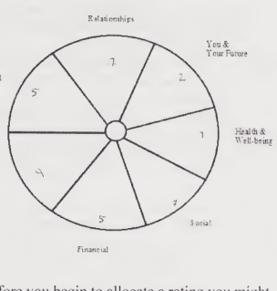
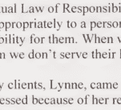
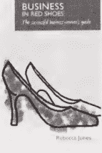
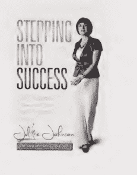
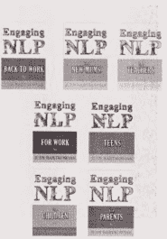
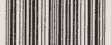

# 内在自信：女性的真实自信

## 致谢

我怀着爱与感激之情，向以下各位致谢

我的父母伊丽莎白和乔治·麦吉，他们对我的信任从未动摇；如果在灵魂层面我们确实会选择父母，那我选得很好——谢谢你们！

我的兄弟姐妹弗朗西丝、桑德拉和乔治，感谢他们在艰难时期给予的鼓励和支持。

我的导师亚历山德拉·沃森，感谢她在本书写作期间给予的支持、指导和激励。

安妮·玛丽·麦金托什，高管教练兼朋友，感谢她迅速阅读本书初稿，并给予鼓励而热情的反馈。

我的客户们，感谢你们有勇气缩小自信与能力之间的差距，挺身而出，进入个人和职业的最佳状态。你们激励着我！特别感谢那些愿意并允许我分享他们的经历、见解和所学的人。

## 引言

自信有点像钟摆，从一个极端摆向另一个极端。相信我，对每个人来说，它都处于不断变化之中；我辅导过足够多的人，所以我知道这一点：没有人——我是说没有人——在所有时候、所有情境下都充满自信。

但在人生的任何阶段都可能出现这样的时刻：无论你表面上有多成功，或别人认为你有多成功，你内心就是感觉不到自信。你觉得自己像个骗子、冒名顶替者，害怕自己会被识破。你的自信落后于你的能力。

我经历过，也深有体会，非常清楚那种感觉会多么令人衰弱无力。我记得自己完全无法与镜中回望我的那个女性产生连接；她看上去不错，走路和说话都带着自信，但我内心感到空虚，害怕被识破，因为我不相信自己，也怀疑那些相信我的人所说的话。

我相信，认识我的人中会有人对了解到这一点感到惊讶，因为从外表看，我显得非常从容得体。看到别人以我渴望的方式取得成功，而我却被恐惧冻住，我不得不学习并制定在需要时有效的自信危机应对策略；但真正的自信只有在我学会接纳和重视自己，并与内在智慧连接时才出现。

本书融合了提升自信的诀窍和技巧，但其目的是带你踏上一段重新发现自我的旅程。我们将首先审视自信究竟是什么，它如何影响我们对自己、自身能力以及他人的看法。自信在各种情境中如何对我们有利、又如何对我们不利，以及自然自信的特质与吸引力。

我会为你提供一张路线图，通往那个真实之地：在那里你接纳并欣赏自己；从那里你可以培养内在自信，并学会走向成功。你将学会如何承认并处理自己的过去，从而放下包袱和限制性信念，并利用从中获得的见解和学识来指导自己，挺身走向你期望的未来。

我的目标是带你到那个地方：在那里你学会尊重自己，看到敢于梦想的力量，并允许自己去相信；你可以成为你想成为的人，得到你想从生活中得到的东西。你将学会认识自己的韧性，培养个人资源以获得终生受用的自信，最重要的是，信任你的内在智慧，以及内心那个轻柔细微、低语着“你一定能做到”的声音。

## 关于我和我的历程的一点介绍

我的整个职业生涯都围绕着与人合作，帮助他们看到并发展自己的潜能。起初，我担任中学辅导员，与年轻人打交道，后来转向管理和实施面向公共和私营部门员工的专业与个人发展项目。

五年前，我从一家培训公司的合同经理职位上被裁员。虽然我很高兴离开那个职位，但我没有意识到自己的身份认同在多大程度上与它捆绑在一起，也没有意识到失业及其带来的挑战会如何影响我的自信。

我拥有良好的职业声誉，但缺乏方向。我感到迷茫，认为自己缺少选择，尽管事实并非真的如此。我得到了面试机会，却把面试搞砸了，但并不真正明白为什么。回想起来，我认为内心深处，我经营自己企业的愿望可能比我意识到的还要强烈。

我接受了专业教练培训，并创办了自己的教练与咨询业务，这也给我的自信带来了一大堆其他挑战：建立人脉、推销、投标和协商费用。这些技能对我来说都不陌生，但我缺乏信心去建立那种联系，也缺乏信心把自己擅长的技能迁移到新业务中。

说实话，我把任何形式的拒绝都当成针对我个人的。我缺乏自信，常常对那些相信我的人感到困惑，甚至震惊。我的自信与能力之间的差距如此之大，以至于我总是在寻找B计划，以防我的业务失败。我和另一位商界女性建立了一个商业网络，并成功运营了两年。我还接受了普拉提教练培训——相信我，这两件事都不容易！

然而，我仍然缺乏自尊，也不相信自己有能力实现抱负、把自己视为成功者。我总是向他人寻求关于我的价值和能力的认可、许可和肯定。当时我以为只有自己有这种感觉，后来我了解到，大多数女性在某个阶段都会有这种感受。

我读过大量关于个人、职业和精神发展的书。我聘请过教练，参加过数百门培训课程和网络研讨会，还是在线论坛和智囊团的成员，以帮助我缩小自信与能力之间的差距。但只有当我进行内在功课，重新连接我的女性智慧时，我才被引向一个信任、平和、平衡与身心安适的地方。我相信，我是谁以及我能提供的东西都是有价值的。

## 第1章——真正的自信

> **自信**——*对自己能力有把握，或对他人、计划或未来抱有信任的品质。*
> 
> ——《剑桥词典》

自信是复杂的；它像变色龙——会随着我们生活中发生的事情、我们所处的境况，甚至我们与谁在一起而变化。它是一种备受追捧、令人向往的品质，然而就其程度而言，它既可以是朋友也可以是敌人，而且常常是伪装大师。

### 令人向往

自信令人着迷、超越年龄、富有诱惑力，并且具有某种性感。我们可能会发现自己被最意想不到的人吸引，仅仅因为他们安于自我、自在做自己。我记得很多年前，听到一位同事称演员杰克·尼科尔森“极其性感”，我觉得好笑，说实话也很困惑。他并非通常意义上的电影帅哥，但她觉得他的自信如此迷人。我记得不久前读过一篇文章，谈到女演员弗朗西斯卡·安妮斯，她在61岁时仍被形容为“依旧性感”，不是因为她容貌——尽管她仍是非常有魅力的女性——而更多是因为她的态度和自信。

### 朋友

当我们感到自信时，我们往往会以心流状态处理眼前的情况或任务，常常几乎意识不到自己在做什么，甚至可能没有意识到自己是什么样的人。

实现。适量的自信让我们能在机会敲门时开门迎接，也能在门关闭时主动去敲门。即便门当着我们的面关上，自信也让我们能够尝试另一扇门，或走上一条完全不同的路。

### 敌人

然而，有时我们会对自己和自己的能力过度自信，这可能导致傲慢、自满甚至鲁莽。认为自己比团队同伴更聪明、更有技能或更有能力，就是傲慢。自认为面试十拿九稳，因而不做充分准备，就是鲁莽。因为觉得伴侣永远不会离开你，就以不恰当的方式对他说话或对待他，就是自满。

### 伪装大师

缺乏自信也可能被表现出来，并被解读为冷漠甚至咄咄逼人，因为我们会采用各种策略来保护自己，不暴露弱点，并尽量减少不适感。

一个害羞的人内心反复播放着“他们为什么会想跟我说话”的脚本，却被认为粗鲁或不合群，这种情况并不少见。他们给人难以接近的印象。他们避免眼神接触，也无法进行普通的闲聊。然而，他们内心其实因不适而难受得要命，极度渴望成为另一种人：一个自信的健谈者。

并非所有缺乏自信的人都害羞。直到不久前，我还会把自己归入那一类。我能够站在大批观众面前做演讲，但同时却饱受冒名顶替综合征之苦，害怕自己会被揭穿，因为我的自信落后于我的能力。

冒名顶替综合征是一种普遍现象，由临床心理学家波琳·克兰斯（Pauline Clance）和苏珊娜·艾姆斯（Suzanne Imes）在30多年前提出。它界定并描述了这样一种感受：你在自己的角色中感到不真实，觉得自己不配得到所获得的认可或报酬；你觉得自己是个骗子。这些感受会带来许多后果：不表达自己的意见或分享自己的想法，不要求加薪或不自我推销。这些行为会助长失败和挫败感，在情感上扼杀受此困扰的人，并使他们的职业生涯脱轨，因为他们不给自己许可去发现并展现内在的领导者。

在另一个极端，一些女性不是被动行事，而是采取更男性化的方式，变得过于咄咄逼人。在2011年的*《学徒》*系列节目中，参赛者之一梅洛迪·侯赛尼（Melody Hossaini）在节目结尾的一次采访中评论说，参加这个节目给她的一个重要启示是：当她感到脆弱时，她就会变得非常咄咄逼人；这是一种隐藏自己缺乏自信的自我保护机制。她现在意识到，坦然接受自己的脆弱，并能够展现和表达它，会比她那种“强悍凌厉”的做法更有利于她。

当我问女性自信对她们意味着什么时，她们的回答相当相似，包括：

- “做真实的自己”
- “相信自己以及自己的能力”
- “对自己感觉良好”
- “能够做我想做的事”
- “有能力应对个人和职业生活中来到我面前的一切”
- “真正感到自在——而不是假装”。

自助大师常常提倡“弄假直到成真”，但我认为这条建议应该附带一个警告。别误会我的意思。肯定语以及模仿拥有你渴望之物的人的行为，确实可以有效帮助你获得必要的心态，从而把那种技能或品质吸引到生活中，但前提是你真的相信自己对自己所说的是可能实现的。

本书后文我们会做一些关于信念和肯定语的练习，但现在只需意识到：仅仅说出某句话，并不一定能让它成真或发生。很多时候，我们的行为模式根深蒂固且力量强大，以至于在非常基本的层面上与我们嘴上说的话相矛盾。

从能量层面来说，你会感到不自在，也无法与自己的话语保持一致，而这一点会清晰无误地传达出来，不仅传达给别人，更重要的是传达给你自己。你会觉得自己是个骗子，因为害怕被揭穿的恐惧会助长自我怀疑的螺旋，进而降低你的自尊，把你困在一个自信落后于能力的位置上。这个差距不仅仅关乎恐惧，甚至不仅仅关乎拖延，而是关乎自我毁灭；你失去了自己，也失去了你本该过的人生。

### 内在如何，外在亦然

有一句话叫“内在如何，外在亦然”。这是对灵性层面的反射法则的总结，它指出我们的外部世界是我们内心世界的精确反映。宇宙会映照并反射回我们自身和生活中所有的好与坏、积极与消极。

如果你怀疑自己的能力，或不珍视自己的技能和才华，你就会吸引那些窃取你的想法、把你的工作成果据为己有、采取强硬手段并大幅压低你报酬的人。如果你自我苛责，不断用想法打击自己，你就会吸引那些通过言语、心理甚至可能是身体虐待来贬低你的人，以此映照这一点。如果你不爱自己、不尊重自己，又怎么能期望别人爱你、尊重你呢？

### 真正的自信

真正的自信，我们一眼就能认出。这样的人身上有一种特质，告诉我们他们对自己非常自在。他们了解、喜欢并信任自己。他们的本质是轻松和积极的期待，相信自己能够应对生活抛来的一切。他们出于信念而非恐惧行事，因为他们了解自己，也愿意理解和欣赏他人的视角，而不会感到受威胁，也不觉得自己必须正确。

在我看来，真正的自信的基础包含在我所谓的自信“3C”之中——清晰（Clarity）、沟通（Communication）和勇气（Courage）。

### 清晰

当你清楚自己是谁、看重什么，清楚你想回馈给生活什么，或想赋予生活什么——你的目标、一份热情或一个项目——那么把它吸引到你的生活中就会容易得多。清晰的思考赋予你果断行事的能力，让你准确传达自己的信息，并使他人能够据此回应。

### 沟通

当你能够以尊重和珍视自己及他人的方式清晰沟通，当你有勇气信任自己与生俱来的智慧，遵循自己的信念并采取行动，从而把自己从迷失和停滞的感觉带向自由和充实的感觉，那就是真正的自信。

### 勇气

拥有真正的自信，你不再通过取悦和安抚他人来让渡自己的力量。你的价值和自我价值不再系于别人对你的看法，因此你不再觉得需要牺牲自己，或寻求他人的认可或允许，才能成为你想成为的人、做你想做的事、拥有你想要的东西。你可能会寻求建议和指导，但不会在向内检视、确保所建议的行动与你契合并且对你而言感觉正确之前就采取行动。

当你听见那份内在智慧时，你就会准备好迈出第一小步。真正的自信并不意味着你在迈出那一步时不会感到恐惧，而是意味着你对自己有足够的信任，能够面对最初一步可能带来的任何挑战，并且记住：正是去做、去行动，才能建立能力。

拥有真正的自信，你可以自由地做自己，对自己感到满意，如果你愿意，也可以独自安好。你身上的男性能量与女性能量保持平衡，因此你可以坚强而不带威胁或攻击性，可以脆弱而不显得软弱。而且，因为你做真实的自己，你的吸引力会增加，你会把所需的一切资源、支持和滋养吸引到自己身边。你内在的正直会与周围的人相匹配。当你开始在内心感到安全、安稳、被爱和快乐时，你学会信任自己，而宇宙也会映照这一点，让你周围充满爱你、支持你、像你一样诚实慷慨的人。内在如何，外在亦然。

贯穿本书各章的“真正自信的9个要素”是：

- 觉察
- 理解
- 真实
- 尊重
- 能量
- 滋养
- 信任
- 直觉
- 承诺

真正的自信需要自我觉察，去意识到内心思维所玩的游戏，以及它们对我们情绪和表现的影响。它还需要你理解过去和现在的人与事如何塑造和影响了你，以及为什么你可能需要放下其中一些，才能让自己拥有想要的未来。

你明白并认识到，决定你生活质量的，是“你如何存在”，而不是“你是谁”。真正的自信让你对自己真实，对自己坦诚——无论是好的、坏的还是不堪的一面，并且即使如此，你依然接纳自己是值得被爱的、是没问题的。你通过遵循自己的价值观、坚守自己的界限、承担责任，并认识到因果如何在你的人生中运作，来尊重自己。每一个行动都会带来反应或后果。

你会注意到并逐渐明白，生活中的一切都是能量构成的，都有其振动频率。我第一次意识到这一点是在教学的时候。每当我疲惫或压力大时，我发现学生们很难管束、表现糟糕；每当我精力充沛、心情愉快时，学习和教学都充满乐趣。恐惧是一种沉重的振动，自我价值感缺失源于负面的自我对话，它散发出低频率的振动，而正如我们现在所知，这种组合会吸引同样低频率的情境、人和环境。另一方面，自我价值感和自信会散发高频率的振动，吸引与之匹配的人、情境和机会。懂得如何滋养自己，以及持续这样做的重要性，是培养真正自信的关键，尤其是在危机时刻。永远不要忘记，我们教会别人如何对待我们；通过尊重自己、关爱自己的身心灵，我们也在教别人善待我们。

这种声音常被称为“直觉”，或内在的女性智慧之声，你怎么称呼它都可以，但拥有真正自信的人会倾听它，而根据我的经验，它从未未能引导你走向正确的道路。最后，真正的自信使你对自己做出承诺。它让你明白，你值得拥有、成为和做到你想要的，并且愿意一步一步、尽己所能地朝着目标前进，哪怕每一步都很小。

这听起来可能有点吓人，而且需要付出很多努力才能到达那个真正自信的境界。但你现在要做的，只是相信我对你的信心。我鼓励你持续致力于自我成长，并记住：种瓜得瓜，种豆得豆。我也曾身处你现在的位置，曾被“速成自信”的承诺诱惑过，但那些从未持久。我要说的是，你值得为自己投资。你值得花这些时间和精力。

著名自行车运动员、七次环法冠军兰斯·阿姆斯特朗曾说：“你无法伪装自信，你必须赢得它，你必须付出努力。”

你我都知道，人们无时无刻不在伪装自信，但我知道的是，你无法伪装真正的自信，因为它需要深度的自我认知、自我接纳和自我价值感，这些是无法伪装的。而真正自信的美妙之处在于，它从不让人觉得是你“挣来的”，反而更像是你“重新发现了它”，因为它一直都在那里，在你内心深处，从未离开。

### 自信的你之概览

我们并非在所有事情上都缺乏自信；我们只是在特定的生活领域、特定的活动中缺乏自信。下面的练习将让你有机会审视自己目前在不同生活领域中的自信程度。它将为你完成本书其余练习提供必要的关注点和信息，并为你提供一个绝佳的机会，去反思和回顾每个领域的现状，以及你希望这些领域在未来呈现的样子。你或许还可以思考，在你自信较高的领域，你对自己持有怎样的信念和想法，并将它们与自信较低领域的信念和想法进行比较。

### 练习

下一页的**自信之轮**由代表你生活各个主要领域的扇形区域组成。我邀请你逐一审视每个部分，并以1到10分的标准为每个领域的自信程度打分。

“1”分代表你在该生活领域自信程度较低，很可能你对这个领域的现状也感到非常不满意。

“10”分代表非常高的自信程度，你很可能对这个生活领域感到完全满意。

在开始打分之前，你不妨思考一下我为每个领域提供的一些反思问题。

#### 健康与幸福：

这个领域需要考虑的是你的身体健康：锻炼习惯、饮食、精力和压力水平。

- 你目前的身心状态如何？
- 你强壮健康，还是可以更好地照顾自己？

#### 人际关系：

这一部分指的是你与家人、朋友和重要他人的个人关系。我建议你分别考虑每一类关系，因为这将为后续练习提供很好的信息来源。

- 在这段关系中，你是否感到足够自在，能够做自己？你是否感到被爱和支持？
- 你是否能够表达自己想要的、需要的，而不担心被拒绝或遭到批评？
- 你是否感到自己被看见、被听见？

#### 社交：

你的社交生活是否如你所愿？

- 你是否足够经常地见到朋友？
- 你会参加各种社交活动，还是因为舒适而大多数时候做同样的事情？
- 你有自信外出社交，还是倾向于在家中进行社交？
- 你是否足够自信去认识新的人、结交新的朋友？
- 你和陌生人交谈时感觉如何？你能轻松地开启对话吗？

#### 职业：

你在工作中感觉有多自信？

- 你是否能够大胆发言、分享自己的观点？
- 当工作量过大时，你是否能够委派任务或说“不”？
- 工作是否让你有成就感？

#### 财务：

这一部分与你拥有多少钱无关，因为除非你的自我价值感足够，否则你的财务价值永远不够。这一部分更多是关于你管理财务、养活自己和家人的能力。

- 考虑债务、储蓄以及你对它们的管理情况。

#### 精神层面：

我在这里使用“精神层面”一词，指的是拥有生活目标、意义和方向感，这有助于为更广阔的世界做出贡献。这可以通过你的

- 工作
- 社区
- 信仰/宗教
- 环境或慈善组织

#### 自我：

我相信，如果要在你生活的任何领域发生根本性的改变，这种改变必须由内而外发生，而“自我”部分反映的是你对自己和未来的信心。

自信是我所说的内在信心，即

- 一种对自己的信任感。
- 无论生活向你抛来什么，即使你被震惊、被深深动摇，也能挺过去的能力。

请在每个领域花些时间，在给出1到10之间的分数之前，思考这些问题。脑海中浮现的第一个数字很可能最准确地反映你对这个领域的真实感受，但也可以在心里感受一下这个数字，以确认其准确性。记住，自信是一种感觉，你会知道这个数字是否适合你。现在从任何领域开始，沿着圆环依次评估。

当你给每个领域打出十分制的分数后，思考以下问题：

- 你为什么给自己打这个分数？
- 这个领域目前有哪些好的方面？
- 你可以做些什么来改善你生活的这个领域？

现在你需要什么，才能对这个领域感到满意？

#### 现在全面审视你的圆环。

- 什么最让你印象深刻？
- 你看到了哪些相似之处？
- 你能在这些领域之间建立联系吗？例如相似的信念、想法、态度、行为或影响。
- 一个领域可能如何影响另一个领域？
- 哪些人影响你生活的这个领域？他们持有什么想法/信念？

现在把这些记下来：

#### 健康与福祉：

#### 人际关系：（记得分别考虑家人、朋友、重要他人）

#### 社交：

希望通过完成这项练习，并用上述问题回顾你的发现，你能更深入地了解自己的自信水平，以及你用来支撑这种自信的策略。例如，你可能在财务领域感到非常自信，因为你使用预算、有定期储蓄计划等。你的社交自信可能很高，因为你总是很好地展示自己，有几个话题可聊，并且懂得问开放式问题。

现在你已经很好地概览了自己在自信方面的现状，是时候继续了；我们将后退几步，思考是谁或什么影响了你的自信。但在回溯时间之前，让我们总结一下目前已知的内容……

## 第2章——卸下包袱

> *“如果你愿意面对过去，你就能让此刻变得丰盈。”*
>
> 奥普拉·温弗瑞

我们是过去的产物。它构成了今天的我们的一部分，因为无论你是否已经意识到，我们都在日常生活中使用过去的模式。

*我说的“模式”是什么意思？*

我指的是那些有时有帮助、有时无益的信念和行为，我们有时有意识、有时无意识地运用它们，来回应他人的行为和我们所处的境况。

我们的模式不过是从过去学来的东西，基于我们从家人、朋友、老师、同事、老板、伴侣以及任何影响过我们的人那里看到、听到和经历到的一切。它也是那种在某种程度上通常对我们有效的行，能帮我们得到想要的结果，或保护我们免受不想要的结果。

我们面临的问题是，当模式不能给我们想要的结果时，它们可能变得具有破坏性，因为我们会自动运用它们。如果我们希望在真正的自信中成长，就必须停下来、反思，并揭示生活中不断反复出现的主题，以及其中需要学习的深层教训。一旦你识别出一个主题并领会其背后的学习，你就能停止那个模式，创造一个新的、更有帮助的模式；但要做到这一点，你必须更有自我觉察，觉察自己如何通过自动反应和自我破坏行为把力量拱手让人，而这些常常会削弱你的自信。

我们的过去无法改变，但可以用来为未来提供信息，这就是为什么花些时间面对过去的痛苦很重要。识别并命名这些模式：贯穿我们生命的生/死/生循环，探索我们的感受，审视内疚，并为自己在生活事件发展过程中所扮演的角色负责，这些都是过程的一部分。

*我说的“负责”是什么意思？*

当生活中发生影响我们自信的事情时，审视自己对情境或环境的反应会有所帮助。我们是选择扮演无助的受害者、沉溺于绝望，还是通过采取适当行动来回应？通过反思和审视我们的回应模式，我们可以意识到自己对采用受害者心态负有个人责任，也有责任找到在未来更好地服务我们、让我们挺身而出并进入自身力量的替代回应。

觉察是疗愈或改变的第一步，拆解过去的包袱，以便我们理解它并与它和解。觉察会减轻它的负担，把我们从痛苦的锁链中解放出来，使它不再影响我们的未来，而是为未来提供信息。

本章的工作需要力量。它需要你深入内在的伤口，使它们得以疗愈。它还需要你挺身而出，为自己把力量拱手让人承担责任。重要的是，你在做这项工作时要从容进行本章，并善待自己。

“某些‘东西’很可能会浮现出来。其中一些你以前可能没有意识到，或者即使意识到了，也可能无法承认它的影响有多么具有破坏性。你可能会震惊、深受伤害、愤怒，并因为自己的天真或愚蠢而想要进一步责备自己。停止那些想法！为过去发生的事情批评或惩罚自己没有任何好处。经验告诉你，你的内在批评者只会削弱你的自信。通过宽恕自己和他人来释放怨恨与内疚，是唯一的前进之路。

我理解这并非易事；你可能不知道如何宽恕，甚至可能不想宽恕。

我告诉你一个小秘密。宽恕对我也是一大挑战，但如果你愿意宽恕，就能开始疗愈。让我们弄清楚宽恕究竟是什么。它不是纵容事件或行为，而是愿意放下，并承认给你带来痛苦的人——无论那是你自己还是他人——当时只能凭其所知行事，因为他们当时在个人成长旅程中正处在那个位置。

善待自己。我请你爱自己，向你的内在小孩展现慈悲，因为在内心深处，受伤的是她；而也将是她疗愈你，并帮助你在内心重新发现自己的女性智慧与自信。

当你接受自己当时已凭当时拥有的知识和觉察尽力而为，自爱与真正的自信便开始绽放。

我说的自爱并非虚荣或傲慢，而是对完整的自己——心智、身体和精神——怀有感恩与尊重。自爱体现在我们的自我价值感中，它表现为对自己的天赋、技能和才华的深切欣赏，也期待他人对我们的恩赐给予同等程度的尊重。

让我们开始发现与恢复的过程……

下面的练习将有助于培养真正自信的前三个要素：**觉察、理解与真相。** 你需要为这项练习留出一些时间，我建议你为自己安排一个安静舒适的环境，并给自己一段不被打扰的时间来完成它。你还需要几张纸，甚至可能需要一些纸巾，因为这项工作可能会让你落泪。但请记住，眼泪中有力量，它们带来疗愈，带来看待事物的新方式和存在的新方式。

回到自信之轮，再看一遍。从自信评分最低的领域开始，沿着圆圈依次进行，并完成以下练习：

### 人际关系：（记得分别考虑家人、朋友、重要他人）

### 社交：

### 职业：

### 财务：

### 精神：

完成这项练习后，什么最让你印象深刻？

你对所发现的内容有什么感受？

关于你自己和你的反应模式，你学到了什么？

### 说出真相

现在我们来到问题的疗愈核心，即真正自信的第三个要素：**真相**。这需要勇气和正直，因为我邀请你向自己说出关于你自己的真相，因为这样做，你就不再是一个被过去甚至今天所经历的自信低谷的记忆或伤疤所困扰的受害者。你将因认识和承认自己在吸引那些情境和人来到你身边中所扮演的角色而被赋能。你将承担起对自己深层真实感受的所有权，而不是听从他人的意见并受其阻碍。因为他人对你的想法只是想法，只有你相信它们时，它们才对你成立。

在回顾每一个对你的自信产生负面影响的事件或境况时，我邀请你反思自己当时对自己的感受。

- 你是否认为自己不够好？
- 也许你认为自己不如周围的人和环境？
- 你的自我是否可能在吸引对你的自信的挑战中负有责任？

*我希望你找出在每种情境中，你可能如何对结果负有责任。*

那可能是你做过的事，可能是你未能做到的事，或者是你为结果设下局面的方式，例如未能看到警示信号，或选择不相信自己所看到或听到的。

宽恕可以被用来占据道德高地——让自己比敌人或做错事的人更高尚。真正的宽恕是“宽恕并遗忘”，是消除对曾施加于你的过错的所有情感依恋，放下记忆和伤害，就好像它从未发生过一样。

“必须正确”的需要可能成为宽恕的巨大障碍。正确可以给人安全感，但“必须正确”的需要会破坏关系，并且常常掩盖不安全感。真正的宽恕是放下对正确或错误的需要——始终如此。

报复的需要，或把他人从我们的生活中切断、排除出去的欲望，在怨恨酝酿发酵之时，起初会更容易，但可能导致孤独和疾病，直到我们的伤痛或愤怒消退。与那些感受共处，接纳你所感受到的是可以的，因为它们是你的某项价值观遭到侵犯时的反应，这可能会更有帮助。正是这种接纳，促进了放下的过程。

在这里做什么以及它究竟是为了什么。与恐惧等负面情绪对话，能帮助我们培养健康的谨慎感；倾听我们的愤怒并加以处理，会化解挫败感，并培养一种对生活的热情——如果我们不曾寻找其中的教训，可能就会错过这种热情。当我们理解自己无益的想法和感受时，我们就不再抗拒，并准备好释放。

### 身体释放

如果来自经历和情绪的负面能量没有得到表达，它们就会留在体内，造成不同程度的伤害。以愤怒这种情绪为例，它在情绪方面饱受诟病，已经有点成为一种禁忌。然而，愤怒本身没有错，它是一种完全自然且可接受的情绪；可能引起担忧的是它被表达的方式。如果愤怒没有得到安全的表达渠道，它就会找到自己的出口：在不恰当的时候以狂怒的洪流表达出来，或者在身体上通过割伤和烧伤、灼烧感、疖子和炎症表现出来。路易丝·海的*‘治愈你的生活’*和黛比·夏皮罗的*‘你的身体会说话’*是极好的书，能帮助理解情绪如何与疾病或身体失衡相关联。

我发现以下从身体上释放经历和情绪的方法真的很有帮助。

允许自己去触碰你的痛苦，让眼泪流出来。我以前对此颇感困难，我想是因为我相信眼泪是软弱的标志，而且“大女孩不哭”——可她们会哭，也应该哭；我在理智上知道这一点，但在情感上，我需要另一个借口来流泪，所以我会去看电影*《继母》*，它讲述一位前妻和她两个孩子的故事，以及他们如何接受新妻子。朱莉娅·罗伯茨饰演继母，苏珊·萨兰登饰演两个孩子的生母；这位生母身患癌症，即将离世，并要接受把自己的孩子托付给一个她并不太喜欢的女人。我觉得看这部电影不可能不哭——它对我来说有点像水龙头，我可以打开它，让眼泪流出来。如果你很难让眼泪流出来，不妨试试这个练习；当然，电影不一定是*《继母》*，但必须是一部好的催泪片。

如果情绪是愤怒——当然，在车窗摇上的车里好好尖叫一场是很好的释放方式，朝枕头打拳也是；如果你喜欢健身房，有氧拳击课也很棒。就我个人而言，我发现跑步对我有效，但我认为任何能消耗血管中奔涌的多余肾上腺素的运动都会有益。

怨恨是持续很久、远远超过最初经历的愤怒。当我们心怀怨恨时，我们充满责备，不承担责任，而是把“我们正确、别人错误”的需要揽到自己身上。通过释放这种需要，我们收回促成改变的力量，而不是成为他人残忍的受害者。只要你对某种处境或某个人生气，那个人或那种处境就对你拥有权力。

宽恕过程中很好的第一步，是尝试洞察对方那样行事背后的动机。下面的练习是一种极其有效的方法。当你设身处地站在别人的立场上，你会觉得自己更了解他们。

#### 练习

在地板上标出三个不同的位置，编号为1到3。每个位置都有不同的功能，并让你获得不同的视角。

- 在第一个位置，你将通过自己的眼睛向外看。
- 在第二个位置，你将成为另一方，设身处地站在他们的立场上，想象对他们来说是什么感觉（如果同样可行，这可以是1个人或一个群体）。
- 第三个位置涉及采取独立视角，你可以退后一步，更冷静地观察双方。

选择一段你想探索的关系。

- 站在位置1，想象自己看着对方。问自己：“当我看着这个人时，我正在经历什么？我在想什么？感受什么？等等。”
  - 提出你可能想问那个被你放在位置2的人的任何问题
  - 把这个位置甩掉！
- 走到位置2，想象你就是那个人，回看处于位置1的你。然后再次问自己：“当我看着这个人时，我正在经历什么？我在想什么？感受什么？等等。”
  - 回答任何向你提出的问题。
  - 把这个位置甩掉！
- 移动到第三个位置，观察情境中的两个人，并问自己：“我正在经历什么？我在想什么？感受什么？”当你看着位置1的那个人时，你看到了什么？

想一想你在三个位置上的想法和感受有何不同。

- 回到并重新体验第二个位置。问自己：“现在有什么不同？什么改变了？”最后回到第一个位置，问自己：“现在这有什么不同？什么改变了？”

既然你已经洞察到对方为什么那样行事，你就更有能力宽恕和放下。那么现在：

- 想象那个人坐在你面前。对那个人说：“我原谅你……”并想象好事发生在那个人身上。对那个人说：“愿生活最丰厚的祝福属于你。”

你可能会觉得这很难做到，但要坚持做，直到你释放了怨恨。

现在把注意力转向自己，大声说：“我原谅自己……”并坚持做，直到你感觉更轻松。

### 能量释放

你可以在生活中拥有任何你渴望的东西，但如果你的幸福和自我价值感**依赖**于拥有它，那么你就通过能量绳索与它相连。骄傲、嫉妒、需求和贪婪等负面能量，会向房屋、汽车、金钱和工作等事物和对象伸出巨大的绳索。

当我被裁员时，我在灵性依附法则上得到了相当深刻的教训。那时，我是个物质女孩，完全沉迷于自己的头衔、金钱能为我买什么，以及它能带我去哪里度假。我完全沉迷于所谓的“财富的外在装饰”。

如今，拥有金钱和好东西并没有错，但我发现，当我失去工作时，我不仅失去了财富的外在装饰，也失去了与之相关的身份认同感。对这些事物的依附在我失去它们时引发了我的信心危机，但当我意识到正是同一件事帮助我重新发现不依赖地位、财务或情感需求的真实自信时，这种失去变成了一种发现。

人与人之间如果存在未解决的问题，也会形成绳索。依附法则教导说，无论你依附的是谁或什么，他们或它都能控制和操纵你。每当你向某人发送愤怒、羡慕或嫉妒的想法或话语时，你就会显化一条线，附着在他们身上。你也可以通过对他们的爱或认可的需求，把自己依附于某人。偶尔的积极想法可能会化解它，但如果你持续发出

负面情绪，这些线会形成绳索。它们会留存下来，把你们绑在一起，直到它们被释放。

下面的练习会帮助你斩断这些绳索并继续前行。你需要一些便笺纸、一支笔、一支白蜡烛、一些红丝带、一枚安全别针、一把剪刀，以及一张你希望从中释放自己的人的照片。

在完成练习之前，请把说明通读几遍。为此留出几个小时，并再次为自己安排一个安静、不会被打扰的环境。

#### 练习

准备好后，点燃蜡烛，先写下对方做过的或说过的所有伤害你的事。这时你会哭，可能会生气，打一两个靠垫，甚至可能骂上几句，但这没关系，发泄出来比憋在心里好，把它们全都写在纸上。当你觉得没什么可写的时候，就停下来，深吸一口气，然后开始想想这个人带给你的美好事物、你们一起欢笑的时光、他们给予你的礼物，所有美好的东西，把它们写下来并为此表示感谢。

写完后，把他们的照片放在纸里，把纸卷起来，用红丝带系好。确保纸卷上垂下的丝带足够长，以便你能用别针把它别在自己身上。

一手拿纸卷，另一手持剪刀，说出以下话：

> *“亲爱的……”*
>
> *我原谅你造成的一切痛苦，也请你原谅我。*
>
> *我感谢你给予我的所有洞见与学习的礼物。*
>
> *我现在带着爱释放你。”*

剪断系在你与纸卷之间的红丝带，并烧掉裹着丝带的纸卷。如果你愿意，也可以把丝带和别针留在身上，作为净化并释放你们关系的纪念物，或者把它们也烧掉。

我在本章分享的所有练习都具有净化作用且很有力量，但你可能会发现，有些经历很容易放下，而另一些却会久久萦绕，所以请定期做这些练习，直到你发现自己的愤怒和怨恨已经消散。

既然你已经解开过去的包袱，并希望已经清理掉其中一些，我们就可以继续前行，进入当下，审视你的信念体系；但在那之前，让我们总结一下到目前为止涵盖的内容。

### 总结

- 我们的过去无法改变，但可以用来为未来提供借鉴。
- 如果我们希望在真实自信中成长，就必须停下来反思，揭示生活中不断出现的反复主题，以及从中要学习的深层教训。一旦你识别出这一主题并从中学习，就能停止这种模式，创造并学习一种新的、更有帮助的模式。
- 宽恕不是纵容发生过的事，而是承认它、看透它、愿意放下它造成的痛苦并继续前行。forgive（宽恕）一词意为“为……而给予”；你给予，是为了获得自由。
- 真实自信要求你向自己坦诚关于自己的真相。
- 如果来自经历和情绪的负能量没有得到表达，它们就会留在内心，造成不同程度的伤害；但可以通过身体和精神练习释放它们，使人恢复到健康与幸福的状态。
- 自爱体现在我们的自我价值感中，它表现为对自身天赋、技能和才华的深切欣赏，并期望他人对我们的福泽给予同等程度的尊重。

## 第3章——你并不是你以为的那个女孩

> *“选择服务于你灵魂的信念——选择服务于你所选择成为的更宏大梦想的信念。”*

Joy Page

我们人类是意义的创造者。我们可以从生活中的任何经历中创造意义，这种意义要么赋予我们力量，要么阻碍我们。一个女人的噩梦可能是另一个女人的美梦。这确实是视角和期望的问题，而它随后会变成自我实现的预言，因为当你相信自己是什么样，你就会恰好变成那样。你看，我们人类也需要自己是正确的，所以我们会寻找并积累证据来证明自己的立场。

前几天晚上，我和一些朋友外出参加一个小庆祝活动。我的一位单身朋友宣称自己已经对男人完全失去兴趣，声称自己只会吸引失败者、白痴和酒鬼，同时对任何相反的意见都予以否认。我们正要离开酒吧时，一个醉汉经过，朝这边喊道：“你好啊，大宝贝！”

“看吧，看吧，我说什么来着，”她反驳道。

绝对是！你看，那正是她所期望的，也正是她所吸引的。另一位朋友对自己的吸引力非常有信心，从来不会没有晚餐约会。她期待最好的，也得到最好的，还经常和现任男友一起被带去某个异国度假胜地。

我们的信念由经历形成，而经历又是信念的结果。我认为，意识到大脑如何管理我们的经历很重要，因为这种意识能帮助我们思考自己所持的信念是有益还是有害。正是在本章中，我们再次审视真实自信中的 T，寻找信念中的真相，并揭示其中可能隐藏的谎言。

### 大脑如何管理我们的经历

为了防止感官超载，我们会关注经历的某些维度，而排除其他维度。被删除的内容不在我们的意识觉察之中。这有用与否，取决于应用场景。

*例如，当你在繁忙的办公室里专注于一项任务时*，你可以删除周围的噪音，专注于手头的工作。这时删除是有用的。有时则没有用，比如你只听到批评，却听不到任何赞美。

劳拉来找我时，她非常低落，并为自己在消防救援服务中的职业感到压力很大。她担心自己收到的关于表现的反馈，尤其是关于她在繁忙环境中工作能力的反馈，她常常被同事取笑为“放空”。当我们查看劳拉的简历和年度考评文件时，我们发现事情并不像她以为的那样糟糕。首先，她没有向自己承认，她正处于新职业的学习曲线上，不应被期望什么都懂。她在消防救援服务中工作不到两年，此前在图书馆工作了10年。当她认识到“放空”并不是做白日梦，而是纯粹专注于在嘈杂环境中完成文书工作时，她就能把这一点的看法从缺点转变为技能。当她专注于自己工作日中进展顺利的事情时，她意识到自己的成功远远多于她所认为的失败。她不再把进展不太顺利的事情解释为失败，而是开始把它看作反馈，并用它来推动自己的职业向前发展。

我们也会扭曲所见、所听和所感。扭曲关乎我们为经历赋予的意义。我们创造的意义或有帮助或有阻碍，但我们很少质疑自己正在创造的意义。

你有没有注意到有人在看你，也许还在微笑，然后你开始恼火地想：“他们在看什么？”并觉得他们很无礼，或在嘲笑你。然后，当他们经过你身边时，却给了你一句赞美，比如：“我喜欢你的鞋子。你在哪儿买的？”或者，你有没有听过有人说：“他从来不给我买花，所以他不爱我。”但一经追问，那个人就能找到许多其他例子来证明伴侣如何爱自己。例如：把早餐送到床上、帮忙洗车。

我们也会以偏概全，把一次经历推广到许多其他情境中，就像我的朋友，她总说自己吸引失败者，却没有把她约会过的或觉得她有吸引力的真正好男人算进去。

信念是你坚持并深信的观念。它们可以是积极且赋能的，也可以是消极且削弱力量的，并且会对……产生深远影响

我们的自信水平。我们很少质疑自己的信念，因为我们在存在的核心深处将它们视为真实。真正的自信让我们能够通过质疑并揭示我们对自己、他人和世界所持信念背后的真相，以及审视我们所作的概括和我们扭曲或删除的信息，来发现信念中的任何谎言。

当我们对自身可能做到什么、实现目标的能力，以及或许最令人担忧的——自己是否配得上它，持有无益的信念时，我们的自信就会受到挑战。这些信念常常来自他人告诉我们的内容或他们对我们的期望的影响，例如媒体、父母、老师、同事、老板和伴侣。

假设你有几段以糟糕方式结束的感情。你可能会逐渐相信自己在经营感情方面很糟糕（概括化）。事实上，可能还是前任伴侣这样告诉过你，而这只会强化这一信念。不过，我相信也曾有过你们双方都快乐、一切顺利、感情美好的时光（删减）。你还拥有与朋友、家人和同事之间令人满足的其他关系。

到现在，你正在了解自己的思维如何可能被扭曲。我想说的是，你目前还没有一套有效且成功的策略来经营恋爱关系。幸运的是，这一点可以被探索和发展，直到你能够享受一段令人满足的关系。对于任何你渴望、但目前认为遥不可及的事物，都是如此。除非你挑战限制性信念，把“做不到”的态度变成“能做到！”，否则你永远无法实现它。

### 练习

如果你背负着过去某个人——父母、老师、伴侣——深深植入你内心的一种信念所带来的负担，那么是时候把这个信念归还给它的源头了。

下面的练习将帮助你做到这一点。它同样适用于情绪和秘密，而且你无需将它们披露出来。

- 非常清楚地知道这个信念是什么，以及与之相关的情绪是什么。
- 在脑海中把这个信念放进一个盒子里，并把它包起来。
- 想象这个信念的源头——老师、父母、兄弟姐妹——站在你面前。
- 向他们问好，然后大声说：“这个信念对我不再有帮助，也不属于我，我把它归还给你——它的源头。”
- 在心灵之眼中看着那个人接过盒子。
- 然后说：“祝福你，现在祝福并送走吧。”看着他们和他们的信念盒子消失。

限制性信念是阻碍我们实现抱负、过上渴望生活的主要罪魁祸首。它们深埋于我们的潜意识中，常常与我们的自我形象和我们对世界的感知紧密相连。从积极的一面看，它们具有自我保护性，并以生存为导向。从消极的一面看，它们像规则一样起作用，阻止我们实现可能之事，限制我们发挥能力、获得应得之物。

你看，当一个人陈述一个限制性信念时，他们往往关注的是自己不想得到的东西（限制），而不是自己真正想要的东西（结果）。限制性信念有时还会把身份与行为混为一谈。像“我很害羞”或“我学东西很慢”这类无益的身份标签，暗示这些是固定不变的特质，而不是想法、感受和行为的组合。

几年前，销售对我来说是个忌讳词。我讨厌它。我没有把注意力放在自己达成的销售上，而是放在被拒绝上，这最终发展成“我不擅长销售”的限制性信念。当我和我的NLP训练伙伴本——一位出色的销售员——一起探索这个信念时，我经历了一个打破信念的顿悟时刻。

我向本解释说，我喜欢结识人们，喜欢和他们谈论我能如何帮助他们以及我如何工作，但我总是对自己眼中的“又到销售环节了”感到非常不舒服。

本和我进一步探索，讨论“我不会销售”这个信念如何为我服务，以及它是否真实。看看事实——我拥有稳定的咨询和教练工作流，并有回头客。我的新闻简报和在线社群有一大批订阅者。我还有一个庞大的GROW订阅者数据库，GROW是我的社交网络业务，每次活动都有相当多的企业主参加。我开始看到这个信念并不真实，它是一个谎言——证据证明了这一点。这个信念只不过是一种保护机制，让我免于面对我害怕的拒绝。

如果你听到自己使用或听到“不能、应该、不应该、可以、不可以、会、应当或不应”这样的词，那很可能有一个限制性信念潜伏在周围。留意你的语言，因为一旦你意识到它，你就能对此采取行动。

确保用积极的方式表述新信念，并让你对自己感觉良好。

例如：我擅长经营关系。我能够销售。我是一个成功的社交网络者。

### 整合新信念

想象当你持有这个新信念时，事情会如何不同。你会做什么、说什么？你会有怎样的感受？

你的信念改变能否成功，关键在于更加了解你的*影响圈*。你的影响圈是指过去和现在影响过并正在影响你信念体系的人。如果一个信念来自你的成长环境或教育背景，那么这就是你被教导去相信的东西，只是一种程序设定。关于这些信念，你要问自己的关键问题是：“它今天对我仍然成立吗？”

至于目前在你生活中的人，要留意他们如何对待你，仔细倾听他们如何与你交谈、如何谈论你，以及他们一般如何谈论这个世界。他们的信念如何影响你？他们对你的自信有积极影响吗？他们支持你吗？如果没有，请记住你有选择。你可以容忍，也可以清除那些消耗你自信的人：那些偷走你自尊和自我价值的小偷。你可以通过减少与他们相处的时间，或认定他们不再值得在你的生活中占有一席之地来做到这一点。不要惊讶，一旦你改变了自己的信念，他们似乎就从你的生活中消失了，因为在能量层面上，他们对你的力量和影响已经消失了。

### 总结

- 我们可以从生活中的任何经历中创造一种意义，这种意义要么赋予我们力量，要么阻碍我们。
- 我们的信念是经历的结果，但我们只关注经历的某些维度：为了防止感官超载，我们会删除和扭曲接收到的信息，也会作出并不总是有用的概括。
- 当我们对自身可能做到什么、实现目标的能力，以及或许最令人担忧的——自己是否配得上它，持有无益的信念时，我们的自信就会受到挑战。
- 当一个人陈述一个限制性信念时，他们往往关注的是自己不想得到的东西（限制），而不是自己真正想要的东西（结果）。
- “不能、应该、不应该、可以、不可以、会、应当或不应”这样的词，往往表明有一个限制性信念潜伏在周围。

## 第4章——自我珍视的重要性

> “将我们从他人的期望中解放出来，把我们归还给我们自己——自尊的伟大而独特的力量就在于此。”  
> ——琼·狄迪恩

自我珍视是真正自信的核心，它意味着把正确的事情安排到位，让自我关怀和自信得以茁壮成长。自我珍视意味着触及你存在的本质，学会爱并尊重你作为女性本来的样子。它意味着放下那些制造“我不够好”感受的错误思维，并从你的生活中释放自我牺牲的模式，甚至释放那些消耗你的人，这样你才能摆脱阻碍你的容忍与剥削。

自我珍视让你从侍女般等待的例行模式中解脱出来，挺身而出，走进自己的力量，这样你就不再是环境的受害者，而是胜利地过上幸福而丰盛的生活。你在前几章中完成的工作，会揭示你生活中反复出现、削弱你自信和自尊的主题。你会已经意识到限制你的信念，或许还有行为模式。现在，是时候重新学习给予和接受的艺术了，这样你就能付出而不放弃自我，重新更好地看待自己的技能和才华，并学会信任自己的内在智慧，而不是寻求他人的认可或肯定。为了做到这一点，你必须意识到自己目前正在容忍什么。

你可能还在容忍其他一些事情，它们可能正在影响你的自信、消磨你的精神、耗尽你的精力。也许是一位同事没有给予你想要的尊重；让你在会议前等待，或允许会议中出现不必要且冗长的打断。也许你家里有东西需要修理，或者有个房间需要重新装饰，好让它感觉更舒适。也许你正在容忍负债，或者容忍自己的工作没有收取/赚到足够的报酬。

当席琳来找我时，她感到非常迷茫和困惑。她困在一份“没有前途的工作”中，职位远低于她的技能水平。席琳的收入远低于她以往习惯的水平，还不断累积债务，并伴随着内疚和羞愧感。她在哀悼自己曾经的样子，以及从魁北克搬到格拉斯哥和男友在一起之前所拥有的生活。

为了帮助席琳向前迈进，我们发现处理她的债务问题会对她的自信产生最大影响。我们重新构建了她对债务的看法，让她能将其视为一种工具：它曾帮助她维持一切运转，并让她过上体面的生活。这样一来，她就不会再为此自责，而是能看到债务已经发挥了作用——给了她享受生活的自由和能力。随后，我们制定了一项行动计划，以增加现金流入并减少现金流出。她在 eBay 上、汽车后备箱集市上出售物品，更换信用卡以获得更好的利率，并制定了预算。几周内，她的行动对她的债务和自信都产生了相当大的影响。

我们完善了她的简历，梳理了她的人脉网络，并明确了她的个人品牌。正是在这个时候，席琳向自己承认，问题在于她的这段关系已经无法继续。她和伴侣不再合拍，他们的价值观和抱负不同；她努力减少债务，他却在制造更多债务。她想搬到更小的房子，他想留在原地。席琳认识到并接受了一个事实：她一直容忍债务和这份没有前途的工作，是为了避免结束一段她内心深处知道已经行不通的关系。

我敢说，无论你正在容忍什么，它都不会让你感觉良好；但你必须认识到并接受的是，在某种程度上它对你是有用的，否则这种容忍就不会存在。

*例如，* 它可能暂时帮助你避免做出一个会给你带来痛苦或不快的决定，也可能是害怕如果你坚持自我会发生什么。记住这一点：当你容忍时，你对自己和对他人的吸引力都会降低，你的影响力也会减弱，而这反过来又常常会让你被无助感和绝望感压垮。

你读到这些时，可能觉得自己没有容忍任何事情。好吧，如果真是这样，那很好。然而，如果你正在为生活中某个领域为何是现在这样而辩解，那么很可能你确实在容忍某些事，我邀请你重新考虑。

尝试以下练习，弄清楚并清除你正在容忍的事项。重要的是把它们写下来，这样你才能真正看到它们，而不只是……如有必要，给出一个日期和时间，说明你将在何时回应，并在这段时间考虑以下问题：

- 我有哪些选择？
- 我想要什么？
- 在这种情况下，对我来说做什么才是正确的？
- 我在牺牲什么？在这种情况下牺牲感觉可以吗？这样做合适吗？
- 现在对我来说最重要的是什么？

### 采用以内心为中心的方法做决策

在做决策时，不要只凭头脑思考，而要像歌里唱的那样，“倾听你的内心”。独自去一个安静的地方，通过深呼吸让自己安定下来。一旦你感受到深沉的平静，就可以问自己以下问题：

- 在做这个决定之前，我需要知道什么？
- 对我来说，处理这种情况的最佳方式是什么？
- 我现在必须做什么？

保持静止和耐心，相信答案会浮现。

### 委派他人

做你喜欢且擅长的事，舍弃那些无法发挥你优势的事。你可以把这些事委派给更擅长的人，这会释放你的时间和精力。

### 把自己放在首位

把定期的“专属自己的时间”活动安排进你的一天。记住，一点自我关怀就能让你达到这种状态。给予自己更多，意味着你更有能力给予他人。记住，压力是对给予和接受流动受阻的一种反应，而你无法给出自己没有的东西。

如果你发现自己害怕设定边界，那么你可能需要做一点侦探式的工作来

### 你好，自己！

这是一个 HTML 示例页面。

> 这是一段引文。

- 项目 1
- 项目 2
- 项目 3

点击[这里](https://example.com)了解更多信息。

未能设定边界的另一个原因，是害怕说“不”会冒犯别人。然而，当你拥有清晰的边界时，你会更容易坚持自我，因为当某条线被越过时，你会更清楚某些情境或他人的某些行为可能对你造成的情感、心理和身体影响。你会更明白为什么要有这条边界，也更有能力向自己和他人解释为什么越过这条线不可接受。这种认知让你能在某人或某事正徘徊在边界线上时有所察觉，因为你的内在指引会发出警告，而一如既往，是否听从这些警告取决于你。还要记住，因为害怕伤害别人或让他们嫉妒而不敢告诉对方某些事，是在为他们的感受负责，这会削弱他们的力量，而被削弱力量的人往往都是愤怒的人。

当你清楚自己的边界时，你的自信、自尊和真正的自信会闪耀出来，让他人看见。你很清楚自己会接受什么、不会接受什么，这让你更容易教会别人如何对待你。

人们喜欢知道自己面对的是谁，以及自己在一段关系中的位置，无论是私人关系还是职业关系。我们往往按照一套规则生活，从某种意义上说，边界就是这样的规则。当人们逐渐知道能从你这里期待什么、你会接受他们什么时，边界有助于灌输一种信任感和信心，而这充分说明了你有多看重自己。这让我想起我教书的日子。在课堂上坚定而公平，会换来尊重、努力和良好的风气；而且，人们确实说，人际关系是人生学校的课程。

### 总结

- 自我尊重是真正自信的核心。它关乎把正确的事情安排到位，使自我关怀和自信得以蓬勃发展。
- 将就之事往往代表你被别人说服、或自己说服自己接受的妥协。
- 自我牺牲行为可能看似高尚，但也可能对你的自尊造成破坏性影响。
- 要认识到，每一种将就对你都有某种回报。
- 拥有健康的边界对你的自我价值感和自尊心很重要。
- 未能设立健康边界，可能与渴望被需要、害怕冒犯他人、害怕失败或害怕成功有关。
- 清晰的边界能在他人和你自己心中建立信任与尊重。
- 你的责任是赋能并强化他人，鼓励他们承担自己的责任、做出自己的决定，走自己的人生道路。

## 第5章——自我关怀

> *先爱自己，其他一切都会顺理成章。在这个世界上，你真的必须爱自己，才能做成任何事。*
>
> 露西尔·鲍尔

自爱通过自我关怀表达，而自我关怀让真正的自信显现，并以一种透明可见的从容流动。自我关怀表明一个人尊重自己，知道自己需要做什么、成为什么、拥有什么，才能享受快乐、充实、平衡的个人和职业生活。

自信的任何改变都需要态度和行为的改变，自我关怀要求你留意自我破坏的信念和自我牺牲的行为，停下来质疑它们，而不是让它们自动运行。你花时间思考自己的需求是什么，然后专注于让这些需求得到满足。

你不再因为别人没有满足你的需求而心怀怨恨和失望，因为你知道他们不会读心术，你必须开口争取你想要的。如果你在某个项目上需要帮助或支持，或者需要一个可以哭泣的肩膀，你允许自己放下任何不健康的独立行为，寻求支持，并且在别人提供支持时坦然接受，而不是扮演殉道者。

你放下关于他人是否愿意给予的任何假设或评判，因为你认识到，除非你开口问，否则永远不知道一个人有能力或愿意做什么。即使你问的第一个人说“不”，你也学会不把它理解为针对个人的拒绝，而是接受他们当时只是没有可给予的支持，并理解他们只是在照顾自己，因此你可以自由地去问别人。

通过自我关怀，你放下“好女孩”角色、取悦他人的表演，以及说“不”和“够了！”时的内疚。你知道自己的边界，并能坚守边界或协商边界，取决于这是否对你有利。你会更加意识到我所说的生活中的“窃贼”和“大D们”——怀疑者和贬低者——那些怀疑你能力、压低你的光芒、通过淡化你的成功、把小问题小题大做来偷走你光彩的人。

还有偷梦者，他们试图劝你不要冒险，而他们自己因害怕失败或害怕你成功并把他们抛在身后，连做梦都不会去冒这些险。

时间窃贼是那些出于某种原因占用你更多时间和支持、超出你所能给予的人。公平地说，时间窃贼并不总是人。也可能是工作，或某项正变得耗费一切的活动。你是否曾经上网查看某样东西，却发现自己被卷进信息的浪潮里，损失了好几个小时？加班完成任务是否已成常态？

还有情绪窃贼。你遇到这些人时感觉很好，离开他们时却情绪低落。但也许这一群里最危险、也最需要勇气去挑战的是自信窃贼。自信窃贼往往受嫉妒驱使，试图通过言语或行动剥夺你的自尊。

意识到你的影响圈中既消耗时间又消耗精力的人和活动，并学会限制自己接触它们，对良好的自我关怀至关重要。

学会滋养自己，花时间与滋养你灵魂的人和活动在一起，会建立能量和真正的自信，并帮助你过上平衡而充实的生活。

根据经验，我知道不运动、不锻炼身体会让我感到紧张失衡，所以每天早晨我都以瑜伽普拉提开始新的一天；这是瑜伽和普拉提动作的结合，为接下来的一天做好准备。我不是说非得有那个心情，尤其是有早约的时候，但我要说的是，不做的时候我能感觉到差别。因此，我学会了以“没有借口”的方式对待这个日常自我关怀习惯。

我其他的自我关怀实践包括“我的时间”咖啡休息——独自出去喝杯咖啡，享受拿铁带给我的舒缓感受。我喜欢在当地公园散步，也喜欢在家里、尤其是在办公室里摆放鲜花。自然之美给我灵感。

我绝不是建议你入不敷出。自我关怀旨在消除生活中的压力，其中一部分就是清除笼罩在你头上的财务阴云。如果你已完成前几章的练习，你已经认识到自己的将就之处，并建立了一些边界，以帮助消除那些侵蚀你自信的压力和紧张。现在我希望你思考如何滋养自己，走向真正的自信。如果你认为这些活动是自私的，我邀请你考虑另一种视角。

责任法则不允许你在不照顾自己需求的情况下承担生活中的重大责任。你的情绪和精神需要被照料，自我关怀是对你身心健康和精神的投资，但更重要的是对你幸福的投资。你不是自私；你是“自我充实”，而当你“自我充实”时，给予他人就更容易，不会心怀怨恨，也不会牺牲自己的福祉。你值得成为最好的自己，做让自己感觉良好的事情会提升你的能量。当你减少义务、尽量减少承诺时，你可能觉得自己做得更少，但实际上你可能更有效率。你变得更轻松、更充实、更有趣，人们会被你积极的氛围吸引。

以下练习将帮助你找出滋养灵魂的事物，并找到方法把更多这样的事物带入生活。

### 练习

列出至少十件你热爱做、让你感觉很棒的事情。你可以包括你喜欢共度时光的人……

- 1.
- 2.
- 3.
- 4.
- 5.
- 6.
- 7.
- 8.
- 9.
- 10.

对于上述十项中的每一项，想出三种不同方式将每一项融入你的生活，然后找出哪些可以融入你的日常生活，并现在就去做。

### 学会倾听

真正的自信中的“I”代表**直觉**，在这里我邀请你学会倾听这种常常被轻柔给出的内在智慧。虽然我们倾向于认为只有少数特别的人拥有第六感，但它存在于我们每个人身上。它可能表现为一种感觉，一种

自我关怀并非没有来自自我和他人的挑战。你可能会发现自己抗拒做出承诺去坚持日常自我关怀实践；如果工作或家庭生活变得更繁重，就很容易滑回旧习惯，让自己在永无止境的待办清单中越排越后。你甚至可能发现，当你不按别人的鼓点起舞时，会被指责自私。

我的建议是，对这些指责培养厚脸皮，并坚定地照顾自己，因为当你未能信守承诺时，你对自己的可信度会降低，自我信任会减弱，自信也会随之减弱。好消息是，每当我们信守对自己的承诺，我们就会变得更可信，更信任自己，并获得更多自信。

### 总结

- 如果你不照顾好自己的需求，就无法在生活中承担重大责任。先照顾好自己，你才能处于适合帮助他人的状态。
- 自我关怀表明一个人尊重自己，知道自己需要做什么、成为什么样的人、拥有什么，才能享受快乐、充实而平衡的个人与职业生活。
- 自我关怀意味着对自己和他人坦诚你的需求是什么，并专注于让这些需求得到满足。
- 自我关怀意味着允许自己提出想要的东西，寻求帮助时不觉得自己软弱或过分依赖他人，说“不”时也不感到内疚。自我关怀是你为保持良好健康与福祉而制定的自我保护策略。
- 学会滋养自己，花时间与能滋养你灵魂的人相处、参与能滋养你灵魂的活动，会建立能量和真正的自信，并帮助你过上平衡而充实的生活。
- 心智、身体与精神是一个系统；学会倾听直觉，觉察自己的能量和感受——这些是身体给出的反馈——都是自我关怀的关键。

在《Grow Rich》中，他指出，几乎所有伟大人物都具备这些品质。他们终身学习，是“可能性病毒”的拥趸，坚持不懈地追求目标，并因此建立起韧性和真正的自信。

我明白，你当下的心态可能因为对自己能实现什么抱有怀疑和质疑而存在偏差，但你的怀疑是习惯性思维的产物，而非准确思考的产物。也许你已经到达学习曲线的平台期；与其屈服放弃，我敦促并建议你培养耐心和坚持。相信我，怀疑造成的伤害最大。

如果你发现自己心生疑问：“我能做到吗？”那就培养一种“建筑工鲍勃”（Bob the Builder）式的心态，并肯定自己：“是的，你——能行！”抛弃自我怀疑，因为它会助长拖延、延误行动。如果你要怀疑什么，就怀疑自己的极限。决心拥有成长型思维，采取“我能做到”（CAN DO）的态度，正是这种差异将带来改变。

### 正念

你是否曾坐进车里，到达目的地时却完全没有意识到自己一路是怎么来的？你并不孤单。思绪容易游走，即使你刻意想专注于某件事，也可能被吸引注意力的东西带跑。我们一生中有很多时间可能都在自动驾驶模式下度过，对人和情境作出反应，却很少思考和体察。

正念是一种练习，能培养一种放松而警觉的状态，帮助你直接面对内在和外在正在发生的一切。它意味着允许自己安于当下，越来越熟悉自己每时每刻对想法和感受的体验，而不是陷入回忆的重演或对未来的预测之中。

那么这一切与自信有什么关系？

通过正念练习，你会享受到一种脚踏实地、居中安定并拥有内心平静的感觉。你的专注力和集中力会提高；即使自信动摇时，你也会更放松，并更信任自己处理事情的能力。

你不再任由情绪主导，而是更有意识地觉察自己的想法和感受。你不再无意识地走神，而是带着正念去好奇，开始关注身体以想法、以及对所遇之人和情境的反应等形式向你发出的信号。

正念练习包括不同形式的冥想和动作。从二十出头起，我就发现，在考试、面试和演讲活动之前，觉察自己的呼吸最能帮助我放松、专注并增强自信。如今，每天进行10分钟专注的呼吸练习，就能让我保持平静和自信。

最好在不易被打扰的地方做这个练习，可以躺下，或在椅子上坐直。经过练习，假以时日，你将能采取“马提尼式”的正念呼吸法——随时、随地、在任何地方都能练习。

### 练习

一旦坐定或躺好，用鼻子缓慢深吸气（比如数3—5下），然后通过嘴巴呼气，呼气计数略长于吸气。

开始时至少做十轮，然后以五轮为单位逐渐增加，直到达到约20分钟。

如果你走神了，没关系，只需承认自己的想法；你可以大声说或在心里说“思考”，然后不加评判地放下它们，重新把注意力放回呼吸。

有时我特别焦虑，尤其是在夜里，我发现说出下面这句话很有帮助：

吸气时念：“一切都好……”；呼气时念：“……一切都会好起来。”这样做让我进入深度放松与平静的状态。

正念冥想有多种书籍和数字格式资源可供选择。我强烈推荐乔恩·卡巴金（Jon Kabat-Zinn）的任何作品，并在资源部分提供了他的书以及其他作品供进一步阅读的详细信息。

### “一团糟”的状态，还是“正确”的状态

拥有成长型思维，并不能让你在面对令自己恐惧的情境时完全不心烦意乱。那可能是一次演讲、一次约会、一次面试、一次社交活动或一场派对。无论情境如何，你的自我对话可能都是否定式的，脑子里可能正在想象各种灾难发生。

如果类似情境过去曾出问题，那么你很可能仍与那段经历紧密关联，并把恐惧向前预演。自我对话和内心电影都是强大的技能，但如果你无意识地在负面方向上使用它们，去助长那些削弱自信的恐惧，它们就会变得有害。想一想，如果我们开始让这些技能为你所用，而不是与你作对，会发生什么。

我的一位客户曾被负面自我对话折磨，起因是她即将向一位潜在客户做销售推介。她度过了许多个不眠之夜，那个唠叨、嘲讽的声音一直在耳边回响。

> “你以为你是谁？”
>
> “你经验不够。”
>
> “他们会把你笑出门外。”
>
> ……巴拉巴拉巴拉，没完没了。

在我们的咨询中，我问路易丝能否告诉我那个声音在她身体的哪个部位。她回答说在右侧太阳穴。我让她想象头侧有一个开关，并请她把音量调低。她照做后说感觉好了一点，但声音还在。然后我让她把声音移到左侧太阳穴，放柔音调，并把音量调得很低。她感觉好多了；当她把这个声音移到身外一英尺远的地方时，路易丝能够批判性地评估这些折磨人的说法的真实性，并意识到它们纯属无稽之谈。通过这次干预以及一些正念练习，她能够轻松自信地完成推介，并成功成交。

我与路易丝合作，通过改变内在对话的距离、语调和音量来改变她的听觉体验。你也可以对脑海中持有的负面画面做同样的事……

- 把这部电影放到你脑海中的大屏幕上。
- 让电影以黑白画面播放。
- 现在把它变成棕褐色，就像老照片那种灰褐色。
- 让它更暗一些，并把它移得离你更远。
- 让电影稍微失焦，使画面变得模糊。
- 现在开始缩小屏幕上的电影，直到它最终变成一个白点。

对你的内心电影做这样的处理，有助于你向自己表明：那个情景属于过去，并没有在现在发生，因此对你的自信影响会更小。

### 正确的状态

我们的记忆是以与感官的联想形式储存的。你是否注意到，当你听到某段音乐时，会想起某个特定的人或生命中的某个时刻，这可能引发一系列情绪，仅举几例，如快乐、悲伤。在神经语言程序学（NLP）——一门研究卓越的学问——中，据说任何能触发内在状态或反应的外部刺激都被称为“心锚”。

心锚是帮助你建立自信的好方法，因为你可以利用所有积极经历和记忆，帮助自己在未来变得更有办法、更善于应对。

你可以通过以下步骤做到：

- **1. 真正明确你想要处于的积极状态，并用清晰、具体的词语来描述它。**
  例如，你的自信状态可能是放松而警觉，或迷人而机智。

- **2. 回想过去某个你曾处于该状态的具体场合。**
  情境可以不同，但体验可以相仿。

- **3. 全身心投入那段过往经历。**
  看你当时所看，听你当时所听，感受你当时所感；身体感觉和内在感受。

遵循上述步骤后，你便处于设置心锚的最佳可能状态，你可以通过将任意一只手的拇指和食指捏在一起来设置心锚。

现在，当你需要重新进入积极状态时，只需将拇指和食指捏在一起，为自己触发心锚。

#### 打造一个自信百宝箱

我和我的许多客户都发现，创建一个自信百宝箱很有帮助。

找一个盒子装饰它，或买一个已经装饰好的盒子，然后开始放入你成功经历的纪念物，比如你看起来和感觉极佳时的照片。我的自信百宝箱里有童年时期的证书和踢踏舞及爱尔兰舞蹈比赛的奖牌、我的资格证书、我看起来和感觉处于最佳状态时的照片，以及我可能看起来并非最佳——因为我刚跑完10公里却感觉“棒极了”——时的照片，我第一次演讲的讲稿副本（那次演讲反响很好）、推荐信和推荐语，当然还有我的自信简历。

#### 自信简历

盘点你在生活各个领域取得的成功，能让你更清晰地认识自己和自我价值，没有什么比这更有效。我在与客户合作和研讨会中做过数百次这个练习，人们看不到自己的成就或天赋，这总让我惊讶。

在最近一次研讨会上，一位女士难以看到自己的成就或她最大的贡献是什么。她真的卡住了，对自己视而不见。稍加挖掘，我们发现她曾沿格拉斯哥大学塔楼速降，为慈善事业筹集了相当一笔钱。她独自抚养了三个孩子，最近通过了驾照考试，在中学担任学习支持助理非常成功。一旦我们发现了这些，她便打开了话匣子，越说越起劲，并让自己和同事感到惊讶；同事们对她的成就目瞪口呆，但更惊讶于她竟然没有认识到、分享并庆祝这些成就。她的态度是“那又怎样”，但通过讨论，她意识到并不是每个人都能做到她所做的。因为这些对她来说很容易，她未能认识并重视自己的技能、才华和个人品质——对受托照护的学生和同事的关心、善意与同情。

很可能你也忽视了自己的独特之处，以及许多对你来说轻而易举的事。你可能已经忘记了自己取得的所有成就。借此机会以全新的眼光看待自己，完成你的自信简历。

要构建你的自信简历，我建议你回顾自己的人生，反思自己的成就。你可能会发现按5—10年为一个阶段来做很有用，并思考以下问题：

- 在这段时间里，你的自信高峰和低谷分别是什么？
- 你会纳入哪些重要事件？
- 你能从那些时期获得哪些洞见和学习？
- 列出至少五项让你对自己感觉良好的成就。

现在想一想，你的自信如何随时间变化，过去的事件如何塑造了你的人生。如果类似情形再次出现，你现在会如何处理？

想一想你现在拥有哪些有利条件。

- 有哪些新机会正呈现在你面前？
- 你迄今为止的经历可能如何让你为这些机会做好准备？

完成这个练习后，把它放进你的百宝箱，定期回顾，并记得不断添加纪念物。

#### 慷慨与感恩

你或许想知道慷慨和感恩与自信有什么关系，但实际上关系很大，而且能让你对一个人有相当多的了解。当一个人从匮乏或短缺的立场出发行事时，他们潜意识里告诉自己“不够”，并告诉自己可能无力在生活中创造更多自己想要的东西——无论是金钱、爱还是其他任何东西。从宇宙法则的角度看，他们吸引的正是这些。

当一个人出自富足的心态，你会相信宇宙会供养你，并对自己的生存与兴旺能力充满信心。你拥有富足意识的态度，知道自己已经足够。这种觉察让你更容易给予。

我绝不是建议你让自己变成穷人，好让别人兴旺。我已经指出，在给予他人之前先给予自己的重要性。然而，知道在生活和工作中你付出什么就会得到什么，而且互惠法则始终在起作用——尽管并不总是立竿见影——会建立自信。从一个微笑开始，看看它如何回到你身上。

感恩的态度也有助于建立自信，因为你开始意识到并真正欣赏自己的技能、禀赋和才华。你认识到自己的卓越，这会建立自信，也会建立他人对你的信心。

真诚地感激支持你、爱你的人，并看到你的挑战中的馈赠。我明白，在当时这些礼物往往难以看见，但挑战确实包含我们可以学会欣赏的教训。当我们细数自己的福分时，我们会意识到自己实际上多么富足；随着我们的感恩增长，我们也会吸引更多福分，进而培养出真正的自信。

坚持写感恩日记。投资一本笔记本；选色彩丰富、内容充实的那种，每晚记录你当天收到的礼物，看着这个数目增长。

#### 创建你自己的自信顾问团

给自己组建一个勇敢的顾问团。找出那些你知道会在顺境和逆境中爱你、支持你的人。你需要一个头号粉丝，一个在你情绪低落、怀疑自己时为你加油的人。一个认为你出类拔萃、百分之百相信你的人；一位诤友，会挑战你的想法和假设，确保你考虑了所有利弊，以便做出明智的决定。给自己找一位导师——一个经历过并做到过你想要实现之事的人。从他们的经验中学习，并模仿他们的做法。了解他们对你想取得成功的领域的信念和态度。你的个人支持团队对你的自信和成功至关重要。没有人能独自做到。连耶稣都有12位使徒！

### 总结

- 培养成长型思维意味着你允许自己相信，你的能力可以通过坚持、投入和努力得到发展。
- 正念是一种培养放松而警觉状态的练习，它帮助你直接面对内在和外在发生的一切；它让你更活在当下，而不是专注于过去或未来。
- 你可以让自己进入“一种”正确状态，或“那种”正确状态；选择权在你手中。
- 盘点你在生活各个领域取得的成功，能让你更清晰地认识自己和自我价值。
- 找出那些你知道会在顺境和逆境中爱你、支持你的人。
- 慷慨和感恩的态度能充分说明一个人的自信。

当你理解灵性法则，并认识到它不加区分地运作时，你会更加留意自己把注意力放在哪里、自己说什么以及如何说。正是这种对言语力量的认识和理解，使你能够正确地吸引并肯定。

## 第6章——那么，肯定语究竟是什么，为什么它们并不总是奏效？

思想、言语和行为是创造的三个层次。灵性肯定法则指出，你会带来你所肯定的事物，所以，如果你把某件事想得或说得足够多次，你就会看到它在你的物质现实中显化。这是因为不断重复的思想或言语会进入潜意识，成为你程序的一部分。

大多数人并不留意自己的思想和自我对话；他们没有意识到自己的注意力在哪里，却一直在运用注意力法则和肯定法则，把更多自己不想要的东西吸引到生活中。

你看，潜意识就像一台电脑，不加区分地接受所有输入。它不计算否定词；它只是忽略它们。最近，有人提醒了我这个教导。由于没有留意自己的语言或思想，我一直在肯定“我不想再住在这套公寓里了”，而它进入我的潜意识时却没有了“不”，变成了“我想住在这套公寓里”。一个月又一个月过去，市场上一直没有出现我感兴趣的房产。当我意识到自己在做什么时，我把肯定语改成“我准备好搬家了”，并开始做清理。

押韵或有节奏的肯定语会轻易潜入你的潜意识。下面的例子是一句用于灌输自信与自尊的肯定语，出自戴安娜·库珀的书 _《转变的时刻》_。

> **_“平静而专注，安静而静止。我爱自己，并将永远爱自己。”_**

肯定语并不基于你当前所知；它是你逐渐成长进入的状态，所以当你肯定时，你必须相信自己所说的话对你来说是可能的。肯定语不能威胁任何彻底否定当下经验的信念。

_例如_，如果你目前经济拮据，却在肯定“我是百万富翁”，这对心智来说跨度太大，你很可能会听到一个小声音说：“得了吧，你在骗谁？现实点！”

需要的是一种能让心智产生兴趣、又不与当前现实相悖的肯定语。例如可以说“宇宙是我一切供给的源泉”，或者“我是丰盛的中心。我是繁荣的磁石”。比起抗拒，你更可能从心智那里得到“嗯，这很有意思，看看接下来会发生什么”的回应。重复几次之后，你会开始感到更平和、更信任，也更能专注于新的信念。

## 第7章——提出请求，你就会得到

成功导师、*《肯定式提问小宝典》*的作者诺亚·圣约翰建议，与其做出一个自己不相信的陈述，不如问自己一个问题。这样做时，你的心智会自动开始寻找答案，而无需你有意识地决定。诀窍在于问赋能性问题，而不是削弱性问题。

削弱性问题源于恐惧，关注你缺少什么以及你哪里有问题。它们从你的痛苦出发说话，让你感到难受又卡住，因为正如吸引力法则所说，你持续关注的东西会生长并结出果实。

大声读出以下问题：

- 我为什么这么不快乐？
- 我为什么拥有的不够？
- 我为什么这么孤独？

感觉好吗？我可不这么认为！

现在，在接下来的几个小时里，我要你倾听自己自言自语时说了什么。先消化一下。你甚至可以把完成下面这个练习推迟一两天；在那段时间里，只要留意“那个声音”：它在说什么，以及它是怎么说的。准备好后，回答下一页的以下问题：

当你自言自语时，你问自己的三个削弱性问题是什么？

另一方面，赋能性问题会引导你的心智关注你所拥有的、你身上的优点，并且源于力量。

大声读出这些问题：

- 我为什么如此成功？
- 我为什么拥有足够？
- 我为什么被如此深爱？

你注意到那个耐人寻味的停顿了吗？注意到心智如何迅速从困惑跳到质疑，再跳到寻求清晰和确认了吗？你注意到“嗯，这很有意思”的念头开始起作用了吗？你的想法更积极了吗？对自己感觉更好了吗？

现在，把你上面写下的消极问题改写成积极问题。

记住要经常问自己这些问题。你可以把它们写在卡片上，放在经常能看到的地方。

自信的行为源于你对生活将如何对待你的隐藏的潜意识假设。当你认为生活站在你这边时，你会出于信念采取行动，相信事情会朝最好的方向发展，结果也会自然随之而来。当你出于恐惧或匮乏时，你的预期是消极的，而你得到的结果会符合你的预期——这是宇宙法则。

这个方法的关键不是找到问题的答案，而是改变你的心智自动关注的内容，并基于你对生活的新假设采取行动。所以，请注意你内在和外在的语言。当你听到自己说出消极的陈述或问题时，把它们转化为积极的肯定语或赋能性问题。

虽然我确实相信你的话语就是你的魔杖，但我也认为同样重要的是要记住：思想、言语和行为是创造的三个层次。我并非只靠对自己说肯定语就成为了指导主任教师。我在职业圈中谈论自己的抱负，并通过承担学生个案工作获得了必要经验。我参加了培训课程，进行专业阅读，与同事交流，并接受了一位经验丰富的主任教师的指导。

不过，我确实相信，不断重复上面那句话，并与他人谈论我的抱负，为我创造了机会，也帮助我相信这件事发生只是时间问题。

我如今仍在使用肯定语，但我总是用恰当的行动来支撑它们。

- 我现在正在重塑自己，一次一个积极信念。
- 每一天，我都用新的赋能信念取代过去的限制性信念。

### 自信

- 绝对而真实的自信祝福我生命中的每一天。
- 每一天，我都变得越来越自信。
- 我所做的一切都适合我。

### 承诺

- 绝对没有什么能阻止我实现梦想。
- 我所有的行动都支持我的意图。
- 我始终忠于自己做出的承诺。
- 我致力于成为最好的自己。
- 我能做到；我正在做到！

### 值得拥有

- 我爱自己、认可自己；我值得生命中最好的事物，并且我愿意接受它。
- 每一天，我都越来越欣赏自己。

### 爱

- 我知道自己值得被爱，并且现在就接受爱。
- 我付出爱，而它加倍回到我身上。
- 我为每天遇到的爱而欢欣。

### 自尊

- 当我相信自己时，别人也会相信我。
- 我表达自己的需求和感受。
- 我是独一无二的自己——特别、富有创造力且美好。
- 通过爱自己，我也允许别人爱我。

### 信任

- 我放下过去，现在拥抱信任的态度。
- 我相信自己，也相信生命的过程。
- 生活丰盛地供应我的一切所需；我相信生活。
- 我相信自己的直觉。

### 独特性

- 我接纳自己的独特性。
- 我如其所是地完美；我庆祝并尊重自己的独特性。
- 当我表达自己的个性时，自由就属于我。

## 第8章——你能吗？你一定能！

> “成功来自‘能’，而不是‘不能’，”  
>
> — 佚名

如果此刻我问你：“是什么阻碍了你成为、做到或拥有你在生活中最想要的东西？”你很可能给出一个“不能”式的回答，涉及时间、金钱、承诺和义务等外在因素。而我想说的是，真正阻碍你至今的一直是内在因素，比如配得感、许可或自爱；因为当你拥有了这些，你就会拥有内在的自信。

### 配得感

配得感是个棘手的问题，因为我们从小就被教导要知足常乐，或退而求其次。我们还通过宗教的负罪感和内心深处因过往错误经历而埋藏的秘密羞愧，学到了配得感。它常常受到这样一种想法的影响：如果我们真的配得上自己所渴望的东西，那么它现在早就该发生了。但你能运用吸引力法则去显化生命中真正想要的东西，这其实是一项内在的功课。

宇宙会根据你自身的价值感和配得感来配送（或不配送）你的渴望。如果在你的内心深处，你并不觉得自己值得拥有所渴望的东西，这种信念就会阻碍这些事物进入你的生活。一旦你开始认识到成功是你与生俱来的权利，无论这在你个人意义上意味着什么，并且一旦你

- 你配拥有什么？你是否相信：“我值得拥有爱、喜悦和一切美好”？
- 还是你在内心深处觉得自己什么都不配？你是否愿意放下关于配得感的限制性信念？

请记住，要开始这个过程，你只需要愿意放下关于配得感的限制性信念。你可能会发现，定期阅读下面这段文字很有帮助。

### 配得感疗愈

我值得拥有。我方方面面都值得拥有最好的。  
我值得拥有健康。  
我值得拥有最好的事业，从事一份我热爱且报酬优厚的工作。  
我值得拥有最好的关系，一段充满爱与滋养、让我被倾听和被看见的关系。  
我值得在各个层面得到爱。  
我值得拥有自由，成为我所能成为的一切。  
我超越所有限制性和负面的想法。  
我放下父母带给我的局限。我爱他们，并超越他们。  
我不是他们的负面意见或限制性信念。我不受我所在社会的任何恐惧或偏见的束缚。我不再认同任何形式的局限。  
我只会吸引最好的事物到我身边。  
我现在就吸引我的最高善和最大喜悦。就是现在，不是明天或下周……现在！因为，我值得。  
我接受这一点，并且我知道这是真的。

### 许可

从很小的时候起，我们就被教导在采取行动之前要先征求“许可”，比如在课堂上提问要获得许可，离开餐桌要获得许可，晚归或约会要获得许可。如果我们想要拥有或做的事情确实会显著影响周围的人，那么在行动之前征得他们的许可，是合情合理的。但很多时候，我们会有意或无意地寻求他人的许可，是因为我们不确定自己是否“可以”拥有或做想做的事，或者因为我们觉得自己不“配”得到想要的。

萨拉对鞋子情有独钟，买了一双 Jimmy Choo。她的社交生活丰富多彩，经常参加各种舞会和盛大活动，但她从不穿她的 Jimmy Choo 鞋。相反，她把鞋子放在衣橱里的盒子里，偶尔拿出来欣赏，或者穿着它们在家里铺着地毯的地板上走一圈。虽然萨拉允许自己购买昂贵漂亮的东西，但她并没有允许自己真正享受穿上这双鞋的乐趣，也不允许自己拿它们去冒险磨损，尽管她很可能买得起另一双。

艾莉森出身于一个教师家庭，但从十几岁起，她就梦想着经营自己的事业。可大学毕业后，她直接选择了教师培训，这是一条稳妥的就业之路。她很快步步高升，成为一所小学的校长。虽然她非常擅长自己的工作，而且这份工作也颇具回报，但她仍感不满足，内心怀揣着创业的梦想。艾莉森不敢迈出这大胆的一步，因为害怕离开舒适区、害怕失败。没有人告诉她应该去实现自己的梦想，而她又无法给自己许可去尝试不同的生活、转换职业、开创自己的事业，所以她一直留在教学岗位上，内心却始终得不到满足。

这些真实案例所揭示的是，尽管我们可能知道自己想做什么、想拥有什么，但我们常常不由自主地向外寻求许可，以允许自己去追求，或者寻求一个告诉我们“你足够好”的许可。向外寻求许可的问题在于，它会夺走你自身的力量和全部潜能。

给自己许可，其实只需做出一个决定。向内看，倾听你的内在智慧，感受它在告诉你什么，检视你的感受。在谈论要做的决定时，注意你使用的语言，因为这些措辞清楚地表明此刻你是否应该做出决定。

我个人觉得，按照我的一位导师戴维·尼格尔（David Neagle）的建议去做非常有帮助。他是成功与财富意识教练，他提供了四个问题供你反思。

1. **这个机会是我想要成为、做到或拥有的吗？**

   这个问题只需要简单回答“是”或“否”。如果你想要这个机会，就进入第二个问题；否则，决定已经做出，你便放手让这个机会过去。

2. **成为、做到或拥有这件事，会让我更接近自己的目标/内心渴望/人生使命吗？**

   同样，只需简单回答“是”或“否”；如果答案还是“否”，就再次放手。

3. **成为、做到或拥有这件事是否与宇宙法则和谐一致？**

   一个机会要与宇宙法则和谐一致，就必须在不夺走他人什么东西的前提下为你的生活增添价值，这一点通过第4个问题会进一步明确。

4. **成为、做到或拥有这件事是否会侵犯他人的权利？**

   抓住这个机会，是否会夺走他人选择的能力？

如果你对前三个问题的回答是*是*，对第四个问题的回答是*否*，那么宇宙会支持你继续前进。无论你在资源、人脉或支持方面需要什么，都会开始流向你；但首先你必须做出决定，并相信方法和“怎么做”会逐渐清晰。

当我决定创立自己的公司时，我知道自己无法继续负担当时住的公寓，于是决定卖掉它。当时是十月，我原本预期至少会一直住到次年一月。结果我的公寓挂牌两天内就卖掉了。我又震惊又害怕，因为我必须在六周内搬出去；坦白说，我也是心碎的，因为我爱那套公寓，而且觉得在自己的预算范围内再也找不到更好的了。我的当务之急是尽快找到一套出租房。我看过几处不太可靠的住所，但没费太多功夫就找到了一套公寓，价格比我计划的稍贵一点，但非常值得，因为它比我离开的那套还要好。它带有一个露台、地下停车场和礼宾服务。我住进那套公寓后不久，业务就开始源源不断地来了。

当你不爱自己、自尊心低落时，几乎不可能实现你隐约怀疑自己拥有的潜能。认识到自己配得上想要的东西，并允许自己去追求它，是一种自爱的行为。学会爱自己始于做出一个有意识的决定，一个让自己变得快乐、过上充实生活的意愿。

### 自爱

我想在此澄清“自爱”和我们格拉斯哥人常说的“爱自己”（'lovin' yourself'）之间的区别，后者常用来形容某个过度自信甚至可能自恋的人。社会哲学家、心理学家埃里希·弗洛姆提出，爱自己不同于傲慢、自负或自我中心。他认为，爱自己意味着关心自己，为自己和我们所创造的结果负责。这关乎自尊和自知，以及如实、诚实地看待自己的优缺点。他进一步提出，一个人若想真正爱另一个人，就必须先以这种方式爱自己。这不是一个容易的过程。我曾经走过这条路，但它带来的内心平静与满足是纯金般珍贵的。

自爱包括认识到你正在不断进化，变得更强大，并且更加

爱。它关乎不再满足于现状，而是认识到自己可以成为怎样的人。接受本书提供的成长邀请，你就是在告诉自己的潜意识和宇宙：你想要更多，你值得更多，你愿意接受，并愿意付出努力去获得它。你在本书中完成的许多功课都是一种自爱之举，因为你投入了金钱、时间和精力去了解自己，并找到了喜欢和信任自己的理由与方法。我鼓励你继续你的自我发现、自我发展和自爱之旅，因为这份承诺将促进内在自信的发展——一种真实而强大的自信，让你能从中汲取力量去行动。

### 最后……

我们来到真实自信的 C，它代表承诺（Commitment）。在完成本书中的所有功课之后，我邀请你对自己做出承诺。承诺去看见并成为你真正所是的女人，而不是躲藏起来。成为寻找你内在金子的探索者，对自己可能成为谁、能做什么，以及“如果……你拥有了心中所有渴望”会怎样保持好奇。好奇心会引领你创造性地找到显化你想要之物的方法，但请记住，你必须真正清楚自己想要什么，并相信自己值得得到它。而你确实值得，不是吗？

承诺勇敢地表达你想要什么，更重要的是表达你不想要什么。说出你心里的话，而不是你头脑中的话。记住，吸引力法则在许多方面都起作用

### 总结

- 配得感、允许和自爱是真实自信的关键。

- 给予自己许可，只是做出一个决定：允许自己拥有、成为和做自己想要的事。

- 自爱意味着关心自己，对自己以及我们创造的结果负责。它关乎自尊和自我认知，也关乎现实而诚实地看待自己的优点和弱点。

- 真实自信的 C 代表意识到自己的伟大，承诺尊重自己，并勇敢采取行动，因为行动会建立自信。

- 无论你想要什么，你都可以成为它，你可以拥有它。你一定能做到！

## 推荐阅读与资源

- 詹姆斯·艾伦。*《思考的人》*。
- 玛莎·贝克，*《找到你的北极星》*。
- 克劳德·M·布里斯托，*《信念的魔力》*。
- 佩玛·丘卓，*《不逃避的智慧》*。
- 迪帕克·乔普拉，*《成功的七条精神法则》*。
- 戴安娜·库珀，*《灵性法则的微光》*。
- 吉尔·爱德华兹，*《魔法般生活》*。
- 埃丝特与杰里·希克斯，*《请求即得到：学习显化吸引力法则》*。
- 埃丝特与杰里·希克斯，*《吸引力法则：如何让它为你所用》*。
- 乔恩·卡巴金，*《全面灾难生活：如何用正念冥想应对压力、疼痛与疾病》*。
- 乔恩·卡巴金，*《引导式正念冥想》*。（CD）
- 乔恩·卡巴金，*《初学者的正念》*。
- 露易丝·海，*《生命的重建》*。
- 雷蒙德·霍利韦尔，*《与法则共事》*。
- 大卫·尼格尔，www.davidneagle.com。
- 克拉丽莎·平科拉·埃斯特斯，*《与狼共奔的女人》*。
- 马修·李卡德，*《冥想的艺术》*。
- 尼尔·唐纳德·沃尔什。*《与神对话：一部非同寻常的对话》第1、2卷*。
- 尼尔·唐纳德·沃尔什。*《比神更快乐》*
- 阿尔塔扎·罗西特，*《发展灵性智慧》*。
- 黛比·夏皮罗，*《你的身体在诉说你的心灵》*。
- 诺亚·圣约翰，*《肯定语小宝典》*。
- 埃克哈特·托利，*《当下的力量》*。
- 一行禅师 *《正念的奇迹：世界最受尊崇大师的经典冥想指南》*。

## 关于作者

安妮·麦吉是面向女性的“CAN DO”教练。她帮助无数女性重新发现真实自信，并创造幸福、充实而成功的生活与事业。过去15年里，安妮与私营和公共部门组织合作，帮助其员工实现抱负，并因做自己而享受成功。

安妮是一位备受欢迎的演讲者，曾登上全国性媒体。如需邀请演讲，或获取教练课程/活动信息，请发送电子邮件至 admin@annemcghee.com

## 安妮·麦吉的请求

我很想听听你的成功故事，以及你对本书的任何反馈。我是一位肩负使命的女性，我希望全世界的女性都能认识到自己的独特性和价值。在成为真实自我的过程中，并因做真实的自己而获得成功。若要成为“内在自信”社区的一员，并每周获取关于如何在个人和职业生活中以真实自信成长的建议，请访问 www.annemcghee.com。你还将收到我赠送给你的礼物。

谨致感谢与美好祝愿

安妮 x

## 同样来自 MX Publishing

### 《红鞋商业》——丽贝卡·琼斯

> “我真希望在我最初创业时就有这本书。与同类书不同，丽贝卡的书吸引了我。它很实用，是一本行动之书，而不是对我空谈。我喜欢它引导读者思考哪种业务最适合自己的经历和生活方式。这本书基于丽贝卡及其客户的经历，包含许多宝贵洞见。丽贝卡带你踏上一段旅程，所以从开头读起吧。我不仅会把这本书推荐给考虑单干的女性，也会推荐给已经创业的女性。”
>
> **《商界女性》**

## 同样来自 MX Publishing

### 《迈向成功》——朱莉·约翰逊

朱莉的热情与专业在这本令人耳目一新的商业书中熠熠生辉。该书以独特而女性化的方式颠覆了传统的企业建设和业务发展，直击你作为商业女性获得成功的内核与灵魂。

朱莉创新的 DANCE 体系向你展示如何在事业和生活中创造有意义且真实的成功。DANCE 是一种简单而富有创意的方法，以完全不同的方式发展你的业务。

## 同样来自 MX Publishing

### 引人入胜的 NLP 系列——朱迪·巴特科维亚克

> “NLP 是神经语言程序学。作者是一位 NLP 高级实践者，受过与儿童工作的专门训练。这本书是该主题的绝佳入门读物，语言通俗易懂，并提供了应用这些原则所需的全部基本信息。我喜欢这本书鼓励你在开头写下目标，从而给出积极的目标和衡量成功的方法。这是一本非常积极的书，将给予父母应用所述基本规则所需的信心。这些基本规则支撑着书中学习的所有技巧，并得到了清晰简洁的解释。这是一本出色的 NLP 入门书”
>
> **《父母接触》**

# 
# 

如果你因为想从生活中获得更多，却不确定该如何着手，而感到迷失、停滞或困惑。如果你在努力追求成功，同时又怀疑自己是否配得上它。如果你具备资历，却没有得到结果或收获回报，因为你的自信落后于你的能力，那么这本书就是你通往自由的门户。

在这本充满力量的书中，CAN DO 教练安妮·麦吉教你她独特的体系，以培养真实自信。你将踏上一段自我重新发现的旅程，抵达一个触及灵魂的地方；在那里，你会逐渐了解、喜欢并信任自己，并培养出深沉而持久的内在自信。

本书充满机智、智慧以及一点灵性法则，你会不由自主地走向自我接纳与自我欣赏。书中的案例研究和练习将激励并赋能你庆祝自己的独特性，获得清晰、自信和勇气，成为你生来就该成为的女人，并最终实现你真正有能力做到的事。

安妮·麦吉是面向女性的 CAN-Do 教练。她在个人与职业发展领域拥有超过15年经验，以领导并开发创新项目、帮助人们成为个人和职业上的最佳自己而闻名。她是一位备受追捧的教练和演讲者，曾登上全国性媒体、教育出版物和在线媒体。

ISBN 978-1-78092-279-9

90000

- £6.99
- £7.99
- $9.99

KQ-414-261

