# 自信编码：精通代码基础并加速职业发展（自信系列）

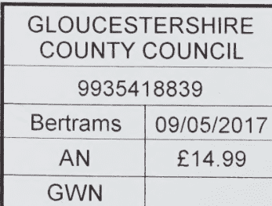

## 目录

- 引言 1
- 第一部分 为什么要编程？ 5
  - 总结 14
- 第三部分 实践 141
  - 网站开发 143
    - 网站是如何运作的？144
    - 什么是域名，如何获取？145
    - 什么是 Web 托管，如何获取？146
    - 内容管理系统 148
    - 自行编码网站 151
    - 网站开发项目：构建网站 154
    - 总结 155
    - 进一步学习 155
  - 总结 208
- 第四部分 用编程让职业无惧未来 211
- 结论 249
- 索引 253

# 引言

2016年6月，《快时尚》（Fast Company）发表了一篇解释“为什么编程仍然是未来最重要的工作”的文章。研究机构 Burning Glass 发现，需要编程技能的工作平均高出 22,000 美元，且超过 58,000 美元的工作有一半需要某些编程技能。此外，所有的编程机会都位于技术之外的行业，包括金融和医疗保健。

获取能够提高薪水和职业进程的专业技能，过去通常需要一个学位，甚至在博士或 MBA 学习中学习多年。但今天，在线课程和编程训练营的激增使得任何拥有电脑和互联网连接的人都有可能掌握编程技能。

随着计算机变得越来越聪明，并能够驾驶汽车、撰写新闻和独立运营业务，对能够编写机器代码的人的需求将更加迫切。

# 导言

理解编程如何支撑我们与电脑、手机和智能设备进行的每一次交互。你所编写的代码行将使你能够更好地利用你每天使用的技术。

## 我是谁？

我想花点时间告诉你们，学习编程是如何改变我的生活的。我在大学学习数学，之后在伦敦的一所中学当了一名老师。我非常喜欢教学工作，但我怀疑这可能不是我一生想要做的事情，于是每天晚上和周末，我开始尝试构建网站。

我小时候学过一点编程，尝试在 BBC Micro 上复刻我喜欢的电脑游戏，但我绝不是什么马克·扎克伯格或比尔·盖茨。我通常只是对某个网站有个想法，然后通过 Google 搜索如何实现它。这种学习方法是免费且相当直观的，但也意味着我经常会绕很多长且不必要的弯路，直到我发现有更好的处理方法。

我的第一次尝试的网站是`HomesExchange.org`，这是一个允许人们通过交换几周房屋来节省住宿费的网站。遗憾的是，我没有意识到域名`HomesExchange.org`也可以被理解为`HomeSexChange.org`。在经历了几次令人尴尬的客户投诉后，我决定这个生意不太可能走远！

我又建立了好几个网站，其中大多数都无疾而终，直到有一天，我产生了一个环保 Web 托管服务的想法，让人们能够以一种环保的方式托管他们的网站和电子邮件。这属于“自力救济”，因为我曾为为自己的网站寻找过此类服务，而现有的选择通常很贵，而且功能没有像`GoDaddy`和`123-reg`等大型主机托管商那样丰富。

这项服务（`ecowhosting.co.uk`）被证明是很多人需要的，随着人们通过 Google 和口口碑发现这个网站，它开始自然地增长。随着网站受欢迎程度的提高，添加了一些每天必须手动操作几次的功能和自动化流程，并在过程中学习了编程。

2012 年，我辞去了教师工作，全职投入到 Eco Web Hosting 和其他一些项目中。我很快发现，自由职业并不像我想象中那么“自由”，因为我总是同时有几项活动在进行。我喜欢拥有可靠的收入来源（通过 Web 托管）、新项目（主要是自由职业的网站和应用）以及创业新业务，但我也为应对这么多需求而感到挣扎。

2014 年 1 月，我开始制作在线课程来教人们如何构建网站。我注意到视频课程变得流行，并认为结合编程知识、教学技巧和创业经验，可以提供一种有趣、实用且基于项目的学习方法。我的《Complete Web Developer》课程后来成为了最畅销的课程之一，随后又推出了《Complete iOS Developer》课程和《Complete Android Developer》课程。

通过我的课程，我已经教了超过五十万人学习编程，让他们意识到互联网可以提供的规模并帮助了许多他人。课程还带来了财务自由，以及编程带来的许多机会。史蒂夫·乔布斯曾著名地说过：“我认为每个人都应该学习编程，因为它教你如何思考。”这是一个至关重要的益处——编程迫使你用逻辑和分析的方法来处理问题，并测试解决方案是否有效。对处理电脑和软件的能力充满自信，将极大地提高你的生产力以及与公司技术人员合作时完成任务的速度。

# 更多在线资源

在书的不同章节，我将向你介绍相关的在线资源。以下是获取方式：

1. 书中的每个在线资源都至关重要，例如：
2. 访问`kogan.com`
3. 你将看到“资源（resources）”按钮。
4. 它们将带你深入学习。
5. PDF 为每个编程问题提供了相应的 URL。

# 如何使用本书

本书的设计尽可能实用且具有实操性。通过积极参与并遵循每一个指令和活动，你将从中获得最大的收获。书中有三种类型的功能来帮助你学习编程：问题（questions）帮助你记忆关键信息，练习（practice exercises）确保你的新技能得到磨练和发展，而挑战（challenges）促使你深入学习。随着课程的进展，你会发现问题变少了，而挑战越来越多。希望你喜欢这段旅程！

# 第一部分｜为什么要编程？

## 为什么编程很重要以及它能为你做什么

我们已经看到了学习编程重要的几个原因：它可以增加你的薪水，拓宽未来的职业选择，并成为自雇和创业的跳板。它还将帮助你应对日益自动化的未来，如智能助手、自动驾驶汽车和虚拟现实。

在本章中，我们将看看现在编程完成的一些特定事情，其中许多我们将在书中进行扩展。

## 变得更高效

今天几乎所有的工作都需要花时间操作电脑。你可能每天都要执行一系列类似的任务，包括处理电子邮件、创建和管理文档以及搜索网络。通过了解你正在使用的软件和操作系统如何工作，几乎所有任务都可以变得更高效。

起初，只需使用快捷键可能每天就能为你节省几分钟，更重要的是，你会开始思考你正在使用的软件是如何工作的，以及如何改进你的工作流。像文本扩展和 If This That 这样的服务（我们会详细介绍），可以为你节省大量时间并帮助你更好地工作。想象一下自动给同事发送每周简报的摘要，或者完全自动化地将每周销售报告转换为同事随时查看的实时网页。

学习编程将允许你完成这一切以及更多，在更短的时间内完成更好的工作。

## 与技术人员交流

无论你对技术的熟练程度如何，你可能需要经常与技术人员交流一些你完全不理解的事情。无论是尝试为公司网站添加内容、在电脑上安装软件，还是删除你不小心发布在公司账号上的推文，更多的技术知识都能让这些对话变得简单得多。

除了熟悉技术人员使用的术语（这些术语实际上并没有看起来那么复杂或神秘），你将了解电脑系统如何工作以及如何连接的基础本质。这意味着每当你遇到新系统或新软件时，你都能锁定关键功能和属性，使你掌握其工作原理并自信地讨论它。

对处理电脑和软件的能力充满自信，将极大地提高你的生产力，以及与公司技术人员合作时完成任务的速度。

## 理解软件是如何工作的

教儿童编程的首要原因之一是软件世界的发展速度之快。我们目前主要的计算设备智能手机以目前的形式只出现了 10 年。谁知道 5 年、10 年或 20 年后我们将使用什么设备？教孩子编程是教他们软件运行的基本原理，这些原理在短期内不会改变。这将使他们能够快速适应新的操作系统、不同的程序或应用以及新设备。

## 了解所需的要素

在进一步了解软件如何工作之后，学习编程能让你对构建一个网络表单或为应用程序添加功能所涉及的内容产生认知。在你的职业生涯中某个阶段，你可能需要与代码人员直接合作，为公司网站添加功能、定制你每天使用的软件，甚至从零开始创建一个新的应用程序。

如果你不知道构建网站、应用程序或单个功能需要什么，那么你就面临着为所获得的内容支付过高费用，或者无法获得你完全想要的东西的风险。了解编写某些代码所需的要素，将让你在管理项目时在谈判中掌握话语权，并具备快速完成工作和控制预算的能力。

## 构建你自己的网站或应用程序

在互联网出现之前，如果你想向世界分享一个想法、产品或服务，会有重重障碍需要克服。你将不得不在报纸或书籍上发布信息，或者直接通过商店销售。网页改变了一切，现在你可以在几小时内构建出一个网站，并让目前在线的 30 亿人能够立即访问。现在唯一的障碍就是学习编程。

对我来说，这是一个非常兴奋的概念——编程让你仅凭一台笔记本电脑和一个（免费的）文本编辑器就能构建出等同于全球店面的东西。不再需要砖瓦房。

在本书中，我们将介绍构建你自己的网站和应用程序的不同方法（以及你为什么可能想这样做）。

## 构建网络存在

80% 的雇主在邀请面试前会在 Google 上搜索应聘者。花点时间搜索你自己的名字，看看会出现什么。这是你希望潜在雇主看到的内容吗？创建一个博客、作品集网站，或者为你开展过的项目或编写过的电子书创建一个简单的网站，可以让你控制未来老板看到的内容，并帮助你作为申请者脱颖而出。

## 为什么要编程？

网络存在至关重要，学习控制你的网络存在将使你领先于95% 的人口。我们将在本书的后面介绍创建博客和作品集网站的原因和方法。

## 开启你自己的业务

“技术创始人”，即那些想要创业并具备编程技能的人，需求之高，以至于有整个网站都致力于这项任务，在 Google 上搜索短语“寻找技术合伙人”有 320 万个结果。

编程技能让你能够启动任何你喜欢的业务，但它们也能让你与他人合作，提供所有新公司都需要的技术专业知识。无论你今天是否想成立一家公司，知道机会一直都在都是令人兴奋的，我们将在本书的后部分详细介绍这一过程。学习编程能给你带来哪些创业机会？

## 在你目前的职位中承担额外责任

在许多工作中，并没有明显的晋升流程。或者也许有流程，但它是一个缓慢的流程，而你正在寻找机会来加速下一次晋升。仅仅“把工作做得更好”或寻找其他方法来脱颖而出可能是困难的。

学习编程让你具备了能力，例如，构建一个让你和同事经常进行的某些工作变得更简单或更高效的应用程序。你可以创建一个帮助人们安排拼车的网页；或者如果你是一名律师，你可以构建一个应用程序让客户即时查看案件状态，并对任何更新接收自动提醒。你可以简单地负责你所在的公司网站板块，确保它是最新的，并可能引入一些受你的客户或客户欢迎的工具和功能。

做这些事情听起来可能外行或没有必要，但它们会引起你的关注，并且这可能是大事业的开始。即使你没有成功，你也将将在构建自己的想法时学到海量知识，并犯很多错误，如果有运气的话，你下次就不会再犯了。

## 目标停止“出卖时间”

通过就业，我们大多数人通过出卖时间来赚钱。如果你热爱你的工作，那是完全没问题的，但对于我们许多人来说，扩大规模的机会是欢迎的。学习编程可以提供这种机会。

如果你是老师，创建一个帮助人们教学的教学网站；如果你是艺术家，创建一个应用程序展示你的作品并提供广告；如果你是会计师，创建一个简化你工作流的工具并收取小费。你可以通过编写代码让计算机执行你的意图，这可能从现在就开始记录这些想法。

## 将编程与你的专业知识结合

将编程与你的专业知识结合。绝大多数全职代码人员只作为开发者工作。如果你有不同的专业背景，将其与编程结合可以产生其他效果。

> 对我来说，编程与教学的结合效果非常好，但对你来说，它可能是编程与法律、编程与会计或编程与瑜伽（我们将会看到例子）。了解人们的需求、他们面临的问题，以及如何解决这些问题。学习编程让你拥有解决问题的工具。

## 编程很有趣

编程可以是一个巨大的乐趣，并在解决问题和完成挑战时非常有成就感。你可能觉得在日常工作中没有学到新东西，而学习编程带给你那种自学校或大学以来可能没有过的获得技能的感觉。

如果你喜欢解决问题和创造事物，你可能会在完成项目、修复漏洞以及创建网站和应用程序中发现巨大的乐趣。编写代码让计算机听命于你本身就会成瘾，也是对日常生活压力的良好缓解。

## 编程与特定行业

希望以上内容为你提供了关于如何在目前的职位中使用编程技能的灵感，但如果没有，这里有一些编程如何提高你在特定行业前景的具体案例。

### 法律

技术在每个行业都变得日益核心。作为律师或会计师，了解编程可以在面对技术客户时获得优势，让你使用他们的语言并更清楚地了解他们的背景。不仅如此，技术还在推动法律的发展，迫使其适应新的可能性和不可预见的情况。良好掌握技术本身在快速变化的格局中是一个巨大的优势。

法律实务也日益依赖应用程序和网站等技术处理日常办公任务，简化这些流程的能力可以让你变得更加高效。你你可能还可以更好地满足客户：法律程序对个人和公司来说往往是缓慢且令人沮丧的。创建一个让他们实时看到正在发生什么以及需要做什么的工具，会让你的事务所脱颖而出。

### 销售与营销

销售和营销被技术彻底改变了。营销人员衡量其活动效果的能力完全改变了格局，熟悉最新的技术可以使个人营销人员和销售人员脱颖而出。无论是通过能够编写、编辑和调试电子邮件营销邮件的`HTML`，还是通过自动化重复性任务来释放你和团队成员的时间来开发创新想法。

### 银业

不言疑问，技术是当今银业的核心。机器进行交易的速度比人类快得多，消费者也越来越多地通过在线和 App 与银行互动。无论你在银行业行业处于什么位置，了解你和同事每天使用的工具，都能让你更有效地使用它们。

如果你整天都耗在`Excel`中创建财务模型上，那么学习编码不仅可以帮助你发现公式中的错误并检查结果，还能为你提供更强大的技术，来自动化你目前正在手动完成的流程。

### 贸易行业

虽然建造房屋和修理锅炉的实际操作过程仍由人类负责，但对技术的熟练掌握仍然为从事贸易行业的人带来竞争优势。客户服务是任何技工工作中的一个重要方面，能够快速回复查询、自动安排预约并高效地管理发票和付款，不仅节省时间，还能带来更满意的客户群体和回客业务。

与其他行业一样，如果你创建了一个能为你解决问题的工具，那么其他人很可能对使用它感兴趣，而你也将处于向行业内的人推销你的产品或服务的绝佳位置。

### 创意产业

作为摄影师、平面设计师或其他创意专业人士，你可能已经专注于技术，并且是系列复杂软件的高级用户。但你可能也发现自己在重复地执行相同的流程：导出为各种文件类型和大小、应用滤镜、调整颜色值等。能够自动化其中一些过程可以让你更高效，并让你的产出具有更一致的风格。

你不可避免地会与开发者合作，也许是为了创建自己的作品集网站，或者就某个特定项目进行合作。与他们进行有效沟通对于工作的顺利进行至关重要，一旦你达到了可以自己构建网站或 App 的水平，你就可以为客户提供更完整的服务。

### 零售与服务

零售和服务业的核心在于为客户提供极佳的体验。这通常意味着提供极佳的数字体验，这对组织和终端用户来说都更高效。掌握这项技术并能够为用户创建和定制功能，对雇主来说极具吸引力，并让你在日常工作中表现更好。

## 总结

这些只是学习编码可以改善你的前景、让你作为员工更有价值，并为你提供更多自由和职业发展机会的一些非常实用的方法。正如 Mahalo 的首席执行官、初创展示平台 Launch 的创始人 Jason Calacanis 所说：“一个懂编码的员工，在总收购价格中的价值相当于 50 万到 100 万美元。”通过学习新技能就能创造如此巨大的价值。

然而，我们将在本书的后面详细介绍所有这些机会，现在我们将花一点时间消除编码的神秘面纱。我们将学习编码到底是什么，为什么有这么多编码语言以及你应该学习哪种。我们还将看到互联网和离线 App 是如何运作的，并让你熟悉在本书中（以及你意识到的那些与技术人员的对话中）会遇到的基础术语。

最后，从更通用的观点来说，我发现学习编码给人们一种极大的赋权感。拥有 App 和网站等数字产品的能力是极少数人拥有的，它能为你的生活带来巨大的潜力。它彻底改变了我的生活，也可以为你做同样的事情。

# 什么是编码 02

对于以前没有编程过的人来说，编码可能像是一门神秘的艺术。神话中的“程序员”是那种（通常戴着耳机听着电子音乐）可以诱导计算机听命于自己的人，但实际上，整个过程比这要简单得多。

在本章中，我们将找出什么是编程，并编写几行简单的代码作为开始。我们还将看看我们可以用代码生成的不同类型的软件，包括网站、移动端 App 和桌面电脑程序。最后，我们将学习一些通用的编码流程，这对我们在下一节处理第一个编码语言`HTML`时将你大有裨益。

## 什么是编码？

简单来说，编码是编写指令行的过程，让计算机（或平板电脑、手机或手表）执行某些操作。但它比这要复杂一点，所以让我们了解一下背景。

让计算机执行其功能的基础电气元件是**晶体管**——这是一种微小的电子元件，它可以开启（允许电流通过）或关闭（电流无法通过）。目前的计算机处理器拥有大约 20 亿个晶体管，每秒可以开关约 30 亿次。（顺便一下，人类拥有 1000 亿个神经元，每秒开关约 1000 次，所以我们正接近能够模拟人类大脑的力量了。）

这意味着计算机是以 1 和 0 来“思考”的，1 代表“开启”或“真”，0 代表“关闭”或“假”。在计算机计算的极早期，与计算机通信的唯一方法是输入 1 和 0 的流，但这显然并不 Practical。因此，通常开发了计算机“语言”，允许人们以更方便的方式向计算机发出指令。

计算机语言非常像英语或西班牙语的人类语言，因为每种语言都有特定的命令（单词）和语法（标点符号），因此人类和计算机都能理解它。然而，计算机语言与人类

## 为什么要编码？

语言之间的一个关键区别在于，计算机语言是绝对精确且无歧义的。如果你拼错了一个命令，或者忘记了分号，你的整个代码可能会失败。与人类对话不同，计算机对拼写和标点符号非常挑剔。

这种不歧义性（此处应为精确性）的巨大优势是，你可以确定只要代码写对，计算机就会完全按照你的意愿执行。与经常产生意外之外结果的人类对话不同，计算机将始终完全按照指令执行，无论你喜不喜欢。

## 但不需要编码也能控制计算机

你可能在想：“但我不需要编码就能用我的电脑和手机完成我需要的一切。”在过去的 30 年里，像`Windows`和`MacOS`这样高度易用的操作系统（以及移动设备上的`Android`和`ios`）意味着我们不再需要编写代码来控制计算机。先进的图形用户界面（`GUI`）已经开发出来，任何人都可以接触电脑或手机并立即开始使用。这在可用性方面是一个巨大的进步，但也意味着，如果人们超出了`Word`和`Chrome`等日常软件，他们并没有意识到自己指尖下所拥有的力量。


你拥有的每一款软件都是由某人或更有可能是一组人编写的。每当你向 Siri 发出指令或在浏览器中输入网页地址时，都有几行（或几千行）代码被执行以回答你的问题或加载网页。这背后没有魔法，仅仅是成千上万名开发者和数十亿晶体管执行指令的辛苦工作。

学习编码赋予了你对这些晶体管的完全控制权——你可以通过创建自己的软件或自动化流程来每天为你节省几个小时，从而让它们听从你的。编码非常像一种超能力，因为它让你以一种全新的方式使用你已经拥有的设备。

## 让我们写一些代码

理论够了。让我们做些练习。在你的浏览器中，访问网址`https://repl.it/languages/python3`。这个网站允许我们用一种名为 Python 的计算机语言编写代码（以 Monty Python 命名——我们将在本章稍后的部分介绍更多关于个人编程语言的内容）。它将为我们编译代码（本质上是将其转换为计算机能够理解的 0 和 1），然后显示输出结果供我们查看。

在主窗口中，输入以下代码：

```python
print("Hello World")
```

现在点击“run”（运行）按钮来编译并运行你的代码。

你应该能在右侧屏幕的黑框中看到“Hello World”字样。成功了！现在尝试拼错`print`或删除其中一个括号。如果你现在运行代码，你将得到一个错误，类似于：

`NameError: name 'prin' is not defined`

这应该让你对自己需要多大的精确度有一个概念——计算机不会对你的意图进行“最佳猜测”；如果你的代码有一点微小的错误，将什么都不会发生。让这成为你的第一课吧！

让我们尝试一些稍微复杂一点的东西。看看下面的代码，并尝试预测它会做什么：

```python
for x in range(1, 11):
    print(x)
```

现在删除你的`print`语句并将其替换为上面的代码。如果你遇到错误，请非常仔细地检查你输入的代码——你需要完全地复制代码。

注意：`print`命令是使用 Tab 键缩进的。如果你正确输入了第一行并按回车键，网站应该知道你想对第二行进行缩进，因此它会自动为你完成。如果没有这样做，请按电脑上的 Tab 键来缩进。

结果符合你的预期吗？`for`命令启动了一个被称为“循环”（loop）的东西，它会多次执行一段代码。`x`是一个变量，代表一个值，在这种情况下是数字。`range(1,11)`部分让循环中的`x`分为 1、2、3、……直到 10（可能让你惊讶的是，代码中并不包含 11）。最后，`print(x)`部分打印变量`x`的值。因此，输出就是简单的数字 1 到 10。

## 挑战 1

你能修改上面的代码让它打印 10 到 20 的数字吗？

**解答：**你应该将代码修改为：

```python
for x in range(10, 21):
    print(x)
```

如果你做到了，恭喜你！

打印数字从 1 到 10 似乎距离构建下一个 Uber 或 Snapchat 还有很远，但这是所有编码员的起点，即使在构建复杂的软件或语音识别系统时，同样的原理也适用。

## 为什么有这么多编程语言？

对于新程序员来说，一个常见的问题是学习哪种编程语言，这引出了为什么会有这么多语言的问题。对于人类语言来说，我们在数千年的时间里在不同的地理社区中发展出了许多语言。而对于计算机语言，它们的发展更具刻意性，这意味着不同的语言是为不同的目的设计的。你不需要成为每种语言的专家，有些非常伟大的编码员确实非常精通一种语言，但你应该意识到语言运行的上下文环境。

我们稍后会详细介绍这一点，但目前你将用代码创建的软件大致有三类。我们把第一类称为应用程序（apps）。应用程序的代码存储在设备上（通常是电脑、手机或平板电脑）上，并在该设备上运行。一个应用可能是 Excel、或者邮件客户端，或者是像 Firefox 这样的浏览器。它可能是一个游戏《愤怒的小鸟》，或者是像手机上的备忘录应用这样的实用工具。应用程序是大多数人谈论软件时所指的内容，它们也是最容易理解的。

接下来我们有显示网站的代码。这通常不存储在你的机器上，而是每次加载网站时都会重新下载。浏览器（本身也是应用，如 Chrome、Safari 或 Firefox）下载并处理代码以向你展示网站。这被称为客户端代码（client-side code），因为是在客户端电脑或手机（即你的设备）上处理的。

最后，我们有运行在服务器上的代码，或服务端代码（server-side code）。服务器就像是一台始终连接互联网的强大计算机。你的电子邮件存储在服务器上，你的 Twitter Feed 以及《Words With Games》的游戏状态也是如此。当你登录网站时，你使用用户名和……

## 应用语言

按最流行的移动开发语言来说，有 iOS 的 Swift 和 Android 的 Java。如果你在为桌面和笔记本电脑构建应用，有一系列语言，包括 C、Python 和 Java。如果你想学习移动开发，iOS 的 Swift 和 Android 的 Java 是你的最佳选择。

如果你现在不知道想用代码做什么，只需跟着跟着书学习即可，我会教你一系列语言，这样在你完成之后，就可以决定把注意力放在哪里。

## 总结

现在你已经对代码的作用以及可用的各种不同语言和平台有了良好的概述，是时候开始了。

在接下来的章节中，我们将查看前端 Web 开发的三种主要语言：HTML、CSS 和 JavaScript，以及一种用于后端的 Python。这将让你在各种编程风格和技术方面打下良好的基础，并赋予你创建和管理自己网站的能力。

# 第二部分

## 语言

# HTML

## 03

在本章中，我们将通过学习 HTML——网页的语言来开启我们的编码之旅。在本章结束时，你将了解：

- 什么是 HTML 以及它在何处使用；
- 如何更新和维护简单的网站；
- 如何在文本编辑器中编辑 HTML，并立即在浏览器中查看结果；以及
- 如何使用基础 HTML 元素，包括：
  - 段落和标题；
  - 列表和图像；
  - 表单和表格。

## 什么是 HTML？

HTML 是超文本标记语言（Hypertext Markup Language）的缩写，它是所有网站编写使用的语言。超文本描述了 HTML 页面可以包含指向其他 HTML 页面的链接，这是 Web 背后的创立原则之一。

HTML 由蒂姆·伯纳斯-李（Tim Berners-Lee）在 20 世纪 80 年代后期创建，当时他正在开发现在的互联网。他创建它作为一种组织自己笔记的方法，但很快就想与其他人分享他的文档。随着 Web 的增长，伯纳斯-李的这种语言运行良好，以至于其他人采用它来为文本、表单、图像，当然还有链接添加格式。

HTML 成功的一个方面（与本书中的所有语言一样）是伯纳斯-李让它免费供任何人使用。正是这种自由让 Web 增长如此之快，并让如今的任何人都能不花任何费用使用与专业人士相同的工具。感谢你，蒂姆！

## 为什么要学习 HTML？

严格来说，HTML 并不是一种编码语言，而是一种标记语言。这意味着通过 HTML 你可以更改网站的内容和布局，但在与用户的交互方面你是受到限制的（因此你不能仅用 HTML 构建 Twitter）。

这使得 HTML 成为你开启编码之旅的绝佳起点，因为它非常容易理解，你可以立即将学到的技能应用到构建简单的网站，或对你拥有或管理过的网站进行更改。如果你在公司网站上发现错误，你可以自己修复它，而无需打扰 IT 部门。

在书的后面部分，我们将看到如何将 HTML 与 JavaScript 结合，为你的页面引入交互。

## 我需要什么软件？

对于整本书，你只需要下载一个软件，那就是文本编辑器。这允许你使用任何编程语言创建和编辑代码。

你可以使用任何你喜欢的文本编辑器，但我建议从`www.brackets.io`下载 Brackets。它是免费且开源的，可以在 Windows、Mac 和 Linux 上下载。它会自动突出显示并缩进你的代码，使编写 HTML 变成一种更加愉快的体验。

> 注意：你可能不需要 Brackets 捆带的 Extract 软件，因此点击“Download Brackets Without Extract”（不带提取器的 Brackets）链接。

### 3.1 Brackets

一个理解 Web 设计的现代开源文本编辑器。


## 我下载了 Brackets——现在该怎么办？

一旦安装了 Brackets，你就会看到这个屏幕（3.2）：

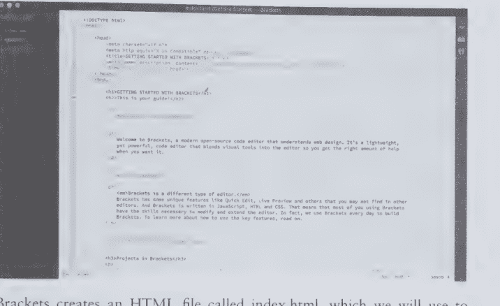

Brackets 会创建一个 HTML 文件`index.html`，我们将在开始编写自己的代码之前使用它来熟悉 HTML 的基础。

你可以通过点击 File（文件）→ Live Preview（实时预览）来查看此 HTML 在你浏览器中的样子。这将在你的默认浏览器中打开 HTML 文件，它看起来会像这样（3.3）：

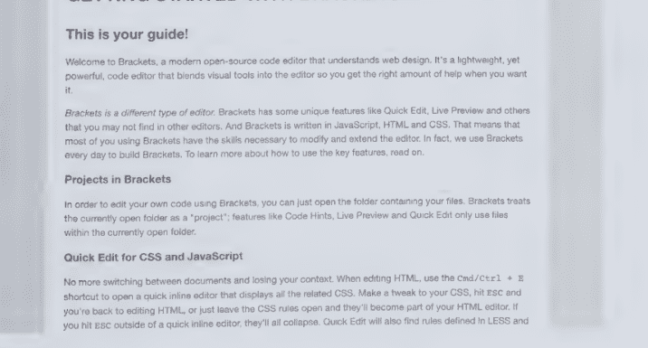

## 开始使用 BRACKETS

这是你的指南！

欢迎使用 Brackets，这是一个理解 Web 设计的现代开源代码编辑器。它是一个轻量且强大的代码编辑器，将视觉工具融入到编辑器中，以便你在需要帮助时获得恰当的帮助。

Brackets 是一种不同的编辑器。它具有一些独特的特性，如 Quick Edit（快速编辑）、Live Preview（实时预览）以及其他你可能在其他编辑器中找不到的功能。它是用 JavaScript 编写的。

（注：由于原文后续部分出现大量重复和碎片化内容，此处已根据逻辑保留核心信息）

- 这是你的指南！
- 欢迎使用 Brackets……
- 项目（在 Brackets 中进行项目）

现在是挑战环节。在可能的情况下，请凭记忆创建一个标题为“My first webpage”（我的第一个网页）的 HTML 文档（你不需要为其提供描述或定义字符集），并在`<p>`标签内包含内容“Hello World!”。好运！

完成后，你可以将代码复制到 CC 1 中检查你是否写得正确！

你的最终网页看起来应该像这样（3.7）：

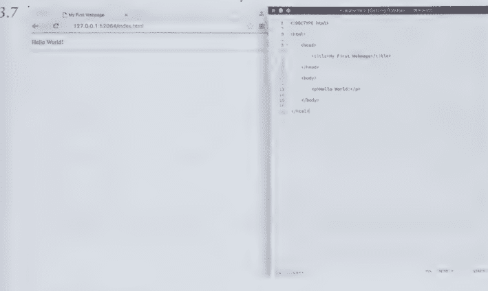

```html
<!DOCTYPE html>
<html>
<head>
    <title>My First Webpage</title>
</head>
<body>
    <p>Hello World!</p>
</body>
</html>
```

## 练习题

1. 为此处添加缺失的起始和结束标签以修正 HTML：CC 2
2. 在此处创建一个标题（header）和段落（paragraph）标签：CC 3
3. 在此处创建三种不同类型的标题标签：CC 4

## 文本格式化

现在你已经了解了基础 HTML 页面是如何工作的，我们将学习一些可以用来自定义页面外观的特定标签。让我们从文本格式化开始。

尝试在 Brackets 中的“Hello World”段落下方输入以下代码：

```html
<p><strong>This text will be bold</strong></p>
```

`<strong>`标签使文本显示为粗体。

问题：移动`<strong>`标签的位置，使得只有“text”一词加粗。

答案：`<p>This <strong>text</strong> will be bold</p>`将是加粗的。

使用以下代码添加一个新段落：

```html
<p><em>This text will be italic</em></p>
```

`<em>`标签是 emphasis（强调）的缩写，使文本显示为斜体。

这可以作为基础 HTML 格式化标签的方便参考。

注意——你可能想将该代码保存为计算机上一个名为`formatting.html`的独立文件，以便以后查阅。

问题：尝试实验添加包含`<sup>`、`<sub>`和`<del>`标签的段落。这些标签对你的文本有什么效果？

答案：`<sup>`使文本变为上标（即显示在普通文本上方），`<sub>`是下标（即显示在普通文本下方），`<del>`具有删除线效果。

你最终得到的网页看起来应该像这样（3.8）：

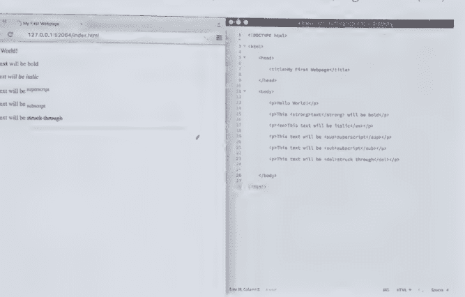

## 练习题

1. 为此处文本添加格式化：CC 5

## HTML 列表

我们现在来看一些更高级的 HTML 标签，从列表开始。清除你的 HTML 文档中`<body>`标签的内容，并在其中输入以下代码：

```html
<ul>
  <li>Red</li>
  <li>Yellow</li>
  <li>Blue</li>
</ul>
```

`<ul>`标签是“unordered list”（无序列表）的缩写，`<li>`标签是“list items”（列表项目）。这创建了一个如下所示的项目符号列表：

### 列表

- Red
- Yellow
- Blue

问题：尝试将上述代码中的`ul`改为`ol`。这产生了什么效果？你认为`ol`代表什么？

答案：`ol`代表“ordered list”（有序列表），并使列表以编号显示，如下：

1. Red
2. Yellow
3. Blue

`<ul>`和`<ol>`标签用于显示信息列表的方法。它们在维基百科非常大的“列表的列表的列表”（List of lists lists）页面`https://en.wikipedia.org/wiki/List_of_lists_of_lists`中被引用。

## 旁注：查看任何内容的 HTML

在你的浏览器中，尝试加载`https://en.wikipedia.org/List_of_lists_of_lists`。然后右键点击该网站并选择“查看页面源代码”（View Page Source）或类似的选项。你可能会看到这样的内容（3.9）：

### 3.9

```html
<ol class="list-item s62">
  <li>List of lists, the new way to document information.</li>
  <li>List of lists, the development of document lists.</li>
  <li>List of lists, the article about lists.</li>
  <li>List of lists, the ordered list.</li>
  <li>List of lists, another ordered list.</li>
  <li>List of lists, an unordered list.</li>
  <li>List of lists, another unordered list.</li>
  <li>List of lists, the list of lists.</li>
  <li>List of lists, the list of lists.</li>
</ol>
```

如果你仔细看，这可能看起来像乱码，但你可以看到我们讨论的一些 HTML 元素：`<html>`、`<title>`等。

如果你向下滚动，你会看到一组`<ul>`元素，配有`<li>`元素来与页面本身的内容对应。将它们并排查看让我们得到这样的结果（3.10）：

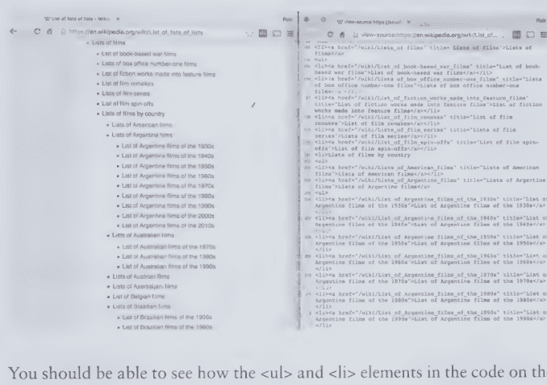

你应该看到右侧代码中的`<ul>`和`<li>`元素是如何与左侧页面中的各种列表匹配的。

尝试在其他几个网站上这样做，以获得感觉。

如果你尝试运行该代码，你会发现只能选择选项中的一个。此外，一旦你选择了一个选项，就无法取消选择——所以你必须在选项中选择且仅选择一个。

## 练习题

对于以下每一项，请说明你会使用复选框（checkbox）还是单选按钮（radio button）：

- 1. 询问用户是否想订阅新闻邮件。
- 2. 询问用户他们更偏于喝茶还是咖啡。
- 3. 从一个列表中询问用户他们去过哪些国家。

### 答案

- 1. 复选框——他们可以根据意愿勾选或取消勾选框。
- 2. 单选按钮——他们应该只能选择一个选项。
- 3. 复选框——他们可以根据需要选择任意数量的（或都不选）。

## 下拉菜单

如果你想创建一个让用户从一系列选项中选择的下拉列表，可以使用`select`元素。它看起来如下：

```html
<select>
  <option>1</option>
  <option>2</option>
  <option>3</option>
</select>
```

在你的文本编辑器中尝试一下——你应该能看到类似这样的（3.15）：

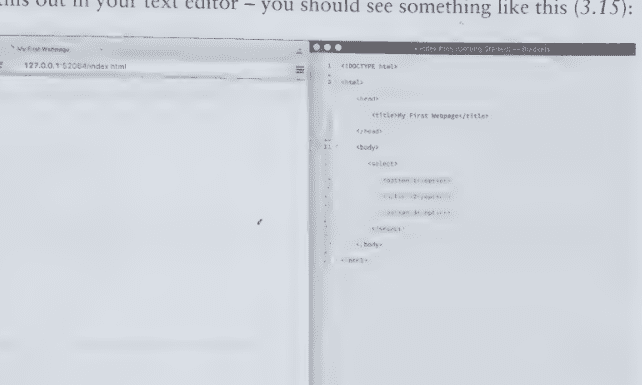

这段代码比`input`元素稍微复杂，但仍然非常简单。`<select>`标签引入了下拉菜单，然后为下拉菜单中的每个选项添加一个`<option>`标签。

问题：`</option>`标签的作用是什么？

答案：它标志该选项的结束，我们可以添加另一个选项，或者使用`</select>`来结束下拉菜单。

## 文本区域（Text areas）

如果你允许用户输入一些文本，但他们需要的空间不仅仅一个小方框怎么办？这时文本区域就派上用场了。你可以这样添加它们：

```html
<textarea></textarea>
```

尝试一下，你会看到一个更大的框，你可以在其中添加多行文本。与`input`不同，`textarea`标签不是自闭合的，因此你需要在之后添加`</textarea>`来结束该元素。

## 练习题

使用`cols`和`rows`属性更改文本区域的宽度和高度。创建一个高度和宽度大约为你浏览器窗口一半的文本区域。

经过一番尝试，你的代码看起来应该像这样：

```html
<textarea cols=50 rows=25></textarea>
```

这将为你提供一个像这样的文本区域（3.16）。


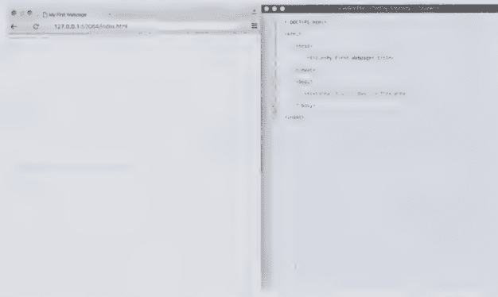

## 按钮（Buttons）

每个表单都需要一个提交按钮。你可以使用`input type 'submit'`来添加一个，如下：

这会给你一个带有“Submit”字样的简单提交按钮。如果你想更改按钮上的文字，可以添加一个`value`属性，如下：

```html
<input type="submit" value="Click Me!">
```

表单部分我们就到此为止（我们将在第 6 章再次看到它们）。它们是与用户交互的一种非常简单的方式，如果你正在创建或编辑网站，很快就会遇到它们。

## 挑战 2

你现在已经熟悉所有的基础表单元素，所以尝试创建一个简单的注册表单，允许用户输入电子邮件地址、密码，可能还有性别（或喜欢的冰淇淋口味）。别忘记提交按钮。

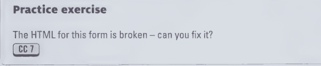

## 表格（Tables）

表格向用户展示信息的极佳方式——本质上它们像电子表格，每个单元格都有不同的内容。要创建一个表格，请使用以下代码：

```html
<table>
  <tr>
    <th>Name</th>
    <th>Age</th>
    <th>Gender</th>
  </tr>
  <tr>
    <td>Rob</td>
    <td>35</td>
    <td>Male</td>
  </tr>
</table>
```

`<table>`标签非常通俗易懂——它表示我们想要显示一个表格。`<tr>`是“table row”（表格行）的缩写，定义了表格中新行的开始。`<th>`是“table header”（表格表头）的缩写，因此每一个`<th>`都是我们表格的单列表头。

在表格表头之后，我们使用`</tr>`表示第一行的结束，并使用另一个`<tr>`开始新行。`<td>`是“table data”（表格数据）的缩写，我们以此引用表格中单元格的内容。每行都应该具有相同数量的列（在这种情况下为 3 列）。

将其输入你的文本编辑器并看看长什么样。你应该看到类似这样的（3.17）：

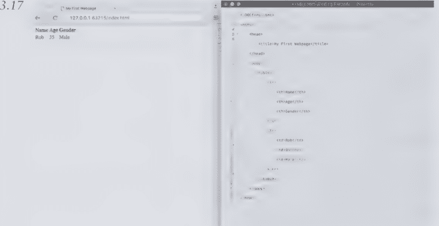

你可以看到表格单元格对齐得很好，而且表头是加粗的。搞定——我们的第一个表格！

问题：在你的表格中再添加三行，代表你的三位家人或朋友。

答案：你的 HTML 应该像这样：

```html
<table>
  <tr>
    <th>Name</th>
    <th>Age</th>
    <th>Gender</th>
  </tr>
  <tr>
    <td>Rob</td>
    <td>35</td>
    <td>Male</td>
  </tr>
  <tr>
    <td>Kirsten</td>
    <td>36</td>
    <td>Female</td>
  </tr>
  <tr>
    <td>Tommy</td>
    <td>5</td>
    <td>Male</td>
  </tr>
  <tr>
    <td>Raphie</td>
    <td>1</td>
    <td>Male</td>
  </tr>
</table>
```

我们可以通过多种方式自定义表格。首先，我们可以像之前处理图片那样改变列的宽度：

```html
<table>
  <tr>
    <th width=200>Name</th>
    <th width=100>Age</th>
    <th width=150>Gender</th>
  </tr>
  <tr>
    <td>Rob</td>
    <td>35</td>
    <td>Male</td>
  </tr>
</table>
```

```html
<table>
  <tr>
    <th width=200>Name</th>
    <th width=100>Age</th>
    <th width=150>Gender</th>
  </tr>
  <tr>
    <td>Rob</td>
    <td>35</td>
    <td>Male</td>
  </tr>
  <tr>
    <td>Kirsten</td>
    <td>36</td>
    <td>Female</td>
  </tr>
  <tr>
    <td>Tommy</td>
    <td>5</td>
    <td>Male</td>
  </tr>
  <tr>
    <td>Raphie</td>
    <td>1</td>
    <td>Male</td>
  </tr>
</table>
```

注意当我们这样做时，表头是居中的，但数据是左对齐的。

我们还可以通过给表格添加`border=1`来给表格添加边框。


## 挑战 3

创建一个表格，以“First Name”和“Surname”为表头，并将你的真实姓名放在表格主体中。

## 链接（Links）

正如在本章开头提到的，HTML 中的“H”代表 Hypertext（超文本），指向其他网页。我们在 HTML 中使用链接如下：

```html
<a href="http://www.google.com">Search Web
```

`<a>`元素实际上是“anchor”（锚点）的缩写，因为链接最初用于从页面的一部分跳转到另一个部分。“href”是 hypertext reference（超文本引用）的缩写，本质上是我们想要链接的页面。`<a>`标签内部的文本是用户将点击的文字。

尝试一下，你会发现你的文字是下划线且蓝色的，当你点击它时会被带到`www.google.com`（3.20）。

（你可以点击浏览器的返回按钮回到你的网页。）

问题：给`<a>`元素添加`target="_blank"`属性会发生什么？

答案：你的代码应该如下：

```html
<a href="http://www.google.com" target="_blank">Search Web
```

点击链接时，你会发现它会在新标签页或新窗口中打开。

锚链接（即网页内部链接）的工作方式略有不同。首先，向你的页面添加几段文本，使页面比浏览器窗口高，你需要滚动到最后。我使用`lipsum.com`为你的页面生成拉丁文文本（3.21）：

Lorem ipsum dolor sit amet, consectetur adipiscing elit. Maecenas at lectus. Curabitur vitae massa. Sed non felis erat. Morbi porta ultiat nisl. Duisque sollicit turpis vitae massa. Pellentesque vehicula nibh id diam. Aliquam dapibus metus. Phasellus facilisis nulla. Nulla neque, id hendret massa element. Praresent non nisl eu. Sed nec orci id tincidunt vehicula vel vestibulum eu metus. Integer facilisl, sem erat elit.

Consisit facilisis orci at elit diam. Nulla varius metus arcu. Suspendisse auctor fermentum. Aliquam nisl aliquam, risus et gravida, dapibus nisl. Vivisque nec massa, ac ac nisl non. Donecin neque, elit, dictum, nisl amet. Mauris non nec sem, hendrerit massa.

Nero nisi, semper aliquet sollicitudin, ultricies vestibulum ante, Integer volutpat dapibus enim. Curabitur viverra urna massa. Phasellus porttitor nisl at id mauris. Proin lacinia nisl, sed a libero a dapibus velit.

Duis non tellus eleifend, ornare massa. Nulla pellentesque, felis a dapibus velit, dictum nisl, a nisl a diam. Prain in non tellus, luctus, neque, a nisl a quam. Pellentesque neque, a orci et nisl.

| Name | Age | Gender |
|---|---|---|
| Kirsten | 36 | Female |
| Tommy | 5 | Male |
| Ralphie | 1 | Male |

| Name | Age | Gender |
|---|---|---|
| Kirsten | 36 | Female |
| Tommy | 5 | Male |
| Ralphie | 1 | Male |

注意当我们这样做时，表头是居中的，但数据是左对齐的。

现在，给页面上的最后一段添加一个`id`属性，如下所示：

```html
<p id="last">
```

（我们将在 CSS 章节中看到更多关于`id`属性的内容。）最后，将顶部链接的代码更改为像这样：

```html
<a href="#last">跳转到最后一段</a>
```

`#`（井号）符号告诉浏览器，不要跳转到另一个页面，而是在当前页面中查找 id 为“last”的`id`标签并跳转到那里。尝试一下。你会发现点击该链接时，它会跳转到页面底部。

## 练习题

1. 在 CC 9 的练习中练习创建链接。

## HTML 实体

有时，你可能想在网页中使用符号，例如版权符号 ©、欧元符号 € 甚至是一个笑脸符号 🙂。这可以通过使用 HTML 实体来实现，HTML 实体是浏览器会将其识别并显示为所需符号的特殊代码。所以，为了显示笑脸符号，我们使用：

```html
&#9786;
```

## 在 Brackets 中尝试（3.22）

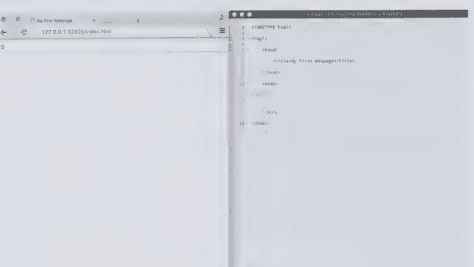

`&amp`告诉浏览器我们即将输入一个 HTML 实体，而`#`表示我们将通过其代码数字来描述该实体。笑脸的代码数字是 9786，然后我们使用分号来完成该 HTML 实体。

某些符号可以使用数字显示，也可以使用代码名称显示，所以：

```html
&copy; 和 &#169;
```

将都会显示版权符号 ©。

你可以在`www.w3schools.com/html/html_entities.asp`看到一些最常用 HTML 实体的列表。

## 挑战 4

尝试使用 HTML 实体在这里添加货币符号：CC 10

## iFrames

这是我们在本章中将学习的最后部分 HTML，所以恭喜你已经走到了这里。很快，我们将学习如何使用 CSS 为我们的网页添加样式。

iFrames 允许我们把另一个网页的内容包含在自己的网页中。例如，我们可以使用以下代码在我们的网页中包含 Google 首页：

```html
<iframe src="http://www.example.com"></iframe>
```

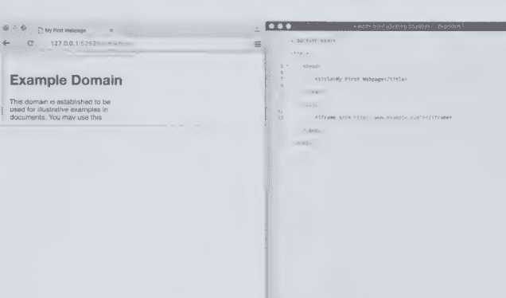

尝试将`www.example.com`改为你访问过的其他网站，例如`bbc.co.uk`。注意，某些热门网站（如`google.com`和`facebook.com`）不允许其网站在 iFrames 中显示。

问题：你能否为`<iframe>`元素添加一些属性，让 iFrame 框像你的浏览器窗口一样宽和高？

答案：只需像处理图片一样添加`width`和`height`属性即可：

```html
<iframe width=550 height=660 src="http://wikipedia.org"></iframe>
```

## 语言将给你类似这样的内容（3.24）

## 3.24

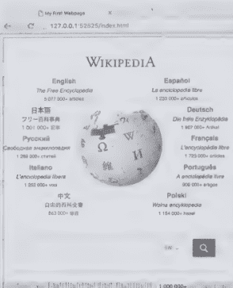

iframes 一个特别方便的用法是在你的网页中包含 YouTube 视频等媒体内容。要做到这一点：

- 转到`youtube.com`并点击任何你喜欢的视频。
- 向下滚动并点击“分享”按钮（红色“订阅”按钮下方）。
- 点击“嵌入”。
- 将代码复制到剪贴板（Mac 上使用`ctrl-c`或`cmd-c`），然后将其粘贴到你的网页中。你最终会得到类似这样的效果（3.25）：

## 3.25


这段代码是一个带有宽度和高度的 iFrame，但也具有`frameborder="0"`属性（这会关闭 iFrame 边框）以及`allowfullscreen`（这是一个 YouTube 特有的属性，正如你可能猜的那样，它允许用户让视频全屏显示）。

## 练习题

1. 尝试在这里添加一个 iFrame 来包含任何网站：CC 1

## HTML 项目：大汇总

恭喜！你已经学习了 HTML 的基础知识。现在是时候通过创建一个包含尽可能多本章元素的单个网页，将你新学的知识付诸实践了。选择一个你感兴趣的话题，然后通过添加标题、头部、列表、iFrame 以及你涵盖过的所有其他元素来创建你的页面。完成后，访问`codepen.io`并粘贴你的代码。你应该会在屏幕底部看到你的网页，并可以在社交媒体上分享它。

## 总结

正如我们所学的，HTML 是每个网页的基础。你现在已经学习了如何创建和编辑所有元素，因此编码之旅的下一步是学习如何为我们的页面建模——添加颜色、更改大小、调整文本格式等等。我们使用 CSS（或级联样式表）来实现，这就是我们在下一章将看到的。

## 进一步学习

在书的这里，我建议继续学习 CSS。然而，如果你想进一步深入研究，请查看这些关于该语言如何工作以及你可以用它做什么的资源：

- `www.codeacademy.com/`
- `www.w3schools.com/html/`
- `http://learncode.com/`
- `https://play.google.com/details?id=`
- `sololearn.com`

## 练习题

尝试使用内联 CSS 将此段中的文本变为红色：`CC 12`

不过，内联 CSS 存在一个问题——如果我们想让每个段落的文字变成红色，就必须为每个段落添加`style`属性。这非常杂乱，而且如果我们突然想把所有段落的颜色改为绿色，就必须逐个更新每一个。

幸运的是，这个问题有一个解决方案，它被称为内部 CSS。

## 什么是内部 CSS？

内部 CSS 是将所有的 CSS 统一包含在 HTML 文档的开头（我们将在章节末尾遇到第三种也是最后一种 CSS：外部 CSS）。它看起来像这样（4.1）：

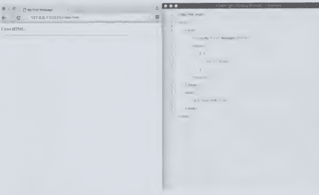

仔细观察网页的`<head>`部分——它包含一个新元素`<style>`，其中包含了我们的 CSS。`<style>`部分的内容是：

- 2 将此网页的样式从内联 CSS 改为内部 CSS：[CC 13]
- 3 CSS 不限于`p`标签。在你的网页中添加一个`<h1>`元素，并使用内部 CSS 将文字变为黄色。

你的代码应该像这样（4.3）：

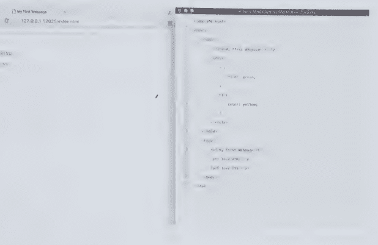

## 类（Classes）和 ID

如果我们想让某些段落标签变为蓝色，另一些变为红色怎么办？我们需要一种比仅通过类型更精确选择元素的方法。我们使用类和 ID 来实现。

## 类（Classes）

向元素添加`class`属性非常简单——将第一个段落的代码改为：

```html
<p class="blue">I love HTML.</p>
```

我们现在已经给该段落应用了类“blue”。现在在你的网页的`style`部分添加以下代码：

```css
.blue {
  color: blue;
}
```

注意：“blue”之前的`.`告诉浏览器我们正在寻找一个类。在 CSS 中，点（句号）是 class 的缩写。

## 语言（颜色）

你现在应该发现第一个段落是蓝色的，第二个是绿色的。

尝试为`h`元素添加`class="blue"`属性。你会发现“My first webpage”也变成了蓝色。类允许我们为任意数量的元素提供特定的 CSS 规则，并且适用于任何类型的元素。

注意，类为“blue”的段落实际上应用了两个样式规则。`p`规则告诉它是绿色的，而`.blue`规则告诉它是蓝色的。由于 CSS 规定最“特定”的规则应该胜出，因此由类或 ID 定义的规则将始终优于应用于元素类型的规则。所以段落最后是蓝色的，而不是绿色的。这就是级联样式表（Cascading Styles）中“级联”部分的体现。

## ID

ID 与类非常相似，但它们应该只应用于网页上的一个元素。它们是为只会出现一次的元素设计的，例如页眉、页脚或标题。

我们以与类完全相同的方式添加它们，所以尝试将“I love CSS!”段落的 ID 改为“pink”：

现在在 style 部分添加以下 CSS：

```css
.pink {
  color: pink;
}
```


注意：这里我们使用哈希符号 `#` 来表示 ID。因此在 CSS 中，`.` 是类的缩写，而 `#` 是 ID 的缩写。

你会发现 `pink` 规则和 `p` 规则都适用于“I love CSS!”段落，但 ID 规则胜出。与 ID 和类的规则将始终优于与元素类型的规则。

## 练习题

- 为网页添加内部 CSS，使用类和 ID 使第一个段落变为红色，第二个段落变为蓝色：CC 14


我们现在可以通过元素的类型、类或 ID 来选择元素。不过我们目前只学了一种 CSS 规则，即如何更改文本颜色。在查看其他规则之前，我们将快速看看如何使用 `<div>` 元素将我们的代码划分为不同的部分。

## Div（分段）

Div 是“division”（划分）的缩写，允许我们将代码划分为不同的部分。这意味着如果我们愿意，可以对每个部分进行不同的样式处理。删除页面 body 中的所有代码并将其替换为以下内容：

```html
<div class="divA">
  <p>I'm in div A</p>
</div>

<div class="divB">
  <p>I'm in div B</p>
</div>
```

结果应该像这样 (4.4)：

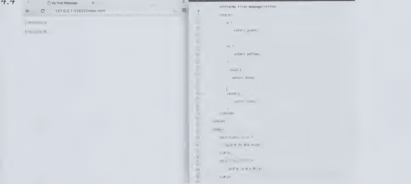

问题：为什么现在两个段落的文字都是绿色的？

答案：我们删除了段落中的类和 ID，所以现在适用于它们的唯一规则是颜色：绿色规则。因此它们都是绿色的。

看起来 div 似乎并没有做很多事情，但当我们开始应用它们时，它们实际上为我们的设计提供了很多控制。

## 背景颜色

我们现在来查看一系列不同的样式。删除标签中的代码并将其替换为：

```css
div {
  background-color: grey;
}
```

这为两个 div 都提供了背景颜色 (4.5)：

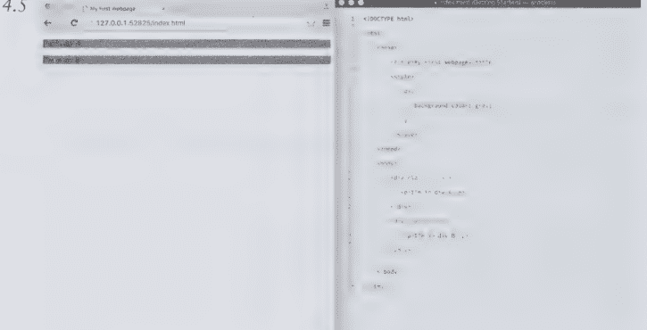

注意：div 默认跨越整个窗口。

## 练习题

- 使用类给第一个 div 设置红色，给第二个 div 设置蓝色。

## 颜色代码

到目前为止我们只使用了名称来描述颜色。但我们想要比仅仅名称更精确，我们通过代码来实现。哈希符号 `#` 告诉我们正在使用十六进制代码。在 CSS 中，它看起来像这样：

```css
.div {
  background-color: #ff0000;
}
```

十六进制代码由六数字组成：0-9 和 A-F。前两个数字代表红色，接两个代表绿色，最后两个代表蓝色。例如 `#ff0000` 是红色，`#00ff00` 是绿色，`#0000ff` 是蓝色。

尝试使用十六进制代码寻找颜色。

## 练习题

- 更新此页面的内部 CSS，使用十六进制代码设置颜色。

## 尺寸

我们可以使用 `width` 和 `height` 来更改大小。尝试在你的页面使用以下代码：

```css
.divA {
  background-color: red;
  width: 200px;
  height: 200px;
}
```

```css
.divB {
  background-color: blue;
  width: 50%;
}
```

你的页面应该像这样 (4.6)：

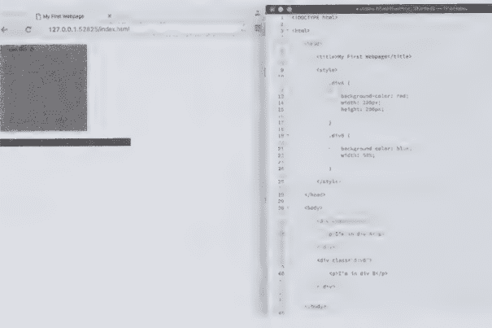

注意我们可以使用任何单位。`200px` 意味着 200 像素，`50%` 意味着容器元素的 50%。

## 使用浮动定位

到目前为止我们看到了如何使用 CSS 调整颜色和大小，但我们也可以影响布局。直到现在，所有的元素都是垂直排列的，但可以使用浮动来改变这一点。尝试为 `.divA` 添加此 CSS 规则：

```css
float: right;
```

你的页面应该像这样 (4.7)：

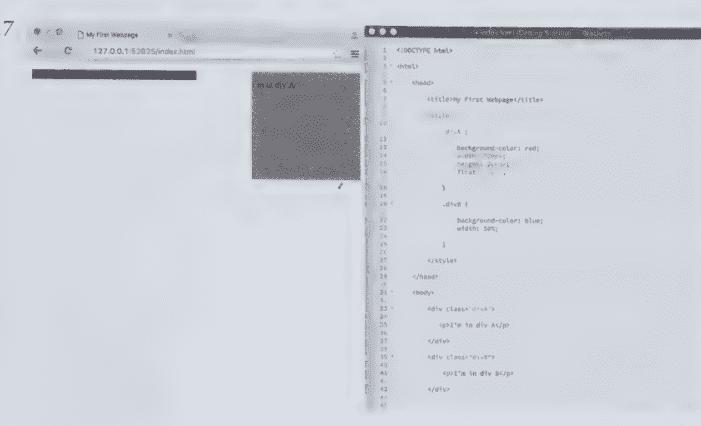

注意发生了什么：`divA` 现在浮动在页面右侧，而 `divB` 在左侧与它同步。尝试进行以下更改：

- 为 `.divB` 添加 `float: left`
- 将 `divB` 的宽度改为 `20%`
- 在 `divB` 之后添加一个内容为“This is some text”的段落

你能解释这种布局吗？它应该像这样 (4.8)：

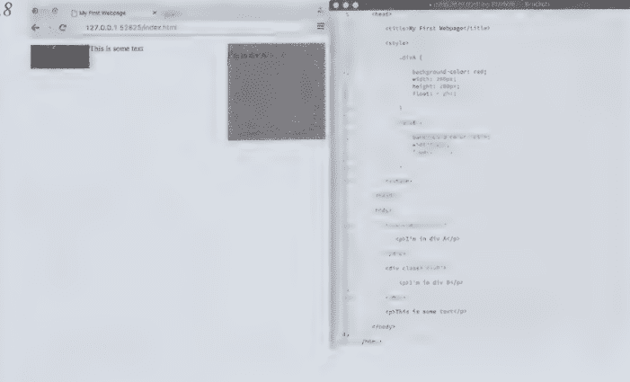

我们现在有一个三列布局，红色 div 在右侧，蓝色在左侧，其他所有内容在中间。浮动是让 div 或其他元素左右排列的一种非常有用的方法。

## 练习题

- 更新此页面的内部 CSS，使 `#left` 向左浮动、`#right` 向右浮动 CC 16

## 使用位置布局

有时我们希望比浮动允许的更精确的布局，我们通过定位来实现。如果我们想相对于元素原本的位置移动，例如 div A 的位置，可以添加以下 CSS 规则：

```css
position: relative;
top: 50px;
left: 100px;
```

这将向下移动 50 像素并向右移动 100 像素 (4.9)：

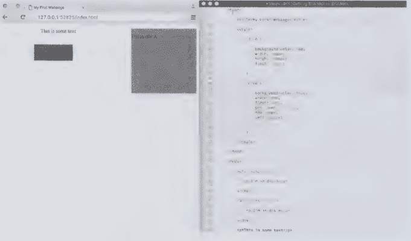

尝试不同的 `top` 和 `left` 值。

因此使用 `position: relative` 会将元素相对于其原本所在的位置进行移动。尝试添加：

```css
position: absolute;
```

到 `divA` 的规则中。这会产生什么效果？它实际上将该 `div` 从页面的流中移除，因此其他元素会忽略它的存在。如果你想相对于页面而不是相对于其他元素来定位一个元素，这就会非常有用。你仍然可以使用 `top` 和 `left` 来移动绝对定位的对象（4.10）。


## 练习题

1. 更新内部 CSS，给 `#home` div 设置一个向右 10 像素、向下 10 像素的绝对位置，给 `#next` div 设置向右 50 像素、向上 10 像素的相对位置。

## 外边距（Margins）

外边距为元素定位提供了另一种且在某些方面更简单的方法。要查看它的效果，请从 `divA` 和 `divB` 中移除所有浮动和定位规则，并在 `divA` 下方添加以下规则：

```css
margin: 20px;
```

这在红色 div 周围产生了 20 像素的外边距，看起来如下（4.11）：

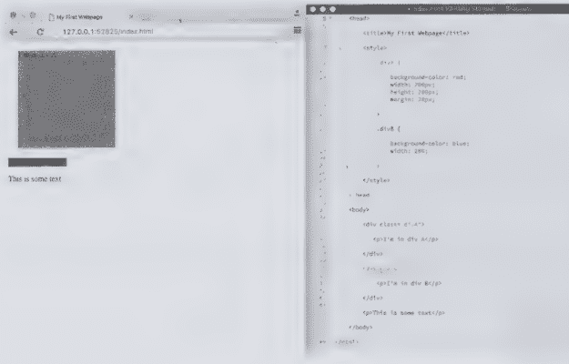

我们还可以单独设置顶部、底部、左侧和右侧边距——尝试为 `divB` 添加这些规则：

```css
margin-top: 50px;
margin-left: 100px;
```

这有效地将蓝色 div 向下移动了 50 像素并向右移动了 100 像素（4.12）：

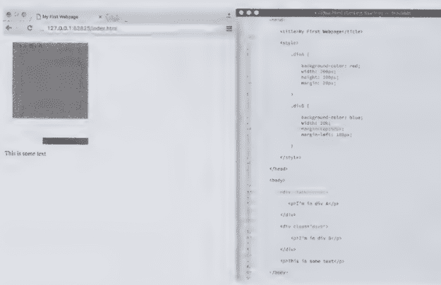

## 练习题

1. 给 ID 为 `box` 的 div 设置一个顶部 10 像素、左右各 15 像素、底部 20 像素的外边距，单独设置每个边距（例如 `margin-top`）。

外边距是移动对象并在对象原所在位置留出空隙的好方法。类似地，我们可以使用 `padding`（内边距）在元素内部添加边距。

## 内边距（Padding）

在红色和蓝色 div 中，div 内部文本周围都没有内边距。通常，在文本和 div 边缘之间留出间隙会更好看，我们使用 `padding` 来实现。尝试为 `divA` 添加以下内容：

```css
padding: 10px;
```

这在红色正方形内部添加了 10 像素的内边距（4.13）：

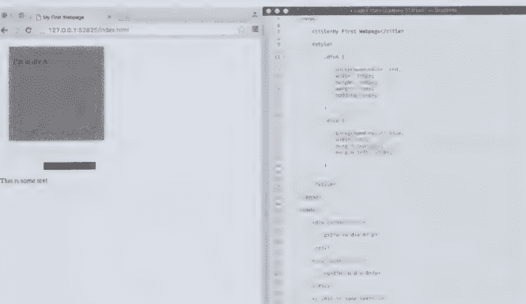

奇怪的是，这使得文本向下移动的幅度大于向右移动的幅度。这是因为 `<p>` 元素内置了默认外边距。

## 挑战 1

通过添加 CSS 规则 `margin: 0` 移除 `<p>` 元素的外边距。答案：你的代码应该像所示（4.14）：

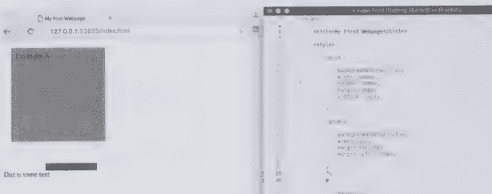

添加代码将所有 `<p>` 元素的外边距设置为 0 解决了这个问题，现在红色正方形四周的都是 10 像素的内边距了。

尝试在 `divB` 上尝试 `padding-top`、`padding-bottom` 等，看看它们产生什么效果。

内边距是为元素添加一点空间的好方法，让你的内容有呼吸的空间。

## 练习题

1. 为 `#box` div 设置样式，使其顶、右、底、左侧都有 15px 的内边距，尽可能使用少的命令：CC 19

## 边框（Borders）

为元素添加边框是分离网页不同部分的简单方法。边框可以使复杂的页面更具读性，并且是在不使用图像的情况下引入一点视觉风味的好方法。

让我们移除网页中除红色 div 及其内容以外的所有内容（4.15）：

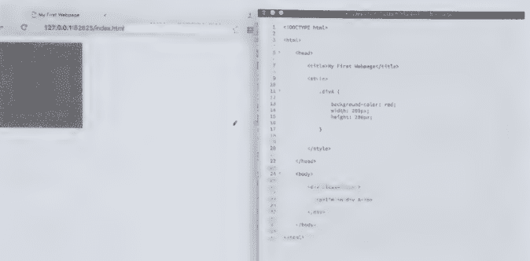

要给红色 div 添加边框，只需添加以下样式：

```css
border: 5px solid grey;
```

这产生了如下效果（4.16）：

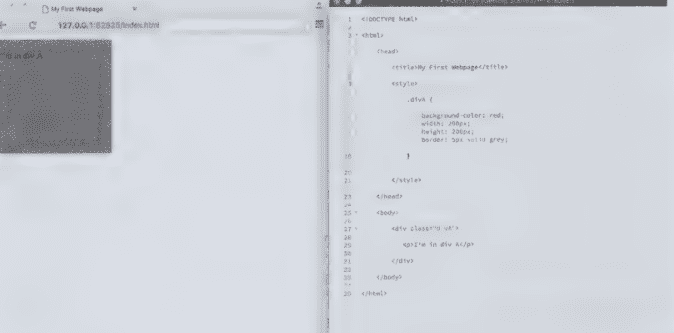

注意这种样式与我们目前看到的其他样式略不同，它包含了三个值：

- `5px`：这是边框的宽度。
- `solid`：这是边框的类型（实线）。
- `grey`：这是边框的颜色（灰色）。

挑战 2：为红色 div 添加一个 10 像素的粉红色虚线边框。你的代码应该像所示：

```css
border: 10px dashed pink;
```

效果如下：

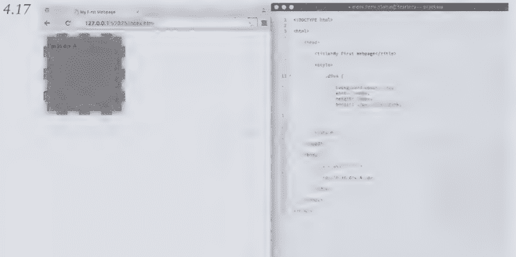

## 圆角（Rounded corners）

为元素添加圆角可以使它们看起来更圆润。我们可以使用 `border-radius` 属性来实现。尝试为 `divA` 添加以下内容：

```css
border-radius: 50%;
```

这会让红色 div 变成圆形：

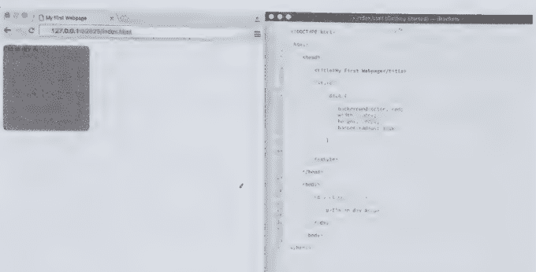

圆角在 CSS3 中引入，我们可以使用不同的像素值。尝试为 `divB` 添加如下：

```css
border-radius: 10px;
```

这会让蓝色 div 有圆角：

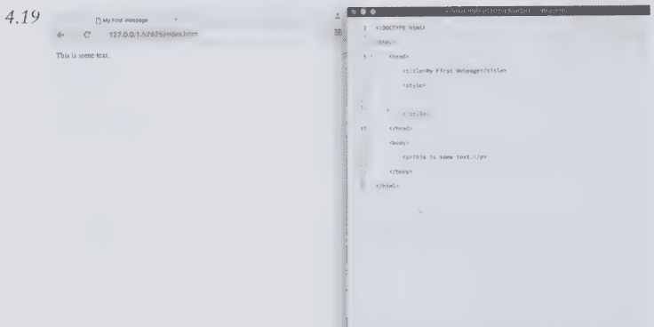

## `<span>` 元素

`<span>` 元素本身完全不会影响文本的样式 (4.22)：

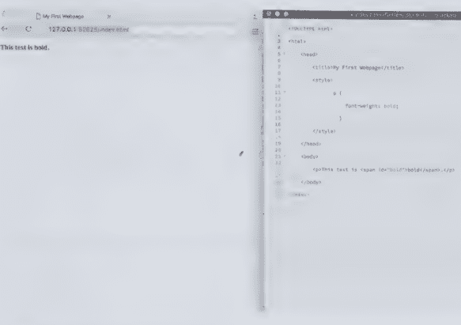

然而，它允许我们仅对 `span` 的内容应用样式：

```css
#bold {
  font-weight: bold;
}
```

请记住 `#bold` 意味着“将这些 CSS 规则应用到 ID 为 `bold` 的元素上”。

现在，只有 bold 这个单词被加粗了 (4.23)：

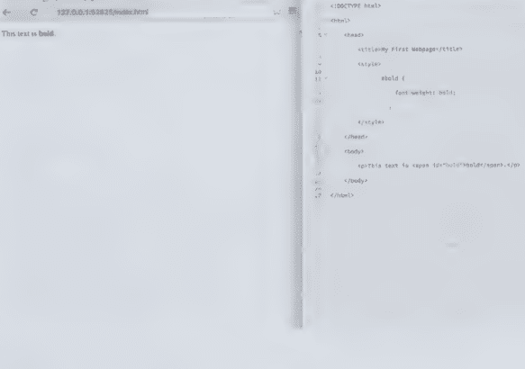

## 语言

同样，我们可以使用第二个 `span` 来添加一些斜体文本。将 HTML 修改为：

```html
<p>This text is <span id="bold">bold</span> and this is <span id="italic">italic</span>.</p>
```

然后将此 CSS 规则应用到 `italic` `span`：

```css
font-style: italic;
```

你的代码输出应该像这样 (4.24)：

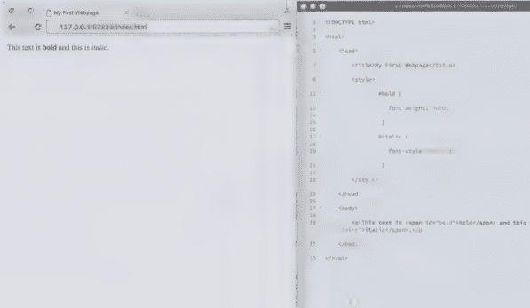

## 挑战 3

给文本添加下划线的 CSS 规则是 `text-decoration: underline`。在段落中添加“and”和“is underlined”，设置一个 `span` 和 CSS 样式为最后一个单词添加下划线。

你的 HTML 应该像这样：

```html
<p>This text is <span id="bold">bold</span> and this is <span id="italic">italic</span> and this is <span id="underlined">underlined</span>.</p>
```

你的 CSS 应该包含这条规则：

```css
#underlined {
  text-decoration: underline;
}
```

最终结果应该像这样 (4.25)：

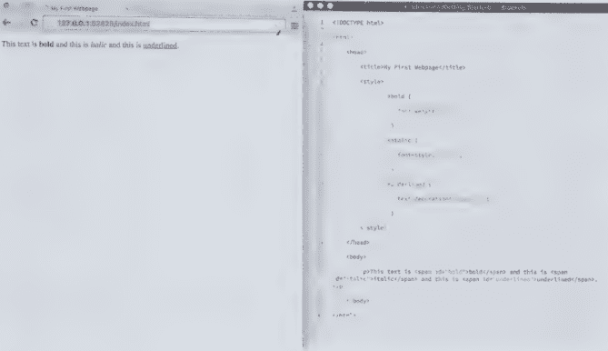

你当然可以将这些样式组合起来实现加粗且带下划线的文本，还有其他的文本样式选项——你可以在 `www.w3schools.com/css/css_text.asp` 查看更多。

## 练习题

1. 使用 CSS 使某些文本加粗并斜体：CC 22

## 文本对齐

就像在文字处理器中一样，你可以使用 CSS 将文本左对齐、右对齐或两端对齐（使单词分布以填充可用空间）。要实现这一点，只需添加以下样式：

```css
text-align: right;
```

将此应用于简单的段落看起来像这样 (4.26)：

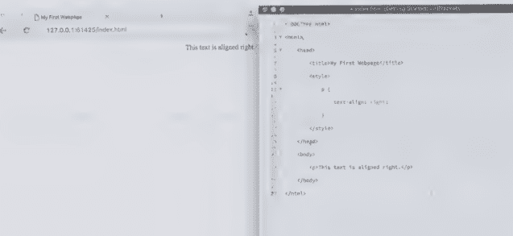

要将文本设置为左对齐，请使用：

```css
text-align: left;
```

这是默认设置，所以你通常不需要使用它。对于两端对齐，只需使用：

```css
text-align: justify;
```

注意，你需要足够的文本超过行尾才能看到效果。使用我们之前用过的 ipsum。拉丁文本，结果如下 (4.27)：

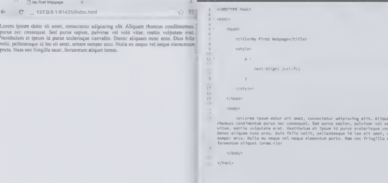

你可以看到每行单词之间的空格是不同的，这使得行尾对齐良好。这对于博客文章等长文本效果很好，但对于普通的网站内容效果并不好，因此请谨慎使用。

## 练习题

在此练习将文本设置为两端对齐：CC 23

## 链接样式设置

链接可以像其他 HTML 元素一样设置样式，但有几个设置你可能专门用于链接。首先是移除链接的下划线——这在近年来变得非常流行，要移除下划线，只需使用样式：

```css
text-decoration: none;
```

有趣的是，我们还可以使用所谓的伪类（pseudo classes）来设置链接在用户悬停时的样式。要实现这一点，使用：

```css
a:hover {
  color: green;
}
```

结合这两个命令，我们得到了一个没有下划线且在悬停时变成绿色的链接 (4.28)：

伪类之所以这样命名，是因为它不是一个“真实的”类，它直接指的是元素，而是元素的特定“状态”（state），例如链接被悬停时的状态。它是列表中的第一个，如果你想学习更多关于伪类的知识，可以在 `www.w3schools.com/css/css_classes.asp` 完成。

## 在新标签页打开

这严格来说不是一个 CSS 命令：

```html
<a href="http://www.google.com" target="_blank">在新标签页中打开 Google</a>
```


## 练习题

练习设置链接并在新标签页中打开它们：CC 24

## CSS 项目：克隆网站

练习 CSS 的一种方法是克隆你喜欢的网站。你可以从简单的网站，如`google.com`开始，然后转向更复杂的，如`bbc.co.uk`，尝试创建它的精确副本。这并不是一项简单的任务（可能涉及到谷歌），并在过程中你会学到很多。完成后，将你的代码粘贴到`codepen.com`并在 Twitter 上分享。我期待看到你创作的内容。

## 总结

恭喜你，现在已经掌握了 CSS 的基础知识。你知道如何为网站添加各种样式和格式，结合上一章学到的技能，你应该能够设计任何网站。在涵盖了 HTML（内容）和 CSS（样式）之后，我们将转向用于交互的 JavaScript。JavaScript 将为网页添加强大的功能，允许用户像使用应用程序或软件一样与其。JavaScript 是编程的世界，让我们开始吧。

## 进一步学习

正如之前，我建议现在转向 JavaScript，如果你已经有了 CSS，这些进一步学习将帮助你了解更多关于样式表的知识：

-`www.codeacademy.com/coding-with-style/0`– 交互式课程
-`www.w3schools.com/css/`– 教程
-`http://learnlayout.com`– 使用 CSS 创建布局
-`https://play.google.com/store/apps/details?id=com.sololearn&hl=en`– Android 应用
-`https://apple.com/gb/learn-css`– iPhone 和 iPad 应用

# JavaScript

我们现在查看了用于内容的 HTML 和用于样式布局的 CSS。现在是引入拼图的第三部分——JavaScript，它允许与用户进行交互。与 HTML 和 CSS 不同，JavaScript 是一种“完整的”编程语言，这意味着可以使用它来运行编写者想要的任何计算机程序。

在本章中，我们将涵盖：

- JavaScript 是什么以及如何使用；
- 如何使用 JavaScript 创建交互式网页；
- 响应用户操作（如点击）运行 JavaScript；
- 如何使用 JavaScript：
  - 修改网页的内容和样式
  - 使用循环和`if`语句等编程基础
  - 生成随机数
  - 创建“猜大小”游戏。

## 什么是 JavaScript？

JavaScript 是我们的第一个“真正的”编程语言。它允许我们使用编程工具，如循环、变量和`if`语句（我们很快就会知道这些是什么）。它可以用于任务，从点击时文本消失到创建完整的应用程序，例如 Google Docs 办公套件。

任何在不刷新页的情况下提供交互的网站都使用了 JavaScript。

JavaScript 是 Brendan Eich 在 1995 年 5 月于 10 天内通过最早浏览器之一 Netscape 创建的。它最初被称为 Mocha，然后是 JavaScript。有趣的是，除了名字之外，它与 JavaScript 编程语言无关。Netscape 获得了 Sun（Java 语言的所有者）许可使用 JavaScript 的名称，主要作为一种营销手段，因为 Java 在当时是一种非常流行的语言。

## 语言

JavaScript 经历了多次迭代和发展，但最新的标准版本（我们在这里学习的）在桌面和移动平台的所有浏览器中都得到了支持。

JavaScript 的一个重要方面是运行在用户的计算机上，而不是服务器上。这使得它被称为客户端语言。因此，要执行任何需要服务器的操作（例如发送电子邮件或注册你的新社交网络），你需要使用服务器端语言，如 Python，我们将在下一章学习。

## 5.1

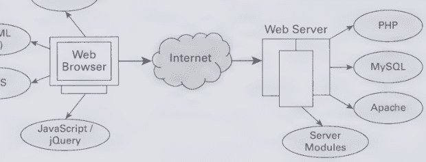

## 为什么要学习 JavaScript？

如果你还没有被说服，学习 JavaScript 的好处非常多。主要，它是我们的第一个“真正的”编程语言，允许我们开发完整的交互式应用程序和网站，而不仅仅是创建布局和静态网页。

它与其他许多语言非常相似，因此一旦学会了 JavaScript，你就能更快地开始任何其他语言。

由于 JavaScript 在所有浏览器中运行，你不需要下载任何额外的软件即可开始。它像 CSS 一样使用类和 ID，所以与你已经所学的内容密切相关。

它是一种容易入门的语言，但就像 CSS 一样，它非常强大，也是一个很棒的入门语言。

## JavaScript 看起来像什么样？

JavaScript 非常容易上手。要开始，请回到文本编辑器中的基础 HTML 页面，使用以下代码添加一个按钮：

```html
<button>点击我！</button>
```

它看起来应该是这样的（我放放了按钮以便看得更清楚）(5.2):

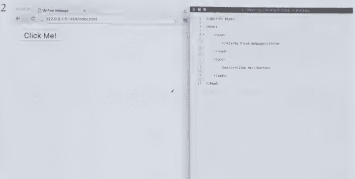

当然，当你点击按钮时，什么都不会发生。让我们用一些 JavaScript 魔法术来改变这一点。将按钮代码更改为以下内容：

```html
<button onclick='alert("Hello there!")'>Click Me!</button>
```

（确保你使用了正确的引号类型——我们需要在外部使用 ‘’，在内部使用 "。）

当你点击按钮时，现在应该能看到这个（5.3）：

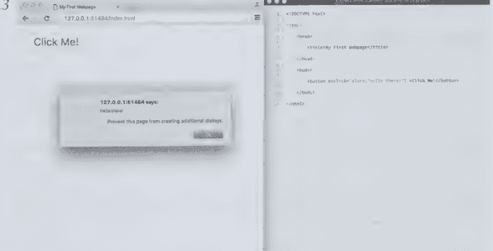

> 127.0.0.1:51848 提示说：  
> 阻止此页面创建额外的请求。

万岁，你运行了你的第一段 JavaScript！`onclick`属性允许我们编写一些在点击按钮时运行的 JavaScript。我们实际运行的 JavaScript 代码是：

```javascript
alert('Hello there!')
```

`alert`命令意味着“为用户创建一个带有消息的弹出窗口”，而该消息包含在单引号内，即 Hello there!。在 JavaScript 中，命令后面通常会跟着括号或中括号，其中包含命令所需的信息。在这种情况下，信息是要显示在弹出窗口中的文本。

## 练习题

1. 修改代码，使其不再弹出 Hello there!，而是弹出 Hello 加上你的名字。

你的代码看起来应该像这样：

```html
<button onclick='alert("Hello Rob!")'>Click Me!</button>
```

像这样运行 JavaScript 被称为内联 JavaScript（inline JavaScript），就像我们在上一章开头看到的内联 CSS 一样。

## 内部 JavaScript

像这样运行 JavaScript 这种与使用`style`属性运行 CSS 非常相似——它虽然有效，但很混乱，如果你试图编写比简单的`alert`命令更复杂的代码，这将是一个令人沮丧的体验。

就像 CSS 一样，我们可以使用内部 JavaScript 将 JavaScript 与 HTML 分离。在 CSS 中我们使用`<style>`标签，而在 JavaScript 中我们使用`<script>`标签。这些标签可以放在 HTML 页面的头部（header），但我们将把它们放在页面末尾。这通常是一个良好的做法，因为它可以确保在我们尝试对页面元素运行 JavaScript 之前，浏览器已经创建了页面的所有元素。

要创建一个在页面加载时弹出 Hello there! 的 JavaScript，请将此代码添加到你的 HTML 页面中，位于`</body>`标签之前：

```html
<script>
 alert("Hello there!")
</script>
```

现在，你会在页面加载时看到 alert 弹出窗口（你可能需要刷新页面才能看到此效果），如下（5.4）：

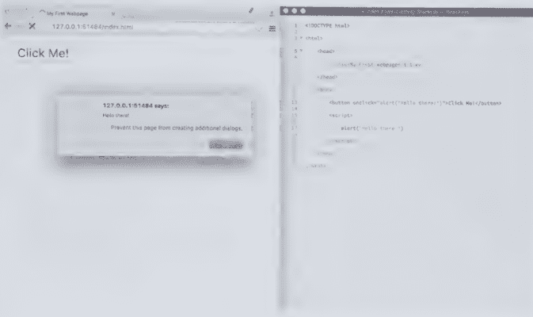

## 内部 JavaScript – 响应点击

当我们使用内联 JavaScript 时，很容易看出哪个元素将触发 JavaScript，因为`onclick`属性就在该元素内部。那么，我们如何将内部 JavaScript 与按钮关联起来呢？答案和 CSS 一样——我们使用 ID。

## 挑战 1

删除按钮的`onclick`属性，并给它一个 ID 为`click-me`。你的按钮代码现在应该看起来像这样：

```html
<button id="click-me">Click Me!</button>
```

现在，为了在点击按钮时发生某些事情，请将以下代码放在`<script>`标签之间：

```javascript
document.getElementById("click-me").onclick = function() {
    alert("Hello there!")
}
```

这可能是我们目前见过的最复杂的代码，但当你将其拆解时，它非常直观。

首先

最后，在大括号内，我们有了熟悉的`alert("Hello there!")`，它会显示提示。

用大白话来说，这段代码的意思是：

获取 HTML 页面并在 ID 为`'click-me'`的元素中找到它。然后修改该元素，当用户点击它时，将显示一个文本为`'Hello there!'`的提示框。简单！

你可能需要重读上面的段落几次以确保清楚一切，然后尝试这个挑战。

## 挑战 2

从页面中删除按钮和脚本标签（这样你就从一个空白的 HTML 文档开始）。然后添加一个链接（不是按钮），文本为“Who am I?”，并添加 JavaScript，以便在点击链接时弹出你的名字。（你需要为你的链接选择一个 ID）。

你的代码看起来应该是这样：

```html
<a id="my-link">Who Am I?</a>

<script>
document.getElementById("my-link").onclick = function() {
  alert("Rob")
}
</script>
```

实际效果（5.5）：

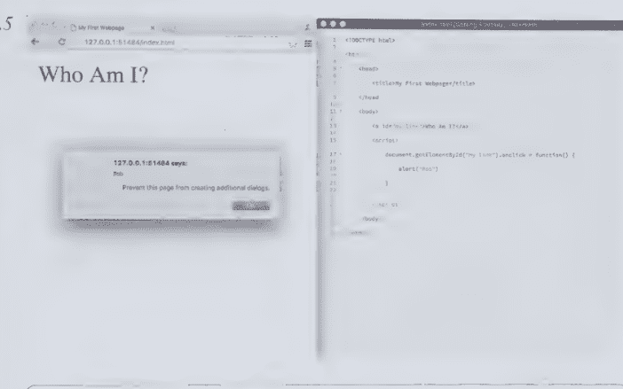

> 练习题  
> 添加 JavaScript，当点击页面上的按钮时弹出 Button Clicked!：CC 25

## 使用 JavaScript 修改样式

除了显示提示之外，我们还可以用 JavaScript 更改样式。让我们为页面添加一个 ID 为`'text'`的段落，并将链接文本更改为“Turn text red”：

```html
<p id="text">This is some text.</p>

<a id="my-link">Turn text red</a></a>
```

现在，将`alert("Rob")`那一行更改为以下内容：

```javascript
document.getElementById("text").style.color = "red"
```

在这里，我们获取 ID 为`‘text’`的元素，然后获取它的颜色，并将其设置为红色。试一试，你会发现点击‘Turn text’链接时，文本会变红。

我们可以通过这种方式调整任何样式，所以尝试在点击链接时实现以下效果：

## 练习题

1. 让文本变为蓝色。
2. 给文本加下划线（你需要使用`textDecoration`而不是`text-decoration`）。
3. 将文本字体大小设置为 20px 并右对齐。

## 答案

1. `document.getElementById("text").style.color = "blue"`
2. `document.getElementById("text").style.textDecoration = "underline"`
3. 在这里你需要两行代码：

```javascript
document.getElementById("text").style.fontSize = "20px"

document.getElementById("text").style.textAlign = "right"
```

## 从用户获取信息

现在我们已经知道如何响应点击并进行样式更改，让我们通过文本框从用户获取更多信息。

## 挑战 3

删除你的链接和 JavaScript，添加一个文本字段（input），以及一个写有‘Submit’的按钮。设置按钮，使其在点击时弹出‘Clicked!’。

你的代码应该像这样：

```html
<input type="text">

<button id="my-button">Submit</button>

<script>
document.getElementById("my-button").onclick =
function() {
  alert("Clicked!")
}
</script>
```

实际效果（5.6）：


提示：每当你编写新的 JavaScript 时，设置这样一个简单的页面，以确保一切都已连接并正常工作。否则你可能会花费大量时间调试代码，结果发现忘记大写`getById`中的 T。

现在让我们更改代码，使其不再弹出`'Clicked!'`，而是弹出用户在框中输入的任何内容。首先，给文本输入框一个 ID，如下：

```html
<input type="text" id="my-input">
```

接下来，将 JavaScript 中的`alert("Clicked!")`那行改为：

```javascript
alert(document.getElementById("my-input").value)
```

你能看到这里发生了什么吗？我们现在弹出文档（或 HTML 页面）中 ID 为`'my-input'`的元素的值。

## 试一下

你会发现你在框中输入的任何内容都会弹出（5.7）：


现在我们正在获得真正的交互，所以是时候学习几个基础编程概念了。第一个是`‘if 语句’`。

## if 语句

`if`语句对于编程是绝对基础。它们指示程序在满足条件时才执行某些操作。这可能是登录你最喜欢的网站——“如果数据库中的用户名和密码匹配，则登录用户”。或者可能是游戏中的规则之一——“如果马里奥碰到了炸弹，杀死马里奥”。

在这里我们将设置一个简单的系统来确保用户知道密码。首先，在输入框之前添加文本‘What is the password?’（5.8）：


## JavaScript 93

我们需要测试用户输入的系统，以检查它是否与预定义的密码匹配。让我们把密码设置为‘coding’。我们可以将 JavaScript 中的`alert`...这一行替换为以下内容：

```javascript
if (document.getElementById("my-input").value == "coding") {
  alert("You got it!");
}
```

如果你仔细观察代码，你应该能看到发生了什么。我们从`if`关键字开始，然后在括号中写上我们的条件。这里的条件是文本框中的值必须等于单词`coding`。如果是那样的话，我们将弹出`You got it!`提示。如果不是，它将什么都不做。

注意这里的**双等号**`==`。在 JavaScript（以及几乎所有的编程语言）中，我们使用单等号`=`来将某个值赋值给另一个值，就像我们在上面的截图中将`onclick`属性设置为该函数一样。我们使用**双等号**`==`来测试某个值是否等于另一个值。这是你需要习惯的区别，如果你用错了（真的！），你的代码行为将会变得非常奇怪。

试一试！它的运行符合预期吗？(5.9.)

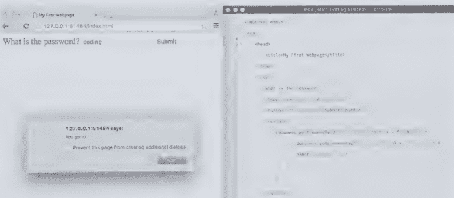

如果用户输入的密码错了怎么办？什么都不做并不是一个很好的功能——告诉用户他们输错了会更好。我们可以使用`else`关键字来实现。在上述代码的最后一个`}`之后添加以下内容：

```javascript
else {
  alert("That's not right, try again")
}
```

## 现在如果你输入的密码错了，你将看到这个 (5.10)：

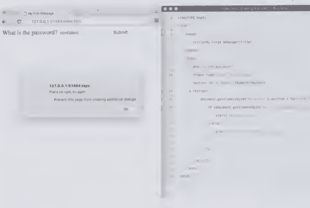

## 挑战 4

在移除网页上的所有代码后，创建一个游戏，让用户猜你最喜欢的数字。添加一个`if`语句来告诉他们是否猜对了。

代码应该和我们的密码示例非常相似：

```html
What is my favourite number?

<input type="text" id="my-input">

<button id="my-button">Submit</button>

<script>
  document.getElementById("my-button").onclick = =
  function() {
    if (document.getElementById("my-input").value =
      "7") {
      alert("You got it!")
    } else {
      alert("That's not right, try again")
    }
  }
</script>
```


## 实际效果（5.11）

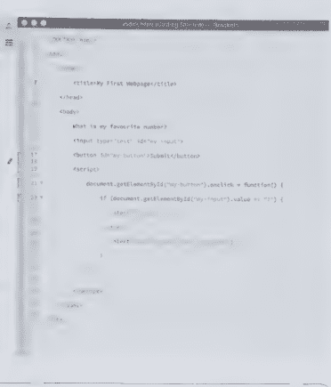

## 练习题

- 更新 `x` 的值，使得 `if` 语句输出 `x is less than five`：CC 25

## 更新网页内容

在我们学习第二个基础编程概念（循环）之前，让我们看看如何用 JavaScript 更新网页内容。到目前为止，我们只用过 `alert` 向用户显示信息。`alert` 很有用，但它们相当分散注意力；通常直接在页面上显示答案更好。让我们找出如何做到。

## 挑战 5

移除网页上的所有代码。然后添加一个 ID 为 `my-paragraph` 的空段落和一个按钮，点击它时，会弹出 `That was easy`。

> 到现在你应该已经掌握这些了。这是重复力量的见证！

## 代码

```html
<p id="my-paragraph"></p>

<button id="my-button">Submit</button>

<script>
document.getElementById("my-button").onclick = function() {
  alert("That was easy")
}
</script>
```

实际效果（5.12）：

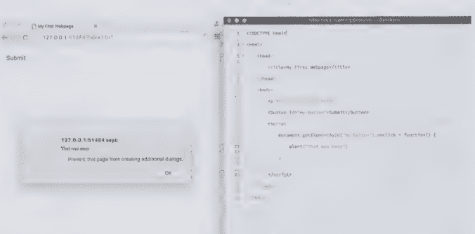

我们将更改代码，以便在点击按钮时向空段落中添加一些内容。将 `alert("That was easy")` 替换为以下代码：

```javascript
document.getElementById("my-paragraph").innerHTML = "This text appeared by magic!";
```

## 当你点击按钮时你应该看到文字出现（5.13）

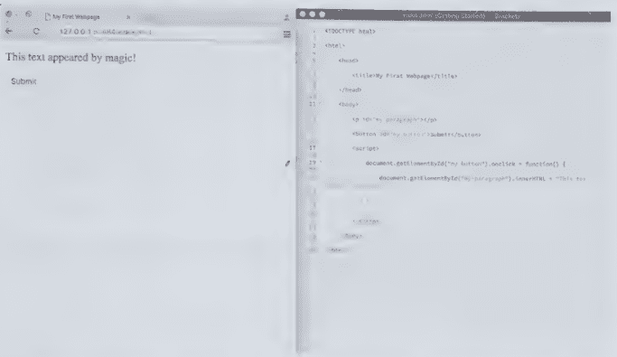

This text appeared by magic!  
Submit

现在我们可以用更自然的方式与用户交互了，让我们尝试一个包含 `if` 语句的挑战。

## 挑战 6

设置一个网页，包含文本 `What is your name?`、一个文本输入和一个 `Submit` 按钮。然后当用户输入他们的名字时，在页面上的空白元素上添加文本 `Hello [name]!`。

注意：对于这个挑战，你将需要将他们的名字与你的文本结合。你可以这样做：

```javascript
"Hello" + document.getElementById("name").value + "!"
```

## 实际效果（5.14）

```html
What is your name?

<input type="text" id="name">

<button id="my-button">Submit</button>

<p id="my-paragraph"></p>

<script>
document.getElementById("my-button").onclick = function() {
  document.getElementById("my-paragraph").innerHTML = "Hello " + document.getElementById("name").value + "!";
}
</script>
```

这看起来并不难懂！`* 10` 意味着“乘以 10”，所以我们现在有了一个 0 到 10 之间的随机数。`Math.floor` 部分通过删除小数点位后的所有内容来对数字进行“向下取整”（例如 6.746287848 会变成 6）。这为我们得到了一个 0 到 9 之间的随机数，所以我们对其加 1，得到一个 1 到 10 之间的随机数。

尝试将你上方页面中的代码更改为：

```javascript
document.getElementById("my-div").innerHTML = Math.floor((Math.random() * 10)) + 1
```

## 练习题

生成一个以下范围内的随机整数：

- 1 到 5
- 11 到 20
- 0 到 100

答案：

- `Math.floor((Math.random() * 5)) + 1`
- `Math.floor((Math.random() * 10)) + 10`
- `Math.floor((Math.random() * 100)`

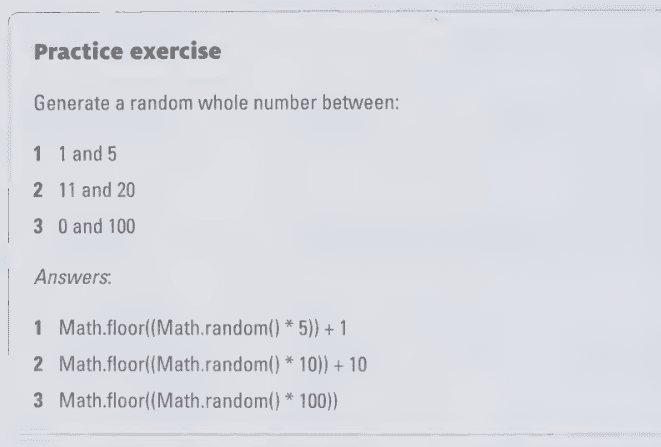

## JavaScript 项目：猜数字游戏

使用变量、循环和 `if` 语句，你就有能力创建各种系列的应用程序、网站和游戏。我们将制作一个简单的猜数字游戏，你必须猜出计算机选择的数字。

这个概念非常简单——当我们加载页面时，用户会被要求猜一个 1 到 10 之间的随机数。如果他们猜错了，系统会告诉他们是太大了还是太小了。如果他们猜中了，系统会告诉他们并给予再次玩的机会。

## JavaScript

这个挑战将涉及整合目前学到的几乎所有内容——与元素交互、更改样式、变量和 `if` 语句。你现在可以停止阅读并尝试挑战，但我建议你分阶段进行，我们将通过小型挑战来完成。

这个过程与设计任何网站或应用程序的过程相似——从用户界面开始，然后逐渐添加交互功能，并在操作过程中检查一切是否都运行正常。

## 第 1 部分：创建用户界面

创建一个标题（使用 `h1` 元素）、说明、一个文本输入框和一个提交按钮。

有许多可能的布局，但我的非常简单。

```html
<h1>我的数字是多少？</h1>

<p>我在想一个 1 到 10 之间的数字 - 你觉得是多少？</p>

<input type="text">

<button>猜数字</button>
```

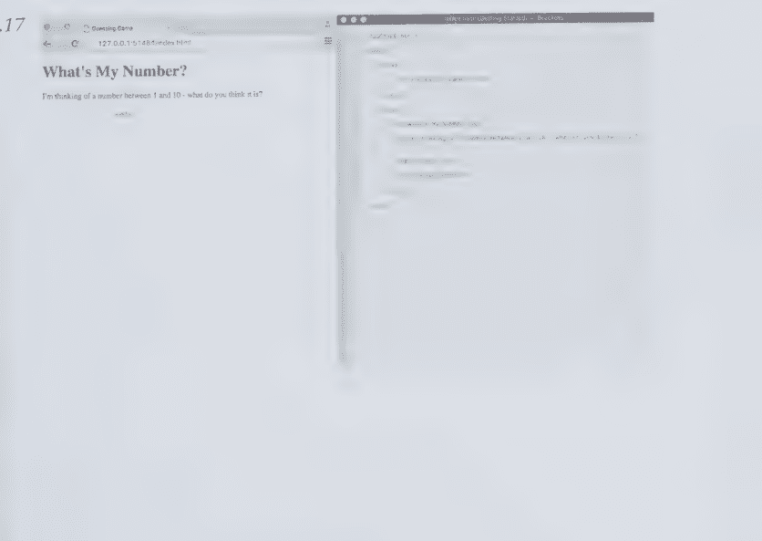

## 第 2 部分：基础交互

显示用户输入的数字。

为元素添加 ID 和一个空段落，并在用户点击按钮时用他们猜的数字填充该段落：

```html
<h1>我的数字是多少？</h1>

<p>我在想一个 1 到 10 之间的数字 - 你觉得是多少？</p>

<input type="text" id="number">

<button id="guess">猜数字</button>

<p id="message"></p>

<script>
document.getElementById("guess").onclick = function() {
  document.getElementById("message").innerHTML = document.getElementById("number").value
}
</script>
```

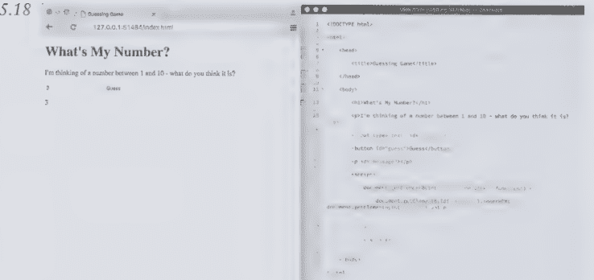

## 第 3 部分：添加随机数生成器并比较用户猜测

我们现在不需要更改 HTML——全部在 JavaScript 中：

```javascript
if (document.getElementById("number").value > randomNumber) {
  document.getElementById("message").innerHTML = "太大了"
} else if (document.getElementById("number").value < randomNumber) {
  document.getElementById("message").innerHTML = "太小了!"
} else {
  document.getElementById("message").innerHTML = "对了!"
}
```

我们这里有一个新结构：`else if`。它允许在第一个语句为假时测试另一个语句。最后我们有一个 `else`，如果前两个语句都假，它将被执行。如果猜的数字不大也不小，它就是正确答案！

尝试一下：

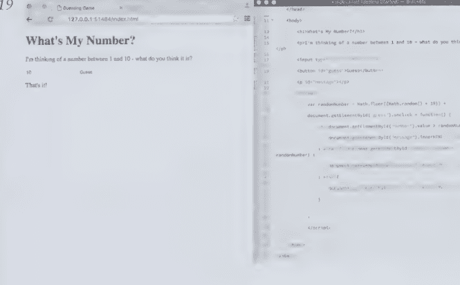

## 第 4 部分：根据是否正确更改文本颜色并提供再次玩的选项

正确为绿色，错误为红色。

我们使用以下代码更改文本颜色：

```javascript
document.getElementById("text").style.color = "red";
```

为了“再次玩”，我们可以刷新页面。我们在这里把这个添加到成功消息中：


完成了。你使用 HTML、CSS 和 JavaScript 创建了一个功能完备的交互游戏——恭喜！

## 总结

这当然只是 JavaScript 能力的开始，如果你想进一步尝试，有很多选择。尝试思考你可以创建的简单游戏，比如模拟抛硬币、猜字游戏，或者从手机上做的事情——网上有很多教程和指南。

现在我们涵盖了用于内容的 HTML、用于样式的 CSS 以及用于交互的 JavaScript，我们将学习第一个服务器端语言 Python。Python 是一种简单的语言，在许多方面与 JavaScript 相似。我们将看到如何用它构建更复杂的结构并制作更复杂的程序。有很多要学的，也有很多乐趣。话不多说，让我们开始吧，看看能实现什么。

## 进一步学习

如果你想深入探索 JavaScript 世界，可以使用这些链接进行进一步实验并学习更多：

- [`www.codecademy.com/learn/javascript`](https://www.codecademy.com/learn/javascript)：交互式课程
- [`www.w3schools.com/js/`](https://www.w3schools.com/js/)：免费教程
- [`www.learn-js.org`](https://www.learn-js.org)：免费教程
- [`https://play.google.com/store/apps/details?id=com.sololearn.javascript&hl=en`](https://play.google.com/store/apps/details?id=com.sololearn.javascript&hl=en)：在 Android 上学习 JavaScript
- [`https://itunes.apple.com/gb/app/learn-javascript/id9527389`](https://itunes.apple.com/gb/app/learn-javascript/id9527389)：在 iPhone 或 iPad 上学习 JavaScript

# Python

我们来回顾一下目前学过的内容。我们从 HTML 开始，它允许我们在网页上添加内容。然后我们学习了 CSS，我们可以结合 HTML 添加样式并自定义布局。接下来，我们看到了如何使用 JavaScript（我们的第一个“真正的”编程语言）让页面具有交互性，并允许用户在页面上进行操作并获得响应。

我们的工具箱里缺少了什么？嗯，到目前我们做的一切完全发生在用户的浏览器中。为了构建允许用户相互通信的软件，我们需要称为服务器的东西。服务器本质上是一台始终开启并连接互联网的计算机。我们的计算机就可以联系该服务器下载信息，在服务器上保存某些内容（如我们的推文）或向另一台计算机发送数据（如电子邮件）。


因此，为了能够构建强大的网站和应用程序，我们需要编写可以在服务器运行的代码。虽然可以在服务器上使用 JavaScript，但更常用的是 PHP 或 Python 等语言。我们在这里使用 Python 有几个原因：

- Python 是一种简单直观的语言，甚至比 JavaScript 更是；
- Python 可在几乎任何平台上构建软件，从服务器到树莓派，让你能够构建从网站到机器人的任何东西；
- Python 可用于日常任务，例如从网站获取信息或自动重命名文件（我们将在本章稍些之后介绍如何操作）。

## 什么是 Python？

Python 是 Guido Van Rossum 在 20 世纪 80 年代后期在荷兰开发的。Van Rossum 以 Monty Python 命名该语言，因为他是他们《飞行马戏团》的忠粉丝。

Van Rossum 仍在积极参与该语言的开发，因此被 Python 社区授予“终身仁慈皇帝”（BDFL）的称号。

自诞生以来，它经历了多个版本，目前是第 3 版本。它被广泛用于构建 Web 端和桌面应用程序，还用于 Arduino 等物联网设备。这使其成为一门非常强大且灵活的学习语言。

## 为什么要学习 Python？

> 我不想构建机器人，我真的需要学习另一种语言吗？

如果你不是为了寻找编程工作，你可能会怀疑学习第二种语言是否值得。答案当然是肯定的，但为什么呢？

学习两种语言可以让你看到语言之间的共同点（以及不同之处）。一旦你知道如何在两种语言中创建循环，你将更清楚地理解循环的关键部分。语句和变量也是如此。每种语言都有自己的特性，如果你只学一种语言，你对这些特性的了解有限。

如果你以后需要从网页中提取所有的电子邮件地址，Python 也可以为你完成工作（我们将在章节末尾看到如何操作）。

## 本章将涵盖什么？

一如既往，我们将通过运行 Python 的整个过程来建立技能，并通过一些项目和练习进行练习。

我们还将完成一个大项目，其中我们将尝试一些“网络爬虫”——从网页上收集姓名和电子邮件地址等数据。这将是你面临过的最具挑战性的任务。

具体来说，我们将涵盖：

- 什么是 Python 以及如何使用它；
- 在 Python 中使用变量、循环和 `if` 语句；
- 更高级的功能，如列表（Lists）和正则表达式（Regular Expressions）；
- 从网页中提取数据。

## 如何开始学习 Python？

遗憾的是，Python 的入门并没有 HTML、CSS 或 JavaScript 那么容易，因为它并不运行在浏览器中。要尝试它，你有两种选择：简单的方法或困难的方法。

## 简单的方法

有很多 Python 解释器可以在网页上为你处理 Python 代码。在本章中，我将使用 [`https://repl.it/languages/python3`](https://repl.it/languages/python3)，我的建议你也这样做。它不需要安装或设置，你可以立即开始。你还可以尝试其他许多具有相同功能的网站，例如 [`www.tutorialspoint.com/execute_python_online.php`](https://www.tutorialspoint.com/execute_python_online.php) 和 [`www.skultp.org`](http://www.skultp.org)。

## 困难的方法

另一种选择是在你的电脑上安装 Python 并直接从那里运行它。这种方法的优点是不需要网络连接，并且允许你尝试完整安装的 Python，但这需要一些复杂的设置。除非你是一个相当高级的计算机用户，否则我不建议使用这种方法。

如果你想尝试这种方法，可以在 [`www.python.org/downloads/`](https://www.python.org/downloads/) 下载 Python（选择最新的可用 3 版本）。你只需要在 Windows 上这样做——大多数操作系统和 Linux 机器都内置了 Python。

一旦安装了 Python，你需要创建一个文本文件，例如 `mypython.py`。你可以在文本编辑器中使用“文件 → 另存为”来实现。

然后你需要打开一个命令行窗口，你可以在 Windows 的搜索框中输入 `cmd`，或者在 OSX 中打开 Terminal 应用。

然后你可以使用以下命令运行 Python 脚本：

```bash
python mypython.py
```

这将显示你脚本的输出。你也可以输入：

```bash
python
```

以便运行单个 Python 命令。

如果你在使用这种方法时遇到问题，有很多在线指南可以帮助你开始学习 Python，或者你可以直接使用上面推荐的简单方法。

## 使用 Python 打印“Hello World”

现在我们已经运行起了 Python，让我们运行一个基础脚本吧。如果你使用的是简单方法，当你访问 [`https://repl.it/languages/python3`](https://repl.it/languages/python3) 时，你应该看到这个屏幕（6.2）：


在这里，你可以在左侧输入 Python 代码并点击“run”按钮在右侧的框中查看输出。如果你制作了让你特别自豪的东西，也可以分享或保存你的工作。

我们的第一个 Python 脚本将简单地输出“Hello World”几个单词。要做到这一点，请在左侧输入这段代码并点击“run”按钮。

```python
print("Hello World")
```

这将给你产生如下输出（6.3）：

### 6.3

```python
print("Hello World")
```


控制台通常用于调试，允许我们检查变量的值（例如），我们在这里也将使用它来查看我们的程序正在做什么。

所以 `print("Hello World")` 会在控制台（即右侧的黑框）打印“Hello World”这些单词。简单如此！

## Python 中的变量

在 JavaScript 中，我们使用 `var` 来创建变量。在 Python 中，我们只需这样定义变量：

```python
name = "Rob"
```

这将创建一个名为 `name` 且值为 `Rob` 的变量。

## 挑战 1

创建一个值为你名字的变量并将其打印到控制台。

**解答：** 你的代码应该像这样：

```python
name = "Rob"

print(name)
```

注意我们使用的是 `print(name)` 而不是 `print("name")`，因为 `name` 是一个变量而不是值。

### 6.4

```python
1 name = "Rob"

2 print(name)
```


我们可以用 `+` 连接字符串，就像在 JavaScript 中一样。尝试更改你的代码，输出 `Hello` 后接你的名字（6.5）：

### 6.5

```python
1 name = "Rob"

2 print("Hello " + name)
```


## 布尔变量

像许多其他语言一样，JavaScript 也包含了布尔变量。它们以专门逻辑学的英国数学家乔治·布尔（George Boole）的名字命名，只能取 `True` 或 `False` 的值。

你可能想用它们来检查用户是否登录，例如。你可以按照普通方式创建变量：

```python
isLoggedIn = True
```

然后你可以使用在本章稍后介绍的 `if` 语句来测试用户是否登录。

## 列表 (Lists)

列表与变量相似，但它们允许我们在一个对象中存储许多值。在 JavaScript 中，它们被称为数组（arrays）。在 Python 中，它们被称为列表（Lists）。访问列表的元素，我们使用方括号，例如 `list[0]`。

要更改元素的值，按通常的方式调整即可：

```python
list[0] = "Apple"
```

要在列表末尾添加元素，我们使用 `.append()`：

```python
list.append("Banana")
```

要按值从列表中删除元素，使用 `.remove()`：

```python
list.remove("Apple")
```

或者按索引删除元素，使用 `.pop()`：

```python
list.pop(0)
```

若要在列表的特定位置插入值，我们使用 `.insert()`，如下：

```python
list.insert(1, "Orange")
```

在处理列表时，我们经常需要更改值、添加元素或删除元素。在 Python 中我们可以轻松完成这些操作。

## For 循环

在 JavaScript 章节中，我们使用循环来多次执行某段代码。我们可以在 Python 中做相同的事情，但它看起来有点不同：

```python
for x in range(0, 3):
    print(x)
```

希望这容易理解——`range(0, 3)` 意味着遍历从 0 到（但不包含）3 的整个整数。`:` 定义了循环内容的开始，然后每次循环都会打印 `x`。

在 JavaScript 中，我们使用 `{` 和 `}` 来定义循环内容。在这里只有一个 `:` - 依靠缩进设置了循环内容的范围。

## 答案：

1

```python
for x in range(0, 11):
    print(3*x)
```

2

```python
for x in range(0, 21):
    print(5*x)
```

3

```python
for x in range(0, 5):
    print(5 - x)
```

## For 循环与列表

Python 中的 `for` 循环设计初衷是为了遍历列表（Lists）。例如，假设我们定义了这样一个列表：

```python
ages = [36, 35, 5, 1]
```

我们可以像这样显示 `ages` 列表所有的元素：

```python
for age in ages:
    print(age)
```


一年后，我们可能需要将所有年龄都加 1。我们可以手动操作，但使用循环会更整洁。要做到这一点，我们需要知道数组中每个项的索引（记住数组中第一个项的索引是 0，第二个是 1，以此此类推）。

我们目前的 `for` 循环无法获取这些索引，因此我们需要一种不同的方法。与其遍历数组，不如遍历索引，从 0 开始，一直到列表项数减 1。我们可以使用 `len` 命令获取列表的项数（即列表长度）：

```python
print(len(ages))
```

在我们的情况下，它返回 4 (6.9)：

```python
ages = [36, 35, 5, 1]
print(len(ages))
```


因此，我们可以使用 `range` 来遍历列表的索引。记住 `range(0, 10)` 遍历数字 0 到 9，因此 `range(0, len(ages))` 将遍历列表的每一个索引。

最后，我们就可以解决给列表每个值加 1 的问题了：

```python
ages = [36, 35, 5, 1]
for i in range(0, len(ages)):
    ages[i] = ages[i] + 1
print(ages)
```

这段代码循环遍历数字 0, 1, 2 和 3，然后在每个情况下给列表值各加 1。你可以在下方右侧看到结果，每个值都增加了 1 (6.10)。

```python
ages = [18, 19, 21, 22]
for i in range(0, len(ages)):
    ages[i] = ages[i] + 1
print(ages)
```


## 练习题

- 1 创建一个包含任意五个数字的列表，遍历数组并将每个数字翻倍。最后将输出到控制台。

答案：

```python
numbers = [10, 20, 30, 40, 50]
for i in range(0, len(numbers)):
    numbers[i] = numbers[i] * 2
print(numbers)
```

```python
numbers = [10, 20, 30, 40, 50]
for i in range(0, len(numbers)):
    numbers[i] = numbers[i] * 2
print(numbers)
```


## 创建一个包含四个名字的列表。遍历该列表，每次向控制台打印“Hello [name]”。

答案：

```python
names = ["John", "Paul", "Ringo", "George"]
for name in names:
    print("Hello " + name)
```


## While 循环

就像在 JavaScript 中一样，在 Python 中我们使用 `while` 循环和 `for` 循环。它们的工作原理如下：

```python
i = 0
while (i < 10):
    print(i)
    i = i + 1
```

我们首先将变量 `i` 设置为 0，然后像 JavaScript 一样，只要 `i` 小于 10 就继续执行，每次处理循环时都加 1。输出是数字 0 到 9，如下所示 (6.13)：

## 挑战 1

使用 `while` 循环显示从 10 到 0 的“倒计时”。

这只需要对上面的示例进行一点微调——从将 `i` 设置为 10 开始，然后更改 `while` 条件和最后的指令，使 `i` 每次减少 1 直到 `i` 为 0。

```python
i = 10
while (i >= 0):
    print(i)
    i = i - 1
```

这是它的运行效果 (6.14)：

```python
i = 10
while (i >= 0):
    print(i)
    i = i - 1
```

正如练习题中那样，创建一个包含四个名字的列表。现在我们将使用 `while` 循环来完成挑战。遍历列表，每次向控制台打印“Hello [name]”。这个过程是简单的，将 `i` 设置为 0，只要 `i` 小于列表的长度就继续。代码如下：

```python
names = ["John", "Paul", "Ringo", "George"]
i = 0
while (i < len(names)):
    print("Hello " + names[i])
    i = i + 1
```


## if 语句

`if` 语句的工作方式与 JavaScript 相似。假设用户正在玩游戏，你想测试 `score` 是否大于 100，你可以使用这段代码：

```python
score = 120
if score > 100:
    print("You have got 100 points!")
```


尝试更改 `score` 的值看看这对输出的影响。我们还可以添加一个 `else` 选项，当语句不成立时：

```python
score = 80
if score > 100:
    print("You have got 100 points!")
else:
    print("Keep going!")
```


在某些情况下，我们可能想同时检查两个条件，例如 `score` 大于 100 且时间超过 60 秒。我们可以使用 `and` 运算符来实现，它允许我们检查两个条件均成立：

```python
score = 110
time = 80
if score > 100 and time > 60:
    print("You have completed the level!")
else:
    print("Keep going!")
```

```python
score = 110
time = 80
if score >= 100 and time > 60:
    print("You have completed the level!")
print("Keep going!")
```


注意：你可以以相同的方式使用 `or` 运算符来检查两个（或多个）条件中的一个是否成立。我们还可以使用 `==`（像 JavaScript 一样）测试变量是否相等：

```python
username = "rob"
if username == "rob":
    print("Hi Rob!")
else:
    print("I't know you")
```

```python
username = "rob"
if username == "rob":
    print("Hi Rob!")
else:
    print("I't know you")
```


我们还可以使用 `!=`（感叹加等号）来测试两个变量是否不同。最后，我们可以使用 `elif` 命令查找其他条件。`elif` 是 `else if` 的缩写，允许我们组合多个 `if` 语句。这段代码查找 `rob` 然后是 `kirsten` 作为用户名：

```python
username = "david"
if username == "rob":
    print("Hi Rob")
elif username == "kirsten":
    print("Hi Kirsten")
else:
    print("I't know you")
```

```python
username = "dave"
if username == "rob":
    print("Hi Rob")
elif username == "kirsten":
    print("Hi Kirsten")
else:
    print("I't know you")
```


## 练习题

- 创建名为 `username` 和 `password` 的变量，并检查四个选项：
- 用户名和密码正确。
- 用户名正确但密码错误。
- 用户名错误但密码正确。
- 用户名和密码都错误。

在每情况下给出适当的错误信息。我们用一组嵌套的 `if` 语句完成这个挑战。

```python
username = "rob"
password = "myPassword"
if username == "rob" and password == "myPassword":
    print("Correct, you are logged in!")
```

## 语言

```python
elif username == "rob" and password == "myPassword":
    print("Your password is wrong")
elif username != "rob" and password == "myPassword":
    print("Your username is wrong")
else:
    print("Both your username and password is wrong")
```

```python
username = "rob"
password = "password"
if username == "rob" and password == "myPassword":
    print("Correct, username and password are correct")
elif username != "rob" and password == "myPassword":
    print("Your username is wrong")
else:
    print("Both your username and password is wrong")
```


使用 `for` 循环和 `if` 语句的组合来遍历数组 `[8, 3, 5, 7, 0, 13, 20]` 并打印所有大于 7 的值。

这次我们在 `for` 循环内部嵌套了一个 `if` 语句——这是一个相当简单的设置：

```python
numbers = [8, 3, 5, 7, 0, 13, 20]
for number in numbers:
    if number > 7:
        print(number)
```

```python
numbers = [8, 3, 5, 7, 0, 13, 20]
for number in numbers:
    if number > 7:
        print(number)
```


## 挑战 2

这是一个困难的题目。遍历数组 `[7, 3, 4, 3, 8, 2, 1, 2, 7, 8]`，并且每个唯一数字只打印一次。这比看起来要难，它需要你创建一个数组来存储已经打印过的数字。如果你需要一些灵感，可以随时查看下方的解决方案。祝你好运！

**解决方案：**

这绝对是我们目前为止编写的最复杂的代码了。对于列表中的每个数字，代码都会遍历 `alreadyPrintedNumbers` 列表以检查该数字是否已经打印过。如果还没有打印，代码将打印该数字并添加到 `alreadyPrintedNumbers` 列表中。

```python
numbers = [7, 3, 4, 3, 8, 2, 1, 2, 7, 8]
alreadyPrintedNumbers = []
for number in numbers:
    alreadyPrinted = False
    for alreadyPrintedNumber in alreadyPrintedNumbers:
        if number == alreadyPrintedNumber:
            alreadyPrinted = True
    if alreadyPrinted == False:
        print(number)
        alreadyPrintedNumbers.append(number)
```

如果你解决了这道题，做得真棒。这并不简单。


## 正则表达式

正则表达式稍微有点难以掌握，但它是处理文本的一种极其强大的方法。在本章结束时，我们将使用它们从网页中获取一些数据，然后对其进行处理以收集所有的电子邮件地址。

正则表达式允许你搜索字符串并提取特定的信息或子字符串。

正则表达式是我们第一个需要 Python 模块的代码示例——也就是说，是一组扩展了 Python 标准功能的额外函数。

要导入正则表达式 Python 模块，你只需要使用以下代码：

```python
import re
```

非常简单！
现在让我们来看看它的实际运行效果。假设你想从字符串 `'My Name is Rob.'` 中提取名字 `Rob`。使用正则表达式，你可以这样做：

```python
import re
string = 'My Name is Rob.'
result = re.search('is (.*)', string)
print(result.group(1))
```

我们首先从导入 `re` 模块开始

+ 6.24

```python
import re
string = 'My Name is Rob.'
```


`result = re.search('is (.*)', string)`

`print(result.group(1))`

```python
import re

string = 'The quick brown fox'

result = re.search('The (.*) brown', string)

print(result.group(1))
```

## 挑战 3

使用正则表达式从字符串 `'The quick brown fox'` 中提取单词 `'quick'`。

解决方案：

以下代码可以完成任务：

```python
import re

string = 'The quick brown fox'

result = re.search('The (.*) brown', string)

print(result.group(1))
```

注意，你可以在正则表达式中使用几个不同的字符串。例如，在 `(.*)` 之后使用 `'b'` 或 `'brown fox'` 都可以。试试吧！（6.25.）

## 将字符串拆分为列表

我们即将就能完成本节的网页爬虫挑战了。如果我们想从一个字符串中提取多个文本片段会怎样？例如，假设我们字符串 `'Rob,Kirsten,Tommy,Raphie'`，并想要提取每个名字。

使用正则表达式是可以的，但我们将使用另一种方法——将字符串拆分为列表（List）。
我们使用 `string.split(",")` 命令来实现，其中 `","` 是我们想要用来拆分字符串的字符。
所以为了拆分我们的字符串，我们这样做：

```python
string = "Rob,Kirsten,Tommy,Raphie"

print(string.split(","))
```

注意：我们不需要使用 `import re`，因为我们没有使用正则表达式。

结果是一个包含四个名字的列表 (6.26)：

```python
string = "John,Paul,George,Ringo"

print(string.split(","))
```

## 挑战 4

获取 HTML `'<li>John</li> <li>Paul</li> <li>George</li> <li>Ringo/</li>'`，并将其拆分为单独的列表项。

解决方案：

在这里我们可以利用每个列表项之间的空格来拆分字符串，所以这段代码可以完成任务：

查看运行效果 (6.27)：

注意：我们也可以直接使用 `string.split()` 通过空格字符拆分字符串。

## 挑战 5

使用正则表达式从下方的 HTML 中提取并去重名字。

```python
import re

string = "<li>John</li> <li>Paul</li> <li>George</li> <li>Ringo</li> <li>John</li> <li>Paul</li>"

names = re.findall(r'<li>(.*?)</li>', string)

unique_names = []

for name in names:

    if name not in unique_names:

        unique_names.append(name)

        print(name)
```

这给了我们网页的 HTML 源码 (6.31)：

你可以看到数据包含在 HTML 中（如果你对这不熟悉，可能想复习一下 HTML 章节的内容）。每一行的 HTML 数据块如下：

```html
<tr>
  <td><td>Moses York</td>td>
  <td><td>P.O. Box 998, 3708 Est Rd.</td>td>
  <td><td>et.magnis.dis=quamPellentesquehabitant.ca</td>td>
  <td><td>(728) 694-5147</td>td>
</tr>
```

为了获取我们需要的数据，我们需要分割每一行。我们可以使用 `string.split` 来实现，如下：

```python
import urllib.request

page = urllib.request.urlopen('http://www.robpercival.co.uk/sampleddata.html')

string = page.read()

rowList = string.split("<tr>")

print(rowList)
```

## Python 137

6.32

```python
import main.py shapes.py

1 import urllib
2 page = urllib.request.urlopen('http://www.robpercival.co.uk/sampled.html')
3 string = page.read()
4 rowlist = string.split("<tr>")
5 print(rowlist)
```

我们现在有了一个包含每行 HTML 的列表（List）。如果你完整查看 HTML 代码，你会发现换行符被替换成了 `\n` —— 这是在 Python 和其他编程语言中表示字符串换行的标准方式。

接下来，我们需要分割每一行。为了做到，我们将遍历 `rowList`，并使用 `\n` 符号对其进行分割：

```python
import urllib.request

page = urllib.request.urlopen('http://www.robpercival.co.uk/sampled.html')

string = page.read()

rowList = string.split("<tr>")

for row in rowList:

    rowContent = row.split("\n")

    print(rowContent)
```

现在我们每个每一行都是一个独立的列表（6.33）：

```python
import main.py shapes.py

1 import urllib.request
2 page = urllib.request.urlopen('http://www.robpercival.co.uk/nsampled.html')
3 string = page.read()
4 rowlist = string.split("<tr>")
5 for row in rowlist:
6     rowContent = row.split("\n")
7 print(rowContent)
```

## 语言

我们的最后一步是提取我们需要的数据。我们将使用 `re.search` 完成：

```python
import urllib.request
import re

page = urllib.request.urlopen('http://www.robpercival.co.uk/sampledata.html')

string = page.read()

rowList = string.split("<tr>")

for row in rowList:

    rowContentList = row.split("\n")

    for line in rowContentList:

        if "<td>" in lineOfHTML:

            s = re.search("<td>(.*?)</td>", lineOfHTML)

            print(s.group(1))
```

别忘了导入 `re`！
在最后三行中，我们测试 HTML 行中是否包含 `<td>`（因为我们只对数据项感兴趣，即包含 `<td>` 的行），并使用 `re.search` 提取数据。
这输出了以下输出 (6.34)：

```python
main.py shapes.py

import urllib.request
import re

page = urllib.request.urlopen('http://www.robpercival.co.uk/nsampledata.html')

string = page.read()

rowList = string.split("<tr>")

for row in rowList:

    rowContentList = row.split("\n")

    for line in rowContentList:

        if "<td>" in lineOfHTML:

            s = re.search("<td>(.*?)</td>", lineOfHTML)

            print(s.group(1))
```

## 由 Trinket 提供

Quentin Chambers

P.O. Box 8718, 9917 Wulla, Street

colin.nostra@noerinceptos.co.uk

(790) 397-3366

Tyler Simmons

Phasmis formantum.cornellisofodio.co.uk

(597) 996-0867

## #288-7651 Imperial Road

8340 Liquila, Avenue

Dies#Morris.net

(889) 745-3331

James Houston 9321 Penibatis St.

P.O. Box 659 Ligula@matteliferjusto.ca

(921) 311-5532

Lane Moore

2674 Islands

faction@idertumileifendanc.us

(910) 674-5983

Ismael, Berry

3770 Liquila, St.

orci.adisielinefonmattis.net

所有数据现在都组织成了独立的列表，因此我们需要根据 `i` 的值在适当的时间创建我们的列表：

```python
import urllib.request
import re

names = []
addresses = []
phoneNumbers = []

page = urllib.request.urlopen('http://www.robpercival.co.uk/sampleddata.html')

string = page.read()

rowList = string.split("<tr>")

i = 0

for row in rowList:

    rowContentList = row.split("\n")

    for line in rowContentList:

        if "<td>" in line:

            s = re.search("<td>(.*?)</td>", line)

            if s:

                # 假设这里有逻辑根据 i 处理数据

                pass

            i += 1
```

这段新代码使用计数器 `i`。如果你现在查看输出，你会看到所有数据 (6.35)：

```python
import urllib.request
import re

def main():

    i = 0

    # ... 逻辑省略 ...
```


## 实践

在过去的20年里，一切发生了巨大的变化。世界上一些最有价值的业务完全存在于线上，并且是由初始成本几乎为零的个人创建的。学习编程赋予了你将任何想法付诸行动的能力，只需投入你的时间和几杯咖啡的钱。你甚至不需要请求任何人的许可！

但如果你不想创业，还有许多其他理由可能让你想要建立自己的网站。

博客是在网络上建立名声的绝佳方式。你可以分享你对狗的热爱、你的园艺知识，甚至记录学习编程的过程。写得好的话，你就能建立一个志同道合的人群，而你永远不知道从中会产生什么样的机会。

如果你经常执行某项在线任务，你可能完全可以通过一个网站来实现自动化，如果其他人也执行类似的任务，你还可以将工具分享给他们。例如，我们在 Python 章节中学到的网页爬虫代码可以用于检查 Amazon 价格的更新。然后，你可以允许用户检查特定产品的价格，并在价格低于特定阈值时给他们发送电子邮件。

我们将在书的后面部分介绍构建特定类型网站的方法，但现在值得在心中想一个你想构建的特定网站。它不需要是一个改变世界的想法，只需要一个能帮助你应用在本章所学内容的特定想法即可。

现在花几分钟写下这个想法。然后，在你阅读本章时，思考不同的方法如何应用到你的想法，以及你会选择哪一种。如果你真的想巩固你的学习成果，请在读完本章后创建那个网站。

## 网站是如何工作的？

我在 90 年代初一起长大的 BBC Micro 计算机是一台独立运行的。你可以通过磁带和磁盘向它添加程序（软件），但所有代码完全在设备本身上运行。

随着互联网的增长和提速，将程序代码（称为网站）存储在称为服务器的强大计算机上变得可行，然后这些代码会被传输到用户的计算机，并在名为浏览器的特殊软件中显示。最初，这些大多数网站是静态的，显示使用 HTML 和 CSS 编写的信息。

逐渐地，网站变得更具交互性，不再是静态内容，而是允许用户发布更新、发送电子邮件或观看视频。这类网站最初被称为“webapps”（网络应用），尽管这个词现在已已不流行，已成为网站本身的同义词。网络应用的大部分实际运行是在服务器上完成的，而浏览器只显示输出（例如，用户的电子邮件列表，或用户猫的照片）。

这种工作方式的巨大优势是开发速度。在我的 BBC Micro 计算机上，如果我想获得一个更新的软件，我必须去获取它的光盘并放入我的机器。现在相反，如果 Google 想更新 Gmail 界面，或者你想编辑自己的博客，只需在服务器上进行快速更改，网站就会为全球所有用户立即更新。

即使是传统的桌面软件（如文字处理器和图像编辑器）也开始在网上找到家园，而像 Chromebook 这样的电脑，只不过是一个浏览器和一个互联网连接。

那么，我们如何利用这种现象呢？我们知道如何编写 HTML 代码，现在我们知道如何向世界分享我们的代码。这其实非常简单，只需要两件事：域名和一些网络托管。

## 什么是域名，我该如何获取？

域名简单来说就是一个网络地址，比如`facebook.com`或`bcc.co.uk`。每个国家的域名由一个中央“注册中心”管理，域名可以从多个不同的提供商处。

当你购买域名时，你实际上是在租用它，平均费用每年约为 10 英镑。一旦你购买，你就有权每年续约，但如果你不续约，它最终将返回公共池，其他人就可以购买它。

在网页上快速搜索“buy domain name”会出现几个结果，所以做些研究并选择一个适合你的提供商。理想情况下要查看评论，而不是完全取决于价格——廉价的域名可能带有讨厌的费用，例如将其转移到其他地方的费用。

选择域名可能是困难的，因为大多数好的域名已经没了。域名很大程度上取决于个人喜好，但我建议如下：

- 如果可能，获取一个`.com`或特定国家的域名（如`.co.uk`）。即使它不是理想的域名，它也会比`.boats`或`.black`这种晦涩的扩展名更容易记忆且更值得信任。
- 让它易于输入。避免像`Xpress`这样的拼写错误（除非它们当然是你品牌的一部分！）。
- 使用关键词。如果你想在搜索引擎中获得靠前的排名，将你的搜索词放入域名中是一个很好的开始。例如，如果你正在开始写关于英国史宾格犬的博客，`cockerspanielsblog.com`就不是坏选择（而且在写这本书时，它是可用的！）。

如果你苦恼于找不到想法，这些网站可能会有所帮助：

- `www.domainsbot.com/` – 会搜索一系列域名并告诉你
- `www.namemap.com/` – 会搜索一系列域名并告诉你
- `www.namesearch.com/` – 会搜索一系列域名并告诉你

虚拟主机通常提供以下服务：

- 500MB 工作空间（这是用于存储你网站文件的硬盘空间）
- 1GB 带宽（这是从服务器传输到用户计算机的内容量）
- 1–5 个电子邮箱地址
- 常用软件的一键安装，例如`Wordpress`（我们稍后会介绍`Wordpress`）。

不要仅根据价格做决定——你几乎肯定需要一些支持，而且你会希望拥有快速、可靠的硬件。你从最便宜的提供商那里不太可能获得这些服务。

最后一点想法——你可能可以在同一家提供商处购买域名和虚拟主机。这可能非常方便，因为你把所有东西都放在一个地方。然而，有些人喜欢使用不同的提供商，这样如果虚拟主机托管出现问题（例如），并不会影响到他们的域名。这是一个个人决定，但我建议使用不同的提供商，以避免“把所有的鸡蛋放在同一个篮子里”。

## 1. 我已经有了主机托管，现在该怎么办？

希望到目前为止你已经清楚了自己需要什么，可能已经购买了域名并设置好了主机托管。现在该怎么办？

首先，值得检查你的主机托管供应商是否有任何入门指南。这些指南将向你介绍他们的控制面板，并向你展示如何进行基础操作，如设置电子邮箱地址和上传文件。这些说明因供应商不同而异，因此我在这里不会详细介绍。

然而，一旦你有了主机托管，你就有两种主要方式让你的网站运行起来：手动编码或使用内容管理系统。

## 2. 内容管理系统

内容管理系统（CMS）是你安装在主机托管上的一段软件，允许你自定义和管理你的网站。它有点像一个网站生成器，但仍然拥有所有的内容。

到目前为止，最流行的内容管理系统是`WordPress`。它在 2003 年作为博客平台开发，但现在构成了超过 25% 网站的 CMS——那是一个非常大的数字。

由于`WordPress`被如此广泛使用，它拥有海量的主题和插件可用，而且非常多。它还完全免费且开源，你可以根据需要任意编辑你的网站代码。我自己构建过很多`Wordpress`网站，并强烈推荐使用它来构建几乎任何网站。

## 3. 开始使用 Wordpress

本书中没有空间提供完整的完整的`Wordpress`教程，但基础步骤应该足够让你入门了。

### 3.1 一键安装

你的主机托管供应商的控制面板中应该有一个图标，它允许你非常方便地安装`WordPress`。如果你找不到，请联系他们并索要说明。

一旦安装了`Wordpress`，你将进入`Wordpress`仪表盘（Dashboard）。在这里你可以为你的网站创建和编辑页面，如果你将网站作为博客，还可以编写博客文章。你也可以从这里管理网站的其他方面。尝试点击左侧的菜单，你很快就能看到如何进行更改以及添加和管理网站内容。

如果你将鼠标悬停在屏幕左上角的“首页”图标上并点击“访问网站”（Visit Site），你将看到你创建的默认网站。它看起来像这样（7.1）：


现在没什么好好看的。所以你可能想做的第一个更改就是安装一个主题来改善你网站的外观。

### 3.2 选择主题

`WordPress`拥有大量的免费主题可用。你可以通过点击外观（Appearance）-> 主题（Themes）-> 添加新（Add New）在仪表盘中查看和搜索它们。当你找到喜欢的主题时，只需点击安装（Install）和激活（Activate），然后刷新你的网站以查看主题效果。请注意，你的网站看起来可能和主题图片并不完全一样——你必须添加内容，可能还需要在自定义器（Customiser，外观观 -> 自定义）中更改一些设置。

然而，有时免费主题无法提供你所追求的高质量外观。在这种情况下，购买付费主题（premium theme）是非常值得的。通常，付费主题提供更好、更灵活的设计，如果你对主题有任何问题，还可以获得直接支持。花费 30–60 美元，这是一个非常明智的投资。一些寻找付费主题的热门网站：

- `https://themeforest.net/category/wordpress`
- `www.thecircle.net/`
- `www.templatemonster.com/wordpress-themes.php`
- `www.elegantthemes.com/`

一旦你安装了主题并对其满意，请检查自定义器以使其完美适配你的网站，然后开始添加内容。

### 3.3 使用插件

使用`Wordpress`的另一个巨大优势是，如果你为网站需要任何额外功能，几乎肯定有一个插件可以实现，而且大多数插件都是完全免费的。

你可以通过点击插件（Plugins）-> 添加新（Add New）来添加新插件，并搜索符合你需求的插件。插件搜索并不总是返回最好的结果，因此我通常会在 Google 上搜索“Wordpress plugin [你想让插件实现的功能]”，一旦我选定了一个插件，我会在仪表盘中通过名称搜索它。

插件允许你为网站添加一些简单的功能，如联系表单和 Google 地图，还可以将你的网站转换为社交网络或电子商务平台，因此它们非常值得研究。

## 4. 自行编码

你可能认为为你的网站编码会有点麻烦，但如果你想要完全的控制权，这是必经之路。你需要学习 HTML、CSS 和 JavaScript。

HTML 是页面的结构，CSS 是样式，而 JavaScript 是交互性。一旦你理解了这三者，你就可以构建任何你想象的网站。

然而，对于大多数人来说，使用 CMS 要快得多也简单得多。

框架还允许我们的网站具有响应式能力，也就是说它能够根据不同的屏幕尺寸调整自己的显示效果，这代码非常重要，因为现在超过一半的网页浏览都是通过移动设备完成的。稍后我们将看到它是如何运作的。

目前有许多可用的框架，包括：

- `http://foundation.zurb.com/`
- `firezenk.github.io/zimit/`
- `http://ink.sapo.pt/`
- `www.99lime.com/elements/`

你可以随意查看这些网站以了解它们提供的功能，但我们将关注最流行的 Web 框架`Bootstrap`。

`Bootstrap`是由两位 Twitter 员工构建的，但从那以后它自立了门户，目前有超过 15% 的顶级网站在使用它。你可以在`http://getbootstrap.com`看到它的运行效果。

`Bootstrap`的安装说明位于`http://getbootstrap.com/getting-started/`，但最快的方法是将`http://robpercival.co.uk/bootstrap.html`上的代码复制到你的`index.html`文件中并查看效果。

演示页面看起来像这样（7.3）：


比我们普通的 HTML 页面要漂亮得多。所有标准的 HTML 特性，如按钮，甚至是纯文本，看起来比以前更有吸引力，而且更易于处理。

如果你查看页面的 HTML 代码，你会发现页头（header）中有指向`Bootstrap` CSS 的链接，然后在代码底部有一些 JavaScript，是它们创建了页面的外观和布局。

## 在实践中

响应式效果如何？尝试更改浏览器窗口的宽度，你会发现内容会自动调整，就像这样（7.4）：

### 7.4


你好，世界！

这是一个用于简单营销或信息类网站的模板。它包含一个名为`jumbotron`的大型呼字框和三个辅助内容部分。使用它作为起点来创建一个更独特的东西。

了解更多 »

### 标题

Donec id elit non porta gravida at aget metus. Fusce dapibus, tellus ac cursus commodo, tortor mauris condimentum nibh, ut fermentum massa justo sit amet risus. Etiam porta sem malesuada magna mollis eu aliquisl. Donec nec sed odio dui.

查看详情 »

这是通过断点（breakpoints）实现的：网站会检测用户的屏幕宽度并相应地显示内容。

使用`Bootstrap`可以做的事情非常多，这里没有足够的空间涵盖它，但主网站`http://getbootstrap.com`有大量的示例和指南供你入门。

如果你想学习`bootstrap`，我的建议是直接开始用它构建一个网站，并在过程中查阅文档来解决问题。

## 网站开发项目：构建一个网站

这带我们进入了本节的最后，对你来说有一个显而易见的挑战——构建一个网站。无论是记录你对小马宝（My Little Ponies）热爱的`Wordpress`博客，还是出售你自制小饰品的`Weebly`商店，或是一个自己编写的 Facebook 杀手，去构建一些东西并与世界分享吧。

网站是否成功并不是这里的重点——挑战的目的是将目标变为现实，并在此过程中学习网站是如何运作的。

祝你好运，并在 Twitter 上通过`@techedrob`向我发送你努力的成果。我期待看到你的创作！

## 总结

在本章中，我们的目标是从掌握一些 HTML、CSS 和 JavaScript 知识出发，看看我们如何从这些创建一个并与世界分享一个真实的网站。我们考虑了你可能想要构建网站的几个原因，以及网站与软件的不同之处。然后，我们学习了域名和网络托管，以及让你的网站上线的不同方法。最后，我们看到了如何使用`Wordpress`等 CMS 和`Bootstrap`等框架来获取美观、响应式且运行快速的网站。

现在我们将离开网站，看看我们如何利用编码技能为移动设备构建 App，从 iPhone 和 iPad 开始。这与处理网站的工作流程非常不同，但许多原理是相同的。App 代表了将内容送到用户手中的全新方式，而且入门非常简单，让我们开始吧！

## 进一步学习

除了之前章节关于学习 HTML、CSS、JavaScript 和 Python 的建议外，还有全面的课程可以教你网页开发的每一个方面。

- `www.udemy.com/the-complete-web-developer-course-2/` – 完整的 Web 开发者课程（由本人编写）使用项目和现实练习来教授网页开发的各个方面。
- `www.open.ac.uk/courses/modules/rt284` – 开放大学课程，涵盖了网络技术基础和应用程序开发。
- `www.theodinproject.com/courses/web-development-101` – 一门免费且开源的网页开发在线课程。

# 为 iPhone 或 iPad 构建 App

现在你已经看到了如何构建和托管完整的网站，我们将学习如何利用我们的编码技能为移动设备构建 App，从 iPhone 和 iPad 开始。这与处理网站的过程非常不同，但许多原理是相同的。App 代表了将内容送到用户手中的全新方式，而且入门非常简单，让我们开始吧！

## 为 iPhone 或 iPad 构建应用程序

点击 Next（下一步），你将看到选项屏幕：

- 首先，填写 Product Name（产品名称）——你可以在这里输入任何你喜欢的名称，但我建议使用类似“Demo App”的名称。
- 在 Organization Name（组织名称）处下，你可以填写你的公司名称或自己的名字。
- Organization Identifier（组织标识符）类似于反向的域名——请选择一个像`com.yourname`这样的内容。
- 名称和标识符只有在你将应用程序提交到 App Store 时才会被使用，因此此时你完全可以选择任何想要的内容。

所有其他设置都可以保持默认值。我们正在使用 Swift 语言并为 iPhone 开发。

点击 Next，系统会询问你将项目保存在哪里，请选择一个合适的位置（例如你的 Documents 文件夹），并点击 Create（创建）。

片刻之后，你将看到 Xcode 界面，你的应用程序已经创建成功了——恭喜你！

## Xcode 界面

这是我们的基础 Xcode 界面，值得花一点时间熟悉一下它。

在常规 File（文件）、Edit…（编辑）菜单下方有一个顶部栏，左上有一个“Play”（播放）按钮，它可以让我们运行应用程序。尝试一下。大约 30 秒后，你将看到弹出一个小空白屏幕。这并不是世界上最有趣的应用程序——它只是一个空白屏幕——但这是一个开始。模拟器（The simulator）允许我们在不使用真实 iPhone 的情况下尝试应用程序。

你实际上可以像使用 iPhone 一样使用它——点击 Hardware Home（硬件主页），你就会看到熟悉的 iPhone 主屏幕，并像操作普通手机一样与其进行交互。玩玩看，然后回到教程。

顶部栏右侧有几个我们可以用来自定义界面的按钮：

- 相互的圆形按钮显示 Assistant Editor（助手编辑器），它为我们提供了两个可以工作的窗口（这在以后非常有用）。
- 右侧的三个蓝色矩形允许我们切换左侧、底部和右侧面板。尝试一下它们！
- 双向箭头显示 Version editor（版本编辑器），我们在这里不会使用它。

## 实践

进入屏幕的主体部分：

- 左侧面板显示构成我们应用程序的文件列表。我们很快就会详细查看这些文件。
- 中间窗口是我们进行大部分工作的地方。目前它显示我们应用程序的一些设置，但我们也将用它来编辑文件，并在应用程序上拖放按钮和标签。
- 右侧面板是上下文感知的：它根据我们选择的内容显示不同的信息。目前我们没有选择任何内容，所以它没有显示任何内容，但在创建用户界面时，我们将频繁使用它。

最后，如果你在模拟器中运行应用程序，你将在屏幕底部看到控制台，其中可能包含关于你应用程序的信息。

这就是我们将看到错误消息和调试信息的地方——它可以非常有用。

就是这些。你现在已经熟悉 Xcode 界面，我们可以开始构建我们的应用程序了。

## 为我们的应用程序添加标签

Xcode 有一个非常简单的拖放系统，用于向我们的应用程序添加用户界面元素。我们将从添加一些标签（labels）形式的文本开始。

在左侧面板中，选择 Main Storyboard。你可能需要使用双指缩放或点击 +/- 按钮才能看到右侧的整个矩形。

View Controller（视图控制器）矩形代表我们的 iPhone 应用程序屏幕，目前是空白的。点击它，你会看到屏幕变化，包含更多设置和控制选项。

在屏幕右下角，你现在会看到 Object Library（对象库），它提供了一个可以拖入应用程序的对象列表。在`Filter`（过滤器）框中输入`label`，并将标签拖入中间面板的 iPhone 屏幕。

当你拖动它时，你会看到出现蓝色的虚线，这可以帮助你定位标签。尝试将其放置在屏幕中心，如截图所示。

现在你已经完成了，让我们运行应用程序（左上角的 Play 按钮或按`cmd-R`）看看它看起来什么样。你应该看到类似 (8.1) 的效果：

### 8.1


你的第一个非空白 iPhone 应用程序，恭喜！

（注意，尽管使用了蓝色虚线，标签并没有居中。这是因为模拟器中运行的 iPhone 与中间面板中的 iPhone 不同。模拟器运行的是 iPhone SE，而中间面板显示的是 iPhone 6S，后者更大。你可以随时点击‘iPhone SE’按钮更改模拟器设备，或点击‘View as: iPhone 6s’按钮更改中间面板中显示的设备。从现在起，我在这两个地方都使用 iPhone 6S 以保持简单。）

## 自定义标签

现在你已经添加了标签，确保它已被选中，然后查看上下文感知的右侧面板。它提供了一个下拉列表，包括文本、颜色和字体。大多数选项都是相当自言易懂的，所以尝试点击它们并玩玩看。

## 实践

### 自定义标签

### 为我们的应用程序添加标签

### 添加按钮

## 挑战 1

## 挑战 2

### 运行一些代码

### 8.3


### 8.4


然后，在辅助编辑器窗口中点击带有四个链接正方形的图标，并选择“Recent Files → Main Storyboard”来查看 Storyboard，或屏幕布局。

最后，你可能想点击辅助编辑器窗口底部带有右侧线条按钮的方框来隐藏视图控制器场景（View Controller Scene）。你的 Xcode 场景现在应该是这样的 (8.5)：

### 8.5

```swift


`ViewController.swift` `viewDidLoadDidLoad()`

```swift
// /

// ViewController.swift

// Demo App

// /\n// Created by Rob Percival on 29/08/2016.

// Copyright © 2016 Rob Percival. All rights

// reserved.

// /

//

// import UIKit

//

// class ViewController: UIViewController {

override func viewDidLoad() {
    super.viewDidLoad()

    // 在加载后进行任何额外设置
    the view, typically from a nib.

    print("Hello World")
}

override func didReceiveMemoryWarning() {
    super.didReceiveMemoryWarning()

    // 释放任何可以重新
    // 创建的
}
```

现在到了棘手的部分。将鼠标移动到“Please sign in”标签上，按住键盘上的 `ctrl` 键，然后将鼠标拖到 `ViewController.Swift` 文件上，紧挨“class ViewController”字样的下方。如果一切顺利，你应该会看到弹出一个带有“connection”、“object”、“name”、“type”和“storage”选项的窗口。

这允许你为标签创建一个连接点（outlet）。在 Name（名称）字段中输入“label”（如果你喜欢，也可以使用不同的名称）并点击 Connect（连接）。这会添加这一行代码：

```swift
@IBOutlet var label: UILabel!
```

到 `ViewController.swift` 文件中，这将允许你使用 `label` 变量来引用该标签。

现在我们只需要添加代码来更新标签文本。在你的 `print` 语句下方，添加此这段 Swift 代码：

```swift
label.text = "Hello Rob"
```

正如你可能猜到的，这会将标签文本更新为字符串“Hello Rob”。运行应用并检查一下。你应该能看到这个 (8.6)：

### 8.6

Hello Rob


万岁！我们的代码和 UI 之间产生了交互。我们的下一个挑战是让按钮执行某些操作，以便用户可以指示应用采取某些动作。

## 让按钮具有交互性

现在我们将修改应用，使得当用户点击“Sign in”（登录）按钮时，单词“sign in”会打印到控制台上。

这个过程与更新标签类似，但这次我们将创建一个 Action（动作）而不是 Outlet（连接点）。在 Xcode 中，通过 `ctrl`-拖拽将按钮拖动到“class ViewController”代码的正下方，就像之前一样。你应该再次看到“connection”、“object”、“name”、“type”和“storage”弹出框。

这次，点击“Outlet”并将选项更改为“Action”。然后在 Name（名称）框中输入 `buttonClicked`。点击 Connect，将创建以下代码：

```swift
@IBAction func buttonClicked(_ sender: AnyObject) {
}
```

这是一个函数，或方法，它将在按钮被点击时被调用。

## 挑战 3

在你的应用中添加代码，当点击按钮时，将单词“sign in”打印到控制台上。

解决方案：在 `buttonClicked` 方法内部，只需添加代码：

```swift
print("sign in")
```

所以整个函数看起来如下：

```swift
@IBAction func buttonClicked(_ sender: AnyObject) {
    print("sign in")
}
```

现在运行应用并点击按钮，你应该发现它运行如所预期。

## 挑战 4：构建一个适用于 iPhone 或 iPad 的应用

创建一个新应用，包含一个初始为空的标签和一个显示“Click Me”（点击我）的单按钮。然后，当点击按钮时，将标签文本更改为“Hi there”（你好）。

**解决方案：** 首先点击 File（文件）→ New（新建）→ Project（项目）来创建一个新项目，并使用与之前相同的设置。然后添加一个标签，双击它并按退格键删除文本。然后添加按钮。通过像我们之前那样 `ctrl`-拖拽为标签创建一个 Outlet 并为按钮创建一个 Action。最后，将代码：

```swift
label.text = "Hi there!"
```

添加到 `buttonClicked()` 方法中。这应该带给你以下结果 (8.7)：


## 挑战 5

在模拟器上运行它，当点击按钮时应用应该显示“Hi there!”。

添加一个占位符文本为“What is your name?”（你叫什么？）的文本字段。然后更改代码，当用户点击按钮时，标签文本变为“Hello [用户名]”。

提示：你需要为文本字段创建一个 Outlet，并获取文本字段的值。你还需要将该值附加到“Hello”之后以创建所需的字符串。获取文本字段值的过程与标签相同，且附加的方法与 JavaScript 中一样。Xcode 会在某处向你发出错误消息——使用自动的“fix it”（修复）命令来修复错误。

解决方案：添加文本字段并通过 `ctrl`-拖拽为其创建一个 Outlet。我将将其命名为 `textField`，但你可以使用任何变量名。

```swift
label.text = "Hello " + textField.text
```

这使得应用如下所示 (8.8)：


## 构建一个适用于 iPhone 或 iPad 的应用

注意，我们需要在 `Int(number)` 之后加上 `!`，因为转换有可能会失败。例如，在这段代码中：

```swift
var number = "2"
var secondNumber = number * 5
```

我们得到了一个错误，因为 `number` 被定义为字符串。为了修复这个问题，我们可以使用 `Int` 将 `number` 转换为整数：

```swift
var number = "2"
var secondNumber = Int(number)! * 5
```

## 在实践中

这段代码现在可以工作了。注意我们需要在 `Int(number)` 之后加上 `!`，因为转换有可能会失败。例如，在这段代码中：

```swift
var number = "rob"
var newNumber = Int(number)! * 5
```

我们将得到崩溃，因为 Swift 无法将字符串“rob”转换为数字。

最后，如果我们想将一个数字乘以小数，我们需要将其转换为“float”（即“浮点”数，或小数）。我们使用以下代码来实现这一点：

```swift
var number = "8.4"
var newNumber = Float(number)! * 5.3
```

随意尝试这些命令以熟悉它们。事实上，Xcode 有一个非常棒模式叫做“Playgrounds”（游乐场），你可以在其中输入代码并立即看到输出，这非常适合这种实验。要创建一个 playground，请在 Xcode 中点击 File → New → Playground 并开始输入代码。

注意：如果你在 Xcode playground 中测试这些行代码，你可能会收到一个警告，说“变量未变异：将 var 更改为 let”。这是因为在 Swift 中除了使用 `var` 创建变量外，我们还可以使用 `let` 来创建一个常量（即不改变的变量）。Xcode 倾向于此做法，所以如果你有一个不改变值的变量（例如上面示例中的 `number`），你应该使用 `let` 而不是 `var`。

## Swift 中的变量类型

我们几乎已经准备好构建我们的货币转换器应用了，但我们需要学习变量类型。在 JavaScript 和 Python 部分中，我们学习了变量类型，包括字符串、数字和布尔（真或假）。Swift 是一种所谓的“强类型”语言，这意味着当变量在函数中使用时，它必须是正确的类型。例如，在这段代码中：

```swift
var number = "2"
var secondNumber = number * 5
```

我们得到了一个错误，因为 `number` 被定义为字符串。为了修复这个问题，我们可以使用 `Int` 将 `number` 转换为整数：

```swift
var number = "2"
var secondNumber = Int(number)! * 5
```

## 构建一个 iPhone 或 iPad 应用项目：货币转换器应用

我们现在已经浏览了 Xcode，并学会了如何在应用中添加标签、按钮和文本字段。我们写了一些 Swift 代码并创建了 Outlet 和 Action 使我们的应用具有交互性。最后，我们看到了 Swift 语言的一些复杂之处，包括可选类型（optionals）和它的强类型特性。

我们现在将通过构建一个货币转换器应用将所有内容整合在一起，当然我会把这作为一个挑战留给你们。本质上这个应用程序应该要求用户输入一种货币的金额，然后将其转换为另一种货币，并将结果显示在屏幕上。很简单。我将使用英镑兑换美元，在本文写作时，它们的汇率为 1.31，但你可以使用任何你喜欢的货币。祝你好运！

## 货币转换器应用：解决方案

首先在 Xcode 中创建一个新项目（File -> New -> Project）并输入默认设置。

然后创建用户界面：拖入一个用于应用标题的标签（label）、一个文本字段（text field）、一个按钮（button），然后是结果的第二个标签。结果看起来应该是这样（8.9）：


## 实践

注意结果目前是空的——当用户点击按钮时，我们将用代码添加数值。

下一步是为标签和文本字段创建输出（Outlets），并为按钮创建一个动作（Action）。按照通常的方法操作，但要按 `ctrl` 拖拽，直到你的代码看起来如下所示：

```swift
@IBAction func buttonClicked(_sender: AnyObject) {
}

IBOutlet var textField: UITextField!
IBOutlet var label: UILabel
```

最后，我们将向 `buttonClicked()` 方法中添加代码以进行计算并将结果显示给用户。首先，我们获取文本字段的内容（注意我使用的是 `let` 而不是 `var`，因为这个值将不会改变）：

```swift
let valueUserEntered = textField.text!
```

然后将其转换为 `Float` 以便我们可以进行乘法运算（不要忘记添加 `!`，因为结果将是一个可选值）：

```swift
let amountInPounds = Float(valueUserEntered)
```

接下来我们进行乘法运算：

```swift
let amountInPounds = amountInPounds * 1.31
```

然后我们将其转换为 `Float` 以便我们可以进行乘法运算：

```swift
let amountInDollars = amountInPounds * 1.31
```

最后，我们更新标签以给出我们需要的结果（注意我们在这里需要将 `amountInDollars` 转回字符串）：

```swift
label.text = "Result = $" + String(amountInDollars)
```

将所有内容整合在一起，你的应用看起来应该是这样（8.10）：

## 为 iPhone 或 iPad 构建应用


现在运行应用并检查它是否正常工作。如果你正确设置了一切，你应该能够输入一个金额，应用将将其转换为新货币（8.11）：


万喜！一切看起来都很好，但有一个小问题——如果用户不在应用中输入数字，它将会崩溃。尝试输入“two”或任何字符串，你就会看到错误。这是因为 `Float` 命令失败了，因为 Swift 无法将“two”转换为数字。为了绕过这个问题，我们可以使用 `if` 语句：

```swift
let amountInPounds = Float(valueUserEntered) {
    let amountInDollars = amountInPounds * 1.31
    label.text = "Result - $" + String(amountInDollars)
} else {
    label.text = "Please enter a number"
}
```

这是一个非常巧妙的解决方案——第一行现在会测试转换是否可能，如果是，则继续显示结果。如果不是，它会显示一条友善的错误信息。

## 总结

我们在这一节中涵盖了大量内容。希望你现在对 Xcode 已经相当熟悉，并且理解了应用是如何制作的基础知识。你已经看到用户界面如何与应用的代码交互，从而创建一个向用户提供信息的可用应用。

## 进一步学习

在下一章中，我们将学习如何为另一个主要平台 Android 构建应用。但是如果你想深入学习 iOS 应用开发，可以尝试这些链接：

- `www.udemy.com/complete-ios-10-developer-course/` – 我的 iOS 应用开发在线课程。
- `www.appcoda.com/ios-programming-course/` – 免费的 iOS 开发教程。
- `https://itunes.apple.com/us/course/developing-ios-8-apps-swift/id961180099` – 热门斯坦福 iOS 编码课程——有一点过时，但质量不错且免费。
- `www.coursera.org/specializations/app-development` – 基于 Swift 的 iOS 开发课程。
- `www.udacity.com/course/ios-developer-nanodegree--nd003?v=ios1` – 由 AT&T、Lyft 和 Google 创建的 iOS 开发者课程。

# 为 Android 构建应用 09

截至 2016 年，Android 占据了智能手机市场的 85% 以上，是目前最大的移动平台。它也是投入要求最少的平台，因为可以使用 Windows、Mac 或 Linux 构建应用。在本章中，我们将介绍创建一个简单 Android 应用的过程，这与我们在上一章中制作 iPhone 应用的方式相似。

虽然 iOS 开发使用 Apple 自己的语言 Swift，但 Android 开发使用 Java（一种与 JavaScript 非常不同的语言）。我们将通过下载 Android Studio 开始，它是 Android 开发中 Xcode 的对应。一旦下载了 Android Studio，我们将浏览界面并运行一个 Hello World 应用。然后我们将添加标签和按钮，实现交互性，最后制作一个应用。

## 下载并设置 Android Studio

Android 开发者官网是 `developer.android.com` ——非常值得点击并阅读指南。一旦你进入那里，就可以下载 Android Studio。在该页面点击大的下载按钮，同意条款和条件，就可以准备好了。它像任何其他软件一样安装，而且从 Android 2.2 开始不再需要单独下载 Java（这让生活变得简单）。

一旦安装了 Android Studio，运行它，可能会提示安装各种更新。我的建议是选择所有默认选项，点击 Next 让软件运行。几分钟后，你应该看到“欢迎来到 Android Studio”屏幕。点击“新建项目”。

- Application name：任何都可以——尝试“My App”。
- Company Domain：类似于域名，例如 `google.com`，但你不需要拥有该域名。现在可以使用任何内容，但如果你将应用提交到 Google Play，公司域名将成为应用的唯一包 ID。
- Project location：你可以根据需要更改，或保持默认值——这是项目文件存储的位置。
- Form Factors：选择包括手机、平板电脑、Android Wear、TV 等设备。我们在介绍中只涵盖手机和平板，所以请确保目前只选择了该选项。你会注意到你可以选择想要支持的最旧 Android 版本。选择的版本越旧，支持的设备越多，但你将失去一些最新功能。我的建议是选择默认版本（在我的案例中是冰淇淋）——这通常在现代功能和大量设备支持之间取得了平衡。

接下来，你会看到这个带有“默认活动”的屏幕。在 Android 开发中，“activity”（活动）允许我们选择应用中的单个屏幕。它就像网站上的页面，在一个应用中我们可能有一个登录活动、一个显示用户列表的活动以及一个设置活动。

这里有几个可选的活动模板，它们在许多情况下都很有用，但我们将从简单的（也是默认的）开始——空活动。选择它并点击 Next。

这带我们进入最后一个设置屏幕。在这里，我们只需要选择初始活动（activity）的名称，默认为 Main Activity。我建议保持默认并点击 Finish（完成）。


你就大功告成了。在几秒钟的创建时间后，你应该看到 Android Studio 的主界面。

它看起来不是特别友好，但我们可以将其拆分为三个主要部分：

- 顶部栏具有常用的保存、打开、复制、粘贴等菜单选项，还有一个绿色的“播放”三角形，你将用它来运行你的应用。
- 左侧面板显示应用内部的文件结构。
- 主窗口显示我们当前正在编辑的文件内容，在本例中，就是 `MainActivity` Java 文件。

其他的按钮和菜单暂时可以忽略——我们稍后会用到其中一些，但大多数情况下，你只有在进行一些高级 Android 开发时才需要它们。

设置已完成——在我们开始自定义应用之前，我们先来快速回顾一下在 Android 虚拟设备（AVD）上运行应用的过程。

## 运行你的第一个 Android 应用程序

运行你的应用非常简单——只需点击菜单栏上的绿色“播放”按钮即可。

系统会提示你创建一个虚拟设备，你可以从不同的手机和平板电脑列表中进行选择。你可以选择任何你喜欢的——我将坚持默认的 Nexus 5。

接下来，你可以选择在你的虚拟设备上安装任何版本的 Android。

除非你特别想要某个版本，否则我建议使用默认版本，在我的情况下是 Lollipop。

最后，你可以给设备命名，并选择一些高级选项，例如设备是以竖屏还是横屏取向启动。我建议目前保持默认选项即可。

恭喜你，你完成了！选择该设备，点击 Run（运行），设备将启动并最终（取决于你的机器性能，大约 2–5 分钟）在 Android 模拟器中显示你的应用。

你已经运行了你的第一个 Android 应用程序，但当然，它现在还做不了，所以让我们看看如何自定义应用的 UI（用户界面）。

## 添加文本和按钮

我们很快就会编写 Java 代码，但首先让我们看看如何向应用中添加文本和按钮。在主编辑窗口的正上方，你应该看到两个标签：`activity_main.xml` 和 `MainActivity.java`。

点击 `activity_main.xml` 标签，你将看到一个显示应用布局的屏幕。点击“Hello World”文本，你会看到类似这样的界面 (9.1)：


此窗口分为四个主要区域：

- 左上角的 `Palette`（调色板）有一长系列可以添加到应用中的元素，例如按钮（Buttons）、复选框（CheckBoxs）和开关（Switches）。
- 左下角的 `Component Tree`（组件树）显示已添加到应用中的元素，以及它们之间的关系（在本例中，我们有一个 `TextView`，它位于 `activity_main` 布局内部）。
- 主编辑窗口显示你的应用预览，并允许你在屏幕上拖动元素。
- `Properties window`（属性窗口）显示当前选中元素的属性（在本例中，为 Hello World 文本）。

花几分钟尝试在屏幕上添加不同的组件，更改它们的属性并移动它们。

## 挑战 1

尝试重建这个布局 (9.2)：


解决方案：

首先，获取“Hello World” `textView` 并将其拖到屏幕中心——你应该看到一个蓝色的布局指南出现，显示它已正确居中。在 Properties 窗口中，将 `text` 字段从“Hello World”更改为“My Great App”。然后，在 `textAppearance` 下拉菜单中选择 `AppCompat.Large`。你的文本标签现在应该像上面的图片中显示的那样。

添加按钮：在 Palette 中找到 `Button` 并将其拖到屏幕上，使其居中并略低于 `textView`。在按钮的 Properties（属性）的 `text` 字段中将文本更改为“Click Me!”。

就是这样。你可以继续进一步实验更改颜色、尝试不同的布局等。如果在 Properties 窗口中看不到某个选项，点击“View all properties”（查看所有属性）链接以查看所有可用选项。你可以在那里自定义几乎自定义的任何内容。

## 让应用具有交互性

如果你再次运行应用（这次应该快得多！），你将看到布局出现在虚拟设备屏幕上，但如果你点击按钮，你会发现什么都没有发生。就像开发 iOS 一样，我们需要编写一些代码来让按钮执行某些操作，但过程稍有不同。

在我们编写任何代码之前，在 Android 开发中，我们需要为按钮设置 `onClick` 属性，告诉应用当按钮被点击时想要运行的“方法”（method）名称。方法本质上与函数相同——一段我们可以通过引用其名称来运行的代码。

要设置此项，点击该按钮并在 `onClick` 字段中输入 `buttonClicked`。现在我们需要编写 `buttonClicked` 方法。

我们在 `MainActivity.java` 文件中进行此操作，因此点击编辑窗口上方的 MainActivity java 标签。在文件中你会看到以下代码：

```java
package com.example.robpercival.myfirstapp;

import android.support.v7.app.AppCompatActivity;
import android.os.Bundle;

public class MainActivity extends AppCompatActivity {

    @Override
    protected void onCreate(Bundle savedInstanceState) {
        super.onCreate(savedInstanceState);
        setContentView(R.layout.activity_main);
    }
}
```

（注：此处原文代码块似乎不完整或存在截断，但已按要求保留代码且不翻译）

这是 Java 代码，我们通过运行它。

## Android 应用构建

运行应用的代码需要 Android OS（操作系统）。

第一行定义了包名，在我的情况下：

```java
com.example.robpercival.myfirstapp;
```

`import` 语句引入了各种库（libraries），允许你使用特定的功能，例如 TextView、按钮等。这些默认行提供了运行我们活动所需的代码。

接下来，我们创建一个名为 `MainActivity` 的类。类是方法（执行代码段）和变量的集合。这个特定的类将控制主活动。由于我们的应用只有一个活动，它基本上控制了我们的应用。

接下来，我们构建一个 `onCreate` 方法。这是一个默认方法，在活动“创建”（即应用运行时）运行。这是一个 `protected` 方法，意味着它可以从应用的任何地方访问，但不能被其他应用访问。此行中的 `void` 表示该方法不返回任何内容。为了理解这意味着，想象有一个名为 `plus` 的方法，可以将两个数字相加。为了让该方法工作，你需要向方法传递两个数字，然后它会返回这两个数字的和。`onCreate` 运行了一些代码，但不返回任何内容，这通过方法定义中的 `void` 得到了证实。

`super.onCreate(savedInstanceState);` 行运行了活动运行时所需的所有默认代码。`savedInstanceState` 包含了应用之前的状态，在某些情况下可以将应用返回到该状态（例如，返回用户之前在应用写的电子邮件）。

最后，`setContentView(R.layout.activity_main);` 确立了我们要使用 `activity_main` 来定义我们的布局或“内容视图”。这将显示我们创建的用户界面布局。

呼！这里有很多理论知识，如果目前不是一切都完全清楚，不要担心——当你开始构建更多应用时，它们会变得更有意义。目前，一个广泛的理解就足够了。

## 为按钮编写代码

在 `public class MainActivity...` 这一行下方，编写以下代码：

```java
public void buttonClicked(View view) {
}
```

这创建了一个名为 `buttonClicked` 的方法（`public`），它不返回任何内容（`void`）。当我们的按钮被点击时就会运行这个方法方法大括号 `{` 和 `}` 包含了我们方法的代码。

`View view` 稍微复杂一点，请仔细阅读。首先，`view` 是任何显示在屏幕上的内容（所以按钮、TextView 等都是 `views`）。

其次，在 Java 中创建变量时，我们从变量类型开始，然后使用我们想要为变量命名的名称。因此，如果我们想创建一个名为 `name` 的字符串，我们将输入：

```java
String name;
```

如果我们想创建一个名为 `number` 的整数，我们将输入：

```java
int number;
```

在这里，我们创建了一个类型为 `View` 的变量 `view`。我们需要这样做，是因为当按钮被点击时，它会运行 `buttonClicked` 方法，并向该方法发送一些关于它自身的信息。这些信息存储在这个类型为 `View` 的变量 `view` 中。

你可能需要反复阅读最后那一段。希望这能让你理解，如果没有的话不要担心，随着我们的继续，它会变得越来越清晰。

当你完成代码编写后，你会看到一个指向 `View` 单词的蓝色提示 (9.3)：

```java
public void buttonClicked(View view) {
}
```

这是因为为了使用 `View` 这种变量类型，我们需要向应用程序中添加 `View` 类。要实现这一点，在蓝色提示显示的地方按 `alt-enter`。随后提示将消失，`View` 将变为黑色 (9.4)：

如果你点击代码窗口顶部 `import ...` 旁边的微小 `+` 号，你将看到我们现在已经向项目中添加了 `View` 类：

```java
import android.support.v7.app.AppCompatActivity;
import android.os.Bundle;
import android.view.View;
```

## 创建吐司（Toast）

好了。我们现在已经创建了在点击按钮时运行的方法。别担心——我们快要完成了。我们只需要在该方法内部编写一些代码。我们将创建一个被称为“toast”的东西——一小段会在手机屏幕底部显示一短时间的文本。（它之所以被称为“toast”，是因为它像烤面包机里的吐司一样弹出来）。要实现这一点，在 `buttonClicked` 方法中添加以下代码：

```java
Toast.makeText("Hi there!", Toast.LENGTH_SHORT).show();
```

提示：当你开始输入 `Toast` 时，你会看到一个像这样的下拉菜单 (9.5)：


在选中“Create a new Toast”时按回车键，它将为你自动填充大部分代码。很棒！

这段代码创建了一个文本为“Hi there!” 的新 toast。`LENGTH_SHORT` 指 toast 留在屏幕上的时间（如果你想让 toast 停留的时间，可以将其更改为 `LENGTH_LONG`）。

注意：什么是 `this`？toast 命令中的 `this` 指的是我们当前所在的 activity（在 `MainActivity` 中）。这是 toast 出现的上下文（context）。

我们终于完成了。你完成后的代码看起来应该是这样的：

```java
package com.example.robpercival.myfirstapp;

import android.support.v7.app.AppCompatActivity;
import android.os.Bundle;
import android.view.View;
import android.widget.Toast;

public class MainActivity extends AppCompatActivity {

    public void buttonClicked(View view) {
        Toast.makeText(this, "Hi there!", Toast.LENGTH_SHORT).show();
    }

    @Override
    protected void onCreate(Bundle savedInstanceState) {
        super.onCreate(savedInstanceState);
        setContentView(R.layout.activity_main);
    }
}
```

现在运行应用并点击按钮。如果你操作得完全正确，你将看到“Hi there!”消息像这样出现在屏幕底部 (9.6)：


恭喜你！这并不容易，但我们所做的是非常高级——我们创建了一个名为 `buttonClicked` 的方法，并将该方法与我们添加到用户界面的按钮关联起来。然后我们在该方法中添加了代码，以便在用户的屏幕上以 toast 的显示“Hi there!”文本。不错！

## 允许用户输入某些文本

到为止，我们所有的交互都是单向的。我们还没有办法从用户那里获取任何信息，所以让我们为我们的应用添加该功能吧。

在 Android Studio 中，返回 `activity_main.xml` 标签，并在调色板（Palette）中向下滚动直到看到“Text Fields”（文本字段）。有许多不同类型的文本字段可以添加，它们用于特定的数据类型。例如，如果你使用“Phone”类型，将出现一个特定的键盘，以便用户输入电话号码。现在，我们将使用标准的文本字段。

在布局编辑器中，将一个文本字段拖到屏幕上。我们需要给它一个 ID，以便我们可以在 Java 代码中引用它。在属性（Attributes）面板中，找到 ID 字段并输入 `user_name`。

现在回到你的 `MainActivity.java` 文件。我们需要声明一个变量来持有该字段：

```java
EditText userName;
```

在 `onCreate` 方法中，我们需要初始化这个变量：

```java
userName = findViewById(R.id.user_name);
```

现在，我们可以更新 `buttonClicked` 方法以使用从输入字段获取文本：

```java
public void buttonClicked(View view) {
    String name = userName.getText().toString();
    Toast.makeText(this, "Hi " + name, Toast.LENGTH_SHORT).show();
}
```

当你运行应用时，可以在文本字段中输入名字并点击按钮，toast 就会显示你的个性化消息！

# 为 Android 构建应用

```java
package com.example.robpercival.myfirstapp;

import android.support.v7.app.AppCompatActivity;
import android.os.Bundle;
import android.view.View;
import android.widget.EditText;
import android.widget.Toast;

public class MainActivity extends AppCompatActivity {

    public void buttonClicked(View view) {

        EditText nameEditText = (EditText) findViewById(R.id.nameEditText);

        String name = nameEditText.getText().toString();
        Toast.make(this, "Hi " + name, Toast.LENGTH_SHORT).show();
    }

    @Override
    protected void onCreate(Bundle savedInstanceState) {
        super.onCreate(savedInstanceState);
        setContentView(R.layout.activity_main);
    }
}
```

运行应用，输入你的名字并点击按钮。如果一切顺利，你应该看到类似这样的的内容（9.9）：

9.9


太棒了！你现在有了一个可以从用户那里收集一些数据、处理数据并以 Toast 形式将其显示给用户的应用。这是应用内所有用户交互的基础。为自己的自己点个掌吧！

# 构建 Android 应用项目：猫咪年龄应用

现在是你把所学到的知识付诸实践了。人们说猫的一岁相当于人类的七年，我们将利用这个事实构建一个简单的应用，允许用户输入他们的猫的年龄，我们将在 Toast 中向他们显示相应的人类年龄。很简单，对吧？

就像 iOS 章节中的货币转换器应用一样，你需要将用户输入的数据从字符串转换为整数，然后乘以 7，最后转换回字符串以向用户显示新值。我把这部分留给你自己解决（使用 Google 搜索是完全允许且非常受鼓励的）。

就是这些——从零开始创建一个新项目。祝你好运！

# 解决方案

应用的设置过程与之前的应用非常相似——选择所有相同的选项，除了应用标题，标题可以是任何你喜欢的。我把我的应用命名为 Cat Years（猫龄）。

一旦应用准备就绪，从创建用户界面开始。我使用了与我们之前的应用非常相似的布局。


我将`TextView`的文本改为`Cat Years`，并将`EditText`的`hint`（提示）改为“你的猫几大了？”。我还更改了`EditText`的类型为`number`（数字），如果你这么做了，会加分。我将`EditText`的ID改为`catAgeEditText`。

接下来，我将按钮文本改为“Show Age In Cat Years”（以猫咪年龄显示年龄），并使用了`showCatAge`作为`onClick`方法名，这比我们之前使用的`buttonClicked`更具描述性。

现在来看代码本身。在`MainActivity.java`中，我首先创建了`showCatAge`方法，该方法会在点击按钮时运行：

```java
public void showCatAge(View view) {
}
```

接下来，我添加了一行代码创建一个名为`ageEditText`的变量来引用我们的文本字段：

```java
EditText ageEditText = (EditText) findViewById(R.id.ageEditText);
```

接着我获取该字段的值，将其转换为整数，乘以7，然后转换回字符串。你可能需要通过Google搜索一下如何完成这部分——如果你做到了，恭喜你！

```java
String age = ageEditText.getText().toString();
int ageInt = Integer.parseInt(age);
int catAgeInt = ageInt * 7;
String catAgeString = Integer.toString(catAgeInt);
```

希望这些内容是清晰的。第一行获取输入到`ageEditText`中的值，下一行使用`Integer.parseInt`方法将其转换为整数。下一行创建一个新的整数`catAgeInt`，它等于前一个值乘以7。最后一行使用`Integer.toString`方法将其转换回字符串。

最后，我使用`Toast`命令向用户显示该年龄：

```java
Toast.makeText(this, "Your cat is " + catAgeString + " in cat years", Toast.LENGTH_SHORT).show();
```

这次我们使用了两个`+`号，因为在`catAgeString`前后都有文本。

你最终的完整代码看起来应该是这样的：

```java
package com.example.robperceival.catyears;

import android.support.v7.app.AppCompatActivity;
import android.os.Bundle;
import android.view.View;
import android.widget.EditText;
import android.widget.Toast;

public class MainActivity extends AppCompatActivity {
    public void showCatAge(View view) {

        EditText ageEditText = (EditText) findViewById(R.id.ageEditText);

        String age = ageEditText.getText().toString();

        int ageInt = Integer.parseInt(age);

        int catAgeInt = ageInt * 7;

        String catAgeString = Integer.toString(catAgeInt);

        Toast.makeText(this, "Your cat is " + catAgeString + " in cat years", Toast.LENGTH_SHORT).show();
    }

    @Override
    protected void onCreate(Bundle savedInstanceState) {
        super.onCreate(savedInstanceState);
        setContentView(R.layout.activity_main);
    }
}
```

## 总结

恭喜！你已经构建了第一个应用，并且现在你掌握了Android开发的基础知识。如果你想深入学习，有很多很棒的资源可以帮助你。

在此之前，为自己点个掌吧！

## 进一步学习

如果你一直读到这里，你现在应该已经在各种语言中有了进行编程的经验。在Web开发中，你使用`HTML`、`CSS`和`JavaScript`进行编程，并使用文本编辑器和浏览器运行代码。你在`https://repl.it/languages/python`使用`Python`进行编程。你还使用`Swift`和`Xcode`（如果你有一台Mac）构建了iPhone应用，以及使用`Java`和`Android Studio`构建了Android应用。

你在所有平台和所有这些语言中可能遇到的共同问题就是bug（错误）。当任何代码没有按照预期运行时，就会产生bug。它们的严重程度差异很大，从导致代码完全无法运行的bug（例如在Java行末尾忘记分号），到导致网站显示位置比你预期的低一点的CSS问题。

在这一节中，我们将首先考虑为什么你可能想学习调试，即使你没有计划进一步发展你的编程生涯。接下来我们将查看一些标准的调试流程（以及你如何将其中一些应用于工作或生活中的非编程问题）。最后，我们将针对我们之前涵盖的平台查看特定的调试工具和技术：Web（`HTML`、`CSS`和`JavaScript`）、iOS（`Swift`和`Xcode`）以及Android（`Java`和`Android Studio`）。

# 为什么要学习调试

调试不仅仅是为了修复错误，更是为了让你的代码更好。这在生活的各个方面都有应用。如果你的工作涉及教学，了解知识接收者如何发现你的教学对于改进教学至关重要。如果你进行大量的数字计算，在Excel公式中进行微调可以极大地提高速度（或者减少你犯错的概率）。

我发现调试特别有用的地方是，完全相同的技术可以应用于你生活中做的几乎任何事情，让你变得更加有效且高效。一旦你开始检查你的代码，找出哪里出错了并修复它，你就会发现自己无法不将类似的技巧应用到你的整个生活中。这是一场基于编码的自我提升计划！

## 为什么我要花费这么多时间在调试上？

困扰新编码者的一个问题是，为什么他们要花费大量时间来修复代码中的问题。大多数人希望，因为他们脑中对代码应该如何运行有一个清晰的思路，这就会自动传输到电脑屏幕上，一切都会按预期运行。

现实情况却截然不同。随着你编写的代码越来越多，你会发现调试实际上是应用程序或网站构建过程的一个主要部分，而且这很正常。计算机是反复无常的怪兽，而我们这些凡人并不习惯与需要绝对精度的机器交互，它们会完全按照你编写的方式运行代码，并以此进行无情的惩罚。

所以，调试是过程中的一个（重要）部分。但这并不意味着它不令人沮丧，也不意味着我们应该尽可能避免它。那么，让我们先看看如何编写出调试最少的代码。

## 如何编写调试最少的代码

### 步骤 0：编写良好的代码

从长远来看，良好、整洁的代码可以节省大量时间。当你想要构建应用或为你的网站添加新功能时，诱惑往往是尽可能地编写代码，并抱着这种态度：只要它能运行，就足够了。这种方法在你学习或进行小型个人项目时完全合理，但根据我的经验，它几乎总是让你花费的时间比节省的时间要多。在开始时多花五分钟正确地编写你的代码，可以在后续节省你数小时的调试时间。

比较这两个`JavaScript`函数，它们判断一个数字是否为质数。（质数恰好有2个因子：1和它本身。例如2, 3, 5, 7, 11等。）

```javascript
function isPrime(x) {
  for (var i=2;i<num; i++){
    if(x%i == 0) { return false; }
  }
  return true;
}

function isPrime(numberToCheck) {
  // 遍历所有小于 numberToCheck 的数字

  for (var divisor = 2; divisor < numberToCheck;
      divisor++ ) {
    if ( numberToCheck % divisor == 0 ) {
      // 如果 divisor 能整除 numberToCheck，
      // numberToCheck 不是质数，所以返回 false
      return false;
    }
  }
  // 如果我们到了这里，说明我们检查了从 2 到
  // numberToCheck 的所有数字，没有一个能整除它，所以 numberToCheck
  // 一定是质数
  return true;
}
```

这两个函数运行得非常完美（逻辑是相同的），但第二个函数比第一个有许多优点：

- 它的间距很合理。大多数编程语言都不要求换行，但包含换行会让代码更易于阅读。

- 它具有有意义的变量名。尝试避免使用如`x`或`number`这样的变量名，而是给你的变量起容易识别的名字。

- 它有注释。所有的编程语言都有添加可读注释的方法，你应该尽可能地使用它们来解释你的代码在做什么。

你可能觉得在像这样的示例中，使用注释、间距和有意义的变量名并没有太大区别，但当你的代码开始扩展到几百行时（如果你在构建酷炫的东西，将会是这样！），你会感激在编写所有代码时都养成这种习惯。

## 实践

这种编码方式的另一个优点是它强迫你慢下来，这让你漏掉关键分号或拼错函数名称的概率大大降低。

在编写代码时的另一个小技巧是尽可能频繁地检查它。这意味着运行你的应用或加载你的网站，并确保它到目前为止运行得符合预期。根据一般原则，如果我检查自己已经写了超过10分钟的代码，我就会开始感到有些紧张，并寻找一个合适的地方停下来检查一切是否正常。

具体的时间取决于项目和你的个人性格，但我的建议是（特别是在早期阶段）尽可能地运行你的代码。如果你在运行时遇到错误，那么自你上次检查以来的更改就会较少，因此调试过程会简单得多。如果没有错误，你会感到鼓舞和自信，认为一切进展顺利。

太棒了！既然我们开始编写代码了，让我们考虑一下在调试时必须问自己的一些标准问题。这些是整个章节中最重要的问题，也许也是整个编码过程中最重要的——如果你能回答它们，就能修复任何问题。

### 步骤 1：三个问题

当一个新手发现他们写的一些代码不起作用时，他们通常会感到沮丧，不知道去哪里寻找修复方法，结果他们经常责备自己（“我永远做不到这个”）或责备机器本身（“笨的计算机”）。这完全自然，所有的编码者都经历过多次这种情绪。

然而，丰富的编码者和新手之间的区别在于，丰富的编码者知道这种情况发生过很多次，这并不意味着他们是呆瓜，可以通过他们每次使用的相同流程来修复。

那么这个流程是什么？要问第一个问题显而易见：错误是什么？

这个问题的答案可能令人沮丧——你才写了五分钟代码，你清楚它应该如何运行——但很多时候，运行一遍似乎产生问题的代码部分就是解决问题所需的一切。

以Logo问题为例，你可能会去控制Logo位置的CSS。仔细思考你写的CSS命令，*Logo应该显示吗？*

如果一个按钮没有响应，在脑海中过一遍点击按钮时应该发生的过程。按钮是否正确连接到你为它编写的函数？该函数是否可能存在错误？函数真的显示了结果，还是它只做了一些计算而完全没有改变UI？

## 调试

如果你已经仔细地问了自己那两个问题，现在90%的代码错误应该已经被修复了。不过，如果你还没有完成，那么该转向第二个问题了：*你的代码应该如何运行？*

同样，回答这个问题可能令人沮丧——你才写了五分钟代码，你清楚它应该如何运行——但很多时候，运行一遍似乎产生问题的代码部分就是解决问题所需的一切。

以Logo问题为例，你可能会去控制Logo位置的CSS。仔细思考你写的CSS命令，*Logo应该显示吗？*

如果你没有错误信息，这可能会很棘手，但你至少应该清楚问题是什么。

最后是第三个问题：*你可以进行哪些调整来明确你的代码在做什么？*

如果你有编写良好、注释清晰的代码，那么你的代码在任何一点的操作应该是显而易见的。然而，即使是良好的代码也可能出错，我们最后的技巧是玩弄变量，或者添加几行代码，看看这对应用运行或网站显示有什么影响。

回到Logo示例，你可以尝试实验某些值——改变`margin-top`值是否像你预期的那样让Logo移动？如果没有，为什么呢？如果你真的找不到错误，你始终可以移除除了控制Logo位置行以外的所有CSS。如果它那时显示正常，再逐行加回来，直到问题再次出现。砰——你找到问题了。

对于我们有问题的按钮，请尝试使用`print`命令（稍后会详细介绍）来显示变量的值，以确保它正如你认为的那样。你甚至可以像如下代码：

```
print("hello")
```

来确保某段代码确实在执行。代码删除过程在这里也很有用——尝试删除除`print`语句之外的所有按钮执行代码。如果打印内容没有出现，那么说明按钮和代码之间的连接存在问题。如果打印了，就逐渐添加代码，直到它的行为不再符合你的预期。这时你就知道错误在哪里了。

在95%的情况下，你的错误现在应该解决了——定义问题、向自己解释代码是如何运行的、以及调整值/使用`print`语句的过程，是你每次都应该经历的标准流程。

顺便提一下，这正是你经常应用于现实困难的程序。定义问题通常是提高流程效率最困难的部分，或者是弄清楚为什么你在感情上不顺。然后，向自己解释你正在做什么以及为什么要这样做，可能足够让你看出错在哪里了。如果不是，尝试改变一些小地方并看看情况是否会好转。

但如果你仍然有Bug呢？有时我们无法修复某个问题，需要寻求外力帮助。幸运的是，因为我们清楚地定义了问题，并且对代码应该做什么有深刻理解，我们应该能够有效地搜索并帮助。

## 步骤 2：搜索帮助

如果你已经读到了这本书的这里，你几乎自己做过一些调试，并且在Google上搜索答案的过程中，你可能遇到过`stackoverflow.com`。Stack Overflow的理念非常简单——人发布问题，其他人回答——但它被证明极其受欢迎，结合强大的搜索引擎，大量范围内常见编程问题的答案都触手可及。

但要搜索什么呢？正如我提到的，如果你有特定的错误信息，直接在Google上搜索该信息是一个很好的第一步。如果没有，你将需要更仔细地思考要搜索什么。

作为一个起点，我总是会在搜索中包含编程语言和/或平台的名称。搜索“我该如何更改文本颜色”可能适用于大量不同的软件，因此在末尾添加`HTML`、`CSS`、`JavaScript`或`Swift`以更快地找到答案。

在Android开发中，在搜索词中同时添加`Java`和`Android`通常是值得的，因为Java被用于许多不同的设备，而不仅仅用于Android应用。

如果你正在使用特定的开发环境，如`Xcode`或`Android Studio`，将此也添加到搜索中可能会很有用。至少，在`Swift`搜索中包含`Xcode`会让你的结果不太可能包含关于泰勒·斯威夫特（Taylor Swift）的文章！

除此之外，对于任何网络搜索，尝试保持简洁且无歧义（这在问完那三个问题后应该自然而然）。

以下是一些糟糕的查询。尝试思考更好的替代方案：

- 我该如何让文字变大？

- Swift App启动时白屏

- 安卓应用中没有声音

- 网站图片无法显示

一些更好的替代方案可能是：

- CSS如何更改字体大小

- Xcode Swift [在此处输入错误信息]

- Java Android如何播放声音

- HTML如何显示图片

注意最后两个项，我不是在搜索错误，而是在寻找实现我想尝试做的事情的操作或代码。我可能会将找到的代码复制并粘贴到我的应用或网站中，看看是否有效。如果有效，我可以将其与我的代码进行比较，看看哪里错了。如果无效，我可以相当确定代码本身不是问题，问题出在其他地方。

关于从网上找到的代码并复制粘贴的一个简要警告——这是一项风险操作。至少你应该确保你理解代码是如何工作的，但也要记住它可能是为了你编程环境的老版本编写的（`Swift`特别是更新频繁），甚至可能是为你正在使用的不同设置编写的。简而言之，只复制和粘贴你能够理解并在必要时可以自己调试的代码块。

## 在实践中

好了，我们已经问了自己问题，在网上搜索了，但一无所获。是时候程序员最后的手段了：寻求帮助。

## 步骤 3：寻求帮助

程序员是一群乐于助人的人，比大多数人更愿意提供帮助以换一些网络积分或仅仅是公开感谢。然而，他们不喜欢被问模糊的问题或已经在其他地方回答过的问题。

如果你在某个可以提问的编程课程中，那显然是一个很好的起点。当你那里提问时，确保提供某人解决你的问题可能需要的所有信息。然而，避免粘贴所有的代码、给出错误信息并询问哪里错了。这种调试方法非常耗时！

相反，回答上面的三个问题，告诉你的潜在帮助者你正在尝试做什么、得到了什么结果、你已经做了哪些调试，以及你隔离出的导致问题的几行代码。

对于网页开发者来说，最有用的工具是开发者工具，大多数浏览器都包含了它。我们将查看Chrome开发者工具，我个人认为它是最全面的。要在Chrome中访问它们，点击“查看 -> 开发者工具”。

## 调试HTML和CSS

对于网页开发者来说，最有用的工具是开发者工具，大多数浏览器都包含了它。我们将查看Chrome开发者工具，我个人认为它是最全面的。

## 调试

10.1


屏幕底部会出现一个窗口——点击Elements标签，你将看到你所在页面的HTML以及右侧CSS的摘要。


HTML 的不同部分通常隐藏在`'...'`之后——只点击`...`即可查看。你还可以点击窗口左上角的按钮选择页面上的任何元素，并查看相关的 HTML 和 CSS。尝试编辑一下——它很酷。

你甚至可以通过双击它来编辑页面的 HTML，这对于调试单个元素非常有用。注意，这只编辑存储在你计算机上的版本，而不是 CNN 服务器上的实时版本。

一个特别的 CSS 技巧是启用和禁用单个元素（10.2）：

```css
@media screen and (min-width: 600px) {
 main.css:1 {
  padding: 0;
}
```

只需悬停在样式上并点击蓝色勾选框即可禁用。你也可以更改样式的值，就像更改 HTML 一样。

当你玩完 Elements 标签后，点击 Console。我们将在 JavaScript 调试部分使用它，但在这里它对于查看页面中的任何错误很有用。你在这里看到其他主要的 HTML 错误，但如果你想更详细地检查你的 HTML，可以使用 HTML 验证器，例如：

`https://validator.w3.org/`

这会告诉你你的页面是否存在，例如未闭合的 HTML 标签，或者不再受支持的元素选项。

这非常有用，但你不必期望你的代码完全没有任何错误。在编写本文时，`www.bbc.co.uk/`拥有超过 100 个错误！

提到 CSS，`http://csslint.net/`是一个极其强大的工具。它不仅会向你显示 CSS 错误，还会显示冲突（即两个不同的样式相互冲突），并就你如何改进 CSS 提供建议。

# 调试 JavaScript

与 HTML 和 CSS 一样，你调试 JavaScript 的主要工具是浏览器开发者工具，特别是控制台（Console）。它不仅会显示任何 JavaScript 错误，你还可以用它查找变量的值，或者某些代码段是否正在运行。

尝试在网页上运行这段 JavaScript，并查看控制台中的结果：

```javascript
for (i = 0; i < 10; i++) {
    console.log(i)
}
```

你应该能看到类似的内容（10.3）：


`console.log`命令允许我们在控制台中打印内容，这是一个极其强大的调试工具。

除了控制台之外，`www.jslint.com/`与 CSS Lint 一样，会向你显示一系列错误和警告信息。

# 在 Xcode 中调试 Swift

Xcode 与大多数集成开发环境（IDE）一样，有一系列调试功能。第一个是内联错误消息。当出现语法错误时，这非常清晰，尽管错误消息本身的解读可能是一个挑战。

如果你运行了一些导致应用程序崩溃的代码，你通常会看到一条非常不友好（而且没什么帮助）的`terminating with uncaught exception-of type NSException`消息（10.4）：


然而，在控制台中向上滚动，你通常会发现一些有用信息；在这种情况下，我正尝试打印一个不存在的数组值（10.5）：

```swift
override func viewDidLoad() {
    // 在加载视图后进行额外设置，通常来自 nib。
    let array = [1, 2, 3]
}
override func viewDidMemoryWarning() {
    // 清理任何可以重建的资源。
}
fatal error: index out of range
```

Xcode 中相当于 JavaScript 中`console.log`的`print`函数，它的工作原理如下：

```javascript
console.log("Hello World")
```

通过`console.log`，你可以验证特定的代码段是否正在运行。如果控制台不可见，你可以点击 Xcode 窗口右上角让它出现。

# 在 Android Studio 中调试 Java

Android Studio 的调试工具与 Xcode 类似。它有自动错误检查，向你显示语法错误和警告（10.6）：

```java
int age = Integer.parseInt(age);
```

你需要仔细观察，因为红色的波浪下划线往往并不明显。编辑窗口右侧也有一条红线，如果你悬停在下划线或红线上，你就会获得错误消息（10.7）：

```
* expected> —
```

如果你运行了一些带有错误的代码，你会在日志中看到错误，就像在 Xcode 中一样。还有在日志中编写消息的功能，类似于`console.log`和`print`。要这样做，请使用`Log`命令，如下：

```java
Log.i("Message", "The log command was run");
```

每个日志命令都有一个标题（在此情况下为‘Message’）和内容（‘The log command was run’）。`Log.i`中的`i`是 information（信息）的缩写，该命令允许使用不同的字母表示不同的日志类型，最常见的有：

- D – Debug（调试）。
- I – Info（信息）。
- W – Warning（警告）。
- E – Error（错误）。

## 总结

我们现在已经过的所有的调试技术，并看到了在各种平台上调试代码的工具。我们看到了如何编写良好的代码，以减少调试时间。

调试是任何程序员的必经之路，但如果方法得当，它本身就是一种学习体验。最重要的是冷静且有条理地进行调试，尽量避免让 Bug 给你压力！

我们还窥见了如何将调试方法应用到生活中，特别是工作任务中。现在花一点时间考虑你工作中或生活中目前存在问题或效率低下的方面。问自己这三个问题，看看会有什么变化。我想你会感到惊喜的！

这标志着“实践”部分的结束，在该部分中，我们看到了如何应用在上一节中学到的编程技能来构建真实的网站和应用程序。现在，我们将看到如何进一步利用你的编程技能来让你的职业不过时，从使用编程增强你的职业前景开始。

# 第四部分

## 通过编程让你的职业不过时

# 使用编程增强你的职业

到目前为止，我们花本书的大部分时间都在学习构建网站和应用程序。我希望你喜欢学习这些技能，但你可能仍然有工作，并可能想知道编程如何对你产生影响。这就是本章将考虑的内容，在本章结束时，你应该至少掌握一种利用编程让你的职业不过时的方法。

许多雇主非常渴望提高员工的数字素养。我们生活在一个软件驱动的世界里，但只有少数人了解它。这造成了技能缺口，各行业的公司都日益渴望招聘高技术人才。这意味着即使你不打算换工作，完成编程相关的项目和活动对你的就业能力也是很大的提升。你应该始终在简历上列出你的编程技能，说明你掌握的语言、你如何将它们付诸实践以及你处于什么水平。讨论你的成就也能在面试中脱颖而出。本章中的所有建议并不一定适用于你的职位，但你会惊讶于简单的思考能带你走多远。

等等，本章中的所有建议并不一定适用于你的职位，但你会惊讶于简单的思考（结合目前所学的技能）能带你走多远。

我们将首先考虑你是否可以为公司创建一个应用程序，以及该应用程序可能是什么样的。接下来，我们将查看创建博客的过程，以及为什么你可能从中受益。

# 为你的业务创建一个应用程序

无论你工作于哪种公司，可能都有某个流程如果有一个应用程序就可以做得更好。作为一名老师，我创建了一个简单的应用程序来管理分组分。你可以构建什么样的应用程序来让你或同事的生活变得更好呢？

- 一个“入职”应用程序，告诉新员工关于办公室运作方式的基本信息。
- 一个“重要信息”应用程序，包含所有员工都会觉得用的电话号码、电子邮件地址和其他信息。
- 一个显示业务信息的应用程序，例如销售额、发行量或向特定目标的进展。

你的第一个面向业务的应用程序（与任何应用程序一样）最重要的就是保持简单。确保它很好做好一件事，而不是试图一次性解决公司所有的问题。

为了给出一个真实的例子，John Williams 是英国的一名消防员。他发现，在同事的培训中有很多需要完成的测试，但没有一个集中的系统来跟踪谁成功完成了每项测试。此外，不同地区的消防站使用不同的流程。他为自己的地区创建了一个系统，人们不仅可以在线参加测试，还可以让主管跟踪每位消防员通过了哪些测试，从而知道该推荐他们参加正式考试。

# 使用编程提升你的职业生涯

自从创建了这款应用以来，已经有几个附近的地区联系约翰，希望使用这款应用。虽然现在还处于早期，但它可能会成为一个非常有用的教学和学习工具，由全英国各地的消防站建立。

为你自己或同事开发应用程序可以让你“量力而行”，解决一个你明知至少对少数人存在的问题，因为你自己也面临这个问题。你还将从同事那里获得快速的反馈（有好的，也有坏的！），而且你的应用程序完全有可能成长为比你想象更大的东西。

# 撰写博客

在 Facebook 和 Twitter 的世界里，写博客可能显得有些过时。你完全可以在社交媒体上培养粉丝（我们将在本章的后半部分讨论如何更有效地这样做），但经营自己的博客有几个独特的优势。首先，建立一个博客比创建一个 Facebook 或 Twitter 账号更困难这一事实本身就说明了你是认真的。这是一种向世界宣告你有话要说，而且你足够投入，能够定期创作人们喜欢的内容。

其次，因为这是你自己的博客，你对内容拥有完全控制权。你不像在社交网络上那样受到内容显示方式或谁可以查看的限制。

第三，也是最重要的，存在“谷歌效应”。无论你处于什么行业，潜在的雇主将越来越多地使用搜索引擎来寻找求职者。如果你运行并更新一个博客，当人们搜索你时，它几乎会成为搜索结果的顶部。对于潜在的雇主来说，这是一个非常令人印象深刻的事情。

第四，拥有自己的域名变得越来越有用。正如我们所看到的，域名是一个网络地址，像`google.com`一样。拥有`robber-.co.uk`对我来说非常有用，我强烈建议你现在停止阅读并购买属于你的名字。如果你有一个常见的名字，你可能需要尝试备用的域名扩展名，如`.me`、`.blog`，或者你可以像博客主 John Gruber 那样发挥创意，当他在`daringfireball.com`建立博客时就是这样做的（我们将在本章稍后介绍更多细节）。

# 用编程为职业规划未来

第五，你可以利用博客建立一个社区，并将自己定位为权威人物。如果你编写有用且具有挑战性的内容，你将开始建立一群对你所做的事情感兴趣的志同道合者的粉丝。通过鼓励他们在你的文章下发表评论，你可以结识这些人，并形成一个以你为中心的社区。这是一个非常强大的工具，并从中发展出一整系列机会。

最后，一旦你建立了一个读者群，如果你希望博客本身变现，可以通过提供特殊内容的订阅、推荐产品，或使用该平台发布你的下一个大大创业想法。

写博客还有数不胜数的好处。你将被迫自己写得清晰且连贯，用生动且有趣的方式表达你的观点。这在所有行业中都是一种稀缺且宝贵的技能。它将澄清你的思考和想法。随着你写作的增多和观众的增长，它将建立你的信心。它可以帮助人们关注你关心的事业，甚至改变公共政策。它将带来新的经历、结新的人，并提高你的技术和营销技能。当然，你将通过分享知识、经验或仅仅是娱乐他们来帮助他人。

# 选择主题

到此时，你可能在想“我没什么东西可以写”。这并不是事实。你可能并不觉得自己特别独特，但你是世界上唯一拥有这套经历、技能和爱好的人。如果没有什么你关心的、比大多数人了解并且想要与世界分享的东西，我将会非常惊讶。

如果你不确定可以写什么，拿一支笔和一张白纸。写下20个你感兴趣的主题。这些可以是爱好、音乐或艺术风格、世界地区、运动、与工作相关的问题、慈善或政治事业、技术或任何其他事情。想一下你希望哪些主题被报道，以及你可能在哪些主题上特别有优势讨论。最好的博客写作是有见解且充满激情的，但那些建立成功博客的人很少是他们所在领域的伟大权威。他们只是致力于定期创作高质量内容的普通人。

如果你仍然不确定自己可以写什么，你可能只需要选择对你的工作非常诚实，分享作为会计师、老师或航空公司飞行员的日常生活。或者你也可以开始一个全新的爱好或学习新东西，并对这个过程写博客。你甚至可以记录学习编程的过程！

就像创业一样，开始写博客有点紧张，需要勇气的跨越来迈出第一步，但它是极有回报的，你永远不知道它会通向何方。

# 博客成功故事

## 起因

关于人们通过写博客成就伟大事业的故事有很多。一个特别令人印象深刻的故事是 Martha Payne，她来自苏格兰，九岁，在`http://neverseconds.blogspot.co.uk/`上创建了“Never Seconds”博客，描写她学校食堂糟糕的质量。在三个月内，该博客引起了国家媒体的关注，当地当局迅速开始改善学校的食物。Martha 为马拉维的学孩子们筹集了超过10万英镑，赢得了《观察者》年度美食博客奖，并出版了一本关于她经历的书。（出版书籍是写热门博客的常见结果，如果这是你清单上的一个项目，那么又有另一个理由去尝试了。）

## 成为全职工作的爱好

John Gruber 是一个来自费城的城的软件开发人员，他在2002年启动了他的 Daring Firefox 博客。他写任何他感兴趣的话题，主要是与苹果相关的话题、软件开发和用户界面。他以写作充满激情、清晰且有鲜明见解而闻名。博客的人气逐渐增长，直到2010年，Steve Jobs 在给用户的一封邮件中提到了某篇关于构建 iPhone 应用的第三方应用的特定帖子。这个引起争议的话题被媒体报道，并将 Daring Firefox 推向了巨大的全新人气水平。

博客在2006年成为 Gruber 的全职工作，收入来自赞助、广告和联盟营销链接。联盟链接是指向特定产品的链接，当用户购买或类似产品时，Gruber 会获得固定金额或购买金额的百分比。我们稍后会更多讨论联盟链接。Gruber 的故事表明，他花了四的时间才产生全职收入，你不需要任何特殊的权威、经验或内部消息。他只是一个以完全改变他生活的方式分享观点的开发者。

## 泥泞风格（Muddy Style）

博客不需要提供尖锐的观点或震惊的真相——它们也可以是趣味。Hero Brown 在2011年启动了`muddystiletto.co.uk/`，帮助白金汉郡的人寻找最好的用餐和购物场所。到2012年11月，博客已成为 Brown 的全职工作，并随后扩展到提供九个郡的信息。

这些是成功博客的例子，但还有更多。Cassidy 先生分享他六岁孩子的活动：`http://mcassidy.blog/`。J Brown 在`www.brownyoga.com`上写瑜伽，并根据他的写作建立在线工作坊。Mark Lee 在`http://marksacc.co.uk/`上写会计，他的博客构成了他的咨询和演讲业务的基础。

无论你想通过职业生涯实现什么，开始博客都是一个很好的开始。

# 如何开始博客

创建博客就像构建任何其他网站，所以对于购买域名、获取网络托管和其他通用话题，我将你参考第7章。你为博客做的主要决定是使用什么平台。就像网站开发一样，有一系列博客平台可以使用，包括`wordpress.com`、`tumblr.com`和`blogger.com`。所有这些平台都允许你快速建立博客，但有一个很大的缺点，你并不完全拥有你的内容。如果你想移动到另一个提供商，这将非常困难。你可能在可以使用哪些功能或可以使用哪些样式、布局和网站结构上受到限制。

我的建议是使用自托管平台，而博客主最常用的平台是 WordPress。（注意：WordPress.com 本质上是 WordPress 的托管版本——它们提供大致的功能，但在自托管设置中你对网站有更大的控制权。）关于为你的 WordPress 网站设置托管的建议，请参见第7章。

# 使用编程提升你的职业生涯

一旦你设置好了托管，你的托管提供商就可以指导你如何安装 WordPress 以及整个流程。从购买域名到看到你的网站上线，整个过程不应该超过几个小时（而且其中大部分时间将是在等待网站上线）。

虽然在没有任何编程技能的情况下也可以创建博客，但你将能够利用你的 HTML 和 CSS 经验来定制网站的外观和感受，而不是依赖可用主题的默认外观。你还可以使用 JavaScript 和其他语言来自定义网站的行为，并添加特定功能，例如注册表单或日历。

我希望到目前为止你已经在认真考虑开始写博客了，但如果你还没有准备好，还有许多其他方法可以使用编程来提升你的职业前景，或者仅仅是为了让你的工作更高效。我们将从查看如何使用代码来自动化或加速任务开始。

# 寻找可以自动化的任务

在几乎每份工作中，工作流中部分可以用更高效的方式完成。如果你的工作是营销，你可能需要将相同的内容发布到 Twitter、Facebook 以及可能的其他社交网络。如果你写大量的邮件，你可能会发现自己在反复输入相同的短语、句子或段落。在研究一本书时，你可能想从多个网站收集电子邮箱地址。你可能需要重命名大量文件。或者你有一份文件列表，需要在其中搜索特定的单词。我们将看到如何自动化这些每项任务，并查看我们创建的工具更通用的用例。

# If This Then That

If This Then That（`https://ifftttt.com/`）是一项网络服务，允许你连接大量的其他应用并自动化各种过程。每个过程被称为一个“applet”（小程序），其范围从“将我在 Facebook 上被标记的所有照片保存到 Dropbox”到“要下雨时给我发送电子邮件”。但有一系列更实用的 applet，特别是“当你使用特定标签# 时，将你的推文发布到 Facebook”（`https://ifftttt.com/applets/112202p-post-your-tweets-to-facebook-when-you-use-a-specific-hashtag`）。这解决了我们的第一个问题，如果管理社交媒体账户是你的工作的一部分，这可以节省大量时间。

你可能还会发现一些你目前没有做但可以自动完成且对你的业务有利的事情。例如，如果你使用 Mailchimp 发送时事，你可以通过电子邮件、Slack 和 Google 表格自动与同事分享最新时事的性能数据（`https://ifttt.com/applets/DHFQvPej-share-newsletter-performance-with-the-team`）。


虽然这不属于编程，但使用`IFTTT`迫使你仔细思考你想让`applet`运行的条件，以及你确切想要的输出，因此它涉及许多相同的挑战。更重要的是，它可以让你的生活变得简单得多，并极大提高你的生产力，所以花一点时间看看可用的`applet`，并思考你如何在你目前的职位中应用它们。

## 文本扩展

许多工作要求你频繁编写短语和句子，每天多次。至少你可能需要经常输入你的电子邮箱地址、电话号码或家庭地址。文本扩展允许你为任何文本分配短代码，例如你可能将`wyt`分配给`What do you think?`（你觉得呢？）。

在某些文本扩展应用中，你甚至可以使用短代码插入图像，或按下`Tab`或`Enter`等按钮。你可以用此仅通过短代码登录网站，通过指令短代码插入你的邮箱地址，然后“按下”`Tab`键移动到密码字段，输入密码，然后按`Tab`移动到登录按钮，最后按`Enter`登录。

这能节省多少时间取决于你的角色，但很少有人不会从设置几个基础短语中获益。

### MacOS 上的文本扩展

文本扩展实际上内置在`MacOS`中，所以你不需要下载任何额外软件，除非你想要高级功能。要访问它，点击屏幕左上角的苹果图标，然后选择“系统偏设置”和“键盘”。选择“文本”选项卡，你将看到“键盘快捷”窗口。

只需使用`+`按钮添加新的短代码即可！

### Windows 上的文本扩展

`Windows`没有内置的文本扩展功能，但你可以使用第三方工具，例如`AutoHotkey`。这是一个非常强大的脚本语言，允许你编写脚本来自动化几乎任何操作。

例如，你可以使用以下代码来实现简单的文本扩展：

```autohotkey
::wyt::What do you think?
::email::yourname@example.com
::phone::123-456-780123 Main Street, City
```

如果你使用`AutoHotkey`，你还可以创建更复杂的脚本，例如根据日期输入：

```autohotkey
::date::
FormatTime, CurrentDate, yyyy-MM-dd
Send %CurrentDate%
```

通过这种简单的方法，你可以极大地减少重复输入的时间。

`set text item delimiters to "."`

`tell application "Finder"`

`set all_files to every item of (choose file with prompt "Choose Files you'd like to rename:" with multiple selections allowed) as list`

`display dialog "New file name:" default answer ""`

`set new_name to text returned of result`

--现在我们开始循环处理所有选定的文件。`index`是我们的计数器，初始设置为 1，并在每次处理文件时加 1。

--当然，`index`数字对于我们的文件顺序命名是必须的！

`repeat with index from 1 to the count of all_files`

    --使用我们的索引，从列表中选择适当的文件

    `set this_file to item index of all_files`

    `set file_name_count to text items of (get name of this_file)`

    --如果索引数字小于 10，我们会在前面加一个“0”，以便以后进行正确的文件名排序

```
if index is less than 10 then
```

```
set index_prefix to "0"
```

```
else
```

```
set index_prefix to ""
```

```
end if
```

    --让我们检查列表中当前文件（基于索引数字）是否有文件扩展名

    `if number of file_name_count is 1 means`，说明我们从完整文件名中只提取了 1 个文本字符串。这意味着没有文件扩展名。

```
set file_extension to ""
else
    --是的，我们目前正在处理一个带有文件扩展的文件
    --在更改文件名后，我们必须重新加上原始的文件扩展名！
    set file_extension to "." & item -1 of file_name_count
end if
    --让我们重命名文件，添加来自 'index' 的顺序数字以及文件扩展名
    set the name of this_file to new_name & index_prefix & index & file_extension as string
end repeat

----恭喜你成功完成了批量重命名任务:)
display alert "全部完成！已为你重命名了 " & index & " 个文件为 " & new_name & ""。祝你有愉快的一天！(:)"
end tell
```

要运行此脚本，将其复制并粘贴到“脚本编辑器”（`Script Editor`）中，然后点击“文件 → 导出”。将文件格式更改为“应用程序”，并将应用命名为“`Bulk Renamer`”。然后你运行该应用，重命名就会发生。如果你的日常工作流中有重复性任务，请看看是否可以编写一个`AppleScript`应用来自动化该过程。

### 在 Windows 上实现自动化

`Windows`上对应`AppleScript`的工具是`PowerShell`。`Windows 10`自带了`PowerShell 5.0`，所以让我们用它来查看如何在一组文件中搜索特定的文本片段。

要打开`PowerShell`，只需在屏幕左下角的搜索栏中输入“`Powershell`”即可。

## 通过编程为你的职业规划未来

以下代码来自`http://www.adminarsenal.com/admin-arsen-blog/powershell-searching-through-files-for-matching-strings/`，再次强调它应该是相当浅显易懂的（`powers`中的注释以`#`开头）。

```
################################################################################
$Path = "C:\temp"
$Text = "This is the data that I am looking for"
$PathArray = @())
$Results = "C:\temp\test txt"

# 这段代码获取 $Path 中所有以".txt" 结尾的文件
Get-ChildItem $Path -Filter "*.txt" |
Where-Object { $_.Attributes -ne "Directory" |
ForEach-Object {
If (Get-Content $_$.FullName | Select-String -Pattern $Text) {
$PathArray += $_$.FullName
$PathArray += $_$.FullName
}
Write-Host "Contents of ArrayPath:"
$PathArray | ForEach-Object {$_}
################################################################
```

与`MacOS`一样，如果你在`Windows`机器上经常完成重复任务，花些时间考虑编写`PowerShell`脚本会让你更高效。

## 总结

在本章中，我已经看到了多种利用编程来增强你职业前景的方法。你考虑过为公司构建应用、开办博客，以及使用各种工具让你的工作流自动化且高效。我希望你至少学到了这些想法中的一点，并用它改善了你的工作生活。

现在我们将迈向下一步——考虑你如何使用你的编程技能来启动产品或业务。这可以简单地创建并销售数字产品（如电子书或视频课程），或者构建下一个大型社交网络。我将引导你完成从创建到营销以及业务发展的整个过程。

## 编程与创业

学习编程最令人兴奋的事情之一是，它让你能够创建自己的业务、产品或服务，并让全球的人立即访问。这是在过去 20 年左右才实现的可能，并将创业的成本降低到接近于零。

我们已经见过了如何创建和托管网站，以及如何为`Android`和`iOS`构建应用。在这一部分，我将引导你完成使用新学到的技能启动在线业务的过程。一如既常，这一部分具有很实践性，在阅读本章时，请准备好纸笔，记录下想法和商业计划。

学习编程最令人兴奋的事情之一是，它让你能够创建自己的业务、产品或服务，并让全球的人立即访问。这是在过去 20 年左右才实现的可能，并将创业的成本降低到接近于零。

我们已经见过了如何创建和托管网站，以及如何为`Android`和`iOS`构建应用。在这一部分，我将引导你完成使用新学到的技能启动在线业务的过程。一如既常，这一部分具有很实践性，在阅读本章时，请准备好纸笔，记录下想法和商业计划。

学习编程最令人兴奋的事情之一是，它让你能够创建自己的业务、产品或服务，并让全球的人立即访问。这是在过去 20 年左右才实现的可能，并将创业的成本降低到接近于零。

我们已经见过了如何创建和托管网站，以及如何为`Android`和`iOS`构建应用。在这一部分，我将引导你完成使用新学到的技能启动在线业务的过程。一如既常，这一部分具有很实践性，在阅读本章时，请准备好纸笔，记录下想法和商业计划。

### 通过编程为你的职业规划未来

下面的许多示例与编程并没有多大的关系，所以。如果你的业务需要一个网站，你可以自己创建一个，而不是付钱给别人。如果你的业务需要一个应用、邮件列表或自动化流程，你可以直接构建它，这将是极度自由的。即使你决定不构建自己的网站或应用，掌握编程基础也意味着你能够与执行这些任务的人进行有效沟通，从而获得更好且可能更廉价的结果。

### 编程与创业有什么关系？

下面的许多示例与此相关，所以你可能会疑惑为什么你到底需要编程。答案当然是，你可以在不学编程的情况下创业，但能够编程会让整个过程变得简单得多。你不仅对网站的运作方式有更好的理解，让你能够更有效地使用它们，但如果你不会编程，你将不断面临

### 获取想法

每一个伟大的业务都始于一个想法。想法可以来自任何地方，但根据我的经验，选择想法的可靠方法是选择一个你已经熟悉的利基市场。“自力更生”（`Scratch your own itch`）是我们以前见过的一个短语，如果某件事对你来说是一个痛点，那么它很可能对其他人也是如此。

例如，如果你是一个瑜伽老师，因为没有中央门户可以让人们搜索和评价不同的老师而感到困难，也许创建这样一个门户将是一个好主意。

或者你是一个水工，发现向客户开开发票和安排付款的过程非常麻烦。一个专门为水工设计的自动化服务对你有用吗？如果是的话，它可能对很多人也有用。

不要担心利基市场看起来太小——一旦你开发了“牵引”（很多人正在使用你的服务），几乎总是扩展到相关领域的可能性。瑜伽门户可以增长为支持任何运动，水工发票服务可以应用于一系列领域。

希望一些想法已经跳入你的脑海，所以让我们花点时间更有效地选择想法。虽然在利基市场拥有特殊知识或经验很重要（但并非必须），但还有两个因素会极大影响你的成功率。第一个因素是你是否拥有特定的技能，可以帮助你在特定的想法上成功，而其他人则不能。你应该问自己：我拥有什么特殊技能，意味着我可以比任何人都更好地构建这个业务？我指的不是你拥有敏锐的商业直觉，而是指你的能力与特定业务的要求相匹配。如果你的主意需要很多公共演讲，而一想这件事让你感到恐惧，那么你可能不是最合适的

### 编程与创业

经营那门业务。如果你特别有创意，就寻找那些能让你发挥创造力的创业想法。如果你喜欢与数字打交道，就寻找那些数字对你成功至关重要的想法。

第二个因素是你喜欢做的事情。通常情况下，人们喜欢自己擅长的事情，所以这两者往往会重叠，但并非总是如此。我喜欢唱歌和弹吉他，但我尚未以此为职业业。但如果你真的喜欢创建和成长那个特定想法所需的任务，你成功的几率会大得多。对于每一个想法，想象一下你投入其中并实际执行日常活动的情况。它们对你来说很有趣吗？如果是的话，你更有可能让业务取得成功。

我经常把这三个因素看作一个维恩图，其中对你完美的创业想法位于中心，即你的技能、经验以及你喜欢做的事情的交汇处（12.1）。


现在花几分钟时间根据你个人经验考虑一些创业想法——它们可能与你的工作、爱好或生活的任何方面有关。尽可能多地脑风暴想法——目标是至少 20 个。大多数想法起初看起来是疯狂、荒谬或不可能的，但尽管如此也要它们写下来，因为疯狂的想法往往是非常明智业务的种子。

### 创业故事

`Alice Hall`在 2012 年时 27 岁，正为支付账单而挣扎。一时兴起，她买了 90 英元的衣服并在网上转售。衣服很快售出，她用利润买了 180 英元的衣服。再次卖得很好，她继续买卖衣服，直到准备好创建自己的网站`pinkboutique.co.uk`。截至 2016 年 6 月，该业务营业额已达到 700 万英镑，在全球范围内销售 2000 件衣服。你不需要丰富的业务经验或巨大的前期投资来建立成功的业务，你只需要开始。

### 产品与服务

区分产品型业务和服务型业务是非常重要的，因为这两者都有非常特定的优缺点。

基于服务的业务可能是一家网络托管公司，或者一个寻找优秀清洁工的平台。`Google`、`Facebook`和`Vodafone`都是基于服务的业务。服务的一个巨大优势是有产生经常性收入的潜力。这是客户为持续的服务支付定期费用。拥有经常性收入是极其强大的，因为你可以依靠每月入账的一定金额。随着你用户群的增长，这自然会增加你的长期收入。当然，只要他们向你付钱，你就需要为他们提供价值，但如果你能做到这一点，经常性收入流对任何业务来说都是恩赐。

基于产品的业务可能一本电子书、一个视频课程或转售衣服。`Apple`、`John Lewis`和雅莱华（`L’Oréal`）主要是基于产品的业务。这些业务可能更容易建立，因为你不需要为用户创建复杂的服务。这也有可能让你与竞争对手区分开来，特别是当你是唯一销售特定产品的业务时。然而，产品型业务产生经常性收入的可能性较小，你需要不断创造新产品来带来新收入。

两种类型的业务都可以获得成功，但清楚你的想法属于哪种类型是值得的。花几分钟将你写下的想法分为产品业务和服务业务，并考虑经常性收入的潜力，或者你将如何通过创建新产品来发展你的业务。

### 一些示例想法

如果你仍然缺乏想法，记住你的第一个业务不太可能是你最成功的。在早期阶段，重要的是尝试一些东西。你会犯错，而且从书里学到的东西是有限的，所以最好现在就出去开始犯这些错误。即使你的业务没有成功，你也将学到大量的知识，关于代码编写、市场营销以及如何制作出人们喜爱的东西。

所以，这里有几个适合你开启第一份业务的简单想法，几乎任何人都可以尝试。其中的每一个想法都需要你测试市场、创建一个产品或服务，然后积极地推广它——这是启动任何业务的核心技能。

### 一本电子书

我并不是建议你应该写一本伟大的小说，但创建一本电子书的过程与创业非常相似。在选择主题时，你应该寻找一个你能够自信且胜任地写作的话题，理想情况下有一个独特的视角。它不必非是一部杰作，但应该提供人们正在寻找的有用信息。你可以在`Amazon`上免费发布电子书。

### 一个视频课程

各种网站现在允许你上传并销售视频课程，包括`udemy.com`、`stackskills.com`和`videodirect.amazon.com`。和电子书一样，选择一个有市场需求且你能很好教学的话题。

### 一个 WordPress 插件或主题

我们已经看到`WordPress`驱动了 25% 的网页。因此，插件和额外扩展有巨大的潜力市场。还有成熟的平台可以直接向`WordPress`用户提供你的产品。主题可以在`wordpress.org/themes/`找到，如果你有很好的眼光，你可以轻松创建一个流行的主题。虽然该页面上的所有主题都是免费的，但你可以对额外功能收费，或者在`themeforest.com`等网站上直接出售你的主题。

`WordPress`插件（`wordpress.org/plugins/`）为`WordPress`添加额外功能，你可以找到任何提供新功能或更流畅界面的插件。

### 你的独特卖点

建立业务的独特卖点（`USP`）是非常重要的。这是人们选择你的产品或服务而不是别人的理由。这可能是因为产品本身质量更高、更快或更好看。或者你的服务具有其他地方没有的功能。

对于你写下的每一个想法，写下它的卖点是什么。如果你想不出，那么这个想法可能无法走远。

### 你应该什么时候开始业务？

在职业生涯的早期，我使用一种所谓的“撒网网”的方法。我有一个我认为非常棒的想法（或者至少说服自己能比现有的公司做得更好）。我会跑去建立网站，结果发现获取客户比我想象的困难，或者服务并没有我想象的那么受欢迎。然后我会得到另一个想法并继续。

这种方法的缺点是你不可避免地在失败的业务上花费大量时间。尽管如此，我在那些业务中学到了很多（并犯了很多错误），当我发现一个成功的想法时，我能够应用学到的教训，不再犯错。

简而言之，去创建你正在考虑的网站或产品并没有错。但是，有一种更聪明的方法可以帮助你在投入精力构建之前确定你的想法是否好。

### 验证你的想法

如何知道你的想法是否好？这通常是一个很难回答的问题，但你有一些通用技巧。

首先，不要听朋友和家人的，除非他们在你的领域有特定的技能或经验。朋友和家人通常希望你快乐，并热于鼓励你的新任务，因此他们并不是判断想法是否好的可靠指南。你可以和他们讨论所有的想法，但“我所有的朋友都说这是一个很棒的主意”并不是开始的充分理由。

### 编程与创业

与此同时，你能从竞争对手那里学到什么？你有哪些做得很好并可以融入你的业务中的做法？不要害怕去窃取伟大的主意！

如果你没有找到任何竞争对手怎么办？这可能意味着你提出了一个真正新颖的想法，但也并非如此。它很可能意味着你的想法根本没有市场，或者人们已经尝试过但失败了（或者你搜索的关键词不对）。


一旦你完成了竞争对手研究，你应该对你的业务何之所以独特以及比竞争对手优之处有一个相当清晰的认识。那么现在是时候开始构建它了，对吧？还没。首先，你需要接触一些潜在客户，并与他们讨论希望你的产品或服务提供什么。

此时，你可能就会看到拥有博客或某种在线粉丝群的另一个好处。如果这些人是你的目标市场，你可以单独或集地联系他们以获取他们的反馈。

如果你无法方便地接触潜在客户，过程将困难一些，但并非不可能。如果你针对的是特定的利基市场，请找出这些人在哪里（无论是在现实还是虚拟世界）。在你的当地寻找办法，并请他们喝咖啡或吃午饭，以换取他们对你想法的反馈。如果有专门针对你利基市场的论坛或 Facebook 群组，请在那里发布。

面对面的反馈尤为宝贵，因为网络评论往往倾向于轻率和批判性。当你与客户交谈时，尽可能尝试获得一个肯定的承诺。如果你问“你会用这个吗？”，他们几乎会说是，这和朋友家人想要支持你的理由是一样的。问“你愿意为此付多少钱？”通常更具启示性。你甚至可以现场要求他们付款（如果他们对产品不满意可以退款），以确定他们有多热切。

如果你没有特定的利基市场，或者你没有办法联系潜在客户怎么办？一个极好的解决方案是创建一个简单的“即将上线（Coming Soon）”网站，并让感兴趣的人订阅你的新闻邮件。在其中包含产品的核心功能以及你计划发布的大致日期，如果有截图的话，也可以放上一些。你可以使用 `WordPress` 主题来实现这一点，并使用如 `Mailchimp` 等服务来管理邮件订阅。

一旦你建立了网站，就告诉你的朋友家人并请他们分享。你甚至可以开展一个小活动来为网站引流——在 `Google` 或 `Facebook` 广告上花费 100 英镑可能是非常值的，如果这能节省下你构建一个没人想要的网站的时间。

每个阶段至关重要的一点是客观地评估你的想法。如果一个人告诉你说这永远不会成功，不要推延；但同时，当面对你的产品没有市场或该市场目前已被现有企业很好地服务的这种压倒性证据时，“坚持信念”可能并不明智。

# 创建最小可行性产品

好了，所以你确信你的产品或服务有一个目标市场，并且你能创造出比目前任何东西都更好的东西？太棒了。该开始工作了！

“最小可行性产品（MVP）”这个短语几乎表达了这样一个观点：你应该构建满足客户需求的最小东西。初创业者很容易觉得他们的网站或 App 必须无能——它必须拥有更多功能、更好看，并且比其他任何可用产品都更易用。有时确实是如此，但在大多数情况下，把一件事做到极致，比完成客户需要的一切更重要。

`Google` 是一个经典的例子。他们的首页有（且很大程度上目前仍）一个简单的搜索框和两个按钮。他们做得非常好的一件事就是帮助人们找到他们想要的信息。并不是所有的业务都能做到那么极简，在设计你的产品时，你应该尝试确定你的业务比其他任何人都做得更好的那件事，并专注于此。

MVP 方法的一个大优势在于，你可以尽早地将东西交到用户手中。正如硅谷的人所说，如果你在发布时对自己的产品感到害意思，那么你发布得太晚了。这并不是说你应该发布一个半生熟的产品，但你应该专注于尽早发布，而不是不断添加额外功能。这样，你从一开始就能获得来自真实用户的反馈，这意味着你添加的是他们真正想要的功能，而不是你认为他们想要的功能。

# 收多少钱？

定价对于创业者来说通常是一个非常困难的话题，当然，最好的做法取决于你提供什么以及提供给谁。

我听过的关于收费多少的最好的建议是：不要在价格上竞争。这并不意味着你——

# 进阶学习编程成为开发者

在考虑了如何利用新学学的编程技能来提升职业生涯或创业之后，我们现在将探讨如何成为一名专业开发者。全职程序员非常受青睐，薪资丰厚，并且可以灵活地在各个行业工作，解决各种问题。这也是一种让你可以在从事主业的同时，“涉水”尝试兼职或完成一些小项目的职业。

我们将首先开始确定编程职业是否适合你，然后介绍如何进入该领域。我们将研究应该学习哪些语言和平台、如何构建作品集，以及你的简历中应该包含哪些内容。最后，我们将介绍如何申请兼职和全职工作。

本章的总结可以简单地概括为尽可能积累经验。申请一些兼职工作，学习一系列语言，并通过构建真实的应用程序和网站来练习。通过这种方式，你不仅学得最快，还能快速建立作品集，并发现你喜欢工作的哪些方面，不喜欢哪些。

## 你应该成为全职程序员吗？

正如我提到的，成为开发者对很多人来说都是一个极好的职业选择。程序员的薪水很高，通常在职责范围内有相当大的自由度，每天都在解决问题。如果这听起来是你喜欢的事，请继续读下去！

当然，像任何职业一样，编程也有它的缺点。你会从底层做起，你的收入绝不会微不足道，但需要几年时间才能获得高薪。这项工作也可能压力很大，因为经理可能并不充分了解要求你解决的问题的困难程度。取决于你工作的公司，截止日期可能很紧，工作时间可能很长。

总的来说，程序员有两条主要的职业路径。你可以不断提高自己的技艺，在更高的水平上工作并解决更困难的问题。如果你在阅读这本书的过程中，发现自己正在研究我们所涵盖的语言的一些细微之处，并尝试建立它们是如何运作的，那么这对你来说可能是一条很棒的路线。程序员可以获得丰厚的薪水，并且经常会被猎头挖掘加入初创公司，并可能获得丰厚的股票期权。

另一个选项是选择更偏向管理的路线。在编程了几年之后，你可能会发现将时间花在培训或管理他人身上更好，你会逐渐减少编程工作，增加与人打交道的机会。这条路线可能更适合那些喜欢编程，但又喜欢与人相处并希望对项目方向有更多控制权的人。

当然，只有你自己才能决定开发者这一职业是否适合你，但遗憾的是，通过做小项目和兼职工作来尝试这一职业非常容易。在看如何获得兼职机会之前，让我们花点时间思考应该关注哪些语言和平台。

## 你应该学习哪些语言？

如果你已经完成了书中的所有练习，你已经已经熟悉一系列语言了。对于前端 Web 开发（即创建和操作网页的代码），我们学习了 `HTML`、`CSS` 和 `JavaScript`。我们学习了用于后端（或服务器端）开发的 `Python`。对于应用（App），我们涵盖了用于 iOS 应用的 `Swift` 和用于 Android 的 `Java`。我们甚至简要查看了用于自动化的 `AppleScript` 和 `PowerShell`。这是一个不坏的选择！

我希望在涵盖了这些内容之后，你对自己偏好的开发类型有一个大致的了解。你可能想成为一个“多面手”，既构建应用又构建网站，在这种情况下，你只需要学习构建下一个项目时所需的知识即可。

## 进阶学习编程成为开发者

### Web 开发

如果你想专注于 Web 开发（从可用职位和项目的数量来看，这可能是范围最广泛的领域），我还有几个建议你研究的语言。第一个是 `PHP`，它是最广泛使用的服务器端语言（在本书时，80% 的网站使用 PHP）。它是 `WordPress` 编写的语言，也是构建简单网站的一种极快速的方法。

第二个是 `MySQL`，它是一种数据库语言。我们在这书中还没有讨论过数据库，但它们是大多数网站和应用程序的关键组成部分，用于存储数据，例如用户名、密码和用户内容。最典型的简单网站会在前端使用 `HTML`、`CSS` 和 `JavaScript`，在后端使用 `PHP` 和 `MySQL`。因此，对于任何 Web 开发者来说，`PHP` 和 `MySQL` 的基础知识是必须的。

对于 Web 开发，你还有一系列进一步的语言和框架可以学习。`jQuery` 是一个常用的 `JavaScript` 库，它让操作 `JavaScript` 变得简单得多。如果你喜欢 Python 部分，你应该看看 `Django`，一个使用 `Python` 构建网站的流行框架。`Ruby` 是另一种日益受欢迎的服务器端语言。

除了这些基础之外，我的建议非常明确：根据需要学习语言和平台——为你自己和他人构建网站，当你产生对新功能的需求或在网上搜索时，看看你发现了什么。让工具去适应项目，而不是反之亦然。

### 应用开发

如果你想构建应用，你的选择会稍微受限，尽管还有其他选项，但除非你有充分的理由，否则我建议坚持书中涵盖的语言和 IDE（集成开发环境）。即用于 iOS 开发的 `Swift` 和 `Xcode`，以及用于 Android 的 `Java` 和 `Android Studio`。

这些是为 iOS 和 Android 构建应用最直接、文档最全的方法，因此如果你想构建应用，强烈建议成为这些语言和 IDE 的专家。

如果你不确定想向哪个方向发展，只需保持开放的心态并继续构建东西。你可能会发展出自己的偏好。

## 获取兼职工作

编程作为一种职业选择的巨大优势之一是，你可以作为兼职者立即赚钱。即使你的编程经验相对较少，你也应该能找到适合你水平的工作。当然，永远不要声称能完成你实际上无法完成的任务，但同时不要低估自己。在寻找兼职工作时要充满自信，并承诺为客户提供出色的工作。

当你刚开始兼职职业生涯时，有一点需要记住：在早期阶段，你首要的不是为了赚钱。这听起来很奇怪，但它是事实：你的首要目标应该是学习你的技艺并建立作品集。这两者的价值远高于你从任何兼职工作中获得的任何钱，所以把赚到的任何钱看作奖金即可。

把获得兼职工作看作一次免费的编程 MBA。你不需要花费数万英镑来听商业技巧讲座和写论文，你正在学习一项技艺并免费获得实践商业经验。在前几个月获得的任何钱都是锦上添花。

记住这一点很重要，因为在拥有大量的作品集和丰富的经验之前，你可能无法为自己的工作收取高昂费用。所以要准备好现在投入时间，知道巨大的回报将会到来。

对于你做的任何工作，请确保从客户那里获得一份评价，最好是在 `LinkedIn.com` 这样的中心平台上，因为推荐对于以后获得兼职和全职工作都非常有用。另一个不为人知但非常有力的评价地方是 `Google 地图`——如果你将你的业务设置为本地业务（使用家庭地址可以，但你也可以征得许可使用当地共享办公空间的地址），你可以要求客户发布两次评价。

## 进一步学习编程以成为开发者

## 获取本地兼职工作

寻找本地工作显而易见的地方是你目前的社交圈。考虑一下你的同事、朋友和家人——他们中是否有人需要更新网站，或者有他们想要构建的 App 想法？在这个阶段，你可以免费提供你的服务，或者通过获得网站或 App 的共同所有权作为交换，但如果你是为营利性企业工作，请不要害怕收取合理的价格。

另一个寻找工作的好地方是当地的聚会（meet-ups）——去看看你所在地区有哪些机会。大多数城镇和城市都有几次每周一次的网络社交活动——如果你们那里没有，也许你可以自己组织一个。去参加时，要友好且乐于助人（不要害怕介绍自己是一名开发者！）。很可能会有工作找上门，这时你务必要收取费用。以合理的价格完成出色的工作，当别人开始主动找你时，不要感到惊讶。

## 在线获取自由兼职工作

本地兼职工作是一个很好的起点，但市场可能非常有限且竞争激烈。幸运的是，有很多像 `upwork.com` 或 `freelancer.com` 这样的网站，你可以在那里竞标全球范围内的自由职业工作。

竞争非常激烈，在获得第一份有薪工作之前可能需要尝试几次，但请记住，你比这些网站上更有经验的开发者拥有几个关键优势：

- 你的首要目标是学习。你的第一份工作可能花费三个小时并赚取 10 美元，这没关系，因为你将学到与客户沟通、修复网站代码以及竞标项目的很多知识。不仅如此，你还将获得你的第一个五星好评（我可以告诉你，这是一个令人自豪的时刻！）。

- 你可以从容应对。这些网站上的大多数开发者会对大量项目发布通用的竞标。你仍在学习中，所以你可以花时间发布一份深思熟虑且相关的竞标，显示你实际上阅读了贴文的细节。相信我，这样的竞标寥寥无几。

- 你可以利用地理位置优势。如果你住在美国或欧洲，要充分利用这一点，提议与客户电话通话，并在竞标和回复消息时使用地道的英语。通过这样做，你将脱颖而出。

## 用编程让你的职业无后顾

- 你可以多走一步。既然你是为了学习，你可以做比客户要求的更多的，而不用担心花费了额外的时间。如果你在设置 `WordPress`，为他们安装缓存插件以加快网站速度。如果你在制作 Web 表单，使用一些自定义 `CSS` 让它变得美观。快速且详尽地回答他们的所有问题，赢得他们的感激。

我会再说一遍——你在这里会赚钱，但那是你的次要目标。首要的是，你在这里是为了学习如何进行自由职业 Web 开发，并建立你的在线作品集和正面评价。

## 选择一个兼职网站并坚持下去

获得第一份工作最困难的部分是克服缺乏好评的问题。出于这个原因，我建议选择一个兼职网站并坚持下去，至少目前是这样。你以后可以加入另一个网站，但一旦你在 `freelancer.com` 上获得了三个五星好评，你会发现在那里找工作比在 `elance.com` 上用空简历找工作要容易得多。

我们不会深入讨论每个兼职网站的优缺点，因为这些随时间的推移发生巨大变化。我只建议你查看其中的几个，并挑选一个你看起来顺眼的网站。确保你可以在你的国家接收资金，并且你对他们的支付条款表示满意，然后注册——不要浪费大量时间去遍历所有的网站。我对 `freelancer.com` 最有经验，所以我将关注该网站，但其他网站都以类似的方式运作。

以下是你应该查看的网站列表：

- `upwork.com`
- `freelancer.com`
- `peopleperhour.com`
- `guru.com`
- `craiglist.com`

在线可以找到对这些网站和其他网站非常实用的对比：`www.freshbooks.com/blog/2013/01/16/freelance-jobs`。它侧重于写作而非 Web 开发，但原理相同。

## 创建你的个人资料

一旦你选定了要在哪个网站工作，你就需要注册并创建个人资料。创建个人资料时，请使用以下技巧：

- 使用你的真实身份。你可能希望你在线形象的所有部分都能联系起来，使用你的真实姓名，上传照片并介绍你自己。
- 保持诚实。不要声称拥有你并不具备的技能。在现阶段，“精通 `HTML`、`CSS` 和 `JavaScript`”就足够了，你可以根据需要添加更多技能。
- 链接你的 Twitter Feed。如果兼职网站允许，放上你 Twitter Feed 的链接——这将为你的个人资料增加权威性，并让潜在客户相信你是一个真正的开发者。如果你没有 Twitter 账号，请设置一个——在早期，它会增加客户对你的信心，随着你的社区和粉丝群的增长，它本身也可以成为工作的来源。
- 完成考试。大多数兼职网站都有提供“考试”，你可以参加语言（英语最有用）和各种编程语言的考试。这些考试通常花费 50 美元左右，但非常值得。

## 竞标工作

起初，寻找简单的项目，确保保持低价格和快速沟通：

- 保持你的价格。在你的学习期间，收取较低的费率是可以的，以此来获得第一个评价。一旦你获得了一些反馈，就可以提高你的费率。
- 避开高级工作。不要接受超出你当前技能的项目。从较小的任务开始并建立信心。
- 明确需求。在开始之前，确保你完全理解客户想要什么。避免诸如“给我做一个网站”之类模糊的请求。
- 同意支付结构。即使是小项目，确立支付方式也是重要的。使用里程碑（milestones）来保护自己。
- 警惕没有评价的买家。如果买家没有反馈，要小心。特别要确保工作要求是清晰的，并在开始工作前已支付里程碑费用。

## 构建作品集

作为一名开发者，你的作品集网站可能比你的简历更重要。你的网站应该清楚你作为开发者的优势，并展示你最好的作品。它应该让潜在客户和雇主期待与你合作。

你的网站应该反映你的风格和个性，所以如果可能，从零开始创建。然而，如果你更倾向于此，有很多 `WordPress` 主题可以让你创建一个精美的作品集。你的作品集网站看起来好看很重要，所以我建议在 `templatemonster.com` 或 `themeforest.com` 上花费 50 美元左右购买主题。

花些时间浏览一些优秀的开发者作品集网站，并借鉴他们的功能。项目故事（Project Stories）对潜在客户和雇主非常有帮助。在项目故事中，你解释客户的需求、你是如何满足这些需求的以及你使用了什么技术来实现目标。结合截图或项目链接以及客户的证言，这可以是展示你经验水平和能力的一种非常有力的方式。

## 进阶学习编程成为开发者

在你的作品集网站上投入时间，并确保它在你学习新技能和完成新项目时有空间进行扩展。它希望它能成为你未来几年的标杆，因此花时间把它做好是值得的。

## 扩大你的在线影响力

潜在的雇主很可能会在 `Google` 上搜索你的名字，因此确保你的在线形象具有一致性且令人印象深刻至关重要。我们已经详细讨论过建立博客，以及经营你的 Twitter Feed 和作品集。但你还可以做其他事情来提升你的在线形象。

## 保持你的 LinkedIn 个人资料更新

`LinkedIn.com` 是迄今为止最大的职业社交网络。你应该有一个 LinkedIn 页面，并且它应该反映你正在申请的职位。因此，上述所有建议都适用：简洁地表达你的经验和角色，并保持所有内容实时更新。包含你参与过的项目链接和推荐信。

## 拥有一个 Github 页面

`Github` 是一个非常流行的代码托管，通常用于开源应用程序。如果你构建了工具（例如 `JavaScript` 图像幻灯器）或简单的应用（例如 iPhone 计算器），请将它们放在你的 Github 页面上。这不仅能帮助他人，还能为你提供另一个展示才华和经验的平台。

你可能还想考虑贡献开源项目。任何人都可以这样做，这是回馈社区的一种极佳方式，社区很可能产生了你目前为止构建网站和应用时使用的许多免费工具。然而，如果你向项目贡献代码，你需要确保自己在做什么——贡献编写得糟糕或有 Bug 的代码不会让你在社区中获得任何朋友。

## 编写软件开发者简历

为软件开发者编写简历的过程与其他行业非常相似：保持简洁、诚实、相关，并且不要低估你的成就。如果你正在寻求职业转型到编程领域，你可能会想知道包含多少之前的工作，以及如何“描述”你开发经验的相对匮乏。

## 通过编程为你的职业提供未来保障

我的建议是包含你的每一个角色（理想情况下不要在时间轴上留出空白），但不要详细说明工作涉及的细节。如果你想当一名开发者，你应该专注于你为开发新技能所做的努力，以及你所开发的作品集。与你的作品集一样，明确你熟悉哪些特定的语言和环境，并以你参与过的项目作为证明。

很有可能有些人阅读你的简历时并不是看技术性的，而是寻找像 `JavaScript` 或 `PHP` 这样的关键词，所以确保你明确地列出所有相关技能。那里的“相关”一词很重要——意识到你正在申请的职位并量身定制你的技能列表。不需要列出你用过的每语言的完整清单！

一个很棒技巧是说明你对使用过的工具的喜欢和不喜欢之处——这表明你对它们的理解足够深，已经熟悉了它们的缺点。你可以在“总结”部分这样做，该部分还包括一个关于你整体经验水平的陈述，以及你参与过的一些个人项目的说明。这将显示出你对编程有真正的兴趣，并在面试中为你提供一些有趣的话题。


一如既往，要诚实——不要声称拥有你并不具备多年编程经验，但要明确你是一个学习更快的人，并在短时间内已经取得了许多成就。如果你申请的是合适的职位（即初级编程职位），你的雇主不会大量的经验或计算机科学学位，但他们会希望看到你具备他们正在寻找的基础技术技能，并且你对所做的事情真正感兴趣。

## 面试

与简历一样，所有的标准面试建议都适用于此：平易近人，对面试官感兴趣，并对你申请的公司和职位有深入的了解。此外，彻底阅读你的简历，并写下至少 20 个关于你写的内容可能被问的问题（如果你想不出 20 个，问问朋友或家人）。为这些问题写下好的答案，并大声朗读几次。这将帮助你对那些注定会遇到的问题给出自信、流利的回答。

## 进阶学习编程成为开发者

你的面试官很可能是一个技术经理（你未来的老板）、同行的程序员（你未来的同事），以及可能还有一位非技术的 HR 代表。从他们的角度想象面试——他们可能更想做些别的，所以要尽量保持乐观和热情，并自信地谈论你在简历中提到的有趣的侧项目。

跟进行业新闻也是展示你对编程真正感兴趣的极佳方式，并能为你提供一些实质性的话题，而不是闲聊。

## 总结

本章描述的过程——从建立作品集、从事兼职工作、编写简历、参加面试到最后获得编程职位——并不是一个快速的过程。我建议留至少一的时间。但记住，在这个过程中你学到了很多知识，并且无论你是否成为全职开发者，都会获得一些技术和个人技能。

## 结语

如果你读到了这本书的最后，祝贺你！你学习了至少六种编程语言，并考虑了在当前职位中利用技能提高就业能力以及创造额外收入的各种方法。

更重要的是，我希望你现在对每天使用的技术感到熟悉；通过理解你使用的应用程序和网站如何运作，能够以更高级的方式使用它们来提高效率，甚至开始创建自己的。

那么，现在是什么？在书的最后章节中，我概述了学习编程带来的几种机会。我希望你已经开始尝试那些机会，但以防万一，我想回顾一些主要的后续步骤。你应该目标选择其中二到五个，以确保你的发展持续，并从阅读这本书中获得最大的收益。

## Better工作

列出你可以使用我们涵盖的某些技术更高效或更有效地工作的列表。思考你经常执行的可以自动化的重复任务、你可以更定期甚至是实时生成的报告，或者加速研究任务的方法。考虑使用`If This Then That`、文本扩展以及`AppleScript`或`PowerShell`来加速你的工作流。

或者，考虑如何让你的办公室或工作环境变得更好。也许是自动发送邮件请求近期更改的反馈，或者询问员工的工作状况。技术是否能让你们部门的沟通更有效，或者你是否有可以为客户创建的应用程序或网站？

利用你的技能更好地工作是为你的雇主和客户提供更多价值的极佳方式，随着你的同事注意到你的成就，这不可避免会令你受益。

# 了解更多

对于大多数人来说，一旦掌握了基础知识，学习编程的最佳方法就是构建东西，并在过程中发现你需要什么。然而，如果你更倾向于更有结构化的方法，有一系列在线课程，价格从免费到几百美元不等，涵盖了编程的各个方面。

我推荐的课程可以在 Web、iOS 和 Android 开发章节的最后找到。对于更通用的课程或不同主题，你可以尝试以下网站：

- `udemy.com` – 涵盖所有主题的海量课程，有评分，且经常有大幅折扣。
- `codeacademy.com` – 交互式编程课程，许多免费，涵盖网页开发及相关主题。
- `codeschool.com` – 每月 29 美元提供 65 门高质量视频课程。

如果你更倾向于面对面的培训，也可以搜索你当地的编程训练营，尽管这些通常要贵得多。

无论你选择什么，我都希望这本书能激励你充分利用新学到的技术技能。在所有职业中，编程经验仍然是稀缺且供不应求，它能带给你构建自己的数字产品、创造新收入来源，甚至可能开启自己业务的自由。

学习编程以我从未预到的方式改变了我的生活，我深信它对你也是如此。

# 索引

会计博客 218

`Airbnb` 236

`Amazon`，出版与销售 231 ✓

`Android` 16, 19

Android 应用查看应用构建（针对 Android）

Android 开发者课程 3

`Android Studio` 77–79, 239

`Apache` 84

应用（app），定义 18, 157–58

应用构建

- 构建自己的应用
- 为你的业务创建应用 214–15
- 开发语言 19, 238, 239–40
- 机会 250
- 为自己和同事解决问题 214–15
- 文本扩展 220–221

应用构建（针对 Android）177–95

- 访问已输入的文本 190–92
- 添加文本和按钮 180–82
- 允许你输入一些 177–89

项目：货币转换器应用 170–74

- 157, 158 的需求
- 运行某些代码 163–64
- `Swift` 代码 163–66
- 用户界面元素 160–63
- `Swift` 中的变量类型 169–70
- `Xcode` 界面 159–60

`AppleScript` 223–25

小程序（applets）219–20

`Arduino` 110

数组（arrays）见列表（Lists）

自动化任务 219–20

- 在 MacOS 上 223–25
- 在 Windows 上 225–26
- 后端语言 202 也包含服务端语言

背景颜色（CSS）60–61

银行，编程技能的收入 13

`Beautiful Soup` 221–23

`Berners-Lee, Tim` 23

博客

- 联盟链接 217
- 博客平台 218–19
- 作为结果的书出版 217
- 培养粉丝 216
- 选择主题 216–217
- 如何开始博客 216–219
- 博客变现 216, 217
- 机会 144, 145
- 拥有域名 215
- 公开演讲和 217, 218
- 开始博客 215
- 成功案例 217–18

另见 `WordPress`

在 `Android Studio` 中调试 `Java` 208

下载并设置 `Android` 177–79

进一步学习 3, 195

- 制作提示（toast）185–92
- 让应用具有交互性 182–85

在线课程 3

项目：猫应用 192–95

- 运行你的第一个 Android 应用 179
- 编写 `Java` 代码 182–87
- 为按钮编写代码 184–85

应用构建（针对 iPhone 或 iPad）157–75, 239

- 添加文本字段 162–63
- 添加按钮 163
- 添加标签 160–62

应用设置过程 158–59

- 自定义标签 161–62

在 `Xcode` 中调试 `Swift` 206–07

下载 `Xcode` 158

- 入门 158–60
- 与用户界面（UI）交互 164–66
- 让按钮具有交互性 166–69

在线学习资源 3, 174–75

作为结果的书出版 217

`Boole, George` 114

`Boole` 变量 114–15

`Bootstrap` 网页框架 153–54

边框（CSS）68–71

`Brackets` 文本编辑器：24–30

`Brown, Hero` 218

浏览器 18, 144–45

错误（bugs）见调试（debugging）

业务

- 网络存在的重要性 143–44
- 开始自己的另见创业

以业务为型的应用 214–15

`C#` 语言 19

`C++` 语言 19

`Calmans, Jason` 14

以及编程技能 1–2

自动化任务 219–20

- 在 MacOS 上 223–25
- 在 Windows 上 225–26

学习编程的益处 10

博客（blogging）215–19

为你的业务创建应用 214–15

编程的需求 1, 10, 14, 213

职业未来规划 8, 213

文本扩展 220–221

使用编程技能 221–23

层级样式表（Cascading Style Sheets）

Android 应用 192–95

复选框（HTML）36–38

`Chesky, Brian` 236

儿童学习编程 8

`Chrome` 开发者工具 204–06

电子书（ebooks）145

课堂博客 218

客户端代码 18

客户端侧编码 20, 84

编程

- 什么是 15–16
- `Python` 中的用户友好软件 16–18

编程技能

- 职业发展 1–2
- 变得更高效 7–8
- 益处和机会 7–14
- 构建网络存在 9–10
- 构建你自己的网站或应用 9

与技术人员结合

编程的需求 1, 10, 14, 213

在银行行业 13

在创意行业 13

在销售和营销 12

在法律行业 12

在服务行业 14

在贸易行业 13

了解编写所需的 9

了解更多 3, 251

来自的机会 249–51

特定行业的相关性 12–14

满意感和乐趣 11–12

理解软件如何工作 8

为什么学习编程很重要 7–14

颜色（CSS）61

计算机语言 15–16

完整开发者课程 3

完整 iOS 开发者课程 3

完整 Web 开发者课程 3

开发 15–16

内容管理系统（CMS）148–50, 151

创意行业，编程的相关性

CSS（层级样式表）20, 53–81, 84

- 背景颜色 60–61
- 类属性 57–58
- 调试 204–06
- Divs 59–71
- 浮动（floats）62–64
- 悬停链接 79–80
- IDs 58–59
- 内联 CSS 54–55
- 内部 CSS 55–57
- 浮动布局 62–64
- 定位布局（positions）64–65
- 外边距 65–67
- 内边距 67–68
- 定位 64–65
- 伪元素 79–80
- 边框圆角 70–71
- 样式链接 79–80
- 文本对齐 77–80
- 文本样式 74–77
- 什么是 53–54
- 看起来是什么样 54–55

货币转换器应用（iPhone 或 iPad）170–74

软件开发者简历 245–46

`Daring Fireball` 博客 217

数据库语言，`MySQL` 84, 239

寻求帮助 204

CSS 204–06

错误的定义 197

错误消息 200–01

HTML 204–06

Android Studio 中的 Java 208

JavaScript 206

让事情运行起来 197–98

代码不起作用时要的问题 200–02

学习的原因 197–98

寻找帮助 202–03

Xcode 中的 Swift 206–07

花费的时间 198

编写需要极少代码 198–204

编写良好的代码 198–200

Xcode 206–07

开发者工具 204–06

`Django` 239

拥有域名 145–46, 148, 215

下拉菜单（HTML）38–39

电子书，创建与出版 231

`Eco Web Hosting` 2–3, 235

`Eich, Brendan` 83

`elise` 关键词 93–95

电子邮件 19

就业

- 停止“出售时间”11
- “扩大”你的业务 11

创业

- 停止“出售时间”11
- 以及编程 227–36

创业方法 232

- 创建最小可行性产品（MVP）234
- 无法扩展的事务 235, 236

电子书创建与出版 231

示例业务想法 230–31

寻找利基市场 235

获取业务想法 228–29

代码如何帮助开始业务 227–28

要改变多少 232

发布你的产品 234

学习编程的机会 250

“扩大”你业务的机会 11

创建你的产品 235

产品与服务 230–31

开始自己的业务 10

创业故事，`Airbnb` 236

创业故事，`Alice Hall` 229

业务的独特卖点（USP）231, 235

验证你的想法 232–34

视频课程创建与销售 231

何时开始你的业务 232

`Word` 插件或主题创建 231, 234

`Excel` 13

专业知识，与编程结合 11

`Firefox` 浏览器 152

`FTP`（文件传输协议）152

`FTP` 程序 152

自由职业生涯 2–3

投标 243–44

构建你的作品集 240, 244–45

客户评价 240

创建你的在线简介 242–43

扩展你的网络存在 245

获取自由职业工作 240–45

获取在线自由职业工作 241–45

获取本地自由职业工作 241

学习你的手艺 240

社交活动 241

作品集网站 244–45

自由职业网站 241–45

前端开发 20 见客户端侧开发

职业未来规划 8, 213

`Gebbiia, Joe` 236

`Github` 245

`Google` 234

`Google Android Studio` 177–79

`Google Docs` 83

`Google` 效应 215

`Google Gmail` 145

`Google 地图`评论 240

`Google Play` 178

搜索你的名字 9–10

图形用户界面（GUIs）16

`Gruber, John` 217–18

# 索引

- HTML（超文本标记语言）（续）
  - 调试 24–06
  - 下拉菜单 38–39
  - 文本格式化 30–31
  - 表单 35–41
  - 进一步学习 52
  - 基础 HTML 页面的工作原理 24–30
  - HTML 实体 47–48
  - iFrames 49–51
  - 图像 33–35
  - 链接 45–47
  - 列表 31–33
  - 媒体，包括 49–51
  - 项目：创建一个网页 51
  - 单选按钮 37–38
  - 学习原因 24–30
  - 软件按钮 24–30
  - 提交按钮 40–41
  - 符号 47–48
  - 表格 41–45
  - 标签 27–28
  - 表单中的文本区域 39–40
  - 文本框 35–36
  - 文本编辑器软件 24
  - 视频，包括 49–51
  - 查看任何网站的 HTML 32–33
  - 什么是 23, 24
  - 用途 24

- 调试 206
- 开发的发展 83–84
- `else` 关键字 93–95
- `for` 循环 100–01
- 进一步学习 106–07
- 从用户处获取信息 90–92
- ID 87–89
- `if` 语句 92–95
- 内联 `JavaScript` 86
- 内部 `JavaScript` 86–89
- `jQuery` 84, 23
- 循环 98–01
- 项目：猜游戏 102–06
- 随机数生成 101–02
- 更新网站内容 95–98
- 什么是 83–84
- 用途 83–84
- 看起来什么样 84–86
- `while` 循环 98–100
- 编写良好的代码 198–200
- 职位申请，使用 `Google` 招聘 9–10
- IDE（集成开发环境）206, 239
- `if` 语句（`JavaScript`）92–95
- `if` 语句（`Python`）115, 124–29
- `If This Then That` 7, 219–20
- iFrames（HTML）49–51
- 图像（HTML）33–35
- 互联网，发展 23
- 物物互联网 110
- 软件开发者面试 246–47
- 职业发展，学习编程的好处 10
- `Jobs, Steve` 3, 217
- `jQuery` 84, 23
- 语言，查看编程语言
- 法律行业，编程技能的相关性 12
- `Li, Haakon Wium` 53
- `LinkedIn.com` 240
- 保持你的个人资料更新 245
- 链接（HTML）45–47
- `Linux python` 19
- 列表（HTML）31–33
- 列表（Python）115–17, 119–22
- `Livescript` 83
- 循环（`JavaScript`）98–01
- 循环（`Python`）118–24
- `iOS` 16, 19
- iOS 应用开发，见为 iPhone 或 iPad 构建应用
- iOS 开发者 3
- iPhone 或 iPad 应用，见为 iPhone 或 iPad 构建应用
- `MacOS` 16, 19
  - 自动化 223–25
  - 文本扩展 220
- `Mahalo` 14
- `Mailchimp` 220
- 外边距（CSS）65–67
- 营销与销售，编程技能的相关性 12
- `Java` 19, 20, 178
  - 在 Android Studio 中调试 208
  - 用途 177, 239
  - 另见为（Android）构建应用
- `JavaScript` 20, 83–107
  - 学习的好处 84
  - 使用……更改样式 89–90
- 最小可行产品（MVP）234
- 移动平台，开发语言 19
- `Mocha` 83
- 模块（Python）130–31
- `Muddly stilettots` 博客 218
- `MySQL` 数据库语言 84, 239
- `.NET` 平台 19
- `Netscape` 83
- 网络活动 241
- `Never Ever` 博客 217
- 时事通讯 220
- `Objective-C`
  - 开源项目，贡献 245
- 操作系统，用户友好性 116
- 学习编程带来的机会 249–51
- 内容周围的内边距（CSS）67–68
- `Payne, Martha` 217
- `Perl Language` 19, 20
- `PHP`（超文本处理器）服务端语言 20, 84, 209
- `Phrase Express` 221
- 平台，类型 19
- `Pocket` 157
- 作品集网站 244–45
- 定位（CSS）64–65
- `Powershell` 225–26
- 专业知识，与编程结合 11
- 专业社交网络，`LinkedIn.com` 240, 245
- 编程语言
  - 开发 15–16
  - 创建代码的类型 18–19
  - 学习哪些语言 18, 230–38
  - 为什么这么多 18–20
  - 另见特定语言
- 你的作品集 244
- 公共演讲，博客 217, 218
- `Python` 19, 20, 84, 109–40


- 以及 Django 230
- 布尔变量 114–15
- 控制台 113
- 从网站提取电子邮件地址 221–23
- `for` 循环 118–22
- 进一步学习 140
- 入门（简单方法）111
- 入门（困难方法）111–12
- 获取网页内容 133–35
- `if` 语句 115, 17, 119–22
- 列表 115–17
- 将字符串拆分为列表 131–33
- 模块 130–31
- 在你的计算机上安装 111–12
- 练习示例 16–18
- 从网站提取数据 135–40
- Python 解释器 111, 33–35
- 学习原因 110
- 正则表达式 130–31
- 运行基础脚本 112–13
- 将字符串拆分为列表 131–33
- 子字符串 130
- `trendy.io` 133–35
- 变量 113–15
- 网络爬虫 110, 130, 144, 221–23
- 什么是 110
- 用途是什么 109–10
- `while` 循环 122–24
- 单选按钮 (HTML) 37–38
- 随机数生成 (JavaScript) 101–02
- 正则表达式 (Python) 130–31
- 零售行业，编程技能的相关性 14
- Ruby 侧语言 91, 209
- 销售与营销，编程技能的相关性 12
- 服务端语言 19, 20, 84, 239
- 服务器 144–45
- 共享托管 147–48
- 服务行业，编程技能的相关性 14
- Shopify 147
- 社交媒体 23
- 自动化任务 219–20
- 用于不同类型的语言 18–19
- 理解软件开发者作为职业的工作 250
- 全职工作 237
- 职业路径 238
- 贡献开源项目 245
- 决定这是否是你的职业 237–38
- 要学习哪些语言 238–40
- 扩展在线影响力 245
- 自由职业 240–45
- 有一个 GitHub 页面 245
- 工作面试 246–47
- 保持你的 LinkedIn 资料更新 245
- 编写软件开发者 245–46
- Squarespace 147
- Stack Overflow 202, 204
- 将字符串拆分为列表 (Python) 131–33
- 提交按钮 (HTML) 40–41

## 索引

- Swift 19, 20, 163–66, 239
- 在 Xcode 中调试 206–07
- 变量类型 69–70
- 另见为 iPhone 或 iPad 构建应用
- 符号（标点）47–48
- 计算机语言的语法（标点）15–16
- 表格 (HTML) 41–45
- 技术创始人，需求 10
- 技术人员，交流 8
- 文本对齐 (CSS) 77–80
- 文本框 (HTML) 35–36
- 文本编辑器软件 24
- Text Expander 221
- macOS 上的文本扩展 220
- Windows 上的文本扩展 221
- 文本样式 (CSS) 74–77
- 文本样式 (JavaScript) 89–90
- The Talk Show 播客 217
- `toast` (Android) 185–92
- 贸易行业，编程技能的相关性 13
- 晶管 15, 16
- `trendy.io` (Python 处理器) 133–35
- Twitter 账号 19, 243
- 你的业务独特卖点 (USP) 231, 235
- 用户友好操作系统 16
- 用户，从 (JavaScript) 获取信息 90–92
- 视频课程，创建与销售 231
- 视频，在你的网页中 49–51
- 网络爬虫 221–23
- Web 开发者 3
- Web 开发语言 238–39
- Web 框架 152–54
- Web 托管 146–48
- 网页获取内容 (Python) 133–35
- 包括视频和其他媒体 49–51
- 网站影响力构建 9–10
- Google 搜索自己的名字 9–110
- 网络爬虫 (Python) 110, 130–144, 221–23
- Webapps 144–45
- WebGL 84
- 网站构建器 146–47
