# 自信的数据技能：掌握数据处理基础并助力你的职业发展 (自信系列)


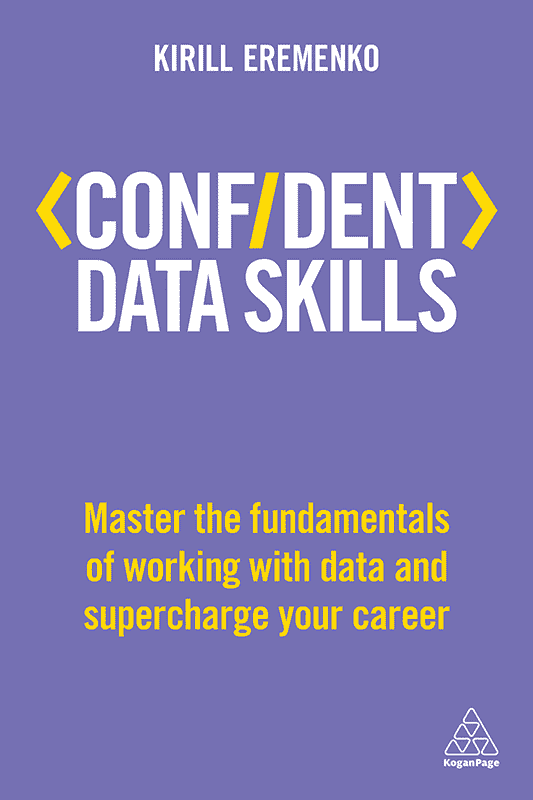


## 出版者说明

我们已尽一切努力确保书中包含的信息在印刷时是准确的，出版商和作者对无论何种导致的任何错误或遗漏概不承担责任。对于因根据本出版物的材料而采取行动或不采取行动导致任何人的任何损失或损害，编辑、出版商或作者不承担任何责任。

本书由 Kogan Page Limited 于 2018 年首次在英国和美国出版。

除根据 1988 年《版权、设计和专利法》允许的用于研究或私人学习、批评或评论的公平处理外，本出版物仅在获得出版商书面许可的情况下以任何形式或通过任何手段复制、存储或传输，或根据 CLA 发布的条款和许可进行复印复制。有关这些条款之外的复制查询应发送至以下地址的出版商：

2nd Floor, 45 Gee Street
London
EC1V 3RS
United Kingdom
c/o Martin P Hill Consulting
122 W 27th Street
New York, NY 10001
USA
4737/23 Ansari Road
Daryaganj
New Delhi 110002
India

*致我的父母 Alexander 和 Elena Eremenko，他们教会了我生活中最重要的一件事——如何做一个好人*


# 指南

- 封面
- 目录
- 开始阅读

# 图表列表

- 图 2.1 马斯洛洛需求层次
- 图 3.1 从书籍引言生成的词云
- 图 3.2 分析价值电梯
- 图 II.1 数据科学流程
- 图 5.1 导入包含缺失数据的表格
- 图 5.2 电子表格中的缺失数据显示初创增长
- 图 6.1 按年龄和游戏时间组织的客户数据散点图
- 图 6.2 分为叶节点的客户数据散点图
- 图 6.3 显示决策树过程的流程图
- 图 6.4 测量欧几里得距离
- 图 6.5 K-NN 算法
- 图 6.6 根据光时间和降水量的葡萄酒收成情况 1
- 图 6.7 根据光时间和降水量的葡萄酒收成情况 2
- 图 6.8 计算朴素贝叶斯的边际似然


# 图表列表

15. 图 6.9 计算朴叶斯分类的似然概率
16. 图 6.10 根据经验显示受访者薪资的散点图
17. 图 6.11 根据年龄显示受访者是否打开我们的电子邮件的散点图
18. 图 6.12 根据年龄显示受访者打开我们的电子邮件概率的直线线性回归
19. 图 6.13 根据年龄显示受访者打开我们的电子邮件概率的调整线性回归
20. 图 6.14 线性回归转为逻辑回归函数
21. 图 6.15 包含分类变量的图表
22. 图 6.16 逻辑回归线
23. 图 6.17 逻辑回归线（不含观测值）
24. 图 6.18 包含拟合值的逻辑回归
25. 图 6.19 分段逻辑回归线
26. 图 6.20 电子商务公司客户数据集
27. 图 6.21 两个独立变量的散点图
28. 图 6.22 K-means 分配随机质心
29. 图 6.23 将数据点分配给最近的质心
30. 图 6.24 重新计算质心
31. 图 6.25 将数据点重新分配给最近的质心
32. 图 6.26 质心发生偏移
33. 图 6.27 重复计算质心
34. 图 6.28 可视化的 K-means
35. 图 6.29 K-means 识别的三个簇
36. 图 6.30 寻找一个簇内数据点之间的距离
37. 图 6.31 寻找两个簇内数据点之间的距离
38. 图 6.32 WCSS 值与簇数量的对应图
39. 图 6.33 凝聚层次聚类的步步骤
40. 图 6.34 聚类树所示的凝聚聚类过程
41. 图 6.35 分为四个簇
42. 图 6.36 识别最大的垂直段
43. 图 6.37 分为两个簇
44. 图 7.1 多臂老虎机分布
45. 图 7.2 带有预期收益的多臂老虎机分布
46. 图 7.3 预期收益纵轴
47. 图 7.4 起始线
48. 图 7.5 初始置信区间
49. 图 7.6 现实场景
50. 图 7.7 实验轮后的机器 D3
51. 图 7.8 实验轮后的所有机器
52. 图 7.9 D4 置信间的移动与收窄
53. 图 7.10 汤普森采样多臂老虎机分布
54. 图 7.11 汤普森采样预期收益
55. 图 7.12 实验轮后的机器 M3 分布
56. 图 7.13 具有真实预期收益的机器 M3 分布
57. 图 7.14 运行后三台机器的分布
58. 图 7.15 随机生成的老虎机配置
59. 图 7.16 更新后的机器 M2 分布
60. 图 7.17 汤普森采样精炼曲线
61. 图 8.1 拿破仑从莫斯科撤退（1812–13 年俄罗斯战役）

# 读者福利

感谢你选择这本书。你在进入数据科学的旅程中迈出了巨大的一步。

请接受我的《数据科学 A–Z》课程免费访问权限。

只需访问 `www.superdatascience.com/bookbonus` 并使用密码 `datrockstar`。

祝分析愉快！

# 引言

“我猜你从小就一直想成为一名数据科学家吧？”

我发现人们这样问我让我觉得很温馨。是的，我热爱我的工作。教学生学习数据科学的基础知识让我很快乐。而且人们似乎认为这种对学科的热情只有在小时候才能灌输在我身上，这太棒了。但事实完全并非如此。诚实地说，哪个孩子会考虑过成为一名数据科学家？孩子们想成为航天员、舞者、医生、消防员。当你忙于梦想拯救生命或飞向太空时，不能指望你脚踏实地。

当人们问我是否一直都想从事数据科学事业时，我会回想起我的童年，一个在津巴布韦长大的俄罗斯小男孩。燃烬的余味、非洲红蟾蜍的铜质鸣叫声、冬日夜晚那令人难以忘的柔软、指尖摩擦过童话集每一页纸的触感——这些记忆的碎片来自于许多个听母亲朗读俄罗斯故事的奇妙夜晚。

我母亲希望我和我的兄弟姐妹爱上津巴布韦，但她同样担心我们了解自己的文化背景。她考虑过如何最好地向我们传递这些信息，并决定最有力的方式就是通过故事。这些关于俄罗斯的知识点被织入引人胜胜的故事中，这意味着当我最终回到莫斯科——回到一个我几乎不记得的国家时——我觉得自己是回了家。

这就是讲故事的力量。对于我听过的所有许多故事，我想把它们拆解成组成部分。我需要看到大局——但我想通过所有小细节的棱镜来看待它。那些创造精美事物的每一个螺丝钉都让我着迷。我直觉地知道，为了自己讲述一个好故事，我需要先收集这些微小的信息单元。对我来说，这就是我对数据的感觉。

在当今的数字时代，数据被用来塑造我们是谁、我们如何展示自己、我们喜欢什么以及我们想要什么的故事。创造出一条独特的虚拟足迹。正如我们在书中将发现的，由于拥有所有可用数据，机器现在比我们自己更了解我们。它们阅读我们的个人数据，就像在读一本关于我们的故事书。而数据科学的奇妙之处在于，现在的每一个学科都在记录数据，这意味着作为数据科学家，我们仍然可以成为我们一直梦想成为的航天员、舞者和医生。


很少有人知道，成为数据科学家最终意味着成为信息的叙述者。就像故事有结构性组件一样，数据科学项目也是逻辑化安排的。`Confident Data Skills` 通过五个清晰的阶段涵盖了这一点，我称之为“数据科学流程”。这并不是我们处理数据科学项目可以采取唯一方法，但它是确保我们的项目在实践中不断构建并向逻辑结论演进的方法。它具有我从小就非常迷爱的、那种清晰且令人满意的结构。

这就是我学习如何讲述数据故事的方式。

# 但我完全是个个新手

数据科学实际上是那些能从其他领域的经验中获益的领域之一。我预计许多读者已经是职业生涯中处于相对较高水平的专业人士。这没关系。从另一个领域进入数据科学，你并没有丢失`任何`东西。事实上，你先在其他领域打下了基础，这很值得赞。这正是你成为一名优秀数据科学家所需的基础。

我是在根据经验谈论这些。当我开始在跨国专业服务公司`德勤`（Deloitte）工作时，我并不了解书中将涉及的每一个算法。人们对我也没有那要求。很少有人会像这样开始他们的数据科学职业。当你阅读这本书时，你会发现行业内的许多成功人士在职业生涯进行得很顺利之前，甚至还没有考虑过这门学科。所以，把那些对数字能力无能的恐惧收起来吧——通过拿起这本书，你已经迈出了数据科学之旅程的第一步。

# 嘿，代码在哪儿？

如果你和我一样是个喜欢翻阅书的人，你可能会注意到书中书中没有一行代码代码。“但这是一本关于数据科学的书，”我听见你这么说，“那么这到底是怎么回事？”数据科学是一个极其广泛的主题。`Confident Data Skills` 将让你沉浸其中，并启发你思考如何将这门学科融入你当前或未来的业务实践中。在这些页面中，你将学习它的`方法`——因为它的“原料”（代码）在网上很容易获得。如果把烹饪的类比进一步推下去，与其说这是一本简单的食谱，不如说是对数据科学中所用基本技术的研究。透彻地学习这些内容，你将开始直观地理解`为什么`需要使用特定的代码和方法，我认为这种学习方法比直接给你几行可以插入到项目中的代码要有效得多。

# 如何使用这本书

我刻意编写这本书，是为了让你在所在的任何地方都能深入阅读：在火车上、在浴缸里、在等待理想对象时。分次读、一次读完、逐章读、精挑读、用黄色荧光笔标记章节、贴满便利签，任何对你有用的方法都可以。在每个部分的开头，你会发现一段简短的介绍，让你快速识别哪个章节对你最感兴趣。第一部分范围较广，解释了数据科学的历程。第二部分和第三部分关注数据科学流程、到今为止最强大的分析模型背后的直觉，以及如何增加你进入行业的机会。

如果你是一个完全的新手，从头到尾阅读这本书将收获最多。如果你对数据科学这门学科已经略有了解，并想应用数据科学流程的细节，请随时翻到最对你有帮助的章节。

# 第一部分

## “它是什么？”核心原则

在人们如此关注技术那看似无限的潜力以及敏锐企业家所拥有的广泛机会之后，某些人可能会问，他们为什么要费心研究数据科学——为什么不直接学习技术原理呢？毕竟，技术驱动着世界，而且没有出放缓的迹象。任何关注自己职业的读者可能认为，学习如何开发新技术无疑是更好的发展道路。

将技术视为改变世界的力量很容易的——它带给了我们个人电脑、互联网、人工器官、自动驾驶汽车、全球定位系统（`GPS`）——但很少有人将数据科学认为是这些发明背后的推进器。这就是为什么你应该读`这本`书，而不是一本关于技术的书；你需要理解系统背后的机制才能做出改变。

我们不应该只把数据看作无聊但有用的父母，把技术看作时尚的青少年。数据科学的重要性并不始于或结束于“技术需要数据作为其众多其他功能元素之一”的解释。那样将否定数据的美感，以及它在工作和娱乐中提供的许多令人兴奋的应用。简而言之，两者缺一不可。这意味着，如果你在数据科学方面有一定基础，那么通往许多需要数据科学家的其他领域的大门将向你敞开，使其成为一个不寻常且有利的研究与实践领域。

`第一部分`向你介绍了数据的无处不在，以及进入该学科有用的数据科学发展和核心原则。三章中的概念将勾勒出数据如何应用于你的清晰蓝图，并让你不仅思考数据如何直接使你和你的公司受益，还思考你如何在职业生涯及未来中长期利用数据。

# 迈出

`第一章`将开启我们进入数据科学的之旅。它将清晰阐明数据的巨大量产，以及在这个计算机时代我们所有人如何贡献于它的产生，然后转向展示人们是如何收集它、处理它，以及至关的一点，数据如何被用于加强学科内外的大量项目和方法。

我们已经确定，数据科学问题的部分原因不在于其相对难度，而在于这门学科对许多人来说仍然是一个灰色的地带。只有当我们准确了解有多少数据以及数据是如何收集的时，我们才能开始考虑处理它的各种方式。我们的技术发展已经达到了这一点：信息可以被高效地收集和存储，以改进各种行业和学科——这从公共可用数据库和政府资助的跨聚合项目中可以证明——但知道如何访问和分析它的人相对较少。如果工作者不知道数据为什么有用，这些精美的数据集只会落灰。这一章论证了为什么数据科学`现在`很重要，为什么它不是一个很快就会过时的趋势，以及为什么你应该考虑将其实践作为你工作任务的核心组成部分。

最后，这一章详细说明了技术飞速发展的轨迹让我们在数据科学领域没有停顿的空间。无论我们对正走向的世界有多么恐惧，我们都无法阻止数据的收集、准备和使用。然而，无法忽视这样一个事实：数据本身并不关心道德问题，这使得它容易被剥削和滥用。那些对此担忧的人可以主这些这些发展，并与数据伦理问题的全球机构进行讨论，这个领域我发现非常着迷，以至于我在`第三章`数据科学思维中为它专门开启了一个小节。

# 未来属于数据


一切事物、每一个流程、每一个传感器，都很快将由数据驱动。这将从根本上改变业务运营的方式。我预测，10 年后，世界上每个机构的每个员工都将被要求具备一定的数据素养，并能够处理数据、从中推导出一些见解，以为业务增加价值。考虑到在本书出版时，许多人已经预预期知道如何使用数字钱包服务 `Apple Pay`（该服务直到 2014 年才上市），这种想法也并不非那么荒唐。

第 2 章“数据如何满足我们的需求”一章明确指出，数据根植于我们生活的每一个方面。它主宰着我们，并在数量中聚集力量。虽然技术在人类近期历史中才变得重要，但数据在我们存在中一直起着至关重要的作用。我们的 DNA 提供了关于我们最基础形式的数据。我们受它治理：它决定了我们的外貌、肢体形状、大脑的结构及其处理能力，以及我们经历的情绪范围。我们是这些数据的载体，是生物化学信息的移动 U 盘，将其传递给孩子，并用来自我们和伴侣的混合数据对他们进行“编码”。对数据不感兴趣，等同于对存在的最基本原理感兴趣。

本章解释了数据如何在如此多的领域被使用，为了说明这一点，我使用了直接对应亚伯拉罕·马斯洛需求层次理论的例子，这一理论对于商业和管理领域的许多学生和从业者来说是熟悉的。如果你对这个层次结构表示陌生，不要担心——我将在第 2 章中解释其结构以及它如何适用于我们。

# 捕捉飞速发展

第一部分 的最后一章将展示数据科学初学者可以如何重塑自己的心态以进入该学科，并揭示我认为在立即投入该学科方面展现出最大潜力的领域。该领域取得的许多进展对其他学科产生了连锁反应，并对数据科学家以及该学科边界之外的学者和从业者的未来提出了问题。如果你正寻求在数据科学领域发展你的职业生涯，这一章甚至可以为你已经在从事的某些细分领域激发灵感。

为了进一步加强第 2 章中提供例子的说服力，这些例子展示了数据在许多生活中支持作用的有力论证，在第 3 章中，我也为你提供了一些你可以作为从业者用来起手的批判性方法。我们可能认为它的广泛应用会使数据难以渗透，但学习数据科学比精通许多其他科学学科容易得多。你不需要成为一个终身学习者才能掌握数据科学的原理。你*真正*需要的是能够思考如何就一个或多个问题——关于业务运营、关于个人动机——向数据提出提问。因为数据科学家的工作是检查他们被赋予信息的*可能性*。你可能会惊讶地发现，你已经拥有了一些技能和经验，可以在精通该学科的旅程中利用它们。

尽管如此，对于新来者来说，谨慎是必要的。任何使用过 `Excel`、在办公室环境中工作过或在大学上上过包含科学部分的课程的人，可能在他们的职业或学术生活中已经遇到过数据。但你可能学到的某些使用数据的方法可能是无效的，而且固守你所知的知识可能会阻止你学习利用数据集的最有效方法：我们将在第二部分中详细讨论。

尽管数据具有明显的积极影响，但不被其蒙蔽同样重要。因此，第 3 章还涉及了数据可能给用户带来的各种安全威胁，以及数据从业者如何努力解决可能出现的现在和未来的问题。数据伦理是一个特别值得关注的领域，因为它拥有改变和引导数据科学未来发展的力量。从我们对信息收集的理解，到它在机器和在线上使用的程度，数据伦理正在为人类与技术的交流奠定基础。当你阅读这一章时，请考虑每个领域可能如何与你的工作联系起来，以及对该主题的进一步投入对你的业务可能有多有益。

# 01

## 定义数据](#toc-title.xhtml_ch-01)

想想你上次在电影院看的那部电影。你是第一次听到它的？你可能是在 `YouTube` 向你推荐时点击了预告片，或者它可能出现在 `YouTube` 向你展示你真正想看的视频之前的广告中。你可能看到一个朋友在你的社交网络上对它赞誉有加，或者有一段电影精彩片段中断了你的新闻动态。如果你是一个热衷的影迷，它可能在某个电影汇总网站上被为你挑选出来，是一部你可能喜欢的电影。即使在互联网的舒适区之外，你可能在你最喜欢的杂志上发现了该电影的广告，或者可能在去那家拥有最好 Wi-Fi 的咖啡馆的路上对海报产生了偶然的兴趣。

这些触点*没有*一个是巧合。星星并非恰好在你和你那部电影在正确的时刻汇聚。让我们把理想主义的缘分留给屏幕上的相遇吧。让你进入电影院的，与其说是想看电影的欲望，不如说是一种强大的数据驱动证据组合，这些证据在你甚至意识到想看这部电影之前就已经把你标记为观众。

当你与这些每一个触点互动时，你留下了了一些关于你自己的数据。我们称之为“数据排放”（data exhaust）。它不仅限于你的在线活动，也不仅仅属于社交媒体一代。无论你是否使用社交媒体平台，无论你是否*喜欢*它，你都在贡献数据。

情况一直是如此；我们只是变得更擅长记录和收集它了。你日常互动的许多活动都会对这种排放做出贡献。在去伦敦地铁的路上，监控摄像头正在记录你。登上地铁，你就在为伦敦交通局增加了关于高峰时段和使用情况的统计数据。当你为 `Kind` 小小说做签或高亮页码时，你正在帮助分销商了解读者特别喜欢它的哪些部分，哪些可以放在未来的营销材料中，以及读者通常会读到哪里才停止。

当你最终决定放弃公共交通的折磨和惩罚，而是开车去超市时，你的速度正在帮助 `GPS` 服务向用户实时显示该地区的交通状况，它还帮助你的汽车判断在寻找加油站之前还有多少时间。

而今天，当你从这些触点出来时，你留下的数据会被收集并加入到关于你的蓝图中，详细描述了你的兴趣、行为和欲望。


但这只是数据故事的开始。这本书将教你数据究竟是多么的无处不在。你将学习通往掌握数据科学之路所需的本质概念，以及能够让你将数据技能应用到自己工作中的关键定义、工具和技术。这本书将通过向你展示数据科学如何以你以前从未想过的方式应用于各个领域，从而开你的眼界。我将描述数据技能如何为你的职业生涯提供助力并改变你的业务模式——无论是通过你的观点给高管们留下深刻印象，还是自自创业。

### 数据*无处不在*

在我们继续下去之前，我们应该明确我们所说的“数据”是什么。当人们谈起数据时，他们会认为它是被积极收集的，储存在那些难以捉摸的公司服务器的数据库中，并被投入研究之中。但这是一个过时的观点。在今天，数据无处不在得多。

简单来说，数据是任何单位的信息。它是任何、每一个行动的副产物，渗透到我们生活的每一个角落，不仅是在互联网领域，还存在于历史、地点和文化之中。一张洞穴画是数据。一个和弦是数据。汽车的速度是数据。一张足球赛的门票是数据。对调查问问题的回答是数据。一本书是数据，书中的一个章节也是数据，章节中的一个词也是数据，该词中的一个字母也是数据。它不需要被*收集*就能被视为数据。它不需要存储在组织的金库中就能被视为数据。世界上大部分数据可能（目前）根本不属于任何数据库。

让我们假设在“数据是信息单位”的这个定义中，数据是*实体的过去*。当你思考这个问题时，这非常深奥。数据是过去，过去也是数据。数据所贡献的事物的记录被称为数据库。数据科学家可以使用它来更好地理解我们的现在和未来的运营。他们正在应用历史学家长期以来一直告诉我们的相同原理：我们可以从历史中学习。我们可以从自己的成功——以及错误——中学习，以改进现在和未来。

近年来，数据唯一发生巨大变化的方面是，我们能够在仅受想象力限制的范围内，对其进行收集、组织、分析和可视化的能力。无论我们去哪里，买什么，对什么感兴趣，这些数据都在不断被收集并重塑为趋势。这些趋势帮助广告商和营销人员将产品推给正确的人，帮助政府根据行政区或年龄显示人们的政治倾向，并帮助科学家创建响应复杂情感、伦理和意识形态的 AI 技术，而不仅仅是简单的查询。

考虑到所有因素，你可能会开始问数据定义的局限在哪里。关于植物开花周期的实证证据（定量数据）是否与科学家记录在母国给临终亲属送一束花所相关的文化污名（定性数据）具有等地位地视为数据？答案是肯定的。数据不歧视。所收集的信息单元是定量的还是定性的并不重要。在过去，当技术不够成熟以处理它时，定性数据的可用性可能较差，但得益于处理此类数据的算法的进步，这正迅速成为过去。

要通过局限来定义数据，请再次考虑数据是过去。你无法从未来获得数据，除非你成功制造了一台时间机器。但虽然数据永远不可能是未来，它*可以*对未来做出洞察和预测。正是数据填补我们知识空白的能力，让它变得如此迷人。

### 大（数据）之美

既然我们已经掌握了什么是数据，我们需要刷新对数据实际存储在何处以及如何存储的认知。我们已经展示了我们产生数据的巨大潜力（那是我们的数据耗耗），并解释了作为信息单位，我们所理解的“数据”有一个非常广泛的概念。所以，一旦它流出去，它们都*去*了哪里呢？

到为止，你可能已经听过“大数据”这个词了。简单来说，大数据是指由于列和行数量巨大，传统硬件和软件无法在合理的时间内对其进行捕获和处理的数据集。由于这个原因，这个术语是动态的——在 2015 年可能被认为是大的数据，在 2020 年将不再被这样认为，因为到那时，技术已经发展到可以轻松应对它的规模。

## 3 V

要给一个数据集贴上大数据的标签，必须满足三个要求中的至少之一：

*   它的量（volume）——指的是数据集的大小（例如其行数）——必须达到十亿级；
*   它的速度（velocity）——考虑收集数据的快慢（例如在线视频流）——假设数据生成的速度太快，无法通过传统方法进行充分处理；
*   它的多样性（variety）——这指的是数据集中包含的信息类型的*多样性*（如文本、视频、音频或图像文件，被称为非结构化数据），或者包含许多代表不同数据属性的列的表格。

大数据的出现比我们想象的要早得多——只是这个术语直到 20 90 年代才出现。多年来，我们各个领域一直坐拥着大数据，而且比你预想的要长得多。所以我不得不告诉你：大数据并不是什么新鲜事。它绝对不是一个新概念。世界上许多甚至所有大公司都拥有长期收集的关于客户、产品服务的海量数据。政府存储人类数据，从人口普查到监控和居住。博物馆存储文化数据，从文物、收藏者档案到展览存档。甚至我们自己的身体也存储着大数据，以基因组的形式（稍后介绍）。

简而言之，如果你无法处理它，你可以称其为大数据。当数据科学家使用这个词时，他们并不是随意使用的。它被用来引起人们对这一事实的注意：分析相关数据集的标准不再足够。

## 为什么对大数据如此狂热？

你可能会觉得，我们现在才开始意识到数据有多强大很奇怪。但虽然我们几个世纪以来一直在收集数据，但过去阻止我们将它们全部整合为对我们有益的东西是因为技术匮乏。毕竟，数据有多大并不重要，重要的是你如何处理它。任何数据，无论是“大”还是别的，只有在可以从中挖掘信息时对我们有用，而在帮助我们分析和扩展这些数据的技术出现之前，它的实用性只能通过处理数据的人的智力来衡量。

但大数据需要比人类大脑更快、更强大的处理器来进行排序。在 20 世纪技术发展之前，数据存储在纸张、档案、图书馆和金库中。现在，我们捕获的所有新数据都以数字格式存储（即使是旧数据也在积极数字化）。


## 存储与处理

随着计算机的出现，数据存储和处理过程的自动化成为可能。但大型数据集让早期的机器应于不堪；20 世纪 50 代处理电子数据集的科学家们在完成一项简单任务之前，往往需要等待几个小时。这些科学家很快得出结论：为了妥善处理大数据集——即在元素之间建立联系，并利用这些联系做出准确且有意义的预测——他们需要构建既能管理数据又能处理其存储的信息载体。事实固然，随着计算技术的进步，计算机的存储和处理能力也随之提高。在过去的 70 年里，我们不仅能够以更高效的方式存储信息，还能让这些信息具有可携带性。20 世纪 70 年代只能装下 177,778 张软盘的信息，到 2000 年代就可以全部装进一个闪存驱动器。今天，你可以在云端存储所有这些甚至更多的内容（一种具有虚拟化基础设施的存储设施，让你能够从世界任何地方查看个人文件）。请记住，下次你再次从本地图书馆或工作场所——或仅仅在移动设备上访问个人文档时，你实际上是在做一件在 20 世纪 70 代需要携带 100,000 多张软盘才能完成的事情。

当新技术让数据存储变得更容易，研究人员开始关注如何真正使用这些存储的数据。

我们是如何从混沌中建立秩序的？回到之前的例子，你上次在电影院看的那部电影。你之所以被选中看那部电影，可能不是因为某个研究证据的敏锐营销人员，而是因为一台聪明的机器，它查看你的数据轨迹，并将其与发现的最有可能观看并欣赏该电影的人口统计特征进行匹配。这听起来可能很新鲜，但正如我们已经过的，数据及其（人工）处理已经存在很了。好莱坞的一些制作公司早在 20 世纪 50 年代就开始收集观众想看的数据，从演员、导演到类型，然后将这些信息切分成对应年龄、地点和性别的受访者人口统计数据。即使在那个时代，人们已经在根据数据提供的信息做出可能改变游戏规则的决策。

### RKO 电影公司

为什么 50 年代好莱坞“五大制片厂”之一的 RKO 电影公司在电影中一直使用凯瑟琳·赫本（Katharine Hepburn）？因为数据告诉他们，她是引发话题并最终填满电影院的稳妥选择。

当然，直觉也有发挥空间。在她的第一次试镜中，导演乔治·库柯尔（George C. Cukor）发现她很古怪，但他也承认“她拿起杯子的动作中有一种巨大的感觉，一种分量。我认为她在那个动作中非常有天赋”（Fowles, 1992）。这就是所谓的直觉。

在观众认可度数据的重要支持下，RKO 随后能够利用库柯尔对赫本才华的直觉，并将其转化为关于制片厂如何继续赚取数百万美元的可靠预测。

这一切都要归于乔治·盖洛普（George Gallup），他是第一个让好莱坞高管意识到利用数据来指导决策和做出预测的力量的人，从选用主演演员到选择哪种电影类型是最安全的财务投资。

为了帮助 RKO 做到这一点，盖洛普收集、整合并分析了定性和定量数据，这些数据涵盖了 RKO 观众的人口统计信息以及他们对该制片厂作品的意见。在收集这些数据时，盖洛普创建了一个模型，首次将电影观众细分为对特定类型产生良好反应的人口统计群体，这个模型可以并且也将用于后续的数据抽样和分析。

盖洛普被誉为帮助制片厂发富的“算命师”，迅速成为整个美国电影行业许多制片厂高管的宠儿，通过调查和采访收集的数据，为沃尔特·迪士尼（Walt Disney）到奥森·威尔斯（Orson Welles）等不同的人物触测观众的“脉搏”。

盖洛普的成功完全归功于数据（也许可以被称为世界上第一位高薪数据科学家）。这位统计学家的努力产生了一种在其原始设计之外持续具有价值的资源，即其捕捉非结构化数据的潜力：对观众成员的访谈记录，反映了当时的文化和社会价值观。也许盖洛普怀疑，数据驱动分析的潜力只会不断增长。

## 数据可以生成内容

那么，如果在了所有精妙的数据驱动证据后，你最终还是讨厌上次在电影院看的那部电影呢？嗯，数据可能无法预测一切，但它确实让你坐在了座位上。数据在成就上可能只能得到 C，但它在努力上总是得到 A。而前者正在被改进。制作公司现在不再为新电影或电视剧贴上正确的观众人口统计特征，而是正在寻找方法，通过使用观众数据对他们的娱乐输出做出明智决策。

影响这一运动需要更多数据。因此，一旦你看了为你挑选的电影，数据收集并并没有停止；你在社交媒体上进行的任何后续回应、通过电子邮件或通过改变在线观看习惯，都会产生一组关于你（即“电影院观众”）的新鲜数据，这些数据将完善并定制任何未来的建议，并在最终细分你所所属的人口统计群体。所以，当你从一个只对反乌托邦电影感兴趣的情感化青少年变成一个在鸡尾派对上让人避开的超现实主义迷时，你的数据将随你一起移动，并适应那些波动的偏好。

注（nota bene）：更棒的消息是，数据不会否定你的兴趣。如果你只是在假装成为鉴赏家，但在幕布落下后仍然喜欢一部廉价的僵尸电影，你的数据将继续维持你那秘密的热情。

当然，硬币的另一面是，你的数据可能会泄露这些偏好。注意，数据是你行为的记录——它不会替你撒谎。有些人甚至会费尽全力在数字音乐服务网站上隐藏他们的“真实”数据足迹，通过虚荣性播放，即启动一个他们认为具有社交声望的专辑，然后在专辑播放时时离开书桌，这样他们的历史数据就会向其他用户展示一个关于他们喜好的偏曲版本。

* *

**案例研究** Netflix


娱乐公司 Netflix 的《纸牌屋》首次向行业证明了数据不仅在触达特定类型内容的正确受众方面如此强大，在驱动内容的实际`production`方面同样如此。这部 2013 年的政治剧是关于如何应用数据来制作热门剧集的早期实验。在《纸牌屋》制作之前，Netflix 一直从用户那里收集数据。这些数据包含了用户的观看习惯，这些洞察让 Netflix 能够根据数据将其视频内容分为多样化且令人惊讶的类别。这些类别在界面中是向公众隐藏的，但公司仍然利用这些类别，将合适的电影推送给合适的观众。

几年前，当这些子分类的细节在网上被公布时，互联网炸开了锅。为了让你感受 Netflix 变得具体到何种程度，子分类中包括“20 世纪 80 年的刺激惊悚电影”、“由木偶主演的治愈系教育与指导”、“演艺界剧情”、“搞笑的独立讽刺片”、“基于真实生活的无反叛电影”、“烧脑的外国战争电影”、“火辣惊悚片”以及“根据书籍改编的受好评的暗黑电影”。这些都是非常专业的观看习惯。但 Netflix 为这些类别中的每一个都找到了大量的受众，此外还有更多。

最终，Netflix 的数据科学家开始在他们观众的观看模式中看到重叠。似乎有大量的 Netflix 订阅者既喜欢凯文·斯佩西的作品*又*喜欢硬朗的政治剧。剩下的部分——更新 1990 年代的原版《纸牌屋》并让凯文·斯佩西担主演——就成了历史（或者说，是数据吗？）。

### 乘上成功的浪

Netflix 重视他们的数据是完全正确的：《纸牌屋》成为了一部屡获奖项并广受好评的剧。因此，当 Netflix 的许多对手随后试图模仿这种成功模式时，这并不意外。数据科学企业家、我的业务伙伴 Hadelin de Ponteves 曾在 Netflix 的一家竞争对手处工作，创建一个适用于他们的类似系统：

我们知道 Netflix 已经有一套强大的推荐系统，因此，作为数据科学家和系统开发人员，我们面临的压力不是为我们的公司复制同样的系统，而是寻找我们哪里可以带来差异。我们意识到，要开发一个真正有趣的系统，我们不仅需要开发一个推荐已知人口统计特征电影的工具，还想找到一种算法，能够建议最初可能让用户走出舒适区但他们最终会发现有趣的电影。我们真的想把那种惊喜元素加入。

(de Ponteves, 2017)

Hadelin 知道，要实现这一点，需要一个复杂的系统来进入用户群的大脑，并比他们自己更地了解他们的观看兴趣。他通过提取公司拥有的所有关于客户的数据，并应用正确的模型组合来寻找用户观看习惯之间的联系来实现。记住，这种方法与许多年前乔治·高尔的方法非常相似；得益于我们可用的技术和数据科学家的想象力，我们现在可以以更复杂（且更自动化）的方式访问数据。

***

## 使用数据

有些人可能会抱怨，这种使用数据来驱动创意内容的方法实际上正在杀死创造力。对于这一点，我会回答说，数据只是遵循人们的需求。这对于任何行业来说都是理想的：在正确的时间、正确的地点向正确的受众展示相关内容，以吸引他们购买他们的服务。数据以这种方式让行业变得更加民主。因为机器可能开始驱动我们的购买，但我们仍然掌握着最有价值的信息：人类的欲望。机器并没有告诉我们我们想要什么；它们在为我们建立我们可能无法知知的联系。

数据并没有告诉人们出去看超级英雄电影而不看法国超现实主义电影；它是在倾听人们想要和喜欢什么。(5) 如果你认为创造力被压制存在问题，那不是数据的错——那是我们社会的问题。我怎么强调都不为过，数据*是*过去。它仅仅是信息的记录。如果你*确实*想看更多法国超现实主义电影，那就确保你去看它们——并确保你在之后大声地对它们表达你的观点。(6) 这看起来你只是在增加互联网的噪音，但这些噪音正被迅速收集并挖掘以供他用。得益于数据，这是一个我们的声音实际上可以被听见并拥有真实影响力的时代——所以为什么不充分利用它呢？

此外，使用数据模型尚未完全完善。在媒体行业中，其他公司随后采纳了 Netflix 的概念——一些人可能会指出他们取得了不同程度的成功。但再次，错的不是数据，而是人类的、创造性的投入。毕竟，*那*正是我们利用数据制作内容的能力的局限所在。我们可能评估对某个概念感兴趣的人数的*可能性*，但还有更多的事情在其中，因为任何形式娱乐的最终成功都将取决于参与创作的才华。让那些希望通过仅仅依靠数据来轻松过日的作家和导演吸取这一教训吧：显示电影类型成功的数据库可能是一个值得遵循的指南。

## 为什么数据现在很重要

许多人已经意识到技术将如何动未来的工作。如果你感到特别勇敢，快速用 `Google` 搜索 `technological impact on jobs`（技术对工作的影响）将让你看到有无数说法在讨论你的工作变得自动化的可能性。(7) 虽然这些信息得到了数据支持，但我认为研究人员在考虑某些工作所需的任务时，可能存在某种程度的主观性。尽管如此，我绝对不会建议人们训练成为体育裁判，就因为他们的工作建立在比赛的数据之上。

## 摩尔定律

摩尔定律是一条预测法则。摩尔定律由英特尔创始人戈登·摩尔于 1965 年提出，最初指的是随着时间的推移，集成电路（例如计算机芯片、微处理器、逻辑板）每平方英寸晶体管（用于控制电力的装置）数量的预期增长。观察发现这些晶体管的数量大约每两年翻一倍，该定律声称这种现象将持续下去。到目前为止，它是正确的。


通俗来说，这意味着如果你今天去当地的电脑商店买了一台 1000 英元的电脑，两年后你在同一家商店购买了另一台同样 1000 英元的电脑，那么第二台机器的性能将是第一台的两，尽管价格相同。

许多人将这一定律应用于数据科学领域飞速发展的进展。数据科学是增长最快的学科之一，其从业者正致力于通过日益复杂的方法，寻找新手段来捕数据、构建成本效益数据存储系统，并开发算法将所有大数据块转化为有价值的见解。你是否曾觉得技术的发展速度快到让你跟不上？那么请为数据科学家留一点时间吧。他们正在与*甚至尚未被发明*的技术进行追赶游戏。

***

### 案例研究：Siri

以语音识别的发展举例。`Siri` 的联合创始人 Dag Kittlaus、Adam Cheyer 和 Tom Gruber 在技术进步到能够真正实现他们的概念并投入市场之前，就已经创建了这个智能个人助手。`Siri` 的创造者根据他们现有的数据构建了算法和框架，以支持尚未发明的语音识别技术。然而，他们所知道的是，虽然利用当时的技术无法运行该软件，但一旦技术有足够的时间追赶，最终*将*能够运行 `Siri`。简而言之，他们拦截了技术趋势。

***

`Siri` 制作者应用于其预测的概念是摩尔定律。这对于数据科学来说至关重要。该定律已应用于许多技术过程，而且是在进行商业投资和决策时必须考虑的规则；我们将在第 3 章](#chapter-title03.xhtml)“数据科学思维”中返回进一步讨论。

# 忧虑无济于事

好莱坞和整个娱乐业长期以来对数据抱有一种反乌托邦式的观点，并担心未来数据滥用和剥削可能给人类带来的危险。我们只需要想想《2001：太空漫游》中那句不祥的台词：“打开对接舱门，哈尔”，其中 `Hal`——太空飞船的 AI 技术——变得如此复杂，以至于它决定自己违背人类命令，转而遵循自己的（优越的）推理。《机械姬》、《人类她》、《银翼杀手》、《攻壳机动队》——这些电影都想象了当这类技术开始产生意识并质疑我们时，人类可能面临的问题。

但还有另一个领域对我来说是数据被剥削的一种更为可能、更紧迫且更隐蔽的方式，而且这更多地与*人类*滥用数据有关，而不是机器人本身：隐私。隐私问题渗透到我们的许多在线互动中。人们可以选择保持匿名，但他们的信息总会在某处被收集并被使用。即使这些数据被剥除了可以追溯到个体的特征指标，仍有人会问：收集这些数据本身是正确的吗？

## 你的在线足迹

20 世纪 90 年代的互联网用户对 `avatar`（虚拟形象）一词熟悉，它指的是我们在在线论坛上选择的代表自己的相当无害的。今天，`avatar` 一词被用来描述更广泛的事物。它现在意味着我们在在线世界中的无形分身；即我们在在线搜索、选择和购买时产生的数据集合，以及我们在网上发布的所有内容，从文本到图像。这类数据对于信用机构和汇总数据的公司来说是潜在的信息金矿。公司随后利用这些见解将其出售给他人。

随着数据科学成为一个产出丰富的学科，围绕数据渗透性、扭曲和捕的伦理与安全问题正被提出（伦理是我们将在第 5 章](#chapter-title05.xhtml)“数据准备”中涵盖的领域）。我们有充分理由对数据科学开启的路径表示担忧，而且它对于谁（或什么）访问这些信息并没有歧视。虽然从纸质到数字化的改进了公司的许多实际方法，但数据仍然可能丢失或恶化，而且人类对数据有巨大的影响（错放信息、丢失数据库和间谍活动），这可能会导致毁灭性的后果。

***

### 案例研究：心脏血漏洞 (Heartbleed Bug)

在我看来，`Heartbleed Bug` 代表了迄今为止世界上最激进的隐私侵害。该漏洞允许黑客利用互联网上使用的源代码中的漏洞，导致通过安全套接层 (`SSL`) 连接发送的本应受保护的信息被窃取。在我们完全意识到其规模之前，这个漏洞已导致购物网站上的敏感信息泄露了多年。

2014 年，Google 安全团队在对其服务进行常规审查时，在 `SSL` 源代码中发现了这个问题。据发现，全球约 800,000 个网站的源代码中存在此错误，使得知道该漏洞的信息窃取者和黑客能够访问。但在发现它之前的两年里，该漏洞未被察觉，导致可能无数的数据被窃取。讽刺的是，作为启用了 `SSL` 的网站（以 “https” 开头的网站），它们本应该比使用普通 “http” URL 的网站更安全。

忽略当时对于该漏洞是否被政府或虚假组织允许持续存在的广泛猜测，事实仍然是，`Heartbleed Bug` 代表了极具里程碑意义隐私侵害。

***

## 不要审查——要教育

数据科学一个令人尴尬的事实，事实上对任何直接涉及金钱的学科都是如此：随着对该学科兴趣的增长，对篡改其过程的更阴险手段的兴趣也会随之增长。有些人可能认为这足以成为停止数据收集和使用的理由。但我有不同的看法，我敢打赌许多其他数据科学家也有同感：与其审查和限制，我们还需要教育人们。我们必须留心告诉孩子，他们在网上进行的活动将形成一个 `avatar`，这个形象可能对他们有利，也可能对其不利。我们必须确保人们通常能更好地了解他们的数据是如何被使用的，以及为什么要使用。

这就是我们现在生活的的世界。与其抵抗，从这种情感投入中抽身要容易得多。毕竟今天最年轻的一代已经放弃了，而这些是公司通过广告接触的新消费者。这在许多企业在线运营的方式中得到了证明，从 `Amazon` 到 `Outfittery`(8)。如今，消费者愿意为了更符合他们个人定制的产品和服务提供他们的个人信息。快速浏览 `Instagram` 或 `Twitter` 就会发现，在各种领域在线放弃个人信息对于千禧一代来说甚至感觉是天性使然。除非你计划在野外离网生活并只与鸟交流，否则网络安全仅仅是今天生活的另一种风险。反抗它是徒劳的；卢德分子在 19 世纪可能对机器的使用进行过暴力抗议，但从长远来看并没有改变什么。


我们不太可能关闭那些被我们理所当然并早已整合到生活中的服务，主要是因为我们现在*需要*这些服务。技术曾是一种奢侈，而现在已迅速成为我们生活和工作中的基本需求。为了让我们继续开发这项技术，我们需要挖掘数据的价值。

从社交媒体在全天候范围内不间断的信息轰炸，到新闻网站随着新信息的不断涌入实时更新页面，世界运行的节奏，以及我们现在可以在线实时目睹这一切发生的选择，都可能让人感到力不从心。这种数据过载从四面八方向我们袭来，而且无法停止。你不能给火山塞上塞子，却指望它不喷发。

然而，我们*可以*做的是对数据进行管理和分析。你可能听过“内容策展人”以及如 `Feedly` 这样的“聚合网站”，通过这些平台，你可以收集并分类你感兴趣的博客和网站新闻。这些个人和公司正致力于组织与其粉丝或订阅者相关的数据。这些管理信息的尝试应该带给我们安慰，而且是我们处理数据的众多选择之一。随着技术不断进步帮助我们管理和分析数据，我们将其作为计算机时代生存组成部分的接受程度也会随之增加。因此，请放下疑虑，让我们关注数据的可能性，以及它如何改善你的生活。

# 参考文献

Fowles, J (1992) *Starstruck: Celebrity performers and the American public*, Smithsonian Institution Press

Keynes, John Maynard (1963) Essays in Persuasion, Norton, pp. 358–73

Mishra, S and Sharma, M (2016) Bringing analytics into Indian film industry with back tracing algorithm, Analytics Vidhya[Online] [www.analyticsvidhya.com/blog/2016/08/bringing-analytics-into-indian-film-industry-with-back-tracing-algorithm/](http://www.analyticsvidhya.com/blog/2016/08/bringing-analytics-into-indian-film-industry-with-back-tracing-algorithm/) [accessed 20.06.2017]

Ohmer, S (2012) *George Gallup in Hollywood*, Columbia University Press

# 注释

1 此时你可能已经习惯了人们纠结“data”一词，认为它是单词“datum”的复数形式，并认为说“data are”比更盛行的“data is”更正确。你可以告诉他们，“data”一词最早于 1645 年由 Thomas Urquhart 记录为单数用法，直到近 60 年后的 1702 年它才被用作数名词。

2 云端数据存储在境外，并在大部分通过铺设在海底的海缆进行传输。因此，云并不像我们想象的那样在空中，而是在水下。这些电缆的地图可以在 [www.submarinecablemap.com](http://www.submarinecablemap.com) 找到。

3 Gallup 是一位统计学家，他因开发出一种准确预测富兰克林·D·罗斯福 1936 年连选的技术而首次进入公众视野。

4 有关 George Gallup 开创性工作的更多信息，请参见 Ohmer (2012)。

5 关于电影行业数据分析的挑战和潜力的示例，请参见 Mishra and Sharma (2016)，他们的报告分析了印度的电影制作和生产。

6 自然地，这种方法存在障碍。你无法击败中国的数百万超级英雄粉丝，他们他们很大程度上导致了好莱坞不断推出关于穿着紧身衣的男性（和女性）拯救世界免受邪恶电影。关于数据如何影响创造力的问题可能超出了本书的范畴，但我估计即使在数据驱动的世界里，一直存在也将会有创意表达的空间。我们并不是在降低智力；我们只是在让行业更高效。

7 对技术性失业的担忧并不新鲜——约翰·梅纳德·凯恩斯在 20 世纪 30 年代就曾写过此观点。“我们正遭受一种新疾病的折磨，某些读者可能还没听过它的名字，但他们未来几年里会经常听到——即技术性失业”（Keynes, 1963）。

8 柏林风格的数据科学方法。

# 02 数据如何满足我们的需求

我们不太可能关闭那些被我们理所当然并早已整合到生活中的服务，主要是因为我们现在*需要*这些服务。技术曾是一种奢侈，而现在已迅速成为我们生活和工作中的基本需求。为了让我们继续开发这项技术，我们需要挖掘数据的价值。

从社交媒体在全天候范围内不间断的信息轰炸，到新闻网站随着新信息的不断涌入实时更新页面，世界运行的节奏，以及我们现在可以在线实时目睹这一切发生的选择，都可能让人感到力不从心。这种数据过载从四面八方向我们袭来，而且无法停止。你不能给火山塞上塞子，却指望它不喷发。

然而，我们*可以*做的是对数据进行管理和分析。你可能听过“内容策展人”以及如 `Feedly` 这样的“聚合网站”，通过这些平台，你可以收集并分类你感兴趣的博客和网站新闻。这些个人和公司正致力于组织与其粉丝或订阅者相关的数据。这些管理信息的尝试应该带给我们安慰，而且是我们处理数据的众多选择之一。随着技术不断进步帮助我们管理和分析数据，我们将其作为计算机时代生存组成部分的接受程度也会随之增加。因此，请放下疑虑，让我们关注数据的可能性，以及它如何改善你的生活。

##数据的渗透

为了说明数据在我们生活的每个方面是多么等重要——它是基本需求而非奢侈品——我将使用马斯洛的需求层次理论，我相信许多从业者都会熟悉它。虽然我只是最近才发现它，但它在商业心理学文献中经常出现。我发现这是一个与数据的普及性结合得非常奇妙的模型。

## 数据科学与生理需求

马斯洛的需求层次底部是生理因素，即人类生存的最基本需求。数据如何帮助这些最基本的需求？它如何改进它们？

让我们以我们呼吸的空气为例。自工业革命以来，空气污染一直是全球关注的主要问题。我们可能会自动认为雾霾是过去的一种现象（如伦敦），但雾霾继续影响着世界许多地方，从中国到巴西。

任何旨在减少受影响城市污染的技术都依赖数据：要改善空气状况，必须首先对其进行监测。


Green Horizon 由 IBM 于 2014 年启动，通过“转型其国家能源系统并支持其对可持续城市化的需求”来应对中国严峻的空气质量（IBM, 2017a）。Green Horizon 吸收了来自全球 12 个研究实验室的数据，并对收集的数据应用认知模型，以为该项目减少污染的核心倡议提供支持。在这里，数据对于监测特定区域空气污染的波动至关重要，有助于科学家分析直接和间接影响空气质量、温度和状态的各种因素，从而开始改善中国的物理环境。

这些项目的巨大益处在于，环境数据通常是公开的且具有全球范围内，这意味着有助于应对空气污染问题的技术发展可以迅速进行。获取改善我们最基本需求的重要数据集，对于理解我们的技术如何表现得至关重要。这就是为什么我们现在有了安装在建筑中的特殊玻璃窗，让窗户能够“呼吸”，清洁室内空气并从而保护居住者。这也是为什么我们有了可以放入工厂的过滤器，以减少排放并保护当地居民免受毒害。

## 可持续食品

食物是另一个数据如何响应人类最基本需求（马斯洛需求层次中的生理因素）的案例。对某些人来说，这可能是科幻小说情节，但食品已经在实验室中生长了多年，“培养肉”现象正变得越来越具有想象力。硅谷初创公司 Memphis Meats 只是此类机构之一，自成立以来开发了各种培养肉，从牛肉到禽类肉。

由于这对于监管机构、宗教和科学领域仍然是一个灰色地带，培养肉在不同程度上引起了世界范围内社区的赞誉和愤怒（Devitt, 2017）。但无论我们是否喜欢，培养肉可能很快就会成为我们饮食的未来。它将成为解决农业给自然界带来严峻压力的环保解决方案，大幅减少用水和碳排放。我们为生产此类肉类而收集的数据将超越 DNA 捕捉。随着食品技术变得更加普及，更多的消费者数据将被利用以解决其他因素，例如如何最好呈现和调味培养肉，使其最符合口味且（这对于生产它的公司关关）具有销售价值。

## 数据科学与安全

一旦满足了生理需求，马斯洛需求层次理论指出安全需求（身体、财务、个人）将优先。安全是下一个层次，它很大程度上包含了个人健康和福祉，而医学是数据科学留下印记的最显著学科之一。在医学行业，数据科学被用于彻底改变我们诊断和治疗疾病所需的药物。所有的医学试验都通过参与者数据进行分析，这些收集的数据可以用于指导诊断、推荐不同的实践方法并构建新产品。复杂和罕见疾病的诊断给医疗从业人员带来了压力，要求他们了解疾病的许多不同表现和症状，导致在寻找问题根源并高效处理问题时留下了大量的人为错误。随着越来越多复杂的问题需要专家医生，在患者获得相关专家的预约之前所需的几周或几个月里，疾病可能处于无人检查的状态。

对于数据科学家来说，压力在于开发先进的机器学习算法以获取最准确的数据。这些数据可以在此基础上进行构建、增强并用于预测异常情况。此外，所收集的数据并不依赖于数据科学家的福利（抱歉）。一旦医学专家退休，他们的专业知识就会随之流失。当数据科学家也这样做时，他们留下的算法或他们收集的数据就可以被用于在现有知识的基础上进行构建。数据科学总是建立在留下的东西、即我们过去的信息之上。

正是这种众包数据的能力，使得数据科学在医学领域的应用是如此强大——因为只要数据存在，收集到的知识就不会依赖于个人。

### 案例研究：使用 SkinVision 进行诊断

市场上有很多数字应用程序，可以众包各种方面的数据，从夜空中的星星到皮肤上的太阳子。SkinVision 是一款移动设备应用程序，可帮助检查用户的黑子是否患皮肤癌。通过聚合用户数据，SkinVision 的算法可以确定用户黑子显示恶性症状的概率。这真的非常简单，只需用该程序拍摄你的皮肤照片，SkinVision 将对其进行记录和分析，然后建议你与医生采取的后续步骤。

你可能认为在移动设备上使用这种技术进行诊断是轻率的，但那种思考方式是完全错误的。随着关于疾病的数据不断收集，关于其成因和影响的数据库将会增长，使算法诊断患者的能力比甚至经验丰富的外科医生还要有效得多。使用像 SkinVision 这样认可的数字应用程序来诊断病情的人越多，该技术就越能区分良性与恶性——因为它将有一个庞大的数据池来交叉检查用户提交的图像。想一下：你更愿意由一个可能看过 1,000 病例的人类进行诊断，还是由一个积累了 1,000,000 个病例并不断增加的机器进行诊断？

## 知识容量

为数据驱动医学铺平道路不仅是数字应用程序。IBM 的 Watson 用它们的话说是，“一种可以像人类一样思考的认知技术”（IBM, 2017b）。当 Watson 成为第一个在双陆棋中击败人类的人工智能时，它进入了新闻。但那真的只是面子。让 Watson 对我们来说如此迷人的是它的技术如何将数据应用于医疗保健。因为它最大的资产是它可以被用作医生诊断患者的支持。

你对在医学中使用 AI 的前景仍然感到犹豫吗？


然而，Watson 并不是我们所有问题的答案。机器的 AI 仍然会犯错。但机器医生与人类医生之间的区别在于数据，而且随着处理日益增长的数据的技术不断进步，人类与机器之间的能力差异也随之扩大。毕竟，人类可以从会议、医学期刊和文章中吸收信息，但我们存储知识的能力是有限的。此外，人类医生所拥有的知识在很大程度上局限于他们的生活经验。另一方面，机器医生获得的数据越多，它就会变得越优秀。通过云即时访问其他机器的数据，共享数据可以为全球范围内更准确的诊断和手术提供支持。得益指数级增长，这些机器将接触人体的各种变异，使人类的知识被远远甩在脑后。

# 数据科学与归属感

在满足马斯洛需求层次的第二阶段（安全）之后，对社会环境（家庭、朋友、人际关系）归属感的需求将随之而来。它指出，人类需要成为一个与他们兴趣和生活观相似的人群的一部分。近年来，技术与社会之间感知到的脱节一直是讨论的热的话题。互联网经常被批评为导致了日益孤立的生活，在这种生活中，我们的每个奇想和需求都得到满足。作为一个热爱户外活动的人，我不会为在数字世界而非物理世界中社交提供任何论点支持。然而，我确实认为，互联网为全球人们在全天各个时段提供的相对民主的准入性，对我来说是人类生存和体验的巨大资产。

更重要的是，让 Facebook、Instagram 和 LinkedIn 等社交网络取得成功的因素不是平台的易用性——而是它们的 `data`。一个订阅人数不多的社交网络很难提供与订阅良好的网络同样广泛的服务，因为社交通信归根底依赖于关系。如果没有 `data` 将我们与正确的信息连接起来（无论是指人与人的联系、吸引我们的图像，还是我们感兴趣的主题的新闻报道），社交网络对我们来说就没有用处。

数据正在帮助我们的世界变得更加互联互通，它不仅帮助我们完成寻找老同学等个人事务，还在帮助开展类似项目的学者和从业者找到彼此并建立伙伴。

***

## 案例研究：通过 LinkedIn 建立连接

我喜欢使用 LinkedIn —— 我认为他们真的利用了 `data` 来使自己和用户共同受益。快速访问该商务网络的“你可能认识的人”标签页，你将看到一份无穷无尽的 LinkedIn 其他用户连接推荐列表。其中一些人可能是你目前工作场所的人，但你可能注意到来自你大学的人，甚至是学校朋友，也会作为推荐连接出现在系统中。为了实现这一点，LinkedIn 使用了你发布在个人资料中的 `data`——背景、经历、教育、现有同事——并将其与其他人的资料进行匹配。

LinkedIn 的技术让成千上万的人重新与过去建立联系。随着这些连接的增长，网络的 `data` 也随之增加，从而产生更多的连接。每当你与另一个用户建立连接时，你不仅获得了他们所谓的“一度连接”，他们关联的同事也变成了“二度连接”，从而让你的社交圈扩大得比表面看到的大得多。

对于 LinkedIn 来说，与任何其他社交媒体渠道一样，所有关重要的都是用户的输入。我在该网站上发现了许多朋友和老同学，其中许多人后来进入了与我相同的领域，得益于 `data` 匹配我们的能力，这为老相识之间开启了新的对话。知道我可以在网上找到朋友和同事建立了一种社区感，并在我们离开（无论是离开城市还是离开工作地点）之后长期维持这种感觉，我发现这种互联性让我感到很安慰。

通过与拥有共同兴趣、学习课程和所在地的人建立联系，LinkedIn 还能让我们对与我们相关的职位有很好的洞察。当我寻找新工作时，我开始在 LinkedIn 上发布状态更新——平台的 `data` 算法根据我使用的关键词识别了我的需求，招聘人员就是这样开始找到我的。更棒的是，由于我写的是我感兴趣的主题，LinkedIn 的算法将我与那些专门需要这些领域知识的工作匹配起来。甚至这本书的约稿编辑也是这样找到我的。社交媒体渠道在提升幸福感方面的能力表现如何？

***

## 社区干扰

正如我提到的，虽然拥有在线形象的益处可能是深远的，并能显著提高我们在个人和专业领域的幸福感和归属感需求，但我们必须意识到它可能给我们带来的问题。最大的担忧之一是我们如何如何保护我们的 `data` 不被盗窃。自从在线银行增长以及电子商务成为零售行业接触新客户的经营模式以来，网络安全一直是一个热门话题。在过去，我们被告诉要频繁更新密码，只从信誉良好的网站进行购买，如果我们的银行详情遭到泄露，要尽快联系银行的欺诈部门。考虑到我们正越来越多地进行在线交易，我们担心公司如何保护我们的信息是合理的。

***

## 案例研究：数据泄露与勒索软件

你越使用互联网，与其他用户的连接越紧密，你的 `data` 排量不可避免地增加。你产生的 `data` 越多，对出售用户 `data` 的公司就越有价值。`Data` 已取代石油成为世界上最宝贵的资源（《经济学人》，2017）。

但当事物变得珍贵时，它们也会面临盗窃和滥用的威胁。考虑到我们现在的紧密程度，今天对个人信息的担忧远超我们的信用卡号。大量的个人信息被上传到网上，每当我们的个人电脑连接到互联网或外部服务器时，我们就面临这些信息被盗窃的风险。我们只需要回想 2017 年 5 月发生的全球 WannaCry 网络攻击——这是一种感染了 150 个国微软计算机的勒索软件的计算机蠕病毒——就能看到这种风险的潜在规模。从美国的联邦快递到罗马尼亚的外交部，WannaCry 蠕病毒在全球范围内锁定了个人和组织的用户数据，蠕病毒开发者要求支付费用以换取数据的恢复。最终，受影响的人别无选择，只能向持有数据的团队支付赎金以防止数据被毁。

这就是 `data` 的力量——它的被窃可以在几秒钟让一个组织瘫痪。

另一个最近的重大网络安全漏洞是 Equifax `data` 泄露。Equifax 汇总了全球超过 8000 万名消费者和 8800 万企业的 `data`，被认为是三大信贷机构之一。2017 年 9 月 7 日，Equifax 宣布它遭受了一场网络犯罪身份盗窃攻击，可能影响了美国 1.43 亿消费者。被盗窃的信息包括姓名和姓氏、出生日期、社会安全号码、地址等（`Haselton`, 2017）。考虑到当时美国的人口为 3.24 亿，几乎每两个个人中就有一个受到影响。


# 网络安全的兴起

针对消费者和机构的网络攻击在数量和规模上都在日益增长。与此同时，网络犯罪分子也越来越擅长掩盖踪迹，这使得即使找到他们的位置都变得困难。`Bitcoin` 的兴起——一种能够匿名传输的数字支付系统——为寻找并将这些黑客绳于法这一本就复杂的问题增添了一层难度。由于信息可以从世界上任何地方泄露，这使得执法部门难以威慑犯罪分子。

今天，网络安全专家的需求量极大这并不令人意外。网络安全的工作是实时防止欺诈者和黑客，并在攻击发生后进行法医分析。我们的在线互动已经发生了，随着数字系统的发展和变化，人们在网上进行欺诈的方式随之改变，而我们用来应对的手段也随之变化。网络安全专家如果想保持领先于威胁，必须不断地玩一场猫鼠游戏。

如果你想参与网络安全，我的建议是？学习如何处理非结构化数据，即非数值信息。通常情况下，公司 80% 的数据是非结构化的（`SuperDataScience`, 2016）。我们将在下一章中详细讨论处理非结构化数据的进展。

## 我们如何保护自己免受网络攻击？

如果我们使用连接到互联网或外部服务器的计算机，特别是当我们使用社交渠道共享信息时，我们就无法完全保护自己不受数据盗窃。然而，我们可以在存储和管理数据方面更加小心，以确保任何问题都能得到有效处理。以下是我用于保护自己数据的一些准则：

1.  将所有你无法承受损失的文件在外部硬盘或 U 盘上保留备份。
2.  定期将你的硬盘克隆到可靠可靠的外部硬盘上。
3.  监控你的在线账户，并关闭任何不再使用的账户。
4.  将不再使用的数据存档并将其与互联网断开。确保这些文件仅存储在本地，并将存档保存在凉爽、安全的环境中。
5.  将所有敏感信息远离云端等共享服务器。
6.  定期对硬件进行检查，以在数据泄露发生前检测到它们。勒索软件病毒和蠕虫可以在激活之前在用户系统中潜伏数月之久，探测并感染数据库的每一个角落，甚至损坏备份文件，最后才加密数据。

# 数据科学与尊严

正如马斯洛在其需求层次中所建议的那样，获得尊严是第四重要的需求。通过数据创造尊严之间存在着非常明确的联系。由于在线工作人数的增加，许多数字工作平台正在通过推荐和星级系统帮助客户、机构和自由职业者找到完成任务的最佳人选。一旦项目完成，在线自由职业平台会给参与者提供相互进行公开评分的机会，评分因素涵盖了从可用性到工作质量的各个方面。每个平台的评分系统略有不同，但这些评分数据的最终作用既是帮助客户找到最适合他们的自由职业者，又为自由职业者的整体得分做出贡献，旨在鼓励获得高分的人继续以这种方式工作，并激励获得负面评价的人提高他们的表现。有些人可能对受到此类审查的想法产生抵触，但持续的表现数据让人们能够识别出自己在哪里出色，在哪些可能需要进一步的培训。

## 保持数据的高尊严

对于相对于尊严的数据管理应该如何做？公司的下一步将是鼓励用户包含有关自己的相关人口统计数据（如年龄和位置），并开发一种比简单的星级法更全面的系统，并对这些评论进行非结构化分析，这应该提供一个关于用户感受的更有价值、更准确的示例。这些数据随后可以在词云中进行可视化（文本的流行视觉表示形式，我们将在下一章中发现更多内容），或通过适用于用户人口统计的过滤器进行访问。

# 数据科学与自我实现

这才是真正（字面意义上的）有趣的开始之处。通过“自我实现”，马斯洛指的是一个人实现其在生活中潜能的需求。与层次结构中那些很大程度上反映了所有人共有的早期需求不同，这里的需求可以根据人的兴趣以非常不同的方式表现出来——有形或无形——这取决于一个人的兴趣。一个人对自我实现的需求可以通过精通水彩画来缓解，而另一个人的需求可能是成为一名极具魅力的公共演讲者，以此此类推。

## 案例研究：体验游戏

最终，自我实现代表了人类对快乐的需求。我们已经看到了这在娱乐行业中或对娱乐行业的重要性。价值数十亿美元的视频游戏行业在对技术的依赖上与数据科学有着显而易见的联系。虚拟现实（VR）是数据专门用于进一步开发和改进游戏体验的最令人兴奋的领域之一。VR 曾被视为一种时尚，但它现在是行业的一个主要分支——这很大程度上归功于技术处理数据能力的提高，例如在创建真实的 VR 世界所需的帧率和细节。在 20 世纪 90 年的发展之前，计算机辅助设计（`CAD`）数据受限于能够处理它的技术。现在，数据可以被用于构建一个等比例的 3D 虚拟环境，算法被用于动态跟踪你在这个环境中的“位置”，使玩家的屏幕通过主动快门眼镜和多表面投影单元与他们的视线相匹配。

这就是数据如何改进视频游戏背后的工程技术的方法。但数据也可以通过捕获游戏进行的方式来增强玩家的体验。从用户那里收集数据的方式比电影等其他娱乐行业可能的方式多得多。用户留下的数据轨迹跨越了他们的互动、游戏时间、对额外游戏组件的支出以及游戏聊天等，从而不仅改进了推荐系统和广告，还改进了游戏机制以使其更有趣，甚至利用软件分发平台产生的大数据来预测峰值时间，从而相应地维护服务器。

# 一些最后的想法

显而易见，数据科学的发展直接受益于我们生活中的许多领域。数据正继续推动物理和数字景观之间渗透层的发展，重新定义了我们与这两个环境互动的方式。这可能会带来一些冲突的想法，但正如我们从数据如何灵敏地归因于马斯洛需求层次中所看到的那样，数据驱动的发展将从根本上促进人类的存在。

自然，这些发展以及我们如何适应它们很大程度上取决于数据科学家，这就是为什么我将在下一章中描述我们如何像他们一样思考，并确保我们进入该学科的尝试得到良好的指导，并利用我们已有的经验。

# 参考文献

Con, C (2007) *Peak: How great companies get their mojo from Maslow*, John Wiley


Devitt, E (2017) 从细胞培养的人工鸡接受了味觉测试——但由谁来监管？*Science*, 3 月 15 日 [在线] [www.sciencemag.org/news/2016/08/lab-grown-meat-inches-closer-us-market-industry-wonders-who-will-regulate](http://www.sciencemag.org/news/2016/08/lab-grown-meat-inches-closer-us-market-industry-wonders-who-will-regulate) [访问于 2017.05.20]

*经济学人* (2017) 世界最宝贵的资源不再是石油，而是数据，5 月 6 日 [在线] [www.economist.com/news/leaders/21721656-data-economy-demands-new-approach-antitrust-rules-worlds-most-valuable-resource](http://www.economist.com/news/leaders/21721656-data-economy-demands-new-approach-antitrust-rules-worlds-most-valuable-resource) [访问于 2017.06.01]

Haselton, T (2017) 信用报告公司 Equifax 表示数据泄露可能影响 1.43 亿美国消费者。CNBC, 9 月 7 日。可用于：[www.cnbc.com/2017/09/07/credit-reporting-firm-equifax-says-cybersecurity-incident-could-affect-143-million-us-consumers.html](http://www.cnbc.com/2017/09/07/credit-reporting-firm-equifax-says-cybersecurity-incident-could-affect-143-million-us-consumers.html) [访问于 2017.09.29]

IBM (2017a) 绿色地平线：驱动可持续发展 [在线] [www.research.ibm.com/labs/china/greenhorizon.html](http://www.research.ibm.com/labs/china/greenhorizon.html) [访问于 2017.06.12]

IBM (2017b) Watson [在线] [www.ibm.com/watson/](http://www.ibm.com/watson/) [访问于 2017.02.15]

Mateos-Garcia, J and Gardiner, J (2016) 从检测到参与：使用 Meetup 数据对新兴技术的分析。*Nesta*, 8 月 1 日 [在线] [www.nesta.org.uk/blog/find-emerging-tech-topics-with-meetup-data](http://www.nesta.org.uk/blog/find-emerging-tech-topics-with-meetup-data) [访问于 2017.06.12]

Otake, T (2016) IBM 大数据用于在日本快速诊断罕见性白血病案例，《日本时报》, 8 月 11 日 [在线] [www.japantimes.co.jp/news/2016/08/11/national/science-health/ibm-big-data-used-for-rapid-diagnosis-of-rareleukemia-case-in-japan/#WWXyS4pLeq](http://www.japantimes.co.jp/news/2016/08/11/national/science-health/ibm-big-data-used-for-rapid-diagnosis-of-rareleukemia-case-in-japan/#WWXyS4pLeq) [访问于 2017.02.01]

SuperDataScience (2016) SDS 005：计算机取证、欺诈分析以及与 Dmitry Korneev 探讨何时休息[播客] 3 月 29 日 [在线] [www.superdatascience.com/5](http://www.superdatascience.com/5) [访问于 2017.06.05]

# 备注

这不会为我们提供关于数据科学如何以及在我们日常生活中使用的全面概述，因为马斯洛需求层次排除了非基础需求。例如，军事国防和太空探索等领域就不会包含在这里，因为它们不是基础需求。

我在这里将马斯洛需求层次作为实现目的的手段，用来描述数据的全面力量，但如果你想了解更多关于如何在业务中实施该层次的内容，请参见 Conley (2007)。

顺便说一下，这是数据如何改变我们消费信息方式另一个例子。在线阅读量或点击量最多的文章将被推到最顶端，使其成为一场对最吸引人标题的争夺，而不是最有吸引力的内容。

# 03 数据科学思维

我在这里不是为了告诉你，如果你读了这本书你就会成为数据科学专家，但确实有一些方法可以让你开始改变思维，从而在其他想要进入该学科的人中获得优势。这就是本章的目的。每个人都知道，在学习乐器时，需要多年的练习才能达到专业水平。必须精通音阶和和弦，你的手指应该像黄油一样滑过琴键，而且在你能希望挑战拉赫玛尼诺夫的作品之前，你的邻居可能就会对噪音申请禁令了。简而言之，学会很好演奏乐器将需要投入大量的时间和金钱。


回顾一下我们在第一章中学习到的内容，摩尔定律是对指数增长的预测，它基于一个初步观察：集成电路中的晶体管数量每两年就会增加一倍。从那时起，它被解释技术的发展速度（以及与之成比例的成本下降），并预测未来的进展何时能完成。我们每年都会推出新款 iPhone，其处理器速度比前机型快约 50%，这一事实就是摩尔定律发挥作用的一个例子。

与 30 年前相比——那时只有政府的情报和安全部门的人员才能接触数据处理设施——现在即使是学龄前儿童也能通过可以装进后口袋的便携设备访问各种丰富数据。摩尔定律让我们能够通过这种技术进步的爆炸式增长，访问、探索并利用数据的潜力。

我最喜欢的摩尔定律实际应用案例之一是人类基因组计划，该计划启动于 1990 年。^(1) 项目研究人员旨在确定组成人类 DNA 的核苷酸碱对序列。该项目在最初几年进展缓慢，引起从外部观察其发展的人的担忧。当头七年过去后，预测者评估了目前已测序的基因组比例，并预测剩余部分还需要 300 年才能完成。然而，在这些预测中，他们没有考虑到摩尔定律。不出所料，项目接下来的七年中完成了基因组的全测序——如果我们按照线性进展计算，这比计划提前了 294 年。

# 2 发挥你的创意肌肉](#toc-title.xhtml_ch03_l1_c2)

正如我们所学的，数据集的有用性完全取决于数据科学家的水平。因此，对于任何项目，都需要很大程度的创造力来充分利用数据价值。数据科学家必须进入对数据提出正确问题的心态，我想在此强调的是，你绝对应该拥抱“蓝天思维”（blue-sky thinking）：通过项目的数据集考虑其更广泛的影响。毕竟，数据可以对我们提出的问题给出令意惊讶的结果，并可以揭示出如果我们不彻底探索数据可能并不知道的问题、争议和缺口。对于所有使用数据驱动实践的学科和行业都是如此：数据科学家在如何最好解决给定问题上带来的创造力将显著影响任务的完成。

当然，在所需的创造力水平上存在一个光谱：某些挑战可能只需要基础的方法，而另一些则可能需要极端的跳出框架的思维。如果你问我这个光谱的最远端是什么，即数据科学和技术的最前沿是什么，我毫无疑问会回答：人工智能。

## 人工智能

无论我与谁交谈，提到人工智能（AI）总是会让他们坐在椅子上身体前倾。这是一个迷人的发展领域，一个保证会登上头条的领域。然而，人工智能完全取决于数据的可用性以及计算机处理数据的能力。

讨论人工智能时，许多人首先想到的是好莱坞在电影中对其处理，预言该领域的改进最终将导致我们的灭亡。在根据菲利普·K·迪克的科幻小说《仿生人会梦电子羊吗》改编的电影《银翼杀手》中，机器人（“复制人”）的设计和反应极其真实，以至于最终对人类的生存成了威胁。由于这个原因，他们被放放到地外殖民地，在那里可以与地球公民隔离开。然而，其中一些复制人找到了回到地球的方法，并对我们物种产生了敌意。由于无法通过外表将这些机器人与人类区分开，因此开发了`Voigt-Kampff`仪。这种类似于测谎机的机器对受试者提出一系列问题，专门用于审查情感反应。推理认为，这些问题会困扰机器人受试者——因为情感被认为是缺失的——从而揭示他们真实的“身份”。

这项测试源于现实，即`图灵测试`（Turing test）。该测试由破译专家艾兰·图灵在 20 世纪 50 年代提出，用于评估人类区分机器与另一个人类的能力，图灵测试会评估审问期间给出的回答。与`Voigt-Kampff`不同，图灵测试中有两个受试者——一个是机器人，另一个是人类——且都处于考官视线之外。考官的工作是判断受试者中哪一个是机器人，他会向两个受试者提出一系列纯文本问题，并评估他们的答案与人类可能给出的回答有多相似。

迄为止，还没有机器人通过`图灵测试`。

我们离《银翼杀手》中高度感应的机器人可能还有一段时间，但已经有很多例子表明，机器人在自己的领域里实实在在地击败了人类。

***

## 案例研究 深蓝与 AlphaGo

在 2016 年的围棋比赛中——围棋是一种在东亚非常流行的抽象双人策略棋类游戏——由谷歌子公司`DeepMind`创建的名为`AlphaGo`的机器在五局比赛中的四局击败了 18 次世界冠军李世石。

你可能认为这并不是什么伟大的成就，回记得俄罗斯象棋大师加里·卡斯帕罗夫与`IBM`为之专门开发的计算机`深蓝`（Deep Blue）之间进行的那场著名的象棋。`深蓝`赢了，那是在 1997 年。尽管这个机器人的成功比`AlphaGo`早了近 20 年，但后者的成就特别值得我们关注。象棋游戏完全基于逻辑。与象棋不同，围棋基于直觉。对于计算机处理来说，直觉是一个比逻辑复杂得多的概念，因为它要求机器开发出无法简单预设的游戏的游戏内在知识.^(2)

在围棋中，玩家在 19×19 的网格上使用黑白棋子。围棋的目标是比对手占据更多的区域。`AlphaGo`最初被赋予了约 300 万步（人类棋手）走法的数据库，通过机器算法和树搜索技术的相结合进行分析，然后被用作围棋手。在与人类选手进行了大量比赛并收集了足够的对手行为知识后，`AlphaGo`被让自我对弈数百万次，以进一步提高其性能。（这是强化学习的一种，我将在第六章)

此时，你可能在想：“人工智能在象棋和围棋中获胜很令人兴奋，但这与如何为企业增加价值有什么关系？”


人工智能的应用不仅限于在围棋上击败人类。同一家公司 DeepMind 开发了一项人工智能，用于帮助 Google 更好地管理其海量数据中心的冷却。该系统能够持续实现冷却能耗降低高达惊人的 40%。这不仅为公司创造了巨大的节约潜力，还意味着能源效率的提高、排放的减少，并最终为应对气候变化做出了贡献（DeepMind, 2016）。如果这都不算是一种解决 `business` 问题的创造性方法，那我不知道什么才是。

***

# 3 利用好你的背景

正如我在第 1 点中所说的，数据科学真正的魅力在于，它与许多其他学科不同，并不需要多年的练习就能掌握。因此，那些可能刚刚开始学习数据科学的读者在与那些一生都在学习和研究数据的同龄人相比时，不应该觉得自己处于劣势。再次，你只需要心态上的微小转变——关注你`所` 知道的，而不是你不知道的。利用你的背景，既包括你对另一个学科的深度知识，也包括你从职业和/或教育经历中获得的任何软技能。

## 深度知识

数据科学不仅容易上手，而且在另一个领域拥有基础后进入该领域工作也是`有益`的。这正是再次强调数据科学创造性枢纽之处。让我们以职业写作人员为例。如果一个作家的整个教育和职业发展都只花在研究和创作写作上，完全没有时间学习其他学科、理解人们的工作方式、广泛阅读或或体验广阔的世界，那么这个作家在写作内容方面的知识和经验范围将是有限的。数据科学也有类似的概念：那些一生都在学习数据科学，但在其他领域缺乏专业或个人经验的人，在处理项目时会显得有些经验欠缺。

所以，假设某位具有语言学背景的人决定转行数据科学。在在该学科领域内的项目中，他们将比其他数据科学家具有显著优势。这个例子并不是在开玩笑；说出任何职业，我都能告诉你数据科学如何应用于它。例如，具有此类背景的人可能更方便地获取“国际英语方言档案”（International Dialects of English Archive）的资料，该档案记录了全球数千名参与者的声音，并使用这些音频文件填充世界地图。一个`原始`数据科学家可能可以玩玩这些材料，但一个`拥有正确背景`的数据科学家将能够对项目提出正确的问题，从而产出真正有趣的结果。例如，西印度群岛的一个地理区域被语言学家以其不寻常的俚语用法，，可以作为一个初步案例研究，从中我们可以获得更深入的洞察，例如代际之间、族背景之间和性别之间表达的发展。

那么，从事数据科学职业并不意味着对你从以前学科中学到的一切进行彻底回头。事实恰恰相反。有时，对你来说最有趣的项目自然离你很近。考虑你在工作中面临的问题：是否有办法通过数据来解决它们？

## 软技能

虽然无疑很有帮助，但你不一定成为某个领域的专家才能在数据科学中取得领先。即使是团队合作和公共演讲这种软性的、可迁移的技能，也能在该领域为你提供巨大的杠杆。对于那些刚离开学校或大学的人，或者可能不像其他人具有相同生活经验或教育水平的人来说，这可能比深度知识更有用。考虑你的技能：你是一个良好的沟通者吗？你能适应现有的解决方案吗？你有审美眼光吗？你是一个跳出框架的思考者吗？

我带着丰富的金融知识进入数据科学领域的，虽然这在德勤（Deloitte）这家跨国咨询公司工作期间无疑很有帮助，但我认为最终帮助我的是我早得就获得的软技能，甚至是在我形成的青少年时期。我进入数据科学领域时，对如何创建图表以一种美观的方式可视化项目结果也有良好的理解。在我的童年，我住在津巴布韦，每周上两次艺术课。我从那所学校毕业时只具备了绘画和模刻奇特怪陶器的基本能力，但虽然这门课程可能没有让我成为下一个胡安·米罗（Joan Miró），但它确实训练了我如何更具建设性地思考色彩、美学，以及这些元素对我的最终报告可能产生的积极心理影响。

几年后当我回到俄罗斯时，我的教育发生了非常不同的变化，很大程度上是同时在三所不同的高级中学修读硬科学。那种教育使我磨练了我在未来大学期间所需的学术严谨性，但也让我在社交技巧上有些匮乏。作为一个几乎无药可救的内向者，我开始自学我已知需要的自信和沟通技巧。我找到了一本自学书，它告诉我关于如何走出自己的壳所需的所有知识。它的练习有点不寻常（在繁忙的咖啡馆中间躺下，在公共交通工具上与人们开启对话），但对我有效。这种努力最初可能是由参加大学社交活动和运动队的幼稚想法所驱动的，但它后来帮助我建立起一个平易近人且善于交流的形象，这对我工作的单位很有吸引力，因为我的单位需要数据科学家向公司内部广泛的利益相关者提交报告。

这是数据科学家的另一个关键因素：如果你想运行一个数据科学项目，你将需要与正确的人交谈。这通常意味着要`询问`，离开你的团队和可能的舒适区。除非你提出正确的问题，否则数据不会告诉你任何信息，所以你的工作就是去那里从那些贡献了数据的人那里获得答案。

在我们在这里讨论的两个点中——无论你是利用深度知识定位信息，还是利用软技能从人们那里获得答案——你都可能遇到非数值数据，这些数据需要背景知识和分析的主观性才能处理正确。

## 非结构化分析

非结构化分析处理的是——你猜对了——非结构化数据，这些数据构成了世界上大部分的信息。在定义非结构化数据时，简单来说，它是指结构化数据（数值信息）所不是的所有内容。它可以是文本、音频、视频或图像。之所以叫这个名字，是因为这类数据无法强行放入数据集——它必须先进行处理，由于非结构化数据通常无法自动量化，因此对其进行分析时某种程度的主观性或偏见是不可避免的。这使得非结构化分析对于任何数据科学家来说都是一个必不可少的领域。


非结构化分析的一个经典案例是处理定性调查，这类调查以文本或其他非数值格式提供数据。在过去，这些数据必须先转换为数值形式，才能被分析工具所理解。这意味着，任何不是多选题或单项选择题（因此无法轻松转换为数值格式）的调查问题，都需要数据科学家付出额外的人工努力，对每个答案进行数值化分类。

例如，一个关于访问黄石国家公园的游客对他们的行程享受了什么的问题，可能会产生一系列回答，包括“野花”、“野餐”、“绘画”、“观鸟”、“皮划艇”、“很棒的宾馆和早餐店”等。数据科学家必须阅读所有这些结果，然后手动地将它们归类为他们认为重要的类别，例如“自然”、“活动”、“观光”和“放松”。将一个回答归类到某个类别中并不总是那么容易，这使其容易受到人类主观因素的影响。

你可以想象，将这些回答转换为数字后，生成的数据充其量只是有些扭曲。

今天，通过语境对结果排序的方法极大地改变了我们开展研究的方式，该领域的新算法正在帮助我们准确地处理图像。数据科学家发现了组织定性数据背后的问题性方法论，并努力处理那些无法轻松转换为数字的值。所得算法通过处理媒体，做出了比以前准确得多的预测。现在，我们可以像对待数值数据一样对待单词，例如，通过教分析工具识别支持动词以及对实际关键词具有边缘兴趣的习语短语。这使得机器能够以更具定性的方式探索文本数据。数字人文领域分析文学作品的趋势可能会让你想到这里，但这仅仅是该领域机器算法所能能力的冰角。非结构化分析的应用范围远超学术领域，延伸到了商业世界。即使在法医学中，机器现在也可以筛选嫌疑者的书面通信，以做出侦探可能无法发现的行为关联。

你可能认为，人类在筛选媒体方面永远比机器更好，因为我们大多数人仍然认为自己能更好地理解这种更广泛的语境环境。计算机如何能比人类更好地识别一个艺术时期、一群海鸥或一种情感呢？事实上，机器很早就能对非数值数据做出惊人的准确预测了。早在 2011 年，波鲁-鲁姆大学神经信息学研究所与哥本哈根大学计算机科学系进行的一项研究发现，机器甚至在识别交通标志等复杂任务中也能超越人类（Stallkamp et al, 2012）。对于这项研究，团队向机器和人类受试者展示了一张被分成方格的照片。任务是确定哪些方格（如果有）包含交通标志的全部或部分。你可能在网上见过这些测试——它们目前被用作用户登录网站前的额外安全检查，专门设计用于阻碍机器人访问安全数据。这项研究的结果表明，如果发生 AI 接管，我们已经无法创建足够的保护措施。

## 词云

我看到词云在公共演示中被频繁使用，我怀疑原因是因为它们艺术且有意义地将图像与文本结合在一起。词云（或标签云）是文本信息的一种流行可视化方式，如果你还没有在演示文稿中使用它们，那么在学习了它们的工作原理后，你可能想尝试一下。词云生成器会从目标文本中提取一组最常用的单词，并将它们分组在单幅图像中，通过字体大小有时还通过颜色来识别它们的重要性顺序。

词云自然地用于突出文本中出现频率最高的术语，无论这段文本是新闻稿还是文学作品。它们也可以运行在调查数据上，这使其成为一种非常简单但有效的方法，向用户展示与特定问题相关的关键概念或感受。因此，它们的有效性体现在多功能性，以及从任何包含文本的内容中识别关键或重要词汇：元数据、小说、报告、问卷、论文或历史记录。网上有很多简单的在线词云生成器可以使用，你可以在其中尝试不同的字体、布局和配色方案。（例如，上面的词云是使用 [`www.wordclouds.com](http://www.wordclouds.com) 从本书的引言生成的。）它们比有序列表更具吸引力。在你的下一次演示中试一下吧；你可能会对你如何围绕它们产生讨论感到惊讶（关于如何创建视觉分析的更多信息，请参见第 6 章）。

### 3.1 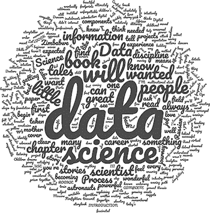

数据科学显著改进了公司访问和分析媒体的技术。大多数所有主和营销人员都会熟悉 SurveyMonkey，这是一家在线、免费的问卷提供商，通过其数据分析工具运行你的调查。用户可以实时获取他们的消费者数据，问卷参与者的回答会以简单的图表和前端仪表板的形式可视化。在写作时，该提供商的数据分析功能包括实时结果、通过图表和图形进行自定义报告、通过人口统计数据过滤你的数据以发现趋势，以及文本分析——用户将以词云的形式从调查中收到最相关的文本数据。

# 4 熟练生巧

数据科学的一个巨大优势是，有许多免费且开源的材料，使得持续练习变得很容易。当人们对一个学科不熟悉时，倾向于连续几个月几个月学习学习理论——与其这样做，不如培养一种始终在实践环境中应用你所学知识的心态。作为一种练习，只需在搜索引擎中输入“免费数据集”，你就会发现大量网站允许直接将它们的`.csv` 文件（存储表格数据的文件）下载到你的计算机上，准备好分析。考虑到数据的巨大量和范围，从 NASA 的太空探索到 Reddit 评论，甚至是体育数据（篮球、足球、棒球——随你挑选），我肯定你将发现有价值且有趣的内容.^(4)

虽然目前最好的分析工具还不是免费的，但越来越多的软件是开源或在线免费提供的。如果你是一个画家，这就像拥有了无穷无尽的画架、颜料和画布来创作，而不用担心耗尽材料。

我敦促你利用这些公开的数据集来测试你的技能并运行自己的分析。练习没有捷径。你所做的大部分工作，特别是在阶段都是反复尝试。训练自己通过数据进行发散思维解决问题的最佳方法是增加对不同场景的接触——换句话说，接触不同的数据集。


从何处开始？最好的地方可能就在你身边。我预计许多读者将是企业主，或者是在那些预计在未来使用数据的公司工作的员工。你们曾以任何形式或方式在公司工作过的人，在某一个时刻都会接触过商业智能。

## 商业智能 vs 数据科学

如果你已经在工作场所使用过商业智能（`BI`），那么你已经有了一定程度的实践经验。通过商业智能，你需要识别业务问题，找到相关数据，并以一种极具说服力的方式向投资者和利益相关者进行可视化展示和演示。这些已经是数据科学流程的五个阶段中的四个阶段，我们将在第二部分和第三部分回到这些内容。主要的例外是，`BI` 不对数据进行详尽的调查性分析。它仅仅是 `describe` 发生了什么，这个过程我们称为“描述性分析”。

因此，数据科学为我们提供了所需的优势，以回答从公司数据集中提出的进一步问题，并对改进做出预测和可靠的建议。技术研究机构高特曼（Gartner）有一个模型将业务分析分为四类，虽然商业智能对应的是第一类分析，但数据科学可以帮助我们完成后三项任务。

### 3.2 分析价值阶梯

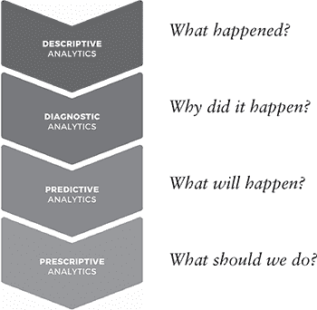

那是好消息，但在数据科学原则之外实践商业智能最终可能会对你的进步产生危害。诚实地说，当你第一次生成业务报告时，确实会使用数据。但企业主通常需要定期获取报告。当这种情况发生时，人们对数据的关注往往会被搁置，转而追求最终结果。

这是 `BI` 的问题之一，数据往往次于更新后的报告。但数据 `needs` 成为我们在业务中做出的任何结果和洞察的核心——对于我们做的每份报告，我们都必须事先对数据进行分析，否则我们将仅仅是根据之前调查的局限性来审视我们的数据。

固守 `BI` 可能是很有吸引力的，因为你或你的公司已经这样运行多年了，但数据科学为分析提供了一套远为印象深刻的工具集——无论是在比喻上还是在字面上。数据科学开启了各种分析软件的大门，以及了一个蓬勃的数据科学家在线社区，他们致力于通过开源代码来改进和分享自己的工作流程。使用这些工具的能力消除了手动寻找洞察的人力负担，让你能够专注于隔离瓶颈、发现销售机会以及评估业务部门的健康状况。不幸的是，`BI` 对 `Excel` 的传统依赖可能会让你养成坏习惯。

## 你认为你知道的一切都是错误的

所有读者都用过 `Excel`。它已成为企业最重要的程序之一，大多数电子表格都会以 `.xlsx` 格式共享。然而，`Excel` 可能会产生过度简单化的效果，导致人们对数据的感知产生偏差。如果你唯一认识的数据就是 `Excel`，你就必须开放心态改变你对分析的认知。

我们将在第 5 章 数据准备中详细讨论使用 `Excel` 的困难，但简要概述一下：该软件中可以说没有数据类型。我们确实没有直接处理它们，这意味着在未经训练的人的电子表格中，字符串、公式和视觉效果会很随意地混合在一起。尽管 `Excel` 看起来像一个表格，但我们可以在同一列中插入数字、文字、链接和分数，从而不加区分地混合所有数据类型。没有任何数据科学工具会允许你将数据与逻辑混合，这个问题你将在第 5 章 中体会到。在任何数据库管理系统中，数据和逻辑必须分开考虑。

准备好使用非 `Excel` 的程序。在我看来，分析数据集的一些优秀程序是 `R` 和 `Python`。

# 5. 牢记伦理

在一个清爽的 2 月早晨，在任何有理智的人醒之前的很久，我接到了来自昆士兰警察的电话。我眼里还睡眼惺忪，舌头也干干的，几乎说不出话来：是的，我是 Kirill Eremenko；是的，我在布里斯班的家里；是的，我拥有他们读给我的那个车牌。那么问题所在哪里？他们问我除了我之外是否还有人使用我的那辆摩托车，以及我是否知道那辆车在哪里。这个问题让我瞬间清醒了过来，我冲下楼梯走向我的车库。

我松了一口气，看到我的骄傲和宝贝还在那里。但问题依然存在：如果他们问我关于的所有内容（包括我本人）都安全地锁着，警察拿着我的所有细节在做什么？

他们告诉我，他们现在黄金海岸（离布里斯班不远的海滨城市）发现了一辆挂着我车牌的摩托车正在逃避警察。他们说，考虑到我的摩托车在我家里，我的车牌一定是伪造的——后来他们也发现是伪造的。

想象一下，如果我的车确实被偷了怎么办。我该如何证明逃避执法人员的不是我？那天晚上我是一个人，而且我没有任何可以言说的不在场证明。对于警察来说，那完全可能是我，尤其是考虑到在澳大利亚这样一个监管极其严厉的国家，伪造车牌是多么困难。

尽管在对话开始时我并不知道我的摩托车是否被偷了，但我意识到在这次电话审讯期间，我完全没有担心过没有不在场证明，哪怕一秒钟也没有，因为我知道我没有做任何错。我知道技术会作为我的证人。我大部分时间都带着手机，我把它床边充电，我对手机执行的任何操作都会被记录。这让我想起了在德勤（Deloitte）担任法医部门工作的日子。我们处理过无数情况，人们声称自己做了某事或处于某地，但手机记录的追踪信息讲述了一个完全不同的故事。

这里的观点是，数据可以治愈。它可以作为你的不在场证明。它可以在刑事案件中作为证据。许多人持有一种数据只能伤害的思维方式——如果你只认为自己是反派，你在这个领域将是得不远的。

## 数据的伦理成本

我们知道数据可以造成伤害，这从那些旨在调查技术发展对人类伦理和行为规范影响的会议和机构的激增中可以看出。谁有权访问我们的数据？他们应该有访问权限吗？^(5) 正如我们所见，数据开启了工作、生活、调查和战争的新方式——而且它正以惊人的速度进行。


以 3D 打印作为一个例子。随着开发这些打印机成本的降低，接触到这项技术的人数将会增加。虽然目前的 3D 打印机可能在生产玩具和游戏，但它们也有潜力打印任何数量的物品——那些可能被证明是危险的物品——它们只需要一个数据蓝图。考虑到技术发展速度与我们立法和保护能力之间的不成比例，单是此点就足以引起关注。我们真的能指望跟上这种快速变化的速度吗？

## 数据滥用与误用

作为数据科学家，在围绕技术与伦理的辩论中，最紧迫的问题之一是机器获取信息的权限范围（Mulgan, 2016）。随着机器人处理能力的提高，机器很快就能以一种远超人类极限的方式处理信息。

各种信息正在变得数字化。将信息以数字格式而非物理格式存储正成为一种常态。历史文物正在进行数字化策展，书籍和期刊可以在网上获取，个人照片被上传到社交云端。毕竟，信息以电子方式保存时要安全得多：它不容易受到磨损的影响，可以制作多个副本，内容可以共享，并且可以建立相关项目之间的联系。当然，数字数据并不能完全免受损坏。它可能会恶化或丢失——但最终，它比仅以物理形式存储的数据更不易损坏。

网络上有如此多的信息——无论是在广度还是深度上——这增加了能够访问这些数据的机器的可能性，并扩大了人类与计算机能力之间的差距。计算机还没有达到它们的处理极限——但我们已经达到了。机器只是在等待三件事：获取数据、获取更快的硬件以及获取更先进的算法。

当这三个需求得到满足时，使用和误用能够处理可用数据的机器将只是时间问题。这已经成为了一种强大的武器，无论是通过分析在线行为，还是在社交媒体网站上伪装成人类以达到目的。如果我们相信未来主义者雷蒙·库兹韦尔（Raymond Kurzweil）的预测，即 2029 年计算机将通过图灵测试，那么让机器不受限制地访问互联网可能会使数据访问成为最强大的操控工具。

## 为什么我们不直接让时间停止？

在布里斯班市中心度过夜晚后回家，我发现自己不经意地卷入了与出租车司机的激烈争论。得知我是一个数据科学家似乎对他产生了负面影响。他开始指责我的工作对未来可能产生的负面后果。由于担心最坏的情况，出租车司机指向夜空，向我或向上天问道：“为什么不直接——让我们现在就停下，留在这里呢？”

这根本是不可能的。探索世界并继续扩展我们的视野是我们的本性。我那焦虑的出租车司机对数据以及处理数据的算法在未来将如何被使用产生疑虑是自然的。但对可能发生或可能不发生的事情感到只会阻碍我们；这是一个灾难性的举措，因为当我们忙于恐慌时，技术将继续发展。

我们必须理解，这一代人的忧虑并不一定是另一代人的忧虑。我们今天对个人信息如何被收集、存储和使用感到困扰，对于随着技术长大的年轻一代来说可能不再是如此。我们所认为“常态”的这种演变，反映在我们在收集和处理数据的方式上。考虑网络 Cookie 存储的案例。许多网站选择从用户那里获取数据。这些数据被称为 `cookie`。它被记录在存储在用户计算机上的文件中，以便在下次登录网站时访问，其范围可以从用户名到访问过的网页，甚至是第三方网站的广告，并帮助网站为其访问者量身定制。

***

## 案例研究：网络 Cookie

你可能会觉得这段话很熟悉：“为了让此网站正常运行，我们有时会在设备上放置名为 cookie 的小型数据文件。大多数大型网站也是这样做。”这是欧盟委员会（EC）的一份公告，该委员会通过了法律，要求每个使用 Cookie 的 EUROPA 网站必须以弹出窗口或其他形式说明它们记录了查看者数据。希望继续使用该网站的人可以同意条款，也可以在同意遵守之前了解更多信息。这项法律通过时，人们正担心他们的隐私正被使用 Cookie 跟踪浏览页面、互动等内容的公司所侵犯。

从那时起，这些关于 Cookie 的伦理忧虑已缓慢但坚定地平息了。现在没有人真正关心 Cookie 了，特别是千禧一代，这在很大程度上是因为我们已经习惯了它们成为我们在线生活的一部分。换句话说，围绕网络 Cookie 的担忧已经缓解，因此公司网站清楚表述其正在收集用户数据的要求将在 2018 年初逐步取消。

Cookie 是数据收集如何成为我们社会所接受的部分的一个例子。大多数千禧一代使用社交媒体的方式——例如自由地发表意见、公开聊天、上传个人照片、标记朋友——对于婴儿潮（Baby Boomers）以及他们（通常情况下）在线上的行为来说，感觉完全是两个世界。我不认为这些纳入讨论的伦理影响仅仅是数据科学家可能倾向于忽略的尴尬障碍。但我向读者提出了一个问题：我们真的应该根据我们当下的忧虑来抑制技术的发展吗？还是我们应该在技术增长速度与我们能够发展的速度之间寻求平衡？

***

## 准备第二部分

希望到目前为止，你已经在个人和/或经验中发现了一些可以在你自己的数据工作中利用的东西。记录下你可以利用的技能，将它们写在一份虚拟简历上——雇主正在寻找能够付诸实践的数据科学家，而证明你已经具备数据所需的思维方式将使你走得更远。

# 参考文献

British Academy (2017) Do we need robot law? [视频] [在线] `www.britac.ac.uk/video/do-we-need-robot-law` (https://www.britac.ac.uk/video/do-we-need-robot-law) [访问日期 2017.04.03]

British Academy and The Royal Society (2017) Data management and use: governance in the 21st century’ [在线] `www.britac.ac.uk/sites/default/files/Data%20management%20and%20use%20-%20Governance%20in%20the%2021st%20century.pdf` (https://www.britac.ac.uk/sites/default/files/Data%20management%20and%20use%20-%20Governance%20in%20the%2021st%20century.pdf) [访问日期 2017.07.07]

DeepMind (2016) DeepMind AI Reduces Google Data Centre Cooling Bill by 40% [在线] `www.deepmind.com/blog/deepmind-ai-reduces-google-data-centre-cooling-bill-40` (https://www.deepmind.com/blog/deepmind-ai-reduces-google-data-centre-cooling-bill-40) [访问日期 2017.09.29]

DeepMind (2017) AlphaGo Zero: Learning from scratch [在线] `www.deepmind.com/blog/alphago-zero-learning-scratch` (https://www.deepmind.com/blog/alphago-zero-learning-scratch) [访问日期 2017.11.19]


Mulgan, G (2016) 英国机器智能委员会：如何增进公众的知情信任并最大化智能机器的积极影响，*Nesta* [在线] [`www.nesta.org.uk/sites/default/files/a_machine_intelligence_commission_for_the_uk_-_geoff_mulgan.pdf](http://www.nesta.org.uk/sites/default/files/a_machine_intelligence_commission_for_the_uk_-_geoff_mulgan.pdf) [访问于 25.05.17]

Service, R (2017) DNA 可以将世界上所有的数据存储在一个房间内，*Science*，3 月 2 日 [在线] [`www.sciencemag.org/news/2017/03/dna-could-store-all-worlds-data-one-room](http://www.sciencemag.org/news/2017/03/dna-could-store-all-worlds-data-one-room) [访问于 27.03.17]

Stallkamp, J et al (2012) 人战计算机：交通标志识别的基准学习算法 [在线] [`http://image.diku.dk/igel/paper/MvCBMLAfTSR.pdf`](http://image.diku.dk/igel/paper/MvCBMLAfTSR.pdf) [访问于 22.09.17]

英国内阁 (2016) 数据科学伦理框架 [在线] [`www.gov.uk/government/publications/data-science-ethical-framework`](http://www.gov.uk/government/publications/data-science-ethical-framework) [访问于 07.07.2017]

# 注释

1 该项目的数据可以在线通过 [`www.internationalgenome.org`](http://www.internationalgenome.org)免费使用。

2 Google DeepMind 首席执行官 Demis Hassabis 将直觉定义为通过经验获得的、无法意识地表达甚至无法获取的隐性知识，因此我们无法有意识地获取这些知识，更无法以我们能向他人表达的方式。

3 2017 年 10 月，Google DeepMind 发布了他们的最新作品 AlphaGo Zero。它的完美之处在于完全没有使用任何人类数据，而是完全通过自对弈进行学习（DeepMind, 2017）。这个新版本如此强大，以 100 比 0 的战绩击败了原始 AlphaGo。数据科学的指数级进展又是如何？

4 我们还为 [`www.superdatascience.com`](http://www.superdatascience.com) 的学生提供了大量的免费数据集。

5 有关数据治理更多信息，请参阅由英国学院和皇家学会（2017）进行的报告，以及英国学院作为其“机器人、人工智能与社会”系列活动的一部分举办的一系列具有启发性的演讲（British Academy, 2017，在线记录可用）。

6 适用豁免条款。信息提供者的一份关于如何在网站上准备用户同意的指南，可以在欧盟委员会网站上找到：[`http://ec.europa.eu`](http://ec.europa.eu)。

7 如果你对数据科学项目有伦理方面的担忧，我建议寻找或开发一个公司可以遵循的伦理框架。最有用的之一是英国政府的《数据科学伦理框架》（UK Cabinet Office, 2016），该框架在线可用。

# 第二部分

## “我何时以及在哪里可以？”数据收集与分析

与生活中的几乎任何事情一样，往往是真正具有挑战性的最令我们兴奋。而数据驱动的项目经常能提供这种挑战。在这些项目中，你需要对数据提出*新*的要求，因为数据科学家总是被期望去解决某个*问题*。当我开始一个新项目时，我喜欢认为自己正在与数据对话；我与它交流，以确保我为客户或项目利益相关者以最诚实、最高效的方式来呈现它。根据我自己和同事的经验，最终结果往往令人大开眼界，导致机构内部从工作实践到组织结构的重大变化。其中一些结果可能与你被要求解决业务问题直接相关，另一些则可以阐明组织此前未接触过的业务活动方面。

因此，数据中蕴含着潜力。这正是它如此令人兴奋的原因。它总是告诉我们*一些事情*，无论这些信息是否新鲜。通过数据，你获得了探索的机会。

## 数据科学流程

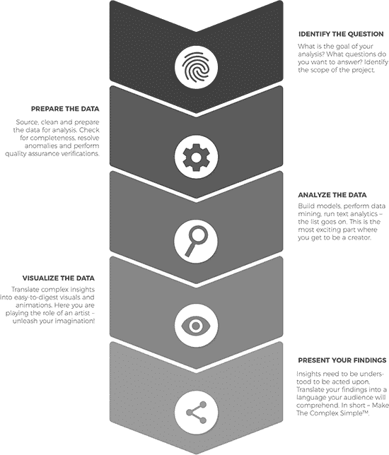

由于数据的巨大潜力，重新获取数据可能会令人生生畏，特别是当公司根本不知道自己拥有什么时候。这正是数据科学流程大显身场的地方。该最初由 Joe Blitzstein 和 Hanspeter Pfister 设计，引导我们完成项目从概念到交付的每一个阶段。

该流程包含五个阶段，分别是：

1. 确定问题。
2. 准备数据。
3. 分析数据。
4. 可视化见解。
5. 展示见解。

这些阶段中的每一个都为你的数据集增加了我所说的“兴趣层”。虽然在过程中可以回到某些阶段，但按照线性方式遵循它们将减少后期阶段出错的概率，并帮助你追溯自己的步骤。

由于这个流程对于每个数据项目都至关重要，而且每个阶段都需要不同的技能组合，我们将其分在第二部分和第三部分。在第二部分中，我们将探索前三个阶段。这最初三个步骤将使我们能够：

* 向我们的数据提出一个合理的问题或一系列问题
* 组装数据集，使其能够回答提出的问题
* 通过见解或预测从数据获得响应

在我看来，这些阶段将需要你投入最多的精力。如果你在这里付出了实性工作，那么数据的可视化展示将变得简单，因为你已经实现了项目的目标。

## 数据科学家，私家侦探

今天，我们触手可及的数据量惊人。想象一下 52 张扑克牌可以产生的组合数量。只需洗一下一副牌——在人类历史上，极不可能有其他人拥有完全相同的牌牌顺序。开始处理数据就像拿到了一副扑克牌——有时可以处理的较多，有时较少，但变化的机会是巨大的。一旦你建立了一些基本规则（对于牌牌来说，这意味着游戏；对于数据科学来说，这意味着假设和算法），你就可以真正开始了。识别问题有助于我们构建并规划处理数据的方法，以确保我们获得最相关的结果。

正如夏尔洛·福尔姆斯在《波希米亚恋人》中告诉华特医生的那样：

在拥有数据之前进行理论假设是一个致命错误。人们会不经意地开始扭曲事实来迎合理论，而不是让理论来迎合事实。


福尔摩警告华生，在没有证据的情况下，不要对谜团做出假设。但柯南·道尔在此处也洞察到了一点：数据科学家在深入研究并对问题做出任何主张或回应之前，需要后退一步。有了数据，我们就拥有从实际证据中推导出见解的优势，因此花时间考虑我们向数据提出什么问题，将帮助我们将数据引导为精确地告诉我们我们需要知道的信息，而不受我们或他人假设的外部偏见的影响。

这是数据科学流程的第一阶段。数据科学家在这一阶段需要表现出创造力。我们不是为了适应自己的想法而改变信息，而是通过构思想法来得出对我们有利的见解。在第 4 章 确定问题中，我们将探索可以应用的各种方法，以确保我们最终向数据提出的问题能够符合项目目标，并防止出现漏洞和“范围蔓延”——即项目超出其原始范围的不受控增长。

## 正确的原料

我们已经深处计算机时代，公共和私营部门的大多数机构已经拥有海量的自有数据。但在我们知道能对数据做什么之前，数据就已经被收集了，而且信息往往是由那些并不意识到标准化和分析信息所需方法的工人收集的，而这些方法使信息具有实际用处。这种知识鸿沟导致的结果充其量是“组织的混乱”，数据集通常包含乱码和脏数据，我们将在第 5 章 数据准备中学习更多相关内容。

为了清理这些数据并使其易读，我们需要花时间。为了说明在对数据进行任何其他操作之前准备数据有多重要，这里有一个说明性的例子：考虑光学字符识别（OCR）扫描。OCR 软件会扫描手写或打印的文本物理页面，并将这些文本转换为数字格式。但 OCR 扫描并非总是 100%准确——其准确性取决于软件的能力和打印页的质量。17 世纪的手写文档会给软件带来更大的困难，并返回更多错误，这些错误在以后必须手动清理。那些不知道如何正确记录数据的人，或者使用其机构规定的过时或非最优规则的人，产生的数据集也必须进行类似的“清理”。

## 行动开始

实际的数据分析不需要像前两个阶段那样同样细细致。如果你已经花时间提出了正确的问题，并为回答所需的问题准备了数据，那么你就可以放心地对分析进行实验。处理数据集的奇之处在于，你可以复制它们，因此在一个数据集上运行一种算法不会导致它无法被另一种算法使用。这就是数字信息的魅力所在——它可以被使用、重新捕获、重构和摘录，一旦你完成并重新开始，仍然可以返回到之前的版本。

这是一个你可以尽管尝试的阶段。你已经花时间为项目了脚手架，并确保它不会在你提出的问题压力下崩塌，所以现在是探索的时候了。第 6 章和第 7 章为你可以运行的分析类型提供了解决方案，它们还提供了一份优势和局限性的清单，以增加你为项目目标选择正确算法的信心。

# 开始

虽然这部分很大程度上是理论性的，但它具有实际应用价值，因此我强烈建议你在阅读的同时，考虑将上述的五个阶段中的每一个应用到你自己的项目中。在开始这部分之前，手头有一些你需要的工具将会有帮助。

## 数据集

如果你还没有可以自己使用的自己的数据集，不要担心。有很多公开可用且免费供你自己的实验使用的数据集。此事的巨大好处是，你可以立即开始使用`real`数据集，而不是那些专门为训练创建的数据。根据我的经验，真实数据集将带给你从实际信息中得出见解的成就感，并为“数据科学对许多学科的未来发展至关重要”这一说法增加分量。

网上有许多真正有趣的数据集供你根据需要下载和使用。这里有几个供你开始：

*   **世界银行数据 (World Bank Data)**：全球发展数据的宝贵资源。
*   **欧盟开放数据门户 (European Union Open Data Portal)**：来自欧盟成员国的政府数据。
*   **百万歌曲数据集 (Million Song Dataset)**：流行音乐元数据和音频特征的汇编。
*   **CIA 世界事实 (The CIA World Factbook)**：涵盖 267 国家从历史到基础设施主题的数据集。
*   **国家气候数据中心 (National Climatic Data Center)**：美国环境的数据。

## 软件

数据科学初学者需要理解的是，数据没有自己的“语言”，它只能通过机器或软件向我们“说话”。我在这里所说的数据的“语言”，是指机器向数据科学家传递数据的方式。从汽车的速度、植物的花期周期，到室外温度和城市人口，数据仅仅是存在。它是一系列组件，但我们与它们之间建立的关系必须由人类或计算机建立。如果我们进一步类比语言，我会说数据可以比作单个字母，正等待某人将它们按照相关的词汇和语法顺序排列成单词和句子。因此，让我们的数据发挥作用（通过我们应用的工具）取决于我们自己。

访问软件并不是本书的必要条件，因为它侧重于实际应用而非编码。尽管如此，如果你想尝试书中提供的一些示例，我建议获取`R`或`Python`，这两者都是数据分析编程工具，并提供`Windows`、`Linux/UNIX`和`Mac OS X`的免费下载。这两个程序是目前行业中最常用的开源软件软件包。

# 04 章

## 确定问题

我经常从其他数据科学家那里听到一种抱怨，即外面的数据实在太多了——要处理如此大量的信息来回答业务问题这一想法本身就令人无措。鉴于我们近乎持续产生的数据排放，我们如何能够以有利于检查的方式来管理已收集的信息呢？我们不能只是把拥的所有信息都丢进算法中，然后祈祷能得到我们需要的结果。

因此，在我们准备和分析数据之前，我们必须知道我们需要什么样的数据。为了这一点，必须对我们的项目问题进行一些微调。


业务经理经常会向数据科学家抛出一个问题，并期望他们仅凭这个问题就直接跳进数据库进行工作。但这个问题必须首先被理解、解构和分析。我们必须清楚对方要求我们做什么；如果我们不能妥善地回答问题，我们项目的成果将是毫无用处的。考虑学校论文写作的过程：一旦收到问题就立刻一头扎脑地回答（除非你运气极好），结果只会导致一堆臃肿、无结构的信息大杂砌。只有当你花时间后退一步思考大局时——考虑它的多个组成部分以及问题所处的背景——你才可能提出一个有说服力且逻辑合理的论点。

充分理解问题还有助于我们保持航向，减少项目偏离航径的概率。假设我们的历史老师要求我们写一篇关于美国独立战争的文章。乔治·华盛顿传中的轶事可能很有趣，但它们并没有回答向我们提出的问题。充斥着此类无关信息的文章，是学生在进入一个主题时没有考虑过如何处理问题的核心，而是把他们能收集到的所有东西全部堆进来，而不修剪掉不必要的数据。

这就是为什么我们*首先且重要的是*要识别问题。

在本章中，我将向你展示处理数据科学过程中这一阶段最合适/最高效的方法。由于识别问题可能会让人感到无从，我为你提供了一种经过测试的方法，它将引导你度过这一阶段，确保你考虑了通问题的所有路径，并保护你免受那些在项目开始后想塞额外工作的老板的影响。

## 看，妈妈，没用数据！

尽管识别问题如此关重要，但在使用数据的项目中，它往往是最容易被忽视的部分。我自己也犯过这种错误；很长一段时间里，我开始项目是从准备数据开始的。但这并不是因为我想提前进度；我简单地认为识别问题是理所当然的。毕竟，数据科学家经常被请来处理*问题*，而且在德勤的第一个份工作中，我所有的项目都是从一封聘用信开始的，其中规定了任务和需要帮助的地方。这样的公司对这一流程进行了标准化和精简化，这并不意外，但这只养成了我的坏习惯——在注意到大局之前就急于求功。

忽视识别问题的另一个原因是，这个阶段并不使用太多数据，甚至根本不使用，这让许多数据科学家在执行这一步时感到有些自得自足。但重要的是，那些提出问题的人可能不是数据科学家，他们并不知道清理和分析数据所需的准备工作。到目前为止，很少有公司教育员工关于存储和访问信息的重要性，这种知识差距意味着许多数据科学家仍然被问到：“我们有很多数据，所以你能为我们找一些见解吗？”这类问题很常见，但它们是模糊、含糊的，并且对解决公司问题毫无帮助。

所以，即使问题已经预先拟定，你的老板正在质问你为什么不快处理数据，也不要觉得你承担这一步是在浪费精力。如果你觉得必要，请为这个阶段提供你的辩护论据。简单来说，仅仅提出一个问题是不够的——该问题必须用数据能够理解的术语进行重新校准，否则项目将无法进行。

## 你如何解决像……的问题

来自组织董事会或投资者的问题通常被设定为通往问题的开放式路径，而不是它们本身的问题：“我们的产品单位交付未达标”或“我们的客户流失速度快于预期”或“我们的产品存在缺陷”。这些都不是问题——它们是事项。我敦促读者采取以下分步方法通过数据来识别和解决问题。这将使这一阶段变得更高效，并降低你关注错误问题的风险。

## 1 理解问题

任何计划参与数据驱动项目的人必须首先意识到，在项目开始之前他们可能无意中陷入的陷阱：如果他们遵循一个给他们提供待解决问题的同事的引导，他们实际上可能在解决错误的问题。同事可能意图是好的，试图通过展示他们自己构思的问题来提供更多帮助，但他们的问题并不一定适用于提问数据。在收到几个看起来表述良好的查询时，不费力地自己去识别问题可能很有诱惑力。但这样做可能会在过程的后期导致灾难；识别业务问题的所有参数落了*你*的责任，因为你接受过这方面的*训练*。盲目地接受一个非数据科学家提出的一系列问题并将其应用到你的项目中，最终可能会解决错误的问题，或者简单地无法得到任何结果，因为你没有对应的数据。

那么，在我们跳入项目之前，我们必须与最初向我们提出问题的人进行*谈话*。不仅要理解问题是什么*，还要理解为什么必须*现在*解决，关键利益相关者是谁，以及问题解决后对*机构意味着什么*，这将帮助你开始完善你的调查。没有这一步，结果对数据科学家来说可能是危险的，因为在项目的后期，我们无疑会对利益相关者对问题产生不同的解释。一旦我们扩展了核心问题，就可以进入第二步。停下脚步闻闻花

虽然一个优秀的数据科学家应该从问题开始，并对它的各个方面有清晰的想法，但在这个阶段不要担心走了一些意想不到的弯路。我们正在积极研究公司的档案——其中很多可能还没有经过处理——而且在过程的这一阶段，我们也对公司的问题做了大量的准备工作，因此在过程中遇到惊喜是理所当然的。不要把这些弯路看作是项目的次要，要在过程中记录下来。这段旅程正是数据科学的核心，而额外的见解是其中重要的一部分。

## 2 开发你的行业知识

如果你对被要求工作的领域有先前的知识，你就有一个很好的开始。你可以将现有的经验应用到问题中。例如，你可能已经知道该行业运营的公司通常遇到的特定问题；或者根据你的经验，哪些部门通常对这些问题产生了贡献（无论好坏）；或者你可能知道某些竞争公司识别并解决了与你要求的相同的问题。


如果你对该行业并不了解，一切也未结束。花些时间进行更详细的研究。行业常见的陷阱有哪些？你公司的竞争对手是否遇到过相同的问题，或者是否存在显著差异？他们是如何解决类似问题的？该公司的使命和目标是否在整个行业得到了体现？在产出、组织结构和运营方面，该公司有何不同？

Google 可能是你回答其中许多问题的最好朋友，但请记住，作为一名数据科学家，你并不是在真空环境中工作的。对你所处的环境及其个体特征和局限性有深入了解，将帮助你制定出对项目利益相关者有意义的方法。不要做隐居者。如果你发现自己的信息存在空白，请利用你手头拥的最佳资源：你的同事。即使你已经有了所需的所有信息，仍然要出去与相关人员讨论你的所学所得。发起你项目的人将始终是帮助你确保与正确的人交流的良好起点。他们不仅能帮助你填补信息的空白，还会引导你找到流程的守护者——那些负责问题出现之组织部门的人。

## 成为一个善于社交的人

数据驱动的项目通常会影响公司的一个以上领域。你会发现，为了真正解决问题，你必须跨多个部门工作——并与那些通常没有理由互相交流的人合作。准备好以这种方式工作并进行社交。我将其认为是作为数据科学家的众多乐趣之一。毕竟，能够获取跨组织的信息让你处于一个独特的地位，可以尽可能地收集有关组织如何运作的信息，以及你被邀请回答的业务问题将如何影响全公司的运营。这非常令人兴奋。

在我为某机构分析客户体验的一个职位中，我在技术上隶属于营销部的客户体验与洞察团队。但我的一半时间实际上花在了 IT 部门：自然地，我需要访问他们的数据库、服务器、工具和软件。在我来之前，公司里还没有数据科学家，这两个部门是独立的实体，很少有交流的理由。

当你开始一个项目时，你会发现自己可能在充当部门之间的桥梁，代表数据帮助他们同步各项工作。这对于了解公司如何运作，以及你的项目如何帮助改进他们的服务和工作方法有巨大的帮助。在我离开该机构之前，我一直在与营销部、IT 部和运营部合作，我的报告经常将他们所有人召聚在一起，讨论未来几周的计划。

每当你与新部门交谈时，务必维护好你的联系，以便团队知道你正在做的工作，从而在以后需要他们提供更多信息时保持沟通渠道畅通。

## 3 像顾问一样思考

大多数人会同意，数据科学需要一种自下而上的方法：我们使用公司的底层数据进行分析，并随着对公司内部问题的理解不断深入，在结果的基础上逐步构建。这种探索的潜力可能正是这第一步变得如此兴奋的原因。但为了确定问题，我们需要更多地关注业务咨询方法。

在咨询行业中，我们为业务勾勒可能的战略方法。顾问往往是那些在业务或行业工作了多年的人，他们积累了大量关于该领域的知识。这些人通常关注改进公司的大规模战略和组织方面的问题，这需要一种自上而下的方法——而这种分析大局的方法论需要对给定的问题做出某些假设。

对我们来说，使用咨询方法似乎适得其反；作为数据科学家，我们被告诉要尽可能减少假设，以支持事实证据。但向顾问学习可能极有益，特别是在过程的这一阶段。因此，在考虑数据之前，请先放一边技术知识，转而观察组织、利益相关者和公司战略。毕竟，确定问题本质上是过滤我们的选项，而这第三步将开始完善我们的问题，使其针对我们公司的需求。

列一份项目关键利益相关者的清单，并特别注明最终决策者是谁。和他们一起花些时间，在你能够回答以下问题之前，不要移动到第四步：

* 项目的每个利益相关者对问题怎么看？
* 这个问题包含哪些方面？
* 我的调查中哪些部门需要被优先考虑？
* 问题的根源可能是什么？
* 利益相关者认为我应该再和其他人交谈吗？我和他们谈过吗？
* 数据位于何，谁负责管理？
* 这个项目的成功应该是什么样的？

### 自上而下还是自下而上？

德勤（Deloitte）、普华道（PwC）、毕马（KPMG）、安永（Ernst & Young）——这些都是著名的“四大”公司，它们对所有项目都信奉自上而下的咨询方法。但什么是自上而下的方法？它与自下而上的方法有何区别？一种真的比另一种好吗？

让我们一个一个来看这些问题。自上而下的方法首先考虑项目的大局，然后深入细节。被带入新项目的顾问将从公司层级的顶端开始调查，阅读相关的执行报告，然后从 CEO 到高管再到经理，一直到最“底部”的人员——如果他们能到达那里的话。无论他们的研究有多详尽，使用自上而下方法的顾问最终将根据他们的初步发现来构建项目，例如公司年度财务报告中的数据。自上而下的方法仍然咨询公司的典型方法。

对于自下而上的方法，采取的是完全相反的路径。这种方法将数字优先。它最初检查公司的数据，然后向上移动，从项目经理到部门主管，不断积累信息，最后到达高管顶层。这种方法依赖事实和数字让调查者了解公司的日常运作。读者们不会感到意外，数据科学家几乎总是使用自下而上的方法。


考虑到这是一本关于数据科学的书，我们可能会下意识地采用自下而上（bottom-up）的方法，认为专注于数据库的方法显然比从过滤后的数据开始的方法更好。然而，这有些操之过急。是的，由于自下而上的方法有事实作为依据，我们可以比使用自上而下（top-down）方法更快地得出结论。但是，任何使用自下而上方法的项目人员都会告诉你，通过这种方法几乎无法推动变革。公司并非仅仅依靠数据运行——它们还依靠人际关系运行。我们不能在算完数字后就冲进董事的办公室，宣称我们知道如何解决问题，并挥舞着一张写有数据的纸来证明。正如你将在书中发现的那样，数字只是拼图中的碎片之一。我们还必须理解公司的文化、使命和员工。

因此，如果我们想得出可靠的结论，就需要多做一些侦探工作。对于这一点，自上而下的方法是完美的。为了说明在使用自下而上方法时这种必要的谨慎态度，我的导师、毕华安普华永道会计的总监理查德·霍普金斯（Richard Hopkins）说，如果你只看数字：

公司并不会真正听你的，因为你没有进行协作，你没有进行交流。假设你从数字中发现他们某产品的销售正在让他们亏损，并得出结论认为他们应该停止这些产品的生产。但他们销售这些产品可能有特定的原因——也许是为了推销其他产品，或者也许它正处于被淘汰阶段。是的，自下而上的方法会让你很快获得一个结果，并据此做出决策。但如果不了解大局，那个决策可能不是最佳选择。

(SuperDataScience, 2016)

通过自上而下的方法，我们获得了利益相关者的支持（buy-in）。我们从同事的投入意见中得出结论。有了这种程度的参与，我们可以更快地在公司内部做出改变。

那么，我们应该放弃自下而上的方法，去效仿毕马威（KPMG）的人员使用自上而下的方法吗？并不一定。掌握大局需要大量时间。我们必须与利益相关者合作，组织研讨会，而且当我们在如此早期就获得如此多的信息时，我们被迫对哪些信息是有用的、哪些应该被省略做出关键决定。这是一个巨大的责任。此外，自上而下方法的结果可能最终与数据不符。

该怎么办？理查德向我介绍了将这两种方法同时应用于单个项目的独特优势：

很多时候，你从数据库中获得的数字与从最终报告中获得的数字之间存在脱节。我发现，当我同时进行这两种分析并将它们结合起来时，效果最好。这让我能够弄清最终报告中发生了什么，以及运营中的哪些环节导致了那些财务结果。因此，同时使用自上而下自下而上的方法可以将数据与运营联系起来，并为我们提供全景。

(SuperDataScience, 2016)

那么，在可能的情况下最好的方法是将两者结合。这不仅能确保你快速得出答案并有数据作为支持，还能让你获得项目利益相关者急需的支持，以实际实施你的最佳想法。

## 4 理解局限性

我们正处于第四步，还没有开始处理数据，但我们最终需要收集并准备我们的信息。如果在完成了这里的这些工作后，我们发现确认为调查所需要的数据并不存在，那将非常困难。那么该怎么办？

最有效的方法是在高层面理解我们实际上拥有哪些数据，以及在项目进行之前是否需要收集更多数据。这再次意味着要与正确的人交流：那些负责公司现有数据的人。进一步调查他们将帮助我们开始考虑在数据的哪些部分可能发现问题，我们在哪里可能需要更多信息，以确保我们进行的任何采样在统计学上都是相关的。这一步有点像“鸡生蛋”，因为在查看数据集之前，我们必须知道要向数据提什么问题，但我们也应该确保尽早获得正确的数据，以便在进入数据科学流程的下一个阶段之前尽可能少浪费时间。

学习这一步最好的方法是通过实践。记住你对哪些类型的数据将有助于回答你的问题的想法。在执行这一阶段时，将它们列在你的问题旁边，并在每个检查点记录下你所需的内容。在你的第一个项目中，这看起来像是在耍杂，但随着经验的增加，将会变得简单得多。

* * *

### 案例研究 填补空白

鲁本·科格尔（Ruben Kogel）是 VSCO 的数据负责人，VSCO 是一家位于加利福尼亚的艺术科技公司，通过在线订阅帮助艺术家创建数字用户体验工具。在他任职时，他是公司唯一的数据科学家，而且 VSCO 还没有创建数据驱动报告的标准做法。但科格尔在他们的数据中看到了机会，可以回答公司想要回答的关键问题：购买 VSCO 订阅的人是谁，他们的购买在之后会让他们的“行为有所不同”吗？

鲁本知道，这个问题需要查看那些升级到付费订阅服务的免费账户用户。但这只是冰山一角——鲁本有必要开始深入挖掘并明确：

在开始工作之前，我需要更多信息。我想知道，除其他外，什么指标指示了行为的变化，以及为什么“了解”我们的客户非常重要。当时，我不知道 VSCO 的用户是如何被针对的，所以这是我在考虑回答该问题之前需要填补的知识空白。

(SuperDataScience, 2017)

以这种方式解构问题帮助鲁本专注于他的分析。通过与同事讨论其参数，很明显，该问题实际上与营销有关。因此，问题被重新表述为专门针对营销需求：“VSCO 有数百万潜在买家，但他们购买 VSCO 订阅的可能性并不均衡。为此，(1) 我们根据偏好、行为和人口统计数据如何对用户进行细分？(2) 这些客户细分群体中，哪些代表了最可能的购买者？”

一旦这一点明确，剩下的工作对鲁本来说就很简单了。通过与营销部门沟通，他知道了预测客户可能购买订阅的行为。鲁本实际上所做的，是将开始时一个相当无结构的问题公式化为一个不仅能精确回答投资者到底想知道的什么，还识别了公司可以在哪里收集更多数据以改进其营销实践的问题。


如果你在一家随时间积累了大量数据的成熟公司工作，那么首先识别问题将变得尤为重要。我经常发现，虽然同事们可能对使用数据驱动的技术来解决问题持态度，除非他们本身也是数据科学家，否则他们对于必须付出努力去获取数据这一想法并不开放。这对于管理数据库的人来说也可能是事实。这正是许多公司从一开始就处于被动之处——讽刺的是，由于拥有无法管理量的数据，他们失去了对数据目的的感知，从而贬低了它的价值。帮助他们理解数据的重要性是我们的责任，而这段旅程从这里开始。

## 让人们参与进来

你的数据科学*将*会改变现状。作为关键的规则改变者，你可能会发现自己面临阻力。如果你发现自己被同事刻意阻碍，请采取行动。如果你因为同事的故意拖延而导致信息缺失，不要犹豫地将此事上报。任何数据科学项目的底线都是为公司创造价值，如果你的利益相关者知道这一点，他们也应该知道这必须优先考虑。你不会赢得所有人认同这个观点，但我的个人哲学是绝不坐以待毙：要准备好越过他们去完成工作。

## 5 挖掘数据（可选）

数据挖掘可能是我任何项目中流程中最喜欢的部分。阻止数据科学家挖掘数据，就像不允许博物馆策展员研究他们负责的材料一样。这一步是你完全可以进行探索的阶段。对我来说，数据挖掘是一个过程，你通过进行测试对数据进行顶层审视，并找到可以为进一步调查产生有趣见解的领域。

在这个实验性阶段，我喜欢将数据放入 `Tableau` 中，它会读取数据并帮助你创建一些初步的描述性可视化，例如易读的表格、图表和图形。这生成了一个极佳的顶层——你可以将其作为透镜来制定你的项目问题。

最终，在流程的这一阶段进行数据挖掘，是更好地理解问题并引导你最终分析过程的基本方法。这是对你的数据进行试驾，你对原始数据进行测试，看看即使在这一早期阶段是否会出现任何趋势。数据挖掘可以在以后为你节省大量精力。同时，如果这个过程没有产生任何结果，也不要沮丧。数据可能可能不会向我们提供步骤或解决方案，这取决于几个因素：公司、数据质量以及问题的复杂性。因此，请审慎对待这一步。如果你确实发现了感兴趣的内容，请记录下来，并确保在继续进行第六步……时对你的发现了然。

## 6 精炼问题

现在我们已经理解了问题的范围以及我们可以动用的数据量，可以开始更深入挖掘。在这里，我们开始将项目范围与数据进行匹配，区分出哪些变量和数据是有用的，并真正地解构问题。

虽然所有数据都有实用的潜力，但我们不能为每个问题部署我们拥的所有信息——这只能是一件好事：如果所有数据都是有用的，返回给我们的信息量将多到无法管理。出于这个原因，我们可以对选择的数据进行挑剔。这意味着在推进之前，要确保考虑了我们要解决问题的 `parameters`（参数）和 `context`（上下文）。最终，精炼问题通过消除与我们问题无关的数据来节省我们的时间。

### 细分我们的数据

让我们以一家利润低的公司为例。他们的顶层问题是盈利能力低。我们可能想问：这里的影响因素是什么？也许公司的整体 `revenues`（收入）太低。或者公司的 `expenses`（支出）可能太高。这已经是两种可能性了。使用这两个类别（收入和支出），我们可能能够进一步剖析问题。公司产生了种种支出？公司提供不同的产品和服务是什么？询问这些额外的问题可能会让我们回到利益相关者那里，提出具体的请求：查看公司的财务状况，查看产品/服务是如何划分的，定义公司随时间推的利润目标是什么，等等。

如果利益相关者了解他们的数据，他们可能能够对你的某些问题给出直接的答案。例如，他们可能知道支出在某一段时间内是否发生了显著变化。仅仅通过问这个问题，我们就可以排除支出的潜在问题。这使我们能够可能将问题缩小到关于收入的问题。

## 7 收集额外数据

在这一阶段，你已经识别出需要的数据，并收集了一份解决问题的合理问题列表。现在是评估你的子问题有效性的时候了。毕竟，回答那些你明知公司不感兴趣或不会采取行动的问题根本不值得。现在现在问问自己：这些子问题的预期结果是什么？它们是否有助于解决问题，还是仍然有任何遗漏的内容？

在这里，你会感谢自己在到达这一点之前完成了之前的六个步骤；孤立需要额外数据的关键区域将完善并加速数据收集过程。制定好你的计划，然后将其放在一旁；在完成第八步之前，不要进行任何数据收集。

### 定量和定性方法

如果我们已经确定需要更多数据（这是非常有可能的；我没有参与过任何一个不需要额外数据的项目），那么在这一点上，我们必须考虑什么*类型*的数据会产生最好的结果。数据收集最重要的问题是“我们的来源在哪里？”以及“我们是想用定量还是定性方法来询问它们？”

什么是定量和定性方法？简单来说，定量方法收集数值信息，而定性方法收集非数值信息。正如我们在下一章将发现的，将其收集到数据集中比定性方法简单得多，但在决定在额外数据收集中使用哪种方法之前，我们应该注意一些额外的区别。

定量方法适用于我们想要收集统计信息的情况。例如，我们不能决定使用定性方法来收集年龄这样的信息，因为这是一个事实，而不是意见（无论你想如何说服自己）。如果我们需要计算项目、衡量薪资增长或了解更多消费者的人口统计，我们将使用定量方法。请注意，定量数据并不仅仅是数值数据——而是从技术上可以计数的数据。询问受访者喜爱的品牌或政治倾向的问题仍然是定量的，因为答案在技术上可以分类计数。

定性方法


定性方法使用开放式问题，可能会产生无限数量的答案。它们本质上是探索性的，有助于孤立（但不是量化）观点、想法和感受的趋势。当我们需要更多背景来理解一个问题，或者一个问题复杂到无法通过定量方式回答时，我们可能希望使用这种方法。因此，在收集消费者对产品情感投入的数据，或者当我们想要构建一个关于受访者对政党可能感受的更广泛的图景时，定性方法更为理想。

## 8 告知你的利益相关者

在我们考虑了之前所有的七个步骤后，我们、我们的团队以及项目的每一个利益相关者达成共识是绝对必要的。通过我们设计的各项参数来明确你将要解决的问题，将确保我们精确地阐明了你的方法将是什么，这将减少他人在项目启动后更改目标规则的概率。

请求开展项目的利益相关者必须同意我们的问题大纲，理想情况下，该大纲不仅应该勾勒出项目的内容，还要勾出其时间表。我强烈建议你将项目划分为若干里程碑，这将让你的利益相关者随时了解你的进度，并防止你在项目结束时因一直隐藏底牌而遭受任何反弹。

我们也有必要向利益相关者强调，这不是一个普通的业务项目。数据科学项目并不总是适用于企业中那些人们熟悉并推崇的 `PRINCE2` 模型。这将有助于我们免受利益相关者带着预设参与项目的影响，并为我们提供一个机会，向他们精确解释我们将为完成任务将采取哪些步骤。

我在任何数据科学项目开始时坚持坚持的一点，就是确保你获得利益相关者的书面认可。在个人生活中你可能是某人的好朋友，但根据我的经验，无论利益相关者是谁，随着项目的进展，他们往往会改变对所需求的想法。对于未定义的项目来说这是可以理解的，但这会导致范围蔓延，这可能会让你工作量超出项目最初的范围，也可能完全扼杀项目。因此，在开始准备数据之前，请务必获得该书面确认。

### 真相并不总是美丽的

当你的结果没有给出他们所希望的内容时，你如何在不疏远利益相关者的情况下处理？你该如何避免这个雷区？遗憾的是，如果真相是一个负面结果，你无法对数据告诉你的事实进行任何正面的粉饰。真相并不总是美丽的。在数据科学中，你面对的是硬事实——为了顾及利益相关者的感受而忽略或美化结果对任何事情都没有。

如果我可以在这里提供任何建议，那就是：为你的听众做好心理准备，让他们结果可能不是他们想要的。在开始时就明确你不知道结果会是什么。他们可能不喜欢他们的洞察。立即在他们脑中植入这样一个观念：你是在挖掘事实而非奉承，如果运气好，即使报告不理想，他们也不会责怪传信的人。

## 时间管理

数据科学流程的这一阶段在项目周期中只应该占用很少的时间。有时，对流程陌生的新手会发现自己在这个阶段花费了太长时间，因为他们想确保自己开发了一套稳健的方法论。记住：你永远无法将问题精炼到确切知道自己想要什么的程度。如果你在这个阶段做得很好，那么你很可能会节省时间，但你也必须学会放手，这需要经验积累。

如果你遵循上述概述的步骤，你既可以在以后遇到困难时保护自己，又能够获得及时准备准备的信心。最终，除非你被给你的问题特别棘手，或者需要与多个相互不同的利益相关者交流，否则识别和完善问题最多只需要一周时间。但你在这里执行的任何截止日期，如果可能的话，不应与他人共享——那只会给你增加不必要的压力。如果你需要多几天时间才能对所取得的进展感到满意和舒适，那就再好不过。

我的建议是什么？给自己充足的时间来满足截止日期。与其反其道而行之，不如承诺得少而做得得多。一个好的经验法则是：计算你认为整个项目需要多少天，然后在这个数字的基础上增加 20%。在数据科学中，大多数情况下，你勉强赶上截止日期。如果你遇到任何障碍，并认为你可能无法在最初约定的日期之前完成，请确保尽早告诉需要知道此的人。让人们随时知晓情，将在你与利益相关者之间建立信任，并让他们一直站在你这一边。

## 拒绝的艺术

随着你在组织中变得越来越优秀，并开始创造价值、让人们的角色更高效时，人们会蜂拥而至向你寻求项目的帮助。遗憾的是，你没有时间帮助所有人——出于这个原因，你必须学会说不。

当你被要求帮助解决问题时，问自己的第一个问题是：这是我想做的项目吗？有些项目可能很有趣，另一些可能由朋友经营，但最终你的决定应该基于你所获得的业务价值。然后你可以比较你的选择，并选择对你公司最有成效的一项。始终记住，数据科学家的核心工作是为公司创造价值。

你如何拒绝？首先，避免立即对项目做出回应。告诉与你交谈的人，你会考虑一下，并在特定的时间范围内回复他们（我给自己两个工作日来考虑）。

如果你想采取一种更有外交手段的方式，一个技巧是确保自己不要被视为“数据男”或“数据女”——一个数字计算员。如果你把自己定位为顾问，即使你不能在项目本身提供帮助，你也可以就如何使用数据提供帮助。我认为这比直接说“不”好得多，而且给同事们提供了可以操作的内容。只需花半小时研究他们的需求——也许你会发现一个引导他们走向正确方向的工具。从那里开始，他们会将视为顾问。

## 前进！

通过遵循本章概述的步骤，你不仅保护了自己免受数据科学项目中常见的陷阱，而且还在公司内部建立了自己的地位。享受流程中的这个探索性和交流阶段吧——下一个阶段，你将几乎完全被限制在办公桌前。


SuperDataScience (2016) SDS 016: 数据驱动运营、咨询方法与来自 Richard Hopkins 的导师指导 [播客] 12 月 22 日 [在线] [www.superdatascience.com/16](http://www.superdatascience.com/16) [访问于 17.08.01]

SuperDataScience (2017) SDS 039: 在 VSCO 获得聘的关键数据科学与统计技能 [播客] 3 月 29 日 [在线] [www.superdatascience.com/39](http://www.superdatascience.com/39) [访问于 17.06.05]

# 笔记

1 许多高管都认为数据应该被用来识别问题——但这种方法很少奏效。我们无法强迫数据自发说话——我们必须首先考虑想让它告诉我们。

2 Tableau 是一种可视化软件，我将在第 8 章数据可视化中对其进行详细讨论。

3 我在这里使用了“潜在地”，是因为在过程早期，不完全排除你的其他选项是非常重要的。关注你所做出的决策，并记录你是如何以及为何降低了某组数据的重要性。这样做可以让你在稍后需要重新表述问题时，快速回到起点重新开始。

4 这可能不是一种建立识别问题参数的方法，但执行这一步尽管仍然是至关重要的。

5 这并不非要用金钱来衡量。价值也可以通过客户订阅数量、业务效率的提高等来计算。这里的关键在于你的公司是如何获取价值的，并以此为基础做出响应。

# 05 数据准备

我们大多数人曾在某个时候去过不通当地语言的国家旅游。当这种基本的沟通方式与我们隔绝时，想要传达自己的意思可能会非常困难。即使我们对语言有一定的了解，词汇和语法上的差距也经常会让我们（以及听者）感到某些挫败。

因此，如果我们想理解并与另一个个体交流，语言就是一项基本需求。而数据准备的核心就在于在人类与机器之间建立一种共同语言。

在本章中，我们将学习为什么数据在没有经过准备之前绝不应该被分析、准备数据的逐步过程，以及我学到的管理数据集中问题的最佳方法。

## 鼓励数据“说话”

作为从业者，除非我们非常幸运，否则数据往往以“脏数据”的形式呈现在我们面前。它们通常由那些不规范化记录的人收集，由可能为了迎合自己项目而篡改数据集列名和行名的人管理，并存储在可能对数据造成损坏的非优化位置。由于有许多不同的人处理同一个数据集，并使用不同的方法添加数据，许多组织产生的数据集意料之中充满了错误和缺失。我们不能指望机器知道错误在哪里，或知道如何修复信息中的不一致之处。

所以，我们的工作是准备数据，使其能够被机器理解——并被正确地分析。

## 能力越大，责任越大

数据准备（也称为“数据清洗”，data wrangling）是整个过程中的一个复杂环节，由于它包含了许多只能通过手动完成的任务，这一阶段通常耗费的时间最多。（1) 如此关注数据准备的原因在于，如果原始数据没有首先在数据集中进行适当结构化，那么过程的后期阶段要么完全无法运行，甚至糟糕的是，将给我们不准确的预测和/或错误的结果。这可能会为你和你的公司带来灾难，而在最极端的情况下，忽视这一阶段可能会导致被解雇，在自由职业工作中，甚至可能导致诉讼。

我的意图并不是恐吓你——我只是想向你展示准备我们的数据是多么重要。惊讶的是，尽管它如此重要，但我发现数据科学的教育材料中存在一个严重的缺口，这些材料很大程度上集中在过程的后期阶段：分析和可视化。这些书籍和课程使用的是已经准备好的数据集。虽然对于刚开始接触这门学科的人来说这种方法可能没问题，但忽视准备意味着你实际上只学习了处理数据的“表面功夫”。

仅使用来自教育课程的数据集只会向你展示为了适应案例而清理过的数据。但在现实世界中，数据往往是肮脏、混乱且腐败的，在不知道脏数据产生和症状的情况下，我们无法充分地完成项目。如果你不准备数据，当你进入现实世界开始第一个项目时，如果你的算法不可避免地返回错误，你的项目将停滞。

那么，我们如何知道数据已经准备得充分呢？简单来说，一旦我们确保它适用于我们的数据分析即可。它必须：

*   具有正确的格式；
*   没有错误；且
*   所有的缺失和异常都得到了考虑。

数据科学家常用一个短语是“垃圾进，垃圾出”（garbage in, garbage out），这意味着如果你把不干净的数据输入算法，得到的只有无意义的结果，你的分析毫无用处。确实，许多从业者在这一步上挣扎，但这完全是因为他们没有可以遵循的框架。

所以，让我们开始准备过程。

* * *

### 案例 Ubisoft —— 为数据准备辩护

Ulf Morys 是 Ubisoft 德国分财务总监，Ubisoft 是一家从《刺客信条》到《生化危机》等系列游戏的设计、开发和分销公司。Ulf 监管一家分销子公司，负责在德国、瑞士和奥地利（GSA）地区销售 Ubisoft 的视频游戏，并负责公司在中欧运营的财务部分。

Ubisoft 历史上的数据仅供制作团队用于游戏分析和变现。在 Ulf 改变之前，财务并未列入数据科学的战略领域。（2）但忽视数据科学带来的改进是一个代价高昂的疏忽，而利用数据做出重要业务决策的经验（在他之前的工作中，Ulf 得益于关注数据为公司节省了 4000 万美元）意味着他知道制定公司数据的策略是至关重要的。

他关键地说道：

准备数据并没有增加数据，它只是改进了观察数据的方式。这就像电影《绿野仙踪》中的场景，当多萝西打开家的大门进入奥兹国时，康萨斯州的黑白世界被彩色所取代。在技术层面上，故事的功能没有根本性的变化，但一切都改变了。它被清理了。


为了更好地理解 Ubisoft（育碧）具体是如何从数据准备中获益的，Ulf 转向 Ubisoft 的制作团队。该团队多年一直从成千上万在线玩家那里收集数据，从游戏时长、完成单个关卡的时间，到玩家在游戏中的行为以及他们在游戏地图上的失败位置。Ulf 发现，他们正利用这些历史数据来评估客户通过“免费+加值模式”购买游戏内产品的概率。掌握这些数据不仅帮助 Ubisoft 发现了其核心客户的购买模式，还能识别出可以应用于未来玩家的行为。

在与其讨论制作团队得益于数据科学所取得的巨大进展时，他们开始关注了这一想法。在一次财务策略会议上，Ulf 的团队列出了 Ubisoft 所有可用数据的来源，以及画面中缺失的部分，这为同事们提供了实体的素材，让他们可以据此头脑风暴。“非常简单，”Ulf 说，“如果你不知道某样东西存在，你就无法向它提问”（SuperDataScience, 2016）。

这些空白显示了他们在进行有意义的分析之前，需要从客户那里收集的关键数据（商店维度、销售视频游戏的空间、典型买家对视频游戏的态度以及消费者对 Ubisoft 作品的感受）。Ulf 表示：

显而易见，为什么我们没有对客户采取更系统化的方法：*我们没有数据*。当我去销售部门时，他们根据自己的内部知识告诉我是哪些客户是优质客户。但那些知识并没有被系统地收集起来。获取数据——即硬性事实——是绝对必要的。

(SuperDataScience, 2016)

为 2,000 家商店收集这些信息使 Ulf 能够准备出在统计学上相关的数据，这些数据终于适用于分析。这帮助 Ubisoft 以一种以前无法实现的方式更好地准了了客户。

***

# 为旅程准备你的数据

为了让我们的原始数据（未经处理的信息）能够响应分析需求，我们首先必须对其进行准备。这种方法仅包含三个阶段：

1. **提取（Extract）**从数据源提取数据；
2. **转换（Transform）**将数据转换为易理解的语言，以便在关系型数据库中访问；
3. **加载（Load）**将数据加载到终端。

这个过程被称为 `ETL`，它将帮助我们将数据以合适的格式汇集到终端源——即“数据仓库”中——这些数据可以在数据科学流程的后期阶段进行访问和分析。数据仓库将原本分散的数据存储在单一系统中。通常，它将包含关系型数据库。

## 什么是关系型数据库？

关系型数据库允许我们跨它们检查关系型数据。在这类数据库中，跨数据集的信息单元之间的关系至关重要。

关系型数据库中的数据集通过共享相同名称的列进行链接。例如，如果多个数据集包含标题为“国家（Country）”的列，那么在关系型数据库中就可以比较这些列的数据。拥有这种数据库的好处是，它们促进了获取见察所需的分析和可视化方法，使得可以在多个数据集之间检查数据，而无需进行个别提取。

也许说明关系型数据库有多大优势的最佳方法，是将其与 Excel 进行对比，后者经常被不习惯于处理数据库的人使用：

1. **它维护了完整性。** Excel 中的每个单元格都是独立的；你可以在其中放入的值类型没有限制。例如，你可以在电话号码或货币值下方添加日期或文本，Excel 会完全没问题。关系型数据库会因为这种疏忽而“警告你”。在数据库中，列具有预定义的类型，这意味着设定为接受日期的列将不会接受任何不符合日期格式的值。因此，数据库将为你监控这一过程，查询任何不符合该列预定义规则的值。
2. **它合并了数据集。** 在关系型数据库中合并数据集是很容易的；在 Excel 中做这要困难得多。关系型数据库正是为了这一目的而设计的，这使得通过合并关系型数据库中的公共值来创建新数据集变得非常容易。你只需要具备执行简单命令的能力。由于合并表格不是 Excel 的主要功能，因此需要高级编程知识才能将你的数据“硬塞”进单个表格中。
3. **它是可扩展的。** 关系型数据库是专门为可扩展性而设计的；当它们合并数据集时，预计它们能够处理大量的信息单元。这意味着——无论你有 5 行还是 50 亿行——你的关系型数据库都不可能在关键时刻崩溃。Excel 在这方面的限制大得多，随着数据集的增长，软件的性能将因为挣扎应对过载而恶化。

## 数据清洗

我们知道在现实世界中，数据更有可能以“脏”的形式呈现给我们，但从业者对于应该如何以及何时清洗数据存在分歧。有些人会在转换之前清洗，而另人只在将其加载到新数据库后才清洗。我的倾向是在 `ETL` 过程的*每一个阶段*清洗数据——这看起来是对你时间的低效利用，但我发现这是保护自己免受后续障碍的最佳方法。遗憾的是，数据准备始终将是耗时的，但你在这个阶段所做的尽职调查越多，就越加速整个数据科学流程的速度。

## 1 提取你的数据

我们首先需要提取数据，目的是：1) 确保我们没有以任何方式更改原始源，2) 因为我们想要分析的数据通常存储在多个不同的位置。可能位置的示例包括：

*   数据库；
*   Excel 表格；
*   网站；
*   Twitter；
*   `.csv` 文件；
*   纸质报告。

如果我们使用来自多个源的数据，那么我们必须将其提取到单一数据库或仓库中，以便我们的分析运行。但从使用特定系统格式的位置提取数据并不总是容易的——Excel 就是其中一个罪首祸首，我们将在本之后讨论它。

### .csv 文件

作为数据科学家，你将非常深入地熟悉这类文件。它们是数据原始文件最简单的类型——完全剥除了任何格式——使得它们可以被导入到我们可能想要的任何程序中。在`.csv` 文件中，行放在新行上，而列之间用逗号分隔。因此有了这个缩写，代表“逗号分隔的值”。

使用原始文件工作的好处在于，当你将数据集加载到程序中时，永远不会丢失或损坏信息。这就是为什么它是大多数从业者的标准。

### 为什么即使数据只位于一个位置，提取数据也很重要


从技术上讲，你*可以*直接在数据的存储设施中（原始数据库、Excel 表格等）进行分析。虽然不推荐这样做，但这种方法对于进行快速计算是可以接受的，例如计算 Excel 中某列数值的总和。然而，对于严肃的数据科学项目，在原始存储设施中执行数据任务是一个巨大的警告信号。这样做，你可能会无意中修改原始数据，从而危及你的工作。

而且这还是*最理想的情况*，因为这只会影响到你和你的个人项目。在存储设施中工作，而不是将原始数据提取到测试数据库，会使数据容易受到用户损坏，你的工作甚至可能导致你所属机构的内部系统崩溃。当数据科学家开始处理组织的数据时，这应该让他们停下来思考一下。他们将重要的、至关重要的公司信息托付给我们，所以我们必须确保在项目结束时，数据与开始时保持一致。

### 用于提取数据的软件

有几个非常出色的免费程序用于提取和读取数据，它们一定能让你改掉 Excel 用户经常形成的任何坏习惯。这些程序与 `raw.csv` 格式的数据配合良好。

尽管可能需要花费时间，但在大多数情况下，数据都可以精简为 `raw.csv` 文件。如果你在一家大型机构工作，必须请求数据提取，那么好消息是：数据极可能仍然以 `.csv` 格式提供给你。

**Notepad++** 当我想要查看提取的数据时，这是我的首选工具。除了其他功能外，它还是 `viewing.csv` 文件的强大编辑器，而且比 Windows 自带的记事本软件要好用得多。Notepad++ 还有其他显著优势：

*   行号，使你能够在文件中进行导航并跟踪可能出现错误的位置；
*   搜索和替换功能，使你能够快速找到数据集中你不需要的值或文本，并对其进行修改；
*   它是专为此设计的，这意味着你可以放心地认为它不会像其他表格软件那样无意中修改你的数据；
*   虽然 Windows 自带的记事本软件在处理大文件时通常很困难，但 Notepad++ 可以打开高达 2 GB 的文件。

**EditPad Lite** EditPad Lite 是一个个人用户免费的程序。它提供了与 Notepad++ 类似的功能，但有一个主要优势：虽然两者在处理 2 GB 以下的文件时都运行良好，但我注意到 Notepad++ 在处理接近此大小上限的数据集时有时会吃力。因此，我发现 EditPad Lite 在处理我的大文件时表现好得多。如果你发现文件让 Notepad++ 负载过重，可以考虑 EditPad Lite。

## 2 转换你的数据

你不能简单地将数据从原始源直接丢入数据仓库。除非你*想要*处理一个混乱的数据集。通过转换你的数据，你可以将计划使用的信息重新格式化为适合你目标的语言。

广义地说，转换步骤包括诸如连接、分割和聚合数据等更改。这些函数允许我们创建派生表，以更好地适应当前的问题。但转换最重要的功能是数据清洗——这正是我们将关注的。

在这一步中，我们必须识别并管理原始数据库中的任何错误，在现实世界中，这些通常涵盖从格式不一致、离群值到信息严重缺失的范围。但要做到这一点，我们首先要理解目标。那么，我们如何识别脏数据？

### 脏数据

脏数据是指错误、损坏或缺失的信息。这三个特征源于以下因素。

**错误数据** 在这些情况下，信息被（部分或完全）错误地添加到数据库中（例如在日期单元格中输入货币值）。有时，我们会知道数据是错误的。当列与列之间不匹配时，这种错误可能是显而易见的。

例如，如果我们有一行数据，国家单元格是“法国”，而城市单元格是“罗马”，我们就知道其中一个是错误的。我们可能也可以通过简单使用常识来识别错误数据——我们知道出生日期列中给出“12/41/2001”的条目绝不可能是。

**损坏数据** 损坏数据指的是原始在数据集中可能是正确的，但现在被扭曲的信息。信息可以通过不同的方式变得损坏。影响因素包括：所属的数据库是否遭受了物理损坏、是否被其他软件修改，或者之前是否以不当的方式提取过。有时，数据可能会因为传输到不支持其原有格式的数据库而变得损坏。

**缺失数据** 缺失数据发生在给定单元格没有可用信息时，或者负责插入数据的人忽略了将其添加到单元格中。缺失数据是数据科学中的常见话题，它最可能是由于人为错误引起的。

### 当我们不处理数据数据会发生什么

我们应该始终意识到信息中的任何缺口。下面，你将看到一个从 Excel 表格提取到 `.csv` 文件的真实示例，该文件显示了按年份组织的股息支付情况。

5.1 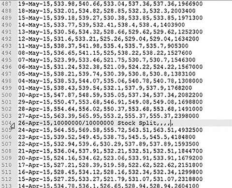

从没有包含信息的逗号可以看出，高亮行 504 行 (26-Apr-15) 中的五列有缺失的数据字段。

在这种情况下，我们很幸运，缺失的列在提取过程中幸存了——通常，缺失值不是由逗号定义的。这意味着，当我们把数据集输入算法时，它会错误地校准我们的数据，将下一行的数据向上推以适应列数。在上面的示例中，这意味着日期 24-Apr-15 将被移动到“10000000/1000000 拆股”值正右侧的列。

如果我们不预先发现问题，这种方式的缺失数据可能会在分析阶段给我们带来巨大的麻烦。我认识一些新手数据科学家会检查数据集的前 100 行，但这是一个新手级错误——如果数据中存在错误，你更有可能在数据集的末尾看到它们，因为错误会错位信息。

### 修复损坏数据

为了修复损坏的数据以便能被机器读取，我们首先可以尝试：

*   从原始文件重新提取，看看是否在第一次提取期间某些东西损坏了文件；
*   与数据负责人交谈，看看他们是否能解释实际数据应该是什么；或者
*   从你的分析中排除包含损坏数据的行。

### 与人员沟通

如果你发现自己处于一种数据数据的境地，并且在项目进展之前需要回溯步骤以获取额外输入，这里有三种方法可以促进这一过程：


*   始终对为你提供数据的人保持礼貌。有些人可能觉得数据收集工作令人沮丧，并会在沟通中表现出来，但请尽量保持中立。记住，他们不是数据科学家，在收集数据的过程中可能并不像你那样能从中获得乐趣！向他们解释，每一个数据驱动的项目都会有不同的结果，而且每个项目都需要不同类型的数据。你可能需要多次与负责数据集的团队联系，所以要保持友好，让他们站在你这一边。
*   确保你交谈的每一个人都完全理解你正试图解决的问题，以及他们在解决该问题中所扮演的角色。看到大局将有助于同事对你的请求更有耐心。
*   随时随身携带一份公司数据资产清单。手头有这份清单意味着，当你寻找新数据时，能够交叉检查组织已经拥有了什么，并减少收集重复数据的概率。在列出数据资产时，我建议记录数据源名称以及数据库的列及其描述符。

### 修复缺失数据

如果我们无法通过上述任何一种方法解决问题，那么我们就必须将数据视为缺失。解决电子表格中字段缺失的问题有多种方法：

*   **以 100% 的准确率预测缺失数据**。我们可以对从其他数据推导出的信息进行处理。例如，假设我们有一个包含客户位置数据的电子表格，其中包含 `State`（州）和 `City`（城市）的列值；`State` 条目缺失但 `City` 条目是 `Salt Lake City`。那么我们就可以确定该州是 `Utah`。也可以根据多个值推导出缺失值，例如，根据收入值和支出值推导出利润值。请记住，当我们在这两个例子中输入信息时，是基于数据收集过程中没有错误的假设进行的。
*   **保持记录原样**。在这种情况下，你只需让没有数据的单元格保持空白。当特定字段对我们的分析没有影响，因此可以排除在测试之外时，这种方法最有用；但如果我们计划使用一种不受缺失数据显著影响的方法（即可以使用平均值的方法），或者我们使用的软件包可以恰当地处理这种信息缺失时，也可以使用这种方法。在保持记录原样的情况下，我建议记录下数据出现空隙的地方，以便稍后任何异常都能得到解释。
*   **完全删除记录**。有时，缺失的数据对我们的分析可能是至关重要的。在这种情况下，我们唯一的选择是从分析中删除整行数据，因为缺失的信息使它们无法做出贡献。显然，这种情况下的主要缺点是，由于样本量减少，我们的结果显著性将会降低。因此，这种方法可能最适用于大型数据集，在大型数据集中，漏掉单行不会大大影响数据集的统计显著性。
*   **用平均值/中位数替换缺失数据**。这是处理包含数值信息的列的常用方法，因为它允许我们任意填充任何空隙，而不会对我们的数据集进行过大的篡改。计算平均值时，我们将所有值相加，并将总和除以数值个数。计算中位数时，我们在数据范围内找到顺序的中间值（如果数值个数为偶数，只需将两个中间数字相加并将总和除以二）。通常情况下计算中位数比平均值更好，因为前者受离群值的影响较小，这意味着中位数范围两侧的极端值不会偏曲我们的结果。
*   **通过探索相关性和相似性进行填充**。这种方法同样取决于你的缺失数据是否是数值，并且需要使用模型来预测缺失值可能是什么。例如，我们可以使用预测算法（如 `K-nearest neighbours`）根据数据集中记录之间现有的相似性来预测缺失数据。
*   **为缺失数据引入虚拟变量**。这需要向数据集中添加一列：当我们在数据集中发现缺失值时，我们就为其分配一个 `yes` 值——当它不缺失时，我们就给它一个 `no` 值。然后我们可以在分析中探索该变量与其他值之间的相关性，从而从回溯的角度考虑为什么这些数据可能缺失的含义。

### 处理离群值

假设我们正在一家销售手机配件的公司工作，我们想要找到销售给每个分销商的某款手机壳的平均数量。我们已经经营了多年，所以我们的数据集很大。负责将这些值输入我们数据库的人那天心情不好，他们没有将产品单位数量输入到 `product` 列中，而是输入了分销商的电话号码。那个错误会异常地推高我们这一列的平均值（这意味着一个分销商购买了至少 1000 万件！）。

如果我们单独分析那条记录，我们可能会发现错误。但如果我们只是在不看数据的情况下直接计算平均值，我们的报告就会受到那个离群值的偏偏——这将导致报告无法使用。

尽管如此，区分归因于错误信息的离群值与正确但超出正常值范围的离群值是非常重要的。对于确实购买了你 1000 万件产品的分销商，其数值仍然是一个离群值，因为该值高于标准的数值范围。

许多数据集都会有离群值——我们的工作是理解它们在哪里，并确保它们不会不公平地偏曲我们的报告。这在很大程度上取决于我们想要执行的分析类型。例如，如果我们想为一家出版社计算全球书店的平均销售数量，而我们知道那个离群值是一次特殊的订单，我们可能会删除该记录，尽管它是有效的。

你不需要手动在数据集中寻找离群值，可以通过从你的列值生成分布曲线（正态分布也称为钟曲线）。分布曲线通过其顶点直观地描绘了数据中最可能的值或事件，而且在 Excel 中创建非常简单。

* * *

案例研究 处理脏数据的应用方法

我们获得了一份来自虚拟风险基金的数据集，该基金关注美国初创公司的整体增长情况。由于数据收集者与初创公司没有关联，某些信息缺失了，因为这些信息不公开，或者初创公司不愿意提供这种水平的信息。

5.2 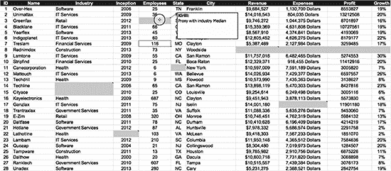

正如你所看到的，我们的列中缺失了各种类型的信息，有时单行会有多个空值。让我们练习修复缺失数据的方法。在阅读下方的答案之前，回到上述的方法，并考虑你可能会如何解决数据缺失问题。

**员工**


# 用平均值/中位数替换缺失数据

这是一个数值，因此我们可以用该列的整体中位数或行业中位数来代表任何缺失的员工数值。（行业中位数更为优，因为它能提供同类比较的数据。）

### 行业 (Industry)
保持记录原样，或以 100% 的准确率预测缺失数据，或者完全删除该记录。通过简单调查公司的业务并据此进行推断，应该很容易地找到公司属于哪个行业。但我们的选择取决于行业对我们的分析有多重要。如果行业很重要，而我们又无法进行研究，我们就必须从分析中删除该记录。

### 成立时间 (Inception)
保持记录原样，或以 100% 的准确率预测缺失数据，或者完全删除该记录。虽然成立时间是一个数字，但它并不是数值（你无法对其进行算术运算）。因此，我们无法用平均值来代替它，所以如果我们无法找到公司成立的时间，就必须接受它是缺失的。

### 州 (State)
保持记录原样，或以 100% 的准确率预测缺失数据，或者完全删除该记录。在上面的示例中，我们可以以 100% 的确定性预测缺失数据。但我们必须注意准确性：对于某些城市名可能属于多个州的值，我们将无法以 100% 的准确率预测数据，因此必须决定该数据对我们的分析有多重要。

### 支出 (Expenses)
以 100% 的准确率预测缺失数据。这是一个很容易的问题；我们可以通过从收入中减去利润来计算支出。

### 收入、支出、利润及增长 (Revenue, expenses and profit, growth)
用平均值/中位数替换缺失数据。计算这一块缺失值需要多个步骤。我们需要首先使用行业中位数来代表增长的收入和支出，然后通过收入与支出之间的差来计算利润。

## 从 MS Excel 转换数据

Excel 试图通过自动重新格式化某些值让事情变得更容易。这可能会在 ETL 过程中导致各种故障，由于这个程序被频繁用于存储数据，我在这里将对其特别关注。我听过的 Excel 用户的一个常见抱怨是，该程序坚持将长数值（如电话号码和信用卡号）转换为科学计数法。这还不是最糟糕的。Excel 还可以将日期和金额转换为符合你计算机区域设置的单一格式。虽然这对于经常用于商业智能的单个电子来说可能很方便，但此类自动化在数据科学中只会适得其反，因为 Excel 的格式无法很好地转换为数据库格式。如果我们正在处理大量数据，理清 Excel 修改过的所有实例将非常耗时。

如果我们不将来自 Excel 的数据转换为 `.csv` 文件，那么在随后的流程中我们只会遇到问题。虽然可能恢复被更改的日期，但如果信用卡号已被更改为科学计数公式，要恢复它们几乎是不可能的。想象一下一个机构丢失了客户的信用卡号会有什么后果，特别是如果你处理的是该文件的唯一副本。

一些最常见的问题与日期和货币有关，因为这些值并不具有国际通用，因此容易受到我们机器区域设置的影响。

#### 日期格式 (Date formats)
日期的格式根据我们的地理地区而不同，Excel 程序设计为显示符合我们计算机区域设置的日期。大多数国家使用低端优先的日期格式，以天开始，然后是月份和年份（`dd/mm/yyyy`）。然而，在美国，日期格式以月份开始，然后是日期和年份（`mm/dd/yyyy`）。我们需要确保在数据库中使用一致的日期格式。

#### 如何修复 (How to fix them)
防止 Excel 对我们的记录进行更改的最佳方法是将所有的日期格式更改为 `yyyy-mm-dd`，因为这是明确的国际标准，且不受区域规则限制。在 Excel 中，选择你想要修复的列，右键点击并选择`设置单元格格式`。在`类别`窗口中，选择`日期`。在`类型`窗口中，你应该看到 `yyyy-mm-dd` 格式。选择它然后点击`确定`。你的日期就会被重新格式化。

#### 货币格式 (Currency formats)
货币也将取决于我们计算机的区域设置。在这些情况下，不仅需要考虑货币符号，还要考虑所使用的小数点标记。货币符号应该从你的数据中完全删除，否则它们会被读取为文本。不同国家对货币使用不同的小数点标记——有的用点表示（例如英国的 `£30.00`），有的用逗号（例如德国的 `€30,00`）。请注意，这同时影响小数点和千分位分隔符。在澳大利亚等使用逗号作为千分位分隔符的国家，`£30,000` 的和会被读为三万英镑，但在瑞典等使用逗号作为小数点的国家，它可能被读为三十英镑。数据库使用小数点系统，任何逗号（包括千分位分隔符）必须从你的数据中删除。

#### 如何修复 (How to fix them)
我们想要删除数字中的符号和逗号。如果你的国家使用逗小数点，你必须先更改计算机的区域设置，以确保逗号改为点。选择列，右键点击并选择`设置单元格格式`。在`类别`窗口中，选择`货币`。取消勾选`使用千分位分隔符`框，以确保不使用逗号，从`符号`下拉框中选择`无`，并选择 `2` 位小数。这将删除我们数据中的逗号和符号。

## 3 加载你的数据 (Load your data)

一旦我们将数据转换成所需的格式，就可以将数据加载到我们的最终目标：数据仓库。一旦此过程完成，在运行机器算法之前，我们应该最后手动检查一遍数据，以绝对确定我们处理的不是准备不充分的数据。

### 加载后的质量保证 (Quality assurance after the load)

将数据加载到仓库有时会引起问题。你可能在上一个阶段漏掉了清理某些脏数据，或者某些数据简单地加载错误了。因此，你必须学会在仓库中双重检查数据。

以下是你在此阶段始终应该执行的质量保证 (QA) 检查：

*   **统计你最终数据集中的行数**并将其与初始数据集进行比较。如果不同，返回初始数据集查找发生了什么。遗憾的是，有时最快的检查方法就是直接查看，这意味着要逐行滚动数据。这样做最快的方法是从下往上，而不是从上到下，因为数据错误可能会向下传递。
*   **检查列的倾斜情况**。为了完全防止分析阶段出现问题，请检查前 100 行和后 100 行。
*   **检查易损坏的列**。这通常指日期和余额，正如我们之前确定的，它们最容易出错。


- **检查文本值**。如果我们从调查中获得了自由格式的文本值（即受访者对开放式问题填写的答案），那么将此类文本上传到数据库可能会很棘手。通常，数据库会限制列的最大字符数。这可能导致答案被截断，从而导致我们的数据缺失，有时甚至会影响数据集的其他部分。自由格式文本还包含数据库无法识别或会误用的符号，因为它们是像引号之类的限定符符号。

## 像（再次）像顾问一样思考

质量保证是数据准备过程中最重要的部分，由于它正处于流程的末尾，请注意不要在这个阶段失去斗志。我很幸运能通过咨询领域进入数据科学领域，而这个领域非常看重质量保证（QA）。在质量保证体系下，工作是经过同行评审的。数字必须对得通，结果必须符合逻辑。不要害怕这个阶段——它的设计并不是为了难为你，而是为了帮助你避免在流程的后期犯错。

那些处理数据了一段时间的公司已经建立了严谨的、预定义的程序，数据科学家在进行任何分析之前必须逐字严格遵守这些程序。有些公司甚至会有顾问来检查你的流程，并期望他们在这个步骤上花费大量时间。交付错误的结果至少会浪费资金，在最坏的情况下，可能会严重影响业务运营。这就是为什么在进入下一个步骤之前确保进行质量保证是如此重要的原因。

现在，你已经拥有了一个极其洁净的数据仓库，并且知道你想向它提出的一个或一系列问题，你终于可以进入我最喜欢的部分：分析。

# 参考文献

SuperDataScience (2016) SDS 008: data science in computer games, learning to learn and a 40m euro case study with Ulf Morys [播客] 28 October [Online] [www.superdatascience.com/8](http://www.superdatascience.com/8) [访问于 05.06.17]

# 注释

**[1]** 数据科学家之间的意见存在差异，但大多数人会将项目 60–80% 的时间归于数据准备阶段。

**[2]** 许多收集数据多年的大型组织对数据科学存在一种“制度性盲点”——由于不知道数据在分析之前必须经过准备，导致他们的信息是不可用的。

**[3]** 一种免费下载的游戏，但为想要在游戏中进步的玩家出售游戏内道具。

**[4]** 标签页（Tabs）用于不同的表格，但跨标签合并值可能会很困难。

**[5]** 随着你数据科学家职业生涯的进步，你将学习与各种数据存储设施工作。我们在这里讨论的是`.csv` 文件，因为它们最常见、功能最全，是很好的入门选择。

**[6]** 你的决定最终取决于你是否需要这些数据，如果你花时间在数据科学流程的第 1 阶段确定了问题，这个问题可以很容易得到答案。

**[7]** 小心处理这类字段。美国只有一个盐湖市（Salt Lake City），但有时你会发现多个同名的城市。

**[8]** MS Office 版本各不相同。在 Excel 的帮助菜单中输入“分部曲线”（distribution curve）将返回生成曲线所需的结果。

**[9]** 例如，`4556919574658621` 将被显示为 `4.55692E+15`。

# 06

# 数据分析部分 1

在向初学者解释数据科学的五项原则时，分析阶段是从业者往往容易失去听众的地方。但这更多地与心理学有关，而非其他原因：对“分析”（analytics）一词的非理性恐惧会让许多人自动觉得自己处于被动位置。

在接下来的两个章节中，我想做的不仅仅是简单地解释单个算法是如何工作的，还要强调数据科学家使用算法的*语境*（context）。与详细阐述算法理论复杂性的手册相比，我发现基于语境的方法要更适合所有类型的学习者，无论他们目前的能力如何。

在之前的两个章节中，我们查看了 1) 我们可能如何处理与数据有关的任务以及 2) 如何为分析准备这些数据。现在我们终于准备好开始分析数据了。这个阶段实际上是“即插即用”的——一旦我们理解了任务及其变量，应用算法应该是轻而易举的。

## 不要跳过这一步

即使你认为自己不具备必要的工具或数学能力，也不要让自己受诱跳过接下来的两个章节，认为你可以简单地雇人来替你完成这些工作。数学或其他科学学科的基础在此时可能大有益，但并不是强制性的。尽管你只需通过知道如何展示就能获得成功，但我们仍然需要理解每一个阶段。

我们在第 6 章和第 7 章中讨论的数据分析中最基础的算法大致分为三类：

- 分类（classification）
- 聚类（clustering）
- 强化学习（reinforcement learning）。

## 数据科学中的信息与数学

我们在书中讨论的大多数算法都是由复杂的数学和统计学驱动的。尽管如此，你会发现并没有数学公式来辅助它们。这可能会引起引起——如果不深入研究它的内部构造，我们真的能理解算法吗？

我回答这个问题的类比是想象开车。你曾经拆过汽车吗？你能分清凸轮轴和曲轴吗？汽车的巡航控制实际上是如何运作的？我们大多数人并不完全了解自己驾驶汽车的技术操作。然而，我们几乎所有人都在开车，而且经常如此。这就是数学与直觉之间的区别。

数学将算法拆解，以准确理解它是如何工作以及为什么工作的。这没有错，在某些情况下你需要这种级别的细节。但在大多数时候，作为数据科学家工作时，这并不是必要的。就像对汽车踏板和方向盘的基本理解就能让你从 A 点到达 B 点一样，对数据科学中分析模型背后的直觉的知识也能让你为给定的任务带来价值。


如果这能让你感到些宽慰，那么我就完成了我的工作。我经常发现数据科学被过度复杂化了。我的目标是向你证明，就像任何人都可以开车一样，任何人都可以成为数据科学家。

# 分类与聚类

让我们先区分这两个类别。简单来说，当我们已经知道想要将数据归类到哪些组中时，我们使用“分类”（classification）；而当我们 `不知道` 分组将会是什么（无论从数量还是名称而言）时，我们使用“聚类”（clustering）。例如，如果我们想对一个“是/否”问题的调查结果进行分析，那么我们就会使用分类算法，因为我们知道结果产生的两个组将是：“是”和“否”。相反，如果我们想根据受访者的年龄和他们离公司最近商店的距离来对他们进行评估，我们将使用聚类，因为对我们有用的结果性分组无法预先进行精确定义（除非我们之前已经进行过这项分析）。

假设有一家航空公司请我们研究他们的客户是否会停止使用其服务（这被称为“客户流失”）。由于公司已经收集了客户的反馈和移动数据（飞行频率、旅行目的地、交通舱等级、机上服务使用情况、行李需求），我们可以利用这些变量来识别最能说明客户离开航空公司意图的行为。在这种情况下，我们将尝试使用这些因素将客户分为两组：组 1 包含可能停止使用该航空公司的客户，而组 2 包含可能继续使用该航空公司的客户。出于原因，我们将使用分类，因为我们正在将客户 `分类` 为两个组之一。

而分类正是我们将开始的地方。

## 分类

在进行分析 `之前` 就知道数据将落入哪些组，使得分类比聚类技术要容易得多。上述示例中的客户可以通过记录关于他们的数据来观察——这可能包括他们的经常飞行路线、消费能力、在航空公司常旅客计划中的会员层等级，甚至是座位偏好。这些描述性特征可能看起来很多，但它们只是工具。该任务的核心目标是将客户归类为 `仅两个组中的之一` —— 公司此时对发现任何其他事情都不感兴趣。

对于这种数据分析，至关重要的是我们还必须拥有现有数据，通过这些数据来观察我们感兴趣的特征。这是创建分类算法的唯一方法——通过我们的案例历史。

以下分类算法按难度从低到高排列。我们将从决策树开始，因为许多读者已经熟悉流程图了——它们都使用相同的原理，即在向参与者提供最终响应之前，将信息拆分为单个步骤。随机森林回归只是决策树算法的扩展，因为它对数据集的各个组件使用多个决策树，以提供更准确的结果。K 近邻（K-nearest neighbours）和朴素贝叶斯（Naive Bayes）算法都是根据每个记录变量测量的相互相对距离，将数据点归分为组。两者之间的区别将在各自的章节中变得显而易见。我们在逻辑回归结束对分类的探索，当我们想要检查事件发生的概率时，逻辑回归就是 `使用的` 算法。

当你阅读这些算法时，请记住我最初的建议：通过 `直觉` 学习：专注于理解每个算法的 `目标`，并尝试看清底层步骤背后的 `目的`。花时间消化每种算法——在在这里，慢速稳打确实能赢得比赛。

## 决策树

决策树的功能类似于流程图。它对你数据集中的单个属性运行测试，以确定可能的结局，并随着进一步测试的运行继续添加结果，直到所有结果都耗尽为止。

我们决策树的叶子节点为我们向数据提出的所有问题提供了所有可能的答案。我们都在某个时候做过杂志测验，要求你回答一系列“是或否”问题，然后揭你是哪种人格类型，或者你是莱纳德（Leonard）还是谢尔（Sheldon），或者你对酸奶的真实感受——在这些情况下，问题是我们的分支，结果是我们的叶子。

在商业世界中，决策树可以用于对例如客户组进行分类。回想 [第 5 章] 中的 Ubisoft 案例研究：如果游戏公司的制作团队收集了关于潜在新订阅者的信息，那么他们可以使用决策树来测试根据公司现有订阅者的数据集，他们是否可能成为会员。决策树算法会将游戏公司的数据拆分成叶子节点，显示出诸如游戏时长和年龄等值之间的明显差异，并将新数据归类为我们定义的结局之一——在这种情况下，为对公司“有益的”或“无益的”。

### 决策树是如何运作的

让我们在这里测试这个问题。由于我们拥有关于游戏玩家平均玩时间和他们年龄的信息，我们可以使用决策树分类对他们做出明智的决策。这意味着我们首先需要拥有我们游戏公司当前订阅者的以下数据：过去一个月玩我们游戏的总时长和年龄。

我们创建了一个基于年龄 (`X1`）和游戏时长（小时）（X2`）的带有大量数据点的散点图。

6.1 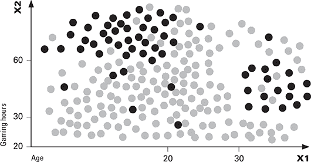

灰色点代表没有成为会员的用户；黑点代表那些成为会员的用户。如果我们运行决策树分类算法，散点图将根据算法的确定拆分成叶子。

6.2 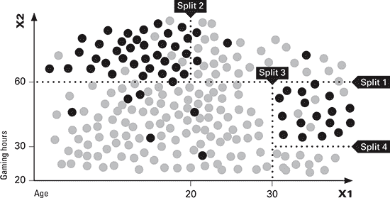

正如我们所看到的，划分 1（Split 1）在 `X2 = 60` 处划分了数据，划分 2（Split 2）在 `X1 = 20` 处划分了数据。算法现在将我们的数据点分组对分类有价值的叶子，一旦创建了最佳数量就会停止。当进一步划分数据会导致叶子结果在统计学上不再显著时，就达到了这一数量。

### 决策树分类算法的步骤

在 [图 6.2] 中，我们可以遵循决策树算法的思路：

1. 划分 1 将我们的数据点分为 `X2` 轴上 60（小时）以上和以下的部分。
2. 对于 `X2` 轴上 60（小时）以上的点，划分 2 对我们的数据点进行了 `进一步` 划分，分为 `X1` 轴上 20（岁）以上和以下的部分。这意味着划分 2 `仅` 划分了 `X2` 轴上 60（小时）以上的数据。
3. 划分 3 处理划分 2 忽略的数据点，划分 `X2` 轴上 `低于` 60（小时）的部分。这次，划分将数据点分为 `X1` 轴上 30（岁）以上和以下的部分。
4. 划分 4 将 `X2` 轴上 60（小时）以下的数据点（如划分 1 所示） *以及* `X1` 轴上 30（岁）以上的数据点（如划分 3 所示）进行拆分。这次，划分将数据点分为 `X2` 轴上 20（小时）以上和以下的部分。

我们可以将这个过程转换为这个流程图。

6.3 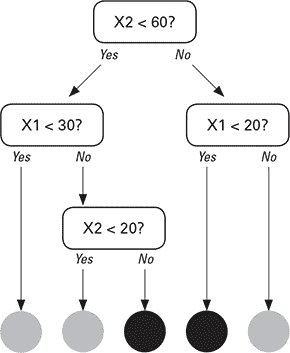


这个算法对我们有什么帮助呢？假设我们的新客户 19 岁，在第一个月内已经积累了 65 小时的游戏时间（`X1 = 19` 和 `X2 = 65`）。在通过我们的划分划分为叶子节点的散点图中，我们可以看到这个数据点将处于什么位置。我们的算法已经发现，在统计学上，20 岁以下且游戏时间超过 60 小时的人有很大比例会成为会员，这意味着我们可以针对这类客户投放广告，吸引他或她订阅我们公司的服务。

## 随机森林
随机森林分类通过集成学习构建在决策树原理之上。随机森林不是只有一棵树，而是使用许多不同的树来做出相同的预测，并取单棵树结果的平均值。

虽然根据我们的业务问题，某些树的有效性可能并不理想，但我们可以发挥群体的力量；当所有决策树相加在一起时，它们可以做出更明智的预测。把这比作投票过程就好——每棵决策树都会投出一票（做出预测），然后随机森林算法将得票数最多的选项作为结果。树的民主！

这使得原始算法变得强大得多。随机森林不再为我们的整个数据集绘制一棵决策树，而是构建多棵决策树。为了使决策树具有唯一性，它们是从数据集的不同子集中创建的。

### 集成方法的直观理解
这是我最喜欢的集成方法示例，它应该让这个概念感觉更加直观。你是否参加过这样一种活动：需要猜玻璃罐里有多少颗糖？猜数字最接近的人获胜。

这是我基于集成方法做出的最佳猜测的策略。与其简单地自己选一个数字，不如看看游戏中其他参与者猜了什么（大多数游戏都会有一张记录数字的纸或黑板）。计算平均值，将结果向上舍入到最近的整数，*et voila!* 你的猜测就此产生。

提供的猜测越多，你的平均值就越接近罐子里糖的实际数量。这是因为有些人会猜得高，有些人会猜得低，但总体而言（除非罐子本身有什么猫腻），猜测结果将围绕糖的实际数量呈正态分布。脑海中想象这个实验，就会觉得很直观了。如果觉得——你也可以自己尝试一下。

如果你将“猜罐里的糖”游戏替换为数据科学问题，并将每个参与者的猜测替换为一棵决策树，那么你就得到了集成方法。这正是它的原理：群体的意见（集成）始终比单个受访者（树）的意见更可靠——而且往往更准确。

让我们通过一个案例研究来进一步探索随机森林。

### 案例研究：BCG – 为新银行分行寻找最佳位置
随机森林算法非常适用于需要对数据进行更复杂评估的任务，这种评估是单纯通过决策树算法无法完成的。例如，如果我们想根据变量模式评估银行在某个地区开设分行的潜力，那么我们就会使用随机森林算法。

我住在澳大利亚，当我想在该的一家新银行开户时，我的首要考虑是便利性。我希望在家里、公司附近和购物场所附近都有分行。如果银行在海滩附近也有很多分行，那就更好。最糟糕的事情莫过于为了和顾问交谈或兑支票而跑到城市的另一端。

虽然银行知道这是潜在客户决策的主要影响因素，但他们也希望确保新开的分行对他们来说具有成本效益。波士顿咨询集团（BCG）的高级分析顾问 Artem Vladimirov 被指派为该集团的银行客户解决这个问题，该客户希望在整个澳大利亚扩展其业务。

首先，Artem 分析了银行的人口数据，显示了澳大利亚每个居住区的客户数量。他意识到，由于银行的分行没有均匀分布在整个澳大利亚，因此他们没有所有澳大利亚地区的数据。为了对这些地区进行预测，Artem 必须通过公开的人口普查信息，对银行“已知”和“未知”的地区进行对比数据分析。通过应用平均年龄、性别比例、教育水平和生活成本等人口统计数据，Artem 能够为银行填补这些灰色地带。对数据的使用使他能够利用那些与已证明有益的地区数据相似的新地区建立分行的潜在成功。

为了满足银行的需求，Artem 使用了随机森林算法：

```
我们从银行的数据记录中提取了整个客户群，并使用随机森林统计模型确定客户盈利能力与其人口统计特征之间的相关性。预测是针对银行已有客户的区域进行的，因此我们只需要通过匹配人口统计数据来交叉检查某个地区是否盈利。
```
(SuperDataScience, 2016)

在确定了对银行具有意义的区域后，Artem 接着对公司的竞争对手以及他们在该地区的分行数量进行了分析，再次使用随机森林来确定银行相对于竞争对手所占的市场份额百分比。

通过随机森林，Artem 不需要精确解释是哪些人口统计特征贡献了最终指标，这有助于他规避个人数据保护的问题，并向银行精确地展示哪些区域对他们来说是有成本效益的。

### 随机森林分类的步骤

**1. 选择你想构建的树的数量** 对于许多程序来说，默认参数是 10 棵树。你最终选择的数量取决于具体情况。树越少可能导致预测不够精确。相反，在大多数情况下，你可以使用任意数量的树，因此不需要担心算法对你的数据过拟合。

**2. 将分类器拟合到训练集** 将我们的随机森林分类器拟合到训练集中可以使其能够学习如何对新数据做出未来的预测。我们可以将这些预测与数据集中的实际结果进行比较，以查看分类器的准确性。

随机森林算法将从数据集中随机选择 N 个子集，其中 N 是你在第一步中为参数指定的树的数量。这些子集可以是重叠的；但没有两个是完全相同的。

一旦选择了子集，每个子集都将作为输入数据集来构建一棵独特的分类树。这样，每棵分类树只看到它自己的数据子集，并且不知道实际数据集更广泛。这种方法确保了生成树的种化性——这正是随机森林算法中“群体力量”的来源。

根据这个逻辑，为了帮助算法做出更准确的预测，我们只需向数据集中添加信息——训练集中的数据越多，我们算法的预测就越准确。

## 决策树还是随机森林？


虽然随机森林算法被认为是决策树的“升级版”，但根据所处理任务的不同，二者各有优劣。对于数据量相对较小的项目，使用随机森林算法不会产生最佳结果，因为它会对你的数据进行不必要的细分。在这些情况下，你应该使用决策树，它能为你提供对数据快速、且直观的诠释。但如果你处理的是大型数据集，随机森林将提供更准确但可解释性较低的预测。

## K 近邻算法 (K-NN)

K-近邻算法利用数据中的模式将新数据点放置在相关的类别中。假设一位住在旧金山的医生读到有关美国糖尿病患者人数近期增加的报道，她希望在她的诊所应对这一疫情。医生知道第 2 型糖尿病的预防比治疗容易得多，于是她请了一位数据科学家开发一个模型，根据现有患者（无论被诊断为健康还是被诊断为患有糖尿病）的记录，评估诊所新患者未来患该疾病的概率。通过这种方式，我们的医生希望能够应用该模型早期识别风险患者，并通过咨询和预防性筛查帮助他们过上健康的生活。该诊所已经确定了两个与成功诊断相关的属性：每周运动量和体重。现在轮到数据科学家来创建一个可靠的模型，以帮助诊所可靠地预测风险患者了。

### 我应该对 K-NN 期待什么？

K-NN 分析的是“相似性”。它的工作原理是计算你的新数据点与现有数据点之间的距离。由于现有数据点代表了之前诊断出的患者，我们可以将它们分为两类：(1) 糖尿病患者和 (2) 健康人士。然后，新数据点（此处为新患者）将根据周围的患者进行分类。在这里，我们见证了该算法的底层假设：K-NN 假设只要某些已知特征相似，即使是患者的 `unknown` 特征也会是相似的。

### K-NN 的步骤

**1 为你的算法选择邻居数量 `k`** 我们首先需要确定的一点是，为了让一个新数据点被成功分类，我们想要分析训练集中多少个数据点邻居。K-NN 通过分析我们的新数据点与周围现有点之间的距离来运行，并根据代表最多邻居的类别（此处为 (1) 糖尿病患者或 (2) 健康人士）对新数据点进行分类。例如，如果我们想通过分析五个最近的数据点来对新数据点进行分类，那么我们将 `k` 值确定为 5。

**2 测量新数据点与所有现有点之间的（欧几里得）距离** 如果我们说 `k` 等于 5，那么我们需要找到距离我们数据点最近的五个邻居。为了做到这一点，我们必须首先测量新数据点到我们已有的所有点的距离。

在数据科学中，测量距离可能相当复杂，因为有很多不同的定义方式。通常使用的是距离最自然的定义——也就是我们许多人在学校学过的那个定义：欧几里距离。简单来说，欧几里距离是两点之间直线的长度。它的测量方法是找到两点在每个轴上的坐标差（例如 `X2 – X1`），然后将这些差值平方，将结果相加，最后提取平方根。

例如，如果 P1 是我们的第一个数据点，P2 是第二个，如图所示，那么欧几里距离将使用以下公式测量：

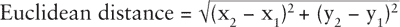

6.4 测量欧几里距离

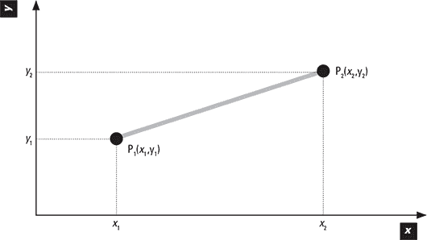

你可能还记得学校学过的毕股哥定理，这完全是同一个原理。图中给出的点是直角三角形上的两个点。你可以通过首先确定它的平方长度来找到斜边：通过将另外两边的平方相加来实现此。

**3 统计每个类别中的数据点数量** 一旦你找到了新数据点与每个旧数据点之间的欧几里距离，你就必须将这些距离按从小到大的顺序进行排序。在这个阶段，识别 K 个最近的邻居将非常容易——它们仅仅是你列表上的前五个点。从视觉上看，我们可能想如下所示圈出我们最近的数据点：

6.5 K-NN 算法

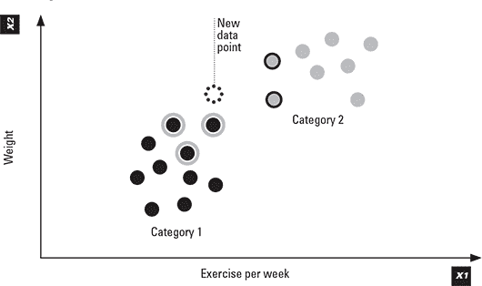

**4 将数据点分配给邻居最多的类别** 我们可以看到，对于我们的新数据点，在 (1) 糖尿病患者类别中有三个最近的邻居，而在 (2) 健康类别中只有两个最近的邻居。由于 (1) 中识别出的近距离邻居更多，我们现在会将新数据点分配到该类别，这意味着该特定患者考虑到其体重和运动量，有患第 2 型糖尿病的风险。分类完这个新点后，模型现在准备就绪。

### 多维空间

当我们有超过两个变量来描述数据点时会发生什么？除了体重和运动之外，如果我们还有关于患者年龄和每日平均卡路里摄入的信息呢？由于我们有很多变量，我们无法再绘制二维散点图了。相反，我们需要一个四维图。

想象或可视化 4D 散点图几乎是不可能的，但好消息是 K-NN 无论如何都能运行。这是因为 K-NN 算法基于相似性的概念，而相似性是通过距离运作的——我们引入的距离公式可以为任何维度重新改写。只是根号下会有更多元素。

### 测试

虽然 K-NN 是做出准确预测的好方法，但必须注意，它的结果并不总是正确的。这是完全正常的——总会有一些错误的预测，没有哪个算法能够正确每一次预测。制作一个良好模型的关键是进行多次测试，调整其函数（这里是 `k` 值），直到找到适用于任务的最佳方案。

### 使用 K-NN 算法的优缺点

K-NN 算法通常是正确的选择，因为它直观易懂，并且不像下文的朴素贝叶斯那样不对你的数据做任何假设。然而，K-NN 的主要缺点是计算需要很长时间。必须计算到数据集中每个点的距离是一个巨大的代价，点越多，K-NN 运行得就越慢。

# 朴素贝叶斯


你是否曾被警察拦下进行过测酒测试？这在澳大利亚的周五和周六晚上很常见，当时人们正从晚聚会回家的途中——澳大利亚警察经常会在主干道最繁忙的路段进行封锁。任何在这条路上行驶的员，无论其驾驶情况如何，都必须停下来接受测酒。这是一个非常快速的过程，你甚至不需要下车即可完成，而且它的好处是帮助警察将醉酒司机驱逐出街道。我们将在这里使用这个例子来更好地理解贝叶斯定理背后的直觉。

让我们谈谈他们使用的测酒仪。我们假设这台设备设计得非常好，如果有人醉酒了，它会百分之百准确地将他们检测出来。毕竟这是它的首要目的。但测酒仪并非完美，它会有 5% 的概率误报醉酒状态。这意味着在 100 个没有醉酒的人中，它会误认为其中 5 个人醉了。（这种结果被称为**假阳性**。它们在测试中呈现为阳性，但实际上这些人并没有醉酒。）

现在，想象一名警察刚刚对一名随机驾驶员进行了测酒，设备显示该驾驶员是酒了。那么他或她实际上醉酒的概率是多少？

直觉上的反应是 95%。但正确答案实际上只有 2% 左右。为什么呢？这就是贝叶斯定理发挥作用的地方。

假设道路上每 1000 名驾驶员中只有一个人在醉驾。如果警察测试了 1000 名驾驶员，他们将得到以下结果：

* 那 1 名实际上醉酒的司机会被无误检测出来。
* 在剩下的 999 名驾驶员中，有 5% 会被检测为醉酒。即 5% × 999 = 49.95 名司机。（不用担心人数中的小数点——我们随时可以将这个例子扩大到 100,000 名驾驶员，使结果变成整数。）

在这个例子中，测酒仪总共检测出 1 + 49.95 = 50.95 名醉酒司机。因此，这些司机中任何一个是真的醉酒的概率是 1/50.95 = 0.0196% ≈ 2%。我们可以通过下表来阐明：

| | 实际醉酒 | 实际未醉 | 总计 | |
| --- | --- | --- | --- | --- |
| **测试** | 1 | 999 | 1000 | |
| **检测出** | × 100% | × 5% | | |
| | = 1 | = 49.95 | 50.95 | P = 1/50.95 = 1.96/100 = 1.96% |

感到惊讶吗？你并不孤单。直到今天，每当我遇到将贝叶斯定理应用于现实情况的例子，我总是很感兴趣。我们经常如此地根据给出的证据跳到结论，而不是考虑大局，这非常奇妙。

## 贝叶斯公式

现在我们已经接触了实践贝叶斯推断，让我们贝叶斯定理的方程。以下是本示例中将使用的符号：

1. `P(Drunk)`
2. `P(Drunk | Positive)`
3. `P(Positive | Drunk)`
4. `P(Positive)`

其中 `P` 代表概率，垂直线 `|` 表示条件概率。

上述每个元素都有一个数学名称。`P(Drunk)` 是随机选择的驾驶员醉酒的概率。在贝叶斯统计学中，这个概率被称为**先验概率**（prior probability）。如果我们回顾最初的假设，可以计算先验概率为 `P(Drunk) = 1/1,000 = 0.001`。

`P(Drunk | Positive)`是在测酒测试结果为阳性（检测出醉酒）的情况下，驾驶员实际上醉酒的条件概率。这个概率被称为**后验概率**（posterior probability），这正是我们感兴趣计算的内容。

`P(Positive | Drunk)`是在驾驶员实际上醉酒的情况下，测酒仪测试为阳性的条件概率。这个概率名称是**似然**（likelihood）。在我们的情况下，任何真正醉酒的司机都会被设备无误检测，因此 `P(Positive | Drunk) = 1`。

`P(Positive)` 是任何随机选择的驾驶员在测酒仪上测试为阳性的概率。这个概率被称为**边缘似然**（marginal likelihood），在我们的示例中计算为 `P(Positive) = 50.95 / 1,000 = 0.05095`。

别担心——你不需要记住所有的名称，但某一天你可能会遇到它们，并想起我们的测酒仪例子。现在我们已经完成了所有的准备工作，可以引入方程：

代入数字得到：`0.001 / 0.05095 = 0.0196`

尽管这个方程看起来很复杂，但它非常直观。如果你不确定，只需回回第一个计算步骤。


如果你想遵循贝叶斯公式（而不是表格法），你只需要做的就是每一步通过结合上一步的结果来更新你的输入（先验概率和边际似然）。这在数学上的表达方式是：你已经获得了新证据，并且想要利用这些证据来修正你对世界的既有（先验）观点。

我非常喜欢酒精检测仪的这个例子，因为它说明了两点：

1. 我们从一开始就必须考虑先验知识（在这个例子中——即每 1000 名司机中实际上只有 1 个是醉酒的）。忽视大局可能会导致草率且往往是错误的结论。
2. 随着新证据的出现，我们必须更新贝叶斯公式中的输入。只有这样，我们才能确保对问题有最新的了解。有时，我们可能需要主动寻求新证据，以帮助得出更准确的结论。

考虑到这一切，读者如果发现警察有时会要求司机多次向其检测设备吹气，就不再感到意外了。

这是对贝叶斯统计学的一次简短探索。掌握了贝叶斯定理，我们现在准备好进入朴素贝叶斯分类算法。

### 为什么它是“朴素”的？

朴素贝叶斯依赖于一个强大的 `naive`（朴素）独立假设：数据集的特征之间是相互独立的。事实上，认为这样是很朴素的，因为对于许多数据集，包含的独立变量之间可能存在某种相关性。尽管有这个朴素的假设，朴素贝叶斯算法已证明在许多复杂应用（如电子邮件垃圾邮件）中效果良好。

## 使用朴素贝叶斯进行分类

在完成了关于酒精检测仪的所有工作后，一位加利福尼亚的酿酒师找到了我们。今年西海岸的天气变幻莫测，酿酒师不确定年度葡萄收成的葡萄酒质量。为了帮助评估风险，他请求我们帮助预测他今年收成获得地区年度最佳葡萄酒奖的几率。

如你所见，这位酿酒师面临着风险。好消息是，他有一些数据提供给我们！

酿酒师发现，多年来，`阳光时长`和`降雨量`这两个独立变量是对葡萄藤产生积极影响的变量之一，从而影响了他的葡萄酒的口感和成功概率。得益于这些知识，他从那以后改进了葡萄种植工艺，并增加了成功葡萄酒的数量。

根据他之前的胜负情况，酿酒师将数据分为两类：`Winner`（获胜者）和`Loser`（失败者）。我们可以像这样可视化它们：

6.6 根据阳光时长和降雨量的葡萄酒收成成功率 1

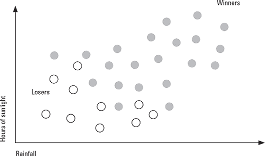

在这里，我们`x`轴上的值是`降雨量`，`y`轴上的值是`阳光时长`。白色类别是 `Loser`，灰色是 `Winner`。

现在我们可以根据今年收成经历的降水量和阳光量，帮助酿酒师分析今年收成的成功概率。假设某特定收成在过去一年接受了 23.7 英寸的雨和 3543 小时阳光。利用这些信息，我们可以将今年的收成绘制在散点图中，朴素贝叶斯分类将帮助我们识别今年的收成将落在哪一类：

6.7 根据阳光时长和降雨量的葡萄酒收成成功率 2

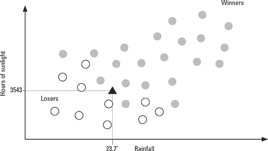

## 朴素贝叶斯的步骤

朴素贝叶斯使用我们数据点的变量将其置于最合适的类别中。以下是它的工作原理：

### 步骤 1：计算先验概率
在这里，我们想要找到单个数据点属于训练集中某一类别的概率。考虑到我们的葡萄酒样本以及其中失败的数量与获胜的数量对比，新葡萄酒属于 `Winner` 类别的概率是多少？

在此时，我们需要假设我们对自己的收成一无所知——我们不知道葡萄在阳光下曝晒了多久，也不知道它们得到了多少雨水。因此，我们能做出的最佳猜测是从之前的数据中提取获胜者的数量（因此命名为 `prior` 先验概率），并将其除以数据点的总数：

`P(Winner) = 获胜者数量 / 总观测数 = 20/30，或 0.667`

### 步骤 2：计算边际似然
“边际似然”指的是我们在问题数据点实际落在区域附近观察到新数据点的概率。收成具有我们类似的阳光和雨水量是常见还是不寻？这种 `similarity condition`（相似性条件）代表了我们数据点周围的一个区域，它在散点图中看起来像这样。^(9)

6.8 计算朴素贝叶斯的边际似然

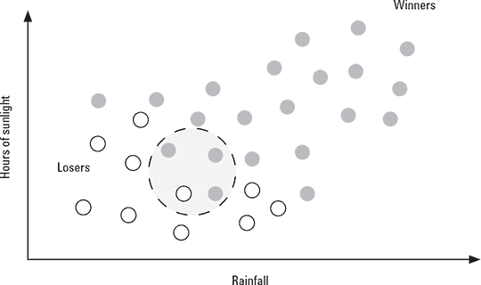

（注意，我们实际上并没有将当前的收成放在散点图中——这样做是为了避免在我们开始计算圆内数据点时产生混淆。相反，在脑海中将其想象在圆的中心。）

我们选择圆的半径由我们决定；这是一个我们可以调整以影响算法性能的参数。

那么，在我们圆内部，包含的数据点被认为是相似的。这些葡萄酒来自与我们当前收成阳光和水量大致相同的收成。假设我们的圆封装了 4 个数据点。为了找到我们的新点落在圆内的概率，我们需要以下公式：

`P(X) = 相似观测数 / 总观测数 = 4/30，或 0.133`

### 步骤 3：计算似然
正如我们在贝叶斯定理记忆的，`likelihood`（似然）是一个条件概率。考虑到这一点，在数据点已经属于 `Winner` 类别的情况下，它落在圆内的概率是多少？

6.9 计算朴素贝叶斯的似然

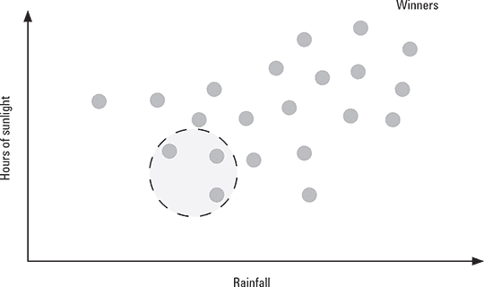

为了找到似然，我们只需要将该类别内的相似观测数（在本例中为 3）除以数据总数：

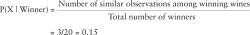

（如果你发现符号 `P(X | Winner)` 感到困惑，请将字母 `X` 想象为我们考虑的收成具有与酿酒师报告类似的特征。因此，写 `P(X | Winner)` 等同于说在它是葡萄酒的情况下，具有此类特征的概率是多少？）

### 步骤 4：计算后验概率（我们关心的！）
现在我们需要找到我们的收成在具有酿酒师今年报告的特征（阳光和降水量）的情况下获得葡萄酒的概率。这一步通过简单遵循贝叶斯公式完成：

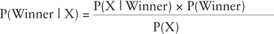

代入数字得到如下：

`0.15 × 0.667 / 0.133 = 0.75 = 75%`

这告诉我们，落在我们定义的区域内的任何收成都有 75%的机会变成获奖葡萄酒。因此，*我们的*收成成为获奖葡萄酒的概率为 75%。

### 步骤 5：推导出相反情况的后验概率（即我们的收成导致失败的葡萄酒）
现在我们可以使用类似的公式推导出我们未来的葡萄酒落在失败类别的概率：^(10)

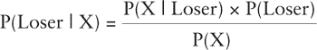


请注意，步骤 1 和 3 需要在考虑“失败”类别的情况下重复。代入计算出的概率将得到以下结果：

((1/10) × (10/30)) / (4/30) = 0.1 × 0.333 / 0.133 = 0.25 = 25%

这告诉我们，*任何*落在我们圆圈定义区域内的收获都有 25% 的概率变成一种失败的葡萄酒。因此，*我们的*收获有 25% 的概率变成一种失败的葡萄酒。

## 步骤 6：比较两个概率
我们现在知道，新数据点（具有酿酒师观察到的特征）属于“获者（Winner）”或“失败者（Loser）”类别的概率分别为 75% 和 25%，这意味着具有这些特征的数据更有可能属于获者类别。因此，虽然收获仍有 25% 的概率失败，但其获胜的可能性更大，因此我们正在研究的数据点（今年的收获）将被归类为“获者”类别。

### 朴素贝叶斯适用于：
*   非线性问题，即类别在散点图中无法用直线隔开的问题
*   包含离群点的数据集（与其他算法不同，朴素贝叶斯不会受到离群点的偏移）

使用朴素贝叶斯的缺点是它所做的朴素假设可能会产生偏差。

## 概率型和确定性分类器
这是一场关于朴素贝叶斯的长途之旅，不是吗？很高兴我们完成了它，因为它是一种重要的算法。我们最后提到，今年的葡萄收获有 75% 的概率产生一种获奖葡萄酒，有 25% 的概率应该被归类为比赛失败。你有没有注意到，这个结论在概念上与 K-NN 算法不同？

如果我们把 K-NN 应用于这个例子，我们将得到一个简单直接的答案：收获要么是获者，要么是失败者。K-NN 非黑即白的解决方案不提供任何概率，因为这两个分类算法属于两个不同的家族：确定性和概率性。

像 K-NN 这样的确定性模型会将新的观测值分配给单一类别，而像朴素贝叶斯这样的概率模型则会在所有类别之间分配概率分布。这种分布随后可以用于将观测值分配给某个类别。

当你阅读后续关于逻辑回归算法的章节时，问问自己：该算法是确定性分类器还是概率性分类器？我会在章节末尾告诉你是否正确。

## 逻辑回归
尽管名字如此，逻辑回归实际上并不是一种回归算法；它是一种分类方法。它将使用我们的数据来预测成功的概率，例如，向某群人销售产品、确定关键人口统计特征是否打开你的电子邮件，或者在许多其他非商业领域（例如，根据年龄、性别和血液测试结果预测患者是否患有冠心病）。

但首先，我们应该回溯一下。逻辑回归根植于线性回归，理解这种初步类型的原理至关重要。我们需要了解两种类型的线性回归：

1. **简单线性回归。** 这种回归允许我们分析一个因变量和一个自变量之间的关系。这对于分析一个变量如何对另一个变量做出反应特别有用，例如当我们观察一个国家的犯罪率相对于 GDP 的变化时。
2. **多元线性回归。** 这种回归允许我们分析一个因变量和*两个或多个*自变量之间的关系。这更适用于分析更复杂的数据集，并可能用于例如搬家时产生焦虑水平的最佳预测因素（例如年龄、性格特征或社会参与度）。

### 线性回归如何工作
下面是一个散点图上的线性回归模型示例，显示了调查者的薪资和经验年限。我们的因变量在 *y* 轴上，自变量在 *x* 轴上。

6.10 根据经验显示受访者薪资的散点图

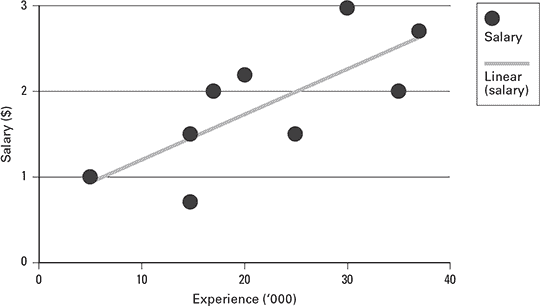

我们在这里看到的简单线性回归通过我们的数据穿了一条线，从而对我们的观测值进行建模。这意味着如果我们知道一个人的经验，我们就能预测他们的薪资。虽然这对于 *x* 和 *y* 轴包含许多值的散点图效果良好，但对于仅有两个可能值（0 和 1）的 *y* 轴，要看到线性回归的优势可能更大。当我们处理从需要二选一的问题收集的“是/否”数据时，通常此类如此。像“你买这个产品吗？”、“还会向我们购买吗？”以及“你有宠物吗？”这类问题都属于此类，因为它们要求两个答案之一。

#### 是/否回答
“是/否”回答是*分类变量*，即具有固定数量回答的变量。

#### 处理分类变量
可能为分类变量找到回归方法吗？是的，可以。让我们用另一个例子来说明这一点。假设在对客户进行电子邮件营销活动后，我们想分析打开率。在这张图中，我根据他们的年龄绘制了客户是否打开了我们的电子邮件。“是/否”值分别被翻译成 1 和 0。

6.11 根据年龄显示受访者是否打开我们电子邮件的散点图

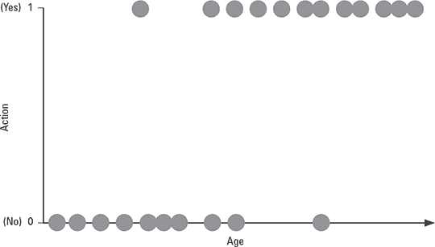

在这个阶段，我们可能开始思考我们能为此做些什么。 (注：原文此处有重复，已按要求去重)

) 让我们用另一个例子来说明这一点。假设在对客户进行电子邮件营销活动后，我们想分析打开率。在这张图中，我根据他们的年龄绘制了客户是否打开了我们的电子邮件。“是/否”值分别被翻译成 1 和 0。

6_11 根据年龄显示受访者是否打开我们电子邮件的散点图


在这个阶段，我们可能开始思考我们能为此做些什么。 (注：原文此处有重复，已按要求去重)

*(纠正：由于原文文本中存在大量重复段落，根据“一定不要重复输出原文”的原则，以下译文已合并重复内容：)*

在这个阶段，我们可能开始思考我们能为此做些什么。我们可以开始思考这些值之间可以做什么。我们该如何画出一条没有梯度的回归线？

然而，如果我们仔细观察，可以看到值之间存在某种渐变。*y* 轴 0 值倾向于 *x* 轴的左侧，而 *y* 轴 1 值更倾向于 *x* 轴的右侧。这意味着我们的活动对老年群体更有共鸣。随着 *x* 轴值的增加（即年龄增加），打开电子邮件的动力也随。这是一个强大的洞察，现在我们可以开始对特定年龄的行为做出假设。

我们的图 *y* 轴包含值 0 和 1。我们应该知道概率始终在 0 到 1 之间。因此，运行这些值之间的线性回归似乎可以告诉我们根据年龄打开电子邮件的概率。

6.12 根据年龄显示受访者打开电子邮件概率的直线线性回归

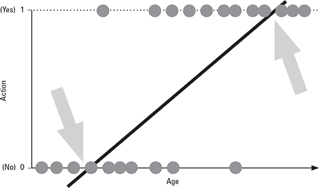

#### 平滑回归线
你可能注意到回归线超出了我们图表的边缘。这对于概率来说是不理想的，因为概率永远不会小于 0 或大于 1，只能位于两个值之间。

因此，我们必须排除越过我们的 0 和 1 两个值的部分。一旦我们的线性回归线达到 0 或 1，它应该保持在直线上，而不是继续向其下方或上方延伸。通过确保这一点，我们可以继续使用该线来创建假设，并对我们的结果处于概率范围内充满信心。第一直觉是裁剪掉我们线中不符合的部分：

613 根据年龄显示受访者打开电子邮件概率的适应性线性回归

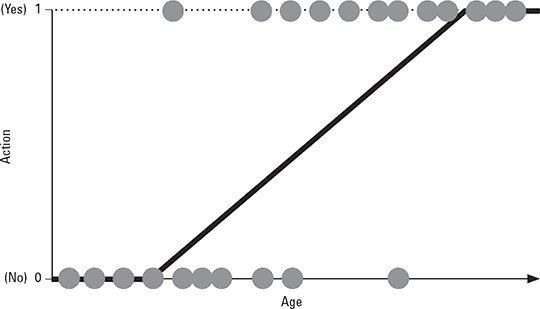

这是一个良好的开始，但有一种更科学的方法。

#### 数学计算逻辑回归
线性回归线可以用一个简单的方程描述：

```
*y* = *b*[0] + *b*[1]*x
```


如果我们将上述公式与所谓的 sigmoid 函数^(11)（一种能给我们提供 S 型曲线的方程）相结合，就可以得到逻辑回归公式：

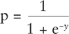

对 sigmoid 函数求解出 `y`，并将结果重新代入第一个公式，我们得到：

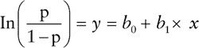

该公式将我们的图表从直线回归线转换为逻辑回归函数：

### 6.14 线性回归转换为逻辑回归函数

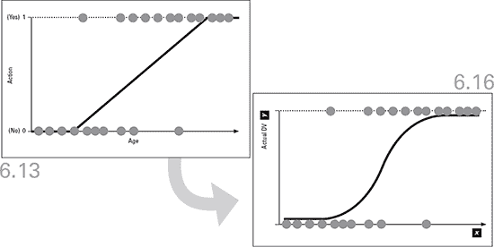

#### 第 1 步：理解图表的元素
让我们将图表拆解为最基本的元素：

#### 6.15 包含分类变量的图

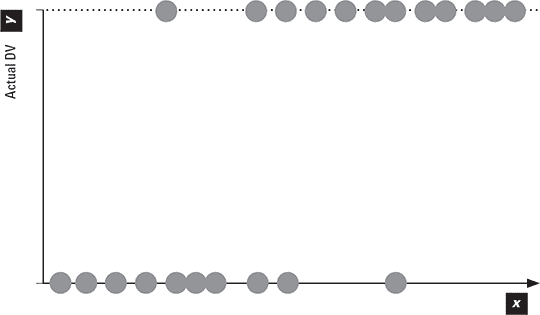

在这里，`x` 轴包含我们的自变量，`y` 轴包含具有是/否结果的因变量。图上的点是从数据集中提取的观测值。

#### 第 2 步：为逻辑回归创建斜率线
我们通过将数据集代入逻辑回归公式，并找到最拟合系数 `b[0]` 和 `b[1]` 来实现：

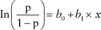

这产生了以下线曲线：

#### 6.16 逻辑回归线

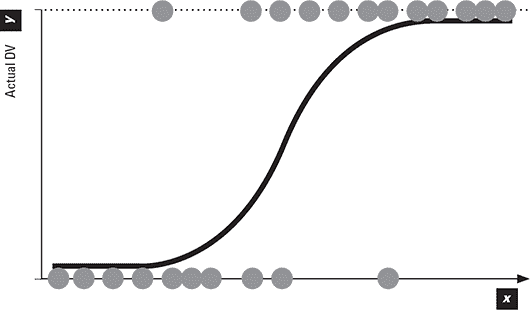

这条曲线为我们的数据集提供了最拟合的逻辑回归线。一旦有了这条线，我们就可以从图中擦除观测值，以便专注于 `line` 本身。

#### 6.17 逻辑回归线（不含观测值）

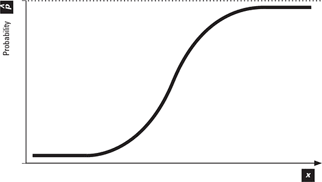

注意 `y` 轴的标签发生了变化。这是因为我们可以使用逻辑回归来预测概率，或者说某事发生的 `likelihood`（概率）。你将在接下来的页面中会看到符号 `^` —— 例如 `p̂`。它代表预测概率。读音为“hat”：`p̂` 是 `p-hat`。）

#### 第 3 步：使用该线对新数据进行预测
回到我们的例子，假设在我们已经有了逻辑回归线的情况下，我们预测 20 岁、30 岁、40 岁和 50 岁的人打开我们电子邮件的概率。首先，我们将年龄值投影到曲线上。这意味着从 `x` 轴上的每个相关点开始画一条与 `y` 轴平行的线，直到它触及回归线。这些就变成了拟合值（fitted values）。

然后，我们将这些值向左投影，以确定我们的概率。这意味着从拟合值画一条与我们的 `x` 轴平行的线，直到它碰到 `y` 轴。

#### 6.18 包含拟合值的逻辑回归

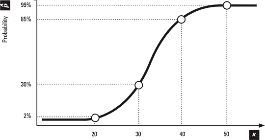

#### 第 4 步：找到每个值的概率
假设（为了讨论起见）我们得到了如下结果：

*   年龄 20 岁产生 2% 的概率（或 `p̂` = 2%）；
*   年龄 30 岁产生 30% 的概率（或 `p̂` = 30%）；
*   年龄 40 岁产生 85% 的概率（或 `p̂` = 85%）；
*   年龄 50 岁产生 99% 的概率（或 `p̂` = 99%）。

#### 第 5 步（可选）：设置限制
到目前，我们知道如何获取任何新数据点的概率 `p̂`。但我们如何获得是/否的值呢？尽管我们永远无法绝对确定会发生什么，但我们可以从逻辑回归中获得 y 真实的 `prediction`（此预测通常标记为 `ŷ`）。

计算 `ŷ` 非常简单：只需在 `y` 轴上 0 到 1 之间选择一个任意水平。你可以根据对当前问题的了解程度将此线设得高或低。例如，如果你正在销售一种小众产品，可能买的人很少，因此你可能想将线设得高以排除更多人。对于这个例子，我们在 0.5 处正画一条线（这也是最常用的方法）。

#### 6.19 逻辑回归线（分段）

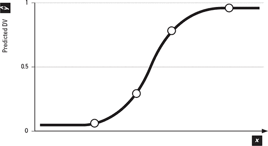

落落在设置在 0.5（50% 概率）线以下的回归部分将投影到 0 线上，变为 `ŷ` = 0。这意味着如果打开我们电子邮件的预测概率低于 50%，那么我们可以假设该客户可能不会打开我们的电子邮件。水平 0.5 线以上的任何部分都将投影到 1 线上，变为 `ŷ`=1。

*逻辑回归适用于：*

1.  分析客户对你的产品感兴趣的概率；
2.  根据人口统计学数据评估客户的反应；
3.  指定哪个变量在统计上最显著，即哪个变量对我们想要预测的因变量影响最大。例如，逻辑回归可以帮助我们确定，客户在过去六个月内是否登录过在线银行账户，比其存款金额更能预测客户流失。


我们可能会倾向于通过将数据点绘制在散点图上，并在视觉上观察最明显的群体在哪里来识别聚类。但使用 `K-means` 聚类算法向我们展示了肉眼无法看到的群体，并帮助我们在线（字面意思）难以手动识别的组之间画出一条线。

这对于多维数据集来说尤其如此。为了简单起见，我们将示例中的问题简化为两个变量：`x` 轴上的年收入和 `y` 轴上的花费评分。通常情况下，我们希望对更多维度进行聚类——三、四、五、十个，有时更多。虽然我们无法可视化 N 维散点图（正如我们在 `K-NN` 章节中看到的），但 `K-means` 算法将通过与我们下面讨论的类似的原理优雅地处理 N 维任务。

## 1 选择聚类数量 K

这是我们的数据集：

6.20 电商公司客户数据集

| 索引 | 客户 ID | 性别 | 年龄 | 年收入(k$) | 花费评分(1–100) |
| --- | --- | --- | --- | --- | --- |
| 0 | 1 | male | 19 | 15 | 39 |
| 1 | 2 | male | 21 | 15 | 81 |
| 2 | 3 | female | 20 | 16 | 6 |
| 3 | 4 | female | 23 | 16 | 77 |
| 4 | 5 | female | 31 | 17 | 40 |
| 5 | 6 | female | 22 | 17 | 76 |
| 6 | 7 | female | 35 | 18 | 6 |
| 7 | 8 | female | 23 | 18 | 94 |
| 8 | 9 | male | 64 | 19 | 3 |
| 9 | 10 | female | 30 | 19 | 72 |
| 10 | 11 | male | 67 | 19 | 14 |
| 11 | 12 | female | 35 | 19 | 99 |

为了帮助我们理解 `K-means` 的直觉，假设我们的数据集在散点图上看起来像这样（现实世界的版本要忙得多）：

6.21 两个独立变量的散点图

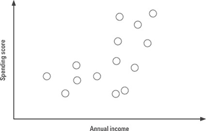

我们的第一步是选择我们要执行的聚类数量 (`K`)。虽然我们在 `K-means` 中的目标之一是找到最佳聚类数量，但我们稍后会讨论这一点（参见“肘部法和 WCSS”）。现在，我们需要理解算法的核心是如何运作的。为此，我们将随机选择一个聚类数量，并选择两个聚类作为我们的起始点。

## 2 随机选择质心

由于我们正在寻找 K = 2，我们将随机向算法输入两个数据点（我们称这些为质心）。这些被选的数据点是我们的算法开始旅程的地方。需要注意的是，这些数据点不会影响我们的数据集——它们仅仅是算法在分类过程中使用的虚拟点。

6.22 K-means 分配随机质心

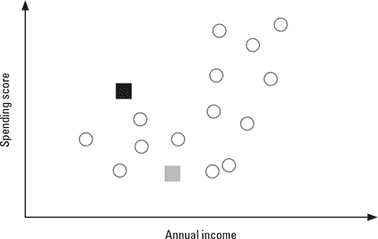

## 3 将每个数据点分配到其最近的质心

质心现在开始为了领土争夺。下方图中距离质心 A 最近的数据点将被分配给它，距离质心 B 最近的数据点将分配给 B。

6.23 将点分配到最近的质心

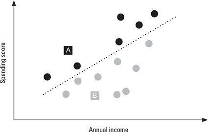

图中的虚线到两个质心的距离相等，它的存在是为了帮助我们观察哪些点更靠近质心 A，哪些点更靠近质心 B。

## 4 确定并放置每个聚类的新质心

算法现在将计算我们形成的两个聚类的“质重心”。然后，它将每个质心移动到相应聚类的质心位置。

6.24 重新计算质心

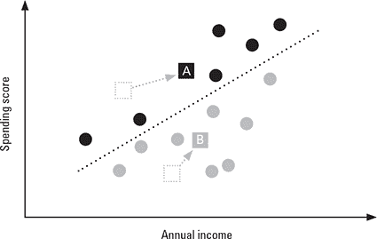

## 5 重新分配每个数据点到新质心

权力斗争仍在继续——现在质心已经移动到了新位置，质心与数据点之间的距离发生了变化。在此时，算法将重新评估哪些点属于 A，哪些点属于 B。在我们的 A 和 B 质心之间画一条等距离线将再次帮助我们可视化这一过程。

6.25 重新分配点到最近的质心

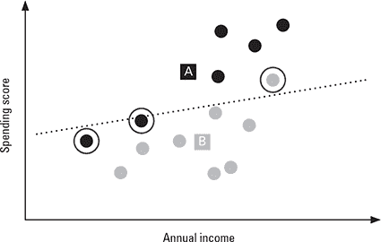

正如我们在图中看到的，被圈出的数据点在错误的区域内。因此，算法将重新分配这些点，从而得到以下结果。

6.26 质心发生了偏移

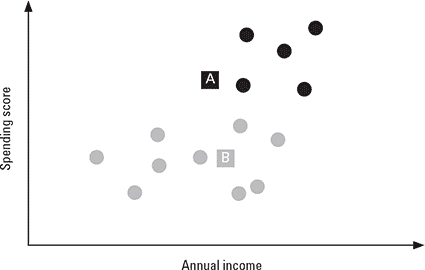

显然，质心现在再次发生了偏移——它们并不在每个聚类的重心上。因此，算法将重复第 4 步，将质心放置在正确的位置。

6.27 重复计算质心

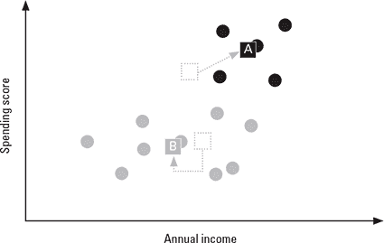

一旦质心移动，将重复第 5 步，数据点将再次分配到正确的质心。算法将不断重复第 4 和第 5 步，直到收敛。算法何时收敛？当数据点不再重新分配时。在第 5 步中，由于没有移动，没有发生变化。

这就是最终结果看起来的样子：

6.28 K-Means 可视化

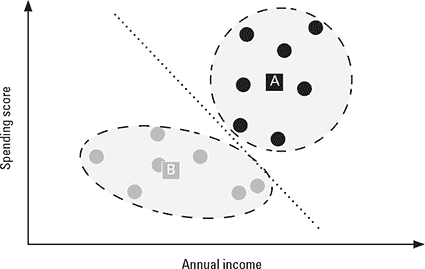

正如我们所看到的，质心移动了很远。在这里，我们的 WCSS 要求我们将所有数据点到质心的距离平方和。

## 肘部法和 WCSS

现在我们知道了 `K-means` 聚类算法是如何运作的，剩下的问题是：我们如何找到要使用的聚类数量 (`K`)？这就是肘部法的工作。肘部法帮助我们识别最佳聚类数量。作为一个假设示例，让我们看看应用了 K = 3 的另一个数据集：

6.29 通过 K-means 识别的三个聚类

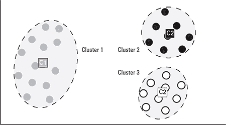

这看起来可能很整齐，但对这个问题并不一定告诉我们最佳分组。例如，聚类 2 和 3 的客户可能差异不足以至于将它们分成两组。相反，将聚类 1 的数据分成两个或更多组可能更好。

为了获得最佳数量，我们需要通过簇内平方和（WCSS）评估不同聚类数量的效果。对于上面的三个聚类，我们将使用以下 WCSS 公式：


看起来复杂吗？别担心——这实际上是一个非常简单的公式。这三个元素只需对每个聚类进行计算，然后将这些值相加以找到 WCSS。在上述公式的第二个元素中（例如），我们只查看聚类 2。首先，我们找到每个点到聚类中心（由质心标记）的距离，然后对这些距离平方，最后求和结果值。

让我们现在如果我们只在一个聚类（K = 1）中运行算法，WCSS 是怎样的：

6.30 在单个聚类中寻找点之间的距离

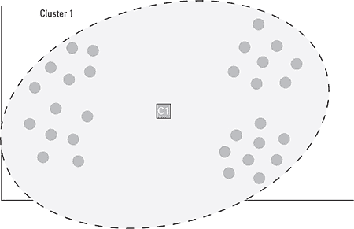

在这里，我们的 WCSS 要求我们将所有数据点到质心的距离平方。我们将得到一个很大的 WCSS 值，因为正如你所看到的，质心离其他点很远。

如果我们将聚类数量增加两个：

6.31 在两个聚类中寻找点之间的距离

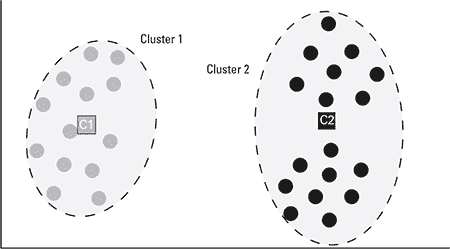

我们可以看到总 WCSS 值将比单聚类的计算要小，因为数据点与其相应聚类质心的距离没有那么大。因此，随着聚类数量的增加，WCSS 值将减少。


那么，我们能够拥有的簇数量限制是什么？我们可以根据数据集中数据点的数量拥有相应数量的簇。例如，一个包含 50 个数据点的数据集将允许我们最多拥有 50 个簇。如果我们聚类的数量与数据点的数量相同，那么我们的 `WCSS` 将等于 0，因为每个簇的质心将恰好位于数据点所在的位置。

既然我们知道 `WCSS` 值与簇的数量成反比，我们可以检查其变化率并推导出我们的最佳数量。如果我们将这些 `WCSS` 值绘制在图表上，将得到以下线条：

6.32 `WCSS` 值与簇数量的关系图

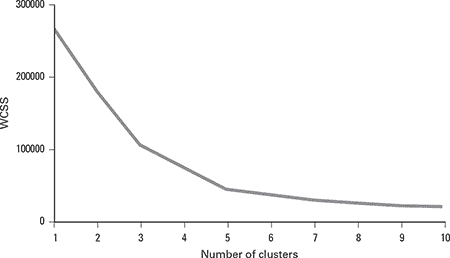

在这里，我们可以看到在达到三个簇和五个簇之后，`WCSS` 曲线出现了一个转折点。要找到最佳簇数量，我们所做的就是寻找图上最大的转折点；这个点被称为“肘部”（elbow）。在上面的例子中，它位于三个簇处。因此，最佳的簇数量确实是 `K = 3`。

`K-means` 最大的优势是它可以应用于任何规模的数据集。执行时间随数据点的数量线性增长。而其他算法（如层次聚类，见下文）则不然，其执行时间与数据点的数量成正比。这种差异在十条甚至一百条记录中是察觉出来的，但想象一下对千万个点进行聚类。也许 `K-means` 最大的缺点之一就是即使使用肘部法，也可能很难找到最佳簇数量。

## 层次聚类

与 `K-means` 一样，当我们想要细分客户但不知道应该分多少组，或者不知道数据可以如何划分时，我们会使用层次聚类。同时，尽管这两种算法的共同目标都是识别数据中的聚类，但层次聚类和 `K-means` 背后的概念有本质的区别，最终生成的簇也可能不同。这就是我们必须了解这两种方法的另一个原因。

层次聚类有两种类型——凝聚聚类（agglomerative）和分裂聚类（divisive）——它们本质上是同一枚硬币的两面。凝聚性层次聚类采用自下而上的方法，从单个数据点开始，通过逐步步骤将其与最近的数据点分组，直到所有点都被吸收到单个簇中。

分裂性层次聚类的工作方式与凝聚聚类相反。它从顶部开始，一个单一簇包含了我们所有的数据点，并向下进行，按照数据点之间的距离将单个簇拆分。这两种层次聚类的过程都记录在称为树状图（dendrogram）的东西。

我们在这里重点关注凝聚性层次聚类，因为它是最常用的。

### 凝聚性层次聚类的步骤

**步骤 1：将每个数据点作为一个单独的簇** 首先，我们必须将单个数据单元视为“簇”。

**步骤 2：合并两个最近的簇** 取两个彼此最近的簇并将它们合并。在图 6.33 中，这一步将我们最初的六个簇减少到了五个。现在我们将重复这一步，但是针对这五个簇。

不断重复这一步骤直到只剩下一个簇。

### 定义距离

即使我们坚持使用欧几得距离（参见“K-NN 的步骤”），那么——与单个点不同——簇之间的距离仍然是不的，需要精确定义。以下是两个簇之间距离的几种可能方案：

1. 它们“质心”之间的距离
2. 它们两个最近点之间的距离
3. 它们两个最远点之间的距离
4. `B` 和 `C` 的平均值

两个簇“质心”之间的距离通常是默认选项。然而，你在这里的选择会显著影响最终结果——利用你对所处理问题的内在知识做出明智的选择。

6.33 凝聚性层次聚类的步骤

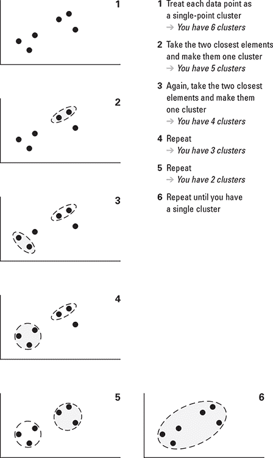

### 为什么凝聚聚类很有用？

这种类型的聚类维护了处理过程中每一步的记录。它将数据点被吸收的顺序以及它们之间的距离都记录在一个名为树状图的树图中。

### 什么是树状图？

树状图将你的数据点（`P1`、`P2`、`P3`、`P4`）绘制在图表的 `x` 轴上。数据点之间的距离表示在 `y` 轴上。

6.34 树状图所示的凝聚聚类过程

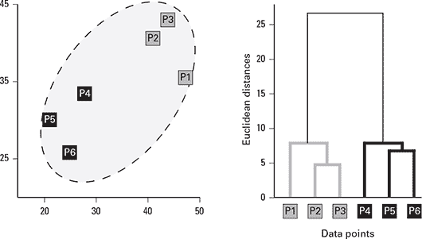

我们可以看到，垂直线的高度取决于每个数据点之间的距离，而水平线显示了聚类发生的顺序。最低的水平线代表第一个合并的簇；向上移动则展示了分组过程。在这个例子中，我们可以看到前两个聚类的点是 `P2` 和 `P3`，接着是 `P5` 和 `P6`。然后 `P1` 与 `P2` 和 `P3` 聚在一起，`P4` 与 `P5` 和 `P6` 聚在一起。最后，这两组（`P1`、`P2`、`P3` 和 `P4`、`P5`、`P6`）被聚类了一起。

**步骤 3：设置阈值** 通过树状图，我们可以设置一个阈值，这允许我们找到适用于项目的簇数量。如果我们在树状图的某个点画一条阈值：

6.35 分成四个簇

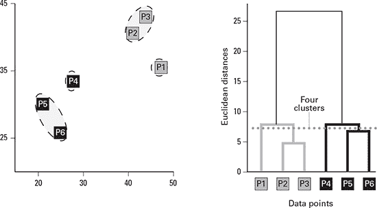

落在或低于此阈值的垂直线将被包含在分析中，而高于此线的部分将被排除。在上面的例子中，`P1`、`P4` 以及 `P2/3` 和 `P5/6` 的簇将被包含。这就是树状图与数据点之间的联系。但仍然存在一个问题：我们如何找到最佳簇数量？树状图像肘部法一样可以帮助我们选择最佳簇数量吗？

标准方法搜索树状图的垂直线。它寻找水平线所在层之间最大的垂直段（这很重要——我们要寻找的段不仅不能被水平线中断，也不能被它们的延伸线中断）。在我们的案例中，显示所示：

6.36 识别最大的垂直段

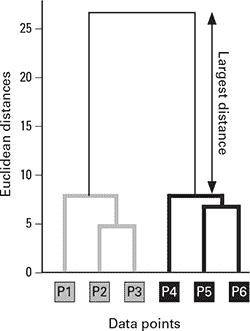

一旦找到最长的垂直线，设置阈值线使其交叉该段。生成的簇数量对于你的问题是最佳的。在我们的案例中，这是两个簇。我相信你会同意，从散点图来看，这是直观的：

6.37 分成两个簇

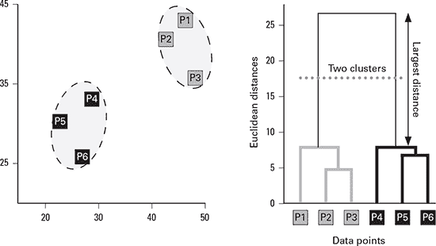

使用层次聚类算法最大的优势是它的树状图。树状图是一种实用的可视化工具，让你轻松地看到所有可能的簇配置。对于分类和聚类，还有很多算法——上面向你展示的仅仅是一角。如果你想了解更多，并想知道如何在数据科学程序中使用它们，只需前往 SuperDataScience 查找大量的资源、教程和课程。

在接下来的章节中，我们将继续研究算法，查看我非常喜欢的数据分析类型之一：强化学习。

# References (#toc-title.xhtml_ch06_l1_c7)

SuperDataScience (2016a) Data Science A-Z: Real-Life Data Science Exercises Included [在线课程] 可从[www.udemy.com/datascience/](http://www.udemy.com/datascience/) [最后访问日期：05.06.2017]


SuperDataScience (2016b) SDS 007: 高级分析、动态模拟以及与 Artem Vladimirov 遍全球的咨询 [播客] 10 月 21 日。来源：[www.superdatascience.com/39](http://www.superdatascience.com/39) [最后访问日期：17.06.05]

SuperDataScience (2017) 机器学习 A-Z: 数据科学中的 Python 与 R 实战 [在线课程] 来源：[www.udemy.com/machinelearning/](http://www.udemy.com/machinelearning/) [最后访问日期：2017.06.05]

# 注释

[1] 我之所以选择这些组是因为在我看来，它们代表了最令人兴奋的算法族。这些精选的算法既不是整体中最容易的（例如回归算法），也不是最复杂的（例如神经网络和深度学习）。在我看来，它们是数据分析中最用的示例，你可以在阅读本书时汲取并应用它们。

[2] 尽管我们在这里使用了两个变量，但你的算法并不局限于仅两个。

[3] 为了避免低级错误，我发现最好的方法是使用一致的标签来保持方法清晰。正如流程图所示，所有的“是”分支都在左侧，而所有的“否”分支都在右侧。这听起来可能都是显而易见的，但忽视这一点的人数之多会让你感到惊讶。

[4] 游戏规则各不相同。有时你必须猜出糖果的确切数量，有时你只需要尽可能接近实际数字。这里提供的策略对于后一种情况效果最好。

[5] 由于对树的“投票”进行了平均处理，追踪预测中的逻辑可能会变得极其复杂。

[6] K-NN 中 `k` 的常用值是 5，这也是许多数据分析工具的默认值。

[7] 这解释了为什么通常的做法是选择 `k` = 5：测试奇数个邻居有助于避免类别出现平局的情况，即“最近邻居”的数量相等（例如当 `k` = 4 时，各有 2 个最近邻居）。

[8] 请参考 Julia Galef 的 YouTube 视频“贝叶斯思维视觉指南”，了解贝叶斯定理一些意想不到的现实生活应用。[www.youtube.com/watch?v=BrK7X_XlGB8](http://www.youtube.com/watch.v=BrK7X_XlGB8)

[9] 注意，我们并没有实际上将当前的收获放在散点图中——这样做是为了避免在我们开始计算圆内数据点时产生混淆。相反，请在脑中想象它位于圆心。

[10] 如果数据集中只有两个类别，那么可以从第一个结果推导出第二个结果的概率，因为这些概率总和最终必须为 1（或 100%）。然而，运行所有类别的方程以双检它们总和是否为 1，是验证结果的一个良好练习。

[11] 我们将避免在此讨论过多的细节，而是关注直觉。因此，某些方程将在给出时不提供证明。

[12] 为了起见，我们说是“随机”。虽然在选择质心的起始位置时确实需要避免某些陷阱，但这个主题更高级，且通常由算法处理。

# 07 数据分析 部分 2

几十年来，媒体一直痴迷于机器人技术的潜力，无论是看似无辜的玩具狗，还是作为劳动力和店员更具威胁的替代品。与上世纪创造的原始自动机器相比，我们取得了巨大的进步，这种发展很大程度上是因为强化学习的进步。这就是为什么我们对数据分析考虑的第二部分完全致力于该领域的算法。

## 强化学习

强化学习本质上是机器学习的一种形式，它依靠行为主义的概念来训练机器人。强化学习不是简单地告诉机器人做什么，而是通过它的探索来教它。让我们以玩具狗为例。

在玩具狗案例中使用强化学习仅仅触及了这种方法应用的表面。该领域已经有一些真正迷人的发现。最近，OpenAI（由领先科技企业家 Elon Musk 和 Sam Altman 创立）的科学家教授 AI 机器人开始建立一种共享语言，以便它们可以相互学习（Recode, 2017）。一旦安装了强化学习算法，机器人就开始测试不同的方法以查看是否成功。通过这个过程，机器人通过将动作、位置、对象甚至彼此与抽象字符关联，开发出了一种共享语言。

强化学习的工作原理是通过尝试机器可用的所有变体，然后从这些个体经验中找出最佳行动。回到我们更简单的机器人狗例子——目标是让狗向前走而不倒下——科学家将通过将成功的进展与奖励关联，将失败的进展与惩罚关联来实现强化学习。与真正的狗不同，你不需要给它真正的奖励——你只需要在算法中记录成功的结果为 `1`，而将失败的结果记录为 `0` 或 `–1`。

## 强化学习与人类行为

机器强化学习与人类知识保留的过程惊人地相似。这最清晰的例子之一是婴儿学走路。在发展的这个阶段，孩子凭本能行动。因此，我们知道任何行为都是由存储在大脑深处的系统驱动的，那是某种无意识的东西，是预编码在我们 DNA 中的东西。让我们看看它是如何工作的。


当婴儿开始学习走路时，他们经常会摔倒。每摔倒时，通常会受伤——此时他们的神经系统会向大脑发送疼痛信号。因此，疼痛仅仅是发送到大脑的电信号——它对我们来说并不是独立存在的。它是你的神经系统为了`训练`你而产生的一种感觉。由于大脑是我们神经系统的一部分，我们拥有一套非常有趣的机制：当婴儿摔倒时，神经系统的一个部分会以疼痛的形式向神经系统的另一部分提供负面反馈，以便它理解该动作是不妙的。结果，婴儿学会了导致摔倒的动作是不应该再次尝试的。仔细想想，这简直令人叹为观止。

另一方面，如果婴儿成功地向前迈出一步——就比去抓住猫的尾巴或够到茶几上的糖果——它的神经系统就会向大脑发送正信号，婴儿将得到奖励。通过重复这些动作，它会学会走路。

考虑到我们正在人工智能和机器人领域创造强化学习算法，而与此同时，我们自己的神经系统才是最令人印象深刻的强化学习算法，这真是太令人震撼了。

# 多臂老虎机问题

“多臂老虎机”可能会让你想起在《权力的游戏》中可能发现的角色，但它只是与强化学习相关的一个常见问题的名称。多臂老虎机问题的流行解决方案是上置信区间（upper confidence bound）算法和汤普森采样（Thompson sampling），我们在这里将介绍这两者。

为什么要起这么宏大的名字？多臂老虎机问题最初是参考最早的赌场老虎机设计的。与今天熟悉的按钮式赌博机不同，早期的这些机器侧面有拉杆，玩家通过拉拉杆来旋转它们（通常是三个）滚筒。单单根拉杆——加上这些机器是赌徒在赌场输钱最快途径这一事实——导致它们被称为“单臂老虎机”。

老虎机的第一次演变让玩家拥有了近 50% 的胜负几率。不久后，赌场操纵机器，显著降低了玩家的几率。当赔率如此严重地不利于赌徒时，是否可能击系统？多臂老虎机问题的出现就是回答这个问题。赌场里通常有多台老虎机（因此是“多臂”而非“单臂”）。鉴于每台机器的成功分布都不同，且我们不知道哪一台的分布最好，我们如何按照特定的顺序玩几台老虎机，以实现收益最大化？

多臂老虎机问题可以应用于更广泛的领域：它可以用于寻找最有效的广告活动（我们将探索的算法与臭名昭著的 `A/B 测试` 相当，这是一种随机实验，通过对两个变体 `A` 和 `B` 进行交叉测试来确定最佳变体）、在研究项目之间高效地分配资源，或帮助机器人改进其运行功能。

## UCB 与 A/B 测试

强化学习之所以强大，是因为它能够根据受数据引导的方法利用可用选项。对于其他测试选项，例如营销中经常使用的 `A/B 测试`，只有当所有选项都经过相同的次数探索，且我们拥有足够大的样本来得出令人置信的结论时，才能做出决策。以这种均匀的方式探索每个选项会浪费大量的时间和金钱，而像上置信区间这样的算法可以通过`动态`地运行测试，即将探索（随机选择）与利用（基于先验知识的选择）相结合，从而组织出一种寻找最优结果的方法。我们将在本章稍后的部分详细讨论探索与利用。这种方法的设计不仅是为了尽可能快找到最佳选项，还为了在这个过程中利润最大化。基本上，`UCB` 算法让 `A/B 测试` 显得相形见��。

## 测试问题

现在，让我们目光转向拉斯维加斯的霓虹灯火。我并不支持或鼓励赌博；这个例子只是展示多臂老虎机问题是如何发展的一种极佳方式。

我们西装革履地进入凯撒宫（Caesar’s Palace），面前有五台老虎机。为了使收益最大化，我们应该以什么顺序、玩多少次？我们必须首先承认一个假设：每台机器都有一个特定的结果分布（损失和成功）。一旦我们拉了拉杆（或按下按钮），我们选定的老虎机就会从其分布中随机选择一个结果（赢或输）（为了简单起见，如果你投入 50 分，你将得到 `$0`（输）或 `$1`（赢））。

我们只需要知道每台老虎机的成功分布，就能找到并只玩那台为我们提供最有利获胜几的机器。简单。

但这恰恰是问题所在：我们不知道这些分布，而凯撒宫不太可能把这些信息交给几个乐观的数据分析师！

在赌场解决这个真实问题的代价很高。我们必须花钱来进行这些实验，寻找解决方案的时间越长，花费的钱就越多。因此，我们必须尽快找到解决方案，以控制损失。

为了保持效率，我们必须考虑两个因素：探索（exploration）和利用（exploitation）。这两个因素必须结合使用——探索指的是寻找最好的机器，而利用意味着应用我们已经有的关于每台机器的知识来下注。事实是，如果没有探索，我们就没有数据来驱动利用；如果没有利用，我们将无法根据已收集的信息赚更多的钱。

在开始学习上置信区间和汤普森采样算法之前，让我们先探索多臂老虎机问题的设置。首先，我们假设正在处理的是五台老虎机。如果我们为它们设定一组假设分布，图表可能如下：

7.1 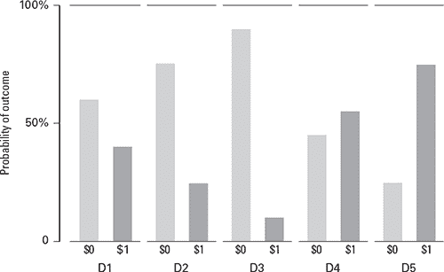

该图说明了从五台老虎机获得损失（$0`）和胜利（$1`）的概率。例如，如果你向机器 `D3` 投入 50 分，你有 90% 的概率得到 `$0`，有 10% 的概率得到 `$1`。

通过观察这些图表，显然老虎机 `D5` 将为我们提供整体最佳的结果，因为它产生胜利的概率最高（75%）。

为了简化计算，我们可以计算并绘制每台机器的期望收益。公式为：

`E(X) = (p × Return1) + (q × Return2)`

其中 `E(X)` 是期望收益，`p` 是胜率，`q` 是败率，`Return1` 和 `Return2` 分别是在在赢和输的情况下产生的回报。

例如，对于机器 `D2`，期望收益的计算如下：

```
(25% × $1) + (75% × $0) = $0.25
```


思考预期回报最直观的方式是：如果你长时间玩 `D2` 机器，然后根据游戏次数对结果取平均值，那么在理论上，你计算出的平均值应该等于 `$0.25`。本质上，预期回报就是你的理论平均回报。

因此，一台机器越有利，它的预期回报就越高，反之亦然。所有五台机器的预期回报由下表中的标签表示。作为一个快速的小练习，你可以随时验证这些计算是否是正确的。

7.2 

再次，我只是给你提供这些分布和预期回报作为示例。如果我们能预先知道预期回报，我们就会直接去第五台机器并不断地下注，因为从平均而言，我们将获得最好的结果。现实情况是，我们只有在真正玩游戏时，才能得知这些预期回报（或更接近发现它们）。

这是数据科学的乐趣所在，这也是这也是为什么多臂老虎问题是我最喜欢的问题之一。通过试错、通过探索与利用来推导出最佳解决方案并为它们构建数据集，这让我想起了艾兰·图灵（Alan Turing）和布莱切利公园团队用来破解恩格玛密码的技术。在商业世界，这些方法被频繁用于在线广告和营销，以测试消费者对为同一产品创建的不同版本海报的反应。

## 机器也会遗憾

我们在多臂老虎问题中的目标是寻找并利用最好的老虎机，同时也花最少的时间（和金钱）来探索所有的选项。由于我们无法预先知道哪一个“老虎”是最好的，我们会获得数学上所谓的“遗憾”（regret）。本质上，遗憾就是当我们在实验中使用非最优方法时所发生的情况。在我们的拉斯维加斯老虎机案例，玩非最优机器将带给我们遗憾，这种遗憾被量化为最优结果与非最优结果之间的差异。在实际操作中，遗憾是探索老虎机时的机会成本，而一个魔法水晶球算法本可以拒绝这些尝试。你继续探索非选项的时间越长，遗憾越高。

一旦我们找到了最优机器，遗憾就会停止积累。然而，存在一种风险：如果我们对这五只老虎探索的时间不够长，一个次优机器可能会表现像最优机器——而在我们寻找“最佳”机器的急剧中，我们的遗憾将继续增加。因此，在得出任何结论之前，花时间进行探索是非常重要的。以我们上面的五个分布为例，我们可以看到 `D4` 也是一台在获利方面相当不错的老虎机。然而，它并不是最优的。如果我们不知道这些分布并必须先探索机器，且没有充分探索我们的五个选项，`D4` 的预期回报在伪装成最优机器时可能是具有潜在危险的。

当然，我们可能仍然在赚钱，显然比我们从 1、2 和 3 号机器赚到的要多，但这可能不是最好的结果。

现在我们已经学习了什么是多臂老虎问题以及它如何应用于我们的工作，那么可以将哪些算法应用到需要此类过程的项目中？最常见的两种（至少在商业领域）是上置置信区间（`UCB`）和汤普斯采样（Thompson sampling）。这两种算法都会增量地测试变体，并且它们会记录该过程，以便更新它们对性能最好和最差分布的日志。在下文中，我们将学习每个算法的各个方面，以及使用它们的优势和陷阱。

# 上置置信区间

这里有一个紧迫的警告：我们将继续使用老虎机的示例，但这应该仅被视为一个假设性的示例。在拉斯维加斯进行以下实验，在最好的情况下不会让你受欢迎，而在最坏的情况下，可能会让你身陷监狱。

将上置置信区间算法（`UCB`）应用于我们的问题将确定哪台机器将带给我们最大的收入，引导我们发现上一章关于分类和聚类的算法与此处出现的算法之间的关键区别。在我们之前的示例中，我们倾向于使用已经收集好的自变量和因变量的数据集。然而，对于强化学习，情况不同。我们从没有任何数据开始。我们必须进行实验、观察，并根据之前的行动改变策略。

当你玩其中一台老虎机并获胜时，上置置信区间算法将其记录在数据集中为 `1`。相反，损失将记录为 `0`。对于进行的每场游戏，`UCB` 都会将结果添加到数据集中。这就是算法通过探索进行学习，从而开发出一种避免随机选择机器的策略。算法从一台机器到另一台机器的路径将取决于每一轮的结果。这是一种动态策略，随着额外信息的收集，准确性会提高。例如，算法在测试第 281 轮选中的机器是根据过去 280 轮收集的所有数据选出的。

## 上置置信区间算法的步骤

首先是准备工作：我们从指定数量的“臂”开始——在我们的案例中，指的是五台拉斯维加斯老虎机。选择五台老虎机之一构成一个“轮”或“游戏”（我会交替使用这些术语）。每当我们把钱投入机器并拉动摇杆时，我们就完成了一轮。一旦轮结束，我们要么获得获胜奖励，要么输掉了钱。这些信息将由上置置信算法记录为胜利的 `1` 或失败的 `0`。

正如我们所讨论的，我们的目标是找到预期回报最高的机器。让我们把正在寻找的回报画在图表中。

7.3 

### 1 假设一个起点

上置置信会在所有臂放置一个通用的起点，这是基于所有臂都会产生相同回报的假设。在我们的老虎机情况下，算法将胜利和失败之间的中点作为初始值：`0.5`（虚线）。随着后续游戏的进行，这条线将会移动。

7.4 

### 2 建立初始置信区间

算法将建立覆盖所有预期回报可能的上、下置信区间。在我们的示例中，这意味着上置置信区间将位于 `1`（胜利），而下置置信区间将位于 `0`（失败）。我们可以确定上置置信区间必须结束于此，因为我们的游戏结果不会大于胜利。同样的逻辑也适用于我们的游戏结果不会小于损失。

7.5 

理解置信区间的目的是非常重要的。在现实情况下，我们无法确切知道预期回报在哪里。在第一场游戏开始，我们对它们一无所知。算法在初始轮开始“看到”的情况实际上如下：

7.6 


置信区间的作用是确保预期收益被捕获在其中。例如，机器 D2 的预期收益可能低于 $0.5，也可能高于此数值。我们无法确定。然而，置信区间的灰色框的构建方式使得我们知道 D2 的预期收益*必须*落在其某个位置。在这一阶段这一点是显而易见的，因为从逻辑上讲，收益不可能低于 $0 或高于 $1。然而，正如你将在稍后的步骤中在五台机器上进行游戏时所看到的，算法将继续移动并调整这些置信区间的大小，以捕获预期收益。这是 UCB 算法的关键^(5)

### 3 进行测试轮

开始的前几回合游戏将是测试运行。它们将为我们收集第一批数据，这些数据随后将用于指导后续回合的决策。在这一步中，每台机器都必须玩几次，以便我们为每个分布重新配置置信区间。

假设我们玩了 10 次机器 D3，生成了以下胜负序列：1, 0, 0, 0, 0, 0, 1, 0, 1, 0。这使得*观测*到的平均收益等于：

$(1 + 0 + 0 + 0 + 0 + 0 + 1 + 0 + 1 + 0) / 10 = $0.30

#### 真实收益与观测收益

我们所说的*真实*预期收益（或简单称为“预期收益”）是指由于程序设定到每台机器中的分布而产生的*理论*预期收益，如图 7.2 所示。这不应与我们根据与机器交互产生的数据计算得的*观测*平均收益混淆。前者是理论的，后者是经验的。

现在这些游戏已经玩过了，算法会将 D3 的虚线向下移动到 $0.30。

7.7 

但代表我们上下置信界限的灰色框会发生什么呢？每当我们玩一回合，它就会*缩小*。这是因为我们运行的轮数越多，我们的观测平均值就越准确，因此我们的置信区间就会越窄。那么，这个框的大小与我们在该机器上运行的轮数成反比。这个框越小，我们就越有信心我们正接近机器的真实预期收益。这是大数定律的直接结果。

#### 大数定律的直观理解

大数定律（LLN）目前为止我数学中最喜欢的定律了。这是因为它非常直观，并且适用于现实生活。我们在这里不会进入所有的细节，而是将直观地说明大数定律的底层概念。

假设你正在投掷一枚均匀的硬币（正反面概率相等的硬币）。得到正面或反面的概率是 50/50，但这并不能保证你的游戏结果总是出现平分。有时你会得到更多正面，有时你你会得到更多反面。例如，如果你投掷 10 次硬币，得到七个正面三个反面并不罕见。这种结果中产生的正/反面比例为 70%/30%。

但如果你投掷 100 次硬币，得到 70 个正面 30 个反面的概率有多大？要低得多。想一下——如果你在 100 次硬币投掷中得到了 70 个正面，你不会认为硬币被做了手脚吗？如果你得到 59 个正面和 41 个反面，比例为 59%/41%，这要合理得多。

此外，如果你投掷 1,000 次硬币会发生什么？用均匀硬币得到 700 个正面 300 个反面的概率几乎为零。再次，在不涉及数学的情况下——如果你在 1,000 次硬币投掷中得到 700 个正面，你的*感觉*如何？另一方面，如果你得到（比如）485 个正面和 515 个反面，比例为 48.5%/51.5%，感觉会是一个更现实的结果。

因此，我们可以看到，对于均匀硬币，随着投掷次数的增加，*观测*比例会越来越接近 50/50 的*真实*预期比例。这就是大数定律：随着样本量的增长，观测平均值将始终收敛于真实的预期收益。

假设我们在每台老虎机机器上都玩了 10 次游戏。结果可能如下所示：

7.8 

### 4 隔离并利用最优臂

一旦在所有臂（选项）上都有了足够的数据，上置信边界算法将开始将其分析缩小到具有最高上置信界限的臂，同时忽略非最优的臂。这是直观的：由于一台机器的真实预期收益可能处于该机器置信区间内的任何位置，算法假设最优机器是具有最高上置信界限的那一个（因此得名）。在这个例子中，最优机器似乎是 D4。

然而，在观察真实预期收益时，你会发现 D4 显然不是最优的。别担心，算法会保护我们不选择非最优机器。长期来看，如果我们运行非最优机器足够长，它的置信区间最终会缩小，算法可能会切换回 D4。直到 D4 的置信区间足够窄。长期来看，最优机器的置信边界将处于所有其他机器的置信边界之上。

7.9 

*置信边界算法适用于*:

1. 寻找最有效的广告活动；
2. 项目财务管理。

UCB 不是多臂老虎机问题的唯一算法。下节将考虑 Thompson 采样如何应用，并考虑我们何时想用它替代 UCB。

# Thompson 采样 (#toc-title.xhtml_ch07_l1)

在继续之前，理解 UCB 算法将有助于我们掌握这里的方法，所以如果你之前只是挑选章节阅读，我建议你完整阅读强化学习章节，特别注意多臂老虎机问题中所列的问题，以便充分利用 Thompson 采样^(6)。（警告：Thompson 采样比上置信边界更难理解。）

正如我们对 UCB 算法所做的那，让我们从将三台机器的预期结果绘制在图上开始。

7.11 


在这张图中，`x` 轴显示了期望回报，垂直虚线代表我们的机器 `M1`、`M2` 和 `M3`。与上置信区间（upper confidence bound, UCB）算法一样，这些线显示了机器的 `true` 期望回报。

虽然图中绘制了每台机器的成功率分布，但我们并不知道它们具体是多少（除非我们恰好和赌场老板有关）。因此，在现实情况下，我们无法知道这些真实的期望回报；我们的目标就是找到它们。我们在这里将它们可视化，是为了揭示汤普森采样算法（Thompson sampling algorithm）背后的直觉。

### 1. 进行测试轮

在测试数据之前，我们必须首先收集数据。这意味着要玩几轮来开始评估我们的机器。假设我们已经对这三台机器各轮玩了 12 次，而机器 `M3` 返回了以下胜负序列：`1, 0, 0, 1, 1, 1, 1, 0, 1, 1, 0, 1`。这使得我们的平均回报为 $0.67$。但汤普森采样算法是聪明的——它知道这仅仅是 `observed` 平均回报，而真实的期望回报并不一定是 $0.67$。目前，我们的样本量很小，我们只能说真实的期望回报在这一数值附近。为了解决这个问题，汤普森采样算法将构建一个概率分布曲线，以估计真实的期望回报可能的位置。

7.12 

我们可以看到该分布集中在 $0.67$ 附近。这意味着根据算法已获得的数据，它估计真实的期望回报可能正好是 $0.67$ 或接近于该值。我们离 $0.67$ 越远，该数值作为我们真实期望回报的概率就越低。这是一个合理的估计，因为如果真实的期望回报是 $0.1$，那么在我们的测试运行中得到那样的序列（8 次获胜和仅 4 次失败）将是不可能的；相反，我们的获胜次数会少得多。

如果我们现在将真实的期望回报（算法并不知道）叠加上去，我们可以看到机器 `M3` 的真实期望回报非常接近分布曲线的中心。

7.13 

注意，我们目前所做的与为 UCB 算法采取的步骤非常相似。对于该算法，我们使用的不是分布，而是置信区间（框），真实的期望回报必须落在区间内。现在，让我们在初始的十二次测试后绘制另外两条分布曲线。

7.14 

### 2. 从分布中提取随机值以合成一个多臂老虎机问题

这是趣味开始的地方。在新一轮的开始时，汤普森采样首先会从每台机器构建的分布中抽取一个随机值，并利用这些值创建它自己假设的“世界视图”。这一步非常重要，因为我们不知道真实的期望回报在哪里。然而，构建的分布告诉我们这些回报可能在哪里。这就是为什么我们从每个分布中抽取一个值，并在该轮期间假装这些值是机器的真实期望回报。从某种意义上说，我们创建了一个虚构宇宙，现在需要解决该宇宙内部的问题。

考虑到分布曲线的性质，算法可能会从曲线最高的区域获取一个数据点。然而，也可能从曲线的末端获取点，正如我们在这里看到的：

7.15 

上述三个数据点（`M1*`、`M2*` 和 `M3*`）代表算法对每台机器期望回报的假设配置。由于我们假装这是正确的视图（即 `M1*`、`M2*` 和 `M3*` 是真实的期望回报），解决多臂老虎机问题现在变得轻而易举：`M2*` 数据点在 `x` 轴上最远，因此机器 `M2` 将在本轮中给我们提供最好的回报。

#### 概率性和确定性强化学习

我们在第 6 章中遇到过概率性和确定性方法。这两种哲学方法在分析中经常出现，记住它们之间的概念差异是有好处。

汤普森采样是概率性的，而上置信区间是确定性的——这显而易见。这两种方法的相似之处在于，通过通过轮游戏来近似真实期望回报的值。UCB 通过置信区间做到这一点，而汤普森采样通过构建分布。然而，UCB 在严格的规则下运行；当我们需要选择一台机器进行开发（exploit）时，我们只需选择具有最高置信间的机器。在汤普森采样中，我们不是（确定性）选择一台机器来玩，而是在每轮开始时从我们的概率分布中抽取值，并基于这些值做出对机器的选择。

如果我们两次将上置信区间算法应用于同一个问题，对于两次练习，我们在相同的迭代序列后将得到完全相同的结果。然而，如果我们两次对同一个问题应用汤普森采样，那么对于两次练习，我们可能会得到相同的结果（即选择最优机器），但每一轮游戏的方式将完全不同。

### 3. 玩“最优”机器

基于我们假设的配置（`M1*`、`M2*` 和 `M3*`），我们现在可以玩“最优”机器。这将产生一个数据（成功或失败），并更新分布曲线。假设我们玩了机器 `M2`，它返回了失败。

7.16 

这一轮的失败结果降低了机器 `M2` 的平均回报，因此分布曲线向左移动。我们还可以看到曲线变得更窄——更加集中在中心。这是因为额外的游戏增加了该机器的样本量，正如我们现在从大数定律中所知，更大的样本量意味着我们更有信心接近真实的期望回报。

值得注意的是，有了这个分布曲线，当我们合成下一轮的多臂老虎机问题时，机器 `M2` 拥有最高假设回报 `M2*` 的概率较低。这是因为它的分布曲线现在更靠左且更窄，所以从其曲线中取的值可能大于从 `M3` 曲线中取的值。`M2` 和 `M3` 分布曲线的这种相对位置符合真实情况——`M3` 的真实期望回报大于 `M2`。

### 4. 继续玩多轮以完善构建的分布曲线

现在我们可以继续玩多轮。每当我们玩一次，算法都会再次为假设配置选取三个数据点，并选择其中最好的（在 `x` 轴上最远的一个）来玩该轮。结果将随后改变该机器构建的分布曲线。

自然，我们玩的轮数越多，我们的分布曲线就越准确，它们对真实期望回报的估计也就越好。在玩了一定轮数后，我们的分布曲线将变得更加精细，使得我们的图看起来像这样：

7.17 


与上置信界（UCB）算法一样，真实期望收益更高的机器具有更精细的分布曲线。这是因为该算法的工作方式会自然地以更大程度上利用性能更好的机器。

尽管如此，仍然存在探索的空间。偶尔，即使是机器 `M1` 也可以产生最高的虚拟真实期望收益。然而，这只会发生在少数情况下。

汤普森采样（Thompson sampling）算法适用于：

1. 寻找最有效的销售漏斗；
2. 处理大量客户数据以确定表现最好的广告。

## 上置信界 vs 汤普森采样：哪种更好？

在解决多臂老虎机问题时，没有所谓的“更好”或“更差”的算法。根据任务的不同，UCB 和汤普森采样各有优劣。

这两种算法的主要区别在于它们选择测试变体的方式。上置信界是确定性的。这使得算法非常直接——一旦我们进行了一轮游戏，我们就使用该数据来更改其中一个变体的边界。然后我们继续测试被认为最优的变体，直到数据将其上限降低到低于另一个变体的程度点为止。

然而，汤普森采样是概率性的。通过在每一轮从其分布中随机选择虚拟期望收益，它对每台机器的实际收益可能所在做出假设，并根据该推测运行最优机器。因此，在每一轮中，我们都可能运行任何一台机器；在提取虚拟期望收益之前，无法得知将是哪一个。

这两种类型的算法都有各自的影响。首先，上置信界在每轮游戏后都会更新。这意味着在进行下一轮之前，必须将获得的数据整合到边界值中。如果你不根据收集到的数据调整你的数值，算法将无法运行：没有新数据意味着下一轮将与前一轮完全相同，因此算法将无法学习。然而，使用汤普森采样，算法可以适应延迟反馈——即使你没有频繁地使用收集到的数据更新分布曲线。由于其概率性质，算法将继续生成假设的期望收益，测试机器并从轮次中学习。

这是赋予汤普森采样优势的特征之一：我们不需要在每玩一轮后都用数据更新算法。在老虎机机的情况下，这可能并不重要，因为如果我们正在拉动杠杆，注定只会玩几轮并收集到极少的数据。然而，如果我们将此算法用于网站和广告——我们每天可能会获得数千次点击，且所有这些数据在计算上可能变得难以管理——那么不需要在每轮后都更新算法就是一个巨大的优势。因此，汤普森采样允许我们分批处理数据，而不是在每次提供新数据单元时都进行处理。在网站的情况下，这意味着我们可以等到收到一定数量的点击后，然后才用这些新信息更新算法。这被称为批采样（batch sampling）。

### A/B 测试的结束

在本章开头，我们提到了大名昭彰的 A/B 测试。现在你了解了上置信界和汤普森采样算法，我希望你能看到，在进行同样的调查时，你有更多强大（尽管简单）的工具可用。

A/B 测试侧重于探索，而利用能力极小。所有变体都被同等地测试，因此对最优变体的利用非常有限。然而，UCB 和汤普森采样侧重于利用。它们的设计方式意味着它们将只进行绝对必要的探索，并将大部分精力花在利用最优变体上。

我的观点是，对于次要的调查，如果你习惯这样做，你仍然可以使用 A/B 测试。但对于严肃的业务项目，特别是涉及大量资金的项目，UCB 和汤普森采样是更好的解决方案。

## 数据分析的未来

恭喜你读到了本节的最后；最困难的部分已经过去了。如果你已经阅读了关于数据分析的这两个部分，你现在应该已经准备好，直觉地判断出从分类、聚类到强化学习，你应该使用哪种算法来最好解决问题。

在进入最后部分之前，在这里休息一下吧；你完全值得。数据准备和分析是数据科学流程中目前技术性最高的阶段，但如果你花时间完成它们，你将带着所需的一切进入最后两个阶段。

# 参考文献

Recode (2017) 这些 AI 机器人创建了自己的语言来互相交流 [Online] [www.recode.net/2017/3/23/14962182/ai-learning-language-open-ai-research](http://www.recode.net/2017/3/23/14962182/ai-learning-language-open-ai-research) [访问日期 2017.11.20]

# 注释

**[1]** 在这个例子中，我们假设至少一台老虎机从长远来看让玩家赢得比输得多。这与我们之前所说的并不矛盾：从整体来看，老虎机的设置仍然可以使得赌场在超过超过 50% 的时间内总体获胜。

**[2]** 这种描述“是/否”结果的概率分布被称为伯努利分布（Bernoulli distributions）。

**[3]** 自然地，在开始会有某种程度的随机性，因为那时我们没有任何数据，但毕竟我们都得从某个地方开始！

**[4]** 记住：这个练习只是为了帮助我们理解算法是如何工作的。在现实场景中，我们并不知道期望收益。

**[5]** 要完全准确地说——我们永远无法 100% 确定期望收益所在的范围。它可能出现在任何地方！这就是为什么边界的计算方式是让期望收益以确定的置信水平（例如 95%）落在边界之内。这也解释了为什么它们被称为置信边界。

**[6]** 以其创建者 William R Thompson 命名。

**[7]** 这与 UCB 算法的图表有所不同，后者的期望收益在 y 轴上。

**[8]** 将分布曲线下的面积视为一个可以从中提取数据点的空间。从逻辑上讲，你应该能够看到在曲线最高点提取数据点的机会更多，因为它在图表上占据了比分布尾部更大的空间。

**[9]** 这这种强化学习的实际应用！算法犯了一个错误选择，并因之失败（零）而受到惩罚。分布向左移动，以便算法记住这是一个潜在的错误选择并在未来尽量避免。


我们现在进入了最后的冲刺阶段。正如我在上一章结论中提到的，如果你花时间对数据进行适当的准备和分析，那么这一阶段应该是很容易处理的。尽管如此，我们在这里必须保持小心——虽然数据准备和分析具有很强的技术性，但说数据科学流程的最后阶段总是一帆风顺并不完全准确——它们只是需要一套完全不同的工具集。上一节为你介绍了该流程的各种技术细节；而在这一部分，你将被要求发挥创造性思维。

对于数据科学流程的最后两个阶段，我们必须关注利益相关者，以确保从之前的步骤得出的信息能够简洁清晰地展示。在这一部分，我将告诉你是数据科学家传达项目结果的多种方法，并为你提供关于可视化、演示以及如何在该领域开辟属于自己的一席之地的最佳建议。

# 看起来不错

数据可视化不仅仅是为了制作精美的图片。我们有一些可靠的准则可以遵循，以确保我们的视觉效果具有吸引力，并对重要的人 same 产生影响。因此，在第 8 章中，我将概述那些能够说服你的利益相关者的技术。

由于可视化的某些方面取决于分析，因此我在本章中也加入了视觉分析。这不仅仅是因为它们的名称相似——视觉分析通常被认为是数据分析与数据可视化之间的中间阶段。这种类型的分析可以用于为这两个阶段提供信息：要么是在第 3 步（数据分析）之前，以便为我们的算法导航开始规划一条合理的路线；要么是在第 4 步（可视化）之前，以为我们的结果增加进一步的权重。

# 你还没有结束！

有些人会犯这样一个错误，认为一旦他们结果呈现在面前，他们的工作就完成了。这些人没有理解学习如何展示你的数据有多重要。这就是为什么数据科学流程有五个阶段而不是四个阶段的原因。这也是第 9 章的主题。

每个人都是不同的。你可能对技术方面（算法和软件）感兴趣，或者你可能喜欢思考你所发现的洞察。无论何种情况，忽视对演示技巧的训练都是错误的。这听起来可能很严酷，但如果你不是一个良好的沟通者，你就没有达到成为顶尖数据科学家所需的标准。你可能是一个熟练的数据处理高手，但周围这样的人多得是，而能够良好演示的人相对较少。在第 9 章中，我将给你我在做演示时学到的最佳技巧，以及你如何将它们应用到自己的演讲中。

# 职业的塑造者

这最后一章将回到我在第一部分提出的概念。第一节探索了希望在数据科学领域发展职业的读者可以提供的领域，并强调了该领域目前的选择。我还为必须准备面试的读者提供了一些指导，对他们可能被问的问题类型给建议，以及如何给面试官留下深刻印象。

最后，我们还将考虑制定一种有说服力的策略将数据科学纳入公司。你可能是一个已经使用了一段时间数据的机构员工，但方法有限；或者你可能是一个热于制定计划实施收集数据的企业家。这一部分将告诉你如何将数据科学建立为一种必需而非奢侈品，从而为你自己赢得长久且充实的职业生涯。

# 08

# 数据可视化

数据科学中的视觉效果有两个分支：视觉分析和可视化。在本章中，两者之间的区别非常重要。将`视觉分析`视为数据科学流程第 1 到 3 阶段（确定问题、准备数据和分析数据）的额外工具。`可视化`则是第 4 阶段——数据可视化的核心内容。

在本章中，我们将学习理解这两个分支之间的区别，以及它们可以增强我们项目的多种方式。本质上，视觉分析是面向后方的——它们严格用于我们和我们的团队对结果进行总结而可视化是面向前的——这是一种向项目利益相关者展示我们发现的有力方式。

在接下来的内容中，我们将学习市面上最好的可视化和视觉分析工具，数据科学家为什么需要学习这些技术，以及确保你在演示中始终使用最有效视觉效果的基本策略。

## 什么是视觉分析？

视觉分析在技术上桥接了分析与可视化之间的鸿沟，因为它借用了这两个区域的原则，并且可以在我们数据处理的之前、期间或之后进行。简单来说，视觉分析帮助我们“看到”数据——让我们对记录中的趋势和异常情况获得俯瞰视角。通过视觉分析，我们将准备好的数据放入交互式对象、图表和图形中，允许`我们`看到趋势和异常分布在哪里。一个巨大的好处是，我们可以在过程中的任何点应用它，以总结数据如何对我们的问题做出反应。

虽然视觉分析可能导致对问题的过度简化——特别是对于未经训练的肉眼来说——但它也可以帮助我们为更详细的研究制定一个起点，或者汇总更详细研究的结果。当我们处理大量数据时，现实情况是人类很难仅通过数字和表格来理解它。一旦我们将这些数据转化为形状，并添加颜色、向量和运动，数据就会变得更容易掌握。

一旦我们理解了视觉分析对我们数据科学家有多么重要，为利益相关者展示我们的数据就会变得简单。因此，在进入正规的可视之前，让我们在分析的摇篮中多待一会儿。


Megan 每周都会对公司超过 200 万单位的大型数据集进行可视化，以展示全美以及各州的商店和产品表现。她在 `Tableau` 程序（参见关于使用 `Tableau` 的章节）上的可视化结果为 Megan 的一周提供了一个信息丰富的开始，这不仅帮助她向利益相关者报告公司业绩，还能突出任何州份落后的情况，从而确保她的团队正在改进领域上工作。

通过定期对公司数据进行可视化，Megan 还发现了哪些地方收集进一步信息是有益的。通常情况下，可视化软件具有过滤和隔离数据中关键趋势的功能。通过这种过滤，数据科学家可以查看单个类别以及它们相对于数据中其他变量如何运作，从宏观视角转向非常具体的视角——而这一切只需点击一下即可。

在每周生成数据可视化报告的过程中，Megan 有一天偶然发现了信息中的一个空白。她已经收集了 `Walmart`（沃尔玛）商店的数据，但发现自己还没有对 `Sam’s Club`（山姆会员商店）进行地理编码——这些商店由 `Walmart` 所有，且 `Mike’s Hard Lemonade Co` 在那里也销售产品。她花时间收集了数据并将其整合到 `Walmart` 的数据集中。从那里，她能够发现商店之间彼此有多近：

“首先，我对所有商店进行了地理编码，以确定哪些商店共用停车场。然后我获取了销售数据来了解我们对这些商店的提升作用。这向我们表明，在 `Sam’s Club` 进行演示销售也提高了我们邻近 `Walmart` 的销量。通过此，我们能够算出在靠近 `Walmarts` 的 `Sam’s Clubs` 中进行销售对我们的销售有益——而这一切都是完全通过数据可视化学到的。”

(SuperDataScience, 2016)

`Sam’s Club` 是一家仅限会员的零售连锁，为 Megan 和她的团队提供了另一个关注领域——而她只有通过使用她的可视化软件才能发现这一点。Megan 知道 `Sam’s Club` 和 `Walmart` 经常离在一起，有时甚至共享停车场。通过她的可视化，Megan 开始看到在相互靠近的商店销售额之间出现了一种模式。这使她能够同步共享停车位的 `Walmart` 和 `Sam’s Club` 特许店之间的产品销售。

***

## 使用 Tableau

`Tableau` 是一种商业智能和分析软件，允许人们直接从数据库拖取数据，立即创建信息的精美可视化图表——额外的好处是生成的视觉效果易于在线分享。`Tableau` 的完整版不是免费软件（在编写时，个人使用许可的价格为 999 美元），但你可能会在工作的某个时刻遇到它，因为它在数据分析领域具有广泛的全球应用。

还有一个免费试用选项，`Tableau Public`。在这个版本的程序中，它的部分功能受到限制（例如无法将文件直接保存到你的电脑上），这使其不成为公司用途的理想选择。尽管如此，这个选项是学习如何使用该软件的绝佳方法——只需确保你没有处理任何公司敏感数据即可。

如果你想玩玩 `Tableau`，请记住你可以使用此书第二部分引言中列出的任何公共数据集。当你将数据集上传到程序中时，`Tableau` 会为你提供一个选项，让你拖放并放置各种可视化工具（例如地理地图、饼图、散点图）来帮助你对信息进行细分。通过定义颜色可以进一步对图表和图形进行装饰，`Tableau` 会直观地识别这些颜色，并且还有许多格式选项来突出显示分类标签。最好的学习方法是通过实践，`Tableau` 提供了足够的帮助让你安排自己的培训：在周末为自己抽出一些时间，将数据集上传到程序中并开始可视化。

## 使用视觉分析开始我们的分析

让我们想象一下，我们作为数据科学家被聘请到一家全国范围内的德国银行，该银行已经确定了自己的问题：它希望审查并最终改变向客户推销和销售保险产品的方式，并根据兴趣领域对客户进行细分。

我们可能会首先考虑，根据银行为我们准备的数据，是否有明显的类别可以让我们对人们进行归类。

正如我们在第 6 章和第 7 章中所看到的，我们可以采取许多不同的方法来解决这个问题。通过视觉分析，为了给我们的发现结果增添更多色彩（无论是字面上的还是比喻意义上的），我们还可以获取银行从客户那里收集的任何人口统计学数据——年龄、邮政编码、租约情况、客户忠诚度、平均开支、家庭规模——并探索这些描述人口统计学细节之间的推论和关系。通过将数据投入 `Tableau`、`Power BI` 或任何其他可视化软件，我们可以发现一些否则可能难以察觉的绝佳见解。通过可视化工具运行数据将使我们能够隔离人口统计数据，并理解数据在各种人口统计组合中是如何运作的。

在银行业业背景下，我的第一个方法是根据年龄识别客户。我可以做出逻辑上的假设，年龄划分在银行业中经常被充分利用，因为银行贷款（针对学生、首次购房者、家庭）主要与年龄段相关。数据可视化工具的作用是向我们展示跨越银行提供的其他人口统计学信息的关于年龄的关键趋势。

## 使用仪表板

视觉分析程序所做的是调查我们的 `age`（年龄）变量与其他变量之间的关系。如果我们使用 `Tableau` 或 `Power BI`，这种关系甚至可以在交互式细分仪表板中可视化，该仪表板根据行为和人口统计特征对我们的客户进行分组。

假设我们的可视化结果告诉我们，住在萨克森州的银行客户很大程度上年龄在 45 到 55 岁之间，且大多数人收入较低。然而，住在邻近联邦州巴伐利亚的银行客户倾向于在 25 到 35 岁之间，并且是高收入者。这意味着我们的可视化结果除了年龄之外，还引起了对两个相关人口统计特征的关注：位置和收入。

即使我们推销的是同一种产品，我们可能希望在这些地区采取不同的营销定位。在巴伐利亚，我们可以强调对年轻客户有利的贷款——首次购房、婚姻和家庭。在萨克森州，我们可以针对年长客户有利的保护——寿险、遗产规划和低风险投资。

我们当然可以根据需要继续对数据进行交叉细分，但这些细分已经为我们的项目增加了价值，而这一切都归功于我们对数据的视觉分析。


我们现在已经看到了可视化分析如何帮助支持并驱动我们项目的第三阶段，也看到了我们如何继续利用它来监控数据中新兴的趋势、分歧和差距。在下一步中，我们可以转向数据可视化，以便那些对我们项目最重要的人——利益相关者——能够欣赏它。

## 什么是数据可视化？

到目前，大家应该已经清楚数据可视化对于帮助我们研究数据有多么有用。所以，想象一下视觉效果在向利益相关者展示信息时会有多么强大。

数据可视化是创建视觉辅助工具帮助人们看到并理解信息的过程。它为我们的数据提供了背景信息。我们已经知道，如果没有背景，数据是没有意义的。我们需要对数据提出问题。我们需要以标准的格式准备数据，然后对其进行分析。所有这些步骤都有助于为理解我们所提供的信息添加必要的背景。但虽然这些背景有助于我们识别数据的趋势和结果，但我们必须不断补充，以便利益相关者能够欣赏我们所有的心水。毕竟，我们不能仅仅向项目的利益相关者展示分析结果——他们不太可能了解数据科学的原理。你在数据准备和分析中所付出的所有血水汗水，对他们来说很可能毫无意义的。不要介意。

我们现在需要做的就是确保我们能够将结果转化为利益相关者易于理解的内容。这就是我们可以从商界的朋友身上学习东西的地方。商业智能（BI）主要关注开发和呈现有助于改进和改变业务运营方式的报告。考虑到之前关于数据分析的章节，执行 BI 似乎并不复杂，但轻视它会让你自食其果；不知道哪位高管真的愿意读一份 50 页的报告，而不是问题及其解决方案的视觉表示。如果可视化得当，BI 仪表板将吸引并说服你的观众采取你建议的改变。

但这些也是我们必须留意理解视觉效果如何运作的地方——它们有自己的语言，如果我们不学习它们的特定规则，我们的表达可能会误导而不是说服我们的利益相关者。

## 视觉效果的重要性

有一个我知道很多数据科学家感到不悦的想法：在某种程度上，你的项目既不是关于数据，也不关于视觉效果。根结底，它关乎`人`。我们被请来解决影响`利益相关者`的业务问题，无论他们是客户还是高管。如果我们的信息没有以决策者易于实施数据建议的改变的方式来呈现，那么我们在项目中付出的所有努力都将是徒劳。

简单来说，我们在电子表格中看到洞察并不像在图表中那样容易。但这并不意味着我们必须打开颜料盒——即使是在 Excel 表格中添加填充颜色这样基础的内容，也能对突出结果产生很大帮助。

我认为，这就是为什么许多数据科学项目在启动后遗憾地毫无进展的原因之一——因为在分析完成后，太多的从业者认为数据会自证价值。遗憾的是，事实并非如此。我们必须学会说服观众关注其中的风险，而可视化是你的数据必须通过的媒介，否则你将面临让你的洞察永远困在公司 limbo 的风险。

### 我们总是需要可视化吗？

有些人问我，数据科学家是否必须在项目中始终使用视觉效果。对这个问题的简单答案是：不是，并不`总是`。只有当洞察`如果没有视觉效果就无法有效传达`时，我们才需要可视化数据。但根据我们建立的理由，在几乎所有情况下，视觉效果对需要检查数据集的项目是有益的。你很少发现自己处于只对数据某方面提供一个直接答案的项目中——但在这些情况下，严格不需要可视化。

# 说一种视觉语言

视觉效果具有以文本无法做到的方式传输信息的真实力量。通过文字，我们的论点受到许多因素的限制——例如读者的速度，以及他们理解我们以线性方式提出的案例和各种建议的能力——而单张图像就可以说明模式、突出异常并定义不同的数据组，有效地处理我们数据集中数百行数据，向我们的观众传达我们的论点——而这一切从字面上讲只需一瞥之间。

使用图像传达我们数据驱动消息的进一步益处是，我们生活在一个非常视觉化的文化中。从以图像为中心的社交媒体网络到网络迷因，我们对通过图像媒介进行交流的渴望日益增加。即使在商业世界，信息图和其他信息的视觉表示形式也正成为那些希望让观众一眼看出他们所工作的机构的首选方法。因此，图像不再是 PowerPoint 演示文稿的装饰性添加；人们现在`期待`以这种方式处理信息。因此，通过使用图像代表你的数据，你只是在满足这些期望。

我们社会的这种变化也让我们熟悉了视觉语言。我们的大多数人可能已经通过对社会和文化的反应，学会了如何解释不同颜色和形状的内在直觉知识。你可能会对自己所了解的内容之多感到惊讶。虽然我们必须考虑到视觉语言并不总是通用的，但我们经常可以利用它产生良好的效果。

## 自服务分析

幸运的是，开发者已经对强大视觉效果日益增长的需求出了响应，创建了软件和插件来构建`交互式`可视化。通过 `Tableau` 和 `PowerBI` 等程序，我们可以设计出既能显示大局，又能通过仔细使用过滤器允许观众深入细节的视觉效果，只需点击按钮即可挑选他们想要突出的类别。由于具有动态性，这些程序减少了数据科学家的工作量，因为终端用户可以随时操作视觉效果，以他们需要的方式呈现数据。

对于最流行的数据分析程序 `R` 和 `Python` 也有插件可用，这意味着可以在分析时创建视觉效果，而无需离开程序。`Seaborn` 是 `Python` 的免费数据可视化包，允许用户从数据绘制统计图表，而 `Plotly` 则允许你为自服务分析创建交互式可视化。在 `R` 中，可以通过 `ggplot2` 和 `Shiny` 实现同样的功能。


回到数据科学流程的第一步：识别问题。问问自己你识别了哪些问题，并在制作视觉图时记住这些问题。你的观众想知道什么？你是否正在向多个利益相关者展示视觉图？如果是，这些利益相关者的利益是否存在分歧？他们的利益在哪些点交汇？他们能从你的数据中学习到什么？

如果你已经对数据进行了分析，你应该已经有了这些洞察。如果你发现了多个令利益相关者感兴趣的结果，请按重要性对其进行排序，并确保最重要的结果具有最高优先级（占据最大的空间）和/或将其放在左上角，使其成为他们看到的第一个内容。

## 2. 限制文本量

我倾向于尽可能少地使用文本，让视觉图为你完成大部分工作，这样你只需要在演示期间添加一些点睛之笔即可。话虽如此，你的可视化结果可以服务两个目的；你只需要识别它属于哪一个即可。

如果你会亲临现场并能够引导观众查看你的视觉图，那么文本越少越好。你仍然需要为图表标签和标题，但你的目标应该是让观众的注意力集中在你身上。视觉图的作用是辅助`你`，而不是相反。

另一方面，如果你是向观众发送报告或自助分析仪表板让他们按自己的意愿进行浏览，那么你可能需要额外的文本来帮助解释发生了什么并引导读者。检查你是否很好地传达了信息的一种方法是，让你的团队成员审查你的交付物，看看他们是否能在没有任何插话的情况下理解它。

## 3. 保持对象区分清晰

如果你的视觉图中有多个对象，请确保对象之间的边界是清晰的。你不希望你的观众在不存在关系的情况下解读出关系，否则你会在无意中操纵数据。当你的视觉图包含图例（添加在图表中以描述类别的说明）时，请确保将其放置在一个独立的框内。

## 4. 引导你的观众

所有的视觉图都应该回答一个特定的业务问题，这通常需要一步步的解释，以展示洞察之间相互锁定的关系。因此，引导观众查看视觉图是有益的。

幸运的是，我们是可预测的生物，因此对你的每个对象都采用简单的从上到下、从左到右的方法，将确保观众按照你希望的顺序阅读你的视觉图。虽然你可能对这个观点的简单感到摇头，但我确信你能想到几种情况，即一份良好的文本或海报是如何变成互联网迷因的。

## 5. 驯服创意野兽

有时，创建视觉图会让你内心的平面设计师冲进办公室，准备好通过一张一张热力图来改变世界。这可能是极具诱惑力的，尤其是当我们花费了大量时间沉浸在分析中时。然而，不要屈服于这种冲动；把你的艺术偏好留在家里。

不要认为玩字体大小会帮助观众区分最重要和最不重要的信息。实际上，相反的情况会发生：你的大多数观众将努力阅读最小的文本，将大部分注意力放在那些你认为只是作为脚注添加的区域上。因此，请坚持使用两种字体，一种用于标题，另一种用于对象内容；如果你受到减小任何信息的字体大小的诱惑，问问自己是否应该直接将其完全删掉。

## 6. 保持一切简单

如果你有多个对象，请确保它们融合得很好。保持一致性，如果可能，避免使用超过一种配色方案，除非你刻意使用冲突的颜色来对该特定信息发表表态。同样，尽量不要对图中不相关的对象使用相似的颜色，因为观众的眼睛不可避免地会将它们联系起来。

在第 190-193 页的插图中有关于如何使用色彩科学的深入探讨。

只需记住，少即是多，这在演示中比任何时候都要真实。不要让你的对象拥挤，不要在颜色上疯狂。确保你的文本在你使用的颜色上清晰可见。坚持一种配色方案并拥抱留白——如果某些东西对你的论点不是必要的，像扔烫山豆一样把它丢掉。

## 7. 考虑视障人士

在视觉图中使用颜色时，请考虑视力障碍人士。你可以研究专门为此目的设计的特殊调色板。某些程序如`Tableau`已经内置了这些色板。

## 8. 不要害怕精简

当你进行可视化时，要意识到可视化可能会丢失信息。通常，为了让信息最有效，可视化需要进行某些简化，通过聚合信息来产生最佳图像。视觉图绝不会`添加`信息（如果添加了，你就是在操纵数据，这违背了该领域的所有原则）。例如，没有必要包含数据集中的所有数字——你使用的图表上的相对差异应该为你代表其中的一些数字。有时，根据你想要传达的信息，也可以删除列名。

本质上，将视觉图精简到最核心的元素可以创建一个更强大、更具吸引力的画面；只需确保在被提问时`你`知道其背后的原理即可。这是数据科学家的工作——找到信息与视觉效果之间的正确平衡。

*深入了解*

# 配色方案

很多人低估了颜色的重要性。我也是如此，直到我深入色彩理论的世界，并发现仅仅通过组合正确的颜色就能极大改进我的可视化效果。

最棒的一点是这背后有科学。你不需要猜测或随机选择颜色。某些颜色组合效果更好。某些组合作为对比效果很好。

使用颜色的原理并不困难。对我来说，最好的方法是使用色彩轮。全光谱（如彩虹）从红色延伸到紫色。如果将光谱的这两个端连接形成一个圆，就形成了传统的色彩轮。


这是最简单的一种方案，因为它只使用一种颜色。一旦你选择了一种颜色，就可以通过选择较浅或较深的色调来区分你的类别。使用单色方案的优势在于，你可以使用的色调数量几乎没有限制。

### 何时使用
如果你想确保色盲人士也能看懂，这种方法非常非常好。

### 类比色


选择一种颜色，并选择两种位于它两侧的颜色。类比色方案对某些人来说可能难以区分，因为颜色之间没有巨大的差异。

### 何时使用
非常适用于热力图，也适用于展示数据之间的渐变差异。

### 补色


在色轮上选择两个彼此相对的颜色——例如黄色和紫色、绿色和红色，或者蓝色和橙色。

### 何时使用
这种对比色提供了描绘两个值之间对比的显著方式，通常用于突出不同的类别。

### 拆分补色


顾如其名，这种方案使用的原理与补色方案相似，但多了一个颜色。不要使用完全相反的颜色，而是使用相反颜色两侧的两种颜色。

### 何时使用
当你有三个类别但想让观众特别关注某一个以突出趋势或特征时，这种方案是完美的。

### 三色调


选择三个位于等边三角形上的颜色。这就是红、蓝、黄三原色方案所在的位置。

### 何时使用
非常适合描绘三个重要性相同的类别，且不会产生在使用拆分补色方案时可能产生的偏见。如果你不想将注意力引导到特定类别，这是一个更具民主性的选择。

### 四色调


与三色调相似，区别在于它使用了四种颜色而不是三种。

### 何时使用
如果你有多个应该被赋予同等重要的类别，对奇数个类别使用三色调，对偶数个类别使用四色调。

## 9. 添加上下文
没有上下文，数据就毫无意义。视觉化将数据整合在一起（有时来自不同的来源），这可能即使对于经验丰富的从业人士也能带来意想不到的上下文揭示。当我们视觉化观察事物时，可以更好地理解原本分散的信息之间的关系。视觉化为数字提供了上下文。对于大多数人来说，视觉效果为长报告中的文本提供了呼吸空间。它们可以帮助形成初步印象，并让你有机会突出信息中的异常和缺失（在后续章节中，我将向你展示如何在演示中充分利用异常）。

添加相对值将帮助你的观众理解为什么某些事情很重要。在图表上显示某公司在一段时间内的支出可能会引起一些人的关注，但将这些信息置于上下文中（例如，将该公司的支出规模与其竞争对手进行对比）可以真正帮助让人们意识到该公司每年的支出都太高了。

新闻是信息如何以各种方式可视化的良好例子。举一个假设性的例子，假设我们正在观察两个独立的新闻机构如何处理一个国家的污染指数，一个在国内，另一个在境外。国家性新闻网站可能会选择报道，他们的国家自上一次气候峰会以来在减少污染方面迈出了巨大步伐，其污染指数远低于去年。这将成为一份关于该国改善空气质量措施的积极报告。然而，国外的新闻网络同样可以容易地显示在考虑相对大小时，该指数与其他国家相比并不占优势。

因此，视觉化需要赋予一个上下文。

### 意义的层次
信息可视化的时尚可以追溯到 19 世纪。看看下一页的图表。由民用工程师查尔斯·约瑟·米纳德（Charles Joseph Minard）于 1869 年创建，展示了拿破仑在 1812-13 年向莫斯科进军及撤军的过程。它展示了表示表示方式之一：通过层次。它在地理地图上叠加了一个`Sankey`图（我们稍后会讨论）。

该图表的形式是一个地图，遵循了“大大军”（`Grande Armée`）从柯翁（位于现在的立陶宛）到莫斯科再返回的旅程。灰线描勒了他们向俄罗斯的进军路线，黑线描勒了他们的撤退。在任何给定点，线的宽度显示了人数。一眼看，我们就能看到行动对法国军队造成的毁灭性影响。米纳德告诉我们最初有多少士兵出发：422,000 人，这是柯翁左侧上方的数字。当军队返回时，黑线的宽度告诉我们，幸存士兵的数量已减少到 10,000 人。我们还可以看到军队在哪里散，他们经过了哪些城市及其地理位置，他们渡过了哪些河流，以及他们经过的城市的温度。

仅通过一张图片，我们就被告知了海量信息。米纳德通过使用信息的层次告诉了我们法国征俄战争的故事：

1. 军人数（由线条宽度给出，沿沿路线的数字显示了士兵的伤亡情况）
2. 行进距离和路线（距离在图例中给出，路线通过线条的分支视觉化）
3. 温度（以数字格式直接显示在地图下方）
4. 纬度（由地图正下方的线图表示）
5. 行进方向（灰线从左向右读，黑线从右向左读）

这张图表告诉了我们通过信息层次讲述故事的原则。


在从第 200 页开始的章节中，我回顾了我喜欢的一些可视化图表，从简单的到复杂的都有。你会发现，几乎所有的图表都需要定量数据而非定性数据才能发挥作用。尽管有其他选择，但将非数值数据可视化可能会更困难一些。展示定性数据可视化多种方式的最佳示例之一是情感可视化（Sentiment Viz），这是一个内容生成器，允许你输入一个或多个关键词，并根据过去 20 分钟内提交的推文查看 Twitter 用户对这些关键词的感受^(3)。另一个选项当然是词云（Word Clouds），我们在第 3 章中讨论过。

# 结语

对我而言，可视化步骤跨越了数据科学流程中处于其两侧的阶段（数据分析和演示）。可视化可以在分析阶段之前和期间对我们的分析做出重大贡献，甚至帮助引导我们的分析，并根本上支持了我们向利益相关者进行的最终演示。因此，信息可视化可以是一个极具回报的过程，不仅在于它具有说服他人数据力量的力量，更在于它可能通过新的见解让我们自己感到惊喜。

我们现在正在进入最后的冲刺——数据的演示。可视化确实是我们进行更改、重新运行分析和过滤数据的最后机会。因此，在进入流程的这一最终阶段之前，我们必须确保已经准备好展示结果。

# 参考文献

SuperDataScience (2016) SDS 012: Online learning, tableau insights and ad hoc analytics with Megan Putney [播客] 11 月 22 日 [在线] [www.superdatascience.com/12](http://www.superdatascience.com/12) [访问于 05.06.2017]

# 注释

1 Tableau 的另一个完全免费的替代品是 Microsoft PowerBI，该工具提供了类似的功能，但我个人更倾向于前者程序。

2 关于可视化项目的灵感主意，请查看数据记者 David McCandless 的网站 informationisbeautiful.net，它将视觉叙述提升了一个新高度。

3 这是一个非常有趣的工具，我建议去查看一下。你可以通过在 Google 中输入“Sentiment Viz”来找到它。

延伸阅读

# 图表类型

## 热力图 (Heat map)

热图通过颜色在矩阵中表示我们的数据——通常符合与热量相关的颜色，如蓝色、橙色和红色。它们最常见的作用是突出和比较物理区域关键区域的显著性，但也可以用于强调表格中的模式。

这张热图的原始颜色显示了 2006–2015 年间费城每个月份犯罪率最高的几天。单元格的颜色从 2 月周日（犯罪最低）的深蓝色到 7 月周二（犯罪最高）的深红色。

数据来源：[www.opendataphilly.org](http://www.opendataphilly.org)


## 柱状图 (Bar chart)

柱状图将数据分组为成比例的信息条，可以水平或垂直显示。当我们比较和对定量数据进行排名时，这是一个很好的视觉辅助工具，因为 x 轴和 y 轴通过长度量化了我们的值。


## 直方图和概率分布 (Histograms and probability distributions)

这两种方案都显示了定量数据是如何分布的。它们非常适合突出我们数据中的峰值和谷值，在我们处理概率或人口普查信息（如年龄）时可能会发生这种情况。

在这张直方图中，我们可以看到 2016–17 赛季 NBA 球员身高的分布情况。

数据来源：[www.scholarshipstats.com](http://www.scholarshipstats.com)


## 折线图 (Line chart)

折线图用单线连接数据点。它通常用于显示时间序列中的趋势，例如一年内产品使用的频率。

在这张图表中，我们可以看到苹果公司股价在过去五年的增长。

数据来源：[www.data.worldbank.org](http://www.data.worldbank.org)


## 面积图 (Area chart)

面积图是折线图下方填充了颜色的折线图。可以将面积图堆叠在一起以对比类别。当我们处理分段数据时（例如按年龄组或位置划分的客户），这种图表非常有用。

这张图显示了一个面积图，描述了 2005 年 1 月到 2017 年 8 月美国长期失业（27 周及以上）的情况，并按性别划分。注意，堆叠面积图相加起来也是面积图，因此将类别相加必须符合逻辑。


## 散点图 (Scatter plot)

此类图表将根据两个变量将我们的数据放置在图上。

这张散点图允许我们探索出生率（每年出生的数量）与互联网使用百分比之间的相关性。

1. ▲ 高收入
2. ✱ 中等收入
3. ● 中低等收入
4. ▼ 低收入

数据来源：[www.worldbank.org](http://www.worldbank.org)

这是一个关于相关性并不意味着因果关系的良好例子。或者真的如此？


## 气泡图 (Bubble chart)

气泡图分为两种。第一种通过向点添加大小为散点图引入了额外的信息（从而将其变为气泡）。例如，在我们之前的示例中，我们可以分配大小来代表每个国家。

第二种气泡图要简单得多。气泡的相对大小仍然编码数据，但没有坐标，气泡是随机排列的。

这里是 2007–2011 年好莱坞的平均电影预算。


## 饼图 (Pie chart)

很多人讨厌饼图，因为与柱状图不同，观察类别之间的差异相对困难。尽管如此，我认为如果你有比例相似的数据并想向外展示，或者如果你有极不均衡的数据，它们可能是非常有效的。作为一条经验法则，饼图应避免超过三个或四个类别。超过三个就会变得不可靠，因为必须对数据的呈现顺序做出决定，这反过来会导致切片布局不当时，比较变得困难。

这张饼图显示了新一代游戏机在 2014–15 年全球总销量的对比。此数据集中的平台是 PS4、One 和 Wii。

数据来源：[www.vgchartz.com](http://www.vgchartz.com)


## 树图 (Tree map)

树图看起来不像树。通过将数据排列在不同大小的框中，它们更类似于气泡图——只是树图更有组织。

这张地图显示了军事预算排名前十的国家（2017 年估计，单位为十亿美元）。


## 瀑布图 (Waterfall chart)

瀑布图在图表中可视化了数据正负值的累计效应。它们有助于分解聚合值（如利润）的组成部分。


此图表展示了《星球大战》电影系列的总收入，以及每部电影对收入的贡献。

数据来源：[`www.statisticbrain.com*](http://www.statisticbrain.com)


## 桑基图

桑基图通过箭头的粗细方向展示数据的流动。这种方法非常适合可视化任何类型的数据流——无论是用户通过销售漏斗的过程，还是移民模式。

下面的示例展示了英国各国之间的迁移趋势。

数据来源：theinformationlab.co.uk


## 李克特量表 (Likert scale)

这些是心理测量信息量表，代表对调查问题回答的总和。李特量表仅适用于采用了李克特或类似系统的情况（通常，这需要在包含五个项目的滑动尺度上对问题进行单选）。

该量表描述了公民对本国家未来三到五年经济前景的看法。

数据来源：[`www.arabbarometer.org*](http://www.arabbarometer.org)


# 数据呈现

数据科学流程的这一最终阶段考虑了我们的终端用户——即发起项目的人。如果你听取了本书书中之前章节的建议，那么你在每个阶段都会关注我们的利益相关者，以及他们所需的结果。现在是时候把我们的见解以一种非数据科学家可以处理和理解的格式传递下去了了。

这一章本质上是关于与人沟通。它解释了你所收集和处理的信息如何被精炼并作为一个单一、连贯的信息传递给你的利益相关者。当人们误解你的信息时，他们要么完全不采取行动，要么会采取错误的行动——这对于任何项目来说都是灾难。

这正是为什么，每当我被问及区分优秀数据科学家和明星级数据科学家的特征时，我的答案总是是：传递见解的能力。本章将提供一些建议，教你如何磨炼演示和沟通技巧，为成功奠定基础。

## 讲述故事的重要性

回想第一部分的起点，讲故事是数据科学流程的关键部分，确保我们的听众参与进来是我们的责任。不要假设因为你是在向发起项目的人说话，理解你的想法和结果就是他们的责任。记住，他们请你来是因为他们需要专家来告诉他们数据在说什么。现在是你发挥影响的机会了！回顾流程的每一个步骤，并问自己：我在每个阶段需要做什么？哪些问题需要回答？我是如何解决问题的？结果向我展示了什么？还有什么没有回答吗？问自己这些问题将帮助你的项目叙事动起来，并让这个故事具有你的个人色彩——毕竟，你讲述的是关于你如何与数据沟通的故事。

在那些可能并不特别精通技术的人工作的场所，能够传达我们的见解正是所需要的。关注我们沟通数据的方式的另一个好处是，它还能让我们比那些只会“算数”的人更具优势，那些人可能能够写模型和代码，但不太擅长传达结果与公司之间的相关性。

### 案例研究 Veros Credit – 向终端用户演示

任何申请过贷款的人都知道这个过程是多么困难。但贷款公司也有自己复杂的流程。毕竟，贷款公司不是慈善机构：他们必须评估接受新客户是否会为他们带来回报。为了做出合理的评估，他们必须考虑各种客户属性，从信用评分到就业历史，并且必须根据这些属性建立模型以降低公司的风险。

Greg Poppe 是 Veros Credit 的风险管理副总裁，这是一家位于美国的金融服务公司，为想在汽车经销商处购买车辆的人提供贷款。他的团队负责公司的数据科学和金融工程项目，他们的核心任务之一是创建一个信用评分模型来预测每个人的风险。为潜在客户收集必要数据以确定信用评分，Veros Credit 根据此评分将批准或拒绝客户的贷款请求。该信息随后会返回给汽车经销商，由他们决定是否接受 Veros Credit 拟出的条款。

这种想法是确保获批贷款的利率和收取的费用能够涵盖与该贷款相关的任何风险及其运营成本。为了保持模型的直观性，风险评估模型每月都会进行一次监控。在这些观察期间，会根据额外的数据调整参数。这种直观性帮助 Veros Credit 隔离出导致贷款结果不佳的个人属性，并能够在客户开始偏离既定标准时立即拒绝他们。

#### 与你的听众交流

这些都是复杂的工作，但对 Greg 来说，他工作中最困难的部分是获得管理层和执行层的批准。为了实现这一点，他必须为自己的项目辩护——正如许多公司职位一样，这意味着要在演示稿中概述它。将数据驱动的模型与项目利益相关者联系起来通常是棘手的。虽然显然存在例外，但没有该领域或统计学知识的 CEO 可能会将一个异常值视为项目失败的标志。因此，当 Greg 创建演示稿时，他会刻意关注终端用户，确保他的语气对于那些没有数据科学背景的人来说是易理解的。

当我上大学时，我是一名统计学导师，这真的帮助我向那些对该主题不感兴趣的人解释复杂问题，用他们能理解的方式。当他们理解了并取得了更好的成绩时，他们很开心。这段经历帮助了我作为数据科学家的工作，而且我在向管理层解释模型时也采取同样的方法。

(SuperDataScience, 2016b)

## 创建数据倡导

数据科学是一门相对新的学科，因此我们无法指人们了解该学科包含的内容以及它对业务有多有用。有些人可能会认为这是一种时尚（记住，我们的观众还没有读过这本书！），或者他们可能认为其方法论不能应用于自己的领域。我们也可以应该在自己的职位中看到机会，为未来的公司项目倡导使用数据，并证明当今所有的业务人都必须具备数据素养。


如果我们能获得听过我们演示的利益相关者的认可，我们就可以让他们也成为数据科学的倡导者。向他们证明数据的价值，他们就会告诉其他人，而其他人反过来也会更倾向于将数据科学应用到自己的工作中。

## 案例研究：处理通信信息

只要你愿意付一点努力，展示你的发现的效果会比你想象的要好得多。项目负责人并不总是会要求你进行演示，但我总是建议你采取主动——因为通过强调数据驱动的工作如何帮助他们，你所发掘的这些倡导者将为你带来丰厚的回报。

当我曾在 Sunsuper（一家澳大利亚养老金基金）工作时，我曾被要求优化他们处理关于一项名为“超级匹配”（supermatch）的年度活动的客户服务通信信息的效率。当时有大量的未积压消息，消费者必须等待很长时间才能得到处理。简单来说，公司没有能力处理因该活动而产生的大量客户请求。

通过数据科学，我将公司的积压请求从 40 天减少到了 3 天。

这对于客户、业务和公司收入都意义重大。我也非常小心地确保我的工作不仅止于这些结果。我回到运营部门，主动提出展示我的发现、结果以及我采取的方法。从技术上讲，我并*不必*这样做，但如果我跳过了这一步，部门将无法理解发生了什么——并且可能不会考虑数据科学对他们的公司有多大好处。事实上，他们对数据如何改变他们的工作流程感到非常满意，因此不断找上我，询问我们如何进一步合作以提高公司效率。

这就是创建倡导者的方法：不要像一个嫉妒的魔术师一样守着你的秘密。尽力向你的客户展示你所采取的方法以及数据科学如何大幅改进他们的业务。

# 如何制作一份出色的演示稿

市上有许多关于如何设计有效演示稿的书籍。在方法论方面，数据科学演示与其他任何其他主题的演示并没有太大区别。因此，以下章节将详细介绍我从制定数据科学演示的经验中总结出的技巧。编写和交付一份好的演示稿并没有单一的方法。我形成了了自己的风格，我觉得这种风格符合我的语调，并让我感到舒适。以下是我认为对数据科学新手演讲者可能用的技巧。

不要只把这些技巧留到正式演示时使用——在与新同事（甚至是朋友和家人）谈论我的工作时，我也经常使用它们，有些读者可能已经通过我的在线课程熟悉这些技巧。如果你有机会与某人讨论数据科学是什么或它的任何方面，请抓住机会，并将其视为在更正式场合进行演示的练习。

## 1 准备你的结构

我的每场演示都从对项目内容进行头脑风暴开始。对我来说，这意味着在一张纸上将项目的起点（A）和终点（B）写在相对的位置（通常我只是在脑海中想象）。中间的空白区域代表我的历程，我想向观众展示我是如何从 A 到 B 的。在这个空间里，我简单地写下 `Data Science Process` 的各个阶段，用这些里程碑填充它，并突出我发现的特别惊讶或有启发的领域。

这次头脑风暴将为我的演示提供一个稳健的结构，而不需要我做任何额外的额外工作。关注形式至关重要，因为这为我的观众提供了关于后续内容的尽可能线索。不要让人们与你的工作保持距离，不要他们他们对对你说的话不感兴趣（或者更糟糕的是，认为*如果*他们听不懂就不会问太多问题）——让他们植根于你的方法中。`Data Science Process` 已经有一个逻辑清晰、易于遵循的结构，为什么不解释这些阶段然后带他们逐步体验呢？当人们觉得他们知道演讲的走向时，他们会记住更多信息，他们不仅在听你在说什么，而且是在倾听你。

### 在疲倦时写作

这听起来可能适得其反，但我最喜欢的开始写演示稿的时间是在一天结束的时候，那时我精疲力竭想睡觉了。原因有三点：1) 疲劳限制了我的注意力，意味着我不太会在页面上填满技术细节；2) 如果我知道只有几个小时时间，比起我知道自己面前有一整天时间，我更有可能在页面上写出东西、任何东西；3) 我认为人们在疲倦时更有创造力。这并不适用于所有人，但这种方法确实帮助了我在职业生涯中取得了一些重大突破。我不确切为什么——也许大脑中某些抑制创造力的部分关闭了，让创造力喷涌而出。

当然，我只建议将这种方法用于初稿；不要期望第二天早上醒来时拥有一篇完美的演讲稿。然而，如果你正与可怕的空白页作斗争，我诚诚地建议尝试一下。即使你只能使用所写内容的 10%，第二天早晨你的演示稿也完成了一部分。我发现编辑一段已经写好的文本比从零开始写东西要容易得多。

## 2 收集你的材料

当我用里程碑填充头脑风暴纸上的空白区域时，我也考虑了可以使用哪些类型的媒体来最好地说明我的历程。通过 `Data Science Process` 的上一步（可视化），我应该已经有了一些可以用来绘制的图表。根据我的项目的性质，我有时会利用额外的图像：公司标志、软件仪表板和产品范围等。考虑到我的观众与项目相关的知识，我可能还会包含一些图表或流程图，帮助他们更容易地理解我讨论的概念。

记住，你不需要局限于图像。你可以使用视频或音频片段来支持你的观点。你甚至可以加入一点幽默——轻松的表情包对于特别枯燥的主题会有奇奇的效果——只要确保你能够将其与主题联系起来，并且不要过头。

## 3 了解你的观众

虽然我不提倡刻意地为你的演示“降级”或“提升水平”，但了解现场的情况是重要的，这样我们才能确保击中他们的痛点。无论我们与谁交道——即使是精通数据科学的人——我们的演示必须始终清晰且结构良好。我们的论点和结果必须逻辑清晰，我们绝不能对听众做任何假设。

然而，如果我们想将利益相关者分成不同的小组，这可能更多地取决于我们自己的心理——特别是取决于我们如何*感知*我们的观众。对我来说，最令人兴奋的观众是那些掌握公司权力的人：执行管理团队。


大多数人在面对向公司高层展示自己的研究结果时，内心并不十分喜悦。想象一下走进会议室，看到 `CEO` 和其他四位高管正盯着你看。你`必须`向他们说出一些有价值的内容——他们正在等待。更糟糕的是，你清楚他们已经听过无数次演示，这意味着你在这里付出的努力比对任何其他听众都要多出一倍。

面对这群经验丰富的听众，我们能做的最好的事情就是提醒自己：他们也只是普通人。诚然，他们是非常忙碌的人，但这仅仅是强调了清晰、连贯的演讲技巧的重要性。

这里还有几个值得提到的、用于应对高管的技巧，这些技巧对我一直非常有效。

### I 关注金额金额

高管主要关注的是底线（利润）。如果你还没有这样做，请计算出你的项目将为公司节省、赚取或产生多少费用，并尝试用货币价值对其进行量化。例如，你的项目产出可能不是收入的增加，而是对不同组织或战略方案的建议，或者是对客户体验的改进建议，但不要认为这就能让你脱身。改变对公司来说`总是会带来成本`，你应该将算出这个金额视为你工作的一部分。

在这些数值上要具体。例如，如果你一直在研究用户体验，请考虑你提出的修改将留住多少 `X` 名客户，让他们在 `Z` 时间范围内支付 `Y` 金额。要求相关部门帮助你提供数据，包括成本和预期收益。简而言之，要像《创业龙虎》（Dragon’s Den）或《鲨鱼坦克》（Shark Tank）中的投资者一样思考，并紧盯底线。

### II 准备好面对刻的问题

尽管这是一个快速发展的领域，但我们很幸运能作为数据科学家工作。即使在商业行业，公司里寻找一个关键的 `data guy` 仍然稀奇，而我们在董事层面对一个真正具备深度技术知识的人更是不可比拟。

许多从业者认为，这种知识的匮乏使我们免受质疑，这对于某些类型的听众来说确实如此。但对于高管来说，信息差只会为我们增加另一层复杂性——因为他们对公司负责，所以高管会对新方法格外谨慎（且好奇）。为了做好准备，不要采取防御姿态。只关注事实——这才是我们有利的。数据不会撒谎。它可以是成功营销的证据，也可以揭示某些残酷的真相。无论如何，毫无疑问，获得更好的数据洞察对公司都有帮助。传达他们所需的尽可能细节，向他们展示收益，并尽量保持你的语言没有专业术语。

### III 为无压力的问答铺路

你应该为详细的问答（Q&A）环节做好准备——提前计划并脑风暴可能被问到的问题，会让这个过程变得不那么痛苦。这种方法适用于所有的演示，但 CEO 特别热寻找可能让公司遭受损失的问题和缺陷。如果你在数据分析结果中发现了漏洞或异常，那么在演示中解释它们是合理的。但我看来，更好的方法是反过来观众察觉到的问题来吸引他们。

为什么这样呢？因为这些显而易见的 `issues` 在问答环节中几乎会被问到。所以，这既是开启问答（这在任何演示中通常都是难事）的好方法，也是设置一个你可以充分准备的问题的方法。

### 4 事先陈述问题……

为了传达信息，我们必须确保提醒听众我们被请来解决的问题——为此，我们可以简单地回到第一阶段：确定问题。尝试尽可能保持简洁。如果能用一句话解释清楚，那就更好。

为了训练自己保持陈述简短，想象你被要求向一组六岁小孩解释你的工作。丢掉任何指向你的方法或结果的信息，因为在这一阶段，对你的唯一要求就是阐明 `problem`。一旦你做到了，就可以扩展你为解决它所采取的步骤。

### 5 ……然后向他们展示收益

商业营销的首要规则之一是，你应该尽早向听众展示你所推销产品的收益。为了让听众投入到演示中，我们应该强调为什么关注我们所说的话对`他们`是有价值的。一旦我们说明了问题，就告诉他们我们的发现将有助于提高销售、客户参与度或项目揭示的任何其他方面，通过这些我们可以向他们保证使用数据将改善他们的业务。一旦我们用这个前景说服了他们，我们必须`确保交付`。

#### 让他们投入

获得观众的认同并不总是容易的。许多研究表明在这个数字时代，人们的注意力更短。虽然我们可以尽可能地准备演讲，但还有一些我们无法控制的独立变量。有时，我们是在一天结束时向听众演讲，此时他们疲惫并准备回家；而在其他时候，我们甚至可能会对我们的想法持敌意的观众。这意味着在很多情况下，我们必须更努力让人们站在我们这一边。实现这一点的最佳技术之一与他们互动。

根据我的经验，这意味着让观众大笑或提一个问题。对于前者，当人们听到周围的人大笑时，他们也会产生参与的欲望。如果可以，开个玩笑，但如果这不自然，就没强求。毕竟，幽默可以用不同的方式表达，所以要谨慎行事。一个安全的玩笑是自嘲。我很乐意承认我通常会提到数据科学让我感到充满活力，这个主张几乎保证赢得笑声。利用这种极客的魅力，当你向他们展示你也能帮助他们的业务时，他们将任凭你摆布。

如果你不是天生的喜剧演员，或者你觉得这种方式破冰不舒服，请尝试问一个需要举手回答的问题。例如，你可能想问现场有多少人使用与你的主题相关的产品或服务，或者有多少人知道你计划详细讨论的某个概念。确保你问的问题与你的演讲相关。

这哪种是更好的破冰方式？这取决于你的个性和你的观众。个人而言，我喜欢在较大的观众中使用开玩笑的方法。让 100 个人大笑比让 5 个人更容易。从统计学上来说（我在这里在使用数据科学！）群体越大，越多的人会对你的幽默产生共鸣并大笑。一旦几个人开始笑，其他人更容易加入。

反之，我发现提问在会议室里特别有效，因为你可以针对个人提问。这创造了沉默，他们可能会开始感到不安。我接受这种沉默。如果我能让他们回答，我就通过感谢他们来奖励他们的参与——这种方法鼓励了听众中的其他人参与。

### 6 使用清晰、无专业术语的语言


根据我的经验，大多数数据科学演示都不够清晰。除了演讲技巧糟糕之外，它们往往缺乏结构，甚至是漫无目的的，并且未能达到目的。导致这种现象的原因有很多，从对传达自己的研究结果缺乏兴趣，到为了避免被提问而刻意保持模糊，比比皆有。但缺乏清晰度将扼杀我们未来的谈判，无论是从项目成就的角度，还是从我们在公司的职业发展的角度来看。

首先，确保观众中的每一个人都处于同一频道上。人们在听我们的演示时，对相关主题的理解程度各不相同，对于像数据科学这样的一个新兴学科尤其如此。要向知识最少的人诉求（如果你有任何疑虑，就尽量往低了写）。正如我们在解释项目范围时的那样，尝试用尽可能简洁、干练的句子来说清楚细节。不要只详细说明做了什么；要展示`why`这些方法对于获得相关结果至关重要。不要在没有简要解释其定义或作用的情况下，就直接抛出数据科学术语和软件名称。

## 7. 告诉他们我们的故事

如果我们只从理论基础来推销数据科学，那么我们的演示注定会失败。我们必须向观众展示数据科学具有实际应用。花点时间做准备，了解观众所属的部门，并告诉他们我们使用的方法如何应用到他们自己的工作中。这将让他们思考数据科学及其实现。

提供关于我们如何开展工作的微型“演示演练”（walkthroughs）也有助于让观众理解数据科学的可及性。尽管我热爱这个学科，但我很清醒：当与一群对该主题完全感兴趣的人交流时，沟通某些方面（尤其是数据分析）是非常困难的。当我们列出一系列事实和数字时，“我们”和“他们”之间的差距会变得更大。演示演练通过让听众`in our shoes`来温柔地引导他们进入这个主题——比起数据细节的购物清单，任何观众都更可能接受一个个人化的、有人情味的故事。

我相信，正是因为我在主要超级基金会议（`CMSF`）上采用了这种方法，《投资杂志》刊了一篇关于我的文章，标题为《Sunsuper 的俄罗斯数据科学家惊艳 CMSF》。如果我当时只做了一场关于流程结果的演示，我很确定文章的标题会有所不同。这并没有魔法，任何人都能做到。

### 励志演讲者的技巧

我认识的许多优秀演讲演讲者都会使用这种技巧：在即将讲述的故事中加入人性的元素。受欢迎的励志演讲师 `Tony Robbins` 和科学家转行电影制作人 `Randy Olson` 经常使用能引起共鸣的个人故事来提出他们的观点。诚然，`Robbins` 关于人生实现的主题让他更容易借鉴个人经历，但在我们的数据科学项目中同样可以做到——这只需要转变心态。

不要仅仅思考项目中冷冰冰、硬生生的事实，要思考你在过程中每个阶段的情感感受和经历。你是否和人们有过过什么有趣的互动？有没有什么让你感到惊讶的事情吗？你是否经历过任何挫折？你过去的经验是如何帮助你完成这个项目的？结果对你意味着什么？这会让观众对你`how`实现突破产生入迷。

另外请记住，当你构建自己个人经历的叙事时，不应该只关注积极元素。人们喜欢“弱者反击”（underdog），因为这是我们所有人都能产生共情的位置。没有人想听一个从大富到更富的故事。告诉他们那些可能让你无所适从的事情，以及你是如何克服这些障碍的。正是这种励志演讲者经常使用的情感历程，会被我们的观众记住。

## 8. 设计你的幻灯片（可选）

并不是所有的演示都需要辅助幻灯片，但我个人倾向于使用它们。执行得当，幻灯片可以给观众提供额外的信息层，并防止他们走神。编写幻灯片时我可以给出的两个建议是：

1. 不要过头——观众需要时间消化我们提供的信息——尽量保持幻灯片的数量，可能每三分钟不超过一张。
2. 限制每张幻灯片上的文本量。如果我们添加太多，就会强迫观众既读幻灯片`and`听我们说话——他们最终两件事都会做得糟糕！

虽然我会始终确保有一份 `PowerPoint` 演示来支持我，但我必须强调，这些幻灯片是支持`我`，而不是相反。内向者可能不喜欢这个主意，但我们的观众应该看着`我们。我们`是信息的传递者——幻灯片只是为了支持我们。

`PowerPoint` 和 `Keynote` 都是设计演示稿的优秀工具。我们不需要精通这些程序就能看到它们的处——我相信我只利用了 `PowerPoint` 潜力的 15%，但我仍然可以使用该软件制作极其有效的演示和课程。大多数企业都使用 `PowerPoint`，有些公司还会培训员工使用该程序。不要轻视这些课程，即使你以前用过 `PowerPoint`——每位课程导师都会带来不同的见解，并向你展示他们如何帮助他们创建出色的补充材料。

## 9. 练习，练习，再练习

如果你的演示不包含机密信息，我强烈建议在一次或多次练习演练中向观众朗读。知道演讲是如何被另一组人接收的，会在你正式`proper`展示结果时给你一点信心。


-   **过于严肃**。数据科学是一项严肃的业务，但不要让它主宰了你的演讲风格。存在一种风险，即你表现得过度严肃且带有判断性，这不会让观众对你产生好感。这里的心理学相对简单：尝试微笑，甚至表现出脆弱的一面。这将与你的观众建立联系，并帮助建立一种让他们站在你这一边的关系。为了让人们相信你是开放接受评论和意见的，请告诉他们如何联系你以及如何获取你的研究结果。
-   **缺乏表现**。紧张的另一个副作用是语调单调。你不需要成为一名伟大的演员就能对说话方式产生积极改变。尝试改变你的语调和语速，在需要额外强调的地方进行变化。如果你不想让听众睡着，这一点非常重要。

# 流程的结束

恭喜你，我们已经达到了数据科学流程的最后阶段！现在剩下的工作就是收集材料，深吸气，并向你的利益相关者展示你卓越的工作。

在进入下一章之前，请花时间思考你所学到的一切。也许可以回到第一部分，看看自己到底走了多远。你是否已经具备数据科学家的思维方式？如果你从头到尾读了这本书，现在你应该对自己的优缺点有了一些了解。将它们记录在纸上——这份清单将帮助你在阅读最后关于如何在数据科学领域寻找职业的章节时，制定方法。

# 参考文献

SuperDataScience (2016a) SDS 010: 模型验证、数据耗竭与 Yaw Tan 的组织文化变革[播客] 11 月 10 日[在线][`www.superdatascience.com/sds-010-model-validation-data-exhaust-and`](https://www.superdatascience.com/sds-010-model-validation-data-exhaust-and)-organisational-cultural-change-with-yaw-tan [访问 05.06.17]

SuperDataScience (2016b) SDS 014: 信用评分模型、大数定律与 Greg Poppe 的模型构建[播客] 12 月 12 日[在线][`www.superdatascience.com/sds-014-credit-scoring-models-the-law-of-large-numbers-and-model-building-with-greg-poppe`](https://www.superdatascience.com/sds-014-credit-scoring-models-the-law-of-large-numbers-and-model-building-with-greg-poppe) [访问 05.06.17]

# 注释

-   [1] 我的朋友和导师 Yaw Tan 是新加坡星星银行金融犯罪分析与计划管理高级副总裁，他半开玩笑地提到，数据科学流程的演示阶段需要额外花费 80% 的时间（在花费 1-4 阶段的 100% 时间之上），因为我们在这个阶段的交付至关重要。我称之为“Yaw 的 80-20-80 规则”（SuperDataScience, 2016a）。
-   [2] 虽然这个观点可能对你有用，但不要让它限制了你的创造力。编写和进行演示没有单一的最佳方法。最让你感到舒适的风格可能与适合我的不同。
-   [3] 在他的开创性著作《休斯顿，我们有故事吗？》中，Olson 提出了使用叙事来传达复杂科学概念的好处。

# 10

# 你在数据科学领域的职业

到 2020 年，仅美国预计就会增加 364,000 个新的数据和分析工作岗位（Burning Glass Technologies and IBM, 2017）。我使用这个数字来引入本章，是因为我想强调这样一点：数据科学工作目前是、未来也将继续保持极高的需求。随着像 Airbnb 这样的公司运行自己的内部大学来教授数据科学（Mannes, 2017），以及失业的美国煤矿工在自学编程技能（Rosenblum, 2017），很显然，技术领域（以及其他领域）的大量公司正面临着市场上缺乏合适候选人的困扰。在这样一个许多工作可能在 20 年内变得过时的时代，对于任何寻求工作安全感的人来说，数据科学应该是一个值得感兴趣的领域，更不用说是一条有趣的职业路径了（[1]）。

在本章中，我们将讨论如何展现你最好的一面，以寻找、准备并维持一份伟大的数据科学职业。我们将概述你增加在该领域获得关注机会的首要方法、雇主希望在你的申请中看到什么，以及你如何留在那里并成长。

# 入行

在数据科学领域，我们可以采取许多职业路径。在本书中，我们涵盖了许多这些角色的需求，因为它们将组成科学流程的全部或部分。

## 哪份工作？

这本书所做的是在水平上为你以下每一个职位角色做了准备（[2]）：现在让我们过一遍你在求职时可能遇到的职位名称，并在方括号中注明每种职位可能对应的阶段：

-   **业务分析师**。这对于许多公司来说是一个更熟悉的领域，因为商业智能（BI）角色（目前）更为常见。这一职位利用 BI 将分析后的数据转换为视觉内容、见解和建议。这个职位总是需要强大的演示能力。[步骤 4–5] 
-   **数据分析师（数据准备）**。第五章告诉我们，数据准备是数据科学流程中最长的阶段之一，因此这个职位并不会让人意外。这是数据科学领域的一个初级职位，负责为分析准备清洗和结构化数据。[步骤 2] 
-   **数据分析师（建模）/数据建模师**。此人负责开发可以应用于公司数据库的系统和模型。虽然数据准备并不总是工作描述的一部分（有时该步骤将由数据准备分析师处理），但在该领域拥有技能仍然非常重要。[步骤 2–3]
-   **数据科学家/高级分析师/机器学习 (ML) 从业者/高级数据科学家**。对我来说，这是“真正的”数据科学角色。符合这一类别的专业人士必须对数据科学流程了如指掌，必须主动、必须以数据为导向、富有创意，并在编程和分析方面展现技能。大多数职位可能还需要可视化和演示技能。[步骤 1–5] 
-   **数据科学经理/分析经理**。这是一个技术性较低的角色，因此并非每个人都会认为这是职业发展的自然趋势——有些人会选择继续担任数据科学家。分析经理负责团队的面对客户的功能和/或领导团队，确保将正确的资源和人员分配到项目中。[步骤 1, 步骤 5]


当你查看这些角色细分以及目前提供的职位时，请尽量保持灵活性。特别是当你处于职业生涯初期时，不要为了追求某些职位而忽视其他职位——有时，你想要的角色可以通过先在另一个职位上工作一段时间，然后“晋升”到你的梦想工作来实现。我学到的一个技巧是，像经历 `Data Science Process` 那样考虑在角色之间移动，即从业务分析师或数据准备分析师开始，一直到你理想的职位。这种技术的用处是，你将在 `Data Science Process` 的早期阶段获得宝贵的经验，这意味着你能够更好地识别并处理在后期阶段遇到的问题。

### 隐藏的角色

请注意，数据科学角色不仅限于我上面列出的那些。我注意到出现了很多名为“功能分析师”（functional analysts）的职位，经过一番挖掘，我发现这些对于刚大学毕业（或其他课程结毕业）的人来说是极佳的角色，他们想在跳入深水区之前先在该领域尝试。这些角色有点就像律师事务所的法律助理——准备好*为某人工作，并且可能从事一些你认为是琐微的任务。但如果你在大公司工作，这些工作可以为你提供极佳的接触机会，并成为通更高职位的跳板（正如你在本章后面将学到的，认识同事和建立人脉是任何数据科学家成功的关键）。

对自己的技能更有信心的读者可能会选择的另一条路线是咨询。不要被这个名称骗了——虽然许多行业的顾问只有在多年并在该领域培养出专业知识后才会开始工作，但数据科学顾问可以立即开始（就像我一样），为想要知道*如何*解读其数据的公司高管担任顾问。顾问甚至可能被聘请负责公司有关数据科学的决策决策和政策制定。作为顾问，你不仅可以参与整个端到端的 `Data Science Process` 过程，而且如果你规划得当，*还*能够接触到各种行业。这将让你在竞争中脱颖而出，因为在工作几年后，你可能已经知道自己想在哪些行业发展职业生涯。

我鼓励人们从咨询开始的另一个原因是，这种工作不太可能在他们准备好专业之前将他们“标签化”。这在规模较小的精品分析咨询公司中尤为如此，这些公司员工人数较少，因此每位员工都经过训练，成为某种数据科学瑞士军刀（SuperDataScience, 2017b）。此类公司为业内新手提供了极佳的机会。

是的，咨询意味着长时间的工作和艰苦的努力，由于这个原因，这种角色对于有私人责任的人来说可能不是理想的。然而，如果你能够并准备好在项目启动时放下个人生活几个月，你将积累大量的经验，并对行业以及数据科学角色如何融入其中有深刻的理解。实际上，担任顾问让你对这些角色有一个高层次的视角，以便你确定未来想处于什么位置。

### 哪个领域？

由于数据科学的需求如此迫切，我确定读者会想知道如何制定策略来关注某个特定领域。虽然许多行业都在积极寻找数据科学家，但某些领域的可用职位*更多*，对于尚不确定想进入哪个领域的读者来说，去需求预期会增长的领域是符合逻辑的。Burning Glass Technologies/IBM 的 2017 报告按六个关键部门细分了数据科学职位的需求（专业服务、金融金融和保险、制造业、信息业、医疗保健和社会援助、零售业）。在他们的报告中，专业服务业（通常包括但不限于管理咨询、法律和医学）占据了大部分职位，金融和保险业紧随其后。

我们可以从中得出的结论是，如果你想获得最大的机会至少进入面试阶段，请考虑申请专业服务或金融保险行业，那里有更多职位。

寻找数据科学职位的另一个好方法就是简单关注新闻。第 2 章将向你介绍数据科学的整体蓝图——数据和人工智能是目前的热点，它们的新闻只会不断增加，所以请保持信息灵通，并建立一个你最感兴趣领域的文章剪辑文件夹。

即使是那些处于职业生涯后期的数据科学家也应该继续跟上发展。True Motion 的数据科学家 Dan Shiebler 说：

这是一个信息时代。当我对数据科学在另一个领域如何移动好奇时，对我来说很容易查阅、阅读一些研究论文并尽可能深入研究。我一直对用于理解的卷积神经网络模型的前沿及其与神经科学的关系感兴趣。我在布朗大学发现了一位对此进行过大量研究的教授，所以我我在业余时间与他一起研究。能够参与一个与我在 TrueMotion 做的工作完全正交的前沿领域，感觉太酷了。

(SuperDataScience, 2017a)

记住，为了保持你的想法新颖并在该领域脱颖而出，阅读和研究你的学科是你自己的责任。像 Shiebler 做的那样，去寻找你觉得迷人且有趣的项目。

### 还有什么？

通过阅读这本书，你已经迈出了学习数据科学的第一步。但在这里必须强调，这只能是*第一*步。一本书是不够的——绝不应该仅仅如此！在冲去申请工作之前，继续在该领域建立你的前景是必须的。

以下是在你考虑写第一份工作申请之前之前应该做的几件事：

#### 1 花费（更多）时间学习这门手艺

大学通过建立健全的学位来应对对数据科学的需求。有些学位被掩盖在华丽的名称下，例如“预测分析理学硕士”（西北威斯根大学）、“商业智能与社交媒体”（布鲁内尔大学）以及“计算统计学与机器学习”（伦敦大学学院），但这些课程都将数据科学作为一个重要组成部分。

在我坦率地说，获得其中任何一个学位并没有意义。除了费用外，持有既有数据科学学位的问题是该学科发展非常快。大学可能非常官僚，设计一个新课程可能需要超过六个月才能获得批准。到课程通过了大学所有的官文程序时，该学科可能已经向前发展了。(4)


此外，你掌握数据科学所需的大部分（并非全部）信息都可以在网上获取。有许多从业者正在教授在线课程（也包括我自己），从他们那里你不仅可以学到该领域的理论，还可以学到它的应用。在我看来，这目前是一个更合理的选择。尽管如此，在选择在线课程时保持选择性至关重要——在互联网这个民主化的时代，任何人都可以开设课程——但只要找到正确的课程主讲，你就能开放地获取知识，而且随着新方法的出现和旧实践的淘汰，这些知识会随之更新。

## 2 重要的不是你知晓什么，而在于你如何应用它

你认为开启我职业生涯的最强大的工具是什么？编程？Tableau？关系型数据库？汤普森采样（Thompson sampling）？

你可能会对听到那件工具竟然是 `PowerPoint` 感到惊讶，但这就是现实。这个简单的工具改变了我的一切。在我用过的所有复杂软件包和算法中，`PowerPoint` 的影响最大，并在很大程度上促使我获得了目前最显眼的职位。正如我在第 9 章中提到的，有很多才华横溢的数字处理专家，但那些能够向听众有效传播见解的数据科学家是稀缺的。

我想在这里表达的观点不是 `PowerPoint` 应该是每个数据科学家的万能药，而是我并没有因为它的简单性而忽视任何东西。相反，我找到了一种方法，让我的长处和知识为**我自己**服务。在大学期间，我知道我有特别强的陈述能力，而且我知道我在 `PowerPoint` 上设计的幻灯片是我演示中不可或缺的一部分。

这就是我如何运用知识来促进职业晋升的例子。你的知识可能在其他领域——花点时间找出那是什么，并写下几点想法。在《心灵的未来》中，牧守·卡库（Michio Kaku）引用了神经科学家理查德·戴维森（Richard Davidson）的话，来说说明拓宽你对技能和成功能力的思维是有多重要：

> 你学校的成绩、你的 `SAT` 分数，对生活成功的意义远不如你的合作能力、调节情绪的能力、延迟满足的能力以及集中注意力的能力。这些技能要重要得多……
> 
> （Richard Davidson, 引用自 Kaku, 2014）

你不是你成绩的总和。拥有分析专长会让你受益匪浅，但社交能力和对伦理的兴趣也是非常重要的补充领域，除了最敏锐的数据科学家外，这些领域面临着被忽视的危险。那么，当你有时间时，考虑这些技能或专业知识如何应用到`数据科学流程`中的任何一个步骤。

## 3 共享，大家共享

数据科学是一门不寻学科，因为其从业者热于在彼此之间分享研究和进展。让我们利用这一点为自己服务吧。网上有大量的开源内容，当你实践在数据科学中学到的知识时，可以尝试它们。正如我在第 3 章中提到的，完成模拟作业并将新算法应用于真实世界的数据集，是保持想法新颖和让大脑对该学科保持敏锐的至关重要的部分。所以“加入对话”，与他人分享你的数据、开发和进展。^(5)

如果你还没有准备好自己贡献，也有许多众包项目需要人们参与处理大型数据集，以推进他们的算法。在 `Google` 上快速搜索“data crowdsourcing projects”将帮助你找到它们，额外的益处是，你可以舒适地坐在自己的客厅里处理其中的许多项目。

Caroline McColl 是 `FutureYou`（澳大利亚的一家精品数据科学咨询公司）的合伙人，她特别指出社区内分享是一种良好的且得益于互联网的、实际上免费的获得关注和尊重的方式。我所知最成功的数据科学家写博客、录制 vlog（视频博客）、在 `Github`（源代码托管服务）及类似平台分享代码、在 `StackExchange` 和 `Quora` 等问答网站上回答问题、在 `Upwork`（最大的自由职业网络）上做自由职业工作并在会议上演讲。如果你有信心或想关注某个特定的利基领域，写博客是将研究与职业结合起来的绝佳方法。刚开始时不要担心犯错——你会很快从社区中学习。只需保持谦逊并对那些批评持开放态度。如果你担心发布了错误的内容，礼貌地询问你的导师（见下文）你是否可以先让他们过目。

***

### 案例研究：寻找导师

我有多个导师，甚至可以说，他们对我在该领域的成功发展负责。导师会给你提供成功所需的知识和建议，他们可以作为一个缓冲，防止你犯下他们刚开始工作时可能犯过的错误。我积极鼓励任何处于职业生涯任何阶段的人寻找导师。但这并不总是容易的，特别是当你不知道任何可能能够帮助你的人时。你不能仅仅通过 `e-mail` 联系一个你不认识的人并让他们成为你的导师——你需要先建立联系。

我有一个关于我的导师之一 `Vitaly Dolgov` 的故事，他是一个独立的业务扭转顾问——在我看来，他是世界上顶尖的人士之一。我们最初在 2012 年相遇，当时他的室友请我和 `Artem Vladimirov`（我们在第 6 章中认识）帮忙搬家具。这与工作完全无关，但即使那时我也看出 `Vitaly` 是一个能带来启发并能帮助我成长的人。我确保在那之后与他保持联系，至少是向他请书推荐。我们这样联系起来的。生活有时会带给你意想不到的机会，你需要抓住它们。你永远不知道何时会在何地遇到你的下一个导师。

人们说，运气是准备工作遇到机会的。那么，在你遇到未来的导师时该如何准备呢？我询问了 `普华永道` 的董事监 `Richard Hopkins` 也是我的另一位导师（他自己就有几个！）的看法。他说，潜在的导师学生首要任务是内省，并考虑他们能带来什么，而不是他们期望导师如何帮助他们。这听起来像是一项不可能的任务——如果你刚在这个领域开始，你对专家来说会有任何用吗？虽然你可能无法以这种直接的方式提供帮助，但你可能有其他有用的技能或经验。当你发现潜在导师时，考虑他们的资历以及你可能如何为他们填补知识空白——带着自己的提议去找他们，会鼓励导师将你们的关系视为双向互动，而不是对他们资源和时间的消耗。

竞赛


正如预料的那样，在一个一切都关乎成败的领域，有很多政府和私营的倡议来启动数据科学项目。在我看来，预测建模和分析竞赛网站 `Kaggle` 是为希望通过参与竞赛在社区中获得知名度的高级数据科学家提供的最佳平台之一。可能赢得数百万奖金应该只被视为一种额外奖励。

即使你还没有还没有准备好参加竞赛，也可以在该平台上找到许多有趣的练习数据集。我建议至少访问一下 `Kaggle` 或其他竞赛网站——快速浏览他们的网页可能会开始点燃你自己的灵感。

## 4 建立人脉网络

我与 Caroline McColl 聊过，讨论了数据科学领域对新毕业生的潜力。McColl 帮助人们入职从初创公司到成熟企业的各类公司，她说，对于一个对许多人来说如此新颖领域来说，建立一个稳固的人脉网络是关重要的。

FutureYou 全年都会举办数据叙事工作坊（称为“给我讲故事”），来自不同行业的从业者在此聚在一起，讨论如何产生影响并影响公司的决策，以及如何建立良好关系和信任。FutureYou 的这些聚会和活动填补了数据科学市场的空白——在我们交谈时，还没有人涵盖这些与业务相关的技能。

这只是一个系列活动——那里还有很多其他（你可能听过黑客松，^(6)，但也有聚会和会议可以参加）。尽管去参与吧——一开始坐在后面单纯倾听他人的意见并没有什么。再次，这里的核心思想是你在社区中建立自己的地位。即使你不是活动演讲者，也几乎总有其他机会建立联系（例如通过午餐、晚餐和茶歇）。即使你没有勇气与那里的任何人交流，你现在也有理由在网上联系这些人了：说你对你们共同参加过的一场会议上某人的想法感兴趣，这比简单地“冷启动”他们建立联系要容易得多。

### McColl 的人脉建立 10 条建议

Caroline McColl 已经看到并帮助许多向往梦想数据科学工作的候选人。她非常强调建立人脉的重要性，并列出了行业内的 10 人脉技巧（SuperDataScience, 2017b）：

1. 选择你最喜欢的专业领域或行业（你更有可能去做好功课并找到一份让你快乐的工作）。
2. 寻找三位导师来帮助引导和塑造你的职业生涯（导师可以就你应该去哪里找工作提供建议，帮助你识别自己的优缺点，并为你引荐合适的人脉）。
3. 与技能互补的人合作（最成功的数据科学家都是自发行动者——与能够填补你技能短板的人一起开始你自己的项目）。
4. 组织并举办一次活动，即使只有五个人（你组织过活动这一事实证明了你对该学科的热爱，并且想向他人学习的同时也做出贡献）。
5. 主持或参与关于数据科学的播客（播客是让你的声音被听到并向国际社区传播你的想法的简单方式）。
6. 建立完善的 `LinkedIn` 并包含你工作过的项目（`LinkedIn` 是向寻找数据科学家的公司展示你服务的绝佳方式，他们看到的关于相关项目的信息越多越好）。
7. 设定可以实现的每周目标（如果你不确定，就从小开始，并按简易程度列出你的人脉目标）。
8. 参加你感兴趣领域的聚会和会议（保持信息灵通并保持活跃——数据科学拥有一个蓬勃发展的社区）。
9. 写博客并撰写白皮书（这些文章如果写得好并被分享，可以显著帮助你成为你所在领域的专家）。
10. 为他人提供引荐，即使这没有给你带来直接价值（你已经从他人的建议和帮助中受益，你有责任为这个分享的社区做出贡献）。

# 申请工作

到目前你应该很清楚，由于数据科学尚未达到学科上的成熟，许多公司仍然只是刚刚开始为数据驱动的任务制定稳定的政策。如果你是一个毕业生，你可能熟悉寻找工作时的“生性困境”：大多数职位都需要多年的经验，但除非你*拥有*了那些经验，否则你就无法获得第一工作。

我想在这里说，即使职位要求有 5-10 年经验，你也应该申请。到目前为止，数据科学职位的申请人数远未供不应求，而且分析师职位的开放时间平均比其他职位多五天。我会在这里读懂言外之音，并根据你学习数据科学的时间（无论是自学还是在机构学习）以及*实践*经验来考虑这一经验要求。^(7)

获得现实世界的经验很简单——只需回到第二部分介绍中列出的数据集，并按照书中提供的数据科学流程进行。`Kaggle` 和 `SuperDataScience` 等平台也经常发布分析挑战和案例研究，你可以深入钻研。不要害怕强调这种经验，并将其作为概述你结果的机会。公司会欣赏你积极处理数据。

从本质上说，公司想要的是：1) 理解数据，2) 能够交付他们的愿景，3) 帮助他们保持竞争力的人。在你的申请中说服他们你可以履行这些承诺——雇主需要确保数据科学的底线意味着提高*他们*的底线。

## 做贡献

如果你一直在申请许多职位但未能通过第一轮，请考虑承担志愿者工作。^(8) 有许多如 `DataKind` 和 `DrivenData` 这样的组织运行着关于数据科学的项目和竞赛。任何一个都是很好的起步点。

还有许多慈善机构需要志愿者来帮助他们利用数据生成支持资金的证据，建立更协调的运作体系，或者仅仅是宣传他们所做的事情。问问周围，在网上搜索，如果你想要帮助的喜欢的或当地慈善机构，也许你甚至可以带着自己的想法去找他们。

# 准备面试


你已经通过了第一轮筛选，现在公司想要面试你。你该如何准备？我最好的建议是，与其专注于死记硬背你用过的算法和软件，不如尽可能地了解你将要工作的行业。毕竟，在面试时，你的对面可能是一位高管或经理，他们可能只能从宏层面理解你的工作，此外还有数据科学家向你提问——所以，请准备好应对技术性和非技术性的问题。许多数据科学家忽略了这一关键点，但培养这种更广泛的领域知识至关重要。正如你应该考虑能为导师带来什么一样，你也必须考虑你将如何 `help` 这家公司。数据科学将如何颠覆他们的行业？它可以解决哪些痛点？公司的竞争对手在做什么，你如何通过数据科学的帮助来改进这些现状？根据你对数据科学流程的了解，业务可能会对你提出什么样的任务？

进入面试阶段后，确保你对数据本身以及该公司的业务表现出热情。展现出你能够完成任务的能力（如果你能提供申请材料中提到的工作案例，那就再好了），并为提问做好准备。

## 费米估算题（Fermi questions）

你应该预料会遇到那些对每个人都一样的常问问题（你十年后想在哪里？能举例说明你是如何进行团队工作的吗？你认为你最大的成就是什么？），有时你还应该预料会有特定角色的技术问题。虽然我无法帮助你准备这类问题（准备工作因情况而异），但我可以帮助你意识到“费米估算题”的存在。

这些问题旨在测试你的逻辑，在分析类岗面试中非常流行。好消息是，你可以总结出一套处理它们的方法。你首先需要理解的是，这些问题并不要求 `right`——它们的目的是测试你通过逻辑得出合理结论的能力，并展示你围绕它的思考过程。

假设我们被问到一个问题：“目前澳大利亚有多少辆红色的汽车正在行驶？”思考一下你会如何回答这个问题，然后阅读我下方的答案。记住：面试官想看到逻辑思维的证据。以下是我的答案：

这是一个非常有趣的问题。在没有任何数据支持的情况下，我无法给出真正准确的答案，但我可以根据某些假设给出估算。首先，我们将只关注私车，因为商用车很少是红色的。现在，澳大利亚大约有 2400 万人口，假设平均每个家庭四个人。这意味着澳大利亚大约有 600 万个家庭。根据我的个人经验，家庭拥有一到三辆车，所以我们取平均值，每个家庭两辆。这样澳大利亚平均就有 1200 万辆汽车。

现在考虑颜色。有很多不同的颜色，但作为起点，让我们取彩虹的七种颜色。加上白色和黑色就是九种颜色。但我们也可以肯定地说，在澳大利亚，白色汽车更受欢迎，因为天气炎热，白色吸收的阳光最少，所以为了考虑到这种颜色偏好，我会计算两次白色。这给了我们 10 种颜色。由于红色代表其中之一，我们将澳大利亚的汽车数除以 10，就可以算出有多少红汽车。所以，1200 万除以 10 等于 120 万。根据我的估计，目前澳大利亚应该有 120 万辆红汽车正在行驶。

正如你从我的答案中看到的，关键 `not` 在于答案是否正确，而在于我展示了即时思考和逻辑解决问题的能力。我在申请 Sunsuper 的职位时遇到过这个面试题——我上面的答案几乎和我当时说的一一模一样。

这次面试有趣的地方在于，我并没有他们要求的多年经验（他们想要六年，我只有三个），而且那份工作的薪水是当时我的两倍。你可以想象，我获得这份工作的机会似乎很渺小。但我很有信心。这个问题出现在最后，在连贯地陈述完那个答案后，我从招聘经理的脸色中看出——我得到这份工作了。

# 面试他们

记住那句老话：你是在面试他们，正如他们在面试你一样。在面试前对公司做好调研，并确保向他们提出一些关于他们业务的相关问题。这样做有两个原因。

首先，公司非常欣赏那些明确花时间考虑为什么想为他们工作的应聘者。表现出你做过调研说明你对这个职位是认真的。当然，最糟糕的莫过于面试官在最后问你对公司是否有任何问题时，应聘者却无话可说。脑中始终要准备至少两个问题。

然而，第二个观点要重要得多。面试是一个了解你未来职位、公司文化、你将合作的团队、增长机会等的机会。现在有太多的很多人被困在自己讨厌的角色里，为自己不尊重的公司工作。我在这里告诉你们，你们比那更好！你只有一次生命，通过加入一家公司，你是在把最宝贵、最有价值的资源——时间交给他们。我恳求你，理智并用心选择将你的时间交给谁。面试不仅是为了公司判断你是否符合他们的需求，也是为了让你判断他们是否符合你的需求。

# 在公司内部培养你的职业

你被选中了这个职位。首先，祝喜！现在你可以在公司里大展翅膀了。为了做到这一点，我想给你们讲一个我在数据科学领域建立名声的故事。我觉得自己非常幸运，毕业后直接在德勤工作。尽管我当时只是个职场新人，但我没有让经验的缺乏阻碍我的职业发展——我确保自己成为数据相关问题的专家。人们希望我加入他们的项目。这种成功很大程度上归功于我积极推广如何利用数据为公司服务。无论你处于什么水平，帮助人们看到数据为任务、项目或公司系统带来的价值，都会在组织内创造数据支持者（关于创建数据支持者的更多信息，请参阅第 9 章）。培养数据科学思维，并与他人分享你的研究。与同事开会，向他们展示你的成果，特别是那些在特定项目中帮助过你的人。在德勤，我负责的项目之一是为一家零售医疗机构开发管理信息系统（MIS）仪表板。过程本身很简单，但我们团队做的改进最终为公司节省了 1900 万美元。这就是你可能想向同事讲述的项目案例——分享你的突破，并对如何可以做得更好持开放态度。开启对话是培养分析文化的关键。


在公司内部发展职业生涯的另一种方式是积极寻找改进公司运营的新方法。数据能产生灵感。很多时候，公司除了分配给数据科学家的特定任务之外，并该让他们做些什么。这可能导致在项目完成后你的合同无法续约；或者，如果你是正式员工，你会感到无聊——这对所有人来说都是不健康的。为你的职位而战（这是你应得的！）；为你希望发现的内容陈述理由，并询问你的直属经理你是否可以在不那么忙碌的期间开展这项工作。你的职业素养很可能会得到回报。

最后，我怎么强调都不为，在职业生涯早期尽早掌握演示艺术是多么重要。如果我没有开发出独特的演示风格，我将只是又一个优秀的数据分析师了。尽管这些人无疑很重要，但周围多的是这样的人。把此视为一个信号，去仔细消化第 9 章中给出的要点。当你展示数据时，你就成为了数据科学与项目决策者之间的纽带。这不可避免地将让你成为你所做工作的更有吸引力和说服力的倡导者。

## 如果你的公司没有反应该怎么办

事情并不总是进展顺利。如果一家公司对你对数据的倡导或对开展新项目的请求没有回应，你可能想考虑申请其他地方。我不是说你应该因为对所做的工作缺乏兴趣就辞职，但留意你把时间花在哪里以及你想在哪个领域继续成长*确实是重要的。我假设你阅读这本书是因为你想在数据科学领域拥有一个令人兴奋的职业，如果你继续留在一家看不见使用数据价值的公司，你最终只会感到沮丧。

你已经读完了这本书。干喜你完成了它；能与你共同这段旅程是我的荣幸。对于你的下一步，我建议你先给自己足够的时间来消化所学的所有内容。思考你真正感兴趣的内容，你认为自己特别擅长的领域，以及你可能存在弱点的地方。利用这些信息考虑参加额外的课程是否有帮助——在[superdatascience.com](http://superdatascience.com) 有大量的资源可以帮助你继续旅程。祝你的下一步顺利，不要忘记偶尔抽空联系并告诉我你过得如何。

下次见，祝分析愉快！

# References

- Baeck, P (2015) Data for Good: How big and open data can be used for the common good, *Nesta* [Online] [www.nesta.org.uk/publications/data-good](http://www.nesta.org.uk/publications/data-good) [accessed 05.07.2017]
- Burning Glass Technologies and IBM (2017) The Quant Crunch: How the demand for data science skills is disrupting the job market [Online] [www-01.ibm.com/common/ssi/cgi-bin/ssialias?htmlfid=IML14576USEN&](http://www-01.ibm.com/common/ssi/cgi-bin/ssialias?htmlfid=IML14576USEN&) [accessed 26.06.17]
- Crowdflower (2017) The Data Scientist Report [Online] [visit.crowdflower.com/WC-2017-Data-Science-Report_LP.html?src=Website&medium=Carousel&](http://visit.crowdflower.com/WC-2017-Data-Science-Report_LP.html?src=Website&medium=Carousel&) `campaign=DSR2017&content=DSR2017` [accessed 01.07.17]
- Kaku, M (2014) *The Future of the Mind: The scientific quest to understand, enhance, and empower the mind*, Doubleday
- Mannes, J (2017) Airbnb is running its own internal university to teach data science, *Techcrunch*, 24 May [Online] [www.techcrunch.com/2017/05/24/airbnb-is-running-its-own-internal-university-to-teach-data-science/](http://www.techcrunch.com/2017/05/24/airbnb-is-running-its-own-internal-university-to-teach-data-science/) [accessed 26.06.17]
- Rosenblum, C (2017) Hillbillies who code: the former miners out to put Kentucky on the tech map, *Guardian*, 21 April [Online] [www.theguardian.com/us-news/2017/apr/21/tech-industry-coding-kentucky-hillbillies](http://www.theguardian.com/us-news/2017/apr/21/tech-industry-coding-kentucky-hillbillies) accessed 26.06.17]
- SuperDataScience (2017a) SDS 059: Changing human behaviour through a driving app [podcast] 7 June [online] [www.superdatascience.com/59](http://www.superdatascience.com/59) [accessed 26.06.17]
- SuperDataScience (2017b) SDS 059: Changing human behaviour through a driving app [podcast] 7 June [online] [www.superdatascience.com/59](http://www.superdatascience.com/59) [accessed 26.06.17]
- Symons, T (2016) Councils and the revolution: 7 ways authorities can get more value from data, *Nesta* [Online] [www.nesta.org.uk/blog/councils-and-data-revolution-7-ways-authorities-can-get-more-value-their-data](http://www.nesta.org.uk/blog/councils-and-data-revolution-7-ways-authorities-can-get-more-value-their-data)

# Notes

**1** 在 CrowdFlower 2017 数据科学家报告中，88% 的数据科学家表示他们对自己的职位感到满意或非常满意。

**2** 请注意这些职位并非一成不变，职位描述会随之变化。在申请之前，有必要阅读这些描述。

**3** 我听过不幸的是，这种趋势甚至出现在一些大型咨询公司中。公司文化和工作多样性是你申请任何机构前需要研究的内容。

**4** 注意数据科学学位和课程的激增表明世界开始将数据科学视为一门学科。

**5** 如果你正在寻找一个与数据科学家建立联系的地方，我邀请你看看 SuperDataScience，这是一个完全致力于数据科学的平台。

**6** 程序员和数据科学家合作技术项目的活动。

**7** 即使是我们在第 6 章中遇到的 Artem Vladimirov，在没有相关背景的情况下进入了该领域。他在会计学位后加入了德勤，甚至不知道编程。现在他在数据科学领域拥有着令人瞩目的职业，在全球范围内解决大型分析案例并进行演讲。

**8** 英国科学技术与艺术国家基金会 (NESTA, [www.nesta.org.uk](http://www.nesta.org.uk)) 对于想要进一步了解数据科学领域慈善工作的人来说，是一个极佳的资源。对于如何从数据中获取价值的思考，请特别参考 Baeck (2015) 和 Symons (2016)。

**9** 以恩里科·费米命名，他估算了在三哩矿测试中爆炸的原子弹的威力。根据他在爆炸时从手中掉落的纸片的移动距离，他给出了一个非常接近的估计。

# ACKNOWLEDGEMENTS


我要感谢我的父亲 Alexander Eremenko，他的爱与关怀塑造了今天的我，并通过他坚定的指导教会了我如何把握生活中的机会。感谢我慷慨、温暖的母亲 Elena Eremenko，她总是倾听我那些疯狂的想法，并鼓励我和我的兄弟们去参与更广阔的世界——通过音乐、语言、舞蹈等等更多方式。如果不是因为她的明智建议，我永远不会去澳大利亚。

感谢我的兄弟 Mark Eremenko，感谢他一直对我充满信任，并给予我不可动摇的信心。他在面对生活投掷的任何挑战时那份无畏的精神，至今仍驱动着我所做出的许多重要决定。感谢我的兄弟 Ilya Eremenko，他远超同龄，感谢他令人印象深刻的商业想法和深思熟虑的创业。我坚信名利很快就会敲响他的门。

感谢我的奶奶 Valentina、阿姨 Natasha 和表哥 Yura，他们无尽的爱与关怀。感谢整个 Tanakovic 和 Svoren 家族，包括我的兄弟 Adam 和 David，感谢我们分享的所有最珍贵的时光。

感谢我的学生以及数千名收听 SuperDataScience 播客的人。这激励着我继续前进！

有几位关键人物帮助这本书成为了现实。我想感谢我的写作伙伴 Zara Karschay，感谢她帮助捕捉我的语言风格。感谢我的约稿编辑 Anna Moss 和制作编辑 Stefan Leszczuk，他们的反馈和指导对写作过程至关重要；更广泛地说，感谢 Kogan Page 编辑团队的勤勉与严谨。感谢我的朋友兼合作伙伴 Hadelin de Ponteves，感谢他带给我的灵感，并在处理数据科学领域一些最具挑战性的课题时提供巨大的支持，同时也感谢他在审阅本书技术方面所提供的帮助。我们相识仅有一多时间，但我们互助支持的友谊感觉就像我们已经认识了很久。

感谢 Katherina Andryskova —— 成为第一个阅读 `Confident Data Skills` 的人，我感到既荣幸又感激。还要感谢 SuperDataScience 才华横溢的团队，承担了如此多的额外职责，使我能够写完这本书。感谢 Udemy 辛勤工作的团队，包括我不知疲的客户经理 Erin Adams 和 Lana Martinez。

感谢我的朋友和导师 Artem Vladimirov，他令人钦佩的职业道德和知识为我现在所了解的一切数据科学奠定了基础。非常感谢 Vitaly Dolgov 和 Richard Hopkins 成为优秀的榜样，感谢对我的信任，感谢在我需要帮助时一直都在，并引导我度过顺境逆谷。感谢 Patrycja Jeleniewicz 教我色彩理论，并做我的亲密朋友。

我向对书中案例研究做出贡献的人员表示诚挚的感谢：Hadelin de Ponteves, Artem Vladimirov, Richard Hopkins, Ruben Kogel, Greg Poppe, Caroline McColl, Dan Shiebler, Megan Putney 和 Ulf Morys。

感谢莫斯科 54 学校、莫斯科物理技术学院和昆兰大学的激励性老师们，感谢他们给了我如此益的教育。感谢 Deloitte 和 Sunsuper 所有过去现在的同事，感谢你们为我创建数据科学工具包提供了所需的职业发展。

最重要的是，我想感谢你，读者，感谢你抽出宝贵的时间。我的愿望是这本书能给那些希望在职业中理解并实施数据科学的人带来积极的鼓励。

# 索引

A/B 测试 156, 174–75

数据滥用 54–56

*另另* 网络安全

在线账户 233–34

自适应线性回归 130

额外数据收集 77–78, 118–20

高级分析师 230

高级分析 47

倡导 215–16, 243

凝聚性层次聚类 145–47

聚合网站 22

AI（人工智能） 29–30, 42–44, 153–54

空气污染监测 26–27

Airbnb 229

算法 28–29, 31, 36, 39–40, 43, 47–48, 63, 103–50, 153–55, 160–75

AlphaGo 43–44

Altman, Sam 153

相似色彩方案 192

分析 39, 60, 63, 103–76

分析师 230, 231

分析价值阶梯 51

分析学 51

高级 47

媒体 47, 48

预测性 236–37

自助式 186

非结构化 46–49

视觉化 177, 78, 179–83

*另另* Power BI; Python 语言;

R 语言; Tableau

分析经理 230

Apple Pay 7

档案 12, 34, 68

面积图 204

艺术技能 45

资产 93


# 受众数据 14–17

*另请参* 客户洞察数据

受众参与度 219–26

受众访谈 15, 46

# 澳大利亚

银行业部门 110–11

测酒仪测试 116–20

货币格式 99

自动化 13, 18, 98

数字头像 20, 22

银行业部门 110–11, 182–83

柱状图 201

批抽样 174

贝斯定理 116–20, 123

正态分布曲线 95

归属感与数据科学 30–34

基准 de 198

效益分析 219–20, 221

BI（商业智能） 50–52, 184, 230

陈述中的偏差 198

大数据 11–13, 36

比特币 33

*银翼杀手手* 20, 42

博客 22, 235, 238

蓝天思维 41

波士锡集团 (BCG) 110–11

机器人（机器人学） 153–55

自下而上的咨询 71, 72

脑脑风暴 217, 220

测酒仪测试 116–20

气泡图 206

业务分析师 230

业务分析 51

业务效益 221

商业智能 (BI) 50–52, 184, 230

业务报告 51, 69

职业发展 243

职业 40, 178, 229–45

分类变量 128–29, 131

质心 138–41

图表 200–11

国际象棋与人工智能 43

中国 26, 27

CIA 世界年鉴 64

分类算法 104–35

云存储 13, 34

聚类 135–50

同事 68–69, 93

配色 189–93

色轮 190–91

逗号分隔值文件 88–89

沟通技巧 46, 93, 213–26

*另请参* 语言技能; 语言能力

公司环境 242–43

公司运营改进 243

竞赛 236–37, 239

互色配色方案 192

会议 237, 238

咨询职业 231

咨询技巧 70, 72, 100

内容 22, 236

上下文 194, 195

쿠饼 55, 56

相关性 94, 111, 121, 180

损坏数据 91, 93

课程 233, 234

创造力 41, 44, 62, 188

众包 28, 29, 235

.csv 文件 88, 89

Cukor, George 14

培养肉 27, 28

货币格式 98, 99

客户洞察数据 136, 44

*另请参* 受众数据

网络安全 32, 34

*另请参* 数据隐私

仪表板 183, 184, 187, 243


滥用（误用）54–56

作为借口 53

存档 12, 34, 68

以及上下文 194–95

提取 86, 88–90

完整性 87

加载 86, 99–100

转换 86, 90–99

另另参见 受众数据; 大数据; 损坏数据; 客户洞察数据; 数据倡导; 数据分析; 数据分析师（数据准备）; 数据分析师（建模）; 数据资产; 数据泄露; 数据清洗; 数据错误; 数据残留; 数据挖掘; 数据建模师; 数据点; 数据准备; 数据展示; 数据隐私; 数据处理; 数据科学; 数据存储; 数据可视化; 数据仓库; 数据集; 人口统计数据; 数字数据; 脏数据; 环境数据; 错误数据; 缺失数据; 定性数据; 定量数据; 非结构化数据; “是/否”数据–16, 243

数据分析 39, 60, 63, 103–76

数据分析师（数据准备） 230

数据分析师（建模） 230

数据资产 93

数据泄露 32–33

数据清洗 88–100

数据错误 83, 84 另另参见 脏数据

数据残留 9–10, 11, 13–14, 32, 36, 65

数据挖掘 75

数据建模师 230

数据点 138–40

数据准备 60, 62–63, 83–102, 230

数据展示 60, 177–226, 234, 243 另另参见 PowerPoint

数据隐私 20–21 另另参见 网络安全

数据处理 13–15

数据科学 1, 8, 19–20

以及归属 30–34

数据职业 40, 178, 229–45

以及尊重 34–35

以及生理 26–28

以及安全 28–30

以及自我实现 35–36

对比商业智能 50–52 另另参见 数据科学经理, 数据科学思维, 数据科学流程, 数据科学家

数据科学经理 230

数据科学思维 39–58

数据科学流程 2, 60–215

数据科学家 230

数据存储 13–15

数据可视化 40, 60, 177–78, 179, 184–97, 218

数据仓库 86 另另参见 关系型数据库

数据清洗另另参见 数据准备

数据库，关系型 87

DataKind 239

数据集 63–64, 87

日期格式 98

决策树 105, 09, 112

深蓝一 43–44

学位资质 233

德勤会计 2, 45, 53, 66, 71, 242–43


人口统计数据 14–15, 17, 35, 49, 74, 78, 110–111, 128, 134, 182–183

聚树图 145, 147–150

描述性分析 51

确定性强化学习 126, 171

*另另* 上层置信区间 (UCB) 算法

解决问题中的弯路 68

诊断性分析 51

数字数据 54–55

数字工作平台 34–35

脏数据 91–97

*另另* 数据错误

距离计算 145

*另另* 欧几里得距离

分布曲线 95

划分层次聚类 145

Dolgov, Vitaly 236

演示文稿制作 218

DrivenData 239

虚拟变量 95

电子商务领域 136–144

EditPad Lite 90

教育 21–23

肘部法 141–142

节能节约 43–44

受众参与度 219–226

恩尼玛密码 159

集成方法 109–110

环境数据 27

Equifax 32–33

安永永 71

文章写作技巧 65

自尊与数据科学 34–35

伦理 6, 8, 21, 52, 54, 56, 234

ETL 过程 86, 88–100

欧几里得距离 113–114

欧盟委员会 56

欧盟开放数据 64

活动组织 238

Excel 52, 87, 88, 89, 97, 99

执行团队 219–220

预期收益计算 158–159

经验要求 239, 241

剥削 157, 159, 165–166, 173

探索 157, 159, 160, 173

表达 226

提取数据 86, 88–90

眼神交流 225

假阳性结果 116

Feedly 22

费米问题 240–41

填充词 225

电影行业 9, 13–18, 20

*另另* 银翼杀手

财务报告 71

金融服务行业 214–215, 216, 232

拟合值 133

闪存 13

磁盘 13

字体 88

硬件检查 34–35

分析师 231

未来 237

Gary, George 14–15

游戏行业 35–36, 85, 86, 106, 107

“垃圾进，垃圾出” 84

地理编码 181

德国，货币 98

ggplot2 186

Github 235

Go 43–44

目标设定 238

Google 13, 18, 21, 43, 44, 68, 235

绿色地平 27

黑客松 237

硬盘 34

硬件检查 34

Heartbleed 漏洞 21

热力图 200

Hepburn, Katherine 14

层次聚类 144–50

需求层次理论（马洛洛） 7, 25–36

直方图 202

Hopkins, Richard 236


# 索引

- `纸牌屋` (Netflix) 16–17
- 色调 191
- 人类行为与强化学习 154–55
- 人类基因组计划 41
- 幽默 221–22
- IBM 27, 29–30, 43
- 破冰游戏 222
- 识别问题 60, 62, 65–82, 187, 220–21
- 深度知识 44–45
- 错误数据 91
- 行业知识 68–69
- 信息，分层 195–97
- 初始置信区间 162–63
- 保险业 232
- 数据完整性 87
- 交互式分段仪表板 183
- 交互式可视化工具 186
- 另见 Power BI; Tableau
- 互联网 5, 20, 21, 30, 32, 33–34, 55–56, 234, 235
- 面试
- 受众 15, 46
- 工作 178, 240–42
- 语调 226
- 介绍 238
- 直觉 43
- iPhone 40
- 术语 220, 222–23
- 工作应用 238–39
- 工作经验 239, 241
- 工作面试 178, 240–42
- 笑话 221–22
- K-means 聚类 135–44
- K-近邻 (KNN) 106, 112, 126
- Kaggle 236–37, 239
- Keynote 224
- 知识 44–45, 68–69, 120, 220, 240
- 知识共享 234–35, 242–43
- Kogel, Ruben 73–74
- KPMG 71
- Kurzweil, Raymond 55
- 语言技能 83, 220, 222–23, 225–26
- 另见 语言技能; 视觉语言
- 大数极理 164–65
- 信息分层 195–97
- 图例 188
- 立法 56
- 概率 118, 123–24, 129, 132–33, 134
- 李克特量表 211
- 折线图 203
- 线性回归 126–27
- 语言技能 44–45
- LinkedIn 31, 238
- LLN 164–65
- 加载数据 86, 99–100
- 贷款公司 214–15
- 逻辑回归 106, 126–35
- McColl, Caroline 235, 237–38
- 机器学习 28–30
- 另见 强化学习
- 机器学习从业者 230
- 边然概率 118, 123
- Maslow, Abraham 7, 25
- 数学公式，逻辑回归 130
- 平均值 94, 96, 97
- 肉类生产 27–28
- 媒体分析 47, 48
- 中位数 94, 96, 97
- 医药（临床试验） 28–30, 112–15
- Memphis Meats 27
- 门徒 236
- 导师 235–36, 238
- Mike’s Hard Lemonade Co 180–81
- 里程碑 78


千禧一代 22, 56

百万歌曲数据库 (Million Song Database) 64

查尔斯·约瑟夫·米纳德 (Minard, Charles Joseph) 195–97

数据挖掘 75

缺失数据 91–92, 93–95, 96–97

数据滥用 54–56

另见 网络安全

移动设备 29

另见 iPhone

货币价值效益 219–20

单色调方案 192

摩尔定律 19–20, 40–41

阿尔夫·莫里斯 (Morys, Ulf) 85–86

励能演讲师 223–24

多臂老虎机问题 155–60, 167

多元线性回归 127

埃隆·马斯克 (Musk, Elon) 153

朴素贝叶斯算法 106, 116, 120–26

拿破仑进军莫斯科 195–97

国家气候数据中心 64

Netflix 16–17

网络 237–38

另见 同事; 知识共享

Notepad++ 89–90

对象 188, 189

观测收益 163–64, 165

兰迪·奥尔森 (Olson, Randy) 223

单臂老虎机 155

在线账户 34

在线课程 233–34

在线足迹 20–21, 32

开源材料 50–52, 235

OpenAI 153–54

光学字符识别 (OCR) 软件 62–63

组织阻力 75

离群值 95

热诚性 225–26

帕累托法则 180

合作伙伴 238

叙事中的停顿 225

生理学与数据科学 26–28

饼图 207

Plotly 186

播客 238

哈德·冯特维斯 (Ponteves, Hadel) 16–17

格雷·波普 (Poppe, Greg) 214–15

后验概率 117, 124–25

Power BI 182, 183, 186

PowerPoint 224, 234

练习演演 225–26

预测缺失数据 93–94, 96–97

预测性分析 51, 236–37

数据准备 60, 62–63, 83–102, 230

规范性分析 51

演示幻灯片 224–25

演示结构 217–18

演示 60, 177–226, 234, 243

另见 PowerPoint

普华永道 (PricewaterhouseCoopers) 71, 72

PRINCE2 78–79

打印，3D 54

先验概率 117, 122

隐私 20–21, 56

另见 网络安全

概率 157–59

后验 117, 124–25

先验 117, 122

概率分布 202

概率强化学习 126, 171

另见 汤普森采样

问题完善 76, 79–80

问题解决 67–81

处理数据 13–15

专业服务行业 232

项目里程碑 78

普特尼梅根·普特尼 (Putney, Megan) 180–81

勾股达定理 114

Python 程序 52, 64, 186

问答 (Q&A) 220

问答网站 235


定性数据 11, 14, 47–48, 78, 198

定性调查 47–48

质量保证 (QA) 99–100

定量数据 11, 14, 77–78

问题 46, 222, 242

费米 240–41

*另见* 识别问题

Quora 235

R 程序 52, 64, 186

随机森林分类 106, 109–12

随机值 170–71

勒索软件 32, 34

重新计算质心 139, 140

实战经验 239

记录与缺失数据 94, 96–97

降维、可视化 194

回归

适配线性 130

线性 126–27, 129

遗憾 159

强化学习 43, 126, 153–55, 160, 171

关系型数据库 87

相对值 194

报告

业务 51, 69

财务 71

研究 233

RKO 影视 14–15

Robbins, Tony 223

机器人学（机器人） 153–55

鲁尔大学 48

安全与数据科学 28–30

批量采样 174

萨姆俱乐部 (Sam’s Club) 181

桑基图 195, 210

学会于说“不” 80–81

可扩展性 87

散点图 127, 128

散点图 107–09, 115, 121, 122, 123, 137, 205

范围蔓延 62

Seaborn 186

安全套接层 21

安全 cybersecurity

分段逻辑线 134

选择质心 138

自我实现与数据科学 35–36

自服务分析 186

*另见* Power BI; Python 程序;

R 程序; Tableau

高级数据科学家 230

情感可视化 198

Shiny 186

相似性 94

相似性条件 123, 124

简单线性回归 126, 127

Siri 19–20

技能

艺术 45

沟通 46, 93, 213–26

文章写作 65

演示 234, 243

解决解决 67–81

提问 46, 222, 242

皮肤 29

幻灯片、演示 224–25

斜率 131–33

插槽机 155

回归平滑化 129–30

社交连接 69

*另见* 同事; 知识共享; 人网络

社交网络 30, 185–86

*另见* 博客; LinkedIn

软技能 45–49

*另见* 沟通技能

软件包 39, 64, 89–90

*另见* Excel; 光学字符识别(OCR)软件; Python 程序; R 程序;

勒索软件

专门化、危险性 40

分裂互补色方案 193

SSL 连接 21

StackExchange 235

利益相关者 70, 72, 78–79, 183–85, 216

初创公司 96–97


起始点，UCB 算法 161

数据存储 13–15

故事故事 1–2, 213–14, 223–24, 237

线性线性回归 129

Sunsuper 216, 223

SuperDataScience 150, 239

SurveyMonkey 49

问卷 47–48, 49

可持续食品 27–28

瑞典，货币格式 99

Tableau 75, 180, 181–82, 186, 189

Tableau Public 182

标签云见词云

技术 5, 13, 18–20, 27, 29–30, 40–41

另见 人工智能 (AI); 自动化; 云存储; 硬盘; 互联网; 虚拟现实 (VR); 网站

“给我听听故事”工作坊 237

###  {

A/B 156, 174–75

K-NN 115

四色配色方案 193

文本 187, 188, 224

汤普森采样 155, 160, 167–74, 175

3 Vs 12

3D 打印 54

阈值，聚类图 148

时间管理（截止日期） 79–80

自上咨询 71–72

触点 9–10

数据转换 86, 90–99

运输行业 9

树状图 208

三色配色方案 193

测试轮 168–70

UCB 算法 163–65

真回报 169, 170

UCB 算法 163–64, 165

图灵，艾伦（图灵测试） 42, 55, 159

2001：太空漫游 20

育 isoft 85–86

英国，货币格式 98

理解业务问题 67–68

美国，日期格式 98

哥本哈根大学 48

非结构化分析 46–49

非结构化数据 15, 33, 46–49

上置信边界 (UCB) 算法 155, 156, 160–66, 171, 173–74, 175

Upwork 235

### 值

拟合 133

平均值 94, 96, 97

中位数 94, 96, 97

随机 170–71

相对 193

变性 15–16

变量 110, 135

分类 128–29

哑值 95

数据多样性 12

数据速度 12

Veros 214–15

垂直，聚类图 148–49

虚拟现实 35–36

视觉分析 177–78, 179–83

视觉障碍 189

视觉语言 185–86

数据可视化 40, 60, 177, 179, 184, 97, 218

Vladimirov, Artem 110–11

数据量 12

志愿者服务 239

VR 35–36

VSCO 73–74

步行指南 223

沃尔玛 181

WannaCry 网络攻击 32

仓库 86

瀑布图 209

Watson (IBM) 29–30

网站


# 聚合 [22]
# 问答 [235]
# 白皮书 [238]
# 酒类行业 [121–125]
# 簇内平方和 (WCSS) [142–144]
# 词云 [35], [48–49], [198]
# 工作道德 [243], [248]
# 研讨会 [237]
# 世界银行数据 [64]
# 书面利益者认可 [79]
# “是/否”数据 [127–128]


“我见过的想要进入数据科学领域的人准备的最全面的书籍——正如《哈佛商业评论》所称为的 21 世纪最迷人的工作。”

**Ben Taylor，ZIFF Inc 首席数据官**

“Eremenko 是该领域公认的权威，对于任何对使用数据科学进行业务感兴趣的人来说，他的书都是必读之作。`Confident Data Skills` 充满了建议，提供了通过数据拓宽个人视野的方法。”

**Michael Segala，SFL Scientific CEO 兼联合创始人**

“太棒了！Kirill Eremenko 擅长用清晰、优雅的散文表达复杂的理论。这本书富有启发性且充满精神，将帮助你思考——不仅思考你周围的世界，也思考你自己。”

**Damian Mingle，Intermedix 首席数据科学家**

数据极地改变了世界运作的方式，数据科学已成为最令人兴奋的工作领域之一。在娱乐、政治、广告和商业世界，数据是至关重要的。精通使用数据是职业成功的关键。如果你发现与数据工作令你感到畏（或者以前从未想过这个想法），`Confident Data Skills` 将向你展示掌握基础是有多简单——并增强你的专业能力。这本必备指南涵盖了数据挖掘、数据准备、数据分析、数据沟通、洞察可视化和数据演示。

通过来自 Netflix、LinkedIn 和 Goodreads 在内的公司的深度国际案例研究，探索了数据技术的实践，并将为你提供如何将自己的知识转化为创新的想法。这本书视觉效果惊艳，配有大量的插图，使复杂的课题变得简单易懂。

作为数据科学创业者、导师和顾问，`Kirill Eremenko` 是在线教育门户网站 SuperDataScience 的创始人兼 CEO。他是利用大数据驱动业务战略、革新客户体验和变革业务流程的专家。Kirill 还热于提供高质量、易于获取的数字教育，并经营多门在线课程，全球已有超过 300,000 名学生参加。

**Kogan Page**

伦敦
纽约
新德里

[www.koganpage.com](http://www.koganpage.com)

