# 连接代码：为什么孩子需要学习编程（约翰·D.和凯瑟琳·T.麦克阿瑟基金会数字媒体与学习系列）

由互联网档案馆于2022年数字化，资金来自 Kahle/Austin Foundation

献给西摩，并献给尼拉

## 系列前言

数字媒体与网络已嵌入我们的日常生活，并成为我们参与知识生产、交流与创造性表达的一部分。与计算机和基于计算机的媒体的早期阶段不同，数字媒体如今已司空见惯且无处不在。数字媒体已突破专业与正式实践的边界，也走出了最初推动其发展的学术、政府和产业家园，被多样人群和非制度化实践所采用，包括青少年的同伴活动。尽管技术采用的形式多种多样，但一代人正成长于这样一个时代：数字媒体已成为学习、游戏和社会交流中习以为常的社会与文化结构的一部分。

本丛书基于这样一个工作假设：沉浸于新数字工具与网络之中的人，正在对语言、游戏、社会互动、问题解决和自我导向活动进行前所未有的探索，而这种探索导向多种形式的学习。这些多样化的学习形式体现在身份、独立性和创造力的表达中，也体现在学习、运用判断和系统思考的能力中。

本丛书的界定框架不是某种特定的理论或学科路径，也不是一组固定主题。相反，本丛书围绕一组从多种学科与实践框架加以探究的主题展开。本丛书关注青年、学习与数字媒体之间的关系，但丛书中的每一部作品可能只涉及这一主题群中的某个子集。设立严格的主题边界会排除该领域一些最重要的作品。例如，若将丛书内容仅限于某一年龄段的人群，就等于在该现象本身要求相反处理时人为固化年龄边界。对于新的在线参与形式而言，这尤其成问题，因为其一个重要结果就是不同年龄参与者的混合。数字媒体也是如此，它们日益与模拟媒体及更早的媒体形式不可分割。

本丛书回应我们媒体生态中的变化，这些变化对学习具有重要影响，并涉及新的媒体素养形式和媒体参与方式。数字媒体是互动媒体（尤其是游戏）、在线网络与既有媒体形式之间融合的一部分。穿行于这一媒体生态需要多种素养，这些素养正通过实践得到界定，但在被纳入教育举措之前，仍需更多学术审视。媒体素养涉及理解、解释和批判媒体的方式，也涉及创造性表达与社会表达、在线搜索与导航的手段，以及一系列新技术技能。素养与参与技能方面可能存在的差距，为那些努力连接课堂内外媒体参与的教育工作者带来了新挑战。

由麻省理工学院出版社出版的“约翰·D与凯瑟琳·T·麦克阿瑟基金会数字媒体与学习系列”，旨在弥合这些差距，并为思考和使用新的知识生产、交流与创造性表达形式提供创新方式。

## 序言

Mitchel Resnick

我三十多年前第一次见到西摩·帕佩特。他当时正在西海岸计算机博览会上演讲，那是早期个人计算机爱好者的一次自由奔放的聚会（从许多方面说，它是当今创客嘉年华的前身）。在演讲中，帕佩特描绘了一个愿景：计算机将成为儿童生活不可或缺的一部分。他描述了儿童将如何为计算机编程，以控制机器人、创作音乐、设计游戏、开发模拟程序，并开展许多其他创造性活动。

在当时，这是一个大胆而冒险的梦想，许多人认为它极不切实际。个人计算机刚刚问世，很少有儿童能够接触到它们。但在过去三十年里，帕佩特愿景的许多方面已成为现实。世界各地数以百万计的儿童以多种形式与计算互动——电子玩具、移动电话、游戏机、笔记本电脑和平板电脑。他们还使用计算设备参与各种活动，例如玩游戏、与朋友聊天、探索虚拟世界以及在线搜索信息。

与此同时，帕佩特愿景中的重要内容仍未实现。帕佩特设想的世界是：儿童不仅与预先制作好的计算机应用程序互动，还会使用计算媒体进行设计、创造和编程——并在此过程中学习重要的解决问题技能和项目设计策略。

帕佩特的梦想后来怎样了？20世纪80年代，人们最初对教儿童学习计算机编程（或编码）充满热情。成千上万所学校使用帕佩特的 Logo 编程语言教数百万学生编码。但这种热情并未持续。在大多数学校里，计算机变成了一台用于传递和获取信息的机器。

不是用于制作和创造的机器。大多数教育工作者开始将计算机编程视为一种狭窄的技术活动，只适合一小部分人。

在*《连接代码：为什么孩子需要学习编程》*一书中，亚斯明·B·卡法伊和奎因·伯克记录了帕珀特梦想的复兴。在过去几年里，编程突然再次流行起来，许多网站和组织鼓励并支持人们学习编程。我在麻省理工学院媒体实验室的“终身幼儿园”研究小组积极推动了这一趋势，开发了Scratch编程语言和在线社区，使年轻人能够编程并分享互动故事和游戏，还与乐高公司合作开发了可编程机器人套件。

卡法伊和伯克帮助我们将这一编程复兴置于背景中。尽管许多人关注的是与计算机编程相关的工作和职业机会（而且这些机会确实相当可观），卡法伊和伯克认识到编程的吸引力超越了财务和经济动机。他们将编程复兴视为更大的创客运动的一部分。我喜欢将编程复兴视为“编程者运动”。创客运动关注的是人们构建、创造、个性化和定制物理事物的新方式，而编程者运动则对数字事物做同样的事情。在这两种情况下，这些运动都是由技术和文化趋势共同推动的：新技术使制造（和编程）事物变得更容易、更便宜，而向“自己动手”活动的文化转变拓宽了希望参与的人群范围。

也许*《连接代码》*最重要的贡献是引入了“计算参与”作为指导框架。近年来，许多研究人员围绕“计算思维”作为计算机科学教育的框架和动机聚集起来，认为计算概念可以成为理解世界上所有类型过程和系统的基础。我认识到计算思想的力量和价值，但担心计算思维经常被解释得过于狭隘，只关注个体如何学习和使用计算概念来解决问题。卡法伊和伯克的“计算参与”概念为计算机科学教育提供了一个更广泛、更具包容性的框架，超越了个人问题解决，扩展到个人表达、创造性设计和社会参与。正如卡法伊和伯克所指出的，这一转变对“编程如何学习、设计什么、在哪里以及如何分享”具有影响。

*《连接代码》*中的思想和故事为那些多年来一直试图将帕珀特梦想变为现实的人们带来了希望。我们对创客运动和编程者运动日益增长的兴趣感到鼓舞。但我们也认识到，这些运动仍处于萌芽阶段。用于制造和编程的新技术正在社会中传播，但人们的心态变化较慢。太多人仍然将计算机简单地视为传递和获取信息的工具。我希望*《连接代码》*将有助于推动更广泛的文化变革，使人们发展新的计算思维方式和新的学习思维方式。

## 致谢

撰写一本涵盖约三十年编程和教育历程的书是一项具有挑战性的事业，在这条路上，许多人在塑造本书思想、提供反馈和支持方面发挥了关键作用。我们首先要感谢所有人，无论是否被提及，因为没有他们，这本书就不可能写成。

西摩·帕珀特的思想奠定了我们关于学习、教学和计算机思考的基础。他的论文和书籍，特别是*《头脑风暴：儿童、计算机与强大的思想》*（1980），具有先见之明地认识到，计算机教育从来不是关于设备本身，而是最终关于我们自己的热情以及我们彼此联系的渴望。此外，与帕珀特及其麻省理工学院媒体实验室研究小组（作者之一曾是该小组成员）的多次讨论是本书的灵感来源。西摩对他想象中的未来有着敏锐的视野。自2006年不幸事故后，他不再有机会像从前那样从事计算和教育方面的工作，但我们相信，编程的最近回归会让他感到庆祝的理由——这也是他毕生致力于推广的建构主义教育理论的一种证实。

早在Scratch之前，关于Logo的研究就为如今网络中青少年社区中突出的协作和编程思想播下了许多种子。麻省理工学院媒体实验室的认识论与学习研究小组以及后来的学习与常识小组成员继续为这些对话做出贡献。埃迪斯·阿克曼、亚伦·布兰德斯、艾米·布鲁克曼、伊迪特·哈雷尔·卡珀顿、米歇尔·埃瓦德、亚伦·法尔贝尔、格雷格·加加里安、里基·戈德曼、尼拉·格拉诺特、保拉·胡珀、杰奎琳·卡拉阿斯兰尼安、弗雷德·马丁、尼古拉斯·内格罗蓬特、史蒂夫·奥科、米歇尔·埃瓦德·佩雷斯、米切尔·雷斯尼克、朱迪·萨赫特、艾伦·肖、布莱恩·西尔弗曼、卡罗尔·斯佩里、卡罗尔·斯特罗赫克、希勒尔·温特劳布、尤里·威伦斯基，以及Project Headlight的许多教师，其中包括格温·吉布森、马奎塔·米诺特、校长埃莉诺·佩里和乔安妮·朗金。

特别感谢伊迪特·哈雷尔·卡珀顿，她在麻省理工学院媒体实验室开创了学习软件设计，她的支持、想法和热情使这种方法得以发展为学习游戏设计。她现在已通过Globaloria成功扩展了这种方法，该计划是一个全国性的获奖项目，让整个学校和学区的儿童参与创造性计算。

关于理解儿童协作编程中同伴教学法的研究，大部分在加州大学洛杉矶分校继续进行，苏·马歇尔和辛西娅·卡特·秦是博士生。这至今仍是少数几项纵向和比较研究之一，跟踪了小学生跨多个年级在软件设计项目中的协作，从用户转变为程序员，然后成为团队中的首席设计师。几年间，当时担任教师的凯瑟琳·加拉斯在将编程活动融入她的科学课堂方面发挥了重要作用，并得到了科琳娜·西兹大学小学的黛博拉·斯蒂佩克和莎伦·萨顿的行政支持。

对于Scratch的开发和研究，与米切尔·雷斯尼克的“终身幼儿园”小组的合作起到了关键作用。米切尔致力于保持Scratch作为一个开放社区，令人钦佩，他善于捕捉Scratch的成功——无论是网站上不断增长的项目和成员数量，还是年轻Scratchers自己的创意项目。“终身幼儿园”小组许多其他人的工作在本书的开发以及Scratch编程语言本身的开发中发挥了关键作用。该小组包括罗宾·查普曼、约翰·马洛尼、阿蒙·米尔纳、娜塔莉·鲁斯克、伊丽莎白·西尔万，以及最近的阿莫斯·布兰顿、凯伦·布伦南、安德烈斯·蒙罗伊-埃尔南德斯和里卡多·罗克。

加州大学洛杉矶分校的许多研究生在早期研究Scratch在洛杉矶计算机俱乐部（Computer Clubhouses）实施的过程中发挥了关键作用，最著名的是凯莉·佩普勒，她对Scratch数字媒体艺术和学习进行了广泛的研究，还有记录了导师互动的格蕾丝·邱、希夫·德赛和杰西·毛。还要感谢南洛杉矶计算机俱乐部Youth Opportunities Unlimited的娜塔莎·琼斯和詹姆斯·沃森，他们与数十名本科生导师一起欢迎我们进入他们的社区。

在费城，黛博拉·菲尔兹是最早将Scratch从课后俱乐部带入学校课堂的人之一，加深了我们对人们如何访问在线社区以及不同社区中专业知识如何被认可的理解。在过去五年中，随着焦点转向Scratch在线社区和协作，黛博拉·菲尔兹与查德·莫特、李恩敬以及现在的维娜·瓦苏德万和麻省理工学院“终身幼儿园”小组一起，在设计和研究线上线下此类协作的新机会方面发挥了关键作用。黛博拉·菲尔兹还与迈克尔·江和妮可·福斯格伦·维拉斯奎兹一起，在理解更大Scratch在线社区中参与的不同维度方面领路。费城的许多人在他们的学校和课堂中为这项工作铺平了道路，其中包括科学领导学院的克里斯·莱曼、杰里米·斯普赖和卢克·范·米特。

我们还要感谢许多在其他阶段为本书做出贡献的人，其中包括安和迈克·艾森伯格、乔安妮·古德、多琳·纳尔逊、基思·索耶、埃利奥特·索洛韦、奥尔坎·特尔汉和雪莉·特克尔，感谢他们对草稿章节的各种评论和早期鼓励；感谢阿比·卢菲格对多份草稿和校样的仔细阅读和文字编辑，以及感谢巴里·阿德尔伯格和维娜·瓦苏德万检查校样。另一方面，米切尔·雷斯尼克和几位匿名审稿人对完成的手稿提供了宝贵的评论和反馈。还要感谢许多帮助查找和提供档案图片用于章节插图的人，包括莉亚·布奇利、托马斯·邓拉普、丹尼·埃德尔森、安和迈克·艾森伯格、巴里·赫瑟林顿、艾伦·霍夫曼、雪莉·徐、杰奎琳·卡拉阿斯兰尼安、李恩敬、米切尔·雷斯尼克和博·斯特恩·汤姆森。我们的图书编辑，先是凯蒂·赫尔克，然后是苏珊·巴克利，是我们最坚定的支持者中的两位，在手稿演变过程中始终提供深思熟虑和诚实的反馈。

如果没有国家科学基金会的支持，我们的工作就不可能完成，在过去二十年中，该基金会慷慨资助（首先是向亚斯明·卡法伊颁发的早期职业奖，然后是

## 1 编程的回归

1990年6月23日，波士顿计算机博物馆开幕了一场展览，展出全球首台可走入式计算机。这台计算机是桌面型号的五十倍大，独一无二。参观者用手抚过按钮有头那么大的键盘，抬头看有记分牌那么大的主板，还站在与视线齐平的软盘旁比身高。它不只是一个模型，还运行着可用的软件程序，让参观者在巨型屏幕上环游世界。借助巨型轨迹球控制光标，参观者从全球三百个主要城市中选择起点和终点，程序计算任意两地之间最短的陆路路线，并展示从一个地点到另一个地点沿途会遇到的地理景观。展览大获成功，并获得全球媒体报道。数千人走进这台设备的内部世界；它能在一张巨大的屏幕上向人们展示世界，而其庞大的体积似乎也在评说计算机在世界中日益增长的存在。1

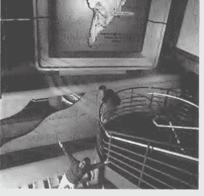

**图1.1**
1994年波士顿计算机博物馆的“可走入式计算机”展览。
Paula Lerner 摄。

距博物馆几英里外，在波士顿一所公立小学里正举办另一种展览，当时那里是全市最贫困的社区之一。车头灯项目拥有全球最大的学校计算机实验室，配备数百台计算机。作为麻省理工学院媒体实验室赞助的一项大胆实验的一部分，车头灯项目同样致力于让用户“进入”计算机的内部运作。然而，该项目不是让参观者走进去，而是把孩子们放到机器后面名副其实的驾驶座上，教他们使用编程软件 Logo 来操控计算机的行为。该项目由西摩·帕佩特发起，建立在一个当时不同寻常的理念之上——儿童应该（也能够）为计算机编程。在车头灯项目内部，计算机围成圆圈摆放在教室附近的大空间里，而不是被关进一间单独的教室。每天一次，学生用 Logo 编写故事、软件和游戏，有时还与其他国家的孩子交换作品。车头灯项目在其持续的数年里取得了巨大成功。数千名学生和教师成为将编程引入小学阶段的先驱，共同提供了一个活生生的例子，展示用计算机学习和教学可以是什么样子。5

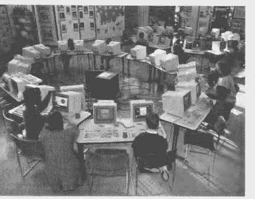

**图1.2**
1990年波士顿一所小学的车头灯项目。L. Barry Heatherington 摄。

1999年，计算机博物馆关门，迁过查尔斯河到波士顿科学博物馆时，可走入式计算机的展品被打包存放，却再未重新组装。车头灯项目的计算机被送到一间间独立的计算机实验室，因为用于协作编程的开放学习空间被认为在传统学校日程结构中不可行。一台人们可以走进去的巨型计算机？会编写计算机游戏的小学生？这两个想法似乎都属于不可行的范畴。20世纪90年代后半期，笔记本电脑设备日益流行，大型机器的概念显得过时。CD-ROM（只读光盘存储器）的发展使与编程相关的辛苦劳动同样显得过时。当应用程序只需放入一张光盘就能轻松下载时，谁还愿意费心经历编写程序的繁重过程呢？

然而，无论是巨大的可走入式计算机，还是帕佩特的编程圈，都证明了这样一种信念：我们所有人——无论年龄或经验——都有可能触摸机器本身，进入计算机的内部运作，并通过机器与自己的热情相连。如今，钟摆又摆回来了。今天，计算机已经走出博物馆和计算机实验室。它的存在最深刻地体现在无处不在的手持和触屏设备中，这些设备运行着为个体用户的专业和社交需求量身定制的数字应用。计算机——台式机、笔记本电脑、平板电脑和移动设备——已经切实而个人化地成为我们自身的延伸，5 而编程，曾经只是技术精英的博学消遣，如今正被教育者和理论家视为所有儿童的一项关键技能，甚至是一种新的读写能力。4

我们常常忘记与借助计算机、通过计算机以及关于计算机进行学习相关的社会、个人和有形要素的重要性。然而，这些要素在帮助我们理解机器的内部运作以及参与社交网络的动力方面发挥着基础性作用。在*《连接代码》*中，我们考察重新发现计算机作为个人和社会连接手段的可能性。尽管计算机博物馆的展览和帕佩特的教育工作坊最初都令人热情高涨，但为什么“进入”计算机没有成为我们学校的教育优先事项？编程如今又是如何回归的？

让编程重返学校，是对培养年轻学习者计算思维这一呼吁的回应之一。其前提是，通过学习像计算机科学家一样思考，学生能够解决日常问题，设计我们在日常生活中都会使用的系统，并在其他学科中取得进步和创新。7 计算思维如今已成为一个总括性术语，指计算机科学在日益数字化的世界中对于推理和沟通的贡献。然而，尽管计算思维作为教授编程的概念框架已经出现，编程的复兴却并非由教育者或计算思维的推动者主导。

编程复兴的一个重要推动力来自一个意想不到的来源——数字青年文化所特有的自己动手（DIY）精神。如今计算机在校内外都触手可及，孩子们使用自己的机器进行技术创新，制作自己的电子游戏、互动艺术项目，甚至通过电子纺织品制作可编程服装。他们用来创作这些自制物品的同一批计算机，也将他们连接到更广泛的网络，与其他拥有共同兴趣并致力于通过共同 DIY 伦理“自己动手”的年轻用户相连。学校或许能够将这些非正式协作社区的一些方法（尤其是创造性生产和网络化参与）纳入自己的正式环境。DIY 文化的这些方面提供了有前景的模型，说明学校可以如何在数字时代调整用计算机学习和教学的方法。学校当然负有这样的责任。

尽管 DIY 青年社区兴起，但这些社区只代表青年人口中的一小部分。8 大多数孩子使用自己的设备——无论是笔记本电脑、iPad、iPhone 还是 Droid——来消费商业媒体。计算机或许已经成为我们自身的延伸，但我们在多大程度上教孩子如何设计和管理这些延伸？我们如何帮助孩子成为数字媒体的生产者而不仅仅是消费者？编程应在促进这种生产中扮演什么角色，学校又怎样才能最好地帮助孩子培养21世纪的读写能力？在数字媒体普遍突出的情况下，我们是否需要关注获取和参与的公平问题？鉴于这些问题涉及个人身份、社会福祉以及这个国家更广泛的经济可行性，我们需要重新审视在当今社会中具备读写能力意味着什么。做到这一点的一种方式，是回到促使帕佩特在学校建立计算机编程圈的那些理念，并将这些理念置于当今的教育、文化和技术环境之中。

最初将编程引入学校的推动，受到帕佩特1980年著作*《心智风暴：儿童、计算机与强大理念》*的启发。他在书中主张，通过为计算机编程，儿童可以学习数学、控制论等新主题，以及他们自己的思维（依据约翰·杜威、保罗·弗莱雷和玛丽亚·蒙台梭利所提倡的进步教育观点）。这本书颇具争议，但也帮助全球教育者认识到让计算机进入学校的价值。*《心智风暴》*所倡导的计算机进学校愿景，通过开篇小故事中描述的车头灯项目编程圈变得生动起来。

在*《连接代码》*中，我们讨论儿童实际对什么编程感兴趣、他们在什么情境下编程以及他们如何编程。通过入门编程语言*Scratch*这一视角，我们从几个维度考察儿童与计算机编程之间的这些联系：

- *从代码到应用*，说明学生如何日益把编程不作为一门抽象学科来学习，而是作为制作实际应用（如电子游戏和数字故事）的一种方式；
- *从工具到社区*，强调从把学习代码视为个人化努力到把它视为社会性事业的转变；
- *从零开始到混编*，指出将代码重新利用作为程序起点（或从零开始）所带来的日益增长的可能性和伦理挑战；以及

计算思维网站，包含面向K-12科学和数学教师的网络资源链接和教案。⁹

也许最令人惊讶的是，决定在没有计算机的情况下教授计算思维，这缓解了一些计算机科学家以及珍妮特·温本人的担忧，她希望不要把计算思维等同于用Java编程（或任何单一编程语言）。计算机科学不插电活动由新西兰的一个团队开发，它们体现了这种无计算机的方法，通过使用卡片、绳子、蜡笔以及大量跑来跑去的趣味游戏和谜题来应用计算中的理念。这些活动适合从小学到高中的学生。

其他方法依赖计算机，但与计算机科学不插电活动一样，它们反对将计算思维仅仅与学习如何编码绑定在一起。它们专注于通过让学生设计对设计者个人有意义的数字应用，来向学生引入计算思维。最受欢迎的是游戏设计、机器人的构建与编码，以及使用媒体筛选器收集和组织新闻信息以提高新闻工作效率。这种对设计游戏、机器人和故事等应用的关注，也与计算思维对设计系统、解决问题和理解人类行为的总体关注很好地契合。应用是为他人使用而设计的，这意味着设计者在设计系统时必须考虑人类行为，并在将应用想法转化为代码时需要解决问题。对于K–12受众，我们喜欢将其视为计算参与，因为目的、社区和实践是关键。

### 扩展到计算参与

自珍妮特·温2006年的文章以来，计算思维已经有所发展。最初只是一个概念，如今已进入全国K–12学校和校内俱乐部的课程与教学法之中。¹⁰ 尽管计算思维为学校如何更严谨、更具批判性地使用技术提供了一个框架，但结果问题依然存在。教孩子更严谨、更具批判性地思考是一个令人钦佩的目标，但它几乎算不上新目标。许多课程（古希腊的哲学与修辞学；19世纪的拉丁语；20世纪的计算机编程）都旨在培养更严谨的批判性思维。尽管许多K–12学校拥有计算机已超过三十年，但编程教育几乎没有取得进展。

那些希望让编程回归学校的人，需要阐明一个超越“让孩子成为更严谨思考者”这一普遍愿望的论点。学会如何思考是一个令人钦佩的目标，但它对编程能为年轻学习者提供什么的理解是有限的。如果仅仅把编程宣传为一种更有效的思考方式（而不是一种进行逻辑性和创造性沟通的有效方式），那么我们就会再次无法理解，在网络时代教授和学习代码能为我们带来什么。学习编程最终体现其价值，是在它提升个人参与当今数字公共空间的能力之时。编程是一种表达自我、参与社交网络和社区的形式。在本书中，我们认为计算思维需要被视为计算参与，因为正在被创建、使用、重新利用和共享的计算机程序已经成为我们的社会连接。这种将代码视为相互连接的观点，对编程如何被学习、设计什么，以及在哪里、如何共享都有影响。

发展用于分享信息和想法的创造性、批判性网络，为希望创建更协作、更开放社会的学生树立了典范。仅仅偶尔在电脑上“闲逛”和“瞎玩”是不够的，正如媒体研究者伊藤瑞子及其同事在2009年关于青少年参与数字媒体的书中所讨论的那样。伊藤及其同事将第三类称为“极客式钻研”，并指出很少有青少年参与此类活动，而且这种对技术的参与在学校中很少见。计算思维代表了学校弥补这种参与不足的尝试，并为儿童提供能够让他们以算法方式解决问题的概念和技能。计算参与关注在更广泛的社会网络中作出贡献所需的实践与视角，包括但不限于学校。¹¹ 在由富有创造力和批判性思考者组成的更广泛网络中，教育者有机会去除“极客式钻研”中的“极客”色彩，并为有意义地使用技术意味着什么设定新的学术和社会规范。

当计算从参与而不仅仅是思考的角度来理解时，就会清楚地看到，在谁以及为什么很少有女性从事计算机科学方面存在巨大差异。马戈利斯和费舍尔研究了培养学生学习计算机科学的初中和高中，并采访了申请该专业的女生，询问最初是什么吸引她们进入这一学科、是什么帮助她们坚持下来，以及是什么使她们离开计算机科学。他们发现了自己所称的一种“极客”文化，这种文化对不熟悉编程技能和知识的新来者往往难以接近且不友好。

随后，他们着手改变计算机科学系的文化，因为他们意识到仅仅招收学生是不够的。他们需要创建新的课程和进入计算领域的路径，并在整个领域内培育一个指导性社群。为了“打开俱乐部之门”，他们需要瞄准K–12培养通道，这成为简·马戈利斯及其同事下一本书的重点；该书名为*《困在浅水区：教育、种族与计算》*，考察了学校教育与计算领域种族差异和偏见的漫长历史。最初是计算领域缺乏女性这一问题，后来扩展为缺乏少数族裔群体、继而缺乏低收入群体的问题，并在日益扩大的范围内处理计算领域的公平问题。

在任何入门级技术课程中几乎完全缺乏计算参与，这意味着很少有学生在K–12教育阶段的任何时刻考虑计算机科学原理，甚至接触计算机科学。尽管美国有超过42,000所高中，但只有2,100所提供大学先修计算机科学课程。12 事实上，自2005年以来，入门级计算机科学课程的数量减少了17%。鉴于美国劳工统计局一直将计算机科学类工作列为美国增长最快的职业之一，并预计到2020年将有超过400万个新职位，这样的下降是不可原谅的。15 计算机科学领域的性别和种族差异是另一个重大障碍。尽管女性占所有大学先修课程考生的56%，但在2011年参加AP计算机科学考试的考生中，只有21%是女性。同年，全美非裔美国人计算机科学考生总数为二十九人（不到1%）。

参与计算不仅仅是有机会使用；它还涉及孩子实际用计算机做了什么以及做得如何。这个问题超越了性别、种族和社会经济公平。甚至高收入社区的许多学校也仍然完全处于接受端

其想法是开发一种编程语言，它建立在青少年闲暇时间已经喜欢的媒介实践之上。这种语言将允许参与者制作图形、动画和游戏。它不会局限于特定目的，会为没有先前经验的初学者提供低入门门槛，并且能够扩展到更复杂的项目。Scratch（其名称是对流行DJ制作和混音音乐实践的戏仿）摆脱了传统上与编程相关的对数学和科学的关注。它呈现了一个可视化的点选式界面，让年轻程序员能够通过将元素和结构块拼接在一起而“编写程序”（图1.3）。

Scratch最初设计的核心，是能够规避键入代码时特有的、令人沮丧的语法错误。它允许用户

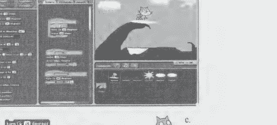

图1.3
Scratch界面的两张截图：一个题为“猫咪冲浪”的项目（上）和一张展示编写基本编码脚本过程的示意图（下）。

使用鼠标将代码“积木”拖放到数字画布上。只要会使用电脑鼠标这一唯一前提，年仅八岁的儿童就能使用 Scratch 创作自己的可编程故事、游戏和互动艺术作品。图1.3展示了这样一件作品——一只橙色卡通猫（Scratch 的标志性角色，在程序内称为对象或“精灵”）与巨浪相遇。这个互动项目利用音效、动画和多种输入形式，帮助猫完成冲浪。（当点击精灵时）（如图1.3的第二个图注所示）让玩家能够在冲浪板上翻转猫。为了制作这一单独动作，互动项目的设计者从 Scratch 界面右侧总共选择了四块积木，将它们组合或“堆叠”在一起，在屏幕左侧形成一个脚本；该脚本在被点击后，会使猫在 Scratch 屏幕上旋转360度。

Scratch 拥有丰富的可编程图像或精灵库，包括标志性的 Scratch 猫形象。但该程序的设计也允许用户从互联网导入图像，从而在计算机俱乐部（Computer Clubhouses）中青少年自主创作的基础上进一步发展。这种引入外部图像和声音的能力，使 Scratch 能够适应年轻用户的个人兴趣，并帮助他们了解程序的功能。三年来，洛杉矶和波士顿的一小群 Clubhouse 成员使用并测试 Scratch，他们耐心地试用一个又一个原型，反复修改自己的程序，并为我们提供了宝贵反馈，说明他们喜欢制作什么、哪些地方令人困惑。

从这些早期探索活动中可以明显看出，Clubhouse 成员喜欢为自己的作品找到观众，并经常轮流交换电脑座位，以便观看和试玩彼此的作品。当青少年编写出新功能或玩自己新编写的游戏时，他们会兴奋地隔着房间互相呼喊。显然，除了调整编程语言之外，我们还需要致力于支持 Scratch 程序的协作与分享。当时还是麻省理工学院媒体实验室研究生的安德烈斯·蒙罗伊-埃尔南德斯（Andrés Monroy-Hernández）创建了一个可以在互联网上分享 Scratch 程序的在线社区，他将其称为“ScratchR”，这个名字参照了当时新近流行起来的 Flickr 网站——数百万人在那里分享并注释自己的数字照片。在最终成为 Scratch.mit.edu 的网站上，人们能够发布并分享自己的程序。最终版本于2007年5月公开发布，并设有一个简单的“分享”按钮，设计者点击后即可将程序上传到 Scratch 网站，该网站托管在麻省理工学院的一台服务器上（图1.4）。

Scratch 作为一种工具的起源及其向热门社区的转变，体现了从计算思维到计算参与的更广泛转变。Scratch 用户（在网站上被称为“Scratchers”）发现，在线社区与软件本身一样，也是一种工具（参见应用与活动）。在我们开始讨论我们称之为计算参与的各种应用之前，我们将在第2章“连接学习”中重新审视 Papert 通过开发 Logo、以及如今通过 Logo 的继承者 Scratch 所阐述的建构主义学习的关键原则。我们确定了建构主义思想特有的四个维度（社会、个人、文化和实体），并在第3章至第6章中加以探讨，说明计算机编程在过去二十年中如何演变为一种参与式过程。第7章“连接教学”是第2章的姊妹篇，考察建构主义的教师一面。它探讨了教师转向计算与协作意味着什么、他们如何为学生创造合适的学习环境，以及将“自己动手”的学习方法引入课堂会带来哪些益处和问题。

在这两章分别讨论建构主义的学习与教学方面之间，四个核心章节讨论编程教与学中新的社会、个人、文化和实体联系。在第3章“从代码到应用”中，我们关注编程作品或应用作为学习焦点的出现。学习编程曾经把编码的准确性和效率视为成功的标志。然而今天，学生不再是为编程而编程，而是可以创建真实的应用（如游戏和故事），作为更大学习社区的一部分。我们呈现游戏设计、数字叙事和动画的不同示例，展示应用如何将关键编程概念和技能的学习置于不同情境之中。

在第4章“从工具到社区”中，我们认为学习编程不再是一项孤立的活动，而是在共享的社会情境中完成，利用开放软件环境和共同热情来激发参与。这些可分享作品的品质（一款高度可玩的游戏、一段精巧的动画，或一个特别细腻的数字故事）能够培养情谊，并提供进入编码社区的途径。本章考察青少年编程社区的出现，以及年轻设计者进入并参与此类社区的方式。

在第5章“从 Scratch 到混搭”中，我们考察随着编程成为一种社区化的网络活动，新的参与和协同设计实践的出现。过去，程序必须在空白屏幕上“从零开始”创建，以证明能力；而通过混搭实现的无缝整合，正成为编写程序的新社会规范。这当然带来了伦理挑战——尤其是在学校及其对抄袭的界定语境中——但混搭也为参与提供了新的网络。

在第6章“从屏幕到实体”中，我们考察设计者如何通过可编程玩具、工具和纺织品，将编码与计算从固定屏幕拓展到物理世界。我们首先考察关于乐高 Mindstorms 套件的故事——这些套件帮助机器人学习在世界各地学校的竞赛中普及开来——然后转向电子纺织品和电路搭建套件等新进展。

在第7章之后，我们以第8章“面向所有人的编码”作结，该章总结了我们关于在 K–12 课堂和课后项目中引入计算思维与计算参与的见解和启示。

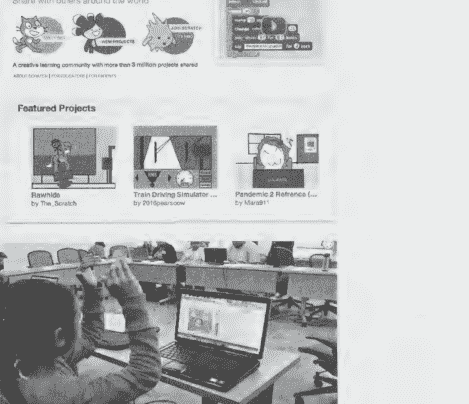

图1.4 Scratch 在线社区门户的屏幕截图（上），以及一名初中生在2013年宾夕法尼亚大学 Scratch Day 上体验 Scratch 2.0 视频感应功能的照片。摄影：Darryl W. Moran Photography。

## 2 连接学习

两岁之前，我就对汽车产生了浓厚的兴趣。我特别自豪的是，自己了解传动系统、变速箱的各个部件，尤其是差速器。我喜欢让圆形物体像齿轮一样彼此相对转动；自然，我的第一个“装配式积木”项目就是一个粗糙的齿轮系统。差速齿轮这类系统让我格外着迷，因为它并不遵循简单的线性因果链：传动轴的运动可以根据两个车轮遇到的阻力不同，以许多不同方式分配到两个车轮上。我相信，摆弄差速器对我数学发展的作用，比小学里教我的任何东西都大。齿轮作为模型，把许多原本抽象的观念带进了我的头脑。

一位现代蒙台梭利教育者如果被我的故事说服，可能会提议为儿童制作一套齿轮。这样每个孩子或许都能拥有我那样的体验。但若寄望于此，就会错过这个故事的精髓。我爱上了齿轮。这件事无法被还原为纯粹的“认知”术语。某种非常个人化的东西发生了，人们不能假定它会以完全相同的形式在其他孩子身上重演。我的论点可以概括为：齿轮做不到的事，计算机也许能做到。计算机是机器中的普罗透斯。它的本质在于其通用性，在于其模拟能力。因为它能呈现上千种形态、承担上千种功能，所以它能吸引上千种品味。^3

在如今已成经典的“我的童年齿轮”——即《头脑风暴：儿童、计算机与强大理念》的序言——中，西摩·帕佩特（Seymour Papert）谈到自己如何与齿轮建立个人化和情感化的联系、齿轮如何帮助他理解数学，以及计算机如何可能成为其他孩子的“齿轮”。他指出，自己的个人经历无法通过给每个孩子一套齿轮来复制，学习者必须建构自己的齿轮。他认为，计算机变化多端（普罗透斯式）的特质可以使它成为一种通用的建构材料，供学习者设计和建造物体。计算机不是被变成教学机器，而是儿童自己成为机器的程序员。这一出人意料且大胆的提议，源于这样一种信念：学习是

在头脑和心灵中构建，并与世界中的体验相连。连接式学习探讨如何将计算机视为知识转化、个人表达和社会关联的工具，从而使学习者能够创造并与他人建立联系。

Papert将学习视为创造具有个人和社会关联性的制品、连接新旧知识以及与他人互动的过程。2这种描述不仅仅指计算机。相反，它勾勒了学习过程及其条件，并将制品置于首位——即我们构建的对象或“齿轮”，以及我们赋予它们的个人意义。有些人认为这种学习观过于以心智为中心，但它通过纳入社会关联性，同样也是以社会为中心的。我们头脑中的对象并非脱离社会世界而存在。事实上，它们深深植根于我们生活的社区及其成员所珍视的事物，并与之紧密相连。在20世纪80年代，计算机仍然昂贵，只有少数人能用。但如今数字媒体更加实惠、便携，已经进入我们的日常生活。本书的目标之一就是考察参与、协作和计算如何帮助年轻人在数字世界中学习和生活。

在本章中，我们考察连接式学习的个人、社会、文化和物质维度，以及它们对设计学习机会、技术和环境的意义。Papert与让·皮亚杰一样，将学习视为构建知识结构的过程，3但他增加了一个重要维度：心智制品必须进入公共世界，在那里可以被他人审视、分享和重视。在许多方面，这一观点预见了构成互联网的庞大而分散的数字对象和社区网络。它反映了使用任何媒介进行实践、思考和互动——简言之，学习——的基础。

连接式学习的个人、社会、文化和物质维度在今天与三十年前一样具有现实意义。它们为理解计算文化中的学习提供了基础，这种文化重视生产与连接两个方面的参与。在思考这些问题时，能“唤起情感的对象”（借用雪莉·特克尔的说法）4之一是编程语言Logo，5它引发了关于学校中编程和计算机的许多讨论，以及让儿童而非计算机主导自己的学习。

### 编程工具，编程世界

Logo不是第一种，也不是唯一一种供儿童使用的编程语言。Basic以及后来的Pascal等编程语言在许多学校同样突出，关于哪种编程语言最适合学校教学，当时存在大量争论。但与Basic和许多其他编程语言不同，Logo承诺带来的不仅仅是学习编程：它以新的方式教授数学、控制论和科学，还提供了一套教学法。这些附加特色使Logo不同于其他任何编程语言，并使其成为Scratch的前身。

在20世纪60年代末和70年代初，大多数年轻程序员是通过操作数字或符号数组来编写程序文本。但在Logo中，他们通过移动屏幕上一个名为“海龟”的图形对象来编写程序。用Logo编程意味着给海龟编程（图2.1）。例如，程序员给海龟下达命令“向前移动10步，然后向右转90度”，在Logo中

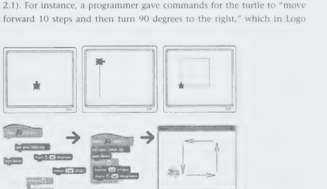

**图2.1** 用Logo（上）和Scratch（下）编写的代码截图。Logo截图显示一只海龟处于起始位置，准备用Logo进行编程。中间的屏幕显示海龟已被编程执行以下步骤：PEN DOWN FORWARD RIGHT TURN 90。右侧截图显示通过让海龟重复命令四次，或REPEAT 4 [FORWARD 90 RIGHT TURN 90]，画出了一个正方形。下方的面板左侧是单个Scratch编程积木，在中间组合并激活后，导致右侧Scratch舞台上的猫移动。

……在这一过程中起核心作用。Papert创造了“可供思考的对象”（objects-to-think-with）这一术语，用来指物理和数字世界中的对象（如程序、机器人和游戏），这些对象可以成为心智中的对象，用以构建、检验和修正新旧知识之间的联系（更多内容见第3章）。“可供思考的对象”（如Logo海龟）特别有助于内化，因为它们促进了学习者对该对象的认同。通过设计程序或游戏（或其过程、算法和数据结构），个人知识变得公开，并可以与他人分享。

将程序视为可以公开分享的个人对象，这种思维方式也出现在互联网文化中。互联网文化汇集了个人物品（如照片、故事和设计），将它们引入极其广泛的公共领域，并让它们获得全新的意义。在这种背景下，计算思维变成了计算参与，因为当代码被创建时，它既具有个人价值，也具有与他人分享的价值。代码中的“可供思考的对象”不仅局限于头脑中，还会与他人分享，从而为个人维度增添了社会和文化维度。

#### 社会维度

学习是一个社会过程，无论是面对面发生还是在网络公共空间中发生。教育研究者让·莱夫和艾蒂安·温格在1991年关于学徒制学习的开创性著作强调了学习的共同体性质，而这种性质在传统学校教育所特有的对个人学习的关注中常常缺失。近来，游戏研究者吉姆·吉发现了游戏社区中形成的亲和文化的重要性，以及这种替代性学习环境如何为重新评估学校教育提供了重要视角。在所有学习社区中，有效的参与要求学习者通过与他人协作来寻找、组织和分配责任，同时共同参与活动或创造制品。学习者所需的协作能动性强调了学习者在构建社区中的积极作用，这种社区既构建知识，也设计可以与他人分享的制品。10那句众所周知的“可供思考的对象”变成了“可供分享的对象”，代表了社区中协作与学习的产物和精神。

连接式学习的社会维度一直聚焦于社区，因为程序的个人建构不是发生在真空中，而是在社会情境中。Papert对巴西桑巴学校的研究体现了他的一种观念：社会规范和互动是任何形式学习的关键：

> 这些不是我们所知的那种学校；它们是社交俱乐部，会员人数从几百到数千不等。每个俱乐部都拥有一栋建筑，一个供跳舞和聚会的地方。……在一年中，每所桑巴学校都会为下一届狂欢节选择主题，选出明星，歌词被写了又改，舞蹈被编排并反复练习。学校成员年龄从儿童到祖父母不等，能力从新手到专业水平都有。但他们一起跳舞，在跳舞时，每个人都在学习、教学，同时也在跳舞。甚至明星们也在那里学习他们困难的部分。13

学习文化可以是社区中心，甚至可以是虚拟世界。英特尔计算机俱乐部网络（Intel Computer Clubhouse Network）就是前者的一个例子，它在全球有一百多个地点，年轻人自愿聚集在那里，使用创意软件应用来创作数字图形、音乐和视频。与学校不同，计算机俱乐部不遵循固定的课程，成员们在协调员和导师的支持下相互介绍新活动。这些理念也为虚拟社区提供了蓝图，例如MOOSE Crossing，它允许成员编程并分享他们的虚拟作品（更多内容见第4章），以及ClubZora，它促进了围绕价值观的讨论。如今的例子包括Scratch社区（拥有100万个项目和数十万用户）和动画网站Newgrounds（拥有超过200万成员，他们开发并分享了超过50万个基于Flash的动画和视频游戏）等虚拟环境。在所有这些例子中——巴西分散的桑巴学校、计算机俱乐部网络和虚拟社区——社区成员之间都有丰富的互动，这些互动自下而上地发展，并由共同的兴趣和价值观所引导。12在这种背景下，计算参与既关乎社交，也关乎贡献有价值的制品、专业知识和反馈。

#### 文化维度

连接式学习还关注学习的文化维度——即决定特定认知、看待或

某些做事方式比其他方式更受重视。这一点在技术文化中尤为重要；正如舍里·特克尔（Sherry Turkle）和西摩·佩珀特（Seymour Papert）所阐述的，在与技术打交道时，存在一些受偏好的工作方式，它们重视形式化甚于具体化。通过研究和访谈程序员，特克尔和佩珀特揭示出，官方推崇的自上而下的规划方法并不总是优于更即兴的修补匠式方法。修补匠式风格并不是更高级的知识建构形式，而是组织规划和解决问题的一种不同方式。特克尔和佩珀特主张认识论多元主义，这意味着修补匠式风格（它偏向具体思维）可以像抽象思维一样高级；他们还观察到，在诸科学中，计算机科学尤其推崇抽象思维。13

通过连接知识与关系来学习，也凸显了社会在批判性思维（传统上被理解为基于概念和语言）与实体制作（以目标为基础的实物工作）之间所作的其他区分。通过提供机会，让学习者创造承载观念的实物来具体化知识，我们凸显了两种通常被分开的与世界互动的方式可以重新连接起来的途径。通过鼓励知识外化，我们推动学习者把知识对象视为一个独特的“他者”，并与之建立一种关系，这种关系包含制作者自问的问题：外部对象如何与其他知识体系相连。14 理解与此类互动形式相关的边界和价值观，对于理解谁能够以及如何与它们建立联系至关重要。换言之，我们如何以计算方式思考和参与，是通过文化偏好被引入并规定的。

因此，联结学习中的认识论多元主义关乎程序如何被设计、问题如何被看待、人工制品中反映了什么价值观，以及这如何为学习者提供一种情境，使他们能够连接并参与该领域的实践。今天，对具体之物的重新评价体现在年轻人学习编程应用和其他数字制品的兴趣中。年轻人对摆弄源代码的这种热情，一直是开源运动的一个根本杠杆；开源运动旨在使技术开发和交互性更加显明，并主张在这些领域中隐藏关系最终会扼杀协作与创造力。开源运动的精神……无论老少皆然。此外，也出现了从大规模互联网向个体应用的转变，这标志着一种转向更小、更个人化应用的趋势。尽管使用和获取很重要，理解这些设备的功能同样重要。正如“Walk-Through Computer”让人得以一窥机器内部，当可编程性延伸到物理世界时，它揭示出这个世界是可编程的、可塑的，因而也是可控的。

### 连接建构、代码与文化

联结学习的个人、社会、文化和有形维度表明，学习不只是要掌握技能的技术问题。当人们学习编程时，技术成分可能最不成问题。正如凯特琳·凯莱赫（Caitlin Kelleher）和兰迪·波许（Randy Pausch）在分析入门编程倡议时所认识到的，学习编程的社会和文化障碍往往“比机械性障碍更难处理，因为它们更难识别，而且有些障碍无法仅靠编程系统解决。”^17 编程不仅是一种用于设计代码的认知技能，也是一种用于参与群体的社会和文化技能。

我们对联结学习的论证超越了编程，转而考察技术如何运作，以及随着日常生活更多方面进入数字领域，设计如何能够纳入更广泛的材料。目标是设计学习技术和学习环境，使能动性被赋予人而非计算机。^18 能动性（学习者做什么）与结构（情境如何受到约束）之间始终存在张力。从联结学习的视角看，教师给予学习者的自由越多，就越需要思考既定学习环境的边界。反过来，最初建立的规则越多，教师就越需要思考每个学习者带着怎样的兴趣、知识和价值观进入这一情境。良好教学的关键是在结构与能动性之间找到这种平衡，这是各种形式教育的巨大挑战。一方面，教育者需要区分教师和学生的角色。另一方面（且矛盾的是），这种区分又必须被模糊化，使教师和学生统一为学习者。同样，文化情境、实践和观念在连接所学内容、学习方式以及谁应当学习它方面发挥着关键作用。尽管联结学习的这些维度不如其他方面那样有形，但它们对于理解为什么计算在K–12中如此难以扎根、以及为什么今天它又被重新推动，仍然至关重要。

本章偏重理论，聚焦于所有个体作为学习者所共有的共性；第7章则考察联结学习中教师的一面。在其他章节中，我们通过说明应用程序编程（第3章）如何产生个人相关性，以及真实受众（第4章）如何以不同于儿童在学校、家庭和同伴中体验这些事物的方式提供支持与反馈，来展开各种维度。我们也认识到，这些共同体带有特定的心态、价值观和历史。这一点在数字文化中最为明显，其中公平与参与问题一直至关重要。最后，我们创造人工制品，作为我们参与的可视且有形的标志（第6章）。这或许是学习中最复杂的关系，尤其因为在数字文化中，大多数参与和生产都发生在屏幕上。通过重新评价具体之物作为一种思维方式和一种数字生产形式，我们凸显一种关乎物品的学习：这些物品要被制作、被用来思考，并与人分享。

在K–12学校中。无论儿童最初对计算机编程可能有多么兴奋，由于缺乏与更广泛学科内容的联系，他们在最初的着迷消退后就没有动力继续使用该软件。大多数教师没有意识到代码在支持和扩展学科内容方面的潜力，他们通常把这类技术视为学校内的一种兼收并蓄的选修课，而不是为数学和科学核心内容学习奠定基础并提供支持的手段。⁶

设计应用程序而非编写代码，回应了这些对编程研究和Logo的批评。在对K–12编程教学研究的广泛综述中，教育研究者大卫·帕伦博（David Palumbo）⁷独立得出了与卡珀顿（Caperton）在设计教学软件项目时相同的结论：编程的教与学需要与常规课堂作业及其他学科内容整合，为解释提供情境，并培养学生中的个人相关性。事实上，针对编程、尤其是针对Logo的批评——缺乏足够时间、复杂性和个人适用性——也可以用来批评学校中许多其他课程活动，而不只是编程。学生在学校学什么、如何学，以及这与他们在校外学习有何联系，在20世纪80年代末和90年代初成为计算机编程乃至整个教育领域讨论的中心议题。⁸

这些讨论中最突出的是对学习真实性的推动。⁹真实性的一种含义是，学习者在课堂上遇到的内容与专业人士在该领域本身所做的工作相对应。就编程而言，这意味着学校里的学生不应仅仅把编码当作一门抽象学科来接触，而应学习该领域的专家如何着手这一主题以创建真实应用。第二个组成部分是个人真实性，它涉及认识到儿童带到学校的个人兴趣和知识储备。孩子们有兴趣创造什么？就使他们的生活更高效、更有趣、更好玩而言，什么对他们有意义？第三个组成部分——真实受众——建立在这种相关性需求之上，促使儿童制作对彼此而不仅是对教师有意义的学习产品。最后，第四种真实性是为真实世界受众而设计，这会促成真实的反馈以及有意义且可转化的评估。

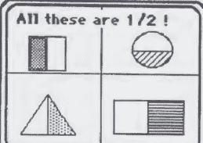

#### 3月23日、24日

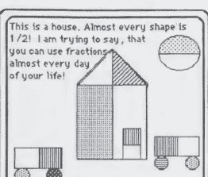

**黛比最终的“房子场景”**

**图3.1**  
黛比的分数房子屏幕设计。经许可转载。

在这个轶事中，四年级学生黛比已将分数投入实际使用，但对这两个女孩来说，交流的焦点是对象——房子、场景本身——而不是分数。尽管对房子配色方案的关注无关紧要，但房子的美学与房子的几何结构密不可分。为了建立意义——至少最初——焦点需要放在整体而非构成要素上。房子给了黛比一种谈论数学的方式，也给了娜奥米一种看待数学的方式。连同编码一起，谈论和观看也共同构成计算参与。通过这个对象，学习者掌握了一种思考、联系和沟通的方式。黛比的房子也说明了个人化占有。这是黛比与分数关系的一次戏剧性转变。刚开始上课时，她和其他人似乎对这个项目不感兴趣，她似乎只是在程序里机械地创建类似练习册的练习。但房子场景改变了她的态度，部分原因是她因原创设计得到了同学的认可。对黛比来说，房子的设计与创建展示了她的分数知识，也给了她一个对象，使她能够向自己的同伴有意义地展示自己的知识。正如帕佩特所解释的：“黛比思维的变化不仅仅是掌握事实和技能的问题。她那句‘你可以把它们［即分数］放在任何东西上面’显示出一种认识论转变和一种认识论意图。她从一种知识（正式的、教师的知识）转向了另一种知识（个人的、具体的、她自己的知识）。”12 黛比的项目让分数对她和她的受众（娜奥米、她的其他同学以及三年级学生）变得真实。以前，分数只存在于教室里，而且即便在这些狭窄范围内，它们还被进一步限制在教师的黑板和黛比的练习册中。她问娜奥米关于分数的“你喜欢这些颜色吗？”——而不是“这对吗？”或“你能检查一下这是否正确吗？”分数完全地、亲密地属于她。

帕佩特还提到黛比：“有一天她意识到，她用来装饰动画的编程技术也可以用来让她的分数表征在视觉上更有趣。”13 这一点捕捉到了从编写程序代码到依据此类代码进行计算性思考的转变。当黛比谈论把她房子场景中的一切都变成一半时，她必须构想所有需要被创造出来的“一半”，并考虑那个起支配作用的操作：将Logo海龟要绘制的步数除以二。这需要协调多种表征，包括将“½”的数值表征、“一半”的文本表征以及对象本身（无论是门、马车还是屋顶）某一半的视觉表征联系起来。黛比在设计并调试Logo问题的过程中参与编程，但她也以一种计算性活动的方式与编码过程建立联系。因此，她们发展协作与编码技能以及变得更加独立的机会受到限制，因为她们的活动范围有限。此外，参与不同的团队也导致对项目中角色的不同理解。有经验的软件设计者承担了丰富得多的角色，包括规划、帮助、教学以及理解年幼学生的担忧和焦虑，并且在这一过程中他们也参与了计算参与。

卡珀顿的软件设计研究和钦的学徒制研究的结果表明，将学生视为教学软件应用的设计者，会让他们对自己的学习更有投入感。两项研究还表明，创建具体的学科内容——无论是分数房子还是科学探究问题——比抽象地学习代码更能显著帮助学生学好编程。对分数设计项目结果的分析提供了有力证据，证明其对学习分数和学习编程都有益处，尤其是与同一所学校另外两个班级相比：那两个班级每周或每天都有编程课，但没有专注于创建教学分数软件。在所有这些比较中，分数设计项目的学生在编程知识技能以及分数的概念性和程序性理解方面都有显著提高。

学生的教学软件设计体现了他们在为学习者创建表征时的个人选择。最重要的是，它们展示了设计软件而非仅仅编写代码，为学习编程和数学提供了更丰富、更有成效的情境。同样，在钦的学徒制研究中，参与一个有经验的软件团队提高了所有团队成员的编程水平和对科学的理解。有经验的同伴可随时提供帮助，提高了编程技能，影响了科学模拟的设计，并影响了学生的学习内容。但这在多大程度上适用于校外的其他现实世界应用？卡珀顿的研究和钦的研究将编程与数学和科学结合起来，这些学科传统上与编码相一致并与之相关联。编程是否也能与其他学科主题和情境整合？在下一节中，我们考察这一转变——从学习编写抽象代码到寻找现实世界应用——如何在数字故事和电子游戏设计的发展中发生。

## 3 学校中的游戏设计工作室与写作工作坊

尽管教学软件（如分数软件）植根于学校文化，无论它是以商业软件形式购买，还是由学生自己设计，娱乐媒体（如电子游戏）往往尚未进入课堂，直到最近才成为关于富有成效的学习环境的讨论的一部分。17 让孩子成为游戏设计师的想法，似乎与孩子能够且应该编程的内容相去甚远。但电子游戏在儿童玩耍中占据突出位置，尤其是男孩的玩耍。在这些屏幕前花费的小时数持续增长，其质量也在提高。心理学家、社会学家和家长都对电子游戏所带来的参与质量感到惊讶，这与儿童在看电视节目和做学校作业时的冷漠形成对比。

因此，将教学软件设计扩展到游戏设计的想法似乎并不牵强。事实上，它遵循了同样的思路，即把教学软件变成面向学习的教学软件设计。同样，为学习而制作游戏而非为学习而玩游戏，成为第一项将学生视为游戏程序员的研究的前提。17 作为教学分数设计项目的延续，亚斯明·卡法伊让一个十岁儿童班级设计并编程他们自己的教育性分数游戏。学生们每天见面，持续三个月，通过创建自己的角色、故事线、游戏主题和互动来设计教育游戏（图3.2）。关于这项工作的大部分讨论都集中在所观察到的游戏设计中的性别差异上，很可能是因为这些发现与当时流行的关于技术兴趣和表现方面性别差异的话语相吻合。18

男孩和女孩确实以不同方式着手并实现他们的游戏设计。大多数男孩的游戏以幻想情境为特色，角色众多，反馈具有暴力性；女孩的游戏角色较少，且答错没有惩罚。例如，大多数男孩创建了冒险狩猎和探索类游戏，而女孩的游戏则分为冒险、技能/运动和教学类。在选择游戏主题以及为动画和互动编程时，男孩和女孩让人得以一窥他们在通过其他媒体体验的数字游戏和故事中觉得什么有吸引力、什么没有吸引力。制作

研究员露西·卡尔金斯（Lucy Calkins）^23的“Scratch 作家工作坊”让一班中学生通过一系列迭代来创作并编写他们的数字故事。学生们在作家笔记本中起草想法，在故事板上绘制叙事阶段，将这些铅笔故事板转化为 Scratch，并使用作品集来记录进度、与同伴分享持续进行的工作。全班约有 90% 的学生完成了叙事作品。该工作坊展示了这种结构化模型以及现有的英语和语言艺术框架在多大程度上可以被用来促进编程学习，并将其视为一种写作形式。^24

研究结果令人鼓舞。超过 90% 的学生使用 Scratch 完成了自己的数字故事，这些叙事运用了多种语言艺术修辞手法（如静态与动态人物塑造）和编程特性（如循环）。许多参与者开发了基于他们先前用纸笔绘制的短篇漫画小说的情节线，这让他们更好地理解了媒介在引导故事结构方面所扮演的角色（图 3.3）。所有学生都是新手程序员，他们在讲故事工作坊中学习了基本的编程概念。但同样显而易见的是，写故事更倾向于线性结构，而非游戏叙事中常见的分支条件语句。让学生参与交互式故事的编程，是众多与现有课堂模式相衔接的课程设计之一。它也可能是初学者进入计算思维和参与式学习的一个切入点。我们需要扩展 Scratch 作家工作坊的边界，引入更广泛的编程变量，以便进一步揭示叙事与计算思维在课堂中的交汇点。

这项研究表明，故事能够激发儿童对编程的兴趣，而 Scratch 作家工作坊则通过将编程过程呈现为一系列相互关联的实操步骤，为学生和教师揭开编程的神秘面纱。这样的框架强调了编程与写作作为相互关联的创作过程之间的联系。Scratch 中的数字叙事——尤其是工作坊对人物塑造和情节分析的关注——提供了一种新媒介，儿童可以通过它锻炼在传统读写课堂上学到的创作技能，并在年幼时便开始接触编程。

尽管讲故事和编程是该模式的核心组成部分，并且服务于相同的最终目标，但工作坊是分别引入它们的。计算思维强调算法的实用性和创造性功能，为连接编程与写作提供了一种新途径——两者都试图通过清晰的输入来达成特定的输出。《Make》杂志最近与国家写作项目25的合作正是基于这一前提。他们为读写教师举办的工作坊强调教师作为课堂“创客”的角色，并将学生写作视为一种有形的“产品”，其中技术性与创造性相互交织。数字故事是将图像与声音进行系统性编码并置于审美并置中的产物，而 Scratch 中的数字故事同样是这样一种“产品”，它同时体现了创作中技术与创造性元素，并提供

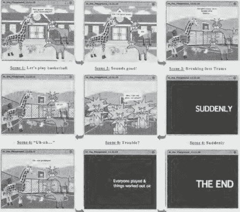

图 3.3  
来自 Scratch 作家工作坊项目“在游乐场”的截图，作者是八年级学生 Andres，基于他自己的漫画小说创作。

最初的计算机俱乐部取得了巨大成功，以至于在波士顿建立了更多俱乐部，并在英特尔公司的支持下，扩展到其他城市和国家。所有计算机俱乐部都为青少年提供各种软件，包括编程软件（如 Microworlds Logo）、Microsoft Office、Bryce 5、Painter 7、RPG Maker™，以及视频、摄影和声音编辑软件。尽管所有计算机俱乐部都拥有活跃的设计文化，但编程最初只存在于少数俱乐部中，并且与蓬勃发展的 Photoshop 文化相比，是一项相当边缘的活动。⁴⁷ Scratch 被设计为一种媒体制作工具，以便计算机俱乐部的年轻人能够为自己热爱的游戏、数字故事、模拟、交互艺术、舞蹈视频或其他类型作品编写应用程序。

年轻人如何以及为何从软件包的使用者转变为数字媒体应用的 Scratch 设计者，恰恰体现了编程的激励性吸引力。2004 年秋，当首个版本的 Scratch 在洛杉矶的一家计算机俱乐部推出并安装在数台电脑上时，很少有成员使用这款新软件创作任何作品。但在 2005 年冬，源源不断的本科生导师加入俱乐部，既提供帮助，也自己学习编程。随着年轻成员互相鼓励尝试该程序，导师们协助年轻人创建他们的第一个 Scratch 项目，Scratch 活动出现了显著增长。导师们常常邀请从未接触过 Scratch 的年轻人导入他们存储在俱乐部服务器文件夹中的数百张截图和图形文件，以此吸引他们参与。当时，服务器上的青少年项目大多只是纯图形作品。但在 Scratch 推出后的几个月内，Scratch 屏幕设计的打印稿开始贴满俱乐部的墙壁，并成为领先的设计活动。

到 2006 年冬，对 Scratch 的兴趣与日俱增，俱乐部文化中也在涌现新变化。Scratch 成为当地俱乐部文化中成员身份的象征，在中央服务器上创建和存储 Scratch 项目供他人游玩，将此前罕见且孤立的编程活动转变为一项公共事务。此外，青少年团体开始协作创建项目，并为自己起了响亮的队名，比如 “DGNM”，代表 “Dang Good Money Makers”。教育研究员凯莉·佩普勒观察发现，年轻人开始独立于导师的支持，独自应对他们在 Scratch 中遇到的复杂项目和问题。而且可以看到，年轻人在 Scratch 上相互指导，有些人成长为全能专家，导师、协调员和其他年轻人都向他们请教；另一些人则专精于 Scratch 中的某些特定类型或技巧，同样会受到同伴和导师的请教。²⁸

一个令人瞩目的电子游戏设计案例是 “Metal Slug Hell Zone X”。它出自 15 岁的拉丁裔设计师 Jorge 之手，灵感来源于一款同名的热门电子游戏。²⁹ 原版《Metal Slug》是一款未来风格的“跑动射击游戏”，以其幽默、流畅的手绘动画和快节奏的双人合作动作著称。Jorge 将自己对电子游戏的热情和经验带到了俱乐部，在那里，他大部分时间都在制作涉及电子游戏复刻的 Scratch 项目。“Metal Slug Hell Zone X” 是他的第二个项目，融合了原版游戏中的许多标志性特性，还加入了一些新颖而出乎意料的功能。游戏的开始界面相当传统——一个标题画面列出了四个可供玩家按键选择的化身。游戏场景始于一片荒芜的紫色沙漠和缓缓移动的云朵。玩家可以使用方向键控制所选化身前进或后退、蹲下、跳跃以及射击。从开场动画、化身选择、背景卷动到动作元素，可以看出 Jorge 凭借自己对《Metal Slug》系列的既有认知和电子游戏兴趣，将之与 Scratch 建立了联系，从而完成了自己的电子游戏。

“Metal Slug Hell Zone X” 耗时数月才设计完成，它融合了堪称计算思维典范的复杂技术特性。Jorge 通过运用困难的编程概念——包括变量、循环、条件语句、通信与同步命令（如发送广播和“当接收到”消息）以及布尔逻辑——发现了如何实现横版卷轴游戏和复杂的动画效果。设计这款游戏激发了 Jorge 投入编程的热情。他学会了如何为交互式玩法做设计，并多次重新设计自己的程序，他发现，设计一个响应标准按键（如左右方向键）而非键盘上任意字符的游戏，对用户更加友好。此外，他使用的是一整套创意软件，而不仅仅是编程软件。借助 Scratch 画图编辑器（一款图像编辑器），Jorge 为化身的移动制作了逼真的动画效果。他还会根据游玩原版电子游戏的过程绘制草图

游戏，从互联网粉丝网站下载了样本头像，并在画图编辑器中逐帧细化动作，以实现流畅的定格动画。借助Scratch的可视化编程能力，Jorge为这些图像制作动画，使其响应按键，从而让头像在屏幕上轻松行走，或在控制键触发时跳跃。

这些从创作视觉设计到编写动画程序的转变，体现了Jorge进入计算思维的路径——因为当头像被要求在做蹲下或跳跃动作时做某事（例如射击）。使用Scratch帮助Jorge理解了专业制作专家如何制作游戏。他还与原游戏的其他粉丝建立联系；这些粉丝像他一样，希望玩到并创作业余衍生作品，作为DIY文化的一部分。

正如Debbie的教学分数软件一样，Jorge的《Metal Slug Hell Zone X》游戏软件也体现了个人与艺术和技术领域的联系。它还说明了在Web 2.0之前社会联系的重要性。对Debbie来说，这些联系存在于她的同学和Project Headlight的三年级学生之中；对Jorge来说，这些联系存在于当地的Computer Clubhouse社区（该社区提供了欣赏并支持他的受众）以及在线粉丝玩家和游戏社区之中。与Debbie的软件是课堂项目的一部分不同，Jorge对这款电子游戏的设计是由他自己发起的。他重制了一款自己喜欢玩的游戏，然后加入自己的诠释，既没有偏离原作太远，又加入了自己的巧思。玩家设计自己的游戏并不罕见。事实上，许多Project Headlight的学生坦言，他们更愿意编写分数游戏程序，而不是分数软件。

如今，许多游戏都提供角色和关卡编辑器，让玩家能够添加新功能，从而延长游戏的可玩性；但在20世纪80年代和90年代，游戏公司密切关注电子游戏的内容和设计，这些功能几乎闻所未闻。这些业余创作都共享自主制作与原创项目的精神。⁵⁰ 大多数DIY活动发生在非正式的午餐时间计算机俱乐部中，而不是传统课堂上；DIY活动在写作和出版领域同样突出。对同人小说网站以及年轻人使用zine（自制杂志）的研究表明，青少年在校外时光里享受着学术风格的写作、出版和评论，并在此过程中发展出写作者身份。在校内外设计游戏和写故事，展示了设计软件应用如何成为一种丰富的方式，使人们作为生产者而不仅仅是消费者参与数字文化。

#### 软件应用设计变得流行

如今，面向应用程序（“apps”）31的设计课程越来越受欢迎，并且应当受到鼓励，以扩大参与面。通过拓宽围墙，32编程可以应用于一系列设计活动，而不仅仅是狭窄的技术活动。正如八年级学生Daryl在Scratch Writers’ Workshop完成自己的数字故事后所说：“Scratch几乎能做任何事。它有数百个控件、数百张图像，你甚至可以从互联网上取用图像……所以你所需要做的就是有一个焦点。”33 设计具体的应用——无论是电子游戏还是数字故事——正代表了这样一种焦点，尤其是当这些应用进一步植根于个人和社会真实的学习情境（如游戏制作工作室和写作工作坊）时。

设计应用也可以被视为Jeannette Wing（周以真）计算思维的一种直接且易于接触的应用。它抓住了设计系统、解决问题和理解人类行为的关键方面，因为设计游戏或模拟之类的应用涉及创建一个系统，这要求设计者思考用户将如何与他们设计的应用交互，以及如何按照其意图实现功能。在个人层面，设计应用既引发了广泛兴趣，也在让青少年对计算机编程产生兴趣方面取得了很高成功率。也许这就是为什么为学习而制作游戏吸引了许多营利性和非营利性团体。

这一点最明显地体现在电子游戏制作竞赛的激增上，例如Globaloria的Globey Awards、Advanced Micro Devices的AMD Changing the Game竞赛、Games for Change Awards，以及（由白宫联合主办的）National STEM Video Game Design Challenge。这些竞赛培养了一种赋能感，

## 4 从工具到社区

Scratch在线网站于2007年5月低调上线。然而，几篇有影响力的科技评论——尤其是5月14日BBC News在线的一篇文章——就足以引发热情流量的激增，使Scratch网站暂时关闭。很快，新访客通过创建个人资料、分享评论以及上传用Scratch代码编写的自己的程序，把Scratch在线社区变成了自己的空间。然后，在2008年6月，网站上出现了新情况。Scratch在线社区的三名成员创立了Green Bear Productions，并在网上开设账户，以协作创作高质量电子游戏。创始人——年龄分别为八岁、十三岁和十五岁——很快创作了一款名为“Pearl Harbor”的电子游戏，其玩法类似经典游戏Battleship的数字版。游戏图形的精细程度和玩法的简便性，使其在首次发布时就吸引了数百次浏览和下载。该项目很快出现了多个改编版本。正如Green Bear Productions在其网站上解释的那样：“有很多人想加入我们，”该团体的成员数跃升至十八人。很快，Green Bear Productions创作了“Forest Frenzy”和“A Night at Dreamy Castle”等游戏，反映出设计者在图形、情节线和玩法方面日益成熟。“Forest Frenzy”在数月间有十九个版本，最终才完成无故障的最终版本。

在Web 2.0的协作与社交氛围中，像Green Bear Productions这样的在线创意协作生产并非闻所未闻；但在Green Bear Productions，组织这项协作努力的是年轻人而非成年人，而且大多数人此前从未线下见过面。除两名创始成员外，Green Bear的成员都没有亲自见过组内其他人。该公司成员位于不同地方，甚至不同时区，他们基于对围绕Scratch开展协作以及儿童校内外学习未来的共同兴趣而走到一起。

本章第一部分考察这种从编程工具转向编程社区的转变，以及让编程更易获得如何激发青少年协作编程。本章第二部分考察来自Scratch网站的两个此类在线协作，探讨它们的起源和项目。本章最后一部分探讨如何在校内外进一步推动这类协作。能否为这种同伴支持的协作学习设计环境？在这方面，我们有哪些成功与失败的证据？

### 让编程更易获得：工具的兴起

在过去二十年中，促进编程教与学的大多数努力较少关注促进协作，而更多关注设计更直观、更具支持性的编程工具。当Papert推出Logo，作为一种让儿童编程更直观、更具社交性的工具时，他无意中催生了一个名副其实的家庭作坊式产业——基于其模型的入门编程语言。迄今为止，已出现近两百种不同的Logo变体，还有更多仍在开发中——包括Cricket Logo（将Logo语言应用于可编程手持机器人玩具）、Terrapin Logo（允许加入多声部音乐）和Logo3D（为原本的二维输出增加了一个全新维度）等变体。⁶ 其他入门编程语言也共享Logo的目标：让年轻用户更容易接触编程，并使编程更直观。这包括计算机先驱Alan Kay的Smalltalk，以及后来的Squeak和eToys；它们的编程环境允许用户创建程序，还可以检查和修改工具本身。⁷ 科学教育家Andrea diSessa的Boxer编程语言以Logo模型为基础，但引入了可点击的“盒子”作为编程命令的所在，将代码从一系列键入的行转变为若干并置且相互关联的编码盒子。⁸ 计算机科学家Mark Guzdial在Emile中推广嵌入式图形支架；Emile是一种编程环境，通过具体、循序渐进的方法帮助初学者掌握编码概念。Guzdial指出，这种动手操作的图形化说明对初学者程序员往往很有必要，因为他们需要让代码不那么

Shirky乐观地将这种建设誉为前所未有的公民和金融机会，让全球社区围绕共同利益和共同事业而发展。17

尽管认知研究表明社区对学习很重要，而且线上社区激增是Web 2.0和更广泛的“自己动手”运动的典型特征，但编程社区的概念仍然相对较新。早期一些关于儿童如何学习编程的研究考察了让学生以小组形式合作的挑战和机遇。18 但在K-12教育环境中，编程（与学校大多数科目一样）几乎仍然总是作为个人活动来教授。也许在过去十年教授儿童编程方面最成功的协作设计是引入结对编程活动。两个儿童并排坐在同一台电脑前，一个扮演“驾驶员”，输入代码；另一个扮演“导航员”，检查每一行输入代码的语法以及与先前输入的兼容性。这些角色会定期互换。在行业内部，结对编程已被证明能提高代码脚本的准确性和输出的可靠性。19 在儿童中也是如此，但针对年幼编程者的研究表明，当孩子们结对合作时，他们编程和坚持调试自己代码的动机会显著增强。20 这重要的第三点表明，结对编程为编程建立了一定程度的制衡机制，也有助于培养更具集体氛围的学习环境。

这种编程的集体氛围最初在1997年随着MOOSE Crossing的开发而迁移到线上。21 基于计算机科学家艾米·布鲁克曼的设计和研究，MOOSE Crossing是一个纯文本平台（这是当时大型角色扮演或多用户地牢游戏的特点）。在一个虚拟城堡中，学生们仅通过文字探索环境。尽管缺乏构成当今线上世界特色的图形和动画，MOOSE Crossing在当时却是独一无二的。它是第一个在线教育平台，通过允许年轻用户与同龄人在线互动，并通过编程在城堡中创建他们自己的角色、动物和房间——每个都有可编程的参数——来吸引用户。在MOOSE Crossing中，孩子们在一个网络社区内学习编程。年轻编程者们拥有了

#### “超级丹”达成“全满贯”

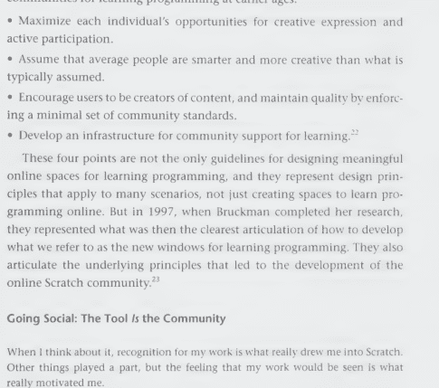

中国选手林丹在伦敦奥运会羽毛球男单决赛中夺冠，达成了个人职业生涯的“全满贯”。

他们创建的。经过与青年成员和导师们两年的工具测试，俱乐部（Clubhouse）内形成了一个充满活力的设计社区，开发出了数百个不同的游戏。25

这些来自当地线下社区中心的数百个游戏迅速增加到数千个、数万个，现在已达到数百万个。Scratch网站被称为“交互式媒体的YouTube”，目前拥有150万注册会员（称为“Scratchers”），自2007年推出以来，用户已上传了超过300万个项目。Scratchers的年龄从5岁到70岁不等，但大多数成员年龄在11岁到21岁之间。Scratchers的平均年龄是15岁。Scratch有来自全球近17000个城市的访问者，其可编程积木被翻译成40多种语言。26 尽管许多网站（如YouTube和Flickr）支持用户生成内容的上传和下载，但Scratch网站为用户提供了一个分享自己编程的交互式媒体的平台。27 在网站上上传和下载项目是一种信息交换，但也是一种个人创作内容的交换，其他人可以下载和混搭这些内容，以构建全新的项目。随着用户对Scratch网站越来越熟悉，他们会遇到各种项目和代码脚本，可以对其进行采样和混搭。

当Scratch团队成员安德烈斯·蒙罗伊-埃尔南德斯着手创建第一个Scratch在线社区时，布鲁克曼的MOOSE Crossing以及她对青年程序员社区的建议都被视为范本。但布鲁克曼和蒙罗伊-埃尔南德斯都受到帕佩特建构主义原则的启发。他希望Scratch成为一个“某种‘桑巴学校’，新手和专家聚集在一起阅读、写作和混搭Scratch作品。我想让Scratch从‘仅仅’一个好工具变成一个同伴聚集在一起创作、分享、混搭，甚至只是‘闲逛’的空间：一个基于公共资源的对等生产社区。这意味着让人们接触受众、潜在合作者，以及一个创作者可以从中学习和混搭的灵感作品库。”28

在线Scratch社区的巨大成功标志着从编程工具向程序员社区的转变。其他入门编程工具也在效仿Scratch的做法。例如，编程语言Alice团队正在开发Looking Glass Community，作为其游戏工具的在线扩展。29 微软Kodu和Recreational Design的营利性商业发展

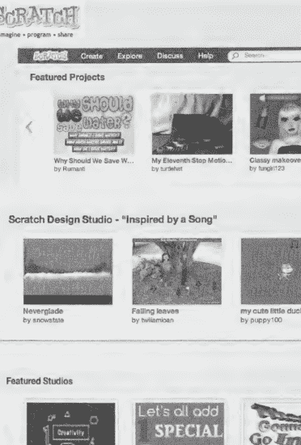

图4.1 来自Scratch首页的项目画廊。

其他社区成员可以分享他们的想法的版块。评论可以包括提问、建议、批评（Scratch团队成员会定期审查是否属于“建设性批评”）和赞美（例如“喜欢！”和“酷项目！”）。Scratch团队成员最近一直专注于通过评论功能使用基本的鼓励和署名来欢迎新用户访问网站，并鼓励他们通过个人联系探索在线项目，这些联系通过评论区成为可能。18 即使是最简单的表达积极反馈的评论也能激励用户继续他们的编程。

网站上的论坛版块为分享、提问或评论所有与Scratch相关的事情提供了一个平台。如何让项目出现在首页是论坛中的热门话题，但成员们也会发帖寻找其他潜在合作者并加为“好友”，集思广益项目创意，并请求和分享技术诀窍（例如如何制作更高级的滚动游戏，或者如何将视频导入作为动画的Scratch）。论坛中的分享（特别是与技术专长有关的分享）现在已经促成了一个与Scratch相关的wiki的开发，该wiki包含近一千个独立页面，其中大部分不是由MIT Scratch团队创建的，而是由Scratchers自己创建的。19

虽然过去Scratch软件作为编程工具和作为对应社区的在线网站之间存在着区分，但该社区及其资源的巨大增长表明它本身作为一种工具也很有用。在新版Scratch 2.0中，Scratch设计团队不再将Scratch作为工具和作为社区进行任何划分。年轻的设计者在同一个网站上编写代码和交流。期望是，这些新的社区窗口最终将使人们更容易联系和协作，从而进一步降低门槛、提高上限、拓宽墙壁（指扩大参与范围）。接下来的社区案例研究将体现这三个要素。

### 青少年DIY创意协作：游戏公司、涂色比赛和读书俱乐部

Green Bear Productions，这家在本章开头提到的初出茅庐的公司，生动地体现了Scratch社区的DIY协作精神。对于Green Bear来说，有效的协作

was not achieved by developing previously existing interpersonal ties because out of the team's eighteen members, only the two founders knew each other beforehand. Their connection was made by leveraging the power of common interests and a shared tool. To become a member of Green Bear Productions, Scratch users “applied” to the company. This usually meant that they sent the founding members an online message expressing interest and offered a URL to their previous work at the Scratch website to demonstrate their prowess in using graphics, plotting a storyline, or developing coding scripts for gameplay (Figure 4.2).

这一成果并非通过发展先前已有的人际联系实现，因为在团队十八名成员中，只有两位创始人此前彼此认识。他们的联系是通过借助共同兴趣和共享工具的力量建立起来的。要成为绿熊制作公司（Green Bear Productions）的成员，Scratch用户会向公司“申请”。这通常意味着他们向创始成员发送在线消息表达兴趣，并提供一个指向其在Scratch网站过往作品的URL，以展示他们在使用图形、规划故事情节或为游戏玩法编写代码脚本方面的能力（图4.2）。

If accepted, Scratchers became full members of a democracy and could volunteer game ideas, which the rest of the production team voted on before reaching a final decision. After a project was selected, the team assigned roles and arranged a production schedule. The founders encouraged users to follow a game to its completion before starting any additional projects. All of Green Bear's games entailed alpha and multiple beta versions before a final, glitch-free version was produced and released on the website.

如果被接受，Scratch用户就会成为这个民主组织的正式成员，可以自愿提出游戏创意，由制作团队其余成员投票，然后做出最终决定。项目选定后，团队会分配角色并安排制作时间表。创始人鼓励用户在开始任何额外项目之前，先跟进一个游戏直至完成。绿熊制作公司的所有游戏在最终制作出无故障版本并发布到网站之前，都经历了alpha版和多个beta版。

Green Bear Productions Company was one of the first teams to call itself a production company within Scratch, embodying the open-source community spirit with very young users. Computer scientists Kurt Luther and Amy Bruckman, who have studied online creative communities that make interactive digital media, note that when collaborations succeed, they produce content that supersedes what any single member could have accomplished on their own.³⁶ The problem, they point out, is that these collaborations disband more often than they succeed. This makes the success of Green Bear Productions even more surprising, especially because young people and not adults drove this enterprise.

绿熊制作公司是Scratch中最早自称制作公司的团队之一，体现了拥有非常年轻用户的开源社区精神。研究过制作交互式数字媒体的在线创意社区的计算机科学家库尔特·卢瑟（Kurt Luther）和艾米·布鲁克曼（Amy Bruckman）指出，当合作成功时，他们产出的内容会超越任何单个成员独自所能完成的内容。³⁶他们指出，问题在于这些合作解散的频率高于成功。这使得绿熊制作公司的成功更加令人惊讶，尤其是因为推动这项事业的是年轻人而非成年人。

**图4.2** 绿熊制作公司游戏精选：“珍珠港”“复古爪式捕捉”和“阴郁城堡之夜”。http://scratch.mit.edu/galleries/view/21935。

What makes kids join Scratch and form companies like Green Bear Productions? This was what researcher Karen Brennan of the Scratch team intended to uncover as part of her doctoral dissertation at MIT. After interviewing several members who had formed and joined such companies, she discovered that altruism was not necessarily the members’ primary motivation. Scratcher “Lana,” seventeen years old, explains:

是什么让孩子们加入Scratch并组建像绿熊制作公司这样的公司？这正是Scratch团队研究员凯伦·布伦南（Karen Brennan）在MIT博士论文中打算揭示的问题。在采访了几位组建并加入此类公司的成员后，她发现利他主义未必是成员的主要动机。17岁的Scratch用户“Lana”解释道：

> It’s not really a thing that people are doing out of goodwill—it’s out of interest. It’s always good when you have that enthusiasm because that’s the only thing that keeps it going. You have to communicate. People in your collaborations should know exactly what to expect and what they want to do. Because if their expectations aren’t met and you’re kind of forcing your own views on them and you aren’t paying attention to their opinion, they’ll probably get bored with the project. For that reason, it’s always good to come to an agreement before you make a project. I think that’s the main thing.³⁷

> 这其实并不是人们出于善意去做的事——而是出于兴趣。当你有那份热情时总是好的，因为那是唯一能让它持续下去的东西。你必须沟通。你合作中的人应该确切知道可以期待什么，以及他们想做什么。因为如果他们的期望没有得到满足，而你有点把自己的观点强加给他们，又不关注他们的意见，他们可能会对项目感到厌倦。因此，在制作项目之前达成一致总是好的。我认为这是最主要的事情。³⁷

Yet other members of Scratch companies, such as ten-year-old “Chelsey,” indicate that increased and more sophisticated output is not the primary driver. Responding to a question about what was the “greatest thing” about starting and working within a Scratch company, she explains:

然而，Scratch公司的其他成员，比如10岁的“Chelsey”，表示更多、更复杂的产出并不是主要驱动力。在回答关于在Scratch公司中创办和工作“最棒的事情”是什么的问题时，她解释道：

> Greatest things? I’ve met—I’ve made loads of new friends. It’s really fun just making projects together rather than doing them on my own.³⁸

> 最棒的事情？我遇到了——我交了很多新朋友。一起做项目而不是独自做，真的很有趣。³⁸

One study examined the nature of Green Bear members’ online exchanges as they developed their projects through the galleries on the Scratch website. After analyzing three months of chat-based textual exchanges (approximately 1,470 lines), the study found that the team’s online exchanges were context-related (such as scheduling or technology specifications) 32 percent of the time, task-related to the project 19 percent of the time, and socioemotional (socializing by joking or relating feelings) 49 percent of the time.³⁹ This research suggests that socializing is a primary driver behind such online collaboration—even in collaborations that are formal enough to refer to themselves as companies.

一项研究考察了绿熊成员通过Scratch网站上的画廊开发项目时在线交流的性质。在分析三个月基于聊天的文本交流（约1,470行）后，研究发现团队在线交流中32%与情境相关（如日程安排或技术规格），19%与项目任务相关，49%与社会情感相关（通过开玩笑或表达感受进行社交）。³⁹这项研究表明，社交是此类在线合作背后的主要驱动力——即使是在正式到自称公司的合作中也是如此。

If all collaborations in the Scratch community had been about kids making games, it might have become a typical “geek club.” Constructing projects in such a methodical manner requires people who are able to identify the composite parts of a project, delegate duties, ensure that they are completed in a timely manner, and—perhaps most difficult—reassemble the composite parts to form a unified whole. This approach is characteristic of very high ceilings—using modularization to break down the programming task into a series of independent systems. But the Scratch community, like the Scratch programming language, provides wide walls as well, and the socialization that played a significant role in Green Bear Productions plays an even more prominent role in some of the most common collaborations at the website.

如果Scratch社区的所有合作都只是孩子们制作游戏，它可能会变成一个典型的“极客俱乐部”。以如此有条理的方式构建项目，需要人们能够识别项目的组成部分、分配任务、确保按时完成，并且——也许最难的是——重新组装各部分以形成统一整体。这种方法具有极高“天花板”的特征——利用模块化将编程任务分解为一系列独立系统。但Scratch社区和Scratch编程语言一样，也提供了“宽墙”，而在绿熊制作公司中发挥重要作用的社交，在网站一些最常见的合作中扮演着更突出的角色。

Large Scratch collaborations among four or more members usually occur through digital “chain letter” projects in which an individual user creates a project that prompts other users to contribute to its content. Examples of these digital chain letter projects are “Add yourself to the group photo” in which other users are invited to share a picture of themselves or their avatars to the Scratch stage (Figure 4.3). Others include “Add yourself to the race,” “Add yourself as a baby,” and “Add yourself as the Scratch Cat.”

四个或更多成员之间的大型Scratch合作通常通过数字“链式信件”项目发生，即单个用户创建一个项目，促使其他用户为其内容做贡献。这些数字链式信件项目的例子包括“把自己加到合影中”，其中邀请其他用户分享自己或虚拟形象的照片到Scratch舞台（图4.3）。其他包括“把自己加入比赛”“把自己加为婴儿”和“把自己加为Scratch猫”。

These chain letter projects lack complex coding, but they make up for it in popularity, often attracting thousands of contributors, which helps users—particularly new users—to establish a sense of community at the website. Contributing to these low-threshold projects is pressure-free and playfully social rather than focused on a particular end goal. Young users can contribute to a project with hundreds of others in a low-pressure environment.

这些链式信件项目缺乏复杂编码，但它们在受欢迎程度上弥补了这一点，通常吸引数千名贡献者，这有助于用户——尤其是新用户——在网站上建立社区归属感。参与这些低门槛项目没有压力，充满趣味性和社交性，而不是专注于某个特定最终目标。年轻用户可以在低压环境中与数百人一起为项目做贡献。

This ability to “add and pass on” also serves as the basis for one of the most interesting forms of online collaborations at the website—role-playing games (RPGs)—in which users use the galleries section to spin storylines of assorted characters and plot twists. Most of these RPG storylines are serialized through the comments section underneath a project, and the project serves as a place to add visuals (like characters and settings) that are based on the developments in the RPG. Currently, more than five thousand Scratch galleries have RPG in their titles or descriptions, with group sizes ranging from a few members to a thousand players. The largest RPG included over 600,000 comments, nearly two thousand projects, and about a thousand players.

这种“添加并传递”的能力也为网站最有趣的在线合作形式之一——角色扮演游戏（RPG）——提供了基础。在RPG中，用户利用画廊部分编织各种角色和情节转折的故事线。大多数RPG故事线通过项目下方的评论区连载，而项目则作为一个添加视觉元素（如角色和场景）的地方，这些视觉元素基于RPG的发展。目前，超过五千个Scratch画廊的标题或描述中包含RPG，小组规模从几名成员到一千名玩家不等。最大的RPG包含超过600,000条评论、近两千个项目以及约一千名玩家。

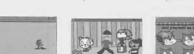

**图4.3** 受欢迎的Scratch“Add yourself”链式项目精选：“把自己加入比赛”“把自己加为婴儿”和“把自己加为Scratch猫”。

Some popular RPGs at the Scratch website are fan-based and draw on the characters and storylines from books and movies (like the Harry Potter books and films) and television shows (such as *Twilight*). Popular fiction (like the Warriors series of young adult novels) is another source. The Warriors novels follow the adventures of four cat clans who live in the forest and deal with issues of loyalty and friendship. One RPG, Warriors of the Blue (WOB), includes roughly 250 members, 80 percent of whom are girls. Like Green Bear Productions, WOB encourages members to participate but is maintained by a central moderator (screen name “MidnightBlaze”) who sets the rules for stimulating plot development. The WOB gallery includes a long description of the Warriors’ world that was written by MidnightBlaze and describes the rules for participating in the group. As with Green Bear Productions, people need to ask permission to join WOB, which is granted by WOB creator MidnightBlaze and a few other longstanding members. Likewise, in role-playing, MidnightBlaze assumes a more prominent role as the collab’s creator. She guards the stories by providing prophecies (a central element of the Warriors novels), correcting members if they get an element wrong, and supporting a culture where members ask for her permission before they move forward with new ideas. In fact, members curry her attention, showing delight when she replies to comments or sulking in frustration when she ignores them. MidnightBlaze’s leadership is thus enacted through her own actions and through the interactions of others who reinforce her position (even in her absence) and who extend her authority by policing on her behalf.

Scratch网站上一些流行的RPG是粉丝向的，取材于书籍和电影（如《哈利·波特》书籍和电影）以及电视节目（如*《暮光之城》*）中的角色和故事线。流行小说（如青年小说《猫武士》系列）是另一个来源。《猫武士》小说讲述四个生活在森林中的猫族部落的冒险，处理忠诚和友谊问题。一个RPG，“Warriors of the Blue”（WOB），包括大约250名成员，其中80%是女孩。像绿熊制作公司一样，WOB鼓励成员参与，但由一位核心版主（网名“MidnightBlaze”）维护，她制定刺激情节发展的规则。WOB画廊包含一段由MidnightBlaze撰写的关于《猫武士》世界的长描述，并描述了参与该小组的规则。与绿熊制作公司一样，人们需要请求许可才能加入WOB，由WOB创建者MidnightBlaze和其他几位长期成员授予。同样，在角色扮演中，MidnightBlaze作为合作创建者扮演更突出的角色。她通过提供预言（《猫武士》小说的核心元素）来守护故事，在成员弄错元素时纠正他们，并支持一种文化：成员在推进新想法之前先征求她的许可。事实上，成员们会博取她的关注，当她回复评论时表现出高兴，而当她忽略他们时则沮丧地生闷气。因此，MidnightBlaze的领导力通过她自己的行动以及他人的互动得以实施，其他人（即使她不在场）强化她的地位，并替她维持秩序来延伸她的权威。

Like the add-on chain letter projects, WOB’s development of storylines in the Comments feature is another low barrier for participation. But there are additional and more explicit rules as well. The site owner, MidnightBlaze, vets all storylines and removes comments that do not adhere to the narrative of the Warriors novels. In addition, she and other longstanding members supplement the narrative by programming characterizations, basic animations, and background music on the Scratch screen based on the comments-based storyline (Figure 4.4). Thus, the most popular characters and storylines are, in a sense, identified and rewarded by MidnightBlaze.

像附加式链式信件项目一样，WOB在“评论”功能中发展故事线是另一个低参与门槛。但也有额外且更明确的规则。网站所有者MidnightBlaze审查所有故事线，并删除不符合《猫武士》小说叙事的评论。此外，她和其他长期成员根据基于评论的故事线，在Scratch屏幕上编程角色设定、基础动画和背景音乐来补充叙事（图4.4）。因此，从某种意义上说，最受欢迎的角色和故事线是由MidnightBlaze识别并奖励的。

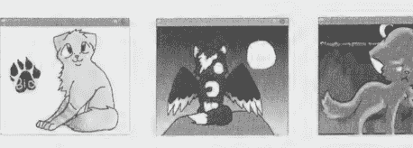

**图 4.4**  
精选的 Warriors of the Blue 项目，以猫咪角色为特色，有时带有翅膀和特殊能力。

以及她的资深团队选择为整体故事弧线的这些个别方面编程时的情况。

在 Scratch 中对这三种不同 DIY 协作的观察颇具说服力，并且与游戏社区很像，提供了自组织学习和设计社区的范例。在角色扮演游戏（RPG）社区 Warriors of the Blue 中，只有少数资深成员进行编码，而连锁信项目几乎不需要任何成员编程。其余成员将贡献集中在评论区，随后这些贡献由资深成员审核。尽管并非所有成员都在该协作项目中编程，但这个 RPG 充当实践社区，吸引新成员加入，并逐渐理解该群体通行的规则。那些留下来并通过指定评论区定期贡献的人，最终有机会晋升到更资深的位置，并开始为持续推进的剧本编写动画和音乐代码。一条无论多么非正式的路径已经形成。

路径这一要素至关重要。对于围绕开源软件项目的在线协作——无论是动画电影、互动电子游戏，还是两者的某种混合形式——有五个要素似乎至关重要。11 成功的协作似乎拥有以下特征：成员具有内在动机并自主选择任务；有一位富有魅力且能力出众的领导者；一种任人唯贤且理性的文化；模块化且细粒度的分工；以及协作技术。Green Bear Productions 和 Warriors of the Blue 都融合了这些要素。尽管与更民主的 Green Bear 相比，WOB 更像自上而下的等级制运作，但两个协作项目都有创始人：他们在自己的站点上接待团队其他成员，并且是群体规则的主要执行者。同样，两个群体都利用 Scratch 网站的技术要素来界定个人贡献。对于 Green Bear，项目的多个迭代版本发布在画廊区。对于 WOB，参与者以创新（且出人意料）的方式使用评论功能，将个人贡献串联成叙事。

这两个协作项目能够自行绘制的路径，并不是大多数 Scratch 成员能够作为可行路径遵循的。这两个协作项目所展现的高水平协作，在 Scratch 网站上代表的是例外而非常态。最近对在线随机抽取的五千个 Scratch 用户档案的分析显示，不到一半的人曾在线提交过任何项目、混编过他人的作品，或与他人合作完成单个项目。44 这在大多数在线网站中很典型，也并不令人意外。尽管存在这样一种迷思：当今儿童都是热切的“数字原住民”，但近期研究表明，儿童受数字媒体赋能和激励的程度低于一些人的想象。45

一项针对使用早期版本 Scratch 网站的中学生的探索性研究显示，许多孩子对在线分享自己的项目感到不自在，对将收到的评论感到紧张，并且希望只在项目“刚刚好”时才发布。46 即使用户提交了作品，也不能保证他们会找到那种激励许多人在线分享的受众和关注。Max O. Lorenzo 的 80/20 分布曲线47（20% 的人群获得 80% 的关注）在 Scratch 中得到了体现。对 Scratch 网站上 220 万个项目的考察显示，浏览量最高的 20% Scratcher 获得了 95.6% 的浏览量，而其余 80% 的 Scratcher 获得了 4.4% 的浏览量。48 认识到协作和参与方面存在这些悬殊差异后，Scratch 团队开始构想如何将更多用户汇聚到线上。

### 发起 DIY 青少年协作：在学校创建在线协作项目和训练营

2010 年，Scratch 一个新的研究重点——网络公地中的协作与计算——考察了学习编程与学习参与如何能够互惠互利。论坛能否帮助新用户更自在地在线分享自己的作品，并找到志趣相投的人？更有经验的用户能否担任这些新用户的导师？为此，首届年度 Collab Challenge 于 2011 年 1 月在 Scratch 网站启动，Collab Camps 则于 2011 年 7 月和 2012 年 1 月举办（图 4.5）。49

首届 Collab Challenge 面向整个社区开放，于 2011 年 1 月持续至 3 月初。每个团队至少需要有两名参与者；将三张独特的预选图片整合到其项目中；在比赛进行到一半时上传初稿，以获得 Scratch 团队的建设性反馈；并在三周后提交最终项目。初稿和最终项目在 Collab 画廊中展出，参与者可以在那里查看彼此的项目并发表评论。那些使用自己的原创想法和编码序列整合三张不同图片的团队，其项目会在 Scratch 首页展示，这对社区中的许多人来说是一种令人向往的状态。

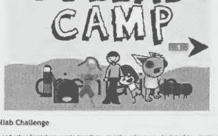

#### Scratch 协作挑战赛

你和 other Scratchers 用三张图片和大量想象力能共同创作出什么？我们创建了 Scratch 协作挑战赛来一探究竟。

- 1. 尽快在此注册你的小组或协作项目。
- 2. 与你的协作项目一起制作一个使用这三张图片的项目。创造性地使用角色。

**图 4.5**  
Collab Challenge 和两个 Collab Camps 的初始公告，其主题是互动故事和音乐视频混搭。

共有 52 个协作团队（139 名参与者）注册参加 2011 年 1 月的首届 Collab Challenge。约 41.7% 的参与者是该社区相对较新的成员，48% 的参与者已在 Scratch 上活跃超过三个月。经验丰富的 Scratcher 的评论表明，该挑战赛重新激发了人们参与在线社区的兴趣。一位加入社区超过两年的 Scratcher 感谢团队主办该挑战赛：

> 我想亲自感谢你们所有人举办 Collab Challenge。花时间创建这个活动让我能够与一些最优秀的 Scratcher 合作——我想这是我们所有人都感激的事情。我希望你们今后继续举办更多像这样的挑战赛。

在 1 月注册参加 Collab Challenge 的团队中，有 52 个在 2 月中旬前提交了项目初稿，26 个在 3 月底前提交了最终版本。尽管 K. Luther 及其同事发现，数字媒体网站 Newgrounds 上只有 13% 的协作项目成功完成了成品，但在向 Collab Challenge 提交项目初始版本的 Scratch 协作项目中，足足有 50% 成功提交了最终版本。尽管这些数字只反映了少量参照点，但它们表明，一个轻度结构化的挑战赛环境具有成功潜力：参与者能就初稿获得建设性反馈，并有预先设定的截止日期来帮助界定目标并将其分层。

这种“轻度结构”要素表明，学校可以帮助儿童参与以这些在线协作为特征的计算参与。在一班高中新生参加首届 Scratch Collab Challenge 之后，Yasmin Kafai 及其研究团队将对网站上在线协作的分析，与对学生本人的线下观察和访谈结合起来；这些学生以四到八人为一组开展项目，以获得课程学分。起初，这些高中学生被该挑战赛吸引，是出于同样的“看见与被看见”

吸引许多人来到网站的心态。一位学生说：“我喜欢参加 [Collab] 项目，因为我可以为网站上那些酷炫的项目做贡献。”另一位学生则称赞在 Scratch 合作画廊的建设性范围内在线分享项目的“安全”性质，因为挑战赛的结构是对论坛管理较宽松时同伴反馈中常见的“随便怎样”反馈的改进。53这位参与者在课后访谈中指出：“得到积极反馈总是很有帮助，而不是像‘做得更好’或‘只管去做’那样不断地指责。”54

尤其令人鼓舞的是，参加在线 Collab 挑战赛的高中生开始意识到 Scratch 在线社区是一个获得并利用受众的地方。例如，一个为挑战赛制作打砖块视频游戏的小组研究了 Scratch 网站上各种类型的同款游戏，并在此基础上改进，使其游戏比网站上现有版本更好。另一个小组没有理会课堂老师关于让项目更直观的反馈，而是通过添加项目说明和更清晰的指示，告诉用户如何激活和玩他们的项目，以此来回应关于开发更好界面的在线评论。这种转变——从拥有一种“贡献意识”55到把在线社区当作真实受众和学习工具来回应——涉及教育研究者 Alicia Magnifico 所指出的、向一群人传达想法时的批判性思考。56

### 拓展社区

计算思维和参与可以在青少年 DIY 在线社区中得到培养和激发。许多编程和设计工具（如 Alice、Gamestar Mechanic 和 Kodu）都包含这些类型的社区57，并创建开源网站（以 Linux 等社区的风格），供青少年分享、评论并贡献于他们的编码创作。其他一些机构（如非营利教育计划 Globaloria）则创建了混合模式，将学校的游戏设计活动与庞大的全国性网络连接起来，为学生参与者、教师和管理人员提供社区和支持。58新版的 Scratch 2.059延续了这一趋势，加入了允许用户在多个层面共享数据的功能。通过虚拟背包，用户可以复制他人的项目并存储起来以备将来使用；“注释与致谢”版块则帮助创作者在作品被重新利用时获得应有的署名。2.0 版本的用户个人主页更具可定制性，通过 Scratch 创建的项目也可以导出到社交媒体网站。

虽然趣缘社群并不新鲜（互联网出现之前的 Logo 社区就是证明），但即使是新手程序员现在也能拥有这样一个受众：它重视他们的作品，并提供了一个潜在的社区或趣缘群体。仅仅提供支持特定编程机制的工具是不够的。还需要一个可以使用这些编程工具并分享编程作品的社会环境。在 2005 年对 Seymour Papert 的桑巴学校的研究中，计算机科学家 José Zagal 和 Amy Bruckman 分析了桑巴学校的特征，强调了它们对外来者的开放性、公开活动的存在以及成员的多元性。重要的启示是：桑巴学校的成功并不依赖于舞蹈本身，而是依赖于舞蹈所处其中的社会环境。

Scratch 网站包含了这三个社会要素。该网站拥有各种各样的成员，并且对新用户开放。但正如从 Scratch 网站内部的 Collab 挑战赛和 Collab 训练营中了解到的那样，我们还需要更明确的、专门用于建设性和协作性分享作品的空间或“公开活动”。学校可能是利用在线空间进行有意义合作的可行潜在伙伴。学校归根到底是社会空间，而课堂的共同规则为儿童提供了学习如何在线分享和合作的可行模式——特别是当教师将课堂规则应用于像 Scratch 这样的青少年在线环境时。当教育工作者利用 Scratch 及其在线环境来支持学科学习时，他们会为了特定目的带领学生上网，而这个目的本身就可以作为一个活动，为学生的学习体验打下基础。

青少年之间的合作从来不是必然的，但在开放性、多样性和统一性活动的条件下，这种合作更有可能发展起来。而这种合作很重要，因为学习协作式编程会带来更有动力、更以同伴为基础的学习。掌握计算思维的关键要素——包括将复杂任务分解为一系列相互关联的模块，以及协调不同项目组件之间的控制流——会培养更好的工作习惯，并有助于

再创作，即从旧事物中创造新事物的过程，² 遵循着上一章介绍过的从个体到社区的路径。过去，大多数程序必须由个人“从头开始”创建，以展示编程能力；代码被视为一种专有的商品，可以被构建、完善，但绝不会被分享。这种方法为早期的计算课程定下了基调：向孩子们介绍编程的潜力时，侧重的是输入而非输出。课程关注的是孩子们用代码写了什么，而不是他们用这些代码实际上制作出了什么。在“语言优先”方法下，能够“从零开始”或“白手起家”构建东西，是合格程序员的标志。³然而，这种对个人输入的关注也有其教学上的局限。就像在创意艺术课程中学习写小说时被教授名词、动词和修饰语的含义一样，这种计算教学法强调基于文本的功能，而不是更广泛的考虑，例如组合起来的文本能提供什么可识别的产品。

在今天的 DIY 文化中，“scratch”一词有了完全不同的含义。Scratch 软件正是这种意义转变的典型代表：它的名字源自 20 世纪 70 年代和 80 年代嘻哈唱片骑师（DJ）发明的“搓碟”技术。⁴这些 DJ 将黑胶唱片放在一起旋转和搓动，将旋律和节奏并置、融合，创造出新的和声。他们的音乐是由完整歌曲的片段发展而来的，而不是由单个音符发展而来的；观众对此反响热烈，将再创作从志同道合的 DJ 之间一种鲜为人知的做法，提升为一种国际现象，如今已代表一种独立的音乐流派。

再创作已经超越了音乐领域。在计算机编程领域，再创作有着丰富但不太为人所知的先例。在科技行业内，主管们常常让新手程序员摆弄并基于现有代码继续构建，以培养他们的技能，这样既让他们熟悉语言，也让他们有机会生成比独自完成更复杂的设计。如今，通过互联网，重新利用代码——或者说任何数字媒体——被赋予了新的意义。Web 2.0 的出现使得在线制作和分享达到了前所未有的水平，以至于再创作如今已成为当今网络文化的关键实践。今天，在线“创作”往往意味着重新创作和再创作，利用基于网络的平台下载和上传数字内容。在广袤的在线“中间地带”，下载内容被修改后再次上传，常常成为全新的上传内容。尽管有些人以惶恐的态度看待这一中间地带，将再创作完全视为侵犯知识产权，但另一些人则将再创作视为关键视角，个体在一个日益全球化的社会中凭借它参与社会和经济生活⁵。

鉴于再创作从一个相对小众的技术应用迅速崛起为一个象征着二十一世纪创作意味着什么的过程，再创作从哪里开始，又是如何开始的？孩子们在哪里学习再创作，为什么它对他们有吸引力？再创作与单纯的复制有何区别，围绕这一实践本身是否有成文和不成文的规则？不幸的是（但也可能并不意外），大多数学校都没有回应这些问题，尽管孩子们在各种内容分享网站上“野外”体验过这些问题。在本章前半部分，我们考察了孩子们如何在 Scratch 网站上学习再创作实践，该网站目前是最大的面向青少年的可编程再创作在线集合。再创作在 Scratch 中是什么样子的？为什么孩子们选择参与这个过程？本章的另一半将探讨这一日益流行的实践能否被整合到学校中，以及再创作在课堂上能带来什么样的学习。整合的具体障碍是什么？这些障碍的存在是否超过了让编程学习更真实、更协作的潜力？毕竟，计算参与既关乎学习代码的生产，也关乎其嵌入的社会实践和文化规范。

#### 为什么要再创作？探索 Scratch 网站上的创作动机

再创作在 Scratch 上占有重要地位。根据最近对上传到该网站的项目分析，该网站所有项目中超过四分之一（27.64%，即 670,932 个）是之前项目的再创作。⁷其他面向青少年的编程网站，如 Kodu Game Lab 和 Studio Sketchpad，也报告了类似的再创作比例。⁸在 Scratch 上进行再创作是一个简单的过程。当 Scratchers 打开网站上的一个项目并“查看内部”查看底层代码时，他们会立即看到通过右上方按钮进行再创作的选项。

角落。当他们点击按钮时，项目会作为混搭作品在该网站重新发布。因此，从技术上讲，在Scratch网站上混搭很容易。

尽管在技术上如此容易，混搭仍被认真视为一种在线社区性生产形式。每当个人创建Scratch账户时，会员身份的一个关键要素就是同意该软件的开源性质，这在知识共享相同方式共享许可协议中有详细说明。8 Scratch管理团队提醒用户，除了在线行为具有建设性并尊重他人之外，他们还必须在在线分享方面保持开放态度。他们可以自由混搭在Scratch网站上发现的任何其他项目，就像他们可以根据在网站上发现的想法和图像开发自己的项目一样。用户还必须愿意让其他人下载他们在线发布的任何内容。这包括项目本身以及使其运行的基础代码。

社区准则还鼓励成员在项目被混搭时，在项目注释区中给予署名。9 不过，这并不总是会发生。无论是故意省略，还是缺乏对混搭协议的理解，Scratch成员经常重新利用并重新上传他们在网上找到的项目，却不给原始创作者署名。为了解决这种正式认可缺失的问题，Scratch团队考虑了将署名机制内置于网站中的方法。Scratch研究员安德烈斯·蒙罗伊-埃尔南德斯为网站添加了一项自动署名功能，该功能会生成混搭可视化。这种自动署名允许用户追踪项目的开发和重新利用情况，这些项目现在通常被称为“Scratch混搭树”。这些自动可视化像家谱一样在屏幕上分支，只需点击按钮即可访问，显示任何单个项目的所有混搭（以及该项目本身是否为混搭）（图5.1）。

通过基于源代码将混搭树直接链接到其前身，这些可视化确保应得者获得署名。10 无论单个用户是否在项目注释区向其他用户给予署名，混搭树都会自动生成，将项目链接到源元数据。这种自动署名培养了在线公平意识，而混搭树有助于促进网站的整体社区氛围。尽管Scratch用户通过互加好友、在论坛区建立联系，以及为他们最欣赏的项目添加“喜爱”来欣赏并壮大社区，但混搭树凸显了网站的社区性质，无论单个用户是否正式认可这种社交性。有了混搭树，项目内容和编码脚本方面的共同兴趣变得更加明显。一个人在网站上获得“高地位”的方式也变得更加明显，因为位于混搭树“分支”的“根”部（即最常被混搭）的项目会被选中出现在Scratch备受青睐的“首页”展示中，该展示除其他类别外，还有一个“社区正在混搭什么”板块。

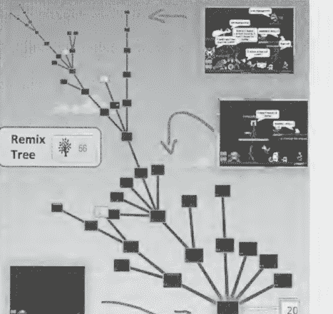

**图5.1** vortex19的项目“添加你的角色在还算合适的音乐中跳跃”的混搭树。源项目在混搭树底部中央被高亮显示，混搭链上的另外两个项目也是如此。点击五十六个屏幕中的任何一个，都会链接到对应的单个混搭。

因此，个人地位、社区善意和整体生产力都在理解青少年为什么选择在Scratch网站上混搭彼此的作品方面发挥关键作用。但这些混搭实际上是什么样子，它们使用什么编码方案？混搭的外观和感觉是否会因用户混搭的原因而变化？为了回答这些问题，有必要回到媒体研究者伊藤瑞子及其同事提出的“闲逛”、“随便玩玩”和“极客式钻研”类别，以探究青少年为何选择使用数字技术。

#### 闲逛：作为社交化的混搭

与旨在让尽可能多参与者加入的Scratch协作一样，最基本的一种混搭形式涉及那些创建目的就是邀请他人重用和修改其代码与图像的项目。这些“闲逛”式混搭的主要目标是邀请他人加入项目，以促成共同的社交体验。Scratch中“闲逛”的独特之处在于，这些“附加”项目常常连接从未有过任何线下关系的用户。从图5.2中的三个例子可以明显看出，项目标题往往兼作邀请，并作为在网站上与他人建立联系的一种基本但根本的方式。尽管在添加另一个角色、声音或场景的过程中代码会被改动，但这种改动通常意味着累积而非修订。这类混搭往往不改变现有代码，而是用额外的行在其基础上构建。鉴于目标是通过此类混搭建立联系，包容已经添加的内容和可以添加的内容很重要。修改他人的代码以改变现有外观或修改行为，最终可能会使项目更高效，但也可能被其他用户视为直接挑战，危及通常因协作极少而本已脆弱的在线关系。

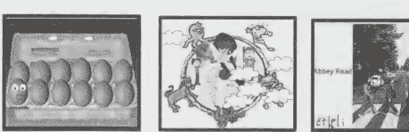

**图5.2** 三个“闲逛”式混搭：“把自己添加为一个蛋”、“把自己添加为在蹦床上跳跃”和“把自己添加到艾比路”。

这些混搭形式从触及大量贡献者的意义上说可视为广泛。然而，在其扩展的触及范围中，它们在产出具有清晰故事情节、一致游戏规则和明确最终目标的完全连贯项目方面也远不够深入。尽管在内容和编码复杂性方面缺乏深度，但这些混搭中所见的基于项目的社交化本质上具有生产性。通过可混搭的Scratch项目建立联系，比仅仅通过Facebook或Pinterest建立联系涉及更多的个人投入和创造力，因为在Scratch上分享——与这两个其他网站不同——依赖于交换自己生成的内容。

#### 随便玩玩：作为路径的混搭

这些社交性混搭代表着向新用户介绍利用他人贡献来创造更大、更好作品的可能性的关键第一步。尽管Scratch网站托管着利用青年文化中流行的电视节目、电影、游戏和书籍的项目，但对年轻用户来说，开始使用该软件可能令人望而生畏——尤其是当他们想生成自己的交互式数字故事或多级电子游戏，作为首次涉足Scratch社区时。从零开始对一些新用户有吸引力，但让其他用户不确定从何处开始。这些用户更感兴趣的是沉浸在已经功能完整的游戏、艺术和故事中，而不是仅使用Scratch猫和空白舞台来创作。通过摆弄现有的Scratch内容，新用户既能获得操控已经看似完整项目的代码的满足感，又能为项目加入自己独特的风格。这种摆弄也作为一种非正式学习体验，因为新用户经常遇到能实现更复杂项目功能的Scratch积木和脚本（图5.3）。

“我得说，要不是因为混搭，我永远不会理解速度或滚动，”十四岁的Scratch成员查克说道。但他也提醒说，混搭“应该用于‘添加”之外的事情

这一点在一系列由社区发布供混搭的“操作指南”项目中表现得尤为明显。这些操作指南项目（也称为教程或演示）由个人用户独自或相互协作创建，涵盖一系列项目功能，例如如何为游戏添加计时器，以及如何为移动物体添加速度。尽管有些操作指南项目会逐步解释如何构建相关编码脚本，其他项目则只是把脚本提供给混搭者。最好的操作指南视频会在演示过程中解释如何生成脚本。

项目“如何滚动”由 Scratch 用户“cougers”发布，是一个既作示范又作讲解的项目的良好范例。滚动是《超级马里奥兄弟》和《陷阱！》等主机电子游戏的基本要素。移动的背景会随着角色的移动向前“滚动”。由于滚动是那些有兴趣制作游戏的 Scratch 用户最抢手的技能之一，它位居该网站发布的教程列表之首。“如何滚动”项目很受欢迎（被混搭九十四次），它让玩家沿着不断变化的地形向前滚动，而生成脚本的分步说明会随着玩家前进沿地平线出现。其创作者“cougers”在项目说明区发帖说：“如果这能变成一个游戏，那就太酷了。”

通过这些各种各样的操作指南教程，Scratch 新手能够在相对较短的时间内创作出复杂的游戏、故事和艺术项目——当然，这比完全从零开始开发项目要短得多。关键因素在于，这些混搭形式并不仅仅是重新利用单个编码积木，而是整体采用项目并将它们彼此结合，创造出全新的项目。在这些“巨型混搭”中，用户面临的挑战是确保一个项目的代码与另一个项目的代码兼容，而这可能需要混搭者进行大量调整。但完成之后，创作者便构建了一个项目，它依靠一系列互补的“隔间”运行，这些“隔间”彼此协同，同时也各自独立运行，集中体现了计算机科学家 David Parnas 在其关于编程模块化设计的开创性论文中所指出的“信息隐藏”这一关键要素。14 在将项目作为各种模块混搭在一起的过程中，我们看到了一种进行计算性思考和参与的潜力——基于一个以相互尊重地混搭为共同约定的实践共同体，在更短的时间内创造出更复杂的项目。

### 极客式钻研：作为创造性挑战的混搭

在 Katie 和 Nadia 的混搭中，交流发生在多个个体之间。然而，这种作为混搭特征的交流要素也可以是个人的努力。Karen Brennan 在她对十一岁男孩 Jackson 的访谈中指出了这种个体性如何在混搭中体现；Jackson 在 Scratch 上进行混搭，较少出于社交目的，更多是为了自我提升。Jackson 会混搭他觉得有吸引力的游戏，以减少编程积木的总数，同时不以任何方式改变玩法。15 他把不可替代的关键代码称为“峰值”，并解释说目标是清理“噪声”或多余积木，从而创建更经济、更高效的编码方案。在这个例子中，混搭是一条学习路径，也是一种挑战，触及 Papert 所说的编码所特有的“艰苦的乐趣”要素。16

这第三类混搭的独特之处在于，其社交化程度具有“添加式”混搭的特征，而其激发更高生产力的意图则具有“操作指南式”混搭的特征。这两个目标中的第一个，以 Scratch 网站上可混搭的“涂色比赛”之流行体现得最为充分。在这些比赛中，单个用户会发布一张无色的自绘或导入图像、一套写在项目说明区的规则（例如可以使用哪些颜色，以及是否可以添加音乐和背景），以及一个截止日期。比赛创作者通常会选出获胜的彩色混搭作品，不过获胜者偶尔也会根据混搭作品获得的项目浏览量或“喜爱”数来决定。获胜者因此能在 Scratch 网站上获得声望，而如果比赛特别受社区欢迎，比赛创作者也有机会登上首页。17

与“添加式”混搭一样，这些涂色比赛能从单个参赛作品生成数百个混搭作品，但正如主要出于社交目的而开发的混搭作品的典型情况一样，它们在广度上有所得，却在深度上有所失。大多数涂色比赛混搭作品几乎不涉及编码复杂性，甚至可能根本没有代码，参赛作品通常仅根据静态图像来评判。Scratch 网站上的其他比赛则更为复杂。在“Roomba 混搭挑战”中，用户会看到一套两居室公寓的平面图，需要由自主的 Roomba 真空吸尘器来清洁（图 5.4）。

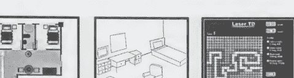

图 5.4 三个“极客式钻研”混搭：“Roomba 混搭挑战”“卧室制造器”和“激光塔防”。

真空吸尘器在房间里随机移动，同时右下角的计时器（表示电池寿命）在滴答走动。当 Roomba 在地板上移动时，它会留下一条白色路径，标示已经清洁过的区域。用户没有任何控制手段。在项目说明区，项目创作者解释了该项目的用途。“我听到你问，那这有什么意义？”说明中写道，“意义在于修改 Roomba 中的编程逻辑，让它在你的电池耗尽之前，比我提供的那些非常笨的代码更高效地清洁地板。”作者提出了一些建议（例如用传感器实现更好的碰撞检测，甚至为机器添加逻辑），并解释说这个项目是“一个你必须思考编程的游戏，因为对程序的一次修改可能只需几秒钟，但你必须等上几分钟让吸尘器完成工作，才知道自己做得有多好！”

Roomba 混搭挑战面向有经验的 Scratch 程序员，处于与涂色比赛相反的另一端。它需要反复调试、创新思维和耐心。混搭者每次都必须对吸尘器进行长时间的测试运行，看看修改后的代码是否让设备成为更高效的清洁工具。媒体学者 Giorgos Cheliotis 和 Jude Yew 在分析支撑混搭文化的社会结构时指出，竞赛在吸引新用户访问网站、保持有经验成员的兴趣并激发其动机（和生产力）方面发挥着重要作用。18 这正是我们对于该网站赞助的一系列基于 Scratch 的协作挑战的经验，这些挑战将在第 4 章讨论。19 这些协作倡议如今已进入第四年，它们以一个“种子项目”开始；种子项目是一个项目的骨架，提供一个基本框架（如数字故事或互动艺术项目），参赛者可以在各自团队中以此为基础进行混搭。混搭激发协作活动，并作为在各种修订状态之间交换项目的手段，维持这种协作。

## 5 作为教学法的混搭：学校的挑战与可能

### 文化挑战

在上述在线 Scratch 混搭挑战的所有特征中，有三点尤为突出，因为它们特别能有效促进初学程序员的学习。第一，参赛参与者彼此合作、为彼此创作，制作出对他们个人有意义的游戏和故事。第二，这些年轻人与同龄人协作，承认他们共同完成的事情无法由个人同样出色地完成。第三，他们利用混搭作为修订和改进自己作品及他人作品的手段。这三个要素是 K–12 学校（甚至高等教育）中很少见的学习面向。20

第一，在学校里，学生通常不创作自己的内容，而是概括别人给他们的内容。即使他们创作自己的作品，也是为老师而作，很少为同龄人而作。第二，即使课堂要求协作，研究也表明，当小组中极少数人一直承担大部分责任而其他人做得很少时，小组合作是无效的。21 因此，许多学生对协作不屑一顾，而另一些学生则过于渴望协作。第三，在学校里，混搭不是混搭，而更常被视为彻头彻尾的剽窃，并且在上学期间即使不被禁止，也很大程度上受到劝阻。

这第三点也是最后一点，清楚地区分了课堂学习与 Scratch 在线等 DIY 青年文化中的学习。有人可能会认为，混搭的 DIY 文化与 K–12 学校教育的制度性质相对立；在后者中，秩序和等级往往压过自发性，而这两者是支撑整个教育体系的核心要素。尽管越来越多的媒体理论家和教育工作者将混搭视为一种新素养22，且过去十年间对数字素养进行了大量研究23，学校仍抵制将混搭作为基于课堂创作的可行形式。

这种抵触来自教师、管理者和学生，他们对自己作品被他人挪用很敏感——尤其是在没有明确许可的情况下。在2010年一项关于用户在Scratch网站上的项目被混编时如何反应的研究中，大约五分之一的人在混编者个人主页上留下了正面评论，五分之一的人指责混编者剽窃。参与者报告说，尽管Remix Tree可视化有助于展示署名归属，但仅此并不能遏制这种怨恨情绪，因为给出署名的是计算机而不是实际个人。⁴⁴ 有时，作品在Scratch网站上可以被混编的可能性，可能成为鼓励青少年上传作品的阻碍而非帮助。在一所中学课后俱乐部的头几周，几乎所有成员都犹豫是否把项目发布到网上，担心自己的作品可能被他人“劫持”。²⁵ 然而，当指导教师解释说混编是一种赞美时，学生们总体上改变了最初立场，并理解并欣赏混编作为一种积极的社交姿态。

但是，即使把混编解释为一种赞美，也并不总能缓解孩子们的抵触。在“‘不，我并没有感到被赞美’：一位年轻艺术家对版权的看法”一文中，数字媒体研究者Dan Perkel描述了他与Sharon的相遇。Sharon是一名15岁有抱负的摄影师，她把照片放到网上，却发现它们被复制到了其他几个网站。当被问及是否认为这种复制粘贴式的挪用是一种赞美时，Sharon回答说，她认为这是对自己作品的侵入：“不，我并没有感到被赞美。”Sharon删除了网上剩余的照片，因为她不愿让它们可供混编。“这类活动，”Perkel写道，“深深扰乱了Sharon的是非感。”她的照片被访问和挪用是如此容易，这促使她思考混编更广泛的伦理问题。

### 拥抱可能性

大多数K–12学校推崇一种复制观念，这种观念与更广泛的混编文化相抵触，从而导致两个群体之间的紧张关系。然而，这种紧张关系应促使学校探索与混编相关的益处和危险。尽管基础层面的混编只需点击几下鼠标来复制程序（因此对计算思维贡献甚微），但选择性混编可能需要高度的复杂技巧，并使初学设计者参与计算参与。一些混编活动（例如考虑在选定的代码段中修改什么、保留什么，以及在程序中的何处添加或删除过程或变量）要求对代码有深入的功能性理解，在某些情况下，这种混编可能比从空白开始更复杂。学校需要承担并拥抱调解者的角色。这可以通过两种方式实现。

首先也是最直接的是，学校需要应对自Web 2.0以来协作的性质和版权的作用。在政治层面上，数字领域（代码和界面中）的版权呈现出复杂问题，这些问题正根据新的文化实践被界定。26 对许多青少年来说，版权是一个难以理解的复杂问题。混编困境27——在项目中同时促进原创性和生成性的困难——表明混编可能偏离为被用作拐杖，而不是作为想象性生产力的刺激。然而，将混编视为拐杖还是刺激这一问题，是21世纪课堂的关键问题，并可以作为一个机会，用来审视版权问题并处理计算参与的社会影响，而这些影响在公然关注技术能力时往往被忽视。学校、研究者和政策制定者在这一领域已取得进展，也许最引人注目的是哈佛大学的GoodPlay项目，它描绘了青少年在接触新媒体时参与伦理和道德问题的方式。28

随着阅读、写作和各种制作活动日益迁移到在线平台，学校必须认识到全面改革的必要性。为此，法律学者Eric Perrott建议通过全国州长协会在美国所有学校实施版权教育，而社交媒体中心已在网上发布了一系列在K–12课堂中教授合理使用的最佳实践。这些步骤值得赞赏，它们聚焦于为K–12课程提供信息的政策，但回避了教学法问题。尽管人们有兴趣教孩子们理解21世纪创造和再创造意味着什么的变化性质，但学校缺乏此类课程的有意义实践。在白板旁讲课不太可能帮助学生理解什么构成合理使用和版权侵权——尤其是在小学和中学阶段，在这些阶段，处理公平问题对发展很重要。为了有效做到这一点，教育者需要创建课程，让学生创造可混编的媒体，将这些课程植根于流行文化，而不仅仅是谈论它。

其次，学校需要审视自身自上而下运作的倾向，并更加信任自下而上的学习方法。约翰·杜威和伊万·伊里奇等教育理论家提出了关于国家学习倡议应如何最好地重构自身的理论。然而，就处理在数字媒体中创造意味着什么而言，在课堂中为混编文化找到一席之地，是使K–12课堂成为更具协作性空间的一个适度但关键的步骤。

这并不需要重新发明轮子。杜威的经验教育和伊里奇的“学习网络”概念，为混编作为一种教学实践提供了丰富的理论背景。也存在教学先例（如第2章所讨论的），见于Sherry Turkle和Seymour Papert的“拼装”（bricolage）概念，其中学习者通过“安排和重新安排……一组熟悉的材料”来建构自己的学习，而不是简单地接收和背诵指导教师给予的内容。传统规划风格倾向于将问题解决过程视为自上而下地将挑战分解为更易消化的组成部分，而拼装“将问题解决描述为与情境的对话，最终解决方案在最后浮现。”

就通过混编学习编程而言，许多倡议都利用拼装——最引人注目的是计算机科学教育研究者Betsy DiSalvo及其同事通过佐治亚理工学院和莫尔豪斯学院开展的Glitch Game Testers倡议。³¹ Glitch Game Testers始于2009年，通过让非裔美国高中男生测试EA Games和其他流行游戏公司的预发布视频游戏，向他们介绍计算和界面设计。学生们在游戏玩法中寻找“漏洞”，找出游戏设计和玩法中的问题，并为参与公司记录混编修订的笔记。

这种通过混编实现的拼装元素，也体现在一系列名为“Debugems”的基于Scratch的谜题的发展和使用中，这些谜题发布在Scratch网站上。³² 这些项目被设计为包含一个错误，并要求用户找到解决方案。无论是修复游戏中的时钟计数器，还是微调角色的感知能力，这些项目都利用采样和混编来逆向工程构建过程，很像Roomba Remix Challenge。

### 发展“深度可分享性”文化

> 青少年不断查看彼此的项目、交换想法、分享技巧。为了融入这一语境，Scratch的对象架构支持我们所谓的“深度可分享性”。
>
> ——John Maloney等，“Scratch：先睹为快”^33

*可分享性*一词代表了儿童在Web 2.0时代进行社交活动的意义。年轻人通过在Facebook、Twitter、Instagram、Pinterest和其他社交媒体上分享内容来进行社交。但Scratch首席设计师John Maloney及其同事在上文引文中提到的“深度可分享性”这一概念，超越了在Facebook上发布照片和“点赞”他人照片。当年轻人协作完成一个编程项目、在线征求反馈并欢迎他人混编自己的作品时，分享就包含真正的沟通、合作和生产——这三者都在混编实践中汇合。

根据法律学者Yochai Benkler的说法，我们生活在一个日益依赖“基于公地的同行生产”的世界中，在这种生产中，利他主义不仅是一种道德要求，也是一种经济要求。新媒体理论家Vito Campanelli指出，混编是一个深深植根于人的过程，它是“一种进化义务，源于每个人类与生俱来的需要，即亲自转化可供他们使用的材料。”^34 在创造力心理学中，概念组合，尤其是以新的和意想不到的方式进行的组合，会推动新想法。^35

很难预测学校作为能够推动新思想的机构，会在多大程度上拥抱混编作为一种实践和教学法，因为学校正在遵循更广泛的行业标准，而这些标准利用版权法来压制而非鼓励混编。混编的另一种模式是日益壮大的开源运动，它鼓励一种将软件视为信息而非财产的观念。^36 然而，要让这场开源运动获得牵引力，并让学校兑现其作为新思想场所的承诺，混编必须在课堂中被教授和实践。

## 6 从屏幕到实体

*2012年春季，草根众筹网站Kickstarter发布了一项新的融资请求。两名MIT学生Jay Silver和Eric Rosenbaum正在为一个名为MaKey MaKey的计算搭建套件寻求资金。开头文字以提问方式逗引潜在支持者：“你曾在橡皮泥上玩过马里奥，或在香蕉上弹过钢琴吗？用鳄鱼夹把互联网夹到你的世界，开始发明未来。”用户将一个鳄鱼夹夹到MaKey MaKey板上，将另一个夹到导电物体（如苹果、香蕉或铝箔）上，从而闭合电路。当用户触摸所选物体时，他们便操控Scratch屏幕上的程序化行为。作为“21世纪发明套件”，MaKey MaKey邀请用户将日常生活中的普通物体变成触摸板并与互联网结合，从而重新发现它们的计算潜力。作为发明套件，MaKey MaKey对初学者足够简单，却又足够复杂，可供专业艺术家和工程师在各自领域中使用。Jay和Eric的启动资金请求附有一段视频，展示了各种MaKey MaKey项目。几天之内，活动就达到了启动项目所需的25,000美元初始目标，但资金和反馈并未停止。早在任何人收到套件之前，评论页就充满了数百个关于MaKey MaKey能做什么、人们能用它制作什么的问题和想法。人们询问它是否支持蓝牙连接，能否将两个MaKey MaKey连接到键盘，以及相关应用能否为残疾儿童和老年人减轻行动困难并提供无障碍使用。活动结束时，超过一万一千名支持者认购了套餐，并提供了586,106美元启动资金。这是当年最成功的Kickstarter活动之一，吸引的资金几乎是其发明者最初申请金额的24倍。¹*

曾经，电子搭建套件被卖给少数热衷的爱好者，他们有兴趣制作自己的飞机和业余无线电设备。但Kickstarter活动已为多个计算搭建套件筹集启动资金。与MaKey MaKey一样，这些活动围绕开源Arduino板和软件展开，允许针对特定活动（如设计机器人）进行定制，或为往往昂贵的硬件平台提供Scratch风格界面以进行编程。但MaKey MaKey的独特之处在于，它让实体计算变得触手可及。Kickstarter宣传视频中展示的大多数MaKey MaKey项目，都可以通过将鳄鱼夹连接到MaKey MaKey板上的预设端口来设计，而且都不需要先前编程经验。与Scratch一样，MaKey MaKey为初学者提供低门槛，为高级设计者提供高上限。最后，MaKey MaKey价格可负担。该板成本不到50美元，远低于可能花费数百美元的Lego Mindstorms套件价格。这种朝向易获取、实体化、计算化搭建套件的趋势仍在继续。当你可以拿沙发上的枕头、车钥匙和房间门，让它们可编程、可玩时，为什么只给机器人和赛车编程呢？2012年，非洲机器人网络发起了一项挑战赛，旨在设计一套10美元的机器人套件，让全世界儿童都能学习制作自己的可编程机器人，并评选出了若干获奖设计。²

MaKey MaKey不是独立应用。它接入了围绕开源Arduino板形成的不断壮大的在线社区。³ 与第4章描述的Scratch社区类似，基于Arduino的应用催生了完整的DIY社区，其成员在线分享创作、提供教程和技术支持，并利用网络为志同道合的爱好者创造空间。例如，在在线社区Instructables上，数十万条目提供关于如何制作或修理几乎任何东西的信息和视频文档。爱好者文化是更大的DIY或创客运动的一部分，这场运动正在复兴手工工艺、促进本地制造，并在Fab Labs中通过三维打印机和激光切割机提供数字制造的机会。2005年《Make》杂志创刊，以及此后不久在全国各地举行的年度Maker Faire，创建了分享和庆祝DIY设计的全国性论坛和本地聚会场所。⁴ MaKey MaKey的Kickstarter活动及其他类似活动的成功表明，广泛受众有兴趣制作可在物理世界中编程和玩的东西。

创客运动不限于俱乐部和家庭等非正式空间，还正在扩展到博物馆、图书馆和学校的教育空间。全国各地的科学中心和博物馆正在其展厅中设立创客空间。纽约科学馆、探索馆和劳伦斯科学馆是最早尝试这种与观众互动新模式的机构。现在访客前来观看展览并与之互动，也可能制作与展览主题相关的作品。芝加哥、费城等地的公共图书馆正将重点从书籍扩展到青少年空间，年轻用户可以在那里使用电脑搜索信息、完成作业、玩游戏，并参与动画、游戏和电子纺织品的数字制作。⁵ MakerEd计划已开发并部署了Maker Corps——一群有兴趣帮助其他青年和社区开展DIY项目的年轻人。美国童子军于2013年增设游戏设计荣誉徽章，并于2014年增设编程徽章和计算机辅助设计徽章。设计和编程数字媒体很快会像生火或在森林中绘制路线一样，成为一项基本童子军技能吗？在网络媒体的丛林里，这很可能就是新的荒野生存技能。学校正在认识到编程在设计和构造物理对象中的潜力，并开始设立计算机科学教育者Ann和Mike Eisenberg所设想的一种新的、改进的车间课，在计算机增强的手工工艺中融合计算与材料科学。

教育技术超越电脑屏幕、将数字与实体融合的这一转变，是本章的重点。前几章讨论的许多内容——互动数字故事、视频游戏、动画和大型在线社区——都位于固定的电脑屏幕上。正如社会学家Sherry Turkle曾指出的，我们的数字生活现在似乎大多发生在屏幕上，而不是物理世界中。但带有小型便携屏幕的移动技术已将计算的物理一面带入我们的日常生活。它们也使实体技术的设计对所有用户来说可及且可负担。这种对实体的兴趣可能是一个早期迹象，表明钟摆正在回摆：最初作为从面对面……的迁移而开始的东西

在设计Lego/Logo的早期阶段，计算机科学家Mitchel Resnick和玩具设计师Steven Ocko将其描述为一种用引擎和传感器使乐高物体动起来并加以控制的工具。⁵ 设计者在电脑上编写程序，这些程序用于命令乐高物体中的传感器和引擎，而那些乐高物体通过长电缆连接到电脑。乐高物体可以自行穿越迷宫，不再需要用手移动。对光、触摸和声音作出反应的传感器可以被编程，以对环境作出反应、相应调整行为并展示替代行为。后来的发展，如可编程砖块，通过将程序下载到可与乐高积木组合的小型计算机中，移除了电缆束缚（图6.1）。

正如Mitchel Resnick、Fred Martin、Randy Sargent和Brian Silverman所提出的，Lego/Logo和可编程砖块可以在互动环境设计中成为“用来思考的玩具”——例如会倾斜床铺以唤醒晚起者的闹钟、定时旋转的微型摩天轮，或定期眨眼的玩偶。可编程砖块可以把它变成行为搭建套件。年轻设计者可以设计自主生物，通过编写简单行为来模仿活体动物的动作，例如乌龟撞墙时缩头或后退。最后，他们可以使用可编程砖块构建科学仪器，例如记录宠物仓鼠在笼中夜间跑动模式的微型计步器。在这些案例中，年轻设计者设计了可用机器使其动起来、并用传感器控制的乐高结构，还编写了程序命令，定义在何种条件下执行特定动作。这是不小的壮举。协调这些想象的设计与构建的系统，即使对本科工程专业学生来说也具有挑战性。计算机科学教育者Fred Martin在考察本科生为竞赛设计机器人时的设计方法、技术解决方案以及工程与编程学习时，记录了这一点。

从名称Lego/Logo⁶改为Lego Mindstorms，是有意引用Papert的书名《Mindstorms》（图6.2）。它离开了MIT Media Lab（许多早期原型在此开发），并走向商业市场。盒子提供传感器、引擎和熟悉的乐高积木，可用于搭建机器人和互动房屋以及

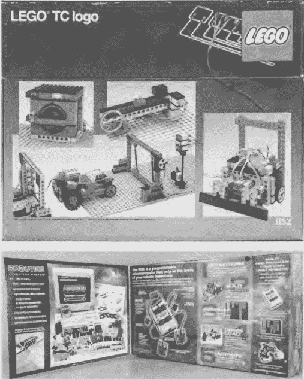

**图 6.1** 乐高 TC Logo（上）和乐高 Mindstorms 包装盒（下）。图片由乐高集团提供。

重建并让广受欢迎的《星球大战》电影系列中的机器人动起来。以前只有大学课堂和大学实验室里的学生才能获得的机器人技术和材料，现在学校与家庭也能获得，而且价格相对可负担。以 Basic、Logo 和 Pascal 进行的编程教学早已被学校计算机实验室放弃，因此通过机器人学习编程和工程，便经由课后俱乐部的后门进入。多年来，课后机器人俱乐部成为许多 K–12 学校中少数让编程和工程得以安身的地方之一，但这个家始终在标准课程之外。

K–12 中的机器人技术还带来了一种展示和分享设计的新模式——竞赛。这些竞赛源于麻省理工学院一月份的机器人课程，这些课程让工程学生在小学期期间获得实际焊接和动手建造实物的实践经验。⁵ 每门机器人课程都以一场公开竞赛告终，竞赛在坐满欢呼学生的大礼堂举行。挑战往往是平凡的任务，比如收集散落的乒乓球并把它们移到桌子另一边。但考虑到机器人是舞台上唯一的行动者，这些日常任务需要工程团队进行大量预先思考和修改。

机器人竞赛已成为带有新锐气息的科学展，为典型的机器人设计挑战（如搭建高塔、穿过迷宫，或收集乒乓球并把它们移到桌子另一边）提供公众曝光和真实受众。FIRST（For Inspiration and Recognition of Science and Technology，科学与技术的激励与认可）乐高联赛活动始于 1992 年，如今来自全国和世界各地的高中参加地方、区域和全国级别的比赛。¹⁰ 布兰迪斯大学最近开展、受 FIRST 乐高联赛委托的一项研究报告称，该活动对参与者的态度、技能、科学技术知识和自信心产生了积极影响。¹¹ 此外，参与这些活动（通常由教师或家长的鼓励所驱动）与后来选择科学、技术、工程和数学（STEM）专业高度相关。

尽管机器人竞赛现在被视为 K–12 学校创意计算与工程文化中一个成熟的部分，而且在许多地方是唯一的部分，但它们并未触及所有人。它们在提高女孩和少数族裔参与度方面只取得了有限成功。

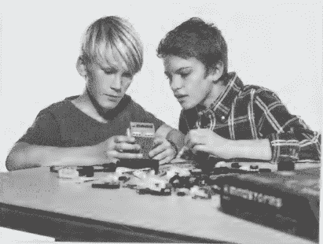

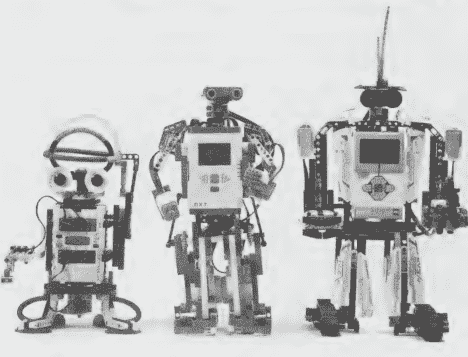

**图 6.2**
男孩们在玩乐高 Mindstorms（上）以及机器人示例（下）。图片由乐高集团提供。

在 2008–2009 学年，有 7,800 支队伍参加了 FIRST 乐高联赛机器人竞赛，70% 的青年参与者是男孩和白人。这一发现似乎反映出女孩和代表性不足群体在科学展中同样边缘化的参与情况，尤其是在物理、地球科学以及数学或计算机科学项目中。¹² 此外，机器人队伍受限于能参加的学生人数，因此这些活动不容易扩大规模。支付材料费用和前往机器人竞赛的差旅费用十分昂贵，常常需要学校举办大规模筹款活动，为课后机器人项目以及参加州外竞赛提供资金。

最后，竞赛为学习项目提供了受众。尽管为应对特定设计挑战而搭建机器人是一种丰富的学习与协作体验，¹³ 但竞赛中推崇的赢家通吃方式可能并不吸引某些人。竞赛提供了真实且有回报的受众，但从日益增多的在线竞赛来看，它们似乎已成为所有数字媒体设计评审的默认受众。STEM 全国电子游戏设计挑战赛以及数十个其他竞赛已成为学校游戏设计的核心渠道。¹⁴ 尽管竞赛提供了有价值的受众，但它们不能也不应成为让青年参与计算实践的唯一渠道，尤其是考虑到它们在接触并扩大参与方面的过往记录相当有限。

许多课后项目、社区技术中心和组织已经完成了 K–12 学校在引入计算创造力方面未能完成的工作。但其中太多俱乐部会所未能扩大该学科的参与范围，反而与许多人眼中代表计算领域的极客俱乐部如出一辙。如果组织创建使用不同材料和活动的新俱乐部会所，而不是旨在把所有人带入现有模式，会怎样？这正是计算机科学家 Leah Buechley 等人着手开发一类新型计算搭建套件时提出并回答的问题；这类套件用纺织品代替积木，并在工程之外加入手工制作。

### 开辟新俱乐部会所：电子纺织品

纺织搭建套件，也称为电子纺织品（e-textiles），是相当近期才出现的。电子纺织品是可编程的服装、配饰和戏服，它们融入嵌入式计算元素，使织物制品的行为能够被控制。设计电子纺织品可能涉及新型材料（如导电纤维或魔术贴）、光和声传感器、执行器（如 LED 和扬声器），以及纺织工艺的传统方面。一款流行的电子纺织品搭建套件是 LilyPad Arduino，¹⁵ 它使新手工程师和设计师能够将电子硬件嵌入纺织品中（图 6.3）。

制作电子纺织品时，设计师用导电缝线将 LilyPad 模块缝在一起，并使用流行的 Arduino 或 ModKit 开发环境对 LilyPad 微控制器进行编程，以管理其设计中的传感器和输出模块（如 LED）。

自 2007 年商业发布以来，LilyPad Arduino 已被世界各地各个年龄段的设计师和工程师广泛采用，并被多所大学用于计算机科学、工程、美术和设计课程。电子纺织品可以被视为更大规模 DIY 运动的一部分；该运动旨在推动传统制造业之外的个性化制造，并且也可以延伸进课堂，如下面一个高中电子纺织品课程的例子所示（图 6.4）。

当人们制作电子纺织品设计时，他们学到什么？学生学习缝纫和其他类型的手工制作，这些内容常见于职业教育或休闲时间，但通常不出现在科学和数学等传统学校学科的情境中。

此外，学生通过设计功能性电路来学习工程：将鳄鱼夹连接到电池、开关和 LED；对齐 LED 的极性端；给线头打结；并将这些缝到织物上。学生还会学习如何编写和改编 Arduino 代码，这些代码控制和执行传感器与执行器的预期行为，从而为接触计算概念和实践提供语境。¹⁶

发明 LilyPad Arduino 的 Leah Buechley 认为，这种设计学习使技术的不同层次和连接显现出来，而这些层次和连接常常隐藏在装在光鲜外壳中、却很少揭示其底层的市售技术里

**图 6.3**
LilyPad Arduino 及组件：转向信号夹克（上），以及用导电缝线缝制（中右）和 LilyPad、传感器及电池座（中左）。一群学生在富兰克林研究所的电子纺织品工作坊（下）。照片由 Eunkyung Lee 拍摄。

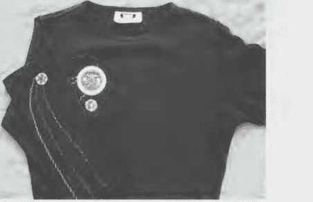

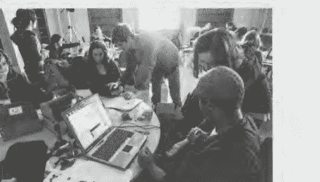
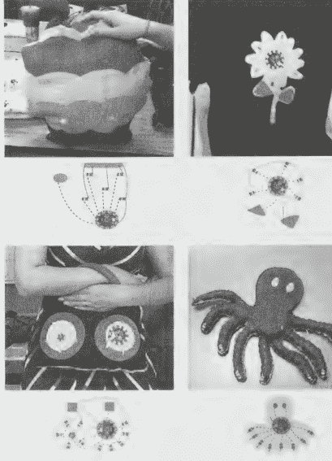

图6.4
高中生设计的电子纺织品：按下时会发光的纸杯蛋糕坐垫（左上）、按下按钮时LED闪烁的向日葵衬衫（右上）、按下两个布片时会播放音乐的音响盒（左下），以及会发光的章鱼玩具（右下）。每张照片下方是电路设计图，展示了LilyPad Arduino与LED、蜂鸣器等执行器以及由导电织物制成的传感器之间的连接。照片由Eunkyoung Lee拍摄。

功能。17 这种对透明性的呼吁体现了实体计算的一个重要教学维度，也是Papert通过海龟的身体同调性所强调的。这关乎表征（成为地板上的或屏幕上的海龟）、触觉（触摸电路）以及教学法（理解功能并与物件建立个人联系）。跨领域工作——手工艺、工程和计算——凸显了理解概念如何跨越一系列媒介和条件的重要性。

但透明性还有第二个同样重要的维度，它关乎不同文化的融合——手工艺与缝纫（在历史上与女性相关联）以及工程与计算（在历史上与男性相关联）。我们在众多工作坊和课堂中观察到，这些关于电子纺织品材料和活动性别属性的指涉如何渗透进对话中。当中学男生将自己的活动称为“做电路”而非缝纫，或当高中男生说“缝纫是女生的运动”时，他们是在宣称工程对男性更有价值、更合适。18 另一方面，也有人认为用电子纺织品学习会强化现有的性别刻板印象，女性应该参与更多由男性主导的活动，比如机器人技术。这类张力是富有成效的，因为它们开启了对话，并质疑了对计算相当狭隘的看法。

LilyPad Arduino电子纺织品构建套件让人回想起女性、纺织品与计算之间由来已久的历史联系。艾达·洛夫莱斯关于分析机的笔记在十九世纪催生了第一个“计算机程序”，而使用穿孔卡在纺织品上织出复杂图案的雅卡尔织机，被许多人视为计算硬件史上的第一步。洛夫莱斯或许写下了将时尚与计算联系起来的最优美的一句话：“我们可以最贴切地说，分析机编织代数图案，正如雅卡尔织机编织花朵与叶片。”19 计算文化在战争期间从纺织编织转向代码运算，如今又回归手工艺，并从数字制造中获得新的动力。电子纺织品构建套件使文化与计算的复杂交汇变得清晰可见，因为它们将被视为相互矛盾的领域结合在一起。它们的存在将低科技与高科技的计算形式融为一体，提供了一个可见的反证。

它们还让学生看到，简单的设计修改就能将同样的技术与截然不同的社群联系起来。LilyPad Arduino的传感器和执行器是对功能等效的Arduino主板、传感器和执行器的改造。这意味着LilyPad Arduino能做Arduino主板能做的一切，反之亦然。然而，我们从Leah Buechley和Benjamin Mako Hill20最近的一项研究中得知，参与LilyPad社群的女性远多于参与Arduino社群的女性：在发布到网上的项目中，80%的Arduino项目由男性设计师完成，而80%的LilyPad Arduino项目由女性设计师完成。尽管像乐高Mindstorms这样的机器人套件会吸引某种特定的计算生产方式和生产者，LilyPad Arduino这样的纺织品构建套件也同样如此。计算活动和材料的设计与框架，会影响谁将自己视为社群的一员，并进而加入和参与其中。

同样，作为许多电子纺织品活动设计背景的公共缝纫圈，与机器人活动中以竞赛驱动的工作坊截然不同。竞赛具有激励作用，在共同活动中提供目标和观众，但它们不应是组织、展示和庆祝计算参与的唯一模式。我们需要创建与机器人竞赛不同的社群，提供协作和支持性的氛围。我们正在围绕计算手工艺活动建设这样的新社群和活动。这些被称为电子手工艺圈（eCrafting Circles），21 有意呼应过去将邻里聚在一起制作被子、衣物等的缝被聚会和缝纫圈（见图6.3底部）。线上手工艺圈将不是竞赛，而是具有时效性、与本地相关的事件，允许分享和展示计算手工艺品。这些活动的目的是激发更多人参与和协作电子纺织品，就像FIRST乐高联盟竞赛提升了机器人技术的参与度一样，但不强调竞争，从而不会让大批人群望而却步。22 电子手工艺圈既可跨地区扩展，又能适应当地需求，旨在提供一个论坛，让志同道合且感兴趣的参与者分享所学见解，并为他们的设计提供急需的支持。计算参与的大部分焦点都在线上世界，但在实体构建和本地参与中也能发现同样多的益处。当手工艺和计算为学习提供新的材料、活动和受众时，我们或许应该重新审视计算机实验室和课堂可以是什么样子。

### 下一个千年的工坊课：动画立体书、游戏机厅与公共展示

在新的俱乐部、社区中心和课后项目中，学生将能够与计算机互动，以沟通、接收和组织信息。但新的俱乐部不能独自承担教孩子们使用计算机进行系统性和创造性思维的责任。学校课堂需要接纳在周边俱乐部中培养起来的动手型、创造性技术学习。在20世纪50年代的职业教育和工业艺术课程中，学生在实际应用中协作并建设性地使用技术。然而，到了20世纪70年代，一些改革者开始将这些课程描述为毫无意义或缺乏挑战性，尽管它们使教育更加动手、实用和以项目为导向，并代表了教育中一些最具创新性的思想，特别是约翰·杜威在*《经验与教育》*中的进步思想。23

通过技术进行动手和创造性学习的承诺并没有被遗忘。十多年前，计算机科学家和教育家Mike和Ann Eisenberg设想了新一代的工坊课，将包含计算媒介和手工艺——他们称之为计算机增强手工艺。24 工坊课通常由不打算上大学的学生选修，可以通过将计算与实体物品相结合，让所有学习者参与设计并理解技术。这种对具体学习的重新评价也得到了教育作家Mike Rose的支持，他分析了行业、手工艺和艺术的智力维度。大多数教育研究都集中在理解科学、数学和语言艺术等学科的学习和教学上，很少关注管道、木工和侍应工作中蕴含的智力需求和机会。然而，建造机器人和制作电子纺织品有力地说明了手工艺、工程和计算机科学如何能够创造出丰富而引人入胜的学习环境。

新一代工坊课的一个意想不到的方向是回归纸和颜料，并用导电性和计算加以增强。

尽管数字化学习已经远离了数百年来作为读写能力基础的印刷文本，但计算设计与纸艺仍能以创新方式融合。例如，Mike 和 Ann Eisenberg 的 HyperGami 让学生利用折纸手工、计算和几何，在屏幕上设计三维物体，这些物体可以打印出来并折叠成纸质生物和物件（图 6.5）。立体书可以嵌入带 LED 的电路，当书页打开或纸条被拉动时，LED 就会亮起。尽管这些活动不需要编程，但它们是迈向在电路中建立连接的世界的第一步，而这一世界可以通过编程得到增强。纸上的工作还可以进一步扩展，纳入导电颜料，使页面上的信息动起来，或连接回电脑屏幕。这些项目中的许多已经解决了设计材料与工具时的概念和技术挑战，如今它们已可用于学习和教授下一代手工制作课。

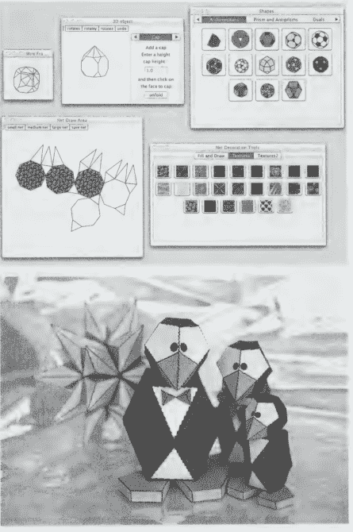

**图 6.5**

HyperGami 界面（上）和一组企鹅纸雕（下）。照片由 Ann 和 Mike Eisenberg 拍摄。

计算机科学家 Amnon Miller 在 Hook-Ups 上的开创性工作说明，青少年如何在用日常材料和随手可得的材料制作实体界面的同时，学习电学、设计和编程。本章开头讨论过的 MaKey MaKey 是一款低成本的计算搭建套件，它降低了开设计算式手工制作课的门槛（图 6.6）。如果游戏设计活动能够借助流行游戏主机和街机中的摇杆界面延伸到物质世界，会怎样呢？20 世纪 70 年代和 80 年代，游戏街机是热闹的公共空间，为许多青少年提供了第一次接触电子游戏的机会。最近，我们与一个初中生班级合作，他们用混编的 Scratch 游戏和触控盘搭建了一个街机厅。尽管香蕉钢琴键盘在视频中很有吸引力，但在课堂环境中却不太实用。Play-Doh（橡皮泥）——一种可塑、可重复使用且导电的材料——成为设计实体游戏界面的学生的首选材料，这些界面兼具美学和功能元素。一些学生将自己的控制器组件与电子游戏中的角色精灵图相匹配，另一些学生则用橡皮泥来表示游戏中精灵可以移动的方向。

每个人都投入了大量精力重新设计 Scratch 游戏、绘制或下载新的精灵图（角色）、设计自定义背景、修改现有精灵图并添加音效，同时还要遵循可用性惯例，例如添加分数、添加坏人或干扰物，以及添加获胜或结束游戏的方式。设计触控板还带来了电脑屏幕世界中所没有的材料要求。一些青少年努力确保鳄鱼夹始终固定在他们的橡皮泥触控板中。对另一些人来说，橡皮泥控制器会把水分渗到背景纸上，造成短路，这要求他们把控制器保持为独立部件，而不是一个整体触控板。

把游戏设计放在街机厅而不是竞赛中，为这些游戏设计提供了专注的观众和丰富的学习体验。随着一系列挑战出现，街机体验变成了一堂调试和快速原型制作的课：鳄鱼夹从控制器上掉落，控制器部件掉到地上，参与者意识到他们需要通过添加分数来调整游戏，以便更多人能玩。几位设计者做了许多小修正，以确保控制器的完整性，并添加了导电手环和触控板，让玩家更清楚地知道需要触碰接地夹，界面才能正常工作。他们还通过观看别人玩自己的游戏并实时调整，获得了一些关于设计和可用性的宝贵见解。事实证明，用橡皮泥作为导电材料制作实体游戏界面是一次丰富的学习体验，很像用导电缝线制作电子纺织品。

为展示、测试和欣赏手工制作与编程创作的作品创造观众，是建造主义学习与教学的一个重要维度。计算机科学家 Mike Eisenberg 和 Sherry Hsi 的最新项目 Math on a Sphere 呈现了计算参与的另一种变化（图 6.7）。该项目使用大型球形显示器，这些显示器由美国国家海洋和大气管理局开发，并在许多科学中心用于展示图形和动画。在类似 Logo 的编程环境中，孩子们可以在学习非欧几何和编程的同时创作自己的设计。Walk-Through Computer 的超大尺寸启发参观者思考机器的功能；类似地，Math on a Sphere 的巨大显示屏让年轻设计者把自己视为在为观众编程，尽管观众在远方。虽然目前只有劳伦斯科学馆和科罗拉多大学博尔德分校的菲斯克天文馆可以使用这些显示器，但这一想法可以扩展到更多公共中心。它提供了另一条途径，让我们思考观众在哪里、如何触达观众，并拓宽我们对计算参与可能意味着什么的认识。在设计用于公开展示和表演的作品时，学生们发现，用来思考的物件变成了用来分享的物件，展示了所学内容与社群的相关性，就像嘉年华给舞者提供了观众，也提供了全年学习和练习舞蹈的目的。

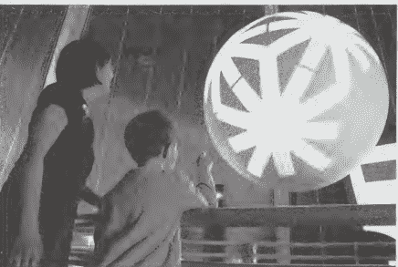

**图 6.7**

三维展示：Math on a Sphere。照片由 Antranig Basman（上）和 Sherry Hsi（下）拍摄。

#### 制作即学习

Ann 和 Mike Eisenberg 以及许多其他人设想了一套新的手工制作课，教授游戏控制器设计、纸艺、电子纺织品与传感器，以及交互环境设计。FIRST Lego Mindstorms、LilyPad Arduino 和 Makey Makey 是一场运动的一部分，这场运动正开始让更广泛的公众获得计算搭建套件。这些搭建套件为学习和理解增添了教育中一直被忽视的维度，使学生很少有能够带回家、并能随时间与他们同行的学业作品实体成果。学校与家庭之间的这种物理联系在小学阶段很常见，但当学生在高中阶段进入更抽象的科学和数学领域后，这种联系似乎在很大程度上被遗忘了。新的创客空间和制造实验室（fablabs）配备 3D 打印机和激光切割机，将计算、手工制作和材料科学融合在一起。

这些新空间和俱乐部会所是成员可以利用嵌入式计算来创作时尚和软性物件的地方。计算向实体世界的延伸，让学生能够接触新材料和新活动，从而帮助他们拓宽计算参与。对于被排除在计算培养通道之外的边缘化年轻人而言，这类跨领域活动利用并肯定了他们对低技术材料的兴趣，同时引入新内容。数字与物理的手脑融合，将青少年重新定位为积极的创造者，而不仅仅是知识的消费者。这些新的实体计算形式还让人们更细致地理解技术如何与更广泛的材料协同工作，而这对当今的 DIY 公民素养至关重要，因为生活的更多方面正在进入数字领域。

培养在概念层面和物质层面对技术的理解，之所以重要，有若干原因。从一般层面看，这种理解促进人们对界面、系统和材料设计背后的基本功能的理解。这些理解还在政治层面赋能学习者，为他们提供资源，去质疑他人作出的决定和设计。最后，从个人层面看，为表达目的而使用和制作技术，有助于学生更好地沟通并建立关系。学习如何在编程与工程的交汇处与材料打交道绝非易事。机器人课程耗时很多，用电子纺织品学习需要许多不同技能，而课堂内外的教师和导师支持对于帮助这些有形物变得真实而有生命力至关重要，这也是下一章的重点。

《计算机与强大理念》的意义在于它讨论了 Logo 在学校中的兴衰，而帕佩特将这种兴衰归因于学校对变革的抵制。

“学校只有两个问题，”认知心理学家罗杰·尚克打趣道，“我们教什么，以及我们怎么教。”^2 如今人们很容易对教育冷嘲热讽，尤其是随着线下和线上可获得的替代性教育机会越来越多。数字技术在教育中扮演的角色，或许是当今教学法面临的最具两极分化的问题：一些人谴责网络媒体是现代教育的衰败，另一些人则宣称这类媒体是教育独力拯救者。本章旨在通过重新构想 21 世纪学习与教授技术流畅性意味着什么，在两种观点之间以及学习者与学校派之间找到中间地带；同时也通过认识在 K–12 课堂特有的限制与动态中开展工作的重要性来找到这一中间地带。这并不是一个容易找到的中间地带。前六章的一个共同主题是：如何将 Scratch 等编码圈子特有的那种零散而自己动手的文化带入学校教育领域，这一挑战一直存在。制度化学校教育与这些远为松散的非正式学习网络似乎彼此冲突；正如第 5 章所指出的，这种张力在某些数字媒体实践中达到顶点，例如重混（remix）——一个群体大体将其视为创作冲动而拥抱，另一个群体则常将其斥为作弊。

然而，就计算机与技术教育^3 整体而言，在学习者与学校派之间找到中间地带很重要，因为双方都能通过妥协获益良多。学校派可以通过创建更开放、更有活力的课堂空间而获益，这些空间允许学生利用技术进行更多创造与协作。渴望者（yearners）则可以通过获得合法性而获益——从课后俱乐部和选修课相对受限的空间，转向能吸引更多、更广泛学生的主流课堂。在某种程度上，帕佩特对渴望者与学校派（schoolers）的划分是人为的。大多数教师、家长和学生都处在两极之间的某个位置——对学校教育的某些方面感到满意，又希望彻底改革另一些方面。但为了在我们学校中更有效地教授计算思维与参与，这种二元区分提供了一个框架，用于审视 K–12 学校当前教授计算的方法、此类教学可以改进的领域，以及教学改革的历史模型。

本章第一部分考察学校中计算教育的现状——既包括传统学校课堂，也包括课后项目和 DIY 倡议中结构较不正式的学习环境。在每个环境中，学者和学习者处于什么位置？每种环境对于 K–12 层面的计算教学有什么益处？本章第二部分离开这两个空间，考察 DIY 学习上一次大规模进入 K–12 学校的情形——当时约翰·杜威的教育理论还是新事物，并承诺让学校成为对儿童更实用的体验。这段历史能告诉我们年轻人的抱负与学者的务实精神之间的什么关系？又能从当前计算教育面临的挑战以及技术在学校中的整合中得出哪些启示？本章并非要为教师提供一本 Scratch 操作指南。已有许多优秀资源可供使用，包括书籍，以及由教育工作者创建并专门服务于教育工作者的整个网站。^4 相反，本章分析更广泛的学校文化，以及这种文化如何影响我们教儿童如何进行计算思考和参与计算的方式。

## 7 计算教育：校内与校外

根据美国劳工统计局的数据，^5 计算机相关职业是全美增长最快的就业领域之一。然而，在一个拥有超过 42,000 所高中的国家，只有 2,100 所开设高级计算机科学课程。如果这个国家只有 5% 的高中开设能为大学课程做准备的高级计算机科学课程，那么显然，计算机科学在全国高中里的存在感极低，即使近年来其选修人数有所增加。这种存在感不足尤其体现在高中阶段参加高级计算机科学课程的女生和少数族裔学生人数很少。尽管高中女生占所有参加大学先修课程考试的人数一半以上，但在参加计算机科学考试的人中，女生不到四分之一，而非裔美国考生人数始终低于百分之一。^6

参加高中高级计算机课程的学生缺乏多样性，反映出课程与教学法需要更新；过去两年，大学理事会试点了修订版的大学先修课程“计算机科学原理”。诸如“计算之美与乐”之类的课程正在取代“JavaScript 入门”这类以语言为中心的课程。CS 原理课程通过强调计算概念，而不是优先考虑任何单一编程语言，提供了一种更整体的计算学习方法。CS 原理课程还鼓励学生维护作品集、协作工作，并针对各种项目式作业撰写反思。这代表了近年来校内计算教学中最有希望的发展。

CS 原理与雪莉·特克尔和西摩·帕佩特所倡导的拼装（bricolage）方法更为接近；它摆脱了通过记忆积累内容的传统自上而下方法，转而纳入基于表现的任务，学生通过开发制品来践行计算背后的抽象原理，从而学习这些原理。CS 原理试点通过迭代过程聚焦特定的最终产品，代表了对完全以单一语言提供教学的一种真正改变。早先的教学强调培养一套离散技能，而新的 CS 原理课程植根于功能性应用的设计，将学习体现在交付物中（如第 3 章所述）。

尽管在较高层次上正在取得进展，但很少有学生有机会选修这些更高层次的课程。最近计算机科学选修人数激增，表明存在一小群投入的学生，但美国学校中另外 99% 的学生呢？这些学生在校期间在哪里接触计算教学？学区如何激励教师将计算机科学作为一门学科来教授？事实证明，他们提供的激励很少。尽管参加 AP 计算机科学考试并选择计算机科学作为本科专业的学生人数最近有所增加，但过去十年，这个国家 K–12 学校中计算机相关课程的数量却减少了。根据美国计算机协会的一份报告，C. Wilson、L. A. Sudol、C. Stephenson 和 M. Stehlik 的*《空转：数字时代 K–12 计算机科学教育的失败》*，^8 的数量

自2005年以来，与计算机相关的入门课程数量减少了17%。尽管学生注册人数可能略有上升，但自2005年以来开设的课程数量却在下降，而且基于技术的入门课程中计算参与的缺乏意味着，很少有学生会考虑选修“计算机科学原理”（即使其学校开设了该课程），或者在其K–12教育中接触到计算机科学。

一些国家，例如以色列，已经设计了一套计算机科学课程，作为学校规定的科学必修要求，但美国仍将计算机科学课程视为选修课——即根据个人兴趣选择的课程，类似于参加乐队或文学杂志。将计算机科学视为选修课而非数学或科学学分，最初似乎不会带来重大问题，但这种做法具有严重影响。当学区被问及为什么各自学校不开设计算机科学课程时，他们通常给出两种回应之一。第一种回应是学生不感兴趣。但这种兴趣缺乏通常直接源于以下事实：该校的计算机科学只能作为选修课修读——而不是作为可计入数学或科学学分的课程。学生的课程表已经因必修课程而超负荷，不计入核心课程学分的计算机科学课程更不可能吸引学生，学校也更不愿意开设这些课程。第二种回应是能够教授计算机科学课程的合格教师很少。但由于计算机科学不被视为核心课程，教育学院和州教育部门不愿为计算机科学教学认证开发严格的课程，从而未能提供一条可认证的途径来培养合格的教师队伍。

尽管美国以苹果和谷歌等科技巨头为傲，但美国在K–12阶段的计算机教育方面正落后于其他国家。英国最近制定了一套国家计算机科学课程10，其中计算思维占据突出地位，并在教学上分为四个递进阶段，从基础应用和基本原理开始，进而学习语言和系统化问题解决。自20世纪90年代初以来，以色列已在K–12阶段强制实施严格的计算机科学教育项目，其基础是一门“强调算法思维基础”并教授“编程作为让计算机执行算法的方式”的课程。11

这两个国家提供了超越补充性课后项目和选修课程的计算机科学教育潜在模式。它们将此类课程认定为核心计算课程。谷歌教育总监玛吉·约翰逊指出，将计算机科学标准排除在美国正在形成的共同核心州立标准12之外，是国家倡议的巨大缺陷，这不仅体现在儿童接触技术的能力上，也体现在他们通过实际应用学习基础数学和科学技能的能力上。11鉴于共同核心州立标准（目前已被46个州采用）的突出地位，该倡议代表了这个国家开始在全国整合计算机科学教育的前所未有的机会，这是“核心计算”（Computing in the Core）14已经认识到并继续倡导的事业。

任何此类核心课程的结果都显而易见。访问美国任何公立或私立的小学、初中或高中的人，都不太可能看到任何与计算机科学相关的正式教学，或把计算机视为计算性、创造性设备的正式教学。正如教育历史学家拉里·库班所指出的，学校坚持*教授计算机*，而不是*用计算机教学*。15K–12阶段的技术课程关注基本功能，使设备成为教学目的而非手段，除了计算机本身之外，仍然缺乏任何真正的内容。尽管学习Microsoft Office套件应用或熟悉计算机组成部分具有教育价值，但此类活动并未体现计算的创造性和协作潜力，也不值得开设一学期的课程。缺乏扎实的入门计算教学，是全国学校失败的核心所在。尽管学校拥有这些机器已超过三十年，但学校在很大程度上未能对儿童思考和参与使用它们的方式带来有意义的改变。

学校里发生但在上课时间之外的外围活动展现了一些希望。课后项目一直是学校里发生最有趣技术学习的地方。无论是帮助学生在Scratch游戏俱乐部制作视频游戏，在乐高机器人俱乐部搭建可协作编程的机器人，还是用LilyPad Arduino设计互动发光面具，课后俱乐部历来有余地让孩子们在比传统课堂更开放、更具社交性的空间中按自己的节奏工作。全国数千个社区技术中心也支持在服务不足的社区中接触计算机活动（如文字处理、电子邮件和网页浏览）。一些中心，如计算机俱乐部（Computer Clubhouse），专注于计算的创造性使用，鼓励青少年开展自己的项目，包括动画、游戏和音乐视频的编程。Scratch旨在让编程能够触及青少年丰富的媒体兴趣。16

大多数课后俱乐部和社区技术中心的独特之处在于，它们作为空间存在，让学生有机会制作自己的项目。正如修订后的大学先修计算机科学课程（以及前几章描述的活动）所表明的那样，用技术制作东西的能力处于计算思维和计算参与的核心。正如第2章所指出的，用计算机制作将学习从抽象带入具体，然后可以像货币一样在更广泛的创客同伴网络中分享。“我们是需要制作的生物，”《MAKE》杂志创始人戴尔·多尔蒂引用诗人弗兰克·比达特的话写道。“制作是人类的基本活动。”在其文章《创客心态》中，多尔蒂将制作命名为儿童最令人兴奋、最难忘和最重要的学习场所。

多尔蒂还感叹，这种制作的倾向往往在儿童年幼时就被驱除，因为学校——尤其是随着学生年级升高——越来越将制作视为补救性的、非学术性活动而回避。“创客运动最大的挑战和最大的机会，”多尔蒂在谈到DIY社区时写道，“是转变教育……学生们正在寻求主导自己的教育生活，希望参与创造性和刺激性的体验。许多人理解教育的痛苦与真正学习的快乐之间的区别。不幸的是，他们被迫到校外寻找机会来表达自己并展示自己能做什么。”28

### 俱乐部遇见课堂：寻找中间地带

如果期望课后俱乐部中浮现的创客文化的乐趣也能在上课日存在是现实的，那么在一定程度上，学校教育的构想和实践方式必须发生根本性改变。戴尔·多尔蒂在这里是一位渴望者，许多将数字媒体和DIY编程视为对传统师生学校教育范式挑战的人也是如此。这也讨论于《新媒体与学校教育不相容吗？》一文中，媒体理论家亨利·詹金斯采访教育研究者理查德·哈尔弗森，后者与艾伦·柯林斯合著了*《技术时代的重新思考教育：数字革命与美国学校教育》*。对哈尔弗森而言，K–12学校中技术的未来较少取决于设备本身，而更多取决于关于人们如何最好地学习的各种观点。一种观点认为，学习发生在学校，学校是经认证的实体空间。哈尔弗森称之为“制度渠道”。另一种观点认为，学习不必与时间和地理绑定，Web 2.0可以通过同伴和兴趣驱动的活动提供学习机会。哈尔弗森将其称为“数字媒体渠道”，并指出这种学习方式不标准化且常常不可预测，但它确实“突出了许多学校学习活动所缺失的三个至关重要的学习方面：动机、产出和真正的受众”。19

哈尔弗森对制度渠道和数字媒体渠道的区分让人想起帕佩特对学校派和渴望派的区分。学生在课后俱乐部是否比在常规学校课堂上更有动力、更高效？学生是否更可能在同伴俱乐部而非教室里遇到真正的受众？为了研究这些关于动机、产出和真正受众的问题，我们设计了一项研究，让中学生在学校课堂和课后俱乐部中使用Scratch。20我们想知道儿童在每个空间中的受激励方式是否存在差异，他们在每种环境中产出了什么，以及他们为谁产出这些内容。

基于多尔蒂关于学生和教师作为学校学习环境创客的理念，我们构建了两个学习Scratch的空间。一个是语言艺术课，中学生在写作工作坊中接触Scratch，将其作为创作自己数字故事的工具。课堂参与者遵循与全州英语语言艺术学术标准挂钩的既定课程。另一组在课后同人小说俱乐部中创建Scratch项目。俱乐部参与者分享作品、相互提供反馈，但不遵循既定课程或提交要求。课堂和俱乐部由同一位指导教师连续十周开展活动。班级设定了目标，旨在

学生们在十周结束时被期望提交其规划故事线的故事板、在 Scratch 中准备数字草稿、提供同伴反馈、提交最终作品并进行展示。项目会被评分，且出勤是强制性的。俱乐部没有为参与者设定目标。他们都被鼓励在十周结束时进行展示，但不附加成绩，也不强制出勤。

这一比较的结果很有意思。在课堂中，为写作工作坊设定的有意识、迭代的目标在产品方面效果良好。近90%的学生完成了一个数字故事，将其发布到 Scratch 网站上，并在工作坊结束时向同伴展示。这些故事长度从两到三分钟不等，基于真实生活经历或来自电影、电视和漫画书的文化偶像。它们相对较短，但有清晰的开头、中间和结尾，包含多个角色和场景变化，有些还包含对话和音效。在俱乐部中，只有71%的参与者完成了 Scratch 项目，但他们制作的项目数量几乎是课堂组的两倍。俱乐部的项目也更多样。虽然课堂环境中的项目都是叙事故事，但俱乐部项目包括互动艺术作品和视频游戏，这意味着使用了更多类型的编程概念。

这些发现远非定论，但表明一些 Scratch 课后俱乐部成员在计算方面的参与程度高于课堂中的同伴。尽管30%的俱乐部成员从未完成或提交项目，但提交了项目的70%比课堂中的同伴参与得更充分。许多俱乐部成员在十周内完成了四五个项目。这些俱乐部成员还在 Scratch 网站上创建了更丰富的在线个人资料，在网上与他人加为好友，并更经常地混编他人作品（俱乐部中26%的项目被混编，而课堂中为10%）。在课堂上，学生曾两次指责同学通过混编他人作品作弊。

然而，课堂中更高的完成率（90%，而俱乐部为71%）支持将计算学习纳入学校日常教学。而且，尽管课堂学生基于故事的提交作品更为统一，这种统一性使评估和给出最终成绩更容易。尽管一些向往者希望让学校摆脱评分等级，但评估在确保基于项目的学习进入课堂并作为教学的一部分留在课堂方面发挥着重要作用。

杜威在20世纪之交创办的实验学校，使这些学校与当时和如今的大多数美国课堂截然不同。那里没有课桌，黑板（如果有黑板的话）也不是墙面的特色元素。学生们围坐桌边彼此相对，而不是面向教师；他们动手操作，不仅使用铅笔和纸，还接触实物。参与能产生超越课堂的内容和意义的活动——无论是煮鸡蛋还是做木箱——在杜威的进步主义教育哲学中是一项必要之举。“如果这种冲动得到锻炼、得到利用，”他在*学校与社会*中写道，“它就会撞上它必须适应的严酷条件的现实世界；而纪律和知识等因素又会在这里发挥作用。”²³

对杜威而言，学校所推广的学习活动必须能在儿童课堂之外所处的世界中应用和检验。教学必须把课堂与真实世界联系起来。杜威指出，为实现这一点，支撑其教学方法的正是结构——而非缺乏结构。杜威关于创设情境和提供材料的观念，与佩珀特的观点相呼应。佩珀特认为，“没有课程的教学并不意味着自发、自由形式的课堂，也不意味着简单地‘让孩子独自待着’。它意味着支持儿童用取自周围文化的材料建构自己的智力结构。在这种模式中，教育干预意味着改变文化，在其中规划新的建设性要素，并消除有害要素。”²⁴ 对佩珀特而言，计算机提供了材料、情境和体验，使学习者能够与真实世界建立联系。

对杜威而言，经验不能只是随便什么经验；同样，技术不能仅作为目的本身来使用。“就其本质而言，”杜威在*经验与自然*中写道，“技术关注的是事物和行为作为工具的功能，而不是它们的直接性。”²⁵ 不能假定仅仅在教室里拥有设备，就足以让儿童理解其全部潜力。杜威还指出，学校仍然有义务应对最新技术。1933年，他与J. L. 柴尔兹写道：“技术正在改变、甚至革命化学校之外的行为和信念”；“因此我们确信……社会和教育理论与概念的发展，必须明确参照我们所属这一代人中标志并分裂我国国内、经济和政治生活的需求与问题。”²⁶

杜威断言，学校有责任培养儿童在阅读、写作和大众媒体方面的素养。他在谈到大众媒体日益普及时写道：“在使用语言工具方面有读写能力、但在社会信息与理解方面未受教育的公众，会轻易成为那些为自身私人的经济和政治目的而利用公共新闻界的人的受害者。”²⁷

杜威在这里的警告，预示了道格拉斯·拉什科夫在*编程，还是被编程：数字时代的十条命令*中自己作出的长篇警告，即关于参与Web 2.0媒体数字公众的局限。²⁸ 杜威指的是威廉·伦道夫·赫斯特这样的报业大亨，而不是Facebook这样的社交媒体网站，但信息很清楚：对工具的技术性理解是不够的。人们需要理解工具运作的语境以及它所产生的语境。这代表着根本性的学习，而这种学习需要有意义体验。计算机用于形成性、总结性或诊断性结果。作为一种工具，计算机放大交流，例如当Microsoft PowerPoint被用来辅助演示时。最后，作为被辅导者，计算机通过接受学生的指令来确定其功能和输出，从而充当学习者。

这些要素存在于杜威和佩珀特的学校教育愿景中，而随着创客空间、DIY学习和在线创意社区日益流行——在这些地方，代码已成为通用语——这一愿景正在复兴。正如这些DIY圈子的参与者可以证明的，编程不仅仅关乎让机器进行计算，也关乎与更大的世界交流。需要弥合向往者与学校派之间的鸿沟，使课堂更加以学生为中心、以产品为导向并真正具有协作性。但这种鸿沟在技术教育中代表着一个机会，因为课堂和在线创客社区提供了独特的学习环境，二者合在一起可以增加把编程作为一种新素养来接触的儿童数量，并重塑学校对计算机的使用，使其更具创造性和协作性。这一中间地带——学习环境的融合——为儿童产生了最有趣的教育机会。“只有在这样一种学习方式发生变异和杂交的生态中，”佩珀特在*儿童的机器：在计算机时代重新思考学校*的结尾写道，“一种真正全新的学习文化才可能出现。”³²

2013年2月26日，非营利组织 code.org 在 YouTube 上发布了一段由莱斯利·奇尔科特（Lesley Chilcott）执导的视频，名为《学校不教什么》（What Schools Don’t Teach）。视频开头引用了苹果联合创始人史蒂夫·乔布斯（Steve Jobs）的话：“每个人都应该学习编程……因为它教会你如何思考。”结尾则写道：“美国有一百万个最好的工作岗位可能无人问津，因为只有十分之一的学校教学生编程。”众多名流谈到了他们第一次接触电脑和编写程序的经历。微软联合创始人比尔·盖茨（Bill Gates）回忆说，他第一次使用电脑时十三岁，并编写了一个玩井字棋的游戏。clothia.com 的创始人埃琳娜·西莱诺克（Elena Silenok）记得让一个绿色圆圈和一个红色方块出现在屏幕上。Valve 的创始人加布·纽维尔（Gabe Newell）提到，当他第一次在屏幕上看到“Hello, world”时，体会到一种惊奇之感。Facebook 的创始人之一马克·扎克伯格（Mark Zuckerberg）谈到了从一个简单程序开始并不断添加功能的过程；Dropbox 创始人德鲁·休斯顿（Drew Houston）则将编程比作演奏乐器或进行体育运动。迈阿密热火队的全明星 NBA 球员克里斯·波什（Chris Bosh）反思道：“一开始非常吓人，但随着时间的推移你会慢慢上手。编程是可以学会的。”这段视频传达的总信息是：电脑无处不在。正如摇滚乐队黑眼豆豆成员威尔.艾姆（Will.i.am）总结的那样：“我们身处2013年。一切都依赖技术——沟通、银行、信息——而我们中没有一个人懂得如何读写代码。”视频随后呼吁观众采取行动：“无论你想成为医生还是摇滚明星，请在你们的学校询问编程课程，或者上 code.org 在线学习。”几天之内，这段视频就获得了数百万的观看量。“给你的生活带来一点精彩，”奇尔科特在《赫芬顿邮报》一篇关于 code.org 网站的文章中敦促道，“去上一课吧。”

在几年前，一段名人讨论他们接触电脑和编程的起步经历并敦促观众学习编程的视频，不太可能获得成功。然而，YouTube 视频中那些人表现出的兴奋和真诚，可能是迄今最清晰的迹象，表明编程正在卷土重来。视频展示了三维动画、音乐工作室、编队飞行的无人机、手术室里的电脑屏幕，以及软件行业中设施一流的工作场所。它利用了学习编程能给个人带来的赋权感。正如 Valve 创始人加布·纽维尔宣称：“明天的程序员就是未来的巫师……要知道，与其他人相比，你会显得拥有魔法力量。”NBA 球员克里斯·波什稍后补充道：“这太神奇了……我认为这是最接近超能力的东西了。”这些程序员所占据的时尚办公室的全景截图，含蓄地将学习编程与找到高薪工作以及一览无余的城市天际线联系起来。

然而，2013年2月的这段视频也引发了一些不安，教育研究者简·马戈利斯（Jane Margolis）在3月于 SIGCSE '13 计算机科学教育者会议上的闭幕主题演讲中表达了这种不安。马戈利斯指出，这段视频常常强化了“神童神话”，即编程更像是一种超能力，而不是一项可以习得的技能。视频中出现了一些女性形象，却没有承认她所称的许多受访者拥有的“预备优势”——即20世纪80年代家中昂贵的电脑、私人教师，以及在软件行业工作的父母。这些关键要素被 code.org 视频中的演讲者随口提及，仿佛它们是常态而非例外。接触机会是一个重要问题。在考虑技术造诣之前，我们需要解决一些基本因素——接触电脑、知识和支持的途径。

视频聚焦于开放式办公室和娱乐区、提供免费小吃的小卖部，以及干洗服务等现场便利设施，却没有关注计算机科学家应有的社会责任——改善技术制造业中繁重的工作条件、开发更好的方式回收废弃技术，以及增加代表性不足群体的参与。这些问题已经获得了大量公众关注，表明计算机科学界需要重新评估自己的公共形象。有些人，比如 *Girl Develop It* 的创始人瓦妮莎·赫斯特（Vanessa Hurst），指出：“如果有人早告诉我，软件实际上是关于人性的，是关于利用技术帮助他人，我的观点早就改变了。”但视频很少关注这些将编程带入社会互动和社会关联领域的另类、更宏大的视角，尽管这种视角关乎计算机的日常关联性和公民责任。

最后，尽管史蒂夫·乔布斯的引言声称编程“教会你如何思考”，但编程只是学习计算思维的众多方式之一。乔布斯的话不像视频中其他受访者那样宏大，但它可能既是最有力也最有问题的一句。如果编程很重要，那么我们就有责任教育每个人，而不是暗示这种学习是魔法或巫术。长期以来，在公众意识中，编程一直是一种供少数精英消遣的博学爱好。视频对超能力的承诺并不能改变这种看法，但有助于揭示关于接触机会、兴趣、努力和支持的更广泛问题。只要编程仍被视为一种思维形式和个体心智的参与（这是有问题的一面），而不是同样被视为一种参与和表达的形式（这是有力的一面），我们就无法从当今网络化社区中的编程学习和教学中获益。

*《连接代码：为什么儿童需要学习编程》* 是一份行动号召，旨在促进计算参与：我们如何更好地设计编程活动、工具和材料，用于 K-12 学校的教与学？我们认为，计算思维应被视为计算参与，以强调游戏、故事和艺术等编程项目不仅是“可以思考的对象”（借用西摩·帕尔特（Seymour Papert）的一个观点），而且也是“可以分享的对象”，将我们与他人联系在一起。有些人可能会争辩说，将编程引入 K-12 学校现在会像三十年前一样失败。那些坚持认为编程是少数人专属技能的人，通常也坚持认为它本质上是一种非社会性活动。

但今天，年轻人正在网站、俱乐部和教室里参与计算活动，在这种热情的“自己动手”数字伦理中，我们看到了编程能够在学校蓬勃发展的证据。这群年轻的 DIY 爱好者需要扩大，以便更多儿童接触到编程的创造性和协作潜力。而帕尔特的观点——如今已超过三十年——在理解学习编程在公共环境中最具吸引力和最有效方面是有先见之明的。有些网站上，数百万孩子在那里想象、设计并自由分享他们的程序。在 DIY 文化中，编程正在成为更广泛的数字文化的一部分。因此，当我们把编程带回学校时，我们可以借鉴 Project Headlight 编程圈和 Scratch 在线编程社区的经验教训，以及从对媒体实践和可编程媒体手段的更广泛理解中汲取营养。

为了扩展珍妮特·温（Jeannette Wing）对计算思维的定义，我们将计算参与视为：与他人一起解决问题，为他人并与他人一起设计直观的系统，以及通过计算机科学的概念、实践和视角来了解人类行为的文化和社会属性。让孩子编写应用程序、分组工作和混合代码，并不会解决所有与扩大计算参与相关的挑战，但它代表了关键的第一步。商业玩具行业正在开发编程应用程序，允许儿童设计对他们自己和他人都意义重大的作品。新的创客套件和智能玩具的流行表明，孩子们既想要能亮灯发声的互动玩具，也想要能让他们自己进行互动设计的玩具。他们想决定灯何时闪烁、蜂鸣器何时响起，教育工作者可以在课堂上培养这种精神。通过将编程变成一种社区活动，教育工作者可以把学校变成正式和非正式分享与协作的场所。

在计算思维的背景下，这意味着我们需要超越将编程视为一种个人行为的看法，开始将其理解为一种公共实践，它反映了今天的学生如何参与他们的社区。对于学校来说，这不是一小步，因为在决定学业成功的标准时，个人成就远远超过群体动力。然而，如果说过去十年和 Web 2.0 的出现教会了我们什么，那就是协作在促成更具创造性和成本效益的解决问题方案方面的重要性。有机会参与编程社区并与之合作，是学习编程基本概念和实践的关键，这反过来又为人们提供了前所未有的机会，参与更广泛的数字公共空间。

聚焦计算参与——随着编程活动回到学校、社区中心和家庭，并与在线世界相连，在那里许多编程项目被设计并分享给他人——将是一项挑战。尽管大多数学校并非支持有意义且富有成效的小组合作的机构，但挑战之大并不是我们不去奋起应对的理由。在此，我们概述了实现人人编程的多条途径。

### 通往计算参与的途径

在本书中，我们将计算机编程的教与学视为与心智、社区和文化理论紧密相连。大量教育研究表明，读、写、算这“三R”（reading, writing, and arithmetic）的教与学需要关注心智、社区和文化；需要包含技能、策略和概念；需要理解情境、受众和相关性。在增加了第四个R——艺术（aRts）之后，学校和线上及线下的课外项目还需要增加第五个R——编程（pRogramming）。⁴ 这将涉及：为学习特定学科内容而开发编程应用；制作具有个人意义的可分享作品；形成为编程设计提供情境和受众的社区；将混编（remixing）作为一种文化实践，让儿童以适当的方式进行协商；以及扩展课程，纳入广泛的计算机材料和活动，以促进对计算的广泛参与。考虑到这一点，我们指出了一些正在进行的努力和新发展，它们提供了有前景的起点。虽然这不是一份详尽的清单，但它可作为新学校、课程、教师、课外项目、材料和在线社区的元路线图。

机会需要从小学和初中阶段开始，为学生提供早期的计算体验。年幼的孩子可以在家中和幼儿园里进行创造性和建设性的设计。即便是大多数孩子用来玩游戏和看电视节目视频的iPad，也提供了一系列简单的编程应用（如《Daisy the Dinosaur》《Hopscotch》和《Move the Turtle》），让孩子们可以操控对象和角色。一个针对低龄儿童的Scratch Jr.版本正在开发中，它基于原版成功的积木式界面来进行设计。但最有趣的进展出现在实体组装套件的设计上，这类套件允许通过物理方式操控积木来创造机器人或其他设备。教育研究者Marina Bers提供了许多令人信服的案例，展示了代际机器人工作坊如何鼓励父母和孩子一起学习关键的计算机概念。⁵

在学校环境中，重新设计学校和课程的雄心勃勃的努力正在将编程融入整个课程，而不是作为一门独立的课程。第3章讨论的教学软件设计和游戏设计项目提供了有力的例证，说明这类努力可以置于已经拥挤的课程之中，而不是作为独立课程来提供。与20世纪90年代Project Headlight中的软件设计项目类似，纽约市（最近还有芝加哥）的Quest to Learn提供了一个学校环境，让学生在整个课程中编程和玩游戏。随着编程工具和社区的激增，现在学校中有许多游戏设计项目的例子。例如，非营利组织Globaloria已在多个州的数十个学区开设了游戏设计课程和竞赛，学生使用Java设计教学游戏，与Globaloria社区分享，并在竞赛中庆祝成功。使用诸如教学软件设计、游戏设计或讲故事等模式，可以在利用学生对流行数字媒体的兴趣和知识的同时，将计算融入标准的数学和科学活动，并且成效显著。⁶

同样重要的是K–12计算机科学课程的发展。⁷ 由Jane Margolis和Joanna Goode团队开发的Exploring Computer Science课程包含广泛的活动，如界面设计、计算与数据分析、Web与机器人设计。通过这些活动，学生在学习基础编程思想和概念、处理社会问题和计算伦理的同时，接触问题解决和设计思维。该课程已在洛杉矶地区的几所高中成功实施，并正在扩展到美国各地的城市学校。美国计算机协会（Association for Computing Machinery）和计算机科学教师协会（Computer Science Teachers Association）也提出了一个K–12教育示范课程，其中包括媒体计算、生物学中的计算和计算思维等示例。另一个发展是最近在纽约市创办了六所新的计算机科学与工程公立高中，目标是在未来几年增加学校数量。软件工程试点课程同样采取了一种全面的方法，在Web设计、机器人技术、纺织品设计中的嵌入式电子技术等情境中引入基础软件设计和工程原理，并通过计算机辅助设计、三维计算机图形、动画和生物信息学等选修课加以补充。许多学校（如High Tech High）在课程中推动了广泛的技术和编程活动。这些课程设计表明，高中阶段的计算教育可以向学生介绍计算思维的关键思想，并为先修课程（Advanced Placement）计算机科学课程和考试开辟道路，从而为进入大学阶段的计算机科学课程做好关键准备。

我们还需要能够实施这些课程的教师，以及引导学生选课的顾问。在审阅了Cameron Wilson、Leigh Ann Sudol、Chris Stephenson和Mark Stehlik的近期报告*《空转：数字时代K–12计算机科学教学的失败》*之后，计算机科学教师协会建议调整教师认证标准。计算机科学（CS）不能由一群临时志愿者来教授，而是需要包括那些了解学生学习轨迹并制定教学策略以支持学习的专业人士。我们已经提供了几个关于如何将计算纳入课程而非作为独立活动存在的例子。但正如Jane Margolis的研究所示，教师、行政人员和学校顾问在克服学生对计算的狭隘非正式观念，并鼓励他们选修可用课程方面都发挥着关键作用。

尽管转向设计真实应用是朝着正确方向迈出的重要一步，但设计视频游戏并不是能够实现这一目标的唯一应用。游戏设计利用了众多儿童和青少年的兴趣和非正式经验，但它也迎合了一个仍然以男性为主的社区。许多其他类型的软件应用也可以被设计出来，并兑现真实情境的承诺。因此，加入Scratch社区中可能存在的现有俱乐部，仍然会让许多人在门外。在Scratch在线社区中，只有37%的成员是女孩——这比许多其他技术网站要多，但仍然不够。

为了扩大计算参与，我们需要鼓励各种类型的数字设计，包括使用不同材料和情境的游戏、动画和故事。例如，Alice编程语言将《模拟人生》（Sims）中的角色导入其环境，从而将学生在娱乐软件中的体验与3D故事编程联系起来。这种纳入借助流行文化帮助推广了该网站，同时也通过鼓励角色发展和扩展叙事来实现更广泛的互动，从而含蓄地打破了传统的“边移动边射击”视频游戏模式。同样重要的是教学法方面的努力，例如“程序员工作坊”（Programmers’ Workshop），它建立在既有“作家工作坊”（Writers’ Workshop）模式之上，为教师和学生提供了一种将计算活动纳入数字故事和动画的框架。

电子实体组装套件正在提供新的计算活动，这些活动超出了已经很受欢迎的机器人活动。LilyPad Arduino、MaKey MaKey以及许多其他套件和材料为计算提供了丰富的情境，并可以带来超越屏幕、进入艺术和人文学科的计算活动。⁸ 这在K–12课堂中尤为重要，因为早期的编程活动完全发生在数学和科学课上。随着社会科学、人文学科和媒体艺术在数字时代的发展，这些组装套件代表了教学与学习的新“材料”。通过拓宽计算的活动、实践和认知，可以确保所有学生的计算参与。既然技术已经更广泛地普及且更易于负担，现在是时候开发和推广能够跨越与机器人技术相关的传统性别鸿沟的材料了。我们不能再满足于仅仅进行社交的青年在线社区。计算参与意味着通过创造而连接，这会带来在线青年之间更深入、更丰富、更健康的联系。

尽管学校、课程和材料以及教师是这条路线图上的重要里程碑，但课外项目和在线社区在提供支持、专业知识和受众获取渠道方面同样重要。Computer Clubhouse网络是一个关键例子，展示了社区技术中心如何能够不仅仅是做家庭作业和玩游戏的地方，还可以让青少年参与学习编程。其他社区努力，如GirlsWhoCode.org，则专注于女孩。Computer Clubhouse在其中心成功举办了“女孩日”（Girls Days）活动，以……

为女孩们创造空间，让她们能够参观和探究。许多公共图书馆已经在分馆中开设创客空间和活动，这些空间和活动常常覆盖她们所居住的服务不足社区。对于许多青少年来说，这些实体场所是重要的“家外之家”，他们可以在那里为自己的设计找到愿意接受的受众。⁹

我们还需要找到办法，让青少年能够参与 Scratch 等在线创意社区，从而能在学校之外进行编程。这些在线社区提供了协作行动和参与的新模式，远远超越了当前许多学校环境中实践的小组协作模式。我们已经展示了如何设计此类协作活动，以及培养学生协作能动性意味着什么。这种协作为学校之外的世界提供了真实的延伸；随着课堂内外所发生之事之间的边界变得更加流动，学生和教师以能够创建健康而有效的学习组织的方式建立联系并分享。

做出这些努力有许多原因，但它们都有一个总体目标：实现公平与多样性，因为如果只有少数精选者加入俱乐部，就无法实现计算参与。二十年来，在扩大计算领域参与方面只取得了边际成功，我们知道这不会自行发生，正如我们知道 K–12 学校中的技术教育不会自然演进一样。它需要真正的推动。而且，我们从 Scratch 社区的研究中知道，这种迈向大规模社区成员身份的转变，是一个复杂的相互作用：年轻的软件设计者如何通过编程发展个人能动性，以及他们如何在同伴中获得专家地位。尽管存在儿童是“数字原住民”、会自然迁移到网上的神话，观察表明，一些儿童起初抗拒将自己的程序上传到 Scratch 网站，并且不愿与网上更有经验的成员分享自己的作品。这表明，在一个大型编程社区中建立成员身份并不容易实现。在在线社区中穿行需要一系列参与策略，以应对与分享自己的作品供他人评论、甚至供他人为自己的目的进行混编相关的脆弱性。¹⁰

同样，将编程视为一种协作性的、分布式努力，需要通常不会在课堂小组合作中出现的那类协作能动性。例如，在 Scratch 在线社区中，协作活动通常围绕一小群个人制作特定类型的 Scratch 项目展开，这些人基于共同兴趣在在线环境中彼此相识。在我们最近对在线和离线群体的此类协作努力形式的研究中，我们发现许多学生难以参与这类自组织的协作。设计和研究 K–12 编程社区的教育者和研究者需要关注的不仅是新手学生如何学习编程，还要关注儿童如何学习协作。

参与公平这一问题并不新鲜。在基本层面上，使用软件设计活动的课堂总会形成社区，学生在其中参与那种常在大规模在线网络中观察到的同伴教学法形式。如今不同之处在于，大规模社区的可获得性，这些社区连接成千上万的年轻程序员，并提供不同的交流情境和机会。围绕 Scratch、Alice 或 Kodu 等工具创建设计社区的这类工作，既可以在青少年参与的本地课堂和俱乐部中完成，也可以在青少年聚集分享设计并评论他人作品的在线空间中进行。

这些在 K–12 教育计算努力中设计活动、工具和社区的新方向，可以在比以往整合尝试大得多的规模上扩大计算参与和对计算的认知。我们并不是主张传统计算课程的所有标准内容都应被抛弃。编写代码以了解算法本质、开发数据结构、编译器和通用架构仍然至关重要，并且不容易自学。但 K–12 教育计算可以走上 K–12 语言艺术、数学和科学教育很久以前走过的道路。它可以成功利用从青少年数字媒体、网络文化和学习理论中获得的洞见，以打破一切传统观念的方式推广儿童程序员这一理念。

## 8 编程即连接

我们认为，计算思维应被重新框定为计算参与，因为任何形式和任何地点的计算机都已成为

西摩·佩珀特（Seymour Papert）设想计算机是一种多变机器，一种通用设备，能够以智力丰富、对个人有意义、文化多样且社会连接的方式构建用于思考的对象。在我们的愿景中，正是第四个组成部分——连通性——显得至关重要，如果儿童要将计算作为一种基本技能来学习。用于分享的对象代表了在学习和使用数字媒体进行创造方面的新要求和新标准。正是在这里，在交流的时刻，计算机或许能够兑现其在网络化世界中建立连接的多面承诺。

## 注释

### 第1章

- 1. 有关 Walk-Through Computer 的更多信息，请参阅新闻资料包 http://research.microsoft.com/en-us/um/people/gbell/tcmwebpage/WalkThroughPressKit.pdf 和视频 http://www.youtube.com/watch?v=CoQJKlq1c。关于计算机博物馆历史和展品的一般信息可在 http://en.wikipedia.org/wiki/The_Computer_Museum,_Boston 找到。有关计算历史的档案已移至加利福尼亚州圣何塞的创新科技博物馆（http://www.thetech.org）。
- 2. Stewart Brand 1988 年的著作 *媒体实验室：创造未来* 中有一章讲述 Project Headlight 的早期岁月。此外，若干学位论文和书籍详细介绍了 Project Headlight 中开展的许多项目，其中包括 Idit Harel 的 *儿童设计师：在计算机资源丰富的学校中跨学科建构数学学习与认知*（1991）、Yasmin Kafai 的 *游戏中的心灵：作为儿童学习情境的计算机游戏设计*（1995）、Michele Evard 的 *二十个头脑胜过一个：作为虚拟专家的儿童社区*（1998）以及 Ricki Goldman-Segall 的 *观看儿童思维的视角：数字民族志学者的旅程*（1998）。
- 3. 这是 Sherry Turkle 在 *第二个自我：计算机与人类精神*（1984）、*屏幕上的生活：互联网时代的身份*（1995）以及最近在 *一起孤独：为什么我们期待技术更多而彼此更少*（2011）中考察的主题。
- 4. 短片 *大多数学校不教什么* 由 Lesley Chilcott 执导，code.org 制作，于 2013 年 2 月 26 日发布在 YouTube 上，并在发布后的前三周内获得超过 1000 万次观看。更早的著作，如 Andrea DiSessa 的 *改变心智：计算机、学习与素养*（2001）、Marc Prensky 的“编程是新素养”（2008）以及 Douglas Rushkoff 的 *编程或被编程：数字时代的十条命令*（2010），也提出了类似的学习编程主张。
- 5. 计算思维由 Jeannette Wing 在 2006 年发表的一篇文章中提出，并于 2010 年扩展。计算思维日益流行，推动了卡内基梅隆大学一个研究中心（http://www.cs.cmu.edu/~CompThink）的成立。
- 6. 关于青少年数字媒体使用的报告，请参阅凯撒家庭基金会的 *M² 一代：八至十八岁青少年生活中的媒体*（Rideout、Foehr 和 Roberts，2010）以及 M. Ito 等人的 *闲逛、玩耍与极客式钻研：与新媒介一起生活与学习*（2009）。关于社交网络中参与的性质和动态的更多细节，请参阅 Yochai Benkler 的 *网络财富：社会生产如何改变市场与自由*（2006）；关于 DIY 运动，请参阅 David Gauntlett 的 *制作即连接：从 DIY 和编织到 YouTube 和 Web 2.0 的创造力的社会意义*（2011）、Mark Frauenfelder 的 *手工制作：在一次性世界中寻找意义*（2011）以及 Chris Anderson 的 *创客：新工业革命*（2012）。
- 7. 参见 Wing（2006，6）。
- 8. 国家研究委员会研讨会的两份报告（2010，2011）介绍了定义、应用和教学方法。Shuchi Grover 和 Roy Pea 2013 年发表在 *教育研究者* 上的文章回顾了若干定义计算思维的方法，但没有包括 Karen Brennan 和 Mitchel Resnick（2012）提出的、我们在本书中使用的操作性定义。
- 9. 参见 http://www.google.com/edu/computational-thinking。
- 10. 更多信息，请查阅本书末尾的资源列表。
- 11. 计算概念、实践和视角的框架由 Karen Brennan 和 Mitchel Resnick（2012）开发，用以阐明计算思维的不同方面。
- 12. 关于学校技术公平与多样性问题的最早报告之一，请参见 Rosemary Sutton（1991）。Beth McGrath Cohoon 和 William Aspray（2006）以及 Mark Warschauer 和 T. Matuchniak（2010）提供了更近期的综述。许多其他出版物也讨论了这些问题，尤其是 Jane Margolis 和 Allan Fisher 的 *解锁俱乐部：计算领域的女性*（2002）以及 Margolis 等人的 *困在浅水区：教育、种族与计算*（2008）。
- 13. 在 *面对参与式文化的挑战* 中，Henry Jenkins 等人（2006）引入了参与鸿沟的概念，以强调参与机会的获取。这与强调硬件和网络获取的数字鸿沟研究形成对比（参见 Sutton 1991）。
- 14. 大学理事会（2012）。
- 15. 美国劳工统计局（2012）。

- 16. 开发一个媒体丰富的编程环境，由2003年美国国家科学基金会授予米切尔·雷斯尼克、娜塔莉亚·拉斯克、约翰·马洛尼和亚斯明·卡法伊的基金（NSF 0325828）资助，支持了Scratch的初步开发。培养下一代计算思考者，由2010年美国国家科学基金会授予米切尔·雷斯尼克、亚斯明·卡法伊和约查·本克勒的基金（NSF 1027848/1027736/1026473）资助，聚焦于计算与协作之间的关系。

- 17. 参见亚斯明·卡法伊、凯莉·佩普勒和罗宾·查普曼合著的《计算机俱乐部：青少年社区中的创造力与建构主义》（2009年），了解活动设计与评估的更多细节。

- 18. 亨利·詹金斯在米歇尔·诺贝尔和科林·兰克希尔合著的《DIY媒体：用新技术创造、分享与学习》（2010年）的跋中概述了DIY、青少年媒体和学习的新方向，但也可参见A. 斯宾塞（2005年）以及芭芭拉·古泽蒂、K. 埃利奥特和D. 威尔士（2010年）的著作。

### 第2章

- 1. 参见西摩·派珀特（1993b，序言，“我童年的齿轮”）。

- 2. 关于“联通学习”这一术语的早期参考可见于西摩·派珀特1996年的著作《联通的家庭：弥合数字代沟》以及尤里·维伦斯基在西北大学的联通学习中心（http://ccl.northwestern.edu，始于1995年，其使命被描述为让“学习者将他们所学的内容与他们对世界的个人体验建立深层联系”）。米祖科·伊藤及其同事2013年的报告《联通学习：研究与设计议程》并未明确提及这些早期努力，但体现了许多相同的理念。

- 3. 派珀特于1958年至1963年间在日内瓦让·皮亚杰的研究小组工作，并在其建构主义理论的发展中吸收了皮亚杰发生认识论的主要原则（参见派珀特1991年著作）。

- 4. 参见雪莉·特克尔（2007年）。

- 5. Logo最初由已故的沃利·福伊尔蔡格及其在博尔特、贝拉尼克和纽曼公司（BBN）的研究小组开发，该公司聘请西摩·派珀特担任顾问。关于Logo开发、特别是其最初构想的更多信息，参见福伊尔蔡格（2010年）。

- 6. 包含并行编程版本的微世界的发展分别由尤里·维伦斯基在NetLogo中、米切尔·雷斯尼克在StarLogo中（1991年）进行了概念化。正如米切尔·雷斯尼克和尤里·维伦斯基（1998年）所指出的，编程应用被用来阐明自然现象和人类现象，这些现象都可以用这种方式来描述。派珀特将微世界定义为“一种基于计算机的交互式学习环境，其中先决条件内置在系统中，学习者可以成为自己学习的主动的、建构性的建筑师”（派珀特1993b，122）。自那时以来，数学和科学领域已经开发出各种各样的微世界，并非所有微世界都是基于Logo的环境。更多微世界示例及进一步发展，参见A. 迪塞萨（2000年）、L. 爱德华兹（1998年）以及理查德·诺斯和塞利亚·霍伊尔斯（1996年）。

- 7. 这些主张并非没有争议。关于Logo在学校中的成败已有大量论述，但有必要为这场辩论提供一些背景。理查德·诺斯和塞利亚·霍伊尔斯（1996年）在对美国和欧洲历史背景的出色分析中，指出了导致批评者对Logo及其他选择提出某些问题的文化力量。在许多学校，关于Logo学习益处的问题集中在问题解决技能的迁移上，而不是学习数学的好处和教学改革理念上。罗伊·皮亚和米迪安·库尔兰（1984年）进行的几项较小规模研究常被引用为Logo编程未产生任何可迁移效果的证据。这些研究忽略了学习的一些方面，例如学习编程所花费的时间和所创建的程序的类型。这些特征现在已被认为是设计成功编程教学的关键因素（帕伦博1990年），并将在第3章中更详细地讨论。此外，教师常常采用Logo，但没有采用教学创新，即使他们采用了创新，许多人在学校中也没有得到广泛的制度支持。许多制度力量塑造了Logo在学校中的使用和成功，但关于学习和教学的教学理念往往最不被认可。

- 8. 关于非正式知识在学习中所起作用的更多细节，参见J. 布兰斯福德、A. 布朗和R. 科金（2000年）；关于文化知识所起的作用，参见N. 冈萨雷斯、L. 莫尔和C. 阿曼蒂（2005年）；关于将两者结合的必要性，参见A. 斯法德（1998年）。

- 9. 派珀特（1993a，105）。

- 10. 更多细节参见珍妮·拉夫和艾蒂安·温格（1991年）关于学徒文化的开创性著作，以及吉姆·吉（2003年）关于兴趣群体的研究。Y. B. 卡法伊、W. 伯克和C. M. 科特（2012年）以及卡法伊、K. 塞尔、E. 卡普兰、D. 菲尔兹、E. 李和D. 吕（2012年）关注协作能动性，该概念建立在M. 斯卡达马利亚（2002年，2）的协作集体责任观之上，用以解释学生在学习理解“群体成功的责任分布到所有成员身上，而不是集中在领导者身上”的条件时所取得的成就。

- 11. 派珀特（1993b，178）。

- 12. 关于计算机俱乐部的更多信息，参见Y. 卡法伊、K. A. 佩普勒和R. 查普曼（2009年），另见J. P. 扎加尔和A. 布鲁克曼（2005年）关于巴西桑巴舞学校学习文化的文章。MOOSE Crossing在A. 布鲁克曼（1997年）中有描述，ClubZora社区发展的更多信息见M. 伯斯（2012年），而Newgrounds社区在线创意协作研究见K. 路德、K. 凯恩、K. 齐格勒和A. 布鲁克曼（2010年）。

- 13. 参见雪莉·特克尔和西摩·派珀特（1991年）。另一个例子凸显了理解诸如蜂巢和交通堵塞等现象的文化偏好。我们常常假设因果关系，而实际上这些是复杂系统，其行为源自更小、更简单行动之间的相互作用。M. 雷斯尼克和U. 维伦斯基（1998年）将这种思维称为“集中式思维”，即假设某个中心代理（如蜂后）负责协调蜜蜂的活动。

- 14. 关于批判性制造与公民身份的更深入讨论，参见马特·拉托和梅根·博勒即将出版的著作（2014年）。关于学术学习中“具体”之重估的更多讨论，参见尤里·维伦斯基（1991年）。

- 15. 派珀特（1993b，63–68）。

- 16. 特克尔和派珀特（1991年，4）。但关于Lego/Logo构造套件的更多细节，参见雷斯尼克和奥科（1991年）以及F. 马丁（1996年，2001年）。

- 17. 凯莱赫和鲍什（2005年，132）。

- 18. “木头能造出好房子吗？如果我用木头盖了一所房子，它塌了，这是否说明木头造不出好房子？锤子和锯子能造出好家具吗？这些问题暴露了自身是技术中心主义的问题，因为它们忽略了人以及只有人才能引入的因素：技能、设计和美学”（派珀特1980年，24）。

### 第3章

- 1. 伊迪特·哈雷尔，《儿童设计师：在计算机丰富的学校中为学习和理解数学而进行的跨学科建构》（1991年，xv–xvii）。

- 2. 参见莱恩·斯特里弗兰（1991年）及其他人在数学教育领域的工作。

- 3. 关于教学软件设计项目的更多信息，参见伊迪特·哈雷尔和西摩·派珀特（1990年）以及哈雷尔（1991年）。

- 4. 关于学习编程研究的更全面综述，参见D. 克莱门茨（1999年）、克莱门茨和J. S. 梅雷迪思（1993年）、克莱门茨和J. 萨拉马（1997年）、A. 罗宾斯、J. 朗特里和N. 朗特里（2003年）以及E. 索洛韦和J. 斯波勒（1990年）。

- 5. R. D. 皮亚和D. M. 库尔兰（1983年）的研究提出了关于学习Logo编程时缺乏规划和问题解决的关键论点。但参见

- 5. 另见 C. Hoyles 和 R. Noss（1990），其中讨论了研究设计和这场辩论的历史视角。

- 6. G. Salomon 和 D. N. Perkins（1987）。
- 7. David Palumbo（1990）。
- 8. J. Lave（1988）、Lave 和 E. Wenger（1991）、J. S. Brown、A. Collins 和 P. Duguid（1989）。更全面的概述参见 J. Bransford、A. Brown 和 R. Cocking（2000）。
- 9. David Shaffer 和 Mitchel Resnick（1999）在一篇文献综述中指出了这些不同的作者身份含义。N. González、L. Moll 和 C. Amanti（2005）则推动了对知识储备的关注。
- 10. 这项工作受到“为学习而设计”（Perkins 1986）、*人工科学*（Simon 1981）和*反思性实践者：专业人士如何在行动中思考*（Schön 1983）等理念的启发，这些理念当时刚刚在教育界获得关注。设计学科中的专业实践被视为促进开放式问题解决的情境，并使学习者能够在设计有意义、真实的应用时运用学术内容。
- 11. Tim O’Reilly（2005）在其文章“什么是Web 2.0？”中创造了Web 2.0这一术语。其他人，如 Marc Prensky（2008）和 Doug Rushkoff（2010），也推广了应用程序设计，将其作为让数字原住民更好地理解数字媒体的一种方式。
- 12. Papert（1993，109）。
- 13. Papert（1991，111）。
- 14. A. Collins 和 R. Halverson（2009）。
- 15. 这一工作是通过在小组中发起和扩展科学对话（Kafai 和 Ching 2001）、帮助更年轻且缺乏经验的团队规划教学设计（Marshall 2000），以及在需要时提供编程帮助（Ching 和 Kafai 2008）来完成的。对软件设计师的认知也会随着时间而变化（Kafai 和 Roberts 2002），这是少数几项关于长期编程学习的纵向研究之一所发现的。
- 16. J. Gee（2003）和 K. Squire（2011）。
- 17. Y. B. Kafai（1995）；另见 Kafai（1996，1998）。
- 18. J. Cassell 和 H. Jenkins（1998）。
- 19. 参见 J. Denner 和 S. Campe（2008）、C. Heeter 和 B. Winn（2008）、C. Pelletier（2008）、E. R. Hayes 和 I. A. Games（2008）以及 K. A. Peppler 和 Y. B. Kafai（2007）。关于女性在信息技术领域代表性不足的总体概述，参见 Cohoon 和 Aspray（2006）。关于游戏行业的情况，参见 Y. B. Kafai、C. Heeter、J. Denner 和 J. Y. Sun（2008）。
- 20. C. Kelleher（2008）的 Alice 和 M. Resnick 等人（2009）的 Scratch。
- 21. L. Resnick（1987）。
- 22. B. Feinberg（2007）。
- 23. L. Calkins（1986）。
- 24. Q. Burke 和 Y. B. Kafai（2012）。
- 25. D. Dougherty（2010）。
- 26. 更多写作方面的示例，参见 Q. Burke（2012）；科学方面的更多示例，参见 C. C. Ching 和 Y. B. Kafai（2008）；音乐应用方面，参见 G. Gargarian（1996）。
- 27. 关于计算机俱乐部（Computer Clubhouse）活动、导师支持和 Scratch 项目的描述与分析，摘自 Y. Kafai、K. A. Peppler 和 R. Chapman（2009）的报告。Jorge 的案例研究可见于 Peppler 和 Kafai（2007）。目前已有少量但不断增长的研究关注青少年在学校、课外俱乐部和社区技术中心中的实践。
- 28. 参见 Kafai 和 Peppler（2007）。
- 29. 关于 Jorge 案例研究的更多细节，可参见 Kafai 和 Peppler（2007）。
- 30. 关于青少年接触数字媒体的总体概述，参见 Ito 等人（2009）；关于同人小说的研究，参见 Rebecca Black（2008）；关于同人杂志文化的研究，参见 Barbara Guzzetti 和 Margaret Gamboa（2004）。
- 31. D. Wolber、H. Abelson、E. Spertus 和 L. Looney（2011）。
- 32. M. Resnick 和 B. Silverman（2005）。
- 33. Burke 和 Kafai（2012，131）。

### 第4章

- 1. 关于BBC在线报道的更多信息，参见J. Fildes（2007）。Andrés Monroy-Hernández 2012年的学位论文“为再创作而设计：支持业余创作者在线社区”详细描述了Scratch在线网站的起源。关于Gray Bear Productions的研究也记录在C. Aragon、S. Poon和A. Monroy-Hernández（2009）以及<http://graybear.webs.com>的历史页面中。
- 2. Y. Benkler（2006）和E. von Hippel（2005）的著作讨论了Web 2.0的发展趋势。
- 3. Seymour Papert（1975）。
- 4. T. DeMarco和T. Lister（1999）。
- 5. 参见code.org上的视频片段。
- 6. 有关不同Logo版本的完整概述，参见<http://elica.net/download/papers/LogoTreeProject.pdf>上的汇编。
- 7. Alan Kay 和 Adele Goldberg（1977）。
- 8. Andrea diSessa（2001）认为，编码与其说是数学和科学的“硬”技术应用，不如说是一种“素养”，它让所有人都能创建数字内容并完善思维。
- 9. Mark Guzdial（2004a，2004b）。
- 10. S. Holloway 和 G. Valentine（2003）。
- 11. Caitlin Kelleher 和 Randy Pausch（2005，132）。
- 12. 参见 Jane Margolis 和 Allan Fisher 的*解锁俱乐部会所：计算机领域的女性*（2002），该书聚焦于计算机领域的性别鸿沟；以及 Jane Margolis、R. Estrella、J. Goode、J. J. Holme 和 K. Nao 的*困于浅水区：教育、种族与计算机*（2008），该书探讨了儿童在校使用技术方面存在的严重社会经济差距和种族差距。
- 13. Mitchel Resnick 和 Brian Silverman（2005）。
- 14. 参见 A. Repenning 和 A. Ioannidou（2008）、K. J. Harms 等人（2012）以及 A. Games（2012）。
- 15. J. Lave 和 E. Wenger（1991）以及 E. Wenger（2004）。
- 16. J. Gee（2003）。
- 17. 更多信息，参见 S. Fox 和 M. Madden（2006）、Yochai Benkler 2006年的*网络的财富：社会生产如何改变市场和自由*（2006），以及 Clay Shirky 的*认知盈余：互联时代的创造力与慷慨*（2010）。
- 18. N. Webb（1980）。
- 19. Laurie Williams 等人（2000）。
- 20. J. Denner 和 L. Werner（2007）以及 G. Braught、L. M. Eby 和 T. Wahls（2008）对结对编程进行了广泛研究。
- 21. Amy Bruckman（1997）。
- 22. 同上，184。
- 23. 关于MOOSE Crossing对Scratch网站影响的更多内容，参见Andrés Monroy-Hernández的学位论文（2012，第2章）。
- 24. 同上，77。
- 25. Y. Kafai、K. A. Peppler 和 R. Chapman（2009）。
- 26. 参见Scratch社区统计数据，每月更新，网址为<http://stats.scratch.mit.edu/community>。
- 27. A. Monroy-Hernández 和 M. Resnick（2008）。
- 28. Monroy-Hernández（2012，38）。
- 29. Harms 等人（2012）。
- 30. Y. B. Kafai、D. A. Fields、R. Roque、W. Q. Burke、A. Monroy-Hernández（2012）。
- 31. 参见 K. Brennan、A. Monroy-Hernández 和 M. Resnick 2010年的“制作项目，结交朋友：在线社区作为交互式媒体创作的催化剂”，这是 Scratch 中这种联系程度的一个缩影（尽管只是轶事性的）。另见 David Gauntlett 2011年的《制作即连接：从DIY与编织到YouTube和Web 2.0的创造力的社会意义》，该书更广泛地讨论了生产力与互联性、创造力与协作之间日益增长的关系。
- 32. 更多与在线社区成员的访谈，参见 Karen Brennan 的学位论文（2012，114）。
- 33. 同上，213。
- 34. A. Monroy-Hernández 和 B. Mako Hill（2010）。
- 35. 参见<http://wiki.scratch.mit.edu/wiki/Scratch_Wiki>。
- 36. Kurt Luther 和 Amy Bruckman（2011）。
- 37. Brennan（2012，109–110）。
- 38. 同上，107。
- 39. Aragon、Poon 和 Monroy-Hernández（2009）。
- 40. 关于模块化以及程序化系统中信息隐藏性质的更多内容，参见 D. Parnas（1972）的颇具影响力的论文“关于将系统分解为模块时应采用的标准”，<http://www.cs.umd.edu/class/spring2003/cmsc838p/Design/criteria.pdf>。
- 41. Monroy-Hernández（2012）。
- 42. R. Roque（2012）。
- 43. K. Luther、K. Caine、K. Ziegler 和 A. Bruckman（2011）。
- 44. D. A. Fields、M. Giang 和 Y. B. Kafai（2013）。
- 45. 参见 M. Thomas 2011年的著作《解构数字原住民：年轻人、技术与新素养》，以重新审视 Marc Prensky 在2001年创造的这个术语。

- 46. 参见 Y. B. Kafai、D. A. Fields 和 W. Q. Burke（2010）。
- 47. 关于洛伦兹曲线应用于经济不平等的性质的更多内容，参见 J. L. Gastwirth 1972 年的“洛伦兹曲线与基尼指数的估计”。
- 48. Brennan（2013，118–120）。
- 49. 参见最初的 Collab Challenge：http://info.scratch.mit.edu/collabchallenge。
- 50. 参见 Kafai、Fields、Roque、Burke 和 Monroy-Hernández（2012）。
- 51. 同上，72。
- 52. Luther、Caine、Ziegler 和 Bruckman（2011）。
- 53. A. Lenhart（2007）。
- 54. Y. B. Kafai、W. Burke 和 C. Mote（2012）；Kafai、K. Searle、E. Kaplan、D. Fields、E. Lee 和 D. Lui（2012）。
- 55. J. Zhang、M. Scardamalia、R. Reeve 和 R. Messina（2009）。
- 56. Alicia M. Magnifico（2010）。
- 57. Harms 等（2012）。
- 58. R. Reynolds 和 M. Chiu（2013）。
- 59. M. Resnick（2012）。

### 第5章

- 1. 公共锦标赛围绕这些比赛组织起来，数百名围观者紧盯着球的每一次移动，他们的头从一只球拍到另一只球拍来回转动。这种玩法极具感染力，并成为我们所熟知的数字游戏的范本。更多内容参见 M. Wolf（2008）和 David Winter（1996）。
- 2. A. Monroy-Hernández、B. Mako Hill、J. Gonzalez-Rivero 和 d. boyd（2011，81）。
- 3. 关于编程教学的性质如何发生变化，更多细节参见 S. Javadevappa 和 R. Shankar（2009）。
- 4. 关于重混的出色而简要概述，参见 C. Lankshear 和 M. Knobel（2008）。关于该概念的深入考察，参见 D. Goldberg（2004）。
- 5. Y. Benkler（2006）；Clay Shirky（2010）。
- 6. D. A. Fields、M. Giang 和 Y. B. Kafai（2013）。
- 7. A. Bader-Natal、A. Monroy-Hernández、J. D. Zamfirescu-Pereira 和 S. Farnham（2012）。
- 8. 如需副本，请访问 http://creativecommons.org/licenses/by-sa/3.0。
- 35. P. Thagard（2012）。
- 36. 关于软件作为信息这一观念的更多内容，参见 M. C. Jones（2010，第2章）。

### 第6章

- 1. 关于 MaKey MaKey 设计与开发的更详细描述，参见 Jay Silver、Eric Rosenbaum 和 David Shaw（2012）。参见 MaKey MaKey 在 Kickstarter 上的页面：http://www.kickstarter.com/projects/joylabz/makey-makey-an-invention-kit-for-everyone。要概览已获资助的 Kickstarter 活动，参见 http://www.kickstarter.com/discover/categories/technology/most-funded。
- 2. 参见 http://robotics-africa.org。
- 3. 参见 http://arduino.org 和 http://arduino.cc，了解此类社群的两个例子。有几本书从不同侧面记录了创客与DIY运动。Neil Gershenfeld 的 *Fab：桌面上的即将到来的革命——从个人计算机到个人制造*（2007）介绍了制造实验室（fablab）理念；Chris Anderson 的 *创客：新工业革命*（2012）提供了商业视角；Mark Frauenfelder 的 *亲手制作：在一次性世界中寻找意义*（2010）描述了家庭中的DIY实践；David Gauntlett 的 *制作即连接：从DIY和编织到YouTube与Web 2.0的创造力的社会意义*（2011）则追溯了粉丝杂志文化等先前运动。
- 4. 参见《Make》杂志创始人 Dale Dougherty 2013年的一章，他在其中概述了创客运动的主要方向。
- 5. Mike Eisenberg 和 Ann Eisenberg（1998）的一篇早期文章设想了一种面向学校的新型工艺课。Margaret Honey 和 David Carter（2013）汇编了科学中心和博物馆中的各种实践，B. Barron、K. Gomez、N. Pinkard 和 C. K. Martin（2014）展示了在课后项目和图书馆项目中的实施案例。关于男童子军的发展，参见 Kathryn Dillis 的“游戏设计徽章：男童子军拥抱数字世界”（2013）。
- 6. 图片请访问 http://www.wired.com/geekdad/2007/03/the_origins_of_...
- 7. 关于 Lego/Logo 的最早著述出自 Mitchel Resnick 和 Steven Ocko（1991），但也参见 Resnick（1993）、Resnick、Fred Martin、Randy Sargent 和 B. Silverman（1996）以及 Martin（1996）。
- 8. Lego/Logo 在1988年被称为 Lego TC Logo。后来一代技术成为 Lego Mindstorms，并于1998年推出。
- 9. 关于自主机器人竞赛历史的更多信息，参见 http://spacecats.mit.edu/about/history.shtml。人们普遍认为，这类公共活动——学生在此准备、展示并分享自己的学习作品——可以成为有价值的学习经历；然而，很少有研究者研究学生从参加科学展和机器人竞赛中获得了什么。S. Yasar 和 D. Baker（2003）没有发现七年级学生对科学方法的了解和科学态度方面有统计学显著的结果，但参加科学展似乎改善了女性参与者对科学的态度和兴趣。布兰迪斯大学受 FIRST乐高联盟2008–2009委托进行的一项近期研究报告称，这对青少年参与者的态度、技能、科学技术知识和自信心产生了积极影响。
- 10. FIRST乐高联盟是 FIRST（激励与认可科学技术组织）与乐高集团之间的合作。FIRST 由发明家 Dean Kamen 于1989年创立，乐高集团则是销售乐高积木和套装盒的公司。该联盟举办国际比赛，有来自70多个国家的两万多支队伍参加（参见 http://www.firstlegoleague.org）。
- 11. 参见 FIRST乐高联盟（2008–2009）。
- 12. J. H. Forrester（2010）发现，参加这些通常受到教师和家长鼓励的公共活动，与日后选择STEM专业职业高度相关。尽管女孩最初参加科学展的频率低于男孩，但在过去二十年里，她们的参与率一直高于男孩。T. A. Greenfield（1995）发现，男孩过去和现在都比女孩更可能准备物理、地球、数学和计算机科学项目。FIRST乐高联盟2008–2009的一份报告显示，机器人竞赛在提高女孩参与度方面成效有限。在2008–2009学年，有7800支队伍参加了该联盟的机器人竞赛，70%的青少年参与者是男孩。
- 13. 关于学习机器人技术益处的概述，参见 F. Baretto 和 V. Benitti（2012）；关于机器人活动与科学素养之间的关系，参见 Florence Sullivan（2008）；关于其与积极青少年发展的关系，参见 Marina Bers 的书 *为积极青少年发展设计互动体验：从游戏围栏到游乐场*（2012）。
- 14. 参见 Y. B. Kafai、W. Burke 和 C. Mote（2012）。
- 15. 关于电子纺织品建构套件、学习活动和文化问题的全面概述，参见 Leah Buechley、Kylie Peppler、Mike Eisenberg 和 Yasmin Kafai 编的 *纺织信息：来自电子纺织品与教育世界的报道*（2013）。
- 16. 参见 Y. B. Kafai、E. Lee、K. A. Searle、D. A. Fields、E. Kaplan 和 D. Lui（2014）。
- 17. 关于透明度作为教育原则之价值的更广泛讨论，参见 L. Buechley（2010）以及 M. Eisenberg、A. Eisenberg、L. Buechley 和 Nwanua Elumeze（2006）的文章。
- 18. 关于计算与手工制作中文化和性别差异的更广泛讨论，可见于 Y. B. Kafai 和 K. A. Peppler（2014），但也参见 Y. B. Kafai、D. Fields 和 K. Searle（2012）。关于编程如何变得男性化的出色历史考察，可见于 Nathan Ensmenger（2010）。
- 19. 参见 Lars Spuybroek，*事物的共情：拉斯金与设计生态学*，53。非常感谢 Mike Eisenberg 找到并分享这段精彩引文。
- 20. 参见 L. Buechley 和 B. Mako Hill（2010）。
- 21. 关于电子手工圈的设计与研究，是与宾大设计学院的 Okan Telhan 以及富兰克林研究所的 Karen Elinich 合作进行的。
- 22. 参见 N. Rusk、M. Resnick、R. Berg 和 M. Pezalla-Granlund（2008）。
- 23. John Dewey（1938）。
- 24. 关于面向下一个千年的工艺课和 HyperGami 设计的更多细节，参见 Eisenberg 和 Eisenberg（1998）。Mike Rose 的书 *工作中的心智*（2004）对职业行业中的智力工作作了出色分析。Amon Millner 的 Hook-Ups 在他的2010年博士论文和2009年的一章中有所描述。使用 MaKey MaKey 的设计研究可见于 E. Lee、Y. B. Kafai、V. Vasudevan 和 R. L. Davis（2014）。Sherry Hsi 和 Mike Eisenberg（2012）更详细地描述了 Math on a Sphere 项目。

### 第7章

- 1. 参见 Seymour Papert，*儿童的机器：计算机时代重新思考学校*（1993a，1–2）。
- 2. 参见 http://www.rogerschank.com。
- 3. 与 Jane Margolis、R. Estrella、J. Goode、J. J. Holme 和 K. Nao（2008）一样，我们区分计算教育（将编程引入K–12学校的课程）和技术教育（教授文字处理、PowerPoint和其他应用的课程）。计算机科学涵盖的概念和实践范围远大于编程课程所涉及的内容。当我们谈论旨在介绍该学科的本科教育时，我们指的是计算机科学教育。
- 4. 关于 Scratch 的书从操作指南到探讨使用该软件开展丰富活动的高级读本，范围广泛。这些书包括 Mike Badger 的 *Scratch 1.4：初学者指南*、LEAD 的 *Scratch 编程冒险！*、J. L. Ford 的 *面向青少年的Scratch编程*、Sylvia Martinez 和 Gary Stager 的 *为学习而发明*，以及 ScratchEd 网站 http://scratched.media.mit.edu。
- 5. 根据美国劳工统计局（2012），与计算机系统设计相关的岗位预计到2020年增长近50%。雇主已经

- 6. 参见美国大学理事会（College Board，2012）。2013年，参加计算机科学先修课程考试的学生人数增加了近25%，注册AP计算机科学课程的学生人数增加了16%。在授予博士学位的机构中，注册计算机科学专业的学生人数跃升了近30%，这标志着连续五年增长。这表明家庭了解就业报告，学生也有能力和兴趣。

- 7. 关于（使用基于Scratch语言的课程的）教学大纲，参见http://bjc.berkeley.edu。

- 8. C. Wilson, L. A. Sudol, C. Stephenson, 和 M. Stehlik（2010）。

- 9. 目前，只有十个美国州（最近一次是2013年7月的华盛顿州）为计算机科学课程提供高中核心学分（通常作为数学或科学）。其余80%的美国州将计算机科学视为选修课。有关逐州分析以及关于将计算机科学设为核心课程科目的更多信息，请参见Computing in the Core网站：http://www.computinginthecore.org。

- 10. 另参见英国教育部近期的努力，网址为https://www.gov.uk/government/publications/national-curriculum-in-england-computing-programmes-of-study。

- 11. J. Gal-Ezer, C. Beeri, D. Harel, 和 A. Yehudai（1995，73）。

- 12. 更多信息，参见http://www.corestandards.org。

- 13. M. Johnson 和 J. L. Bookey（2012）。

- 14. http://www.computinginthecore.org。

- 15. L. Cuban（2001）。

- 16. 有关在课后和社区技术中心使用计算机学习的更多信息，参见M. Cole（2005）和B. Hirsch（2005）。Y. Kafai, K. A. Peppler, 和 R. Chapman（2009）详细描述了电脑俱乐部网络活动的设计和评估。

- 17. Dale Dougherty（2013，8）。

- 18. 同上。

- 19. H. Jenkins（2010b）。

- 20. Q. Burke 和 Y. B. Kafai（即将出版）。

- 21. Karen Brennan（2013，187）。

- 22. 参见C. Kelleher 和 R. Pausch（2005）。

- 23. John Dewey（1915，38）。

- 24. Seymour Papert（1993b，31）。

- 25. John Dewey（1925，10）。

- 26. John Dewey 和 J. L. Childs（1933，47）。

- 27. 同上，61。

- 28. Douglas Rushkoff（2011）。

- 29. 参见E. Larson（2013）。

- 30. 参见Brookline.com的Beaver Country Day School简介：http://brookline.com/education-2/schools/private-schools/beaver-country-day-school。

- 31. Andrea Forte 和 Mark Guzdial（2004）。

- 32. Papert（1993a，217）。

### 第8章

- 1. 参见Lesley Chilcott在*《赫芬顿邮报》*上的文章“Code.org：编程没有你想象的那么难”，网址为http://www.huffingtonpost.com/lesley-chilcott/computer-coding-classes_b_2778974.html。

- 2. Jane Margolis在科罗拉多州丹佛市举行的SIGCSE '13会议上发表的主题演讲“打开俱乐部的大门：十年之后，现在呢？”

- 3. 参见Chilcott（2013）。

- 4. 参见Jim Darby和James Catterall（1994），他们主张将艺术作为第四个R。另参见Cathy Davidson 2012年的博客文章“为什么我们需要第四个R：阅读、写作、算术、算法”，网址为http://dmlcentral.net/blog/cathy-davidson/why-we-need-4th-r-reading-writing-arithmetic-algorithms。

- 5. 在玛丽娜·伯斯（Marina Bers）2007年和2012年的著作中，她提供了许多在幼儿期和低年级设计学习的例子。编程工具Daisy the Dinosaur、Hopscotch和Move the Turtle可在iTunes应用商店获取。Scratch Jr.的开发由美国国家科学基金会资助给米切尔·雷斯尼克（Mitchel Resnick）的MIT团队和玛丽娜·伯斯。

- 6. Quest to Learn学校的设计和开发在2010年由Katie Salen、R. Torres、L. Wolozin、R. Rufo-Teper和A. Shapiro撰写的报告中有所描述。有关Globaloria发展的描述和研究可参见R. Reynolds和M. Chiu 2013年的论文以及www.globaloria.org。

- 7. 关于探索计算机科学课程的设计和研究的更多信息，可参见www.exploringcs.org/curriculum；ACM CS课程可参见计算机科学教师协会（2006）；纽约市学校软件工程试点项目的描述可参见C. Fadjo（2013）以及纽约市公立学校的新闻稿：http://www.nyc.gov/portal/site/nycgov/menuitem.c0935b9a57bb4ef3daf2f1c701c789a0/index.jsp?pageID=mayor_press_release&catID=1194&doc_name=http%3A//www.nyc.gov/html/om/html/2013a/pr074-13.html&cc=unused1978&rc=1194&ndi=1。

- 8. 参见Margaret Honey和David Kanter 2013年关于创客活动的概述，以及Sylvia Martinez和Gary Stager 2013年关于创客和编程工作坊活动的汇编。

- 9. 参见2011年美国国家研究委员会关于非正式学习场所对科学重要性的报告、心理学家巴顿·赫希（Barton Hirsch）2005年关于男孩女孩俱乐部等社区中心重要性的著作、亚斯明·卡法伊（Yasmin Kafai）、凯莉·A.佩普勒（Kylie A. Peppler）和罗宾·查普曼（Robbin Chapman）2009年编辑的关于电脑俱乐部网络的书籍，以及布里吉德·巴伦（Brigid Barron）、金·戈麦斯（Kim Gomez）、妮可·平卡德（Nicole Pinkard）和克里斯托·K.马丁（Crystle K. Martin）2014年编辑的关于公共图书馆中数字媒体课后中心和青少年媒体空间的书籍。

- 10. 更多关于连接游戏的内容参见Y. B. Kafai和D. Fields（2013）。

- 11. “数字化生存”的想法在尼古拉斯·尼葛洛庞帝（Nicholas Negroponte）1995年的一系列论文中已有预示，这些论文最初发表在*《连线》*杂志上。

- 12. Sherry Turkle（2011，1）。

- 13. 参见http://www.smh.com.au/digital-life/hometech/wikihouse-pioneers-doityourself-home-building-20130301-2f9xd.html。

- 14. 参见Margolis（2013）。

- 15. 1984年，文化心理学家西尔维亚·斯克里布纳（Sylvia Scribner）在考察传统读写能力与印刷文本的关系时，阐述了读写能力的这三个目的，但它们在数字世界中同样适用。

- 16. 同上。

## 参考文献

Anderson, C. 2012. *创客：新工业革命*. 纽约：Crown Business.

Aragon, C., S. Poon, 和 A. Monroy-Hernández. 2009. 两个社区的故事：促进科学家和儿童之间的合作与创造力. 载于*第七届ACM创造与认知会议论文集*, 9–18. 纽约：ACM.

Bader-Natal, A., A. Monroy-Hernández, J. D. Zamfirescu-Pereira, 和 S. Farnham. 2012. 元混编：对四个以代码学习、修补和混编为目标的社区的反思. 在旧金山举行的数字媒体与学习会议上发表的论文, 3月.

Badger, M. 2010. *Scratch 1.4：初学者指南*. 伯明翰，英国：Packt Press.

Barreto, F., 和 V. Benitti. 2012. 探索机器人技术在学校中的教育潜力：系统综述. *计算机与教育* 58:978–988.

Barron, B., K. Gomez, N. Pinkard, 和 C. K. Martin. 2014. *在城市社区中培养创造性生产与数字公民：数字青年网络*. 剑桥，马萨诸塞州：MIT出版社.

Benkler, Y. 2006. *网络的财富：社会生产如何改变市场与自由*. 纽黑文，康涅狄格州：耶鲁大学出版社.

Bers, M. 2007. *从积木到机器人：早期儿童课堂中的技术学习*. 纽约：师范学院出版社.

Bers, M. 2012. *为积极青年发展设计数字体验：从游戏围栏到游乐场*. 纽约：牛津大学出版社.

Black, R. 2008. *青少年与在线同人小说*. 纽约：Lang.

Brand, S. 1988. *媒体实验室：在麻省理工创造未来*. 纽约：企鹅出版社.

Bransford, J., A. Brown, 和 R. Cocking. 2000. *人是如何学习的*. 华盛顿特区：国家学术出版社.

Cassell, J., 和 H. Jenkins, 编. 1998. *从芭比到真人快打：性别与电脑游戏*. 剑桥，马萨诸塞州：MIT出版社.

Cheliotis, G., 和 J. Yew. 2009. 混编文化社会结构分析. 载于*第四届国际社区与技术会议论文集*. *大学公园，宾夕法尼亚州，6月25–27日*, 165–174. 纽约：ACM.

Chilcott, L. 2013. *大多数学校不教的东西*. YouTube视频. http://www.youtube.com/watch?v=nKlu9yen5On.

Ching, C. C., 和 Y. B. Kafai. 2008. 同伴教学法：设计学习中学生的协作与反思. *师范学院记录* 110 (12):2601–2632.

Clements, D. 1999. 教育计算研究的未来：计算机编程案例. *信息技术与儿童教育年刊* 1:147–179.

Clements, D., 和 J. S. Meredith. 1993. 关于Logo的研究：效果与效能. *儿童教育计算杂志* 4:263–290.

Clements, D., 和 L. Sarama. 1997. 关于Logo的研究：十年进展. *学校中的计算机* 14 (1–2):9–46.

Cohoon, J. M., 和 W. Aspray, 编. 2006. *女性与信息技术：代表性不足研究*. 剑桥，马萨诸塞州：MIT出版社.

Cole, M. 2005. 教育对发展后果的跨文化与历史视角. *人类发展* 48 (4):195–216.

College Board. 2012. 美国大学理事会AP课程审计数据库. https://apcourseaudit.epiconline.org/ledger/search.php.

Collins, A., 和 R. Halverson. 2009. *在技术时代重新思考教育：数字革命与美国的学校教育*. 纽约：师范学院出版社.

Computer Science Teacher Association. 2006. *K–12计算机科学示范课程*. 第2版. 纽约：ACM.

Cuban, L. 2001. *过度销售和利用不足：课堂中的计算机*. 剑桥，马萨诸塞州：哈佛大学出版社.

Darby, J., 和 J. Catterall. 1994. 第四个R：艺术与学习. *师范学院记录* 96 (2):299–328.

Davidson, C. 2012. 为什么我们需要第四个R：阅读、写作、算术、算法. http://dmlcentral.net/blog/cathy-davidson/why-we-need-4th-r-reading-writing-arithmetic-algorithms.

DeMarco, T., 和 T. Lister. 1999. *人件：富有成效的项目与团队*. 第2版. 纽约：Dorset House.

- Denner, J. 和 S. Campe. 2008. 女孩制作的游戏能告诉我们什么。载于 *《超越芭比与真人快打：性别与游戏的新视角》*, Y. B. Kafai、C. Heeter、J. Denner 和 J. Sun 编, 129–144. 马萨诸塞州剑桥: 麻省理工学院出版社。
- Denner, J. 和 L. Werner. 2007. 初中计算机编程：搭档如何应对挑战。*《教育计算研究杂志》* 37 (2):131–150.
- Dewey, J. 1915. *《学校与社会》*. 芝加哥: 芝加哥大学出版社。
- Dewey, J. 1925. *《经验与自然》*. 载于 *《约翰·杜威：后期著作》*, 第1卷, J. A. Boydston 编. 卡本代尔: 南伊利诺伊大学出版社。
- Dewey, J. 1938. *《经验与教育》*. 纽约: 西蒙与舒斯特出版社。
- Dewey, J. 和 J. L. Childs. 1933. 社会经济形势与教育。载于 *《教育前沿》*, W. H. Kilpatrick 编, 32–72. 纽约: 阿普尔顿-世纪出版社。
- Dill, K. 2013. 游戏设计徽章：童子军拥抱数字世界。*Inc.com*, 3月8日。
- DiSalvo, B., M. Guzdial, T. McKlin, C. Meadows, K. Perry, C. Steward 和 A. Bruckman. 2009. Glitch 游戏测试员：非裔美国男性拆开游戏机。论文发表于“开拓新天地：游戏、玩法、实践和理论中的创新”，数字游戏研究协会（DiGRA），英国布鲁内尔，9月。
- diSessa, A. 2001. *《改变思维：计算机、学习与素养》*. 马萨诸塞州剑桥: 麻省理工学院出版社。
- Dougherty, D. 2010. 教师即创客：教育工作者发现动手学习如何有助于写作教学。*O'Reilly Radar*. 最后修改于2010年。http://radar.oreilly.com/2010/12/teachers-as-makers.html.
- Dougherty, D. 2013. 创客思维。载于 *《设计、制作、玩耍：培养下一代 STEM 创新者》*, M. Honey 和 D. E. Kanter 编, 7–12. 纽约: 劳特利奇出版社。
- Edwards, L. 1998. 数学与科学的具身化：微型世界作为表征。*《数学行为杂志》* 17 (1):53–78.
- Eisenberg, M. 和 A. Eisenberg. 1998. 下一个千年的手工课：通过计算机增强的手工艺进行教育。*《教育互动媒体杂志》* 98 (8):1–30.
- Eisenberg, M., A. Eisenberg, L. Buechley 和 E. Nwanna. 2006. 隐形性被视为有害：在教育背景下重新审视普适计算的传统原则。载于 *《第四届 IEEE 无线、移动与普适教育技术国际研讨会论文集（WMTE'06）》*, 102–110. 纽约: IEEE.
- Ensminger, N. 2010. 让编程变得男性化。载于 *《性别代码：为什么女性正在离开计算领域》*, T. J. Misa 编, 115–142. 纽约: 威利出版社。
- Fadjo, C. 2013. 纽约市公立学校六至十二年级的综合软件工程教育项目。载于 *《第四十四届 ACM 计算机科学教育技术研讨会论文集》*, T. Camp 和 P. Tymann 编, 735. 纽约: ACM.
- Feinberg, B. 2007. 露西·卡尔金斯计划：解析一位自称的识字教育大师。*《教育下一步》* 7 (3):27–32.
- Feurzeig, W. 2010. 迈向创造文化：关于 Logo 早期岁月和持续潜力的个人视角。*《数学学习计算机国际期刊》* 15:257–265.
- Fields, D. A., M. Giang 和 Y. B. Kafai. 2013. 理解 Scratch 在线社区中的协作实践：青年设计者的参与模式。载于 *《第十届计算机支持协作学习国际会议论文集（CSCL 2013）》*. 麦迪逊，威斯康星州: 国际学习科学学会。
- Fildes, J. 2007. 免费工具提供“简单”编程。*BBC News*. 最后修改于2007年5月14日。http://news.bbc.co.uk/2/hi/technology/6647011.stm.
- First Lego League. 2008–2009. *《不仅仅是机器人：FIRST 机器人竞赛参与者与机构影响的评估》*. 布兰迪斯大学，青年与社区中心，海勒社会政策与管理学院. http://www.usfirst.org/uploadedFiles/Who/Impact/Brandeis_Studies/FRC_eval_finalrpt.pdf.
- Ford, J. L. 2008. *《青少年 Scratch 编程》*. 波士顿，马萨诸塞州: 课程技术出版社。
- Forrester, J. H. 2010. 竞争性科学活动：性别、兴趣、科学自我效能感与大学专业选择。博士论文，北卡罗来纳大学。
- Forte, A. 和 M. Guzdial. 2004. 用于交流而非计算的计算机：媒体作为学习的动机和背景。载于 *《第三十七届夏威夷系统科学国际年会论文集（HICSS'04）》*. 马诺阿，夏威夷: 希德勒商学院。
- Fox, S. 和 M. Madden. 2006. 乘上“Web 2.0”的浪潮。*皮尤互联网与美国生活项目*. 最后修改于2006年。http://www.pewinternet.org/pdfs/PIP_Web_2.0.pdf.
- Frauenfelder, M. 2011. *《亲手制造：在一个随手即弃的世界中寻找意义》*. 纽约: Portfolio Books.
- Gal-Ezer, J., C. Beeri, D. Harel 和 A. Yehudai. 1995. 一个高中计算机科学课程计划。*《计算机》* 28 (10):73–80.
- Guzzetti, B. J. 和 M. Gamboa. 2004. 为社会正义而做的粉丝杂志：少女们自主写作。*《阅读研究季刊》* 39 (4):408–436.
- Harel, I. 1991. *《儿童设计者：在计算机丰富的学校中学习和认识数学的跨学科建构》*. 诺伍德，新泽西州: Ablex 出版社。
- Harel, I. 和 S. Papert. 1990. 作为学习环境的软件设计。*《交互式学习环境》* 1:1–32.
- Harms, K. J., J. H. Kerr, M. Ichinco, M. Santolucito, A. Chuck, T. Koscik, M. Chou 和 C. L. Kelleher. 2012. 设计一个支持中学生长期编程兴趣的社区。载于 *《第十一届国际儿童互动设计会议论文集》*. 纽约: ACM.
- Hayes, E. R. 和 I. A. Games. 2008. 制作电脑游戏与设计思维：对当前软件和策略的综述。*《游戏与文化》* 3 (4):309–322.
- Heeter, C. 和 B. Winn. 2008. 性别身份、游戏风格与课堂学习游戏的设计。载于 *《超越芭比与真人快打：性别与游戏的新视角》*, Y. Kafai、C. Heeter、J. Denner 和 J. Sun 编, 281–302. 马萨诸塞州剑桥: 麻省理工学院出版社。
- Hill, B. Mako 和 A. Monroy-Hernández. 2013. 混编的困境：生成性与原创性之间的取舍。*《美国行为科学家》* 57 (5):643–663.
- Hill, B. Mako, A. Monroy-Hernández 和 K. Olson. 2010. 社交媒资分享网站上对混编的反应。载于 *《第四届 AAAI 国际博客与社交媒体会议论文集》*, 74–81. 门洛帕克，加利福尼亚州: AAAI.
- Hirsch, B. 2005. *《一个可以称为家的地方：城市青少年课后项目》*. 华盛顿特区: 美国心理学会。
- Holloway, S. 和 G. Valentine. 2003. *《网络儿童：信息时代中的儿童》*. 伦敦: Routledge Falmer.
- Honey, M. 和 D. Kanter 编. 2013. *《设计、制作、玩耍：培养下一代 STEM 创新者》*. 纽约: 劳特利奇出版社。
- Hoyles, C. 和 R. Noss. 1990. *《意义之窗》*. 荷兰多德雷赫特: 克鲁维尔学术出版社。
- Hsi, S. 和 M. Eisenberg. 2012. 球面上的数学：利用公共显示屏支持儿童在 3D 表面上的创造力和计算思维。载于 *《第十一届国际儿童互动设计会议论文集》*. 纽约: ACM.
- Ito, M., S. Baumer, M. Bittanti, d. boyd, R. Cody, B. Herr, H. A. Horst, P. G. Lange, D. Mahendran, K. Martinez, C. J. Pascoe, D. Perkel, L. Robinson, C. Sims 和 L. Tripp. 2009. *《闲逛、折腾与极客式探索：新媒体下的生活与学习》*. 马萨诸塞州剑桥: 麻省理工学院出版社。
- Ito, M., K. Gutiérrez, S. Livingstone, B. Penuel, J. Rhodes, K. Salen, J. Schor, J. Sefton-Green 和 S. C. Watkins. 2013. *《连接学习：研究与设计议程》*. 尔湾，加利福尼亚州: 数字媒体与学习研究中心。
- James, C., 与 K. Davis, A. Flores, J. M. Francis, L. Pettingill, M. Rundle 和 H. Gardner. 2009. *《年轻人、伦理与新数字媒体：来自 GoodPlay 项目的综合》*. 马萨诸塞州剑桥: 麻省理工学院出版社。
- Jayadevappa, S. 和 R. Shankar. 2009. 计算机科学与工程教育的变迁。论文发表于 ASEE 年会与博览会，得克萨斯州奥斯汀，6月。
- Jenkins, H. 2010a. 《DIY 媒体：用新技术创造、分享与学习》之跋。M. Knobel 和 C. Lankshear 编。纽约: Lang.
- Jenkins, H. 2010b. 新媒体与学校教育不相容吗？里奇·哈尔弗森访谈录。访问于2010年4月1日。http://henryjenkins.org/2010/03/is_new_media_incompatible_with.html.
- Jenkins, H., K. Clinton, R. Purushotma, A. Robison 和 M. Weigel. 2006. *《直面参与式文化的挑战：二十一世纪媒体教育》*. 芝加哥: 麦克阿瑟基金会。
- Johnson, M. 和 J. L. Bookey. 2012. 共同核心标准必须包含计算机科学。*Huffington Post*. 访问于2013年9月20日。http://www.huffingtonpost.com/maggie-johnson/common-core-standards_b_2258882.html.
- Jones, M. C. 2010. 软件生产中的源代码重用。博士论文，伊利诺伊大学。
- Kafai, Y. B. 1995. *《游戏中的心智：作为儿童学习情境的电脑游戏设计》*. 马沃，新泽西州: Erlbaum 出版社。
- Kafai, Y. B. 1996. 儿童建构电子游戏中的性别差异。载于 *《与视频互动》*, P. M. Greenfield 和 R. R. Cocking 编, 39–66. 诺伍德，新泽西州: Ablex 出版社。
- Kafai, Y. B. 1998. 儿童设计的电子游戏：性别差异的一致性与可变性。载于 *《从芭比到真人快打：性别与电脑游戏》*, J. Cassell 和 H. Jenkins 编, 90–114. 马萨诸塞州剑桥: 麻省理工学院出版社。
- Kafai, Y. B., W. Burke 和 C. Mote. 2012. 是什么让参与变得有趣？受众对中学游戏设计者的作用。载于 *《第十一届国际互动设计与儿童会议论文集》*. 纽约: ACM.
- Kafai, Y. B. 和 C. C. Ching. 2001. 协作式软件设计规划对小学生科学讨论的可供性。*《学习科学杂志》* 10 (3):323–363.

- SIGCSE 计算机科学教育技术研讨会，311–316。纽约：ACM。
- Kay, A., 与 A. Goldberg. 1977. 个人动态媒体。*计算机* 10(3)：31–41。
- Kelleher, C., 与 R. Pausch. 2005. 降低编程门槛：面向新手程序员的编程环境与语言分类。*ACM 计算综述* 37(2)：83–137。
- Knobel, M., 与 C. Lankshear. 2010. DIY 媒体：运用新技术进行创作、分享与学习。纽约：Lang。
- Lankshear, C., 与 M. Knobel. 2008. 混编：无尽混合的艺术与技艺。*青少年与成人读写能力杂志* 52(1)：22–33。
- Larson, E. 2013. 将编程纳入课程。Mashable。访问于2013年9月25日。http://mashable.com/2013/09/22/coding-curriculum。
- Lave, J. 1988. *实践中的认知：日常生活里的心智、数学与文化*。纽约：剑桥大学出版社。
- Lave, J., 与 E. Wenger. 1991. *情境学习：合法的边缘性参与*。英国剑桥：剑桥大学出版社。
- Lee, E., Y. B. Kafai, V. Vasudevan, 与 R. L. Davis. 2014. 在街机厅里玩耍：使用 MaKey MaKey 为 Scratch 游戏制作实体界面。载于 *趣味用户界面*，A. Nijholt 编。纽约：Springer。
- LEAD（通过工程、艺术与设计学习）小组. 2012. *超级 Scratch 编程冒险：通过制作酷炫游戏学习编程*。加利福尼亚州旧金山：No Starch 出版社。
- Lenhart, A. 2007. 网络欺凌。皮尤互联网与美国生活项目。最后修改于2007年。http://pewinternet.org/Reports/2007/Cyberbullying/1-Findings.aspx。
- Lessig, L. 2008. *混编：让艺术与商业在混合经济中繁荣*。纽约：企鹅出版社。
- Luther, K., 与 A. Bruckman. 2011. 在线创意协作中的领导力与成功因素。*IEEE 潜力*（9月/10月）：27–32。http://pipeline.cc.gatech.edu/pdf/Luther-Bruckman-Potentials.pdf。
- Luther, K., K. Caine, K. Ziegler, 与 A. Bruckman. 2011. 为何奏效（当其奏效时）：在线创意协作中的成功因素。载于 *GROUP ’10：ACM 支持群体工作会议论文集*，1–10。纽约：ACM 出版社。
- Magnifico, A. M. 2010. 为谁写作？认知、动机与写作者的受众。*教育心理学家* 45(3)：167–184。
- Maloney, J., L. Burd, Y. Kafai, N. Rusk, B. Silverman, 与 M. Resnick. 2004. Scratch：先睹为快。载于 *CS ’04：第二届通过计算进行创造、连接与协作国际会议论文集*，104–109。华盛顿特区：IEEE 计算机学会。
- Manovich, L. 2005. 混编与可混编性。最后修改于2005年。访问于2011年8月23日。http://jmportfolio.usc.edu/ctcs505/manovichremixmodular.pdf。
- Margolis, J. 2013. 开启俱乐部之门：十年之后，接下来怎么办？在第四十四届 ACM 计算机科学教育技术研讨会上发表的闭幕主题演讲论文，科罗拉多州丹佛。
- Margolis, J., 与 A. Fisher. 2002. 开启俱乐部之门：计算领域的女性。马萨诸塞州剑桥：麻省理工学院出版社。
- Margolis, J., R. Estrella, J. Goode, J. J. Holme, 与 K. Nao. 2008. 困在浅水区：教育、种族与计算。马萨诸塞州剑桥：麻省理工学院出版社。
- Marshall, S. 2000. 情境中的规划。博士论文，加利福尼亚大学洛杉矶分校。
- Martin, F. 1996. 理想系统与真实系统：设计机器人的本科生控制观念研究。载于 *实践中的建构主义*，Y. Kafai 与 M. Resnick 编，255–268。新泽西州莫沃：Erlbaum。
- Martin, F. 2001. 机器人探索：工程学动手入门。纽约：Prentice Hall。
- Martinez, S., 与 G. Stager. 2013. 为学习而发明。加利福尼亚州托伦斯：Constructing Modern Knowledge。
- Miller, A. 2009. 使用 Hook Ups 进行界面设计。载于 *计算机俱乐部：青年社区中的建构主义与创造力*，Y. Kafai、K. A. Peppler 与 R. Chapman 编，58–70。纽约：师范学院出版社。
- Miller, A. 2010. 计算机如粉笔：培养并维系作为实体用户界面设计者的青年社群。博士论文，麻省理工学院，马萨诸塞州剑桥。
- Mills, K. A. 2010. 新素养研究中“数字转向”述评。*教育研究评论* 80(2)：246–271。
- Monroy-Hernández, A. 2012. 为混编而设计：支持业余创作者的在线社区。博士论文，麻省理工学院，马萨诸塞州剑桥。
- Monroy-Hernández, A., 与 B. M. Hill. 2010. 青年创作者在线社区中的合作与署名。在 ACM 计算机支持协同工作会议（CSCW ’10）上展示的海报，佐治亚州萨凡纳。
- Monroy-Hernández, A., B. M. Hill, J. Gonzalez-Rivero, 与 D. boyd. 2011. 计算机无法给予署名：自动署名在在线混编社区中为何不足。载于 *2011 年人类因素与计算系统年会论文集*，3421–3430。丹麦奥胡斯：交互设计基金会。
- Monroy-Hernández, A., 与 M. Resnick. 2008. 赋能儿童创作与分享可编程媒体。*交互* 15(2)：50–53。
- 国家研究委员会，计算机科学与电信委员会（CSTB）. 2010. 计算思维的范围与性质研讨会报告。华盛顿特区：国家科学院出版社。
- 国家研究委员会，计算机科学与电信委员会（CSTB）. 2011. 计算思维的教学方面研讨会报告。华盛顿特区：国家科学院出版社。
- Negroponte, N. 1995. 数字化生存。纽约：Knopf。
- Nickerson, J. V., 与 A. Monroy-Hernández. 2012. 挪用与创造力：Scratch 中用户发起的竞赛。载于 *第四十四届夏威夷系统科学国际会议论文集*，1–10。夏威夷州马诺阿：Shidler 商学院。
- Noss, R., 与 C. Hoyles. 1996. 数学意义之窗：学习文化与计算机。荷兰多德雷赫特：Kluwer Academic。
- O'Reilly, T. 2005. 什么是 Web 2.0？最后修改于2005年。http://www.tivanguard.com/tivanguard_cfmfiles/pdf/dc05/dc05session4003.pdf。
- Palumbo, D. 1990. 编程语言/问题解决研究：相关问题综述。*教育研究评论* 45：65–89。
- Papert, S. 1975. 教育设计的一些诗意与社会标准。马萨诸塞州剑桥：麻省理工学院出版社。
- Papert, S. 1990. 计算机批评与技术中心主义思维。*教育研究者* 16(1)：22–30。
- Papert, S. 1991. 情境化建构主义。载于 *建构主义*，I. Harel 与 S. Papert 编，111–130。新泽西州诺伍德：Ablex。
- Papert, S. 1993a. 儿童的机器：计算机时代对学校的重新思考。纽约：Basic Books。
- Papert, S. 1993b. 心智风暴：儿童、计算机与强大理念。第2版。纽约：Basic Books。最初出版于1980年。
- Papert, S. 1996. 互联家庭：弥合数字代沟。纽约：Taylor Trade。
- Papert, S. 1997. 修修补补走向乌托邦：公立学校改革的一个世纪。*学习科学杂志* 6(4)：417–427。
- Papert, S. 2002. 艰难之乐。Bangor Daily News。最后修改于2002年。http://www.papert.org/articles/HardFun.html。
- Parnas, D., 与 J. Harel. 1991. *情境化建构主义*。新泽西州诺伍德：Ablex。
- Parnas, D. 1972. 论将系统分解为模块时应采用的标准。*ACM 通讯* 15(12)：1053–1058。
- Pea, R., 与 M. Kurland. 1984. 论学习计算机编程的认知效应。*心理学新观念* 2(2)：137–168。
- Pea, R. D., 与 D. M. Kurland. 1983. *Logo 编程与规划技能的发展*。纽约：Bank Street College。
- Pelletier, C. 2008. 情境中的游戏：年轻人在玩游戏与制作游戏时如何建构其性别身份。载于 *超越芭比与真人快打：性别与计算机游戏的新视角*，Y. B. Kafai、C. Heeter、J. Denner 与 J. Sun 编，145–160。马萨诸塞州剑桥：麻省理工学院出版社。
- Peppler, K. A., 与 Y. B. Kafai. 2007. 从 SuperGoo 到 Scratch：探索非正式学习中的创造性数字媒体制作。*学习、媒体与技术* 32(2)：149–166。
- Perkel, D. 2008. “不，我并不觉得受到恭维”：一位年轻艺术家对版权的看法。*数字青年研究*。最后修改于2008年。http://digitalyouth.ischool.berkeley.edu/node/105.html。
- Perkins, D. N. 1986. *知识即设计*。新泽西州希尔斯代尔：Erlbaum。
- Perrott, E. 2011. 课堂中的版权：为何美国 K–12 教育课程需要全面的版权教育。*美利坚大学知识产权简报*。最后修改于2011年。http://digitalcommons.wcl.american.edu。
- Prensky, M. 2001. 数字原住民，数字移民。*在地平线上* 9(5)：1–6。
- Prensky, M. 2008. 编程是新素养。*教育乌托邦*。最后修改于2008年。http://edutopia.org/literacy-computer-programming。
- Ratto, M., 与 M. Boler 编. 2014. *DIY 公民身份：批判性制作与社交媒体*。马萨诸塞州剑桥：麻省理工学院出版社。
- Repenning, A., 与 A. Ioannidou. 2008. 通过可扩展游戏设计扩大参与。载于 *SIGCSE ’08：第三十九届 SIGCSE 计算机科学教育技术研讨会论文集*，305–309。纽约：ACM。
- Resnick, L. K. 1987. *教育与学会思考*。华盛顿特区：国家科学院出版社。
- Resnick, M. 1991. 计算的新范式，思维的新范式。载于 *实践中的建构主义*，Y. Kafai 与 M. Resnick 编，255–268。新泽西州莫沃：Erlbaum。

Resnick, M. 1993. 行为建构套件。*ACM 通讯* 36 (7):64–71。

Resnick, M. 2012. 母亲节、武士猫与数字流畅性：来自 Scratch 在线社区的故事。论文发表于 2012 年建构主义会议，8 月 21—25 日，希腊雅典。

Resnick, M., J. Maloney, A. M. Hernández, N. Rusk, E. Eastmond, K. Brennan, A. D. Millner 等。2009. Scratch：面向所有人的编程。*ACM 通讯* 52 (11):60–67。

Resnick, M., F. Martin, R. Sargent, and B. Silverman. 1996. 可编程积木：用来思考的玩具。*IBM 系统杂志* 35 (3–4):443–452。

Resnick, M., and S. Ocko. 1991. Lego/Logo：通过设计并关于设计进行学习。载于*建构主义*，I. Harel 与 S. Papert 编，141–150。新泽西州诺伍德：Erlbaum。

Resnick, M., and B. Silverman. 2005. 关于为儿童设计建构套件的一些思考。载于*2005 年儿童交互设计会议论文集*，117–122。纽约：ACM。

Resnick, M., and U. Wilensky. 1998. 深入复杂性：通过角色扮演活动发展概率性去中心化思维。*学习科学杂志* 7 (2):153–172。

Reynolds, R., and M. Chiu. 2013. 正式与非正式内容因素对学生参与基于引导发现的游戏设计学习项目的贡献。*学习、媒体与技术* 38 (4):429–462。

Rideout, V., U. Foehr, and D. Roberts. 2010. *M2 一代：8 至 18 岁青少年生活中的媒体*。加州门洛帕克：Kaiser Family Foundation。

Robbins, A., J. Rountree, and N. Rountree. 2003. 学习与教授编程：回顾与讨论。*计算机科学教育* 13 (2):137–172。

Roque, R. 2012. 共同创造：面向所有人的创造性协作。硕士论文，麻省理工学院，马萨诸塞州剑桥。

Rose, M. 2004. *工作中的心智*。纽约：Penguin。

Rushkoff, D. 2011. *编程还是被编程？数字时代的十条命令*。纽约：Soft Skull Press。

Rusk, N., M. Resnick, R. Berg, and M. Pezalla-Granlund. 2008. 通往机器人技术的新路径：扩大参与的策略。*科学与技术教育杂志* 17 (1):59–69。

Salen, K., R. Torres, L. Wolozin, R. Rufo-Tepper, and A. Shapiro. 2010. *学习探索*。马萨诸塞州剑桥：MIT Press。

Taylor, R. P., ed. 1980. *学校中的计算机：导师、工具、被辅导者*。纽约：Teachers College Press。

Thagard, P. 2012. *科学的认知科学*。马萨诸塞州剑桥：MIT Press。

Thomas, M., ed. 2011. *解构数字原住民：年轻人、技术与新素养*。纽约：Routledge Press。

Turkle, S. 1984. *第二自我：计算机与人类精神*。纽约：Simon & Schuster。

Turkle, S. 1995. *屏幕上的生活：互联网时代的身份*。纽约：Simon & Schuster。

Turkle, S. 2007. *唤起情感的物件：我们借以思考的东西*。马萨诸塞州剑桥：MIT Press。

Turkle, S. 2011. *群体性孤独：为什么我们对技术期望更多，而对彼此期望更少*。纽约：Basic Books。

Turkle, S. and S. Papert. 1991. 认识论多元主义与对具体之物的重新评价。载于*建构主义*，I. Harel 与 S. Papert 编，161–191。新泽西州诺伍德：Ablex。

von Hippel, E. 2005. *民主化创新*。马萨诸塞州剑桥：MIT Press。

Warschauer, M., and T. Matuchniak. 2010. 新技术与数字世界：分析在获取、使用和结果方面的公平性证据。*教育研究评论* 34 (1):179–225。

Webb, N. 1980. 小组与个体环境中学习的过程—结果分析。*教育心理学家* 15:69–83。

Wenger, E. 2004. *实践共同体：简要介绍*。最后修改于 2004 年。http://www.ewenger.com/theory。

Wilensky, U. 1991. 关于具体之物的抽象沉思及其对数学教育的具体启示。载于*建构主义*，Idit Harel 与 Seymour Papert 编，193–204。新泽西州诺伍德：Ablex。

Williams, S. M. 2009. 协作式、支架式学习在 K–12 学校中的影响：一项元分析。Metiri 集团与 Cisco Systems。最后修改于 2009 年。https://www.cisco.com/web/about/citizenship/socio-economic/docs/Metiri_Classroom_Collaboration_Research.pdf。

Williams, L., R. R. Kessler, W. Cunningham, and R. Jeffries. 2000. 强化结对编程的理由。*IEEE 软件* 17 (4):19–25。

Wilson, C., L. A. Sudol, C. Stephenson, and M. Stehlik. 2010. *油箱空空：数字时代未能教授 K–12 计算机科学的失败*。纽约：ACM。

Wing, J. M. 2006. 计算思维。*ACM 通讯* 49 (3):33–35。

## 索引

*注：页码后带 f 表示图。*

- 接触计算思维与参与，7，9–12，90–92，117，126
- Adobe Photoshop，12，45
- Advanced Micro Devices，48
- 大学先修课程（Advanced Placement），114，131，151n6
- 非洲机器人网络，90
- 课后项目，116–120，132
- Agentsheets，55
- Alice（编程语言），55，58，70，132
- 利他主义，88
- AMD“改变游戏”竞赛，48
- 分析机，101
- 应用程序。*参见*软件应用程序
- 学徒制学习，24，37–38
- 挪用，23–24，85
- Arduino（开发环境），90，98，102。*另见* LilyPad Arduino
- 美国计算机协会，130
- 受众
  - 对受众的焦虑，67
  - 真实的，33，37
  - 作为受众场所的竞赛，97
  - 概念化，107，109
  - 受众的教学作用，14，37，107
  - 受众的激励作用，57–59，61
  - 在 Web 2.0 中，37
- 真实性，在学习中，33–34

- Basic（编程语言），21，95
- Beaver Country Day School，马萨诸塞州切斯特纳特希尔，123
- Benkler, Yochai，55，88
- Bers, Marina，130
- Bidart, Frank，117
- 合成身体，27，92，101
- Bolt, Beranek, and Newman，139n5
- Bosh, Chris，125，126
- 波士顿科学博物馆，2
- Boxer（编程语言），53
- 美国童子军，91
- Brennan, Karen，59，63，80，82，120
- 拼装，26，87，114
- Bruckman, Amy，56–58，62，71
- Buechley, Leah，97，98，102
- Burke, Quinn，41
- Calkins, Lucy，*写作教学的艺术*，41–42
- Campanelli, Vito，88
- Caperton, Idit Harel，32，34，38
- 社会媒体中心，86
- 连锁信项目，64，64f
- 角色编辑器，47
- Cheliotis, Giorgos，83
- Chilcott, Lesley，〈学校不教的东西〉，125–126
- Ching, Cynthia Carter，37–38
- ClubZora，25

- code.org，125
- 编码。参见编程
- 编码圈，1，3，5

- 协作与分享。另见社会维度
  - 其优点与缺点，62
  - 相关案例研究，61–70
  - 在计算机俱乐部中，45–47
  - 在教育环境中，84
  - 成功协作与分享的要素，66，71
  - 鼓励协作与分享，67–70，133–134
  - 其重要性，14–16
  - 其教学作用，37–38，56–61
  - 在学习中，24–25
  - 借助协作与分享进行制作，59
  - 其动机，63
  - 在在线手工圈中，102
  - 在编程中，128
  - 促进协作与分享，88
  - 混编与协作分享，80，88
  - 社区在其中的作用，55–57
  - 在软件产业中，52
  - 在 Web 2.0 中，34，51–52，88，128
  - 在写作工作坊中，41

- 大学理事会，114
- 涂色比赛，82
- 共同核心州立标准，116
- 网络化公地，24，58，67，72，88
- 社区，作为学习辅助，55–56。另见 Scratch 网站与社区

- 社区中心
  - 通过社区中心扩大计算参与，132–133
  - 社区中心中的计算教育，116–120
  - 社区中心中的机器人技术，97
  - 社区中心中的软件应用设计，44–48

- 竞赛
  - 竞赛的替代方案，102，107
  - 机器人竞赛，95，97，148n9
  - 竞赛在促进编程方面的作用，83，97
  - 电子游戏设计竞赛，48–49
- 复杂性，22

- 计算参与
  - 在学术与非学术环境中的计算参与，118–120
  - 计算思维发展为计算参与，8–10，24，134–135
  - 定义，35–36，128
  - 示例，36
  - 促进计算参与，127–136
  - 需求与动机，9–12
  - 概述，8–12
  - 进入计算参与的路径，129–134
  - 混编与计算参与，81
  - 其有形维度，102–103
  - 其价值，9–10

- 计算思维
  - 接触计算思维，9–10，126
  - 应用，6，8
  - 特征，23
  - 作为计算思维产物的计算参与，8–10，24，134–135
  - 无计算机方法，8
  - 定义，4，6
  - 将设计软件应用作为计算思维，48
  - 示例，6–7
  - 引言，6–8
  - 计算思维素养，12，144n8
  - 含义，xii
  - 混编与计算思维，81
  - 价值，7

- 计算机俱乐部，12，14，25，44–48，57–58，117，132
- 波士顿计算机博物馆，1–2，44

- 计算机
  - 儿童对计算机的使用，4–5
  - 作为学习工具，19–20
  - 其个人与社会方面，4

- 计算机科学。另见计算教育
  - 计算思维与计算机科学，4，6–7
  - 其课程地位，114–116，130–131，151n9

- 游戏设计。*参见*电子游戏设计
- Game-Maker, 59
- Games for Change 奖, 48
- Gamestar Mechanic, 55, 70
- 游戏厅, 104, 107
- 盖茨, 比尔, 125
- 吉, 吉姆, 24
- 极客式钻研, 9, 82–84
- 性别。*另见*女性
  - 与电子纺织品, 101–102
  - 与机器人竞赛, 95, 97
  - 与科学展, 97, 149n12
  - 与电子游戏设计, 39–41
- 佐治亚理工学院, 87
- 女孩。*参见*性别
- GirlsWhoCode.org, 132
- Glitch 游戏测试员, 87
- Globaloria, 48, 70, 130
- Globey 奖, 48
- 古德, 乔安娜, 130
- GoodPlay 项目, 86
- 谷歌, 7
- Green Bear Productions, 51, 61–62, 62f, 66–67
- 古兹迪亚尔, 马克, 53, 123
- 哈尔弗森, 理查德, 118
- 动手实践方法, 53–54
- 闲逛, 9, 78–79
- 哈希, 6–7
- 希尔, B. 马科, 102
- 赫斯特, 凡妮莎, 126–127
- 霍洛威, 莎拉, 54
- Hook-Ups, 104
- 休斯顿, 德鲁, 125
- 霍伊尔斯, 西莉亚, 140n7
- 希, 雪莉, 107
- HyperGami, 104, 105f
- 伊里奇, 伊万, 87
- 制度性渠道, 118
- 指令, 90
- 英特尔计算机俱乐部网络。*参见*计算机俱乐部
- 英特尔公司, 45
- 知识产权与版权, 75, 85–87
- iPad, 129
- 以色列, 115
- 伊藤, 瑞子, 9, 59, 78
- 提花织机, 101
- 詹金斯, 亨利, 10, 16, 118
- 乔布斯, 史蒂夫, 125, 127
- 约翰逊, 玛吉, 116
- 卡法伊, 亚斯敏, 12, 39, 69
- 卡门, 迪恩, 149n10
- 凯, 艾伦, 53
- 凯莱赫, 凯特琳, 28, 54
- Kickstarter, 89–90
- Kodu, 55, 58, 70
- Kodu 游戏实验室, 75
- 库兰, 米迪安, 140n7
- 莱夫, 让, 24
- 劳伦斯科学馆, 91, 107
- 学习。*另见*关联学习
  - 真实学习, 33
  - 自下而上的学习方法, 87
  - 社区作为学习辅助, 55–61
  - 学习的文化维度, 25–27
  - 制作作为学习, 109–110
  - 学习的个人维度, 19–20, 23–24, 36, 54
  - 编程作为学习手段, 22–23
  - 混编与学习, 79–81
  - 学习的社会维度, 20, 24–25, 52–53
  - 学习的有形维度, 27–28, 92, 103, 109–110
  - 学习中的师生关系, 28
- 学习文化, 25
- 乐高公司, xii
- 乐高/Logo, 27, 92–93, 94f, 148n8
- 乐高 Mindstorms, 18, 90, 92–97, 94f, 96f, 109, 148n8
- 乐高积木, 6–7
- 关卡编辑器, 47
- 图书馆，通过图书馆使用计算机, 91, 133
- 终身幼儿园, xii, 16
- LilyPad Arduino, 98, 99f, 100f, 101–102, 109, 132
- Linux, 70
- 素养
  - 计算素养, 12
  - 数字媒体素养, 122
  - 编程素养, 144n8
  - 混编素养, 84
- Logo（编程语言）
  - 其社区, 71
  - 其影响, 53
  - 其教学用途, 1, 17, 20–22, 34–37, 95, 112
  - 其起源, 53, 92, 139n5
  - 其教学法问题, 32–33, 112, 140n7
  - 作为 Scratch 的前身, 12, 21
  - 其中的编程, 21–22
  - 其截图, 21f
  - 其有形维度, 27
- Logo3D, 53
- Looking Glass 社区, 58
- 洛伦茨, 马克斯·O., 67
- 洛夫莱斯, 阿达, 101
- 卢瑟, 库尔特, 62, 69
- 马尼菲科, 阿莉西亚, 70
- 《Make》杂志, 43, 90, 117
- Maker Corps, 91
- MakerEd 倡议, 91
- Maker Faire 创客节, xi, 90
- 创客运动, xii–xiii, 90–91
- 创客空间, 109
- MaKey MaKey, 89–90, 104, 106f, 109, 132
- 制作
  - 作为基本人类活动, 117
  - 制作的文化价值评判, 26
  - 学习, 109–110
  - 分享在制作中的作用, 59
- 马洛尼, 约翰, 12, 88
- 马戈利斯, 简, 10–11, 54, 126, 130, 131, 135
- 马丁, 弗雷德, 93
- 数学教育，编程作为工具, 31–32, 34–37
- Math on a Sphere, 107, 108f
- 媒体过滤器, 8
- 随意尝试, 9, 79–81
- “Metal Slug Hell Zone X”（电子游戏）, 46–47
- 微软, 58
- Microsoft Office, 123
- 微观世界, 139n6
- 米尔纳, 阿蒙, 104
- 麻省理工学院媒体实验室, 1, 93
- ModKit（开发环境）, 98
- 蒙罗伊-埃尔南德斯, 安德烈斯, 14, 58, 76
- 蒙台梭利, 玛丽亚, 5
- MOOSE Crossing, 25, 56–58
- 莫尔豪斯学院, 87
- 默里, 唐纳德, 41
- 美国国家科学院, 7
- 全国州长协会, 86
- 美国国家海洋和大气管理局, 107
- 全国 STEM 电子游戏设计挑战赛, 48–49
- 全国写作项目, 43
- NetDay, 10
- NetLogo, 22, 139n6
- 纽厄尔, 加布, 125, 126
- Newgrounds, 25, 69
- 纽约科学馆, 91
- “A Night at Dreary Castle”（电子游戏）, 51
- 内斯, 理查德, 140n7
- 用于分享的对象, 24, 59, 109, 127, 135
- 用于思考的对象, 24, 59
- 奥科, 史蒂文, 93
- 开源软件
  - 与 DIY 文化, 27
  - 成功开源软件的要素, 66
  - 使用开源软件的在线社区, 90
  - 开源软件的原则, 26
  - 与混编, 88
  - 与 Scratch 社区, 62, 76
  - 面向青少年社区的开源软件, 70
- 结对编程, 56
- 帕伦博, 大卫, 33
- 纸板车, 103–104
- 佩珀特, 西摩, xvi, 1, 5, 12, 16–17, 22–27, 36, 44, 52, 58–59, 71, 82, 87, 101, 114, 121, 124, 127–128, 135, 139n3, 139n5, 139n6
  - 《儿童的机器》, 111–112
  - 《Mindstorms》, 5, 16, 19–20, 92, 93
- 帕纳斯, 大卫, 81
- 参与差距, 10–12
- Pascal（编程语言）, 21, 95
- 波许, 兰迪, 28, 54
- 皮, 罗伊, 140n7
- “珍珠港”（电子游戏）, 51
- 教学法
  - 教学法中的能动性与结构, 28, 120–122
  - 受众角色, 37
  - 无计算机教学法, 8
  - 关联式教学, 111–124
  - 应用于教学法的 DIY 原则, 120–122
  - 与电子纺织品, 98
  - 以增加学生参与为目标, 10–11
  - 教学法倡议, 7–8
  - 与下一代工坊课程, 103–109
  - 与混编, 84–88
  - 与机器人技术, 95
  - 协作在教学法中的作用, 37–38, 56–61
  - 社会经济因素对教学法的影响, 9–10
  - 教学法的有形维度, 103, 109
  - 师生关系, 28
  - 技术导向的教学法改革, 117–124, 130–131
  - 教学法的不变性, 111–112
  - 计算机在教学法中的用途, 122–123
- 佩普勒, 凯莉, 45
- 珀克尔, 丹, 85
- 佩罗特, 埃里克, 86
- 个人维度
  - 学习中的个人维度, 19–20, 23–24, 36, 54
  - 软件应用设计中的个人维度, 31–49
- Photoshop。参见 Adobe Photoshop
- 皮亚杰, 让, 20, 23, 139n3
- 剽窃, 84–85
- 培乐多, 104, 107
- “Pong”（电子游戏）, 73
- 立体书, 104
- 问题解决, 26, 87
- 可编程积木, 93
- 程序员工作坊, 132
- 编程。另见计算机教育；文化维度；个人维度；社会维度；有形维度
  - 方法, 26, 53–54
  - 对编程的态度, 54, 127
  - 编程的障碍, 26, 28–29, 54
  - 学习编程的益处, 5, 22–23, 135
  - 其中的“建造”隐喻, 22
  - 协作式方法, 56–61, 128
  - 编程的去神秘化, 41–42
  - 将设计软件应用作为学习手段, 32–38
  - 与 DIY 文化, 4, 74, 128
  - 早期教学尝试, xi–xii, 1–2, 32–33, 74, 140n7
  - 个人主义式方法, 52, 56, 128
  - 编程素养, 144n8
  - 编程动机, xii, 9, 45
  - 推广编程, 70–72, 125–136
  - 近期学校编程倡议, 130–131
  - 将混编作为编程入门, 79–81
  - 编程中的混编, 74
  - 编程的复兴, 3–4
  - 编程的社会维度, 70–72, 127
  - 将故事设计作为学习手段, 41–44
  - 基于学科内容的方法与抽象方法, 38, 44
  - 教学, 32
  - 为编程设计的工具, 53–57
  - 编程的价值, 9
  - 将电子游戏设计作为学习手段, 39–41
  - 应用于编程的工作坊模式, 41–42
  - 面向幼儿的编程, 129–130
- 编程文化, 12
- 进步主义, 121–123
- Project Headlight, 1–3, 3f, 10, 31, 34–37, 47
- Quest to Learn, 130
- 种族
  - 与计算机科学参与, 11, 113–117
  - 与机器人竞赛, 97
- 休闲设计软件, 58–59
- 混编, 73–88
  - 对混编的态度, 75, 84–85
  - 与协作, 80, 88
  - 作为创造性挑战, 82–84
  - 定义, 74
  - 在 DIY 文化中, 84
  - 混编中的署名, 76, 85
  - 混编操作教程, 81
  - 与知识产权问题, 85–87
  - 通过混编学习编程, 79–81
  - 与开源运动, 88
  - 作为教学法, 84–88
  - 对“Pong”的混编, 73
  - 编程中的混编, 74
  - Scratch 社区中的混编, 75–81
  - 混编截图, 77f, 78f, 80f, 83f
  - 混编的社会维度, 78–79, 83
- 雷斯尼克, 米切尔, 12, 44, 54, 57, 93, 139n6
- 机器人技术, 8, 90, 92–97, 96f, 130, 148n9
- 角色扮演游戏（RPG）, 64–66
- Roomba 混编挑战赛, 82–83, 87
- 罗斯, 迈克, 103
- 罗森鲍姆, 埃里克, 89
- 拉什科夫, 道格拉斯, 122
- 拉斯克, 娜塔莉, 12, 44
- 巴西桑巴学校, 25, 44, 52, 58, 71
- 萨金特, 兰迪, 93
- 尚克, 罗杰, 112
- 学校学习者, 111–113, 124
- 科学展, 97, 148n9, 149n12
- Scratch（编程语言）, xii, 17
  - 在学术与非学术环境中的 Scratch, 118–120
  - Scratch 的功能, 48
  - 其中的猫角色作品, 27
  - 在计算机俱乐部中的 Scratch, 45–48
  - Scratch 调试项目, 87
  - Scratch 的设计特点, 55
  - Scratch 的开发, 13, 45
  - Scratch 的名称, 13, 74
  - Scratch 概述, 12–16
  - 与“Pong”, 73
  - Scratch 的前身, 21–22
  - Scratch 中的编程, 13–14, 22
  - Scratch 的目的, 117
  - Scratch 中的故事设计, 41–44, 43f
- Scratch 2.0（编程语言）, 16, 61, 70–71
- Scratchers。*另见*Scratch 网站与社区
  - Scratchers 的特征, 58, 67
  - Scratchers 的贡献, 61
  - 定义, 15
  - 组建和加入制作公司, 62–63
  - Scratchers 的动机, 59, 63

- 状态标记，59
- Scratch Jr.（编程语言），129
- Scratch.mit.edu，14–15、15f、57
- Scratch 绘图编辑器，46–47
- Scratch 网站与社区。另见 Scratch
  - 特征，58、67、71
  - 其中的 DIY 协作，61–67
  - 教育用途，71
  - 鼓励其中的协作，67–70、88
  - 特性，59、61
  - 作为学习文化，25
  - 成员动机，59、63
  - 起源，14–15、51、58
  - 其中的制作公司，51、61–63
  - 作为编程工具，15–16、57–61
  - 其中的混编，75–81、77f
  - 其中的角色扮演游戏，64–66
  - 截图，13f、15f、21f、60f、68f、78f、80f、83f
  - 社会维度，63–64
  - 状态标记，77
- Scratch 写作工作坊，41–42、43f、48
- 分享。见“协作与分享”
- Shirky, Clay，55–56
- Shodor，7
- Silonek, Elena，125
- Silver, Jay，89
- Silverman, Brian，54、57、93
- Skinner, B. F.，123
- Smalltalk，53
- 智能玩具，128
- 社会维度，51–72。另见“协作与分享”
  - 编程入门的，54–57
  - 学习的，20、24–25、52–53
  - 学习编程的，57–61
  - 在推广编程中的，70–72、127
  - 混编的，78–79、83
  - 青少年 DIY 协作与，61–70
- 社会经济因素，9–11
- 软件应用
  - 社区中心作为设计场所，44–48
  - 通过设计学习编程，32–38
  - 设计的流行度，48–49
- 软件工程试点课程，131
- Squeak，53
- StarLogo，22、55、139n6
- Stehlik, Mark，114、131
- STEM 全国电子游戏设计挑战赛，97
- Stephenson, Chris，114、131
- 与计算机科学相关的污名，54
- 故事设计，41–44
- Studio Sketchpad，75
- Sudol, Leah Ann，114、131
- 共鸣学习，27、92、101
- 实体维度，89–110
  - 计算参与的，102–103
  - 与建构套件，16、89–90、109、129–130
  - 与 DIY 运动，16
  - 与教育，91
  - 电子纺织品，97–103
  - 学习的，27–28、92、103、109–110
  - 与下一个千年的手工课，103–109
  - 教学价值，103、109
  - 机器人技术，92–97
  - 写作的，43–44
- Taylor, Robert，《学校中的计算机》，122
- 教师
  - 具备计算教育资质，115、131
  - 在推广编程中的作用，123
- 教学；见 Connected Teaching；教学法
- 技术教育，112、124、150n3
- Terrapin Logo，53
- 玩具产业，128
- 设计项目中的透明性，98、101
- Turkle, Sherry，20、26、27、87、91、114、135

- 英国，115
- 美国，计算教育，113–116、125
- 用户，兴趣，14、33、48、54

- Valentine, Gill，54
- 电子游戏设计，8、39–41、40f、46、48–49、73、104、107
- 职业教育，103–109

- 可穿行计算机，1–3、2f、27–28、44、107
- Warriors of the Blue，65–67、66f
- Warschauer, Mark，10
- Web 2.0
  - 受众，37
  - 特征，55–56
  - 协作与社交文化，34、51–52、88、128
  - 中的社区，55–57
  - 与版权，86
  - 学习机会，118
  - 中的素养，122
  - 中的混编，74–75
- Wenger, Etienne，24
- Wilensky, Uri，139n6
- will.i.am，125
- Wilson, Cameron，114、131
- Wing, Jeannette，6–8、48、128
- 女性。见“女性”
- 写作工作坊，41–44、118–120

- 向往者，111–113、124
- Yew, Jude，83
- Zagal, José，71
- Zuckerberg, Mark，125

# 《互联代码》

## 为什么儿童需要学习编程

Yasmin B. Kafai 与 Quinn Burke

由 Mitchel Resnick 作序

编程曾被视为由孤独的技术极客所从事的晦涩技艺，如今已被教育工作者和理论家视为所有儿童的一项关键技能，甚至是一种新的素养。在《互联代码》中，Yasmin Kafai 和 Quinn Burke 指出，尽管计算思维是一个极好的起点，但“计算参与”这一更宽泛的概念更能捕捉二十一世纪的现实。计算参与超越个体，聚焦于更广泛的社会网络以及数字“制作”的 DIY 文化。

Kafai 和 Burke 描述了计算参与的当代实例：学生编程并非为了编程本身，而是为了创作可分享的游戏、故事和动画；青少年编程社区的出现；混编（而非从零开始）的实践与伦理挑战；以及从固定屏幕转向可编程玩具、工具和纺织品。

Yasmin B. Kafai 是宾夕法尼亚大学学习科学教授。她是《超越芭比与真人快打：性别与游戏的新视角》的联合主编，也是《互联游戏：虚拟世界中的青少年》的合著者（两书均由 MIT Press 出版）。Quinn Burke 是查尔斯顿学院教师教育系助理教授。Kafai 和 Burke 还是《互联游戏》（MIT Press）的合著者。

> “《互联代码》这本书呈现的思想与研究，可能会启发那些想了解如何以及为何教儿童编程能够促成一个协作式创作者社区的人。”
> ——Peter Rich 与 Brian Lindley Jones，Teachers College Record

> “这本书正如其引人注目的标题所暗示的那样引人入胜。”
> ——Ramon Gonzalez Sanchez，Computing Reviews

> “在二十一世纪，计算机科学与其他任何领域一样具有基础性地位。正如《互联代码》所探讨的，学习构建技术——而非仅仅消费技术——与参与现代社会日益相关。”
> ——Hadi Partovi，Code.org 创始人

约翰·D.与凯瑟琳·T.麦克阿瑟基金会数字媒体与学习系列

封面照片：Darryl W. Moran

The MIT Press
麻省理工学院
马萨诸塞州剑桥
http://mitpress.mit.edu
978-0-262-52967-9

