# 连接游戏：视频游戏制作能教给我们关于学习与素养的什么（约翰·D与凯瑟琳·T·麦阿瑟基金会数字媒体与学习系列）

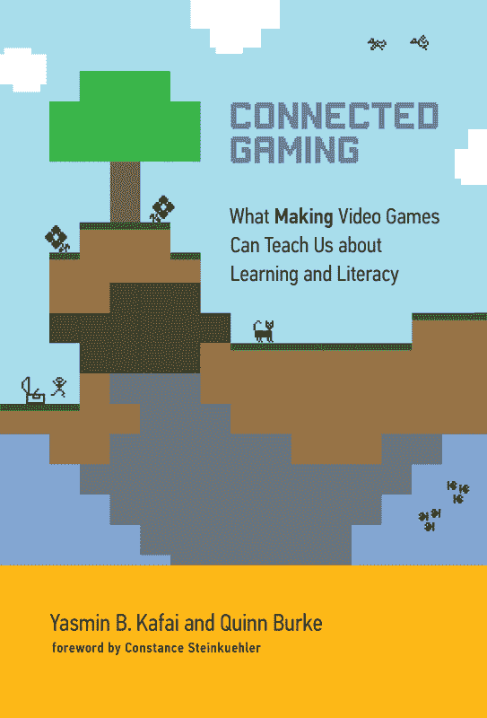

英国，伦敦

© 2016 马萨诸塞理工学院

保留所有权利。未经出版者书面许可，不得以任何电子或机械手段（包括复印、录制或信息存储和检索）以任何形式复制本书部分。

本书由 Toppan Best-set Premedia Limited 使用 Stone Serif 和 Stone Sans 字体制作。在美国印刷装订。

美国国会目录出版数据

姓名：`Kafai, Yasmin B.`，作者。 | `Burke, Quinn`, 1976- 作者。

书名：`Connected gaming : what making video games can teach us about learning and literacy` / `Yasmin B. Kafai` 和 `Quinn Burke`；`Constance Steinkuehler` 序。

描述：`Cambridge, MA` : `The MIT Press`, `2016`。 | 系列：`约翰·D·与凯瑟琳·T·麦克瑟基金会数字媒体与学习系列` | 包含参考文献和索引。

标识符：`LCCN 2016016500` | `ISBN 9780262035378` (平装：碱性纸)

eISBN `9780262336949`

主题：LCSH：教育游戏。 | 计算机与儿童。 | 计算机编程--研究与教学。 | 游戏--设计。 | 构造主义（教育）。 | 学习，心理学。

分类：LCC `LB1028.75 .K34 2016` | DDC `371.33/46696--dc23` LC 记录见 `https://lccn.loc.gov/2016016500`

ePub 版本 `1.0`

> 献我们的父母，
>
> 你们与我们一起玩并制作了第一批游戏。

## 图表列表

1. 图 1.1 老师 Joanne Ronkin 与 1991 年波士顿 Project Headlight 电脑前 Fraction 游戏设计项目的学生们。*照片：*Stephen Sherman。
2. 图 2.1 Rosemary 为《混乱的行星》游戏盒设计的封面。
3. 图 2.2 在 AgentSheets 中的游戏设计。
4. 图 3.1 来自 Scratch 首页的项目画廊。
5. 图 4.1 “芭比被重新混搭，我（真的！）可以成为计算机工程师。”
6. 图 5.1 “芭比被重新混搭”MaKey 钢琴。*照片：*Stephen Sherman。（注：已修正）
7. 图 5.2 由 Yasmin Kafai 提供。
8. 图 5.3 由 Darryl Moran 提供。
9. 图 5.4 由 Veena Vasudevan 提供。
10. 图 5.5 由 Sunday, Gentile 提供。
11. 图 6.1 由 Nathan Holbert 提供。
12. 图 6.2 由华盛顿大学 Looking Glass Group 提供。
13. 图 8.1

## 指南

1. 封面
2. 目录

# 系列序言

近年来，数字媒体和网络已经融入我们的日常生活中，并成为我们进行知识生产、交流和创造性表达的广泛变化的一部分。与计算机和计算机媒体发展的早期阶段不同，数字媒体现在已*随处可见*且*无处不在*，被广泛的个人和机构所采纳。

该系列丛是对我们媒体生态系统中某些变化的回应，这些变化对学习具有重要影响。具体而言，这些变化涉及新形式的媒体`literacy`（素养）以及媒体`participation`模式的发展。数字媒体是交互式媒体（尤其是游戏）、在线网络和现有媒体形式之间融合的产物。这种媒体生态系统涉及一系列素养，这些素养正在通过实践被定义，但在被完全地融入教育倡议之前，还需要更深入学术审视。媒体素养不仅涉及理解、诠释和批判媒体的方法，还包括创造性及社交表达的手段、在线搜索与导航，以及一系列新的技术技能。素养和参与技能的潜在差距为教育工作者带来了新挑战，他们正挣扎于弥合课堂内外媒体参与的鸿沟。

由麻省理工学院出版的“约翰·D 与凯瑟琳·T·麦阿瑟基金会数字媒体与学习系列”旨在弥补这些差距，并为思考和使用新形式知识生产、通信和创意表达提供创新方法。

# 前言

康斯丝·斯坦因奎勒（Constance Steinkuehler）

当吉姆·吉（Jim Gee）在 2003 年首次出版《游戏对学习与素养的启示》时，它引发了一代关于教育和商业游戏（以及游戏社区）的研究与开发，这些研究利用了媒体让学习者参与复杂思维和解决问题的能力。这本书不仅是该文本的自然续作，它标志着该领域一次意外之外的演变——既反映了学习科学中深层的探索与设计思路，也反映了历史上的一个意常时刻。

学习科学的一个基本原则长期以来一直是：学习者通过积极参与世界来构建知识和理解，而模型（无论是心理模型还是构建的物理模型）在那种理解中起着至关重要的作用。在某种意义上，它们就是理解本身。从这个观点来看，制作游戏是这一深层研究线索自然延续或延伸——尽管与我们大多数传统模型相比，它更关注交流，并且是针对特定受众设计的。从这个角度看，制作游戏就是制作一个系统的模型，去理解那个系统。深刻地理解。

从另一个视角来看，这本书完全是革命性的。

我第一次在国家教育学院的一场私人招待会上遇到雅斯敏·卡法伊（Yasmin Kafai），那里简直是教育界的“骷标志”。聚会是在温暖的春日夜晚在一个宏伟的大厅里举行，学者们在走动，三三成群或结对交谈，手中摇晃着酒杯，小瓷盘上摇摇欲坠地放着点心。大厅另一头的交谈声活跃而波动，一张张脸此起彼伏，我完全认识他们的名字，但他们的话题严肃而晦涩，间或夹杂着礼貌的笑声。我当时是该组织的一名助学金研究生，由于仅仅是一个博士生，我感到格格不入，而且作为一个试图通过视频游戏而非课堂研究学习的人，我感到完全无所适从。在手里拿着杯子、尴尬地独自徘荡了很久并试图假装自己属于那里之后，我正开始朝门口走去，此时雅斯敏——这位领域标志性的、定义性的领袖之一——走了进来，她径直走向我，问道：“我知道你研究视频游戏。如果玩游戏真的那么有用，你考虑过学生制作游戏会发生什么吗？”我们随后的对话一直持续到深夜。从那以后，我一直关注雅斯敏的工作。

作为吉的以前任研究生，我的职业生涯一直在研究商业游戏，为了更好地理解为什么这种被学校相关人士所贬低和恐惧的游戏形式，竟能从玩游戏的人身上激发出如此复杂、有时甚至是艰苦的认知和学习形式。例子层比不穷。但直到多年前我开始与游戏设计师合作时，我才真正理解了雅斯敏多年前提出的那个挑衅。

游戏是一种交流媒介。制作游戏不仅是解构一个系统，理解其结构和部分，还要使用算法（`code`）重新组合该系统的模型。它还意味着有意识地向他人表达想法，为他们创造一种你认为值得拥的第一人称体验。这是从内部分享一种观点。

因此，游戏创作是解放性的。像所有艺术媒介一样，游戏制作通过迫使设计者检查技术、材料和社会系统如何运作、对它们的运行采取立场或观点，并将这种见解作为第一人称体验表达给他人，从而促进了个人的自主性。批判性反思和自我表达是民主的基石。它们是教育系统的真正目的。从这个角度来看，这并不是课堂应该涵盖范围之外，而是其必或缺的。或者至少应该是这样的。

如果 21 世纪的课堂不能让年轻人对周围的复杂系统进行批判性审查、解构其运作方式，并有效交流自己与它们的关系，那么它们就是失败的。这些系统包括资本主义、自由市场、社会福利系统、医疗保健、公共交通、碳循环、从细胞到社会的信息交换、在线社交网络以及人类大脑。威尔·莱特（Will Wright）等世界著名的游戏设计师之所以活跃在圣菲研究所（复杂性理论的母体）走廊是有的。

从这个意义上说，这本书是革命性的。

通过游戏表达思想是一项艰出的智力劳动，需要对系统或想法有概念性的理解、作者意图和交流技巧，以及在`code`这种媒介中的技术技能。我们在“高薪科技工作”和“STEM 教育的重要性”的名义下崇拜后者。但这个方程式中真正的魔力来源不是`code`；而是交流。我过去十年通过关注雅斯敏·卡法伊和奎恩·伯克（Quinn Burke）的研究中学到的是：计算性参与必须是 21 世纪任何教育系统的定义性目标，因为我们许多最复杂的问题都是全球性的——跨越多个国家、人口统计或学科的复杂系统。

# 1995 年《游戏中的思维、待玩的游戏、待造的游戏》序言

西摩尔·帕特（Seymour Papert）

显然我是一个慢学的学生。让这本书帮助你花更短的时间到达那里。

威斯康星大学大学麦迪逊分校教育学教授

高等教育视频游戏联盟主席

20 世纪 70 年代后期，随着廉价微型计算机的出现，第一批非专业程序员应运而生。儿童、大学生、教师和计算机爱好者投身键盘，寻找一种前几代人从未有过的体验。随着对编程兴趣的兴起，演变成了对可编程项目领域的探索——如果你不编写某些东西，你就无法进行编程。到 20 世纪 80 年代初，这种习惯已经形成。在学校里，`Logo` 小龟（turtle）的存在有利于涉及图形的项目。正在学习编程的老师往往会寻找具有教学功能的话题。成年爱好者则在他们的小型计算机上实现了简单形式的“系统程序”，这些程序在大型机器上已经存在，但尚未像今天这样渗透到个人设备中。各领域散落的新程序员投身于项目，创造出随着微芯片诞生的另一种实体。在流行语中，视频游戏几乎正成为家用电脑概念的同义词，而制作属于自己的游戏的挑战具有显而易见的吸引力。

反思为什么制作视频游戏没有成为学校计算机文化中更重要的部分是非常有趣的。浅表面的答案是技术性的。回想十年前典型学校计算机实验室的情况：机器是`Apple II`计算机，编程语言是`Apple Logo`。凭借这种组合，虽然`可能`制作出一个可玩的游戏，但所需的技能和努力门槛非常高，最终结果需要极大的想象力才能被归类为“真正的游戏”。难怪制作游戏主要是由那些极具胆识的学生承担，而且很少被老师推广为首选的事业。

这种技术性的解释确实说明了故事的一部分，而且由于游戏制作的增加仅仅是硬件和软件改进的结果，这也加强了这一观点。我观察到许多计算机实验室或工作坊的学生和老师，利用了这样一个事实：运行在最新`Mac`或`IBM`电脑上的`MicroWorlds Logo`使得游戏编程变得像十年前与`Logo`的使用相相同的静态图形一样简单。但教育中的视频游戏故事远不止于技术演变。事实上，更有力、更深层次地促进视频游戏编程大规模进入学校的，是雅斯敏·卡菲（Yasmin Kafai）的倡议，她将这项活动带入了当代教育理论的核心关注领域。

作为这一论述的背景，值得注意的是用技术演变来解释学校里发生的情况存在一种内在的过度简化。这是一条双向道：技术的演变在很大程度上受到了教育计算文化的影响（同时也影响着它）。举个例子，让我回想起 20 世纪 80 年代初，像`Atari`和`TI 99/4`这样的计算机在学校中的比例至少不低于`Apple II`；因为这些计算机的设计旨在作为游戏机，它们具有某些硬件特性，有助于编写游戏所需的动态动作，以及其他类型的动画，这为儿童提供了操作和理解科学与数学中许多关键概念的机会。`Apple II`是一台出色的干将，我们都因它的功能而喜爱它。但由于其他机器在许多方面做得更好，苹果公司的市场胜利显著阻碍了教育计算的发展。显然，教育界（包括研究社区、华盛顿官僚机构以及学校）并没有足够重视这些机器的功能，以至于为它们而战。

我在卡菲的作品中最看重的是它对提升“制作游戏”活动价值的贡献。我指的不仅仅是数量上的。关于计算机的文章争相出现，告诉读者某项活动对学生来说是多么兴奋——甚至孩子们参与这项或那些活动对社会有多么重要。卡菲也做了其中的一些工作；但她的写作与普通“畅销”的区别在于投入了严肃的关注，不仅关注这些学生具体在做什么细节，特别关注理解这些细节时应引入的理论探讨范畴。通过做好这一点，她也在另一个意义上做出了贡献：最终，她的写作将为教育理论者提供一个可以丰富其思想的新领域。游戏制作的出现不仅对参与它的孩子（以及其他人）重要，而且对于那些想要理解智力活动、思考和学习过程的理论者来说同样重要。

游戏制作作为一个理论上的重要领域，其最重要的方式或许在于它在思考什么情况适合学习时，强调了“重要性”作为一个思维类别。关于学校改进的文献充满了要求使教学内容具有“相关性”的呼吁。在这种理论视角下，卡菲的作品强调了需要更多讨论对于一个十岁孩子来说什么才是相关性。显然不是将学校算术与超市联系起来！将学校科学与环保活动联系起来是赋予学习重要性好得多的方法。但如果你确实处于一个视频游戏非常重要的文化中，那么从消费者转变为游戏生产者，也许是某些孩子发现自己所做事情具有重要性的更有力的方式。

我在这里的观点不是争论哪种重要感的来源最好，而是指出对游戏制作的反思是探索学习环境这一方面多个维度（心理的、文化的、数学的）的极佳媒介。它也是凸显教育思维中提出的教学主义（instructionism）与建构主义（constructionism）对立所引发的问题的绝佳媒介。

每一位教育工作者在看着孩子玩视频游戏时一定感到过羡慕：如果那种能量能被用于学习教育工作者所重视的东西就好了。但这种羡慕可以以非常不同的形式表现。教学主义者通过愿望具体化为想要能够教授数学、拼写或地理的游戏来表现他们的倾向。当这种愿望导致想象孩子们制作游戏而非仅仅玩游戏时，建构主义者的思维便显露出来。他们不是想要游戏教育孩子，而是渴望看到孩子们构建游戏。

接受写序言的荣誉意味着有向读者提供建议的义务。这本书在游戏与基础理论问题之间建立联系的这两个例子，足以赋予我的观点意义，我的观点即呼吁读者根据作者丰富的思想，从多个层面来阅读这部作品。

1991 年 6 月。

这是“聚光灯计划”（Project Headlight）面向家长的演示时间。学生们在电脑旁走动，电脑上显示着专为分数软件游戏设计的广告和程序包。“他会问你一个关于分数的问题。如果你没答对，你的大脑就会发生畸形，”我们听到一位家长带着困惑的神情对着电脑屏幕读着内容。经过几个月的工作，学生们终于展示了他们使用入门编程语言 `Logo` 创建的分数游戏。甚至校长也来这里尝试了这些游戏。学生们没有使用购买的软件来玩游戏，而是设计了自己的游戏，在这一设计过程中，他们成为了初级程序员。他们绘制图像、操纵形状，并在他们的分数测验游戏中加入了惊喜。这些并不是普通的视频游戏；它们是为了教授数学而设计的。四年级的小学生艾伯比盖尔（Abigail）选择了围绕希腊神话来设计她的分数游戏：“你想去宙斯的家，但地图被希腊之神哈德斯撕碎了。所有的希腊神和女神都拥有一部分地图。你需要一个一个地去找这些神灵，他们会问你一个关于分数的问题。如果你答对了，你就能得到一部分地图。”艾伯比盖尔制作游戏面临的最大挑战是允许用户从测验中选择答案。她必须学习条件语句的原理和方法——即根据用户输入决定输出的 `if` 和 `then` 语句。艾伯比盖尔仔细地解释了她如何为每个问题的潜在答案编写程序。“这其中最困难的部分，”她总结道，“是为你的分数问题的答案编写程序逻辑。如果你按下 A，就这样做；如果你按下 B，就会发生这种情况，”她解释道，“所以这真的很难。”尽管学习计算机编程基础知识面临着巨大的挑战，这个为期三个月的游戏设计项目的全部十六名学生都学会了如何通过编程来创建他们自己独特的分数视频游戏。¹

二十多年前，第一个建构主义游戏项目发生在波士顿的一所小学里。这是一次非寻常的尝试，因为在当时，大多数学校电脑都藏在机房里，学生每周只去一次，只上一一节课。将电脑放在核心课程教室里在很大程度上是前所未闻的，而围绕制作和分享数字游戏来开发整门课程更是不多见。但这里有一班四年级学生和他们的老师，他们每天进入数学课，开发自己的视频游戏，向学校里更年级的学生教授分数（参见图 1.1）。除了编程和游戏设计，他们还学习了编写广告和故事，以及产品设计，以便向更年级的同学“推销”他们各自的游戏。同样重要的是，他们在整个过程中还学习了分数的加、减、乘、除。毕竟，这仍然是一节数学课。该项目在学生和老师中都取得了前所未有的成功，他们都对这种同时学习内容、编码、协作和创造力的整合学习方式表现出热情。尽管取得了如此成功并受欢迎，但制作游戏从未成为学校课程的一部分。在十年后，随着严肃游戏运动的兴起，制作游戏也没有进入用于学习的数字游戏的范畴。

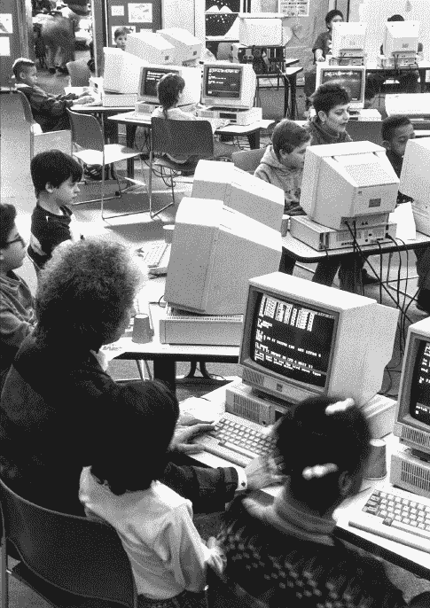

图 1.1 教师乔安·龙金（Joanne Ronkin）与 1991 年波士顿聚光灯计划分数游戏设计项目的学生坐在电脑前。摄影：史蒂芬·谢尔曼（Stephen Sherman）。

是*玩*游戏来学习——教学主义方法——引起了教育者和研究者的关注。²21 世纪初严肃游戏运动的启动实现了人们对教学主义游戏的渴望——即那些专门设计用于向学生教授内容和技能的游戏。到目前，已经设计了数千种教育游戏和模拟来支持各个领域的学习。`Surge: Classic` 是一个典型的例子，学生玩家通过对模拟航天器应用加速度来探索牛顿力学；`Nightmare: Malaria` 是另一个流行的游戏，其任务是在陆地上拯救可爱的泰迪熊免受携带疟疾的蚊子的侵害，并在过程中学习传染病的传播。也许最受欢迎的严肃游戏包括《美国陆军》（America’s Army）的不同版本，它通过模拟战争来招募年轻人加入美国军队。无论哪种游戏，伴随所有这些教学努力的还有来自研究倡议的大额资助、此类倡议发起的众多会议和期刊，甚至是白宫首次任命了首位数字游戏高级政策顾问。³ 从“聚光灯计划”的课堂活动显而易见，学生在建构主义游戏中制作了他们自己的数字游戏，而且这些游戏通常关注数学或科学等学术内容。学生设计者（如引言中的那些人）不仅可以通过编写解释以及创建视觉表示和模拟来学习学术内容，还可以学习技术技能以及数字界面设计。鉴于建构主义游戏在那些有记录的教室、俱乐部和社区实施中取得的成功，因此在关于学习视频游戏的大量言说中，很少关注建构主义方法，这令人惊讶。用于“玩游戏”的教学主义方法几乎完全掩盖了用于“制作和玩游戏”的建构主义方法。

值得反思一下是什么导致了这种缺失。第一个最显而易见的原因可以追溯到西摩·帕帕特（Seymour Papert）在 1995 年《游戏中的心灵》（Minds in Play）一书序言中精辟描述的教学主义愿望，即希望有一个现成的、可下载的教学产品（即游戏本身）作为负责教授孩子（而非教师）的一方。⁵ 导致建构主义游戏不受欢迎的第二个且不那么敌意的原因，可能仅仅源于教育者长期以来一直认为，制作游戏的尝试由于与学习编程有关而太技术化了。第三个原因可能是直到最近，游戏行业确实并不希望玩家对他们为市场生产的游戏进行任何设计或修改。毕竟，这些是他们的产品，在视频游戏发展的早期，盗版和版权侵权的威胁是真实存在的。然而，无论原因何种——教育、技术还是文化——情况显然正在发生变化，并且向着好的方向发展。

在《连接性游戏》（Connected Gaming）中，我们指出了有利于这一新方向的几种发展趋势。行业方法的改变模糊了“玩游戏”与“制作游戏”之间的边界、重视设计自己游戏的开发者运动的增长，以及教育思维的转变（将计算思维和参与 K–12 课程纳入其中），这些推动建构主义游戏的核心原因。我们强调了编程、协作和创造力如何捕捉建构主义手游的各种学习益处。但我们也不想通过主张摒弃指令式游戏而转向建构主义游戏来让天平过度向某一方倾斜。相反，我们希望采取一种更全面的立场，将制作和游戏都视为连接性游戏这一大框架的一部分。正如我们将论证的那样，连接性游戏将学习玩和制作游戏视为更大游戏生态系统的一部分，在这一生态系统中，游戏玩家和游戏设计师的传统角色不再被视为独立的实体，而是被视为相互重叠、相互信息的学习过程。这种向连接性游戏的转变已经酝酿很久。

## 模糊玩游戏与制作游戏之间的界限

可以说，转向建构主义游戏的核心动力来自行业本身。毕竟，当今市场上最受欢迎的一些游戏已将关卡和角色制作——在此语境下也称为 `modding`——作为游戏玩法的核心特征。商业游戏制作现在鼓励这种 `modding`，直到下一个版本发布为止。游戏模组或 `modding`（分别是“modifications”和“modifying”的缩写）指的是玩家对游戏进行的修改和添加。游戏模组开发者是围绕文化媒体兴起的庞大粉丝文化的一部分，在这一文化中，粉丝不再满足于仅仅作为消费者进行观看和游玩，而是希望积极参与此类内容的开发。⁶

根据大多数记载，第一个视频游戏模组出现在 1983 年《蓝精灵要芬斯坦堡》（Castle Smurfenstein）的诞生。⁷ 它是 20 世纪 80 年代两款经典游戏的结合：第二次世界大战射击游戏《沃尔芬斯坦堡》（Castle Wolfenstein，玩家在其中与纳粹军战斗）以及明显温和得多的《蓝精灵》（Smurf，玩家必须营救其中一个蓝色蓝色卡通角色）。《蓝精灵要芬斯坦堡》是一个完全阴森的模组，其中可爱的蓝色卡通角色取代了纳粹，成为射击游戏子弹的受害者。这个通过破解 `Commodore 64` 游戏机上的软件创建的《蓝精灵要芬斯坦堡》，在少数游戏玩家中成为了一个小现象，他们在极具“地下”色彩的游戏俱乐部网络中私下交易这个模组。诚然，其创作背后蕴含的黑色幽默是《蓝精灵要芬斯坦堡》吸引力的一部分。但它真正的颠覆性本质实际上在于它为现有视频游戏的未来修改引入了叛逆的可能性。因此，在《蓝精灵要芬斯坦堡》之后，相继出现了成百上千千计的模组，尽管此类创作最终只在一个规模较小的程序员、黑客和硬核游戏爱好者的网络中流传。

尽管如此，在哥特式德国城堡中射击蓝色蓝精灵并没有赢得《沃尔芬斯坦堡》背后软件公司的青睐，特别是面向家庭的《蓝精灵》视频游戏制作者的青睐。因此，虽然模组开发者的小型网络在 20 世纪 80 年代一直直到 90 年代初一直在游玩并分享他们的修改，但游戏公司基本上认为对其软件或硬件的任何修改都是违反了最终用户许可协议，而玩家在购买软件和游戏机时必须遵守该协议。然而，这种情况在 1997 年发生了变化，当时热门第一人称射击游戏《毁灭战士》（Doom）的创作者 `id Software` 公司在一组独立于游戏本身的文件中发布了游戏的源代码。⁸ 游戏爱好者对游戏行业这种本质上前所未有的邀请欣之若狂，随后的几年里出现了成千上万个模组，尤其是随着互联网普及的持续飙升。⁹ 可以说，行业已经“进入游戏”。`id Software` 并没有看到自己的经典游戏被削弱，而是发现自己在玩家和黑客中获得了一种近乎崇拜的地位，该公司在随后的几年中通过《毁灭战士》同样可修改的续作《雷神》（Quake）和《雷神 2》（Quake II）迅速变现了这一点。

媒体学者亨利·詹金斯（Henry Jenkins, 2006）提出了“汇聚文化”一词来捕捉这种消费者变成生产者的新兴现象。在视频游戏模组的背景下，这种汇聚可以通过许多形式呈现，其中某些（但不是所有）需要编程等技术技能。虽然《毁灭战士》允许的修改包括添加全新的游戏关卡和改变游戏周围的实际景观，但并非所有模组都如此重大。甚至在《毁灭战士》到来之前，软件公司允许通过界面修改对游戏玩法进行微小调整，例如更改角色服装、为游戏中的角色添加配件，甚至仅仅是自定义显示器或仪表盘的边框。此类修改显然只允许有限的终端用户输入，但即使原始任天堂娱乐系统（Nintendo Entertainment System）在 1984 年的《越野摩托》（Excitebike）中让玩家有机会设计自己的赛道，或者在 1988 年的《超级马里欧兄弟 2》（Super Mario Brothers 2）中选择自己的头像，都是行业允许玩家在游戏整体视觉和感受中扮演更大角色的微小但意义意义的案例。

模组及其各种化身形式仅仅说明了光玩游戏已经不够，玩家已进入制作游戏领域的一个例子。虽然模组是这种日益增长的边玩边做欲望的一个很好的例子，但对游戏文化的更深入检查表明，许多其他技术上同样丰富的活动长期以来出现在游戏背景中。游戏学者詹姆斯·保罗·吉（James Paul Gee）将此类活动称为“元游戏”（metgaming）。在这里，玩到了游戏之外，包括参与在线论坛以及访问和设计作弊网站以帮助玩家更有效地游戏。10 元游戏历史可以追溯到游戏本身，早期如《雅达达时代》（Atari Age，1982–1984）和《任天堂力量》（Nintendo Power，1988–2012）等出版物自 20 世纪 80 年代初起一直在为玩家提供游戏技巧。但元游戏无疑随着 20 世纪 90 年代互联网开放的网络达到了全新的高度。1997 年可修改的《毁灭战士》的发布是对这些在线元游戏网络的早期助力，因为当时创建了大量的教程甚至视频，用以教授那些不熟悉的人添加或更改游戏所需的基础编程知识。

今天，多人在线游戏《魔兽世界》（World of Warcraft）巨大的受欢迎性和复杂性将元游戏推向全新的高度。《魔兽世界》玩家的讨论论坛不仅仅是一系列粉丝帖子；这些板块充满了涉及多项科学实践的帖子，包括定义不断变化的生态系统、玩家在该生态系统中的角色，以及如何开发和测试关于游戏设计和机制的假设。参与《大星球 2》（LittleBigPlanet2）的玩家也被发现参与了各种游戏模组实践。对于《文明 3》（Civilization III），玩家开发了讨论论坛和资源指南供他人改进游戏。11 这些形式的元游戏在许多方面都是上述模组活动的前身和伴侣。

无论是模组（modding）还是元游戏（metagaming），这些发展都清楚地表明，制作与玩不再是独立的活动，而是相互关联、相互提供信息的过程。或许向行业传递“连接性游戏”确实已经到来的最清晰信号，是 `Minecraft` 的异常受欢迎，这款独立游戏通过同时提供“游玩”和“创造”模式，打破了游戏界和学术界历史上在游戏游玩与游戏制作之间建立的藩篱。在创造模式下，玩家使用正方形积块来构建自己的环境，无论是房屋、花园还是整座城市——在某些情况下，这甚至导致了对整个丹麦的重建。在游玩模式下，环境切换为一个世界本身，由时钟驱动并带来夜晚怪物。作为玩家，可以选择游玩模式。用于积块编程的界面是对 20 世纪 70 年代计算机和游戏界面的有趣回溯，当时颗粒状的绿色像素充满了黑色屏幕，诸如 `Forward 200` 这样的命令被用于导航屏幕上的物体。`Minecraft` 是一个虚拟沙盒，其巨大的受欢迎程度吸引了数百万付费的设计师，甚至成为了近期一集《南方公园》剧集的主题——它本身就是一个文化符号，象征着它诞生的创者运动和编码员运动。

## “游戏制作者”社区的不断壮大

DIY 或创者运动的兴起，其专注于制作和分享具有高度个人化和社会意义的产物，是这种连接性游戏转变的另一个推动因素。DIY 和创者文化的产物范围从机器人到 3D 打印物体，从高科技时尚到质朴的纺织工艺，从水生花园到烹饪奇观——简而言之，几乎任何可以在家里制作并广泛分享的东西。这种 DIY 精神不仅局限于有形设计，现在已转向在线游戏设计。制作自己的视频游戏是当今青少年编程社区中最受欢迎的活动之一，非营利组织 `Scratch` 和 `Alice` 以及营利企业如 `GameMaker` 和微软的 `Kodu`（以及许多其他）都能很好地接纳这些年轻设计师。正如前节所示，这种发展在很大程度上受到制作和分享视频游戏的工具和技术日益增长的推动，但行业在此领域的进展与更广泛的数字创者文化直接相关，这些人长期以来通过兴趣驱动的学习以及通过设计与他人分享来参与世界而建立纽带。

虽然创者运动是一个相当晚的发展，但这种 DIY 精神一直是视频游戏文化的一部分，始于第一代微型计算机，它们通常以需要用户组装的套件形式出现。正如新西兰游戏文化史研究员梅兰妮·斯瓦韦尔（Melanie Swalwell）在对 20 世纪 70、80 年代专业计算机和游戏杂志的评论中所观察到的，玩家长期以来一直在编写游戏版本、破解控制器，并将这些结果与其他志同道合的玩家分享。然而，这种模组化并不一定容易。早期用户通常必须修改源代码或输入命令来加载和运行软件及游戏。Swalwell 指出，修改早期视频游戏的独特挑战导致了事实上上成为儿童的计算机编程教程，有“许多勤奋的青少年通过这种方式赚钱、编写程序”，因为计算机通常在软件准备好之前就发布了。因此即使在那时，制作游戏以及对硬件和软件的钻研一直是玩家游戏文化的一部分，尽管这种文化要“地下”得多，它基于博学的编码知识，并且缺乏随后由互联网产生和支持的大型网络。

这种长期的参与不仅证明了广泛的创者文化，也说明了视频游戏作为社会学家舍丽·特克尔（Sherry Turkle）所说的“唤起性对象”的重要性。正如特克尔（1984）解释的那样，这些产物在允许个人表达的同时，通过捕捉对核心问题的当代讨论来唤起更广泛的文化相关。视频游戏作为唤起性对象，其程度体现在它们捕捉了我们生活中数字技术的日益兴起，以及向与个人数字设备增强交互性的转变。计算机始于实验室且在很大程度上对终端用户而言不可及，而视频游戏注定要走向大众消费。视频游戏是数字技术的首次个人使用，在家用电脑和移动技术成为家庭用品很久以前就已经在视频游戏厅和家用游戏机中广泛可用。当然，在 20 世纪 70 年代和 80 年代，这类视频游戏的市场主要是儿童，但这些孩子现在已经成长为周围数字设备的设计师和程序员。正如皮尤研究中心的一项最新研究所示，不再仅仅是孩子在玩视频游戏；所有美国成年人中超过一半以及 18 至 29 岁的年轻人中超过 80% 的人正在玩视频游戏。

这种文化之所以繁荣，也许是因为与社交媒体网站的“弱连接”相比，制作和分享自己生成的内容被证明是与他人联系的一种更有实质意义的方式，在社交媒体网站上，用户积累了成千上万个“朋友”，其中许多人甚至从未见过过面。这种“制作即连接”的情绪也是创者运动核心的新型交换文化的一部分。媒体学者大卫·甘特莱特（David Gauntlett）在他同名的书籍中敏锐地观察到，游戏不仅是唤起性对象，还成为新创者经济中的一种货币。它们变成了青少年中具有真实价值的“用于思考的物体”和“用于共同分享的物体”。正是在这里，我们看到了严肃游戏最大的文化转变——从指令主义游戏自上而下的可教产品，转向由社区成员从底层开始创建的可共享产品。

## 建构主义游戏的教育机会（与紧迫性）

在严肃游戏和创者运动在教育和商业界汇聚势头的同时，一项促进计算思维的后续努力在硅谷获得了关注。这种在 K–12 学校及其周边教授代码的推动最好被描述为编码员运动。在国家研究委员会的两份工作坊报告的支持下，这些技术专家引用了当时卡内基梅隆大学教授珍妮特·王（Jeannette Wing）对计算思维的定义，即“设计系统、解决问题和理解人类行为的所有方面”。王认为，从计算的角度理解世界为理解问题并为其贡献解决方案提供了一种特定的视角。计算思维虽然通常被严格地与计算机科学联系在一起，但实际上最好被理解为将计算机科学原理扩展到其他学科，以帮助拆解任何问题的元素，确定它们相互之间以及与整体的关系，然后设计算法以获得自动解决方案。计算思维不仅限于数学和科学，也适用于新闻和文学等的人文领域。像计算机科学家一样思考具有更好地阐述和推进其他学术学科的潜力。

虽然学习如何像计算机科学家一样思考是一个令人赞赏的目标，但仅仅是思考，对于数字素养能为年轻学习者提供的理解是有限的。设计、编程和模化（modding）数字制品绝不能仅仅作为一种培养儿童思维的更有效的方式被推向学校，而必须同样被视为培养儿童逻辑和创造性交流能力的一种有效方式。在我们看来，通过扩展温（Wing）对计算思维的定义，我们将“计算参与”视为“在计算的背景下进行问题解决、系统设计和理解人类行为，这不仅是个人的行为，更是一种允许参与网络化社区的集体实践。”[²⁰

从围绕游戏制作的日益兴盛的青少年文化，以及游戏行业自身对模化作为“良好游戏体验”的拥抱中显而易见，视频游戏显然代表了当今青少年最具社交和文化意义的“对象”之一。制作这些对象意味着与其他玩自己游戏的人一起创建并随后解决问题，以界面、故事和动画的形式设计直观的系统，并通过处理诸如作弊等行为的社会影响，以及关于虚拟表表的批判性问题，通过计算机科学的概念、实践和视角来学习人类行为的文化和社会本质。正在此处，创造者运动的假设与编码者运动的理念联系起来，促进了学校编程教育，并在促进严肃游戏的新愿景上汇合：即建构主义游戏。

我们并非孤单地拥抱建构主义游戏的愿景——这种愿景将通过制作游戏进行学习视为一种扩展严肃游戏前景的教育机会。当然，这是像 `Project Headlight` 等早期努力的愿景。但在国家政策层面发展的驱动下，这一愿景得到了更新，这些发展将严肃游戏视为一种促进计算思维和参与的可行教学尝试。然而，在每一个案例中，我们发现证据表明，这些国家努力需要涵盖更广泛的视角才能在学校取得成功，特别是考虑到建构主义游戏过去不仅在学习编程，而且灌输学术内容和其他技能方面取得了成功。[²¹]

这种成功在最近一项涉及荷兰 200 多名小学学生的实验研究中显得尤为易见。[²²] 虽然参与研究的一半学生使用基础的拖放游戏应用程序创建了他们自己的记忆游戏，另一半学生则使用同一平台玩了一个预装的记忆游戏。在衡量学生对内容保留情况的工作后活动表以及工作后调查中，建构主义（游戏制作）组在学习动机和应用一系列学习策略的能力方面均优于指令主义（游戏玩）组。虽然这项研究无疑是对在教室中使用指令主义游戏的批判，但它表明，在建构主义方法下，学生对自己的学习拥有更大的主翁意识，并具有既是玩家又是创造者的双重感。这无疑支持了 20 世纪 90 年代初 `Project Headlight` 制作项目早期努力的结论。

但这项研究的发现也强化了其他近期研究的更大观点，即对于 21 世纪的儿童来说，遇到视频游戏本身不再是一个新奇的体验。[²³] 更重要的是，它们表明，如果教育者想让年轻学习者参与严肃游戏，那么就需要更多地关注“一起制作和玩”，而不是独自玩游戏。我们的教育使命源于这样观点：一个人不玩某个东西就无法制作它，反之亦然，一个人不制作某些东西就不是真的在玩游戏——从各种角度来看，这两者在游戏文化中是密不可分的。将严肃游戏引入教育的努力受到了人们对整个游戏文化参与的启发，作为一个丰富学习背景的例子，而不仅仅是游戏本身。吉（Gee）将视频游戏视为“教导我们学习和素养”的灵感（引用他开基性著作的书名），指出需要更广泛的严肃游戏愿景。我们正在开发一种基于连接游戏的此类愿景，它受到建构主义学习和计算参与的启发，解决了在设计更全面的学习环境和活动中长期存在的公平问题。

## 连接游戏的必要性

我们的目标是开发一种包容且知见解的连接游戏愿景，让年轻学习者在视频游戏的设计和制作中拥有更大的话语权。这意味着教育者需要将学校的严肃游戏活动变成正式和非正式分享与协作的场所。无论这些游戏社区是围绕制作和分享图形艺术、开发和调试视频游戏，还是创作互动多媒体剪辑，这些在线空间为孩子们提供了创造自己的数字内容，并在在线上与成千上万其他同好分享他们创作的潜力。正是在这些基于数字的游戏制作社区中，我们看到了一个连接游戏制作与玩的新愿景。由于其文化相关性和重要性，游戏提供了一个充满前景的背景，允许计算思维和参与利用 21 世纪数字世界固有的社交连接性。

连接游戏实现了计算参与，并说明了在 21 世纪社交化和生产的意义，带来了更好的学习机会，并意味着更好的教学机会。基于建构主义理论，制作和玩游戏的个人投入并非发生在真空中，而是非常处于一个社交背景之中。通过设计游戏（或在更细粒度的层面上，其定义规则、构建交互和创建图形的过程、算法或数据结构），个人知识变得公开，并可以与他人分享；使用扩展的建构主义理论概念，它既是设计者的`用于思考的物体`（object-to-think-with），也是`用于分享的物体`（object-to-share-with）。[²⁴] 这种将制作的游戏视为个人化且可分享事物的观点，标志着围绕共同利益发展和成长的志趣文化的重要性，在这些文化中，学习是一种集体体验。这些共同利益和对群体的关注反映了价值观，同时也为玩家和创造者提供了彼此以及与更大社区连接和互动的背景。这是从严肃游戏中过度个人主义的视角转向了将玩游戏和制作游戏视为一个实践社区的视角。[²⁵]

这种转变对学校产生了重大且紧迫的影响。在学校里，长期以来单一学习者的成功一直被认为比学生之间有效且有意义的小组合作更重要。事实上，学生在学校的成功往往被视为一种知道如何“玩游戏”的问题。然而，学校固执于那些推崇个人表现而非群体动态的教学法和课程，不仅忽视了该国进步教育的丰富历史，也未能预见到未来就业市场日益需要那些能够适应各种情况和不同性格的灵活劳动者。事实上，游戏已经改变了。在科学、技术、工程和数学（STEM）内容方面，学校对个人成就而非群体动态的强调，导致美国劳动力市场失去了大量进入科技行业的学生群体——即女性以及少数族和种族少数。`San Jose Mercury News`2010 年的一项分析显示，自 2000 年以来，在硅谷科技行业工作的非洲裔美国人、拉丁人和女性的人数实际上有所减少。鉴于数字技术在公共生活各个方面日益日益增长的角色，这种减少尤为令人震惊。尽管技术已渗透到我们生活的方方面面，但只有少数女性和少数裔参与软硬件技术的设计。同样，虽然我们看到游戏已普及到所有年龄段的所有群体（而不只是少年和男性），但很少有女性和少数裔参与游戏的设计。最后，尽管制作活动（maker activities）在商业变革中变得日益重要，但在制作领域很少有女性和少数裔的代表。

硅谷及全国的许多科技公司已公开承认了这一问题，并承诺在招聘方面投入更大的努力，但该行业远非这里唯一的责任方。毕竟，需要有真正的毕业生可供招聘。虽然让学生制作和分享视频游戏远非唯一答案，但“连接式游戏”（connected gaming）的概念意味着学校需要真实且富有成效的重新转型。它不仅关注真正吸引青年的内容，还让学校回到发生实际制作和分享的场所。制作（而非仅仅记忆）内容并与同伴分享（而非仅仅向老师报告），标志着我们我们构想和实践学校教育的方式发生了根本性的——本质上也是困难的——改变。但正如我们在后续章节中概述的，创作者更广泛的 DIY 文化、进步主义在美国教育中的历史作用，以及如纽约和芝加哥的“学习探索”（`Q2L`）学校等持续进行的倡议，为更大规模地实施连接式游戏提供了许多富有见地的先例。最终，连接式游戏让严肃游戏（serious gaming）变得更加容易接触（你可以随地玩、制作和学习——无论在校内外），更具包容性（每个人都可以使用各种材料玩、制作和学习），并且更加全面（不仅在屏幕上，还在具有创客运动特征的手工艺中）。

## 图书概览

我们将本书分为七章，每一章都关注构造主义学习和连接式游戏的特定元素。每章都包含了程序和活动的插图，以便读者更好地理解游戏制作在教室、课后俱乐部和其他教育空间学习的实际应用。我们书的一个核心前提是，连接式游戏一直是大数字媒体图谱的一部分。但由于缺乏熟悉和/或资源，它在很大程度上被学校和娱乐行业视为不切实际或无关紧要。如果我们要在 K–12 学校中让严肃游戏运动取得成功，必须充分考虑这一历史背景。

引言之后，第 2 至 5 章讨论了构造主义学习的主要假设，以及为什么教育者需要更多了解该方法的四部分框架。在第 2 章中，我们审视了连接式游戏的个人层面，以及制作游戏如何通过校内外的研究案例以及包括`Scratch`和`Alice`在内的一系列入门编程语言，为学习编码提供丰富的背景。正如前文提到的，入门计算机编程是 21 世纪学校和技术面临的最突出的问题之一，许多教育者、研究人员和政策制定者将编码视为当今的素养。游戏制作在这里作为向儿童介绍计算概念、实践和观点的重要工具，让他们学习如何学习，并支持他们成为数字技术的创造者（而不仅仅是消费者）。

在第 3 章中，我们转向构造主义游戏的社会方面，利用了研究儿童相互制作并为彼此制作游戏的协作努力，特别关注了设计游戏时流行的配对编程（pair programming）方法。我们将构造主义游戏视为培养替代性学习的环境，并探索了制作和玩游戏在开发新学习环境方面如何有效以及无效。在这种背景下，我们特别关注学校作为社会学习环境，审视了纽约市的`Q2L`以及使用`Globaloria`程序教授游戏制作的全州努力。我们还将关注通过`Scratch`和`Newgrounds`等非正式教育网站不断增长的游戏制作者在线社区，并考虑这些游戏玩家和游戏制作者的非正式网络在教学上能为重新思考我们在学校中整合技术的方式提供什么。

在第 4 章中，我们探索了构造主义学习的文化方面，并回顾了鉴于游戏文化在代表和欢迎多元化游戏玩家和游戏设计师方面相对糟糕的记录，这种方法如何可能成为现实。特别是，我们关注了将游戏设计作为把女孩引入计算和 STEM 学习的手段，以及将游戏测试作为吸引年轻非洲裔男性参与计算的手段。我们评估了这些方法的优点，但也审视了它们的缺点，以及我们未来如何通过重新思考构造主义游戏，使其成为一种更具包容性的方法。

在第 5 章中，我们强调了连接式游戏的实体方面，并关注了构造主义游戏的最新发展，包括传统的游戏板和可穿戴游戏界面，其中一些已经通过数字功能进行了增强。在这里，我们说明了游戏设计如何通过制作和玩游戏的反思性迭代，并为技术设计提供透明度。这些混合设计还扩展了学习者对计算的想法，通过提供更广泛的美学应用和使用更广泛的材料，鼓励了更广泛的游戏参与。

我们在第 6 章结束了回顾，重点关注连接型游戏的工具，并认为现在比以往任何时候都存在着大量的免费和付费程序，让孩子们能够制作并分享自己的自制视频游戏。我们描述了这些各种工具，并评估了这些程序在为儿童带来游戏制作时应当追求的标准。我们在此处的核心观点是：正如玩视频游戏和制作视频游戏不再是互斥活动一样，制作游戏的工具和孩子们分享游戏的在线仓库也不再分处不同的地方。正如改后的 `Scratch` 网站（现为 `Scratch 2.0`）所示，孩子们制作游戏和分享游戏的地方是同一个地方，这表明制作“好”游戏最有价值的工具是让充满热情的观众来玩并乐于提供反馈。

最后，本书以第 7 章结束，该章结合我们目前正在见证的 `Minecraft` 的成功，整合了之前关于连接型游戏的章节——`Minecraft` 提供了一个绝佳的“案例研究”，展示了游戏在过去五年中发生了多大的变化。`Minecraft` 说明了游戏的制作和玩可以在同一个平台内结合得多么紧密。在最后一章中，我们概述了一项实践和研究的行动议程，以拓宽并深化对连接型游戏的参与，并实现严肃游戏对学校和其他教育空间的全部潜力。

# 2 严肃的一面：为了学习而制作游戏

1993 年，麻省理工学院（MIT）媒体实验室实验性学校项目 Project Headlight 的一名十岁学生 Rosemary 对她的游戏最终设计撰写了这篇评论：“我做了一个游戏。它叫 `Mixed Up Planets`。起初开始很慢。组合你自己的游戏非常困难。你可能因为人们玩了那么多视频游戏就觉得这很容易。它们看起来那么简单，但试着做你自己的游戏，那完全是另一回事！嗯，我开始时的预期非常高，认为我可以在 `[a]` 非常短的时间内做一个很棒的游戏。这个游戏的点是教孩子们行星的顺序。……当你看到屏幕时，上面会有太阳和水星（这是我计划的）。然后你会看到一条消息说，请将无论是什么行星放在它右侧正确的位置。然后你会听到高音的哔声。如果你放错了，就会有低音的哔声。……然而，我可以告诉你们学到了什么。我不仅学了更多关于太阳系统的知识。我学了不同类型的星星。我学了很多计算机编程。计算机和科学可以如此紧密地结合，真是太神奇了。把所有的想法写在纸上太棒了。说实话，我希望你下次玩 `[the]` 电脑或视频游戏时，你会考虑到它的制作者！”

Rosemary 与过去几年 Project Headlight 的其他学生一样，他们设计并编写了数字游戏，教学校里更低级的学生分数。她花了几个周的时间制作她的游戏，因为她她在科学课上同时学习天文学、行星、星系和恒星。每天花一个小时，她坐在教室外成圆的电脑前工作，设计和编写她的游戏和图形，规划游戏的包装和配套的营销广告，甚至为课程的在线时事报撰写软件发布说明。Rosemary 的视频游戏 `Mixed Up Planets` 的发布是在许多不同领域投入许多小时努力的结果。从她对 Project Headlight 团队的最后劝告中显而易见，她不仅对产品本身，而且对最终包装之前不可避免的长期过程有了新的认识。

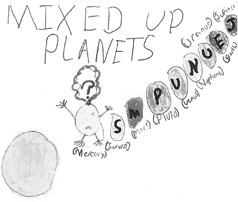

图 2.1 Rosemary 为 `Mixed Up Planets` 游戏盒设计的封面设计。

在这个项目中，Rosemary 成为了一个教育软件游戏的制人，而不仅仅是玩家。她没有使用商业教育软件来学习天文学，而是被赋予了设计自己游戏的任务。这个概念是她的。她想让玩家按正确顺序排列行星，以此作为学习太阳系基本结构的方法。和许多其他学生一样，她被教了通过唱歌或编造一个搞笑的句子（如“My Very Easy Method Just Speeds Up Names”，我的非常简单的方法加速了名字命名）来记住行星顺序的策略，利用每个单词的首字母来表示行星与太阳越来越增加的距离。她让她同伴们一直玩 `Mixed Up Planets`，并最终引导他们得出正确的序列。显然，Rosemary 在游戏上的成功超越了天文学 101 课程的内容，并深入了更深层、尽管更模糊的领域，这些领域不仅关乎良好的游戏，还关乎良好的学习。对于一个十岁的小学生来说，这一点也不坏。

仿佛这还不够，Rosemary 在此过程中学习了计算机编程的基础知识。使用 256K 的 `IBM PCjr`，Rosemary 通过 `Logo` 让她的想法和图像在屏幕上活了起来，这是 Seymour Papert 在 `LEGO’s Mindstorms` 中推广的编程语言。对于她的游戏，Rosemary 学习了这些命令，让屏幕上的数字龟逐步绘制并演示彩色行星的图形，并在屏幕上为玩家打印配套说明。她还学会了如何为计算机声卡编程以产生高音和低音反馈，并根据各个行星的位置条件同步反馈。从开始到结束，Rosemary 的 `Mixed Up Planets` 教育游戏拥有当时可以在市售教育软件软件包中找到的所有功能。但再次，有一个关键的区别：是她，而不是专业人士，成为了软件和软件包的设计师。

学习程序程和设计内容是艰苦的工作。Rosemary 在她的时事报公告（如上文引用）的反思中亲自发现了这一点，“它们（游戏）看起来那么简单，但试着做你自己的游戏，那完全是另一回事。”通过制作一个教学校里低级学生天文学的游戏，她也学习了她自己的学习，调整了她早期的野心——这些野心（和她的许多同学一样）最初是模仿她在家里电视上玩得非常熟悉的 `Nintendo` 和 `Sega` 游戏。但这无疑是一次她只有通过亲身投入制作自己的视频游戏才能学到的教训。因为虽然当时视频游戏在数百万儿童中非常流行，但字面上，年轻孩子们完全没有制作自己视频游戏的机会。Rosemary 最后提醒要“考虑到它的制作者”是一项远见卓眼的评论，考虑到二十年后随之起的创客者运动和编码员运动的显著上升。最重要的是，她用自己的话看到了游戏、计算和制作之间的联系，观察到：“计算机和科学可以如此紧密地结合，真是太神奇了。”对她来说，科学和编程的学习并不是孤立的学科，而是与她游戏的制作不可避免地联系在一起的。

本章及后续章节将探讨在制作（以及玩）视频游戏时的学习与素养的潜力。罗玛丽（Rosemary）的案例与其他许多涉及儿童学习编程的研究一样，提供了一个引人入胜的例子，展示了学生在学习使用计算机制作时可以学会什么。然而，罗玛丽是一个特例吗？个人案例的发现在多大程度上可以提升到适用于整个班级？与其他学科的联系又如何？难道每个孩子真的都能通过这种方式学习编程吗？学生在这个过程中还可以或应该学习其他什么？自从“聚光灯项目”（Project Headlight）开展首个游戏设计项目以来，已经过去了二十多年。虽然这项倡议取得了巨大的成功，但其时机也并不如人意；它恰好出现在将编程引入 K–12 学校的首次尝试的末尾，当时人们对 DIY 编程的态度已转向 20 世纪 90 年代和 21 世纪初学校电脑所具有特征的预装软件软件包。多媒体光光盘和互联网浏览器的出现似乎抵消了学习计算机语言的必要性；人们认为，点击鼠标而非代码，就是掌控机器的所有要求。^[4 尽管当时对 Logo 和编码的热情正在消退，但总来说，那时制作游戏的兴奋感依然存在。尽管大多数学校没有编程课程，但制作自己的游戏不仅以意想不到的方式激励了学生，也激励了教育研究人员，并产生了我们将在本章中回顾和讨论的大量研究。

## 将编程置于背景中

在我们考察数十项研究“为了学习而制作游戏”的研究之前，回顾启动首个游戏制作设计项目及其后续研究的教学方法前提是值得的。为了学习而制作游戏的想法并不是新概念。多年来，教师们一直在教室里使用游戏（无论是制作的还是玩过的）来激励学生的学习。^[5 同样，在计算机出现很久，孩子们就已经玩过并制作过游戏了。在数字技术史上，游戏起到了工具性的作用。正如上一章提到的，视频游戏机被证明是个人电脑出现之前，许多孩子接触到的第一台计算机。今天情况依然如此。^[6

视频游戏的出现和成功捕捉了儿童和成人的想象力，但原因各异。对于儿童来说，这是他们参与并坚持解决挑战性问题的可能，正如游戏研究者詹姆斯·保·吉（James Paul Gee）通过自己的游戏体验和对他人的观察所说明的那样。它提供了一个进入新世界的入口，正如媒体研究者亨利·詹金斯（Henry Jenkins）在研究游乐场从社区街道转移到房间内的儿童通过虚拟游戏所享的自由运动时给出的非常有说服力的论证。^[7 对于成年来说，通过这种方式激励游戏引发了其他东西。正如帕珀特（Papert）在《游戏中的心灵》（*Minds in Play*）序言中所假设的：

> 每一个教育者在看着孩子玩视频游戏时都可能感到某种羡慕：如果这种能量能被用于学习教育者所重视的事物就好了……当愿望导致想象孩子们制作游戏而不仅仅是玩游戏时，建构主义思维就显现了。与其想要游戏来教导孩子，他们渴望看到孩子们构建游戏。^[8

帕珀特描绘了一幅孩子们被游戏机迷住的难忘的画面。视频游戏教会了每个人关于利用学习欲望的重要的一点。

然而，最初吸引这些教育者（后来被认为是建构主义者）将孩子们制作而非仅仅是玩游戏视为一项关键任务的原因是什么？一个关键原因是，建构主义教育理论本质上将制作物体视为核心智力活动。帕珀特和哈雷尔（Papert and Harel, 1991, 1）写道：“这增加了这样一个想法，即在学习者有意识地构建一个公共实体（无论是海滩上的沙堡，还是可以与他人分享的宇宙理论）的情况下，这种情况尤为顺利。”他们认为，像 `Logo` 小龟这样的“用于思考的物体”（objects-to-think-with）在支持同化方面特别有效，因为它们促进了学习者对物体的个人认同，并有助于构建、检查和修改新旧知识之间的联系。在游戏背景下为 `Logo` 小龟编程，很大程度上使该构体成为一个“用于思考的物体”，将物理世界中的制品（在此例中为乌龟）与大脑中的表示（在此例中为规则和对象）连接起来。但制作游戏也是在追溯让·皮亚杰（Jean Piaget）的作品，他研究了游戏活动作为儿童发展和行使对规则理解的场所的发展功能。同样重要但知名度较低的是构建类游戏，皮亚杰认为这类游戏是最复杂的形式，因为它们要求儿童根据自己的理解来构建世界的表征^9

通过设计游戏（或在更细粒度的层面上设计其程序、算法和数据结构），个人知识变得公开，并可以与他人分享。当然，将游戏程序视为可以广泛分享的公共实体的个人物体或“用于分享的物体”（objects-to-share-with），这阐述了一种与互联网文化增长完全类似的现象，其中照片、故事和设计变成了公共和私密互动的新货币。延伸之，制作游戏是建构主义活动的绝范例，特别是在数字游戏时代。这里的核心思想是，关于规则、世界和交互的知识体现在公共实体——游戏——中，而游戏的玩与做凸显了建构主义学习的个人、社会和文化维度。建构主义学习的这些和社会和文化维度将在第三章和第四章进一步讨论。

制作自己的游戏随后以多种方式吸引学习者，让学生接触关键计算概念和实践。在这种背景下，学生不仅学习了各种编程概念、数据结构和算法，还学习了各种软件设计实践，如调试和修改代码。这些概念和实践共同捕捉了珍特·王（Jeanette Wing）的“计算思维”概念。^(10

难道独立学习编码而抛弃制作游戏会更简单吗？事实证明，为了编程而学习编程并不十分有趣，更重要的是，对于初学者来说，这种效率也并不高。在对 K–12 编程教学研究的一项广泛综述中，教育研究者大卫·帕伦博（David Palumbo）得出，学生对编程的有效学习取决于此类教学在多大程度上整合到日常课程和其他学科中，并将其作为一种促进解释和立足意义的背景。事实上，针对编码的适用性批评完全可以指向学校里的许多其他学科，而不仅仅是编程。学生在学校里学了什么、如何学，以及这与他们的校外学习如何联系，已成为关键所在。“迁移”问题在 20 世纪 80 年代后期和 90 年代初不仅挑战计算机编程，也挑战通用的教育，直到今天依然如此。然而，很明显的是，赋予学生设计游戏的机会而不是通过死记硬背编程练习来学习代码，回应了这些对编程研究整体的广泛批评。

## 通过制作游戏学习编程：概念、实践与视角

通过制作游戏进行学习的教学前提具有足够的的吸引力，在过去的二十年里引发了近百项研究。数千学生参与了游戏制作，不仅是为了学习编程，还为了提高他们对 STEM 和计算的兴趣、改变他们的认知，并与内容建立联系。我们如何总结他们的学习成果？理解编程学习的一种有效方法是由计算机科学教育者凯伦·布南（Karen Brennan）和米切尔·雷斯尼克（Mitchel Resnick）开发的框架，该框架区分了计算概念、实践和视角。“计算概念”指的是许多编程语言中存在的元素，如序列、循环、并行、事件、条件判断、运算符和数据结构。参考第一章开头的介绍短故事，艾比盖尔（Abigail）学习了使用条件语句来对玩家在分数测试中可能提供的不同答案进行编程；或者，罗玛丽（Rosemary）根据玩家是否正确排列行星顺序来同步循环音效。无论使用何种特定的编程语言，这些都是跨越多种编码语言的基本概念，循序地理解它们有助于学习者更好地掌握语言本身的目的。

为了掌握并运用这些概念，学生设计者必须参与“计算实践”。这些是与实现相关的活动，例如增量式开发、重用和混用代码、测试和调试代码、以及脚本的模块化和抽象化。事实上，测试和调试是所有初学分数游戏设计者为了让程序运行必须使用的基础实践。他们也学会了重用和混用代码段以适应他们的特定需求。最后，“计算视角”（如表达、连接和提问）是指设计者在接触数字媒体时形成的世界观。当研究人员询问学生对计算的看法时，他们经常听到各种陈述，如“无聊或枯燥”、“只适合聪明学生”、“反社交”或“缺乏创造力”。因此，这些计算视角与扩大参与度的一个核心问题相关，即关注学习者对计算的感知，他们如何看待计算的应用，以及他们如何看待自己在领域和未来职业中的位置。

现在已有大量的研究探讨了在游戏制作活动背景下的编程学习。领先的是那些学生设计了与其学校课程相关的教育软件游戏的研究。在本章开头提到的原始游戏制作项目中，一个四年级班为学校的低年级编写了分数游戏，学习了关键的计算概念，如`loops`、`conditionals`甚至`tail recursion`。与那些仅在与游戏无关的小型独立项目背景下学习`Logo`编程的学生相比，他们在计算实践（如编写和调试程序）方面也有显著提高。这种用于评估和衡量学生制作游戏时学习情况的比较性评估仍然很少见，但它们有助于理清背景（游戏对比不相关的小型程序）和时间（每周编程对比每日编程）对编程活动的影响。这项研究还证实了早先综述的发现：当初学者学习编程时，背景、复杂性和时间投入非常重要。制作游戏恰恰是一个丰富的学习环境，可以引导学生学习技术技能，这与玩游戏让玩家在升级过程中参与复杂且持续的学习是一样的。

## 通过制作游戏学习计算概念

进一步的研究建立最初游戏制作项目的成功基础上，并证实了我们关于学生学习计算概念的发现。例如，对 325 名中生在课堂上或课后小组使用`Storytelling Alice`创建的 221 个程序进行的研究不仅揭示了学生对简单编程结构的使用，还显示了更复杂的结构，如学生创建的抽象、`concurrent execution`和`event handling`。同样，一项对中生女孩使用`Stagecast Creator`开发的 108 个游戏的研究显示，他们使用了`loops`、`variables`和`conditionals`等关键计算概念，但可用性中等，代码组织和文档水平较低。一万多名学生使用`Globaloria`在平台作为学校或俱乐部活动的一部分设计了视频游戏，并通过这种方式展示了使用`Flash`学习关键编程概念。或者，可扩展的游戏方法让超过 1 万名学生在`AgentSheets`中设计了一系列游戏和模拟，以学习编程和创造力。汇总所有研究结果的两个主要挑战是：学生使用不同的工具为游戏编程，以及不同年龄的学生参与这些项目的时间跨度巨大，从几小时到几周不等。因此，孩子们实际制作的游戏以及他们学到的东西大不相同。不仅游戏制作的条件不同，研究人员对编程的定义和计数在每项研究之间也存在差异。

但学习计算概念并不仅仅发生在学生可以使用电脑并获得教师支持的教室里。事实上，许多游戏制作项目是在课后社团或社区中心进行的，因为编程并不是标准学校课程的一部分。在洛杉矶的一家计算机俱乐部（Computer Clubhouse）进行的一项为期两年的研究（该全球社区技术中心网络的一部分，鼓励对技术的创造性使用）发现，随着青少年为自己和他人开发和重混视频游戏，计算概念的使用从第一年到第二年显著增加。通过对该期间生成并保存的 500 多个`Scratch`游戏编程项目进行检查，该研究还发现，诸如`variables`（变量）和`random`（随机）等概念在计算机俱乐部成员项目中出现并不频繁——这是一个重要指标，说明某些概念更容易引入初学者，而另一些概念则需要更多的教学支持。另一项在“想象世界”（Imaginary Worlds）夏季课外活动营中进行的研究，将 322 名青少年使用`Alice`或`Scratch`编写的游戏项目与音乐和故事项目进行了比较，结果发现制作游戏的青少年在程序中使用了最多的`variables`、`loops`（循环）和`if-statements`（条件语句）。这些游戏设计引导使用特定计算概念的发现在其他研究中也被观察到，并导致一些研究人员设计了故事游戏的编程工具，在克服这一短板的同时仍然对女孩具有吸引力。

## 通过游戏制作学习计算实践

我们也有充分的证据表明，青少年在制作游戏时参与了各种计算实践。从分数游戏设计项目来看，案例研究说明了学生如何反复地调试、修改和测试他们的游戏，特别是在他们与低年级学生进行定期用户评估会之后。此外，后测显示，与控制班的学生相比，游戏设计学生在设计和调试`Logo`代码方面的表现显著更高。已有超过 10,000 名学生使用`AgentSheets`制作模拟游戏。根据 30 名大学生在为期一学期的课程中制作的 268 个游戏，以及 33 名初中生在为期八周的课程中制作的 73 个游戏，对计算思维模式综合技能评分的分析，随着时间的推移（在这种情况下，是学生被要求在课程中制作的一系列不同的游戏设计），两组的表现都得到了提高。正如预期的那样，大学生的进步比初中生更实质，因为他们不仅拥有更多经验，而且花费了更多时间设计他们的游戏。

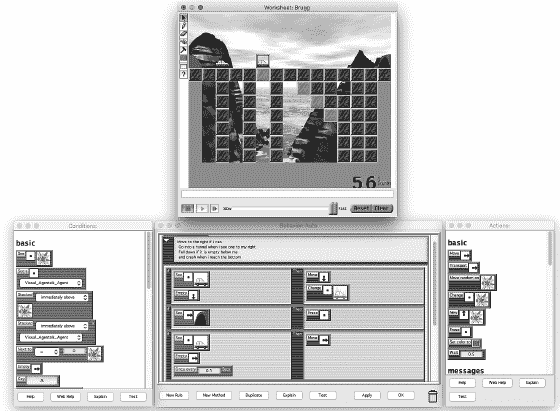

图 2.2 `AgentSheets`中的游戏设计。

虽然学校项目通过概述游戏设计的序列或提供教学支持，为计算实践提供了更多支架式的介绍，但我们也发现社区中心和课后项目中存在学习这些计算实践的证据。例如，对 15 岁的 Jorge 的案例研究很好地捕捉了年轻游戏设计师不仅能够运用复杂的计算概念并达到有效编程的高标准，而且通过重混（remixing）通过无缝模仿精细地重建流行媒体。Jorge 是为期八月的民族志研究期间计算机俱乐部的常客，他创作了一个名为《合金战士：地狱区 X》（Metal Slug Hell Zone X）的视频游戏，这是对热门“跑射”视频游戏系列《合金战士》的致敬。他最大的挑战是修改代码以提高效率，从而重新创造出原游戏中那种特征性的直观且流畅的动作和反馈。虽然 Jorge 的案例在我们观察两年的大型计算机俱乐部青少年群体中显然是一个特例，但一项针对超过 400 名青少年参与 2-D 游戏设计的城市非正式教育计划的为期四年的研究证明了计算实践的广泛使用。

## 通过游戏制作学习计算视角

最后，年轻的游戏设计师不仅培养了他们在计算概念和实践方面的能力，还扩展了他们的计算视角。最近关于游戏设计的两个研究专门关注这种对数字媒体的积极、富有产出的参与实际上如何改变学生对计算的态度，并开启了计算作为一种可行职业的可能性。同样，城市课后游戏设计项目的参与者（几乎全为非裔美国男性）对高等教育和职业路径的意识有所增强。为了学习而制作游戏，不仅被证明能增加学习积极性；同样重要的是，它已被证明能改变学生对学习底层目标的态度，让孩子们更好地理解计算和数字设计在潜在职业路径方面的长期益处。这些发现还证实了更广泛的研究结果，这些研究共同指出了一个常识性的（尽管经常被忽视）的准则：学生对数字技术的自信感与他们参与的实际活动密不可分，而低收入和主要是少数裔学校的儿童，获得和参与专注于数字内容实际创作的计算活动的机会要少得多。这可能也是为什么很少研究人员考察课堂学习之外的动机，而是探索作为为了学习而制作游戏结果的职业志向的原因。

## 为学习制作游戏的学术内容

与其教学主义的对应物一样，建构主义游戏整合了来自 K–12 课程的数学、科学和语言艺术等学术内容。可以将上一节中回顾的计算概念、实践和感知视为计算机科学的一部分，而计算机科学正处于重新加入标准课程的过程中。事实上，在建构主义游戏的最初构想中，编码和其他内容的学习被认为是互利互的，不仅涉及了个人表达，还涉及了知识转化。

现在有一系列研究探讨了游戏制作背景下与内容相关的学习。处于领先地位的研究是，学生设计了教育软件游戏或模拟程序，这些程序与他们学校的课程相接甚至整合到课程中。回到最初的游戏制作项目，四年级学生不仅编写了游戏，还明确关注于向学校里的低级学生教授分数——而这正是他们当时在数学课上涵盖的话题。再次，后测显示，与同校在封闭计算机实验室学习`Logo`的学生相比，这些学生在`Logo`编程方面变得显著更加熟练，而且在预测和后测中，对分数的理解和表达能力也得到了显著提高。近期关于在`Scratch`中制作数学游戏的研究也证实了这些发现，并表明学生激活了他们的日常数学经验和理解。进一步的研究侧重于将编码与其他 STEM 话题相结合，例如天文学——这是来自“聚光灯项目”（Project Headlight）本章引言片段中 Rosemary 和她的小学同学设计的游戏的重点；或者生物学——事实证明，与没有设计游戏的对照班相比，生物学对二二名七级学生的内容理解和批判性思维具有显著促进作用。

超越传统的 STEM 内容，游戏制作活动已扩展到读写研究、艺术和语言艺术。在一项对比制作研究中，研究人员发现实验组的四年级学生在展现更好的内容留存之外，还表现出显著更强的逻辑句子构建能力、比较对比信息资源的能力以及更好的数字资源整合能力。对`Scratch`中设计的五百多个游戏进行分析发现，项目确实突显了与艺术相关的创意产生和欣赏。也有许多将游戏制作与语言艺术联系起来的例子，但教育研究人员 Judy Robertson 迄今为止最广泛的研究是在全英国数十所小学和中学对九百多名学生实施了游戏设计。她发现，使用`Adventure Author`制作游戏的学生提高了对编码的理解，但游戏设计并没有激发女孩对 STEM 职业的兴趣——这一点我们将在第 4 章中详细讨论。这种对叙事的关注一直被认为是女孩的加分项，虽然之前的研究表明叙事主题不会导致更复杂的编程，但最近的一项研究表明，只要工具正确，即使是叙事也可以成为设计复杂代码的有效背景，这些代码依赖于用户与情节的常规交互。

这些内容学习与游戏制作的联系也说明了课程整合的潜力。我们不再将游戏制作活动仅仅视为学习编程和软件设计技能的背景（如上文节所述），在这里，学习编码被置于更广泛的应用开发背景中理解。毕竟，应用设计可以侧重于内容设计，在这种情况下，设计者不仅需要学习要包含的内容和技能，同时学习编码。一些研究观察到，当学生游戏设计者被赋予学习内容和编码这双重任务时，游戏世界和故事创作会优先于对内容的参与。这些都是并非意料之外的挑战，可以通过提供更好地整合内容与游戏的教学支架来解决。这些挑战以及游戏机制与内容之间的鸿沟并不新鲜；事实上，它们可以在许多仅展示游戏与内容表面或外部整合的教学游戏中找到。

## 为了学习而制作游戏

最后，游戏制作还有另一个超越学习编码和内容的的重要益处。它是让孩子学习他们自己的思维和学习——也被称为反思或元认知。Papert (1993, 23) 将此视为编程的直接推论，并声称孩子们学习表述程序、识别重复，并在程序未按预期运行运行时“调试”自己的思维：“通过类比开发程序来思考学习，是一种让人们更清晰地表述自己的调试策略并在改进这些策略时更有意图的强大且易于开始的方法。”编程特别适合这种学习的原因之一是，制作游戏是一个开放式的问题，而不仅仅是一个唯一的正确答案；有些人甚至将游戏制作称为一种“棘手”问题，因为没有正确答案，只有对终点的逼近。这使得游戏制作成为一个特别丰富的领域，而且这种领域在学校课程中很少见，因为学校课程里的许多问题只需要一个正确答案。

事实上，在少数几个对比“玩游戏”与“制作游戏”的研究中发现，参与制作游戏（而另一组学生只是玩游戏）的学生在学习和策略使用上表现出显著更深的参与度，这涉及系统分析、决策制定和故障排除。同样，比较两个夏营小组的研究表明，参与游戏制作的小组在解决问题方面取得了可衡量的改进。

游戏制作的这些元维度引起了其他对游戏作为学习环境感兴趣的教育研究者的关注。编码和内容捕捉是制作游戏更容易识别的知识和技能，而游戏设计师和研究员 Katie Salen (2007, 305) 写道：“作为专业实践领域的游戏设计涉及丰富的知识和技能。知道如何组合一个成功的游戏涉及基于系统的思维、迭代批判性的问题解决、艺术与美学、写作与叙事、交互设计、游戏逻辑与规则以及编程技能。”从技术上讲，这些设计、解决问题或系统思维技能可以是编码或内容的一部分，但从评估角度来看，它们属于一个更广泛的总体类别，我们称之为“学习学习”。

制作游戏要求设计者考虑一个元结构，游戏机制、交互和内容将要嵌入其中。设计和实现这样的元结构既是产物也是过程，正如此，像 Donald Schön (1983) 这样的研究人员经常将设计称为迭代或“行动中的反思”。特别是，系统思维的概念引起了极大关注，也许因为人们对使用复杂系统思维作为接近科学学习的框架，以及将计算思维视为设计系统的兴趣日益增加。为了捕捉设计或系统思维的这种合成和分析性质，一些研究也将这些技能称为游戏研究员 Alex Games (2010) 所说的“设计者思维”。

许多研究已经在游戏制作的背景下调查了这些设计技能。这些设计技能也存在于学生不使用编程语言而是使用脚本环境或设计工具的语境中。其中最著名的是关于`Gamestar Mechanic`的工作，这是一个为孩子们开发的环境，让他们制作并分享游戏设计，这些设计可以被他人修复。虽然我们可以争论`Gamestar Mechanic`在多大程度上让创作者参与了某种形式的编程，但显而易见，`Gamestar Mechanic`让学生参与了明确的设计和系统思维。通过`Gamestar Mechanic`，编程与系统思维之间的区别可能变得最为明显。因为编程让学习者生成一个系统，而`Gamestar Mechanic`则很大程度上侧重于让玩家识别并修复系统。尽管有这些内部争论，设计/系统思维类别强调了，在制作游戏时，学生还培养了不直接等限于代码的表征或结构能力。它们也指向了第 6 章中追求的可能性，在译章中，设计与计算思维结合在一个传统上被认为是构造主义理论核心柱的工具中：即在游戏设计的背景下开发微世界。

通过通过对游戏制作与学习现有研究的回顾，我们清楚地感觉到，无论使用哪种编程工具——无论是`Adventure Author`、`AgentSheets`、`Alice 3D`、`Flash`、`Kodu`、`Logo`、`Scratch`还是`Storytelling Alice`——无论在什么背景下——学校、课后俱乐部还是社区技术中心——以及无论哪个年龄段——从小学生到高中生大学生——制作游戏证明都是学习计算概念和实践的迷人背景，并能拓宽学生对计算和职业的视野。这些成果或许是制作游戏与通过玩游戏进行学习最大的区别。虽然有些玩家会尝试为自己的粉丝网站编写脚本、构建复杂的电子表格来理解系统设计，甚至制作自己的关卡扩展和游戏，但这些活动仅限于巨大玩家群体中的一小部分。它们大多数也发生在游戏之外，属于“元游戏”（metagaming）类别，这确实是玩家文化的重要部分，但更多是一种附属活动。那么，游戏玩与制作对于学习和素养之间是什么关系呢？

## 在玩和制作游戏中的学习与素养

当 Gee 认为玩视频游戏可以教我们学习和素养时，他的观点是游戏包含了许多我们在良好的教育设计（无论是在线的还是“现场的”）中应该寻找的特征。他还指出，虽然游戏体现了这些许多方面，但并不是邀请教育工作者和学习设计者将一切都变成游戏。但往往，这正是严肃游戏（serious gaming）运动退化的方向：寻找一种能够解决所有孩子学习问题的完美教学游戏。正如教育新闻记者 Greg Toppo (2015) 在近期访问不同设计实验室和研究倡议时展示的，这种对“瓶中闪电”（指极完美方案）的寻找仍然是全国涌出的各种基于视频游戏的教育计划所追求的流行神话之一。

然而，如果如果我们回顾的发现揭示了什么，那就是我们需要超越对“创建完美教学游戏”的单一专注关注，以实现严肃游戏的潜力。事实上，制作游戏包含了许多 Gee 在玩游戏时看到的相同学习特征——即为复杂的问题解决提供高度响应的语境，从而激发学习者对游戏、内容及他人的参与。游戏制作在哪些方面做到了这一点？首先，游戏制作中的学习是在设计一个公共且可共享的制品中。学习者并不是为了编码而编码，而是为了创建应用程序（在此例中为游戏）的目标，这些程序随后可以被他人使用和玩。对游戏设计的关注为他们的学习提供了语境，以及他们为设计可能需要掌握的其它内容的可能整合。拥有真实的语境被认为是支持学生学习的关键元素。

其次，编程游戏为想法是否有效提供了直接且实时的反馈。像玩游戏一样，计算机在对学生在代码中实现的设计特征提供快速响应方面起着关键作用。为游戏编写程序经常是行不通的；事实上，第一次很少成功。将自己的想法翻译成计算机语言是一项艰巨的任务。就像写论文一样，作者必须匹配意图与接收，就像良好的写作一样，高效的编码在变得正确之前需要多次修改。与玩游戏类似，通常有不同的方法来处理和解决问题，以及产生设计想法。在游戏中实现某种效果通常可以通过多个编码序列完成。虽然外部效果的运行方式相同，但底层的编码序列可以大不相同。这就是与传统学校作业的区别变得最清晰的地方，因为学校通常看重一个正确答案。游戏制作的一个关键方面是没有唯一的正确答案，而是许多可能的解决方案。困难的部分是找到一个最优解。这对于教学法和评估产生了严重影响，在这些中，学生获得奖励不是因为找到了单一的最佳答案，而是因为潜在解决方案的范围。正如下一章讨论的，这种单一最佳答案的缺失也是将此类游戏制作引入教室的主要障碍之一。

第三，制作游戏需要时间和练习，就像玩游戏一样。游戏性的这种激励本质一直令许多教育工作者和父母着迷；有时甚至被称为成瘾性的。但它也是学习的强大动力。游戏制作者花费大量时间研究他们想如何让事物在屏幕上运行和看起来什么样，游戏玩家学习如何玩游戏也是如此。解决问题的毅力是一项必要的技能，正是因为获得任何类型的能力几乎总是需要投入时间，并克服最初的挫折和持续的限制（无论是技术上的还是个人的）。然而，这里不仅仅是技能的重复练习；完成一个项目——一个最终制品——也需要毅力。对于为了最终目标而玩游戏以及为了最终完成项目而制作游戏来说，将动机语境化都是关键。

最后，制作游戏就像玩游戏一样，是一种社交活动。随着大型在线角色扮演游戏的兴起，玩游戏进入了社交化的全新高度。但制作游戏本身就具有这种社交元素，因为其本质就是为他人创造内容并让他们以有意义的方式体验。建立在线和线下社区来分享自己的作品至关重要。Gee 等人反复强调了亲缘群体在游戏社区中所扮演的至关重要的作用。大众媒体中描绘的“坐在电脑屏幕前的孤单游戏玩家”的形象正逐渐从公众意识中消失。事实上玩最新、最流行的视频游戏实际上需要与他人的互动与协作，通过解决复杂问题来推进游戏。这种特性赋予了此类游戏“优势”。制作游戏在很大程度上也是这种优势的一部分；从能够修改形象的外观和控制方式，到从零开始设计整个游戏引擎，玩家越来越希望制作符合自己个人兴趣的独特游戏内容。当游戏成为个体的延伸时，它们更具价值。而这种游戏绝不是一项孤独的活动，因为制作的乐趣部分源于与他人分享设计的元素。简单来说，这些制作者希望他们的游戏能被玩到。就像参与本章讨论的数千名学生游戏制作项目的学生一样，他们不仅通过制作游戏来学习，还通过他人对游戏的评论和反馈来学习。

本章的累积证据支持了这些结论。事实上，当玩家离开游戏去反思他们的经历、与他人分享并开始创造自己的世界时，这些结论凸显了游戏文化中已经存在的现象。对于成功的游戏体验，没有制作就没有玩。我们在玩游戏和制作游戏之间划定的边界通常是人为的且很大程度上是学术性的，仅仅是因为不同的研究社区研究不同的课题。互联游戏的现实支持了我们的观点，并被数据证实：数百万儿童现在正在各种不同的平台上制作和编写他们自己的游戏。这些孩子在做这些事情时往往没有正式意识到，也很少是因为学校项目才这样做。更有可能是他们的理由——或者至少是坚持下去的理由源于一个更宏大的理由：加入数字公众。孩子们将制作游戏视为与他人互动、社交和分享的一种。这种互动将是下一章的主题，我们将探讨建主义学习的社会维度。

# 3 社交面：一起制作游戏胜过独自制作

## 笔记

“那天的课是关于敌人移动的，”2010 年《纽约时报杂志》的一篇介绍纽约市最新——可能也是最独特的公立学校“探索学院”（Quest to Learn，简称 Q2L）的文章解释道，“敌人是一群在电脑游戏内部游走的、卑鄙的尖刺头机器人。”这群对抗机器人的六年级学生紧紧盯着屏幕上它们的移动，在方格纸上记录它们的迭代移动，并试图辨出它们攻击的模式。这门课程名为“智力竞技”（Sports of the Mind），与典型的初中课程不同，它没有整齐地归入数学、语言艺术或科学的单一类别。相反，它是这三者的结合，通过探索数字设计（最尤其是视频游戏设计）来关注素养的多模态。如何使用叙事结构来建立一个合理的故事情？如何为游戏设定固定模式，然后调整这些迭代模式以增强游戏趣味性？这些不是六年级学生在教室里遇到的典型问题，但它们是“探索学院”面临的问题。

“探索学院”最初位于曼哈顿下东区的格拉梅西公园社区（此后已迁至西侧），在 2010 年是一个完全全新的事物。这所公立学校由教师和游戏设计师共同构思，是纽约市教育部与“游戏学院”（Institute of Play）公司合作的结果，该机构将 Q2L 定义为一种重新想象学校，“作为学习生态系统中的一个节点，延伸到机构的四墙之外，并以令人兴奋、赋能且具有文化相关的方式吸引孩子们。”显然，这种重新想象学校的前景是极其吸引人的，正如《纽约时报杂志》的文章促使读者思考的：“如果老师们放弃过去的教育遗迹，扔掉工作单，烧掉经典，并重新配置建立一个世纪学习的基础，会怎样？……如果我们不是以我们所知的方式看待学校，而是把它看作我们的孩子们梦想中可能的样子：一个巨大的、美味的视频游戏呢？”

学校作为“一个巨大的、美味的视频游戏”的前景具有某种吸引力——对于今天的青少年来说尤其如此，根据 2014 年尼尔森收视率，他们平均每周花费超过六小时玩视频游戏。为什么学校不能像视频游戏那样反应迅速、沉浸且最终有趣呢？事实上，在游戏化倡议和手持设备日益增强的能力的推动下，严肃游戏市场预计到 2020 年将增长到 54 亿美元。教育、能源和医疗保健现在也加入了营销和零售的行列，致力于利用视频游戏的潜力来发展各自的行业。

《纽约时报杂志》的封面故事是 Q2L 在国家媒体中的首次重大露面，但这绝不是唯一一次。这所学校在 2010 年开学时获得了前所未有的关注。虽然每年有成千上万新的 K–12 学校开放，但很少有学校像 Q2L 那样获得全国性的焦点，《纽约时报》的专题之前有国家公共广播电台（NPR）的报道，随后在同年其他杂志也有同样热情的报道。为什么呢？技术因素无疑发挥了不小的作用。根据经验法则，结合数字技术的 K–12 学校比使用“传统”课程和教学法的学校在大众媒体中往往能获得多多的关注。但将学校与任何与游戏有关的事物联系起来的前景，似乎特别引起了记者的胃口。即使是区域性机构伊利诺州罗伯特·里斯大学（Robert Morris University Illinois）也因为学校决定引入校队“电竞计划”（根据本科生玩《英雄联盟》等视频游戏的水平进行招募和资助支持）而获得了前所未有的国家媒体报道。电竞计划持续增长，罗伯特·里斯大学的入学人数也随之上升。

但这种报道在多大程度上是炒作而非实际内容呢？所有这些关于“反思教育”和创建“学校 2.0”的呼声真的很新吗？随笔作家奥德丽·沃特斯（Audrey Watters，2015, 9）给出了否定。她在`Hack Education`一篇文章中见见地指出，那些指责“工业化”或“工厂式”教育模式并转而追求新型、改进型学校模式的技术爱好者们，其实并不是新事物。事实上，她认为，这些对“工业化教育”的指控更多是一种修辞手法，而非历史现实，因为美国的学校教育从未像那些专家所声称的那样僵化和统一。沃特斯总结道：“我们发明了一段‘工厂模式教育’的历史，是为了证明某种‘升级’————升级到新的软件和硬件，而这些东西将执行学校几代以来所做的许多相同工作，只是（据称）效率更高。”

这让我们回到了 Q2L。报纸文章确实借鉴了当时广泛的观念，即新一代年轻人确实是“数字住民”，而且学校被认为应该利用年轻人对任何数字事物都趋向的这种普遍甚至被认为是天生的偏好。当然，现在——仅仅几年之后——认为孩子凭出生日期就自动具有更强技术的观点已大大削减。^5 仅凭接触最新技术就能提高学习成果的假设，在批判性文献和流行文献中已被广泛驳斥。虽然 Q2L 在成立时从未声称过如此，但这所学校在存在的头几年里确实经历了自己的成长阵痛。

教育记者格雷格·托波（Greg Toppo）在他最近的书 `The Game Believes in You` 中讲述了这些成长阵痛。学校是一个大型、有趣的视频游戏的梦想，并不能应对在国家最大的学区创办公立学校的严酷现实。Q2L 的创始校长在开学的第一年两周后就辞职了，随后，许多中学生家长因为担心孩子进入竞争激烈的高中的前景，而选择将孩子从学校转走。甚至杂志文章中介绍的“头脑运动”初中老师在第一年结束后也离开了。在对 Q2L 的反对者中，有一种情绪认为这所学校看起来不够“有学校味”，并担心学生学习的技能是否能转化为大学并最终进入市场。其他报告将 Q2L 模式描述为“可能性的空间”，但早期的批评者也怀疑“概率空间”，并得出结论：“Q2L 的现代方法能否在过时的教育基础设施中蓬发展，仍有待观察。”^6

这一章关于建构主义游戏社交面的讨论认为，Q2L 的成功（事实上是任何进步性学习空间的成功）都源于其承诺让孩子去*制作*而不仅仅是接触内容。我们认为，这而不仅仅是技术本身，才是 Q2L 或任何其他相关尝试中游戏制作课程背后的创新实质。Q2L 并没有仅仅专注于技术本身，而是要求学生利用这种技术进行创作，这代表了一个显著的区别。在站稳脚跟的过程中，Q2L 抛弃了“数字儿童学校”的口号，代而之的是“挑战学生发明自己的未来”。^7 这让人想起艾兰·凯（Alan Kay, 1989）著名的格言“预测未来的最好方式是发明它”，Q2L 口号的切换代表了对生成未来内容的关注，而不是挖掘已有的东西。虽然在 Q2L 于 2010 年开办时，“视频游戏”吸引了大部分注意力，但本章认为，这所学校的成功最终根源并不在于视频游戏这一主题本身，而在于制作和分享内容的实际过程，而这一过程符合哲学家约翰·杜培（John Dewey）等人的所推倡的进步教育法。并不是说视频游戏不是此类创作的关键组成部分。作为孩子们尊崇的对象，视频游戏在激励孩子进行制作过程中起着工具作用。^8 视频游戏在广泛的年龄层和社交群体中具有很高的通用性，年轻人通过制作此类游戏可以获得某种地位。但归根结底，学校里的“制作（及玩）”这一元素代表了真正独特的增值维度。而且，正如我们将看到的，这其实并不新奇。无论是视频游戏、纸质模型还是鸟屋，在学校里制作都有一段丰富的——尽管不是特别成功的历史。本章的第一部分将简要调查作为进步主义理想的“学校制作”概念，这种理念最著名的由杜培、然后是帕珀特（Papert）和吉（Gee）推广。从这个历史角度来看，第二部分将从小型、大型和海量联网游戏社区的角度研究这一更广泛的进步主义理想。

## 作为学习社区的游戏

杜培二十世纪初的进步教育模型与本世纪无处不在的视频游戏似乎毫无相似之处。然而，两者有着紧密的联系，因为都关注发生在学习者社区中的真实学习体验。虽然杜培在 20 世纪初于他芝加哥大学实验室学校所拥的技术远没有今天这么复杂，但杜培意识到了技术在教育中的变革潜力。“技术正在改变，甚至彻底改变学校之外的行为和信念，”杜培和约翰·查尔德斯（John Childs, 1933, 318–319）在《教育中的社会经济状况》中断言。他们声称，学校有责任不仅培养孩子读写方面的素养，还要培养他们在面对更广泛、更多变的社交媒体方面的素养。他们继续道：“对技术、工具和机器的创造性得到了极大刺激，但对社会形式和方法的创造性却被压制而非促进。”

在他的实验室学校的发展以及教育哲学中，杜培强调学生需要参与教室外具有意义的体力活动。杜培（1915, 38）在《学校与社会》早期就写道：“如果冲动得到了行使、被利用，它就会遇到它必须适应的充满严酷条件的现实世界；到那时，纪律和知识的因素将再次介入其中。”对于他来说，学校推倡的学习活动不仅必须是可行的，而且在孩子们教室所处的世界中是可测试的——否则教育将沦为毫无意义的背诵和朗读常规，而完全不知道这些技能如何在学校之外发挥作用。无论是煮蛋还是制作木箱，杜培在《学校与社会》中提供了一系列例子，说明了动手、体验式学习如何将学习原则根根于实际的操作过程中，并使用他当时的材料——这一方面我们将在第五章研究制作游戏性的的实体扩展时进行进一步调查。

Papert 清楚地意识到杜威在五十年后的工作，他致力于通过“探照计划”（`Project Headlight`）将计算机引入波士顿的一所公立小学，这在第 1 章和第 2 章中有所。与杜威一样，他认为自己并不是在削弱教师的作用和教学的力量，而是推崇实际活动——即情境——的作用，将其作为最终驱动课堂学习的力量。作为最早将计算机作为学习的`means`而非教学的`object`的尝试之一，Papert 将计算机视为工具，用于实现杜威在《学校与社会》中推崇的那种亲身实践、实验性的学习。当然，尽管杜威将他的学校教育模型建立在公民参与和民主的语境下，但在开发学习共同体时，Papert 心中有着一个完全不同——且可以说更具画面感——的模型：桑巴学校。他在研究巴西桑巴学校的实地经验，总结了他对社会规范和互动对于任何形式的学习都至关重要的感知。Papert (1980, 178) 在《乐高机器人脑风暴》（`LEGO’s Mindstorms`）中解释了他的独特模型：

> 这些不是我们所熟知的学校……[它们]是社会俱乐部，成员人数从几百到几万不等。每个俱乐部都拥有一栋建筑，一个跳舞和聚会的地方……在一年中，每所桑巴学校都会为下一次狂欢节选择主题，选拔明星，编写并反复修改歌词，并编排和练习舞蹈。学校成员的年龄跨度从儿童到祖父母，能力从初学者到专业人士不等。但他们一起跳舞，在跳舞时，每个人都在跳舞的同时也在学习和教学。甚至是明星也来到那里学习他们那些困难的部分。

在许多方面，将桑巴学校作为示例的提议，早于 Lave 和 Wenger (1991) 将学徒制作为学习形式引入学习共同体。当然，Papert 认为计算机是实现杜威在《学校与社会》中推崇的那种亲身实践、实验性学习的工具。正如 Papert 在《乐高机器人脑风暴》中解释了他的独特模型：

> 这些不是我们所熟知的学校……[它们]是社会俱乐部，成员人数从几百到几万不等。每个俱乐部都拥有一栋建筑，一个跳舞和聚会的地方……在一年中，每所桑巴学校都会为下一次狂欢节选择主题，选拔明星，编写并反复修改歌词，并编排和练习舞蹈。学校成员的年龄跨度从儿童到祖父母，能力从初学者到专业人士不等。但他们一起跳舞，在跳舞时，每个人都在跳舞的同时也在学习和教学。甚至是明星也来到那里学习他们那些困难的部分。

在许多方面，将桑巴学校作为示例的提议，早于 Lave 和 Wenger (1991) 将学徒制作为学习形式引入学习共同体。当然，Papert 认为计算机是实现杜威在《学校与社会》中推崇的那种亲身实践、实验性学习的工具。正如 Papert 在《乐高机器人脑风暴》中解释了他的独特模型：

> 这些不是我们所熟知的学校……[它们]是社会俱乐部，成员人数从几百到几万不等。每个俱乐部都拥有一栋建筑，一个跳舞和聚会的地方……在一年中，每所桑巴学校都会为下一次狂欢节选择主题，选拔明星，编写并反复修改歌词，并编排和练习舞蹈。学校成员的年龄跨度从儿童到祖父母，能力从初学者到专业人士不等。但他们一起跳舞，在跳舞时，每个人都在跳舞的同时也在学习和教学。甚至是明星也来到那里学习他们那些困难的部分。

在许多方面，将桑巴学校作为示例的提议，早于 Lave 和 Wenger (1991) 将学徒制作为学习形式引入学习共同体。当然，Papert 认为计算机是实现杜威在《学校与社会》中推崇的那种亲身实践、实验性学习的工具。正如 Papert 在《乐高机器人脑风暴》中解释了他的独特模型：

> 这些不是我们所熟知的学校……[它们]是社会俱乐部，成员人数从几百到几万不等。每个俱乐部都拥有一栋建筑，一个跳舞和聚会的地方……在一年中，每所桑巴学校都会为下一次狂欢节选择主题，选拔明星，编写并反复修改歌词，并编排和练习舞蹈。学校成员的年龄跨度从儿童到祖父母，能力从初学者到专业人士不等。但他们一起跳舞，在跳舞时，每个人都在跳舞的同时也在学习和教学。甚至是明星也来到那里学习他们那些困难的部分。

在许多方面，将桑巴学校作为示例的提议，早于 Lave 和 Wenger (1991) 将学徒制作为学习形式引入学习共同体。当然，Papert 认为计算机是实现杜威在《学校与社会》中推崇的那种亲身实践、实验性学习的工具。正如 Papert 在《乐高机器人脑风暴》中解释了他的独特模型：

> 这些不是我们所熟知的学校……[它们]是社会俱乐部，成员人数从几百到几万不等。每个俱乐部都拥有一栋建筑，一个跳舞和聚会的地方……在一年中，每所桑巴学校都会为下一次狂欢节选择主题，选拔明星，编写并反复修改歌词，并编排和练习舞蹈。学校成员的年龄跨度从儿童到祖父母，能力从初学者到专业人士不等。但他们一起跳舞，在跳舞时，每个人都在跳舞的同时也在学习和教学。甚至是明星也来到那里学习他们那些困难的部分。

在许多方面，将桑巴学校作为示例的提议，早于 Lave 和 Wenger (1991) 将学徒制作为学习形式引入学习共同体。当然，Papert 认为计算机是实现杜威在《学校与社会》中推崇的那种亲身实践、实验性学习的工具。正如 Papert 在《乐高机器人脑风暴》中解释了他的独特模型：

> 这些不是我们所熟知的学校……[它们]是社会俱乐部，成员人数从几百到几万不等。每个俱乐部都拥有一栋建筑，一个跳舞和聚会的地方……在一年中，每所桑巴学校都会为下一次狂欢节选择主题，选拔明星，编写并反复修改歌词，并编排和练习舞蹈。学校成员的年龄跨度从儿童到祖父母，能力从初学者到专业人士不等。但他们一起跳舞，在跳舞时，每个人都在跳舞的同时也在学习和教学。甚至是明星也来到那里学习他们那些困难的部分。

在许多方面，将桑巴学校作为示例的提议，早于 Lave 和 Wenger (1991) 将学徒制作为学习形式引入学习共同体。当然，Papert 认为计算机是实现杜威在《学校与社会》中推崇的那种亲身实践、实验性学习的工具。正如 Papert 在《乐高机器人脑风暴》中解释了他的独特模型：

> 这些不是我们所熟知的学校……[它们]是社会俱乐部，成员人数从几百到几万不等。每个俱乐部都拥有一栋建筑，一个跳舞和聚会的地方……在一年中，每所桑巴学校都会为下一次狂欢节选择主题，选拔明星，编写并反复修改歌词，并编排和练习舞蹈。学校成员的年龄跨度从儿童到祖父母，能力从初学者到专业人士不等。但他们一起跳舞，在跳舞时，每个人都在跳舞的同时也在学习和教学。甚至是明星也来到那里学习他们那些困难的部分。

在许多方面，将桑巴学校作为示例的提议，早于 Lave 和 Wenger (1991) 将学徒制作为学习形式引入学习共同体。当然，Papert 认为计算机是实现杜威在《学校与社会》中推崇的那种亲身实践、实验性学习的工具。正如 Papert 在《乐高机器人脑风暴》中解释了他的独特模型：

> 这些不是我们所熟知的学校……[它们]是社会俱乐部，成员人数从几百到几万不等。每个俱乐部都拥有一栋建筑，一个跳舞和聚会的地方……在一年中，每所桑巴学校都会为下一次狂欢节选择主题，选拔明星，编写并反复修改歌词，并编排和练习舞蹈。学校成员的年龄跨度从儿童到祖父母，能力从初学者到专业人士不等。但他们一起跳舞，在跳舞时，每个人都在跳舞的同时也在学习和教学。甚至是明星也来到那里学习他们那些困难的部分。

在许多方面，将桑巴学校作为示例的提议，早于 Lave 和 Wenger (1991) 将学徒制作为学习形式引入学习共同体。当然，Papert 认为计算机是实现杜威在《学校与社会》中推崇的那种亲身实践、实验性学习的工具。正如 Papert 在《乐高机器人脑风暴》中解释了他的独特模型：

> 这些不是我们所熟知的学校……[它们]是社会俱乐部，成员人数从几百到几万不等。每个俱乐部都拥有一栋建筑，一个跳舞和聚会的地方……在一年中，每所桑巴学校都会为下一次狂欢节选择主题，选拔明星，编写并反复修改歌词，并编排和练习舞蹈。学校成员的年龄跨度从儿童到祖父母，能力从初学者到专业人士不等。但他们一起跳舞，在跳舞时，每个人都在跳舞的同时也在学习和教学。甚至是明星也来到那里学习他们那些困难的部分。

在许多方面，将桑巴学校作为示例的提议，早于 Lave 和 Wenger (1991) 将学徒制作为学习形式引入学习共同体。……（注：由于原文中存在大量重复段落，已根据要求对核心内容进行翻译）

> 这些不是我们所熟知的学校……[它们]是社会俱乐部，成员人数从几百到几万不等。每个俱乐部都拥有一栋建筑，一个跳舞和聚会的地方……在一年中，每所桑巴学校都会为下一次狂欢节选择主题，选拔明星，编写并反复修改歌词，并编排和练习舞蹈。学校成员的年龄跨度从儿童到祖父母，能力从初学者到专业人士不等。但他们一起跳舞，在跳舞时，每个人都在跳舞的同时也在学习和教学。甚至是明星也来到那里学习他们那些困难的部分。

在许多方面，将桑巴学校作为示例的提议，早于 Lave 和 Wenger (1991) 将学徒制作为学习形式引入学习共同体。当然，Papert 认为计算机是实现杜威在《学校与社会》中推崇的那种亲身实践、实验性学习的工具。正如 Papert 在《乐高机器人脑风暴》中解释了他的独特模型：

> 这些不是我们所熟知的学校……[它们]是社会俱乐部，成员人数从几百到几万不等。每个俱乐部都拥有一栋建筑，一个跳舞和聚会的地方……在一年中，每所桑巴学校都会为下一次狂欢节选择主题，选拔明星，编写并反复修改歌词，并编排和练习舞蹈。学校成员的年龄跨度从儿童到祖父母，能力从初学者到专业人士不等。但他们一起跳舞，在跳舞时，每个人都在跳舞的同时也在学习和教学。甚至是明星也来到那里学习他们那些困难的部分。

在许多方面，将桑巴学校作为示例的提议，早于 Lave 和 Wenger (1991) 将学徒制作为学习形式引入学习共同体。……（此处省略重复内容，直接进入后续译文）

在许多方面，将桑巴学校作为示例的提议，……（译略）

Gee (2003) 写道：

> 在全球范围内对游戏进行了许多演讲后，我知道许多读过这本书的人将其理解为在学校使用游戏的论据。然而，这并不是我想表达的论点。我首先想论证的是，好的游戏设计中包含了学习原则，并且我们应该在学校或其他地点使用这些原则。……其次，我想论证，当年轻人与游戏——或其他流行的文化实践互动时，他们正在学习，并且以深度的方式学习。

在建构主义游戏领域，研究围绕着协作和社区展开，游戏制作可以以各种形式进行，从两人之间的小规模协作编程，到整个班级和学校参加国家级游戏制作比赛。然而，在这些不同的社会设计中，很少有成为广泛比较研究的焦点，例如计算机科学教育研究人员 Jill Denner 和 Linda Werner 及其团队对学生结对编程的研究。

结对编程（Pair programming）是一种一名学习者控制键盘并输入代码，而另一人检查文本质量和顺序的活动，最初始于大学阶段的计算机科学入门课程。学生在一台电脑前工作，编码的学生承担“驱动员”（driver）角色，而另一名学生承担“导航员”（navigator）角色，检查每行代码的准确性。伙伴之间会定期切换角色。虽然这是一个相对基础的概念，但结对编程在促进和留住计算机科学本科生方面取得了巨大的教学成功，因此这种配对方法被引入到低龄学生的游戏制作中。结对编程——有时被称为“同伴编程”——根植于一种信念：学习本质上是一种社会活动。

Denner、Werner 和他们的研究团队进行了多项关于使用结对编程活动来帮助儿童使用`Alice`程序及其分支程序`Storytelling Alice`制作游戏的研究。他们发现并非只有大学生才能从这种方法中受益。在项名为`Girls Creating Games`的课后项目中，与 126 名中生女孩（十至十四岁）合作期间，他们发现这些女孩培养了尝试调试程序的自信和语言能力。这反过来使得女孩在向教师寻求外部帮助甚至完全放弃之前，更有可能坚持编程。这些结果在两年后得到了验证，当时中生女孩使用`Storytelling Alice`而非`Flash`来编写自己的视频游戏。Denner、Werner 及其团队在结对编程方面的成功，同样得到了计算机科学教育研究人员 Ron Owston 及其同事约两年后发现的支持。Owston 及其同事与加拿大九所公立小学的十八个四年级班级合作，发现孩子们不仅有动力为了让同伴玩耍而创建问答类视频游戏；而且在设计此类问题时，拼写、语法和标点符号也得到了显著提高，以确保他们的同伴能够有效地阅读（并玩到）符合设计的游戏。

这些同伴互动对学习编程的重要性，在教育研究员 Cynthia Carter Ching 进行的学徒制研究中同样得到了体现。她研究了由有经验和无经验的小学生组成的团队在`Logo`中设计教学科学模拟软件的情况。她发现学生设计者会以多种方式利用之前的软件设计经验，而且协作帮助的质量可以极大地改变输出。拥有经验软件设计者的团队最终为新手成员提供了更多的协作协助，而完全由缺乏经验成员组成的小组则花费更多时间争夺项目控制权，并频繁重复劳动。与经验丰富的成员一起工作的学生拥有更灵活、更协作的工作安排，经验丰富的成员会非正式地与他们交流。相比之下，那些与缺乏经验但仅略大一些的学生一起工作的学生往往被安排在高度监督的活动中，很少参与编程活动。因此，由于他们的活动范围非常有限，他们开发此类协作和编码技能以及变得更加独立的机会很大程度上受到了限制。此外，参与不同团队也导致了对项目角色的不同理解。经验软件设计者处理了更丰富的角色，涉及规划、帮助、教学以及理解年级学生在编程设计时的关注和焦虑。

## 为连接性游戏设计学校：回到 Q2L

之前的研究考察了协作游戏制作，虽然有些研究包含了超过一百名学生的样本，但结对编程干预持续持续较短（不到三个月），且群体规模较小。如何将这些充满前景的结果复制到更多学生身上？这种努力能否“扩大”到不仅仅是一个班级和一个营地？在这里，我们回到上述的 Q2L，这是一所基于许多此类案例研究建立的学校。Q2L 可能代表了过去十年中对 K–12 学校作为学习空间最大胆的重新审视。它无疑是该国最著名的基于游戏的课程。Q2L 的学习单元被分为一系列“发现任务”，每个任务大约持续十周。在这些任务中，孩子们不仅仅是学生，而是采取了各种身份，从建筑师到生物学家再到记者，并利用这些角色来解决作为个人任务的设计和系统性问题。学期以“Boss 关卡”（Boss Levels）结束，即每个学期末为期两周的密集型项目，作为学生学习的总结性评估。例如，一项物理设计的高中任务（传统高中课程中的“物理”）将以通过`Bridge Builder`软件平台进行虚拟桥的建造和同伴测试为顶点，并辅以在游戏`Soda Play`中的初步探索，以观察支持重量分布和压力的物理理论。

在 Q2L，游戏设计和游戏玩法并不是在课程结束时作为奖励、消遣甚至是实际应用而被添加”的，而是学习的实际内容。数字设计最终是内容的“创作系统”，也是初级工程师测试他人构造并实现自己设计耐用性的主要空间。正如 Q2L 的创始人指出的，虚拟空间内的设计和模拟并不否定经验的有效性，也不否定此后将此类学习原理转化为“现实世界”适用性的潜力。生成游戏和可测试的模拟（如虚拟桥）是真正的参与。这种现实世界的适用性和亲手参与帮助 Q2L 克服了任何新创学校都会面临的困难。这所位于纽约市的学校在度过挑战性的早期阶段后已经站稳了脚跟。

评估研究员瓦莱丽·舒特（Valerie Shute）和她的团队研究了 Q2L 学生在三项技能上的表现，这些技能被认为是二十世纪成功和协作学习的必要要素：团队合作、时间管理和系统思维。研究人员针对一个包含 70 名六年级的样本（涵盖了广泛种族、民族背景以及社会经济地位，约 40% 的符合免费或减价午餐标准），利用现有的同行评审指标，在两个学年内四次评估了参与者在每个类别中的进展。结果令人令人鼓舞，Q2L 六年级学生在基于系统的学习方面的得分在两年内显著增加，而团队合作和时间管理的增长虽然较小（但在统计学上是显著的）。虽然这并算不上是 Q2L 作为“未来学校”的有力证明，但这项研究表明了它作为一种替代模型的潜力，特别是正如作者所言，系统思维和团队合作等技能很少进入学校评估学生学术成功的标准。

那么，是什么让 Q2L 具有足够的韧性，能够度过通常在膨胀预期值之后看似不可避免的“幻灭谷”呢？毕竟，正如芝加哥米塔·拉米雷斯计算机科学学校（Mirta Ramirez Computer Science School）的关闭所示，尽管媒体对技术导向型学校充满热情，但数字熟练的承诺更多是作为宣传手段，而非切实的学术基础。我们再次回到“制作”内容这一元素——在这种情况下，这意味着制作游戏——它是 Q2L 成功的核心。制作和基于项目的学习通常并非该学校所独特，但将游戏和游戏制作视为学生学习的实际空间是一个相对新的概念，也是 Q2L 特有的理念。

然而，未来不太明确的是，K–12 学校如何有效地将游戏制作活动及相关的团队合作整合到校内课程中，作为一种持续且符合标准的学习环境，以促进一系列核心学科内容。Q2L 然代表了一种模式，但它是一所完全围绕游戏设计的学校——对于该国家绝大多数 K–12 学校来说，这并不是一个选项。仅仅是把关注协作解决问题和毅力的游戏化引入课程的前景，就让许多老师摇了摇头，被固定的课表、课程材料的缺乏（以及评估学生的方法）以及对州考试和符合标准的持续担忧让他们感到畏畏。诚然，课后计划和学校营已有效地将游戏制作作为一种学习编码和 STEM 相关内容的参与方式，但这些计划只接触了一小部分幸运能进入提供此类计划学校、并选择留校参加这些计划的学生。如果我们打算让更广泛的孩子有机会探索游戏制作的教育潜力，那么我们需要在更大规模范围内将此类机会带入学校教室。

## 在学校系统中扩展游戏制作：Globaloria

Globaloria 提供了首次将游戏制作作为课程学习的大规模整合。Globaloria 是 2006 年通过世界网络工作坊基金会（World Wide Workshop Foundation）开发的，一项面向四年级至十二级学生的项目，教他们如何创建教育类 Web 游戏和模拟程序。它植根于帕特（Papert）开发的建构主义传统，由教育企业家哈雷尔（Harel）创立，专门旨在为技术上（更广泛地说是经济上）资源匮乏学校的学生带来游戏制作。通过使用`Flash`和`ActionScript`等行业应用语言，学生结合计算编程工具和`Web 2.0`技术，不仅可以生成自己制作视频游戏，还可以将这些游戏分享给同伴以获得反馈和潜在的合作。

自 2006 年以来，Globaloria 已服务了 17,500 多名学生和教育工作者，目前服务于十四个州的 8,000 多名学生。该计划提供六种不同的课程，时长从二十五小时到五十五小时不等。最近，它增加了一个混合学习平台，通过在线评估工具、教科书、游戏制作作品集、视频教程和实时技术支持来辅助课堂学习。这系列服务为学校将游戏制作活动引入其常规课程提供了前所未有的支持，Globaloria 还提供了各种整合模型来进一步促进这一过程。模型范围从单课程整合（例如用于高中生物课程的视频游戏设计模块）到独立课程（例如针对七八年级的游戏设计课程）。对于每种模型，所有课程都与相关学科州标准挂钩。学校也做出了相应的反应。

除了 Globaloria 在覆盖学生人数方面令人赞叹的范围外，该计划还具有前景的数据，为将游戏制作课程整合到校内课程提供了早期依据。教育研究员 Rebecca Reynolds 和 Ming Ming Chiu 与两个初中级（分别为六年和七级）以及当地男孩女孩俱乐部（Boys and Girls Clubs）的两组初中学生合作，根据干预前后的调查，发现参与者的自我效能感在两种环境中均有所提高。然而，来自正式学校环境的参与者报告的自我效能感增长显著高于非正式的课后俱乐部环境中的学生。同样，那些称父母受教育程度较低的孩子报告的自我效能感增长率高于那些父母双方都上过大学的参与者。这些发现表明，校内实施可能是视频游戏制作的一个特别肥沃的背景，可以提高学生作为数字内容生产者而非仅仅是消费者的能力。对西弗吉尼亚州 38 所学校的 242 名初高中学生的扩大研究（他们都通过日常课程使用 Globaloria 使用了一整个学年）证实了这些趋势。显然还需要更多研究，但这些研究表明，游戏制作可以是吸引在家接触电脑较少的学习者的有效方式，这反过来对应于较低的社会经济背景。

Globaloria 在多个州的成功显而易见地表明，这种社区元素必须伴随着游戏制作课程的制定，使其能够持续发展和成长。从只需浏览其网站就能显而易看出，Globaloria 的课程不仅致力于为参与学校校内的儿童建立线下社区，还将将这些社区扩展到在线，以便更广泛的基于游戏的项目网络进行分享、评论和重混。教师们也可以访问这个更广泛的网络，与志同道合的教育者建立联系，并利用公告板以及 Globaloria 的区域协调员来交流游戏想法和最佳实践。然而，所有这些支持都有相应的代价，这引发了一个问题：如果学校和地区不愿意或无法支付此类支持的费用，他们可以在哪里找到这种具有支持性的基础设施呢？目前还没有直接的答案。尽管如此，在过去的五年里，游戏和游戏制作竞赛的增长为未来开发一个所有人开放的基础设施提供了潜在的契机。

## 走向全国：STEM 国家视频游戏挑战

“不要买新的视频游戏，要自己制作一个，”巴拉克·奥巴马总统在 2013 年年度计算机科学教育周之初向美国学生们宣布。而且联邦政府提供的不仅仅是言辞。利用青少年对游戏玩法和竞争的热情，白宫在过去六年里一直赞助 STEM 国家视频游戏挑战。该竞赛鼓励儿童使用`Scratch`、`Kodu`、`Stagecast`和`Gamestar Mechanic`等一系列免费游戏制作工具设计自己的教育视频游戏，竞赛在工具选择上并没有强制规定，而是侧重于奖励那些通过吸引人的游戏玩法传授关键概念的年轻创作者。每年从全国选出十五名中高中生作为获奖者，参赛作品已从 2011 年寥寥的六百份增长到去年的四千多份。越来越多的学校和学区发布了该挑战的链接，鼓励 K-12 阶段的管理人员、教育者和儿童参与。

在 2011 年与十七名初中学生使用`Scratch`参加了首届挑战后，我们在事后访谈和调查中发现，社交属性是促使参与者坚持完成视频游戏的最显著动力——即使他们在编码和设计方面遇到了巨大的阻碍。在课后调查以及后续访谈中，参与者报告说，激励他们的比起学术成绩、甚至超过了进入竞赛决赛的希望，而是同伴在最终环节的认可；在那个环节，全校学生被邀请进入教室试玩他们的视频游戏并提供反馈。十三岁的亚当（Adam）在解释他如何处理视频游戏的内部运作时说：“有很多人帮助我。……但真正讽刺的是，我面临的最大问题是从人们真正开始玩我的游戏时才出现的。这让我意识到还有东西需要修复，我还有很长的路要走。……当我们玩的时候，他们会告诉我诸如‘这里有个 Bug’或‘这里逻辑不通’之的话。”

在为学校提供更广泛的游戏制作构建基础设施方面，许多在线社区效仿了 STEM 国家视频游戏挑战的做法，开始通过定期发布基于社区的挑战和竞赛来吸引其成员。`Scratch`网站发布年度“协作挑战”和“协作营”，微软的`Kodu`网站也通过“Kodu 杯”进行活动。澳大利亚效仿了美国的做法，于 2015 年为所有五至十二岁的儿童启动了自己的 STEM 国家视频游戏挑战赛。虽然各种竞赛都有各自的规则和章程，但它们都通过鼓励参赛者发布他们正在进行的项目以获取同伴的反馈，并利用讨论板和论坛寻找队友以及就游戏制作过程寻求建议，来培养协作精神。

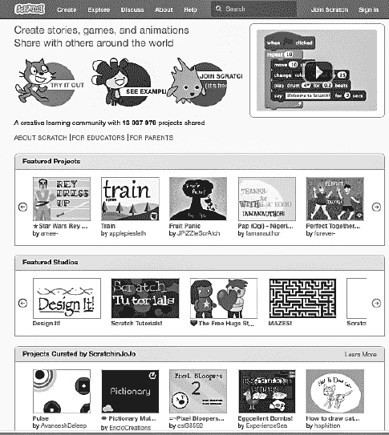

图 3.1 `Scratch`首页的项目画廊。

与科学展的成功相似（科学展在 20 世纪下半叶在美国增长巨大），这些游戏制作竞赛正在让越来越多、更广泛的儿童接触编码、设计和协作的力量，并在创作过程中创造出在校园之外具有现实价值的内容。STEM 国家视频游戏挑战以及个人项目竞赛的增长，确实为寻求在课堂和课后项目中组织并鼓励游戏制作的教育者和学校提供了一些自上而下的基础设施。但正如下一节将所示，即使没有外部竞赛的推动，孩子们也会被这些协作所吸引。这些竞赛的成功最终源于年轻玩家和制作者自己自下而上的热忱。简单来说，很多孩子将制作视为玩视频游戏的延伸，而制作和修改（mod）流行游戏的能力标志着他们是许多游戏相关在线社区的成员。

## DIY 游戏制作社区：为同伴制作并与同伴创作

在学校之外，游戏制作活动是许多在线创意社区的流行趋势和驱动力。计算机科学家、`Scratch`社区创始人安德烈斯 Monroy-Hernández 及其同事们通过研究`Scratch`网站和其他在线社区的协作，很好地说明了这一点。通过一系列案例研究，他们的分析指出，孩子们被`Scratch`工具吸引的主要原因之一，是可以在`Scratch`网站上找到志同道合的游戏制作者。为了证明他们的观点，他们强调了一个特定的在线游戏制作协作项目，即 Gray Bear Productions。Gray Bear 被描述为一家“公司”，由三位年龄分别为 8、13 和 15 岁的年轻游戏制作者于 2008 年创立；他们很快创建了一个名为`Pearl Harbor`的视频游戏，其功能就像经典《海战棋》的数字版。该游戏画面的复杂性和玩法的易用性在最初发布时吸引了数百次查看和下载。随后出现了该项目的多个重混版本（remixes）。

计算机科学研究人员库特·卢瑟（Kurt Luther）和艾·布鲁克曼（Amy Bruckman）研究了此类协作是如何形成的以及是什么将他们维持在一起，因为成员们经常从未谋面，必须完全依赖基于网络的交互。他们的研究专注于 Newgrounds 网站，该网站与 Scratch 一样，托管视频游戏、动画、艺术品和音乐等自生成内容。

`Newgrounds`作为一个通过四个门户托管手工动画、视频游戏、艺术品和音乐的网站，经常看到青少年在“野外”协作创作新内容——特别是在视频游戏和动画方面，因为这些工作需要用`Flash`或`HTML`进行编程，而且通常比上传绘画更耗费劳动力。通过`Newgrounds`讨论板帖子以及对游戏制作人员和动画师的后续访谈，卢瑟和布鲁克曼在三年的时间内追踪了各个小组（被称为“协作项目”，colabs）在网站上的进度。成功创建游戏或动画的案例非常罕见；80%的潜在协作项目未能完成一个完整的项目。有趣的是，那20%真正完成游戏或动画的项目，对有效社交技能的依赖并不亚于对技术实力的依赖。通过研究那些少数成功的协作项目，卢瑟和布鲁克曼发现，成功的持续“要素”是：一个与团队定期交流的强大核心领导、小组成员之间清晰的任务分工，以及所有参与者对于如何将项目的组成部分分解为各个片段或“模块”具有强大的整体感。虽然这些成功指标对于职业项目经理来说可能并不意外，但它们为学校敲了警钟——特别是在数字技术领域——在这些领域，天赋往往被认为是一种特质，而非通过接触和持续支持获得的。

卢瑟和布鲁克曼在这里的研究涉及弗雷德·布鲁克斯（Fred Brooks，1995）经典的论文集《人月神话》（*The Mythical Man-Month*），该书论述了软件工程项目顶端对强大集权领导和愿景的需求；但研究结果也说明了游戏制作本质上是一种社交活动，需要强大的沟通技巧，以及对不同部分和团队成员如何频繁汇聚产生一个统一整体的敏锐直觉。这反过来说明了Gee关于游戏中的“亲和小组”和“亲和空间”的概念，在这些空间中，个人不仅因对类游戏的共同兴趣而聚集在一起，还拥有特定的空间（现实或虚拟）来分享这些共同兴趣。促进这种协作空间对于成长和维持此类社区至关重要，`Newgrounds`在21世纪初明智地增加了聊天室和讨论板，让成员们实际上能够以更有意义的方式建立相互联系。他们决定在网站上创建一个“首页”板块，展示特别具有创新性且复杂的视频游戏和动画，这对该网站作为一个亲和空间来说也是一种助力；它在激励设计师从公众赞誉中让他们的项目变得“更大、更好”起到了作用。

`Scratch`、`Alice`和`Kodu`等程序也随之后为游戏制作创建了在线亲和空间，这些网站鼓励开放性而非玩家的排他性。制作和分享创新且复杂的视频游戏和动画对每个网站来说都是有利的，通过讨论板和聊天室促进了思想交流，而“混混”（remixing）功能允许用户站在同伴的肩膀上创作出更具野心的、具有多个关卡和复杂故事情的视频游戏。游戏制作并非易事，让团队启动这一过程通常需要他们从一个示例游戏（如*大金刚*（*Donkey Kong*））或卷轴游戏（如*超级马里奥兄弟*（*Super Mario Brothers*））开始。利用现有游戏让团队运转起来，证明对于让他们熟悉特定游戏类型特征的底层代码脚本范围非常有益，而且让他们明白存在不同的游戏类型，并且可以通过玩它们来开发自己的独特项目。随着团队使用`Scratch`和其他编程程序变得越来越熟练，“混混”从一个创作起点转变为点对点协作的手段，由一个团队成员主导项目一段时间，然后将项目交给伙伴，再由伙伴继续修改。

当然，在学校里，“混混”（remixing）并不是一个经常使用的术语。事实上，它仍然被称为另一个广为人知的术语：“作弊”。将“混混”作为一种协作过程引入学校的挑战之一，显然是确保所有相关方都能获得认可。学生往往会选择走捷径，在不给予充分或任何认可的情况下进行“混混”。然而，在一个有许多内容只需点击一下按钮或鼠标就能免费获取的世界里，这一挑战是学校应该拥抱而不是忽视的。总而言之，大多数K-12学校继续推广一种与“混混”实践相悖的复制观念，而“混混”正是游戏文化和更广泛的混混文化的特征。这导致了学校教育与在“二十世纪学习”伞下推行的必要问题解决能力及协作实践之间存在紧张关系。尽管如此，这种紧张关系只会引导学校拥抱游戏制作，这种实践非常适合于探索和更好地理解二十世纪生活中某些内在的紧张和实践，在那种生活中，网络是新的媒介，而“混混”是标准做法。当然，最基础的游戏“混混”只需要几次鼠标点击来复制程序。但选择性的游戏“混混”可以进入游戏修改（modding），需要高度的复杂性，并让初级设计师参与连接游戏特有的计算参与。某些活动（例如考虑在选定的代码段中修改什么、保留什么，以及在程序中添加或删除过程或变量）需要对代码和设计有深层次的功能理解，在某些情况下，这种类型的修改可能比从空白开始要更复杂。学校需要承担并乐于担任调解者的角色。他们共同重塑了DIY社区中的当代素养实践，帮助青少年实现精通技术的目标，并本质上将计算思维扩展到我们的计算参与中。

## Minecraft：数百万人的连接游戏

没有任何地方的工具和社区的融合像`Minecraft`平台的疯狂成功，在这个游戏中玩即创作，创作即玩。如果对连接游戏的现实还有任何怀疑，`Minecraft`的巨大流行充分证明了玩游戏和制作游戏之间的界限已基本消失，并导致了指令主义和建构主义游戏的融合。截至2015年底，该游戏销量超过7000万份，其中个人电脑平台上有2000万份，成为历史上销量第三的视频游戏。该游戏一直位居付费下载的前三名。它还是数千个`YouTube`视频、数百个网站和几部小说的主题，最近被电视节目《南方公园》（*South Park*）模仿——这也许是它已经进入流行文化的最清晰标志。

然而，在2009年，很少有人能想象到`Minecraft`会成为如今的全球性现象。这款基于`Java`开发的游戏是由瑞典程序员马库斯·“Notch”·佩尔森本质上作为一个侧项目创建的，并在完全没有任何营销计划的情况下向公众发布的。其游戏玩法并非人们对典型视频游戏所预期的那样。`Minecraft`被称为“沙盒”游戏，不受单一任务驱动，而是作为一个巨大的虚拟世界存在，玩家可以在其中自由地建造和采集一个符合自己喜好的世界。与典型的视频游戏不同（后者的动作序列通常是高度线性的，并由游戏引擎按照精心策划的顺序引导），`Minecraft`允许玩家自由、随心所欲地游。虽然在应该战斗谁、救助谁或如何获胜方面没有指令要求，但`Minecraft`为玩家提供了一个核心动力，那就是创造。

## 机制与玩法

不过，`Minecraft`中的创造是从局部开始的。在游戏开始时，目标本质上是建造避难所，一个基地。游戏的核心是方块（三维立方体），让人联想起乐高积木，可以拼接和拆分。玩家可以堆叠或破坏这些方块，以建造各种物体，并赋予它们行为。根据方块的类型（土壤、石头、矿石和水等），玩家可以建造广阔的海洋、山景、茂密的森林或宏大的城市。`Minecraft`广阔的世界模仿了这种创造的多样性。世界被分为沙漠、雪地、平原和丛林等一系列生物群，玩家访问这些不同的空间是为了获取特定的方块以供未来建造。

游戏有两种模式。在基本的`creative/construction`模式下，玩家可以随心地探索、建造和破坏结构。但在`survival`模式下，这种建造避难所的动力取决于应对雨雪等自然环境、缓解饥饿，并阻止想要偷取或破坏他人内容的外部玩家。

## 教育影响

正如`Scratch`和`Alice`等游戏制作网站举办的众多非正式竞赛一样，如今的`Minecraft`现象也始于几位狂热的爱好者。多人模式允许来自世界各地的玩家在设计自己的微型世界时相互合作或竞争，在此过程中，从字面上来说建立了吉（Gee）提出的“亲和空间”（affinity spaces）的概念。但很快，教育界——其中许多人本身就是爱好者——开始关注。在`Minecraft`开源一年后的2010年，小学教师约尔·列文斯开始通过他的博客`Minecraft Teacher`记录他针对一年级和二年级学生的课堂使用情况。其他年级也随之加入，通过各种文章记录和/展示了在各种科目中使用`Minecraft`的潜力，包括语言艺术以及一系列初中和高中科学课程。最近，`Minecraft`还被用作教授编程基础的方法——通过虚拟夏令营和自定义扩展插件（add-ons），这些插件允许玩家通过堆叠`Minecraft`方块来在游戏内实现某些行为，这与在`Scratch`和`Alice`中堆叠代码积木并无异处。

`Minecraft`的现任所有者微软公司已意识到了这款游戏巨大的教育潜力，并推出了一个基于原游戏自定义模组（mod）的教育网站名为`MinecraftEdu`，其中包含了将`Minecraft`集成到课堂的课程计划和示例项目。全球目前已有六千五百多学校订阅了该网站。小学数学老师可以创建一系列拆分和组合方块的练习，以此加强孩子们对分数的学习。中学社会研究老师现在可以带领学生对古罗马经典建筑进行虚拟之旅，并让他们相应修改风格。高中环境科学老师可以帮助学生通过探索各种生物群如何相互影响以及某些矿物如何仅存在于特定生物群，来欣赏生态系统的本质。

## 结论

在这些通过结对、学校和在线社区共同制作游戏的示范例中，我们看到了建构主义游戏（constructionist gaming）对玩家和创作者的整体吸引力。但游戏制作既不是“宏大的”也不是“美味的”，它需要辛勤工作，正如罗斯梅（Rosemary）在第二章开头的引言中所示。她在她的回应中明确的是，制作视频游戏所需的敬业精神和最终的严谨。这并不意味着趣味元素消失了；正如帕珀特（Papert, n.d.）所指出的，使用`Logo`进行创作是“辛苦的快乐”（hard fun）。在通过游戏制作来构建学校未来的潜力方面，这种“辛苦的快乐”的概念比“宏大且美味”是一个更好的模型。这并不是为了让学校变得像视频游戏，而是简单地，在学校内专门为创造创造空间。

除了学校并进入职业职场，吉（2007, 38）解释说，协作类游戏通常模拟专业实践，这类游戏“已经向我们提供了一个良好的信号，即使是年轻学习者，通过嵌入良好课程的视频游戏，也可以进入专业实践，成为一种载有价值的深层学习，这种学习可以转化到基于学校的技能和概念理解。”虽然吉在这里指的是玩游戏，但他的观点对于游戏制作同样适用。正如上述引用的一系列研究所示，无论游戏制作是整合到课堂课程中，还是在`Scratch`和`Newgrounds`等面向青少年的媒体网站上在“野外”发生，当孩子们制作游戏时，他们首要是为了可玩性。对数学和科学等科目的概念性理解，以及团队协作和任务优先排序的动态机制，并不是作为终极目标本身被学习的，而是明确地服务于创造真正可玩的游戏这一目的，从而产生更真实——且更具协作性——的学习体验。

值得注意的是，将游戏制作引入学校的首次尝试——正如帕珀特在`Minds in Play`中描述的那样——绝不仅仅是为了学习数学、学习编码或成为技术“素养”。它是为了给同学制作可玩的游戏。“我们是需要创造的生物，”`Make`杂志编辑戴尔·道格蒂（Dale Dougherty, 2013, 8）引用诗人弗兰克·比达特（Frank Bidart）的话写道。创造是基本的人类活动，在文章《创造者心态》（The Maker Mindset）中，道格蒂声称创造是孩子们最兴奋、记忆最深且最重要的学习。然而，道格蒂也遗憾地提到，这种倾向往往在童年早期就被驱逐，因为学校——特别是随着学生年级的升高——越来越多地将创造视为补救性的、非学术的活动。道格蒂（同上）关于DIY社区写道：

> 创建者运动最大的挑战和最大的机遇，是转型教育。…… 学生正在寻求引导自己的教育生活，寻求参与创造性和具有刺激性的体验。

在《创客运动对教育的承诺》中，教育研究者李·马丁（2015）引用了DIY社区的三个核心元素，这些元素可以帮助K–12教育更具相关性和敏活性：用于以更低成本快速生成内容的改进数字工具；DIY社区特有的创客思维、审美原则和思维习惯；以及用于促进前两者的社区基础设施（包括在线和线下）。本章已经讨论了第三个元素，这也许是这三个元素中最具挑战性的。正如我们将在第6章中概述的那样，由于青少年可以免费或几乎免费获得的游戏制作工具不断增加，第一个元素在很大程度上不是问题；与此同时，通过大量研究记录了正式教育之外的专注于游戏制作的青少年活动，第二个元素也是十分显而易见的。而这第三个元素需要从多个方面进行解决。从个体机构到地区网络，学校一直是这个国家支持、共享和产生想法的虽不完美但最佳的纽带，同时也为所有孩子提供连接式游戏提供了必要的基础设施。

# 第4章 文化面：重新思考游戏的准入与参与

2014年11月17日，剧作家兼小说家帕梅拉·里本（[2014]）在`Pamie`博客上发布的一篇文章走红了。它讲述了访问朋友家的情况，帕梅拉在那里发现了由随机房屋（Random House）出版的儿童故事书《芭比：我可以成为计算机工程师》。1 这本书是芭比“职业系列”的一部分，涵盖了从体育明星到美国总统的各种职业，讲述了芭比如何深入计算机设计和编程的世界。然而，一旦编码进入这个方程，芭比就必须将此类工作交给她的男同学们——斯蒂芬和布莱恩。他们将为她完成视频游戏，因为她“只是设计师”。“我只是在创造设计想法，”芭比笑着解释道，“我需要斯蒂芬和布莱恩的帮助来把它变成真正的游戏。”《芭比：我可以成为计算机工程师》遭到了巨大的阻力。在几小时内，帕梅拉·里本的批判性博客文章就收获了数百条评论，并在`Facebook`、`Twitter`和`Tumblr`上流传。甚至亚马逊上的评论也谴责了这本书；一位评论者写道：“作为一名计算机工程师和两个都在STEM领域女儿的父亲，我对这本书的唯一建议就是把它烧了。”

一天后，佐治亚理工学院以人为中心的计算方向的博士生凯西·菲斯勒（Casey Fiesler, [n.d.]）创建了一篇标题为《芭比，重混版：我（真的）可以成为计算机工程师》的文章，以反驳书中传播的许多有问题的假设——其中包括：女孩不会写代码、她们只能当设计师、女孩会无意中让电脑感染病毒并需要男孩来修复，以及女孩占了所有功劳。在重混版中，芭比和她的妹妹斯基珀（Skipper）一起编写了自己的游戏代码，并讨论了刻板印象：“有时，因为我的衣服和发型，我不被重视。而且因为我化了妆。但这并不意味着我不聪明。”她的妹妹斯基珀紧抱着她的粉色笔记本电脑回答道：“我知道，你可以喜欢粉色同时是一个非常棒的计算机程序员。”“芭比重混版”网站现在有一支由编码员和设计师组成的支持团队（因为大多数软件都是团队编写的），以及一位支持性的计算机教师史密斯夫人，她讲述了女性在科技行业中被认真对待的挑战。

菲斯勒的博客文章出现没多久，`女权黑客芭比`网站便紧随其后，该网站允许每个人借鉴原芭比小书的一页，编写自己的文本，以帮助芭比“成为她想成为的称干、独立、酷的工程师”。2 很快，这些新版本开始在网络上流传。在这一系列新版本出现后，美雅（Mattel）和随机房屋宣布他们已从亚马逊下架了这本书，并停止了其纸质和电子书的出版。3 同时，`女权黑客芭比`网站仍然在线，继续邀请访问者重写芭比进入计算机工程的经历；而其他努力例如琳达·刘纳卡斯（Linda Liukas）的儿童读《你好，鲁比》，为小女孩学习编程带来了更平衡、更细致的视角，并因此通过一次非常成功的Kickstarter众筹获得了近40万美元的支持。4

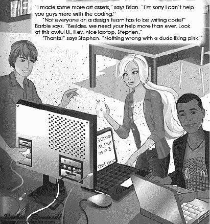

图4.1 “芭比重混版，我（真的真的！）可以成为计算机工程师。”

这样一个小册子竟然能引发如此巨大的媒体风暴，这一事实让一些人感到意外。这难道不是过度反应吗？毕竟，这本书在一年前就已经出版了，而且当时并没有获得现在这种将其推向风口的轰动。为什么《芭比：我可以成为计算机工程师》会成为这样一个众矢之的？这是少数不满的女权主义者的抗议吗？对于他们来说，芭比对女性特质的刻板化推广一直是他们不满的灯塔？抑或是技术和游戏文化中某种更大的趋势终于达到了临界点？答案指向了游戏、编码和创客社区中几种汇聚的发展趋势，这些趋势凸显了游戏与参与的关键问题。

虽然很难确定某个单一事件是导因，但围绕女性在科技领域的待遇、缺失和缺乏代表性的若干事件起到了关键作用。2014年秋季的大部分时间被“游戏之门”（GamerGate）的讨论所占据，这似乎是一场游戏设计师与其前男友之间的个人恩怨，始于一系列恶毒的博客文章，随后演变为关于游戏行业骚扰女性的大讨论，并最终升级为死亡威胁。当游戏活动家安妮塔·萨基希安（Anita Sarkeesian）取消在犹他州立大学的受邀演讲时，这件事登上了《纽约时报》的头条。5 在广泛成功的Kickstarter众筹资金支持下，萨基希安在“女权频率”（Feminist Frequency）标签下制作了一系列视频，审查了商业视频游戏中广泛的性别刻板印象和对女性角色的骚扰。6 她在犹他州立大学的演讲本应关注这些努力，但由于一封匿名发给学校的电子邮件威胁，演讲并未举行。该邮件承诺，如果允许萨基希安进行演讲，将发生大规模杀戮。“这将是美国历史上最惨烈的校园枪击事件，我给你一个机会阻止它，”信息中写道，“我有一支半自动步枪、几把手枪和一堆管状弹。”最初只是网络上的网络攻击，现在已升级为全面的威胁，并引发了FBI的调查。如果萨基希安继续她的演讲，是否真的会发生枪击事件尚未知。但显然，对于那些敢于质疑女性在游戏和制作中角色的人，某些人存在着极其独特的毒性。

关于游戏行业缺乏女性的讨论，随着有关硅谷整体缺乏多样性的报告出现而放大了。突然之间，`Google`、`Apple`和`Facebook`等大型科技公司开始关注其员工队伍中甚至缺乏女性和少数族群体，并认为这种多样性的缺乏对它们的创造力和经济发展是有害的。这些趋势既不是新鲜事，也并非无关。每当`College Board`（大学理事）发布关于高中生计算机科学高级课程（`AP`）考试的年度数据时，`Georgia Computes!`外展计划的负责人Barbara Erikson就会按州、性别和少数族身份对数据进行细分。年复一年，她揭示了令人沮丧的发现：`AP`计算机科学的人数很低——是所有`AP`考试中最低的。在`Montana`州和`Wyoming`州，2013年甚至没有一名女性高中生参加过`AP`计算机科学考试。2014年，国家媒体首次关注了她的报告。`CNN`等主流新闻媒体询问为什么有如此之少的女性和少数族参加考试。进入科技行业的人才管道正在泄漏，而且事实上已经泄漏了长期。

这并不是说媒体在帮助更广泛的消除“计算机科学和工程是男职业”这一观念方面提供了过特别帮助。在过去的十年里，`MAKE`杂志一直是推广制作和学习最可见、最主流的平台，并通过其旗舰活动`Maker Faire`在促进日益增长的制造运动方面发挥了关键作用。然而，正如 Leah Buechley 在 2013 年 10 月的`FabLearn`会上主旨演讲中提到的那样，`MAKE`几乎没有在制造运动方面推广平衡的性别形象。Buechley 对`MAKE`杂志过去五年的封面的分析显示，只有少数女性且没有少数族裔登上过杂志封面，在其员工中也只能找到少数女性和少数族裔。同样，当 Buechley 分析杂志上发表的话题时，几乎所有主题都集中在火箭、机器人和汽车上。这些都是非常重要的话题，但它们对于究竟是谁在制造、以及“制造”到底是什么，提供了一个相当狭窄的视角。手工艺相关的发展空间相对较小，未能突出那些在功能上等同且技术上与作为 DIY 代表支柱的机器人和火箭同样复杂的工具。如果我们想更好地代表（并理解）成为一个制造者的意义，我们最终需要重新考虑什么将成为制造运动的此类标志。

这让我们回到了芭比（Barbie）。关于她职业志向的小册子变成了长期以来积压的对技术文化不满情绪的真正“避雷针”。这不再仅仅关乎`access`（获取机会）——即能够使用技术——还关乎`participation`（参与）——即能够设计和制造技术。那种文化价值观倾向于促进或禁止获取和参与的“象牙塔”论点——女性主义者长期以来的观点——已经在主流数字文化中变得显具象化。它确实捕捉到了许多人在过去二十年里对计算、工程和游戏领域女性和少数族裔缺失而感沮败。编码和游戏社区有着不参与和鼓励女性及少数族裔参与的悠久历史，原因是多方面的：一方面，女性和少数族裔可能缺乏兴趣、经验和技能；另一方面，这些领域存在对女性和少数族裔持续的刻板印象，加上缺乏杰出的榜样。虽然此书的前几章证明了每个人都可以学习编码、内容和协作，但制作（而非仅仅是玩）游戏被视为解决计算和游戏领域中代表性不足群体多样性和公平性问题的可能补救措施。

这一章关于谁可以（以及谁“应该”）玩和制作游戏的文化问题。主要关注点之一是游戏社区和制作活动一直不愿意向女性和少数族裔开放——这种情况在过去的二十年里很大程度上保持着现状。虽然对这些问题的讨论主要集中在女孩和游戏上，但现在对游戏中的少数族裔也有了同样活跃的研究和讨论。我们将探讨利用建构主义游戏通过制作游戏让女孩进入计算领域的惊人转折。尽管这种努力是成功的，但有一个问题从未被真正解决：为什么女孩必须通过设计游戏来信号化她们的“官方”技术精通？游戏可能被优先于其他数字设计项目，因为它们已被证明能引发更复杂的编码。然而，即使游戏设计涉及的编码复杂性在数字故事和交互艺术等其他入门项目中并不显而易见，周围的文化为何暗示游戏天生更属于男性的呢？当然，这种文化也指向某些类型的男性群体——即高白人和亚洲人。因此，本章还探讨了通过将非洲裔男性青年转变为游戏测试者来让他们进入计算领域的努力，这解决了另一个令人困的问题：为什么一些最活跃的玩家群体没有将计算职业视为一种可行的选择？通过研究女孩对游戏的缺乏兴趣以及年轻非洲裔男性对计算的缺乏兴趣及其原因，我们可以更好地理解这些持续存在的获取与参与问题，并设计更具包容性的连接游戏文化。

## 数字文化中的参与政治

建构主义学习的文化维度考察了决定特定的认知、观察或行动方式如何比其他方式更有价值的政治学。这在技术文化中（包括游戏和 DIY 社区）没有比这里更显而易见的。正如引言讨论所示，这些文化具有长期的排他性历史，无论是计算机科学教育者 Jane Margolis 和 Allan Fisher 所认为的“计算俱乐部”，还是如 Sarkeesian 的所展示的游戏中对女性的刻画，亦如 Buechley 所指出的制造文化中女性和少数族裔代表性的缺失。

关于游戏教育价值的讨论就是一个很好的例子。长期以来，玩游戏一直被视为“浪费时间”，在某些情况下甚至被认为是有害的；直到最近，对话的基调才发生了转变，我们现在看到了通过玩（以及制作）游戏来学习的潜在价值。虽然为了学习而制作游戏从未像过去玩游戏那样经历过巨大的阻力（除了与游戏本身的关联之外），但在投入“制作”的过程中，我们看到了其他文化偏好的显现。究竟什么才算得上是一个“好”游戏？鉴于体育类和第一称射击游戏在市场上的主导地位，“玩”市场在关于什么是重要的这种默认的自上而下的认定方面，很大程度上影响了初创的“制作”市场。这种分级模型是谢丽·特克尔（Sherry Turkle）和西格尔·帕帕特（Seymour Papert）在 20 世纪 80 年代和 90 年代从事计算教育工作时明确反对的，当时正是 K-12 计算教育动力首次出现的时期。特克尔和帕帕特（1990）当时断言，与技术的互动方式存在言说和非言说的偏好。占据主导地位的是“自上而下”的规划方法，而不是更具即兴性的、类似拼凑者（bricoleur）式的方法。他们认为，拼凑者方法并不是通往更高级的知识构建形式的阶石，而是是组织个人规划和解决问题的一种在性质上有所不同、但同样有效的方式。他们主张认识论多元主义，意味着背景、方法和激情在数字文化中应该获得平等的空间。

认识论多元主义不仅关乎不同形式的知识，还关乎我们编码、玩耍和制作物品的不同方法，或者说如何看待问题。认知和行动的方式反映了价值观，所制作和玩耍的产物也是如此。更重要的是，行动和产生的产物为学习者提供了联系的社区，使他们能够与该领域的实践和其他人互动。这影响了谁在这些文化中获得玩和制作的机会，以及谁的兴趣和激情得到了认可和支持。正如吉（Gee）所主张的那样，我们并不是独立学习、玩耍和制作的。亲和群体是我们参与并维持这些努力的关键。理解与编码、制作和玩相关的边界和价值观，对于更好地理解学习者能够以及如何与他们建立联系至关重要。换句话之，我们在计算和游戏方面如何思考和参与，不仅是一个选择问题，而且是通过他人以及通过人的文化价值观、偏好和亲和力被引入和规定的。在接下来的章节中，我们将围绕两个意想不到的发展来探讨这一命题：制作游戏如何成为女孩进入 STEM 的途径，以及测试游戏如何成为黑人青年进入 STEM 的途径。

## 让女孩进入计算与游戏领域

为了理解围绕女孩和游戏的问题，我们需要回溯，回到 20 世纪 80 年代后期，当时个人电脑离开了实验室和工作空间进入了人们家庭。同样，第二代视频游戏机已成为许多家庭的主角，特别是那些有小男孩的家庭。数字媒体正成为家庭常用品，就像之前的收音机和电视机一样。虽然听广播和看电视最初是一项家庭活动，但对数字媒体的参与主要是男性的事务。在有小男孩的家庭中，超过 80% 的人拥有视频游戏机，而在拥有个人电脑的家庭中，使用者主要是男性或男孩。视频游戏行业像计算机行业一样，认为没有需要迎合女性观众，因为在他们看来，那里没有市场，因为女孩和女性对游戏或计算机根本感兴趣。

但对于女孩的缺席，也引发了许多担忧。计算和游戏领域两个独立但又相互关联的发展——它们都取决于女孩存在感、兴趣和参与的缺乏——开始将游戏推广为一种进入 STEM 的途径。编码社区有着长期不参与和不鼓励女孩的历史，尽管在计算早期，许多角色并没有那么强烈的性别偏见。这些排斥有多个原因。一方面，是认为女性缺乏兴趣、经验和技能；另一方面，是在这些领域内对女性存在持续的刻板印象，并由于缺乏女性榜样而加剧了这一点。许多研究记录了女孩在学校内外的计算对计算缺乏兴趣以及在这些方面的缺乏经验——这些趋势在过去的二十年里没有发生显著变化。

同样，许多研究记录了女孩对玩视频游戏缺乏兴趣和经验。大量的研究确立了在与数字游戏表现和体验方面存在显著的性别差异。其他研究侧重于游戏玩兴趣的差异，并将其作为解释为什么女孩不玩数字游戏的原因。被提到的理由之一是数字游戏的内容，最显著的是许多游戏中发现的刻板化描绘和暴力。文化研究人员尤金·普文佐（Eugene Provenzo, 1991）进行了最早的数字游戏角色内容分析之一，发现大多数角色都将女性描绘为受害者或奖品，很少有游戏为女性玩家提供其他选择。类似的，许多游戏中突出的暴力被视为另一个阻碍女孩玩耍的因素。更最近的研究记录，强大的女性主角，如《古墓丽险环》中的劳拉·克罗伊特、《大恶战士》中的萨姆斯斯·阿伦，以及《最长旅程》中的艾普尔·莱恩，现在已在许多游戏中脱颖而出，但刻板印象依然存在。

这些发展为研究儿童制作游戏奠定了框架。第一章开头描述学生制作分数的游戏的插图很好地证明了研究的独特发现。游戏制作研究的结果打破了传统观念，即女孩对游戏根本不感兴趣，更不用说计算机编程了。在这里情况并非如此。参与该项目的 16 名学生（其中 8 个是女孩）显著提高了他们编写和调试代码的技能，特别是与那些通过传统的、以语法为中心的每周计算机实验室学习编程的学生相比。此外，没有任何分析显示出男孩和女孩在程序中的表现存在显著的性别差异，这表明女孩可以像男孩一样成为程序员（这在当时是一个引人注目发现）。设计游戏成功地吸引了所有学生（包括很多女孩）学习编程和游戏。

然而，男孩和女孩在处理和实现其游戏设计方面存在一个重要的区别。男孩的设计都包含暴力反馈，设定在幻想背景中，并假设玩家为男性；而女孩的设计则设定在现实背景中，且没有一个包含暴力反馈。女孩还显而易见为不同性别的玩家预留了余地。对这些发现的另一种解释是：男孩通过选择既定的惯例来肯定自己的认同，从而在游戏中将自己定位为精明的游戏玩家，而女孩在设计中也付出了同样的努力。在游戏主题的选择以及动画和交互的编程方面，男孩和女孩展示了他们对大众媒体特征的数字游戏和故事中吸引与不吸引之处之处。²¹ 制作游戏并构建其规则让这些年轻的游戏设计者能够主主，决定玩家在虚拟世界中的位置和角色。

这些发现产生了自己的意义，因为它们证明了女孩不仅对游戏感兴趣，而且对计算机感兴趣。尽管后的研究并未显示他们在游戏类型上存在如此广泛的差异——这表明环境对于学生如何就游戏设计和主题进行自我定位起着至关重要的作用。²² 虽然这项研究的参与者较少，且考虑到 20 世纪 90 年代只有少数学生在学校或家里经常接触计算机，该研究的结果不可复制，但其研究发现具有更大的影响，因为它们为女孩参与计算和游戏的可能性提供了一个令人信服的说明。研究结果之所以引起女性主义者和技术爱好者的共同关注，或许是因为结果不仅符合当时流行的关于技术使用中性别差异的论述，还展示了一种可能的出路——即让女孩去制作而不仅仅是玩数字游戏。

## 作为女孩 STEM 管道的建构主义游戏

“STEM 管道”论点认为，男孩早早接触视频游戏为他们获得数字技术的经验和熟悉度提供了某种主场优势。²³ 因此，增加他们对游戏的参与被视为解决女性缺乏计算参与的方法。正是基于这些原因，建构主义游戏（即游戏制作）成为了校内外推广女孩编程的模式。在之前的章节中，我们总结并讨论了制作游戏进行学习的多重益处。这里引人注目的是大多数研究都包含了男孩和女孩，并发现两组人都在从制作游戏中获益。此外，还测试了诸如`pair programming`等社会安排，以查看哪些条件更有助于女孩对编程产生兴趣并变得精通。人们还努力通过具有性别包容性主题或机制来定制编程工具，例如自定义叙故事功能以吸引女游戏设计者。最近的一项研究证实，通过此类工具，女孩为自己的游戏编写的代码甚至比男孩更复杂。²⁴

在使用建构主义游戏作为女孩进入 STEM 途径的方法，有一个问题尚未被广泛讨论。事实上，最近的研究给这一前提蒙上了阴影。教育研究者朱迪·罗伯逊（Judy Robertson，2013）的一项研究让英国九百名十一十四岁的学生使用`Adventure Author`工具制作数字游戏。通过对 225 份现测和后测问卷进行分析（这些问卷评估了学生对计算机的态度），她发现许多女孩对活动的喜爱程度不如男孩，且这种差异是显著的，而且参与游戏设计活动也让许多女孩未来不那么想学习计算机。虽然对调查回收率低的担忧是合理的，但这种大规模实施的发现结果呈现了一个关于建构主义游戏激励性的更细致的画面，缓解了此前关于“游戏制作可以完全提高学生对计算机态度”的说法。它复制了早期研究的发现——女孩可以编写游戏——但也质疑了这是让女孩对计算感兴趣的万无一失方法的观点。

这一 STEM 管道论点的主要问题可能在于，男孩在游戏中的活动无意中成为了女孩在计算领域教育机会的基准。这种基准的隐含假设是它将一组人的活动提升为其他人的规范。驱动这一问题的很大程度上源于 20 世纪 70 年代初的女性主义修辞，这种观点认为通过让女性表现得像男性来使她们与男性平等。²⁵ 这种想法是，如果女孩只是参与与男孩相同的活动，那么她们也会获得同样宝贵的经验和技能，从而精通技术。它将性别具体化为一种生物建构，而不是一种表演的社会建构。女性主义理论家如朱迪·巴特勒（Judith Butler）引入了`gender play`的概念，意味着女孩和男孩、男人女性在不同的背景下尝试性别表达。²⁶

最后，这一前提背后的数据也没有产生任何真实变化。人们本预期随着女性玩家数量的增加，游戏文化会发生变化。²⁷ 即使现在女性在某些类型中是玩家的大多数，这种数量上的平等并没有转化为对女性游戏玩家和设计者的广泛接受，正如最近的`GamerGate`事件所示。²⁸ 然而，这些发现表明，仅仅为了让女孩进入 STEM 管道而让她们制作游戏并不是可行的之路。相反，我们应该根据自身的标准来考察学习制作游戏的潜力和可能性。我们不仅应该关注兴趣，还应该关注价值观如何框定特定群体的接触和参与。这个问题将在下一节通过考察美国非裔男性对游戏的兴趣以及对计算机的脱节来讨论。

## 在游戏和计算中寻找男孩（以及未找到）

很少有研究从男孩的视角来探讨性别与视频游戏。与此相关的是学习科学家 Reed Stevens、Tom Satwicz 和 Laurie McCarthy（2008）对十三名在九至十五岁之间、在家里玩视频游戏的青少年进行的民族志研究。他们发现，男孩并不一定会对他们所玩的游戏仅从表面来看待，也不总是按照游戏设计者意图的方式来玩——这一发现通过其他针对高年玩家的研究中也得到了证实。此外，教育研究人员 Ben DeVane 和 Kurt Squire 观察到，玩家根据他们所带来的课外知识，对`Grand Theft Auto: San Andreas`等游戏的体验可能大不相同。例如，非裔美国男性青少年对《侠盗猎手》的感知和玩法与白人郊区青少年有所不同。白人郊区男孩倾向于认为游戏玩法准确地反映了街头帮派真实的暴力，而一起聚在一起玩的非裔美国男孩组则认为这只是极度夸张的夸张，并没有反映出自己在所在城市社区中可能经历过的真实暴力。因此，当白人郊区男孩以近乎系统的方式玩游戏，按顺序完成各项任务以提升“黑帮地位”等级时，非裔美国玩家往往只是沉浸在逃避性的游戏体验，随机探索城市街道，并尝试不同类型的汽车以及各种配乐。基于这些观察，DeVane 和 Squire (2008, 281) 提倡将视频游戏视为“可能性空间”，或“允许玩家拥有许多潜在动作并产生多种游戏风格的开放性作品”。

但我们在男孩游戏法方面缺乏的，是目前我们对女孩玩耍（或对她们玩法的缺失）所拥有的那种细致的理解。事实上，关于性别与游戏的研究几乎完全集中在我们如何吸引女孩进入游戏和计算领域，并促进我们在前章节中回顾过的技术技能。我们没有对如何吸引男孩进入计算领域进行同样广泛的研究，因为我们总是假设，考虑到他们在游戏领域中具有压倒性的存在，这种兴趣和专业知识已经存在，这只是推广的问题。这种研究的缺失在少数群体男性玩家身上变得尤为明显。一项采访非裔美国男性少年的研究发现，他们的游戏玩法确实不仅限于运动和暴力，这比之前的研究所指示的更具特色。

同样，许多努力都检查了计算领域缺乏多样性的问题，以及学校和游戏、缺乏榜样，以及游戏和计算中过度刻板印象如何解释获取机会和参与度。在计算领域，与西班牙裔和美洲印第安人一样，非裔美国男女在 K–16 教育阶段以及技术劳动力市场中的代表性都严重不足。与女性和女孩一样，计算领域缺乏代表性群体的情况已经持续了数十年，但增加的遗憾是，我们总是假设男孩和男性会感兴趣，这只是外推的问题。以下关于 Glitch 游戏测试员的研究，说明了实际情况实际上要复杂得多。

## Glitch 游戏测试员：将非裔美国男性引入 STEM 领域

由佐治亚理工学院的计算机科学家 Amy Bruckman 和 Betsy DiSalvo 会同莫豪斯学院的研究员 Charles Meadows 和 Ken Perry 合作开发的一个名为`Glitch Game Testers`的计划，解决了与游戏和计算相关的兴趣和价值观问题在非裔美国青年身上是如何定位的。在该项目中，高中生在夏季期间担任全职游戏测试员，在学年期间担任兼职测试员。他们为行业客户的发布前数字游戏进行质量保证工作，这涉及计划测试，学生需要系统地测试开发人员要求的特定功能。但他们也可以参与游戏测试，这涉及到对游戏可玩性更开放的批判。课程还包括质量保证工作的培训以及对错误报告的审查。

Glitch 游戏测试员计划的典型工作日包括：从上午 10:00 到中午测试游戏，午餐，然后是一场计算机科学研讨会，下午继续测试一直到下午 5:00。根据佐治亚理工学院研究人员的，这种特定每日安排的理由是为高中青少年建立一个工作与教育的环境。该计划还包括午餐会议，邀请来自佐治亚理工学院教职员工和行业人士演讲，就像许多科技公司在工作中提供的持续职业发展一样。此外，学生们参观了大学，写了大学申请并参加了计算机科学研讨会。研究人员还在计划中加入了竞争元素，因为他们的研究表明，年轻非裔美国男性将竞争视为其玩法的一部分。

这导致了`Glitch 竞赛`，这是一个持续的积分系统，分数公布在 Glitch 游戏测试员工作房间的公共白板上。研究人员指出，“跟踪分数变成了参与者每天活动的重要部分。当白板上进行更新时，每个人都会停下手中的工作，转面向写下新分数的经理，并根据结果互相吹牛、找借口或互相嘲讽。”额外的积分决定了每年夏天和年底的获胜者，获胜者将获得一个新的视频游戏、礼品券，甚至是学生们在一年内制作的计算机。国家科学基金会为该计划提供资金，因为游戏公司不愿意为高中生提供的服务付费，尽管他们测试了公司的发布前游戏。

总的来说，Glitch 游戏测试员计划在吸引参与的非裔美国男性加入游戏和计算方面取得了成功。该计划不仅拓宽了参与者对游戏行业的视角并提升了他们对这类工作的兴趣，还在他们心中培养了一种自信，即他们实际上可以将计算作为学习课程和职业。在三年内参加该计划的 25 名高中男生在计算兴趣和观点方面随时间发生了显著变化，并对计算职业获得了信心和兴趣。他们都高中高中，其中三分之二的人参加了继续教育和大学课程。在计划开始之前，只有四个学生表达过对计算的兴趣，而在完成游戏测试员工作后，有十个人表达了这种兴趣。项目的实施也让大学研究人员了解了组织营利公司与公立大学之间合作伙伴关系的复杂性。

最引人注目的发现之一来自一项研究，该研究调查了年轻人加入并持续参加“故障游戏测试者”（`Glitch Game Testers`）计划的底层动力。从表面上看，将已经深度投入游戏的男性青少年引入计算领域似乎并非挑战。但尽管游戏在非裔美国青少年中非常流行，它更多被视为一个社交场所，而不是通往 STEM（科学、技术、工程和数学）的管道。佐治亚理工学院的研究人员指出，“留面子”成为参与者之间的一种重要策略，他们会说自己拿钱来测试和玩游戏，尽管他们经常觉得这些活动非常重复且枯燥。测试未发布的视频游戏最初可能像是每个孩子的梦想成真，但这项工作是艰辛的，需要巨大的耐心和对细节的关注。更重要的是，“他们被游戏测试吸引是因为对游戏感兴趣并认为这很酷，但他们能够参与是因为这是一份薪工作，满足了他们比找件趣事打时间更看重的需求。”显而易见的是，与游戏和计算相关的价值观在增加和维持参与度方面所起的作用，与青少年可能（或可能）表现出的某一主题的兴趣同样关键。我们对后者投入了大量关注，却大部分忽略了前者。该计划为引发参与计算的价值观提供了关键见解。

正如 `Bruckman` 和 `DiSalvo` 在计算机学术协会（`Association of Computing Machinery`）简报近期的一篇社论中所观察到的，这些发现表明，如果我们想扩大游戏和计算的准入和参与度，我们需要对兴趣和价值观给予同样的关注。虽然许多推广计划关注`interest`（即什么是有趣的）——但很少有人考虑到`values`（即什么对特定孩子来说是重要的以及为什么）。对于“在贫困中长大的非裔美国青少年来说，找到通往经济安全的道路至关重要。而且必须是一条易得的路径——一条他们可以轻松想象自己处于其中的路径。价值观连接着他们认为重要的事物、他们现在的自我以及他们想象未来会成为的人。”同样，对于女孩来说，像游戏制作项目这样的积极经历是有意义的，但不足以克服长期以来积累的关于游戏和计算文化中“谁属于这里，谁不属于”的各种信息。这些发现表明，将玩或制作游戏作为通往 STEM 的管道的主要前提，并不是男孩或女孩的直接路径。

## 超越准入与参与：为什么价值观很重要

这些研究为我们理解如何思考价值观在作为学习环境（无论是玩的游戏还是制作的游戏）中所扮演的角色提供了更好的视角。我们并不是第一批提出这一问题的人；游戏研究人员 `Mary Flanagan` 和 `Helen Nissenbaum` 在她们最近的书中曾非常有辞藻地表达过这一观点。但他们的观点更多是关于专业游戏设计的。总的来说，所讨论的研究是我们迄今为止最广泛、最系统的努力，以重要的方式影响了连线游戏和教育编程的教学法。与其他学习情境一样，游戏和计算是带有相关社区的社交活动。`Gee` 将游戏社区视为“同类群体”（`affinity groups`），游戏玩家因为拥有志同相合的兴趣而聚集在一起。考虑到严肃游戏（`serious gaming`）在过去十年中收到的热烈反响，很容易忘记同类群体不仅可以是欢迎的，也可能是并非所有人欢迎的排他性俱乐部。在这方面，教育工作者和研究人员需要更谨慎地对待此类同类群体，因为它们不是解决方案，而是可能成为增加包容性的障碍。这对于教育目的尤为重要，因为我们希望每个人都能获得欢迎、有意义且高效的体验，从而丰富他们对自我、他人以及他们想要参与的更广泛世界的理解。

我们投入了大量的精力关注如何提供准入和如何增加参与度，而对孩子们一旦选择加入游戏和计算的内容贡献者俱乐部后实际上可以使用什么，关注得要少得多。在游戏玩家社区中，玩家的呈现方式通常通过公司的设计预先决定，尽管最近出现了许多角色和关卡编辑器，让玩家对他们想看到的内容以及希望如何扩展游戏有了更大的话语权。相比之下，在游戏制作社区中，玩家完全依赖于自己创作的内容。在这里，内容的可用性在何程度上受到玩家创作了什么以及谁在贡献的限制就没那么明显了。由于玩家本身最频繁提供唯一的可用信息，这些信息很难获得；公司以及在线网站很少收集有关民族或种族的人口统计学数据。

教育研究人员 `Michael Lachney`、`William Babbitt` 和 `Ron Eglash` (2016) 最近的一项研究查看了`Scratch`编程网站的内容，发现它严重倾向于来自热门视频游戏、电视节目和玩具的商业内容，但在吸引其他成员的文化相关内容方面则较少。例如，在`Scratch`存档中简单搜索热门视频游戏`Doom`，会找到数百甚至数千个由`Scratch`成员创建并发布的不同程序。任何对其他内容（如关于印第安人）的搜索最多只能找到少数项目——其中一些显然是学校发起的，正如创建者的评论所说：“我为社会研究作业制作了这些。”在这种情况下，这并不意味着`Scratch`网站会因为`Doom`混编版本盛行而非互动式美国印第安社会研究项目而排斥原生印第安青少年。大多数孩子倾向于商业化的内容，而不是来自学校作业的内容。而且，孩子们对第一人称射击游戏的倾向不太可能首要建立在民族或种族基础上。但此处`Doom`射击游戏的主导地位，微妙地确立了`Scratch`网站上什么算作游戏的边界，以及什么作为上传是有价值的。围绕志同相合兴趣聚集的同类群体是强大的学习文化，但也使它们成为排他性文化，尽管可能并非刻意。这些排斥不仅是强大商业公司的运作，也是玩家自己在 DIY 社区中自我复制的，因为在这些社区中，玩家是贡献内容并信号什么应该受到关注的人。

对项目的兴趣和热情非常重要，并可以作为参与的关键启动平台，但如果玩家在这些社区中所看到和遭遇的内容以及创作者是有限的，那么这些因素本身并不能保证多样性。我们还需要理解这些热情是如何情境化的，以及什么样的价值观构成了它们的框架，以拓宽和深化参与。否则，我们可能会面临在游戏玩或制作中固化刻板印象并维持不平等的风险。指令主义游戏利用动机，将兴趣和经验与学习联系起来。建构主义游戏也意识到这些兴趣和经验如何成为参与和制作的步骤。在连接性游戏中，我们需要检查并促进学习者作为用户和生产者，不仅能够复制内容，还能以创造性和批判性的方式与内容互动。关于游戏和游戏中价值观的讨论一直更多集中在专业设计师身上，以及正如 `Flanagan` 和 `Nissenbaum` (2008) 所说明的那样，他们如何嵌入游戏制作的各种设计决策和阶段中。现在，我们需要将这些讨论扩展到学生和研究人员，并研究用于学习的游戏制作。

最近的发展为用于学习制作游戏的潜力增添了新的维度。教育者、研究人员和普通爱好者现在将游戏制作置于新媒体素养领域，并强调了系统思维和对媒体的批判性参与等益处。将游戏制作视为具有足够教育意义、以成为一种“素养”或许多“素养”之一的这种推动，在重新考虑 K–12 学校重视并灌输学生的技能和内容方面，证明是一个有力的杠杆点。目标并不一定是要产生大量的职业游戏设计师，而是给年轻学习者一个设计、开发和调试他们自己的数字内容的机会，并在过程中更好地理解基于 Web 的媒体的本质，以及通过此类媒体在基于项目的评估中进行协作的潜力。

此外，我们可以观察独立游戏运动，它像电影行业的对应物一样，其重要性和人气日益增长。虽然电子娱乐博览（广为人知的 E3）一直是洛杉矶会议中心举办的商业游戏年度盛会，但在紧邻相邻的库尔弗城（`Culver City`），独立游戏游戏机厅（`Indie Arcade`）的参与者人数不断增加，关注着超越主流体验的游戏设计。游戏设计可以应对个人话题，例如 `Numinous Games` 的`That Dragon, Cancer`（它处理癌症和悲伤），也可以应对教育话题，例如由 `Tracy Fullerton` 设计的`Walden, a Game`，该游戏模拟了亨利·戴卫·梭罗在 1845–1847 年住在瓦尔登湖的实验，让玩家追随他的虚拟足迹。许多人认为独立游戏是创孵化器，因为许多商业视频游戏类似于好莱坞的制作，使得在成熟格式上进行实验是一项高风险业务。

最后，制作游戏的努力最初假设工程师的世界是女孩和代表性不足少数民族为了真正对计算产生兴趣而需要向往的。但并不需要直接进入一个“男人的世界”来对计算和工程产生兴趣并参与。同样，我们最初对男孩的理解假设由于他们天生对游戏的亲和力，他们会对计算产生兴趣。但这些假设被证明太简单了；现实生活实际上复杂得多，特别是对于来自代表性不足群体的青少年来说，附着在游戏和计算上的文化价值可能需要留面子，并被视为一种逃避现实而非创造未来的练习。在获取接入权限和激励参与游戏与计算方面，兴趣至关重要，价值观也是如此。因此，我们需要在制作的内容以及我们通过*什么*来制作方面扩展连接性游戏——我们将在接下来的关于制作、玩耍和分享游戏的实体和工具的章节中探索这些主题。

## 5 实体的一面：在游戏中连接旧材料与新界面

## 笔记

2011 年夏天，一个九岁、名叫凯恩·蒙罗伊（`Caine Monroy`）的小男孩在他父亲的二手汽车零件店里，用纸箱、球和胶带制作了一个简易游戏机厅。凯恩位于东洛杉矶，他用废弃的箱子制作简单的游戏，并收取一美元可以在他的纸板游戏上玩四次。游客可以射一个球穿过他从当地披萨店得来的微型篮球篮筐；他们可以使用手指引导小球穿过一系列粘住的塑料军队人偶来玩足球。花费两美元，游客可以获得一张“趣味通行证”，在一个月内可以使用五百次。尽管凯恩独具匠心，但他的游戏机厅几乎没有游客——只有他和他父亲真正玩过那里无数种游戏。然而，随着当地电影制作者尼尔万·穆利克（`Nirvan Mullick`）制作的一段短视频在 2012 年 4 月发布在 `Vimeo` 上，情况发生了变化。许多媒体迅速在全国范围内报道了它。穆利克在 2011 年 9 月访问了那个零件店，为他的车寻找一个二手门把，成为了凯恩游戏机厅的第一位付费客户。几天后，他回来并询问凯恩的父亲，是否可以为游戏机厅制作一段短视频并为商店带来更多游客。

他在“隐藏的洛杉矶”（`Hidden City Los Angeles`）的 `Facebook` 页面上发布了邀请，该邀请在其他在线网站流传。邀请引发了病毒式传播，在 10 月的一个周日下午，东洛杉矶那间曾经空闲的游戏机厅挤满了数百人；许多游客带着孩子来，更多的人对发布的视频和照片发表了评论，他们希望自己也能在场。在不到十天的时间里，穆利克的视频获得了超过 500 万次观看，并为凯恩的大学基金贡献了数千美元。受新闻报道的启发，来自世界各地成千上万的人来到这个游戏机厅。穆利克随后建立了想象力基金会（`Imagination Foundation`），旨在激发全球儿童的创造力和创业精神。该基金启动了年度一次的全球纸板挑战赛（`Global Cardboard Challenge`），目前有来自五十个国家的十万多孩子用纸和电子产品制作各种游戏机、机器、机器人。在他游戏机厅开放两年后，他“退休”了管理工作，部分是因为他进入了初中，但也是为了开始新的自行车店业务，帮助维修和翻新自行车。

凯恩的游乐场的成功出人意外。全球范围内数百万儿童每天都用纸箱玩耍，但很少有设计能获得如此关注。在数字游戏时代，一套用胶带粘起来的旧纸箱被转换成老式的嘉年华游戏，究竟是什么引起了全球范围的关注？这仅仅是一个关于内向男孩的故事吗——他夏天在父亲的店面里制作自己的游戏？除了毅力之外，他的想象力无疑具有启发性，特别是在穆利克那次命运般的访问之前，没有任何外部访客。或者，这是一个关于重新利用日常材料的故事，将那些通常会填满垃圾埋场的物品转化为某种具有趣味性、甚至是快乐的东西？这种对工艺材料的重新利用与日益受欢迎的 DIY 文化非常契合。凯恩的创业精神是不言而疑的。他成为历史上在南加州大学商学院进行演讲的最年轻的人，《福布斯》杂志的一篇文章甚至预言他在未来三十年内成为亿万富翁。无论原因何，凯恩的游乐场提醒我们，制作和玩游戏是一个想象力的问题，并不限于数字媒介。

随着过去十年对严肃游戏（`serious gaming`）的各种讨论，我们可能已经忘记了游戏在计算机出现很久以前存在，而且这类非数字游戏在今天依然强劲。尽管视频游戏已成为一项全球价值数十亿美元的产业，传统的桌游和卡牌游戏仍被全球范围内数百万老少所玩。事实上，根据 `Kickstarter` 众筹网站最近的成功，桌游正在复兴。游戏设计师兼研究员玛丽·弗拉纳纳成功为她的`Monarch`桌游发起了一项活动，在游戏中，玩家争夺王冠（而非国王）来统治局面。一本名为`Analog Games`的新期刊也出版，旨在探索“具有实质性模拟组件”的桌游和卡牌游戏的研究与设计。凯恩的游乐场模仿了在巡回演出、海滨游乐园和披萨店等等地常见的老式嘉年华游戏。它凸显了一种趋势，一些人甚至认为这是对数字游戏的反弹。

当摆钟回到传统的桌游和卡牌游戏时，值得记住这些明显的低科技游戏相比高科技数字游戏的某些优势，从显著更低的生产成本开始。为打印卡片和棋板开发图形以及添加一些游戏棋子是一个相对廉价的过程，几乎不需要整个由工程师和设计师组成的工作室。桌游的搭建也很快，并且可以依靠许多玩家（尤其是年轻人）对其规则和机制的非正式认知。事实上，几位严肃游戏设计师正在重新发现桌游的这些优势，并开始生产与数字游戏玩法并行的版本。例如，游戏设计师莎莎·巴拉布（`Sasha Barab`）使用的卡牌游戏，用来刺激学生在`Quest Atlantis`虚拟世界中的探索。或者由学习科学家约书亚·丹尼什（`Joshua Danish`）和凯莉·佩普勒（`Kylie Peppler`）设计的协作游戏`BeeSim`，旨在帮助小学生学习蜜蜂的采蜜觅行为。

但当涉及到桌游和视频游戏时，这并不是二选一的。传统的桌游和卡牌游戏不仅在被重新发现；它们还在被增强并连接到数字世界。商业游戏早已跨越屏幕进入物理世界，出现了新种类的控制器，例如用于任天堂游戏的`Wii remote`、用于`Rock Band`的鼓接口、用于`Dance Dance Revolution`的舞垫，以及带有电子银行系统的增强版桌游如`Monopoly`（大富翁）。即使在凯恩的游乐场中，有些游戏也包含了计算器，允许玩家“检查”自己的状态。新提供的计算构建包让初学者和设计师能够实现这种屏幕之外的游戏扩展。本章探索了新旧交汇之处，即纸张和塑料与数字相遇。它关注了屏幕之外对严肃游戏的新兴趣，并探讨了另一种植根建构主义学习（`constructionist learning`）的连接游戏的扩展潜力。

## 通过制作学习

通过制作游戏来学习强调了屏幕设计可以在课堂或在线社区中与他人分享。但这忽略了学习和认知中同样重要的物理、具体维度，这种维度通常被认为比其对立面——抽象操作更有价值。在皮亚杰的理论中，形式抽象被视为所有知识构建的最终目标，而具体思维总是与较小的孩子相关。然而，建构主义同样重视具体和抽象的学习模式——这种价值观现在在许多学习理论中得到了认可，这些理论认为认知不仅存在大脑中，而且存在空间中，并体现在手势中，通过世界中的制品进行媒介。早早，帕珀（1980, 63–68）就这些多模态学习维度具有重要意义，他将其称为“同态学习”（`syntonic learning`），因为它允许孩子以多种方式与计算对象产生认同：

> 例如，乌龟画圆是*身体同态的*（`body syntonic`）的，因为圆圈与孩子对自身身体的感觉和知识紧密相关联。或者，它是*自我同态的*（`ego syntonic`）的，因为它与孩子作为具有意图、目标、欲望、喜好的人的自我感是一致的。…… 人也可以将其视为*文化同态的*（`cultural syntonic`），因为在画圆时，乌龟将角度的概念与导航的概念联系起来，而这紧密植根于孩子的课外经历。

`Logo turtle` 和 `Scratch cat`——以及许多其他屏幕表示形式——允许孩子们像在物理世界中操作物体一样操作屏幕上的物体。一个孩子利用自己的身体，假装成屏幕上的乌龟或猫，也可以在现实世界中执行每一个乌龟步。不同的同态概念允许学习者在屏幕和世界之间建立联系。屏幕制品，正如特特克尔和帕珀（1990, 4）所观察，位于“形式系统世界与物理实体世界之间。[它]有能力使抽象具体化……同时使其变得可见、几乎触可及，并允许一种直接操作的感觉。”尽管特特克尔和帕珀指的是计算机屏幕上的物体，但这些推论对于连接数字与物理世界的实体制品甚至同样适用。通过将编码扩展到物理世界，我们揭示了这个世界是可编程且具有可塑性的，因此是可以被我们控制的。

创客运动（`maker movement`）中的许多项目专注于手工制作，例如制作机器人、3D 打印物体或电子电路。“制作”让物理设计回到了学术内容的学习中。基于此，创客活动被视为极具前景的真实语境，因为它们展示了科学、技术和工程的学习如何具体地植根于实物的制作中，而不是通过抽象的方式进行教学。通过使用各种材料、学习它们的属性以及跨模态协调设计，不仅为学习者带来了新挑战，也提供了更多学习机会。它们让年轻的设计师参与到作品的制作、测试、调试和迭代中——这些都是计算实践的各个方面。

除了这些学习方面的功能性益处，另一个额外的优势是提供了技术设计的透明度。通过制作制品，学生可以洞察技术本身的物理生产过程，并让事物是如何“工作”的变得可见。这在 21 世纪的技术中并不多见。今天大多数技术设计都刻意隐藏或隐化了其工作机制。它们向消费者营销时也是如此。目标并不是促进终端用户的拆解，担心消费者可能会损坏设备或改变“品牌”本身。然而，从教育目的而言，可见性在促进理解和学习方面无疑是更有益的。例如，在电子纺织品的设计中，针脚、电路和代码的制作以具体、可视的方式揭示了底层的结构和过程。它打破了生产者与消费者之间的二元对立，揭示了这两个角色之间更加微妙且可交换的动态关系。

理解技术如何通过更广泛的材料发挥作用，对于教育当今青少年至关重要。这些多模态构建具有潜力，通过利用并肯定他们对低技术材料的兴趣，同时引入 STEM 内容，以微妙的方式吸引那些排除在 STEM 体系之外的边缘青少年。在建构主义游戏的背景下，这意味着我们可以将游戏设计扩展到屏幕之外，手控制器为玩家控制屏幕上的动作提供了界面。但我们也可以考虑用数字功能增强现有的桌游戏。在任何一种背景下，我们通过利用建构主义学习的共同教学前提（即重视屏幕内和外制物的构建），将编程和手工制作整合到游戏制作活动中。

## 跨越屏幕的游戏：新工具与日常材料

计算机科学家 `Amon Millner` 创设计的`Hook-Ups`组装套件展示了孩子们如何成为互动式实体体验的创造者。`Hook-Ups`组装套件由`PicoBoard`、鳄鱼夹以及纸箱、塑料球和剪刀等用于制作和编程的材料组成。`Millner`的工作说明了青少年如何在日常材料和物体制作实体接口的同时，学习电学、设计和编程。材料纯粹的“日常性”正是其如此有趣的之处。学习如何在编程与工程的交汇点处理材料是很有前景的，但并非易事。我们从先的研究中知道，像机器人和电子纺织品这样的混合手工活动既耗时又费力，需要许多新技能——特别是耐心。它们还需要教师和导师的支持来培养这种坚持精神。

一系列全新的计算组装套件已进入市场，架起了数字与物理世界之间的桥梁。虽然像`LEGO’s Mindstorms`这样的套件已经存在了近三十年，但它们很大程度上专注于机器人技术。在过去的五年里，许多新的计算组装套件已向大众开放。特别是一种名为`MaKey MaKey`的实体组装套件，完全不需要编程就能物理计算开启了设计机会。与`Mindstorms`和其他计算组装套件不同，`MaKey MaKey`既不需要复杂的设置，也不需要深奥的技术知识，因此扩大了动手玩的机会，尤其是对于小龄儿童。这得益于`MaKey MaKey`的功能：只需使用鳄鱼夹作为连接媒介，即可将任何导电物体变成实体用户界面。`MaKey MaKey`使用简单的`mini-USB`转`USB`线连接到电脑。另一根线连接地，使电路接地。第三个连接是一组连接到导物体体的线。

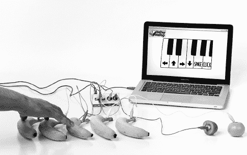

[图 5.1] `MaKey MaKey`香蕉钢琴。*照片：* 由 JoyzLabz LLC 提供。

探索可连接导电物体的范围是乐趣所在，因为孩子们通常从连接铝箔以及一角和硬币开始。但他们很快就在意想不到的地方发现了导电性，包括`Play-Doh`橡皮泥甚至是香蕉等水果。当用户一手握地，另一手触摸香蕉时，电路就形成了，电流从电脑通过`MaKey MaKey`流到日常物体（这里是香蕉）然后返回。随着电路完成，电脑将触摸香蕉解释为类似于按下`space bar`或另一个指定的键。因此，`MaKey MaKey`赋予了初级设计师使用导电物体来替代典型输入（例如`up`、`down`或`right`和`left`键）的能力。在此，用户不仅学习了导电性的本质，还学习了输入和输出的计算本质。这些功能使得`MaKey MaKey`特别适合初学者的尝试和原型设计，因为它提供了即时反馈，不需要大量的设置，并且与易于的材料配合极佳，再次强化了我们即时和日常环境的可编程性和可塑性。

在`MaKey MaKey`成功完成 Kickstarter 众筹后，我们立即测试了它的使用。该场景是一个试点项目，我们要求学生（十到十二岁）使用`Play-Doh`设计触控板控制器。目标是让青少年设计定制的实体控制器，用以配合他们的`Scratch`视频游戏。所有学生都设计并制作了一个与其匹配并控制`Scratch`游戏的功能性触摸板。有些触摸板设计非常精细，控制器组件与其`Scratch`游戏中的精灵（角色）相匹配，而另一些触摸板只是一堆彩色`Play-Doh`。这种触摸板活动为软件和硬件设计提供了一个很好的入门，特别是对于中学生来说，因为它建立在他们对热门游戏平台的现有经验的基础上，并可以利用`Scratch`网站丰富的游戏库。由于电路通常是六年级和七级科学的一个单元，它与初中科学也完美契合。

使用这些材料设计触控板，也让不同输入设备的工作原理变得透明化。在触控板控制器的案例中，学生们能够设计并编程键盘键的功能，并理解按下按键背后的原理——这种功能通常对用户是隐藏的。这种设计并没有将其变成让学生阅读电路设计和导电性的教科书练习，而是通过触控板的设计让学生对不同导电性的材料以及不同（尽管简单）的电路设计进行实验。这种活动可以追溯到帕珀特（Papert）的理念，即把创造真实且有意义的物体作为学习中心，而不是考试或作业表。虽然这种学校与家庭之间的联系在小学阶段更为常见，但一旦学生进入高中阶段看似更抽象的科学和数学领域，这种联系似乎很大程度上被遗忘了。

## 增强益游：结合新旧游戏

增强益游游戏的想法并不是新概念。事实上，近十年来，它一直是人机交互领域的一个活跃方向，因为它在熟悉的空间内为研究多模态交互提供了可能。设计集中在增强传统的棋游游戏，如`Go`（围）、`卡坦拓民者`（Settlers of Catan）和`战棋板`（Battleboards），甚至创造全新的游戏。增强可以以各种形式出现，例如添加 3D、光线和声音反馈，随机改变游戏盘配置，以及提供播放机制和自动化游戏设置。在所有这些示例中，都是专业的计算机科学家和工程师为游戏设计了增强功能。而在这里，我们扭转了局面，让玩家和学习者成为增强益游的设计者。增强益游游戏是指集成了数字骰子或扑牌等数字组件的传统棋盘游戏。我们试图通过与中高中生举办工作坊来测试这些假设。我们给了学生用于数字骰子的`Scratch`启动代码以及计时器，以便他们将这些组件整合到自己的棋游游戏中。学生们分组设计并制作他们自己的游戏，在此过程中将屏幕编程与手工制作融合在一起。

学生们对音乐、电影和视频游戏的个人兴趣和知识也启发了他们的棋游设计，以及关于他们家乡的《你了解费城吗？》（`Think You Know Philadelphia?`）（参见图 5.2）。例如，彼特对音乐的个人兴趣影响了`Cairo`小组的主题，而`Safehouse`小组的两个成员借鉴了他们对同名电影剧情的理解，其中一人提供了电影名称，另一人则填充了概念。对于`Mountain Men`小组，安迪解释了他们如何试图让自己的棋游像视频游戏：“我们还想让……把一个平台类视频游戏和类似，普通的棋盘游戏混合在一起……特别是移动的方式，以及你如何跳跃和爬山。我们还想……比如，在视频游戏里有……可以掉落的空隙，所以我们也想把那样的东西放到我们的游戏里。”考虑到青少年对流行媒体众名的参与度，这种与流行文化的联系并不意外。

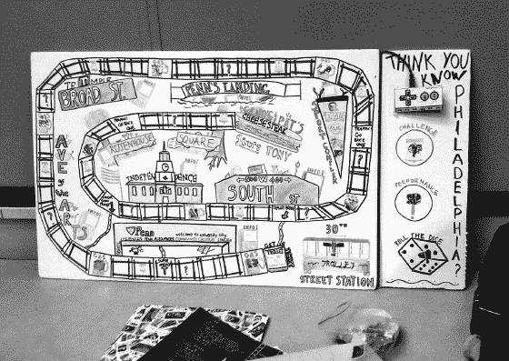

图 5.2 费城增强型游戏板。照片拍摄者：Yasmin Kafai。

为了设计和制作增强功能，每个团队都必须考虑物理棋盘游戏与数字组件之间的交互，这需要他们对屏幕内外的设计进行不断测试。两个游戏——`Cairo`和`Mega Mountain Men`包含了数字骰子，而说明则嵌入在棋盘本身上。在`Safehouse`中，学生设计者包含了一个数字转盘和带有谜题的数字扑牌，玩家必须解决这些谜题（尽管他们并没有完全将转盘、介绍和数字扑牌整合到一个的`Scratch`程序中）。在`Get Out Alive`中，团队使用了数字骰子和扑牌，每当玩家落在特定格子上时就会调用。增强游戏增加了一层复杂性，要求他们以不同的方式思考游戏活动：他们必须思考数字内容如何嵌入到他们的游戏体验中，反之亦然。这些制作和游戏的维度在他们的编码中变得更加交织，从而说明了制作增强益游游戏如何让学生参与到迭代和测试设计这些关键计算实践中。

此外，让组件运行起来需要学生设计者考虑到观众，在许多情况下，这包括小组成员他们自己。学生们设计了粗略的游戏测试板，然后互相玩对方的游戏以获取反馈和视角。这给了他们一个机会来观察哪些有效、哪些无效，然后进行调整。比尔（Bill）解释道：“我正在设计棋盘，我注意到，比如如果它太小了……当我们，像，做那些……试运行之类的时，我首先能够注意到比例，而且它基本上就是一个草稿。”比尔很欣赏设计一个游戏测试（或草稿）棋盘，让团队可以在上面测试他们的游戏并留出犯错的空间。这种迭代过程让高中设计者感觉到对于其他玩家来说似乎太简单或太困难。虽然这些测试机会被整合到工作坊的整体设计中，但在过程中，制作与玩游戏紧密交织在一起。这种游戏制作教学方法可以为学习提供丰富的背景，扩展了待设计的游戏类型，利用了大多数青少年通过玩桌面游戏获得的非正式知识，并引入了计算参与的新模态。

## 可穿戴式控制器：结合高低技术

用数字功能和屏幕连接增强棋盘游戏，提供了一个在旧的、通常更熟悉的语境下，用新材料研究游戏玩法和制作的机会。棋盘变成了游戏玩和制作的媒介。但如果界面不再局限于桌面或屏幕呢？这是我们在考虑为在线游戏添加可穿戴式控制器时提出的问题。受一对大学生在宾夕法尼亚大学两年一度的 itchFest 黑客松为热门游戏`Flappy Bird`开发的设计的启发，我们决定将可穿戴式控制器推向初中水平。原始`Flappy Bird`的前提是让鸟在空中漂浮，同时躲避一系列滚动的挑战。使用键盘这一传统工具，这通过玩家点击空格键或向上箭头键来实现，使鸟保持屏幕中心，选择性地上下波动以避开障碍。然而，通过`Hacky Bird`的可穿戴控制器，键盘被玩家的手臂取代了，他们必须像鸟一样扇动手臂。这些由绿色毛毡碎片缝合在一起的腕带装饰着一个心形，因为该周末黑客松是在情人节期间的（参见图 5.3）。

该项目在一所公立中学启动，共有 12 名男女学生参加。在三个月的时间，他们每周见面两次，每次一小时，制作他们的`Scratch`游戏和可穿戴控制器。`Flappy Birds`在`Scratch`网站上已经是一个非常流行的游戏，在在线社区内有很多重混（remixes）。从这些社区生成和重混的游戏中，我们为学生提供了简化的`Scratch`游戏代码，其中包含了滚动背景和重力效果（针对鸟类）。虽然所有青少年都是从相同的`Scratch` `Flappy Bird`程序代码和使用`MaKey MaKey`的可穿戴控制器设计开始的，但他们的设计将他们引向了不同的方向，从程序代码的简单调整到游戏和控制器的创意性重新设计。

学生们在这门课上不仅玩并制作了`Flappy Bird` `Scratch`游戏。就像大学黑客松中的大学生一样，他们还为自己的游戏设计了可穿戴控制器。原始的`Hacky Bird`控制器设计相当复杂，涉及传感器和无线输入的代码，这超出了初中学生的编程水平。因此，我们选择开发一个简化的初始原型：一个顶部带有导电织物的无指手套。为了让鸟浮起来，用户需要敲击手套顶部的导电片。随着工作坊的演变，这个原型被修改为更贴切地模拟鸟拍翅膀的动作。当拇指和手指接触时（模拟拍翅动作），电路就会形成，从而让鸟浮起来。

总的来说，我们看到这些初中设计师通过编写他们的`Scratch`游戏以及使用`MaKey MaKey`制作他们的可穿戴控制器，拥抱了技术的高低。他们使用了马克笔、胶带、纸板、粘性箔带等低科技、熟悉的材料，以及羽毛和亮片等装饰物，并将它们与`MaKey MaKey`等高科技材料相结合。通过这样做，他们能够将工艺与技术结合，将数字与实体连接。例如，在`Flappy Pusheen Cat`游戏中，学生设计了一个由纸板制成的勺子和一个毛毡制成的蛋糕。为了让 Pusheen 角色浮起来，玩家必须用勺子敲击蛋糕。对于`Flappy Bat`游戏，学生创建了两个毛毡贴片，必须两个都接触才能关闭电路并让蝙蝠浮起来。`Flappy Nemo`、`Michael’s Trip`和`Chespin`游戏的可穿戴控制器需要玩家握拳，使他们的手指和拇指接触以关闭电路并让他们的角色浮起来（参见图 5.4）。在玩的时候，玩家最终将手转向天花板，使得原始的拍击动作更像是一种敲击手势。

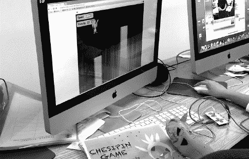

图 5.4 为`Chespin` `Scratch`游戏设计的可穿戴控制器手套。摄影：Veena Vasudevan。

从工作坊后的采访可以看出，青少年开始欣赏周围环境的可编程性，以及他们个人的兴趣最终如何驱动了这种可编程性。他们开始理解，编程最终是为了让技术更符合他们个人的偏好。这种学习很大程度上说明了创客活动（maker activities）中涉及的学习，促进了“我行”的动手设计，而且这里结合了数字元素。学生在反思中认识了这些好处。Christian 在提到他的游戏以及使用实体而非键盘时说：“实际上比键盘好用，因为用键盘时你可能会让游戏出现故障，同时不断攻击和移动。但用`MaKey MaKey`就做不到这一点，这实际上很有帮助。[那]其中包含了更多的投入，而不仅仅是不断地来回攻击和移动。”这些活动的特殊之处在于，学生同样重视制作和计算。设计游戏控制器和增强桌面游戏，以及将输入与屏幕上的输出同步，是一个单一整体的一部分，屏幕和实体同样重要。当游戏超出屏幕限制时，年轻的游戏设计师不仅学习了如`Scratch`中的循环和条件判断等基础计算概念，还学习了电路设计和材料导电性等基础工程概念。

## 扭转脚本：在线游戏启发现实电路

虽然这一章论证了将游戏设计扩展屏幕之外，但在一个奇怪的转折中，如今最流行的游戏平台之一恰恰鼓励相反的操作：从屏幕回到“现实生活”。所指的游戏是`Minecraft`（更多详细介绍请参见第 3 章），由瑞典游戏玩家 Markus “Notch” Persson 开发的沙盒游戏，现归微软所有。它在一个平台上整合了玩游戏和制作游戏。在`Minecraft`中玩的核心在于制作。该游戏在线版本的一个关键构建元素被称为`Redstone`（红石），等同于电力。红石是玩家可以在矿井底部找到矿石。当他们开采时，就会获得`Redstone Dust`（红石粉），这是他们制作红石电路所需的材料。它可以用于创建惊人的发明，例如可以运行的计算机或工厂。

为了制作红石电路，`Minecraft`玩家需要学习逻辑设计，就像在生活中一样。为了帮助新玩家制作这些电路，经验丰富的玩家编写了数百份红石教程，他们有时是计算机科学家或工程师，但通常是自学的活跃玩家。这些教程有时涵盖了等同于本科工程课程的内容，是许多游戏社区中流行的“元游戏”（metagaming）的有力例子，Gee 和其他研究人员曾写过这种现象，说明了学习如何超越游戏的限制。虽然光红石教程的设计和使用本身就足以提供丰富的研究素材，但在这里我们想阐明这种在线的`Minecraft`玩法如何引发了现实中的游戏和设计。

位于新泽西州名为`Soldering Sundays`的创客空间创建并发行了一套名为`Minecraft Circuits in Real Life` ((图 5.5)) 套装，并提供了教程和工作坊。利用`Minecraft`受区块启发的外观，孩子们不仅学习如何在红石中设计电路，在现实生活中也是如此。教程从简单的红石设计开始，提供逐步介绍，然后引入现实世界的电路设计，提供设计所需的材料清单（随套装提供），包括在线视频教程。例如，为了制作一个点亮 LED 的电路，玩家被指示设计一个`Minecraft`火炬。这里使用电烙铁、LED、电阻、电池和面包板制作了一个“现实世界的”`Minecraft`火炬。

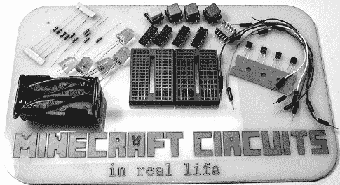

图 5.5 `Minecraft Circuits in Real Life`套装。摄影：Soldering Sunday, Paul Gentile。

Soldering Sundays 提供的教程和工作坊只是“制作”与“玩游戏”之间界限被打破的一个范例。公共图书馆开发的计划进一步说明了数字游戏如何回归到现实生活的制作与游戏中。利用`Minecraft`的人气，公共图书馆提供了以`Minecraft`为主题的创客风格工作坊，吸引年轻读者来制作书签、苦力人手链、背包挂钩、Steve（`Minecraft`中的主要玩家角色）包，甚至用扭扭珠制作玩具来模仿在线`Minecraft`像素化的图形设计。尽管这些活动中的许多在技术含量上明显低于上述电路设计工作坊，但它们的成果经常在图书馆内展示，不断提醒着人们与数字游戏及社区之间的联系。

这些与`Minecraft`相关的活动体现了“连接式游戏”的某些方面，在这种模式中，玩和制作不仅是在线宇宙的一部分；这样的宇宙同时拥有数字和物理平台。`Minecraft`玩家正在学习在线或离线设计电路。MaKey MaKey 引入了电路设计来连接到屏幕上的游戏，而`Minecraft Circuits in Real Life`则完全反转了剧本，利用屏幕上的电路设计来启发现实中的电路设计。连接式游戏证明了这些活动并非排他性，事实上它们可以互利互惠。

## 屏幕之外的严肃游戏

业余电子曾是一项流行的休闲活动，如今它已回归，将游戏与计算和手工制作结合起来。连接式游戏在这里提供的不仅仅是对过去的回归（尽管`Minecraft`的某些像素化图形显然闪烁着怀旧的情绪）；它还通过新旧材料提供了丰富的学习机会，让玩家能够窥视他们每天接触的技术是如何运作的。这种低技术手工活动、材料与高技术数字设计的结合，不仅增强了参与感，还通过使其更加透明化，促进了对计算、制作和游戏的学习。计算机科学教育者 Leah Buechley 和 Mike Eisenberg 认为，这种低高技术的结合通过帮助年轻学习者和设计师理解数字技术的特征和过程，让他们对“透明性”有了深刻理解，而这些技术长期以来隐藏在亮丽的外壳之后变得不可见。

孩子们现在还有机会通过学习制作的迭代本质：从一个想法到原型，再对两种设计进行测试，最终制作功能性控制器、在线游戏和增强现实桌面游戏。这里最突出的是对“重混”（remixing）的使用，工作坊积极鼓励这种做法，给学生提供必要的代码片段甚至可以操作的示例控制器。这种方法为初级设计师提供了一个平台，让他们在学校环境的时间限制内开发出可运行的游戏和控制器。更重要的是，绝大多数学生在重混代码和设计时超越了表面的修改，从而支持其作为初级程序员的有效方法。这种简单重混与创造性重混之间的区别，为我们如何利用这种实践进行评估提供了一个基本指标，尽管很明显，还需要更多工作来制定捕捉学生屏幕内外设计多维度的标准。我们完全同意，需要更多的研究和实施研究来微调这些手工和编码活动的引入。

连接式游戏说明了，实现透明化不仅是制作游戏的问题，还涉及到玩游戏以及然后根据这种玩重新制作游戏。一个良性循环是可以存在的。让学习者接触游戏的新材料、工具和活动，有助于拓宽并深化对计算的参与。从大层面来看，这促进了对数字游戏底层功能的理解，涵盖了界面、系统和材料设计等方面。从个人层面来看，连接式游戏允许更广泛的设计。这种跨领域的活动具有潜力吸引女孩和少数群体等玩家，他们传统上以更微妙的方式被边缘化。允许学习者拓宽他们的游戏和玩游戏的概念肯定了他们的兴趣，并将低技术与高技术结合，同时引入了新内容。这些新的、具体的游戏形式不仅为计算参与创造了新的空间和渠道，还通过展示这些技术实际上是多么亲密和日常，从而对技术的工作原理提供了更细致的理解。可以说，视频游戏机厅变得更广泛了，并因此变得更好。

## 备注

# 6 创意面：游戏模组与制作工具

如果说有什么指标可以说明游戏、制作和计算之间连接的流行程度，那就是突然涌现的众筹计划。根据其网站，2014 年有超过 22,000 个 Kickstarter 项目获得资金，游戏是第三大热门类别，仅次于电影和音乐。2014 年共有 1,980 款游戏获得资助，金额达 8910 万美元。资助的项目涵盖了广泛的话题，带回了如`Interstellaria`这样的老视频游戏——这是一个广阔的沙盒星系，让玩家在各种平台上通过现代机制体验老派太空游戏的精神；还有`AR-K`，它是对经典点点式故事游戏的致敬，并带有更新后的转折。其他人提了教孩子编程的桌面游戏，如`Code Monkey Island`，它声称通过提供一个家庭友好的桌面游戏让编程变得易如一碟，向 8 岁及以上的儿童介绍真实程序员使用的编程概念。还有`Robot Turtles`，它是 Kickstarter 历史上支持人数最多的桌面游戏，拥有 13,765 名支持者；它承诺“悄悄地教 3 岁以上孩子编程基础”。不过，Kickstarter 也支持小型活动，例如`luis_the_beat`的`The Lonely Raven`，他只请求了 200 美元，但收到了 252 美元来制作一系列“将是 RPG 和其他，它们是非营利游戏:)”（包含了拼写错误）。最后，资助者甚至可以用`Kano`制作自己的电脑，这是一个为全球所有年龄段提供基础计算机和编码包的程序，声称“像乐高一样简单，由 Pi 驱动”，允许任何人“制作游戏、学习代码并创造未来”。该活动筹集了 1,522,160 美元。

这些 Kickstarter 众筹活动只是 2014 年获得资金项目的一个小样本，忽略了此前几年中成千上万其他未达到目标的努力。当然，这也不包括来自其他众筹平台的结果。但即使对 Kickstarter 2014 年的倡议进行粗略回顾也足以清楚，各个年龄段的人不仅对玩游戏感兴趣，对支持各种类型游戏的制作感兴趣。这些倡议同样促进了在各种平台（包括屏幕内外）学习编程。虽然关于儿童玩视频游戏的教育价值的讨论将继续是一个更广泛的话题，并不可避免地会有支持者和反对者，但显而易见，孩子们通过制作视频游戏进行学习的教育价值，在校内外都被认为是一项非常有成效的活动。正如前面的章节所述，这种热情的很大程度上源于向更小年龄引入编程的趋势日益增加。然而，同样的动力也源于年轻人喜欢制作和分享自己的游戏。在学校方面，创作过程利用了学校一直标榜的、对 21 世纪学习至关重要的 STEM 学习。回想游戏研究者 Gee（2003）的评估，优秀的视频游戏在其设计中就融入了良好的学习原则。然而，问题仍然存在：在制作游戏的过程中正在进行什么样的构建和学习？游戏制作——以及随之相关的游戏——之所以增长如此巨大的原因之一，是出现了大量制作这些游戏的工具。“构建”的能力是 Web 2.0 技术的显著特征，这种技术鼓励儿童不再仅仅数字媒体的被动消费者，同时也成为活跃的生产者。

## 从 Logo 到现代游戏的演变

作为最早的儿童编程语言之一，Logo 的开发无疑是所有这些近期努力的先驱。Logo 最初开发于 20 世纪 60 年代后期，被设计为一种向儿童介绍计算机编程基础的手段。但在接下来的十年进入学校后，其创造者（以及实施该工具的 K–12 教师）很快发现，Logo 不仅向儿童引入编码，还可能支持传统的学术学科内容。Logo 创造者 Wallace Feurzeig（2010, 5）在回顾 Logo 的发展历史时回忆了这一转变：“我们相信它将引导教育的变革性变化——不仅通过它在学习真实数学方面的强大潜力（尽管这是我们最初的关注重点），而且在语言、音乐和科学方面……我们的长期愿望是它能够真正彻底改变教育。”这种从编程开始然后扩展到更多学术学科内容的模式，成为了学校内外及周边地区向儿童引入游戏制作的早期努力的标准。早期的研究专门设计用于利用游戏设计中相互互利的方面，强调编程的学习的同时，也指出此类努力如何与传统学科内容保持一致，例如数学学习，以及制品和表征设计中的写作。

## 新素养与计算参与

最近的发展为通过制作游戏进行学习的潜力增加了新的维度。教育工作者、研究人员和普通爱好者现在将游戏制作置于新媒体素养领域，并强调了基于系统的思维和对媒体的批判性参与等好处。将游戏制作视为具有教育意义的素养（或许多素养之一）的推动，在重新考虑 K–12 学校重视和培养学生的技能及内容方面，证明是一个强大的杠杆。其目标并不是产生大量的职业游戏设计师，而是给年轻学习者设计、开发和调试自己数字内容的机会，并在此过程中更好地理解基于 Web 的媒体的本质，以及通过此类媒体通过基于项目的评估进行协作的潜力。这当然让我们回到了最初的假设：计算参与是制作和重混视频游戏的能力，这非常为孩子们提供了对象，他们不仅可以借此巩固自己的思考，还可以支持他们在线与他人联系并促进未来的合作。

## 学校的角色与 DIY 精神

虽然 Web 为对游戏制作过程感兴趣的青少年提供了无数选择，但本章承认了教室、俱乐部和社区中心作为传播工具以及围绕游戏制作开发社区手段的至关重要性。这并不是说通过游戏制作学习并不延伸到学校之外；前五个章节的例子很好地证明了这一事实。但本章特别是整本书的主要目标之一，是开始关注这种 DIY 精神——即青少年在自己的时间里独立地与各种数字媒体互动——并开始探索这种精神如何置身于传统学校的环境中。媒体理论家、教育改革者和学校领导者在描述学校内外及周边使用 Web 2.0 应用时，越来越多地将“DIY”作为数字学习的新口号。

## 工具与沙盒游戏

因此，本章的第一部分考察了各种软件应用的急剧增长，这些应用作为允许青少年创建自己数字游戏的特定工具。我们从游戏作为学习的微型世界概念开始，特别关注“沙盒游戏”的本质——这个术语在之前的章节中被用来描述`Minecraft`。然后我们从易入性、促进复杂学习的能力以及允许各种用户体验的广泛性考察了其他教育和商业应用。我们还考虑了第四个原则，被称为“开放窗口”，因为不仅仅是工具，整个社区已经开始围绕在线制作和分享游戏发展起来，不仅已有的 Newgrounds，还有之前的视频游戏机在线扩展，如`Xbox Live Indie Games`。

制作游戏是为了理解和设计世界（无论是在屏幕内还是外），为了游戏和学习。在这里，我们联系到构造主义学习中的另一个核心概念，早期人们将`Logo`等编程环境视为“微世界”，用以理解数学、研究特定概念并体验学习。`Logo`中的乌龟世界是一个“地方”，一个“数学之国的省份”，在那里，某些类型的数学思维可以轻松地萌发和成长。微世界被描述为“一种基于计算机的交互式学习环境，其前提条件被构建在系统之中，学习者可以成为自己学习的主动构建建筑师”。⁶](#c10464_006.xhtml_c6-note-6) 一个经典的例子是`Dynaturtle`，这是一个物理环境，学习者可以在其中体验牛顿物理以及具有历史意义的替代方案（如里士多德物理）。乌龟的运动和状态可以预编程以响应某些运动定律，并由学习者进行操作。与计算机教程或计算机辅助教学不同，微世界中并不提供关于定律的显式指令。学习者通过与一个预先程序化为无摩擦宇宙中对象的乌龟进行交互，从而推导出这些定律。

如果我们把制作教育游戏（如本章前面描述的那些）视为制作微世界的一种形式会怎样？计算机科学教育者和内容专家已经开发了大量的数学和科学领域的微世界，因为这些世界的设计需要对领域本身有深层理解，以及学习者对该领域的非正式和概念性理解。⁷](#c10464_006.xhtml_c6-note-7) 在我们的案例中，学生设计者是为玩家创建微世界的人，在这个过程中，他们深入且广泛地接触他们所学习的内容、他们喜喜特质，以及他们如何在计算媒介中表达这些内容。显然，学生设计者在这个过程中不仅学习了内容，还学习了编程，而且关于他们自己的学习也同样重要。

更进一步，学习科学家`Nathan Holbert`和`Uri Wilensky` (2014) 构思了一种新的微世界形式，他们将其称为“沙盒游戏”，它以巧妙的方式将游戏制作与设计和玩微世界整合在一起。在这些沙盒游戏中，学习者被提供一个微世界，让他们能够围绕核心概念制作并游玩自己的游戏。例如，在赛车沙盒游戏中，`Holbert`和`Wilensky`利用了一种广受欢迎的运动游戏机制，为设计者提供了一个沙盒和工具，允许他们构建赛道和汽车，然后给赛道的不同部分上色以代表不同的速度（见图 6.1）。游玩赛车游戏随后变得就像运行并参与一个真实的实验，学生设计者可以检查结果并修改限制以测试他们的假设。通过与学生小组一起工作，他们发现参与沙盒设计不仅增加了学生对关键表示的理解，还正如预言的那样引入了非正式的理解。

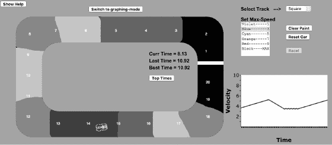

图 6.1 沙盒游戏截图。感谢`Nathan Holbert`。

就像原始的微世界一样，此类沙盒游戏让作为设计者和玩家的学生接触到一些思想和现象，例如他们在常规教科书或课堂课程中可能无法遇到的无摩擦世界。这些沙盒游戏也是一种环境，通过对学习者的交互和操作提供反馈，来挑战其天真的理解。最后，与沙盒游戏的交互允许学习者发展出个人知识，这种知识可以为更正式的交互提供基础。正是这些正式表示是许多商业赛车游戏，但玩家很难从实际的游戏体验中提取它们。沙盒游戏成为一种学习环境，其中讨论科学是游戏的一部分。沙盒游戏中的“用于思考和分享的对象”就像`Logo`中的乌龟世界，正如上面提到的，变成了一个地方，一个数学之国的省份。“微世界是一个孵化器。”⁸](#c10464_006.xhtml_c6-note-8) 这与`Gee`等人在玩游戏中学习和读写方面的发现非常相似。在沙盒游戏中，制作和玩游戏变得紧密交织。

## 游戏工具与社区的设计原则

尽管过去十年见证了设计数字游戏工具数量的激增，但许多工具都有共同的祖先——即`Logo`。`Logo`现在因其在纸上的铅笔乌龟图形而广为人知，但它并非专为视频游戏设计而创造，而是很大程度上支持了儿童学习的高可玩性制品的设计。通过为儿童提供一种他们用来生成特定构件的功能性工具（一个“用于思考的对象”，正如`Papert` (1980) 所的那样），抽象学习被植根于物理层面，使这一过程更具实体感，并推之变得极具个性化。

作为`Logo`的继承者，现在已经存在许多制作个人视频游戏的工具。⁹](#c10464_006.xhtml_c6-note-9) 我们并不根据每个游戏设计工具可能可能提供的特定学习成果来评估它，而是根据其促进儿童制作游戏的能力来对工具进行评估。计算机科学教育者`Mitchel Resnick`和`Brian Silverman`阐述了在开发任何旨在通过制作促进儿童学习和发展的构造类工具包时需要注意的核心原则。¹⁰](#c10464_006.xhtml_c6-note-10) 使用房屋或建筑的隐喻，他们建议此类工具需要满足前三个原则：

- **低门槛 (Low floors)**：一种足够直观的工具，允许新用户逐渐且有信心地适应它。
- **高天花板 (High ceilings)**：一种同样允许更熟练的用户创建构件（在本例中为视频游戏）随其水平提高而变得日益复杂和精细。
- **宽墙壁 (Wide walls)**：一种除了低门槛和高天花板外，还允许用户创建广泛构件的工具，让他们利用个人经验以及流行文化元素来设计出完全独特且代表他们自身兴趣和背景的内容。

我们增加了第四个原则，以强调构造工具同样重要的社交维度：¹¹](#c10464_006.xhtml_c6-note-11)

- **开放窗户 (Open windows)**：一种促进数字媒体共享的工具。数字社区的创建代表了让计算机编程成为青少年更容易掌握的技能的前沿。

那么，教育游戏制作工具和社区在多大程度上符合这四个原则呢？通过对每个标准进行仔细分析，结合对这些各种游戏制作工具的使用研究，显然，同时管理这四个原则并非易事，但也是完全可能的。

### 低门槛

Logo 及其所有后代的目标一直是寻找一种媒介，让曾经艰苦的编码过程对青少年来说更易上手、更简单。最直接的是，这涉及到一个技术组件。传统上，编写视频游戏需要大量的输入，即使是最微小的语法错误也可能导致游戏完全无法运行；而现在许多工具仅依赖于“拖放”式的编码方法，用户只需在各种对象上移动鼠标，然后通过点击并释放来添加游戏分数或玩家移动性等游戏功能。

对于`Scratch`来说，这些对象是控制屏幕上猫咪角的可编程积木；对于`AgentSheets`，它们是分层数字表格；而对于`GameMaker`和`GameSalad`，可点击对象则是级联的弹出窗口。鉴于大多数孩子在六岁时就能操作鼠标，这种拖放式编程让编码变成了一个非常直观的过程。

与此同时，`Gamestar Mechanic`采取了不同的方法。该游戏基于这样一个假设：年轻用户已经知道如何通过操作硬件在技术上玩视频游戏。由游戏学院（Institute of Play）开发的这款引擎利用这些既有知识，来教玩家如何同样地制作他们自己的视频游戏。`Gamestar Mechanic`在整个叙事中为玩法（例如“任务”）填充了各种游戏制作教程，并奖励玩家可编程对象，这些对象可以在他们反复获得设计和开发视频游戏的技术知识的同时，用于构建他们未来的创作。

游戏研究人员罗伯特·托雷斯（Robert Torres）对一组初中生在六个月内使用`Gamestar Mechanic`的研究，很好地捕捉到了“低门槛（low floors）”的概念，以及通过首先理解（并个性化）游戏规则来学习制作游戏的本质。他的研究特别关注其中一名参与者——十一岁的塔尼亚（Tania，这是一个化名，所有使用的名称均如此），她描述自己为“低到中等成就者”；但尽管有这一评估，塔尼亚仍然有效地学会了如何创建一个创新的视频游戏，这既源于她作为`Gamestar Mechanic`玩家的体验，也源于她创作“让人放松的游戏”的个人愿望。

通过将自己对安静的渴望与`Gamestar`形象的任务联系起来，将家中的房间与各种游戏关卡联系起来，并将她那个“态度傲慢的小妹妹”视为游戏所需的对抗性且强化性的反馈，塔尼亚创建自己视频游戏的能力由于她作为`Gamestar`玩家的技术经验，以及她个人的创造力和感性而得到了促进。

这种共鸣的元素——即塔尼亚根据自己的生活经历对玩法进行个性化的能力——值得进一步考虑。然而，对于一个游戏制作工具要真正保持“低门槛”，比技术可行性更重要的可能是，它必须确保其游戏玩法的内容对新用户来说是可识别的或至少是具有吸引力的。为此，编程工具`Alice`采用了与畅销视频游戏系列《模拟人生》相同的 3-D 角色和对象；`ToonTalk`和`Scratch`都具有亲和力的“吉祥物”（分别是一只色彩斑斓的鸟和一只微笑的橙猫），而`Kodu`将其游戏制作软件与广流行的 Xbox 控制台同步，将终端用户的开发配置为用户从控制台上所熟悉的图形。

在某种程度上，将自己的游戏引擎置于高度可识别的对象中，这反映了更广泛的研究领域，该领域将游戏制作本身归为一种切实的“对象”，年轻人可以通过它来学习编程。从这种意义上说，游戏制作本身作为一种“对象”，将编程根植于真实且有意义的人造物。通过给孩子们一个他们可以围绕开发这些游戏的特定“对象”（无论是立即识别的 3-D 角色还是引人目的卡通），工具设计者进一步让这个过程对孩子们来说更加个性化、更容易。

### 高天花板（High Ceilings）

在地基铺设之后，下一个问题变成了这些不同的游戏制作工具在多大程度上有能力留住他们的用户。易用性是确保新手用户访问和使用游戏工具的第一步，设计人员还必须确保他们的游戏引擎足够强大，以确保更有经验的用户不会厌倦软件，并能找到新方法来更熟练地制作更复杂的细节视频游戏。这再次让我们回到了计算机编程的问题。

低门槛标准旨在降低制作视频游戏对学习编程的需求，而“高天花板”部分则反相反，强调了其底层代码的功能和效率。更复杂的编码功能（例如开发控制和数据结构的能力）允许增加游戏内部的功能和效率，并带有许多专门强调其与行业级语言接口的工具。在其他工具中，包括`Alice`将其语法切换为`Java`的能力、`Panda3D`与`Python`和`C++`的接口，以及`Phrogram`翻译为`Java`、`C#`和`Visual Basic`的。

学习科学家凯莉·普普勒（Kylie Peppler）和雅斯敏·卡法伊（Yasmin Kafai）（2007a）对十五岁的 Jorge 的案例研究，很好地捕捉了年轻游戏设计师不仅能达到有效编程的高天花板，还能通过无缝模仿精细重建流行媒体的潜力。在专门针对周边社区低收入少年的计算机俱乐部中使用`Scratch`，他在八个月的民族研究期间一直是那里的常客。

他创建的第二个项目是一个名为《合金战士：死亡地带 X》（*Metal Slug Hell Zone X*）的视频游戏，这是对热门射击类视频游戏系列《合金战士》的致敬。通过在`Scratch`中仔细编码每个精灵（sprite）以对按键击做出迅速响应，Jorge 完全重现了原游戏特征性的形象流畅度，探索并在某种程度上重新制定了射击类游戏的类型规范。然而，Jorge 的高天花板式重建不仅限于代码，因为游戏中的每个角色和动画也是数小时使用`Scratch`的绘图编辑器绘制和协调图像的结果，而这些图像又是基于他对原视频游戏所做的铅笔速图。媒体研究人员大卫·巴金汉（David Buckingham, 2003, 134）指出，“在媒体教育中，模仿是学习不可不可的一个方面”，而 Jorge 自己的视频游戏证明了模仿达到更高级水平的教育潜力。

对于 Jorge 的模仿而言，他面临的最重大挑战是修改他的代码以提高效率，从而重现出原始游戏中那种直观且流畅的动作和反馈。对于许多经验视频游戏开发者来说，访问更复杂代码（如递归）这种高上限的能力不仅意味着他们可以创建更精简的游戏，还能让他们展示出一定的编程造诣。事实上，许多研究已经强调了上述工具能够为初级计算机科学课程带来可衡量的收益。计算机科学教师已经意识到，可以使用列出的这些基础面向对象、拖拽式工具作为该领域入门课程的手段，在转向基于文本的语言之前，让学生掌握基础编程概念。还有人甚至试图完全消除这种天花板，例如计算机科学家布莱恩·哈维（Brian Harvey）及其同事，他们在现有的 `Scratch` 工具中添加了过程。他们修改了 `Scratch`，允许更有经验的 `Scratch` 程序员通过组合原始 `Scratch` 工具中的预存积块，设计他们自己的可代码积块（“自定义积块”或 `BYOB`，现在称为 `Snap!` 编程语言），然后将这些组合重命名为单个积块或过程。这些 `BYOBs` 在单个积块中封装了更多功能，允许在视频游戏的底层代码中实现精炼和高效。最终， `Snap!` 编程语言即使对于高度精通的程序员也能实现他们在工业级语言中找到的功能水平，将完全新手和顶级专家统一在单一语言/工具之下。

## 宽墙 (Wide Walls)

在定义了地板和天花板的垂直维度后，有效游戏制作工具的第三个组件在于水平维度——“宽墙”。宽墙意味着一个工具允许各种创作的能力——在这种情况下，就是各种类型的游戏。有效的游戏制作工具必须允许用户创建各种流派的游戏，无论是平台跳、第一人称射击、角色扮演、策略、问答还是迷宫游戏，等等。这当然不是一项易事，因为设计师在创建自己的游戏类型时拥有的选项越多，新手就熟悉该工具的整体设计和功能就越困难。毕竟，对于任何游戏制作工具的新用户来说，在传统游戏类型的既有元素和特征基础上进行构建，开始生成自己的游戏要容易得多。

游戏引擎 `Sploder` 是很好的例子。`Sploder` 拥有超过四十万注册用户（其中 60%是青少年），它通过允许注册用户重新混合四种类型的游戏之一（平台游戏、物理谜题、算法混搭或射击游戏）来吸引初级游戏设计师。用户可以在既有游戏的结构上进行构建，这一事实对那些几乎或完全没有编程或游戏经验的人来说极具吸引力。用户不需要开发全新的游戏引擎并向其中填充对象，只需简单调整这些游戏的既有结构，即可开发出自己独特、个性化的版本。`Sploder` 的四个选项确实为对其中一种或多种视频游戏类型有好感的用户提供了更低的准入门槛。然而，整体多样性的缺乏——即工具缺乏宽墙——意味着任何不熟悉或对这四种视频游戏原型不感兴趣的新用户都没有其他切入选项。工具 `GameSalad` 提供的选项比 `Sploder` 少——只有第一人称射击游戏的变体，这是一种青少年男孩中流行的游戏流派，但对女孩来说往往缺乏吸引力，且对较小儿童来说不太合适。

另一方面，`Scratch` 工具从其首页提供了更广泛的游戏类型，以及所有类型的互动项目。该网站不仅推广了平台、迷宫和射击等最常见的流派，还通过在其极具竞争力的“精选”（Featured）板块中定期展示这些广泛的用户生成内容，鼓励选择式冒险类故事、涂色游戏和时尚设计挑战（等）。通过对在社区技术中心开发的总计 534 个 `Scratch` 项目进行采样，并根据游戏类型对每个项目进行分类，我们发现了强劲的多样性：50.8%为互动叙事项目（例如动画、互动艺术和叙事游戏），7.3%为体育游戏，2.3%为模拟游戏，8.8%分布在其他游戏类别，包括迷宫、节奏游戏、角色扮演游戏、互动射击游戏、赛车游戏和平台游戏。虽然有些项目无法分类（22.3%是没有关联游戏机制的纯图形文件），但数字细分地表明，使用 `Scratch` 没有单一路径。

这种对宽墙的需求延伸了工具本身，对教育工作者也具有特殊意义。在过去的几年里，一直讨论如何在 K–12 课堂中更好地整合视频游戏制作。然而，除非游戏制作能够有效整合到 K–12 课堂的学科内容中，否则学校几乎无法利用游戏设计和开发的建构主义功能。当然，正如本章开头所示，在利用游戏制作作为一种整合传统 K–12 学科内容的方法方面已有记录的成功；第 3 章概述了这种蓬勃发展的成功，最著名的是纽约市的 `Quest to Learn`。但对成功整合的分析表明，需要一个清晰的计划使学科内容与游戏制作活动的整体结构对齐，这样才能持续下去。这种对齐并非偶然或运气。这其中的很大一部分工作归由领导各个教室的教师承担。同时，教育工具的设计者必须敏锐地意识到宽墙是他们设计和完善工具的绝对要求，因为如果这些教育工具要被教师接受——即使是尝试——它们就需要表现出足够的灵活性，以便在各种学科和背景下促进学习。

低门槛、高天花板和宽敞的墙壁为游戏制作工具的理想形态提供了一个隐喻房屋的视角。然而，如上述所示，我们希望在考虑计算构建套件时增加第四个组成部分：开放的窗户。孩子们在何处以及如何分享他们创作的视频游戏？也许更重要的是，他们在何处以及如何真正学习制作这些游戏？社区一直被默化地认同为促进任何学习的关键要素之一，从设计视频游戏这种专业化技能，到学习说话这种基础能力无不如此。然而，随着“实践社区”概念以及 Gee 的“亲和小组”和“亲和空间”的出现，教育工作者和研究人员越来越多地关注社交互动在学习过程中的作用。这很大程度上与互联网作为一种社交互动的新方式的兴起有关。特别是随着 `Web 2.0` 的到来，社会对“社区”概念的含义（或可能含义）的理解在极短的时间内发生了巨大变化。聊天室、大型在线角色扮演游戏，以及 Facebook 似乎无处不在的出现，都是社区的例子；它们虽然被称为“虚拟”的，但很大程度上植根于日常生活的物理和真实存在。这种“构建”的能力也是 `Web 2.0` 技术的显著特征，它不再鼓励孩子们做数字媒体的被动消费者，而是活跃的生产者。

## 游戏制作与 DIY 社区

那么，游戏制作已成为这些新技能之一，使青少年在 Web 环境中的参与身份从数字媒体的消费者转变为生产者，从这种生产中不仅产生了一种新的 DIY 伦理，还有基于共同兴趣的新 DIY 社区。不过，这并不是说游戏制作社区在互联网热潮之前不存在。在他们对“游戏设计”的概念中，Katie Salen 和 Eric Zimmerman (2004) 不断回到观众在开发自己的视频游戏（无论在线还是离线）中的基础重要性。即使在没有明显的观众玩自己的视频游戏创作时，优秀的设计师总是在对一个构想的、潜在的观众进行考虑的基础上来构建和完善游戏性。在这里进行共同性思考，并预测和适应潜在玩家如何对自己的结构化挑战做出反应的能力，或许是一个有效游戏设计师的唯一定义性特征。即使一个人的观众显然是本地且离线的，这一准则也不会改变。研究在课堂内创建数学游戏的小学学生的核心要素是，这些小学学生随后继续分享这些教育数学游戏，以支持其他小学学生的学习。Jill Denner 及其同事也开始开发本地观众在设计过程本身的作用，进行了一系列围绕结对编程活动的研究，这些活动反过来促进了一系列围绕游戏制作的微型社区。社区在协作游戏设计中的作用在计算机俱乐部（Computer Clubhouse）中也占据了重要地位，这是一个面向少年的国际俱乐部网络，通过这个网络，使用 `Scratch` 工具出现了一个充满活力的游戏设计社区。在两年里，数百种不同的游戏在这些俱乐部中被设计、开发和共享，这一过程几乎成为成员之间的一种成年礼。

## Scratch 的兴起

在从本地社区向在线、全球社区的迁移方面，`Scratch` 工具值得特别关注。在所有在开发相应在线社区方面取得进展的游戏制作工具中，`Scratch` 特别脱颖而出，它不仅是第一个做到的，而且是最成功的。`Scratch` 网站被誉为“交互媒体的 YouTube”，目前在全球拥有超过 700 万注册成员，自 2007 年发布以来，已上传了超过 1000 万个项目。虽然许多如 `YouTube` 和 `Flickr` 等网站支持用户生成内容的上传和下载，但 `Scratch` 网站的独特之处在于它提供了一个让用户分享交互式媒体的平台。在网站上上传和下载项目不仅仅是信息的交换，而是个人创作内容的交换，而且这些材料随后可以被下载和重混（remix）以创建完全全新的项目。因此，人们对 `Scratch` 网站越熟悉，就会遇到越各种项目和代码脚本，人们可以亲自对其进行采样和重混。

## 其他游戏制作引擎

在线 `Scratch` 社区的巨大成功引发了其他游戏制作引擎在超越工具并进入社区方面的类似兴趣。`Alice` 团队开发了 `Looking Glass Community` 作为其游戏工具的在线扩展（参见[[6.2]），而营利性的 `Kodu` 和 `GameMaker` 工具在过去几年里也开发了在线社区。即使是那些尚未为共享和下载游戏开发出自己的稳健在线社区的工具，在增加在线存在感方面取得了一些进展。`ToonTalk` 从其主页提供指向外部网站的链接，用户在这些网站上分享了他们自制的 `ToonTalk` 游戏。`AgentSheets` 与组织 `Ristretto` 合作，允许通过 `Java` applets、`Gamestudio` 和 `Game Editor` 在网络上发布，并在各自的网站上留出页面，供用户分享和评论彼此游戏的截图。

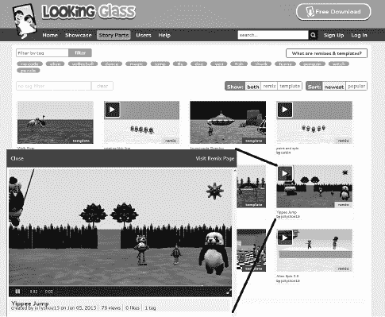

[图 6.2] Looking Glass 项目截图。感谢圣路易斯华盛顿大学 Looking Glass 研究小组。

## 互动与协作

在开启通他人工作窗户方面，`Scratch` 网站是这些其他网站的绝佳范例。由于用户可以在网站上创建在线简介并通过网络互相成为“好友”，`Scratch` 在线具有一种亲切的感觉，这种感觉由于近期社区努力鼓励用户之间进行积极的同行反馈（特别是从经验丰富的的用户到新手）而得到了加强。`Forums`（论坛）部分同样支持在线协作，用户在广泛的话题上发帖，从如何创建更高级的滚动游戏到如何吸引更多 Scratch 用户关注自己的项目。也许最有趣的是，`Scratch` 社区的协作挑战（在第 3 章中有详细介绍）邀请成员组成两个或更多人的小组（在线或线下，或兼有），以参与主题性项目制作。过去的挑战包括音乐间奏、包含三个迥异物体的游戏以及选择自己的冒险的角色扮演游戏。通过由管理员和长期以来 Scratch 成员组成的评判小组，每次挑战都会在 `Scratch` 网站备受推目的“精选”（Featured）首页上宣布获奖者，为项目本身提供链接（从而带来更多流量）。

在我们对参加 Scratch 首次协作挑战的九级学生的研究中，同样变得清晰的是混混（remixing）或修改（modding）其他项目以完善和增加原创游戏的作用。从这个意义上说，当工具允许这种自由的修改时，这种做法就具有内在的教学功能。在 Scratch 网站上，自由访问他人代码以及对这些代码进行调整和构建的能力，为该网站提供了一个受欢迎的透明度水平。当然，虽然出现过玩家未恰当引用他人作品的情况，但在 Scratch 上自由修改他人作品的能力从总体上加强了该网站作为游戏制作工具的地位。这并不意外。优秀的视频游戏一直允许终端用户调整游戏性。无论是简单地选择自己的头像、更换服装，还是改变游戏的配乐，这些修改选项都让玩家使游戏更具个性化且更有意义。

## 从游戏制作到游戏修改

虽然为游戏制作活动开发的工具主要侧于支持课堂社区的学术技能和内容，但游戏修改活动已集中在粉丝社区的参与性游戏和生产。游戏研究人员伊利莎白·海耶斯-吉（Elizabeth Hayes-Gee）认为，在研究和实践中，游戏制作与游戏修改活动之间的区别已变得不再明显，她引用了计算机科学家珍妮特·王（Jeanette Wing）对计算思维的观点，即“同时也有信心安全地使用、修改和影响一个大型复杂系统，而不必理解其每一个细节”。游戏修改工具——就像用于游戏制作的工具一样——可以为玩家提供低门槛，便于对头像设计和游戏水平进行简单更改；高天花板，允许复杂的项目和对游戏机制的操作；宽墙壁，提供提供超越游戏本身的各种修改机会；以及在讨论论坛中分享修改和游戏见解的开放窗户。

对游戏社区活动的研究表明，年轻和年老的玩家同样利用了各种修改机会。例如，在流行的《小大星球 2》（*LittleBigPlanet2*）主机上，玩家受邀并得到公司的支持生成自己的关卡设计，并为其他玩家开发游戏规则和挑战。事实上，已经开发了超过八百万此类用户生成的设计，促进了一个充满活力的游戏社区的出现。在一个案例中，粉丝为游戏主角主角比（Sackboy）制作的针织图案被公司所有者采纳并推广给更大、更热烈的玩家群体。同样，《模拟人生》（The Sims）系列在女性玩家中特别流行，拥有丰富的修改文化，玩家不仅为其他玩家创建新的挑战或游戏，还讨论使用特定命令更改游戏的恰当方法，或绕过挑战的快捷方式。在钻研系统的各个方面时，玩家学习了从简单的图形处理到设计新关卡和插件的各种技能。另一个游戏修改的例子是库尔特·斯奎尔（Kurt Squire）和利维·乔瓦内托（Levi Giovanetto, 2008）在《文明 3》玩家中进行的研究——在线 Apolyton 大学的玩家驱动开发。他们发现一小群玩家聚集在一起设计教学资源和工具，帮助新入和其他玩家变得更有学问。这些例子说明了游戏修改如何引导玩家从用户转变为设计者。

受此类修改实例的启发，教育研究人员已开始将元游戏（metagaming）实践转化为教育机会。在课后俱乐部的案例中，研究人员观察了玩《世界兽》（*World of Warcraft*）的少数男性青少年如何参与各种数字媒体和计算素养实践，以及集体问题解决和协作学习。一个专注于玩《文明 3》的课后俱乐部展示了游戏专业知识的开发最初需要导师（更有经验的玩家）的参与，随着青少年玩家不仅在游戏动态方面，而且在对时间线、术语和地图的历史理解方面发展出专业知识，导师的重要性逐渐下降。在每种情况下，学习玩复杂游戏并不是为了其本身，而是为了帮助玩家反思和阐述与学术内容相关的价值理念。与其教授内容，不如为他人重制内容成为首选的操作模式。每个课后俱乐部都变成了一种志趣文化——一个分享想法的学习社区。就像二十年前“光灯项目”（Project Headlight）中第一章引言性短文所描绘的学生教学游戏设计者一样，编码和内容的学习并不是为了其本身，而是为了与他人分享。

这些为了促进素养和学习而对游戏修改活动的适应表明，未来发展处于玩游戏和制作游戏的交汇点。近期一些用于修改和制作游戏的工具开发进一步说明，连接性游戏已迈出第一步。例如，SimCityEDU 不仅让玩家能够开发并成功管理城市及其市民，还为他们提供了分析工具，以更好地理解模拟世界中不断变化的动态。Scratch 2.0 环境中的新功能允许成员通过访问和使用调查网站信息的编程工具，更好地了解谁在在线分享，以及他们分享了什么。这是两种不同的方法，但目标相同，都是“查看内部结构”以理解在这个巨大且互连的社区中发生了什么。专家们在《模拟城市》中编写工具，而玩家自己则在 Scratch 中编写工具。展望未来，没有理由让《模拟城市》不能提供可编程的工具来允许终端用户自定义他们的调查，而 Scratch 中的预编程工具可以提供给那些想在设计自己的游戏之前先体验真实模拟的人。事实上，后一种方法已经存在。这些努力确实跨越了游戏制作和修改之间划定的界限，以互利的方式相互告知，并促进了重视所有形式计算参与的连接性游戏愿景。

Papert 在序言中提到：“或许游戏制作之所以作为一个具有理论意义的领域，最重要的方式在于它强调了*重要性*作为思考何种适合学习的情境的类别”，这在很大程度上触及了为什么游戏制作在儿童学习方面曾如此重要且未来将继续如此的原因。无疑，视频游戏至关重要，因为它们极其受欢迎，而游戏制作利用了这种重要性，为孩子们提供了更紧密地成为这一广泛现象的机会，同时将他们的技术和内容学习植根于特定的构建或一个“用于思考的对象”。但从更宏观的角度来看，游戏制作从独立工具向更广泛社区的转变显而易见的是：真正重要的工具实际上是社区。Papert 对 `Logo` 乌龟作为“思考对象”的评估，现在很可能被作为“共享共享对象”的视频游戏所取代。

这些设备在社会向在线伙伴关系日益增长的迁移过程中，具有真正的现实价值。Lawrence Lessig（2008）关于重混（remix）的研究表明，制作与分享之间的界限每天都在变得越来越模糊，对过去十年游戏制作的简要回顾就能充分证明这一点。擅长制作的人日益也成为擅长有效分享事物的人。正如这种从工具到社区的趋势所示所示的，制作就是分享，分享就是制作。事实上，随着 `Scratch 2.0` 的发布，MIT 设计团队不再区分作为工具的 `Scratch` 和作为社区的 `Scratch`。相反，年轻的设计师在单一站点上进行编码和交流。人们的预期是，这些新的社区窗口最终将使连接和协作变得更加容易，从而为每个人进一步降低地板、提高天花板并拓宽墙壁。

这对于设计这些游戏制作平台的程序员以及希望将平台纳入课堂的教育工作者都有影响。对于设计这些游戏制作平台的人来说，需要努力 Bridge 游戏制作工具与游戏制作社区；正如之前提到的，除了 `Scratch` 之外，营利性的 `Kodu` 和 `GameMaker` 已经开发了在线社区，`Alice` 也将加入三者。但所有设计师同样需要开发和推广在线论坛，用户可以在其中上传自己的游戏并下载他人的项目；应该鼓励重混。他们需要通过允许用户在线上互相添加“好友”以及根据共同兴趣建立自己的志向小组来促进社交互动。通过允许让游戏制作伙伴在线连接，游戏制作平台的设计者本质上让孩子们接触到了最有影响力的资源：他们的同伴。

对于教育工作者来说，总而言需要更多地关注基于项目的协作学习。虽然纽约`Quest to Learn`的全课程整合并不需要成为事实上的模型，但美国范围内越来越多的学校（包括费费城的`Science Leadership Academy`和圣地亚哥的`High Tech High`）已经意识到需要拥抱基于技术的建构主义方法，而不是传统的教学模式。如果说承认这种从工具到社区的运动代表了游戏制作教育者、设计师和研究人员的一项任务，那么还有两个推论任务。

首先，单从硬件角度来看，游戏和游戏制作正在走向移动化（一些人认为“已经移动化了”）。在《青少年与数字》（The Young and the Digital）书中，S. Craig Watkins（2010）将手持设备描述为 21 岁以下青年的真正“总站”，并指出在过去的三年里，某些人群中使用手持移动设备的儿童数量每年增长高达 141%。对于教育游戏制作工具的设计师来说，这意味着他们的软件不仅需要兼容，还需要专门为手持设备设计。这在技术上提出了全新的挑战，但本着`App Inventor`的精神，包括`Game Editor`在内的许多工具已经开始精力放在通过移动设备进行创建和分享上。这无疑说明了第 5 章描述的向手持对象的增长趋势。

第二个推论是教育工作者和研究人员要开发实用且可靠的评估方法，通过游戏制作衡量儿童的学习。为了让游戏制作最终更频繁地进入 K-12 教室，我们需要特定形式的评估，即使不是标准化的。第 4 章描述了佐治亚大学计算机科学家 Betsy DiSalvo 及其同事的工作，他们的`Glitch Game Testers`计划以及其他游戏编程调试活动为游戏制作评估提供了潜在的途径。通过给学生视频游戏的部分版本，并要求他们修改或编辑部分，教育工作者不仅拥有与游戏设计和开发相关的活动，还拥有可以以相当客观性进行衡量的基于构建的评估。

现在比以往任何时候都，儿童和教育工作者都能轻松获得极其广泛的游戏制作工具。而且未来会有更多，这从 2016 年新一批获资的 Kickstarter 项目中显而易见。但如果要让所有儿童都能真正实现连接游戏，这些地板、天花板、墙壁和窗口元素必须在新兴工具中到位，而且学校自身必须意识到一些最棒的游戏制作课程已经发现的：社区实际上与工具是不可分割的。

# 7 为所有人的连接游戏

2013 年 10 月 2 日，喜剧中央频道长寿动画剧集《南方公园》（South Park）的一集关注了成功的独立游戏`Minecraft`。在这一集里，《南方公园》的孩子们担心父母对色情露骨戏剧化犯罪剧的成瘾会导致现实世界中的暴力。他们使用父母级内容拦截器，通过一个只有孩子才能知道答案的问题阻止了有线电视接入：在`Minecraft`中如何驯马？为了夺回他们的有线电视权限，《南方公园》的大人们们决定自己去学习`Minecraft`。然而，他们玩 Atari 2600 的背景对他们并没有太大帮助。在游戏开始时制作他们的木小屋时，一个特别不幸的父母疑惑：“好了，那么游戏什么时候开始？”对此感到挫败的小导师回击道：“你正在玩游戏呢！这就是游戏！”

## 这个《南方公园》的故事到底哪里引人注目且具有启发性？

虽然许多其他视频游戏都取得了商业成功，但没有哪一个能像`Minecraft`那样引起热烈的反响。孩子们喜欢它，而父母们——嗯，父母们偶尔会感到困惑。由于于 20 世纪 80 年和 90 年代，他们对视频游戏的参照物是童年的主机，如 Coleco、Atari 和最初的任天堂娱乐系统。但有趣的是，父母们曾指责视频游戏是儿童暴力和注意力缺陷症的根源，而现在他们站在屏幕前，试图学习`Minecraft`是如何“运作”的。

正如哈佛研究员劳伦斯·卢特纳和切尔尔·奥森所言，过去的二十年里，尽管面临矛盾的证据，书籍和新闻报道一直在斥责视频游戏的危险。但今天，父母似乎并不介意孩子玩`Minecraft`。考虑到`Minecraft`在许多年幼儿童中受欢迎，而他们在接触数字媒体时被认为是特别脆弱的群体，这一点尤为令人惊讶。在《南方公园》对这些问题的俏皮调侃中，孩子们实际上是试图阻止父母进入`Minecraft`的人，而不是相反。这是他们的领域，他们是那些理解制作与游玩是同义词的人。视频游戏是否终于离开了角落，并因其所能提供的良好学习环境而获得了认可？

## Minecraft 的 DIY 精神

`Minecraft`成功的另一个惊人观察是，孩子们正在制作并玩一个具有简单方块形状形象的游戏——这些形象是由玩家自己设计和构建的。`Minecraft`的像素复古风格与商业视频游戏的高清图形几乎没有共同之处，在那些游戏中，专业的计算机图形设计师和程序员花费数千小时来渲染头发和水，使其尽可能栩如生。那些游戏启发了吉（Gee）去思考视频游戏在学习和读写方面能教给我们什么。

但这种受 DIY 启发的图形和心态针对的是不同的受众——或许与`Minecraft`中的“手工艺”概念相联系。微软在 2014 年 9 月以 25 亿亿美元的高价收购`Minecraft`，这清楚地标志着该游戏日益增长的人性和商业成功。这个最初只是一个瑞典游戏设计师的热衷项目，已成为游戏领域的全球现象。

## 重写学习的规则

此外，正如数字媒体研究员伊藤美子（Mizuko Ito）最近声称的那样，`Minecraft`现在是如何“重写学习的规则”的？她注意到极客老师们如何在生物和历史课程中使用`Minecraft`，孩子们如何在公共图书馆参加夏令营，以及国际游戏日 Minecraft 饥饿游戏锦赛最近诞生了它的首位女性冠军。伊藤指出，许多以主要在数字媒体上“混日子和胡闹”而闻名的青少年（引用她书的书名是这样），已经通过通过一起制作物品和游戏进入了“极客化”状态。

在`Minecraft`中，有无限的升级方法，玩家操作的服务器将数字公民身份交到了创造者手中，而不是商业公司。其他任何学习游戏，即使是像《模拟城市》、《模拟人生》系列或《文明 III》这样的成功作品，也没有达到`Minecraft`拥有超过一亿付费订阅者的规模。微软最近为`Minecraft`启动了一个教育频道，以利用和支持教育者中的这些学术兴趣，并投资开发了带有教室特殊学习工具的扩展教育版本。

## 连接性游戏的愿景

`Minecraft`的故事和成功无疑向我们传达了一种连接性游戏的愿景，在这种愿景中，玩游戏和制作游戏正在融合，而不是分离。在这种愿景中，计算参与可以并且成为日常游戏的一部分。伊藤本人注意到：

> `Minecraft`更像乐高或 Logo 编程语言。在西摩尔·帕珀特（Seymour Papert）的术语中：孩子们为计算机编程，而不是被计算机编程。当然，你可以把学校内容放入`Minecraft`世界中，但其核心是`Minecraft`关于在网络化社交世界中进行构建和解决问题。这种块状的独立风味贡献了`Minecraft`中的 DIY 创造文化，孩子们感到被赋予了创造属于自己的东西的力量。

游戏、编码和制作之间的联系终于建立了。在《连接性游戏》（Connected Gaming）中，我们认为制作和游玩游戏是计算参与的形式，它促进了与他人共同解决问题、为他人并与他人设计直观系统，以及理解这些背景下人类行为的文化和社会本质。这就是伊藤所识别的“网络化世界中的构建和解决问题”。

此前，此类理念与计算机科学的基础概念、实践和观点紧密相连，但它们现在正成为日常数字公民身份的标志。我们在`Scratch`、`Minecraft`和许多其他编程环境中看到的，是构建、混合和共享的社区实践的开始，这让玩家能够成为各自社区的完全参与者。新的信条是，这不仅关于玩游戏，还关于制作游戏；这就是连接性游戏。

## 未来应用

针对儿童开发的应用程序越来越多，允许他们在计算机内外为自己和他人制作属于自己的游戏。正如我们在第 5 章和第 6 章中讨论的，近期大量的游戏制作套件和新一代智能玩具很好地说明了孩子们不再仅仅想要那种为他们发光发声的互动玩具。相反，他们渴望那些能让他们进行交互设计的玩具和游戏。他们想成为决定灯光闪烁和蜂鸣器响时刻的人。如果说`Minecraft`前所未有的成功说明了什么，那就是潮汐正在向构建主义游戏转变。

在`Connected Gaming`中，我们尝试在制作和游玩游戏的背景下，将计算与参与这两个方面结合起来，以更好地解决让青少年参与数字公共领域的挑战。能够在编程和游戏社区中参与和协作，是成为活跃贡献者、而非仅仅是数字媒体和设备的消费者的关键。

对于实现这一点的可能性，我们既乐观又谨慎。从我们之前的著作`Connected Code`中，我们知道，让孩子们编写游戏、将他们分组并鼓励他们对代码进行混合（remix），很难解决所有与拓宽数字公共领域准入和深化数字公共领域参与相关的挑战。同样，我们在`Connected Play`中对虚拟世界中青少年的观察表明，仅仅让孩子们转向在线不足以拓宽准入并深化参与度。

如果我们希望儿童能发展出自己的数字身份，那么就需要有网站致力于提供多样化且持续的参与机会。在接下来的章节中，我们将探讨如何理解严肃游戏中的学习与素养，以及如何在教育背景下实现连接性游戏，并讨论我们在扩大和深化更广泛范围的计算参与方面所看到的各种机遇与挑战。

## 在连接性游戏中定位学习与素养

当 Gee 断言玩视频游戏可以教我们关于学习和素养的知识时，他的意思是游戏体现了许多我们在学习环境（无论数字与否）中应该寻求的具前景的特征。其中，他强调了游戏的社交属性，这种属性要求玩家合作解决问题并克服挑战；玩家在游戏中不断前进所需的动力努力；以及游戏为对文本的真实阅读和写作提供的背景前提。

他还认为，虽然游戏促进了这些方面的许多方面，但教育者不应将此视为将一切都转变成游戏的号召。但这已成为很大程度上严肃游戏运动的动力，该运动将数字游戏法的教育效能完全归功于它如何吸引学习者，而很少或完全不关注游戏发生的更广泛的背景。

事实上，正如麻理工学院教育游戏场（Education Arcade）报告的作者所说，“游戏学习的倡导者倾向于采用两种截然不同的方法为正式教育设计游戏。”

第一组将商业游戏（如在《魔兽世界》`World of Warcraft`和《文明》`Civilization`中观察到的那种游戏）视为理想模型，并认为这些视频游戏的互动性和沉浸感远超学校让年轻学习者持续参与数字媒体的能力，而这些媒体日益成为 21 世纪生活的特征。

然而，第二组通常避开商业游戏，转而专注于教育游戏，如《单词岛》`Word Island`和《数学大爆发》`Math Blaster`，它们旨在强化传统的学术内容领域，特别是数学和阅读。正如报告观察到的，“第一组拥抱游戏并放弃了学校，而这第二组往往拥抱学校，却损害了任何看起来像真实游戏的体验。”

视频游戏还是学校游戏？显然存在这样的划分。问任何一个 8 到 18 岁的学生指出商业游戏和教育视频游戏之间的区别，他们通常在实际游戏几分钟内（甚至几秒钟内）就能发现这种区别。游戏最终是关于游戏本身的，还是它仅仅是学术内容技能训练和练习的薄弱外壳？是否存在超越词汇记忆和数学方程记忆的叙事或故事线？

这引发了另一个问题：流行游戏和教育游戏之间是否存在中间地带？这是教育游戏设计者和教育者在涉及如何更、更广泛将游戏整合到正式学习环境中时，一直关注的核心问题。

严肃游戏运动在 Gee 的观点的基础上，一直认为游戏的教育潜力位于商业产品和技能训练练习之间，并以此寻找这一中间地带。相比之下，我们认为真正的解决方案并不位于商业和教育之间，而是处于游玩和制作游戏的实践之间，从而将严肃游戏中的建构主义和教学主义努力结合起来。

Gee 本人在后后的论文中反思时，也建立了游玩与制作之间的联系：

> 事实上，当人们有机会谈论（并写作）他们正在学习的内容时，学得最好，这是一个至关重要的学习原则。我写这本书学到的东西可能比任何人读这本书学到的得多。

虽然他是在评价写自己的书和论文，但写作像编程是一种制造活动，人们在其中构建一个制品，无论这个制品是数字的、物质的还是混合的，并不重要。

正如我们在本书开头提到的，目前关于严肃游戏的讨论大部分围绕着“为了学习而玩游戏”。特别是，Gee 的学习原则阐明了玩游戏可以获得什么。我们发现，这些关于社区、素养和动的原则也适用于为了学习而制作游戏。对玩游戏学习有效的方法，对制作游戏学习也同样有效。

为什么不呢？Gee 的主要观点是，游戏是学习环境的极佳案例，但这并不意味着一切都必须是待游玩的游戏；它也可以是被制作出来的的游戏——参考 Papert 序言的标题。在`Connected Gaming`中，我们将这些之前独立的讨论线索结合在一起，因为我们所主的，玩家和游戏本身已经在他们的游玩中融入了这些。

我们在商业和教育背景中看到了为游玩和制作游戏提供的平台。严肃游戏应该效仿，打破在教学主义游戏和建构主义游戏之间建立的边界。

超越游戏的具体细节，关于学习如何和何处发生，更大的断言涉及素养的问题，即学习什么。在这里，我们清楚地重申在`Connected Code`中已经表达的内容，概述了孩子需要学习编程以发展我们所谓的“计算参与”，即“与他人一起解决问题、为他人并与他人设计直观系统，并借鉴计算机科学基础概念、实践和视角来理解人类行为的文化和社会本质的能力”。

在促进计算参与方面，我们的目标不是让所有孩子成为计算机科学家。事实上，他们中很少有人编写支撑我们日常生活的代码并设计系统，但他们都需要理解代码，以便以建设性、创造性和批判性的审视数字设计以及影响他们日常生活的决策。正如我们之前写过的：

> 从功能层面来说，对代码的基本理解使我们能够理解每天遇到的所有界面、技术和系统背后的设计与功能。从政治层面来说，理解代码赋予了每个人力量，并为他们提供了资源来审视和质疑充满他们屏幕的设计决策。最后，在个人层面，每个人都以某种方式需要并使用代码来进行表达目的，以便更好地与他人交流、互动并建立关系。

这些理解在二十一世纪是关键的，因为我们都是出于不同目的的数字技术使用者，无论是出于功能性、政治性还是个人考量。这就是素养的功能，也是任何素养的所在。在玩游戏和制作游戏的过程中，我们开始理解、改变并重塑我们生活及参与其中的数字世界。我们该如何更有有针对性地在教室、俱乐部和社区中实施这些努力呢？

## 正式实现用于学习的连接性游戏

我们现在有证据表明，让学生参与游戏制作并学习计算概念、实践和观点，同时学习学术内容和元认知技能是可行的。与教学主义的对应者一样，建构主义游戏为学习和素养提供了社交、动机和情境支持。

为了让严肃游戏的讨论走出各自的象牙塔并向前发展，值得追问：建构主义和教学主义方法可以互相学习到什么？最显而易见的答案是主张连接性游戏，将“玩”与“做”结合在一起。但在考虑此之前，我们想看看之前的步骤，即考虑包含两者的元素，从而扩展用于学习的游戏制作或游戏努力能发挥的作用。这将使我们能够基于数百研究人员在过去十年中设计、检查和测试教学工作方面建立的深厚知识的基础上。

对于教学主义游戏，我们看到最直接的应用源于促进游戏模组（game modding）的努力——那些已经在为游戏玩法增加设计的活动。显然，设计的程度范围可以从修改角色和关卡到实际构建新游戏。

Hayes-Gee 借鉴了 Wing 的计算思维观点，通过强调我们也需要“有信心安全地使用、修改和影响一个大型复杂系统，而不理解它的每一个细节”，在游戏制作和游戏模组之间建立了一座桥梁。管理复杂系统的能力（无论是设计还是修改它们）无疑是计算参与的标志之一。

正如第 6 章所探讨的，游戏模组工具像游戏制作工具一样，可以提供低门槛以促进开始和简单改变、高天花板以允许复杂项目和操纵、宽墙以应对可修改部分的多种兴趣，以及开放窗户以增加社交参与。在模组系统的各个方面时，玩家学习了技术技能，范围从简单的图形处理到设计新的关卡和插件。游戏模组最终引导玩家从用户转变为设计师。

我们看到，让玩家有意识地参与大型游戏生态中的元游戏活动（metagaming）具有同样的益处，例如讨论论坛、评论、作弊网站和广泛的模组。这些元游戏活动要求玩家从“体验中”的立场转向更具反思性的姿态，评估自己和他人的玩法。

参与讨论论坛，玩家分享克服挑战的策略或开发关于游戏如何开发的理论，这引导玩家审视系统设计的结构和动态。写评论是另一种方法，可以引导玩家为他人评估游戏和玩游戏，并让他们参与到阐述和审查策略以及他们学到的知识。

通过分析作弊网站，我们知道玩家不仅使用它们，还设计了它们以与他人分享他们对游戏的理解。我们之前注意到，游戏设计可能会让玩家只寻找正确答案，因此对作弊网站设计者除了发布信息外没有太大要求。但教学游戏也可以设计成这种方式，使得简单的作弊是不可能的。在这里，问题可以有多个正确答案，并要求作弊设计者投入更多精力提供解决方案。

此外，我们认为促进混合体游戏具有益处，例如 Holbert 和 Wilensky 在第 6 章中讨论的沙盒游戏。在这里，通过使用早期建构主义中提倡的微世界（microworlds）方法，将教学设计和建构活动整合在一起，将学生的学习体验置于特定领域的语境中。

当学生不仅能够体验无摩擦的世界，而且开始修改和实验关键参数时，他们既是玩家也是设计师。我们看到这里教学主义和建构主义游戏之间的边界正在崩溃。这些努力将内容专家和计算设计师结合在一起，思考如何从两方面支持学习。这些混合体挑战我们重新考虑“玩”和“做”在哪里，以及我们如何利用两者的长处。

同样，在让用于学习的游戏成为更丰富事业方面，我们可以从教学主义对应者那里学到什么？一个突出的元素是游戏法的表演性，这在游戏制作中可以获得更多关注。我们指的是，游戏不仅是被制造的，也需要被玩过。

我们在各种项目中注意到，设计师经常担任自己游戏以及他人游戏的玩测试员。在过去的软件设计研究中，我们总是通过这种方式强调这种用途，例如，邀请为这些游戏设计的更小学生参加可用性测试。这些可用性测试是专业软件设计的一部分，也称为“以用户为中心的设计”，设计师希望确保用户实际上可以使用该软件。

此类会议不仅在软件完成时进行，而且在整个过程中进行，以便在任何设计错误深根根于软件界面和架构之前捕获它们。我们过去非常成功地使用了此类测试会议，通常持续时间不超过十到十五分钟，在此期间，有志向的设计师获得关于其设计和功能的至关重要的反馈，而用户则学习如何进行建设性批评。

我们可以通过增加其他活动（即游戏设计不仅被玩，而且被评估）来进一步加强建构主义游戏的受众维度。我们在第 3 章中提到，像 STEM 国家视频游戏挑战之类的竞赛为游戏设计师分享他们的游戏和相互学习提供了一个可能的真实语境。此类挑战可以作为学生完成设计的外部观众和动力。

最后，我们强调教学设计在促进建构主义活动中的作用。尽管这看起来有些矛盾，但让学生参与建构主义游戏并不意味着他们必须从零开始——这并不是在玩双关语。在第 5 章中，我们讨论了屏幕之外的游戏设计，并给出了几个例子，说明我们如何为学生提供定制的启动活动和控制器设计，以便他们在其初级工程和编程技能水平下，能够在学校项目时间的限制内取得成功。我们很早就意识到，许多此类项目所需的材料知识和软件技能超出了学校教学单元的范围（因为其课时有限且教师专业知识有限），而且不能像大学生那样依赖学生在课外完成工作。设计此类这类脚手架并决定哪些部分进行“黑箱化”、在哪些部分为学生开放设计空间，是一项棘手事务。这通常需要与不同小组的学生对一个项目想法进行多次迭代，以理解其进展，但也要理解学生和教师双方都会遇到的障碍。我们认为这是未来研究的一个丰实方向。

但最终，我们希望思考能够将“玩游戏”和“制作游戏”整合在一个框架下的平台。通过我们在书中对`Minecraft`的多次探索，显而易见，这正在成为现实。随着微软提供教育频道和扩展的教育版本，很清楚，一些商业公司（在本例中，甚至是全球最大的软件公司之一）看到了严肃游戏的方向。在教室环境中玩游戏和制作游戏意味着什么？到目前为止，大多数案例都是由第一批无勇敢的教师通过自己开发的。对于其他不具备同类技术专业知识或`Minecraft`经验的教师来说，效仿这种做法意味着什么？考虑到许多学区经费紧张的状况，对于`Minecraft`这种需要为每个学生账户付费的订阅模式，我们该如何看待？我们该如何秉持独立游戏机的精神，促进更多不仅不仅限于商业游戏主题、而且向其他社区开放的开发？这些是许多问题中的几个，我们预测这些问题在未来几年将占据研究人员、设计师和教师的关注。我们对连接游戏的预期既充满希望也保持谨慎。最重要的是，我们意识到并非每个人都能获得这些机会，这就是为什么我们需要讨论围绕加宽以及深化计算参与的挑战与机遇。

## 拓宽连接游戏中的参与度

虽然我们看到了连接游戏的诸多许多益处，但我们也清醒地意识到，让每个人都参与到制作、玩和参与中面临着许多挑战。不仅是邀请，实际上维持参与度可能是`Minecraft`和其他在线社区在成为面向所有人的可行学习社区方面面临的最大挑战之一。拥有`Minecraft`账户的数百万创作者以及在`Scratch`网站上发布的数百万项目，表明了参与范围既广泛又深入。但事实并非如此。庞大的数量实际上掩盖了参与者和项目多样性的匮乏，正如我们在第 4 章中观察到的那样。女性和少数群体在数字生产中参与度匮乏是一个长期以来存在的问题，游戏领域的情况也不例外。与许多个人成功故事相反，我们知道并非每个人都加入了游戏，也没有像庞大的数字看起来所示的那样深度参与其中。作为第一步，我们需要关注谁来了，谁没来。

我和她的同事们在他们的多点民族志研究中已经指出，许多青少年聚在一起玩闹，但很少有人进入到我们在早些章节中描述的如`Minecraft`、`Newgrounds`和`Scratch`等创意在线社区中的那种“极客式”状态。我们通过对课堂中`Scratch`的研究直接获知，许多学生确实对将程序发布到在线`Scratch`社区不感兴趣。我们最初假设学生会急于想知道其他年龄相仿的孩子在网上创作并发布了什么。令我们非常惊讶的是，他们起初对加入网站或浏览网站上的其他内容都不感兴趣。我们应该将这种抵制视为一个指标，表明并非所有人对加入和参与在线社区都感到自在。仅仅因为你可以在网上访问它，并不意味着每个人都能使用。即使在像`Scratch`这样不需要像`Minecraft`那样支付月费的在线社区中也是如此。

我们确实需要更好地了解阻碍进入在线创意社区的初始障碍是什么、在何处、信号告诉新用户他们是受欢迎的，可能更重要的是，谁被邀请进入了俱乐部。这有一些简单的事情，例如拥有可自定义的角色，这不仅允许不同的性别，还允许不同的种族。`Minecraft`最近才在其默认角色`Steve`的基础上增加了一个女性玩家`Alex`；Apple 引入了不同肤色的表情符号；`Whyville`甚至允许玩家选择他们第一个虚拟化身的肤色和性别。这些是让更多玩家参与的小小但重要的步骤，向他们传递每个人在网上都可以拥有代表性的。进一步的例子针对的是活动本身，并在邀请新成员加入俱乐部的同时提供协作的机会。第 3 章讨论的`Gray Bear Productions`案例很好地说明了某些玩家可以自己组织此类高效的协作，可能是因为他们互相认识或拥有某些技能，但新成员加入这一行列则要困难得多。

在加入计算、游戏和制作俱乐部的第一步之外，我们还需要理解谁在参与以及以什么方式参与。我们从少数可用的研究中得知，虽然有数百万玩家注册，但实际上只有一小部分玩家真正参与了进来。通过挖掘两个大型在线青少年社区的后端数据，我们对这种情况有了相当充分的了解。在`Whyville`（一个针对青少年的虚拟世界）案例中，我们发现最多只有 5%的玩家所有类型的社交网络和参与中最为活跃，而另一半人仅对许多可用活动进行间性的参与。我们还观察到参与度在数量和质量随时间波动；它既不是逐渐的线性增长，也不是人们想象的那种常量。在`Scratch`（一个青少年在线编程社区）案例中，我们发现大约 10%的贡献者不仅在发布项目，而且在评论方面也最活跃。但持续的大规模参与仅限于这一小群`Scratch`成员。换句话说，我们在网上遇到的绝大多数内容都是由少数参与者产生的。

我们也可以关注独立游戏开发领域，这一领域与其电影行业的对应领域一样，其重要性和流行程度日益增加。许多人将其视为游戏创新的孵化器，因为许多商业视频游戏采用了类好莱坞的制作模式，使得对成熟格式进行实验成为一项财务上高风险的业务。现在已经有不止一个游戏可以玩、也可以制作，而且随着游戏人口群体的扩大，游戏设计也可以成为一种独立的设计活动。这并不总是意味着我们需要专门为女孩设计特殊的游戏，或者提供对性别友好的资产来让游戏设计对她们来说更容易接受。这意味着我们可以将游戏设计视为数字领域中的一种表达媒介，就像电影、动画和图形作品一样。从教学学的角度来看，我们可以对选择的话题、工具以及游戏设计发生的背景更加周全，正如最近的一项研究所示，女孩在与其他女孩在一起或与男孩在一起时，会设计不同的游戏。

扩大连接性游戏参与度的任务同样需要考虑个人主义和自主性。需要呼吁让孩子们在使用此类媒体时不仅更具鉴别力，而且在本质上更具创造力和创业精神。改革者断言，这不仅是对个体儿童的要求，也适用于国家的整个教育体系。在游戏制作方面，这个 DIY 社区专注于有效游戏性所具特征的设计和艺术元素，因为这些是技术和内容组件。DIY 伦理中同样至关重要的是同伴协作的角色，尽管该术语与一种“粗放、单打独斗”的感觉相联系，但`DIY`意味着建立志同道合的创造者网络，这导致媒体理论家亨利·詹金斯将`DIY`媒体重新命名为“我们自己做”媒体。鉴于自主和协作这些元素的教育意义，在评估用于教育游戏制作的工具和社区时，将这种 DIY 视角加入技术和素养视角是非常重要的。

## 深化连接性游戏的参与度

除了增加机会和扩大参与度外，我们还需要关注深化计算参与度。这正是真正的挑战所在。让更多孩子进入游戏、`computing`和制作的“俱乐部”，并让这些领域向更多多元化的玩家和创作者开放是至关重要的。但一旦他们进入了那里，我们需要关注如何更深层次地吸引他们，使他们的参与能够变成本应具有的意义且丰富的学习体验。根据我们在第 2 章和第 3 章中讨论的内容，我们知道这种对内容、`coding`和协作的参与是难得的；事实上，大多数团队在“野外”的在线创意制作中从未完成过一个项目。我们可以认为，此类失败协作中的玩家和创作者可能会学到一些重要的教训，或许带有流行的“生产性失败”概念的精神——这种精神在更受限的活动中已被证明，许多学习者能从第一轮未能解决问题中获益，但在下一次面对问题时会变得更成功。虽然在制作游戏这种更复杂、开放且长期的项目背景下，我们没有这方面的经验证据，但我们可以看到至少尝试尝试制作某些东西本身就是一种有价值的学习体验。

归根结底，我们关注的是确保计算参与不会局限于少数能够读写支撑了我们数字生活大部分内容的代码的精英；相反，所有人都应该能够参与组成数字公共生活的多个方面面。因此，我们不能依赖偶然的成功案例，而需要找到让所有人都能发展胜任能力的方法。这让我们回到了在`Project Headlight`中进行的第一个游戏制作项目，那是 20 世纪 80 年代开始的一个实验，旨在“发明未来”，正如计算机先驱艾兰·凯俏侃所说，这是预测未来的最好方式。建构主义游戏本应是我们设想数字技术整合到学校教学中的一个模型。它的核心思想是通过从头到尾创建一个完成的产品（或`application`，应用程序）来定位`coding`的学习，这旨在提供完整的学习体验。它的目标是将`coding`与数学、语言艺术和艺术联系起来，而不是将其视为一项独立的活动。它的理念是拥有一个观众和一个社交背景，用于分享和使用这些游戏。所有这些理念在更近的努力中得到了体现，例如`Quest to Learn`学校、`Globaloria`平台和`STEM National Video Game Challenge`。

此外，我们需要意识到，虽然玩游戏和制作游戏是通往计算参与的重要阶脚石，但仅靠这些活动是不够的。更充分的计算参与形式只有在项目也经过讨论、评判和交换后才会出现。与此对话特别相关的是最近的一项研究，发现在`Scratch`网站上发布内容是所有可见参与的基准，其次是下载，最后才是评论。至少在`Scratch`社区中，评论是除了单方面分享项目或下载他人项目之外，社交互动的最早迹象之一。因此，尽管评论是`Scratch`上许多可选活动之一，但它提供了孩子们参与的更丰富的证明之一。学习`code`不仅涉及学习编程语言和通用算法的技术细节，还吸收了编程社区内的社交实践。换句话说，学习`coding`不仅包括技术技能的获取，而且是在社交背景内被吸收。

这些并不是来自两个在线社区的孤立发现，这两个社区都诚然具有教育侧重点。很可能是，需要订阅的商业网站会以更广泛的方式吸引玩家，因为这涉及到财务投入。但事实并非如此。通过近期对一百多个面向儿童的 DIY 媒体网站的最新调查，教育研究人员 Sara Grimes 和 Deborah Fields 发现，虽然这些网站中的许多一个都邀请了制作，但并没有很多分享，因此，大多数参与者错失了发展计算参与度的关键元素。虽然这种分享在`Scratch`和`Whyville`等教育导向的网站中得到了更积极的邀请和培养，但在许多商业网站上仍然是一个稀缺但关键的特征。随着人们让孩子接触`coding`的兴趣增加，此类社区在提供计算机会和参与方面的重要性只会不断增长。

虽然教学主义游戏已作为一种增强和支持学术学习的工具进入校园，但建构主义游戏为我们带来了引入计算的额外优势。最近的进展为开发学习类游戏的潜力增添了新的内涵。教育工作者、研究人员和普通爱好者现在将游戏制作置于新媒体素养的领域，并强调了如基于系统的思维和对媒体的批判性参与等益处。

正如我们指出的，将游戏制作视为具有足够教育意义、并使其成为一种素养或多种素养之一的这种努力，在重新审视 K–12 学校重视以及传授给学生的技能和内容方面，已被证明是一个有力的杠杆点。目标并不非要培养大批职业游戏设计师，而是要让年轻学习者获得设计、开发和调试自己数字内容的机会，并在过程中更良好地掌握基于 Web 的媒体的本质，以及通过此类媒体进行项目制评估中协作的潜力。

二十多年前，游戏和计算被认为是教育领域中奇特的小众，但现在它们已成为在收入和相关性上超过电影业的全球产业。许多大学已经开设了游戏设计课程为该职业做准备，计算机科学课程再次在校园内流行起来。此外，正如游戏化的成功所示，游戏已成为生活的方方面面。数字游戏不再仅仅是一种媒介，它们还成为了一种转变学习和日常活动的方法。

## 结语

在 1971 年一份名为《计算机可以做的二十件事》的 MIT 备忘录中，计算机科学教育者西摩尔·帕特（Seymour Papert）和辛西娅·所洛门（Cynthia Solomon）勾勒了一个大胆的愿景，即计算机如何通过使用名为`Logo`的语言帮助儿童学习。他们写道，学习编程允许学习者与计算机对话，引入新的学习方式。这些思想成为了《心灵风暴》（*Mindstorms*）一书的基础和素材，帕特在几年后写了这本书。

但在备忘录中，他们建议了多种可以让儿童参与编程的活动：通过编程让笔抬落使乌龟在纸上画画；编写行为让乌龟遵循有线条的路径；或者通过编写一个让乌龟画螺旋的程序来参与几何学习。甚至还有玩耍和编写自己的名为《玩太空大战》（*Play Spacewar*）的游戏的可能性。

``

这种愿景早已在那里，并在几句话中概述：将玩游戏和制作游戏视为互为互利且互补的过程。备忘录在结束建议列表时，要求读者再想出二十件用计算机做的事。这种对递归的幽默引用，鼓励了想法的无限流动，非常符合连接游戏的精神，它将游戏的玩耍和制作结合在一起。那么，你的这二十项清单里有什么呢？

## 致谢

关于制作游戏和学习的第一本书书籍《游戏中的心灵》（*Minds in Play*）于 1995 年出版。但当时的时机不对。一方面，学校里的编程运动到 20 世纪 90 年代初已经走完了。光亮的多媒体 CD-ROM 标志着当时的“新”技术。既然你只需要指向和点击来与机器交互，为什么还要编程呢？另一方面，关于视频游戏影响的讨论大多集中在负面方面，认为此类游戏在青少年中煽动暴力和厌视女性。严肃游戏运动直到十年后才开始兴起。幸运的是，时代在变。如果说曾经存在一个讨论游戏、计算和学习的肥沃时期，那就是现在。

许多人一直是书中推倡理念的支持者。有埃利奥特·索洛韦（Eliot Soloway），他曾在 80 年代邀请雅斯斯敏（Yasmin）来到耶鲁大学加入他的研究小组，并在社区中开启了许多机会。这无疑包括西摩·帕特，他无畏的精神从未受到传统边界的束缚，并且理解了学习的激励性和建设性本质。还有迪特·哈雷尔（Idit Harel）以及大卫·珀金斯斯（David Perkins），她的支持、想法和热情引导了学习型游戏设计的论文研究——她现在已成功通过`Globaloria`将其扩展为一个全国性的获奖计划。教育创新者多琳·格雷里·尼尔森（Doreen Gehry Nelson）一直是我们的志同道合者，早在我们之前她就理解了关于学生学习和教学中的主体性和赋权，正如她在她的“城市建设教育”计划中所展示的那样。还有梅根·弗兰克（Megan Franke），她看到了通过游戏在教师教育中对数学教学和学习提出批判性问题的潜力。

从 1989 年到 1994 年，波士顿 MIT 媒体实验室认识论与学习研究小组以及随后的学习与常识小组的许多成员为对话做出了贡献：埃迪丝·阿克曼（Edith Ackerman）、亚伦·布兰德（Aaron Brandes）、艾米·布鲁克曼（Amy Bruckman）、亚伦·法尔贝尔（Aaron Falbel）、格雷格·加加里安（Greg Gargarian）、里基·戈尔德曼（Ricki Goldman）、尼拉·格拉诺特（Nira Granott）、保拉·胡珀（Paula Hooper）、雅克琳·卡拉斯拉阿尼亚（Jacqueline Karaslaanian）、弗雷德·马丁（Fred Martin）、尼古拉斯·尼格罗庞特（Nicholas Negroponte）、史夫·奥科（Steve Ocko）、米歇尔·埃瓦德·佩雷斯（Michele Evard Perez）、米切尔·雷斯尼克（Mitchel Resnick）、朱迪·萨赫特（Judy Sachter）、艾兰·肖（Alan Shaw）、布莱恩·西尔弗曼（Brian Silverman）、卡罗·斯普里（Carol Sperry）、卡罗·斯特罗海克（Carol Strohecker）、希莱尔·温特拉乌布（Hillel Weintraub）和乌里·威尔伦斯基（Uri Wilensky），以及 Project Headlight 的许多老师，其中包括马奎塔·米诺特（Marquita Minot）、格温·吉布森（Gwen Gibson）和已故的校长埃莉诺·佩里（Eleanor Perry）。特别是，乔安·龙金（Joanne Ronkin）值得表扬，她是一位模范教师和创新者，将《游戏中的心灵》中特色的第一个游戏设计项目引入了她的课堂。

围绕游戏和学习的对话在洛杉矶加州大学继续进行，由研究生丹尼尔·巴提（Daniel Battey）和辛西娅·卡特·钦（Cynthia Carter Ching）进行，随后离开了校园进入了洛杉矶的活动中心（Clubhouses）。在这里，最值得注意的是凯莉·普普勒（Kylie Peppler），在我们与 MIT 媒体实验室的同事一起原型开发`Scratch`的过程中，她贡献了关于创造力和计算的观点。虽然学校还没有准备好接受游戏，但活动中心的数百青少年向我们证明了事实并非如此：在`Scratch`中制作游戏是他们最受欢迎的活动之一。感谢南洛杉矶活动中心的纳塔什卡·琼斯（Natashka Jones）和詹姆斯·沃森（James Watson），欢迎我们进入他们的社区和社区，并带来了数十位大学本科生导师。

在宾夕法尼亚大学，游戏设计转向了在线。通过与宾夕小学学校的查德·莫特（Chad Mote）合作，我们开发了该校首届使用`Scratch`的游戏制作竞赛。游戏制作活动随后包含了 DIY 接口。在这里，理查·李·戴维斯（Richard Lee Davis）、李恩京（Eunkoung Lee）和加布里埃拉·理查（Gabriela Richard）研究了实体和可穿戴游戏控制器的增强棋盘的设计。特别是维纳·瓦苏苏德万（Veena Vasudevan）在实施和理解第 5 章描述的针对高中和初学生的各种项目方面起了至关重要的作用。费城的许多人帮助他们在学校和教室为这项工作铺平了道路，其中包括科学领导学院的克里斯·莱曼（Chris Lehman）和卢克·范米特（Luke van Meter），以及宾夕小学的彼特·恩德里斯（Peter Endriss）。

在写作过程中，我们还想感谢在不同阶段对本书做过贡献的许多人。具体而言，我们要感谢 Doug Clark 和 Deborah Fields，他们都对早期的手稿提供了详尽的意见。我们还要感谢那些帮助从他们的档案中寻找并提供章节插图图像，或帮助澄清法律问题的人士们（致敬你们美敦公司和芭芭比，《重混版》！）：Casey Fiesler, Paul Gentile, Nathan Holbert, Caitlin Kelleher, Daryl Moran, Alex Repenning, Jay Silver 以及 Veena Vasudevan。我们在麻省理工学院的编辑 Susan Buckley 是一位非常出色的倾听者，在手稿演变过程中，她总是提供深思且诚实的反馈。

如果没有美国科学基金会的支持，我们的工作将是不可能的。在过去的二十年里，该基金慷慨地资助并维持了围绕计算、游戏和学习的理念，这些理念促成了相关的研究，其累积见解被记录在本书中。虽然我们必须加上惯用的免责声明，书中表达的任何观点、发现、结论和建议均代表我们自己，因此不代表美国科学基金会的观点，但我们对其提供的关键支持深表谢意。

最后，我们要感谢我们的家人和朋友，他们在撰写本书及上一本书的过程中通过各种方式给予了我们耐心与鼓励的支持。我们都很高兴工作已经完成，现在我们可以去玩耍并制作我们自己的游戏了！

Yasmin B. Kafai 和 Quinn Burke

2016 年夏季

# 参考文献

1. Abelson, H., and A. diSessa. 1980. *乌龟几何：作为探索数学媒介的计算机*. Cambridge, MA: MIT Press.

2. Adams, J. C., and A. R. Webster. 2012. “学生从游戏、音乐视频和叙事项目中学学到了什么？” 见于 *第 43 届 ACM 计算机科学教育技术研讨会论文 (SIGCSE)*，643–648. New York: ACM.

3. Ahmed-Ullah, N. S. 2013. “芝加哥公打击表现不佳的特立学校。《芝加哥论坛报》，2 月 27 日. `http://articles.chicagotribune.com/2013-02-27/news/ct-met-cps-board-meeting-0228-20130228_1_charter-schools-beth-purvis-schools-ceo-barbara-byrd-bennett` (访问于 2016 年 4 月 5 日)。

4. Akcaoglu, M. 2014. “在游戏设计与学习夏季营通过制作游戏来学习解决问题。《教育技术研究与发展》 62:583–600.

5. Akcaoglu, M., and M. J. Koehler. 2014. “游戏设计与学习（GDL）课后项目的认知成果。《计算机与教育》 75:72–81.

6. Al-Bow, M., D. Austin, J. Edgington, R. Fajardo, J. Fishburn, C. Lara, and S. Meyer. 2009. “利用游戏创作向高中生和教师教授计算机编程。《ACM SIGCSE 学报》 41 (3): 104–108.

7. Alper, M. 2011. “对《探索学习：为数字时代儿童开发学校》的评论。《儿童与媒体杂志》 5 (4): 467–471.

8. Andersen, T. L., S. Kristensen, B. W. Nielsen, and K. Grønbaek. 2004. “设计增强现实桌面游戏：BattleBoard 3D 体验。” 见于 *第 4 次交互设计与儿童会议*，137–138. New York: ACM.

9. Anderson, C. 2012. *制造者：新的工业革命*. New York: Crown Business.

10. Antle, A. 2013. “研究机会：具身认知儿童机交互。《国际儿童机交互期刊》 1 (1): 30–34.

11. Aragon, C. R., S. S. Poon, A. Monroy-Hernández, and D. Aragon. 2009. “两个社区的故事：培养科学家与儿童的协作与创造力。” 见于 *第 7 届 ACM 创意与认知会议*，9–18. New York: ACM.

12. Arthur, C., and K. Stuart. 2014. “视频游戏如何变成世界上最新的观赏运动。《卫卫报》，8 月 30 日. `http://www.theguardian.com/technology/2014/aug/30/video-games-spectator-sport` (访问于 2016 年 4 月 3 日)。

13. Baek, Y. K. 2008. “什么阻碍了教师在课堂中使用计算机和视频游戏？探索阻碍计算机和视频游戏普及的因素。《网络心理与行为》 11 (6): 665–671.

14. Barab, S., M. Thomas, T. Dodge, R. Carteaux, and H. Tuzun. 2005. “让学习变得有趣：亚特兰蒂斯，一个没有枪的游戏。”

15. Basawna, A., and K. S. 2011. “从兴趣开始。《ACM 通讯》 54 (8): 27–29.

16. Basawna, A., and K. S. 2011. “理论与实践。《教育多媒体与超媒体》 16 (3): 323–349.

17. Benkler, Y. 2006. *网络财富*. New Haven, CT.

18. Blikstein, P. 2010. “LilyPad 在野外。” 见于 *交互系统设计 (DIS)*，199–207. New York: ACM.

19. Brahms, L. 2016. “制作项目，结朋友。《青少年发展方向》 128:75–83.

20. Bright, G. W., J. Harvey, and M. Wheeler. 1985. “学习与数学游戏。” 见于 *数学研究专刊 1*. Reston, VA: NCTM.

21. Brooks, F. P. 1995. *人月神话：软件工程论文*. 第二版. Boston: Addison-Wesley.

22. Bruckman, A., and B. J. DiSalvo. 2011. “游戏设计与学习（GDL）课后项目的认知成果。《计算机与教育》 75:72–81.

23. Buckingham, D. 2003. *媒体教育：素养、学习与当代文化*. Cambridge, UK: Polity Press.

24. Buckingham, D., and A. Burn. 2007. “理论与实践。《教育多媒体与超媒体》 16 (3): 323–349.

25. Buechley, L. 2010. “质疑隐性。《IEEE 计算机》 43 (4): 84–86.

26. Brennan, K. A., and M. Resnick. 2012. “研究与评估计算思维的新框架。” `http://web.media.mit.edu/~kbrennan/files/Brennan_Resnick_AERA2012_CT.pdf` (访问于 2016 年 4 月 1 日)。

27. Brennan, K. A., A. Monroy-Hernández, and M. Resnick. 2011. “制作项目，结朋友：在线社区作为催化。”

28. Brennan, K. A., and M. Resnick. 2012. “两全兼得：校外的结构与代理性问题。”

29. Buechley, L., and B. M. Hill. 2010. “LilyPad 在野外：硬件长尾如何支持新的工程与设计社区。”

30. Buechley, L., K. A. Peppler, M. Eisenberg, and Y. B. Kafai, 编. 2013. *纺织信息：电子纺织品与教育世界的见报*. New York: Peter Lang Publishers.

33. Burke, W. Q., 与 Y. B. Kafai. 2014. “学习编程游戏的十年：从工具到社区。”收于《数字游戏手册》（*The Handbook of Digital Games*），H. Agius 和 M. C. Angelides 编，689–709。纽约：John Wiley and Sons。

34. Butler, J. 1990. 《性别麻烦》（*Gender Trouble*）。纽约：Routledge。

35. Camp, T. 1997. “不可思议的缩小管道。”《ACM 通信》（*Communications of the ACM*）40 (10): 103–110。

36. Carbonaro, M., D. Szafron, M. Cutumisu, 与 J. Schaeffer. 2010. “计算机游戏构建：计算机科学的性别中立吸引力。”《计算机与教育》（*Computers and Education*）55 (3): 1098–1111。

37. Cassell, J., 与 H. Jenkins 编。1998. 《从芭比到真人快斗士：性别与电脑游戏》（*From Barbie to Mortal Kombat: Gender and Computer Games*）。马萨诸塞州剑桥：MIT Press。

38. Chermside, M. 2012. “隐喻编程。”收于《编程冒险》（*Adventures in Programming*）。`http://mcherm.com/permalinks/1/metaphorical-programming`（访问于 2015 年 6 月 12 日）。

39. Ching, C. C., 与 Y. B. Kafai. 2008. “同伴教学：设计学习中的学生协作与反思。”。《教师学院记录》（*Teachers College Record*）110 (12): 2601–2632。

40. Clark, D., E. E. Tanner-Smith, S. Killingworth, 与 S. Bellamy. 2013. 《用于学习的数字游戏：系统综述与元分析》（*Digital Games for Learning: A Systematic Review and Meta-Analysis*）。加利福尼亚州梅尔洛公园：SRI International。

41. Clark, K., 与 K. Sheridan. 2010. “通过导师制与协作进行游戏设计。《教育多媒体与超媒体》（*Journal of Educational Multimedia and Hypermedia*）19 (2): 125–145。

42. Cohoon, J. M., 与 W. Aspray 编。2006. 《女性与信息技术：关于代表性不足的研究》（*Women and Information Technology: Research on Underrepresentation*）。马萨诸塞州剑桥：MIT Press。

43. Cole, M. 1998. 《文化心理学》（*Cultural Psychology*）。马萨诸塞州剑桥：Harvard University Press。

44. Consalvo, M. 2007. 《作弊：在视频游戏中获胜优势》（*Cheating: Gaining Advantage in Video Games*）。马萨诸塞州剑桥：MIT Press。

45. Cooper, S., W. Dann, 与 R. Pausch. 2003. “在介绍性计算机科学中教授对象优先。”收于《第 34 届 SIGCSE 计算机教育技术研讨会论文集》，191–195。纽约：ACM。

46. Danish, J., K. A. Peppler, D. Phelps, 与 D. Washington. 2011. “蜂巢中的生活：支持近发展区内复杂性的探究。《科学教育技术杂志》（*Journal of Science Education and Technology*）20 (5): 454–467。

47. Dann, W., S. Cooper, 与 R. Pausch. 2008. 《用 Alice 编程》（*Learning to Program with Alice*）。新泽西州上萨德尔河：Prentice Hall。

48. Dasgupta, S. 2013. “从调查到协作艺术：让儿童利用在线数据进行编程。《第 12 次交互设计与儿童国际会议论文》，28–35。纽约：ACM。

49. de Boers, C. J., 与 M. H. Lammers. 2004. “传统桌游游戏的电子增强。”收于《ICEC 2004 论文集》，M. Rautenberg 编，441–444。奥地利拉克斯克斯堡：国际信息处理联合会。

50. De Castell, S., 与 M. Bryson. 1998. “重塑游戏：反乌托邦、失调与差异。”收于《从芭比到真人快斗士：性别与电脑游戏》（*From Barbie to Mortal Kombat: Gender and Computer Games*），J. Cassell 和 H. Jenkins 编，2–45。马萨诸塞州剑桥：MIT Press。

51. DeLay, D., A. C. Hartl, B. Laursen, J. Denner, L. Werner, S. Campe, 与 E. Ortiz. 2013. “从朋友中学习：二二计算机教学环境中的影响。《国际教育研究与方法》（*International Journal of Research and Method in Education*）37 (2): 190–205。

52. Denner, J. 2007. “女孩创作游戏计划：将技术整合到中学的创新方法。《子午：中学计算机技术杂志》（*Meridian: A Middle School Computer Technologies Journal*）1 (10)。`http://www.ncsu.edu/meridian/win2007/girlgaming/index.htm`（访问于 2016 年 4 月 14 日）。

53. Denner, J., 与 S. Campe. 2013. “计算机游戏编程的益处：研究综合。”弗吉尼亚州阿灵格顿：国家科学基金会。

54. Denner, J., 与 L. Werner. 2007. “初中的计算机编程：伙伴如何应对挑战。《教育计算研究杂志》（*Journal of Educational Computing Research*）37 (2): 131–150。

55. Denner, J., L. Werner, J. Bean, 与 S. Campe. 2008. “女孩创作游戏：参与技术的策略。《前沿》（*Frontiers*）26 (1): 90–98。

56. Denner, J., L. Werner, S. Campe. 2014. “结编程在什么条件下对学生是有益的。《研究杂志》（*Journal of Research*）46 (3): 277–296。

57. Denner, J., L. Werner, 与 E. Ortiz. 2012. “中学生创作游戏的意义。《教育杂志》（*Journal of Education*）58: 240–249。

58. DeVane, B., 与 K. Squire. 2008. “《盗贼猎手》中的种族与暴力。《游戏》（*Games*）3: 1–22。

59. Dewey, J. 1915. 《学校与社会》（*The School and Society*）。芝加哥：芝加哥大学。

60. Dewey, J., 与 J. 1933. “无处不在的。”收于《前沿》（*Frontiers*）。

61. diSessa, A. 2001. “电子增强：教育背景下的传统无处不在原则。”收于《IEEE 无线、移动与无处不在技术教育国际研讨会论文集》，希腊雅典，103–110。。

62. Dikkers, S. 编。2015. 《游戏制作》（*Game Making*）。匹兹堡：ETC。

63. Denner, J., K. Crowley, 与 R. Norwood. 2008. “在语境中的游戏制作。《游戏》（*Games*）3: 131–141。

64. DiSalvo, B. J., M. Guzdial, T. Macklin. 2014. “游戏化：吸引非裔学生。《学习科学杂志》（*Journal of the Learning Sciences*）23: 272–315。

65. DiSalvo, B. J., M. Guzdial, C. Meadows, 与 A. Bruckman. 2013. “成功吸引计算机科学。”收于《第 44 届 ACM 计算机教育研讨会论文集》（SIGCSE），317–322。纽约：ACM。

66. diSessa, A. 2001. 《改变思维》（*Changing Minds*）。马萨诸塞州剑桥：MIT Press。

67. Dougherty, D. 2013. “创客心态。”收于《设计、制作、玩耍》（*Design, Make, Play*），M. Kanter，7–12。纽约：Routledge。

68. Dougherty, D., 与 K. Kulas. 2014. 《创客运动的影响》（*Impact of the Maker Movement*）。得克萨斯州韦斯特拉克：Deloitte Center。

69. Druin, A. 1998. 《儿童技术的设计》（*The Design of Children’ Technology*）。旧金山：Morgan Kaufmann。

70. Duncan, S. 2011. “超越生存的我的。《游戏》（*Well Played*）1 (1): 1–22。

# 71-110 参考文献

71. Durga, S., 与 K. Squire. 2008. “游戏学。”收于《有效电子游戏研究手册》（*Handbook of Research on Effective Gaming in Education*），R. Ferdig，1124–1141。宾夕法尼亚州赫尔士：IGI Global。

72. Earp, J. 2015. “学习的游戏：研究文献综述。”收于《第 8 次教育、研究与创新国际会议论文集》（ICERI2015），6426–6435。西班牙塞维利亚：国际技术、教育与发展学院。

73. Editorial Board. 2014. “硅谷的多元化问题，《纽约时报》（*New York Times*），10 月 4 日。http://www.nytimes.com/2014/10/05/opinion/sunday/silicon-valleys-diversity-problem.html（访问于 2016 年 4 月 8 日）。

74. Edwards, L. 1998. “具化数学与科学：作为表的微世界。《数学行为杂志》（*Journal of Mathematical Behavior*）17(1): 53–78。

75. Eisenberg, M., A. Eisenberg, L. Buechley, 与 N. Elumeze. 2006. “认为隐形是有害的：重新审教育背景下的无处不在计算原则。”收于《IEEE 无线、移动与无处不在技术教育国际研讨会论文集》（WMUTE），希腊雅典，103–110。纽约：IEEE。

76. El-Nasr, M. S., 与 B. K. Smith. 2006. “通过游戏模组学习。《计算机娱乐》（*Computers in Entertainment*）4 (1）。doi:10.1145/1111293.1111301。

77. Ensmenger, N. 2010. *计算机男孩的接管*. Cambridge, MA: MIT Press.

78. 娱乐软件协会. 2014. “关于计算机和视频游戏行业的基本事实。” Washington DC: ESA. http://www.theesa.com/wp-content/uploads/2014/10/ESA_EF_2014.pdf (访问于 2016 年 5 月 1 日)。

79. Esper, S., S. Foster, and W. Griswold. 2013. “CodeSpells: 将编程魔法隐喻具象化。” *第 18 届 ACM 计算机科学教育创新与技术会议论文集*,249–254. New York: ACM.

80. Fadjo, C. L., G. Hallman Jr., R. Harris, and J. B. Black. 2009. “代理具身、数学教学与视频游戏编程。” *世界教育多媒体、超媒体和电信世界会议* 1 (6 月): 2787–2792.

81. Feurzeig, W. 2010. “迈向创意文化：对 Logo 早期发展及持续潜力的个人观点。” *国际数学学习计算机国际期刊* 15:257–265.

82. Fields, D. A., M. Giang, and Y. B. Kafai. 2013. “理解 Scratch 在线社区中的协作实践：青少年设计师的参与模式。” *第 10 届计算机支持协作学习国际会议(CSCL 2013)论文集*,200–207. Madison, WI: 国际学习科学学会.

83. Fields, D. A., K. Pantic, and Y. B. Kafai. 2015. “‘我有这个的教程’：Scratch 编程社区中在线同伴支持的语言。” *第 14 届交互设计与儿童国际会议论文集*. New York: ACM. [`delivery.acm.org/10.1145/2780000/2771863/p229-fields.pdf?ip=69.14.225.218&id=2771863&acc=OPENTOC&key=4D4702B0C3E38B35.4D4702B0C3E38B35.4D4702B0C3E38B35.9F04A3A78F7D3B8D&CFID=771435856&CFTOKEN=95855291&__acm__=1460836332_9fdcae2f3805ab7dfee97ad1e9c503e8`](http://delivery.acm.org/10.1145/2780000/2771863/p229-fields.pdf?ip=69.14.225.218&id=2771863&acc=OPENTOC&key=4D4702B0C3E38B35.4D4702B0C3E38B35.4D4702B0C3E38B35.9F04A3A78F7D3B8D&CFID=771435856&CFTOKEN=95855291&__acm__=1460836332_9fdcae2f3805ab7dfee97ad1e9c503e8) (访问于 2016 年 4 月 16 日)。

84. Fiesler, C. 无日期. “芭比重塑：我（真的！）可以成为计算机工程师。” [`caseyfiesler.com/2014/11/18/barbie-remixed-i-really-can-be-a-computer-engineer`](http://caseyfiesler.com/2014/11/18/barbie-remixed-i-really-can-be-a-computer-engineer) (访问于 2016 年 4 月 6 日)。

85. Flanagan, M., and H. Nissenbaum. 2008. “游戏中的价值。” *超越芭比与真人快打*，Y. B. Kafai, C. Heeter, J. Denner, and J. Sun 编，265–280. Cambridge, MA: MIT Press.

86. Flanagan, M., and H. Nissenbaum. 2014. *数字游戏中体现的价值观*. Cambridge, MA: MIT Press.

87. Fowler, A., and B. Cusack. 2011. “Kodu 游戏实验室：提升学习编程概念的动力。” *第 6 届数字游戏基础国际会议论文集*,238–240. New York: ACM.

88. Frauenfelder, M. 2010. *手工制作：在抛弃的世界中寻找意义*. New York: Penguin Press.

89. Fromberg, D. P., and D. Bergen, 编.1998. *从出生到十二岁的游戏：背景、视角与意义*. New York: Garland.

90. Gailey, C. W. 1992. 媒介信息：家庭游戏中的性别、阶级与宇宙。流行文化期刊*15 (2):27–25.

91. Games, I. A. 2010. “通过交流能力学习设计师思维。” *学习、媒体与技术* 35 (1):31–52.

92. Games, I. A. 2011. “Sploder：野外环境的设计素养。” *2011 游戏、学习与社会(GLS)* http://www.glsconference.org/2011/program/235 (访问于 2016 年 4 月 14 日)。

93. Games, I. A., and L. Kane. 2011. “通过脚架式设计探索 STEM 学习。” *第 6 届数字游戏基础会议论文集*,1–8. New York: ACM.

94. Games, I. A., and K. Squire. 2008. “游戏中的设计思维：游戏经验对摄用的作用。” *第 11 届学习科学国际会议论文集*,257–264. New York: ISLS.

95. Garrelts, N., 编.2014. *理解 Minecraft：游戏、社区与可能性*. Jefferson, NC: McFarland.

96. Gauntlett, D. 2011. *建立连接：从 DIY 到 YouTube2.0 的社交意义*. Cambridge, UK: Polity Press.

97. Gee, J. 2003. *视频游戏教了我们素养*. New York: Palgrave Macmillan.

98. Gee, J. 2004. *情境语言与学习：对传统教育的批判*. New York: Routledge.

99. Gee, J. P., and E. Hayes. 2012. “培养亲和空间与基于游戏的学习。” *游戏、学习与社会*，C. Steinkuehler, K. Squire and S. Barab 编，129–153. New York: Cambridge University Press.

100. Giaquinta, J. B., J. A. Bauer, and J. E. Levin. 1993. *超越技术的承诺：家庭计算研究*. New York: Cambridge University Press.

101. Gilbert, J., F. L. Jerlando, F. L. Jackson, E. C. Dillon, and L. J. Charleston. 2015. “美国计算劳动力中的非裔美国人。” *ACM 通讯* 58 (7):35–38.

102. Girard, C., J. Ecalle, and A. Magant. 2012. “严肃游戏作为新的教育工具？近期研究的元分析。” *计算机辅助学习期刊* 29 (3):207–219.

103. Goldberg, D., and L. Larsson. 2014. *马库斯“Notch”·佩森与改变一切的游戏的传奇故事*. New York: Seven Stories Press.

104. Golstejn, C., E. van den Hoven, D. Frohlich, and A. Sellen. 2014. “混合手工：迈向物理与数字组件整合实践。” *个人与无处不在的计算* 18 (4):593–611.

105. Goodwin, M. H. 2006. *女孩的生活：姿态、地位与排除的游戏*. Oxford: Blackwell Publishing.

106. Gray. K. 2012. *Xbox Live 中的种族、性别与偏差*. New York: Routledge.

107. Greenfield, P., and R. Cocking. 1996. “交互娱乐技术对发展的影响。” *与视频交互*，P. Greenfield and R. Cocking 编，1–5. Norwood, NJ: Ablex Publishing Corporation.

108. Gregory, S. 2015. “认识美国首批视频游戏运动员。” *时代周*,5 月 27 日。 [`time.com/3756140/video-games-varsity`](http://time.com/3756140/video-games-varsity) (访问于 2016 年 4 月 3 日)。

109. Griffin, J., E. Kaplan, W. Q. Burke, and Y. B. Kafai. 2011. “Scratch 中的解构包：为学习核心编程概念设计的 Scratch 调试工具。” *第 42 届 SIGCSE 计算机科学教育技术讨会论文集*. New York: ACM.

110. Grimes, S. M. 2015. “小大场景：Media Molecule *LittlePlanet* 中的制作与游戏文化。” *文化研究* 29 (3):379–400.

# 117-142 参考文献

117. Hartmann, T., and C. Klimmt. 2006. “性别与电脑游戏：探索女性的反感点。” *计算机中介通信杂志* 11:910–931.

118. Harvey, B., and J. Mönig. 2012. “为 Scratch 带来‘无天花板’：一种语言能同时服务儿童和计算机科学家吗？”在*构造主义会议论文集*。http://www.eecs.berkeley.edu/~bh/BYOB.pdf (访问于 2016 年 4 月 14 日)。

119. Hatch, M. 2013. *创造宣言：手工艺者、制造者和修理者新世界的创新规则*。纽约：麦格拉希尔出版社.

120. Hayes, B. 2008. “女孩、游戏与技术专长的发展轨迹。”在*超越芭比与真人快打：性别与游戏的新视角*中，编 own Y. B. Kafai, C. Heeter, J. Denner, and J. Sun, 217–230。马萨诸塞州剑桥：麻理工出版社.

121. Hayes, E. R. 2008. “游戏内容创作与 IT 熟练：一项探索性研究。” *计算机与教育* 51 (1): 97–108.

122. Hayes, E. R., and I. A. Games. 2008. “制作电脑游戏与设计思维：当前软件与策略的回顾。” *游戏与文化* 3 (4): 309–322.

123. Hayes, E. R., and J. P. Gee. 2010. “不要卖神灯灯：《模拟人生》中的游戏素养实践。” *电子学习与数字媒体* 7 (1): 67–78.

124. Hayes, E. R., and E. M. King. 2009. “不仅仅是娃娃屋：《模拟人生 2》能教我们关于女性 IT 学习的什么。” *地平线* 17 (1): 60–69.

125. Hayes-Gee, E. R., and K. Tran. 2015. “视频游戏制作与模组（Modding）。”在*数字媒体社会影响研究手册*中，编主 B. Guzzetti and M. Lesley, 238–267。宾夕法尼亚州赫希尤：IGI Global.

126. Healy, J. 1998. *连接失败：电脑如何影响我们孩子的心灵以及我们可以做什么*。纽约：西蒙与舒斯特出版社.

127. Herold, B. 2015. “我的世界在 K–12 教室中激发创意和分析性思维。” *教育周*，8 月 18 日。http://www.edweek.org/ew/articles/2015/08/19/minecraft-fueling-creative-ideas-analytical-thinking-in.html (访问于 2016 年 4 月 15 日)。

128. Herz, J. C. 1997. *摇杆国家*。纽约：利特·布朗出版公司.

129. Holbert, N. R., and U. Wilensky. 2014. “可构建的真实表达：设计让玩家能够利用游戏开发的知识对科学进行推理的视频游戏。” *技术、知识与学习* 19 (1–2): 53–79.

130. Honey, M., and D. Kanter, 编。2013. *设计、制作、游戏：培养下一代 STEM 创新者*。纽约：罗特奇出版社.

131. Horn, M. S., R. J. Crouser, and M. U. Bers. 2012. “实物交互与学习：混合方法的合理性。” *个人与泛在计算* 16 (4): 379–389.

132. Howland, K., and J. Good. 2015. “使用 Flip 学习计算化通信：一种用于游戏创作的双模态编程语言。” *计算机与教育* 80:224–240.

133. Hwang, G. J., C. M. Hung, and N. S. Chen. 2014. “通过同伴评估的游戏开发方法提高学习成就、动机和解决问题的能力。” *教育技术研究与开发* 62:129–145.

134. Ito, M. 2009. *工程化游戏：儿童软件的文化史*。马萨诸塞州剑桥：麻理工出版社.

135. Ito, M. 2015. “为什么《我的世界》重写了学习规则。”Boing Boing，6 月 16 日。http://boingboing.net/2015/06/06/why-minecraft-rewrites-the-pla.html (访问于 2016 年 4 月 15 日)。

136. Ito, M., S. Baumer, M. Bittanti. d. boyd, R. Cody, B. Herr-Stephenson, H. A. Lange, D. Mahendran, K. Martinez, C. J. Pascoe, D. Perkel, L. Sims, and L. Tripp. 2009. *闲逛、胡闹、极客：与新媒体生活并学习*。马萨诸塞州剑桥：麻理工出版社.

137. Iwata, T., T. Yamabe, M. Polarvi, and T. Nakajima. 2010. “传统游戏遇到 ICT：案例研究。”在*实物交互论文集*中，237–240。纽约：ACM.

138. Jansz, J., and R. G. Martis. 2006. “现象：视频游戏中的强大女性角色。” *性别角色* 56 (3–4): 141–148.

139. Javidi, G., and W. Sheybani. 2010. “让青少年热爱教育。” *大学期刊* 26 (1):

140. Jedeur-Palmgren, M. 2015. “Markus Persson 如何将《我的世界》变成一种现象。” *福布斯*，5 月 6 日。http://www.forbes.com/sites/maxedeurpalmgren/2015/05/06/how-markus-persson-built-a-video-game-into-phenomen (访问于 2016 年 4 月 5 日)。

141. Jenkins, H. 1998. “运动完全自由：性别化的游戏。”在*游戏设计读者*中，编 K. Salen and E. Zimmerman, 330–363。马萨诸塞州剑桥：麻理工出版社.

142. Jenkins, H. 2006. *融合文化*。纽约：新大学出版社.

143. `Kafai, Y. B. 1995. *游戏中的思想：作为学习背景的电脑游戏*. 新泽西州马瓦瓦：Lawrence Erlbaum.`

144. `Kafai, Y. B. 1996. "儿童对视频游戏的构建中的性别差异。"在*互动视频*中, 编 P. M. Greenfield and R. Cocking, 39–66。诺伍德：Ablex Publishing.`

145. `Kafai, Y. B. 1998. "女孩和男孩的视频游戏设计：差异与一致性。"在*从芭比到真人快打*中, 编 J. Cassell and H. Jenkins, 90–114。马萨诸塞州剑桥：麻理工出版社.`

146. `Kafai, Y. B. 2006. "为了学习而玩和制作：游戏研究的教学主义与构造主义视角。"*游戏与文化* 1 (1): 36–40.`

147. `Kafai, Y. B., and W. Q. Burke. 2014. *连接代码：孩子需要学习编程*。马萨诸塞州剑桥：麻理工出版社.`

148. `Kafai, Y. B., and W. Q. Burke. 2015. "构造主义游戏：制作学习游戏的益处。"*教育心理学* 50 (4): 313–334.`

149. `Kafai, Y. B., W. Q. Burke, and D. A. Fields. 2009. "视频游戏制作能教我们关于参与文化中的接入与伦理的什么。"在*开辟领域：数字游戏研究协会 (DIGRA)，9 月。伦敦：布鲁内大学.`

150. `Kafai, Y. B., W. Q. Burke, and C. Mote. 2012. "什么让竞赛变得有趣？用于视频游戏设计的中学课堂工作坊。"在*2012 年交互设计与儿童会议 (IDC)*中，284–287。纽约：ACM.`

151. `Kafai, Y. B., and C. C. Ching. 2001. "小学生科学对话的协作软件设计规划的功能性。"*学习科学杂志* 10 (3): 323–363.`

152. `Kafai, Y. B., and D. A. Fields. 2013. *连接游戏：虚拟世界中的青少年*。马萨诸塞州剑桥：麻理工出版社.`

153. `Kafai, Y. B., D. A. Fields, and W. Q. Burke. 2010. "进入俱乐部：青少年加入在线 Scratch 社区的案例研究。"*组织与终端用户计算期刊* 22 (2): 21–35.`

154. `Kafai, Y. B., D. A. Fields, R. Roque, W. Q. Burke, and A. Monroy-Hernández. 2012. "青少年在 Scratch 线下创意生产中的协作代理。"*技术增强学习的研究与实践* 7 (2): 63–87.`

155. `Kafai, Y. B., D. A. Fields, and K. A. Searle. 2014. "电子纺织品作为破坏性设计：支持和挑战学校的制造活动。"*哈佛教育评论* 84 (4): 532–556.`

156. `Kafai, Y. B., B. Fishman, A. Bruckman, and S. Rockman. 2002. "家庭教育计算：学习技术研究的新前沿。"*教育技术与在线研究* 10 (2): 52–68.`

157. `Kafai, Y. B., M. Franke, C. C. Ching, and J. Shih. 1998. "游戏设计作为一种促进学生和教师数学探究的交互式学习环境。"*数学学习计算机国际杂志* 3 (2): 149–184.`

158. `Kafai, Y. B., C. Heeter, J. Denner, and J. Sun, 编. 2008. *超越芭比与真人快打：性别与电脑游戏的新视角*。马萨诸塞剑剑：MIT 出版社。`

159. `Kafai, Y. B., and K. A. Peppler. 2011. "青少年、技术与 DIY：在创意媒体制作中培养参与性能力。"*Review of Research in Education* 35 (1): 89–119。`

160. `Kafai, Y. B., and K. A. Peppler. 2012. "通过 Scratch 培养游戏流畅性：将游戏设计实现为一种艺术过程。"收于 *游戏、学习与社会：数字时代的学习与意义*, C. Steinkuehler, K. Squire, and S. Barab, 编, 355–380。纽约：剑桥大学出版社。`

161. `Kafai, Y. B., and K. A. Peppler. 2014. "重新审视透明性：使用电子织物进行创意、批判和连接性的创作。"收于 *DIY 公民：政治、文化与媒体的参与性实践*, M. Boaler and M. Ratto, 编, 300–310。马萨诸塞剑桥：MIT 出版社。`

162. `Kafai, Y. B., K. A. Peppler, and R. Chapman, 编. 2009. *电脑俱乐部：青少年社区中的建主义与创造力*。纽约：教师学院出版社。`

163. `Kafai, Y. B., G. Richard, and B. Tynes, 编. 即将出版. *多样化芭比与真人快打：游戏中的性别与种族视角*。匹兹堡：ETC 出版社。`

164. `Kafai, Y. B., K. Searle, D. A. Fields, E. Lee, E. Kaplan, and D. Lui. 2014. "高中一种以手工导向的计算方法：通过电子织物引入计算概念、实践与视角。"*Transactions on Computing Education* 14 (1): 1–20。`

165. `Kafai, Y. B., and V. Vasudevan. 2015. "高低技术游戏：高中青少年对增强棋盘游戏的制作、编码与协作。"收于 *第 14 届国际交互、设计与儿童国际会议论文集*, 130–139。doi:10.1145/2771839.2771853。`

166. `Kahn, K. 2001. "ToonTalk 与 Logo——ToonTalk 是 Logo 的同事、竞争对手、继任者、兄弟还是孩子？"在奥地利林茨 EuroLogo 会议发表的论文。http://www.toontalk.com/Papers/logott.pdf (2016 年 4 月 14 日访问)。`

167. `Kapur, M. 2014. "数学学习中的生产性失败。"*Cognitive Science* 38 (5): 1008–1022。`

168. `Kay, A. C. 1989. "预测未来。"*Stanford Engineering* 1 (1): 1–6. http://www.ecotopia.com/webpress/futures.htm (2016 年 4 月 4 日访问)。`

169. `Ke, F. 2014. "通过创建教育电脑游戏实现基于设计的学习：设计与计算期间数学学习的案例研究。"*Computers and Education* 73:26–39。`

170. `Kedmey, D. 2015. "我的终于添加了女性默认角色。"*时代杂志*, 4 月 28 日。http://time.com/3837937/minecraft-female-player (2016 年 4 月 15 日访问)。`

171. `Kelleher, C., and R. Pausch. 2005. "降低编程门槛：面向初学者的编程环境与语言分类。"*ACM Computing Surveys* 37 (2): 88–137。`

172. `Khalili, N, K. Sheridan, A. Williams, K. Clark, and M. Stegman. 2011. "学生设计关于免疫学的视频游戏：科学学习的启示。"*Computers in Schools* 28:228–240。`

173. `Killi, K. 2005. "论教育游戏设计：心流体验的构建区块。"博士论文，坦佩理工大学。https://dspace.cc.tut.fi/dpub/bitstream/handle/123456789/51/kiili.pdf?sequence=1 (2016 年 3 月 29 日访问)。`

174. `Kim, B., H. Park, and Y. Baek. 2009. "不仅是好玩，更是严肃的策略：在基于游戏的学习中使用元认知策略。"*Computers and Education* 52 (4): 800–810。`

175. `Kinder, M. 1991. *在电影、电视和视频游戏中玩转权力：从木偶布宝宝到青少年变体忍者龟*。伯克利：加利州大学出版社。`

176. `Klawe, M., K. Inkpen, E. Phillips, and R. Upitis. 2002. "E-GEMS：一个关于电脑游戏、数学与性别的项目。"收于 *机器中的幽灵：技术研究中的女性声音*, N. Yelland, A. Rubin, 编, 209–227。纽约：Peter Lang 出版社。`

177. `Klopfer, E., S. Osterweil, and K. Salen. 2009. "推进学习游戏：障碍、机会与开放性。"Education Arcade，麻省理工学院。http://education.mit.edu/wp-content/uploads/2015/01/MovingLearningGamesForward_EdArcade.pdf`

178. `Knobel, M., and C. Lankshear. 2010. *DIY 媒体：创作、分享与学习*。纽约：Peter Lang。`

179. `Kuchi, J. 2005. "五年的外展：街机的设计。"*Computational Culture*`

180. `Lakanen, A., J. Babbitt, and R. Lappalainen. 2014. "在线创意协作中的领导力与成功因素。"*第 45 届 ACM 计算机科学教育技术研讨会论文集(CSE)*`

181. `Luther, K., and A. Bruckman. 2011. "在线创意协作中的领导力与成功因素。"*IEEE Potentials*`

182. `Luther, K., K. Caine, K. Ziegler, and A. Bruckman. 2011. "它们为何有效（当有效时）：在线创意协作的成功因素。"收于 *支持协作工作会议(CSCW)论文集*。`

193. `Lutner, L., and C. Olson. 2008. *童年大劫：关于视频游戏的惊人真相以及父母可以做的事*。纽约：Simon and Schuster。`

194. `Malan, D. J., and H. H. Leitner. 2007. "面向初级计算机科学家的 Scratch。"收于 *第 38 届计算机科学教育技术研讨会论文 (SIGCSE)*，223–227。纽约：ACM。`

195. `Malby, C. 2012. "为什么 Caine's Arcade 的 9 岁创始人将在 30 年后成为亿万富翁的 9 个原因，《Forbes》，2012 年 4 月 12 日。`[`www.forbes.com/sites/calebmelby/2012/04/12/9-reasons-why-the-9-year-old-founder-of-caines-arcade-will-be-a-billionaire-in-30-years/#7fcf0fce6406`](http://www.forbes.com/sites/calebmelby/2012/04/12/9-reasons-why-the-9-year-old-founder-of-caines-arcade-will-be-a-billionaire-in-30-years/#7fcf0fce6406)（访问 2016 年 4 月 11 日）。`

196. `Maloney, J., K. A. Peppler, Y. B. Kafai, M. Resnick, and N. Rusk. 2008. "选择编程：城市青少年使用 Scratch 学习编程。"收于 *第 39 届 ACM 计算机科学教育研讨会*，367–371。纽约：ACM。`

197. `Mandryk, R. L., D. S. Maranan, and K. Inkpen. 2002. "虚假先知：探索混合棋游/视频游戏。"收于 *SIGCHI 计算系统人因素会议论文集*，640–641。纽约：ACM。`

198. `Marenco, S. 2013. *我可以成为演员 / 我可以成为计算机工程师（芭比）*。纽约：Random House。`

199. `Margaryan, A., A. Littlejohn, and G. Vojt. 2011. "数字原住民是神话还是现实？大学生对数字技术的使用。"*计算机与教育* 56 (2): 429–440。`

200. `Margolis, J., and A. Fisher. 2002. *解锁俱乐部：计算领域的女性*。马萨诸塞州，剑桥：MIT Press。`

201. `Margolis, J., R. Estrella, J. Goode, J. J. Holme, and K. Nao. 2008. *困于浅滩：教育、种族与计算*。马萨诸塞州剑桥：MIT Press。`

202. `Martin, L. 2015. "创客运动对教育的承诺。"《大学前教育研究期刊 (JPEER)》 5 (1): 文章 4。doi: 10.7771/2157-9288.1099。`

203. `Martinez, I. J. 2014. "手工艺、点击与游戏：手工制作视频游戏，物理数字娱乐的新方法。"收于 *2014 年交互设计与儿童会议论文*，313–316。纽约：ACM。`

204. `McLurin, M. 2009. "Kodu：面向终端用户的游戏编程与设计。"收于 *数字游戏基础 (FDG) 会议论文集*。纽约：ACM*。doi: 10.1145/1536513.1536516。`

205. `Millner, A. D. 2009. "使用连接进行界面设计。"收于 *计算机俱乐部：青少年社区中的建构主义与创造力*, Y. B. Kafai, K. Peppler 和 R. Chapman 编, 58–70。纽约：Teachers College Press。`

206. `Millner, A. D. 2010. "作为粉笔的计算机：培养和维持作为实体用户界面设计者的青少年社区。"博士论文，马萨诸理工学院。http://hdl.handle.net/1721.1/61934（访问 2016 年 4 月 12 日）。`

207. `Monroy-Hernández, A. 2013. "为重混而设计。"博士论文，马萨诸理工学院。`

208. `Monroy-Hernández, A., and M. Resnick. 2008. "赋予儿童创造和分享可编程媒体的能力。"*Interactions* 15 (2): 50–53。`

209. `Monroy-Hernández, A., B. M. Hill, J. González-Rivero, and d. boyd. 2011. "计算机无法提供荣誉：在线重混社区中自动归属的局限性。"收于 *计算系统人因素年度会议 (CHI) 论文集*`

210. `Moreno, R., and R. E. Mayer. 2005. "引导、反思与交互在代理游戏中的作用。"*教育心理学杂志* 97 (1): 117–128。`

211. `Mouza, C., Y. Pan, L. Pollock, and T. Harvey. 2010. "通过设计将计算思维引入中学。"收于 *FabLearn 创造力与制造会议*。加利福尼亚州帕洛阿尔托：斯坦福大学。http://fable.stanford.edu/2014/wp-content/uploads/fl2014_submission.pdf（访问 2016 年 4 月 2 日）。`

212. `National Research Council. 2010. *计算思维范围与性质研讨会报告*。华盛顿特特区：National Academy Press。`

213. `National Research Council. 2011a. *通过游戏学习科学*。华盛顿特特区：Academies Press。`

214. `National Research Council. 2011b. *计算思维教学法方面研讨会报告*。华盛顿特特区：National Academy Press。`

215. `Navarete, C. 2013. "数字游戏设计与开发中的创造性思维：案例研究。"*计算机与教育* 69:320–331。`

216. `Ngai, G., S. F. Chan, H. Leong, and V. T. Ng. 2013. "设计适用于物理和可穿戴计算的多功能教育友好套件。"*ACM 计算事务* 13 (2)。doi:10.1145/248310.248312。`

217. `Noss, R., and C. Hoyles. 1996. *数学意义：文化与计算机*。德德特：Kluwer Publishers。`

218. `NPR Staff. 2014. "反对之后，芭比获得了新技能。"《万物》，11 月 22 日。`[`www.npr.org/2014/11/22/3659684/after-backlash-computer-engineer-barbie-gets-new-set-of-skills`](http://www.npr.org/2014/11/22/3659684/after-backlash-computer-engineer-barbie-gets-new-set-of-skills)（访问 2016 年 4 月 6 日）。`

219. `O'Donnell, A. M. 2006. "同伴与小组学习的作用。"收于 *教育心理学手册*第 2 版，P. Alexander 和 P. Winne 编。新泽西州马瓦瓦：Lawrence Erlbaum。`

220. Opie, I., and P. Opie. 1985. *唱歌的游戏*。牛津：Oxford University Press。

221. Owston, R., H. Wideman, N. S. Ronda, and C. Brown. 2009. “作为读写活动的计算机游戏开发。”*计算机与教育* 53 (3): 977–989。

222. Palumbo, D. B. 1990. “编程语言/问题解决研究：相关回顾。”*教育研究评论* 60 (1): 65–89。

223. Papert, S. 1980. *脑力风暴：儿童、计算机与强大的思想*。纽约：Basic Books。

224. Papert, S. 1993. *儿童的机器：计算机时代的重新思考学校*。纽约：Basic Books。

225. Papert, S. 1995. *游戏中的头脑：作为儿童学习背景的计算机游戏设计*序。Y. B. Kafai 编。新泽西州希尔斯代尔：Lawrence Erlbaum Associates。

226. Papert, S. 1996. “数学教育空间的探索。”*国际数学学习计算机期刊* 1 (1): 95–123。

227. Papert, S. n.d. “苦快乐。”[`www.papert.org/articles/HardFun.html`](http://www.papert.org/articles/HardFun.html)（访问 2016 年 4 月 5 日）。

228. Papert, S., and I. Harel. 1991. “建构主义的定位。”收于 *建构主义*，I. Harel 和 S. Papert 编，1–13。新泽西州诺伍德：Ablex Publishing Corporation。

229. Papert, S., and C. Solomon. 1971. “用计算机做的二十件事。”AI 备忘录 248。DSpace@MIT。`http://hdl.handle.net/1721.1/5836`（访问 2016 年 4 月 16 日）。

230. Parker, F. 2013. “独立游戏十一年。”收于 *数字游戏研究协会 (DiGRA) 论文集*。佐治亚州，亚特兰大。`http://www.digra.org/wp-content/uploads/digital-library/paper_100.pdf`（访问 2016 年 4 月 11 日）。

231. Pea, R. D., and D. M. Kurland. 1983. *Logo 编程与规划能力的开发*。技术报告 16 号。纽约：Bank Street College。

232. Pea, R. D., and D. M. Kurland. 1984. “论学习计算机编程对认知的影响。”*心理学新观点* 2 (2): 137–168。

233. Pelletier, C. 2008. “语境中的游戏：年轻人在玩与制作游戏时如何构建其性别认同。”收录于*超越芭比与真人街格斗：性别与游戏之新视角*，由 Y. B. Kafai, C. Heeter, J. Denner 和 J. Sun 编，145–160。马萨诸塞剑桥：MIT 出版社。

234. Peppler, K. A., E. Halverson, and Y. B. Kafai, 编。2016a. *制作学：作为学习者的制作者*。第 2 卷。纽约：Routledge。

235. Peppler, K. A., E. Halverson, and Y. B. Kafai, 编。2016b. *制作学：作为学习环境的制作空间*。第 1 卷。纽约：Routledge。

236. Peppler, K. A., and Y. B. Kafai. 2007a. “从 SuperGoo 到 Scratch：非正式学习中的创意数字媒体制作。”*学习、媒体与技术* 32 (2): 149–166。

237. Peppler, K. A., and Y. B. Kafai. 2007b. “视频游戏制作能教我们关于学习和素养的：进入参与式文化的替代路径。”收录于*情境化游戏：数字游戏研究协会 (DiGRA) 第三次国际会议论文集*，由 Akira Baba 编，369–376。东京：东京大学。

238. Piaget, J. 1951. *童年的游戏、梦幻与模仿*。纽约：W. W. Norton。

239. Postigo, H. 2007. “论模组与模组者：追溯粉丝驱动数字游戏修改的价值。”*游戏与文化* 2 (4): 300–313。

240. Prensky, M. 2001. “数字原住民，数字移民。”*地平线展望* 9 (5): 1–6。

241. Provenzo, E. 1991. *视频儿童：理解任天堂*。马萨诸塞剑桥：哈佛大学出版社。

242. Rafalow, M. H., and K. S. Tekinbas. 2014. “欢迎来到萨卡博伊星球：`LittleBigPlanet2` 玩家之间的连接学习。”收录于*数字媒体与学习中心*。加利福尼亚州尔瓦因：数字媒体学习研究中心。`http://dmlhub.net/wp-content/uploads/files/welcometosackboyplanet.pdf`（2016 年 3 月 28 访问）。

243. Repenning, A. 2013. “让编程变得易接触且有趣。”*IEEE Computer* 46 (6): 78–81。

244. Repenning, A., and A. Ioannidou. 2004. “基于代理的终端用户开发。”*ACM 通报* 47 (9): 43–46。

245. Repenning, A., and A. Ioannidou. 2008. “通过可扩展游戏设计扩大参与度。”*ACM SIGCSE 刊* 40 (1): 305–309。

246. Repenning, A., D. C. Webb, K. H. Koh, H. Nickerson, S. B. Miller, C. Brand, I.H.M. Horses, A. Basawapatna, F. Gluck, R. Grover, K. Gutierrez, and N. Repenning. 2015. “可扩展游戏设计：通过游戏设计和模拟创建为学校引入系统性计算机科学教育的策略。”*计算教育交易* 15 (2)。doi:10.1145/2700517。

247. Resnick, M. 1993. “行为构建包。”*ACM 通报* 36 (7): 64–71。

248. Resnick, M. 1994. “乌龟、白蚁与交通拥堵：大规模并行微观世界的探索。”。马萨诸塞剑桥：MIT 出版社。

249. Resnick, M. 2014. 《连接的代码：为什么孩子需要学习编程》序言，由 Y. B. Kafai 和 W. Q. Burke 编，xi–xiv。马萨诸塞剑桥：MIT 出版社。

250. Resnick, M., J. Maloney, A. Monroy-Hernández, N. Rusk, E. Eastmond, K. Brennan, A. D. Millner, E. Rosenbaum, J. Silver, B. Silverman, and Y. B. Kafai. 2009. “Scratch：面向每个人的编程。”*ACM 通报* 52 (11): 60–67。

251. Resnick, M., F. Martin, R. Sargent, and B. Silverman. 1996. “可编程积木：用来思考的玩具。”*IBM 系统期刊* 35 (3–4): 443–452。

252. Resnick, M., and E. Rosenbaum. 2013. “为可拆解性而设计。”收录于*设计、制作、游戏：培养下一代创新者*，由 M. Honey 和 D. Kanter 编，163–181。

253. Resnick, M., and E. Rosenbaum. 2005. “为孩子设计的构建包。”收录于*交互设计论文集*，117–122。

254. Resnick, M., and U. Wilensky. 1998. “沉浸复杂性：在非正式学习中探索创意数字媒体制作。”*学习科学* 7 (2): 153–172。

255. Reynolds, R., and M. Chiu. 2013. “通过游戏设计缩小数字鸿沟。”*学习、媒体与技术* 38 (4): 269。

256. Reynolds, R., and M. Chiu. 2015. “可扩展游戏设计：通过游戏设计和模拟创建为学校引入系统性计算机科学教育的策略。”*计算机科学教育*。

257. Reynolds, R., and M. Chiu. 2011. “游戏对教学的影响。”*教育研究与发展* 50:559–578。

258. Ribon, P. 2014. “芭比完蛋了。”11 月。

259. Richard, G., and Y. B. Kafai. 2015. “响应式制作：物理与数字交互。”收录于*更多趣味的界面*，71–93。新加坡：Springer。

260. Richard, G., and Y. B. Kafai. 2016. “社交社区中的编程盲点。”收录于*CHI 论文集*，213–227。

261. Rittel, H.W., and M. Weiss. 1973. “通用规划理论中的困境。”*政策科学* 4:155–169。

262. Robertson, J. 2012. “课堂中的游戏制作。”*计算机与教育* 59:385–398。

263. Robertson, J. 2013. “通过游戏设计普及计算机科学。”*计算机科学教育* 23 (1): 58–83。

272. Sanford, K., and L. Madill. 2006. “通过视频游戏产生阻力：这是一个男孩的事业。”*Canadian Journal of Education* 29 (1): 287–306.

273. Scacchi, W. 2010. “电脑游戏模组、模组者、模化与模组场景。”*First Monday* 15 (5). doi:10.5210/fm.v15i5.2965.

274. Schanzer, E., K. Fisler, and S. Krishnamurthi. 2013. “Bootstrap：超越课后计算机科学中的编程。”论文于 SPLASH 教育会议，印第安纳波利，10 月。

275. Schanzer, E., K. Fisler, S. Krishnamurthi, and M. Felleisen. 2015. “通过 Bootstrap 将解决问题的技能从计算转移到代数。”在*Proceedings of the 46th ACM Technical Symposium on Computer Science Education*, 616–621.纽约：ACM。

276. Schifter, C., and M. Cipollone. 2013. “作为教学工具的 Minecraft：案例研究。”在*Proceedings of Society for Information Technology and Teacher Education International Conference*, 2951–2955. 切萨皮克，弗吉尼亚州：教育计算促进协会。

277. Schön, D. A. 1983. *反思实践者*。纽约：Basic Books。

278. Scribner, S. 1984. “读写能力的三个比喻。”*American Journal of Education* 93 (1): 6–21.

279. Searle, K. A., and Y. B. Kafai. 2012. “超越移动自由：青少年虚拟世界中的男孩游戏耍。”*Games and Culture* 7 (4): 281–307.

280. Shaffer, D. 2007. *电脑游戏如何帮助孩子学习*。纽约：Palgave MacMillan.

281. Shaw, A. 2014. *边缘游戏*。明尼阿波利斯：明尼苏达大学出版社。

282. Sheridan, K., K. Clark, and A. Williams. 2013. “设计游戏，设计角色：非正式教育项目中的青少年主体性研究。”*Urban Education* 48 (5): 734–758.

283. Shirky, C. 2011. *认知盈余：连接时代的创意与慷慨*。纽约：Penguin Press。

284. Short, D. 2012. “使用虚拟世界——Minecraft 科学概念。”*Teaching Science* 58 (3): 55–58.

285. Shute, V. J., and R. Torres. 2011. “溪流汇聚之处：使用证据中心的设计评估 Quest to Learn。”在*Technology-Based Assessments for 21st Century Skills: Theoretical and Practical Implications from Modern Research*，由 M. Mayrath, J. Clarke-Midura, and D. H. Robinson 编辑，91–124. 夏洛特，北卡罗来纳州：Information Age Publishing。

286. Shute, V., M. Ventura, and R. Torres. 2013. “Quest to Learn 的形成性评价。”*International Journal of Learning and Media* 4 (1): 55–69.

287. Silver, J., E. Rosenbaum, and D. Shaw. 2012. “MaKey MaKey 自制触控与基于自然的用户界面。”在*Proceedings of the ACM Tangible Embedded and Embodied Interaction*, 367–370. 纽约：ACM。

288. Simon, H. A. 1980. *人工科学*。剑桥，马萨诸塞州：MIT Press。

289. Solomon, C. 1988. *儿童的计算机环境：对学习与教育理论的反思*。剑桥，马萨诸塞州：MIT Press。

290. Sotamaa, O. 2007. “关于模组者劳动、游戏商品化与模组竞争。”*First Monday* 12 (9). `http://firstmonday.org/htbin/cgiwrap/bin/ojs/index.php/fm/article/view/2006/1881`（访问于 2016 年 3 月 28 日）。

291. Sprung, G., L. Zimmermann, R. Strohmaier, A. Nischelschwitzer, and S. Schadenbauer. 2011. “创作游戏方法：将游戏设计作为教学方法的模型与启示。”论文于教育信息通信技术国际会议，希腊罗德，7 月。

292. Squire, K. 2007a. “改变游戏：当视频游戏进入教室会发生什么。”*Innovate: Journal of Online Education* 1 (6). `http://nsuworks.nova.edu/cgi/viewcontent.cgi?article=1168&context=innovate`（访问于 2016 年 6 月 3 日）。

293. Squire, K. 2007b. “游戏、学习与社会：建立领域。”*Educational Technology* 47 (5): 51–55.

294. Squire, K. 2011. *视频游戏与学习：参与式文化*。纽约：Teachers College Press。

295. Squire, K., and L. Giovanetto. 2008. “游戏的高等教育。”*E-Learning and Digital Media* 5 (1): 2–28.

296. Squire, K., L. Giovanetto, B. DeVane, and S. Durga. 2005. “从用户到设计者：构建组织游戏学习。”*TechTrends* 49 (5): 34–43.

297. Steinkuehler, C., E. Alagoz, E. King, and C. Martin. 2012. “基于虚拟世界的校外案例分析。”*International Journal of Gaming and Computer-Mediated* 4 (1): 25–54.

298. Steinkuehler, C., and S. Duncan. 2008. “科学习惯。”*Journal of Science Education and Technology* 17 (6): 530–543.

299. Steinkuehler, C., and E. King. 2009. “边缘参与者的数字素养：支持男孩游戏的课后环境。”*On the Horizon* 17 (1): 47–59.

300. Stevens, G., A. Boden, and T. von Rekowski. 2013. “共同思考的对象：在社交时代 Papert 的设计与融合。”在*4th International Symposium on End User Development (IS-EUD)*, 223–228. 柏林：Springer。

# 参考文献（续）

**301.** Stevens, R., T. Satwicz, and L. McCarthy. 2008. “游戏内、室内、世界内：重新连接视频游戏与孩子。” 在 *The Ecology of Games: Connecting Youth, Games, and Learning*，由 K. Salen 编辑，41–66. 剑桥，马萨诸塞州：MIT Press。

**302.** Sutton, R. E. 1991. “公平与计算机。” *Review of Educational Research* 61 (4): 474–501.

**303.** Sutton-Smith, B., and E. M. Avedon. 1971. *游戏研究*。纽约：J. Wiley。

**304.** Swift, M. 2010. “黑人、拉丁裔和女性在硅谷科技中失利。” *San Jose Mercury News*，2 月 2 日。`http://www.mercurynews.com/breakingnews/ci_143870`（访问于 2016 年 3 月 29 日）。

**305.** Švelch, J. 2013. “用电脑游戏表达：1980 年代爱好者文化与家庭游戏的非娱乐用途。” *Game Studies* 13 (2). `http://gamestudies.org/1302/articles/svelch`（访问于 2016 年 3 月 28 日）。

**306.** Swalwell, M. 2012. “早期微用户：游戏编写、硬件破解与模化意愿。”论文于 DiGRA Nordic 2012 Local and Global—Games in Culture and Society，芬兰坦佩。`http://www.digra.org/dl/db/12168.37411.pdf`（访问于 2016 年 3 月 28 日）。

**307.** Sun, J. C., and R. Rueda. 2012. “情境兴趣、计算机自我效能感与自我调节：对远程教育学生参与的影响。” *British Journal of Educational Technology* 43 (2): 191–204.

**308.** Talbot, M. 2015. “对不同学习的追求：在学校玩游戏。” *Huffington Post*，1 月 12 日。`http://www.huffingtonpost.com/2015/01/12/quest-to-learn-games_n_6456914.html`（访问于 2016 年 4 月 17 日）。

**309.** Tanenbaum, J., and J. Bizzochi. 2009. “摇滚乐队：具身用户界面设计的案例研究。” 在 *Proceedings of the 2009 ACM SIGGRAPH Symposium on Video Games*, 127–134. 纽约：ACM。

**310.** Thorne, Barrie. 1993. *性别游戏：学校里的男孩女孩*。新布伦瑞克，新泽西州：罗格斯大学出版社。

**311.** Toppo, G. 2015. *游戏相信你：数字游戏如何让我们的孩子更聪明*。纽约：Palgave MacMillan.

**312.** Torres, R. J. 2010. “在节点学习生态系统中使用游戏化机制学习系统思维：实例说明。” *International Journal of Learning and Media* 1 (2): 1–8.

**313.** Turkle, S. 1984. *第二个自我：计算机与人类精神*。纽约：Simon and Schuster。

**314.** Turkle, S., and S. Papert. 1990. “认识论多元主义：计算机文化中的风格与声音。” *Signs* 16 (1): 128–157.

**315.** Valian, V. 1998. *为什么如此缓慢？女性的进步*。剑桥，马萨诸塞州：MIT Press.

# 参考文献

**316.** Vasudevan, V., Y. B. Kafai, and L. Yang. 2015. “制作、穿着、玩：中学生 Scratch 游戏的可穿戴控制器混合设计。” 在*第 14 届交互设计与儿童国际会议论文集*，339–342。纽约：ACM。

**317.** Vattel, L., and M. Risconcente. 2012. “MathMaker：通过游戏设计与开发教授数学。” 在*GLS 8.0 论文集*，C. Martin, A. Ochsner, and K. Squire 编，313–321。匹兹堡：ETC Press。

**318.** Vogel, J. J., D. S. Vogel, J. Cannon-Bowers, C. A. Bowers, K. Muse, and M. Wright. 2013. “用于学习的电脑和交互模拟：元分析。” *教育计算研究期刊* 34 (3): 229–243。

**319.** Volman, M., and E. van Eck. 2001. “教育中的性别公平与信息技术：第二个十年。” *教育研究评论* 71 (4): 613–634。

**320.** Vos, N., H. van der Meijden, and E. Denessen. 2011. “构建与玩教育游戏对学生动机和深度学习策略使用的影响。” *计算机与教育* 56 (1): 127–137。

**321.** Walkerdine, V. 2007. “视频游戏与童年男性气概。” 在*儿童、性别、视频游戏：迈向多媒体的关系方法*，V. Walkerdine 编，30–47。纽约：帕格雷·麦米伦。

**322.** Warsauer, M. 2003. *技术与社会融合：重新思考数字鸿沟*。马萨诸塞剑桥：MIT Press。

**323.** Warsauer, M., and T. Matuchniak. 2010. “新技术与数字世界：分析接入、使用和结果的公平性证据。” *教育研究评论* 34 (1): 179–225。

**324.** Watkins, S. C. 2010. *年轻人与数字：向社交网络网站、游戏和随时随地媒体迁移对我们的未来意味着什么*。马萨诸塞波士顿：Beacon Press。

**325.** Watters, A. 2015. “‘教育工厂模式’的虚构历史。” *Hack Education*，4 月 25 日。`http://hackeducation.com/2015/04/25/factory-model`（访问于 2016 年 4 月 3 日）。

**326.** Webb, N., and A. S. Palincsar. 1996. “课堂中的小组过程。” 在*教育心理学手册*，D. Berliner and R. Calfee 编，841–873。纽约：Routledge。

**327.** Webb, D., A. Repenning, and K. H. Koh. 2012. “迈向计算机科学教育参与度化的突现理论。” 在*第 43 届 ACM 计算机科学教育技术研讨会 (SIGCSE)*，173–178。纽约：ACM。

**328.** Werbach, K., and D. Hunter. 2012. *赢而容易：游戏思维如何彻底改变你的业务*。费城：沃顿顿数字出版社。

**329.** Werner, L., S. Campe, and J. Denner. 2012. “儿童通过 Alice 游戏编程学习计算机科学概念。” 在*第 43 届 ACM 计算机科学教育技术研讨会*，427–432。纽约：ACM。

**330.** Werner, L., and J. Denner. 2012. “初中的结对编程：它是什么样的？” *教育技术研究期刊* 2 (1): 29–50。

**331.** Werner, L., J. Denner, M. Bliesner, and P. Rex. 2009. “初中生可以使用故事性的 Alice 制作游戏吗？试点研究结果。” 在*第 4 届数字游戏基础国际会议论文集*，207–214。纽约：ACM。

**332.** Werner, L., J. Denner, and S. Campe. 2014. “使用电脑游戏编程教授计算思维技能。” 在*学习、教育与游戏：第 1 卷，课程与设计考量*，K. Schrier 编，37–53。匹兹堡：ETC Press。

**333.** Werner, L., J. Denner, S. Campe, and D. C. Kawamoto. 2012. “仙子表演评估：衡量初中的计算思维。” 在*第 43 届 ACM 计算机科学教育技术研讨会*，215–220。纽约：ACM。

**334.** Wilensky, U. 1991. “对具体的抽象冥想。” 在*建构主义*，I. Harel and S. Papert 编，193–203。新泽西州诺德：Ablex Publishing。

**335.** Williams, L., and R. Kessler. 2002. *结对编程*。波士顿：Addison-Wesley。

**336.** Wing, J. M. 2006. “计算思维。” *ACM 通讯* 49 (1): 22–35。

**337.** Wingfield, N. 2014a. “大学里的电子竞技，以及奖学金。” *纽约时报*，12 月 8 日。`http://www.nytimes.com/2014/12/09/esports-colleges-gaming`.

**338.** Wingfield, N. 2014b. “面对‘GamerGate’威胁的女权主义批评者。” *纽约时报*，10 月 15 日。`http://www.nytimes.com/2014/10/16/technology/gamergate-threats`.

**339.** Wouters, P., C. vanwegen, H. Oostendorp, 2013. “教育游戏的认知和动机元分析。” *教育心理学* 105 (2): 61–77。

**340.** Yang, Y., and C. L. Chang. 2013. “通过数字作者身份赋能学生：增强注意力、批判性思维和学术成就。” *计算机与教育* 68:334–344。

**341.** Yardi, S., and A. Bruckman. 2007. “什么是计算？社交网络网站、游戏和随时随地媒体对青少年与研究生感知之间的差距。” 在*第 3 届计算教育研讨会*，39–50。亚特兰大：ACM。

**342.** Young, M. F., S. Slota, A. B. Cutter, G. Jalette, B. Mullin, B. Lai, Z. Simenoni, M. Tran, and M. Yukhenko. 2012. “我们的公主另一个城堡：教育游戏趋势评论。” *教育研究评论* 82 (1): 61–89。

**343.** Zagal, P., 等., 2006. “协作游戏：来自游戏的启示。” *模拟与游戏* 37 (1): 24–40。

# 索引

*注：* 斜体数字指插图。

- 学术内容
  - 编码与，30–32
  - 教学游戏制作，30–32
  - Logo 与，102–103

- 接入。*见*计算参与

- ActionScript，50

- 高级课程 (AP) 考试，66

- 冒险作者，32，73

- 亲和小组，13, 36, 44, 56, 69, 78–80, 113

- 亲和空间，56, 59, 113

- 非裔美国
  - STEM 管道，76–78
  - 与视频游戏，74–78

- 学后俱乐部/计划，27, 28, 49–50, 51, 117–118

- AgentSheets，27, 28, 29, 108, 115

- Alice，8, 15, 28, 46, 56, 58, 109, 110, 115, 119

- 美国陆军，2

- 模拟游戏（杂志），84

- App Inventor，120

- Apple，66, 134

- Apple II，xv, xvi

- 学徒制学习，44, 47

- AR-K，101

- Atari，xvi, 124

- Atari Age（杂志），7

- 澳大利亚，53

- Babbitt, William，79

- Barab, Sasha，85

- 芭比（娃娃），63–65, 67, 157n16

- 芭比：我可以成为计算机工程师（小册），63–65, 67

- Barbie Remixed（网站），63–64, 64

- BeeSim，85

- Bidart, Frank，60

- Blender（软件），1639

- 桌游游
  - 增强的，85, 90–92, 91
  - 传统的，84–85

- Brennan, Karen，25

- Bridge Builder，48

- Brooks, Fred，55

- Bruckman, Amy，55, 76, 78

- Buckingham, David，110

- Buechley, Leah，66, 68, 98

- Butler, Judith，73

- 卡牌游戏，84–85

- 蓝精灵堡垒，5–6

- 沃芬石堡垒，5

- 作弊网站，7, 130–131, 146n10

- Childs, John，43

- Ching, Cynthia Carter，47

- Chiu, Ming Ming，51

- 文明，127

- 文明 III，7, 117–118, 125

- 代码猴岛（桌游），101

- 程序员运动，10

- Coleco，124

- 社区，游戏制作，113–116, 119–121

- 社区中心，27, 28–29

- 竞赛，游戏制作，52–54

- 计算概念，25, 26–28

- 计算参与
  - 非裔美国人及，76–78
  - 特征，129, 130
  - 作为通往连接游戏的路径，11, 13, 92, 99, 103, 118, 133–138
  - 课程中的作用，5
  - DIY 伦理与，113
  - 作为游戏制作和玩玩，125
  - 女孩及，70, 72–73
  - 少数群体及，75
  - 路径与障碍，57, 67–68, 80, 126, 133–138
  - 推广，133–138

- 计算视角，26

- 计算实践，25–26, 28–29

- 计算思维，5, 10–11, 13, 24, 57, 117, 149n10

- 计算机俱乐部 (Computer Clubhouse)，27, 28–29, 114

- 具性思维，85–87

- 连接游戏 (Connected gaming)
  - 文化方面，16, 63–81
  - 描述，5
  - DIY 协作式，54–57
  - 教育实施，129–131
  - 教育价值，127–129
  - 本质，125
  - 未来，119–121
  - `Minecraft` 作为模型，57–59, 123–125
  - 需求，12–14
  - 结果，26
  - 个人方面，15, 19–37
  - 社会方面，15, 36–37, 39–61, 113–116
  - 实体方面，16, 83–99

- 建构主义 (Constructionism)
  - 具性与抽象学习的平衡，86
  - 早期示例，1–2
  - 与教学主义 (instructionism) 对比，vii
  - 核心原则，23

- 建构主义游戏 (Constructionist gaming)
  - 教育中的缺失，4
  - 教育机会，10–12, 131–132
  - 与教学主义的对比，12
  - 使用的障碍，4
  - 结果，4, 11, 24, 33, 149n13
  - 作为女孩的 STEM 管道，72–73

- 建构套件 (Construction kits)，87–90

- 汇聚文化 (Convergence culture)，6

- `Counter-Strike`，146n6

- 众包 (Crowdsourcing)，101–102. *另见* Kickstarter

- 课程整合，32, 49–51

- `Dance Dance Revolution`，85

- 丹麦，Joshua，85

- Denner，Jill，46, 114

- 设计者思维，34

- 设计工具，34

- DeVane，Ben，74–75

- 杜威，John，42–45

- 数字原住民，41

- DiSalvo，Betsy，76, 78, 120

- 讨论论坛，130

- DIY/创客运动
  - 与连接游戏，8–10
  - 与数字学习，60–61, 103
  - 教育应用，60–61
  - 其中的游戏制作，54–57, 135
  - 与 `Minecraft`，124
  - 实体产品，85–87

- `Donkey Kong`，56

- `Doom`，6, 7, 79, 146n6

- Dougherty，Dale，60

- 拖放法，108

- Dynaturturtle，104–105

- Eglash，Ron，79

- Eisenberg，Mike，98

- 电子娱乐博览 (E3)，81

- 电子纺织品，87, 161n20

- Erikson，Barbara，66

- 电竞课程，40

- `Excitebike`，7

- Facebook，66

- 女性主义频率（视频系列），65

- Feurzeig，Wallace，102, 148n2

- Fields，Deborah，137

* Fiesler, Casey, 63
* Fisher, Allan, 68
* Flanagan, Mary, 78, 80, 84
* `Flappy Bird`, 93–94
* Flash, 27, 50
* `Forest Frenzy`, 55
* 分数游戏设计项目, 1–2, 3
* Fullerton, Tracy, 81
* 教育游戏资助, 145n3
* Gailey, Christine Ward, 158n19
* 编辑器, 115, 120
* GameMaker, 8, 108, 115
* 游戏制作
    * 通过之学习学术内容, 30–32
    * 用于编程教学, 24
    * 竞赛中的, 52–54
    * 通过之学习计算概念, 26–28
    * 通过之学习计算视角, 29–30
    * 通过之学习计算实践, 28–29
    * 与 DIY/创客运动, 54–57
    * 早期挑战, xv
    * 教育价值, 35–37, 102–103, 119–121, 137–138
    * 与玩游戏的关系, 5–8, 12, 33–37, 125, 128, 132, 140
    * 女孩的参与, 70–73
    * 重要性, vi
    * 教学前提, 22–25
    * 关于之学习
    * 与模组的关系, 116–118
    * 伙伴和团队, 46–47, 48–49
    * 通过之社会连接, 10
    * 其中的解决方案寻找, 36
    * 自顶向下对比. 构建方法, 69
* 游戏模组 (Game modding)
    * 早期尝试, 9
    * 教育应用, 130
    * 全规模, 146n6
    * 与游戏制作和玩游戏的关系, 5–7, 116–118
    * 与重混 (remix), 57
    * 玩游戏, 与游戏制作的关系, 5–8, 12, 33–37, 125, 128, 132, 140
* GamerGate, 65, 73
* 游戏, Alex, 34
* GameSalad, 108, 112
* Gamestar Mechanic, 34, 52, 108
* GameStudio, 115
* 游戏作为一种学习社区, 42–46
* 游戏行业
    * 人口统计, 14, 66–68
    * 对女性的骚扰, 65
    * 玩家模组, 4, 6
* Gartner 趋势曲线, 154n17
* Gauntlett, David, 10
* Gee, James Paul, 7, 12, 23, 35–37, 44–45, 56, 59, 78, 102, 106, 124, 127, 128
* Giovanetto, Levi, 17
* Girls Creating Games, 47
* 女孩和女性
    * 与编程, 63–64
    * 与游戏制作, 70–73
    * 用于的, 47
    * 作为 STEM 管道, 72–73
    * 在科技行业, 14, 65–68
* Glitch Game Testers, 76, 120
* 全球纸板挑战, 83–84
* Globaloria, 15, 27, 50–51, 136, 155n22
* Google, 66
* `Grand Theft Auto: San Andreas`, 74–75
* Gray Bear Productions, 54–55, 134
* Grimes, Sara, 137
* 群体动态, 13–14
* `Hacker Barbie`（网站）, 64
* `Half-Life`, 146n6
* Harel, Idit, 23, 44, 50
* Harvey, Brian, 110–111
* Hayes-Gee, Elizabeth, 116–117, 130
* High Tech High, 圣地亚哥, 120, 153n4
* Holbert, Nathan, 105, 131
* Hook-Ups 套件, 87–88
* 趋势曲线, 49, 154n17
* IBM PCjr, 21
* id Software, 6
* Imaginary Worlds, 27
* Imagination Foundation, 83
* 独立游戏, 81, 135
* Indie Arcade, 81
* Institute of Play, 39, 108
* 教学主义 (Instructionism)
    * 与连接游戏及, 130–132
    * 与建构主义对比, vii
    * 流行程度, 2, 4
* 教学主义游戏, 12
* `Interstellaria`, 101
* 迭代设计, 33, 92, 98, 108
* Ito, Mizuko, 124–125, 133
* Java, 58
* Jenkins, Henry, 6, 23, 74, 135
* Kafai, Yasmin, 110
* `Kano`, 101
* Kay, Alan, 42
* Kickstarter, 64, 65, 84, 89, 101
* Kinder, Marsha, 158n19
* Kodu, 8, 52, 56, 109, 115, 119
* Lachney, Michael, 79
* Laurel, Brenda, 157n6
* Lave, Jean, 44
* `League of Legends`, 40
* 学习游戏制作, 32–34
* 学习社区, 42–46
* LEGO, 21, 44, 88, 125
* Lessig, Lawrence, 119
* Levin, Joel, 59
* 素养。*另见* 新媒体素养
* `LittleBigPlanet`, 7, 117
* Liukas, 64
* `Logo`, xv, xvi, 21, 23, 30, 44, 47, 56, 59, 69, 78, 102, 104, 106, 124, 127, 128, 148, 163
* 《Lonely Raven》, 101
* 《The Longest Journey》, 71
* Looking Glass 社区, 115
* Luther, Kurt, 55
* `MAKE`（杂志）, 66
* 创客运动。*另见* DIY/创客运动
* MaKey MaKey, 88–90, 89
* 作为人类需求的制造, 60
* Margolis, Jane, 68
* Martin, Lee, 61
* `Math Blaster`, 127
* Mattel, 64
* McCarthy, Laurie, 74
* Meadows, Charles, 76
* 元认知, 32
* `Minecraft Circuits in Real Life`, 96–97, 97
* `MinecraftEdu`, 59, 125, 132
* 少数群体, 在科技行业, 14, 66–68. *另见* 非裔美国人
* Mirta Ramirez 计算机学院, 49
* MIT Media Lab, 19
* 移动设备, 120
* 模组。*另见* 游戏模组
* `Monarch`（棋盘游戏）, 84
* `Monopoly`（增强棋盘游戏）, 85
* Monroy, Caine, 83–84
* Monroy-Hernández, Andrés, 54
* 动机 (Motivation)
    * 将游戏制作作为灌输手段, 36
    * 社会因素方面, 52
* Mullick, Nirvan, 83
* 美国公共广播电台 (National Public Radio), 40
* 国家研究委员会 (National Research Council), 10
* 美国科学基金会 (National Science Foundation), 76–77
* 荷兰, 12
* Newgrounds, 16, 55–56, 60, 133
* 新媒体素养 (New media literacies), 80, 103, 137
* 纽约市教育, 39
* `New York Times`（纽约时报）, 65
* `New York Times Magazine`（纽约时报杂志）, 39–40
* 《阴暗城堡之夜》(Night at Dreary Castle, A), 55
* 《噩梦：疟疾》(Nightmare: Malaria), 2
* 任天堂娱乐系统 (Nintendo Entertainment System), 7, 85, 124
* 《Nintendo Power》杂志, 7
* Nissenbaum, Helen, 78, 80
* Numinous Games, 81
* 奥斯马，巴巴马 (Obama, Barack), 52
* 用于共享的物体 (Objects-to-share-with), 24, 106
* 用于思考的对象 (Objects-to-think-with), 23, 106
* Olson, Cheryl, 124
* Owston, Ron, 47
* 结对编程 (Pair programming), 15, 46
* Palumbo, David, 24
* Panda3D, 110
* Papert, Seymour, 21, 23, 30–31, 32, 43–45, 50, 59, 60, 69, 86, 90, 107, 119, 128, 139–140, 148n2, 149n10
    * “1995 年《Minds in Play》序言,” xv–xviii, 4
* 参与 (Participation). *参见* 计算性参与 (Computational participation)
* 《珍珠港》(Pearl Harbor), 54
* Peppler, Kylie, 85, 110
* Perry, Ken, 76
* Persson, Markus “Notch,” 58, 96
* Phrogram, 110
* 皮亚杰，让 (Piaget, Jean), 23–24, 86
* 编程 (Programming). *参见* 编码 (Coding)
* 进步教学法 (Progressive pedagogy), 42–45
* 探灯项目 (Project Headlight), 1–4, 11, 12, 19–20, 22, 31, 43, 136
* Provenzo, Eugene, 70–71
* 紫色月公司 (Purple Moon), 157n16
* 《毁灭地争》(Quake), 6, 146n6
* 《毁灭之地霸霸》(Quake II), 6
* 《亚特兰蒂斯之旅》(Quest Atlantis), 85
* 学习探索 (Quest to Learn (Q2L)), 14, 15, 39–42, 48–49, 112, 120, 136, 154n15
* 随机屋 (Random House), 63–64
* 反思 (Reflection), 将游戏制作作为手段, 32
* 混混 (Remix), 56–57, 98, 116, 155n29
* Resnick, Mitchel, 25, 107
* 评论写作 (Review writing), 130
* Reynolds, Rebecca, 51
* Ribon, Pamela, 63
* Ristretto, 115
* 罗伯特·莫里斯大学伊利诺伊分校 (Robert Morris University Illinois), 40
* Robertson, Judy, 32, 73
* 《海龟大战》(Robot Turtles)桌游, 101
* 《摇滚乐队》(Rock Band), 85
* Ronkin, Joanne, 3
* Salen, Katie, 33, 113
* 桑巴舞学校 (Samba schools), 43–44
* 沙盒游戏 (Sandbox games), 105–106, 106, 131
* Sarkeesian, Anita, 65, 68
* Satwicz, Tom, 74
* 勋，唐纳德 (Schön, Donald), 33
* 学校 (School camps), 49–50
* 费城科学领导力学院 (Science Leadership Academy, Philadelphia), 120
* Scratch, 8, 15, 16, 27, 28, 31, 52, 53, 53, 54, 56, 58, 79, 86, 89, 94, 108, 109, 111, 112, 114–116, 118, 125, 133–135, 137
* Scribner, Sylvia (西尔维亚), 166n17
* 脚本状况 (Scripting situation), 34
* 自我效能 (Self-efficacy), 51, 155n22
* 严肃游戏运动 (Serious games movement), 2, 35, 128, 145
* 共享 (Sharing)
    * 作为建构主义游戏的重要方面, 13–14, 24, 137
    * 与此相关的制作, 119
* Shute, Valerie, 49
* Silverman, Brian, 107
* 《模拟城市》(SimCity), 118, 125
* 《模拟城市教育版》(SimCityEDU), 118
* 模拟人生 (Sims) 游戏, 109
* 《蓝精灵鼠》(Smurf), 5
* 捕捉! (Snap!), 111
* 汽水游戏 (Soda Play), 48
* 焊接日 (Soldering), 96–97
* 索洛门，辛西娅 (Solomon, Cynthia), 139–140
* 《南方公园》(South Park) 电视剧, 8
* 空间大战 (Spacew), 139
* 共享状况 (Sploder), 111
* Squire,康斯坦斯 (Squire, Constance), 146
* Squire,库特 (Squire, Kurt), 74–75
* 阶段制作 (Stagecast), 52
* 阶段制作者 (Stagecast), 27
* 《星标志》(StarLogo), 163
* STEM（科学、技术、工程和数学）
    * 非裔美国人
    * 与编码结合, 14
    * 女女孩的路径, 72
    * 课程中的, 73
* STEM 游戏挑战 (STEM Game Challenge), 52
* 共享制作 (Sharing), 117
* 制作 (Making), 119
* 综合性 (Syntonic), 86
* 系统思维 (Systems), 33–34
* 团队合作 (Teamwork), 48–49
* 《那条龙》(That Dragon), 81
* 你知道吗？(Think You?), 91
* 梭罗，亨·大卫 (Thoreau, Henry David), 81
* 时间管理 (Time), 48–49
* 《古墓丽险》(Tomb Raider), 71
* 工具 (Tools), 102–117
    * 以用户为中心的设计, 104–106
    * 天花板 (high ceilings), 109–111
    * 地板 (low floors), 108–109
    * 作为微世界, 104–106
    * 开放窗口 (open windows), 113–116
    * 与共享, 119–121
    * 宽墙 (wide walls), 111–113
* ToonTalk, 95, 109
* Toppo，格雷戈 (Toppo, Greg), 40–41
* 托雷斯，罗伯特 (Torres, Robert), 108
* 透明度 (Transparency), 游戏设计, 87, 90, 98–99
* 特克尔，谢丽 (Turkle, Sherry), 9, 69
* 二十一世纪学习 (Twenty-first century learning), 57
* `Unity`（Unity 引擎）
* 芝加哥大学学校 (University of Chicago Schools), 42–43
* 用户中心设计 (User-centered design), 131
* 价值观 (Values), 在计算中, 77–81
* 视频游戏 (Video games)
    * 成人对教学的使用, 23–24
    * 非裔美国人与, 74–78
    * 文化偏见, 68–71, 79–80
    * 男孩的参与, 74–75
    * 儿童对教学的使用, 23
    * 商业性 vs 教育性
    * 内容, 偏见的或刻板印象的, 65, 70–71, 79
    * 教育价值, 68–69, 102
    * 基于此设计的教育, 39–40
    * 作为启发性物体, 9
    * 作为微世界, 104–106
    * 流行程度, 9–10
    * 游戏时长, 40
    * 关联价值观, 77–81
* 暴力，在视频游戏中, 71
* 《华尔登游戏》(Walden, a Game), 81
* 沃金斯，克雷 (Watkins, Craig), 120
* 沃特斯，奥丽 (Watters, Audrey), 40–41
* 可穿戴控制器 (Wearable controllers), 93–95

- Web 2.0, 46, 50, 102, 103, 113

- 文格，埃蒂安 (Wenger, Etienne), 44

- 魏尔纳，琳达 (Werner, Linda), 46

- 为什么城 (Whyville), 134, 137

- 威尔斯基，尤里 (Wilensky, Uri), 105, 131

- 凌，珍妮特 (Wing, Jeannette), 10, 24, 117, 149n10

- 女性. *参见* 女孩与女性

- 《单词岛屿》(Word Island), 127

- 《魔兽》(World of Warcraft), 7, 117, 123, 127

- 全球工作基金会 (World Wide Workshop Foundation), 50

- 齐默曼，埃里克 (Zimmerman, Eric), 113
