# 建筑采购与供应链管理

## 关于作者

小 W.C. Benton 是俄亥俄州立大学马克斯·M·费舍尔商学院的 Edwin D. Dodd 管理学讲席教授，同时担任运营与供应链管理杰出研究教授。他向本科生、MBA和博士生讲授采购/供应管理、制造计划与控制、运营分析和设施设计等课程。Benton 博士在德克萨斯州沃斯堡的德克萨斯基督教大学获得工商管理学士学位，并在印第安纳州布卢明顿的印第安纳大学获得运营与系统管理及定量商业分析的博士学位。他的研究和写作成果包括120多篇文章，并出版了两本专著。

Benton 博士在商业和政府领域的专业贡献包括为格兰特医院（阿什兰）、IBM、RCA、Frigidaire、俄亥俄州交通部、佛罗里达州交通部、印第安纳州交通部、南卡罗来纳州交通部、阿拉巴马州交通部、肯塔基州交通厅、联邦公路管理局、巴特尔研究所、美国空军、Gelzer 自动化装配系统公司、Bitronics 公司、俄亥俄州康复服务委员会、Bio-Ohio、加拿大卡特集团等提供咨询服务。

他目前担任*美国国家科学基金会*工程与制造部门的专家组成员。他还担任医疗认证研讨会公司、睡眠医学基金会、希望之家、供应链研究小组等组织的董事会成员。

Linda F. McHenry 是 Benton and Associates 的首席运营官，这是一家建筑管理与工程培训公司。McHenry 女士在马萨诸塞州韦尔斯利的韦尔斯利学院获得政治哲学学士学位。她在印第安纳州布卢明顿的印第安纳大学获得法律学位。她还在俄亥俄州立大学学习会计和工商管理。McHenry 女士获准在四个司法管辖区执业——俄亥俄州、印第安纳州、加利福尼亚州和密歇根州（非执业状态）。她曾任密歇根州米德兰市陶氏化学公司的律师，负责为10个产品组提供咨询。后来，她在俄亥俄州马里维尔的 ITT-O. M. Scott-Burpee 担任助理总法律顾问。在 ITT-Scott，McHenry 女士还担任公司规划经理，全面负责年度业务计划周期及向 ITT 总裁汇报的工作。McHenry 女士是 Benton and Associates 提供的培训项目的项目经理。她负责项目与创意设计，并教授创业学、如何采购法律服务及其他专业服务、建筑法等课程。McHenry 女士撰写了超过18部建筑教育手册，专为印第安纳州、肯塔基州、南卡罗来纳州、北卡罗来纳州、阿拉巴马州、密西西比州、田纳西州、佐治亚州、佛罗里达州和俄亥俄州的州交通部及联邦公路管理局开发编写。

## 前言

*《建筑采购与供应链管理》* 是一本权威指南，为建筑供应链管理（CSCM）职能提供了经过验证的策略。本书内容解释了如何利用最新的方法和技术，实现与上下游供应链成员的最大程度整合。它也是一本全面的 CSCM 分步指南，旨在帮助世界各地参与建筑项目的业主、设计工程师、建筑师、总承包商、分包商、供应商和施工管理人员建立战略框架，以满足任何项目的预算和进度目标。本书可用于建筑管理课程的教学，以逻辑清晰、简明扼要的形式讲授建筑采购与供应管理的基础知识；这些课程专为商科和土木工程本科生或建筑管理研究生设计。CSCM 侧重于精益建造策略，包括准时制采购、供应商评估、分包商选择、分包商关系管理、设备采购、信息共享和项目质量管理。本书对 CSCM 的论述全面而完整，包含70多幅插图和可直接使用的表格。

随着时间的推移，建筑行业的复杂性发生了变化。然而，该行业的主要目标与100年前基本相同：建设社区、道路、学校、住宅、商业场所和医院。2007年，建筑行业的支出约为2万亿美元。独特的项目交付系统是建筑行业的基石。该行业是分散的，其特点是由众多大小公司、相关大宗材料供应商和许多其他支持性专业人员组成。任何特定建筑项目的典型供应链都可能包括建筑师和工程师、总承包商、专业分包商和材料供应商，他们为特定的业主而聚集在一起，建造一个单一的项目。这种复杂的供应链以竞争性招标程序驱动的对抗性短期关系为特征。除了建筑师、支持工程师或其他


对于费用经协商确定的建筑专业人员而言，低价中标是一种在供应链的每个环节不断重复的定价模式。项目业主选择报价最低的总承包商。反过来，总承包商又以价格作为选择分包商和供应商的依据。即使分包商再雇用其自己的分包商，这种做法仍会延续；同样，低价者胜出。在大多数私营市场和部分公共市场中，合同授予且项目总价已知之后，总承包商在决定使用哪家分包商之前“货比三家”地询价，是一种行业惯例。同样，总承包商可能会收到分包商主动提交的报价，这些分包商在合同授予后极力兜售其低价。这种对抗性行为导致整个供应链的不满，并造成彼此保持距离、一次性、以项目为中心的关系。

时间是建筑运营中最关键的因素之一，并具有重大的法律后果。项目业主为施工过程设定严格的开始和结束日期。延误代价高昂，并在合同文件中专门作出规定，以应对预定损害赔偿和其他损害赔偿。建筑中的定价方式可以是总价、成本加成、协商定价或单价。建筑中的所有定价都取决于承包商确定完成一项工作所需的时间。除非出现由项目业主造成且超出承包商控制范围的情况，否则承包商必须满足项目业主设定的时间要求，否则就会亏损。建筑中的时间因素甚至更为复杂，因为工作环境可能在项目部分或全部期间处于室外，这意味着施工进度会受到天气条件的影响。

劳动密集型的建筑运营具有分散化的特点。总承包商可能会自行完成一部分工作，而其他专业分包商则在其负责的工作段准备就绪时进出项目。随着时间的推移，施工现场从堆放着材料和重型设备的临时生产设施，转变为实际竣工的项目——一所学校或一家医院。项目通常位于项目业主附近，而项目业主要么亲自参与，要么由建筑师或施工经理代表。在项目生命周期各阶段，设计专业人员、总承包商、分包商和供应商之间的协调与协作有限。来自各种来源、处于许多抽象和详细层次的信息加剧了这种碎片化。传统上，建筑师/工程师与总承包商之间交换的项目信息十分复杂，并且主要基于纸质文件。这些文件的形式包括建筑和工程图纸、规范、工程量清单，以及材料和变更令。这种沟通与实施方面的缺失会带来重大的负面影响——生产率低下、成本和时间超支、变更令、设计规范不充分、责任索赔，以及通常的冲突和争端——这些都会增加项目完工时间和成本，从而直接影响客户。

建筑供应链中的各个实体无论本身存在多少缺陷，都还会更加麻烦，因为每当一个新项目开始时，就必须建立新的供应链或运营组成部分。现实情况是，建筑行业因项目之间的变化而绕开了制造业中所发生的学习过程。建筑供应链管理提供了一个绝佳机会，至少可以通过部分整合从制造业部门吸取的一些经验教训来减轻某些风险。必须采用系统化的分步方法来运营一家价值驱动的建筑公司。

本书的主题范围包括：
-   建筑采购与供应链管理导论；
-   建筑供应寻源流程与程序；
-   建筑供应链关系管理；
-   建筑供应商选择与评估；
-   采购分包服务；
-   设备采购、计划与租赁；
-   供应链复杂性、盈利能力与信息共享；
-   以及建筑供应链管理商业模式。

**第1章** 阐述了建筑供应链管理对提升盈利能力的潜力。在建筑行业的公共与私营部门以及纵向和横向领域中，业主、总承包商、分包商和供应商之间的碎片化和对抗性关系是严酷的现实。建筑寻源风险不仅涉及项目业主，还涉及供应链中的所有实体。与此同时，建筑行业在向前发展并努力跟上不断上涨的能源、材料和劳动力成本时，面临着新的复杂性。建筑供应链管理提供了一个绝佳机会，通过部分整合从制造业部门学到的持续改进经验来减轻风险。

在 **第2章** 中，建筑供应寻源流程与程序历来是施工过程中最随意的要素之一。只有当材料和分包服务的成本上升时，管理层才试图解决寻源问题。关注劳动力是合乎逻辑的，原因很简单：施工过程是劳动密集型的。最近，一些建筑细分市场研究了新技术，并投资于技术驱动的建筑采购系统。尽管这些新系统已经投入运行，但它们常常仍像旧的建筑商业模式那样被运营，从而违背了系统设计所要实现的初衷。现实情况是，技术和先进管理系统正在迅速取代劳动力。

建筑供应链关系管理在 **第3章** 中讨论。建筑组织不能忽视分包商/供应商关系管理。通过卓越的分包商/供应商管理可以获得竞争优势。鉴于当前商业环境的竞争性，一家公司如果忽视对战略性分包商/供应商关系的适当管理，就有可能倒闭。供应链管理方法鼓励总承包商通过增加供应链价值和消除浪费来竞争。与战略性分包商和供应商建立长期关系是供应链范式最重要的原则之一。真正的信息共享只能通过上游和下游信息技术来实现。最后，持续改进这一主题必须渗透到整个供应链的所有关系和活动中。

建筑供应商选择与评估是 **第4章** 的重点。建筑组织并不擅长识别其供应商的能力，有时会基于便利性为材料供应商的选择决策寻找理由。这一不可或缺的职能——材料供应商选择过程——应被整合到供应链管理环境中，以确保大宗材料的可用性。许多组织在供应商选择中犯的错误可以通过三个成功因素加以避免。总承包商应评估每个供应商的核心竞争力和能力，然后问该供应商是否可以被替代。由于企业会因各种原因退出市场，总承包商应准备好建立替代合作伙伴关系。最后，总承包商应与所有团队成员共享信息并征求他们的意见。

在 **第5章** 中，介绍了采购分包服务。对分包商服务的使用进行规划可以改善供应链绩效，从而大幅提高项目成功的概率。总承包商不应等到收到投标建议书后才评估分包专业能力。分包金额的规模促使以供应链管理为导向的建筑组织确保选择合适的分包商。分包商选择过程涉及许多重要因素，包括评估分包商的能力以及进行SWOT（优势、劣势、机会和威胁）分析。公平的投标提交与评估过程，以及双方满意的谈判，为项目开始后与分包商建立良好关系定下基调。

设备采购、计划与租赁在 **第6章** 中介绍。资本设备购置是采购部门的一项专门职能。分步式的资本购置流程包括：
-   申请；
-   公司目标；
-   新产品构想；
-   现金流分析；
-   经济评估；
-   财务计划分析；
-   以及支出控制。

租赁还是购买资本设备的决策既需要分析性分析，也需要规范性判断。


什么时候投资施工资本设备比租赁更合理？资本获取过程中的另一个要素是购买新设备还是二手设备。但是，无论购买或租赁的原因是什么，技术驱动的设备获取都可以成为强大的竞争武器。

施工供应链的复杂性、盈利能力和信息共享在**第7章**中介绍。施工供应链的概念之所以日益重要，是因为潜在的复杂私营和公共部门施工项目数量不断增加。短期来看，承包商或许能在亏损中生存；然而从长期来看，*每一家*施工企业都*必须产生利润*。利基营销、降低总成本和降低间接费用是增加利润的传统手段。在施工过程中，材料、设备和服务方面代价高昂的延误侵蚀利润。施工供应链管理通过整合和协调各项目合作伙伴之间的材料、信息和资金流，解决延误问题，并提供一种提高盈利能力的新手段。CSCM对信息共享和沟通的重视促进供应链成员之间的合作与协作。在供应链各层级推广核心价值观的合同安排不同于传统做法，它推进成功的项目成果，而不是单个企业的成功。项目管理和执行是检验供应链运行效果的最终测试。跟踪现场进展可确保项目按时、不超预算并符合规范。按照供应链价值观与所有成员共享现场测量数据，是项目盈利的最终预测指标。

本书最后在**第8章**重点讨论施工供应链管理商业模式。两种施工供应链模型涵盖了**第1章**中讨论的各种具体项目类型。横向项目通常由公共资金资助，其特点是政府机构担任项目业主。除了项目业主自身内部技术能力外，供应链成员还拥有雄厚的工程专业知识。纵向项目可能由公共或私人资金资助。施工经理是纵向模型中的关键供应链实体。由于私有制问题，纵向模型的某些变体可能存在破产风险。本章及全书所述的CSCM模型和方法可以定制，以满足具体项目要求。系统化的CSCM方法将带来更高程度的整合和盈利能力。

W. C. Benton, Jr.  
Linda F. McHenry

## 致谢

多年来与我们共事过的许多承包商、工程师以及Benton and Associates的同事，极大地塑造了我们的想法。我们从他们那里学到的东西，与他们从我们这里学到的一样多。我们有幸与建筑行业中一些最进步的项目业主合作：联邦公路管理局、俄亥俄州交通部、佛罗里达州交通部、印第安纳州交通部、南卡罗来纳州交通部、北卡罗来纳州交通部、南卡罗来纳州交通部、佐治亚州交通部、阿拉巴马州交通部、肯塔基州交通内阁和密西西比州交通部。我们尤其感谢印第安纳州交通部经济机会司和联邦公路管理局印第安纳分部，他们为整个行业的施工知识库做出了重大贡献。我们最深的谢意献给数百名承包商和工程师，我们曾在创业发展研究所项目中教过他们。

就本书的实际创作而言，我们要感谢执行编辑Joy Bramble。我们衷心感谢Joy及其在麦格劳-希尔的专业团队为完成这一出版项目所做的贡献。

W. C. Benton Jr.  
Linda F. McHenry  
永远忠诚  
www.constructionsupplychain.com

### 制造业风险与建筑业风险

Knight² 定义了风险与不确定性之间的区别：风险是可衡量的，而不确定性无法衡量。因此，供应商和承包商风险可以定义为 SCR = PA × NC，其中 SCR 代表供应商和承包商风险，PA 代表不利事件发生的概率，NC 代表不利事件发生后的负面后果，并假设每个不利事件都是独立的。

建筑业中风险与回报的关系是反直觉的，因为制造业中的预期风险回报曲线呈正相关，这意味着每承担一单位风险，大约就会有一份相应的回报（Ceteris paribus）。见图 1.1。另一方面，建筑业的风险回报曲线呈负相关。见图 1.2。

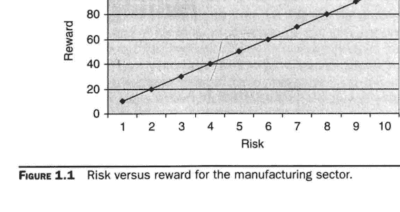

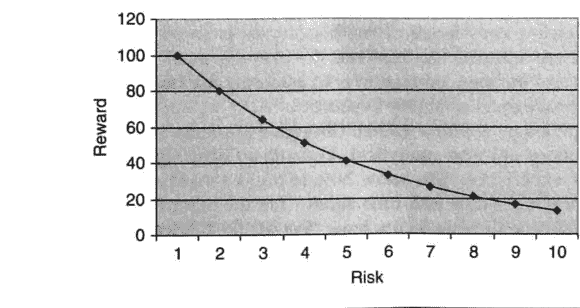

施工采购风险涉及供应链中的所有实体：项目业主、建筑师、总承包商、分包商和供应商。这些实体之间的相互关系放大了出错和产生问题的可能性。其中一些风险包括：

- 内部财务问题
- 营运资金问题
- 业主付款缓慢
- 计划和规格质量低劣
- 技术能力不足
- 信息技术不充分
- 供应链伙伴之间缺乏沟通
- 生产效率低下
- 工作质量问题
- 工作方法问题
- 交付可靠性问题
- 大宗材料质量问题

这些不利事件中的任何一个，无论是单独发生还是共同发生，都可能导致整个供应链破产。供应风险管理涉及识别和评估消除及降低供应链采购风险的替代策略。风险管理中最重要的组成部分或许是对所有供应链参与者的认证、资格预审和监控。

运营——即如何生成产品或服务并将其推向市场——是一项关键的业务职能。当比较这两个行业的运营要素（项目交付系统、产品/服务、员工、响应时间和地点）时，制造业与建筑业之间的风险差异十分显著。这些差异表明，需要采用基于知识的解决方案，如供应链管理，以在建筑业商业模式中实现流程改进。经典的制造过程是可预测的、稳定的、资本密集型的，并且由技术专家主导。典型的供应链网络简单而集中，包括多个供应商、制造商和最终客户。见图 1.3。

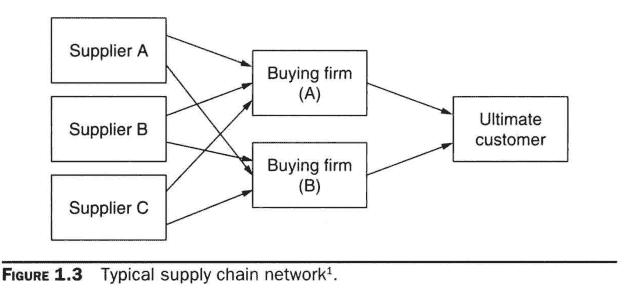

客户与生产过程相隔离，并且在大多数情况下，即使受到任何故障影响，也只是间接受到影响。制造业的产品通常是批量生产、标准化且耐用的，并且可以运输。此外，产品通常可以提前生产，这使得资源与需求的平衡更加容易。产品甚至可以延期交货。制造业员工有时按产出计酬。在制造业中，工人拥有技术技能，受到严密监督，在大多数情况下无需或很少行使个人判断，并且与实际客户几乎没有或根本没有接触。单一工厂或多个设施永久性地容纳设备和生产过程。制造业的特点是制造产品的响应时间较长。虽然制造业实体的劳动力、供应和运输都在附近，但产品的销售市场既可以是国内的，也可以是国际的。

改进曲线技术非常适合制造业，因为制造业由单一企业重复生产单个耐用单位。改进曲线呈指数形式，描述了随着累计生产单位数量的增加，劳动投入按恒定百分比减少的情况。换句话说，随着工人学会更好地完成工作，他们以更低的成本生产越来越多的单位。随着时间推移所实现的效率是企业竞争优势的一个因素，也是制造业中累积学习的影响。见图 1.4。

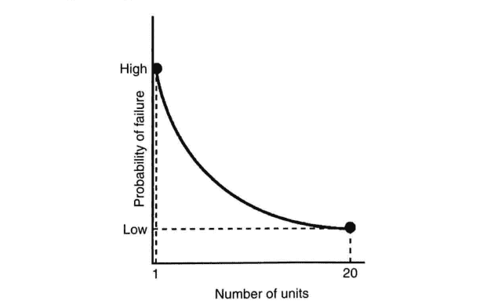

尽管建筑业随着时间推移在复杂性上发生了变化，但其首要目标与100年前基本相同：建造基础设施、道路、学校、住宅、医院、工厂和其他商业设施。2007年，美国建筑业支出约为3万亿美元。与制造业生产的标准化小配件不同，建筑业的成品是定制化的，无法大规模生产。在制造业部门表现出改进的运营职能，在建筑业中却呈现出截然不同的面貌。对于传统的施工组织而言，失败的概率保持不变。见图 1.5。

独特的项目交付系统是建筑业的基石。该行业是分散的，其特点是汇集了大小公司、相关大宗材料供应商以及许多其他支持专业人员。任何特定施工项目的典型供应链都可能包括建筑师和工程师、总承包商、专业分包商和材料供应商，他们为特定业主一次性合作建造一个项目。这种复杂的供应链以竞争性招标过程驱动的对抗性短期关系为特征。除了费用通过协商确定的建筑师、支持工程师或其他施工专业人员外，“低价中标”是在供应链每个环节中反复出现的定价模式。项目业主选择最低价投标的总承包商。反过来，总承包商以价格为基础选择分包商和供应商。即使分包商再雇佣自己的分包商，这种做法也会继续下去；同样，低价中标。在大多数私营市场和某些公共市场中，在合同授予且项目总价已知后，总承包商通常会

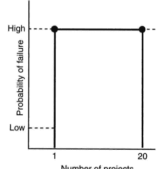

**图 1.5** 建筑业失败的概率


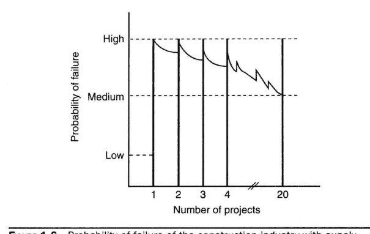

**图 1.6** 采用供应链管理的建筑业失效概率。

| 项目类别 | 净收入（%） | 有收入的企业（%） |
|---|---|---|
| 私营部门项目（住宅） | 5.2 | 65.2 |
| 私营部门项目（商业） | 3.3 | 59.9 |
| 公共部门（建筑/垂直） | 4.8 | 72.6 |
| 公共和私营部门（重型/水平） | 4.6 | 67.7 |

**表 1.1** 美国建筑业平均盈利能力（2007年）

有机会通过部分整合从制造业汲取的一些经验教训，至少减轻某些风险。见图1.6。

将建筑业中的运营职能转化为财务指标，可以通过按项目类型划分的美国建筑业平均利润表现来体现。见表1.1。

### 建筑项目类型

- 私营部门住宅（例如，住宅、公寓和分区开发项目）
- 私营部门商业（例如，零售店、制造厂、商业机构、餐厅和仓库）

当与持续改进相结合时，CSCM 能够成功解决建筑业及其项目业主的主要问题。

CSCM 可以通过供应链中所有实体在四个功能领域的积极合作，系统性地减少不确定性来源：施工前设计与承包商选择、施工、信息管理和风险管理。

### 施工前设计与承包商选择

在业主内部决定推进新项目后，选择合格的建筑师或工程公司来制定设计。通过发布征求建议书（RFP）来征集建筑设计服务。建筑师的报酬通过谈判确定。下一步是制定满足业主在可施工性和功能性方面要求的合适设计。随后，建筑师将最终项目设计、规格说明和投标文件传达给一批合格承包商。总承包商可以通过竞争性招标程序选定，将合同授予响应性最强的低报价投标人，也可以通过谈判选定。无论是总承包商还是分包商，建筑行业广泛使用的四种常见定价方法如下：

- 1. 单一固定价格（总价包干）
- 2. 协商定价，成本加酬金
- 3. 单价
- 4. 设计-建造

授标后，业主与总承包商或施工经理签订合同文件。这些协议通常是定制或标准化的行业格式，例如美国建筑师协会（AIA）提供的系列施工文件、工程师联合合同文件委员会（EJCDC）于1975年制定并于2007年修订的系列合同文件，或一套新的协议 ConsensusDOCS，该协议已得到由美国总承包商协会（AGC）牵头、22个承包商及其他行业团体认可。³ 在业主与总承包商或施工经理签订合同后，选择材料供应商和分包商，随后供应链下游的所有实体签署类似文件。根据项目性质，随着项目各组成部分按专业“打包”招标，分包商的选择可能持续进行。关于CSCM以及本书讨论的主要细分市场中的合同文件的更多内容，参见第7章。

### 施工

这一阶段是生产的核心，包括进度安排、现场协调以及资源、材料和物流管理等关键活动。如果项目以专业“打包”方式向行业发布，这一阶段还可能包括选择更多承包商。

### 信息管理

这一领域包括项目信息需求与供给（信息透明度、流动、获取、可用性和共享）。信息管理不确定性的关键要素，根据其如何造成施工过程上游和下游的信息低效进行分析。与此同时，分包商、材料、设备甚至资金都响应信息流发出的信号而流动。然而，在建筑项目中，这些流动发生在独立组织之间的联结背景下。在前CSCM环境中，人们非正式地依赖信息管理来协调供应链。CSCM 的优势在于它跨越组织边界，组织信息和流程流，向运营发送信号并评估结果。因此，信息管理是*建筑*供应链管理的生命线。

### 风险管理

任何企业中的责任风险可能性都与其业务中的关系直接相关，即与其他企业、员工和公众的往来。客户、分包商和供应商之间的争议几乎总是因初期沟通不畅以及试图通过苛刻的合同条款不公平地转移风险而发生。心怀不满的员工会对生产率产生负面影响。作为雇主的代表，不满的员工可能损害客户关系。在建筑行业中，工地上的员工与项目业主以及供应链中的其他实体有大量互动。因事故产生的责任是不幸的且难以预测；但是，可以通过促进安全工作环境的安全计划来减少和管理。CSCM 范式可以在发展供应链内部关系方面发挥重要作用，从而减少合同索赔争议的风险暴露。这种关系的发展有助于最大限度地减少事故，并营造员工高效工作的整体环境。

### 最佳实践施工的关键要素

过去十年，建筑业经历了激烈的价格竞争，使生存成为更艰巨的任务。低成本、高质量、按时完成项目和灵活领导力等竞争战略，使企业能够通过将*运营效率*定位为竞争武器来参与竞争。在当今商业环境中，这种竞争优势不仅是建筑业市场领导者必须具备的，也是所有建筑企业仅仅为了生存所必需的。然而，运营领导力的创建和维持是一个困难而复杂的过程，建筑企业必须培育一系列新的关键要素，以发展最佳实践施工运营。已有若干成熟的最佳实践可用于预测 CSCM 的效益。见图1.7。

首先，建筑业必须进行真诚的*态度调整*，坚定致力于运营效率。将运营效率发展为利润驱动因素的信念和承诺，需要高水平的组织支持，并且必须传达到整个企业。对于成功的施工运营，运营分析必须在业务战略中发挥突出作用。这引出了第二个必要的运营要素：*持续改进*。如果建筑企业不能在每个项目之间保持已建立的竞争优势，那么这种优势就意义不大；因此，建筑业领导者必须对变化和问题保持一种基本的预见精神（而不是被动反应）。认识到大多数重大进步都源于随着时间推移的小变化，建筑业必须创造一种持续改进项目和流程（工作方法）的环境。这需要员工培训和赋权，因为这些小变化将更有效地来自劳动力的素质。

将运营效率定位为优势来源所需的第三个组成部分是*消除浪费*。为了能够降低成本

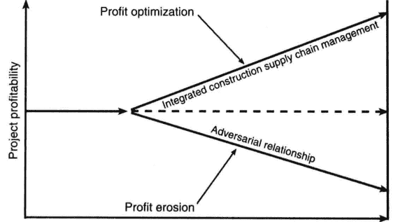

**图 1.7** 预测投资建筑供应链管理经济效益的最佳实践。


并对变化作出反应，施工企业必须精简而灵活。这要求普遍采取一种态度：消除材料、人员和流程中的多余部分。“精益”建造已帮助许多响应迅速的施工企业取得成功。营造最佳实践运营环境的第四个要素是*技术*。了解公司能力、竞争对手和商业周期对成功至关重要。现代技术还可用于增强企业内部和外部的信息流。可利用技术促进改进项目选择、规划、进度安排、工作方法和材料流。这种“精益”建造方法增强了响应能力，并使施工企业处于竞争前沿。见图1.8。

态度、流程改进、消除浪费和技术这些关键要素，对于使运营效率成为施工企业内的竞争优势是必要的。然而，以运营为导向的战略必须超越单个施工企业。项目通过由建筑师、工程师、承包商、材料供应商及相关供应链成员组成的企业的供应网络交付给项目业主。大多数企业只是供应链中的一个环节，而链条的强度取决于其最薄弱的环节。因此，如果没有响应迅速的分包商或材料供应商以及技术实施，施工企业就无法做到响应迅速。又如，总承包商如果没有优质材料和信息灵通的分包商，就无法建造高质量项目，从而将质量责任下推给其分包商和材料供应商。

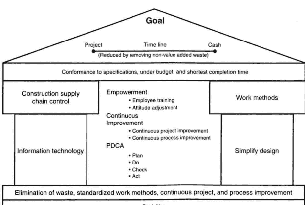

**图1.8** 精益建造之屋。

### 供应链管理与竞争性施工运营

这一讨论得出以下结论：没有链上其他企业的帮助，单个施工企业未必能将自身定位为*运营效率*领导者。竞争性施工运营所需的第五个要素是*供应链控制*。具体而言，供应链由所有为向项目业主交付高质量项目或服务作出贡献的企业和组织组成。日本制造商通过*系列企业集团*（keiretsu）实现了对其供应链的紧密控制，这种集团被描述为一个依靠合作、协调和控制来竞争性地定位企业和行业规范的商业群体。虽然*系列企业集团*的活动由日本独特的法律和文化环境驱动，但将类似系列企业集团的哲学移植到美国，产生了*供应链管理*的概念。

供应链管理涉及对分包商、材料供应商以及供应链内信息的战略和流程协调，以让最终项目业主满意。虽然供应链中的每个商业实体传统上由自身盈利能力驱动，但供应链管理的理念涉及优化供应链成员之间的协同关系，以最终使项目业主满意。这一概念从将供应链作为单一流程进行控制演变而来，而不是将其视为独立交易关系之和。预期最终结果是形成互利共赢的合作伙伴关系，创造协同供应链，使整个链比其各个部分之和更有效。

理想情况下，供应链管理代表着循环收益的双赢乌托邦目标。见图1.9。供应链中的每家公司都通过以可接受的价格提供功能完善的高质量项目来创造客户价值，从而获得自身的盈利能力和成功。供应链内的每个组织都可以通过供应链管理降低自身成本并提高项目绩效，从而使供应链能够向项目业主交付价值。满意的项目业主反过来以忠诚的合同业务回报供应链，使盈利能力能够沿供应链向下传递。这反过来促进进一步的供应链整合和响应能力，使该循环重复。

如上所述，总承包商或许能够通过利用最佳实践运营将企业定位为市场领导者，但供应链中关联企业的性质要求分包商和材料供应商必须成为该战略的一部分。没有供应链支持，总承包商无法成为行业领导者，因此供应链管理要求共享传统上专有的信息、战略、规划和目标，而大多数施工企业不愿将这些要素暴露给其他企业，担心失去控制。

**表1.2** 供应链管理的障碍

| |
|---|
| • 未能共享项目信息 |
| • 担心失去控制 |
| • 缺乏自我认知 |
| • 缺乏对合作伙伴的认知 |
| • 项目复杂性巨大 |
| • 无法识别项目目标 |
| • 缺乏对项目业主的理解 |
| • 缺乏对供应链的理解 |
| • 短视思维 |
| • 短视战略 |
| • 缺乏互惠性 |

此外，企业间协作要求每个参与企业对自己和合作伙伴都有高度认知，而这种认知往往难以有效实现。还有一个问题涉及链成员无法专注于供应链的一个共同目标，而不是个体绩效。执行供应链管理的其他重大障碍包括：缺乏对项目业主的理解（谁是真正的客户，他们真正想要什么？）、沟通差距（分散的成员在哪些方面难以沟通？）、缺乏对真实供应链的理解（链中有哪些企业？）、许多供应链规模庞大（协调许多独立企业是否困难？）、缺乏有效领导（谁是最佳领导者？）、自我中心（自尊是否导致短视战略？），最后是缺乏互惠性（利润和奖励是否平等分享？）。

基于上述供应链管理障碍，发展一体化供应链仍然是一项极其困难的任务。它代表一种新的经营方式，而大多数施工企业没有准备好，甚至未必愿意有效整合供应链。尽管这或许是一个遥远的目标，但供应链管理概念仍是施工企业长期成功的关键因素。虽然完整的供应链管理对大多数施工企业而言可能遥不可及，但应用其概念将改善它们的竞争优势。此外，随着供应链最佳实践企业能够提高项目质量、缩短完成时间并改进工作方法，同时降低成本，要求苛刻的项目业主将继续提出更多要求。因此，高效的施工供应链将繁荣发展，而传统的对抗性供应链将无法生存。因此，施工供应链管理仍是使运营效率成为竞争优势来源的关键要素，并且是施工行业领导地位的一个理想目标。

#### 供应链合作伙伴关系

实施施工供应链管理技术的关键是施工供应链合作伙伴关系。战略供应链合作伙伴关系也称为*战略联盟*，是供应渠道中两个独立实体为实现特定目标和利益而形成的关系。这些合作伙伴关系构成CSCM的基本构建模块。CSCM所需的高水平信息流以及随后对无差错规划和进度安排的协调，要求总承包商与少数战略分包商和供应商建立更紧密的联系。供应商*关系*对许多施工企业而言曾经传统上由竞争驱动，如今已从对抗关系成熟为施工供应链合作伙伴关系。

在双赢的施工合作伙伴关系二元体中，总承包商与战略（分包商和材料）供应商通过联合计划和控制共享目标及固有风险，力求创建信息流增加、项目业主忠诚度提高的有效供应链。与CSCM的总体目标一样，这种协调能够在降低成本的同时改进服务、技术创新和项目设计。理想情况下，施工供应链所有成员的最终结果应是减少不确定性，从而更好地控制成本、活动时间、材料、项目质量，并最终提升项目业主满意度。

#### 传统施工供应链

企业必须采取大胆措施打破企业内部障碍，以平抑不确定性并增强对供应链活动的控制。见图1.10。过去几十年，大多数进步的施工企业都经历了企业内部职能整合的演变，而当前的推动方向是与分包商、材料供应商和项目业主进行外部整合。供应链合作伙伴关系弥合了总承包商、分包商、材料供应商和项目业主之间的障碍。

从历史上看，承包商围绕对抗性的下游关系制定运营战略。这种方法鼓励竞争，总承包商可利用竞争来寻求更低成本。这种战略增强了总承包商最终的议价能力。这显然是不可持续的战略。最

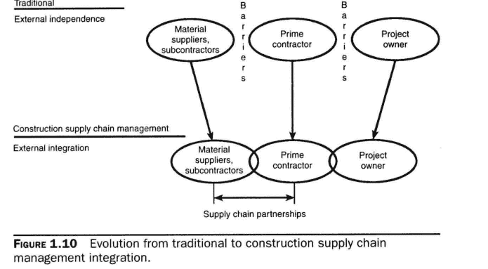

**图 1.10** 从传统到建筑供应链管理一体化的演变。

高效的分包商和材料供应商将加入先进的供应链网络。

哈佛商学院的一项研究得出结论，美国在国际市场中竞争力下降的一个关键驱动因素，源于对关系建设等无形收益的投资不足。^4^ 根据麦克尼尔（MacNeil）的观点，企业不可能作为一个离散实体来运营。但是，尽管几乎没有企业拥有完全离散的业务往来，传统的西方和美国商业实践仍更多倾向于离散战略而非关系战略。^5^ 传统上，美国企业将追求成功的动力建立在自主性之上，并将竞争视为美国优势的达尔文式守护者。美国企业的长期规划一直是独立的，并且会付出相当多的努力来确保公司信息的私密性。

然而，近几十年来，供应链中的美国企业已经开始意识到，与其他企业甚至竞争对手共享技术、信息和规划所带来的优势。许多现代商业思想家会声称，更加开放和注重关系的态度不仅是有利的，而且在保持竞争优势方面实际上也是必要且不可避免的。企业间关系主义理念试图摆脱离散交易的概念，打破传统的企业内部壁垒。见表 1.3。企业联合起来共享信息和规划工作，从而降低不确定性并增强控制。最终，供应链合作伙伴从共同努力中获益。

精益管理等现代建筑改进方法需要建筑供应链伙伴关系所带来的更紧密控制。

| 合同要素 | 离散导向 | → | 关系导向 |
|---|---|---|---|
| 期限 | 仅一次付款 |  | 未来付款 |
| 态度 | 独立、怀疑 |  | 开放、信任、合作 |
| 沟通 | 极少 |  | 复杂 |
| 信息 | 专有 |  | 共享 |
| 规划与目标 | 个体、短期 |  | 联合、长期 |
| 收益与风险 | 个体 |  | 共享 |
| 问题解决 | 权力驱动 |  | 相互、审慎 |

**表 1.3** 离散型与关系型商业战略

然而，战略性建筑供应联盟远远超出了这一概念，达到一种更具关系性的交换层次；在这一层次中，合作伙伴建立起紧密、相互依存的关系，双方都能从中互惠互利。战略性建筑供应伙伴关系强调直接、长期的联合，鼓励共同规划和共同解决问题。见表 1.4。

| 传统项目关系 | 供应链项目伙伴关系 |
|---|---|
| 与供应商的短期合同 | 与供应商的长期联盟 |
| 投标评估 | 对供应商增值进行深入评估 |
| 众多供应商和分包商 | 少数供应商和分包商 |
| 专有信息 | 共享项目信息 |
| • 权力驱动的问题解决<br>强制性关系 | • 共同解决问题<br>改进<br>成功共享 |

**表 1.4** 传统供应战略与伙伴供应战略

### 供应商伙伴关系的益处

总承包商、供应商和分包商可以从质量改进中获益，并且通过规模经济、减少行政和转换工作、流程整合以及流程协调，交易成本可能降低。此外，市场条件的稳定以及建筑战略伙伴关系的益处，将增强战略供应链关系。见表 1.5。

|  |  |
|---|---|
| 项目业主在以下方面的不确定性降低 | 成本节约 |
| • 材料成本<br>• 质量<br>• 时间安排<br>• 减少供应商、分包商基础，使其更易管理 | • 规模经济体现在<br>• 进度安排<br>• 采购<br>• 物流<br>• 降低行政成本<br>• 更少转换成本<br>• 增强项目整合<br>• 技术或物理整合<br>• 提高设备利用率 |
| 分包商和供应商在以下方面的不确定性降低 | 时间管理 |
| • 市场<br>• 对项目业主需求的理解<br>• 项目规格 | • 更快完成项目<br>• 改善分包商的周期时间 |
| 业主和合作伙伴在以下方面的不确定性降低 | 共享风险与回报 |
| • 期望和目标趋同<br>• 减少外部性影响<br>• 减少机会主义<br>• 增加沟通和反馈 | • 联合能力与发展<br>• 市场变化<br>• 提高盈利能力<br>• 项目开发<br>• 减少事故 |
| 联合工作方法开发 | 稳定性 |
| • 增加共享技术<br>• 更大程度地共同参与项目设计 | • 前置时间<br>• 优先级和关注度 |
| 更大灵活性 |  |

**表 1.5** 供应商伙伴关系的潜在益处

### 供应商-承包商伙伴关系的风险

尽管建筑供应链伙伴关系具有许多益处，但仍保留若干固有风险，这些风险可能对参与者造成潜在损害。首先也是最重要的是，如果合作伙伴未能达到预期，对其过度依赖可能会造成灾难性后果。

整个伙伴关系实施过程包含许多对关系成功至关重要的要素，并且有几个因素有助于成功（见表 1.6）。表 1.7 提供了总体情况。

|  |
|---|
| 1. 确立伙伴关系的战略需求 |
| 2. 制定合作伙伴标准，评估供应商和分包商，并选择合作伙伴 |
| 3. 正式建立伙伴关系 |
| 4. 维护和完善伙伴关系 |

**表 1.6** 供应商伙伴关系实施步骤

|  |  |
|---|---|
| 项目完成时间 |  |
| • 自然的管理支持 |  |
| • 沟通 |  |
| • 增强协调 |  |
| **初始战略分析阶段** |  |
| • 社会和态度障碍 |  |
| • 程序和结构障碍 |  |
| **分包商/供应商评估与选择阶段** |  |
| • 总成本和利润收益 | • 合作伙伴能力 |
| • 文化兼容性 | • 管理兼容性 |
| • 财务稳定性 | • 位置 |
| **伙伴关系建立阶段** |  |
| • 认知和需求分析 |  |
| • 密切互动 |  |
| • 文档记录 |  |
| **维护阶段** |  |
| • 信任 | • 社会交换 |
| • 善意 | • 边界人员 |
| • 灵活性 | • 绩效衡量 |
| • 冲突管理技能 |  |

**表 1.7** 供应商伙伴关系在实施各阶段的关键成功因素

对团队合作方式总会存在阻力。

#### 步骤 2——承包商 A 和 B 的角色定义

**承包商 A**

- 管理和协调团队以完成特定项目
- 提供项目管理（现场）
- 承包商 B 的员工应加入承包商 A 的团队

**承包商 B**

- 管理和协调团队以完成行政职能
- 提供项目管理（财务控制）
- 承包商 A 的员工应加入承包商 B 的团队

#### 步骤 3——在法规范围内建立基本规则

**合资企业会议**

- 多久一次？
- 是否应定期举行？
- 出席标准是什么？
- 团队将如何处理意见分歧？

**会议之间的沟通**

- 团队将使用何种沟通方式？
- 由谁发起团队成员之间的沟通？

**彼此之间的行为**

- 哪些行为不恰当？
- 团队将努力采取哪些行为？

**合资企业问题**

- 团队预计会遇到哪些问题，成员将如何解决这些问题？
- 团队将如何处理谣言、保密和冲突？

### 第二阶段：生产

#### 步骤 4——规划指定的工作

- 列出将完成使命的主要步骤或目标
- 将每个主要步骤或目标分解为可管理的任务
- 列出完成目标和任务的时间线
- 根据需要运用进度安排工具


### 参考文献

- 1. Benton, W. C.，*采购与供应管理*，McGraw-Hill，纽约，2007年。
- 2. Knight, F.，*风险、不确定性与利润*，Harper and Row，纽约（初版于1921年），1965年。
- 3. Harris, L. D. 与 M. B. Perlberg，“ConsensusDOCS 的优势”，在“变革之风”会议“ConsensusDOCS”专题上发表，美国律师协会建筑行业论坛，2008年9月11–12日，伊利诺伊州芝加哥。
- 4. MacBeth, D. K. 与 N. Ferguson，*合作伙伴式寻源：一种集成供应链管理方法*，Pitman Publishing，伦敦，1994年。
- 5. MacNeil, Ian R.，*新社会契约：对现代契约关系的探究*，耶鲁大学出版社，康涅狄格州纽黑文，1980年。

## 第2章：建筑供应寻源流程与程序

> 面向21世纪的建筑组织再造

大多数建筑公司的寻源流程是分散的，且缺乏完善的记录。自新千年开始以来，乃至今日更甚，建筑市场一直处于经济与能源困境之中。除了这些全行业的挑战之外，各建筑公司还必须为应对迅猛发展的技术而进行根本性变革。从历史上看，分包服务的寻源曾是建筑过程中最受忽视的环节。只有当材料和分包服务的成本上升时，管理层才试图研究替代方法，以规划和控制组织中的获取与转化职能。相反，大多数公司强调将劳动力成本降至最低。关注劳动力是合乎逻辑的，因为从定义上说，建筑过程是劳动密集型的。一些建筑细分市场已经接纳新技术，并投资于技术驱动的建筑系统。尽管这些新系统已经投入使用并运行，但人们常常仍按旧的建筑业务模式来操作它们，从而使系统设计本要达成的目的落空。现实是，技术和先进管理系统正在迅速取代劳动力。

作为企业内的一个职能领域，采购与寻源管理曾长期背负着被贴上事务性职能标签的污名。然而，在过去25年里，建筑寻源在摆脱这一标签方面取得了长足进步，并已发展成为一条可行的职业发展路径。更重要的是，在未来十年中，寻源、供应链管理和持续改进对建筑行业盈利能力的贡献，可能会超过该行业任何其他职能。

典型建筑项目的生命周期包括以下阶段（图2.1）：

- 1. 概念化
- 2. 工程与设计
- 3. 供应寻源
- 4. 施工
- 5. 实施
- 6. 使用

现实中，建筑生命周期各阶段并非相互排斥或彼此独立。其中许多阶段会同时发生。从定义上说，每个建筑项目都是独特的，并且需要不同程度的集中管理。根据建筑组织的规模，供应寻源职能可能由一名供应经理或一个供应寻源团队来实施。无论组织规模如何，都必须明确供应寻源职能的归属责任。在小型建筑组织中，公司总裁必须行使供应寻源领导职责。典型建筑组织的供应寻源职能是实现利润的第一阶段。

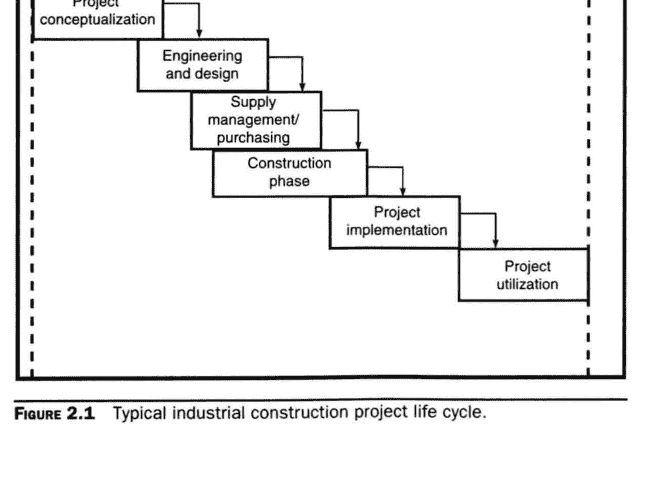

供应职能的主要职责是作为建筑组织在项目层面和总部层面的供应寻源专业人员。供应寻源活动必须在规范、预算和进度约束下开展。供应寻源与采购活动在两个集中层面上实施。总部或业主通常采购资本设备和材料。设备租赁和大宗材料则从现场寻源（例如，现场主管在需要混凝土的前一天订购）。

本书重点关注建筑项目生命周期中的供应寻源阶段和施工阶段。寻源阶段与施工阶段之间具有高度的集成性和相互依赖性，这增加了上下游项目风险发生的可能性。项目质量、预算和完工时间很容易受到损害。因此，管理沟通和项目集成以减轻不利项目事件的影响非常重要。供应寻源职能涉及与每个组织内部和外部的上下游关系打交道。供应寻源流程涉及协助项目经理处理分包服务、大宗材料和设备需求。在基本层面上，建筑组织将资本、工程、劳动力、大宗材料、物资、工作方法和技术转化为一个已完成且可接受的项目。见图2.2。与内部资源相比，外部寻源的资源投入占比正在不断增加。存在持续走向专业化和一体化的趋势。分包基本上就是专业化劳动力。在大多数情况下，建筑组织从外部寻源专业资源，比在内部增加所需能力更有效率。供应寻源经理和项目经理有责任也有权力安排并将所需资源交付到项目现场。供应寻源经理必须成为各类项目（例如桥梁建设、办公楼、医院等）寻源方面的专家。

供应寻源经理通常与总承包商和项目经理一起，根据工程和设计规范对分包商进行资格预审，并邀请竞争性投标。建筑寻源协调的关键是有效的项目计划和进度安排。图2.1所示的施工阶段涉及将劳动力、材料和设备转化为一个可接受的已完成项目，如图2.2所示。施工经理或总承包商依据三项基本标准来协调这一转化过程——按时完成项目、控制在预算之内，以及向业主交付可接受的高质量项目。

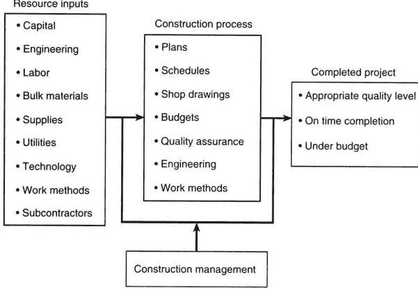

**图2.2** 建筑转化过程。

### 建筑供应寻源的目标与活动

建筑组织供应寻源职能的目的，是以合适的质量、合适的数量、合适的价格，在合适的时间从合适的来源购买材料和服务。供应寻源部门协助项目团队在项目的预算和进度目标内履行职责。供应寻源经理和采购代理力求以尽可能低的成本为其组织获得最高质量的分包商和材料。寻源经理确定哪些大宗材料、商品或服务最佳；选择材料或服务的供应商；谈判争取最低价格，并授予合同，以确保在适当的时间收到正确数量的材料或服务。在小型建筑公司中，业主通常负责所有寻源和采购职能。为了成功完成这些任务，寻源经理（业主）必须确定最合格的供应商。供应寻源经理还必须成为其所采购材料和服务的专家。

这一关键寻源职能中的管理人员依据质量、价格、服务支持、可用性和可靠性来评估供应商。

为了以有竞争力和明智的方式购买服务。为协助他们寻找合适的分包商和供应商，寻源经理会查阅产品目录、行业和公司数据库、政府名录以及行业期刊。这些信息现在大部分可在互联网上获取。寻源经理会调查分包商和供应商的声誉和历史，并发布预计采购活动以征集投标。在会议、贸易展会、行业会议、供应商工厂和现场，他们检查材料和服务，评估供应商的履约能力，并讨论影响寻源决策的其他技术和商务考虑因素。一旦收集到所有必要的供应商信息，就下达采购订单，并将合同授予符合承包商要求的供应商。

为了将库存投资降至最低，供应专业人员必须实施准时制（精益）采购理念。准时制要求按时、频繁地交付可靠的小批量高质量材料。供应经理始终在开发可靠的备选供应商和分包商。必须开发新的设备和材料来源，以消除单一来源采购。寻源经理的总体目标是实现与上游和下游供应链成员的最大程度整合。这种整合涉及沟通和信息共享。

以下是适用于横向和纵向建筑组织的建筑供应寻源的若干关键目标。这些目标的指导原则是让每一美元支出获得最大价值。

- 1. 协助项目团队在项目预算和进度目标范围内履行其职责。
- 2. 以有竞争力的方式采购和寻源服务。（为了有竞争力和明智地寻源，供应经理必须是其所采购材料和分包服务的专家。）
- 3. 通过在施工现场实施准时制（精益）采购理念，将库存投资（即损耗和被盗）降至最低。
- 4. 与供应链成员（供应商和分包商）建立并保持良好关系。
- 5. 开发可靠的备选供应商和分包商。
- 6. 实现与上游和下游供应链成员的最大程度整合。
- 7. 继续开发招募、培训和留住采购与供应链人才的创新体系。
- 8. 为材料、设备、服务和分包合同的寻源准备管理规程。
- 9. 对供应商和分包商进行资格预审、选择和评估。
- 10. 建立并更新现有及潜在供应商和分包商数据库。
- 11. 对现有及潜在顾问、供应商和分包商进行背景调查。
- 12. 研究每个在建项目的工作范围。
- 13. 审查和评估招标邀请。
- 14. 组织开标和/或参与提案评估团队。
- 15. 及时通知中标和未中标的投标人。
- 16. 准备合同及相关细节。
- 17. 参与谈判团队。
- 18. 参与初始合同的变更令差异处理。
- 19. 寻求女性所有和少数族裔所有企业的投标，并在选择和授标后监督合规情况。
- 20. 为工程和施工准备采购订单、合同和分包合同。
- 21. 协调施工详图及其他规范要求的提交。
- 22. 安排运输和装运。
- 23. 在项目经理协助下准备反索赔费用。
- 24. 协调并跟踪发票审批流程。
- 25. 在项目经理协助下参与采购订单和分包合同收尾活动。
- 26. 培育持续改进文化，以促成上述所有目标的实现。

### 供应管理流程

不断变化的经济和政治环境、新兴技术与劳动力之间的对比，以及建筑作为一门学科的性质变化，必然会影响建筑采购和供应链管理的角色。为了更具战略竞争力，建筑公司必须放弃碎片化的采购和分包做法。投资于基于工程的施工方法（“硬”技术）的公司，必须同时投资于以结果为导向的寻源培训项目（“软”技术）。采购职能必须成为将材料和资源转化为按时、低于预算且可接受的竣工项目的一个组成部分。

在许多建筑公司中，各领域内的职能经理和项目经理使用类似技术做出独立决策。本章介绍的方法提出，寻源决策应当整合。集成供应管理包括对材料以及分包劳动力的规划、获取和转化，直至形成竣工项目。在这种模式下，每位现场主管（工长）向同一位上级汇报。此外，项目经理应致力于实现总体目标，即向业主交付高质量、高效、按时完成的项目。这种方法的一个重要目标是在使生产服务或项目的成本最小化的同时，提供高质量的客户服务。集成供应管理与公司规模无关。现实中，寻源子职能必须先实现集成，供应职能才能与其他业务职能产生协同效应。

供应管理的目的是支持施工职能将材料和劳动力转化为竣工项目。供应链的职能是整合整个转化过程。在转化过程中，材料与劳动力、信息、技术和资本相结合。有效的建筑环境中，建筑计划和进度安排系统是获取分包和材料的核心。对于复杂项目，关键路径法（CPM）进度计划是建筑计划与控制系统中最重要的输入。许多成功的建筑组织已采纳准时制理念，并运用CPM概念提升建筑供应任务的效力。

过去十年，建筑公司或许最重大的变化是对持续改进的认可。1960年至1990年间，大多数建筑公司通过总承包商和众多分包商的共同努力完成了项目60%至80%的工作。如今，大量施工管理和设计工程组织作为业主代表，将项目价值的90%至95%分包出去。由于价值比例发生如此显著的转变，总承包商所面临的施工过程复杂性已大大降低。施工过程的复杂性已向下游转移到供应链（分包商和供应商）。在传统施工模式下，总承包商为项目转化了多得多的材料和劳动力。由于主要建筑公司购买越来越多的分包服务，施工重点已向下游转移到运营效率。这一重大转变提升了寻源和供应寻源专业人员的重要性和地位。

### 供应寻源的资金责任

在建筑行业中，供应管理的资金责任无论相对还是绝对而言都非常大。更重要的是，如果供应寻源管理尽责，将有助于建筑组织的竞争地位和长期生存。

以下是建筑行业通常引用的材料相关成本比例：

| 成本类别 | 比例 |
| --- | --- |
| 项目总销售成本（人工、设备、材料） | 销售额的75% |
| 总部管理费用（销售额） | 销售额的15% |
| 利润率 | 销售额的10% |

人工、设备和材料比例正在因多种原因上升：竞争压力、材料短缺、通货膨胀以及极其复杂的高价值项目。

#### 竞争压力

随着每个项目的投标人数增加，项目价格下降。一些竞争性建筑组织以低于项目总成本的报价投标。

#### 材料短缺

随着自然资源被消耗，勘探、开采和加工方法必须更加昂贵。短缺也由政治事件造成。西方国家的旧殖民地曾是低成本且现成的供应来源，如今已经获得独立。作为自主国家，这些新国家管理其资源以实现经济、社会和国家主义目标。

#### 通货膨胀

材料价格通常因能源和劳动力成本上升而向上调整。在通货膨胀时期管理材料，会导致在稳定环境中几乎没有意义的决策。

#### 复杂的高价值项目

建筑行业的管理层经常听到这样的抱怨：“他们不再像过去那样建造了。”行业的回应是：“如果我们还那样建，你们不会想要的。”项目业主要求以更低价格获得更可靠、更实用的项目。由于这些原因，我们不应指望资金责任增加以及有效建筑供应链管理前景的趋势发生逆转。还有哪里存在如此大的降低成本和获得竞争优势的潜力呢？


### 利润潜力

所有采购活动都有可能通过降低成本来提高利润。材料采购被用来说明“利润杠杆”论点，该论点强调利润效率比市场份额更重要。例如，假设一家建筑公司的利润表如表2.1所示。在销售额为$1,000,000时，公司用于购买大宗材料的支出为销售额的50%，即$500,000，同时实现净利润$50,000。

假设公司设定目标，将净利润增加$10,000，即当前销售额的1%。实现该目标的一种方式是聚焦市场份额，在不改变材料成本的情况下提高公司的销售额。所需销售额可用以下等式估算。

Sales = variable cost + fixed cost ± profit

x = 0.5x + 0.4x + 50,000 + (10,000 + 50,000)

x = $1,100,000

为了将净利润增加$10,000，即当前销售额的1%，销售额需要增加$100,000，即当前销售额的10%。此外，由于产量增加，可变成本也会增加。

实现同一目标的另一种方式是在维持当前销售额水平的同时，通过供应商经理的高超谈判降低材料成本，从而提高利润效率。在这种情况下，材料成本是唯一变化的变量。由于每减少$1成本都会恰好体现为利润增加$1，因此所需材料成本降低额为$10,000，即当前材料成本的2%。由此得到的利润表如表2.2所示。

比较这两种方法可以看出，所需材料成本降低额为2%或$10,000，其金额远小于所需的10%销售额增长。此外，销售额增长10%可能相当困难。

|  | （单位：千美元） |
|---|---|
| 销售额 | $1,000 |
| 大宗材料成本 | (500) |
| 人工成本 | (400) |
| 毛利润 | $100 |
| 项目间接费用 | (50) |
| 净利润 | $50 |

**表2.1** 利润表示例1

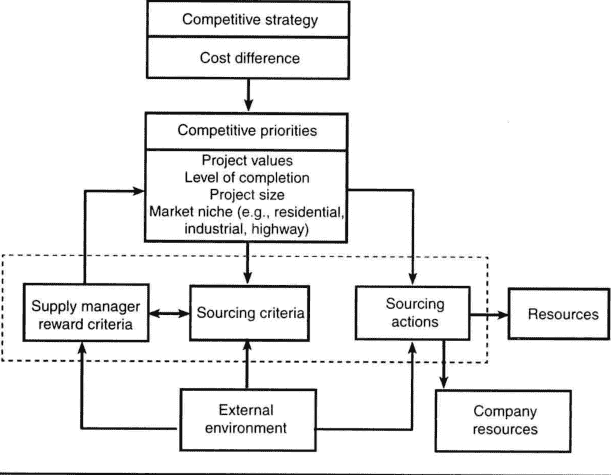

有助于典型建筑组织的日常决策。竞争战略以竞争优先事项来表述。还必须考虑关键环境因素。

例如，低利润率战略通常意味着更标准化的项目、对客户需求响应灵活性更低、可选方案更少、可接受的质量以及连续加工技术。低成本战略主要关注住宅市场，该市场包括许多竞争者。另一方面，项目差异化战略关注建立进入壁垒，这意味着复杂的工程能力、强大的财务能力以及更高的材料和设备成本。

### 供应链战略

随着竞争压力增加，项目业主期望高质量项目、按时完工、更多服务和更低成本。随着建筑组织变得更具竞争力，供应商和分包商会感受到涟漪效应。由于竞争加剧以及分包和材料成本增加，供应链管理概念已作为一种竞争武器出现。供应链管理的其他次要原因包括技术使用的增加和持续改进理念。

这些新的供应商/分包商与总承包商关系要求供应链各方建立信任和承诺，这与其历史上远非合作的关系形成直接对比。传统分包态度一直鼓励保持距离型关系，价格是主导性采购因素。如今，供应链管理文化寻求各方之间更合作的态度。尽管许多建筑组织声称对供应链管理概念感兴趣，但这些拟议安排的有效性在建筑行业中才刚刚开始被研究。实际上，单个建筑组织可以以供应商、分包商或总承包商等多种角色参与供应链。

#### 项目采购计划

已中标合同的采购计划必须明确且完整。对于材料、设备和分包采购，必须考虑若干关键要素，并且应包含设备计划。采购计划的最后一步是签发采购订单或合同。见图2.4和表2.4。

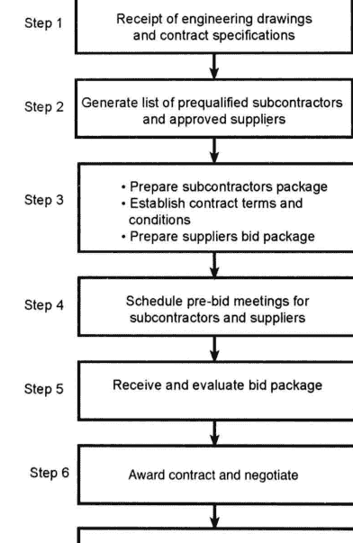

**图2.4** 项目采购计划。

**表2.4 供水管线项目设备需求计划**

| 项目 | 225 CAT 挖掘机 | 自卸卡车-1 | 自卸卡车-2 | Bobcat 装载机 | 演示机 | 压实机 |
|---|---|---|---|---|---|---|
| 成本 | $165,000 | $93,000 | $55,800 | 租金 $1800/月 | $19,000 | 租金 $350/月；租金 $125/周 |
| 融资 |  |  |  |  |  |  |
| 现金 | 7.0% | 7.0% | 7.0% |  |  |  |
| 借款 | $149,000 |  |  |  |  |  |
| 期限 | 60个月 | 60个月 | 60个月 |  |  |  |
| 利率 | 8.5% | 9.0% | 9.0% |  | 8.5% |  |
| 燃料成本 | $4.15/加仑 | $4.15/加仑 | $4.15/加仑 |  | $4.15/加仑 |  |
| 维修 | $18,560 | $2,500 | $5,000 |  | 新成本的10% |  |
| 保险 | $4,250 | $8,250 | $8,250 |  | $500 |  |
| 服务成本 | $40 | $2,400 | $2,400 |  |  |  |
| 马力 | 150 |  |  | 74 |  |  |
| 运输容量 |  | 8 立方码 | 8 立方码 |  |  |  |
| 新轮胎 |  | 每条 $275 | 每条 $275 |  | 每条 $200 |  |
| 轮胎维修 |  | $100/次 | $100/次 |  | $100/次 |  |
| 卡车轮胎使用寿命 |  | 50,000 英里 | 50,000 英里 |  |  |  |

### 采购订单

采购订单是建筑组织与供应组织之间具有约束力的合同。它作为向供应组织发出的要约，一旦供应商签署实际采购订单即被接受。在某些情况下，供应商可能发送接受确认书，而不是签署采购订单。（如果之后发生争议，这种接受方式可能有问题，并可能引发所谓的“格式条款之争”冲突。）无论如何，采购订单会载明管辖该交易的条款和条件，并取代任何谈判。因此，建筑组织在准备采购订单和措辞时必须格外谨慎。采购订单的“正面”包括材料描述和规格、数量、交付进度以及运输要求，包括由谁支付运费。付款条件也出现在采购订单正面。它通常为买方提前付款提供激励。例如，2/10 net 30 表示10天内付款可享受2%的折扣，而30天内付款则必须支付全额。如果工程图纸或任何相关文件是采购订单的一部分，则必须通过引用明确纳入。一般而言，采购订单应包括建筑组织为确保可接受的履约所需的所有信息，并且应清晰明确、无歧义。除定制条款外，采购订单背面将包括标准样板条款和条件。样板条款通常涵盖仲裁、第三方转让、适用州法律、不可抗力、一般保证和订单取消等条款。

采购订单的典型分发程序包括以下内容：

- 将确认副本发送给供应组织。
- 将一份副本发送给建筑组织的会计部门。
- 将一份副本发送给施工现场的项目经理。
- 一份副本留在供应采购部门。

一份副本由项目供应经理保存，作为未结采购订单。见图2.5。采购订单文件应包括以下信息：

- 1. 已签署的采购订单、变更单、扣款、索赔、发票和付款记录。
- 2. 规格书和设计变更。


### 采购订单（续）

**Hoosier Pride Construction, Inc.**

| 字段 | 内容 |
|---|---|
| 项目名称 | ____________________ |
| 采购订单编号 | ____________________ |
| 页码 | 第 ____ 页，共 ____ 页 |
| 日期 | ____________________ |
| 编制人 | ____________________ |
| 致 | ______________________________________________ |
| 电话 | ____________________ |
| 传真 | ____________________ |
| 经办人 | ________________________________________ |
| 电子邮箱 | ____________________ |
| 确认对象 | _____________________________________ |
| 日期 | ____________________ |

**采购订单明细：**

| 货品编号 | 数量 | 一般描述 | 代码/设备# | 单价 | 扩展金额 |
|---|---|---|---|---|---|
|  |  |  |  |  |  |
|  |  |  |  |  |  |
|  |  |  |  |  |  |

| 确认订单下达给 |  |  |  | **总价值 $** |
|---|---|---|---|---|
|  |  |  |  |  |

| 发票说明 | 付款条件 |
|---|---|
| 将 ____ 份副本寄至：________________________________<br>________________________________<br>________________________________<br>________________________________ | 卖方特此接受并同意本采购订单背面的所有条款和条件。 |

| 附件 | 接受 |
|---|---|
| 以下附件特此成为本采购订单的一部分：<br>– 一般条款和条件<br>– 施工图纸<br>– 规格说明 | 接受人：______________________________<br><br>职务：______________________________<br><br>公司：____________________    日期：____________________ |

**图 2.5**  采购订单。

- 3. 原始投标图纸及修改。
- 4. 承包组织与供应商之间的书面通信及口头通信记录。
- 5. 关于交付、短缺和损坏的履约报告。
- 6. 原始评审与授标委员会的会议纪要。

### 条款和条件

- 1. 卖方通过发运所述货物或确认收到本订单，即同意本文及背面所列销售条款和条件。这些条款和条件构成买方的要约，仅可按本订单所列确切条款接受，任何其他条款和条件均不具有控制力；且这些条款和条件取代任何先前采购订单或确认表单（如有）的条款和条件。
- 2. 卖方同意并保证，根据本订单提供的物品或货物将严格符合主合同和合同文件（包括图纸和规格）以及此前经买方批准的任何卖方样品。只要买方根据其与业主或承包商的合同有义务进行任何缺陷修正，本保证即持续有效。卖方将承担在该保证期内发现存在缺陷的任何物品或货物的返工或更换的全部费用，以及买方因卖方物品或货物的任何此类缺陷导致其他工程损坏和返工而产生的全部费用。
- 3. 除非另有规定，价格和条款在所示项目期间固定不变。
- 4. 本订单可由买方在发生火灾、天灾、公敌、地震、洪水、罢工、劳资纠纷或任何其他超出买方合理控制的原因时予以修改或取消。
- 5. 未经以与原始订单相同方式和相同条款签署的书面授权，卖方不得对本订单进行任何替换或变更。
- 6. 如果可享受现金折扣的发票未在发货日期寄出，折扣期将自买方收到发票之日起计算。发票若在本采购订单条款和条件方面填写有误或不完整，将被退回更正或补全，折扣期在收到正确填写的发票之前不开始计算。
- 7. 应按指定时间和方式装运或交付。因此，时间至关重要。如果未在约定时间交付，买方保留取消订单或向他处采购的权利，并要求卖方对此负责。在所有装运中，卖方应及时通知买方装运地点和初始承运人；如果买方承担运费，则必须在装运前确定路线。
- 8. 除非本订单正面另有规定，所有包装和运输费用（包括税费）应由卖方承担并支付，买方不予承担。如果交付严重落后于本订单规定的时间表，致使买方有必要要求卖方以其他方式装运，则双方理解卖方将承担增加的运输成本。无论何种原因，货物在交付给买方之前的一切意外灭失风险由卖方承担。
- 9. 如果本订单所订货物在安装时需要卖方公司相关的监督人员或专家提供服务，且卖方同意无偿或按每日指定费率提供该等服务，则双方理解，该监督人员在履行与本协议所涉货物有关的职责时，不应被视为买方的代理人或雇员，卖方将对该方的所有作为和不作为承担全部责任。
- 10. 若发生由卖方提起或针对卖方的任何自愿或非自愿破产或无力偿债程序，或为任命接管人、受托人，或为债权人利益而任命受让人，或涉及卖方公司财产的程序，或卖方违反本订单任何条款，包括就本订单所订货物作出的任何保证，买方有权取消本订单以及该卖方与买方之间的任何及所有其他订单或合同，或减少本订单下应交付货物的数量。
- 11. 任何按买方设计制造或按买方指示为买方开发的物品，或买方提供的任何设计或其副本，未经买方同意不得提供给他人。
- 12. 卖方应使买方免受并辩护和赔偿买方因下列原因产生、遭受或发生的所有损失、责任、损害和费用（包括在诉讼情况下合理的律师费和支出）：(a) 由卖方、卖方代理人或雇员在执行本订单或据此交付时任何作为或不作为造成或以任何方式引起的、涉及人身或财产伤害的任何索赔；或 (b) 与本订单所要求任何商品有关的、或因使用该等商品而产生的任何索赔，涉及侵犯任何专利、版权、商标、商号、品牌或口号，或涉及不正当竞争或任何其他涉嫌违反任何成文法或普通法权利；或 (c) 基于上述任何索赔的任何诉讼。买方同意就任何此类诉讼的启动向卖方发出合理通知。
- 13. 卖方同意遵守本采购订单签订时或履行时有效的所有联邦、州和地方法律、行政命令、法规和规章。在适用法律、规则、法规或行政命令要求时，平等机会条款应作为本采购订单的一部分纳入本文。

**非隔离设施证明。** 卖方通过签署本采购订单，证明其任何机构均未维持或为其雇员提供任何隔离设施，也不允许其雇员在其控制的任何地点提供服务，如果该地点维持隔离设施。卖方同意，违反本证明即违反本合同中的平等机会条款。在本证明中，“隔离设施”一词指为雇员提供的任何候车室、工作区、休息室和盥洗室、餐厅和其他用餐区、考勤钟、更衣室和其他储物或更衣区、停车场、饮水机、娱乐或休闲区、交通和住房设施，这些设施因明示指令而隔离，或因习惯、当地习俗或其他原因而事实上按种族、信仰、肤色或国籍隔离。

- 14. 本订单明确受买方与其客户合同的约束，卖方同意，如果该合同的任何变更使得暂停本订单下工作变得可取或必要，买方有权通过书面通知卖方撤销本订单，但卖方有权获得已购材料、在制品和手头成品的付款，以买方从其客户获得相应补偿为限。
- 15. 卖方应向买方提供充分协助与合作，以便买方编制美国运输部联邦公路管理局公共道路局 PR-47 表（不时修订）。
- 16. 本采购订单产生的一切问题均受俄亥俄州法律管辖。


### 分包合同文件

分包合同界定总承包商与分包商之间的风险和责任分配。在许多方面，分包合同就像规范该关系的私人法规。许多分包关系始于总承包商发出正式或非正式询价请求。分包商以报价作出回应，该报价列明价格、范围

工作内容、可执行工作的时间以及任何其他特殊细节。报价还可能包括分包商希望在中标后获得的付款条件。简言之，报价可长可短，由分包商认为合适而定。总承包商接受报价后，会编制分包合同，该合同将取代原报价。

报价转化为分包合同的过程，对某些分包商而言可能是丧钟。分包商总会确保价格与报价一致。然而，他们并不总会确保那些对分包商很重要、且已在报价中说明的其他条款（例如进场次数）确实写入分包合同。此外，分包合同通常包含一项条款，自动纳入总承包商与项目业主之间主协议的规定。简言之，分包商应确切知道自己同意的是什么，包括其无权知悉的协议中的规定。

与采购订单的情况一样，分包合同一经签署，即成为施工组织与分包商之间的法律合同文件。因此，双方必须格外谨慎：一方在编制和措辞分包合同时要谨慎，另一方在阅读和解释分包合同时也要谨慎。分包合同中的任何重大错误都可能导致破产。为促进供应链实体之间的公平，建议施工组织选择第1章讨论的、已被接受的*标准协议*之一，并对其进行修改，以反映具体的施工文件和工作范围。应建立与采购订单档案类似的永久合同档案，其中包含前面列出的六项要素。有关AIA文件A401—2007《承包商与分包商标准协议格式》的信息，请参见 http://www.aia.org/docs_purchase。此外，CONSENSUSDOCS 750《承包商与分包商标准协议格式》可在 http://www.consensusdocs.org/information.html 获取。

### 采购寻源周期

施工材料的采购寻源范围从钉子、胶合板和小型工具，一直到结构钢、涡轮发电机和定制设计相关物品。无论如何，施工采购寻源都有一个通用框架。施工采购寻源周期如下：

- 1. 设计阶段的需求识别
- 2. 确定适当的设计相关需求
- 3. 基于设计阶段对所需熟练能力进行资格预审
- 4. 生成请购单
- 5. 招标或询价
- 6. 评标与授标
- 7. 生成采购订单、租赁或分包协议
- 8. 供应商提交样品材料，分包商编制并提交施工详图。
- 9. 总承包商、建筑师或工程师审核并接受施工详图
- 10. 分包商或供应商进行制造
- 11. 跟踪与催交
- 12. 运输与物流
- 13. 交付与检验
- 14. 现场暂存
- 15. 安装作业
- 16. 按规范进行测试
- 17. 验收或拒收
- 18. 保修与整改

为便于演示，上述通用采购寻源周期已被高度简化。对于住宅承包商而言，大多数采购寻源步骤都被压缩了；然而，试想当资源投入被转化为建造一座复杂的大跨度桥梁、摩天大楼或足球场时，施工采购寻源过程的规模有多大。由于这些项目的大部分钢材从日本采购，成本可能十分可观，运输时间也可能很长。一座大跨度桥梁的施工详图可能需要长达2年才能完成。可以看出，随着项目复杂度的增加，施工采购寻源过程很容易变得多样化。在采购寻源周期的每个阶段，都存在削减项目成本和提高质量的绝佳机会。

### 施工采购寻源文件

典型的施工采购寻源文件包括主合同、采购订单、分包协议和租赁协议。

#### 主合同

主合同是项目业主授予总承包商、要求其按规范完成所要求工作的唯一控制性合同。

#### 采购订单

采购订单是总承包商签发的简式合同，用于采购材料、设备、物资，以及在某些情况下的专业服务。见图2.5。

#### 分包合同

分包合同是总承包商与下级承包商之间的合同。根据项目的复杂程度，分包商也可能对主合同中通过引用并入分包合同的部分或全部规定承担责任。

#### 租赁及其他协议

租赁协议用于采购项目不会消耗的临时物品。施工设备和办公设备有时通过租赁协议进行控制。

#### 分包与材料采购

采购材料与分包之间存在巨大差异。常规材料采购通常是交易性的。分包则是总承包商与分包企业之间复杂的合作关系。如果总承包商和供应经理无法描述所需内容，那么要么设计尚未精确或完整，要么施工方法尚未充分制定。项目业主最初寻求采购技术专长，这些专长将发展为所需的规定结构或服务。考虑到某些施工相关分包合同的金额和复杂性，成功的项目业主和总承包商将不遗余力地确保选择最佳的分包来源。在常规材料采购中，如果选定的来源未能履约，材料供应商的合同可以很容易地取消。另一方面，选择错误的分包商可能不可逆转。分包采购寻源过程的关键性质不能被想当然。可以看出，采购材料与分包服务之间存在重大差异。

#### 分包采购寻源流程

分包采购寻源流程由以下要素驱动：

- 1. 高效的规划与控制系统
- 2. 精确的预期交付物清单
- 3. 分包商资格预审系统（见第5章图5.3）
- 4. 有效的进度控制系统

在这四个阶段正式确定后，分包采购寻源流程可按以下概述的三个步骤进行：

- 1. *询价：* 询价取决于工作范围的复杂程度。对于简单项目，在报纸上刊登广告可能就足够了。另一方面，一些复杂的投标提案包括以下文件：
    - 规范
    - 图纸
    - 工作范围
    - 材料清单
    - 投标人须知
    - 投标表格
    - 合同格式
    - 条款和条件
    - 运输说明
    - 进度表
    - 保险要求
    - 特殊要求
    - 平权行动认证
    - 付款与履约保函格式
- 2. *投标接收与评估：* 政府机构有时会举行公开的投标前会议和开标会，而私人业主则不那么正式。在某些情况下，政府业主和私人业主都会向投标人提供投标比价表。法律要求政府机构选择最低价响应性投标人并与其谈判。私人业主可自行决定选择任何投标人并与其谈判。
- 3. *授标与文件准备：* 政府机构必须通过发布公开的“中标通知”来正式确定合同授予。对于材料采购，向中标人签发采购订单。通常要求提供履约保函和付款保函，以确保最低价投标人将执行并完成项目，并支付分包商和材料供应商。参见附录B中的其他分包文件。


#### 材料采购

材料采购专业能力的最低要求必须包括以下内容：

- 1. 胜任的采购人员
- 2. 针对所请求工作范围的准确文件记录
- 3. 有完善文件记录的供应商评估体系
- 4. 对谈判流程的深入理解
- 5. 有完善文件记录的质量控制体系
- 6. 实施高效持续改进体系的行动计划
- 7. 将材料和设备准时运送到施工现场的准时制体系
- 8. 施工现场材料收货确认控制体系
- 9. 保障施工现场材料和设备安全的完善计划
- 10. 材料和设备使用的工作成本核算体系
- 11. 跟踪追偿费用（back charges）的高效体系

建筑行业使用的材料由技能高超的工程师和生产工人制造。建筑大宗材料由木材和石材等天然材料组成。这些材料还包括经过加工的钢材、铝和塑料。加工后的钢材被制成梁、杆、螺钉以及许多其他建筑相关产品；铝被加工成窗户；木材被加工成锯材、胶合板以及许多其他相关产品。钢材等建筑材料按工艺（例如“热轧”）、物理性能（硬度和强度）和尺寸来规定。按行业规范或标准订购钢材的采购员，几乎不用担心供应商误解所需材料：“直径1英寸、长16英尺的1020冷轧钢棒”对所有钢铁制造者而言含义相同。需要注意的是，尽管规范明确无歧义，但生产出的材料质量可能不符合规范。这与前文讨论的问题相同——良好设计执行不力。

建筑规范和工程规范对建筑材料的使用进行管理。设计工程师和建筑师负责选择合适材料，同时考虑业主的要求、价值、美观以及项目的结构特性。材料规范阶段是建设成功项目的关键。工作文件中使用符号来标明材料。每套图纸也应编制书面规范。规范通常与各专业领域（即混凝土、结构钢、沥青、机械等）协同编写。规范和图纸应完整说明项目将如何建造。这些文件是业主与承包商之间的关键法律文书。在项目估算和投标阶段，总承包商使用图纸和规范确定成本。如果规范和图纸过于简略，就无法准确确定成本和工作方法。

#### 维护、维修和运营用品

维护、维修和运营（MRO）用品与前者不同，其规定方式也多种多样。关键在于质量和独特性。随着时间推移，设备零件会磨损并需要更换。原始设备制造商（OEM）期望在设备寿命期内继续供应这些零件。购买设备的合同中包含规定数量的替换零件并不罕见；发动机会定期拆下进行大修。替换零件根据其安装所在单元，按制造商零件号和型号来规定。当制造商停产设备时，问题就会出现。只要现场有足够多的机器在运行，替换件就能获得。此后，采购和规格确定就成了问题。有些设备业主可能选择自行供应，此时必须提供所需零件的完整文件（规格）。如果从外部采购零件，也是如此。有时，如果订购数量足以使制造有利可图，设备制造商就会生产替换零件。所维护的型号越旧，供应商当前的经验越少，规定规格的任务就越困难。

维护还指加注或更换润滑剂和冷却液等材料。定期维护（人工和材料）可确保设备寿命和令人满意的机器运行。在大多数情况下，这些维护材料本质上类似大宗商品，并按行业或协会标准来规定。这些材料由采购管理部门作为原材料库存的一部分进行备库和管理。

维护材料与维修材料之间的区别并不总是清晰。理论上，如果实施良好维护，需要维修的事件会很少发生。维修意味着意外情况，即需要修补或更换未预期会失效的设备部件。通常，设备制造商不会将这些零件作为库存持有。维修材料可能必须以非常具体的方式描述，即图纸和照片。也许需要联系机器供应商的现场工程师。更常见的情形是，由熟练技工维修故障设备的服务，比具体的运营用品、零件和材料更为重要。

运营用品，也称为“间接材料”，成为最终产品的一部分，对其生产必不可少，但其单位价值或尺寸太小，无法逐单位计划或控制使用量。一个很好的例子是桥梁桥面钢筋中使用的扎丝。这些扎丝通过称重来“计数”。一箱箱扎丝遍布施工现场，任何人可按“自取”方式取用。扎丝被丢在桥面上等，使用量不受关注。没人会建议清点扎丝或让钢铁工人对其负责。粘合剂是另一个常见例子。这些材料按需供应，用于组装部件或在部件之间提供密封。一般而言，运营用品属于标准物品，按制造商或行业规范来规定。采购经理应对非标准物品提出质疑：特殊物品真的必要吗？能否用标准材料替代？

### 结论

从历史上看，分包服务的采购是施工过程中最随意的环节。只有当材料和分包服务的成本上升时，管理层才试图解决采购问题。关注劳动力是合乎逻辑的，因为施工过程是劳动密集型的。最近，一些建筑市场细分领域研究了新技术，并投资于技术驱动的建筑采购系统。尽管这些新系统已经投入运行，但它们常常仍像旧的建筑业务模式那样运营，从而使系统设计要实现的初衷落空。现实是，技术和先进管理系统正在迅速取代劳动力。

供应采购职能在将资本、工程、劳动力、大宗材料、工作方法和技术转化为可接受的竣工项目中发挥着关键作用。高效且有利可图的转化取决于一位专业的采购专家，该专家能够确保以合理价格按时交付正确的货物。技术驱动的采购会开发系统，以识别、资格预审、选择和评估提供材料、设备和服务的供应商，同时实现与上游和下游供应链成员的最大程度整合。目标是使库存投资保持在最低水平，与供应链成员保持良好关系，并培育持续改进的文化。

## 第3章：施工供应链关系管理

### 伙伴关系的力量

供应链管理流程基于高效资源协调和团队合作理念。无论项目是垂直建筑还是水平建筑，都会根据资质和经验选择建筑师或设计工程师，以制定符合规范和其他法规、同时满足项目业主功能性和最终使用要求的设计。在垂直建筑中，项目业主与建筑师之间的关系由专业服务合同的范围和项目的复杂性确定。除垂直建筑项目中的典型设计服务外，建筑师在施工过程和监督中可能承担多种角色，包括就授予总承包商合同提供建议、编制详细文件、审查施工进度以及履行其他合同管理职责。项目过多或内部专业能力不足的项目业主，有时除建筑师外，还会聘请业内所称的建设经理代理（Construction Manager Agent）或“无风险”建设经理（Construction Manager At No Risk）。建设经理代理作为业主代表，管理项目，并承担有限责任。项目业主的另一种选择是使用“风险型”建设经理（Construction Manager At Risk）。风险型建设经理本质上是一名总承包商，其合同义务是按保证价格并在规定进度内为业主交付竣工项目。

在水平公共工程建设中，设计工程师负责编制图纸、规范和合同文件。


项目业主的内部人员可以执行项目管理和管理职能，或将具体职责（如检查）外包。施工经理这一称谓在公路工程中使用较少，尽管南卡罗来纳州交通部（SCDOT）在其“27 in 7”计划中采用了类似的概念。自1999年7月起，SCDOT利用施工资源经理（CRM）协助其管理总价值约50亿美元的约200个道路和桥梁项目的设计与施工，这些项目在史无前例的7年内完成。SCDOT估计，如果没有CRM项目交付系统，该机构将不得不额外雇用约500名员工。¹

### 施工供应链关系管理

为了讨论供应链关系，我们假设业主与建筑师或工程师和/或施工经理之间的关系已预先建立。（“*风险施工经理*”和总承包商这两个术语将互换使用。）总承包商全权负责协调和激励供应链，以在预算内按时交付高质量的项目。供应链管理方法取决于总承包商遵循以下五项基本原则：

- 1. 通过增加供应链价值和消除浪费进行竞争
- 2. 与分包商和供应商建立长期关系
- 3. 关注供应链价值分析和目标成本核算
- 4. 在整个供应链中实现持续改进
- 5. 促进上下游信息技术的发展

图3.1给出了一个集成化施工供应商关系管理系统的示例。由于多种原因，施工供应链关系变得越来越重要。目前的主要趋势是承包商专业化，从承包整个项目转向将更多不同类型的投标项目进行分包。但需要注意的是，在一些大型公路市场中，合同价值的50%*必须*由总承包商完成。在私营部门，分包价值分配由总承包商自行决定。在某些细分市场中，估计项目总收入的80%或更多通常直接流向供应商和分包商，作为人工、材料和设备的付款。这种惊人的下游资金转移凸显了施工供应链关系管理的重要性和意义。对于任何施工组织而言，要在当今竞争激烈的市场中保持竞争力，必须与其最优秀的承包商和供应商保持牢固的关系。

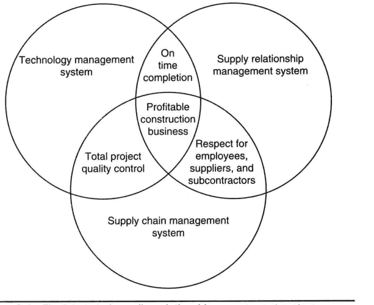

**图3.1** 集成供应商关系管理系统。

当施工企业将很大比例的项目活动/投标项目分包时，供应链关系管理的重要性不容低估。总承包组织面临着来自项目业主和竞争对手的巨大压力，必须通过降低成本、提高项目质量和实施持续改进来保持优势并继续经营。许多施工组织也在减少其投标人名单上的分包商和供应商数量。从更多的分包商和供应商处分包和采购材料，同时还要管理与每个分包商和供应商的关系，其成本可能过高，以至于公司无法承受。

### 分包商和供应商精简

随着施工组织使用的分包商和供应商数量减少，维持牢固的关系比以往任何时候都更加重要。保持这些关系的健康将确保获得高度合格的分包能力和材料来源，从而有可能实现更低的成本和更高的质量，并为竞争日益激烈的建筑市场带来更大的市场份额。正在转向精简分包商和供应基础的公司不能忽视与剩余分包能力和材料供应商之间关系的作用。施工供应链关系管理之所以重要的另一个原因是熟练能力和资源日益短缺。许多资源和商品材料越来越难获取，反过来采购价格也越来越高。随着价格上涨和材料供应日益稀缺，施工组织必须与这些材料（工作项）的分包商/供应商保持牢固的关系，以确保他们是分包商/供应商的优先客户；任何公司如果不能获得可持续的供应来源——即使是稀缺物品——都无法生存。

### 供应链关系的四个维度

一种解释供应链关系管理的模型包含四个行为维度——四个C：适得其反（双输）、竞争（一输一赢）、合作（双赢）和协作（双赢）关系。² 适得其反的关系是指每个公司都过于专注于获取自身最大利益，以至于使对方处于不利地位。这种关系是不可取的，因为它不能促进相关公司之间的积极融洽关系，而且双方都无法实现各自的目标。适得其反的关系还会阻碍公司之间的未来交易，并造成各公司声誉的不稳定。

竞争关系是指公司在谈判中努力争取尽可能最好的安排，却未能看到双方都能实现各自目标的好处。这些公司会不惜一切代价确保自己胜出，而不关心对方的利益。通常，在竞争关系中获胜的公司拥有比失败方大得多的权力。实力较强的公司有时只关注当下，而不考虑未来项目的长期谈判。这种关系也会阻碍持续合作，从而对双方都不利。在某些情况下，竞争关系是可取的。竞争关系几乎总是需要与交易型/三级承包商和供应商建立，并确保施工组织能够以较低的价格签订合同，从而帮助其在市场上保持竞争优势（例如，除非存在垄断或短缺，否则商品属于交易性采购）。这种关系是否足够牢固以持久并不重要，因为根据定义，交易型供应商随时可以被轻松替换。

合作关系认识到双方都能获得所需利益的潜在价值，并最大限度地发挥实现

| 类别 | 价值/供应商 |
| --- | --- |
| 关系细分 | 战略型 |
| 关系细分 | 优先型 |
| 关系细分 | 交易型 |
| 关系的共同价值 | 高 |
| 供应商支出（2009财年，百万美元） | 28 |
| 供应商支出（2009财年，百万美元） | 25 |
| 供应商支出（2009财年，百万美元） | 20 |
| 供应商支出（2009财年，百万美元） | 17 |
| 供应商支出（2009财年，百万美元） | 10 |
| 关系的共同价值 | 低 |
| 供应商支出（2009财年，百万美元） | 50美元 |
| 供应商支出（2009财年，百万美元） | 20美元 |
| 供应商支出（2009财年，百万美元） | 10美元 |
| 供应商支出（2009财年，百万美元） | 5美元 |
| 供应商支出（2009财年，百万美元） | 4美元 |
| 供应商支出（2009财年，百万美元） | 1美元 |
| 供应商支出（2009财年，百万美元） | 0美元 |
| 供应商 | Purdue Construction Inc. |
| 供应商 | Anderson Ready-Mix Inc. |
| 供应商 | Bloomington Asphalt Inc. |
| 供应商 | DBE Construction Systems Inc. |
| 供应商 | Bridge Contractors Inc. |
| 供应商 | Central State Steel and Supply Inc. |
| 供应商 | Miller Bridge Painters Inc. |
| 供应商 | Sunbelt Equipment Rental |
| 供应商 | Continental Building Systems Inc. |
| 供应商 | McDaniels Construction Company |
| 供应商 | ACE Trucking Inc. |
| 供应商 | Construction Systems IT Inc. |
| 供应商 | KBL Trucking Inc. |
| 供应商 | Black Barricades and Fences |
| 供应商 | Dell PCs |
| 供应商 | Xcell |
| 供应商 | Nano Excavations |
| 供应商 | Mobilization Systems Inc. |
| 供应商 | Focus CFAs |
| 供应商 | MSC (MRO Catalog) |
| 供应商 | ADP Inc. |
| 供应商 | Allsteel (Furniture) |
| 供应商 | Project Management and Estimating Services Inc. |
| 供应商 | AT&T (Office Supplies/Cell Phones) |
| 供应商 | Staples |
| 供应商 | Construction Staffing Services |
| 供应商 | Rumpke Waste Disposal |
| 供应商 | Ginmar Marketing Systems |
| 供应商 | Reverse Auction |
| 供应商 | Grainger (MRO Catalog) |

**图3.2** 供应商关系细分。


战略来源的关系需要密切管理。总承包商掌握供应商关系的一种方式，是为每个战略来源编制供应商档案。这些档案应包含关键管理层联系人、公司概况、SWOT（优势、劣势、机会、威胁）分析、波特五力、关键财务数据、当前合同信息、公司内部该关系的“负责人”以及组织架构图等内容。参见本章末尾的档案示例。³ 虽然编制这些档案的流程应由供应寻源经理负责，但档案内容的归属应覆盖建筑组织的所有职能。内容的职能归属将确保建筑运营中与每个战略供应商打交道的所有领域，都能为档案的必要内容提供意见。流程由供应寻源经理/部门负责，可确保整个公司只有一个战略来源档案来源。这种方法还确保供应寻源经理/部门了解所有战略来源，并知晓各职能如何评价这些来源。除战略来源档案外，建筑组织还应明确建立对战略来源的期望，并讨论未来的计划和项目；这通常通过年度评审周期完成。公共和私人项目业主也可能有自己的评估体系，不仅包括总承包商，还包括对供应链内所有实体的具体评估。

### 战略来源绩效评审流程

建筑组织应有一套管理绩效并向分包商和供应商提供反馈的流程。该流程通常通过要求分包商/供应商进行绩效自评，然后向战略来源分包商/供应商明确传达总承包公司如何评价其绩效来完成。建筑寻源组织通常会建立某种奖惩制度，以进一步鼓励卓越绩效。SMS 已涵盖反馈与绩效管理阶段。

概述有助于清晰理解供应商绩效评审流程。绩效评审是一组用于控制与现有战略分包商/供应商长期关系的期望和衡量标准。它包括根据 SMS 的期望，建立与新战略来源积极关系并评估现有战略来源当前绩效的一致衡量标准。SMS 评审流程有一个标准模板，用作指导，以便根据每个战略来源的具体标准制定定制化评审流程。

绩效评审模板包括与总承包商经理或主管的个人会议。让项目经理参与战略来源的绩效评审，对总承包公司有益，并能促进跨职能沟通。通过听取直接负责每个战略来源的人员的意见，可以更完整地评审绩效。

一般评审流程大约需要 2 个工作日完成。第一步是为每个单独的战略来源安排评审流程；评审日期在合同签署时确定。在评审日期前约 5 天，发送由 SMS 开发的问卷，问卷针对 SMS 和该战略来源的需求。随后，战略来源须完成问卷，并在会议前至少 2 天交回 SMS。内部评审完成后，将项目关系期望的最终分析传达给战略来源。随后几天内，双方举行会议，记录所有行动事项。最后一步是分发 SMS 与战略来源之间会议的纪要，并正式发布行动事项。见图 3.3。

#### Hoosier Pride Construction, Inc.

**会议纪要报告**

项目编号 ______________________  
项目名称 _____________________  
项目地点 _________________  
日期 _____________________________  
第 1 页，共 ________________________ 页  
编制人 ______________________  

会议主题 ____________________________________________________________

会议地点 ____________________ 日期 __________ 时间 __________

| 姓名 | 职务 | 代表方 | 备注 |
| --- | --- | --- | --- |
|  |  |  |  |
|  |  |  |  |
|  |  |  |  |
|  |  |  |  |
|  |  |  |  |

| 事项编号 | 纪要/描述 | 负责方 | 要求完成日期 |
| --- | --- | --- | --- |
|  |  |  |  |
|  |  |  |  |
|  |  |  |  |
|  |  |  |  |
|  |  |  |  |
|  |  |  |  |
|  |  |  |  |
|  |  |  |  |
|  |  |  |  |
|  |  |  |  |
|  |  |  |  |
|  |  |  |  |
|  |  |  |  |
|  |  |  |  |

备注：__________________________________________________  
__________________________________________________________

分发：_____________________________________________  
__________________________________________________________

**图3.3** 会议纪要报告。

SMS 有多个评审类别，用于全面评估其战略来源。质量是非常重要的评审类别。SMS 要求其战略来源达到或超过其绩效标准，并主动发起质量流程改进。客户服务应积极主动且灵活，交付绩效需要优化。SMS 最看重的属性是高质量和按时完成。技术和创新很重要，以保持领先或跟上竞争，并帮助 SMS 保持行业顶尖。SMS 有必要拥有对总成本公开透明的供应商。降低成本并持续改进流程是必要的，以保持成本低廉并建立与战略来源的信任。最后一个类别从道德角度对 SMS 及其合作的任何人非常重要。每个供应商都必须有正式的环境、健康、运营和安全计划。此外，他们应努力在可能时减少、再利用和回收。这些类别及其他类别用于为每个来源制定问卷。

### 战略供应商关系评分系统

每个战略来源的评分系统采用 0.0 到 4.0 分制（4.0 为最高可能得分），意味着有五个不同评级，从卓越到不可接受。得分越低，供应商需要评估越频繁。当分包商/供应商评分在 2.5 到 4.0 之间（卓越和非常好的战略来源）时，每年评估一次。良好战略来源评分在 1.5 到 2.49 之间，需每半年评估一次。边缘来源评分在 1.0 到 1.49 之间，需每季度评估一次。当战略来源不可接受时，其评分在 0.0 到 0.99 之间，这意味着有必要开发新来源。一旦在开发供应链关系上投入，建筑组织必须积极管理这些关系。然而，战略性建筑供应链关系并非没有风险，会给项目业主、总承包商和分包商/供应商带来风险。见表 3.1。

| 对业主的益处 | 对总承包商的益处 | 对供应商的益处 | 对分包商的益处 |
| --- | --- | --- | --- |
| • 降低项目成本<br>• 提高项目质量<br>• 更快完成项目 | • 降低项目成本<br>• 减少延误<br>• 提高盈利能力 | • 锁定业务<br>• 提升技能的能力<br>• 更少不确定性 | • 锁定业务<br>• 提升能力的能力<br>• 更少不确定性 |
| **对项目业主的风险** | **对总承包商的风险** | **对供应商的风险** | **对分包商的风险** |
| 1. 供应商基础变小（单一来源）<br>2. 供应商开发成本增加 | 1. 供应商基础变小（单一来源）<br>2. 供应商开发成本增加 | 1. 新业务机会有限<br>2. 较低的价格锁定 | 1. 新关系机会有限<br>2. 产能被锁定 |

**表3.1** 建筑供应链关系的益处与风险

### 结论

建筑组织不能忽视分包商/供应商关系管理。通过卓越的管理，可以获得竞争优势。鉴于当前商业环境的竞争性，如果忽视对战略分包商/供应商关系的适当管理，企业可能面临倒闭。供应链管理方法鼓励总承包商通过增加供应链价值和消除浪费来竞争。与战略分包商和供应商建立长期关系是供应链范式最重要的原则之一。真正的信息共享只能通过上下游信息技术实现。最后，持续改进的主题必须贯穿整个供应链的所有关系和活动。


### 参考文献

- 1. “27 in 7”峰值绩效，南卡罗来纳州交通部，2002年，www.scdot.org/inside/financing.shtml；以及案例研究——SIB，南卡罗来纳州：“27 in 7”峰值绩效，美国交通部联邦公路管理局，www.fhwa.dot.gov/innovativefinance/ifp/cssc.htm。
- 2. 罗伯特·J. 特伦特，“关系为何重要”，*供应链管理评论*，2005年11月，第53–59页。
- 3. 迈克尔·波特，*竞争优势：创造并保持卓越绩效*，纽约自由出版社，纽约，1985年。

## 第4章

## 建筑供应商选择与评估

### 成功里程碑

材料选择过程是第2章图2.1所示施工过程设计阶段中最重要的步骤之一。混凝土和砌体相对丰富，是应用最广泛的两种建筑材料。少量混凝土可以人工拌制，而大量混凝土则在计算机化搅拌站生产。砌体（黏土、砖和瓦）以小型单元制成，从而使建筑师有机会采用多种设计和图案。黑色金属制品在设计过程中有广泛的应用。木材、塑料和复合材料也常被建筑组织使用。沥青是水平工程中的主要材料。除材料部分外，大多数复杂建筑项目还需要多家设备供应商（例如泵、压缩机和鼓风机、输送机、起重机和卷扬机，以及测试设备）。

在当今竞争激烈的采购环境中，建筑组织必须根据供应商的增值能力来选择供应商，而不能纯粹依据竞争性采购流程。当前建筑材料采购的趋势是减少供应商数量。与此同时，更多建筑组织正在提高外购材料的比例。因此，为了选择能够持续超越竞争对手的供应商，必须对供应商进行仔细分析和评估。在做出这些关键材料决策时，并没有正式措施来确保已交付高质量材料。需进行材料目视检查，任何未见明显损坏的材料都会被接收和使用。然而，钢梁或混凝土等材料需要更正式的检验，以确保其符合规范。对于钢材，采购企业的代表可能会在测试过程中进行工厂考察，以确保满足建筑师的规范要求。例如，有时会检测混凝土芯样，以确认其具有所需稠度。此外，供应商代表有时会到施工现场，以确保材料被正确铺设。尽管质量对采购企业来说非常重要，但在选择某一供应商而非另一供应商时，质量可能并不起很大作用。在建筑行业中，质量很少成为问题，原因很简单：采购企业向供应商提供规范，而供应商必须遵守。如果供应商无法提供足够质量，承包商不会考虑今后与其开展业务。因此，在选定潜在供应商之后，交付可靠性和价格方面的考量在实际选择某一供应商而非另一供应商时发挥更重要的作用。

在当今快速推进的建筑行业中，交付可靠性显然至关重要，因为施工常常在建筑师最终设计完成之前就开始。如果错过交付截止日期，业主和承包商都可能付出高昂代价。*在建筑行业，时间真的就是金钱。* 如果项目未能在截止日期前完成，每超过到期日一天，潜在利润损失就会增加。在建筑行业，供应商必须能够按承诺向承包商交付材料。如果一家公司能比另一家供应商快得多地向承包商供货，那么较快的公司就具有优势。交付方面的考量是建筑行业选择供应商时最重要的标准。

价格也对选择过程有显著影响。然而，价格并不总能凌驾于所有其他标准之上。关键在于在价格与该过程中考虑的其他因素之间取得平衡。加急交付往往可能需要支付额外费用。公司必须权衡对按期交付的期望与由此带来的更高价格。通过谈判，买方和供应商必须达成令双方都满意的价格协议。

虽然质量、交付可靠性和价格在选择供应商时起着最关键的作用，但它们并不是唯一的考虑因素。根据项目及所需具体材料类型的不同，其他因素可能发挥更重要的作用。例如，供应商必须财务稳定，以确保买方相信其能够持续履行已协商的协议。在购买屋面材料、木门和橱柜时，保修也可能发挥重要作用。最后，客户服务或供应商位置方面的优势也可能促使买方倾向于某一特定供应商。

### 供应商信息来源

为特定材料或服务寻找合适的供应商本身就是一个战略问题。在快节奏且多变的新采购环境中，建筑组织必须知道去哪里寻找所需的材料或设备服务。材料和服务采购人员必须成为建筑行业以及特定大宗材料或设备服务方面的专家。采购组织在寻找潜在供应商时有许多信息来源可供考虑。传统采购信息来源——当地商会、黄页、贸易展会、互联网、总承包商协会和公共图书馆——都是极佳的供应商数据来源。

### 战略性选择

项目经理应清楚理解整个组织的战略，并制定具体的项目采购计划，以补充和协助整体战略的执行。采购、物流、材料管理和施工是在建筑供应链管理框架下紧密关联的职能领域。这些职能必须作为具有凝聚力的战略竞争单元协同运作，彼此互补。正应从这一视角出发进行战略供应商的选择。

例如，如果一家公司的战略是通过投标公路工程实现差异化，那么价格将是次要因素。规范、创新、技术和质量主导着公司保持竞争力和合规性的方式。这对项目经理提出了要求：必须灵活且具备应变能力。因此，应选择能够适应现场运营需求和合同变更单所要求变化的供应商。建筑组织与供应商之间需要实现“战略匹配”，以便在双方兼容的范围内尽可能长久地和谐合作。供应商的选择不应仅基于过往业绩，而应基于未来预期能力。为了使买方和供应商之间实现良好沟通，双方应在管理风格、控制系统、质量理念和技术能力（例如工程、设计和供应链整合）方面具有共同基础。供应商选择决策应被视为建筑组织战略的延伸。


### 供应商评估标准

供应商评估主要分为两大类：*基于过程的评估*和*基于绩效的评估*。基于过程的评估是对供应商生产或服务过程的评估。对于战略供应商，施工组织将在供应商现场进行审核，以评估供应商运营系统内的能力水平。可以制定工艺流程图，识别应消除的非增值活动，以提高业务效率。此外，大型建筑采购组织越来越多地要求其供应商通过第三方机构认证。

*基于绩效的评估*是根据多种标准（如交付可靠性、成本和质量缺陷率）对供应商实际绩效的评估。这是一种战术性评估，衡量供应企业的日常绩效；因此，它是一种事后评估。基于绩效的评估比基于过程的评估更常见，也许是因为客观数据容易获得且更易衡量。客观衡量方案的好处包括减少感知偏差，以及为供应商绩效提供一种基准比较手段。下一节将描述三种常见的基于绩效的供应商评估系统。

### 三种常见的供应商评估系统¹

当今使用的三种常见供应商评估系统是分类法、成本比率法和线性平均法。一般而言，决定哪种系统最佳的主要因素是实施难易程度和系统的整体可靠性。应当注意，对这三种系统中任何一种系统结果的理解，都属于采购组织的判断问题。

#### 分类法

分类法涉及将每个供应商在由相关绩效变量清单所界定的特定领域中的绩效进行分类。采购方为每个供应商制定绩效因素清单，并通过用简单术语（如“良好”“中性”和“不满意”）赋予“等级”来跟踪每个领域。在采购组织与供应商的频繁会议中，采购方将告知供应商其绩效。见表4.1。

分类法是一种简单且非正式的系统，因为它不衡量详细的绩效成果或不足。相反，它主要用作采购组织与销售组织高层管理者之间的基本评估工具，同时仍允许讨论过去绩效、未来期望和长期计划。实施这类评估方案的优点在于，它几乎可以立即实施，并且是本文讨论的三种系统中最便宜的。该方法的主要缺点是其依赖使用者的判断。该系统在很大程度上依赖人员的记忆来解释“不满意”或“良好”的含义。使用该方法时，没有具体的支持数据。

| 供应商 | 成本 | 材料质量 | 速度 | 总计 |
|---|---|---|---|---|
| A | 良好 (+) | 不满意 (−) | 中性 (0) | (0) |
| B | 中性 (0) | 良好 (+) | 良好 (+) | ++ |
| C | 中性 (0) | 不满意 (−) | 中性 (0) | − |

**表4.1** 绩效特征

在建筑行业，为管理层建立绩效因素和衡量指标是一项相对简单的任务，因此可以开发某种定量系统来衡量改进。然而，设计顾问也许是最难衡量的。衡量服务型企业时，必须收集以下数据：供应商态度、对援助请求的响应时间、技术援助质量以及支持人员的资质。因此，对服务采用相对简单的评级方案（如优秀、可接受和差），并附上关于具体事件的说明来解释评级，是正常的。

使用任何基于分类的管理评估系统时，经验至关重要。例如，当建筑组织正在缩减其供应商基础时，简单的合格/不合格供应商评级方法会奏效，但当供应商基础变得更易于管理时，就应替换该方法。换言之，初始改进比未来的评估方法更容易且成本更低。

#### 成本比率法

成本比率法使用标准成本分析评估供应商绩效。每次材料采购的总成本按其售价加上采购组织与采购质量、交付和服务要素相关的内部运营成本计算。计算涉及一种四步法。第一步是确定与质量、交付和服务相关的内部成本。接下来，将每个要素转换为成本比率，即把成本表示为采购价值的百分比。质量成本示例如下：

从100中减去所得分数（如果完美则为100），除以100，再加1。其思路是对所谓的所有权隐性成本——组织额外的全生命周期成本——给出简单的数值评分。例如，1.20的得分意味着，采购组织在该供应商处每花费1美元，还会在从延误到附加服务成本等所有方面再花费$0.20。

#### 线性平均法

线性平均法可能是最常用的评估方法。使用具体的定量绩效因素来评估供应商绩效。货物采购中最常用的因素是质量、服务（交付）和价格，不过所列因素中的任何一个都可能被赋予比其他因素更大的权重。对于复杂桥梁项目的建造商而言，质量最重要。在竞争激烈的住宅房屋市场所使用的评估系统中，价格可能被赋予同等或更大的权重。线性平均法示例如下。

第一步是为每个绩效因素分配适当的权重，使各因素的权重总和为100。例如，质量可赋予权重50，服务权重35，价格权重15。这些权重的分配属于判断和最高管理层偏好问题。随后，这些权重被用作三个绩效因素各自评分的乘数。分配权重后，确定各个绩效因素评分。这是通过汇总每个因素的得分来完成的。第三步是将每个绩效因素评分乘以其相应权重（以百分比表示）。在此例中，如果质量权重为50，则质量评分95将乘以0.50。最后，将第三步的结果相加，得出每个供应商的数值评分。

#### 示例

总承包商A希望按质量、服务和价格对其供应商进行评分，并分别为质量、服务和价格分配了50、35和15的权重因子。在本例中，质量按收到的合格大宗批次数量相对于收到批次总数的直接百分比评分。服务评分按准时交付批次数量相对于收到的大宗批次总数的直接百分比评分。在价格评分中，以从任何供应商处获得的最低价格作为基准价格，其他供应商的价格按与基准价格的比率评分。因此，两个供应商的评分如下：

| | **供应商1** | **供应商2** |
|---|---|---|
| *材料质量（权重 = 50）* | | |
| 合格大宗批次 | 50 | 35 |
| 收到的大宗批次总数 | 58 | 40 |
| 质量评分 | 86.2 | 87.5 |
| *服务（权重 = 35）* | | |
| 准时交付次数 | 52 | 38 |
| 收到的大宗批次总数 | 58 | 40 |
| 服务评分 | 89.7 | 95.0 |
| *价格（权重 = 15）* | | |
| 最低价格 | $75 | $75 |
| 提交价格 | $75 | $82 |
| 价格评分 | 100 | 91.5 |
| 总绩效评分 | 89.5\* | 90.7† |

\*89.49 = (.5 × 86.2) + (.35 × 89.7) + (.15 × 100)
†90.7 = (.5 × 87.5) + (.35 × 95.0) + (.15 × 91.5)

在此情况下，供应商2是更令人满意的供应商。这类系统的优点是，一旦确定所有绩效因素及其权重，实施起来就相对容易。另一个优点是，该系统在确定要衡量的绩效因素方面为施工组织提供了很大的灵活性。上例仅包含三个因素（质量、服务和价格），但可以使用任意数量的因素。对于不同产品类别，可以使用不同的因素、权重和衡量指标，以反映每个项目对采购组织的相对重要性。最后，这类系统能产生可靠的数据，且实施成本相对较低。

施工组织采购部门的主要目标是通过确保大宗材料和设备服务的可用性，为持续改进的运营提供保障。在竞争环境中，采购职能必须确保以合理价格准时交付正确的货物。人们普遍认为，质量、服务、交付时间和价格是竞争性企业的关键采购标准。管理专长、财务稳定性和相对供应商位置等隐性标准在供应商选择过程中很重要。企业还必须全面了解建筑行业的经济趋势、创新和挑战。正确的供应商选择

将是决定建筑企业是否盈利的重要因素。

### 单源与多源

关于企业应使用多少家供应商，已经发生了许多争论。争论的一方是多源采购，即使用两家或更多供应商。另一方是单源采购政策，即只使用一家供应商供应某一特定批次的大宗材料。

两种政策的目标都是为采购组织提供所供应批次大宗材料的最佳价值。许多属性会影响买方获得的价值。它们包括风险、质量、材料价格、总成本、交付、质量、可靠性和服务（设计能力、生产率改进、研究与开发）。

#### 多源采购的优势

支持多源采购的主要论据是竞争和供应保障。人们普遍认为，供应商之间为类似材料展开竞争，会促使成本下降，因为供应商会相互竞争以争取采购组织更多的业务。这种竞争意识深植于美国思想，因为竞争是资本主义的基础，也是西方经济理论的支柱。

多源采购还能保证大宗材料供应不受干扰。如果某一家供应商出现问题，例如罢工、重大故障或自然灾害，其他供应商可以弥补缺口，交付所有所需材料而不中断供应。

多源采购还可带来其他好处，例如改善市场情报和提高供应商评估的有效性。与多家供应商接触能使企业及时了解该领域出现的新发展和新技术。此外，与供应商更广泛的接触，通过比较不同供应商的成本和生产数据，将提高评估供应商能力和进展的有效性。

#### 单源采购的优势

支持单源采购的主要论据是：在批量确定的情况下，供应商可以享受更低的单位成本，并加强合作与沟通，从而在买卖双方之间形成双赢关系。指定某家供应商为单一来源，并让其承担100%的合同要求，会大大降低该供应商因业务被另一竞争对手夺走而产生的不确定性。有了这种合同保证，供应商更愿意改变其业务/运营方式，以适应建筑采购组织。通过减少准备等领域的重复运营，与多源采购相比，单源大宗材料应能提供更低的每批次成本。将固定成本分摊到更大的批量上，还应带来学习曲线的加速。与多源采购相比，单源协议涉及的人员更少，因此会增强买卖双方之间的合作与沟通。

#### 双源采购的优势

多源采购的优势可被视为单源采购的劣势，反之亦然。最佳情形应是兼具两者优势。这可以通过对单源供应商施加重大压力，或在多源采购环境中为供应商提供重大确定性来实现。这可以通过使用供应商使用限额来完成。无论采用单源还是多源供应商，在项目上更换供应商都可以作为一种惩罚形式；在某些情况下，在所有项目上使用相同的供应商可以被视为一种奖励。

针对特定项目的长期合同可以提供产生单源采购结果所需的稳定性，同时仍然使用不止一家供应商。通过服务多个项目，两家供应商（每个项目各为单一来源）可能能够实现与一家供应商相当的经济规模。当把批量分摊到固定成本上时，材料节约会经历收益递减。如果批量足够大，两家企业最终可能使收益递减到价格与一家企业相当的程度。这一优势可归因于单一来源供应商可能产生的“规模经济”。

#### 长期关系问题

单源采购的倡导者可能需要处理有关单源采购长期影响的某些问题。从长远来看，如果各方都减少供应商基础，需要打交道的供应商就会减少，整体竞争将会下降。从长远来看，供应商整合将赋予供应商更大的权力。

最后，在工程和设计工作等领域，越来越多的任务由单一来源供应商执行。在所谓的“外包供应合同”中，建筑企业将某一完整的工作类别或服务分配给供应商，由供应商负责设计和生产。项目业主和建筑企业只关心完成的工作项。这类情况可能使供应商变得高度专业化并获得大量专业知识，以致建筑企业无法有效与其供应商竞争。建筑企业必须注意，不要将产品中过多的增值部分交给供应商，否则建筑企业的权力将被削弱。

### 交叉采购

单源/多源问题不必被视为“是或否”类型的决策。可以采用一种称为交叉采购的混合方法。采用这种方法，可以在不增加实际供应商数量的情况下扩大供应商基础。例如，如果供应商A能够为项目1、2、3、4和5供应材料，供应商B也能做到，那么若由供应商A为项目1、3和5供应材料，由供应商B为项目2和4供应材料，就可以同时实现单源和多源采购的优势。如果供应商A出现任何问题，供应商B可以弥补缺口，因为B也有能力为项目1、3和5供货。两家供应商都不会受损，因为总体批量保持不变。如果供应商B未能履约，也可以反向操作。

### 供应商精简

无论对单源/多源之争的最终分析如何，都建议精简供应商基础。如果预期收益大于风险，并且在对短期和长期需求进行仔细分析之后，单源采购可能是合适的。然而，对于一旦发生供应中断就会遭受财务损失的运营活动，使用或开发第二来源是明智的。假设减少供应商数量是可取的，问题就变成“精简哪一家或哪几家？”等级法和门槛法用于指导供应商精简分析。

#### 等级法

“等级”法是指买方根据某些属性给供应商打分或评级的方法。最常见的属性是质量、价格和交付。供应商过去的绩效会被记录在案，供应商会收到与其他供应商相比的绩效“评分卡”。可以增加许多额外属性，例如交付频率，但方法保持不变——对于每个属性和每笔采购交易，供应商都会获得一个等级。这些属性可以等权重，也可以用来强调对采购企业更重要的内容。

在实施供应商精简政策时，通常建议使用评分卡（通常已计算机化）对供应商进行排名，然后选择最好的一家或几家。这种方法的缺点之一是，很多时候定性信息无法准确纳入系统——例如，设计变更或交通拥堵导致装运延迟。


以降低项目的材料成本。在设计认证计划时，应谨慎选择标准。良好的认证应涵盖设备能力、质量保证、供应商的财务健康状况、生产调度方法、价值分析能力以及成本核算方法等方面。

### 结论

施工组织往往不擅长识别其供应商的能力，并且常常基于便利性来合理化材料供应商的选择决策。这一不可或缺的功能——材料供应商选择流程——应整合到供应链管理环境中，以确保大宗材料的可用性。许多组织在供应商选择中犯下的错误可以通过三个成功要素来避免。总承包商应评估每个供应商的核心能力和实力，然后考虑该供应商是否可以被替代。由于企业会因各种原因退出市场，总承包商应准备好建立替代合作关系。最后，总承包商应与所有战略供应商共享信息，并征求他们的意见。

### 参考文献

- 1. Benton, W. C., *采购与供应管理*，McGraw-Hill/Irwin，纽约，2007年。

## 第5章

## 采购分包服务

> 在你做出决定之前，什么都不会发生

建筑是一个以项目为驱动的行业，需要许多专业化的技能。历史上，总承包商扮演着总营造师的角色，负责采购材料并使用自己的劳动力来建造项目。随着时间的推移，行业已经发展演变，如今总承包商几乎不亲自执行任何工作，而是充当施工经理，负责协调和管理项目。实际工作由专业分包商完成。电气、机械、运输、钢结构、桥梁涂装和屋面服务只是众多常规分包工作中的一部分。由于分包商的能力非常专业化，采购分包服务与采购大宗建筑材料和设备有很大不同。总承包商与材料供应商或设备供应商之间的协议通常是常规、交易性的且保持一定距离，除非该供应商是战略合作伙伴。另一方面，总包与分包之间的关系要求在施工组织和分包组织的多个层级之间进行持续或至少是间歇性的合作。例如，桥梁项目的设计规范要求总承包商与钢结构分包商之间进行细致的协调和执行。在设计-建造项目中，业主希望项目尽快完工，但持续的设计变更意味着总承包商无法在最初阶段明确某些工作项目和所需数量。在设计-建造的快节奏环境中，经验丰富的分包商是建筑供应链中的关键环节。分包商角色的关键性并不仅限于时间敏感的设计-建造环境。分包所涉及的金额规模——在某些项目中高达总金额的80%——促使以供应链管理为导向的建筑组织不遗余力地确保选择最合适的分包商。

从技术上讲，由于业主与分包商之间没有合同关系，分包商与项目业主之间不存在正式关系。总承包商完全负责与分包商的关系，这一点可以通过典型的项目组织图看出。见图5.1。

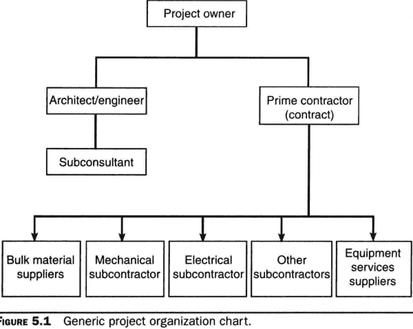

然而，实际上，基于法律项目行政管理要求，业主与分包商之间存在许多联系。在大多数司法管辖区，由于技工留置权法，分包商与总承包商之间存在关系。留置权直接附着于作为工作标的物的财产上。如果业主向总承包商付款，而总承包商却没有向分包商付款，那么即使总承包商已收到款项，业主仍需对欠分包商的款项负责。在某些州，为了执行留置权，分包商必须在项目开工后的若干天内通知项目业主工程已经开始。这种通知通常被称为“开工通知”或“留置前通知”。对于公共项目，分包商不能对道路或公共建筑行使留置权，但有权对应付给总承包商的资金主张公平留置权。这通常被称为“经认证的账目”。与垂直建筑市场中的留置前通知类似，一些州的交通部（DOTs）要求总承包商在开始工作前列出分包商名单。

项目业主与分包商之间还有其他联系。一些政府和私人业主可能要求分包商在具备资格向参与公共和私人项目的总承包商报价之前先通过资格预审。资格预审旨在确定企业的财务能力和建造特定工作项目的经验。政府机构的资格预审申请可能内容繁多，可能要求提供合并、审阅或审计过的财务报表、设备清单、关键员工的简历以及已完成和在建项目的清单。这些信息经过评估后，用于设定承包商能够承担的金额上限和工作类别；例如，获得混凝土基层路面及重铺工程的资格预审，限额为2500万美元。除了项目业主要求之外，总承包商也可能有自己的分包商资格预审流程，这将在本章后面讨论。

保险和担保要求也将项目业主与分包商联系起来。在目前的环境下，分包商通常必须在其商业一般责任保险单中将项目业主和总承包商都列为额外被保险人。如果业主拥有内部工程人员并自行进行检验，分包商可能有机会直接与业主互动。包括供应链所有实体的合作伙伴会议也为分包商提供了与项目业主进行一些互动的机会。

由联邦、州和地方政府机构管理的针对女性和少数族裔企业的平权行动项目是项目业主必须直接与一小部分符合计划资格的分包商打交道的另一个例子。例如，联邦公路管理局的弱势企业计划由各州交通部管理。根据49 CFR 26以及其他联邦和州法规，州交通部确定企业主是否在社会和经济上处于弱势。当企业被认证为弱势企业（DBE）后，该企业将与其他DBE企业一起列入名录，并可能被征询以满足某些联邦援助公路合同中的DBE目标。在DOT市场中合同授予后，该机构会跟踪DBE和总承包商的现场运营情况，以确保遵守DBE计划的相关法规。

项目业主与分包商之间联系的深度和数量并非微不足道。业主与分包商之间的关联已经非常重要，并可能有助于推动建筑供应链管理理念的实施。

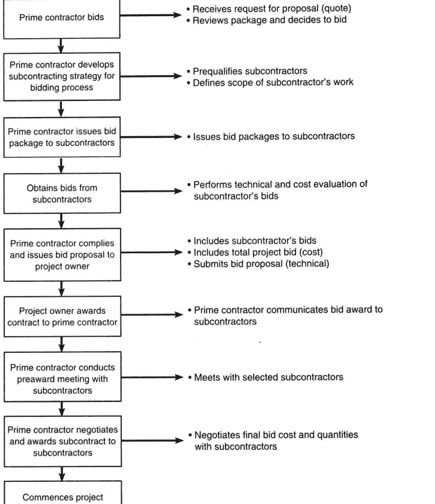

- 1. 总承包商投标
  - 收到建议请求（报价）
  - 审查文件包并决定是否投标
- 2. 总承包商制定投标过程的分包策略
  - 对分包商进行资格预审
  - 界定分包商的工作范围
- 3. 总承包商向分包商发出投标文件包
  - 向分包商发出投标文件包
- 4. 获取分包商的投标书
  - 对分包商的投标书进行技术和成本评估
- 5. 总承包商整理并向项目业主发出投标建议书
  - 包含分包商的投标书
  - 包含整个项目的投标（成本）
  - 提交投标建议书（技术）
- 6. 项目业主将合同授予总承包商
  - 总承包商向分包商通知中标结果
- 7. 总承包商与分包商召开授标前会议
  - 与选定的分包商会面
- 8. 总承包商与分包商谈判并授予分包合同
  - 与分包商谈判最终投标成本和数量
- 9. 开始项目

**图5.2** 分包商选择流程。

没有另一方，单独一方就毫无意义。合同经理、建筑师/工程师、估算师、法务人员以及潜在的项目经理都应参与分包商投标文件包的准备工作。最终，采购/合同经理应负责确保投标文件包中的信息准确、完整且最新。


### Hoosier Pride Construction, Inc.

#### 分包商数据库（第2页）

项目编号：________________________  
项目名称：________________________  
项目地点：________________________  
日期：________________________  
编制人：________________________  
第________页，共________页

### 所执行工作的分类或类型

1. 勾选贵公司员工执行的施工工作类型。

| | | |
|---|---|---|
| □ 建筑 | □ 暖通空调 | □ 管道系统 |
| □ 木工 | □ 检验与测试 | □ 给排水 |
| □ 混凝土 | □ 保温/伴热 | □ 屋面 |
| □ 输送机/电梯 | □ 实验室设备安装 | □ 钣金 |
| □ 拆除/搬迁 | □ 景观绿化 | □ 场地准备 |
| □ 电气 | □ 砌筑/砖石 | □ 喷淋系统 |
| □ 挖掘 | □ 机械 | □ 结构钢 |
| □ 围栏 | □ 工厂机械安装 | □ 隧道工程 |
| □ 消防 | □ 涂装 | □ 其他（列出）________________________ |
| □ 玻璃/玻璃安装 | □ 铺装 | |
| □ 危险废物清除 | □ 打桩 | |

2. 作为总承包商完成的工作百分比 ________ %

3. 作为分包商完成的工作百分比 ________ %

4. 列出通常分包给他人的工作类型 ________________________

### 工程业绩

1. 列出贵组织在过去5年内完成的重要项目，包括合同金额。

| 客户名称 | 联系人 | 项目名称和工作范围 | 合同金额 | 施工年份 |
|---|---|---|---|---|
| | | | | |
| | | | | |
| | | | | |

### 财务信息

- 1. 提交最近三年的年度财务报告和当前损益表（优先提供经审计的报告）。
- 2. a. 您认为贵公司有能力承接的项目最大美元金额是多少？$________  
  b. 在多长时间内？________
- 3. 过去五年平均年工程额 $________
- 4. 当前是否与客户、分包商或供应商存在正在进行或待决的诉讼？□ 是 □ 否  
  若为是，请详述。________________________

**图5.3** 分包商数据库和资格预审问卷（续）。

#### 分包商数据库（第3页）

项目编号：____________________  
项目名称：____________________  
项目地点：____________________  
日期：____________________  
编制人：____________________  
第____页，共____页

**5.**  
a. 贵方是否有固定的担保公司？☐ 是  ☐ 否  
b. 若有，担保公司名称：______________________________________________  
地址：______________________________________________________________________  
联系人：__________________________  电话：__________________________  担保额度 $：__________________

**6.** 请注明银行资信证明：  
____________________________________________________________________________  
____________________________________________________________________________

### 施工设备和机械

1. 列出拥有的施工设备，注明能力、使用年限、类型和附件。  
____________________________________________________________________________  
____________________________________________________________________________

### 劳动力和工会隶属关系

1. 贵组织是否以开放用工（非工会）方式施工？☐ 是  ☐ 否  封闭用工（仅工会）？☐ 是  ☐ 否  
若两者兼有，是否以同一名称施工？☐ 是  ☐ 否  若名称不同，请列出两者。  
____________________________________________________________________________  
____________________________________________________________________________

2. 贵方是否有任何全国性工会协议？☐ 是  ☐ 否  若有，与哪些工种？  
____________________________________________________________________________  
____________________________________________________________________________

3. 若您是地方协议的签署方，请注明以下内容：  
工种和分会：______________________________  您的谈判权持有人：______________________________  
____________________________________________________________________________

### 安全与保险信息

1. 安全计划负责人：______________________________________________  
职务：______________________________  电话：______________________________

2. 涉及保险事宜的联系人：______________________________  
电话：______________________________  传真：______________________________

3. 保险代理人姓名和地址：  
____________________________________________________________________________  
____________________________________________________________________________

4.  
a. 损失工作日案例数（导致缺勤的伤害）  
b. 仅需医疗处理的案例数  
c. 死亡人数

| | 去年 | 前5年 |
|---|---|---|
| a. 损失工作日案例数 | | |
| b. 仅需医疗处理的案例数 | | |
| c. 死亡人数 | | |

本声明由以下人员填写：  
姓名：____________________________________  职务：______________________________  
签名：____________________________________  日期：__________________________

**图5.3** 分包商数据库和资格预审问卷*（续）*。

### 投标文件包的组成部分

通用投标文件包包括以下组成部分：

- 项目业主、总承包商和潜在分包商（投标人）的名称和地址，投标时间安排，包括投标截止的时间和日期以及开标的时间和日期。
- 工作范围，包括技术规范、施工图、竣工日期，以及技术规范和文件更新所规定的质量和可靠性要求。
- 合同工作项的一般条款，以样板形式或合同样本说明预期合同类型。
- 概述投标文件包的内容并说明每一部分。
- 标明所有引用文件。
- 包含条款和条件的向下传递。
- 标明获取图纸和技术规范的地点。
- 标明价格和数量提交信息。
- 标明截止日期、时间和提交要求。
- 包含投标前要求确认的工作范围（数量）。
- 解决任何资格条件、例外或范围差异。

**表5.1** 投标文件包编制检查表

- 特殊规定，是对标准和补充技术规范的增补和修订，属于DOT合同中的向下传递条款，并描述特定项目的条件。
- 准备和提交投标书的特别说明，例如份数、交付说明、价格和技术投标文件分开提交，以及DBE目标（如适用）。
- 直接成本、间接费用和定价表格（如适用于协商合同）。

在发布投标文件包之前，合同组织必须获得法律部门、业主、项目经理和主管的批准。如果存在错误或遗漏，在将投标文件包邮寄给潜在分包商之前更正会容易得多。检查表可用于编制投标文件包。参见表5.1。分包商投标文件包和投标前邀请函样本见附录B。

### 标前会议

如果项目规模大、复杂且涉及安全问题，可能宜要求召开*强制性*标前会议，以回答与投标文件包相关的任何问题。强制性标前会议，即使对总承包商而言，在大多数市场也很少见，尤其是重型公路项目。当标前会议为强制性时，潜在投标人必须参加，否则将被排除在投标之外。标前会议确保所有潜在分包商对要求有相同的理解。在大多数情况下，标前会议将带来更低的价格，尤其是当有多个潜在投标人时。总承包商必须尽一切努力


在标前会议上保持客观。有些涉及工作方法和工程流程的技术问题可能会使投标产生偏向，应*不*在标前会议期间回答。

### 采购/供应管理（大型建筑组织）

合同经理应是*唯一*与潜在投标人沟通的联系人。潜在投标人与合同组织其他人员（即总承包商的项目经理）之间绝不应有任何沟通。在招标期间，所有潜在分包商都应受到公平对待。投标包修正应以书面形式通过电子邮件和确认函分发给所有投标人。修正可采取变更合同条款和条件、变更材料数量以及应竞争分包商请求作出澄清等形式。合同经理必须确保在评审过程中不披露任何专有信息。通过准备相同的投标包并在选择过程中平等对待分包商，可以确保分包竞争。

### 投标包评审

投标评审流程和标准应在投标提交之前确定。如果评审流程基于评分制，则必须在评审投标建议书之前设定权重方法。评审委员会应由项目经理、主管、法务和合同经理组成。

### 通过电子邮件、传真和电话提交投标

在某些情况下，总承包商将允许分包商在投标截止日期通过传真或电话提交投标。见图5.4。收到这些投标后，合同经理将致电最具竞争力的投标人并讨论工作范围。见图5.5。合同经理随后将比较分包商投标，并选择最具竞争力且合格的分包商。如果总承包商与中标分包商没有合作关系，这种分包商选择方法是有风险的。该选择方法还要求有详细的文档记录。在收集所有响应性分包商投标后，进行投标分析。见图5.6。

为消除投标压价（bid shopping）和投标兜售（bid pedaling），加利福尼亚州法律要求，在公共工程承包中，总承包商必须指定或列出将在项目中使用的分包商，并说明每个分包商将执行的工作部分。参与印第安纳州交通部项目投标的总承包商必须按名称、工作项、价格和数量列出所有DBE分包商，并且如果合同授予，则受此承诺约束。

#### 分包投标电话确认

**Hoosier Pride Construction, Inc.**

| 字段 | 填写内容 |
|---|---|
| 项目编号 | ______________________________ |
| 项目名称 | ______________________________ |
| 项目地点 | ______________________________ |
| 页 | ______ / ______ |
| 编制人 | ______________________________ |
| 报告编号 | ______________________________ |
| 日期 | ______________________________ |
| 修订版 | ______________________________ |
| 时间 | ______________________________ |
| 业主 | ______________________________ |
| 分包商名称 | ______________________________ |
| 地址 | ______________________________ |
| 电话号码 | ______________________________ |
| 联系人 | ______________________________ |
| 职务 | ______________________________ |
| 传真号码 | ______________________________ |
| 投标参考编号 | ______________________________ |
| 工作范围 | ______________________________ |
| 投标中所有税费 | 是 ☐  否 ☐ |
| 运费 | 是 ☐  否 ☐ |
| 图纸与规范 | 是 ☐  否 ☐ |
| MBE/WBE 承包商 | 是 ☐  否 ☐ |
| 施工详图 | 是 ☐  否 ☐ |
| 投标中包含的附录编号 | ______________________________ |
| 金额 | $ ______________________________ |
| 投标中的排除项和遗漏项 | ______________________________ |
| 投标金额 | $ ______________________________ |
| 备选方案：A. | $ ______________________________ |
| 备选方案：B. | $ ______________________________ |
| 信息接收人 | ______________________________（日期/时间） |
| 信息来源 | ______________________________ |
| 备注 | 分包商必须在24小时内以书面形式确认投标价格。 |
| 评论 | ______________________________ |

**图5.4** 分包商电话投标确认。

#### 分包商口头报价记录

**Hoosier Pride Construction, Inc.**

| 字段 | 填写内容 |
|---|---|
| 项目编号 | ____________ |
| 项目名称 | ____________ |
| 项目地点 | ____________ |
| 日期 | ____________ |
| 页 | _____ / _____ |
| 编制人 | ____________ |

| 类型 |  |
|---|---|
| 类型 | ☐ 分包 &nbsp;&nbsp; ☐ 材料/设备 &nbsp;&nbsp; ☐ 服务 &nbsp;&nbsp; ☐ 口头报价 |

| 字段 | 填写内容 |
|---|---|
| 若为材料，FOB 地点： | ____________ |
| 海运 / 空运 / 卡车运输 / 铁路运输 | 工作类型：____________ |
| 分包商或供应商： | ______________________________ |
| 电话号码 | ____________ |
| 传真号码 | ____________ |
| 日期 | ____________ |
| 地址 | _____________________________________________ |
| 被联系人姓名/职务 | __________________________ |

**所需设备/材料或服务**

| 项目编号 | 描述 | 数量 | 单位 | 单价 | 金额 |
|---|---|---|---|---|---|
|  |  |  |  |  |  |
|  |  |  |  |  |  |
|  |  |  |  |  |  |
|  |  |  |  |  |  |
|  |  |  |  |  |  |
|  |  |  |  |  |  |
|  |  |  |  |  |  |
|  |  |  |  |  |  |
|  |  |  |  |  |  |

| 字段 | 值 |
|---|---|
| 投标有效期天数 | （_____天） |
| 投标总价值 | $ ____________ |
| 供应商提供的协助由： | __________________________________________ |

| 开始交付日期 | 完成交付日期 | 交付地点 | 每项 |
|---|---|---|---|
| ____________ | ____________ | ____________ | _____ |

| 缺失项目 | 是 | 否 | 不适用 | 排除/例外 |
|---|---|---|---|---|
| 工程费用 |  |  |  |  |
| 保函 |  |  |  |  |
| 销售税 |  |  |  |  |
| 完整工作范围 |  |  |  |  |
| 运费 |  |  |  |  |
| 涨价 |  |  |  |  |
| 价格固定 |  |  |  |  |

备注：________________________________________________________________

| 确认发送方式： | 传真 ☐  信函 ☐ |
|---|---|
| 报价接收人： | __________________________ |

**图5.5** 分包商口头报价记录。

#### 分包商投标分析

| 字段 | 填写内容 |
|---|---|
| 项目编号 | ________ |
| 项目名称 | ________ |
| 地点 | ________ |
| 客户 | ________ |
| 日期 | ________ |
| 页 | ________ / ________ |
| 合同工作范围 | ________ |
| 合同成本代码 | ________ |
|  | （单价；总价包干；成本加成等） |

| 描述 | 分包商 A&S | 分包商 Pioneer, Inc. | 分包商 Crayton, Inc. | 分包商 B&B, Inc. | 分包商 Pinta, Inc. | 分包商 Thompson, Inc. | 预算估算 |
|---|---|---|---|---|---|---|---|
| 总全包价格 |  |  |  |  |  |  |  |
| 1. 已作调整： |  |  |  |  |  |  |  |
| 2. 已作调整： |  |  |  |  |  |  |  |
| 3. 已作调整： |  |  |  |  |  |  |  |
| 因澄清函和税费而作的价格调整 |  |  |  |  |  |  |  |
| 价格比较/评估（总价包干或单价合同） |  |  |  |  |  |  |  |
| 选定的投标 |  |  |  |  |  |  |  |
| 备注： |  |  |  |  |  |  |  |

批准签字：

### 合同类型

合同类型的选择与特定工作项相关风险的大小密切相关。整体项目风险可能意味着分包商的固有风险。分包商的风险包括材料、劳动力和燃料成本上涨。为了评估技术开挖。分包商提交的单价明细包括直接成本、间接成本和利润。见图5.7。这种承包方法与资格预审配合效果最佳，因为总承包商事先知道所有投标人都具有相同的工作执行能力。通常会选择最具竞争力的分包商。估算数量通常为最终数量上下浮动。分包商按最终安装数量获得付款。

#### 成本加成合同

根据定义，成本加成合同用于工作范围不确定且成本容易失控的情况。在某些情况下，例如采用成本加成协议的应急项目，即使计划和规范不明确且不完整，业主也希望开始施工。在这种安排中，业主向总承包商支付施工中发生的成本，外加某种额外费用。

总承包商与分包商之间的书面协议必须规定哪些成本可报销。通常，可报销成本包括所有现场和项目成本，包括劳动力、材料、设备、管理费、保险和保函保费。另一方面，承包商的公司办公室运营费用通常不包含在成本加成协议中。此外，协议应规定在计算额外费用时应考虑哪些成本。合同修改和变更单很容易消耗预算。这些成本超支要求要么降低某些任务的质量，要么完全取消项目的某些方面，要么需要通过增加性变更单来增加项目资金。与总价包干合同相比，成本加成合同可能费用更高。项目业主在成本加成合同中处于不利地位。成本加成合同的各种混合形式将在以下各节中描述。

#### 成本加成固定百分比

承包商获得实际成本加上项目总成本一定百分比的付款。合同必须明确说明哪些成本可报销。

#### 成本加成固定费用

客户同意报销承包商的实际成本，无论金额多少，并支付与实际成本金额无关的协商费用。

#### 带保证最高价合同的成本加成固定费用和/或奖金或分享任何成本节约

成本加成固定费用协议有若干变体。*带保证最高价的成本加成固定费用*用于承包商获得项目总成本加协商费用的付款，但


#### 06-092 单价施工——杂项路面施工、重建服务

| | Watson Construction | Cater & Sons Const. | Dickey & Burham, Inc. | Schmieding Concrete Pavers, Inc. |
|---|---|---|---|---|
| 公司名称： | Watson Construction | Cater & Sons Const. | Dickey & Burham, Inc. | Schmieding Concrete Pavers, Inc. |
| 代表人： | Claude L. Walton | Thomas Parish | Steven R. Burham | Robert Schmieding |
| 地址： | 5100 N. 48th St. | P.O. Box 29199 | P.O. Box 22355 | 4101 N. 40th |
| 城市、州、邮编： | Lincoln, NE 68504 | Lincoln, NE 68529 | Lincoln, NE 68542-2555 | Lincoln, NE 68504 |
| 电话： | 402-464-5797 | 402-464-2113 | 402-421-8021 | 402-467-7387 |
| 传真： | | | | |
| 电子邮箱： | | caterandsons@hotmail.com | stevenburham@alltel.net | schmieding@aol.com |

| 项目 | 描述 | 单位 | Watson Construction | Cater & Sons Const. | Dickey & Burham, Inc. | Schmieding Concrete Pavers, Inc. |
|---|---|---|---|---|---|---|
| 1 | D型，锯切——波特兰水泥混凝土路面 | L.F. | $5.75 | $5.00 | $5.00 | $5.00 |
| 2 | C型锯切——波特兰水泥混凝土路面 | L.F. | $5.50 | $5.00 | $5.00 | $5.00 |
| 3 | 杂项沥青和混凝土清除 | C.Y. | $7.40 | $25.00 | $5.50 | $5.50 |
| 4 | 混凝土人行道，4 英寸厚 | S.F. | $4.75 | $3.75 | $3.25 | $4.00 |
| 5 | 混凝土车道，6 英寸厚 | S.F. | $4.95 | $3.75 | $3.50 | $4.00 |
| 6 | 混凝土车道，8 英寸厚 | S.F. | $5.25 | $4.00 | $4.75 | $5.75 |
| 7 | 拆除并更换混凝土人行道，4 英寸厚 | S.F. | $5.60 | $4.50 | $5.00 | $5.00 |
| 8 | 拆除并更换混凝土人行道，6 英寸厚 | S.F. | $5.60 | $4.50 | $5.25 | $5.00 |
| 9 | 拆除并更换混凝土车道，6 英寸厚 | S.F. | $6.95 | $5.00 | $5.25 | $5.75 |
| 10 | 拆除并更换混凝土车道，8 英寸厚 | S.F. | $7.70 | $6.00 | $5.75 | $6.00 |
| 11 | 附表II 沥青混凝土工程： | | | | | |
| 1 | A型，沥青混凝土路面 | L.F. | $5.00 | $4.50 | $5.00 | $5.00 |
| 2 | D型，沥青混凝土路面 | L.F. | $5.00 | $4.50 | $5.00 | $5.00 |
| 3 | 杂项沥青和混凝土面层 | C.Y. | $30.00 | $30.00 | $30.00 | $30.00 |
| 4 | 铺设非织造路面加铺织物 | S.Y. | $2.00 | $2.00 | $2.00 | $2.00 |
| 5 | 拆除并更换沥青混凝土路缘石，完整 | L.F. | $14.00 | $12.00 | $9.00 | $9.00 |
| 6 | 拆除并更换混凝土路缘石，完整 | L.F. | $15.00 | $12.00 | $9.00 | $9.00 |
| 7 | 沥青混凝土路面，2级，非主干道 | S.F. | $15.00 | $12.00 | $9.00 | $9.00 |
| 8 | 沥青混凝土路面，2级，非主干道 | S.F. | $20.00 | $15.00 | $12.00 | $12.00 |
| 9 | 沥青混凝土路面，2级，非主干道 | S.F. | $14.00 | $12.00 | $9.00 | $9.00 |
| 10 | 涂刷路面标线，白色或黄色交通漆，不符合玻璃微珠要求 | Ton | $500.00 | $300.00 | | |
| 11a | 含玻璃微珠 | Ton | | | | |
| 11b | 不含玻璃微珠 | Ton | | | | |
| | 附表III——变更费用（每处场地） | L.F. | $2,000.00 | $350.00 | | |

图5.7 杂项路面施工的单价。

总价不超过约定的上限。如果项目在预算内完成、提前完工等，可以在此报酬基础上增加奖金。这种合同安排将是一种*成本加固定费用、保证最高价及奖金合同*。如果项目低于预算完成，承包商还可能分享任何成本节约，这种合同称为*成本加固定费用并约定分享任何成本节约的合同*。

#### 设计-建造合同

设计-建造是一种交钥匙项目交付系统。项目业主说，我需要一座新办公楼，2011年1月10日完工。在传统的设计-招标-建造安排中，业主首先与设计专业人员签订合同，以编制施工图和规范，随后这些文件用于征集施工竞争性投标。在设计-建造模式中，选择一个单一实体同时负责建筑的设计和施工。虽然价格可能是选择设计-建造方的一个因素，但也会评估其他因素。设计和施工可以同时进行。设计-建造的优点是项目业主可节省成本，因为通常不允许变更单，并且项目可能提前完工。设计-建造的缺点是业主放弃控制权。由于设计-建造是快速通道和交钥匙模式，业主还必须在项目开始前明确项目要求。

#### 协商合同

在少数情况下，总承包商可能放弃正式评估程序，直接选择分包商。这一决定通常基于进度限制。协商合同根据工作项的复杂程度，按总价或成本加酬金定价。当工作项简单明确时，协商的是*总价*合同。然而，如果工作项存在不确定性，则协商的是*成本加酬金*合同。

### 合同谈判

*讨价还价与谈判*是承包商与分包商关系的重要组成部分。在建造建筑物或桥梁的过程中，所有供应链合作伙伴之间必须进行谈判，以就执行工作项达成双方满意的协议。每当确定施工合同协议的条款或解决项目变更时，就可能发生讨价还价。从某种意义上说，每个供应链成员都会在某个时候成为谈判者。当两方或多方存在不同利益或目标，并且各方之间可以沟通时，就会发生讨价还价。此外，还必须存在三个条件才能发生讨价还价。(1) 必须可能实现相互妥协。如果其中一方必须在全胜和全损之间选择，就不会发生讨价还价。讨价还价情形需要为相关方提供中间解决方案。(2) 情形相关方必须有可能提出临时报价。(3) 在所有各方接受条款之前，临时报价不得决定情形结果。讨价还价情形可以定义为：存在某些分歧的各方就可能的解决方案进行协商并交换意见，直到达成妥协或谈判终止的互动过程。这种讨价还价定义称为*显性谈判*。在建筑行业中，分配性谈判发生在两方之间，双方拥有对方渴望的资源。

虽然讨价还价有时发生在所谓多对手谈判情形中——总承包商在采购分包服务时与多家分包商比价，或承包商与多家备选供应商谈判批量材料采购——但这种方法在供应链环境中不可能有成效。相反，重点应放在*双边垄断*体系中的讨价还价。这并不排除其他相关方对两个谈判者的影响，但确实将讨价还价限制在仅两方之间。情形带来的总收益必须在涉及的两方之间“分配”，而每一方通常都想尽可能多拿。然而，如果任何一方过于贪婪，就无法达成协议。在处理分配性谈判时，必须考虑双方的影响。讨论、理解和协议对分配性谈判至关重要。从总承包商与分包商关系的本质来看，合作很重要。如果没有一定程度的合作，任何一方都可能阻止交易，并将个人收益降为零。

在变和支付表谈判情形中，各谈判者的利润（和/或亏损）相加后不必总是等于同一个固定金额，因此称为*变和*。虽然支付表通常呈反向关系——一方获益，另一方必然受损——但在某些情形中，双方实现的收益（或损失）并不与另一谈判者的情况直接成比例。在零和谈判情形中，各谈判者的利润（和/或亏损）相加后总是等于同一个固定金额。*零和*一词意味着一个谈判者所得即另一谈判者所失，收益（和/或亏损）净额为零。

这两种谈判情形都存在于建筑行业中。变和支付表常见于客户服务情形，其中批量材料供应商处于或高于90%的服务水平。从90%提高到95%水平，对总承包商而言仅5%的改善，可能意味着供应商为达到该提高水平而成本翻倍。零和支付表通常出现在分包商成本结构相对固定的情形中。总承包商同意的越少，……

分包商的利润几乎按一比一的比例减少。成功的施工供应链关系要求总承包商和分包商都做出让步。为简化问题，假设存在以下谈判条件：

- 1. 每次分包谈判都是独立事件。
- 2. 谈判者是诚实的人。
- 3. 决定具有约束力。
- 4. 没有仲裁或第三方可以协助谈判者。
- 5. 任何一方都可以中断谈判并照旧继续。
- 6. 环境和语言不重要。

分包商和总承包商往往有相互冲突的谈判目标。总承包商的目标是影响分包商的行动以对己方有利。这一目标通过总承包商的成本结构得到有效传达和强化。分包商常常同意未考虑其公司总成本结构的条件和条款。逻辑要求，对于总承包商与分包商之间的权力不平衡，也应采取类似目标。

#### 主要分包商授标

在重大高价值分包合同中，总包与分包在授标前举行会议很重要，以确保充分理解工作范围、技术要求和进度要求。见图5.8。分包商的管理能力和财务健康状况也应审查和确认。授标前评估过程完成后，合同经理向项目经理推荐分包商。合同经理将完整的分包商数据文件提交给项目经理。然后，合同经理应向项目经理简要介绍分包商的技术、管理、质量及现场支持能力。授标过程的最后一步是发出意向书，通知成功投标者其已中标。见图5.9。意向书的目的是示意分包商为即将到来的动员做好准备。还要向未中标者发出通知。见图5.10。


**图5.8** 信息请求函。

**Hoosier Pride Construction, Inc.**

|  |  |
|---|---|
| 致：____________________________________________ | 项目编号：_________________________ |
| ________________________________________________ | 项目名称：_______________________ |
| 主题：_______________________________________ | 合同编号：________________________ |
| ________________________________________________ | 采购订单编号：__________________ |
| ________________________________________________ | 项目地点：_____________________ |
|  | 第1页，共__________________________ |

尊敬的先生/女士：

贵公司______是投标包#____的成功投标者。（此处应简要描述项目。）

本意向书以Hoosier Pride与_______________就即将签订的分包合同达成一致为条件。

分包合同正在准备中，将于_______________或之前转发给您。分包合同将包括投标后会议或讨论期间做出的任何修改和商定调整。在您开始履行合同/分包合同之前，我们将要求提供令人满意的保险证明，以及以下内容：

________________________________________
________________________________________
________________________________________

当您收到我们的合同/分包合同时，请签署并退回本办公室：
收件人：______________________________。

如有任何意见或问题，请尽快与我们联系。

此致，

________________________________________

|  |  |
|---|---|
| 分发：___________________________ | 行动：________________________ |
| ________________________________________ | ________________________________ |

**图5.9** 致成功投标者的信。

**Hoosier Pride Construction, Inc.**

|  |  |  |  |
|---|---|---|---|
| 致 |  | 项目编号 |  |
|  |  | 项目名称 |  |
|  |  | 合同编号 |  |
|  |  | 采购订单编号 |  |
| 主题 |  | 项目地点 |  |
|  |  | 第1页，共 |  |

尊敬的先生/女士：

上述合同编号对应的分包合同已授予________________________________。我们想借此机会感谢您的投标。我们期待在未来的项目中与您合作。

此致，

______________________________

|  |  |
|---|---|
| 分发： | 行动： |
|  |  |

**图5.10** 致未中标者的信。

#### 分包商和供应商质量保证与质量控制期望

材料供应商和分包商的质量保证（QA）体系必须与项目质量要求和规范一致。因此，项目既定目标和期望必须达到建筑师或工程师规定的性能水平。在未达到质量目标期望的情况下，施工供应链必须被规划为快速响应，以恢复到规定的质量目标。施工QA是验证供应商和分包商是否符合计划和规范。施工质量控制（QC）涉及与材料安装和工作方法相关的监测和检查过程。材料和工作方法必须符合建筑师/工程师的计划。

在重载公路市场中，QC职能效率高，因为项目业主/机构内部有训练有素的工程人员。驻地工程师和机构地区办公室的检查员团队定期检查承包商劳动力完成的工作。这种现场层面的开放沟通系统是横向供应链的宝贵属性。见图5.11。

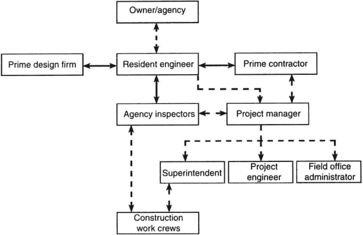

**图5.11** 重载公路供应链的质量控制组织与信息流。

#### 战略性施工QA与QC

材料质量和工作方法是建设项目中最关键的组成部分，需要广泛的质量保证要求。此外，质量保证策略通常涉及以下一项或多项标准：

- 供应商和分包商参与施工供应链战略
- 复杂项目的高水平系统集成
- 针对延误和变更订单的规划
- 预制件的长交货周期
- 规划和协调材料测试要求
- 仔细监控关键路径

施工详图、材料和工作方法的批准构成有效施工QA/QC计划的基本基础。该批准系统必须进行战略规划并系统执行。见图5.12。

#### 变更订单

施工合同要求修改设计和工程规范并不罕见。施工经理必须以变更订单的形式，将所有变更书面传达给所有供应商和分包商。见图5.13。合同变更在复杂项目中很重要。大多数施工变更订单的原因如下：

- 1. 设计错误（例如，不一致和差异）
- 2. 技术变化（例如，改进材料和停产材料）
- 3. 项目业主的工作范围变更
- 4. 不同的现场条件

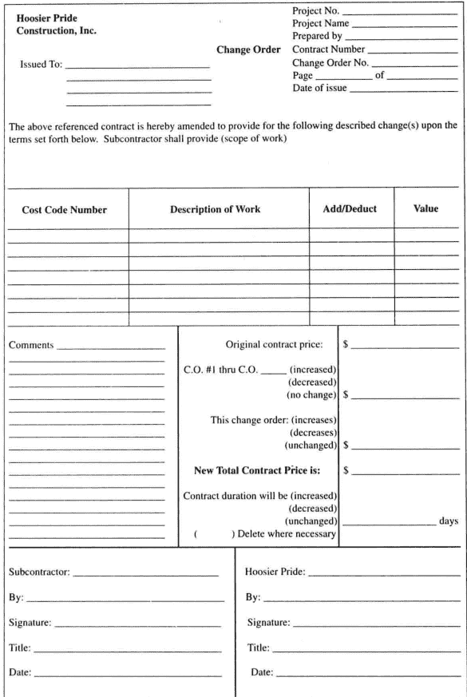

**图5.13** 变更订单。

选择合适的分包商。分包商选择过程涉及许多重要因素，包括评估分包商的能力以及进行SWOT（优势、劣势、机会和威胁）分析。公平的投标提交和评估过程，以及双方满意的谈判，为项目开始后与分包商建立良好关系奠定基调。


### 参考文献

- 1. 转包与分包公平实践法案（《加利福尼亚州公共合同法》第4110条及以下条款）。
- 2. 朗费罗，R.，《回到过去》，联邦公路管理局，基础设施图书馆，公路历史。访问网址：http://fhwa.dot.gov/infrastructure/backintime.htm。最后访问日期为2009年7月1日。

## 第6章：建筑设备的规划、采购与租赁

### 盈利性创新

从组织角度以及对公司财务健康的影响来看，资本设备的获取是大多数建筑公司的一项重大决策。设备投资可能需要大量支出，并且是在预期回报将延续数年或跨越多个项目的条件下进行的。税务规划过程也是设备采购决策中的一个重要因素。预期回报和税务影响的时间安排都至关重要，并且能够对成功建筑公司的最终收益产生有利影响。根据组织规模，大多数高价值资本设备采购由主管级别及以上人员处理。然而，采购/供应经理在设备采购流程中仍发挥关键作用。在大多数大型建筑组织中，通常设有具备建筑行业专业知识的设备采购员。大多数设备成本与建筑行业规范挂钩。有时在拍卖会上购买设备比从传统渠道购买更具成本效益。采购部门应熟悉这些渠道，并持续寻找有效的设备采购机会，因为设备投资决策一旦做出便不易逆转。

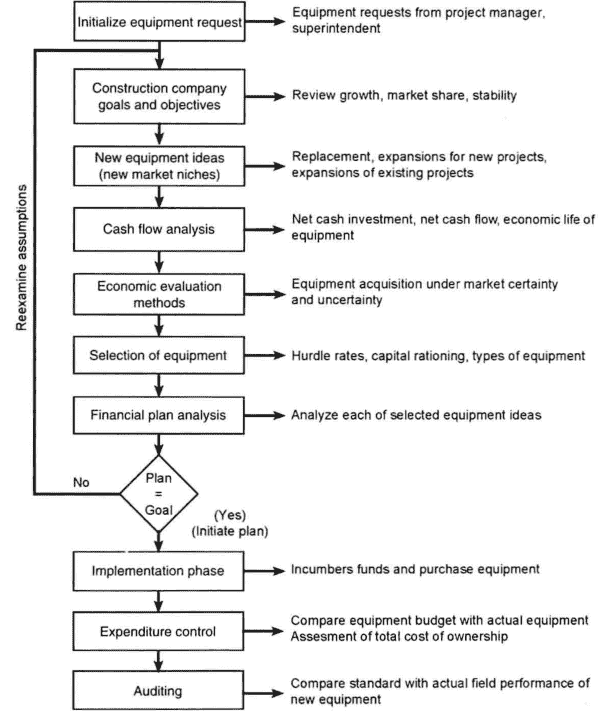

**图 6.1** 建筑设备采购流程。

采购流程可以用建筑资本设备采购流程图表示。见图 6.1。根据设备类别和经济环境，该流程可能会略有调整。短期设备投资决策取决于具体项目的预计工作量。短期设备投资决策的一个有效“经验法则”是：如果设备每年至少使用1500小时且能收回自身成本，就应购买。否则，租赁或租用方案可能更合适。另一方面，长期设备投资决策有时受现在而非以后购置设备的税务影响驱动。建筑设备采购流程包含众多步骤。每个跨职能步骤都是整个流程的子系统，并与流程中各种其他子系统密切相关。

### 申请

资本采购流程由公司高管或所有者提出设备更换请求而启动，目的是拓展新的细分市场。此步骤需要公司所有者、主管、项目经理或负责具体项目的高管授权。申请流程有时由“特定项目”或低成本财务预测发起。若无特别批准，设备采购通常设有金额上限。例如，一些较大的建筑组织将一般“特定作业”采购的限额设为$25,000。超过$25,000的资本采购需要所有者或主管批准。典型公司政策可能允许项目经理在日常业务过程中购买杂项设备（即压缩机、发电机、沟槽泵、消防泵等），而申请反铲挖掘机或轮胎式车辆可能须先由所有者或主管推荐。该流程必须具有内置控制机制。

例如，供水管线项目的设备采购需求计划包含购买一台挖掘机和两辆自卸卡车的详细信息。设备采购需求计划中的信息将作为最终投标包中设备定价组成部分的输入。见第2章、表2.4和图6.2。本例中挖掘机的小时费率，以及租用装载机和压实机的决定，均基于从需求计划中获得的信息。见图6.3。

| 项目 | 描述/成本 |
| --- | --- |
| 起重机与反铲（B/H）机械 | 225 D CAT 挖掘机 |
| 轮胎式车辆机械 | 单位成本：$165,000 |
| 1. 折旧 | $33,000.00（5年） |
| 2. 利息、税费、保险 | 借款利息：$6,332.50；投资成本：$1,120.00；保险：$4,250.00；个人财产税（P.P. Taxes）：$2,875.00（$2,875/年） |
| 3. 一般维修 | $18,560.00 |
| 4. 轮胎更换 | |
| 5. 轮胎修理 | |
| 6. 燃料成本 | $10,867.50（系数 = .042，1500小时） |
| 7. 服务成本 | $6,720.00（21天/月，8个月） |
| 8. 切削刃 | |
| 9. 加油工 | |
| 预计使用1500小时/年 | 总成本 $83,725.00（$55.82/小时） |

**图6.3 挖掘机小时费率。**

### 公司目标与目的

流程的下一步是将采购申请与建筑组织的整体长期目标进行比较。这些目标将作为评估替代设备选择方案的基础。建筑组织的战略计划和市场分析是重要输入数据，原因很简单：任何重大设备采购都可能影响未来多年的细分工作类别、公司有效产能、能力以及公司竞争优先事项。建筑行业中的公司目标可能略有不同，但所有有竞争力的建筑组织最终都必须最大化盈利能力并最小化可避免的风险。

### 新市场细分构想

建筑项目的资本采购流程必须遵循精心设计的流程：规格制定、施工招标、承包商选择以及实际施工阶段。该流程由定义明确的计划和调度方法指导。在大型组织中，设备采购团队包括来自工程、财务、管理和采购部门的人员。设备采购团队方法是一个跨职能采购供应链策略的极佳示例。在任何进取型建筑公司中，营销计划都会持续提供有吸引力的资本设备机会。公司所有者/主管必须花费大量时间进行头脑风暴、分析并仔细规划公司预计的设备需求。各种资本设备申请的分类必须基于某些共同特征。设备采购通常按以下类别分组：

- 替换设备
- 扩张（新市场细分）
- 扩张（现有市场细分）
- 其他

旧设备的*更换*通常源于提高质量、降低运营费用和提升效率的需要。建筑组织可以轻松开展深入的成本节约和效率研究。以技术为驱动、处于增长模式的建筑组织会购置新设备，以拓展到*新引入的市场细分*。技术驱动的设备采购可以成为强大的竞争武器。为扩张目的而投资建筑设备应增加增量收入。有时建筑组织有意扩大*现有*市场细分的产出，这通常是更换当前设备的一种替代方案。扩展现有设备也是提高产能的一种方式。

### 现金流分析

如果长期设备申请通过了新市场细分构想步骤，则必须针对每项设备投资构想考虑现金流估算。每项设备采购备选方案的税后现金流入和流出必须基于增量现金流进行评估。现金流分析应适用三项标准：

- 净现金投资
- 净现金流
- 项目经济寿命

换言之，建筑组织必须考虑净现金支出和总实施成本。净现金流是设备采购产生的净经济效益。净


应计量所购设备的增量现金流。还必须考虑设备投资的经济寿命与所购设备投资的物理寿命。

生命周期成本法是一种用于评估备选设备采购方案的评价方法。生命周期成本法基于所购设备预期寿命内的总拥有成本（TCO）。总成本构成如下：

- 研究
- 开发
- 生产率
- 运行
- 维护

有许多关于将生命周期成本法用于资本设备和系统采购的推荐实例。考虑某施工组织目前平均每月花费1,500美元维护一台1996年卡特彼勒平地机。最近，该公司基于生命周期成本法概念，在拍卖会上以100,000美元购买了一台2004年卡特彼勒平地机。对于2006年卡特彼勒平地机，其剩余寿命内的平均月度维护成本为220美元。运行效率和运行成本也会对施工设备采购产生显著影响。生产率、可靠性和耐用性是必须考察的主要运行变量。

### 经济评价

单个项目经济评价最常用的五种方法是*投资回收期*、*平均收益率*、*净现值*、*内部收益率*和*盈利指数*。这些方法可用于衡量单项设备采购的财务绩效。在应用特定方法之前，施工组织必须根据其商业计划设定预定的必要收益率。为说明经济评价的概念，以平地机为例。

#### 示例：平地机

假设 Hoosier Pride Construction, Inc. 正在考虑购买本文提到的二手平地机。假设*估计税后现金流（EATCF）*的完整序列为

| 年份 | 0 | 1 | 2 | 3 | 4 |
|---|---:|---:|---:|---:|---:|
| EATCF（$） | −100,000 | 40,000 | 40,000 | 30,000 | 30,000 |

这些数据将用于说明五项经济评价标准。

#### 投资回收期

投资回收期是最知名的投资准则。投资回收期是收回初始投资所需的年数。使用平地机示例，并假设现金流恒定且为正

Payback = 40,000（第1年） + 40,000（第2年） + 20,000（第3年的67%） = 2.67年

假设 Hoosier Pride 预先确定最长投资回收期为3年。在此情况下，该平地机是可供接受的候选对象。另一方面，如果标准投资回收期设定为2年，则该平地机应被拒绝。

#### 平均收益率

平均收益率（ARR）是平均税后现金流除以初始投资：

ARR =（ΣEATCF/经济寿命）/初始投资  
ARR = [(40,000 + 40,000 + 30,000 + 30,000)/4]/100,000 = 35%

- 如果 ARR > 要求的 ARR，则接受该平地机。
- 如果 ARR < 要求的 ARR，则拒绝该平地机。

该方法忽略了现金流的时间分布：如果示例问题中的大部分现金流（140,000美元）都集中到1年中，会怎样？ARR仍会是35%。即便如此，ARR仍是当今最常用的评价标准。

#### 净现值

净现值（NPV）认识到今天的一美元比明天的一美元更有价值，因为今天的一美元可以立即投资并开始赚取利息。该NPV通过将项目所有预期现金流入的现值减去初始投资来计算。如果NPV大于零，则应当进行投资。但如果NPV小于零，则不应进行投资。将该评价方法应用于购买平地机的示例。

$$NPV = \sum_{t=0}^{m} \frac{EATCF_t}{(1+k)^t}$$

其中 k = 平地机的必要收益率，m = 期数

$$NPV = -100,000 + \frac{40,000}{1+k} + \frac{40,000}{(1+k)^2} + \frac{30,000}{(1+k)^3} + \frac{30,000}{(1+k)^4}$$

| 年份 | 0 | 1 | 2 | 3 | 4 |
|---|---:|---:|---:|---:|---:|
| EATCF（$） | −100,000 | 40,000 | 40,000 | 30,000 | 30,000 |
| 折现系数 | 1.000 | 0.909 | 0.826 | 0.751 | 0.683 |
| 现值（$） | −100,000 | 36,360 | 33,040 | 22,530 | 20,490 |

$$NPV = -100{,}000 + 36{,}360 + 33{,}040 + 22{,}530 + 20{,}490 = 12{,}420$$

投资决策是

- 如果 NPV > 0，接受该平地机。
- 如果 NPV < 0，拒绝该平地机。

注意 ARR 与 NPV 方法的区别在于各项 EATCF 现金流的时间分布。换言之，随着 EATCF 增加，项目变得更具吸引力。

#### 内部收益率

使用内部收益率（IRR）方法，如果资本机会成本低于内部收益率，则项目被视为良好投资。如果资本成本等于IRR，项目NPV为零。另一方面，如果资本成本高于IRR，项目NPV为负。IRR将给出与NPV相同的答案。IRR定义为使项目NPV等于零的折现率。

$$\sum_{t=0}^{m}\frac{EATCF_t}{(1+IRR)^t}=0$$

例如

$$-100{,}000+\frac{40{,}000}{(1+IRR)^1}+\frac{40{,}000}{(1+IRR)^2}+\frac{30{,}000}{(1+IRR)^3}+\frac{30{,}000}{(1+IRR)^4}=0$$

当折现率为20%时，NPV = −$7,060。采用试错法可确定IRR。如果4年中每年的EATCF均为40,000美元，则IRR约为22%。由于最后2年的EATCF为每年30,000美元，折现率应降低。我们计算得出20%折现率下的NPV为负值−$7,060；因此，必须将折现率降低到，比方说，16%。在16%折现率下，NPV = $138.90。因此，IRR约为16%。

- 如果 IRR > k，接受该平地机。
- 如果 IRR < k，拒绝该平地机。

其中 k = 必要收益率，m = 期数

如果假设资本成本为10%，则该项目将被接受。

#### 盈利指数

盈利指数（PI）定义为未来现金流的现值除以初始投资：

$$\mathrm{PI} = \left[ \sum_{t=1}^{m} \frac{\mathrm{EATCF}_t}{(1+k)^t} \right] / \text{初始投资}$$

由于未来现金流通常为正，

$$\mathrm{PI} = \left[ \frac{40,000}{1.10} + \frac{40,000}{(1.10)^2} + \frac{30,000}{(1.10)^3} + \frac{30,000}{(1.10)^4} \right] / 100,000$$
$$\mathrm{PI} = (36,360 + 33,040 + 22,530 + 20,490) / 100,000$$
$$\mathrm{PI} = 112,420 / 100,000 = 1.12$$

决策规则是

- 如果 PI > 1，接受该平地机（*其他条件不变*）。
- 如果 PI < 1，拒绝该平地机（*其他条件不变*）。

与NPV和IRR方法一样，PI方法考虑了时间因素。

#### 选择

最终选择是基于这些评价的接受—拒绝决策。见表6.1。最低可接受收益率可基于资本成本、机会成本和其他概念性标准。无论如何，每个提案都必须为有限资金展开竞争。

#### 财务计划分析

在此阶段，对选定的备选方案进行全面比较。然后，将计划中的设备选择与 Hoosier Pride 的初始目标和目的进行衡量。设备购置可以通过多种方式融资。就采购专业人员而言，将考虑两种方法：传统贷款和租赁。租赁方法在过去20年中变得非常流行，可用于为几乎任何类型的固定资产融资。租赁与购买的决策需要考虑许多因素，其中一些列示如下：


| 方法 | 优点 | 缺点 |
| --- | --- | --- |
| 回收期 | 易于理解<br>易于计算<br>提供粗略的风险筛选 | 未考虑回收期前现金流的时间价值<br>完全忽略回收期后现金流 |
| 会计收益率（ARR） | 易于理解<br>易于计算<br>考虑回收期后的现金流 | 未考虑任何现金流的时间价值 |
| 净现值（NPV） | 相对容易计算<br>互斥项目排序问题的最佳方法<br>与PI并列成为接受—拒绝决策问题的最佳方法 | 难以理解<br>在资本限额问题中可能效果不佳 |
| 内部收益率（IRR） | 易于理解<br>具有直观的经济含义<br>在*简单*的接受—拒绝问题上表现尚可，而这是最常见的投资问题 | 计算可能繁琐<br>在复杂的接受—拒绝问题（多重收益率）、互斥选择或资本限额问题中可能效果不佳 |
| 盈利指数（PI） | 相对容易计算<br>单期资本限额问题的最佳方法<br>与NPV并列成为接受—拒绝决策问题的最佳方法 | 难以理解<br>在某些互斥选择情形下可能效果不佳 |

**表 6.1** 购置决策的评估方法

- *税收效应：* 租赁付款是可立即从收入中扣除的费用。贷款则在较长期间内折旧。租赁相对于贷款的一大优势是租赁对土地使用的影响。当企业为其运营租赁土地时，可将租赁费用从所得税负担中扣除。另一方面，购买的土地不能从纳税义务中扣除。
- *对未来融资的影响：* 租赁与购买还可以释放其他用途或替代项目所需的现金。租赁具有积极的资产负债表效应，仅仅因为经营租赁既不记为债务也不记为资产。经营租赁（本章后文讨论）被视为“表外”交易，其中租赁付款仅作为费用报告。租赁安排实际上可以提高企业的借款能力。大多数贷款要求借款人支付合理的首付款。租赁通常不要求除首月和末月付款之外的初始首付款。
- *陈旧过时的风险：* 在技术快速变化的情况下，承租人有可能将风险水平转移给出租人。计算机技术是陈旧过时风险的一个很好的例子。
- *残值：* 出租人负责租赁资产的残值。如果租赁设备的预期残值较高，承租人的所有权成本可能较低。在这种情况下，承租人应签订合同，使其能够在租赁期结束时购买该固定资产。
- *维护：* 在大多数租赁协议中，各方的责任和风险都有详细规定。如果出租人承担维护、保险和税费成本，通常会将费用以增加租赁付款的形式转嫁给承租人。
- *折现率：* 税后借款利率通常称为折现率。租赁和购买都涉及较长时期内的现金流出。由于租赁付款是固定的，而与租赁相关的其他成本（残值、运营费用和利率）是不确定的，因此在租赁与购买决策中评估隐含利率很重要。

#### 租赁与借款购买

购买设备何时更有意义？租赁何时更有意义？对某些公司来说，租赁还是购买决策可以很快做出。事实上，在建筑行业，在购置新设备或二手设备时，租用/租赁还是拥有决策是例行公事。设备租赁是需要新设备的建筑公司的热门选择。设备的购买和租赁是一项有利可图的业务。如果租赁公司有较高的纳税义务，则会有税收优势。另一方面，出租人也可以设计租赁安排，使部分或全部税收节省以降低租赁付款的形式传递给承租人。租赁有三种类型：

#### 售后回租

卖方兼承租人将财产出售给买方兼出租人，后者再将其回租给卖方兼承租人。银行报价的影响。ACME愿意向Hoosier Pride租赁同一台平地机，期限3年。由于Hoosier Pride的现金状况非常紧张，ACME将租赁安排为每年年末应付30,917美元。此外，ACME同意：

- 在租赁期内执行所有维护工作。
- 授予承包商在3年期末按现行市场价格（估计为35,000美元）购买该平地机的权利。
- 允许该组织购买该平地机为期两年的维护合同，每年6,000美元，在第4年和第5年年末支付。

#### 第1步：比较购买价格与租赁付款

租赁与购买分析的第一步是列出购买价格和租赁付款。见表6.2。

示例中的“今天”一行显示，购买的设备必须在交付时付款。这笔付款可以来自现金储备，也可以来自从贷款机构借入的资金，但必须预先支付给银行。第一笔租赁付款至少在本例中显示为从今天起1年。购买选项必须包括利息付款、折旧和维护费用，这些费用也必须由承包商支付。ACME在租赁选项的前3年承担这些成本。在第3年年末，向ACME支付一笔35,000美元的最终款项。

#### 第2步：比较所得税效应

租赁和购买设备之间最重要的经济差异之一，是二者在所得税处理方式上的不同。由于这些税收利益的价值在个人和公司之间差异很大，因此按个体基础计算潜在利益很重要。边际税率是对每增加一美元收入必须支付的税率。

|  | 购买（$） | 租赁（$） |
|---|---|---|
| 今天 | 12,000 |  |
| 从今天起1年 | 20,891 | 30,917 |
| 从今天起2年 | 20,891 | 30,917 |
| 从今天起3年 | 20,891 | 30,917 |
| 从今天起4年 | 20,891 | — |
| 从今天起5年 | 20,891 | — |

**表 6.2** 租赁与购买付款比较

不同税率适用于不同收入水平。随着收入上升，收入按更高税率征税。边际税率决定税收扣除实际能减少多少应纳税额。高收入的个人或公司边际税率可能为35%或更高，而亏损者的税率为0%。边际税率越高，税收扣除越有价值。税收扣除的价值通过将其乘以税率来确定。根据这一规则，如果税率为0%，10,000美元的税收扣除价值为零；税率为15%时价值为1,500美元；税率为28%时价值为2,800美元。

租赁的情况相对简单。每笔租赁付款对租赁设备的公司而言都是一项税收扣除。其价值可以通过边际税率乘以租赁付款来确定。如果选择购买选项，平地机的折旧必须在5年期内计提。直线法和加速法都可以，且根据Hoosier Pride的税务状况，任一方法都可能具有优势。在本例中，将使用每年20,000美元的直线折旧，共5年。Hoosier Pride的税率为40%，因此税收节省计算如下：

$$\text{Tax savings} = 40\% \times (\text{interest payment} + \text{depreciation} + \text{maintenance})$$

如果选择租赁选项，税收节省将按如下方式计算：

$$\text{Tax savings (years 1–3)} = 40\% \times \text{Lease payment}$$

$$\text{Tax savings (years 4 and 5)} = 40\% \times (\text{lease payment} + \text{depreciation} + \text{maintenance})$$

现在可以将第1步中的表格改写为包含税收。见表6.3。

#### 第3步：比较现值

虽然已经考虑了租赁与购买平地机的税后价值，

| 税收扣除费用 |  |  |
|---|---:|---:|
|  | 购买选项（$） | 租赁选项（$） |
| 今天 |  |  |
| 从今天起1年 | 30,280 | 30,917 |
| 从今天起2年 | 29,343 | 30,917 |
| 从今天起3年 | 28,350 | 30,917 |
| 从今天起4年 | 27,298 | 25,500 |
| 从今天起5年 | 26,183 | 23,500 |

**表 6.3** 所得税效应比较


这些成本的发生时间尚未被纳入考虑。忽视时间因素可能导致决策失效，因为货币具有时间价值。每当资金被投资一段时间以赚取利息，或借入一段时间以支付利息时，时间价值便显而易见。

货币时间价值会影响租赁或购买决策，因为成本到期日越靠后，所需偿还的今日美元就越少。偿还未来到期成本所需的今日美元数量，取决于利率水平。利率用于选择现值系数，而现值系数又用于将未来成本转换为今日美元。以今日美元表示的未来成本称为现值。所选择的利率可以是借款利率，也可以是投资利率。

就 Hoosier Pride 而言，采用6%的利率。使用现值系数表查找自今日起至5年后的*现值*系数。Hoosier Pride 现在必须将现值系数（PV = 1/(1+k)ᵗ）乘以*净现金流出*。参见表6.4和表6.5。随后，Hoosier Pride 使用相同的系数计算租赁税后成本的现值。之后完成平地机的完整分析。参见表6.6和表6.7。

| 时间 | 购买方案净现金流出（美元） | 系数 | 现值（美元） |
|---|---:|---:|---:|
| 今日 | 12,000 | × 1.0000 | = 12,000 |
| 自今日起1年 | 13,779 | × 0.9434 | = 12,999 |
| 自今日起2年 | 14,154 | × 0.8900 | = 12,597 |
| 自今日起3年 | 14,551 | × 0.8396 | = 12,217 |
| 自今日起4年 | 14,972 | × 0.7921 | = 11,859 |
| 自今日起5年 | 15,418 | × 0.7473 | = 11,521 |
| 总现值成本 |  |  | 73,193 |

**表6.4** 购买方案的净流出

| 时间 | 租赁方案净现金流量（美元） | 系数 | 现值（美元） |
|---|---:|---:|---:|
| 今日 | 0 | × 1.0000 | = 0 |
| 自今日起1年 | 18,550 | × 0.9434 | = 17,500 |
| 自今日起2年 | 18,550 | × 0.8900 | = 16,510 |
| 自今日起3年 | 18,550 | × 0.8396 | = 15,575 |
| 自今日起第3年末 | 35,000 | × 0.8396 | = 29,387 |
| 自今日起4年 | (3,400) | × 0.7921 | = (2,693) |
| 自今日起5年 | (3,400) | × 0.7473 | = (2,541) |
| 总现值成本 |  |  | 73,738 |

**表6.5** 租赁方案的净流出

| 年份 | 付款额（美元）(1) | 利息（美元）(2) | 减少额（美元）(3) | 本金（美元）(4) | 折旧（美元）(5) | 维护费（美元）(6) | 可抵税费用（美元）(7 = 2 + 5 + 6) | 节税额（美元）(8 = 7 × TR) | 净现金流出（美元）(9 = 1 + 6 − 8) | 现值系数 (10) | 购买现值（美元）(11 = 9 × 10) |
|---|---:|---:|---:|---:|---:|---:|---:|---:|---:|---:|---:|
| 期初 | 12,000 | — | — | 100,000 | — | — | — | — | (12,000) | 1.0000 | (12,000) |
| 1 | 20,891 | 5,280 | 15,611 | 72,389 | 20,000 | 5,000 | 30,280 | 12,112 | (13,779) | 0.9434 | (12,999) |
| 2 | 20,891 | 4,343 | 16,548 | 55,842 | 20,000 | 5,000 | 29,343 | 11,737 | (14,154) | 0.8900 | (12,597) |
| 3 | 20,891 | 3,350 | 17,541 | 38,301 | 20,000 | 5,000 | 28,350 | 11,340 | (14,551) | 0.8396 | (12,217) |
| 4 | 20,891 | 2,298 | 18,593 | 19,708 | 20,000 | 5,000 | 27,298 | 10,919 | (14,972) | 0.7921 | (11,859) |
| 5 | 20,891 | 1,183 | 19,708 | 0 | 20,000 | 5,000 | 26,183 | 10,473 | (15,418) | 0.7473 | (11,521) |
| 合计 | 116,454 | 16,454 | 100,000 | 0 | 100,000 | 25,000 | 141,454 | — | — | — | (73,193) |

| 假设 | 值 |
|---|---:|
| 税率（TR） | 0.4 |
| 折现率 | 0.06 |
| 利率 | 0.06 |
| 租赁费率 | 0.06 |
| 分析 | 借款购买 |

**表6.6** 平地机分析：购买方案

| 年份 | 付款额（美元）(1) | 折旧（美元）(5) | 维护费（美元）(6) | 可抵税费用（美元）(7 = 1 + 5 + 6) | 节税额（美元）(8 = 7 × TR) | 净现金流出（美元）(9 = 1 + 6 − 8) | 现值系数 (10) | 租赁现值（美元）(11 = 9 × 10) |
|---|---:|---:|---:|---:|---:|---:|---:|---:|
| 1 | 30,917 | — | — | 30,917 | 12,367 | (18,550) | 0.9434 | (17,500) |
| 2 | 30,917 | — | — | 30,917 | 12,367 | (18,550) | 0.8900 | (16,510) |
| 3 | 30,917 | — | — | 30,917 | 12,367 | (18,550) | 0.8396 | (15,575) |
| 第3年末 | 35,000 | 17,500 | 6,000 | 23,500 | 9,400 | (35,000) | 0.8396 | (29,387) |
| 4 | 0 | 17,500 | 6,000 | 23,500 | 9,400 | (3,400) | 0.7921 | (2,693) |
| 5 | 0 | 17,500 | 6,000 | 23,500 | 9,400 | (3,400) | 0.7473 | (2,541) |
| 合计 | 127,751 | 52,500 | 18,000 | 163,251 | 65,301 | — | — | 73,738 |

| 假设 | 值 |
|---|---:|
| 税率（TR） | 0.4 |
| 折现率 | 0.06 |
| 利率 | 0.06 |
| 租赁费率 | 0.06 |
| 分析 | 租赁 |

**表6.7** 平地机分析：租赁方案

借款/购买方案略优于租赁方案。然而，不难看出这两种方案差异不大。三步法是一种有效的工具，但在作出租赁决策或购买资本设备之前，任何经济分析都还必须辅以法律和会计方面的建议。

### 实施

在实施阶段，公司会为已获批准的设备投资预留资金。审批流程通常以所有者作出决定而结束。该阶段基本上只是例行公事式的批准。采购订单程序与第2章中概述的方法一致。然而，有必要检查已确认设备采购的状态，这可通过设备状态报告和交付报告来实现。参见图6.4和图6.5。

#### 支出控制

从资金批准到设备购置完成之间的时间段是关键的进度安排阶段。在此阶段，设备购置应保持在预算范围内，若超出预算，则应采取纠正措施。

#### 审计

设备购置过程十分复杂，会涉及许多假设和估算。应对整个项目进行审计，以分析各项差异。审计阶段还将发现设备购置过程中的管理不善和缺陷。如果该过程不尽如人意，则应对其进行修订或替换。

#### 资本设备的处置

资本设备的处置正变得越来越复杂。美国环境保护署已针对各类淘汰设备的处置制定了具体指南。采购部门通常负责报废或出售退役设备。在某些情况下，企业可以将淘汰设备作价抵换新购设备，从而将处置负担转移给设备供应商。如果设备是

### Hoosier Pride Construction, Inc.

#### 设备采购状态报告

**项目信息**

| 字段 | 值 |
| --- | --- |
| 项目编号 |  |
| 项目名称 |  |
| 地点 |  |
| 日期 |  |
| 页码 | 第___页，共___页 |
| 编制人 |  |

**采购状态**

| 设备项目编号 | 描述 | 请购单编号 | 向采购提交的规格说明 - 计划 | 向采购提交的规格说明 - 实际 | 已发出招标 | 投标截止 | 已收到投标 | 投标已送工程师 | 技术评估完成 - 计划 | 技术评估完成 - 实际 | 中标日期 | 采购订单编号 | 备注 |
| --- | --- | --- | --- | --- | --- | --- | --- | --- | --- | --- | --- | --- | --- |
|  |  |  |  |  |  |  |  |  |  |  |  |  |  |

**图6.4** 设备采购状态报告。

#### 设备交付状态报告

Hoosier Pride Construction, Inc.

项目编号：__________  
项目名称：__________  
项目地点：__________  
日期：__________  
第1页，共__页  
编制人：__________

| 采购订单编号 | 供应商联系人姓名 | 设备/项目 | 采购订单日期 | 供应商地点 | 装运日期 — 采购订单日期 | 装运日期 — 修订后的交付日期？ | 装运日期 — 当前交付日期 | 装运日期 — 实际日期（现在） | 修订（预计）日期 | 备注/已采取的行动 |
|---|---|---|---|---|---|---|---|---|---|---|
|  |  |  |  |  |  |  |  |  |  |  |
|  |  |  |  |  |  |  |  |  |  |  |
|  |  |  |  |  |  |  |  |  |  |  |
|  |  |  |  |  |  |  |  |  |  |  |
|  |  |  |  |  |  |  |  |  |  |  |


仍可使用，可能存在活跃经销商来购买二手设备。总体而言，大多数公司尚未设计出处置二手设备的清洁流程。

### 购买新施工设备与二手施工设备

尽管当今市场竞争激烈，购买新设备可能并不划算。根据所购设备的用途和预期使用情况，购买二手设备可能更具成本效益。本节讨论购买新设备与二手设备的指南。

#### 新施工设备采购

当公司购买新施工设备时，不存在设备性能是否达到规定规格的不确定性。购买方必须首先确定该设备每年将使用的小时数。施工组织必须密切关注某些设备的理论使用水平。例如，在正常操作条件下，施工设备的预期寿命很容易预测。施工设备通常以新设备形式购买。在某一特定设备已存在显著需求或用途的情况下，购买新设备是合适的。在这些情况下，新设备的技术优势也可能提高生产率。对于挖掘装载机、自卸卡车和其他轮胎式车辆，购买新设备可能更具成本效益。然而，如果较旧型号足以满足预期用途，则可能节省大量成本。请记住，新设备所需的维护少于二手施工设备。这或许是只考虑新设备的最有力论据。例如，一台平地机使用超过10,000小时后，通常需要一台价值30,000美元的新铲运机。在决定购买二手设备时，必须考虑维护记录。

在采购大型施工设备时，必须仔细考虑规格。比较新设备是一项简单的任务。比较不同型号的二手设备几乎是不可能的。有时，低廉的设备价格可能导致购买即将报废的施工设备。然而，如果二手设备经销商愿意提供合理的保修和其他保证，购买某一特定二手设备可能是合理的。

#### 二手施工设备采购

低成本通常是购买二手设备的唯一原因。确定二手设备的真实价值极其困难。审查历史维护记录应是获取二手设备的第一步。在某些情况下，二手设备可为施工组织的生产问题提供良好的短期解决方案。公司还必须考虑长期融资成本与短期维护成本之间的权衡。在这种情况下，财务效率比维护成本更重要。购买二手设备时必须进行彻底检查。一个可悲的现实是，一些二手车经销商是清理和喷涂严重受损设备的专家。同样，一些二手设备经销商信誉不佳，会不惜一切代价误导毫无戒心的买家。销售条款通常为“按现状”和净现金交易，无保修。

### 结论

资本设备采购是采购部门的专门职能。

逐步的资本采购流程包括：（1）请购，（2）公司目标，（3）新产品构想，（4）现金流分析，（5）经济评估，（6）财务计划分析，以及（7）支出控制。租赁或购买资本设备的决策既需要分析性分析，也需要规范性判断。何时投资于施工资本设备比租赁它更有意义？资本采购流程的另一个要素是购买新设备还是二手设备。设备投资可用于替换现有设备、扩展到新市场，并增加在现有细分市场中的市场份额。但是，无论购买或租赁的原因是什么，技术驱动的设备采购都可能成为强大的竞争武器。

## 第7章

## 施工供应链的复杂性、盈利能力和信息共享

### 下一代

施工供应链是一个运营与战略循环，包括劳动力、材料、设备、分包和竣工项目。技术、安全和通信是连接该供应链所有组成部分的三个要素。施工供应链之所以更加重要，是因为它有可能参与许多复杂的私营和公共部门施工项目。施工供应链的概念隐含地从战略角度审视盈利能力。短期来看，承包商或许能够以亏损状态维持生存；然而，长期来看，*每家建筑企业都必须*实现盈利，才能被视为持续经营企业。利润或净收入是资产负债表上留存收益的组成部分。留存收益通过使承包商能够购买新设备以及雇用、培训和培养更多员工，为未来发展提供资金。成功的建筑组织必须关注这个问题：“盈利能力意味着什么？”以下列出的五种方法中的任何一种或它们的组合都将增加利润：

- 通过细分市场营销增加合同收入。
- 降低施工总成本。
- 降低管理费用。

2007年的支出——从历史上看，建筑业一直是一个学习缓慢甚至不学习的行业。然而，学习缓慢的施工企业的时代即将结束。越来越多的建筑行业企业正在采纳制造业的经验教训。先进企业现在正在实施六西格玛和精益管理举措，以提升其项目运营效率。这一转变催生了施工供应链管理革命。

### 信息共享

施工供应链执行是为生产竣工项目而采购材料、租赁或购买设备以及与分包商签订合同的过程。施工采购是供应链执行的核心重点，负责项目的可持续性和效率。供应链执行由供应链信息模型加以补充，该模型始于由业主确定的项目需求。项目业主的需求引发一系列信息流、材料流和资金流，而这些流程的质量决定供应链整合的水平。尽管存在固有复杂性，但就单个项目而言，一些项目经理能够充分执行施工流程。然而，如果各种流程更加整合并由信息共享驱动，干扰就会减少，从而在后续项目中实现持续改进。

信息共享包括三个方面：信息共享支持技术、信息内容和信息质量。¹ 信息共享支持技术包括支持信息共享所需的硬件和软件。*信息内容*是指各施工供应链参与者之间共享的信息。*信息质量*衡量施工供应链参与者之间共享信息的质量。

在过去十年中，供应链管理和信息技术（IT）管理引起了施工组织的广泛关注。施工供应链实践侧重于材料、设备和劳动力流动，而信息共享侧重于信息流。供应链实践分为两类：施工供应链网络设计和供应链整合。信息共享是施工供应链整合的关键驱动因素。在过去十年中，美国企业界对信息技术的投资显著增加。据估计，美国信息技术支出将在2009年增至约4,970亿美元，并在2010年再次增至约5,110亿美元（http://www.itfacts.biz）。信息技术对施工供应链实践产生了显著影响。


有效的供应链实践和有效的信息共享是建筑供应链改进的两个来源。虽然一些建筑组织强调改进供应链实践，另一些则强调利用建筑供应链合作伙伴之间的信息共享。由于这两种主要方法并非相互独立，建筑组织必须同时致力于建筑供应链实践和信息共享。

本节旨在说明：(1) 信息共享与建筑供应链之间的关系；(2) 供应链信息共享与供应链建设项目的影响；(3) 信息共享和供应链实践对项目交付绩效的影响。

建筑供应链计划实践用于处理来自项目业主、设计工程师、施工经理、分包商和供应商的信息。建筑供应链计划由两个目标驱动：对项目需求做出良好估算，以及协调上下游的各项项目活动。

项目最终估算的重要性不容忽视。项目供应链内部的互动与协调很重要，因为供应链合作伙伴之间的协同一致对于实现项目业主的目标是必要的。与材料供应商和分包商的协调至关重要，研究也支持这一点，研究显示了企业间合作与信息共享的价值。建筑供应链的最终目标是在按时和低于预算的情况下完成高质量项目。其目标是通过减少流程中的浪费性活动来提高增值内容。项目流程必须简化，施工资源模型必须谨慎管理。见表7.1。

建筑供应链管理（CSCM）基于各项目合作伙伴之间材料、信息和资金流的协调。这些流的整合将提高项目成功的概率。没有信息共享就不可能实现整合。事实上，信息是*所有*成功建筑项目的生命线。每个CSCM成员都会产生大量数据。这些数据必须转化为可用信息，并在整个CSCM过程中共享。目前，许多建筑项目由关键路径或项目进度驱动。通过*关键路径法*进度驱动项目的缺点在于项目进度具有静态性质，而及时准确的信息是动态的。经过修改后，大多数供应链概念都可以被推荐并应用于建筑行业。

**表 7.1** 施工资源模型

| 资源 | 干扰因素 |
|---|---|
| 1. 劳动力 | 1. 拥堵 |
| 2. 材料 | 2. 天气 |
| 3. 设备 | 3. 工序排序 |
| 4. 工具 | 4. 返工 |
| 5. 信息 | 5. 工作方法 |
| 6. 支持服务 |  |

然而，如果没有贯穿复杂建筑网络的强有力领导，建筑供应链管理概念就无法得到恰当实施。供应链管理举措必须在项目初期阶段实施，因为*关键战略*供应链合作伙伴中的每一方可能并未合作过，也可能不了解项目业主或总承包商以团队为导向的目标。否则，材料、资金和设备的流动将继续在项目中低效运行。建筑行业的供应链应用必须足够灵活，以适应项目和供应链合作伙伴的变化。在横向政府模式下，项目业主处于有利地位，可以发挥供应链领导作用并推动信息共享。为重载公路和其他复杂公共工程项目实施供应链管理概念，可以减少延误和索赔，并通过战略供应链合作伙伴处理实时信息来实现持续改进。

供应链信息共享的三个阶段是：(1) 投标准备；(2) 合同协议的准备与执行；(3) 项目管理与行政。

### 投标准备

与公司技能和其他资源及项目需求相匹配的估算，是项目供应链的核心。称职且高效的估算师是供应链运营中的关键环节之一。优秀估算师应具备的特征和素质包括：

- 具备建筑行业经验背景
- 能够根据图纸和规范设想项目
- 能够准确按比例识读图纸和规范
- 扎实掌握数学和几何知识
- 熟练使用计算机
- 理解考察拟建项目现场的重要性；能够设想分步施工过程
- 及时了解建筑材料、方法、设备和工艺的最新动态
- 熟悉投标公司劳动力的生产率
- 理解可计入特定项目的管理费与总部管理费之间的区别
- 检查所有分包合同的价格和符合性

对建筑行业和工程项目的了解、技术运用效率，以及考察现场后设想项目的能力，是估算师较为重要的特征。估算和投标的综合过程包括读图、准备和分析工作分解，以及使用自动化电子表格应用。在理解文件资料后，估算师应更有能力编制能产生利润的估算。简而言之，优秀的估算师必须具有扎实的实践知识和出色的分析能力。估算的主要因素包括：

- 合同文件、施工图纸和规范
- 材料
- 劳动力
- 管理费
- 设备
- 利润

劳动力信息是六个因素中最重要的。劳动力队伍必须非常适合公司所从事的工作类型。鼓励承包商绝不要按100%生产率进行投标。利润率应根据感知风险、复杂性、项目金额规模和当前产能来确定。要编制有效的估算，投入所需的时间和必要的承诺是无可替代的。在估算阶段，信息共享发生在设计工程师与项目业主之间，以及总承包商、供应商和分包商之间。

### 合同协议

与任何其他要素一样，建筑行业使用的合同确认了一种碎片化、层级化、单一利益和相互指责的环境。大多数建筑合同的语气和内容与供应链目标几乎没有共同之处。信息共享是传统建筑模式中的最低共同标准。相反，该行业由重视避免责任而非承担责任的合同文件所主导。

如果供应链是一列货运列车，项目业主就是机车，而其他货车车厢则争相直接连接到机车。在两种极端情形中，通常都是建筑师在复杂的项目交付过程中扮演角色。作为业主代表，建筑师是独立观察者，在施工阶段承担的风险最小。从合同角度看，建筑师处于首要地位，因为AIA文件要求总承包商通过建筑师与项目业主沟通。AIA文件201—2007第¶4.2.4条《施工合同通用条件》概述了整个供应链中应如何处理沟通：

> 除合同文件另有规定或直接沟通已获特别授权外，业主和承包商应尽力通过建筑师就因合同产生或与合同有关的事项相互沟通。与建筑师顾问之间的沟通应通过建筑师进行。与分包商和材料供应商之间的沟通应通过承包商进行。

总承包商与项目业主之间缺乏直接沟通，是供应链目标的一大障碍，并且往往会取代信息共享的理念。多年来，建筑师在施工过程中的作用被放大，因为建筑师是施工现场受教育程度最高的主体之一，并持有令人羡慕的专业执照。项目业主有资金能力，但不熟悉施工过程。因此，建筑师作为设计者和作为合同管理者的双重角色逐渐演变而来。然而，现实情况是，19世纪末和20世纪初存在的建筑和商业环境与今天截然不同。21世纪的施工现场很可能包括商业、工程和建筑专业人员的广泛组合。事实上，建筑行业从总承包商到施工经理的演变和增长模式支持这一想法。Consensus DOCS支持与AIA合同文件相反的立场，即它们隐含地允许总承包商与项目业主之间直接沟通。CD 240 ¶3.14《业主与建筑师/工程师标准协议格式》将建筑师视为业主顾问，其内容如下：

> 除本协议另有规定或业主另有指示外，建筑师/工程师应仅通过业主与承包商和分包商沟通。

Consensus DOCS对总承包商与业主之间的沟通持进步观点，但在分包商沟通方面仍显不足。CD 240 ¶3.6规定：

> 除分包合同文件另有规定且紧急情况除外，分包商应将所有与项目相关的沟通直接发送给承包商。


这一条款可能适用于交易型供应商，但对战略分包商（第5章讨论）来说并非好兆头，后者可能对大部分工作的执行至关重要。沟通是建筑供应链管理的基石。关于谁与谁交谈以及出于什么原因的担忧，似乎更多与避免索赔和诉讼相关，而不是与完成工作相关。相反，应当思考的是，允许供应链实体在各个层级共享信息能带来什么收益。谁可以正式与业主交谈、谁不可以的等级次序已经过时，在当今高科技快速通道建筑环境中毫无用处。建筑供应链管理环境不会削弱建筑师在供应链中的重要性；它只是将其他战略实体提升到同一层级，以便推进项目的最佳利益，而非个别公司的利益。

供应链下游针对战略分包商的法律安排更像是一团纠缠，因缺乏沟通、合同谈判与执行的尴尬时机，以及确立责备模式而非效率模式的合同条款而更加复杂。分包是一种在转移风险的同时完成工作的手段。分包还使总承包商能够对分包部分的工作确定固定价格。实际上，总承包商控制资金并负责工作的协调，而分包商则负责在权利有限且风险可能无限的情况下执行工作。

第5章关于分配性谈判的讨论凸显了总承包商与分包商之间缺乏真正的互让，并显示了权力失衡。总承包商与分包商在授标前的讨论集中于价格、工作范围和付款条件。在此期间，总承包商可能就同一工作项目与不止一个分包商进行类似讨论。总承包商的意图是影响分包商的行为，以利于自己。这一目标通过总承包商的成本结构得到有效传达和强化。一旦总承包商被确定为最具响应性的投标人，权力失衡就更加显著，因为总承包商处于分配工作的位置。在一些市场中，授标之后，总承包商还会进一步压低分包商的价格。到主合同授标和分包合同授标都完成时，分包商认为自己别无选择，只能同意不考虑其成本结构的条款和条件，更糟的是，同意分包商可能甚至从未读过的条款和条件。

希望所有分包商都阅读他们签署的协议。然而，他们可能不会阅读的是总承包商与项目业主之间的协议，而该协议几乎总是通过援引并入分包协议。简言之，即使分包商没有读过或从未见过该协议，他们也与总承包商一样，受相同条款和条件约束而对项目业主负责。这些来自总承包商与业主协议的传导性或“向下传递”条款规定，分包合同纳入适用于分包工作的主合同条款。这些向下传递条款变得困难之处在于，最繁重的规定被推给分包商；但业主与总承包商之间的对等权利并不总是被向下传递并纳入分包商协议。AIA和Consensus DOCS的分包协议都采取最公平的立场，赋予分包商对等权利，即分包商对总承包商享有的权利与总承包商对业主享有的权利相同。⁴

Consensus DOCS明确要求总承包商向分包商提供其受约束的合同副本。⁵ AIA分包合同规定，总承包商应向分包商提供总承包商与业主之间协议的副本。⁶ 与受主合同条款约束的战略分包商共享主合同协议看似基础，但这种信息共享和透明度水平，与那些试图切断信息流、让战略分包商蒙在鼓里的行业做法相比，是巨大的进步。

在传统的碎片化项目交付系统中，施工过程关键节点上的信息共享已有一些进展。例如，项目争议解决系统——至少在Consensus DOCS中——以供应链实体项目层面的讨论，以及实体高管层面的讨论为前提，然后才启动争议缓解程序。CD 200《业主与承包商之间的标准协议和一般条件》第12.2条“争议缓解与解决，直接讨论”规定：

> 如果双方无法就与本协议相关或由本协议引起的事项达成解决，双方应努力通过双方代表之间的善意直接讨论达成解决；这些代表应拥有解决该事项的必要权限，并应记录首次讨论的日期。如果双方代表未能在首次讨论后的五（5）个工作日内解决该事项，双方代表应立即书面通知双方高级管理人员，说明未能达成解决。收到该通知后，双方高级管理人员应在五（5）个工作日内会面，努力达成解决。如果自首次讨论之日起十五（15）天后争议仍未解决，双方应将该事项提交本协议所选定的争议缓解和争议解决程序。

类似条款见于CD 750《承包商与分包商之间的协议》第11.5节。AIA文件规定，初始决策人（IDM）将对提出的任何索赔作出首次裁定，但涉及危险材料、紧急情况和代位的索赔除外。在AIA 201—2007中，双方可以约定由建筑师以外的人担任IDM。由于某些索赔实际涉及建筑师在合同管理中的角色，选择中立的IDM可能是可取的。⁷ EJCDC—C 700（2007）要求，作为先决条件，大多数索赔必须先提交给工程师，然后业主或承包商才能寻求任何其他救济。⁸ 随着时间的推移，其他合同条款已被修改，以促进供应链成员之间更多的平衡和对等。赔偿就是这类条款之一。建筑工地很危险，不幸的是，可能成为严重事故的现场。当这些事故发生时，工人和其他人受伤，索赔和诉讼经常随之而来，所有供应链成员都被列为当事方。赔偿或免责条款是合同条款，规定一方在工地发生人身伤害和死亡和/或财产损失时，承担另一方对第三方的责任。下文以供应链实体作为当事方，定义赔偿条款的类型。

- 有限形式赔偿是指分包商将赔偿因分包商过错造成的损失。
- 中间形式赔偿是指分包商将赔偿部分因总承包商过错造成的损失。
- 宽泛形式赔偿是指分包商将赔偿所有损失，即使这些损失可能完全由总承包商过错造成。

赔偿条款不仅使一方有义务赔偿损失，通常还包含要求一方支付被赔偿方发生的律师费和辩护费用的条款。不公平的赔偿条款可能导致个别供应链实体破产，并对整个项目的偿付能力产生不利影响。充足的保险覆盖可以缓冲因合同赔偿而支付索赔的影响。行业合同中的赔偿条款总体上正更多地转向供应链理念。AIA、Consensus DOCS和EJCDC具有可比条款，采纳了对分包商和下游供应链成员更可取的有限形式赔偿模式。然而，AIA和EJCDC合同可以通过在业主与总承包商之间实施相互赔偿，为上游实体做得更多。建筑行业中更公正的个别合同条款已经发生变化

随着时间推移。但在碎片化、对抗性的环境中，修订后的合同仅仅如此：只是一次修订，而非一种新的经营方式。还需要更多。为了在整个供应链中实现整合与透明，合同文件在沟通和信息共享方面应更加直接明确。许多条款的内容应彻底修订。更重要的是，项目团队和管理团队的指导原则应纳入合同，使参与者在受赔偿相关具体条款约束的同时，也承诺遵守这些原则。争议解决方法应系统化，并要求各级进行讨论。争议解决制度不应仅体现对通知和时限要求的法律合规。争议各方应对数据化管理以及采用本章后文讨论的“S”曲线等项目管理工具负责，该工具用于监控和预测短缺。

CSCM 方法要求从根本上摆脱传统做法，并要求合同安排促进项目成功，而不是单个企业的成功。问题在于如何起草协议，以促进供应链各层级的信任、共享和开放，包括项目业主、建筑师、总承包商，以及所有影响延误、质量和成本的战略分包商和供应商。AIA⁹ 和 ConsensusDOCS 都已制定鼓励供应链实体之间协作的合同文件。2008年10月，全国 AIA 和 AIA California 宣布了用于设计和建造项目的集成项目交付体系。ConsensusDOCS 还推出了一项协作式三方协议，这是精益建造原则的产物。这两套文件系列都将关键利益相关方纳入一个重视信息共享、开放、风险分配和透明的设计与施工环境。当项目业主作出实施建设供应链管理的明智决策时，这些行业文件是有价值的资源。但法律安排永远不能驱动变革；它们只能是行业内部变革的副产品。参见附录 C 中 CD 300《协作项目交付三方协议标准格式》的示例章节，以及附录 D 中 AIA 文件 A 295—2008《集成项目交付合同通用条件说明》。

### 项目管理阶段

项目管理是最后一道防线。如果投标准备和合同协议充分，选定了合适的总承包商，且最终项目预算合理，那么良好的管理努力将为业主交付一个成功的项目。管理不力会抵消执行前的成果。另一方面，如果项目在执行开始时陷入困境，良好的项目管理努力可以将其挽救出来；反之，管理不力则会使其彻底失败。为了取得成功，项目必须符合计划和规范，并按时且在预算内完成。

项目经理的职责和责任多种多样。具体职责取决于建设供应链组织。战略供应链合作伙伴的技能和经验是成功交付项目的最终决定因素。有助于成功的两个重要因素是：

- 现场运营和管理的充分性
- 战略供应链合作伙伴之间的关系

成本通常分为两类：直接成本和间接成本，定义如下：

- *直接成本*包括与实际实施相关的材料、人工和分包支出[细分为各种会计代码，以反映实际工作，即工作分解结构（WBS）]。
- *间接成本*是所有其他支出，有时称为隐性成本。

典型复杂项目涉及的任务如下：

- 制定合理的预算。
- 了解支出发生在哪里。
- 预测最终支出。
- 通过比较支出与预算识别问题领域。
- 尽早将信息告知承包商和战略供应链合作伙伴，以便采取措施实现节约。
- 确定一名劳工的总成本。
- 必须使生产率最大化。
- 现场经理必须适当平衡间接成本，以达到最高效率水平。
- 必须尽早将间接成本中心责任分配给承包商/管理人员。
- 必须按计划定期对间接成本进行联合审查。
- 使用跟踪曲线或清单监控预算成本与实际成本。
- 必须控制工时。

| **周** | **预计完成** | **实际完成** |
| :--- | :--- | :--- |
| 1 | 3 | 2 |
| 2 | 10 | 5 |
| 3 | 14 | 10 |
| 4 | 20 | 18 |
| 5 | 30 | 30 |
| 6 | 45 | 32 |
| 7 | 60 | 66 |
| 8 | 78 | 67 |
| 9 | 90 | 88 |
| 10 | 100 | 100 |

**表 7.2** 估算与实际现场测量

项目的实际进度可直接与最终投标中所示的估算进度进行比较。可将已用时间与估算的活动持续时间或项目工期进行比较。还可将人工、材料和设备的估算预算与实际记录的生产率进行比较。管理判断和“凭经验拍脑袋”式的测量是定性的，可靠性较低。现场测量是更准确的衡量方式。“S”曲线，即累计进度曲线，是一种出色的分析工具，可用于衡量进度。见表 7.2 和图 7.1。

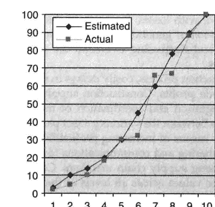

**图 7.1** “S”曲线。

*共享的进度信息*可以通过多种形式传递，包括面对面交谈、移动电话、电子邮件以及使用 PowerPoint 演示文稿的会议。在项目这一阶段，最容易被接受的信息共享形式包括 CPM 图和实时互联网传输。无论采用何种格式，有效的信息共享系统都应包括以下内容：

- *估算：* 基于图纸和最终投标的项目或活动估算。
- *实际：* 截至目前实际数量和预算使用情况。
- *预测：* 对项目未来最准确的预期通常基于过去绩效。
- *偏差：* 估算值与实际值之间的正负差异。偏差应以相对量（百分比）和绝对量（金额和产量）报告。施工经理随后可评估偏差的幅度，并在上游和下游共享信息。

第8章将介绍两种纯建设供应链模型。

- 横向政府和非政府建设供应链商业模式
- 纵向政府建设供应链模型

### 结论

由于潜在复杂私营和公共部门建设项目数量不断增加，建设供应链的概念已变得日益重要。短期内，承包商或许能够承受亏损而生存；然而，从长远来看，*每一家*建筑企业都*必须*产生利润。利基营销、降低总成本和降低管理费用是提高利润的传统手段。

在施工过程中，材料、设备和服务方面代价高昂的延误侵蚀利润。建设供应链管理通过整合和协调各项目合作伙伴之间的材料、信息和资金流动，解决延误问题，并提供提高盈利能力的新途径。CSCM 对信息共享和沟通的强调促进了供应链成员之间的合作与协作。在供应链各层级推广核心价值观的合同安排，摒弃传统做法，转而推动项目整体成功，而不是单个企业的成功。项目管理和执行是检验供应链运行状况的最终测试。现场跟踪进度可确保项目按时并

在预算内并符合规范。按照供应链价值观与所有成员共享现场测量数据，是项目能否盈利的最终预测因素。

### 参考文献

- 1. http://www.aiacontractdocuments.org/
- 2. Harris, Larry D. 和 Perlberg, Brian M.，《Consensus DOCS的优势》，提交于“变革之风”会议，Consensus DOCS，美国律师协会建筑业论坛，2008年9月11-12日，伊利诺伊州芝加哥。
- 3. http://www.content.asce.org/ejcdc
- 4. AIA文件A401—1997 ¶2.1，《承包商与分包商之间的标准协议格式》，以及CD 750 ¶3.1，《承包商与分包商之间的标准协议格式》。
- 5. CD 750 ¶2.3，《承包商与分包商之间的标准协议格式》。
- 6. AIA文件A401—1997，《承包商与分包商之间的标准协议格式》，第1页，项目说明。
- 7. AIA文件A201—2007 ¶15.2，《施工合同通用条件》。
- 8. EJCDC C-700 ¶10.1，《施工合同标准通用条件》。
- 9. CD 750 ¶9.1.1，《承包商与分包商之间的标准协议格式》；AIA文件A401—1997 ¶4.6.1，《承包商与分包商之间的标准协议格式》；AIA文件A201—2007 ¶3.18.1，《施工合同通用条件》；以及EJCDC C-700 ¶6.20，《施工合同标准通用条件》。

## 第8章

## 建筑供应链管理商业模式

### 成功路线图

建筑行业已变得日益复杂。国内市场和世界各地新兴自由市场经济体的建筑项目显著增长。横向和纵向建筑项目正以惊人的速度增加。桥梁、公路、学校、住宅开发、医院、公寓楼、制造设施和堤坝的建设，导致建筑知识爆炸式增长。下文对涵盖各类建筑项目的两种建筑供应链商业模式进行大致分类。

### 公共和私营部门重型土木工程与横向供应链模型

重型土木工程或横向工程领域的项目最为复杂，需要最高水平的技术、财务和管理专业知识。该市场领域还要求复杂的材料处理和放置方法。重型土木工程供应链市场领域的特点如下：

- 水坝、桥梁、防洪、公路、机场、互通式立交等
- 大型项目——炼油厂、核电站等
- 巨大的全球市场潜力
- 需要高水平的工程能力
- 占美国年度建设成本的25%至30%

该市场领域的国际需求也在不断增加。该领域的设计阶段由土木工程师控制。施工阶段的特点是大量重型设备：起重机、土方机械和卡车，这些设备在这些项目中得到广泛使用。几乎所有这类项目都由公共资金资助，并由直接为项目业主（通常是政府机构）工作的土木工程师进行检查。主承包商必须在工程、地质、规划、进度安排和控制方面具有很高资质。工业部门资本密集，并拥有雄厚的工程专业知识。只有少数公司有资格在这一层面运营。例如，哈里伯顿（Halliburton）和布朗与鲁特（Brown & Root）都参与了伊拉克的基础设施项目。

重型公路市场由州交通部（DOTs）和联邦公路管理局（FHWA）监管。DOT是项目业主和合同管理者，FHWA是联邦公路信托基金的托管者，该基金主要来自机动车燃料税。FHWA将汽油税资金拨付给州政府，用于资助道路建设。DOTs按10%至20%州资金对80%至90%联邦资金的比例配套联邦资金。FHWA负责监督联邦援助公路项目。1956年《联邦援助公路法》是具有开创性的立法，建立了公路信托基金以及道路和桥梁建设体系，该体系已在所有州和哥伦比亚特区实施。这一领域之所以重要，是因为所有州DOT在运营和流程上具有相似性。大多数DOT设有总部和地区办公室，配有内部工程师和工作人员，他们在合同和项目管理中发挥关键作用。每个DOT都有适用于各自项目的标准规范。有趣的是，各州DOT之间的标准规范手册各部分在组织和定义方面相似。州政府内专门的交通职能已由地方市政当局和县政府以较小规模复制。

由于重型公路项目在财务和技术上的复杂性，大多数州要求主承包商通过资格预审。资格预审是根据财务信息、设备、人员和相关过往经验衡量公司的能力和实力。重型供应链市场需要特定的工程专业知识和管理技能。一些州甚至要求分包商达到与主承包商类似的资格预审标准。在审查资格预审财务信息时，DOTs往往看重流动性，即现金及现金等价物。在某些方面，资格预审类似于履约保证金，有助于州政府保护纳税人的资金。年度资格预审是定期招标发包的关键。只有事先通过资格预审的承包商——即有能力建设特定项目并拥有财务资源、设备和人员的承包商——才被允许投标。

由于实行资格预审，当所有投标都被接受时，一般来说，剩下的唯一任务就是确定最低价投标人。

### 重型土木工程供应链模型的组成

重型土木工程供应链模型中的关键供应链参与者包括项目业主、设计工程师、主承包商、分包商、材料与设备供应商以及银行。见图8.1。该模型展示了资金、工作和信息的上游与下游流动。任何建筑项目的成功都必然受到参与人员的影响。职能型组织结构很重要，健全的先进管理实践同样重要。每个供应链参与者都必须了解自己在项目完成中的角色，从而使项目高质量、在预算内并按时完成。

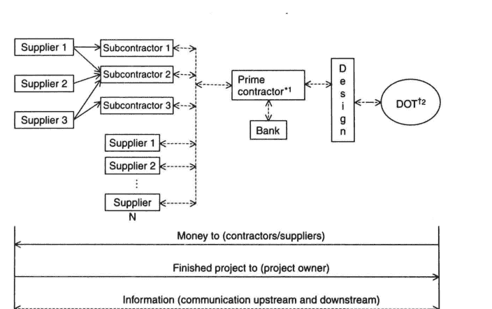

*1. 在该模型中，主承包商1至少完成50%的工作
†2. 交通部

**图8.1** 公共部门重型土木工程与横向供应链模型。

#### 项目业主（建筑供应链中的第1层）

项目业主的职责：

- 1. 确定要建设的内容。[为便于本讨论，项目业主为印第安纳州交通部（INDOT）。¹ 资助机构为FHWA。¹] 作为施工前职责的一部分，项目业主发布*联邦环境影响报告书*（EIS），其中说明项目的目的和需求。EIS概述各种备选方案，包括已选定的路线和被淘汰的路线。EIS进一步说明环境后果和影响，然后讨论减轻这些影响的措施。由FHWA发布的*决策记录*（ROD）是EIS流程的最后一步。ROD确定首选备选方案，并讨论为尽量减少环境影响将采用的方法。
- 2. 确定项目必须完成的日期。
- 3. 确定项目施工在质量和可靠性方面的主要里程碑。
- 4. 编制最终计划和规范。
- 5. 确定项目的初步成本估算。
- 6. 编制招标文件包。
- 7. 确定弱势企业（DBE）参与目标。
- 8. 编制招标发包通知和广告。
- 9. 向承包商发布通知。各类招标公告的定义见 http://www.in.gov/dot/div/contracts/standards/drawings/index.html。
- 10. 在开标前4周发布电子投标系统。这是一个电子交换平台，列出付款项目进度表。该交换平台从开标前10天开始根据需要进行修订更新。
- 11. 在开标前14天发布投标人和图纸持有者名单，并在开标前7天以及开标前1天再次更新。此信息具有战略意义，因为投标人在提交投标书之前就知道谁将成为竞争对手。
- 12. 在特殊情况下召开强制性标前会议。
- 13. 接收主承包商的投标。


- 14. 开标并选择承包商。
- 15. 准备合同文件。
- 16. 授予合同。
- 17. 召开施工前会议。
- 18. 确保在项目开始前落实许可证、保险、履约保证金、DBE目标及其他要求。
- 19. 可在项目全生命周期内与供应链成员召开合作会议。

INDOT项目的主要要素在项目开发流程（PDP）的流程图中展示。参见图8.2。

#### 印第安纳州交通部（DOT）重大项目建设项目开发流程（PDP）（更新于2005年12月6日）

开始 — 会计 — 采购服务与交通

| 步骤 | 活动 | 详情 |
| --- | --- | --- |
| STEP 31 | 施工前活动 | - 施工前会议<br>- 分包商与供应商名单<br>- 授标后、NTP前<br>- NTP后10天 |
| STEP 32 | 首个工作日 | - 首次实际施工<br>- 项目范围<br>- 通常为合同工期开始时间<br>- NTP后最多25天 |
| STEP 33 | 首次开放交通日 | - 可能与开工首日相同<br>- 承包商需提前7天通知 |
| STEP 34 | 施工管理 | - 检查与测试活动<br>- 检查员日报<br>- 交通控制<br>- 材料认证<br>- 材料调查（视需要） |
| STEP 35 | 进度估算（工资单） | - 承包商申请月度进度估算<br>- 施工与侵蚀控制工作完成 |
| STEP 36 | 交通事件 | - 可能变更（需提前72小时通知）<br>- 符合合同要求<br>- 设施封闭<br>- 需获批 |
| STEP 37 | 变更令 | - 按数量、新增项、删除项、时间调整、规范处理<br>- 已载入合同CL 5、ERL等 |
| STEP 38 | 月度报告 | - 每月5日前处理<br>- 完成百分比<br>- 合同及修改后合同金额<br>- 重要工作项说明<br>- DBE、EEO等状态 |
| STEP 39 | 中间合同完工 | - 合同已完成（除非另有说明）<br>- 一段时间内未施工时可标注为“不活跃”<br>- 承包商有合同工期的2倍时间（不含不活跃天数） |
| STEP 40 | 实质性完工日期 | - 合同约定日期<br>- 开放无限制交通<br>- 标志标牌<br>- 基本完成<br>- 准备进行预最终检查与最终检查<br>- 此日期后4周内无LDs |
| STEP 41 | 最终验收日期 | - 由D/O签发信函<br>- 检查后90天<br>- 承包商被移交担保机构<br>- 承包商被移交保修<br>- 如规定，保证期与保修期 |
| STEP 42 | 施工完成 | - 业主书面验收已完成工作<br>- 最后工作日 |
| STEP 43 | 最终现场行政活动 | - 完成最终计划项目后完成现场活动<br>- 提交最终施工记录<br>- 收到承包商的最终估算与投标估算<br>- 项目现场验收<br>- 已载入合同处理<br>- 最终CRL签发<br>- PERF及所需文件提交至区<br>- PERF及所需文件提交至PECPS<br>- 最终现场关闭 |
| STEP 44 | 合同收尾 | - 区收到CRL<br>- 承包商完成CCR与QC认证<br>- 承包商提交FIN-47<br>- 完工后180天最终付款凭证 |
| STEP 45 | 合同完成日期 | - 最终付款凭证已处理 |
| STEP 46 | 保修完成 | - 保修保证金期完成 |

#### 总承包商（施工供应链中的第二层级）

总承包商的职责：

- 1. 审阅发布于 http://www.in.gov/dot/div/contracts/standards/drawings/index.html 的《承包商通知》。该通知在开标前5周发布；其中列出工作类型、地点、资格要求以及投标文件费用。
- 2. 审阅合同信息手册、施工图纸、规范、特殊条款和其他合同要求。在审阅过程中，总承包商评估项目地点、特殊条件，以及施工图纸和规范的完整性。总承包商还会考虑合同类型、付款项和数量表，这些可在 http://www.in.gov/dot/div/contracts/standards/drawings/index.html 查阅。总承包商当前的资格预审能力和在建工作是影响其投标决定的因素。
- 3. 至少于开标日期前21个日历日提交新的资格预审申请，以便获得该次开标的考虑。每年至少于开标日期前15个日历日更新资格预审，以便获得该次开标的考虑。资格预审决定总承包商可执行的工作项及金额。要获得承接超过1,000,000美元工作的资格预审，总承包商必须提交经审计的资产负债表。按类型划分的工作分类包括混凝土基层-路面及重铺；沥青基层-路面及重铺；土方平整和桥梁。所有未完成工作的金额，包括非INDOT工作，均计入资格预审限额。INDOT资格预审申请表可在 http://www.in.gov/dot/div/contracts/standards/drawings/index.html 查阅。
- 4. 对项目现场进行深入考察，以评估现场特征，如条件、可达性和障碍物。现场考察还将帮助总承包商确定需要拆除的项目。在现场时，总承包商应拍照并准备一份有待探究的问题清单。总承包商应设想现场将开展的工作，并开始制定劳动力、设备和材料的动员与退场计划。
- 5. 接收投标更新信息，例如开标前最多2周发布的补充通知。
- 6. 如举行标前会议，则参加该会议。
- 7. 对一般要求、施工图纸、规范和投标书进行精确分析。总承包商必须评估投标文件的质量。
- 8. 确定总承包商将自行完成哪些项目，然后向分包商、设备和材料供应商询价。大多数INDOT工作要求总承包商自行完成50%的工作。
- 9. 确定DBE参与策略。DBE公司必须在投标文件中按数量、工作项和金额列明。总承包商将*平权行动认证*表纳入项目建议书。
- 10. 检查开标前四周发布的电子投标系统。电子交换平台自开标前10天起根据需要更新修订内容。总承包商有责任在投标截止时间前检查电子交换平台中的修订文件。
- 11. 检查开标前14天发布的投标人和图纸持有人名单。该信息在开标前7天更新，并在开标前1天再次更新。该信息具有战略意义，因为投标人在提交投标文件前可了解竞争情况。
- 12. 在INDOT网站注册以获得有效投标人身份。此步骤对电子投标至关重要。
- 13. 进行最终工作分解和工程量核算，并生成最终投标文件。
- 14. 通过电子媒介提交投标文件。
- 15. 等待授标决定。如果总承包商是最低且响应性投标人，INDOT将授予合同，以将施工计划、材料、设备、劳动力和支持服务转化为安全可靠的道路，供出行公众使用。

关于投标准备和提交流程的一般说明，请参见第5章图5.2。

#### 分包商（施工供应链中的第三层级）

当总承包商无法执行或决定不执行某些项目任务时，将与此类任务的分包商签订合同。分包组织必须具备执行所需任务的资源和专业知识。分包组织还必须分担部分项目风险。总承包商必须自行完成至少50%的工作。INDOT项目中没有第二层级分包商。

分包商的职责：

- 1. 至少于开标日期前21个日历日提交新的资格预审申请，以便获得该次开标的考虑。每年至少于开标日期前15个日历日更新资格预审，以便获得该次开标的考虑。资格预审决定总承包商可执行的工作项及金额。要获得承接超过1,000,000美元工作的资格预审，分包商必须提交经审计的资产负债表。特殊合同和分包组成部分是分包商资格预审中给出的通用工作类型和分类。INDOT资格预审申请表可在 http://www.in.gov/dot/div/contracts/standards/drawings/index.html 查阅。
- 2. 分包商收到总承包商针对特定工作项的报价请求。在INDOT市场中，分包商可上网获取提交报价所需的全部信息。此外，投标人和图纸持有人名单可能是竞争信息来源，因为它表明谁是有效投标人，以及谁可能不是有效投标人但持有图纸副本。
- 3. 审阅合同信息手册、施工图纸、规范、特殊条款和其他合同要求。在审阅过程中，分包商评估项目地点、特殊条件，以及施工图纸和规范就其将施工的项目而言的完整性。分包商当前的资格预审能力和在建工作是影响其提交报价决定的因素。
- 4. 对项目现场进行深入考察，以评估现场特征，如条件、可达性和障碍物。现场考察还将帮助总承包商确定需要拆除的项目（如有）。在现场时，分包商应拍照。


并准备一份探究性问题清单。分包商应当对正在进行的施工进行可视化预演，并考虑所需调遣和撤场的范围与次数。

- 5. 分包商向设备和材料供应商询价（如适用）。
- 6. 分包商考虑开标前发布的、影响其工作项的任何修订。要求报价的总承包商也会将任何变更通知分包商。
- 7. 分包商进行工程量计算并生成最终报价。
- 8. 分包商提交并交付报价。
- 9. 分包商等待授标决定。
- 10. 如果分包商获得合同，则启动施工图流程。（参见第5章的施工图提交流程。）

#### 建筑材料供应商（建筑供应链中的第三级）

总承包商采购部门或采购经理的职责如下：

- 1. 与估算部门审查并协调材料需求、规格、数量和时间框架。考虑任何特殊制造需求。根据项目中的使用情况，将材料分为战略材料或大宗材料。
- 2. 从INDOT批准的物料清单中查找并为项目选择合适的供应商，该清单见 www.in.gov/indot/div/M&T/appmat/appmat.htm。
- 3. 编制询价书，包括规格、数量和截止日期。
- 4. 接收报价。
- 5. 组织并参与对战略供应商响应性投标的评估团队。
- 6. 等待授予总承包商的授标决定。
- 7. 组织并带领谈判团队，最终确定价格、装运与交付以及其他条款。

#### 建筑设备供应商（建筑供应链中的第三级）

由于大多数复杂的建筑项目需要大量设备项，承包商会定期评估其设备，以确定能否承接工程。总承包商有时要求供应链的其他成员也取得履约保证。

保险证明、综合一般责任保险、工伤赔偿保险以及其他保险凭证通常由总承包商保管。目前有一种趋势，即将总承包商列为分包商保单上的附加被保险人。这种保险范围可能越界，因为它在保单下赋予总承包商与被保险人相同的权利。

#### 供应链协调与信息流

在公共工程市场中，信息非常丰富。INDOT有一个公共网站，提供如何进行投标以及何时投标的信息。潜在投标人和图纸持有者的名单会在公开开标前定期公布。项目授标后，将召开一次施工前会议，与会者包括总承包商、其他供应链成员以及INDOT的地区工程师和项目管理人员。随着项目进展，该机构将举行包括所有供应链成员在内的合作会议。较低层级的供应链成员与INDOT地区官员有各自的联系，因为经过资格预审的分包商在每项工作中都由地区官员进行评估。然而，与该机构的接触存在实际（即使不是法律上的）限制，因为供应链实体都知道INDOT的合同是与总承包商签订的。

#### 供应链资金流

付款流程是INDOT市场更具吸引力的特点之一。项目业主是州政府，不像私人业主那样容易破产。资金来源、燃油税收入以及州配套资金在经济景气时期是可以预测的。这里本身没有开票系统。相反，地区工程师在项目进展过程中检查工作，然后签发用于付款的“估算单”。估算单大约每两周出具一次。在某些项目中，检查工作外包给咨询工程师。款项直接支付给总承包商，然后由总承包商支付给分包商。INDOT与总承包商之间的合同条款要求总承包商在收到付款后不迟于10个工作日内向分包商付款。

#### 《美国复苏与再投资法案》：联邦经济刺激计划

州交通部门在联邦经济刺激计划——《2009年美国复苏与再投资法案》中发挥着关键作用。从联邦公路管理局（FHWA）到各州交通部（DOTs）的资金流动和控制机制，使得水平重型建筑模式成为管理经济刺激计划的理想选择。该法案为公路工程提供了约275亿美元资金，并要求其中一半资金须在2009年6月30日前到位。另一半必须在2010年3月2日前签订合同。所有项目必须在2012年2月17日前完成。¹ 垂直建筑项目也将在类似条件下通过各州和联邦机构获得资金。这一快速通道计划为供应链实体提供了前所未有的合作机会，以减少浪费并实现显著效率。

### 私营和公共部门垂直建筑供应链模型

垂直建筑领域涵盖了广泛的项目，从私营部门的公寓楼、小学和百货商店，到公共部门的大学、医院以及地方、州和联邦办公大楼。该领域的私营项目由商业银行提供资金。工程师和建筑师通常在这个细分市场的项目设计阶段进行合作。投标按系统进行打包和分类，如机械、电气或结构系统。通常超过70%的投标项目分包给专业承包商。垂直非政府建筑供应链细分市场的特点包括：

- 以施工管理为主要项目交付系统。
- 设备密集型运营环境。
- 大量材料成本（混凝土、钢材、管道和岩石）。
- 项目大多由私人融资。
- 高水平的专业知识。
- 基于竞争性投标的定价。
- 年产值占美国全年建筑总量的35%至40%。

公共部门供应链包括从机场的小型零售空间到医院、大学等项目。该市场板块的每个项目都需要工程和管理能力。在大多数情况下，这些项目由联邦、州或地方政府资助，或由三者某种组合共同资助。建筑师被用于设计这些项目。施工经理、总承包商和分包商被用于执行和管理施工转化过程。该市场板块的项目高度以各种设施的实际使用为中心，医院、大学和学校尤其如此。

垂直公共部门建筑供应链模型的流程图显示了资金、工作和信息的上下游流动。参见图8.3。当前和未来的建筑项目由技术、信息和持续改进驱动。项目正变得越来越复杂，并背负着广泛的政府法规。任何建筑项目的成功本质上都受到人员和工作方法的影响。该模型中的主要参与者包括项目业主、施工经理、设计工程师、分包商、供应商（材料和设备）以及资金来源。

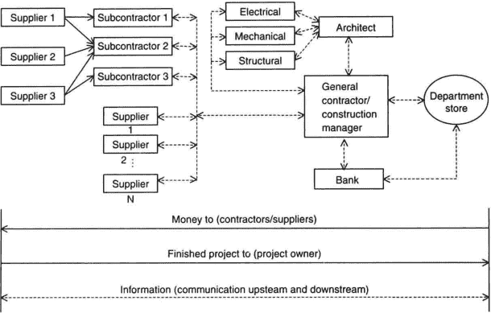

**图8.3** 私营和公共部门垂直建筑供应链模型。

#### 项目业主（建筑供应链中的第一级）

项目业主的职责：

- 1. 确定要建造的内容和地点。该市场板块的项目业主必须要么具备丰富知识并拥有土木和设计工程师员工，要么聘请专业人才，例如承担风险的施工经理。在选择施工经理或总承包商时，必须考虑项目业主的内部能力范围。参见附录E中的施工管理合同示例。
- 2. 确定项目必须完成的日期。
- 3. 项目施工里程碑的质量和可靠性。
- 4. 确定初步工作范围。
- 5. 为项目制定初步预算。
- 6. 制定选择建筑师或施工经理的策略。建筑师或施工经理必须经验丰富，拥有强大的组织能力和个人履历，并在类似项目上具有专门经验，

- 拥有用于项目实施的技术和其他系统，并且财务状况稳健。

- 7. 筛选项目设计阶段的建筑师和施工经理。
- 8. 推荐入围的建筑师和施工经理。
- 9. 安排入选建筑师和施工经理的陈述。
- 10. 选择建筑师和施工经理。
- 11. 向建筑师和施工经理授予合同。
- 12. 与中标建筑师和施工经理谈判。
- 13. 与建筑师和施工经理召开项目启动会。
- 14. 确保在项目开始前落实当地政府许可、保险、履约保函和其他要求。
- 15. 如有要求，确立弱势企业（DBE）、少数族裔企业（MBE）和女性企业（WBE）的参与目标。
- 16. 在建筑师和施工经理协助下决定投标包策略。

#### 施工经理（施工供应链中的第2层）

选择专业的施工经理类似于选择建筑师。有效的施工管理组织必须拥有人员、能力、系统和经验，以按时、按预算完成高质量项目。施工经理应具备在类似规模和类型项目中担任总承包商和施工经理的经验。这种在类似项目上的专业经验要求包括了解最新工作方法和检查专业知识，以及垂直领域中的供应链概念。精益建造方法与先进技术相结合，是施工经理为实现最高效的项目规划和控制功能而应实施的管理系统。

施工经理与建筑师合作并解读设计目标的能力，是在垂直领域实施供应链概念的基础。施工经理对项目要求和业主对项目最终用途的了解，应包括对项目风险和当地建筑劳动力市场的敏锐理解。最后，施工经理自身应财务状况稳健，并拥有能够证明其诚实以及审慎财务管理和控制的推荐证明。

#### 供应链文件流

供应链实体之间的文件流包括项目业主与建筑师之间的协议，以及项目业主与风险型施工经理之间的协议。风险型施工经理与分包商和材料供应商之间也存在合同。在整个项目过程中，文件流可能包括由风险型施工经理授权的变更单。除正式法律安排外，项目业主可能要求供应链中的所有实体提供投标、履约和付款保函。综合一般责任保险、工伤保险和其他保险覆盖的证明通常由所有供应链成员提交给风险型施工经理。有一种趋势是让下游供应链实体在其保单中将项目业主和风险型施工经理承包商列为附加被保险人。在发生付款争议时，留置权申请可能成为文件流的一部分，未获得付款的下游供应链实体会对项目财产提出留置权申请。

#### 供应链协调与信息流

对于体育场馆和会议中心等高知名度项目，通常会有专门网站提供如何投标以及何时投标的信息。投标包可能在报纸上刊登广告，也可能由当地独立复印绘图公司刊登广告、制作和销售。承包商订阅服务和复印绘图公司可能发布计划持有者名单，以便建筑行业了解谁在投标哪些项目。在垂直领域，可能举行投标前会议，以传播信息并回答有关项目的问题。对于更成熟的项目业主，该领域的投标可以电子方式提交；也可以手动提交，并立即公布最低符合要求投标人的身份。在某些项目的施工过程中，会举行合作会议，所有供应链成员均派代表参加。工地通常会有张贴公告，包括广告牌大小的公告，表彰主要供应链实体的绩效。然而，大型垂直项目中有如此多不同工种参与，如果不实施供应链理念，信息协调可能成为一项挑战。

#### 供应链资金流

垂直建筑市场因许多私人业主而最容易受到破产影响。项目业主从商业银行、保险公司投资部门和其他金融机构获得融资，然后定期提款以支付项目发票。一些高知名度私人项目、酒店等获得政府资金补贴，这可能意味着更可靠的现金流。检查由施工经理执行。当上游存在争议时，付款可能很慢，尤其是对下游实体而言。

### 施工供应链管理的实施

企业在根据能力和兴趣在供应链配置中结盟之前，必须首先作为个体企业在内部和外部运营中表现出色。每个潜在供应链成员都应进行聚焦分析。聚焦分析由发人深省的问题组成，促使施工供应链成员考虑其业务的各个方面。进行聚焦分析的目的是调查以下问题：我的企业和行业中“如何赚钱”的方式正在改变吗？在我的工作类别中，谁在赢得盈利项目；谁没有赢得盈利项目，为什么？表8.1给出了聚焦分析清单示例。

**表 8.1** 建筑公司聚焦分析示例

| 建筑公司聚焦分析示例 |
|---|
| **利润与增长** |
| 1. 盈利项目如何定义？ |
| • 利润生成的前20% |
| 2. 贵公司的盈利能力如何衡量？ |
| • 收入流的质量 |
| 3. 业务发展支出和激励措施中，有多大比例用于投标盈利项目？ |
| • 投标盈利项目很重要 |
| 4. 贵公司赢得了盈利项目的百分之多少？ |
| • 您的主要竞争对手赢得了盈利项目的百分之多少？ |
| **客户（项目业主）满意度** |
| 5. 是否收集客户满意度数据？ |
| 6. 有关客户满意度的信息如何用于解决客户问题？ |
| **员工生产力** |
| 7. 您如何衡量员工/分包商的生产力？ |
| **员工忠诚度** |
| 8. 您如何建立员工/分包商的忠诚度？ |
| 9. 贵公司是否努力确定合适的工人留任水平？ |
| **员工满意度** |
| 10. 员工满意度是否以能够与类似的客户满意度衡量方式相联系、且具有足够频率和一致性以建立趋势的方式进行衡量？ |
| 11. 新员工如何招聘？现有员工如何解雇？ |
| 12. 客户满意度、客户忠诚度或质量的衡量指标在多大程度上用于认可和奖励员工/分包商？ |
| **内部服务质量** |
| 13. 员工知道他们的客户是谁吗？ |
| 14. 员工对他们在工作中获得的技术、培训和个人支持满意吗？ |
| **领导力** |
| 15. 贵公司的领导力在多大程度上是？<br>- 精力充沛、富有创造力，还是保守<br>- 参与式，还是疏离式<br>- 倾听和教导，还是监督和管理<br>- 以使命激励，还是以恐惧激励<br>- 以个人魅力领导，还是以公司政策领导 |

### 结论

水平与垂直基础设施建设项目正以惊人的速度增长。第1章讨论的各类具体项目类型包含两种施工供应链模型。水平项目通常由政府资助，其特征是政府机构担任项目业主。除项目业主自身内部技术能力外，供应链成员拥有大量工程专业知识。垂直项目可能有公共或私人资助。施工经理是垂直模型中的关键供应链实体。由于私人所有权问题，垂直模型的某些变体可能存在破产风险。

### 参考文献

- 1. 《美国复苏与再投资法案》，H.R. 1—92-94。


## 附录 A

### 合资协议

### 合资协议（续）

本合资协议由（名称），其主要营业地点位于（地址）（以下简称“______”），与（名称），其主要营业地点位于（地址）（以下简称“________”），于200_年____月__日订立。

#### 兹证明：

鉴于，本协议双方希望共同准备并提交第2段所述某些建筑项目的某些联合投标（以下简称“工程”），并且如果该合资企业成为工程的中标人，则共同完成工程，且

鉴于，双方进一步向彼此及项目业主陈述，各方均有资格在______州进行公路建设；若合资企业中标，各方均有能力提供其应分担的资金、人员、设备和监督以完成工程，并承受和支付可能发生的任何损失。

因此，鉴于本协议所载双方对彼此作出的陈述和承诺，双方特此相互同意按照以下条款和条件组建合资企业：

- **1. 名称。** 合资企业的名称应为：__________

  如果（州）法律要求，应在合资企业设有办事处的每个县提交以该名称命名的假定名称证书。

- **2. 业务。** 合资企业成立的唯一目的是对某些建筑项目进行投标，并且如果合资企业中标，则完成该等项目。属于本协议范围内的建筑项目将通过为每个项目签署投标前合资协议（见所附附件“A”）由双方共同商定。只有双方共同签署投标前合资协议的项目才受本协议约束。

  双方同意尽最大努力共同准备并及时提交工程投标；如果根据该等投标授予合同，则该等合同应以合资企业名义签署。如果双方未就拟提交的投标金额达成一致，或者双方虽就拟提交的投标金额达成一致并提交了投标，但工程合同未授予合资企业，则本协议就该特定项目自动终止。如果在__________之前未取得任何工程，则本协议双方不得为任何其他目的成为合伙人，但为清算、结业和结算合资企业事务除外。

- **3. 主要办事处。** 合资企业的主要办事处应位于____________。

- **4. 合资各方权益。** 各合资方的名称和所有权权益如下：____________。

- **5. 出资。** 各合资方的初始出资如下：

  除初始出资外，各合资方同意按上述所有权比例追加出资，以必要方式及时、令人满意地实施或完成工程，但未经其同意，任何合资方不得被要求追加超过5,000.00美元的出资。

  除任一合资方的出资按比例高于上述所有权比例外，不得就出资支付利息。

- **6. 保管人。** 合资企业的所有资金应以合资企业名义存入在____________开立的账户，且仅用于本合资企业的目的；与此相关的所有财务记录和会计记录应与和本合资企业无关的其他____________记录和会计记录分开保存。

- **7. 财政年度。** 合资企业的财政年度应与日历年相同，于每年12月31日结束。

- **8. 账簿和记录。** 合资企业所有交易的完整、准确账目应记入适当账簿，各方应将其代表合伙企业进行的所有交易完整、准确地记录或安排记录。

  - （a）合伙企业的账簿和其他记录应始终保存在合资合伙企业办公室，地址为________________________
  - （b）合伙企业账簿应按日历年度的完工百分比法记账，并应在每年年底结账和平衡。应截至结账日进行审计。
  - （c）每个合伙人应始终有权查阅合资企业的账簿和记录，并可检查和复制任何此类记录。

- **9. 利润和亏损分配。** 合资企业的净利润和亏损应在工程完成且收到业主付款时确定，并在任何合资企业财政年度结束后立即确定（如该财政年度在工程完成前结束）。该等利润或亏损应按照联邦所得税目的所采用方法一贯适用的公认会计原则确定。该等利润或亏损应按以下基础在各合资方之间分配，并记入其资本账户的贷方或借方：

- **10. 合资企业使用的财产。** 各合资方同意以租赁方式提供某些用于履行工程的机器、设备和人员。在开始工程之前，如果合资企业中标，双方应通过编制用于完成工程的机器、设备和人员清单来补充本协议。该补充文件应提交并成为本协议的一部分，还应列明所有机器和设备的约定租赁租金以及向双方提供给合资企业的人员支付的报酬。任何进一步需要的设备租赁、工具和材料采购或劳动力雇用，应由合资企业以其自身名义按本协议规定的基础进行。

- **11. 合资企业的管理。** ________________应被指定为合资企业的管理合伙人，并应控制为及时、令人满意地完成工程所涉及的日常运营。合资各方应负责并承担财务责任

- **12. 工程分工。** ______及其员工将协助培训人员以执行所授予的此类项目。______将购买或租赁执行这些项目所需的设备，购买执行这些项目所需的材料，并雇用执行这些项目所需的员工，但该等员工将由______提供，以培训______执行这些项目（由______向______报销该等员工费用）。

- **13. 需要一致同意的行为。** 未经合资双方一致同意，任何合资方不得实施以下任何行为：

  - （a）以任何方式使用合资企业名称或资产，但进行合法的合资企业业务除外，亦不得实施任何违反本合资协议的行为；
  - （b）拥有任何权力或授权实施法律禁止单个合资方实施的行为，除非本协议明确授权；
  - （c）未经另一合资方明确同意，以低于全额的方式免除或清偿欠合资企业的超过1,000.00美元的任何债务；
  - （d）向任何其他人透露有关合资企业财务报表或运营的任何信息，但为开展合资企业业务或披露合伙人财务状况所必需者除外；
  - （e）转让、转移、设押、质押或处置其全部或任何部分合资权益，或退出合资企业，但本协议明确授权除外；
  - （f）作出、签署和交付任何为债权人利益的转让，或任何保证书、承认判决书、动产、抵押、担保、赔偿保证书、保证债券，或任何其个人财产的销售合同；
  - （g）租用、租赁、购买、出售或抵押任何不动产或任何权益，或为此目的订立任何合同；
  - （h）借款或放款，或制作、签署、交付、接受或背书任何商业票据（存款和托收除外），或除合资企业日常经营目的外，使用或利用合资企业的信用、资金或其他财产；

任何违反本协议任何条款、规定和条件的合伙人，除应承受可能对其施加的其他救济、责任和义务外，还应使另一合伙人免受因该等违反任何条款、规定和条件而产生或引起的任何及所有索赔、要求和诉讼的损害。

#### 14. 合资企业的解散。

- (a) 工程竣工并完全验收和付款；
- (b) 任何合资方破产、资不抵债，或为其资产指定接管人，且在六十（60）日内未解散的；
- (c) 任一合资方未能以及时的方式，按令业主满意并符合良好施工惯例的方式履行其指定的工程部分；
- (d) 在依据(b)和(c)款进行任何解散的情况下，未导致解散的合资方有权以另一承包商替代导致解散的合资方，以完成工程；
- (e) 合资方未能就工程达成一致并提交投标，或合资企业未能获得工程合同。

#### 15. 采购设备的分配。

工程完成后，管理合伙人应就合资企业购买或为其购买的各项设备或各组设备，向一家或多家信誉良好的经销商取得真实报价；各合伙人有权按该等经销商就此所报的最高价格购买任何一项或一组设备，但未经另一合伙人事先书面同意，任何合伙人无权购买超过其在合资企业中权益比例的设备比例。所有未如此处置的设备，应由管理合伙人以可向外部人士获得的最高价格出售。

#### 16. 合资企业的清算。

工程竣工、验收并付款后（除管理合伙人编制的月度报告外），应以书面形式对合资企业的全部资产和负债及其全部收入和支出作出完整、真实、准确的账目，并应确定各合伙人在合伙资本及其他资产以及净利润或亏损中的权益，所赚净利润金额或所遭受净亏损金额应分别记入或借记合伙账簿中各合伙人的账户。

随后，应按如下程序清算：

- (a) 支付债权人（包括合资方）的负债以及清算费用。
- (b) 设立合资方合理确定必要的任何准备金，以应对合资企业或任何合资方因合资企业责任而产生或与之相关的或有负债；
- (c) 向合资方支付与其各自资本账户相等的金额，但不包括任何负余额账户，或者如果可用于该等支付的金额不足，则按相关比例分配；以及
- (d) 支付余额，以按各合资方各自百分比份额完全满足所有合资方的合资权益，并按本段后续规定调整。应向该余额加上合资方负资本账户的总额。该余额应按各合资方各自的百分比份额分配，并对每一方按该负资本金额（如有）予以扣减。

#### 17. 其他事项。

- (a) 通知。本协议项下的所有通知均应采用书面形式，若交付给任何合资方，或通过美国认证邮件（要求回执）寄送至该合资方提供给合资企业的地址，则视为有效送达该合资方；若以该方式寄送至合资企业的主要办事处，则视为有效送达合资企业。
- (b) 解释。本协议应依（州名）州法律解释。

#### 18. 生效日期。

本合资协议自署名合资方签署之日起生效。

#### 19. 先前协议。

本协议构成双方就工程达成的完整协议，并取代和使所有先前协议、函件或备忘录无效，包括但不限于日期介于__________与__________之间的投标前合资协议。

见证：                    公司 A ________________________
________________________                    ________________________

________州 )
                               ) SS:
________县 )

在我——上述县和州的公证人——面前，亲自出现________________，其经首先正式宣誓，代表上述公司签署了前述合资协议。

________________________
公证人

打印姓名 ________________________

我的任期届满日：                  居住县：
_________________________             _________________________

见证：                                   公司 B ________________________
________________________                    ________________________

________州 )
                               ) SS:
________县 )

在我——上述县和州的公证人——面前，亲自出现________________，其经首先正式宣誓，代表上述公司签署了前述合资协议。

________________________
公证人

打印姓名 ________________________

我的任期届满日：                  居住县：
_________________________             _________________________

### 附件 A

#### 投标前合资协议

依据日期为（    ）的主合资协议第1段，双方（姓名）和（姓名）于本日（      ）特此订立本投标前合资协议，目的是以合资企业名义编制并提交竞争性投标，以作为总承包商实施 DOT 项目 RC-2801 的工程。该项目的投标日期为（日期）。RC-2801 是 I-98 上的一个加速项目，位于（城市），旨在 I-79 以南机场高速公路附近增设行车道并改造互通立交。该项目涉及大量桥梁更换、混凝土基层路面和重度土方工程，并要求 A、C 和 D 类预审资格。如果合资企业就所述项目提交投标但未获授合同，则本投标前合资协议终止，且必须另行订立投标前协议以投标另一项目。

见证：                    公司 A ______________________  
______________________________________      ______________________________________  
________州 )
                                  ) SS:
________县 )

在我——上述县和州的公证人——面前，亲自出现，且其经首先正式宣誓，代表上述公司签署了前述合资协议。

________________________________  
公证人

打印姓名 ________________________________  
我的任期届满日：                    居住县：  
________________________________          ________________________________

见证：                    公司 B ______________________  
______________________________________      ______________________________________  
________州 )
                                  ) SS:
________县 )

在我——上述县和州的公证人——面前，亲自出现______________，其经首先正式宣誓，代表上述公司签署了前述合资协议。

________________________________  
公证人

打印姓名 ________________________________  
我的任期届满日：                    居住县：  
________________________________          ________________________________


## 

巴黎圣日耳曼 ⭐ 7

位置：DC | 项目：7 | 国家：法国


基利安·姆巴佩是一名法国前锋，2018年世界杯冠军，以速度和进球能力著称。他效力于巴黎圣日耳曼，是世界最佳足球运动员之一。

- 评分：94
- 平均：92.5
- 身价：180.000.000 €

| 速度 | 射门 | 传球 | 盘带 | 防守 | 体能 |
|-------|------|------|--------|---------|--------|
| 98    | 93   | 90   | 97     | 35      | 84     |

## 附录 B

### 分包商投标包和标前邀请


莱恩大道停车库和学生学术服务大楼  
俄亥俄州立大学项目编号 #315-2005-992-1 和 #315-2005-992-2  
EDGE合规

#### 标前邀请

| 字段 | 信息 |
|---|---|
| 标前日期 | 2010年2月7日 |
| 标前时间 | 停车库，2a阶段 — 上午10:00 – 上午11:00（约）<br>学生学术服务大楼 — 下午01:00 – 下午02:00（约）<br>停车库，2b阶段 — 下午03:00 – 下午04:00（约） |
| 建筑师 | Acock Associates Architects |
| 标前地址 | Fawcett中心 – Clinton室<br>2400 Olentangy River Road<br>哥伦布, OH 43210<br>电话：614/292-1342<br>传真：614/292-3072 |
| 现行工资 | 是 |
| 免税 | 待定 |

随附每个阶段所有相关信息的完整说明（后附15页）；信息包括各行业的估计合同价值、合同文件的获取地点、实际投标日期以及EDGE计划。

EDGE计划的目的是达到或超过这些项目的总体目标和社区外展目标，并且是Miles-McClellan平等就业机会和商业利用政策的重要组成部分。

在Miles-McClellan管理的建筑项目中，纳入少数族裔、女性和弱势企业“公平份额”参与是一项持续的公司政策。这基于我们对它们发展的关注，使它们能够有竞争力地参与建筑行业主流。

参与投标的总承包商应做出以结果为导向的努力，按照分配给该计划既定目标使用符合EDGE合规/合格的分包商。鼓励较大的承包商将部分工作分包给EDGE参与者（其规模可能较小）。鼓励较小的承包商寻找较大的公司，告知它们您提供的服务，以确定如何在不影响时间、成本和质量的情况下满足预算。为努力提高EDGE合规性并协助此项工作，请随时致电。

#### 项目说明：

如有问题，请联系 Ernie Lewis（电话：614/487-7744 分机 2327）或 Matthew Recchiuti（分机 2313）。

请将贵公司信息和意向传真回复至 614/487-7747。

承包商：________________________________________________。  
联系人：_________________________________________________。  
电子邮件：___________________________________________________。  
您将参加标前会吗？  
是 _________ 否 _________ 可能 _________

| 文件 00 10 00—招标 | OhioDAS |
|---|---|
| 俄亥俄州行政服务部 | www.ohio.gov/sao |
| 一般服务司 | 电子邮件：StateArchOff@das.state.oh.us |
| 州建筑师办公室 • 4200 Surface Road | 电话：614.466.4761 • 传真：614.644.7982 |
| • 哥伦布，俄亥俄州 43228-1395 | |

密封投标将代表俄亥俄州立大学董事会（商业与财务）接收，地址：

设施运营与发展部  
中央教室楼4层  
2009 Millikin Road  
哥伦布，俄亥俄州 43210

用于以下项目：

项目编号 315-2005-992-1  
莱恩大道停车库 – 2b阶段  
俄亥俄州立大学，设施运营与发展部  
哥伦布，富兰克林

依据由以下方准备的合同文件：

Acock Associates Architects  
383 North Front Street  
哥伦布，俄亥俄州 43215  
电话：614-228-1586  
传真：614-228-2780  
Pete Confar, AIA LEED AP  
pconfar@acock.com

施工经理为：

Ruscilli/Miles-McClellan  
2041 Arlingate Lane  
哥伦布，俄亥俄州 43228  
电话：614-876-9484  
传真：614-921-1183  
Adam Drexel  
adrexel@ruscilli.com

投标人可在投标截止日期前至少10天向Associate提交对指定产品、设备或服务的拟议替代品的考虑请求。额外产品、设备和服务仅可通过书面附录作为批准的替代品被接受。

州建筑师办公室不时发布新版“俄亥俄州公共设施建设标准要求”，并可能发布临时变更。投标人必须提交符合合同文件中包含的标准要求版本的投标。

现行工资率和平等就业机会要求适用于本项目。

本项目受俄亥俄州“鼓励多样性、增长和公平”（“EDGE”）商业发展计划的约束。投标人必须随投标文件及投标人资格表提交某些信息，关于与投标人一起参与项目的经认证EDGE商业企业。请参阅投标人须知第6.1.12款。

本项目的EDGE参与目标为5.0%。该百分比由EDGE认证企业提供的商品、服务、材料和劳动力的合同价值确定。参与度按每份授予合同的总金额计算。有关EDGE的更多信息，请联系俄亥俄州EDGE认证办公室，网址www.EDGE.ohio.gov，或前往其办公地点：30 E. Broad St., 18th Floor, Columbus, Ohio 43215-3414；或致电(614) 466-8380。

**俄亥俄州修订法典第153.011节规定的国产钢材使用要求适用于本项目。俄亥俄州修订法典第153.011节的副本可从俄亥俄州行政服务部的任何办公室获取。**

投标人必须在提交投标之前参加由俄亥俄州工人赔偿局（“OBWC”）批准的“无毒品工作场所计划”（“DFWP”）并且信誉良好，并且必须在投标表中随投标文件提供与参加此类计划相关的某些信息；并且，如果被授予合同，应遵守一般条款第1.10段——无毒品工作场所计划参与中描述的其他DFWP标准。

签订超过2,000,000美元合同的投标人必须将其投标信息提交托管。请参阅投标人须知第6.1.10款。

将分别接收以下投标：

| **行业** | **估算** |
|---|---:|
| **土方工程—投标包102** | **$2,950,836** |
| 备选方案#5 | ($100,100) |
| 备选方案#8 | $135,000 |
| **景观工程—投标包103** | **$519,961** |
| 备选方案#5 | ($75,100) |
| **结构混凝土—投标包104** | **$14,685,625** |
| 备选方案#1 | $84,000 |
| 备选方案#3 | $18,000 |
| 备选方案#7 | $2,250,000 |
| **一般行业—投标包105** | **$1,207,889** |
| 备选方案#1 | $210,000 |
| 备选方案#2 | $15,000 |
| 备选方案#4 | $15,000 |
| 备选方案#6 | $6,000 |
| **杂项金属—投标包106** | **$2,656,548** |
| 备选方案#1 | $2,500 |
| 备选方案#3 | $490,000 |
| **消防—投标包107** | **$145,070** |
| **管道—投标包108** | **$187,724** |
| 备选方案#1 | $2,500 |
| **暖通空调—投标包109** | **$265,649** |
| 备选方案#1 | $25,000 |
| **电气—投标包110** | **$1,112,144** |
| 备选方案#1 | $15,000 |

截止至2010年2月26日下午1:00，届时所有投标将被公开开启并宣读。

强烈鼓励所有投标人参加2010年2月7日上午10:00至约11:00举行的标前会议，地点如下：

Fawcett中心—Clinton室  
2400 Olentangy River Rd.  
哥伦布，俄亥俄州 43210  
电话：614-292-1342 | 传真：614-292-3072

合同文件可从Atlas Blueprint & Supply Co., Inc.购买，地址：372 West Spring Street, Columbus, Ohio 43215，电话：614-224-5149，传真：614-224-2583，www.atlasblueprint.com，每套约200美元不可退还费用，另加运费（如要求）。

合同文件可在营业时间内在Associate办公室、Ruscilli Construction Co., Inc.以及以下地点免费查阅用于投标目的：

**Allied Construction Industries**  
3 Kovach Drive  
辛辛那提，俄亥俄州 45215  
电话：(513) 221-8020  
传真：(513) 221-8023  
联系人：Dan Wright [PDF]  
电子邮件：dwright@aci-construction.org  
网站：www.aci-construction.org

**BB-Bid Plan Room**  
Contractor’s Register  
800 East Main Street  
Jefferson Valley, NY 10535  
电话：(800) 431-2584 分机：3618  
传真：(866) 790-8024  
联系人：Gabriel Rivera [PDF]  
电子邮件：plans@thebluebook.com  
网站：www.thebluebook.com


### 俄亥俄州PTAC阿森斯办事处

- 俄亥俄大学沃伊诺维奇领导力与公共事务中心
- 科技与企业大厦143号
- 俄亥俄州阿森斯市45701
- 电话：(740) 597-1868
- 传真：(740) 593-1795
- 联系人：Sharon Hopkins [Paper]
- 电子邮件：hopkins1@ohio.edu
- 网站：ohio.edu/ptac

### 俄亥俄州PTAC克利夫兰办事处

- 莱克伊利学院校园
- 西华盛顿街391号
- 俄亥俄州佩恩斯维尔市44077
- 电话：(440) 357-2294
- 传真：(440) 357-2296
- 联系人：Jane Stewart [PDF]
- 电子邮件：jstewart@lcedc.org
- 网站：www.lcedc.org/ptac/ptac.htm

### 托莱多大学能力建设与施工

- 内布拉斯加大道2225号
- 俄亥俄州托莱多市43606
- 电话：(419) 530-3120
- 传真：(419) 530-6228
- 联系人：Brenda Jackson-Cross [PDF]
- 电子邮件：brendajacksoncross@utoledo.edu
- 网站：www.utoledo.edu

### 阿克伦社区服务中心与城市联盟

- 少数民族企业发展中心
- 弗农·奥多姆大道440号
- 俄亥俄州阿克伦市44307
- 电话：(330) 434-3101
- 传真：(330) 434-7339
- 联系人：Triva Manley [PDF]
- 电子邮件：aultmanley@aol.com
- 网站：www.Akronul.org

### 辛辛那提MCBAP

- 辛辛那提B.D.S.公司
- 科瓦奇大道3号
- 俄亥俄州辛辛那提市45215
- 电话：(513) 631-7666
- 传真：(513) 631-7613
- 联系人：Onnie Martin [PDF]
- 电子邮件：omartin@mcbap.biz
- 网站：www.mcbap.biz

### 克利夫兰MCBAP

- 迈尔斯大学
- 切斯特大道3921号
- 俄亥俄州克利夫兰市44114
- 电话：(216) 432-9025
- 传真：(216) 432-9027
- 联系人：Michelle Spain [PDF]
- 电子邮件：csbaemcap@aol.com
- 网站：www.clevelandmcbap.biz

### 哥伦布MCBAP

- 俄亥俄州中部少数民族企业协会
- 东布罗德街1393号2层
- 俄亥俄州哥伦布市43205
- 电话：(614) 252-8005 分机101
- 传真：(614) 258-9667
- 联系人：Rhonda Barber [Paper & PDF]
- 电子邮件：rbarber@comba.com
- 网站：www.comba.com

### 代顿MCBAP

- 代顿市MCBAP
- 滨河大道201号1E室
- 俄亥俄州代顿市45405-4956
- 电话：(937) 223-2164
- 传真：(937) 223-8495
- 联系人：Goodie Gillespie [PDF]
- 电子邮件：mcbaphrc@dayton.net
- 网站：www.daytonmcbap.com

### 朴茨茅斯MCBAP

- 朴茨茅斯内城开发公司
- 沃勒街1206号，信箱847
- 俄亥俄州朴茨茅斯市45662
- 电话：(740) 354-6626
- 传真：(740) 353-2695
- 联系人：Maxine Malone [PDF]
- 电子邮件：pidc@zoomnet.com
- 网站：www.pidcovmba.org

### 扬斯敦MCBAP

- 扬斯敦地区开发公司
- 贝尔蒙特大道2133号
- 俄亥俄州扬斯敦市44504
- 电话：(330) 746-5681
- 传真：(330) 746-4332
- 联系人：William Carter [Paper]
- 电子邮件：YADC@sbcglobal.net
- 网站：www.Youngstown-mcbap.org

**俄亥俄州立大学**
设施运营与开发
中央教学楼4层
米利金路2009号
俄亥俄州哥伦布市43210

### 文件00 10 00—招标邀请

俄亥俄州行政服务部
总务司
州建筑师办公室 • 萨菲斯路4200号 • 俄亥俄州哥伦布市43228-1395

**俄亥俄州DAS**
www.ohio.gov/sao
电子邮箱：StateArchOff@das.state.oh.us
电话：614.466.4761 • 传真：614.644.7982

密封投标文件将由以下单位接收：

设施运营与开发
中央教学楼4层
米利金路2009号
俄亥俄州哥伦布市43210

用于以下项目：

项目编号：315-2005-992-2
莱恩大道停车场——2a阶段
俄亥俄州立大学，设施运营与开发
哥伦布，富兰克林县

根据以下单位编制的合同文件：

Acock联合建筑师事务所
北前街383号
俄亥俄州哥伦布市43215
电话：614-228-1586
传真：614-228-2780
Pete Confar, AIA LEED AP
pconfar@acock.com

施工经理：

Ruscilli/Miles-McClellan
阿林盖特巷2041号
俄亥俄州哥伦布市43228
电话：614-876-9484
传真：614-921-1183
Adam Drexel
adrexel@ruscilli.com

投标人可在开标前10天内，向建筑师/工程师（“A/E”）提交对指定产品、设备或服务的拟议替换申请。只有通过书面附录，额外的产品、设备和服务才能作为批准的替换被接受。

州建筑师办公室不时发布《俄亥俄州公共设施建设标准要求》的新版本，并可能发布临时变更。投标人提交的投标书必须符合合同文件中包含的标准要求版本。

现行工资率和平等就业机会要求适用于本项目。

本项目受俄亥俄州“鼓励多样性、增长与公平”（“EDGE”）商业发展计划约束。投标人必须在提交投标书和投标人资格表时，提供参与本项目且与投标人合作的经认证EDGE企业相关的某些信息。请参阅投标人须知第6.1.1.12款。

本项目的EDGE参与目标为5.0%。

百分比由经认证的EDGE企业提供的商品、服务、材料和劳动力的合同价值决定。参与度按每份中标合同的总金额计算。有关EDGE的更多信息，请联系俄亥俄州EDGE认证办公室，网址为www.EDGE.ohio.gov，或前往其办公地址：东布罗德街30号18层，俄亥俄州哥伦布市43215-3414；或致电（614）466-8380。

《俄亥俄州修订法典》第153.011条规定的国内钢材使用要求适用于本项目。可在俄亥俄州行政服务部任何办公室索取《俄亥俄州修订法典》第153.011条的副本。

投标人须在提交投标前，在俄亥俄州工人赔偿局（“OBWC”）批准的无毒品工作场所计划（“DFWP”）中注册并保持良好的信誉，并须在投标书的投标表中提供有关其在该计划中注册情况的某些信息；若中标，须遵守总则第1.10段“无毒品工作场所计划参与”中描述的其他DFWP标准。

签订超过200万美元合同的投标人必须将其投标信息提交至第三方托管。请参阅投标人须知第6.1.10款。

将接收以下各项的独立投标：

| 工程类别 | 估算金额 |
|---|---:|
| **总则—投标包101** | **547,000美元** |

截至2010年2月26日下午3:00，届时将公开启封并宣读所有投标书。

所有投标人强烈建议参加于**2010年2月7日下午3:00**至大约下午4:00在以下地点举行的标前会议：

福西特中心—克林顿厅
奥伦坦吉河路2400号
俄亥俄州哥伦布市43210
电话：614-292-1342
传真：614-292-3072

合同文件可从Atlas Blueprint & Supply Co., Inc.购买，地址：西泉街372号，俄亥俄州哥伦布市43215，电话：614-224-5149，传真：614-224-2583，网址：www.atlasblueprint.com，每套约450美元（不可退款），如要求邮寄需另加运费。

合同文件可在营业时间免费到合作方Ruscilli建筑公司办公室以及以下地点查阅，以供投标之用：

| 联合建筑工业 | BB-Bid 计划室 |
|---|---|
| 科瓦奇大道3号 | Contractor’s Register |
| 俄亥俄州辛辛那提市45215 | 东主街800号 |
| 电话：(513) 221-8020 | 纽约州杰斐逊谷市10535 |
| 传真：(513) 221-8023 | 电话：(800) 431-2584 转3618 |
| 联系人：Dan Wright [PDF] | 传真：(866) 790-8024 |
| 电子邮件：dwright@aci-construction.org | 联系人：Gabriel Rivera [PDF] |
| 网站：www.aci-construction.org | 电子邮件：plans@thebluebook.com |
|  | 网站：www.thebluebook.com |

- **东俄亥俄中部建造商交流中心**
  东北34街2521号
  俄亥俄州坎顿市44705
  电话：(330) 452-8039 分机203
  传真：(330) 452-4323
  联系人：Chris Zimmerman [Paper]
  电子邮件：czimmerman@bxofeco.com
  网站：www.bxofeco.com

- **辛辛那提建造商交流中心**
  格伦代尔-米尔福德路4350号120室
  俄亥俄州蓝灰市45242
  电话：(513) 769-4800
  传真：(513) 769-7888
  联系人：Ashley Mazurek [None]
  电子邮件：amazurek@bxohio.com
  网站：www.bxohio.com

- **代顿建造商交流中心**
  恩布里公园路2077号
  俄亥俄州代顿市45414
  电话：(937) 278-5723
  传真：(937) 278-3843
  联系人：John Grandetti [None]
  电子邮件：jgrandetti@bxcleve.com
  网站：www.bxohio.com

- **Reed建筑数据公司**
  南科技大道30号500室
  佐治亚州诺克罗斯市30092
  电话：(877) 891-0601
  传真：(800) 508-5370
  联系人：Jen Gallam [PDF]
  电子邮件：redcentralnews@reedbusiness.com
  网站：www.reedconstructiondata.com

- **建造商交流中心**
  罗克赛德路9555号300室
  俄亥俄州维利维尤市44125
  电话：(216) 393-6300/(866) 907-6300
  传真：(216) 393-6304/(866) 907-6304
  联系人：Lori Romano [PDF]
  电子邮件：lromano@bxohio.com
  网站：www.bxcleve.com

- **东俄亥俄中部建造商交流中心**
  沃尔夫莱奇斯大道495号
  俄亥俄州阿克伦市44311
  电话：(330) 434-5165 分机12
  传真：(330) 434-6088
  联系人：Bridget Foreman [Paper]
  电子邮件：bforeman@bxofeco.com
  网站：www.bxofeco.com

- **建筑新闻公司**
  恩格尔路7261号304室
  俄亥俄州米德尔堡高地市44130
  电话：(800) 969-4700 / (440) 826-4700
  传真：(800) 229-4626
  联系人：Ted Blatcher [PDF]
  电子邮件：aab3@cncnewsonline.com
  网站：www.cncnewsonline.com

- **McGraw-Hill建筑/Dodge（俄亥俄中部建造商交流中心）**
  都柏林路1175号
  俄亥俄州哥伦布市43215
  电话：(614) 486-6575
  传真：(614) 486-0544
  联系人：Reid DeCoursey [PDF]
  电子邮件：Dodge_RecoMW@mcgraw-hill.com
  网站：www.dodge.construction.com

- **俄亥俄东北部分包商协会**
  北东街76号
  俄亥俄州阿克伦市44304
  电话：(330) 762-9951
  传真：(330) 762-9960
  联系人：Matt Smith [PDF]
  电子邮件：matt@saneo.com
  网站：www.saneo.com

- **托莱多建造商交流中心**
  机场高速5555号
  140室
  俄亥俄州托莱多市43615
  电话：(419) 865-3833
  传真：(419) 865-8014
  联系人：Sarah Skiver [None]
  电子邮件：sskiver@bxohio.com
  网站：www.bxohio.com


### 阿森斯俄亥俄州 PTAC

俄亥俄大学沃伊诺维奇领导力与公共事务中心  
技术与创业大楼143号  
雅典，俄亥俄州 45701  
电话：(740) 597-1868  
传真：(740) 593-1795  
联系人：Sharon Hopkins [Paper]  
电子邮箱：Hopkins1@ohio.edu  
网站：ohio.edu/ptac

### 俄亥俄州东北部PTAC（NEO-PTAC）

西华盛顿街391号  
佩恩斯维尔，俄亥俄州 44077  
电话：(440) 357-2294  
传真：(440) 357-2296  
联系人：Grace Laurio [PDF]  
电子邮箱：Glaurie@lcedc.org  
网站：www.lcedc.org/ptac.htm

### 托莱多大学能力建设与施工

内布拉斯加大道2225号  
托莱多，俄亥俄州 43606  
电话：(419) 530-3120  
传真：(419) 530-6228  
联系人：Brenda Jackson-Cross [PDF]  
电子邮箱：brendajacksoncross@utoledo.edu  
网站：www.utoledo.edu

### 阿克伦社区服务中心与城市联盟

少数族裔企业发展中心  
东市场街250号  
阿克伦，俄亥俄州 44308  
电话：(330) 434-5052  
传真：(330) 434-7339  
联系人：Crystal Bell [PDF]  
电子邮箱：aulcbell@aol.com  
网站：www.akronul.org

### 辛辛那提 MCBAP

Cincinnati B.D.S., Inc  
雷丁路7162号，630室  
辛辛那提，俄亥俄州 45237  
电话：(513) 631-7666  
传真：(513) 631-7613  
联系人：Marcus Maddox [PDF]  
电子邮箱：mmaddox@ohiostatewidembdc.org  
网站：www.ohiostatewidembdc.org

### 克利夫兰 MCBAP

迈尔斯大学  
切斯特大道3921号  
克利夫兰，俄亥俄州 44114  
电话：(216) 432-9025  
传真：(216) 432-9027  
联系人：Michelle Spain [PDF]  
电子邮箱：csbaemcap@aol.com  
网站：www.clevelandmcbap.biz

### 哥伦布 MCBAP

俄亥俄州中部少数族裔企业协会  
东布罗德街1393号，2层  
哥伦布，俄亥俄州 43205  
电话：(614) 252-8005  
传真：(614) 258-9667  
联系人：Rhonda Barber [Paper & PDF]  
电子邮箱：rbarber@comba.com  
网站：www.comba.com

### 代顿 MCBAP

代顿市 MCBAP  
河滨大道201号，1E室  
代顿，俄亥俄州 45405-4956  
电话：(937) 223-2164  
传真：(937) 223-8495  
联系人：Goodie Gillespie [PDF]  
电子邮箱：mcbaphrc@dayton.net  
网站：www.daytonmcbap.com

施工经理为：

Ruscilli/Miles-McClellan  
阿灵盖特巷2041号  
哥伦布，俄亥俄州 43228  
电话：614-876-9484  
传真：614-921-1183  
Adam Drexel  
adrexel@ruscilli.com

投标人可在开标前至少10天，向建筑师/工程师（“A/E”）提交请求，要求考虑对指定产品、设备或服务进行拟议替换。额外的产品、设备和服务仅可通过书面补遗作为经批准的替换予以接受。

州建筑师办公室会不时发布《俄亥俄州公共设施建设标准要求》的新版本，并可能发布临时变更。投标人提交的投标文件必须符合合同文件中包含的标准要求版本。

本项目适用现行工资率和平等就业机会要求。

本项目受俄亥俄州“鼓励多样性、增长与公平”（“EDGE”）企业发展计划约束。投标人须在提交投标文件及投标人资格表时，一并提交有关与投标人共同参与本项目的经认证 EDGE 企业（一家或多家）的特定信息。参见《投标人须知》第6.1.12款。

本项目的 EDGE 参与目标为5.0%。

该百分比由 EDGE 认证企业提供的商品、服务、材料和劳动力的合同价值确定。参与比例按每份授予合同的总金额计算。如需了解有关 EDGE 的更多信息，请联系俄亥俄州 EDGE 认证办公室，网址：www.EDGE.ohio.gov，或前往其实际办公地址：东布罗德街30号，18层，哥伦布，俄亥俄州 43215-3414；或致电 (614) 466-8380。

**本项目适用《俄亥俄州修订法典》第153.011条规定的国产钢材使用要求。《俄亥俄州修订法典》第153.011条的副本可从俄亥俄州行政服务部任一办公室获取。**

投标人须在提交投标文件之前加入俄亥俄州工伤赔偿局（“OBWC”）批准的“无毒品工作场所计划”（“DFWP”）且信誉良好，并须在随投标文件提交的投标表中提供与其加入该计划相关的特定信息；如被授予合同，还应遵守《通用条件》第1.10段——无毒品工作场所计划参与——所述的其他 DFWP 标准。

签订金额超过2,000,000美元合同的投标人须将其投标信息提交托管。参见《投标人须知》第6.1.10款。

将分别接收以下工程的单独投标：

| 专业工程 | 估算 |
|---|---:|
| **钢结构 – 投标包201** | **$3,009,825** |
| **混凝土 – 投标包202** | **$501,572** |
| **砌体 – 投标包203** | **$1,386,875** |
| 备选方案2 | ($65,561) |
| **总承包工程/电梯 – 投标包204** | **$2,922,525** |
| 备选方案7 | ($160,732) |
| 备选方案9 | ($82,114) |
| 备选方案11 | $33,936 |
| **幕墙 – 投标包205** | **$1,100,455** |
| 备选方案1 | $26,800 |
| **屋面 – 投标包206** | **$398,101** |
| **石膏板/油漆/吊顶 – 投标包207** | **$1,813,171** |
| 备选方案2 | $21,524 |
| 备选方案3 | ($2,474) |
| 备选方案6 | ($102,897) |
| 备选方案8 | $2,400 |
| 备选方案9 | $2,822 |
| 备选方案10 | ($1,000) |
| **地面/瓷砖 – 投标包208** | **$1,158,170** |
| 备选方案5 | ($94,070) |
| 备选方案8 | ($105,297) |
| 备选方案10 | $19,828 |
| **消防 – 投标包209** | **$386,253** |
| **管道 – 投标包210** | **$722,109** |
| **暖通空调 – 投标包211** | **$3,515,624** |
| 备选方案4 | $25,750 |
| **电气 – 投标包212** | **$2,606,045** |
| **技术 – 投标包213** | **$837,400** |

接收截止时间为2010年2月29日下午1:00，届时所有投标文件将公开开标并宣读。

强烈建议所有投标人参加标前会议，时间为**2010年2月7日下午1:00**至约下午2:00，地点如下：

福西特中心 – 克林顿厅  
奥伦坦吉河路2400号  
哥伦布，俄亥俄州 43210  
电话：614-292-1342 | 传真：614-292-3072

合同文件可从 Atlas Blueprint & Supply Co., Inc. 购买，地址：西春街372号，哥伦布，俄亥俄州 43215；电话：614-224-5149；传真：614-224-2583；网站：www.atlasblueprint.com。每套价格约250美元，不予退还；如需运输，另加运费。

为投标目的，可在工作时间免费查阅合同文件，地点包括 Associate、Ruscilli Construction Co., Inc. 办公室以及以下地点：

- **联合建筑工业公司**  
  科瓦奇大道3号  
  辛辛那提，俄亥俄州 45215  
  电话：(513) 221-8020  
  传真：(513) 221-8023  
  联系人：Dan Wright [PDF]  
  电子邮箱：dwright@aci-construction.org  
  网站：www.aci-construction.org
- **俄亥俄州中东部建筑商交易所**  
  东北34街2521号  
  坎顿，俄亥俄州 44705  
  电话：(330) 452-8039 分机203  
  传真：(330) 452-4323  
  联系人：Chris Zimmerman [PDF]  
  电子邮箱：czimmerman@bxofeco.com  
  网站：www.bxofeco.com
- **辛辛那提建筑商交易所**  
  格伦代尔-米尔福德路4350号，120室  
  蓝灰市，俄亥俄州 45252  
  电话：(513) 769-4800  
  传真：(513) 769-7888  
  联系人：Ashley Mazurek [None]  
  电子邮箱：amazurek@bxohio.com  
  网站：www.bxohio.com
- **BB-Bid 图纸室**  
  承包商登记处  
  东主街800号  
  杰斐逊谷，纽约州 10535  
  电话：(800) 431-2584 分机：3618  
  传真：(866) 790-8024  
  联系人：Gabriel Rivera [PDF]  
  电子邮箱：plans@thebluebook.com  
  网站：www.thebluebook.com
- **俄亥俄州中东部建筑商交易所**  
  沃尔夫莱奇斯公园大道495号  
  阿克伦，俄亥俄州 44311  
  电话：(330) 434-5165 分机12  
  传真：(330) 434-6088  
  联系人：Bridget Foreman [PDF]  
  电子邮箱：bforeman@bxofeco.com  
  网站：www.bxofeco.com
- **建筑新闻公司**  
  恩格尔路7261号 – 304室  
  米德尔堡海茨，俄亥俄州 44130  
  电话：(800) 969-4700 / (440) 826-4700  
  传真：(800) 229-4626  
  联系人：Ted Blalcher [PDF]  
  电子邮箱：aab3@cncnewsonline.com  
  网站：www.cncnewsonline.com


### 代顿建筑商交易所

2077 Embury Park Road  
俄亥俄州代顿市 45414  
电话：(937) 278-5723  
传真：(937) 278-3843  
联系人：John Grandetti [None]  
电子邮件：jgrandetti@bxcleve.com  
网站：www.bxohio.com

### 麦格劳-希尔建筑 / 道奇（俄亥俄州中部建筑商交易所）

1175 Dublin Road  
俄亥俄州哥伦布市 43215  
电话：(614) 486-6575  
传真：(614) 486-0544  
联系人：Reid DeCoursey [PDF]  
电子邮件：Dodge_ReocMW@mcgraw-hill.com  
网站：www.dodge.construction.com

### 里德建筑数据

30 Technology Parkway South – 500室  
佐治亚州诺克罗斯市 30092  
电话：(877) 891-0601  
传真：(800) 508-5370  
联系人：Jen Galliam [PDF]  
电子邮件：reedcentralnews@reedbusiness.com  
网站：www.reedconstructiondata.com

### 俄亥俄州东北部分包商协会

76 East North St.  
俄亥俄州阿克伦市 44304  
电话：(330) 762-9951  
传真：(330) 762-9960  
联系人：Matt Smith [PDF]  
电子邮件：matt@saneo.com  
网站：www.saneo.com

### 建筑商交易所

9555 Rockside Rd.，300室  
俄亥俄州谷景市 44125  
电话：(216) 393-6300 / (866) 907-6300  
传真：(216) 393-6304 / (866) 907-6304  
联系人：Lori Romano [PDF]  
电子邮件：lromano@bxohio.com  
网站：www.bxcleve.com

### 托莱多建筑商交易所

5555 Airport Highway  
140室  
俄亥俄州托莱多市 43615  
电话：(419) 865-3833  
传真：(419) 865-8014  
联系人：Sarah Skiver [None]  
电子邮件：sskiver@bxohio.com  
网站：www.bxohio.com

### 阿森斯俄亥俄州PTAC

俄亥俄大学沃伊诺维奇领导力与公共事务中心  
技术与创业大楼 143 号  
俄亥俄州雅典市 45701  
电话：(740) 597-1868  
传真：(740) 593-1795  
联系人：Sharon Hopkins [Paper]  
电子邮件：hopkins@ohio.edu  
网站：ohio.edu/ptac

### 俄亥俄州东北部PTAC（NEO-PTAC）

391 West Washington Street  
俄亥俄州佩恩斯维尔市 44077  
电话：(440) 357-2294  
传真：(440) 357-2296  
联系人：Grace Laurio [PDF]  
电子邮件：glaurio@lcedc.org  
网站：www.lcedc.org/ptac.htm

### 托莱多大学能力建设与施工

2225 Nebraska Avenue  
俄亥俄州托莱多市 43606  
电话：(419) 530-3120  
传真：(419) 530-6228  
联系人：Brenda Jackson-Cross [PDF]  
电子邮件：brendajacksoncross@utoledo.edu  
网站：www.utoledo.edu

### 阿克伦社区服务中心与城市联盟

少数族裔企业发展中心  
440 Vernon Odom Boulevard  
俄亥俄州阿克伦市 44307  
电话：(330) 434-3101  
传真：(330) 434-7339  
联系人：Triva Manley [PDF]  
电子邮件：aultmanley@aol.com  
网站：www.Akronul.org

### 辛辛那提MCBAP

辛辛那提B.D.S.公司  
3 Kovach Drive  
俄亥俄州辛辛那提市 45215  
电话：(513) 631-7666  
传真：(513) 631-7613  
联系人：Onnie Martin [PDF]  
电子邮件：omartin@mcbap.biz  
网站：www.mcbap.biz

### 克利夫兰MCBAP

迈尔斯大学  
3921 Chester Avenue  
俄亥俄州克利夫兰市 44114  
电话：(216) 432-9025  
传真：(216) 432-9027  
联系人：Michelle Spain [PDF]  
电子邮件：csbaemcap@aol.com  
网站：www.clevelandmcbap.biz

### 哥伦布MCBAP

俄亥俄州中部少数族裔商业协会  
1393 E. Broad Street，2层  
俄亥俄州哥伦布市 43205  
电话：(614) 252-8005 分机 101  
传真：(614) 258-9667  
联系人：Rhonda Barber [Paper & PDF]  
电子邮件：rbarber@comba.com  
网站：www.comba.com

### 代顿MCBAP

代顿市MCBAP  
201 Riverside Drive，1E室  
俄亥俄州代顿市 45405-4956  
电话：(937) 223-2164  
传真：(937) 223-8495  
联系人：Goodie Gillespie [PDF]  
电子邮件：mcbaphrc@dayton.net  
网站：www.daytonmcbap.com

### 朴茨茅斯MCBAP

朴茨茅斯内城开发公司  
1206 Waller Street，847号信箱  
俄亥俄州朴茨茅斯市 45662  
电话：(740) 354-6626  
传真：(740) 353-2695  
联系人：Maxine Malone [PDF]  
电子邮件：pidc@zoomnet.com  
网站：www.pidcovmba.org

### 扬斯敦MCBAP

扬斯敦地区开发公司  
2133 Belmont Avenue  
俄亥俄州扬斯敦市 44504  
电话：(330) 746-5681  
传真：(330) 746-4332  
联系人：William Carter [Paper]  
电子邮件：YADC@sbcglobal.net  
网站：www.Youngstown-mcbap.org

### 设施运营与发展部

中央教室楼4层  
2009 Millikin Road  
俄亥俄州哥伦布市 43210  
电话：(614) 292-4458  
传真：(614) 292-2539  
网站：www.fod.osu.edu

## 附录 C

### CD 300，协作项目交付三方协议标准格式*

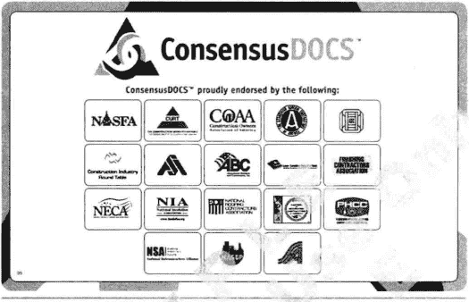

#### CONSENSUSDOCS 300

**协作项目交付三方协议  
标准格式**

本文件由代表建筑行业广泛领域的各方协作编制。认可本文件的组织认为，本文件体现了协作各方在风险与责任分配方面公平合理的共识，旨在适当平衡所有项目参与方的关键利益与关切。

这些认可组织确认并理解，本文件的使用者必须审阅并调整本文件，以满足其特定需求、项目具体要求及适用法律。鼓励使用者在修改或填写本文件之前咨询法律、保险和担保顾问。有关本文件及认可组织观点的更多信息，请参阅《ConsensusDOCS指南》。

#### 条款目录

- 1. 协议
- 2. 定义
- 3. 协作原则
- 4. 由管理组管理

**不得复制**  
**如需订购文件，请访问 WWW.CONSENSUSDOCS.ORG**

- 5. 业主提供的信息
- 6. 设计与协作预施工服务的开展
- 7. 项目规划与进度计划
- 8. 项目预算、成本建模与项目目标成本估算
- 9. 设计方报酬
- 10. 施工方报酬
- 11. 激励与风险分担
- 12. 专业承包商与分包商
- 13. 施工运营
- 14. 设计方施工阶段服务
- 15. 时间
- 16. 设计方报酬与付款
- 17. 工程成本
- 18. 付款
- 19. 审计权
- 20. 变更
- 21. 赔偿、保险与保函
- 22. 协议的中止、补救通知与终止
- 23. 争议解决
- 24. 其他事项
- 25. 合同文件

本协议具有重要的法律和保险后果。就其填写或修改，鼓励咨询律师以及保险和担保顾问。

#### 第1条

**协议**

**不得复制**  
**如需订购文件，请访问 WWW.CONSENSUSDOCS.ORG**

本协议于 _____ 年 _______________ 月 _______ 日，由**业主**（名称和地址）、**设计方**（名称和地址）与**施工方**（名称和地址）就以下**项目**（地址和简要项目说明）订立。

向各方发出的通知应发送至上述地址。

#### 第2条

**定义**

- **2.1** 本协议指本 CONSENSUSDOCS 300《协作项目交付协议标准格式》，经各方修改，以及签署时构成本协议组成部分的附件和附随文件。
- **2.2** 变更指令是本协议签署后经管理组批准的书面指令，用于说明工作范围、PTOE 或合同时间的变化，包括向管理组提出并获其接受的替代方案。
- **2.3** 协作项目交付团队（CPD）具有第3.3段所赋予的含义。
- **2.4** 施工预算是业主项目组成部分和施工服务的总成本。施工预算不包括设计预算以及构成整体项目目标成本估算的其他费用。
- **2.5** 施工进度计划是指明施工方计划开始和完成各部分工作的日期的文件，包括需要管理组提供信息和批准的日期。
- **2.6** 合同文件包括：
  - a. 变更指令及对本协议的书面修订，包括附件、附录和修订；
  - b. 本协议；
  - c. 管理组批准的最新文件；
  - d. 业主依据第5条提供的信息；
  - e. 本协议签署时已存在且在第25条中列明的合同文件；
  - f. 业主的《项目计划》。

  除本协议另有明确规定外，若合同文件之间存在任何不一致、冲突或歧义，应按上述列示顺序确定优先效力。在所有合同文件中，以最具体或包含最新日期的术语或条款为准。在某一份合同文件中标明而在另一份合同文件中未标明的信息，不应视为冲突或不一致。

- **2.7** 合同时间是指从开工日期到实质性竣工日期之间的期间。


## 附录 D

### 业主与承包商之间集成项目交付协议标准格式*

> *经美国建筑师协会许可复制，地址：西北纽约大道1735号，华盛顿特区，2006年。


### AIA® 文件 A295™—2008 说明

*集成项目交付合同通用条件*

#### 一般信息

**目的。** 集成项目交付是一种项目交付方法，它将人员、系统、业务结构和实践整合到一个过程中，通过协作利用所有参与者的才能和洞察力，在设计、制造和施工的所有阶段减少浪费并优化效率。AIA 文件 A295–2008 是一份通用条件表格，规定了业主、承包商和建筑师在采用集成项目交付的项目中共同工作的条款和条件，并且是该交付模式的基石。

A295–2008 将业主、建筑师和承包商的职责与服务整合到集成项目交付的每个阶段。A295–2008 描述了业主、承包商和建筑师在六个阶段中的服务与职责：概念化；标准设计；详细设计；实施文件；施工；收尾。在概念化、标准设计和详细设计阶段，建筑师与业主和承包商密切合作履行其设计服务。在设计阶段，承包商提供估算和其他咨询服务，例如可施工性审查，为建筑师的设计提供信息。在详细设计阶段结束时，业主和承包商协商保证最高价格，并确定 GMP 文件。此后，承包商须按照 GMP 文件建设项目。在确定保证最高价格后，A295–2008 为施工合同提供基本条款，明确界定业主、承包商和建筑师在实施文件、施工和收尾阶段的职责。

除了 A295–2008 以独特方式描述业主、建筑师和承包商的职责外，它还要求尽最大可行程度利用建筑信息模型。建筑信息模型是项目物理和功能特性的数字表示。建筑信息模型可以由单个模型或多个模型汇总使用组成。为了以最高效的方式利用建筑信息模型和项目上使用的任何其他数字信息，A295–2008 要求业主、建筑师和承包商开会并明确将使用的软件类型、所需标准和容差，以及所有此类数字信息的允许用途。此类确定应载于 AIA 表格 E201™–2007 或类似协议文件中，并通过引用并入项目所有服务或施工协议。

为了实现这种高度协作的过程，A295–2008 的条款通过引用并入业主-建筑师协议和业主-承包商协议。A295–2008 也应通过引用并入建筑师和承包商可能签订的任何顾问和分包商协议。结果是，各方为集成项目交付的主要和次要关系建立了共同基础。

**相关文件。** A295–2008 通过引用并入 B195™–2008《业主与建筑师之间集成项目交付协议标准格式》和 A195™–2008《业主与承包商之间集成项目交付协议标准格式》。当业主与建筑师之间的主协议采用 A295–2008，并且其依次被纳入建筑师-顾问协议 AIA 文件 C401™–2007 时，A295–2008 也可通过间接引用被建筑师-顾问协议采用。这种通过引用并入是有效的法律起草方法，如此并入的文件通常被解释为相应合同的一部分。根据 A295–2008 第 9.19.3 条，承包商必须要求每个分包商受 A295–2008 条款约束并向承包商承担承包商根据 A295–2008 向业主和建筑师承担的所有义务和责任。

GMP 文件，包括 A295–2008，记录了业主与承包商之间的施工合同。其他 GMP 文件包括 A195–2008、补充条件、图纸、规范和修改文件。尽管 AIA 不编制补充条件、图纸或规范的标准文件，但各种模型和指南文件可供使用，包括 AIA 的 MASTERSPEC 和 AIA 文件 A503™–2007《补充条件指南》。

如上所述并在下图中所示，A295–2008 是一份用于分配各方适当法律责任的重要文件。

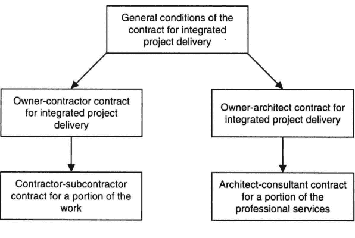

**争议解决——调解与仲裁。** 本文件包含索赔和争议的调解与仲裁条款。调解是一种非约束性程序，但根据本协议条款是强制性的。仲裁也根据本协议条款是强制性的。在大多数州以及根据《联邦仲裁法》，仲裁具有约束力。在少数州，涉及未来争议的仲裁条款不可执行，但当事人可在争议发生后同意仲裁。即使在这些州，在某些情况下（例如涉及州际商业的交易），仲裁条款也可能根据《联邦仲裁法》可执行。

AIA 不管理争议解决程序。要将争议提交调解或仲裁，或获取适用的调解或仲裁规则副本，请致电美国仲裁协会 (800) 778–7879，或访问其网站 www.adr.org。

**为何使用 AIA 合同文件。** AIA 合同文件是共识建立过程的产物，旨在平衡建筑项目所有各方的利益。这些文件反映实际行业实践，而非理论。它们是先进的法律文件，定期修订以跟上法律和行业的变化——然而，它们尽可能以日常语言编写。最后，AIA 合同文件具有灵活性：它们旨在修改以适应个别项目，但修改方式应易于与原始印刷语言区分。

**非 AIA 表格的使用。** 如果打算组合使用 AIA 文件和非 AIA 文件，必须特别小心以实现文件之间语言和意图的一致性。

**标准表格。** 自 1906 年以来出版的大多数 AIA 文件在其标题中都包含“标准表格”字样。“标准”一词并非意在暗示一套统一的合同要求对 AIA 成员或建筑行业其他方是强制性的。相反，AIA 标准文件旨在用作公平和平衡的基线，各方可在此基础上谈判交易。因此，这些文件已在建筑行业内获得普遍接受，并被法院统一解释。在一个横跨 50 个州的行业中——每个州都可自由采用不同、甚至可能相互矛盾的、影响该行业的法律——AIA 文件构成了一般一致的建筑法体系的基础。

**使用当前文件。** 在使用任何 AIA 合同文件之前，用户应查阅 www.aia.org 或当地 AIA 分支机构以核实最新版本。

**复制。** 本文件是受版权保护的作品，未经 AIA 明确书面许可，不得复制或摘录。不存在复制本文件的默示许可，美国建筑师协会的会员资格也不授予复制本文件的任何进一步权利。

本文件旨在作为消耗品使用——即所购买的原件将在使用过程中被消耗。


本文件不得为项目手册复制。如果用户希望将本文件的一个或多个样本纳入项目手册，通常做法是购买一定数量的预印表格，每本手册装订一份。

与许多其他AIA合同文件不同，AIA文件A295–2008不包含AIA明确书面许可复制该文件副本。AIA不允许在上述授予的有限复制许可之外进行复制，除非提出书面请求并收到AIA的书面许可。

复制该文件的权利可能因AIA软件用户而异。获得许可的AIA软件用户应查阅最终用户许可协议（EULA）。

举报AIA合同文件版权侵权，请发送电子邮件至美国建筑师协会法律顾问，copyright@aia.org。

### 使用 A295–2008

#### 修改

特别是关于专业或承包商许可法律、建筑规范、税费、货币和利息费用、仲裁、赔偿、格式和字体大小，AIA合同文件可能需要修改以符合州或当地法律。鼓励用户在完成或修改文件之前咨询律师。

在购买的纸质AIA合同文件中，必要修改可以通过在文件提供的空白处书写或键入适当条款，或通过附加补充条件、特殊条件或引用的修订来完成。直接对购买的纸质AIA合同文件进行修改也可以通过删除语言来实现。但是，进行此类删除时必须小心。

在任何情况下都不应划掉标准语言使其难以辨认。例如，用户不应使用遮挡胶带、修正液或完全遮盖文本的X标记。此类做法可能引起欺诈性隐瞒的怀疑，或表明已完成并签署的文件被篡改。双方应手写更改处签上姓名首字母。

使用AIA软件，可以在软件允许的范围内进行插入信息和修订标准AIA文本的修改。

通过审查对标准AIA合同文件进行的适当修改，熟悉该文件的各方可以快速理解拟议关系的实质。商业交流大大简化和加快，鼓励诚信交易，并且原本潜在的条款暴露出来接受审查。

AIA合同文件不得重新打字或电子扫描。重新打字可能引入排版错误，并模糊对标准条款的法律解释。此外，根据用户使用该文件的有限许可，不允许重新打字和电子扫描，构成创建衍生作品并违反AIA的版权。

### 封面页

- **项目：** 项目应使用与业主-建筑师协议和业主-承包商协议中规定的相同名称和位置或地址进行标识。
- **业主：** 业主应使用与业主-建筑师协议和业主-承包商协议中规定的相同法定名称和地址进行标识。
- **建筑师：** 同样，建筑师应使用与业主-建筑师协议和业主-承包商协议中规定的相同法定名称和地址进行标识。
- **承包商：** 同样，承包商应使用与业主-建筑师协议和业主-承包商协议中规定的相同法定名称和地址进行标识。

### 第1条 一般规定

#### § 1.2 初始信息

初始信息在第1.2节中提供。各方应注意尽可能明确和详细地说明相关初始信息。

### 第5条 概念化阶段

在概念化阶段，建筑师和承包商与业主会面，并对业主的计划和预算要求提供初步评估。建筑师提供服务进度表，承包商准备项目进度表，并在整个项目期间定期更新。

### 第6条 准则设计阶段

在准则设计阶段，建筑师与承包商协商，为业主的

## 附录 E

### 风险施工经理合同

州建设档案编号

本协议于（月）（年）____日就（项目名称）签订，缔约方为：________和__________（以下简称：风险施工经理），以及北卡罗来纳州，由其下列北卡罗来纳大学组成机构代表：（以下简称：业主）

#### 鉴于

鉴于业主已发布征求建议书，寻求提交竞争性建议，以担任风险施工经理，在该征求建议书所确定和描述的项目设计和施工期间提供专业施工管理服务；并且，

鉴于下列签署的施工经理提交了经业主评估的竞争性建议；并且，

鉴于业主通过其授标机构已将工作授予下列签署的施工经理，并且根据征求建议书的条款，应签署本表格以形成并记录双方之间的合同关系；

因此，施工经理和业主约定如下：

- 1. 本合同的格式特此应纳入并随附：业主的授标推荐信（日期）、业主的征求建议书（日期）、承包商（风险施工经理）对建议书的响应（日期）、业主批准的承包商HUB计划（日期）、设计师的图纸和规格清单（日期）、承包商的付款和履约保证金（日期）、授权委托书、保险证书（日期）、包含工程费用和一般条件价值表的GMP声明（日期），并通过引用纳入日期为（合同日期）的施工前服务合同。
- 2. 对于施工经理费用建议书（或任何随后修订的费用协议）中规定的金额，施工经理承诺作为业主的受托人（G.S. 143-128.1）行事，并在项目设计和施工期间提供专业施工管理服务。
- 3. 提供施工经理的服务应符合RFP（包括其所有附录和附件）和施工经理建议书（以下合称：合同文件）的要求。如果施工经理建议书中的任何条款、要求或规范与RFP冲突，应以RFP的条款、要求和规范为准，施工经理建议书中的冲突内容应视为多余，除非另有规定。
- 4. 施工经理应在业主书面命令中指定的日期开始提供本协议项下的施工阶段服务，并应在收到开工通知之日起____个连续日历天内完全完成本协议项下所有服务并实现项目的最终竣工。施工经理应向业主提供合同文件中规定的各种进度表，按工程的各个分部或部分以及日历天数列出项目的计划进度。如果施工经理未在指定时间内开始合同项下的工作，或工作进度未按计划保持，或工作未在上述时间内完成，或允许工作以不适当的方式进行，或停止继续实施工作，或施工经理资不抵债，或被宣布破产，或实施任何破产或资不抵债行为，或允许任何终审判决对其不利且未履行达四十八（48）小时，或为债权人利益作出转让，或出于任何其他原因


若其无论何种原因未能以可接受的方式继续施工，业主可通过认证邮件（要求回执）向施工经理及其保证人发出书面通知，说明该等延误、疏忽或违约；如果施工经理在收到该通知后十五（15）日内未按通知要求继续履约，则业主应宣布本合同违约，随后保证人应迅速接管工程，并按指定方式和时间期限完成本合同的履行。如果保证人在收到该通知后十五（15）日内未能接管本合同项下待完成的工程，且未以书面形式（通过认证邮件寄送并要求回执）通知业主其正在接管该工程并声明将勤勉推进并完成该工程，则业主应有充分权力和授权，在不违反合同的情况下，从该施工经理手中接管工程施工，征用或使用现场任何或全部合同材料和设备（只要合适且可接受），并可签订协议（通过公开招标或协商），以按照本合同条款和规定完成该合同，或采用其认为以可接受方式完成该合同所需的其它方法。业主发生的一切成本和费用，连同完成合同项下工程的成本，应从应付或可能应付给该施工经理和保证人的任何款项中扣除。如果业主如此发生的费用少于若由该施工经理完成合同本应支付的金额，则该施工经理和保证人有权收取差额；但如果该费用超过合同本应支付的金额，则施工经理和保证人应承担责任，并向业主支付该超出金额。

- **5.** 双方进一步共同约定，如果在本协议及其为忠实履约而随附的保证债券签署后的任何时间，第二方认为该等债券上的保证人或各保证人不令人满意，或者如果由于任何原因，该等债券不再足以覆盖工程履约，则第一方应自费在收到第二方要求其如此做的通知后五（5）日内，提供一份或多份补充债券，其格式、金额及保证人须令第二方满意。在此情况下，不再向第一方支付

## 术语表

- **承兑** 由债务人在其上以“已承兑”字样表示其付款或兑付意愿的汇票。

- **确认书** 供应商或供货方用于告知已收到采购订单的标准表格。

- **天灾** 超出人力控制范围的危险；由不可抗拒的物理原因造成的任何事故，如飓风、洪水、地震或闪电。与过失绝无关联。

- **实际重量** 运输或装运的总重量（毛重）。

- **补遗** 用于在接收投标书之前修改招标文件的文件。补遗并入正式合同。

- **从价** 计征关税税率所依据的货物或材料总价值。

- **招标广告** 业主发布的公告，表明其打算将建筑工程合同授予按照业主投标人须知提交可接受投标书的承包商。通常以新闻媒体（例如报纸、杂志）的便捷形式发布，以吸引愿意编制并提交项目完成投标书的承包商。

- **装运通知** 卖方向买方发送的通知，告知货物已发运；通常包含包装、运输路线、交货日期等细节。

- **代理** 指两方之间的一种关系，其中一方被授权为另一方履行某些职能或业务交易。

- **代理人** 代理人经委托人授权，代表委托人并为其利益行事。代理人的行为通常约束委托人，如同委托人亲自行为一样。

- **合并装运** 来自不同供应来源、发往单一采购组织的不定数量货物，经合并后视为单一批次货物。

- **工匠留置权** 技工或其他熟练工人就其已投入劳动或材料的物品享有的留置权，赋予其占有该物品直至最终付款的权利。

- **竣工图** 施工期间编制的记录图纸。竣工图记录隐蔽项目的位置、尺寸和性质，如结构构件、附件、固定装置、设备、阀门和机械设备。这些记录图纸构成建筑物或设施竣工状况的永久记录。

- **按现状** 表示所出售的材料和设备无保证或担保。买方不得就材料设备质量向卖方或供货方追索。

- **转让** 将权利或所有权转移给另一方，通常涉及源自合同的权利。

- **欠交订单** 订单中无法在预定日期交付、但将在稍后日期交付的部分。

- **银行承兑汇票** 用于为外贸交易融资的文件或汇票，使向出口商支付现金成为可能，覆盖出口商所发货物的全部或部分款项。

- **议价** 就采购条款和条件达成一致；以对买方有利的价格购买物品。

- **易货** 以一种物品交换另一种物品的过程，与使用货币进行交易相对。

- **投标** 为实施工程或供应货物/服务而提交的完整且妥善执行的建议书，该工程或货物/服务已通过口头或招标文件描述，并按照投标人须知提交。投标是一项要约。

- **投标保函** 投标人购买的一种投标担保；提供该担保并可能被没收，以保证投标人将在指定期限内与业主签订设施施工合同。

- **招标文件** 通常包括招标广告或投标邀请、投标人须知、投标书格式、合同格式、保函格式、合同条件、规范、图纸，以及完整描述工程所需任何其他信息，以便投标人编制投标书供业主考虑。

- **开标** 在指定地点和时间举行的正式会议，会上开启密封投标书、制表、宣读并供公众查阅。

- **运费单** 承运人用来显示收货人、发货人、货物说明、重量、运费及其他相关信息的单据。

- **汇票** 用于结算和支付现有义务的正式书面文件。

- **提单** 运输公司就材料和设备出具的合同和收据；同意从一地点运输至另一地点并交付给指定个人或当事方。

- **材料清单** 建筑项目所需所有永久材料的清单。材料清单由图纸和规范中描述的所有项目组成。

- **暂保单** 保险公司作出的临时但具有约束力的承保承诺。

- **总括订单** 规定供应商或供货方在特定期间内以预定价格供应特定材料；作为总采购订单，减少较小采购订单的数量。

- **标准条款** 用于描述采购订单背面的条款和条件或合同中所述特定条款的术语。

- **保税仓库** 受美国财政部监管、以确保遵守税收和消费税法律的仓库。

- **履约保函** 与合同相关而取得的保函；确保履行并完成合同所包含的全部范围、条款、条件和协议。

- **保函** 由保险公司以委托人名义向权利人出具的正式文件，用于担保特定义务。在建筑行业中，主要保函类型为投标保函、履约保函和付款保函。

- **违约** 未能履行合同条款和条件中规定的任何义务。

- **大宗材料** 按批次购买的材料；根据通用描述或标准目录描述采购，并以中大批量购入，以便按需发放。例如管件、导管、电缆、木材和石材。

- **变更通告** 合同签发后用于请求对设计修改进行报价的文件。如果报价可接受，则合同变更令将通告要求纳入项目。

- **间接费用** 在建筑中，指运营总部或现场办公室（其人员非现场作业人员）的成本。也指联邦、州和地方税、附加福利及其他工会合同义务。在制造业务中，该术语通常指运营间接成本。

- **订单取消** 订单的废止或终止。


## 术语表（续）

- **集装箱化** 使用公路和海运运输集装箱，通常长度为20或40英尺。通过铁路、航空、卡车或水路运输大型密封货运集装箱，以优化运输时间、安全性、包装和周转时间。
- **合同** 两个或多个有缔约能力的当事方之间达成的、可依法强制执行的书面或口头协议，约定履行某一特定行为或多项行为。
- **合同管理** 管理合同和采购订单，以保护特定组织的利益，并满足合同和/或采购订单的条件与要求。
- **合同文件** 用于指一组相关文件的术语（合同、规范、图纸及任何补充数据），这些文件界定两个或多个当事方之间协议的范围。
- **成本加成** 一种合同或定价方法，其中买方同意向供应商支付由供应商为提供所购材料、设备或服务而发生的实际成本确定的金额，再加上该成本的一个固定百分比或一笔固定金额作为利润。
- **还盘** 通过提交与原始报价条件或条款不同的新报价来拒绝一项报价。
- **损害索赔** 就材料和设备损坏而提交的正式索赔文件。
- **损害赔偿金** 对因另一方过错或由另一方造成材料与设备、人员或财产损害而支付的补偿或付款。
- **《戴维斯-培根法案》** 美国国会于20世纪30年代通过成为法律的一项法案。该法案规定，与联邦政府签订合同的承包商和分包商所雇用的工人，其工资和附加福利不得低于各行业当地普遍工资率。
- **借记通知** 用于冲抵先前多付款项的发票，显示先前发票与正确金额之间的差额。
- **可交付成果** 为履行合同义务而必须交付的产品或报告。
- **交付承运人** 将材料和设备运输并交付给买方的承运人。
- **交付** 转移占有的行为；用于运输时，指货物被交出，且所有权、材料和设备转移给收货方时发生。
- **滞期费** 对由发货人或收货人持有或为其持有的铁路货车、车辆或船舶，因等待后续装货或卸货而收取的费用。
- **详细规范** 对特定项目、材料或设备要求的描述。
- **折扣** 卖方给予买方的折让或减让，在买方满足某些条件（例如在约定期限内及时付款）时降低所购物品的成本。
- **配送** 针对成品材料和设备从生产线末端到最终用户或消费者高效流动的一系列广泛活动。
- **装卸月台** 工业设施或工厂的装货或卸货坡道或平台。
- **汇票** 指示一个人向另一个人付款的法律文件。
- **到期日** 所购材料和设备可在项目现场供安装使用的日期。
- **垫舱物料** 在运输过程中用于材料或设备周围以防止移动、损坏或破损的保护性材料。
- **耐用品** 在数年内重复使用的消费产品（例如家用电器、车辆）。
- **关税** 政府对进口或出口的材料和设备征收的费用。由法律或合同确立的义务并不形式化。
- **定金** 一方在订立合同时交给另一方以“敲定交易”的款项。如果合同未正式订立，定金可能被没收。
- **错误与遗漏除外** 印在发票或其他对账单上，以保障开立人在发现金额有误时更正或修改该金额的权利。
- **价格上调** 价格上调条款（见下文）所允许的调整值。为预期因长期持续的价格通胀导致的设备、材料和人工成本增加而预留的金额。
- **价格上调条款** 规定根据特定变化进行价格调整的合同条款。
- **Ex（工厂交货、出厂交货、仓库交货、码头交货）** 用于表示原产地的前缀。当卖方报出 Ex 价格时，卖方仅表示在原产地 Ex 点提供材料和设备，且报价中不包含任何运输费用。
- **超量运费** 超出原始货运承运人账单所示金额的运费。
- **交换提单** 为交换另一份提单而编制并用于交换的提单。
- **消费税** 对在本国制造、销售或使用的某些物品征收的税。
- **出口** 将材料或设备运往外国。
- **出口许可证** 出口国政府签发的许可证，允许该国境内一方向另一国出口材料和设备。
- **加工制作** 与最终安装作业相对的材料或设备制造作业。
- **便利化** 通过采用最新海关方法、关税和税费征收以及国际运输活动的其他相关职能，缩短国际货物运输时间的系统。
- **佣金商** 按佣金为委托人销售货物或材料的代理人。
- **公平市场价值** 由买卖双方协商确定的一件物品的价值；被认为可作为该特定物品买卖的基础。
- **FAS（船边交货）** 当卖方报 FAS 价格时，该价格包括将货物运输并交付至远洋船舶船边、且在船舶装载设备可及范围内的成本。该价格不包括任何出口许可证费用，也不包括任何出口关税或税费的支付。
- **现场检验** 在交付后不久对设备和材料进行的全面检查，以确定其是否符合规范要求并发现任何隐藏缺陷或损坏。
- **现场采购订单** 用于现场施工情形中的采购订单；在此类情形中，进行相关类型采购的权限通常受到限制，或具有预先确定的不超过限额。
- **现场需求日期** 为维持项目进度而要求某材料或设备交付到施工现场的日期。
- **FIFO（先进先出法）** 一种会计程序，基于对存货或库存“先进先出”的处理；最早收到的物品最先使用。与此相反的程序是 LIFO（后进先出法）。
- **实盘** 按所述条款和条件购买或出售某种物品的确定提议或报价。此类报价使报价人在规定期限内受约束。
- **FOB（船上交货）** 表示卖方支付至指定交货地点的运输费用。例如，承包商的采购订单常将交货规定为“F.O.B. 施工现场”或“F.O.B. 堆场”。如果采购订单规定卖方支付至指定地点的交货费用，则物品所有权在物品交付至该地点之前不发生转移。根据 F.O.B. 协议，当承运人将物品交付至规定地点时，所有权转移给买方。
- **F.O.B. 目的地，运费预付** 用于指所有权转移给买方且运费由卖方支付的术语。
- **F.O.B. 工厂交货，运费由卖方承担** 工厂船上交货，自原产地预付运费。
- **F.O.B. 原产地，运费到付** 用于指所有权转移给买方的术语。买方支付运费，拥有运输中的货物，并就运输途中的任何灭失或损坏提出所有索赔。
- **F.O.B. 原产地，运费预付并收取** 用于指所有权转移给买方的术语。运费由卖方支付，然后通过将运费金额加入发票向买方收取。
- **F.O.B. 装运点** 物品所有权从卖方转移给买方的地点。卖方负责运输费用以及货物在所有权转移给买方之前的灭失或损坏风险。所有权转移后，买方负责此类费用和风险。
- **跟进记录** 用于向供应商和供货商催货和交付的信息。
- **F.O.R.（铁路交货）** 铁路交货。
- **不可抗力** 超出个人控制范围的情形；可援引作为未能履行合同或采购订单的抗辩理由。
- **远期采购** 购买超过即时需求量的数量，即预期出现任何显著价格上涨或市场短缺而进行的采购。
- **F.O.T.（卡车交货）** 卡车交货。
- **货运代理** 一些货运代理组织作为发货人的代理人，负责组织物品运输而不实际经手任何物品。另一些则作为货运承运人，整合中小型货物并将其交付给买方。
- **通用条件** 规定业主和承包商许多权利、责任、义务和权限限制的指南，并包括管辖工程实施的一般程序。当按照建筑规范协会主格式（Master Format）组织时，这些条件在16个分部中加以说明。
- **总承包商** 与项目业主有直接关系的施工组织，也称为主承包商。


### 一般责任保险

一种承保范围较广的责任保险，承保人身伤害和财产损失索赔。

### 通用

用于概括描述一组、一类或一级材料和设备的术语，而非指明具体商品名称或制造来源。

### 收货单

在接收点对全部设备和材料进行审核并核对数量后，详细列明这些设备和材料的单据。

### 长吨（英吨）

2,240 磅的重量。

### 毛重

一批货物的总重量，包括集装箱、包装及其他杂项材料。

### 担保

作为保证而作出的承诺、誓约或正式保证，即他人的义务或债务将得到履行。

### 保证最高成本合同

一种施工合同，其中承包商或分包商的报酬表述为实际发生成本加一笔费用，并由承包商或分包商保证总报酬限定于某一特定金额。

### 超重吊装费

运输机构对吊装重量过大的材料和设备所收取的费用。

### 套期保值

一种未来交货销售方法，各方借此保护自身免受潜在损失。

### 货舱

船上甲板下的货物储存空间；飞机的货舱。

### 暂缓交货指令

采购方发出的指令，要求将某一特定交货在指定地点保留一段特定时间。

### 暂存区

库存或仓库中预留用于存放半成品/半完工物品的区域。

### 英担

100 磅的重量；“cwt”。

### 默示合同

当各方通过其行为表示同意受合同条件和条款约束时形成的合同。该协议无需明示声明即可推断和理解。

### 补偿保障

一方依合同承担或依法承担的义务，旨在保护另一方免受特定责任造成的任何损失或损害。

### 赔偿

一人对另一人所遭受损失或损害予以弥补的责任。对发生的损害、损失或费用所作的付款。

### 间接材料

用于制造产品但不构成或不属于成品组成部分的一组材料。

### 禁令

法院发出的正式命令，责令某人或某团体实施或不得实施某项活动。

### 内陆提单

用于将材料和设备经陆路运至出口商国际运输承运人的提单。在某些情况下可使用联运提单；但对外出口材料和设备时，通常需要同时准备内陆提单和海运提单。

### 内陆承运人

在海港与内陆地点之间运输进出口材料和设备的运输机构。

### 询价

就施工相关事项的进度、地点、可用性、意向、成本或数量请求提供信息。

### 检验

对材料和设备进行检查、审核、测量和测试，必要时包括原材料、制作构件、组件、中间装配件、子装配件和最终产品，以确定材料、设备和服务是否符合合同规范要求。该活动可通过目视检查或使用专用设备完成。

### 检验计划

规定需要检验的材料或设备，并说明实施测试或检验的方法和顺序的程序。

### 检验报告

向采购方告知所交付材料和设备项目的质量与工艺水平的报告。

### 检验员

受组织聘用、负责检查和审核施工相关设备和材料制作、制造及安装的合格检验员。

### 投标人须知

属于投标要求一部分的文件，通常由设计专业人员、建筑师或工程师编制。投标人须知向潜在承包商说明程序、业主的要求以及编制和提交投标文件供业主审议和评审所需的其他必要信息。

### 保险

一种通常称为保险单的合同，其中保险人以收取保费为对价，同意赔偿被保险人在执行特定项目（例如建造建筑物或设施）期间所遭受的任何损失或损害。

### 保险凭证

由承包商、分包商或供应商提供的文件，说明与特定合同相关的保险承保范围。

### 库存

存放在储藏室或仓库中的材料和设备项目，或由原材料、制作构件、组件、中间材料和设备的零件以及可供分销和销售的成品材料和设备组成的在制品。

实地盘存通过实际清点确定。它包括实际可供分配和分销，并在仓库或外部堆放区储存和控制的材料和设备。

### 招标邀请

业主希望就特定施工项目接收竞争性投标的书面通知，其中邀请选定数量的承包商提交该项目的施工投标。

### 发票

卖方向采购方开具的、已交付材料、设备和/或服务的逐项数量与价格账单。

### ITC

投资税收抵免。

### JIT（准时制）

一种通过制造流程规划和调度制作、优化材料和设备采购与储存并消除任何在手库存或存货的系统。

### 单一批次

在某一特定时间生产的一小批特定材料或设备项目。

### 按批次订货

根据客户规格购买制造所需的必要材料、设备和组件。

### 共同代理人

被指定代表两个或多个委托人行事的正式代理人。

### 合资企业

两方或多方为达成特定目标而联合组建、具有合伙法律特征的企业经营组织。

### 熟练工

已完成学徒期的合格工人。

### 判决

法院在诉讼过程中作出的裁决。

### KD（拆散/散件）

为减少体积而拆散或分解。

### 关键活动

被认为具有重大意义的活动，有时称为里程碑事件。

### 配套发运

将完整装配的组件以配套形式发送至另一地点进行装配的过程。

### 劳务与材料付款保证书

承包商与保证人之间的合同，其中保证人根据承包商支付的保费，同意在承包商拖欠分包商、供应商和材料供应商款项时，向其偿付到期应付的材料和服务款项。

### 装载

装载行为，或某一特定装运货物的内容。

### 堆放区

通常无顶棚的一块场地，用于材料和设备的交付与储存。

### L&D（损失与损坏）

损失与损坏。

### 提前期

完成某项特定工作活动所需的时间。

### 租赁

个人或组织让他人在一定期限内、按约定租金使用财产或设备的合同。出租人保留该财产或设备的所有权。

### 法定货币

政府发行用于清偿债务或义务的货币。

### 信用证

银行致往来银行的信函，证明其中列名的个人或组织有权从某一账户支取款项。

### 责任

处于义务约束之下的状态；面临潜在索赔的风险，即个人或组织可能须就对他方个人或组织造成的损失、损害或其他行为支付赔偿。

### 留置权

对他人资产或财产的法律索赔权。

### LIFO（后进先出）

一种确定制成品或工艺中所用库存存货成本的会计方法（与 FIFO 相反）。

### 违约金

合同各方约定的、在未能履行合同义务时给付的损害赔偿金额。

### 诉讼

参与诉讼；各方将其争议提交联邦或州法院管辖以求解决的过程。

### 负荷系数

适用于实体工厂或设备利用率的比率；已利用平均负荷与可供使用最大负荷的比率或百分比。

### 物流

运输与供应的科学；在市场上获取和分销成品的技艺。

### 长吨

2,240 磅，与英吨相同。

### 批量

向供应商订购的特定材料和设备项目的数量。

### LTL（零担）

少于整车装载。

### 总价

用于建议书、投标或合同中的金额或价值，表示组织准备签约完成某项工作的总成本。

### 舱单

船舶、卡车、集装箱等所装载货物的清单；在远洋运输中称为船舶舱单。


**可转让产权** 一种不存在法律可靠性或有效性不确定性的产权。

**营销研究** 系统收集、记录和分析与材料和服务营销相关任务和活动的数据与情报。

**加成** 可加到所有直接成本总额上以确定最终价格或合同金额的百分比。使承包商或分包商能够收回与间接费用相关的成本。

**材料** 用于制成成品的基本元素、零件或半加工组件。

**材料成本** 施工过程或设施运行所必需的所有项目的成本，包括直接和间接相关成本。

**材料商** 用于描述承包商可从中获得建筑材料的个人的术语。材料商可以是制造商的销售代表、代理商或分销商；材料和设备的销售人员也可视为材料商。

**材料管理** 一种概念，将所有材料和设备采购职能合并到一个管理职能之下，包括合同、采购、质量保证、质量控制、检验与催交、运输和收货。

**材料状态** 详细说明材料当前可用性的报告。

**材料测试报告** 通常称为认证材料测试报告或轧钢厂测试报告的报告。通常描述实际测试结果，详细说明化学分析、材料成分测试以及测试中使用的程序。

**MC** 最低收费。

**技工留置权** 由个人或组织提交的一种留置权，该个人或组织已完成工作但付款存在争议或仍未支付。

**最低整车重量** 整车材料和设备可被计费的最低重量。

**混装卡车费率** 适用于由两种或多种不同材料组成的卡车装运的费率。

**修改** 用于表示可能对合同文件和施工合同作出的变更的术语。合同授予前作出的修改称为附录；合同签订后作出的修改称为变更令。

**多收货人** 装载供两个或多个收货人的材料和设备的集装箱车、卡车或船舶。

**多源采购** 装载供两个或多个收货人的材料和设备的集装箱车、卡车或船舶。

**需求日期** 特定物品在施工现场所需的日期。

**过失** 在法律上，未能行使谨慎的人会行使的注意和考虑；缺乏注意和关注。

**谈判** 买方和卖方就采购材料、设备、货物或服务的条款和条件达成协议的过程。

**净价** 从原始销售价格中扣除所有允许的折扣、回扣等后得到的价格。

**净吨** 2,000磅。

**净重** 不包括运输容器和垫料的材料和设备重量。

**公证人** 被授权主持宣誓、录取证言并认证契约和合同的公职人员。

**OBL** 海运提单。

**义务** 由承诺或合同产生的责任；个人或组织有责任履行的协议。

**过时的** 过时、磨损、废弃或不再使用的。

**要约** 个人或组织向另一人提出的履行服务或行动的提议或投标；接受此类要约即形成合同。发出要约的个人或组织称为要约人，接受要约的个人或组织称为受要约人。投标或提议就是要约的一个例子。

**公开竞争性招标选择** 一种承包商选择过程，其中在报纸和行业杂志上向投标人发布广告，通知承包商业主打算接收并考虑施工合同的密封竞争性投标。通常最低的符合要求且负责任的投标将中标。

**开放式订单** 根据买方的采购订单或合同进行的采购。采购订单或合同包含价格、条件和条款。采购订单或合同可能不规定最终采购数量。

**订单提前期** 一旦采购订单要求已知，从供应商处获得物品所需的时间。

**OS&D** （溢短残损报告）显示收到材料差异及损坏评估的报告或日志。

**间接费用** 企业经营中固有的成本。不能计入工作、材料或设备特定部分的成本。

**业主** 拥有建筑物或设施产权的个人、团体或组织。

**装箱单** 由托运人编制的文件或日志，详细说明特定包装内容。

**部分付款** 交付一个或多个已完成单元时支付的分阶段付款。

**专利** 政府授予发明人的权利，使他在一定年限内是唯一被允许制造或销售该新发明的人。

**付款保证** 承包商从保证人处购买的一种担保形式；保证承包商将支付与施工相关的所有人工、材料和其他服务费用。

**罚款条款** 合同中的条款，规定在不履行合同条款和条件时没收的金额。

**履约保证** 承包商从保证人处购买的一种担保形式；保证承包商将令人满意地完成与施工项目相关的所有工作。

**实物配送** 与材料和设备从制造商到最终用户的运输和移动相关的活动。

**驮背运输** 由大型车辆运载通常单独运输的任何物品。在特别装备的铁路平车上运输公路拖车或集装箱。

**承诺** 以承诺约束。

**起运地点** 装运的实际起始地点。

**入境口岸** 政府指定为来自海外国家的材料、设备和服务入境点的口岸。

**总承包商** 总承包商直接为项目业主工作以建设和协调项目。在某些领域，例如重公路，总承包商自行完成很大一部分施工项目。在其他领域，总承包商的作用与一般承包商一致。

**预制** 一种制造或装配技术，通常在施工现场以外的地点进行，将各种材料和设备组合成更大的组成部分，以便在施工地点最终安装。

**采购** 通过购买方式获取物品、土地、财产或服务的相关活动。

**采购提前期** 买方选择并与供应商谈判并下达采购订单所需的时间。

**本票** 一个个人或组织无条件向另一个个人或组织在指定时间支付一定金额（本金和利息）的书面承诺或保证。

**购买** 用钱获得物品；以特定金额的钱或其等价物获得的东西。

**采购订单** 买方和卖方之间订立的书面合同，描述所购物品、物品价格和交付方式。

**采购申请** 需要特定物品的个人或团体向采购部门发出的书面请求。

**采购** 购买符合正确质量、正确数量、市场价格并按承诺交付日期交付的材料、设备和服务的行为。

**采购周期** 获取材料、设备和服务的活动。

**采购手册** 解释采购人员在工作活动中应遵循的政策和程序的操作指南。

**质量** 使材料和设备能够以期望方式发挥功能的基本属性。

**质量保证** 确保材料和设备安装后能令人满意地运行的正式程序。

**质量控制** 确保施工过程中使用的材料和设备保持足够质量的程序和活动。

**量化** 根据一套图纸和规范列出的材料和设备实际数量清单。

**数量** 所需设备或材料单位的数量。

**数量折扣** 由预定最低数量确定的单位价格成本降低。

**准合同** 一种义务，根据该义务，获得利益的个人或组织必须向给予利益的个人或组织付款，即使没有合同。

**报价** 承包商或供应商向潜在买方提供的材料、设备或服务的价格、销售条款和一般描述的摘要。当应采购询价发出时，它被视为销售要约。


- **报价失效日期**：报价在此日期之后不再有效的日期。
- **询价请求**：采购方邀请潜在供应商或供货商就一份物品清单进行投标。
- **汇率**：一国货币兑换另一国货币的比率。
- **反应式催交**：主要依靠电话联系进行的一种催交方式；对发生的情况和问题作出反应。
- **返利**：在规定期限内购买约定数量或价值后向采购方退还的金额。
- **收货检验**：验收前对材料和设备进行的审计和检查；审查交付是否完整并记录任何明显损坏。
- **投标接收**：业主接收按照其授予施工合同意向而邀请或公告的密封投标的行为。
- **收货**：在指定地点接收和交付物品。
- **收货与仓储**：处理来自供应商和供货商的材料与设备的行为，包括维护和控制仓储中的所有物品，以及材料和设备的最终分发。
- **收货报告**：组织收货部门用于记录所收到材料和设备以及（如有）与采购订单所示数量差异的表格或日志。
- **追索权**：买方或卖方可用于使卖方或买方圆满遵守合同条款的程序。
- **修理**：修补或使其处于良好状态。将不合格材料或设备项恢复到能够执行其预期功能的过程。
- **投标请求**：采购方要求供应商提交报价或建议书，以供采购方考虑、接受或拒绝的请求。
- **要求**：需执行的全部工作范围，包括规范、图纸和工作成本。
- **请购单**：个人或部门发送给采购部门、请求材料、设备或其他服务的内部表格。
- **保留金**：从承包商处扣留的百分比或金额，在合同圆满完成时支付。
- **审查**：为确定可接受性和合同要求符合性而对任何形式的数据、文件或图纸进行的检查。
- **返工**：通过修理或修改使不合格要素符合既定需求的过程。
- **RFQ**（报价请求）：为明确的工作范围征集投标或建议书的过程。
- **路线规划**：确定将材料和设备运输至施工现场所使用各条道路。
- **销售价格**：售出物品所获得的价值。总销售价格是支付的总价值。净销售额是总价值减去折扣、返利和运费。
- **销售代表**：代表供应商或供货商、熟悉买方可能考虑采购的产品的个人。
- **销售收入**：因销售交易而收到的资金。
- **销售税**：对材料、设备或服务的销售征收的税；按购买价格百分比计算。各州使用不同百分比。
- **回收物资**：在损坏或拆除完成后保存下来的材料或设备。
- **残值**：物品或设施被拆除、报废或出售时回收或实现的价值。
- **样品**：已完成的材料、产品、设备或工艺的实例，用于建立评估已安装工作的标准。
- **范围**：界定将要执行和完成的工作；通常在合同中记录和描述。
- **范围变更**：与合同中约定的原始项目工作范围的偏离。范围变更可以是添加到原始工作范围或从中删除的活动。
- **卖方留置权**：卖方扣留或对已售材料或设备主张权利的权利，在收到付款后放弃这些权利。
- **加工详图**：承包商、分包商、供货商或制造商编制的各种图纸，说明特定要素纳入施工项目的施工、材料、尺寸和安装数据。
- **工厂预制**：在供货商或制造商车间内对部件或要素进行制造装配。
- **供应商绩效评估**：基于工作质量、规范符合性、交付和成本对供应商和供货商绩效进行排名和评估。
- **供应商留置权**：卖方在收到付款前保留材料或设备占有的权利。
- **验证**：见证制造和加工过程中的某些步骤，如冶金分析、静水压和性能或运行测试。审查和审计无损检测、X射线和台架试验。
- **容积吨**：100立方英尺的体积。
- **替代责任**：对另一个个人或组织未能采取行动的结果承担责任的个人或组织。
- **目视检查**：对材料和设备进行人工检查。
- **VNX** 价值不超过。
- **批量折扣**：基于特定采购规模而降低的单位成本。
- **放弃**：放弃一项权利或索赔；不再主张或施压。
- **仓库**：用于接收、储存和最终分发材料与设备的设施。
- **仓单**：仓库管理员出具的、作为材料和设备存入仓库的收据的文件。
- **保证**：对某物如其声称那样的承诺或保证。卖方对货物的性质、质量和特性作出具体保证。
- **废料**：制造和加工过程中无法回收或再利用的废弃物。
- **运单**：在货物发运地编制的文件，载明发运地、最终目的地、路线、采购方、卖方、货物描述和运输费用。
- **毛重**：物品、容器或任何垫料材料的实际合计重量。
- **净重**：物品的实际重量；不包括容器或任何垫料材料。
- **皮重**：运输中物品毛重与净重之间的差额；空容器重量，包括运输中使用的垫料包装材料。
- **批发商**：为转售给零售商或其他用户而采购产品、材料和设备的个人或组织。
- **工伤保险**：要求雇主投保的保险，为工伤事故造成的伤害和工资损失提供补偿。
- **在制品**：处于各种制造或完工状态的材料或设备。
- **工单**：描述待完成活动的书面表格。

## Index

### A

- 验收，209
- 确认，209
- （资本设备）采购流程，104
- 不可抗力，209
- 实际重量，209
- 从价，209
- 补遗，209
- 胶粘剂，48
- 广告，45，209
- 装运通知，209
- 平权行动认证，151
- 平权行动计划，79
- AGC（见美国总承包商协会）
- 代理机构，209
- 代理人，209
- 合并装运，209
- 协议：
  - 合同性，132–138
  - 定义，210
  - 标准，42
- AIA（见美国建筑师学会）
- AIA 文件 A195™–2008，197–203
- AIA 文件 A295–2008，138
- AIA 文件 A401–2007（集成项目交付合同通用条件说明），42
- 空运，210
- 航空运单，210
- 航空运单，210
- 一切险，210
- 战略联盟，16
- 备抵，210
- 美国建筑师学会（AIA），9，133–134，136–138
- 《美国复苏与再投资法案》，155–156
- 摊销，210
- 分析知识，1
- 年度审查期，56
- 反垄断违规，53
- 付款申请，210
- 批准，210
- 仲裁，210
- 建筑师，5–6，9，12，133–134，156–158，210
- ARR（见平均收益率）
- 到达日期，210
- 到货通知，210
- 工匠留置权，211
- 按现状，211
- 竣工图，211
- 沥青，63
- 转让，211
- 美国总承包商协会（AGC），9，66，133
- 风险型合同，施工经理，205–208
- 态度调整，11
- 态度障碍，21
- 审计，119
- 平均收益率（ARR），109–110

### B

- 延期交货，211
- 反铲挖掘机，124
- 银行承兑汇票，211
- 破产：
  - 风险，8
  - 美国汽车制造商，14
- 谈判，93–95，135，211
- 易货，211
- 标杆管理，67


- 投标，定义，211
- 投标保证金，211
- 开标，211
- 投标文件包：
  - 组成部分，83–85
  - 制定，159–160
  - 评估，86
  - 准备，80–83
  - 样本表格，173–190
- 招标，45, 47, 131–132, 148, 151, 160, 213
- 招标文件，211
- 双边垄断体系，94
- 票据，211
- 汇票，212
- 提单，212
- 物料清单，212
- 计费系统，128
- 暂保单，212
- 总括订单，212
- 样板条款，212
- 样板条款，39
- 履约保函，212
- 保税仓库，212
- 保函，212
- 违约，212
- 广义赔偿，137
- 布朗和鲁特，146
- 建筑规范，46, 100
- 散装材料：
  - 可用性，71
  - 定义，212
  - 多源采购，72
  - 价格，64
- 公告，212
- 间接费用，212
- 多源采购，223

### C

- 加利福尼亚州，86–87
- 取消订单，211
- 产能分析，80
- 资本设备，103–125
  - 采购流程，104
  - 投资现金流量分析，108–109
  - 处置，119, 124
  - 与财务计划分析，112–118, 120–121
  - 实施阶段，118, 122–123
  - 租赁与购买，112–118
  - 与长期目标，105
  - 与市场利基，105, 108
  - 投资评估方法，109–112
  - 新与二手，124–125
  - 请购流程，105–107
  - 来源，103
- 资本租赁，115
- 资本主义，72
- 现金流量分析，108–109
- 分类法（供应商评估用），54, 67–68
- CD 200（业主与承包商之间的标准协议和通用条件），136
- CD 240（业主与建筑师/工程师之间的标准协议表），134
- CD 300（协作式项目交付三方协议标准表），138, 191–196
- CD 750（承包商与分包商之间的协议），137
- 移动电话，141
- 材料合格证书，213
- 原产地证书，213
- （供应商）认证计划，75–76
- 认证测试报告，213
- 商会，66
- 范围变更，213
- 变更令：
  - 与合同类型，93
  - 定义，213
  - 与印第安纳州交通部，154
  - 与分包，99–101
- 克莱斯勒，14
- 索赔，213
- CM风险型（参见风险型施工管理）
- 协作，6
- 协作式项目交付，三方协议标准表，192–196
- 协作关系，52–53
- 商业条款，213
- 大宗商品材料，52
- 沟通：
  - 买方与供应商之间，66
  - 现场层面，97
  - 差距，15
  - 整合，29
  - 缺乏，6
  - 与单一来源，72–73
  - 策略，54
- 补偿性损害赔偿，213
- 竞争性招标，213

- 码头，215
- 文件流，154–155, 160
- 供应寻源文件，43–44
- DOTs（参见交通部）
- 下游信息技术，50
- 汇票，215
- 到期日，215
- 衬垫材料，215
- 耐用品，215
- 关税，215

### E

- 提前付款，39
- 定金，215
- EATCF（估计税后现金流量），109
- 经济趋势，80
- 运营效率，11–12
- EIS（联邦环境影响报告书），148
- EJCDC（参见工程师联合合同文件委员会）
- 电子招标，148, 151, 160
- 消除浪费，11–12
- 电子邮件，141
- 员工，10, 11
- 员工授权，11
- 工程，146
- 工程图纸，39, 47
- 工程规范，46
- 工程师，5, 6, 12
- 工程师联合合同文件委员会（EJCDC），9, 133, 137
- 设备供应商，153–154
- 错误和遗漏除外，215
- 价格调整，215
- 调价条款，215
- 估计税后现金流量（EATCF），109
- 估算，131–132, 142, 153
- 评估：
  - 资本设备投资，109–112
  - 供应商（参见供应商评估）
- Ex（前缀），215
- 开挖，91
- 超额运费，215
- 交换提单，215
- 消费税，215
- 项目执行，140–142
- 显式议价，94
- 出口，216
- 出口许可证，216

### F

- 制造，216
- 便利化，216
- 保理商，216
- 公允市场价值，216
- 联邦援助公路法，146
- 联邦环境影响报告书（EIS），148
- 联邦公路管理局（FHWA），79, 146, 148, 155
- 黑色金属制品，63
- FHWA（参见联邦公路管理局）
- 现场检验，216
- 现场情报，80
- 现场测量，141
- 现场采购订单，216
- 现场需求日期，216
- FIFO，216
- 财务计划分析，112–118, 120–121
- 财务会计准则委员会，115
- 实盘，216
- 固定成本，73, 90
- 灵活性，36
- 顺延条款，136
- FOB（离岸价），216–217
- 目的地交货，运费预付，217
- 工厂交货，运费已付，217
- 发货地交货，运费到付，217
- 装运点交货，217
- 跟踪记录，217
- 不可抗力，217
- 福特汽车公司，14
- 远期采购，217
- 货运代理，217

### G

- 通用条件，217
- 《施工合同通用条件》，134
- 总承包商，217
- 一般责任保险，160, 218
- 通用汽车，14
- 通用的，218
- 全球市场，145–146
- 收货单，218
- 商誉，21
- 政府机构，45
- 政府法规，157
- 分级法（供应商评估用），74–75
- 长吨，218
- 毛重，218
- 保证，218
- 保证最高总价合同，218

### H

- 哈里伯顿，146
- 哈佛商学院竞争力研究，17
- 重/水平施工供应链模型，8, 145–156
  - 组成部分，147–148
  - 设备供应商，153–154
  - 中的流程，154–156
  - 与国际需求，146
  - 材料供应商，153
  - 主承包商，149, 151–152
  - 项目业主，148, 150
  - 公共与私人项目，154
  - 分包商，152–153
- 超重货物附加费，218
- 套期保值，218
- 公路项目，53, 90, 97, 131, 146
- 历史维护记录，124
- 扣留，218
- 暂停指令，218
- 待检点，218
- 英担，218
- 门槛法（供应商评估用），75

### I

- 初始决策者（IDM），137
- 实施阶段（资本设备），118, 122–123
- 默示合同，218
- 持续改进，11, 50
- 改进曲线技术，4
- 损益表，33
- 所得税影响，115–117
- 赔偿，218
- 赔偿，137, 218
- 印第安纳州交通部（INDOT），148–156
- 间接成本，139
- 间接材料，48, 218
- INDOT（参见印第安纳州交通部）
- 通货膨胀，32
- 信息：
  - 流程，155
  - 管理，10
  - 供应商，66
- 信息共享，29, 129–131
- 信息技术（IT），8
- 初始决策者（IDM），137
- 禁制令，219
- 内陆提单，219
- 内陆承运人，219
- 询价，219
- 检验：
  - 定义，219
  - 材料，65
  - 二手设备，125
- 检验计划，219
- 检验报告，219
- 检验员，219
- 投标人须知，219
- 保险，79, 137, 149, 155, 160, 210, 219
- 保险凭证，219
- 一体化项目交付，业主与承包商协议标准表，197–203
- 一体化项目交付系统，138
- 中间形式赔偿，137
- 内部收益率（IRR），111–112
- 国际需求，146
- 互联网，29, 66, 142
- 库存，219–220
- 库存投资，29
- 投标邀请书，220
- 发票，220
- 伊拉克，32, 146
- IRR（内部收益率），111–112
- IT（信息技术），8

### J

- 日本制造商，13
- 小批量，220
- 小批量订购，220
- 联合代理，220
- 合资企业，21–23, 163–171, 220
- 熟练工，220
- 判断，220
- 准时制采购理念，29, 46

### K

- KD，220
- 企业集团（Keiretsu），13
- 关键活动，220
- Kim建筑公司，60–62
- 配套组装，220
- 奈特，F.，2

### L

- 劳务和材料付款保函，220
- 装载，220
- 堆放场，220
- 提前期，221
- 领导力，11
- “精益”建设，12, 17
- 精益采购理念，29
- 租赁，44, 112–118, 221


- 法定货币，221
- 信用证，221
- 意向书，95–98
- 责任，221
- 图书馆，66
- 留置权法，78
- 留置权，211，221，222，227，231
- 项目生命周期，26–28
- 生命周期成本计算，109
- 有限形式赔偿，137
- 线性平均法（用于供应商评估），54，70
- 违约金，221
- 诉讼，221
- 负荷系数，221
- 贷款，113
- 供应商位置，66
- 物流，221
- 长吨，221
- 长期合同，73
- 长期设备投资，104
- 长期关系，53，73–75
- 批量，221
- 润滑剂，47
- 总价，221
- 总价定价，6，90

### M
- MacNeil, Ian R.，17
- 维护，114
- 维护、修理和运营用品，47–48
- 强制性投标前会议，85
- 舱单，221
- 制造风险，2–7
- 市场利基，105，108
- 可销售所有权，222
- 营销研究，222
- 加价，222
- 砌体，63
- 材料，222
- 材料成本，222
- 材料供应人，222
- 材料状态，222
- 材料供应商，5，8，12，153，159
- 材料管理，222
- 材料采购，46–47
- 材料规格，46–47
- 材料测试报告，222
- 少数族裔企业 (MBEs)，158
- MC，222
- 施工留置权，222
- Mendel, Kevin，60
- 黑色金属产品，63

### N
- 自然资源，32
- 需求日期，223
- 过失，223
- 协商定价，6，65，93
- 谈判，93–95，223
- 净调整成本，69
- 净现金流量，108–109
- 净现值 (NPV)，109–111
- 净价，223
- 净吨，223
- 净重，223
- 新资本设备，124–125
- 利基营销，127–128
- 公证人，223
- 授标通知，45
- 承包商通知，149
- 供应通知，78
- NPV（见净现值）

### O
- 组织目标，105
- 义务，223
- 过时，223
- 要约，223
- 公开招标分包商选择，80，81
- 公开竞争性招标选择，223
- 开放式订单，223
- 经营租赁，113–115
- 运营用品，47–48
- 运营效率，11–12
- 运营，3
- 订单提前期，223
- 外包供应合同，73
- 间接费用，224
- 业主，78，224

### P
- 装箱单，224
- 部分付款，224
- 专利，224
- 回收期，109–110
- 付款保证书，224
- 付款流程，155–156
- 惩罚条款，224
- 履约保证书，224
- 绩效数据，80
- 绩效测量，34，140
- 绩效报告，40
- 绩效评审，56–57
- 基于绩效的评估，67
- 人员：
  - 设备采购，108
  - 供应链关系管理，49–50
- 手机，141
- 实物分销，224
- PI（盈利指数），112
- 驮背运输，224
- 计划持有人名单，151
- 规划：
  - 分包，80
  - 供应寻源，37–41
- 质押，224
- 原产地，224
- 入境口岸，224
- PowerPoint 演示文稿，142
- 投标前会议：
  - 与总承包商，151
  - 与分包，85–86
- 投标前邀请（表格），173–190
- 施工前设计，9
- 预制，222
- 优先/二级供应商，53–55
- 预留置权，78
- 资格预审，79，146–147，149，152
- 价格，作为供应商选择因素，64–65
- 定价，6，9
- 总承包商，5，6，12–14
  - 与建筑师的关系，133–134
    - 定义，224
    - 在重/横向建设供应链模型中，149，151–152
  - 选择，9
  - 与分包商的关系，77–79
  - 与供应商合作伙伴关系，18–19
  - 与供应链关系管理，50
  - 与供应寻源，27–28
- 总合同，43
- 私人项目，154
- 私营部门商业项目，7
- 私营部门重型（横向）市场，8
- 私营部门住房市场，7
- 过程流程图，67
- 基于过程的评估，67
- 加工钢材，46
- 采购，224
- 采购提前期，225
- 生产率，124，128，139–140
- 利润，33–34
- 盈利能力，127–143
- 盈利指数 (PI)，112
- 进度信息，141–142
- 项目管理，138–140
- 项目业主：
  - 在重/横向建设供应链模型中，148，150
  - 在垂直建设供应链模型中，157–158
- 期票，225
- 公共项目，154
- 公共部门建筑（垂直）市场，8
- 公共部门重型（横向）市场，8
- 公共工程，53，80，131，154–155
- 购买，225
- 采购订单，225
- 采购订单，37，39–41，44，119
- 采购申请，225
- 采购，112–118，225
- 采购周期，225
- 采购部门，71，103
- 采购手册，225
- 采购/供应管理，86

### Q
- 质量：
  - 定义，225
  - 信息质量，129
  - 材料质量，64–65
  - 在绩效评审中，57
- 质量保证/控制，95–100，225
- 量化，225
- 数量，225
- 数量折扣，225
- 准合同，225
- 分包商问卷，82–84
- 报价，225
- 报价有效期，226
- 报价，41–42，45，64，151–153
  - （另见报价请求）

### R
- 汇率，226
- 被动催交，226
- 回扣，226
- 收货检验，226
- 投标接收，226
- 收货，226
- 收货与存储，226
- 收货报告，226
- 重新认证，75
- 决策记录 (ROD)，148
- 追索权，226
- 政府法规，157
- 可报销成本，91
- 设备租赁，27
- 维修，226
- 维修用品，47–48
- 设备更换，108
- 投标请求，226
- 提案请求 (RFP)，9
- 报价请求 (RFQs)，64，227
- 要求，226
- 申请，226
- 申请流程（用于资本设备），105–107
- 住宅住房市场，70
- 成本责任，33
- 保留金，226
- 评审，227
- 评审流程（用于供应链关系管理），56–59
- 奖励，2
- 奖励标准，34
- 返工，227
- RFQ（报价请求），227
- 风险管理，10
- 风险：
  - 分配，133，138
  - 评估，88，90
  - 制造与建设，2–7
  - 合理风险，1
- 路线安排，227

### S
- 安全，128
- 售后回租，114–115
- 销售价格，227
- 销售代表，227
- 销售收入，227
- 销售税，227
- 残值，227
- 残值，114，227
- 样品，227
- SCDOT（南卡罗来纳州交通部），50
- 项目进度计划，82
- 安排开始时间，54
- SCM（见供应链管理）
- 范围，227
- 范围变更，227
- 评分系统（用于战略供应商关系），57，59
- 第二次海湾战争，32
- 细分（在供应链关系管理中），53–56
- 选择，供应商（见供应商选择）
- 卖方留置权，227
- 共享，信息（见信息共享）
- 施工详图，43，99，159，227
- 车间制造，227
- 车间检验，228
- 短吨，228
- 短缺，32
- 短期设备投资，104
- 小型工具，228
- SMS Construction，53–54，56–57
- 来源选择，80
- 寻源（见供应寻源）
- 南卡罗来纳州交通部 (SCDOT)，50
- 专业分包商，5
- 规格，46–47，80–81，84，228
- 标准，228
- 标准协议，42
- “承包商与分包商标准协议格式”，42
- 启动，228
- 状态报告，228
- 钢材，43，46，65
- 停工令，228
- 存储，228
- 战略联盟，16
- 战略供应商关系管理，54，56
- 战略供应商选择，66
- 战略/一级供应商，53–56
- 优势、劣势、机会、威胁 (SWOT) 分析，56，80
- 分包合同，228
- 分包，8–10，12，77–102
  - 投标包，80–86，173–190
  - 与变更订单，99–101
  - 主要分包商，95–98
  - 与谈判，93–95
  - 规划，80
  - 与投标前会议，85–86
  - 与总承包商-分包商关系，77–79，135–136
  - 与采购/供应管理，86
  - 与质量保证/控制，95–100
  - 来源选择，80
  - 投标提交，86–89
  - 与供应商合作伙伴关系，18–19，51–52
  - 与供应链关系管理，50–51
  - 与供应寻源，41–42，44–45
  - 合同类型，88，90–93


- **分包商：**
  - 在重型/公路建设供应链模型中，152–153
  - 减少分包商，51–52
  - 在垂直建筑供应链模型中，159–161
- 分包合同，41–42、44
- 投标提交，86–89
- 提交物，228
- 子系统，228
- **供应商：**
  - 定义，228
  - 减少，51–52、74
- 供应商认证计划，75–76
- **供应商评估，** 54、63–64、228
  - 分类法，54、67–68
  - 以及认证计划，75–76
  - 成本比率法，54、68–70
  - 评估标准，67
  - 示例，70–72
  - 线性平均法，54、70
  - 以及长期关系问题，73–75
- **供应商选择，** 63–66
  - 成功因素，64–66
  - 常见错误，64
  - 以及单一来源与多来源，72–73
  - 以及供应商信息来源，66
  - 战略性选择，66
- 运营供应商，47–48
- 供应链控制，13
- **供应链管理（SCM），** 3–4、8、128–142
  - 障碍，14–16
  - 以及投标准备，131–132
  - 以及竞争性建筑运营，13–14
  - 以及合同协议，132–138
  - 实施，161–162
  - 以及信息共享，129–131
  - 以及项目执行，140–142
  - 以及项目管理，138–140
  - 以及供应商合作伙伴关系，16–23
- **供应链管理商业模式，** 145–162
  - 用于重型/公路建设细分市场，145–156
  - 用于垂直建筑细分市场，156–161
- **供应链关系管理，** 49–62
  - 行为维度，52–53
  - 供应商概况示例，60–62
  - 基本原则，50–51
  - 人员，49–50
  - 优选供应商关系管理，54
  - 以及分包商/供应商的减少，51–52
  - 审查流程，56–59
  - 内部细分，53–56
  - 战略供应商关系管理，54、56
- 供应管理流程，30–32
- **供应寻源，** 25–48
  - 以及能力战略，34–37
  - 以及成本责任，33
  - 周期，42–43
  - 所需文件，43–44
  - 分散化，25
  - 维护、修理和运营用品，47–48
  - 材料采购，46–47
  - 目标，28–30
  - 规划，37–41
  - 利润，33–34
  - 以及项目生命周期，26–28
  - 以及分包，41–42、44–45
  - 以及供应管理流程，30–32
- 供应寻源经理，27–29
- 担保，228
- 剩余，229
- 监督，229
- 监督检验，229
- **SWOT 分析**（见*优势、劣势、机会、威胁分析*）

### T

- 标记项目，229
- 工程量计算（或数量计算），229
- 运费费率，229
- 免税证明，229
- **税务规划流程，** 103
- **税费：**
  - 以及租赁与购买设备，113–114
  - 汽车燃料税，146
- TCO（总拥有成本），109
- 技术投标评估，229
- 技术风险，88、90
- **技术：**
  - 以及变更单，99
  - 以及竞争，64
  - 以及信息共享，129
  - 以及运营效率，12
  - 盈利能力，128
  - 以及过时风险，114
  - 以及 SMS Construction，57
  - 以及供应寻源，25、36
  - 上游/下游，50
  - 在垂直建筑供应链模型中，158
- 蜂窝电话，141
- 付款条件，229
- 测试，229
- 一级供应商 *（见战略/一级供应商）*
- 三级供应商 *（见交易型/三级供应商）*
- 二级供应商 *（见优选/二级供应商）*
- 拉杆（用于桥面钢），48
- 时间，6
- 所有权，229
- 总拥有成本（TCO），109
- 追踪，229
- 展会，66
- 商标，229
- 传统建筑供应链，16–18
- 交通，229
- 员工培训，11
- 交易型/三级供应商，52–55
- 运输，229
- 运输费用，229
- 运输费率，229
- 转运，229
- 传送单，229
- 试验，230
- 三方协议标准格式，192–196
- 信任，21、36
- 交钥匙，230
- 27 in 7 计划，50

### U

- 不确定性，2、16
- 单位成本合同，230
- 单元装载，230
- 计量单位，230
- 单位定价，6、90–92
- 单元列车，230
- 美国环境保护署，119
- 上游信息技术，50
- 使用，230
- 使用税，230
- 二手资本设备，124–125

### V

- 估值，230
- 价值，230
- 价值分析，230
- 价值工程，230
- 可变成本，230
- 差异，142、230
- 变动金额，94
- 供应商，230
- 供应商绩效评估，231
- 供应商留置权，231
- 验证，231
- **垂直建筑供应链模型，** 8、156–161
  - 施工经理，158–159
  - 流程，160–161
  - 材料供应商，159
  - 项目业主，157–158
  - 分包商，159
  - 以及垂直行业，156
- 船吨，231
- 替代责任，231
- 目视检查，231
- 数量折扣，231

### W

- 工资法，154
- 放弃，231
- 仓库，231
- 仓单，231
- 保修，65–66、124–125
- 保修，231
- 浪费，11–12、50、231
- 运单，94
- WBEs（女性企业），158
- 总重，231
- 净重，231
- 皮重，231
- 女性企业（WBEs），158
- 在建工程，232
- 工作方法，97、99–100
- 工作订单，232
- 工伤赔偿保险，128、155、160、232
- 书面规范，80–81

### Y

- 黄页，66

### Z

- 零和，94

文档由 Anna’s Archive 于 2023-2024 年左右生成，作为 DuXiu 合集的一部分  
（https://annas-archive.org/duxiu-exclusive.html）

图像已无损嵌入。有关原始文件的信息可在 PDF 附件中找到。部分统计信息（更多内容见 PDF 附件）：

```json
{
  "filename": "NDA4MDMyNzYumlw",
  "filename_decoded": "40803276.zip",
  "filesize": 46661299,
  "md5": "307a926e2e8b10e477930d79081f8c96",
  "header_md5": "6b750361f8474f26558c1dbc1d910f10e",
  "sha1": "52b7966b4fc0f3871a7f6b437e1195494bc74fec",
  "sha256": "fa8a23df1845dde47da71446fc02acabc5562fbd9f145ac3ea15a081a6991278",
  "crc32": 3027032142,
  "zip_password": "",
  "uncompressed_size": 56320071,
  "pdg_dir_name": "",
  "pdg_main_pages_found": 242,
  "pdg_main_pages_max": 242,
  "total_pages": 258,
  "total_pixels": 1107553602,
  "pdf_generation_missing_pages": false
}
```
