# NLP 咨询：医疗咨询中的神经语言程序学

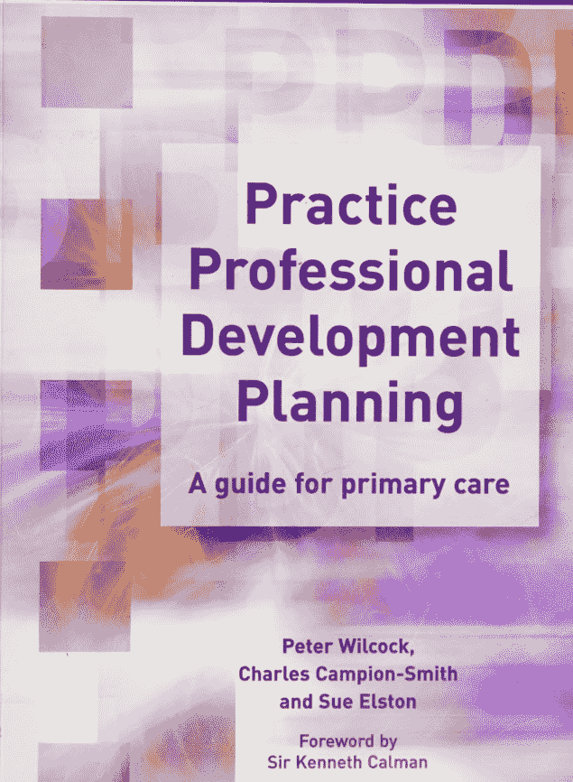

由互联网档案馆于2022年数字化  
资金来自  
卡勒/奥斯汀基金会

## 诊所专业发展规划

**北格拉摩根NHS信托图书馆**  
请归还至图书馆  
日期见下方盖章

## 序言

各专业有许多共同特征，其中两点与诊所发展计划这一概念尤为相关。第一是与服务对象之间的特殊关系——对卫生专业人员而言，就是与患者的关系。第二是自我监管的概念，以及向公众保证医生、护士、物理治疗师等能够胜任执业的能力。这两个特征都体现在诊所发展计划的概念中。这些计划首先旨在提高患者照护质量和公众健康。其次，它们旨在确保所有专业人员与时俱进，了解实践中的新发展。

多年来，自我监管以许多不同方式实施。各个专业团体召开会议、病例讨论会、审计、临床审查以及许多其他活动，所有这些都旨在质疑并改进现有实践。随着团队化实践的不断发展，以团队作为学习和改善患者照护的焦点成为显而易见的一步。因此，基于诊所的规划流程得以发展，这是一种确保变革和改进的潜在非常有力的方式。

这样的流程并不新鲜，许多地方已经在实施。然而，本指南采用的更系统化方法使其能够更广泛地应用；对于尚未参与其中的人，它也提供了一种非常有用的启动方式。

本指南首先界定要解决的问题或要完成的任务。这类方法尤其有用，因为它们能识别与广大卫生专业人员相关、且人人都能贡献力量的现实问题。因此，学习既围绕问题本身，也来自彼此，因为不同的专业专长被用于应对某一特定问题。它以患者和社区的需求为结果导向，因而也以照护的整体改善为导向。如果每年选择若干主题并付诸行动，那么经过数年，整个诊所的患者照护将取得显著改善。事实上，仅是这样一种流程的存在，就会促进对其他领域实践的定期审查。

有人提出的一个主要限制是时间。我们怎样才能找到时间来做这件事？经验表明，这样的流程甚至可能节省时间，因为新的工作方法可能使诊所既更高效又更有效。还有人担心，这种基于诊所的规划可能会妨碍个人发展计划。经验再次表明，二者并不冲突，而且确实相互支持。

任何仍存的疑虑都应通过查看本指南提供的示例来消除。这些示例让整个流程栩栩如生，并展示了团队学习和经验分享如何提升所提供的照护质量。这必定是所有专业团体的目标之一；如果与此同时它还能强化专业角色并与个人发展相关联，那么就会带来全面的益处。本指南展示了如何做到这一点，以及如何实现这些益处。归根结底，目标是更有效地服务我们的患者和社区。

肯尼斯·卡尔曼教授  
副校长兼校监  
杜伦大学  
英格兰前首席医疗官  
*2003年3月*

## 前言

我们非常高兴地向您推荐本指南。它源于我们多年来在伯恩茅斯大学健康与社区研究所与全科诊所（主要在多塞特郡）合作开展的工作。早期，我们的重点是初级保健中持续质量改进原则和方法的运用，之后更明确地拓展为诊所内跨专业团队对这些方法的运用。¹

经常出现的一个问题是，我们如何将工作从有外部资金支持的特别项目转变为日常执业中涉及诊所内每个人的主流活动。我们意识到，除非这两点都能实现，否则持续改进本身的目标就无法达成。

因此，当肯尼思·卡尔曼爵士博士于1998年提出诊所专业发展规划（PPDPs）的想法时，我们非常兴奋。² 他的想法所依据的基本原则不仅与我们一直在进行的工作一致，而且我们觉得，我们一直探索的方法将非常有助于支持PPDPs的实施，并为其提供一个明确的以“需求”为基础的焦点。我们早期的一个教训，恰如其分，就是：如果你想让忙碌的员工投入时间参与活动，就必须清楚地表明这是一项能为患者带来益处的投资。

我们在一段时间内尝试了这些想法，受到戴明关于组织即系统的思想影响，并开发了一个初步的PPDP制定框架（*参见* Deming, WE (1993) *《新经济学》*。MIT Press, Cambridge, MA）。我们一直在寻找一种方法，将患者和社区需求、持续质量改进方法与成人学习原则联系起来。我们的目标是建立一个流程，使个人和诊所的发展计划能够与诊所商定的改进优先事项挂钩，而这些优先事项又可以清晰地追溯到对诊所患者和当地社区需求的探索。此外，如今还必须考虑外部强加的政府目标、战略卫生局（SHA）目标和初级保健信托机构（PCT）目标。

我们有幸获得了资金，在多塞特郡的一小部分诊所中对该框架进行了测试。我们学到了很多，反馈也足够积极，于是又用第二批小组进行了进一步测试，这次他们来自该地区的不同地方。反馈依然积极，该框架帮助制定的PPDPs为诊所及其所服务的人群带来了益处。与此同时，该框架在多塞特郡得到了更广泛的推广，如今大约一半的诊所使用它来指导其诊所专业发展规划。

一个经常出现的请求是，为那些希望采用该方法的人提供结构化的指导。本指南就是为了回应这些请求而编写的。它既不是操作手册，也不是教科书，而是我们与所合作诊所的经验结晶。在许多方面，它是对他们工作的礼赞，我们非常感谢他们愿意充当未来的试验田。

Peter Wilcock  
Charles Campion-Smith  
Sue Elston  
*2003年3月*

## 关于作者

**Peter Wilcock**，BSc、Dip Psych、MSc、PGCert（THE）、C.Psychol.、FBPsS、ILTM，拥有20多年NHS临床和管理经验的特许临床心理学家。自1993年起，他一直是伯恩茅斯大学健康与社区研究所的学术人员，现任医疗改进客座研究员。他特别感兴趣的是将持续质量改进的原则和方法与执业环境中的跨专业学习联系起来。他是NHS现代化局关于使用患者叙述推动护理改进的顾问。

他定期在医疗改进和跨专业学习领域发表文章，并且是*《跨专业照护杂志》*编委会成员，在2000年5月担任了关于持续质量改进的特刊联合客座编辑。

**Charles Campion-Smith**，MB ChB、DCH、FRCGP，在多塞特郡多切斯特担任全科医生已有23年。他是伯恩茅斯大学健康与社区研究所初级保健教育与发展副讲师。

他从事教育工作已超过10年，最初担任全科导师，最近与跨专业初级保健团队合作，使用持续质量改进方法帮助团队设计并实现为其患者提供的服务改进。

他发表过关于全科医生教育、跨专业学习和初级保健持续质量改进的论文。

**Sue Elston**，MA、MIMgt、FAETC、AMSPAR Dip，是伯恩茅斯一家五名全科医生合伙的诊所的诊所经理，并被借调到伯恩茅斯大学健康与社区研究所担任初级保健教育促进员。她过去10年一直参与全科教育，并在完成跨专业健康与社区关怀硕士学位后，对跨专业教育和发展产生了浓厚兴趣。

她于2000年在加拿大举行的第四届国际质性研究会议上展示了她的硕士论文，该论文发表在*《跨专业照护杂志》*上。过去两年中，她的工作包括为多塞特郡及周边地区约60家诊所的诊所专业发展规划流程提供引导支持。

## 致谢

本指南所基于的工作在伯恩茅斯大学健康与社区研究所开展了数年，并得到了多塞特卫生局、韦塞克斯地区毕业后医学教育委员会和NHS西南地区执行局的资金支持。

Sue Elston在诊所专业发展规划（PPDP）方面为诊所提供的促进工作，作为教育促进员项目得到了韦塞克斯地区毕业后医学教育委员会和伯恩茅斯大学的支持。

我们感谢以下人员的支持：

- David Percy博士，前韦塞克斯全科医学研究生教育主任
- Howard Nattrass，前健康与社区研究所所长
- Steve Annandale和Sheila McCann，NHS西南地区执行局

特别感谢多塞特郡和英格兰西南部各地的诊所，他们与我们合作，尝试并完善了这些想法。也感谢多塞特全科导师和副顾问团队的支持。

Tom Hopkins帮助我们将这项工作转化为可读且易于理解的格式；Natasha Young多年来提供了文书协助和技术支持；我们感谢他们两位。

我们感谢健康与社区研究所的同事以及更远方的同行，他们对这项工作提出了质疑和评论，帮助我们澄清了表述，并且，我们希望，改进我们的描述方式。

我们感谢肯尼思·卡尔曼爵士教授，他既为这项工作提供了最初的灵感，又为指南撰写了前言。

“一家诊所运用PPDP进行团队学习的故事”一章最初发表于*《英国全科医学杂志》*质量增刊（2002年10月），此处经编辑许可使用。关于持续质量改进的章节改编自Wilcock和Campion-Smith³，并经编辑许可使用。关于重大事件分析的章节基于埃克塞特的Jonathan Stead博士及其同事的工作，我们感谢他们慷慨分享。

感谢Alex Hallatt的精彩漫画。

### 欢迎反馈！

作为教育开发者，我们非常希望了解您使用本指南的经验——哪些进展顺利，哪些需要改进。请通过以下地址与我们联系。提前感谢您的反馈。

Peter Wilcock, Charles Campion-Smith and Sue Elston  
Institute of Health and Community Studies  
Bournemouth University  
Royal London House  
Christchurch Road  
Bournemouth BH1 3LT  
电子邮箱：ccampions@aol.com

## 指南简介

欢迎使用*诊所专业发展规划（PPDP）：初级保健指南*。本指南是PPDP发展项目的成果，由西南地区NHS执行机构支持，并由作者于1998–2001年期间开展。它旨在帮助诊所员工规划和开展PPDP所涉及的任务和活动。特别是，本指南应对那些在其工作环境中负有领导和/或促进PPDP过程特殊责任的员工有所帮助。

### 本指南包含什么？

本指南包含若干信息和学习资源：

- PPDP的背景信息和语境
- 关于PPDP及其相关概念的关键要素、结构和过程的信息
- 每个阶段之间的要点，旨在帮助你反思进展，并确定仍需开展的活动，或可以更好以不同方式完成的事情
- 一个PPDP实际运行的案例，即Maples Practice（枫树诊所），这是一个基于早期工作中不同诊所经验综合而成的复合案例
- 第四部分列出的推荐和建议进一步阅读的参考文献。

### 本指南应如何使用？

本指南主要旨在帮助团队或小组学习。然而，在繁忙的诊所中，很可能有时所有员工都难以（甚至不可能）同时参与发展任务。在这种情况下，本指南可为缺席员工提供一个有用的框架，以跟上同事的学习活动，并作为赶上最新进展的支持手段。

然而，我们所描述的过程是一个合乎逻辑的递进过程。当以逐步方式遵循时，它最为成功；先开展工作以发现和理解患者、当地社区和诊所的需求，作为后续阶段的基础。我们的经验是，值得抵制急于求答案和行动的冲动。在商定团队目标之前，花时间反思你对当前情况的了解是至关重要的。

### 作为学习过程的PPDP

我们将PPDP过程视为诊所团队共同学习，并认为反思开展该过程的经验是其在诊所内发展的重要组成部分。团队在对关键问题有共同理解的基础上推进PPDP非常重要。因此，如果你的团队是首次接触PPDP，我们建议你们大家简要回顾一下对所述信息和概念的理解。

在每个研讨会结束时分配15分钟回顾其内容和过程也非常值得。如果这既是团队过程也是个人过程，将最为有益，并有助于识别当前理解中的任何差距，使团队能够有信心地继续。第四部分包含一些有帮助的关键问题。值得注意的是，此类反思的记录很可能对PPDP和个人员工学习档案作出有益贡献。

### 使用本指南的准备

我们建议你花一些时间熟悉本指南的内容和PPDP发展方法。这将增强你自己对PPDP关键思想和概念的理解，以及你促进他人发展和学习的能力。

## 第一部分：一些基本思考

### 什么是诊所专业发展规划（PPDP）？

就本指南而言，使用以下PPDP定义：²

> 诊所专业发展计划描述计划开展的发展活动，以及为个人、小组和整个团队实现的具体教育行动，使诊所能够改善照护，并每年进行审查。

尽管PPDP可能听起来很吓人，但它们只是描述了大多数诊所中已经发生的活动。PPDP只是以系统的方式将这些活动汇集在一起，并通过将它们与满足个人和社区需求相联系，使更连贯的概览得以呈现。

尽管这些要求为重新审视政策和实践提供了真实机会，但它们也为本已忙碌的团队带来了额外工作。因此，必须有效利用学习时间，以满足治理、教育认证和再认证准备的要求。正是在这一背景下，本指南力求通过PPDP支持和指导员工。

### 我们对PPDP的方法

作为项目中负责引领变革过程的人员，我们发现自己从传统的教学和告知角色转向促进者角色，提供策略和“工具”，帮助诊所团队最有效地利用他们已拥有的丰富专业知识。其中一些工具列在第四部分。

我们还发现，以患者为中心的方法鼓励团队进行跨专业合作。当他们这样做时，他们对患者和照护系统的知识深度和理解令人瞩目。在这种方法中，所有团队成员的贡献都很有价值，我们发现真正的团队发展和改善的关系是这种工作方式的一致成果。⁶

我们在PPDP项目期间与团队合作中学到的经验已被回顾并提炼为本指南中的思想、概念、原则和实践建议。

### 与诊所决策过程相衔接

目标不是再创建一个耗时且增加负担的流程。专业发展规划必须

### 在初级保健信托（PCT）内

PCT将拥有或将会发展用于批准和整理专业发展计划的系统。这些系统将日益受到国家政策和实践（如专业再认证）的影响。第三部分中阐述的PPDP方法必须与PCT和国家规划流程相衔接。它应使各方能够实现该过程的目标，并在每年规定的时间范围内做到这一点。因此，不会有唯一的做法。PPDP的格式及其编制时间表在全国各地会有所不同。重要的是，无论其确切格式如何，PPDP将日益基于团队对如何更好地满足患者和当地社区需求的仔细考虑。

### 本指南将如何帮助你和你团队？

我们相信，整个初级卫生保健团队（PHCT），包括临床和行政人员，参与计划起草过程非常重要。我们发现，只有当整个团队聚在一起时，对诊所活动的知识和理解的完整程度才会显现出来。

在下文中，我们描述了一个过程，使诊所能够选择重要的发展领域，并确定为整个团队和/或个人所需的教育和培训活动及资源。

腾出时间和资源专门用于你的PPDP可能很困难。在我们工作的试点阶段，团队多次会面，每次只处理PPDP过程的一个阶段。反馈表明，由于工作压力，这给一些成员的出席带来了问题，并导致连续性不佳。随着时间的推移并从我们的经验中学习，我们能够将工作压缩为两次研讨会，每次大约两个半到三个小时，第一次涵盖框架的第1–7阶段，第二次涵盖第8–11阶段。只要在会议之间开展工作以提供所处理问题所需的信息，我们并不觉得工作质量在任何方面受到损害。诊所团队发现，就他们的时间和其他工作压力而言，这更现实、更易管理。然而，该过程足够灵活，允许团队按自己的节奏工作，并按其认为必要的次数会面。

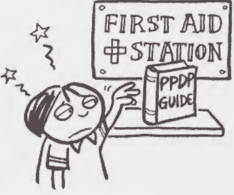

### PPDP

这种PPDP方法真正重要的部分是团队在推进不同阶段时所参与的工作

阶段，包括他们为促成改进所采取的行动。事实一再表明，这通常是一次重要的学习经历，而且往往能改变团队关系。

尽管这是该方法最重要的方面，但各执业机构仍须编制一份或数份文件，列明其专业发展建议。一些初级保健信托（PCTs）会规定其格式。另一些则愿意接收按照第三部分各阶段开展后形成的证据档案。多数PCTs很可能不希望收到冗长文件，而会选择接收各执业机构提交的建议摘要。

### 个人发展计划（PDPs）与PPDP

最常被问到的问题之一是，在这一方法中PDP与PPDP如何衔接。简单的答案是：它们是其中不可分割的组成部分。

目标是，个人的专业发展应日益直接关联到他们及其他多专业团队成员所认定的、为实现他们已确认最为重要的患者护理改进所需的内容。这正是本指南第三部分所述流程旨在实现的目标。

然而，在这里保持现实感很重要。我们认识到，执业机构在任何一年中都只能处理极少数需要改进的领域。个人的学习需求既会来自PPDP，也会来自其个人执业兴趣和职业抱负。同样，作为PPDP一部分开展的学习也很可能记录在个人档案中，以备考评和再认证之用。第四部分包含了一个与支撑本指南的思路相一致的个人发展计划框架。

### 小结

本指南第一部分涵盖了与PPDP流程相关的若干重要问题，包括执业机构内部的发展与学习。它介绍了关键领域和概念，包括：

- 本指南的目的和功能
- PPDP背后的最初思路
- PPDP的实用定义
- PPDP与PDP之间的关系。

本指南第二部分介绍了编制PPDP的框架，并概述了PPDP流程的各个阶段和档案。

## 第二部分：PPDP框架与档案简介

### 引言

本部分包含五个要素：

- 1. 对作者开发的PPDP框架进行说明，该框架是与执业机构员工群体和团队合作的基础
- 2. 简要概述在执业机构内举行跨专业会议时需要考虑的要点
- 3. 介绍PPDP档案，这是一种建议用于建立工作记录的方式
- 4. 介绍PPDP流程的各个阶段
- 5. 回顾年度内的进展。

### PPDP框架

乍看之下，该框架可能显得相当复杂，但实际上它只是把大多数执业机构中可能已经在开展的若干活动和流程联系起来。关于如何逐步完成框架各阶段的建议包含在第三部分中。该框架有三个主要要素，将在紧接其下的各节中说明。

- **1. 目的**：改善我们满足个人和当地社区健康需求的方式
- **2. 社区需求**：我们对当地人群的健康需求了解什么？我们需要了解什么，以及为什么需要了解？国家/SHA/PCT的优先事项是什么？
- **3. 执业机构需求**：我们对以下方面了解什么：
  - 我们满足患者需求的程度如何？
  - 我们在执业机构中如何协作？
  - 我们如何应对外部压力？

  我们还需要了解什么，如何查明？
- **4. 个人发展需求**：与自身专业发展相关。
- **5. 使用商定的标准确定优先群体**
- **6. 使用商定的标准确定执业机构的优先事项**
- **7. 就执业机构需要改进的优先领域入围清单达成一致。**
- **8. 对每个优先事项询问：**
  - 我们试图实现什么？
  - 我们如何知道某项变革就是改进？
- **9. 我们可以做出哪些能带来改进的变革？**
- **10. 执业机构和个人的学习与发展需求是什么？**
- **11. 对每项学习与发展需求，我们可以采取哪些具体的教育行动？如何衡量每项行动的效果？**
- **12. 定期开展年度内的进展回顾。**

#### 确定执业团队的关键发展优先事项

这需要以对当地社区的了解、对外部确定和/或推动的议程与要求的认识（如PCT、健康改善计划（HImPs）、国家服务框架（NSFs）等），以及对执业机构当前工作安排的内情了解和内部/自我评估为依据（见框架图中的方框1—3）。

#### 将优先领域转化为计划中的改进项目

持续质量改进（CQI）的原则和方法已被用于构建一种项目规划方法，该方法：

- 为将要开展的工作提供明确焦点
- 明确谁需要做什么以及何时做
- 使执业团队能够在推进过程中灵活学习（见方框4—9）。

#### 确定执业团队和员工个人的学习需求

执业机构的改进优先事项将为重要的团队学习需求提供线索，此外几乎肯定会出现新的个人与专业发展需求。该方法的一个核心目标是将PDP牢固地置于执业机构改进优先事项的背景中。团队成员将理解自己的PDP如何与执业机构改善其所提供服务的总体计划相衔接。然而，某些员工的PDP中可能有些部分不属于PPDP。例如，PDP的这些方面可能涉及职业发展计划，或源于员工考评流程，因此应对个人保密（见方框4和10—11）。

### 在执业机构内举行跨专业会议

要使跨专业会议有用且富有成效，重要的是关注过程——人们将如何一起工作和学习。组织全体团队会议需要规划。让人们对会议目标有清晰认识非常重要。告知他们开始和结束时间，并明确说明提供哪些食物和茶点，可以让人们做好安排。

如果请人们事先考虑一两个问题，会议往往会更富有成果。重要的是强调所有团队成员都必须作出的贡献，并承认至少对部分参与者而言，他们以往的团队合作经历可能并不愉快。由执业机构外部的引导者来主持非常有帮助，尤其是在初次会议时。不过，执业机构内也需要有一人在会议组织的具体事务中发挥主导作用。

引导者的部分职责是帮助团队就会议过程商定一些基本规则。参与者的期望与焦虑，连同他们以往团队工作的经历（无论好坏），都可以作为这项练习的起点（*参见第四部分*）。在第84—90页，我们给出了一些关于引导这些会议更具体的想法。

### PPDP档案

所谓“档案”，我们只是指汇集执业团队在学习过程中产生的证据。这是一种建议采用的方式，用于记录你在逐步完成框架各步骤时收集的信息，以及执业团队就其改进和学习优先事项所作的决定。此外，它还包括证据，清楚展示执业团队从起草PPDP以及从采取实现变革和改进所需行动中学到了什么。它不只是记录团队所采取的行动、活动或经历，而是说明每位团队成员对有机会为执业机构的发展方向作出贡献有多重视。在一些执业机构中，团队成员尤其重视编制PPDP的这一方面，并感到彼此的工作关系得到了切实改善。这些证据当然值得纳入最终的PPDP文件，也值得纳入员工自己的个人档案。

我们发现，档案的一种有用格式是活页环夹。在其中可以使用分隔页，为PPDP流程的每个关键阶段建立分区，如下所示。

### PPDP流程的各个阶段

PPDP流程的各个步骤可以有效地划分为若干阶段，这些阶段相互依托，并且每个阶段

它们发挥着不同的作用，因为它们增强了诊所改善满足患者和当地社区需求方式的能力。

- 阶段1 发现优先需求（见框架图中的方框1–4）。
- 阶段2 选择改进领域（见方框5–7）。
- 阶段3 商定具体的改进行动（见方框8–9）。
- 阶段4 商定实现改进所需的学习和发展（见方框10–11）。
- 阶段5 规划年度内PPDP进展的审查（见方框12）。
- 阶段6 规划下一年度的PPDP。

从上述列表可以看出，作品集的前面部分将包含关于你如何发现诊所需求的详细信息。在其中加入PPDP会议的简要记录也是合适的。后面的部分将包含关于你如何协商并选择行动领域以及哪些团队成员参与了这些讨论的记录。这些部分描述了整个团队或个人所开展的特定教育和学习活动。其中一些材料也可能被复制并保存在个人的PDP中。

随着时间的推移，你会发现收集证据来表明计划中的变化给患者和/或员工带来了哪些益处是很有帮助的。

通过遵循下面解释的流程，你的作品集将建立一套证据，证明你逐步按照框架开展工作。例如，在标题为“发现优先需求”的部分，你的证据可以是第一次PPDP会议的笔记，列出参会人员，并记录会议内容。它还可能包括关于当地社区需求、外部确定的优先事项以及SWOT分析结果或其他证据的信息，这些证据识别出关于你自身内部诊所需求的“当前状态”。

## 年度进展审查

作品集方法允许PDP及相关个人计划在年度内随着情况变化而灵活更新。重要的是定期进行进展审查以便实现这一点，并且应在每个PDP周期开始时规划好机会。也常常只有当团队停下来反思时，他们才会意识到自己已经取得了多少成就。

审查也是检查团队所有成员是否清楚PDP目的的机会。重要的是，在开展特定主题工作时，团队成员要记住改善对患者和当地社区服务的高层目标。重新联系这一目标，并看到正在开展的具体改进确实与高层目标一致，可以鼓舞人心并激发活力。

## 阶段1：发现优先需求

### 引言

这第一个阶段涉及PPDP流程的初始方面，如PPDP图中前四个方框所示（已突出显示）。它将包括诊所如何建立关于当地社区和患者需求的知识，以及强调来自政府、战略卫生当局和PCT的指令，诊所必须对此作出回应。

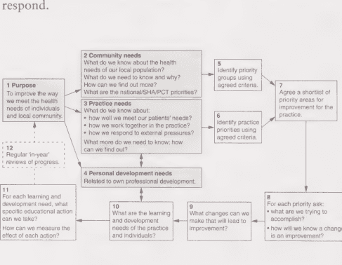

### 发现优先需求

### 1 目的

改善我们满足个人、群体和当地社区健康需求的方式。

### 目的

所需的三个互补步骤是确定人群层面的需求，并考虑个人和群体的需求。这些步骤将建立在满足需求的记录基础上，并来自对过去和现在事件的彻底和持续分析。收集和分析信息的过程可能相对缓慢，但它对于改善患者护理至关重要。

### 2 社区需求

我们对当地人口的健康需求了解多少？

- 我们需要知道什么，我们如何知道？
- 国家/SHA/PCT的优先事项是什么？

### 社区需求

你可能会发现，并非所有群体都拥有你认为他们应该拥有的相同医疗保健需求。群体之间的健康状况存在很大差异，你可能难以识别医疗保健提供中的差距。以下是诊所的主要类别：

- 人口健康
- 专业实践
- 国家优先事项，例如政府目标和地方优先事项
- 团队合作和虚拟责任协议

### 3 诊所需求

我们对以下方面了解多少：

- 我们满足患者需求的程度如何？
- 我们在此过程中如何协同工作？
- 我们需要知道什么，以及如何查明？

### 诊所需求

检查团队对人群和诊所当地关注点的了解，尤其是那些可能难以获得医疗服务的群体。识别并解决以下方面的任何差距：

- 获得医疗服务
- 诊所活动
- 自评结果
- 结果报告
- 绩效指标
- 患者和使用者的观点

### 4 个人发展

与自身专业发展相关。

### 个人发展需求

员工评估和个人发展计划的相关部分有助于识别改进领域和实际工作中的差距。

### 梅普尔斯诊所的故事

| 1 目的 | 2 社区需求 | 3 诊所需求 | 4 个人发展需求 |
|---|---|---|---|
| 改善我们满足个人、群体和当地社区健康需求的方式。 | 我们对当地人口的健康需求了解多少？ 我们需要查明什么？ 我们如何进一步查明？ 国家/SHA/PCT的优先事项是什么？ | 我们对以下方面了解多少： • 我们满足患者需求的程度如何？ • 我们在诊所中协同工作的程度如何？ • 我们对压力的回应程度如何？ 我们还需要知道什么，如何查明？ | 与自身专业发展相关。 |
| **作品集证据** 已经开展了诊所的健康需求评估。几年前，我们的年度公共卫生报告告诉我们，无论我们做得多好，我们并没有实现所有重要的事情。我们没有提供全方位的服务。在PCT中，我们是一些未能达到所有国家目标的诊所之一。我们意识到，我们的地方战略卫生计划需要反映在我们的诊所人群中，然后识别我们服务提供中的差距。 |  | **优势** • 患者服务范围良好 • 诊所组织良好 • 场所维护良好  **劣势/挑战** • 资本不足 • 沟通可以更好 • 预约不足  **机会** • 改善IT的使用 • 改善患者获取服务 • 成为无纸化诊所  **威胁** • 资金 • 时间 • 充分利用可用资源并充分利用可用资源…… |  |

## 阶段2：选择改进领域

### 引言

这一阶段介绍PPDP流程接下来的三个要素，如框架图中突出显示的那样。它通常涉及协商和选择的过程。诊所面临许多要求，但团队必须现实地选择要承担的任务。对诊所生活具有高度重要性或重大影响的问题很可能获得团队成员的广泛支持，而这些问题的成功可以帮助他们在此过程中获得信心。Maples诊所的真实故事再次说明了其他员工团队是如何处理这些关键任务的。

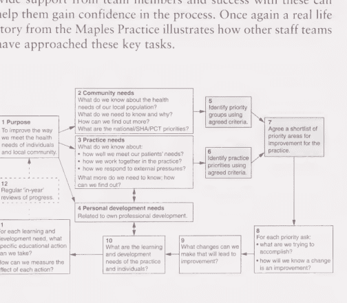

### 选择改进领域

- 5 识别优先群体
- 6 识别诊所优先事项
- 7 商定优先领域短名单

### 识别优先事项和优先领域的“做什么和为什么”

- 确保每个人都了解“外部”议程，例如PCT的优先事项和NSF（见方框5）。
- 如果团队已经开展了个人SWOT分析，应协调这些分析，并需要汇编这些证据，以便需要关注的领域被列入清单（见方框6）。
- 不要忘记纳入“必须做”的事项，或者“不做就太愚蠢”的事项，例如解决健康与安全问题或绩效目标/指标。在这里，重要的是花一些时间就未来一年要开展的两三个优先改进领域达成一致。
- 记住，带来改进的一个小改变胜过一打良好意愿（见方框7）。

- 最后检查你的清单，确保这些主题将为患者和员工带来明显益处。这需要在以患者为中心和以诊所为中心之间平衡优先事项（见方框7）。

### 梅普尔斯诊所的故事

- 5 确定优先群体
- 7 就优先领域候选清单达成一致
- 6 确定诊所优先事项

### 作品集证据

由同行提名的各学科代表应邀参加为期两小时的研讨会，讨论并商定未来12个月的改进优先事项。向团队展示了一份摘要，内容包括PCT的优先事项、国家服务框架（NSFs）和国家初级保健协作组织（社区需求，见方框5），以及SWOT分析的结果（诊所需求，见方框6）。从这些数据中产生了一份潜在改进领域的长清单。凭借这些信息，并在引导员的帮助下，团队分成两个较小的小组，选出我们认为对诊所及其服务人群而言属于优先事项的三个领域。

- 改进并增加信息技术的使用（尤其是慢性病管理的数据录入）。选择该领域是因为我们意识到，慢性病管理的数据正以多种方式录入，而且每个诊室的结果都不可靠。我们还面临纸张存储量不断增加的问题，并且刚刚完成了一次系统升级。我们的目标是使100%的计算机化患者记录完整、准确且及时更新。
- 改善患者就医可及性。选择该领域是因为我们已积极参与国家初级保健协作组织，而且PCT已将“可及性”确定为改进优先事项。我们的目标是在患者提出请求后48小时内为其提供全科医生或护士的例行预约。（紧急预约请求已在当天得到满足）。
- 落实心理健康领域的NSF。选择该领域是因为我们遇到越来越多需要药物治疗的急性精神疾病发作患者，而这些患者并不属于社区心理健康团队照护范围。这些患者需要频繁监测和支持，而我们提供的咨询服务等待时间为15周，这并不充分。我们的目标是为经历急性精神疾病发作的患者提供基于诊所的支持。

## 阶段3：商定具体的改进措施

### 引言

这一阶段将改进设想转化为行动。CQI方法（见第四部分）确保有明确的目标和衡量指标，以显示行动是否产生了预期效果。实现改进的最初步骤会被规划、测试和评估（见方框8和9）。

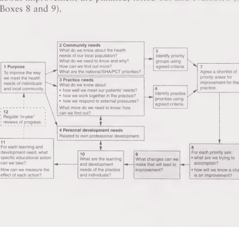

### 梅普尔斯诊所的故事

- 8 我们试图实现什么？我们如何知道某项改变就是改进？
- 9 我们可以做出哪些改变以促成改进？

### PDSA 1

计划：前台工作人员将记录并监测每位预约护士的第三个*可预约时段，以评估诊所提供医生和护士预约的能力。

第三个可预约时段是国家初级保健协作组织使用的一项可及性指标。

执行：当患者请求预约时，接待员将在表格上记录患者要求的预约日期和下一个可预约时段的日期。接待员将每周分析数据，并监测每位医生和护士的预约等待时长。

研究：结果显示，尽管监测工作给前台人员带来了额外压力，但有时能够识别需求高峰，例如周一下午和周五下午。

行动：就周一上午引入一次护士分诊的益处进行咨询。

### PDSA 2

计划：开展一项调查，以了解患者观点并评估护士分诊的潜在使用情况，并向到诊所就诊的患者发放一份简短的患者问卷。

| 阶段 | 详情 |
|---|---|
| 执行 | 前台人员确定发放500份问卷，诊所经理鼓励他们在问卷回收时进行分析。他们表示愿意与其他工作人员（如全科医生和护士）讨论结果。这一点很重要，因为这很可能促成诊所实践的改变。诊所经理还同意记录任何问题，并在每周会议（周一上午）上与一名护士讨论。 |
| 研究 | 问卷由诊所经理分析，结果在会议上展示。诊所经理和护士讨论了结果，并同意继续开展每周一次会议（周一上午）的试验。 |
| 行动 | 决定继续开展每周一次会议（周一上午）的试验。 |

### PDSA 3

| 阶段 | 详情 |
|---|---|
| 计划 | 引入每周一次的护士分诊，由新聘任的兼职健康访视员实施；她最近完成了护士分诊课程，并希望保持自己的技能。诊所将与PCT协商，允许该健康访视员开展这些分诊时段。护士将遵循一项方案。 |
| 执行 | 向接待员提供了信息和培训，安排了计算机设施，并在候诊室和通过海报宣传了该时段。开展了一项患者调查，以评估患者对非工作时间预约的反应。 |
| 研究 | 患者调查的结果以及分诊护士、医生和前台人员的反馈表明，分诊时段使一些患者能够在高峰时段就诊。 |
| 行动 | 周一上午的分诊时段被确认为日常做法，并在周五上午增设了一个时段。 |

### 作品集证据

在所有临床工作人员组中成立了项目组，并包括参与PDSA流程的“专家”护士。项目组的目的是改善48小时内获得预约的可及性，成员包括一名全科医生和一名执业护士。他们一致认为，改变将是：

- 拨打例行预约电话的患者数量
- “如何预约”的预约
- 例行预约的时间
- 护理团队的技能组合

每个项目组反复尝试就项目范围、关键任务以及将收集哪些证据达成一致。我们发现通常会有多个PDSA循环，例如见右侧方框。

## 阶段4：商定实现改进所需的学习与发展

### 引言

本节内容是将学习与改善照护联系起来：

- 我们需要发展哪些技能，以在我们已确定为优先领域的方面实现改进
- 作为个人和团队，我们需要学习什么，才能实施计划中的改进？

个别工作人员还可能有与职业发展相关的个人学习需求，这些需求会在评估过程中单独确定。

梅普尔斯诊所的故事说明了其他工作人员团队如何着手完成这些关键任务。

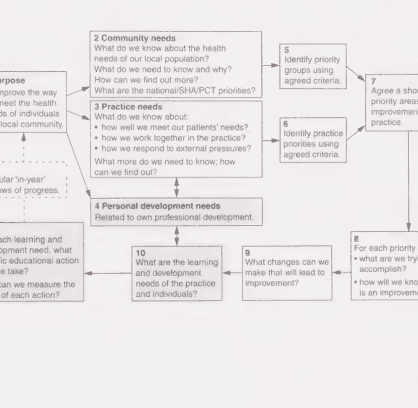

### 4 个人发展需求

这指的是个人学习需求，可能是个人独有的，也可能是共同需求。所确定的需求应与个人需求以及诊所、团队和组织的需求相关。个人学习需求的例子可从评估或绩效审查中确定，包括认识和理解自身需求、学习新技能和知识的机会以及其他发展需求。

### 11 我们可以采取哪些具体的教育行动？我们如何衡量每项行动的效果？

这指的是为满足已确定的改进需求而采取的具体教育行动。除了正式认证的机会外，您可能还想考虑：

- 促进学习并创造适当机会的流程。
- 学习机会，包括使用不同资源。
- 特定培训课程，例如沟通技能或计算机技能。
- 同伴支持和讨论小组。
- 为获得特定技能或知识而进行的个人教育。
- 个人学习可能源于个人反思，或源于特定事件、事故，或个人发展需要。

您可能还想报告您认为教育行动带来的任何益处。提供这方面的证据并不容易，尤其是当益处与诊所文化相关时。然而，进行一次评估可能是值得的。这可能对团队其他成员也有价值，并对诊所产生影响。

### 10 诊所和个人的学习与发展需求

这将是一份关于个人的学习与发展需求清单。它可能包括可用的不同职业机会、学习与发展机会，以及组织和诊所的需求。

### 梅普尔斯诊所的故事

- 1. 诊所与个人的学习和发展需求
- 1. 我们可以采取哪些具体的教育行动？如何衡量每项行动的效果？
- 4. 个人发展需求

### 档案的证据

诊所经理很想了解PHCT和PPDP流程是否有用。对第一次研讨会的评估表明，由于PHCT会议已被放弃，这对团队来说是一个审查诊所工作的好机会。团队有机会讨论并为诊所的未来做出贡献，这是该项活动最积极、最有价值的成果。

- 改善患者就医可及性
- 电话咨询技能
- 有效使用计算机
- PHCT成员使用慢性病管理（CDM）模板、NHS电子学习和其他资源进行患者照护
- 年度评估（非严重事件）产生的培训需求
- 复苏技能更新
- 风险评估/风险管理更新
- 投诉处理更新
- 应对难缠人员
- 流感疫苗接种技能

## 阶段5：规划年度内PPDP进展审查

### 引言

本阶段强调在PPDP中每个年度周期内定期审查进展的重要性。随附的诊所故事说明了开展此类审查的一种方法。

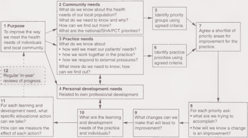

### 规划年度内PPDP进展审查

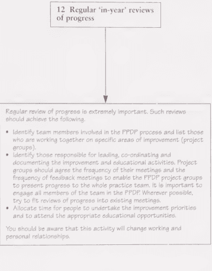

### 梅普尔斯诊所的故事

### 12 定期“年内”进展审查

梅普尔斯医疗中心PPDP团队同意以下会议安排，以开展工作、向PHCT反馈并审查PPDP流程：

- 项目小组最初每月开会（一旦改进工作启动，频率可能降低）
- PPDP团队每两个月开会一小时，审查进展
- 将按季度向整个PHCT提供反馈。

## 阶段6：规划下一年度PPDP

**目的：** 继续改进我们满足个人、群体和当地社区健康需求的方式。

我们建议在计划实施九至十个月时进行审查（例如，或许与卫生局或PCT的规划时间表一致）。审查当前计划的进展将使您能够讨论并商定未来12个月的改进优先事项。您还需要考虑由国家级、SHA和PCT优先事项（包括NSFs）产生的外部议程。为审查当前计划，针对每个优先领域回答以下问题将有所帮助。

- **关于改进优先事项：**
  - 计划中的改进行动是否发生？如果没有，您了解原因吗？
  - 如果是，结果是什么？您如何得知？
  - 从您的PDSA反馈指标中学到了什么？
  - 对患者和员工而言，获益是什么？
- **关于教育行动：**
  - 计划中的行动是否发生？
  - 如果是，结果是什么？您如何得知？
  - 如果计划中的行动未发生，障碍和困难是什么？从这些中学到了什么，已经采取并需要采取哪些进一步行动？
  - 对患者和涉及员工而言，获益是什么？

在这一年中，是否出现或被施加了其他内部或外部优先事项，从而导致计划修订？这些对下一年度PPDP有何影响？

**记住**——这是一个持续的过程，团队需要持续重新审视该框架，至少每年一次。

## 第四部分：一些有用的提示和资源

### 反思PPDP流程指南

检查团队对PPDP流程的理解，对于使团队自信地推进各个阶段至关重要。非常值得在每个研讨会结束时花10到15分钟，向团队询问几个关于他们在研讨会中的体验以及对PPDP不断发展的理解的问题。

重要的是要认识到每个诊所都将按自己的节奏推进。我们的经验表明，在有经验的引导者协助下，PPDP流程的大部分内容可以在两次两个半小时的研讨会中完成，尽管这需要如前所述在会议之间开展工作。一些诊所团队可能选择花更长时间，将流程分散到三次或更多研讨会中。以下是几个有助于检查团队对流程理解的问题。

在每个研讨会结束时，通过询问以下问题来了解参与者对讨论进展的感受：

- 哪些方面进展顺利
- 哪些方面可以做得更好
- 您觉得自己能够为讨论做出贡献吗
- 您觉得自己被倾听了吗？

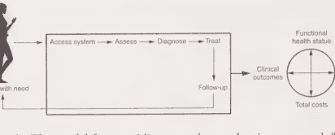

图1：支撑我们工作的照护提供模型。9

开发反映这些需求的结果指标。然而，这超出了本指南的范围。我们的重点是利用CQI原则和方法，为PPDP提供一种非常务实的方法。

### 改进照护流程

迄今为止发表的CQI研究大多强调模型的中部，即专业团队共同重新设计支撑其执业的流程。10–12 这一点至关重要，因为不改进提供照护的流程就不可能改善照护。例如，团队发现，当他们尝试绘制描述当前工作方式的简单流程图时，这会引发大量关于他们共同运作所依据的假设的讨论。这通常是他们第一次汇集各自的知识，并利用这些知识共同决定在何处以及如何改进他们提供的照护。这种非常以患者为中心的讨论似乎发挥重要作用，有助于创造新的工作方式，从而加强跨专业团队合作。

然而，也需要关注照护模型的两端。

当它被用于推动改进时，其影响最大，因为它可以转化为可操作的措施，这些措施可以成为团队工作的重点。

临床价值罗盘的四个要素如下。

- **临床结果** 这些可被视为干预的直接结果，例如体征、症状、并发症等。
- **功能状态** 健康状态测量指标，可深入揭示临床结果对例如生活质量的影响。
- **需求满足度** 这里的重要因素是将需求与满意度概念整合，从而使其既以患者为参照又以服务为重点。因此，测量指标可能涉及照护流程，或患者/服务对象及其家庭所实现的个人获益。
- **成本** 此处成本被认定为照护的一种结果。它们可以是直接服务成本或间接社会成本。

### 为改进积累知识

持续改进依赖于持续学习，而成功改进的故事必然是人们共同学习的故事。这可能是学习了解患者/服务对象的需求、了解他们为这些人提供照护的结果，或了解他们提供这种照护的流程。反思所学内容将为需要改进的领域提供线索。实施变革并建立关键反馈指标创造了另一层学习，并且是持续改进的核心。

在这一点上，值得注意似乎是两个最重要的范式。

- 关注患者/服务对象的需求，这一点贴近所有专业人员的心。
- 为成年人创造学习机会。学习是人类与生俱来的能力，而且充满乐趣，即便在学校和大学期间遇到过任何不良的教育经历也是如此。

当这两种范式在实践中融合时，就为真实且可持续的改进创造了非常强大的条件。PPDP指南正是以这些范式为基础。

### 拥有一个学习框架

改进团队的经验表明，拥有简单的框架来指导他们的工作会使他们受益。最近最受关注的框架基于汤姆·诺兰及其同事的工作。⁷ *见图2的图示表示。*

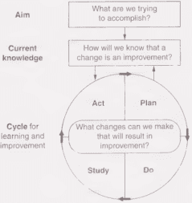

图2：改进模型。⁷

诺兰框架由三个问题组成，提供了一种系统化的方法，将想法转化为行动，并提高其在实践中带来真正改进的可能性。处理这些问题会引出PDSA循环，该循环被用作实施变革并从中学习的指南。正如伯威克所指出的，所有改进都是变革，但并非所有变革都是改进。¹⁹ 诺兰的问题已被纳入PPDP框架，并影响了对其进行了测试的不同实践团队的工作。PDSA循环与行动学习的概念相一致，而行动学习是PPDP过程的基础，本指南第三部分对此进行了描述。

其理念是尽可能选择可以快速实施的小变革。这对员工极具激励作用，学习也会迅速开始，从而保持他们的兴趣。更大的改进则通过以系列学习为基础的快速改进（PDSA）循环的累积效应来实现（见图3）。⁷

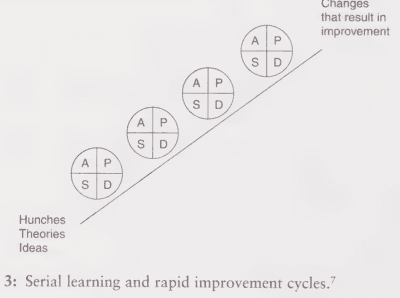

图3：系列学习和快速改进循环。⁷

- 团队重视结构与指导，以确保所花时间是投资。
- 改进团队乐在其中。

## 总结

由于工作量非常繁重，维持改进团队很困难，但除非能够确保专门保障的时间，否则不会取得进展。因此，关键在于所花时间是投资而不是负担。这要求明确聚焦于对患者和诊所都重要的主题，并使用能够引导活动走向成功的框架。将PPDP框架和过程与上文所述的CQI原则和方法结合起来，在这方面似乎非常有益。非常需要诊所高层对专门保障时间给予支持和承诺。此外，还需要确保这项活动为PDP提供信息并对其形成补充。值得考虑如何对花在PPDP活动上的时间给予学术认可，从而使学习改进技能与学习专业和技术技能一样，成为专业教育的关键组成部分。8

有关持续质量改进各方面的更详细信息，请参见NHS现代化署的《改进领导者指南》，[www.modern.nhs.uk/improvementguides](http://www.modern.nhs.uk/improvementguides)。

# 一个诊所借助PPDP开展团队学习的故事*

一家集镇诊所（五名合伙人、三个全职等效人员、5700名患者）能够采纳PPDP理念，从而为患者带来了显著益处。该理念是在一次多学科会议上启动的。这次会议的想法和信息被记录下来并分发给所有参与者。该诊所每月投入两小时的受保护会议时间，取代之前效率不高的会议。

该过程由诊所临床治理负责人领导，他是一名全科医生合伙人。为每位团队成员制作了简单的工作表，并在会议前七天分发。这些工作表注明了会议时间和地点，提供小组工作指导，并为每个人留有空间记录这段时间的笔记。这些笔记汇总到PDP和诊所PPDP作品集中，为个人学习和小组学习之间提供了重要联系。

会议通常包括第一个小时的小组工作，随后是午餐和向全体组员反馈工作。第二部分的会议内容由重大事件分析或来访演讲者的简短演讲组成。

该诊所遵循了本指南前面描述的PPDP框架。下文概述了他们在不同阶段中的历程。

## 就目的达成一致 *（见框架图中的框1）*

团队一致同意，其目的是提供高质量的初级保健服务，满足患者的需求，既包括患者不适时的照护，也包括使人们能够尽其所能保持健康。次要目标也得到了同意：保持组织财务稳健，并为所有员工提供良好的工作场所。

\* 本材料的大部分内容最初发表于*《英国全科医学杂志》*，并经编辑许可使用。^20

## 评估需求（见框2、3和4）

在初次会议上，员工识别出了若干需求。其他必须处理的事项要么来自审计或重大事件（“内部”），要么来自政府政策、卫生当局或PCT的指令（“外部”）。团队也认可，团队中的个人会有个人学习需求，这些需求源于他们自己实践中的问题、对工作的反思或评估。

## 协商要采取的行动并分担工作（见框5、6和7）

该诊所认可协商和选择很重要——很容易承担过多任务却完成甚少。他们寻找诊所目标与为满足外部议程而“必须完成”的事项之间存在一致性的领域。他们还确保工作与诊所作为国家初级保健协作组织成员的身份相一致。

## 规划行动（见框8和9）

对于计划采取的每项行动，诊所团队遵循CQI模型并同意：

- 高层级目标
- 我们具体试图完成什么
- 我们认为会带来改进的变革
- 用于判断变革是否带来改进的测量指标
- 将变革作为试验实施的计划。

随后，诊所团队或小组进入PDSA过程。⁹

## 识别学习需求 *（见框10）*

对于计划的每项变革，他们都会审视需要哪些学习需求才能实现改进。这些包括：

- 一两名团队成员获得特定技能或知识，例如，执业护士学习如何进行肺量测定以及解读结果
- 为更多团队成员提供更通用的知识，例如，所有临床团队成员都需要知道哪些患者适合转诊进行肺量测定、患者应有何预期以及可能的结果是什么
- 整个团队必须熟练掌握的系统，例如，使用无纸化内部沟通和消息系统。

## 规划学习行动 *（见框11）*

一旦识别出这些学习需求，就决定了满足需求的方式。这些方式包括参加外部课程、将资源引入诊所教育会议，或仅在团队内开展学习活动。

# 建立姑息治疗登记册和定期评审会议

- **目标** 作为一个有效且支持性的跨专业临床团队开展工作。
- **我们试图实现什么？** 改善诊所团队提供姑息治疗时的患者照护、跨专业沟通以及团队合作与支持。
- **我们能否规划一项我们认为会带来改进的变革？** 建立诊所姑息治疗登记册，并每两周对登记册上的患者进行一次跨专业评审。
- **我们能否进行测量以判断变革是否带来了改进？** 四个月后进行评审。会议是否举行？是否有因此改善照护的实例？员工是否重视这些会议？
- **我们如何规划将变革作为试验实施？** 临床团队定期开会评审登记册上的患者。商定进入登记册的标准，商定用于记录入册的计算机编码。
- **需要哪些学习需求和行动？** 评审界定“姑息治疗”的不同标准。向整个团队传播对接受姑息治疗的患者及其家庭特殊需求的理解。评审用于评估照护的标准，作为定期评审的基础。培养跨专业团队的成员技能和领导技能。评审用于确保非工作时间照护连续性的程序。随着具体临床和沟通问题的出现，将其识别为未来学习的内容。

## 结果

- 对患者的益处
  - 评审他们的照护和需求
  - 团队成员更了解他们的情况
  - 基于标准对其照护进行评审应能减少未满足的需求
  - 定期的主动评审应能降低患者“失联”的可能性。
- 对团队的益处
  - 团队成员感到在工作中得到更好的支持
  - 有一个讨论棘手临床或人际问题的论坛
  - 有机会针对临床问题进行特定学习。

## 引入护士电话咨询——学习行动

整个执业团队一直携手合作，以按照初级保健信托（PCT）和国家初级保健协作组织的目标改善就医便利性。团队考虑过多种改善就医途径的方式，包括引入某种分诊系统。为了使这一系统行之有效，团队决定引入护士电话咨询，为请求当天预约或家庭出诊的患者提供服务是合适的。

由此确定了若干具体的学习需求和行动。

两名有兴趣拓展自身角色的执业护士积极加入了当地大学开设的护士咨询课程。她们也认识到，大部分学习将发生在她们开始运用课程所学技能之后，因此安排了由一位合伙人定期审查她们所有电话咨询的专门时间。

护士们能够将这门讲授式课程以及随后对实践中这一新方面的反思纳入个人发展计划（PDP）和作品集。

诊所还认识到，护士电话咨询需要完全整合到诊所的日常工作中，而接待团队在其中发挥着关键作用。接待团队接受了关于护士咨询角色和益处的专项培训，并有机会讨论和演练如何将这项服务作为一项附加服务提供给患者，而不是将其视为看医生的障碍。

## 执业实践发展计划（PPDP）与个人发展计划（PDP）之间的联系

### 由执业PPDP产生的个人学习需求

PPDP产生了学习需求和行动。这些需求以不同方式得到满足：

- 由整个团队共同协作完成
- 由团队成员就同一主题分别学习（例如，每个人都需要将复苏技能更新并保持在适当水平）
- 由个人寻求特定培训。

## 由执业问题产生的个人学习及其与PPDP的关系

一位全科医生接诊了一位患者，该患者有丙型肝炎感染史，与其既往静脉注射吸毒有关。这次接诊让这位全科医生意识到自己对这种疾病及其影响知之甚少。以下是其PPDP中的一段摘录，说明了识别学习需求及后续行动的过程。

|  |  |
|---|---|
| **触发事件或不确定领域** | 有丙型肝炎感染史的患者感到不适。 |
| **学习需求** 我需要了解/学习什么？ | 了解更多关于丙型肝炎的知识：临床病程、检查、治疗、传染性。 |
| **学习计划** 我该如何做？ 我将与谁一起做什么？ | 互联网搜索、阅读期刊、咨询同事。 |
| **已完成的学习** 我做了什么？ | • 加拿大肝病护士协会网页非常有用，《护理标准》综述文章指出，乙型和丙型肝炎携带者中很多人并不知情。文章建议应将所有患者视为潜在传染源，而不是依赖可能经常出错的价值判断。 • 与当地微生物学顾问的讨论澄清了不同检查的意义和作用——肝功能检查、核心抗原和表面抗原、聚合酶链反应等。 • 与新上任的胃肠病学顾问医生讨论，他告知我他对该领域有特殊兴趣，正在当地开设肝炎专科门诊并配备专科护士，他很乐意接诊这位患者，但目前认为无需进行肝活检。 • 我了解了更多临床特征，包括非特异性不适、需要避免饮酒、疾病进展和恶性肿瘤风险，以及β干扰素和抗病毒药物的作用与局限性。 |
| **反思** 我学到了什么？ | 我现在了解了不同检查的意义（并有一份书面总结）。我也对自己当前评估感染风险的策略和评判性态度提出了质疑。这也凸显了诊所缺乏关于静脉穿刺时佩戴手套的全局性政策。 |
| **回顾** 我是否完成了计划的学习？ 我是否找到了我想要的东西？它是否以任何方式改变了我的实践？我的作品集中是否有相关证据？ 下一步是什么？ | • 我完成了学习。 • 我找到了当前问题的答案，现在觉得自己对乙型和丙型肝炎有了更多了解。 • 我反思了这一过程，并将其作为非正式“即时学习”的范例与他人分享。 • 我质疑了自己一些评判性的决策，并请我的合伙人考虑制定一项全诊所范围的常规静脉穿刺佩戴手套政策。 • 这一学习过程的书面记录已放入我的作品集，在过程和内容两方面都有价值。 • 最初的患者已被转诊至专科门诊。 |

## 起草和实施PPDP的实际问题：困难、障碍与解决方案

向一个已经不堪重负的初级保健团队引入一项新任务并非易事。找到所有关键人员都能参加的会议时间相当困难，而且他们离开日常工作期间工作积压的问题也令人担忧。还有一种普遍看法认为，PPDP会议不算“真正的工作”——似乎只有直接面对患者的工作才符合这一定义。由于以往的经验，人们担心会议会变成“清谈会”，最终对患者或员工不会产生任何改变。对所用术语或行话也存在一些疑虑，还有人担心团队被要求响应别人的议程。

然而，最初的会议以某种方式引导，确保员工从一开始就感受到主人翁感和掌控感。最初选择的行动议题来自内部议程，一些快速改进周期为患者和员工带来了明显好处，这有助于消除疑虑。一旦员工对这一过程建立了信心，他们就更愿意用它来回应战略卫生局（SHA）、PCT优先事项和国家服务框架（NSFs）的外部要求。

时间仍然是一个问题，但需要强调的是，团队处理的大部分事项无论如何都是必须完成的工作，而PPDP会议为处理这些“必须做”的任务提供了一个适当且高效的平台。通过取消另一个变得冗长且用途有限的定期会议，时间得以腾出。尽管如此，最初用于支付临时替班人员费用的资金对于确保关键人员到场、建立和维持这一过程十分重要。在接待团队已经开会的日子安排午餐时间会议并提供三明治，也起到了帮助作用。

但我们认为最重要的是，团队成员感到自己参与了改进领域的选择，以及他们认为改善了诊所患者服务的实际变更的规划和实施。

## 成功的关键因素

- 一个对所有参与者都有意义的过程框架。
- 整个团队（包括附属人员和接待人员）全心全意参与并愿意尝试。
- 一种感觉：这有助于做他们本来就想做的事情——更好地满足患者的需求。
- 初期有专门时间推动过程启动。
- 意识到需要有效管理团队过程。
- 一位愿意展现卓越领导力并充当该举措倡导者的诊所成员（首席全科医生），既负责启动又维持动力。
- 定期回顾，让所有人了解取得的成就。

对这一过程的热情依然不减。诊所决定不采用僵化的年度周期，因为不同的改进和需要响应的外部强制要求各有不同的时间尺度。相反，他们将PPDP过程视为一个持续运转的改进之磨，可用于帮助诊所应对众多变革需求，无论是外部强加的，还是内部产生的。

诊所采用持续质量改进（CQI）方法，将个人、小型工作组和整个团队的教育活动与满足患者需求联系起来。

他们发现，为了改善患者服务而进行共享学习的经验，对于一个工作繁忙的执业团队来说是一种高效利用时间的方式。认可团队成员的技能和潜力与当前NHS政策一致。这也带来了团队合作和诊所内部关系的改善。

## 个人发展计划（PDPs）

我们已说明，PDPs 与 PPDP 密切相关，团队在实施 PPDP 过程中可能会确定个人学习与发展主题。不过，我们也承认，团队成员个体可能有自己的兴趣、职业规划和抱负，这些都会影响其学习计划。我们相信，个人发展计划的过程可以遵循我们为 PPDP 提出的类似框架。

正如 PDP 所要求的，需要在响应外部需求、反思个人实践以及兼顾个人兴趣与抱负之间取得平衡。与 PDP 相同，一旦个人确定了学习需求，就需要计划学习行动来满足该需求，并明确目标和衡量标准，以判断每个学习行动是否达到了预期目标。

这里给出的框架适用于诊所中各类工作人员，我们相信，无论是高级合伙人、诊所护士还是全科住院医师，都同样适用。通过遵循这一框架并收集有关所遵循过程和所取得学习的证据，我们相信您将为注册后教育与执业（PREP）、评估和再认证准备奠定良好的材料基础。

- 诊所及其服务人群的具体特征。
- 对因缺乏先前教学或经验而不太有信心的领域进行的评估。
- 对日常实践的反思和对患者接触情况的回顾。
- 诊疗中的不确定领域、重大事件或与评估者的会面，都可能突显出您觉得无法满足患者需求、或感到不适或不自在的领域。例如，是否有某些类型的患者让您觉得更难与之相处或应对？将这些需要考虑的领域进行分类可能会有所帮助：
  - 知识
  - 知道如何做，即谁提供这项服务、从哪里获得这些信息、如何联系该机构
  - 技能，可能包括：
    - 技术性技能，例如如何向肩关节进行注射、如何进行切除活检、复苏培训
    - 人际交往技能，例如如何告知坏消息、在丧亲后进行家访、应对患者的不合理期望，或在同事或员工采取无益行动后给予反馈
  - 态度，例如意识到某种情况或患者让您产生烦恼、愤怒、不适、不确定或“令人沮丧”的感觉。
- 对您的执业中诸如守时、病例组合或处方等方面的审计或调查结果。
- 定期评估以及来自同行、合伙人或员工的反馈所产生的问题。

使用学习档案的这一部分来记录您的学习需求。

### 学习风格

您可能知道自己偏好的、最有效的学习风格——不同人之间差异很大。要注意单一风格的优势和局限，并尝试发展多种风格以适应不同的学习需求。您可能会决定将这方面的工作作为早期学习目标之一。有相关问卷可帮助您，您当地的全科导师将能够为您提供指导。

使用学习档案的这一部分来记录您对学习行动的选择以及选择原因。

### 第三阶段：具体的改进行动

（参见框6和框7）（“如何做”）

在您已确定的领域，您打算如何满足学习需求？

- 您希望实现什么？为成功学习设定一个明确的目标/结果。例如，可以这样确定：“我将更好地理解如何管理糖尿病就诊患者”或“我在讨论社会心理问题时会更自如”。目标越具体，就越容易聚焦于实现目标所需做的事情。
- 确定能够告诉您是否已达到目标的衡量标准——可以是小型审计或对一名或多名患者的病例回顾。您如何知道所做的任何改变都是一种改进？
- 使用PDSA循环来帮助您计划变革、采取必要行动、评估结果并根据结果采取行动。

使用学习档案的这一部分来制定行动计划：学习什么；何时进行；谁或什么作为资源；何时以及和谁一起审查学习计划？

个人学习档案的摘录示例如下：

|  |  |
|---|---|
| 触发事件或不确定领域 | 心力衰竭（HF）中的β受体阻滞剂。 患者出院时使用了β受体阻滞剂。我原以为它们在心力衰竭中属于禁忌，但在某处看到过相关论文。 |
| 学习需求 我需要了解/学习什么？ | 很多方面，包括： • 证据是什么？ • 哪些人受益？ • 哪些药物和什么剂量？ |
| 学习计划 我该怎么做？ 我将与谁、在何时做什么？ | 在线期刊检索，留意临床会议，咨询同事。 |
| 学习日期和所用时间 | 一小时的网络检索和两小时的期刊阅读：2001年2月22日。 |
| 反思 我学到了什么？ | 我现在了解了心力衰竭的NYHA分级。我知道β受体阻滞剂对部分心力衰竭患者有效，且获益在三个月内逐渐增加。 |
| 回顾 我是否完成了计划的学习？ 我是否找到了想要的？ | 是的，但仍需进一步学习。 |
| 它是否以任何方式改变了我的实践？ | 已开始对一位患者（FK先生）使用，目前尚无明确获益。可能需要做一次审计，考虑还应纳入多少患者。将NYHA编码添加到计算机中。 |
| 我的学习档案中是否有相关证据？ 下一步是什么？ | 与诊所团队讨论。 |

## 用于记录不确定领域以促进未来学习的简易记录表

| 问题或不确定之处 | 我需要知道什么？ | 我将如何查明？ | 我做了吗？（日期和人员） | 我学到了什么？ |
|---|---|---|---|---|
|  |  |  |  |  |
|  |  |  |  |  |
|  |  |  |  |  |

## 促进PPDP会议：来自我们经验的学习

PPDP过程能够：

- 让团队成员通过正式结构化的活动以及每日工作过程中更非正式的方式，进行个人和团队学习
- 让诊所培养积极的学习态度，并在非正式环境中体验共同学习的价值
- 让团队创建学习文化，并从战略上规划个体学习需求以及整个团队的需求。

促进自己的诊所团队可能很困难——作为团队的一员，您需要做出贡献；而作为促进者则不需要。同时扮演促进者和参与者的角色就是“打破规则”；促进者应完全保持公正。²¹ 诊所可以考虑与邻近诊所建立基于信任和公正的互惠安排。我们的经验是，当促进者来自组织外部，并能完全专注于团队需求时，团队学习会得到增强，这能提高小组的安全感，并允许更多的坦诚分享和冒险。²²

诊所团队以地位等级制度著称——全科医生和雇主可能被视为支配者和有权势者，护士可能被视为顺从者，行政人员则常常被忽视。每位团队成员对工作坊的贡献将由他们的工作角色和以往经验决定。这要求促进者在方法上保持灵活，并能处理不断涌现的材料——换句话说，要顺其自然。

群体动态的管理取决于促进者的技能，促进者有责任创造一个舒适、安全的环境，让所有贡献都得到同等重视。

### 促进者与诊所之间的初次会议

促进者与诊所经理（有时还有一位全科医生）会面，目的是：

- 讨论PPDP流程，商定工作坊的日期和地点
- 确保“专门时间”，以避免人们迟到或早退
- 鼓励诊所邀请每个学科至少一名代表参加（诊所团队规模从6人到26人不等）。

### 第一次会议的准备工作

人们带着对会议内容的清晰了解来参加第一次会议非常重要，我们建议做一些准备工作，以帮助他们聚焦会议目的。

- 如果每位与会者都能获得一份PPDP框架副本，并附有关于团队在工作坊中要实现目标的简要说明，这将有所帮助。
- 了解每个人对“社区需求”的理解——您可能需要事先解释这一点。
- 为确定“诊所需求”，您可以请诊所团队的每位成员使用SWOT（见第88–90页）练习或其他类似工具，就诊所当前的表现发表意见。结果可以在第一次会议上进行总结和分享。SWOT分析中出现的问题可能很重要，

但不一定重大——这些应单独记录并处理。

## 第一次工作坊

团队第一次聚在一起参加工作坊时，重要的是花一些时间营造一个人们能够坦诚分享观点的环境。23,24

- 请团队说出他们对整个过程的希望、期望和担忧，并把这些记录在挂图纸上，会很有帮助。他们会惊讶于彼此有如此多共同的感受。
- 然后，团队可以共同制定一些团队约定或基本规则，说明他们希望会议如何进行。由团队自己制定规则至关重要。共同开展这项练习是共同工作/学习的第一步。不过，引导者最好准备一份清单，以防遗漏重要事项，例如时间控制、休息和结束时间。
- 祝贺团队完成了第一次共同学习体验。

## 开始流程

首先简要解释PPDP框架图；重申要点并确认理解总是很有帮助。然后团队就可以开始逐步推进这一流程。

- 了解团队对‘社区需求’的看法。本诊所面临哪些问题？将这些记录在挂图纸上。
- 展示协调开展的SWOT分析结果，并允许讨论，同样在挂图纸上做记录。
- 请团队分成小型、混合专业小组（每组不超过四到五人；如果诊所团队规模较小，也可以作为一个小组进行）。
- 根据他们到目前为止听到/了解到的内容，请各小组商定一份优先改进领域清单。
- 让各小组重新集合，请他们展示各自的清单。将这些记录在挂图纸上。
- 与整个团队一起，并在团队同意的情况下，将清单缩减到可管理的数量——通常是两到三个优先改进领域。
- 征集志愿者组成小型项目组，为每个改进领域制定行动计划（PDSA循环）。确保这些是混合专业小组。不要忘记请团队纳入可能未参加工作坊的人员。
- 商定团队再次集会的日期（通常为四到六周后），以分享行动计划并推进框架的第二部分。

## 第二次工作坊

首先‘重新组建’小组。

- 确认新成员和缺席人员。
- 再次确认团队商定的基本规则。
- 商定结束时间。
- 请项目组展示行动计划，并允许团队讨论。
- 确保行动计划遵循PDSA循环，特别是要包含衡量方法，以判断所采取的行动是否带来了改进。
- 请团队分成小型、混合专业小组，讨论并商定为实现改进需要开展哪些学习，以及如何实现这种学习。
- 在此阶段提醒各小组，还应考虑哪些内容适合纳入个人学习计划。
- 让各小组重新集合，请他们分享发现。
- 就诊所和个人的学习计划达成一致。
- 请小组考虑如何计划将PPDP传播给PHCT的其他成员，并制定定期审查进展的时间表。
- 确定年度审查和下一年度PPDP规划的日期。

## SWOT分析

SWOT是一种审视组织及其环境的工具。23,26 它是帮助团队聚焦关键问题的第一步。一旦确定关键问题，它们就会被纳入组织的计划。

SWOT代表优势、劣势、机会和威胁。优势和劣势是内部因素。例如，优势可以是你们新建的专门设计的诊所。劣势可以是员工流动率高。机会和威胁是外部因素。例如，机会可以是服务区域内新建的住宅区。威胁可以是工作量增加。

提醒一句——SWOT分析可能非常主观。如果你要展示SWOT分析摘要作为第一次工作坊的基础，务必注意将这些呈现为多名团队成员共同识别出的共性问题。

SWOT练习的目的是征求PHCT每位成员对诊所的看法。这可以以诊所团队、个人或单一学科小组的形式进行。重要的一点是确保征求到每个人的意见。

以下是一些引导你完成SWOT过程的问题。

### 优势

- 我们哪些方面做得好？（你可以从患者调查、处方数据、绩效指标、审计、重大事件中获得提示。）
- 我们作为团队协作得如何（而不仅仅是相处融洽）？
- 我们是否具备特殊技能和专业知识？
- 认可诊所中做得好的方面。

### 劣势

- 我们哪些方面做得不好？（使用上述指标来确定需要改进的领域。）
- 团队协作和沟通情况如何？
- 我们是否缺乏某些技能或专业知识？
- 认识到诊所中不那么好的方面。

### 机会

- 我们是否有机会改变现状？
- 我们可以做些什么来满足国家和地方的优先事项？
- 我们有什么机会改善对患者的照护以及我们的团队？

### 威胁

- 什么会阻碍我们？

有关SWOT分析的更多信息，有许多有用的网站。例如，可以尝试访问 www.buzgate.com/vt_bft_swot.html。

## 重大事件分析（SEA）：概述*

SEA的定义是，在以下情况下发生：

> ... 对发生过重大事件（无论是有益还是有害）的个别事件进行系统和详细的分析，以确定可以从整体照护质量中学到什么，并指出可能带来未来改进的变化。

（据Pringle）28

这是一项跨专业团队活动。将定期召开会议讨论事件（包括好的和不太好的事件）。重点在于系统改进，而不是个人改进。培养‘无责’文化至关重要。

SEA是临床治理、风险管理以及确定学习需求的文化的一部分。它促进以积极方式处理投诉，确定审计和研究主题，帮助加深对他人角色的理解，并培养和发展团队技能。

### SEA的成果

主要有五项成果。

- 祝贺。
- **立即行动** 会议讨论期间会明确需要做什么。
- **常规审计** 用于回答‘这种情况发生的频率如何？’
- **小组任务** 讨论确定一项需要由两三名团队成员完成的工作。这项工作将在下次会议前开展，但在SEA会议期间处理该任务并不能有效利用团队时间。任务可以是质量改进项目、制定（或改编）指南等。
- **不采取行动——‘生活就是这样’** 有时有必要接受这类事件偶尔会发生，而我们对此无能为力。

### 请不要忘记祝贺

这类祝贺还不够多。NHS中几乎没有表扬的传统——只有对个人的指责。即使是不良事件，通常也有某些部分处理得当，应当予以认可。

* 我们感谢埃克塞特大学的同事理查德·韦斯科特、格雷斯·斯威尼和乔纳森·斯特德三位博士分享他们向初级保健团队引入重大事件分析的经验。下文大部分内容基于他们的工作。27

## 管理流程

对SEA流程的管理，配以良好的促进和领导，至关重要。整个团队必须投入并具有主人翁意识，其最初的保留意见应被表达和倾听。给予安抚、营造安全感，并确保所有人都能参与决策，这一点很重要。为此，就会议规则和指南达成一致可能很重要。目标是创造微小但重要的改变。

当流程运行良好时，它有助于团队达成解决方案和行动，并营造出共同工作的感觉。

议题通常应由与重大事件相关的人员提出。有引导的团队讨论应先赞扬做得好的地方，然后再提出批评。关键要点和行动应记录下来，以供未来回顾。

敏感地选择议题至关重要，需要对那些不适合在公开论坛中处理的事项进行一定的审查和筛选。

## 重大事件示例

- 成功管理危机。
- 诊所患者突然意外死亡。
- 未成年怀孕。
- 针对员工的暴力。
- 用药错误和药物反应。
- 投诉。
- 违反保密规定。
- 建筑问题、安保或健康与安全问题。

## SEA的益处

- 迅速带来改变。
- 融入组织架构。
- 系统性方法。
- 鼓励以用户/患者为中心。
- 既包括问题也包括成功。
- 与发现PPDP和个人PDP的学习需求很好地契合。

## 开始实施

团队中至少有一名成员应具备引导小组工作的技能和培训。

- 初次会议：邀请并让所有利益相关者参与。
- 确定主席/管理者。
- 每月开会——代替现有会议，而不是额外增加。
- 事件发生时收集。确保团队所有人都知道他们可以提名事件。
- 使用存放在关键位置的表格或记录本记录事件。
- 如果另一组织的来信中描述了一个事件，记录详细信息。

## 会议前

- 会议前一周收集事件。
- 创建议程，需认识到：
  - 议题优先级
  - 人员可用性
  - 团队成员参与
  - 议题敏感性
  - 添加“热点议题”的灵活性。
- 会议前48小时分发议程。

## 参考文献

- 1. Wilcock PM, Campion-Smith C and Head M (2002) 多塞特种子玉米项目：初级保健中的跨专业学习与持续质量改进。*Br J Gen Pract.* 52: S39–44.
- 2. 卫生部（1998）*全科医学继续职业发展回顾：首席医疗官报告。* 伦敦：DoH。
- 3. Wilcock PM and Campion-Smith C (2002) 在RIPE项目中运用持续质量改进的原则和方法。见：L Todres and K Macdonald (eds) *做得更好：通过跨专业学习和实践发展改善健康与社会照护。* 伯恩茅斯：伯恩茅斯大学。
- 4. Campion-Smith C, Smith H, White P *et al.* (1998) 学习者对继续医学教育活动的体验：对多塞特郡全科医师负责人的定性研究。*Br J Gen Pract.* 48: 1590–3.
- 5. 卫生部（2000）*人尽其才的卫生服务：发展NHS劳动力：劳动力规划审查咨询文件。* 伦敦：DoH。
- 6. Wilcock P and Headrick L (2000) 通过跨专业学习改善卫生保健：为何费心？*J Interprofessional Care.* 14: 2.
- 7. Langley GJ, Nolan KM, Nolan TW *et al.* (1996) *改进指南。* 加利福尼亚州旧金山：Jossey Bass 出版社。
- 8. Batalden PB and Stoltz PK (1993) 持续改进医疗保健的框架：构建并应用专业知识和改进知识来检验日常工作变革。*Joint Commission J Quality Improvement.* 十月：424–52。
- 9. Nelson EC, Batalden PB and Ryer J (eds) (1998) *临床改进行动指南。* 伊利诺伊州芝加哥：医疗机构认证联合委员会。
- 10. Cox S, Wilcock P and Young J (1999) 改进繁忙全科诊所的重复处方流程：一项使用持续质量改进方法的研究。*Quality in Health Care*. 8: 119–25.
- 11. Headrick L, Katcher W, Neuhauser D *et al.* (1994) 持续质量改进与知识应用于哮喘照护。*Joint Commission J Quality Improvement*. 20(10): 562–8.
- 12. Neuhauser D, McEachern JE and Headrick L (1995) *临床CQI：读本*。伊利诺伊州芝加哥：医疗机构认证联合委员会。
- 13. Gustafson DH, Taylor JO, Thompson SP *et al.* (1993) 评估乳腺癌患者及其家庭的需求。*Quality Management in Health Care*. 2(1): 6–17.
- 14. Guasparí J (1998) 客户满意度的隐性成本。*Quality Digest*. 二月：45–7。
- 15. 卫生部（2001）*冠心病协作工具包：从患者和照护者经历中学习。* 伦敦：NHS现代化署。
- 16. McKinley ED (2000) 蟾蜍日：在癌症复发的不确定性中生存。*Ann Intern Med*. 133(6): 479–80.
- 17. Kaplan RS and Norton DP (1992) 平衡计分卡：驱动绩效的衡量指标。*Harvard Business Rev*. 一月至二月：71–9。
- 18. Kaplan RS and Norton DP (1993) 让平衡计分卡发挥作用。*Harvard Business Rev*. 九月至十月：134–42。
- 19. Berwick DM (1996) 领导系统改进入门。*BMJ*. 312: 619–22.
- 20. Campion-Smith C and Riddoch A (2002) 多塞特郡一家全科诊所使用质量改进方法进行执业专业发展规划的经验。*Br J Gen Pract*. 52: S33–7.
- 21. Boud D, Keogh R and Walker D (eds) (1985) *反思：将经验转化为行动。* 伦敦：Kogan Page。
- 22. Elston S (2002) *教育促进者项目报告。* 伯恩茅斯大学健康与社区研究学院。
- 23. Jones RVH (1992) 变得更好：教育与初级卫生保健团队。*BMJ*. 305: 506–8.
- 24. Spiegal N, Murphy E, Kinmonth AL *et al.* (1992) 管理全科诊所的变革：分步指南。*BMJ*. 304: 231–4.
- 25. Bartol KM and Martin DC (1991) *管理。* 纽约：McGraw Hill。
- 26. Johnson G, Scholes K and Sexty RW (1989) *探索战略管理。* 安大略省斯卡伯勒：Prentice Hall。
- 27. Westcott R, Sweeney G and Stead J (2000) 实践中的重大事件审计：一项初步研究。*Family Practice*. 17(2): 173–9.
- 28. Pringle M, Bradley CP, Carmichael CMA *et al.* (1995) 重大事件审计：初级医疗保健中基于病例的审计的可行性与潜力研究。*临时论文，皇家全科医师学院*. 70: i–viii, 1–71.

## 索引

- 行动
  - 商定具体行动 42–5
  - 改进 42–5
  - 规划 66–7
- 方法 21–3

- 背景 20–1
- 障碍 74–5
- 益处
  - PPDP 69–71
  - SEA 94

- Calman, Sir Kenneth 9, 20
- 临床结果，临床价值罗盘组成部分 59–60
- 临床价值罗盘 59–60
- 社区需求 28, 36–8, 39, 42, 47–9, 50
- 祝贺 91, 92
- 本指南内容 15–16
- 情境 20–1
- 持续质量改进（CQI） 29
  - 要点 63–4
  - 方法 57–76
  - 模型 57–8
  - 原则 57–76
- 成本，临床价值罗盘组成部分 59–60
- CQI 见持续质量改进
- 周期，PPDP 34

- 决策过程，连接 21–3
- 发展需求，商定 46–9
- 困难 74–5
- 发现患者需求 59
- 起草 PPDP 74–5

- 教育，现代化 20–1
- 评估，改进 68
- 证据、作品集、PPDP 38, 41, 44–5, 49
- 示例
  - 益处，PPDP 69–71
  - SEA 92
  - 团队学习 65–8

- 反馈 10, 14, 23–4
- 框架
  - 学习 61–3
  - PPD 77–83
  - PPDP 27–34
- 作用，本指南 19–26
- 功能状态，临床价值罗盘组成部分 59–60

- 实施
  - 改进 68
  - PPDP 74–5
- 改进
  - 实现 46–9
  - 行动 42–5, 80
  - 照护流程 58–9

- 选择领域 39–41、79–80
- 评估 68
- 实施 68
- 模型 61–3
- 计划改进项目 28、29、68
- 跨专业会议 30–1

- 关键成功因素 75
- 知识构建 60–1

- 学习
  - 选择领域 79–80
  - 即时学习 79
  - 有计划的学习 79
  - 学习风格 80
- 学习需求
  - 达成一致 46–9
  - 识别 29、67
  - 个人 29、71–3
  - 联系 46–9
  - 个人发展计划与实践专业发展计划 71–3
  - 实践团队 29
- 学习过程 18
- 团队学习 65–8
- 联系，决策过程 21–3
- 联系，个人发展计划与实践专业发展计划 71–3

- 梅普尔斯诊所
  - 改进措施 44–5
  - 改进领域 41
  - 发展需求 47–9
  - 学习需求 47–9
  - 优先需求 38
  - 进展审查 52
- 会议
  - 促进 84–8
  - 初次 84、94–5
  - 跨专业 30–1

- 准备 85–6
- 审查 33–4、70
- 模型
  - CQI 57–8
  - 用于改进 61–3

- 需求
  - 达成一致 66
  - 发现患者的需求 59
  - 发现优先需求 36–8
  - 个人发展计划 77–8
  - *另见*社区需求；学习需求；个人发展需求；实践需求
- 协商 66
- 诺兰框架 61–3

- 目标，本指南 16、23–4
- 机会，SWOT分析 90
- 结果
  - 临床 59–60
  - SEA 91–2
- 结果测量，平衡集 59–60

- 姑息治疗登记册 70
- 参与者的理解 55–6
- 患者需求，发现 59
- PCTs *见*初级保健信托
- PDPs *见*个人发展计划
- PDSA *见*计划-执行-研究-行动
- 个人发展需求 28、36–8、39、42、47–9、50
- 个人发展计划（PDPs）76–83
  - 框架 77–83
  - 与实践专业发展计划 25–6
- PHCT *见*初级卫生保健团队

- 计划-执行-研究-行动（PDSA）43–5、61–3
- 计划改进项目 28、29、68
- 规划
  - 行动 66–7
  - 与发展 20–1
  - 学习 79、81–3
  - 实践专业发展计划 53
- 档案，个人发展计划 31–4
  - 构建 81、82
  - 证据 38、41、44–5、49
- PPDPs *见*实践专业发展计划
- 实际事项 74–5
- 实践需求 28、36–8、39、42、47–9、50
- *实践专业发展计划（PPDPs）*，定义 19
- 准备 18
- 初级保健信托（PCTs），联系 23
- 初级卫生保健团队（PHCT）23–4
- 优先事项
  - 发现需求 36–8
  - 小组 40–1
  - 识别 28–9、32、40–1
  - 实践 40–1
  - 候选清单 40–1
  - 转化 28、29
- 过程
  - 维持 95
  - 管理 93
  - 启动 87、94
  - 持续 95
- 专业，特征 7
- 进展，审查 33–4、50–2

- 目的 28、36–8、39、42、47–9、50
- 达成一致 65–6
- 本指南 19–26
- 建议 20–1
- 参考文献 97–9
- 反思，关于实践专业发展计划过程 55–6
- 要求 20–1
- 资源 41–95
- 审查
  - 学习计划 81–3
  - 会议 33–4、70
  - 进展 33–4、50–2
- 需求满足度，临床价值罗盘组成部分 59–60
- SEA *见*重大事件分析
- 自我调节 7
- 重大事件分析（SEA）91–2
  - 益处 93
  - 示例 93
  - 解决方案 74–5
- 阶段，实践专业发展计划过程 28、31–2、35–53
- 优势，SWOT分析 89
- SWOT分析 32、40–1、85、88–90
- 团队学习，示例 65–8
- 团队合作 20–1
- 电话咨询 71
- 威胁，SWOT分析 90
- 时间，限制 8、23–4、74–5
- 提示 41–95
- 培训，现代化 20–1

- 基本思路 19–26
- 理解，参与者的 55–6
- 尿路感染（UTI），快速通道服务 69
- 使用本指南 17
- UTI *见*尿路感染

- 劣势，SWOT分析 89
- 工作分担 66
- 劳动力，规划与发展 20–1
- 工作坊
  - 第一次 86
  - 第二次 87–8

伴有 down

## 实践专业发展规划：初级保健指南

本实用指南提供信息与有用的学习资源，概述制定实践专业发展计划（PPDPs）的步骤、关键要素和关键学习原则。它将鼓励团队或小组学习，并包含实用框架，适用于繁忙的诊所中无法同时以小组形式开展发展任务的情形。

本书面向所有负责领导和促进实践专业发展计划的全科医生和诊所员工。

> “本指南给出的示例让整个基于诊所的规划过程生动起来，并展示了团队学习和经验分享如何提升所提供的照护质量。这必定是所有专业群体的目标之一；如果与此同时它还能增强专业角色并与个人发展相联系，那么就会带来全面的益处。本指南展示了如何做到这一点，以及如何实现这些益处。”
>
> **肯尼斯·卡尔曼爵士，前首席医疗官**

### 其他相关Radcliffe图书

- **初级保健的挑战**  
  *奈杰尔·斯塔雷*
- **初级保健培训与发展**  
  *工具包*  
  *林恩·塔尔博特和丹尼斯·波拉*
- **初级保健中的工作场所学习**  
  *乔纳森·伯顿和尼尔·杰克逊编*
- **全科医生个人发展计划指南**  
  *第二版*  
  *阿马尔·鲁加尼*
- **PUNs与DENs**  
  *在全科实践中发现学习需求*  
  *理查德·伊夫*
- **初级保健中的持续专业发展**  
  *让它发生*  
  *吉尔·沃克利、露丝·钱伯斯和史蒂夫·菲尔德*
- **档案袋开发工具箱**  
  *初级卫生保健团队实用指南*  
  *罗杰·皮特罗尼*

